# Linux Socket 编程示例

```c
in = fopen(pathname, "r");
if (in == NULL) {
    fprintf(stderr,
    "%s: opening %s for read",
    progname, pathname);
    exit(1);
}
#include <sys/utsname.h>
#include <sys/socket.h>

int accept(int s, struct sockaddr *addr,
           int *len);
int inet_aton(const char *cp, struct in_addr *addr);
unsigned long inet_network(const char *cp);
unsigned long inet_lshiftb(const char *cp, int lsb);
unsigned long inet_makenetmask(int hostmask, int subnet);
unsigned long inet_netof(unsigned long x);
unsigned long inet_hostmask(unsigned long x);
unsigned long inet_lshiftb(unsigned long x, int n);
struct in_addr *inet_lshiftb(const char *cp, int n);
struct in_addr *inet_makeadr(const char *cp,
                              int hostmask, int subnet);
```


## 我们对你所做的假设

一本关于 Linux socket 编程的书并不是一本纯粹的网络理论书。为了能让你在 socket 编程领域学到最多的知识，我们紧扣主题，旨在为你提供最陡峭的学习曲线，同时不浪费你的时间和金钱。

### 我们假设你知道什么

- C 编程语言以及如何在 Linux 下链接这些程序。

- 关于在 Linux（或 UNIX）下进行编程的一些知识——例如 `open(2)`、`read(2)` 和 `write(2)` 等。

- 对捕获和处理 Linux 下信号的基本理解。一些演示程序中使用了 `signal(2)` 函数。

- 关于 TCP/IP 网络的基本概念。

### 我们期望你学到什么

- 如何使用 `socketpair(2)` 和 `shutdown(2)` 函数，并介绍如何在 socket 上执行 I/O。

- 地址族以及如何构建和初始化 socket 地址结构。

- 如何使用无连接模式与 UDP 数据报通信。涵盖了优缺点，并附有执行数据报 I/O 的示例。

- 通过讨论内核监听队列来使用 `listen(2)` 和 `accept(2)` 函数。图表和示例程序还将向你展示服务器设计的相关知识。

- 如何处理为多个客户端连接提供服务的挑战。你将学会使用 `fork(2)` 和 `select(2)` 方法作为解决方案。

- 何时以及如何使用 `inetd` 守护进程并管理配置文件 `/etc/inetd.conf`。

- 服务器如何获取关于客户端的凭据信息，以及在使用本地 socket 时如何将文件描述符传递给客户端程序。

| 角色 | 姓名 |
| :--- | :--- |
| **副出版人** | Tracy Dunkelberger |
| **收购编辑** | Todd Green |
| **开发编辑** | Laura Bulcher |
| **主管编辑** | Thomas F. Haynes |
| **项目编辑** | Karen S. Shields |
| **文字编辑** | Victoria Elzey |
| **索引编辑** | Amir Burki |
| **校对员** | Jeanne Clark |
| **技术编辑** | William Ray |
| **团队协调员** | Cindy Teeters |
| **媒体开发人员** | Jay Payne |
| **内部设计师** | Karen Ruggles |
| **封面设计师** | Rader Design |
| **版权** | Eric Børgert |
| **制作** | Lisa England<br>Steve Geiselman<br>Liz Johnston |

# 作者简介

`Warren W. Gay` 是加拿大多伦多 `Mackenzie Financial Corporation` 的监督人员。在那里，他监督一支管理 `Mackenzie` 投资管理系统 (`IMS`) 的小型程序员团队。`Warren` 也是 *《Sams 24 小时教你 Linux 编程》* 的作者。

`Warren` 自 1980 年起从事专业编程，使用过许多汇编语言、`PL/I`、`C` 和 `C++`。他自 1986 年起为 `UNIX` 编程，并于 1994 年开始为 `Linux` 编程。`Linux` 使他能够贡献软件包，如 `ftfbackup` 程序和对流行的 `wavplay` 程序的重写。这些以及他的其他 `Linux` 软件包可以在 `sunsite.unc.edu` 及其镜像 FTP 站点找到。

业余无线电是 `Warren` 的一项爱好。他持有高级业余无线电执照，偶尔使用 75 米波段，呼号为 `VE3WWG`。1991 年 8 月 3 日，使用 2 米波段，他通过 PC 和分组无线电设备与苏联 `MIR` 空间站上的 `Musa Manarov`（呼号 `U2MIR`）建立了联系。

`Warren` 与其妻子 `Jacqueline` 以及他的三个孩子 `Erin`、`Laura` 和 `Scott` 住在加拿大安大略省的圣凯瑟琳斯。

## 题词

本书献给我深爱的妻子杰基（`Jackie`）、我的女儿艾琳（`Erin`）和劳拉（`Laura`），以及我的儿子斯科特（`Scott`）。正是得益于他们共同的耐心与支持，本书才得以成书。

## 致谢

首先，感谢布莱恩·吉尔（`Brian Gill`）的热情与支持，这帮助启动了该项目。同时也感谢托德·格林（`Todd Green`）接替布莱恩担任收购编辑，以及劳拉·布彻（`Laura Bulcher`）担任开发编辑。我还要感谢威廉·雷（`William Ray`），他作为技术编辑，充满热情并付出了巨大努力。

感谢马加林美国公司（`Macmillan USA`）的那些员工，他们花费了无数小时完成出版一本书过程中所需的各项事务。正如生活中常有的那样，成就的达成离不开众人的努力。

我还要感谢麦肯齐金融公司（`Mckenzie Financial Corporation`）的员工，在我兼顾工作职责与在家写作时给予了我支持。特别是，我要感谢卡罗尔·彭哈利（`Carol Penhale`），允许我在真正需要的时候安排假期。我还要感谢亚历克斯·洛维特（`Alex Lowitt`）为麦肯齐员工租赁笔记本电脑所做的努力。我使用的那台笔记本电脑极大地推动了我的写作进程。

向达里·乌班基（`Darie Urbanky`）致以热烈的谢意，感谢他在 `Sun` 公司的 `Solaris` 系统下帮我测试了几个程序示例。对于我其他各位朋友，请接受我普遍的谢意，感谢你们的鼓励与持续支持。

## 告诉我们你的想法！

作为本书的读者，你是我们要紧的批评者和评论者。我们重视你的意见，希望了解我们哪些方面做得对，哪些方面可以做得更好，你希望我们出版哪些领域的内容，以及任何你愿意转达给我们的其他智慧之言。

作为 `Que` 的副出版人，我欢迎你的评论。你可以通过传真、电子邮件或信件告诉我你喜欢或不喜欢这本书的哪些方面——以及我们可以做什么来让我们的书更出色。

请注意，我无法帮你解决与本书主题相关的技术问题，并且由于我收到的邮件数量巨大，我可能无法回复每一封信息。

当你写信时，请务必附上本书的书名和作者，以及你的姓名和电话或传真号码。我会仔细阅读你的评论，并将其分享给参与本书工作的作者和编辑。

传真：`317-581-4666`

电子邮件：`quetechnical@macmillanusa.com`

邮寄：副出版人，编程

`Que`

`201 West 103rd Street`

`Indianapolis, IN 46290 USA`

## 引言

关于计算机网络主题已经出版了许多书籍。虽然其中许多都是高级程序员的优秀资源，但对于那些只想了解如何使用网络的初学者来说，它们往往太深了。为什么要让潜在的驾驶员理解其汽车背后的理论呢？


本书指导读者如何使用套接字编程，仿佛网络是一个你可以打开并使用的设备。因此，这里对*套接字编程*采用了“示例驱动”的方法。每一章都建立在前一章的基础上，直到第一部分“基本套接字概念”中的所有基本概念都被掌握。第二部分“高级套接字编程”包含了一些可能对某些读者具有挑战性的高级主题。最后一章展示了一个实际应用，将你学到的许多概念结合在一起。

## 示例系列

*示例*系列如何使你成为一名更好的程序员？*示例*系列使用可能最好的方法——示例——来教授编程。文本充当导师的角色，在你身后关注着你，提供示例程序，并展示利用每章所涵盖概念的新方法。在材料仍新鲜时，你将看到一个又一个示例，展示如何使用你刚刚学到的内容。

*示例*系列的理念很简单：教授计算机编程的最佳方法是使用多个示例。仅靠命令描述、格式语法和语言参考不足以教会新人一门编程语言。只有通过使用组件、立即将其付诸使用并运行示例程序，编程学习者才能不仅仅对语言有一种感觉。那些在每一步都使用示例仅学习一些基本知识的初学者，将自动知道如何使用这些技能编写程序。

## 谁应该使用这本书

任何希望了解如何在 Linux 或 UNIX 平台上执行网络编程的人应该阅读本书。示例程序是专门为 Linux 定制的，以期为读者提供最佳的学习体验。

使用 Red Hat 6.0 或类似的 Linux 发行版发行版本，最能成功运行示例程序。较旧的 Linux 发行版可能会带来一些特殊的挑战，因为 `netstat(1)` 命令近年来经历了大量变化。较旧的 Linux 发行版还应启用 `/proc` 文件系统，以便充分利用某些示例程序。

## 本书使用的惯例

本书使用几种常见的惯例来帮助教授 Linux 套接字编程。以下是这些排版惯例的摘要。


示例由本句左侧所示的图标表示。与本书相关的代码可在 Que 网站下载（[http://www.quecorp.com/series/by_example/](http://www.quecorp.com/series/by_example/)）。


你会在本句左侧找到表示与代码列表相关的输出的图标。

使用的一些排版惯例包括：

- 命令和计算机输出以特殊的等宽计算机字体显示。
- 你输入的文字以粗体计算机字体显示。
- 任何无法在一行内适配的代码行将被拆分为两行，且第二行会出现代码续行字符 `\`。

除了排版惯例外，还包含以下特殊元素以区分不同类型的信息，使其易于识别：

### 注意

特殊注释补充了你在每章阅读的内容。这些注释澄清了概念和步骤。

### 提示

你会发现许多提供捷径和常见问题解决方案的提示。

### 警告

警告提醒你注意在为 Linux 编程时有时会出现的障碍。阅读警告部分应该能为你节省时间和麻烦，不仅如此，还能让你避免一些头疼的问题。

## 在哪里找到代码

请访问以下*示例*网站以获取与本书相关的示例代码或补充材料：

`http://www.quecorp.com/series/by_example/`

## 下一步

套接字 API 并不是编写网络程序的唯一方法。然而，由于其优雅简洁，它是界面最流行的方式。如果你对 C 语言和 Linux 编程有一点了解——并且对编写网络程序有热情——那么是时候从第一章开始了！

# 第一部分：基本套接字概念

- 介绍套接字
- 域和地址族
- 地址转换函数
- 套接字类型和协议
- 将地址绑定到套接字
- 无连接导向协议
- 客户端的连接导向协议
- 服务器的连接导向协议
- 主机名和网络名查找


## 介绍套接字

1957年10月4日，星期五，标志着令人震惊的新纪元的开始。苏联将世界上第一颗人造卫星发射进入地球轨道，即“斯普特尼克”号（Sputnik）。这颗卫星大约篮球大小，绕地球一圈需要 98 分钟。任何拥有短波收音机的人都能以大约 40.002 MHz 的频率在卫星过境时听到它。谁会在当时想象到，这后来催生了 TCP/IP 和互联网的开端呢？

在本章中，你将接触到：

- 套接字开发史的简要回顾
- 套接字的本质
- 套接字如何被 Linux 内核和应用程序引用
- 一个套接字 C 程序的入门示例

### 一段简明的历史介绍

艾森豪威尔对“斯普特尼克”威胁的回应是，于1958年1月7日向国会申请启动资金，用于建立高级研究计划局（ARPA）。当时，政府机构被要求每次购买计算机时必须从不同的制造商处采购，以维持公平。新的 ARPA 机构很快发现，他们拥有的设备群说着完全互不兼容的语言（指软件或协议接口不兼容）。1962 年后，J. C. R. Licklider 构思出了一个想法：计算机应该能够相互通信，即使它们非常“个性化”（指硬件或软件各异）。

在 20 世纪 60 年代，ARPAnet 被一批才华横溢的人构思并开发出来。ARPAnet 的谦卑开端逐渐演变成了我们今天所熟知的互联网。最终，ARPA 被并入国防高级研究计划局（DARPA）。

与 ARPAnet 的开发时期重叠的是，UNIX 的开发始于 1969 年。加利福尼亚大学伯克利分校（UCB）后来开发了自己版本的 UNIX，被称为 BSD。ARPA 希望摆脱网络业务的束缚，因此 DARPA 在 1979 年向 UCB 提供资金，以进一步开发 ARPAnet。1982 年，UCB 发布了 4.1BSD 和 4.2BSD 版本的 UNIX，其中包含了 TCP/IP 网络实现。本书中你将学习到的网络套接字（socket）概念和接口，正是基于 UCB 所做的这项工作。

Linux 汲取了这一丰富遗产，因此你将在本书中了解 Linux 特有的 BSD 套接字接口实现。图 1.1 提供了套接字接口发展历史的时序概览。

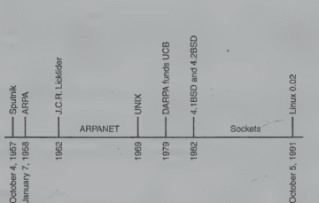

**图 1.1：** 根据时间线，BSD 套接字是在 ARPA 成立 24 年后开发的。

## 理解套接字

在你尝试应用套接字接口之前，了解其背后的一些概念至关重要。本节概述了围绕套接字本身的一些高层概念。

### 定义套接字

要使用电话与他人通信，你必须拿起听筒，拨号对方的电话号码，并等待对方接听。当你与该对方通话时，建立了两个通信端点：

- 位于你这里的电话
- 位于他那里的对方电话

只要你们都在通信，就涉及两个端点，它们之间有一条通信线路。图 1.2 展示了两个电话作为端点的示意图，它们通过电话网络彼此连接。


> **图 1.2：** 如果没有电话网络，电话线路的每个端点不过是一个塑料盒子。

Linux 下的套接字与电话非常相似。套接字代表通信线路中的端点。在端点之间存在数据通信网络。

套接字在另一个方面与电话类似。当你打电话给某人时，你会拨打你要联系的那个人的电话号码。套接字使用网络地址而不是电话号码。通过指示远程套接字的地址，你的程序可以在本地套接字和该远程端点之间建立一条通信线路。套接字地址在第 2 章“域和地址族”中讨论。

因此你可以得出结论，套接字仅仅是通信中的一个端点。有许多 Linux 函数调用操作套接字，你将在本书中了解所有这些函数。

### 使用套接字

你可能会认为 Linux 套接字是特殊对待的，因为你已经知道套接字有一组特定的操作函数。虽然套接字确实有一些特殊性质，但它们与你应该已经熟悉的文件描述符非常相似。

> **注意**
>
> 任何对函数名（如 `pipe(2)`）的引用，意味着你应该在你的 Linux 系统上拥有该函数的在线文档（man 手册页）。例如，要了解关于 `pipe(2)` 的信息，你可以输入命令：
>
> ```
> $ man 2 pipe
> ```
>
> 其中 2 代表手册章节号，函数名可用作手册页的名称。尽管章节号通常是可选的，但在许多情况下，为了获取正确的信息，你必须指定它。

例如，当你使用 Linux `open(2)` 调用打开文件时，如果 `open(2)` 函数成功，你将返回一个文件描述符。获得此文件描述符后，你的程序使用它来对打开的特定文件执行 `read(2)`（读）、`write(2)`（写）、`lseek(2)`（定位）和 `close(2)`（关闭）操作。同样，当创建套接字时，它就像文件描述符一样。你可以使用相同的文件 I/O 函数来读取、写入和关闭该套接字。在第 15 章“使用 inetd 守护进程”中，你将了解到套接字可用于标准输入（文件单元 0）、标准输出（文件单元 1）或标准错误（文件单元 2）。

> **注意**
>
> 套接字以与打开的文件相同的方式通过文件单元号引用。这些单元号共享同一个“数字空间”——例如，你不能同时拥有一个单元号为 4 的套接字和一个单元号为 4 的打开文件。

然而，套接字和打开的文件之间确实存在一些差异。以下列表强调了一些这些差异：

- 你不能对套接字执行 `lseek(2)`（此限制也适用于管道）。


- 套接字可以与地址相关联。文件和管道没有网络地址。
- 套接字具有不同的选项功能，可以使用 `ioctl(2)` 进行查询和设置。
- 套接字必须处于正确状态才能执行输入或输出。相反，打开的磁盘文件可以随时读取或写入。

### 引用套接字

当你使用 `open(2)` 函数调用打开新文件时，Linux 内核会返回下一个可用的最小文件描述符。这个文件描述符，或者通常称为`文件单元`号，是一个零或正整数值，用于指代被打开的文件。这个“句柄”用于所有其他操作打开文件的函数。现在你知道，文件单元号也可以用于指代特定的套接字。

> **注意**
>
> 当内核需要新的文件单元（或文件描述符）时，会返回最低可用的单元号。例如，如果你关闭标准输入（文件单元号 0），然后成功打开一个文件，`open(2)` 调用返回的文件单元号将是零。

假设片刻，你的程序已经打开了文件单元 0、1 和 2（分别对应标准输入、输出和错误），并且执行了以下程序操作序列。注意内核是如何分配文件描述符的：

- 调用 `open(2)` 函数打开一个文件。
- 返回文件单元 3 以引用该打开的文件。由于该单元当前未使用，并且是目前可用的最低文件单元，因此选择值 3 作为该文件的文件单元号。
- 使用适当的函数调用创建一个新的套接字。
- 返回文件单元 4 以引用该新套接字。
- 再次调用 `open(2)` 打开另一个文件。
- 返回文件单元 5 以引用该新打开的文件。

注意 Linux 内核在分配单元号时，并不区分文件和套接字。文件描述符用于引用打开的文件或网络套接字。

这意味着，作为程序员，你将把套接字当作打开的文件来使用。能够按文件单元号互换引用文件和套接字，为你提供了极大的灵活性。这也意味着像 `read(2)` 和 `write(2)` 这样的函数可以同时对打开的文件和套接字进行操作。

### 将套接字与管道进行比较

在你接触任何套接字函数之前，让我们回顾一下你可能已经熟悉的 `pipe(2)` 函数调用。让我们看看它返回的文件描述符与套接字有何不同。以下是取自 `pipe(2)` man 手册页的函数原型：

```c
#include <unistd.h>

int pipe(int filedes[2]);
```

`pipe(2)` 函数调用在成功时返回两个文件描述符。数组元素 `filedes[0]` 包含管道读端的文件描述符编号。元素 `filedes[1]` 接收管道写端的文件单元号。

这种两个文件描述符的排列暗示了一个通信链路，两端各有一个文件描述符充当套接字。那么这与使用套接字有何不同？区别在于 `pipe(2)` 函数创建的通信线路仅单向。信息只能写入 `filedes[1]` 对应的文件单元，并且只能由 `filedes[0]` 单元读取。任何试图反向写入数据的尝试都会导致 Linux 内核向你的程序返回错误。

另一方面，套接字允许进程双向通信。例如，一个进程可以使用打开在文件单元 3 上的套接字向远程进程发送数据。与使用管道不同，同一个本地进程还可以接收由它正在通信的远程进程发送到文件单元 3 的信息。

# 创建套接字

在本节中，你将看到创建套接字几乎与创建管道一样简单。不过，还有几个更多的函数参数需要学习。为了使操作成功，必须为这些参数提供合适的值。

`socketpair(2)` 函数的原型如下：

```c
#include <sys/types.h>
#include <sys/socket.h>

int socketpair(int domain, int type, int protocol, int sv[2]);
```

包含文件 `sys/types.h` 用于定义一些 C 宏常量。包含文件 `sys/socket.h` 用于定义 `socketpair(2)` 函数的原型。

`socketpair(2)` 函数接受四个参数。它们分别是：

- 套接字的主机域（`domain`）。
- 套接字的类型（`type`）。
- 要使用的协议（`protocol`）。
- 指向接收文件的描述符数组的指针，这些描述符引用创建的套接字。

关于主机域参数的解释将在第 2 章中详细说明。然而，对于 `socketpair(2)` 函数，始终需要提供 C 宏值 `AF_LOCAL`。

类型参数声明你想要创建哪种类型的套接字。对于 `socketpair(2)` 函数，选择如下：

- `SOCK_STREAM`
- `SOCK_DGRAM`

套接字选择的影响将在第 4 章“套接字类型和协议”中探讨。在本章中，我们将仅使用 `SOCK_STREAM` 作为套接字的类型。

对于 `socketpair(2)` 函数，协议参数必须提供为零。

参数 `sv[2]` 是一个接收两个整数值 的数组，代表两个套接字。每个文件描述符代表一个套接字（端点），并且从其他方面无法区分彼此。

如果函数成功，则返回零。否则，返回值为 -1 表示发生错误，并且应查阅 `errno` 以获取具体原因。

## 注意

始终测试函数返回值的成功或失败。只有在确定函数调用失败后，才应查阅 `errno`。只有错误会被记录到 `errno` 中；成功时它不会清除为零。

## 在示例中使用 `socketpair(2)`

为了演示如何使用 `socketpair(2)` 函数，这里提供了清单 1.1 中的程序供你实验。

## 注意

如果你手动输入本书清单中显示的示例程序，请不要包含最左侧显示的行号。行号仅为了方便参考而显示。

### 清单 1.1: 01LIST01.—`socketpair(2)` 函数的使用示例

```c
/* Listing 1.1:
 *
 *   Example of socketpair(2) function:
 */
#include <stdio.h>
#include <stdlib.h>
#include <unistd.h>
#include <errno.h>
#include <string.h>
#include <sys/types.h>
#include <sys/socket.h>

int
main(int argc,char **argv) {
    int z;                  /* Status return code */
    int s[2];               /* Pair of sockets */

    /*
     * Create a pair of local sockets:
     */
    z = socketpair(AF_LOCAL,SOCK_STREAM,0,s);

    if ( z == -1 ) {
        fprintf(stderr,
            "%s: socketpair(AF_LOCAL,SOCK_STREAM,0)\n",
            strerror(errno));
        return 1;            /* Failed */
    }

    /*
     * Report the socket file descriptors returned:
     */
    printf("s[0] = %d\n", s[0]);
    printf("s[1] = %d\n", s[1]);

    system("netstat --unix -p");

    return 0;
}
```

### 说明

如果你使用的是较旧版本的 Linux（Red Hat 6.0 之前），清单 1.1 中第 36 行使用的 `netstat` 命令可能无法理解所用的选项。

如果是这种情况，你可能需要将第 36 行更改为：

```c
system("lsof -i tcp");
```

这需要系统中安装了 `lsof`。`lsof` 命令可以从多种来源获取。一个好的起点是 `ftp://vio.cc.purdue.edu/pub/tools/unix/lsof/`

在那里，除了源代码外，还列出了各种镜像站点。还要注意，使用 `lsof` 时，可能需要以 root 身份运行清单 1.1 中的程序。

`lsof` 也可以作为二进制文件（包括 RPM）和源代码格式，在 `ftp://sunsite.unc.edu/pub/Linux/distributions` 下的各种发行版目录中找到。

作为最后的手段，你可以用以下语句替换第 36 行：

```c
system("netstat | grep tcp");
```

演示程序可以按以下步骤描述：

1. 在第 16 行声明了一个接收数组 `s[2]`，用于接收引用两个新创建套接字的两个新文件描述符。
2. 在第 21 行调用 `socketpair(2)` 函数。主机域参数指定为 `AF_LOCAL`，套接字类型参数为 `SOCK_STREAM`，协议指定为零。
3. 第 23 行的 `if` 语句测试 `socketpair(2)` 函数是否成功。如果 `z` 包含 -1，则向标准错误报告失败（第 24 至 26 行），并且程序在第 27 行退出。


4. 如果函数调用成功，控制将转移到第 33 行和第 34 行，在那里将返回的文件单元号报告到标准输出。

5. 第 36 行使用 `system(3)` 函数调用 `netstat(1)` 命令。命令选项 `--unix` 表示仅报告 UNIX 套接字（`AF_LOCAL` 域），而 `-p` 选项则表示报告进程信息。

使用提供的 `Makefile`，你可以使用 `make` 命令按以下方式编译清单 1.1 中的程序：

```bash
$ make 01lst01
gcc -c -D_GNU_SOURCE -Wall 01LST01.c
gcc 01LST01.o -o 01lst01
```

现在，你可以准备尝试这个演示程序了。

## 运行演示程序

要调用演示，请使用以下方法：

```bash
$ ./01lst01
```

> **说明**
>
> 在命令提示符处输入可执行文件名时，务必注意文件名的大小写。所选的可执行文件名使用小写字母。

运行程序的结果如下（添加行号以便参考）：

```text
1: $ ./01lst01
2: s[0] = 3;
3: s[1] = 4;
4: (not all processes could be identified, non-owned process info
5: will not be shown, you would have to be root to see it all.)
6: Active UNIX domain sockets (w/o servers)
7: Proto RecntQ Flgts Type __ I-Node PID/Program name Path
8: unix 1 [ ] STREAM __ 486 - 000000019
9: unix 1 [ ] STREAM __ 498 - 00000001f
10: unix 1 [ ] STREAM __ 518 - 000000020
11: unix 0 [ ] STREAM __ 117 - 000000011
12: unix 1 [ ] STREAM __ 789 - 000000030
13: unix 1 [ ] STREAM __ 549 - 000000023
14: unix 1 [ ] STREAM __ 1032 662/01lst01
15: unix 1 [ ] STREAM __ 1031 662/01lst01
16: unix 1 [ ] STREAM __ 793 - /dev/log
17: unix 1 [ ] STREAM __ 582 - /dev/log
18: unix 1 [ ] STREAM __ 574 - /dev/log
19: unix 1 [ ] STREAM __ 572 - /dev/log
20: unix 1 [ ] STREAM __ 408 - /dev/log
21: $
```

在显示的输出中，可执行程序 `01lst01` 在第 1 行被调用。第 2 行和第 3 行显示套接字对在文件描述符 `3` 和 `4` 上打开。第 4 行到第 20 行是程序内部通过 `system(3)` 函数调用引发的 `netstat(1)` 命令的输出行。

注意清单 1.2 中 `netstat(1)` 输出的第 14 行和第 15 行。查看“PID/Program name”列下的内容，我们可以看到名为 `01lst01` 的程序进程 ID 为 `662`，并打开了两个“unix”套接字。虽然输出中未显示，但你会看到在“State”列下，套接字显示为已连接。

虽然程序没有对创建的套接字对做任何操作，但它确实演示了套接字对的创建。它还演示了套接字是如何像打开的文件一样被分配给文件单元号的。

敏锐的读者可能还注意到，这对 `AF_LOCAL` 套接字也被称为“unix”套接字（我们在 `netstat(1)` 输出中看到了这一点）。事实上，可以使用 C 宏常量 `AF_UNIX` 替代 `socketpair(2)` 函数调用中域值的宏 `AF_LOCAL`。这些值是等价的，尽管标准组织现在鼓励使用 `AF_LOCAL` 而非 `AF_UNIX`。

# 在套接字上执行 I/O

你之前了解到，套接字可以像任何打开的文件一样进行写入和读取。在本节中，你将亲自演示这一点。不过，为了完整性，让我们先回顾一下 `read(2)`、`write(2)` 和 `close(2)` 调用的函数原型，然后再开始使用它们：

```c
#include <unistd.h>

ssize_t read(int fd, void *buf, size_t count);
ssize_t write(int fd, const void *buf, size_t count);
int close(int fd);
```

这些是你应该已经熟悉的 `Linux` 输入/输出函数。作为复习，函数 `read(2)` 将文件描述符 `fd` 中可用的输入读取到你提供的缓冲区 `buf` 中，最大大小为 `count` 字节。返回值表示读取的字节数。返回计数为零代表 `end-of-file`（文件结束）。

`write(2)` 函数将你提供的缓冲区 `buf` 中的数据写入文件描述符 `fd`，总共写入 `count` 字节。返回值表示实际写入的字节数。通常，这应与提供的 `count` 参数相匹配。然而，在某些合理的情况下，该值会小于 `count`，但在此处您无需担心。

最后，如果单元成功关闭，`close(2)` 返回零。

这些函数中任何一个的返回值 `-1` 表示发生错误，且错误原因会记录到外部变量 `errno` 中。若要访问此值，请在需要它的源模块中包含 `errno.h` 文件。

列表 1.2 展示了一个示例，对套接字进行双向读取和写入。


## 列表 1.2：`ex1.sr2.c` — 在套接字对上执行 I/O 的示例


```c
/* Listing 1.2:
 *
 * Example performing I/O on a Socket Pair:
 */

#include <stdio.h>
#include <unistd.h>
#include <stdlib.h>
#include <errno.h>
#include <string.h>
#include <sys/types.h>
#include <sys/socket.h>

int
main(int argc, char **argv) {
    int z; /* Status return code */
    int s[2]; /* Pair of sockets */
    char *cp; /* A work pointer */
    char buf[80]; /* Work buffer */

    /*
     * Create a pair of local sockets:
     */
    z = socketpair(AF_LOCAL, SOCK_STREAM, 0, s);

    if ( z == -1 ) {
        fprintf(stderr,
            "%s: socketpair(AF_LOCAL,SOCK_STREAM,"*"0")\n",
            strerror(errno));
        return 1; /* Failed */
    }

    /*
     * Write a message to socket s[1]:
     */
    z = write(s[1],cp,"Hello",6);
    if ( z < 0 ) {
        fprintf(stderr,
            "%s: write(%d, "%s",%d)\n" ,
            strerror(errno),s[1],cp,strlen(cp));
        return 2; /* Failed write */
    }

    printf("Wrote message '%s' on s[1]\n",cp);

    /*
     * Read from socket s[0]:
     */
    z = read(s[0],buf,sizeof buf);
    if ( z < 0 ) {
        fprintf(stderr,
            "%s: read(%d,buf,%d)\n", 
            strerror(errno),s[0],sizeof buf);
        return 3; /* Failed read */
    }

    /*
     * Report received message:
     */
    buf[z] = 0; /* NUL terminate */
    printf("Received message '%s' from socket s[0]\n", 
        buf);

    /*
     * Send a reply back to s[1] from s[0]:
     */
    z = write(s[0],cp="Go away!",8);
    if ( z < 0 ) {
        fprintf(stderr,
            "%s: write(%d, "%s",%d)\n", 
            strerror(errno),s[0],cp,strlen(cp));
        return 4; /* Failed write */
    }

    printf("Wrote message '%s' on s[0]\n",cp);

    /*
     * Read from socket s[1]:
     */
    z = read(s[1],buf,sizeof buf);
    if ( z < 0 ) {
        fprintf(stderr,
            "%s: read(%d,buf,%d)\n",
            strerror(errno),s[1],sizeof buf);
        return 3; /* Failed read */
    }

    /*
     * Report message received by s[0]:
     */
    buf[z] = 0; /* \0 terminate */
    printf("Received message '%s' from socket s[1]\n",
        buf);

    /*
     * Close the sockets:
     */
    close(s[0]);
    close(s[1]);

    puts("Done.");
    return 0;
}
```

程序调用的步骤可以总结如下：

1.  `socketpair(2)` 函数在第 23 行被调用，如果成功，会将一对套接字返回到数组元素 `s[0]` 和 `s[1]`（第 16 行）中。
2.  第 25 行测试函数是否成功，如果发生错误，则会在第 26 至 31 行报告错误。
3.  在第 36 行，将包含 6 个字符‘Hello?’的消息写入套接字 `s[1]`。请注意，没有写入空字节，因为 `write(2)` 函数的 `count` 参数中指定了 6 个字节。
4.  第 37 至 42 行检查并报告可能发生的任何错误。
5.  第 44 行宣布写操作成功。
6.  第 49 行的 `read(2)` 调用现在尝试从另一个套接字 `s[0]` 读取消息。在此语句中可以读取的消息大小最多为数组 `buf[]` 的最大值。
7.  第 50 至 55 行检查并报告读取语句中可能发生的任何错误。
8.  第 60 至 62 行报告成功接收消息，并报告消息内容。
9.  第 67 至 73 行将回复消息 "Go away!" 写入套接字 `s[0]`。这将演示信息可以在以套接字为端点的通信中双向传输，这与管道不同。
10. 第 75 行宣布第 67 行的写入成功。
11. 第 80 至 86 行应读取来自套接字 `s[1]` 的 "Go away!" 消息，这是通信线路的另一端点。
12. 第 91 至 93 行报告此成功接收及其消息。
13. 两个套接字端点在第 98 和 99 行关闭。
14. 程序在第 102 行退出。

当调用程序时，您应该看到以下内容：


```
$ ./011st02
Wrote message 'Hello?' on s[1]
Received message 'Hello?' from socket s[0]
Wrote message 'Go away!' on s[0]
Received message 'Go away!' from socket s[1]
Done.
$
```

如果您追踪之前概述的步骤，您会发现信息在该对套接字上双向发送。此外，还演示了套接字的关闭方式与文件相同。

## 关闭套接字

之前，您看到如何轻松地创建一对套接字，以及如何使用这些套接字执行一些基本的输入和输出。您还看到这些套接字可以通过使用 `close(2)` 函数调用以与文件相同的方式关闭。现在是时候了解关闭套接字意味着什么了。

从由 `pipe(2)` 函数创建的管道读取时，当接收到文件末尾时，接收端会意识到不再有数据。文件末尾条件是由写入进程发送的，当它关闭管道的写入端时发送该条件。

同样的过程可以用于一对套接字。当另一端点（套接字）被关闭时，接收端将接收到文件末尾指示。

当本地进程想要向远程端点发出信号，表明没有更多数据可接收时，问题就出现了。如果本地进程关闭其套接字，这在一定程度上可以实现。然而，如果它需要接收来自远程端的确认，它就无法做到，因为其套接字现在已关闭。像这样的情况需要一种方法来半关闭套接字。

## shutdown(2) 函数

以下显示了 `shutdown(2)` 函数的原型：

```c
#include <sys/socket.h>

int shutdown(int s, int how);
```

函数 `shutdown(2)` 需要两个参数。它们分别是

- 套接字描述符 `s` 指定要部分关闭的套接字。
- 参数 `how` 指示应如何关闭此套接字。

如果函数调用成功，返回值为零。失败由返回值 -1 指示，失败原因记录在 `errno` 中。

`how` 的允许值显示在表 1.1 中。

| 值 | 宏 | 描述 |
| --- | --- | --- |
| 0 | `SHUT_RD` | 不允许再在指定套接字上进行任何读取。 |
| 1 | `SHUT_WR` | 不允许再在指定套接字上进行任何写入。 |


| 2 | `SHUT_RDWR` | 不允许再在指定套接字上进行任何读取或写入。 |

请注意，当 `how` 值提供为 2 时，此函数调用几乎等同于 `close(2)` 调用。

## 关闭套接字的写入端

以下代码显示了如何指示不再在本地套接字上执行写入操作：

```c
int z;
int s; /* Socket */

z = shutdown(s,SHUT_WR);
if ( z == -1 )
    perror( "shutdown()" );
```


关闭套接字的写入端解决了许多棘手的问题。它们是

- 刷新内核缓冲区，其中包含任何待发送的数据。内核网络软件会对数据进行缓冲以提高性能。

- 向远程套接字发送文件末尾指示。这告知远程读取进程将不再有数据通过此套接字发送给它。

- 保持部分关闭的套接字处于打开状态以便读取。这使得在套接字上发送文件末尾指示后仍有可能接收确认消息。

- 忽略套接字上打开引用的数量。只有在套接字上的最后一次 `close(2)` 才会导致发送文件末尾指示。

最后一点需要一些解释，将在下一节中提供。

## 处理重复的套接字

如果通过 `dup(2)` 或 `dup2(2)` 函数调用复制套接字的文件描述符，那么只有最后一次未处理的 `close(2)` 调用才会实际关闭套接字。这是因为其他重复的文件描述符仍被视为正在使用中。以下代码对此进行了演示：

```c
int s; /* Existing socket */
int d; /* Duplicated socket */

d = dup(s); /* duplicate this socket */
close(s); /* nothing happens yet */
close(d); /* last close, so shutdown socket */
```

在示例中，第一个 `close(2)` 调用不会产生任何影响。先关闭哪个套接字没有区别。先关闭 `s` 或 `d` 中的任意一个，对于同一个套接字仍然会有一个未处理的文件描述符。只有在关闭该套接字最后存活的文件描述符时，`close(2)` 调用才会产生任何影响。在示例中，关闭文件描述符 `d` 会关闭套接字。

`shutdown(2)` 函数避免了这一困难。重复示例代码，使用 `shutdown(2)` 函数解决了问题：

```c
int s; /* Existing socket */
int d; /* Duplicated socket */

d = dup(s); /* duplicate this socket */
shutdown(s, SHUT_RDWR); /* immediate shutdown */
```

尽管套接字 `s` 也在文件单元 `d` 上打开，但 `shutdown(2)` 函数会立即使套接字执行其请求的关闭任务。这自然会影响打开的文件描述符 `s` 和 `d`，因为它们都指向同一个套接字。

另一种该问题的表现形式是在调用 `fork(2)` 函数之后。任何在 `fork` 操作之前存在的套接字都会被复制到子进程中。

> **提示**
>
> 每当需要立即或部分关闭操作时，请始终使用 `shutdown(2)` 函数，而不是 `close(2)` 函数。来自 `dup(2)`、`dup2(2)` 或 `fork(2)` 操作的重复文件描述符可能会阻止 `close(2)` 函数发起任何关闭操作，直到最后一个未处理的描述符被关闭为止。

## 关闭套接字的读取端

关闭套接字的读取端会导致任何待处理的读取数据被静默忽略。如果从远程套接字发送了更多数据，这些数据同样会被静默忽略。然而，进程尝试从该套接字读取时，将返回一个错误。这通常用于强制协议或帮助调试代码。

## 何时不使用 `shutdown(2)`

`shutdown(2)` 函数的文档中列出了表 1.2 所示的错误。

*表 1.2：`shutdown(2)` 可能返回的错误*

| 错误 | 描述 |
| :--- | :--- |
| `EBADF` | 给定的套接字不是有效的文件描述符。 |
| `ENOTSOCK` | 给定的文件描述符不是套接字。 |
| `ENOTCONN` | 指定的套接字未连接。 |

从表 1.2 可以看出，您只应对已连接的套接字调用 `shutdown(2)`。否则，将返回错误代码 `ENOTCONN`。

> **注意**
>
> 即使使用 `SHUT_RDWR`，`shutdown(2)` 函数也不会释放套接字的文件单元号。套接字的文件描述符保持有效并处于使用状态，直到调用 `close(2)` 函数将其释放。
>
> 还需注意，只要套接字仍处于连接状态，`shutdown(2)` 可以针对同一个文件单元多次调用。

## 编写一个客户端/服务器示例

现在，您已经查看了足够的套接字 API 集合，可以开始享受其中的乐趣了。在本节中，您将以一对套接字进行通信，审查、编译并测试一个简单的客户端和服务器进程。

为了将编程代码降到最低限度，一个程序启动后将分叉为客户端进程和服务器进程。子进程将承担客户端进程的角色，而原始父进程将执行服务器的角色。图 1.3 说明了父子进程以及将使用的套接字之间的关系。

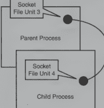

**图 1.3**：使用 `fork(2)` 和 `socketpair(2)` 的客户端/服务器示例。

父进程是原始启动进程。它将立即通过调用 `socketpair(2)` 请求一对套接字，然后通过调用 `fork(2)` 将自己分叉为两个进程。

服务器将接受一个请求，对该请求进行处理，然后退出。在此示例中，客户端同样将发出一个请求，报告服务器响应，然后退出。

请求将是 `strftime(3)` 函数的第三个参数的形式。这是一个格式字符串，用于格式化日期和时间字符串。服务器将在接收到请求时获取当前的日期和时间。服务器将使用客户端的请求字符串将其格式化为最终字符串，并将其返回给客户端。作为回顾，`strftime(3)` 函数的原型如下：

```c
#include <time.h>
```


```c
size_t strftime(char *buf,
size_t max,
const char *format,
const struct tm *tm);
```

参数 `buf` 和 `max` 分别指示输出缓冲区及其最大长度。参数 `format` 是一个输入字符串，允许您格式化日期和时间字符串（清单 1.3 第 75 行展示了这样一个字符串的示例）。最后，参数 `tm` 用于提供创建输出日期和时间字符串所需的所有日期和时间组件。如有需要，请查阅 `strftime(3)` 的手册页。

清单 1.3 展示了演示客户端/服务器程序的源代码列表。

### 清单 1.3：$ 01lst03.c——使用 `socketpair(2)` 和 `fork(2)` 的客户端/服务器示例


```c
  1:  /*  清单 1.3
  2:    *
  3:    * 使用 socketpair(2)
  4:    * 和 fork(2) 的客户端/服务器示例：
  5:    */
  6:
  7:  #include <stdio.h>
  8:  #include <stdlib.h>
  9:  #include <unistd.h>
 10:  #include <errno.h>
 11:  #include <string.h>
 12:  #include <time.h>
 13:  #include <sys/types.h>
 14:  #include <sys/socket.h>
 15:  #include <sys/wait.h>
 16:
 17:  /*
 18:    *
 19:    * 截至 RedHat-6.0，这些仍未定义：
 20:    */
 21:  #ifndef SHUT_RD
 22:  #define SHUT_RD      0
 23:  #define SHUT_WR      1
 24:  #define SHUT_RDWR    2
 25:  #endif
 26:
 27:  /*
 28:    * 主程序：
 29:    */
 30:  int
 31:  main(int argc,char **argv) {
 32:      int z;            /*  状态返回码 */
 33:      int s[2];        /*  套接字对   */
 34:      char *msgp;     /*  消息指针 */
 35:      int mlen;        /*  消息长度    */
 36:      char buf[80];    /*  工作缓冲区       */
 37:      pid_t child;     /*  子进程 PID */
 38:
 39:      /*
 40:        * 创建一对本地套接字：
 41:        */
 42:      z = socketpair(AF_LOCAL,SOCK_STREAM,0,s);
 43:      if (z == -1) {
 44:          fprintf(stderr,"$s: socketpair(2)\n",
 45:                  strerror(errno));
 46:          exit(1);
 47:      }
 48:      /*
 49:       * 现在 fork() 分叉为两个进程：
 50:       */
 51:      if ((child = fork()) == pid_t -1) {
 52:          /*
 53:           * 分叉为两个进程失败：
 54:           */
 55:          fprintf(stderr,"%s: fork(2)\n",
 56:                  strerror(errno));
 57:          exit(1);
 58:      } else if (child == 0) {
 59:          /*
 60:           * 这是子进程（客户端）：
 61:           */
 62:          char rxbuf[80]; /* 接收缓冲区 */
 63:          printf("Parent PID is %ld\n",(long)getppid());
 64:          close(s[0]);      /* 服务器使用 s[1] */
 65:          s[0] = -1;        /* 忘记此单元 */
 66:          /*
 67:           * 形成消息及其长度：
 68:           */
 69:          msgp = "%A %d-%b-%Y %l:%M %p";
 70:          mlen = strlen(msgp);
 71:          printf("Child sending request '%s'\n",msgp);
 72:          fflush(stdout);
 73:          /*
 74:           * 向服务器写入请求：
 75:           */
 76:          z = write(s[1],msgp,mlen);
 77:          if (z < 0 ) {
 78:              fprintf(stderr,"%s: write(2)\n",
 79:                  strerror(errno));
 80:              exit(1);
 81:          }
 82:          /*
 83:           * 现在指示我们不会再向我们的套接字写入
 84:           * 任何内容，通过关闭套接字的写入端：
 85:           */
 87:          if ( shutdown(s[1],SHUT_WR) == -1 ) {
 88:              fprintf(stderr,"%s: shutdown(2)\n",
 89:                  strerror(errno));
 90:              exit(1);
 91:          }
 92:
 93:          /*
 94:           * 接收来自服务器的回复：
 95:           */
 96:          z = read(s[1],rxbuf,sizeof rxbuf);
 97:          if ( z < 0 ) {
 98:              fprintf(stderr,"%s: read(2)\n",
 99:                  strerror(errno));
100:              exit(1);
101:          }
102:
103:          /*
104:           * 在我们从服务器
105:           * 接收的数据末尾添加一个空字节：
106:           */
107:          rxbuf[z] = 0;
108:
109:          /*
110:           * 报告结果：
111:           */
112:          printf("Server returned '%s'\n",rxbuf);
113:          fflush(stdout);
114:
115:          close(s[1]);	/* 现在关闭我们这一端 */
116:
117:      } else {
118:
119:          /*
120:           * 这是父进程（服务器）：
121:           */
122:          int status; /* 子进程终止状态 */
123:          char txbuf[80];		/* 回复缓冲区 */
124:          time_t td;    /* 当前日期和时间 */
125:
126:          printf("Child PID is %ld\n", (long)child);
127:          fflush(stdout);
128:
129:          close(s[1]);   /* 客户端使用 s[1] */
130:          s[1] = -1;     /* 忘记此描述符 */
131:
132:          /*
133:             * 等待来自客户端的请求：
134:             */
135:          z = read(s[0], buf, sizeof buf);
136:
137:          if ( z < 0 ) {
138:                fprintf(stderr, "%s: read(2)\n",
139:                        strerror(errno));
140:                exit(1);
141:          }
142:
143:          /*
144:             * 在我们从客户端
145:             * 接收的消息末尾添加一个空字节：
146:             */
147:          buf[z] = 0;
148:
149:          /*
150:             * 现在对接收到的消息
151:             * 执行服务器功能：
152:             */
153:          time(&td);      /* 获取当前时间 */
154:
155:          strftime(txbuf, sizeof txbuf,  /* 缓冲区 */
156:                   buf,               /* 输入格式 */
157:                   localtime(&td));   /* 输入时间 */
158:
159:          /*
160:             * 将响应发送回客户端：
161:             */
162:          z = write(s[0], txbuf, strlen(txbuf));
163:
164:          if ( z < 0 ) {
165:                fprintf(stderr, "%s: write(2)\n",
166:                        strerror(errno));
167:                exit(1);
168:          }
169:
170:          /*
```


### 清单 1.3（续）

```
181:		* Close our end of the socket:
182:		*/
183:		close(s[0]);
184:
185:		/*
186:		 * Wait for the child process to exit.
187:		 * See text.
188:		*/
189:		waitpid(chpid,&status,0);
190:	}
191:
192:	return 0;
193:	}
```

`清单 1.3`中所示的程序可以分解为以下基本步骤：

- 第 19 行至 23 行定义了 `SHUT_WR`、`SHUT_RD` 和 `SHUT_RDWR` 宏常量（至少在 Red Hat Linux 6.0 中需要）。最终这些常量将为你定义。第 19 行的 `#ifndef` 语句确保只有当 `SHUT_WR` 尚未定义时才编译第 20 行至 22 行。
- 单一进程从第 29 行的 `main` 函数入口点开始。
- 在第 40 行通过调用函数 `socketpair(2)` 创建一对套接字。
- 如果发生错误，第 42 行至 46 行将报告错误并停止程序。
- 单一进程在第 51 行通过调用 `fork(2)` 分叉为父进程和子进程。如果发生错误，将在第 52 行至 58 行报告错误并停止程序。
- 新的子进程在第 61 行至 125 行执行。子进程将作为客户端程序，向服务器发送请求，并从服务器接收响应。
- 原始的（父）进程执行第 129 行至 189 行。该进程充当服务器，等待一个输入请求并返回该请求的响应。

现在，你将更详细地检查服务器端的步骤：

- 第 136 行和第 137 行宣布父进程正在作为服务器进程开始，并报告子进程的 ID。
- 第 139 行关闭了服务器不会使用的多余套接字。套接字 `s[1]` 是将被子进程单独使用的文件单元。参考图 1.3 以可视化进程和使用的套接字（`s[1]` 将包含文件描述符 4）。
- 第 140 行只是一个有助于调试的预防措施。通过设置 `s[1]` 为 `-1`，显然表明该文件单元对该进程不再可用。
- 服务器在第 145 行调用 `read(2)`。服务器进程将在那里阻塞，直到有消息到达要读取的套接字。第 147 行至 151 行检查并报告可能由 `read(2)` 调用引发的任何错误。
- 第 157 行在收到的消息末尾放置一个空字节。这样做是为了将消息转换为 C 字符串，以便在第 166 行使用。
- 调用 `strftime(3)` 函数根据从客户端程序收到的消息格式化一个新的时间字符串。当前日期和时间是由服务器在第 163 行确定的。
- 第 172 行使用 `write(2)` 函数将一条消息写回给客户端进程。错误在第 174 行至 178 行进行检查和报告。
- 由于我们的演示程序只处理一个请求，它简单地关闭了第 183 行的套接字。
- 在此演示中调用 `waitpid(2)` 函数，以确保在子进程完成之前，父进程不会退出返回 shell。
- 当子进程终止后，父进程在第 192 行退出。

现在，让我们看看充当客户端程序的子进程：

- 子进程在第 67 行通过报告其父进程 ID 来宣布其开始。
- 客户端程序不使用 `s[0]` 中的重复套接字（根据图 1.3，它持有文件单元 3）。因此，它在第 69 行被关闭。第 70 行再次代表良好的编程实践。
- 客户端程序即将向服务器发送一个格式字符串。这是通过在第 75 行使用变量 `msp` 来建立的。消息长度在第 76 行的变量 `mlen` 中确定。
- 要发送的消息在第 78 行和第 79 行被宣布。
- 使用 `write(2)` 函数在第 84 行将消息从客户端套接字发送到服务器套接字。错误在第 86 行至 90 行被报告。
- 此时，客户端没有意图向服务器发送更多数据。在第 97 行调用 `shutdown(2)` 函数来表示这一点。错误在第 98 行至 101 行被报告。
- 客户端现在调用 `read(2)` 等待响应消息（第 106 行）。客户端进程将在此处无限期等待，直到响应到达。错误在第 107 行至 111 行被报告。
- 在第 117 行，在收到的响应末尾放置一个空字节。
- 在第 122 行至 123 行报告收到的响应。
- 客户端套接字现在在第 125 行被关闭。
- 客户端进程在第 126 行退出。

> **注意**
>
> 据报道，在 Red Hat 5.1（以及可能更旧的 Linux 内核版本）中，`shutdown(2)` 函数没有正确实现。似乎这些内核中 `SHUT_WR` 阻塞读取，而 `SHUT_RDWR` 完全不阻塞读取。
>
> 如果服务器示例无法正常工作，那么你的 Linux 内核可能存在此问题。
>
> 你可以通过删除第 97 行至 101 行来解决这个问题。即使没有这段代码，程序也能工作，因为内核最终会传递放入套接字缓冲区的内容。但是，`shutdown(2)` 函数可以更快实现这一点。

运行该程序应产生与下面所示输出类似的结果。注意，当然你的日期和时间会有所不同。

```
$ ./01list03
Child PID is 879
Parent PID is 878
Child sending request '%A %d-%b-%y %l:%M %p'
Server returned 'Thursday 15-Jul-1999 6:39 PM'
$
```

在输出中，你可以看到子进程（客户端）请求按照显示的字符串格式化日期和时间。服务器进程获取当前日期并将响应发回给客户端，客户端能够报告它。

作为实验，尝试修改 `清单 1.3` 中第 75 行的程序以使用不同的格式。重新编译并再次运行。例如，将第 75 行更改为：

`msgp = "%d-%b-%y";`

你应该能够在程序运行时获得类似

`15-Jul-99`

的结果。

## 接下来是什么

在本章中，你简要了解了套接字如何用于两个不同进程之间的通信。在引入 `socketpair(2)` 函数时，曾注意到必须指定套接字域、套接字类型和套接字协议。下一章教你如何选择套接字域以及如何为套接字指定地址。你将涵盖匿名套接字和带地址的套接字，以及如何为每个域初始化地址结构。


# 域和地址族

在上一章中，你阅读了电话类比，其中主叫者通过拨打对方电话号码与对方取得联系。在电话网络中，每个人的电话号码就像一个套接字地址。套接字有自己独立的地址，以便能够被特定识别。套接字地址将是本章的主要焦点。

在本章中，你将：

- 理解地址族
- 学习如何形成套接字地址
- 理解大端序和小端序字节顺序之间的区别
- 了解什么是抽象本地地址以及如何形成一个
- 了解何时不需要套接字地址

本章对你非常重要，因为许多程序员在套接字编程的这个方面都很吃力。在这里多花一点额外努力，以后会得到回报。

## 无名套接字

套接字并不总是需要一个地址。例如，`socketpair(2)` 函数创建两个相互连接的套接字，但没有地址。本质上，它们是“无名”套接字。想象一下冷战时期美国总统办公室和苏联之间的红色电话。两端都不需要电话号码，因为它们是直接连接的。同样，由 `socketpair(2)` 创建的套接字是直接连接的，不需要地址。

## 匿名呼叫

有时在实践中，连接中的两个套接字中有一个将没有地址。为了联系远程套接字，它必须有一个地址来标识它。然而，正在“拨打电话”的本地套接字可以是匿名的。建立的连接有一个带地址的远程套接字和另一个不带地址的套接字。

## 生成地址

有时你不关心你的本地地址是什么，但你需要它来通信。这对于需要连接到服务的程序尤其如此，如 RDBMS 数据库服务器。它们的本地地址仅在通信期间需要。可以分配固定地址，但这会增加网络管理的工作量。因此，当可用时，通常会使用地址生成。

## 理解域

当伯克利团队构思 BSD 套接字接口时，TCP/IP 协议仍在开发中。同时，还有其他一些相互竞争的协议，如 X.25 协议，被不同组织使用。还有其他协议正在研究中。

你在上一章中看到的 `socketpair(2)` 函数，以及尚未介绍的 `socket(2)` 函数，明智地考虑了使用其他协议替代 TCP/IP 的可能性。`socketpair(2)` 函数的 `domain` 参数允许考虑这种可能性。为了便于讨论，让我们重述以下 `socketpair(2)` 函数的函数原型：

```
#include <sys/types.h>
#include <sys/socket.h>

int socketpair(int domain, int type, int protocol, int sv[2]);
```

### 注意

在这里，你只需了解 `domain` 和 `protocol` 参数。关于 `type` 参数的讨论将推迟到本章稍后部分。

通常，`protocol` 参数指定为零。零允许操作系统为所选域选择正确的默认协议。虽然存在一些例外情况，但这超出了当前讨论的范围。


...[/content]`. No extra explanation.

**Analysis of the Input Text:**

*   **Headings:**
    *   `## 构建套接字地址` -> Good.
    *   `## 检查通用套接字地址` -> Good.
    *   `### 清单 2.1：通用套接字地址` -> Good.
    *   `## 构建本地地址` -> Good.
    *   `### 清单 2.2：`sockaddr_un` 地址结构体` -> The input has backticks around `sockaddr_un` inside the heading. I should probably keep the heading clean but apply backticks to the identifier. The rule says "Reorganize heading levels". It doesn't say "Clean up heading styling", but rule 4 says add backticks to class/struct names. So `### 清单 2.2：`sockaddr_un` 地址结构体` is appropriate.
    *   `## 构建传统本地地址` -> Good.
    *   `### 清单 2.3：af_unix.c——...` -> `af_unix.c` is a file name/path, should it be backticked? Yes, it's a path/file.

*   **Inline Code Candidates:**
    *   `socketpair(2)` -> Function/Command.
    *   `AF_LOCAL`, `AF_UNIX` -> Constants/Defines.
    *   `PF_LOCAL` -> Constant.
    *   `AF_INET` -> Constant.
    *   `(void *)` -> Type syntax.
    *   `sa_family_t` -> Type.
    *   `sa_family` -> Variable/Member.
    *   `sa_data[14]` -> Array access.
    *   `lpr(1)` -> Command.
    *   `sockaddr_un` -> Struct name.
    *   `sun_family` -> Member.
    *   `sun_path[108]` -> Member.
    *   `null` -> Constant/Keyword.
    *   `memset(3)` -> Function.
    *   `AF_LOCAL`/`AF_UNIX` -> Constants.
    *   `unix(4)` -> Man page/Command.
    *   `/dev/printer` -> Path.
    *   `lpd` -> Daemon/Command.
    *   `memset(3)` -> Function.
    *   `netstat(1)` -> Command.
    *   `socket(2)` -> Function.
    *   `bind(2)` -> Function.
    *   `af_unix.c` -> File path.
    *   `perror()`, `exit(1)` in code block? The rule says "code blocks ... add backticks". It implies the content *inside* the block stays as is, but identifiers *in the text* get backticks. The example shows a code block remaining just a code block.
    *   `/tmp/my_sock` in code block? Stays as is.
    *   Text identifiers like `uaddr`, `sock_unix`, `adr_unix`, `len_unix`, `ptn_unix` appear in code blocks. Do I backtick them in the code block? No, the rule applies to text *outside* or general mention. The example:
        ```
        if (condVar > someVal) {console.log("xxx")}
        ```
        The identifiers inside the code block are *not* backticked individually; the block itself is the code block. However, identifiers in *prose* need backticks.
    *   Wait, looking at the example again:
        `在 List.of(arg0, arg1, arg2) 中，List 接口的工厂方法 of()...`
        Result: `在`List.of(arg0, arg1, arg2)`中，`List`接口的工厂方法`of()`...`
        So, identifiers in prose are backticked. Identifiers *inside* a fenced code block are NOT backticked individually (the fence handles that).

*   **Bold/Italic conversion:**
    *   `*图 2.1：...*` -> This is a caption. Usually captions are italic. Does it contain code? No. Keep italic? The rule says "If above things (var/func/class/path/cmd) are surrounded by bold/italic, remove stars and add backticks."
    *   `*图 2.2：这是 /dev/printer 的 AF_LOCAL/AF_UNIX 套接字地址。*` -> Contains paths and constants.
        Input: `*图 2.2：这是 /dev/printer 的 AF_LOCAL/AF_UNIX 套接字地址。*`
        Output: `*图 2.2：这是`/dev/printer`的`AF_LOCAL`/`AF_UNIX`套接字地址。*` -> Wait, if I remove the stars, it becomes plain text. The rule says "remove stars **add backticks**". It implies the *identifier* gets backticks. The *sentence* shouldn't necessarily lose its emphasis unless the emphasis was *only* wrapping the identifier.
        Let's look at the example: `cmd arg0 arg1 arg2` was in prose.
        If the input is `*图 2.1：这是通用套接字地址布局的示意图。*`, it has no code identifiers. Keep italic.
        If the input is `*图 2.2：这是 /dev/printer ...*`, it has `/dev/printer` and `AF_LOCAL`.
        Rule: "If the above things [identifiers] ... are surrounded by bold/italic, remove stars add backticks."
        This usually applies when the *entire phrase* is just the identifier, e.g., `**AF_UNIX**` -> `` `AF_UNIX` ``.
        If it's a whole caption containing identifiers, I should backtick the identifiers *within* the caption. The caption itself can remain italic or become plain. The example doesn't show this specific case. Standard practice: Keep caption italic, backtick identifiers inside.
        However, the prompt says "remove stars ... add backticks". This phrasing is tricky.
        Example: `cmd` command: `cmd arg0 arg1 arg2`.
        Input: `cmd` was not bold/italic.
        If input was `**cmd**`, output `` `cmd` ``.
        If input was `*图 2.2：这是 /dev/printer ...*`, the stars wrap the *sentence*. The identifiers are *inside*. I will backtick the identifiers inside the sentence. I will likely remove the stars from the sentence to conform to "standard Markdown" and avoid nested emphasis mess, or keep the sentence italic. Let's look at "Optimize paragraph format". It's safer to make captions plain or just backtick the code parts.
        Actually, looking at the rule strictly: "All standalone appearing ... need backticks."
        If I see `*图 2.2：这是 /dev/printer ...*`, `/dev/printer` is standalone inside the sentence.
        I will process: `图 2.2：这是`/dev/printer`的`AF_LOCAL`/`AF_UNIX`套接字地址。` (Removing the outer stars of the caption seems consistent with cleaning up, or keeping them. The prompt doesn't explicitly forbid italic captions. But it says "remove stars" if identifiers are wrapped. Here identifiers are *not* the sole content of the stars. I will keep the caption style as italic or plain, but definitely backtick the identifiers.)
        Let's check `**注意**`. It's a header-like text.
        Let's check `**提示**`.

    *   Specific case: `sockaddr_un` in `### 清单 2.2：`sockaddr_un` 地址结构体`. The input already has backticks there. I should keep them.

*   **Code Blocks:**
    *   The input has code blocks for C code.
    *   I need to ensure the C code blocks are properly fenced.
    *   The input includes a table in "构建传统本地地址".
        ```
        | sun_family | sun_path |
        | :--- | :--- |
        | `AF_LOCAL` | `/dev/printer` |
        ```
        Table headers `sun_family` and `sun_path` are identifiers. The cells are already backticked in the input (mostly). I need to make sure they are consistent.

**Step-by-Step Processing:**

1.  **Intro:**
    `剩下的就是解释域参数了。对于 `socketpair(2)` 函数，此值必须始终为 `AF_LOCAL` 或 `AF_UNIX`。在上一章中曾指出，宏 `AF_UNIX` 是 `AF_LOCAL` 的等价旧名称。然而，`AF_LOCAL` 到底意味着什么？它选择了什么？`
    -> Identifiers already backticked in input?
    Input: `socketpair(2)` is backticked. `AF_LOCAL` backticked. `AF_UNIX` backticked.
    Wait, the input provided in the prompt *already* has backticks in many places?
    Let's re-read the input carefully.
    Input: `对于 `socketpair(2)` 函数` -> Yes, it has backticks.
    Input: `常量的 `AF_` 前缀` -> Yes.
    Input: `PF_` 前缀 -> `PF_` is backticked.
    Input: `PF_LOCAL` -> backticked.
    Input: `(void *)` -> backticked.
    Input: `sa_family_t` -> backticked.
    Input: `sa_family` -> backticked?
    Input: `char          sa_data[14];` is in a code block.
    Input: `sa_data[14]` in text: `结构体元素 `sa_data[14]` 代表...` -> Backticked.
    
    It seems the input *already* applies a lot of the rules. My job is to:
    1. Verify heading levels.
    2. Clean up paragraph spacing (remove extra newlines).
    3. Ensure *all* remaining identifiers are backticked (e.g. if I missed one in my scan).
    4. Handle the bold/italic vs backtick rule.
    5. Ensure code blocks are fenced.

    Let's check for un-backticked identifiers in the text.
    - `cvar` example in prompt.
    - In target text:
    - `第 4 章“套接字类型和协议”` -> No code.
    - `lpr(1)` -> Backticked in input? `当你使用 `lpr(1)` 命令...` Yes.
    - `AF_UNIX` -> Yes.
    - `sockaddr_un` -> Yes.
    - `sun_family` -> `结构体成员 `sun_family` ...` Yes.
    - `sun_path[108]` -> `结构体成员 `sun_path[108]` ...` Yes.
    - `null` -> `字符数组末尾不需要 `null` 字节。` Yes.
    - `AF_LOCAL`/`AF_UNIX` -> `... `AF_LOCAL`/`AF_UNIX` 地址。` Yes.
    - `unix(4)` -> `... `unix(4)` man 手册页 ...` Yes.
    - `/dev/printer` -> `... 套接字 `/dev/printer` 的物理布局 ...` Yes.
    - `lpd` -> `... `lpd` 打印守护进程 ...` Yes.
    - `memset(3)` -> `... `memset(3)` 函数 ...` Yes.
    - `netstat(1)` -> `... `netstat(1)` 命令 ...` Yes.
    - `socket(2)` -> `... `socket(2)` ...` Yes.
    - `bind(2)` -> `... `bind(2)` ...` Yes.
    - `af_unix.c` -> `... `af_unix.c` ...` Yes.
    
    Okay, the input is *mostly* formatted. I just need to check for:
    1.  Any missed identifiers.
    2.  The "remove stars add backticks" rule for any bold/italic wrapped identifiers.
    3.  Spacing cleanup.
    4.  Code block integrity.
    5.  Heading consistency.

    **Potential Issues:**
    - `*图 2.1：这是通用套接字地址布局的示意图。*` -> No identifiers. Keep italic or make plain? The rule says "remove stars add backticks" IF the thing is an identifier wrapped in stars. This is a caption. It's not an identifier. I will likely keep it as a plain paragraph or italic paragraph. The prompt says "optimize paragraph format". Usually, captions are just text. I'll keep the text as is but maybe remove the italic to be "standard markdown" unless it's a specific style choice. The prompt says "remove stars **add backticks**" for identifiers. It doesn't say "remove all italics". However, "standard Markdown" often treats image captions as plain text. I will leave `*...*` as is if it doesn't contain code, or convert to plain if I want to be clean. Let's look at `*图 2.2：这是 /dev/printer ...*`. This contains code identifiers.
    Rule 4: "If above things... are surrounded by bold or italic, remove stars add backticks."
    Interpretation A: `**/dev/printer**` -> `` `/dev/printer` ``.
    Interpretation B: `*图 2.2：这是 /dev/printer ...*` -> The identifier `/dev/printer` is *inside* the italic text, not *surrounded* by it exclusively. The *sentence* is surrounded.
    However, the prompt likely wants me to identify the code within and backtick it.
    Does it want me to remove the italic from the *whole sentence*?
    "remove stars **add backticks**" (remove the stars, add backticks).
    If I have `*Text with code*`, and I remove stars, I get `Text with code`. Then I add backticks to code: `Text with `code``.
    This seems the most logical interpretation for cleaning up mixed content.
    So: `*图 2.2：这是 /dev/printer 的 AF_LOCAL/AF_UNIX 套接字地址。*`
    Becomes: `图 2.2：这是`/dev/printer`的`AF_LOCAL`/`AF_UNIX`套接字地址。` (Plain text caption with backticked identifiers).
    Same for `*图 2.1...*` -> `图 2.1：这是通用套接字地址布局的示意图。`

    - `**注意**` and `**提示**` -> These are headings or emphasized labels.
    Rule: "Reorganize heading levels".
    If `**注意**` is just bold text acting as a subheader, I might make it a `####` or keep it bold.
    The prompt says "preserve reasonable # ## ### structure".
    The input uses `##` and `###`.
    `**注意**` is in the middle of the text. It looks like a "Note" block.
    I will keep `**注意**` as bold text (or make it a heading `#### 注意`?).
    Given "Reorganize heading levels", if it acts as a section marker, maybe `####`. But the content following it is short.
    Let's look at the structure:
    `## 构建传统本地地址`
    ...
    `**注意**`
    `如果你正确初始化...`
    ...
    `**提示**`
    `有关本地套接字地址...`
    
    These look like admonitions. In Markdown, bold text is fine. I will keep them as `**注意**` and `**提示**` on their own lines, as they function as labels.

    - `第 4 章` and `第 5 章`. No code.

    - Code Blocks:
    The input has:
    ```c
    #include <sys/socket.h>
    ```
    This is fine.
    
    ```c
    struct sockaddr {  
        sa_family_t   sa_family;   /*  地址族  */  
        char          sa_data[14];  /*  地址数据。  */  
    };
    ```
    This is fine.
    
    ```c
    #include <sys/un.h>
    ```
    
    ```c
    struct sockaddr_un {
          sa_family_t  sun_family; /* 地址族 */
          char         sun_path[108]; /* 路径名 */
    };
    ```
    
    ```c
    struct sockaddr_un uaddr;
    memset(&uaddr,0,sizeof(uaddr));
    ```
    
    The last code block in the input is long and cut off in the prompt's "input" section?
    `1: ...`
    The input ends with:
    ```
    46:  * 并不存在）。
    ```
    Wait, the prompt text ends with:
    `46:  * 并不存在）。`
    And then `[/content]`.
    
    I need to make sure the code block closes with ```c or just ```.
    
    **Refining the "Remove stars add backticks" rule:**
    
    Example from prompt:
    Input: `cmd` command: `cmd arg0 arg1 arg2`.
    
    If I see `**AF_LOCAL**` in text, I change to `` `AF_LOCAL` ``.
    If I see `*图 2.2 ...*` containing paths, I change to plain text with backticks for paths.
    
    Let's check the table in `## 构建传统本地地址`.
    `| sun_family | sun_path |`
    These are headers. Should they be backticked? `| `sun_family` | `sun_path` |`?
    Yes, they are identifiers.
    
    `| `AF_LOCAL` | `/dev/printer` |`
    These are already backticked.
    
    **Final Plan:**
    1.  Iterate through the text.
    2.  Maintain heading structure (`##`, `###`).
    3.  Clean up extra newlines between paragraphs.
    4.  Ensure all identifiers (constants, types, functions, files, commands) are backticked.
    5.  Convert italic/bold *captions* containing identifiers into plain text with backticked identifiers. Convert simple bold labels like `**注意**` to remain bold (or `####`? No, stick to bold for labels unless they are clearly headings. The prompt says "preserve reasonable # ## ### structure", implying existing #s are good. It doesn't explicitly ask to convert bold to #. I will keep `**注意**` as bold).
    6.  Ensure code blocks are properly fenced.
    7.  Wrap result in `[content]...[/content]`.

    **Detailed Check of Text:**

    *   `剩下的就是解释域参数了。` -> OK.
    *   `对于 `socketpair(2)` 函数...` -> OK.
    *   `... `AF_LOCAL` 或 `AF_UNIX` ...` -> OK.
    *   `... `AF_UNIX` 是 `AF_LOCAL` 的等价旧名称 ...` -> OK.
    *   `常量的 `AF_` 前缀...` -> OK.
    *   `... `PF_` 前缀的 C 宏，例如 `PF_LOCAL` ...` -> OK.
    *   `... `AF_` 前缀的宏视为与带 `PF_` 前缀的宏等价 ...` -> OK.
    *   `## 构建套接字地址` -> OK.
    *   `... `AF_LOCAL`（`AF_UNIX`）...` -> OK.
    *   `... `AF_INET` ...` -> OK.
    *   `... `AF_LOCAL` 地址时 ...` -> OK.
    *   `## 检查通用套接字地址` -> OK.
    *   `... `(void *)` ...` -> OK.
    *   `代码块`:
        ```c
        #include <sys/socket.h>
        ```
        OK.
    *   `### 清单 2.1：通用套接字地址` -> OK.
    *   Code block with `struct sockaddr`. OK.
    *   `数据类型 `sa_family_t` ...` -> OK.
    *   `结构体元素 `sa_data[14]` ...` -> OK.
    *   `` -> Image. OK.
    *   `*图 2.1：这是通用套接字地址布局的示意图。*` -> No identifiers. Remove stars? Or keep? "Optimize paragraph format". I'll remove stars to make it plain text, standard for captions in this context. Or keep italic? The rule about removing stars specifically applies to identifiers. For captions without identifiers, it's ambiguous. I will make it plain text to be safe and clean, or just keep the text. Let's look at `*图 2.2...*` which *does* have identifiers. I will definitely backtick those. For consistency, I will treat captions as plain text paragraphs.
    *   `> 通用套接字地址结构体...` -> Blockquote.
    *   `... 定义 `sa_family` 成员 ...` -> `sa_family` is backticked?
    *   Input: `... 定义 `sa_family` 成员 ...`
    *   Actually, looking at input: `... 定义 `sa_family` 成员 ...`
    *   Wait, the input provided in the prompt *does* have backticks around `sa_family`?
    *   Let's check the raw input provided:
        `... 所有地址必须在结构体的完全相同的位置定义 `sa_family` 成员 ...`
        Yes, it seems `sa_family` is backticked in the input I was given?
        Let me re-read the *input block* carefully.
        
        Input:
        ```
        > 通用套接字地址结构体本身对程序员来说并不是特别有用。然而，它确实提供了一个参考模型，所有其他地址结构体都必须符合该模型。例如，你将了解到所有地址必须在结构体的完全相同的位置定义 `sa_family` 成员，因为这个元素决定了如何解释地址的剩余字节。
        ```
        It *is* backticked in the input.
        
        Let's check `## 构建本地地址`.
        `... 使用 `lpr(1)` 命令 ...` -> Backticked.
        `... `AF_UNIX` 域 ...` -> Backticked.
        `... `sockaddr_un` ...` -> Backticked.
        `### 清单 2.2：`sockaddr_un` 地址结构体` -> Backticked in heading.
        `... `sun_family` ... `AF_LOCAL` 或 `AF_UNIX` ...` -> Backticked.
        `... `sun_path[108]` ...` -> Backticked.
        `... `null` 字节 ...` -> Backticked.
        `**注意**` -> Bold.
        `... `AF_LOCAL`/`AF_UNIX` 地址 ...` -> Backticked.
        `**提示**` -> Bold.
        `... `unix(4)` man 手册页 ...` -> Backticked.
        `## 构建传统本地地址`
        `... 路径名 ...` -> "路径名" is Chinese word, not code.
        `... 套接字 `/dev/printer` ...` -> Backticked.
        `... `lpd` 打印守护进程 ...` -> Backticked.
        
        Table:
        `| sun_family | sun_path |` -> **NOT backticked** in input.
        `| :--- | :--- |`
        `| `AF_LOCAL` | `/dev/printer` |` -> Backticked.
        
        So I need to backtick `sun_family` and `sun_path` in the table header.
        
        `*图 2.2：这是 /dev/printer 的 AF_LOCAL/AF_UNIX 套接字地址。*`
        In input: `*图 2.2：这是 /dev/printer 的 AF_LOCAL/AF_UNIX 套接字地址。*`
        Identifiers: `/dev/printer`, `AF_LOCAL`, `AF_UNIX`.
        They are *not* backticked in the input inside the italic caption.
        I need to backtick them.
        And remove the stars? "remove stars add backticks" applies to identifiers wrapped in stars. Here the *sentence* is wrapped.
        I will produce: `图 2.2：这是`/dev/printer`的`AF_LOCAL`/`AF_UNIX`套接字地址。`
        
        `... 前两个字节表示地址类型 `AF_LOCAL` ...` -> Backticked in input?
        Input: `... 前两个字节表示地址类型 `AF_LOCAL`。` Yes.
        
        `... 使用 `memset(3)` 函数 ...` -> Backticked.
        `... `memset(3)` 函数完成 ...` -> Backticked.
        
        `## 注意` -> This is a `##` heading in the input?
        Input:
        ```
        ## 注意
        如果你正确初始化...
        ```
        Wait, in my previous scan I saw `**注意**`. Let me check the input text provided again.
        
        Input text section:
        ```
        **注意**
        
        请注意，`sockaddr_un` 地址的总大小远大于通用地址结构体的 16 字节。如果在代码中处理多个地址族，请确保分配足够的存储以容纳 `AF_LOCAL`/`AF_UNIX` 地址。
        
        在接下来的各节中，你将学习如何初始化 `AF_LOCAL` 地址并定义其长度。
        
        **提示**
        
        有关本地套接字地址的信息可在 `unix(4)` man 手册页中找到。
        
        ## 构建传统本地地址
        ```
        
        Ah, the `**注意**` and `**提示**` are in the `## 构建本地地址` section (implied by context, they appear before `## 构建传统本地地址`).
        Then later:
        ```
        ## 注意
        如果你正确初始化了强制要求的地址元素...
        ```
        Wait, looking at the very end of the input:
        ```
        ## 注意
        
        如果你正确初始化了强制要求的地址元素，那么将地址结构体清零并非必须。...
        ```
        Is `## 注意` a heading?
        The prompt says "Reorganize heading levels".
        If `## 注意` is intended as a heading, it should probably be `###` if it's under a section, or `##` if it's top level.
        Given the flow:
        `## 构建传统本地地址`
        ...
        `**注意**` (Bold text)
        ...
        `## 注意` (Heading) ??
        
        Let's look at the structure of the input again.
        The input provided in the prompt is:
        ```
        ## 构建本地地址
        ...
        **注意**
        ...
        **提示**
        ...
        ## 构建传统本地地址
        ...
        ## 注意
        如果你正确初始化...
        ```
        
        The `## 注意` near the end looks like a misplaced heading or a section header.
        Contextually, "Note" is often an admonition, not a main section.
        However, the instruction says "preserve reasonable # ## ### structure".
        If the input has `## 注意`, I should probably keep it as a heading or demote it if it doesn't fit.
        But wait, the `**注意**` earlier was bold. The `## 注意` later is a heading.
        Maybe I should standardize?
        "Reorganize heading levels" implies I have some freedom.
        A "Note" section inside a chapter is often `###` or just a bold block.
        Given the depth of `## 构建传统本地地址`, a `## 注意` sibling to it is weird if it's just a tip.
        I will change `## 注意` to `### 注意` or just `**注意**`?
        Actually, looking at the content "如果你正确初始化... 在本章中，使用 memset(3) ... 清单 2.3 ...", this seems like a sub-section of "构建传统本地地址" or a standalone "Notes" section.
        Since `清单 2.3` is referenced *after* this note, and `清单 2.3` is a `###`, the `## 注意` might be a bit too high.
        I will change `## 注意` to `### 注意` to fit under the main topic or keep it `##` if it's a major break.
        Actually, the text says "In this chapter, we use memset...". It's general.
        I'll stick to the existing level `##` to avoid over-interpretation, OR I'll make it `###` if it feels like a sub-topic.
        Let's look at the other headings:
        `## 构建套接字地址`
        `## 检查通用套接字地址`
        `## 构建本地地址`
        `## 构建传统本地地址`
        `## 注意`
        
        These are all parallel. I will keep `## 注意`.
        
        One more thing: The code block at the end is incomplete in the prompt input?
        `46:  * 并不存在）。`
        And then `[/content]`.
        I need to close the code block.
        
    **Table Formatting:**
    `| sun_family | sun_path |`
    -> `| `sun_family` | `sun_path` |`
    
    **Code Block Content Check:**
    The code block in `### 清单 2.3` starts with `1: /* af_unix.c:`.
    I should preserve the line numbers if they are part of the text content?
    Usually, source listings in books have line numbers.
    The rule says "Preserve core content".
    I will keep the text as is inside the code block.
    
    **Final Polish on Identifiers:**
    - `sa_family` in `### 清单 2.1` code block: Not backticked (correct, it's in code).
    - `sa_family` in text: Backticked.
    - `sun_family` in table header: Needs backticks.
    - `sun_path` in table header: Needs backticks.
    - `/dev/printer` in italic caption: Needs backticks, remove stars.
    
    Let's construct the output.

[content]
剩下的就是解释域参数了。对于`socketpair(2)`函数，此值必须始终为`AF_LOCAL`或`AF_UNIX`。在上一章中曾指出，宏`AF_UNIX`是`AF_LOCAL`的等价旧名称。然而，`AF_LOCAL`到底意味着什么？它选择了什么？

常量的`AF_`前缀表示地址族。域参数用于选择要使用的地址族。

第 4 章“套接字类型和协议”将进一步阐述域参数。在那一章中，你将了解到带有`PF_`前缀的 C 宏，例如`PF_LOCAL`。不过，就本章而言，你可以将带`AF_`前缀的宏视为与带`PF_`前缀的宏等价。

## 构建套接字地址

每个通信协议都规定了其网络地址的格式。因此，地址族用于指示使用的是哪种寻址类型。常量`AF_LOCAL`（`AF_UNIX`）指定地址将按照本地（UNIX）地址规则构建。常量`AF_INET`表示地址将符合 IP 地址规则，等等。这些都是地址族的示例。

在一个地址族内，可能存在变体。当你学习如何构建`AF_LOCAL`地址时，你会看到这种变体的示例。

在接下来的各节中，你将研究各种地址族的格式和物理布局。这是一个需要掌握的重要部分。人们在 BSD 套接字接口方面遇到的许多困难都与地址初始化有关。

## 检查通用套接字地址

由于 BSD 套接字接口是在采用 ANSI C 标准之前开发的，因此没有可以接受任何结构体地址的`(void *)`数据指针类型。因此，BSD 选定的解决方案是定义一个通用地址结构体。通用结构体由 C 语言语句定义如下：

```c
#include <sys/socket.h>
```

清单 2.1 说明了该结构体在 C 语言中的定义方式。

### 清单 2.1：通用套接字地址

```c
struct sockaddr {  
    sa_family_t   sa_family;   /*  地址族  */  
    char          sa_data[14];  /*  地址数据。  */  
};
```

目前，数据类型`sa_family_t`是一个无符号短整型，在 Linux 下长度为两个字节。结构体的总大小为 16 字节。结构体元素`sa_data[14]`代表剩余的 14 个字节地址信息。

图 2.1 提供了通用套接字地址结构的物理视图。

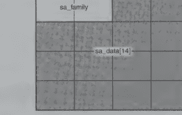

图 2.1：这是通用套接字地址布局的示意图。

> 通用套接字地址结构体本身对程序员来说并不是特别有用。然而，它确实提供了一个参考模型，所有其他地址结构体都必须符合该模型。例如，你将了解到所有地址必须在结构体的完全相同的位置定义`sa_family`成员，因为这个元素决定了如何解释地址的剩余字节。

## 构建本地地址

这种地址格式被用于本地于你的主机（运行 Linux 的个人电脑）的套接字。例如，当你使用`lpr(1)`命令排队打印文件时，它使用本地套接字与 PC 上的打印后台作业处理服务通信。虽然也可以将 TCP/IP 用于本地通信，但事实证明效率较低。

传统上，本地地址族被称为`AF_UNIX`域（例如，UNIX 套接字地址）。这是因为这些地址使用本地 UNIX 文件名作为套接字名称。Linux 内核 2.2.0 及更高版本支持抽象套接字名称，你很快就会了解到相关内容。

`AF_LOCAL`或`AF_UNIX`地址的结构体名称为`sockaddr_un`。要在 C 程序中包含该结构体的定义，需引入以下语句：

```c
#include <sys/un.h>
```

`sockaddr_un`结构体的一个示例如清单 2.2 所示。

### 清单 2.2：`sockaddr_un` 地址结构体

```c
struct sockaddr_un {
      sa_family_t  sun_family; /* 地址族 */
      char         sun_path[108]; /* 路径名 */
};
```

结构体成员`sun_family`必须被赋值`AF_LOCAL`或`AF_UNIX`（这些宏代表相同的值，尽管现在建议使用`AF_LOCAL`）。此值指示该结构体遵循`sockaddr_un`规则进行格式化。

结构体成员`sun_path[108]`包含一个有效的 UNIX 路径名。你会发现，字符数组末尾不需要`null`字节。

**注意**

请注意，`sockaddr_un`地址的总大小远大于通用地址结构体的 16 字节。如果在代码中处理多个地址族，请确保分配足够的存储以容纳`AF_LOCAL`/`AF_UNIX`地址。

在接下来的各节中，你将学习如何初始化`AF_LOCAL`地址并定义其长度。

**提示**

有关本地套接字地址的信息可在`unix(4)` man 手册页中找到。

## 构建传统本地地址

传统本地地址的名称空间是文件系统路径名。进程可以使用任何有效路径名为其本地套接字命名。然而，要使其有效，为套接字命名的进程必须有权访问路径名的所有目录组件，并且具有在指定目录中创建最终套接字对象的权限。图 2.2 展示了套接字`/dev/printer`的物理布局，你的系统中可能正在使用它。`lpd`打印守护进程监听此本地套接字地址。

| `sun_family` | `sun_path` |
| :--- | :--- |
| `AF_LOCAL` | `/dev/printer` |

图 2.2：这是`/dev/printer`的`AF_LOCAL`/`AF_UNIX`套接字地址。

请注意，前两个字节表示地址类型`AF_LOCAL`。其余字节是字符`/dev/printer`，没有空字节。现在，我们将把注意力转向初始化此类地址的 C 代码。

一些程序员喜欢在执行赋值操作之前将地址结构体完全初始化为零。这通常使用`memset(3)`函数完成，并且这很可能是一个好主意：

```c
struct sockaddr_un uaddr;
memset(&uaddr,0,sizeof(uaddr));
```

此函数调用会为你将地址结构体的所有字节清零。

## 注意

如果你正确初始化了强制要求的地址元素，那么将地址结构体清零并非必须。然而，它确实使调试更容易，因为它消除了可能残留的其他数据。

在本章中，使用`memset(3)`将地址结构体清零，以演示如何进行此操作。

清单 2.3 展示了一个小型 C 程序，该程序初始化`sockaddr_un`结构体，然后调用`netstat(1)`命令以证明其有效性。请记住，该程序调用了尚未介绍的`socket(2)`和`bind(2)`函数。`socket(2)`函数在第 4 章中详细讲解。`bind(2)`函数将在第 5 章“将地址绑定到套接字”中讲解。

### 清单 2.3：`af_unix.c`——将 `AF_LOCAL`/`AF_UNIX` 套接字地址初始化为 `/dev/printer`

```c
1:  /* af_unix.c:
2:   *
3:   * AF_UNIX 套接字示例：
4:   */
5:  #include <stdio.h>
6:  #include <unistd.h>
7:  #include <stdlib.h>
8:  #include <errno.h>
9:  #include <string.h>
10: #include <sys/types.h>
11: #include <sys/stat.h>
12: #include <sys/socket.h>
13: #include <sys/un.h>
14:
15: /*
16:  * 此函数报告错误
17:  * 并退出返回到 shell：
18:  */
19: static void
20: bail(const char *on_what) {
21:  perror(on_what);
22:  exit(1);
23: }
24:
25: int
26: main(int argc, char **argv, char **envp) {
27:  int z;             /* 状态返回码 */
28:  int sock_unix;     /* 套接字 */
29:  struct sockaddr_un adr_unix; /* AF_UNIX */
30:  int len_unix;      /* 长度 */
31:  const char ptn_unix[] /* 路径名 */
32:   = "/tmp/my_sock";
33:
34: /*
35:  * 创建一个 AF_UNIX（即 AF_LOCAL）套接字：
36:  */
37:  sock_unix = socket(AF_UNIX, SOCK_STREAM, 0);
38:
39:  if (sock_unix == -1)
40:   bail("socket()");
41:
42: /*
43:  * 在这里我们移除套接字的
44:  * 路径名，以防它来自
45:  * 之前的运行。忽略错误（它可能
46:  * 并不存在）。
```


*（未完）*

## 示例 2.3：续

```c
47: /*
48:     unlink(pth_unix);
49:
50:     /*
51:      * Form an AF_UNIX Address:
52:      */
53: memset(&adr_unix,0,sizeof adr_unix);
54:
55:     adr_unix.sun_family = AF_UNIX;
56:
57:     strncpy(adr_unix.sun_path,pth_unix,
58:             sizeof adr_unix.sun_path-1)
59:     [sizeof adr_unix.sun_path-1] = 0;
60:
61:     len_unix = SUN_LEN(&adr_unix);
62:
63:     /*
64:      * Now bind the address to the socket:
65:      */
66:     z = bind(sock_unix,
67:         (struct sockaddr *)&adr_unix,
68:         len_unix);
69:
70:     if ( z == -1 )
71:         bail("bind");
72:
73:     /*
74:      * Display all of our bound sockets:
75:      */
76:     system("netstat -pa -unix 2>/dev/null | "
77:            "sed -n '/Active UNIX,/Proto/p | "
78:            "/af_unix/p/");
79:
80:     /*
81:      * Close and unlink our socket path:
82:      */
83:     close(sock_unix);
84:     unlink(pth_unix);
85:
86:     return 0;
87: }
```

示例 2.3 中使用的步骤如下：

- 1. 变量 `sock_unix` 在第 28 行定义，用于保存创建套接字时的文件描述符。
- 2. 本地地址结构体在第 29 行定义，并命名为 `adr_unix`。程序将使用 `AF_LOCAL` 套接字地址填充此结构体。
- 3. 在第 37 行，通过调用 `socket(2)` 函数创建套接字。在第 39 行对错误进行测试，如有必要则报告错误。
- 4. 在第 48 行调用 `unlink(2)` 函数。由于 `AF_UNIX` 地址会创建一个文件系统对象，因此当不再需要时必须将其删除。该语句尝试删除该对象，以防在上次运行程序时未被删除。
- 5. 在第 53 行，将地址结构体 `adr_unix` 清零。
- 6. 在第 55 行，将地址族初始化为 `AF_UNIX`。
- 7. 第 57 行到第 59 行将路径名 `/tmp/my_sock` 复制到地址结构体中。此处使用的代码还将一个空字节放入结构体中，因为 Linux 提供的宏 `SUN_LEN()`（第 61 行）需要它。
- 8. 地址长度在第 61 行计算。本程序使用 Linux 提供的宏来计算此长度。然而，该宏要求 `adr_unix.sun_path[]` 结构体成员中存在以空字符结尾的字符串。
- 9. 调用函数 `bind(2)`（第 66 行到第 68 行）将形成的地址分配给在第 37 行创建的套接字。
- 10. 在第 76 行调用 `netstat(1)` 命令，以证明我们的地址已绑定到我们的套接字。
- 11. 在第 83 行关闭套接字。
- 12. 删除（`unlink`）在第 66 行调用 `bind(2)` 时为套接字创建的 UNIX 路径名。

在第 61 行使用 `SUN_LEN()` 宏分配给 `len_unix` 的长度不包括复制到 `adr_unix.sun_path[]` 字符数组中的那个空字节。然而，必须将该空字节放在那里，因为 `SUN_LEN()` 宏调用 `strlen(3)` 来计算 UNIX 路径名的字符串长度。

要编译并运行该程序，你可以利用提供的 `Makefile`。执行以下操作：

```bash
$ make af_unix
gcc -c -D_GNU_SOURCE -Wall af_unix.c
gcc af_unix.o -o af_unix
$
```

程序编译完成后，你可以简单地不加任何参数如下调用它：

```bash
$ ./af_unix
```

示例 2.4 展示了运行该命令时收到的输出的修改视图。


## 示例 2.4：af_unix 演示程序的输出

```bash
$ ./af_unix
Active UNIX domain sockets (servers and established)
Proto RefCnt Flags Type State I-Node PID/Program name Path
unix 0 [ ] STREAM 104129 000/af_unix /tmp/my_sock
$
```

示例 2.4 显示创建了一个类型为 `STREAM` (`SOCK_STREAM`) 的 `unix` 套接字，并且 `af_unix` 是创建它的程序的名称。在行的右端，你会看到套接字名称确实是预期的 `/tmp/my_sock`。

## 形成抽象本地地址

传统 `AF_UNIX` 套接字名称的一个烦恼之处在于总是涉及文件系统对象。这通常是不必要的且不便的。如果原始文件系统对象未被删除，并在调用 `bind(2)` 时使用了相同的名称，名称分配将失败。

Linux 内核版本 2.2 使得为本地套接字创建抽象名称成为可能。诀窍是将路径名的第一个字节设置为空字节。只有路径名中跟随在该第一个空字节之后的那些字节才成为抽象名称的一部分。


示例 2.5 展示了上一个程序的修改版本。该程序采取一些不同的步骤来创建抽象名称。

## 示例 2.5：af_unix2.c——创建具有抽象名称的 AF_LOCAL/AF_UNIX 套接字的程序


```c
/* af_unix2.c:
 *
 * AF_UNIX Socket Example:
 */

#include <stdio.h>
#include <unistd.h>
#include <stdlib.h>
#include <errno.h>
#include <string.h>
#include <sys/types.h>
#include <sys/stat.h>
#include <sys/socket.h>
#include <sys/un.h>

  /*
   * This function reports the error and
   * exits back to the shell:
   */
  static void
  bail(const char *on_what) {
     perror(on_what);
     exit(1);
  }

  int
  main(int argc,char **argv,char **envp) {
     int z;             /* Status return code */
     int sock_unix;    /* Socket  */
     struct sockaddr_un adr_unix;/* AF_UNIX */
     int len_unix;     /* Length */
     const char pth_unix[]       /* Abs. Name */
        = "Z*MY-SOCKET";

     /*
      * Create an AF_UNIX (aka AF_LOCAL) socket:
      */
     sock_unix = socket(AF_UNIX,SOCK_STREAM,0);

     if ( sock_unix == -1 )
        bail("socket()");

     /*
      * Form an AF_UNIX Address:
      */
     memset(&adr_unix,0,sizeof adr_unix);

     adr_unix.sun_family = AF_UNIX;

     strncpy(adr_unix.sun_path,PTH_UNIX,
            sizeof adr_unix.sun_path-1)
            [sizeof adr_unix.sun_path-1] = 0;

     len_unix = SUN_LEN(&adr_unix);

     /* Now make first byte null */
     adr_unix.sun_path[0] = 0;

     /*
      * Now bind the address to the socket:
      */
     z = bind(sock_unix,
         (struct sockaddr *)&adr_unix,
         len_unix);

     if ( z == -1 )
        bail("bind()");

     /*
      * Display all of our bound sockets:
      */
     system("netstat -pa -unix 2>/dev/null | "
            "sed -n '/Active UNIX,/Proto/p | "
            "/af_unix/p/");

     /*
      * Close and unlink our socket path:
      */
     close(sock_unix);
     return 0;
  }
```

要制作并运行示例 2.5 中的程序，请执行以下命令：

```bash
$ make af_unix2
gcc -c -D_GNU_SOURCE -Wall af_unix2.c
gcc af_unix2.o -o af_unix2
$ ./af_unix2
```

运行程序的输出如示例 2.6 所示。

### 示例 2.6：`af_unix2` 示例程序的输出

```bash
$ ./af_unix2
Active UNIX domain sockets (servers and established)
Proto RefCnt Flags   Type    State   I-Node PID/Program name Path
unix  0   STREAM  104143 5186/af_unix2     @*MY-SOCKET*
$
```

从示例 2.6 中，你可以看到套接字地址显示为名称 `@*MY-SOCKET*`。开头的 `@` 符号被 `netstat(1)` 用来表示抽象 UNIX 套接字名称。其余字符是复制到字符数组剩余部分的那些字符。请注意，`@` 字符出现在我们的占位符 `Z` 字符所在的位置（参见示例 2.5 中的第 32 行）。

总体程序步骤与示例 2.3 中较早的程序相同。然而，示例 2.5 中的地址初始化步骤略有不同。这些步骤将在下文描述：

1. 套接字的抽象名称在第 31 行和第 32 行中定义为字符串常量。请注意，该字符串的第一个字符是 `Z`。这个额外的字符只是该字符串中的一个占位符，因为它最终会在步骤 6 中被替换为 `null` 字节。

2. 结构的可选置零操作是通过在第 45 行调用 `memset(3)` 完成的。

3. 地址族在第 47 行被设置为 `AF_UNIX`。

4. 如前所述，使用 `strncpy(3)` 函数将抽象路径名复制到第 49 行的 `addr_unix.sun_path` 中。请再次注意，为了配合 Linux 的 `SUN_LEN()` 宏，终止 `null` 字节被放置到了目标字符数组中。否则，并不要求存在终止 `null` 字节。

5. 借助 Linux 提供的 `SUN_LEN()` C 宏，在第 53 行计算地址的长度。该宏会对 `sun_path[]` 调用 `strlen(3)`，因此必须存在终止 `null` 字节。

6. 这是新增加的一步：将 `sun_path[]` 数组的第一个字节设置为 `null` 字节。如果使用了 `SUN_LEN()` 宏（步骤 5），此步骤必须最后执行。

> **注意**
>
> 如果使用 Linux 提供的 `SUN_LEN()` 宏来计算抽象 `AF_LOCAL` 或 `AF_UNIX` 套接字地址的长度，请确保检查第一个字节尚未被设为 `null`。在计算出地址长度后，再将 `sun_path[0]` 字节设为 `null`；否则，计算出的长度将是错误的。

在本节中，您已经学习了创建 `AF_LOCAL` 和 `AF_UNIX` 套接字地址所需的相关知识。为了计算套接字地址的长度，您使用提供的 `SUN_LEN()` 宏。然而，在计算抽象套接字名称的长度时，必须格外小心。

## 构建 Internet (IPv4) 套接字地址

在 Linux 下最常用的地址族是 `AF_INET` 族。这为套接字提供了一个 IPv4 套接字地址，使其能够通过 TCP/IP 网络与其他主机进行通信。定义结构 `sockaddr_in` 的头文件由以下 C 语言语句指定：

```c
#include <netinet/in.h>
```

示例 2.7 展示了一个用于 Internet 地址的结构 `sockaddr_in` 的示例。由于 `sockaddr_in` 结构在其定义中使用了额外的结构 `in_addr`，因此也展示了该结构。

### 示例 2.7：`sockaddr_in` 结构

```c
struct sockaddr_in {
    sa_family_t      sin_family;   /* 地址族 */
    uint16_t         sin_port;     /* 端口号 */
    struct in_addr   sin_addr;     /* Internet 地址 */
    unsigned char    sin_zero[8];  /* 填充字节 */
};

struct in_addr {
    uint32_t s_addr;               /* Internet 地址 */
};
```


示例 2.7 可以描述如下：

- `sin_family` 成员占据与通用套接字定义中 `sa_family` 相同的存储区域。`sin_family` 的值被初始化为 `AF_INET` 的值。

- `sin_port` 成员定义套接字地址的 TCP/IP 端口号。此值必须为网络字节序（稍后将详细阐述）。

- `sin_addr` 成员被定义为结构 `in_addr`，其中保存了网络字节序下的 IP 号码。如果您查看结构 `in_addr`，会发现它由一个 32 位无符号整数组成。

- 最后，结构的其余部分通过成员 `sin_zero[8]` 填充 8 个字节，使总长度达到 16 字节。该成员不需要任何初始化，也不会被使用。

现在请将注意力转向图 2.3，以直观地了解地址的物理布局。

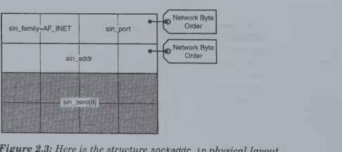

在图 2.3 中，可以看到 `sin_port` 成员使用两个字节，而 `sin_addr` 成员使用四个字节。这两个成员上都标有标签，表明这些值必须为网络字节序。

> **提示**
>
> 可以通过查阅 `ip(4)` 手册页获取有关 IPv4 Internet 地址的信息。

## 理解网络字节序

不同的 CPU 架构在将多个字节的数据组合在一起以形成 16 位、32 位或更多位的整数时，具有不同的排列方式。两种最基本的字节序是：

- 大端（big-endian）

- 小端（little-endian）

其他组合也是可能的，但这里无需考虑。图 2.4 展示了这两种不同字节序的一个简单示例。

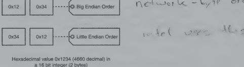

图 2.4 中所示的值为十进制数 4660，用十六进制表示为 0x1234。该值需要 2 个字节来表示。可以看出，您可以将最高有效字节放在前面（大端），或者将最低有效字节放在前面（小端）。这种选择相当任意，最终取决于 CPU 的设计。

您可能已经知道，Intel CPU 使用小端字节序。其他 CPU，如 Motorola 68000 系列使用大端字节序。这里要认识到重要的一点是，世界上存在这两种类型的 CPU，并且它们都连接到同一个 Internet。

如果 Motorola CPU 向网络写入一个 16 位数字，并被 Intel CPU 接收会发生什么？“休斯顿，我们有麻烦了！”对于 Intel CPU 来说，这些字节将被以相反的顺序解释，导致它看到的值为十六进制 0x3412。这是十进制数 13330，而不是 4660！

为了在网络中存在一致性，决定使用大端字节序作为网络上的字节序。只要通过网络通信的每条消息都遵循此序列，所有软件都能和谐地通信。

这就回到了 `AF_INET` 地址。TCP/IP 端口号（`sin_port`）和 IP 号码（`sin_addr`）必须为网络字节序。BSD 套接字接口要求您作为程序员在构建地址时考虑这一点。

## 执行字节序转换

提供了一些函数以简化字节序转换这项工作。需要考虑两个方向的转换：

- 从主机序到网络序

- 从网络序到主机序

“主机序”指的是您的 CPU 使用的字节序。对于 Intel CPU 来说，这意味着小端字节序。如前所述，网络序是大端字节序。

还有两类转换函数：

- 短（16 位）整数转换

- 长（32 位）整数转换

以下提供了您可用的转换函数概要：

```c
#include <netinet/in.h>

unsigned long htonl(unsigned long hostlong);

unsigned short htons(unsigned short hostshort);

unsigned long ntohl(unsigned long netlong);

unsigned short ntohs(unsigned short netshort);
```

> **提示**
>
> 这些函数都在 `byteorder(3)` 手册页中有描述。

> **注意**
>
> 在这些转换函数的上下文中，“short”指 16 位值，“long”指 32 位值。不要将这些术语与 C 数据类型可能不同的尺寸混淆。例如，在某些运行 Linux 的 CPU 上，long 数据类型可以是 64 位的长度。

使用这些函数非常简单。例如，要将短整数转换为网络序，可以使用以下代码：

```c
short host_short = 0x1234;
short netw_short;

netw_short = htons(host_short);
```

值 `netw_short` 将接收到转换为网络序后的适当值。要将值从网络序转换回主机序同样简单：

```c
host_short = ntohs(netw_short);
```

> **提示**
>
> 函数名称中的 h 代表“host（主机）”，而 n 代表“network（网络）”。同样，s 代表“short（短）”，l 代表“long（长）”。使用这些约定，选择所需的转换函数名称是一件简单的事情。

> **注意**
>
> 在某些系统上，`byteorder(3)` 函数可能实现为宏。在 CPU 使用大端字节序的 Linux 系统上，可能提供一个简单的宏，因为不需要对值进行转换。

## 初始化通配 Internet 地址

现在您准备好创建 Internet 地址了。此处展示的示例将请求使用通配（wild）地址。这通常发生在您连接到远程服务时。这样做的原因可能是您的主机拥有两个或更多网络接口卡，每个都有不同的 IP 号码。此外，Linux 还允许为每个接口分配多个 IP 号码。当您指定通配 IP 号码时，允许系统选择通往远程服务的路由。内核随后将在连接建立时确定您的最终本地套接字地址。

有时您也希望内核为您分配一个本地端口号。这可以通过将 `sin_port` 指定为值 `zero` 来完成。

图 2.8 中的示例代码演示了如何使用通配端口号和通配 IP 号来初始化一个 `AF_INET` 地址。

**列表 2.8：** 初始化一个 `IN_ADDR` any `AF_INET` 地址

```c
1: struct sockaddr_in adr_inet;
2: int adr_len;
3:
4: memset(adr_inet,0,sizeof adr_inet);
5:
6: adr_inet.sin_family = AF_INET;
7: adr_inet.sin_port = htons(0);
8: adr_inet.sin_addr.s_addr = ntohl(INADDR_ANY);
9: adr_len = sizeof adr_inet;
```

列表 2.8 中使用的步骤如下：

- 1. 使用结构体 `sockaddr_in` 定义值 `adr_inet`（第 1 行）。

- 2. 通过在第 4 行调用 `memset(3)` 将地址 `adr_inet` 清零。（这是可选的。）

- 3. 通过将值 `AF_INET` 分配给 `adr_inet.sin_family` 来建立地址族（第 6 行）。

- 4. 在第 7 行指定一个通配端口号。注意这里使用了函数 `htons(3)`。值零表示一个通配端口号。

- 5. 在第 8 行分配一个通配 IP 号。再次注意使用 `ntohl(3)` 函数进行字节序转换。

- 6. 地址的大小简单地计算为结构体 `adr_inet` 的大小（第 9 行）。

另一个常用的 IP 号是 `127.0.0.1`。这指的是回环设备。回环设备允许您与同一主机上的另一个进程进行通信。稍后您会看到这个 IP 号的更多用途。目前，只需注意下面如何分配该地址即可。列表 2.8 中的第 8 行可以更改为以下语句：

```c
adr_inet.sin_addr.s_addr = ntohl(INADDR_LOOPBACK);
```

这将通过回环设备寻址您当前的主机。在下一节中，您将学习如何设置任何 IP 号和端口号。

## 初始化特定的 Internet 地址

上一节处理了 `AF_INET` 地址的简单情况。当您需要建立特定的 IP 号时，情况会变得更加复杂。列表 2.9 显示了一个完整的程序列表，只需执行以下命令即可编译：

```bash
$ make af_inet
```

然后，只需通过名称 `af_inet` 调用编译后的程序即可。

**列表 2.9：** `af_inet.c`—建立特定的 `AF_INET` 地址


```c
1:  /* af_inet.c:
2:   *
3:   * Establishing a Specific AF_INET
4:   * Socket Addresses:
5:   */
6:
7:  #include <stdio.h>
8:  #include <unistd.h>
9:  #include <errno.h>
10: #include <string.h>
11: #include <sys/types.h>
12: #include <sys/stat.h>
13: #include <sys/socket.h>
14: #include <netinet/in.h>
15:
16: /*
17:  * This function reports the error and
18:  * exits back to the shell:
19:  */
20: static void
21: bail(const char *on_what) {
22:     perror(on_what);
23:     exit(1);
24: }
25:
26: int
27: main(int argc,char **argv,char **envp) {
28:     int z;                /* Status return code */
29:     int sock_inet;        /* Socket */
30:     struct sockaddr_in adr_inet; /* AF_INET */
31:     int len_inet;         /* length */
32:     const unsigned char IPno[] = {
33:         127, 0, 0, 23    /* Local loopback */
34:     };
35:
36:     /* Create an IPv4 Internet Socket */
37:     sock_inet = socket(AF_INET,SOCK_STREAM,0);
38:
39:     if ( sock_inet == -1 )
40:         bail("socket()");
41:
42:     /* Create an AF_INET address */
43:     memset(&adr_inet,0,sizeof adr_inet);
44:
45:       adr_inet.sin_family = AF_INET;
46:       adr_inet.sin_port = htons(9000);
47:       memcpy(&adr_inet.sin_addr.s_addr,IPno,4);
48:       len_inet = sizeof adr_inet;
49:
50:       /* Now bind the address to the socket */
51:       z = bind(sock_inet,
52:                (struct sockaddr *)&adr_inet,
53:                len_inet);
54:
55:       if ( z == -1 )
56:           bail("bind()" );
57:
58:       /* Display all of our bound sockets */
59:       system("netstat -pa --tcp 2>/dev/null | `sed -n '1,/Proto:/af_inet/p'");
60:
61:       close(sock_inet);
62:       return 0;
63:    }
```

此程序中使用的步骤与列表 `2.3` 和 `2.5` 中显示的其他步骤几乎相同。然而，第 `43` 到 `48` 行需要一些解释：

- `1.` 第 `30` 行使用名称 `adr_inet` 定义了 `sockaddr_in` 结构体。此外，套接字地址长度在第 `31` 行定义为整数 `len_inet`。
- `2.` 在第 `32` 和 `33` 行中，定义了一个无符号字符数组 `IPno[4]`。在这里，单独的字节拼出了一个特定的 IP 地址 `127.0.0.23`。
- `3.` 第 `43` 行像往常一样将 `adr_inet` 清零。注意，这再次是可选的。
- `4.` 第 `45` 行将地址族建立为 `AF_INET`。
- `5.` 此示例选择在第 `46` 行建立 TCP/IP 端口号 `9000`。注意第 `46` 行中使用了转换函数 `htons(3)`。
- `6.` 字符数组 `IPno[4]` 被复制到第 `47` 行的位置 `adr_inet.sin_addr.s_addr`。由于字节在步骤 `2` 中已定义为网络序，因此这里不需要字节序转换。您会记得，网络字节序中最高有效字节在前。
- `7.` 地址结构的大小像以前一样计算（第 `48` 行）。

您可能已经注意到 Internet 地址具有固定长度。如果您查看图 `2.3`，这一点显而易见。然而，您会记得 `AF_LOCAL` 地址的长度是可变长度（参见图 `2.2`）。对于 `AF_INET` 地址，您只需提供套接字结构体 `sockaddr_in` 的大小即可。用 C 语言术语来说，这就是

```c
sizeof(struct sockaddr_in)
```

现在，您应该已经具备了构建 Internet IPv4 地址的能力。为了拓宽您在套接字寻址方面的知识，接下来的章节将向您展示如何指定其他一些地址族。

## 指定 X.25 地址

套接字接口允许程序员在 Linux 下使用其他协议，且几乎不需要付出努力。代码中唯一的主要不同之处在于套接字的寻址方式。您已经看到了 `AF_LOCAL` 和 `AF_INET` 地址所需的初始化。`X.25` 地址的创建非常相似。

用于定义 `X.25` 协议地址的结构体是 `sockaddr_x25` 结构体。定义该结构体的包含语句如下：

```c
#include <linux/x25.h>
```

列表 `2.10` 显示了 `AF_X25` 地址族的套接字地址结构体。


**列表 2.10：X.25 套接字地址结构体**

```c
struct sockaddr_x25 {
    sa_family_t sx25_family; /* Must be AF_X25 */
    x25_address sx25_addr; /* X.121 Address */
};

typedef struct {
    char x25_addr[16];
} x25_address;
```

您会注意到，同样地，成员 `sx25_family` 占据了通用套接字结构的前两个字节。对于此地址，它必须具有值 `AF_X25`。

**提示**

> 有关 `X.25` 套接字地址的信息可以在 `x25(4)` 手册页中找到。

`X.25` 网络地址（由 `X.121` 标准定义此地址）由一系列十进制数字组成。程序 `af_x25.c` 已提供，以向您展示如何建立 `X.25` 地址并让 `netstat(1)` 显示它。列表 `2.11` 显示了程序列表。

**示例**

**列表 2.11：** `af_x25.c`—建立 `X.25` 协议地址


```c
1: /* af_x25.c:
2:  *
3:  * X.25 Socket Address Example:
4:  *
5:  */
6: #include <stdio.h>
7: #include <unistd.h>
8: #include <stdlib.h>
9: #include <errno.h>
10: #include <string.h>
11: #include <sys/types.h>
12: #include <sys/socket.h>
13: #include <linux/x25.h>
14:
15: /*
16:  * This function reports the error and
17:  * exits back to the shell:
18: */
19: static void
20: bail(const char *on_what) {
21:     perror(on_what);
22:     exit(1);
23: }
24:
25: int
26: main(int argc, char **argv, char **envp) {
27:     int z;              /* Status return code */
28:     int sock_x25;      /* Socket */
29:     struct sockaddr_x25 adr_x25;  /* AF_X25 */
30:     int len_x25;       /* length */
31:     const char x25_host[]  /* X.121 addr */
32:         = "79400090";
33:
34:     /* Create an AF_X25 socket */
35:     sock_x25 = socket(AF_X25, SOCK_SEQPACKET, 0);
36:
37:     if ( sock_x25 == -1 )
38:         bail("socket()");
39:
40:     /* Form an AF_X25 Address */
41:     adr_x25.sx25_family = AF_X25;
42:     strcpy(adr_x25.sx25_addr.x25_addr, x25_host);
43:     len_x25 = sizeof adr_x25;
44:
45:     /* Bind the address to the socket */
46:     z = bind(sock_x25,
```

要编译列表 2.11 中的程序，请执行以下操作：

```
$ make af_x25
```

> **注意**

> 如果您的内核未编译 X.25 支持，运行列表 2.11 中的程序将不会成功。如果您想对该协议进行实验，请务必启用 X.25 支持。要启用 X.25 支持，您必须配置并重新编译您的 Linux 内核。

建立地址的代码包含以下基本步骤：

1.  在第 29 行中使用 `sockaddr_x25` 结构体定义 `adr_x25`。在第 30 行中，长度变量 `len_x25` 被定义为 `int`。

2.  在第 31 和 32 行中，定义了字符数组常量 `x25_host[]`，作为要建立连接的目标 X.25 地址。

3.  在第 41 行中，地址族被指定为 `AF_X25`。

4.  在第 42 行中，主机地址编号被复制到地址结构中，并以空字节（null byte）结尾。

5.  在第 43 行中，`sockaddr_x25` 结构的长度是适用于当前 Linux 实现的正确长度。

请注意，这次程序没有调用 `netstat(1)`。这是因为 `netstat(1)` 目前不报告 `AF_X25` 套接字。相反，示例程序使用 `cat(1)` 将 `/proc/net/x25` 的内容复制到标准输出。然而，要成功执行此操作，您必须在内核中编译了 `proc` 文件系统支持（这已是标准做法）。

> **注意**

> 通常，具有可变元素的套接字地址（如 `AF_UNIX` 地址族）需要计算变量的长度。但是，Linux 的 `AF_X25` 套接字地址实现只需要 `sizeof(sockaddr_x25)` 的固定长度。主机编号必须在 `sockaddr_x25` 结构内部以空字符结尾。

运行程序 `af_x25` 将产生如下所示的结果，详见列表 2.12。

### 列表 2.12：`af_x25` 程序的输出

```
$ ./af_x25
X.25 SOCKETS :
dest_addr  src_addr  dev lci  st vs vr  va   t  t2  t21  t22 t23 Snd-Rcv-Q inode
         79400900 7?? 000 0    0  0   0 3 200  180  180     0 0 @14172
$ 
```

在列表 2.12 的程序输出中，您可以看到主机编号 `79400900` 列在 `src_addr` 列标题下。

## 指定其他地址族

本书的范围不允许全面涵盖 Linux 支持的所有地址族。支持的协议列表每年都在变长。如果您正在寻找 TCP/IP 编程的快速入门路径，您可以跳过此部分并直接进入下一节。

在本节中，您将简要阅读几个可能对您感兴趣的其他协议。本节旨在作为通往其他感兴趣领域的路线图，如果您想进行一些探索的话。

Linux 至少还可以支持另外三个地址族。它们是：

- `AF_INET6`——IPv6，目前仍在开发中

- `AF_AX25`——业余无线电 AX.25 协议

- `AF_APPLETALK`——Linux AppleTalk 协议实现

这些协议中的每一个都要求您在内核中编译相应的支持。其中一些协议可能不是完整的实现——程序员请谨慎！不完整或实验性的协议可能会有 bug，有时甚至会导致您的系统崩溃。

> **提示**

> `AF_APPLETALK` 地址族在 `ddp(4)` 手册页中有文档说明。

列表 2.13 展示了这些其他套接字地址族的一些重要 C 结构体。这些结构体将帮助您可视化在为所选协议创建地址时必须初始化的地址组件。

### 列表 2.13：其他地址族结构体

```
/*
 * IPv6 Address (AF_INET6):
 */

struct sockaddr_in6 {
    sa_family_t sin6_family;
    uint16_t sin6_port; /* port */
    uint32_t sin6_flowinfo; /* flow info */
    struct in6_addr sin6_addr; /* IPv6 address */
};

struct in6_addr {
    union {
        uint8_t u6_addr8[16];
        uint16_t u6_addr16[8];
        uint32_t u6_addr32[4];
    } in6_u;
};

/*
* Amateur Radio AX.25 Address (AF_AX25):
*/
struct full_sockaddr_ax25 {
    struct sockaddr_ax25 fsa_ax25;
    ax25_address fsa_digipeater[AX25_MAX_DIGIS];
};

struct sockaddr_ax25 {
    sa_family_t sax25_family;
    ax25_address sax25_call;
    int sax25_ndigis;
};

typedef struct { /* 6 call + SSDI (shifted ascii) */
    char ax25_call[7];
} ax25_address;

#define sax25_uid sax25_ndigis

/*
* AppleTalk Address (AF_APPLETALK):
*/
struct sockaddr_atalk {
    sa_family_t sat_family; /* addr family */
    u_char sat_port; /* port */
    struct at_addr sat_addr; /* net/node */
};

struct at_addr {
    u_short s_net;
    u_char s_node;
};
```

完全解决初始化这些不同协议的步骤需要对底层协议本身有一定的了解。这超出了本书此时您想要完成的目标范围。

但是，如果您想进一步实验 `AF_AX25` 族，源文件 `af_ax25.c` 中还有一个可用于此目的的程序。使用本书相关网站提供的 `Makefile`，您可以按如下方式编译它：

```
$ make af_ax25
gcc -c -D_GNU_SOURCE -Wall af_ax25.c
gcc af_ax25.o -o af_ax25
$
```

> **注意**


> 本书的所有源代码和 `make` 文件都提供在以下网址：`http://www.quecorp.com/series/by_example`

要运行此程序，必须满足以下条件：

1. 您的内核已编译了业余无线电 `AX.25` 支持。

2. 您可能需要一个 `AX.25` 兼容接口来建立套接字名称。请参见下文说明。

3. 如果满足条件二，并且您没有 `AX.25` 接口，您可以通过在以太网设备上使用 `BPQ` 设备来满足此要求。请参见说明后的说明。

> **注意**
>
> 作者发现，即使系统中没有 `AX.25` 接口，程序 `af_ax25` 也可以调用 `bind(3)` 并建立 `AF_AX25` 地址（使用 `Red Hat Linux 6.0`，内核 `2.2.10`）。但是，这取决于您拥有的内核版本，并且可能会发生变化。

如果您需要一个 `AX.25` 设备，无论是为了运行 `af_ax25` 程序还是进行进一步的网络编程实验，如果您已经有一个以太网接口，您可以建立一个 `BPQ` 接口。要检查，请执行以下操作：

```
$ netstat -i

Kernel Interface table
Iface  MTU Met  RX-OK RX-ERR RX-DRP RX-OVR    TX-OK TX-ERR TX-DRP TX-OVR Flg
eth0    1500 0   81764    0     0     0     51634     0     0     0 BRU
lo      3924 0   16969    0     0     0     16969     0     0     0 LRU
$
```

在显示的列表中，`eth0` 代表一个以太网接口。如果您的内核编译了 `BPQ` 支持，您可以按如下方式创建一个 `BPQ` 设备：

```
su -
Password:
# ifconfig bpq0 hw ax25 VE3WWG-5 up
```

然后，您可以检查接口的状态，如下所示列表 2.14。

### 列表 2.14：检查 `bpq0` 的接口状态


```
# ifconfig
bpq0 Link encap:AMPR AX.25 HWaddr VE3WWG-5
UP RUNNING MTU:256 Metric:1
RX packets:0 errors:0 dropped:0 overruns:0 frame:0
TX packets:0 errors:0 dropped:0 overruns:0 carrier:0
collisions:0 txqueuelen:0

eth0 Link encap:Ethernet HWaddr 00:A0:4B:06:F4:8D
inet addr:192.168.0.1 Bcast:192.168.0.255 Mask:255.255.255.0
UP BROADCAST RUNNING PROMISC MULTICAST MTU:1500 Metric:1
RX packets:10945 errors:0 dropped:0 overruns:0 frame:100
TX packets:4959 errors:0 dropped:0 overruns:0 carrier:0
collisions:0 txqueuelen:100
Interrupt:9 Base address:0x0400
```

`bpq0` 接口是一个伪设备，因为它与真实设备 `eth0` 进行交互。然而，这种技巧允许您在不使用任何分组无线电硬件的情况下实验 `AX.25` 无线电协议。在列表 2.14 的输出中，您可以看到 `bpq0` 接口已启动，其硬件 `AX.25` 地址为 `VE3WWG-5`。

### `AF_UNSPEC` 地址族

C 宏 `AF_UNSPEC` 代表未指定的地址族。这看起来可能是一个相当无用的宏，但它确实有其用途。如果您编写一个必须与许多不同协议和地址族一起工作的程序，那么您需要一种方式来指示未指定的地址族。考虑列表 2.15 中不同地址族的联合。


### 列表 2.15：地址族的联合

```
union {
    sockaddr sa;
    sockaddr_un un;
    sockaddr_in in;
    sockaddr_in6 in6;
    sockaddr_x25 x25;
    full_sockaddr_ax25 ax25;
    sockaddr_atalk at;
};
```

在向此联合体中放入任何值之前，您的 C 程序可能会按如下所示初始化该联合体：

```
u.sa.sa_family = AF_UNSPEC;
```

稍后在程序中，当您准备将此联合体设置为 `AF_INET` 地址时，您将使用：

```
u.in.sin_family = AF_INET;
```

当尚不知道地址族为何时，`AF_UNSPEC` 充当您的安全占位符。

# 接下来是什么

套接字寻址是套接字编程中最杂乱的部分，但现在这一切都已过去。通过您练习过的示例，您现在已知如何应用本地地址、Internet 地址以及其他一些地址。您了解到每个地址结构都必须存储其对应的地址族常量（例如 `AF_INET`）。

在本章中，您了解到 `AF_INET` 地址对于 `sin_port` 和 `sin_addr` 成员中的网络字节序很敏感。您已掌握使用 `byteorder(3)` 转换函数来解决此问题。

您还看到每个地址族在建立地址本身和地址长度方面都有其独特之处。因此，本章将继续作为您的参考资料。

在下一章中，您将基于已学到的网络地址概念进行扩展，并介绍为您处理地址的新库函数。

# 地址转换函数

在上一章中，您学习了如何分配和初始化各种类型的套接字地址。这些都是从常量初始化的简单情况。从带有可变地址的 C 字符串设置地址需要更多的编程工作。在本章中，您将专注于与建立 Internet 地址相关的附加问题，并了解在此领域可以助您一臂之力的函数。

在本章中，您将学习：

- Internet 地址的类别
- `IP` 网络掩码
- 私有和保留的 `IP` 号码
- 转换 `IP` 号码的函数

不过，在开始之前，现在是复习 `IP` 地址设计的好时机。这样，您将对即将面临的挑战有更深的洞察。


# Internet `IP` 号码

`IP` 号码由四个十进制值组成，这些值由小数点分隔，通常称为“点”。这种约定通常被称为*点分四段*表示法，有时也称为*点分十进制*表示法。每个十进制字节代表网络字节序中一个字节的无符号值。请记住，网络字节序要求最高有效字节首先出现。

每个字节被视为无符号的 8 位值。这将每个字节限制在 0 到 255 的十进制值范围内。由于值是无符号的，因此值不能为负数，也不允许使用加号。以地址 `192.168.0.1` 为例，您知道网络字节序中的第一个字节必须具有十进制值 192。

当您在电影屏幕上看到类似 `192.168.300.5` 的 `IP` 号码时，您知道制片人对 `TCP/IP` 网络的了解非常有限！尽管该 `IP` 号码在语法上是正确的，但十进制值 300 显然超过了最大无符号值 255。

稍后，从“操作 `IP` 号码”部分开始，您将查看能够解析 C 字符串为网络地址字节并对十进制值进行范围检查的函数。

# Internet 地址类别

Internet 地址由两个组件组成：

- 网络号（最高有效位）
- 主机号（最低有效位）

网络号标识可以联系到主机的网络。主机号标识该特定网络中的某一个主机（例如您的 `PC`）。

如您所知，`IP` 号码是一个 32 位值（或四个 8 位字节）。然而，网络地址和主机号组件之间的划分位置不是固定的。分界线取决于地址的分类，这通过检查地址的最高有效字节来确定。表 3.1 总结了 `IP` 号码的分类方式。

表 3.1: Internet 地址类别

| 类别 | 最低 | 最高 | 网络位 | 主机位 |
| :--- | :--- | :--- | :--- | :--- |
| A | 0.0.0.0 | 127.255.255.255 | 7 | 24 |
| B | 128.0.0.0 | 191.255.255.255 | 14 | 16 |
| C | 192.0.0.0 | 223.255.255.255 | 21 | 8 |
| D | 224.0.0.0 | 239.255.255.255 | 28 | N/A |
| E | 240.0.0.0 | 247.255.255.255 | 27 | N/A |

A 类、B 类和 C 类定义了主机的特定 `IP` 地址。对于 D 类和 E 类地址，地址中可用的主机位数为零。D 类地址用于多播，其中 28 位用于描述多播组。E 类地址的 27 位是保留的。

图 3.1 帮助您直观理解 32 位 `IP` 地址的分解。图中显示了常用的 A、B 和 C 类。


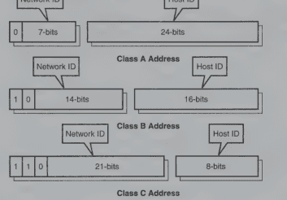

> **图 3.1:** 此图说明了 Internet 地址类别 A、B 和 C。

## 理解网络掩码值

在某些情况下，您必须确定地址的*网络掩码*值。如果您正在设置自己的网络，这一点尤其正确。那么，网络掩码值到底是什么？

如果您将 Internet IP 地址视为一个 32 位数字，那么您知道网络 ID 由地址的最高有效位指定。此外，主机 ID 由同一地址的最低有效位指定（如有必要，请回顾图 3.1）。网络掩码仅仅是您将与地址进行“按位与”运算以仅保留网络 ID 的值。图 3.2 说明了如何将 IP 地址 `192.168.9.1` 进行掩码处理以仅提取网络 ID 位。

> **提示**
>
> 您经常听到人们互换使用*网络*和*子网*这两个术语。从技术上讲，这些术语代表两个明显不同的网络 ID 值。网络 ID 标识真正的网络 ID 编号。

然而，在一个 IPv4 号码中，可以进一步细分主机 ID，从而在主机 ID 的最高有效位留下子网络 ID，并在最低有效位留下最终的主机 ID。当使用子网划分时，网络掩码值将考虑这些额外的子网络 ID 位。

因此，当使用子网划分时，网络掩码将与本章中介绍的不同。

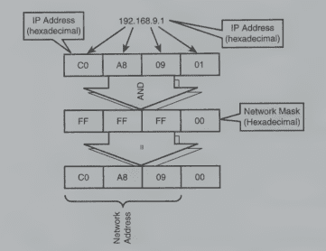

*图 3.2: 将网络掩码应用于 `192.168.9.1` 可得到网络地址。*

结果最高有效位代表 IP 地址的网络部分，不包括主机 ID。图 3.3 说明了如何将网络掩码从十六进制转换回点分四段表示法。

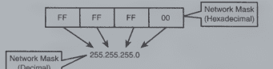

*图 3.3: 这是以点分四段表示法表示的网络掩码。*

如果您必须设置自己的 IP 网络，则需要确定网络掩码值应为何值。表 3.2 列出了 A 类、B 类和 C 类地址的网络掩码值。

### 表 3.2: 按 IP 类别划分的网络掩码值

| 类别 | 最低 | 最高 | 网络掩码 |
| :--- | :--- | :--- | :--- |
| A | 0.0.0.0 | 127.255.255.255 | 255.0.0.0 |
| B | 128.0.0.0 | 191.255.255.255 | 255.255.0.0 |
| C | 192.0.0.0 | 223.255.255.255 | 255.255.255.0 |

有时，在网络软件中，您的软件必须能够分类网络地址。有时这样做只是为了确定默认的网络掩码值。

列表 3.1 提供了一个简短的程序，说明了如何从套接字地址开始分类 IP 地址。要编译和运行提供的源代码，请执行以下操作：

```bash
$ make netmask
gcc -c -D_GNU_SOURCE -Wall netmask.c
gcc netmask.o -o netmask
$ ./netmask
```

列表 3.1 中的程序在一个 Internet 套接字地址结构中设置四个不同的 IP 地址。然后，地址被检查并分类。这样做是为了演示如何分类已连接到您的服务器的远程客户端的 IP 地址。

### 列表 3.1: `netmask.c`--分类和确定网络掩码

```c
1:  /* netmask.c:
2:      *
3:      * Classify an IP address:
4:      */

5:  #include <stdio.h>
6:  #include <unistd.h>
7:  #include <stdlib.h>
8:  #include <sys/types.h>
9:  #include <sys/socket.h>
10: #include <netinet/in.h>

11:
12: int
13: main(int argc, char **argv) {
14:     int x;                    /* Index variable */
15:     struct sockaddr_in adr_inet;  /* AF_INET */
16:     int len_inet;             /* length */
17:     unsigned msb;  /* Most significant byte */
18:     char class;
19:     char *netmask;
20:     static struct {
21:         unsigned char  ip[4];
22:     } addresses[] = {
```

示例

```c
Listing 3.1: continued
23:     { { 44,135,86,12 } },
24:     { { 127,0,0,1 } },
25:     { { 172,16,23,85 } },
26:     { { 192,168,9,1 } }
27: };
28:
29: for ( x=0; x<4; ++x ) {
30:    /*
31:     * Set up the socket address, to
32:     * demonstrate how to classify it:
33:     */
34:    memset(&adr_inet,0,sizeof adr_inet);
35:    adr_inet.sin_family = AF_INET;
36:    adr_inet.sin_port = htons(9000);
37:    memcpy(&adr_inet.sin_addr.s_addr,
38:           addresses[x].ip,4);
39:    len_inet = sizeof adr_inet;
40:
41:    /*
42:     * Classify this address:
43:     *
44:     * 1. Get the Most Significant Byte
45:     * 2. Classify by that byte
46:     */
47:    msb = *(unsigned char *)
48:           &adr_inet.sin_addr.s_addr;
49:
50:    if ( (msb & 0x80) == 0x00 ) {
51:       class = 'A';
52:       netmask = "255.0.0.0";
53:    } else if ( (msb & 0xC0) == 0x80 ) {
54:       class = 'B';
55:       netmask = "255.255.0.0";
56:    } else if ( (msb & 0xE0) == 0xC0 ) {
57:       class = 'C';
58:       netmask = "255.255.255.0";
59:    } else if ( (msb & 0xF0) == 0xE0 ) {
60:       class = 'D';
61:       netmask = "255.255.255.255";
62:    } else {
63:       class = 'E';
64:       netmask = "255.255.255.255";
65:    }
66:
67:    printf("Address %u.%u.%u.%u is class %c "
68:           "netmask %s\n",
69:           addresses[x].ip[0],
70:           addresses[x].ip[1],
71:           addresses[x].ip[2],
72:           addresses[x].ip[3],
73:           class,
74:           netmask);
75: }
76: ;
77: return 0;
78: ;
```

该演示程序的操作可以总结为以下步骤：

1. 套接字地址结构 `adr_inet` 在第 15 行定义。这将是用于检查分类的地址。
2. 要测试的地址定义在一个静态结构数组中，定义于第 20 至 27 行。您可能希望在第 23 至 26 行尝试其他地址数值进行实验。
3. 第 29 行开始一个循环，该循环将遍历 `addresses` 数组中的四个条目。下标值将是变量 `x`。
4. 套接字地址在第 34 至 39 行从 `addresses[x]` 初始化。这与上一章中介绍的方式相同，您现在应该对此很熟悉。
5. 第 47 行从套接字地址 `adr_inet` 中提取最高有效字节。请记住，最高有效字节是地址的第一个字节，采用网络字节序（大端序）。提取该字节后，可以根据该字节的高位对该地址进行分类。


- 第 50 行的 `if` 语句测试最高位是否为零（请回顾图 3.1，查看 A 类地址）。如果最高位为零，则知道这是一个 A 类地址（执行第 51 和 52 行）。

- 第 53 行的 `if` 语句测试最高位是否为 `1`，且次高位是否为 `0`（请回顾图 3.1 中的 B 类地址）。如果此条件为真，则第 54 和 55 行的语句将该地址分类为 B 类。

- 第 56 行的 `if` 语句测试最高的两位是否为 `11`（二进制），后跟一个 `0` 位。如果此条件为真，则第 57 和 58 行将该地址分类为 C 类地址（请回顾图 3.1 中的 C 类地址）。

- 第 59 行的 `if` 语句测试最高位模式是否为 `1110`。这将导致地址被分类为 D 类地址。注意对于 D 类和 E 类，子网掩码设置为 `255.255.255.255`，因为整个地址都是网络地址。

- 第 62 行的 `else` 语句将剩余的所有情况评估为 E 类地址，并将子网掩码也设置为 `255.255.255.255`（参见步骤 9）。

- 分类结果在第 67 至 74 行报告。

列表 3.2 显示了运行该演示程序后产生的输出。


```
Listing 3.2: The Output of the netmask.c Demonstration Program

$ ./netmask
Address 44.135.86.12 is class A netmask 255.0.0.0
Address 127.0.0.1 is class A netmask 255.0.0.0
Address 172.16.23.95 is class B netmask 255.255.0.0
Address 192.168.9.1 is Class C netmask 255.255.255.0
$
```

通过列表 3.1 中展示的示例代码，您将准备好对必须处理的任何 IP 号码进行分类。

当您的注意力仍然集中在 IP 号码上时，现在是涵盖私有 IP 号码分配的好时机。如果您决定建立自己的私有网络，将使用这些地址。

## 分配 IP 地址

您在上一节中学习了 Internet 地址是如何分类的。IP 地址由一个名为 InterNIC 的组织分配给各个个人和团体。然而，某些 IP 地址范围已被保留用于私有使用，还有一些保留用于特殊用途。

## 私有 IP 号码

通常，IP 号码必须由 InterNIC 在 `rs.internic.net` 处注册。（在 1993 年 4 月 1 日之前，这是由 NIC 在 `nic.ddn.mil` 处理的。）但是，如果您的系统不直接连接到 Internet，则不需要拥有全局唯一地址。您可以使用“私有”IP 号码代替。

那么，随之而来的第一个问题就是“我应使用哪些 IP 号码？”本节旨在帮助您做出该决定，并作为未来的参考指南。

`RFC 1597` 是一个 Internet 标准文档，描述了如何分配私有 IP 号码。表 3.3 为您提供了一个快速摘要，包括子网掩码值。

**表 3.3：私有 IP 号码分配**

| 类别 | 最低值 | 最高值 | 子网掩码 |
|---|---|---|---|
| A | `10.0.0.0` | `10.255.255.255` | `255.0.0.0` |
| B | `172.16.0.0` | `172.31.255.255` | `255.255.0.0` |
| C | `192.168.0.0` | `192.168.255.255` | `255.255.255.0` |

您选择 A、B 或 C 类 IP 号码系列将主要取决于您计划建立的独立网络和主机数量。如果网络和主机的总数较少，则 C 类地址可能就足够了。或者，A 类地址允许一个网络（不使用子网划分），但支持非常大的主机总数。B 类提供了大量的网络和主机。

### 保留 IP 号码

有大量保留的 IP 号码，这些块在 `RFC 1166` 中列出。作为一个保留号码系列的例子，表 3.4 展示了业余无线电 IP 号码系列。这些用于使用 Internet 协议在分组无线电设备上操作无线电的业余无线电操作员。现在，随着 `AX.25` 协议集成到 Linux 内核中（自 `2.2.0` 版本起），可以确定将有更多无线电爱好者使用这些 IP 号码！

**表 3.4：业余无线电保留 IP 号码**

| 类别 | 最低值 | 最高值 | 子网掩码 |
|---|---|---|---|
| A | `44.0.0.0` | `44.255.255.255` | `255.0.0.0` |

至此，您对 IP 号码的介绍已接近尾声。现在，是时候将您对套接字地址和 IP 号码的知识应用于 Linux 提供的简化 IP 地址转换功能的函数了。

### 操作 IP 号码

为了减轻将字符串形式的 IP 号码转换为可用套接字地址的编程负担，提供了一系列转换函数。这些及其他有用函数将在以下部分中介绍。

#### 使用 `inet_addr(3)` 函数

您将学习的第一个函数是一个较旧的函数，在新代码中可能不应再使用。但是，您会在很多现有的网络代码中找到它，因此您应该熟悉它并了解其局限性。

`inet_addr(3)` 的概要如下：

```c
#include <sys/socket.h>
#include <netinet/in.h>
#include <arpa/inet.h>

unsigned long inet_addr(const char *string);
```

该函数接受输入 C 字符串参数 `string`，并将点分四元组表示法解析为 32 位 Internet 地址值。返回的 32 位值处于网络字节序。

如果输入参数 `string` 不代表有效的点分四元组地址，则返回 `INADDR_NONE`。返回的任何其他值都表示转换后的值。

**注意**

`inet_addr(3)` 返回的 32 位值处于网络字节序。不要对返回值使用 `htonl(3)`，因为它已经是网络字节序。

**警告**

`inet_addr(3)` 在返回 `INADDR_NONE` 时不会在 `errno` 中建立原因代码。因此，当此函数返回错误指示时，不要测试 `errno` 或报告它。

列表 3.3 中显示的 `program` 是该函数使用方法的示例。要编译并运行该程序，请执行以下操作：

```
$ make inetaddr
$ gcc -c -D_GNU_SOURCE -Wall inetaddr.c
$ gcc inetaddr.o -o inetaddr
$ ./inetaddr
```

列表 3.3 中的程序在运行时，将包含 IP 号码的 C 字符串常量转换为网络序列化的 32 位 IP 地址。然后，该值被放入 `AF_INET` 套接字地址并绑定到套接字。


```
Listing 3.3: inetaddr.c—Example Program Using inet_addr(3)

1:  /* inetaddr.c:
2:  *
3:  * Example using inet_addr(3):
4:  */
5:  #include <stdio.h>
6:  #include <unistd.h>
7:  #include <stdlib.h>
8:  #include <errno.h>
9: #include <string.h>
10: #include <sys/types.h>
11: #include <sys/socket.h>
12: #include <netinet/in.h>
13: #include <arpa/inet.h>
14:
15: /*
16: * 此函数报告错误并
17: * 退出返回到 shell：
18: */
19: static void
20: bail(const char *on_what) {
21: fputs(on_what,stderr);
22: fput('\n',stderr);
23: exit(1);
24: }
25:
26: int
27: main(int argc,char **argv) {
28: int z;
29: struct sockaddr_in adr_inet;/* AF_INET */
30: int len_inet; /* 长度 */
31: int sck_inet; /* 套接字 */
32:
33: /* 创建套接字 */
34: sck_inet = socket(AF_INET,SOCK_STREAM,0);
35:
36: if ( sck_inet == -1 )
37: bail("socket():
38:
39: /* 建立地址 */
40: memset(adr_inet,0,sizeof adr_inet);
41:
42: adr_inet.sin_family = AF_INET;
```


```c
43: adr_inet.sin_port = htons(9000);

44:

45: adr_inet.sin_addr.s_addr =

46: inet_addr("127.0.0.85");

47:

48: if ( adr_inet.sin_addr.s_addr == INADDR_NONE )

49: bail("bad address.");

50:

51: len_inet = sizeof adr_inet;

52:

53: /* 将其绑定到套接字 */

54: z = bind(sck_inet,

55:         (struct sockaddr *)&adr_inet,

56:                 len_inet);

57:

58:         if ( z == -1 )

59:                 bail('bind()');

60:

61:         /* 显示我们的套接字地址 */

62:         system("netstat -pa --tcp 2>/dev/null|"

63:                 "| grep inetaddr");

64:

65:         return 0;

66: }
```

**注意**

如果你系统上的`netstat(1)`命令不支持清单 3.3 中第 62 行和第 63 行使用的选项，且你已安装`lsof`，请替换为以下调用：

```c
system("lsof -i tcp | grep inetaddr");
```

该程序的整体结构与前一章中使用的结构非常相似。然而，用于设置套接字地址的步骤略有不同。它们包括：

1. 套接字地址结构在第 40 行被清零。这是一个可选步骤，但许多人发现这在必要时有助于调试。
2. 地址族在第 42 行被建立为`AF_INET`。
3. 在此示例中，端口号已确立为 9000 端口（第 43 行）。
4. 在第 46 行调用函数`inet_addr(3)`，将字符串常量 `"127.0.0.95"` 转换为网络 32 位地址。该值存储在套接字地址成员`adr_inet.sin_addr.s_addr`中。
5. 对第 4 步中转换返回的值进行测试，查看它是否与第 48 行中的`INADDR_NONE`值匹配。如果匹配，这表明在 C 字符串中提供的值不是一个有效的 Internet IP 号（如果发生这种情况，程序将在第 49 行退出）。
6. 最后，套接字地址的长度如前所述在第 51 行中确立。

上述步骤已在变量`adr_inet`中建立了套接字地址。这将在第 54 行传递给`bind(2)`，后者尚未覆盖。`bind(3)`调用只是将该地址应用于套接字（完整的讨论将暂时推迟）。

使用`inet_addr(3)`函数完成的重要事情是，你免于执行对所有输入 IP 号的解析和测试。

#### 提示

避免在新程序中使用`inet_addr(3)`。改为使用函数`inet_aton(3)`。

`inet_addr(3)`函数有一个局限性，即如果输入参数是无效的 IP 号，它会返回`INADDR_NONE`值。局限性在于，如果你传递有效的 IP 地址 255.255.255.255，它也会返回`INADDR_NONE`值。

这给像`ping(8)`命令这样的程序带来了问题，因为对于它们来说，这是一个有效的广播地址。


运行该程序将产生以下输出：

```bash
$ ./inetaddr
tcp  0  0 127.0.0.95:9000  :::*  CLOSE  992/inetaddr
$
```

该程序使用`grep`调用`netstat(1)`来查找程序名称`inetaddr`。因此，你会看到一行输出，显示为该套接字建立的地址是 127.0.0.95:9000。你会记得该程序在此实验中随意选择了 9000 端口号。

## inet_aton(3) 函数

`inet_aton(3)`是将字符串 IP 号转换为 32 位网络序 IP 号的改进方式。该函数的函数原型如下所示：

```c
#include <sys/socket.h>
#include <netinet/in.h>
#include <arpa/inet.h>

int inet_aton(const char *string, struct in_addr *addr);
```

`inet_aton(3)`函数接受两个参数。它们分别是：

1. 输入参数`string`，其中包含点分四组 IP 号的 ASCII 表示。
2. 输出参数`addr`是将被更新为新 IP 地址的结构体。

如果转换成功，函数返回非零值（真）。如果输入地址不正确，则返回零值（假）。由于没有为`errno`建立错误代码，因此应忽略其值。

关于此函数，稍微有点令人困惑的是，此函数调用的第二个参数需要一个指针。如果你定义一个`AF_INET`套接字地址为：

`struct sockaddr_in adr_inet; /* AF_INET */`

则应作为`inet_aton(3)`函数第二个参数提供的指针是：

`&adr_inet.sin_addr`

如果这对你来说不清晰，请回顾第 2 章“域和地址族”第 48 页的清单 2.7。当你回顾`sockaddr_in`结构的定义时，它会有更多意义。

清单 3.4 展示了一个调用`inet_aton(3)`而不是你在上一节中了解到的较旧的`inet_addr(3)`函数的程序。该程序以相同的方式运行，除了它按以下方式编译和执行：

```bash
$ make inetaton

gcc -c -D_GNU_SOURCE -Wall inetaton.c

gcc inetaton.o -o inetaton

$ ./inetaton
```

现在，花几分钟时间检查清单 3.4。你会发现新函数在第 45 到 47 行中被调用。


### 清单 3.4: inetaton.c—使用 inet_aton(3)


### 清单 3.4

```c
/* inetaton.c:
 *
 * 使用 inet_aton(3) 的示例：
 */
#include <stdio.h>
#include <unistd.h>
#include <stdlib.h>
#include <errno.h>
#include <string.h>
#include <sys/types.h>
#include <sys/socket.h>
#include <netinet/in.h>
#include <arpa/inet.h>

/*
 * 此函数报告错误并
 * 退出返回到 shell：
 */
static void
bail(const char *on_what) {
    fputs(on_what,stderr);
    fputs('\n',stderr);
    exit(1);
}

int
main(int argc,char **argv) {
    int z;
    struct sockaddr_in adr_inet; /* AF_INET */
    int len_inet;        /* 长度 */
    int sck_inet;        /* 套接字 */

    /* 创建套接字 */
    sck_inet = socket(AF_INET,SOCK_STREAM,0);

    if ( sck_inet == -1 )
        bail("socket()");

    /* 建立地址 */
    memset(&adr_inet,0,sizeof adr_inet);

    adr_inet.sin_family = AF_INET;
    adr_inet.sin_port = htons(9000);

    if ( inet_aton("127.0.0.23",
                &adr_inet.sin_addr) )
        bail("bad address.");

    len_inet = sizeof adr_inet;

    /* 将其绑定到套接字 */
    z = bind(sck_inet,
        (struct sockaddr *)&adr_inet,
        len_inet);

    if ( z == -1 )
        bail("bind()");

    /* 显示我们的套接字地址 */
    system("netstat -pa --tcp 2>/dev/null*"
            " | grep inetaton");

    return 0;
}
```

运行此程序将产生以下结果：

```
$ ./inetaton
tcp  0 0 127.0.0.23:9000    *.*   CLOSE   1007/ inetaton
$
```


## 注意

如果你系统上的 `netstat(1)` 命令不支持清单 3.4 中第 60 行和第 61 行使用的选项，且你已安装 `lsof`，请替换为以下调用：

```c
system("lsof -i tcp | grep inetaton");
```

虽然该程序的大部分与清单 3.3 中的前一个程序相同，但以下步骤尤为重要：

1. 新函数 `inet_aton(3)` 在第 45 行的 `if` 语句内被调用。
2. 注意第 46 行的第二个参数，给定值 `adr_inet.sin_addr`。这是第二个参数所需的指针。
3. 如果第 45 行中函数的返回值为零，这表明转换失败，并且执行第 47 行。

清单 3.4 中的程序展示了较新的函数 `inet_aton(3)` 如何轻松地被用来替代较旧的函数 `inet_addr(3)`。也许有三件事你需要记住关于此函数：

- 第二个参数中的指针总是指向 `sockaddr_in` 成员 `sin_addr`（在示例程序中为 `&adr_inet.sin_addr`）。
- 返回值表示布尔成功值。返回值 true（非零）意味着调用成功，而 false（零）意味着失败。
- 不要查阅 `errno` 中的值。`inet_aton(3)` 不为 `errno` 建立任何有意义的代码。

在下一节中，你将看到如何获取套接字 IP 地址并将其转换回字符串以用于报告目的。

## 使用 `inet_ntoa(3)` 函数

有时套接字地址表示已连接到你的服务器的用户地址，或者表示 UDP 数据包的发送者。将网络序 32 位值转换为点分四组表示法是麻烦的。因此，提供了 `inet_ntoa(3)` 函数。该函数的函数原型如下所示：

```c
#include <sys/socket.h>
#include <netinet/in.h>
#include <arpa/inet.h>

char *inet_ntoa(struct in_addr addr);
```

该函数只需要一个输入参数 `addr`。请注意，结构体 `in_addr` 是 Internet 套接字地址的内部组成部分。地址会被转换到一个静态缓冲区中，该缓冲区是函数内部的。这个字符数组指针将作为返回值返回。结果仅在当前函数被下一次调用之前有效。

> **复习** 第 2 章“域和地址族”图 2.3 中的 `sockaddr_in` 结构。这将有助于你可视化你正在处理的物理地址结构。

如果你的程序中作为 `sockaddr_in` 结构存在一个套接字地址 `addr`，那么以下代码展示了如何使用 `inet_ntoa(3)` 来执行转换。IP 号被转换为字符串并报告出来，使用了 `printf(3)` 函数：

```c
struct sockaddr_in addr;    /* 套接字地址 */

printf("IP ADDR: %s\n",
       inet_ntoa(addr.sin_addr));
```

一个完整的示例程序在**列表 3.5**中提供。要编译并运行此程序，需要执行以下步骤：

```sh
$ make inetntoa
gcc -c -D_GNU_SOURCE -Wall inetntoa.c
gcc inetntoa.o -o inetntoa
$ ./inetntoa
```

**列表 3.5** 中的程序使用与上一个示例程序相同的步骤来设置地址。调用函数 `inet_ntoa(3)` 以显示 IP 号。


**列表 3.5**：`inetntoa.c` — `inet_ntoa(3)` 函数演示

```c
/* inetntoa.c:
 *     使用 inet_ntoa(3) 的示例：
 */

#include <stdio.h>
#include <unistd.h>
#include <stdlib.h>
#include <sys/types.h>
#include <sys/socket.h>
#include <netinet/in.h>
#include <arpa/inet.h>

int
main(int argc, char **argv) {
    struct sockaddr_in adr_inet;     /* AF_INET */
    int len_inet;                    /* 长度 */

    /*
     * 建立地址（假设我们
     * 从连接的客户端处
     * 获取了此地址）：
     */
    memset(&adr_inet, 0, sizeof adr_inet);

    adr_inet.sin_family = AF_INET;
    adr_inet.sin_port = htons(9000);

    if ( !inet_aton("127.0.0.23",
                    &adr_inet.sin_addr) )
        puts("地址无效。");

    len_inet = sizeof adr_inet;

    /*
     * 演示使用 inet_ntoa(3)：
     */
    printf("IP 地址是 %s\n",
        inet_ntoa(adr_inet.sin_addr));

    return 0;
}
```

现在，让我们回顾程序中执行的步骤：

1. 结构体 `adr_inet` 在第 15 行被声明为 **`sockaddr_in`** 类型。这是你大部分时间将使用的地址形式。


2.  第 23 行到第 32 行设置了地址，与之前相同。在这个示例中，省略了 `socket(2)` 和 `bind(2)` 调用，因为它们在此说明中不起作用。

3.  第 37 行显示了对 `printf(3)` 的调用。在此，语句在第 38 行调用 `inet_ntoa(3)` 将 `adr_inet` 中的 IP 地址转换为字符串形式，以便可以打印它。

> **注意**
>
> 从 `inet_ntoa(3)` 返回的结果仅在当前函数被下一次调用之前有效。

> **警告**
>
> 由于上述注意事项中给出的限制，如果你在线程代码中使用此函数，你必须确保一次只有一个线程调用此函数。如果不 heed 此建议，返回的结果将被其他线程覆盖。

程序的输出显示如下：

```sh
$ ./inetntoa
IP 地址是 127.0.0.23
$
```

你知道，由于第 28 行的初始化，这是正确的结果。第 38 行将此值转换回字符串。

## 使用 `inet_network(3)`

在某些情况下，将点分四组 IP 号转换为 32 位主机顺序值可能更方便。当你对地址应用掩码值以提取主机位或网络位时，这样更方便。

`inet_network(3)` 的函数原型如下：

```c
#include <sys/socket.h>
#include <netinet/in.h>
#include <arpa/inet.h>

unsigned long inet_network(const char *addr);
```

此函数接受包含点分四组地址的输入字符串作为参数 `addr`。返回值是 IP 地址的 32 位值，但为主机顺序格式。然而，如果输入值格式错误，返回的结果将是 `0xFFFFFFFF`（所有位均为 1）。

将返回值设为主机端序意味着你可以安全地为掩码值和位位置假设常量。如果返回值是网络端序，那么不同的 CPU 平台将具有不同的常量和代码。

下面展示了如何使用 `inet_network(3)` 的示例。以下内容展示了如何从 C 类地址中提取网络地址：

```c
unsigned long net_addr;

net_addr =
    inet_network("192.168.9.1") & 0xFFFFF800;
```

分配给 `net_addr` 的值将是 `0xC0A80900`（或点分四组表示法中的 `192.168.9.0`）。逻辑与操作屏蔽了低八位，以便在不包含主机 ID 的情况下到达网络 ID。

列表 3.6 中的示例说明了如何使用 `inet_network(3)` 函数。该程序还调用 `htonl(3)` 函数以显示值在网络端序下看起来的样子。

## 列表 3.6: `network.c` — `inet_network(3)` 函数演示

```c
/* network.c:
 *
 *  使用 inet_network(3) 的示例：
 */

#include <stdio.h>
#include <unistd.h>
#include <stdlib.h>
#include <sys/types.h>
#include <sys/socket.h>
#include <netinet/in.h>
#include <arpa/inet.h>

int
main(int argc, char **argv) {
    int x;
    const char *addr[] = {
        "44.135.86.12",
        "127.0.0.1",
        "172.16.23.95",
        "192.168.9.1"
    };
    unsigned long net_addr;

    for ( x=0; x<4; ++x ) {
        net_addr = inet_network(addr[x]);
        printf("%s = 0x%08LX net 0x%08LX\n", addr[x], net_addr,
            (unsigned long)htonl(net_addr));
    }

    return 0;
}
```

该程序的编译和运行方式如下：

```sh
$ make network
gcc -O  -D_GNU_SOURCE -Wall network.c
gcc network.c -o net network
$
```

列表 3.6 中程序使用的步骤如下：

1.  在 17 行到 20 行中声明了四个任意选择的 IP 号，用于初始化数组 `addr[]`。

2.  第 24 行到第 29 行循环遍历 `addr[]` 数组中的每个字符串，从第一个开始。

3.  第 25 行调用 `inet_network(3)` 函数，将字符串转换为表示给定 IP 号的主机端序 32 位值。

4.  第 26 行调用 `printf(3)` 函数以说明输出值。第一个是提供给第 25 行 `inet_network(3)` 的原始字符串。打印的第二个值是由 `inet_network(3)` 返回的值，它处于主机端序形式。该行上显示的最后一个值是网络端序值。对于 Intel CPU 平台，最后两列将显示不同。

程序按以下方式运行：


```sh
$ ./network
44.135.86.12 = 0x2C87560C net 0x0C56872C
127.0.0.1 = 0x7F000001 net 0x01000001
172.16.23.95 = 0xAC10175F net 0x5F1710AC
192.168.9.1 = 0xC0A80901 net 0x0109A8C0
$
```

此程序在运行 Linux 的 Intel CPU 上执行。因此，由于 Intel CPU 在设计上是小端序，其主机顺序值（第二列）和网络端序值（最后一列）看起来不同。如果你在一大端机器上运行此同一程序，最后两列将是相同的。

## 使用 `inet_lnaof(3)` 函数

`inet_lnaof(3)` 函数将套接字地址中网络字节序中的 IP 号转换为移除了网络 ID 的主机 ID 号。返回值为主机端序。

此函数免除了你必须确定 IP 号类别并提取主机 ID 部分的需要。`inet_lnaof(3)` 的函数原型如下：

```c
#include <sys/socket.h>
#include <netinet/in.h>
#include <arpa/inet.h>

unsigned long inet_lnaof(struct in_addr addr);
```

输入参数 `addr` 必须是你通常要处理的套接字地址的 `struct in_addr` 成员。此值将是网络字节序列，这正是该函数所期望的。使用 `sockaddr_in` 地址调用此函数的示例如下：

```c
struct sockaddr_in addr;  /* 套接字地址 */
unsigned long host_id;     /* 主机 ID 号 */

host_id = inet_lnaof(addr.sin_addr);
```

表 3.5 展示了可以提供给 `inet_lnaof(3)` 输入的一些示例值以及产生的结果值。为了使结果的原因更加清晰，表中还列出了每个示例地址的类别。

表 3.5：`inet_lnaof(3)` 返回的示例值（十六进制值为主机字节序）

| IP 编号 | 类别 | 十六进制 | 点分十进制 |
| --- | --- | --- | --- |
| 44.135.86.12 | A | 0007560C | 0.135.86.12 |
| 127.0.0.1 | A | 00000001 | 0.0.0.1 |
| 172.16.23.95 | B | 000175F | 0.0.23.95 |
| 192.168.9.1 | C | 00000001 | 0.0.0.1 |

你应该注意到，在表格的 A 类示例中，返回结果中只有第一个字节被置零（如果需要，回顾图 3.1 以再次可视化类别边界）。在 B 类示例中，返回结果中的高 16 位被置零。最后，表 3.5 中的 C 类示例将地址的高 3 个字节置零，仅在最后一个字节中保留主机 ID。

> 注意
>
> 输入为网络字节序。返回值为主机字节序。

# 使用 `inet_ntof(3)` 函数

`inet_ntof(3)` 函数是 `inet_lnaof(3)` 函数的伴生函数。`inet_ntof(3)` 函数返回网络 ID，而不是主机 ID 值。在其他所有方面，这两个函数都是相同的。下列代码列出了该函数的原型：

```c
#include <sys/socket.h>
#include <netinet/in.h>
#include <arpa/inet.h>
```

同样，输入通常是你在 `sockaddr` 结构中通常处理的那个 `struct in_addr` 成员。其使用示例如下所示：


```c
struct sockaddr_in addr; /* Socket Address */
unsigned long net_id;    /* Network ID number */
net_id = inet_ntof(&addr.sin_addr);
```

表 3.6 展示了与表 3.5 中使用的相同示例 IP 编号。不过，表 3.6 显示了函数 `inet_ntof(3)` 返回的值。

## 操纵 IP 编号

| IP 编号 | 类别 | 十六进制 | 点分十进制 |
|---|---|---|---|
| 44.135.86.12 | A | 0000002C | 0.0.0.44 |
| 127.0.0.1 | A | 0000007F | 0.0.0.127 |
| 172.16.23.95 | B | 0000AC10 | 0.0.172.16 |
| 192.168.9.1 | C | 0C0AA899 | 0.192.168.9 |

表 3.6：`inet_ntof(3)` 返回的示例值（十六进制值为主机字节序）

你可能会发现表 3.6 中的值有点令人惊讶。这些返回值是向右移位的网络位，以消除主机 ID 位。你剩下的是右对齐的网络 ID 编号。

> 注意
>
> `inet_ntof(3)` 的返回值是右对齐的。主机 ID 位被移出。

## 使用 `inet_makeaddr(3)` 函数

使用函数 `inet_ntof(3)` 和 `inet_ntof(3)`，你有能力提取主机和网络 ID 值。为了将网络 ID 和主机 ID 值合并重新创建统一的 IP 地址，你需要使用 `inet_makeaddr(3)` 函数。其函数原型如下所示：

```c
#include <sys/socket.h>
#include <netinet/in.h>
#include <arpa/inet.h>

struct in_addr inet_makeaddr(int net, int host);
```

`inet_makeaddr(3)` 函数的参数描述如下：

- `net` 参数是网络 ID，右对齐且为主机字节序。这个相同的值由函数 `inet_ntof(3)` 返回。
- `host` 参数是主机 ID，为主机字节序。这个相同的值由函数 `inet_ntof(3)` 返回。

在 `sockaddr_in` 套接字地址的 `struct in_addr` 成员中返回该值。该值为网络字节序，这对套接字地址来说是正确的。

清单 3.7 中提供了一个程序，它使用了三个函数 `inet_ntof(3)`、`inet_ntof(3)` 和 `inet_makeaddr(3)`。IP 地址从 `sockaddr_in` 结构中拆分为网络部分和主机 ID 部分。然后，套接字地址被清零，并仅从网络 ID 和主机 ID 部分重建。

清单 3.7：`makeaddr.c`——演示 `inet_ntoa()`、`inet_ntop()` 和 `inet_makeaddr()`

```c
/* makeaddr.c:
 *
 * Demonstrate inet_ntoa(), inet_ntop()
 * and inet_makeaddr() functions;
 */

#include <stdio.h>
#include <unistd.h>
#include <stdlib.h>

#include <sys/types.h>
#include <sys/socket.h>
#include <netinet/in.h>
#include <arpa/inet.h>

int
main(int argc, char **argv) {
	int x;

	struct sockaddr_in addr_inet; /* AF_INET */
	const char *addr[] = {
		"44.135.86.12",
		"127.0.0.1",
		"172.16.23.95",
		"192.168.9.1"
	};
	unsigned long net, hst;

	for (x = 0; x < 4; ++x) {
		/*
		 * Create a socket address:
		 */
		memset(&addr_inet, 0, sizeof addr_inet);
		addr_inet.sin_family = AF_INET;
		addr_inet.sin_port = htons(9000);
		if (!inet_aton(addr[x],
				 &addr_inet.sin_addr))
			puts("bad address.");

		/*
		 * Split address into Host & Net ID
		 */
		hst = inet_ntoa(addr_inet.sin_addr);
		net = inet_ntop(addr_inet.sin_addr);

		printf("%4s : net=%08lx host=%08lx\n",
			inet_ntoa(addr_inet.sin_addr), net, hst);

		/*
		 * Zero the address to prove later that
		 * we can reconstruct this value:
		 */
		memset(&addr_inet, 0, sizeof addr_inet);
		addr_inet.sin_family = AF_INET;
		addr_inet.sin_port = htons(9000);

		addr_inet.sin_addr =
			inet_makeaddr(net, hst);

		/*
		 * Now display the reconstructed
		 * address:
		 */
		printf("%14s : %s\n",
			"inet_makeaddr",
			inet_ntoa(addr_inet.sin_addr));
	}

	return 0;
}
```

要编译清单 3.7 中的程序，请执行以下操作：

```bash
$ make makeaddr
gcc -C -D_GNU_SOURCE -Wall makeaddr.c
gcc makeaddr.o -o makeaddr
$  
```

清单 3.7 中使用的过程如下：

- 套接字地址在第 17 行被声明为 `sockaddr_in` 结构。这是你通常处理的套接字地址形式。
- 在第 18 到 23 行声明了四个示例地址。
- 循环从第 26 行开始，迭代遍历第 2 步中声明的四个示例 IP 编号中的每一个。
- 第 30 到 35 行设置了一个 `sockaddr_in` 套接字地址。端口 9000 只是一个用作示例的任意端口号。
- 在第 40 行从套接字地址 `addr_inet` 中提取主机 ID。
- 在第 41 行从套接字地址 `addr_inet` 中提取网络 ID。
- 在第 43 和 44 行报告示例 IP 编号、网络 ID 和主机 ID 数值。
- 在第 50 行将整个套接字地址 `addr_inet` 清零。这样做是为了消除任何疑虑，证明稍后可以重新创建该套接字地址。
- 在第 51 和 52 行重新建立地址族和示例端口号。
- 在第 54 和 55 行通过调用 `inet_makeaddr(3)` 重建 IP 编号。输入值是第 5 和第 6 步中提取的值 `net` 和 `host`。
- 在第 61 到 63 行报告重建的地址。

运行该程序会产生以下结果：

```bash
$ ./makeaddr
44.135.86.12 : net=0x0000002C host=0x0087560C
inet_makeaddr : 44.135.86.12

127.0.0.1 : net=0x0000007F host=0x00000001
inet_makeaddr : 127.0.0.1

172.16.23.95 : net=0x000AC10 host=0x0000175F
inet_makeaddr : 172.16.23.95

192.168.9.1 : net=0x00C0A809 host=0x00000001
inet_makeaddr : 192.168.9.1

$
```


在每种情况下，你都可以亲自看到，该程序确实从提取的主机和网络 ID 数字重新创建了最终的 IP 编号。

## 接下来是什么

本章的开头可能对某些人来说只是复习，但对你来说可能是新的。然而，你现在可以看到，讨论这个主题很重要，因为 IP 编号的组成及其分类在处理 IP 地址时起着相当大的作用。你还学习了私有 IP 编号范围，这可能有助于你设置自己的网络。


本章早期描述了一个示例程序，它对 IP 编号进行了分类。从这个示例中，你学习了如何做到这一点。然而，在本章接近尾声时，你还了解到你并不总是需要自己做这件事。函数 `inet_ntof(3)` 和 `inet_ntof(3)` 能够为你做到这一点，并提取你感兴趣的部分。

本章的剩余部分处理从字符串到地址的转换，以及从地址回到字符串的转换。这些是网络应用程序设计者需要了解的重要功能。这些功能减轻了你的工作负担，并提供了一致性和可靠性。这是通过让这些操作在每个使用它们的程序中以相同的方式完成来实现的。

下一章将向你介绍套接字类型和协议。凭借这些知识，你将学习如何使用 `socket(2)` 函数调用创建符合你网络需求的套接字。

# 套接字类型与协议

在第 1 章“介绍套接字”中，您看到了如何使用 `socketpair(2)` 函数创建一对本地套接字。在本章中，您还将学习使用 `socket(2)` 函数来创建套接字。这两个函数在域、套接字类型和协议要素上是共同的。

本章将在前几章的基础上进行构建，主要关注 `socket(2)` 函数调用。这包括扩展以下内容：

- 域参数
- 套接字类型参数
- 协议参数

## 指定套接字的域

在第 1 章中，您读到对于 `socketpair(2)` 函数，域参数必须是值 `AF_LOCAL` 或 `AF_UNIX`（请记住，这两者是等效的）。然后，在第 2 章中，您可能已经注意到列表 2.9 中调用的 `socket(2)` 函数在域参数中给出了一个 `AF_INET` 值（尽管我们还没有正式介绍 `socket(2)`）。在这些以及其他情况下，您可能已经得出结论，域参数在某种程度上指定了要使用的协议。

从技术上讲，域参数实际上指定的是要使用的协议族，而不是特定的协议。为了解释这一点，需要稍微回顾一下历史。

BSD 套接字接口经历了一系列的进化变化。在早期的套接字实现中，人们设想在指定套接字时可能会出现以下划分：

- 协议族中的一个或多个协议
- 一个或多个协议的一个或多个地址格式

鉴于这种被感知的可能性，最初的套接字接口提供了在创建套接字之前定义以下内容的方法：

1. 要使用的协议族。例如，C 宏常量 `PF_INET` 将指示应使用 Internet IP 协议族。
2. 族中要使用的特定协议。例如，宏 `IPPROTO_UDP` 将指定应使用 UDP 协议。
3. 要使用的地址族。例如，宏常量 `AF_INET` 将指示将使用 Internet IP 地址与指定协议一起使用。

后来的经验表明，对于给定的协议族，从来没有定义超过一种地址格式。其结果就是 Linux 今天所沿用的现代套接字接口。这对您意味着什么？这意味着，套接字接口接受 `PF_INET` 宏或 `AF_INET` 宏来指定要使用的域。

## 选择 `PF_INET` 或 `AF_INET`

标准鼓励使用 `PF_INET` 宏而非 `AF_INET` 宏来指定域（即要使用的协议族）。然而，大量的现有 C 程序代码遵循旧约定，许多程序员也抵制做出改变。

在前几章中，`AF_UNIX`、`AF_LOCAL` 和 `AF_INET` 宏被用于 `socketpair(2)` 和 `socket(2)` 函数调用中的域参数。这是可行的，因为 `AF_UNIX=PF_UNIX` 且 `AF_INET=PF_INET`，以此类推。然而，未来情况可能并非总是如此。

为了促进新标准和新实践，本书其余部分的示例和说明将遵循新标准。这意味着，调用 `socketpair(2)` 时，域参数值将给以 `PF_LOCAL` 而不是 `AF_LOCAL`。同样，`socket(2)` 的调用在实践上也会发生类似的转变。

> **注意**
>
> 请注意，在 Linux 下，`AF_UNIX` 常量被定义为与 `PF_UNIX` 常量具有相同的值。该系列的所有其他常量都适用同样的规则（例如，`AF_INET` 等同于 `PF_INET`）。您将看到使用 `AF_INET` 值作为 `socketpair(2)` 和 `socket(2)` 函数域参数的有效程序代码。其他一些程序将使用 `PF_INET` 值作为替代。这很令人困惑，但就目前而言，两者都是有效的。
>
> 最佳建议似乎是，在 `socketpair(2)` 和 `socket(2)` 的域参数中应使用 `PF_LOCAL` 系列宏。在初始化套接字地址结构时，应使用 `AF_LOCAL` 系列宏。

## 使用 `PF_LOCAL` 和 `AF_LOCAL` 宏

您应该注意，套接字地址本身仍应使用正确的地址族常量（如 `AF_INET`）进行初始化。`PF_INET` 在套接字创建函数中用于选择协议族，而 `AF_INET` 宏在套接字地址结构中用于选择地址族。以下代码展示了 C 宏常量 `PF_LOCAL` 和 `AF_LOCAL` 的应用方式：


```c
int z;                         /* 状态码 */
int sp[2];                    /* 套接字对 */
struct sockaddr_un adr_unix;  /* AF_LOCAL */

z = socketpair(PF_LOCAL, SOCK_STREAM, 0, sp);

adr_unix.sun_family = AF_LOCAL;
```

`PF_LOCAL` 宏在 `socketpair(2)` 函数中用于在域参数中指定要使用的协议族。请注意，当在结构体 `adr_unix` 中建立套接字地址时，使用的是 `AF_LOCAL` 地址族宏。

## 使用 socket(2) 函数

在深入了解套接字类型参数和协议参数之前，将首先介绍 `socket(2)` 函数本身。与只能将域指定为 `PF_LOCAL`（或其旧等价形式 `PF_UNIX`）的 `socketpair(2)` 函数不同，`socket(2)` 函数可用于创建任意受支持协议族的一个套接字。`socket(2)` 的函数原型如下所示：

```c
#include <sys/types.h>
#include <sys/socket.h>

int socket(int domain, int type, int protocol);
```

该函数接受三个输入参数：

1. 套接字的域（要使用的协议族）
2. 所需的套接字类型
3. 协议族内要使用的特定协议

如果调用成功，套接字作为函数返回值返回。与文件描述符类似，如果值为零或正值，则返回一个套接字。如果发生错误，则返回值为 `-1`。当返回错误时，外部变量 `errno` 将包含原因代码。

对于新程序员来说，`socket(2)` 函数一个困难的方面在于，必须为这三个输入参数做出的令人眼花缭乱的多种选择。本章的全部目的就是为了教会您这些选择是什么，以及如何在它们之间做出选择。

## 选择套接字类型

您已经知道，为 `socket(2)` 或 `socketpair(2)` 函数选择域值即是选择要使用的协议族。例如，您知道：

- `PF_LOCAL`（等同于 `PF_UNIX`）表示正在指定本地 UNIX 套接字协议族。
- `PF_INET` 表示正在使用 Internet 协议族。

因此，您现在只需要再学习两个输入参数。`socket(2)` 和 `socketpair(2)` 函数调用中的套接字类型参数指示套接字如何与您的程序交互。但这还不是全部，因为该参数对所选择的协议也有影响。（随着您继续阅读本章，您将更好地理解这一点。）

程序员通常为套接字类型参数选择以下值之一：

- `SOCK_STREAM` *
- `SOCK_DGRAM` *
- `SOCK_SEGPACKET`
- `SOCK_RAW`

标有星号（*）的条目是您通常使用的两个。`SOCK_SEGPACKET` 类型常用于非 Internet 协议，如 X.25 或业余无线电协议 AX.25。这里还可以列出一些额外的类型，但它们超出了本文的范围。

## 注意

`SOCK_RAW` 宏指定程序员想要一个套接字的“原始”接口。这允许程序员对通信及其数据包有更直接的控制。然而，这也要求对协议及其底层数据包结构有深入的了解。出于这个原因，本书不会研究 `SOCK_RAW` 套接字。

## 理解 SOCK_STREAM 套接字类型

当您想要执行流 I/O 时使用 `SOCK_STREAM` 套接字类型。在套接字意义上，流的概念与 UNIX 管道适用的概念相同。写入管道（或套接字）一端的字节在另一端作为一个连续的字节流被接收。没有分割线或边界。接收端没有记录长度、块大小或数据包的概念。接收端当前可用的任何数据都会返回到调用者的缓冲区中。


审查一个例子可能有助于说明流 I/O 的概念。在这个例子中，您的主机上有一个本地进程，它已连接到远程主机上的一个远程进程。本地主机将通过两次单独的 `write(2)` 调用向远程主机发送数据，如下所示：


1. 本地进程通过套接字写入 25 字节的数据，以便发送给远程进程。Linux 内核可能会或不可能会选择缓冲这些数据。缓冲有助于提高内核和网络设施的性能。

2. 本地进程写入另外 30 字节，以便发送给远程进程。

3. 远程进程执行一个设计用于从套接字接收数据的函数。在这个例子中，接收缓冲区允许读取多达 256 字节。远程进程接收到步骤 1 和 2 中写入的 55 字节。

**注意已经发生了什么。** 本地进程对套接字执行了两次独立的写入操作。这些操作可以是两条不同的消息，也可以是两个不同的数据结构。然而，远程进程将所有写入的数据作为一个合并的 55 字节单元接收到了。

从另一个角度来看这个例子，本地进程可能不得不在两次部分写入中创建一条消息。接收端将该消息作为一个合并的单元接收。

在其他时候，取决于时序和缓冲区可用性，远程进程可能首先接收到原始的 25 字节片段（甚至可能更少）。然后，在下一次 `receive` 函数调用中，获取剩余的 30 字节。简而言之，流套接字不保留任何消息边界。它只是将拥有的数据返回给接收应用程序。

接收端无法判断原始的消息边界在哪里。在我们的例子中，它无法得知第一次 `write(2)` 是 25 字节，而第二次是 30 字节。它所能知道的只是它接收到的数据字节数，以及发送的总字节数为 55。

流套接字还有另一个重要属性。就像 UNIX 管道一样，写入流套接字的字节保证以完全相同的顺序到达另一端。在使用 `IP` 等协议中，数据包可能通过不同的路由到达目的地，因此经常发生较晚的数据包先于较早的数据包到达的情况。`SOCK_STREAM` 套接字确保你的接收应用程序以原始写入的精确顺序接收数据字节。

让我们回顾一下 `SOCK_STREAM` 套接字的属性：

-   不保留消息边界。接收端无法确定使用了多少次 `write(2)` 调用来发送接收到的数据。它也无法确定 `write(2)` 调用在接收到的字节流中从哪里开始或结束。
-   接收到的数据字节保证以完全相同的顺序排列，即它们被写入的顺序。
-   保证写入的所有数据无错误地被远程端接收。如果发生故障，在所有合理的恢复尝试完成后，将报告错误。任何恢复尝试都是自动进行的，并非由你的应用程序控制。

上述最后一点是本次讨论中新提出的。流套接字意味着将尽一切合理努力将写入一个套接字的数据传送到另一端的套接字。如果无法做到这一点，错误将同时告知接收端和写入端。在这方面，`SOCK_STREAM` 套接字是一种可靠的数据传输。这一特性使其成为一种非常流行的套接字类型。

`SOCK_STREAM` 类型套接字还有另一个属性。它是：

-   数据通过一对已连接的套接字进行传输。

为了确保护数据交付并强制执行字节顺序，底层协议使用一对已连接的套接字。暂时只需知道，`SOCK_STREAM` 类型意味着在通信开始之前必须建立连接。

## 理解 SOCK_DGRAM 套接字类型

在某些情况下，并不绝对要求数据必须按顺序到达远程端。此外，甚至可能不要求数据交付是可靠的。以下列出了 `SOCK_DGRAM` 套接字类型的特征：

-   数据包会被交付，但在接收端可能乱序。
-   数据包可能会丢失。不会尝试从这种类型的错误中恢复。接收端也不一定知道某个数据包丢失了。
-   数据报包有实际的大小限制。超过这些限制会使它们无法通过某些路由器和节点交付。
-   数据包以无连接方式发送到远程进程。这使得程序可以将消息地址指向不同的远程进程，而每条消息都写入同一个套接字。

### 注意

当传输非关键日志信息时，可靠性不是考虑因素。这些信息是基于“尽力而为”的基础传输的。当一个非关键日志包丢失时，这被视为可接受的损失。

与流式连接套接字不同，数据报套接字只是通过单个数据包传递数据。请记住，对于 `IP` 等协议，单个数据包可以通过不同的路径路由。这经常导致数据包到达目的地的顺序与其发送顺序不同。`SOCK_DGRAM` 套接字类型意味着接收这些消息时出现乱序对应用程序来说是可以接受的。

发送数据报包是不可靠的。如果一个数据包被传输，但没有被中间路由器或接收端正确接收，那么该数据包将单纯丢失。不会保留其存在的记录，也不会尝试从传输错误中恢复。

如果数据包过大，也可能会丢失。在发送主机和接收主机之间的路径上的路由器，如果数据包太大或缺少缓冲区空间来传递它，将会丢弃该数据包。同样，当这种情况发生时，`SOCK_DGRAM` 套接字中不会隐含任何错误恢复。

最后一个对你有影响的特性是 `SOCK_DGRAM` 类型不暗示连接这一事实。每次使用套接字发送消息时，它都可以指向另一个接收者。`SOCK_DGRAM` 类型的这一特性使其具有吸引力且高效。

一方面，面向连接的协议需要执行连接建立程序。这需要发送和接收一定数量的数据包以建立连接。另一方面，`SOCK_DGRAM` 类型是高效的，因为它不建立连接。

然而，在选择使用 `SOCK_DGRAM` 之前，你必须仔细权衡以下因素：

-   对可靠性的需求
-   对有序数据的需求
-   数据大小要求

## 理解 SOCK_SEQPACKET 套接字类型

虽然本书不会使用 `SOCK_SEQPACKET` 类型，但你应该至少熟悉它。这种套接字类型对于使用它进行通信的 `X.25` 和 `AX.25` 等协议非常重要。它非常类似于 `SOCK_STREAM`，但有一个细微的区别。区别在于，虽然 `SOCK_STREAM` 套接字不保留消息边界，但 `SOCK_SEQPACKET` 会保留。例如，当使用 `X.25` 并选择 `SOCK_SEQPACKET` 时，每个数据包都以其原始写入的单元大小被接收。

例如，假设发送端执行以下两次写入：

1. 写入一条 25 字节的消息（消息一）。
2. 写入一条 30 字节的消息（消息二）。

尽管接收进程可能指示它可以在一次 `read(2)` 调用中接受多达 256 字节，但将发生以下接收事件：

1. 将接收到一条长度为 25 字节的消息。这对应于发送进程写入的第一条消息的长度。
2. 将接收到第二条长度为 30 字节的消息。这对应于发送进程的第二次写入的长度。

虽然接收缓冲区能够接收 55 字节的合并消息总长度，但在套接字上的第一次 `read(2)` 调用只能接收到前 25 字节的消息。这告诉应用程序该消息的长度精确为 25 字节。下一次对 `read(2)` 的调用将获取下一条 30 字节的消息，无论是否还有更多可以返回的数据。

有了这种行为，你可以看到 `SOCK_SEQPACKET` 保留了原始的消息边界。以下提供了这种套接字类型特征的摘要：

-   保留消息边界。此特性使 `SOCK_SEQPACKET` 类型区别于 `SOCK_STREAM` 类型。
-   接收到的数据字节保证以完全相同的顺序排列，即它们被写入的顺序。
-   保证写入的所有数据无错误地交付到远程端。如果在合理的自动恢复尝试后仍无法交付，则向发送进程和接收进程报告错误。
-   数据通过一对已连接的套接字进行传输。

### 注意

并非所有的套接字类型都可以与所有协议一起使用。例如，`SOCK_STREAM` 支持 `PF_INET` 协议族，但 `SOCK_SEQPACKET` 不支持。相反，对于 `PF_X25`，支持套接字类型 `SOCK_SEQPACKET`，但不支持 `SOCK_STREAM`。

## 选择协议

你可能认为，一旦指定了协议族和新套接字的套接字类型，就不需要其他任何东西了。虽然通常对于给定的协议族和套接字类型只使用一种协议，但在某些情况下事实并非如此。当出现这种需求时，`socket(2)` 或 `socketpair(2)` 函数的 `protocol` 参数允许你更具体地指定。

好消息是，你很少需要为此参数选择一个值。通常，你只需将 `protocol` 指定为零。这允许 Linux 内核为你指定的其他参数选择正确的协议。

### 注意

`socket(2)` 或 `socketpair(2)` 函数的 `protocol` 参数通常提供为零值。这告诉内核根据选择的域和套接字类型参数值来选择正确的协议。

请参见 `protocols(5)` 或头文件 `<netinet/in.h>` 中的宏条目，例如 `IPPROTO_TCP`。

然而，一些程序员更喜欢显式地描述协议参数值。这对于某些需要特定协议且不允许替换的应用程序可能很重要。这样，你就可以选择最终使用的协议，而不是依赖当今的“内核默认方案”。缺点是，当网络和协议演变时，可能需要回头修改你的源代码使其正常工作。

在这本书中，你将学习你只需要使用的仅有的四种组合。

## 使用 PF_LOCAL 和 SOCK_STREAM

在用于 `PF_LOCAL` 套接字的 `socket(2)` 或 `socketpair(2)` 函数中，你会使用零作为协议参数。这是该参数唯一支持的取值。使用 `PF_LOCAL` 和 `SOCK_STREAM` 的合法 `socket(2)` 调用示例如下：

```c
int s;

s = socket(PF_LOCAL, SOCK_STREAM, 0);

if (s == -1)
    perror("socket()");
```

这会创建一个流套接字，允许同一主机上的一个进程与另一个进程进行通信。步骤如下：


## 创建本地流套接字的步骤

1. 声明整型变量`s`以接收套接字编号（其处理方式与文件描述符相同）。

2. 调用`socket(2)`函数。将域参数设置为`PF_LOCAL`，将套接字类型参数设置为`SOCK_STREAM`以请求流套接字。协议参数设置为零，这是`PF_LOCAL`套接字唯一的有效值。

3. 测试`s`的值，查看其是否为`-1`。如果是，则发生了错误，且`errno`包含错误原因。本例中使用函数`perror(3)`来报告`errno`代码指示的内容。

4. 如果`s`不是`-1`，则它表示一个有效的套接字。它可以在大多数允许使用文件描述符的地方使用（例如在`read(2)`和`write(2)`函数调用中）。

> **注意**
>
> 目前，当域参数为`PF_LOCAL`（或`PF_UNIX`）时，零是`socket(2)`或`socketpair(2)`函数调用中协议参数唯一有效的值。

## 使用 PF_LOCAL 和 SOCK_DGRAM

当希望保留消息边界时，你会在本地套接字上使用`SOCK_DGRAM`。同样，目前`PF_LOCAL`域套接字不允许指定特定的协议类型。请查看以下示例：

```c
int s;

s = socket(PF_LOCAL, SOCK_DGRAM, 0);

if (s == -1)
    perror("socket()");
```

创建此本地数据报套接字使用的步骤是：

1. 声明整型变量`s`以接收套接字编号（其处理方式与文件描述符相同）。

2. 调用`socket(2)`函数。将域参数设置为`PF_LOCAL`，将套接字类型参数设置为`SOCK_DGRAM`以请求数据报套接字。协议参数设置为零，这是`PF_LOCAL`套接字唯一的有效值。

3. 测试`s`的值，查看其是否为`-1`。如果是，则发生了错误，且`errno`包含错误原因。本例中使用函数`perror(3)`来报告`errno`代码指示的内容。

4. 如果`s`不是`-1`，则它表示一个有效的套接字。

数据报套接字在`PF_LOCAL`套接字中很有吸引力，因为它们通常是可靠的，并且保留消息边界。它们不会因为`PF_INET`数据报可能遇到的网络传输错误而丢失，因为它们保留在本地主机内部。然而，你应该假设内核缓冲区不足可能会导致`PF_LOCAL`数据报丢失，即使这种情况很少发生。

> **注意**
>
> 创建套接字时，它是无名的（没有地址）。必须设置有效的套接字地址并调用`bind(2)`函数，以便为套接字分配地址。

## 使用 PF_INET 和 SOCK_STREAM

目前，在`PF_INET`域的`socket(2)`函数中，协议参数的值为零会导致内核选择`IPPROTO_TCP`。这将使套接字使用`TCP/IP`协议。`TCP/IP`名称中的`TCP`部分是在`IP`层之上构建的传输层协议。它提供了数据包排序、错误控制和恢复。简而言之，`TCP`使得使用 Internet 协议提供流套接字成为可能。

正如你在下面示例中看到的那样，大多数应用程序员会简单地将协议参数指定为零，让内核正确选择协议：

```c
int s;

s = socket(PF_INET, SOCK_STREAM, 0);

if (s == -1)
    perror("socket()");
```


创建 Internet 流套接字使用的步骤是：

1. 声明整型变量`s`以接收套接字编号。

2. 调用`socket(2)`函数。将域参数设置为`PF_INET`以选择 Internet 协议族。将套接字类型参数设置为`SOCK_STREAM`以请求流套接字。将协议参数设置为零，这允许内核为`PF_INET`和`SOCK_STREAM`的组合选择正确的协议。

3. 测试`s`的值，查看其是否为`-1`。如果是，则发生了错误，且`errno`包含错误原因。本例中使用函数`perror(3)`来报告`errno`代码指示的内容。

4. 如果`s`不是`-1`，则它表示一个有效的套接字。它可以在大多数允许使用文件描述符的地方使用（例如在`read(2)`和`write(2)`函数调用中）。

将`socket(2)`的协议参数指定为零将隐含使用`TCP`/`IP`。然而，如果你希望拥有完全控制权，或者担心未来的内核默认值可能不合适，你可以显式选择协议，如下所示：

```c
int s;

s = socket(PF_INET, SOCK_STREAM, IPPROTO_TCP);

if (s == -1)
    perror("socket()");
```


仅看`socket(2)`函数调用，参数可以解释如下：

1. 域参数如前指定为`PF_INET`，以表示需要 Internet 协议族。

2. 套接字类型参数如前指定为`SOCK_STREAM`以请求流式 I/O 套接字。

3. 然而，协议参数在此处显式指定为`IPPROTO_TCP`。这为该套接字选择了使用`TCP/IP`协议。

`IPPROTO_TCP`宏由包含文件定义：`#include <netinet/in.h>`

## 使用 PF_INET 和 SOCK_DGRAM

本节描述了你在本书中的应用中将使用的最后一种套接字组合。`PF_INET`和`SOCK_DGRAM`的组合会导致内核选择`UDP`协议。`UDP`是用户数据报协议（User Datagram Protocol）的缩写。数据报是独立的信息包。

该协议允许应用程序从你的套接字向远程套接字发送数据报，即你寻址的套接字。再次注意，此服务是不可靠的，但适合许多效率至关重要的服务类型。例如，网络时间协议（NTP）使用`UDP`，因为它高效且面向消息，且可以容忍消息丢失。消息丢失的影响是，时间同步可能需要更长时间才能实现，或者在期望来自多个 NTP 服务器的回复时丢失了一些准确性。

要创建`UDP`套接字，你可以使用零作为协议参数。下面显示了一个示例：


```c
int s;

s = socket(PF_INET, SOCK_DGRAM, 0);
if (s == -1)
    perror("socket()");
```

使用的过程与前面几节使用的通用过程相同。然而，`socket(2)`函数中使用的参数需要解释：

1. 域参数如前指定为`PF_INET`，以表示需要 Internet 协议族。

2. 套接字类型参数指定为`SOCK_DGRAM`以请求数据报套接字。

3. 协议参数指定为零，允许内核为`PF_INET`和`SOCK_DGRAM`的组合选择正确的协议。


然而，如果你更喜欢显式指定`UDP`，你可以像下面这样替代：

```c
int s;

s = socket(PF_INET, SOCK_DGRAM, IPPROTO_UDP);

if ( s == -1 )
    perror("socket()");
```

此`socket(2)`调用的参数描述如下：

1. 域参数指定为`PF_INET`，与之前一样，表明需要使用 Internet 协议族。

2. 套接字类型参数指定为`SOCK_DGRAM`，以请求数据报套接字。

3. 协议参数指定为`IPPROTO_UDP`，明确表明该套接字仅允许使用`UDP`协议。

虽然可以创建多种其他的套接字组合，但这些内容过于高级，不在本书讨论范围内。你会很高兴地发现，大多数时候你只需使用刚刚描述过的四种`socket(2)`参数组合，这些组合在表 4.1 中有总结。

**表 4.1：常用套接字参数值表**

| 域 | 套接字类型 | 协议 | 描述 |
| :--- | :--- | :--- | :--- |
| `PF_LOCAL` | `SOCK_STREAM` | `0` | 本地流套接字 |
| `PF_LOCAL` | `SOCK_DGRAM` | `0` | 本地数据报套接字 |
| `PF_INET` | `SOCK_STREAM` | `IPPROTO_TCP` | `TCP/IP` 流套接字 |
| `PF_INET` | `SOCK_DGRAM` | `IPPROTO_UDP` | `UDP` 数据报套接字 |

请注意，表 4.1 中最后两项（域为`PF_INET`）在协议参数处可以指定为零。这一决定留给程序员自行斟酌。

# 套接字域和类型综述

本节旨在让你以综述的形式回顾本章所学内容。图 4.1 展示了`socket(2)`函数三个参数之间存在的关系。


你会注意到，域参数位于图 4.1 的左侧。域参数是 `socket(2)` 和 `socketpair(2)` 函数的第一个参数。它也是三个值中特异性最低的。域参数选择你想要处理的协议族。

第二个参数定义套接字类型。选择套接字类型会排除指定协议族内的许多变体。查看图 4.1，你可以看到选择 `SOCK_DGRAM` 会排除其上方的源自 `SOCK_STREAM` 的协议。

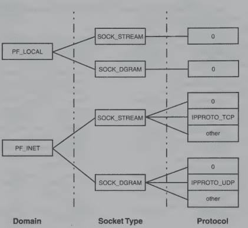

图 4.1：此图总结了 `socket(2)` 参数的关系。

最后，在图 4.1 的最右侧，展示了 `socket(2)` 函数调用中可用的协议选择示例。此参数最终确定要使用的协议。

> 注意
>
> 本书其余部分将重点介绍从套接字接口使用 `PF_LOCAL` 和 `PF_INET` 协议族。这样做部分是为了让你专注于需要掌握的重要套接字概念。此外，这些也将是你最经常使用的协议族。

# 其他 Linux 支持的协议

Linux 几乎在每个新版本中都在内核中收集新的协议。每种协议都有其用途。例如，`PF_APPLETALK` 协议族可能正是让你手头那台落灰的旧 Mac 更有用的工具。凭借你将从本书中获得的套接字知识，你将能够编写使用这些及其他特殊协议的程序。

表 4.2 总结了本章中关于本地和 Internet 协议的一些信息。

## 表 4.2：本地和 Internet socket(2) 参数表

| 域 | 套接字类型 | 描述/备注 |
| :--- | :--- | :--- |
| `PF_LOCAL` | `SOCK_STREAM` | 在本地主机内提供面向流的套接字。这是一种面向连接的服务——可靠且有序。注意 `PF_UNIX` 等同于 `PF_LOCAL`。 |
| `PF_LOCAL` | `SOCK_DGRAM` | 在本地主机内提供数据报服务。注意该服务是无连接的，但可靠，除非内核缓冲区耗尽，否则数据包可能会丢失。 |
| `PF_INET` | `SOCK_STREAM` | 用于 Internet 连接套接字的流式 I/O 服务。隐含 `TCP/IP` 协议——可靠且有序。 |
| `PF_INET` | `SOCK_DGRAM` | 用于 Internet 无连接套接字的数据报 I/O 服务。此组合隐含 `UDP`（用户数据报协议）。该服务不可靠。 |
| `PF_INET6` | `SOCK_STREAM` | 用于 Internet `IPv6` 连接套接字的流式 I/O 服务。隐含 `TCP/IP` 协议，可靠且有序。 |
| `PF_INET6` | `SOCK_SEQPACKET` | 用于 Internet `IPv6` 连接套接字的流式 I/O 服务。隐含使用 `TCP/IP` 协议。该服务可靠，保留消息边界，并保留数据序列。 |
| `PF_INET6` | `SOCK_DGRAM` | 用于 Internet `IPv6` 无连接套接字的数据报 I/O 服务。此组合隐含 `UDP`（用户数据报协议）。该服务不可靠。 |

表 4.3 包含了一些本书中不会深入探讨的少数特殊协议族的参考。然而，请将此摘要作为参考，以便你日后创建那些特殊套接字时使用。

## 表 4.3：特殊 socket(2) 参数表

| 域 | 套接字类型 | 描述/备注 |
| :--- | :--- | :--- |
| `PF_X25` | `SOCK_SEQPACKET` | 用于 `X.25` 协议的流式 I/O 服务。该服务面向连接且可靠，保留消息边界，并保留数据序列。 |
| `PF_AX25` | `SOCK_SEQPACKET` | 用于业余无线电协议 `AX.25` 的流式 I/O 服务。该服务面向连接且可靠，保留消息边界，并保留数据序列。 |
| `PF_AX25` | `SOCK_DGRAM` | 用于业余无线电协议 `AX.25` 的数据报服务。这提供不可靠的无连接通信。 |
| `PF_APPLETALK` | `SOCK_STREAM` | 用于 `AppleTalk` 连接套接字的流式 I/O 服务。此面向连接的服务可靠，并保留数据序列。 |
| `PF_APPLETALK` | `SOCK_DGRAM` | 这在 Linux 中作为扩展提供。更多详情请参阅内核文档或源代码。 |
| `PF_ECONET` | `SOCK_DGRAM` | `Acorn Econet` 和 `AUN` 协议的实现。 |
| `PF_IPX` | `SOCK_STREAM` | `IPX` 协议，流套接字。 |
| `PF_IPX` | `SOCK_DGRAM` | `IPX` 协议，数据报套接字。 |
| `PF_IPX` | `SOCK_SEQPACKET` | `IPX` 协议，顺序包套接字。 |
| `PF_IRDA` | `SOCK_STREAM` | `IRDA` 子系统支持，使用流套接字（红外通信）。 |
| `PF_IRDA` | `SOCK_SEQPACKET` | `IRDA` 子系统支持，使用保留消息边界的流套接字（红外通信）。 |
| `PF_NETROM` | `SOCK_SEQPACKET` | 业余无线电 `NetROM` 协议。 |
| `PF_ROSE` | `SOCK_SEQPACKET` | 业余无线电 `X.25 PLP 1` 协议。 |

# 研究其他协议

表 4.3 中列出的许多协议仍在开发中。因此，某些领域的文档较为稀疏。尽管如此，以下是一些关于你可以从哪里获取更多信息的建议：

- Linux `HOWTO` 和 `MINI-HOWTO` 文档。
- Linux `FAQ` 文档。
- `/usr/src/linux/Documentation/networking` Linux 源代码目录。如果你使用不同的源代码目录，请用该目录替换 `/usr/src/linux`。
- Linux 源代码目录 `/usr/src/linux/net`。在那里，你会找到其他源代码子目录，其中许多与特定协议有关。

互联网上有很多你可以搜索到的 `HOWTO` 和 `MINI-HOWTO` 文档。`FAQ` 是 `Frequently Asked Questions`（常见问题解答）的缩写。有时这些文件非常有帮助。

# 发现协议族

大多数时候，未记录的功能需要你查看一些内核源代码和包含文件。不要对此感到畏惧。通过查看这些代码，你可以确定许多有用的信息，而无需深入细节。

通过包含以下文件来定义协议族宏：

```
#include <sys/socket.h>
```

然而，此包含文件实际上还包含了另一个文件，然后由该文件定义协议宏常量。感兴趣的文件路径名为：

```
/usr/include/bits/socket.h
```

列出内核中可能支持的所有协议的一个简单方法是执行一个简单的 `grep` 命令。清单 4.1 展示了如何执行此操作以及结果可能看起来的样子。


```
$ grep PF_ /usr/include/bits/socket.h
#define PF_UNIX         0      /* Unspecified. */
#define PF_LOCAL        1      /* Local to host (pipes and file-domain). */
#define PF_UNIX         PF_LOCAL   /* Old BSD name for PF_LOCAL. */
#define PF_FILE         PF_LOCAL   /* Another non-standard name for PF_LOCAL. */
#define PF_INET         2      /* IP protocol family. */
#define PF_AX25         3      /* Amateur radio AX.25. */
#define PF_IPX          4      /* Novel11 Internet Protocol. */
#define PF_APPLETALK    5      /* AppleTalk DDP. */
#define PF_NETROM       6      /* Amateur radio NetROM. */
#define PF_BRIDGE       7      /* Multi-protocol bridge. */
#define PF_ATMPVC       8      /* ATM PVCs. */
#define PF_X25          9      /* Reserved for X.25 project. */
#define PF_INET6        10     /* IP version 6. */
#define PF_ROSE         11     /* Amateur radio X.25 PLP. */
#define PF_DECnet       12     /* Reserved for DECnet project. */
#define PF_NETBEUI      13     /* Reserved for 802.2LLC project. */
#define PF_SECURITY     14     /* Security callback pseudo AF. */
#define PF_KEY          15     /* PF_KEY key management API. */
#define PF_NETLINK      16
#define PF_ROUTE        PF_NETLINK /* Alias to emulate 4.4BSD. */
#define PF_PACKET       17     /* Packet family. */
#define PF_ASH          18     /* Ash. */
#define PF_ECONET       19     /* Acorn Econet. */
#define PF_ATMSVC       20     /* ATM SVCs. */
#define PF_SNA          22     /* Linux SNA project. */
#define PF_IRDA         23     /* IRDA sockets. */
#define PF_MAX          32     /* For now... */
#define AF_UNSPEC       PF_UNSPEC
#define AF_LOCAL        PF_LOCAL
```


## 示例 4.1

```c
#define AF_UNIX PF_UNIX
#define AF_FILE PF_FILE
#define AF_INET PF_INET
#define AF_AX25 PF_AX25
#define AF_IPX PF_IPX
#define AF_APPLETALK PF_APPLETALK
#define AF_NETROM PF_NETROM
#define AF_BRIDGE PF_BRIDGE
#define AF_ATMSVC PF_ATMSVC
#define AF_X25 PF_X25
#define AF_INET6 PF_INET6
#define AF_ROSE PF_ROSE
#define AF_DECnet PF_DECnet
#define AF_NETBEUI PF_NETBEUI
#define AF_SECURITY PF_SECURITY
#define PF_KEY PF_KEY
#define pseudo_AF_KEY PF_KEY
#define AF_NETLINK PF_NETLINK
#define AF_ROUTE PF_ROUTE
#define AF_PACKET PF_PACKET
#define AF_ASH PF_ASH
#define AF_ECONET PF_ECONET
#define AF_ATMSVC PF_ATMSVC
#define AF_SNA PF_SNA
#define AF_IRDA PF_IRDA
#define AF_MAX PF_MAX
```

示例 4.1 说明了另一个有趣的事实。请注意，在大多数情况下，`PF_` 系列宏是用 `AF_` 系列宏常量来定义的。前面曾提到，`AF_` 常量与 `PF_` 常量是等价的，尽管未来这种情况可能不一定总是成立。

无论如何，示例 4.1 展示了大量的协议族。然而，并非所有这些协议族都得到了支持。有些是为将来使用而定义的，另一些则处于开发阶段。在几乎所有情况下，你需要确保内核已编译支持你想要使用的协议族。

### 注意

在使用某些协议族之前，必须确保内核已编译了相应的支持。许多非主流协议通常不会包含在标准发行版的内核中。

### 警告

Linux 中的一些协议实现仍处于开发阶段，使用它们可能会导致内核崩溃。因此，你应该采取备份措施，或者在一台即使崩溃也无所谓的主机上测试新的协议选项。

## 发现套接字类型

在尝试创建非主流套接字时，了解协议族只是战斗的一部分。你现在需要了解你所选择的协议族支持的套接字类型。通常可以使用以下简单步骤来完成：

1. 切换到 Linux 内核源代码目录（你可能需要先安装它）。例如，你可能需要执行 `cd /usr/linux/src`。
2. 切换到 Linux 网络源代码子目录。例如，你要执行 `cd ../net` 以切换到该子目录。
3. 使用命令 `ls -F` 列出目录内容。这将使子目录在其名称后显示一个尾随的 `/`（斜杠）。
4. 通常，子目录的名称会指示你可能感兴趣的协议。切换到该子目录（例如，`cd ipx`）。
5. 执行 `grep` 命令，查找以 `SOCK_` 开头的内容。

通常，这就足以列出你想知道的套接字类型。示例 4.2 展示了遵循这些步骤的会话示例。

### 示例 4.2：列出协议族支持的套接字类型


```bash
$ cd /usr/src/linux
$ cd ../net
$ ls -F
802/
Changes
Config.in
Makefile
README
TUNABLE
appletalk/
ax25/
bridge/
core/
decnet/
ethernet/
ip/
ipx/
irda/
lppb/
netlink/
netrom/
netsyms.c
netsyms.o
network.a
packet/
protocols.o
protocols.c
rose/
sched/
sock_n_syms.o
socket.c
socket.o
sunrpc/
sysctl_net.c
sysctl_net.o
unix/
wanrouter/
x25/
$ cd ipx
$ ls -F
Config.in af_ipx.c sysctl_net_ipx.c
Makefile af_spx.c
$ grep SOCK _ .c
af_ipx.c: s->state, SOCK_INODE(s)->socket)->_i_uid);
af_ipx.c: case SOCK_DGRAM:
af_ipx.c: case SOCK_SEQPACKET:
af_spx.c: case SOCK_STREAM: /* Allow higher levels to piggyback */
af_spx.c: if(sock->type == SOCK_DGRAM)
af_spx.c: SOCK_DEBUG(sk,)
af_1px.c:            SOCK_DEBUG(sk,
af_1px.c:                "SOCK_DEBUG: %s: %s: bind failed because port %X in use.\n",
af_1px.c:                SOCK_DEBUG(sk, "IPX: bound socket 0x%04X.\n");
af_1px.c:            if(sock->type == SOCK_DGRAM )
af_1px.c:                case SOCK_SEGPACKET:
af_1px.c:            if(sock->type != SOCK_SEGPACKET)
af_1px.c:            if(sock->type != SOCK_SEGPACKET)
af_1px.c: /* route socket(PF_IPX,SOCK_SEGPACKET) calls through spx_create() */
```

从示例 4.2 中显示的`grep`输出中，你可以立即看到可能支持套接字类型`SOCK_DGRAM`和`SOCK_STREAM`（为了确定，你需要查看代码逻辑）。在末尾，还出现了对`SOCK_SEGPACKET`的引用，这表明它可能也受到支持。

另一个有趣的点是，你知道你可能需要查阅文件`af_ipx.c`中的注释和说明。有时，注释对于了解什么受到支持、什么不受支持很有用。

### 接下来是什么

在本章中，你仔细研究了`socket(2)`函数调用。本章中包含的额外理论层次和细节是必要的，因为很多内容都取决于你在`socket(2)`调用中做出的选择。有了对`socket(2)`函数的这种实际了解，你就在让套接字发挥作用方面取得了良好进展。

下一章将主要转向`bind(2)`函数调用。这个函数很重要，因为它允许你为在本章中你学会了如何创建的套接字分配地址。

# 将地址绑定到套接字

前面的章节为你提供了创建套接字和形成地址的手段。本章将在此基础上进行扩展，使你能理解`bind(2)`如何工作以及如何正确应用它。

在本章中，你将了解

- `bind(2)`函数调用如何为套接字分配地址
- 如何从已有地址的套接字中获取本地套接字地址
- 如何获取对端套接字地址
- `bind(2)`如何为通信选择所使用的网络接口

第 2 章“域和地址族”详细讲述了地址。这些背景知识将使本章内容对你来说易于理解。掌握了`bind`函数后，你将在下一章中能够开始让套接字发挥作用。

## `bind(2)` 函数的用途

当你的套接字由`socket(2)`函数创建时，它是没有名称的。你在第 1 章“介绍套接字”中看到，当演示`socketpair(2)`函数时，套接字可以在没有地址的情况下使用。然而，这之所以可行，是因为这些套接字是在同一个 Linux 内核内部以这种方式创建的。对于必须连接两个不同主机的套接字，这是做不到的。

一个没有名称的套接字很难使用。没有人能向你的无名套接字发送信息，因为它就像一部没有电话号码的电话。因此，程序员必须将名称绑定到套接字，以便他人可以访问它。这就像给新电话分配一个电话号码，以便可以被呼叫。`bind(2)`函数允许你以相同的方式为套接字分配地址。

在本章的上下文中，“名称”与`sunsite.unc.edu`之类的主机名没有任何关系。在讨论`bind(2)`函数时，经常使用“名称”一词，它指的是套接字的地址。毕竟，地址在某种程度上也是一种名称。然而，为了避免混淆，本章将优先使用“地址”这一术语。

## 使用 `bind(2)` 函数

`bind(2)`函数的目的是为一个没有名称的套接字分配套接字地址。函数原型如下所示：

```c
#include <sys/types.h>
#include <sys/socket.h>

int bind(int sockfd, struct sockaddr *my_addr, int addrlen);
```

该函数接受以下三个输入参数：

1. 由先前`socket(2)`调用返回的套接字`sockfd`文件描述符。
2. 要分配给套接字的地址`my_addr`。
3. 地址`my_addr`的字节长度（参数`addrlen`）。

如果成功，该函数返回零值。否则，返回 -1，并且变量`errno`会被设置为失败的原因。

**注意**

提供给`bind(2)`的套接字必须当前是没有名称的（没有地址）。你不能将套接字重新绑定到一个新地址。

地址参数必须是地址结构体的指针。你会注意到，这里使用的通用地址类型是`sockaddr`结构体类型。这意味着你需要应用C语言强制类型转换运算符，以让编译器确认你传递了正确的指针类型。列表5.1展示了一个调用`bind(2)`以建立互联网地址的程序。请注意`inet_aton(3)`和`bind(2)`函数调用的使用。


## `af_inet.c` 代码示例

```c
/* af_inet.c: */
/* Demonstrating the bind(2) function
 * by establishing a Specific AF_INET
 * Socket Address:
 */

#include <stdio.h>
#include <unistd.h>
#include <stdlib.h>
#include <errno.h>
#include <string.h>
#include <sys/types.h>
#include <sys/stat.h>
#include <sys/socket.h>
#include <netinet/in.h>
#include <arpa/inet.h>

/*
 * This function reports the error and
 * exits back to the Shell:
 */
static void
bail(const char *on_what) {
    perror(on_what);
    exit(1);
}

int
main(int argc, char **argv, char **envp) {
    int z;                    /* Status return code */
    int sck_inet;             /* Socket */
    struct sockaddr_in adr_inet;/* AF_INET */
    int len_inet;             /* Length */

    /* Create an IPv4 Internet Socket */
    sck_inet = socket(AF_INET, SOCK_STREAM, 0);

    if ( sck_inet == -1 )
        bail("socket()");

    /* Create an AF_INET address */
    memset(&adr_inet, 0, sizeof adr_inet);

    adr_inet.sin_family = AF_INET;
    adr_inet.sin_port = htons(9000);
    inet_aton("127.0.0.24", &adr_inet.sin_addr);

    len_inet = sizeof adr_inet;

    /* Now bind the address to the socket */
    z = bind(sck_inet,
             (struct sockaddr *)&adr_inet,
             len_inet);

    if ( z == -1 )
        bail("bind()");

    /* Display all of our bound sockets */
    system("netstat -pa -tcp 2>/dev/null | "
           "sed -n '/1:'/Proto/p;/bind/p'");

    close(sck_inet);
    return 0;
}
```

> **注意**

> 如果你的系统中的 `netstat(1)` 命令不支持列表 5.1 中第 60 行和第 61 行使用的选项，请在你安装了 `lsof` 命令的情况下，用以下调用替换：

>

> `system("lsof -i tcp | sed -n '/lp:/bind/p'");`

列表 5.1 中的程序与你第二章中看到的程序非常相似。该程序使用的步骤如下：

- 1. 变量 `sck_inet` 将在创建套接字时接收该套接字（第 31 行）。
- 2. 变量 `adr_inet` 将保存将绑定到套接字的地址（第 32 行）。
- 3. 变量 `len_inet` 将以字节为单位保存套接字地址的长度（第 33 行）。
- 4. 第 36 行通过 `socket(2)` 创建套接字。
- 5. 第 38 行和第 39 行检查第 4 步是否出错。如果检测到错误，则调用函数 `bail()`。`bail()` 报告错误并退出程序。
- 6. 第 42 行至 47 行初始化要绑定到套接字的新套接字地址。
- 7. 变量 `len_inet` 被设置为套接字地址的大小（第 49 行）。
- 8. 第 52 行至 54 行调用了 `bind(2)` 函数。值 `sck_inet` 代表要绑定到套接字地址 `adr_inet` 的套接字。此地址长度为 `len_inet` 字节。请注意使用了强制类型转换运算符 `(struct sockaddr *)`，用于满足编译器的要求。这防止了在编译时报告警告。
- 9. 第 56 行检查第 8 步是否出错。如果发生错误，`bind(2)` 将返回 -1 而不是 0。
- 10. `system(3)` 调用执行 `netstat(1)` 命令，以证明我们的套接字有一个绑定地址（第 60 行和第 61 行）。

以下输出显示了如何编译和运行此程序：

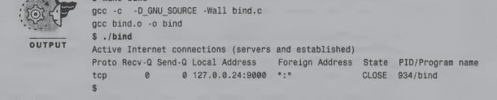

输出显示，在运行时，地址 `127.0.0.24:9000` 已绑定到套接字。`9000` 部分代表为此示例程序选定的任意端口号。

如果你使用 `lsof` 命令（参见前面的注意事项）运行该程序，输出将略有不同：

```
$ ./bind
COMMAND PID USER FD TYPE DEVICE SIZE NODE NAME
bind 16616 root 4u inet 142319 TCP 127.0.0.24:9000 (CLOSE)
$
```

从该输出中，你可以验证名为 `bind`（在“COMMAND”标题下）的程序在文件单元 4（“FD”列）上打开了套接字，并绑定到 TCP 地址 `127.0.0.24`，端口 `9000`。

## 获取套接字地址

如果你编写的 C 库函数接收一个套接字作为输入参数，那么你就不知道该套接字的地址是什么。这是因为你的函数并没有创建该套接字；而且，除非将套接字地址也作为输入传递给你的函数，否则你不知道地址是什么。函数 `getsockname(2)` 允许你的函数获取它。

`getsockname(2)` 的函数原型如下：

```c
#include <sys/socket.h>

int getsockname(int s, struct sockaddr *name, socklen_t *namelen)
```

该函数接收以下三个输入参数：

- 1. 要查询套接字地址的套接字 `s`。
- 2. 指向接收缓冲区（参数 `name`）的指针。
- 3. 指向最大长度变量的指针。该变量提供可以在缓冲区中接收的最大字节长度（参数 `namelen`）。此值将更新为写入接收缓冲区的实际字节数。

请注意，与 `bind(2)` 函数类似，`getsockname(2)` 使用通用地址结构 `sockaddr_t`，因为它可用于任何类型的套接字地址。这意味着你可能需要对在此参数中提供的指针应用 C 语言强制类型转换运算符。

长度参数 `namelen` 指定可以接收到的参数二（`name`）的最大字节数。然而，在返回给调用者之前，`namelen` 的值会被覆盖，以指示接收缓冲区中实际返回的字节数。这将小于或等于提供的原始值。

> **警告**

>

> 在调用 `getsockname(2)` 时，永远不要提供常量的地址作为套接字长度。不应这样做，因为长度变量会被更新为放入接收地址结构中的实际字节数。

>

> 如果你确实提供了常量的地址，常量的值将被覆盖。这将给你的程序带来混乱。在某些 CPU 平台上，你可能会遇到程序故障。

## 编写一个 `sock_addr()` 函数

为了说明 `getsockname(2)` 的用法，列表 5.2 展示了一个小型函数，该函数接受套接字描述符作为输入。该函数通过调用 `getsockname(2)` 获取套接字地址，然后格式化一个字符串并将其返回给调用者，以便可以在 `printf(3)` 调用中使用。


## Listing 5.2: `sckname.c` — The `getsockname(2)` Function Call

```c
/* sckname.c:
 *
 * Demonstrate getsockname(2):
 */
#include <stdio.h>
#include <unistd.h>
#include <stdlib.h>
#include <errno.h>
#include <string.h>
#include <sys/types.h>
#include <sys/stat.h>
#include <sys/socket.h>
#include <netinet/in.h>
#include <arpa/inet.h>

/*
 * This saves lines of code later:
 */
static void
bail(const char *on_what) {
    perror(on_what);  /* Report error */
    exit(1);          /* Exit Program */
}

/*
 * This function accepts as input a socket
 * for which a socket address must be
 * determined for it. Then the address
 * is converted into a string and returned.
 *
 * If an error occurs, NULL is returned.
 */
char *
sock_addr(int s, char *buf, size_t bufsiz) {
    int z;            /* Status return code */
    struct sockaddr_in addr_in; /* AF_INET */
    int len_inet;    /* length */

    /*
     * Obtain the address of the socket:
     */
    len_inet = sizeof adr_inet;

    z = getsockname(s,
        (struct sockaddr *)&adr_inet,
        &len_inet);

    if ( z == -1 )
        return NULL;    /* Failed */

    /*
     * Convert address into a string
     * form that can be displayed:
     */
    snprintf(buf, bufsiz,
        "%s:%u",
        inet_ntoa(adr_inet.sin_addr),
        (unsigned)ntohs(adr_inet.sin_port));

    return buf;
}

/*
 * Main Program:
 */
int
main(int argc, char **argv, char **envp) {
    int z;            /* Status return code */
    int sck_inet;    /* Socket */
    struct sockaddr_in adr_inet;/* AF_INET */
    int len_inet;    /* length */
    char buf[64];    /* Work buffer */

    /*
     * Create an IPv4 Internet Socket:
     */
    sck_inet = socket(AF_INET, SOCK_STREAM, 0);

    if ( sck_inet == -1 )
        bail("socket()" );

    /*
     * Create an AF_INET address:
     */
    memset(&adr_inet, 0, sizeof adr_inet);
    adr_inet.sin_family = AF_INET;
    adr_inet.sin_port = htons(9000);
    inet_aton("127.0.0.24",&adr_inet.sin_addr);
    len_inet = sizeof adr_inet;

    /*
    * Now bind the address to the socket:
    */
    z = bind(sock_inet,
        (struct sockaddr *)&adr_inet,
        len_inet);
    if ( z == -1 )
        bail("bind()");

    /*
    * Now test our sock_addr() function:
    */
    if ( !sock_addr(sock_inet,buf,sizeof buf) )
        bail("sock_addr()");

    printf("Address is '%s\n",buf);

    close(sock_inet);
    return 0;
 }
```

列表 5.2 展示了库 C 函数如何使用 `getsockname(2)`。`main()` 程序的大部分内容是对您的复习，因为它与列表 5.1 中的 `main()` 程序非常相似。在 `main()` 程序中使用的通用步骤如下：

1. 第 69 至 71 行中给出了套接字 `sock_inet`、地址 `adr_inet` 和地址长度 `len_inet` 的声明。
2. 第 72 行声明了一个字符数组缓冲区 `buf[64]`，供程序稍后使用。
3. 套接字通过第 77 行的 `socket(2)` 创建。
4. 第 85 至 95 行通过使用 `bind(2)` 函数调用建立套接字地址。
5. 第 103 行的 `if` 语句中调用了 `sock_addr()` 函数。如果函数返回空指针，则执行第 104 行的语句，程序将终止。
6. 然而，如果步骤 5 成功，缓冲区 `buf[]` 将包含一个表示套接字 `sock_inet` 的套接字地址的字符串。第 106 行的 `printf(3)` 调用报告了这一结果。

简而言之，主程序做了两件事：

* 创建一个套接字并为其建立地址。
* 调用函数 `sock_addr()`，看看它是否能查出套接字的地址是什么。

现在，我们来检查列表 5.2 中展示的 `sock_addr()` 函数所使用的步骤：

1. `sock_addr()` 的函数声明从第 33 行开始。它接受套接字 `s` 作为输入，函数必须确定该套接字的地址。可打印的套接字地址在提供的缓冲区 `buf` 中返回，该缓冲区的最大大小为 `bufsize` 字节。
2. 第 36 和 37 行中声明了临时值 `adr_inet` 和 `len_inet`。
3. 在调用 `getsockname(2)` 之前，在变量 `len_inet` 中建立了最大长度。这确定了可返回的地址信息的最大字节数。
4. 第 44 行调用了 `getsockname(2)` 函数。如果成功，`z` 将设置为零，地址将加载到结构 `adr_inet` 中。长度变量 `len_inet` 将被覆盖为实际使用的大小。
5. 在第 48 行检查错误。当返回值为 -1 时，表示发生了错误。该函数返回一个空值，以指示发生了错误。调用者可以测试 `errno` 以了解错误的原因。
6. 第 55 至 58 行将字符串格式化为调用者的缓冲区 `buf`，最大长度为 `bufsize`。`bufsize` 的值必须包括终止空字节。
7. 在第 60 行返回指向调用者缓冲区的指针，以表明调用成功。

函数 `sock_addr()` 不仅为调用者确定了套接字地址，还将其 nicely 格式化为一个字符串，可用于 `printf(3)` 调用。

> **TIP**
>
> 你是否注意到使用了 `snprintf(3)` 调用，而不是更传统的 `sprintf(3)` 函数？较新的 `snprintf(3)` 调用能够将其格式化限制在其格式化到的缓冲区的最大大小内。这对软件完整性极为重要，只要可能，你应该使用 `snprintf(3)`。

以下展示了如何编译列表 5.2 中的程序：


```bash
$ make sockname
gcc -c -D_GNU_SOURCE -Wall sockname.c
gcc sockname.o -o sockname

# OUTPUT
$ ./sockname
Address is '127.0.0.24::9000'
$
```

程序编译后，你可以调用它以产生如下输出：

查看报告地址为 `'127.0.0.24::9000'` 的那行输出，你可以看到函数 `sock_addr()` 成功地完成了它的任务。这是在 `main()` 程序的第 87 和 88 行中建立的地址。

### 获取对等套接字地址

在上一节中，你看到函数 `getsockname(2)` 在获取套接字的地址时非常有用。然而，有时你的代码需要确定你的套接字所连接的远程地址。确定套接字的远程地址就像找出当有人给你打电话时对方的电话号码一样——类似于北美的来电显示（`CallerID`）。

执行此功能的函数称为 `getpeername(2)`。当你开始检查和编写服务器代码时，这个函数将对您很有用。这里介绍它是因为它与 `getsockname(2)` 非常相似。`getpeername(2)` 的函数原型如下：

```c
#include <sys/socket.h>

int getpeername(int s, struct sockaddr *name, socklen_t *namelen);
```

你可以看到，函数参数与 `getsockname(2)` 函数相同。为了完整性，再次描述参数如下：

1. 要查询套接字地址的套接字 `s`。
2. 指向接收缓冲区的指针（参数 `name`）。
3. 指向最大长度变量的指针。此变量提供了可在缓冲区中接收的最大字节长度（参数 `namelen`）。此值将被更新为写入接收缓冲区的实际字节数。

如果操作成功，函数返回零。如果发生错误，返回值 `-1`，并且 `errno` 的值将包含错误的原因。

列表 5.3 显示了一些定义名为 `peer_addr()` 的函数的代码。这个代码在设计上与列表 5.2 中的 `sock_addr()` 函数非常相似。然而，这并不是一个完整的例子，因为它只显示了该函数本身的源代码（它缺少主程序）。本书后面在讨论面向连接的通信时，可以重新审视这段代码。现在，只需将其视为函数 `getpeername(2)` 如何使用的一个例子即可。


**列表 5.3: `getpeer.c`——`getpeername(2)` 函数**

```c
1:  /* getpeer.c:
2:    *
3:    *  Demonstrate getpeername(2):
4:    */
5:  #include <stdio.h>
6:  #include <unistd.h>
7:  #include <stdlib.h>
8:  #include <errno.h>
9:  #include <string.h>
10: #include <sys/types.h>
11: #include <sys/stat.h>
12: #include <sys/socket.h>
13: #include <netinet/in.h>
14: #include <arpa/inet.h>
15:
16: /*
17:  * This function accepts as input a socket
18:  * for which a peer socket address must be
19:  * determined for it.  Then the address
20:  * is converted into a string and returned.
21:  *
22:  * If an error occurs, NULL is returned.
23:  */
24: char *
25: peer_addr(int s, char *buf, size_t bufsize) {
26:     int z;              /* Status return code */
27:     struct sockaddr_in adr_inet;/* AF_INET */
28:     int len_inet;                    /* length */
29:
30:     /*
31:      * Obtain the address of the socket:
32:      */
33:     len_inet = sizeof adr_inet;
34:
35:     z = getpeername(s,
36:             (struct sockaddr *) &adr_inet,
37:             &len_inet);
38:
39:  if ( z == -1 )
40:  return NULL;  /* Failed */
41:
42:  /*
43:   * Convert address into a string
44:   * form that can be displayed:
45:   */
46:  z = snprintf(buf, bufsize,
47:       "%s:%u",
48:       inet_ntoa(adr_inet.sin_addr),
49:       (unsigned)ntohs(adr_inet.sin_port));
50:
51:  if ( z == -1 )
52:  return NULL;  /* Buffer too small */
53:
54:  return buf;
55: }
```

`peer_addr()` 中使用的步骤与 `sock_addr()` 的基本步骤相同。然而，程序进行了一小项改进。让我们来看看这些步骤：

1. `peer_addr()` 的函数声明从第 24 行开始。它接受套接字 `s` 作为输入，函数必须确定该套接字的对等地址。可打印的套接字地址在提供的缓冲区 `buf` 中返回，该缓冲区的最大大小为 `bufsize` 字节。
2. 第 27 和 28 行中声明了临时值 `adr_inet` 和 `len_inet`。
3. 在调用 `getpeername(2)`（第 33 行）之前，在变量 `len_inet` 中建立了最大长度。这确定了可返回的地址信息的最大字节数。
4. 第 35 行调用了 `getpeername(2)` 函数。如果成功，`z` 将设置为零，地址将加载到结构 `adr_inet` 中。长度变量 `len_inet` 将被覆盖为实际使用的大小。
5. 在第 39 行检查错误。当返回值为 `-1` 时，表示发生了错误。该函数返回一个空值，以指示发生了错误。调用者可以测试 `errno` 以了解错误的原因。
6. 第 46 至 49 行将字符串格式化为调用者的缓冲区 `buf`，最大长度为 `bufsize`。`bufsize` 的值必须包括终止空字节。
7. 在第 51 和 52 行对程序进行了一小项改进。如果格式化结果太大，无法装入用户缓冲区 `buf`（最大长度为 `bufsize`），`snprintf(3)` 函数将返回 `-1`。如果这种情况发生，程序会在第 52 行返回一个空指针，以表明 `peer_addr()` 函数未完全成功。
8. 在第 54 行返回指向调用者缓冲区的指针，以表明调用成功。

如果你粗略浏览了上述步骤，就会发现对程序所做的改进在第 7 步中进行了描述。

## 接口与寻址

在继续阅读后续章节中关于套接字编程的其他方面之前，还有一个与套接字地址相关的概念必须理解，那就是接口地址的概念。

再次使用熟悉的电话类比，想象一下总统办公室，他的办公桌上有两部（或更多）电话。使用其中一部电话，他可以联系妻子，看看她的一天过得如何。另一方面，使用红色电话则可以联系到俄罗斯总统。从某种意义上说，这两部电话都是两个不同网络之间的接口。这些接口包括：

- 普通的国内电话网络。
- 通过安全线路连接到俄罗斯总统高级办公室的私有网络。

这个例子中的要点是，你必须使用正确的接口（电话）来访问正确的网络。例如，总统无法使用红色电话拨打给妻子。反之，国内电话也无法访问俄罗斯总统高级办公室位于安全线路上的电话。

以类似的方式，有时你希望套接字程序在尝试联系远程套接字时指定使用哪个接口。当你知道只有一个接口能够到达目标网络时，就需要这样做。

当你预期要接收电话时，有时你希望只在某部特定电话上接听。例如，十几岁的女儿可能希望只接听安装在她卧室里的那部电话上的来电。对于家庭中的其他人来说，他们期望只接听安装在一楼房间的另一部电话上的来电。同样，你的套接字程序有时也希望只接受来自某一个特定接口的连接，并忽略所有其他接口。

## 指定接口地址示例

图 5.1 展示了一个具体的示例，其中指定了接口地址。

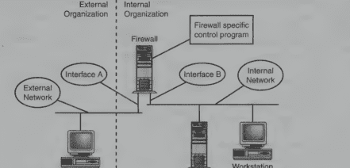


图 5.1：这是一个使用特定接口的防火墙示例。

在图 5.1 的中间部分，你看到一台服务器充当防火墙，位于内部组织与外部不可信组织之间。假设你编写了一个运行在防火墙服务器上的套接字程序，该程序接受来自图表最右侧工作站（位于内部组织内）的防火墙控制命令。服务器程序通过仅允许连接到达网络接口 `B` 来接受来自内部网络的连接。

出于安全原因，防火墙主机上的控制程序不会接受来自外部组织的连接尝试。这是通过忽略防火墙网络接口 `A` 上的所有连接尝试来实现的。这保护了你的控制程序免受可能由图 5.1 最左侧工作站发起的入侵尝试。

## 绑定特定接口地址

为了指定用于通信的特定接口，你必须执行以下步骤：

1. 像往常一样使用 `socket(2)` 函数创建你的套接字。
2. 使用 `bind(2)` 函数将愿意接受连接的接口 `IP` 地址绑定到本地套接字。

在图 5.1 中，你将在调用 `bind(2)` 时使用接口 `B` 的 `IP` 地址，以便仅接受来自内部网络的连接。列表 5.4 展示了如何绑定到特定的网络接口地址，使用了一些你之前见过的代码行。这必须在任何套接字通信开始之前完成。

### 第 5 章：将地址绑定到套接字


#### 列表 5.4：绑定特定的 IP 接口

```c
int z;                           /* Socket */
int sck_inet;
struct sockaddr_in adr_inet;    /* AF_INET */
int len_inet;                    /* length */

sck_inet = socket(AF_INET, SOCK_STREAM, 0);

if ( sck_inet == -1 )
    abort(); /* Failed */

/* Establish address */
memset(&adr_inet, 0, sizeof adr_inet);
adr_inet.sin_family = AF_INET;
adr_inet.sin_port = htons(9000);

adr_inet.sin_addr.s_addr = inet_addr("192.168.0.1");

if ( adr_inet.sin_addr.s_addr == INADDR_NONE )
    abort(); /* Failed */

len_inet = sizeof adr_inet;

z = bind(sck_inet, (struct sockaddr *)&adr_inet, len_inet);
```

列表 5.4 中显示的步骤如下：

1. 通过调用 `socket(2)` 创建套接字，并将描述符赋值给变量 `sck_inet`。也会测试错误，在这个示例中，如果发生错误，为简单起见调用了 `abort(3)`。
2. 在调用 `bind(2)` 之前确立了 `IP` 地址 `192.168.0.1`。本例中任意使用了 `TCP` 端口 `9000`。
3. 调用 `bind(2)` 函数，该函数随后绑定了已确立的地址。

请注意，如果该主机没有具有该 `IP` 号的接口，则 `bind(2)` 函数调用将失败。

### 绑定到任意接口

你如何接受来自任意接口的连接？请执行以下步骤：

1. 像往常一样使用 `socket(2)` 函数创建你的套接字。
2. 使用 `bind(2)` 函数将 `IP` 地址 `INADDR_ANY` 绑定到套接字。

列表 5.5 展示了一些代码，显式表明任意接口都可以。

#### 列表 5.5: 使用 `bind(2)` 指定任意接口

```c
int z;

int sock_inet;              /* Socket */

struct sockaddr_in adr_inet; /* AF_INET */

int len_inet;               /* length */

sock_inet = socket(AF_INET,SOCK_STREAM,0);

if ( sock_inet == -1 )

    abort(); /* Failed */

/* Establish address */

memset(&adr_inet,0,sizeof adr_inet);

adr_inet.sin_family = AF_INET;

adr_inet.sin_port = htons(9000);

adr_inet.sin_addr.s_addr = htonl(INADDR_ANY);

if ( adr_inet.sin_addr.s_addr == INADDR_NONE )

    abort(); /* Failed */

len_inet = sizeof adr_inet;

z = bind(sock_inet,(struct sockaddr *)&adr_inet, len_inet);
```

列表 5.5 在功能上与列表 5.4 相同，区别在于赋值的地址值是 `htonl(INADDR_ANY)` 而不是特定的 `IP` 地址。以这种方式绑定的套接字可以接受来自任意接口的连接。它也可以通过任意接口连接到远程套接字（这由路由表自动确定）。

> **注意**
>
> 值 `INADDR_ANY` 也被称为*通配符*地址。

## 接下来是什么

虽然你在本书之前已经看到过 `bind(2)` 函数的使用，但本章重点介绍了为什么要使用它以及如何使用它。然后你学习了其函数参数的细节，并复习了其在实际代码中的用法。

现在你已经完全掌握了涉及的套接字寻址技术，你将完全做好准备在后续章节中使用套接字。下一章将向你介绍两种套接字操作模式。然后，它将展示如何在无连接模式下使用套接字。

# 无连接协议

直到本书这一点为止，套接字通信的性质在很大程度上被避免了。相反，你一直专注于创建套接字、将地址绑定到它们、关闭或关闭它们。现在是时候享受实际使用套接字的一些真正乐趣了。

套接字有两种基本的通信模式。它们是无连接通信和面向连接的通信。

在本章中，你将学习：

- 无连接通信与面向连接通信之间的区别
- 如何执行无连接输入和输出操作
- 如何编写一个数据报服务器
- 如何编写一个数据报客户端

现在请将注意力转向无连接通信与面向连接通信之间的比较。


## 通信方法

无连接型通信，正如你可能推测的那样，不需要在开始通信前建立连接。这就像一个拿着扩音器的人对人群中的特定目标大喊大叫。每次新的呼喊，发送者都可以将信息指向另一个人，而无需事先达成任何协议。

类似地，在创建无连接套接字后，你将能够向任何愿意接收消息的套接字发送消息。这里没有连接建立过程，且每条消息都可以发送给不同的接收套接字。

### 理解其优势

与连接型协议相比，无连接型通信具有某些优势。其中一些包括以下几点：

- **更简单**——无需建立连接。
- **灵活**——可以在每次发送消息的操作中向不同的接收者发送消息。
- **高效**——不需要建立或断开连接，而连接建立或断开可能会向网络增加大量开销数据包。
- **快速**——由于没有连接建立或断开过程，因此只发送消息本身。
- **广播能力**——能够将一条消息发送给多个接收者。

无连接型协议许多优势都与效率和速度有关。建立连接需要两个端点之间交换若干数据包后才能进行数据交换。已建立通信信道的断开也需要交换额外的数据包。同样，这会导致额外的开销和时间消耗。

无连接协议的另一个优势是其广播能力。可以将一条消息指向多个接收者。这非常高效地利用了网络带宽。

在本章中，你将学习`UDP`协议（用户数据报协议），它是一种无连接型协议。该协议享有刚才提到的所有优势。

### 理解无连接通信的劣势

尽管无连接型协议具有诸多优势，你可能会疑惑为什么它们并非总是被使用。与其他大多数事物一样，无连接通信也有其缺点。

`UDP`协议是一种非常简单的传输层协议，如前所述，它是无连接的。在`UDP`协议的背景下，存在以下缺点：

- 该协议不可靠。
- 没有多数据报的顺序控制。
- 存在消息大小限制。

对于大多数应用而言，可靠性问题是严重的限制因素。`UDP`数据报可以由你的应用程序写入网络，但没有保证预期的接收者最终会收到它。消息可能会乱码，以至于同一网络上的接收者无法接收。或者，由于网络路径中的众多路由器之一未能无误地接收到消息，导致消息丢失。当接收到有错误的数据包时，`UDP`数据包会被静默丢弃并永久丢失。

**注意**

数据报只是通过网络发送和接收的数据单元。它可被比作电报，因为它代表一条完整的消息。

其他问题也可能导致`UDP`数据包丢失。如果接收主机或路由器无法分配足够的缓冲区空间来容纳`UDP`数据包，它将被静默丢弃。因此，如果你的`UDP`数据包必须行进更长的距离，它沿途被丢弃的可能性就更大。


在决定是否为你的应用程序使用 `UDP` 之前，必须考虑另一个问题。如果你连续快速发送两个或更多数据报到目的地，有些数据报可能会出现乱序到达的情况。`UDP` 协议使用互联网协议（`IP`）来传递最终的数据报。`IP` 数据包可能在每次传输中被以不同方式路由，且路由会根据当前网络状况而变化。这常常导致一些数据包在之前的数据包到达之前就先到达了目的地。底线是，`UDP` 数据包可能会乱序到达。

最后，还有数据报大小的问题。`UDP` 数据报的理论最大大小略小于 `64KB`。然而，许多 `UNIX` 主机仅支持接近 `32KB` 的最大值。其他 `UNIX` 内核内置限制进一步限制了大小。有时低至 `8KB`。最后，接收套接字程序会将其限制为接收缓冲区的最大大小。因此，有些程序将自身限制为使用 `512` 字节或更小的 `UDP` 消息。

如果发送大型 `UDP` 数据包，它将被分割成几个较小的 `IP` 片段，并在接收端重新组装。重组过程需要分配缓冲区以容纳收到的片段。这仅在指定的超时周期内进行，直到整个数据包可以重新组装。缓冲区的竞争可能导致重组被放弃，结果就是你的 `UDP` 数据包被静默丢弃。`UDP` 数据报必须经受许多风险才能成功到达其目的地。

对于一些应用程序，这些注意事项会引导你转向更可靠的连接型协议，如 `TCP/IP`。对于其他应用程序，这些可能不是严重的限制。只有你自己能决定是否适合在你的应用程序中使用 `UDP`。

## 执行数据报的输入/输出

在第 `1` 章“介绍套接字”中所示的示例程序清单 `1.3` 中，你看到了在从套接字读取和写入时使用 `read(2)` 和 `write(2)` 函数。当时没有指出的是，所显示的 `socketpair(2)` 函数调用使用连接型协议创建了一对套接字。因此，可以使用熟悉的 `read(2)` 和 `write(2)` 函数在这些套接字上执行 `I/O`。

然而，在发送和接收数据报时，需要另一对不同的函数。这是因为每个被发送的消息潜在地发送给不同的目标地址。用于发送数据报的函数必须允许你指定预期接收者的地址。同样地，当你接收到数据报时，你需要知道它来自谁。这个新函数必须提供一种便捷的方式来确定发送者的地址。

## 介绍 `sendto(2)` 函数

`sendto(2)` 函数允许你写入数据报并同时指定接收者的目标地址。该函数的原型如下：

```c
#include <sys/types.h>
#include <sys/socket.h>

int sendto(int s,
           const void *msg,
           int len,
           unsigned flags,
           const struct sockaddr *to,
           int tolen);
```

不要被该函数的参数数量吓倒。描述之后，它们很容易理解：

1. 第一个参数 `s` 是套接字号。这个值来自 `socket(2)` 函数。
2. 参数 `msg` 是指向包含你希望发送的数据报消息的缓冲区的指针。
3. 参数 `len` 是以字节为单位的数据报长度，该数据报从 `msg` 给定的指针开始。
4. `flags` 参数允许你指定一些选项位。在许多情况下，你只需提供零值。
5. 参数 `to` 是指向你已建立的通用套接字地址的指针。这是数据报接收者的地址。
6. 参数 `tolen` 是地址参数 `to` 的长度。

`sendto(2)` 函数成功返回时，其返回值是发送的字节数（请注意，这并不保证远程端已接收）。当发生错误时，函数返回 `-1`，并可以查阅 `errno` 的值以了解原因。

倒数第二个函数参数允许你标识数据报必须发送到的位置。参数 `to` 必须指向有效的套接字地址，且参数 `tolen` 应包含地址的正确长度。在前几章中，你已成为构建地址的专家，因此在这里你应该觉得得心应手。

表 `6.1` 列出了 `flags` 参数可以具有的值，不过大多数时候你只需提供零值即可。

### 表 6.1: `sendto(2)` 函数的 `flags` 值

| 标志 | 十六进制 | 含义 |
| :--- | :--- | :--- |
| `0` | `0x0000` | 正常——无特殊选项 |
| `MSG_OOB` | `0x0001` | 处理带外数据 |
| `MSG_DONTROUTE` | `0x0004` | 绕过路由；使用直接接口 |
| `MSG_DONTWAIT` | `0x0040` | 不阻塞；等待写入 |
| `MSG_NOSIGNAL` | `0x4000` | 当另一端断开连接时不引发 `SIGPIPE` |

## 注意

在指定常量和标志位时，请务必使用宏名称，例如 `MSG_DONTWAIT`。虽然表 `6.1` 列出了每个 `C` 宏常量的十六进制值，但请仅使用宏名称。这样，如果在后续版本的 `Linux` 中对常量进行了更改，您的程序只需重新编译即可继续正常运行，无需对源代码进行任何修改。

## 提示

`Red Hat Linux 6.0` 中 `sendto(2)` 的手册页将 `C` 宏常量 `MSG_NOSIGNAL` 的值列为 `0x2000`。然而，内核 `2.2.10` 源代码中的 `include/linux/socket.h` 文件将其值列为 `0x4000`。该包含文件中的一条评论还指出，那里列出的并非所有标志都已得到支持。

表 `6.1` 中列出的许多标志值用于高级用途，目前不会详细介绍。在此列出这些内容仅供方便参考。通常，您只需提供值零即可。

在本章的后半部分，您将开始使用 `sendto(2)` 函数。但在此之前，您应该先了解 `recvfrom(2)` 函数。

## 介绍 `recvfrom(2)` 函数

`sendto(2)` 函数的对应函数是 `recvfrom(2)` 函数。该函数与 `read(2)` 函数的区别在于，它允许您在接收数据报的同时接收发送方的地址。函数原型如下：

```c
#include <sys/types.h>
#include <sys/socket.h>

int recvfrom(int s, 
            void *buf, 
            int len, 
            unsigned flags, 
            struct sockaddr *from, 
            int *fromlen);
```

参数列表与 `sendto(2)` 函数中使用的参数非常相似。`recvfrom(2)` 的参数如下：

- 接收数据报的套接字 `s`。
- 开始接收数据报的缓冲区指针 `buf`。
- 接收缓冲区 `buf` 的最大长度（以字节为单位，`len`）。
- 选项标志位 `flags`。
- 指向接收套接字地址缓冲区的指针，该缓冲区将接收发送方的地址（指针参数 `from`）。
- 指向接收套接字地址缓冲区 `from` 的最大长度（`fromlen`，以字节为单位）的指针。请注意，在调用函数之前，该指针指向的整数值必须初始化为接收地址结构体 `from` 的最大尺寸。

与任何普通的 `read(2)` 操作一样，接收缓冲区 `buf` 必须足够大以接收传入的数据报。最大长度由函数的参数 `len` 指示。

如果发生错误，该函数返回 `-1`，您应查阅 `errno` 的值以了解错误原因。否则，该函数返回接收到接收缓冲区 `buf` 中的字节数。这就是您接收到的数据报的大小。

但特别要注意的是，最后一个参数是指向接收地址结构体长度的指针。在调用函数 `recvfrom(2)` 之前，该指针指向的 `int` 值必须包含接收地址结构体 `from` 的最大字节大小。函数返回后，返回的地址的实际大小会被放入此 `int` 变量中。实际上，`fromlen` 指向的值既充当输入值，也充当返回值。

## 提示

如果您使用 `recvfrom(2)` 函数接收不同协议的数据报，请确保分配足够的套接字地址空间，以接收您可能遇到的所有地址族。例如，`AF_INET` 和 `AF_LOCAL` (`AF_UNIX`) 地址族的套接字地址大小不同。通常，`C` 语言的联合体（`union`）数据类型可以满足所需的最大尺寸。

`recvfrom(2)` 函数有多种可用的 `flag` 值，列于表 `6.2` 中。

### 表 6.2：`recvfrom(2)` 函数的标志值

| 标志 | 十六进制 | 含义 |
| :--- | :--- | :--- |
| `0` | `0x0000` | 正常 |
| `MSG_OOB` | `0x0001` | 处理带外数据 |
| `MSG_PEEK` | `0x0002` | 读取数据报，但实际上并不将其从内核接收队列中移除。 |
| `MSG_WAITALL` | `0x0100` | 请求操作阻塞，直到完整请求得到满足（有一些例外情况） |
| `MSG_ERRQUEUE` | `0x2000` | 从错误队列中接收数据包 |
| `MSG_NOSIGNAL` | `0x4000` | 当流套接字的另一端断开连接时，关闭 `SIGPIPE` 信号的引发 |

再次强调，表 `6.2` 中显示的标志在此处仅供参考，因为这些选项中的许多用于更高级的处理。通常，您只需为 `flags` 参数提供一个零值即可。

## 编写 `UDP` 数据报服务器


现在您已经具备足够的知识来编写数据报客户端和服务器程序。在本节中，您将从一个数据报服务器示例开始（请回想第 1 章，那里有一个列在列表 1.4 中的示例程序）。该程序将 `strftime(3)` 格式字符串作为输入，并返回格式化的日期和时间字符串作为响应。在本节中，您将编写一个数据报服务器，它独立运行，接受格式字符串作为输入数据报。在使用 `strftime(3)` 函数格式化日期字符串后，服务器将把结果作为另一个数据报发送回客户端程序，如列表 6.1 所示。

### 列表 6.1：`dgramsrvr.c` — 示例数据报服务器

```c
/* dgramsrvr.c:

 * 示例数据报服务器：
 */

#include <stdio.h>
#include <unistd.h>
#include <stdlib.h>
#include <errno.h>
#include <string.h>
#include <time.h>
#include <sys/types.h>
#include <sys/socket.h>
#include <netinet/in.h>
#include <arpa/inet.h>


/*
 此函数报告错误并
 退出回到 shell：
 */

static void
bail(const char *on_what) {
    fputs(strerror(errno),stderr);
    fputs(": ",stderr);
    fputs(on_what,stderr);
    fputc('\n',stderr);

    exit(1);
}

int main(int argc, char *argv[]) {
    int z;
    char *srvr_addr = NULL;
    struct sockaddr_in adr_inet; /* AF_INET */
    struct sockaddr_in adr_clnt; /* AF_INET */
    int len_inet;        /* 长度 */
    int s;               /* 套接字 */
    char dgram[512];    /* 接收缓冲区 */
    char dtfmt[512];     /* 日期/时间结果 */
    time_t td;          /* 当前日期和时间 */
    struct tm tm;       /* 日期时间值 */

    /*
     * 如果提供了命令行地址，则使用服务器地址。
     * 否则，此程序将默认使用
     * 任意地址 127.0.0.23：
     */
    if ( argc >= 2 ) {
        /* 命令行上的地址：*/
        srvr_addr = argv[1];
    } else {
        /* 使用默认地址：*/
        srvr_addr = "127.0.0.23";
    }

    /*
     * 创建一个要使用的 UDP 套接字：
     */
    s = socket(AF_INET, SOCK_DGRAM, 0);
    if ( s == -1 )
        bail("socket()" );

    /*
     * 创建一个套接字地址，用于
     * 与 bind(2) 配合使用：
     */

    memset(&adr_inet, 0, sizeof adr_inet);
    adr_inet.sin_family = AF_INET;
    adr_inet.sin_port = htons(8880);
    adr_inet.sin_addr.s_addr =
        inet_addr(srvr_addr);

    /*
     * 将一个地址绑定到我们的套接字，以便
     * 客户端程序可以联系此
     * 服务器：
     */
    z = bind(s,
        (struct sockaddr *)&adr_inet,
        len_inet);
    if ( z == -1 )
        bail("bind()" );


    /*
     * 现在等待请求：
     */
    for (;;) {

        /* 阻塞直到程序在地址和端口
         * 接收到数据报：
         */
        len_inet = sizeof adr_clnt;
        z = recvfrom(s,         /* 套接字 */
            dgram,             /* 接收缓冲区 */
            sizeof dgram,      /* 最大接收缓冲区大小 */
            0,               /* 标志：无选项 */
            (struct sockaddr *)&adr_clnt, /* 地址 */
            &len_inet);       /* 地址长度，输入和输出 */
        if ( z < 0 )
            bail("recvfrom()" );

        /*
         * 处理请求：
         */
        dgram[z] = 0;         /* 空终止 */
        if ( istracecmp(dgram, "QUIT" ) )
            break;            /* 退出服务器 */


        /*
         * 获取当前日期和时间：
         */
        time(&td);            /* 获取当前日期和时间 */
        tm = *localtime(&td); /* 获取组件 */

        /*
```

## 144 第 6 章：无连接导向协议

现在，可以像下面这样更详细、更完整地描述清单 6.1 中所示的程序：

1. 第 20 行到第 27 行构成了我们简单的错误处理函数。其目的是报告错误（如果发生的话），并退出程序。实际应用程序会提供比这更好的错误处理。

2. 第 49 行到第 55 行为该服务器程序选择一个服务器地址。如果未提供命令行参数，则使用任意地址`127.0.0.23`。请注意，即使您没有安装任何网卡，此默认地址也可以正常工作。

3. 第 60 行到第 62 行创建一个数据报套接字。当`socket(2)`调用成功时，这将导致一个 UDP 协议套接字号被分配给变量`s`。

4. 第 68 行到第 77 行构成地址结构`adr_inet`，并在变量`len_inet`中建立地址结构长度。

5. 第 84 行到第 88 行将步骤 4 中建立的地址绑定到步骤 3 中创建的套接字`s`。

6. 循环从第 93 行开始。

7. 第 98 行计算接收地址缓冲区的最大大小，并将其赋值给变量`len_inet`。接收地址缓冲区将是结构体`adr_clnt`。

8. 第 99 行调用函数`recvfrom(2)`。此函数调用将阻塞，直到服务器接收到一个数据报。从该函数返回后，缓冲区`dgram`将包含该数据报，变量`z`将包含该数据报的大小（如果有错误返回则为 -1）。发送方的套接字地址在结构体`adr_clnt`中返回，变量`len_inet`被设置为`adr_clnt`中地址的长度。

9. 如果步骤 8 成功，变量`z`是接收到的数据报消息的长度。第 111 行在缓冲区末尾放置一个空字节，以便缓冲区`dgram[]`可以作为以 null 结尾的 C 字符串处理。

10. 第 112 行测试数据报是否包含字符串`"QUIT"`。如果是，则这是服务器退出的信号，控制流在第 113 行跳出循环。

11. 第 118 行和第 119 行获取当前日期和时间。

12. 在字符数组`dgram[]`中接收到的数据报被用作第 125 行到第 128 行`strftime(3)`调用的格式字符串。此函数调用仅根据接收到的数据报消息格式化和时间。

13. 第 134 行到第 141 行将结果发送回请求日期和时间的客户端。注意，第 138 行和第 139 行只是使用在步骤 8 中接收到的客户端地址和地址长度。

14. 重复循环顶部，即步骤 6。

程序可以按如下方式编译：

```
$ make dgramsvr
$ gcc -c -D_GNU_SOURCE -Wall dgramsvr.c
$ gcc dgramsvr.o -o dgramsvr
```


程序`dgramsvr`可以接受一个可选的命令行参数。使用的默认服务器地址是 IP 地址`127.0.0.23`。但是，可以在命令行中指定其他地址。通常，您希望让服务器在后台运行，如下所示：

```
$ ./dgramsvr &
[1] 4339
$
```

如果您希望使用不同的 IP 地址运行服务器，可以按照以下示例在命令行中指定它：

```
$ ./dgramsvr 192.168.0.1 &
[1] 4341
$
```

在这种情况下，服务器将在`192.168.0.1`上监听连接。请注意，如果没有具有此编号的接口，您将会收到错误，如下所示：

```
$ ./dgramsvr 192.168.0.2 &
[1] 4342
Cannot assign requested address: bind()
[1]+  Exit 1  ./dgramsvr 192.168.0.2
$
```

但是，当使用`127.0.0.1`网络（您的本地环回设备）时，您可以指定任何以`127`开头的 A 类地址。服务器程序示例使用的是`127.0.0.23`，但这也可以是该同一网络中的另一个数字。

### 编写 UDP 数据报客户端

为了使用刚刚介绍的服务器程序，您需要一个数据报客户端程序。清单 6.2 中介绍的客户端程序会提示您输入一行，该行应包含`strftime(3)`的格式文本。如果您不想自己编造示例，我们将为您提供一些输入示例。

**清单 6.2：** `dgramclnt.c` —— 数据报客户端程序

```c
/* dgramclnt.c:
 *
 * Example datagram client:
 */

#include <stdio.h>
#include <unistd.h>
#include <stdlib.h>
#include <errno.h>
#include <string.h>
#include <time.h>
#include <sys/types.h>
#include <sys/socket.h>
#include <netinet/in.h>
#include <arpa/inet.h>

/*
 * This function reports the error and
 * exits back to the shell.
 */
static void
bail(const char *on_what) {
    fputs(strerror(errno),stderr);
    fputs(": ",stderr);
    fputs(on_what,stderr);
    fputc('\n',stderr);
    exit(1);
}

int
main(int argc,char **argv) {
    int z;
    int x;
    char *svr_addr = NULL;
    struct sockaddr_in adr_srvr;/* AF_INET */
    struct sockaddr_in adr;     /* AF_INET */
    int len_inet;               /* length */
    int s;                      /* Socket */
    char dgram[512];           /* Recv buffer */

    /*
    * Use a server address from the command
    * line, if one has been provided.
    * Otherwise, this program will default
    * to using the arbitrary address
    * 127.0.0.23:
    */
    if ( argc >= 2 ) {
        /* Addr on cmdline: */
        svr_addr = argv[1];
    } else {
        /* Use default address: */
        svr_addr = "127.0.0.23";
    }

    /*
    * Create a socket address, to use
    * to contact the server with:
    */
    memset(&adr_srvr,0,sizeof adr_srvr);
    adr_srvr.sin_family = AF_INET;
    adr_srvr.sin_port = htons(9090);  /* Converts a  */
    adr_srvr.sin_addr.s_addr =             /* string into a network  */
        inet_addr(svr_addr);                 /* byte order IP address */

    if ( adr_srvr.sin_addr.s_addr == INADDR_NONE )
        bail("bad address..");

    len_inet = sizeof adr_srvr;

    /*
    * Create a UDP socket to use:
    */
    s = socket(AF_INET,SOCK_DGRAM,0);
    if ( s == -1 )
        bail("socket()");

    for (;;) {
        /*
        * Prompt user for a date format string:
        */
        fputs("\nEnter format string: ",stdout);
        if ( fgets(dgram,sizeof dgram,stdin) )
            break;                        /* EOF */
```

程序可能看起来有点吓人，但基本步骤很容易理解。可以简单地描述如下：

- 使用`socket(2)`创建一个套接字。
- 建立服务器地址并使用`bind(2)`进行绑定。
- 通过调用`recvfrom(2)`等待数据报。
- 处理请求（格式化日期字符串）。
- 使用`sendto(2)`将结果发送回客户端。
- 重复步骤 3，直到退出。

步骤 2 是必要的，以便客户端程序能够联系到服务器。这就像给电话分配一个号码。步骤 2 为一个无名套接字分配了一个地址，以便客户端程序可以将数据报定向到它。

```c
strftime(dfmt,      /* Formatted result */
        sizeof dfmt, /* Max result size */
        dgram,      /* Input date/time string */
        &tm);       /* Input date/time values */

/*
 * Send the formatted result back to the
 * client program:
 */
z = sendto(s,       /* Socket to send result */
           dfmt,    /* The datagram result to send */
           strlen(dfmt), /* The datagram length */
           0,        /* Flags: no options */
           (struct sockaddr *)&adr_cint, /* addr */
           len_net); /* Client address length */
if (z < 0)
    bail("sendto(2)");
}

/*
 * Close the socket and exit:
 */
close(s);
return 0;
}
```

## 列表 6.2：（续）


```
85:	 z = strlen(dgram);
86:	if ( z > 0 && dgram[-z] == '\n' )
87:		 dgram[z] = 0;  /* 去除换行符 */
88:
89:	/*
90:	 * 将格式化字符串发送到服务器：
91:	 */
92:	 z = sendto(s,  /* 用于发送结果的套接字 */
93:		 dgram,  /* 要发送的数据报结果 */
94:		 strlen(dgram), /* 数据报长度 */
95:		 0,
96:		 (struct sockaddr *)&adr_svr,/* 地址 */
97:		 len_inet); /* 服务器地址长度 */
98:	if ( z < 0 )
99:		 bail("sendto(2)");
100:
101:	/*
102:	 * 测试我们是否请求了服务器关闭：
103:	 */
104:	if ( !strncmp(dgram,"QUIT") )
105:		 break;  /* 是的，我们也退出 */
106:
107:	/*
108:	 * 等待响应：
109:	 */
110:	 x = sizeof adr;
111:	 z = recvfrom(s,  /* 套接字 */
112:		 dgram,  /* 接收缓冲区 */
113:		 sizeof_dgram, /* 最大接收缓冲区大小 */
114:		 0,  /* 标志：无选项 */
115:		 (struct sockaddr *)&adr, /* 地址 */
116:		 &x);  /* 地址长度，输入/输出 */
117:	if ( z < 0 )
118:		 bail("recvfrom(2)");
119:
120:	 dgram[z] = 0;  /* 空字符终止 */
121:
122:	/*
123:	 * 报告结果：
124:	 */
125:	 printf("来自 %s 端口 %u 的结果:\n%s\n",
126:		 inet_ntoa(adr.sin_addr),
127:		 (unsigned)ntohs(adr.sin_port),
128:		 dgram);
129:	}
130:
131: /*
132:  * 关闭套接字并退出：
133:  */
134: close(s);
135: putchar('\n');
136: 
137: return 0;
138: }
```

列表 6.2 中的客户端程序与列表 6.1 中的服务器程序有许多相似之处。在最基本的层面上，列表 6.2 中使用的步骤如下：

- 1. 确定并构造服务器套接字地址（这是我们识别想要联系的套接字的方式）。
- 2. 使用 `socket(2)` 创建一个套接字。
- 3. 从用户终端接收输入。
- 4. 将输入作为数据报发送到服务器。
- 5. 接收来自服务器的响应。
- 6. 在终端上显示响应，并重复步骤 3，直到遇到文件末尾。

步骤 1 并不一定需要首先发生，但它必须在步骤 4 之前完成。否则，程序流程非常简单：创建一个套接字，发送数据报，获取结果，报告结果，然后重复。

更详细地检查列表 6.2，步骤如下：

- 1. 第 47 到 53 行确定要使用的服务器地址。用户可以在命令行上提供服务器地址，或者让第 52 行的默认值生效。
- 2. 第 59 到 68 行实际创建将用于向服务器发送数据报的套接字地址。
- 3. 第 73 到 75 行创建程序中使用的套接字 `s`。
- 4. 主循环从第 77 行开始。
- 5. 第 81 到 83 行从终端会话中收集输入。如果接收到文件末尾，则通过第 83 行的 `break` 语句退出循环。
- 6. 第 85 到 87 行移除了 `fgets(3)` 函数保留在缓冲区中的烦人的换行符。
- 7. 第 92 到 99 行展示了数组 `dgram[]` 中的输入如何被发送到服务器。数据报的长度 simply 是缓冲区 `dgram[]` 的字符串长度。注意，参数 `&adr_svr` 和 `len_inet` 分别指定了目标服务器地址和地址长度。
- 8. 第 104 到 105 行测试我们是否向服务器发送了 “QUIT” 命令。如果是，程序在第 105 行通过 `break` 语句退出 `for` 循环，因为程序不会从服务器收到响应（服务器将关闭）。
- 9. 第 110 行将变量 `x` 初始化为接收地址结构 `adr` 的最大大小。
- 10. 第 111 到 118 行调用 `recvfrom(2)` 接收来自服务器的响应。
- 11. 第 120 行在数组 `dgram[]` 中放置一个空字节，以便程序将结果数据报用作 C 字符串。
- 12. 第 125 到 128 行报告返回结果的服务器地址，以及它在数据报中返回的格式化字符串。
- 13. 循环通过步骤 4 重复。

该程序没有检查 `adr` 中返回的地址，但生产模式下的程序应该这样做。在等待接收服务器响应时，另一个无关的程序可能会向我们的客户端程序发送消息，这应该被忽略（该程序希望从服务器收到响应——而不是另一个进程）。UDP 非常灵活，但像这样的情况会使你的程序变得更加复杂。这是在选择 UDP 和 TCP 之间时需要考虑的一点。


要编译列表 6.2 中的程序，你可以执行以下操作：

```
$ make dgramclnt
gcc -c -O_D_GNU_SOURCE -Wall dgramclnt.c
gcc dgramclnt.o -o dgramclnt
$ 
```

有了服务器和客户端程序，你现在准备好测试它们了。

# 测试数据报客户端和服务器

你在这里尝试的第一个测试应该是每个人都能工作的，无论是你有建立的网络还是只有一台独立 PC。唯一重要的成分是，你需要在内核中编译 TCP/IP 支持。如果你运行的是任何标准发行版，如 Red Hat Linux 6.0，那么你应该已经准备就绪。

要测试这些程序，请执行以下操作：

- 1. 启动服务器程序（带或不带可选的 IP 号）。
- 2. 启动客户端程序（带或不带服务器程序的可选 IP 号）。
- 3. 输入客户端程序的输入。
- 4. 输入 `CTRL+D` 以关闭客户端程序（通过信号文件末尾）。

或者，你可以输入单词 `QUIT`，这将导致客户端和服务器程序都退出。

在步骤 4 中，你的终端会话可能有不同的文件末尾字符，但 `CTRL+D` 非常常见。

## 提示

如果你不知道你的终端文件末尾字符是什么，你可以输入以下命令：

```
$ stty -a
```

在生成的输出中，寻找类似 `eof = '^D';` 的内容，以表明你的文件末尾字符是 `CTRL+D`（`^` 符号表示“控制”字符）。

## 注意

要将你的终端文件末尾字符更改为 `CTRL+D`，例如，你可以执行以下命令：

```
$ stty eof '^d'
```

要启动你的数据报服务器，请执行以下操作：

```
$ ./dgrmcsrv &
[1] 4405
```


字符 `&` 将服务器程序放在后台，以便你可以继续使用当前的终端会话来运行客户端程序。在示例中，shell 告诉我们我们的服务器现在作为进程 ID 4405 运行。

## 注意

服务器程序允许你选择它将监听请求的 IP 号。然而，该程序中的端口号被硬编码为端口号 `9990`。要更改端口号，你需要修改并重新编译服务器和客户端程序。

随着服务器程序的启动和运行，现在是时候启动客户端程序并尝试它了。以下内容展示了如何启动客户端程序并尝试它。

## 在没有服务器的情况下测试

以下内容展示了当客户端程序运行且没有服务器运行时发生的情况：

```
$ ./dgramclnt

Enter format string: %D
Connection refused: recvfrom(2)

$
```


注意客户端程序能够启动，创建套接字，并要求输入。甚至 `sendto(2)` 函数也被报告为成功（错误消息来自跟随 `sendto(2)` 调用的 `recvfrom(2)` 语句）。这证实了发送数据报只确认它被发送出去——而不是它被成功接收。

在这种特定情况下，程序足够幸运，得到一个错误响应，以表明没有服务器在该地址和端口上监听。该错误指示被 `recvfrom(2)` 函数调用捕获。当客户端和服务器被一个大网络和许多路由器分隔时，这种错误指示可能并不总是被接收。

在实践中，你不能依赖在另一端未监听时获得错误。因此，UDP 程序通常包括计时器的使用，并假设如果在一定时间内未收到响应，则未建立联系。

### 使用其他 IP 号测试


在前面部分中提到，可以在命令行上提供 `IP` 号。如果你有自己的网络设置，你可以尝试在不同的主机上运行客户端和服务器程序。在下一个示例中，服务器将在主机 `192.168.0.1` 上启动，客户端程序将从 `192.168.0.2` 运行。以下内容展示了服务器启动：

```
$ ./dgramsrvr 192.168.0.1 &
[1] 4416
$
```

随着服务器成功启动，客户端程序在另一个主机上被调用。以下会话显示了客户端端看到的输出：

```
$ ./dgramsclnt 192.168.0.1

Enter format string: %D
Result from 192.168.0.1 port 9090 :
'08/13/99'

Enter format string: %A (%D)
Result from 192.168.0.1 port 9090 :
'Friday (08/13/99)'

Enter format string: QUIT

$
```

如所示，通过提供地址在命令行上，客户端程序被告知服务器位于地址 `192.168.0.1`。尝试了几个示例，然后给出了 `QUIT` 命令。这对程序证明了它们工作正常。

虽然这个示例显示了 `flawless` 执行，但请记住 `UDP` 是不可靠的。如果客户端程序未能从服务器获得响应，它将挂起（在列表 6.2 的第 111 行）。如果你在编写生产模式应用程序，你需要提供超时代码。这将允许程序在原始数据报或响应数据报丢失时从缺乏响应中恢复。

## 客户端程序中省略 `bind(2)`

一些敏锐的读者可能已经注意到，在清单 6.2 的客户端程序中，没有对创建的套接字调用 `bind(2)`。如果 `bind(2)` 函数调用可以被省略，那么为什么还要费心使用它呢？

您还记得在第五章“将地址绑定到套接字”中，有一个标题为“接口与寻址”的部分，解释了 `bind(2)` 函数可以用于限制用于执行通信的接口。图 5.1 中使用的示例是一个防火墙应用程序，它只希望与受信任的内部网络通信。如果这让您现在感到模糊，您可能需要回去复习 `bind(2)` 是如何实现这一点的。

在清单 6.2 中，`bind(2)` 的调用被省略了。那么这种省略对发送套接字意味着什么？正如您在第五章中所知道的那样，这实际上表明程序将接受任何出站接口，以满足数据报路由到目的地的要求。实际上，该套接字被赋予了一个通配套接字地址。稍后，当程序等待响应时，它将接受来自任何入站接口的入站数据报。还要注意，该套接字的端口号也是通配的。在这个特定应用程序中，任何客户端端口号都可以接受。

您可以通过调用 `bind(2)` 显式请求通配地址和端口。清单 5.6 展示了如何使用通配地址 `INADDR_NONE` 来做到这一点。要请求通配端口号，将端口号给定为零。通过将 `IP` 号设置为 `INADDR_NONE` 并将端口号设为零，您请求 `bind(2)` 为您提供一个明确的通配地址，这与在没有调用 `bind(2)` 时使用的地址相同。

## 回复通配地址

如果客户端程序的地址和端口号是通配的，您可能会疑惑服务器是如何能够回复到那个特定套接字的。毕竟，在没有具体 `IP` 地址和 `UDP` 端口号的情况下，如何向客户端写回响应？

这个问题的答案在于，`IP` 号和端口号是在发送数据报时分配的。前面显示的会话发生在 `IP` 号为 `192.168.0.2` 的主机上。当客户端程序调用 `sendto(2)` 函数时，数据报已知是发往主机 `IP` 号 `192.168.0.1`。路由表指示将使用 `IP` 号为 `192.168.0.2` 的以太网接口来向该主机发送数据报。因此，发送的数据报具有“来源”地址 `192.168.0.2`。这是服务器端看到的地址。然而，端口号是通配的，并且会被选择为该 `IP` 号所对应的任何空闲端口号之一。

如果另一个数据报发往不同的网络，那么其“来源”`IP` 号将再次不同。“来源”地址将反映用于发送数据报的网络接口的 `IP` 号。

这是一个需要掌握的重要概念，也许也是初学者最难理解的事情之一。如果您对这一点尚不完全理解，您应该复习第五章，直到您有透彻的理解。作为一个练习，您可以在清单 6.1 的服务器中，在 `recvfrom(2)` 函数调用后立即（第 107 行之后）添加以下 `printf(3)` 语句：


```
printf("Client from %s port %u;\n\n", inet_ntoa(addr_clnt.sin_addr), (unsigned)ntohs(addr_clnt.sin_port));
```

添加此语句后，执行以下步骤：

- 1. 如果现有服务器仍在运行，请终止或停止它们。
- 2. 重新编译服务器 `_dgramsrv_`。
- 3. 重新启动服务器（例如在 `192.168.0.1` 上）。
- 4. 再次运行客户端程序（例如从 `192.168.0.2`）。

当位于 `192.168.0.2` 的客户端向位于 `192.168.0.1` 的服务器发送数据报时，显示了以下行：


```
Client from 192.168.0.2 port 1026;
```

这证实了 `IP` 号在客户端端被分配的事实，并且在此示例中分配的端口号为 `1026`。这些信息使服务器能够将其响应定向回原始请求客户端。

如果您没有网络，您仍然可以在您的独立 PC 上执行此实验。首先，使用其默认地址启动服务器：


```
$ ./dgramsrv &
```

现在运行您的客户端程序：

```
$ ./dgramclnt
```

如果从同一个终端窗口运行，您的服务器程序和客户端程序的输出将混合在一起（不过，如果您愿意，可以从单独的窗口运行它们）。以下会话显示了在单个独立 PC 上运行服务器和客户端，并在同一终端窗口内时的输出。


```
$ ./dgramsrv &
[1] 733
$ ./dgramclnt

Enter format string: %D
Client from 127.0.0.1 port 1027;
Result from 127.0.0.1 port 9090 :
'08/15/99'

Enter format string: %A %D
Client from 127.0.0.1 port 1027;
Result from 127.0.0.1 port 9090 :
'Sunday 08/15/99'

Enter format string: QUIT
Client from 127.0.0.1 port 1027;

[1]+  Done        ./dgramsrv
$  
```

*注：OCR 文本中的 `IP` 地址 `127.0.0.23` 已更正为 `127.0.0.1`，因为它是标准的环回地址，且 `.23` 很可能是 `.1` 的 OCR 错误。*

请注意，对于发送到服务器的所有数据报，数据报的来源地址都被报告为：

```
Client from 127.0.0.1 port 1027;  
```

再次，这证实了正确的 `IP` 地址和最终端口号是在按需分配的，只要客户端的发送套接字未使用 `bind(2)`。

## 接下来是什么

本章向您介绍了无连接和面向连接通信的概念。`UDP` 协议被用来探索和演示这种无连接通信模式。

您已展示了使用 `UDP` 网络协议编写客户端和服务器程序的能力。然而，不要就此止步，因为 `UDP` 并非始终是应用程序的最佳选择。

下一章将向您展示客户端和服务器的另一种通信模式。在那里，您将学习关于使用 `TCP/IP` 客户端程序进行的面向连接通信模式。所以，请戴好您的红帽子！

# 客户端的面向连接协议

您在上章中回想起来，套接字有两种基本的通信模式。它们是面向连接和无连接通信模式。在上一章中，您还看到了如何使用 `UDP` 协议以无连接方式通信。在本章中，您将使用 `TCP/IP` 协议，采用面向连接的通信形式。

本章将向您介绍：

- 面向连接协议的优势
- `/etc/services` 文件及其支持例程
- `/etc/protocols` 文件及其支持例程
- `connect(2)` 函数
- 如何编写 `TCP/IP` 客户端程序

然而，在您跳进来编写第一个客户端程序之前，有必要快速回顾并介绍面向连接的通信。此外，您还将了解 `TCP/IP` 程序经常使用的一些支持函数，这些函数用于定位服务和协议信息。

在上章中还指出，无连接通信更简单且更灵活。但您将会看到，面向连接的通信并没有真的那么难。不过，它确实需要额外的步骤，主要是在服务器端。连接也更僵硬，因为在连接建立后，套接字只能与已连接的端点通信。

对于大多数应用程序编写者来说，支持 `TCP/IP` 的卖点是通信信道是透明可靠的，并且数据按正确的顺序交付。在连接建立后，您的应用程序可以读写套接字，而无需担心以下任何问题：

- 丢失的数据包
- 超时和重传
- 重复的数据包
- 乱序接收的数据包


- 流量控制

就像打开文件一样，您的程序可以：

1. 与远程套接字建立 `TCP/IP` 连接
2. 传输大量数据
3. 关闭套接字

这些简单的步骤就足以将所有数据安全可靠地交付到远程端。经过验证的错误恢复软件将负责重传丢失的数据包，直到它们被成功交付到远程主机。

## TCP/IP 处理丢失的数据包

当数据包丢失时，`TCP/IP` 会注意到。`UDP` 并非总是这样。当报告数据包错误时，`TCP/IP` 协议可以立即响应重传。然而，如果确认丢失导致超时，`TCP/IP` 协议会采取措施确保数据重传到其目的地。精心设计的算法用于使数据传输灵活敏捷，而不会因重传数据而使网络容量不堪重负。

## TCP/IP 如何处理重复数据包

每当发生重传时，都有一种微小的可能性，即接收端会收到多个相同的数据包。如果重传发生得太早，这种情况很容易出现。接收端必须能够识别这种情况并丢弃多余的数据包。`TCP/IP` 协议会自动执行此操作。

## TCP/IP 如何处理排序

当数据量需要发送多个数据包时，就是一场到达终点的竞赛。`IP` 数据包可以根据动态路由和缓冲拥塞以不同方式路由。这导致接收端出现竞争，某些数据包可能会先于其他数据包到达。因此，接收软件必须识别这种情况，并在将数据呈现给应用程序之前对数据进行排序。再次地，`TCP/IP` 预测并纠正了这个问题。

## TCP/IP 如何处理流量控制

`ftp` 命令使用 `TCP/IP` 发送和接收文件。当你使用 `ftp send` 命令向远程 `ftp` 服务器上传一个大文件时，许多数据包被放置在网络上。接收主机可能会以比处理速度更快的速度接收数据包。`IP` 处理这个问题的方式是丢弃这些多余的数据包。

`TCP` 在逻辑上位于 `IP` 协议之上，像一层一样（因此被称为 `TCP/IP`）。它充当某种监督者，确保接收端不会因为接收到的数据量超过其处理能力而被过载。当接收端感觉目前数据量足够时，它会通知发送端在另行通知之前不要发送更多数据。当它赶上进度时，远端会向发送端发信号，重新开始发送数据。这种自动的数据节流被称为`流量控制`。

## 理解 TCP/IP 的优势

本介绍的目的向你展示使用面向连接协议的优势。`TCP/IP` 就是一种这样的面向连接协议，你将在本章中探索它。你已经看到了它在幕后为你执行的众多服务。这有助于你专注于应用程序编程，而不是网络通信问题。此外，由于每个使用 `TCP/IP` 的程序都在运行经过时间考验的相同算法，它们以同样可靠的方式运行。这让你可以转而专注于应用程序程序的错误。

# 互联网服务

在本章中享受使用 `TCP/IP` 的乐趣之前，你需要学习一些关于 `TCP/IP` 涉及互联网服务的额外设施。

## 检查 /etc/services 文件

你的 `Linux` 系统有一个文本文件，通常命名为`/etc/services`。该文件在 `man` 页面 `services(5)` 中描述。该文件将某些互联网服务的用户友好名称映射到端口号和协议。该文件的精确路径名由 `C` 语言宏 `_PATH_SERVICES` 给出。其使用的一个简单示例如下：

```c
#include <netdb.h>

printf("File is path '%s'\n", _PATH_SERVICES);
```

上面的代码展示了必要的头文件 `netdb.h` 和一个 `printf(3)` 语句，它打印出 `services` 文件的路径名。

`/etc/services` 文件中的每一行文本描述一个互联网服务。它具有以下一般格式：

`service-name port/protocol [alias ...]`

方括号表示一个或多个别名条目是可选的。`/etc/services` 文本行在表 7.1 中详细描述。

### 表 7.1: /etc/services 字段

| 字段 | 描述 |
| :--- | :--- |
| `service-name` | 该表项描述的服务的大小写敏感的用户友好名称。 |
| `port` | 端口号位于斜杠之前，是服务的十进制端口号。 |
| `/` | 这将端口号与协议字段分隔开。 |
| `protocol` | 这指定了要使用的协议类型。这应该是可以在 `protocols(5)` 文件中找到的协议。常见的例子是 `udp` 和 `tcp`。 |
| `alias` | “`service-name`” 的其他名称。额外的别名可以用制表符或空格分隔。由于 `getservent(3)` 中的限制，最多允许 35 个别名。 |

以下是一对众所周知的服务条目：

- `ftp 21/tcp`
- `telnet 23/tcp`

显示的第一个条目列出了 `ftp` 服务在 `TCP/IP` 端口 21 上可用。第二个条目显示 `telnet` 服务在 `TCP/IP` 端口 23 上可用。

直接操作 `/etc/services` 文件对你的程序来说既不方便也不明智。因此，`Linux` 提供了一些例程来简化事情。

## 使用函数 getservent(3)

如果你之前使用过诸如 `getpwent(3)` 等密码数据库函数，那么即将描述的功能看起来会相似。`getservent(3)` 函数的概要如下：

```c
#include <netdb.h>

struct servent *getservent(void);
```

对于每次调用 `getservent(3)`，都会返回一个指向表示 `/etc/services` 文件中一个条目的结构的指针。当到达文件末尾时，返回一个 `NULL` 指针（但请参阅以下注意事项）。如果发生错误，也会返回一个 `NULL` 指针，并且错误原因会发布到变量 `errno` 中。

> **注意事项**
>
> 即使在调用 `getservent(3)` 之前将 `errno` 的值清零，当到达文件末尾并由 `NULL` 返回指针指示时，`Red Hat Linux` 6.0 的 `errno` 值为代码 `ENOENT`。
>
> 在其他 `UNIX` 操作系统上，例如 `HP-UX` 10.2 和 `Sun Solaris` 5.5.1，当返回文件末尾时，`errno` 值保持为零。这使作者推测这种行为是一个 bug，可能会在 `Linux` 的后续版本中修复。

当返回的指针不为 `NULL` 时，它指向结构 `servent`，如清单 7.1 所示。

### 清单 7.1: struct servent 结构

```c
struct servent {
    char    *s_name;     /* 官方服务名称 */
    char    **s_aliases; /* 别名列表 */
    int     s_port;      /* 端口号 */
    char    *s_proto;    /* 要使用的协议 */
}
```

> **注意事项**
>
> 请小心注意 `s_port` 中的值已经是网络字节序。例如，要在 `printf(3)` 中打印此值，请确保通过例如使用 `ntohs(sp->s_port)` 将该值转换回主机序。
>
> 当在套接字地址中设置端口号时，你只需原样分配此值，因为端口号期望为网络字节序。本章后面的清单 7.7 展示了这种用法的一个示例。

结构成员 `s_aliases` 实际上是一个字符指针数组。如果 `sp` 指向该结构，且 `x` 是一个 `int` 下标，那么你可以遍历每个别名 `sp->s_aliases[x]`，直到达到一个 `NULL` 指针。一个 `NULL` 指针标志着此别名列表的结束。清单 7.2 展示了一个简单的程序，列出所有 `/etc/services` 条目及其别名（如果有）。


### 清单 7.2: server.c——一个列出所有服务的程序


### 清单 7.2：示例 getservent(3) 程序

```c
1:  /* server.c:
2:  *
3:  * Example getservent(3) program:
4:  */
5:  #include <stdio.h>
6:  #include <unistd.h>
7:  #include <stdlib.h>
8:  #include <errno.h>
9:  #include <string.h>
10: #include <netdb.h>
11: #include <netinet/in.h>
12: 
13: int
14: main(int argc, char **argv) {
15:     int x;
16:     struct servent *sp;
17: 
18:     for (;;) {
19:         errno = 0;
20:         if ((sp = getservent()))
21:             break;
22: 
23:         printf("%s:\n"
24:                "\tPort:      %d\n"
25:                "\tProtocol: %s\n"
26:                "\tAliases:  ",
27:                sp->s_name,
28:                ntohs(sp->s_port),
29:                sp->s_proto);
30:         for (x=0; sp->s_aliases[x] != NULL; ++x)
31:             printf("%s ", sp->s_aliases[x]);
32:         putchar('\n');
33:     }
34: 
35:     if (errno != 0
36:          && errno != ENOENT) /* For RH-6.0 */
37:         fprintf(stderr,
38:                "%s: getservent() %d\n",
39:                strerror(errno), errno);
41:    return 0;
42: }
```

清单 7.2 中的程序使用以下基本步骤：

1. 调用 `getservent(3)` 从 `/etc/services` 文件中获取一个条目。
2. 打印服务名称、端口和协议。
3. 在一个内部循环中，打印所有别名（如果有）。
4. 重复步骤 1，直到没有更多条目为止。

现在让我们更详细地查看该程序：

1. 第 10 行显示包含了 `netdb.h`。这定义了 `getservent(3)` 的函数原型。第 11 行包含 `netinet/in.h` 以定义 `ntohs()`，该函数在第 28 行中使用。
2. 第 16 行声明了指向 `struct servent` 的指针，命名为 `sp`。
3. 第 19 行将 `errno` 的值置零。作者认为，当到达文件末尾时，`getservent(3)` 应将 `errno` 保持为零。然而，Red Hat Linux 6.0 目前会在到达文件末尾时在 `errno` 中返回 `ENOENT`。请注意，这一行为未来可能会被修复。
4. 指针由 `getservent(3)` 返回并赋值给变量 `sp`（第 20 行）。如果指针为 `NULL`，第 21 行将跳出循环。
5. 第 23 至 29 行显示服务名称、端口和协议。
6. 第 30 和 31 行报告所有别名（如果有）。
7. 该程序重复步骤 3，直到 `/etc/services` 文件中没有更多条目。
8. 第 35 和 36 行试图区分文件末尾和错误。Red Hat Linux 6.0 指示为 `ENOENT`，但未来可能指示为零（如果此行为确实是一个 bug）。
9. 如果步骤 8 识别出发生了错误，第 37 至 39 行将报告该错误。

> **注意**
>
> `getservent(3)` 返回的指针仅在下次调用同一函数之前有效。

清单 7.3 展示了如何编译和运行清单 7.2 中的程序。在此示例中，输出被管道传输到 `head` 命令，以仅显示输出的前几行。


### 清单 7.3：编译并运行清单 7.2 中的 `servent.c`

```
$ make servent
gcc -c -DGNU_SOURCE -Wall servent.c
gcc servent.o -o servent
$ ./servent | head
tcpmux:

Port: 1
Protocol: tcp
Aliases:

echo:

Port: 7
Protocol: tcp
Aliases:

echo:

Port: 7

Broken pipe
$
```

清单 7.3 中的错误消息“Broken pipe”仅仅是因为使用了 `head` 命令（它过早关闭了管道）。`getservent(3)` 函数有一些配套的函数，这些将在下面讨论。

### 使用 `setservent(3)` 函数

`setservent(3)` 函数允许你回溯在 `getservent(3)` 函数幕后打开的文件。例如，如果你想第二次处理清单 7.2 中的条目，你需要 `setservent(3)` 回溯到 `/etc/services` 文件的开头。否则，你将继续收到文件末尾的指示。该函数的函数原型如下：

```
#include <netdb.h>

void setservent(int stayopen);
```

该函数接受一个参数，它是一个布尔值：

- 当非零（`TRUE`）时，`stayopen` 参数表示在重新读取 `/etc/services` 文件时，文件应被回溯而不是重新打开。出于性能原因，这是首选方式。
- 当为零（`FALSE`）时，如果文件之前已被打开（例如由 `getservent(3)` 打开），则文件会被关闭。然后该函数重新打开文件，为下一次 `getservent(3)` 调用做好准备。

该函数没有返回值。

### 使用 `endservent(3)` 函数

函数 `getservent(3)` 在返回指向条目的指针之前，会在幕后打开 `/etc/services` 文件。如果你的应用程序确定不再需要读取更多条目，则可以使用 `endservent(3)` 函数来使文件关闭。这在服务器程序中尤为重要，因为打开的文件描述符数量可能非常宝贵。该函数的函数原型如下：

```
#include <netdb.h>

void endservent(void);
```

该函数没有参数、没有返回值，也没有需要测试的错误。

### 按名称和协议查找服务

之前介绍的函数允许你一次扫描 `/etc/services` 文件中的一个条目。然而，由于涉及的代码量，这通常仍被证明是不方便的。相反，提供服务名称和协议，并让函数返回所需条目会更方便。`getservbyname(3)` 函数正是这样做的。该函数的函数原型如下：

```
#include <netdb.h>

struct servent *getservbyname(const char *name, const char *proto);
```

该函数的参数如下：

- 要查找的服务名称。例如，可以使用“telnet”。
- 要使用的协议（`proto`）。通常，服务可以通过 UDP 或 TCP/IP 提供。因此，你必须指定你愿意用来联系该服务的协议。一个例子是“tcp”。

如果找不到服务，返回值为 `NULL`。否则，返回指向 `struct servent` 结构的指针。其使用示例如下：

```
struct servent *sp;

sp = getservbyname("telnet", "tcp");
if ( ! sp )
    abort(); /* No such service! */
```


如果函数调用成功，结构指针 `sp` 将指向所有相关细节，包括端口号。

> **注意**
>
> `getservbyname(3)` 返回的指针仅在下次调用同一函数之前有效。

### 按端口和协议查找服务

你在上一节中看到，可以通过名称和协议查找服务。函数 `getservbyport(3)` 允许你通过端口和协议执行查找。该函数的函数原型如下：

```
#include <netdb.h>

struct servent *getservbyport(int port, const char *proto);
```

该函数的参数如下：

- 此 Internet 协议的端口号。
- 要为端口查找的协议 `proto`。


如果找不到匹配输入参数的服务条目，该函数返回一个 `NULL` 指针。否则，返回指向包含信息（例如服务名称）的结构指针。

> **注意**
>
> `getservbyport(3)` 返回的指针仅在下次调用同一函数之前有效。

### 查阅 /etc/protocols 文件

早先，在表 7.1 中，曾提到那里使用的协议必须出现在 `protocols(5)` 表中。文本文件 `/etc/protocols` 充当各种定义的 Internet 协议值的迷你数据库。有一组函数，其工作方式与刚刚介绍的服务条目函数非常相似。如果你需要的话，这些可以作为便利函数使用。事实上，这些函数非常相似，以至于不需要详细讨论。`getprotoent(3)` 的函数原型如下：

```c
#include <netdb.h>

struct protoent *getprotoent(void);
```

`getprotoent(3)` 函数每次调用返回一个 `/etc/protocols` 条目。当遇到文件末尾或错误时，返回一个 `NULL` 指针。清单 7.4 显示了由该函数调用返回的 `protoent` 结构。

> **注意**
>
> `getprotoent(3)` 返回的指针仅在下次调用同一函数之前有效。


### 清单 7.4：struct protoent 结构

```c
struct protoent {
  char    *p_name; /* official protocol name */
  char    **p_aliases;   /* alias list */
  int     p_proto;   /* protocol number */
}
```

结构成员更完整的描述如下：

- 结构成员 `p_name` 包含指向 C 字符串的指针，该字符串为协议命名（例如“tcp”）。

- 成员 `p_aliases` 是 C 字符串指针数组的指针，其中最后一个条目是 `NULL` 指针。如果 `pp` 指向此结构，则 `pp->p_aliases[0]` 包含第一个 C 字符串（或者在没有别名时为 `NULL`）。别名的一个例子可能是“TCP”（协议的大写名称通常被指定为别名）。

- 成员 `p_proto` 包含协议号。例如，`/etc/protocols` 中条目“tcp”找到的协议号应与 C 宏常量 `IPPROTO_TCP` 一致。如果你查看 `/usr/include/netinet/in.h` 和 `/etc/protocols` 中的值，你会发现它们确实都具有值 6。

> **注意**
>
> 在 Linux 下，`getprotoent(3)` 函数存在与 `getservent(3)` 函数相同的缺陷。即使在调用 `getprotoent(3)` 之前将 `errno` 的值置零，当到达文件末尾并由 `NULL` 返回指针指示时，Red Hat Linux 6.0 的 `errno` 值为 `ENOENT`。
>
> 在其他 UNIX 操作系统中，如 HP-UX 10.2 和 Sun Solaris 5.5.1，当返回文件末尾时，`errno` 值保持为零。这使作者推测此行为是一个 bug，可能会在 Linux 的后续版本中得到修复。

当到达文件末尾或遇到错误时，`getprotoent(3)` 函数返回 `NULL` 指针。

清单 7.5 显示了一个演示程序，它遍历 `/etc/protocols` 数据库的所有条目。

### 清单 7.5：protoent.c——getprotoent(3) 演示程序

```c
/* protoent.c:  
   *
   * 示例 getprotoent(3) 程序：  
   */  

#include <stdio.h>  
#include <unistd.h>  
#include <stdlib.h>  
#include <errno.h>  
#include <string.h>  
#include <netdb.h>  

int  
main(int argc, char **argv) {  
    int x;  
    struct protoent *pp;  
    
    for (;;) {  
        errno = 0;  
        if ( !(pp = getprotoent()) )  
            break;  
        
        printf("%s:\n"  
            "\tProtocol: %d\n"  
            "\tAliases: ",  
            pp->p_name,  
            pp->p_proto);  
        for ( x=0; pp->p_aliases[x] != NULL; ++x )  
            printf("%s ", pp->p_aliases[x]);  
        putchar('\n');  
    }  
    if ( errno != 0  
        &&  errno != ENOENT )  /* 针对 RH-6.0 */  
        fprintf(stderr,  
            "%s: getprotoent(3) %d\n",  
            strerror(errno), errno);  
        
    return 0;  
}
```

清单 7.5 中的程序代码与清单 7.2 中的程序非常相似，因此这里只需要重复说明基本步骤。它们是：

- 调用 `getprotoent(3)` 从 `/etc/protocols` 文件中获取一个条目。
- 打印协议名称和协议号。
- 在内部循环中，如果存在别名，则打印所有的协议别名。
- 重复步骤 1，直到没有更多的协议条目为止。

清单 7.6 展示了如何编译和运行该演示程序。

### 清单 7.6：编译和运行 protoent.c 程序

```bash
$ make protoent
gcc -o -D.gnu_SOURCE -Wall protoent.c
gcc protoent.o -o protoent
$ ./protoent | head

ip:
	Protocol:	0
	Aliases:	IP
icmp:
	Protocol:	1
	Aliases:	ICMP

igmp:
	Protocol:	2
	Aliases:	IGMP
```


清单 7.6 中的示例命令会话将输出管道传输到 `head` 命令，以保持列表简短。注意，第一个显示条目的协议名称为 “ip”，其唯一的大写别名是 “IP”。

## 使用 `setprotoent(3)` 函数

`getprotoent(3)` 隐式打开的文件可以通过调用 `setprotoent(3)` 函数进行重新绑定。该函数的原型如下：

```c
#include <netdb.h>

void setprotoent(int stayopen);
```

此函数接受一个参数 `stayopen`，它被解释为布尔值：

- 当 `stayopen` 非零（TRUE）时，表示隐式打开的文件保持打开状态，只是将文件指针回绕到文件开头。
- 当 `stayopen` 为零（FALSE）时，表示隐式打开的文件被关闭然后重新打开，实际上等同于将文件回绕。

将 `stayopen` 设置为 TRUE 可获得最佳性能。

## 使用 `endprotoent(3)` 函数

当你的程序不再需要访问 `/etc/protocols` 文件时，可以请求关闭隐式打开的文件。这对于服务器程序尤为重要，因为文件描述符通常非常稀缺。`endprotoent(3)` 的函数原型如下：

```c
#include <netdb.h>

void endprotoent(void);
```

此函数没有参数，也没有返回值或错误需要检查。

## 按名称查找协议

有时，应用程序或实用程序需要处理多种协议，必须通过名称查找协议。虽然可以使用前面的函数来实现，但 `getprotobyname(3)` 可以节省程序员的工作量。该函数的原型如下：

```c
struct protoent *getprotobyname(const char *name);
```

唯一的输入参数是一个 C 字符串，包含协议名称（例如 “udp”）。返回值是指向 `protoent` 结构的指针，或者是 `NULL` 指针，表示未找到该协议。

> **注意**
>
> `getprotobyname(3)` 返回的指针仅在下一次调用同一函数之前有效。

## 按编号查找协议

当应用程序已知协议号，并且需要以人类可读的方式显示它时，使用 `getprotobynumber(3)` 例程。该函数的原型如下：


```c
#include <netdb.h>

struct protoent *getprotobynumber(int proto);
```

此函数接受协议号作为输入参数，如果找到匹配项，则指向 `protoent` 结构的指针。否则，返回 `NULL` 指针，表示该协议未被小型数据库识别。例如，如果输入参数为 `6`（或 C 宏常量 `IPPROTO_TCP`），则应返回一个结构指针，其成员 `p_name` 的值为 “tcp”。

> **注意**
>
> `getprotobyname(3)` 返回的指针仅在下一次调用同一函数之前有效。

至此，`getservent(3)` 和 `getprotoent(3)` 函数族的介绍到此结束。现在既然知道了如何查找与 Internet 相关的服务和协议，是时候编写一个基于连接的 TCP/IP 客户端程序了。

## 编写 TCP/IP 客户端程序

使用 TCP/IP 进行成对套接字的连接需要采用与上一章使用 UDP 协议时略有不同的过程。从客户端程序的角度来看，必须执行以下一般步骤：

1. 创建套接字。
2. 可选地绑定套接字（以限制将使用哪个接口，或显式指示一个通配套接字地址）。
3. 连接到远程套接字（客户端连接到服务器）。
4. 通过读写进行通信。
5. 关闭或封闭套接字。

在使用 UDP 协议时，你执行了上述所有步骤，除了步骤 3。因为你使用的是无连接协议，所以从未需要连接到任何东西。下一节将向你介绍一个新的套接字函数。

### 介绍 `connect(2)` 函数

为了建立套接字连接，你需要调用 `connect(2)` 函数。其函数原型如下：

```c
#include <sys/types.h>
#include <sys/socket.h>

int connect(int sockfd, struct sockaddr *serv_addr, int addrlen);
```

此函数接受三个参数。它们是：

1. 由先前对 `socket(2)` 的调用返回的套接字文件描述符 `sockfd`。
2. 程序要连接的服务器地址 `serv_addr`。
3. 服务器地址的长度 `addrlen`（以字节为单位）。

服务器地址和服务器地址长度与如果你使用 UDP 时在调用 `sendto(2)` 函数时提供的套接字地址值相同。然而，与面向连接的协议的区别在于，你只建立一次目标地址。在此函数成功之后，所有后续的通信都将针对此处寻址的套接字。

当函数调用成功时，返回值为零。否则，返回 -1 表示发生错误，错误的性质记录在变量 `errno` 中。

## 准备编写客户端程序

为了保持客户端程序简短并让你专注于基本原理，演示程序将连接到你的系统上正在运行的现有服务。客户端程序将连接到你的 `daytime` 服务以获取当前的日期和时间字符串。

在展示程序之前，你应该确保该服务在你的系统中已启用并正常运行。作为第一步，执行以下操作：

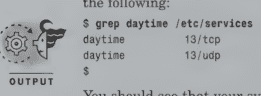

```bash
$ grep daytime /etc/services
daytime 13/tcp
daytime 13/udp
$
```

你应该看到你的系统识别 `daytime` Internet 服务，并且它通过 `tcp` 在端口 `13` 上可用。`grep` 输出的第一行证实了这一点。

## 提示

> `telnet` 程序通常可用于对 TCP/IP 服务器进行简单测试。但是，切记要在命令行中的 IP 号码（或主机名）后指定端口号非常重要。否则，端口号将默认为 23，这是 `telnet` 服务的端口！
>
> 例如，要测试 `daytime` 服务，你必须在命令行中的 IP 号码后指定端口号 13。

下一步是确保其正在运行。`telnet` 程序是一个在使用 `TCP/IP` 时通常可用于简单测试的程序。要测试 `daytime` 服务是否正在运行，你应该能够执行以下操作：

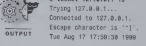

```bash
$ telnet 127.0.0.1 13
Trying 127.0.0.1...
Connected to 127.0.0.1.
Escape character is '^]'.
Tue Aug 17 17:59:30 1999
Connection closed by foreign host.
$
```

确保在 IP 地址 `127.0.0.1` 后面指定协议号 `13`（你可以使用远程 IP 地址，但为了本测试过程，请坚持使用 `127.0.0.1`）。如果你的 `daytime` 服务正在运行，你应该看到显示一个日期和时间字符串，随后是消息“Connection closed by foreign host.”。

如果服务不可用，你将看到类似的输出：


```bash
$ telnet 127.0.0.1 13
Trying 127.0.0.1...
telnet: Unable to connect to remote host: Connection refused
$
```

如果你看到这种情况，这表明你的 `daytime` 服务没有运行。要排查此问题，请检查你的 `/etc/inetd.conf` 文件：


```bash
$ grep daytime /etc/inetd.conf
# Echo, discard, daytime, and chargen are used
#daytime stream tcp nowait root internal
#daytime dgram udp wait root internal
$
```

如本例所示，文件中 `daytime` 服务条目的第一列有一个 `#` 字符。这实际上相当于将服务“注释掉”，使其不可用。这可能是出于防止来自互联网或其他网络中恶意用户攻击的预防措施（禁用任何你认为不需要的互联网服务是一个普遍原则）。为了尝试客户端示例程序，你需要启用 `tcp` `daytime` 服务条目（如果 `udp` 服务条目已被注释，可以保持其注释状态不变）。

要修复服务，请编辑文件 `/etc/inetd.conf`，移除包含 `tcp` 协议的 `daytime` 条目开头的 `#` 字符。再次使用 `grep` 检查，你应该看到如下内容：


```bash
$ grep daytime /etc/inetd.conf
# Echo, discard, daytime, and chargen are used
daytime stream tcp nowait root internal
daytime dgram udp wait root internal
$
```

在对 `/etc/inetd.conf` 文件进行更改后，你必须告诉 `inetd` 守护进程重新读取并处理已更改的文件。操作如下：


```bash
$ su -
Password:
# ps ax | grep inetd
313 ? S 0:00 inetd
828 pts/1 S 0:00 grep inetd
# kill -1 313
#
```

### 注意

如今，像 `kill` 命令这样的命令中正推广使用符号化信号名称。使用这些符号化信号名称的一个原因是为了安全，防止打字错误。例如，命令 `kill -1 313` 可以输入为：

```bash
kill -HUP 313
```

一些用户（包括作者）倾向于“冒险行事”，抵制了这种改变。

上述会话完成了以下操作：

1. 使用 `su` 命令切换到 `root` 账户。
2. 然后你找出 `inetd` 守护进程的进程 ID。示例中的 `ps` 命令表明 `inetd` 守护进程的进程 ID 为 `313`（你的进程 ID 可能不同）。
3. 使用 `kill -1 313` 命令向进程 ID `313`（你的进程 ID 可能不同）发送 `SIGHUP` 信号。务必不要忘记命令行中的 `-1`（或 `-HUP`）参数。否则，你会杀掉你的 `inetd` 守护进程！

完成所有这些后，你现在应该能够重复 `telnet` 测试并验证其是否正常工作。

### daytime 客户端程序

列表 7.7 中显示的节目执行了以下简单步骤：

1. 查找 `tcp` 协议的 `daytime` 服务。
2. 使用 `tcp` 连接到你的 PC 的 `daytime` 服务器。
3. 读取服务器发送回你的套接字的日期和时间字符串。
4. 向你的终端会话报告日期和时间字符串。
5. 关闭套接字并返回 shell。

列表 7.7 中的客户端程序如下所示。


### 列表 7.7：`daytime.c`—客户端 `daytime` 演示程序

```c
/* daytime.c:
 *
 * Example daytime client:
 */
#include <stdio.h>
#include <unistd.h>
#include <stdlib.h>
#include <errno.h>
#include <string.h>
#include <sys/types.h>
#include <sys/socket.h>
#include <netinet/in.h>
#include <arpa/inet.h>
#include <netdb.h>

/*
 * This function reports the error and
 * exits back to the shell:
 */
static void
bail(const char *on_what) {
    fputs(strerror(errno),stderr);
    fputs(": ",stderr);
    fputs(on_what,stderr);
    fputc('\n',stderr);
    exit(1);
}

int
main(int argc,char **argv) {
    int z;
    char *srvr_addr = NULL;
    struct sockaddr_in addr_srvr;/* AF_INET */
    int len_inet;                 /* Length  */
    int s;                       /* Socket  */
    struct servent *sp;         /* Service entry */
    char dtbuf[128];            /* Date/Time info */

/*
 * Use a server address from the command
 * line, if one has been provided.
 * Otherwise, this program will default
 * to using the arbitrary address
 * 127.0.0.1:
 */
if ( argc >= 2 ) {
    /* Addr on cmdline: */
    srvr_addr = argv[1];
} else {
    /* Use default address: */
    srvr_addr = "127.0.0.1";
}

    /*
     * Lookup the daytime tcp service:
     */
    sp = getservbyname("daytime", "tcp");
    if ( !sp ) {
        fputs("Unknown service: daytime tcp\n",
              stderr);
        exit(1);
    }

    /*
     * Create a server socket address:
     */
    memset(&adr_srvr, 0, sizeof adr_srvr);
    adr_srvr.sin_family = AF_INET;
    adr_srvr.sin_port = sp->s_port;
    adr_srvr.sin_addr.s_addr =
        inet_addr(srvr_addr);

    if ( adr_srvr.sin_addr.s_addr == INADDR_NONE )
        bail("bad address.");

    len_inet = sizeof adr_srvr;

    /*
     * Create a TCP/IP socket to use:
     */
    s = socket(PF_INET, SOCK_STREAM, 0);
    if ( s == -1 )
        bail("socket()");

    /*
     * Connect to the server:
     */
    z = connect(s, &adr_srvr, len_inet);
    if ( z == -1 )
        bail("connect(2)");

    /*
     * Read the date/time info:
     */
    z = read(s, &dbuf, sizeof dbuf-1);
    if ( z == -1 )
        bail("read(2)");

    /*
 * Report the Date & Time:
 */
    dtbuf[z] = 0;  /* null terminate string */

    printf("Date & Time is: %s\n", dtbuf);

    /*
     * Close the socket and exit:
     */
    close(s);
    putchar('\n');

    return 0;
}
```

该程序可以更详细地描述如下：

1. 如果命令行提供了 IP 地址，程序将使用该 IP 地址（第 48 行），否则默认使用你的本地主机（也称为 `localhost`），使用本地环回地址 `127.0.0.1`（第 51 行）。命令行上的 IP 地址允许用户测试另一台远程主机上的 `daytime` 服务。如果在本地主机上关闭了该服务但在其他地方可用，这特别有用。
2. 第 57 行查找通过 TCP/IP 使用的 `daytime` 互联网服务。如果找不到此服务，问题将在第 59 行至第 61 行报告。
3. 服务器地址和地址长度在第 67 行至第 76 行建立。特别注意第 69 行，其中建立了 `daytime` 服务的服务端口号。
4. 套接字在第 81 行创建。特别注意参数 `SOCK_STREAM`，它指定我们要一个 TCP/IP 套接字（与 `PF_INET` 一起使用时）。
5. 程序在第 88 行连接到服务器。如果失败，错误将在第 90 行处理。
6. 第 95 行显示 `read(2)` 调用，检索服务器的输出。返回值指示读取的字节数。否则，错误将在第 97 行处理。
7. 第 102 行确保有一个终止空字节，以便缓冲区 `dtbuf[]` 可以像 C 字符串一样处理。
8. 第 104 行报告服务器返回的值。
9. 套接字在第 109 行关闭。

### 列表 7.8：编译和运行 `daytime` 客户端程序


```bash
$ make daytime
gcc -c -D_GNU_SOURCE -Wall daytime.c
gcc daytime.o -o daytime
$ ./daytime
Date & Time is: Tue Aug 17 18:41:42 1999
$
```

该程序会输出一个额外的换行符，因为服务器在发送给客户端程序的日期和时间信息末尾放置了一个 `'\n'`。

# 在 `SOCK_DGRAM` 套接字上使用 `connect(2)`

`connect(2)` 函数在本章中作为连接型协议的使用方法被介绍给你。不过，在进入下一章之前，应当指出这条规则存在一个例外。

`connect(2)` 函数可以用于 UDP 套接字（对于协议族 `PF_INET`，使用 `SOCK_DGRAM`）。然而，这实际上并不意味着建立连接，而是对 UDP 套接字的使用施加了一些限制。此函数调用应当：

1. 在调用 `bind(2)` 函数之后（如果使用了 `bind(2)`）。


## 在套接字上读取或写入任何数据报之前

当在 UDP 套接字上使用 `connect(2)` 时，这表明所有写入的数据包都将寻址到指定服务器地址（参数 2）中指示的目的地址。这也意味着该套接字只感兴趣接收来自同一服务器的数据报。这可以防止接收到来自其他套接字的无关数据报，而在通常情况下 UDP 是允许这种情况发生的。内核会阻止多余的 UDP 数据报被你的 UDP 套接字接收。

采用这种技术的另一个好处是，它允许调用者使用 `read(2)` 和 `write(2)` 系统调用，而不是使用 `sendto(2)` 和 `recvfrom(2)` 函数。这节省了程序员为每个 I/O 操作提供套接字地址结构和长度的工作。

## 接下来是什么

本章向你介绍了面向连接的通信形式概念。示例的客户端程序表明，在进行任何 I/O 操作之前，它必须连接到服务器。

下一章将从服务器的角度向你介绍，以及服务器必须执行的不同步骤。你还将了解本书中尚未见过的两个重要的新套接字函数。


# 服务器的面向连接协议

上一章展示了如何编写面向连接的客户端程序。然而，客户端连接到的服务器程序必须使用不同的过程。本章将教你了解服务器的角色，包括以下主题：

- 面向连接的服务器使用的基本步骤
- 为什么 `bind(2)` 函数对服务器是必需的
- `listen(2)` 函数及其作用
- `accept(2)` 函数及其作用
- 如何编写面向连接的服务器程序

掌握这些主题后，你将有能力编程实现自己的自定义服务器程序。

## 理解服务器的角色

在上一章中，你看到了客户端程序如何连接到服务器进程。与无连接通信相比，从客户端的角度来看，唯一的新步骤是“连接”步骤。连接是使用 `connect(2)` 函数建立的。

你会记得，客户端程序需要五个基本步骤。以最简单的形式，这些步骤如图 8.1 左侧所示，即步骤 C1 到 C5。步骤 S1 到 S6 描绘了服务器程序将使用的六个基本步骤。图中所示的步骤从上到下流动。图中中心的两条带箭头的虚线水平线展示了这些事件如何在客户端程序和服务器程序之间形成关系。图 8.1 代表了服务器可以采取的最简单形式。随着你本章的阅读进展，该模型将进一步增强。

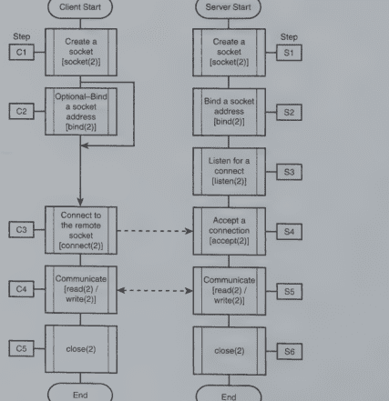

图 8.1：研究和比较客户端和服务器连接的这些连接步骤。

现在可以将服务器的基本步骤总结如下：

1. 创建套接字。
2. 绑定套接字地址（强制要求）。
3. 监听连接。
4. 接受连接。
5. 与客户端程序通信。
6. 关闭套接字。

请注意，对于服务器而言，`bind(2)` 步骤 2（图 8.1 中的 S2）不是可选的。除非客户端有用于连接的地址，否则服务器无法被客户端联系。另一方面，客户端的 `bind(2)` 步骤 C2 是可选的。因此，为了使服务器能够被联系，服务器地址不能完全是任意的（wild）。

还请注意，步骤 3（图 8.1 中的 S3）是一项新内容。服务器必须向内核表达其希望接受套接字连接的意愿。当讨论 `listen(2)` 函数时，将进一步讨论这一点。

在步骤 4（图 8.1 中的 S4）中接受连接的过程是另一个新的套接字概念。一旦客户端连接到服务器，服务器必须接受该连接。当本章后面讨论 `accept(2)` 函数时，将详细介绍这一点。

简而言之，服务器与客户端的不同之处如下：

- 服务器必须将服务器地址绑定到套接字。
- 服务器监听连接。
- 服务器接受连接。

## `listen(2)` 函数

`listen(2)` 函数是服务器表达其愿意监听连接的方式。该函数调用非常简单，其函数原型如下所示：

```c
#include <sys/socket.h>

int listen(int s, int backlog);
```

两个输入参数如下：

- 用作监听套接字的套接字 `s`。
- `backlog`，指定连接队列条目的长度。

当函数成功时返回零。否则返回 -1，并且将错误原因记录到 `errno` 中。

## 理解连接队列

应用程序程序员在调用 `listen(2)` 函数时，似乎必须提供一个像 `backlog` 参数值这样晦涩难懂的东西，这可能会显得奇怪。然而，这是有充分理由的。图 8.2 展示了非常流行的 www.wooho.com Web 服务器的一般活动。

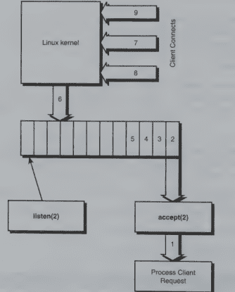

**图 8.2：** Linux 内核在接受新连接时管理 backlog 队列。

请注意图 8.2 中标记为 `listen(2)` 的块。该块表示对 `listen(2)` 的调用，它建立了一个监听队列。一个小箭头指向它建立的队列，该队列位于 Linux 内核中。此队列的长度由 `listen(2)` 调用的 `backlog` 参数决定。

现在看图 8.2 右下角的块。该块标记为“处理客户端请求”。标记为数字 1 的箭头表示进入你服务器的第一个连接。在图 8.2 中，这个连接刚刚被 `accept(2)` 函数调用接受，并正在由你的服务器代码进行处理。

然而，当服务器正在处理第一个客户端连接时，来自世界各地的更多连接请求正在进入你的服务器。在 `listen(2)` 建立的队列内，你有第 2 到第 5 个连接请求待处理并等待接受。

图 8.2 显示另一个客户端请求作为第 6 个请求被 Linux 内核插入到队列的末尾。即使正在发生这种情况，第 7、8 和 9 个连接请求也在被接收。确实是一个繁忙的服务器！

图 8.2 的主要目的是演示 `listen(2)` 函数调用中 `backlog` 参数的用途。如你所见，此参数设置了传入队列的长度。既然你理解了它的用途，让我们讨论一下在此参数中应使用哪些实用值。

## 指定 `backlog` 的值

历史上，`listen(2)` 调用中 `backlog` 的值不够精确。在 UNIX 早期，通常使用值 5。然而，在当今更快、更繁忙的系统中，这个值可能不适合你的服务器应用程序。那么如何确定一个合理的值呢？

UNIX 文献建议不要在 `backlog` 参数中使用 0 值。这对于编写需要移植到各种 UNIX 变体（包括 Linux）的应用程序的程序员来说是明智的建议。原因是，对于某些平台，这意味着不接受任何连接；对于其他平台，这意味着在 `accept(2)` 中至少可以有一个待处理的连接。负值没有意义，因此不应使用。

`listen(2)` 的手册页指出，`backlog` 参数的行为在 Linux 内核版本 2.2 中发生了变化。在此之前，此计数包括那些仍在与监听套接字建立通信的连接。从 2.2 及以后，此 `backlog` 计数仅涉及那些已与监听套接字建立连接但等待服务器接受（accepted）的连接。

对于小型服务器，队列长度似乎应指定为 5 或更大。然而，对于 Web 服务器，你可能需要尝试更大的数字。Richard Stevens 发布的一些测试表明，对于每小时接收大约 45,000 次连接的 Web 服务器，你可能希望使用 16 或更大的 `backlog` 长度。

最终选择的 `backlog` 参数值在很大程度上取决于每次 `accept(2)` 函数调用之间经过的时间。如果你的服务器接受一个连接，然后在接受下一个连接之前完全处理该请求，你将希望使用较大的 `backlog` 值。在此场景中，每个请求的处理时间越长，`backlog` 队列长度就变得越关键。

另一方面，如果你的服务器可以并发处理多个客户端连接，则 `backlog` 参数值会较低。这是因为服务器将在非常高效的循环内回环并接受下一个待处理的连接。在服务端并发处理多个客户端将在第 11 章“并发客户端服务器”中介绍。

## `accept(2)` 函数调用

在本章中，你已多次看到提及 `accept(2)` 函数调用。现在是全面讨论该函数的合适时机，这样你就能清楚了解其作用。函数原型如下所示：

```c
#include <sys/types.h>
#include <sys/socket.h>

int accept(int s, struct sockaddr *addr, int *addrlen);
```

`accept(2)` 函数接受三个参数。它们分别是：

- 输入套接字 `s`，它正在监听连接。
- 指向套接字地址结构的指针（`addr`），它将接收客户端套接字地址。
- 指向接收套接字地址缓冲区 `addr` 的最大长度的指针（`addrlen`）。该指针所指向的 `int` 值既是输入值也是输出值。在输入时，它指定 `addr` 的最大长度。函数返回后，该值包含返回地址的实际长度。

> **注意**
>
> 请注意 `accept(2)` 的第三个参数是指向整数数据类型的指针。它指向的整数既是输入值也是输出值。在调用 `accept(2)` 之前，务必将该值初始化为地址的最大长度。

`accept(2)` 函数的返回值在成功时是一个新的套接字。否则，返回值为 `-1`，且 `errno` 的值包含失败的原因。


## 理解 `accept(2)` 的作用

`accept(2)` 返回另一个套接字可能看起来有些奇怪。毕竟，使用原始套接字不是更好吗？答案在于大多数服务器设计的性质。服务器在接受一个客户端连接后，必须愿意接受来自客户端的额外连接。然而，任何单个套接字只能连接到一个客户端。如果`www.woohoo.com`服务器一次只能服务一个客户端，它会处于什么境地？

先前展示的图 8.1 对服务器职责的描述过于简化。图 8.3 进行了改进，展示了简单服务器将使用的步骤。

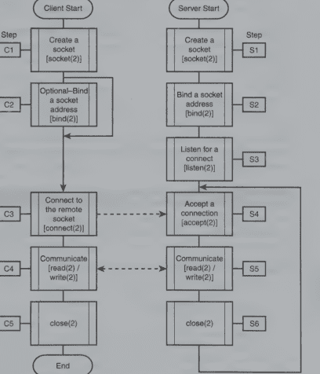

**图 8.3**：这里是一个改进的图表，解释了客户端和服务器的连接步骤（注意步骤`S4`到`S6`的重复）。

图 8.3 展示了服务器如何为每个连接的客户端重复步骤`S4`到`S6`。服务器在步骤`S6`中通过`close(2)`函数调用结束对每个客户端请求的处理。然而，为了继续接收新连接，服务器需要其能够监听额外请求的原始套接字。

总之，服务器程序使用两种类型的套接字。它们是：

- 用于监听的套接字（在某个时刻传递给`listen(2)`函数调用）。不允许向这些套接字读取或写入数据。
- 由`accept(2)`返回的套接字。这些已连接到客户端进程，可用于读取和写入数据。

通过将套接字传递给`listen(2)`函数，使其成为“监听套接字”。从`accept(2)`返回的套接字是已连接的套接字，可以从中读取或向其写入。

> **注释**
>
> `accept(2)`调用的输入套接字必须是监听套接字。任何尝试使用非监听套接字的行为都会导致函数返回错误。

你必须确保理解这些概念，以便编写`TCP/IP`服务器程序。如果这对你来说仍不清楚，稍后在列表 8.1 中给出的示例程序将有助于澄清所有这些内容。

## 编写 `TCP/IP` 服务器

本节介绍一个简单的`TCP/IP`服务器程序。该服务器将替换前一章中使用的`daytime`服务。列表 8.1 显示了该程序的源代码。

**列表 8.1：**`server.c`——替换型`Daytime`服务器


```c
1: /* server.c:
2:  *
3:  *    Example daytime server:
4:  */
5:
6: #include <stdio.h>
7: #include <unistd.h>
8: #include <errno.h>
9: #include <string.h>
10: #include <time.h>
11: #include <sys/types.h>
12: #include <sys/socket.h>
13: #include <netinet/in.h>
14: #include <arpa/inet.h>
15: #include <netdb.h>
16:
17: /*
18:  * This function reports the error and
19:  * exits back to the shell:
20:  */
21: static void
22: bail(const char *on_what) {
23:     if ( errno != 0 ) {
24:         fputs(strerror(errno),stderr);
25:         fputs(": ",stderr);
26:     }
27:     fputs(on_what,stderr);
28:     fputc('\n',stderr);
29:     exit(1);
30: }
31:
32: int
33: main(int argc,char **argv) {
34:     int z;
35:     char *svr_addr = NULL;
36:     char *svr_port = "9099";
37:     struct sockaddr_in adr_svr;/* AF_INET */
38:     struct sockaddr_in adr_clnt;/* AF_INET */
39:     int len_inet;            /* length   */
40:     int s;                   /* Socket   */
41:     int c;                   /* Client socket */
42:     int n;                   /* bytes    */
43:     time_t td;               /* Current date&time */
44:     char dtbuf[128];         /* Date/Time info */
45:
46: /*
47:  * Use a server address from the command
48:  * line, if one has been provided.
49:  * Otherwise, this program will default
50:  * to using the arbitrary address
51:  * 127.0.0.1:
52:  */
53:
54: if ( argc >= 2 ) {
55:     /* Addr on cmdline: */
56:     svr_addr = argv[1];
57: } else {
58:     /* Use default address: */
59:     svr_addr = "127.0.0.1";
60: }
61:
62: /*
63:  * If there is a second argument on the
64:  * command line, use it as the port #:
65:  */
66: if ( argc >= 3 )
67:     svr_port = argv[2];
68:
69: /*
70:  * Create a TCP/IP socket to use:
71:  */
72: s = socket(PF_INET,SOCK_STREAM,0);
73: if ( s == -1 )
74:     bail("socket()");
75:
76: /*
77:  * Create a server socket address:
78:  */
79: memset(&adr_svr,0,sizeof adr_svr);
80: adr_svr.sin_family = AF_INET;
81: adr_svr.sin_port = htons(atoi(svr_port));
82: if ( strcmp(svr_addr,"*") != 0 ) {
83:     /* Normal Address */
84:     adr_svr.sin_addr.s_addr =
85:         inet_addr(svr_addr);
86:     if ( adr_svr.sin_addr.s_addr
87:         == INADDR_NONE )
88:         bail("bad address.");
89: } else {
90:     /* Wild Address */
91:     adr_svr.sin_addr.s_addr =
92:         INADDR_ANY;
93: }
94:
95: /*
96:  * Bind the server address:
97:  */
98: len_inet = sizeof adr_svr;
99: z = bind(s,(struct sockaddr *)&adr_svr,
100:          len_inet);
101: if ( z == -1 )
102:     bail("bind(2)");
103:
104: /*
105:  * Make it a listening socket:
106:  */
107: z = listen(s,10);
108: if ( z == -1 )
109:     bail("listen(2)");
110:
111: /*
112:  * Start the server loop:
113:  */
114: for (;;) {
115:
116:     /*
117:      * Wait for a connect:
118:      */
119:     len_inet = sizeof adr_clnt;
120:     c = accept(s,
121:           (struct sockaddr *)&adr_clnt,
122:           &len_inet);
123:
124:     if ( c == -1 )
125:         bail("accept(2)");
126:
127:     /*
128:      * Generate a time stamp:
129:      */
130:     time(&td);
131:     n = (int) strftime(dtbuf, sizeof dtbuf,
132:                   "%A %b %d %H:%M:%S %Y\n",
133:                   localtime(&td));
134:
135:     /*
136:      * Write result back to the client:
137:      */
138:     z = write(c,dtbuf,n);
139:     if ( z == -1 )
140:         bail("write(2)");
141:
142:     /*
143:      * Close this client's connection:
144:      */
145:     close(c);
146: }
147: /* Control never gets here */
148: return 0;
149: }
```

### 1. 程序基本步骤
列表 8.1 中程序的基本步骤可以列举如下：

1. 确定服务器的网络地址（第 53 行至第 59 行）。默认值是本地环回地址 `127.0.0.1`（第 58 行）。

2. 确定服务器端口号（第 65 行至第 66 行）。请注意，默认端口是 `9099`（第 36 行）。

### 3. 创建套接字（第 71 到 73 行）

### 4. 创建服务器套接字地址（第 78 到 92 行）

### 5. 绑定套接字地址（第 97 到 101 行）

### 6. 将套接字标记为监听套接字（第 106 到 108 行）

### 7. 启动客户端服务循环（第 113 行）

### 8. 接受客户端连接（第 117 到 123 行）

### 9. 生成日期和时间字符串（第 128 到 131 行）

### 10. 将日期和时间字符串写回给客户端（第 136 到 138 行）

### 11. 关闭客户端连接（第 149 行）


某些步骤需要进一步解释。在步骤 2 中，程序接受一个端口号作为可选的命令行参数`two`。这是必要的，因为你不想让你的服务器版本运行在标准端口`13`上（请记住上一章的内容，你的`daytime`服务器就监听该端口）。相反，默认情况下将使用端口`9999`，该端口不需要`root`权限即可运行，并且不会干扰你的标准服务。命令行参数允许你根据个人喜好使用不同的端口号。

> **注意**
>
> TCP/IP 端口`1`到`1023`保留给特权程序（以`root`身份运行）使用。非特权程序使用`1024`或更高的端口。
>
> 请注意，值为零的端口是一个通配端口号。如果在调用`bind(2)`时将端口号指定为零，系统将分配一个未分配的端口号。

步骤 4 与之前的程序不同。第 81 行调用`strcmp(3)`来检查是否针对服务器地址指定了`"*"`。如果是，则在第 90 和 91 行提供一个通配地址。这可能会引起你的注意，因为之前提到过服务器地址不能完全通配。需要注意的重要词汇是`*完全*`。端口和 IP 号不能同时为通配。在此示例中，端口号不是通配的，但在服务器地址中允许 IP 号为通配。这允许服务器接受来自任何 IP 接口的连接。这对于拥有多个网卡的系统来说非常重要。

> **提示**
>
> 服务器地址不能完全通配。但是，你可以指定端口号，TCP/IP 地址的 IP 部分可以是有效的（`INADDR_ANY`）。这允许你的服务器接受来自该主机上任何有效 IP 接口的连接。

步骤 8 是服务器程序调用`accept(2)`函数的地方。这是服务器控制发生“阻塞”的位置。除非有客户端连接，否则服务器不会执行任何后续指令。连接发生后，`accept(2)`调用将在第 122 行返回。请注意，变量`c`持有由`accept(2)`函数调用返回的客户端套接字。

客户端请求处理在第 9 到 11 步中继续。然后，服务器重复步骤 8 以等待下一个客户端连接。

以下内容展示了如何编译和调用服务器程序：

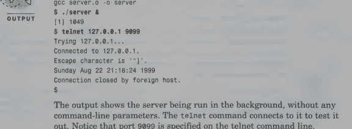

输出显示服务器在后台运行，未使用任何命令行参数。`telnet`命令连接到该服务器以进行测试。请注意，`telnet`命令行中指定的端口是`9099`。

服务器返回的输出故意与标准`daytime`服务器不同。标准`daytime`服务器会缩写星期名称。由于会话输出显示了完整的星期名称，你可以确信你联系的是你的服务器，而不是标准服务器。

在进入下一节之前，请停止你的服务器。该服务器被设计为无限循环运行，直到你终止它。因此，你可以简单地列出你的作业并将其终止，如下所示：


`jobs`命令是`bash`shell 内置命令，允许你查看你在后台启动并留待运行的进程。`kill`命令中的`%1`会使 shell 在调用`kill`命令之前替换为真实的进程 ID（PID）。如果你让服务器在端口`9099`上继续运行，并尝试在同一端口上启动另一个服务器，你将看到类似这样的情况：

```
$ ./server &
Address already in use: bind(2)
[2] 1057
[2]  Exit 1
$ ./server
$
```

> **提示**
>
> 有时即使服务器没有运行，你也会收到“Address already in use”错误。Linux 内核会在服务器终止后的短时间内使服务器地址不可用。这种行为由套接字选项`SO_LINGER`控制，该选项尚未介绍。这在第 12 章“套接字选项”中有所涵盖。

## 运行通配服务器

通过命令`./server &`启动的服务器，使用的是绑定到 IP 地址`127.0.0.1`的套接字（程序的默认设置）。这意味着只有本地主机上的进程才能联系到该服务器。一种替代方法是使用外部 IP 号运行服务器，如下所示：

```
$ ./server 192.168.0.1 &
```

这样做的缺点是，你的服务器将只接受来自具有匹配 IP 号的那一个网络接口的连接。你真正需要的是为该服务器设置一个通配 IP 号。可以按以下方式实现：

```
$ ./server '*' &
```

> **警告**
>
> 务必将星号字符包含在一对单引号内。否则，shell 会在启动服务器之前将其扩展为文件名列表。

虽然在命令行上未指定端口号，但该程序默认使用的端口号是`9099`。启动如上述所示的服务器后，你现在可以从本地或远程位置连接它。以下内容显示了从启动服务器的主机`pepper`进行的两次连接：

```
$ ./server '*' &
[1] 1078
pepper

$ telnet 127.0.0.1 9099
Trying 127.0.0.1 ...
Connected to 127.0.0.1.
Escape character is '^]' .
Sunday Aug 22 21:40:19 1999
Connection closed by foreign host.
```

```
@pepper
$ telnet 192.168.0.1 9099
Trying 192.168.0.1...
Connected to 192.168.0.1.
Escape character is '^]'.
Sunday Aug 22 21:40:27 1999
Connection closed by foreign host.
@pepper
$
```

上面显示的会话演示了以下内容：

1. 会话输出中的第一个命令显示服务器在`pepper`上以通配服务器地址启动（但也使用了默认端口号`9099`）。
2. 对地址`127.0.0.1`端口`9099`的`telnet`成功激发了我们服务器的响应。此联系是使用本地环回接口与服务器进行的。
3. 对地址`192.168.0.1`端口`9099`的`telnet`也激发了我们服务器的成功响应。这证明了可以通过另一个不同的 IP 地址访问该服务器。

作为服务器地址具有通配性的进一步证明，你可以尝试从另一台主机联系该服务器。以下内容显示了从主机`slug`发起的连接尝试：


```
@slug
$ telnet 192.168.0.1 9099
Trying 192.168.0.1...
Connected to 192.168.0.1.
Escape character is '^]'.
Sunday Aug 22 21:47:52 1999
Connection closed by foreign host.
@slug
$
```

在此示例中，主机`slug`上使用的`telnet`命令仍然联系接口地址为`192.168.0.1`的服务器。这证明了连接尝试是通过以太网链路经由网卡进行的，并能够联系到服务器。如果服务器地址仅绑定到`127.0.0.1`，主机`slug`将无法联系到`pepper`上的服务器。

## 修改客户端程序

为了提供更具有说服力的演示，你将不再使用`telnet`命令。相反，将使用上一章中的客户端程序并进行一些修改。列表 8.2 显示了修改后的客户端程序。

### 列表 8.2：`daytime.c` — 用于 daytime 服务的修改版客户端程序


```c
/* daytime.c:
 *
 * Example daytime client, modified
 * to accept different port numbers:
 */

#include <stdio.h>
#include <unistd.h>
#include <stdlib.h>
#include <errno.h>
#include <string.h>
#include <sys/types.h>
#include <sys/socket.h>
#include <netinet/in.h>
#include <arpa/inet.h>
#include <netdb.h>

/* This function reports the error and
 * exits back to the shell:
 */
static void
bail(const char *on_what) {
    if (errno != 0) {
        fputs(strerror(errno), stderr);
        fputs(": ", stderr);
    }
    fputs(on_what, stderr);
    fputc('\n', stderr);
    exit(1);
}

int
main(int argc, char **argv) {
    int z;
    char *srvr_addr = NULL;
    char *srvr_port = "9009";
    struct sockaddr_in adr_srvr; /* AF_INET */
    int len_inet;                /* length */
    int s;                       /* Socket */
    char dtbuf[128];             /* Date/Time info */

/*
 * Use a server address from the command
 * line, if one has been provided.
 * Otherwise, this program will default
 * to using the arbitrary address
 * 127.0.0.1:
```

## 接下来是什么

在本章中，你查看了服务器所扮演的角色。你看到了它与客户端有何不同，因为它必须调用 `listen(2)` 和 `accept(2)` 函数。

下一章将讨论主机名查找。截至本书此阶段，你一直将互联网地址限制为特定的 IP 号码。下一章将向你展示如何除了 IP 号码之外还使用主机名。

## 主机名和网络名称查找

现在是正午时分，你上午的会议和问题的战斗暂时平息了。隔板的寂静被你带来的棕色纸袋午餐的噼啪声所破坏。你的 `Netscape` 浏览器在一整个上午处于最小化状态待命后，重新活跃起来。你敲了几下键盘 `http://206.43.198.67` 并按下了 `ENTER`。嗯？

这张图有什么问题？它是 IP 号码 `206.43.198.67`，不是吗？毕竟，那是哪个网站？你很可能知道这是 `www.lwn.net` 网站，在那里你可以获取 Linux 周刊（至少在写作本书时是这样）。

你在工作中的同事不会让你从 `ftp` 站点 `152.2.254.81` 获取一些源代码，对吧？相反，他会让你从 `sunsite.unc.edu` 进行 `ftp` 传输。你知道，IP 号码并不容易记住。在本章中，你将学习：

- 如何确定你的本地主机名
- 如何将主机名解析为 IP 号码
- 如何将 IP 号码解析为主机名

完成本章后，你将能够在客户端和服务器程序中使用主机名或 IP 号码。

## 理解对名称的需求

人类更喜欢使用和记忆名称，而不是 IP 号码。名称实际上为我们解决了网络世界中的许多问题：

- 它们为站点提供了对人类友好的引用。
- 它们允许 IP 号码改变，而名称保持不变。
- 它们允许为同一主机或服务提供多个 IP 号码作为可能性。

你已经理解，名称提供了对 IP 号码更简单的引用。然而，第二点是，名称可以保持固定，但允许主机的 IP 号码改变。由于网络变化、`ISP` 变化、设备变化等原因，IP 号码经常改变。只要你记住互联网站点的名称，你就不必担心带你到达那里的实际 IP 号码是什么。

最后一点很容易被忽视。查找 `ftp.redhat.com`（在写作时）产生了两个 IP 号码：

- `208.178.165.228`
- `206.132.41.212`

无论这两个 IP 号码是指向同一个 `ftp` 主机还是为了负载均衡目的的两个不同的镜像站点都无关紧要。事实是，通过使用这两个 IP 号码中的任意一个，你都可以获取你想要的文件。

这个引言引导你进入本章的主题：名称解析。首先，你将学习如何查询本地系统以获取有关其本身的信息。然后，你将学习如何使用远程主机名称，查找它们，并将它们转换为 IP 号码。

## 使用 uname(2) 函数

一个有用的函数是 `uname(2)` 函数。此函数告诉你的程序一些关于其执行所在系统的信息。此函数的函数原型如下：

```c
#include <sys/utsname.h>
```

```c
int uname(struct utsname *buf);
```

该函数将信息返回到结构 `buf` 中。成功时返回的值为零，报告错误时返回 -1。外部变量 `errno` 将包含错误的原因。

结构 `struct utsname` 定义如下：

```c
#include <sys/utsname.h> /* defines the following structure */

struct utsname {
    char    sysname[SYS_NMLN];
    char    nodename[SYS_NMLN];
    char    release[SYS_NMLN];
    char    version[SYS_NMLN];
    char    machine[SYS_NMLN];
    char    domainname[SYS_NMLN];
};
```

结构成员在表 9.1 中进行了详细说明。

**表 9.1: utsname 结构成员**

| 成员 | 描述 |
| :--- | :--- |
| `sysname` | 这表示正在使用的操作系统。对于 Linux，该值是 C 字符串 "Linux"。 |
| `nodename` | 这表示机器的网络节点主机名。 |
| `release` | 操作系统发行版。例如，对于内核发行版 2.2.10，返回 C 字符串 "2.2.10"。 |
| `version` | 操作系统版本。对于 Linux，这代表内核构建的版本号、日期和时间戳。 |
| `machine` | 这表示主机的硬件类型。例如，"i686" 代表 `Pentium` CPU。 |
| `domainname` | 这返回主机的 `NIS/YP` 域名。 |

**注意**

`NIS/YP`（网络信息服务）超出了本书的范围。`NIS` 为网络中的一组主机提供集中式信息管理。例如，它允许集中管理用户、组和密码。

列表 9.1 中显示了一个简单的程序，允许你测试 `uname(2)` 返回的值。此程序调用 `uname(2)`，然后显示结构 `utsname` 中返回的信息内容。

**列表 9.1: uname.c—用于 uname(2) 的简单测试程序**


```c
/* uname.c:
 *
 * Example of uname(2):
 */

#include <stdio.h>
#include <unistd.h>
#include <stdlib.h>
#include <errno.h>
#include <string.h>
#include <sys/utsname.h>

int
main(int argc, char **argv) {
    int z;
    struct utsname u_name;
    
    z = uname(&u_name);
    
    if ( z == -1 ) {
        fprintf(stderr, "%s: uname(2)\n",
                strerror(errno));
        exit(1);
    }
    
    printf( " sysname[] = '%s'\n",
            u_name.sysname);
    printf( " nodename[] = '%s'\n",
            u_name.nodename);
    printf( " release[] = '%s'\n",
            u_name.release);
    printf( " version[] = '%s'\n",
            u_name.version);
    printf( " machine[] = '%s'\n",
            u_name.machine);
    printf( " domainname[] = '%s'\n",
            u_name.domainname);
    
    return 0;
}
```

列表 9.1 中使用的步骤如下：

- 分配结构 `u_name` 以接收来自 `uname(2)` 的数据（第 15 行）。
- 在第 17 行调用 `uname(2)`。
- 检查并报告错误（第 19 行到第 23 行）。
- 报告返回的值（第 25 行到第 36 行）。

以下会话输出展示了如何编译和运行该程序。示例系统 `lux` 上程序的输出也作为一个示例包含在内（注意该系统未配置为使用 NIS）：

```sh
@lux
$ make uname
gcc -c -D_GNU_SOURCE -Wall -Wreturn-type uname.c
gcc uname.o -o uname
```


对程序进行的小改动是：

- 该程序现在接受命令行上的可选端口号作为第二个参数（第 60 行和第 61 行）。
- 移除了对 `getservbyname(3)` 的调用，因为端口号现在默认为 9999 或在命令行上明确给出。

以下会话展示了如何编译和测试客户端程序，针对一个宽泛地址的服务器：

```sh
@pepper
$ make daytime
gcc -c -D_GNU_SOURCE -Wall -Wreturn-type daytime.c
gcc daytime.o -o daytime
@pepper
$ ./daytime 127.0.0.1 9999
Date & Time is: Sunday Aug 22 22:02:19 1999

@pepper
$ ./daytime 192.168.0.1 9999
Date & Time is: Sunday Aug 22 22:02:30 1999

@pepper
$
```

该会话演示了客户端程序如何成功从主机 `pepper` 上两个可能的 IP 地址调用同一个服务器。如果你的网络中有远程主机，请务必远程尝试该程序。

## 获取主机名和域名

函数 `gethostname(2)` 和 `getdomainname(2)` 是另外两个可用于查询当前系统信息的函数。

### 使用 gethostname(2) 函数

`gethostname(2)` 函数可用于确定当前的主机名。其函数原型如下所示：

```c
#include <unistd.h>

int gethostname(char *name, size_t len);
```

此函数接受两个参数：

- 接收缓冲区 `name`，其长度必须为 `len` 字节或更长。
- 接收缓冲区 `name` 的最大长度（`len`，单位为字节）。

如果成功，该函数的返回值为零。如果发生错误，则返回 -1。错误由外部变量 `errno` 描述。

> **提示**
>
> `gethostname(2)` 的 `len` 参数必须包含要返回的主机名的总长度以及末尾的空字节。

### 使用 getdomainname(2) 函数

`getdomainname(2)` 函数是另一个便利函数，允许程序员查询程序正在执行的宿主机的 NIS 域名。函数原型如下：

```c
#include <unistd.h>

int getdomainname(char *name, size_t len);
```

此函数的用法与 `gethostname(2)` 函数完全相同。这两个参数是：

- 缓冲区 `name`，用于接收域名，且长度至少为 `len` 字节。
- 缓冲区 `name` 的缓冲区长度（`len`，单位为字节）。

同样，函数成功时返回零。发生错误时返回 -1。外部变量 `errno` 包含失败时的错误代码。

Linux 的手册页指出，`getdomainname(2)` 函数内部使用 `uname(2)` 函数来获取并返回 NIS 域名。

### 测试 gethostname(2) 和 getdomainname(2)

这两个函数在清单 9.2 中提供的程序中进行演示。该程序只是调用这些函数并报告其结果。


**清单 9.2：gethostn.c——gethostname(2) 和 getdomainname(2) 演示程序**

```c
/* gethostn.c:
 *
 * Example of gethostname(2):
 */
#include <stdio.h>
#include <unistd.h>
#include <stdlib.h>
#include <errno.h>
#include <string.h>

int
main(int argc, char *argv[]) {
    int z;
    char buf[32];

    z = gethostname(buf, sizeof buf);

    if (z == -1) {
        fprintf(stderr, "%s: gethostname(2)\n",
                strerror(errno));
        exit(1);
    }

    printf("host name = '%s'\n", buf);

    z = getdomainname(buf, sizeof buf);

    if (z == -1) {
        fprintf(stderr, "%s: getdomainname(2)\n",
                strerror(errno));
        exit(1);
    }

    printf("domain name = '%s'\n", buf);

    return 0;
}
```

使用的步骤如下：

1. 定义一个大小合适的缓冲区（第 14 行）。
2. 调用 `gethostname(2)` 将主机名获取到字符数组 `buf[]` 中（第 16 行）。
3. 检查并报告错误（第 18 至 22 行）。
4. 报告主机名（第 24 行）。
5. 调用 `getdomainname(2)` 将 NIS/YP 域名获取到同一个字符数组 `buf[]` 中（第 26 行）。
6. 检查并报告错误（第 28 至 32 行）。
7. 报告域名（第 34 行）。

以下输出会话显示了在假设的系统 `tux` 上对该程序进行编译和运行的过程：


```bash
$ make gethostn
gcc -c -D_GNU_SOURCE -Wall -Wreturn-type gethostn.c
gcc gethostn.o -o gethostn
$ ./gethostn
host name = 'tux'
domain name = ''
```

在这个示例运行中，您可以看到主机和域名的值都已成功报告（尽管由于未配置 NIS 域，域名被报告为空字符串）。您的值将与所示示例有所不同，特别是如果您已经配置了 NIS 域。在了解了如何查询本地系统后，现在是将注意力转向解析远程主机名的时候了。这将是本章剩余部分的重点。


## 解析远程地址

将类似 `www.lwn.net` 这样的名称转换为 IP 编号的过程相当复杂。它涉及本地系统 `/etc` 目录中的多个文件，包括诸如 `/etc/resolv.conf`、`/etc/hosts` 和 `/etc/nsswitch.conf` 等文件（仅举几个例子）。根据本地系统的配置情况，其他文件和守护进程也可能发挥作用。例如，在查询这些文件之后，可以查询名称服务器，然后该服务器可以将查询转发给其他名称服务器。所有这些复杂性都是你在编写应用程序时真正不想去考虑的细节。

幸运的是，应用程序编写者可以扮演鸵鸟的角色，把头埋进沙子里。如果系统配置正确，程序员只需要几个系统函数调用即可。接下来介绍的是一组相关函数，它们为您隐藏了远程名称查找的复杂性。

> **注意**
>
> 本书假设你拥有一个配置正确的 Linux 系统。关于系统管理和网络管理已经写了很多整本书。因此，本书的重点是教你如何使用套接字编程，而不是如何设置域名和名称服务器。

## 错误报告

即将描述的函数使用不同的变量进行错误报告。在普通的 C 库函数中，错误代码报告给变量 `errno`（通过包含 `errno.h` 声明）。然而，本节的函数将其错误报告给变量 `h_errno`。其原型如下所示：

```c
#include <netdb.h>
extern int h_errno;
```

`h_errno` 变量是一个外部整型变量。以下函数将错误发布到 `h_errno`：

- `gethostbyname(3)`
- `gethostbyaddr(3)`

以下函数使用 `h_errno` 的值作为输入：

- `herror(3)`
- `hstrerror(3)`

> **警告**
>
> 请注意，`h_errno` 值存在一个缺陷，即它不能在同一个进程中的不同线程之间共享。虽然较新的 `glibc` 库已使 `errno` 线程安全，但 `h_errno` 值不是线程安全的。

## 报告 h_errno 错误

您可能知道，`strerror(3)` 函数方便地将 `errno` 值转换为人类可读的错误消息。同样，存在两种报告 `h_errno` 值的方法：

```c
#include <netdb.h>
extern int h_errno;

void herror(const char *msg);

const char *hstrerror(int err);
```

函数 `herror(3)` 很像 `perror(3)` 函数。`herror(3)` 函数现在被认为是过时的，但您可能在现有的源代码中找到它。它打印消息 `msg`，随后跟随错误文本。这被写入标准错误（`stderr`）输出流。

`hstrerror(3)` 函数镜像了熟悉的 `strerror(3)` 函数的功能。它接受 `h_errno` 输入值作为输入，并返回一个指向描述错误的文本消息的指针。返回的指针仅在下一次调用此函数之前有效。

## 理解错误代码

用于 `h_errno` 变量的 C 宏与 `errno` 值有显著差异。表 9.2 列出了在调用 `gethostbyname(3)` 和 `gethostbyaddr(3)` 时你可能会遇到的错误代码。

### 表 9.2：h_errno 错误代码

| 错误宏 | 描述 |
| :--- | :--- |
| `HOST_NOT_FOUND` | 指定的主机名未知。 |
| `NO_ADDRESS` | 指定的主机名有效，但没有对应的 IP 地址。 |
| `NO_DATA` | 同 `NO_ADDRESS`。 |
| `NO_RECOVERY` | 发生了不可恢复的名称服务器错误。 |
| `TRY_AGAIN` | 权威名称服务器上发生了临时错误。请稍后重试此操作。 |

请注意，表 9.2 中列出的 `TRY_AGAIN` 错误代码表示通过重试可能克服的状态。另一方面，`NO_RECOVERY` 错误表示不应重试的名称服务器错误，因为该状态无法恢复。`NO_ADDRESS`（或 `NO_DATA`）错误表明被查询的名称是已知的，但没有为其定义 IP 地址。最后，错误代码 `HOST_NOT_FOUND` 表明被查询的名称是未知的。

## 使用 gethostbyname(3) 函数

这是本章中需要学习的最重要的函数。该函数接受您要解析的主机名称，并返回一个以各种方式识别该主机的结构体。函数原型如下：

```c
#include <netdb.h>
extern int h_errno;

struct hostent *gethostbyname(const char *name);
```

函数 `gethostbyname(3)` 接受一个输入参数，即代表您要解析为主机地址的主机名的 C 字符串。如果调用成功，返回值是指向 `hostent` 结构体的指针（见 清单 9.3）。如果函数失败，则返回空指针，并且 `h_errno` 的值包含失败的原因。


### 清单 9.3：struct hostent 结构体

```c
struct hostent {
    char    *h_name;    /*  主机的官方名称  */
    char    **h_aliases;  /*  别名列表  */
    int     h_addrtype;   /*  主机地址类型  */
    int     h_length;     /*  地址长度  */
    char    **h_addr_list;  /*  地址列表  */
};

/*  为了向后兼容  */
#define h_addr  h_addr_list[0]
```

请熟悉 `hostent` 结构体，因为在进行套接字编程时您会经常使用它。

#### hostent 的 h_name 成员

`hostent` 结构体中的 `h_name` 条目是正在查询的主机的官方名称。它也被称为主机的 `canonical`（规范）名称。如果您提供了别名，或没有域名后缀的主机名，那么这个条目将描述您所查询对象的正确名称。这个条目对于显示结果或将其记录到日志文件中非常有用。

#### hostent 的 h_aliases 成员

返回的 `hostent` 结构体中的 `h_aliases` 成员是所查询主机名的别名的数组。列表的末尾由一个 `NULL` 指针标记。例如，`www.lwn.net` 的所有别名列表可以按如下方式报告：

```c
struct hostent *ptr;
int x;

ptr = gethostbyname("www.lwn.net");

for ( x=0; ptr->h_aliases[x] != NULL; ++x )
    printf("alias = '%s'\n", ptr->h_aliases[x]);
```


前面的示例中没有显示错误检查。如果 `ptr` 为 `NULL`，则表示没有可用信息。

#### hostent 的 h_addrtype 成员

当前 `h_addrtype` 成员返回的值是 `AF_INET`。然而，随着 `IPv6` 的全面实现，名称服务器也将能够返回 `IPv6` 地址。当这种情况发生时，在适当的时候 `h_addrtype` 也将返回值 `AF_INET6`。

`h_addrtype` 值的目的是指示 `h_addr_list` 列表中地址的格式，该列表将在下文描述。

#### hostent 的 h_length 成员

这个值与 `h_addrtype` 成员有关。对于当前版本的 `TCP/IP` 协议（`IPv4`），此成员始终包含值 `4`，表示 `4` 字节的 IP 数字。但是，当实现 `IPv6` 并返回 `IPv6` 地址时，这个值将是 `16`。

#### hostent 的 h_addr_list 成员

在执行名称到 IP 号码的转换时，此成员成为您最重要的信息。当 `h_addrtype` 成员包含值 `AF_INET` 时，此指针数组中的每个指针都指向一个 `4` 字节的 IP 地址。列表的末尾由一个 `NULL` 指针标记。

## 应用 gethostbyname(3) 函数

清单 9.4 提供了一个用于函数 `gethostbyname(3)` 的简短演示程序。该程序在命令行上接受多个主机名，然后针对每个名称查询名称服务器。所有可用信息都会报告到标准输出，如果无法解析名称，则报告错误。

### 清单 9.4：Lookup.c—gethostbyname(3) 演示程序


```c
/* lookup.c:
 *
 * Example of gethostbyname(3):
 */
#include <stdio.h>
#include <unistd.h>
#include <stdlib.h>
#include <string.h>
#include <errno.h>
#include <sys/socket.h>
#include <netinet/in.h>
#include <arpa/inet.h>
#include <netdb.h>

extern int h_errno;

int
main(int argc, char **argv) {
    int x, x2;
    struct hostent *hp;

    for (x=1; x<argc; ++x ) {
        /*
         * Look up the hostname:
         */
        hp = gethostbyname(argv[x]);
        if ( !hp ) {
            /* Report lookup failure */
            fprintf(stderr,
                "%s: host '%s'\n",
                hstrerror(h_errno),
                argv[x]);
            continue;
        }

        /*
         *  Report the findings:
         */
        printf("Host %s: %s", argv[x]);
        printf("  Officially: %s\n",
            hp->h_name);
        fputs("  Aliases:\t", stdout);
        for ( x2=0; hp->h_aliases[x2]; ++x2 ) {
            if ( x2 )
                fputs(", ", stdout);
            fputs(hp->h_aliases[x2], stdout);
        }
        putc('\n', stdout);
        printf("  Type:\t%s\n",
            hp->h_addrtype == AF_INET
            ? "AF_INET"
            : "AF_INET6");
        if ( hp->h_addrtype == AF_INET ) {
            for ( x2=0; hp->h_addr_list[x2]; ++x2 )
                printf("  Address:%s\n",
                    inet_ntoa( *(struct in_addr *)
                       hp->h_addr_list[x2]));
        }
        putc(  '\n', stdout);
    }
    return 0;
}
```

所采用的基本程序步骤如下：

- 从第 22 行开始一个循环，遍历所有命令行参数。
- 通过在第 26 行调用`gethostbyname(3)`来查询命令行参数中的主机名。
- 如果返回的指针为`NULL`，错误在第 29 行到第 33 行报告。第 33 行的`continue`语句使循环从第 22 行继续。
- 报告我们查询的名称（第 39 行）。
- 报告主机的官方名称（第 40 行和第 41 行）。
- 第 42 行到第 48 行报告该主机的所有别名。
- 第 49 行到第 52 行将地址类型报告为`AF_INET`或`AF_INET6`。
- 如果第 7 步中的地址类型为`AF_INET`，则第 54 行到第 57 行报告 IPv4 地址。
- 向标准输出写入一个额外的换行符（第 59 行）。
- `for`循环从第 1 步重复。

请注意程序清单中的第 56 行和第 57 行。`hp->h_addr_list[x2]`中的指针值是一个`(char *)`指针。使用这种指针类型是因为它可能根据`hp->h_addrtype`中的值指向不同的地址类型。为了将此指针值报告为 IPv4 (`AF_INET`) 地址，使用了以下步骤：

- 引用字符指针`hp->h_addr_list[x2]`（第 57 行）。
- 将指针强制转换为指针类型`struct in_addr`（第 56 行）。
- 使用`*`间接访问运算符获取`struct in_addr`值（在第 56 行强制转换之前）。
- 使用函数`inet_ntoa(3)`将获取的`struct in_addr`值转换为字符串值，从而可以使用`printf(3)`打印。

以下输出显示了一个编译并运行此示例程序的终端会话：


```bash
$ make lookupup
gcc -c -O -D_GNU_SOURCE -Wall -Wreturn-type lookupup.c
gcc lookupup.o -o lookupup
$ ./lookupup www.lwn.net sunsite.unc.edu ftp.redhat.com
Host www.lwn.net :
    Officially:    lwn.net
    Aliases:	www.lwn.net
    Type:	AF_INET
    Address:	206.168.112.90

Host sunsite.unc.edu :
    Officially:	 sunsite.unc.edu
    Aliases:	 sunsite.unc.edu
    Type:	AF_INET
    Address:	152.2.254.81

Host ftp.redhat.com :
    Officially:	ftp.redhat.com
    Aliases:	ftp.redhat.com
    Type:	AF_INET
    Address:	206.132.41.212
    Address:	208.176.185.228

$
```

当程序运行时，请注意主机名`www.lwn.net`被正式报告为`lwn.net`。该名称有一个别名，即`www.lwn.net`，并且它有一个 IP 地址为`206.168.112.90`。

名称`sunsite.unc.edu`未报告任何别名条目，并且有一个 IP 地址。

主机名`ftp.redhat.com`报告的官方名称与提供的名称相同。未报告别名，但请注意提供了两个可能的 IP 地址。IP 地址`206.132.41.212`或`208.176.185.228`中的任何一个都可以用于访问此主机。

## `gethostbyaddr(3)` 函数

有时，您拥有一个互联网地址，但需要报告主机名而不是 IP 号。服务器可能希望记录与其建立连接的客户端的主机名，而不仅仅是 IP 号。`gethostbyaddr(3)`函数的声明如下：

```c
#include <sys/socket.h> /* for AF_INET */

struct hostent *gethostbyaddr(
    const char *addr, /* Input address */
    int len,         /* Address length */
    int type);       /* Address type */
```

`gethostbyaddr(3)`函数接受三个输入参数。它们分别是：

1. 要转换为主机名的输入地址`addr`。对于地址类型`AF_INET`，这是指向地址结构中`sin_addr`成员的指针。
2. 输入地址的长度`len`。对于类型`AF_INET`，此值为 4（4 字节）。对于类型`AF_INET6`，此值为 16。


-   3. 输入地址的类型（`type`），其值为 `AF_INET` 或 `AF_INET6`。

请注意，第一个参数是一个字符指针，允许它潜在地接受多种形式的地址。您需要将地址指针转换为 `(char *)` 以满足编译器要求。第二个参数表示提供地址的长度。

第三个参数是传入地址的类型。对于 IPv4 互联网地址，它是 `AF_INET`；或者在未来，对于 IPv6 格式地址，它将是值 `AF_INET6`。

清单 9.5 展示了对前一章中演示的服务器进行修改后的版本。该服务器在当前目录中打开一个名为 `srvr2.log` 的日志文件，并记录其接收到的每个连接请求。服务器会尽可能记录连接客户端的 IP 号和名称。

### 清单 9.5：`srvr2.c`——使用 `gethostbyaddr(3)` 的修改版服务器


```c
/* srvr2.c:
 *
 * Example daytime server,
 * with gethostbyaddr(3);
 */
#include <stdio.h>
#include <unistd.h>
#include <stdlib.h>
#include <errno.h>
#include <string.h>
#include <time.h>
#include <sys/types.h>
#include <sys/socket.h>
#include <netinet/in.h>
#include <arpa/inet.h>
#include <netdb.h>

/*
 * This function reports the error and
 * exits back to the shell:
 */
static void
bail(const char *on_what) {
    if ( errno != 0) {
        fputs(strerror(errno),stderr);
        fputs(": ",stderr);
    }
    fputs(on_what,stderr);
    fputc('\n',stderr);
    exit(1);
}

int
main(int argc,char **argv) {
    int z;
    char *srvr_addr = NULL;
    char *srvr_port = "9999";
    struct sockaddr_in adr_srvr;/* AF_INET */
    struct sockaddr_in adr_clnt;/* AF_INET */
    int len_inet;			/* length */
    int s;				/* Socket */
    int c;				/* Client socket */
    int n;				/* bytes */
    time_t td;			/* Current datetime */
    char dbuf[128];		/* Date/Time info */
    FILE *logf;		/* Log file for the server */
    struct hostent *hp;   /* Host entry ptr */

    /*
     * Open the log file:
     */
    if ( ! (logf = fopen("srvr2.log","w")) )
        bail("fopen(3)");

    /*
     * Use a server address from the command
     * line, if one has been provided.
     * Otherwise, this program will default
     * to using the arbitrary address
     * 127.0.0.1:
     */
    if ( argc >= 2 ) {
        /* Addr on cmdline: */
        srvr_addr = argv[1];
    } else {
        /* Use default address: */
        srvr_addr = "127.0.0.1";
    }

    /*
     * If there is a second argument on the
     * command line, use it as the port #:
     */
    if ( argc >= 3 )
        srvr_port = argv[2];

    /*
     * Create a TCP/IP socket to use:
     */
    s = socket(PF_INET,SOCK_STREAM,0);
    if ( s == -1 )
        bail("socket(2)");

    /*
     * Create a server socket address:
     */
    memset(&adr_srvr,0,sizeof adr_srvr);
    adr_srvr.sin_family = AF_INET;
    adr_srvr.sin_port = htons(atoi(srvr_port));
    if ( strcmp(srvr_addr,"*") != 0 ) {
        /* Normal Address */
        adr_srvr.sin_addr.s_addr =
            inet_addr(srvr_addr);
        if ( adr_srvr.sin_addr.s_addr
            == INADDR_NONE )
            bail("bad address.");
    } else {
        /* Wild Address */
        adr_srvr.sin_addr.s_addr =
            INADDR_ANY;
    }

    /*
     * Bind the server address:
     */
    len_inet = sizeof adr_srvr;
    z = bind(s,(struct sockaddr *)&adr_srvr,
                    len_inet);
    if (z == -1)
        bail("bind(2)");

    /*
     * Make it a listening socket:
     */
    z = listen(s,10);
    if ( z == -1 )
        bail("listen(2)");

    /*
     * Start the server loop:
     */
    for (;;) {
        /*
         * Wait for a connect:
         */
        len_inet = sizeof adr_clnt;
        c = accept(s,
            (struct sockaddr *)&adr_clnt,
            &len_inet);

        if ( c == -1 )
            bail("accept(2)");

        /*
         * Log the address of the client
         * who connected to us:
         */
        fprintf(logf,
            "Client %s:",
            inet_ntoa(adr_clnt.sin_addr));

        hp = gethostbyaddr(
            (char *)&adr_clnt.sin_addr,
            sizeof adr_clnt.sin_addr,
            adr_clnt.sin_family);

        if ( !hp )
            fprintf(logf," Error: %s\n",
            hstrerror(h_errno));
        else
            fprintf(logf," %s\n",
            hp->h_name);
        fflush(logf);

        /*
         * Generate a time stamp:
         */
        time(&td);
        n = (int) strftime(dbuf,sizeof dbuf,
            "%a %b %d %H:%M:%S %Y\n",
            localtime(&td));

        /*
         * Write result back to the client:
         */
        z = write(c,dbuf,n);
        if ( z == -1 )
            bail("write(2)" );

        /*
         * Close this client's connection:
         */
        close(c);
    }

    /* Control never gets here */
    return 0;
}
```


对该程序所做的修改包括以下内容：

1.  `FILE`变量`logf`在第 46 行声明。
2.  日志文件在第 52 行和第 53 行打开。
3.  每次连接（第 127 行）之后，立即记录连接客户端的 IP 号（第 138 行到第 140 行）。
4.  在第 142 行到第 145 行执行 IP 号的反向查找。如果成功，返回的指针`hp`将指示已连接客户端的官方名称。
5.  在第 147 行的`if`语句中检查查找是否失败。如果指针为空，程序仅记录查找失败。
6.  当查找成功时，`hp`指针不为空。此值用于报告官方客户端主机名（第 151 行和第 152 行）。
7.  将日志文件刷新到磁盘（第 153 行）。

在其他所有方面，此服务器程序保持不变。然而，请注意第 142 行到第 145 行中`gethostbyaddr(3)`调用的几点：

1.  请注意，参数一中给出的地址是`adr_clnt.sin_addr`成员，而不是结构体`adr_clnt`的地址。
2.  长度参数是`adr_clnt.sin_addr`的大小，即 4 字节。不要提供结构体`adr_clnt`的大小。
3.  参数三中的值取自`adr_clnt.sin_family`。这使得程序能够灵活应对近期支持`AF_INET6`的可能性，而不是硬编码`AF_INET`（第 145 行）。

编译和运行该程序的过程如下所示：


```
$ make srvr2
gcc -c -D_GNU_SOURCE -Wall -Wreturn-type srvr2.c
gcc srvr2.o -o srvr2
$ ./srvr2 &
[1] 1175
$ telnet localhost 9999
Trying 127.0.0.1...
Connected to localhost.
Escape character is '^]'.
Thursday Sep 02 23:29:51 1999
Connection closed by foreign host.

$ telnet tux 9999
Trying 192.168.0.1...
Connected to tux.penguins.org.
Escape character is '^]'.
Thursday Sep 02 23:30:01 1999
Connection closed by foreign host.

$ cat srvr2.log
Client 127.0.0.1: localhost
Client 192.168.0.1: tux.penguins.org
```

此处启动服务器并将其置于后台运行，使用通配服务器地址`'*.*'`。这使得能够测试服务器，在本例中，可以从两个不同的 IP 地址进行测试：

*   `127.0.0.1`，在大多数 Linux 系统中被命名为`localhost`
*   `192.168.0.1`，在示例`penguins.org`网络中被命名为`tux`

在通过通配地址启动服务器后，针对默认端口`9999`上的地址`localhost`执行了`telnet`连接。随后，使用名称`tux`执行了另一次`telnet`连接。在示例中，这导致`telnet`使用`192.168.0.1`来联系服务器。

在完成这两项测试后，使用`cat`命令检查文件`srvr2.log`中的日志文件。请注意，日志条目显示`127.0.0.1`为`localhost`，`192.168.0.1`为`tux.penguins.org`。服务器证明了它能够将客户端的 IP 号码转换回名称，以便用于日志记录。

## 使用 sethostent(3) 函数

`sethostent(3)`函数允许应用程序设计者控制名称服务器查询的执行方式。该函数可以提高应用程序的整体网络性能。该函数的原型如下：

```c
#include <netdb.h>

void sethostent(int stayopen);
```

`sethostent(3)`有一个输入参数。参数`stayopen`被视为布尔型输入参数：

*   当为`TRUE`（非零）时，名称服务器查询将通过`TCP/IP`套接字执行，该套接字将与名称服务器保持打开状态。
*   当为`FALSE`（零）时，名称服务器查询将使用`UDP`数据报按要求执行。

第一种情况（`TRUE`）适用于应用程序需要频繁进行名称服务器请求的场景。这是许多查询的高性能选项。然而，如果应用程序仅在启动时执行一次查询，那么`FALSE`设置更为合适，因为`UDP`的网络开销更少。

之前，清单 9.4 展示了如何使用函数`gethostbyname(3)`来执行名称服务器查找。若要让此程序使用已连接的`TCP`套接字而非`UDP`数据报，可以在程序中添加一次对`sethostent(3)`的调用。与其再次列出整个程序，不如通过清单 9.6 展示`lookup.c`和`lookup2.c`之间的上下文差异。该清单突出了所进行的那些简单更改。

**清单 9.6：为使用 TCP 套接字进行名称服务器查找而对 lookup.c 所需进行的更改**

```
$ diff -c lookup.c lookup2.c
*** lookup.c    Sat Sep  4 14:58:35 1999
--- lookup2.c   Sat Sep  4 14:59:50 1999
***************
*** 14,23 ****

  extern int h_errno;

+ #define TRUE    1
+ #define FALSE   0
+
  int
  main(int argc,char **argv) {
  int x, x2;
  struct hostent *hp;
+
+ sethostent(TRUE);
  
  for ( x=1; x<argc; ++x ) {
    /*
```

在清单 9.6 中，上下文差异输出通过在行前添加`+`字符来显示添加的行。由此可以看出，所做的唯一实质性更改是在进入程序的`for`循环之前调用了`sethostent(TRUE)`。为了清晰起见，还添加了`TRUE`和`FALSE`的宏定义，但这些并非必需。

## 使用 endhostent(3) 函数

在调用`sethostent(3)`并传入`TRUE`值后，应用程序可能进入一个处理阶段，在此阶段已知不再需要进一步的名称查询。为了节俭地使用资源，你需要一种方法来结束与名称服务器的连接，从而释放当前正在使用的`TCP/IP`套接字。这就是`endhostent(3)`函数的目的。其函数原型如下：

```c
#include <netdb.h>

void endhostent(void);
```

可以看到，此函数不接受任何参数，也不返回任何值。

`endhostent(3)`函数对服务器（特别是 Web 服务器）可能具有重大价值，因为在这些环境中文件描述符非常宝贵。回想一下，套接字使用文件描述符，并且每个已连接的客户端都需要一个套接字。服务器的容量通常受限于服务器可以打开的文件描述符数量。因此，对于服务器来说，在不再需要文件描述符（和套接字）时关闭它们至关重要。

## 接下来是什么

在套接字方面已经走了这么远，你可能会好奇接下来会有什么。下一章将向你展示如何在套接字上应用那些熟悉的常规 I/O 例程。这些技术将使你更容易编写某些应用程序的客户端和服务器代码。因此，当你进入下一章时，请保持你的 Linux 终端会话打开。


# 高级套接字编程

*   在套接字上使用标准 I/O
*   并发客户端服务器
*   套接字选项
*   使用 UDP 进行广播
*   带外数据
*   使用 inetd 守护进程
*   网络安全编程
*   传递凭据和文件描述符
*   一个实用的网络项目

在讨论任何政治、道德或科学问题之前，必须澄清事实与观点的区别。在逻辑推理的语境中，"事实"指那些不依赖观点而成立的命题，而"观点"则指依赖于特定立场的命题。将二者混为一谈往往导致论证的失效。

从认识论的角度来看，科学事实并非绝对真理，而是基于当前可观测证据的最优解释。这意味着所谓的"事实"具有可证伪性——它们可以被未来的新证据所修正或推翻。因此，将科学事实与绝对真理等同，既不符合科学方法论，也不符合认识论的审慎原则。

值得注意的是，某些看似自明的"常识"命题，在严格的逻辑审视下也可能被证明为具有争议性。例如，关于因果律的普遍性、时间的方向性以及概率的本质，哲学界从未达成过一致共识。这要求我们在运用"事实"一词时，必须对其适用域保持清醒的认识。


最终，区分事实与观点并非为了制造二元对立，而是为了建立一种理性的对话基础。只有当各方承认其主张背后的证据强度与推理链条的有效性时，有意义的公共讨论才有可能发生。否则，讨论将不可避免地退化为立场的对抗，而非知识的增长。

在论证的评估中，一个命题的"事实性"取决于其与可观察世界的符合程度，以及其在更大命题网络中的一致性。没有孤立的事实，每个事实都内嵌于一个理论框架之中。因此，当我们说某个命题是事实时，我们实际上是在说，它与我们所接受的最佳解释体系相容。

# 在套接字上使用标准 I/O

前几章中的示例代码都使用 `read(2)` 或 `write(2)` 系统调用来对套接字执行读和写操作。唯一的例外是 `recvfrom(2)` 和 `sendto(2)` 函数调用，它们用于读取和写入数据报。然而，使用简单的 `read(2)` 和 `write(2)` 调用存在应用程序层面的劣势。

本章将探讨：

- 如何使用 `fopen(3)` 将套接字与 FILE 流关联

- 如何创建和施加读写 FILE 流

- 与关联套接字关闭流相关的问题

- 为你的 FILE 流选择和建立正确的缓冲技术

- 被中断的系统调用问题

掌握这些主题将为你提供额外的方法来解决网络编程任务，并避免意外情况。

# 理解对标准 I/O 的需求

Linux 中的 `stdio(3)` 设施符合 ANSI C3.159-1989 标准。接口的这种标准化有助于程序移植到许多平台。例如，当你将源代码从其他 UNIX 系统移植到你自己的 Linux 平台时，这可能很有用。

`stdio(3)` 包本身会“在底层”发出 `read(2)` 和 `write(2)` 调用。然而，你使用标准 I/O 调用，因为它们可以根据应用程序需求提供逐行或逐字符读取的便利。例如，`read(2)` 调用无法向应用程序返回一行文本。相反，它将返回尽可能多的数据，甚至可能包含多行文本。

在写入套接字时，标准 I/O 例程允许应用程序逐字符写入，例如，而不产生大量开销。另一方面，调用 `write(2)` 逐字符写入的成本要高得多。标准 I/O 函数允许应用程序以方便的数据单位进行操作。

`stdio(3)` 包还提供了对数据进行缓冲的功能，既可用于输入，也可用于输出。当可以使用缓冲时，它可以显著提高应用程序的 I/O 性能。不幸的是，缓冲为某些形式的通信带来了困难，因此并非总是可以使用。

本文假定你已经熟悉 `stdio(3)` 的基础知识。这通常是在 C 编程教材中与 C 语言本身一起教授的。因此，本文将侧重于你在套接字编程中需要注意的事项，以及其他可能并不明显的细微之处。

> 注意

> Linux 在其 `stdio(3)` man 页中介绍了标准 I/O 例程。执行以下命令以显示此介绍文本：

> ```
> $ man 3 stdio
> ```

> 这将提供标准 I/O 函数的列表。如果这些对你来说都很陌生，那么你可能需要复习其中的一些。你至少应该熟悉 `fopen(3)`、`fread(3)`、`fgets(3)`、`fwrite(3)`、`fflush(3)` 和 `fclose(3)`。

# 将套接字与流关联

`stdio(3)` 流通过 FILE 控制块进行管理。例如，你可能已经多次编写过类似这样的代码：


```c
FILE *in;

in = fopen(pathname,"r");
if( in == NULL ) {
  fprintf(stderr,"%s: opening %s for read.\n",strerror(errno),pathname);
  exit(1);
}
```

在给出的示例中，名为变量 `pathname` 的文件被打开以进行读取。如果打开调用成功，变量 `in` 将接收一个指向 `FILE` 结构的指针，该结构会为你管理流的输入/输出。否则，变量 `in` 将接收一个空指针，你的应用程序必须处理或报告该错误。

然而，对于套接字编程来说，没有可用的 `stdio(3)` 调用来打开套接字。那么，程序员如何完成将流与套接字关联起来呢？请阅读下一节以了解详情。

# 使用 fdopen(3) 将套接字与流关联

函数调用 `fopen(3)` 你应该已经很熟悉了。然而，对许多人来说，`fdopen(3)` 调用是新的或不熟悉的。因为这个函数对于你们中的一些人可能较为新颖，让我们介绍它的函数原型并加以描述：

```c
#include <stdio.h>

FILE *fdopen(int fildes,const char *mode);
```

此函数接受两个参数：

- 1. 一个整数文件描述符（`fildes`），用于执行输入/输出。

- 2. 要使用的标准输入/输出模式。这将是一个打开模式，与熟悉的 `fopen`(3) 模式参数相同。例如，"r" 表示流将用于读取，而 "w" 表示流将用于写入。

与 `fopen`(3) 调用类似，如果函数成功，将返回指向控制 `FILE` 结构的指针。否则，空指针表示出现了问题，并且外部变量 `errno` 将包含错误的性质。

请注意，第一个参数是文件描述符。你会回想起，由 `socket*(2)` 函数返回的套接字也是一个文件描述符。这使得将任何现有套接字与流关联成为可能。列表 10.1 展示了一个简短的示例，说明如何将一个可读取或写入的流与套接字关联起来。

# 列表 10.1：将套接字与流关联

```c
int s;       /* socket */
FILE *io;    /* stream */

s = socket(PF_INET,SOCK_STREAM,0);

io = fdopen(s,"r+");
if ( io == NULL ) {
        fprintf(stderr,"s: fdopen(s)\n",strerror(errno));
        exit(1);
}
```

列表 10.1 演示了保存在变量 `s` 中的套接字号如何与名为 `io` 的 `FILE` 流相关联。在此示例中，`fdopen(3)` 调用的模式参数建立了一个用于输入和输出的流。在此打开调用成功完成后，可以使用其他标准输入/输出函数，例如 `fgetc(3)`。

## 关闭套接字流

列表 10.1 展示了如何将套接字与标准输入/输出流关联。应用程序编写者可能会问：“应该如何关闭这个套接字或流？”

阅读 `fopen(3)` 的 man 页面会揭示，传递给该函数的文件描述符“没有被复制（not dup’ed）”。这意味着参数 `filides` 是实际用于物理读取和写入的描述符。没有通过 `dup(2)` 函数调用创建文件描述符的副本。因此，在列表 10.1 中，你在成功执行 `fopen(3)` 调用后不希望调用 `close(s)`。这将关闭流变量 `io` 正在使用的文件描述符。

然而，如果你在列表 10.1 中调用 `fclose(io)`，实际上你将关闭套接字 `s`。通过检查 `fclose(3)` 函数使用的内部步骤可以理解这一点：

- 1. 将任何缓冲的数据刷出到文件描述符（无论是文件还是套接字）。如果有未处理的缓冲数据，这将导致对文件描述符调用 `write(2)`。

- 2. 使用 `close(2)` 关闭流使用的底层文件描述符。

- 3. 释放缓冲区（如果有）以及 `FILE` 结构本身占用的存储。这些是通过调用 `free(3)` 函数完成的。

你可以在第 2 步中直观地看到，列表 10.1 中的套接字 `s` 将由 `fclose(3)` 使用的正常程序关闭。

# 使用独立的读取和写入流

列表 10.1 展示了如何将套接字与一个允许输入和输出的流关联起来。虽然这在概念上可能具有吸引力，但实际上，为输入和输出打开独立的流是更安全的做法。这是因为流的缓冲在一个流中扮演的角色比在两个独立流中更为复杂。

Linux `fopen(3)` 的 man 页面指出，对于输入/输出流，在从写入模式切换到读取模式及相反切换时，通常有必要执行 `fgetpos(3)` 调用。

与其试图解释这些特殊情况何时适用于输入/输出流以及原因，我建议直接使用两个独立的流进行读取和写入。这种技术开销很小，并且在许多情况下提供更好的整体缓冲性能。

列表 10.2 展示了如何从一个文件描述符创建独立的读取和写入流。


```c
/* Listing 10.2: Creating a Read and Write Stream */
int s;
FILE *rx;
FILE *tx;

s = socket(PF_INET, SOCK_STREAM, 0);

rx = fdopen(s, "r");
if (rx == NULL) {
    fprintf(stderr, "%s: fdopen('s','r')\n", strerror(errno));
    exit(1);
}

tx = fdopen(dup(s), "w");
if (tx == NULL) {
    fprintf(stderr, "%s: fdopen('s','w')\n", strerror(errno));
    exit(1);
}
```

仔细检查列表 10.2。虽然列表看起来很简单，但其中包含一个微妙且不容忽视的函数调用。你能找到它吗？

查看变量`tx`被赋值的语句。然后，检查该语句中`fdopen(3)`调用的第一个参数。当你第一次查看列表 10.2 时，是否注意到了`dup(2)`调用？这一点非常重要，因为不同的流应该使用不同的文件描述符。一个简单的原因是，当调用`fclose(tx)`时，它不会关闭`rx`流正在使用的同一个文件描述符。

## 复制套接字

为了理解为什么列表 10.2 有效，这里将回顾`dup(2)`函数，以防一些读者不熟悉其用法：

```c
#include <unistd.h>

int dup(int oldfd);
```

UNIX 系统，如 Linux，允许多个文件描述符引用同一个打开的文件（在本例中，是套接字）。通过调用`dup(2)`并将套接字`s`作为输入参数，你将获得一个新的文件描述符。这个新描述符也引用原始的套接字`s`。然而，在执行此复制操作后，套接字本身仅当这两个文件描述符中的最后一个被关闭时，才会由内核关闭（假设未使用`shutdown(2)`）。

数字总是有助于澄清示例。假设在列表 10.2 中，套接字`s`在文件描述符 3 上创建。还假设套接字`s`按如下方式被复制：

```c
int s2; /* dup'ed socket */

s2 = dup(s); /* duplicate */
```

如果文件描述符 4 当前未被使用，Linux 内核将在所示示例中返回 4。这使得文件描述符 3（变量`s`）和文件描述符 4（变量`s2`）都可以引用同一个套接字。

## 关闭双流

在建立了两个流之后，如列表 10.2 所示，你可以安全地在`rx`流上使用诸如`fgetc(3)`或`fgets(3)`等函数。例如，使用`fputs(3)`或`fputc(3)`的写入调用可以使用输出流`tx`。使用独立流消除了缓冲交互，并消除了在你程序流程中各个点调用`fgetpos(3)`的需要。

然而，当你使用完这些流时，必须执行以下操作：

- `fclose(rx)` 以关闭输入流。
- `fclose(tx)` 以关闭输出流。

上述过程完成了以下操作：

- 刷出写入流的任何缓冲写入。
- 关闭底层文件描述符。
- 释放缓冲区（如果有）。
- 释放由`FILE`对象管理的流。

## 注意

如果未对创建的所有流调用`fclose(3)`，将导致非常严重的内存泄漏。这还会导致无法正确关闭底层的套接字。在服务器中，随着服务器继续接受新的客户端并耗尽文件描述符和内存，这种故障将变得非常明显。

## 结束通信

敏锐的读者可能一直在思考之前介绍的`shutdown(2)`调用。当需要时，该如何调用此函数？

采用双流方法时，你可能会基于错误的假设而误用`shutdown(2)`函数。例如，因为代码清单 10.2 中实际上使用了两个底层文件描述符，你可能会倾向于对每个文件描述符分别调用`shutdown(2)`。你可能会在一个描述符上关闭读取端，而在另一个文件描述符上关闭写入端。切勿这样做！

回顾第 1 章“介绍套接字”，其中描述了`shutdown(2)`函数。在那里指出，使用它的一个优点是“它无视套接字上的打开引用数量”。因此，在对重复的套接字调用`shutdown(2)`时，将影响指向同一套接字的所有引用。结果，它也会影响你通过该套接字连接的所有现有流！

- 有关`shutdown(2)`函数的讨论可在第 1 章“介绍套接字”第 6 页找到。

在结束你的进程与远程进程之间通过套接字的通信时，需要考虑以下三种基本场景：

- 进程不再写入任何数据，但预计会接收更多数据（仅关闭写入端）。
- 进程不再接收任何数据，但预计会写入更多数据（仅关闭读取端）。
- 进程不再读取或写入任何数据（关闭读取和写入）。

使用代码清单 10.2 中显示的两个流，以下部分将描述这些场景。

### 仅关闭写入端

在此特定情况下，调用`shutdown(2)`函数旨在向 Linux 内核表明调用进程不再打算写入数据。

由于`shutdown(2)`调用影响的是套接字而不是文件描述符，实际上可以使用任一文件描述符。然而，为了程序的清晰性，我建议你使用写入流来完成此任务。

此任务的步骤如下：

1. 使用`fflush(3)`刷新可能存在于流缓冲区中的数据。
2. 使用`shutdown(2)`关闭套接字的写入端。
3. 使用`fclose(3)`关闭流。

在关闭写入端之前，必须始终刷新输出流。这一点很重要，因为缓冲区中可能仍有一些未写入的数据。可以按以下方式实现：

```c
fflush(tx);  /* 刷新缓冲区 */
```

为了实现`shutdown(2)`步骤，你需要获取流`tx`的底层文件描述符。要访问它，可以使用以下 C 语言宏：

```c
#include <stdio.h>

int fileno(FILE *stream);
```

只需将流指针作为输入传递给该宏，它就会返回正在使用的底层整型文件描述符。这是一种可移植且唯一可接受的方式。应用此宏，你可以按以下方式执行关闭步骤：

```c
shutdown(fileno(tx), SHUT_WR);
```

此过程的最后一步是简单地`fclose(3)`你不再需要的`tx`流：

```c
fclose(tx);
```

将整个过程整合起来，C 代码中的关闭过程看起来像这样：

```c
fflush(tx);
shutdown(fileno(tx), SHUT_WR);
fclose(tx);
```

这个序列将保持`rx`流完好以便读取，但会强制将`tx`流中所有缓冲的数据写入套接字。`shutdown(2)`调用告知内核加快发送套接字数据，因为不再有数据需要发送。最后，对`tx`流的`fclose(3)`调用会关闭文件描述符并释放与流相关的内存资源。

### 仅关闭读取端

此过程与仅关闭写入端类似。过程略有不同：

1. 调用`shutdown(2)`表明不再预期接收数据。
2. 使用`fclose(3)`关闭流。

你会注意到在这种情况下不需要`fflush(3)`步骤。该过程可以用代码总结如下：

```c
shutdown(fileno(rx), SHUT_RD);
* * * * * * *
fclose(rx);
```

再次注意可移植地使用`fileno(3)`宏来获取流`rx`的底层文件描述符。尽管代码清单 10.2 显示原始套接字号在变量`s`中可用，但为了程序清晰性，在创建`rx`流后使用`fileno(3)`宏可能是首选。

此过程实现了向 Linux 内核表明不再进行读取，以及关闭并释放`rx`的所有流资源。然而，应用程序仍然能够不受阻碍地写入流`tx`。

### 关闭读取和写入两端

此过程可能被认为更复杂，但结果证明它实际上非常简单：

1. 通过调用`fclose(3)`关闭写入流。
2. 通过调用`fclose(3)`关闭读取流。

步骤 1 中不需要`fflush(3)`，因为写入流的`fclose(3)`函数将隐式确保执行此刷新。在步骤 2 中关闭读取流会关闭套接字的最后一个打开的文件描述符，因此套接字将隐式地关闭读取和写入两端。

有一个例外情况，这可能是一个棘手的问题，具体取决于你的应用程序设计。如果你的进程已经分叉，则可能还有其他指向该套接字的打开文件描述符。你会记得，只有当最后一个`close(2)`发生时，套接字才会实际关闭。如果对此有疑虑，你可能希望遵循以下更复杂的步骤：

1. 使用`fclose(3)`关闭写入流。这将强制将未写入的数据推送到套接字，并释放写入流的资源。
2. 调用`shutdown(2)`终止对该套接字的读取和写入。
3. 使用`fclose(3)`关闭读取流，以关闭读取文件描述符，并释放流的缓冲区和`FILE`结构体。

此过程中唯一的实质变化是按以下方式调用`shutdown(2)`函数：

```c
shutdown(fileno(rx), SHUT_RDWR);
```

整个过程简化为以下内容：


```c
fclose(tx);
shutdown(fileno(tx), SHUT_RDWR);
fclose(rx);
```

我要提交给你的是，即使你不期望遇到两步过程中可能出现的问题，此过程也是最佳选择。无论未来的程序修改如何可能影响其他过程，此过程总能完成你的任务。

## 处理中断

阅读`fread(3)`或`fwrite(3)`的 Linux 手册页不会揭示太多关于可能返回的错误。仅描述了返回值，指出如果返回的计数短了，或者计数为零，则发生了错误。

`fread(3)`和`fwrite(3)`函数在 AT&T System V 接口定义文档中有更详细的描述。关于此 UNIX 文档有趣的是，错误代码`EINTR`可以被返回。

## 注意

AT&T System V 接口定义 (SVID) 是试图指定 UNIX 操作系统环境的一种尝试，该环境允许创建与使用的计算机硬件无关的应用程序。SVID 标准被声明符合 POSIX 1003.1 完整使用标准和 ANSI C X3111 标准。

`EINTR`错误表示发生了被中断的系统调用。当你的进程被发送信号，并且调用了信号处理程序来处理该信号，且该处理程序从调用中返回时，会返回此错误。并非所有函数调用都会返回此错误代码，但在函数调用可能长时间阻塞的情况下会返回它。当然，等待套接字传入数据的`read(2)`调用属于此类。

你会记得，`fread(3)`函数调用仅仅是底层`read(2)`函数调用之上的一个功能层，该调用根据缓冲需求被调用。因此，如果你的进程接收到信号，`fread(3)`可能会受到`EINTR`错误代码的影响。

`fwrite(3)`函数调用也是如此。如果向套接字写入大量数据，底层的`write(2)`调用也可能会阻塞很长时间。如果在阻塞期间接收到信号并处理该信号，`write(2)`函数将返回`EINTR`错误，这可能会导致`fwrite(3)`函数返回此错误。

这里使用“可能”一词，是因为这取决于你所使用的`stdio(3)`库的设计。我见过一些 UNIX 实现会向调用者隐藏此错误，而另一些则会返回`EINTR`。鉴于 Linux 总体上已从`libc5`库转向较新的`glibc2`版本的 C 库，你的情况可能有所不同。

在 Red Hat Linux 6.0 下进行的一些简单测试表明，不会返回`EINTR`。然而，随着 GNU C 库代码随标准变化（而标准本身正在修订和进一步澄清），这种情况可能会改变。如果你的应用程序除了 Linux 之外还必须在其他 UNIX 平台上运行，则应在代码中测试`EINTR`。

如果你的代码必须允许出现`EINTR`，那么以下代码片段代表了你可能会使用的模板：

```
int ch;

do {   
    clearerr(rx);
    ch = fgetc(rx);
} while ( ferror(rx) && errno == EINTR );
```

此处使用的基本过程是

- 1. 调用`clearerr(3)`以清除该流上可能已发生的任何待处理错误。
- 2. 执行你的输入/输出操作。
- 3. 如果操作失败且`errno`值被设置为`EINTR`，则重复步骤 1。

代码退出循环后，表明操作要么成功，要么以除`EINTR`以外的其他错误代码失败。此处起作用的一般原则是，当返回`EINTR`错误时重试该操作。

## 注意

作者进行的简单测试表明，Red Hat Linux 6.0 发行版包含的 C 库会向应用程序代码隐藏`EINTR`错误。这对程序员来说既可能是福音，也可能是诅咒。说是福音，是因为你不需要编写代码来处理该错误条件。说是诅咒，是因为如果需要测试信号处理程序在执行阻塞在函数调用期间是否处理了某个信号，这就成问题了。

如果以下任何情况适用于你，请包含处理`EINTR`的代码：

- 源代码可能会移植到除 Linux 以外的其他 UNIX 平台。
- 你在应用程序中经历偶发的`EINTR`错误（这始终是强烈的指示）。
- GNU C 库改变了其向应用程序隐藏`EINTR`错误的政策方向。

如果你的应用程序不处理信号，或者它已设置了要忽略的信号，你可能永远不需要担心`EINTR`错误代码。

## 处理其他函数的 `EINTR`

此时应指出，`EINTR`潜在地是你可能用于套接字编程的许多其他函数的问题。受信号影响的函数包括

- `connect(2)`
- `accept(2)`
- `read(2)`
- `write(2)`
- `readv(2)`
- `writev(2)`
- `recvfrom(2)`
- `sendto(2)`
- `select(2)`
- `poll(2)`

此处列出的列表旨在并非详尽无遗，且其中一些函数尚未涵盖。然而，这是一个常用函数列表，这些函数受信号处理的影响。

本文所示的示例将 largely 忽略`EINTR`问题，以便使示例程序更简洁、更易于理解。然而，你必须在任何生产级别代码中允许出现`EINTR`。

> **警告**
>
> 在生产级别代码中调用受信号处理影响的函数时，始终要测试`EINTR`错误。

## 定义缓冲区操作

当你使用`stdio(3)`设施时，通常会在幕后使用某种缓冲。例如，缓冲写入减少了系统函数`write(2)`的调用频率。这提高了整体系统输出效率。同样，读请求也会被缓冲。

例如，`fgetc(3)`会从缓冲区获取一个字符。只有当输入缓冲区为空时，它才会使用`read(2)`系统调用请求读取更多数据。这再次是为了提高 I/O 效率。

当流的底层文件描述符是终端设备时，Linux 下的 I/O 将是行缓冲的。另一方面，文件通常是完全缓冲的（以大数据块进行缓冲）。

在 Linux 下使用`FILE`流时，有三种基本的缓冲模式可供选择。它们是

- 完全缓冲（或“块”缓冲）
- 行缓冲
- 无缓冲

对于某些套接字程序，选择“无缓冲”模式可能是合适的，虽然这样无法从缓冲中获得效率提升。然而，这确实为你节省了担心何时调用`fflush(3)`的麻烦。

### 提示

> 如果你的网络应用程序出现挂起，原因可能是输出缓冲。将输出流的缓冲更改为“无缓冲模式”以进行测试。如果问题消失，则需要在适当的位置添加一些`fflush(3)`调用。或者，你可以重新考虑应用程序使用的缓冲模式。

当你的套接字交互基于文本行时，行缓冲模式通常很有用。使用行缓冲模式意味着你不需要强制调用`fflush(3)`以确保最后一行文本被写入套接字。

如果你选择使用“完全”缓冲模式，则必须在你希望向套接字进行物理写入的位置应用`fflush(3)`。否则，你的数据可能会停留在输出缓冲区中，而你的应用程序徒劳等待响应，因为输出数据从未发送。

缓冲控制函数的函数原型显示在列表 10.3 中。


**列表 10.3：流 I/O 缓冲函数**

```c
#include <stdio.h>

int setbuf(FILE *stream, char *buf);

int setbuffer(FILE *stream, char *buf, size_t size);

int setlinebuf(FILE *stream);

int setvbuf(FILE *stream, char *buf, int mode, size_t size);
```

列表 10.3 中的函数允许调用者更改指定流的缓冲模式。Linux 文档指出，这些函数可以在任何时间调用来更改流的缓冲特性。非`setvbuf(3)`的调用是函数`setvbuf(3)`的别名，后者执行该操作。

### 警告

> 如果你的代码必须可移植到其他 UNIX 平台，则只能在受影响的流上尚未执行 I/O 调用之前调用缓冲调整函数。

参数按参数名描述如下：

- 参数`stream`是受影响的流的`FILE`指针。
- 参数`buf`是提供的缓冲区的指针。此指针可以是`NULL`。如果需要缓冲区且提供`NULL`，则会分配内部缓冲区。
- 参数`size`是提供的缓冲区（由参数`buf`提供）的字节大小，或要分配的内部缓冲区的大小。
- 参数`mode`是要使用的缓冲模式。

建议的缓冲区大小由包含文件`stdio.h`中的宏`BUFSIZ`定义。表 10.1 显示了可以提供给`setvbuf(3)`的模式值列表。

**表 10.1：setvbuf(3) 的模式值**

| C 宏 | 描述 |
| :--- | :--- |
| `_IOFBF` | 该流上的输入和/或输出将被完全缓冲。 |
| `_IOLBF` | 输入和/或输出将被行缓冲。 |
| `_IONBF` | 输入和/或输出将完全不进行缓冲。 |

作为如何使用该函数将套接字流`tx`更改为使用行缓冲模式的示例，你可以在`fdopen(3)`调用之后编写以下函数调用：

```c
setlinebuf(tx); /* 行缓冲模式 */
```


或者，你可以直接使用 `setvbuf(3)` 函数来实现相同的目的：

```c
setvbuf(tx,NULL,_IOLBF,BUFSIZ);
```

在此示例中，你允许软件分配其自己的内部缓冲区，大小为 `BUFSIZ` 字节。然而，由于在函数调用中使用了宏 `_IOLBF`，流的缓冲模式设置为行缓冲模式。

### 示例

## 将 FILE 流应用于套接字

现在是时候引入一些使用此前讨论过的概念的源代码了。下面将介绍的服务器程序实现了一个逆波兰表示法（简称 RPN）计算器。它可以接受任意长度的整数值，将它们压入栈中，然后允许对栈中的数字执行操作。操作的结果将放置在栈顶。

整数运算将由 GNU 多精度（GMP）库执行。该库允许对大小几乎不受限制的整数进行求值。篇幅有限，无法在此描述 GMP 库。这段代码的目的仅仅是利用 `FILE` 流来说明一些服务器概念。同样的服务器还将有助于说明下一章中将要涵盖的一些高级主题。

### 介绍 `mkaddr()` 函数

为了便于阅读本项目，这里将介绍 `mkaddr.c` 子程序函数。所介绍的 `mkaddr()` 函数接受一个输入字符串，该字符串由一个 IP 地址和一个可选端口号组成，或者由一个主机名和一个可选端口号组成。端口号也可以是诸如“telnet”或“ftp”这样的符号化 Internet 服务名称。该函数的概要如下：

```c
int mkaddr(void *addr, int *addr_len, char *str_addr, char *protocol);
```

该函数的参数可以描述如下：

1. 参数 `addr` 指向接收的套接字地址结构。这就是返回的套接字地址。此值不能为 null。

2. 参数 `addr_len` 是指向整数值指针，当函数返回时，该值将被填充为在 `addr` 中创建的地址长度。指向的输入值必须包含 `addr` 所指向区域的字节最大尺寸。

3. 参数 `str_addr` 是符号化主机名和可选端口号（或服务）。稍后将对此进行更完整的描述。空指针意味着字符串值为“\*”。

4. 参数 `protocol` 指定该服务将使用的协议。空指针意味着协议字符串“tcp”。

`str_addr` 输入字符串的设计尽可能灵活。它包含两个部分，由冒号字符分隔：

`host_name:service`


字符串中的 `host_name` 部分可以是以下内容之一：

- 一个 IP 编号，例如 `127.0.0.1`。
- 一个主机名，例如 `sunsite.unc.edu`。
- 一个星号，表示 IP 地址应为 `INADDR_ANY` 的值。

冒号字符和字符串中的 `service` 部分在 `str_addr` 中是可选的。如果不省略，该组件可以是以下内容之一：

- 一个端口号，例如 `8080`。
- 一个服务名，例如 `telnet`。
- 一个星号，表示端口零。当使用此值时，`bind(2)` 函数调用将分配一个端口号。

以下示例显示了 `mkaddr()` 函数调用中参数 `str_addr` 的有效字符串值：

- `www.lwn.net:80`
- `127.0.0.1:telnet`
- `sunsite.unc.edu:ftp`

`mkaddr()` 函数返回以下可能的值：

- 零表示转换成功。
- `-1` 表示字符串的主机部分无效，或主机名未知。
- `-2` 表示端口号无效，或服务名未知。

`mkaddr()` 子程序的代码见列表 10.4。这个子程序在您编写的其他项目中可能会很有用。编译 `mkaddr.c` 代码的说明将在稍后编译整个服务器时提供。

### 列表 10.4：mkaddr.c——mkaddr() 子程序


```c
/* mkaddr.c
 *
 * Make a socket address:
 */
#include <stdio.h>
#include <unistd.h>
#include <stdlib.h>
#include <errno.h>
#include <ctype.h>
#include <string.h>
#include <sys/types.h>
#include <sys/socket.h>
#include <netinet/in.h>
#include <arpa/inet.h>
#include <netdb.h>

/*
 * Create an AF_INET Address:
 *
 * ARGUMENTS:
 * 1. addr   Ptr to area
 *           where address is
 *           to be placed.
 * 2. addrlen Ptr to int that
 *           will hold the final
 *           address length.
 * 3. str_addr The input string
 *           format hostname, and
 *           port.
 * 4. protocol The input string
 *           indicating the
 *           protocol being used.
 *           NULL implies "tcp".
 * RETURNS:
 * 0   Success.
 * -1  Bad host part.
 * -2  Bad port part.
 *
 * NOTES:
 * "**" for the host portion of the
 * address implies INADDR_ANY.
 *
 * "**" for the port portion will
 * imply zero for the port (assign
 * a port number).
 *
 * EXAMPLES:
 * "www.lwn.net:80"
 * "localhost:telnet"
 * "*:21"
 * "**:*"
 * "ftp.redhat.com:ftp"
 * "sunsite.unc.edu"
 */

/* Listing 10.4: continued */
 * "sunsite.unc.edu:*"
 */
int
mkaddr(void *addr,
       int *addrlen,
       char *str_addr,
       char *protocol) {

    char *inp_addr = strdup(str_addr);
    char *host_part = strtok(inp_addr, ":");
    char *port_part = strtok(NULL, ":");
    struct sockaddr_in *ap =
        (struct sockaddr_in *) addr;
    struct hostent *hp = NULL;
    struct servent *sp = NULL;
    char *cp;
    long iv;

    /*
     * Set input defaults:
     */
    if ( !host_part )
        host_part = "*";
    if ( !port_part )
        port_part = "*";
    if ( !protocol )
        protocol = "tcp";

    /*
     * Initialize the address structure:
     */
    memset(ap, 0, *addrlen);
    ap->sin_family = AF_INET;
    ap->sin_port = 0;
    ap->sin_addr.s_addr = INADDR_ANY;

    /*
     * Fill in the host address:
     */
    if ( strcmp(host_part, "*") == 0 )
        ; /* Leave as INADDR_ANY */
    else if ( !isdigit(*host_part) ) {
        /*
         * Assume a hostname:
         */
        hp = gethostbyname(
             host_part);
        if ( !hp )
            return -1;
        if ( hp->h_addrtype != AF_INET )
            return -1;
        ap->sin_addr =
            *(struct in_addr *)
            hp->h_addr_list[0];
    } else {
        /*
         * Numeric IP address:
         */
        ap->sin_addr.s_addr =
            inet_addr(host_part);
        if ( ap->sin_addr.s_addr
             == INADDR_NONE )
            return -1;
    }

    /*
     * Process an optional port #:
     */
    if ( !strcmp(port_part, "*") )
        ; /* Leave as wild (zero) */
    else if ( isdigit(*port_part) ) {
        /*
         * Process numeric port #:
         */
        iv = strtol(port_part, &cp, 10);
        if ( cp != NULL && *cp )
            return -2;
        if ( iv < 0L || iv >= 32768 )
            return -2;
        ap->sin_port = htons(
            (short)iv);
    } else {
        /*
         * Lookup the service:
         */
        sp = getservbyname(
             port_part,
             protocol);
        if ( !sp )
            return -2;
        ap->sin_port =
            (short) sp->s_port;
    }

    /* Return address length */
    *addrlen = sizeof(*ap);

    free(inp_addr);
    return 0;
}
```

`mkaddr()` 函数在列表 10.4 中采用的基本步骤如下：

1. 在第 62 行使用 `strdup(3)` 复制输入字符串（这是为了稍后能够使用 `strtok(3)` 所必需的）。
2. 在第 63 行使用 `strtok(3)` 解析出主机字符串。
3. 在第 64 行使用 `strtok(3)` 解析出端口字符串。
4. 当提供 `NULL` 参数时，替换为默认字符串值（第 75 至 80 行）。
5. 初始化调用者的地址结构（第 85 至 88 行）。
6. 如果主机字符串匹配字符串 `"*"`，则保持值不变为 `INADDR_ANY`（第 94 行）。
7. 否则，如果主机名以数字开头，在第 99 至 103 行转换数字 IP 地址。
8. 否则，假设主机名是一个名称。查找它将第一个返回的 IP 编号放入地址中（第 108 至 116 行）。
9. 如果字符串匹配 `"*"`，则保持端口号为零（第 123 行）。
10. 否则，如果端口号以数字开头，提取数值并将其用作端口号（第 128 至 134 行）。
11. 否则，假设端口号是一个服务名称。查找它并将其分配给地址（第 139 至 145 行）。
12. 返回构建的地址长度（第 149 行）。
13. 释放步骤 1 中由 `strdup(3)` 创建的字符串（第 151 行）。
14. 返回零以指示地址转换成功。


此子程序回顾了前几章中涵盖的概念。这个子程序足够灵活，您可能会选择在程序中使用它。

## RPN 计算器引擎代码

接下来将展示 RPN 计算器引擎代码。由于`GMP`函数调用尚未在前文中介绍，因此不要求读者完全理解所有`GMP`函数调用。但是，如果你安装了`Red Hat Linux 6.0`，可以通过执行以下命令来获取更多关于`GMP`调用的信息：

```
$ info GMP
```

这将启动信息查看器，显示有关`GMP`函数库的文档。列表 10.5 列出了 RPN 计算器代码。请特别留意`rpn_dump()`和`rpn_process()`函数中的标准`I/O`调用。


### 列表 10.5: rpneng.c — RPN 计算器代码


```c
1:  /* rpneng.c:
2:  *
3:  * RPN Engine:
4:  */
5:  #include <stdio.h>
6:  #include <stdlib.h>
7:  #include <errno.h>
8:  #include <string.h>
9:  #include <limits.h>
10:  #include <gmp.h>
11:
12:  typedef void (*mpz_func)(mpz_t,
13:               const mpz_t,const mpz_t);
14:  typedef void (*mpz_unary)(mpz_t,const mpz_t);
15:  typedef int (*rpn_spec)(void);
16:
17:  /*
18:  * RPN Stack:
19:  */
20:  #define MAX_STACK     32
21:  static mpz_t *stack[MAX_STACK];
22:  static int sp = 0;
23:
24:  /*
25:  * Allocate a new mpz_t value:
26:  */
27:  static mpz_t *
28:  rpn_alloc(void) {
29:      mpz_t *v= malloc(sizeof(mpz_t));
30:      mpz_init(v);
31:      return v;
32:  }
33:
34: /*
35:  * Duplicate a mpz_t value:
36:  */
37: static mpz_t *
38: rpn_duplicate(mpz_t *value) {
39: 	 mpz_t *v = rpn_alloc();
40:
41: 	 mpz_set(v, *value);
42: 	 return v;
43: }
44:
45: /*
46:  * Free an allocated mpz_t value:
47:  */
48: static void
49: rpn_free(mpz_t **v) {
50: 	 mpz_clear(**v);
51: 	 free(*v);
52: 	 *v = NULL;
53: }
54:
55: /*
56:  * Push an mpz_t value onto the stack:
57:  */
58: static int
59: rpn_push(mpz_t *value) {
60: 	 if ( sp >= MAX_STACK )
61: 	 	 return -1;
62: 	 stack[sp] = value;
63: 	 return sp++;
64: }
65:
66: /*
67:  * Pop a mpz_t value from the stack:
68:  */
69: static int
70: rpn_pop(mpz_t **value) {
71: 	 if ( sp <= 0 )
72: 	 	 return -1;
73: 	 *value = stack[--sp];
74: 	 return sp;
75: }
76:
77: /*
78:  * Duplicate the top value on the stack:
79: */
80: static int
81: rpn_dup(void) {
82: mpz_t *opr2;
83:
84: if ( sp <= 0 )
85: return -1;
86:
87: opr2 = rpn_alloc();
88: mpz_set(*opr2,*stack[sp-1]);
89: return rpn_push(opr2);
90: }
91:
92: /*
93: * Swap the top two values on the stack:
94: */
95: static int
96: rpn_swap(void) {
97: mpz_t *opr1, *opr2;
98:
99: if ( sp < 2 )
100: return -1;
101:
102: rpn_pop(&opr1);
103: rpn_pop(&opr2);
104: rpn_push(opr1);
105: return rpn_push(opr2);
106: }
107:
108: /*
109: * Dump the stack:
110: */
111: static void
112: rpn_dump(FILE *tx) {
113: int sx;
114:
115: for ( sx=sp-1; sx >= 0; --sx ) {
116: fprintf(tx,"%d:",sx);
117: mpz_out_str(tx,10,*stack[sx]);
118: fputc('\n',tx);
119: }
120:
121: fputs("End of stack dump\n",tx);
122: }
123: /*
124: * Operation *seed*: 
125: *
126: * OPERANDS:
127: * 1: the least significant 32 bits
128: * will seed the random number
129: * generator via srand(3):
130: * RESULTS:
131: * none.
132: */
133: static int
134: rpn_seed(void) {
135: int z;
136: mpz_t *optr;
137: long lv;
138:
139: if ((z = rpn_pop(&opr)) < 0)
140: /* No operand available */
141: return -1;
142:
143: /*
144: * Get long value, ignoring errors.
145: * Then seed the random number
146: * generator:
147: */
148: lv = mpz_get_si(*optr);
149: srand((int)lv);
150:
151: rpn_free(&optr);
152: return z;
153: }
154:
155: /*
156: * Operation "random":
157: *
158: * OPERANDS:
159: * 1. A Modulo value to apply after
160: * the random number is generated.
161: * RESULTS:
162: * 1. A random value: 0 < modulo value.
163: */
164: static int
165: rpn_random(void) {
166: mpz_t *optr, *res;
167: mpz_t r;
168: size_t limbs;
169:
170: if ((rpn_pop(&optr) < 0)
171:		/* No operand available */
172:		return -1;
173:
174:	mpz_init(r);
175:	res = rpn_alloc();
176:
177:	/*
178:	 * Pop the top to use as the modulo
179:	 * operand. Generate a random number
180:	 * r. Then compute r % op# as the
181:	 * final result:
182:	 */
183:	limbs = mpz_size(*optr);
184:	mpz_urandomm(r,limbs);
185:	mpz_tdiv_r(*res,r,*optr);
186:
187:	
188:	mpz_free(*optr);
189:
190:	return rpn_push(res);
191:}
192:
193:	/*
194:	* Operation *tprime*:
195:	*
196:	* Test for probability of being
197:	* a prime number:
198:	*
199:	* OPERANDS:
200:	*   1.  Number to test
201:	*   2.  Number of tests to try
202:	*       (typically 25)
203:	* RESULTS:
204:	*   1.  Number tested is probably
205:	*       prime when value = 1.
206:	*       Number tested is not prime
207:	*       when result is zero.
208:	*/
209:
210:static int
211:rpn_test_prime(void) {
212:	mpz_t *opr1, *opr2;
213:	long reps;
214:	int z;
215:
216:	if (sp < 2)
217:		/* Insufficient operands */
218:     return -1;
219:
220:     rpn_pop(&opr1);
221:     rpn_pop(&opr2);
222:
223:     if ( mpz_size_t(*opr2) > 1 )
224:         /* Too many limbs in size */
225:         return -1;
226:
227:     reps = mpz_get_si(*opr2);
228:     if ( reps < 1L || reps > 32768L )
229:         /* Too large for opr2 */
230:         return -1;
231:
232:     z = mpz_probab_prime_p(*opr1,reps);
233:     mpz_set_si(*opr1,(long)z);
234:     rpn_free(&opr2);
235:
236:     return rpn_push(opr1);
237: }
238:
239: /*
240:  * Operation "genprime":
241:  *
242:  * Generate a random prime number.
243:  *
244:  * OPERANDS:
245:  *   1. The modulo value to apply
246:  *      to the randomizing value
247:  *      (see "random").
248:  *   2. The number of primality
249:  *      tests to perform (typically
250:  *      this value is 25).
251:  * RESULTS:
252:  *   1. The randomly generated high
253:  *      number (actually, only a high
254:  *      probability of being prime).
255:  */
256: static int
257: rpn_genprime(void) {
258:     mpz_t *opr1;
259:     mpz_t *opr2;
260:     mpz_t *res;
261:
262:     if ( sp < 2 )
263:         return -1;
264:  
265:     rpn_pop(&opr1);  
266:     rpn_pop(&opr2);  
267:  
268:   for (;;) {  
269:       rpn_push(rpn_duplicate(opr1));  
270:       rpn_random();  
271:       rpn_dup();  
272:       rpn_push(rpn_duplicate(opr2));  
273:       rpn_swap();  
274:       rpn_test_prime();  
275:       rpn_pop(&res);  
276:       if ( mpz_cmp_si(*res,0L) != 0 )  
277:           break;  
278:       rpn_free(&res);  
279:       rpn_pop(&res);  
280:       rpn_free(&res);  
281:   }  
282:  
283:     rpn_free(&res);  
284:     rpn_free(&opr2);  
285:     rpn_free(&opr1);  
286:  
287:     return sp - 1;  
288: }  
289:  
290: /*  
291:  * Standard binary arithmetic operations:  
292:  *  
293:  * OPERANDS:  
294:  * 1.  Operand 2  
295:  * 2.  Operand 1  
296:  *  
297:  * RESULTS:  
298:  * 1.  Operand 1 op Operand 2  
299:  */  
300: static int  
301: rpn_binopern(mpz_func f) {  
302:     mpz_t *res, *opr1, *opr2;  
303:  
304:   if ( sp < 2 )  
305:       /* Insufficient operands */  
306:       return -1;  
307:  
308:     res = rpn_alloc();  
309:     rpn_pop(&opr2);
310:  rpn_pop(&opr1);
311:	
312:	 f(*res, *opr1, *opr2);
313:	
314:	 rpn_free(&opr1);
315:	 rpn_free(&opr2);
316:	 return rpn_push(res);
317: }
318:	
319: /*
320:	 * Standard Unary Operations:
321:	 *
322:	 * OPERANDS:
323:	 	 1.	Operand 1
324:	 *
325:	 * RESULTS:
326:	 	 1.	Result of unary operation.
327: */
328: static int
329: rpn_unaryop(mpz_unary f) { 
330:	 mpz_t *res, *opr1;
331:	
332:	 if ( sp < 1 )
333:		/* Insufficient operands */
334:		return -1;
335:	
336:	 res = rpn_alloc();
337:	 rpn_pop(&opr1);
338:	 f(*res, *opr1);
339:	
340:	 rpn_free(&opr1);
341:	 return rpn_push(res);
342: }
343:	
344: /*
345:	 * Execute RPN Operation:
346:	 *
347:	 * RETURNS:
348:	 	 0	Successful.
349:	 	 -1	Failed.
350: */
351: static int
352: rpn_oper(char *oper) { 
353:	 int x;
354:	 static struct {
355:```


## 第 10 章：在套接字上使用标准 I/O

### 列表 10.5：续

```c
355: char *oper;
356: rpn_spec func;
357: } spec[] = {
358: { "dup", rpn_dup },
359: { "swap", rpn_swap },
360: { "seed", rpn_seed },
361: { "random", rpn_random },
362: { "tprime", rpn_test_prime },
363: { "genprime", rpn_genprime },
364: { 0 }
365: };
366: static struct {
367: char *oper;
368: mpz_func func;
369: } binops[] = {
370: { "+", mpz_add },
371: { "-", mpz_sub },
372: { "*", mpz_mul },
373: { "/", mpz_tdiv_q },
374: { "%", mpz_tdiv_r },
375: { "gcd", mpz_gcd },
376: { 0 }
377: };
378: static struct {
379: char *oper;
380: mpz_unary func;
381: } unary[] = {
382: { "abs", mpz_abs },
383: { "neg", mpz_neg },
384: { "sqrt", mpz_sqrt },
385: { 0 }
386: };

387: /*
388: * 特殊情况：
389: */
390: for ( x=0; spec[x].oper; ++x )
391: if ( !strcmp(spec[x].oper,oper) )
392: return spec[x].func();

393: /*
394: * 测试是否匹配二元运算符：
395: */
396: for ( x=0; binops[x].oper; ++x )
397: if ( !strcmp(binops[x].oper,oper) )
398: return rpn_binoper(binops[x].func);

399:
400: /*
401: * 测试是否匹配一元运算符：
402: */
403: for ( x=0; unary[x].oper; ++x )
404: if ( !strcmp(unary[x].oper,oper) )
405: return rpn_unaryop(unary[x].func);

406: return -1; /* 失败：未知运算符 */
407: }

408:
409: void
410: rpn_process(FILE *tx,char *buf) {
411: int z;
412: mpz_t *t;
413: char *operation;
414: char *operand;

415: operation=strtok(buf,";\n\r");
416: operand=strtok(NULL,";\n\r");

417: if ( !strcmp(operation,"dump") ) {
418: rpn_dump(tx);

419: } else if ( !strcmp(operation,"=") ) {
420: /*
421: * 弹出结果：
422: */
423: if ( ( z = rpn_pop(&t) ) == -1 )
424: fputs("E:Nothing to pop\n",tx);
425: else {
426: fprintf(tx,"%d:\"",z);
427: mpz_out_str(tx,10,*t);
428: fputc('\'', tx);
429: rpn_free(&t);
430: }

431: } else if ( !strcmp(operation,"#") ) {
432: /*
433: * 将操作数压入栈中：
434: */
435: t = rpn_alloc();
436: if ( !mpz_set_str(*t,operand,10) )
437: fprintf(tx,"%d:\n",rpn_push(t));
438: else {
439: fputs("E:Invalid number\n",tx);
440: rpn_free(&t);
441: }
442: } else {
443: /*
444: * 执行操作：
445: */
446: z = rpn_opr(operation);
447: if ( z == -1 )
448: fprintf(tx,
449: "E:Operation failed.\n");
450: else
451: fprintf(tx,"%d:\n",z);
452: }
453: fflush(tx);
454: }
```

尽管列表 10.5 相当长，但其中只有服务器概念对你重要。因此，只描述`rpn_process()`函数：

1. 调用`rpn_process()`函数时，传入用于写入的输出流（参数`tx`）和要处理的输入文本行`buf`（第 413 行）。
2. 变量`operation`和`operand`分别是解析后的操作符和操作数字符串（第 419 至 420 行）。
3. 如果操作是特殊操作`"dump"`，则调用函数`rpn_dump()`来列出栈的内容（第 422 至 423 行）。
4. 如果第 3 步不适用，且操作是`"="`，则值从栈中弹出并返回给客户端程序（第 425 至 436 行）。继续执行第 7 步。
5. 如果第 3 步和第 4 步都不适用，且操作是`"#"`，则操作数值被压入栈中（第 438 至 448 行）。继续执行第 7 步。
6. 如果第 3、4、5 步都不适用，所有其他 RPN 操作都由函数`rpn_opr()`处理。报告给客户端的结果是栈索引值或错误指示（第 454 至 460 行）。
7. 通过在第 462 行调用`fflush(tx)`，强制将输出写入套接字。

服务器在客户端一侧的工作方式，将在展示完服务器代码的其余部分后进行考察。列表 10.6 显示了服务器源代码的剩余部分。这代表了服务器的主要程序段。

### 列表 10.6：rpnsvr.c —— RPN 主服务器代码


```c
/* rpnsvr.c;
 *
 * 示例 RPN 服务器：
 */
#include <stdio.h>
#include <unistd.h>
#include <stdlib.h>
#include <errno.h>
#include <string.h>
#include <time.h>
#include <sys/types.h>
#include <sys/socket.h>
#include <netinet/in.h>
#include <arpa/inet.h>
#include <netdb.h>

#ifndef SHUT_RDWR
#define SHUT_RDWR 3
#endif

extern int maddr(void *addr,
	int *addr_len,
	char *input_address,
	char *protocol);

extern void rpn_process(FILE *tx,
	char *buf);


/*
 * 此函数报告错误并
 * 返回到 shell：
 */
static void
bail(const char *on_what) {
	if ( errno != 0 ) {
		fputs(strerror(errno),stderr);
		fputs(": ",stderr);
	}
	fputs(on_what,stderr);
	fputs('\n',stderr);
	exit(1);
}

int
main(int argc,char **argv) {
 int z;
 char *srvr_addr = "127.0.0.1:9090";
 struct sockaddr_in addr_srvr;/* AF_INET */
 struct sockaddr_in addr_clnt;/* AF_INET */
 int len_inet;             /* 长度 */
 int s = -1;               /* 套接字 */
 int c = -1;               /* 客户端套接字 */
 FILE *rx = NULL;          /* 读流 */
 FILE *tx = NULL;          /* 写流 */
 char buf[4096];           /* I/O 缓冲区 */

/*
 * 使用来自命令行
 * 的服务器地址，否则默认为 127.0.0.1：
*/
if ( argc >= 2 )
srvr_addr = argv[1];

len_inet = sizeof addr_srvr;
z = mkaddr(&addr_srvr,&len_inet,
srvr_addr,"tcp");

if ( z < 0 || !addr_srvr.sin_port ) {
fprintf(stderr,"Invalid server \
address, or no port number \
was specified.\n");
exit(1);
}

/*
 * 创建一个 TCP/IP 套接字以使用：
*/
s = socket(PF_INET,SOCK_STREAM,0);
if ( s == -1 )
bail("socket(2)");

/*
 * 绑定服务器地址：
*/
z = bind(s,(struct sockaddr *)&addr_srvr,
len_inet);
if ( z == -1 )
bail("bind(2)");

/*
 * 使其成为监听套接字：
*/
z = listen(s,10);
if ( z == -1 )
bail("listen(2)");

/*
* 启动服务器循环：
*/
for (;;) {
/*
* 等待连接：
*/
len_inet = sizeof adr_clnt;
c = accept(s,
(struct sockaddr *)&adr_clnt,
&len_inet);
if ( c == -1 )
bail("accept(2)");

/*
* 创建流：
*/
rx = fdopen(c,"r");
if ( !rx ) {
/* 失败 */
close(c);
continue;
}

tx = fdopen(dup(c),"w");
if ( !tx ) {
fclose(rx);
continue;
}

/*
* 将两个流都设置为按行
* 缓冲模式：
*/
setlinebuf(rx);
setlinebuf(tx);

/*
* 处理客户端请求：
*/
while ( fgets(buf,sizeof buf,rx) )
rpn_process(tx,buf);

/*
* 关闭此客户端的连接：
*/
fclose(tx);
shutdown(fileno(rx),SHUT_RDWR);
fclose(rx);
}

/* 控制永远不会到达这里 */
return 0;
}
```

列表 10.6 中服务器代码的主要特性你现在应该相对熟悉了。此模块使用的基本步骤如下：

1. C 宏 `SHUT_RDWR` 在第 18 行定义，如果该宏尚未定义。这使得在程序后部调用 `shutdown(2)` 时源代码更清晰。
2. 如果存在，则从命令行获取服务器地址（第 62 和 63 行）。
3. 在第 65 至 74 行中调用 `mkaddr()` 子例程为我们构建服务器地址。
4. 创建服务器套接字（第 79 至 81 行）。
5. 将服务器地址绑定到套接字（第 86 至 89 行）。
6. 将套接字变为监听套接字（第 94 至 96 行）。
7. 程序等待客户端连接（第 105 至 110 行）。
8. 在第 115 至 126 行中创建输入和输出文件流。注意错误恢复必须确保当前打开的流和客户端套接字被关闭。如果发生错误，此服务器不会报告该错误本身。
9. 将 I/O 流设置为按行缓冲模式（第 132 至 133 行）。
10. 在达到 EOF 之前，从客户端读取每个文本行并由函数 `rpn_process()` 处理（第 138 至 139 行）。
11. 为此客户端执行完全关闭（第 144 至 146 行）。
12. 重复第 7 步以容纳下一个客户端连接。

虽然功能有限，但你可以看出，代码清单 10.6 是一个简单的服务器循环，它以单文件方式不断接受客户端连接。稍后，你将学习如何编写一个高性能服务器，能够同时并发处理多个客户端。

### 试用 RPN 服务器

要编译 RPN 服务器的所有相关源模块，你可以执行以下 `make` 命令：

```
$ make rpngrv

gcc -c -D_GNU_SOURCE -Wall -Wreturn-type rpngrv.c
gcc -c -D_GNU_SOURCE -Wall -Wreturn-type rnpeng.c
gcc -c -D_GNU_SOURCE -Wall -Wreturn-type mkaddr.c
gcc rpngrv.o rnpeng.o mkaddr.o -o rpngrv -lgmp
$ 
```

在创建了服务器的可执行文件 `rpngrv` 之后，你可以按以下方式启动服务器：

```
$ ./rpngrv &
[1] 13321
$ 
```

在显示的输出中，服务器以进程 ID `13321` 启动，并在后台运行。

为了简化目前的操作，你只需使用 `telnet` 命令来试用该服务器。下一章将详细说明此服务器的功能。现在，只需进行一些简单的测试即可。

> 这里介绍的服务器并不是生产级服务器。某些形式的错误输入可能导致服务器中止运行。


# RPN 计算器基础操作

RPN 计算器基于压入栈中的数字进行计算。例如，要执行加法操作，至少需要栈中存在两个数字。要将数字压入栈中，请输入如下所示的一行：

```
#:970976453
```

按下回车键后，服务器将响应类似以下内容：`0:`

这告诉你该数字已被堆叠在栈的底部（第零项）。要堆叠另一个数字，只需执行相同的操作，如下所示：

```
#:2636364
```

服务器将响应 `1:`

这表明数字 `2636364` 被堆叠在位置 `1`，尽管原始数字 `970976453` 仍位于栈底部的位置 `0`。你可以通过输入以下内容来列出当前栈的内容：`dump`

以下示例展示了该会话及其输出可能呈现的样子：

```
$ telnet localhost 9990  
Trying 127.0.0.1...  
Connected to localhost.  
Escape character is '^]'.  
#:970976453  
0:  
#:2636364  
1:  
dump  
1:2636364  
0:970976453  
E:end of stack dump
```

要执行二元操作，你只需输入该操作的名称或其符号。例如，要相加这些数字，你只需输入 `+` 字符并按回车键。如果执行了 `+` 操作，随后又执行了 `=` 操作，且未输入 `dump` 命令，则重复的会话将显示如下：

```
$ telnet localhost 9990  
Trying 127.0.0.1...  
Connected to localhost.  
Escape character is '^]'.  
#:970976453  
0:  
#:2636364  
1:  
+  
0:  
=  
0:973612817  
^]  
telnet> c  
Connection closed.  
$
```

`+` 操作导致堆叠的两个数字相加，结果替换了原来的两个值。这里的 `=` 操作符从栈中弹出结果并显示给你。

要退出服务器，请键入 `CTRL+J`，你将看到提示：`telnet>`

然后，输入 `c` 表示你希望关闭会话，并按下回车键。要终止服务器，只需使用 `kill` 命令。

现在花几分钟时间玩玩新的 RPN 计算服务器程序。重启服务器，看看你是否能找到如何使用刚才介绍的计算服务器来计算公式 `(3 + 2) * (2 + 4)`。

实验之后，你值得休息一下。在下一章中，当你关注更高级的服务器问题时，将更充分地探索该服务器。现在，只需整理一下你在本章中掌握的概念。

### 下一步

本章向你介绍了在套接字中使用文件流的概念。你可以很容易地认识到，流将使某些任务对你的代码来说变得更加简单，例如文本行的输入和输出。

你还学会了注意 `EINTR` 问题，如果 `glibc` 库发生变更或你的代码移植到另一个 UNIX 平台时，可能会遇到该问题。

下一章将教你如何让服务器能够同时处理多个客户端连接。这并不像你可能想象的那样简单。

# 并发客户端服务器

迄今为止本书中介绍的所有服务器在处理完一个客户端的请求后，才接受下一个客户端的连接。对于快速响应的服务器而言，这种设计既有效又简单。然而，如果处理耗时较长，或者存在不活动期，那么这将阻止其他客户端在没有漫长延迟的情况下得到服务。由于服务器通常要求尽可能多地服务客户端，且延迟最小化，因此在连接的服务端需要进行根本性的设计更改。

在本书中，你将学习如何使用以下内容：

- `fork(2)` 函数，用于处理多个客户端连接
- `wait(2)` 和 `waitpid(2)` 函数
- `select(2)` 函数，用于处理多个客户端连接

掌握这些概念将使你能够编写专业级服务器，可以同时服务大量客户端。

## 理解多客户端问题

图 11.1 展示了几个已联系到一台服务器的客户端。客户端连接在概念上形成围绕中心服务器的辐条。


图 11.1：连接到一台服务器的多个客户端可以图形化地表示为连接到轮毂的辐条。

在图 11.1 中作为中心枢纽的服务器，必须在其服务的多个已连接客户端之间平衡其资源。服务器通常设计为让每个客户端都以为它拥有专用的服务器访问权限。然而实际上，服务器是以并发方式服务所有客户端的。

实现这一点有几种方法，它们包括：

- 分叉的服务器进程（多进程方法）
- 线程化的服务器进程（多线程方法）
- 一个进程和一个 `select(2)` 调用
- 一个进程和一个 `poll(2)` 调用

使用 `fork(2)` 系统调用的第一种方法可能是服务多客户端过程最简单的方式。然而，它存在信息共享变得更为复杂的不利因素。这通常需要使用消息队列、共享内存和信号量。此外，它还存在的不利因素是，每个请求都需要更多的 CPU 来启动和管理一个新进程。

线程化的服务器方法对于 UNIX 来说相对较新，现在已成为 Linux 的一个可行选项。内核版本 `2.0.0` 及更高版本支持线程，前提是使用适当的线程安全库。线程提供了多进程方法的轻量级优势，而不会阻碍集中式通信。然而，线程化进程可能很难调试，尤其对于初学程序员而言。因此，本文不会深入探讨线程。

> **提示**
>
> 描述 Linux 下线程更多细节的常见问题（FAQ）文档可以在互联网上查阅。一些参考包括：
>
> `http://metalab.unc.edu/pub/Linux/docs/faqs/Threads-FAQ.html`
>
> `http://linas.org/linux/threads-faq.html`
>
> `http://pauliillac.inria.fr/~xleroy/linuxthreads`
>
> `http://www.globenet.it/~ermmau/Threads`

列表中最后两种方法涉及使用 `select(2)` 或 `poll(2)` 函数调用。这些函数中的每一个都提供了一种不同的方式来阻塞服务器执行，直到发生事件。`select(2)` 函数将在本章中详细考察。鼓励感兴趣的读者在完成本章后阅读 `poll(2)` 的手册页。

## 服务器功能概述

第 10 章“在套接字上使用标准 I/O”介绍了逆波兰表示法（RPN）计算服务器。然而，只描述了其最基本的功能。在你深入本章中服务器设计方面的内容之前，你应该先了解服务器的一些功能。这样，你将能够更好地锻炼服务器。

最基本的功能列在表 11.1 中。这些描述了可用的最基础的算术和操作符功能。

### 表 11.1：基础的 RPN 服务器功能

| 功能 | 参数 | 描述 |
| :------- | :------- | :---------- |
| `#` | 整数 | 一个压入栈中的整数值。 |
| `+` | N/A | 将栈顶的两个数字相加。得到的数值结果替换栈顶的这两个值。 |
| `-` | N/A | 从栈顶的倒数第二个数字中减去栈顶的数字。结果替换栈顶的两个值。 |
| `*` | N/A | 将栈顶的两个数字相乘。得到的值替换栈顶的两个数字。 |
| `/` | 不适用 | 将栈顶的上一个数字除以栈顶数字。整数结果将替换栈顶的这两个数字。 |
| `%` | 不适用 | 将栈顶的两个数字替换为栈顶数字除以上一个数字的模运算结果（余数）。 |
| `=` | 不适用 | 栈顶结果被弹出栈并返回给客户端。 |
| `dump` | 不适用 | 整个栈被转储回客户端。栈保持不变。 |

列表 11.1 展示了一个简单计算过程。然后在退出服务器之前，测试了 `dump` 和 `=` 函数。


```text
$ telnet localhost 9090
Trying 127.0.0.1...
Connected to localhost.
Escape character is '^]'.
#:3
0:
#:4
1:
#:7
2:
dump
2:7
1:4
0:3
E:end of stack dump
+
1:
dump
1:11
0:3
E:end of stack dump
*
0:
dump
0:33
E:end of stack dump
=
0:33
dump
E:end of stack dump

-]
telnet> c
Connection closed.
$
:
```

该会话演示了如何计算以下内容：

`3 * (4 + 7)`

在列表 11.1 中执行的步骤如下：

1. 三个值 `3`、`4` 和 `7` 首先被压入栈中。
2. 使用 `dump` 操作转储栈。
3. 执行 `+` 操作，导致计算 `4 + 7`，并将其结果 `11` 放在栈顶以替代输入值。
4. 再次使用 `dump` 转储栈。由此可以看出，值 `3` 和 `11` 仍保留在栈中。
5. 输入 `*` 时，计算 `3 * 11` 的乘法。结果 `33` 替代了栈上的输入值。
6. 再次执行 `dump` 操作以显示栈内容。它显示栈上的单个结果 `33`。
7. `=` 操作将此最后一个值从栈中弹出。
8. 此时 `dump` 操作显示空栈。


9. 使用 `CTRL+1`，然后输入字符 `c` 并回车，关闭 telnet 会话。

服务器支持的一元函数显示在表 11.2 中。

| 函数 | 参数 | 描述 |
| :--- | :--- | :--- |
| `abs` | 不适用 | 栈顶值被替换为该数字的绝对值。 |
| `neg` | 不适用 | 栈顶值被替换为该数字的相反数。 |
| `sqrt` | 不适用 | 栈顶值被替换为该数字的整数平方根。 |

请注意，一元函数只需要栈上存在一个数字。表 11.3 列出了一些 RPN 服务器支持的更高级的函数。

### 表 11.3：高级 RPN 服务器函数

| 函数 | 参数 | 描述 |
| :--- | :--- | :--- |
| `gcd` | 不适用 | 计算栈顶两个数字之间的最大公因数。结果替换栈顶的两个数字。 |
| `seed` | 不适用 | 使用栈顶值作为随机数种子值。没有结果被压入栈中。 |
| `random` | 不适用 | 使用栈顶值作为要生成的随机数的最大值 + 1。随机结果替换栈上的输入值。 |
| `tprime` | 不适用 | 测试栈顶值是否为素数。栈顶倒数第二个数字表示要应用的测试次数。典型值为 25。结果替换栈上的两个输入值。结果 1 表示该数字可能是素数，而 0 表示该数字不是素数。 |
| `genprime` | 不适用 | 生成一个素数，使用栈顶值作为“最大随机数 + 1”值（参见 `random`）。栈上倒数第二个数字表示要执行的测试次数（通常为 25）。生成的结果替换顶部的两个值。 |
| `swap` | 不适用 | 交换栈顶的两个值。用于交换两个数字时很有用。 |
| `dup` | 不适用 | 复制栈顶的值。 |

使用 `seed` 和 `random` 函数需要稍作解释。`seed` 函数允许您以可预测的方式为随机数生成器设置种子。如果您希望重现一组随机数以进行后续测试，这一点很重要。例如：


```text
#:1000
0:
seed
0:
#:3000
0:
random
0:
dump
0:560
```

此序列使用值 1000 为随机数生成器设置种子。稍后，3000 被输入到函数 `random`，产生随机数 560。值 3000 作为 `random` 函数的最大值 + 1。以此作为输入值，生成的随机数可能在 0 到 2999 之间。

`genprime` 函数的作用方式类似。以如下为例：

```text
#:25
0:
#:9999999999999999999999999999999999
1:
```

输出：

```text
genprime
0:
dump
0: 731694666996633312605231309328347
E: end of stack dump
```

此示例展示了如何生成一个大素数。推入的值 25 导致生成的数字被测试 25 次以查看它是否为素数。如果您需要更可靠地保证该数字是素数，必须使用更大的测试值。函数 `tprime` 的作用方式相同，只是它产生零或一的测试结果。一表示该数字被测试为可能是素数。

> **注意**
>
> 素数测试是通过 GMP 库函数 `mp2_probab_prime_p()` 实现的。该函数实现了基于 Donald E. Knuth 的研究的“概率素性测试”，见 *The Art of Computer Programming*，第 2 卷，*Seminumerical Algorithms*，第 2 版，Addison-Wesley，1981。
>
> 函数的结果表明该数字是素数的概率很高。返回假阳性指示的概率为 $(1/4)^r$，其中 $r$ 表示要执行的测试次数。文档指出 $r$ 的值 25 是一个合理的数字。

## 使用 `fork(2)` 服务多个客户端

第 10 章中开发的服务器在本节中进行了修改，通过 `fork(2)` 系统调用处理多个客户端。列表 11.2 显示了修改后的 `rpsrv.c` 模块的列表。所有其他源模块保持与前一章中出现的一样。


```c
/* Listing 11.2: rpsrv.c—The fork(2) Modified RPN Server */

/* rpsrv.c:
 *
 * Example RPN Server:
 */
#include <stdio.h>
#include <unistd.h>
#include <stdlib.h>
#include <errno.h>
#include <string.h>
#include <time.h>
#include <sys/types.h>
#include <sys/socket.h>
#include <netinet/in.h>
#include <arpa/inet.h>
#include <netdb.h>
#include <sys/wait.h>
#include <signal.h>

#ifndef SHUT_RDWR
#define SHUT_RDWR 3
#endif

extern int mkaddr(void *addr,
                  int *addr_len,
                  char *input_address,
                  char *protocol);

extern void rpn_process(FILE *tx,
                        char *buf);

/*
 * Process Terminated Child processes:
 */
static void
sigchld_handler(int signo) {
    pid_t PID;
    int status;

    do {
        PID = waitpid(-1, &status, WNOHANG);
    } while (PID != -1);

    /* Re-instate handler */
    signal(SIGCHLD, sigchld_handler);
}

/*
 * This function reports the error and
 * exits back to the shell:
 */
static void
bail(const char *on_what) {
    if (errno != 0) {
        fputs(strerror(errno), stderr);
        fputs(": ", stderr);
    }
    fputs(on_what, stderr);
    fputc('\n', stderr);
    exit(1);
}

int
main(int argc, char **argv) {
    int z;
    char *srvr_addr = "127.0.0.1:9090";
    struct sockaddr_in adr_srvr; /* AF_INET */
    struct sockaddr_in adr_clnt; /* AF_INET */
    int len_inet;
    int s = -1;  /* Socket */
    int c = -1;  /* Client socket */
    FILE *rx = NULL;  /* Read stream */
    FILE *tx = NULL;  /* Write stream */
    char buf[4096];  /* I/O Buffer */
    pid_t PID;  /* Process ID */

    /*
     * Set signal handler for SIGCHLD:
     */
    signal(SIGCHLD, sigchld_handler);

    /*
     * Use a server address from the command
     * line, otherwise default to 127.0.0.1:
     */
    if (argc >= 2)
        srvr_addr = argv[1];

    len_inet = sizeof adr_srvr;
    z = mkaddr(&adr_srvr, &len_inet,
               srvr_addr, "tcp");

    if (z < 0 || !adr_srvr.sin_port) {
        fprintf(stderr, "Invalid server "
                "address, or no port number "
                "was specified.\n");
        exit(1);
    }

    /*
     * Create a TCP/IP socket to use:
     */
    // continues
```

## 列表 11.2：续


```c
102:		s = socket(PF_INET, SOCK_STREAM, 0);
103:		if (s == -1)
104:			bail("socket(2)");
105:
106:		/*
107:		 * Bind the server address:
108:		 */
109:		z = bind(s, (struct sockaddr *)&adr_srvr,
110:			len_inet);
111:		if (z == -1)
112:			bail("bind(2)");
113:
114:		/*
115:		 * Make it a listening socket:
116:		 */
117:		z = listen(s, 10);
118:		if (z == -1)
119:			bail("listen(2)");
120:
121:		/*
122:		 * Start the server loop:
123:		 */
124:		for (;;) {
125:			/*
126:			 * Wait for a connect:
127:			 */
128:			len_inet = sizeof adr_clnt;
129:			c = accept(s,
130:				(struct sockaddr *)&adr_clnt,
131:				&len_inet);
132:			if (c == -1)
133:				bail("accept(2)");
134:
135:			/*
136:			 * Fork a new server process
137:			 * to service this client:
138:			 */
139:			if ((PID = fork()) == -1) {
140:				/* Failed to fork: Give up */
141:				close(c);
142:				continue;
143:			} else if (PID > 0) {
144:				/* Parent process: */
145:				close(c);
146:				continue;
147:			}
148:  
149:			/*
150:			 * CHILD PROCESS:
151:			 * Create streams:
152:			 */
153:			rx = fdopen(c, "r");
154:			if (!rx) {
155:				/* Failed */
156:				close(c);
157:				continue;
158:			}
159:  
160:			tx = fdopen(dup(c), "w");
161:			if (!tx) {
162:				fclose(rx);
163:				continue;
164:			}
165:  
166:			/*
167:			 * Set both streams to line
168:			 * buffered mode:
169:			 */
170:			setlinebuf(rx);
171:			setlinebuf(tx);
172:  
173:			/*
174:			 * Process client's requests:
175:			 */
176:			while (fgets(buf, sizeof buf, rx))
177:				rpn_process(tx, buf);
178:  
179:			/*
180:			 * Close this client's connection:
181:			 */
182:			fclose(tx);
183:			shutdown(fileno(rx), SHUT_RDWR);
184:			fclose(rx);
185:  
186:			/*
187:			 * Child process must exit:
188:			 */
189:			exit(0);
190:		}
191:  
192:		/* Control never gets here */
193:		return 0;
194:	}
```

以下会话演示了如何编译并在后台启动服务器：

```bash
$ make rnperv
gcc -c -D_GNU_SOURCE -Wall -Wreturn-type rnperv.c
gcc -c -D_GNU_SOURCE -Wall -Wreturn-type rnpeng.c
gcc -c -D_GNU_SOURCE -Wall -Wreturn-type rnkad.d.c
gcc rnperv.o rnpen.g.o rnkad.d.o -o rnperv -lgmp
$ ./rnperv '*;0090' &
[2] 915
$
```

服务器启动后，你可以使用多个 `xterm` 窗口中的 `telnet` 来同时试用该服务器。如果你没有运行 X Window 系统，可以使用各种虚拟控制台会话来达到同样的效果。

对模块所做的原则性更改如下：

- 在第 16 行和第 17 行中添加了 `<sys/wait.h>` 和 `<signal.h>` 包含文件。
- 在第 34 行到第 45 行中添加了一个用于 `SIGCHLD` 的信号处理程序。
- 在第 74 行中声明了一个进程 ID 变量 `PID`。
- 在第 79 行中安装了 `SIGCHLD` 信号处理程序。
- 在第 139 行到第 147 行中添加了对 `fork(2)` 的调用。
- 在第 189 行中添加了对 `exit(2)` 的调用。

### 理解整体服务器流程

服务器基本主程序现在的功能如下：

1. 在第 79 行安装了一个用于 `SIGCHLD` 的信号处理程序。这对于终止的进程将发挥作用，这一点稍后讨论。
2. 创建一个服务器地址和套接字（第 85 行到第 112 行）。
3. 该套接字被转换为监听套接字（第 117 行到第 119 行）。
4. 主循环开始（第 124 行）。
5. 服务器阻塞其执行，直到有客户端连接（第 128 行到第 133 行）。
6. 在第 139 行调用 `fork(2)` 函数。
7. 如果步骤 6 失败，`fork(2)` 返回 -1，服务器关闭已连接的套接字 `c`（第 141 行）。然后循环从步骤 5 重复。
8. 如果步骤 6 成功，则 `PID` 将包含父进程中子进程的进程 ID（第 144 行到第 147 行）。父进程简单地关闭已接受的连接 `c` 并重复步骤 5。

父进程在步骤 5 到步骤 8 之间循环，直到服务器被杀死。实际上，父进程仅接受连接。它不执行其他工作。

### 理解子服务器进程流程

列表 11.2 中的子进程，由步骤 6 中的 `fork(2)` 进程创建，遵循以下步骤：

1. 由于 `fork(2)` 函数为子进程返回零，其代码在第 153 行继续执行。
2. 子进程保持套接字 `c` 打开，并将该套接字与 `FILE` 流 `tx` 和 `rx` 关联（第 153 行到第 164 行）。
3. 子进程中的处理在第 170 行到第 184 行正常继续。
4. 在此阶段，子进程已完成对客户端的处理。调用 `exit(3)` 函数来终止子进程（第 189 行）。此步骤将在父服务器进程中引发 `SIGCHLD` 信号。

注意，父进程在第 145 行关闭套接字 `c`。这很重要，因为，在 `fork(2)` 调用之后，父进程和子进程都有这个已连接的套接字处于打开状态。父进程不处理客户端请求，因此它简单地关闭套接字。然而，子进程将处理客户端的请求，并使用变量 `c` 中打开的套接字。

通过这种设计，已连接的客户端可以从容地提交请求，而不会让同一服务器的其他客户端等待。这是因为父服务器进程只是接受新连接。父服务器进程执行以下步骤：

1. 接受来自客户端的连接。
2. 分叉一个新进程来处理该客户端。
3. 关闭其已连接客户端套接字的副本。
4. 重复步骤 1。

对已连接客户端的处理很简单，因为服务器子进程只需担心一个已连接的套接字。

### 理解进程终止处理

`fork(2)` 函数调用对服务器设计造成的唯一复杂情况是，它必须处理关于终止进程的信息。这非常重要，因为当子进程终止时，其大部分资源会被释放。其余资源只有在父进程获取子进程终止状态信息后才会被释放。

父进程通过信号 `SIGCHLD` 收到子进程终止的通知。现在检查父服务器进程在子进程终止时使用的步骤：

1. 内核引发信号 `SIGCHLD`，以表明子进程已终止。
2. 调用函数 `sigchld_handler()`（第 35 行），因为该函数已在第 79 行为 `SIGCHLD` 信号注册。
3. `sigchld_handler()` 执行一个循环，调用 `waitpid(2)`，直到没有更多退出状态信息可用为止。
4. 在第 44 行重新安装 `SIGCHLD` 处理程序。这是必要的，因为为了保持示例程序简单，没有使用可靠的信号接口。

**注意**

在生产模式服务器中，应仅使用可靠的信号函数，例如 `sigaction(2)`。在示例程序中，为了保持源代码简单，避免了这样做。


**警告**

如果父进程在 `fork(2)` 之后以及子进程随后的终止之后未调用 `wait(2)` 或 `waitpid(2)`，将导致僵尸进程存在，直到父进程终止。这会占用宝贵的系统资源。

建议读者如有必要，请查阅函数 `fork(2)`、`waitpid(2)` 和 `signal(1)`。这些是此服务器设计的重要方面。

### 设计使用 select(2) 的服务器

虽然刚刚介绍的服务器能够使用 `fork(2)` 函数有效地服务多个客户端，但可能有其他服务器设计更可取。必须共享已连接客户端之间信息的服务器，可能希望将服务器限制在单个进程中。决定单进程服务器模型的另一个要求是，一个进程消耗的系统资源与许多进程消耗的资源并不相同。出于这些原因，有必要考虑新的服务器设计哲学。

### 介绍 select(2) 函数

`select(2)` 函数允许你阻塞服务器的执行，直到有服务器要做的事情。更具体地说，它允许调用者知道何时：

- 有数据可以从文件描述符中读取。
- 向文件描述符写入不会阻塞服务器程序的执行。
- 文件描述符上发生了异常。

你回想起来，套接字的手柄是一个文件描述符。`select(2)` 函数会在指定的已连接客户端套接字集合中的任意一个套接字上发生事情时通知服务器。实际上，这允许服务器以非常高效的方式处理多个客户端。

如前所述，服务器关心来自客户端套接字的任何新请求数据到来。为了知道这一点，服务器需要知道何时从特定客户端的套接字中有数据可读。

在将数据发回客户端时，重要的是服务器知道它可以向套接字写入数据而不会被阻塞。如果已连接的客户端，例如，请求返回大量信息，服务器将不得不将该信息写入套接字。如果客户端软件有故障或在其端读取数据的速度慢，服务器在尝试写入剩余结果数据时将阻塞很长时间。其后果是所有其他连接到服务器的客户端现在也必须等待。这显然是不可取的，因为每个客户端都必须尽可能快地得到服务。

如果你的服务器还必须处理带外数据（将在第 14 章“带外数据”中介绍），那么你将关注可能在套接字上发生的异常。

现在将注意力转向 `select(2)` 函数的概要：

```c
#include <sys/time.h>
#include <sys/types.h>
#include <unistd.h>

int select(int n,
          fd_set *readfds,
          fd_set *writefds,
          fd_set *exceptfds,
          struct timeval *timeout);
```

## 此函数需要五个输入参数：

- 要测试的文件描述符最大数量 (`n`)。由于描述符从零开始，因此该值至少为最大文件描述符编号加一。
- 要测试是否有可读数据的文件描述符集合 (`readfds`)。
- 要测试是否可写的文件描述符集合 (`writefds`)。
- 要测试是否有异常情况的文件描述符集合 (`exceptfds`)。
- 指向超时要求的指针 (`timeout`)，该要求将应用于此函数调用。此指针可以为 `NULL`，表示没有超时（函数调用可能会永久阻塞）。

`select(2)` 函数的返回结果可以总结如下：

- 返回值为 `-1` 表示函数调用中发生了错误。应查阅 `errno` 的值以了解错误的性质。
- 返回值为零表示发生了超时，且没有发生任何值得关注的事情。
- 返回值大于零表示发生值得关注事件的**文件描述符数量**。

### `timeval` 结构体

最后一个参数 `timeout` 指向一个结构体，除非提供 `NULL` 指针，否则该结构体必须被初始化。清单 11.3 展示了 `timeval` 结构的定义。

### 清单 11.3： `timeval` 结构的定义

```c
struct timeval {  
    long  tv_sec;     /* seconds */
    long  tv_usec;     /* microseconds */
};
```

**示例**

为了设置 1.75 秒的超时值，你可以编写如下代码：

```c
struct timeval tv;

tv.tv_sec = 1;
tv.tv_usec = 750000;
```

该示例展示了如何设置 1.75 秒的超时。这是通过将 1 秒加上 750,000 微秒作为超时间隔来实现的。

### **注意**

请注意，`timeval` 结构的值会被 `select(2)` 调用修改。除非程序需要使用剩余时间作为超时，否则在每次调用 `select(2)` 之前都应重新初始化 `timeval` 结构。

## 操作文件描述符集合

`select(2)` 函数调用的第二个、第三个和第四个参数需要 `fd_set` 类型的值，这可能对你来说比较陌生。这是一个不透明数据类型，需要使用为此目的提供的宏进行操作。以下是这些宏的用法概要：

```c
FD_ZERO(fd_set *set);

FD_SET(int fd, fd_set *set);
FD_CLR(int fd, fd_set *set);

FD_ISSET(int fd, fd_set *set);
```


这些 C 宏允许你操作文件描述符集合。以下小节将详细描述这些宏。

### 使用 FD_ZERO 宏

此 C 宏用于初始化文件描述符集合。在注册文件描述符（包括套接字）之前，必须将集合初始化为全零位。要初始化名为 `read_socks` 和 `write_socks` 的文件描述符集合，你会编写以下 C 语言语句：

```c
fd_set read_socks;
fd_set write_socks;

FD_ZERO(&read_socks);
FD_ZERO(&write_socks);
```


前两条语句声明了与文件描述符集合相关的存储。最后两条语句使用 `FD_ZERO` 宏将这些集合初始化为空集。换句话说，在对集合应用 `FD_ZERO` 后，集合内没有任何已注册的文件描述符。

### 使用 FD_SET 宏

在使用 `FD_ZERO` 宏初始化文件描述符集合后，你接下来想要完成的事情是在其中注册一些文件描述符。这可以通过 `FD_SET` 宏完成。以下示例展示了如何将套接字编号 `c` 注册到名为 `read_socks` 的集合中：

```c
int c; /* Client socket */
fd_set read_socks; /* Read set */
/*
FD_SET(c,&read_socks);
*/
```

调用 `FD_SET` 后，参考集合中对应文件描述符的相应位已注册了兴趣。

### 使用 FD_CLR 宏

此 C 宏撤销 `FD_SET` 宏的效果。再次假设套接字 `c`，如果调用程序希望将此描述符从集合中移除，它可以执行以下操作：

```c
int c; /* Client socket */
fd_set read_socks; /* Read set */
/*
FD_CLR(c,&read_socks);
*/
```

`FD_CLR` 宏的效果是将代表该文件描述符的相应位清零。请注意，此宏与 `FD_ZERO` 不同，它仅清除集合中的一个特定文件描述符。另一方面，`FD_ZERO` 宏将集合中的所有位重置为零。

### 使用 FD_ISSET 宏测试文件描述符

有时需要测试特定文件描述符是否存在于集合中（即检查其对应位是否已置为一）。要测试套接字 `c` 是否被设置，你可以编写以下代码：

```c
int c; /* Client socket */
fd_set read_socks; /* Read set */
/*
if ( FD_ISSET(c,&read_socks) ) {
/* Socket c is in the set */
} else {
/* Socket c is not in the set */
}
*/
```

所示的 `if` 语句调用宏 `FD_ISSET` 来测试套接字 `c` 是否存在于文件描述符集合 `read_socks` 中。如果测试返回 `true`，则套接字 `c` 在集合中的对应位已启用，并执行第一个 C 代码块。否则，套接字 `c` 不被视为集合的一部分，而是执行 `else` 块的语句。

## 将 select(2) 应用于服务器

前面的文本详细描述了 `select(2)` 函数。现在是时候在示例中应用该函数了。下一个修改过的 RPN 计算服务器示例将针对实际事件使用 `select(2)` 函数。施加此限制是为了保持编程示例相对简短且易于理解。稍后将更详细地讨论此演示的局限性。

RPN 服务器需要对引擎模块 `rpneng.c` 进行一些修改，这些修改反映在新的源模块 `rpneng2.c` 中。为了避免重新列出整个模块，仅在清单 11.4 的上下文差异中显示了较小的更改。


### 清单 11.4: rpneng2.c—diff -c rpneng.c rpneng2.c

```diff
$ diff -c rpneng.c rpneng2.c
*** rpneng.c		Mon Sep 13 22:13:56 1999
--- rpneng2.c		Wed Sep 15 21:55:20 1999
***************
*** 18,25 ***
 * RPN Stack:
 */
 
#define MAX_STACK		32
! static mpz_t *stack[MAX_STACK];
! static int sp = 0;
 
/*
 * Allocate a new mpz_t value:
--- 18,25 ----
 * RPN Stack:
 */
#define MAX_STACK		32
! mpz_t **stack;
! int sp = 0;
 
/*
 * Allocate a new mpz_t value:
***************
*** 45,51 **
*/
 * Free an allocated mpz_t value:
*/
! static void
 rpn_free(mpz_t **v) {
  mpz_clear(**v);
  free(*v);
```

### 清单 11.4: 续

```diff
--- 45,51 ----
/*
 * Free an allocated mpz_t value:
*/
! void
rpn_free(mpz_t **v) {
    mpz_clear(**v);
    free(*v);
}
```

`rpneng2.c` 模块中的主要更改是 RPN 栈数组（变量 `stack`）及其栈指针（变量 `sp`）被声明为外部作用域。静态函数 `rpn_free()` 也被声明为外部。这允许从主源模块访问这些变量和函数，你可以在清单 11.5 的示例中查看。

### 清单 11.5: rpnsvr2.c—使用 select(2) 的 RPN 服务器

```c
/* rpnsvr2.c:
 *
 * Example RPN Server
 * using select(2):
 */
#include <stdio.h>
#include <unistd.h>
#include <stdlib.h>
#include <errno.h>
#include <string.h>
#include <time.h>
#include <sys/time.h>
#include <sys/types.h>
#include <sys/socket.h>
#include <netinet/in.h>
#include <arpa/inet.h>
#include <netdb.h>
#include <sys/wait.h>
#include <gmp.h>

#ifndef SHUT_RDWR
#define SHUT_RDWR 3
#endif

extern int mkaddr(void *addr,
    int *addr_len,
    char *input_address,
    char *protocol);
```

## 将 select(2) 应用于服务器


```c
extern void rpn_process(FILE *tx,  
                char *buf);  

extern void rpn_free(mpz_t **v);  

#define MAX_STACK          32  
#define MAX_CLIENTS        64  

/*  
 * Declared in rpneg2.c:  
 */  
extern mpz_t **stack;  
extern int sp;  

/*  
 * Client context info:  
 */  
typedef struct {  
    mpz_t   **stack;      /* Stack Array */  
    int     sp;           /* Stack ptr */  
    FILE    *rx;          /* Recv FILE */  
    FILE    *tx;          /* Xmit FILE */  
} ClientInfo;  

ClientInfo client[MAX_CLIENTS];  

/*  
 * This function reports the error and  
 * exits back to the shell:  
 */  
static void  
bail(const char *on_what) {  
    if ( errno != 0 ) {  
        fputs(strerror(errno),stderr);  
        fputs(": ",stderr);  
    }  
    fputs(on_what,stderr);  
    fputc('\n',stderr);  
    exit(1);  
}  

/*  
 * Process client c:  
 */  
static int  
process_client(int c) {
    char buf[4096];        /* I/O Buffer */
    FILE *rx = client[c].rx;
    FILE *tx = client[c].tx;

    /*
     * Install correct RPN stack:
     */
    stack = client[c].stack;
    sp = client[c].sp;

    /*
     * If not EOF, process one line:
     */
    if ( !feof(rx) && fgets(buf, sizeof buf, rx) )
        rpn_process(tx, buf);


    if ( !feof(rx) ) {
        /* Save SP and exit */
        client[c].sp = sp;
        return 0;
    }

    /*
     * Close this client's connection:
     */
    fclose(tx);
    shutdown(fileno(rx),SHUT_RDWR);
    fclose(rx);

    client[c].rx = client[c].tx = NULL;

    while ( sp > 0 )
        rpn_free(&stack[--sp]);
    free(stack);

    client[c].stack = NULL;
    client[c].sp = 0;

    return EOF;
}

/*
 * Main program:
 */
int
main(int argc,char **argv) {
    int z;
    char *svr_addr = "127.0.0.1:9090";
    struct sockaddr_in adr_svr;/* AF_INET */
    struct sockaddr_in adr_clnt;/* AF_INET */
    int len_inet;              /* Length */
    int s = -1;                /* Socket */
    int c = -1;                /* Client socket */
    int n;    /* return val from select(2) */
    int mx;                   /* Max fd + 1 */
    fd_set rx_set;            /* Read set */
    fd_set wk_set;            /* Working set */
    struct timeval tv;        /* Timeout value */
    
    /*
     * Initialize client structure:
     */
    for ( z=0; z<MAX_CLIENTS; ++z ) {
        client[z].stack = NULL;
        client[z].sp = 0;
        client[z].rx = NULL;
        client[z].tx = NULL;
    }
    
    /*
     * Use a server address from the command
     * line, otherwise default to 127.0.0.1:
     */
    if ( argc >= 2 )
        svr_addr = argv[1];
    
    len_inet = sizeof adr_svr;
    z = mkaddr(&adr_svr,&len_inet,
           svr_addr,"tcp");
    
    if ( z < 0 || !adr_svr.sin_port ) {
        fprintf(stderr,"Invalid server "
                "address, or no port number "
                "was specified.\n");
        exit(1);
    }
    
    /*
     * Create a TCP/IP socket to use:
     */
    s = socket(PF_INET,SOCK_STREAM,0);
    if ( s == -1 )
        bail("socket(2)");

    /*
     * Bind the server address:
     */
    z = bind(s,(struct sockaddr*)&adr_svr,
             len_inet);
    if ( z == -1 )
        bail("bind(2)");

    /*
     * Make it a listening socket:
     */
    z = listen(s,10);
    if ( z == -1 )
        bail("listen(2)");

    /*
     * Express interest in socket
     * s for read events:
     */
    FD_ZERO(&rx_set);      /* Init. */
    FD_SET(s,&rx_set);     /* + s */
    mx = s + 1;    /* max fd + 1 */

    /*
     * Start the server loop:
     */
    for (;;) {
        /*
         * Copy the rx_set to wk_set:
         */
        FD_ZERO(&wk_set);
        for ( z=0; z<mx; ++z ) {
            if ( FD_ISSET(z,&rx_set) )
                FD_SET(z,&wk_set);
        }

        /*
         * Sample timeout of 2.03 secs:
         */
        tv.tv_sec = 2;
        tv.tv_usec = 30000;

        n = select(mx,&wk_set,NULL,NULL,&tv);
        if ( n == -1 ) {
            fprintf(stderr,"%s: select(2)\n",
                    strerror(errno));
            exit(1);
        } else if ( n ) {
            /* puts("Timeout."); */
            continue;
        }

        /*
         * Check if a connect has occured:
         */
        if ( FD_ISSET(s,&wk_set) ) {
            /*
             * Wait for a connect:
             */
            len_inet = sizeof adr_clnt;
            c = accept(s,
                   (struct sockaddr *)&adr_clnt,
                   &len_inet);
            if ( c == -1 )
                bail("accept(2)");

            /*
             * See if we've exceeded server
             * capacity.  If so, close the
             * socket and wait for the
             * next event:
             */
            if ( c >= MAX_CLIENTS ) {
                close(c);  /* At capacity */
                continue;
            }

            /*
             * Create streams:
             */
            client[c].rx = fdopen(c,"r");
            if ( !client[c].rx ) {
                close(c);  /* Failed */
                continue;
            }

            client[c].tx = fdopen(dup(c),"w");
            if ( !client[c].tx ) {
                fclose(client[c].rx);
            }

            /*
             *  Set both streams to line
             *  buffered mode:
             */
            setlinenobuf(client[c].rx);
            setlinenobuf(client[c].tx);
            
            /*
             *  Allocate a stack:
             */
            client[c].sp = 0;
            client[c].stack =
                    (mpz_t **) malloc(
                    sizeof (mpz_t *)
                            * MAX_STACK);
            
            FD_SET(c,&rx_set);
            }
            
            /*
             *  Check for client activity:
             */
            for ( c=0; c<mx; ++c ) {
                if ( c == s )
                        continue;      /* Not s */
                if ( FD_ISSET(c,&rx_set) ) {
                        if ( process_client(c) == EOF )
                            FD_CLR(c,&rx_set);
                }
            }
            }
            
            /*
             *  Reduce mx if we are able to:
             */
            for ( c = mx - 1;
                  c >= 0 && !FD_ISSET(c,&rx_set);
                  c = mx - 1 )
                mx = c;
        }

    /* Control never gets here */

    return 0;
}
```


源模块 `rpnsvr2.c` 包含大量的更改。首先，查看程序的结构概述：

- 添加了包含文件 `<sys/time.h>`，用于定义数据结构 `timeval`（第 12 行）。
- 在第 33 行声明了 `rpn_free()` 的函数原型。
- `MAX_STACK` 宏是从 `rpnsvr2.c` 中复制过来的，位于第 35 行。宏 `MAX_CLIENTS` 定义了此服务器支持的最大客户端进程数（第 36 行）。
- `stack` 和 `sp` 的外部声明定义在第 41 行和第 42 行。
- 本程序通过数据类型 `ClientInfo` 维护每个客户端的信息，该类型声明在第 47 行到第 52 行。
- `ClientInfo` 数组 `client[]` 在第 54 行声明。
- 新的客户端处理函数 `process_client()` 定义在第 74 行到第 116 行。
- 在 `main()` 程序中存在许多新的声明。其中第一个是值 `n`，它声明在第 130 行。该变量接收第 207 行 `select(2)` 调用的返回值。
- 第 131 行的变量 `mx` 将保存 `select(2)` 感兴趣的最大文件描述符加一。
- 在第 132 行和第 133 行声明了两个文件描述符集合，`rx_set` 和 `wk_set`。
- 在第 134 行声明了一个超时值结构，`tv`。

对 `main()` 程序的主流程进行了一些重大更改，现在将对此进行考察。以下概述了服务器程序执行的一般步骤：

1. 首先初始化 `ClientInfo` 数组 `client[]`，位于第 139 行到第 144 行的 `for` 循环中。
2. 在第 150 行到第 184 行执行通常的套接字创建、`bind(2)` 调用和 `listen(2)` 调用。
3. 在第 190 行将 `rx_set` 清零。`rx_set` 将作为服务器感兴趣读取事件的套接字主集合发挥作用。
4. 调用 `FD_SET` 宏将套接字 `s` 添加到文件描述符集合 `rx_set` 中（第 191 行）。这样做是因为针对此套接字的连接被视为 `select(2)` 会响应的读事件。
5. 将变量 `mx` 初始化为 `s + 1`。该变量将存储最大文件描述符加一。此时，集合中仅有一个文件描述符 `s`。因此，程序知道 `mx` 的当前值仅为 `s + 1`（第 192 行）。
6. 服务器的 `for` 循环从第 197 行开始。
7. 在第 201 行，针对文件描述符集合 `wk_set` 调用 `FD_ZERO` 宏。这会将其中所有位清零（关闭状态）。`wk_set` 将作为此程序的工作集合，因为 `select(2)` 会修改传递给它的那些集合。
8. 第 202 至 205 行的 `for` 循环将记录在 `rx_set` 中的所有文件描述符复制到工作集合 `wk_set`。
9. 超时值在第 210 至 211 行设定。每次调用 `select(2)` 时都需要设定这些值，因为函数返回时这些值会发生变化。
10. 在第 213 行调用 `select(2)` 函数。返回值被赋给变量 `n`。注意，`wk_set` 作为第二个参数中的读文件描述符集合传入。从 `select(2)` 函数返回后，此集合中保留的位仅对应于那些有待读取数据的套接字；对于套接字 `s` 来说，这意味着有客户端已连接。
11. 在第 214 行测试 `n` 的值是否为 −1。如果出现错误，第 215 至 217 行报告错误并退出。此处的错误通常表示编程错误。然而，如果程序处理信号，则应处理错误 `EINTR`。
12. 第 218 至 220 行展示了如何拦截超时事件。所示程序简单地不执行任何操作，并在第 6 步重新启动循环。
13. 使用 `FD_ISSET` 宏测试套接字 `s` 是否存在于集合 `wk_set` 中（第 226 行）。如果存在，这表明一个客户端刚刚连接到服务器套接字 `s`。
14. 如果第 12 步的测试为真，则在第 230 至 235 行接受客户端连接。注意，`accept(2)` 调用在此处不会阻塞服务器的执行，因为 `select(2)` 函数的结果保证了我们有一个等待被接受的已连接客户端。
15. 客户端连接处理从第 243 行继续。如果套接字号（文件描述符）大于或等于 `MAX_CLIENTS`，服务器将在第 244 行拒绝该连接，通过关闭套接字并返回第 6 步循环。在此程序中，套接字号用作 `client[]` 数组的下标，因此在此程序中它必须小于 `MAX_CLIENTS` 的值。
16. 在第 251 至 271 行创建常规 `FILE` 流 `rx` 和 `tx`，并设置缓冲模式。然而请注意，在第 263 和 264 行，如果需要增加 `mx` 值，则将其增加到新连接的套接字加一。回想一下，对于 `select(2)` 调用，`mx` 必须包含最大文件描述符值加一。
17. 此客户端的 `client[]` 条目通过为客户端分配堆栈并将其堆栈指针 `sp` 重置为零进一步初始化（第 276 至 280 行）。
18. 最后，在第 282 行对集合 `rx_set` 使用 `FD_SET`，将新客户端注册到感兴趣的文件描述符列表中。

刚才展示的步骤涵盖了服务器初始化和接受新客户端连接。当客户端向服务器发送待处理的数据时，使用以下步骤：

1. 第 226 行调用 `FD_ISSET` 宏测试套接字 `s` 是否有输入数据。如果有，则在第 227 至 283 行执行上述描述的客户端接受过程。
2. 第 288 行的 `for` 循环遍历所有小于最大值 `mx` 的文件描述符。
3. 第 289 行导致跳过对套接字 `s` 的处理，因为仅在该套接字上使用 `accept(2)`。
4. 在第 291 行调用 `FD_ISSET` 宏，查看套接字 `c` 是否有待读取的数据（通过测试描述符集合 `wk_set`）。
5. 如果第 4 步评估为真，则以套接字号 `c` 作为输入参数调用函数 `process_client()`（第 292 行）。
6. 如果第 5 步中的函数调用在第 292 行返回 `EOF` 值，则使用 `FD_CLR` 宏在第 293 行将套接字 `c` 从 `rx_set` 中移除。这是必要的，因为该套接字已被 `process_client()` 函数关闭，显然将不再返回任何待读取的数据。
7. 第 301 至 304 行的 `for` 循环执行降低 `mx` 值的工作（如果可能）。这并非必不可少，但保持此值尽可能小有助于提高 `select(2)` 调用和服务器当的性能。

现在，是时候检查函数 `process_client()` 所使用的步骤了。这些步骤如下：

1. 为了编程方便，在第 77 和 78 行使用 `client[c]` 数组成员建立局部变量 `rx` 和 `tx`。注意，套接字号 `c` 用作 `client[]` 数组的下标。
2. 通过将从 `client[c]` 赋值给外部变量 `stack` 和 `sp`，为客户端建立 RPN 堆栈（第 83 和 84 行）。
3. 第 89 行确定是否已经检测到文件结尾。如果已经检测到，将在后面的代码中处理。
4. 第 90 行获取一行文本供服务器处理。如果此 `fgets(3)` 调用返回文件结尾指示，随后的代码将为该客户端关闭资源。
5. 执行 `rpn_process()` 函数调用以完成客户端请求（第 91 行）。
6. 在第 93 行测试文件结尾。如果此测试为假，则将当前的 `sp` 值保存回 `client[c]` 数组成员以供将来使用。然后函数返回零，表示尚未看到 `EOF`（第 96 行）。
7. 当执行到达第 102 行时，已知客户端已关闭其套接字的写入端。调用函数 `fclose(3)` 强制将任何未缓冲的数据写入客户端。
8. 在第 103 行调用 `shutdown(2)` 函数以强制套接字关闭（在这种情况下并非必不可少，但用于演示目的）。
9. 在第 104 行关闭此客户端的 `rx` 流。
10. 第 106 至 113 行释放客户端遗留的堆栈（如果有），并清除 `client[]` 数组条目。
11. 最后，在第 115 行返回 `EOF`。

请注意，第 11 步导致源文件第 293 行将套接字号 `c` 从 `select(2)` 应报告的套接字列表中移除。

**提示**

应当指出的是，即使客户端进程没有发送待读取的数据，客户端关闭套接字的行为也会导致 `select(2)` 注册一个读事件。您的代码应始终预测到文件结尾事件。

## 测试基于 select(2) 的服务器

`select(2)` 版本的 RPN 计算服务器的源代码可以按以下方式编译：


```bash
$ make rpnsrv2
gcc -c -D_GNU_SOURCE -Wall -Wreturn-type rpnsrv2.c
gcc -c -D_GNU_SOURCE -Wall -Wreturn-type rpneg2.c
gcc -c -D_GNU_SOURCE -Wall -Wreturn-type makaddr.c
gcc rpnsv2.o rpneg2.o makaddr.o -o rpnsv2 -lgmp
```

即使许多客户端连接到服务器，服务器可执行文件 `rpnsv2` 也将作为单个进程运行。为了测试这一点，您首先希望启动服务器本身。以下服务器启动允许通过系统上任何允许的接口与其联系：

```bash
$ ./rpnsv2 `*:9009` &
[1] 730
```

服务器启动并被置于后台。命令行参数 `*:9009` 告诉服务器指定一个通配 IP 号，但在 TCP/IP 端口号 `9009` 上监听连接。

为了正确测试该 `select(2)` 逻辑是否正常运行，需要至少使用两个并发会话连接到服务器。在没有 X 窗口会话的情况下，可以从多个控制台会话完成此操作。使用 X 窗口接口，您可以轻松启动多个终端会话用于测试目的。

列表 11.6 显示了一个使用 `telnet` 连接到服务器的 `xterm` 会话示例。在此会话进行期间，列表 11.7 中显示的另一个会话也同时创建。重要的是两个会话同时连接到服务器。在会话之间切换时，服务器应在提供命令时响应每个会话。

## 列表 11.6：使用 rpnsv2 的第一个 telnet 会话

```bash
$ telnet localhost 9009
Trying 127.0.0.1...
Connected to localhost.
Escape character is `]'.
```

```text
#:::?:?:::???::???::???
1:
genprime
```

## 清单 11.6：续

```
0:
=
0:34786999960711639
~]
telnet> c
Connection closed.
$
```

第二个示例 `telnet` 会话显示在清单 11.7 中。请记住，这些只是示例会话。您可以自由测试 RPN 服务器的任何功能。

## 清单 11.7：与 rpnsrv2 的第二次会话

```
$ telnet localhost 9099
Trying 127.0.0.1...
Connected to localhost.
Escape character is '^'.
#:99
0:
genprime
0:
=
0:30392223729873609
~]
telnet> c
Connection closed.
$
```

当清单 11.6 和 11.7 中的会话正在进行时，在第三个会话中生成了一份进程列表，如清单 11.8 所示。

## 清单 11.8：访问 rpnsrv2 期间的进程列表

```
$ ps -af

    PID   PPID         C STIME TTY          TIME CMD
www     730    629     0 21:51 pts/1      00:00:00 ./rpnrsrv2 *:9099
www     731    629     0 21:53 pts/1      00:00:00 telnet localhost 9099
www     754    752     0 21:59 pts/5      00:00:00 telnet localhost 9099
www     757    665     0 21:59 pts/5      00:00:00 ps -af
$
```

清单 11.8 中的进程列表清楚地表明，当两个 `telnet` 会话（PID `731` 和 `754`）连接到 `rpnsrv2` 进程时，只有一个代表服务器的进程（PID `730`）。每当在 `telnet` 会话中输入一行数据时，只需在两个打开的会话中的任意一个中按下回车键，即可收到响应。这证明了一个进程服务多个连接客户端的能力。

## 示例的局限性

前面提到，此服务器示例仅使用了读取事件。即使接受演示服务器的这一局限性，如果某个不守规矩的客户端程序决定搞破坏，仍然存在一些困难的风险。

考虑如果一个客户端进程执行以下操作会发生什么：

1.  发送三个字节：`'#'`、`':'` 和 `'9'`。
2.  等待很长时间或不确定的时间。

服务器端将经历以下事件：

1.  服务器套接字的接收端会收到来自客户端的三个字节。
2.  `select(2)` 调用将返回，指示客户端套接字有数据可读。
3.  `fgets(3)` 函数最终将在清单 11.5 的第 90 行被调用。
4.  `fgets(3)` 函数将无限期等待，因为读取所有可用数据后，没有换行符表示行尾已收到。

此时，服务器阻塞在 `fgets(3)` 调用中，现在其他客户端也将无法得到服务（它们看起来都将连接挂起）。

上述讨论表明，虽然 `select(2)` 使一个进程能够处理多个套接字，但为了避免挂起，服务器设计往往倾向于复杂化。

操作侧的写入同样复杂。虽然 `select(2)` 调用可以指示何时 `write(2)` 调用不会阻塞，但它并不指示在不阻塞的情况下可以写入多少数据。对于可能在响应中返回大量数据的服务器，这是一个严重问题。同样，必须应用特殊的缓冲技术才能成功地在健壮的服务器进程中使用 `select(2)`。

## 接下来是什么

本章涵盖了许多服务器设计概念。在章节的前半部分，你看到了 `fork(2)` 和独立进程如何并发处理多个客户端连接。`select(2)` 函数展示了它如何在一个服务器进程中服务多个客户端。

下一章将带你了解套接字选项。在那里，你将学习如何启用套接字广播、复用套接字地址、开启 TCP/IP “保持活动” 功能等等。

# 12

## 套接字选项

在福特 T 型车的全盛时期，据说你可以选择任何颜色，只要它是黑色的。这显然是在嘲笑没有选择余地的观点。幸运的是，套接字并不那么 restrictive！

前面的章节涵盖了使用套接字的基础知识。现在适合考察一些可用的可选功能。掌握本章的概念后，你将为书中其余部分涵盖的更高级的套接字主题做好准备。本章将重点讨论以下主题：

-   如何使用 `getsockopt(2)` 检索套接字选项值
-   如何使用 `setsockopt(2)` 更改套接字选项值
-   如何应用最常用的一些套接字选项

### 获取套接字选项

通常，应用程序需要确定套接字的当前选项设置。这对于子程序库函数尤其如此，这些函数对于作为参数传递给它的套接字之前发生了什么一无所知。应用程序可能还需要知道诸如系统默认值决定的最佳缓冲区大小等信息。

允许你检查套接字选项值的函数是 `getsockopt(2)` 函数。其函数原语如下所示：

```c
#include <sys/types.h>
#include <sys/socket.h>

int getsockopt(int s,
               int level,
               int optname,
               void *optval,
               socklen_t *optlen);
```

五个参数描述如下：

1.  要检查选项的套接字 `s`。
2.  要检查选项的协议 `level`。
3.  要检查的选项 `optname`。
4.  指向选项值接收缓冲区的指针 `optval`。
5.  指向输入缓冲区长度和返回选项长度值的指针 `optlen`。

此函数的返回值在成功时返回零。当发生错误时，返回 −1，外部变量 `errno` 包含错误的性质。

协议 `level` 参数指示你希望在协议堆栈的哪个位置访问选项。通常，你会使用以下其中之一：

-   `SOL_SOCKET` 以访问套接字层选项
-   `SOL_TCP` 以访问 TCP 层选项

本章的讨论将严格限于 `SOL_SOCKET` 层选项的使用。

`optname` 参数是一个整数值。此处使用的值首先由 `level` 参数值的选择决定。在指定的协议层内，`optname` 参数将决定你要访问哪个选项。表 12.1 展示了一些可能的层级和选项组合。

#### 表 12.1：协议层级和选项名称

| 协议层级 | 选项名称 |
| :--- | :--- |
| `SOL_SOCKET` | `SO_REUSEADDR` |
| `SOL_SOCKET` | `SO_KEEPALIVE` |
| `SOL_SOCKET` | `SO_LINGER` |
| `SOL_SOCKET` | `SO_BROADCAST` |
| `SOL_SOCKET` | `SO_OOBINLINE` |
| `SOL_SOCKET` | `SO_SNDBUF` |
| `SOL_SOCKET` | `SO_RCVBUF` |
| `SOL_SOCKET` | `SO_TYPE` |
| `SOL_SOCKET` | `SO_ERROR` |
| `SOL_TCP` | `SO_NODELAY` |


表中列出的大多数选项是套接字层选项，其层级指定为`SOL_SOCKET`。为了比较目的，包含了一个`TCP`层套接字选项，其层级指定为`SOL_TCP`。

许多套接字选项检索到`int`数据类型。查看手册页时，除非另有说明，通常可以假设为`int`数据类型。当使用布尔值时，`int`值非零时表示`TRUE`，为零时表示`FALSE`。

## 应用`getsockopt(2)`

在本节中，你将编译并运行程序`getsndrcv.c`，该程序将获取并报告套接字的发送和接收缓冲区大小。清单 12.1 中的示例说明了代码。


```c
1: /* getsndrcv.c—Get and Report SO_SNDBUF and SO_RCVBUF Options
2:    */
3:    /* Get SO_SNDBUF & SO_RCVBUF Options:
4:    */
5: #include <stdio.h>
6: #include <unistd.h>
7: #include <stdlib.h>
8: #include <errno.h>
9: #include <string.h>
10: #include <sys/types.h>
11: #include <sys/socket.h>
12: #include <assert.h>
```

## 列表 12.1：续

```c
19:
14:    /*
15:     * This function reports the error and
16:     * exits back to the shell:
17:     */
    static void
    bail(const char *on_what) {
        if ( errno != 0 ) {
            fprintf(stderr, "%s: %s\n", on_what,
                strerror(errno));
        }
        fputs(on_what,stderr);
        fputc('\n',stderr);
        exit(1);
    }

    int
    main(int argc,char **argv) {
        int z;
        int s = -1;        /* Socket */
        int sndbuf=0;    /* Send buffer size */
        int rcvbuf=0;    /* Receive buffer size */
        socklen_t optlen; /* Option length */

        /*
         * Create a TCP/IP socket to use:
         */
        s = socket(AF_INET,SOCK_STREAM,0);
        if ( s == -1 )
            bail("socket(2)");

        /*
         * Get socket option SO_SNDBUF:
         */
        optlen = sizeof sndbuf;
        z = getsockopt(s,SOL_SOCKET,SO_SNDBUF,
            &sndbuf,&optlen);
        if ( z )
            bail("getsockopt(s,SOL_SOCKET,"
            "SO_SNDBUF)");

        assert(optlen == sizeof sndbuf);

        /*
         * Get socket option SO_SNDBUF:
         */
59:      option = sizeof rcvbuf;
60:      z = getsockopt(s, SOL_SOCKET, SO_RCVBUF,
             &rcvbuf, &option);
62:      if ( z )
63:          bail("getsockopt(s, SOL_SOCKET,"
             "SO_RCVBUF)");
65:
66:      assert(option == sizeof rcvbuf);
67:
68:      /*
69:       * Report the buffer sizes:
70:       */
71:      printf("Socket s: %d\n", s);
72:      printf(" Send buf: %d bytes\n",
             sndbuf);
74:      printf(" Recv buf: %d bytes\n",
             rcvbuf);
76:
77:      close(s);
78:      return 0;
79:      }
```

所使用的`getsockopt(2)`步骤如下：

- 选项`SO_SNDBUF`和`SO_RCVBUF`被接收到一个`int`数据类型中。因此，第 33 行和第 34 行声明了这些值的存储空间。

- `getsockopt(2)`函数需要一个选项长度参数，该参数既作为输入值，也作为返回值。为此分配的存储位于第 35 行，并命名为`optlen`。请注意，该变量的数据类型是`socklen_t`。

- 第 40 行创建了一个用于测试目的的套接字。

- 接收选项缓冲区`sndbuf`的长度在变量`optlen`（第 47 行）中确定。

- 通过在第 48 行调用`getsockopt(2)`获取该选项。套接字级别为`SOL_SOCKET`，选项名称指定为`SO_SNDBUF`。请注意，指向`sndbuf`的指针被给作为接收缓冲区。

- `getsockopt(2)`函数将返回在`sndbuf`中的结果长度放入变量`optlen`。第 54 行使用`assert(3)`宏确保其与预期的返回长度相匹配。

- 第 59 行到第 66 行对选项`SO_RCVBUF`到变量`rcvbuf`重复该过程。

- 第 71 行到第 75 行报告套接字文件描述符以及检索到的相应缓冲区大小。

以下输出展示了该程序在`Red Hat Linux 6.0`发行版上使用`2.2.10`内核进行编译和执行的会话：


```
$ make getsndrcv
$ gcc -c -D_GNU_SOURCE -Wall -Wreturn-type getsndrcv.c
gcc getsndrcv.o -o getsndrcv
$ ./getsndrcv
Socket s : 3
Send buf: 65535 bytes
Recv buf: 65535 bytes
$
```

该会话显示套接字在文件描述符 3 上创建，并且发送和接收缓冲区的大小均为 65535 字节。

## 设置套接字选项

知道了默认套接字的发送和接收缓冲区大小相当大后，作为应用程序设计者，你可能会认为较小的缓冲区更合适。如果你的系统预期运行该程序的多个实例，这一点可能尤为重要。

使用`setsockopt(2)`函数设置套接字选项。其函数原型如下所示：

```c
#include <sys/types.h>
#include <sys/socket.h>

int setsockopt(int s,
    int level,
    int optname,
    const void *optval,
    socklen_t optlen);
```

此函数与前面讨论的`getsockopt(2)`函数非常相似。`setsockopt(2)`的参数列表如下：

- 需要执行选项更改的套接字`s`。

- 选项的套接字级别。

- 要设置的选项`optname`。

- 指向用于新选项值的值的指针`optval`。

- 选项值的长度`optlen`，以字节为单位。

此函数的参数与`getsockopt(2)`参数列表之间唯一的实质区别在于，最后一个参数仅按值传递。在这种情况下，它仅作为输入值。

## 应用`setsockopt(2)`函数

列表 12.2 展示了一个简短的程序，用于更改套接字的发送和接收缓冲区大小。在设置这些选项后，程序获取这些缓冲区的实际大小并报告它们。


```c
Listing 12.2: setsndrcv.c—Setting SOCKET Options SO_SNDBUF and SO_RCVBUF

/* setsndrcv.c:
 *
 * Set SO_SNDBUF & SO_RCVBUF Options:
 */

#include <stdio.h>
#include <unistd.h>
#include <stdlib.h>
#include <errno.h>
#include <string.h>
#include <sys/types.h>
#include <sys/socket.h>
#include <assert.h>

/*
 * This function reports the error and
 * exits back to the shell:
 */
static void
bail(const char *on_what) {
    if ( errno != 0 ) {
        fputs(strerror(errno),stderr);
        fputs(": ",stderr);
    }
    fputs(on_what,stderr);
    fputc('\n',stderr);
    exit(1);
}

int
main(int argc,char **argv) {
    int z;
    int s = -1;                     /* Socket */
    int sndbuf=0;      /* Send buffer size */
    int rcvbuf=0;/* Receive buffer size */
    socklen_t option;  /* Option length */

/*
 * Create a TCP/IP socket to use:
 */
40:    s = socket(PF_INET, SOCK_STREAM,0);
41:    if ( s == -1 )
42:        bail("socket(2)");
43:
44:    /*
45:     * Set the SO_SNDBUF size:
46:     */
47:    sndbuf = 5000;  /* Send buffer size */
48:    z = setsockopt(s,SOL_SOCKET,SO_SNDBUF,
49:        &sndbuf,sizeof sndbuf);
50:    if ( z )
51:        bail("setsockopt(s,SOL_SOCKET,"
52:            "SO_SNDBUF)");
53:
54:    /*
55:     * Set the SO_RCVBUF size:
56:     */
57:    rcvbuf = 8192;  /* Receive buffer size */
58:    z = setsockopt(s,SOL_SOCKET,SO_RCVBUF,
59:        &rcvbuf,sizeof rcvbuf);
60:    if ( z )
61:        bail("setsockopt(s,SOL_SOCKET,"
62:            "SO_RCVBUF)");
63:
64:    /*
65:     * As a check on the above...
66:     * Get socket option SO_SNDBUF:
67:     */
68:    optlen = sizeof sndbuf;
69:    z = getsockopt(s,SOL_SOCKET,SO_SNDBUF,
70:        &sndbuf,&optlen);
71:    if ( z )
72:        bail("getsockopt(s,SOL_SOCKET,"
73:            "SO_SNDBUF)");
74:
75:    assert(optlen == sizeof sndbuf);
76:
77:    /*
78:     * Get socket option SO_RCVBUF:
79:     */
80:    optlen = sizeof rcvbuf;
81:    z = getsockopt(s,SOL_SOCKET,SO_RCVBUF,
82:        &rcvbuf,&optlen);
83:    if ( z )
84:        bail("getsockopt(s,SOL_SOCKET,"
85:            "SO_RCVBUF)");
86:
87:     assert(optlen == sizeof rcvbuf);
88:
89:     /*
90:      * Report the buffer sizes:
91:      */
92:     printf("Socket s : \n",s);
93:     printf(" Send buf: %d bytes\n",
94:            sndbuf);
95:     printf(" Recv buf: %d bytes\n",
96:            rcvbuf);
97:
98:     close(s);
99:     return 0;
100: }
```

该程序与前面的程序类似。但是，在初始套接字创建后，使用以下步骤来设置缓冲区大小：

- 将变量 `sndbuf` 的值设置为期望的缓冲区大小。在此情况下，第 47 行显示分配了值 `5000`。

- 调用 `setsockopt(2)` 函数，根据 `sndbuf` 的值在级别 `SOL_SOCKET` 下设置名为 `SO_SNDBUF` 的选项。第 50 行到第 52 行检查错误。

- `SO_RCVBUF` 选项以与步骤 2 相同的方式设置，只是缓冲区大小选择为 `8192` 而不是 `5000` 字节。

- 从第 68 行开始的后续源代码直到程序结束，将从内核获取这些选项值并报告已建立的内容。

以下输出展示了该程序的编译和执行会话：

```
$ make setsndrcv
gcc -o    D_GNU_SOURCE -Wall -Wreturn-type setsndrcv.c
gcc -o setsndrcv.o -o setsndrcv
$ ./setsndrcv
Socket s : 3
     Send buf: 10000 bytes
     Recv buf: 16384 bytes
$
```

注意程序报告的结果！它们看起来是指定大小的两倍。其原因可以在 Linux 内核源代码模块 `/usr/src/linux-2.2.10/net/core/sock.c` 中找到。查找 `SO_SNDBUF` 和 `SO_RCVBUF` 的 `case` 语句。以下是内核模块 `sock.c` 中 `SO_SNDBUF` 处理的代码摘录：

（此特定代码段似乎是由 `Alan Cox` 根据模块顶部的源代码注释贡献的）：

```
case SO_SNDBUF:
    /* Don't error on this BSD doesn't and if you think
     * about it this is right. Otherwise apps have to
     * play 'guess the biggest size' games. RCVBUFFER/SNDBUF
     * are treated in BSD as hints */

    if (val > sysctl_wmem_max)
        val = sysctl_wmem_max;

    sk->snbuf = max(val*2,2048);

    /*
     * Wake up sending tasks if we
     * upped the value.
     */
    sk->write_space(sk);
    break;
```

基于所示代码，`SO_SNDBUF` 实际发生的情况如下（Linux 内核 2.2.10）：

1. 检查 `SO_SNDBUF` 选项值是否超过最大缓冲区大小。

2. 如果在第 1 步中 `SO_SNDBUF` 选项确实超过了最大值，则使用最大值，而不向调用者返回错误。

3. 使用 `2048` 字节或第 1 步和第 2 步中数值的两倍，取其中较大的值。

这里的含义是，选项值 `SO_SNDBUF` 仅是一个提示值。内核最终将决定为 `SO_SNDBUF` 应用的最佳缓冲区大小。

检查更多的内核源代码揭示了针对 `SO_RCVBUF` 选项类似的情况。请参见以下代码摘录（此代码段由 `Alan Cox` 编写）：


```
case SO_RCVBUF:
    /* Don't error on this BSD doesn't and if you think
     * about it this is right. Otherwise apps have to
     * play 'guess the biggest size' games. RCVBUFFER/SNDBUF
     * are treated in BSD as hints */

    if (val > sysctl_rmem_max)
        val = sysctl_rmem_max;
```

### 获取套接字类型 (SO_TYPE)

```
/* FIXME: is this lower bound the right one? */
sk->rcvbuf = max(val*2,256);
break;
```

对于内核版本 2.2.10，实际使用的值将是 256 字节的最小值或给定值的两倍（除非给定值超过内核最大值）。再次强调，这些选项设置只是对内核的提示，并非绝对值。

## 注意

请注意，设置 `SOL_SOCKET` 选项 `SO_SNDBUF` 或 `SO_RCVBUF` 只是向内核提供来自应用程序的提示。内核最终将决定建立的值。

如果应用程序和内核需要精确地就这些尺寸达成一致至关重要，应用程序应该获取由内核建立的最终值。这是通过随后调用 `getsockopt(2)` 函数来实现的。

### 获取套接字类型 (SO_TYPE)

某些套接字选项只能被获取。`SO_TYPE` 就是一个这样的例子。此选项允许一个子程序（作为一个文件描述符传递套接字）来确定它正在处理哪种类型的套接字。

列表 12.3 展示了一个确定套接字 `s` 类型的示例程序。

### 列表 12.3：gettype.c—获取 SOL_SOCKET 级别的 SO_TYPE 值

```
/* gettype.c:
 *
 * Get SO_TYPE Option:
 */
#include <stdio.h>
#include <unistd.h>
#include <stdlib.h>
#include <errno.h>
#include <string.h>
#include <sys/types.h>
#include <sys/socket.h>
#include <assert.h>

/*
 * This function reports the error and
 * exits back to the shell:
 */
```


### 列表 12.3：续

```
static void
bail(const char *on_what) {
    if ( errno != 0 ) {
        fputs(strerror(errno),stderr);
        fputs(": ",stderr);
    }
    fputs(on_what,stderr);
    fputc('\n',stderr);
    exit(1);
}

int
main(int argc,char **argv) {
    int z;
    int s = -1;         /* Socket */
    int so_type = -1;   /* Socket type */
    socklen_t optlen;   /* Option length */

    /*
     * Create a TCP/IP socket to use:
     */
    s = socket(PF_INET,SOCK_STREAM,0);
    if ( s == -1 )
        bail("socket(2)");

    /*
     * Get socket option SO_TYPE:
     */
    optlen = sizeof so_type;
    z = getsockopt(s,SOL_SOCKET,SO_TYPE,
            &so_type,&optlen);
    if ( z )
        bail("getsockopt(s,SOL_SOCKET,"
        "SO_TYPE)");

    assert(optlen == sizeof so_type);

    /*
     * Report the buffer sizes:
     */
    printf("Socket s : %d\n",s);
    printf(" SO_TYPE : %d\n",so_type);
    printf(" SOCK_STREAM = %d\n",
           SOCK_STREAM);

    close(s);
    return 0;
}
```

该程序的关键点如下：

1. 变量 `so_type` 在第 33 行声明为整数，以接收套接字类型。

2. 类型为 `SOCK_STREAM` 的套接字在第 39 行创建。

3. 选项 `SO_TYPE` 在第 46 行至 53 行被获取到变量 `so_type` 中。

4. 套接字 `s` 在第 58 行报告，而其套接字类型（在变量 `so_type` 中）在第 59 行报告。

5. C 宏 `SOCK_STREAM` 的值在第 60 行和第 61 行报告，以便进行比较。

以下输出显示了该程序的一个示例编译和运行会话：


```
$ make gettype
gcc -c -D_GNU_SOURCE -Wall -Wreturn-type gettype.c
gcc gettype.o -o gettype
$ ./gettype
Socket s : 3
SO_TYPE : 1
SOCK_STREAM = 1
$
```

从该输出可以看出，套接字编号 3 被报告为类型 1，如上述输出行所示。注意 C 宏 `SOCK_STREAM` 的值也是 1，这也证实了选项值的正确性。为了娱乐，您可以尝试修改程序，在 `socket(2)` 函数调用中尝试 `SOCK_DGRAM` 的值，看看报告的值是否发生变化。

### 设置 SO_REUSEADDR 选项

在第 11 章的第一部分“并发客户端服务器”中，介绍并测试了一种使用 `fork(2)` 系统调用的服务器设计。图 12.1 展示了在 `telnet` 命令与服务器建立联系后存在的三个进程。

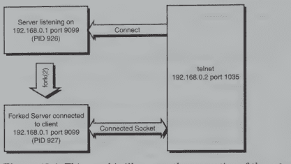

**图 12.1：** 此图解说明了 `telnet` 命令连接到 `fork` 的服务器进程的过程。

图 12.1 中发生的步骤如下：

1. 服务器进程（PID 926）启动。它监听来自客户端的连接。

2. 客户端进程（一个 `telnet` 命令）启动，并连接到服务器进程（PID 926）。

3. 服务器进程（PID 926）通过调用 `fork(2)` 进行 fork。这留下了原始的父进程（PID 926）和一个新的服务器子进程（PID 927）。

4. 父服务器进程（PID 926）关闭已连接的客户端套接字，使得已连接的客户端套接字仅在子进程（PID 927）中保持打开状态。

5. `telnet` 命令和子服务器进程（PID 927）随意通信，独立于父进程（PID 926）。

在第 5 步中，有两个套接字活动正在发生：

- 服务器（PID 926）正在监听 192.168.0.1 的端口 9099。

- 客户端正由套接字 192.168.0.1 端口 9099（由 PID 927）提供服务，该套接字连接到客户端地址 192.168.0.2 端口 1035。

客户端正由进程 ID 927 提供服务。这意味着您可以终止进程 ID 926，而客户端仍可以继续得到服务。然而，无法再建立到服务器的新连接，因为将没有服务器监听新的连接（监听服务器 PID 926 被终止了）。

现在，如果您重启服务器以监听新连接，就会出现问题。当新的服务器进程尝试绑定 IP 地址 192.168.0.1 端口 9099 时，`bind(2)` 函数将返回错误 `EADDRINUSE`。此错误代码指示该 IP 地址已在使用端口 9099。这发生的原因是进程 ID 927 仍在服务客户端。地址 192.168.0.1 端口 9099 仍被该进程使用（回顾图 12.1）。

解决此问题的方法是终止进程 927，这将关闭该套接字并释放 IP 地址和端口。然而，如果正在服务的客户端是您所在公司的首席执行官，这将不是一个可行的选项（这可能是一个限制职业生涯的举动）。在此期间，您会被其他部门纠缠，想知道为什么您没有重启服务器。

解决上述问题的更好方法是使用 `SO_REUSEADDR` 套接字选项。除非有充分的理由不使用，否则所有服务器都应利用此选项。为了有效利用此选项，请在监听连接的服务器中执行以下操作：


1. 像平常一样使用 `socket(2)` 创建监听套接字。

2. 调用 `setsockopt(2)` 将 `SO_REUSEADDR` 选项设置为 `TRUE`。

3. 现在像平常一样调用 `bind(2)`。

套接字现在将被标记为可重用。如果监听服务器进程（图 12.1 中的 `PID 926`）因任何原因终止，您将能够重启它。即使客户端正由使用相同 IP 地址和端口号的另一个服务器进程处理，这也将是真的。

为了使 `SO_REUSEADDR` 选项生效，必须满足以下条件：

- 没有其他具有相同 IP 地址和端口的套接字处于监听模式。
- 所有具有相同 IP 地址和端口号的套接字必须将 `SO_REUSEADDR` 选项设置为 `TRUE`。

这意味着在特定的 IP 地址和端口号对中只能有一个监听者。如果这样的套接字已经存在，那么设置该选项将无法实现您的目标。

仅当所有具有相同地址和端口号的现有套接字都设置了此选项时，将 `SO_REUSEADDR` 设置为 `TRUE` 才有效。如果任何现有套接字未设置此选项，则 `bind(2)` 将继续返回错误。

以下代码展示了如何将选项设置为 `TRUE`：

```
#define TRUE 1
#define FALSE 0

int z;        /* 状态代码 */
int s;        /* 套接字编号 */
int so_reuseaddr = TRUE;

z = setsockopt (s, SOL_SOCKET, SO_REUSEADDR,
        &so_reuseaddr,
        sizeof so_reuseaddr);
```

如有需要，可以使用 `getsockopt(2)` 函数查询 `SO_REUSEADDR` 选项。

## 设置 SO_LINGER 选项

另一种常用的套接字选项是 `SO_LINGER` 选项。该选项与 `SO_REUSEADDR` 选项的不同之处在于，其使用的数据结构不是简单的 `int` 数据类型。

`SO_LINGER` 选项的目的是控制当调用 `close(2)` 函数时套接字如何关闭。该选项仅适用于面向连接的协议，如 TCP。

内核的默认行为是允许 `close(2)` 函数立即返回给调用者。任何未发送的 TCP/IP 数据如果可能都会传输并投递，但不作任何保证。由于 `close(2)` 调用立即将控制权交还给调用者，应用程序无法得知最后一位数据是否实际已投递。

可以在套接字上启用 `SO_LINGER` 选项，使应用程序在 `close(2)` 调用中阻塞，直到所有最终数据都投递到远端。此外，这还确保调用者知道两端均已确认正常的套接字关闭。若未发生此情况，则会出现指定的选项超时，并向调用应用程序返回错误。

还可以应用最后一种场景，通过使用不同的 `SO_LINGER` 选项值。如果调用应用程序希望立即中止通信，可以在 `linger` 结构中设置适当的值。然后，调用 `close(2)` 将启动通信链路的中止，丢弃所有挂起的数据并立即关闭套接字。

`SO_LINGER` 的运行模式由 `linger` 结构控制：

```
struct linger {
    int    l_onoff;
    int  l_linger;
};
```

成员 `l_onoff` 起布尔值的作用，其中非零值表示 `TRUE`，零表示 `FALSE`。该选项的三种变体规定如下：

1. 将 `l_onoff` 设置为 `FALSE` 会导致成员 `l_linger` 被忽略，并隐含默认的 `close(2)` 行为。即，`close(2)` 调用将立即返回给调用者，任何挂起的数据如果可能都会投递。

2. 将 `l_onoff` 设置为 `TRUE` 会使成员 `l_linger` 的值变得重要。当 `l_linger` 非零时，这代表在 `close(2)` 时应用的超时时间（以秒为单位）（`close(2)` 调用将“滞留”）。如果在超时时间发生之前完成默认且成功的关闭，则会发生成功返回。否则，会发生错误返回，并且 `errno` 被设置为 `EWOULDBLOCK` 的值。

3. 将 `l_onoff` 设置为 `TRUE` 并将 `l_linger` 设置为零会导致连接被中止，并且在 `close(2)` 时任何挂起的数据都会被立即丢弃。

建议您编写应用程序时最好启用 `SO_LINGER` 选项并提供合理的超时时间。这样，可以检查 `close(2)` 的返回值，以查看连接是否成功相互关闭。如果返回的是错误，则告诉您的应用程序，很可能远端应用程序未能接收您发送的所有数据。或者，这可能仅意味着在连接关闭时（在对等方成功接收数据后）发生了问题。

然而，您必须意识到，在某些服务器设计中，滞留会创建新的问题。当 `SO_LINGER` 选项配置为在 `close(2)` 时滞留，这将阻止其他客户端在您服务器执行滞留于 `close(2)` 函数调用期间得到服务。如果您在一个进程中服务许多客户端（通常是指使用 `select(2)` 或 `poll(2)` 的服务器），则存在此问题。使用默认行为可能更合适，因为它允许 `close(2)` 立即返回。任何挂起的写入数据如果内核能够处理，仍将由内核投递。

最后，如果应用程序或服务器知道应该中止连接，则使用中止行为（前面列出的模式编号 3）是合适的。这可以应用于服务器确定某个没有访问权限的人试图获取访问权的情况。在这种情况下，客户端不值得特别照顾，因此在处置违规者时花费的最小开销。

以下展示了启用 `linger` 选项并使用 30 秒超时（`linger` 值）的示例：

```
#define TRUE 1
#define FALSE 0

int z; /* 状态代码 */
int s; /* 套接字 s */
struct linger so_linger;

so_linger.l_onoff = TRUE;
so_linger.l_linger = 30;
z = setsockopt(s,
       SOL_SOCKET,
       SO_LINGER,
       &so_linger,
       sizeof so_linger);

if ( z )
    perror("setsockopt(2)");
```

下一个示例展示了如何建立 `SO_LINGER` 值以中止套接字 `s` 上的当前连接：

```
#define TRUE 1
#define FALSE 0

int z; /* 状态代码 */
int s; /* 套接字 s */
struct linger so_linger;

so_linger.l_onoff = TRUE;
so_linger.l_linger = 0;
z = setsockopt(s,
       SOL_SOCKET,
       SO_LINGER,
       &so_linger,
       sizeof so_linger);

if ( z )
    perror("setsockopt(2)");
close(s); /* 中止连接 */
```

在之前的示例中，当调用函数 `close(2)` 时，套接字连接 `s` 被中止。通过将超时值设置为零秒，隐含了中止语义。

## 设置 SO_KEEPALIVE 选项

当使用连接时，它们有时可能会长时间处于空闲状态。例如，共同基金公司的投资组合经理可以建立 `telnet` 会话以访问股票报价服务。他可能会执行一些初始查询，然后保持与服务的连接打开，以便在需要时再次返回。然而，在此期间，连接保持空闲，有时可能长达数小时。

任何认为拥有已连接客户端的服务器都必须为其分配一些资源。如果服务器是 `fork` 类型，那么整个 Linux 进程及其相关内存都专用于该客户端。当一切顺利时，这种情况不会带来任何问题。困难出现在发生网络中断时，您所有的 578 个客户端都从您的股票报价服务断开连接。

在网络服务恢复后，额外的 578 个客户端将尝试连接到您的服务器，因为他们正在重新建立连接。这对您来说是一个真正的问题，因为您的服务器尚未意识到之前失去了空闲客户端——`SO_KEEPALIVE` 选项来救命！

以下示例展示了如何在套接字 `s` 上启用 `SO_KEEPALIVE`，以便最终可以检测到断开连接的空闲连接：

```
#define TRUE    1
#define FALSE   0

int z;   /* 状态代码 */
int s;   /* 套接字 s */
int so_keepalive;

so_keepalive = TRUE;

z = setsockopt(s,
        SOL_SOCKET,
        SO_KEEPALIVE,
        &so_keepalive,
        sizeof so_keepalive);
if ( z )
   perror("setsockopt(2)");
```

前面的示例启用了 `SO_KEEPALIVE` 选项，以便当套接字连接长时间空闲时，向远端发送探测消息。这通常在两小时不活动之后进行。对于 `keep-alive` 探测消息有三种可能的响应。它们是


1. 对等方适当响应，表示一切正常。不会向应用程序返回任何指示，因为这是应用程序最初的假设。

2. 对等方可以响应表明它不知道该连接。这表明自该主机最后一次通信以来，对等方已重新启动。然后，下一次套接字操作将向应用程序返回错误 `ECONNRESET`。

3. 未收到来自对等方的响应。在这种情况下，内核可能会进行几次额外的尝试以建立联系。如果未得到响应，`TCP`通常会在大约`11`分钟后放弃。当发生这种情况时，下一次套接字操作将返回错误 `ETIMEDOUT`。如果网络无法再到达主机（例如，由于路由表错误或路由器故障），则可能会返回其他错误，如 `EHOSTUNREACH`。

`SO_KEEPALIVE`涉及的时间框架限制了其普遍实用性。探测消息仅在大约两小时不活动之后发送。然后，当未得到响应时，可能需要再花`11`分钟才能连接返回错误。尽管如此，此功能最终确实允许检测到空闲断开连接的套接字，然后由服务器关闭。因此，支持潜在长空闲连接的服务器应启用此功能。

## 设置 `SO_BROADCAST` 选项

使用`UDP`广播的主题尚未涵盖。然而，应该很容易理解，使用广播功能可能被滥用，并在受影响的网络上造成困扰。为了避免在未打算广播时进行广播，套接字在创建时广播功能被禁用。如果确实打算广播，则期望`C`程序员先费力为此套接字启用此功能。

广播的主题将在第`13`章“使用`UDP`广播”中介绍。因此，这里仅描述选项本身。`SO_BROADCAST`选项是一个布尔标志选项，它由`int`数据类型定义、获取和设置。以下示例展示了如何启用`SO_BROADCAST`选项：

```
#define TRUE 1
#define FALSE 0

int z; /* 状态代码 */
int s; /* 套接字 s */
int so_broadcast;
```

如果 `setsockopt(2)` 函数返回零，则表示套接字 `$s$` 已启用广播功能。但请注意，所选用的套接字类型必须具备广播能力，例如 `UDP` 套接字。

## 设置 `SO_OOBINLINE` 选项

带外数据的相关内容将在第`14`章“带外数据”中介绍。在这里，您只需注意，在某些情况下，可以加速传输少量数据，使其先于可能已经发送的数据到达。通常，这种带外数据是通过与普通数据接收函数不同的方法来接收的。但是，有时更倾向于以正常方式接收这种带外数据。当选择此方法时，带外数据会作为正常数据流的一部分，先于正常数据到达。

要启用此功能，可以使用以下代码：

```
#define TRUE   1
#define FALSE  0
int z;    /* 状态码 */
int s;    /* 套接字 s */
int so_oobinline;

so_oobinline = TRUE;

z = setsockopt(s,
               SOL_SOCKET,
               SO_OOBINLINE,
               &so_oobinline,
               sizeof so_oobinline);

if ( z )
    perror("setsockopt(2)");
```

在启用 `SO_OOBINLINE` 选项后，带外数据将随正常数据一起接收。以此方式，接收到的带外数据与正常数据无法区分。

## 选项 `SO_PASSCRED` 和 `SO_PEERCRED`

这些选项仅适用于 `PF_UNIX` (`PF_LOCAL`) 套接字。这些选项用于控制和传递当前本地主机上本地套接字的凭证。关于凭证的讨论将推迟到第`17`章“传递凭证和文件描述符”。这可能是本书中您最难以掌握的话题。目前，只需注意，如果您计划编写为同一本地主机上的客户端提供服务的服务器程序，那么这两个选项可能对您很有用。

## 接下来是什么

在本章中，您了解到可以使用 `getsockopt(2)` 和 `setsockopt(2)` 函数分别获取和设置套接字选项。书中展示了套接字选项具有层级，并讨论了各种 `SOL_SOCKET` 层级的选项。

许多选项需要布尔值，这些值由 `int` 数据类型定义。还展示了某些其他选项（例如 `SO_LINGER`）需要使用特殊结构而不是布尔值。

许多套接字选项涉及套接字的高级用法，这些内容尚未涵盖。随着后续章节中遇到更高级的主题，您将再次看到这些选项。下一章讨论使用 `UDP` 进行广播，因此您现在已经准备好启用 `SO_BROADCAST` 选项并使用它了！


# 使用 `UDP` 进行广播

如果通信总是在两个个体之间进行，效率会降低。另一方面，广播允许信息同时分发给许多接收者。

在本章中，您将学习如何：

- 建立广播 `UDP` 套接字

- 使用套接字发送广播消息

- 使用套接字接收广播消息

完成本章后，您将了解如何编写使用 `IPv4` 套接字广播功能程序。

### 理解广播地址

要使用广播，您必须了解 `IPv4` 的某些 `IP` 广播地址约定。（回顾第`3`章“地址转换函数”中的图`3.1`。）请记住，`IP` 地址分为左侧的网络 `ID` 部分（最高有效位）和右侧的主机 `ID` 部分（最低有效位）。广播地址的约定是主机 `ID` 位全部设置为`1`位。

当您的网卡正确配置后，您可以通过执行以下命令来显示所选接口的广播地址（本例中显示的是接口 `eth0`）：

```
# ifconfig eth0
eth0    Link encap:Ethernet  HWaddr 00:A0:4B:06:F4:BD
        inet addr:192.168.0.1  Bcast:192.168.0.255  Mask:255.255.255.0
        UP BROADCAST RUNNING PROMISC MULTICAST  MTU:1500  Metric:1
        RX packets:1955 errors:0 dropped:0 overruns:0 frame:31
        TX packets:1064 errors:0 dropped:0 overruns:0 carrier:0
        collisions:0 txqueuelen:100
        Interrupt:9 Base address:0xe400
```


输出的第二行显示 `eth0` 接口的广播地址为 `192.168.0.255`。此地址中的网络 `ID` 是前三个八位组（字节）`192.168.0`，而该地址的主机 `ID` 部分是 `255`（请记住此地址是 `C` 类地址）。值 `255` 是一个十进制值，代表主机 `ID` 的所有 `1` 位。

### 在 `255.255.255.255` 上广播

特殊的广播地址 `255.255.255.255` 也可用于广播。虽然这种形式的地址可能暗示向全世界广播，但其范围要小得多。这种类型的广播永远不会被路由器转发，而更具体的广播地址（如 `192.168.0.255`）可能会根据路由器的配置被转发。

像 `255.255.255.255` 这样的通用广播地址的概念定义并不十分明确。例如，某些 `UNIX` 变体将其解释为应在该主机的所有网络接口上执行广播。其他 `UNIX` 内核会选择几个接口中的一个——通常是定义的第一个。当主机拥有一个以上的网络接口卡（或简称 `NIC`）时，这是一个严重的问题。因此，通常不推荐使用通用广播地址。

如果确有必要从每个网络接口进行广播，则您的软件在广播之前应执行以下步骤：

1. 确定下一个（或第一个）接口名称。

2. 确定该接口的广播地址。

3. 使用该接口的广播地址进行广播。

4. 对系统中所有处于活动状态（即“已启用”）的其他网络接口重复步骤`1`至`3`。

完成这些步骤后，您可以确信软件已在每个接口上进行了广播。

本章的其余部分将专注于如何从一个网络接口进行广播。在掌握此概念后，如果需要从每个接口进行广播，则可以应用上述过程。

### 增强 `mkaddr.c` 子例程

第`10`章“在套接字上使用标准`I/O`”中介绍的 `mkaddr.c` 子例程的一个局限性在于它无法正确处理 `255.255.255.255` 广播地址的情况。在本节中，您将使用修正此问题的原因。

下面的 `diff` 输出说明了在 `mkaddr.c` 源代码中需要修改哪些内容以解决此问题。应用此更改后，如果您愿意，就可以实验 `255.255.255.255` 广播地址。

```
$ diff ../ch.11/mkaddr.c mkaddr.c
99,102c99,100
<       ap->sin_addr.s_addr =
<         inet_addr(host_part);
<     if ( ap->sin_addr.s_addr
<       == INADDR_NONE )
---
>     if ( !inet_aton(host_part,
>       &ap->sin_addr) )
$
```


前面的示例显示，`inet_aton(3)` 函数取代了功能更有限的 `inet_addr(3)` 函数。`inet_addr(3)` 的问题是，当地址无效时它会返回 `INADDR_NONE` 值。当 IP 地址 `255.255.255.255` 转换为 32 位值时，其返回值与常量 `INADDR_NONE` 相同。因此，无法区分无效的输入 IP 地址和通用广播地址。使用 `inet_aton(3)` 函数可以避免这种歧义。

## 从服务器进行广播

本章将展示一个简单的广播服务器程序以及相应的客户端程序。服务器程序将首先被呈现并解释。

为了让人了解广播功能可以实现什么，所展示的服务器将提供股票指数模拟。服务器程序将代表一个从外部报价供应商获取数据馈送，然后将股票指数报价重新广播给所有感兴趣客户端的程序。清单 13.1 中的示例展示了 `stksrv.c` 服务器程序。

本章节不重复列出 `maddr.c`。如果你想要使用 `255.255.255.255` 通用广播地址进行实验，请务必进行上一节中描述的微小调整。否则，`maddr.c` 的列表与第 11 章“并发客户端服务器”中使用的相同。

### 清单 13.1: `stksrv.c`—股票指数广播服务器


```c
/* stksrv.c: * * 股票指数广播示例: */
#include <stdio.h>
#include <unistd.h>
#include <stdlib.h>
#include <errno.h>
#include <string.h>
#include <time.h>
#include <sys/types.h>
#include <sys/socket.h>
#include <netinet/in.h>
#include <arpa/inet.h>

#define TRUE
#define TRUE 1
#define FALSE 0

extern int maddr(
    void *addr,
    int *addrlen,
    char *str_addr,
    char *protocol);
#define MAXQ 4

static struct {
    char *index;
    int start;
    int vol;
    int current;
} quotes[] = {
    { "DJIA", 1030330, 375 },
    { "NASDAQ", 276175, 125 },
    { "S&P 500", 120331, 50 },
    { "TSE 300", 689572, 75 },
};

/*
 * 初始化:
 */
static void
initialize(void) {
    short x;
    time_t td;

    /*
     * 初始化随机数生成器:
     */
    time(&td);
    srand((int)td);

    for ( x=0; x < MAXQ; ++x )
        quotes[x].current =
            quotes[x].start;
}

/*
 * 随机更改某个指数报价:
 */
static void
gen_quote(void) {
    short x;     /* 指数 */
    short v;     /* 指数的波动性 */
    short h;     /* v 的一半 */
    short r;     /* 随机变化 */

    x = rand() % MAXQ;
    v = quotes[x].vol;
    h = (v / 2) - 2;
    r = rand() % v;

    if ( r < h )
        r = -r;
    quotes[x].current += r;
}

/*
 * 此函数报告错误并
 * 返回到 shell:
 */
static void
bail(const char *on_what) {
    fputs(strerror(errno), stderr);
    fputs(" : ", stderr);
    fputs(on_what, stderr);
    fputc('\n', stderr);
    exit(1);
}

int
main(int argc, char **argv) {
    short x;        /* 股票指数索引 */
    double i0;      /* 初始指数值 */
    double i;       /* 指数值 */
    char bcbufr[512], *bp;/* 缓冲区和指针 */
    int z;          /* 状态返回码 */
    int s;          /* 套接字 */
    struct sockaddr_in adr_srvr;/* AF_INET */
    int len_srvr;   /* 长度 */
    struct sockaddr_in adr_bc; /* AF_INET */
    int len_bc;     /* 长度 */
    static int so_broadcast = TRUE;
    static char
    *sv_addr = "127.0.0.1:9099",
    *bc_addr = "127.255.255.255:9099";

    /*
     * 形成服务器地址:
     */
    if ( argc > 2 )
    {
        /* 服务器地址: */
        sv_addr = argv[2];
    }
    if ( argc > 1 )
    {
        /* 广播地址: */
        bc_addr = argv[1];
    }

    /*
     * 形成服务器地址:
     */
    len_srvr = sizeof adr_srvr;

    z = maddr(
            &adr_srvr,  /* 返回的地址 */
            &len_srvr,  /* 返回的长度 */
            sv_addr,    /* 输入的字符串地址 */
            "udp");     /* UDP 协议 */

    if ( z == -1 )
        bail("无效的服务器地址");

    /*
     * 形成广播地址:
     */
    len_bc = sizeof adr_bc;

    z = maddr(
            &adr_bc,    /* 返回的地址 */
            &len_bc,    /* 返回的长度 */
            bc_addr,    /* 输入的字符串地址 */
            "udp");     /* UDP 协议 */

    if ( z == -1 )
        bail("无效的广播地址");

    /*
     * 创建一个要使用的 UDP 套接字:
     */
    s = socket(AF_INET, SOCK_DGRAM, 0);
    if ( s == -1 )
        bail("socket()");

    /*
     * 允许广播:
     */
    z = setsockopt(s,
                SOL_SOCKET,
                SO_BROADCAST,
                &so_broadcast,
                sizeof so_broadcast);

    if ( z == -1 )
        bail("setsockopt(SO_BROADCAST)");

    /*
     * 将一个地址绑定到我们的套接字，以便
     * 客户端程序可以侦听此
     * 服务器:
     */
    z = bind(s,
            (struct sockaddr *)&adr_srvr,
            len_srvr);

    if ( z == -1 )
        bail("bind()");

    /*
     * 现在开始提供报价:
     */
    initialize();

    for (;;) {
        /*
         * 更新列表中的一个报价:
         */
        gen_quote();

        /*
         * 形成一个要发送的数据包:
         */
        bp = bcbufr;
        for ( x=0; x<MAXQ; ++x ) {
            i0 = quotes[x].start / 100.0;
            i = quotes[x].current / 100.0;
            sprintf(bp,
                    "%-7.7s %8.2f %+.2f\n",
                    quotes[x].index,
                    i,
                    i - i0);
            bp += strlen(bp);
        }

        /*
         * 广播更新的信息:
         */
        z = sendto(s,
                    bcbufr,
                    strlen(bcbufr),
                    0,
                    (struct sockaddr *)&adr_bc,
                    len_bc);

        if ( z == -1 )
            bail("sendto()");

        sleep(4);
    }

    return 0;
}
```


清单 13.1 中显示的服务器在功能上分为以下几个部分：

- 股票指数表在第 27 到 39 行中声明。定义了四个指数，带有起始值和粗糙的波动性值形式，用于模拟。

- 第 44 到 58 行的函数`initialize()`被调用一次以初始化模拟。

- 调用函数`gen_quote()`随机更改随机选择的股票指数的模拟值（第 63 到 77 行）。

- 构成服务器基础的`main()`程序包含在第 92 到 222 行中。

这个股票市场服务器的基本操作如下：

- 默认地址在第 106 和 107 行中声明。当没有提供命令行参数时，使用这些地址。

- 如果提供了两个命令行参数，则服务器地址从第二个参数获取地址（第 114 行）。

- 如果提供一个或多个命令行参数，则广播参数从参数一获取（第 118 行）。

- 形成服务器地址（第 123 到 132 行）。

- 形成广播地址（第 137 到 146 行）。

- 创建一个套接字（第 151 到 153 行）。

- 在套接字上启用`SO_BROADCAST`选项（第 158 到 165 行）。

- 绑定服务器地址（第 172 到 177 行）。

- 初始化股票指数（第 182 行）。

- 服务器循环从第 184 行开始。

服务器无限循环。你需要终止它才能结束其执行。

服务器循环使用以下步骤：

- 通过调用`gen_quote()`更新随机选择的指数（第 188 行）。

- 提取所有指数的报价并格式化到缓冲区中（第 193 到 203 行）。这创建了一个包含四行文本的字符串，对应每个股票指数。

- 使用`sendto(2)`函数发送格式化字符串（第 208 到 216 行）。此调用执行广播，因为地址`adr_bc`包含一个广播地址。

- 进行四秒钟的`sleep(3)`调用，以模拟报价更新之间合理的时间延迟。

- 循环从步骤 1 重复。

这里有几个要点值得回顾：

- 套接字必须启用`SO_BROADCAST`选项。否则，不允许从此套接字进行广播。

- `sendto(2)`调用执行了广播，因为目标地址是一个广播地址。

这两个条件都是广播的先决条件。套接字必须启用广播，并且目标地址必须是一个广播 IP 地址。

要编译此程序，使用以下命令：

```
$ make stksrv
gcc -c -D_GNU_SOURCE -Wall -Wreturn-type -g stksrv.c
gcc -c -D_GNU_SOURCE -Wall -Wreturn-type -g mkaddr.c
gcc -g stksrv.o mkaddr.o -o stksrv
$
```


在测试服务器之前，我们必须编译并理解客户端程序。

## 接收广播

将要介绍的客户端程序必须侦听股票市场指数程序将发出的广播。清单 13.2 说明将使用的客户端程序源代码。

## 接收广播

列表 13.2：`quotes.c`。—— 股票市场指数客户端程序


```c
/* quotes.c:
 *
 * Get datagram stock market
 * quotes from UDP broadcast:
 */
#include <stdio.h>
#include <unistd.h>
#include <stdlib.h>
#include <errno.h>
#include <string.h>
#include <time.h>
#include <signal.h>
#include <sys/types.h>
#include <sys/socket.h>
#include <netinet/in.h>
#include <arpa/inet.h>

#ifndef TRUE
#define TRUE 1
#define FALSE 0
#endif

extern int mkaddr(
             void *addr,
             int *addrlen,
             char *str_addr,
             char *protocol);

/*
 * This function reports the error and
 * exits back to the shell:
 */
static void
bail(const char *on_what) {
      fputs(strerror(errno),stderr);
      fputs(": ",stderr);
      fputs(on_what,stderr);
      fputc('\n',stderr);
      exit(1);
}

int
main(int argc,char **argv) {
      int z;
      int x;
      struct sockaddr_in adr;    /* AF_INET */
      int len_inet;          /* length */
      int s;           /* socket */
      char dgram[512];       /* Recv buffer */
      static int so_reuseaddr = TRUE;
      static char
       *bc_addr = "127.255.255.255:9097";

  /*
   * Use a server address from the command
   * line, if one has been provided.
   * Otherwise, this program will default
   * to using the arbitrary address
   * 127.0.0.23.
   */
  if ( argc > 1 )
    /* Broadcast address: */
    bc_addr = argv[1];

  /*
   * Create a UDP socket to use:
   */
  s = socket(AF_INET, SOCK_DGRAM, 0);
  if ( s == -1 )
    bail("socket()");

  /*
   * Form the broadcast address:
   */
  len_inet = sizeof adr;

  z = mkaddr(&adr,
    &len_inet,
    bc_addr,
    "udp");

  if ( z == -1 )
    bail("Bad broadcast address");

  /*
   * Allow multiple listeners on the
   * broadcast address:
   */
  z = setsockopt(s,
    SOL_SOCKET,
    SO_REUSEADDR,
    &so_reuseaddr,
    sizeof so_reuseaddr);

  if (z == -1)
    bail("setsockopt(SO_REUSEADDR)");

  /*
   * Bind our socket to the broadcast address:
   */
  z = bind(s,
    (struct sockaddr *)&adr,
    len_inet);

  if (z == -1)
    bail("bind(2)");

  for (;;) {
    /*
     * Wait for a broadcast message:
     */
    z = recvfrom(s,       /* Socket */
       dgram,       /* Receiving buffer */
       sizeof dgram, /* Max rcv buf size */
       0,       /* Flags: no options */
       (struct sockaddr *)&adr, /* Addr */
       &x);       /* Addr len, in & out */

    if (z < 0)
      bail("recvfrom(2)"); /* else err */

    fwrite(dgram,z,1,stdout);
    putchar('\n');

    fflush(stdout);
  }

  return 0;
}
```


这里介绍的客户端程序接受一个可选的命令行参数。如果没有提供该参数，则默认假设的广播地址将是`127.255.255.255`（端口`9097`）。默认值由`list 13.2`中的第`52`行建立。当提供命令行参数时，该参数将指示`IP`广播地址和`UDP`端口号。

客户端程序使用的一般步骤如下：

1. 创建套接字（第`68`至`70`行）。
2. 形成广播地址（第`75`至`83`行）。
3. 启用`SO_REUSEADDR`选项（第`89`至`96`行）。
4. 将广播地址绑定到客户端套接字（第`101`至`106`行）。
5. 开始广播接收循环（第`108`行）。
6. 接收广播（第`112`至`120`行）。
7. 将广播信息写入标准输出（第`122`至`125`行）。
8. 重复步骤`5`。

请特别留意步骤`4`。为了接收广播，必须有一个将该地址绑定到套接字的客户端程序。这标识了该客户端程序作为这些消息的预期接收方。

然而，这种方法存在一个问题。如果一个客户端程序绑定了该地址，那么同一主机上的其他程序将无法绑定该地址。这将违背广播的目的。启用`SO_REUSEADDR`允许多个客户端程序在同一主机上从同一广播地址接收数据。

要编译演示用的客户端程序，可以使用以下命令：

```bash
$ make quotes
$ gcc -c -D_GNU_SOURCE -Wall -Wreturn-type -g quotes.c
$ gcc -g quotes.o mkaddr.o -o quotes
$ 
```


## 演示广播

在服务器和客户端程序编译完成后，你就可以开始了。对于每个人来说，无论是否已建立网络，第一个示例会话都应该能正常工作。该演示将使用本地环回接口，除非被禁用，否则每个`Linux`系统都应该提供该接口。

第一步是启动广播服务器：

```bash
@pepper
$ ./stkrsv 127.255.255.255:9097 &
[1] 756
@pepper
$ 
```


该会话显示了在主机系统`pepper`上启动`stkrsv`服务器程序的过程。同一主机上的客户端会话看起来像这样：

```bash
$ ./gquotes 127.255.255.255:9097
DJIA      10302.06 -1.24
NASDAQ    2766.86 +5.11
S&P 500     1285.48 +2.17
TSE 300     6897.99 +2.27

DJIA      10302.06 -1.24
NASDAQ    2766.86 +5.11
S&P 500     1285.73 +2.42
TSE 300     6897.99 +2.27

DJIA      10302.06 -1.24
NASDAQ    2766.86 +5.11
S&P 500     1286.00 +2.69
TSE 300     6897.99 +2.27

[CTRL+C]
@pepper
$ 
```

在所示的客户端会话中，程序被允许提供三次报价更新，之后输入`CTRL+C`以结束其执行（你的中断字符可能不同）。注意，客户端和服务器必须具有匹配的广播地址和端口号。

为了向自己证明正在执行的是广播，而不仅仅是点对点通信，你可以启动客户端程序的多个实例。这样做时，它们都将在大约同一时间更新。

## 向网络广播

如果你的`PC`中安装了网卡并且网络配置正确，你应该能够成功测试广播服务器和客户端程序。本节将演示位于名为`pepper`的主机上的广播服务器，通过接口卡`eth0`（`IP`地址`192.168.0.1`）进行广播。

### 启动广播

通过执行以下操作，告知广播服务器在接口卡`192.168.0.1`上进行广播：

```bash
@pepper
$ ./stksrv 192.168.0.255:9097 '192.168.0.1:*' &
[2] 815
@pepper
$ 
```

注意，命令行中提供了两个命令行参数。它们是：

1. 消息指向的广播地址和端口号。
2. 广播将从其发出的源地址和端口号。

第二个地址指定了用于广播的套接字的本地`IP`地址。这实际上选择了将发生广播的网络接口卡（从而为广播选择了网络）。冒号后面的星号表示可以使用任何本地端口号。这样做的原因是，在这种情况下使用的实际端口号不需要预先商定（任何端口都可以）。

如果你没有正确绑定套接字的本地端，你将经历如下情况：

```bash
@pepper
$ ./stksrv 192.168.0.255:9097 &
[3] 816
Invalid argument: sendto()
[3]+  Exit 1    ./stksrv 192.168.0.255:9097
@pepper
$ 
```

`sendto(2)`函数失败，因为服务器程序将默认本地地址`127.0.0.1`绑定到套接字。这是行不通的，因为无法从`127.*.*.*`网络到达任何`192.168.0.*`地址。直到`sendto(2)`函数尝试执行广播时，这个问题才被发现。

解决这个问题存在三种可能的方案：

- 确保套接字的本地端明确绑定到将用于广播的正确接口卡（演示中为`192.168.0.1`）。
- 使用通配本地套接字地址（`INADDR_ANY`）。在示例程序中，这可以在命令行中指定为`*:`。
- 根本不绑定套接字的本地地址（完全省略`bind(2)`调用）。

## 接收广播

省略`bind(2)`函数调用，实际上等同于绑定到`INADDR_ANY`并将端口号指定为零（允许任意选择端口号）。具体使用哪种选择，取决于你希望对网卡的选择施加多少控制。

测试广播服务器运行情况最明显、最直接的方法，就是在服务器所在的同一主机上进行。以下会话输出展示了这一过程：

```bash
$ pepper
$ ./.quotes 192.168.0.255:9009
DJIA    10304.73 +1.43
NASDAQ  2761.19 -0.56
S&P 500  1283.31 +0.00
TSE 300   6895.82 +0.10

DJIA    10304.73 +1.43
NASDAQ  2761.19 -0.56
S&P 500  1283.31 +0.00
TSE 300   6896.35 +0.63
```

该会话证明，确实从服务器接收到了广播消息。现在，是时候在另一台主机上尝试客户端程序，看看是否能通过物理网络接收到广播。

### 从远程主机接收广播

本演示使用了另一台名为`slug`的主机，其`IP`地址为`192.168.0.2`。在该主机上启动客户端程序副本如下所示：

```bash
$ slug
$ ./.quotes 192.168.0.255:9009
DJIA    10309.80 +6.50
NASDAQ  2767.29 +5.54
S&P 500  1286.06 +2.75
TSE 300   6897.75 +2.03

DJIA    10309.80 +6.50
NASDAQ  2767.29 +5.54
S&P 500  1286.06 +2.75
TSE 300   6897.67 +1.95

DJIA    10313.18 +9.88
NASDAQ  2767.29 +5.54
S&P 500  1286.06 +2.75
TSE 300   6897.67 +1.95
```

这里在主机`slug`上演示了，确实通过这两台主机之间的以太网链路接收到了广播。此次输出中的数值有所不同，是因为其捕获时间远早于之前展示的会话。但是，如果你同时在本地和远程主机上启动客户端，你将能够验证它们的内容完全一致。

### 故障排除提示

如果你在个人网络上未能实现类似结果，那么问题可能涉及许多因素。本书并不打算描述网络管理或设计的各个方面。本书也不会成为网络故障排除的专著。以下是一些简单的提示，希望能为诊断的起点提供有用的帮助。

如果问题存在于你自己构建的简单网络中，且该网络上几乎没有或完全没有网络流量，你可能只需查看集线器即可。例如，许多微型集线器提供`LED`指示灯，用于指示相关端口的数据包流量。前面介绍的服务器程序应在发生广播时，大约每四秒钟产生一次闪烁。如果看不到这种闪烁，则表明广播并未发生。

另一种方法是使用`tcpdump`命令，如今它已包含在大多数`Linux`发行版中。以下示例展示了服务器在广播时的`tcpdump(8)`输出：


```
$ slug
# tcpdump udp port 9097
tcpdump: listening on eth0
21:04:43.987482 pepper.ve3wqw.org.1032 > 192.168.0.255.9097: udp 96
21:04:47.977482 pepper.ve3wqw.org.1032 > 192.168.0.255.9097: udp 96
21:04:51.987482 pepper.ve3wqw.org.1032 > 192.168.0.255.9097: udp 96
```

所使用的命令行参数使得仅显示端口 `9097` 上的 UDP 数据包。示例输出包含三个显示的数据包摘要。可以通过阅读 `tcpdump(8)` 的手册页获取更多关于它的信息。

这些仅仅是检查广播数据包的两种非常简单的方法。然而，通常这些简单技术就足以满足程序员的需求。

## 接下来是什么

本章向你介绍了称为 IPv4 广播地址的特殊地址概念。此外，你还看到了 `SO_REUSEADDR` 和 `SO_BROADCAST` 套接字选项是如何以实际方式应用的。

在下一章中，你将接触到带外数据这一高级主题。你将学习为什么需要带外数据，以及它的优缺点。探索 Linux 的“精神分裂”特性，以及如何确定你的系统当前认为自身具有哪种“人格”。

# 带外数据

本章将带你进入使用 TCP 带外数据的复杂领域。你将学习为什么提供带外数据，以及其中的一些陷阱。最重要的是，你将掌握如何正确应用带外通信模式，适用于任何支持该功能的协议。

本章将涵盖的内容总结如下：

- 定义什么是带外数据。
- 为什么需要它？
- 使用它时有哪些与套接字相关的问题？
- TCP/IP 实现中有哪些变体？
- 如何将其用于 TCP 流式套接字？


## 定义带外

想象一下银行里排着队准备兑现工资支票的人群。队伍形成一个队列，人们最终向前移动接受柜员的办理。现在想象一个人走进银行，绕过整个队列，然后拿枪威胁一名柜员。这个人会被视为“带外”行为，或者更可能说是精神失常。这个“强盗”之所以插队，是因为枪让他比队列中的人拥有优先权。柜员也将全神贯注地服务于这个强盗，因为她知道情况紧急。

从概念上讲，连接流式套接字上的带外数据工作方式与此相同。通常，数据从连接的一端流向另一端，保证所有数据字节的精确顺序。允许较晚的字节先于较早写入的字节到达是不被允许的。然而，套接字 API 提供了一种机制，从概念上讲，可以加急传输一批数据字节，使其先于正常数据到达接收方。这被称为发送带外数据。

严格从技术上说，TCP 流不能发送带外数据。它所支持的是一个“紧急”数据的概念，该概念映射到套接字 API 中的带外数据。这带来了一些限制，我们将在本章稍后讨论。

## 理解对带外数据的需求

虽然你可以立即理解在银行插队的好处，但你也会认为，使用枪支达到这一目的相当不合群。TCP 流通常期望按完美顺序发送数据字节，因此乱序发送似乎违背了流的本质。那么，为什么要提供带外套接字设施呢？

你可能已经意识到，有时数据会以某种方式变得“紧急”。流式套接字可能排入了大量等待传输到网络的数据。在远程端，可能已接收了大量数据，但应用程序尚未读取。如果发送方客户端程序现在有必要取消已写入服务器的请求，它可能希望紧急向服务器发出取消请求。未能向远程服务器发出取消请求，会不必要地浪费服务器资源。

你可能会回答这个设计问题，说可以过早关闭套接字，或者在额外的套接字连接上传输信息。这两种解决方案因不同原因都不够理想：

- 关闭套接字不允许在继续通信时恢复。
- 当数百或数千用户正在使用你的服务器时，增加额外连接的成本相当高昂。
- 公司防火墙限制使得在单个套接字连接内完成所有网络需求变得更加可取。

使用带外数据的程序实际例子包括 `telnet`、`rlogin` 和 `ftp` 命令。前两个程序将中断字符作为紧急数据发送到远程端。这允许远程端刷新所有未处理的输入，并丢弃任何未发送的终端输出。这使得能够快速中断一个正在运行的进程，该进程可能正在向你的屏幕输出大量数据。`ftp` 命令使用带外数据来中止文件传输。

## 套接字与带外数据

前面提到，使用套接字带外概念时，TCP 流存在一些陷阱。重要的是要再次强调，套接字接口本身并不是限制因素。带外概念实际上映射到 TCP/IP 通信的紧急数据模式。TCP 流在当今网络中非常重要，本章仅关注套接字在 TCP 紧急数据方面的带外数据使用。

因此，虽然这两个术语在技术上不同，但它们经常被互换使用。

还必须指出，与 TCP 紧急数据相关的限制不一定适用于可能使用套接字接口的其他协议。例如，如果你查看红外通信的带外数据，在对其能力得出结论之前，需要研究其底层协议。

## 实现变体

不幸的是，TCP 的实现对于如何处理紧急数据有两种不同的解释。本章稍后将对这些差异进行完整描述（心急者可参考本章后面的表 14.2）。不同的解释包括：

- RFC793 对 TCP 紧急指针的解释
- BSD 对 TCP 紧急指针的解释

这种分歧之所以出现，是因为最初的 TCP 规范允许这两种解释。随后，“主机需求”RFC

识别出了正确的解释方式。然而，大多数实现都基于 BSD（伯克利）源代码，且 BSD 方法至今仍在广泛使用。在此方面，Linux 具有双重性，它同时支持这两种解释方式。不过，Linux 的默认设置是使用了 BSD 解释方式。

> **注意**  
> `tcp(4)` 手册页指出，在 Linux 下默认使用 BSD 解释方式。这可以被更改，但可能不建议这样做。原因是更改此设置可能会导致其他现有的网络进程失败。

现在请花一点时间检查一下你的 Linux 系统的当前设置。这对于获得本章示例中产生的相同结果至关重要。


```
$ cat /proc/sys/net/ipv4/tcp_stdurg
0
$ 
```

这里展示的输出了值为零。这表明当前生效的是 BSD 解释方式。如果你看到了其他值（例如 1），并且希望获得本章中展示的结果，则应将此值更改为零。

> **警告**  
> 如果你正在运行多服务器系统，在更改 TCP 紧急数据的解释方式之前，请务必考虑你的用户。

表 14.1 总结了 `tcp_stdurg` 设置的值。`tcp_stdurg` 的值可以在 shell 脚本（包括启动和关闭脚本）中查询和设置。

表 14.1: `/proc/sys/net/ipv4/tcp_stdurg` 的设置

| 值 | 解释方式 |
|:------|:---------------|
| 0 | BSD 解释方式（Linux 默认） |
| 1 | RFC793 解释方式 |

如果你需要将此设置更改为零，你需要获取 root 权限，并输入以下内容：


```
# echo 0 >/proc/sys/net/ipv4/tcp_stdurg
# 
```

在确认更改后重新检查总是明智的，因此请列出该值以查看内核是否接受了更改。你应该能够像前一个示例中那样，使用 `cat` 命令显示零值。

### 使用带外数据

尽管你关于带外数据可能仍有许多疑问，但不要担心。一些简单的示例程序将比大段文字更清晰地阐释这些概念。随着演示的进行，我们会提供解释。

关于带外 I/O 的几个基本原理需要在接下来的简短章节中涵盖。当这些解决之后，有趣的部分就开始了。

### 写入带外数据

对 `write(2)` 的调用将简单写入普通的“带内”数据，这是你已经习惯所做的。因此，必须使用一个新函数来写入带外数据。为此，这里展示了 `send(2)` 函数的原型：

```
#include <sys/types.h>
#include <sys/socket.h>

int send(int s, const void *msg, int len, unsigned int flags);
```

此函数需要四个参数，它们是：

- 要写入的套接字 `s`。
- 要从中写入的消息缓冲区 `msg`。
- 消息的长度 `len`。
- 发送选项标志。

`send(2)` 函数类似于 `write(2)` 调用，只是它提供了额外的 `flags` 参数。这是关键所在。`send(2)` 函数返回写入的字符数，如果发生错误则返回 −1（检查 `errno` 以获取错误原因）。

要发送带外数据，你像调用 `write(2)` 一样使用前三个参数。如果你为 `flags` 参数提供 C 语言宏 `MSG_OOB`，则数据将作为带外数据发送，而不是正常的“带内”数据，如下所示：


```
char buf[64]; /* 数据 */
int len; /* 字节数 */
int s; /* 套接字 */
... 
send(s, buf, len, MSG_OOB);
```


如果提供的 `flags` 参数不包含 `MSG_OOB` 标志位，则数据将作为正常的带内数据写入。这允许你使用同一个函数调用来写入带内和带外数据。你只需在程序控制下更改 `flags` 参数的值即可完成此操作。

### 读取带外数据

带外数据可以通过两种不同的方式读取：

- 作为带外数据单独读取
- 与带内数据混合读取

为了将带外数据与正常数据流分开读取，你需要使用函数 `recv(2)`。如果你猜测 `recv(2)` 类似于 `read(2)` 但多了一个 `flags` 参数，那么你就猜对了。函数原型如下所示：

```c
#include <sys/types.h>
#include <sys/socket.h>

int recv(int s, void *buf, int len, unsigned int flags);
```

`recv(2)` 函数接受四个参数，它们是：

- 接收数据（带内或带外数据）的套接字 `s`。
- 将接收数据放入的缓冲区 `buf`。
- 接收缓冲区的最大字节长度 (`len`)。
- 此调用使用的选项 `flags`。

如你所见，`recv(2)` 是 `send(2)` 函数调用的对应项。要接收带外数据，在 `flags` 参数中提供 C 宏 `MSG_OOB`。如果没有 `MSG_OOB` 标志位，`recv(2)` 函数将像进行普通的 `read(2)` 调用一样接收正常的带内数据。

`recv(2)` 函数返回接收到的字节数，如果发生错误则返回 –1（检查 `errno` 以获取错误原因）。

下面展示了一个读取带外数据的示例：


```c
char buf[128];   /* 缓冲区 */
int n;           /* 字节数 */
int s;          /* 套接字 */
int len;        /* 最大字节数 */

n = recv(s, buf, len, MSG_OOB);
```

虽然之前提到带外数据可以可选地与正常数据混合，但我们稍后讨论这一点。

### 理解信号 SIGURG

当带外数据到达时，接收进程需要得到通知。如果它必须与正常数据流分开读取，这一点尤为重要。实现此目的的一种方法是让 Linux 内核在带外数据到达时向你的进程发送 `SIGURG` 信号。

使用 `SIGURG` 信号通知有两个要求：

- 你必须建立对套接字的所有权。
- 你必须为 `SIGURG` 建立一个信号处理器。

为了接收 `SIGURG` 信号，你必须将你的进程（或进程组）建立为套接字的所有者。要建立这种所有权，你使用 `fcntl(2)` 函数。其在此处适用的函数原型如下：

```c
#include <unistd.h>
#include <fcntl.h>

int fcntl(int fd, int cmd, long arg);
```

此函数的参数如下：

- 要应用控制功能的文件描述符 `fd`（或套接字）。
- 要应用的控制功能 `cmd`。
- 要设置的值 `arg`（如果有）。

返回值取决于 `fcntl(2)` 正在执行的控制功能。Linux 的 `fcntl(2)` 手册页详细描述了 `cmd` 操作 `F_SETOWN`，供有兴趣进行额外阅读的人参考。

要将你的进程（或进程组）建立为套接字的所有者，接收程序可以使用以下代码：


```c
int z;  /* 状态 */
int s;  /* 套接字 */

z = fcntl(s,F_SETOWN,getpid());

if ( z == -1 ) {
    perror(*fcntl(2)*);
    exit(1);
}
```

`F_SETOWN` 操作使 `fcntl(2)` 函数在成功时返回零，失败时返回 −1（`errno` 指示失败原因）。

另一个额外要求是程序必须准备好接收信号 `SIGURG`，这是通过为该信号建立信号处理器完成的。你很快就会看到一个示例。

### 支持子程序

为了减少将要介绍的示例程序中重复代码的数量，将几个琐碎的函数组合到一个源模块中，并在此处呈现一次。这将有助于你稍后专注于带外数据处理的重要概念。

源模块 `bindaccept.c` 在列表 14.1 中展示，其中包含用于建立和接受套接字连接的许多通用代码。

```text
Listing 14.1: 用于连接和接受的 bindaccept.c 源模块
1: /* bindaccept.c:
2:  *
3:  * socket, bind, listen & accept:
4:  */
5:
6: #include <stdio.h>
7: #include <unistd.h>
8: #include <stdlib.h>
9: #include <errno.h>
10: #include <string.h>
11: #include <sys/types.h>
12: #include <sys/socket.h>
13: #include <netinet/in.h>
14: #include <arpa/inet.h>
15: #include <netdb.h>
16:
17: extern int
18:  mkmaddr(void *addr,
19:  int *addrlen,
20:  char *str_addr,
21:  char *protocol);
22:
23: /*
24:  * 此函数报告错误并
25:  * 退出返回到 shell:
26:  */
27: void
28:  bail(const char *on_what) {
29:  if ( errno != 0 ) {
30:  fputs(strerror(errno),stderr);
31:  fputs(": ",stderr);
32:  }
33:  fputs(on_what,stderr);
```

### 清单 14.1：续


```c
34:		putc('\n',stderr);
35:		exit(1);
36:	}
37:
38:	/*
39:	 * Call socket(2), bind(2),
40:	 * listen(2) and accept(2);
41:	 *
42:	 * Returns socket.
43:	 */
44:	int
45:	BindAccept(char *addr) {
46:		int z;
47:		int s;
48:		struct sockaddr_in adr_svr;
49:		struct sockaddr_in adr_clnt;
50:		int len_inet;
51:
52:		/*
53:		 * Create a TCP/IP socket to use:
54:		 */
55:		s = socket(PF_INET,SOCK_STREAM,0);
56:		if ( s == -1 )
57:			bail("socket()");
58:
59:		/*
60:		 * Bind the server address:
61:		 */
62:		len_inet = sizeof adr_svr;
63:		z = mkaddr(&adr_svr,&len_inet,
64:			addr,"tcp");
65:
66:		if ( z != 0 ) {
67:			puts("Bad address/port");
68:			exit(1);
69:		}
70:
71:		/*
72:		 * Bind server address:
73:		 */
74:		z = bind(s,(struct sockaddr *)&adr_svr,
75:			len_inet);
76:		if ( z == -1 )
77:			bail("bind(2)");
78:
79:		/*
80:		 * Set listen mode:
81:		 */
82:		if ( listen(s,10) == -1 )
83:			bail("listen(2)");
84:
85:		/*
86:		 * Wait for a connect:
87:		 */
88:		len_inet = sizeof adr_clnt;
89:
90:		z = accept(s,
91:			(struct sockaddr *)&adr_clnt,
92:			&len_inet);
93:
94:		if ( z == -1 )
95:			bail("accept(2)");
96:
97:		close(s);	/* No longer needed */
98:		return z;	/* Connected socket */
99:	}
100:
101:	int
102:	Connect(char *addr) {
103:	int z;
104:	int s;
105:	struct sockaddr_in adr_srvr;
106:	int len_inet;
107:
108:	/*
109:	 * Create a TCP/IP socket to use:
110:	 */
111:	s = socket(PF_INET,SOCK_STREAM,0);
112:	if ( s == -1 )
113:		bail("socket()");
114:
115:	/*
116:	 * Bind the server address:
117:	 */
118:	len_inet = sizeof adr_srvr;
119:	z = mkaddr(&adr_srvr,&len_inet,
120:		addr,"tcp");
121:
122:	if ( z != 0 ) {
123:		puts("Bad address/port");
124:		exit(1);
125:	}
126:
127:	/*
128:	 * Connect to server:
129:	 */
130:	len_inet = sizeof adr_srvr;
131:
132:	z = connect(s,
133:		(struct sockaddr *)&adr_srvr,
134:		len_inet);
135:
136:	if ( z == -1 )
137:		bail("connect(2)");
138:
139:	return s;   /* Connected socket */
140:	}
```

该模块中的主要组件包括：

- `bail()` 函数，用于报告错误并中止程序（第 27 至 36 行）。

- `BindAccept()` 函数，它创建一个套接字，并将地址绑定到该套接字。此外，调用 `listen(2)` 和 `accept(2)` 以等待客户端连接。返回值是已连接的客户端套接字（第 44 至 99 行）。

- `Connect()` 函数，它创建一个套接字并连接到远程服务器（第 101 至 140 行）。

由于您现在应该已经很好地掌握了其中包含的操作，因此本源模块将不会详细讨论。

`mkrdr.c` 源模块再次沿用上一章的版本，未作任何更改，因此此处不再重复列出。

## 使用 SIGURG 信号接收

既然枯燥的基础工作已经完成，现在是时候探索这个带外数据（out-of-band data）概念的乐趣了。清单 14.2 中的程序用于接收数据，并在带外数据到达时对其进行处理。该程序专为 BSI（Berkeley Socket Interface）对带外处理的解释而设计，这是 Linux 的默认方式。


### 清单 14.2：oobrecv.c 接收主程序


```c
/* oobrecv.c:
 *
 * Example OOB receiver:
 */
#include <stdio.h>
#include <unistd.h>
#include <stdlib.h>
#include <errno.h>
#include <string.h>
#include <signal.h>
#include <fcntl.h>
#include <sys/types.h>
#include <sys/socket.h>

extern void bail(char *on_what);
extern int BindAccept(char *addr);

static int s = -1;  /* Socket */

/*
 * SIGURG signal handler:
 */
static void
sigurg(int signo) {
    int n;
    char buff[256];

    n = recv(s, buff, sizeof buff, MSG_OOB);
    if ( n < 0 )
        bail("recv(2)");

    buff[n] = 0;
    printf("URG '%s' (%d)\n",
        buff, n);

    signal(SIGURG, sigurg);
}

int
main(int argc, char **argv) {
    int z;        /* Status */
    char buff[256];


    /*
     * Use a server address from the command
     * line, if one has been provided.
     * Otherwise, this program will default
     * to using the arbitrary address
     * 127.0.0.1;
     */
    s = BindAccept(argc >= 2
        ? argv[1]
        : "127.0.0.1:9011");

    /*
     * Establish ownership:
     */
    z = fcntl(s, F_SETOWN, getpid());
    if ( z == -1 )
        bail("fcntl(2)");

    /*
     * Catch SIGURG:
     */
    signal(SIGURG, sigurg);

    for (;;) {
        z = recv(s, buff, sizeof buff, 0);
        if ( z == -1 )
            bail("recv(2)");

        if ( z == 0 )
            break;
        buff[z] = 0;

        printf("rcv '%s' (%d)\n",
            buff, z);
    }

    close(s);
    return 0;
}
```

`oobrecv.c` 主程序由以下主要部分组成：

- 一个 `SIGURG` 信号处理程序（第 23 至 37 行）
- 主测试程序（第 40 至 82 行）

首先检查主程序的功能。主程序使用的基本步骤如下：

1. 创建、绑定、监听并接受来自客户端程序的连接（第 52 至 54 行）。`BindAccept()` 函数在此处为我们处理了所有繁琐的工作。
2. 通过调用 `fcntl(2)` 建立套接字 `s` 的所有权（第 59 至 61 行）。你可以将此理解为表达接收 `SIGURG` 信号的兴趣。
3. 信号 `SIGURG` 的默认操作是忽略它。因此，必须在第 66 行建立一个信号处理程序。
4. 在第 68 行启动一个接收 `for` 循环。
5. 调用 `recv(2)` 函数接收正常数据（第 69 至 71 行）。注意这里的 `flags` 参数为零。
6. 测试套接字的文件末尾（第 72 和 73 行）。如果返回零字节，`break` 语句将跳出 `for` 循环。
7. 报告数据内容和长度（第 74 至 77 行）。
8. 重复步骤 4。

简而言之，主程序初始化并等待连接。当客户端连接时，它简单地循环接收并报告它所能接收到的每个数据块。

现在，将注意力转向信号处理程序。用于它的步骤如下：

1. 进入处理程序时，代码尝试读取一些紧急（带外）数据（第 28 至 30 行）。
2. 报告带外数据（第 32 至 34 行）。
3. 重新建立 `SIGURG` 的信号处理程序。这是必要的，因为当捕获该信号时，该信号会恢复为被忽略的状态。

> 通常，在信号处理程序中使用诸如 `printf(3)` 这样的函数是不明智的。在精心构造的条件下，像这里那样为了演示目的使用它是足够安全的。
>
> 此外，修改 `errno` 也是不明智的，例如 `recv(2)` 调用可能会做的那样。生产质量的代码应该在信号处理程序中保存并恢复 `errno` 的值，以保持其可重入性状态。
>
> 应该指出，在现代程序中应不鼓励使用 `signal(2)` 函数。相反，应使用可靠的信号函数，如 `sigaction(2)`。这里使用 `signal(2)` 函数是为了保持示例程序简单。

不过，在您使用接收程序之前，您需要一个发送程序。

## 发送带外数据

清单 14.3 中的程序说明了一个简短的程序，它将传输几个小字符串和一小段带外数据。该程序使用多次调用 `sleep(3)` 来管理接收端传输块的时序。


### 清单 14.3：`obsend.c` 发送程序

```c
/* obsend.c:
 *
 * Example OOB sender:
 */
#include <stdio.h>
#include <unistd.h>
#include <stdlib.h>
#include <errno.h>
#include <string.h>
#include <sys/types.h>
#include <sys/socket.h>

extern void bail(char *on_what);
extern int Connect(char *addr);

/*
 * Send in-band data:
 */
static void
iband(int s, char *str) {
    int z;

    z = send(s, str, strlen(str), 0);
    if ( z == -1 )
        bail("send(2)");

    printf("ib: '%s' (%d)\n", str, z);
}

/*
 * Send out-of-band data:
 */
static void
oband(int s, char *str) {
    int z;

    z = send(s, str, strlen(str), MSG_OOB);
    if ( z == -1 )
        bail("send(2)");

    printf("OOB '%s' (%d)\n", str, z);
}
```

# 列表 14.3：续


```
int
main(int argc, char **argv) {
    int s = -1;  /* Socket */

    s = Connect(argc >= 2
          ? argv[1]
          : "127.0.0.1:9011");

    iband(s, "In the beginning");
    sleep(1);

    iband(s, "Linus begat Linux;");
    sleep(1);

    iband(s, "and the Penguins");
    sleep(1);

    oband(s, "rejoiced");
    sleep(1);

    iband(s, "exceedingly.");
    close(s);

    return 0;
}
```

实际上，发送程序比你刚刚看到的接收程序要简单得多。该源模块中的一般组件包括：

*   `iband()` 函数，它简单写入并报告以带内（in-band）方式写入的数据（第 19 至 28 行）。
*   `oband()` 函数，它将其数据字符串作为带外（out-of-band）数据写入（第 33 至 42 行）。
*   `main()` 程序，占据第 44 至 68 行。

发送函数 `iband()` 和 `oband()` 很直接。它们分别使用带有和不带有 `MSG_OOB` 标志的 `send(2)` 函数调用简单地写入数据。

现在让我们看看主程序使用的步骤：

1.  主程序使用 `Connect()` 函数创建套接字并连接到接收程序（第 48 至 50 行）。
2.  执行三组带内写入和睡眠操作作为成对出现（第 52 至 59 行）。
3.  字符串 “rejoiced” 在第 61 和 62 行作为带外数据发送。
4.  第 64 行发生另一次带内写入。

编译完发送和接收程序后，你准备好应用带外数据传输了。要编译这些程序，请执行以下操作：

```
$ make oobrecv oobsend
gcc -c -D_GNU_SOURCE -Wall -Wreturn-type -g oobrecv.c
gcc -c -D_GNU_SOURCE -Wall -Wreturn-type -g oobind.c
gcc -c -D_GNU_SOURCE -Wall -Wreturn-type -g bindpackt.c
gcc oobrecv.c oobind.o bindpackt.o -o oobrecv
gcc -c -D_GNU_SOURCE -Wall -Wreturn-type -g oobsend.c
gcc oobsend.c oobind.o bindpackt.o -o oobsend
$
```

编译完成后，你会有两个可执行程序：

*   `oobrecv` 是接收程序（服务器）。
*   `oobsend` 是发送程序（客户端）。

现在你准备好调用这些程序了。

## 测试 oobrecv 和 oobsend 程序

最好在两个完全不同的终端会话中运行这些程序。使用两个不同的 `xterm` 窗口或两个不同的控制台会话。先在第一个终端会话中启动接收程序：

```
$ ./oobrecv
```

如果你想指定以太网地址而不是本地环回地址，两个程序都接受可选的地址和端口号对（默认假设为 `127.0.1:9011`）。例如，在 NIC 卡地址为 `192.168.0.1` 的系统上，以下内容将起作用：

```
$ ./oobrecv 192.168.0.1:9023
```

这将在 `192.168.0.1` 的 `9023` 端口上启动服务器监听。然而，为了演示的目的，你可以直接不带参数运行程序。

现在在第二个终端会话中启动发送程序，如下所示：

```
$ ./oobsend
ib: 'In the beginning' (16)
ib: 'Linus begat Linux;' (18)
ib: 'and the Penguins' (16)
OOB 'rejoiced' (8)
ib: 'exceedingly.' (12)
$
```

以 `ib:` 开头的行表示写入的带内数据。以 `OOB` 开头的行表示 `rejoiced` 作为带外数据写入套接字。

如果你能够同时观察两个会话，你会发现接收程序在发送程序发送数据后不久就会报告数据。其会话输出应该如下所示：

```
$ ./oobrecv
rcv 'In the beginning' (16)
rcv 'Linus begat Linux;' (18)
rcv 'and the Penguins' (16)
URG 'd' (1)
rcv 'rejoice' (7)
rcv 'exceedingly.' (12)
$
```

此终端会话中显示的以 `rcv` 开头的输出行表示接收到的正常带内数据。以 `URG` 开头的行表示 `SIGURG` 信号被触发且信号处理函数被调用。在信号处理函数中，紧急数据被读取并报告。你应该注意到一些奇怪的现象——只有 `d` 字节作为带外数据被接收！这是怎么回事？请继续阅读以查明原因。

### 理解紧急指针

在章节早期，曾陈述过套接字接口提供一般网络接口。这包括它如何处理带外数据。然而，TCP 对紧急数据的实现在某种程度上未能涵盖带外数据的一般概念可能包含的全部内容。

尽管整个字符串 `rejoiced` 使用 `send(2)` 作为带外数据发送，但在接收端可以做出以下观察：

*   只有 `d` 字符作为带外数据被接收。
*   `d` 字符先于 `rejoice` 中的其余字符被接收。

`d` 字节先于 `rejoice` 字节被接收这一事实确实表明 `d` 字节更加紧急。这表明字节顺序受到紧急因子的干扰。

### 理解 TCP 紧急模式

只接收到一个字节作为带外数据的事实与 TCP 协议概念映射到套接字概念有关。TCP `紧急模式` 映射到更一般的套接字带外数据概念。

TCP 协议本身实际上不提供带外数据设施。最接近该套接字想法的概念是 TCP 的紧急通信模式。本节有必要对 TCP 协议进行一些讨论，以便让你了解紧急模式是如何工作的。

当使用标志位 `MSG_OOB` 设置调用 `send(2)` 套接字接口函数时，数据被写入 TCP 发送队列，并建立紧急指针。该指针的精确位置由前文提到的 `tcp_stdurg` 设置决定。表 14.2 回顾了两种解释并指出了紧急指针的位置。

表 14.2：基于 `tcp_stdurg` 设置的 TCP 紧急指针

| 值 | 解释 | 紧急指针 |
| :--- | :--- | :--- |
| 0 | BSD 解释 (Linux) | 紧急字节之后 |
| 1 | RFC793 解释 | 紧急字节之前 |

图 14.1 展示了在 `send(2)` 调用从将字符串 `rejoiced` 作为带外数据入队后返回时，TCP 发送缓冲区是如何可视化的。虽然我们最感兴趣的是 BSD 解释（由于 Linux 的原因），但图中展示了两种解释。

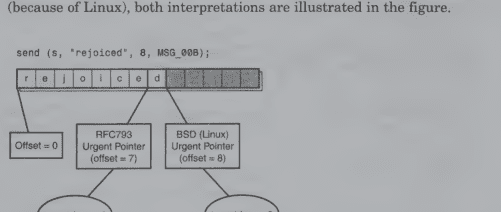

> 图 14.1：这是 TCP 紧急指针的图形表示。

使用 `MSG_OOB` 标志调用 `send(2)` 发生的事件序列如下（对于 BSD 解释 (`tcp_stdurg=0`)）：

1.  数据被放入 TCP 发送队列（在这种情况下，是空 TCP 缓冲区的开头）。
2.  启动 TCP 紧急模式（TCP URG 位被设置为真）。
3.  紧急指针被计算为指向进入发送 TCP 队列的最后一个字节之后。

在示例程序 `oobsend.c` 中，`send(2)` 调用后跟随了对 `sleep(3)` 的调用。此操作导致 Linux 内核执行以下操作：

1.  发送到目前为止在 TCP 缓冲区中排队的数据，而不是无限期等待更多数据。
2.  现在由 TCP 协议软件创建的分组头部现在具有 URG 位设置。这表明使用了 TCP 紧急数据（这是因为 `send(2)` 调用使用了 `MSG_OOB` 标志位）。
3.  计算 TCP 紧急指针并将其放入分组头部。在这种情况下 (`tcp_stdurg=0`)，该指针指向入队的带外数据的最后一个字节之后。
4.  包含 URG 位、紧急指针以及所有等待发送的分组数据的 TCP 分组头部现在作为一个物理分组传输到网络接口设备。

在这些步骤发生后，分组通过网络迅速传向接收主机。该分组在远端被接收，概念上如图 14.2 所示（省略了协议细节）：

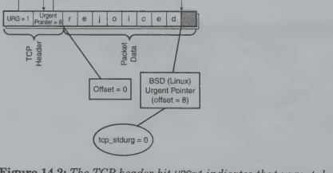

图 14.2：TCP 头部位 URG=1 表明紧急数据位于偏移量 8 处的字节之前。


当接收到`URG`位设置为真的分组时，如图 14.2 所示，Linux 内核将通过信号`SIGURG`通知拥有该套接字的进程（或进程组）。这样做是因为分组包含紧急指针（这就是`TCP`头部中`URG`位被设置的原因）。

应用程序`oobrecv.c`在处理`SIGURG`信号时，通过调用设置标志位`MSG_OOB`的`recv(2)`来读取带外数据。这导致 Linux 内核仅返回带外数据。由于`TCP`不记录带外数据开始的位置，套接字 API 只能返回分组中紧急指针之前的一个字节。

（假设`tcp_studrg`=0）。因此，在我们的示例中，只有字节`d`作为带外数据返回。随后对带内数据的任何读取都将读取剩余的字节`rejoice`，以及紧随紧急字节之后的任何数据（如果存在的话）。

即使带外数据未在信号处理函数中被读取，如果存在，也只会读取字节`rejoice`及后续的紧急数据。字节`d`将被阻止作为正常的带内数据返回，因为它已被识别为带外数据。

## 当 `tcp_studrg`=1 时的紧急模式

篇幅有限，我们无法深入探讨这种情况，但一些评论仍是有价值的。当`tcp_studrg`=1 时，常发生一种奇怪的事情——通常进入紧急模式并接收到相应的紧急指针，却没有任何对应的紧急数据可供读取。如果紧急指针恰好位于数据包中包含的最后一个数据字节末尾，那么可能根本不会收到后续数据。紧急数据字节可能出现在后续的数据包中。因此，使用这种工作模式时，在触发信号`SIGURG`的情况下，设置`MSG_OOB`标志的`recv(2)`调用不一定能返回`TCP`的带外字节。

> **提示**
>
> 在 Linux 下，当`tcp_studrg=1`时，如果没有紧急数据可供读取，`recv(2)`调用将返回`errno`值`EAGAIN`。其他一些 UNIX 实现（例如 BSD UNIX）则返回`errno`值`EWOULDBLOCK`。

为处理紧急数据字节不可用的情况，必须执行以下步骤（请记住，这仅适用于`tcp_studrg`=1 的情况）：

- 在标志中记录`SIGURG`事件（例如，一个名为`urg_mode=1`的变量）。
- 从信号处理器中返回。
- 继续在应用程序内读取带内数据。
- 当`urg_mode`值为真时，使用`recv(2)`和`MSG_OOB`标志位尝试读取一些带外数据。
- 如果步骤 4 产生了数据，则设置`urg_mode=0`并返回正常处理。重复步骤 3。
- 如果步骤 4 未产生任何带外数据，则继续处理并保持`urg_mode`为真。重复步骤 3。

再次强调，除非 Linux 的开发方向发生变化，否则你可能不会在 Linux 代码中使用这些步骤。Linux 默认使用 BSD（`tcp_studrg`=0）紧急数据模式，这种模式更易于处理。

## 内联接收带外数据

前面指出，接收带外数据与常规带内数据混合在一起是可能的。当应用程序以更便捷的方式处理这些数据时，会采用这种方式。要为特定套接字启用此工作模式，必须设置`SO_OOBINLINE`套接字选项：


```c
int z;          /* Status */
int s;          /* Socket */
int oobinline = 1;  /* TRUE */

z = setsockopt(s,
        SOL_SOCKET,
        SO_OOBINLINE,   /* Option */
        &oobinline,     /* Ptr to value */
        sizeof oobinline);/* Size of value */
```

> **注意**
>
> 为套接字启用选项`SO_OOBINLINE`后，不得调用带有`MSG_OOB`标志的`recv(2)`。否则，函数将返回错误，并将变量`errno`设置为代码`EINVAL`。

> **注**
>
> 如果你觉得有用，仍然可以使用`SIGURG`信号。这是通过调用`fcntl(2)`并使用命令`F_SETOWN`来建立的。

## 确定紧急指针

无论你是否内联接收数据，你都可以使用一个函数来告知你何时在当前数据流中到达紧急指针。这可以通过调用带有正确参数的`ioctl(2)`来确定：


```c
#include <sys/ioctl.h>

int z;      /* Status */
int s;      /* Socket */
int flag;   /* True when at mark */

z = ioctl(s, SIOCATMARK, &flag);
if ( z == -1 )
    abort();
if ( flag != 0 )
    puts("At Mark");
else
    puts("Not at mark.");
```

`IEEE Std 1003.1g`标准的第 6.6 版草案在你阅读本文时可能已被接受（请使用`www.ieee.org`上的搜索引擎查询）。在撰写本文时，IEEE 网站将“P1003.1g, D6.6 March 1998 Protocol Independent Interfaces (Pii)”列为“未批准的草案”，这是可以理解的。

`1003.1g`标准定义了一个更方便的函数`socketmark(3)`，该函数很可能在未来不久被 Linux/GNU 采用。其函数原型如下：

```c
#include <sys/socket.h>
int socketmark(int s);
```

其中`s`是待测试的套接字。如果套接字位于标记处，返回值为 1；如果不在，则返回 0；如果发生错误，则返回-1（检查`errno`以了解原因）。

基于上述功能，将演示一个经过修改的`oobrecv`程序，该程序内联接收数据，并在接收数据时测试紧急数据标记。

### 内联使用带外数据

列表 14.4 展示了一个新的接收程序`oobinline.c`，它将内联接收带内和带外数据。包含一个修改过的`SIGURG`信号处理器，以便在紧急数据到达时进行报告。这将允许你观察多种事件。

```c
/* oobinline.c: */
#include <stdio.h>
#include <unistd.h>
#include <stdlib.h>
#include <errno.h>
#include <string.h>
#include <signal.h>
#include <fcntl.h>
#include <sys/ioctl.h>
#include <sys/types.h>
#include <sys/socket.h>

extern void bail(char *on_what);
extern int BindAccept(char *addr);
```

列表 14.4：续


## 代码示例

```c
21: */
22: static void
23: sigurg(int signo) {
24: 
25: write(1, "SIGURG\n", 9);
26: signal(SIGURG, sigurg);
27: }
28:
29: /*
30: * Emulate the IEEE Std 1003.1g
31: * standard function socketmark(3):
32: */
33: static int
34: Socketmark(int s) {
35: int z;
36: int flag;
37: 
38: z = ioctl(s, SIOCSTMARK, &flag);
39: if ( z == -1 )
40: return -1;
41: return flag ? 1 : 0;
42: }
43: 
44: int
45: main(int argc, char **argv) {
46: int z; /* Status */
47: int s; /* Socket */
48: int oobinline = 1; /* OOB inline */
49: char buf[256];
50: 
51: 
52: /*
53: * Use a server address from the command
54: * line, if one has been provided.
55: * Otherwise, this program will default
56: * to using the arbitrary address
57: * 127.0.0.1:
58: */
59: s = BindAccept(argc >= 2
60: ? argv[1]
61: : "127.0.0.1:9011");
62: 
63: /*
64: * Establish ownership:
65: */
66: z = fcntl(s, F_SETOWN, getpid());
67: if ( z == -1 )
68:	bail("fcntl(2)");
69:
70:	/*
71:	 * Catch SIGURG:
72:	 */
73:	signal(SIGURG,sigurg);
74:
75:	/*
76:	 * Receive the OOB data inline:
77:	 */
78:	z = setsockopt(s,
79:			SOL_SOCKET,
80:			SO_OOBINLINE,
81:			&oobinline,
82:			sizeof oobinline);
83:	if ( z == -1 )
84:	bail("setsockopt(2)");
85:
86:	for (;;) {
87:		printf("[\n%s]\n",
88:			Socketmark(s)
89:			? "AT MARK"
90:			: "No Mark");
91:
92:		z = recv(s,buf,sizeof buf,0);
93:		if ( z == -1 )
94:		bail("recv(2)");
95:		if ( z == 0 )
96:		break;
97:		buf[z] = 0;
98:
99:		printf("rcv `%s' (%d)\n",
100:			buf, z);
101:	}
102:
103:	close(s);
104:	return 0;
105:	}
```

该程序与 `oobrecv.c` 模块非常相似，因此这里仅突出显示差异。它们包括：

- 在程序的后续部分，为了 `ioctl(2)` 调用的便利，在第 12 行添加了 `sys/ioctl.h` 的头文件包含。
- `SIGURG` 的信号处理器被修改为仅报告信号已触发（第 22 至 27 行）。
- 在第 33 至 42 行定义了一个新函数 `Socketmark()`，以模拟新的 `socketmark(3)` 函数。
- 如同以前一样，设置套接字的所有权并建立信号处理器（第 66 至 73 行）。请注意，这不是使用 `SO_OOBINLINE` 的要求。
- 使用 `setsockopt(2)` 函数在第 78 至 84 行将套接字选项 `SO_OOBINLINE` 设置为真。
- 在 `for` 循环开始时，调用 `Socketmark()` 函数并向终端会话提供报告。如果套接字位于紧急数据标记处，则报告 “AT MARK”；否则，向标准输出报告 “[No Mark]”。
- 数据作为带内数据接收（第 92 至 100 行）。
- 循环重复步骤 6，直到在套接字上接收到文件结束符（参见第 96 行中的 `break` 语句）。

现在编译该程序：

```sh
$ make oobline
gcc -c - -D_GNU_SOURCE -Wall -Wreturn-type -g oobline.c
gcc oobline.o mknaddr.o bindnapt.o -o oobline
$
```

对此测试使用以下程序：

- 在第一个终端会话中，启动 `oobline` 程序。
- 在第二个终端会话中，启动之前使用过的 `oobsend` 程序。

发送程序的终端会话应如下所示：

```sh
$ ./oobsend
ib: 'In the beginning' (16)
ib: 'Linus begat Linux,' (18)
ib: 'and the Penguins' (16)
OOB 'rejoined' (8)
ib: 'excellently.' (12)
$
```

实际上，该终端会话应与之前相同。然而，接收终端会话应如下所示：

```sh
$ ./oobline

[No Mark]
rcv 'In the beginning' (16)

[No Mark]
rcv 'Linus begat Linux,' (18)

rcv 'and the Penguins' (16)

rcv 'rejoice' (7)

rcv 'd' (1)

rcv 'exceedingly.' (12)
```

请注意，当接收到字符串 `'rejoice'` 时，如同之前一样，会引发 `SIGURG` 信号。但请注意，只有在先读取 `'rejoice'` 的字节后，才会到达紧急数据标记点。随后到达该标记点，并接收到另一个内联字节（即再次出现的 `d` 字节）。关于这一点，有几点值得注意：

- `SIGURG` 信号尽可能早地到达，这与不使用紧急数据内联读取时的情况相同。
- 必须按顺序读取带内数据，之后才能读取带外数据。
- 尽管发送的报文将字符串 `'rejoice'` 作为一个整体单位包含在内，但 `recv(2)` 调用会在紧急数据字节所在的位置停止（接收在 `d` 字节之前停止）。
- 需要后续调用 `recv(2)` 来读取紧急数据。对于 TCP，在示例中这是一个单独的字节 `d`。

通常情况下，从流套接字读取数据时没有隐含的消息边界。然而，你看到当内联读取紧急数据时，确实会形成一个边界。读取会在紧急数据字节之前停止。如果未这样做，你很容易读取超过标记点的范围。

## 紧急模式指针的限制

到目前为止，已证明 TCP 实际上只能提供 1 个字节的带外数据。这是因为它是使用 TCP 协议的紧急模式功能实现的。

人们很容易认为 TCP 紧急模式及其紧急指针应该使得标记紧急数据边界成为可能。然而，在实践中无法做到这一点，因为后续的带外数据发送会覆盖接收方可能尚未处理的原始紧急数据标记。

如果你修改 `oobsend.c` 程序，就可以证明这一点。删除所有 `sleep(3)` 函数调用，并在 `oband(s, "rejoiced")` 函数调用之后插入一个额外的 `oband(s, "very")` 调用。主程序现在应该看起来像这样：


```c
int main(int argc,char **argv) {
    int s = -1; /* Socket */

    s = Connect(argc >= 2 ? argv[1] : "127.0.0.1:9011");

    iband(s,"In the beginning");
    iband(s,"Linus begat Linux;");
    iband(s,"and the Penguins");
    oband(s,"rejoiced");
    oband(s,"very");
    iband(s,"exceedingly.");
    close(s);

    return 0;
}
```

当再次运行测试时，在快速系统上，你会收到类似这样的结果：


```
$ ./obinline

[No Mark]
rcv 'In the beginning' (16)

[No Mark]
rcv 'Linus begat Linux,' (18)

[No Mark]
[SIGURG]
rcv 'and the Penguinsrejoicedver,' (27)

[AT MARK]
rcv 'vexceedingly.' (13)

[No Mark]
$
```

在此请注意以下几点：

- 只接收到了一个`SIGURG`信号。
- 尽管发送端进行了两次带外写入，但只有一个紧急数据标记。
- 字符串`'yexceedingly'`中的第一个字节`y`是那个单独的带外数据字节。随后的字节仅仅是后续的内联数据字节。

先前的测试依赖于`sleep(3)`提供的延迟来构造一组受控的物理报文。

## 注意

某些测试，例如上述测试，可能会在不同的系统和网络上产生不同的结果。`CPU`和网络的性能够级决定了正在发送和接收的数据流中报文如何以及何时被分割。

正如前文所述，你的结果可能与示例输出略有不同。当从较慢的`486`系统发送并到接收端的快速`Pentium III`时，可以进一步证明结果存在差异。当从较快的`CPU`发送到较慢的`CPU`时，可以观察到另一种接收模式。当移除所有`sleep(3)`调用时，其他因素决定了报文的分割方式。

## 使用 `select(2)` 处理带外数据

本章没有足够的篇幅来深入探讨这个特定主题，但关于此主题的一些简单建议似乎是恰当的。

带外数据通知作为`select(2)`函数调用的异常到达。你会记得在第 11 章“并发客户端服务器”中提到，`select(2)`调用会阻塞，直到以下一个或多个事件发生：

- 读取事件（有待读取的数据已到达）
- 写入事件（现在可以写入数据）
- 异常（带外数据已到达）

你的程序可以表达对参与`select(2)`调用的套接字的异常的兴趣。然后，它可以在必要时通过适当调用`recv(2)`并使用`MSG_OOB`标志来处理带外数据。

## 接下来是什么

本章向你展示了套接字 API 提供了使用带外数据的通用接口。在某些你运行的演示中，TCP 紧急模式的限制是明显的。然而，你知道这些限制不一定延伸到其他可能支持使用套接字进行带外数据的协议。

下一章将向你展示`inetd`守护程序如何节约系统资源。你还将学习由`inetd`启动的服务器编写要求是什么。


# 使用 `inetd` 守护程序

每个在`UNIX`下运行并提供服务的服务器通常作为单独的进程执行。然而，当提供的服务数量变得很大时，这会成为系统的负担。这是因为必须为每个正在运行的服务器进程分配资源，即使当前没有对该服务的请求。

此外，可以观察到，大多数服务器程序使用相同的通用步骤来创建、绑定、监听并接受新的客户端连接。对于无连接服务器操作也可以做出类似的观察。

- `inetd`守护程序是什么
- `inetd`如何解决服务器资源利用率问题
- `inetd`如何简化服务器的编写

## 大多数服务器通用的步骤

如果你回想第 8 章“面向连接的服务器协议”，你会记得面向连接的服务器与客户端建立联系的基本步骤如下：

1. 创建一个套接字。
2. 将套接字绑定到一个众所周知的地址。
3. 监听客户端连接。
4. 接受客户端连接。

图 8.1 概述了这些步骤。现在，想象两个不同的服务器，例如用于`telnet`客户端的`telnetd`和用于`ftp`客户端的`ftpd`。对于这两个服务器，步骤 1 到 4 会不同吗？答案是这两个步骤完全相同。你会看到`inetd`守护程序可以为任何面向连接的服务器执行这些初始步骤，从而让服务器编写者免于编写和调试这些步骤的代码。`inetd`守护程序的概念可以扩展以处理无连接服务器。

## 介绍 `inetd`

当你的`Linux`系统首次启动时，`inetd`守护程序从一个启动脚本中启动。在`Red Hat Linux 6.0`系统中，该守护程序从以下脚本文件启动：

`/etc/rc.d/init.d/inet`


### 示例

此脚本符号链接自其他几个位置，包括以下值得注意的链接：

`/etc/rc/rc3.d/S50inet`

`/etc/rc/rc5.d/S50inet`

这些链接在系统以通常的运行级别 3 或运行级别 5 模式启动时启动`inetd`。

## 注意

运行级别（`run-level`）只是一种系统级操作模式。`Linux`支持几个这样的级别。有关此问题的完整讨论，请参见`init(8)`手册页。

运行级别 3 通常在`Linux`系统不使用`X Window`时使用。运行级别 5 通常用于在控制台上自动调用`X Window`服务器。请注意，这只是一个约定，你的系统约定可能不同。

其他`Linux`发行版会有各种其他巧妙的脚本和文件名来实现同样的事情。

## `/etc/inetd.conf` 配置文件

当`inetd`守护进程首次启动时，它必须知道需要监听哪些互联网服务，以及当请求到达时将请求传递给哪些服务器。这在启动文件`/etc/inetd.conf`中定义。

**注意**

如果你使用的是公司、大学或其他共享的`Linux`主机，你可能会发现`/etc/inetd.conf`文件出于安全目的已被精简。许多站点会消除非必要服务以避免网络攻击中的漏洞。某些站点甚至可能完全停止运行`inetd`。

如果是这种情况，你需要与负责该主机安全的人员协调你的操作。

`/etc/inetd.conf`文件的一般布局组织为一个文本文件，每行文本代表一条记录，描述一个互联网服务。以`#`开头的行仅为注释行，将被忽略。

空格（或制表符）分隔的字段在表 15.1 中有描述，并附带了一些示例（字段按从左到右的顺序列出）。

### 表 15.1：`/etc/inetd.conf` 配置记录

| 字段 # | 描述 | 示例 |
|---|---|---|
| 1. | 互联网服务名称 | `telnet`（这也可能是一个端口号） |
| 2. | 套接字类型 | `stream` 或 `dgram` |
| 3. | 协议 | `tcp` 或 `udp` |
| 4. | 标志 | `nowait` 或 `wait` |
| 5. | 要使用的用户 ID | `root` 或 `nobody` |
| 6. | 可执行文件的路径名 | `/usr/sbin/in.telnetd` |
| 7. | 服务器参数 | `in.telnetd` |

### 互联网服务名字段

`/etc/inetd.conf`记录中的互联网服务名字段，仅仅是来自`/etc/services`文件的互联网服务名称，该文件在第 7 章“面向连接的客户端协议”中已涉及。有关详细信息，请参考表 7.1。你现在可以在`/etc/services`文件中执行快速查找，如下所示：

```
# grep telnet /etc/services
telnet	23/tcp
rteInet	107/tcp	# Remote Telnet
rteInet	107/udp
# OUTPUT
```

在那里，你将看到标记为`telnet`的服务被配置为端口号`23`上的`tcp`服务。这就是`inetd`守护进程确定必须监听连接端口号的方式。

或者，你只需提供一个端口号。本章稍后你会看到一个例子。

### 套接字类型字段

虽然`Linux` `inetd`守护进程在这里可以接受多种套接字类型，但为了简化起见，这里只讨论`stream`或`dgram`类型。对于更好奇的读者，`inetd(8)`手册页还列出了`raw`、`rdma`和`seqpacket`类型作为其他可能性。

`stream`类型对应于`socket(2)`函数调用的`SOCK_STREAM`套接字类型。值`dgram`请求使用`SOCK_DGRAM`套接字类型。

### 协议字段

正如你可能猜测的那样，这选择用于套接字的协议。该值必须是`/etc/protocols`文件中出现的有效条目（参见第 7 章中题为“查阅 /etc/protocols 文件”的部分）。两个常用的选择是

- `tcp`用于`TCP`协议
- `udp`用于`UDP`协议

其他可能性也存在，但这两个是最常用的。

### 标志字段

此字段仅面向数据报套接字。非数据报套接字（例如`stream tcp`）应指定值`nowait`。

面向数据报的服务器有两种类型。它们是

- 持续读取`UDP`数据包直到超时并退出的服务器（对于这些指定`wait`）。
- 读取一个数据包即退出的服务器（对于这些指定`nowait`）。

`inetd`需要这些信息，因为处理`dgram`流量比处理面向流的协议更复杂。这有助于守护进程确定当该服务的服务器正在运行时，它应如何处理未来的`dgram`连接。本章稍后将详细解释这一点。

### 用户 ID 字段


`inetd` 守护进程在 `root` 账户下运行。这使得它能够将其身份更改为另一个用户账户，如果它选择这样做的话（有关详细信息参见 `setuid(2)`）。出于安全目的，建议使用执行任务所需的最少权限来运行服务器。因此，服务器通常以更有限的 `userID`（例如 `nobody`）运行。

然而，某些服务器必须作为 `root` 运行，因此你有时会以这种方式看到 `userID` 被指定。

### 路径名字段

此字段仅告知 `inetd` 可执行文件的完整路径名。这是守护进程调用 `fork(2)` 后由 `exec(2)` 执行的可执行文件。

### 服务器参数字段

`/etc/inetd.conf` 配置行上的所有剩余字段都作为命令行参数提供给通过 `exec(2)` 调用的服务器。一个常见的混淆来源是这些参数从参数 `argv[0]` 开始。这使得命令名称可以不同于路径名。当一个可执行文件根据其名称表现出不同特性时，这非常有用。

## `inetd` 服务器的设计参数

使用 `inetd` 作为服务器前端的好处之一是，服务器编写者的工作变得更容易。例如，对于 `stream tcp` 服务器，不再需要承担编写相同的 `socket(2)`、`bind(2)`、`listen(2)` 和 `accept(2)` 调用的负担。对于 `dgram udp` 服务器，也可以获得类似的代码节省。那么，当进程启动时，`inetd` 服务器如何将连接套接字传递给服务器进程？

利用 UNIX 的简单优雅性，启动的服务器通过以下文件单元（文件描述符）获得客户端套接字：

- 文件单元 0 具有用于标准输入的客户端套接字
- 文件单元 1 具有用于标准输出的客户端套接字
- 文件单元 2 具有用于标准错误输出的客户端套接字

在这种设计就位后，有些服务器可能不需要任何套接字函数调用。所有服务器 `I/O` 都可以在正常的标准输入、输出和错误文件单元上完成。稍后，一个简单的演示程序将展示标准输出如何以这种方式使用。

## 实现一个简单的 `stream tcp` 服务器

你可能记得在第 8 章中介绍了一个小程序，如清单 8.1 所示。请花点时间现在回顾那个程序。清单 15.1 展示了同一个服务器的新代码，只不过它是为 `inetd` 守护进程的使用而设计的。

### 清单 15.1：`inetserv.c`——清单 8.1 服务器的 `inetd` 版本


```c
/* inetserv.c:
 *
 *  Example inetd daytime server:
 */
#include <stdio.h>
#include <unistd.h>
#include <stdlib.h>
#include <errno.h>
#include <string.h>
#include <time.h>
#include <sys/types.h>

/*
 *  This function reports the error and
 *  exits back to the shell:
 */
static void
bail(const char *on_what) {
    if ( errno != 0 ) {
        fputs(strerror(errno),stderr);
        fputs(": ",stderr);
    }
    fputs(on_what,stderr);
    fputc('\n',stderr);
    exit(1);
}

int
main(int argc, char **argv) {
    int z;
    int n;
    time_t td;          /*  Current date&time  */
    char dtbuf[128];    /*  Date/Time info  */

    /*
     *  Generate a time stamp:
     */
    time(&td);
    n = (int) strftime(dtbuf, sizeof dtbuf,
                       "%A %b %d %H:%M:%S %Y\n",
                       localtime(&td));

    /*
     * Write result back to the client:
     */
    z = write(1,dtbuf,n);
    if ( z == -1 )
        bail("write(2)");

    return 0;
}
```

与清单 8.1 中的程序相比，注意这个程序有多简单。注意以下不同之处（行号引用指清单 15.1）：

- 不需要 `socket` 包含文件（第 5 到 11 行）。
- 不需要 `socket` 地址结构体（第 30 到 33 行）。
- 完全没有 `socket` 调用。注意程序立即开始着手任务（第 38 到 48 行生成日期和时间字符串）。

由于该程序不再使用套接字函数，因此可以从 shell 轻松测试，如下所示：

```bash
$ make inetserv
gcc -c -D_GNU_SOURCE -Wall -Wreturn-type inetserv.c
gcc inetserv.o -o inetserv
$ ./inetserv
Tuesday Nov  2 16:29:45 1999
$
```

回想一下，这与端口 13 上的 `daytime` 服务类似：

```bash
$ telnet 192.168.0.1 13
Trying 192.168.0.1...
Connected to 192.168.0.1.
Escape character is '^]'.
Tue Nov  2 16:31:09 1999
Connection closed by foreign host.
$
```

格式上唯一的实质区别是我们的程序显示完整的星期几名称。现在是时候演示这个程序如何在 `inetd` 守护进程的帮助下运行了。

## 配置 `/etc/inetd.conf` 以调用新服务器

为了使我们的简单新服务器有用（或至少与 `daytime` 服务器一样有用），我们必须修改 `inetd` 守护进程使用的配置文件。如果你需要的话，现在可能是回顾表 15.1 的好时机。

## 建立可执行文件

这里假设你之前已经编译了 `inetdserv` 程序。为了简化步骤，请输入以下命令：

```bash
$ cp inetdserv /tmp/inetdserv
$ chmod +rx /tmp/inetdserv
```

上述两个步骤将服务器可执行文件复制到一个已知位置，并确保其具有可执行权限。


## 建立服务

对于此测试，请在 `/etc/inetd.conf` 文件中添加一行（将其作为文件的最后一行）。在使用 `vi` 或你喜欢的编辑器完成此操作后，你应该能够按如下方式列出该条目：

```bash
$ tail -1 /etc/inetd.conf
```

```
9099 stream tcp nowait root /tmp/inetdserv inetdserv
```


## 注意

你需要通过 `su` 切换到 `root` 用户才能修改你的 `/etc/inetd.conf` 文件。

### 警告

在编辑诸如 `/etc/inetd.conf` 这样的系统文件时，应格外小心。作为预防措施，请按照以下方式备份该文件：

```bash
# cp /etc/inetd.conf /tmp/inetd.bak
```

如果需要恢复配置文件的原始内容，可以按以下方式恢复：

```bash
# cp /tmp/inetd.bak /etc/inetd.conf
```

此外，在你不再需要之前添加的测试条目时，请格外小心将其删除。这样做是为了避免留下可用的端口，这些端口可能会被互联网上的黑客利用。

现在，让我们回顾一下最后一行对于 `inetd` 的含义：

- 由于你的新服务在 `/etc/services` 文件中没有名称，第一个字段仅包含你要使用的端口号。这里选择了端口 9099。
- 第二个字段包含 `stream`，以便使用 `TCP` 流套接字。
- 第三个字段包含 `tcp`，表示我们需要 `TCP` 流，而不是其他协议的流。
- 第四个字段指定为 `nowait`，这是 `TCP` 流条目所必需的。
- 第五个字段在此示例中给定为 `root`。你的正常 `userID` 也可以在此处使用（但请务必确保对 `/tmp/inetdserv` 存在适当的执行权限）。
- 路径名 `/tmp/inetdserv` 被作为第六个字段给出。这是当套接字上到达连接时将执行的可执行文件的路径名。


- 第七个字段在此示例中指定为 `inetdserv`。在这种情况下，我们的服务器程序并不关心 `argv[0]` 的值，这里几乎可以使用任何值。

现在，在实际连接到该服务之前，请再执行一次测试以确保一切准备就绪：

```
$ /tmp/inetdserv
Tuesday Nov 02 16:52:33 1999
$
```


如果你未能收到所示输出，请检查是否使用了正确的文件名复制了文件。此外，确保该文件具有适当的执行权限。在演示此功能（如上述所示）之后，你就可以通知 `inetd` 其配置已更改。

## 通知 INETD 配置已更改

为了向 `inetd` 指示配置已更改，你必须切换到 `root` 并执行以下操作：

```
# ps -ax | grep inetd
314 ?  0:00 inetd
# kill -HUP 314
#
```


你的进程 ID 可能不像所示那样是 `314`——事实上，它很可能是不同的。所使用的步骤如下：

1. 使用由 `grep` 命令过滤的 `ps` 命令列出 `inetd` 守护进程的进程 ID。
2. 向 `inetd` 发送 `SIGHUP` 信号，告知其重新读取 `/etc/inetd.conf` 配置文件。这不会终止该进程。

在向 `inetd` 发送信号后，你可能想要检查配置更改是否已被接受。检查此问题的一种方法是执行以下操作：


```
# lsof -i
COMMAND PID USER FD TYPE DEVICE SIZE NODE NAME
portmap 238 root 3u inet 369 UDP *:sunrpc
portmap 238 root 4u inet 370 TCP *:sunrpc (LISTEN)
inetd 314 root 4u inet 474 TCP *:ftp (LISTEN)
inetd 314 root 5u inet 475 TCP *:telnet (LISTEN)
inetd 314 root 6u inet 476 TCP *:login (LISTEN)
inetd 314 root 8u inet 477 TCP *:exec (LISTEN)
inetd 314 root 10u inet 478 TCP *:auth (LISTEN)
inetd 314 root 11u inet 1124 TCP *:9099 (LISTEN)
inetd 314 root 12u inet 1163 TCP *:daytime (LISTEN)
named 342 root 4u inet 531 UDP *:1024
--
```

输出中显示节点名称 `TCP *:9099` 的行表明新添加的服务器服务。请注意，左侧显示 `inetd` 是正在该 `9099` 端口上监听连接的进程。`TCP *:9099` 表示 `TCP` 端口 `9099` 将接受来自任何端口的连接（星号表示通配服务器地址）。

## 测试新服务

尝试使用本地主机地址来测试新的 `inetd` 服务：


```
$ telnet localhost 9099
Trying 127.0.0.1...
Connected to localhost.
Escape character is '^]'.
Tuesday Nov 02 17:10:37 1999
Connection closed by foreign host.
$
```

请记住，`localhost` 通常配置为本地回环地址 `127.0.0.1`（也可以尝试该地址）。如果你安装了以太网卡，请尝试其接口地址。你的输出应该类似于以下所示：


```
$ telnet 192.168.0.1 9099
Trying 192.168.0.1...
Connected to 192.168.0.1.
Escape character is '^]'.
Tuesday Nov 02 17:13:28 1999
Connection closed by foreign host.
$
```

此输出证实了允许从任何接口进行连接的事实。现在将其与你现有的 `daytime` 服务进行对比（如果已启用）。别忘了在命令行中添加参数 `13`：

## 禁用新服务

现在再次 `su` 切换到 `root`，并从 `/etc/inetd.conf` 文件中删除你的自定义服务器条目（假设你已经不再需要它）。然后，按以下方式为守护进程重新加载配置：


```
$ telnet 192.168.0.1 13
Trying 192.168.0.1...
Connected to 192.168.0.1.
Escape character is '^]'.
Tue Nov 2 17:16:57 1999
Connection closed by foreign host.
$
```

注意，星期名称是缩写的，这与你的服务器输出不同。


```
# ps -ax | grep inetd
314 ? S 0:00 inetd
# kill -HUP 314
#
```

你的进程 ID 可能如图所示是 `314`——事实上，它很可能不同。请替换为你看到的实际 ID。

> **警告**
>
> 如果你已经不再需要该服务，请务必现在删除你的 `inetd` 条目。在删除条目后，务必向 `inetd` 发送 `SIGHUP` 信号（`kill -HUP`）。建议这样做以避免有人试图从互联网上利用你的小型演示服务器。

## 使用 INETD 的数据报服务器

本章到目前为止一直关注于在 `inetd` 中使用 `TCP` 流套接字。当 `inetd` 建立数据报服务器端口时，会引入一个特殊的考虑因素。本章前面关于 `wait` 和 `nowait` 标志值的描述已经暗示了这一点。

让我们回顾一下 `inetd` 在应用于 `UDP` 服务器时使用的步骤：

1. `inetd` 服务器监听你的 `UDP` 服务器将处理请求的 `UDP` 端口。
2. `inetd` 使用的 `select(2)` 调用指示套接字上已到达一个数据报（注意 `inetd` 不会读取此数据报）。
3. `inetd` 服务器调用 `fork(2)` 和 `exec(2)` 来启动你的 `UDP` 服务器。
4. 你的 `UDP` 服务器使用文件单元零（`stdin`）读取一个 `UDP` 数据包。

步骤 1 到 4 与我们的 `TCP` 流场景相同。然而，在处理完步骤 4 中收到的第一个（单个）`UDP` 数据包后，`UDP` 服务器有两个基本选择：

- 退出（终止）
- 等待更多的 `UDP` 数据包（仅在发生超时后退出）。

仔细思考一下可以看出，如果 `UDP` 数据包到达频繁，为每个 `UDP` 数据包启动一个新进程可能会给系统带来一定负担。因此，一些 `UDP` 服务器不会立即退出，而是循环返回并在处理完第一个数据包后尝试读取后续的 `UDP` 数据包。使用超时机制以便如果没有更多数据到达，进程就会放弃并退出。当这种情况发生时，`inetd` 守护程序再次接管监控，等待新的 `UDP` 数据包。

## 理解 wait 和 nowait

仅处理一个数据报然后退出的数据报服务器应使用 `nowait` 标志字。这告诉 `inetd` 当额外的数据报到达时，它可以启动额外的服务器进程。这是必要的，因为每个启动的进程将只处理一个数据报。

对于试图读取更多数据报的其他数据报服务器，你应该使用 `wait` 标志字。这是必要的，因为 `inetd` 启动的服务器进程将处理后续的数据报直到它终止。`wait` 标志字告诉 `inetd`，在 `wait(2)` 系统调用通过信号 `SIGHUP` 告知 `inetd` 你的数据报服务器已终止之前，不要为该端口启动任何更多服务器。否则，`inetd` 将会启动不必要的额外服务器进程。让我们系统地重新陈述一下：

1. 由于收到传入的数据报，`inetd` 服务器启动了你的循环 `UDP` 服务器进程。
2. `inetd` 服务器基于其配置等待其他无关事件。它目前会忽略当前的 `UDP` 端口，因为你的数据报服务器已启动以处理这些数据报。注意，因为服务是用 `wait` 标志字配置的，所以使用了这种行为（`inetd` 无法确定可执行文件代表哪种类型的服务器）。
3. 你的数据报服务器完成了对第一个 `UDP` 数据报的处理。
4. 你的数据报服务器试图从标准输入（即数据报套接字）读取另一个 `UDP` 数据报。
5. 最终你的数据报服务器发生超时，因为没有更多数据报到达——你的数据报服务器进程通过调用 `exit(3)` 终止。


6. 在`inetd`中会发出信号`SIGCHLD`（请记住，`inetd`是你的服务器的父进程）。

7. `inetd`服务器调用`wait(2)`以确定服务器进程（你的服务器进程）的进程ID和终止状态。

8. `inetd`守护进程注意到`wait(2)`返回的进程ID属于你的数据报服务器。它记录下，由于当前没有进程在等待处理，因此它现在必须监视任何新的数据报。

在定义数据报服务时，请记住关于`inetd`的以下几个重要要点：

- `inetd`守护进程无法确定配置的数据报服务器是需要`wait`还是`nowait`参数。你必须知道并为服务器提供正确的标志词。

- `wait`标志词意味着，除非之前启动的进程（如果有）已经终止，否则不会启动另一个服务器进程。

- 对于`wait`数据报服务器指定`nowait`将会不必要地复制服务器进程。

- 对于`nowait`数据报服务器指定`wait`将会损害该服务的服务器性能。这是因为直到当前进程完成之前，不会启动额外的进程。

另外，请记住，流服务应始终使用`nowait`标志词。这允许同时处理多个客户端（每个连接的客户端对应一个服务器进程）。如果对流服务使用的是`wait`标志词，则一次只能处理一个客户端连接（这通常不是理想的情况）。

## 接下来是什么

本章简要介绍了`inetd`守护进程。你学习了如何安装一个测试流服务器。你看到了简单的服务器程序如何仅使用文件单元`1`（`stdout`）将其回复写回给客户端。此外，该示例还表明，完全不需要`socket`代码。虽然情况并非总是如此，但你已经看到`inetd`守护进程为你处理了很多网络细节。

# 网络安全编程

在本书的这一点之前，你一直专注于学习如何编写支持`socket`的程序，无论是客户端还是服务器程序。并没有考虑保护你的程序免受外部威胁，这些威胁可能来自互联网，也可能来自你自己局域网内的恶意用户（例如在大学环境中）。本章将向你介绍：

- 如何使用`inetd`守护进程与`TCP wrapper`概念一起对客户端进行筛选

- `TCP wrapper`概念是如何工作的

- `TCP wrapper`概念在某些方面存在哪些不足

完成本章后，你将完全理解`TCP wrapper`概念是如何工作的，并知道如何将其应用于你可能管理或自行编写的服务器。


# 16

《韦氏大学词典》从多种角度定义了安全。其中有两个定义对你特别重要：

- 安全的质量或状态，即免受危险。

- 为防止间谍活动或破坏、犯罪、攻击或逃脱而采取的措施。

当讨论网络安全时，第一点无疑适用：你希望免受任何感知到的威胁。其次，你必须保护系统资源不被未经授权的检查、破坏、窃取或以其他形式攻击。你未公开的作品不得在未经你许可的情况下从你的系统中“逃脱”。

这项任务的复杂性及其应用的广泛性使得在一章中完全处理该主题变得不可能。然而，网络安全的某些方面直接关系到`socket`编程，你不应该忽视存在的危险。本章介绍的一些简单措施将有助于防止你的服务器被利用或攻击。你将了解漏洞在哪里存在以及你可以采取什么措施。

如果你审视所有安全起作用的日常情境，你可以将这些共同要素归结为锁。锁采取不同的形式：

- 雇佣武装警卫

- 基于钥匙和卡的锁

- 密码锁、口令和`PIN`码

- 视网膜、指纹和声纹扫描

武装警卫被赋予执行条件和在必要时施加武力的手段。这种形式不太适用于我们的讨论，因为这些是执行人工筛选过程的人类代理。

基于钥匙和卡的锁需要访问物理令牌才能授予访问权限。例如，钥匙可能是汽车或房子钥匙。卡锁使用磁条，提供身份识别。

密码锁、口令和`PIN`码通过秘密知识来识别人。一些安全系统将物理令牌与秘密结合：例如，`ATM`银行卡既需要银行卡，也需要`PIN`码。

## 定义安全

## 安全的挑战

视网膜、指纹和声纹扫描方法都依赖于每个人都有独特特征的原理。因此，人们直接通过这些特征被识别。

所有这些方法都可能被挫败。表`16.1`提供了这些安全方法可能被击败方式的示例。

表`16.1`：安全方法与弱点

你可能会想到更多这些系统可能遭受安全漏洞的方式。这个练习的要点是指出关于安全的一个基本事实：

任何允许一个人获得访问权限的系统，都有可能允许其他人也获得访问权限。

这让我们去考虑一个可能的推论，即

唯一完全安全的系统是没有人能够获得访问权限的系统。

认真看待这种情况没有意义，且很难证明。这导致了一个结论：

人们必须始终关注适用于资源适当和安全访问的安全问题。

在计算机上授予或拒绝访问资源，一旦身份确立，就是一件简单的事。然而，网络安全带来了一些额外的挑战，因为建立远程身份更加困难。这类似于验证来自地球某个偏远地点的信件的作者。

以此为背景，让我们现在深入探讨适用于`socket`编程的网络安全。

## 识别敌友

第`17`章“传递凭据和文件描述符”将向你展示，你可以使用凭据以很高的置信度识别服务器的本地用户。然而，当你的服务器用户是远程时，就不容易达到同样程度的置信度。

在本章中，我们将依赖对等方的网络地址来识别资源的使用者。然而，这不是一项无懈可击的技术，因为在适当条件下对等方的地址可以被伪造。尽管如此，它确实提供了一层针对攻击的简单第一级防御。

在你获得`IP`号后，你还可以查找客户端注册的主机名和域名。这提供了一个额外的筛选层，需要攻击者付出更多努力。

已解析的主机名和域名允许你的服务器应用以下类型的访问策略：

- 授予特定主机名的访问权限

- 授予特定域名的访问权限

- 拒绝特定主机名的访问

- 拒绝特定域名的访问

- 拒绝未解析到名称的`IP`号的访问

下一节将讨论这些不同策略的各个方面。

## 通过主机名或域名进行安全保护

当客户端连接到你的服务器时，你会记得服务器从`accept(2)`的函数调用中接收客户端的`socket`地址。以下代码片段摘自列表`8.1`，展示了这一点的一个示例：

```c
struct sockaddr_in adr_clnt; /* AF_INET */
int len_inet; /* length */
int c; /* Client socket */
...
len_inet = sizeof adr_clnt;
c = accept(s,
(struct sockaddr *)&adr_clnt,
&len_inet);
```


数据报服务器通过`recvfrom(2)`函数获取客户端的地址。以下是列表`6.1`中的代码片段：

```c
int z;
struct sockaddr_in adr_clnt; /* AF_INET */
int len_inet;                /* Length */
int s;                      /* Socket */
char dgram[512];             /* Recv buffer */

len_inet = sizeof adr_clnt;
z = recvfrom(s,             /* Socket */
             dgram,         /* Receiving buffer */
             sizeof dgram,  /* Max recv buf size */
             0,             /* Flags: no options */
             (struct sockaddr *)&adr_clnt, /* Addr */
             &len_inet);
```

在获取了客户端地址之后（无论是哪种类型的服务器），你需要应用第`9`章“主机名和网络名查找”中的技术，使用`gethostbyaddr(3)`函数。以下是列表`9.8`中的另一个代码片段，用于回顾如何将客户端的`IP`号码解析为主机名：

```c
struct sockaddr_in adr_clnt; /* AF_INET */
struct hostent *hp;          /* Host entry ptr */

hp = gethostbyaddr(
    (char *)&adr_clnt.sin_addr,
    sizeof adr_clnt.sin_addr,
    adr_clnt.sin_family);

if (!hp)
    fprintf(logf, " Error: %s\n",
            hstrerror(h_errno));
else
    fprintf(logf, " %s\n",
            hp->h_name);
```

当服务器在`hp->h_name`中获得了完整限定的主机名后，它就能够执行程序设计师希望应用的任何允许或拒绝策略。

### 通过 `IP` 号码识别


虽然对 `humans` 来说，使用系统主机名和域名进行操作比较方便，但这种识别方法存在安全问题。当服务器接收到 IP 号码时，必须使用另一个网络进程（由 `gethostbyaddr(3)` 发起）将该号码解析为主机名。完全可以设想，攻击者可能已经配置了他们的私有名称服务器，使其对他们的 IP 号码撒谎。因此，有时最好仅基于 IP 号码来做出安全决策。另一种可用的妥协方案是：仅基于 IP 号码授予访问权限，但在日志文件中同时记录 IP 号码和解析出的名称。这提供了良好的安全性，同时在查看历史记录日志时提供了一定程度的便利性。当发生可疑活动时，你可以检查当时的 IP 号码以及当时解析出的表观名称。

使用 IP 号码进行安全控制会给服务器管理员带来额外的挑战。如果客户端更改了其 IP 号码，即使其主机名和域名保持不变，管理员也必须更新 IP 号码。

通过 IP 号码进行安全保护时，管理员面临的另一个挑战是，他可能会不得不处理那些不知道自己的 IP 号码是多少的用户。不过，你可能能够从他们那里获取主机名和域名信息。有了这些信息，你可以使用 `nslookup(1)` 命令确定客户端的 IP 号码，然后配置该号码。之后，联系客户端并请他们确认其是否正常工作。

最后，有些客户端每次启动工作站时都会使用不同的 IP 号码——例如，当他们使用 DHCP 时。他们的 IP 号码是从其管理员确定的可用 IP 号码池中分配的。在这种情况下，你所能做的最好的事情是联系他们的主管，以了解他们将从其中提取的 IP 号码池的更多细节。在这种情况下，通常只需在网络 ID 级别限制访问权限（如有必要，请回顾第 3 章中的图 3.1，“地址转换函数”）。

## 保护 `inetd` 服务器

到目前为止，讨论一直围绕着在每个服务器中定制代码以执行你的安全策略。这有几个缺点：

- 必须在每个暴露于敌对环境的服务器中内置管理安全的代码。
- 每个服务器都必须经过严格的测试，以验证其准确性及对抗攻击的韧性。
- 多个访问点意味着有更多薄弱的点可以被利用。

前两点不言自明。最后一点可以通过购物中心关门时保护多扇门的难题来说明。当必须锁上几扇门时，很容易忽略其中一扇。此外，更可能发现某扇门存在可被利用的薄弱点。鉴于所有这些原因，将安全策略放入集中式模块中是可取的。

### 集中式网络策略

在上一章中，你看到了 `inetd` 守护进程如何简化服务器设计。`inetd` 守护进程提供了监听客户端请求并仅在必要时启动服务器所需的所有服务器代码。`inetd` 守护进程提供了另一层便利性：它允许安装集中式的网络安全模型。

如果你正在使用较新的 Linux 发行版，例如 Red Hat Linux 6.0，那么你已经有了由 Wietse Venema 的 TCP 包装器程序被 `inetd` 调用的功能。要验证这一点，请 grep `telnetd` 的条目，如下所示：

```bash
# grep telnet /etc/inetd.conf
telnet    stream    tcp     nowait  root    /usr/sbin/tcpd in.telnetd
```


从示例输出中可以看到，当收到 `telnet` 请求时，`inetd` 会调用可执行文件 `/usr/sbin/tcpd`。如果你也 grep `ftp`，你会看到 `/usr/sbin/tcpd`（以下简称 `tcpd`）也会为该服务被调用。那么，这个 `tcpd` 程序到底做什么？

需要强调的是，这个 `tcpd` 程序插入在 `inetd` 和服务器（例如 `telnetd`）之间。这是以透明方式完成的，因为它不在套接字上执行任何输入或输出。`tcpd` 程序只是应用其网络安全规则，如果访问被允许，则调用目标服务器。

根据之前显示的 grep 示例，`tcpd` 程序被提供字符串 `in.telnetd` 作为其命令名称（其 `argv[0]` 值）。这告诉 `tcpd` 如果访问被允许，应调用哪个服务器。如果由于任何原因访问被拒绝，尝试会被记录日志，并且套接字被关闭（当 `tcpd` 退出时），而不会调用服务器。

### 理解 TCP 包装器概念

图 16.1 展示了如何可视化 `tcpd` 在与其交互的 `inetd` 和由此生成的服务器中的作用。

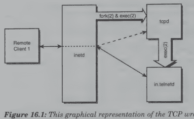

*图 16.1：* 此 TCP 包装器概念的图形表示说明了所涉及进程之间的关系。

让我们回顾远程客户端连接到你的 `in.telnetd` 服务器的过程：

1. 客户端使用其 `telnet` 客户端命令向你的机器上的 `telnet` 守护进程发出连接请求。
2. 你的 Linux 主机使用 `inetd`，它被配置为监听端口 23 以获取 `telnet` 请求。它接受来自步骤 1 的连接请求。
3. `/etc/inetd.conf` 配置文件指示你的 `inetd` 服务器 `fork(2)` 一个新进程。父进程返回以监听更多的连接。
4. 步骤 3 中的子进程现在调用 `exec(2)` 以执行 `/usr/sbin/tcpd` TCP 包装器程序。
5. `tcpd` 程序确定是否应给予客户端访问权限。这由涉及的套接字地址以及配置文件 `/etc/hosts.deny` 和 `/etc/hosts.allow` 的组合决定。
6. 如果访问应被拒绝，`tcpd` 简单终止（这会导致文件单元 0、1 和 2 关闭，它们是套接字文件描述符）。
7. 如果访问应被允许，要启动的可执行文件由 `tcpd` 的 `argv[0]` 值确定。在这个例子中，名称是 `in.telnetd`。这指定了可执行文件路径 `/usr/sbin/in.telnetd`，它被传递给 `exec(2)` 函数以加载和执行。
8. 服务器现在代替 `tcpd` 运行，使用 `tcpd` 以前拥有的相同进程 ID。服务器现在在套接字（文件单元 0、1 和 2）上执行输入和输出。

步骤 7 很重要——这是服务器进程通过 `tcpd` 内部调用 `exec(2)` 函数启动的地方。这维护了 `inetd` 和（子）服务器进程之间重要的父子关系。当使用 `wait` 标志字时，`inetd` 守护进程只有在检测到当前子进程结束时，才能启动下一个服务器。只有当服务器进程是父 `inetd` 的直接子进程时，这才正确工作。数字可能有助于更轻松地消化这一点：

1. 在这个例子中，`inetd` 守护进程的进程 ID 为 124。
2. `inetd` 守护进程调用 `fork(2)` 以启动子进程。在这个例子中，该子进程的进程 ID 现在为 1243。
3. `inetd` 子进程（PID 1243）现在调用 `exec(2)` 以启动 `/usr/sbin/tcpd`。
4. 请注意，`tcpd` 现在作为 PID 1243 运行（回想一下，`exec(2)` 使用相同的进程资源启动新程序，同时丢弃调用 `exec(2)` 的原始程序）。
5. `tcpd` 最终再次调用 `exec(2)`，当时应授予访问权限。这启动了新服务器，在这个例子中是 `/usr/sbin/in.telnetd`。
6. 请注意，服务器 `/usr/sbin/in.telnetd` 仍然是 PID 1243，因为 `exec(2)` 不创建新进程（参见步骤 4 中的注释）。
7. 服务器 `in.telnetd` 最终退出（PID 1243 终止）。
8. 父进程 `inetd`（PID 124）接收到 SIGCHLD 信号，表示其子进程 ID 1243 已终止。这将导致 `inetd` 调用 `wait(2)` 以确定哪个子进程已终止。

从这个步骤列表中，你可以看到 `tcpd` 包装器程序插入得多么巧妙。该程序实际上从不执行套接字上的 I/O——这将扰乱正在使用的协议（`telnet` 或其他）。

### 确定访问权限

此时你可能仍然有两个问题：

1. TCP 包装器程序如何确定它正在保护的服务（`telnet`、`ftp` 等）？
2. 它如何确定客户端是谁？

现在，让我们在以下部分中简要陈述每个解决方案。

## 确定服务

`tcpd` 程序可以通过调用 `getsockname(2)` 函数来确定其保护的服务。还记得该函数吗？它不仅返回客户端正在连接的套接字地址，还指示服务的端口号。在之前的示例中，端口号为 23（`telnet` 服务）。

## 确定客户端身份

由于执行 `accept(2)` 函数调用的不是 `tcpd` 程序（这是由 `inetd` 完成的），因此它必须确定客户端是谁。您可能已经猜到，这是通过 `getpeername(2)` 函数完成的。您会回想起，该函数以与 `getsockname(2)` 相同的方式检索远程客户端的地址和端口号。

## 确定数据报客户端身份


确定数据报客户端的身份稍微复杂一些。细心的读者可能在前一节中对此产生疑问，因为数据报不使用 `accept(2)` 函数调用。此外，由于每个数据报都可能来自不同的客户端，因此也无法在数据报套接字上使用 `getpeername(2)`。客户端地址由 `recvfrom(2)` 函数调用返回。那么，`tcpd` 如何在不实际读取服务器数据报的情况下确定客户端身份呢？

事实证明，`tcpd` 能够“作弊”。通过调用使用 `MSG_PEEK` 标志选项的 `recvfrom(2)` 可以确定客户端的地址和端口号。示例代码如下所示：

```c
int z;
struct sockaddr_in addr_clnt; /* AF_INET */
socklen_t len_inet; /* Length */
int s; /* Socket */
char dgram[512]; /* Recv buffer */

len_inet = sizeof addr_clnt;
z = recvfrom(s, 
             /* Socket */
             dgram, 
             /* Receiving buffer */
             sizeof dgram, 
             /* Max recv buf size */
             MSG_PEEK, 
             /* Flags: Peek at data */
             (struct sockaddr *)&addr_clnt, 
             /* Addr */
             &len_inet); 
             /* Addr len, in & out */
```

注意标志选项 `MSG_PEEK`。该选项指示内核正常执行 `recvfrom(2)` 调用，只是不将数据报从队列中作为“已读”移除。这允许 `tcpd` 程序“窥视”后续服务器将读取的数据报（如果访问被授予）。

请注意，这里数据本身并不重要。`MSG_PEEK` 操作的作用在于它返回客户端的 IP 地址（在示例中，这被放置在 `addr_clnt` 中）。封装程序可以根据变量 `addr_clnt` 确定该数据报是否应由服务器处理。

到目前为止，您已经消化了 TCP 封装器概念背后的理论。接下来，您将在示例程序的具体形式中看到这一思想的演示。

## 安装封装器和服务器程序

本节将介绍一个简单的数据报服务器和相应的 TCP 封装器程序。封装器程序实现了一个非常简单的安全策略。

### 检查服务器和封装器记录代码

服务器和封装器程序共享几个用于记录目的的函数。这些记录函数在列表 16.1 中展示。


**列表 16.1：** `log.c` — 服务器和封装器使用的记录函数

```c
/* log.c
 *
 *   Logging Functions:
 */

#include <stdio.h>
#include <unistd.h>
#include <stdlib.h>
#include <string.h>
#include <stdarg.h>
#include <errno.h>

static FILE *logf = NULL;     /* Log File */

/*
 * Open log file for append:
 *
 * RETURNS:
 *   0    Success
 *  -1    Failed.
 */
int
log_open(const char *pathname) {

   logf = fopen(pathname,"a");
   return logf ? 0 : -1;
}

/*
 * Log information to a file:
 */
void
log(const char *format,...) {
   va_list ap;
   
   if ( !logf )
     return;            /* No log file open */
   
   fprintf(logf,"[PID %ld] ", (long)getpid());
   
   va_start(ap,format);
   vfprintf(logf,format,ap);
   va_end(ap);
   fflush(logf);
}

/*
 * Close the log file:
 */
void
log_close(void) {
   if ( logf )
     fclose(logf);
     logf = NULL;
}

/*
 * This function reports the error to
 * the log file and calls exit(1).
 */
void
bail(const char *on_what) {
   if ( logf ) {       /* Is log open? */
     if ( errno )      /* Error? */
       log("%s: ",strerror(errno));
     log("%s\n",on_what);     /* Log msg */
     log_close();
   }
   exit(1);
}
```

列表 16.1 中的主要组成部分如下：

- 用于打开日志文件的 `log_open()` 函数（第 21 至 26 行）。

- 采用 `printf(3)` 风格的记录函数 `log()`（第 31 至 44 行）。此函数提供了 `printf(3)` 的便利性，同时确保进程 ID 始终是日志消息的一部分（参见第 38 行）。

- 用于关闭日志文件的 `log_close()` 函数（第 49 至 55 行）。

- 修改版的 `bail()` 函数，将其输出写入日志文件而不是标准错误流（第 61 至 71 行）。

引用程序使用的包含文件在列表 16.2 中展示。


**列表 16.2：** `log.h` — `log.h` 头文件

```c
/* log.h
 *
 * log.c externs:
 */

extern int log_open(const char *pathname);

extern void log(const char *format,...);

extern void log_close(void);

extern void bail(const char *on_what);
```

列表 16.2 简单地定义了之前列表 16.1 中展示的记录函数的函数原型。

## 检查数据报服务器代码

本节演示了一个处理第一个数据报然后循环等待更多数据报的数据报服务器。如果在八秒内没有更多数据报到达，服务器将超时并退出。`inetd` 守护程序不会启动另一个服务器，除非它收到此服务器终止的通知（`/etc/inetd.conf` 条目必须使用 `wait` 标志字）。列表 16.3 展示了用于数据报服务器程序的代码。


**列表 16.3：** `dgramsrvr.c` — `inetd` 数据报服务器


# `dgramsrvr.c`: `inetd` 数据报服务器示例

```c
/* dgramsrvr.c:
 *
 * Example inetd datagram server:
 */

#include <stdio.h>
#include <unistd.h>
#include <stdlib.h>
#include <stdarg.h>
#include <errno.h>
#include <string.h>
#include <sys/types.h>
#include <sys/time.h>
#include <sys/socket.h>
#include <netinet/in.h>
#include <arpa/inet.h>

#include "log.h"

#define LOGPATH "/tmp/dgramisrvr.log"

int
main(int argc, char **argv) {
    int z;
    int s; /* Socket */
    int alen; /* Length of address */
    struct sockaddr_in adr_clnt; /* Client */
    char dgram[512]; /* Receive buffer */
    char dfmt[512]; /* Date/Time Result */
    time_t td; /* Current Time and Date */
    struct tm dtv; /* Date time values */
    fd_set rx_set; /* Incoming req. set */
    struct timeval tcout; /* Timeout value */

    /*
     *
     * Open a log file for append:
     */
    if ( log_open(LOGPATH) == -1 )
        exit(1); /* No log file! */

    log("dgramisrvr started.\n");

    /*
     *
     * Other initialization:
     */
    s = 0; /* Our socket is on std input */
    FD_ZERO(&rx_set); /* Initialize */
    FD_SET(s,&rx_set); /* Notice fd=0 */

    /*
     *
     * Now wait for incoming datagrams:
     */
    for (;;) {
        /*
         *
         * Block until a datagram arrives:
         */
        alen = sizeof adr_clnt;

        z = recvfrom(s,        /* Socket */
                     dgram,    /* Receiving buffer */
                     sizeof dgram, /* Max recv size */
                     0,        /* Flags: no options */
                     (struct sockaddr *)&adr_clnt, /* Adr_clnt */
                     &alen);   /* Addr len, in & out */

        if ( z < 0 )
            bail("recvfrom(2)");

        dgram[z] = 0; /* NULL terminate dgram */

        /*
         * Log the request:
         */
        log("Got request '%s' from %s port %d\n",
            dgram,
            inet_ntoa(adr_clnt.sin_addr),
            ntohs(adr_clnt.sin_port));

        /*
         * Get the current date and time:
         */
        time(&td); /* current time & date */
        dtv = *localtime(&td);

        /*
         * Format a new date and time string,
         * based upon the input format string:
         */
        strftime(dfmt, /* Formatted result */
                 sizeof dfmt, /* Max size */
                 dgram, /* date/time format */
                 &dtv); /* Input values */

        /*
         * Send the formatted result back to the
         * client program:
         */
        z = sendto(s,        /* Socket */
                   dfmt, /* datagram result */
                   strlen(dfmt), /* length */
                   0,        /* Flags: no options */
                   (struct sockaddr *)&adr_clnt, /* Adr_clnt */
                   alen); /* Addr len */
    }
}
```

## 列表 16.3：续

```c
101:			(struct sockaddr *)&adr_clnt,
102:			aflen);
103:
104:			if (z < 0)
105:				bail("sendto(2)");
106:
107:			/*
108:			 * Wait for next packet or timeout:
109:			 *
110:			 * This is easily accomplished with the
111:			 * use of select(2).
112:			 */
113:			do {
114:				/* Establish Timeout = 8.0 secs */
115:				tmout.tv_sec = 8;	/* 8 seconds */
116:				tmout.tv_usec = 0;	/* + 0 usec */
117:
118:				/* Wait for read event or timeout */
119:				z = select(s+1,&rx_set,NULL,NULL,&tmout);
120:
121:			} while (z == -1 && errno == EINTR );
122:
123:			/*
124:			 * Exit if select(2) returns an error
125:			 * or if it indicates a timeout:
126:			 */
127:			if (z <= 0)
128:				break;
129:
130:			}
131:
132:			/* Close the socket and exit:
133:			 */
134:			if ( z == -1 )
135:				log("%s: select(2)\n",strerror(errno));
136:			else
137:				log("Timed out; server exiting.\n");
138:
139:			close(s);
140:			log_close();
141:			return 0;
142:		}
```

## 服务器逻辑说明

服务器代码简单组织为一个 `main()` 程序。该服务器使用的基本步骤可以描述如下：

1. 打开日志文件，并将进程 ID 和启动消息记录到日志文件中（第 37 行至第 40 行）。
2. 由 `inetd` 提供给该服务器的套接字位于文件单元 0、1 和 2 上。该服务器将使用文件单元 0 来执行此操作（第 45 行）。
3. 变量 `rx_set` 通过第 46 行和第 47 行的宏调用初始化，以便与 `select(2)` 一起使用。
4. 服务器循环从第 52 行开始。由于该服务器循环运行，因此必须在 `/etc/inetd.conf` 文件中指定标志字 `wait`。
5. 服务器从套接字（`s=0`）读取数据报（第 56 行至第 66 行）。
6. 接收到的数据报在缓冲区 `dgram[]` 中填充了一个终止空字节（第 68 行）。
7. 服务器通过根据接收到的格式字符串格式化日期/时间字符串来处理请求（第 81 行至第 91 行）。
8. 服务器将格式化结果响应发回给客户端（第 97 行至第 105 行）。
9. 服务器在 `select(2)` 调用中等待另一个数据报（第 113 行至第 121 行）。这将在后面详细解释。
10. 如果发生错误或超时，控制在第 128 行退出 `for` 循环（`break` 语句）。


11. 最后，服务器记录错误消息（第 135 行）或记录它已超时的事实（第 137 行）。

现在，检查实现超时代码的代码段：

1. 从第 113 行开始进入一个 do-while 循环。这是必要的，因为始终应该允许系统调用被中断的可能性。当信号处理程序从处理信号中返回时，通过返回错误指示并将 `errno` 设置为值 `EINTR` 来表示这种情况。因此，如果 `select(2)` 返回 -1 且错误值为 `EINTR`，while 语句会重复此调用。
2. 超时值在第 115 行和第 116 行建立。这里，超时设置为八秒。
3. 变量 `rx_set` 在第 46 行和第 47 行初始化，以便 `select(2)` 调用在数据报到达文件单元 0（其套接字）时报告。通常，这应该在每次进入 `select(2)` 之前建立，因为该函数会更新 `rx_set` 的内容。然而，在这种情况下，这是不必要的，因为文件单元 0 的 `rx_set` 位仅在 `select(2)` 返回时设置文件单元 0 的 `rx_set` 位（表示数据报已到达）的情况下才会被重复。
4. 如果数据报已到达，`select(2)` 调用返回 1；如果发生超时，则返回 0；如果发生其他错误，则返回 -1。
5. 如果发生超时或错误，则退出 for 循环（第 128 行）。
6. 否则，`rx_set` 仍然设置了位 0，并且 for 循环重复执行（第 52 行）。

该服务器程序展示了 UDP 服务器如何循环回读，并读取更多数据报，直到发生超时。还有其他方法可以实现超时，但这可能是最简单的方法之一。

### 检查简单的 TCP 封装程序

现在，是时候介绍将使用的简单 TCP 封装程序的源代码了。该程序如图表 16.4 所示。

#### 列表 16.4：wrapper.c——简单的 TCP 封装程序


```c
/* wrapper.c:
 *
 * Simple wrapper example:
 */

#include <stdio.h>
#include <unistd.h>
#include <stdlib.h>
#include <errno.h>
#include <string.h>
#include <sys/types.h>
#include <sys/socket.h>
#include <netinet/in.h>
#include <arpa/inet.h>

#include "log.h"
#define LOGPATH "/tmp/wrapper.log"

int
main(int argc, char **argv, char **envp) {
    int z;
    struct sockaddr_in addr; /* Client */
    int alen;                /* Address length */
    char dgram[512];         /* Receive buffer */
    char *str_addr;          /* String form of addr */

    /*
     * We must log denied attempts:
     */
    if (log_open(LOGPATH) == -1)
```

### 安装封装和服务器程序

```c
        exit(1); /* Can't open log file! */

    log("wrapper started.\n");

    /*
     * Peek at datagram using MSG_PEEK:
     */
    alen = sizeof adr_clnt; /* length */

    z = recvfrom(0, /* Socket on std input */
                 dgram, /* Receiving buffer */
                 sizeof dgram, /* Max recv size */
                 MSG_PEEK, /* Flags: Peek!!!!! */
                 (struct sockaddr *)&adr_clnt,
                 &alen); /* Addr len, in & out */

    if (z < 0)
        bail("recvfrom(2), peeking at client"
             " address.");

    /*
     * Convert IP address to string form:
     */
    str_addr = inet_ntoa(adr_clnt.sin_addr);

    if (strcmp(str_addr, "127.7.7.7") != 0) {
        /*
         * Not our special 127.7.7.7 address:
         */
        log("Address %s port %d rejected.\n",
            str_addr, ntohs(adr_clnt.sin_port));

        /*
         * We must read this packet now without
         * the MSG_PEEK option to discard dgram:
         */
        z = recvfrom(0, /* Socket */
                     dgram, /* Receiving buffer */
                     sizeof dgram, /* Max rcv size */
                     0, /* No flags! */
                     (struct sockaddr *)&adr_clnt,
                     &alen);

        if (z < 0)
            bail("recvfrom(2), eating dgram");
        exit(1);
```

#### 列表 16.4：续

```c
    }

    /*
     * Accept this dgram request, and
     * launch the server:
     */
    log("Address %s port %d accepted.\n",
        str_addr, ntohs(adr_clnt.sin_port));

    /*
     * inetd has provided argv[0] from the
     * config file /etc/inetd.conf; we have
     * used this to indicate the server's
     * full pathname for this example.  We
     * simply pass any other arguments and
     * environment as is.
     */
    log("Starting '%s'\n", argv[0]);
    log_close();    /* No longer need this */

    z = execve(argv[0], argv, envp);

    /*
     * If control returns, then execve(2)
     * failed for some reason:
     */
    log_open(LOGPATH);     /* Re-open log */
    bail("execve(2), starting server");
    return 1;
}
```

如图表 16.4 所示的封装程序实现了以下非常简单的安全策略：

- 如果客户端地址是 `127.7.7.7`，其请求被允许发送到数据报服务器。不对客户端的端口号施加任何限制。
- 如果客户端地址是任何其他 IP 地址，请求将被记录并拒绝。

**注意**

策略地址 `127.7.7.7` 被选为一个示例，所有读者都应该能够对其进行测试（即使是那些没有实际建立网络的读者）。如果读者拥有网络，鼓励修改程序以尝试额外的策略规则。

所介绍的 TCP 封装程序使用了以下基本步骤：

- 为了记录被拒绝和被授予的尝试，在第 30 行至第 31 行打开了单独的日志文件 `/tmp/wrapper.log`。出于演示目的，封装程序的进程 ID 和启动横幅也在第 33 行进行了记录。


### 数据报封装程序行为分析

- 数据报封装程序不能使用 `getpeername(2)` 函数来确定数据报地址。相反，它必须使用 `MSG_PEEK` 标志位调用 `recvfrom(2)`（第 40 行至第 49 行）。`MSG_PEEK` 标志允许将客户端地址返回到地址结构 `adr_clnt`（第 44 行），而实际上并不从该套接字的输入队列中移除数据报。

- 出于演示目的，该简单程序将客户端地址转换为字符串，以便于比较（第 54 行）。这对于安全的封装程序可能不建议这样做。

- 在第 56 行测试客户端地址。如果客户端 IP 地址不是封装程序坚持使用的魔数 `127.7.7.7` IP 号码，则执行第 60 行至第 77 行的代码（请求被拒绝）。

- 如果请求被接受，则执行第 83 行至第 97 行的代码。

现在，检查当传入请求被该封装程序拒绝时发生的情况：

- 首先，请求的拒绝在第 60 行至第 61 行进行了记录。

- 封装程序必须丢弃（或“吃掉”）该数据报。这是通过在第 67 行至第 72 行接收它来完成的（注意这里没有使用 `MSG_PEEK` 标志）。如果未这样做，数据报将保持等待状态，以便为该套接字进行处理。

- 最后，如果必需，报告错误，并且封装程序终止（第 74 行至第 76 行）。

当数据报请求被封装程序接受时，执行以下步骤：

- 调用 `log()` 函数记录此请求（第 83 行至第 84 行）。

- 出于演示原因，正在启动的可执行文件（服务器）在第 94 行进行了记录。如果您决定修改此代码，这有助于调试。

- 日志文件被关闭（第 95 行）。应该这样做，因为如果未这样做，日志文件将在调用 `execve(2)` 之后保持打开状态。

- 通过调用 `execve(2)`（第 97 行），封装程序被服务器替换。当前的封装程序被放弃，以便作为服务器运行程序被加载到内存中并取代它。出于这个原因，包装器和服务程序保留相同的进程 ID（这对 `inetd`，即父进程来说非常重要）。

如果一切顺利，服务程序将开始执行。如果由于某种原因服务程序未执行，则 `execve(2)` 函数将返回控制。然后执行以下错误恢复步骤：

1. 重新打开日志文件（第 103 行），因为在第 95 行调用 `execve(2)` 之前它已被关闭。
2. 将错误报告到日志文件（第 104 行）。

### 介绍客户端程序

这里展示了一个早期客户端程序的修改版本。此客户端程序需要两个命令行参数：服务器地址和要使用的客户端地址。指定额外的客户端 IP 地址允许你对 TCP 包装器程序进行更多的实验。列表 16.5 展示了修改后的数据报客户端程序。

**列表 16.5：** `dgramcln2.c` - 修改后的数据报客户端程序


```c
/* dgramcln2.c:
 *
 * Modified datagram client:
 */

#include <stdio.h>
#include <unistd.h>
#include <stdlib.h>
#include <errno.h>
#include <string.h>
#include <time.h>
#include <sys/types.h>
#include <sys/socket.h>
#include <netinet/in.h>
#include <arpa/inet.h>

/*
 * This function reports the error and
 * exits back to the shell:
 */
static void
bail(const char *on_what) {

    if ( errno ) {
        fputs(strerror(errno),stderr);
        fputs(": ", stderr);
    }
    fputs(on_what, stderr);
    fputs('\n', stderr);
    exit(1);
}

int
main(int argc, char **argv) {
    int z;
    char *srr_addr = NULL; /* Srvr addr */
    char *clnt_addr = NULL; /* Clnt addr */
    struct sockaddr_in adr_srr;
    struct sockaddr_in adr_clnt; /* Client */
    struct sockaddr_in adr; /* AF_INET */
    int alen; /* Socket addr length */
    int s; /* Socket */
    char dgram[512]; /* Recv buffer */

    /*
     * Insist on two command-line arguments
     * (without port numbers):
     *
     * dgramclnt <server_addr> <client_addr>
     */
    if ( argc != 3 ) {
        fputs("Usage: dgramclnt <server_ipaddr> "
              "<client_ipaddr>\n", stderr);
        return 1;
    }

    srr_addr = argv[1]; /* 1st arg is srr */
    clnt_addr = argv[2]; /* 2nd arg is cln */

    /*
     * Create a server socket address:
     */
    memset(&adr_srr, 0, sizeof adr_srr);
    adr_srr.sin_family = AF_INET;
    adr_srr.sin_port = htons(9000);
    adr_srr.sin_addr.s_addr =
        inet_addr(srr_addr);

    if ( adr_srr.sin_addr.s_addr == INADDR_NONE )
        bail("bad server address.");

    /*
     * Create a UDP socket:
     */
    s = socket(AF_INET, SOCK_DGRAM, 0);
    if ( s == -1 )
        bail("socket()");

    /*
     * Create the specific client address:
     */
    memset(&adr_clnt, 0, sizeof adr_clnt);
    adr_clnt.sin_family = AF_INET;
    adr_clnt.sin_port = 0;          /* Any port */
    adr_clnt.sin_addr.s_addr =
        inet_addr(clnt_addr);

    if ( adr_clnt.sin_addr.s_addr == INADDR_NONE )
        bail("bad client address.");

    /*
     * Bind the specific client address:
     */
    z = bind(s, (struct sockaddr *)&adr_clnt,
             sizeof adr_clnt);

    if ( z == -1 )
        bail("bind(2) of client address");

    /*
     * Enter input client loop:
     */
    for (;;) {
        /*
         * Prompt user for a date format string:
         */
        fputs("\nEnter format string: ", stdout);
        if ( !fgets(dgram, sizeof dgram, stdin) )
            break;             /* EOF */

        z = strlen(dgram);
        if ( z > 0 && dgram[--z] == '\n' )
            dgram[z] = 0;  /* Stomp out newline */

        /*
         * Send format string to server:
         */
        z = sendto(s,                     /* Socket */
            dgram,                    /* datagram to send */
            strlen(dgram),            /* dgram length */
            0,                       /* Flags: no options */
            (struct sockaddr *)&adr_srr,
            sizeof adr_srr);

        if ( z < 0 )
            bail("sendto(2)");

        /*
         * Wait for a response:
         *
         * NOTE: Control will hang here if the
         * wrapper decides we lack access (no
         * response will arrive).
         */
        alen = sizeof adr;

        z = recvfrom(s,
            /* Socket */
            dgram,
            /* Receiving buffer */
            sizeof dgram,
            /* Max recv size */
            0,
            /* Flags: no options */
            (struct sockaddr *)&adr,
            &alen);
            /* Addr len, in & out */

        if ( z < 0 )
            bail("recvfrom(2)");

        dgram[z] = 0;
        /* NULL terminate */

        /*
         * Report Result:
         */
        printf("Result from %s port %u :\n" "\n\t%s\n\n",
            inet_ntoa(adr.sin_addr),
            (unsigned)ntohs(adr.sin_port),
            dgram);
    }

    /*
     * Close the socket and exit:
     */
    close(s);
    putchar('\n');

    return 0;
}
```


客户端程序不会被详细介绍，因为它与第 6 章“无连接导向协议”中列表 6.2 展示的程序 `dgramclnt.c` 非常相似。除了一些表面上的差异外，主要增加的修改是：

* 第 50 到 54 行现在要求必须提供两个命令行参数。
* 本地套接字通过 `bind(2)` 绑定到 `argv[2]` 中指定的 IP 地址（第 81 到 97 行）。这将有助于你稍后的测试。

请注意，如果包装器程序决定该用户不应获得对服务器的访问权限，程序 `dgramln2` 将会挂起。这是因为 `recvfrom(2)` 函数永远收不到服务器的回复（第 136 到 144 行）。当这种情况发生时，你需要中断程序（通常 `Ctrl+C` 是中断字符，但你的可能不同）。

## 安装和测试包装器

你现在已经检查了将使用的所有代码。要开始你的包装器实验，首先按如下方式编译所有代码：

```sh
$ make
gcc -c -D_GNU_SOURCE -Wall -Wreturn-type dgramisrvr.c
gcc -c -D_GNU_SOURCE -Wall -Wreturn-type log.c
gcc dgramisrvr.o log.o -o dgramisrvr
gcc -c -D_GNU_SOURCE -Wall -Wreturn-type wrapper.c
gcc wrapper.o log.o -o wrapper
gcc -c -D_GNU_SOURCE -Wall -Wreturn-type dgramcln2.c
gcc dgramcln2.o -o dgramcln2
$
```

通常，你需要 root 权限来永久安装你的服务器。然而，为了简单的测试目的，你可以在没有 root 权限的情况下进行此实验。要在 `/tmp` 目录中建立你的文件，执行以下操作：

```sh
$ make install
rm -f /tmp/wrapper.log /tmp/dgramisrvr.log
rm -f /tmp/inetd.conf /tmp/wrapper /tmp/dgramisrvr
cp dgramisrvr wrapper /tmp/
chmod 500 /tmp/wrapper /tmp/dgramisrvr
chmod 600 /tmp/inetd.conf
-------------------------
Now do:

/usr/sbin/inetd /tmp/inetd.conf

to start the server.
$
```

`make` 命令会将多个文件放入 `/tmp` 目录，包括一个简单的 `/tmp/inetd.conf` 文件。花一点时间现在检查它：

```sh
$ cat /tmp/inetd.conf
9090 dgram udp wait student1 /tmp/wrapper /tmp/dgramisrvr
$
```


你可能想要双重检查你的其他文件是否正确安装在 `/tmp` 中，如下所示：

```sh
$ ls -ltr /tmp | tail
-rw-r----- 1 student1 classl 29454 Feb 19 22:59 XprngXp3R5c
-rw-r--r-- 1 root root 11 Feb 21 23:18 10p.0002621c
-r-x------ 1 student1 classl 14202 Feb 22 22:48 wrapper
-rw-r----- 1 student1 classl 53 Feb 22 22:48 inetd.conf
-r-x------- 1 student1 classl 15237 Feb 22 22:48 dgramisrvr
$
```


在输出中，你可以看到 TCP 包装器程序 `wrapper` 已安装，并且可执行程序 `dgramisrvr` 也已安装到 `/tmp` 目录中。

## 监控日志文件

如果你使用的是 X Window 会话，建议在一个终端会话中启动以下命令：

```sh
$ >/tmp/wrapper.log
$ tail /tmp/wrapper.log
```


这将创建并监控包装器日志文件（日志文件尚不存在）。当包装器程序向此文件写入日志条目时，你会看到这个窗口更新。

在一个新窗口中启动：

```sh
$ >/tmp/dgramisrvr.log
$ tail -f /tmp/dgramisrvr.log
```


这将建立并监控服务器日志文件。同样，你会看到条目随着写入服务器日志文件而显示出来。

如果你没有使用 X Window 会话，你可以通过使用多个控制台会话来实现相同的效果。仅为了方便起见才推荐此操作，因为如果这是你的偏好，你始终可以稍后按需查看日志。

## 启动你的 inetd 守护进程

在启动客户端之前，你必须准备好你的 `inetd` 守护进程副本。该守护进程将在你自己的 `userID` 下运行，并且不需要特殊的 root 权限。但是，你必须小心在命令行上给它正确的配置文件，如下所示：

### `$ /usr/sbin/inetd /tmp/inetd.conf`

如果你使用的发行版不是红帽 Linux（Red Hat Linux）发行版，那么可执行程序 `/usr/sbin/inetd` 可能位于其他目录。

唯一的命令行参数指示你的 `inetd` 守护进程使用你在文件 `/tmp/inetd.conf` 中提供的配置，而不是系统通常使用的 `/etc/inetd.conf` 文件。该程序会自动将自己置于后台（守护进程喜欢这样做），你应该能看到它像下面这样运行：

```bash
$ ps -ef | grep inetd
 root       313     1  0 Feb15 ?      00:00:00 inetd
 student1  12763     1  0 23:04 ?     00:00:00 /usr/sbin/inetd /tmp/inetd.conf
 student1  12765  1739  0 23:06 pts/3 00:00:00 grep inetd
$
```

上面显示的示例输出说明，现在有两个 `inetd` 守护进程副本正在运行：一个以 root 身份运行的系统守护进程（`PID` 313），以及你的非特权守护进程（`PID` 12763）。随着 `inetd` 守护进程的启动，你准备好进行一些测试了。

## 测试包装器程序

在分别的窗口中监控日志时，现在适合启动客户端命令并尝试一些操作。首先，让我们尝试一些包装器程序应该接受的内容：

```bash
$ ./dgramcln2 127.0.0.1 127.7.7.7

Enter format string: %A %B %D
Result from 127.7.7.7 port 9090 :
      'Tuesday November 11/09/99'

Enter format string:
```

这启动了客户端程序，客户端端的套接字绑定到 IP 地址 127.7.7.7，这是包装器程序被编程为可接受的地址。包装器日志文件应该如下所示：

```bash
$ tail -f /tmp/wrapper.log
[PID 1279] wrapper started.
[PID 1279] Address 127.7.7.7 port 1027 accepted.
[PID 1279] Starting `/tmp/dgramisrv'
```

这些日志记录表明进程 ID 为 1279，并且请求来自 127.7.7.7 的 1027 端口。由于请求被接受，服务器 `/tmp/dgramisrv` 被执行以处理该请求。

## 安装和测试包装器

现在列出服务器日志，应该会揭示出类似这样的内容：


```bash
$ tail -f /tmp/dgramisrv.log
[PID 1279] dgramisrv started.
[PID 1279] Got request '%d %b %d' from 127.7.7.7 port 1027
[PID 1279] Timed out: server exiting.
```

请注意，服务器的进程 ID 与包装器（包装器进程使用 `execve(2)` 启动服务器）保持相同。日志记录告诉我们服务器已启动并处理了请求。最后一条记录显示服务器因等待更多数据报超时而退出。

## 拒绝请求

现在通过结束文件（通常是 `Ctrl+D`）取消你的客户端程序，或者中断它（通常是 `Ctrl+C`）。使用新的地址再次启动它，例如：


```bash
$ ./dgramcln2 127.0.0.1 127.13.13.13

Enter format string: %d  %b
```

你会发现，这样你的客户端程序将不会收到响应。它会“挂起”，因为包装器程序已拒绝该请求到达服务器。你可以中断（`Ctrl+C`）以退出。

包装器日志文件现在应该如下所示：


```bash
$ tail -f /tmp/wrapper.log
[PID 1279] wrapper started.
[PID 1279] Address 127.7.7.7 port 1027 accepted.
[PID 1279] Starting `/tmp/dgramisrv'
[PID 1289] wrapper started.
[PID 1289] Address 127.13.13.13 port 1027 rejected.
```

你可以看到，下一个数据报请求这次由新的包装器进程 ID `1289` 处理。最后一行日志显示地址 `127.13.13.13` 被拒绝。客户端程序挂起，因为该包装器程序消耗了数据报，以防止其被服务器处理。然后包装器程序退出。

## 测试服务器超时

要测试服务器的循环处理能力，你必须快速输入两个日期格式请求（在八秒内）。下面提供了一个会话示例：


```bash
$ ./dgramcln2 127.0.0.1 127.7.7.7

Enter format string: %x
Result from 127.7.7.7 port 9090 :  '11/09/99'

Enter format string: %x %x
Result from 127.7.7.7 port 9090 :
'11/09/99 19:11:32
Enter format string: CTRL+D
$
```

如果你做得足够快，服务器应该能够在单个服务器进程中处理这两个请求。要查看这是否有效，请检查服务器日志：

```bash
$ tail -f /tmp/dgramisrvr.log
[PID 1279] dgramisrvr started.
[PID 1279] Got request '%A %B %D' from 127.7.7.7 port 1027
[PID 1279] Timed out: server exiting.
[PID 1294] dgramisrvr started.
[PID 1294] Got request '%x' from 127.7.7.7 port 1027
[PID 1294] Got request '%x %x' from 127.7.7.7 port 1027
[PID 1294] Timed out: server exiting.
```

最后四条日志行证实，服务器进程 ID `1294` 能够在超时之前处理这两个日期请求。

## 卸载演示程序

要卸载演示程序，请执行以下操作：

```bash
$ make clobber
rm -f *.o core a.out
rm -f /tmp/wrapper.log /tmp/dgramisrvr.log
rm -f /tmp/inetd.conf /tmp/wrapper /tmp/dgramisrvr
rm -f dgramisrvr wrapper dgramisrvr2
student1 12763  1 0 23:04 ? 00:00:00 /usr/sbin/inetd /tmp/inetd.conf
```

如果你在上方看到你的 `inetd` 进程正在运行，你可能希望现在就将其终止。

```bash
$
```

提供的 `Makefile` 中的 `clobber` 目标将删除在 `/tmp` 目录中创建的所有文件，并尝试显示你的 `inetd` 守护进程的进程 ID。在显示的示例输出中，该守护进程作为 PID `12763` 运行。应使用 `kill` 命令如下进行终止：

```bash
$ kill 12763
$
```

## 数据报漏洞

在此数据报服务器的包装器设计中存在漏洞。你发现这个问题了吗？提示：这与服务器循环有关。

循环的数据报服务器，如所示的那个，在使用包装器概念时容易受到攻击。当没有服务器进程运行时，包装器程序总是能够在服务器读取数据报之前筛选数据报。然而，如果服务器等待更多数据报，并且仅在超时后才退出，那么包装器程序不会被用于筛选出这些额外数据报。这种暴露可以总结如下：

1. 一个数据报到达，通知 `inetd`。

2. `inetd` 守护进程启动包装器程序。

3. 包装器程序允许数据报，并调用 `exec(2)` 启动数据报服务器。

4. 数据报服务器读取并处理数据报。

5. 服务器等待另一个数据报。

6. 如果数据报到达，则重复步骤 4。

7. 否则，服务器超时并退出。

8. 重复步骤 1。

当服务器继续运行时，该过程在步骤 4 处重复。这省略了步骤 3 中的安全检查。如果你足够快，可以使用之前提供的示例程序自行演示这一点。

为了获得更好的安全性，你只有少数几个选择：

- 仅使用 `nowait` 风格的数据报服务器（这些服务器处理一个数据报后退出）。这迫使所有请求都经过包装器程序的仔细检查。

- 在你的数据报服务器内使用自定义代码，在接受数据报进行处理之前对其进行测试。

一种折衷方法是运行较短的超时周期，但这仍然会留下一些暴露。

出于这些原因，许多站点会选择在存在相同服务的 TCP 版本时禁用数据报服务（TCP 请求始终由包装器程序检查）。在必须提供数据报服务的情况下，安全的站点不允许其数据报服务器循环。这需要更改服务器的源代码，或者编写一个自定义服务器程序。或者，服务器程序本身检查请求客户端的每次访问，并不依赖 TCP 包装器概念来进行此操作。

## 下一步

本章给了你关于 TCP 包装器概念的工作知识。应用包装器概念，你现在可以在你编写的服务器上用它来为系统提供更大的网络安全。你还了解到它在数据报情况下存在弱点，这需要特别考虑。

在下一章中，你将被介绍另一个与安全相关的概念。在那里，你将学习如何从 `PF_UNIX`/`PF_LOCAL` 套接字接收凭证。此外，你将学习服务器如何代表你打开文件，并通过 `PF_UNIX`/`PF_LOCAL` 套接字将打开的文件描述符传递给你。

# 传递凭据和文件描述符

如果你与其他用户共享你的 Linux 主机，你可能曾为解决某些资源访问问题而苦恼。在本章中，你将看到凭据如何通过本地套接字获取，以及文件描述符如何同样通过套接字传输。这两个重要功能为你的用户开辟了一条全新的安全访问解决方案路径，同时确保你的机器安全。

这些功能通过使用套接字辅助数据（ancillary data）提供。这是一个高级主题，可能超出了许多初学程序员想要处理的内容。初学者可能只想略读这一章或跳到下一节。

然而，中级到高级的读者希望仔细研读这一章，作为处理辅助数据入门的介绍。重点放在了可以被研究和实验的实际示例上。

本章涵盖以下主题：

- 如何将用户凭据发送到本地服务器进程

- 如何接收和解释用户凭据

- 如何向本地主机上的另一个进程发送文件描述符

- 如何从本地主机上的另一个进程接收文件描述符

### 问题陈述

假设你的 Linux 系统上有一个用户，负责维护和照顾你的 Web 服务器。出于安全目的，你的 Web 服务器并不以 `root` 账户权限运行（以保护你的系统免受入侵）。然而，你希望 Web 服务器在端口 `80` 上可用，这是所有普通 Web 服务器的所在地。问题在于 Linux（以及一般的 UNIX）将所有低于端口 `1024` 的端口视为特权端口号。这意味着 Web 服务器需要 `root` 访问权限才能启动（启动之后，不需要 `root`）。最后，我们假设将不使用 `inetd` 守护进程。

虽然你喜欢你的朋友为 Web 服务器所做的工作，但你宁愿不给他 `root` 访问权限。这样你会睡得更安稳。最后，如果可能避免，你也不希望采取 `setuid` 解决方案。

挑战在于提供一个解决方案，该方案提供：

- 允许特定用户启动端口 `80` 上的 Web 服务器（通常这需要 `root`）。

- 程序不得使用 `setuid` 权限位。

- 不能使用 `inetd` 守护进程。

本章将通过利用以下内容来提供此问题的解决方案：

- 一个简单的套接字服务器。

- 服务器接收的凭据将毫无疑问地识别请求用户。

- 服务器将在端口 `80` 上创建并绑定一个套接字，并将其传回给授权的请求用户进程。

在一些初始理论之后，本章的其余部分将通过实际演示向你展示这是如何工作的。

### 介绍辅助数据

虽然通过互联网证明远程用户的身份非常困难，但对于 Linux 内核来说，识别同一主机上的另一个用户是一件简单的事情。这使得 `PF_LOCAL`/`PF_UNIX` 套接字能够向接收端提供关于另一用户的信息。这些凭据被妥协的唯一方式是内核本身在某种程度上被破坏（例如通过恶意的内核可加载模块）。


凭据可以作为接收通信时收到的辅助数据的一部分被接收。辅助数据是正常数据的补充或辅助。这提出了一些值得在此强调的要点：

- 凭据作为辅助数据的一部分被接收。
- 辅助数据必须伴随正常数据（它不能单独传输）。
- 辅助数据还可以包括其他信息，如文件描述符。
- 辅助数据可以同时包含多个辅助项（例如，同时包括凭据和文件描述符）。

凭据由 Linux 内核提供。它们从不通过客户端应用程序提供。如果是这样，客户端将被允许对其身份撒谎。因为内核是可信的，所以关心凭据的进程可以信任这些凭据。

如列表中所述，你现在知道文件描述符也是作为辅助数据传输和接收的。然而，在你开始编写使用这些辅助数据元素的套接字代码之前，你需要先了解一些新的编程概念。

> **提示**
>
> 辅助数据由几个不同的术语指代。辅助数据的其他名称包括辅助数据或控制数据。在 `PF_LOCAL`/`PF_UNIX` 套接字的上下文中，这些都指代同一事物。

### 介绍 I/O 向量

在你被介绍到处理辅助数据的一些复杂函数之前，你应该熟悉 `readv(2)` 和 `writev(2)` 系统调用中使用的 I/O 向量。不仅你会发现这些函数有用，而且它们的工作方式也延伸到一些辅助数据函数中。这将使它们更容易理解。

#### I/O 向量 (`struct iovec`)

函数 `readv(2)` 和 `writev(2)` 都使用 I/O 向量的概念。这是通过包含以下文件定义的：

```c
#include <sys/uio.h>
```


`sys/uio.h` 包含文件定义了 `struct iovec`，定义如下：

```c
struct iovec {
    ptr_t iov_base; /* Starting address */
    size_t iov_len; /* Length in bytes */
};
```


`struct iovec` 定义了一个向量元素。通常，此结构用作多个元素的数组。对于每个传输元素，指针成员 `iov_base` 指向接收 `readv(2)` 数据或发送 `writev(2)` 数据的缓冲区。成员 `iov_len` 在每种情况下分别确定最大接收长度和实际写入长度。

#### `readv(2)` 和 `writev(2)` 函数

这些函数被称为散布读和写函数。它们之所以如此命名，是因为这些函数可以在一次原子操作中将数据读入或写自许多缓冲区。这些函数的函数原型提供如下：


```c
#include <sys/uio.h>

int readv(int fd, const struct iovec *vector, int count);
int writev(int fd, const struct iovec *vector, int count);
```

这些函数接受三个参数，它们是：

- 要读或写的文件描述符 `fd`。
- 用于读或写的 I/O 向量 (`vector`)。
- 要使用的向量元素数量 (`count`)。

这些函数的返回值是 `readv(2)` 读取的字节数或 `writev(2)` 写入的字节数。如果发生错误，则返回 -1，`errno` 保存失败的错误代码。请注意，与其他 I/O 函数一样，错误 `EINTR` 可以返回，表示被信号中断。

#### 示例 使用 `writev(2)`

Listing 17.1 中的程序展示了如何使用 `writev(2)` 将三个物理分离的 C 字符串作为一次物理写入散射写入标准输出。


#### **Listing 17.1:** `writev.c` — `writev(2)` 示例程序

```c
/* writev.c
 *
 *  Short writev(2) demo:
 *      */
#include <sys/uio.h>

int
main(int argc, char **argv) {
    static char part2[] = "THIS IS FROM WRITEV";
    static char part3[] = "\n";
    static char part1[] = "[";
    struct iovec iov[3];

    iov[0].iov_base = part1;
    iov[0].iov_len = strlen(part1);

    iov[1].iov_base = part2;
    iov[1].iov_len = strlen(part2);

    iov[2].iov_base = part3;
    iov[2].iov_len = strlen(part3);

    writev(1, iov, 3);

    return 0;
}
```

该程序使用以下基本步骤：

1. 在第 9 到 11 行中定义了三个物理分离的 C 字符串数组。
2. 在第 12 行中定义了 I/O 向量 `iov[3]`。此特定向量可以保存最多三个散布缓冲区引用。
3. 在行 14 中，要写入的第一个字符串的指针被赋给第一个 I/O 向量。
4. 在行 15 中，确定要写入的第一个字符串的长度。
5. 在行 17 到 21 中，建立了 I/O 向量 `iov[1]` 和 `iov[2]`。
6. 在行 23 中调用了 `writev(2)` 系统调用。请注意，使用了文件单元 1（标准输出），并提供了 I/O 向量数组 `iov`。`iov[]` 中要使用的元素数量由第三个参数定义，其值为 3。

编译并运行如下所示的程序：

```bash
$ make writev
gcc -g -c -D_GNU_SOURCE -Wall -Wreturn-type writev.c
gcc writev.o -o writev
$ ./writev
[THIS IS FROM WRITEV]
$
```

程序运行后，你会看到尽管缓冲区引用非常分散，但所有缓冲区都被写出来以形成最终字符串 `[THIS IS FROM WRITEV]`，并附带一个换行符。

你可能需要花一些时间来修改此程序并尝试其他变体。务必确保数组 `iov[1]` 分配得足够大。

## `sendmsg(2)` 和 `recvmsg(2)` 函数

这些功能为程序员提供了其他套接字 I/O 接口中未见的先进功能。下一节将首先介绍 `sendmsg(2)` 来引出主题。随后，为了完整性，将介绍 `recvmsg(2)`，因为它们的函数接口非常相似。接下来，将描述复杂的结构体 `msghdr`。

## `sendmsg(2)` 函数

现在是时候进入更高阶的领域了。从概念上讲，`sendmsg(2)` 函数是所有写操作函数的基础（就套接字而言）。表 17.1 列出了可用的写操作函数，按复杂度递增排列。在每个层级，还列出了新增的特性。

**表 17.1：复杂度递增的写操作函数**

| 函数 | 新增特性 |
| :--- | :--- |
| `write(2)` | 最简单的套接字写函数 |
| `send(2)` | 增加 `flags` 参数 |
| `sendto(2)` | 增加套接字地址和套接字长度参数 |
| `writev(2)` | 无标志或套接字地址，但具有分散写入能力 |
| `sendmsg(2)` | 增加标志、套接字地址和长度、分散写入以及辅助数据能力 |

鉴于 `sendmsg(2)` 函数扩展了功能，你可以预期编程时需要更多的工作。`sendmsg(2)` 的函数原型如下：

```c
#include <sys/types.h>
#include <sys/socket.h>

int sendmsg(int s, const struct msghdr *msg, unsigned int flags);
```

该函数的参数描述如下：

- 用于发送消息的套接字 `s`。
- 消息头结构指针 `msg`，它将控制此函数调用的操作。
- 可选的标志位参数 `flags`。这些与 `send(2)` 或 `sendto(2)` 函数调用中有效的标志相同。

该函数的返回值是发送的字节数。否则，-1 表示发生错误，`errno` 指示原因。

## `recvmsg(2)` 函数

`recvmsg(2)` 函数是 `sendmsg(2)` 函数的自然对应项。其函数原型如下：


```c
#include <sys/types.h>
#include <sys/socket.h>

int recvmsg(int s, struct msghdr *msg, unsigned int flags);
```

该函数的参数如下：


- 用于接收消息的套接字 `s`。

- 消息头结构指针 `msg`，它将控制此函数调用的操作。

- 可选的 `标志位` 参数 `flags`。这些与 `recv(2)` 或 `recvfrom(2)` 函数调用中有效的标志相同。

该函数的返回值是接收的字节数。否则，`-1` 表示发生错误，`errno` 指示原因。

## 理解 `struct msghdr`

第一次看到这个结构体时，它似乎是一个难以驾驭的结构。但不要害怕企鹅！检查以下结构体定义：


```c
struct msghdr {
    void      *msg_name;
    socklen_t  msg_namelen;
    struct iovec *msg_iov;
    size_t     msg_iovlen;
    void      *msg_control;
    size_t     msg_controllen;
    int        msg_flags;
};
```

### 注

在 `Posix.1g` 标准之前，`msg_name` 和 `msg_control` 成员通常被定义为 C 数据类型 `(char *)`。此外，成员 `msg_namelen` 和 `msg_controllen` 之前被声明为 `int` 类型。

该结构体的成员可以分为四组。它们分别是：

- 套接字地址成员 `msg_name` 和 `msg_namelen`。
- I/O 向量引用 `msg_iov` 和 `msg_iovlen`。
- 辅助数据缓冲区成员 `msg_control` 和 `msg_controllen`。
- 接收消息标志位 `msg_flags`。

当你把这个结构体分成上述类别后，它就不再那么令人生畏了。

## 成员 `msg_name` 和 `msg_namelen`

这些成员仅在套接字是数据报套接字时是必需的。`msg_name` 成员指向你要发送或接收的套接字地址。成员 `msg_namelen` 指示此套接字地址的长度。

在调用 `recvmsg(2)` 时，`msg_name` 将指向正在接收的地址的接收区域。在调用 `sendmsg(2)` 时，它将指向数据报发送到的目标地址。

请注意，`msg_name` 定义为 `(void *)` 数据类型。你不需要将套接字地址强制转换为 `(struct sockaddr *)`。

## 成员 `msg_iov` 和 `msg_iovlen`

这些成员指定你的 I/O 向量数组的位置以及其中包含的条目数量。`msg_iov` 成员指向 `struct iovec` 数组。你应该记得 I/O 向量指向你的缓冲区（如果需要回顾，请查阅源码列表 17.1）。成员 `msg_iovlen` 指示你的 I/O 向量数组中有多少个元素。

## 成员 `msg_control` 和 `msg_controllen`

这些成员指向你的辅助数据缓冲区并指示缓冲区大小（回想一下，辅助数据也被称为控制数据）。成员 `msg_control` 指向辅助数据缓冲区，而 `msg_controllen` 指示该缓冲区的大小。

## 成员 `msg_flags`

当使用 `recvmsg(2)` 时，此成员用于接收特殊标志位（在 `sendmsg(2)` 中不使用）。在此处可以接收的标志位列在表 17.2 中。

## 表 17.2：`struct cmsghdr` `msg_flags` 值

| 标志位 | 描述 |
| :--- | :--- |
| `MSG_EOR` | 当接收到记录结束时，设置此标志位。 |
| `MSG_TRUNC` | 此标志位指示数据报的尾部被截断，因为接收缓冲区太小无法容纳。 |
| `MSG_CTRUNC` | 此位指示某些控制（辅助）数据被截断，因为缓冲区太小。 |
| `MSG_OOB` | 此位指示接收到了加急或带外数据。 |
| `MSG_ERRQUEUE` | 此标志位指示未接收数据，但返回了扩展错误。 |

对于那些好奇的人来说，关于 `recvmsg(2)` 和 `sendmsg(2)` 的更多信息可以在 man 手册页中找到。

## 辅助数据结构与宏

`recvmsg(2)` 和 `sendmsg(2)` 函数允许程序员发送和接收辅助数据。然而，这些补充信息受到某些格式规则的限制。本节将向你介绍控制消息头以及程序员应使用的相关宏来管理这些信息。

### 介绍 `struct cmsghdr` 结构体

辅助信息可以包含零个、一个或多个独立的辅助数据对象。每个对象前面都有一个 `cmsghdr` 结构体。该头部后面可能跟着填充字节，然后是对象本身。最后，辅助数据对象本身后面可能还跟着更多的填充字节，然后才是下一个 `cmsghdr`。在本章中，你关心的唯一辅助数据对象将是文件描述符和一个凭证结构。

图 17.1 说明了包含辅助数据的缓冲区是如何构建的。请注意关于图 17.1 的以下附加点：

- `cms_len` 的值等同于图 17.1 中显示为宏值 `CMSG_LEN()` 的长度。
- 宏 `CMSG_SPACE()` 计算一个辅助数据对象所需的总空间。
- `msg_controllen` 的值是 `CMSG_SPACE()` 长度之和，针对每个辅助数据对象进行计算。


*图 17.1：辅助数据结构由各种子结构、数据区和填充字节组成。*

控制消息头本身定义为以下 C 结构体：

```c
struct cmsghdr {
    socklen_t cm_sg_len;
    int cm_sg_level;
    int cm_sg_type;
    /* u_char cm_sg_data[]; */
};
```

表 17.3 详细描述了这个结构体的成员。

**表 17.3：`struct cm_sghdr` 成员**

| 成员 | 描述 |
|---|---|
| `cm_sg_len` | 这是辅助数据的字节计数，包括此结构头的尺寸。此值由 `CM SG_LEN()` 宏计算。 |
| `cm_sg_level` | 此值指示源协议级别（例如，`SOL_SOCKET`）。 |
| `cm_sg_type` | 此值指示控制消息类型（例如，`SCM_RIGHTS`）。 |
| `cm_sg_data` | 此成员实际上不存在。它通过注释显示以说明额外的辅助数据在物理上的位置。 |

本章中使用的示例程序将仅使用 `SOL_SOCKET` 值的 `cmsg_level`。本章中您感兴趣的控制消息类型如表 17.4 所示。

表 17.4：`cmsg_level=SOL_SOCKET` 时的 `cmsg_type` 类型

| `cmsg_level` | 描述 |
| --- | --- |
| `SCM_RIGHTS` | 附随数据对象是文件描述符。 |
| `SCM_CREDENTIALS` | 附随数据对象是包含凭据信息的结构体。 |

## 介绍 `cmsghdr(3)` 宏

由于组织附随数据的复杂性，提供了许多 C 宏来简化这一过程。此外，这些宏增强了不同 UNIX 平台之间的可移植性，并提供了一定程度的保护，以防未来可能发生的变更。这些宏由手册页 `cmsghdr(3)` 描述，其原型如下：

```c
#include <sys/socket.h>
struct cmsghdr *CMSG_FIRSTHDR(struct msghdr *msg);
struct cmsghdr *CMSG_NXTHDR(struct msghdr *msg, struct cmsghdr *cmsghdr);
size_t CMSG_ALIGN(size_t length);
size_t CMSG_SPACE(size_t length);
size_t CMSG_LEN(size_t length);
void *CMSG_DATA(struct cmsghdr *cmsghdr);
```

> **提示**
>
> 本章介绍的一些宏在其他 UNIX 平台上不可用。例如，FreeBSD UNIX 缺少 `CMSG_ALIGN()`、`CMSG_SPACE()` 和 `CMSG_LEN()` 宏。如果您编写的代码必须在除 Linux 之外的其他 UNIX 平台上编译，这一点应予以考虑。

## `CMSG_LEN()` 宏

此宏接受您希望放入附随数据缓冲区的对象大小作为输入参数。如果您查看图 17.1，会发现此宏计算 `cmsghdr` 头部结构的字节长度加上任何可能所需的填充字符，再加上数据对象的长度。该值用于设置 `cmsghdr` 对象的 `cmsg_len` 成员。

以下示例展示了如何计算 `cmsg_len` 成员的值，假设附随对象是文件描述符（此示例仅打印该值）：

```c
int fd; /* 文件描述符 */
printf("cmsg_len = %d\n", CMSG_LEN(sizeof fd));
```

## `CMSG_SPACE()` 宏


此宏用于计算附随数据对象及其头部所需的总空间。虽然 `CMSG_LEN()` 宏计算类似的长度，但 `CMSG_LEN()` 的值不包括可能的尾部填充字节（参见图 17.1）。`CMSG_SPACE()` 宏对于确定缓冲区大小需求非常有用，如下例所示：

```c
int fd; /* 文件描述符 */
char abuf[CMSG_SPACE(sizeof fd)];
```

此示例在 `abuf[]` 中声明了足够的缓冲区空间，以容纳头部、填充字节、附随数据对象本身以及任何尾部填充字节。如果正在缓冲区中构建多个附随数据对象，请确保将多个 `CMSG_SPACE()` 宏调用相加，以得出所需的总空间。

## CMSG_DATA() 宏

此宏接受指向 `cmsghdr` 结构体的指针。返回的指针值指向头部和填充字节（如果有）之后的附随数据的第一字节。如果指针 `mptr` 指向一个描述文件描述符的有效附随数据消息头部，则可以使用以下示例代码提取文件描述符：

```c
struct cmsghdr *mptr;
int fd; /* 文件描述符 */
fd = *(int *)CMSG_DATA(mptr);
```

## CMSG_ALIGN() 宏

这是一个 Linux 扩展宏，不属于 Posix.1g 标准。给定一个字节长度作为输入，此宏计算一个新长度，该长度包括为维护对齐所需的额外填充字节。

## CMSG_FIRSTHDR() 宏

此宏用于返回指向附随数据缓冲区中第一个附随对象的 `struct cmsghdr` 指针。输入值是 `struct msghdr` 结构体的指针（不要将此与 `struct cmsghdr` 混淆）。此宏评估 `msghdr` 成员 `msg_control` 和 `msg_controllen`，以确定缓冲区中是否存在任何附随对象。然后，计算要返回的指针。

如果没有附随数据对象，返回的指针值是 `NULL` 指针。否则，该指针指向存在的第一个 `struct cmsghdr`。此宏用于 `for` 循环的开头，以开始迭代存在的附随数据对象。

## CMSG_NEXTHDR() 宏

此宏用于返回下一个附随数据对象的 `struct cmsghdr` 指针。此宏接受两个输入参数：

- 指向 `struct msghdr` 结构体的指针

- 指向当前 `struct cmsghdr` 的指针

如果没有下一个附随数据对象，此宏返回 `NULL` 指针。

## 遍历附随数据

当收到附随数据时，使用 `CMSG_FIRSTHDR()` 和 `CMSG_NEXTHDR()` 宏来遍历附随数据对象。以下示例代码展示了 `for` 循环和宏应采取的一般形式：


```c
struct msghdr mshg;         /* 消息头 */
struct cmsghdr *cmshg;      /* 指向附随头的指针 */
int *fd_ptr;                /* 指向文件描述符的指针 */
int received_fd;            /* 接收到的文件描述符 */

for ( cmsg=CMSG_FIRSTHDR(&mshg); cmsg!=NULL; cmsg=CMSG_NEXTHDR(&mshg,cmshg) ) {
  if ( cmsg->cmshg_level == SOL_SOCKET && cmsg->cmshg_type == SCM_RIGHTS ) {
      fd_ptr = (int *) CMSG_DATA(cmshg);
      received_fd = *fd_ptr;
      break;
  }
}

if ( cmsg == NULL ) {
   /* 错误：未接收到文件描述符 */
}
```

一般步骤如下：

1. `for` 循环通过宏 `CMSG_FIRSTHDR()` 获取第一个附随数据头部（`struct cmsghdr`）进行初始化。
2. `for` 循环测试指针 `cmshg` 是否为 `NULL`。如果该指针不为 `NULL`，则执行 `for` 循环的主体。
3. `if` 语句对 `struct cmsghdr` 头部结构体应用两个测试：程序仅关注 `cmsg_level` 等于 `SOL_SOCKET` 且消息类型为 `SCM_RIGHTS` 的消息。这标识了一个代表文件描述符的附随数据对象。
4. 如果步骤 3 中的测试成功，文件描述符的指针存储在指针变量 `fd_ptr` 中。
5. 然后使用指针 `fd_ptr` 将文件描述符从附随数据缓冲区提取到变量 `received_fd` 中。
6. 使用 `break` 语句跳出 `for` 循环，因为程序已找到其感兴趣的信息。
7. `for` 循环之后的 `if` 语句测试 `cmsg` 指针变量，以查看是否找到了附随数据对象。如果指针 `cmsg` 为 `NULL`，这表明 `for` 循环已运行至完成而未找到文件描述符。当它不为 `NULL` 时，这表明执行了 `break` 语句，意味着确实提取了文件描述符。

这涵盖了从附随数据缓冲区中提取数据的大致轮廓。

## 创建附随数据

希望发送文件描述符的进程必须创建一个包含正确格式化数据的附随数据缓冲区。以下代码概述了一般步骤：

```c
EXAMPLE
struct msghdr msg;       /* 消息头 */
struct cmsghdr *cmg;      /* 指向附随头的指针 */
int fd;                   /* 要发送的文件描述符 */
char buf[CMSG_SPACE(sizeof fd)]; /* 附随缓冲区 */
int *fd_ptr;              /* 指向文件描述符的指针 */

msg.msg_control = buf;
msg.msg_controllen = sizeof buf;

cmg = CMSG_FIRSTHDR(&msg);
cmg->cmsg_level = SOL_SOCKET;
cmg->cmsg_type = SCM_RIGHTS;
cmg->cmsg_len = CMSG_LEN(sizeof fd);

/* 初始化负载： */
fd_ptr = (int *)CMSG_DATA(cmg);
*fd_ptr = fd;

/*
 * 缓冲区中所有控制消息长度的总和：
 */
msg.msg_controllen = cmg->cmsg_len;
```

使用的一般步骤如下：

- 声明了附随数据缓冲区以容纳格式化的附随数据对象（数组变量 `buf[]`）。注意使用了 `CMSG_SPACE()` 宏来计算所需的缓冲区大小。
- 消息头成员 `msg_control` 和 `msg_controllen` 分别初始化为指向附随缓冲区并分配其最大长度。
- 使用 `CMSG_FIRSTHDR()` 宏将指针 `cmg` 初始化为指向缓冲区内的第一个附随数据对象。注意，宏的输入参数是消息头的指针（`&msg`），而不是附随数据缓冲区的指针。
- 通过设置 `cmg->cmsg_level` 和 `cmg->cmsg_type` 初始化附随数据对象的头部。
- 使用 `CMSG_LEN()` 宏并以文件描述符的大小作为输入值来确定附随数据对象的长度。
- 使用 `CMSG_DATA()` 宏确定附随数据缓冲区内的文件描述符的指针。
- 然后使用指针 `fd_ptr` 将文件描述符 `fd` 复制到附随数据缓冲区中。
- 最后，计算附随消息的总长度并将其赋值给 `msg.msg_controllen`。

> **注意**
>
> 如果包含多个附随数据对象，必须确保 `msg.msg_controllen` 是所有部分长度的总和。此外，务必对缓冲区（示例中为 `buf[]`）所需的所有总要求求和。

## 展示一个附随数据示例

现在，是时候展示软件，将所有概念结合成一个具体的程序对示例了。将呈现两个程序：

- 一个套接字服务器
- 一个非常简单的 Web 服务器

Web 服务器将只提供一个简单的演示 HTML 页面。套接字服务器将用于访问端口 80 套接字，而无需 root 访问权限或 root 设置。

## 注意

如果您已经运行了一个 Web 服务器，而它占用了 80 端口，您需要终止它。对于 Red Hat Linux 6.0 用户，您可以以 root 账户身份执行以下操作来停止 Web 服务器：

```
# /etc/rc.d/init.d/httpd stop
Shutting down http:   [ OK ]
#
```

以下各节将介绍各个源代码组件。

## 公共头文件 common.h

此文件仅列出了所有的函数原型、其他公共定义以及包含文件（参见清单 17.2）。


**清单 17.2：** common.h — 公共头文件 common.h


```c
1: /* common.h
2:  *
3:  * 所有模块共用的源代码：
4:  */
5:
6: #include <stdio.h>
7: #include <unistd.h>
8: #include <stdlib.h>
9: #include <errno.h>
10: #include <string.h>
11: #include <fcntl.h>
12: #include <time.h>
13:
14: #include <sys/types.h>
15: #include <sys/socket.h>
16: #include <netinet/in.h>
17: #include <sys/un.h>
18: #include <sys/uio.h>
19:
20: #ifndef TRUE
21: #define TRUE 1
22: #define FALSE 0
23: #endif
24:
25: extern void bail(const char *on_what);
26:
27: extern int recv_fd(int s);
28:
29: extern int report(int port);
30:
31: extern int send_fd(
32:     int s, int fd,
33:     void *addr, socklen_t *alen);
34:
35: extern int recv_cred(
36:     int s, struct ucred *credp,
37:     void *buf, unsigned bufsize,
38:     void *addr, socklen_t *alen);
39: }
```

### `misc.c` 模块

此模块列出了一个在两个程序中通用的简单错误处理函数。这个不言自明的模块展示在清单 17.3 中。

示例

**清单 17.3：** `misc.c` — `misc.c` 模块

```c
1: /* misc.c:
2: *
3: * 杂项函数：
4: */
5: #include "common.h"
6: 
7: /*
8: *
9: * 此函数将错误报告到日志文件并调用 exit(1)。
10: */
11: void
12: bail(const char *on_what) {
13: 
14: if ( errno == 0 )
15:     fprintf(stderr,"%s: ",strerror(errno));
16:     fprintf(stderr,"%s\n",on_what);
17: 
18:     exit(1);
19: }
```

### `recvcred.c` 模块

清单 17.4 展示了源模块 `recvcred.c`，它被我们的示例程序使用。`recv_cred()` 函数集中处理了接收数据和用户凭证的大部分工作。

示例

**清单 17.4：** `recvcred.c` — `recvcred.c` 源模块

```c
1: /* recvcred.c
2: *
3: * 发送文件描述符：
4: */
5: #include "common.h"
6: 
7: /*
8: * 接收数据与凭证：
9: *
10: * 参数：
11: * s 		 读取的套接字
12: * credp 	 指向凭证接收区域的指针
13: * buf 	 指向数据接收缓冲区的指针
14: * bufsize 	 缓冲区的最大字节数
15: * addr 	 指向接收对等地址的缓冲区指针
16: *		 （或 NULL）
17: * alen 	 指向最大字节长度的指针
18: *		 （返回时更新为实际长度）
19: *
20: * 返回值：
21: * >=0 		 读取的数据字节数
22: * -1 		 失败：检查 errno
23: *
24: * 备注：
25: * 如果数据返回但没有凭证，
26: * 则返回 -1，并将 errno 设置为 ENOENT。
27: */
28: int
29: recv_cred(
30: int s, /* 套接字 */
31: struct ucred *credp, /* 凭证缓冲区 */
32: void *buf, /* 数据接收缓冲区 */
33: unsigned bufsize, /* 接收数据缓冲区大小 */
34: void *addr, /* 接收的对等地址 */
35: socklen_t *alen) { /* 指向地址长度的指针 */
36:
37: int z;
38: struct msghdr msgh; /* 消息头 */
39: struct iovec iov[1]; /* I/O 向量 */
40: struct cmsghdr *cmsgp = NULL;
41: char mbuf[CMSG_SPACE(sizeof *credp)];
42:
43: /*
44: * 将消息区域清零：
45: */
46: memset(&msgh, 0, sizeof msgh);
47: memset(mbuf, 0, sizeof mbuf);
48:
49: /*
50: * 建立数据报地址（如果有）：
51: */
52: msgh.msg_name = addr;
53: msgh.msg_namelen = alen ? alen : 0;
54:
55: /*
56: * 指向包含 1 个元素的 I/O 向量：
57: */
58: msgh.msg_iov = iov;
59: msgh.msg_iovlen = 1;
60:
61: /*
62: * 初始化包含 1 个元素的 I/O 向量：
63: */
64: iov[0].iov_base = buf;
65: iov[0].iov_len = bufsize;
66:
67: /*
68: * 初始化控制结构：
69: */
70: msgh.msg_control = mbuf;
71: msgh.msg_controllen = sizeof mbuf;
72:
73: /*
74: * 接收消息：
75: */
76: do {
77:     z = recvmsg(s, &msgh, 0);
78: } while ( z == -1 && errno == EINTR );
79:
80: if ( z == -1 )
81:     return -1;  /* 失败：检查 errno */
82:
83: /*
84: * 如果指针 alen 非 NULL，返回
85: * 接收到的地址长度（数据报）：
86: */
87: if ( alen )
88:     *alen = msgh.msg_namelen;
89:
90: /*
91: * 遍历控制消息列表：
92: */
93: for ( cmsgp = CMSG_FIRSTHDR(&msgh);
94:       cmsgp != NULL;
95:       cmsgp = CMSG_NXTHDR(&msgh,cmsgp) ) {
96:
97:     if ( cmsgp->cmsg_level == SOL_SOCKET
98:         && cmsgp->cmsg_type == SCM_CREDENTIALS ) {
99:
100:     /*
101:      * 传回凭证结构体：
102:      */
103:     *credp = *
104:          (struct ucred *) CMSG_DATA(cmsgp);
105:
106:     return z; /* 读取的数据字节数 */
107: }
108: }
109:
110: /*
111:  * 未找到凭证。此处返回错误，
112:  * 因为该应用程序坚持要获取凭证。
113:  */
114: errno = ENOENT;
115: return -1;
116: }
```

此源模块的要点如下：

- 函数 `recv_cred()` 使用的参数在第 11 至 19 行的程序注释中有详细描述。

- 第 39 至 43 行定义了所需的各个变量和控制结构。

- 函数体定义在第 44 至 119 行。

`recv_cred()` 函数使用的一般过程如下：

1. 第 48 至 73 行执行了为调用 `recvmsg(2)` 函数所需的所有初始化工作。

2. 第 78 至 83 行通过调用 `recvmsg(2)` 实现了读取功能。该函数同时读取数据和非主要数据（ancillary data）。

3. 第 92 至 110 行从非主要数据中提取用户凭证。如果找到凭证，第 108 行返回接收到的数据字节数。

4. 当未接收到凭证时，此 `recv_cred()` 函数返回 -1，并将 `errno` 设置为 `ENOENT`（第 112 至 118 行）。这告知调用程序未返回用户凭证。

> **提示**
>
> 清单 17.4 第 33 行使用的 `struct ucred` 并非在所有 UNIX 平台上都可移植。例如，FreeBSD 使用的是 `struct cmcred`。


## 简单的 Web 服务器 `web80`

这个非常简单的 Web 服务器设计用于以两种方式运行：

- 不使用套接字服务器
- 使用套接字服务器

这有助于说明问题以及该问题是如何解决的。清单 17.5 展示了 `web80.c` 模块。

**清单 17.5：** `web80.c` — 简单 Web 服务器模块 `web80.c`

```c
1: /* web80.c:
2:  *
3:  * 这是一个极其简单的 Web 服务器：
4:  *
5:  * 此程序有两种运行模式：
6:  *
7:  * 1. 独立模式：
8:  * $ ./web80 standalone
9:  *
10:  * 在此模式下，此程序作为一个
11:  * 非常简单的独立 Web 服务器运行。
12:  * 然而，它必须以 root 身份运行才能
13:  * 绑定到 Web 端口 80。
14:  *
15:  * 2. 套接字服务器模式：
16:  * $ ./web80
17:  *
18:  * 在此模式下，此程序联系
19:  * sockserv 服务器以请求一个
20:  * 绑定到端口 80 的套接字。如果
21:  * sockserv 允许该请求，它将返回
22:  * 一个端口 80 的套接字。这允许此
23:  * 程序在不具有 root 权限且无需
24:  * setuid 要求的情况下运行。
25:  */
26:
27:
28: #include "common.h"
29:
30: int
31: main(int argc, char **argv) {
32:     int z;
33:     int s;            /* Web 服务器套接字 */
34:     int c;            /* 客户端套接字 */
35:     int alen;         /* 地址长度 */
36:     struct sockaddr_in a_web; /* Web 服务器 */
37:     struct sockaddr_in a_cln; /* 客户端地址 */
38:     int b = TRUE;     /* 用于 SO_REUSEADDR */
39:     FILE *rx;         /* 读流 */
40:     FILE *tx;         /* 写流 */
41:     char getbuf[2048];        /* GET 缓冲区 */
42:     time_t td;        /* 当前日期和时间 */
43:
44:     /*
45:      * 如果命令行上存在任何参数，
46:      * 则在不借助服务器的情况下
47:      * 获取套接字（以简单的独立
48:      * 模式运行）：
49:      */
50:     if ( argc > 1 ) {
51:         /*
52:          * 独立模式：
53:          */
54:         s = socket(PF_INET,SOCK_STREAM,0);
55:         if ( s == -1 )
56:             bail("socket(2)");
57:
58:         /*
59:          * 端口 80 上的 Web 地址：
60:          */
61:         memset(&a_web,0,sizeof a_web);
62:         a_web.sin_family = AF_INET;
63:         a_web.sin_port = htons(80);
64:         a_web.sin_addr.s_addr =
65:             htonl(INADDR_ANY);
66:
67:         /*
68:          * 绑定 Web 服务器地址-
69:          * 我们需要是 root 才能
70:          * 成功完成此操作：
71:          */
72:         z = bind(s,
73:             (struct sockaddr *)&a_web,
74:             sizeof a_web);
75:         if ( z == -1 )
76:             bail("binding port 80");
77:
78:         /*
79:          * Turn on SO_REUSEADDR:
80:          */
81:         z = setsockopt(s, SOL_SOCKET, SO_REUSEADDR,&b,sizeof b);
82:         if ( z == -1 )
83:             bail("setsockopt(2)");
84:
85:     } else {
86:         /*
87:          * Run in socksrv mode: Request
88:          * a socket bound to port 80:
89:          */
90:         s = reqport(80);
91:         if ( s == -1 )
92:             bail("reqport(80)");
93:     }
94:
95:     /*
96:      * Now make this a listening socket:
97:      */
98:     z = listen(s,10);
99:     if ( z == -1 )
100:         bail("listen(2)");
101:
102:     /*
103:      * Perform a simple, Web server loop for
104:      * demonstration purposes. Here we just
105:      * accept one line of input text, and
106:      * ignore it. We provide one simple
107:      * HTML page back in response:
108:      */
109:     for (;;) {
110:         /*
111:          * Wait for a connect from browser:
112:          */
113:         alen = sizeof a_cln;
114:         c = accept(s,
115:                 (struct sockaddr *)&a_cln,
116:                 &alen);
117:         if ( c == -1 ) {
118:             perror("accept(2)");
119:             continue;
120:         }
121:
122:         /*
123:          * Create streams for convenience, and
124:          */
125:         /*
126:          * just eat any Web command provided:
127:          */
128:         rx = fdopen(c,"r");
129:         tx = fdopen(dup(c), "w");
130:         fgets(getbuf,sizeof getbuf,rx);
131:         /*
132:          * Now serve a simple HTML response.
133:          * This includes this Web server’s
134:          * process ID and the current date
135:          * and time:
136:          */
137:         fputs("<HTML>\n" "<HEAD>\n" "<TITLE>Test Page for this little "
138:               "web80 server</TITLE>\n" "</HEAD>\n"
139:               "<BODY>\n" "<H1>web80 Worked!</H1>\n",tx);
140:
141:         /*
142:          * Report our process ID and the date
143:          * and time:
144:          */
145:         time(&td);
146:         fprintf(tx, "<H2>From PID %ld @ %s</H2>\n",
147:                 (long)getpid(), ctime(&td));
148:
149:         /*
150:          * Now terminate the HTML response:
151:          */
152:         fputs("</BODY>\n" "</HTML>\n", tx);
153:
154:         fclose(tx);
155:         fclose(rx);
156:     }
157:     return 0;
158: }
```

第 17.5 节中非常简单的 Web 服务器使用以下基本步骤：


如果提供了命令行参数，则如果可能，将创建套接字并使用 `bind(2)` 绑定（第 49 行至 83 行）。这允许你证明在 Linux 下获取此类端口需要 `root` 权限。

如果未提供命令行参数，则执行第 89 行至 91 行之间的代码。第 89 行调用函数 `report()` 以获取端口 80 上的套接字。

调用函数 `listen(2)` 以允许此套接字建立连接（第 97 行至 99 行）。

`for` 循环允许此 Web 服务器持续处理多个客户端连接（第 108 行）。

第 112 行至 154 行构成 `for` 循环的主体，它简单地等待一行文本输入，然后向客户端发送一些格式化的 `HTML` 作为响应。客户端的套接字在第 152 行和第 153 行关闭。

请注意，在第 144 行至 147 行中，Web 服务器的进程 ID 会报告回浏览器，以便你可以确认这些信息来自何处。

## `report()` 函数

在第 17.5 节的 `web80.c` 程序中，我们看到调用了函数 `report()`。该函数负责联系套接字服务器并获取端口 80 上的套接字。第 17.6 节显示了该函数的代码列表。


```c
/* report.c
 *
 * Request a port from the sockserv:
 */
#include "common.h"

/*
 * Request a INADDR_ANY socket on the
 * port number requested:
 *
 * ARGUMENTS:
 * s Socket to send request on
 * port Port (host order) being requested
 *
 * RETURNS:
 * >= 0 Socket to use
 * -1 Failed: check errno
 */
int
report(int port) {
	int z;
	int s; /* socket */
	struct sockaddr_un a_svr; /* serv. adr */

	/*
	 * Create a Unix Socket:
	 */
	s = socket(PF_LOCAL, SOCK_STREAM, 0);
	if ( s == -1 )
		return -1; 	/* Failed: check errno */

	/*
	 * Create the abstract address of
	 * the socket server:
	 */
	memset(&a_srvr, 0, sizeof a_srvr);
	a_srvr.sun_family = AF_LOCAL;
	strncpy(a_srvr.sun_path,
		"$SOCKET-SERVER",
		sizeof a_srvr.sun_path-1);
	a_srvr.sun_path[0] = 0;

	/*
	 * Connect to the sock server:
	 */
	z = connect(s,&a_srvr,sizeof a_srvr);
	if ( z == -1 )
		return -1; 	/* Failed: check errno */

	/*
	 * Now issue our request:
	 */
	do {
		z = write(s,&port,sizeof port);
	} while ( z == -1 && errno == EINTR );

	if ( z == -1 )
		return -1; 		/* Failed: see errno */

	/*
	 * Now wait for a reply:
	 */
	z = recv_fd(s);
	close(s);

	return z; 			/* z = fd or -1 */
}
```

函数 `report()` 实现的步骤如下：

该函数接受被请求的端口号作为输入参数（第 20 行）。`web80.c` 程序使用参数 `80` 调用此函数。

在第 28 行至 30 行创建了一个 `PF_LOCAL (PF_UNIX)` 套接字。该套接字必须是 `PF_LOCAL` 套接字，以便接收方服务器能够获取凭证。

在第 36 行至 41 行形成了一个抽象服务器地址。这将用于联系套接字服务器。

调用 `connect(2)` 以联系套接字服务器（第 46 行至 48 行）。

使用 `write(2)` 调用发送正在请求的端口号。

调用函数 `recv_fd()` 以获取服务器响应（第 63 行）。如果接收到套接字，返回值将为 `>= 0`；如果接收到错误，则为 `-1`。

在第 66 行返回套接字或值 `-1`。

现在你必须研究 `recv_fd()` 的工作方式，以查看如何接收到文件描述符。

## `recv_fd()` 函数

第 17.7 节显示了函数 `recv_fd()` 的代码。


```c
/* recvfd.c
 *
 * Receive a file descriptor:
 */
#include "common.h"

/*
 * Receive a file descriptor from the
 * socket.
 *
 * ARGUMENTS:
 * s Socket to receive file
 * descriptor on.
 *
 * RETURNS:
 * >= 0  Received file descriptor
 * -1    Failed: See errno
 */
int
recv_fd(int s) {
	int z;
	struct msghdr msg;    /* Message header */
	struct iovec iov[1];   /* I/O vector */
	struct cmsghdr *cmsp = NULL;
	char buf[CMSG_SPACE(sizeof(int))];
	char dbuf[80];        /* Small data buffer */

	/*
	 * Initialize structures to zero bytes:
	 */
	memset(&msg,sizeof msg);
	memset(buf,0,sizeof buf);

	/*
	 * No socket addresses are used here:
	 */
	msg.msg_name = NULL;
	msg.msg_namelen = 0;

	/*
	 * Install our I/O vector:
	 */
	msg.msg_iov = iov;
	msg.msg_iovlen = 1;

	/*
	 * Initialize I/O vector to read data
	 * into our dbuf[] array:
	 */
	iov[0].iov_base = dbuf;
	iov[0].iov_len = sizeof dbuf;

	/*
	 * Load control data into buf[]:
	 */
	msg.msg_control = buf;
	msg.msg_controllen = sizeof buf;

	/*
	 * Receive a message:
	 */
	do {
		z = recvmsg(s,&msg,0);
	} while ( z == -1 && errno == EINTR );

	if ( z == -1 )
		return -1;	/* Failed: see errno */

	/*
	 * Walk the control structure looking for
	 * a file descriptor:
	 */
	for ( cmsgh = CMSG_FIRSTHDR(&msg);
		cmsgh != NULL;
		cmsgh = CMSG_NXTHDR(&msg,cmsgh) ) {

		if ( cmsgh->cmsgh_level == SOL_SOCKET
		    && cmsgh->cmsgh_type == SCM_RIGHTS ) {
			/*
			 * File descriptor found:
			 */
			return *(int *) CMSG_DATA(cmsgh);
		}
	}

	/*
	 * No file descriptor was received:
	 * If we received 4 bytes, assume we
	 * received an errno value... then
	 * set errno from our received data.
	 */
	if ( z == sizeof(int) )
		errno = *(int *)buf;	/* Rcvd errno */
	else
		errno = ENOENT;	/* Default errno */

	return -1; /* Return failure indication */
}
```

函数`recv_fd()`实现了以下步骤：

1. 输入参数`s`是服务器响应来源的套接字（第 20 行）。
2. 该函数预期仅接收一个包含文件描述符的辅助数据对象。这使得缓冲区大小可以如第 25 行所示简单地声明。请注意，如果可能会接收多个辅助数据对象，你需要声明比第 25 行所示更大的缓冲区。
3. 辅助数据只能在接收数据时才能接收。因此，在第 26 行声明了一个小的数据缓冲区以接收部分数据。
4. 消息头`msg`和缓冲区`buf`被清零（第 31 行和第 32 行）。为了效率，您可以选择省略此步骤，但在调试时建议保留。
5. 由于不需要套接字地址（这里使用的是流式套接字），消息头成员`msg_name`和`msg_namelen`被置为空。如果您使用的是数据报套接字，您希望接收套接字地址，以便知道数据报来自何处。
6. 指向 I/O 向量的指针在第 43 行和第 44 行建立。此外，还确定它恰好有一个条目。
7. I/O 向量本身在第 50 行和第 51 行建立。第一个 I/O 向量条目`iov[0]`被设置为将数据接收进缓冲区`d_buf`（第 50 行），最大尺寸由第 51 行指示。
8. `recvmsg(2)`函数在第 62 到 64 行被调用。如果发生错误，该函数通过第 67 行的`return`语句退出。
9. 使用`CMSG_FIRSTHDR()`和`CMSG_NXTHDR()`宏（第 73 到 84 行）遍历辅助数据。如果发现级别为`SOL_SOCKET`且类型为`SCM_RIGHTS`的辅助数据对象，函数在第 82 行返回文件描述符。
10. 如果套接字服务器拒绝了请求或失败，数据缓冲区将包含服务器`errno`值的`(int)`值。该函数在第 93 行将此`errno`值存储到调用进程的`errno`变量中。如果接收的数据不是`sizeof(int)`，则函数将`errno`值设置为`ENOENT`（第 95 行）。除非联系到了错误的服务器，或者服务器存在 bug，否则这种情况绝不应发生。
11. 当错误已填入`errno`时，返回值为 -1（第 97 行）。

在以下部分中，您将会查看套接字服务器背后的代码。

## `sock_srv`服务器程序

套接字服务器是将以 root 身份运行的服务器程序。这使其具备在 80 端口创建和绑定套接字的能力。然而，这是唯一以该权限运行的组件，通过让服务器检查请求的凭据，您将完全控制谁获得什么。列表 17.8 显示了套接字服务器的源代码。

### 列表 17.8：`sockserv.c`——套接字服务器


```c
/* * sockserv.c:
 *
 * 这个简单的服务器将把套接字
 * 提供给有效的接收者：
 */
#include "common.h"
#include <pwd.h>

/*
 * 检查用户的访问权限：
 *
 * 返回：
 *   ptr    如果授予，指向 (struct passwd *)。
 *   NULL   拒绝访问。
 */
static struct passwd *
check_access(
        int port,          /* 请求的端口 */
        struct ucred *pcred, /* 用户凭据 */
        char **uidlist) { /* 有效用户列表 */
        int x;
        struct passwd *pw; /* 用户 passwd 条目 */

        /*
         * 在 /etc/passwd 文件中
         * 查找用户的 uid 号：
         */
        if ( ( pw = getpwnuid(pcred->uid) ) == 0 ) {
/*
         * 确保请求来自
         * 可接受的用户之一：
         */
        for ( x=0; uidlist[x]; ++x )
            if ( !strcmp(uidlist[x],pw->pw_name) )
                break;
            if ( !uidlist[x] )
                pw = 0;    /* 拒绝访问 */
        }

        /*
         * 筛选端口号。对于这个演示，
         * 只允许 80 端口。
         */
        if ( port != 80 )
            pw = 0;         /* 拒绝访问 */

    return pw;  /* 授予则返回 NULL 或指针 */
}

/*
 * 访问已授予：将套接字
 * 发送给客户端。
 *
 * 参数：
 *    c      客户端套接字
 *    port   请求的端口
 *
 * 返回：
 *    0       成功
 *    -1      失败：检查 errno
 */
static int
grant_access(int c,int port) {
    int z;
    int fd = -1;             /* 新套接字 fd */
    int b = TRUE;            /* 布尔 TRUE */
    struct sockaddr_in addr; /* 工作地址  */

    /*
     * 创建一个新的 TCP/IP 套接字：
     */
    fd = socket(PF_INET,SOCK_STREAM,0);
    if ( fd == -1 ) {
       perror("socket(2)");
       goto errxit;
    }

    /*
     * 打开 SO_REUSEADDR：
     */
    z = setsockopt(fd,SOL_SOCKET,
                   SO_REUSEADDR,&b,sizeof b);
    if ( z == -1 )
       bail("setsockopt(2)");

    /*
     * 创建要绑定的地址：
     */
    memset(&addr,0,sizeof addr);
    addr.sin_family = AF_INET;
    addr.sin_port = ntohs(port);
  addr.sin_addr.s_addr = ntohl(INADDR_ANY);   

  /*
   * 绑定请求的地址：
   */
  z = bind(fd,
      (struct sockaddr *)&addr,
      sizeof addr);
  if ( z == -1 ) {
     fprintf(stderr,"s: binding port %d\n",    
            strerror(errno),port);
     goto errxit;
  }

  /*
   * 将 fd 发送回
   * 请求的客户端：
   */
  z = send_fd(c,fd,NULL,0);
  if ( z == -1 ) {
     perror("send_fd()");
     goto errxit;
  }

  close(fd);      /* 结束对 fd 的使用 */
  return 0;                  /* 成功*/

  errxit:
  z = errno;               /* 保存 errno */
  if ( fd )
    close(fd);         /* 释放套接字 */
    errno = z;           /* 恢复 errno */
    return -1;
  }

  /*
   * 处理已连接客户端的请求：
   */
  void
  proc_client(
     int c,             /* 客户端套接字 */
     char *uidlist      /* 有效用户列表  */
    ) {
    int z;
    int er;            /* 捕获的 errno 值 */
    int b = TRUE;      /* 布尔：真 */
 struct ucred cred; /* 客户端凭据 */
 short port; /* 请求的端口 */
 struct passwd *pw; /* 用户 passwd 条目 */

 /*
  * 现在确保我们可以
  * 在此套接字上接收凭据：
  */
 z = setsockopt(c,
               SOL_SOCKET,
               SO_PASSCRED,
               &b,
               sizeof b);
 if ( z )
     bail("setsockopt(2)");

 /*
  * 接收带有
  * 用户凭据的请求：
  */
 z = recv_cred(c, /* 套接字 */
               &cred, /* 返回的凭据 */
               &port, /* 返回的端口号 */
               sizeof port, /* 数据大小 */
               NULL, 0); /* 无套接字地址 */

 if ( z == -1 )
     perror("recv_cred()");

 /*
  * 现在检查访问权限。 如果 pw
  * 作为非 NULL 返回，则请求有效。
  */
 pw = check_access(port,&cred,uidlist);

 if ( pw ) {
     if ( grant_access(c,port) ) {
         close(c);
         return; /* 请求成功 */
     }
     /* 失败 */
     er = errno; /* 捕获原因 */
 } else {
     /*
     * UserId 未知，或不在
     * 特权列表中：
     */
     err = EACCES;    /* 权限被拒绝 */
 }
 
 /*
  * 如果请求失败
  * 或被拒绝，控制流到达此处：
  *
  * 这里我们只是发送错误
  * 代码，而不带文件
  * 描述符。这种缺少 fd
  * 将被客户端检测到。
  */
 do {
     z = write(c,&err,sizeof er);
 } while ( z == -1 && errno == EINTR );
 
     if ( z == -1 )
         perror("write(2)");
 }
 
 /*
  * 主程序：
  */
 int
 main(int argc,char **argv) {
     int z;
     int s;        /* 服务器 UDP 套接字 */
     int c;        /* 客户端套接字 */
     int alen;           /* 地址长度 */
     struct sockaddr_un asrv;  /* 服务器 @ */
     struct sockaddr_un acint; /* 客户端 @ */
 
 /*
  * 确保指定了 userid：
  */
     if ( argc < 2 ) {
         fputs("必须至少有 1 个 userid.\n",
             stderr);
         exit(1);
     }
 
 /*
  * 创建一个 Unix 套接字：
  */
     s = socket(PF_LOCAL,SOCK_STREAM,0);
```


## 清单 17.8：续

```
230:    if ( s == -1 )
231:        bail("socket(2)");
232:
233:    /*
234:     * Create abstract address:
235:     */
236:    memset(&a_srvr,0,sizeof a_srvr);
237:    a_srvr.sun_family = AF_LOCAL;
238:    strcpy(a_srvr.sun_path,
239:           "zSOCKET-SERVER",
240:           sizeof a_srvr.sun_path-1);
241:    a_srvr.sun_path[0] = 0;
242:
243:    /*
244:     * Bind the server address:
245:     */
246:    z = bind(s,
247:            (struct sockaddr *)&a_srvr,
248:            sizeof a_srvr);
249:    if ( z == -1 )
250:        bail("bind(2)");
251:
252:    /*
253:     * Now make this a listening socket:
254:     */
255:    z = listen(s,10);
256:    if ( z == -1 )
257:        bail("listen(2)");
258:
259:    /*
260:     * Now process requests:
261:     */
262:    for (;;) {
263:        /*
264:         * Wait for a connect:
265:         */
266:        alen = sizeof a_clnt;
267:        c = accept(s,&a_clnt,&alen);
268:        if ( c == -1 )
269:            bail("accept(2)");
270:
271:        /*
272:         * Process this request:
273:         */
274:        process_client(c,argv+1);
275:        close(c);
276:    }
277: }
278: return 0;
279: }
```

套接字服务器的清单代码相当长，因此让我们将其研究拆分成较小的片段。`main()` 程序使用的步骤如下：

1. 套接字服务器程序要求至少有一个命令行参数。每个参数都是被允许在端口 80 上请求套接字的用户 ID 名称（第 220 行至第 224 行）。
2. 创建一个 `PF_LOCAL` (`PF_UNIX`) 流式套接字，并将其绑定到一个抽象套接字地址（第 229 行至第 250 行）。
3. 调用 `listen(2)` 函数以允许连接到此套接字（第 255 行至第 257 行）。
4. 服务器循环的顶部从第 262 行的 `for` 语句开始。
5. 连接在第 266 行至第 269 行被接受。
6. 客户端程序的请求通过在第 274 行调用 `process_client()` 来处理，然后关闭客户端的套接字（第 275 行）。
7. 服务器继续执行步骤 4，直到服务器终止。

现在，检查 `process_client()` 函数的步骤：

1. 此函数接受客户端套接字 `c` 和被授予请求权限的用户 ID 列表作为输入（第 131 行至第 134 行）（此参数来自 `argv[1]`）。
2. 在接收到凭据之前，必须启用套接字选项 `SOL_SOCKET` 的 `SO_PASSCRED`。第 146 行至第 152 行启用了此套接字功能。
3. 调用函数 `recv_cred()`（清单 17.4）以接收请求和客户端的凭据（第 158 行至第 165 行）。请求返回在变量 `port` 中，这是端口号。凭据将返回在变量 `cred` 中，该变量在第 138 行声明。`recv_cred()` 程序被设计为在未接收到凭据时返回 `-1`。
4. 在请求的值为 `port`，且凭据 `cred` 可用的情况下，访问请求在函数 `check_access()`（第 171 行）中进行测试。如果指针值 `pw` 返回且不为 `NULL`，则授予访问权限。否则，拒绝访问。
5. 第 173 行测试指针 `pw` 是否为 `NULL`。如果不为 `NULL`，则调用函数 `grant_access()` 以响应请求。当请求成功授予时，函数在第 176 行返回给调用者。然而，如果失败（且有可能失败），错误会在第 179 行被捕获在变量 `er` 中。
6. 如果访问被拒绝，变量 `er` 被设置为错误代码 `EACCES`（第 185 行）。
7. 如果访问被拒绝或授予请求失败，则执行第 197 行至第 202 行的 `write(2)` 调用。此响应简单地将捕获在变量 `er` 中的错误代码作为正常数据发送回调用者。

现在，检查 `check_access()` 的代码：

1. 接受的输入值是端口号 `number`、凭据指针 `pcred` 和特权用户 ID 列表 `vuidlist`（第 16 行至第 20 行）。
2. 调用函数 `getpwuid()` 以查找凭据中找到的用户 ID `number`。如果在 `/etc/passwd` 数据库中未找到该值，则通过不执行第 29 行至第 38 行立即拒绝。发生这种情况时，指针 `pw` 将为 `NULL`。
3. 当步骤 2 成功时，执行第 33 行至第 37 行的 `for` 循环，以查看请求用户是否是特权列表的成员。如果是，则执行第 35 行的 `break` 语句。
4. 第 44 行至第 45 行执行进一步测试：此模块坚持只使端口 80 可用。如果请求其他任何端口，第 45 行将拒绝该请求。如果你想实验使其他端口可用，可以自定义此区域。
5. 第 47 行的 `return` 语句返回指针 `pw`。如果指针未被此函数中的某些条件设置为 `NULL`，则认为该用户和请求是有效的。

现在，你必须查看函数 `grant_access()` 的代码。此函数实现以下步骤：

1. 函数 `grant_access()` 接受客户端套接字 `c` 和被授予的端口号 `number` 作为输入（第 62 行和第 63 行）。
2. 在第 72 行至第 76 行创建一个 `PF_INET` `SOCK_STREAM` 套接字。
3. 在第 81 行至第 84 行启用套接字选项 `SO_REUSEADDR`。如果你不喜欢等待重启使用此套接字的服务器，这特别有用。
4. 套接字地址绑定到请求端口的 `INADDR_ANY`（第 89 行至第 92 行）。端口在第 91 行建立。
5. 通过在第 97 行至第 104 行调用 `bind(2)` 绑定套接字。这是需要 `root` 权限的地方，而服务器拥有此权限。
6. 绑定的套接字现在必须通过套接字 `c` 发送回客户端。这是通过在第 110 行至第 114 行调用 `send_fd()` 完成的。
7. 由于套接字文件描述符 `fd` 已通过套接字 `c` 发送给客户端，服务器在第 116 行将其关闭（服务器不再需要它）。
8. 如果在此函数中授予请求时发生任何错误，控制将跳转到标签 `errxit`（第 119 行至第 124 行）。这里捕获错误，如果套接字文件描述符已创建则将其关闭。如果失败，此函数返回值为 `-1`，并在 `errno` 中建立相应的错误代码（第 123 行）。

这就结束了套接字服务器模块的巡检。下一节检查 `send_fd()` 函数的代码。

## send_fd() 函数

套接字服务器调用 `send_fd()` 函数将创建并绑定的套接字发送回请求进程。清单 17.9 显示了此函数的源代码列表。


```
Listing 17.9: sendfd.c The send_fd( ) Function
1: /* sendfd.c
2:  *
3:  * Send a file descriptor:
4:  */
5: #include "common.h"
6: 
7: /*
8:  * Send a file descriptor via socket:
9:  *
10:  * ARGUMENTS:
11:  * s      Socket to send on
12:  * fd     Open file descriptor to send
13:  * addr   Ptr to UDP address or NULL
14:  * alen   Size of addr or zero
15:  *
16:  *
17:  * RETURNS:
18:  * 0       Successful
19:  * -1      Failed: check errno
20:  */
21: int
22: send_fd(int s, int fd, void *addr, socklen_t alen) {
23:	int z;
24:	struct msghdr msg;  /* Message header */
25:	struct iovec iov[1];       /* I/O vector */
26:	struct cmsghdr *cmseg = NULL;
27:	char buf[CMSG_SPACE(sizeof fd)];
28:	int er=0;     /* "No error" code of zero */
29:
30:	/*
31:	 * Clear message areas:
32:	 */
33:	memset(&msg,0,sizeof msg);
34:	memset(buf,0,sizeof buf);
35:
36:	/*
37:	 * Supply socket address (if any):
38:	 */
39:	msg.msg_name = addr;
40:	msg.msg_namelen = alen;
41:
42:	/*
43:	 * Install our I/O vector:
44:	 */
45:	msg.msg_iov = iov;
46:	msg.msg_iovlen = 1;
47:
48:	/*
49:	 * Initialize the I/O vector to send
50:	 * the value in "er" (which is zero).
51:	 * This is done because data must be
52:	 * transmitted to send the fd.
53:	 */
54:	io[0].iov_base = &er;
55:	io[0].iov_len = sizeof er;
56:
57:	/*
58:	 * Establish control buffer:
59:	 */
60:	msg.msg_control = buf;
61:	msg.msg_controllen = sizeof buf;
62:
63:	/*
64:	 * Configure the message to send
65:	 * a file descriptor:
66:	 */
67:	cmseg = CMSG_FIRSTHDR(&msg);
68:	cmseg->cmsg_level = SOL_SOCKET;
```

### `send_fd()` 函数分解

```c
cmmsg->cmmsg_type = SCM_RIGHTS;
cmmsg->cmmsg_len = CMSG_LEN(sizeof fd);

/*
 * 安装文件描述符值；
 */
*((int *)CMSG_DATA(cmmsg)) = fd;
msg.msg_controllen = cmmsg->cmmsg_len;

/*
 * 将其发送给客户端进程：
 */
do {
        z = sendmsg(s, &msg, 0);
} while (z == -1 && errno == EINTR );

return z == -1 ? -1 : 0;
}
```

`send_fd()` 函数使用的过程分解为以下步骤：

- 1. 该函数接受几个输入参数：要发送文件描述符的套接字 `s`；要发送的文件描述符 `fd` 本身；`NULL` 或目的地址；以及地址长度（第 10 到 22 行）。由于服务器使用流套接字，因此为地址提供 `NULL`，为地址长度提供零。
- 2. 消息头 `msg` 和辅助数据缓冲区 `buf[]` 通过第 33 和 34 行的 `memset(3)` 调用初始化为零。这是可选的，但在调试时非常有用。
- 3. 套接字地址和长度在第 39 和 40 行中建立。本示例中的服务器不使用它们，但这作为如何建立它们的示例。
- 4. I/O 向量由第 45 和 46 行确定。I/O 向量的长度在第 46 行中指定为一个元素长。
- 5. I/O 向量本身在第 54 和 55 行中建立。`iov[0]` 项指向 `er` 变量，以便可以将 `errno` 值作为数据传输（当不传输错误时，该值为零）。
- 6. 辅助数据缓冲区的指针和大小在第 60 和 61 行中建立。辅助数据将驻留在数组 `buf[1]` 中。
- 7. `cmseg` 指针在第 67 行中建立。
- 8. 辅助消息级别、类型和长度在第 68 到 70 行中建立。此消息描述了一个文件描述符辅助数据对象。
- 9. 被发送的文件描述符在第 75 行中复制到辅助数据缓冲区。注意对 `CMSG_DATA()` 宏和类型转换的谨慎使用。
- 10. 最终的辅助数据长度在第 76 行中建立。注意，如果您发送多个辅助数据对象，该值必须是它们的总和。
- 11. 通过在第 81 到 83 行中调用 `sendmsg(2)` 来发送消息。
- 12. 调用的成功或失败在第 85 行中返回（零表示成功，-1 表示失败）。

现在，您已完全理解本例中涉及的所有源代码。下一节将对代码进行测试。

## 测试套接字服务器

首先，按如下方式编译模块：

```bash
$ make
gcc -g -c -D_GNU_SOURCE -Wall -Wreturn-type web80.c
gcc -g -c -D_GNU_SOURCE -Wall -Wreturn-type misc.c
gcc -g -c -D_GNU_SOURCE -Wall -Wreturn-type report.c
gcc -g -c -D_GNU_SOURCE -Wall -Wreturn-type recvfd.c
gcc web80.o misc.o report.o recvfd.o -o web80
gcc -g -c -D_GNU_SOURCE -Wall -Wreturn-type sockserv.c
gcc -g -c -D_GNU_SOURCE -Wall -Wreturn-type recovered.c
gcc -g -c -D_GNU_SOURCE -Wall -Wreturn-type sendfd.c
gcc sockserv.o misc.o recovered.o sendfd.o -o sockserv
$
```

此 `make` 过程将为您留下两个可执行文件：

- 套接字服务器程序 `sockserv`
- 简单的 Web 服务器 `web80`

现在，在没有 root 权限的情况下测试这个简单的小 Web 服务器（确保提供命令行参数）：

```bash
$ ./web80 stand_alone
Permission denied: binding port 80
$
```

像所示的 `stand_alone` 参数这样的任何命令行参数都会导致 `web80` 尝试在端口 `80` 上创建自己的套接字。如您所见，没有 root 权限，Linux 内核不允许这样做。

## 测试 `sockserv`

现在，在一个终端会话或窗口中，使用您的 root 账户启动套接字服务器。提供作为命令行参数的一个或多个 `userID`，这些 `userID` 将被允许请求端口 80 套接字。以下示例允许 `userID` `fred` 访问：


```bash
$ su root
Password:
# ./sockserv fred &
[1] 1077
#
```

现在，既然套接字服务器正在运行，请启动另一个终端会话或窗口来运行您的 Web 服务器。使用适当的登录账户（本例中为 `userID` `fred`）执行此操作：


```bash
$ ./web80 &
[1] 1079
#
```


在本例中，进程 ID 为 `1079`。请在脑海中记下这一事实，以便稍后验证。`web80` 启动时未报告任何错误，这是一个好的迹象，表明它已成功从套接字服务器获取套接字。为了彻底证明这一点，现在启动您的 Web 浏览器，如果您在同一主机上运行 `netscape`，请使用 URL `http://127.0.0.1` 与其联系。如果您从网络上的另一台主机连接，则需要提供正确的主机名或 IP 号。您的浏览器应该会报告如下内容：


`web80` 运行成功！

来自 `PID` `1079` @ 1999年11月20日 星期六 12:26:00

上述输出显示了您的 Web 浏览器应接收到的简单 HTML 响应。请注意，报告的进程 ID 与您启动的 `web80` 进程的 ID 匹配。

### 提示

如果您不能启动 `netscape` 主机，因为您缺乏 X Window 功能，可以使用以下 `lynx` 命令：

```bash
$ lynx http://127.0.0.1
```

您也可以使用本节中概述的 `telnet` 过程作为另一种替代方案。

另一种有效且简单的方法来测试 `web80` 服务器是尝试以下操作（特别注意 `telnet` 命令行上的额外参数 `80`）：

```
$ telnet 127.0.0.1 80
Trying 127.0.0.1...
Connected to 127.0.0.1.
Escape character is '^]'.
GET /something
<HTML>
<HEAD>
<TITLE>Test Page for this little web80 server</TITLE>
</HEAD>
<BODY>
<H1>web80 Worked!</H1>
<H2>From PID 1079 @ Sat Nov 20 12:39:26 1999</H2>
</BODY>
</HTML>
Connection closed by foreign host.
$
```

使用 `telnet` 过程，您需要提供一行输入（参见 `GET /something` 行）。

## 接下来是什么

对于一些读者来说，这可能是一个漫长且或许困难的章节。但是，它是为了那些需要设计本地服务器且凭证至关重要的读者的完整性而呈现的。例如，本地 `RDBMS` 数据库服务器使用凭证来建立连接到数据库的用户 ID。

现在，您已经涵盖了本书中要学习的所有材料。但先别合上书！下一章将向您展示如何应用您所知道的知识。将展示一个使用 `TCP/IP` 从互联网获取股票报价的服务器的工作示例。从互联网获取股票报价后，它们将被重新广播到您的局域网。企鹅们已经在下一章聚集，看看所有这些 `Linux` `IPO` 最近的表现如何！

# 一个实用的网络项目

无论您的大脑是因为上一章而感到刺痛，还是变得更聪明了，现在是休息一下的时候了。与其在本章中涵盖新材料，您将享受应用整本书所学知识的乐趣。在付出了如此多的学习努力后，享受一点乐趣是很重要的。

在本章中，您将：

- 应用 `TCP/IP` 流套接字从互联网下载股票报价

- 应用 `UDP` 广播将股票报价交付到您的局域网

- 使用 `UDP` 客户端程序接收局域网广播的股票报价

### 问题陈述

在提出解决方案之前陈述问题始终是个好习惯。所以，以下是您将在本章中解决的问题。

您有一个小型公司办公室，由全职或兼职的日内交易员组成。您的办公室很小、很便宜，或者两者兼有，因此免费获取报价至关重要。此外，由于您需要将可用带宽用于其他用途，因此您担心主机与互联网提供商之间的网络流量。与此同时，您的办公室员工坚持要求尽可能获得最佳的免费报价服务。

### 解决报价服务问题

从问题陈述中显然可以看出，从报价提供商获取一组报价是可取的。让所有的办公室工作人员使用单独的 `TCP/IP` 连接连接到同一个报价服务器以获取相同的信息是没有意义的。这将消耗您与互联网服务提供商之间的宝贵带宽。从免费报价提供商的角度来看，这也并非令人满意。

一个本地服务器程序可以为每个人不断获取更新的股票市场报价。然后，这些信息可以被广播到本地网络，供所有感兴趣方使用。这就是您将在本章中应用解决方案。此应用程序还将为您提供机会回顾流套接字和数据报套接字的使用。

### 获取股票市场报价

您将用于市场报价的数据源将是 `finance.yahoo.com` 的优质服务。在本节中，您将了解程序如何设法从 `finance.yahoo.com` 获取报价信息。

## 注意

> 本章中呈现的程序在撰写时是有效的。然而，到您阅读时，所使用的互联网服务可能已经发生变化。如果必要，本章后面提供了说明，以帮助您调整这些程序。

为了确定如何获取股票报价，您可以使用 Web 浏览器访问 `http://finance.yahoo.com`（这里假设使用 `Netscape`）。在那里，您将看到允许您输入股票代码并按下“获取报价”按钮的页面。输入 `RHAT` 并按下按钮会将您引导到另一个提供 `Red Hat Inc.` 详情的页面。在报价信息下方，您将找到一个写着“下载电子表格格式”的链接。这就是金矿！

# 解决报价服务问题


`图 18.1：` `Netscape` 获取到 `RHAT` 股票报价后的屏幕截图，网址为 `http://finance.yahoo.com.`

从这里，你有三个选择：

- 将鼠标移到“下载电子表格格式”链接上，并记下状态行上显示的 URL（`Netscape` 4.7 在那里显示链接 URL）。

- 从菜单项 `视图->页面源代码` 中选择。在 HTML 代码中寻找类似 `<a href="/d/quotes.csv?ts=RHAT&f=s!1d1tclc1oghwg&f=.csv">Download Spreadsheet Format</a>` 的链接（通过寻找 `Download Spreadsheet Format` 来定位它）。

- 使用 `Netscape` 获取此信息的最佳方式是右键点击“下载电子表格格式”链接。从弹出的菜单中，选择“复制链接位置”项。这将把链接引用复制到你的剪贴板。然后，你可以稍后将这些信息粘贴到一个文件中。

## 第 18 章：一个实际的联网项目

凭借这些信息，你将拥有所需的一切。按照以下步骤使用 `telnet` 测试该功能（请记住在主机名后提供 `80`）：

```
$ telnet finance.yahoo.com 80
Trying 204.71.201.75...
Connected to finance.yahoo.com.
Escape character is '^]'.
GET /dq/quotes.csv?s=RHAT&f=ss11d1tc1of9hq&a=.csv
"RHAT",168.9375,'11/24/1999','4:00PM',0,147.5625,175.5,145.6875,3661700
Connection closed by foreign host.
$
```


在你连接之后，发出 `GET` 命令，并附带一个看起来奇怪的 `pathname` 以及按下 `Enter` 键（你可能需要按两次 `Enter`）。如果成功，你将获得一行电子表格数据作为回报！用另一个符号替换 `RHAT` 将获得不同的数据。

如果你没有遇到好运，请检查你的标点符号和拼写。在这里，准确性至关重要。如果可能，请使用屏幕上的剪切和粘贴。如果这没有帮助，那么你需要研究 `finance.yahoo.com` 目前是如何做的（你甚至可能需要从 `yahoo.com` 主页开始）。按照之前概述的步骤操作，以便能够找出所需的新主机名和 `pathname`。

以下是获取报价过程的摘要：

1. 连接到端口 `80` 的 `finance.yahoo.com`（该主机名可能会在未来某个日期更改）。

2. 发出带有所示魔法 `pathname` 的 `GET` 请求（单词 `GET` 应为大写）。

3. 一行电子表格格式的数据在同一套接字上作为响应返回。

4. 套接字关闭。

这就是全部了！当你稍后审查源代码列表时，请记住这些步骤。

接下来的章节将展示并描述组成服务器和客户端程序的模块。不幸的是，空间不允许列出完整的源代码。但是，完整的源代码和 `make` 文件可在 `http://www.quecorp.com/series/by_example/` 获取。

`表 18.1` 列出了你需要的所有源文件。本章中将会列出并描述其中一些更有趣的文件。

### 表 18.1：报价服务器和客户端的源模块

| 源文件 | 描述 |
|---|---|
| `Makefile` | 项目 `make` 文件。 |
| `bcast.c` | 实现执行向局域网广播报价的函数。 |
| `connect.c` | 实现连接到远程互联网报价服务器的函数。 |
| `csparse.c` | 解析返回的报价数据的解析器... |
| `getick.c` | 从远程互联网报价服务器获取报价信息。 |
| `load.c` | 从文件 `tickers.rc` 加载股票市场代码。 |


| `misc.c` | 小型杂项函数。 |

| `mkaddr.c` | 互联网地址便利函数。 |

| `mktwatch.c` | 市场监控客户端程序。此程序接收本地广播信息并显示它。 |

| `msgf.c` | 将服务器消息记录到 `syslog` 日志记录的模块。 |

| `qserve.c` | 实现本地报价服务器程序的模块。 |

| `quotes.h` | 所有源模块的公共头文件。 |

| `tickers.rc` | 需要查询的代码列表。修改此文件以更改为你感兴趣的代码。 |

## 检查报价服务器程序

开始检查代码的逻辑位置是 `qserve.c` 源模块。此模块构成了报价服务器本身的主程序。它负责获取股票行情并广播到局域网。清单 18.1 显示了 `qserve.c` 的源代码列表。

### 清单 18.1：`qserve.c`—报价服务器模块


```c
/* qserve.c:
 *
 * Stock Quote Concentrator Program:
 */
#include "quotes.h"

static char *command = NULL;

/* Remote Quote Server Address */
static char *cmdopt_a = DFLT_SERVER;

/* Quote Re-Broadcast Address */
static char *cmdopt_b = DFLT_BCAST;

/* Ticker Table: */
static TickReq tickers[MAX_TICKERS];
static int ntick = 0;

/* Return server usage information: */
static void
usage(void) {
    printf("Usage: %s [-h] -a address:port\n"
           "where:\n"
           "\t-t\tRequests usage info,\n"
           "\t-a address:port\tSpecify "
           "the server\n"
           "\t\taddress and port number.\n"
           "\t-b bcast:port\tSpecify "
           "the broadcast\n"
           "\t\taddress and port number.\n",
           command);
}

/* Server Main Program: */
int
main(int argc, char **argv) {
    int rc = 0; /* Return Code */
    int optch;  /* Option Char. */
    int z;      /* Status Code */
    int x;      /* Index */
    int s;      /* Broadcast socket */
    time_t tn = 0; /* Time Next */
    time_t tzz;   /* Sleep Time */
    time_t tm = 20; /* Seconds */
    time_t td;    /* Time + Date */
    struct sockaddr_in bc_addr; /* bc addr */
    socklen_t bc_len; /* bc addr len. */
    const int True = TRUE; /* Const. TRUE */
    static char cmdopts[] = "ha:b:";

    /* Process command line options: */
    command = Basename(argv[0]);

    while ( (optch = getopt(argc, argv, cmdopts)) != -1 )
        switch ( optch ) {
        case 'h' :               /* -h for help */
            usage();
            return rc;

        case 'a' :               /* -a quote_server */
            cmdopt_a = optarg;
            break;

        case 'b' :   /* -b broadcast_addr */
            cmdopt_b = optarg;
            break;

        default :
            /* Option error */
            rc = 1;
        }

        /*
         * Check for option errors:
         */
        if ( rc ) {
            usage();
            return rc;
        }

        /*
         * Form the broadcast server
         * address:
         */
        bc_len = sizeof bc_addr;   /* Max len */
        z = mkaddr(
                &bc_addr,        /* Returned addr. */
                &bc_len,        /* Returned len. */
                cmdopt_b,       /* Input address */
                "udp" );        /* UDP protocol */

        if ( z == -1 ) {
            msgf("e", "%s: -b %s", 
                 strerror(errno),
                 cmdopt_b);
            return 1;
        }

        /*
         * Create a UDP socket to use:
         */
        s = socket(AF_INET, SOCK_DGRAM, 0);

        if ( s == -1 ) {
            msgf('e', "s: socket(AF_INET, "
                 "SOCK_DGRAM,0)",
                 strerror(errno));
            return 1;
        }

        /*
         * Allow broadcasts on socket s:
         */
        z = setsockopt(s,
                 SOL_SOCKET,
                 SO_BROADCAST,
                 &True,
                 sizeof True);

        if ( z == -1 ) {
            msgf('e', "s: setsockopt(SO_BROADCAST)",
                 strerror(errno));
            return 1;
        }

        /*
         * Load tickers from tickers.rc:
         */
        if ( load(&tickers[0], &ntick, MAX_TICKERS) )
            goto errxit;

        /*
         * Now monitor the remote quote server:
         */
        for (;;) {
            tn = 0;                /* Refresh tn */
            time(&td);            /* Current time */

            /*
             * Loop for all tickers:
             */
            for ( x=0; x<ntick; ++x ) {
                /*
                 * Get quote for ticker x
                 */
            }
        }
    }
}
```

列表 18.1：（续）


```c
153: * Skip tickers that are either
154: * unknown, or are producing parse
155: * errors in the returned data:
156: */
157: if ( tickers[x].flags & FLG_UNKNOWN
158:  || tickers[x].flags & FLG_ERROR )
159:     continue; /* Ignore this */
160:
161: /*
162: * Pick up the earliest "next" time:
163: */
164: if ( !tn
165:  || tickers[x].next_samp < tn )
166:    tn = tickers[x].next_samp;
167:
168: /*
169: * If the current time is >= than
170: * the "next" time, it is time to
171: * fetch an update for this ticker:
172: */
173: if ( td >= tickers[x].next_samp ) {
174:    /*
175:    * Get Quote Update:
176:    */
177:    z = get_tickinfo(
178:       &tickers[x], cmddopt_a);
179:
180:    /*
181:    * Compute time for the next
182:    * update for this ticker:
183:    */
184:    time(&tickers[x].next_samp);
185:    tickers[x].next_samp += tm;
186:
187:    /*
188:    * If the quote fetch was OK,
189:    * then broadcast its info:
190:    */
191:    if ( !z )
192:       broadcast(s, &tickers[x],
193:          (struct sockaddr *)&bc_addr,
194:          bc_len);
195: }
196:
197:
198: /*
199: * Here the interval between updates is
200: * progressively increased to 5 minutes
201: * max. This provides a lot of initial
202: * action for demonstration purposes,
203: * without taxing the friendly quote
204: * providers if this program is run all
205: * day. Abuse will only force the kind
206: * providers to change things to break
207: * the operation of this program!
208: */
209: if ( tm < (time_t) 5 * 60 )
210:    tm += 5; /* Progressively increase */
211:
212: /*
213: * Compute how long we need to snooze.
214: * The time to the next event is
215: * computed - sleep(3) is called if
216: * necessary:
217: */
218: if ( !tn )
219:    tn = td + tm;
220: if ( tn >= td )
221:    if ( zzz = tn - td )
222:       sleep(zzz);
223:
224:
225: return rc;
226:
227: /*
228: * Error Exit:
229: */
230: errxit:
231:    return rc = 2;
232: }
```

注意该程序组织结构的以下要点：

- 该程序接受 `-a` 或 `-b` 选项，它们分别存储在变量 `cmdopt_a` 和 `cmdopt_b` 中（第 9 至 13 行）。

- 要监控的股票市场代码（tickers）维护在表 `tickers[]` 中（第 18 行）。变量 `ntick` 指示表中有多少个有效条目（第 19 行）。

- 函数 `usage()` 在提供 `-h` 选项时提供使用说明信息（第 24 至 36 行）。

- 程序的其余部分是服务器的主程序（第 41 行到结尾）。

现在，检查服务器主程序中的控制流：

1. 在一个 `getopt(3)` 循环中解析选项（第 62 至 88 行）。

2. 通过调用 `mkaddr()` 函数在 `bc_addr` 中形成广播地址（第 94 至 106 行）。

3. 通过调用 `socket(2)` 创建一个 UDP 套接字（第 111 至 118 行）。

4. 启用第 3 步中创建的套接字的广播功能（第 123 至 133 行）。

5. 调用 `load()` 函数从初始化文件 `tickers.rc` 加载 `tickers[]` 表（第 138 和 139 行）。

6. 然后，服务器执行一个无限服务器循环，直到程序终止（第 144 至 233 行）。

现在，检查所使用的服务器循环步骤：

1. “下次时间”值 `tn` 被清零（第 145 行）。当前时间也被放入 `td`（第 146 行）。

2. 第 151 行中的 for 循环遍历所有 ticker 表条目（第 151 至 196 行）。稍后将对这个循环进行单独描述。

3. `tn` 的值表示 ticker 更新之间需要暂停的时间。它在第 50 行初始化为值 20（秒）。在第 209 行，测试该值是否大于五分钟。如果否，则给 `tm` 增加另外五秒（第 210 行）。这样做的目的是使时间间隔逐渐增加（最高达五分钟），以防服务器整天运行。这将防止滥用 Yahoo! 报价服务器，它们正在为您提供免费的善意服务。

4. 如果在 `tn` 中找到事件时间，则计算需要睡眠的时长并放入变量 `zzz` 中，并调用 `sleep(3)`。否则，循环立即开始下一次迭代。

现在检查从第 151 行开始的更有趣的 for 循环：

1. Ticker 表条目包含一个 `flags` 成员。如果标志位 `FLG_UNKNOWN` 被设置（第 157 行），这表明该 ticker 已被发现是未知的。在此位被设置后，该 ticker 将不再被查询（第 159 行的 `continue` 导致它被忽略）。同样，如果标志 `FLG_ERROR` 被设置（第 158 行），该 ticker 将不再被查询。此标志表示在尝试解码报价时遇到了数据格式错误。

2. `td` 中的当前时间和日期与 ticker 条目 `ticker(x)` 的下一个事件时间进行比较（第 173 行）。下一个事件时间存储在成员 `next_samp` 中，它指示何时应该获取下一个样本。如果当前时间大于或等于下一个样本事件时间，则是时候获取该 ticker 的新报价了。

3. 调用函数 `get_tickinfo()` 以获取该 ticker 符号的信息（第 177 至 178 行）。

4. 通过获取当前时间并加上时间段 `tm` 来计算下一个事件时间（该时间增加到最高五分钟）。这在第 184 至 185 行完成。

5. 测试 ticker 报价获取是否成功（第 191 行）。如果成功，则调用 `broadcast()` 函数（第 192 至 194 行）将信息发送给所有感兴趣的局域网客户端程序。

6. 重复步骤 1，增加 `x`，直到 `tickers[]` 中的所有 ticker 符号都被处理完毕。

这涵盖了服务器代码主要部分的操作。接下来的部分将介绍报价获取功能，然后介绍广播功能的操作。

### 通过 `get_tickinfo()` 获取报价

本节将检查源模块 `getick.c`，以便您可以看到报价是如何通过 C 代码获取的。但在展示该模块之前，您需要检查一些正在使用的结构引用。列表 18.2 显示了该项目中源模块所使用的 `quotes.h` 头文件。

**列表 18.2：** `quotes.h`——`quotes.h` 头文件


```c
1:    /* quotes.h:
2:    *
3:    *  Project header file:
4:    */
5:    #include <stdio.h>
6:    #include <unistd.h>
7:    #include <stdlib.h>
8:    #include <errno.h>
9:    #include <ctype.h>
10:   #include <string.h>
11:   #include <getopt.h>
12:   #include <memory.h>
13:   #include <stdarg.h>
14:   #include <math.h>
15:   #include <syslog.h>
16: #include <signal.h>
17: #include <sys/types.h>
18: #include <sys/time.h>
19: #include <sys/socket.h>
20: #include <netinet/in.h>
21:
22: /*
23:  * Default Quote Server:
24:  */
25: #define DFLT_SERVER "finance.yahoo.com:80"
26:
27: /*
28:  * Default Broadcast Address:
29:  */
30: #define DFLT_BCAST "127.255.255.255:9777"
31:
32: /*
33:  * CSV Parsing Parameter:
34:  */
35: typedef struct {
36: 	char 	type;	/* 'S' or 'D' */
37: 	void 	*parm;	/* Ptr to parameter */
38: } Parm;
39:
40: /*
41:  * Timeout on Quote Fetch:
42:  */
43: #define TIMEOUT_SECS 	10
44:
45: /*
46:  * Ticker load file:
47:  */
48: #define TICKPATH 	"tickers.rc"
49:
50: /*
51:  * Maximum number of tickers:
52:  */
53: #define MAX_TICKERS 	256
54:
55: /*
56:  * Ticker length:
57:  */
58: #define TICKLEN 	8
59:
60: /*
61:  * Date Length:
62:  */
63: #define DTLEN		10
64:
65: /*
66:  * Time field length:
67:  */
68: #define TMLEN		7
69:
70: /*
71:  * Define TRUE & FALSE if not defined:
72:  */
73: #ifndef TRUE
74: #define TRUE		1
75: #define FALSE		0
76: #endif
77:
78: /*
79:  * Ticker Request Structure:
80:  */
81: typedef struct {
82: 	char	ticker[TICKLEN+1];	/* Symbol */
83: 	double	last_trade;		/* Last Price */
84: 	char	*date;		/* Date */
85: 	char	*time;		/* Time of Last Trade */
86: 	double	change;		/* */
87: 	double	open_price;	/* Opening Price */
88: 	double	high;		/* High Price */
89: 	double	low;		/* Low Price */
90: 	double	volume;		/* Volume of Trades */
91: 	int	flags;		/* Server flags */
92: 	time_t	next_samp; /* Time of next evt */
93: } TickReq;
94:
95: /*
96:  * Ticker Flags:
97:  */
98: #define FLG_UNKNOWN		1	/* Ticker unknown */
99: #define FLG_ERROR		2	/* Data format error */
100:
101: /*
102:  * External Function References:
103:  */
104: extern int load(
105: 	TickReq *tick, int *pntick, int nmax);
106:
107: /* End */
```


## 通过 `get_tickinfo()` 获取报价信息

```c
108: extern int extract_params(
109: 	Parm *plist, short n, char *src);
110: extern void msgf(
111: 	char type, const char *format, ...);
112: extern int Connect(const char *addr);
113: extern int mkaddr(
114: 	void *addr,
115: 	int *addr_len,
116: 	char *str_addr,
117: 	char *protocol);
118: extern char *BaseName(char *cmd);
119: extern char *strick(char *str);
120: extern int get_tickinfo(TickReq *req, char *addr);
121: extern void broadcast(
122: 	int s, TickReq *quote, struct sockaddr *bc_addr,
123: 	socklen_t bc_len);
124:
125: /* End */
```

您主要感兴趣的条目包括：

-   宏 `DFLT_SERVER`（第 25 行）定义了用于连接报价服务的默认主机名和端口（请注意，非 Yahoo! 的服务器可能会使用不同的电子表格数据格式）。
-   宏 `DFLT_BCAST`（第 30 行）定义了默认的广播地址。默认设置为向回环网络广播，以便那些未安装网卡的读者也能使用。
-   结构体 `Parm`（第 35 至 38 行）定义了一种控制信息解析为 C 数据类型的类型。
-   宏 `TIMEOUT_SECS` 设置为 10 秒，定义了等待股票报价响应的最长时间（第 48 行）。
-   宏 `MAX_TICKERS` 定义了模块 `qserve.c` 中 `tickers[ ]` 的表大小（第 53 行）。
-   结构体 `TickReq`（第 81 至 93 行）为服务器定义了一个股票代码条目。该结构体也用于客户端程序，但结构体成员 `flags` 和 `next_samp` 会被客户端程序忽略。
-   标志 `FLG_UNKNOWN` 和 `FLG_ERROR` 分别定义在第 99 行和第 101 行。

处理完头文件后，请查看列表 18.3，其中展示了 `gettick.c` 源模块。

### 第 18 章：一个实用的网络项目

### 列表 18.3：`gettick.c`—`get_tickinfo()` 函数源代码


```c
/* gettick.c
 *
 * Get ticker info from inet:
 */
#include <quotes.h>

/*
 * f is set TRUE when a request
 * for a stock quote has timed
 * out.
 */
static int f = FALSE;

/*
 * Catch SIGALRM and Timeout:
 */
static void
sig_ALRM(int signo) {
    f = TRUE;    /* Mark timeout */
}

/*
 * Get ticker info:
 *
 * RETURNS:
 *  0       Success
 * -1       Failed:
 *
 * errno:
 *  ETIME    Timed Out
 *  EBADMSG  Field data format
 *  other    Network/system errors.
 */
int
get_tickinfo(TickReq *req, char *addr) {
    int z, er;        /* Status, errno */
    int s;            /* Socket */
    int n;            /* Byte count */
    char buff[256];   /* Receive buffer */
    char *tkr = NULL; /* Extracted ticker */
    struct sigaction
                sa_new,         /* New signal action */
                sa_old;         /* Saved signal action */
    Parm  parms[9];     /* Data parse table */

    /*
     * Initialize parsing parameters. This
     * parameter list will need modification
     * if yahoo or your quote provider uses
     * a different format:
     */
   parms[0].type = 'S';   /* String */
   parms[0].parm = &tkr;    /* Ticker name */
   parms[1].type = 'D';   /* Double */
   parms[1].parm = &req->last_trade;
   parms[2].type = 'S';
   parms[2].parm = &req->date;
   parms[3].type = 'S';
   parms[3].parm = &req->time;
   parms[4].type = 'D';
   parms[4].parm = &req->change;
   parms[5].type = 'D';
   parms[5].parm = &req->open_price;
   parms[6].type = 'D';
   parms[6].parm = &req->high;
   parms[7].type = 'D';
   parms[7].parm = &req->low;
   parms[8].type = 'D';
   parms[8].parm = &req->volume;

   /*
    * Initialize to catch SIGALRM:
    */
   sa_new.sa_handler = sig_ALRM;
   sigemptyset(&sa_new.sa_mask);
   sa_new.sa_flags = 0;
   sigaction(SIGALRM, &sa_new, &sa_old);

   /*
    * Connect to finance.yahoo.com:
    */
   f = FALSE;
   alarm(TIMEOUT_SECS);

   s = Connect(addr);
   if ( s == -1 )
        goto errxit;

   /*
    * Send GET request:
    *
    * NOTE: This is subject to change.
    * If finance.yahoo.com changes, you
    * will need to adjust this formatting.
    */
   sprintf(buf, "GET /d/quotes.csv?"
       "s=%s"
       "&f=s11dit1c1ohgv"
       "&e=.csv\r\n",
       req->ticker);

   write(s, buf, strlen(buf));
   shutdown(s, 1);

   /*
    * Read response with a timeout:
    */
   do {
       z = read(s, buf, sizeof buf);
   } while ( !f && z == -1 && errno == EINTR );

   er = errno;
   alarm(0);
   close(s);

   /* Restore the signal action */
   sigaction(SIGALRM, &sa_old, NULL);

   if ( !f && z > 0 )
       n = z;
   else {
       if ( f )
           er = ETIME;
       /*
        * Report error to log:
        */
       msgf('e', '%s: Get ticker `%s`: %s',
           strerror(er),
           req->ticker);

       errno = er;
       return -1;
   }

   /* Remove CR, LF, or CRLF */
   buf[strcspn(buf, "\r\n")] = 0;

   /*
    * Check for the unknown ticker case:
    */
   if ( strstr(buf, "N/A,N/A,N/A,N/A,N/A") ) {
       msgf('e', "Unknown Ticker: %s",
           req->ticker);
       req->flags |= FLG_UNKNOWN;
       errno = EBADMSG;       /* For caller */
       return -1;             /* Failed */
   }

   /*
    * Parse quote results:
    */
   if ( (z = extract_params(parms, 9, buf)) < 0 ) {
       /* Report failed parse of data */
       msgf('e', "Field # %d: '%s': %s", z, buf, ...);
       req->flags |= FLG_ERROR;
       errno = EBADMSG;       /* For caller */
       return -1;             /* Failed */
   }

   /* Capture the exact case for this ticker */
   strncpy(req->ticker, tkr, TICKLEN);
   req->ticker[TICKLEN] = 0;

   /*
    * Update sample time in entry:
    */
   // req->next_samp = ...;

   return 0;

   /*
    * Error Exit:
    */
 errxit:
   alarm(0);
   sigaction(SIGALRM, &sa_old, NULL);
   return -1;
 }
```


此模块定义了以下主要组件：

- 第 12 行中的超时标志`f`。当此标志被设置为`TRUE`时，表示请求已超时。
- 信号捕获函数`sig_ALRM()`，当计时器过期时会捕获`SIGALRM`信号。此函数在第 19 行将标志变量`f`设置为`TRUE`。
- `get_tickinfo()`函数占据模块的剩余部分，从第 34 行开始。

现在，请查看`get_tickinfo()`使用流程：

1. 此函数希望接收的数据是电子表格格式。为了从该格式化记录中解析数据，在数组`parms`中建立了一个参数表（第 52 至 69 行）。类型`'S'`表示字符串类型数据，而`'D'`表示要提取的 C 语言双精度浮点数值。
2. 为`SIGALRM`建立信号处理程序（第 74 至 77 行）。
3. 将标志`f`初始化为`FALSE`，并启动计时器（第 82 和 83 行）。
4. 通过调用函数`Connect()`并传入报价服务器的地址来发出连接请求（第 85 至 87 行）。`Connect()`的源代码提供在模块`connect.c`中。
5. 格式化`GET`请求（第 96 至 100 行）。如果 Yahoo! 服务器发生变更，这是您可能需要修改的代码区域之一。
6. 将`GET`请求写入报价服务器（第 102 和 103 行）。对`shutdown(2)`的调用会向远程服务器发送文件结束通知，而不关闭套接字。这是必要的，以便能够接收来自服务器的响应。
7. 等待并读取生成的电子表格记录（第 108 至 110 行）。
8. 如果发生错误，将`errno`的值保存在变量`er`中（第 112 行）。
9. 取消计时器（第 113 行）并关闭套接字`s`（第 114 行）。
10. 恢复信号`SIGALRM`的信号处理程序（第 117 行）。
11. 如果标志`f`仍为`FALSE`且`z`大于零，则程序成功接收到一些报价数据（第 119 和 120 行）。接收的字节数记录在变量`n`中。
12. 否则，如果`f`为`TRUE`，则将在`er`中保存的错误值设置为`ETIME`，以指示发生了超时（第 123 行）。
13. 第 127 至 132 行处理报价未成功接收时的超时或错误情况。对`msgf()`的调用会将错误消息记录到 syslog 日志设施中。
14. 从接收到的电子表格记录中移除回车符或换行符（第 136 行）。
15. 测试一个特定序列，该序列表示股票代码未知（第 141 至 147 行）。如果股票代码未知，Yahoo! 会对多个字段返回`N/A`。
16. 如果已知股票代码（ticker symbol），则电子表格记录将在第 152 到 158 行被解析。如果发生记录解析或字段数据错误，则程序将在第 157 行执行错误退出。
17. 如果解析成功，股票代码本身将被复制回条目`req->ticker`（第 161 行）。这是为了某些使用混合大小写股票代码而进行的。
18. 最后，终于，第 166 行的`return`语句表明`req`成员已成功更新为新的股票信息。

下一节将检查服务器程序调用的`broadcast()`函数。

## 通过`broadcast()`广播报价

服务器调用名为`broadcast()`的函数，将其从雅虎财经（Yahoo!）获取的信息共享给所有感兴趣的局域网客户端。该程序的列表展示在列表 18.4 中。

### 列表 18.4: `bcast.c`—`bcast.c`中的`broadcast()`函数

```c
1:  /* bcast.c:
2:  *
3:  * Broadcast Ticker Updates
4:  */
5:  #include "quotes.h"
6:
7:  void
8:  broadcast(
9:  int s, /* Socket */
10:  TickReq *quote, /* Quote */
11:  struct sockaddr *bc_addr, /* addr */
12:  socklen_t bc_len) { /* addr_len. */
13:  int z; /* Status */
14:  char buf[2048]; /* Buffer */
15:  char *cp = buf; /* Buf. ptr */
16:  int msglen; /* Message length */
17:  ;
18:  /*
19:  * Format a datagram for broadcast:
20:  */
21:  strcpy(buf, quote->ticker);
22:  cp = buf + strlen(buf) + 1;
23:  sprintf(cp, "%s", quote->last_trade);
24:  cp += strlen(cp) + 1;
25:  strcpy(cp, quote->date);
26:  cp += strlen(cp) + 1;
27:  strcpy(cp, quote->time);
28:  cp += strlen(cp) + 1;
29:  sprintf(cp, "%s", quote->change);
30:  cp += strlen(cp) + 1;
31:  sprintf(cp, "%s", quote->open_price);
32:  cp += strlen(cp) + 1;
33:  sprintf(cp, "%s", quote->high);
34:  cp += strlen(cp) + 1;
35:  sprintf(cp, "%s", quote->low);
36:  cp += strlen(cp) + 1;
37:  sprintf(cp, "%s", quote->volume);
38:  cp += strlen(cp) + 1;
39:
40:  msglen = cp - buf;
41:  /*
42:  * Broadcast the datagram:
43:  */
44:  z = sendto(s, buf, msglen, 0, bc_addr, bc_len);
45:  if ( z == -1 )
46:  msgff( 'e', "%s: sendto(2)\n",
47:  strerror(errno));
48:  }
```

`broadcast()`函数使用以下基本步骤：

- 缓冲区`buf[2048]`用于格式化广播数据报（第 14 行）。指针变量`cp`用于分阶段构建此数据报（第 15 行）。
- 第 21 行开始通过将空终止的股票代码复制到`buf`来构建数据报。计算`cp`的新指针以指向`buf`中股票代码后的空字节之后（第 22 行）。
- `last_trade`值被格式化并放置在数据报中的空字节之后（第 23 行）。再次，计算`cp`以指向其后的空字节之后（第 24 行）。
- 第 25 到 38 行对其他所有要放入数据报的数据组件重复此过程。请注意，每个组件在数据报内部本身就是一个空终止的字符串。
- 计算数据报的最终长度（第 40 行）并存储到`msglen`中。
- 调用`sendto(2)`函数将数据报广播到套接字`s`，发送到`bc_addr`中提供的广播地址。如果发生错误，则记录到 syslog 设施（第 47 到 48 行）。

这就涵盖了服务器程序中有趣的网络代码。现在，让我们看看客户端方面。

## 检查客户端程序

客户端程序`mkwatch`必须绑定到正在使用的广播地址，以便能够接收广播市场报价。检查列表 18.5 中显示的`mkwatch.c`模块。

### 列表 18.5. `mkwatch.c`—市场监控客户端程序


```c
/* mkwatch.c:
 * Get datagram stock market
 * quotes from central quotes
 * server:
 */
#include "quotes.h"

/*
 * -b option (broadcast) address:
 */
static char *cmopt_b = DFLT_BCAST;

/*
 * Display command usage:
 */
static void
usage(void) {
    puts("Usage: tmkwatch [-b bcast]");
    puts("Where:");
    puts("\t-b bcast (Broadcast address)");
}

/*
 * Extract ticker information from
 * broadcast datagram packet:
 */
static int
extract(char *dgram,TickReq *tkr) {
    char *cp = dgram;


    memset(tkr,0,sizeof *tkr);
    strncpy(tkr->ticker,dgram,TICKLEN)
    [TICKLEN] = 0;
    cp += strlen(cp) + 1;
    if ( sscanf(cp,"%iE",&tkr->last_trade) != 1 )
        return -1;
    cp += strlen(cp) + 1;
    tkr->date = cp;
    cp += strlen(cp) + 1;
    tkr->time = cp;
    cp += strlen(cp) + 1;
    if ( sscanf(cp,"%iE",&tkr->change) != 1 )
        return -1;
    cp += strlen(cp) + 1;
    if ( sscanf(cp,"%iE",&tkr->open_price) != 1 )
        return -1;
    cp += strlen(cp) + 1;
    if ( sscanf(cp,"%iE",&tkr->high) != 1 )
        return -1;
    cp += strlen(cp) + 1;
    if ( sscanf(cp,"%iE",&tkr->low) != 1 )
        return -1;
    cp += strlen(cp) + 1;
    if ( sscanf(cp,"%iE",&tkr->volume) != 1 )
        return -1;
    return 0;
}

/*
 * Market Watch Main Program:
 */
int
main(int argc,char **argv) {
     int rc = 0;    /* Command return code */
     int optch;     /* Option character */
     int z;         /* Status code */
     int s;         /* Socket */
     socklen_t bc_len;          /* length */
     struct sockaddr_in bc_addr; /* AF_INET */
     socklen_t a_len;           /* Address length */
     struct sockaddr_in adr;    /* AF_INET */
     char dgram[2048];         /* Recv buffer */
     const int True = TRUE;    /* True const. */
     TickReq tkr;              /* Ticker Data */
     const char cmdopts[] = "hb:";


    /*
     * Parse command line options:
     */
    while ( (optc = getopt(argc,argv,cmdopts)) != -1 )
        switch ( optc ) {
            case 'h' :        /* -h (help) */
                usage();
                return rc;

            case 'b' :        /* -b bc_addr */
                cmopt_b = optarg;
                break;

            default :
                /* Option error */
                rc = 1;
        }

    if ( rc ) {
        usage();             /* Option errors */
        return rc;
    }

    /*
     * Form broadcast address:
     */
    bc_len = sizeof bc_addr;
    z = mkaddr(
        &bc_addr,    /* Returned addr. */
        &bc_len,     /* Returned len.  */
        cmopt_b,   /* Input address */
        "udp");     /* UDP protocol */

    if ( z == -1 ) {
        fprintf(stderr,
            "%s: %s",
            strerror(errno),
            cmopt_b);
        return 1;
    }

    /*
     * Create a UDP socket to read from:
     */
    s = socket(PF_INET,SOCK_DGRAM,0);
 if ( s == -1 ) {
 fprintf(stderr,
 "%s: socket(2)\n",
 strerror(errno));
 return 1;
 }

 /*
 * Allow multiple listeners on this
 * broadcast address:
 */
 z = setsockopt(s,
 SOL_SOCKET,
 SO_REUSEADDR,
 &True,
 sizeof True);

 if ( z == -1 ) {
 fprintf(stderr,
 "%s: setsockopt(SO_REUSEADDR)\n",
 strerror(errno));
 return 1;
 }

 /*
 * Bind to the broadcast address:
 */
 z = bind(s,
 (struct sockaddr *)&bc_addr,bc_len);

 if ( z == -1 ) {
 fprintf(stderr,
 "%s: bind(%s)\n",
 strerror(errno)),
 cmopt_b);
 return 1;
 }

 /*
 * Now listen for and process broadcasted
 * stock quotes:
 */
 for (;;) {
 /*
 * Wait for a broadcast message:
 */
```


## 检查客户端程序

```
170:     a_len = sizeof adr; /* Max addr len. */
171:     z = recvfrom(s,              /* Socket */
172:             dgram,       /* Receiving buffer */
173:             sizeof dgram, /* Max rcv buf size */
174:             0,           /* Flags: no options */
175:             (struct sockaddr *)&adr,  /* Addr */
176:             &a_len);     /* Addr len, in & out */
177:
178:     if ( z < 0 ) {
179:             fprintf(stderr,
180:                     "%s: recvfrom(2)\n",
181:                     strerror(errno));
182:             break;
183:     }
184:
185:     /*
186:      * Extract and report quote:
187:      */
188:     if ( lextract(dgram,&tkr) ) {
189:             printf("%.8s %7.3f %s %7.3f %7.3f "
190:                    "%7.3f %7.3f %9.0f\n",
191:                    TICKLEN,
192:                    tkr.ticker,
193:                    tkr.last_trade,
194:                    tkr.date,
195:                    tkr.time,
196:                    tkr.change,
197:                    tkr.open_price,
198:                    tkr.high,
199:                    tkr.low,
200:                    tkr.volume);
201:             fflush(stdout);
202:     }
203:
204:     }
205:     return 0;
206: }
```

这个程序的有趣特性如下：

1. 解析命令行选项（第 81 到 100 行）。
2. 形成广播地址（第 105 到 118 行）。
3. 创建数据报（`UDP`）套接字（第 123 到 129 行）。
4. 启用 `SO_REUSEADDR` 选项（第 135 到 146 行）。如果在同一主机上要让多个客户端程序接收相同的广播，这是必不可少的。
5. 绑定广播地址（第 151 到 160 行）。
6. 客户端监听循环从第 166 行开始。此循环将持续进行，直到程序被终止（通常通过中断字符，如 `Ctrl+C`）。

在客户端开始监听数据报广播后，`for` 循环中会执行以下步骤：

1. 程序等待数据报到达（第 170 到 183 行）。接收到的数据报将是 `qserve` 服务器广播消息。
2. 名为 `extract()` 的函数提取数据报中包含的所有字符串数据，并将转换后的数据放入名为 `tkr` 的 `TicReq` 结构体条目中（第 188 行）。`extract` 函数定义在第 28 到 58 行。
3. 如果数据报提取成功，则通过标准输出报告股票行情数据（第 189 到 201 行）。
4. 重复步骤 1，直到程序被终止。

现在是时候让这些代码发挥作用了！

## 编译和运行演示

要编译演示项目，请获取第 18 章的源代码，并输入如下所示的 `make` 命令：


```
$ make
gcc -c -g -Wall -Wreturn-type -D_GNU_SOURCE qserve.c
gcc -c -g -Wall -Wreturn-type -D_GNU_SOURCE csvparse.c
gcc -c -g -Wall -Wreturn-type -D_GNU_SOURCE msgf.c
gcc -c -g -Wall -Wreturn-type -D_GNU_SOURCE load.c
gcc -c -g -Wall -Wreturn-type -D_GNU_SOURCE gettick.c
gcc -c -g -Wall -Wreturn-type -D_GNU_SOURCE bcast.c
gcc -c -g -Wall -Wreturn-type -D_GNU_SOURCE connect.c
gcc -c -g -Wall -Wreturn-type -D_GNU_SOURCE misc.c
gcc -c -g -Wall -Wreturn-type -D_GNU_SOURCE mkaddr.c
$ gcc -o qserve qserve.o csvparse.o msgf.o load.o gettick.o bcast.o connect.o misc.o mkaddr.o
gcc -c -g -Wall -Wreturn-type -D_GNU_SOURCE mktwatch.c
gcc -o mktwatch mktwatch.o mkaddr.o
$
```

这将生成两个可执行文件：

* `qserve` 可执行文件，即报价服务器程序
* `mktwatch` 可执行文件，即广播监听客户端

以下各节介绍如何运行这些程序。

## 启动 qserve 报价服务器

如果您没有安装网络适配器卡，只需使用默认的环回参数（`127.255.255.255:9777` 是默认使用的广播地址和端口号）。当按以下方式启动服务器时，会使用默认值：

```
$ ./qserve &
[1] 798
$
```


如果您有网络适配器卡，您可以按以下方式在一个接口上进行广播（这里使用的接口广播地址和端口号是 `192.168.0.255:9777`）：

```
$ ./qserve -b 192.168.0.255:9777 &
[2] 800
$
```


在这两种情况下，服务器都会启动，并且应该开始联系 `finance.yahoo.com` 网站并启动广播。在启动客户端之前，您可能希望打开另一个窗口以监视 `/var/log/messages` 日志文件中的服务器错误。您可以输入以下内容来执行此操作（如果日志文件权限要求，则作为 `root` 用户）：

```
# tail -f /var/log/messages
Nov 26 16:34:10 pepper qserve: 34 tickers loaded.
Nov 26 16:34:37 pepper qserve: Unknown Ticker: 'NEC'
```


在日志输出中，请注意，有 34 个股票符号从 `tickers.rc` 文件中加载，并且符号 `NEC` 未被 `finance.yahoo.com` 服务器识别。任何其他服务器消息都会记录到警告、错误和信息日志中。

> **注意**
>
> 如果无法找到如前所示的日志文件，请检查您的 `/etc/syslog.conf` 文件以确定系统上日志的配置方式。如有必要，请查阅 `syslog.conf(5)` 手册页了解文件详情的格式。

## 启动 mktwatch 客户端

客户端程序可以在任何用户的会话中启动。您只需确定广播地址与 `qserve` 的启动方式一致。如果您没有提供命令行参数来使用 `qserve` 的默认值，那么对客户端也做同样的处理：

```
$ ./mkwatch
```

如果您为 `qserve` 指定了广播地址，那么请使用 `-b` 选项将相同的地址提供给客户端程序，如下所示（替换您的广播地址和端口）：

```
$ ./mkwatch -b 192.168.0.255:9777
```

启动客户端程序后请耐心等待。服务器程序在更新之间会暂停 20 秒或更长时间。唤醒后，它将遍历必须更新的股票列表。

> **提示**
>
> 如果在一到两分钟内没有看到任何输出，请检查服务器是否正在运行。如果是，那么您可能没有正确指定地址。


> 一个容易犯的错误是忘记跟随在 IP 地址后面的端口号（如示例中所示的 `:9777`）。如果省略了这个数字，`mkaddr.c` 模块会假设它是零，这将允许操作系统选择任何空闲的端口号！

无论您是使用本地环回接口默认值，还是使用您的局域网，您应该都能获得类似以下结果：


随着股票数据的更新，此输出应继续滚动。如果让服务器全天运行，更新之间的时间将增加到最多五分钟。

## 如果 `finance.yahoo.com` 服务发生变化

如果 `finance.yahoo.com` 服务发生迁移或某种方式的变化，您需要通过查看其网页来重新发现该服务。确定新的服务器地址（如果发生更改）后，您可以使用 `-a` 选项在 `qserve` 命令行上指定该地址，如下所示（无论是否包含额外的 `-b` 选项）：


**输出**

```
$ ./qserve -a new.server.com:80 &
[1] 821
$
```

用主机名替换 `new.server.com`，并指定端口号（Web 端口为 `80`）。必须提供端口号——它不是可选的。检查 `/var/log/messages` 文件中的任何错误。

如果您看到日志文件中报告了许多数据格式错误，这表明电子表格数据格式已更改。如果发生这种情况，将需要修改一些代码。模块 `gettick.c`——第 52 到 69 行——是开始进行修改的好地方。从第 96 行开始的 `sprintf(3)` 语句也可能需要调整。

> **警告**

> 只要人们不滥用互联网，它仍然是一个有趣的地方。请在使用此示例程序时体谅 `finance.yahoo.com`。请不要短路程序以过于频繁地轮询其服务器。这将破坏所有人的乐趣。

## 接下来是什么

现在您已经读完这本书，我真诚地希望您有一种满足感。详细涵盖了多个套接字编程概念后，您应该已经具备编写任何您可想到的网络应用程序的能力。

然而，关于网络，还有很多东西可以学习。如果这本书增加了您对网络主题的兴趣，那么现在是开始研究底层网络协议的好时机。理解了这些之后，您就可以进一步使用原始套接字和其他高级技术。

最后，我想感谢您阅读这本书。这本书应该继续作为您套接字编程的有用参考。即使您在这里使用 `Linux` 来学习套接字编程，您实际上已经具备为任何类型的 `UNIX` 编写套接字程序的能力。现在是加入 `GNU` 软件开发努力并为 `GNU/Linux` 做出贡献的好时机。网络化的企鹅万岁！

# 附录 A

# 套接字函数快速参考

## 套接字特定函数

### `socketpair(2)`

```c
#include <sys/types.h>
#include <sys/socket.h>

int socketpair(int domain, int type, int protocol, int sv[2]);
```

### `socket(2)`

```c
#include <sys/types.h>
#include <sys/socket.h>

int socket(int domain, int type, int protocol);
```

### `bind(2)`

```c
#include <sys/types.h>
#include <sys/socket.h>

int bind(int sockfd, struct sockaddr *my_addr, int addrlen);
```

### `connect(2)`

```c
#include <sys/types.h>
#include <sys/socket.h>

int connect(int sockfd, struct sockaddr *serv_addr, int addrlen);
```

### `listen(2)`

```c
#include <sys/socket.h>

int listen(int s, int backlog);
```

### `accept(2)`

```c
#include <sys/types.h>
#include <sys/socket.h>

int accept(int s, struct sockaddr *addr, int *addrlen);
```

## 套接字寻址

### `getsockname(2)`

```c
#include <sys/socket.h>

int getsockname(int s, struct sockaddr *name, socklen_t *namelen);
```

### `getpeername(2)`

```c
#include <sys/socket.h>

int getpeername(int s, struct sockaddr *name, socklen_t *namelen);
```

## 套接字读取

### `read(2)`

```c
#include <unistd.h>

ssize_t read(int fd, void *buf, size_t count);
```

### `readv(2)`

```c
#include <sys/uio.h>

int readv(int fd, const struct iovec *vector, int count);

struct iovec {
    ptr_t iov_base; /* 起始地址 */
    size_t iov_len; /* 长度（字节） */
};
```

### `recv(2)`

```c
#include <sys/types.h>
#include <sys/socket.h>

int recv(int s, void *buf, int len, unsigned int flags);
```

### `recvfrom(2)`

```c
#include <sys/types.h>
#include <sys/socket.h>

int recvfrom(int s,
    void *buf,
    int len,
    unsigned flags,
    struct sockaddr *from,
    int *fromlen);
```

**flags:**

- `MSG_OOB` 处理带外数据。

- `MSG_PEEK` 查看数据报。

- `MSG_WAITALL` 请求操作阻塞，直到完整请求得到满足（存在某些例外情况）。

- `MSG_ERRQUEUE` 从错误队列接收。

- `MSG_NOSIGNAL` 关闭 `SIGPIPE` 信号的抛出。

### `recvmsg(2)`

```c
#include <sys/types.h>
#include <sys/socket.h>

int recvmsg(int s, struct msghdr *msg, unsigned int flags);
```

```c
struct msghdr {
    void    *msg_name;
    socklen_t msg_namelen;
    struct iovec *msg_iov;
    size_t    msg_iovlen;
    void    *msg_control;
    size_t    msg_controllen;
    int     msg_flags;
};
```

```c
struct cmsghdr {
    socklen_t cmsg_len;
    int     cmsg_level;
    int     cmsg_type;
    /*  u_char    cmsg_data[]; */
};
```

**flags:**

- `MSG_EOR` 记录接收结束。

- `MSG_TRUNC` 数据报被截断。

- `MSG_CTRUNC` 控制数据被截断。

- `MSG_OOB` 接收到带外数据。

- `MSG_ERRQUEUE` 返回了扩展错误信息。

## 套接字写入

### `write(2)`

```c
#include <unistd.h>

ssize_t write(int fd, const void *buf, size_t count);
```

### `writev(2)`

```c
#include <sys/uio.h>

int writev(int fd, const struct iovec *vector, int count);

struct iovec {
    ptr_t iov_base; /* 起始地址 */
    size_t iov_len; /* 长度（字节） */
};
```

### `send(2)`

```c
#include <sys/types.h>
#include <sys/socket.h>

int send(int s, const void *msg, int len, unsigned int flags);
```

### `sendto(2)`


```c
#include <sys/types.h>
#include <sys/socket.h>

int sendto(int s, const void *msg, int len, unsigned flags, const struct sockaddr *to, int tolen);
```

`flags`:

- `MSG_OOB` 处理带外数据。
- `MSG_DONTROUTE` 绕过路由。
- `MSG_DONTWAIT` 写入时不阻塞等待。
- `MSG_NOSIGNAL` 不抛出 `SIGPIPE`。

### `sendmsg(2)`

```c
#include <sys/types.h>
#include <sys/socket.h>

int sendmsg(int s, const struct msghdr *msg, unsigned int flags);
```

```c
struct msghdr {
    void        *msg_name;
    socklen_t   msg_namelen;
    struct iovec *msg_iov;
    size_t      msg_iovlen;
    void        *msg_control;
    size_t      msg_controllen;
    int         msg_flags;
};
```

```c
struct cmsghdr {
    socklen_t cmsg_len;
    int       cmsg_level;
    int       cmsg_type;
    /*  u_char  cmsg_data[]; */
};
```

## 其他套接字 I/O

### `select(2)`

```c
#include <sys/time.h>
#include <sys/types.h>
#include <unistd.h>

int select(int n,
           fd_set *readfds,
           fd_set *writefds,
           fd_set *exceptfds,
           struct timeval *timeout);
```

```c
struct timeval {
    long  tv_sec;   /* 秒 */
    long  tv_usec;  /* 微秒 */
};
```

```c
FD_ZERO(fd_set *set);
FD_SET(int fd, fd_set *set);
FD_CLR(int fd, fd_set *set);
FD_ISSET(int fd, fd_set *set);
```

### `cmsghdr(3)`

```c
#include <sys/socket.h>

struct cmsghdr *CMSG_FIRSTHDR(struct msghdr *msg);
struct cmsghdr *CMSG_NXTHDR(struct msghdr *msg, struct cmsghdr *cmsg);
size_t CMSG_ALIGN(size_t length);
size_t CMSG_SPACE(size_t length);
size_t CMSG_LEN(size_t length);
void *CMSG_DATA(struct cmsghdr *cmsg);
```

## 套接字控制

### `shutdown(2)`

```c
#include <sys/socket.h>

int shutdown(int s, int how);

#define SHUT_RD           0
#define SHUT_WR           1
#define SHUT_RDWR         2
```

### `getsockopt(2)`

```c
#include <sys/types.h>
#include <sys/socket.h>

int getsockopt(int s,
               int level,
               int optname,
               void *optval,
               socklen_t *optlen);
```

### `setsockopt(2)`

```c
#include <sys/types.h>
#include <sys/socket.h>

int setsockopt(int s,
               int level,
               int optname,
               const void *optval,
               socklen_t optlen);
```

### `dup(2)` 和 `dup2(2)`

```c
#include <unistd.h>

int dup(int oldfd);
int dup2(int oldfd, int newfd);
```

### `fcntl(2)` 使用 `F_SETOWN`

```c
#include <unistd.h>
#include <fcntl.h>

int fcntl(int fd, int cmd, long arg);
```

`cmd` 值 `F_SETOWN` 允许建立套接字的所有权，以 `arg` 中给出的进程 ID 为准。

### `ioctl(2)` 测试标记

```c
#include <sys/ioctl.h>
int z;   /* 状态 */
int s;   /* 套接字 */
int flag; /* 在标记处时为真 */

z = ioctl(s, SIOCGETMARK, &flag);
if ( z == -1 )
    abort();           /* 错误 */
if ( flag != 0 )
    puts("At Mark");
else
    puts("Not at mark.");
```

## 网络支持函数

### `byteorder(3)`

```c
#include <netinet/in.h>
unsigned long htonl(unsigned long hostlong);
unsigned short htons(unsigned short hostshort);
unsigned long ntohl(unsigned long netlong);
unsigned short ntohs(unsigned short netshort);
```

### `inet_addr(3)`

```c
#include <sys/socket.h>
#include <netinet/in.h>
#include <arpa/inet.h>
unsigned long inet_addr(const char *string);
```

### `inet_aton(3)`

```c
#include <sys/socket.h>
#include <netinet/in.h>
#include <arpa/inet.h>
int inet_aton(const char *string, struct in_addr *addr);
```

### `inet_ntoa(3)`

```c
#include <sys/socket.h>
#include <netinet/in.h>
#include <arpa/inet.h>

char *inet_ntoa(struct in_addr addr);
```

### `inet_network(3)`

```c
#include <sys/socket.h>
#include <netinet/in.h>
#include <arpa/inet.h>

unsigned long inet_network(const char *addr);
```

### `inet_lnaof(3)`

```c
#include <sys/socket.h>
#include <netinet/in.h>
#include <arpa/inet.h>

unsigned long inet_lnaof(struct in_addr addr);
```

### `inet_netof(3)`

```c
#include <sys/socket.h>
#include <netinet/in.h>
#include <arpa/inet.h>

unsigned long inet_netof(struct in_addr addr);
```

### `inet_makeaddr(3)`

```c
#include <sys/socket.h>
#include <netinet/in.h>
#include <arpa/inet.h>

struct in_addr inet_makeaddr(int net, int host);
```

### `getservent(3)`


## `getprotoent(3)`

`#include <netdb.h>`

```c
struct protoent *getprotoent(void);
void setprotoent(int stayopen);
void endprotoent(void);

struct protoent *getprotobyname(const char *name);
struct protoent *getprotobyname_r(const char *name, struct protoent *protoent, char *buffer, size_t buflen, struct protoent **result);
struct protoent *getprotobynumber(int proto);
```

### 标准 I/O 支持

`#include <stdio.h>`

```c
FILE *fdopen(int fildes, const char *mode);

int fileno(FILE *stream);

int setbuf(FILE *stream, char *buf);

int setlinebuf(FILE *stream);

int setvbuf(FILE *stream, char *buf, int mode, size_t size);
```

`mode`：

- `_IOFBF` 完全缓冲。
- `_IOLBF` 行缓冲。
- `_IONBF` 无缓冲。

### 主机名支持

`uname(2)`

`#include <sys/utsname.h>`

```c
int uname(struct utsname *buf);
```

`gethostname(2)`

`#include <unistd.h>`

```c
int gethostname(char *name, size_t len);
```

`getdomainname(2)`

`#include <unistd.h>`

```c
int getdomainname(char *name, size_t len);
```

`gethostbyname(3)`

`#include <netdb.h>`

```c
extern int h_errno;

void herror(const char *msg);

const char *hstrerror(int err);

struct hostent *gethostbyname(const char *name);
struct hostent *gethostbyaddr(const char *addr, int len, int type);
```

`sethostent(3)`

`#include <netdb.h>`

```c
void sethostent(int stayopen);
void endhostent(void);
```

## 套接字相关结构体参考

### 套接字地址结构体

`sockaddr`

`#include <sys/socket.h>`

```c
struct sockaddr {
    sa_family_t sa_family; /* 地址族 */
    char sa_data[14]; /* 地址数据。 */
};
```

`sockaddr_un`

`#include <sys/un.h>`

```c
struct sockaddr_un {
    sa_family_t sun_family; /* 地址族 */
    char sun_path[108]; /* 路径名 */
};
```

`sockaddr_in` 和 `in_addr`

`#include <netinet/in.h>`

```c
struct sockaddr_in {
    sa_family_t sin_family; /* 地址族 */
    uint16_t sin_port; /* 端口号 */
    struct in_addr sin_addr; /* 互联网地址 */
    unsigned char sin_zero[8]; /* 填充字节 */
};

struct in_addr {
    uint32_t s_addr; /* 互联网地址 */
};
```

### 特殊 IPv4 地址

```c
adr.sin_addr.s_addr = ntohl(INADDR_ANY);
adr.sin_addr.s_addr = ntohl(INADDR_LOOPBACK);
```

### `sockaddr_x25` 和 `x25_address`

```c
#include <linux/x25.h>

struct sockaddr_x25 {
    sa_family_t  sx25_family;  /* 必须为 AF_X25 */
    x25_address  sx25_addr;     /* X.121 地址 */
};

typedef struct {
    char  x25_addr[16];
} x25_address;
```

### `sockaddr_in6` 和 `in6_addr`

```c
struct sockaddr_in6 {
    sa_family_t  sin6_family;   /* AF_INET6 */
    uint16_t     sin6_port;     /* 端口号 */
    uint32_t     sin6_flowinfo; /* 流信息 */
    struct in6_addr sin6_addr;  /* IPv6 地址 */
};

struct in6_addr {
    union {
        uint8_t    u6_addr8[16];
        uint16_t   u6_addr16[8];
        uint32_t   u6_addr32[4];
    } in6_u;
};
```

### `sockaddr_atalk` 和 `at_addr`

```c
#include <netatalk/at.h>

struct sockaddr_atalk {
    sa_family_t  sat_family;
    u_char       sat_port;      /* 端口 */
    struct at_addr sat_addr;    /* 网络/节点 */
};

struct at_addr {
    u_short      s_net;
    u_char       s_node;
};
```

### `full_sockaddr_ax25`、`sockaddr_ax25` 和 `ax25_address`

```c
struct full_sockaddr_ax25 {
     struct sockaddr_ax25 fsa_ax25;
     ax25_address fsa_digipeater[AX25_MAX_DIGIS];
};

struct sockaddr_ax25 {
     sa_family_t     sax25_family;
     ax25_address    sax25_call;
     int             sax25_ndigis;
};

typedef struct {
     /* 6 位呼号 + SSID (移位 ascii) */
     char            ax25_call[7];
} ax25_address;

#define sax25_uid         sax25_ndigis
```

### 其他结构体

`servent`

```c
struct servent {
     char          *s_name;     /* 官方服务名称 */
     char         **s_aliases;  /* 别名列表 */
     int           s_port;      /* 端口号 */
     char         *s_proto;     /* 使用的协议 */
};
```

`protent`


### 数据结构定义

**`protent`**

```c
struct protent {
     char          *p_name;     /* 官方协议名称 */
     char         **p_aliases;  /* 别名列表 */
     int           p_proto;     /* 协议号 */
};
```

**`utsname`**

`#include <sys/utsname.h>`

```c
struct utsname {
    char sysname[SYS_NMLN];
    char nodename[SYS_NMLN];
    char release[SYS_NMLN];
    char version[SYS_NMLN];
    char machine[SYS_NMLN];
    char domainname[SYS_NMLN];
};
```

**`hostent`**

```c
struct hostent {
    char *h_name; /* 主机的官方名称 */
    char **h_aliases; /* 别名列表 */
    int h_addrtype; /* 主机地址类型 */
    int h_length; /* 地址长度 */
    char **h_addr_list; /* 地址列表 */
};

/* 为了向后兼容 */
#define h_addr h_addr_list[0]
```

**`timeval`**

```c
struct timeval {
    long tv_sec; /* 秒 */
    long tv_usec; /* 微秒 */
};
```

**`linger`**

```c
struct linger {
    int l_onoff;
    int l_linger;
};
```

### I/O 相关结构体

**`iovec`**

`#include <sys/uio.h>`

```c
struct iovec {
    ptr_t iov_base; /* 起始地址 */
    size_t iov_len; /* 以字节为单位的长度 */
};
```

**`msghdr`**

```c
struct msghdr {
    void *msg_name;
    socklen_t msg_namelen;
    struct iovec *msg_iov;
    size_t msg_iovlen;
    void *msg_control;
    size_t msg_controllen;
    int msg_flags;
};
```

**`cmsghdr`**

```c
struct cmsghdr {
    socklen_t cmsg_len;
    int cmsg_level;
    int cmsg_type;
    /* u_char cmsg_data[]; */
};
```

## 附录 C

### 有用的网络表格

**表 C.1：互联网地址类别**

| 类别 | 最低值 | 最高值 | 网络位 | 主机位 |
| :--- | :--- | :--- | :--- | :--- |
| A | 0.0.0.0 | 127.255.255.255 | 7 | 24 |
| B | 128.0.0.0 | 191.255.255.255 | 14 | 16 |
| C | 192.0.0.0 | 223.255.255.255 | 21 | 8 |
| D | 224.0.0.0 | 239.255.255.255 | 28 | N/A |
| E | 240.0.0.0\* | 247.255.255.255 | 27 | N/A |

**表 C.2：按 IP 类别划分的子网掩码值**

| 类别 | 最低值 | 最高值 | 子网掩码 |
| :--- | :--- | :--- | :--- |
| A | 0.0.0.0 | 127.255.255.255 | 255.0.0.0 |
| B | 128.0.0.0 | 191.255.255.255 | 255.255.0.0 |
| C | 192.0.0.0 | 223.255.255.255 | 255.255.255.0 |

**表 C.3：私有 IP 地址分配**

| 类别 | 最低值 | 最高值 | 子网掩码 |
| :--- | :--- | :--- | :--- |
| A | 10.0.0.0 | 10.255.255.255 | 255.0.0.0 |
| B | 172.16.0.0 | 172.31.255.255 | 255.255.0.0 |
| C | 192.168.0.0 | 192.168.255.255 | 255.255.255.0 |

**表 C.4：业余无线电保留 IP 地址**

| 类别 | 最低值 | 最高值 | 子网掩码 |
| :--- | :--- | :--- | :--- |
| A | 44.0.0.0 | 44.255.255.255 | 255.0.0.0 |

**表 C.5：`/proc/sys/net/ipv4/tcp_stdurg` 设置**

| **值** | **解释** |
|:---:|:---|
| 0 | BSD 解释方式（Linux 默认） |
| 1 | RFC793 解释方式 |

**表 C.6：`/etc/inetd.conf` 配置记录**

| **字段号** | **描述** | **示例** |
|:---:|:---:|:---:|
| 1 | 互联网服务名称 | `telnet`（这也可能是一个端口号） |
| 2 | 套接字类型 | `stream` 或 `dgram` |
| 3 | 协议 | `tcp` 或 `udp` |
| 4 | 标志 | `nowait` 或 `wait` |
| 5 | 要使用的 `UserID` | `root` 或 `nobody` |
| 6 | 可执行文件的路径名 | `/usr/sbin/in.telnetd` |
| 7 | 服务器参数 | `in.telnetd` |

## 术语表

**地址族 (address family)**：用于特定网络协议的一组可接受的地址格式。

**辅助数据 (ancillary data)**：随数据包中的正常数据一起发送或接收的控制数据。辅助数据通常包括通过 `PF_LOCAL`/`PF_UNIX` 套接字传输的用户凭据或文件描述符。

**API**：应用程序编程接口。

**ARPA**：高级研究计划局。

**辅助数据 (auxiliary data)**：辅助数据的另一个名称。

**AX.25**：CCITT X.25 网络协议的业余无线电适配版本，用于数字无线电传输。另请参阅 `X.25`。

**大端 (big-endian)**：端序特性描述了特定数字硬件的字节顺序。大端意味着最高有效字节在物理排列中位于最前。

**BPQ**：在本书中，`BPQ` 指以太网上的 `AX.25` 支持，由 John Wiseman（无线电呼号 `G8BPQ`）开发。

**规范主机名 (canonical hostname)**：网络上的主机可以通过几个不同的名称来标识。然而，每个主机必须有一个官方主机名。所有其他主机名都被视为规范主机名的别名。

**CCITT**：国际电报电话咨询委员会的缩写，这是一个标准化机构。这现在已经并入 `ITU-T`（国际电信联盟）标准化机构。

**面向连接的协议 (connection-oriented protocol)**：一种要求建立通信通道的协议。只有在建立连接之后才能进行通信。这种通信形式就像打电话，必须先联系到对方才能开始对话。

**无连接协议 (connectionless protocol)**：一种无需预先建立连接的协议。这种协议形式就像邮寄信件；信息被发送，期望它们到达指定的目的地。

## 附录 B 术语表

*   **控制数据** 在讨论 `PF_LOCAL`/`PF_UNIX` 套接字时，这指的是辅助数据。
*   **凭证** 一种内核出具的证明，用于可靠地识别请求进程的 `userID` 和组。
*   **守护进程** 一种没有控制终端的服务器进程。通常是系统在启动时启动的进程，它在后台运行，直到被终止或系统关机。其他守护进程由 `inetd` 守护进程按需启动。
*   **DARPA** 国防高级研究计划局（Defense Advanced Research Projects Agency）。
*   **数据报** 以单一单位发送和接收的有限数据单元。它是一种基于尽力而为原则传输的网络消息。
*   **DHCP** 动态主机配置协议（Dynamic Host Configuration Protocol）。
*   **二分法** 划分为两个互斥或矛盾群体或实体的过程，或者这种划分本身。
*   **域** 在套接字上下文中，域表示一组可能的协议族之一。对于 `DNS` 名称服务器，域表示一个影响范围或权限区域。域也可以应用于使用 `NIS` 协作的一组机器。


- `点分四组` 一种地址表示法，包含由点（句号）分隔的四个十进制数值。也称为点分十进制表示法；`127.0.0.1` 是一个点分四组地址的示例。

- `字节序` 该特性描述了特定数字硬件部件的字节顺序。例如，存在大端和小端 CPU，也可能存在混合端序。

- `EOF` 文件结束。

- `以太网` 这是 `Xerox PARC` 的发明人 `Bob Metcalfe` 在 1973 年选择的一个名称，用于描述一种基于夏威夷大学 `ALOHA` 系统的新局域网技术。“Ether”这个词曾被 19 世纪的物理学家用来解释光如何通过空间真空传播。

- `FAQ` 常见问题解答（Frequently Asked Question）。

- `防火墙` 防火墙是一个隐喻概念，通过墙壁将一侧的危害（火）与另一侧的宝贵资源分隔开。它可以仅通过软件实现，或者作为带有软件的硬件设备来实现，旨在屏蔽对内部网络的恶意访问。

- `流量控制` 一种对流内数据传输施加的控制形式。当接收端到达过多数据时，指示发送端停止发送。当接收端跟上已接收的数据后，它再指示发送端重新开始传输。

- `FTP` 文件传输协议（File Transfer Protocol）。

- `ftp` 一个网络客户端程序，允许用户通过 `FTP` 协议在网络执行文件传输。

- `GMP 库` `GNU` 多精度数学库（`GNU Multi-precision Math library`）。该库允许程序员计算超出标准 `C` 数据类型精度的数字。

- `带内` 流套接字上数据的正常路径可被视为“带内”数据。此流内的数据必须严格按照发送顺序传输。带内数据的相反概念是带外数据。

- `inetd` `Internet` 守护进程。此进程等待连接（或 `UDP` 请求），然后启动处理该请求的服务器。参见第 15 章，“使用 `inetd` 守护进程”。

- `内联` 当应用于带外数据时，术语内联意味着带外数据与普通带内数据混杂接收。另见带内和带外。

- `接口` 在网络上下文中，接口提供对网络介质的访问。它通常是软件驱动程序和网络硬件部件的组合。另见 `NIC`。

- `IPO` 首次公开发行（Initial Public Offering）。

- `IPv4` `Internet` 协议版本 4，目前在互联网中使用。此协议使用的 `IP` 编号长度为 32 位。

- `IPv6` `Internet` 协议版本 6，将是下一代 `Internet` 协议。此协议使用的 `IP` 编号长度为 128 位。

- `IrDA` 红外数据通信（Infrared data communications）。

- `ISP` `Internet` 服务提供商（Internet service provider）。

- `小端序` 字节序特性描述了特定数字硬件部件的字节顺序。小端序意味着最低有效字节在物理位置上最先出现。

- `localhost` 本地回环接口的通用接受名称，通常分配 `IPv4` 地址 `127.0.0.1`。

- `回环` 这是一种软件网络接口，允许本地主机上的进程与同一主机上的其他进程通信。它通常被赋予 `IPv4` 地址 `127.0.0.1`。

- `man` 用于查看在线手册页的 `Linux`/`UNIX` 命令。通常简称为 `man` 命令，用于访问 `man` 页面。

- `镜像站点` 一个替代站点，托管与主站点相同的服务。例如，镜像 `FTP` 站点将提供主 `FTP` 站点提供的相同文件。这样做是为了平衡负载并提供服务中断的备份。

- `网络掩码` `Network mask`。当应用于网络地址时，它将网络 `ID` 与主机 `ID` 分隔开。

- `NIC` 网络接口卡（Network Interface Card）。这是一种提供对物理网络介质接口的硬件类型。

- `NIS` 网络信息服务（Network Information Service），以前称为 `Sun Yellow Pages`（Yellow Pages 名称是英国电信 `PLC` 在英国注册的商标）。这是一种为网络内一组主机提供集中信息服务的服务。

- `nslookup` 名称服务器查找命令。允许用户查询名称服务器，将主机名转换为网络地址，反之亦然。

- `NTP` 网络时间协议（Network Time Protocol）。这是一种用于同步不同主机计算机时间的协议。目前有关于 `NTP` 的几个文档，但 `RFC 1129` 是一个良好的起点。

- `带外数据` 这是通过正常数据路径之外发送到接收端的数据。这允许带外数据先于已发送的数据接收，并且与普通数据分开接收。注意，这是一个比 `TCP` 的“紧急模式”更通用的概念。

- `数据包` 数据包是通过网络传输的单次数据单元。该术语由 `Donald Watts Davies` 于 1965 年在伦敦进行研究时首创。

- `填充字节` 这些是占位字节，本身不携带有用的信息。它们通常是零字节，放置在结构中以便将结构填充到特定大小。

- `窥视` 对接收数据的窥视意味着数据被读取，但不会使其不可用。相反，正常的读取操作获取数据时，没有再次接收相同数据的选项。

- `对等体` 对等体通常是指与本地主机进行通信的另一个主机。然而，当本地主机与自身通信时，例如同一主机上的一个进程与另一个进程通信时，本地主机也可以作为对等体。

- `PID` 进程 `ID` 由 `UNIX`/`Linux` 内核用于标识系统中运行的每个任务。

- `管道` 管道是一个隐喻概念，表示同一主机上一个进程与另一个进程之间的数据流通道。大多数 `UNIX` 管道是单向的。

- `端口` 端口号与 `IP` 地址结合，允许寻址特定的连接实例。例如，一个主机可以为相同的 `IP` 编号提供两个服务，区别仅在于使用的端口号。

- `解析` 将主机名转换为网络地址的过程。例如，主机名被转换为 `IP` 编号。

- `RFC` “请求评论”（Request For Comments）`Internet` 文档。第一份此类文档由 `Steve Crocker` 于 1969 年 4 月 7 日撰写。它被标记为“Request For Comments”，副标题为“Host Software”。该文档的整体语调是热情和欢迎的。它被广泛接受，随后是一系列关于 `Internet` 协议和设计文档的更多 `RFC`。许多 `RFC` 成为事实标准，尽管它们继续被称为 `RFC`。

- `rlogin` 一个网络客户端程序，提供当前终端用户访问另一个远程主机作为终端会话的功能。另见 `telnet`。

- `路由器` 一种将数据包从一个网络路由到正确目标网络的网络设备。

- `RPN` 逆波兰表示法（Reverse Polish Notation）。

- `运行级别` 整体系统所处的系统级模式。例如，在许多 `Linux` 发行版中，运行级别 5 表示在控制台运行 `X Window` 服务器。运行级别 3 通常表示不在控制台运行 `X Window` 服务器。

- `setuid` 这是一个 `UNIX` 特性，允许可执行文件的执行在不同于用户登录账户的 `userID` 下进行。例如，在 `Red Hat Linux 6.0` 下发起打印请求时，`lpr` 命令以 `userID root` 运行。

- `套接字` 套接字是网络通信中的一个端点。面向连接的通信（例如使用 `TCP`/`IP`）需要一对套接字。

- `stderr` 标准错误输出：此 `FILE` 控制块通常打开以向文件描述符 2 写入。

- `stdin` 标准输入：此 `FILE` 控制块通常打开以从文件描述符 0 读取。

- `stdout` 标准输出：此 `FILE` 控制块通常打开以向文件描述符 1 写入。

- `stream` 在套接字上下文中：流套接字是一种面向连接的套接字。这与无连接的分组套接字不同。在标准 `I/O` 上下文中：流表示一个用于读取或写入的打开的 `FILE` 控制块。

- `TCP` 传输控制协议层，叠加在 `IP` 协议层之上使用。该层为较低的 `IP` 层增加了流量控制和数据完整性。

- `telnet` 一种网络客户端程序，为用户提供终端会话。另见 `login`。

- `thread` 进程内的顺序控制流。一个进程内可以有多个线程并行运行，每个线程代表一个独立的控制流。进程内所有线程共享所有内存。

- `Trojan horse` 一种通常具有危险性的程序，旨在伪装成其他程序。通过冒充正常程序，它会被不知情用户运行，进而造成损害或窃取本应保密的信息。

- `UDP` 用户数据报协议。

- `URG bit` `TCP` 协议头中的一个标志位，指示存在紧急数据。

- `urgent data` 在紧急模式下发送的特殊数据。另见 `紧急模式`。

- `urgent mode` `TCP` 协议提供一种机制，发送端可以指示接收端“紧急数据”已被放入正常数据流中。接收端随后会获知紧急数据存在于其输入数据流中，但如何处理这些数据仍由接收端决定。

- `urgent pointer` 这是一个 `TCP` 协议指针，指向紧急数据字节本身（`RFC793`）或紧随紧急数据字节之后的字节（`BSD`）。仅当数据包头中设置了 `TCP URG` 位时，接收端才会计算并使用此指针。


`wild socket address` 这是一个未指定具体值的套接字地址。通常在预先不知道网络接口选择时这样做，允许地址动态确定。

`X.25` 一种分组交换网络协议，由 `CCITT` 于 1976 年推荐，基于 `ISO` 网络模型。

`YP` `Sun Microsystems` 的黄页服务现称为 `NIS`（“`Yellow Pages`”名称是英国电信 `PLC` 在英国注册的商标）。这是一种为网络中一组主机提供集中信息服务的服务。

`zombie` 这是一个已终止或正常退出的 `UNIX` 进程。直到父进程向内核询问子进程的终止情况之前，内核都会维护一个最小的进程表项。当通过 `ps`(1) 命令列出所有进程时，该进程项将显示为`僵尸`（`zombie`）进程。

## 索引

### A

- 抽象本地地址，形成，44, 46

- `AC_LOCAL`/`AF_UNIX` 套接字地址，创建抽象地址，44, 46

- `accept` 函数，508

- `accept(2)` 函数，188-189
  - 参数，188
  - 编写 `TCP/IP` 服务器，195

- 接受请求，`TCP wrappers`，413

- 访问
  - 通过主机/域名，396-397
  - 通过 `IP` 号码，397-398
  - 网络地址用户识别，396-398
  - 安全问题，395-396

- 地址族，35

- 地址结构，519
  - `full_sockaddr_x25`，521
  - `sockaddr`，519
  - `sockaddr_atalk`，520
  - `sockaddr_in`，519
  - `sockaddr_in6`，520
  - `sockaddr_un`，519
  - `sockaddr_x25`，520

- 地址
  - 抽象本地，形成，44-46
  - `AF_AX25` 族，58-59
  - `AF_INET6` 族，58
  - `AF_LOCAL`/`AF_UNIX`，初始化，41-44
  - `AF_UNSPEC` 族，61
  - 广播，330
  - 检查，37
  - `mkaddr()` 路由，331
  - 族，指定，58-60
  - 形成，37-38, 49-51
  - 本地，38-44
  - 生成，36
  - `IN_ADDR_ANY`
  - `INET`，52
  - 接口，128-129
  - 构建，129-130
  - 因特网
    - 类，66
    - 创建，51-55
    - 子网掩码，67
  - `IP`
    - 分配，72
    - 私有，72
    - 保留，73
  - `IPv4`，47-48
  - 网络
    - 授予/拒绝访问，396-398
    - 获取，120-127
    - 对等套接字，125-127
    - 远程，解析，210-212
    - 套接字，绑定，115-119
    - 结构，`sockaddr_un`，39
    - 通配，回复，154-155
    - `X.25`，55-58

- 为套接字指定地址，508

- 高级 `RPN` 服务器功能，274-275

- 优势
  - 关闭写入，22
  - `TCP/IP`，161

- `AF_APPLETALK`
  - 地址族，58-59

- `AF_AX25` 地址族，58-59

- `AF_INET` 地址族，53-58, 94-95

- `AF_LOCAL`/`AF_UNIX` 套接字地址，初始化，41-44

- `AF_UNSPEC` 地址族，61

- 分配
  - 文件描述符，内核，11
  - `IP` 地址，72-73

- 业余无线电保留 `IP` 号码列表，525

- 辅助数据，428
  - 创建，440-441
  - 示例，441-447
  - 遍历，439-440
  - 宏，435-439
  - `misc.c` 模块，443
  - `recv4.c` 模块，443-447
  - 结构，435-436

- 匿名调用，36

- 匿名套接字，36

- 应用
  - 将 `FILE` 流应用于套接字，243-249, 259
  - `gethostbyname(3)` 函数，214-216
  - 子网掩码，68
  - 将 `select(2)` 函数应用于服务器，287-288, 295-298

- 参数
  - `accept(2)` 函数，188
  - `backlog`，186
  - `listen`，187
  - `bind(2)` 函数，116
  - 常用套接字值列表，106
  - `domain`，13
  - `getdomainname(2)` 函数，208
  - `gethostbyaddr(3)` 函数，217
  - `gethostbyname(2)` 函数，207
  - `getpeername(2)` 函数，125
  - `getservbyname(3)`，167
  - `getservbyport(3)` 函数，168
  - `getsockname(2)` 函数，120
  - `getsockopt(2)` 函数，306-307
  - `how`，22
  - `listen(2)` 函数，185
  - `mkaddr( )` 函数，243
  - 网络广播，344
  - `PF_INET` 和 `SOCK_DGRAM`，105-106
  - `PF_INET` 和 `SOCK_STREAM`，103-104
  - `PF_LOCAL` 和 `SOCK_DGRAM`，103
  - `PF_LOCAL` 和 `SOCK_STREAM`，102
  - `select(2)` 函数，284
  - `sendto(2)` 函数，137-139
  - `setsockopt(3)` 函数，223
  - `protoent(3)` 函数，171
  - `setservent(3)` 函数，166
  - `setsockoptent(2)` 函数，310
  - `socket(2)` 函数，96

- 将套接字关联到流，230-232

- 将客户端连接到服务器，270

### B

- `backlog` 参数
  - `listen(2)` 函数，186-187
  - 指定值，187-188

- `bash` shell, `jobs` 命令，195

- 大端字节序，49
  - 执行转换，50-51

- `bind` 函数，507

- `bind(2)` 函数，116-119
  - 参数，116
  - 示例，117-118
  - 省略，154
  - 指定接口，131

- 绑定
  - 将地址绑定到套接字，115-119
  - 接口，130-131

- `bq`, 检查接口状态，61

- 广播地址，330
  - `mkaddr.c` 子路由，331

- 广播
  - 从服务器广播，332, 337
  - `股票市场指数`，332-342
  - `SO_BROADCAST`
    - 套接字选项
      - `代码示例`，324
      - `设置`，324-325
  - `UDP`，329

- 广播
  - 演示，342
  - 建立，342
  - 网络，343
  - `接收`，345
  - `启动`，343-344
  - `接收`，338
  - `远程主机`，345
  - `股票市场指数`
    - `客户端`
      - `程序`，339-342
      - 故障排除，346

- 缓冲操作
  - `定义`，241

- 缓冲，241
  - `模式`，241
  - `流函数`，241-242

- 构建接口地址，129
  - 示例，130

- 字节序，49-51
  - `大端`，49-51
  - `小端`，49-51

- `byteorder` 函数，513

### C

- 调用，匿名，36

- 规范名称，213-214

- 集中安全管理，398-399

- 更改
  - `etc/inetd.conf` 文件，387-388

- 子服务器
  - `选择 AF_INET`，94-95
  - `缓冲模式`，241
  - `PF_INET`，94-95
  - `进程流`，281-282
  - `协议`，101-106
  - `套接字类型`，96
  - `套接字`，99-100

- 类
  - `地址`
    - `因特网`，66
  - `子网掩码值`，69

- 分类子网掩码，69-72

- `clearerr(3)` 函数，239

- 客户端/服务器编写
  - `示例`，24-32

- 客户端
  - `数据报`
    - `gramclnt2.c`
      - `数据报`
        - `客户端代码分析`，418
      - `gramclnt2.c`
        - `数据报`
          - `客户端代码示例`，414-417
    - `TCP`
      - `封装`，402-403


### 建立

- `服务器/客户端连接`，380
- `inited` 服务器，400

### `linger` 结构，522

### `mkwatch` 程序，495-499

- 程序，修改，197-200

### 服务器

- `并发`，269
- `多重`，270-275, 280-282
- `进程`，280
- `股票市场报价`，477

### `TCP/IP`

- `daytime` 程序，176
- 接线，173-180

### `UDP`

- 数据报
  - 测试，150-155
  - 接线，146-150

## `close` 函数，18-23

## `close(2)` 函数，`SO_LINGER` socket 选项，320-322

## 关闭

### socket 流，232

### 套接字，21-22

### 流，读写，234

## `cmsg` 函数，511

## `cmsg` 结构，523

## `cntl(2)` 函数，355-356

## 代码

### 错误，211

### `h_errno`，212

### RPN 计算器，249-258

### RPN 主服务器，260-263

## 命令

### 作业，195

### `kill`，`inetd`，422

### `tcpdump`，346

### `telnet`，服务器连接，317-319

## 通信

### 面向连接，159

### 服务器，184-185

### 非面向连接，135

### 结束连接，235

### 通信方法，160

### 套接字与管道的比较，12

## 编译

### `prootent.c` 程序，171

### RPN 服务器源模块，264-266

### `servert.c` 程序，166

### 并发客户端服务器，269

### 配置文件，`/etc/inet.conf`，381

### 注意事项，386

### 禁用服务器，389

### 建立服务器，385-387

### `Flags` 字段，382

### `Internet Service Name` 字段，381-382

### 布局，381

### `Pathname` 字段，383

### `Protocol` 字段，382

### 重新读取，387-388

### 恢复，386

### `root`，386

### `Server Arguments` 字段，383

### `Socket Type` 字段，382

### `UserID` 字段，383

### `connect` 函数，507

### `connect(2)` 函数，173-174

### `SOCK_DGRAM`

- 套接字，180

### 连接

- 服务器，185
- 套接字，173-174

### 面向连接通信，159

- 服务器，184-185

### 非面向连接通信，135

- `UDP` 协议，135-136

## 连接

### 服务器

#### `SO_KEEPALIVE` socket 选项，323-324

#### `SO_REUSEADDR` socket 选项，319-320

#### `telnet` 命令，317-319

### 服务器/客户端建立，380

### `inetd` 服务器，400

### 咨询 `/etc/protocols` 文件，168-169

### 控制套接字，512

### 转换字节序，50-51

### CP

#### 紧急模式，366-368

#### 紧急指针，367-368

### CP/IP，实现，351

### CPU，字节序，49-51

### 创建

#### `AF_LOCAL`/`AF_UNIX`

##### 套接字地址

##### （抽象），44-46

#### Internet 地址，51-55

#### Internet 流套接字，104

#### 读写流，233-234

#### 服务器程序，195

#### 套接字，13-17

#### `UDP` 套接字，105

## 凭据，427

## `SO_PASSCRED` socket 选项，326

## `SO_PEERCREDS` socket 选项，326

## D

## 守护进程

### 注意事项，386

### 禁用服务器，389

### 建立服务器，385-387

### `Flags` 字段，382

### `innetd`

#### 集中化服务器安全，398-399
#### 数据报服务器，389-391
#### 建立服务器/客户端连接，400
#### `/etc/inetd.conf` 文件，381
#### `innetd` 服务器代码示例，384-385
#### `innetd` 服务器禁用，389
#### `innetd` 服务器测试，385-389
#### `kill` 命令，422
#### `nwait` 标志字，390-391
#### 安全问题，381
#### 服务器代码示例，385
#### 服务器设计参数，383
#### `SIGHUP` 信号，389
#### 启动，380-381
#### `TCP` 封装，399-403, 419-420
#### `UDP` 服务器，389-390
#### `wait` 标志字，390-391

### `Internet Service Name` 字段，381-382

### 布局，381

### `Pathname` 字段，383

### `Protocol` 字段，382

### 重新读取，387-388

### 重启，386

### `root`，386

### `Server Arguments` 字段，383

### `Socket Type` 字段，382

### `UserID` 字段，383

### 带外数据（`SO_OOBINLINE` socket 选项），325-326

### 数据报客户端

#### `dgramc1n2.c` 数据报客户端代码分析，418
#### `dgramc1n2.c` 数据报客户端代码示例，414-417
#### `TCP` 封装，402-403

### 数据报服务器

#### `innetd`，389-391
#### `nwait` 标志字，390-391
#### `wait` 标志字，390-391
#### `innetd` 数据报服务器代码示例，405-408
#### `innetd` 数据报服务器代码过程分析，408-409
#### `innetd` 数据报服务器超时代码分析，409-410
#### `log.c` 日志记录函数代码示例，403-405
#### `log.h` 头文件代码示例，405
#### 安全漏洞，423

## 数据报

### 输入/输出，136

### 服务器，启动，151

### `UDP` 客户端，146-150

### `UDP` 服务器，140-145

### 日间客户端程序，176

### 示例，176-180

### 运行，180

### 日间服务器，190-195

### 客户端程序示例，198-200

## 定义

### 缓冲区操作，241

### 套接字，9-10

### `timeval` 结构，284

### 演示广播，342

### 演示程序，运行，16-17

### 拒绝请求（`TCP` 封装），421

### 描述符集，文件，285

### 设计服务器，`select(2)` 函数，282-286

### 确定网络掩码，69-72

### 禁用 `inetd` 服务器，389

### 缺点，非面向连接通信，135-136

### 域参数，13

### 域名

#### 查找，207-210
#### 授予/拒绝访问，396-397

### 域，35-37

### 套接字，96, 106

### 指定，94-95

### 点分四组表示法，68

### 网络掩码，68

### 双流，关闭，234

### `dup` 函数，23, 512

### `dup(2)` 函数，23

### `dup2` 函数，23, 512

### 复制，套接字，23, 234

## E

## `EINTR` 错误，238-240

### 处理，240

### 消除 `bind(2)` 函数，154

### `endhostent(3)` 函数，224

### 字节序

#### 大端，50-51
#### 小端，50-51

### 结束

#### 通信，235
#### 带外数据，363-365

### 引擎代码，RPN 计算器，249

### 错误

#### 代码，211
#### `h_errno`，212
#### `EINTR`，238, 240
#### `getprotoent(3)` 函数，169
#### 报告，210-211
#### `h_errno`，211
#### `shutdown` 函数，24
#### `TCP` 封装，错误恢复，414

### 建立


#### inetd 服务器

##### `数据报服务器`，389-391

##### `etc/inetd.conf 文件`，385-387

##### `nowait 标志字`，390-391

##### `UDP 服务器`，389-390

##### `wait 标志字`，390-391

##### `服务器/客户端连接`，380

##### `inetd 服务器`，400

#### 服务器，广播，342

#### 特定地址，53-55

#### X.25 地址，56-58

#### `etc/inetd.conf 配置记录`，526

#### `etc/inetd.conf 文件`，381

#### 禁用服务器，389

#### 建立服务器，385-387

#### `Flags` 字段，382

#### `Internet Service Name` 字段，381-382

#### 布局，381

#### `Pathname` 字段，383

#### `Protocol` 字段，382

#### 重新读取，387-388

#### 恢复，386

#### `root`，386

#### `Server Arguments` 字段，383

#### `Socket Type` 字段，382

#### `UserID` 字段，383

#### `etc/protocols 文件`，168-169

#### `etc/services 文件`

##### 检查，162

##### 字段，162

#### `检查地址`，37

#### `etc/services 文件`，162

### 示例

#### 辅助数据，441-443, 445-447

#### `bind(2)` 函数，117-118

#### `bindexp.c 源模块`，356-364, 372

#### `broadcast()` 函数，493-494

#### 构建特定 IP 接口，130

#### 创建辅助数据，440-441

#### `get_tickinfo()` 函数，488-492

#### `getdomainname(2)` 函数程序，208

#### `gethostname(3)` 函数程序，214-216

#### `gethostname(2)` 函数程序，208

#### `getpeername(2)` 函数，126-127

#### `getprotobent(3)` 函数，170

#### `getsockaddr(2)` 函数，121-123

#### `inet_addr(3)` 函数，74-76

#### `inet_aton(3)`，78-80

#### `inet_lnaof(3)` 函数，86, 88-89

#### `inet_makedr(3)` 函数，88-89

#### `inet_netaf(3)` 函数，87-89

#### `inet_network(3)` 函数，84

#### `inet_ntoa(3)` 函数，81-82

#### 接口地址，128-129

#### `mkaddr()` 函数子例程，244-248

#### 修改后的日间服务客户端程序，198-200

#### 修改 RPN 服务器，275-280

#### 使用 `gethostbyaddr(3)` 函数修改服务器，218-222

#### `mktwatch` 客户端程序，495-499

#### `oobinline` 程序，371-375

#### `oobrecv.c` 接收主程序，359-362

#### `oosend.c` 程序，363-365

#### 在套接字上执行 I/O，18-21

#### `Quote Server` 模块，477-483

#### `quote` 服务问题，474-483, 500-503

#### `quotes.h` 头文件，484, 486-487

#### 读写流，233-234

#### `recx_fd()` 函数，453-456

#### 替代日间服务器，190-195

#### `report()` 函数，451-453

#### RPN 计算器代码，249-259

#### RPN 主服务器代码，260-263

#### 使用 `select(2)` 函数的 RPN 服务器，288, 295-298

#### `select(2)` 函数，283

#### `send_fd()` 函数，465-468

#### `socketpair` 函数，14-16

#### `socksrv` 程序，456-464

#### 使用 `bind(2)` 函数指定接口，131

#### 股市指数广播，332-342

#### 流 I/O，97-98

#### TCP/IP 客户端日间程序，176-180

#### UDP 数据报客户端程序，146-150

#### UDP 数据报服务器，140-145

#### `unam(2)` 函数测试程序，205-207

#### `web80` Web 服务器，447-451

#### 通配服务器，197

#### `writev(2)` 函数 I/O 向量，430-432

#### 编写客户端/服务器，24-32

## F

## 族

### 地址

#### `AF_UNSPEC`，61

#### `指定`，58-60

### 协议，110

#### `查找受支持的套接字类型`，112

#### `grep 命令`，110-111

## `fclose(3)` 函数，232, 235

## `fcntl` 函数，512

## `FCH_CLR` 宏，286

## `FD_ISSSET` 宏，测试文件描述符，286

## `FD_SET` 宏，285

## `FD_ZERO` 宏，285

## `fdopen(3)` 函数，231-233, 242

## `fflush(3)` 函数，241

## `fgetc(3)` 函数，241

## 字段

### `etc/services` 文件，162

### `Flags`（`etc/inetd.conf` 文件），382

### `Internet Service Name`（`etc/inetd.conf` 文件），381-382

### `Pathname`（`etc/inetd.conf` 文件），383

### `Protocol`（`etc/inetd.conf` 文件），382

### `Server Arguments`（`etc/inetd.conf` 文件），383

### `Socket Type`（`etc/inetd.conf` 文件），382

### `UserID`（`etc/inetd.conf` 文件），383

## `FILE` 控制块，230

## F

- `FILE` 流

  - 应用于套接字，243–249, 259

  - 缓冲，241

  - 文件单位，11–12

- 文件

  - 配置

    - `etc/inetd.conf`，381–389

    - 描述符集合，285

    - 测试，286

  - 描述符，分配，11

  - `etc/protocols`，168–169

  - `ftp/services`，162

  - 日志，TCP 包装器，419–422

  - 查找

    - 域名，207–210

    - 主机名，207–210

    - 协议族，110

    - 协议信息，109

  - 协议

    - 按名称，172

    - 按编号，172–173

  - 套接字类型，112

  - 源代码，网站，60

- 标志值

  - `recvfrom(2)` 函数，139

- 标志字

  - `nonwait`，`inetd` 数据报服务器，390–391

  - `wait`，`inetd` 数据报服务器，390–391

- `Flags` 字段

  - （`etc/inetd.conf` 文件），382

- 标志值

  - `sendto(2)` 函数，137

- 流量控制

  - TCP/IP，161

- `fork` 函数

  - 编写客户端/服务器，28–32

- `fork(2)` 函数，275, 280–282

  - 终止处理，282

- 形成

  - 地址，37–38, 49–51

    - 抽象本地，44–46

    - 本地，38–44

    - Internet 套接字地址 (IPv4)，47–48

- `fread(3)` 函数，238–240

- `full_sockaddr_ax25` 地址结构，521

## Functions

- 507

- `accept`，508

- `accept(2)`，188–189

- `bind`，507

- `bind(2)`，116–119

- `broadcast()`，493–494

- 缓冲，241–242

- `byteterm`，513

- `check_access()`，464

- `clearerr(3)`，239

- `close`，18–23

- `close(2)`，`SO_LINGER` 套接字选项，320–322

- `cmsg`，511

- `connect`，507


- `connect(2)`，173–174, 180
- 控制套接字，512
- `dup`，23, 512
- `dup(2)`，234
- `dup2`，23, 512
- `endhostent(3)`，224
- `endprotoent(3)`，172
- `endservent(3)`，167
- `fclose(3)`，232, 235
- `fcntl`，512
- `fdopen(3)`，231–233, 242
- `fflush(3)`，241
- `fgetc(3)`，241
- `fork(2)`，275, 280–282
- `fread(3)`，238–240
- `fwrite(3)`，238–240
- `gethostname`，516
- `gethostname(2)`，208
- `gethostbyaddr(3)`，217
- `gethostbyname`，516
- `gethostbyname(3)`，212
- `gethostname`，515
- `gethostname(2)`，207
- `getservname`，508
- `getservname(2)`，125
- TCP 包装器，402
- `getprotobyname(3)`，172
- `getprotoent`，172–173
- `getprotoent`，515
- `getprotoent`，168–169
- `getservent(3)`，167
- `getservent(3)`，168
- `getservent`，514
- `getservent(3)`，163–165
- `getsockname`，508
- `getsocket(2)`，120
- TCP 包装器，402
- `getsockopt`，512
- `getsockopt(2)`
  - 参数，306–307
  - 代码示例，307–310
  - 语法，306
- `getprotobyname(3)` 函数
  - 545
- `gettimeofday()`，484-492
- `grant_access()`，464
- 处理 `EINTR` 错误，240
- `inet_addr`，513
- `inet_addr(3)`，74
  - 示例，74-76
- `inet_aton`，513
- `inet_aton(3)`，77-80
- `inet_lnaof`，514
- `inet_lmaof(3)`，85
- `inet_makeaddr`，514
- `inet_makeaddr(3)`，87
- `inet_netof`，514
- `inet_netof(3)`，86-87
- `inet_network`，514
- `inet_network(3)`，83-84
- `inet_ntoa`，514
- `inet_ntoa(3)`，80-82
- `ioct`，513
- `listen`，507
- `listen(2)`，185
- 日志记录
  - `log.c` 日志函数
    - 代码示例，403-405
    - `log.h` 头文件示例，405
- `mkaddrr()`，243-249
- `pipe`，12
- `poll(2)`，271
- `process_client()`，298
- `random`，274
- `read`，17, 508
- `readv`，508
- `recv`，508
- `recvfrom`，508
- `recvfrom(2)`，138
- TCP 包装器，402-403
- `rcvmsg`，509
- `rpn_dump()`，249
- `rpn_process()`，249
- RPN 服务器，271-272
  - 高级，274-275
  - 测试，272-273
  - 一元，273
- `seed`，274
- `select`，511
- `select(2)`，271, 282-288, 295-298
- `send`，510
- `sendmsg`，510
- `sendto`，510
- `sendto(2)`，136
- 服务器，271
- `sethostent`，516
- `sethostent(3)`，223-224
- `setprotoent(3)`，171
- `setserver(3)`，166
- `setsockopt`，512
- `setsockopt(3)`，166
  - 参数，310
  - 注意事项，313-315
  - 代码示例，311-315
  - 语法，310
- `setvbuf(3)`，242
- `shutdown`，22, 235, 512
  - 错误，24
- `shutdown(2)`，236-238
- `sock_addr`，121
- `sock_addrf()`，124
- `socket`，507
- `socket(2)`，96, 107
- `socketpair`，13-15, 507
  - 示例，14-16
- `sterror(2)`，211
- `uname`，515
- `wait(2)`，282
- `waitpid(2)`，282
- `write`，18
- `writev`，510
- `fwrite(3)` 函数，238-240

## G

- 生成地址，36
- `genprime` 函数，275
- `getdomainname` 函数，516
- `getdomainname(2)` 函数，208
  - 参数，208-209
  - 测试，208-209
- `gethostbyaddr(3)` 函数，217
  - 参数，217
  - 修改服务器，218-222
- `gethostbyname` 函数，516
- `gethostbyname(3)` 函数，212
  - 应用，214-216
  - 示例程序，214-216
  - `hostent` 结构，213-214
- `gethostname` 函数，515
- `gethostname(2)` 函数，207
  - 参数，207
  - 测试，208-209
- `getpeername` 函数，508
- `getpeername(3)` 函数，125
  - 参数，125
  - 示例，126-127
  - TCP 包装器，402
- `getprotobyname(3)` 函数，172
- `getprotoentnumber(3)` 函数，172-173
- `getprotoent` 函数，515
- `getprotoent(3)` 函数，168-169
  - 错误，169
  - 示例 `protoent.c` 程序，170
  - 运行 `protoent.c` 程序，171
- `getservbyname(3)` 函数，167
- `getservport(3)` 函数，参数，168
- `getservent` 函数，514
- `getservent(3)` 函数，163, 165
- `getsockaddr(2)` 函数，示例，121-123
- `getsockname` 函数，508
- `getsockname(2)` 函数，120
  - 参数，120
  - TCP 包装器，402
- `getsockopt` 函数，512
- `getsockopt(2)` 函数
  - 参数，306-307
  - 代码示例，307-310
  - 语法，306
- GNU，多精度 (GMP) 库，243
- `grant_access()` 函数，464
- `grep` 命令，协议族，110-111
- 守卫，394

## H

- `h_addr_list` (`hostent` 结构)，214
- `h_addrtype` (`hostent` 结构)，213
- `h_aliases` (`hostent` 结构)，213
- `h_errno`
  - 错误代码，212
  - 报告，211
- `h_length` (`hostent` 结构)，213
- `h_name` (`hostent` 结构)，213
- 处理
  - 重复数据包，TCP/IP，161
  - `EINTR` 错误，240
  - 流量控制，TCP/IP，161
  - 中断，238-240
  - 丢失的数据包，TCP/IP，160
- 历史，套接字，8
- `hostent` 结构，522
  - `gethostbyname(3)` 函数，213-214
- 主机名，204
  - 规范的，213-214
  - 查找，207-210
  - 授予/拒绝访问，396-397
  - 支持，515
- `how` 参数，22

## I

- I/O
  - 缓冲函数，241-242
  - 需要标准，230
  - 套接字，17
    - 示例，18-21
    - 执行，21
  - `stdio(3)` 设施，230
  - 流，97-98
  - 流，232
    - 创建，232-234
    - 读取，233, 237
    - 写入，233, 238
  - 结构，522
    - 支持，515
- 识别用户
  - 按主机/域名，396-397
  - 按 IP 号，397-398
  - 网络地址，396-398


# I

- `IN_ADDRESS_AF`
  - INET 地址，初始化，52

- `indicate.c` 源模块，示例，356-364, 372

- `inet_addr` 函数，513

- `inet_addr(3)` 函数，74
  - 示例程序，74-76

- `inet_aton` 函数，513

- `inet_aton(3)` 函数，77-78
  - 示例，78-80

- `inet_netof` 函数，514

- `inet_netof(3)` 函数，85
  - 示例，88-89
  - 值，86

- `inet_makeaddr` 函数，514

- `inet_makeaddr(3)` 函数，87
  - 示例，88-89

- `inet_netof` 函数，514

- `inet_netof(3)` 函数，86-87
  - 值示例，87-89

- `inet_network` 函数，514

- `inet_network(3)` 函数，83
  - 示例，84

- `inet_ntoa` 函数，514

- `inet_ntoa(3)` 函数，80-81
  - 示例，81-82

- `inetd`
  - `etc/inetd.conf` 文件，381
    - 注意事项，386
    - 禁用服务器，389
    - 建立服务器，385-387
    - `flags` 字段，382
    - `Internet` 服务名 字段，381-382
    - 布局，381
    - `路径名` 字段，383
    - `协议` 字段，382
    - 读取，387-388
    - 恢复，386
    - 根用户，386
    - `服务器参数` 字段，383
    - `套接字类型` 字段，382
    - `用户 ID` 字段，383
    - `kill` 命令，422
    - 安全问题，381

  - 服务器
    - 集中安全管理，398-399
    - 代码示例，384-385
    - 数据报服务器，389-391
    - 设计参数，383
    - 禁用，389
    - 建立，385-387
    - 建立服务器/客户端连接，400
    - `inetd` 数据报服务器代码示例，405-408
    - `inetd` 数据报服务器代码过程分析，408-409
    - `inetd` 数据报服务器超时代码分析，409-410
    - `log.c` 日志函数代码示例，403-405
    - `log.h` 头文件代码示例，405
    - `nowait` 标志字，390-391
    - `TCP` 包装器，399-403
    - 测试，385-389
    - `UDP` 服务器，389-390
    - `wait` 标志字，390-391

  - `SIGHUP` 信号，388
    - 启动，380-381
    - `TCP` 包装器，419-420

  - 初始化
    - `AF_LOCAL`/`AF_UNIX` 套接字地址，41-44
    - `IN_ADDR_ANY` 族地址，52

  - 输入/输出，执行数据报，136

  - 安装 `TCP` 包装器，418-419

  - 接口地址，128-129
    - 绑定，130-131
    - 构建，129
    - 示例，130

  - `Internet`
    - 地址
      - 类，66
      - 创建，51-55
      - `netmasks`，67
    - `IP` 号，66
    - 套接字地址。参见 `IPv4` 套接字地址
    - 流套接字，创建，104
    - `TCP/IP`，162
    - `etc/services` 文件，162

  - `Internet` 名称服务
    - (`etc/inetd.conf` 文件)，381-382

  - 中断，处理，238-240

  - `ioctl` 函数，513

  - `ioc` 结构，522

  - `IP` 地址
    - 分配，72
    - 操作，73-87
    - 私有，72-73
    - 保留，73

  - `IP` 号
    - 授予/拒绝访问，397-398
    - `Internet`，66
    - 测试数据报客户端/服务器，153

  - `IPv4` 套接字地址，形成，47-48

  - `isc.c` 模块，辅助数据示例，443

## J-K

- `jobs` 命令，195

- `内核`，分配文件描述符，11

- `kill` 命令，`inetd`，422

## L

- `延迟`，`struct msghdr` 结构体，435

- 库，GNU 高精度数学库 (`GMP`)，243

- `listen` 函数，507

- `listen(2)` 函数，185
  - 参数，185
  - `backlog` 参数，186-188
  - 套接字，190

- `列出服务`，164
  - `getservbyname(3)` 函数，165

- `清单`
  - `dgramcln2.c` 数据报客户端代码示例，414-417
  - `getsockopt(2)` 代码示例，307-309
  - `inetd` 数据报服务器代码示例，405-408
  - `inetd` 服务器代码示例，384-385
  - `log.c` 日志函数代码示例，403-405
  - `log.h` 头文件代码示例，405
  - 检索套接字类型 (`SO_TYPE`)，315-317
  - `setsockopt(2)` 函数代码示例，311-313
  - `TCP` 封装程序代码示例，410-412

- `列表`
  - 地址结构体，519
  - 常用套接字参数值，106
  - `Internet` 地址类别，66
  - 杂项结构体，521
  - `socket(2)` 函数参数，108
  - 特定函数，507

### 小端字节序

- `顺序`，49

- 执行转换，50-51

### 本地地址

- 抽象，44-46

- 形成，38-44

### 定位协议

- 按名称，172

- 按编号，172-173

### 锁

- 类型，394-395

- 弱点，395

### 日志文件，TCP 封装

- 419-422

### 日志函数

- `log.c` 日志函数代码示例，403-405

- `log.h` 头文件代码示例，405

### 查找

- `协议`
  - 按名称，172
  - 按编号，172-173

- 服务，167

## M

### 宏

- 辅助，437

- 辅助数据，435-439

- `CMSC_ALIGN`, 438

- `CMSC_DATA`, 438

- `CMSC_FIRSTHDR`, 438

- `CMSC_LEN`, 437

- `CMSC_NXTHDR`, 439

- `CMSC_SPACE`, 438

- `cmsi(3)`, 437

- `FD_CLR`, 286

- `FD_ISSET`, 286

- `FD_SET`, 285

- `FD_ZERO`, 285

### 操作文件描述符集合

- 285

### 操作 IP 编号

- 73-87

### 成员

- `msg_control`, 434

- `msg_controllen`, 434

- `msg_flags`, 434

- `msg_iov`, 434

- `msg_iovlen`, 434

- `msg_name`, 434

- `msg_namelen`, 434

- `struct msghdr` 结构体，436

- `utsname` 结构体，205

### 消息，探测

- (`SO_KEEPALIVE` 套接字选项)，323-324

### mkaddr() 函数

- 243-244, 248
  - 参数，243
  - 示例子程序，244-248

- `mkaddr.c` 子程序，331

### mklwatch 客户端程序

- 示例，495-499

- 启动，501-503

### 修改客户端程序

- 197-200

### RPN 服务器

- 275-280

### 服务器，使用 gethostbyaddr(3) 函数

- 218-222

### MSG_ALIGN() 宏

- 438

### MSG_DATA 宏

- 438

### MSG_FIRSTHDR 宏

- 438

### MSG_LEN() 宏

- 437

### MSG_NXTHDR() 宏

- 438

### MSG_SPACE() 宏

- 438


## 索引

**`msg(3)` 宏**

- 437

**`msghdr` 结构体**

- 523

**多客户端服务器**

- 275, 280-282

### N

- 无名套接字，36
- 名称，204
    - 域名，查找，207-210
    - 主机名，查找，207-210
- 按 IP 类别划分的子网掩码值列表，525
- 子网掩码
    - 应用，68
    - 分类，69-72
    - 确定，69-72
    - 点分十进制表示法，68
    - 演示输出，72
    - 值，67
    - 类别，69
- 网络地址
    - 授予/拒绝访问权限，396-398
    - 按主机/域名，396-397
    - 按 IP 编号，397-398
- 网络时间协议 (NTP)，105
- 网络
    - 广播，343
    - 接收，345
    - 启动，343-344
- 字节序，49-51
- `nowait` 标志字，`inetd` 数据报服务器，390-391
- NTP (网络时间协议)，105
- 编号，IP，66

### O

- 获取
    - 域名，207-210
    - 主机名，207-210
    - 套接字地址，120-125
        - 对端，125-127
- 带外数据
    - 内联，371
    - `oobinline` 程序示例，371-375
    - 处理，377
    - 读取，354
        - `recv(2)` 函数，354
    - 接收，内联，370-371
    - `send(2)` 函数，353
    - 发送，363-365
    - 套接字，351
    - 紧急指针，366-369
        - 确定，370-371
        - 局限性，375-377
    - 写入，353
- `SO_OOBINLINE` 套接字选项
    - 代码示例，325
    - 设置，325-326

### P

- 数据包
    - 排序，161
    - TCP/IP
        - 重复，161
        - 丢失，160
- 参数
    - `inetd` 服务器，383
- 密码，394
    - 弱点，395
- 路径名字段 (`etc/inetd.conf` 文件)，383
- 对端套接字，地址，125-127
- 执行字节序转换，50-51
- 套接字上的 I/O，17, 21

`PF_APPLETALK`
- `SOCK_DGRAM` 套接字，109
- `SOCK_STREAM` 套接字，109

`PF_AX25`
- `SOCK_DGRAM` 套接字，109
- `SOCK_SEQPACKET` 套接字，108

`PF_ECONET`
- `SOCK_DGRAM` 套接字，109

`PF_INET`
- 选择，94-95
- `SOCK_DGRAM` 套接字，105-108
- `SOCK_STREAM` 套接字，103-104, 108

`PF_INET6`
- `SOCK_DGRAM` 套接字，108
- `SOCK_SEQPACKET` 套接字，108
- `SOCK_STREAM` 套接字，108

`PF_IPX`
- `SOCK_DGRAM` 套接字，109
- `SOCK_SEQPACKET` 套接字，109
- `SOCK_STREAM` 套接字，109

`PF_LOCAL`
- `SOCK_DGRAM`, 103, 108
- `SOCK_STREAM` 套接字，102, 108

PIN 码，394
- 弱点，395

`pipe` 函数，12

`poll(2)` 函数，271

准备 TCP/IP 客户端程序
- 编写，174-175

私有 IP 地址，72
- 分配，73

私有 IP 编号分配列表，525

探测消息，`SO_KEEPALIVE` 套接字选项，323-324

`process client()` 函数，298

进程
- 客户端，修改，197-200
- `daytime` (TCP/IP 客户端)，176
    - 示例，176-180
- `getdomainname(2)` 函数，208
- `gethostbyaddr(3)` 函数，运行，222
- `gethostbyname(3)` 示例，214-216
- `gethostname(2)` 函数演示，208
- `protent.c`，示例，170
- `servent.c`，164-165
- 服务器，195
- `stksrv` 服务器，343
- `stksrv.c`，332
- `tcpd`. 参见 TCP 封装
- UDP 数据报客户端，146-150
- `uname(2)` 函数测试，205-207

协议字段 (`etc/inetd.conf` 文件)，382

协议
- 选择，101-106
- 族，110
- 查找支持的套接字类型，112
- `grep` 命令，110-111
- 按编号查找，172-173
- Linux 支持，107
- 按名称查找，172
- `PF_APPLETALK` 和 `SOCK_DGRAM`，109
- `PF_APPLETALK` 和 `SOCK_STREAM`，109
- `PF_AX25` 和 `SOCK_DGRAM`，109
- `PF_AX25` 和 `SOCK_SEQPACKET`，108
- `PF_ECONET` 和 `SOCK_DGRAM`，109
- `PF_INET` 和 `SOCK_DGRAM`，108
- `PF_INET` 和 `SOCK_STREAM`，108
- `PF_IPX` 和 `SOCK_DGRAM`，108
- `PF_INET6` 和 `SOCK_SEQPACKET`，108
- `PF_INET6` 和 `SOCK_STREAM`，108
- `PF_IPX` 和 `SOCK_DGRAM`，109
- `PF_IPX` 和 `SOCK_STREAM`，109
- `PF_LOCAL` 和 `SOCK_DGRAM`，108
- `PF_LOCAL` 和 `SOCK_STREAM`，108
- 研究，109
- 服务，168
- 套接字，96
- TCP/IP，36-37
- UDP，135-136

`protoent` 结构体
- 521

`protoent.c` 程序
- 编译，171
- 运行，171

### Q

报价服务问题示例，474-483, 500-503
- `broadcast()` 函数，493-494
- 获取过程，476-483, 500-503
- `get_tickinfo()` 函数，484-492
- `mktwatch` 客户端程序，495
- `qserver` 报价服务器，501
- `Quote Server` 程序，477
- 报价 (股票市场)，474-483, 500-503
- `quotes.h` 头文件，484-487
- 服务器和客户端，477

### R

`random` 函数，274

`read` 函数，17, 508

读流，233
- 创建，233-234
- 关闭，237

读取
- 带外数据，354
- 关闭，24
- 套接字，508

`recv` 函数，508

`recv(2)` 函数，I/O 向量，429-430

接收
- 广播，338
    - `接收`，345
    - `远程主机`，345
    - `股票市场指数客户端程序`，339-342
- 带外数据，内联，370-371
- 带外数据 (SIGURG 信号)，359-362

`recv` 函数，508

`recv(2)` 函数，读取带外数据，354

`recv_fd()` 函数，453-456

`recvcred.c` 模块
- 辅助数据示例，443-447

`recvmsg(2)` 函数，432-433

`recvfrom` 函数，508

`recvfrom(2)` 函数，138
- 标志值，139
- TCP 封装，402-403

`recvmsg` 函数，509

引用套接字，11-12

拒绝请求，TCP 封装，413

关系，107
- `socket(2)` 函数，107

远程地址，解析，210-212

远程主机
- 接收环形广播，345
- 回复通配地址，154-155

报告错误，210-211
- `h_errno`, 211

请求，TCP 封装，413
- 接受，413
- 拒绝，421


- 驳回，413

研究协议，109

保留 IP 地址，73

解析远程地址，210-212

恢复，`etc/inetd.conf` 文件，386

检索套接字选项，306-310

- `SO_TYPE`, 315-317

复用套接字，设置 `SO_REUSEADDR` 选项，319-320

`root`，`etc/inetd.conf` 文件，386

RPN

- 服务器函数，271-272

    - 高级，274-275

    - 测试，272-273

    - 一元，273

服务器

- 修改，275-280

- `select(2)` 函数，288, 295-298

## R

- RPN 计算器代码，249-259

- RPN 计算器引擎代码，249

- RPN 主服务器代码，260-266

- `rpn_dump()` 函数，249

- `rpn_process()` 函数，249

- 运行级别，380

## R

- `running`

  - 日间客户端程序，180

  - 演示程序，16-17

  - `prooten.c` 程序，171

  - `server.c` 程序，166

  - `uname(2)` 函数测试程序，206-207

  - 随机服务器，196-197

## S

### 安全性

- 访问，395-396

  - 按主机/域名，396-397

  - 按 IP 地址，397-398

- 网络地址用户标识，396-398

- 集中化，398-399

- 复杂性，394

- 定义，394

- 防护措施，394

- `inetd`，381

- `SIGHUP` 信号，389

- 锁定

  - 类型，394-395

  - 弱点，395

### 方法

- 类型，394-395

- 弱点，395

- 密码，394

  - 弱点，395

- PIN 码，394

  - 弱点，395

- TCP 包装器，399

- 接受请求，413

- 数据报客户端代码

  - 分析，418

  - 数据报客户端代码示例，414-417

  - 数据报客户端，402-403

- 拒绝请求，421

- 错误恢复，414

- `getpeername(2)` 函数，402

- `getsockname(2)` 函数，402

- `inetd` 数据报代码示例，405-408

- `inetd` 数据报服务器代码过程分析，408-409

- `inetd` 数据报服务器超时代码分析，409-410

- 安装，418-419

- 日志文件，419-422

- `log.c` 日志记录函数代码示例，403-405

- `log.h` 头文件代码示例，405

- 过程，399-401

- 拒绝请求，413

- 启动 `inetd`，419-420

- TCP 包装器程序代码示例，410-412

- 测试，420-421

- 测试安装，419

- 测试服务器超时，421-422

- 卸载，422

- 验证，399

- 漏洞，423

### S

- `seed` 函数，274

- `select` 函数，511

### S

- `select(2)` 函数，271, 282-286

  - 参数，284

  - 示例，283

  - RPN 服务器，示例，288, 295-298

  - 服务器

    - 应用，287-288, 295-298

    - 测试，299

### S

- `send` 函数，510

- `sendmsg` 函数，510

- `sendto` 函数，510

- `sendto(2)` 函数，136

  - 参数，137-139

  - 标志值，137

### S

- 排序

  - 数据报包，TCP/IP，161

  - 报价服务器 `serve`，501

### S

- 服务器结构，521

- `server.c` 程序，164-165

  - 编译，166

  - 运行，166

### S

- Server Arguments 字段（`etc/inetd.conf` 文件），383

### S

- 服务器

  - 广播来自，332, 337

  - 子进程，流程，281-282

  - 客户端

    - 并发，269

    - 限制，301

    - 多个，270, 275, 280-282

    - 进程，280

  - 连接，185

  - 面向连接的通信，184-185

  - 连接

    - `SO_KEEPALIVE` 套接字选项，323-324

    - `SO_REUSEADDR` 套接字选项，319-320

    - `telnet` 命令，317-319

  - 数据报

    - `inetd` 数据报服务器代码示例，405-408

    - `inetd` 数据报服务器代码过程分析，408-409

    - `inetd` 数据报服务器超时代码分析，409-410

    - `log.c` 日志记录函数代码示例，403-405

    - `log.h` 头文件代码示例，405

    - 安全漏洞，423

  - 设计，282-286

  - `select(2)` 函数，285

  - 建立服务器/客户端连接，380

  - 函数，271

  - `inetd`

    - 集中化安全性，398-399

    - 代码示例，384-385

    - 数据报服务器，389-391

    - 设计参数，383

    - 禁用，389

    - 建立，385-387

    - 建立服务器/客户端连接，400

    - `novait` 标志词，390-391

    - TCP 包装器，399-403

    - 测试，385-389

    - UDP 服务器，389-390

    - `wait` 标志词，390-391

  - 使用 `gethostbyaddr(3)` 函数修改，218-222

  - 名称查找，TCP 套接字，224

  - 程序，195

  - RPN

    - 函数，271-275

    - 修改，275-280

    - 测试，264-266

    - RPN 主代码，260-263

  - `select(2)` 函数，282-286, 299

  - 股市指数广播，332-342

  - TCP/IP，编写，190-197

  - 超时，TCP 包装器，421-422

  - UDP，测试，150-155

  - UDP 数据报

    - 启动，151

    - 编写，140-145

  - 随机，运行，196-197

  - 服务

    - 列出所有，164

    - `getserverent(3)` 函数，165

    - 查找，167-168

      - 通过端口和协议，168

    - 命名，167

    - 协议，167

  - 服务多个客户端服务器，275, 280-282

### S

- `sethostent` 函数，516

- `sethostent(3)` 函数，223-224

  - 参数，223

- `setprotoent(3)` 函数，171

  - 参数，171

- `setservent(3)` 函数，166

- `setsockopt` 函数，512

- `setsockopt(2)` 函数

  - 参数，310

  - 注意事项，313-315

  - 代码示例，311-315

  - 语法，310

- 设置套接字选项，310-315

  - `SO_BROADCAST`，324-325

  - `SO_KEEPALIVE`，323-324

  - `SO_LINGER`，320-322

  - `SO_OOBINLINE`，325-326

  - `SO_REUSEADDR`，319-320

### S

- `setvbuf(3)` 函数，242

- `sg_control` 成员，434

- `sg_controlin` 成员，434

- `sg_flags` 成员，434

- `sg_iov` 成员，434

- `sg_iovlen` 成员，434

- `sg_name` 成员，434

- `sg_namelen` 成员，434

- `shell`，`bash`，195

### S

- 关闭

  - `SO_LINGER` 套接字选项，320-322

    - 注意事项，321

    - 代码示例，322

  - `shutdown` 函数，22, 512

    - 错误，24

    - `how` 参数，22

  - `shutdown(2)` 函数，235-238

  - 关闭

    - 通信，235

    - 读流，237

    - 读取，24

    - 套接字，写入，22

    - 写流，236-238

### S

- `SIGHUP` 信号，`inetd`，389

### S

- 信号

  - `SIGHUP`，389

  - `SIGURG`，355

  - `SIGURG` 信号，355

    - 接收带外数据，359


- `oobrecv`，359-362
- `sock_addr()` 函数，124
- 写入，121

### S

- `SOCK_DGRAM`
  - 套接字，99-100
    - `connect(2)` 函数，180
    - `PF_APPLETALK`，109
    - `PF_AX25`，109
    - `PF_CONNECT`，109
    - `PF_INET`，105-108
    - `PF_INET6`，108
    - `PF_IPX`，109
    - `PF_LOCAL`，103, 108
    - 特性，99

### S

- `SOCK_SEQPACKET`
  - 套接字，100-101
    - `PF_AX25`，108
    - `PF_INET6`，108
    - `PF_IPX`，109

### S

- `SOCK_STREAM`
  - 套接字，97-98
    - `PF_APPLETALK`，109
    - `PF_INET`，103-104, 108
    - `PF_INET6`，108
    - `PF_IPX`，109
    - `PF_LOCAL`，102, 108
    - 特性，98

### S

- `sockaddr` 地址结构，519
- `sockaddr_atalk` 地址结构，520
- `sockaddr_in` 地址结构，519
- `sockaddr_in6` 地址结构，520
- `sockaddr_un` 地址结构，39
- `sockaddr_x25` 地址结构，520
- `socket` 函数，507

### S

- `Socket Type` 字段（`etc/inetd.conf` 文件），382
- `socket(2)` 函数，96
  - 参数，96
  - 参数列表，108
  - 参数关系，107

### S

- `socketpair` 函数，13-15, 507
  - 示例，14-16
  - 编写客户端/服务器，26-32
- 套接字，7-10
  - 地址结构，519
  - 地址
    - 绑定到，115-119
    - 检查，37
    - 构成，37-44
    - 获取，120-127
  - 寻址，508
  - 匿名，36
  - 应用 `FILE` 流，243-249, 259
  - 选择，96-100
  - 关闭，21-22
  - 与管道对比，12
  - 连接，173-174
  - 控制，512
  - 创建，13-17
  - `TCP`，名称服务器查找，224
  - 类型，93, 106, 112
    - 查找协议族，112
  - 写入，关闭，22
  - 写入，510
- 源代码，网站，60

### S

- `SO_BROADCAST`
  - 套接字选项
    - 代码示例，324
    - 设置，324-325
- `SO_KEEPALIVE`
  - 套接字选项
    - 代码示例，323
    - 探测消息，323-324
    - 设置，323-324
- `SO_LINGER` 套接字选项
  - 注意事项，321
  - 代码示例，322
  - 设置，320-322
- `SO_OOBINLINE`
  - 套接字选项
    - 代码示例，325
    - 设置，325-326
- `SO_PASSCRED` 套接字选项，设置，326
- `SO_PEER`
  - 套接字选项，设置，326
- `SO_REUSEADDR`
  - 套接字选项，设置，319-320
- `SO_TYPE`（套接字类型），获取，315-317

### S

- 特定地址，建立，53-55
- 指定
  - 地址，族，58-60
  - `backlog` 参数值，187-188
  - 域，94-95
  - 接口，使用 `bind(2)` 函数，131
  - `X.25` 地址，55
- 启动
  - 广播，网络，343-344
  - 数据报服务器，151
  - `inetd`，380-381
- `TCP` 包装器，419-420
- `sktssrv` 服务器程序，343
- `stdio(3)` 设施，230
- `stdio()` 流，`FILE` 控制块，230
- `sktssrv` 服务器程序，启动，343
- `sktssrv` 服务器程序，332
- 股市指数广播服务器，332-342

### S

- 股市行情报价
  - `broadcast()` 函数，493-494
  - `get_tickinfo()` 函数，484-492
  - `mktwatch` 程序，495
  - 获取，474-483, 500-503
  - `qserve` 报价服务器，501
  - 服务器和客户端，477

### S

- 定义，9-10
- 域，106
- 指定，94-95
- 复制，23, 234
- 建立
  - 服务器/客户端连接，380
  - 函数，507
  - 历史，8
- `I/O`
  - 示例，18-21
  - 执行，17-21
- `listen(2)` 函数，190
- 无名称，36
- 选项
  - 获取，306-310
  - 设置，310-315
- `SO_BROADCAST`，324-325
- `SO_KEEPALIVE`，323-324
- `SO_LINGER`，320-322
- `SO_OOBINLINE`，325-326
- `SO_PASSCRED`，326
- `SO_PEER`
- `SO_REUSEADDR`，319-320
- `SO_TYPE`，315-317
- 读取，508
- 关闭，24
- 引用，11-12
- `SOCK_DGRAM`，99-100
  - `connect(2)` 函数，180
- `SOCK_SEQPACKET`，100-101
- `SOCK_STREAM`，97-98
- 流，创建，104

### 流

- 关联，230-232
- 关闭，232
- `I/O`，示例，97-98
- 创建，104

## 流套接字

- 关闭，234，243-249，259
- `I/O` 缓冲函数，241-242
- 读取，238
- 创建，233-234
- 终止，237

## 套接字

- 关联，230-232
- 关闭，232
- 写入，233
- 创建，233-234
- 终止，236-238

## `stderr(3)` 函数，211

## `struct protoent` 程序结构，169

## `struct server` 函数，结构，163

## `struct utsname`，205

## 结构体

- 辅助数据，435-436
- 地址，519
- `cmshdr`，523
- `hostent`，213-214，522
- `I/O`，522
- `linger`，522
- `msgHdr`，523
- `protent`，521
- `server`，521
- `sockadr_un`，39
- `struct server`，163
- `struct cmshdr`，435-436
- `struct msghdr`，433-435
- `timeval`，284，522
- `utsname`，522
- `utsname` 成员，205
- `X.25` 地址，55

## 支持

- 主机名，515
- `I/O`，515

## 支持的协议族，110-111

## 语法

- `setsockopt(2)` 函数，306
- `setsockopt(2)` 函数，310

## T

## 表格

- 业余无线电保留 `IP` 号段，525
- `Internet` 地址类别，525
- 按 `IP` 类别划分的子网掩码值，525
- 私有 `IP` 号段分配，525

## `TCP` 套接字，名称服务器查询，224

## `TCP` 包裹（`TCP Wrappers`），399

- 数据报客户端代码分析，418
- 数据报客户端代码示例，414-417
- 数据报客户端，402-403
- 拒绝请求，421
- `getpeername(2)` 函数，402
- `getsockname(2)` 函数，402
- `inetd`，启动，419-420
- `inetd` 数据报服务器代码示例，405-408
- `inetd` 数据报服务器代码流程分析，408-409
- `inetd` 数据报服务器超时代码分析，409-410
- 安装，418-419
- 日志文件，419-422
- `log_c` 日志函数
    - 代码示例，403-405
- `log.h` 头文件代码示例，405
- 进程，399-401
- `TCP` 包裹程序
    - 接受请求，413
    - 代码分析，412-414
    - 代码示例，410-412
    - 错误恢复，414
    - 拒绝请求，413
    - 测试，420-421
    - 安装测试，419
    - 服务器超时，421-422
    - 卸载，422


## TCP/IP，36-37

- 优点，161

- 客户端程序

    - 日时服务（`daytime`），176

    - 编写，173-180

- 重复的数据包，161

- 流量控制，161

- `Internet`，162

- `/etc/services` 文件，162

- 丢失的数据包，160

- 数据包排序，161

- 服务器，编写，190-197

- `telnet` 程序，174

## `tcpd`. 参见 `TCP` 包裹

## `tcpdump` 命令，346

## `tdurg=1`（紧急模式），369

## `telnet` 命令，服务器连接，317-319

## `telnet` 程序，`TCP/IP` 测试，174

## 终止处理，282

## 测试

- 文件描述符集（`FD ISET` 宏），286

- 针对 `EINTR` 错误，240

- `getdomainname(2)` 函数，208-209

- `gethostname(2)` 函数，208-209

- `inetd` 服务器，385-389

- `IP` 号，153

- `RPN` 服务器函数，272-273

- 服务器，基于 `select(2)` 函数，299

- `TCP` 包裹，420-421

- 安装测试，419

- 服务器超时，421-422

- `TCP/IP`，`telnet` 程序，174

- `UDP` 数据报客户端，150-155

- `UDP` 数据报服务器，150-155

## 超时

- `inetd` 数据报服务器

    - 超时代码分析，409-410

- 服务器，`TCP` 包裹，421-422

## `timeval` 结构体，284，522

- 定义，284

## 故障排除

- 广播，346

- 编写，146-150

## 类型域，13

## U

## `UDP`，135-136

- 广播，329

- 数据报客户端

    - 测试，150-155

    - 编写，146-150

- 数据报服务器

    - 启动，151

    - 测试，150-155

    - 编写，140-145

## `UDP` 服务器，`inetd`，389-390

## `UDP` 套接字，创建，105

## 卸载 `TCP` 包裹，422

## 紧急模式（`TCP`），366-368

## `tcp stturg=1`，369

## 紧急指针，366-369

- 确定，370-374

- 示例，367-368

- 局限性，375-377

## `UserID` 字段

- （`etd/inetd.conf` 文件），383

## 用户

- 标识

    - 按主机/域名，396-397

    - 按 `IP` 号，397-398

- 网络地址，396-398

## V

## 值

- `backlog` 参数，187-188

- 标志

    - `recvfrom(2)` 函数，139

    - `sendto(2)` 函数，137

- `inet_lnaof(3)` 函数，86

- `inet_netof(3)` 函数示例，87

- 子网掩码，67-69

## 验证 `TCP` 包裹，399

## W

## 等待标志字，`inetd` 数据报服务器，390-391

## `wait(2)` 函数，282

## `waitpid(2)` 函数，282

## 网站，源代码，60

## `web80` `Web` 服务器，示例，447-451

## 通配地址，回复，154-155

## 通配 `Internet` 地址，创建，51-52

## 通配服务器

- 示例，197

- 运行，196-197

## 包裹，`TCP`，399

- 数据报客户端代码分析，418

- 数据报客户端代码示例，414-417

- 数据报客户端，402-403

- 拒绝请求，421

- `getpeername(2)` 函数，402

- `getsockname(2)` 函数，402

- `inetd`，启动，419-420

- `inetd` 数据报服务器代码示例，405-408

- `inetd` 数据报服务器代码流程分析，408-409

- `inetd` 数据报服务器超时代码分析，409-410

- 安装，418-419

- 日志文件，419-422

- `log_c` 日志函数

    - 代码示例，403-405

- `log.h` 头文件代码示例，405

- 进程，399-401

- `TCP` 包裹程序

    - 接受请求，413

    - 代码分析，412-414

    - 代码示例，410-412

    - 错误恢复，414

    - 拒绝请求，413

    - 测试，420-421

    - 安装测试，419

    - 服务器超时，421-422

    - 卸载，422

    - 验证，399

    - 漏洞，423

## `write` 函数，18

## `write` 流，233

- 创建，233-234

- 终止，236-238

## `writen` 函数，510

## 编写

- 客户端/服务器，示例，24-32

- 终止，22

- `sock_addr()` 函数，121

- `TCP/IP` 客户端程序，173-176，180

- `TCP/IP` 服务器，190-197

- 向套接字写入，510

- `UDP` 数据报客户端，146-150

- `UDP` 数据报服务器，140-145

## X-Z

## `X Window`，运行级别，380

## `X.25` 地址，55

- 建立，56-58

## `Internet` 地址类别

| 类别 | 最低值 | 最高值 | 网络位 | 主机位 |
| :--- | :--- | :--- | :--- | :--- |
| A | 0.0.0.0 | 127.255.255.255 | 7 | 24 |
| B | 128.0.0.0 | 191.255.255.255 | 14 | 16 |
| C | 192.0.0.0 | 223.255.255.255 | 21 | 8 |
| D | 224.0.0.0 | 239.255.255.255 | 28 | 不适用 |
| E | 240.0.0.0 | 247.255.255.255 | 27 | 不适用 |

```c
int send(int s, const void *msg,
    int len,
    unsigned int flags);

int recv(int s,
    void *buf,
    int len,
    unsigned int flags);
```

## 私有 `IP` 号段分配

| 类别 | 最低值 | 最高值 | 子网掩码 |
| :--- | :--- | :--- | :--- |
| A | 10.0.0.0 | 10.255.255.255 | 255.0.0.0 |
| B | 172.16.0.0 | 172.31.255.255 | 255.255.0.0 |
| C | 192.168.0.0 | 192.168.255.255 | 255.255.255.0 |

```c
int sendto(int s,
    const void *msg,
    int len,
    unsigned flags,
    const struct sockaddr *to,
    int tolen);
```

## 保留的业余无线电 `IP` 号段

| 类别 | 最低值 | 最高值 | 子网掩码 |
| :--- | :--- | :--- | :--- |
| A | 44.0.0.0 | 44.255.255.255 | 255.0.0.0 |

```c
int recvfrom(int s,
    void *buf,
    int len,
    unsigned flags,
    struct sockaddr *from,
    int *fromlen);
```

## `TCP` 紧急指针的 `tcp_sturg` 配置设置

| 值 | 解释 | 紧急指针位置 |
| :--- | :--- | :--- |
| 0 | `BSD` 解释（`Linux`） | 紧急字节之后 |
| 1 | `RFC793` 解释 | 紧急字节之前 |

```c
int fcntl(int fd, int cmd, long arg);
```


## 套接字 API 函数

```c
int select(int n,
    fd_set *readfds,
    fd_set *writefds,
    fd_set *exceptfds,
    struct timeval *timeout);

struct timeval {
    long tv_sec;    /* 秒 */
    long tv_usec;  /* 微秒 */
};

FD_ZERO(fd_set *set);
FD_SET(int fd, fd_set *set);
FD_CLR(int fd, fd_set *set);
FD_ISSET(int fd, fd_set *set);
```

```c
int socket(int domain,
    int type,
    int protocol);

int socketpair(int domain,
    int type,
    int protocol,
    int sv[2]);

int shutdown(int s, int how);
// how 的值: SHUT_RD (0)
//           SHUT_WR (1)
//           SHUT_RDWR (2)

int bind(int sockfd,
    struct sockaddr *my_addr,
    int addrlen);

int listen(int s, int backlog);

int accept(int s,
    struct sockaddr *addr,
    int *addrlen);
```

```c
int connect(int sockfd,
    struct sockaddr *serv_addr,
    int addrlen);

int getsockname(int s,
    struct sockaddr *name,
    socklen_t *namelen);

int getpeername(int s,
    struct sockaddr *name,
    socklen_t *namelen);

int getsockopt(int s,
    int level,
    int optname,
    void *optval,
    socklen_t *optlen);

int setsockopt(int s,
    int level,
    int optname,
    const void *optval,
    socklen_t optlen);
```

# Linux Socket 编程

## 通过实例

如果你和大多数初学者一样，通过清晰、简洁的实例来学习效果最好。`通过实例`系列遵循逻辑严密、线性的教学进度，带你一步步深入，从而让你看清所学内容的全貌。

`Linux Socket 编程通过实例`教你如何使用 `socket` 进行编程，让你感觉网络就像是一个可以开关的电器。很快，你将有信心地运用你的 `Linux` 和 `C` 语言编程技能来有效地连接客户端和服务器。事实上，你学到的技能适用于大多数 `UNIX` 系统，无论是 `Linux`、`OpenBSD` 还是某种商业版本。

`Warren W. Gay` 是畅销书《`Sams Teach Yourself Linux Programming in 24 Hours`》（`Sams` 24 小时学会 `Linux` 编程）的作者。他是 `Mackenzie Financial Corporation` 投资管理系统主管。`Warren` 自 1980 年起从事专业编程，自 1986 年起为 `UNIX` 编程，自 1994 年起为 `Linux` 编程。他编写了许多流行的基于互联网的 `Linux` 软件包，包括一个 `FTP` 备份程序和一个 `.wav` 播放器程序。

- 通过了解你的漏洞以及你可以做什么来消除威胁，保护你的服务器免受攻击
- 通过编写确定 `socket` 缓冲区大小、设置 `TCP/IP` 保持活动功能和其他选项的程序，掌握 `socket` 选项
- 理解面向连接和面向无连接协议之间的区别，以选择最有效的客户端和服务器接口
- 使用 `IPv4` `socket` 创建一个简单的广播服务器和相应的客户端，将外部数据源重新广播到所有内部客户端

| 你应该知道什么 | 所需的硬件与软件 |
|---|---|
| `Linux` 下的 `C` 语言及程序链接<br>`TCP/IP` 网络基础 | `Red Hat` 6.0 或同等级的最新 `Linux` 发行版<br>`C` 语言编译器<br>网卡和网络（可选） |


美国 29.99 美元 / 加拿大 44.95 加元 / 英国 21.99 英镑（含增值税）

| 分类 | 操作系统 |
|---|---|
| 涵盖 | `Linux` `Socket` 编程 |

| 用户级别 | 入门 – 中级 |


`www.quecorp.com`
