# Linux socket编程（含索引）

## 关于作者

Sean Walton 于 1990 年从杨百翰大学获得计算机科学硕士学位，专攻语言与多任务理论的融合。1988 年，他被杨百翰大学计算机系聘为顾问，负责开发 `Transputer` 进程管理、迁移和通信的理论和方法。他在担任计算机系管理员期间开始接触 `BSD` 套接字。在惠普工作期间，他开发了在 `LaserJet 4` 及后续机型上找到的自动语言检测（`PostScript` 和 `PCL` 之间）功能。他还为 `8052` 微控制器开发了一个实时微操作系统，用于模拟打印引擎。

Sean 在多种类型的 UNIX 编程和运维方面拥有多年的专业经验，包括 `Linux`、`HPUX`、`Ultrix`、`SunOS` 和 `System V`。由于他在许多不同的系统上工作，他专注于系统无关的编程风格，以便轻松移植。

在过去几年中，Sean 作为职业促进者、课程设计/编写者和讲师，讲授计算机基础、需求收集、`OOA/D`、`Java` 和 `C++`。1998 年初，他开始研究 `Java` 套接字，并将其信息整合到他的 `Java` 课程中。他是一位备受追捧的讲师。在担任全国性财务流程改进团队成员时，他定义了分析和设计流程，以将新开发与遗留工作整合在一起。他主导并设计了 `Nationwide Insurance` 身份验证产品，该产品包括拆分身份验证和策略。

## 献词

*献给一切善之赐与者、完全和平之君。*

## 致谢

我知道，如果没有几位人士，这本书是不可能完成的。首先，我深爱的妻子 Susan 耐心地鼓励我，给了我时间和劝勉。其次，我的父亲 Wendel 试图教我良好的组织和表达能力。第三，`Linux` 运动无私地为我提供了一个高效、可靠的操作系统，使我能够完成这项工作。第四，Beverly Scherf 使我豁然开朗，向我展示了一种有效的沟通方式。最后，直到我的朋友 Charles Knutson 和 Mike Holstein 提供意见和鼓励，我才意识到这项工作对我职业的重要性。

## 告诉我们你的看法！

作为本书的读者，*你*是我们最重要的批评家和评论家。我们珍视你的意见，希望了解我们做对了什么，哪些方面可以做得更好，你希望我们出版哪些领域的书籍，以及你愿意分享的其他任何智慧。

作为 `Sams` 的副出版人，我欢迎你的评论。你可以通过传真、电子邮件或写信直接告诉我，你喜欢或不喜欢本书的哪些方面——以及我们可以做些什么来增强我们的书籍。

> *请注意，我无法协助解决与本书主题相关的技术问题，并且由于我收到的邮件数量庞大，我可能无法回复每一条信息。*

当你写信时，请务必附上本书的书名和作者，以及你的姓名和电话或传真号码。我将仔细审阅你的评论，并与参与本书工作的作者和编辑分享。

- 传真：317-581-4770

- 电子邮件：samsfeedback@macmillanusa.com

- 邮件：Associate Publisher

  Sams

  201 West 103rd Street

  Indianapolis, IN 46290 USA

## 引言

### 扩展编程挑战

大多数编程都针对你的台式机或笔记本电脑上的即时功能或任务。这些任务很少与鼠标、键盘、显示屏和文件系统之外的更多元素进行通信。更大的编程挑战涉及通过网络信道连接的不同计算机上的多个程序。网络编程扩展了这一挑战，因为你必须协调任务并发送指令。

`Linux`（以及大多数其他操作系统）中所有网络编程的基本单位是套接字（`socket`）。正如文件 `I/O` 将你连接到文件系统一样，套接字将你连接到网络。套接字是一个节点，你的程序使用它来寻址、发送和接收消息。

网络或套接字编程比单任务甚至多任务编程更具挑战性，因为真正的多处理引入了更多的功能和问题。其功能显而易见：像 `Beowulf` 这样的并行虚拟机（`PVMs`）可以通过组织任务块并将其分配给联网的计算机来执行更多的处理。这些问题出现在获取最佳吞吐量、协调传输和管理 `I/O` 的过程中。

本书描述并提供了解决这些问题的几种方案。它旨在满足专业网络程序员的即时和长期需求。

### 书籍结构

本书深入探讨了网络编程的许多细节。它分为五个特定部分，每部分都建立在之前部分的基础上：

- 第一部分：客户端视角的网络编程

  本部分介绍套接字并定义术语。它描述了不同类型的套接字、寻址方案和网络理论。

- 第二部分：服务器视角和负载控制

  第二部分通过服务器、多任务技术、`I/O` 控制和套接字选项来扩展套接字编程。

- 第三部分：客观地看待套接字

  `C` 并不是唯一提供套接字访问权限的编程语言。本部分介绍了一些面向接近口的方法，并描述了对象技术的一般优势和局限性。

- 第四部分：高级套接字——增加价值

  本部分介绍了高级网络编程技术的广阔领域，包括安全性、广播和多播、`IPv6` 以及原始套接字。

- 第五部分：附录

  附录整合了许多与套接字相关的资源材料。第一个附录包含对于章节来说过大 的表格和列表。第二和第三个附录描述了 `Socket` 和内核 `API`。

配套网站包含所有书中示例的源代码、`HTML` 格式的书籍附录、`Adobe` 的可移植文档格式（`PDF`）以及 `HTML` 格式的与套接字编程相关的 `RFC`。

### 专业读者的风格

本书专为专业程序员设计。通常，专业人员希望做三件事之一：学习新技术、解决特定问题，或查找某些示例或定义。各章节和附录试图满足这些标准。

- *从头到尾线性阅读*

  这适用于那些希望一次接触一个主题的人。每个小节和章节都建立在先前的知识之上。本文档的组织方式旨在逐步增加复杂度。套接字编程起初可能显得相当直观。然而，编程引发了关于时序、异常、性能等方面的若干注意事项和问题，这些可能会破坏良好的设计。线性阅读有助于你构建概念，从而知道如何正确地完成它。

- *浏览*

  浏览者可以在不深入过多不必要细节的情况下获取所需信息。他们对主题了解更多，并希望跳过直奔重点。就像导航网站一样，浏览者在主题间跳跃，直到找到所有需要的信息片段。

- *参考*

  专家通常希望快速查找信息（表格、程序片段、`API`）。信息需要简洁且易于查找。

本书布局提供了实现通常所需或想要内容的基本信息。此外，许多章节都有与正文分开排版的段落。这些段落提供额外信息、细节、专家笔记和观点。

### 受众和预期互动

本书和网站包含许多代码示例，以说明当前主题。阅读该部分并尝试运行程序。你需要知道如何执行以下操作：

1. 创建一个 `C` 或 `Java` 源文件（使用你喜欢的任何编辑器）。

2. 使用 `C` 或 `Java` 编译器进行编译。

3. 运行程序。

某些示例可能需要更改内核（广播和多播）。大多数 `Linux` 发行版即使你没有连接到物理网络，也会安装并运行网络。为了运行本书中的所有程序，你必须：

- 能够编程和编译 `C`、`C++` 和 `Java` 代码。

- 已安装所有编译器。

- 能够配置内核以进行网络、广播和多播。

- 编译并安装新内核。

### 免责声明和限制

虽然本书中列出的所有程序都经过测试，但它们可能并不总是开箱即用，因为系统配置会随时间变化。大多数时候，如果某些东西不起作用，发行版可能在一定程度上更改了包含头文件。

此外，测试人员已在其他 UNIX 操作系统上验证了某些程序。这有助于解决一些可移植性问题。然而，如果 `Linux` 和其他实现之间存在差异，本书列出 `Linux` 版本（并包含描述该问题的说明）。本书主要关注 `Linux`。

最后，本书不涵盖其他操作系统（`Microsoft Windows` 或 `Macintosh`）。某些章节注明了比较，但所有算法都支持 `Linux/UNIX`。

### 本书中使用的约定

本书使用以下排版约定：

- 代码行、命令、语句、变量以及你在屏幕上输入或看到的任何文本均以等宽字体显示。**粗体等宽**字体通常用于表示用户输入。

- 语法描述中的占位符以*斜体等宽*字体显示。用实际文件名、参数或其代表的任何元素替换占位符。

- *斜体*在定义技术术语时突出显示它们。

- 在真正是上一行代码的延续的代码行之前使用 ➚ 图标。有时一行代码太长，无法在页面单行内显示。如果你看到代码行前有 ➚，请记住它是它上面一行的一部分。

- 本文还包括对称为请求（`RFCs`）的互联网标准文档的引用。引用注释用方括号括起 `RFC` 编号，例如 `[RFC875]`。

## 部分

### 从客户端视角看网络编程

## 本部分包含

- 1. 介绍食谱网络客户端 7

- 2. `TCP/IP` 网络语言流畅性 27

- 3. 不同类型的互联网数据包 47

- 4. 对等节点之间发送消息 71

- 5. 理解网络分层模型 95

## 第 1 章

### 介绍食谱网络客户端

## 本章内容

- 使用套接字连接世界 10

- 对话的艺术：`TCP/IP` 寻址概述 11

- 聆听服务器：客户端的基本算法 12

- 总结：幕后发生了什么？ 24

该死的 `CMOS RAM` 电池！好吧，现在几点了？看不见时钟。我就打 `Time`（报时服务）的电话吧。1-614-281-8211。嘟……“现在是 8 点 23 分 40 秒。”挂断。哼！是上午还是下午？难道他们指望我往外看吗？


你使用的计算机可能连接到某种网络。它可能是一个拥有防火墙接入互联网的完整企业内网；也可能只是你闲暇时连接起来的几台电脑。网络连接着工作站、服务器、打印机、磁盘阵列、传真机、调制解调器等设备。并且每个网络连接都使用或提供一种服务。有些服务无需任何交互即可提供信息。正如我们拨打 `Time` 电话的例子那样，基本网络客户端与服务器建立连接并监听其信息。

服务器提供哪些种类的服务？很多。所有服务都归入四类资源：公共的、有限或昂贵的、共享的，以及委托的。以下是一些示例：

* 公共 磁盘空间（集中备份）
* 有限 打印机、调制解调器、磁盘阵列
* 共享 数据库、项目控制、文档
* 委托 远程程序、分布式查询

本章将引导你编写一个连接到某个服务器的基本客户端。这个过程有助于你理解编写网络程序所涉及的所有内容。该客户端首先连接到服务器的正确时间服务（或某种不首先期望输入的其他服务）。在此过程中，本章解释了不同的调用、其参数以及常见错误。

客户端程序需要一个发送/接收接口和一个地址来连接服务器。客户端和服务器都使用套接字（`Sockets`）来建立连接和发送消息，且与位置无关。让我们再想想电话的例子：听筒有两部分，麦克风（发射）和扬声器（接收）。套接字也有这两个通道。此外，电话号码本质上是电话的唯一地址。

套接字同样有两个部分或通道：一个用于监听，一个用于发送（类似于文件 `I/O` 的读/写模式）。客户端（或拨打者）与服务器（或接听者）连接以开始网络对话。每个主机都提供多种标准服务（参见文件系统上的 `/etc/services`），比如正确时间电话号码。

### 运行书中的示例

如果内核中启用了网络功能并且正在运行 `inet` 地址服务器守护进程，你可以在不连接网络的情况下运行书中大多数程序示例。事实上，许多示例使用本地（或`环回`）地址 `127.0.0.1`。如果没有启动网络驱动程序，大多数 `Linux` 发行版都包含了至少支持环回网络所需的所有组件。

你的客户端程序必须采取几个步骤才能与对等节点或服务器通信。这些步骤必须遵循特定的顺序。当然，你可能会问：“为什么不用更少的调用替换所有步骤？”在每一步之间，你的程序可以从许多选项中进行选择。不过，有些步骤是可选的。如果客户端跳过了某些步骤，操作系统通常会使用默认设置为你填充空白。

你可以遵循几个基本步骤来创建套接字、设置目标主机、建立到另一个网络程序的通道，以及关闭。图 1.1 以图形方式展示了客户端连接服务器所采取的步骤。

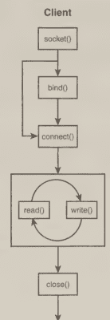

**图 1.1**

`每个客户端通过连续进行几次调用来与操作系统交互。`

以下列表描述了每个步骤：

1. 创建套接字。从各种网络域（如互联网）和套接字类型（流）中进行选择。

2. 设置套接字选项（可选）。有很多影响套接字行为的选项。只要套接字处于打开状态，程序就可以随时更改这些选项。（有关更多细节，请参见第 9 章，“突破性能障碍”。）

3. 绑定到地址/端口（可选）。接受来自所有或单个 `IP` 地址的连接，并建立端口服务。如果跳过此步骤，操作系统将假设使用任意 `IP` 地址并分配一个随机端口号。（第 2 章，“`TCP/IP` 网络语言流畅性”将更详细地讨论地址和端口。）

4. 连接对等节点/服务器（可选）。主动建立你的程序与另一个网络程序之间的双向通道。如果跳过此步骤，你的程序将使用定向或无连接通信。

5. 部分关闭连接（可选）。将通道限制为仅发送或仅接收。你可能希望在复制通道之后使用此步骤。

6. 发送/接收消息（可选）。选择退出任何 `I/O` 的一个原因可能包括检查主机可用性。

7. 关闭连接。当然这一步很重要：长期运行的程序如果未关闭无效连接，最终可能会耗尽可用的文件描述符。

以下各节描述其中一些步骤，定义系统调用并提供示例。

### 使用套接字连接世界

几年前，网络涉及从一台计算机到另一台计算机的专用串行线路。没有其他计算机共享同一电路，`UNIX` 使用 `UUCP`（`UNIX` 到 `UNIX` 复制）来移动文件。随着线路传输技术的改进，共享传输线路的概念变得可行。这意味着每台计算机需要唯一地标识自己并轮流传输。有许多不同的方法来共享网络时间，其中许多效果相当好。有时，计算机同时传输，导致数据包冲突。

硬件和底层驱动程序处理诸如冲突和重传等问题，这现在是过去编程的产物。这使得设计可以专注于消息的传输和接收。套接字 `API`（应用程序编程接口）为设计者提供了接收或发送消息的通道。

套接字编程与典型的应用程序或工具编程不同，因为你正在处理并发运行的程序和系统。这意味着你需要考虑同步、时序和资源管理。

套接字通过单个双向通道将异步任务链接在一起。这可能会导致死锁和饥饿等问题。通过意识和规划，你可以避免大多数这些问题。你可以在第 7 章“分担负载：多任务处理”中阅读如何处理多任务处理问题，并在第 10 章“设计健壮的 `Linux` 套接字”中学习如何构建健壮的套接字。

通常，超载的服务器会降低互联网感知到的响应速度。时序和资源管理可以减少服务器负担，提高网络性能。你可以在第二部分“服务器视角与负载控制”中找到许多提高性能的想法。

互联网被设计为完全基于分组交换。每个数据包都必须包含到达目的地所需的所有必要信息。就像信件一样，数据包必须包含源地址和目的地址。数据包沿着连接（或链路）从一台计算机切换到下一台。如果网络在传递消息过程中丢失了一个链路，数据包会寻找另一条路线（分组交换），或者如果无法到达主机，路由器会将错误弹回给发起者。这确保了某种形式的数据可靠性。网络中的路径中断会导致网络故障。你自己可能也遇到过一些网络故障。

### 对话的艺术：`TCP/IP` 寻址概述

网络支持许多不同类型的协议。程序员针对特定问题（如无线电/微波）调整了一些协议；其他协议则试图解决网络可靠性问题。`TCP/IP`（传输控制协议/互联网协议）关注数据包以及通信通道丢失的可能性。在任何时候，当网络段故障时，该协议都试图寻找新路线。

数据包跟踪、丢失检测和重传是复杂的算法，因为时序不是唯一的指标。幸运的是，行业经验证明了该协议中使用的算法是有效的。通常，在设计期间你可以忽略这些问题，因为解决方案隐藏在协议深处。

`TCP/IP` 是分层的：高层协议提供更高的可靠性但灵活性较低，底层协议提供更大的灵活性但牺牲了可靠性。鉴于各种不同层面的灵活性和可靠性，套接字 `API` 提供了所需的所有接口。这与标准 `UNIX` 方法不同，后者让每一层都有自己的调用集。

标准文件 `I/O` 同样采用分层方法。通过 `TCP/IP` 连接的计算机主要使用套接字彼此通信。考虑到程序可用的所有不同协议层，以及我们被告知的 `open()`（返回文件描述符）和 `fopen()`（返回文件引用）是不同的且几乎不兼容，这似乎有些奇怪。所有协议层都通过一个调用可用：`socket()`。这个单一调用抽象了不同网络（`TCP/IP`, `IPX`, `Rose`）的所有实现细节。从根本上说，每个数据包都有数据、发起者地址和目的地址。协议中的每一层都会向传输数据包添加自己的签名和其他数据（封装）。传输时，封装帮助接收者将消息转发到适当的层等待读取。

## 监听服务器：客户端的基本算法

每个连接到互联网的计算机都有一个互联网协议（`IP`）地址，这是一个唯一的 32 位数字。如果没有唯一性，就无法知道数据包的目的地在哪里。

`TCP/IP` 通过端口的概念将寻址提升了一个层级。就像 3 到 5 位的电话分机号一样，每个计算机地址都有多个端口供计算机进行通信。这些端口不是物理存在的，而是系统的抽象概念。所有信息仍然通过网络地址传输，就像主要电话号码一样。

`IP` 地址的标准书写格式为 `[0-255].[0-255].[0-255].[0-255]`——例如，`123.45.6.78`。请注意，0 和 255 是用于网络掩码和广播的特殊数字，因此请谨慎使用它们（第 2 章将更详细地讨论 `IP` 编号）。互联网端口通常使用冒号或句点分隔这些数字：

```
[0-255].[0-255].[0-255].[0-255]:[0-65535]

例如，128.34.26.101:9090 (IP=128.34.26.101, port=9090).
```

```
[0-255].[0-255].[0-255].[0-255].[0-65535]

例如，64.3.24.24.9999 (IP=64.3.24.24, port=9999).
```


每个 `IP` 地址实际上提供大约 65,000 个端口编号，套接字可以连接到这些端口。更多信息请参见第 2 章。

最简单的客户端套接字连接是：打开到服务器的连接，发送请求，并接受响应。某些标准服务甚至不期待任何提示。一个例子就是端口 13 上的时间服务。不幸的是，许多 `Linux` 发行版如果没有修改 `/etc/inetd.conf` 文件，不会打开该服务。如果你有权限访问 `BSD`、`HP-UX` 或 `Solaris` 机器，可以尝试该端口。

有几种服务可以安全地供你玩耍。你可以尝试在机器上运行 `Telnet` 连接到 `FTP` 端口（21）：

```
% telnet 127.0.0.1 21
```


连接后，程序会接收到来自服务器的欢迎信息。使用`Telnet`连接`FTP`服务器效果并不理想，但你可以看到基本的交互过程。`列表 1.1`中的简单客户端示例连接到服务器，读取欢迎信息，然后断开连接。

### 列表 1.1 基本的 `TCP` 客户端算法

```
/**** A Basic Client algorithm. ***/
Create a socket
Create a destination address for server
Connect to server
Read & display any messages
Close connection.
```

`列表 1.1`中的算法可能看起来过于简化，也许确实如此。然而，连接到服务器并与之通信确实就是这么简单。以下各章节描述这些步骤中的每一个。您可以在书的末尾和随附的`CD-ROM`中找到该程序的完整源代码。

### 套接字系统调用：程序与注意事项

创建有效消息接收器并启动与其他计算机发送和接收消息整个过程的那个单一工具，就是`socket()`系统调用。该调用是所有在`Linux`/`UNIX`操作系统上可用的协议之间的公共接口。就像系统调用`open()`创建文件描述符来访问系统中的文件和设备一样，`socket()`创建描述符来访问网络中的计算机。它需要确定您想要访问哪些层级的信息。语法如下：

```
#include <sys/socket.h>
#include <resolv.h>
int socket(int domain, int type, int protocol);
```

`socket()`系统调用接受几种不同的值。完整列表请参见附录 A，“数据表”。目前，您可以在`表 1.1`中找到一些。

#### 表 1.1 选定的 `socket()` 系统调用参数值

| 参数 | 值 | 描述 |
| :------- | :--- | :---------- |
| `domain` | `PF_INET` | 互联网`IPv4`协议；`TCP/IP`堆栈。 |
| | `PF_LOCAL` | `BSD`风格的本地命名管道。通常用于系统日志或打印队列。 |
| | `PF_IPX` | `Novell`协议。 |
| | `PF_INET6` | 互联网`IPv6`协议；`TCP/IP`堆栈。 |
| `type` | `SOCK_STREAM` | 可靠的顺序数据流（字节流）[传输控制协议 (`TCP`)]。 |
| | `SOCK_RDM` | 可靠的分组数据（尚未在大多数操作系统中实现）。 |
| | `SOCK_DGRAM` | 不可靠的分组数据（数据报）[用户数据报协议 (`UDP`)]。 |
| | `SOCK_RAW` | 不可靠的低层分组数据。这是一个网络字节序的`32`位整数（参见第`2`章中关于网络字节序的部分）。大多数连接类型仅支持`protocol = 0`（零）。`SOCK_RAW`需要指定`0`到`255`之间的协议值。 |

目前，示例中仅使用`domain=PF_INET`, `type=SOCK_STREAM`, 和`protocol=0`（零）这几个参数。

> **`PF` 值与 `AF` 值的对比**
>
> 本书在套接字调用中使用`PF_*`（协议族）域，因为`PF_*`域常量是正确形式。然而，大多数程序互换使用`AF_*`（地址族）常量。当您看到使用`AF`风格的源代码时，请务必小心以免混淆。（`C`头文件将`AF_*`常量定义为`PF_*`。）如果您愿意，使用`AF_*`同样有效。但是，这可能会在未来导致不兼容性问题。

流式`TCP/IP`调用的示例如下所示：

```
int sd;

csd = socket(PF_INET, SOCK_STREAM, 0);
```

`sd`是套接字描述符。其功能与文件描述符`fd`相同：

```
int fd;

fd = open(...);
```

当发生错误时，该调用返回负值，并将错误代码放入`errno`（库错误的标准全局变量）。以下是您可以遇到的一些常见错误：

- `EPROTONOSUPPORT` 该域内不支持协议类型或指定的协议。当域不支持请求的协议时，会发生这种情况。
  - 除了`SOCK_RAW`之外，大多数域类型仅支持协议为零。
- `EACCES` 拒绝创建指定类型或协议套接字的权限。您的程序可能没有足够的权限来创建套接字。`SOCK_RAW`和`PF_PACKET`需要`root`权限。
- `EINVAL` 未知协议，或协议族不可用。当`domain`或`type`字段中的值无效时，会发生这种情况。有效值的完整列表请参见附录 A。

当然，您需要知道需要包含的重要头文件。对于`Linux`，这些是

```
#include <sys/socket.h> /* 定义函数原型 */
#include <sys/types.h> /* 标准系统数据类型 */
#include <resolv.h> /* 定义所需的数据类型 */
```

`sys/socket.h`文件包含套接字`API`所需的函数定义（当然包括`socket()`）。`sys/types.h`包含许多用于套接字的数据类型。

> **使用 `resolv.h` 与 `sys/types.h` 的对比**
>
> 本书使用`resolv.h`文件来定义数据类型。请注意，其他`Linux`发行版或`UNIX`版本可能使用更标准的包含文件`sys/types.h`。在编写本书时，示例在`Mandrake 6.0-7.0`上进行了测试，它们使用的是旧的包含文件。（似乎这些发行版版本有一个不好的`sys/types.h`文件，该文件没有包含地址类型所需的`netinet/in.h`文件。）

`socket()`系统调用所做的仅是创建发送和接收数据的队列，这与打开文件的系统调用不同，后者实际上会打开文件并读取第一个块。只有当您的程序执行`bind()`系统调用时，操作系统才会将队列连接到网络。

再次使用电话示例，套接字只是一个没有电话或网络连接的话筒。执行`bind()`、`connect()`或某些`I/O`操作会将话筒连接到电话，将电话连接到网络。（如果您的程序没有显式调用`bind()`，操作系统会隐式地为您进行调用。更多信息，请参见第`4`章，“在对等体之间发送消息”。）

### 发起呼叫：连接到服务器

创建套接字后，通过连接到服务器即可获取第一个“你好？”。`connect()`系统调用在许多方面类似于打电话给某人：

- 您使用电话号码识别目的地。当您拨打电话号码时，您是在识别电话网络中任何地方的特定电话。

连接需要特定的格式来定义连接哪台计算机以及如何连接。`IP`地址同样用于标识计算机。正如电话号码具有特定格式一样，连接也需要特定格式来定义目标计算机和连接方式。

- 连接提供了消息传输的通道。一旦电话被接听，就会有一个通道，使得两人或更多人可以对话。除非对方需要回拨给你，否则你的电话号码并不重要。

- 返回你手持机的路径隐藏在电话系统内部。电话网络拥有多个共享路径，就像计算机网络一样。因此，拥有一个反向路径对于将消息返回到你的手持机至关重要。目标对等点或服务器会获取你程序的地址和端口，以便使用类似的路径进行回复。

你的电话号码必须公布，他人才能给你打电话。如果你的程序要接受连接，你必须指定一个唯一的通道（或端口）并将其公布给你的客户端。

`connect()`系统调用的定义如下：

```c
#include <sys/socket.h>
#include <resolv.h>
int connect(int sd, struct sockaddr *server, int addr_len);
```

第一个参数(`sd`)是你通过`socket()`调用创建的套接字描述符。最后一个参数是`sockaddr`结构体的长度。第二个参数指向不同类型和大小的结构体。这一点很重要，因为正是这使得`socket()`调用与文件`I/O`调用有所不同。

回想一下，`socket()`系统调用至少支持两种不同的域（`PF_INET`和`PF_IPX`）。每个网络域（`PF_*`）都有自己用于描述地址的结构体。它们都有一个共同的父级——即你在`connect()`定义中看到的——`struct sockaddr`。关于所有结构体声明的完整列表，请参见附录 A。

## `Sockaddr` 数据抽象

`sockaddr`接口使用了数据抽象。数据抽象通过断言“虽然数据类型可能会改变，但算法保持不变”来简化接口。例如，栈可以包含不同的数据类型，但栈的功能保持不变：`push`、`pop`等。要使用抽象接口，`sockaddr`结构体的第一个字段必须具有相同的含义。所有结构体都有一个公共字段：`..._family`。该字段的类型是无符号`16`位整数。该字段存储的值决定了使用哪种网络域。

## 使套接字类型与 `sockaddr` 的 `Family` 字段匹配

> 你在`socket()`系统调用中设置的域类型必须与`sockaddr`家族中的第一个字段的值相同。例如，如果你的程序创建了一个`PF_INET6`套接字，为了使程序正确工作，结构体字段必须为`AF_INET6`。


暂时先看看通用记录和 INET 记录以供比较（来自头文件）：

```c
struct sockaddr {
    unsigned short int sa_family;
    unsigned char sa_data[14];
};
```

```c
struct sockaddr_in {
    sa_family_t sin_family;
    unsigned short int sin_port;
    struct in_addr sin_addr;
    unsigned char __pad[1];
};
```

请注意，`sa_family` 和 `sin_family` 是两个结构体之间的公共字段。每个过程调用在接收到此记录时执行的任务都是检查第一个字段。请注意，这是唯一采用主机字节序的字段（参见第 2 章）。填充字段（名为 `sa_data` 和 `__pad`）在 `sockaddr` 家族中的每个结构体中可能是通用的。按照惯例，通用 `sockaddr` 结构体和 INET `sockaddr_in` 结构体长度必须为 16 字节（IPv6 结构体 `sockaddr_in6` 为 24 字节）。因此，填充字段会用任意未使用的字节填满。

你可能会注意到 `sockaddr_in` 中填充字段的长度缺失。这仅仅是一个惯例。由于填充必须设置为零，实际大小并不重要。（在此 `sockaddr_in` 定义中，其宽度为 8 字节。）某些实现可能会定义额外字段用于内部计算。不要担心它们——也不要使用它们，因为你无法保证字段在不同系统和不同版本之间的可用性。任何更改都可能在你使用非标准字段时导致代码失效。在所有情况下，将整个结构体实例初始化为零是最好的做法。

下表描述了每个字段。它还给出了可能值的示例。

| 字段名称 | 描述 | 字节序 | 示例 |
| :--- | :--- | :--- | :--- |
| `sin_family` | 协议族 | 主机、本机 | `AF_` |
| `sin_port` | 服务器的端口号 | 网络 | 13（时间服务） |
| `sin_addr` | 服务器的数字 IP 地址 | 网络 | 127.0.0.1（本地主机） |

在调用 `connect()` 系统调用之前，程序会填充每个字段。Linux 略微掩蔽了该系统调用，因此不需要将 `sockaddr_in` 强制转换为 `sockaddr`。为了可移植性，你可能仍然希望遵循惯例并添加强制转换。

## 强制转换 `sockaddr` 类型

在其他兼容 UNIX 的操作系统中，你可以将 `sockaddr_*` 家族成员强制转换为 `sockaddr` 以避免警告。这里的示例未使用任何强制转换，仅仅是为了节省空间（并且因为 Linux 允许这样做）。

代码可能看起来像清单 1.2。

### 清单 1.2 `Connect()` 示例

```c
/*** 代码片段展示 connect() 系统调用的初始化和调用 *** */

#define PORT_TIME     13
struct sockaddr_in dest;
char *host = "127.0.0.1";
int sd;
/*** 创建套接字并执行其他工作 *****/

bzero(&dest, sizeof(dest));      /* 从干净的状态开始 */
dest.sin_family = AF_INET;       /* 选择所需的网络 */
dest.sin_port = htons(PORT_TIME); /* 选择端口 */
inet_aton(host, &dest.sin_addr);         /* 远程地址 */

if ( connect(sd, &dest, sizeof(dest)) == 0 )  /* 连接！ */
{
        perror("Socket connection");
        abort();
}
...
```

此代码中的 `connect()` 系统调用在将套接字连接到服务器之前需要几个预备步骤。首先，创建一个 `sockaddr_in` 结构体。使用服务器地址作为第二行的值。如果你想连接到不同的服务器，请将相应的 IP 地址放入此字符串中。程序继续执行其他初始化，包括 `socket()` 系统调用。当你开始处理该结构体时，使用 `bzero()` 将其清零。程序将 family 设置为 `AF_INET`。接下来，程序设置端口和 IP 地址。这里使用的 `htons()` 和 `inet_aton()` 转换工具在第 2 章中有详细介绍。

下一个调用是连接服务器。请注意，代码片段检查了每个过程调用的返回值。该策略是使你的网络程序健壮性的诸多关键因素之一。

在程序建立连接后，套接字描述符 `sd` 成为两个程序之间的读/写通道。我们习惯的大多数服务器提供单次事务然后挂断（例如，HTTP 1.0 服务器发送请求的文件，然后关闭连接）。为了与这些类型的服务器接口，你的程序必须发送请求，获取回复，并关闭连接。

## 获取服务器的回复

套接字已打开，通道已建立。现在，你可以获取第一个“你好”。一些服务器会像接听电话的人一样发起对话。此消息可能包含服务器名称和连接说明。一旦连接打开，你可以使用标准库的底层 I/O 调用进行通信。以下是 `read()` 系统调用：

```c
#include <unistd.h>
ssize_t read(int fd, void *buf, size_t count);
```

你很可能熟悉此调用。除了它具备使用套接字描述符 (`sd`) 代替文件描述符 (`fd`) 的特殊能力外，其他一切几乎与从文件读取相同。你甚至可以使用 `read()` 系统调用，如下面的代码片段所示：

```c
...
int sd, bytes_read;
sd = socket(PF_INET, SOCK_STREAM, 0);    /* 创建套接字 */

/**** 连接到主机 ****/

bytes_read = read(sd, buffer, MAXBUF);  /* 读取消息 */
if ( bytes_read < 0 )
    /* 报告连接错误；退出例程 */
...
```

实际上，你可以将套接字描述符转换为 `FILE*` 以进行更高级的 I/O 操作。例如，若要使用 `fscanf()`，你可以参考下方的示例。（加粗的行表示与前一个列表中的更改。）

```c
char Name[NAME], Address[ADDRESS], Phone[PHONE];
FILE *sp;
int sd;
sd = socket(PF_INET, SOCK_STREAM, 0); /* create socket */

/* Connect to host */

if ( (sp = fdopen(sd, "r")) == NULL) /* convert to FILE* */
  perror("FILE* conversion failed");
else if ( fscanf(sp, "%s, %s, %s\n",
  Name, Address, Phone) < 0 )
{
    perror("fscanf");
...
```

只有流式套接字（stream-style sockets）才能可靠地转换为 `FILE*` 流。原因很简单：数据报套接字（Datagram sockets）通常是无连接的——发送一条消息后过程即结束。此外，流式套接字提供数据完整性和消息可靠性，而数据报则不可靠。数据报类似于将一封写好了地址并贴好邮票的信封放入邮政系统发送：消息可能根本无法到达。`FILE*` 连接必须是一个打开的通道。如果你尝试转换数据报，可能会丢失关键数据。有关流与数据报的更多信息，请参阅第 3 章“不同类型的互联网数据包”（Different Types of Internet Packs）。

`FILE*` 套接字连接为网络程序员提供了优秀的扫描和解析资源。然而，当你使用它们时，必须检查所有返回值，包括 `printf()` 和 `fscanf()`。注意前面的示例：如果 `fscanf()` 的返回值小于零，则表示发生了错误。

## 网络安全与可靠性

在创建网络程序时，安全性和可靠性至关重要。在撰写本书时，微软操作系统面临过几个根本性的安全问题，其中一些涉及网络连接。在编写程序时，请确保缓冲区不会溢出，并且所有返回值都经过检查。在软件集市（software bazaar）的环境中，你可以就你的源代码征求他人的意见。软件集市的同行评审是知识和经验的巨大资源——请利用它。

回顾 `read()` 系统调用，你可能会遇到以下常见错误：

- `EAGAIN` 选择了非阻塞 I/O，且没有可用数据。此错误指示程序再次尝试该调用。

- `EBADF` `fd` 不是有效的文件描述符，或未以读取方式打开。如果套接字调用不成功，或者程序关闭了输入管道（使其变为只写），可能会发生这种情况。

- `EINVAL` `fd` 附着在一个不适合读取的对象上。


`read()` 系统调用不提供对其使用套接字方式的特殊控制。Linux 提供了另一个标准系统调用 `recv()`。你可以直接使用套接字描述符配合 `recv()` 来获取信息，同时提供更大的控制权：

```c
#include <sys/socket.h>
#include <resolv.h>
int recv(int sd, void *buf, int len, unsigned int flags);
```

除了标志（`flags`）外，`recv()` 调用与 `read()` 调用没有不同。这些标志赋予你对所获取内容甚至流量控制更大的控制权。这些值可以通过算术或运算组合在一起（`FLAG1 | FLAG2 | ...`）。在正常情况下，参数设置为零。你可能会问，如果标志为零时它与 `read()` 没有区别，为什么不能使用 `read()` 调用呢？作为一个建议，请使用 `recv()` 而不是 `read()`——当程序变得复杂时，它可能会对你有所帮助。此外，一般来说，使用一套工具比混合使用多种工具要好。最后，`read()` 会检查你发送的 I/O 描述符类型并执行相应的系统调用。

以下是一些可用于控制 `recv()` 系统调用的有用标志。你可以在附录 B “Networking API” 中找到更完整的列表。

- `MSG_OOB` 处理带外（out-of-band）数据。用于高优先级消息。某些协议允许你在发送消息时选择普通优先级或高优先级。设置此标志以让队列管理器查找并返回带外消息，而不是普通数据。更多信息请参阅第 10 章。

- `MSG_PEEK` 非破坏性读取。用于告知队列管理器读取消息队列，但不移动读取索引指针。（换句话说，后续每次读取至少会产生相同的数据。参见下一页的框图。）

- `MSG_WAITALL` 用于确保你的消息在提供的缓冲区填满之前不返回。有时你只会得到部分填充的缓冲区，因为剩余的数据正在传输中。如果你知道服务器发送了多少信息，并且不想自己重新组装它，请使用此标志来填充缓冲区（或者永远等待）。

- `MSG_DONTWAIT` 用于确保当队列为空时，你的消息不会阻塞。类似于在套接字上设置非阻塞功能，只是在调用此 `recv()` 系统调用时专门要求此选项。通常，如果没有可用的消息数据，进程将等待（阻塞）直到有数据到达。如果你使用此标志，且在调用时队列中没有可用数据，系统调用将立即返回 `EWOULDBLOCK` 错误代码。（Linux 目前不支持在 `recv()` 调用中使用此选项。你可以将 `O_NONBLOCK` 与 `fcntl()` 系统调用一起使用。这使得套接字始终处于非阻塞状态。）

## 获取分片数据包

你的程序执行速度将远快于网络。有时，由于网络路由器为了适应更受限的网络而对数据包进行了分片，数据包会以片段形式到达计算机。如果在这种情况下调用 `recv()`，你可能会得到一个不完整的消息。这就是为什么 `MSG_PEEK` 在连续调用中可能会给出不同结果的原因之一：第一次调用可能返回 500 字节，而第二次可能是 750 字节。同样，这也是存在 `MSG_WAITALL` 标志的原因。

`recv()` 系统调用比 `read()` 更灵活，允许你使用不同的标志来修改行为。从套接字管道进行正常读取（等同于 `read()`）：

```c
int bytes_read;
bytes_read = recv(sd, buffer, MAXBUF, 0);
...
```

从套接字管道进行非破坏性读取：

```c
int bytes_read;
bytes_read = recv(sd, buffer, MAXBUF, MSG_PEEK);
...
```

从套接字非破坏性地读取带外数据：

```c
int bytes_read;
bytes_read = recv(sd, buffer, MAXBUF, MSG_OOB | MSG_PEEK);
...
```

第一条语句从服务器获取信息，提供缓冲区、长度和没有标志。下一条语句显示该信息。这里存在一个有意的缺陷：如果服务器发送的信息超出了缓冲区能接受的量怎么办？这并不是一个关键的缺陷；系统不会崩溃。该算法只是可能丢失它未读取的数据。

`recv()` 系统调用返回与 `read()` 类似的错误代码，并带有以下扩展：

- `ENOTCONN` `sd` 未连接。提供的套接字描述符未连接到对等方或服务器。

- `ENOTSOCK` `sd` 不是套接字。提供的套接字描述符没有表明它来自 `socket()` 系统调用的特征。

请注意，如果你使用 `read()` 系统调用，在使用套接字描述符时仍然会得到这些错误代码，因为 `read()` 调用只是通往 `recv()` 调用的入口。

## 关闭连接

你已从服务器获取所需信息，一切顺利，现在你想关闭连接。你仍然有两种方式可以关闭连接。大多数程序使用标准 I/O 的 `close()` 系统调用：

```c
#include <unistd.h>
int close(int fd);
```

同样，套接字描述符（`sd`）可以替代文件描述符（`fd`）。它的工作方式相同。如果成功，返回值为零。

> **始终关闭套接字描述符**
>
> 请特别注意始终手动关闭描述符，特别是套接字。默认情况下，操作系统会为你关闭所有描述符并刷新缓冲区。如果描述符指的是文件，该过程在不影响其他系统的情况下正常工作。另一方面，套接字可能会比必要的时间停留得更久，占用资源并使其他客户端难以连接。

此调用只产生一个错误：

- `EBADF` `fd` 不是一个有效的打开文件描述符。

`shutdown()` 系统调用让你对关闭通道有更多控制，因为你可以关闭传入或传出通道。当使用套接字替代 `stdin` 或 `stdout` 时，此调用特别有用。

> **令人困惑的 Shutdown 命令**
>
> `shutdown()` 系统调用与用于关闭操作系统的 `shutdown` 命令（在线 UNIX 手册第 8 节）不同。

通过 `shutdown()` 系统调用，您可以关闭通信路径中数据流的各个方向，使该路径变为只读或只写：

```c
#include <sys/socket.h>
int shutdown(int s, int how);
```

`how` 参数可以取三个值：

| 值 | 功能 |
| :--- | :--- |
| 0（零） | 仅写（想想 “output” 中的 “O”） |
| 1（一） | 仅读（想想 “input” 中的 “I”） |
| 2 | 关闭输入和输出 |

## 总结：幕后发生了什么？

当程序打开套接字并连接到 TCP 服务器时，幕后发生了几件事。所有套接字调用所做的只是创建一个消息队列。事情真正发生是在程序连接时。（您可以在配套光盘上获取完整的程序列表。）表 1.2 展示了客户端和服务器端发生的情况。

### 表 1.2 创建套接字和连接的步骤

| 客户端的操作 | 服务器的操作 |
| :--- | :--- |
| 1. 调用 `socket()`：创建队列；设置通信协议的标志。 | （等待连接） |
| 2. 调用 `connect()`：如果套接字没有通过 `bind()` 分配端口号，操作系统会分配一个临时端口号。 | （等待） |
| 3. 向服务器发送消息请求连接，告知服务器客户端正在使用哪个端口。 | 4. 将连接请求放入监听队列。 |
| （等待服务器） | 5. 读取连接队列，接受连接，并创建唯一的套接字通道。 |
| （等待） | |
| （等待） | 6. 创建一个（有时是）唯一的任务或线程来与您的程序交互。 |
| （等待） | 7. 发回确认连接已被接受。要么向您的端口发送消息，要么等待来自您程序的请求。如果服务器提供简单的公告消息（如当前时间），它可能在发送数据后关闭通道。 |
| | |
| 8. 开始数据交换。 | |

对于一个简单的 `connect()` 调用来说，这已经涉及相当多的内容。这个过程可能会变得更加复杂，特别是对于中间的路由计算机（例如路由管理、数据包验证、分片与去分片、协议转换、隧道等）。Socket API 极大地简化了网络通信。

网络需要特定的语言和算法来建立连接。首先，`socket()` 系统调用通过创建“电话手柄”来启动整个过程。这个手柄允许程序发送和接收与其连接的消息。程序可以使用像管道和文件描述符中使用的常规 `read()` 和 `write()`。或者，您可以使用更专业的系统调用，如 `recv()`。

IP 网络有几个需要进一步解释的特性。下一章扩展了 IP 编号、端口和字节序。它解释了用于转换信息的非常有用的工具，简化您的编程工作。

## TCP/IP 网络语言流畅性

### 第 2 章

## 本章内容

- IP 编号概述 28

- IP 主机端口号 35

- 网络字节序 37

- 不同种类的 `sockaddr` 44

- UNIX 命名管道 44

- 总结：应用 IP 编号和工具 45

使用互联网需要您知道如何对消息进行寻址，以便它们能正确到达。寻址是创建消息的重要组成部分。就像电话一样，计算机必须有一个地址或 ID，以便它能接收到正确的消息，其他计算机也能相应地引导流量。


前一章向您介绍了套接字。本章扩展了该主题，介绍了更多 `Socket API` 的内容。首先讨论了 IP 编号系统、路由在抽象层面上的工作原理、正确的二进制格式以及不同的套接字类型。

### IP 编号概述

IP 编号使用固定长度的地址。这一限制在协议设计时需要大量的规划。在其生命周期内，该协议解决了几个问题：计算机标识、网络标识、路由和地址解析。现在它面临着诸如爆炸式增长和地址枯竭等新问题。

### 计算机标识

网络涉及多台计算机共享单一资源（网络电缆）。由于网络介质中可能流动的所有信息，每台计算机都必须接收信息。然而，如果您网络上的每台计算机都叫 `Bert` 或 `Ernie`，其他主机将无法确定实际的目标。每个网络计算机都需要一个唯一的标识（`ID`）。但这还不是全部。

> **面对地址冲突**
>
> 当工作站共享一个地址时（*地址冲突*），它无法很好地与网络协同工作。任何尝试追踪地址冲突的人都可以证实修复它是相当困难的。当其中一台计算机应该使用某种动态地址分配（如 `DHCP`）时，情况甚至更糟。解决此问题最明显（也是最费力的）方法是查看该区域的每台计算机。

网络是动态的，且复杂性倾向于增加。随着网络扩展，计算机必须能够通过其 `ID` 轻松定位。放置在网络上的所有信息都消耗了那宝贵的一部分“虚拟地盘”，因此消息中不应包含任何不必要的信息。

一些网络系统在消息中包含路由表。列表中的每个服务器都接收该消息并将其传递给下一个服务器。这种方法通过降低头部与实际数据的比率，降低了网络的吞吐量。如果您将通往目的地的方向编码在地址本身中，路由表就变得不必要了。

联网的计算机已经有一个唯一的 `ID`，称为 *媒体访问控制*（*MAC*）；以太网 `ID` 就是一个例子。您的计算机使用此 `ID` 进行网络引导（仅具有 `RAM` 且所有永久存储都在服务器上的无盘系统）。以太网 `ID` 长度为 6 个字节，通常以十六进制书写：`00:20:45:FE:A9:0B`。每个以太网卡都有一个，它是唯一的。

不幸的是，您不能仅使用该 `ID` 来标识您的计算机。它有两个根本性问题。首先，每个路由服务器必须获取网络上的所有 `ID`。`ID` 数据库可能会变得非常大，并显著减慢每个消息的路由时间。其次，并非每个接口都有 `MAC`（例如 `PPP`）。

计算机 `ID` 可以内置一种路由消息的机制。这种机制类似于写信的地址：从最通用到最具体。互联网 `ID` 解决唯一性问题，同时为路由问题提供提示。

`IP` 地址相比硬件提供的 `MAC` 有几个优势。首先，数字可以改变（它是固定的），因此部署一致的地址集群更容易，笔记本电脑也不会遇到问题。网络可以使用 *地址解析协议（`ARP`）* 将 `IP` 映射到硬件 `MAC`。请参阅附带 `CD-ROM` 上的 `Request For Comment #826` [`RFC826`]。

### 地址解析协议（ARP）

`ARP` 是一个简单的转换表，获取 `IP` 并填入相关的 `MAC`。网络上的所有消息都必须有一个 `MAC`，以便适配器（或驱动程序）能够拾取该消息。源可能不知道目标主机的 `MAC`，该主机隐藏在几个路由器之后。相反，路由器将消息发送到控制 `IP` 地址中定义的子网（或子网段）的路由器。当消息到达带有 `ARP` 的路由器时，它检查表。如果路由器找到 `IP` 地址，数据包 `MAC` 获得正确的目标。否则，路由器向子网发送广播以解析 `IP` 地址。

### 互联网 ID 组织

互联网 `ID` 使用从最具体到最不具体的寻址方案。每个 `ID` 是一个四字节数字，类似于以太网 `ID`。第一个数字，从左到右读取，是网络 *类*。参见图 2.1。

`IP` 地址充当路由器的一般路线图。地址的每个部分都提供关于目标位置更具体的信息。从网络类开始，地址以主机号结束。您可以轻松地将其与信封上的地址进行比较：第一行是收件人，然后是街道地址或信箱号。地址中的细节逐渐减少，直到州或国家。

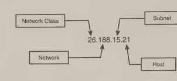

## 图 2.1

*`IP` 地址由标识网络粒度的多个部分组成。*

互联网编址有五个基本地址类。每个类是为从非常大型到小型网络分配的区块。互联网编址方案的组织方式允许公司从编址空间中购买区段。这些类标记为 `A`–`E`：

| 类别 | 地址 | 地址范围、描述 |
| :--- | :--- | :--- |
| `A` | `0.0.0.0` 至 `0.255.255.255`<br>`1.0.0.0` 至 `126.255.255.255` | （保留）`$2^{32}-2$` 或每个分配区段 16,777,214 个节点。此类有 126 个区段。用于需要按需进行子网划分的超大型组织，例如互联网服务提供商（`ISPs`）。 |
| `B` | `127.0.0.0` 至 `127.255.255.255`<br>`128.XXX.0.0` 至 `191.XXX.255.255` | （保留用于环回接口）`$2^{30}-2$` 或每个分配区段 65,534 个节点。此类有 `$64 \times 256$` 个可用区段。用于大型企业或大学等。它们可以创建子网。`XXX` 是分配和指定的子网（例如，`129.5.0.0` 是一个已分配的子网）。注意：此地址空间几乎用尽。 |
| `C` | `192.XXX.XXX.0` 至 `223.XXX.XXX.255` | `$2^8-2$` 或每个分配区段 254 个节点。此类有 `$32 \times 65,536$` 个可用区段。小型公司或个人。此地址在此处有多个可用槽位。 |
| `D` | `224.0.0.0` 至 `239.255.255.255` | `$2^{23}-2$` 或 2,684,354 个节点。这些地址不是分配的，而是保留用于多播地址。 |
| `E` | `240.0.0.0` 至 `255.255.255.255` | `$2^{23}-2$` 或 2,684,354 个节点。这些保留用于将来使用。请注意，`255.255.255.255` 是一个通用广播 `IP` 地址。它永远不是一个合法的地址。 |

网络类的编号方式有些特殊，因为编址使用地址的前几位来确定类别。例如，`A` 类网络在地址的第一位是零。同样，`B` 类在第一位是 1，在第二位是 0：

-   `A` 类：`0` (`0000,0000`) 至 `126` (`0111,1110`)
-   `B` 类：`128` (`1000,0000`) 至 `191` (`1011,1111`)
-   `C` 类：`192` (`1100,0000`) 至 `223` (`1101,1111`)
-   `D` 类：`224` (`1110,0000`) 至 `239` (`1110,1111`)
-   `E` 类：`240` (`1111,0000`) 至 `255` (`1111,1111`)

从历史上看，使用这种方法，网络上的路由器可以快速（在四位之内）决定是否让消息进入网关。如今，路由更高效，使用无类别互联网域路由（`CIDR`）。这些新定义（见 `RFC 1517`–`1519`）使用地址的高位来识别主机的位置和路由。

`IP` 协议引入了这种编号方案来标识计算机，以便以有效的方式将这些计算机分组。借助此方案，路由器可以迅速决定是否阻止数据包或将其移动到通往目标子网的接口。传播非常重要：仅仅接收数据包、检查它并将其传递下去是不可接受的。路由器接受的每一位都意味着网络上的延迟。路由器必须延迟的位数不得超过确定相关性所需的位数。换句话说，它对传播延迟必须是不可见的。例如，美国典型的电话交换不会试图一次性解析整个电话号码；前三个数字指示区域或地区，接下来的三个数字指示站点。

## 子网掩码

某些类别需要更多的过滤。如果一个网络有 1600 万个节点且全部挤在一个空间中，那将是过度的。在您设置 `Linux` 计算机并配置网络时，您可能已经注意到子网掩码这一术语。`CIDR` 的引入有助于简化大型子网的复杂性 [`RFC950`]。

网络子网掩码专门用于识别接口可以到达的连续地址组。它提供了一个额外的过滤器，只允许特定的消息通过。当消息到达时，路由器在消息的目标地址上使用子网掩码。如果匹配，路由器将消息传递下去。您可以随意构建掩码，但最低有效置位比特指定了子网络。

例如，如果您有一个包含八台机器的小型网络，并且预计该组的增长不超过五台机器，您可以将路由器子网掩码设置为 `187.35.209.176`。地址中的最后一位位于 `176` (`1101,0000`)。地址范围在 `1101,XXXX` 的 `'X'` 部分（活动子网）内。从这里，您可以分配地址：`187.35.209.176`（路由器）、`187.35.209.177`（主机 #1），直到 `187.35.209.222`。您可以有任何组合，但最低有效置位比特是标记。

## 子网掩码和默认地址

使用网络掩码作为主机地址可能会导致冲突并丢失数据包。这是由于特殊地址 `0`（零）造成的。例如，`187.35.209.0` 的最后八位是零。如果地址匹配网络掩码，它就是第零地址。您应该始终保留第零地址用于网络地址掩码。同样，您可能已经注意到示例省略了 `187.35.209.223`。如果您使用那个 `ID`，该主机可能永远看不到消息。数字 `223` 的活动子网全为 1：`1101,1111`。这是一个广播地址。您不应将其用作主机地址。

在大多数情况下，您不需要担心设置路由器，且配置超出了本书的范围。通常，当您在网络配置中看到子网掩码时，您可以接受脚本提供的掩码。

## 路由器和地址解析


局域网（LAN）可能会因主机之间的所有消息而变得非常繁重。互联网上的每台计算机都有可能听到每条消息。但随着所有流量，网络变得非常混乱，数据包与其他数据包发生碰撞（同时传输），吞吐量下降到接近零。

LAN 使用编址和子掩码来限制计算机组（或集群）内的流量。除了将消息传递到适当的接口外，路由器还作为信息控制网关来本地化流量。本地流量保留在集群内部，外部流量则通过。

主机使用子网掩码确定是否必须将消息传递给路由器。所有目标是外部的消息都通过路由器，而本地消息保留在子网内。此过程减少了网络骨干的拥塞。

路由器还使用其路由表将消息定向到目标。每个路由器告诉网络上的其他路由器它接受哪些流量指导。广域网（WANs）使用此功能来传递消息。

在源和目标之间的每个步骤都会查看 `IP` 地址，将网络与路由表进行比较。路由器将您的消息移向越来越具体的目标。第一跳尝试解析到集群，第二跳将消息上移以在子网络中解析，依此类推，直到解析到类别。

一旦路由器找到匹配（无论是通用还是特定），它使用 `MAC` 地址将消息发送给下一个路由器，从而将消息移向该方向。最终，匹配到集群的消息到达，路由器的 `ARP` 将路由器 `MAC` 替换为目标 `MAC`。

以太网网络适配器仅接受带有其 `ID` 的消息。一旦主机启动并稳定下来，它会告诉子网络上的其他所有人它的以太网 `ID` 和 `IP` 地址。这就是之前提到的 `ARP` 的功能。

## 特殊和减少的地址

如前所述，有一些保留地址。子网掩码的活动子网有两个保留地址：全零（网络）和全一（广播）。这意味着当计算您有多少可用地址时，您必须从该数字中减去 2。请考虑：如果您创建 100 个子网络，您将有效地失去 200 个地址。

这种损失仅仅是开始。两个大的地址块保留用于内部使用：`0.0.0.0` 至 `0.255.255.255` 和 `127.0.0.0` 至 `127.255.255.255`。第一个地址组在 `IP` 简写中意味着“此网络”（见以下阴影注释）。如果您的网络地址为 `128.187.0.0`，在消息中使用 `0.0.25.31` 将隐式地产生 `128.187.25.31`。

1992 年，互联网活动委员会（`IAB`——关于互联网的设计、工程和管理见 `RFC1160`）对互联网的爆炸式增长感到十分担忧——即使有了所有的编址技术和仔细的计划。地址分配超过了 4.5 亿个节点。委员会看到增加的分配正在消耗可用的地址空间。然而，只有大约 2% 的分配实际上被使用。其余的所有地址都在哪里？

`IAB` 将地址范围以整块分配给公司。公司为了预期额外使用并尽可能保持其地址的连续性，购买比所需更大的范围。

## 地址分配膨胀

我曾经在一个规模很小的公司工作，他们展示了 128 个地址的分配情况；当时只有 30 个地址在使用。他们为我预留了 10 个槽位。我从未使用过超过 2 个。直到今天，我认为那些地址可能仍然分配在我名下，尽管我四年前就已经离开了那家公司。

总而言之，地址异常和浪费的分配已经消耗了大部分地址空间。最近的估算表明，`B` 类和 `C` 类网络已经满员。`ISP` 正在更多地使用 `A` 类地址。用不了多久，需求可能会耗尽所有地址。

对于丢失的地址空间，互联网将如何应对？当前的 `IP` 寻址方式如何能更好地被利用？互联网架构委员会（`IAB`），现在称为互联网名称与数字地址分配公司（`ICANN`），无法轻松收回已出售给公司的未使用槽位，因为这些公司的 `IT` 部门已经在组织内部分配了这些地址。

许多公司现在使用`动态主机配置协议`（`DHCP`）`[RFC2131]`，它在启动时分配 `IP` 地址。没有主机永久拥有一个 `IP` 地址。`DHCP` 还有助于安全性：计算机破坏者喜欢固定的 `IP` 地址。如果你记得，启动过程会发出广播消息以寻找 `bootp` 服务器。找到后，服务器发出一个 `IP` 地址。类似地，普通主机在启动期间加载其 `DHCP` 请求者。请求者发出广播消息以找到响应式的 `DHCP` 服务器。找到后，服务器从其可用地址池中分配一个地址，并将其（连同适当的网络掩码）传递给请求者。

`DHCP` 请求者接受这些信息并配置本地主机的网络协议。在某些情况下，由于网络拥塞，这可能需要几秒钟。在本地主机正确配置之前，它可能会遭受`IP 失忆症`（主机不知道自己的地址）。

## 主机或 IP 失忆症

如果网络和主机命名未正确设置，也会发生主机或 `IP` 失忆症。这可能是一个严重的问题。甚至 `ping 127.0.0.1` 可能都不起作用。如果你的主机患有失忆症，请检查你的发行版。`RedHat` 发行版（及其衍生版）使用 `/etc/sysconfig/network` 和 `/etc/sysconfig/network-scripts/ifcfg.*` 来定义和设置值。

另一个解决方案是增加 `IP` 地址本身的大小。介绍：`IPv6` `[RFC2460]`！简而言之，`IPv6` 的 `IP` 地址大小是原来的四倍：128 位对 32 位。`IPv6` 还极大地改变了其外观：

```
8008:4523:f0e1:23:830:cf09:1:385
```

结果是一个不太容易记忆的地址。

`IPv6` 的主要优势在于它拥有更大的地址空间可供使用。超过 $3\times10^{38}$ 个地址可能在很长一段时间内消除地址限制问题。有关更多信息，请参阅第 17 章“通过组播、广播和 `Mbone` 共享消息”。

## IP 主机端口号

所有消息都到达一个或多个被识别的地址。如果程序接受这些消息，它可能会接收到旨在发给其他运行中程序的信息。只要消息被送达，操作系统很少关心消息去往哪里。`TCP/IP` 协议栈引入了端口的概念。一个系统可以有多个可用端口，所有这些端口都与同一个地址相关联。

`TCP/IP` 协议栈添加端口以抽象网络并方便你进行编程。这些不是真实的物理端口。它们是网络子系统使用的通道，用于将信息重定向到适当的程序。所有网络程序不再接收所有消息；它们只接收发往其端口的消息。

你在基于互联网的网络上看到的每个典型的 `IP` 数据包都有主机的地址和端口号。当数据包从网络到达时，数据包头部中的 16 位字段指示目标端口号。操作系统读取此字段并将新数据包放入该端口的队列中。从那里，程序读取套接字（使用 `read()` 或 `recv()` 系统调用）。同样，当程序传输消息（通过 `write()` 或 `send()` 系统调用）时，操作系统将数据放入该端口的出站队列中。

默认情况下，只有一个程序拥有一个端口。实际上，如果你尝试在同一个系统上运行两个分配相同端口号的程序，系统调用将返回 `EINVAL` 错误代码。你可以选择使用 `SO_REUSEADDR` 来共享端口（参见第 9 章“打破性能壁垒”）。

> **在对称多处理（SMP）上共享端口**
>
> 两个套接字不能共享同一端口的规则同样适用于对称处理器。原因很简单：处理器，像资源一样，共享内存和操作系统。如果你有多个操作系统在运行，理论上你可以有两个在不同运行程序中具有相同端口号的套接字，只要它们驻留在不同的操作系统空间中。

所有标准服务都有分配的端口号。你可以在 `/etc/services`、附录 A“数据表”以及你的 `Linux` 工作站上看到完整的列表。以下是一些标准端口：

| 端口 | 服务名称，别名 | 描述 |
| :--- | :--- | :--- |
| 1 | `tcpmux` | `TCP` 端口服务多路复用器 |
| 7 | `echo` | 回声服务器 |
| 9 | `discard` | 类似 `/dev/null` |
| 13 | `daytime` | 系统的日期/时间 |
| 20 | `ftp-data` | `FTP` 数据端口 |
| 21 | `ftp` | 主要 `FTP` 连接 |
| 23 | `telnet` | `Telnet` 连接 |
| 25 | `smtp`, `mail` | `UNIX` 邮件 |
| 37 | `time`, `timeserver` | 时间服务器 |
| 42 | `nameserver` | 名称解析 (`DNS`) |
| 70 | `gopher` | 文本/菜单信息 |
| 79 | `finger` | 当前用户 |
| 80 | `www`, `http` | `Web` 服务器 |

你可以在附录 A 中找到更完整的列表。

你可能认出其中的一些服务。文件格式清晰明了：端口号、服务名称、别名和描述。你可以使用 `Telnet` 或前面列出的程序与许多服务进行交互。请注意，即使 `/etc/services` 可能列出了某个服务器，计算机可能并没有运行相关的服务器（例如，`Mandrake` 发行版默认不启用时间服务）。`/etc/services` 文件中列出的所有端口都是保留的，因此任何使用都可能导致冲突。

你的基于套接字的程序使用某些本地端口进行所有通信：这是 `bind()` 的主要职责。即使你没有使用 `bind()` 系统调用，只要你的程序对套接字使用任何 `I/O`，操作系统就会为该套接字分配一个可用的本地端口。

### 特权端口

作为内核安全的一部分，值小于 1024 的端口需要 `root` 或特权访问权限。例如，如果你想创建一个时间服务器（端口 13），`root` 必须运行该程序（或 `SUID root`）。`SUID` 是“`set user ID`”的缩写。文件系统中的每个程序都可以允许用户像所有者那样运行它。


通常，当用户运行程序时，程序具有与用户相同的权限。有时程序需要不同的或额外的权限。通过切换用户 ID，程序可以像所有者运行该程序一样运行。例如，`/usr/bin/at` 需要访问 cron 表（由 root 拥有）。为了实现这一点，`/usr/bin/at` 必须自动切换到 root 访问权限。有关更多信息，请参考标准 UNIX 文档。

`警告`：`SUID` root 是潜在的安全风险来源。除非你非常了解该程序并知晓所有风险，否则不要在你以 root 身份时创建或设置 `SUID`。

如前所述，如果你没有为套接字分配端口，操作系统会为你分配一个。这些自动或动态分配的端口被称为*临时端口*。Linux 似乎在端口分配上遵循 BSD 风格：它将 1024 及更大的端口分配给临时端口。

## 安全调试

在尝试不同的端口时，你可能希望遵循以下简单规则：

- 以普通用户（而不是 root）身份编程、运行和调试。
- 使用不会影响他人或造成安全风险端口和地址。
- 记录所有传入消息的来源。

## 网络字节顺序

许多不同类型的计算机可能驻留在网络上，但它们可能不使用相同的处理器。并非所有处理器都以相同的方式存储其二进制数。计算机使用两种基本的二进制数字存储方式：*大端*和*小端*。简单来说，大端数从左到右读取；小端数从右到左读取。例如，考虑数字 214,259,635。在十六进制中，该数字读取为 0xC557B3。大端处理器存储此值的方式如下：

```
Address: 00 01 02 03 04
Data:    0C C5 57 B3 ...
```

请注意，最高有效字节（0C）排在第一位。小端处理器则以相反的方式存储：

```
Address: 00 01 02 03 04
Data:    B3 57 C5 0C ...
```

请注意，最低有效字节（B3）排在第一位。

不同字节序（endianness）的实用性是一个长期争论的话题。这并非要重提这些争论，仅仅是为了指出其重要的用途和差异。当然，你为什么不直接使用十六进制 ASCII 呢？这种表示方式效率低下，基本上使所需的字节数翻倍。对于在异构网络上通信的计算机，为了高效通信，它们必须使用二进制，并且必须统一采用一种字节序。计算机或主机的字节序称为*主机字节序*（host-byte order）。同样，网络的字节序称为*网络字节序*（network-byte order）。网络字节序始终是大端序（big-endian）。

## 使用互联网转换工具

多年前，网络协议选择了大端序。这对大端处理器来说没问题，但小端处理器怎么办？有几种工具可以帮助进行转换。网络程序总是使用这些工具来填充 `struct sockaddr_*` 结构体，无论进程的字节序如何。现在，还有一个麻烦：并非结构体中的所有字段都是网络序的。有些是主机序的。请考虑第 1 章“介绍食谱网络客户端”中的代码摘录：

```c
/***** ... *****/
/***** Conversion tools example: filling sockaddr_in *****/
/***** ... *****/
struct sockaddr_in dest;
char *dest_addr = "127.0.0.1";
...
dest.sin_family = AF_INET;
dest.sin_port = htons(13);  /* port #13 (time server) */
if ( inet_aton(dest_addr, &dest.sin_addr) == 1 ) {
...
```

这段代码正在填充三个字段：`sin_family`、`sin_port` 和 `sin_addr`。`sin_family` 是主机序字段，因此不需要转换。另外两个是网络序。两字节的 `sin_port` 字段使用 `htons()` 转换端口 13。有几个类似的转换函数：

| 调用 | 含义 | 描述 |
| :--- | :--- | :--- |
| `htons` | 主机到网络短整型（Host to Network Short） | 将 16 位二进制数转换为大端序。 |
| `htonl` | 主机到网络长整型（Host to Network Long） | 将 32 位二进制数转换为大端序。 |
| `ntohs` | 网络到主机短整型（Network to Host Short） | 将 16 位转换为宿主机格式。 |
| `ntohl` | 网络到主机长整型（Network to Host Long） | 将 32 位转换为宿主机格式。 |

附录 B“网络 API”详细列出了这些函数。你可能有兴趣知道，如果你的计算机已经是大端序（网络字节序），使用这些工具不会消耗任何 CPU 时间。

示例中的下一个调用 `inet_aton()` 将 ASCII IP 地址（使用点分十进制表示法）转换为等效的二进制。它还转换为网络字节序（你不需要对结果调用 `htonl()`）。这里还有其他几个：

| 调用 | 描述 |
| :--- | :--- |
| `inet_aton()` | 将点分十进制表示法（###.###.###.###）转换为网络字节序二进制。如果失败，返回零；如果地址有效，返回非零。 |
| `inet_addr()` | 已废弃（与 `inet_aton()` 相同）。它没有正确处理错误。如果发生错误，它返回 -1（255.255.255.255——泛播地址）。 |
| `inet_ntoa()` | 将网络字节序的二进制 IP 转换为 ASCII 点分十进制表示法。 |
| `gethostbyname()` | 询问名称服务器将名称（如 `www.linux.org`）转换为一个或多个 IP 地址。 |
| `getservbyname()` | 获取 `/etc/services` 文件中某服务的端口和相关协议。 |

库提供的功能工具比这些多得多。本书仅涵盖其中几个始终有用的工具。有关这些函数调用的更多信息，请参见附录 B。

### 追求可移植性

对于认为不必担心这些转换工具的人，请考虑这一点：编写 Linux 软件的全部理念就是使其与所有系统兼容，对吗？尽管平台不同，使用这些调用也无害处。通常，好的编程实践是假设程序将被移植到另一个处理器上进行编程。

如果你想将一种格式转换为另一种格式，你可能会在某些库中找到合适的转换器。这正是使用像 POSIX 兼容性这样的成熟技术的美妙之处。当然，这意味着有很多工具需要浏览。按功能对这些工具进行分组会有所帮助。（这就是为什么本书在附录中包含若干相关手册页的原因。）

## 应用工具并扩展客户端

下一步是使用发送消息并获取回复的能力来扩展时间读取器的功能。再次说明，套接字描述符可以与文件描述符互换。就像可以使用 `read()` 一样，你也可以使用 `write()`：

```c
#include <unistd.h>
ssize_t write(int fd, const void *buf, size_t count);
```

以下是你可能会遇到的一些常见错误：

- `EBADF`：`fd` 不是有效的文件描述符，或未打开以进行写入。例如，程序已经关闭了套接字描述符，或者套接字从未正确打开（检查 `socket()` 调用的返回值）。
- `EINVAL`：`fd` 附加到一个不适合写入的对象。如果程序之前已关闭写入通道，可能会发生这种情况。
- `EFAULT`：为参数指定了无效的用户空间地址。`buf` 指针没有指向合法空间。当调用试图访问内存区域时，发生了分段违例。
- `EPIPE`：`fd` 连接到一个管道或套接字，其读取端已关闭。当这种情况发生时，写入进程会接收 `SIGPIPE` 信号；如果它捕获、阻止或忽略该信号，则返回错误 `EPIPE`。此错误仅发生在第二次 `write()` 调用时。一个场景可能是：
    1. 客户端连接到服务器并发送一些数据。
    2. 服务器读取消息的一部分，然后关闭连接（或崩溃）。
    3. 不知出问题的客户端发送下一块数据。

同样，在 `write()` 调用中，你可以用套接字描述符（sd）替换文件描述符（fd）。例如，这里显示了一个使用 `write()` 进行典型套接字输出的片段：

```c
int sd, bytes_written = 0, retval;
sd = socket(AF_INET, SOCK_STREAM, 0);
.../** Connect to host ***/
while ( bytes_written < len )    /* repeat sending until all */
{
                               /*...bytes of message are sent */
    retval = write(sd, buffer+bytes_written, len);
    if ( retval >= 0 )
        bytes_written += retval;
    else
        /*...report connection error...*/
}
```


另一方面，这里是一个通过将套接字描述符转换为 `FILE*` 使用 `fprintf()` 进行典型套接字输出的片段：

```c
FILE *sp;
int sd;
sd = socket(AF_INET, SOCK_STREAM, 0);
.../** Connect to host ***/
sp = fdopen(sd, "w");          /* create FILE* from socket */
if ( sp == NULL )
    perror("FILE* conversion failed");
fprintf(sp, "%s, %s, %s\n",Name, Address, Phone);
```

请注意，在第一个示例中，程序必须循环执行 `write()` 才能发送所有字节。即使这是套接字流，你也不能保证程序一次发送所有字节。第二个实例没有这种限制，因为 `FILE*` 拥有自己的数据缓冲子系统。当你写入 `FILE*` 缓冲区时，子系统会强制你等待直到发送完所有字节。

当然，有一个专用的套接字写入调用：`send()`。与 `recv()` 调用一样，`send()` 让程序员对传输的执行有更多控制。原型声明如下

```c
#include <sys/socket.h>
#include <resolv.h>
int send(int sd, const void *msg, int len, unsigned int flags);
```

除了最后一个参数 `flags` 外，所有参数都与 `write()` 相同。`send()` 系统调用有几个选项有助于修改调用的行为：

- `MSG_OOB`：发送“带外”（Out Of Band）数据。如上所述，它允许你向对等方、客户端或服务器发送一个字节，以指示紧急状况。接收方只有一个字节专门用于 `OOB` 数据；后续的 `OOB` 消息会覆盖最后一条消息。当 `OOB` 消息到达时，操作系统会向负责的程序发出 `SIGURG`（紧急信号）。

- `MSG_DONTROUTE`：不允许路由数据包。这会导致数据包绕过路由表，强制网络尝试直接联系接收方。如果目标无法直接访问，调用将产生 `ENETUNREACH`（网络不可达）错误。只有诊断或路由程序使用此选项。

- `MSG_DONTWAIT`：不等待 `send()` 完成。此选项允许程序像在 `send()` 已完成（或委托）的情况下继续执行。如果使用了，操作系统会发出 `SIGIO` 信号，指示 `write()` 操作已完成。如果操作因 `send()` 队列已满而阻塞，调用将返回错误并将 `errno` 设置为 `EAGAIN`。

- `MSG_NOSIGNAL`：不发出 `SIGPIPE` 信号。如果另一端过早关闭，且你的程序发送另一条消息，你可能会收到 `SIGPIPE` 信号。如果你没有为此信号做好准备，你的程序将中止。

使用 `send()` 系统调用类似于使用 `recv()`。如果你想要聚合标志，请使用算术 OR 运算符：

```c
/******************************************/
/***  Do a normal write to socket pipe    ***/
/******************************************/

int bytes_sent;

bytes_sent = send(sd, buffer, MAXBUF, 0);

...

/************从套接字管道发送带外数据************/

int bytes_sent;

bytes_sent = send(sd, buffer, MAXBUF, MSG_OOB | MSG_NOSIGNAL);

...
```

第二个示例选择了 `MSG_OOB` 和 `MSG_NOSIGNAL`。请记住，这些示例与 `write()` 系统调用不同，因为它们增加了一个用于控制套接字的新参数。此外，若要使用 `write()`，套接字必须连接到服务器或主机。以下是一些你可能遇到的错误：

- `EBADF` 指定了无效的描述符。可能的原因是程序未检查 `socket()` 调用的返回值。

- `ENOTSOCK` 参数不是一个套接字。也许它混合了文件和套接字描述符。

- `EMSGSIZE` 套接字要求内核原子地发送该消息，而待发送消息的大小使得这变得不可能。广播消息不能被分片，或者程序设置了“不分片”的套接字选项。

- `EAGAIN` 套接字被标记为非阻塞，而请求的操作会阻塞。这不是一个错误，仅仅表示“尚未准备好”。请稍后再尝试发送。

- `EPIPE` 在面向连接的套接字上，本地端已关闭。在这种情况下，除非设置了 `MSG_NOSIGNAL`，否则进程还会接收到 `SIGPIPE`。（与 `write()` 系统调用中的 `EPIPE` 相同。）

你使用 `send()` 系统调用来向服务器发送提示。例如，如果你想使用服务器的网络 finger 服务，你就打开通往服务器端口（79）的通道，发送用户名，并读取响应。这个算法通常是客户端所做的事情。

执行这项任务不需要任何特殊选项。然而，你可能希望读取服务器发送给你的尽可能多的信息。有时响应可能比你缓冲区的大小还要大。下面的程序列表摘录展示了该算法的实现。你可以在随本书附带的光盘上找到完整的程序列表。

```c
/*******************************/
/*** 扩展端口测试器 - 添加访问任意端口和发送消息的功能 ***/
/*********************/
int main(int count, char *strings[])
{
    int sockfd;
    struct sockaddr_in dest;
    char buffer[MAXBUF];

    /*--- 创建套接字并分配端口号 ---*/
    sockfd = socket(AF_INET, SOCK_STREAM, 0);
    bzero(&dest, sizeof(dest));
    dest.sin_family = AF_INET;
    dest.sin_port = htons(atoi(strings[2]));
    inet_addr(strings[1], &dest.sin_addr.s_addr);

    /*--- 连接到服务器并发送请求 ---*/
    if (connect(sockfd, &dest, sizeof(dest)) != 0 )
        PANIC("connect() failed");
    sprintf(buffer, "%s\n", strings[3]);
    send(sockfd, buffer, strlen(buffer), 0);
    /*--- 清空缓冲区并读取短回复 ---*/
    bzero(buffer, MAXBUF);
    recv(sockfd, buffer, MAXBUF-1, 0);
    printf("%s", buffer);
    close(sockfd);
    return 0;
}
```

如果你想使用此算法获取长回复，你需要将最后部分更改为以下内容：

```c
/****************************************/
/*--- 修改代码以获取较长回复 ---*/
/****************************************/
/*--- 清空缓冲区并读取短回复 ---*/
do
{
     bzero(buffer, MAXBUF);
     bytes = recv(sockfd, buffer, MAXBUF, 0);
     printf("%s", buffer);
}
while ( bytes > 0 );
close(sockfd);
```

如果服务器在向你发送数据后关闭连接，则此添加部分工作正常。否则，你的程序将无限期地等待数据。

等待信息是套接字编程中的一个特定问题。有时你可以信任服务器在发送完成后关闭连接。然而，一些服务器期望保持通道打开，直到客户端关闭它。请注意，如果你的程序等待很长时间，你可能正面临这种类型的问题。

## 不同类型的 sockaddr

网络支持几种不同类型的协议。每个协议都有特定的功能和特性。对网络来说，它们都只是数据包。数据包类型包括：

| 命名套接字 | 协议常量 | 描述 |
| :--- | :--- | :--- |
| 命名套接字 | `PF_LOCAL` | 实际上并未连接到网络。这严格用于使用文件系统处理队列。 |
| `Internet Protocol` | `PF_INET` | （已演示过。） |
| `Novell Protocol` | `PF_IPX` | 用于与 `Novell` 网络通信。 |
| `AppleTalk` | `PF_APPLETALK` | 用于与 `AppleTalk` 网络通信。 |


你可以在附录 A 中找到更多已定义和支持的协议。每种类型都使用自己的命名系统和约定，并且它们都使用套接字 API。这使得对它们的编程相当简单。遗憾的是，这里包含的内容太多，因此本文主要关注 `Internet Protocol`。

## UNIX 命名管道

简短地考虑一下 `syslog` 是如何工作的。问题是：如何协调几个可能在不同时间发出错误或消息的应用程序？`syslog` 是一个接受此类消息的工具。套接字 API 已经内置了这种协调机制。

命名套接字允许多个本地程序提交消息（或数据包）。它们被称为*命名*的，因为它们实际上在文件系统中创建了一个文件。通信仅在本地进行；没有东西通过网络传递，且没有网络客户端可以连接到它。

它的工作方式与普通套接字类似：你可以创建流连接或数据报连接。唯一的区别，如前所述，是`sockaddr`。以下是如何设置命名管道：

```c
/* Unix 命名套接字示例 */
#include <sys/un.h>
int sockfd;
struct sockaddr_un addr;
sockfd = socket(PF_LOCAL, SOCK_STREAM, 0);
bzero(&addr, sizeof(addr));
addr.sun_family = AF_LOCAL;
strcpy(addr.sun_path, "/tmp/mysocket");   /* 分配名称 */
if ( bind(sockfd, &addr, sizeof(addr)) != 0 )
    perror("bind() failed");
```

所有看起来应该相对熟悉。`sun_path` 字段允许最长 104 字节的路径（包括 `NULL` 终止符）。从这里开始，你可以使用所有常规的 API 调用。这对于所有支持的协议都是一样的。

运行此片段后，你可以在 `/tmp` 中查看新文件。请务必在再次运行程序之前删除此文件。

## 总结：应用 `IP` 编号和工具

套接字 API 是一个用于网络编程的非常灵活的接口工具。它支持几种不同的协议，允许你连接并与其他网络协议互连。

`Internet Protocol` 使用内置路由消息和计算机分组聚类的寻址。这使得每个消息都与发信源自主独立：掉落在网络上的消息可以通过路由和 `ARP` 表到达目的地。然而，由于寻址的灵活性和稀疏分配，合法的地址块正在丢失。

`TCP/IP` 协议栈的一部分通过端口来抽象网络。大多数连接使用端口与其他网络计算机上的特定程序通信，就好像它们拥有网络连接一样。这一特性简化了编程并减少了你的程序可能实际接收到的消息洪流。

网络使用特定的类型和字节序（端序）来回传递消息。`sockaddr` 定义了连接的协议、地址和端口。由于所有这些不同的数据格式，套接字 API 为你提供许多用于寻址（例如，`inet_addr()`, `inet_aton()`, `inet_ntoa()`）和端序（`htons()`, `htonl()`）的转换工具。

`TCP` 和 `UDP` 为你的程序提供不同的接口级别。下一章定义了 `IP` 中每种协议的不同类型和能力。

# 不同类型的 `Internet` 数据包

# 第 3 章

## 本章内容

- 基本网络数据包 48

- 剖析各种数据包 54

- `IP` 协议如何组合在一起 67

- 使用 `Tcpdump` 监控网络 67

- 编写自定义网络监听器 69

- 总结：为发送消息选择最佳数据包 70

物理网络支持不同类型的逻辑网络，例如 `Novell (IPX)`、`Microsoft (NetBEUI)`、`AppleTalk`，以及当然的 `TCP/IP`。每个逻辑网络使用称为数据报（`packets`）的离散数据消息，如前一章所定义。数据报可以是传输线路上的实际消息（其中包含更多信息），或者仅仅是要发送的消息。

通用级别的逻辑网络数据报由源、目的和数据负载信息组成。每种逻辑网络提供不同级别的功能和接口（协议）。所有数据报类型和协议都可用于网络编程。每种类型都有显著的优缺点。就像选购工具一样，你对数据报类型的选择取决于如何使用它。

你可以从四种基本的互联网数据报协议中选择：原始 `IP`、`ICMP`、`UDP`（不可靠消息传递）和 `TCP`（流式传输），这些协议都叠加在物理网络之上（参见图 3.1）。本章将描述每种类型，并介绍它们的优点、缺点及典型用途。

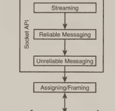

图 3.1  

`Sockets` API 提供不同级别的可靠消息。

## 基本网络数据报

如果你能实际看到比特从一个计算机传输到另一个计算机，你会看到什么？每个协议都不同，但它们都共享一个必要的共同特征：它们都携带程序的消息。有些协议包含源地址，而有些则要求目的地址。你可能认为不要求目的地址有点不寻常，但有些协议（如 `UDP`）使用连接作为目的地址。

互联网协议（`IP`）（`RFC791`）要求数据报具有三个基本元素：源、目的和数据。（数据负载包括其长度。）这些元素为数据报提供了一定程度的自主性。无论数据报在哪里，你都可以识别它的来源、去向以及大小。

数据报的自主性是互联网的一个重要特性。只要数据报是*活跃的*（数据是及时且相关的），当数据报被发送到网络上时，路由器可以将数据移动到其目的地。

## 数据报别名

数据报的自主性也有缺点。虽然数据报提供了一种从任何地方到任何地方的途径，但恶意程序员可以轻松地欺骗网络。网络不要求验证源主机的地址。对硬件地址进行*别名或伪造*（掩盖真实身份并假设不同的身份）是困难的，但程序可以伪造其他 `ID`。请注意，后来的 `Linux` 内核不允许伪造。

正如第 2 章“`TCP/IP` 网络语言流畅性”中所述，网络数据报采用网络字节序（或大端序）。考虑到这一点，请查看代码清单 3.1 中关于网络数据报外观的结构定义，图 3.2 展示了物理布局。

### 代码清单 3.1 `IP` 结构定义

```c
/**** IP Packet definition                          ***/
/****   ***********  *   *    ***   ******  **     */

	typedef unsigned int uint;
	typedef unsigned char uchar;

	struct ip_packet {
	int  version:4;   /* 4-bit version [note] */
	int  header_len:4; /* header length in words [note] */
	int  serve_type:8; /* how to service packet [note] */
	int  packet_len:16;/* total size of packet in bytes */
	int  packet_ID:16; /* packet ID [note] */
	int  __reserved:1; /* always zero */
	int  dont_frag:1;  /* flag to permit fragmentation */
	int  more_frags:1; /* flag for "more frags to follow" */
	int  frag_offset:13;/* to help reassembly */
	int  time_to_live:8;/* permitted router hop cnt [note] */
	int  protocol:8;   /* ICMP, UDP, TCP [note] */
	... 
	uint hdr_chksum:16;  /* ones-comp. checksum of header */
	uint IPv4_source:32;  /* IP address of originator */
	uint IPv4_dest:32;    /* IP address of destination */
	uchar options[];      /* up to 40 bytes [note] */
	uchar data[];         /* message data up to 64KB [note] */
	};
```

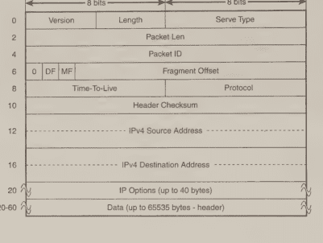

图 3.2  

`IP` 头部布局

请注意，数据报结构包含比本章前面讨论的基本四个字段更多的字段。`IP` 子系统使用这些额外字段来控制数据报。例如，`dont_frag` 字段告诉网络，不要将消息切割成较小的块，而是应该完全接收消息或丢弃它。

大多数字段足够简单，旁边的注释提供了足够的描述。剩下的字段需要更长的描述。以下部分定义了你可以修改或使用的 `IP` 字段。本文并非详尽无遗；如果你想深入了解每个字段，请参阅有关 `TCP/IP` 协议的良好文本。

### `version` 字段

第一个 `IP` 字段是 `IP` 协议版本的版本号。大多数值是保留或未分配的；例如，`IPv4` 在此字段中放置 4。少数定义的值列在表 3.1 中。

表 3.1 `version` 字段值

| 值 | 描述/用途 |
|---|---|
| 4 | `IPv4` |


| 5 | 流式 IP 数据报模式（实验性 IP） |
| 6 | IPv6 |
| 7 | TP/IX（“下一个”互联网协议） |
| 8 | “P”互联网协议 |
| 9 | TUBA |

你唯一有机会填充此字段是在创建原始套接字*并且*选择自己填充头部时（使用套接字选项 `IP_HDRINCL`）。即使在那种情况下，你也可以将字段设置为 `0`。零会标记内核为你填充适当的值。

### `header_len` 字段

此字段告诉接收方头部长度（以 32 位字为单位）。由于值 `0` 是保留的（且无意义），最大长度为 15 个字或 60 字节。同样，你填充此字段的唯一情况是原始套接字数据包和 `IP_HDRINCL`。由于所有 IP 头部至少为 20 字节，此字段的最小值为 5（20/4）字节。

### `serve_type` 字段

`serve_type` 字段表示如何管理数据报。它有两个子字段：一个*优先级*子字段（在大多数系统中被忽略）和一个*服务类型*（`TOS`）子字段。通常使用 `setsockopt()` 系统调用设置 `TOS`。`TOS` 有四个选项：最小延迟、最大吞吐量、最大可靠性和最低成本（货币）。不选择特殊服务意味着正常管理。（有关 `setsockopt()` 及其值的详细信息，请参阅第 9 章“打破性能壁垒”。）

### `ID` 字段

IP 子系统为每个数据报分配一个唯一的 `ID`。使用仅 16 位的字段，你可以想象数字很快就会用完。然而，当 IP 子系统重新使用一个 `ID` 时，具有相同值的先前数据报可能已经过期。

`ID` 有助于重组碎片化的数据报。如果你选择管理头部（`IP_HDRINCL`），你必须自己管理 `ID`。


### `dont_frag`, `more_frags`, `frag_offset` 标志和字段

这些标志管理你的数据报如何（或是否）进行碎片化。如果在遍历网络过程中，一个长数据报必须通过一个受限的网络段（无法支持帧大小的段），路由器可能会尝试将数据报分割成较小的部分（*碎片化*）。碎片化的数据报在到达目的地之前保持碎片化状态。由于每个碎片都添加自己的 IP 头部，开销会减少性能。

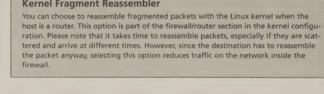

`dont_frag` 位告诉路由器或主机不要拆分数据报。如果你设置此位，而数据报对于受限网络段来说太大，路由器将丢弃数据报并返回一个错误（`ICMP`）数据报。

`more_frags` 位告诉目的地期望更多碎片化数据报的部件。最后一个碎片将此位置为 `0`。（非碎片化数据报将此位置为 `0`。）如果你正在手动配置头部，请始终将此位置为 `0`。

`frag_offset` 字段指示碎片在数据报中的位置。因为数据报碎片可能通过网络的不同路径传输，它们可能在不同时间到达。目的地必须重组数据报，并使用偏移量将碎片放置在正确的位置。

`frag_offset` 字段仅 13 位长——对于最大可达 64KB 的数据报来说太短了。偏移量乘以 8 以在数据报中放置实际的字节位置。这意味着每个碎片（最后一个除外）必须是 8 的倍数。IP 子系统完全管理你的数据报的碎片化和重组；你不需要担心它。

利用这些字段和数据包 `ID`，IP 子系统可以对你发送的数据包进行分片和重组。如果子系统无法在指定时间内收集到所有片段，它将丢弃该数据包，并向发送方发送一个错误。

## 生存时间 (`TTL`) 字段

此字段最初用于计算数据包在传输过程中能在网络中存活多少秒。后来，其含义变更为路由器跳数。一跳是指数据包通过一个主机或路由器（节点）从一个网络移动到另一个网络的过程，且该节点主动执行此移动操作。

这个 8 位字段允许数据包在丢弃之前最多经过 255 次路由器跳转。当路由器或转发主机接收到数据包时，会将此字段减一。如果数据包到达目的地之前该字段的值变为零，该节点将丢弃数据包并向源地址发送错误。`TTL` 字段防止数据包在网络中无限期地来回传输。

使用 `IP_TTL` 套接字选项来设置此值（参见第 9 章）。或者，如果你选择直接操作 IP 头部（`IP_HDRINCL`），也可以直接设置它。

## 协议字段

互联网上的每个数据包都被分配了一个协议值，`ICMP`（`IPPROTO_ICMP` 或 `1`）、`UDP`（`IPPROTO_UDP` 或 `17`）和 `TCP`（`IPPROTO_TCP` 或 `6`）各自拥有一个代码。协议告诉系统如何处理传入的数据包。你可以在 `socket()` 系统调用中通过 `SOCK_RAW` 选项来设置此值。协议值是该调用的最后一个参数。内核的 `netinet/in.h` 头文件列出了更多协议。（请记住，即使内核包含某个协议的定义，它也不一定支持该协议。）

## 选项字段

IP 子系统可以为每个数据包传递多个选项。这些选项包括路由信息、时间戳、安全措施、路由记录和路由警报。此字段最长可达 40 字节。由于某些选项依赖于系统，你不太可能需要直接处理这些选项。

## 数据字段

你的消息将放在这里，最多可包含 65,535 字节（减去 60 字节，即头部的最大尺寸）。数据部分包括高层协议所需的任何头部信息。例如，`ICMP` 需要 4 字节，`UDP` 需要 8 字节，而 `TCP` 需要 20–60 字节。

互联网数据包系统基于此结构构建所有其 `IPv4` 数据包。在此之上的每一层都增加了特性和可靠性。


## 剖析各种数据包

互联网协议提供了几种数据包协议，范围从极快至极可靠。它们都建立在最底层——基本 IP 数据包之上。然而，每一层的发展都是为了解决特定的问题。为了选择正确的数据包类型，你必须了解你正在传输的内容。

最值得关注的数据包类型是 `TCP`、`UDP`、`ICMP` 和原始（`raw`）。了解每种类型的优缺点有助于你为应用程序选择最合适的一种。每种数据包类型都有不同的优势，如表 3.2 所示。

表 3.2 数据包类型优势

| | 原始 | ICMP | UDP | TCP |
| --- | --- | --- | --- | --- |
| 开销（字节） | 20~60 | 20~60+[4] | 20~60+[8] | 20~60 +[20~60] |
| 消息大小（字节） | 65,535 | 65,535 | 65,535 | (无限) |
| 可靠性 | 低 | 低 | 低 | 高 |
| 消息类型 | 数据报 | 数据报 | 数据报 | 流 |
| 吞吐量 | 高 | 高 | 中 | 低 |
| 数据完整性 | 低 | 低 | 中 | 高 |
| 分片 | 是 | 是 | 是 | 低 |

在此表中，请注意每种数据包类型都包含比较值。可靠性为“低”仅意味着你不能依赖该协议来保障可靠性。尽管这些差异看起来可能很极端，但请记住它们仅仅是一种相对比较。

## 考虑数据包的问题

每个协议都解决了传输中的某些问题。以下章节定义了表 3.2 中的每个问题及其相关类别。这些信息可以帮助你理解为何某些协议实现了某些功能而省略了其他功能。

## 协议开销

协议开销既包括头部的字节大小，也包括协议所需的交互量。较高的数据包开销会降低吞吐量，因为网络需要花费更多时间传输头部，从而减少阅读数据的时间。

强大的协议同步和握手会增加交互开销。由于传播延迟的存在，这在广域网（WANs）上代价更高。表 3.2 未包含此度量。

## 协议消息大小

要计算网络吞吐量，你需要知道数据包大小和协议开销。传输大小决定了发送消息的最大尺寸。由于所有 `TCP` 使用单次消息传输，此限制通常受限于 IP 数据包的极限（65,535 字节）。你的程序每个数据包传输的数据量等于传输大小减去头部大小。

## 协议可靠性

网络问题之一是消息丢失的可能性。当消息从一个主机或路由器移动到另一个主机或路由器时，可能会损坏或丢弃，或者主机或路由器可能会崩溃或故障。在这些情况下，消息可能直接丢失，你的程序可能需要后续跟进。

此外，你还需要确保目的地按正确顺序处理数据包。例如，你构建的消息可能无法装入一个数据包中。如果第二个数据包先于第一个到达，接收方必须知道如何识别并纠正此问题。然而，当每个消息都是独立且自包含的时，顺序并不重要。

数据包的可靠性表明了消息安全到达及其顺序的确定性。低可靠性意味着协议无法保证数据包到达目的地或数据包按顺序排列。

## 协议消息类型

有些消息是自包含且独立于其他消息的。图片、文档、电子邮件消息等是一些可能符合数据包尺寸限制的示例。其他消息则更像流动的流，例如 `Telnet` 会话、`HTTP` 的开放通道 `[RFC2616]`、大文档、图片 or 文件。消息类型定义了哪种风格最适合每个协议。


### `HTTP` 的协议

`HTTP 1.0` 可以有效地使用 `UDP` 来传输消息，而不使用 `TCP`。客户端只需发送对特定文档的请求，服务器则以该文件作为响应。实际上，客户端和服务器之间没有发生对话。

## 协议吞吐量


数据传输中最显著的一个方面是网络吞吐量。最大限度地利用网络是让用户满意的最佳方式。要获得最佳性能，你需要了解吞吐量。通常，每秒比特数（bits-per-second）只是整个方程的一部分；它仅指示网络在理想情况下可能表现如何。

协议吞吐量衡量的是源发送方在一段时间内能向目的地发送多少真实数据。如果头部很大而数据很小，结果就是低吞吐量。要求对每条消息进行确认会显著降低吞吐量。默认情况下，高可靠性和完整性会导致低吞吐量，反之亦然。

## 协议数据完整性

目前的网络技术在数据完整性方面有很多保障措施。一些网络接口为每个低层消息包含校验和或循环冗余校验（`CRC`）。它们还包含特殊的硬件技术，可以过滤噪声并获取真实消息。此外，每个协议都包含检测数据错误的措施。这些错误对你来说可能重要也可能不重要。

数据完整性的重要性取决于数据本身；也就是说，有些数据需要非常仔细的监督，而不太重要的数据则没那么关键。以下是一些数据类型：

- **容错性低**—生命关键数据。任何可能影响公共或私人健康/生命的数据。例如，来自医疗设备的生命体征和导弹发射命令。
- **关键**—重要且可靠的数据。如果顺序错误或有故障，可能会损害财产或安全的数据。例如，金融交易、信用卡、`PIN` 码、数字签名、电子货币、商业机密、病毒扫描器更新和产品更新。
- **重要**—需要正常功能的数据。任何丢失都可能导致故障。例如，`X11` 连接、`FTP` 下载、`Web` 页面、服务器/路由器地址和 `Telnet` 连接。
- **信息性**—对于正常功能而言，可靠性可以低于 100% 的数据。例如，电子邮件、新闻源、广告和 `Web` 页面。
- **时效性**—受日期/时间约束的数据。除非程序在特定时间内使用该信息，否则其重要性会降低。例如，天气数据、监控数据和时间。
- **允许有损**—可以降级而不失去实用性的数据。这些通常是音频或视频。例如，电影、音频文件、照片和垃圾邮件（当然）。

在选择数据包类型或协议之前，尝试根据此列表对数据进行分类。还包括程序的其他（或外部）约束。这些约束可能包括法规约束。

## 协议分片

在慢速网络上，大型消息可能会让其他用户感到困扰。所有网络都设置了最大帧大小，以避免这些大型消息主导网络。请记住，路由主机仍可能对经过拥塞网络的较大消息进行切片或分片。

每种协议产生分片的概率不同。由于重组分片消息是 `IP` 的一部分，因此重组过程对上层协议可能是透明的。然而，某些情况下可能需要包的传输者关注。这对网络性能尤为重要。当路由器将数据包切割成较小的块时，路由器需要花费时间来切分消息，并且由此产生的数据包开销会增加。通过阻止分片，网络会丢弃该数据包并向你的程序返回“消息过大”错误。

## 数据包类型

以下各节将描述每种数据包，并展示其统计数据和报头定义（如果存在）。每一节都采用快速参考风格，帮助你快速了解每种协议的特性。使用此风格有助于你为应用选择合适的数据包类型。

### 原始数据包

原始数据包可以访问 `IP` 数据包及其报头。它在编写特殊或自定义协议时非常有用。其属性列于表 3.3。

**表 3.3 原始数据包属性**

| 属性 | 值 |
| :--- | :--- |
| 消息大小（字节） | 65,535（最大数据载荷为 65,515） |
| 开销（字节） | 20~60 |
| 可靠性 | 低（网络可能丢弃或重新排序数据包） |
| 消息类型 | 数据报 |
| 吞吐量 | 高（系统开销低） |
| 数据完整性 | 低（系统不验证消息） |
| 分片 | 是 |

`Linux` 提供了处理互联网协议栈中不同层的选项（关于各层和 `IP` 堆栈的完整定义，请参阅第 5 章“理解网络分层模型”）。最基本的 `TCP/IP` 消息是原始 `IP` 消息。除了最基本的信息外，它不包含其他任何信息。

你可以使用 `IP` 数据包本身来创建最基本的层，从而构建自己的自定义协议。通过在选择套接字系统时选择 `SOCK_RAW` 来访问 `IP` 数据包。出于安全考虑，必须以 `root` 权限运行原始套接字程序。

原始套接字允许你操作 `IP` 数据包的核心。你可以配置套接字以在两个详细程度层级上工作：仅数据操作或数据和报头操作。数据操作类似于 `UDP` 数据传输，但不支持端口。相比之下，报头操作允许你直接设置报头字段。

使用此消息既有优点也有缺点。作为数据报消息，它不提供到达或数据完整性的保证。然而，你可以以接近网络速度的方式发送和接收消息。有关原始数据包操作的更多信息，请参阅第 18 章“原始套接字的力量”。

### IP 控制与错误消息（ICMP）

互联网控制消息协议（`ICMP`）是构建在基本 `IP` 数据包之上的层之一。所有联网计算机（主机、客户端、服务器和路由器）都使用 `ICMP` 发送控制或错误消息。它用于发送错误或控制消息。一些用户程序也使用此协议，例如 `traceroute` 和 `ping`。`ICMP` 的属性列于表 3.4。

**表 3.4 ICMP 属性**

| 属性 | 值 |
| :--- | :--- |
| 消息大小（字节） | 65,535（最大数据载荷为 65,511） |
| 开销（字节） | 24~64 |
| 可靠性 | 低（与原始 IP 相同） |
| 消息类型 | 数据报 |
| 吞吐量 | 高（与原始 IP 相同） |
| 数据完整性 | 低（与原始 IP 相同） |
| 分片 | 是（但不太可能发生） |

如果在你的程序中采用了 `ICMP`，你可以重用套接字向不同的主机发送消息，而无需重新打开套接字。使用 `sendmsg()` 或 `sendto()` 系统调用发送消息（将在下一章描述）。这些调用需要目标地址。使用单个套接字，你可以向任意数量的对等点发送消息。

`ICMP` 数据包的优缺点基本上与原始 `IP`（及其他数据报）相同。然而，该数据包包含用于数据验证的校验和。此外，网络对 `ICMP` 数据包进行分片的可能性极小。原因在于 `ICMP` 消息的性质：它们用于状态、错误或控制。消息不会非常大，因此可能永远不需要重组。

虽然你可以使用 `ICMP` 发送自己的消息，但它通常用于错误消息和控制。所有网络错误都通过 `ICMP` 数据包在网络中传输。该数据包包含一个保存错误代码的报头，数据部分可能包含描述错误的更具体消息。

作为 `IP` 协议的一部分，`ICMP` 获得一个 `IP` 报头并添加自己的报头。清单 3.2 显示了结构定义。

**清单 3.2 ICMP 结构定义**

```c
/*** structure definition ***
/*** ICMP structure definition ***/
/*** Formal definition in netinet/ip_icmp.h */***/
typedef unsigned char u18;
typedef unsigned short int u16;

struct ICMP_header {
    u18 type;       /* Error type */
    u18 code;       /* Error code */
    u16 checksum;   /* Message checksum */
    uchar msg[1];   /* Additional data description */
};
```

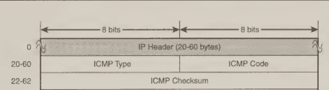

**图 3.3 ICMP 布局。**

`type`（类型）和 `code`（代码）定义了发生什么错误。`msg`（消息）可以是任何有助于详细说明出错原因的其他信息。完整的类型和代码列表请参阅附录 A。

### 用户数据报协议（UDP）

用户数据报协议（`UDP`）主要用于无连接（独立消息）通信。它可以在不创建新套接字的情况下向不同目的地发送消息，并且是目前最常见的无连接协议。`UDP` 的属性列于表 3.5。

**表 3.5 UDP 属性**

| 属性 | 值 |
| :--- | :--- |
| 消息大小（字节） | 65,535（最大数据载荷为 65,507） |
| 开销（字节） | 28–68 |
| 可靠性 | 低 |
| 消息类型 | 一次性（单发） |
| 吞吐量 | 中等 |
| 数据完整性 | 中等 |
| 分片 | 是 |

`IP` 堆栈中的每一上层都更加关注数据，而较少关注网络。`UDP` 隐藏了关于错误消息和内核如何传输消息的一些细节。此外，它会重组分片消息。

你通过 `UDP` 发送的消息类似于电子邮件消息：目的地、来源和数据是所有需要的信息。内核接管消息并将其放入网络，但不验证其到达情况。与 `ICMP` 数据包一样，你可以使用不同的发送系统调用，从单个套接字向多个目的地发送消息。然而，由于没有验证，你可以获得接近最大值的吞吐量。

由于没有到达验证，网络可能会失去数据可靠性。网络可能会丢失数据包或分片，并损坏消息。使用 `UDP` 的程序要么自己跟踪消息，要么不在乎某些内容丢失或损坏。（请注意，虽然数据报不可靠，但这并不意味着一定会有问题。这仅意味着该协议不作任何保证。）


在不同的数据类型（前文定义）中，信息型、时间型和易失型最适合 `UDP` 服务。主要原因是它们对丢失的容忍度。如果你的网络摄像头未能更新每个客户端，最终用户不太可能注意到或在意。另一个可能的应用是正确的时服务。因为正确的时间是时间型的，主机可能会丢弃几个时钟滴答而不丧失完整性。

`UDP` 具有高速度的优势。此外，你可以通过以下方式自行提高其可靠性：

- 拆分大型数据包。将每条消息分成几个部分并分配一个编号（例如 5 中的第 2 个）。另一端对等点重组消息。请记住，更多的开销和更少的发送数据会降低吞吐量。
- 跟踪每个数据包。为每个数据包分配一个唯一编号。强制对等点确认每个数据包，因为没有确认时，你的程序将重发上一条消息。如果对等点未收到预期数据包，它会请求重发带有最后一条消息编号的内容，或发送重启消息。

## 可靠的数据传输

- 添加校验和或 `CRC`（循环冗余校验）。通过数据求和来验证每个数据包的数据。`CRC` 比校验和更可靠，但校验和更容易计算。如果对端发现数据损坏，它会要求你的程序重新发送消息。
- 使用超时。你可以将超时的到期视为失败。你的发送方可以重新传输消息，而你的接收方可以向发送方发送提醒。

关键和重要数据类型需要 `TCP` 或更高级别的可靠性。容错性需要比这些协议提供的可靠性高出许多。上述步骤模仿了 `TCP` 的可靠性。

`UDP` 依赖于 `IP` 的功能和服务。每个 `UDP` 数据报包都会接收一个 `IP` 头和一个 `UDP` 头。列表 3.3 定义了 `UDP` 结构的外观。

### 列表 3.3 `UDP` 结构定义

```
/*********************************************************/
/*** UDP (datagram) structure definition ***
/*** (Formal definition in netinet/udp.h) ***/
/*********************************************************/
typedef unsigned char u8;
typedef unsigned short int u16;

struct UDP_header {
    u16 src_port;      /* Originator's port number */
    u16 dst_port;      /* Destination's port number */
    u16 length;        /* Message length */
    u16 checksum;      /* Message checksum */
    uchar data[];      /* Data message */
};
```


图 3.4 `UDP` 布局。

`UDP` 通过端口的形式为每条消息创建一个虚拟网络插座。通过端口，`IP` 可以快速将消息分发给正确的所有者。即使你没有使用 `bind()` 定义端口，`IP` 子系统也会为你从临时端口列表中创建一个临时端口（见第 2 章）。

## 传输控制协议 (`TCP`)

传输控制协议 (`TCP`) 是互联网上最常用的套接字协议。它可以 `read()` 和 `write()`，并且需要为每个连接重新创建套接字。`TCP` 的属性列在表 3.6 中。

**表 3.6 `TCP` 属性**

| 属性 | 描述 |
|-----------|-------------|
| 消息大小（字节） | （无限制） |
| 开销（字节） | 40–120 |
| 可靠性 | 高（检查数据接收） |
| 消息类型 | 流 |
| 吞吐量 | 低（与其他协议相比） |
| 数据完整性 | 高（包括校验和） |
| 分片 | 不太可能 |

将可靠性向前推进一步，需要确保目的地接收到发送方发送的确切消息。`UDP` 具有速度，但不具有许多程序所需的可靠性。`TCP` 解决了可靠性问题。

然而，网络存在几个使其不可靠的根本问题。这些问题不是限制。相反，它们是网络设计中固有的。为了通过错综复杂的网络获得可靠的可流式消息，`TCP/IP` 必须纳入在 `UDP` 部分中建议的许多提高可靠性的想法。互联网有三道障碍：动态连接、数据丢失和受限路径，如下文各节所述。

## 动态连接

一个主机向另一个主机发送消息。该消息通过网络传输，经过各种路由器和网关。发送的每条消息都可能使用不同的路径。网络段（计算机之间的连接）随着服务器的启动和关闭而出现和消失。互联网的强大之处在于其能够适应这些变化并相应地路由信息。

适应性是推动互联网发展的动力之一。你的计算机可以发出请求，网络会尝试可能的途径来填充订单。不幸的是，这种优势意味着你的计算机和服务器或对等点之间的路径可能会改变，从而拉长或缩短距离。

随着路径变长，传播时间增加。这意味着你的程序可能会连续发送消息，许多消息会在不同的时间到达，通常顺序颠倒。

`TCP` 确保在发送下一条消息之前，目的地已正确接收到最后一条消息。将其与一系列编号消息进行比较（这才是 `TCP` 实际工作方式）。你的程序可能连续发送 10 条消息。`TCP` 接收每条消息，附加一个唯一编号，然后发送它。目的地接受该消息并回复确认。在收到确认后，`TCP` 允许你的程序发送下一条消息。

## 滑动窗口协议

`TCP` 使用比发送/等待（或 `ACK/NACK`）协议更好的技术，后者对任何人的耐心来说都太慢了。相反，它使用滑动窗口：它衡量何时以及多久回复一次 `ACK`。较慢或较脏的连接可能会增加确认消息。更快且丢失更少的连接允许在期望确认之前发送更多消息。这是纳格算法（`Nagle Algorithm`）的一部分。你可以使用套接字选项禁用此功能（见第 9 章）。

## 数据丢失

当目的地收到你的消息时，它会确定数据的完整性。数据可能沿着次优的通信路径传输，这些路径可能会丢弃或损坏消息位。请记住，网络一次发送一位消息。`TCP` 随消息发送一个校验和以验证数据。`TCP` 是能够检测和修复损坏数据的最后一层。

如果目的地检测到任何错误，它会发回一个错误，要求你的程序重新传输。同样，如果你的计算机在特定时间内未收到确认，`TCP` 子系统会自动重新发送消息，而无需你的程序介入。

## 受限路径

回到发送给特定主机的单条消息，假设该消息对于中间段来说太长了。随着数据包通过网络传递，遇到的问题是不同的技术和传输载体。一些联网的计算机允许较长的数据包；其他则对大小施加限制。

`UDP` 试图发送其能发送的最大消息。这在受限的数据路径中可能是一个问题。`IP` 算法预期路由器可能会分片数据。同样，`IP` 期望它必须重新组装传入的消息。

另一方面，`TCP` 将每个数据包限制在小块中。`TCP` 在网络有机会接触更长的消息之前就将其拆分。`TCP` 选择的大小是大多数网络可以完整接受的大小。默认情况下，`TCP` 使用 536 字节，通常协商至 1,500。要手动增加该大小，请设置 `MSS`（最大分段大小）`TCP` 套接字选项（见第 9 章）。

接收方可能会发现消息的数据包顺序错误。`TCP` 在将消息交给你的程序之前重新排序它们。

解决所有这些网络问题会为 `TCP` 的算法增加协议和头部开销。当然，所有 `TCP` 技术增加的开销会明显降低性能。

## `TCP` 头部定义

`TCP` 必须在头部添加大量信息以支持它向你提供的所有功能。`TCP` 头部的大小（以字节为单位）大约是 `UDP` 头部的三倍。有关结构的定义，请参见列表 3.4。

### 列表 3.4 `TCP` 结构定义


```c
/*************************************************************************/
/*** TCP (streaming socket) structure definition ***/
/*** (Formal definition in netinet/tcp.h) ***/
/*************************************************************************/
typedef unsigned char ui8;
typedef unsigned short int ui16;
typedef unsigned int ui32;
typedef unsigned int uint;

struct TCP_header {
    ui16 src_port; /* Originator’s port number */
    ui16 dst_port; /* Destination’s port number */
    ui32 seq_num; /* Sequence number */
    ui32 ack_num; /* Acknowledgement number */
    uint data_off:4; /* Data offset */
    uint __res:6; /* (reserved) */
    uint urg_flag:1; /* Urgent, out-of-band message */
    uint ack_flag:1; /* Acknowledgement field valid */
    uint psh_flag:1; /* Immediately push message to process */
    uint rst_flag:1; /* Reset connection due to errors */
    uint syn_flag:1; /* Open virtual connection (pipe) */
    uint fin_flag:1; /* Close connection */
    ui16 window; /* How many bytes receiver allows */
    ui16 checksum; /* Message checksum */
    ui16 urg_pos; /* Last byte of an urgent message */
};
```

## 3. TCP 头部结构

```c
u8 options[];  /* TCP 选项 */
u8 _padding[]; /* (用于对齐 data[]) 所需的填充) */
uchar data[];   /* 数据消息 */
};
```

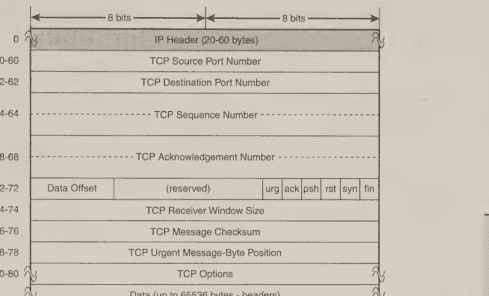

### 图 3.5

**TCP 布局。**

头部的大小可能是可变的，因此 `data_off` 字段指向数据的开始位置。为了节省头部空间，该字段的作用类似于 IP 的 `header_len` 字段：它给出了在物理上位于数据之前的 32 位字的计数。

TCP 使用某些字段专门用于建立连接、流量控制和连接关闭。在通信会话期间，头部的部分内容可能是空的。以下段落描述了一些有趣的字段。

TCP 头部使用与 UDP 相同的端口号。但 `seq_num` 和 `ack_num` 提供了对数据流的追踪能力。当你发送一条消息时，IP 子系统会附加一个序列号 (`seq_num`)。接收方会通过确认号 (`ack_num`) 回复其已收到该消息，该确认号比序列号大 1。这一特性使得确认包也可以携带数据。

## 查看 TCP 交互

当你打开一个流式连接时，你的程序和服务器将交换表 3.6 中列出的消息。

### 表 3.6 三次握手

| 客户端发送 | 服务器发送 | 描述 |
| :--- | :--- | :--- |
| `SYN=1` (`syn_flag`)<br>`ACK=0` (`ack_flag`) | | 请求一个虚拟连接（管道）。 |
| | `SYN=1` (`syn_flag`) | 设置序列号。 |
| | | 允许并确认一个虚拟连接。 |
| `ACK=1` (`ack_flag`)<br>`SYN=0` (`syn_flag`)<br>`ACK=1` (`ack_flag`) | | 建立虚拟连接。 |

这被称为*三次握手*。在传输过程中，客户端和服务器指定其接收缓冲区（窗口）的大小。

另一方面，关闭连接并不像表面上看起来那么简单，因为可能仍有数据在传输中。当你的客户端关闭连接时，可能会发生表 3.7 中所示的交互。

### 表 3.7 TCP 连接关闭

| 客户端 | 服务器 | 描述 |
| :--- | :--- | :--- |
| `FIN=1` (`fin_flag`) | 发送数据 | 客户端请求关闭。 |
| | 接收数据 | |
| `ACK=1` | 发送更多<br>接收更多 | 服务器通道已清空。 |
| `ACK=1` | `FIN=1` | 接受关闭。服务器关闭并等待客户端 `ACK`。 |
| `ACK=1` | | 客户端关闭其一侧。 |

关闭 TCP 连接使得无法将该套接字复用于其他连接。例如，如果你连接到一个服务器，断开该连接的唯一方法是关闭该通道，这同时也关闭了套接字。如果你想连接到另一个服务器，你必须创建一个新的套接字。其他协议没有这种限制。

## IP 协议如何协同工作

在与网络交互时，你可能会想知道所有这些协议是如何协同工作的。在某些情况下，它们似乎完全无法协同工作。它们确实使用了彼此的一些特性，但它们并不是紧密协作到密不可分的程度。

原始 IP、ICMP、UDP 和 TCP 协议各自承担特定的角色。在设计网络应用程序时，你可以根据这些角色来满足你的需求。当然，虽然 TCP 比其他协议具有更多的可靠性和特性，但你不能用 TCP 来替代 ICMP。因为 Linux 子系统需要 TCP/IP 的不同特性，所以每种数据包类型对于系统的正确运行都是重要的。

ICMP、UDP 和 TCP 数据包在物理上依赖于原始 IP 数据包。它们的头部和数据位于 IP 数据部分中，紧跟在 IP 头部之后。

## 使用 Tcpdump 嗅探网络

观察活动网络上的数据包可以有效地展示内核如何处理消息以及网络子系统如何解决地址请求。从原始 IP 数据包到 TCP，`tcpdump` 是一个显示网络上数据的工具。出于安全考虑，你需要 `root` 权限才能运行 `tcpdump`。

默认情况下，`tcpdump` 使用混杂模式，这样你可以看到网络上的所有内容。混杂模式直接操纵硬件接口，以接受所有消息。

### 网络伦理的平衡

知道如何做很多事情是非常强大的，但也伴随着巨大的责任。

拥有 `root` 权限，你可以对网络做出许多好事，也可以造成许多伤害。当你在计算机上安装 Linux 时，发行版假设你与那些赋予你嗅探他人数据包能力的人一样怀有好的意图。破坏自由软件运动的一个有效方式就是滥用其他善良且意图良好的人赋予你的权力和信任。

通常，硬件接口适配器只拾取它从以太网地址识别出的那些消息。回想第 2 章的内容，每个以太网硬件适配器都有一个唯一的 6 字节 ID。适配器使用此 ID 来忽略所有不匹配该 ID 的数据包。


## 可编程以太网 ID

一些 OEM（原始设备制造商）提供支持可编程 MAC 地址（或以太网 ID）的网络接口卡（PCI 或 PCMCIA）。这使得少数卡片制造商能够实现大规模生产，同时服务于数百个名牌公司。不幸的是，你可能会获得一张拥有虚假 ID 的卡，因为名牌公司没有正确编程。这个错误可能导致你的卡在网络中不唯一。

如果你不希望处于混杂模式，可以使用其中一个选项将其关闭。`tcpdump` 有许多选项，可以帮助你过滤掉不需要的消息，选择显示的数据以及数据重定向。以下是一些有趣的命令行选项：

- **`-a`**

  尝试为网络和广播地址分配名称。这需要访问名称服务器。

- **`-c <count>`**

  在获取指定数量的消息后停止。

- **`-n`**

  不将节点地址转换为其名称（当你没有名称服务器时这很有用）。

- **`-p`**

  不将接口置于混杂模式。如果你有一个小型网络或集群，查看所有数据包可能会很有趣。否则，启用混杂模式可能会轻松让你的计算机不堪重负。

- **`-v`**

  打印稍详细的转储。这包括生存时间 (TTL) 字段。

- **`-vv`**

  在转储中打印更多详细信息。

- **`-w <file>`**

  将原始数据包写入文件。

`tcpdump` 可以不带任何选项运行，并显示你所需的大多数信息。你还可以看到有趣的交互，例如 ARP（地址解析协议）请求并从 IP 地址获取以太网 ID。这是一个捕获 100 个详细数据包而不带时间戳的示例：

```bash
tcpdump -v -t -c 100
```

`-t` 选项会抑制时间戳。由于消息通常会很快滚屏，你可能希望将结果重定向到文件。


Tcpdump确实存在一些异常；例如，它不会拾取发给自己的消息。它看不到来自`ping 127.0.0.1`的数据包，因为网络子系统不会将这些消息发送到`tcpdump`挂钩所在的较低协议层。

## 编写自定义网络嗅探器

`tcpdump`是如何工作的？你可以阅读冗长的开源程序，或者编写自己的网络嗅探器（某种意义上的`tcpdump`）。你唯一需要知道的是如何捕获主机的任何和所有消息。本节描述的工具帮助你编写一个网络嗅探器，该嗅探器解析发给主机的数据包。然而，它不支持混杂模式。

为了安全（就像`tcpdump`一样），你需要`root`权限才能运行网络嗅探器。嗅探器捕获所有发往你计算机的消息。为了获取所有消息，你使用以下调用：

```c
sd = socket(PF_INET, SOCK_PACKET, filter);    
bytes_read = recvfrom(sd, buffer, sizeof(buffer), 0, 0, 0);
```

注意新的套接字类型：`SOCK_PACKET`。这是一个只读的硬件级套接字。

你可以使用几种过滤器用于`SOCK_PACKET`。过滤器告诉`IP`层你想捕获哪种类型的数据包。其中一些过滤器是

- `ETH_P_B02_3`: 802.3 帧
- `ETH_P_AX25`: AX.25 帧
- `ETH_P_ALL`: 所有帧（小心！）
- `ETH_P_B02_2`: 802.2 帧

要使用的过滤器是`ETH_P_ALL`。正如注释所示，要小心使用这个过滤器，因为选择它时，它会给你所有内容。结果调用是

```c
sd = socket(PF_INET, SOCK_PACKET, ETH_P_ALL);
```

成功完成调用后，你执行的每个`recvfrom()`系统调用都会返回一个网络帧（物理网络消息）。网络帧包括硬件地址（例如以太网地址）和头部。

`SOCK_PACKET`提供了对硬件级帧以及每次传输相关数据的访问。借助它，你可以看到网络子系统如何构建帧。

你可以使用本章开头定义的`IP`结构。然而，请记住存储是依赖于硬件的，因此字段可能处于错误的顺序。该结构假设位#0是帧流中的第一位。

网站上的程序示例`snooper.c`重新排列了字段，以匹配小端处理器（Intel 兼容）和`GNU`编译器的实际硬件帧。如果你使用不同的处理器（甚至不同的编译器），你可能需要调整该结构。

## 总结：选择最佳数据包来发送消息

你可以使用`tcpdump`和监听器（`snooper`）来打印你的计算机发送和接收的各种类型的数据包。就`IP`而言，这些数据包可以是原始`IP`数据包、`ICMP`错误消息包、`UDP`数据报或`TCP`流消息。每种数据包类型都扮演着特定的角色，同时为扩展留下了充足的空间。

每个数据包都有自己的头部。`ICMP`、`UDP`和`TCP`将其头部附加在`IP`头部之后。分配给这些头部的总大小范围从 20 字节到 120 字节不等。头部与实际数据之间的平衡会影响网络吞吐量。

由于头部与数据之比最大，`TCP`的吞吐量最低。因为它提供了两台计算机之间最可靠的通信，所以它是互联网上使用最广泛的协议。`TCP`提供了一个流式接口，允许你使用更高级的库`I/O`函数，例如`fprintf()`和`fgets()`。

你可以使用`UDP`向不同的主机发送单个消息而无需重新连接。它通过端口对网络进行虚拟化，使得你的连接看起来似乎拥有网络的独占访问权。`UDP`提供了良好的吞吐量，但传输不可靠。

最常用的协议是`TCP`，因为其可靠性。`UDP`紧随其后。当今的网络已经不再尝试使用非常低层级的数据包和接口，而是转向发送消息。性能的重要性不如可靠性，但用户仍然关注性能问题。

## 在同行之间发送消息

## 本章内容

- 什么是基于连接的套接字？ 72
- 示例：连接到`HTTP`守护进程 76
- 什么是无连接的套接字？ 78
- 发送直接消息 83
- 确保`UDP`消息到达 88
- 任务管理：多任务介绍 92
- 总结：连接与无连接模型 92

你可以从两个不同的角度来思考消息传递：连续且无中断的（`TCP`）或离散的信息包（`UDP`）。连续的数据流就像电话传输，而离散的数据包就像装在对地址信封中的信件。

连续流要求你必须与目标建立连接。这确保了在交换过程中没有信息丢失，并且到达时顺序正确。离散消息允许你仅为方便编程而建立连接。如果没有连接，你的程序必须为每条消息指定一个地址。

本章讨论了基于连接的和无连接的接口。比较和示例可能有助于你为应用程序选择最合适的类型。

### 什么是基于连接的套接字？

`Linux`（以及所有`UNIX`类操作系统）为你的程序提供基本上三个不同的通信级别。所有级别都需要使用`socket()`系统调用。这些级别向你展示了网络编程的动态性，并使编程具有挑战性。

三种基本协议（原始`IP`、`UDP`和`TCP`，如第 3 章“不同类型的互联网数据包”中所定义的）抽象了网络并增加了可靠性，但不可避免地削弱了性能。最高级别，`TCP`，在所有协议级别中具有最高的可靠性。它保证数据正确且按顺序到达目的地。它如此可靠，你可以将其视为文件或进程间管道。这就是为什么`TCP`套接字是基于连接的套接字的原因。

### 程序之间的开放通道

`TCP`套接字在两个程序之间提供开放的、双向的通道。就像麦克风耳机一样，该通道不间断地发送和接收流式信息。程序可以相互同时发送信息，而不必将对话从单独的消息中重新组装。

`TCP`还记住你正在与谁交谈。`IP`协议较低层级的每条消息都必须随每条消息提供目标地址。这就像每次你想轮流说话时都要拨通你朋友的号码。

当你连接到另一个程序（使用`connect()`系统调用）时，你的套接字会记住目标地址和端口。此外，你可以使用为流`I/O`设计的高层库调用，例如`printf()`和`fgets()`。这极大地简化了编程。

在设计程序时，`TCP`协议帮助你避免其他协议可能带来的数据丢失问题。这种简洁性让你可以专注于你的程序。

### 可靠的通信

`TCP`的流畅`I/O`、高可靠性以及对高层`I/O`的访问意味着数据路径清晰且无阻碍。`TCP`保证可靠的通信：对端接收到程序发送的所有内容。包含设备和协议堆栈（无论是在服务器还是客户端上）的网络子系统接收消息，检查它，并将其传递给程序。

如果检查失败且子系统检测到错误，子系统会通过请求重传来处理它。通信路径的两端都执行此验证检查。如上一章所述，某些消息具有唯一的顺序数据包`ID`。`ID`对于确保可靠性和顺序非常重要。当你选择`TCP`协议时，你可以获得此功能。

网络通信的两个最大问题是数据包丢失和数据包重排。假设你的程序发送了一条消息。除非收到来自目的地的响应，否则程序无法绝对地检测到目的地是否接收到了消息。例如，你的程序发送消息，目的地等待数据包到达。如果目的地一段时间没有收到任何内容，它会向你的程序发送一条消息，指示它可靠接收到的最后一个序列号。这种协作将你的程序与目的地紧密耦合。

另一方面，目的地可能会以乱序接收到消息的部分，而其他部分则是有序的。当这种情况发生时，目的地会保留消息片段，直到它收到你的中间部分。目的地然后使用序列号作为排序键来重新组装消息。

如前所述，高层库调用期望一个开放通道，并且还需要可靠的通信路径。`TCP`协议关注你的消息通道，使信息看起来像非包流的流动。相反，低层协议关注数据包，因此它们无法支持像`printf()`这样的高层`I/O`库调用。

不太可靠的协议为你的程序提供非常快速的通道来发送消息。特别是`UDP`，试图快速将消息发送到你的网络上，而不考虑顺序。类似地，目的地接受每条独立的消息，而不期望任何顺序。

顺序是你设计中重要的考虑因素。你可能不认为你的数据依赖于顺序，但实际上可能是如此。以下是一些问题，可以帮助你决定你的消息是否需要带有快速括号式摘要的流。

- 你的数据是否形成一个独立的请求？当消息是独立请求时，你的程序可以以任何顺序接受回复。例如，在不相关的请求中，执行顺序并不重要：一个程序可以请求一个文件，然后继续请求对端的状态。然而，如果你正在为网络游戏中的玩家发送坐标点——即相互依赖的请求——位置的顺序非常重要。（是=UDP；否=TCP）

- 如果你随机重新排序消息，你的程序最终是否会以相同的结果响应？这是对基于消息的通道真正的石蕊测试。流无法容忍数据包的重排。`TCP`仔细地将消息重新排序为连续的消息。（是=UDP，否=TCP）

- 你是否将对话想象为连接两个程序的管道，还是`FedEx`快递？一方面，你的程序和对端之间的信息流可以比作管道中的水。这种信息有顺序。另一方面，单个数据包可以比作包裹。信息是无序的且被打包的。例如，你可以以任意顺序接收几个包裹，可能只回复其中一两个。流-管道无法在没有信息丢失的情况下支持这一点。（FedEx=UDP；管道=TCP）

- 如果你在每条消息之间断开并重新连接，服务器或对端是否需要跟踪你在哪里或交易的状态？一些交易可能仅仅是“给我这个”，回复是“给你”。服务器在交易之间什么都不记得。其他交易迫使你通过不同的状态。`Telnet`会话有两种状态：已登录和未登录。（否=UDP；是=TCP）


- 你的程序在服务多个连接时必须跟踪谁说了什么吗？有时你需要有对话（有/无数据流），其中服务器必须跟踪客户端。例如，互联网上的个性化允许用户自定义其工作环境。一些程序可能类似地这样做。（是=`UDP`，否=`TCP`）

- 如果网络丢失一条消息，是否不会影响目的地的计算？发起方可能需要处理丢失的数据，但只要目的地不依赖于每条消息安全到达，你就可以使用非流式协议 `UDP`。例如，丢失无序请求可能无关紧要，而丢失有序请求则是另一回事。例如，股票价格需要仔细的信息流，但天气统计数据即使出现几个小误差也不会损害预测。（是=`UDP`，否=`TCP`）

在回答这些问题后，如果你发现只有一个答案是 `TCP`，你可能必须使用 `TCP` 或增强 `UDP` 协议。这些规则不是绝对的；你可以选择接受不太可靠的 `UDP` 的问题，以便获得所需的性能。

### 低层协议连接

在 `UDP` 套接字上使用 `connect()` 系统调用是可能的。当不需要高层 I/O 时，这可能会很有吸引力，因为 `UDP` 提供了带有自包含消息的性能提升。然而，`UDP` 连接的工作方式与 `TCP` 处理连接的方式略有不同。

第3章将这个过程描述为三次握手。这种握手为程序之间流式传输数据建立了通信级别。由于 `UDP` 不支持流，`connect()` 系统调用只是简化了消息传递。

在 `UDP` 连接上，`connect()` 系统调用仅仅记录了你发送消息的目标地址。你可以像使用 `TCP` 连接那样使用 `read()` 和 `write()`，但你不具备可靠性和有序性的保证。列表 4.1 中展示的算法与 `TCP` 编程非常相似。

## 列表 4.1 简单的已连接数据报

```c
/**** Sample datagram example with connection ****/
/**** Excerpt from connected_peer.c ****/

int sd;
struct sockaddr_in addr;
sd = socket( PF_INET, SOCK_DGRAM, 0);  /* datagram socket */
bzero( &addr, sizeof( addr ) );
addr. sin_family = AF_INET;
addr. sin_port = htons( DEST_PORT );
inet_aton( DEST_IPADDR, &addr. sin_addr );
if ( connect( sd, &addr, sizeof( addr) ) == 0 )  /* connect! */
    perror("connect");

/**** Note: this is not a streamed send--- */
send( sd, buffer, msg_len);  /* send like TCP */
```

通常，在使用 `UDP` 时，你使用 `sendto()` 或 `recvfrom()` 系统调用（本章稍后会详细介绍）。`send()` 系统调用假设程序已经通过 `connect()` 注册了目标地址。

等待连接的对等方（或服务器）可以使用相同的连接接口，也可以使用 `sendto()` 和 `recvfrom()`。但是，为了使程序能够连接到对等方，对等方必须通过 `bind()` 系统调用来公布其端口号。关于 `bind()` 系统调用的完整描述，请参阅本章稍后的“发送直接消息”部分。

列表 4.1 中的示例代码片段引用了 `DEST_PORT`。这个数字是两个程序之间约定的端口接口。监听的对等方通过调用 `bind()` 请求 `DEST_PORT` 来设置该端口。当你的消息到达时，目的地本身可能会发出一个 `connect()` 系统调用。

与 `TCP` 的 `connect()` 系统调用不同，你的程序可以在不关闭套接字的情况下，重新连接到其他对等方或服务器。对于 `TCP`，除非你关闭并重新打开套接字，否则不能连接到其他对等方或服务器。`UDP` 提供的一个最重要特性是能够在不关闭套接字的情况下向不同的目标发送消息。使用 `UDP` 协议的 `connect()` 系统调用仍然为你提供这种灵活性。再次强调，如果你以任何形式使用 `UDP`，你就选择了随之而来的不可靠性。你可能会丢失数据包，或者数据包可能乱序到达。`UDP` 的 `connect()` 系统调用仅记录目标地址，并不会增加两个程序之间通道的可靠性。

## 可靠投递消息 (RDM)

可靠投递消息（`RDM`）协议 `[RFC908,RFC1151]` 提供了 `TCP` 所保证的投递服务，同时也允许你拥有基于消息（非流式）的 `UDP` 速度。`RDM` 仍然可能导致消息乱序，但它在 `UDP` 和 `TCP` 之间提供了一个良好的折衷方案。不幸的是，尽管该协议已在官方记录中存在多年，但 `Linux`（以及其他 `UNIX` 操作系统）目前尚未支持它。

## 示例：连接HTTP守护进程

用户连接的最常见协议是 `HTTP`。它描述了一个非常简单的接口，包含查询。服务器随后解释查询，并回复客户端能够理解的消息。该消息可以是简单电子邮件头格式内的任何文档。

接口的简单性向你展示了网络上的许多事务。大多数客户端-服务器交互都是基于单事务的。`TCP` 接口和可靠性检查的所有开销在单事务上可能是浪费的。尽管如此，这仍是被接受的标准。

## 简化的HTTP协议

要向 `HTTP` 服务器发送请求，你只需要知道一条命令。这是 `HTTP` 协议的一种过度简化的表示。第6章“服务器入门”将更详细地介绍该协议：

```
GET <query> HTTP/1.0<cr><cr>
```

查询通常看起来像目录路径，但它可以接受参数和变量。当你在浏览器中输入 URL `http://www.kernel.org/mirrors/` 时，你的浏览器会打开一个到 `www.kernel.org` 的套接字，并发送以下消息：

```
GET /mirrors/ HTTP/1.0<cr><cr>
```

它还可能发送许多关于它可以接收何种类型的数据的其他信息。这有助于数据转换。最后两个 `<cr><p>` 是换行符，表示消息的结束。客户端可以发送任意数量的参数和设置，但它必须以两个换行符结束消息。

连接是流式的，因此你不知道是否已经到达消息的末尾。这可能会导致无限期地等待一个永远不会到达的东西。这两个换行符告知服务器客户端已停止说话。

## 获取HTTP页面

构建查询是连接中最容易的部分。查询也给了你很多灵活性，让你添加所需的内容。唯一的要求是确保服务器能够理解你的消息。列表 4.2 展示了获取网页的一种方法。此程序打开命令行指定的连接，并发送 `HTTP` 请求。程序在 `stdout` 上打印结果。

### 列表 4.2 从HTTP服务器获取网页

```c
/****...
 * Excerpt from the http-client.c (on Web site) file. **/
int sd;
struct servent *servv;
if ( (servv = getservbyname("http", "tcp")) == NULL )
    PANIC("HTTP servent");
if ( ( sd = socket(AF_INET, SOCK_STREAM, 0) ) < 0 )
    PANIC("Socket");

/*---Initialize server address/port struct----*/
bzero(&dest, sizeof(dest));
dest.sin_family = AF_INET;
dest.sin_port = servv->s_port;        /* HTTP Server */
if ( inet_addr(Strings[1], &dest.sin_addr.s_addr) == 0 )
    PANIC(Strings[1]);

/*---Connect to server----*/
if ( ( connect(sd, &dest, sizeof(dest)) != 0 )
    PANIC("Connect");

/*---Compose the query and send it-----*/
sprintf(buffer, "GET %s HTTP/1.0\n\n", Strings[2]);
send(sd, buffer, strlen(buffer), 0);

/*---While there's data, read and print it---*/
do
{ bytes_read = recv(sd, buffer, sizeof(buffer)-1, 0); buffer[bytes] = 0; if ( bytes_read > 0 ) printf("%s", buffer); } while ( bytes_read > 0 );
```

列表 4.2 中的程序打开连接，发送命令行请求，并显示它接收到的所有内容，直到服务器关闭连接。`HTTP` 协议的后续版本（1.1和建议中的 `HTTP-NG`）包括保持通道开放的能力，利用 `TCP` 连接。再次强调，此功能凸显了告诉接收方发送方何时停止说话的需求。你可以在 `www.w3c.org` 找到的 `RFC` 中阅读更多关于新版 `HTTP` 的信息。

## 什么是无连接套接字？


并非所有通信都需要在对等方之间保持完全双向通道开放。如果电话是流式连接的例子，那么邮政系统最能代表基于消息（或无连接）的系统。就像邮政系统一样，`UDP` 组合消息，分配目的地，并在消息传输到目的地的过程中不进行任何跟踪就将其发出去。（再次强调：数据报的不可靠性意味着它不提供任何投递保证。这并不意味着它不起作用。）

## 设置套接字的地址

完整的 Linux 发行版安装通常包含允许你与网络上其他工作站发送和接收便条的工具。这些工具只需要机器地址，有时还需要用户名。你可以使用 `UDP` 套接字自己实现这种类型的工具。为此，你需要检查当前用户是否是消息的接收者。

这些基于信使的工具使用两个数据片段（主机名和用户名）来唯一地识别接收者。该工具没有流式数据，因此你的实现可以使用无连接接口。

无连接接口不使用 `connect()` 系统调用，但你不能在没有连接的情况下调用 `send()` 或 `recv()`。相反，操作系统提供了两个较低级别的系统调用，其中包含目标地址：`recvfrom()` 和 `sendto()`。这些调用类似于 `recv()` 和 `send()`，但你必须将目标地址作为调用的一部分提供：

```c
#include <sys/socket.h>
#include <resolv.h>
```

```c
int sendto(int sd, char* buffer, int msg_len, int options,
          struct sockaddr *addr, int addr_len);
int recvfrom(int sd, char* buffer, int maxsize, int options,
          struct sockaddr *addr, int *addr_len);
```

前四个参数与 `recv()` 和 `send()` 相同。甚至选项和可能的错误条件也相同。`sendto()` 系统调用增加了目的地的套接字地址。当你向目的地发送消息时，填充 `addr` 结构体并调用 `sendto()`。清单 4.3 展示了一个示例。

### 清单 4.3 `sendto()` 示例

```c
/***********************************************************************/
/** Sendto() example.             ***/
/***************************************************************************/

int sd;
struct sockaddr_in addr;
sd = socket(PF_INET, SOCK_DGRAM, 0);
bzero(&addr, sizeof(addr));
addr.sin_family = AF_INET;
addr.sin_port = htons(DEST_PORT);
inet_aton(DEST_ADDR, &addr.sin_addr);
sendto(sd, "This is a test", 15, 0, &addr, sizeof(addr));
```

此示例直接向 `DEST_ADDR:DEST_PORT` 发送消息。当然，消息主体可以使用原始数据或 ASCII，这并不重要。

`recvfrom()` 系统调用略有不同。与 `sendto()` 调用类似，前五个参数在功能上是相同的。`recvfrom()` 的行为类似于 `recv()`，执行时它会等待来自某个发送者的消息到达。

最后一个参数的类型不同。它是一个指向整数的指针。`sendto()` 的最后两个参数是目的地。而 `recvfrom()` 的最后两个参数是发起者的地址。由于 `struct sockaddr` 家族可能有不同的大小，你可能会从与套接字类型（默认是 `AF_INET`）不同的源接收到消息。

> **传递地址的长度**
>
> `recvfrom()` 调用（类似于 `recv()`）传递了指向结构体长度的指针。这是源自另一种协议族 `PF_LOCAL` 的历史遗留。当调用完成时，你需要知道调用使用了多少 `addr` 数据区域。你还需要告诉调用可用多少空间。因此，该参数是按引用传递的，以便系统调用可以返回它实际使用的字节数。

由于 `recvfrom()` 可能会更改 `addr_len` 参数，每次进行系统调用时都需要设置其值。否则，`addr_len` 中的值可能会随着每次系统调用而逐渐变小。以下是使用 `recvfrom()` 的示例：

```c
/************************************/
/*** Recvfrom() example. ***/
/************************************/
int sd;
struct sockaddr_in addr;
sd = socket(PF_INET, SOCK_DGRAM, 0);
/*--bind to a particular port--*/
while (1)
{
	int bytes, addr_len=sizeof(addr);

	bytes = recvfrom(sd, buffer, sizeof(buffer), 0, &addr,
		&addr_len);
	fprintf(log, "Got message from %s:%d (%d bytes)\n",
		inet_ntoa(addr.sin_addr), ntohs(addr.sin_port),bytes);
	/****process request****/
	sendto(sd, reply, len, 0, addr, addr_len);
}
```

在此示例中，你创建套接字并绑定端口。`while` 循环等待传入的消息，记录连接，处理请求，并回复结果。循环重置了 `addr_len` 的值，以免 `addr` 的大小看起来随着每次系统调用而缩小。你可以使用 `addr` 中的信息作为回复的回寄地址。

如果使用 `recvfrom()` 系统调用，必须提供有效的 `addr` 和 `addr_len`；不能将它们设置为 `NULL` (0)。由于 `UDP` 是无连接的，你需要知道请求的来源。最简单的方法是保持 `addr` 完好无损，同时处理请求。

### 有些程序只需要消息

无连接协议简化了握手过程。`TCP` 需要三次握手：客户端发送连接请求，服务器接受请求并发送其自身的连接请求，客户端接受服务器的连接请求。

无连接的 `UDP` 实际上没有握手；消息本身是唯一远程共享的协作。这意味着该协议不会检查连接。最终，如果找不到对等方或发生某种传输错误，你可能会收到网络错误消息。然而，该消息可能会在网络检测到错误后很长一段时间（一到五分钟）才到达。

`UDP` 的无握手协议减少了 `TCP` 握手的大量开销。为此，你可能会看到总共一到两个设置数据包。对于高速通信来说，这还不错。

## 事务 TCP (T/TCP)：一种无连接的 TCP

与 `UDP` 协议相比，`TCP` 的三次握手最多需要 10 个设置数据包。当请求者只需要单个事务时，这种缓慢的启动成本非常高。在启动过程中，连接的两端相互验证服务及其信道的可靠性。类似地，关闭过程需要额外的握手（参见第 3 章）。

`TCPv3` [`RFC1644`] 添加了一项新功能，提供部分 `UDP` 的连接速度，同时保留 `TCP` 的可靠性。事务 `TCP` (T/TCP) 在单个 `sendto()` 系统调用中完成连接、传输和关闭。它是如何做到这一点的？

`TCP` 使用三次握手建立连接，并使用特定的握手关闭或终止连接。这些步骤对于确保客户端和服务器按正确顺序接收所有已发送的数据是必要的。为了实现这一目标，`TCP` 数据包必须使用标志来指示何时建立连接（`SYN`）、确认数据（`ACK`）以及关闭信道（`FIN`）。

第 3 章描述了 `TCP` 数据包的格式。数据包头部包含几个字段，这些字段看似互斥。例如，它有单独的标志用于 `SYN`、`ACK` 和 `FIN`。为什么当每个字段很可能只有一个比特同时处于激活状态时，你要浪费数据包宝贵的空间呢？

T/TCP 同时使用这些字段。当 T/TCP 客户端连接时，它在请求连接（`SYN`）的同时向服务器发送消息。它还设置 `FIN` 标志，以便在服务器完成事务后立即关闭连接。参见图 4.1。

服务器回复自己的连接请求、关闭请求以及对客户端关闭的确认。（连接请求的确认是隐含的。）此部分包括服务器生成的数据。最后，客户端确认服务器的关闭。

T/TCP 可以非常快。有一个问题：所有信息必须通过 `TCP` 的 `MSS`（最大段大小）传输，其仅为 540 字节。然而，我们可以将该设置更改为最高 64KB。此外，程序并不限于发送一条消息；它可以发送多条消息。

服务器程序不需要做更多的工作来支持 T/TCP。正常 `TCP` 连接的算法同样适用于 T/TCP，因为所有服务器端支持都编程在网络子系统中。所有工作都在客户端。你可以在客户端使用以下算法：


```c
/********** ************* ************* ************* *************/
/*** T/TCP basic algorithm. **** ****
/******* ********* ************* ************* **************
int flag=1;

int sd;
sd = socket(PF_INET, SOCK_STREAM, 0);
if ( setsockopt(sd, IPPROTO_TCP, TCP_NOPUSH, &flag,
sizeof(flag)) != 0 )
   PANIC("TCP_NOPUSH not supported");
/****set up addr to destination****/
if ( sendto(sd, buffer, bytes, MSG_FIN, &addr, sizeof(addr))
    < 0 )
   PANIC("sendto");
...
```


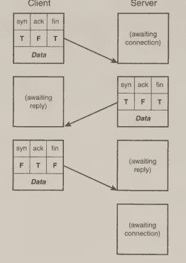

### 图 4.1

*TCP 握手在三个数据包中打开、发送并关闭对话框。*

在使用 TCP 时，必须禁用 TCP 过快刷新其缓冲区。这就是示例中 `setsockopt()` 系统调用所做的。此外，你可以发送任意数量的消息，但最后一条消息必须在 `sendto()` 系统调用中包含 `MSG_FIN`（见上文）。

# T/TCP 与 Linux

遗憾的是，Linux 目前尚不支持 T/TCP。未来它会支持，但就目前而言，你可以在其他 UNIX 操作系统上使用这些技术。你可以在 Linux 内核中看到一些表明工作正在进行的标志（例如，`MSG_EOF` 和 `MSG_FIN` 在 `linux/socket.h` 中被定义）。尽管如此，你仍然可以尝试在网站上找到的 T/TCP 程序。

如前所述，TCP 要求你为每个新连接重新创建 TCP 套接字，因为你只能通过关闭套接字本身来关闭连接。与 TCP 不同，T/TCP 可能具有一项附带优势，即无需像 TCP 那样重新创建套接字，因为其连接和关闭是隐式的。

T/TCP 允许你与支持该协议的服务器进行短促交互，同时将启动和关闭时间降至最低。T/TCP 的优势有助于你的程序更快地响应服务器。

## 发送直接消息

到目前为止，你一直在使用已连接的通道来发送和接收消息，这最适合比作使用电话。直接消息（Directed message）是未连接的，意味着它不进行握手。向对等方创建直接消息（而非管道）需要一个发送方和一个接收方。发送方传输消息，接收方接收消息。就是这么简单。

每条消息都需要一个目标地址（内核会在数据包中为你填充返回地址）。`send()` 和 `recv()` 假设它们拥有一个已连接的通道，该通道会自动定义目标地址。相反，你必须使用 `recvfrom()` 和 `sendto()` 系统调用，因为它们都提供了每条消息所需的寻址功能。

在发送消息之前，你需要构建目标地址，其中包括主机地址和端口号。如前几章所述，如果你的程序跳过了选择端口，操作系统会随机为该套接字分配一个端口。这对于对等程序来说并不是一个好主意。发起调用的对等方必须知道目标端口才能正确地寻址消息。

4 在对等方之间发送消息

## 检查 Linux sockaddr 支持情况

Linux 内核支持多种不同的寻址协议，但并非所有协议都直接包含在发行版内核中。例如，发行版内核通常会省略业余无线电协议。如果你不确定你的编译内核支持哪些绑定协议，只需运行你的程序即可。如果 `bind()`、`sendto()`、`connect()` 和 `recvfrom()` 系统调用接收到它们无法理解的 sockaddr，它们会报错。你可以在附录 A“数据表”中找到受支持的 sockaddr 列表。

UDP/TCP 发送方必须知道接收方正在监听哪个端口，以便操作系统将数据包路由到正确的程序。这个端口通常是发送方和接收方之间约定好的端口号。例如，`/etc/services` 文件列出了提供标准服务的公开端口号。

## 将端口绑定到你的套接字

你可以使用 `bind()` 系统调用向操作系统请求特定的端口号。你可能之前见过这个调用，遗憾的是，大多数 UNIX 手册页将其定义为“为套接字命名”。这个定义指的是使用文件系统的 `PF_LOCAL` 或 `PF_UNIX` 套接字。更好的描述是“将端口号或其他可发布的接口绑定到套接字”。

## 名称和端口绑定

端口分配和套接字命名在各个 sockaddr 家族成员之间差异巨大。有些，如 `AF_LOCAL` 和 `AF_AX25`，使用字母数字名称；而其他，如 `AF_INET` 和 `AF_IPX`，使用端口。端口号必须是唯一的，因此一般来说，两个 TCP 或 UDP 套接字不能拥有相同的端口号（至少对于 `AF_INET` 是这样）。然而，你可以让一个 UDP 套接字和一个 TCP 套接字共享相同的端口号。这就是一些服务（在 `/etc/services` 中）同时为你提供两种连接方式的原因。

`bind()` 系统调用的原型定义如下：

```c
#include <sys/socket.h>
#include <resolv.h>
int bind(int sd, struct sockaddr *addr, int addr_size);
```

## 传递消息

本节仅介绍 `bind()`；有关深入描述，请参见第 6 章。其用法与 `connect()` 系统调用类似，你需要首先初始化 `addr` 参数：

```c
/*** Bind() example. **/
struct sockaddr addr;
int sd;
sd = socket( PF_INET, SOCK_STREAM, 0 );
bzero( &addr, sizeof(addr) );
addr.sin_family = AF_INET;
addr.sin_port = htons( MY_PORT ); /* request specific port */
addr.sin_addr.s_addr = INADDR_ANY; /* any IP interface */
if ( bind( sd, &addr, sizeof(addr) ) != 0 )
    perror( "bind" );
...
```

如果你将此 `bind()` 系统调用示例与 `connect()` 系统调用进行比较，你可能会注意到两个主要区别：这里，代码片段正在请求 `MY_PORT`，且地址为 `INADDR_ANY`。你的程序需要一个特定的端口号以便对等方连接。

`INADDR_ANY` 是一个特殊标志（本质上为 0.0.0.0），表示任何对等方都可以从任何接口连接。有些计算机拥有多个网络接口（例如，两块 LAN 卡，一块带 LAN 卡的调制解调器，或别名 IP 地址）。每个硬件或逻辑接口都有其自己的 IP 地址。使用 `bind()` 系统调用，你可以指定是为这些接口中的一个服务还是为所有接口服务。你可以使用此功能进行跨防火墙转换或过滤，它适用于 TCP 和 UDP 协议。若要指定特定接口，可以使用以下代码：

```c
if ( inet_aton( "128.48.5.161", &addr.sin_addr) != 0 )
    perror( "address error" );
...
```

这使得请求该端口监听在 `128.48.5.161`。你可以使用网络字节序转换，如 `htonl()`：

```c
addr.sin_addr.s_addr = htonl( 0x803005A1 ); /* 128.48.5.161 */
```

无论哪种方式，功能都相同。你可能注意到 `INADDR_ANY` 不使用 `htonl()` 转换调用。由于它全为零，且保证处于网络字节序，因此不需要转换。

## 传递消息

发送和接收 UDP 消息有点像在雾中玩捉迷藏。玩家轮流投掷和捕捉，尽管他们彼此看不见。发送方首先投掷球。接收方必须有一个已知的地址和端口号，通过 `bind()` 系统调用建立。发送方不需要建立其端口号，因为每条消息都包含返回地址。存在玩家将球投向空白区域的可能性。

发送方做的初始化很少，通常只有一次消息请求。如果你想往返传递消息，可以将其放在循环中。发送方的代码见列表 4.4 以及网站上的 `connectionless-sender.c`。

### 列表 4.4 数据报发送方示例


```c
/* ** Sender example. ***
 *** (Excerpt from connectionless-sender.c)
struct sockaddr addr;
int sd, bytes, reply_len, addr_len=sizeof(addr);
char *request= "select * from TableA where field1 = 'test';";
char buffer[1024];

/*** -set up socket-***/
 sd = socket(PF_INET, SOCK_DGRAM, 0);
 bzero(&addr, sizeof(addr));
 addr.sin_family = AF_INET;
 addr.sin_port = htons(9999); /* request specific port */
if ( inet_aton(DEST_ADDR, &addr.sin_addr) == 0 ) /* Dest IP */
    perror("Network IP bad");

/* -send message--*/
if ( sendto(sd, request, strlen(request), 0, &addr, addr_len) < 0 )
    perror("Tried to reply with sendto");

/** -get reply-***/
bytes = recvfrom(sd, buffer, sizeof(buffer), 0, &addr, &addr_len);
if ( bytes > 0 )
    printf("%s", buffer);
else
    perror("Reply problem");
...
```

假设接收方的端口为 9999，此示例中的发送方传输一个 SQL 请求。发送方不需要请求特定端口，因为接收方会从 `recvfrom()` 放置在 `addr` 中的数据中提取该信息。（再次记住，所有套接字都需要一个端口。如果你不请求一个，内核会为程序选择一个。）

## 捕获消息

与发送方不同，接收方程序需要设置端口号（使用 `bind()`）。在创建套接字后，它必须发布约定好的端口号，以便对等方能够与之通信。列表 4.5 中的代码展示了接收方的示例。你可以在网站上的 `connectionless-receiver.c` 文件中找到完整程序。

### 列表 4.5 数据报接收方示例

```c
/*** Receiver example.
*** (Excerpt from connectionless-receiver.c) */

struct sockaddr addr;
int sd;

/*---Set up socket and request port allocation---*/
sd = socket(PF_INET, SOCK_DGRAM, 0);
bzero(&addr, sizeof(addr));
addr.sin_family = AF_INET;
addr.sin_port = htons(9999);        /* request specific port */
addr.sin_addr.s_addr = INADDR_ANY; /* any IP interface */
if ( bind(sd, &addr, sizeof(addr)) != 0 )
    perror("bind");

/*---Get & process all requests---*/
do
{
  int bytes, reply_len, addr_len=sizeof(addr);
  char buffer[1024];

  /*---Await message, if OK process request and reply---*/
  bytes = recvfrom(sd, buffer, sizeof(buffer), 0, &addr,  &addr_len);
  if ( bytes > 0 )
  {
        /* declare connect and reply */
        printf("Caught message from %s:%d (%d bytes)\n",
           inet_ntoa(addr.sin_addr), ntohs(addr.sin_port),
           bytes);
        /****Process message****/
        if ( sendto(sd, buffer, reply_len, 0, &addr,
                  addr_len) < 0 )
            perror("Tried to reply with sendto");
  }
  else
      perror("Awaiting message with RecvFrom");
}
while ( !quit );
...
```


在这段摘录中，接收方请求一个端口，然后等待传入的消息。如果收到消息，它会处理该请求并回复结果。

发送方仅传输一条消息。另一方面，接收方更像是一个服务器，它会接收、处理并回复每一条到达的消息。这两类算法之间存在一个根本性问题：为整条消息分配足够的空间。

如果你的程序需要可变长度的消息，你可能需要创建一个更大的缓冲区。最大的 UDP 消息约为 64KB；这最终就是你能达到的最大尺寸。

### 大型 UDP 消息

如果消息大于缓冲区大小，消息队列将丢弃传入消息中剩余的任何字节。这适用于许多支持数据报的协议族。

# 确保 UDP 消息到达

丢弃一条只读取了一半的消息似乎并不是一个好主意。在使用 UDP 协议时，有若干问题需要你注意。如上所述，你需要知道消息有多大。UDP 也是不可靠的，这意味着你无法保证目的地收到了你的消息。

你可能认为在所有情况下都需要可靠性，但并非所有系统都真正需要它。例如，某些消息具有极强的时效性。一旦时间过期，该消息的重要性便荡然无存。

如果你想增强 UDP 的可靠性（而不完全转向 TCP），你可以采取若干措施。事实上，你很容易就能使 UDP 的可靠性超过 TCP。

# 增强 UDP 的可靠性

TCP 背后的核心理念是在客户端和服务器之间提供可流式的接口。TCP 引入了开销，从而在通信过程中明显降低了性能。尽管如此，与 UDP 不同，它可以保证每条消息的到达。如果你希望在 UDP 中获得这种保证，你就必须添加自己的代码。

为了讨论方便起见，假设每条消息由若干 UDP 数据包组成。确保目的地收到消息引入了两个有趣的问题：

- 接收方如何知道应该到达一个数据包？

- 发送方如何知道接收方是否收到了数据包？

解决第一个问题有助于接收方跟踪消息的每个数据包。如果出现排序问题，接收方可以请求特定的数据包。此外，发送方可以期望每个数据包都有确认。

你可以使用的一种方法是为每个数据包分配唯一的序列号（类似 TCP 的确认机制）。每当一个数据包到达时，你增强版的 UDP 代码就会将其标记为已处理。如果丢失了某个数据包，你的程序可以根据具体的数据包编号请求重传。这种方法的主要问题是，一方必须保留其所发送的所有数据包的记录。虽然它可以丢弃非常旧的数据包，但该数据包历史记录可能会变得非常长。

解决冗长数据包历史记录的一种方法是确认每个数据包。此方法解决了第二个问题，并要求接收方用自己的消息回复每个数据包，指示其按序列号成功接收了哪些内容。从本质上讲，这种技术就是 TCP 所做的。然而，使用这种技术，你的程序会体验到部分 TCP 所带来的性能损耗。

问题在于，大多数物理网络并不是真正双向的。每次传输都会占用一部分网络带宽，从而阻碍其他传输。此外，每个数据包都有 IP 报头和 UDP 报头（最少 28 字节）。如果接收方逐个回复每个数据包，那么大部分确认开销都在报头上（4 或 5 字节用于序列 ID 确认，28 字节用于 UDP/IP 报头）。因此，尽可能让接收方保持沉默有助于减少网络拥塞。

一种解决方案是将确认分组到少数几个数据包中。例如，如果每个数据包为 1,024 字节，而发送方需要传输一条 1MB 的消息，接收方可能会收到大约 1,000 个数据包。在这个 1,024 字节的限制内，接收方可以轻松地将 10 个数据包作为一组进行确认。这将历史记录限制在 10×1,024 字节以内。为了实现这一特性，你需要了解网络性能和主机内存限制。

这又引入了另一个问题：接收方如何知道发送方已完成？例如，如果接收方确认每第十个数据包，而发送方只有五个数据包，你可能会遇到两个问题：

- 接收方可能永远不会发送确认。

- 发送方可能认为接收方从未收到数据包，因此重新传输。

为了解决这个问题，你可以告知接收方预期收到的数据包总数。当接收方收到最后一个数据包时，它发送缩短的确认消息。


# 数据包排序


UDP 协议下消息的每个数据包可能会相对于其他数据包以乱序的方式到达目的地。这是因为互联网非常动态（参见第 3 章）。停滞、拥塞和链路中断可能会迫使路由器延迟或重新路由你的消息。

确保数据包到达的解决方案之一是包含一个唯一的编号。此解决方案有助于数据包排序。为了使其有效，该编号必须在消息之间是顺序且唯一的。

如果数据包乱序，你的协议可能会保留较高编号的数据包，直到较低编号的消息到达为止。例如，如果数据包 1、2、4 和 5 到达，数据包 4 和 5 将等待 3 到达。

网络在传输过程中可能会丢弃数据包 3，在这种情况下，接收方可以专门请求数据包 3，或者确认已到达的数据包。无论哪种情况，发送方都会重传丢失的消息。

### 数据包冗余

网络可能会导致数据包镜像，结果是重复的数据包到达目的地。最常见的原因是，当接收方请求重传后，一个非常迟到的数据包到达了。排序可以消除冗余的数据包。接收方只需丢弃具有重复序列 ID 的数据包即可。

### 验证数据完整性

数据包通过网络和路由器从源移动到目的地。在任何时候，网络都可能损坏消息（在拥塞的网络中经常发生）。一次碰撞就会迫使源主机重传。在上面的例子中，假设数据包 3 丢失，主机很可能发送了该数据包。然而，网络可能已经将其冲掉了。

UDP 和 TCP 都对数据使用 1 的补数校验和。`IP` 层仅校验其自己的报头，而忽略数据消息。校验和对于检测轻微错误很有用，但错误相互抵消是可能的。一些网络接口包括硬件循环冗余校验（`CRC`）或纠错码（`ECC`），以查找和修复损坏的数据。

再次，数据包 3 实际上可能会到达，但内容可能在通过 `IP` 和 `UDP` 校验和的同时被损坏。

你可以在数据包和消息中集成自己的校验和、`CRC`、哈希或 `ECC`。这些算法的开源社区在互联网上都可以找到。当你选择验证算法时，请权衡以下项目：

- 你传输的数据量。增加报头大小可能会显著降低网络吞吐量。
- 你数据的可修复性。某些数据由于冗余性或低关键性而可能很容易修复。
- 数据值与数据位置。校验和擅长快速计算数据值，但它们失去了字节顺序的重要性。`CRC` 需要更多计算，但可以轻松识别长达 `CRC` 大小的位错误。例如，32 位 `CRC` 可以可靠地检测最长 32 位的位错误。超过 32 位时，其可靠性会降低。

数据可靠性对大多数应用程序都很重要。检查、验证和排序有助于确保消息安全、有序地到达。确保发送方和接收方之间的通信有助于平滑数据流。

### 数据流故障

对等方之间的通信并不总是清晰的。每一方都可能假设另一方应该先说话（网络死锁）。另一个问题类似于永远被置于等待状态：你从未确定对方没有把你置于等待状态并休息到剩下的时间。

饥饿发生在请求方无限期等待响应的情况下。原因可能包括糟糕的网络、慢速的对等方、重启的对等方等。在大多数情况下，你可以通过编程一个“唤醒器”（`tickler`）来解决饥饿的接收方问题，这只是一个提醒发送方你的接收方程序仍在等待的消息。

唤醒器应该在失去耐心之前等待一段时间。你可以包括消息中最后发送的序列 ID 甚至时间戳。如果在一段时间后未收到发送方的任何响应，接收方可以重置连接。此过程需要发送方理解唤醒器和连接重置消息。

网络死锁可能发生在数据包交换过程中某个消息丢失时。发送方等待回复，而接收方仍在等待丢失的消息。你的唤醒器也可以帮助打破死锁。例如，在数据包交换的例子中，接收方使用其获得的最后一个序列 ID 来唤醒你的发送方。你的程序随后重传丢失的消息。


### 任务切换：多任务处理简介

回到发送方和接收方程序，为什么要使用两个程序？为什么不用一个程序？使用一个程序是可能的，但当你希望同时发送和接收时，你实际上需要两个程序。

假设你有一个分布式程序（一种使用网络作为多处理器的程序），它能非常快速地处理图像数据。你的网络使用多个阶段来处理图像：图像捕获器、偏转器、平滑器、量化器和序列化器。这些阶段中的每一个都在不同的计算机上，信息从一个阶段流向下一个阶段。平滑器从偏转器接收数据，处理信息，并将其传递给量化器。每个中间阶段必须几乎同时接收和发送，就像一个底部有洞的桶。

在这个例子中，你无法轻松地将两个阶段合并。每个阶段必须是独立的，以确保输入的信息不会与输出的结果混杂在一起。当然，你还可以引入图像错误的问题：如何将错误消息向上传递到级联中？

将任务划分为明确定义的职责是多任务处理概念的一部分。你可以在各自的上下文中同时运行多个程序，以确保输入和输出从不混杂。这避免了结果损坏。本章中的示例使用了一种形式的多任务处理，因为它们作为独立的程序运行。

这些程序实际上非常相似，你可以将它们合并为一个，让它们与自己对话。在这种情况下，为了简化交互，你必须为每个程序创建一个独立运行的任务，并指明哪一个发送第一条消息。

多任务处理完整地嵌入到网络编程中。第 8 章“选择何时等待 `I/O`”将更详细地讨论多任务处理。

### 总结：面向连接与无连接模型

在对等体之间或客户端和服务器之间传递消息，涉及基于连接或无连接的通信。对于基于连接的消息，你只需打开一个通道，连接到对等体，然后继续发送和接收信息。连接会为你追踪目的地，因此你不必重新说明它。`TCP` 和 `UDP` 都支持连接；然而，只有 `TCP` 包含了可靠性和排序的连接。`UDP` 的连接只是一种简写形式，因此你可以使用比 `sendto()` 和 `recvfrom()` 更高级的 `I/O` 服务。

无连接的消息传递类似于寄信：在发送之前，你需要为每条消息编址。为此，你必须使用除了面向连接通信所使用的 `send()` 和 `recv()` 之外的调用。这些就是 `sendto()` 和 `recvfrom()`。这些系统调用与其他调用相对应，但增加了目的地址和源地址。

事务型 `TCP` (`T/TCP`) 本质上是一种无连接的 `TCP`。如果得到支持（`Linux` 尚不支持 `T/TCP`），`T/TCP` 有助于避免漫长的建立和关闭时间。这加快了消息传输。此外，简化的协议专注于数据包而不是数据流，并将交互减少为三个消息数据包。

`UDP` 默认是无连接的，但你可以连接 `UDP` 套接字以简化编程。与 `TCP` 不同，你可以将同一个套接字重新连接到不同的对等体。

`TCP` 为你提供可靠性，但也带来大量开销。你可以通过确保数据到达、对数据包排序、消除冗余、验证数据完整性和解决数据流问题，一次一部分地为 `UDP` 添加可靠性。`TCP` 和 `UDP` 提供不同级别的可靠性和交互。`TCP` 让你像查看流一样查看信息；`UDP` 让你的程序访问单独的消息。它们都建立在 `IP` 的架构、功能模型之上。


# 理解网络分层模型

## 本章内容

- 解决网络挑战 96
- 开放系统互连 (`OSI`) 网络模型 101
- 互联网协议套件 105
- `OSI` 与 `IP` 之间的基本区别 109
- 哪些服务对应哪些功能？ 110
- 总结：从理论到应用 110

欧洲最美味的水果蛋糕之一是陶特蛋糕（`torte`），这是一种非常丰富的蛋糕。陶特蛋糕通常有几层（五到八层）。每一层的重量都压在下面的层上，并且具有不同的风味和颜色。陶特蛋糕有一层坚硬的外皮，从顶部覆盖到盘子。如果你看看概念上的网络子系统（或协议栈）是如何设计的，你会发现类似的分层。从表面看，它与下面的层显示了一个公共接口。网络的每一层都建立在另一层之上以支持其功能。这种依赖关系非常重要：如果下层中的任何部分失败，整个子系统要么崩溃，要么功能效率降低。

划分网络职责为高层功能的重量级特性提供支持。网络子系统是硬件、内存、安全、数据、内核和应用程序的大型且复杂的混合体。协调所有这些技术就是网络挑战。除非你真的理解这些技术的协同作用，否则协调它们的融合往往会加重网络挑战的负担。

网络建模在不失去可移植性的情况下解决网络挑战。本章介绍网络挑战，并提出了两种试图解决它的模型。

## 解决网络挑战

网络编程涉及计算机科学和软件工程的许多部分，因此在低层面工作非常复杂。类似于建造房屋，如果你专注于砍伐木材，你可能永远无法完成房屋。但是，通过结合适当的工具材料，你可以更多地思考你的成品和潜在功能。

网络编程带来的挑战正是使这项技术如此有趣的原因。然而，要从底层开始编程网络，你必须是一位大师（或所有计算机领域的大师）。网络编程的挑战包括硬件、传输、操作系统接口和程序接口。

## 网络硬件问题

技术为实施网络提供了许多选项。这些选项包括导电与非导电介质（一些物理管道来携带信号），电气与非电气传输，定向与非定向路径，以及短距离与长距离。表 5.1 列出了几种网络连接形式。

TABLE 5.1 网络媒体具有不同的特征和限制

| 媒体 | 导电 | 电气 | 定向 | 距离 | 最高吞吐量 |
|---|---|---|---|---|---|
| 同轴电缆 | 是 | 是 | 连接 | <2Km | 10Mb/s |
| 双绞线 | 是 | 是 | 连接 | <150m | 100Mb/s |
| 光纤 | 是 | 否 | 连接 | (无限) | 100Gb/s |
| 无线: HF | 否 | 是 | 广播 | >1000km | <10kb/s |


| 无线: VHF/UHF | 否 | 是 | 广播, 视距 | <30km | <40kb/s |
| 无线: 微波 | 否 | 是 | 是, 视距 | <30Km | <1Mb/s |
| 卫星 | 否 | 是 | 是 | (无限) | <10Mb/s |
| 红外 | 否 | 否 | 是, 广播 | <10m | <1Mb/s |
| 激光 | 否 | 否 | 是 | 非常长 | <100Gb/s |

幸运的是，内核从你的直接交互中隐藏了所有这些技术。想象一下，知道计算机使用什么类型的介质和传输有多困难。然而，所有这些技术都必须处理几个共同的问题。

许多技术的一个问题是信号衰减，或线路损耗，来自介质电阻。电气类型的传输特别容易受到这个问题的影响。消息可能会因介质本身而退化。线路信号损耗是某些技术（例如双绞线和同轴电缆）的实际问题。电气和无线电传输的物理特性会使消息在通过介质时衰减。

另一个问题是碰撞。共享同一介质（导电或非导电）的几台计算机可能会导致碰撞，当它们同时传输消息时。如果当另一台计算机正在传输时你的计算机发送数据包，由此产生的碰撞会使两个数据包都变得混乱。两台计算机必须检测碰撞、退避、恢复并重新传输。

导体中的中断会导致信号丢失和数据包退化。由于涉及的物理原理，如果你从活动网络中断开同轴电缆，任何活动的电信号都会像镜子一样从开放连接反射回来。任何传输最终都会变得完全混乱。

激光、微波或红外等定向传输也可能遭受中断。放置在发射器和接收器之间的障碍物可能会完全阻断信号。烟雾、雾霾和鸟类等其他问题也会造成问题。

## 网络传输问题

主机连接到公共网络介质，共享时间和资源，因此硬件识别突然成为一个问题。每个数据包在共享网络上都需要一个目的地。如果网络连接仅为两台计算机（点对点网络），数据包不需要目的地。目的地将是隐含的。然而，共享网络需要一个硬件地址，以便网络接口能从众多快速传输的消息中选取属于它的消息。

以太网局域网卡提供自己的 ID：`MAC`，即 6 字节的以太网地址。当你的计算机发送消息时，网络子系统将该消息划分为几个帧（`frame`），这是最小的传输容器。在以太网中，每个帧都包含源 `MAC` 和目的 `MAC`。最终，网络将逻辑 `IP` 地址与实际物理（`MAC`）地址关联起来。有了物理地址，局域网卡就会监听其地址。当匹配的地址到达时，它打开缓冲区并让消息流入。

硬件问题集中在物理通信通道的技术层面。下一个网络问题是让数据包在网络中移动。数据包面临着许多可能导致其损坏或完全丢失的风险。通常，发送方和接收方很少甚至无法收到数据包失败的通知。有时，接收方会超时，因为它没有从发送方那里收到消息，而实际上，它们之间的路由可能已经断开。

网络层关于数据包的问题通常涉及路由问题。由于消息从一个地方移动到另一个地方时网络会发生变化，提前了解可能出现哪些症状有助于你识别问题并找到解决方案。

网络拓扑的变化（或*传播动力学*）即使是控制最严格的网络配置也值得关注。尽管原因各异，但结果往往是传输丢失。一种传播动力学类型是网络本身在传输过程中丢失消息。你可能经历过或听说过那些办公隔间里的网络，有人动了脚就导致别人的集群宕机。计算机之间的网络在变化；计算机之间的连接会出现和消失。

传播动力学的另一个原因是数据包老化的过度。当数据包沿路径传播时，每个转发数据包的节点使用生存时间（`TTL`）字段追踪其老化程度。当数据包超过允许的路由器跳数时，它就会过期。每个数据包最多可达 `255` 跳；默认值为 `64` 跳。通常，这足以让你的消息到达目的地。

限制跳数对于防止网络因长期未处理的数据包而过度拥挤非常重要。对于没有追踪机制的数据包，很容易陷入无限循环。例如，假设路由器 `A` 收到一条消息。`A` 的路由表表明最佳路径是通过 `B`，所以它将数据包发送给 `B`。然而，路由器 `B` 丢失了链路，所以它可能将数据包发回给 `A`。路由器 `A` 没有收到该数据包的记录，因此数据包在两者之间来回反弹（直到 `TTL` 字段过期或路由器 `A` 和 `B` 同步它们的表）。`TTL` 字段限制了数据包在循环中持续的时间。

路由列表和主机表可能变得非常大。仔细管理表可以帮助你在计算到目的地的最佳路径时避免漫长的延迟。

虽然网络复杂度具有挑战性，但检测路径丢失、恢复和循环同样复杂。通常，当网络段消失时，会形成循环（或网络环路），导致数据包迅速老化并死亡。网络很少通知你的发送主机和接收主机出现此问题；数据包只是简单地过期。

有时，路径模糊性可能会导致消息中的数据包在传输过程中被复制（数据包镜像或幽灵化）。除非每个数据包持有 ID 或序列号，否则这种奇怪的现象无法检测到。不仅网络可能会不必要地复制信息，网络还可能因传输期间路由器消失或甚至数据包损坏而丢失数据，导致错误消息从未传回给发送方。

数据包丢失随时都在发生。如果没有统计和确认机制，源端可能永远无法确定目的地是否收到了消息。

最后，网段可能存在路由器数据不兼容的情况。某些路由器或网络不支持完整的 `8` 位字节或大数据包大小。路由器必须转换这些数据包或返回错误。

幸运的是，网络问题仅在你使用较低层协议时才会出现。如果你没有时间或不想面对这些挑战，并且对较慢的吞吐量感到满意，请使用经过测试和验证的高层协议。大多数网络应用程序使用它们。一旦你使用高层协议测试了算法，请考虑为你的程序调优，以便在较低层协议下获得更高的性能。然后，当项目开发的狂热尘埃落定后，磨练并调优你的算法，以挖掘更多性能。

## 网络与操作系统的接口

网络必须能够与操作系统进行接口，原因有几个。为了完成其工作，操作系统处理网络子系统所需的资源，如中断、端口和内存。此外，虽然网络子系统管理网络的细节，但它必须驻留在内核中以获得最佳性能。

网络内核接口是复杂的——特别是如果内核不是可重入的。幸运的是，`Linux` 内核现在已经克服了可重入性的障碍，并能够处理相关问题。

当消息到达时，硬件向 `CPU` 发送中断以提取消息。如果内核（中断处理程序所在处）稍显迟缓，另一个消息可能会覆盖第一个消息。当网络卡进入`混杂模式`（接受它听到的所有消息）时，这种情况尤为明显。第 3 章“不同类型的互联网数据包”首次介绍了混杂模式。

除了 `PPP` 等模拟网络外，`CPU` 很少直接与硬件网络接口交互。`CPU` 使用网络接口卡上的协处理器。`CPU` 将数据加载到网络接口并指示其传输。完成后，卡向 `CPU` 发出中断。这指示内核网络卡已准备好接收另一条消息。另一方面，`PPP` 需要大量的 `CPU` 交互，但由于接口速度慢得多，它不像看起来那么沉重。

一个消息队列持有传出和传入的消息。当内核收到卡已准备好处理另一帧的通知时，它直接从消息队列中取出消息。如果你的程序在接口未准备好时发送消息，内核会将请求或消息放入队列以便稍后处理。网络是一种有限资源；两个程序不能同时访问它。因此，操作系统必须排队并依次处理请求。

此外，内核还必须为传输准备每个消息，并且必须将传入消息拆解给接收方。缓冲子系统跟踪构建好的帧，并为网络或客户端进程（如磁盘 `I/O`）做好准备。

打包消息过程的一部分是分配识别信息。硬件识别（如 `MAC`）在大型网络上很笨拙且难以管理。因此，网络子系统提供逻辑识别（例如，`IP` 号码）。

每个数据包都需要识别信息，以便操作系统可以快速确定将其发送到哪里。`IP` 编号为网络操作系统提供了一种将计算机分组到子网的方法。

### 网络与程序的接口

主要关注点之一是如何将网络与你的程序接口。由于网络编程有很多角度和注意事项，请单独考虑每种情况的具体内容，然后确定它们如何相互关联。本节讨论其中的一些问题。

第一个问题是接收和处理错误及异常。操作系统和你的程序必须能够接收和处理网络错误或异常。一些错误和异常对于正在运行的程序是异步的。`C` 和 `Java` 可以拦截它们，但某些语言不能（例如，`Pascal`）。因此，在考虑如何编写应用程序时，请记住并非所有语言都适合网络编程的需求。

第二个问题是数据和包的可靠性。有些程序要求高数据可靠性，而有些则没有这种要求。请分析您拥有的数据类型及其所需的可靠性级别。在第 2 章“TCP/IP 网络语言熟练度”中，您可以找到数据类型列表及其重要性。使用此列表帮助您选择正确的协议。

第三个问题是同步和并发。您的网络程序与另一个并发运行的程序进行接口交互。您必须协调这两个程序，以避免死锁和饥饿问题（这些问题在第 10 章“设计健壮 Linux 套接字”中的“客户端–服务器并发问题”一节中进行了详细讨论）。

最后，考虑检查真实连接与虚拟连接。网络通过使您的程序看起来像是拥有网络连接，从而为您的程序提供更简单的接口形式。这些虚拟连接（端口）只传递该连接应该看到的消息。

虽然程序接口问题很复杂，但它们使得网络编程既具有挑战性又充满乐趣。此列表并不全面。然而，`Socket API` 隐藏了许多网络编程的挑战，使其远离您的程序。

几年前，程序员群体应对了网络挑战，并发明了几种建模标准。这些标准通常以层级的形式相互构建。新层可以依赖较低层级的解决方案。就像剥洋葱一样，网络的核心是物理传输介质（电力、无线电或光）。

本节介绍的两个模型 `OSI` 和 `IP` 与其他许多网络模型类似。有了这些信息，您可能会明白他们为何选择其行动路径。

## 开放系统互连（OSI）网络模型

最被广泛认可的网络模型——`OSI`——采用分层方法，共有七层。模型中的每一层都抽象了硬件与程序之间的接口。此模型甚至将该接口扩展到了用户空间。


您工作站上的程序和应用为您提供完成工作所需的工具。用户空间定义了客户的工作区域。请将注意力集中在该区域，因为良好的设计能使用户与您的程序交互变得无缝且直观。

`OSI` 网络模型提供通用接口，一旦用户理解其程序，他就可以在其他 `OSI` 实现中使用相同的方法。`OSI` 模型有意隐藏并抽象了特定硬件的实现细节。这使得用户无论平台如何，都能获得相同的感受。

`OSI` 模型的接口试图回答网络编程的每一项具体挑战。然而同时，它提供了对较低层级的接口（或钩子），以便高级程序员仍能自由操作。该模型有七层，从硬件层开始，如 `5.1` 图所示。每一层从下到上都将网络实现从用户和您的程序中抽象出来。

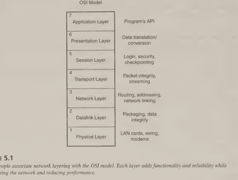

### 第 1 层：物理层

物理层包含所有与硬件相关的接口：介质和信号。介质（例如：双绞线、同轴电缆、光纤）将信号传输到其目的地。

网络适配器是物理层的一部分。网络适配器作为内核与物理介质之间的中介。在一端，它接受来自内核驱动的传输请求，并传输消息数据包（`帧`）。完成后，它通过中断通知内核。

适配器的微控制器在尝试发送帧之前会监听网络是否处于静默状态。它检测并处理碰撞和重传。如有必要，它会通知内核传输问题。内核的驱动程序随后管理自己的重试或将错误向上传递到协议栈。

在另一端，适配器监听网络中与其实体（`以太网`）地址匹配的消息。当匹配时，适配器填充内部缓冲区并向内核发出中断。为此，硬件层提供自身的硬件标识。

数据帧中继器接受所有网络消息，并将其传递到网络的新段。数据中继器在这一点上是“笨”的，因为它们不从一个包选择到另一个包，并忽略硬件标识。数据中继器比典型中继器具有较少的编程智能，典型中继器会选择性地在段之间允许数据包通过，并位于物理层。使用数据中继器来延长网络长度并放大衰减的信号。

最后，一些以太网适配器现在包含自己的校验和或 `CRC`，以执行数据验证检查。如果 `CRC` 发现错误，卡片会将数据标记为可疑，以便数据链路层进行修复。这可能使您对数据报协议多一点信心。

其他物理网络可能有其他机制。例如，`PPP` 连接可能包含奇偶校验（大多数不包含）。`FDDI` 具有校验和或 `CRC`。一些冷门的无线电协议只是将每个字符发送两次。

### 第 2 层：数据链路层

数据链路层建立在物理层之上。数据链路层的主要角色是提供主机到主机的数据传输。它将消息打包成硬件使用的帧。它检查并尝试纠正传输错误。如果硬件不支持校验和或 `CRC`，数据链路层会自己进行计算。

数据链路层将内核与网络硬件接口。通常，数据链路层是驻留在内核中的网络驱动程序。该驱动程序使用统一接口，以便内核可以盲目地处理各种不同技术。

该层为传输准备数据帧，并拆解接收到的消息。驱动程序等待指示消息已发送或已接收消息的中断。当收到消息已发送的通知时，数据链路驱动程序加载下一个要发送的帧。

数据链路层与内核的缓冲子系统紧密合作。大多数时候，它只需要 `10-60KB` 的系统 `RAM`。`Linux` 的内核配置允许您定义超过 `1MB` 的缓冲区和帧大小，用于非常快的传输（`100MB/s` 或更高），前提是您有足够的内存。这对于可能接收大帧或高吞吐量的非常高速连接很有用。若要使用此功能，您可能需要重新编译内核，因为许多 `Linux` 发行版默认未启用此功能。

网络网桥位于数据链路层。撰写本文时，`Linux` 内核的网桥选项仍处于实验阶段。如果您想尝试，可能需要重新配置并编译内核以包含驱动程序。

网络层建立在数据链路层之上，并提供地址解析和路由。

### 第 3 层：网络层

网络层建立在数据链路层之上。其主要功能是与路由表、路由器和网关协同工作，以找到目标主机。在未路由网络中，该层基本上处于非活动状态。

网络层为异构网络提供统一的寻址机制。例如，如果您有两个物理网络，如 `AppleTalk` 和 `以太网`，该层通过帧转换将它们桥接起来。

网络路由器位于此层，为同构和异构物理网络之间提供连接。

### 第 4 层：传输层

传输层建立在网络层之上，依赖于数据链路层和网络层的数据完整性和路由。其主要职责是完整、有序且不重复地传递消息。该层添加了许多功能以提供流和通信完整性。

传输层是该模型中最后可以处理任何数据或通信错误的地方。（`数据错误`在此仅指数据的完整性，而非含义。例如，该层不会捕获格式错误的 `HTTP` 请求，但会捕获校验和错误。）如果该层检测到数据包丢失或损坏，它会向发送方请求重传。为了执行此检查，它向数据包添加了更多校验和。

该层引入了`虚拟网络`或`多路复用`的概念。借助此功能，每个连接都有拥有网络独占连接的感知（类似于 `TCP/IP` 端口概念）。尽管您的主机可能运行着多个网络程序，但您的程序仍会收到其他程序发送给它的消息。

由于可靠性，传输层是互联网上相互通信的应用最常使用的层。它提供了维持网络会话所需的所有功能。

### 第 5 层：会话层

会话层严重依赖传输层以提供其所需的流和可靠性。其主要职责是提供对连接和数据流的控制。连接可能不稳定，因此该层提供`检查点`。例如，假设连接正在传输文件，而连接中断了。所有花在获取...

如果重新连接时需要重新开始传输文件，文件的第一部分将会丢失。检查点功能会锁定传输的部分，以便新连接只需接收缺失的部分。

如前文所述，会话层会自动重建中断的连接。它还提供安全性和登录流程。

它还提供数据流管理。客户端/服务器连接的一个问题是控制谁先说话以及如何进行对话交互。该层使用的一种方法是传递令牌：持有令牌的宿主可以执行关键操作。这种流控降低了死锁、饥饿或数据损坏的可能性（在第十章的“客户端/服务器并发问题”一节中详细讨论）。

## 第 6 层：表示层

表示层管理数据并进行必要的转换（例如：解压缩、格式化、布局、图像显示、字符集转换）。远程过程调用（参见第 15 章，“使用远程过程调用（`RPC`）进行网络封装”）是该层的一个实际应用示例。

## 第 7 层：应用层

最后一层，即应用层，提供网络服务，如文件传输、终端仿真、消息处理和网络管理。基本上，大多数应用程序都使用这一层，因为它提供了应用程序接口（`API`）。然而，它并不是实际的用户应用程序；它是一组库调用和服务，旨在帮助应用程序与网络交互。网络文件系统（`NFS`）是该层的一个示例，它挂接到操作系统的虚拟文件系统架构。它基于 `RPC` 工具构建，以提供功能接口。

## 互联网协议套件

`Linux`（像大多数其他 `UNIX` 操作系统一样）并不直接使用 `OSI` 网络模型。然而，该模型是理解 `IP` 协议栈的起点。`Linux` 使用互联网协议套件来管理其原生网络接口。

## 注

`IP` 协议源自 `ARPANet`（高级研究计划局网络），由 `DARPA`（美国国防高级研究计划局）于 1972 年资助。`BBN` 公司实现了该网络的雏形。后来，`UNIX`，一个由贝尔实验室提供的免费操作系统，也采用了该模型。参与的大学使用 `UNIX` 测试了一种概念，即将美国各地的多台计算机连接在一起。`Sockets API` 起源于 1983 年的 `BSD 4.2`。

互联网协议套件有四个层，紧密映射到 `OSI` 模型。最高层称为应用层。`IP` 套件的应用层涵盖了 `OSI` 的第 5–7 层（见图 5.2）。请参见图 5.1 进行对比。

| `OSI` 模型 | | D&D 模型 | | | | |
| :--- | :--- | :--- | :--- | :--- | :--- | :--- |
| 7 应用层 | | 程序 `API` | | | | |
| 6 表示层 | | 数据转换/变换 | | | | |
| | | 登录、安全、检查点 | | | | |
| 5 会话层 | | | | 4 | 应用层 | |
| | | 数据完整性、流式传输 | | | | |
| 4 传输层 | | | | 3 | 主机到主机层 | |
| 3 网络层 | | 路由、寻址、网络连接 | | | | |
| | | | | 2 | 互联网络层 | |
| 2 数据链路层 | | 打包、数据完整性 | | 1 | 网络访问层 | |
| 1 物理层 | | `LAN` 卡、布线、调制解调器 | | | | |

### 图 5.2

`国防部`（`DoD`）或互联网协议栈与 `OSI` 模型非常相似。`Socket API` 在 `OSI` 的传输（4）层停止。该协议将剩余层留给 `Telnet`、`FTP` 和 `Lynx` 等高级程序。

## 第 1 层：网络访问层

`IP` 的第一个网络层最接近 `OSI` 的物理层和数据链路层。由于硬件和驱动程序紧密相连，且硬件支持差异极大，无法将二者隔离开来。

特性相似：驱动程序与硬件接口紧密协作，为内核提供一组通用功能。作为交换，内核赋予驱动程序直接访问端口和中断的能力。如果接口缺少内核所需的某些功能，驱动程序会弥补这一缺陷。

`Linux` 增加了一个使该层复杂化的功能：热插拔网络适配器。这在 `PCMCIA` 支持中可见。当您插入 PC 卡时，PC 卡管理器会识别它，分配适当的端口和中断，插入定义的内核模块，并配置您的网络。同样，当您移除卡片时，管理器会禁用网络并移除内核模块。

## 第 2 层：互联网络层（`IP`）

`IP` 层（包括 `IPv4` 和 `IPv6`）依赖设备驱动程序提供通用接口和功能。这两个版本在此层不同。它们构成不同的协议栈，根据需要转换为 `IPv4` 和 `IPv6`，以确保兼容性。


IP 层最好地对应于 OSI 网络层。它提供了该层的逻辑寻址和路由功能。IP 层缺失的部分是网络层的错误消息。

## 第 2 层：控制/错误消息扩展（ICMP）

`ICMP`（互联网控制消息协议）补充了 OSI 网络层缺失的错误消息功能。`ICMP` 提供用于路由和转发消息过程中错误和异常的消息协议。典型的异常包括网络不可达和主机未找到。

该协议与其他系统协作执行各种功能。例如，当主机变得不可达时，它与路由表（`ARP`）协作。此外，它与 `TCP` 协作以加速或减慢通信并更改滑动窗口。`IPv6` 甚至增加了对多播组管理的控制。

`ICMP` 有趣之处在于它是独立的。`UDP` 和 `TCP` 都不使用它的层。它们确实接受其消息以进行自身处理。

## 第 3 层：主机到主机（UDP）

与流行观点相反，`UDP`（用户数据报协议）并不完全匹配 OSI 传输层（见图 5.3）。传输层保证投递、按序分组、无错误分组以及流式功能。`UDP` 不具备这些功能；参见表 5.2。

### 表 5.2 传输层与 UDP 对比

| 传输层 | UDP |
| :--- | :--- |
| 可靠数据 | 可靠数据（校验和） |
| 可靠投递 | 不保证投递 |
| 协商窗口大小 | 固定窗口（由程序决定） |
| 记录导向 | 分组导向 |
| 基于网络层构建 | 基于 IP 构建 |

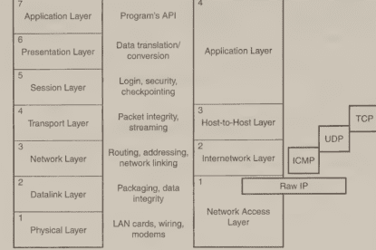

**图 5.3**

`IP` 协议栈更侧重于功能而非封装。修订图表以更好地反映从一个层到另一个层的覆盖范围，显示 `UDP` 深入到了 OSI 网络（3）层。

`UDP` 添加了传输层的一个主要特性：带端口的虚拟网络。如第 4 章“在点对点之间发送消息”中所述，此特定特性抽象了网络，让您的网络程序表现得好像它独占连接。其他所有特性都与 IP 层相似。如果定位得当，`UDP` 横跨网络和传输层，更倾向于网络侧。

## 第 3 层：主机流（TCP）

`TCP` 层与 OSI 传输层匹配得非常好。两者都提供了构建会话所需的可靠性、流式传输、排序和错误管理。重要的是要强调，`TCP` 并不建立在 `UDP` 之上。它有自己的头部和自己在网络子系统中的路径。并排比较见表 5.3。

### 表 5.3 传输层与 TCP 对比

| 传输层 | TCP |
| :--- | :--- |
| 可靠数据 | 可靠数据（校验和） |
| 可靠投递 | 保证投递 |
| 协商窗口大小 | 滑动窗口 |
| 记录导向 | 流导向 |
| 基于网络层构建 | 基于 IP 构建 |

## 第 4 层：应用层

这是 `TCP/IP` 模型停止的地方。根据模型，应用层由 OSI 的会话（5）、表示（6）和应用（7）层组成。`TCP/IP` 模型有一些应用程序填补这些角色。该层的一些示例是 Web 浏览器、网关、`Telnet` 和 `FTP`（文件传输协议）。远程过程调用（`RPC`）最好地与表示层对齐。网络文件系统（`NFS`）依赖 `RPC`，似乎适合应用层。尽管如此，这些应用程序模糊了边界，使得将它们分配给任何特定层变得困难。

应用层建立在主机流层（`UDP` 和 `TCP`）之上。然而，它可能直接从 `ICMP` 接受消息。

## OSI 与 IP 之间的基本差异

OSI 和 IP 模型都使用分层来定义每个协议栈的角色。它们也都从硬件依赖的代码移动到抽象应用程序。但您可能已注意到一些差异。

OSI 同时对数据和协议进行分层。回想图 5.1，协议栈的每一层都有其自己的头部信息。当数据向下移动至物理层时，每一层将消息封装在其自己的数据包内。

例如，如果您发送一个会话层消息，物理层会看到按逆序列出的头部：数据链路、网络、传输和会话。消息本身跟随所有这些头部，位于数据的末尾。每一层都使用此过程，包括物理层。最终，单个数据包上可能有高达七个头部。

接收方反转此过程。它使用封装的数据来决定是否将您的消息传递给下一层。在之前的示例中，您的消息到达物理层。每一层剥离其头部。如果它看到另一个头部，它将消息传递给下一层。最终，消息停留在会话层。

IP 模型运作方式不同。为每一层附加头部会使您的消息头部沉重，降低吞吐量。相反，IP 模型将协议类型放置在 IP 报头。当 IP 收到消息时，它会检查该字段，并在移除自身报头后，直接将消息路由到你选择的协议。

此外，正如第 3 章末尾所指出的，IP 的每个协议都扮演着特定的角色。与 OSI 模型不同，OSI 模型中每一层都稳固地建立在较低层之上，而在 IP 模型中，所有协议都建立在 IP 原始协议之上。

再次说明，IP 模型使用协议来满足特定需求。`ICMP` 用于错误消息，`UDP` 用于定向消息和无连接通信，`TCP` 用于流式传输。而原始 IP 则用于开发新协议。

## 哪些服务对应哪些需求？

下一步是如何使用 DoD 网络模型。如果你想访问 IP 堆栈的所有不同层，请使用 `socket()` 系统调用。

**表 5.4** DoD 层摘要

| DoD 层 | 程序员/用户访问 |
| :--- | :--- |
| 4—应用层 | `FTP`, `Gopher`, `Lynx`, `Netscape`, `IRC` |
| 3—主机到主机 (TCP) | `socket(PF_INET, SOCK_STREAM, 0);` |
| 3—主机到主机 (UDP) | `socket(PF_INET, SOCK_DGRAM, 0);` |
| 2—网际层 (ICMP) | `socket(PF_INET, SOCK_RAW, IPPROTO_ICMP);` |
| 2—网际层 (IP) | `socket(PF_INET, SOCK_RAW, protocol);` |
| 1—网络访问层 | `socket(PF_INET, SOCK_PACKET, filter);` |

该接口可能与你的预期有所不同。`Linux` 允许使用 `SOCK_PACKET` 读取底层驱动程序消息。这个 `Linux` 特有的功能赋予你访问网络中所有消息的能力。你在第 3 章中曾使用此功能来构建自己的网络嗅探器。

## 总结：从理论到应用

本章探讨了需要协同工作的不同网络元素之间的接口。网络挑战包括计算机硬件接口、网络连接问题、操作系统链接以及应用程序接口。每一个都存在特定的问题，阻碍了你的程序访问其他计算机。网络通过精心设计的模型来解决这些问题，帮助你能以一致的方式进行编程。

两个网络模型，OSI 和 IP（或 DoD），将解决方案分层。这些层像蛋糕层一样堆叠在一起。较低层提供的支持增加了较高层的数据可靠性和接口能力。这些层还为你提供了速度与可靠性之间的广泛选择。

第一层处理计算机之间的物理接口。依次地，每一层都增强了消息的可靠性、到达率和流量。当你使用协议栈中间层的接口时，可以预期数据将正确到达。

高层工作起来仿佛网络就是计算机本身，而低层则运作起来仿佛你在瓶中投递信息。它们对你的程序数据都有用处。

## 服务器视角与负载控制

**第二部分**

## 本部分包含

- 6 服务器入门 115
- 7 负载分担：多任务 133
- 8 选择何时等待 I/O 173
- 9 突破性能瓶颈 195
- 10 设计健壮的 Linux 套接字 221

## 服务器入门

**第 6 章**

## 本章内容

- 映射套接字：服务器的一般程序流程 116
- 一个简单的回声服务器 118
- 定义协议的一般规则 125
- 一个扩展示例：HTTP 目录服务器 128
- 总结：服务器的基本要素 131

网络程序总是包含发送方和接收方。通常，发送方是客户端，它连接到网络计算机提供的服务。本书第一部分“客户端视角的网络编程”详细涵盖了客户端的观点——如何连接服务器、如何创建无连接通信以及如何使用支持 IP 的工具。本章介绍另一半：接收方，即服务器的视角。

服务器的视角完善了客户端/服务器交互。为了说明客户端和服务器之间的关系，你可以将网络比作电话系统，将服务器比作大型公司的中央电话号码，该号码将呼叫路由给员工。客户端通过中央号码和分机号连接到其中一名员工。从这个例子中，你可以看到网络上的服务器如何接受来自客户端的连接。主号码是主机的地址，分机号是服务端口。

服务器请求特定的端口号——即客户端已知的端口。类似于公布电话号码，如果服务器没有获得其想要的端口号，客户端就无法呼叫它。本章将视角从第一部分讨论的索取服务转变为提供服务。它带你一步一步地完成编写和构建服务器的过程。最后，一个小型 HTTP 目录服务器向你展示如何连接 Web 客户端以及如何封装 HTML 消息。

### 映射套接字：服务器的一般程序流程

创建服务器的过程总是从创建套接字开始。就像客户端需要在特定时间调用特定函数一样，服务器使用类似的路径，但添加了一些额外的系统调用。服务器调用 `socket()`，但它必须完成对客户端来说是可选的额外工作，如图 6.1 所示。


### 客户端与服务器流程对比
你在前几章编写的客户端程序遵循了客户端示意图。按顺序，客户端调用了：`socket()`、`connect()`、`read()`、`write()` 和 `close()`。由于操作系统为你执行了该功能，因此 `bind()` 系统调用并非必需。也不需要端口号，因为程序是呼叫服务器的一方。客户端始终发起主动连接，因为它主动寻求建立连接。

另一方面，服务器程序如果需要为客户端程序提供服务，必须为它们提供一个一致且特定的端口号。服务器示意图展示了与客户端的一些差异。你编写的服务器程序必须调用 `socket()`、`bind()`、`listen()`、`accept()` 和 `close()`。并且，虽然客户端程序是主动连接，但服务器是被动连接。`listen()` 和 `accept()` 系统调用仅在客户端请求连接时才建立连接（就像接听响起的电话一样）。

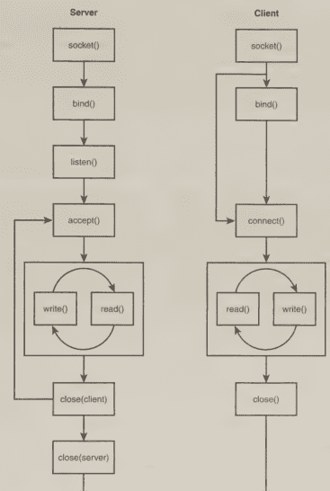

**图 6.1**

客户端和服务器的程序流程相似，但在连接网络的方式上有明显的不同。这是客户端和服务器程序的系统调用地图。

第 4 章“对等之间发送消息”介绍了 `bind()` 系统调用。本章以更正式的方式定义它。同样，本章描述了两个新的调用——`listen()` 和 `accept()`。

### 一个简单的回声服务器
在讨论用于创建服务器的不同系统调用之前，你可能想先看看服务器示例的一般程序流程。这个示例是标准的回声服务器。就像 C 语言编程中的“你好，世界”示例一样，回声服务器是套接字服务器的示例。你可以在网站上找到该程序的完整源代码，其名称为 `simple-server.c`。

对于大多数通信来说，最简单的测试就是回声。正如电话销售员会复述你的订单以确保正确性一样，你可以使用回声来启动你自己的服务器。基本上，以这种方式编写程序有助于你构建和测试关键应用程序。

**构建与测试范式**
你可能已经注意到，这本书引用了许多基于计算机科学的学科。网络编程需要更侧重于测试、检查和构建。由于存在许多不同的基本问题，你必须使用最简单的编程方法来最大限度地减少程序错误。构建与测试范式（快速原型设计的一小部分）让你能够专注于特定问题。解决该问题后，结果将成为其余开发工作的构建模块。

通用服务器要求你按特定顺序调用一系列系统调用。回声服务器很好地演示了这种顺序，而不会用特定于服务器的处理逻辑混淆示例。以下是回声服务器的一般程序流程：

1. 使用 `socket()` 创建套接字。
2. 使用 `bind()` 绑定端口。
3. 使用 `listen()` 将套接字转换为监听套接字。
4. 使用 `accept()` 等待连接。
5. 使用 `recv()` 或 `read()` 读取消息。
6. 使用 `send()` 或 `write()` 将消息回显回去。
7. 如果消息不是 `bye`，返回步骤 5。
8. 使用 `close()` 或 `shutdown()` 关闭连接。
9. 返回步骤 4。

## 6 服务器入门
程序流程通过在不关闭连接直到客户端指示（通过 `bye` 命令）的情况下展示其与无连接接口的区别。第 4 章介绍了基于连接和无连接套接字之间的比较。该服务器完成了这一比较。你可以将一个无连接的等待对等方视为一种准服务器。

当你创建服务器时，理解此程序流程对于预见后续步骤非常重要。第一个明显的步骤（创建套接字）在第 1 章“介绍食谱网络客户端”中已讨论过。并且，正如那里所指出，所有网络通信都从这一步开始。下一步，绑定端口，对你的服务器至关重要。

### 将端口绑定到套接字
基于连接的套接字一如既往地以调用 `socket()` 开始。服务器通常使用可靠的 TCP 协议层，因此你可以使用 `SOCK_STREAM` 标志。但是，你必须再进一步——客户端需要知道要连接到哪个端口。

`bind()` 系统调用询问系统你的程序是否可以拥有特定的端口号。就像销售公司为其客户申请并发布一个中央电话号码一样，`bind()` 选择一个端口号。如果你的服务器没有指定端口号，操作系统将从其号码池中分配下一个可用的端口。如果操作系统为你分配端口，那么每次运行程序时该端口可能都不同。

如果你请求但未获取特定的端口号，你也能判断服务器是否正在运行。操作系统仅将该端口分配给一个进程。

`bind()` 系统调用的形式如下：

```c
#include <sys/socket.h>
#include <resolv.h>
int bind(int sd, struct sockaddr *addr, int addrsize);
```

`sd` 变量是你首先创建的套接字描述符。变量 `addr` 最早在第 1 章定义，它指向 `sockaddr` 记录族（在第 2 章“TCP/IP 网络语言流利度”中定义）中的一个套接字名称（端口号）。你提供的最后一个参数 `addrsize` 是 `sockaddr` 记录的长度。

由于 Sockets API 的整体概念：单一接口但多种架构，程序需要向操作系统提供记录的大小。操作系统支持许多协议，每个协议使用自己的命名结构，每个结构的大小也不同。

要使用 `bind()`，你需要创建并填充 `addr`（参见列表 6.1）。

#### 列表 6.1 在 TCP 服务器中使用 bind()

```c
/*** INET 套接字示例：填充 sockaddr_in 结构 ****/
/*** 变量 addr。
struct sockaddr_in addr; /* 创建一个互联网套接字名称 */
bzero(&addr, sizeof(addr)); /* 从一个干净的开始状态出发 */
addr.sin_family = AF_INET; /* 选择 IP 协议栈 */
addr.sin_port = htons(MY_PORT); /* 指定端口号 */
addr.sin_addr.s_addr = INADDR_ANY; /* 允许任何主机 IP 地址 */
if ( bind(sd, &addr, sizeof(addr)) != 0) /* 请求端口 */
    perror("Bind AF_INET");
```

使用列表 6.2 中的代码段将绑定到命名套接字（`AF_UNIX` 或 `AF_LOCAL`）。

#### 列表 6.2 在 LOCAL 服务器中使用 bind()

```c
/*** LOCAL 套接字示例：填充 sockaddr_ux 结构 ****/
/*** 变量 addr。*/
#include <linux/un.h>
struct sockaddr_ux addr; /* 创建一个本地命名套接字 */
bzero(&addr, sizeof(addr)); /* 从一个干净的开始状态出发 */
addr.sun_family = AF_LOCAL; /* 选择 Unix 套接字 */
strcpy (addr.sun_path, "/tmp/mysocket"); /* 选择名称 */
if ( bind(sd, &addr, sizeof(addr)) != 0) /* 绑定名称 */
    perror("Bind AF_LOCAL");
```

对于此特定的代码段，你可以在 `/tmp` 目录中查看套接字文件。系统消息记录器 `syslog` 使用 LOCAL 套接字获取信息：系统进程打开到记录器套接字的连接并向其发送消息。

以下是调用可能产生的典型错误：

- **EBADF** 套接字描述符无效。如果 `socket()` 系统调用失败且你没有检查返回值，可能会发生这种情况。
- **EACCES** 请求的端口号限制为仅 root 访问。请记住，如果你使用 0–1023 之间的端口，运行程序时必须是 root。有关更多信息，请参阅第 2 章中关于主机端口号的章节。
- **EINVAL** 端口已被使用。你可能有另一个程序拥有此端口。此外，如果你尝试在服务器死机后短时间内重新运行它，你可能会得到此错误。操作系统需要时间来释放已分配的端口（长达 5 分钟！）。

在所有情况下，`bind()` 系统调用都试图为你的服务器套接字分配特定的名称或端口（使用 `/etc/services` 文件作为可用或标准端口的指南）。客户端使用此端口建立连接并开始发送和接收数据。

### 创建套接字监听队列
套接字接口为你的程序提供了与网络上其他程序连接的方式。连接是排他的：一旦一个程序连接，其他程序就无法连接。绕过此问题的一种方法是创建等待队列。

你通过 `listen()` 系统调用启用套接字等待队列。参考本章前面的例子，如果公司只有一部电话，它一次只能处理一个呼叫；因此，收到忙音信号并不罕见。解决方案是添加呼叫等待。

`listen()` 系统调用类似于呼叫等待队列。当服务器调用 `listen()` 时，它指定队列槽位的数量。该调用还将套接字转换为仅监听套接字。这种转换很重要，以便你之后可以使用 `accept()` 系统调用。

```c
#include <sys/socket.h>
#include <resolv.h>
int listen(int sd, int numslots);
```


同样，`sd` 参数指示从 `socket()` 调用创建的套接字描述符。`numslots` 参数分配挂起连接槽位的数量。列表 6.3 中的代码段显示了一个典型用法。

#### 列表 6.3 Listen() 示例

```c
/***** 转换示例：将套接字转换为 ****/
/***** 用于客户端连接的监听套接字。 ****/

int sd;
sd = socket (PF_INET, SOCK_STREAM, 0);
/*** 绑定端口 *** */
if (listen (sd, 20) != 0) /* 转换为监听套接字 */
    perror("Listen"); /* ...带有 20 个挂起槽位 */
```

通常，服务器将队列深度设置在 5 到 20 个挂起连接之间。在正常生产（多任务）环境中，队列深度超过 20 通常是浪费的。如果没有多任务，你可能需要将这个数字增加到接近你设置的超时值（例如，对于 60 秒，则设为 60）。

以下是 `listen()` 系统调用通常返回的错误：

- `EBADF` 套接字描述符无效（参见 `bind()` 系统调用的描述）。

- `EPROTOSUPP` 套接字协议不支持监听调用。例如，`TCP` (`SOCK_STREAM`) 支持监听队列，但 `UDP` (`SOCK_DGRAM`) 不支持。

将套接字转换为监听套接字后的下一步是等待并接受连接，如下一节所述。

### 接受客户端连接

到目前为止，程序已创建套接字、绑定端口号并建立连接队列。现在，它可以接受连接。`accept()` 系统调用使套接字描述符成为所有连接的调度器。事情在这里变得有点奇怪，最初的规则被打破。当你将套接字转换为监听套接字时，它不再是一个双向数据通道。你的程序实际上甚至不能读取数据；监听套接字只允许你接受连接。`accept()` 系统调用等待（或阻塞）直到连接到达。

当客户端建立连接时，监听套接字使用该端口为该客户端创建一个新的双向通道。`accept()` 系统调用隐式为程序创建一个新的套接字描述符。实际上，每个新连接都在客户端和服务器之间创建一条新的专用线路。从这一点开始，你通过新通道与客户端交互。

此外，你可以确定谁正在连接你的服务器，因为该调用的几个参数获取了客户端的连接信息。第 4 章介绍了一个类似的系统调用 `recvfrom()`，它获取数据和返回地址。这些地址信息对于跟踪连接到你的服务器的计算机非常有用。

```c
#include <sys/socket.h>
#include <resolv.h>
int accept(int sd, sockaddr *addr, int *addr_size);
```

一如既往，`sd` 参数是套接字描述符。与 `recvfrom()` 系统调用一样，最后两个参数为调用提供了写入客户端地址和端口号的位置。与 `recvfrom()` 系统调用不同，`accept()` 的最后两个参数是可选的。如果你不想获取调用者的地址和端口号，只需将这些参数设置为零。

务必使 `addr` 参数的大小足够大，以接受其预期的地址。不要担心因缓冲区溢出导致的损坏；`accept` 不会超过 `addr_size` 字节。在大多数情况下，客户端连接的大小与协议相同（例如，`sockaddr_in` 的 `AF_INET` 或 `sockaddr_ipx` 的 `AF_IPX`）。该调用通过引用传递 `addr_size`，以便你的程序可以确定实际使用的字节数（参见列表 6.4）。

## 6 服务器入门

### 列表 6.4：Accept() 示例

```c
/************************************************/
/*** Accept Example: Wait for and accept a client     **/
/**  connection.                          **/ 
/************************************************/
int sd; 
struct sockaddr_in addr; 
/*** Create socket, bind it & convert it to a listener ***/
for(;;)   /* repeat this indefinitely */ 
{  int clientsd;        /* the new socket descriptor */ 
   int size = sizeof(addr); /* reassign the size of addr */ 

   clientsd = accept(sd, &addr, &size); /*await connection */
   if ( clientsd > 0 )      /* no error occurred */ 
   { 
      /*** Interact with client ****/ 
      close(clientsd);      /* clean up and disconnect */ 
   }
   else                   /* accept error */ 
      perror("Accept"); 
}
...
```

### 与客户端通信

请注意，列表关闭了 `clientsd`。`clientsd` 套接字描述符不同于 `sd`，即主套接字描述符。关闭 `clientsd` 很重要，因为每个连接都会生成一个新的描述符。如果不关闭每个连接，最终可能导致文件描述符插槽耗尽。

### 重用 addr 变量

你可以重用 `bind()` 系统调用中的 `addr` 局部变量。在完成服务器端口的 `bind()` 之后，服务器不再需要该信息。此时可以安全地将该变量用于其他用途。

请记住，大多数参数都采用网络字节序。你可以使用第 2 章中描述的转换工具（见列表 6.5）从 `addr` 中获取地址和端口号。

### 列表 6.5：带有连接日志记录的 Accept()

```c
/***** ****** *******************************************/
/*** Accept Example (revised): Add client-connection ***/
/*** logging. Compare with Listing 6.4 ***/
/***** ****** *******************************************/
/***** (Inside the loop) *****/
... 
client = accept(sd, &addr, &asize);
if ( client > 0 )
{
    if ( addr.sin_family == AF_INET )
        printf("Connection[%s]: %s:%d\n", /* log connection */
            ctime(time(0)), /* time-stamp connection */
            ntoa(addr.sin_addr), ntohs(addr.sin_port));
    /*---interact with client---*/
... 
```

如果 `accept()` 系统调用发生错误，它会向你的服务器返回一个负值。否则，它将返回一个新的套接字描述符。以下是一些常见的错误：

- `EBADF`：套接字描述符无效（请参见第 4 章中关于 `bind()` 的描述）。

- `EPROTONSUPP`：该调用要求套接字必须是 `SOCK_STREAM` 类型。

- `EAGAIN`：套接字被设置为非阻塞模式，且监听队列中没有待处理的连接。如果套接字被设置为非阻塞，则对 `accept()` 的调用在队列中无人等待时不会阻塞任务。

回声服务器简单地将其接收到的内容原样发送回来，直到收到 `bye` 消息为止（见列表 6.6）。

### 列表 6.6：回声服务器示例


```c
/***** ****** *******************************************/
/*** Echo Server Example: Send back whatever we get ***/
/*** until "bye"<ret>. (Compare with Listing 6.5) ***/
/***** ****** *******************************************/
/***** (Inside the loop & after accept()) *****/
... 
if ( client > 0 )
{
    char buffer[1024];
    int nbytes;
    
    do
    {
        nbytes = recv(client, buffer, sizeof(buffer), 0);
        if ( nbytes > 0 ) /* if real data, echo back */
            send(client, buffer, nbytes, 0);
    }
    while ( nbytes > 0 && strncmp("bye\r\n", buffer, 4) != 0 );
    close(client);
}
```

请注意，结束条件查找的是`"bye\r\n"`，而不是`"bye\n\n"`。具体取决于输入处理的工作方式（`Telnet` 不做任何处理），服务器可能会收到其中任意一种。为了增强健壮性，请考虑测试这两种情况。尝试使用`Telnet`作为客户端来测试此程序。名为`simple-server.c`的完整程序位于网站上。

## 定义协议的一般规则

当与其他计算机通信时，你的程序需要就交互流程达成一致。两个非常关键的动作是：“谁先说话？”和“何时结束？”这种约定定义了一个事务协议。

客户端和服务器使用这些流程来确保它们不会同时传输数据，或者盲目地等待对方先传输。在构建服务器时，请考虑以下小节中的问题。

### 哪个程序先说话？

大多数服务器会先说话。但是，高安全级别的系统有时会等待客户端发送第一条消息。你使用的流程可以让客户端进行身份验证（除了标准的宿主`ID`和`port`外）。同时，你可能希望提供一个更用户友好的系统，在连接时提供一些身份信息和协议列表。

另一个考虑因素是多余的交互。如果服务器先说话，它每次获得连接时通常都会说同样的内容。客户端需要知道这一点吗？增加的交互是否会稍微减慢通信通道？

### 哪个程序主导对话？

通常，客户端主导与服务器的交互。客户端连接到服务器并发送请求。服务器随后处理请求并发出响应。

但有时你可能需要切换角色。例如，客户端向你的服务器请求某些数据库信息。在传输数据后，另一个客户端更新了几个第一个客户端所请求的字段。如果第一个客户端仅基于第一组数据进行工作，它可能会做出错误的决策。

在那种情况下，服务器应该向客户端发送未经请求的更新，而客户端需要接受这些更新。考虑客户端如何与服务器交互，以及同级之间如何相互交互，并注意异常情况，定义解决这些情况的方法。

### 你需要哪种级别的认证？

为了编写高安全性的系统，了解服务器正在与谁通信至关重要。反过来，服务器必须知道或认证用户，或者至少认证机器。

认证过程可以包括用户名和密码。也可以使用受信任的证书颁发机构为用户的机器提供认证。第 16 章“为网络程序添加安全性和`SSL`”讨论了安全套接字层（`SSL`），并提出了几种解决此问题的可能方案。

另一方面，你可能不需要认证，而是希望进行某种日志记录。特定用户群访问你的服务器有多频繁？为了满足用户需求，你是否需要唤醒某些服务器组件？你如何在不显眼地了解你的客户？

编程服务器时，这些问题都很重要。网上有许多关于如何获取人口统计数据和用户需求/趋势的示例。这些信息还可以提供有关软件缺陷甚至系统黑客的信息。一种简单的方法是直接询问。一些浏览器和`Web`服务器使用了更复杂的方法。

### 你使用什么类型的数据？

你交互的大多数服务器使用`ASCII`进行通信，而大多数`Web`页面是文本/`HTML`。考虑以下问题是个好主意：“这是最 efficiently 的数据形式吗？”以及“客户端支持压缩数据吗？”在查看你的服务器和客户的客户端时，考虑如何减少服务器、网络和客户端上的延迟。

压缩数据可以带来一些实际好处。压缩的`ASCII`可以将数据大小减少 50% 到 80%。即使是压缩数据也可以是`ASCII`格式，而不会导致过多的膨胀，因此网络不会丢失任何二进制高位。以下小节详细介绍了如何处理数据。

### 你如何处理二进制数据？

二进制数据——尤其是压缩数据——比`ASCII`更高效。问题：某些网络只支持 7 位字节。对于 8 位二进制数据，这是一个实际问题。这些网络通常是成本高得难以更换的过时设备。幸运的是，连接到这些网络的路由器通常能识别出不兼容性，并视情况将数据向下或向上转换。这种转换需要计算时间，从而减慢了传播速度。数据重新格式化影响了接收主机，因为主机必须重新组装断裂的数据。

另外，你是先使用非二进制数据，然后再切换到二进制数据吗？如果是这样，你的客户端或服务器需要告诉另一方何时切换。同样，你可能希望在某个时候切换回去。

### 你怎么知道什么时候发生了死锁？

你可能会遇到服务器和客户端互相等待的情况（死锁）。在等待期间，它们占用了宝贵的资源，可能会考验用户的耐心。

在确定你的特定问题是否为死锁之前，请尝试识别导致死锁的情况。如果存在死锁，唯一的解决方案是断开连接并重试。当你必须重新连接时，你会失去连接的上下文（交互进行到哪一步），并且可能会丢失数据。

客户端或服务器可能会遇到饥饿（无限期等待资源）。当客户端或服务器在执行连接管理以外的操作时，通常会发生饥饿。与死锁一样，标准的解决方案是超时并重新连接。

### 你需要时钟同步吗？

尽管具有挑战性，但当有时序关键问题（如金融交易）时，时钟同步（协调主机之间的实时时钟）是必需的。这是一个棘手的问题。首先，确定同步需要多精确。

服务器必须相对于客户端建立其时钟。然而，大多数客户端不与网络时间同步。由于客户端很少准确，双方都使用仲裁者（时间服务器）。然而，这本身也带来了问题（从网络获取正确时间的延迟）。

解决同步问题的一种方案是在服务器端设置所有事务（将更多责任从客户端转移）。在服务器完成交易后，它将交易发布的时间和日期回复给客户端。

### 何时以及如何重启连接？

在交互过程中的某些时刻，服务器和客户端可能需要重新开始而不失去连接。失去连接可能导致重大信息损失，因此重新建立连接是不可行的。


`TCP/IP`协议提供了一种优先级消息，你可以将其用作重置消息。有关优先级消息和带外数据的更多信息，请参阅第 9 章“突破性能瓶颈”。这条消息只是一个开端；你的服务器和客户端都需要回到某个起始点。这是结构化编程中的一个挑战。

重新连接是重新开始的一种直接方式。紧急消息可以通知客户端或服务器关闭连接。然后，客户端可以重新连接以重新建立通信。然而，重新连接可能会丢失比你期望的更多的信息。因此，重置可以强制客户端和服务器回到某个已知的点。数据的关键性在连接恢复中起着非常重要的作用。

## 何时算完成？

服务器和客户端已建立连接并互相传递数据包。现在是说再见的时候了。知道交互何时完成可能不像看起来那么简单。例如，当你编写一个`HTTP`服务器时，你通过发送两个换行符来完成交互。

然而，当你用于单次读取的缓冲区空间不足，并且使用`read()`或`recv()`进行读取时，你可能会无限期地等待客户端的请求。在这种情况下，服务器可能会超时并宣告连接结束。

同样，决定哪个程序应该首先关闭连接也可能很困难。当服务器在客户端完成传输之前就关闭连接时，客户端会收到管道破裂错误（`EPIPE`）。

归根结底，这取决于协议的要求。`HTTP`交互需要一对换行符来指示传输结束。你可能需要定义自己的规则，因为流式套接字给了你很大的自由度。

## 一个扩展示例：HTTP 目录服务器

`Echo Server`（回声服务器）是多种不同服务器的良好起点。许多人心中常有的一个常见服务器是`HTTP`服务器。现在，一个完整的`HTTP`服务器稍微超出了本文的范围，但你可以创建一个更小规模的服务器，它能够响应来自任何浏览器的请求。

本节描述了一个小型服务器，它动态生成`HTML`，而不是从文件系统中获取文件。从某种程度上说，这使得程序更容易、更愉快开发。你可以在网站找到完整的程序列表，它被称为`htmpl-1s-server.c`。

如上一节所述，`HTTP 1.0`具有定义客户端和服务器如何交互的特定协议。列表 6.7 展示了与列表 6.6 中`Echo Server`示例的差异。

### 列表 6.7 简单的 HTTP 响应器示例


### 简单 HTTP 响应器

```c
/***** Simple HTTP responder. ****/
...
while (1)
{
    int client;
    int size = sizeof(addr);

    client = accept(sd, &addr, &size);
    if (client > 0)
    {
        char buffer[1024];
        /*--- Message for client ---*/
        char *reply = "<html><body>Hello!</body></html>\n";

        bzero(buffer, sizeof(buffer)); /* clear buffer */
        recv(client, buffer, sizeof(buffer), 0); /* get msg */
        send(client, reply, strlen(reply), 0);/* send reply */

        /*--- display client's `hello' message on server ---*/
        fprintf(stderr, "%s\n", buffer);
        close(client);
    }
    else
        perror("Accept");
}
...
```

每次客户端连接时，它都会发送一个类似以下内容的消息：

```http
GET /dir/document HTTP/1.0
(some protocol definitions)
```

第一行是请求。所有后续消息告诉服务器 HTTP 客户端可以接受和解释什么，并可能包含帮助服务器确定如何与客户端交互的配置信息。最需要检查的相关行是 `GET` 命令。`GET` 有两个参数——请求和协议。你的服务器可以解析请求以获取所请求的路径和文档。（当然，请求可能比完全限定的文件名更复杂。）

HTTP 1.0 协议允许路径中包含空格，因此扫描该行需要获取从初始 `/` 到 `HTTP/` 的所有内容。路径可以包含十六进制表示的字母，但示例服务器基本程序流程会忽略这些。

此外，当服务器回复时，该协议使用了某些 MIME 头部协议。客户端期望文档具有特定的字段和状态：

```
HTTP/1.1 200 OK
Content-Type: text/html
...
( empty line )
( empty line )
<html>
<head>
...
```

第一行是状态。如果你曾想知道臭名昭著的 404（请求未找到）错误从何而来，回复的第一行会告诉你的客户端查询的成功程度。有关 HTTP 1.1 状态代码的完整列表，请参阅附录 A“数据表”。

然而，你可以跳过返回状态和 MIME 信息，因为客户端默认假设是 HTML。程序可以简单地发送生成的 HTML 源代码。

当你编写一个简单的 HTTP 服务器时，可能会遇到一些小麻烦。一方面，服务器事先不知道结果文档可能有多大，因此服务器需要将套接字通道转换为 `FILE*` 结构（参见列表 6.8）。

#### 列表 6.8 扩展的 HTTP 响应器算法

```c
/*****************************************************/
/*** HTTP 1.0 Example: Accept connection, get request, ***/
/*** open directory, and create HTML directory listing. ***/
/**/* *****************************************************/
...
/*** Create socket, bind it, convert it to listener ***/
for (;;) {
    int client;
    int size = sizeof(addr);

    client = accept(sd, &addr, &size); /* await connection */
    if ( client > 0 ) /* if successful... */
    {
        char buf[1024];
        FILE *clientfp;

        bzero(buf, sizeof(buf)); /* clear buffer */
        recv(client, buf, sizeof(buf),0); /* get packet */
        clientfp = fopen(client, "w"); /* convert to FILE* */
        if ( clientfp != NULL ) /* if conv. successful... */
        {
            /****  Get path from message (buf) ****/
            /****  Open directory ****/
            /****  For all files,... ****/
            /****     Read each file name ****/
            /****     Generate HTML table ****/
            fclose(clientfp);         /*  close FILE ptr  */
        }
        else
        {
            perror("Client FILE");  /*  can't convert to FILE  */
            close(client);          /*  close client's socket  */
        }
    }
    else
    {
        perror("Accept");  /*  an error occurred in accept()  */
    }
    ...
}
```

你可以通过对文件名进行排序、识别文件类型、包含 HTTP 1.1 错误代码等来改进该程序列表。现有的程序流程仅适用于目录。服务器为任何常规文件放置了一个 FTP 链接。同样，你可以在网站上获取完整的程序。

### 摘要：服务器基本要素

本章向你展示了如何从服务器的角度看待问题。这有助于你了解网络的哪些部分是如何协同工作的，并增强你的网络编程技能。基于这一点，你可以向客户端提供许多服务，同时控制和集中关键数据和操作。你在分发负载、触达更多客户端以及提高数据可管理性方面拥有广泛的能力。

网络服务器应用程序除了典型客户端使用的调用之外，还使用了三个新的调用——`bind()`、`listen()` 和 `accept()`。你使用这些来选择端口号（`bind()`）、定义连接队列（`listen()`）并接受新连接（`accept()`）。`accept()` 调用为每个新连接创建一个新的套接字连接，使你的程序能够通过单个端口允许多个并发连接。

服务器定义要求你考虑事务协议。这些协议描述了客户端和服务器如何交互以及它们应该如何行为。逐步分析客户端/服务器交互，并以正确且高效的方式满足每个请求的最佳方式。

### 负载均衡：多任务处理

### 第 7 章

### 本章内容

- 定义多任务处理：进程与线程 134
- 战胜时钟：竞态条件与互斥锁 160
- 控制子进程与清除僵尸进程 165
- 扩展当前客户端和服务器 168
- 使用 `exec` 服务器调用外部程序 168
- 摘要：分发进程负载 171

### 并行任务

想象一下，如果你能同时处理许多互不相关的活动，你能完成多少任务。`并行任务`允许你在不被干扰的情况下，高效地专注于不同的任务。事实上，大脑确实能做到这一点。例如，你可以一边清理地下室，一边思考一个特别复杂的算法；或者一边苦思一个数学问题，一边阅读科幻作品。这些都是并行或多任务处理的例子。

到目前为止，你创建了一些连接网络服务器的客户端，编程让对等节点共享信息，并编写了少数服务器程序。但在所有这些情况下，每个程序一次只能执行一项任务。服务器只允许一个客户端；而在服务器处理当前客户端时，传入的客户端连接必须等待。如果能同时接受多个连接岂不是很棒？如果能让客户端同时连接多个服务器呢？

多任务功能非常强大，如果你设想具有指定职责的并行或多个任务，它可以让编程变得更容易。最重要的是，编写代码时要让同行能够理解。在不进行适当规划的情况下，修改良好的源代码来实现多任务处理，很容易产生不受欢迎且难以管理的代码。

本章涵盖了多任务处理这一常常令人困惑的话题，包括进程和线程。除了如何使用和何时使用它们之外，本章还描述了它们的用途、差异、优势和劣势。此外，本章还介绍了信号、锁和死锁。


如你所料，本章介绍的主题范围相当广泛。你可以找到整本大学教材专门研究这些问题。但是，本章仅介绍网络编程中多任务处理的基本要素。因此，讨论聚焦于你需要快速轻松地完成工作所需的信息。

为了清晰起见，本章使用术语 `任务` 来表示可执行系统实体。在这个定义下，`进程` 和 `线程` 都是任务，以简化讨论并帮助你在该语境下理解多任务处理。

## 定义多任务处理：进程与线程

通过多任务处理，你可以利用 Linux 和其他 UNIX 克隆系统的强大功能，因为你可以使用它将 CPU 时间分配为独立的时间片（`timeslicing`）和空间（系统资源）。如果程序设计得当，多任务处理可以完成更多工作并更高效地运行。

任务是系统中的独立可执行单元。你处理的每个活动事物都是一个任务。计算机多任务处理分为两类——`进程` 和 `线程`（或 `轻量级进程`）。这两个术语实际上是广泛数据共享谱系中的两个极端。为了理解多任务处理如何工作，你需要了解操作系统如何区分各个任务。

每个任务将信息分组到内存的不同分区（页）中。操作系统为每个任务分配一个页表——一组页面，每个页面执行不同的功能。任务通过微处理器的虚拟内存（VM）子系统使用这些页面。VM 是一个将程序的有效地址转换为物理位置的表。当操作系统开始任务切换时，它会保存关于任务的信息——上下文——并将下一个任务的页表加载到 VM 中。

### 虚拟内存的目的

虚拟内存页表包含的信息不仅仅是内存转换。它还包括对访问权限（读/写/执行）的引用。操作系统还会标记那些已交换到次要存储的页面。这样，当程序访问该页面时，微处理器会发出缺页中断（页面缺失）。缺页中断处理程序随后从次要存储加载缺失的页面。

任务可以共享不同的页面，这取决于它们是如何创建的。对于进程，Linux 使用写时复制算法。进程不共享任何数据，但并非一次性复制所有内容，VM 只复制父进程或子进程修订的那些页面。写时复制减少了进程创建的重叠，提高了你的工作站性能。你在 Linux 中看到的高性能，部分归功于这种延迟内存复制。进程和线程各有其角色，很少跨越界限。这些角色可以帮助你决定使用哪一个。例如，你可以使用进程调用外部程序并从中获取信息。另一方面，你可以使用线程在加载图像的同时处理图像以进行显示。这条简单的规则可以帮助你决定使用进程还是线程：如果你需要共享数据，请使用线程。图 7.1 显示了任务中可以共享的部分。在所有情况下，任务都不能共享堆栈和上下文。当前线程的库实现定义线程共享除进程 ID（PID）之外的所有内容。

在任务切换期间，操作系统用传入任务的条目替换当前页表条目。这种开销可能需要几个 CPU 周期。根据微处理器及其时钟速度，你可能会看到 `1µs` 到 `0.1ms` 之间的任务切换开销。这可能是一段很长的时间——特别是当 Linux 任务切换每秒 `100` 次（每 `10ms` 一次）时。每个任务获得 CPU 时间的一部分，这种分配的一部分就是任务切换本身。在某些 UNIX 版本中，线程运行得更快，因为任务切换器需要刷新的页表条目较少。Linux 内核 `2.0` 和 `2.2` 版本显示出几乎相同的切换时间。这种相似性是由于经过精细调整的切换算法。

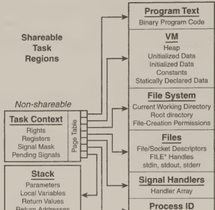

**图 7.1**

Linux 任务拥有几个内存区域。

Linux 和其他操作系统还支持对称多处理。如果你编写支持多任务处理的程序，当它们在对称多处理器上运行时，你会自动获得加速。基本上，在 Linux 中规则是相同的，只是有两个或更多的处理器来运行任务。（在撰写本文时，Linux 支持最多 `16` 个对称 CPU。）

## 何时使用多任务处理

你应该何时使用多任务处理？通常，用户应该始终控制程序。有时程序必须等待其他操作完成，因此它必须使用多任务处理，在等待其他操作的同时与用户交互。就像 Netscape 允许你在下载网页时访问其菜单一样，你设计的父程序应将所有网络 I/O 操作委托给子任务。事实上，由于不同服务器的响应时间不同，分拆几个线程从它们加载信息可以更有效地使用你的网络通道。

以下是何时使用多任务处理的一条好经验法则：在等待 I/O 期间，程序可以同时

- 执行其他工作——处理信息或委托任务
- 响应用户——用户输入或状态报告
- 服务其他计算机/人员——一个任务等待并接受连接，而另一个任务服务已建立的连接

在同一程序中混合使用线程和进程可能看似不寻常。然而，这在大型交互式应用程序中实际上很常见。互联网浏览器通常混合使用它们，每个浏览器窗口是一个独立的进程，而每个请求（如页面加载）都是由浏览器启动的多个线程产生的结果。你可以根据需要灵活搭配线程和进程。

## 多任务处理特征

注意每个任务在进程列表（使用 `top` 或 `ps aux` 命令）中的一些常见功能。这些功能有助于你以一致的方式处理它们。

首先，每个任务都有一个父任务。嗯，这几乎是正确的。进程表列出一个名为 `init` 的程序；这是系统中所有任务的“母亲”。它的主要职责是管理系统上运行的任务。父任务创建并管理其用于委托职责的任务。当子任务完成时，父任务应在其终止后清理资源。如果父任务不执行清理，最终 `init` 必须处理。

每个任务都使用内存、I/O 和优先级。你编写的最有趣的程序处理的信息超出了上下文所能容纳的范围——`16–32` 个寄存器不算多。内存始终以你在计算机上设置的 RAM 和交换空间来衡量。程序使用这些内存来存储其当前状态（这与任务的上下文不同）。

你的程序需要与某些事物交互，例如你或某个文件。这意味着 I/O。每个任务获得三个标准 I/O 通道：

- `stdin` 标准输入（仅输入），通常是键盘
- `stdout` 标准输出（仅输出），通常是显示
- `stderr` 标准错误（仅输出），通常是显示或日志

你可以在程序内部更改（或重定向）所有这些通道，或者在执行时更改。你选择的重定向目标可以包括其他设备、文件或不同的任务。在创建（或 `生成`）任务时，子任务继承父任务打开的所有文件。这种继承的紧密程度取决于任务的类型。

## 每个任务的独立硬件栈

每个任务都有一个独立的硬件栈。这一点至关重要——尤其是当你使用低级任务创建系统调用（`clone()`，详见本章后续内容）时。程序利用硬件栈来跟踪函数返回值、局部变量、参数以及返回调用地址。如果任务共享硬件栈，它们会立即破坏彼此的工作。

最后，每个任务都有一个唯一的优先级。你可以通过提高或降低优先级来改变程序所使用的 CPU 时间。

## Linux 的任务调度

多任务操作系统使用多种不同的方法来调度任务。Linux 采用优先级轮询（`prioritized round robin`）调度方案。在轮询中，每个任务依次获得一部分 CPU 时间。为了实现优先级，该调度方案会比低优先级任务更快地将高优先级任务移至任务列表的前面。

## 任务差异

进程和线程之间的差异是细微的。在处理它们时，请记住以下样式和功能。

| 进程 (Processes) | 线程 (Threads) |
| :--- | :--- |
| 从成功调用点开始，有两个进程并排运行。 | 调用者提供要作为子进程运行的函数名称。 |
| 子进程必须通过 `exit()` 系统调用显式终止。 | 子进程可以通过 `pthread_exit(void* arg)` 或 `return` 语句显式或隐式终止。 |
| 无共享数据。传递给子进程的唯一信息是系统调用之前父进程数据的快照。 | 子进程共享父进程的数据，接受参数，和/或返回一个值。 |
| 子进程始终与父进程关联。当它结束时，父进程必须清理子进程。 | 子进程可以从父进程分离。因此，子进程可以在没有父进程干预的情况下终止。（除非子进程已分离，否则父进程也必须清理线程。） |
| 由于每个进程的数据与其他进程独立，因此没有资源竞争。 | 所有竞争的数据必须被识别并锁定，以防止发生损坏。 |

| 进程 (Processes) | 线程 (Threads) |
| :--- | :--- |
| 独立的文件系统。 | 链接的文件系统。子进程可以看到父进程对当前工作目录 (`cwd`)、根文件系统 (`root`) 或文件创建时的默认权限 (`umask`) 所做的任何更改。 |
| 共享文件表。如果子进程关闭文件，父进程将失去对该文件的访问权限。 | 打开的文件表不共享。操作系统复制表，以便两个进程拥有相同的打开文件，但关闭一个通道不会影响另一个进程。 |
| 无共享信号。 | 信号是共享的。一个线程可以使用 `sigprocmask()` 阻止信号，而不会影响其他线程。 |

根据情况选择更适合的、你最熟悉的方式。线程提供的免费共享数据具有明显的优势，但进程的简单性和独立性也同样具有吸引力。

## 如何创建进程？

多任务通常通过进程实现。进程不共享任何内容，创建程序的新实例，并继承父进程打开的 I/O 通道的副本。要生成一个进程，请使用 `fork()` 系统调用：

```c
#include <unistd.h>
pid_t fork(void);
```

`fork()` 系统调用具有非常简单和谦逊的接口：你调用它，突然间就有两个完全相同的进程同时运行。`fork()` 系统调用有三个取值范围：


- 零——被调用的程序是子进程。如果调用返回零，则`fork()`成功，当前运行的任务是子进程。要获取子进程的进程 ID (PID)，请使用`getpid()`系统调用。

- 正数——被调用的程序是父进程。如果调用返回正数，则`fork()`再次成功，当前运行的任务是父进程。返回值本身是新子进程的 PID。

- 负数——发生错误；调用未成功。检查`errno`或使用`perror()`来确定错误的性质。

大多数程序将`fork()`系统调用放在条件语句（如`if`）中。条件语句有助于将父进程与子进程分开。列表 7.1 和 7.2 显示了使用此调用的两个典型示例。

### 列表 7.1 任务拆分示例

```c
/*****-*****************************-******/
/* Parent and Child following unique paths */
/* Task-splitting style of multitasking      */
/****-*********************************-*/
int pchild;

if ( (pchild = fork()) == 0 )
{ /* You're in the child */
     /****Do some child-ish things--*/
     exit(status); /* This is important! */
}
else if ( pchild > 0 )
{ /* You're in the parent */
     int retval;
     /****-Do some parent-ish things---*/
     wait(&retval); /* await child's end */
}
else
{ /* Some kind of error */
     perror("Tried to fork() a process");
}
```

### 列表 7.2 工作委托示例

```c
/*****-*****************************-******/
/* Parent (server) and Child (job proc)       */
/* Job-delegation style of multitasking       */
/****-*************************************-*/
int pchild;
for (;;) /* Loop Forever */
{
     /****-Wait for job request---*/
     if ( (pchild = fork()) == 0 )
     { /* Child */
          /****-Process the request---*/
          exit(status);
     }
     else if ( pchild > 0 )
     {
          /* parent clean up */
          /* notice NO WAIT() -- you must */
          /* use signals (see later) */
     }
}

else if ( pchild < 0 )
    {   /* Some kind of error */
        perror("Can't process job request");
    }
```

列表 7.1 在一个安全的环境中创建子进程。父进程做一些工作，然后等待子进程终止。或者，你可以使用一种算法，如列表 7.2 中所示，使父进程成为一个工作委托者。当外部实体请求操作时，父进程创建一个子进程来执行它。大多数服务器都表现为列表 7.2 中所示的样子。

你可能想使用多任务来同时完成不同的工作。这些工作在算法上可以是相同的，但它们使用不同的数据。如果没有这个概念，程序可能会浪费计算时间进行重复劳动。差异化将任务分开，使它们不重复劳动。虽然列表 7.3 中的源代码在语法上没有任何错误，但它违背了多任务的目的，因为它没有进行差异化。

### 列表 7.3 无差异化分叉示例

```c
/*******************************************************************/
/*** This is an example of "running together".  If fork() ***/
/*** is called without some differentiation, the two ***/
/*** tasks duplicate each other's work, thus wasting CPU ***/
/*** time. ***/
/*******************************************************************/
/*---do something---*/
fork();
/*---continue---*/
```

本书将无差异化的多任务称为“一起运行”（running together）或“汇合”（confluence）。一般规则是避免这种情况。如果进程没有通过显式调用`exit()`系统调用正确终止，也可能发生一起运行。

## 使用汇合实现容错

你可以使用这种强大的“一起运行”技术作为容错系统的一部分。容错系统可以复制计算以检查准确性。当处理器开始退化时，计算结果可能会有所不同。你可以通过一起运行两个或多个任务并将其锁定到特定的 CPU（目前 Linux 不支持）来实现这种技术。每个任务在其指定的处理器上运行相同的计算。并且，在特定的间隔内，任务将它们当前的结果发送给仲裁验证者。系统会关闭那个表现异常的处理器。

如果你从`fork()`系统调用获得任何错误，你的进程表或内存资源可能存在问题。操作系统过载的一个症状是被拒绝资源。内存和进程表条目是正常运行的操作系统的基石。由于这些资源非常重要，Linux 限制了进程可以拥有的资源总量。当你无法获取合理大小的内存块或无法创建新任务时，你可能面临程序问题或内存不足的问题。

## 如何创建线程？

线程为父进程、子进程和兄弟进程之间提供了紧密共享资源的强大功能。使用线程来为共同目标分配数据任务。例如，一个线程获取图片，另一个线程将其转换为显示格式。相比之下，当你不需要如此紧密连接的操作时，进程会更有帮助。

你可能听说过的一种特定的线程实现是 Pthreads。Pthreads 是一组库调用，以符合 POSIX 1c 标准的方式提供线程。使用 Pthreads 编写的程序很可能与其他符合 POSIX 标准的操作系统兼容。创建新 Pthreads 的库调用是`pthread_create()`：

```c
#include <pthread.h>
int pthread_create(pthread_t* child, pthread_attr_t* attr, void* (*fn)(void*), void* arg);
```

> **库调用与系统调用的区别**
>
> 库调用和系统调用之间的区别在于库与内核所做工作的量。`fork()`系统调用实际上是与内核系统服务的接口。`pthread_create()`在一个不同的库中，它将调用转换为`clone()`系统调用。在这种情况下，为了编译带线程的 C 程序，请确保在`cc`命令行的最后一个参数中包含`-lpthread`。例如，要编译`mythreads.c`并将其与 Pthreads 库链接，请使用以下命令：
>
> ```bash
> cc mythreads.c -o mythreads -lpthread
> ```

与`fork()`系统调用一样，当你成功执行`pthread_create()`时，你会拥有另一个正在运行的任务。然而，创建线程比`fork()`系统调用更复杂。根据你想使用的功能数量，你可能需要做更多的准备工作。每个参数提供了启动新线程所需的材料（见表 7.1）。

## 表 7.1 `pthread_create()` 库调用中每个参数的功能

| 参数 | 描述 |
|---|---|
| `child` | 新线程的句柄。调用后，你使用此变量来控制该线程。 |
| `attr` | 新线程的一组属性或行为。你可以在实例化时定义线程的运行方式及其与父进程的交互方式。这些行为包括优先级、依附关系和调度策略。此参数可以为 `NULL`。 |
| `fn` | 指向容纳线程的函数的指针。每个线程都在指定的程序子例程中运行（这与 `fork()` 不同）。当线程从子例程返回或退出时，系统终止该线程。这有助于避免任务汇聚问题（见上文）。 |
| `arg` | 传递给函数的参数。你可以使用它来配置线程的初始设置。务必确保该参数指向的数据块对线程可用。换句话说，不要引用栈变量。此参数也可以为 `NULL`。 |


如前所述，成功完成调用后，你有两个线程在运行——父线程和子线程。除栈之外，两者共享所有内容。父线程保留子线程的句柄 `child`，子线程在其自身的例程 `fn` 中执行，并带有配置 `arg` 和行为 `attr`。如果你将属性设置为 NULL，你仍然可以稍后更改线程的行为。请记住，在你更改属性之前，线程以默认方式运行。

本质上，该调用简化为两个特定参数。你可以比较以下代码中进程和线程的基本算法。这些算法几乎互为镜像，以反映主要差异。请对比列表 7.4 和 7.5 以查看创建进程和线程之间的差异。

### 列表 7.4 进程创建示例

```c
/* This example creates a process */
void Child_Fn(void)
{
    /* do whatever a child does */
}

int main(void)
{
    int pchild;

    /*---Initialization---*/
    /* Create new process */
    if ((pchild = fork()) < 0)
        perror("Fork error");
    else if (pchild == 0)
    {
        /* here is the child */
        /* close unneeded I/O */
        Child_fn();
        exit(0);
    }
    else if (pchild > 0)
    {
        /* Here is the parent */
        /*---close unneeded I/O---*/
        /*---do other work---*/
        /* wait for child to end */
        wait();
    }
    return 0;
}
```

### 列表 7.5 线程创建示例

```c
/*****************************************
/* This example creates a thread */
/****************************************/

void * Child_fn( void *arg)
{
    struct argstruct *myarg = arg;
    /* do whatever a child does */
    return NULL; /* any value */
}

int main( void)
{
    struct argstruct arg = {};
    thread_t tchild;

    /*---do some other initialization---*/
    /* Create new thread; report error in failed */
    if ( pthread_create(&child, NULL, &child_fn, &arg) != 0 )
        perror("Pthreads error"); /* error */

    /**Note that threads don't have a child section***/
    /* We are implicitly still in the parent */

    /* do some other work */
    /* wait for child to end */
    pthread_join(child, NULL);

    return 0;
}
```

当你生成一个进程时，你使用 `fork()` 系统调用。唯一的区别是用于分离执行路径的条件语句。在使用 Pthreads 生成线程时，你提供属性（线程的行为方式）、子例程（子线程运行位置）和参数（用于调用子线程的具体数据）。

进程需要特定的 `exit()` 调用来避免一起运行，这通常放置在子进程路径的末尾。在使用 Pthreads 时，你不必担心这一点。`return` 语句（甚至没有 `return` 语句直接穿过）会隐式终止子线程。

## `__clone()` 系统调用：勇敢者的召唤

Linux 提供了一个低级系统调用，让你对进程和线程的创建拥有更多的控制权。这是一个 Linux 特有的调用，允许你从六种不同的内存类型中选择共享。使用这个单一调用即可访问任务数据共享的完整频谱。回顾之前的 VM 页面图，使用此调用可以启用/禁用任务可共享页面的任意组合的共享。

> **小心使用 `__clone()`**

> **`__clone()`** 系统调用并非胆量小者所能驾驭。拥有如此强大的功能，你很容易搞崩你的程序（并使调试任务变得几乎不可能！）。

如果你仍想尝试，`__clone()` 的形式如下：

```c
#include <sched.h>

int __clone(int (*fn)(void*), void* stacktop,
            int flags, void* arg);
```

这个调用需要稍作解释。与 `fork()` 系统调用类似，`clone()` 系统调用返回子进程的 PID，或者在发生错误时返回 -1。表 7.2 描述了每个参数的含义和用途。

### 表 7.2 `clone()` 系统调用的参数

| 参数 | 描述 |
|---|---|
| `fn` | 类似于 `pthread_create()`，这是一个指向子进程执行的函数的指针。当函数返回时（通过 `return` 语句或显式调用 `exit()` 系统调用），任务终止。 |
| `stacktop` | 这指向子进程栈的顶部。大多数处理器（HP PA RISC 除外）的栈是从上往下增长的。因此，你需要传递栈的第一个合法字节。（为了可移植性，你需要使用条件编译。） |
| `flags` | 此参数指示要共享的内容以及子进程终止时要发出的信号。表 7.3 列出了可能的共享选项。虽然你可以在子进程终止时指定任何信号，但你可能希望坚持使用 `SIGCHLD`（标准信号）。 |
| `arg` | 类似于 `pthread_create()` 库调用，使用此参数将信息传递给子进程的 `fn` 参数。 |

### 克隆的栈空间

由于线程共享所有内容，而共享栈是个坏主意，父进程必须为子进程的栈预留一些空间。这个空间仍然是每个人可共享数据区域的一部分。如果你有行为不正常的任务或子进程栈空间不足，你的调试将具有挑战性。

再次参考处理器的 VM 图（图 7.1），你可以使用表 7.3 中的标志来启用不同形式的数据共享。如果省略，操作系统将假设你打算在任务之间复制该数据区域。

### 表 7.3 `clone()` 中可共享任务数据的不同类型

| 标志 | 描述 |
|---|---|
| `CLONE_VM` | 在任务之间共享数据空间。使用此标志共享所有静态数据、预初始化的数据和分配堆。否则，复制数据空间。 |
| `CLONE_FS` | 共享文件系统信息——当前工作目录、根文件系统和默认的文件创建权限。否则，复制设置。 |
| `CLONE_FILES` | 共享打开的文件。当一个任务更改文件指针时，其他任务会看到更改。同样，如果任务关闭文件，其他任务将无法再访问该文件。否则，为打开的 inode 创建新的引用。 |
| `CLONE_SIGHAND` | 共享信号表。单个任务可以选择忽略已发出的信号（使用 `sigprocmask()`）而不影响对等任务。否则，复制表。 |
| `CLONE_PID` | 共享进程 ID。谨慎使用此标志；并非所有现有工具都支持此功能。Pthreads 库不使用此选项。否则，分配一个新的 PID。 |

`__clone()` 系统调用是一个包罗万象的任务创建者。如果共享所有内容，子进程就是线程；如果共享什么都不共享，子进程就是进程。请考虑，如果配置得当，`__clone()` 系统调用实际上可以取代 `fork()` 系统调用和 `pthread_create()` 库调用。

列表 7.6 和 7.7 展示了使用 `fork()` 和 `pthread_create()` 实现的代码段与等效的 `__clone()` 系统调用的比较。

### 列表 7.6 说明 `fork()` 和 `pthread_create()` 的代码


```c
/*******************************/
/* The fork() system call */
/*******************************/
void Child(void)
{
    /* --child's responsibility. */
    exit(0);
}

int main(void)
{
    int pchild;

    if ((pchild = fork()) == 0)
        Child();
    else if (pchild > 0)
        wait();
    else
        perror("Can't fork process");
}
```

### 列表 7.6 续

```c
/*********************/
/* The pthread_create() library call */
/*********************/
void Child(void* arg)
{
    /*---child's responsibility---*/
    return &result;
}

int main(void)
{
    pthread_t tchild;

    if ( pthread_create(&tchild, 0, &Child, 0) != 0 )
        perror("Can't create thread");
    pthread_join(tchild, 0);
}
```

### 列表 7.7 等效 `__clone()` 系统调用的代码

```c
/*********************/
/* The equivalent __clone() system call for fork()*/
/*********************/
void Child(void* arg)
{
    /*---child's responsibility---*/
    exit(0);
}
#define STACK 1024
int main(void)
{
    int cchild;
    char *stack = malloc(STACK);
    if ( (cchild = __clone(&Child, stack+STACK-1, SIGCHLD, 0)
    == 0 ) )
    {/* In child -- section unreachable ***/}
    else if ( cchild > 0 )
        wait();
    else
        perror("Can't clone task");
}

/*********************/
/* The equivalent __clone() system call to pthread_create()*/
/*********************/
void Child(void* arg)
{
    /*---child's responsibility---*/
    exit(0);
}

#define STACK 1024
int main(void)
{
  int child;
  char *stack=malloc(STACK);

  if ( (cchild = _clone(&chlid, stack+STACK-1, CLONE_VM |
          CLONE_FS | CLONE_FILES | CLONE_SIGHAND | SIGCHLD,
          0)) < 0 )
    perror("Can't clone");

  wait();
}
```

基本上，你可以在任何可以使用另外两个调用的地方使用`__clone()`系统调用。然而，请注意，它与`Pthreads`的实现并不 100% 兼容。首先，克隆的任务只返回一个整数（类似于进程）。而另一方面，`Pthreads`允许线程返回任何值。此外，任务终止的方式也不同。除非你预计代码将仅在 Linux 兼容的计算机上运行，否则你可能更希望关注标准任务生成调用。

# 任务通信

你通过区分任务来创建独特的任务，以免重复工作。两种区分方式——指定路径和通信——帮助你以逻辑方式设计和分配职责。例如，考虑打一手扑克牌。游戏使用几个阶段和运行模式来确保玩家正确游戏。由于每个玩家获得不同的手牌、不同的打法以及不同的投注资金，游戏变得有趣。同样地，当你考虑任务和责任的不同功能时，你将获得最佳结果。

# 初始化：设置子任务的状态

在扑克中，每个玩家购买一组筹码，发牌者发出牌。玩家可能有不同的技巧来评估他们的手牌；发牌者有额外的管理牌堆的责任。在编程中，通信的一种形式就是任务开始时的状态。进程和线程通常遵循与父级不同的执行路径，在父级设置共享数据之后。

使用父级设置子级工作所需的环境。在孩子拥有它们需要的之后，它们可以开始处理。父级可以对孩子有少量的控制，但——就像发牌者和玩家一样——这些通常是指导性的（“你那样做不行！”），而不是程序性的（“继续！赌上你的房子！”）。

当你创建线程时，你遵循类似创建进程的过程。首先，你为进程和线程设置共享环境，然后创建任务。此外，线程可以接受一个`void*`参数（类似于过程调用）用于初始化。`void*`数据类型是 C 语言处理抽象数据类型的方式。有了它，你可以传递任何值，由接收者解释其真实含义。这个参数类似于接受要玩的手牌。

## 使用 `void*` 数据类型

传递`void*`类型可能看起来非常强大，但要小心如何创建该类型。数据必须是分配块（使用`malloc()`库调用）、全局数据或静态数据。换句话说，它不应该是`stack`（或`auto`）数据。原因很简单：随着程序进行过程调用/返回，堆栈将发生变化。子进程可能看不到数据。

## 共享/公共内存

当你打扑克时，你目测两种特定资源——底注和牌堆。这些是有限且共享的资源。你如何玩以及何时弃牌取决于这些因素。在游戏过程中，发牌者从牌堆中抽取并在玩家之间分发。玩家评估他们收到的手牌并将投注放入底注。同样，有必要牢记你的程序可用的内存资源。

你可以编程进程和线程，将信息被动地传递给其他持有公共或共享内存的人。线程本质上提供公共内存：父级和子级（甚至兄弟级）默认共享相同的数据区域。堆栈是线程任务之间唯一的唯一区域。只需确保没有两个人同时在底注中操作。

你可以通过使用`shmget()`系统调用在进程中创建共享内存。这种方式的共享内存会预留一块内存用于与其他进程通信。然而，这会增加计算时间，因为进程必须使用系统来管理内存访问。

## 进程间通信 (IPC)

在扑克游戏中，玩家相互发送消息并发送给发牌者。这些消息中有一些是指令性的，有一些是情感性的（你可能已经猜到）。尽管如此，玩家将消息指向特定的玩家或整个群体。

你设计和编程的任务可以使用进程间通信 (IPC)。IPC 通常以管道形式出现；你的任务可以使用这些管道将消息定向到其他任务。管道是单向的，就像使用`stdin`和`stdout` I/O 通道一样。系统调用`pipe()`创建以下管道：

```c
#include <unistd.h>
int pipe(int fd[2]);
```

参数`fd`是一个包含两个整数的数组。你提供此数组以接受两个新的文件描述符引用。两个常见的错误是

- `EMFILE` 已经打开了太多文件。
- `EFAULT` `fd` 没有指向包含两个整数的数组。

以下是使用`pipe()`的一个示例：

```c
/***** Example of using the pipe() system call *****/
int fd[2];  /* create the array to hold the descriptors */
if ( pipe(fd) != 0 )        /* create the pipe */
    perror("Pipe creation error");
...
read(fd[0], buffer, sizeof(buffer)); /* read from input end */
...
```


## 索引文件描述符

> 每个 I/O 通道都被分配一个文件描述符编号。这是文件描述符表中的一个索引。默认情况下，每个进程获得三个通道：`stdin`（0）、`stdout`（1）和`stderr`（2）。当你创建管道时，它会占用接下来两个可用的槽位（一个用于输入，一个用于输出）。例如，如果一个任务没有打开其他文件，调用`pipe()`会预留管道输入（3）和管道输出（4）。

设置多任务管道更复杂，可能有点令人头晕，但一旦你做了几次，它就不会再引起偏头痛了。

列表 7.8 和 7.9 对比了在父任务中创建管道的线程和进程的不同方式。由于程序员必须特别注意克隆任务，示例不包括它们。


## 列表 7.8 在父进程中创建管道

```c
/***** Parent Process *****/
int FDs[2];     /* create the place holder for the new pipe */
pipe(FDs); /* create the pipe: FDs[0]=input, FDs[1]=output */
char buffer[1024];

/*---Create the process using fork() ---*/
close(FDs[0]);    /* Make write-only */
...
write(FDs[1], buffer, buffer_len); /* send message to child */
...
/*---do processing---*/
wait();
close(FDs[1]);
```

## 列表 7.9 在父线程中创建管道

```c
/***** Parent Thread *****/
int FDs[2];     /* create the place holder for the new pipe */
pipe(FDs); /* create the pipe: FDs[0]=input, FDs[1]=output */
char buffer[1024];

/*---Create the thread using pthread_create() ---*/
write(FDs[1], buffer, buffer_len); /* Send message to child */
...
/*---(Leave pipe closure to child)---*/
pthread_join(pchild, arg);
```

子进程或线程扮演不同的角色。虽然彼此相似，但由于对线程的限制，它们在管道方面的工作略有不同。比较列表 7.10 和列表 7.11。

## 列表 7.10 在子进程中创建管道

```c
/***** Child Process *****/
int FDs[2];     /* create the place holder for the new pipe */
pipe(FDs); /* create the pipe: FDs[0]=input, FDs[1]=output */
char buffer[1024];

/*---Create the child process---*/
dup2(FDs[0], 0); /* replace stdin */
```

### 列表 7.10（续）

```c
close(FDs[0]); /* 现在不需要了 */
close(FDs[1]); /* 不向父进程写入 */

read(0, buffer, sizeof(buffer));/* 获取来自父进程的消息 */
/*
 */---执行处理---*/
printf("我的报告...");
exit(0);
close(FDs[1]);
```

## 列表 7.11 在子线程中创建管道

```c
/************************************/
/***          子线程             ***/
int FDs[2];    /* 创建新管道的占位符 */
pipe(FDs); /* 创建管道：FDs[0]=输入，FDs[1]=输出 */
char buffer[1024];

/*---创建子进程---*/

read(FDs[0], buffer, sizeof(buffer));/* 获取来自父进程的消息 */
/*---执行处理---*/
printf("我的报告...");
/*
 */
close(FDs[0]); /* 关闭输入管道 */
close(FDs[1]); /* 关闭输出管道 */

pthread_exit(arg);
```

您可以参考图 7.2 在两个任务之间创建管道；请按照以下步骤进一步了解其中发生的事情。

1. 父进程声明一个文件描述符数组。当您调用 `pipe()` 系统调用时，该调用会将描述符放入此数组中。

2. 父进程创建管道。内核创建一个队列，并将读取描述符放在 `fd[0]` 中，将写入描述符放在 `fd[1]` 中。

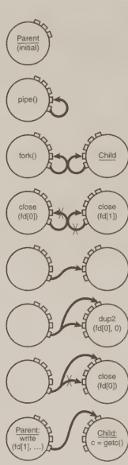

### 图 7.2

当您在任务之间创建管道时，必须遵循特定的重定向和关闭通道的顺序。

## 使用管道需要关闭一端

当系统创建管道时，它将输入通道连接到输出通道：管道实际上形成了一个回路——程序写入的任何内容都可以由同一任务读取（就像它在自言自语一样）。相同的信息仍然会发送给子进程，但父进程会在其输入中看到它自己的消息。大多数通信路径是单向的：父进程告诉子进程应该处理什么，因此您的进程会关闭不需要的通道。然而，如果您希望实现真正的双向通信，您需要调用 `pipe()` 两次——每个方向一个管道（见图 7.3）。

3. 父进程派生新任务。进程获得所有内容的一份精确副本（包括管道）。父进程和子进程之间的管道是被继承的。

4. 父进程使用文件描述符数组与子进程通信。

5. 子进程重定向其自身的标准输入（这是可选的），并使用打开的管道与父进程通信。它还关闭了输出通道。

6. 父进程只需要管道的输出通道来与子进程通信，因此它关闭了输入通道。

您不能在线程中重定向 I/O 通道，因为它们共享文件描述符表。这意味着，如果您在一个线程中关闭文件，实际上就关闭了程序中所有其他线程中的该文件。另一方面，进程会复制文件描述符表，因此关闭一个通道不会影响程序中的其他进程。

图 7.2 向您展示了如何在父进程和子进程之间创建单向连接。要创建双向连接，您需要遵循图 7.3。

请参考此图，帮助您为编程创建管道和重定向。

## 发出改变方向信号：弃牌

扑克游戏很少提供直接的异步控制。玩家随时可以弃牌（退出当前游戏）。如果游戏是在旧西部的背景下进行的，作弊者可能会遭遇突然的异步终止。无论如何，发牌员都会捡起掉落的牌。同样，在您启动一个进程后，您可以通过信号改变其方向，或者您的父任务可以接收到终止通知。

您编写的每个任务都应处理所有有用的信号。大约有 30 种不同的信号（其中两种是用户自定义的）。大多数信号您可以忽略或不捕获，因为它们发生的可能性很小，或者捕获它们没有意义。许多未捕获的信号通常会终止您的程序，其中一些对于多任务程序非常重要。例如，当子进程终止时，系统会通过 `SIGCHLD` 信号通知父进程。

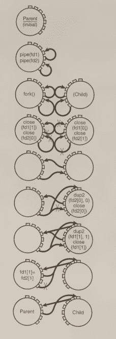

### 图 7.3

如果您的希望在父进程和子进程之间实现双向通信，您的程序可以创建一个额外的反向连接。

信号类似于中断；唯一的信号信息就是信号发生了。当信号到达时，任务会停止当前操作并跳转到指定的例程（称为`信号处理程序`）。对于 `SIGHUP`，您可以调用 `wait()` 来清理子进程的终止。您也可以支持其他信号，如数学错误或 Ctrl+C 中断。

Linux 支持两种样式的信号：System V（一种单次触发的信号，当系统调用您的自定义处理程序时，它会恢复默认处理程序）和 BSD（保持其处理程序，直到被告知改变）。如果您使用 `signal()` 系统调用，单次触发是默认的。您可能对这一特性不感兴趣——您应该预期重复捕获信号。

## 重置信号处理程序

为了重置处理程序，一些程序通过在信号处理程序中直接调用 `signal` 系统调用来修复 System-V 的单次触发行为。不幸的是，这可能会产生竞争条件；信号可能在重置调用之前到达。结果是，信号可能会丢失。

代替使用 `signal()`，首选的系统调用是 `sigaction()`。`sigaction()` 系统调用为您提供对信号子系统行为的更多控制。以下是其原型：

```c
#include <signal.h>
int sigaction(int sig_num, const struct sigaction *action,
    const struct sigaction *old);
```

您使用第一个参数来定义要捕获哪个信号。第二个参数定义您想要如何处理该信号。如果您将最后一个参数设置为 `非-NULL` 值，该调用将存储上一个动作定义。第二个和第三个参数的结构定义如下：

```c
struct sigaction
{
    /* 指向处理程序的函数指针 */
    void (*sa_handler)(int signum);
    /* 专门的 sigaction 回调 */
    void (*sa_sigaction)(int, siginfo_t *, void *);
    /* 在处理程序运行时阻塞信号的位数组 */
    sigset_t sa_mask;
    /* 要执行的行为 */
    int sa_flags;
    /* （已弃用--设为零） */
    void (*sa_restorer)(void);
};
```

## 服务器视角与负载控制


要使用此结构，您将第一个字段 (`sa_handler`) 设置为不同于函数指针的值。如果您在此字段中放置 `SIG_IGN`，程序将忽略特定的传入信号。同样，如果您使用 `SIG_DFL`，程序会将行为恢复为默认状态。

要允许或拒绝级联信号（一个信号中断另一个信号），使用第二个字段，`sa_mask`。每个位（共有 1,024 个可能的位）代表一个允许 (`1`) 或阻塞 (`0`) 的信号。默认情况下，在处理第一个信号时，特定信号会阻塞类似的信号。例如，如果您正在处理 `SIGCHLD` 信号，而另一个进程终止，您的处理程序默认会忽略该信号。您可以使用 `SA_NOMASK` 更改该行为。

`sa_flags` 决定处理程序的行为。大多数时候，您可以将其设为零：

- `SA_ONESHOT`：使用 System V 行为，在捕获信号后重置处理程序一次。
- `SA_RESHAND`：与 `SA_ONESHOT` 相同。
- `SA_RESTART`：如果信号中断了某些系统调用，则重启它们。使用此标志来重启诸如 `accept()` 等系统调用。
- `SA_NOMASK`：允许在处理较早的信号时，相同信号可以中断。
- `SA_NODEFER`：与 `SA_NOMASK` 相同。
- `SA_NOCLDSTOP`：如果子进程只是停止（`SIGSTOP`, `SIGSTP`, `SIGTTIN`, 或 `SIGTTTOU`），则不通知父进程。此标志对本章很重要。

### 清单 7.12 `SIGFPE` 和 `SIGINT` 处理程序示例

`SIGFPE`（浮点异常）和 `SIGINT`（键盘中断）的处理示例如下：

```c
/***/
/** 捕获 SIGFPE 并忽略 SIGINT 的示例 */
/***/

#include <signal.h>

/* 定义信号捕获器 */
void sig_catcher(int sig)
{ printf("我捕获了信号 #%d\n", sig); }

int main(void)
{ struct sigaction act;

bzero(&act, sizeof(act));
act.sa_handler = sig_catcher;

sigaction (SIGFPE, &act, 0); /* 捕获浮点错误 */
    act.sa_handler = SIG_IGN;          /* 忽略信号 */
    signal(SIGINT, &act, 0);          /* 忽略 ^C（中断） */
    /*---执行处理---*/
}
```

### 信号处理程序中的信号丢失

如果信号处理程序执行时间过长，程序可能会丢失待处理信号。信号队列只是一个单一标志——如果两个信号到达，只有一个会被记录。因此，请尽量缩短信号处理程序占用的 CPU 时间。此外，保持处理程序简短且精练可确保您的程序获得更多的 CPU 时间。

服务器和客户端可以接收多种不同的信号。为了使代码更健壮，应捕获所有合理且适用的信号。（某些信号，如 `SIGFAULT`，最好不捕获。如果您收到了此信号，说明您的代码或数据存在问题，且无法恢复。）

### 通过共享信号处理程序减少代码

您可以将多个信号处理程序合并为一个处理程序。系统会将信号编号传递给该处理程序。进入处理程序后，只需检查该值即可执行相应的操作。

您可以向任何您能控制的任务发送信号。换句话说，信号遵循与其他所有事项相同的安全规则。要从命令行发出信号，可以使用 `kill` 命令。同样，也可以在程序中调用 `kill()` 系统调用。`kill()` 系统原型的声明如下：

```c
#include <sys/types.h>
#include <signal.h>
int kill(pid_t PID, int sig_num);
```

通过阅读手册页，您可以了解该调用冗长（且复杂的）选项。本质上，您的程序调用 `kill()` 时传入进程 ID 和要发送给该进程的信号。

## 子进程的结果

回到扑克牌的示例，当牌局结束或玩家弃牌时，发牌员必须整理并洗牌。实际上，有些玩家可能要求在获胜玩家收走彩池之前查看获胜手牌的底牌。类似地，父进程清理并检查每个子进程的结果。

最后一种通信方式是终止结果。父进程使用此信息来决定子进程是否成功。当进程结束时，它总是返回一个有符号整数。另一方面，线程可以使用 `void*` 返回一个抽象对象，类似于线程参数的抽象对象。

务必谨慎使用这种提供结果的方式——它必须在转换期间保持有效。例如，不要返回由栈变量构建的对象。相反，请使用堆或全局变量。实际上，只要父进程预期参数会发生改变，且该参数不在线程间共享，您就可以使用相同的参数变量将数据传回。

## 战胜时钟：竞态条件与互斥锁

线程所提供的强大功能非常诱人。如果线程管理得当，您的程序运行速度会更快，且停顿更少。然而，此功能有一个陷阱——资源争用。如果两个线程同时修改相同的数据，它们可能会破坏结果。而调试资源争用可能耗费您大量的时间。以下小节讨论竞态条件相关问题。

### 竞态条件

您可能熟悉`竞态条件`，主要指两个线程在竞争存储数据的场景。本章前面曾展示过重置信号处理程序时的竞态条件示例。`临界区`是发生资源争用的源代码部分。假设线程 1 和线程 2 同时执行，请查看列表 7.13 和 7.14 中的示例。

#### 列表 7.13 线程 1 的竞态条件

```c
/*************** 两个线程发生竞态条件的示例 *****/
/*************** 争用队列数据对象。 **************/

int queue[10];
int in, out, empty;

/************ 线程 1 *************/
/* 读取队列 */
if ( !empty ) /* 避免队列下溢 */
{
    int val = queue[out];
    out++;
    
    if ( out >= sizeof(queue) )
        out = 0; /* 回绕 */
        empty = ( out == in );
}
```

#### 列表 7.14 线程 2 的竞态条件

```c
/*********************************************************/
/*** 两个线程发生竞态条件的示例 ***/
/*** 争用队列数据对象。 ***/
/*********************************************************/

int queue[10];
int in, out, empty;
/******************** 线程 2 *****************/
/* 写入队列 */
if ( !empty && out != in ) /* 避免溢出 */
{
   queue[in] = 50;
   in++;
   if ( in >= sizeof(queue) )
      in = 0; /* 回绕 */
   empty = ( out == in );
}
```

为了清晰起见，请注意程序在引用队列后递增指针变量。只要它们逐行并行运行，这些代码看起来没问题。不幸的是，这种情况很少发生。假设线程 1 落后于线程 2 几行代码。线程 2 可能会在重置变量 `out` 之前执行 `empty` 测试。这种情况会导致测试无效，因为 `out` 永远不会等于 `in`。

如果两个线程在来回切换（多任务而非并行任务），此问题会有所不同。任务切换可能发生在线程 1 中的 `out++` 语句之后。由于变量 `out` 和 `empty` 未完成其测试，线程 2 随后恢复执行时，这些数据可能是错误的。

实际上，这两个例程正在争用四个数据资源：`queue`、`in`、`out` 和 `empty`。

### 互斥（Mutex）

您可以通过锁住（`互斥`或简称为`mutex`）来排除其他进程使用资源，从而处理临界区。这种`串行化`（一次仅允许一个任务）确保线程不会破坏临界区中的数据。互斥`信号量`是一个序列化访问的标志，作用类似于交通信号灯。只要标志为清除状态（绿色），线程即可进入临界区。如果标志为置位状态（红色），线程将阻塞，直到标志再次清除（绿色）。

为了管理资源，程序使用粗粒度或细粒度锁两种方法之一。粗粒度锁基本上在程序处于临界区时锁定所有人，使其无法执行任何操作。一种粗粒度方法是关闭时间切片。这种方法存在两个主要问题：它阻塞无关任务，且在多处理环境中不起作用。

细粒度锁为您提供对争用资源（而非任务）的控制。线程请求访问共享资源。如果资源未被使用，线程将拥有该资源，直到释放。如果您的线程发现资源已被保留，线程将阻塞并等待，直到当前使用该资源的任务释放该资源。

`Pthreads` 库为您提供广泛选择的工具来管理多线程应用程序。其中包括互斥 API。使用互斥锁的方法很简单（参见列表 7.15）。

#### 列表 7.15 创建信号量示例


```c
/***************************/
/*** 定义全局互斥信号量。该值 ***/
/*** 指示要使用的检查算法。 ***/
/***********************/
pthread_mutex_t mutex = PTHREAD_MUTEX_INITIALIZER;
...
/* 开始临界区 */
pthread_mutex_lock(&mutex);
...
/*---处理关键数据。--*/
...
pthread_mutex_unlock(&mutex);
/* 结束临界区 */
...
```

参数 `mutex` 是您用于锁定该段的信号量。完整的代码示例（称为 `thread-mutex.c`）包含在网站上。使用以下三种行为值之一进行初始化：

- 快速（默认）—（`PTHREAD_MUTEX_INITIALIZER`）仅检查锁。如果同一线程尝试对同一个互斥锁加锁两次，它将导致死锁。
- 递归 —（`PTHREAD_RECURSIVE_MUTEX_INITIALIZER_NP`）验证拥有者是否再次锁定互斥锁。如果是，它会记录锁的次数（计数信号量）。互斥锁必须与加锁次数相同地被解锁。
- 错误检查 —（`PTHREAD_ERRORCHECK_MUTEX_INITIALIZER_NP`）验证解锁互斥锁的线程是否与加锁的线程相同。如果不相同，它将保留锁并返回错误。

该库提供一个额外的非阻塞锁调用。`pthread_mutex_trylock()` 库调用会尝试对信号量加锁。如果无法加锁，则返回 `EBUSY` 错误。

## 通过避免临界区锁死来公平竞争

尽量将临界区内的计算限制在争夺项上。例如，除非绝对无法避免，否则不要调用 I/O 或操作无关数据。如有必要，可以将数据复制到局部变量中，以便在区域外进行计算。请记住，I/O 与临界区混合会导致死锁风险。

## Pthread 互斥锁问题

使用 Pthreads 时有一些限制。首先，Pthreads 的互斥锁没有引用内存的临界区。它只是一个标志。再次使用交通灯的类比，争夺的资源是十字路口——而不是交通灯。交通灯在有或没有十字路口的情况下都能工作。互斥锁的主要功能是让您将其专门用于争夺的数据。例如，如果不小心，您可能将两个线程编程为使用单个信号量来操作无关数据。这并不危险——您不会崩溃、死锁或损坏数据。但是，您可能会不必要地阻塞一个线程。

其次，您可能有多个线程在一个大数据块上工作，例如一个表。每个单元格都互不相关，且线程在不同区域工作。您不想锁住整个表，只想锁住其中的一部分（称为区域锁）。Pthreads 互斥锁使您能够阻止并发访问，但它无法动态确定您的线程在哪里工作。

最后，您可能还想优先访问。读取某些数据没有害处，并且可以同时有多个读者（称为共享锁）。但是，没有其他线程可以写入它。同样，您只希望有一个写入者；这仅当争夺的数据被原子更新时才有效。Pthreads 仅限于独占访问——要么您拥有它，要么您没有。

如果当前版本的 Pthreads 互斥锁不满足您的所有需求，您可以基于它们构建自己的扩展。

## 死锁预防

想象两个玩玩具的幼儿。一个孩子看到另一个孩子在玩什么，反之亦然。他们想要对方的玩具，但不愿意放弃自己手里的。本质上，他们陷入了死锁。

使用线程时，请务必考虑资源竞争和临界区的可能性。在分离和分组临界数据之后，您需要确定谁需要什么以及何时需要。有时您可能会发现，在进行工作之前必须锁定两个资源（称为互锁）。如果您不仔细，可能会导致死锁发生。考虑以下死锁示例：

| 线程 #1 | 线程 #2 |
| :--- | :--- |
| 1. 锁定储蓄基金。 | 1. 锁定 `IRA` 基金。 |
| 2. 锁定 `IRA` 基金。 | 2. 锁定储蓄基金。 |
| 3. 使用 `IRA` 基金，修改储蓄基金。 | 3. 使用储蓄基金，修改 `IRA` 基金。 |
| 4. 解锁 `IRA` 基金。 | 4. 解锁 `IRA` 基金。 |
| 5. 解锁储蓄基金。 | 5. 解锁储蓄基金。 |

线程 #2 在第 2 步发生死锁。使用标准化命名策略，死锁会更明显：

| 线程 #1 | 线程 #2 |
| :--- | :--- |
| 1. 锁定 `Funds_Mutex_1`。 | 1. 锁定 `Funds_Mutex_2`。 |
| 2. 锁定 `Funds_Mutex_2`。 | 2. 锁定 `Funds_Mutex_1`。 |
| 3. 使用 `Funds_Mutex_2`，修改 `Funds_Mutex_1`。 | 3. 使用 `Funds_Mutex_1`，修改 `Funds_Mutex_2`。 |
| 4. 解锁 `Funds_Mutex_2`。 | 4. 解锁 `Funds_Mutex_2`。 |
| 5. 解锁 `Funds_Mutex_1`。 | 5. 解锁 `Funds_Mutex_1`。 |

死锁发生是因为两个线程想要对方的资源。以下是几条可以减少死锁风险的规则：

- 分组命名——识别相互依赖的资源组，并给它们的互斥锁起相似的名字（例如：`Funds_Mutex_1` 和 `Funds_Mutex_2`）。
- 顺序加锁——按数字从小到大锁定资源。
- 顺序解锁——按数字从大到小解锁资源。

遵循这些死锁策略，您可以避免解开死锁所需的麻烦调试工作。

## 控制子进程并清除僵尸进程

您创建了几个线程或进程。创建子任务后，您确实拥有一些控制权。问题是，您如何控制它们的行为？如前所述，您可以使用信号、消息和数据与之通信。

## 给予子进程更多关注：优先级和调度

您可以降低子任务的优先级，以便其他任务获得更多 CPU 时间。（您可能知道，只有具有 `root` 权限的任务才能提高任务的优先级。）用于更改优先级的系统调用是 `getpriority()` 和 `setpriority()`。

与对子进程控制有限的进程不同，线程允许您更改其调度算法或使其失效。Linux 使用基于优先级的轮转调度算法（在本章前面已介绍）。线程为您提供三种不同的调度算法：

- `Normal`（正常）——这类似于 Linux 调度算法。（默认）
- `Round Robin`（轮转）——调度器忽略优先级，每个线程获得一段时间片，直到终止。您可能在实时环境中使用此方法。
- `FIFO`（先进先出）——调度器排队并运行每个线程直到完成。再次，主要将此调度形式用于实时环境。

## 埋葬僵尸进程：终止后的清理

也许您没注意到，您处理的一些进程表示例中可能存在一些僵尸进程。抱歉，这不是万圣节惊悚片，但这个问题可能会让任何系统管理员感到恐惧。一旦它们进入您的进程表，有时如果不重启就无法消除。

如果您喜欢冒险并且不知道什么是僵尸进程，您可能可以考虑在您的系统上创建一个。如果您无法重启计算机，请勿这样做。它们不会伤害您的计算机，但它们会占用宝贵的资源（内存和进程表项）。运行多任务回声服务器代码（可在网站上找到）。连接它，然后输入 `^bye`。它会关闭连接。现在输入 `ps aux|grep <username>`（适当替换您的用户名）。您可能会看到一个状态为 `Z` 的条目。这并不意味着它在休眠。通常，您可以通过杀死父进程（`Echo-Server`）来终止它。

当子进程结束时，它会以一个数字返回值退出。该值表示成功或某个错误代码。通常，您必须编程让父进程等待子任务完成，使用 `wait()` 系统调用。`wait()` 检索子进程的返回值供父进程检查。如果您不等待子进程，子进程将无限期地等待您。


与使用 `fork()` 或 `clone()` 系统调用的进程不同，Pthreads 允许您放弃（或分离）一个线程。分离线程使您可以继续而不必等待其终止。库调用如下：

```c
#include <pthread.h>
int pthread_detach(pthread_t tchld);
```

参数 `tchld` 是您调用 `pthread_create()` 时获得的引用。该调用返回以下错误：

- `ESATCH`：未找到与 `tchld` 指定的线程对应的线程。
- `EINVAL`：线程 `tchld` 已经处于分离状态。

您可以按以下方式使用 `pthread_create()`：

```c
/**** 示例：从父进程分离线程。 *****/
/**** 允许父进程继续而无需检查子进程 ***/
/**** 的终止状态。 ***/

/* 创建引用线程的变量 */
pthread_t tchild;
...
/* 创建线程 */
if ( pthread_create(&tchild, 0, Child_Fn, Child_Arg) != 0 )
    perror("Could not create thread");
else
    /* 分离它 */
    pthread_detach(tchild);
...
```

调用 `pthread_detach()` 后，您的父任务可以继续其自身的计算。另一方面，进程没有这种灵活性。但同时，无需等待每个子任务；那样违背了委派职责的目的。

## 避免产生 `exec()` 僵尸进程


你可以使用信号异步地捕获子进程终止的通知。当子进程结束时，操作系统会向父进程发送`SIGCHLD`信号。你所需要做的就是在处理程序中捕获该信号并调用`wait()`。

```c
/**** 捕获子进程 ***/
/**** 终止通知的信号处理程序示例。 ***/
#include <signal.h>

void sig_child(int sig)
{
    int status;

    wait(&status);            /* 获取最终结果 */
    fprintf(stderr, "又一个进程结束了\n");
}
```

为了获取任何通知，你需要像下面这样将信号处理程序与信号关联起来：

```c
{
    struct sigaction act;

    bzero(&act, sizeof(act));
    act.sa_handler = sig_child;
    act.sa_flags = SA_NOCLDSTOP | SA_RESTART;
    sigaction(SIGCHLD, &act, 0);   /* 捕获子进程终止 */
}
```

如果你想查看子进程是否出现了问题，请检查通过`status`变量传递的返回值。当然，父进程需要解释该结果的含义。例如，子进程可以返回`0`（零）表示正常终止，或返回负值表示错误。

## 进程返回值的限制

只有最低的`8`位会被保留，并且该值会右移`8`位。因此，如果你返回值为`500`（`0x01F4`），`wait()`系统调用会得到`0x01F4`。高位会丢失。

`wait()`返回的状态值不能直接解释。它包含编码的状态以及进程的退出码。库提供了一些简单的方法来隔离退出码，其中两个是`WIFEXITED()`和`WEXITSTATUS()`。请查阅`waitpid()`的手册页以了解有关这些宏的信息。

## 扩展现有客户端和服务器

你可以将本章中的概念应用于前几章的示例，并使用进程和线程进行扩展。通过添加对`fork()`或`pthread_create()`的调用，你可以为`Echo`服务器添加多任务处理。由于你正在创建新任务，`fork()`系统调用要求你捕获并分派子进程终止信号。要获取完整的源代码列表，请参阅网站上的`echo-server.c`。

现在，编译并运行该程序后，你可以使用`telnet`命令连接到此服务器。事实上，你可以同时拥有多个连接。这正是用户所期望的——与服务器之间看似独占的连接。创建任务并分配职责有助于你提供该服务。

## 使用 `exec` 服务器调用外部程序

没人喜欢重新发明轮子。你可能更喜欢使用`ps`命令，而不是在程序中自己构建该信息。同样，使用`Perl`执行某些操作比在`C`中编写解析器要容易得多。那么，如何调用这些现有的命令？

`exec()`系统调用`API`扩展了`fork()`系统调用，允许你调用外部程序并与之交互。这本质上就是`Web`上`CGI`（通用网关接口）调用的方式，如下所示：

- 网络上的某台主机提供一个`CGI`服务器，用于接收命令。该命令通常具有命令行参数，形式如下：

`http://www.server.com/cgi/<command>?param+param2+..`

- 客户端发送一条消息，例如

`http://www.server.com/cgi/lstmp+proc`

- 服务器创建一个子进程，并将标准输入（`stdin`）、标准输出（`stdout`）和标准错误（`stderr`）重定向到客户端通道。

- 然后，服务器使用`exec()`系统调用来调用该程序。

仅仅通过运行外部程序而无法有效实现这一事实，就体现了多任务处理的优势。`exec()`系统调用有五种变体：

- `exec1()`可变参数列表，第一个参数是带有完全限定路径的命令。后续所有参数都是命令行参数，从第零个参数（`arg[0]`）开始。列表以零或`NULL`结尾。

```c
/* 例如： */
if ( exec1("/bin/ls", "/bin/ls", "-aF", "/etc", NULL) != 0 )
    perror("exec1 失败");
    exit(-1);
/* 实际上 "if" 是多余的 -- 除非失败，否则 exec 不会返回 */
```

### `exec1()` 的前两个参数

`exec1()`系统调用可能看起来有些冗余；为什么第一个和第二个参数是相同的命令？第一个参数是实际的命令名称（将被执行），第二个是第零个命令行参数（类似于`C`程序`main()`中的`arg[0]`）。别忘了包含名称——某些外部命令会检查名称以确定使用什么行为。另外，别忘了最后的`NULL`或零；它表示参数列表的结束。

- `execp()`与`exec1()`类似，但命令会搜索执行路径。

```c
/* 例如：在执行路径中查找程序 'ls' */
if ( exec1("ls", "ls", "-aF", "/etc", NULL) != 0 )
    perror("execp 失败");
exit(-1);
```

- `execle()`与`exec1()`类似，但最后一个参数是代表环境的字符串数组。请记住以`NULL`或零结束参数列表。

```c
/* 例如： */
char *env[]={"PATH=/bin:/usr/bin", "USER=gonz0", "SHELL=/bin/ash", NULL};
if ( execle("/bin/ls", "/bin/ls", "-aF", "/etc", NULL, env) != 0 )
    perror("execle 失败");
exit(-1);
```

- `execv()`有两个参数。第一个是命令的完全限定路径。第二个是命令行参数的数组。数组中的最后一个条目是零或`NULL`。

```c
/* 例如： */
char *args[] = {"/bin/ls", "-aF", "/etc", NULL};
if (execle(args[0], args) != 0)
    perror("execle 失败");
exit(-1);
```

- `execvp()`类似于`execv()`，但命令会搜索执行路径。

```c
/* 例如： */
char *args[] = {"ls", "-aF", "/etc", NULL};
if (execle(args[0], args) != 0)
    perror("execle 失败");
exit(-1);
```

如果成功，`exec()`系统调用不会返回到你的程序。操作系统用外部程序替换了任务上下文，因此你甚至不需要`if`语句；`exec()`之后执行的任何语句都意味着它失败了。

要在套接字服务器中使用此系统调用，请用以下内容替换主客户端等待循环：

```c
/*---------------------------------------------*/
/* 接受客户端连接并调用外部程序（`ls -al /etc'）的代码片段 */
/*---------------------------------------------*/
...
while (1)
{
    int client, addr_size = sizeof(addr);

    client = accept(sd, &addr, &addr_size);
    printf("已连接: %s:%d\n", inet_ntoa(addr.sin_addr),
    ntohs(addr.sin_port));

    if (fork())
        close(client);
    else
    {
        close(sd); /* 客户端不需要访问套接字 */
        dup2(client, 0); /* 替换 stdin */
        dup2(client, 1); /* 替换 stdout */
        dup2(client, 2); /* 替换 stderr */
        exec1("/bin/ls", "/bin/ls", "-a1", "/etc", 0);
    }
    perror("Exec 失败!"); /* 出了点问题 */
}
...
```

请参阅网站上的`ls-server.c`以获取完整列表。

> `fork()` 与 `vfork()` 之间的区别

> 在其他`UNIX`版本中，你可能希望使用`vfork()`系统调用。由于进程不共享数据，子进程必须获取父进程数据空间的快照。如果你只是在`fork()`之后调用`exec()`，那么这个复制过程在时间和空间上都是浪费。为了解决这个问题，某些`UNIX`版本引入了`vfork()`系统调用以抑制复制。然而，`Linux`使用写时复制（copy-on-write）机制（只有当子进程或父进程修改页面时才复制父进程的页面）。`exec`子进程不会修改数据页，因此系统不会复制任何数据页。因此，`Linux`不需要`vfork()`系统调用。它将`vfork()`系统调用映射为`fork()`。


正常父子创建过程中的两个主要区别是 I/O 重定向和 `exec()` 调用。你需要重定向所有标准通道（包括 `stderr`），以便为外部程序提供其正确运行所需的所有 I/O。

你可以在线程和进程中使用 `exec()` 系统调用。由于有许多可用的工具，这变得非常有用。线程有一个注意事项：因为它们无法在不影响同辈线程 I/O 的情况下重定向标准 I/O，所以调用 `exec()` 的线程与同辈线程共享相同的 I/O。

> **在线程中调用 `exec()`**
>
> 这里有一个有趣的问题：如果线程调用 `exec()` 会发生什么？外部程序无法替换调用者而不影响同辈线程。Linux 内核采用的策略是该调用不共享数据，但现有的文件通道仍然共享。因此，当外部程序终止时，它会关闭 `stdin` 和 `stdout` 文件句柄。这会影响同辈程序。建议：如果你想 `exec()` 外部程序，请改用 `fork()`。

## 总结：分布进程负载

多任务处理为你的程序提供了所需的额外动力，以提高可访问性和灵活性。你可以使用线程和进程来加速你的客户端并提升服务器性能。通过任务管理和通信，你可以简化编程并提高可靠性。

# 第二部分

本章向你介绍了多任务处理的概念以及不同类型的任务——进程和线程。你还学习了如何使用高级工具（如 `Pthreads` 或 `fork()`）或低级工具 `__clone()` 来创建它们。

在创建任务之后，你可以使用同步机制来控制线程间的交互。同步进一步帮助你串行化（或协调）对争用数据的访问。串行化确保了数据完整性。

每个任务都可以通过管道或其他 I/O 接受消息，并处理异步事件的信号。管道允许你将信息发送给子进程，从而减轻父进程的负担。它们还允许你重定向标准 I/O，以实现更简单的交互。信号捕获事件，有助于使你的程序更加健壮。

下一章将扩展 I/O 的概念，并提供多任务处理的替代方案。

# 选择何时等待 I/O

## 第 8 章

## 本章内容

- I/O 阻塞：为什么？ 174
- 何时阻塞？ 175
- I/O 阻塞的替代方案 176
- 比较不同的 I/O 编程交互 177
- 轮询 I/O 178
- 异步 I/O 183
- 使用 `poll()` 和 `select()` 解决不必要的 I/O 阻塞 189
- 实现超时 192
- 总结：选择 I/O 技术 193

鉴于当今的时间紧迫性，探索网络的省时方法是个好主意。因此，值得牢记的是，你的计算机拥有一种根本性关键且有限的资源：CPU。系统中的每个任务都要求占用一定时间，并且每个任务都必须以小部分的方式共享这段时间。在最基本的层面，每个任务都通过时间片轮转来共享 CPU 时间。Linux 使用更动态的调度算法，该算法能适应 CPU 使用和 I/O 阻塞情况。

当程序运行时，它要么正在执行，要么正在等待某事（阻塞）。程序会遇到两种类型的阻塞：I/O 密集型（花费更多时间等待 I/O）和 CPU 密集型（花费更多时间进行计算）。在 I/O 空闲期间，其他任务可以运行并完成其任务。这就是大多数任务如何协作并共享 CPU 有限时间的方式。当任务必须等待 I/O 时，它会让出（阻塞），以便另一个任务可以运行。

你未必希望在继续其他任务之前等待特定的 I/O 完成。例如，想象一下，如果浏览器只有完全加载页面后才允许退出，那该有多恼人。另一方面，试想一个客户端同时从多个服务器连接并加载资源。当你很好地管理你的管道时，它始终是满载的，你能最大程度地利用你的网络连接。

当你在等待 I/O 完成时保持对 CPU 的控制，你可以提高程序的可用性并减少用户的不满。保持这种控制的一种方法是通过非阻塞 I/O 和超时。非阻塞 I/O 允许你检查 I/O 子系统，或者让内核在你的程序准备好接收更多数据时通知你。这使你的程序能够专注于用户或某些 CPU 密集型算法。

有效的 I/O 阻塞管理可以作为多任务处理和多线程的补充或替代方案。这是帮助你完成任务的另一种编程工具。

选择何时阻塞和何时不阻塞是非常棘手的。本章提出了一些想法和经验法则，帮助你选择最佳的情境。

# I/O 阻塞：为什么？

多任务环境使你可以同时做很多事情。事实上，如果设计得当，结果是 100% 可扩展到对称多处理。这种能力有一些限制和规则。如果你不遵守这些规则，系统就会受到影响。

需要考虑的一条规则是，每个任务都必须向其他任务让出时间。系统在其所做的每一件事中都内置了这条规则。例如，每个任务从 CPU 获得一个时间片。如果没有事情要做，任务就会让出它的时间片。但是任务如何知道是否有事情要做呢？难道它不是总是在做点什么吗？

嗯，既是对的也是错的。没有事情可做的最主要原因是等待某些 I/O 完成。仅就规模而言，考虑一下处理器速度与磁盘或网络速度的对比。

即使使用非常快的磁盘阵列，你的传输速率也可能为 160MB/s，寻道/延迟时间为 5ms。如果一个任务正在 500MHz Pentium III 上运行，每条指令实际上花费一个时钟滴答。你可以期望平均每指令 2–4ns。在寻道完成所需的时间内，你的程序可能已经执行了大约 1,250,000 条汇编指令（操作码）。

# 节能延迟

如今大多数新的计算机系统都符合绿色或 EnergyStar 标准。其中一个要求是，当硬盘在一段时间内未被使用时会关闭电源。硬盘从空闲状态启动大约需要 1 或 2 秒。

同样，10Mb 网络在计算机之间的平均传输率为 300KB/s（这是运行 TCP/IP 的网络的实测最优值）。100Mb/s 网络可能仅将此平均值提高 10 倍（3.0MB/s）。如果不计入传输、路由和请求处理时间，你的客户端可能必须等待相当于 1000 条指令的时间（在配置类似的系统上）。加上这些其他因素，你可以轻易将这一估计值乘以 1000 到 5000。

每行编译后的 C 源代码平均有 10:1 条操作码。换句话说，20ms 的网络延迟意味着你的任务本可以执行大约 5,000,000 条操作码，或者 500,000 行 C 代码。

那么，操作系统如何处理这些时间滞后呢？它基本上会让你的任务休眠（阻塞）。当系统请求完成时，你的任务会唤醒并继续运行。阻塞 I/O 密集型任务通常是规则而非例外。要查看你的计算机上实际有多少个任务在运行，请运行 `ps aux`。所有标记为 `R` 的任务都在运行；标记为 `S` 的任务已停止。你只能有一个任务在运行：即 `ps` 命令本身。

# 何时阻塞？

当 I/O 资源花费时间完成时，你可以让程序阻塞（停止处理并等待）。只要你的程序发起系统调用，操作系统就可能强制你的任务等待事务完成。在大多数情况下，任务等待 I/O 发送或接收信息。在以下情况下会发生阻塞：

- 读取——当尚未有数据到达时，会发生读阻塞。内部来看，即使是一字节数据也可以在指定时间后导致 `read()` 返回。
- 写入——当内部缓冲区已满并等待传输，或者你的程序请求发送更多数据时，会发生写阻塞。Linux 为所有 I/O 子系统预留内存作为缓冲区。这些缓冲区临时存储数据，直到 I/O 子系统将其传输。如果缓冲区已满，后续的调用将阻塞，直到部分缓冲区释放。
- 连接——当 `accept()` 和 `connect()` 系统调用在监听队列中没有发现待处理连接时，会发生连接阻塞。在等待连接时阻塞实际上可能是个好主意；否则，你可能希望将 I/O 请求委托给单独的线程或任务。

以下各节讨论了有关阻塞的其他考虑因素。

# I/O 阻塞的替代方案

你可以使用哪些阻塞的替代方案？你可能希望程序在等待系统请求完成时做其他事情。程序可以：

- 测试其数据的完整性。
- 启动并跟踪其他请求。
- 等待多个套接字连接。
- 处理一些 CPU 密集型计算。

考虑到在等待请求时你可以完成多少事情，避免 I/O 阻塞可能非常诱人。但是，除非从一开始就设计好，否则很难创建非阻塞环境。（改造非阻塞支持极具挑战性，且可能需要更多工作。）从这三种方法中选择以帮助避免阻塞：轮询、超时和异步 I/O。

# 异步 I/O 与信号驱动 I/O

本章介绍的异步 I/O 算法本质上是信号驱动 I/O，让信号确定何时 I/O 缓冲区准备好读取或写入。如 POSIX.1 所定义的真正异步 I/O 从不阻塞。事实上，启动读取会立即返回。接收缓冲区在读取完成且程序接收到信号之前被视为不安全。Linux（像许多其他操作系统一样）在套接字上并不遵守 POSIX.1 异步 I/O。为了与行业大多数保持一致，本章使用术语“信号驱动 I/O”。

## 比较不同的 I/O 编程交互方式

为了提高吞吐量和响应性，你最重要的工具之一也许是创造性地使用 I/O 子系统。你的程序需要从外部来源获取信息。控制何时以及如何阻塞将使你的程序对用户的响应更加灵敏。Linux 基本上提供了四种不同的 I/O 交互风格。考虑到这四种不同的 I/O 交互风格各有优势和劣势，是很有帮助的。图 8.1 展示了不同交互风格下任务读取数据包的情况。该过程开始时，内核缓冲区中没有等待的数据。


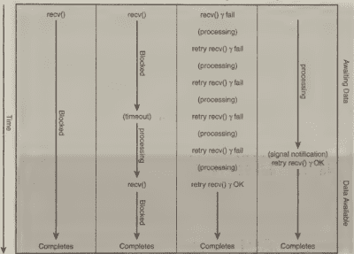

**图 8.1**


每种 I/O 控制风格在读取期间为任务提供的可用时间量有所不同。

在阻塞风格中，程序会等待直到数据到达。轮询风格反复调用 `recv()` 系统调用，直到数据到达。另一方面，超时风格如果数据未能及时到达，可能无法获取数据。不过，在使用超时风格时，你不会丢失消息；内核会为你保留消息，直到你再次调用它。最后，在异步风格中，内核会在获取数据时通知任务。

请注意，每种风格在处理发送消息时的接口方式大不相同。内核的缓冲区通过填补空档来加速非阻塞调用中的处理。在所有情况下，阻塞调用都会停止，直到内核完全发送完消息。（这并不完全准确，因为内核实际上会等待直到可以发送消息才唤醒任务，但为了简化编程，你可以假设当任务恢复时消息已经发送完毕。）轮询和异步调用将消息存储在缓冲区中并立即返回。图 8.2 假设数据太大，无法完全存储在缓冲区中。

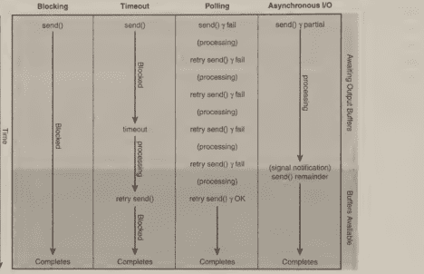

**图 8.2**

写操作通过使用缓冲区为任务提供更多时间。

接下来的章节将向你展示如何使用轮询、超时和异步 I/O。

### 轮询 I/O

除了等待数据包外，程序可能还有其他事情要做。一旦你调用 `send()` 发送消息，消息如何或何时离开计算机就不再是你关心的事了。就你而言，I/O 子系统会完整且完好地发送消息。但通常情况并非如此；大多数消息会被拆分以符合网络的限制。同样，你可能也不希望只获取消息的片段。相反，你希望填满你的缓冲区。在这两种情况下，你的程序都会停止并等待任务完成。

轮询通过检查通道是否就绪来帮助你避免在 I/O 通信中被阻塞。要使用轮询，请将通道配置为非阻塞模式。然后，检查系统调用的返回值。如果调用返回 `EWOULDBLK`（或 `EAGAIN`），请稍后再试。程序通常将此放入一个循环中，其中包含一些局部处理，例如以下轮询算法中所示：

```
/***** 通用轮询算法 ****/
...
while ( /*** 传输数据 ***/ )
{
    if ( /*** 检查通道是否就绪 ***/)
        /*** 处理通道 ***/
    /*** 进行一些计算 ***/
}
...
```

在此代码段中，重要的是计算部分。Linux 使用优先级轮询式的调度。随着任务执行更多基于 CPU 的处理（较少基于 I/O），其有效优先级会增加。如果你省略计算部分，你的任务将运行在一个紧密循环中，在基本上什么都没做的情况下增加调度偏好。紧密循环对任务调度非常有害。你的任务最终可能会主导调度时间，同时完成的工作却很少。

此外，如果你在等待通道释放时想不出要做的事情，请不要使用延迟循环或 `sleep()`。除非你需要实时响应，否则延迟循环或 `sleep()` 会破坏轮询的目的。要么使用超时，要么让程序阻塞。

### 轮询读取器

轮询允许你在等待更多数据的同时，获取任务可以处理的信息片段。使用轮询读取器时，程序获取并处理数据。通常，处理与数据读取是相关的，并且你必须在读/写级别启用非阻塞 I/O 以进行轮询。使用 `fcntl()` 系统调用来启用非阻塞 I/O，如下所示：

```
#include <fcntl.h>
int fcntl(int fd, int command, int option);
```

与 `read()` 系统调用类似，此命令接受文件描述符 `fd` 或套接字描述符 `sd`。命令是 `F_SETFL`，选项是 `O_NONBLOCK`。该系统调用还有许多其他选项。请参阅附录 C 获取更全面的列表。

```
if ( fcntl(sd, F_SETFL, O_NONBLOCK) != 0 )
    perror("fcntl-could not set nonblocking");
```

例如，假设你正在编写一个音频播放器插件。你不想等待整个音频片段从互联网到达，可能希望在接收数据的同时播放。当然，由于数据可能是压缩过的，程序必须将数据转换为机器可读形式。代码片段可能看起来像清单 8.1 中所示的代码。

**清单 8.1 轮询读取示例**

```
/******** 轮询读取示例：读取音频流。 *********/
/**** 处理数据并播放。 *****/
/**** ***************************************************/

if ( fcntl(sd, F_SETFL, O_NONBLOCK) != 0 )
    perror("Fcntl-could not set nonblocking");
...
done = 0;
while ( !done )
{
    int bytes;
    Queue ProcessingQueue;
    Queue OutputQueue;

    /*--- 获取任何挂起的数据 ---*/
    if ( (bytes = recv(sd, buffer, sizeof(buffer), 0)) > 0 )
        QueueData(ProcessingQueue, buffer);

    /*--- 从处理队列中转换特定字节数 ---*/
    /*--- 处理队列--通常比 recv() 更快 ---*/
    ConvertAudio(ProcessingQueue, OutputQueue);

    if ( /**** 输出队列足够领先 ****/ )
        PlayAudio(OutputQueue);

    /*--- 如果数据流结束且输出队列为空... ---*/
    if ( bytes == 0 && /****输出队列空---*/ )
        done = 1;
}
```

此示例接收数据，将其加入队列并进行处理。但它确实存在一个问题：如果两个队列都没有数据，`while` 语句将成为一个紧密循环。为了解决这个问题，由于音频是一个实时问题，你可以插入一个延迟。

### 轮询写入器

程序的运行速度比任何 I/O 函数都快几倍。（事实上，为了提高计算机性能，获取更多内存并替换旧而缓慢的 I/O 设备。仅仅获得更快的 CPU 效果并不显著。）因此，当你的程序传输消息或发出任何请求时，操作系统会搁置你的程序相当长一段时间。

轮询写入器具有与轮询读取器类似的算法。将数据生成和处理与发射器结合是一个好主意。准备工作是相同的：使用相同的参数调用 `fcntl()` 系统调用。

轮询写入器可能要处理的问题与读取器正好相反。读取器可能没有数据可处理，从而使读取器陷入紧密循环。写入器生成数据的速度比 `send()` 传输的速度快（写入器堆积）。

例如，考虑清单 8.2 中的算法，它将照片从数码相机发送到几个客户端。

**清单 8.2 轮询写入器示例**

```
/*-***************************** */
/** 轮询写入器示例：向多个 */
/* 客户端发送图像。 */
/*-***************************** */
...
int pos[MAXCLIENTS];
bzero(pos, sizeof(pos));
for ( i = 0; i < ClientCount; i++ )
    if ( fcntl(client[i], F_SETFL, O_NONBLOCK) != 0 )
        perror("fcntl--could not set nonblocking");
...
done = 0;
/*--- 重复直到所有客户端接收完整消息 ---*/
while ( ! done )
{
    int bytes;

    done = 1;
    /*--- 对于所有客户端... ---*/
    for ( i = 0; i < ClientCount; i++ )
        /*--- 如果仍然有更多数据要发送给客户端... ---*/
        if ( pos[i] < size )
        {
            /*-- 发送消息，跟踪已发送的字节数 ---*/
            bytes = send(client[i], buffer+pos[i],
                         size-pos[i], 0);
        }

    if ( bytes > 0 )
    {
        pos[i] += bytes;
        /**-- 如果所有客户端都已完成，则退出 --*/
        if ( pos[i] < size )
            done = 0;
    }
}
...
```

在这段代码中，必须单独跟踪每个客户端，因为它们接收数据的速度可能不同。`pos` 整型数组用于跟踪缓冲区中每个客户端正在处理的位置。你可以扩展该算法以包含超时处理。

另一个问题可能是，当第一个图像仍在发送时，服务器又接收到了另一个图像，导致写入堆积。为了解决这个问题，请选择以下选项之一：

- 将新消息追加到旧消息后面。
- 取消上一条消息并开始发送新消息。
- 更改相机的帧率。


在所有情况下，请根据数据的关键性、可能丢失的数据量以及连接的波动性来选择选项。有关准则列表，请参见第 4 章“在同等节点间发送消息”。

## 轮询连接

一种较为罕见的轮询算法涉及连接来自不同端口的客户端。服务器等待客户端连接，通常服务器程序仅提供一个端口。虽然这是惯例，但你可以在程序内打开任意数量的端口。然而，设计师认为程序具有特定目的，而端口提供特定服务。

一些端口服务非常基本且简单，为每个服务编写程序都浪费时间、精力和内存。但套接字只能连接到一个端口。相反，考虑编写一个轮询套接字程序，如所示：

```
/****
/** 轮询连接示例：检查各种端口是否有新连接 ***/
/** 为每个请求创建新任务来响应  ***/
/**** request. ***
/****...*****/
...
/*--- 为每个套接字设置非阻塞模式 ---*/
for ( i = 0; i < numports; i++ )
    if ( fcntl(sd[i], F_SETFL, O_NONBLOCK) != 0 )
        perror("fcntl--can't set nonblocking on port#%d", i);
...
for (;;)                          /* 永久执行此操作 */
{
    int client;

    for ( i = 0; i < numports; i++ )
        if ( (client = accept(sd[i], &addr, &size)) > 0 )
            SpawnServer(sd[i], i);
    /**** 进行维护工作 ****/
}
...
```

这看起来是个好主意，但为每个 `accept()` 创建独立任务可能更具可管理性。事实上，最佳解决方案是使用 `select()` 系统调用，它会等待一定数量的 I/O 通道解除阻塞（有关 `select()` 的更多信息，请参见第 7 章“负载均衡：多任务处理”）。

## 异步 I/O

让操作系统在通道准备好接收更多 I/O 请求时通知你，可以将文件 I/O 的问题转化为对你有利的局面。这使程序有更多时间用于计算，而在各种系统调用中停滞的时间更少。

异步读取类似于办公室电话上指示语音信箱闪烁的灯。同样，电话回拨功能类似于异步写入。将异步 I/O 想象成通道可用的通知。

系统通过 `SIGIO` 信号（有时也称为信号驱动 I/O）来实现这种异步 I/O。当数据准备好读取或写通道准备好接收更多数据时，程序会收到 `SIGIO`。与所有信号一样，你只知道发生了信号，而不知道更多细节。因此，如果两个通道打开时程序收到 `SIGIO`，并不明确应该检查哪个通道。

异常带来另一个问题。如果通道发生错误，内核不会发出信号。除非你在程序中实际测试该通道，否则程序失去与客户端连接的情况并不明显。

程序通过指示内核接受 `SIGIO` 信号来启动信号驱动 I/O。当信号到达时，信号处理器设置一个主程序监测的标志。主程序循环随即开始处理，偶尔检查指示信号已到达的标志。处理器可以自己执行 I/O 处理并标记主循环，或者也可以将 I/O 留给主循环处理。

这与轮询有何不同？两种算法都需要定期检查 I/O 通道是否就绪。轮询调用不会阻塞系统调用，但需要定期检查。类似地，主循环必须轮询由信号驱动 I/O 设置的标志。

主要区别在于程序在系统调用中花费的时间。信号驱动 I/O 在 `send()` 和 `recv()` 系统调用中花费极少时间：内核会在准备好时告知你的程序。另一方面，轮询必须重复进行系统调用。

列表 8.3 中的算法提供了该过程工作原理的大致想法。

### 列表 8.3 信号驱动 I/O 算法

```
/**** 通用异步或信号驱动 I/O 算法 ****/
int ready = 0;
...
void sig_io(int sig)
{
   /*** 如果是 RECV()：获取所有待处理数据 ****/
   /*** 如果是 SEND()：发送所有已处理数据 ****/
   ready = 1;     /* 告知主循环：“交易完成” */
}
...
for (;;) {
      if ( ready > 0 ) {
           /*** 暂时阻塞 SIGIO ****/
           ready = 0;
           /*** 如果是 RECV()：将数据复制到处理区域 ****/
           /*** 如果是 SEND()：从<已处理数据队列>填充输出缓冲区 ****/
           /*** 解除阻塞 SIGIO ****/
      }
      /*** 处理传入数据 ****/
      /*** -或者- ****/
      /*** 生成更多待发送数据 ****/
}
...
```

阻塞 `SIGIO` 信号可能看起来有点不寻常。因为信号处理器和主循环共享相同的变量，所以存在一个临界区（参见第 7 章中的“互斥（Mutex）”部分）。关闭信号处理器是一种重要的互斥机制。

### 排队消息

要获取所有待处理消息，你可能需要在处理器中多次调用 `send()` 和 `recv()`。内核可能同时向你的程序发出多个信号，但你的程序一次只能接收一个类型的信号。如果两个相同的信号非常紧密地到达，你的程序只会收到一个。

你使用 `fcntl()` 系统调用启动 `SIGIO` 消息。这个系统调用不仅告诉内核将套接字描述符设为异步（请记住这适用于所有文件描述符），还告诉内核将信号定向到特定进程。例如，以下代码片段开启了 `SIGIO` 信号并将它们定向到当前任务：

```
/*****用于启动 SIGIO 信号流的代码片段 ****/
...
if ( fcntl(sd, F_SETFL, O_ASYNC | O_NONBLOCK) < 0 )
    PANIC("Can't make socket asynch & nonblocking");
if ( fcntl(sd, F_SETOWN, getpid()) < 0 )
    PANIC("Can't own SIGIO");
...
```

当你的程序声明对 I/O 信号的所有权时，它声明了所有信号，而不仅仅是 `SIGIO`。你可能使用的另一个信号是 `SIGURG`，用于获取带外数据。更多信息请参见第 9 章“突破性能瓶颈”中的“发送高优先级消息”部分。

### 按需读取

程序可以使用异步读取或`按需读取`来处理到达的数据。随着数据到达，内核向程序发出信号。程序将其拾取并处理。就像工厂或装配线一样，所需材料到达并沿着流水线移动。

此功能最佳用途是需要在等待单一数据源的同时进行大量 CPU 计算的情况。（请记住，虽然可能打开了几个 I/O 通道，但你需要手动检查以确定哪个通道发出了信号。）考虑使用虚拟现实建模语言 (VRML) 文档来执行此任务，如列表 8.4 所示。


### 列表 8.4 异步处理算法

```
/****VRML 异步读取示例：处理数据的同时****/
/**** 等待更多数据到达。 ****/
/*****...*****/
int ready = 0, bytes;
...
void sig_io(int sig)
{
    /*--- 获取待处理消息 --*/
    bytes = recv(server, buffer, sizeof(buffer), 0);
    if ( bytes < 0 )
        perror("SIGIO");
    ready = 1;  /* 告知主循环：“交易完成” */
}
...
/*--- 启用异步、非阻塞 I/O ---*/
if ( fcntl(sd, F_SETFL, O_ASYNC | O_NONBLOCK) < 0 )
    PANIC("Can’t make socket async & nonblocking");
/*-- 声明 SIGIO 和 SIGURG 的所有权 ---*/
if ( fcntl(sd, F_SETOWN, getpid()) < 0 )
    PANIC("Can’t own SIGIO");
while ( !done )
{
    if ( ready > 0 )
    {
        /*** 暂时阻塞 SIGIO ****/
        ready = 0;
        FillQueue(Queue, buffer, bytes);
        /*** 解除阻塞 SIGIO ****/
    }
    /*** 在 VRML 光栅化器中处理传入数据一小段时间， ****/
    /*** 或者直到变量“ready”改变为止。 ****/
}
...
```


同样，避免在信号处理器中执行过多操作。在这种情况下，你的处理器可以简单地通知主循环自行加载数据。但是，由于队列管理器可能使用内存管理，图像处理队列的填充应在处理器外部进行。

# 异步写入

由于内核缓冲区的作用，你需要以略有不同的方式编写异步写入代码。当你的程序首次调用`send()`时，内核缓冲区很可能能够存储整个数据块。但也可能存在无法存储的情况，此时内核只会缓存部分数据。

因此，请检查每个`write()`的返回值，以确保所有数据都已发送。甚至可能至关重要的是，将某个通道的所有传出数据保留在单个队列中。这能降低与多个缓冲区相关的代码复杂性。尽管如此，使缓冲具有灵活性也很重要，以便队列可以根据需要增长和缩小。

在这种情况下，一个数据库查询示例非常适用。它可以生成大量数据，这些数据可以在发送响应时进行处理或收集，如清单 8.5 所示。

### 清单 8.5 异步写入器算法

```c
/***** Database Query Async Writer Example: process query ***/
/** while generating results. `*/
/*******...*******/
int ready=0, bytes, size=0, pos=0;
...
int sig_io(int sig)
{
    if ( size > 0 )
    {
        bytes = send(client, buffer, size+pos, 0);
        if ( bytes > 0 )
        {
            pos += bytes;
            ready = 1;
        }
    }
}
...
```

### 清单 8.5 续

```c
/**** Enable nonblocking, signal-driven I/O; claim SIGIO ***/
while ( !done )
{
    if ( /*** channel available ***/ )
        /*** Send message, no blocking ***/
    else
        /*** queue message ***/
}
...
```

每当通道清空并准备好接收更多数据时，内核会向进程发送`SIGIO`信号。使用前面示例中展示的信号，以按需方式流出数据。

# 按需连接

你可以创建一个按需连接服务器（理论上）。本质上它看起来像一个按需读取器，但程序调用的不是读取文件，而是`accept()`。处理程序需要三个全局变量与主循环通信：套接字接收器（`sd`）、描述符数组，以及当前连接数。信号处理程序创建的任何局部变量在处理程序结束时都会丢失。

处理程序可能如下所示：

```c
/***** On-Demand Connection Example:  Make connection in ***/
/*** signal handler.  Main loop cycles through each open ***/
/*** socket for messages. (Excerpt from damedom-accept.c ***/
/*** on CD.)
...
int Connections[MAXCONNECTIONS];
int sd, NumConnections=0;
void sig_io(int sig)
{
    int client;

    /*** Accept connection.  If too many, error & close ***/
    if ( !(client = accept(sd, 0, 0)) > 0 )
    {
        if ( NumConnections < MAXCONNECTIONS )
            Connections[NumConnections++] = client;
        else
        {
            send(client, "Too many connections\n", 22, 0);
            close(client);
        }
    }
    else
        perror("Accept");
}
...
```

虽然按需服务器很有用，但多任务处理的明显优势在于它允许你保留局部变量，并为每个连接设置一个特定的任务。

除非你的服务器容易出现任务过载（程序创建了如此多的进程以至于性能下降），否则使用按需连接可能会给编程带来负担。对于设计和实现按需连接服务器所投入的所有精力，你很可能无法获得同等的回报。使用多任务处理或轮询技术要简单得多。

## 使用`poll()`和`select()`解决不必要的 I/O 阻塞

Linux 提供了两种工具，帮助你同时处理多个打开的通道。这些工具比手动轮询更高效（可能更容易实现）。每个工具背后的核心理念是，系统调用会阻塞，直到任何通道改变状态。

状态变化包括诸如数据可供读取、通道可以写入或发生错误等条件。返回时，一个或多个通道的状态可能已经改变。调用的返回值代表状态发生变化的通道数量。

然而，`select()`系统调用稍微复杂一些，涉及几个帮助管理描述符列表的宏：

```c
#include <sys/time.h>
#include <sys/types.h>
#include <unistd.h>
int select(int maxfd, fd_set *to_read, fd_set *to_write, fd_set *except, struct timeval *timeout);

FD_CLR(int fd, fd_set *set);            /* remove fd from set */
FD_ISSET(int fd, fd_set *set);          /* check if fd is in set */
FD_SET(int fd, fd_set *set);            /* add fd to set */
FD_ZERO(fd_set *set);                   /* initialize set for use */
```

主要例程是`select()`系统调用。它有几个辅助宏（`FD_CLR()`、`FD_ISSET()`、`FD_SET()`、`FD_ZERO()`）来管理描述符列表。参数在表 8.3 中定义。

# 服务器视角与负载控制

# 第二部分

### 表 8.3`select()`系统调用的参数

| 参数 | 描述 |
| :--- | :--- |
| `maxfd` | 集合中编号最大的文件描述符加 1。（详情请参见下文。） |
| `to_read` | 等待读取的描述符集合。这是你想测试读取的集合。 |
| `to_write` | 等待写入的描述符集合。 |
| `except` | 等待优先消息的描述符集合。 |
| `timeout` | 放弃前等待的微秒数。（更多详情请参见下文。） |
| `fd` | 要添加、删除或测试的文件描述符。 |
| `set` | 要操作的描述符集合。 |

`maxfd`参数是三个集合中编号最大的描述符槽位加 1。每个任务获得一定数量的 I/O 描述符槽位（通常为 1024）。每个 I/O 通道占用一个槽位（`stdin`为 0，`stdout`为 1，`stderr`为 2）。如果集合在`to_read`中有描述符`[3,6]`，在`to_write`中有`[4,5,6]`，在`except`中有`[3,4]`，则`maxfd`变为 6（最大的描述符编号）加 1，即 7。

`timeout`参数提供了设置系统调用等待时间限制的灵活性：

- 如果是`NULL`，则无限期等待。
- 如果是正数，则等待指定的微秒数。
- 如果是零，则在检查完所有描述符一次后立即返回。

例如，如果你有三个打开的客户端通道，编号为`[3,4,6]`，你可以像这样等待它们向程序发送数据：


```c
/*  ************************************  */
/*  Select() Example.              ***  */
/*  ************************************  */
int count;
fd_set set;
struct timeval timeout;
...
FD_ZERO(&set);               /* Clear set */
FD_SET(3, &set);             /* Add client channel #3 */
FD_SET(4, &set);             /* Add client channel #4 */
FD_SET(6, &set);             /* Add client channel #6 */

timeout.tv_sec = 5;          /* Timeout after 5.25 seconds */
timeout.tv_usec = 250000;

/*--- Wait for select() ---*/
if ( (count = select(6+1, &set, 0, 0, &timeout)) > 0 )
    /*** Find the descriptors that changed ****/
else if ( count == 0 )
    fprintf(stderr, "Timed out!");
else
    perror("Select");
...
```

在此示例中，当 `select()` 系统调用返回正数时，三个通道之一有数据可读。要确定哪个通道已准备好，添加嵌套代码并读取数据。然而，如果返回值为零，则表示调用超出了 5.25 秒的时间限制。

`poll()` 系统调用与 `select()` 类似，可能更容易管理。它使用结构体数组来定义行为：

```c
struct pollfd
{
    int fd;        /* the descriptor to test */
    short events;  /* requested events to watch */
    short revents; /* events that fired */
};
```

第一个字段 `fd` 是文件或套接字描述符。第二和第三个字段 `events` 和 `revents` 是特定事件的位掩码：

- `POLLERR`：任何错误条件。如果通道上发生任何错误则返回。
- `POLLHUP`：对端挂断。如果对端挂断则返回。
- `POLLIN`：传入数据。如果数据准备好读取则返回。
- `POLLINVAL`：`fd` 未打开。如果通道不是打开的文件或套接字则返回。
- `POLLPRI`：优先消息。如果收到优先消息则返回。
- `POLLOUT`：通道可用性。如果 `write()` 不会阻塞则返回。

对 `poll()` 的系统调用如下所示：

```c
#include <sys/poll.h>
int poll(struct pollfd *list, unsigned int cnt, int timeout);
```

程序在使用此系统调用之前会填充一个 `pollfd` 结构体数组。`cnt` 参数是数组中合法套接字描述符的数量。（请记住保持这些描述符连续；如果其中一个关闭，请压缩数组。并非所有实现都能很好地处理空槽位。）`timeout` 参数的作用类似于 `select()` 的超时，但以毫秒为单位。

# 实现超时

轮询 I/O 通道的一种简单替代方法是告诉操作系统，你不想等待超过指定的时间。Linux 系统调用没有提供直接实现此功能的方法。请考虑使用以下方法来实现超时：

- 在 `select()` 或 `poll()` 系统调用中使用超时参数
- 使用信号（`SIGALRM`）唤醒任务

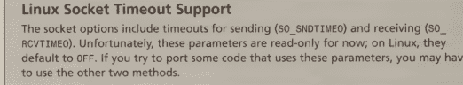

`select()` 和 `poll()` 系统调用（前文已介绍）提供了以微秒为单位的超时参数。使用这些系统调用可能是实现超时的最简单方式，但超时设置适用于调用中的所有通道。

这种情况可能会成为一个问题：假设你有三个通道，其中之一的响应非常缓慢。仅使用这些系统调用，你无法检测到那个故障通道本应超时并关闭。你可以手动为每个通道维护单独的时间，并在每次收到响应时重置时间。尽管如此，这可能仍会带来大量不必要的检查和日志记录。

你可以使用一种替代方案：报警信号。`报警`（alarm）是内核中运行的时钟。当报警触发时，内核以信号的形式向任务发送唤醒调用。如果任务正在系统调用中等待，该信号会中断此调用，任务进入信号处理程序，随后系统调用返回 `EINTR` 错误。

每个任务都可以向自身发送信号，但任务需要知道如何处置该信号。在某些系统中，`sleep` 库调用会使用 `alarm()` 系统调用，首先设置任务以捕获 `SIGALRM` 信号。请查看以下示例：

```c
/***** ****************************************************** ****/
/*** Example: Timeout example using the alarm() system   ***/
/*** call. (Excerpt from echo-timeout.c on CD.)       ***/
/***** ****************************************************** ****/
...
```

```c
int sig_alarm(int sig)
{/*** do nothing ***/}
... 
void reader()
{ struct sigaction act;

/*--- Initialize signal structure; reset to default ---*/
bzero(&act, sizeof(act));
act.sa_handler = sig_alarm;
act.sa_flags = SA_ONESHOT;

/*--- Set the signal handler ---*/
if ( sigaction(SIGALRM, &act, 0) != 0 )
    perror("Could not set up timeout");
else
    /*--- If signal handler installed, set timer ---*/
    alarm(TIMEOUT_SEC);

/*--- Call the I/O that might timeout ---*/
if ( recv(sd, buffer, sizeof(buffer), 0) < 0 )
{
    if ( errno == EINTR)
        perror("Timed-out!");
}
... }
```

所示的示例设置信号处理程序、设置计时器并调用 I/O。如果 `recv()` 在计时器过期前未收到任何数据，任务将接收到信号。该信号会中断 `recv()` 系统调用，系统调用随后返回错误（`EINTR`）。

要获得此行为，请从 `sa_flags` 字段中移除 `SA_RESTART` 选项。第 7 章建议你在处理信号时包含此选项。在此情况下，为了让超时计时器正常工作，请省略此选项。

最后一点注意：避免将 `alarm()` 系统调用与 `sleep()` 混合使用，因为这可能会在你的程序中引发问题。相反，请单独使用 Linux 的 `SIGALRM` 信号或 `sleep()`，不要混用两者。

### 总结：选择 I/O 技术

网络程序通过网络与其他程序进行交互。由于性能和响应时间因机器和网络而异，了解何时以及如何在不阻塞 I/O 的情况下使用它，对于改善客户端和服务器中的 I/O 管理至关重要。

小心且平衡地使用阻塞和非阻塞 I/O，可以提高客户端和服务器对用户的响应能力。

本章涵盖了关于阻塞（是什么、何时有用、为何使用）和非阻塞（有哪些不同类型、何时使用、如何使用）的几个主题。讨论了选择非阻塞 I/O 的主要工具：`fcntl()` 系统调用。

两种主要的非阻塞工具是轮询和异步 I/O。轮询反复尝试使用 I/O 系统调用。异步（或信号驱动）I/O 将确定通道何时空闲的负担交给内核。轮询关注 I/O，而信号驱动 I/O 关注本地处理。

另一种管理阻塞的工具是超时。你可以在 `select()`（或 `poll()`）系统调用中部署超时，或者使用一个计时器信号，当调用耗时过长时唤醒进程。

# 突破性能瓶颈

## 本章内容

- 在客户端到达前创建 Servlet 196
- 使用智能 Select 扩展控制 203
- 深入挖掘套接字控制 208
- 恢复套接字描述符 214
- 先发送后接收：消息交错 215
- 注意文件 I/O 问题 215
- 使用基于需求的 I/O 恢复 CPU 时间 216


### 发送高优先级消息
### 总结：整合性能特性

如何最大限度地发挥你的服务器或客户端的性能？Linux 在`Sockets API`中提供了几个使这一过程相对简单的工具。然而，你必须同时从多个角度看待编程问题，因为每个方面都涉及并影响其他方面。

你的网络程序有三个不同的方面：任务、连接和消息。在程序运行过程中，你会与这些方面中的每一个进行交互。任务涉及处理所有相关的进程或线程。连接本身就是套接字及其行为，而消息则与接收和发送消息的`I/O`处理进行交互。为了充分利用你的网络程序，你必须在任务和消息传递之间取得平衡。套接字允许你根据需求专门化连接。

本章将带你了解几个涉及任务、连接和消息传递的理念和最佳实践。你需要了解前面章节中介绍的概念，才能充分利用这些算法。

#### 在客户端到达前创建 Servlet

到目前为止，你已经学会了如何创建服务器、实现多任务控制以及控制`I/O`阻塞。这些构建块中的每一个都帮助你与客户端交互并控制吞吐量。第 7 章“划分负载：多任务”向你展示了如何委托接受和响应传入连接的任务，并在需要时创建子进程。

然而，在某些系统中，每次创建新任务都会消耗时间和资源。此外，你可能不希望将计算机的所有资源都专门用于服务网络客户端。（另一方面，你`可能`确实希望这样做，但你必须对服务器访问施加逻辑和有效的限制，以确保性能。）你可能有其他需要定期执行的程序，甚至是本地/远程登录。无论如何，你需要控制服务器程序的增长。而，控制连接数量需要额外的编程。

##### 限制客户端连接数

如果你回忆起前面章节的内容，服务器在客户端连接时立即创建一个新的子进程。你的程序需要在这里进行修改，以纳入对过多进程（曾经被称为`兔子进程`，因为它们繁殖太快而难以控制）的管控。下面标准算法正是这样做的。

```c
/**** Standard create-processes-as-you-go algorithm ****/
/**** ("test-server.c" on the Web site) ****/
int sd;
struct sockaddr_in addr;
if ( (sd = socket(PF_INET, SOCK_STREAM, 0)) < 0 )
    PANIC("socket() failed");
bzero(&addr, sizeof(addr));
addr.sin_family = AF_INET;
addr.sin_port = htons(MY_PORT);
addr.sin_addr = INADDR_ANY;
if ( bind(sd, &addr, sizeof(addr)) != 0 )
    PANIC("bind() failed");
if ( listen(sd, 20) != 0 )
    PANIC("listen() failed");
for (;;) {
    int client, len=sizeof(addr);
    client = accept(sd, &addr, &len);
    if ( client > 0 ) {
        int pid;
        if ( (pid = fork()) == 0 ) {
            close(sd);
            Child(client); /*---Serve the new client---*/
        }
        else if ( pid > 0 )
            close(client);
        else
            perror("fork() failed");
    }
}
```

你在第 7 章中见过此算法，它非常适用于长期连接。长期连接包括登录、数据库接口以及客户端和服务器进行多次迭代交互的任何其他交互。

此算法存在一个主要缺陷：如果`PID`用尽会发生什么？如果你没有足够的`RAM`来支持进程数量，从而开始导致交换分区频繁读写（`thrashing`），会发生什么？这正是兔子进程生成器的典型问题。

### RAM 与内存的区别

你可能认为虚拟内存系统和所有交换空间可以拯救你的系统。实际上，这是一种误解。当你追求性能时，你需要让所有活动进程及其数据在`RAM`中可用。如果它们被交换出去，内核重新加载它们所需的时间会抵消任何速度感的提升。了解你的系统、内存、处理器和`I/O`是榨取性能的第一道门槛。

# 第二部分

你可以尝试的一种方法是统计进程数量：

```
/******************************************************/
/*** 修改后的算法以限制子进程数量 ***/
/***（网站上的 "capped-servlets.c"） ***/

int ChildCount=0;

void sig_child(int sig)
{
    wait(0);
    ChildCount--;
}

...
for (;;)
{
    int client, len=sizeof(addr);
    while ( ChildCount >= MAXCLIENTS )
        sleep(1); /*...你也可以使用 "sched_yield()"——*/
    client = accept(sd, &addr, &len);
    if ( client > 0 )
    {
        int pid;
        if ( pid = fork() == 0 )
        {
            /*...子进程——*/
            close(sd);
            Child(client); /*...为新客户端提供服务——*/
        }
        else if ( pid > 0 )
        {
            /*...父进程——*/
            ChildCount++;
            close(client);
        }
        else
            perror("fork() failed");
    }
}
```

在这个例子中，父进程跟踪子进程的数量。如果子进程过多，服务器简单地让出`CPU`，直到其中一个连接关闭且子进程终止。你可以相当容易地使用这种方法，并且由于唯一向`ChildCount`变量写入数据的是服务器及其信号处理器，因此你不必担心竞态条件。

再次强调，该算法适用于长期连接。然而，如果你有很多短期的、单次事务的连接，创建和终止子进程的开销可能会削弱服务器的性能。其想法是运行一组进程，它们都在等待连接到来。

### 预派生你的服务器

你的服务器可以有 5~20 个进程等待连接到来。这正是分发加载的`HTTP`服务器所做的。（如果你安装了`HTTPD`并且正在运行，查看你的进程表，你可能会看到几个实例正在运行。）如果进程不共享数据，子进程如何获取数据？答案在下面的代码片段中。

```
/************************************
/*** 子进程的代码片段 *****/
/************************************/
if ( pid = fork() ) == 0 )
{
	close(sd);
	Child(client); /*---为新客户端提供服务---*/
}
```

此摘录显示子进程关闭套接字描述符(`sd`)。客户端套接字描述符提供了与你客户端的连接。为什么子进程要关闭`sd`？

当你创建一个子进程时，子进程共享父进程打开的文件。如果子进程不需要该文件，它应该关闭它。然而，子进程可以保留文件打开并像父进程一样进行读写。这解释了你可能如何创建多个进程来服务同一个套接字：


```c
/************************************
/*** 创建一组等待连接的子服务器 *****/
/**** （网站上的 "preforking-servlets.c"） ****
/************************************/
int ChildCount=0;

void sig_child(int sig)
{
	wait(0);
	ChildCount--;
}
...
main()
{
	/** ** 附加信号；创建并绑定套接字 ****/
	for (; ;)
	{
		if ( ChildCount < MAXPROCESSES )
		{
			if ( (pid = fork() ) == 0 )    /*---子进程---*/
			for (; ;)
        int client = accept(sd, 0, 0);
        Child(client);  /*---为新客户端提供服务---*/
      }
      else if ( pid > 0 )             /*---父进程---*/
        ChildCount++;
      else                            /*---错误---*/
        perror("fork() failed");
      }
      else
        sched_yield();               /*---或者， sleep(1)---*/
}
```

这颠倒了 `accept()` 和 `fork()` 的顺序：该算法不是在连接后创建进程，而是在创建子进程后等待连接。

此代码片段可能会创建例如 10 个进程。所有子进程都进入无限循环，等待并处理连接。假设没有等待的连接，所有 10 个进程都会阻塞 I/O（休眠）。当一个连接到达时，所有进程都会唤醒，但只有一个获得该连接。剩下的九个回到休眠状态。这个循环会无限期地继续。

如果一个子进程崩溃或终止会发生什么？这就是为什么父进程永远不调用 `accept()` 系统调用。父进程的主要角色是确保始终有正确数量的子进程可用。

起初，父进程创建定量的子进程。当一个子进程终止时，信号处理器接收到通知并将配额减少一。当父进程恢复时，它创建一个新的子进程。如果父进程不需要创建更多，它会将时间片让给其他任务。

### 适应不同的负载级别

父进程的主要职责是确保有足够的子进程来处理传入的连接。这种职责必须与计算机的资源负载相平衡。如果你不谨慎，由于服务器没有足够的监听者来处理连接，客户端可能由于超时而开始断开连接。

使用专用数量的监听者（servlet）限制了活动连接的数量。这是拥有预派生 servlet 的主要限制。尽管如此，限制你的程序创建和销毁的进程数量的想法是很好的。它减少了你的进程表和系统资源的混乱。有什么好方法可以在满足连接客户端需求的同时最小化创建和销毁？

你可以让 servlet 算法适应系统的需求。你的服务器必须应对两个不同的挑战：知道何时创建更多 servlet 以及知道何时终止多余的。第二个挑战很简单：如果 servlet 空闲了一段时间，它本身就会终止。

第一个挑战，知道何时创建更多 servlet，并不那么直接。你可能还记得每个 TCP 服务器都有一个监听队列（这就是 `listen()` 系统调用所做的）。网络子系统将每个连接请求入队，而 `accept()` 系统调用确认并创建到客户端的专用通道。如果客户端在队列中等待太久，它可能只等待几分钟就会放弃。

能够看到队列中有多少待处理的连接以及最长的等待请求是多少，可能有助于服务器调优。你可以使用此信息来监控系统对请求的响应能力。随着队列变满，服务器可以创建更多 servlet。如果连接延迟变得太长，你可以简单调整 servlet 的自我终止延迟。不幸的是，这不是 API 调用所能提供的。如果你想要 servlet 的适应性，你必须使用另一种方法。

创建新 servlet 以响应请求量的一种方法就像捕鱼一样。在法律允许的地方，渔民撒出不同种类饵料的样品。鱼吃的饵料就是渔民使用的饵料。鱼的反应也表明了鱼群的大小。

就像撒饵一样，服务器偶尔会抛出一个额外的 servlet。只要终止的额外 servlet 数量与创建的数量相同（因为没有可做的事），服务器就会继续这个过程。当 servlet 停止终止时，你的服务器会增加其创建的额外 servlet 数量，直到数量再次稳定。

预派生的目的是最小化 servlet 创建和清理后的时间。随意创建和终止 servlet 会让你回到为每个新连接进行 `fork`。你必须仔细规划以避免这种结果。此外，为了使这起作用，你的算法必须有一个正在运行的最小 servlet 数量。

这就是统计帮助不多的地方。适应算法必须面对三种可能性：连接数量稳定、增加或减少。如果连接数量稳定，服务器会在给定的时间段内看到终止的 servlet 数量与创建的数量相同。例如，如果你的服务器每 60 秒创建一个 servlet（带有 30 秒的空闲超时），你可以看到图 9.1 中的第一种模式。

如果连接数量正在增加，终止的数量少于创建的数量。如果你的服务器在规定的时间内没有看到终止，你可以假设它正在处理一个连接。此时，你的服务器将 servlet 创建速率加倍（见图 9.1 中的第二种模式）。这个过程继续，直到 servlet 数量达到上限或你的服务器达到最大创建频率（例如每 5 秒一次）。

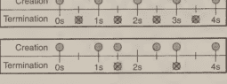

## 图 9.1

> `额外的 servlet 被抛出来以查看是否有待处理的连接。`

同样，假设你的服务器每 60 秒创建一个新 servlet（空闲超时为 30 秒）。如果额外的 servlet 未能在规定时间内终止，你可以将创建之间的时间延迟减半，从而将频率加倍。你可以重复此过程，直到连接速率开始稳定下来。

最后，当连接开始减少时，待处理的连接（如果存在）为队列提供了绰绰有余的 servlet，服务器开始看到 servlet 的终止。当额外的 servlet 开始终止时，你可以将服务器的频率重置为正常。

```c
 /*********Chumming connections example*********/
 /**** ('servlet-chummer.c' on Web site)****/
 int delay=MAXDELAY;         /* for example, 5 seconds */
 time_t lasttime;
 void sig_child(int signum)
 {
     wait(0);                /* Acknowledge termination */
     time(&lasttime);        /* get the time stamp */
     delay = MAXDELAY;       /* reset chummer back */
 }
 void Chummer(void (*servlet)(void))
 {
     time(&lasttime);        /* Initialize timestamp */
     for (;;)
     {
         if ( !fork() )     /* first, set the chum */
         {
             servlet(); /* call the task (must have exit()) */
             sleep(delay); /* dream for a while */
         } /* if no child terminated, double frequency */
         if ( time(0) - times[1] >= delay-1 )
         {
             if ( delay > MINDELAY ) /* don't go below min */
                 delay /= 2;        /* double chum frequency */
         }
     }
 }
```

此代码片段展示了如何通过记录最后一个子进程终止的时间来跟踪 servlet 的形成并测试负载是否增加。终止操作也会重置计时器，以便当前连接可以稳定下来，并且进程可以重新启动。

### 使用智能 Select 扩展控制

使用进程来管理连接流是一种直观的任务分配方式。此外，对运行进程数量的限制和预先 `fork` 进程确保了连接得到所需的关注。然而，这些方法都存在一个根本问题：调度器风暴（scheduler storm）。

### 调度器风暴

调度器风暴提出了两个问题，这些问题暴露了多任务处理器的局限性以及单 CPU 系统为何会被压垮的原因。第一个问题展示了大型进程表对 servlet 的影响。第二个问题影响了预 fork（preforking）概念。


进程表可以轻松处理几百个进程。取决于内存和交换空间（`swap`），理论上你可以拥有更多。尽管如此，请考虑其限制：`Linux` 每 10 毫秒在进程之间进行切换。这尚未包括卸载旧进程上下文和加载新进程上下文的时间延迟。

例如，如果你有 200 个正在运行的 `servlet`，在一个每 0.01 秒切换一次任务的系统上，每个进程可能需要等待 2 秒才能获得一小片 CPU 时间。如果每个时间片（`timeslice`）在该小切片内能发送 1 KB 数据，你在 10 Mbps 局域网连接上可能会看到大约 200 KBps 的吞吐量（对于 `TCP/IP` 来说大致相当）。然而，每个连接每秒仅获得 512 字节。这是让进程表无限制增长的主要风险。

第二个问题在于预 `fork` 的核心：多个进程都在等待同一个连接。当连接请求到达时，你的服务器可能有 20 个处于 I/O 阻塞状态的 `servlet`。由于都在等待连接，内核会唤醒所有 20 个。第一个进程获取连接，而其余所有进程返回到 I/O 阻塞状态。一些程序员将此称为`调度风暴`（`scheduling storm`）或`惊群`（`thundering herd`）。在这两种情况下，这个问题都强调了最小化等待 `servlet` 的数量并根据连接负载进行适应的必要性。

### 在内核中解决惊群问题

撰写关于 `Linux` 这种不断演进的书籍的一个问题是，信息很快就会过时。`Linux` 2.4 通过只唤醒一个 I/O 阻塞进程解决了内核中的惊群问题。


## 过载的 `select()`

解决这些问题的一种方法是完全避免多任务处理。在之前的一章中，你阅读过关于 I/O 多路复用系统调用：`select()` 和 `poll()`。这些系统调用可以像多个进程一样起作用。

相反让 20 个服务器进程都在等待连接，你可以提供一个进程来等待连接。当连接请求到达时，服务器将该连接（客户端通道）放入 I/O 列表中。这些系统调用等待其中任何一个发送请求或命令。系统调用将准备好的通道返回给你的服务器，你的服务器获取并处理该命令。

完全跳过多任务处理并使用这些多路复用器的诱惑可能会导致某些性能损失。当使用单个任务处理信息时，你的程序或服务器必须在进程生命周期的各个时间点等待 I/O。如果你不利用这段空闲时间，你的服务器可能会错失进行其他操作的重大机会。例如，如果你曾经编译过内核，你可能会发现，如果使用 `-j` `make` 选项强制多个任务，编译时间会更短。（如果你有内存，每个处理器两个或三个任务会显著缩短编译时间。）

## 使用智能 Select 进行折中

当你创建高性能、高需求的服务器时，你可以使用各种方式来分配负载。其中两种是多任务处理和 I/O 多路复用。然而，如果单独使用，多任务处理可能会失去对调度器的控制，并耗费宝贵的时间进行上下文切换，而 I/O 多路复用则浪费了未使用的 CPU 带宽。使用二者的结合是一个替代方案。将两者结合成一个`智能 Select`（`Smart Select`）可以帮助你减少各自的劣势，同时保留你的两种能力。

`智能 Select` 分发少数几个进程。每个进程拥有一个连接通道和一组打开的客户端通道。一个 I/O 多路复用器管理所有这些通道。以下是该进程的算法：

```c
/*** Smart Select example: each child tries to accept a 
 ***  connection.  If successful, it adds the connection 
 ***  to the select() list. 
 ***  ("smart-select.c" on Web site) 
 *****************************************************/
int sd, maxfd=0;
fd_set set;
FD_ZERO(&set);

/** Create socket and fork() processes **/

/*---In Child---*/
maxfd = sd;
FD_SET(sd, &set);
for (;;) 
{
    struct timeval timeout={2,0};                /* 2 seconds */
    /*---Wait for some action---*/
    if ( select(maxfd+1, &set, 0, 0, &timeout) > 0 )
    {
        /*---If new connection, connect and add to list---*/
        if ( FD_ISSET(sd, &set) )
        {
            int client = accept(sd, 0, 0);
            if ( maxfd < client )
                maxfd = client;
            FD_SET(client, &set);
        }
        /*---If command/request from client, process---*/
        else
        {
           /** Process client's request ***/
           /** If client just closed, remove from list ***/
        }
    }
}
```

你可以使用此算法创建少数几个进程——远少于在纯多任务服务器中可创建的数量——例如，5–10 个 `servlet`。每个 `servlet` 进而可以支持 5–10 个连接。

> **`Select` 冲突**
>
> 你可能听说过 `BSD` 的一个问题，称为`select 冲突`（`select collision`）。之前的算法假设 `select()` 可以等待多个描述符，并仅在描述符状态改变时唤醒。`BSD` 4.4 实现有一个限制，会导致所有阻塞在 `select()` 中的进程都唤醒。看起来 `Linux` 没有这个限制。

这种方法可以轻松支持数百个连接而互不干扰。任务数量和连接数量之间的平衡有助于最小化对进程表的影响。然而，拥有如此多的连接可能会带来问题，如果你需要跟踪你的协议状态。

你可以轻松地将此算法用于无状态服务器。无状态连接不记忆任何关于之前事务的信息。这需要发送到你的服务器的所有事务与其他事务或每个连接之间的单个事务没有关联。此外，如果你的服务器需要短期到中期连接，你可以使用这种方法。一些例子是 `HTTP` 服务器、数据库查询服务器和 `Web` 重定向器。

## 实现中的问题

您可能已经注意到，这种方法存在几个限制。首先，主服务器无法平衡每个 `servlet`（服务器应用程序接口）之间的连接数。您可以添加代码来为连接数设置上限：

```c
/*************************************************/
/** 限制到某个 servlet 的连接数 */

if ( FD_ISSET(sd, &set) )
    if ( ceiling < MAXCONNECTIONS )
    {   int client = accept(sd, 0, 0); 
        if ( maxfd < client ) 
            maxfd = client;
        FD_SET(client, &set);
        ceiling++;
    }
```

这种方法实际上将连接让给了另一个 `servlet`。然而，您的 `servlet` 之间连接的分布可能是随机的。

另一个问题涉及您的连接的上下文。当客户端连接到您的服务器时，除非它是单事务连接，否则您的服务器会经过不同的状态。例如，状态一是登录，状态二是会话。

前面的代码片段总是返回到等待并接收消息的起点。如果您想整合状态，您必须跟踪每个连接的位置。有了这些信息，您可以编程让 `servlet` 比较连接与其接收到的消息。这并不困难，但您需要对程序进行更多的规划。

该算法的最后一个限制是它对长期（深度事务）连接的支持。如果客户端和服务器执行单事务或短交互，该算法保持稳定。然而，深度事务连接通常需要多个状态。这极大地增加了服务器的复杂性。此外，由于连接保持激活的时间更长，负载失去平衡的可能性也随之增加。

## 重新分配负载

如果您切换到线程而不是使用进程，就可以解决负载分布的限制。如上所述，服务器无法轻松地按任务分配连接数量。（您可以用进程间通信 `[IPC]` 来实现，但这比其价值更麻烦。）线程允许您在任务之间共享所有内容，包括文件描述符表。

类似地，您的服务器可能有多个线程在运行，这使得连接分配变得困难。您有一个描述符数组，并且可以使用 `poll()` 系统调用。（您可以使用 `select()` 调用，但算法没有这么直接。）每个线程拥有数组的一个部分。这只有在父进程接受所有连接时才能正常工作。当您的服务器看到连接请求时，父进程接受它并将其放入描述符数组中。


根据 `poll()` 的实现，您的线程可能必须频繁超时，以便拾取描述符数组中的任何变化。一些实现只是循环测试每个描述符；其他实现（在 Linux 中更常见）实际上是将描述符注册到系统调用中。系统调用会等待并报告描述符的活动。

因此，如果父进程添加一个新的描述符，线程必须再次调用 `poll()` 才能开始处理它。

```c
/*--*************/
/**   公平负载分配示例：父进程接受   ***/
/**   并将连接分配给各个线程。     ***/
/**   （网站上的 "fair-load.c"）               ***/
/*--*************/

int fd_count=0;
struct pollfd fds[MAXFDS]; /* 使用 bzero() 清除 */

/*---父进程---*/
int sd = socket(PF_INET, SOCK_STREAM, 0);
/**Bind() 和 listen() socket***/
for (;;) 
{ int i;
  /*---在接受连接之前找到一个可用的槽位---*/
  for ( i = 0; i < fd_count; i++ )
    if ( fds[i].events == 0 )
      break;

  if ( i == fd_count &&  fd_count < MAXFDS )
    fd_count++;

  /*---如果有可用的槽位，接受连接---*/
  if ( i < fd_count )
  {
    fds[i].fd = accept(sd, 0, 0);
    fds[i].events = POLLIN | POLLHUP;
  }
  else       /* 否则，让出一点时间 */
    sleep(1);              /* 或者，某种让出延迟 */
}

/*---子进程/线程---*/
void *ServLet(void *init)
{ int start = *(int*)init;      /* 获取 fd 范围起点 */
  for (;;) 
  { int result;
/* 仅等待 0.5 秒 */
if ( (result = poll(fds+start, RANGE, 500)) > 0 )
{
    int i;
    for ( i = 0; i < RANGE; i++ )
    {
        if ( fds[i].revents & POLLIN )
            /** 处理传入消息 ***/
        else if ( fds[i].revents & POLLHUP )
            /** 关闭连接 ***/
    }
}
else if ( result < 0 )
    perr("poll() error");
  }
}
```

这展示了父进程和子进程的责任。父进程接受连接并将它们放入 `fds[]` 数组。子进程等待每个范围的连接。（如果 `pollfd` 结构中的事件字段为零，您对 `poll()` 的调用会跳过该条目。如果数组中没有活动描述符，`poll()` 只是等待一个超时期然后返回零。）

您的客户端程序也可以使用线程连接的优势。正如您在第 7 章中读到的，线程在发送多个独立请求、收集信息并总结方面表现非常好。您的客户端可以同步完成所有这些，因为网络通信中花费的大部分时间都在等待服务器。由于线程本质上共享它们的数据，您可以发出几个请求，并在等待其余结果的同时解释部分结果。

## 深入研究套接字控制

围绕套接字和连接控制您的算法是提高服务器和客户端性能的一部分。您还需要控制套接字本身。前面的章节提到了您可以用来配置套接字以满足您需求的一些选项。本节定义了更多选项。

您可以使用 `getsockopt()` 和 `setsockopt()` 系统调用来控制所有套接字配置选项。这些系统调用配置您的套接字的一般选项和特定协议选项。附录 A，“数据表”，总结了所有可用的选项。这些调用的原型如下：

```c
int getsockopt(int sd, int level, int optname, void *optval,
socklen_t *optlen);
int setsockopt(int sd, int level, int optname,
const void *optval, socklen_t optlen);
```

每个选项都有一个级别。目前，Linux 定义了四个套接字级别：`SOL_SOCKET`、`SOL_IP`、`SOL_IPV6` 和 `SOL_TCP`。每个选项都有一个类型：布尔值、整数或结构。当您设置或获取选项时，您将在 `optval` 中放置选项，并在 `option` 中声明值的大小。当您获取选项时，该调用通过 `option` 返回它使用的字节数。

例如，如果您想禁用 `SO_KEEPALIVE`，请使用以下内容：

```c
/**** setsockopt() 示例：禁用 keepalive ***/

int value=0; /* FALSE */
if ( setsockopt(sd, SOL_SOCKET, SO_KEEPALIVE, &value,
sizeof(value)) != 0 )
perror("setsockopt() failed");
```

同样，如果您想知道套接字类型（`SO_TYPE`），您可以使用此示例：

```c
/**** getsockopt() 示例：套接字类型 ***/

int value;
int val_size = sizeof(value);
if ( getsockopt(sd, SOL_SOCKET, SO_TYPE, &value,
&val_size) != 0 )
perror("getsockopt() failed");
```

以下部分定义了您可以使用的每个选项。

## 通用选项

通用选项适用于所有套接字。这些选项的级别是 `SOL_SOCKET`。

- **SO_BROADCAST** 此选项允许您的套接字发送和接收广播消息。

  广播地址将活动子网位（见第 2 章，“TCP/IP 网络语言流畅度”）设置为全 1。并非所有网络都支持广播（以太网和令牌环支持）。支持它的网络仅允许数据报消息。

  （布尔值，默认禁用。）

- **SO_DEBUG** 此选项启用关于发送或接收的所有消息的信息记录。TCP 是唯一支持此功能的协议。要了解如何读取此队列，请参阅 TCPv2 RFC。（布尔值，默认禁用。）

- **SO_DONTROUTE** 在罕见情况下，您可能不希望您的数据包被路由到目的地。一个例子是路由器配置数据包。此选项启用/禁用路由。（布尔值，默认禁用。）

- **SO_ERROR** 获取并清除任何待处理的套接字错误。如果您在下一次 I/O 操作之前没有获取此错误，`errno` 将获取该错误。（整数，默认为 0，仅获取。）

### TCP 与通用 Socket 选项

- **SO_KEEPALIVE** 如果你的 TCP 套接字在 2 小时内未收到外部主机的响应，它会发送一系列消息以尝试重新建立连接或诊断问题。如果发现故障，套接字将上报错误并自行关闭。（布尔型，默认启用。）

- **SO_LINGER** 如果套接字缓冲区中仍有数据，它不会立即关闭。`close()` 系统调用会标记你的套接字为待关闭状态（而不实际关闭）并立即返回。此选项指示套接字强制你的程序等待，直到关闭过程完成。它使用 `linger` 结构体，该结构体包含两个字段：`l_onoff`（启用/禁用滞留）和 `l_linger`（最大等待秒数）。如果启用且 `l_linger` 为零，套接字关闭将中止连接并丢弃所有缓冲数据。另一方面，如果 `l_linger` 非零，套接字关闭将等待数据传输完成或超时。（`struct linger`，默认禁用。）

- **SO_OOBINLINE** 你可以发送非常短的消息，接收方不会将其放入数据队列。相反，它单独接收该消息（带外），因此你可以将其用于传输紧急消息。此标志将带外数据强制放入数据队列，以便你的套接字可以像正常那样读取它。

- **SO_PASSCRED** 启用/禁用用户标识的传递（参见 `SO_PEERCRED`）。（布尔型，默认禁用。）

- **SO_PEERCRED** 设置对等方凭据（用户 ID、组 ID 和进程 ID）。（`struct ucred`，默认为零。）

- **SO_RCVBUF** 你可以使用此选项调整输入缓冲区的大小。对于 TCP，应将其设置为 MSS（最大报文段大小，见下文 `TCP_MAXSEG`）大小的 3 到 4 倍。UDP 没有流量控制，因此超过接收缓冲区大小的任何消息都会丢失。（整数，默认 65,535 字节。）

- **SO_RCVLOWAT** 类似 `SO_SNDBUF`，此选项与 I/O 多路复用系统调用和基于信号的 I/O 一起工作。一旦套接字接收到指定字节数的数据，套接字就会通知你的程序。在 Linux 上，此选项是只读的。（整数，默认 1 字节。）


- `SO_RCVTIMEO` 类似 `SO_SNDTIMEO`，此选项限制等待输入的时间量。如果读取调用（`read()`、`readv()`、`recv()`、`recvfrom()` 或 `recvmmsg()`）超过设定时间仍未获取任何数据，读取操作将返回错误。（`struct timeval`，默认 1 字节，仅获取。）

- `SO_REUSEADDR` 使用此选项，你可以创建两个共享 address:port 连接的套接字。你可以让不同的套接字、不同的进程或不同的程序共享同一个端口。大多数情况下，当你的服务器崩溃且你需要快速重启它时，此选项非常有用。内核通常在所有者终止后保留端口几秒钟。如果你在 `bind()` 中遇到“端口已使用”错误，可以使用此选项绕过该限制。（布尔型，默认禁用。）

### 网络层 Socket 选项

- `SO_SNDBUF` 此选项允许你定义输出套接字数据缓冲区的大小。（整数。）

- `SO_SNDBUF` 这是传输信息的低水位标记。I/O 多路复用系统调用会在你可以向套接字写入那么多字节时报告套接字可写。如果你使用基于信号的 I/O，在达到低水位标记时会收到信号。在 Linux 上，此选项是只读的。（整数，默认 1 字节。）

- `SO_SNDTIMEO` 此选项允许你为所有写调用（`write()`、`writev()`、`send()`、`sendto()` 和 `sendmsg()`）设置超时。如果你的程序中其中一个调用花费时间过长，它将中止并返回 `error`。（整数，默认 1 字节，仅获取。）

- `SO_TYPE` 此选项返回套接字类型。此数字与 `socket()` 系统调用中的第二个参数匹配。（整数，无默认值，仅获取。）

## IP 专用 Socket 选项

IP 专用套接字选项主要应用于数据报和管理底层细节。要使用这些选项，必须在 `getsockopt()` 和 `setsockopt()` 中将 level 参数设置为 `SOL_IP`。

- `IP_ADD_MEMBERSHIP` 加入多播成员资格。（`struct ip_mreq`，无默认值，仅写入。）

- `IP_DROP_MEMBERSHIP` 删除多播成员资格。（`struct ip_mreq`，无默认值，仅写入。）

- `IP_HDRINCL` 此选项允许你构建原始 IP 报头信息。唯一不需要填写的字段是校验和。此选项仅适用于原始数据包。（布尔型，默认禁用。）

- `IP_MTU_DISCOVER` 允许你打开 MTU（最大传输单元）发现过程。MTU 是发送方和接收方之间关于数据包大小的约定。此选项有三个值：

    - `IP_PMTUDISC_DONT` (0) 从不发送 DF（不分片）帧。

    - `IP_PMTUDISC_WANT` (1) 使用按路由提示。

    - `IP_PMTUDISC_DO` (2) 始终使用 DF 帧。（整数，默认禁用。）

- `IP_MULTICAST_IF` 设置发出的多播接口。这是分配给硬件接口的 IPv4 地址。大多数机器只有一个接口和一个地址，但有些可能有多个。此设置允许你指示使用哪个地址接口。（`struct in_addr`，默认为 `INADDR_ANY`。）

- `IP_MULTICAST_LOOP` 启用多播环回。你的接收缓冲区会获取你传输内容的副本。（布尔型，默认禁用。）

- `IP_MULTICAST_TTL` 设置多播消息允许的最大跳数（生存时间 TTL）。对于任何有效的互联网多播，你必须设置此值，因为它默认仅允许一次路由。（整数-字节，默认 1。）

- `IP_OPTIONS` 允许你选择特定的 IP 选项。这些选项是 IP 报头中的注释，告知接收方具体说明（例如，时间戳、安全级别和警报）。有关更多信息，请查阅 TCPv1 和 TCPv2 RFC。（字节数组，默认为无。）

- `IP_TOS` 此选项让你确定出站数据包所需的类型服务（TOS）。你可以从四种类型中选择：`IPTOS_LOWDelay`（最小化延迟）、`IPTOS_THROUGHPUT`（最大化吞吐量）、`IPTOS_RELIABILITY`（最大化可靠性）和 `IPTOS_LOWCOST`（最小化成本）。（整数，默认无额外服务。）

- `IP_TTL` 设置每个数据包的生存时间（TTL）。这表明数据包过期前的最大路由器跳数。（整数-字节，默认 64。）

## IPv6 专用 Socket 选项

IPv6 专用套接字选项适用于 IPv6 或 IPng 的扩展功能。要使用这些选项，必须在 `getsockopt()` 和 `setsockopt()` 中将 level 参数设置为 `SOL_IPV6`。

- `IPV6_ADD_MEMBERSHIP` 类似 IPv4 版本，此选项允许你加入 IPv6 多播组。（`struct ipv6_mreq`，默认为无，仅写入。）

- `IPV6_ADDRFORM` 此选项允许在 IPv4 和 IPv6 之间转换套接字。（布尔型，默认禁用。）

- `IPV6_CHECKSUM` 在处理原始 IPv6 套接字时，此选项允许你告诉套接字数据包中校验和的字节偏移量。如果值为 -1，内核不会为你计算校验和，接收方也会跳过它。（整数，默认 -1。）

- `IPV6_DROP_MEMBERSHIP` 类似 IPv4 版本，此选项允许你取消订阅一个 IPv6 组。（`struct ipv6_mreq`，默认为无，仅写入。）

- `IPV6_DSTOPTS` 此设置允许你从接收到的数据包中检索所有选项。此信息出现在 `rcvmsgs()` 系统调用中。（布尔型，默认禁用。）

- `IPV6_HOPLIMIT` 如果你使用 `recvmsg()` 系统调用并启用了此选项，你可以在辅助数据字段中获取接收到的数据包中剩余的跳数。（布尔型，默认禁用。）

- `IPV6_HOPOPTS` 如果你使用 `recvmsg()` 系统调用并启用了此选项，你可以在辅助数据字段中获取逐跳选项。（布尔型，默认禁用。）

- `IPV6_MULTICAST_HOPS` 类似 IPv4 版本（TTL），此选项允许你定义过期前的最大路由器跳数。（整数-字节，默认 1。）

- `IPV6_MULTICAST_IF` 类似 IPv4 版本，此选项允许你定义用于多播消息的接口（按 IP 地址）。（`struct in6_addr`，默认为零。）

- `IPV6_MULTICAST_LOOP` 类似 IPv4 版本，此选项会回显你在多播上发送的每个消息。（布尔型，默认禁用。）

- `IPV6_NEXTOP` 此选项允许你在使用 `sendmsg()` 时指定数据报的下一跳。执行此操作需要 root 权限。（布尔型，默认禁用。）

- `IPV6_PKTINFO` 通常你无法获得关于接收到的数据包的很多信息。此选项允许你获取到达的接口索引和目的 IPv6 地址。（布尔型，默认禁用。）

- `IPV6_PKTOPTIONS` 类似 IPv4 的 `IP_OPTIONS`，你可以直接使用字节数组指定选项。在大多数情况下，你通过 `sendmsg()` 系统调用的辅助数据发送 IPv6 选项。（字节数组，默认为无。）

- `IPV6_UNICAST_HOPS` 类似 IPv4 的 `IP_TTL`，此选项允许你指定数据包过期前的最大路由器跳数。（整数-字节，默认 64。）

## TCP 专用 Socket 选项

TCP 专用套接字选项适用于 TCP 层的流式功能。要使用这些选项，必须在 `getsockopt()` 和 `setsockopt()` 中将 level 参数设置为 `SOL_TCP`。

- `TCP_KEEPALIVE` `SO_KEEPALIVE` 在检查连接之前等待 2 小时。此选项允许你更改该延迟。值的单位是秒。在 Linux 中，`sysctl()` 调用取代了此选项。（整数，默认 7200。）

- `TCP_MAXRT` 此选项允许你指定重传时间（秒）。0 选择内核默认值，-1 强制网络子系统永远重传。（整数，默认 0。）

- `TCP_MAXSEG` TCP 流被分割成数据块。最大报文段大小（MSS）指定每个块中的数据量。网络子系统会与对等方的 MSS 协调此值。你 cannot 增加此值超过对等方的 MSS，但可以减小它。（整数，默认 540 字节。）

- `TCP_NODELAY` TCP 使用 Nagle 算法，该算法禁止在接收方确认 (ACK) 所有未决消息之前发送任何小于 MSS 的消息。如果启用此选项，将关闭 Nagle 算法，从而允许在接收到确认之前发送多个短消息。（布尔值，默认禁用。）

- `TCP_STDURG` 此选项指定在数据流中查找 00B 数据字节的位置。默认为 00B 标志后面的字节。由于所有实现都识别此默认值，您可能永远不需要使用此选项。Linux 用 `sctl1()` 系统调用取代了此选项。（整数，默认为 1。）

## 恢复套接字描述符


随着你学习如何进行网络编程，你可能会编写许多服务器。你可能会遇到 `bind()` 因地址已使用错误而失败的问题。这是程序员（即使是有经验的）最常遇到的错误，也是 Usenet 上被问得最多的问题之一。该问题源于内核分配端口的方式。

大多数内核在重新分配端口之前会等待几秒钟（某些规范声称最长可达一分钟）。此策略对安全性至关重要。延迟确保了漂浮数据包在允许新连接之前已消亡。

如果使用 `SO_REUSEADDR` 选项，你可以绕过这个问题。事实上，有人说你应该在所有服务器上启用此选项。如前所述，此选项允许你快速重连，即使内核可能仍将其标记为已分配。要启用此选项，可以使用以下摘录：

```c
/***** REUSING A PORT EXAMPLE (FOR SERVERS THAT DIE AND     ****/
/**** NEED TO RESTART) .                                             *****/
/***** REUSING A PORT EXAMPLE (FOR SERVERS THAT DIE AND     ****/
int value = 1; /* TRUE */
int sd = socket(PF_INET, SOCK_STREAM, 0);
if (setsockopt(sd, SOL_SOCKET, SO_REUSEADDR, &value, sizeof(value)) != 0)
    perror("setsockopt() failed");
/***** bind(), listen(), and accept()      ****/
```

你可以遵循的另一种方法是，如果 `bind()` 系统调用返回 `EAGAIN` 错误，则重试该调用。使用此选项的一个注意事项是，没有其他程序正在使用你的端口。`SO_REUSEADDR` 选项允许你的程序共享端口。这可能会导致问题。你不希望两个 HTTP 服务器同时运行且都使用端口 80。此外，尝试启动一个已经启动的服务器是系统管理员常见的失误。

一些程序员保持此功能禁用并多次重试，以检测程序是否已在运行。如果你想使用此选项（这其实是个好主意），请务必使用不同的锁机制，例如 `/var` 中的 PID。

## 发送先于接收：消息交错

服务器响应性的一个方面是快速恢复。另一个方面是客户端能够多快将请求发送给服务器。你还可以使用 `TCP_NODELAY` 通过尽可能快地发出客户端查询来协助提升服务器性能。

如前所述，TCP 使用 Nagle 算法来限制广域网 (WAN) 上的小消息数量。它禁止在接收方确认 (ACK) 所有未决消息之前发送任何小于 MSS 的消息。当然，如果发送缓冲区中的数据超过 MSS 字节，它会尽快发送。这意味着，如果你有多个短请求，可能需要等待更长时间才能收到它们的回复。这是因为它们不会在你 `write()` 后立即发送，而是被序列化为发送-确认-发送的交互过程。

使用此方法时可能唯一的损失是网络吞吐量下降，但你可以控制这一点。请记住，如果头部中的字节数开始超过数据本身，吞吐量就会受损。如果你能限制消息使其不会太小（先尝试手动将它们构建到缓冲区中），那么你可以突发发送它们。结果是在最小化吞吐量损耗的同时获得即时传输的吞吐量。

## 注意文件 I/O 问题

当你查看构建消息的选项时，你可能会想使用标准文件 I/O 系统调用或更高级别的 `FILE*` 库调用。到目前为止，本文告诉你这种互换性非常好。

使用标准调用对于快速原型和快速开发非常有用。它们很熟悉，并且具有一些可以使编程非常简单的功能。事实上，在进行快速原型设计时，使用与 Sockets API 中最接近的调用。尽量限制使用那些可能更难转换的调用，例如 `printf()`。

使用文件 I/O 调用的问题源于库和系统管理它们的方式。当你使用套接字描述符进行其中一个文件 I/O 调用，或者使用 `fopen()` 时，系统可能会将数据从文件缓冲区复制到套接字缓冲区几次。这会损害客户端或服务器的卓越性能。即使是低层文件 I/O，`read()` 和 `write()`，也会查看你的描述符，确定它需要进行套接字 I/O，并进行相应的调用。

最终，你可能希望 exclusively 使用 Sockets API。这也有助于提高代码的可读性和可维护性；它使你能很容易地看出你的程序是在处理文件还是套接字。

## 使用基于需求的 I/O 恢复 CPU 时间

你的服务器、客户端和对等节点都具有两个共同特征：你的算法和 I/O 子系统。你可以通过良好的设计和性能分析来控制你的程序。I/O 子系统并不那么灵活。（Linux 最具吸引力的特点之一是你能够深入其中并进行修改。）Sockets API 中的 I/O 系统调用为你提供了对如何发送和接收数据的许多控制。结合 `fcntl()` 提供的控制，这提供了一些非常强大的工具。

在大多数情况下，内核简单地缓冲你发送的消息。这意味着你可以专注于获取信息并处理它。第 8 章，“选择何时等待 I/O”，解释了如何使用异步 I/O（或基于需求的 I/O）让内核为你完成部分工作。

异步 I/O（不是实时定义）通过将通知负担转移给 I/O 子系统来配合你的程序工作。在你的程序运行期间，你可能会进行多次读取和写入。

## 加速 send()

当你发送消息时，内核将消息复制到其缓冲区并开始构建数据包的过程。完成后，内核向你的程序返回状态。延迟的唯一原因是生成 `send()` 的结果。如果你的消息有任何问题，内核可以回复错误消息。

然而，连接建立后的大多数错误来自传输，而不是 `send()` 命令。除非你有诸如非法内存引用之类的问题（该调用能迅速检测到），否则在 `send()` 完成之前你可能不会收到错误。你可以通过 `SO_ERROR` 套接字选项在库的 `errno` 获取之前获得这些错误。

你可以使用 `MSG_DONTWAIT` 系统调用选项来加速 `send()` 操作。使用此选项，该调用复制你的数据并立即返回。从那时起，你可以继续执行其他操作。但是，仔细检查错误代码是你的责任。

写入操作阻塞的唯一时间是当发送缓冲区已满时。当有大量未使用的内存时，这种情况并不经常发生。如果确实发生，你可以使用带有信号的异步 I/O，以便在缓冲区可用时通知你。

## 卸载 recv()

与 `send()` 系统调用不同，大多数 `recv()` 系统调用 I/O 会被阻塞，因为你的程序通常比到达的数据运行得更快。如果接收缓冲区中有数据，读取操作会复制信息并返回。即使缓冲区中只有一个字节就绪，读取操作也会返回

只有那一个字节。（你可以使用 `recv()` 系统调用中的 `MSG_WAITALL` 选项来改变这种行为。）

通常，当你的程序可以执行其他任务时，你不想等待数据到达。你有两个选择：生成线程来管理该特定的 I/O，或者使用信号。如果你使用线程，你可能需要允许另一个在 `recv()` 上因 I/O 而阻塞的进程。这可能不是问题，但要考虑系统资源。如果你的程序中已经有了几个进程或线程（或其他程序），你可能不希望让进程表变得过载。

替代方案，异步 I/O 或信号驱动 I/O，允许你的程序继续运行。当消息到达时，内核会向你的进程发送一个信号（`SIGIOP`）。你的信号处理程序接受该信号并发出读取调用。完成后，处理程序设置一个标志，指示数据已准备就绪。请记住，信号仅告诉你的程序数据已到达，而不告知有多少数据。此外，在信号处理程序中执行 I/O 的危险在于可能会丢失其他信号。你可以通过不强制调用接收比可用数据更多的数据，并设置标志，将读取工作留给主程序来解决这些问题。

这两种算法——线程或信号驱动 I/O——本质上做的是相同的事情。两者都会在数据到达时尽快获取数据，并且两者都需要在数据准备就绪时设置一个全局标志。

## 发送高优先级消息

在消息交换过程中，你的程序可能需要唤醒对端或停止某些操作。TCP 协议支持紧急消息，这些消息基本上可以跳过输入队列。这些紧急消息就是你可能已经读到此时为止的带外（OOB）数据。（其他协议也支持紧急消息，但实现方式不同。）这个选项听起来没那么华丽。根据规范，紧急消息不允许超过一个字节的消息。

事实上，如果你的程序连续接收到两个紧急消息，第二个可能会覆盖第一个。这是由于网络子系统存储紧急消息的方式所致。它每个套接字只有一个字节的缓冲区。

最初，这个功能适用于基于事务的连接，如 Telnet，它们需要一种方法来强制中断（如 `^C`）通过网络传输。你可以使用它们来告知客户端或服务器非常具体的操作，例如 `reset-connection`（重置连接）或 `restart-transaction`（重启事务）。实际上，你除了这些也做不了更多了。（不过，你可以利用 256 种可能性非常有创造性。）

如果你没有选择 `SO_OOBINLINE` 套接字选项，内核会通过信号（`SIGURG`）通知你的程序有 OOB 数据。（除非你捕获该信号，否则你的程序默认会忽略此信号。）在信号处理程序中，你可以使用 `recv()` 系统调用中的 `MSG_OOB` 选项读取该消息。


如果你想发送紧急消息，你需要在`send()`系统调用中使用`MSG_OOB`选项。此外，与异步I/O一样，你需要通过`fcntl()`系统调用启用捕获此事件的功能：

```c
/*** 声明拥有 SIGIO 和 SIGURG 信号 ***/
/*** 无法声明 SIGURG 和 SIGIO ***/
if ( fcntl(sockfd, F_SETOWN, getpid()) != 0 )
    perror("Can't claim SIGURG and SIGIO");
```

此调用告诉内核你希望接收`SIGURG`和`SIGIO`的异步通知。请记住，该调用仅使用一个字节的消息作为OOB数据。

你可以使用紧急（OOB）消息来确保监听者处于活动状态，因为与常规数据不同，流量控制不会阻塞这些消息。你可以将其用于心跳机制：

```c
/****** 程序之间的心跳：服务器回复心跳 ****/
/*** （'heartbeat-server.c' 在网站上） ****/
int clientfd;

void sig_handler(int signum)
{
    char c;
    if ( signum == SIGURG )
    {
        recv(clientfd, &c, sizeof(c));
        if ( c == '?')               /* 你活着吗？ */
            send(clientfd, "Y", 1, MSG_OOB);  /* 是的！ */
    }
}

int main()
{
    int sockfd;
    struct sigaction act;
    bzero(&act, sizeof(act));
    act.sa_handler = sig_handler;
    sigaction(SIGURG, &act, 0);       /* 连接 SIGURG 信号 */

    /*** 设置服务器并将客户端连接到 clientfd ***/
    /* ---声明 SIGIO/SIGURG 信号--- */
    if ( fcntl(clientfd, F_SETOWN, getpid()) != 0 )
        perror("Can't claim SIGURG and SIGIO");
    /*** 做你的工作 ****/
}
```

在这个例子中，服务器回复客户端发送的消息（你也可以反过来）。列出的大多数项目设置并响应消息。客户端略有不同：

```c
/***********************************************************
/***  程序之间的心跳：客户端发送心跳。     ***
/**  ("heartbeat-client.c" 在网站上)        ***
/****/****/****/****/****/****/****/****/****/****/****/****
int serverfd, got_reply=1;
void sig_handler(int signum)
{
      if ( signum == SIGURG )
      {   char c;

          recv(serverfd, &c, sizeof(c));
          got_reply = ( c == 'Y' );		/* 收到回复 */
      }
      else if ( signum == SIGALRM )
        if ( got_reply )
        {
            send(serverfd, "?" , 1, MSG_OOB);	 /* 活着吗？ */
            alarm(DELAY);			/* 等待一会儿 */
            got_reply = 0;
        }
        else
            fprintf(stderr, "Lost connection to server!");
}

int main()
{  struct sigaction act;

     bzero(&act, sizeof(act));
     act.sa_handler=sig_handler;
     sigaction(SIGURG, &act, 0);
     sigaction(SIGALRM, &act, 0);
     /***  设置到服务器 serverfd 的连接 ***
     /**---声明 SIGI0/SIGURG 信号---**
     if ( fcntl(serverfd, F_SETOWN, getpid()) != 0 )
            perror("can't claim SIGURG and SIGIO");
     alarm(DELAY);
     /***  做你的工作  ***
}
```

这些例子展示了由客户端驱动的心跳机制。你只需在服务器中添加一个测试，就可以将其扩展为双向心跳。如果服务器在一段时间内未收到客户端的消息，你就知道客户端端出现了错误。

只要双方都期望这种级别的交互，紧急消息可以给你更多的连接控制。这是建立协议的一部分，第 6 章“服务器入门”对此进行了讨论。

## 总结：整合性能特性

直到本章为止的每个章节都给你提供了大型拼图的一块，这些拼图可以帮助你构建高性能的客户端和服务器。网络程序（客户端、服务器或对等节点）必须管理它发送和接收的信息。有时，如果不加小心，使用多任务处理可能会限制性能。

当与`I/O`控制和`I/O`多路复用平衡时，你可以利用每种技术的优势而损失极少。这增加了程序的复杂性，但通过良好的设计和前瞻性思考，你可以克服它带来的问题。

套接字选项还可以让你精细控制套接字如何管理数据包。其中一个功能包括即使缓冲区未满也发送消息。当你发送和接收消息时，调用`Sockets` API可以加快执行速度。

`Sockets` API提供的工具增加了对程序的控制。你可能会在单个程序中使用其中许多，以便预测程序的可靠性。网络程序中的可靠性非常难以捉摸，需要多种技巧、提示和建议。下一章将带你进入另一个可靠性层级。

# 设计健壮的 Linux 套接字

# 第 10 章

## 本章内容

- 使用转换工具 222
- 关注返回值 223
- 捕获信号 225
- 资源管理 229
- 关键服务器 232
- 客户端/服务器并发问题 237
- 拒绝服务攻击 238
- 总结：坚如磐石的服务器 239

所以，你想编写商业级的客户端和服务器。这是一个好目标——即使你可能将作品捐赠给开源。没人喜欢自己的代码被批评。那么如何让好代码变得卓越？好问题。

你可以考虑你试图完成什么。如果你是为特定类型的用户编写，你心中是否有具体目标？你能与他合作并获取关于可能性的想法吗？客户端和服务器需要多可靠？

编写健壮的网络程序与常规编程类似，但你必须先纵观全局；你的程序总是与任何已连接的程序同时运行。这极大地扩展了视野。你必须考虑的不仅仅是让源代码可读。

本章提供了若干关于如何处理这些问题的宝贵建议。它无法全面涵盖；市面上有整本书都专门介绍如何编写稳固的代码。但它可以帮助你避免典型的网络编程障碍。

## 使用转换工具

创建良好、健壮的套接字程序的第一步是使用`Socket` API的转换工具。你拥有大量将地址、名称和二进制数字来回转换的工具。如果你希望确保代码的可移植性、可测试性和 longevity（长期维护性），这一点非常重要。

正如第 2 章“TCP/IP 网络语言流利度”中所述，网络使用大端（big endian）二进制存储格式。你可能拥有`alpha`或`68040`处理器，它们本身也是大端的。但是，你可能希望`Linux`社区的每个人都能使用你的创意作品。这些工具会自动使结构中的二进制数据正确。如果你在大端计算机上，你不会损失任何东西——库自动将所有转换调用映射为无操作，因此你的程序不会在无用的调用上空转。

数千名程序员已经测试了你`Linux`机器上的所有库。不可否认，其中一些测试可能是即席的。然而，`GNU`组织非常重视其打包库的可靠性。这些测试程序的彻底性甚至近乎吹毛求疵，使得`Linux`使用的库非常稳固。这个基础也给你的程序提供了力量。

一些程序员喜欢以自己的接口或行为上的独特之处重新发明库。如果你采取这种方法而不尝试使用标准化工具，你可能会花更多时间发明而非开发。而且，结果会更大、更复杂、更难以测试。如果

## 写作风格与约定

然而，如果你发现现有的库缺乏某个所需的功能，请尝试遵循`UNIX`库调用（library calls）的风格和哲学。以下是一些示例：

- 如果调用没有错误地完成，返回 0。

- 如果调用失败，返回负值，并将错误提交给`errno`。

- 使用标准错误号。

- 通过引用传递结构体。

- 尝试定义底层调用，并在其基础上构建高层调用。

- 将所有只读指针参数定义为`const`。

- 优先使用结构体定义而非`typedef`。


## 命名规范
- 变量和函数名优先使用小写，而非大写。常量全部使用大写字母。
- 使用 `syslog` 记录事件、错误以及任何异常活动。

以上只是其中一部分。最好的解决方案是查找现有的函数并模仿其接口风格。

以熟悉且易读的方式编写你的程序，能让其他人更容易使用、修改和增强它。请考虑这一点：林纳斯·托瓦兹（Linus Torvalds）本人曾声明，他并不打算永远拥有内核。使用标准工具和实践可以延长其生命周期。

## 关注返回值
当你使用 Socket API 调用时，需要观察其行为和结果。网络编程与其他大多数类型的编程不同。错误可能随时发生在你的程序中，有时即使与当前执行无关，错误也会出现。

首先，你可能希望检查所有返回值。某些调用非常重要，某些则至关重要。通常，转换调用不会返回错误或极关键的错误。以下是一些关键调用：

- `bind()`：当你需要一个特定端口时，必须预留它。如果无法预留，你需要尽可能早在程序中获知此情况。你可能会遇到的错误包括端口冲突（已被占用）或套接字存在问题。
- `connect()`：除非建立了连接，否则无法继续。你可能会看到类似主机未找到或主机不可达的错误。
- `accept()`：除非此调用的结果大于零，否则你的程序无法开始与客户端通信。（是的，合法的套接字描述符可能为零，但这属于不寻常的情况。）你经常可能遇到的错误是 `EINTR`（调用被信号中断）。这没关系。你可以将 `sigaction()` 调用编程，在标志中包含 `SA_RESTART`，或者忽略该错误并手动重启调用。
- 所有 I/O（`recv()`、`send()` 等）：这些调用决定了你是否成功发送了消息，或者新消息是否真实。你可能会返回连接关闭错误或调用中断（如前所述）。如果你使用更高级的函数，例如 `fprint()`，你应该使用返回某种成功或失败状态的调用，并检查该状态。连接可能随时丢失，导致 `SIGPIPE` 信号终止你的程序。
- `gethostbyname()`：如果从该调用中获得任何错误，返回的值为零（或 `NULL`）。因此，如果在出错时解引用返回的指针，你的程序会以段错误（segmentation fault）中止。
- `fork()`：返回值指示你是在子进程中还是在父进程中。你可能希望将子进程与父进程的执行路径分离。此外，你可以检查是否有任何错误。如果返回值为负数，说明你未创建子进程，可能存在更严重的系统性问题。
- `pthread_create()`：与 `fork()` 调用类似，你可能希望验证该调用是否成功创建了新子进程。
- `setsockopt()`/`getsockopt()`：套接字有许多选项可用于调整行为。通常，你可能想知道调用是否成功，以便基于此假设继续操作。

所有这些调用在失败时都有一个共同的命运——你的程序可能会终止或表现出不确定的行为。这是一个好的经验法则：如果某个调用严重损害了你程序的可靠性，请始终检查其返回值。如果明显存在问题，请将其报告到控制台。这能尽早提醒用户注意任何问题。

以下是一些不太重要的调用，其中一些你可以忽略其返回值：

- `socket()`：只有在请求一个无法获得的套接字（权限不足或缺乏内核支持）、参数错误或描述符表已满时，你才会使此调用失败。在所有这些情况下，`bind()`、`connect()` 或 I/O 调用都会作为备份，捕获“不是套接字”的错误。
- `listen()`：如果之前 `bind()` 成功，你不太可能从该调用中获得错误。它确实有一个监听队列深度的限制。如果你使用 15–20 个条目，即使连接速率很高，你的程序也能良好运行。
- `close()` 或 `shutdown()`：如果文件描述符无效，文件反正也会消失。无论成功还是失败，文件都会消失，你的程序可以继续执行。（如果你突然开始耗尽文件描述符，你可能需要检查程序中调用此函数的位置。）

那些不那么关键的 API 调用通常还有其他重要的调用紧随其后，可以弥补其不足。此外，如果它们失败，可能不会导致任何灾难性的故障。这并不意味着你可以忽略这些调用的返回值；在任何情况下，检查都能验证成功，从而增加你程序的可靠性。

你可以使用其他措施来捕获那些发生时你可能并不在系统或库调用中的错误。这些错误发生是由于网络的动态性以及服务器或客户端可能变得静默的可能性。网络子系统在 TCP 协议中跟踪其中的一些错误，因为 TCP 不断确保双向通信的信道是畅通的。

如果你的程序有一段时间没有发送消息，你需要手动检查连接。如果不这样做，错误最终会表现为 I/O 故障。要访问此信息，你可以使用带有 `SO_ERROR` 选项的 `getsockopt()` 系统调用：

```c
int error;
size_t size = sizeof(error);
if (getsockopt(sockfd, SOL_SOCKET, SO_ERROR, &error, &size) == 0)
    if (error != 0)
        fprintf(stderr, "socket error: %s(%d)\n", strerror(error), error);
```

使用这种方法可以在错误到达 I/O 子系统之前拦截它们。并且由于你较早地捕获了错误，你可以在用户发现问题之前修复它。

系统向你告知错误的另一种方式是通过信号。大多数调用会警告你一次信道发生了错误。某些错误，如过早关闭或正常关闭，如果你第一次没有收到消息，会向你的程序发出信号。你的程序默认可能会忽略其中一些信号，但捕获所有相关信号可以减少漫长调试夜晚的风险。

## 捕获信号
网络程序涉及许多技术，其中一些技术会调用信号。你的程序必须支持收集和处理这些信号。最常被忽视且可能导致你的程序中止的信号是 `SIGPIPE`。

如第七章“划分负载：多任务处理”（Dividing the Load: Multitasking）中所述，信号拦截和处理有其独特的问题。你必须处理的第一个问题是，每个进程针对每种信号类型只记录一个信号。如果在完全处理第一个信号之前收到了更多信号，你的程序会丢弃这些事件。

你有几个选择来解决这个问题。首先，在信号处理程序中应尽可能少地执行操作。任何 I/O 操作都可能进一步丢失信号。在信号处理程序中 I/O 阻塞的风险可能导致灾难性后果（例如程序挂起）。此外，你应该避免循环；尝试直接执行完所有信号算法。这条规则确实有少数例外，但一般来说，最小化处理是一个好主意。

其次，你可以允许你的处理程序被中断。要小心这个选项；你的信号处理程序可能使用不同的硬件堆栈来接受每个调用。由于该专用堆栈默认深度不大，你很容易使该堆栈溢出。

第三，你的处理程序可以接受信号并将其放入队列中，供主程序处理。然而，这并没有你想象的那么有用。信号只是告诉你发生了一些事情。除了具体的信号类型（Linux 定义了 32 种类型）之外，你一无所知。如果你将这些消息入队，你的队列扫描循环必须确定多个信号事件是否意味着什么，或者是否实际上可以合并为一个事件。

决定对每个信号事件做什么取决于信号本身。在 32 种已定义的信号类型中（列于本书附录 A 及 man pages 第 7 节），你的程序通常会定期遇到或请求其中六种：`SIGPIPE`、`SIGHUP`、`SIGTSTP`、`SIGIOT` 和 `SIGALRM`。你可能会收到其他信号，但这些是更常见和相关的信号。

### SIGPIPE
一个常见的信号是 `SIGPIPE`。UNIX 手册指出，只有幼稚的网络程序才会忽略这个信号。在正常的非并发编程中，你可能永远不会遇到这个事件。另一方面，如果你确实收到了这个信号，它对你的程序可能并不重要，终止它是可以的。然而，在编写服务器或客户端时，你必须密切关注连接，以便你的程序能够恢复而不会过早终止。

管道错误发生在目标主机在你发送完成之前关闭连接时（参见网站上的 `sigpipe-client.c` 和 `sigpipe-server.c`）。当你通过类似 `less` 的分页程序管道传输长目录列表时，也会遇到相同的错误。如果你在到达列表底部之前退出分页程序，你会收到管道破裂（broken pipe）消息。你可以在 `send()` 系统调用中使用 `MSG_NOSIGNAL` 选项来避免此信号。但这可能不是最佳方法。

你对该信号的处理取决于你的需求。首先，你必须关闭文件（或为主循环设置一个标志），因为信道现已失效。如果你有多个打开的连接且你的程序轮询每个连接，你需要找出哪个连接关闭了。

但你可能对另一端有未完成的事务。如果客户端或服务器了解你的协议，不太可能在传输中途关闭连接。两种可能的原因是客户端/服务器端发生了错误，以及它们之间的路径中断了。无论如何，如果你需要会话完成，你可能希望重新建立连接。

### SIGURG
客户端与服务器之间的协议需要选择传递信息所需的所有功能。你可以包含一些关键特性，例如数据流中断或心跳机制（参见第 9 章“突破性能瓶颈”），这些特性需要带外（OOB）数据功能。但是，除非你提前规划并将其设计到协议中，否则你无法获得 `SIGURG` 信号。其行为与其他信号不同。信号的默认行为是忽略该信号，你的程序必须显式请求该信号才能接收到它。


`SIGURG` 信号专门用于接收 OOB 数据。你的程序需要遵循几个步骤来拦截此消息（参见第 9 章）。通常，如果客户端或服务器将其发送给你的程序，可能事出有因。因此，如果你意外收到此信号，最好将其捕获并记录日志，以便后续审查。

如果你的程序在短时间内接收到的此类信号超过能够接受和处理的数量，你的程序将丢失最后的 OOB 数据消息。这是因为套接字的入站数据队列仅为紧急消息预留了一个字节。

## `SIGCHLD`

与你必须请求通知的 `SIGURG` 信号不同，如果你使用多任务处理（特别是进程）且进程终止时，你会收到 `SIGCHLD` 信号。当子进程终止时，内核会保留其上下文，以便父进程可以审查结果。内核还会通过此信号通知父进程。如果你的程序忽略该信号，这些上下文会作为僵尸进程在进程表中累积（参见第 7 章）。

通常，程序使用此信号来调用 `wait()` 系统调用。然而，与像 `wait()` 这样的单行系统调用相比，可能会更快地接收到该信号。这是一个棘手的问题，但很容易解决。`SIGCHLD` 信号是唯一一种值得使用循环来处理所有僵尸进程的信号。

由于 `wait()` 可能会阻塞你的程序（在信号处理程序中阻塞不是个好主意），请改用 `waitpid()` 系统调用：

```c
#include <sys/types.h>
#include <sys/wait.h>
int waitpid(int pid, int *status, int options);
```

`pid` 参数可以是多个值；如果你使用 `-1`，此调用就像普通的 `wait()` 系统调用一样工作。`status` 参数类似于 `wait()` 中的参数。为了防止调用阻塞，将 `options` 设置为 `WNOHANG`。如果你已经处理完所有未处理的僵尸进程，该调用将返回零。以下是其在信号处理程序中使用的示例：

```c
/*******************************************************************/
/*** 改进的僵尸进程杀手示例 ***
void sig_child(int signum)
{
    while ( waitpid(-1, 0, WNOHANG) > 0 );
}
```

再次强调，这确实是你应该在信号处理程序中使用循环的唯一时刻。在信号处理程序中花费太多时间可能会导致丢失挂起的信号。这个示例之所以可以配合循环使用，是由于 `waitpid()` 的工作方式。你不需要信号来拾取已终止的子进程。

例如，你进入此例程是因为某个子进程终止了。当你的程序正在处理该信号时，另一个进程也终止了。由于你正处于 `SIGCHLD` 的信号处理程序中，你丢失了那个信号。然而，`waitpid()` 的下一次迭代会拾取该子进程的上下文。一次调用就能清除所有未处理的终止情况——而不仅仅是一个。

## `SIGHUP`

当父进程终止时，子进程会发生什么？子进程会收到一个 `SIGHUP` 信号。如果用户注销，你的程序可能会收到此信号。默认情况下，收到此消息的进程会终止。在大多数情况下，你可能希望保持这种默认行为，因为你可能不希望在控制程序终止后程序仍然 lingering（滞留/持续运行）。

大多数服务器作为守护进程在后台运行效果更好，且不需要特定的登录。实际上，一些守护进程会启动一个子进程，由该子进程承担程序的整个职责。当子进程准备好后，父进程终止。这与使用 `nohup` 命令类似，并且具有额外的好处，即不会出现在管理员的作业列表中。

此外，重启守护进程的标准方法之一是向它发送挂起信号。通常这会终止当前运行的进程，然后 `init` 启动一个新实例。如果你不能依赖 `init` 来保持服务器运行，你可以通过 `exec()` 启动新实例来强制重启（参见网站上的 `restart-example.c`）。在执行此操作之前，你必须手动终止旧父进程下的所有当前进程。（你可能需要对所有能够终止你服务器的信号使用这种重启技术。）

## `SIGIO`

通过将要 I/O 通知卸载给内核，你可以提升网络程序的性能。如果实现正确，每当 I/O 缓冲区不再阻塞读或写操作时，你的程序都会收到 `SIGIO` 信号。对于写操作，当 I/O 子系统可以接受至少一个字节时发生（参见写低水位标记，`SO_SNDBUFOAT`，套接字选项）。对于读操作，当 I/O 子系统已接收至少一个字节时发生（参见读低水位标记，`SO_RCVLOWAT`，套接字选项）。关于如何实现此信号，请参见第 8 章“选择何时等待 I/O”，关于性能优势，请参见第 9 章。

## `SIGALRM`

与 `SIGIO` 信号类似，只有当你的程序请求了 `SIGALRM` 信号时，你才会收到它。此信号通常是调用 `alarm()` 系统调用的结果，这是一种延时唤醒调用。守护进程经常使用此信号作为看门狗，以确保程序仍然存活或检查连接的稳固性。关于将其用作连接心跳检查器的方法，请参见第 9 章。

## 资源管理

信号是程序资源的一小部分。如果你追踪并捕获特定信号，可以减少系统损坏，并可能提高性能。整个程序拥有的资源远不止信号。它还包括文件、堆、静态/动态内存和 CPU 时间。你还有额外的资源，例如子进程和共享内存。造就一个可靠的服务器（甚至客户端）的关键在于小心对待你的资源。

## 文件管理

你的程序启动时会自动获得三个标准文件：`stdin`（标准输入）、`stdout`（标准输出）和 `stderr`（标准错误）。你应该熟悉这些文件以及用户可以重定向其中任何一个这一事实。这通常不成问题，因为内核会在程序终止时为你刷新并关闭这些文件。

新文件和套接字则不同。你必须记得追踪并关闭每个文件。尽管内核会在程序终止时为你关闭所有文件（如标准 I/O 文件），但所有文件都需要占用内核和程序的一部分内存。程序丢失追踪的所有文件都会吞噬越来越多的资源。

即使你只处理一个文件，在程序的某个地方强制关闭也是一个良好的编程实践。总有一天，在修订过程中，你可能会打开更多的文件。

内存堆（或动态内存分配）类似于打开和关闭文件，你必须追踪你切分出的每一块内存。但是，堆对许多程序员来说往往是一个真正松散的头绪。内存泄漏很常见且很难追踪。有库可以帮助你追踪这些块（如 `ElectricFence`），但一些良好的实践可以帮助你避免更常见的错误。

第一且或许最常见的编程错误是忘记检查 `malloc()` 或 `calloc()` 的返回值（在 C++ 中你需要捕获任何异常）。如果你请求的内存*大小*不可用，该调用会向你的程序返回 `NULL`（零）。根据你多么需要那块空间，你可以设计程序以终止、清理并重试、通知用户等。一些程序员喜欢对每个内存分配使用 `assert()`。不幸的是，如果失败，它会*始终*中止你的程序。

在分配调用上要保持一致。如果你使用 `calloc()`，请将其用于所有内存分配。不要混合调用。特别是，C++ 的 `new` 运算符有时与 `malloc()` 和 `calloc()` 配合得不好。当你对通过 `malloc()` 分配的内存块调用 `delete` 时，你可能会看到一些不可预测的结果。

此外，当你释放一块内存时，将指针变量赋值为 `NULL`。这是发现*脏引用*（在内存释放后仍在使用指针）的快速方法。

当你分配一些内存时，你可以获取确切需要的内容，或者获取你认为可能需要的内容。这是解决同一问题的两种不同方法。第一种方法（*精确分配*）在变量需要时精确切分所需的空间。使用另一种方法（*通用分配*）的程序通常请求一大块内存，然后使用该块进行处理。

表 10.1 总结了每种编程风格的优点。与混合分配调用不同，你可以混合精确分配和通用分配，但请务必记录你的使用情况。

### 表 10.1 分配方式对比

| 精确分配 | 通用分配 |
| :--- | :--- |
| 获取确切需要的内容。<br>不浪费已分配的内存。 | 获取一大块可以稍后分割的内容。<br>几乎总是浪费已分配内存的一部分。 |
| 需要多次分配和释放调用。 | 需要一次分配和一次释放。 |
| 更可能导致程序内存碎片化。 | 不太可能导致内存碎片化。 |

## 表 10.1（续）

| 精确分配 | 宽松分配 |
| :--- | :--- |
| 在模块级或整个程序的内存使用中有效。 | 在单个过程调用中非常有用，因为它使用一块内存后立即释放。 |
| 可能会浪费分配空间，因为每个分配的块都需要一个分配描述符。（这是分配子系统跟踪内存使用方式。） | 仅为整个块生成一个分配头。 |
| 可移植到其他系统。 | 这也是可移植的，但它利用了 Linux 的潜在分配功能。（只有实际使用的 1KB 页面才会链接到真实内存。） |

# `Malloc()` 导致段错误

如果在 `malloc()` 系统调用中遇到段错误，说明你的程序破坏了某些已分配内存的分配块。这种故障通常是由行为异常的字符串操作或越界数组引起的。测试数组索引并限制字符串长度以避免此问题。

你的程序可能有多个模块以不同的方式使用分配。如果你与其他程序员进行接口交互，务必确定谁拥有什么。例如，如果你将一个指向某些内存的指针传递给例程，该例程现在是否拥有该指针？或者，它是否应该创建一个副本？


一种典型的处理方法是将所有权保留在创建该对象的例程/模块。这意味着如果你将引用传递给需要其自身版本的另一个模块，你必须提供克隆该块的方法。一些面向对象编程者称这为深拷贝，因为块内部的所有引用也必须被复制。

# 静态数据内存

在不同类型的资源中，静态数据内存可能带来的问题最少。此内存包括初始化和未初始化的数据变量以及栈变量。

以下示例展示了不同类型的数据内存：

```c
int counter;          /* 未初始化的数据 */
char *words[] = {"the","that","a",0};  /* 初始化的数据 */
void fn(int arg1, char *arg2)     /* 参数（栈） */
{   int i, index;                  /* 自动变量（栈） */
```

避免此类资源问题的最佳方法是确保程序在使用前初始化所有内容。你可以使用 `-wall` C 编译器选项来显示所有警告。

# CPU、共享内存和进程

最后三种资源，即 CPU、共享内存和进程，只需简要说明即可。更多信息请参见第 7、8 和 9 章。

- 共享内存——类似于文件管理。你打开、锁定并关闭对内存共享区域的访问。
- CPU——你的程序很容易占据计算机的调度时间。务必通过在正确的时间阻塞来释放一些时间。
- 进程——如果你使用多任务处理，系统会告诉你每个子进程的状态。你需要接受并处理这些通知，以免在进程表中填充僵尸进程。

# 关键服务器

了解外部和内部事件（例如信号）有助于你从系统级视角了解如何工作。在编写客户端和服务器时，你需要确定在何时发生何事。这决定了你的程序在每种情况下必须具有的行为。预测行为的主要难点在于每台计算机可能具有不同的配置——即使分发安装可能相同。（这是一个公认的事实，每个系统管理员都必须调整他的工作站。）

单台计算机上的可变性本身就令人望而生畏，但当你引入网络编程时，几乎可以说前途未卜。然而，你确实拥有一些控制权。如果你完全理解程序应该做什么以及它与什么交互，你可以排除其他变量。你可能希望向用户定义，外部依赖项必须与其自身的依赖项正确协同工作。

例如，假设你有一个作为守护进程运行的服务器。如果你的服务器需要访问目标系统上的某些文件，你可能希望规定这些文件必须位于特定目录中，并且必须保持指定格式。这有助于系统管理员知道，如果出了问题，他可以查看文件以进行验证。

特别是服务器，在期望和性能方面有所不同。用户期望他们在联系时你的服务器是可用的。他们还期望它在合理的时间内回复。为了保持用户满意，你需要了解“合理”的具体含义。此外，你可能希望确定你的服务器需要多少正常运行时间。如果你的服务器宕机，用户期望系统多快恢复？这完全取决于你的服务器有多关键。

## 什么算作关键服务器？

与可以频繁上下线的客户端不同，用户期望服务器保持在线并持续运行。客户端可以连接、建立协议、传输信息并快速关闭。当然，在客户端中，你在内存和文件管理方面可以更加宽松。一些 Windows 程序就是这样做的。当程序退出时，内存管理器释放所有这些资源（至少在 Linux 中是这样）。

另一方面，服务器必须无限期地保持运行和可用。就像灯神一样，你期望你的客户端可以在任何时候连接到服务器并实现任何愿望（在合理范围内）。灯神不能说道，“请稍等，我要重启。”服务器必须可用并随时准备就绪。

预期的可用性决定了你的服务器有多关键。有些服务器比其他服务器更关键。就像 HTTP 服务器一样，有些服务器只需要在特定时间内回复即可。其他服务器必须跟踪事务，以确保客户端或服务器不丢失任何信息，并且所有会话看起来都是无缝的；这种常见的例子是信用卡购买或转账。

# 通信事件和中断

在购物过程中，你客户端的连接突然断开。什么会导致这种情况？TCP 连接应该是客户端和服务器之间的可靠连接。可能出什么错？很多。

连接事件和中断可能导致数据、资金甚至生命的损失。无论以何种形式的通道连接两台计算机，你都有风险失去该连接。在考虑可能发生的情况时，你必须考虑存在哪些类型的信息通道以及 TCP 如何与每个通道交互。

## 物理中断

网络有如此多种不同类型的物理连接和不同的载波掉线方式（丢失承载数据包的电气或光信号），列举起来非常繁琐且用处不大。简单的观点是，点 A 和点 B 之间的连接可能会断开。

TCP 很好地处理了这些事件。无论物理介质是电线、光纤还是无线电波，都没关系。最初的设计者来自核恐惧时代，当时整个网络丢失的可能性塑造了路由器发送消息的方式。如果网络有通往同一目的地的不同路由，网络会检测到它并重新配置路由器。问题仅仅是发现新路径并导致重新路由需要时间。


你的关键消息可能会遇到这个问题，通常 TCP 会在无需你干预的情况下恢复。然而，如果网络无法建立新路径，你的程序可能需要自己恢复会话。

## 路由抖动

物理中断以循环的形式导致路由抖动。消息可以在路由器之间来回弹跳，直到被发现并修复。这会导致重复和分组丢失。同样，在单个 TCP 连接期间，你的程序不会遇到这些问题，因为协议会在到达你的程序之前修复它们。

## 服务器/客户端掉线

另一方面，如果你必须重启会话，你必须考虑到重复的可能性。如果客户端或服务器掉线，你可能需要重启会话。服务器在崩溃时会掉线或完全黑屏。在崩溃时，它会丢失所有事务。当客户端掉线时，它当时发送的信息可能会丢失。服务器数据丢失比客户端数据丢失关键得多。

## 会话恢复问题

如果任何一方断开连接，客户端必须重新连接到服务器。你面临几个重新建立连接的问题。TCP 通常会自动为你解决这些问题。然而，会话是连接依赖性的——如果连接断开，用户和服务器似乎从未跳过心跳。

你要解决的第一个问题是事务丢失。在事务过程中，服务器可能因程序故障或系统故障而掉线。如果客户端不跟踪每条消息，而是假设服务器收到了事务，网络可能会丢失该消息。即使服务器恢复运行，发送的消息可能永远无法到达。

第二个问题是事务丢失的对立面——事务重复。这与分组重复不同。在关键通信期间，服务器和客户端都会跟踪它们发送的消息。在某些时候，双方都可能保留相同消息的副本，直到接收方确认该消息。

例如，客户端发出请求，将 100 美元从储蓄账户转入支票账户。在客户端从服务器收到确认之前，它在事务队列中保留该消息。如果客户端掉线，系统会保存事务队列。恢复后，客户端重试事务队列中的每个未决事务。如果服务器再次执行该事务，账户管理器将总共转移 200 美元，而不是 100 美元。

你必须解决的最后一个典型问题是会话重新建立的过程。通常，会话是不安全的，不需要通过不同的安全墙。

### 连接需要的只是重连。

连接需要的只是重连。但是，如果你的服务器至关重要，则必须进行身份验证。`身份验证`会核实客户端是否具有连接权限。这通常通过登录提示实现，这是常见的安全形式。

另一种形式用于建立并验证客户端确实是其声称的身份（`认证`）。认证过程需要一个可信的第三方——服务器（`认证机构`）。当服务器接受连接并开始登录过程时，服务器会要求客户端提供真实性证书。然后，服务器将该证书转发给第三方认证机构。认证机构检查证书并回应其真实性。

在实施之前，你必须考虑这些通用问题以及你可能拥有的其他问题。如果在实施之后才考虑安全性和会话协议，你将在设计中创建无法修复的漏洞。

### 会话恢复技术

安全系统的一部分包括会话恢复。由于你可能拥有关键数据，因此必须考虑保护数据的方法。上一节介绍了两种解决此问题的想法。

自动恢复过程的一部分是最大限度地减少用户交互。你还需要考虑之前讨论过的问题。上一节提供了一些提示，帮助你恢复会话的方法。

第一个问题就是连接本身。即使服务器最先注意到连接丢失，如果协议基础是 TCP，它也无法发起连接。相反，客户端必须连接到服务器。如果你想使用 TCP 协议，你的客户端必须足够智能，能够检测到连接中断并重新建立连接。

#### 反向握手

让客户端意识到连接中断可能更困难，因为网络错误的发生需要时间。你可以进行反向握手——双向连接。通常，客户端连接到服务器。在反向握手中，服务器回连到客户端。你可以使用反向通道发送过程消息回来（例如重连）。你可以使用可靠的 UDP 而不是 TCP 作为此反向通道。

连接过程可以包括强制恢复的客户端自动重新认证或重新验证，或者重新登录。这是恢复安全会话的必要步骤。如果你的用户在使用应用程序重新建立会话时仍然在使用该应用程序，你可以回忆之前的认证并为他登录。然而，重新认证必须遵循与之前相同的程序。幸运的是，用户不需要介入，甚至不需要知道。

用户以事务的形式与会话进行交互。这些事务可以获取数据或修改服务器数据。为确保数据始终准确，客户端和服务器跟踪每个修订事务。作为程序设计者，你不需要跟踪数据检索（除非这是你安全策略的一部分）。

你可以通过标记、记录并确认所有事务来避免事务丢失。要确认事务是否必须具有唯一的 ID 标签。该唯一标签与 TCP 消息 ID 不同，因为标签对于所有会话都是唯一的。（标签真的不需要对所有会话都唯一。你可以在预定义时间后重用标签。这稍微简化了实现。）

例如，客户端发送请求从信用卡账户提取资金。同时，它在本地永久存储上记录该事务。服务器遵循两个步骤。首先确认消息（事务已过账）。完成事务后，服务器发送另一个确认（事务已提交）。


在服务器确认事务后，客户端丢弃待处理事务。（程序不应丢弃关键事务。相反，它们应移至安全存档。）客户端可以使用第二个确认作为标志来更新当前记录。

## 瘦客户端

如果你不想冒与服务器不同步的风险，可以通过不在本地保留任何信息来将你的客户端制作成*瘦客户端*。你编程的客户端仍然跟踪事务，但与其在本地保留信息（如当前余额），不如将每次信息刷新变成向服务器的请求。

如果会话中断，客户端和服务器必须恢复会话。恢复会话后，客户端和服务器必须处理未决事务。它们比较事务标签，丢弃已完成的那些。

此过程还有助于消除重复事务问题。客户端和服务器只消除它们共享的那些事务。其余的是未决的，需要重新过账。

你可能会发现需要额外处理的其他问题。本节涵盖的内容对于大多数关键服务器都是标准的。要发现其他问题，请创建用例及相关场景，并尝试发现你的特定需求。

## 客户端/服务器并发问题

会话故障可能并非源于诸如崩溃或中止等灾难性事件。当处理并发运行的程序时，会遇到并发问题，这些问题可能导致与线程和进程（多程序设计）类似的死锁和饥饿。然而，这些更难检测。

你需要理解，网络编程中发现的并发问题与多程序设计并不完全相同。原因很简单：与多线程程序不同，客户端/服务器和对等体确实不共享资源。它们是隔离和独立的。唯一的联系是网络的物理介质。此外，多程序设计类型的死锁非常难以（如果可能的话）解开。你可以解开网络死锁，但它们仍然可以互相死锁和饥饿。

### 网络死锁

大多数网络通信定义了谁先说话的协议。例如，通常一方发送请求，而另一方响应。这种指定定义了连接哪一端驱动协议。

为了说明这种交互，请考虑 `HTTP` 和 `Telnet` 服务器。`HTTP` 服务器接受来自客户端的请求，使客户端成为协议的驱动者。另一方面，`Telnet` 会话提示用户输入用户名和密码。登录完成后，用户知道服务器可以响应的唯一时间就是当他看到命令提示符时。`Telnet` 会话可以使用键盘中断（`Ctrl+C`）接受异步命令。

网络死锁很简单：客户端/服务器或对等体忘记了谁该接下来说话，因此它们最终无限期地等待彼此。这种形式的死锁难以检测，因为它表现出与非常拥挤的网络相同的症状——两端在一段时间内听不到任何东西。

你可以通过为连接设置超时来解决这个问题。这是一个非常好的想法，因为客户端或服务器（尤其是）不应该在网络中永远等待。但超时除了告诉你消息到达耗时过长外，并不提供更多信息。

避免死锁的另一种方法是偶尔切换角色。如果服务器正在驱动会话，让客户端在指定时间后驱动会话。如果发生死锁，最终两者都会切换角色并开始传输。一旦这样做，它们可以快速重新建立协议。

防止、检测和修复死锁的有效方法是使用前一章中介绍的心跳算法。除了只是发送“你活着吗？”查询，连接的双方都向对方发送消息，指示其是否处于监听模式（例如，驱动-监听或响应-监听）。你甚至可以扩展消息以指示协议的状态。

### 网络饥饿

你可能面临的另一种网络问题是饥饿。与网络死锁一样，网络饥饿是与客户端通信中的缺陷。假设你有一个服务器，在 `select()` 中有十种连接，但服务器的时间片不足以回答五个。可能发生某个连接从未得到服务的情况。

在互联网上连接非常繁忙的网站时，你经常遇到这个问题。你看到的唯一症状类似于死锁；你连接后长时间听不到任何声音。这与通过 `TCP` 协议建立并排队连接请求时连接并等待没有数据传输的情况不同。相反，你会看到几个字节发送到你的客户端，然后——沉默。

解决这个问题的方法不像解决死锁那样直接。就像试图告诉一个微观管理者他需要委派一些任务一样，一个接受比其真正能支持更多的连接的服务器看起来是有效的。相反，它只是让一个连接接一个连接地饥饿。

第一步是确保处理器/系统性能与活动连接数量之间有良好的平衡。当你设置监听队列深度时，记住待处理的连接是可以的——只要你在它们超时之前服务它们。你需要衡量每个会话的持续时间，并相应地调整队列深度。

你可以采取另一种方法来防止连接饥饿。这类似于进程通过调度获取 CPU 时间的方式。你可能会尝试的概念是*动态调度或优先级*。假设你有三个具有相同 CPU 使用率的进程，一次只能运行一个。因此，调度器提高它跳过的进程的有效优先级。这确保了 CPU 的公平分配。

同样，你可以对你的每个连接使用类似于优先级方案的东西。这是有利的，因为你可以以不同的方式使用优先级。那些有数据就绪的连接获得比其他连接更高的优先级。

### 拒绝服务攻击

网络犯罪分子使用网络死锁或饥饿的退化形式。你需要了解这一点，尽管它是较旧的网络攻击之一。如前几节所述，网络子系统接受客户端在特定端口上的连接请求。该端口代表一个服务器，并且该端口有一个监听队列。

攻击者连接到该端口。`TCP` 三次握手完成，网络子系统将连接重定向到监听队列。你的服务器获取到该连接并接受它（请记住，在 `accept()` 系统调用完成之前，连接并未完全建立）。接下来，你的服务器将该连接交给一个 `server` 处理。

问题就在这里。如果攻击者不做任何事情，不发送任何数据，`TCP/IP` 协议栈最终会使该连接超时并丢弃攻击者。这是好事。然而，攻击者比这更狡猾；他发送几个字节---不足以填满任何缓冲区，但足以导致 I/O 阻塞（I/O 停顿）。

你的服务器接收到前几个字节后，在读取剩余部分时发生阻塞。攻击者知道你的服务器已在此连接上阻塞。他的程序继续建立更多连接。最终，你的服务器可能在完成任何实际工作的同时耗尽系统资源。即使你限制了连接数量，攻击者的程序最终也会占据服务器资源和队列的主导地位。届时，你将被阻塞，无法为其他人提供服务。

你可以采取三个步骤来防止这种情况：

1. 始终为所有 I/O 调用设置超时。超时设置很简单，而且能防止你失去对服务器的控制。
2. 始终保留一个空闲进程（通常是父进程）来监控子进程。你可以判断有多少进程已经停滞。
3. 限制来自特定主机 ID 或子网络的连接数量。每个连接都包含源的主机 ID。这是一种较弱的预防措施，因为攻击者资源非常丰富，且可能会误伤无辜用户的访问。

这些步骤可以帮助你定位和阻止网络攻击。你可能会发现其他形式的攻击；你可能需要监控你的访问频率和连接日志。

## 总结：坚如磐石的服务器

你可以提供一个可靠且稳定的服务器或客户端，让用户可以依赖。你可以识别并避免诸如网络攻击、死锁和饥饿等问题。同样，通过捕获信号，你可以增强你的程序，使其能够承受一些更常见的编程错误。

本章提供了一些关于健壮编程的建议。这些大多是常识：转换工具有助于可移植性，且返回值始终值得关注。但知道该关注哪些返回值，能让你更少地担心错误，而更多地关注程序本身。此外，知道转换工具在 `big endian` 计算机上不会损失任何性能，降低了使用它们的风险。

了解你的服务器如何工作以及它如何与客户端交互，是调整服务器并使其不可攻破的最大方式。

# 客观地看待套接字

# 第三部分

## 本部分包含

1. 11 使用对象节省时间 243
2. 12 使用 `Java` 的网络 API 263
3. 13 设计和 `C++` 套接字框架 283
4. 14 对象的局限性 303

# 使用对象节省时间

# 第 11 章

## 本章内容

1. 软件工程的演变 244
2. 达到编程的涅槃 247
3. 奠定对象基础 249
4. 对象特性 253
5. 扩展对象 255
6. 特殊形式 258
7. 语言支持 259
8. 总结：面向对象的思维 262

时钟中的电池为时钟提供运行所需的电力。如果需要更换电池，你只需取出旧的，放入新的。想象一下，如果我们能对程序做同样的事情该多简单---只需拔下旧的，插上新的。

对象技术试图达到这种互操作性水平。它关注每个组件的职责，并提供一个坚固且不可改变的接口，你可以将其他组件连接到该接口上。要理解这项技术将走向何方，你需要知道它曾经走过的路。

本章涵盖对象技术背后的概念。它不涉及所有理论的广阔领域，但它介绍了主要主题。它从软件工程的演变开始，以如何将这些概念应用于非面向对象语言结束。

> **注意**
>
> 本章位于讨论特定实现中套接字的章节之前。为了恰当覆盖 `Java` 和 `C++` 中的特定实现，本章提供了关于对象的基础信息。任何关于对象的书籍都不应省略基础哲学作为引言。通常，大多数程序员并不完全理解对象，因此实现方式略微偏离了该技术的原始意图。

## 软件工程的演变

软件和编程的发展没有物理学、数学或其他类似科学那样悠久的历史。软件工程的一部分（软件开发生命周期）---计算机科学---在思想和过程上严重依赖数学，特别是布尔代数、群论和统计学。尽管如此，工程学和计算机科学领域在技术上取得了显著进步。这些进步定义了你今天使用计算机的方式。

在你理解这些部分如何结合在一起后，你可以轻松地为正确的工作选择合适的工具。本节描述了行业在过去几十年中开发的每种编程和建模理论。本质上，技术上的进步（或阶段）作为一个不断扩大的工具和方法集互相包含。最重要的阶段是函数式编程、模块化编程、抽象编程和对象编程。本节描述了每个阶段。

## 逐步函数式编程

第一种开发方法来自流程图的概念。其核心理念是，每个程序都包含一系列功能、决策、数据和 I/O。流程图展示了评估的逐步阶段，将有意义的输入转换为有意义的输出。


函数式设计演变为结构化系统需求（`SSR`）、结构化系统分析（`SSA`）和结构化系统设计（`SSD`）。每个阶段定义了解决特定编程问题所需的材料。这些阶段像同心圆一样互相包含，中心是实际实现。

`SSR` 审视系统的需求。通常被称为 0 级（`Level 0`），`SSR` 定义了内部程序范围和外部程序范围之间的界限。在这一级别，作为设计者，你审视与拟议设计交互的系统或人员。`SSR` 定义了你的设计需要向用户提供的功能。

下一阶段，`SSA`，帮助你提出正确的问题，以定义通过系统的一些高层功能和数据。1 级和 2 级对主要系统架构和组件进行建模和定义。数据不应该是具体的数据，而是每个组件为完成任务而操作的一般信息。在这一阶段，模型使用圆圈表示操作或功能，使用连接弧显示数据路径（数据流图）。

3 级是 `SSA` 和 `SSD` 之间的过渡阶段。你使用它来定义任何依赖于系统的、遗留的或第三方的接口。一些系统接口包括你的用户接口和网络接口。

最后一个阶段，`SSD`，通过识别如何将问题划分为功能或过程来进一步细化细节。使用这种方法时，你可能会走得更远，例如编写通用算法或使用流程图。

`SSR`、`SSA` 和 `SSD` 可以深入到八个级别（7 级具有最详细的细节），但只有非常大的项目（数百万行代码）才会深入到那个程度。模型在这方面非常灵活；设计者只需深入到所需的程度即可。

每个程序员仍然使用某种类似于函数式设计的东西---即使只是写代码。流程图总是可以帮助你组织程序细节中需要采取的步骤。如本章后面所述，0 级也非常关键。

不幸的是，从设计到实际源代码的映射并不十分清晰。你可能会注意到---即使在 `SSD` 阶段---没有人编写任何程序源代码。尽管这些阶段显示了从抽象到细节的清晰过渡，但获得设计文档的程序员往往很难建立纸面与代码之间的联系。

## 下一阶段：良好的编程

下一阶段增强了某些人所谓的“良好编程”的力度。面向对象设计中的一部分问题在于其违反作用域规则的趋势。已定义的变量、函数、过程和模块的作用域规定了“谁有权查看什么”。如果没有作用域规则（或者作用域未被强制执行），程序员的诱惑在于使用所有可用资源来快速完成任务。在无作用域的环境中（这在面向对象设计中经常发生），每个函数都可以访问所有其他函数和所有变量。创建全局变量是违反作用域规则的一个例子。

### 全局变量与暂存变量

不要认为你永远不能使用全局变量。在某些情况下（如嵌入式系统编程），你必须在浪费内存方面非常小心。程序通常使用内存空间进行临时计算。如果你小心谨慎，你可以在不违反作用域规则的情况下共享一些暂存变量。只需记住，这样做会严重影响并发（或线程）编程。

许多程序员避免使用全局变量，因为它们会带来副作用。如果程序的几个部分依赖于特定的变量，并且代码修订更改了该变量，那么所有依赖的部分都必须随之更改。（这不适用于全局只读数据，因为程序无法修订它们。）

模块化编程（结构化编程的轻微扩展）制定了所有程序员必须遵守的作用域规则。程序员必须用一组实现或接口（在本章后面的“接口”部分中描述）包围所有变量。模块化编程的另一个名称是封装，将在本章后面的“实现封装”部分中描述。模块化编程通过支持并发——监视器——进一步扩展了这一概念。监视器是一种函数或过程，它一次只允许一个执行线程通过。

模块化编程为你提供了与外部世界的理解和接口。如果你将程序组织成带有接口的模块，你可以更换模块并插入一个新颖的改进版本，而无需进行大量的重新工程。

模块化编程仍然有其缺点。但它确实引入了一个概念，有助于定义许多可重用的库。因为它提供了很少改变的可靠接口，为其他程序员编写可插拔模块变得非常有吸引力。此外，程序员无需了解实现细节，因此对代码的修订更受欢迎。

## 不需要细节：抽象编程

一些细节远离实现需求，以至于程序员开始关注抽象计算机科学概念。在模块化编程中，数据可以简单地是模块意义不大的数据块。一个经典的例子是队列或 `FIFO`（先进先出）；算法不需要知道输入的是什么——只需要知道它必须输出。

早期的一些抽象包括队列、栈、树、字典、集合、数组等。其中每一个都有一组你可以每天使用的方法。事实上，在 `UNIX` 版本 5 中，在它分裂之前，大约有 10 个队列的实现。通过数据抽象，程序员可以避免这种重复，并专注于其他更有趣的问题。

在编程解决某个问题时，看看你是否可以泛化程序的某些方面。通过仔细分析和实践，你可以看到在其他地方也可以使用的部分。此外，你可以发现许多已经为你编写好的泛化算法。

从抽象角度看数据是计算机科学领域中一个真正重要的步骤。通过抽象，程序员不需要了解他的程序传递的数据的一切。他只需关注它能做什么。

## 通过对象编程接近自然

目前的编程趋势是对象编程，但也许更好的视角是责任建模。对象编程专注于你试图编程的系统中的事物。它扩展了模块化编程的概念，并提出了两个问题：“它知道什么？”和“它做什么？”。这就是为什么`责任建模`这个术语可能更接近其意图。

对象更进一步，试图近似自然。自然界中的一切都有特征（属性）和行为（函数或方法）。它们还具有内在能力。例如，后代可以从父母那里接收特征和函数。狗具有某些行为这一事实可能源于父母的基因或监督。

## 达到编程的极致

编程的终极目标是要避免反复编写相同的代码。发明一种等效于锤子的程序，你可以反复使用，只是略微改变其行为以满足当下需求，那该多好啊？

程序员试图通过两个目标来达到那个高度：重用和可插拔性。以下部分更详细地描述了这些目标。

## 重用你的工作

正确应用时，对象编程会产生一种他人可以利用或重用的设计。所有软件工程的神圣杯是编写一次并多次重用。对象让你更接近那种理想状态。

你作为程序员每天面临的问题与你之前编程的人所面临的问题没有太大区别。事实上，大多数问题只是古老设计的变体。一些可重用的设计包括 `TCP` 信使或服务器，如电子邮件或 `HTTP`。不幸的是，它们的大部分设计被锁定在专有软件的墙后。

重用的力量是能够接受他人的工作并在此基础上构建。试想一下，如果建筑师不得不熔化金属来制作钉子，他花多久才能建造你的新家？现在，该行业可以在工厂中生产出非常令人印象深刻、坚固且建造良好的住宅，并在三天内将部件运送到现场！为什么计算机行业不能这样做？嗯，它可以，但这需要纪律。

> **NIH：非本地发明**
>
> 当在我第一份工作时，我是我遇到的最聪明、最有才华的工程师之一。试图在人群中脱颖而出是一场持续的斗争。然而，他们中许多人共有的一个特征限制了他们的潜力：`NIH`。`非本地发明`是一种心态，它规定“如果我们没有做这件事，那它很可能是做错了（或者没有做完美）。” 我了解到这种错误的（如果不是傲慢的）观点几乎普遍存在于所有软件公司。

你可能需要考虑重用的两个角度——接受他人的工作和推广自己的工作。前者其实很直接，需要你和提供者之间有一定的信任。只要提供者对你的需求有响应，这很好。

反面是你成为用户程序员的提供者。为了推广你的工作，库必须健壮，并且你需要快速响应用户。良好且直观的设计会让你的客户在后续版本中回归。此外，提供清晰的升级路径有助于使困难的过渡变得更容易。

最后，泛化你的设计简化了重用。将问题看作一组拼图碎片。你使碎片越接近通用形式，你的用户就越有可能重用你的工作。

## 通过可插拔性加强重用

另一个最终目标是能够用一个更好的库替换库。例如，电池有特定的接口，但有许多不同的制造风格和特性。电池可以是简单的干电池，甚至是更新的锂离子电池。每个仍然使用极式接口，一端正极，另一端负极。干电池更便宜，锂离子电池效率更高，可充电，寿命更长。

按照这种风格，你希望选择一个接口并保持不变。因此，无论发生什么，你都可以改进实现（提高性能、增加可靠性、修复缺陷）。能够换入换出库或模块的能力是`可插套性`。

你需要遵循某些规则来生产可插拔代码。首先，定义一个接口并坚持使用它。经过深思熟虑的接口决定了模块的寿命。如果接口无法跟上不断变化的需求，设计师会将其废弃，转而使用更新（有时经验证的较少）的技术。`socket()` 系统调用本身是一个良好（但往往令人困惑的）灵活接口的例子。虽然起初不太直观，但该接口非常灵活，因此在几年的网络发展和许多网络技术的演变中幸存下来。

可插拔代码的第二条规则是`极简主义`——使接口尽可能简单会增加被采用的可能性。`耦合`是系统具有的不同连接的数量（或者，就模块而言，是传递的不同数据元素的数量）。增加耦合会增加依赖性并降低适应性。套接字编程实际上是简化接口与复杂接口的混合。要使套接字运行，你必须进行几个系统调用（最多七个）。虽然这提供了大量的适应性，但对程序员没有帮助。套接字能够存活这么久的唯一原因是它们改变的能力。

第三条也是最后的规则是`分层`。`分层`不仅仅是将一组数据模块化；它将单一边界放在整个技术周围。`TCP` 或 `OSI` 分层模型在分层技术方面做得非常好。每一层都有规则，每个都有接口。规则始终设想一种能够适应新技术的产品。

## 奠定对象基础

如前所述，面向对象编程建立在迄今为止发明良好的所有编程模型之上。它扩展了一些想法，并对另一些想法施加限制。结果是一组概念，你可以在大多数时候使用它们来解决编程问题。但在你将期望值定得太高之前，你可能想阅读第 14 章“对象的限制”中的限制。

本节识别了对象的基础。其中一些你可能已经熟悉；一些可能非常新。面向对象编程建立在四个内在基础上：

- `封装`

- `继承`

- `多态`

- `抽象`


抽象、多态、继承和封装。你可以使用助记符`A-PIE`来记住这些概念。（一些纯粹的对象主义者认为对象只有三大支柱，因为抽象是多态、继承和封装中不可或缺的一部分。抽象仍然对于回顾计算机科学的发展史非常重要。）

该章节还为每个概念提供了示例。面向对象编程最有趣之处在于其普适性——无论使用何种语言，甚至没有对象支持的语言，都可以应用它。

译注：你可以在几乎任何编程语言（包括汇编器）中使用这些概念中的大多数。归根结底，一切取决于自律性。

## 实现封装

面向对象技术的第一个基础是封装。将实际的实现细节封装在受保护的接口外壳中，是实现代码复用的关键要求。在大多数情况下，全局数据在面向对象编程中是绝对禁止的。你的程序必须将数据与实现紧密且专一地绑定在一起。如果程序破坏了这种联系，你将失去代码复用性和可插拔性。

> **全局对象**
>
> 不使用全局数据是一条好的规则。这确保了只有所有者可以修改数据。问题：全局对象算不算全局数据？例如，假设你有一个名为`MyAccount`的实例，假设它存储在一个全局变量中。答案是全局对象不是全局数据。事实上，创建全局对象很常见，有时甚至是必需的。

封装隐藏了外部世界不需要知道的信息，或者保护了对特定数据的访问权限。通常有两种类型的信息你可能希望对外隐藏——内部数据和内部实现。内部数据（所有数据都应为内部的）包括关于数据结构及其布局的信息。

例如，如果你在对象内部有两个用于计数的持久变量，你并不希望外部世界知道程序是如何存储这些数字的。这种信息对性能没有贡献。相反，如果程序的另一部分直接访问这些变量，这两部分程序之间的耦合度就会增加。如果你需要更改计数器的工作方式，你还必须更改外部引用。

内部实现指的是支持对象的所有局部过程或函数。在编写程序的过程中，你可能会发现需要编写一组仅用于简化编码的支持例程。这些例程只是将处理负载划分为步骤或函数，而不与外部世界发生关联。

与外部世界的所有接口都应体现对象的功能或其负责的内容。通常，行业将这些函数称为`服务`。其他所有内容都应锁定在对象内部。

## 行为继承

假设你想编写一个模块，它与另一个模块相同，只是改变了少数几个行为。例如，桌面应用程序上的一个切换开关只是按钮的一个变体，它保持着按下或释放的状态。对象继承提供了这种基础。有一句古老的谚语适用于这种基础：“把孩子像父母一样对待，它就会表现良好。”

对象允许你定义具有特定属性和行为集合的对象。继承允许你通过在现有工作基础上添加特定的派生或变异来复用这些工作。当程序通过继承创建新对象时，新对象具备父对象（或`超类`）的所有功能。图 11.1 展示了超类`Device`作为其他具体类的父类。

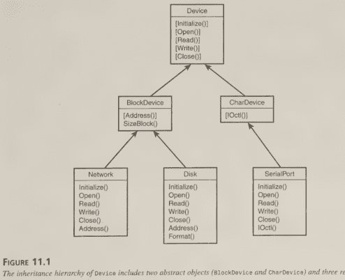

# 11

## 利用对象节省时间

一个编程示例可能是`SerialPort`是一个`CharDevice`，而`CharDevice`是一个`Device`。`Device`将定义`initialize()`、`open()`、`read()`、`write()`和`close()`的基本接口。`CharDevice`将通过`ioctl()`扩展`Device`的接口。最后，`SerialPort`实际上定义每个接口的实现，应用串口特有的特性。

## 数据抽象

第三个基础，数据抽象，与前面描述的抽象编程模型相似，但它将该概念扩展了一点。抽象编程允许程序员关注功能而忽略数据的含义。这导致了基本计算机科学结构（如堆栈和字典）的标准实现。

面向对象编程通过其自身的一些概念扩展了这一思想。通过附加封装，面向对象编程允许你在需要编写和完善的模块范围内工作。抽象从通用视角看待函数和操作。

抽象从继承中获得了巨大的推动力。继承与抽象相结合，允许你创建通用的对象，这些对象作为蓝图，但在自然界中并不实际存在。以一个来自自然界的例子来说，吉娃娃是一种狗，狗是一种哺乳动物。狗和哺乳动物在自然界中都不存在，但它们确实提供了如何区分狗与猫或树木的蓝图。抽象对象识别对象的主要职责，并可能保留一些已定义但未实现的行为。

与抽象对象不同，所有普通对象都可以定义并实现所有剩余行为。在之前展示的`Device`示例中，`CharDevice`和`Device`不是真实的对象，而仅仅是提供特定接口和行为蓝图的抽象。行为就是前面提到的基本接口。你可能会注意到，你可以为少数接口编程默认行为；这不会降低抽象的力量。事实上，如果做得正确，默认行为将作为继承对象增强功能的基础。

抽象的力量允许你在不知道具体实现的情况下调用单个接口（例如，`read()`）。`Device`层级定义（图 11.1）还包括另外两个对象，`Disk`和`Network`。抽象允许你创建任何一个非抽象对象，却像对待抽象版本一样对待它们。例如，你可以执行以下操作：

```c
/*****/
/* 创建一个 Disk 对象并将其放在 Device 中 */
/* 抽象引用                                */
/*****/
Device *dev = new Disk();
dev->Initialize();
```

尽管`Device`未定义`Initialize()`行为，仅提供接口，但语言足够智能，能够调用`Disk`的实现。请注意，尽管`Disk`定义了接口`Address()`，但该接口对`Device`是不可见的。要访问该接口，你可以修改代码：

```c
BlockDevice *dev = new Disk();
dev->Address();
```

你通过定义接口作为变量声明的一部分来设置访问权限和接口。当然，你可以将变量转换为适当的类型，但并非所有语言在转换过程中都保持`类型安全`。

## 方法多态

第四个也是最后一个主要对象基础看起来有点像抽象——`多态`。这个基础并没有增强编程范式的能力。它只是简化了定义的接口——方法名称更容易记住。

多态使用接口的名称和参数来唯一标识行为。例如，你可以有两个名为`PlayVideo()`和`PlayMIDI()`的方法。有了多态，你将有一个名称对应两种行为，`Play()`。参数将唯一标识行为——`Play(Video)`和`Play(MIDI)`。

编译器使用的链接器仍然不够智能，无法处理同时匹配行为的名称和参数，因此编译器必须提供解决方案。语言如何实现这个基础要求改变行为名称以包含名称和每个参数类型。这被称为`名称修饰`（name-mangling）。生成的名称仅部分类似于原始行为名称。

## 对象特性

要纳入面向对象技术的基础包括若干特性或定义。这些特性可能并不新颖，但它们是讨论面向对象技术语言时的重要术语。

七个特性是访问权限、类、对象、属性、特性、方法和关系。本节描述每个特性。

### 类或对象

前两个特性常常让程序员感到困惑。类是对象的描述，而对象是实际分配的事物。这类似于蓝图（类）和根据蓝图建造的房屋（对象）。

有经验的 C 语言程序员都知道`struct`（结构体）语言元素——它用于描述复合数据结构的内容。类（`class`）类似地描述了对象在创建时将要拥有的元素。从类创建对象，就好比使用已定义的结构体标签创建变量。

> **使用注意**
>
> 到目前为止，本章使用`对象`（object）一词指代类和对象两者。这是故意为之，旨在减少混淆。

继承层次结构包含两种特殊类型的类：超类和子类。`超类`位于继承树的最顶端，并且通常是抽象类。每个从其父类派生行为的类都是一个`子类`。

## 属性

C 结构体中的各个字段与类中的属性类似。通常，属性包含类的所有字段，无论是公开的（`published`）还是隐藏的。类中对外部世界可见的元素作为接口的一部分被`公开`。大多数情况下，你希望隐藏（或封装）类的所有属性。

## 特性

某些属性对接口是可见的。这些就是类的特性（`properties`）。除非你希望将类的某部分暴露给外部世界，否则不要使用此功能。通常，特性要么是只读定义，要么位于`Get()`和`Set()`守卫之后。你绝不应将纯变量暴露给外部。

> **CRUD 编程**
>
> `Get()`和`Set()`方法并不是真正的方法。它们是特殊函数集的一部分，这些函数所做的不过就是创建、读取、更新和删除（`CRUD`）信息。方法代表职责：它们执行某些操作。`CRUD`不提供任何功能，并且总是被默认假设存在。因此，它永远不会计入方法集中。

子类从其父类继承特性和属性。

## 方法

方法是对象的责任或行为。你可以重写（`override`）继承的方法，添加新方法，或者通过多态性增强现有接口。当你重写一个继承的方法时，通常会调用父类的原始方法。这有助于父类初始化其私有属性和行为。

属性、特性和方法共同构成了类的元素。

## 访问权限

访问权限确保程序的某部分能够访问接口的正确部分。`Java`和`C++`均提供三个访问级别——`private`（私有）、`protected`（受保护） 和 `public`（公共）。

- **`private`（私有）**：将元素与除所有者以外的所有人隔离
- **`protected`（受保护）**：允许所有者及其子类访问该元素
- **`public`（公共）**：允许任何人访问该元素


你可以通过在类之间建立友元关系（`friendships`）来放宽访问规则的严格程度。

## 关系

对象之间以三种不同的方式相互作用。其中一种方式——继承——在本章前面已经描述过。你可以用三个关键词来记忆这些关系：`is-a`（是一种）、`has-a`（拥有）和 `uses`（使用）。专业人员在面向对象分析和设计过程中使用这些关键词，并且它们有自己的图形表示（这超出了本文的范围）。

- **`is-a`** 继承：一个类从另一个类派生其行为。

- **`has-a`** 包含：一个类持有/拥有另一个类。

- **`uses`** 工作：一个类工作或使用另一个类。

所有对象交互仅涉及这些关键词。让对象交互时要小心：两个对象之间不应有超过一种交互。例如，对象 `A` 不应该既包含又操作对象 `B`。如果分析显示存在这种关系，说明设计是有缺陷的。

关系二象性（`duality`）表明分析做得不好。对象必须只有一个职责。具有多个不同职责的对象可能会表现出这种二象性。答案很简单——将该对象拆分甚至拆分为多个部分。

## 扩展对象

当你拥有一个好东西（特别是像对象这样非常好的东西）时，自然的倾向是扩展其功能或扩展其含义。这些扩展在某些面向对象语言中可用，但在所有语言中并非都可用。你应该意识到，你设计出的方案可能无法在你打算使用的语言中实现。一些扩展是对象的自然推论，例如模板和流。其他扩展，如异常，虽与对象无关，但对良好设计非常重要。本节将识别一些常见的扩展。

## 模板

类抽象和多态性将一组函数应用于数据，并做出适当的应用。想象一下，能够扩展这个概念并创建一个类，该类可以在新数据上生成自己的版本。模板（在 `C++` 中可用）允许你定义一个通用责任，而无需预先了解数据。

模板建立行为和责任。你通过提供具体类型基于此模板创建一个新类。模板的常见用途是创建对象的通用容器。例如，队列或堆栈具有行为（放入和取出有序数据），这与数据类型无关。

从零开始创建模板是高深奥妙的，并且语法很奇怪。最简单的方法是创建一个类的实例并将其泛化。测试完成后，再添加模板符号。

## 持久性

大多数时候，程序员认为对象在程序运行期间是 *活着* 的。然而，程序有时会有助于定义其行为的参数。通常，这些行为是根据用户的需求进行调整的。当程序未运行时保存此类信息时，你通常会将这些信息保存在某个文件中。

持久性（`Persistence`）允许你抽象这种行为。当程序启动时，它加载参数并从用户上次停止的地方继续。持久性对系统恢复也很有帮助。如果仔细完成，你甚至可以无缝地重新建立因系统故障而丢失的连接。

## 流

对象另一个扩展是 *流*（`streaming`）。想象一下，能够告诉对象将自身打包起来并保存或发送到某处。当它到达目的地或程序加载它时，它会自动打开自身并告诉你它能做什么。这在持久性和分布式编程中非常有用。

流是 `Java` 的一部分。你可以在 `C++` 中做一些流技术，但对象识别（在 `Java` 中称为 *内省*）是不可能的。

## 重载

许多扩展仅关注一个基础。例如，运算符重载（`C++` 支持）是多态性的扩展。一些程序员错误地认为多态性包括运算符重载。事实并非如此；它只是一个扩展。`Java` 不支持重载，但被视为一种面向对象语言。

运算符重载允许你添加（*并非* 重新定义）内部运算符的含义。你可以像使用常规多态方法名一样任意使用这些运算符。然而，该扩展必须对新定义施加许多限制。

- **扩展而非重新定义**——你不能更改现有类型的含义。换句话说，你不能更改 `(int) + (int)` 的含义。

- **并非所有运算符可用**——你可以使用大多数运算符，但有些不能被重新定义（例如，算术 `?:`）。

- **必须保留参数数量**——新运算符含义必须使用与原始运算符相同数量的参数。所有可重载的运算符要么是单元的（单参数），要么是二元的（双参数）。

在定义运算符的新含义时可能需要谨慎。这可能会使你的代码更不清晰，并导致非预期的结果。

## 接口

一个非常有用的扩展允许对象在保持其身份的同时服务于其他对象。`C++` 的一个问题是，为了让类 `A` 使用类 `B`，类 `A` 必须在程序员设计类 `A` 时知道类 `B`，或者类 `B` 必须继承自类 `A` 知道的某个类。当类 `B` 需要支持多个接口时，你就会遇到非常棘手的多重继承问题。

寿命最长的类具有最灵活的接口。`Java` 和其他语言允许你声明新类支持特定接口。此声明不会给新类增加太多开销。

## 事件和异常

最后一个常见的对象扩展让程序员更多地关注程序本身而非错误恢复。如果你经常在 `C` 中编程，你可能已经遇到了处理错误的持久性问题。当错误发生时（无论是内部还是外部），处理错误最合适的地方很可能不是发现错误的地方。

异常允许你定义何时以及如何处理特定错误，而且你不必在错误处理程序的位置执行。遗憾的是，所有这些都语言

不支持恢复功能，意味着一旦处理程序修复了错误，程序就无法从中断处继续执行。

与异常类似，事件是会导致程序发生跳转的异步内部或外部情况。基于事件的编程在 `GUI` 风格的程序中更为常见，它设定了一个响应事件的场景，要么等待这些事件，要么在每个事件之间进行处理。

同样，与异常类似，很少有（如果有）语言支持对象事件编程的全部功能。你可以模拟其中的大部分功能，但替代实现可能更容易。

## 特殊形式

对象技术与其他技术在数据和设计方面面临着同样的问题。并非所有数据问题都适合套用对象模板。这些退化形式并不一定代表糟糕的设计，但过多出现它们则表明对对象的理解不足。

本节定义退化类的类型，提供示例，并尽可能提供如何避免它们的建议。

### 记录/结构体

一条旧规则指出，没有方法的类只是记录。有些记录是必要的。如果你无法想到任何职责，它可能确实没有任何职责。例如，数据库只存储数据；它们不存储方法。然而，自然界中不存在没有方法的对象。任何东西都能做某事。

记录或结构体只是一组数据的集合。除了 `CRUD`（创建、读取、更新、删除）之外，它没有方法。非常不常见的情况下，你可能会遇到这种退化类之一。如果遇到，请尝试通过以下方式进行测试：

- 元素（字段）是否强相关？——例如，如果你改变其中一个，另一个的值或含义也应该随之改变。如果没有，你可能拥有一个集合（一堆无关的项目）。尝试将所有相关的分组隔离出来。然后，识别它们负责什么。

- 你是先确定了类，然后才识别支持属性的吗？——一个常见的错误是找到所有可能的属性，然后试图将它们分组到一个类中。这是反过来的。编程问题始于一个主要职责或任务，你可以将其分解为越来越小的子任务。

- 你正在看一个非常大的系统的一部分吗？——数据库是集合的绝佳例子。每个关系都必须通过一组业务规则来维持，以保持数据完整性。如果你一开始只是查看关系映射图的一部分，你可能会得出它没有任何功能的结论。现实情况可能是，你正为了“树”而迷失了“数据之林”。

如果你对以上每个问题的回答都是“是”，那么不用担心，创建该记录即可。确保使用 `CRUD` 对其进行封装。

### 函数包

函数包是记录或数据包的相反面。它没有任何数据，但有很多函数。数学库是一个绝佳的例子。你可能认为 `float` 与数学库中的函数有关。实际上，它们相关但*并非*耦合。要创建一个合适的类，你必须让数据和方法之间具有良好的强耦合。如果没有，你拥有的就不是对象。`exp()` 函数与浮点类型相关但并非耦合（即使没有 `exp()` 函数，你仍然可以有 `float`）。

与数据包不同，函数包在自然界中确实存在。你可以在任何物理或微积分教科书中找到它们。它们与数据需求共同存在。

如果你发现推导出了一个函数包，请用以下问题测试其有效性：

- 你是否将职责仔细划分到了良好的层级？——在委托方面很容易做得过火，最终将一个对象拆分到两个或多个本应是一个的物体中。寻找类之间过强的耦合。重构后，你可能实际上只有一个或两个对象。

- 类之间是否有良好的、“健康的”耦合？——就像任务一样，如果两个或更多类相互依赖，你可能会遇到某种死锁或循环依赖。这些依赖表明数据或函数位于错误的类中。

- 你是否正确拥有函数和数据？——如果数据和函数不是强依赖或相关，或者你可以轻松地将它们分区，你可能没有将职责放在正确的位置。

- 职责之间是否相互作用？——一个方法应该直接或间接地改变其他方法的行为。如果没有发生这种情况，它们之间就没有任何耦合。

- 方法是否使用了任何内部（非常量）数据？——一个健康的类会有改变对象状态的方法。如果没有任何改变，你实际上拥有的是一个*翻译函数*，而不是方法。

函数包比数据包常见得多，但你仍然需要对意外的函数包保持警惕。

### 语言支持

一旦你理解了对象技术的能力，你自然会想要尝试它们。它们提供的特性对大多数程序员和技术人员非常有吸引力。甚至电子（硬件）和嵌入式系统（固件）工程师也在加入对象的行列。

正如你预期的那样，现在有许多语言支持对象的需求。你甚至可以找到 `Object Cobol` 的版本（对于那些想要接受挑战的人）。经典的面向对象语言是 `SmallTalk` 和 `Eiffel`。`Lisp` 是一种在对象变得流行之前很久就支持某种对象形式的语言。接下来的两章讨论 `Java` 和 `C++` 中的套接字 API。

## 支持 对比 使能 对比 面向


你可能注意到了一些术语的细微差别——面向对象（object-oriented）和对象使能（object-enabled）。这些实际上是对象技术专家为不同语言定义的术语。实际上，很少有对象语言是真正的面向对象或`object-enforced`的。`SmallTalk`可能是唯一一种普遍存在的对象强制语言。你在`SmallTalk`中做的每一件事都是基于对象的。无论是创建实例、处理源代码或编译器，还是操作框架，你都无法绕过这一点。

大多数语言是`object-enabled`的：该语言支持并鼓励对象技术的基础、特性和扩展。例如，`C++`是一种对象使能语言。你可以规避许多特性，简单地用它编译`C`代码。你甚至可以使用`struct`来定义准对象，具备类的许多特性——除了封装和权限。

对象使能语言允许你编写代码，这些代码并不强制遵循对象技术的所有原则。甚至`Java`也是对象使能的；你可以在单个类定义中编写一个巨大的`main()`，其中包含几个辅助方法。真正的对象强制语言不限于单个入口点；程序所需的所有对象都会在启动时实例化（创建并运行）。

最松散形式的面向对象是`object-supporting`。本质上，对象支持语言具有增强对象特性的功能，但它们是可选的，并且是语言结构的附属品。无论是否使用对象支持元素，你都可以从语言中获得相同或相当的功能。`Perl`或`Visual Basic`是对象支持语言的好例子。当然，对象支持语言有限制。通常，你会失去继承性。

为了弥补这些限制，这些语言通常会加入一个通用的补救元素。例如，`Visual Basic`提供了`variant`类型来支持抽象和手动继承。不幸的是，这些通用元素破坏了对象技术的其他基础，如封装、重用、可维护性、可读性和可测试性。`Visual Basic`的`variant`类型将类型确定权交给接收者，迫使接收者了解它所接收数据的私有信息。

## 如何映射对象到非对象语言

如果你能使用对象使能编程语言（如`C++`和`Java`）进行编程，对象技术很棒。你能从基础和扩展中获益很多，如果做得对，你的代码将更具可重用性。然而，并非每个环境都支持或允许使用对象语言。你能做什么？

信不信由你，对象的大部分基础和特性可以部署在任何编程语言中，包括`COBOL`和汇编（除了继承）。这需要纪律和特定的编程风格。不幸的是，几乎所有的扩展功能都会丢失。由于面向对象的大部分内容基于以前的技术（抽象、模块化编程等），当时的语言具有这些特性。以下是获取这些优势的方法：

- 封装——确保与模块的所有接口都是过程或函数。相信程序员不会拆开你的代码并使用变量和其他私有成员。另外，给你的方法命名时使用诸如`<模块名>.<过程名>( )`这样的格式。然而，某些编译器可能限制名称长度，因此你可能需要检查这一点。

- 抽象——允许使用类似强制转换来改变变量类型的语言可以进行某种形式的抽象。你可以将实际类型存储为记录结构的一部分，并让该类型执行适当的动作。

- 多态——你可以进行自己的名称修饰（例如，`Play MIDI( )`）。

- 继承——某些语言可以使用函数指针模拟继承，但这很难调试和维护。

- 类和对象——如果语言支持记录，你就有一个很好的起点。

- 属性——这些只是记录的字段。

- 属性（Properties）——你为每个发布的属性创建`CRUD`接口。

- 方法——所有语言都支持函数和过程。如果没有函数，你可以使用参数-值返回来模拟。

- 访问权限——访问权限是你制定的使用模块的规则。如果有人违反这些规则，一切后果自负。

- 关系——“包含”和“协作”关系是可用的。“继承”关系取决于语言。

- 模板——不可用。

- 持久性——你可以跟踪状态，并在每次程序启动时手动加载。

- 流式传输（Streaming）——数据的打包和解包需要关于数据的知识以及转换数据类型的能力。由于方法不会随数据一起分发，因此无法识别未知结构。

- 重载（Overloading）——不可用。

- 接口（Interfaces）——你可以使用隐式接口，但这仅假设处于动态加载环境中。这种情况通常不可用。

- 事件与异常（Events and Exceptions）——你可以模拟一些事件编程和异常捕获，但你需要使用函数间跳转（如`C`语言的`setjmp()`）来复制它。这不是一个好主意。

你并未被排除在对象编程循环之外。这里列出的良好实践可以在你工作的任何环境中帮助到你。

## 摘要：面向对象思维

对象技术建立在大量优秀的编程研究和创新之上。对象的基础（抽象、多态、继承和封装）帮助程序员设计和编写其他人可以利用或复用的稳健且优质的程序。特性定义了对象技术如何实现基础的一部分，而扩展则让程序员能够发展出其他能力。

如果谨慎且有纪律地应用，面向对象分析与设计的结果将更易于重用。它也比传统编程更易于维护和扩展。最后，它让程序员更多地关注问题本身，而非编程本身。

## 使用 Java 的网络 API

### 第 12 章

## 本章内容

- 探索不同的`Java`套接字 264

- 通过`I/O`连接 272

- 配置`Java`套接字 275

- 程序的多任务处理 276

- 实现限制 280

- 摘要：`Java`风格网络编程 280

到目前为止，本书已涵盖了`C`语言的套接字和网络编程。`C`风格编程的优势对于操作系统设计者来说非常明确——无开销的强大功能是一个真正的奖励。然而，这并不总是产生可重用或可移植的程序。

或者，你可以使用一种支持对象的语言，并创建一组可重用的工具。`Java`是优秀复用甚至可移植性的绝佳例子。`Java`的全部基础在于提供两个级别的可移植性——源码级别和代码级别。源码级别的可移植性意味着所有程序必须能够在任何平台上编译。（你可能会注意到`Sun Microsystems`保留使某些接口、方法或类过期或`deprecated`的权利。）这非常强大，因为你可以重用支持`Java`的任何平台上的代码。

代码级别的可移植性并不新奇。“一次编译，到处运行”的想法在使用正确的工具时很容易实现。`Java`编译为字节码，由虚拟机运行。`Java`虚拟机（`JVM`）按顺序执行每条命令，其行为有点像微处理器。当然，解释字节码永远无法接近本地机器语言（`C`语言编译而成的语言）的速度，但由于现代微处理器的速度，性能退化不太明显。

`Java`是一种功能强大、简单且有趣的语言。如果你知道如何用`C`/`C++`编程并理解对象技术，你在`Java`编程方面就有了良好的起点。`Java`中的库非常广泛，涵盖了许多操作。你可能会在所有可用的类中迷失方向。即使你学习了`Java`并熟悉了类库，你可能仍需要手边保留`Java`开发者套件（`JDK`）文档和几份打印参考资料。

最后一章介绍了对象技术的目的以及如何使用它进行设计。本章介绍了`Java`中一种套接字实现；下一章将定义一个自定义的`C++`套接字框架。由于`Java`主题非常广泛，本章的主题主要假设你已经了解`Java`，并想进入网络编程。同样，配套网站上的某些示例包含抽象窗口工具包（`AWT`）程序代码——讨论图形用户界面（`GUI`）和事件超出了本章的范围。

以下部分讨论了`Java`为套接字提供的类、相关的`I/O`以及线程。本章还讨论了一些支持套接字配置的新方法（如第 9 章“打破性能障碍”中所述）。

### 探索不同的 Java 套接字

与`C`类似，`Java`提供了访问互联网的方式。事实上，一些程序员认为`Java`的真正优势来自于`GUI`独立性和固有的网络编程。`Java`提供了一些互联网协议供你使用，主要是`TCP`和`UDP`。

`Java`首选的网络通道是`TCP`通道。正如本书第一部分所指出的，它具有最高的可靠性。此外，它比数据报式通信更容易使用。`Java`仍然提供`UDP`连接，但`I/O`库没有提供任何直接支持。

### 编程客户端和服务器

流式（或`TCP`）通道最符合`Java`的接口。`Java`试图抽象细节并简化接口。你可以轻松理解将`TCP`支持放入`I/O`库背后的决策。`Java`创建套接字的方法真正将步骤减少为几个对象和方法。

#### Java TCP 客户端

例如，如果你想要一个客户端套接字，你只需创建它：

```java
Socket s = new Socket(String Hostname, int PortNum);
Socket s = new Socket(InetAddress Addr, int PortNum);
```

常见的实现可能如下所示：

```java
Socket s = new Socket("localhost", 9999);
```

就这样。你不需要做其他任何事情来连接到服务器。当`JVM`创建对象时，它分配本地端口号，进行网络字节序转换，并连接到服务器。你甚至可以使用以下扩展来指定使用哪个本地网络接口和端口：


```java
Socket s = new Socket(String Hostname, int PortNum,
                      InetAddress localAddr, int localPort);
Socket s = new Socket(InetAddress Addr, int PortNum,
                      InetAddress localAddr, int localPort);
```

`InetAddress`类将主机名或IP地址转换为二进制地址。大多数时候，除非你从`InetAddress`对象开始，否则你不会在调用中直接使用`InetAddress`对象。相反，传递`Hostname`的构造器是更常见的用法。大多数程序使用用户提供给程序的信息进行连接。通常这是通过主机名或IP地址。

#### Java的IPv4/IPv6支持

Java当前直接支持IPv4，并且根据梅林项目（参见`java.sun.com`），当操作系统支持IPv6时，应可用IPv6支持。像`InetAddress`这样管理名称和转换的类应能轻松适应其他协议。但是，请注意，你拥有的版本可能尚未支持它。一些接口，如`InetAddress.getAddresses()`，需要更改以支持扩展地址和新格式。

### 发送/接收消息

创建套接字后，然而，程序不能直接通过此类发送或接收数据。你必须从类实例获取`InputStream`或`OutputStream`：

```java
InputStream i = s.getInputStream();
OutputStream o = s.getOutputStream();
```

使用这些方法，你可以读取或写入字节数组：

```java
byte[] buffer = new byte[1024];
int bytes_read = i.read(buffer);  //--从套接字读取块
o.write(buffer);  //--通过套接字传输字节数组
```

你甚至可以使用`InputStream`来确定内核缓冲区中是否有数据等待，使用`InputStream.available()`。此方法返回程序可以读取而不会阻塞的字节数。

```java
if (i.available() > 100 )//--除非有 100 字节等待，否则不读取
    bytes = i.read(buffer);
```

完成后，你可以调用`Socket.close()`来关闭套接字（以及所有I/O通道）：

```java
//--清理
s.close();
```

### 手动与垃圾收集

Java对所有调用使用`new`。JVM将一切（标量除外）作为指针传递，指针从不暴露给你的程序。一切都必须指向某些数据或`null`。当资源开始稀缺时，JVM调用垃圾收集过程。在此过程中，所有松散的内存引用都回到可用池中。这意味着你不需要释放你分配的任何内存。然而，这不适用于套接字。你必须手动关闭所有套接字。如果程序没有关闭依赖的套接字，程序最终可能会耗尽可用的文件描述符。由此产生的程序行为可能完全不可预测。

使用这些调用和对象，你可以创建一个如图12.1所示的回显客户端。

**清单12.1**Java简单回显客户端示例

```
//*******************************
// SimpleEchoClient 摘录
```

```java
Socket s = new Socket("t1.7.0.1", 9999);     // 创建套接字

InputStream I = s.getInputStream();       // 获取输入流

OutputStream o = s.getOutputStream();     // 获取输出流

String str;

while(true){

      byte[] line = new byte[100];

      System.in.read(line);             // 从控制台读取数据

      o.write(line);                    // 发送消息

      I.read(line);                     // 读回数据

      str = new String(line);           // 转换为字符串

      System.out.println(str.trim());   // 打印消息

}

while( !str.trim().equals("bye") );    

s.close();                 // 关闭连接
```

清单1.1展示了一个简单的读取和发送循环。它远非完美，但展示了基本功能。如果你尝试编译这段代码片段，编译器会抱怨没有捕获某些异常。所有网络操作都必须捕获异常。对于源代码清单1.1，你需要用以下内容包围代码：

```java
try
{
// <在此处添加所有源代码>
}
catch(Exception err)
{
      System.err.println(err);
}
```

`try...catch`块完成了这个示例。你可以直接将此代码放入类的`main()`块中。

## Java TCP 服务器

正如在前面的章节中看到的，Java简化了套接字的创建、读取、写入和关闭。编写相应的服务器甚至更简单。创建服务器套接字的调用有三个接口：

```java
ServerSocket s = new ServerSocket(int PortNum);
ServerSocket s = new ServerSocket(int PortNum, int BackLog);
ServerSocket s = new ServerSocket(int PortNum, int BackLog,
                                  InetAddress BindAddr);
```

`Backlog`和`BindAddr`提供了与基于C的系统调用`listen()`（等待连接队列）和`bind()`（绑定到特定网络接口）相同的功能。

如果你还记得，编写一个基于C的服务器程序大约需要7–10行代码。而在Java中，你只需大约两行代码即可创建一个等效的服务器：

```java
ServerSocket s = new ServerSocket(9999);
Socket c = s.accept();
```

并且，与C风格的监听套接字类似，你仅使用`ServerSocket`来等待客户端连接。当客户端请求连接时，服务器会获得一个新的`Socket`对象，可以用它来创建I/O流。

同样，你可以使用这些类来创建一个`SimpleEchoServer`（参见清单12.2）。

### 清单12.2Java中的简单回声服务器在输入/输出流中使用字节数组

```java
//***********************************************
// SimpleEchoServer 摘录
//***********************************************
try
{
    ServerSocket s = new ServerSocket(9999); // 创建服务器
    while (true)
    {
        Socket c = s.accept();       // 等待连接
        InputStream i = c.getInputStream(); // 获取输入流
        OutputStream o = c.getOutputStream();// 获取输出流
        do
        {
            byte[] line = new byte[100]; // 创建临时数组
            i.read(line);        // 读取客户端消息
            o.write(line);       // 发回消息
        }
        while ( !str.trim().equals("bye") );
        c.close();              // 关闭连接
    }
}
catch (Exception err)
{
    System.err.println(err);
}
```

清单12.2展示了在Java中创建服务器的简单性。这些示例比较粗糙，显得有些笨拙，但后续章节将解决I/O限制，并帮助你编写更稳健的代码。

## 实现消息传递器

上一节介绍了流协议（或TCP）。对于基于连接的通信，流应该能很好地满足你的需求。然而，某些消息可能更适合基于消息的协议，如数据报（UDP）。Java网络包中有几个类允许你创建套接字并发送消息。这些是`DatagramSocket`和`MulticastSocket`。


`DatagramSocket` 类允许你通过单次调用创建一个套接字：

```java
DatagramSocket s = new DatagramSocket();
```

与 `Socket` 类一样，你可以手动设置本地端口和网络接口：

```java
DatagramSocket s = new DatagramSocket(int localPort);
DatagramSocket s = new DatagramSocket(int localPort,
     InetAddress localAddr);
```

创建数据报套接字后，你可以发送和接收消息。这些消息不直接与 Java I/O 包交互。相反，你必须使用字节数组。网络包包含 `DatagramPacket` 类，用于管理每个消息的数据和目的地信息：

```java
DatagramPacket d = new DatagramPacket(byte[] buf, int len);
DatagramPacket d = new DatagramPacket(byte[] buf, int len,
     InetAddress Addr, int port);
```

你使用第一个构造函数创建一个将读取数据的对象。第二个构造函数对于创建打算发送的消息非常有用，并添加了目的地地址/端口。`buf` 指向一个已分配的字节数组；而 `len` 指向数组的长度或有效数据的长度。

为了演示 `DatagramSocket` 和 `DatagramPacket` 的使用，考虑一个对等源（peer-source）和对等目的地（peer-destination）的示例。对等源程序向对等目的地发送消息。这与第 4 章“在对等之间发送消息”中演示的数据报编程类似。清单 12.3 展示了使用数据报的对等源示例。

### 清单 12.3 创建数据报套接字并发送消息

```java
//****************************************************
// SimplePeerSource 摘录
//----------------------------------------------------
DatagramSocket s = new DatagramSocket();  // 创建套接字
byte[] line = new byte[100];
System.out.print("Enter text to send: ");
int len = System.in.read(line);

InetAddress dest =        // 转换主机名
InetAddress.getByName("127.0.0.1");
DatagramPacket pkt =        // 创建消息数据包
new DatagramPacket(line, len, dest, 9998);
s.send(pkt);               // 发送消息
s.close();                 // 关闭连接
```

这个清单发送消息并立即关闭套接字。虽然这看起来像是一个错误，但所有套接字都允许你先发送任何内容然后再关闭——甚至是在消息离开你的本地主机之前。套接字的消息队列会保留，直到所有消息都消失。

对等目的地基本上与客户机做同样的事情，只是它读取消息而不是发送消息。清单 12.4 展示了简单的对等目的地。

### 清单 12.4 接收数据报消息并显示它

```java
/********************
// SimplePeerDestination 摘录
//
DatagramSocket s = new DatagramSocket(9998); // 创建套接字
byte[] line = new byte[100];
DatagramPacket pkt =    // 为传入消息创建缓冲区
new DatagramPacket(line, line.length);
s.receive(pkt);        // 获取消息
String msg = new String(pkt.getData());    // 转换数据
System.out.print("Got message: "+msg);
s.close();             // 关闭连接
```

Java 支持数据报套接字，使你可以创建套接字并发送消息，但仅此而已。如果你想要更健壮的 I/O 能力，Java 并没有直接提供。相反，你可以使用内存 I/O 类在数组中构建消息（在“将 I/O 类分类”一节中有描述，稍后在本章中）。

发送定向消息而不是开放管道的优点，本质上与 UDP 提供的优点相同。（有关这些差异的更多细节，请参见第 3 章“不同类型的 Internet 数据包”和第 4 章。）Java 为数据报协议提供了一个简单的封装器。

## 发送到多个目的地

数据报协议允许你向一个未连接的目的地发送单个消息。数据报的一个优点是能够使用广播和多播同时向多个目的地发送。第 15 章“使用远程过程调用（RPC）进行网络封装”详细讨论了这两种消息发送方法。

### 当前的 Java 多播支持

在撰写本文时，多播套接字选项没有正确工作。这种支持应该会很快得到修复。这已在 WinNT 和 Linux 的 1.3 测试版上进行过测试。

Java 在其网络封装器中提供了多播，但排除了广播。多播允许程序加入一个为多播组保留的特殊 IP 地址。该组中的每个程序都会接收发送到该地址的消息。要创建 `MulticastSocket`，你可以使用两个构造函数之一：

```java
MulticastSocket ms = new MulticastSocket();
MulticastSocket ms = new MulticastSocket(int localPort);
```

虽然你可以创建一个未指定端口的多播套接字，但在期望收到任何消息之前，你的程序必须选择一个端口。原因是所有多播数据报都使用端口来过滤掉不需要的消息。

创建套接字后，它的作用就像一个 `DatagramSocket`。也就是说，你可以发送和接收定向消息。要获取扩展的多播功能，你需要加入一个组。IPv4 预留了一个合法多播地址范围：`224.0.0.0`~`239.255.255.255`。

```java
MulticastSocket ms = new MulticastSocket(16900);
ms.joinGroup(InetAddress.getByName("224.0.0.1"));
ms.joinGroup(InetAddress.getByName("228.58.120.11"));
```

从这一点开始，你的套接字将接收发送到 `224.0.0.1:16900` 和 `228.58.120.11:16900` 地址的消息。与其他数据报一样，程序可以接收每条消息并直接回复发送者，或者程序可以回复给该组。

你不必加入组就可以发送消息。因为多播套接字仍然是一个 UDP 套接字，你可以不实际加入组就向组发送消息。但是，要接收多播消息，套接字必须加入该组。

## 12 使用 JAVA 的网络 API

# 对象与未来规划

IPv6 支持基于 UDP 的多播，并计划支持基于 TCP 的多播。这一扩展消除了 UDP 协议的不可靠性。但由于 `MulticastSocket` 继承自 `DatagramSocket`，当前的继承体系无法支持 IPv6 对可靠数据报的支持计划。这个设计是一个未考虑未来扩展性的良好范例。在设计或编写任何对象框架时，试着稍微向前看一步。留下几个需要升级或扩展的地方，比修复整个继承体系要容易得多。`MulticastSocket` 无法支持 IPv6 TCP 套接字，仅仅因为它继承自数据报。

`Listing 12.5` 展示了如何创建和配置多播套接字的示例。

### `Listing 12.5` 创建一个多播套接字，将其分配给端口 #16900，加入组并等待消息


```java
// SimpleMulticastDestination excerpt
//---------------------------------------------------------------------------
MulticastSocket ms = new MulticastSocket(16900); // 新套接字
ms.joinGroup(InetAddress.getByName("224.0.0.1")); // 加入组
String msg;
do
{
    byte[] line = new byte[100];
    DatagramPacket pkt = new DatagramPacket(line, line.length());
    ms.receive(pkt);
    msg = new String(pkt.getData());
    System.out.println("From " + pkt.getAddress() + ":" + msg.trim());
}
while (!msg.trim().equals("close"));
ms.close(); // 关闭连接
```

Listing 12.5 创建了一个用于多播的套接字，并请求一个端口以接收数据报。加入 `224.0.0.1`（本地主机）组后，它创建了一个用于接收传入数据报的包。

## 通过 I/O 连接

到目前为止，示例使用了非常简单且常常笨拙的 I/O 接口。Java 套接字的强大之处在于其通过不同 I/O 类进行连接的能力。Java 有多个类提供不同形式的数据读写。

本节对您可能希望与套接字一起使用的 I/O 类进行分类并展示如何使用它们。由于 I/O 包功能众多，本文不会面面俱到。如果您想了解更多信息，不妨参阅其他 Macmillan 出版社的 Java 书籍（例如 Kenneth Litwak 的 `Pure Java 2` 或 Nathan Meyers 的 `Java Programming on Linux`）。

## 对 I/O 类进行分类

Java I/O 包包含多个类，每个类都定义为执行特定任务。它们都用于发送或接收信息。不幸的是，由于类数量众多，很难知道何时该使用哪一个。也许处理它们最简单的方式是根据其几种职责对它们进行分组。这样您可以轻松看出哪个类最适合套接字使用。

I/O 包基本上提供了六种主要的 I/O 类型。每种类型服务于特定目的，并且都派生自 `Reader`、`Writer`、`InputStream` 或 `OutputStream`：

- **内存**— 基于内存缓冲区的 I/O。该包不访问任何硬件设备；相反，RAM 中的数组充当虚拟 I/O 池。这有助于解析字符串，甚至为数据报创建缓冲区。示例包括 `ByteArrayInputStream`、`ByteArrayOutputStream`、`CharArrayReader`、`CharArrayWriter`、`StringReader` 和 `StringWriter`。

- **文件**— 读取、写入和操作文件系统。这些类为您提供在文件系统中创建、读取、写入、删除或操作文件的方法。示例包括 `FileInputStream`、`FileOutputStream`、`FileReader` 和 `FileWriter`。

- **过滤器**— 执行某些基于字符的转换或解释的 I/O。例如，将换行符视为记录结束，通过制表符或逗号识别字段，或将二进制值转换为可读数字。示例包括 `FilterReader`、`FilterWriter`、`PrintWriter` 和 `InputStream`（已弃用）。

- **对象**— 编码对象的发送和接收。这一点最令人印象深刻。Java 可以在您不编写任何代码的情况下发送和接收实例。在大多数情况下，您只需标记该类为 `Serializable`，就可以传输和接收对象实例。这些类是 `ObjectInputStream` 和 `ObjectOutputStream`。

- **管道**— 类似于 C 中的 IPC（进程间通信）。您创建一个管道并将其与另一个管道连接，然后两个线程互相发送消息。这些类是 `PipedInputStream`、`PipedOutputStream`、`PipedReader` 和 `PipedWriter`。

- **流**— 通用的缓冲 I/O 通信。这是套接字使用的形式。如果您想使用其他类型，需要将流类转换为另一种类型（参见下一节）。抽象类是 `InputStream` 和 `OutputStream`。基本的转换类是 `InputStreamReader` 和 `OutputStreamWriter`。


该包还有其他一些类，确实不符合此分类。例如 `SequenceInputStream`，它允许您将两个流合并为一个。

在这些类中，您可能最想熟悉的是用于发送和接收自定义类的 `ObjectInputStream` 和 `ObjectOutputStream`，或用于字符串 I/O 的 `BufferedReader` 和 `PrintWriter`。网络程序经常使用这些，因为它们最适合套接字编程。同样，您可以使用 `ByteArrayOutputStream` 或 `ByteArrayInputStream` 对象为数据报消息提供接口。

## 在 I/O 类之间转换

某些类拥有的功能在套接字交给您的 I/O 类中可能无法直接获取。`Socket` 类仅提供两个 I/O 类——`OutputStream` 和 `InputStream`。这些仅提供了非常基础的字节数组读写功能。要获取不同的功能，您需要转换这些类。

假设您想读取字符串，而不是字节数组。`BufferedReader` 拥有良好的 `String` 接口。您需要从 `InputStream` 抽象类转换到 `Reader` 抽象类。`InputStreamReader` 类充当此转换的中介：

```java
Socket s = new Socket(host, port);
InputStream is = s.getInputStream();
InputStreamReader isr = new InputStreamReader(is);
BufferedReader br = new BufferedReader(isr);
String l = br.readLine();
```

您也可以使用以下惯用的简写：

```java
BufferedReader br = new BufferedReader(new InputStreamReader(
s.getInputStream()));
```

通过通道发送字符串（而不实际转换字符串）稍微容易一些：

```java
String msg = new String( 
"<html><body>Welcome to my Java website</body></html>");
SocketServer ss = new SocketServer(9999);
Socket s = ss.accept();
PrintWriter pw = new PrintWriter(s.getOutputStream(), true);
pw.println(msg);
s.close();
```

第一个参数为新 `PrintWriter` 实例提供了对套接字流的引用。第二个参数告诉对象每当程序调用 `println()` 时自动刷新。通常，`PrintWriter` 中的 I/O 会缓冲数据，直到积累足够多数据以最小化带宽浪费。指定自动刷新意味着您希望指定何时发送缓冲区。

使用这些 I/O 类，您可以创建非基于 Java 的程序可以解释的 I/O 消息。然而，您仍然可以使用 `ObjectOutputStream`/`ObjectInputStream` 类向另一个 Java 程序发送/接收对象。您可以传输任何实现 `Serializable` 接口的对象。

```java
String msg = new String("Test");
Socket s = new Socket(hostname, port);
ObjectOutputStream oos = new ObjectOutputStream(
    s.getOutputStream());
oos.writeObject(msg);
```

接收端可以将消息作为对象接收，并将其转换为已知类型：

```java
Socket s = ss.accept();
ObjectInputStream ois = new ObjectInputStream(
    s.getInputStream());
String newMsg = (String)ois.readObject();
```

如果消息不匹配正在转换的类型，解释器将抛出 `ClassCastException`。因此，如果程序获取了您未预料到的类，您可以使用类反射来获取正确的类型。如果程序仍然不知道类型，您可以更深入地挖掘该类以获取方法、继承和实现。虽然这会使代码变得更复杂，但使用这种方法可以生成更具扩展性的产品。

## 配置 Java 套接字


# 第 9 章

第 9 章列出了使用套接字选项配置套接字以执行不同操作的几种方法。Java 版本直到 1.3 才在 API 中公开了这些功能中的一部分。请注意，如果操作系统不支持某些套接字选项，Java 无法公开它们。本节描述了这些已公开的选项。

## 共享的 Java 套接字配置

所有 Java 套接字共享配置套接字的方法。以下内容确定读取等待数据的时间。这些方法公开了`SO_TIMEOUT`套接字选项，该选项确定读取等待多久。`SO_TIMEOUT`选项已经过时，Linux 使用`fcntl()`、`poll()`或`select()`代替。

```java
getSoTimeout()
setSoTimeout(int timeout)
```

以下代码指定内部发送缓冲区的大小（以字节为单位）。这些方法公开了`SO_SNDBUF`套接字选项：

```java
getSendBufferSize()
setSendBufferSize(int size)
```

接下来的代码行指定内部接收缓冲区的大小（以字节为单位）。这些方法公开了`SO_RCVBUF`套接字选项。

```java
getReceiveBufferSize()
setReceiveBufferSize(int size)
setKeepAlive(boolean on)
```

以下方法确定套接字在关闭后是否继续存在以及存在多长时间。这些调用公开了`IP_SO_LINGER`套接字选项。

```java
setSoLinger()
setSoLinger(boolean on, int linger)
```

接下来的代码启用或禁用 Nagle 算法，该算法会等待网络交付一个数据包，然后再发送下一个数据包。这些调用公开了`TCP_NODELAY`套接字选项。

```java
getTcpNoDelay()
setTcpNoDelay(boolean on)
```

## Java 多播特定配置

本节列出了你可以在`MulticastSocket`对象上设置的选项。这些函数确定在数据包应该被丢弃之前，套接字允许经过多少路由器跳数。

以下方法公开了`IP_MULTICAST_TTL`套接字选项。（奇怪的是，Java 不允许你为其他类型的套接字指定`TTL`。）

```java
getTimeToLive()
setTimeToLive(int ttl)
```

接下来这两个方法通过公开`IP_MULTICAST_IF`套接字选项来设置多播传输的主要网络接口。

```java
getInterface()
setInterface(InetAddress inf)
```

## 程序的并行处理

Java 使多种编程技术变得简单直接。除了显著降低编程复杂度的网络包和 I/O 包外，它还拥有一个集成的多线程结构。Java 线程的声明如同声明一个接口一样简单。

在进行网络编程时，你肯定需要充分利用系统提供的所有并行处理能力。本节总结了一些如果你想在 Java 程序中使用线程时需要了解的内容。

### 将类实现为线程化

要创建一个可线程化的类，你可以从`Thread`类派生或实现`Runnable`接口。在这两种情况下，你都必须定义`run()`方法，线程实际上会从该方法开始运行。在前一种情况下，你只需编写以下内容：

```java
public class TestThread extends Thread
{
    public void run()
    {
        // thread runs here
    }
}
```

扩展`Thread`允许你基于类创建线程。`run()`方法决定线程从何处开始运行。当该方法退出时，线程终止。接下来的几行代码创建并运行该线程。

```java
public static void main(String[] args)
{
    start(); // start the thread and call run()
    // do something while the thread runs
}
```

如果你想创建多个线程，每次都需要调用`start()`。顾名思义，所有线程共享所有数据。要为线程创建一个独立的工作区，你可以创建一个新的对象：

```java
Thread t = new TestThread();
t.start();
```

> **与 Java 线程公平共处**
>
> 就像任务可以接管计算机一样，Java 线程也容易独占 CPU 时间（这在 Windows 上比在 Linux/UNIX 上更为明显）。请务必遵循第 7 章“划分负载：多任务处理”中列出的准则，以确保其他任务有机会运行。

你程序的任何部分，包括事件和异常处理器，都可以创建和启动线程。但是，请记住你需要保留对所创建对象的引用。否则，当发生随机垃圾回收时，你悬垂的线程可能会突然终止。

### 向类添加线程

然而，有时从`Thread`继承是不可行的。典型的例子是你正在编写一个从`Frame`派生的类。Java 不允许多重继承，因此同时从`Frame`和`Thread`继承是不可能的。在这种情况下，你可以使用实现`Runnable`接口的第二种技术。结果相同，程序变化也仅很小。

```java
public class TestFrameThread extends Frame
    implements Runnable
{
    public void run()
    {
        // child thread
    }
    public void someMethod()
    {
        Thread t = new Thread(this);
        t.start();
    }
}
```

加粗文本指示对源代码的两个更改。第一处是从`Frame`继承并实现`Runnable`。这声明了我们获得正确程序行为所需的关系。第二处更改是创建`Thread`。`Thread`类有一个额外的构造函数，它接受任何实现`Runnable`接口的对象并以此创建一个`Thread`对象。调用`start()`所做的与类从`Thread`派生时的效果相同。

在类中运行的所有线程实际上可能与该类的基本功能无关。你确实没有任何限制。但如果你遇到不同组的责任，请确保实际上你并没有拥有两个不同的类。判断你是否真的拥有互异类的两种方法包括：分离的线程（父线程和子线程）共享多少，以及子线程能否在没有父线程的数据或功能的情况下存在。

为每个主要责任创建一个单独的类是良好的对象设计，在并行处理环境中真的很有帮助。如果你需要访问每个对象的方法或资源，请创建属性控制方法（`set()`/`get()`）。通过通过方法集中管理所有属性控制，你真的在封装的基础上构建，使线程同步更容易。

### 方法同步

线程的一个主要优势是共享资源的能力。这导致了第 7 章描述的相同互斥问题。Java 通过使用`synchronized`方法来解决这个问题。

`synchronized`方法取代了 pthreads 中使用的信号量。其声明为：

```java
public synchronized changeSomething() 
{
    // Manage contended resource
}
```

`synchronized`关键字强制方法中的所有条目一次只发生一个。在另一个线程可以进入该方法之前，第一个线程必须完成其调用。

有时你需要更多的控制。例如，假设你有三个线程（一个父线程和两个子线程），它们通过套接字控制缓冲区的数据接收和发送。你不想在缓冲区未满时发送缓冲区，而子线程控制输出的缓冲区。同步方法获取对缓冲区的控制权，但缓冲区未满。方法可以返回一个失败值，强制子线程重试调用。或者，方法可以保留资源并强制线程暂时放弃控制权。

退一步说，当线程竞争受控资源时，它们进入等待队列。当当前的资源所有者退出同步方法时，队列中的下一个线程获取资源的控制权。只要线程在竞争，这种情况就会持续下去。

在需要更多控制的时刻，线程获取控制权只是为了发现它没有足够的资源来执行任何操作。在这种情况下，它可以放弃控制权并自动移动到等待队列的末尾。它使用的工具是`wait()`和`notifyAll()`。

```java
public synchronized changeSomething() 
{
    while (buffer_not_full) // Is there enough data?
    {
        try { wait(); }     // No, move to the queue’s end
        catch (Exception err)
        { System.err.println(err); }
    }

    // Send the message      // Do processing on the data

    notifyAll();            // Tell all waiting threads
}
```


`wait()` 方法将当前线程放回等待队列。调度器唤醒队列中的下一个线程。如果它可以继续，它会跳出循环并发送消息。完成后，`notifyAll()` 方法告诉所有等待的线程它们现在可以尝试获取资源。

## 实现限制

Java 的网络编程实现是一个快速和简单开发的优秀模型。创建套接字、发送消息和管理异常很容易。然而，它确实有一些限制。

- **令人困惑的 I/O**——I/O 包没有尽可能直观。可能的原因是类名使用了动词。不同类型 I/O 的分离是很好的，但结果是类爆炸（类在 I/O 类型和基类之间排列组合），而不是使部署真正直接。

- **仅支持 IPv4**——Java 显然只支持 TCP/IPv4 网络。在撰写本文时，`java.sun.com` 网站显示了一个名为 `Merlin` 的项目，该项目定义了对 `IPX` 和 `IPv6` 的支持。但那是以后的事，一些类方法需要改变以支持其他网络。

- **没有原始套接字**——Java 不支持原始套接字。

- **不完整的套接字选项**——缺少一些套接字选项配置。这些包括 `TCP` 和 `UDP` 的 `TTL`、重传时间等。

- **无法直接 Fork（分叉）**——进程创建（forking）仅限于外部调用。你可以通过实例化一个新的 `Thread` 对象来模拟进程，但由于线程仍然共享相同的虚拟空间，你无法保证资源不会损坏。

- **没有广播**——Java 的软件包不包括广播。可能的原因是广播的普及度下降。你很可能预期广播很快就会完全消失。

尽管有所有这些限制，Java 仍然是一个良好、坚实的编程环境。利用它所有的功能，你可以做很多事情。

## 总结：Java 风格网络编程

Java 包含一个大型库，可以帮助你编写网络程序。网络软件包包括用于流式（`TCP`）、数据报（`UDP`）和多播（`UDP`）套接字的类。它还包括用于管理地址和转换的类。

当与 I/O 软件包一起使用时，套接字软件包增加了其功能。I/O 软件包提供了几种方式来处理套接字、内存和线程之间的通信。虽然库有点令人困惑，但它拥有强大的力量，可以使网络编程非常快速。

Java 的多线程能力简化了套接字编程并缓解了服务器开发。你可以通过两种方式之一创建线程：继承 `Thread` 或实现 `Runnable`。有了这些，

调用 `start()` 方法会创建一个新的执行线程，并启动您在 `run()` 自定义实现中的任务。同步多线程类并不难，只需使用两个工具：同步方法（synchronized methods）和执行让出（execution yielding）。

分析和将 Java 用作编程基础，有助于你了解如何在支持对象的编程语言中部署套接字。下一章将提出并阐述一个 `C++` 的实现方案。

## 12

## 使用 Java 网络 API

## 设计并使用 C++ 套接字框架

## 第 13 章

## 本章内容

- 为什么使用 `C++` 进行套接字编程？ 284
- 框架构建步骤 286
- 测试套接字框架 296
- 实现限制 299
- 总结：`C++` 套接字框架简化编程 301

上一章向你展示了如何在 Java 中编写套接字程序。Java 是一种功能强大的语言，具有许多优势，例如平台独立性、JIT（即时）编译，甚至原生编译器/转换器。然而，并非所有人都希望使用 Java，他们声称其缺乏稳定性或所需的性能，有些人可能更倾向于使用 `C++` 版本。编写套接字`框架`（或类库）囊括了本书中描述的所有技术。事实上，本章还提供了几个额外的套接字功能，这些功能在第四部分“高级套接字——增值”中有所涵盖。

要使用本章内容，你必须熟悉 `C++` 和面向对象的编程。与前面的章节一样，假设你已知晓如何用 `C++` 编写代码，以及如何编译和链接文件。这些步骤的教程在因特网上很容易找到。

本章将带你了解分析、设计和创建类框架的过程。这个特定的框架仅提供了围绕套接字 API 的一个封装（一个附加功能较少的接口）。你仍然可以使用这些原则来定义其他框架，而不仅仅是封装。

## 为什么使用 C++ 进行套接字编程？

封装套接字 API 的 `C++` 框架与手动进行各个系统调用相比，具有若干优势。你可能已经注意到，创建、配置和使用套接字的过程，从一种应用类型到另一种应用类型变化很小。

### 简化套接字接口

编写匹配应用类型的类，可以让你更多地专注于编程，而较少关注网络。套接字接口并不困难，但需要特定步骤才能使通信信道持续稳定工作。

`C++` 语言比 `C` 更强大，是 `C` 功能集的完全超集。事实上，你可以用与 `C` 相同的工具（`cc`）来编译 `C++` 程序。（实际上，这并不 100% 准确。当 `cc` 发现 `.c` 或 `.cpp` 扩展名时，它会调用 `g++` 而不是 `gcc`。）随着这种额外的强大功能，`C++` 语言也复杂得多。尽管如此，其优点仍大于缺点。

编写套接字框架允许你为他人定义更简单的接口。程序的简洁性对于可测试性和缺陷修复至关重要。此外，接口越简单，使用就越容易。同样，某事物越容易使用，被正确且频繁使用的可能性就越大。

设计和编写得当的 `C++` 框架提供了非常直接和简单的接口，让程序员真正能够专注于手头的工作。

## 隐藏实现细节

接口促进了产品的简单性或复杂性。随着接口复杂度的增加，易用性会下降。隐藏实现细节对于确保简洁性非常重要。设计和实现——特别是在封装中——试图向用户程序员隐藏细节。

当然，用户程序员可能想知道你是如何做某些事情，但该信息可能会对你和他或她造成伤害。封装，作为第 11 章“利用对象节省时间”中确定的对象基础之一，保护了框架编写者和用户程序员双方。通过隐藏实现某些步骤的方式，你保护了程序员免受这些实现变更的影响。这也保护了框架，因为它允许系统在内部演化，而不影响对外界的接口。

与其他所有支持对象的语言一样，`C++` 强制推行所有权规则，使得程序只能访问其可见并拥有的内容。如果规划得当，一个框架可以支持所有形式的套接字网络。

## 部署具有易用接口的可复用组件

接口和隐藏实现细节在程序和框架之间创建了一层非常薄的膜。程序必须通过这层膜传递所有请求。类内部的操作接受并处理数据和请求。

保持接口简单非常重要。结果显而易见：一套许多程序都可以使用的程序工具。事实上，针对同一接口可以存在多个实现。你只需选择最适合当前情境的那个。

当你编写这些工具时，复用的明显优势对用户程序员而言变得显而易见。他们反过来通过发布基于这些工具的程序来推广你的工作。（一个很好的例子是 `QL`。）

## 展示框架设计流程

框架工具存在于因特网上。你可以找到各种不同风味/形式。另一方面，找到一个套接字框架要稍微困难一些。在此处编写一个框架允许你以任何想要的形式进行配置，并附带展示了编写工具过程的额外好处。

与 `OOA/D` 的 `UML` 风格不同，编写库或框架更多是从底部而不是完全从顶部进行。`OOA/D` 指出，你必须从需求开始，最终构建产品——类似于剥洋葱。整个理念是最小化功能蔓延，只实现所需的内容。


框架创建采取了不同的视角：用户程序员期望的功能尚不明确，因此框架实现尽可能多的用户程序员可能使用的功能。这种方法，当然，只是在呼喊：“我们要功能”，这可能引起对死代码（链接进未使用/无法承受的代码）的担忧。死代码在程序中已不再常见。更新、更智能的链接器会剔除所有看似不需要的代码。

## 构建框架

创建对象框架类似于构建墙壁：你从固定的尺寸开始，并以特定顺序将所有东西钉在一起。本节通过识别功能、分组到组件、组织层次结构等步骤，阐述了创建框架的步骤。

### 定义通用功能

框架必须依赖于某种相关的需求。需求过少的程序无趣（且不值得实现），而需求过于分散的程序会产生尴尬的结果。需求定义了框架必须运行的参数。

通常，当你获得一份希望拥有的列表时，该列表可能不够详细，无法进行分析。请准备好提出疑问。套接字框架必须支持本书中描述的大多数主要功能。

### 支持不同类型的套接字

因特网套接字框架的主要功能是访问协议。本书提到的第一个协议是 `TCP` 连接。这种编程风格总是有一个客户端和一个服务器。服务器等待客户端的连接请求，为其创建独立的连接，然后与客户端交互。

另一种通信能力将一台主机作为对等体连接到另一台主机。这种风格并没有明确的客户端或服务器，但它确实有一个发起者和一个回复者。此外，它使用 `UDP` 连接。

另外两种通信类型是广播和多播，将在本书后文中讨论。两者都允许你同时向多个目的地发送消息。有关这些协议的更多信息，请参见第 15 章“使用远程过程调用（RPC）进行网络封装”。

最后两种套接字类型对于此框架来说过于底层：原始套接字和混杂模式套接字。这些类型可以集成到该框架中，但由于所需的细节和管理程度，最好留给直接 API 使用。如有需要，请自由修改框架以包含这些功能。

## 发送简单消息

第二大特性对于实现有效功能至关重要——框架必须能够发送和接收消息。消息由三部分组成：地址、通道和消息体。

前面的章节描述了发送和接收消息的两种方法。这些调用假设了某些套接字状态。例如，要使用 `send()` 系统调用，必须拥有一个已连接的套接字。获取和接收消息的主要目标包括简化这些接口。

简化通信的方式是让消息自行传输。第 11 章中描述的扩展特性之一是数据流——数据的自动打包和解包。类应非常了解其内部结构；它应当承担这一角色。


C++语言并不便于提供数据流。它有一个重大限制——它必须在使用数据之前了解该数据。与Java对比——Java允许你定义一个类并附加`Serializable`接口。从此，该类会自动进行自身打包/解包。非常简单。我们可以做到这一点，是因为它使用解释型字节码。它不假设任何机器特定的信息。

C++程序必须提供打包和解包过程。并且，由于C++不支持接口，你必须从一个描述这些过程的公共类中继承。

## 管理异常

第三大特性必须控制网络引入编程中的各种异常和错误。在创建和配置套接字以及发送和接收消息的过程中，可能会发生大量异步错误。

所有错误都源自套接字、连接、路由或对端主机。快速有效地收集错误有助于用户程序员隔离问题并适当恢复。

框架使用C++异常管理结构`try...catch()`，类似于Java中找到的结构。用户程序员必须捕获框架抛出的所有异常；否则，程序将以未捕获的异常错误终止。你可以在程序的根捕获所有意外异常，并返回一些有意义的消息以改善调试。

## 配置套接字和连接

最后一个主要特性是配置你创建的套接字或连接。所有套接字类型都有不同的设置，允许你进行调优。不同的可调节设置会改变套接字或发送和接收通道的行为。

## 分组为主要组件

创建框架的下一步是识别所有主要部分或组件。`组件`是协同工作以解决特定问题或提供服务的对象网络。与对象一样，`组件`具有职责和接口，因此你也可以像对待对象那样对待它们。

通常，这些组件是包含在单个接口中的异构对象。一些对象分析员根据分发方法将这些组称为`包`，或根据对象系统通常以泛化方式适应的特性称为`模式`。但是，它们也可以是具有抽象对象作为主要接口的层次结构。

本节描述了套接字框架的四个基本组件。其中每个组件都是前面描述的层次结构。

### 异常：处理问题

所有框架都应识别并使用异常。你可能想要捕获的异常类型包括网络、I/O、边界等。异常层次结构依赖于`Exception`类的基本功能。图 13.1 显示了异常组件。

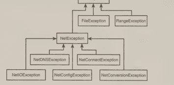

*所有异常类都继承自`Exception`，该异常类仅捕获字符串和错误代码。*

异常类层次结构很少定义任何令人惊讶或巧妙的设计。事实上，如果你使用类层次结构来表示异常，请务必小心，不要创建递归异常的潜在风险。例如，如果你分配内存并将内存处理程序映射到异常，你可能会因一次糟糕的`new()`调用而崩溃。将异常设计保留为最简单的形式，除了值和简短消息外不应有太多内容。

### 消息：打包和传输数据

要通过I/O子系统发送和接收消息，你需要数据块和缓冲区。`Message`虚拟类提供了打包（`Wrap()`）和解包（`Unwrap()`）自身的基本接口。此接口有助于近似Java I/O提供的序列化。

另一个类，`TextMessage`，提供了如何使用此接面的示例。例如，`wrap()`方法创建一块连续内存并将文本复制到其中。（释放该块的责任留给调用者。）`TextMessage`的消息是可变长的C风格字符串。

解包方法`Unwrap()`执行相反操作。它从调用者处获取数据块，并开始重新组装内部信息。有时，消息可能不完整，因此`Unwrap()`必须获取更多数据以完成重新组装。例如，`TextMessage`可能大于64KB（缓冲区限制），因此`TextMessage`类必须足够智能以请求更多数据。`Unwrap()`方法返回一个布尔值，以指示是否已完成。

### 寻址：标识源和目的地

每条消息都来自某个主机并去往某个主机。这些主机的寻址对于将消息送达 rightful 所有者至关重要。另一个简单的组件是`HostAddress`。使用结构体`sockaddr`寻址名称，该组件管理名称并解析到IP级别。

框架将所有地址转换为此组件。并且，该组件可以支持几种寻址类型。

### 套接字：建立、配置和连接

最后一个组件具有最多的功能。它基于`Socket`类并派生所有基本连接。它使用其他组件来完成工作。层次结构将基本功能放在`Socket`类中，并将所有特化放在继承类中。

需求列表中列出的所有协议都有一个专用类：`SocketServer`、`SocketClient`、`Datagram`、`Broadcast`和`MessageGroup`（多播）。所有特定于协议的配置都位于适当的协议类中。当你需要更改设置时，查看你正在使用的协议。如果你找不到，请查看父级。

这些类还假设你正在遵循正确的规则。从之前的`send()`示例中，这些类不检查已连接的套接字。相反，程序会抛出异常。

## 创建框架层次结构

组件使连接对象变得更加容易。组件提供对外部世界的接口，并可能暗示最顶层父类（`超类`）的特性。在开始处理框架层次结构之前，你需要定义每个组件内的非抽象类。

此时，你应该有几个类，例如上一节中列出的类。从那里，你发现关系和继承。不要惊讶于看到特性从父级到子级消失并重新出现。这是正常的，而且通常仍然是可实现的。

## 关系

第一步是识别组件和类之间的关系。使用通用术语，如`uses`（使用）、`is-a`（是一种）、`has-a`（拥有）和`throws`（抛出），来标记组件或类之间的连接。

在图 13.2 中，不同的组件相连以显示它们如何相互作用。一些图表系统使用特殊的线端（如箭头）。使用你最习惯的方式。最重要的因素是清晰度。

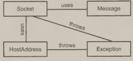

**图 13.2**

*每个组件都使用来自其他组件的资源。*

套接字组件与所有其他组件相连，正如预期那样。类可能没有所有这些连接，但这并不重要。深入钻取会让你看到更多细节以及哪个类真正使用什么。

## 挖掘自然继承

第二步在组件中寻找一种称为继承的特殊关系。如第 11 章所述，继承允许你从其他类（基类）创建相关类，并且只更改少量特性（特化），而无需重写整个类。这是对象技术的主要力量。

唯一具有有趣类的组件是`Socket`。它有五个明显相关的类。见图 13.3。`Broadcast`和`MessageGroup`（多播）类使用`UDP`套接字并具有类似的功能，因此它们必须从`Datagram`派生。然而，虽然`SocketClient`和`SocketServer`使用`TCP`，但它们操作方式不同。客户端主动连接，而服务器等待连接。

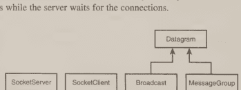

**图 13.3**

*`Datagram`、`MessageGroup`和`Broadcast`类看起来是相关的。`SocketServer`和`SocketClient`并不足够接近。*

## 识别抽象

回到`Socket`类层次结构，这些类确实能组合在一起，但需要额外的类。显然，`Socket`类必须是超类，是所有套接字的母体。它没有多少实际功能，除了为所有子类提供一组通用的功能特性。

`Socket`超类提供了所有的`get`和`set`函数。它还包含`creation`（创建）、`send`（发送）、`receive`（接收）和`close`（关闭）函数。但是，它无法诚实地存在于现实的时空之中。原因在于它没有协议。协议在其他地方定义。

> **为原始套接字调整层次结构**
>
> 你可以修改层次结构，使`Socket`本身创建原始套接字或混杂模式套接字。然而，你可能会遇到问题。首先，这些底层套接字的功能更接近`UDP`而非`TCP`。你必须`turn off`（关闭）`SocketClient`和`SocketServer`类的功能。这很丑陋。或者，你可以更抽象地处理该功能，在层次结构的`UDP`部分添加一个新层。无论哪种方式，组件都变得更复杂。这是编写框架中的一个真实且持续存在的问题；你添加的功能越多，它就变得越复杂，使用起来也越困难。


`SocketClient`和`SocketServer`仍然差异足够大，直接将它们合并到`Socket`中无法提供`TCP`的共性。此外，它们还有更多的功能差异，使它们无法直接关联。

你可以使用一个中间类（`SocketStream`）来解决`SocketClient`和`SocketServer`之间的紧密关系，该类在不失去超类身份的情况下定义了`TCP`套接字的功能特性。图 13.4 展示了完整的图示。

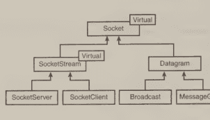

**图 13.4**

*完成的`Socket`类层次结构包含两个虚拟类：`Socket`和`SocketStream`。*

这两个类，`Datagram`和`SocketStream`，提供了它们的协议所需的配置和特性。像这样分离协议使得添加其他协议（如`SOCK_RAW`）甚至新协议（如`RDM`（可靠交付消息））变得简单而整洁。

## 定义每个类的功能


设计中的最后一步与标准的 `OOA/D` 迭代处理不同。主要原因是 `OOA/D` 主要关注项目，而不是库。查看库时，你无法确切知道用户想要或需要什么。通常，设计师必须考虑这样一个问题：“库可以用做什么？”

## 项目决定库的谬误

许多程序员和设计师认为项目是设计库的最终来源。他们的逻辑有可取之处：像编写项目一样编写工具。然而，这种逻辑有两个主要缺陷：为什么大多数这样构建的库或框架缺乏可扩展性？以及为什么这些库开始看起来像一块疯狂的拼布，充满了不同程序片段的样品？问题很简单：项目从未有大局观来帮助定义库的哲学。一个过度加载的类的最佳例子是 `MFC` 的 `CStrings` 类。要开始一个良好、灵活且干净的库，必须首先定义哲学。然后你考虑每个类的可能性。

本节将带你走一遍充实每个类细节的过程。与正常的对象项目开发相比，第一步和第二步是颠倒的。

## 属性：添加它知道的内容

在大多数情况下，下一步是在每个类中放置函数或方法。然而，在创建库（特别是套接字 `API` 的封装器）时，你需要识别所有可用的特性或属性。

套接字的功能大多内置于套接字选项中。第 9 章“突破性能障碍”和附录 A“数据表”列出了标准的和依赖于 `Linux` 的套接字选项。这些是 `Socket` 类属性的良好候选者。实际上，类并不将属性作为类中的单独条目保存。相反，套接字描述符保存每个设置。通常伴随 `CRUD`（创建/读取/更新/删除）方法的每个 `get/set` 对实际上都是调用 `getsockopt()`/`setsockopt()`。

图 13.5 显示了每个公开属性的 `get/set` 函数调用。一些属性只是开启或关闭一个功能，因此设计中不包含 `get()` 函数。一个类可能不会公开所有属性；通常，它公开的属性是那些改变类行为的属性。其他内部属性可能只改变类的状态，因此它们往往保持隐藏状态。

最后一个特殊属性需要比改变值更多的东西。这些是真正的属性，看起来像属性，但实际上执行多个操作。例如，`Datagram` 中的 `MinimizeDelay()`（最小化延迟）、`MaximizeThroughput()`（最大化吞吐量）、`MaximizeReliability()`（最大化可靠性）和 `MinimizeCost()`（最小化成本）调用都与单个 `setsockopt()` 接口交互。但为了简化接口，它们计算并设置正确的位值，以便你不需要这样做。

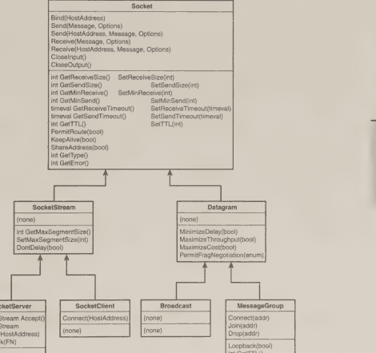

**图 13.5**

类中的每个属性可能具有关联的 `get...( )`/`set...( )` 函数。

套接字组件中的类可以包含特定于该类特定实现的其他属性。例如，`SocketServer` 可以保存已接受连接的注册例程。此外，组播套接字没有一种干净的方式来删除组，因此 `MessageGroup` 包含一个已加入组的数组。

## 方法：添加它做什么

与组播套接字可用的加入组函数一样，一些类具有特定的方法实现，扩展了 `CRUD` 方法。正常的 `OOA/D` 方法确定每个类必须做什么以履行其职责。这些职责与用例中提到的功能相关（如第 11 章所述）。

然而，库没有任何固定的用例可供参考，因此方法通常反映在套接字 `API` 中发现的功能。当然，并非每个功能都适合每个类。表 13.1 按类列出了在套接字组件中定义的特定实现。

**表 13.1 在套接字组件中实现的特殊方法**

| 类 | 方法 | 描述 |
|---|---|---|
| `Socket` | `Bind` | 提供 `bind( )` 调用 |
| | `Send` | 提供 `send( )` 和 `sendto( )` 调用 |
| | `Receive` | 提供 `recv( )` 和 `recvfrom( )` 调用 |
| | `CloseInput` | 使用 `shutdown( )` 关闭输入通道 |
| | `CloseOutput` | 使用 `shutdown( )` 关闭输出通道 |
| `SocketServer` | `Accept` | 提供 `accept( )` 调用 |
| `SocketClient` | `Connect` | 提供 `connect( )` 调用 |
| `MessageGroup` | `Connect` | 提供 `connect( )` 调用 |
| | `Join` | 使用套接字选项将连接加入组播组 |
| | `Drop` | 删除组播连接 |

一个类可能没有任何值得设立新类的特定实现或属性；它只需要不同的行为。`Broadcast` 类就是一个例子；它的行为与基类（`Datagram`）差异足够大，值得其存在。

## 构造函数：创建对象的方式

每个类通常都有一组定义某些初始行为的配置参数。同样，`Broadcast` 类没有提供任何额外的方法或属性，但它必须配置以发送和接收广播消息。此配置将放在构造函数中。

构造函数与普通方法略有不同；你可以执行普通方法中大多数操作——创建对象、分配空间、执行计算等。例如，以下是 `Socket` 类构造函数的声明：

```cpp
//************************************************************
//*** 默认 Socket 构造函数
//*** 使用网络（PF_INET）和协议（SOCK_STREAM），
//*** 创建套接字并将引用放入 SD
//*** 属性。
Socket::Socket(Elnetwork Network, Eprotocol Protocol)
{
    SD = socket(Network, Protocol, 0);
    if ( SD < 0 )
        throw NetException("无法创建套接字");
}
```

如果在创建过程中出现任何问题，使用常规方法没有一种方式来回传错误。相反，该框架使用异常将错误直接发送到处理程序。如果一切顺利，构建完成并返回给调用者。

并非所有操作都可用于构造函数。除非它们被声明为静态，否则你不能调用正在创建的类的方法。每个类都带有其上下文或状态。每个方法都假设上下文是完整且稳定的。在构造函数中，编译器认为上下文是不完整或不稳定的。

类的静态方法不依赖于上下文，因此你基本上可以在任何时间、任何地方使用它们。事实上，你甚至不需要实例化对象就可以使用它们。因此，静态方法与类之间的关系非常松散，几乎是附属的。类很少使用静态方法，正是因为这种松散的关系。然而，在某些场合它们是有用的。一些系统调用（如信号处理程序）不支持标准方法所需的上下文。因此，例如，如果你想在类中捕获各种信号，必须将信号处理程序声明为静态方法。

## 析构函数：需要什么清理

正如构造函数初始化对象并使其准备好使用，析构函数反转某些步骤并使对象准备好被释放堆。与使用垃圾回收器释放空间的 `Java` 不同，`C++` 要求你手动清理对象。

通常，对象是自包含的，除了释放空间外不需要太多。然而，一些类（如 `SimpleString` 和 `TextMessage`）使用一些堆内存。编译器无法判断这些类中的指针是否真的指向超过一个元素的东西。析构函数让你指定需要清理什么以及何时清理。

其他典型的清理步骤包括关闭文件和注销处理程序。以下是 `Socket` 类的析构函数：

```cpp
/****** Socket destructor
Socket::~Socket(void)
{
    if ( close(SD) != 0 )
        throw FileException("Can't close socket");
}
```

你应该将所有析构函数声明为虚拟的（`virtual`），以便继承层次结构中的所有析构函数都能被执行。非虚拟析构函数表明你不希望在对对象执行 `delete` 操作时触发父类的析构函数。你可以仅仅指定父类（`superclass`）的析构函数为虚拟的——这会使所有继承的析构函数也变为虚拟的。然而，为了清晰起见，你可能希望显式地将它们声明为虚拟的。

## 测试 Socket 框架

`Socket` 框架是一个基于前几节所述标准的自定义实现。接下来的章节将通过几个示例展示如何使用它。随附本文的网站还有几个其他示例，展示了如何实现数据报、广播和多播套接字。

## 回显客户端/服务器

第一个示例（也是全书引用最多的）是回显客户端/服务器。使用回显客户端/服务器的真正原因是为了测试通信是否正常工作。一旦掌握了这部分，剩下的就很简单了。

**清单 13.1** 介绍了基本的客户端。

**清单 13.1** `Echo-Client.cpp`


```cpp
/**** Client main body
HostAddress addr(strings[1]);  // <address:port> format
try
{
    SocketClient client(addr);  // Create the socket & connect
    TextMessage msg(1024);  // Set aside the message space
    do  // Repeat until "bye"
    {
        char line[100];
        client.Receive(msg);  // Get the welcome or reply
        printf("msg=%s", msg.GetBuffer());  // Display it
        fgets(line, sizeof(line), stdin);    // Get line
        msg = line;                           // Place in message space
        client.Send(msg);                    // Send message to server
    }
    while ( strcmp(msg.GetBuffer(), "bye\n") != 0 );
}
catch (Exception& err)
{
    err.PrintException();
}
```

所有程序都使用相同的 `try...catch()` 格式。你希望使用它来捕获和恢复系统可能遇到的异常。以下是清单 13.1 中省略的一个 `catch()`，这是你始终应该放在调用树末端的一个：

```cpp
//***************************************
// Exception Catchall
catch(...)
{
    fprintf(stderr, "Unknown exception!\n");
}
```

此定义捕获所有你未曾预料到的情况。

服务器可以是内置的回显服务器、邮件服务器或 HTTP 服务器。`TextMessage` 类与这些服务器都兼容。尽管如此，清单 13.2 向你展示了回显服务器的对象版本。

**清单 13.2** `Echo-Server.cpp`

```cpp
//***************************************
// Server's main body
try
{
    SocketServer server(port);   // Create & config the socket
    do                           // Repeat forever
        server.Accept(Echoer);   // Connect & serve a client
    while ( 1 );
}
```

如你所见，服务器主体非常简单。`SocketServer` 为你完成所有的配置和设置。变量 `Echoer` 是过程的另一半（参见清单 13.3）。

**清单 13.3** `Echo-Server.cpp`, Part 2

```cpp
//*****************************************************
// Server's client service routine (Echoer)
try
{
    TextMessage msg(1024);  // Get a message buffer
    client.Send(welcome);  // Send "welcome" message
    do                         // Repeat until "bye"
    {
        client.Receive(msg);  // Get message
        client.Send(msg);     // Echo it back
    }
    while ( msg.GetSize() > 0 &&
            strcmp(msg.GetBuffer(), "bye\n") != 0 );
}
```

再次强调，算法很简单：接收消息并发送回去，直到客户端发送“bye”消息为止。你可能注意到，这个程序摘录拥有自己独立的 `try...catch()` 块。这是一个好主意。如果该连接发生错误，它仅与该连接相关，并且不应影响主套接字。如果缺少清单 13.3 中的专用 `try...catch` 块，当客户端突然断开连接时，整个服务器将会崩溃，因为主函数的 `try...catch` 块会捕获该异常。

## 放置异常处理程序

仔细规划在哪里以及何时放置异常处理程序。此外，你可能不希望处理所有类型的异常。相反，你可能只希望支持特定的类型。通常，不同的连接需要它们自己的 `try...catch()` 块，而灾难性异常应仅位于调用树的根部。

当前的服务器实现不提供多任务处理。该类包含实现多任务处理所需的一些挂钩。

## 对等网络多任务处理

你仍然可以使用进程或线程来进行多任务处理。即使当前框架未实现这一点，你可以在代码中创建任务。经典示例是数据报，它必须在发送消息的同时接受任意数量的消息（参见清单 13.4）。

**清单 13.4** `Peer.cpp`

```cpp
//**********************
// Datagram message sender
try
{
    HostAddress addr(strings[1]); // Define own address
    Socket *channel = new Datagram(addr); // Create socket
    if ( !fork() ) // Create process
        receiver(channel); // Call data receiver
    channel->CloseInput(); // Close input channel
    HostAddress peer(strings[2]); // Define peer addr
    TextMessage msg(1024); // Create msg space
    do
    {
        char line[100];
        fgets(line, sizeof(line), stdin); // Read line
        msg = line; // Place in message
        channel->Send(peer, msg); // Ship it.
    }
    while ( !done );
    delete channel;
}
```

`receiver()` 的实现看起来很像 `SocketServer` 的 `Echoer` 调用。

如果你希望在该框架中使用多任务处理，你需要记住几条规则：

- `遵循规则`—回顾第 7 章“划分负载：多任务处理”中的注意事项和建议。特别是，确保捕获子进程终止信号。此外，线程共享它们的 I/O 通道；关闭一端将对所有线程关闭。

- `内存共享`—意识到内存资源争用是一个几乎无解的问题。尽量少共享。

- `C++ 的局限性`—在 C++ 中采用多线程是危险的。幕后发生的情况太多，你必须非常小心哪个线程拥有哪些数据。在启动新线程之前在栈上创建对象可能会导致不可预测的结果。

多任务处理有其优势，你仍然可以使用 C++，但要非常小心。

## 实现局限性

该框架仅仅是一个功能性的——但不完整的——示例，展示了如何在 C++ 库中实现套接字。这应该给你一些想法，关于如何调整它（或编写你自己的）以满足你的编程需求。

就目前而言，你可以创建客户端、服务器、数据报以及多播/广播套接字。它允许你使用套接字选项来配置套接字。它包含一个消息抽象，因此你可以编写自己的消息格式。以下章节列出了几个用于功能增强的想法。

### 发送未知/未定义消息

当前框架允许你从 `Message` 派生自己的消息类型。如果你专门使用 `Message` 组件或拥有已知类型，这非常方便。然而，你可能没有灵活性仅从单个类派生——特别是在集成遗留系统时。

多重继承有时是一种必要的恶，特别是当你试图合并不同且经常冲突的框架时。Java 拥有接口的优势，但这看起来在可预见的未来对 C++ 来说并不是一个选项。

同样，你并不总是知道数据本身。这种情况经常发生，当你有一个较新的客户端与遗留服务器接口时。服务器不知道客户端可能支持哪些扩展，因此性能可能会受到影响。编写一个抽象的消息协议可以解决这个问题。

抽象的信使不仅持有数据，还持有数据结构。这类似于发送带有目录结构的文件。抽象的信使可以使主机之间的通信更有用且更具扩展性。

### 添加多任务处理


另一个局限性，如前所述，是缺乏多任务支持。大多数与网络交互的程序同时执行多个任务以提高性能。将进程和线程作为框架的内在功能提供，会使编程简单得多。

问题源于类的基本定义：某物所做的和所知的事情。因此，如果你定义一个套接字类，你会拥有多任务套接字和多线程套接字吗？此外，任务是一个对象吗？如果是，那么真正有两个可派生的类：`Socket` 和 `Process/Thread`。结果是多重继承问题（大多数面向对象原教旨主义者会对此皱眉）。

也许问题看起来比实际更简单。但将客户端、服务器、数据报、广播和多播与非多任务、线程和进程组合成 15 个类的想法并不是最优的。

## 摘要：C++ Socket 框架简化编程

使用面向对象的编程语言（如 C++）有助于简化套接字开发。你已经看到套接字编程中有多少相似之处，仅有少量变化，但编写套接字库或框架时需要遵循特定规则。这些规则与标准 OOA/D 实践略有不同。

框架协调组件之间的接口，组件定义了一组网络类的工作或主要功能。组件中的每个类都致力于完成这一工作。

`Socket` 框架包含四个组件：异常、消息、地址和套接字。异常组件独立于其他组件之外，以降低内部故障的可能性。地址和消息组件为套接字组件提供支持。

本章向你展示了创建套接字框架的过程，并说明如何在你的程序中实现。C++ 和框架的可扩展性可能有助于你在自己的 C++ 项目中尝试这些功能。

## 对象的局限性

## 第 14 章

- 思维超越对象
- 对象并非万能
- 复杂性的取舍
- 项目管理困境
- 摘要：在页岩上小心行走

对象技术并不能解决所有问题。是的，这是真的。它仅仅是一种在正确时机运用的新工具。如果你试图在所有地方使用它，你将失去替代编程方法的简洁性。

当你选择使用对象时，可能需要意识到一些潜在问题。这些问题包括让人们习惯于对象思维、认识到对象仍无法完成某些任务、为额外的复杂性做好准备，以及管理一种新范式。

对象技术的魅力诱人，但本章让你了解它的少数局限性。

## 思维超越对象

程序员、设计师和分析人员在开始对象项目时遇到的第一个问题是如何审视对象本身。如果你忘记了这一点，就会掉入许多前人曾落入的陷阱。对象分析过程中的每一步都专注于系统应做什么、对象对工作的贡献，以及何时知道它已完成。

本节介绍了你在开发过程中可能面临的几个陷阱。记住，这只是可能出现的问题的抽样。

## 起步要正确

`Beguin` 是一种早于探戈的西班牙舞蹈。就像这种舞蹈一样，如果你在对象项目中没有迈对第一步（即从左脚开始，而非右脚），你不妨直接与死神共舞。理解用户需求是你采取的最重要步骤。与用户的交互就像舞蹈——由用户引导。

用户是与你的程序交互的人或系统。如果你没有确定并固化接口，舞蹈可能会反噬你——你可能最终成为引导者。这不是一个好位置；结果必然不同于用户的期望。

你可以使用四种基本工具来定义用户想要和需求：上下文、功能列表、用例/场景以及系统流程。获取一本关于需求收集和管理的优秀书籍以了解详细操作方法。这些工具将帮助你证明程序按用户期望工作。

上下文简单地定义你的程序不做什么。它识别所有用户、流入和流出的信息，以及用户负责的功能。这对成功的项目至关重要。如果你不识别要省略的内容，用户可能会假设程序具备该功能。

上下文直接引导你列出程序将执行的功能列表。每个功能都是动宾短语。例如，一个好的功能是“为用户打印统计报告”。隐含的主语是程序。

功能列表逻辑上引导到用例。用例一般性地描述程序如何执行该功能。用例始终以外部开始和结束；中间步骤描述了所需的转换。你可以将用例细分为单独的场景。记住，用例是功能，而场景处理数据中的差异。考虑以下示例：

- 用例 #9：“向网络上的人发送消息”
  - [用户输入消息并点击发送]
  - 打开到目的地的连接
  - 联系接收者
  - [接收者接受中断]
  - 发送消息
  - 向用户返回确认
  - [用户接收状态]
- 场景 #9.1：“发送消息；消息被拒绝”
  - [用户输入消息并点击发送]
  - 打开到目的地的连接
  - 联系接收者
  - [接收者拒绝中断]
  - 向用户返回拒绝
  - [用户接收状态]
- 场景 #9.2：“向网络上的人发送长消息”
  - [用户输入消息并点击发送]
  - 打开到目的地的连接
  - 联系接收者
  - [接收者接受中断]
  - 分部分发送消息
  - 向用户返回确认
  - [用户接收状态]

此示例中的场景是原始用例的简单变体。用例通常包含负面或异常用例。异常用例是展示程序如何响应数据或事务问题的用例。

最后一步将用例以图形方式展示程序在功能上如何工作。重要的是包含每个用例，并展示数据如何变化直到到达最终目的地。

## 搅拌机不是对象

设计师面临的另一个问题是正确的命名。在理解用户需求之后，你可以开始分析程序系统中“事物”的过程。这个事物系统具有职责（“它知道什么”和“它做什么”），这些职责决定了它的行为。

用具有代表性的名称命名对象决定了它的当前行为及其演变。好的名字总是名词。例如，将对象命名为 `Socket` 比 `Net10` 更好，因为你对网络所能做的远不止 I/O。但是，如果你用动词命名对象（`Net10` 是网络输入/输出——两者都是动词的缩写），你就限制了对象的有效性和演变。使用 `Socket` 时，你不必止步于读写消息；你可以包括网络控制、订阅多播网络等。

大多数名词都非常好用。然而，英语在某些词上存在问题：你可能会用虚假或误导性的名词来命名对象。典型的误导性名称是动名词（像名词一样运作但实际上是动词的词）。例如，搅拌机不是一个对象。

搅拌机做什么？它搅拌。那么搅拌机会有什么方法？`blend()`？这不足以成为一个好的对象。想出好名字非常困难。当你根据它做什么来命名时，很难不让你的思维脱离它未来能做什么。有时，你无法找到一个合适的名字。一种过度简化（但往往有效）的解决方案是给它一个无关的名称，如 `bob`。然后让职责驱动对象。

## 将分析与设计分离

命名非常重要，但确保你不会深入细节过多更为重要。公司通常在定义整个问题之前很久就定义项目需要数据库。那会做什么？那是坏事吗？

在分析之前设计将技术置于流程的中心，而其他一切都围绕其旋转。没有优秀的住宅建筑师会在识别其上的负载之前定义木材宽度。同样，如果分析在……之前得出“它必须用 `Java` 编写”的结论

如果整个已知问题可能对健康和生命造成伤害（请注意 Sun 在 `Java` 上附加的免责声明）。

分析阶段是透过玫瑰色眼镜观察世界的时刻。当你进入分析阶段时，你只在宏观层面审视需要做什么。任何时候，只要有人提到具体的实现细节，该细节就直接进入设计停车场（一份稍后需审查的事项清单）。

## 系统约束

有时需求中会包含特定硬件和软件材料的约束。如果这些约束适度且属于业务需求的一部分，你必须予以考虑。然而，在大多数情况下，你可以将它们忽略到设计阶段。尽管如此，如果需求规定必须使用 `COBOL` 编写，你必须考虑这如何影响你的继承。

分析还假设你拥有所需的所有工具和容器类型。暂时不要担心某些事情如何实现；只需关注系统中的主要功能以及它们如何相互作用以实现用例。

### 恰当的详细程度

用例对于引导你完成分析过程至关重要。然而，与你的分析一样，如果你陷入细节过多，就无法站得足够高来证明设计满足需求。

在审视需求时，你开始细化系统表面的“如何”部分。直接与业务人员合作，向他们展示你高层级的解决方案如何满足他们的要求。不可避免地，他们会发现你所做的工作恰恰是他们要求的，而不是他们本意的。如果你深入细节过甚，听众要么迷失方向，要么失去对用例的关注。

如果你的客户（业务人员）想了解你打算如何实现产品的更多细节，这通常是你工作出色的好迹象。你可以向他们保证，在设计完成后，他们可以再次审查工作成果。届时，他们就能看到所有想要的细节。

### 继承爆炸

在设计阶段，你为已定义的类提供细节。此时你必须非常谨慎，因为诱惑在于仅仅将所有类继承到设计级别的细节。其理由是：“我们拥有一个纯净且可移植的分析。让我们在设计期间保持其纯粹性。”事实上，一些对象技术专家强烈鼓励这种对象爆炸。然而，这很少是必需的。

大多数实现所做的无非是充实容器类并添加用户界面。分析依然保持纯净，你完成的工作并未被稀释。只需继续添加所需的组件，将分析映射到系统架构即可。

此外，如果你允许对象爆炸，结果必然是——对象无政府状态和维护噩梦。只有在你需要改变行为或添加功能时，才应继承一个类。如果功能不属于分析而在设计中，请确保那并非疏忽。

对象无政府状态真正表现出缺乏责任建模。继承每个类都会增加形成纠缠网络的可能性，因为每个类都试图建立适当的关联。

即使有文档，维护这种连接嵌套也非常困难。而且，当你试图修改继承树中的一个对象时，它可能会影响另一个对象，从而违背了封装的目的。

### 复用与误用

对象爱好者普遍持有的一个常见误解是，他们声称可以复用一切。这种信念非常不现实。正如将锤子改造成牙科钻头至多是一种不匹配一样，某些类最适合在它们预期的设计位置使用。

如果你想复用一个类，请确保其意图以及接口与你的需求高度匹配。如果你不得不重新适配大部分接口，那么可能不是良好的匹配，或者原始设计存在缺陷。以下是需要考虑的几个问题：

- 该类的预期功能是否近似于你自己的？
- 你只需重新适配一两个接口吗？
- 父类和超类是否满足你的需求？


- 你是否如预期那样使用现有数据？

如果你对其中任何一项回答“否”，你可能就面临复用误用的问题。一种解决方案是寻找一个更接近你寻找内容的不同父类。另一种解决方案是完全脱离层级，开启一条新的开发路径。

### 正确使用 C++ 的友元

继承是一个危险的特性——特别是当你从外部类继承时。另一个危险的做法是使用 `friend`。`friend` 指令允许其他类窥视并使用你类的私有部分（破坏封装）。它还允许你将你的类插入到一组 `working functions`（例如运算符重载）中。

几乎所有对象专家都否认 `friend` 指令。只有在运算符重载中，该指令才被接受为一种必要的恶。有些人将此指令等同于 `goto`。除非无法以其他方式避免，否则不要使用它。

### 重载运算符

现在甚至运算符重载也被认为是不需要且不受欢迎的。它并没有违反对象的任何基本规则，但它确实使代码的可读性和可维护性降低。改进软件工程技术的整体目的旨在提高复用性和可插拔性。重载运算符往往恰恰起到相反的作用。它们在使用和维护上令人困惑。

尽管如此，如果你想使用重载运算符，请记住以下规则：

- 不要按值或指针传递数据—相反，尽可能按引用（`&`）传递。如果你不这样做，最终可能会得到悬空指针，或者由于反复调用构造函数和析构函数而导致性能下降。

- 始终重载相等运算符—你必须这样做才能正确执行类型转换。

- 选择最符合你操作的运算符—例如，`<string>+<string>` 是清晰的，但 `<queue>` 并不一定意味着 `Queue->Pop()`。

- 考虑重载 `new( )` 和 `delete( )` 运算符—一些作者认为这是个好主意，但这个建议值得怀疑。

- 绝不重载奇怪的运算符—函数调用（`(`）和字段访问器（`.` 和 `->`）很少导致清晰的接口使用。

总的来说，尝试进行有意义的编程。如果你想让人们使用你优秀的工作成果，就让它对他们来说易于理解。

### 对象并不能解决所有问题

有些人声称对象是编程的最终解决方案。使用对象和对象技术你可以做很多事情，但某些任务在其他范式中更简单。就像只有一把锤子的水管工一样，严格的对象程序员可能会将所有事情都视为对象问题。

本节介绍了对象技术的问题。

## 风尚的来临与演变

对象技术实际上曾是最新的技术风尚。新的风尚是模式，它审视对象的常见系统。教训很清楚：好的风尚会演变成更好的事物。正如你开始学习一项技术，另一项技术便会出现以取代其在聚光灯下的位置。

## 继承感染

对象引入了继承的概念，即重用已建立类的行为。不幸的是，一些程序员认为这是编程的万能药——因此他们继承一切。这些程序员试图将所有事物放入同一个层级中，即使各个事物之间完全无关。

典型大小的程序拥有三到五个主要组件，每个组件可能包含二到七个对象。所有类在逻辑上相关是极其罕见的，强制这种关系是不必要的。（请注意，这不适用于 `Java`，`Java` 中所有类都继承自 `Object`。）

## 不可达代码

对象技术可以回答编程特定领域中的许多问题。抛给它的许多问题是通用的，并且可能不会改变。这就是为什么复用如此重要。有人曾说，大多数程序可能已经写完了。现在所做的工作在于人机界面和新技术。

然而，对象技术无法解决一小部分问题。这些问题比当前对对象的定义更接近自然。本节介绍了这些限制以及可能的规避方法。

## 部分类

第一个限制是部分类。在自然界中，如果你移除了椅子的一条腿，它仍然是一把椅子。然而，如果一个类失去了部分功能，它就不再符合原始类的资格。虽然它具有原始接口，但它不是原始形式的继承。

## 空函数

部分类还延伸到空函数。`空函数` 允许你关闭一个方法，使其不再提供服务。在从父类继承时，你可能会发现某个服务现在已过时，甚至对新类具有破坏性。空函数或方法会完全修剪新类中的该方法，从此被遗忘。如果你想要这个特性，一些程序员会重写该方法但不赋予其行为。虽然这有效地达到了相同的目标，但该方法仍然存在，占据定义空间。

## 对象变异

另一个局限性是`对象变异`，它允许程序员在不进行类型转换（`casting`）的情况下，将一个对象变为另一个对象。即使在 `C++` 和 `Java` 等支持对象的强类型语言环境中，类型转换也非常危险。变异是一种更为温和的转换形式，它遵循特定规则，确保你能从 `A` 顺畅地过渡到 `B`，而不会遇到太多麻烦。

变异是一种工具，它允许你创建一个通用对象，并在深入了解该对象的过程中，逐步对其进行更改或变异——甚至可能由此派生出一种全新的、此前未知的类。这种工具的理想应用场景是对象流处理，在那里，你可以获得一个通用的数据块（`blob`），然后对其进行解析。你可以部分地创建一个转换构造函数，该构造函数接收另一种形式的数据并从中创建一个新的类，但你不得不为每个相关的其他类编写一个转换构造函数——这是一个组合爆炸问题。

变异引擎需要满足以下条件：

- 数据块必须保持完整——引擎不会创建副本或转换任何信息。相反，它改变的是对信息的解释方式。

- 数据块只能在其继承层级内进行变异——要将一个对象变为另一个对象，这两个类必须拥有共同的同一性线索。

- 发现引擎必须能够创建抽象类的实例——你可能会发现这一点难以接受，但在发现过程中（就像玩“二十个问题”游戏一样），你可能必须以抽象概念作为起点。

- 结果始终必须是具体类的实例——原因显而易见：对象不能存在于不完整的类之上。

- 发现引擎必须能够访问私有元素——这似乎有悖封装原则，但为了揭示数据块的真实性质，你需要了解目标类的内部细节。

- 该过程必须能够使方法失效并支持部分类——有时，你可能需要动态关闭已定义类中的某些方法，以便变异后的对象能够正确运行。自然界中的变异事物可能具备超越其属（`genus`）所定义的能力与限制。

变异后的对象在处理程序代码未曾预料的实例时具有强大的能力。它赋予系统更高的智能，使其更接近自然规律。

## 启发式算法

对象技术并不直接支持启发式算法。`启发式算法` 是基于目标的问题，用户描述问题，计算机则致力于达成目标。虽然可以模拟许多情况，但非确定性求解的整个前提在计算上是不可达到的。

你可以创建启发式算法，并使用伪随机数生成器来近似非确定性求解。然而，这种模拟受限于随机数的有效性。

## 大规模并行算法

最后一个算法问题是大规模并行问题，例如真正的神经网络。同样，像启发式算法一样，它只能模拟结果。真正符合大规模并行系统的要求需要专门的目标导向处理器。即使是高度集成的并行 `Fortran` 程序也会难以满足这些要求。

## 复杂度的取舍

对象技术除了其技术本身之外，还有其他局限性。专业人士发现，当使用大型框架（库层级结构）或维护现有实现时，对象技术的承诺并未完全实现。本节将扩展讨论对象存在的问题以及历史所揭示的情况。

## 通过既定接口简化程序

在对象编程蓬勃发展的多年里，专业人士发现了一些经验教训。其中一条经验教训是既定接口的重要性。类的接口对其长久生存至关重要。然而，程序员很少花时间设计最佳的接口。

被“`hacked`”（临时修改/非规范处理）的代码的接口往往过于专门化或功能化，无法真正发挥对象技术的强大功能。因此，当其他人打开代码进行维护时，他们会发现类的方法甚至整个行为随时间推移而退化。在这些类中，非常常见遇到一种“彩弹射击式”（即到处复制粘贴）的编程方法：“它在这里有效——为什么不在这里和那里复制粘贴代码呢？”

接口是模块化编程中最重要的部分——这一点怎么强调都不为过。然而，接口必须简单且直观。另一个问题是框架本身及其多类接口。在这些类系统中编程时，非常常见发现你必须以特定顺序实例化多个类。这种顺序和复杂性在 `GUI` 编程中尤为明显，可能是因为 `GUI` 所提供的功能和选项。

当你创建对象时，请考虑方法接口是否简单明了。更重要的是，确保这是程序员使用你类的方式。如果你需要类之间的相互依赖，请使它们尽可能易于组装。

## 多重继承的困境

另一个复杂性源于继承的特性。`C++` 语言允许你创建继承自多个父类的类。管理继承层级已经足够困难。第 11 章“使用对象节省时间”提到了耦合（`coupling`）的概念。从多个来源继承会在类之间引入不健康的耦合。

这种耦合形成对父类的依赖。如果这些类发生变化，设计人员必须验证它们与子类之间的接口。这些变化有时非常微妙，但可能需要在子类中进行特殊的名称解析。这相当混乱。

从理论上看，多重继承是可行的，但不切实际。具有多重继承的设计通常是有缺陷的。大多数原因都源于不当的职责委托或类命名。最常见的原因是不当的抽象和委托。通常，两个父类拥有一组共同的行为，这些行为应该被提取出来并作为它们共同的超类放置在上方。

多重继承的另一个常见原因是使用动词命名类。例如，如果你拥有 `StreamReader` 和 `StreamWriter`，你必须将两者合并以获得随机访问的 `Stream`。这里的 `Reader`（读取器）和 `Writer`（写入器）命名就是问题所在。

你可以通过将共同特征提取到抽象超类中，或者使用容器来解决大多数多重继承问题。通常，新类与其中一个父类的相似度高于另一个。请继承那个更相似的类，并包含（`contain`）另一个类。


## 任务类（Task-classes）与多重继承

任务类（`Task`）证明了该规则的一个小例外。如果你有一个类与一个父类相关，同时也是一个任务（`process` 或 `thread`），你可能不得不使用多重继承。原因是该类不能包含（`contain`）一个任务类：这样的编程方式效果并不好。你的子类通常与另一个类的相关性更高。

为了解决任务类问题而不使用多重继承，你可能不得不强制子类继承自任务类，并包含另一个类。这是可行的，但可能比较繁琐。

## 代码膨胀

继承、抽象、重载和模板在快速完成工作方面提供了巨大的帮助。然而，你可能会遇到另一个问题：源代码和对象代码的膨胀。如果你有足够的内存，对象大小的增加可能并不重要。但你编写的代码行数越多，程序存在缺陷的可能性就越大。

根据你类的复杂程度，与模块化设计相比，你编写的代码行数可能会增加 `20%` 到 `50%`。这在很大程度上是由于语言语法和支持所决定的。通过牺牲增加的源码复杂性，你确实获得了更多的能力和更强的类型检查。

## 第三部分

### 程序员惊讶于对象代码膨胀的第一个对象

在某些情况下，对于相同的功能，将 C 转换为 C++ 会导致生成的程序大小增加 `10` 倍。这是一个极端的例子，但你可以预期程序大小通常会增加 `2` 到 `5` 倍。

你可以通过执行以下操作来减少这些增加：

- 不要重载运算符。
- 不要试图将所有类统一到单一的继承层次结构中。
- 不要使用虚拟继承。
- 不要过度使用虚拟方法。
- 永远不要使用多重继承。
- 限制内联函数。（有些人认为你应该始终避免显式的内联函数，而让编译器选择该特性。）

这些提示可以极大地帮助你最大限度地减少源代码和对象代码的大小。尽管如此，仍应预期会有所增加；名称解析引擎和支持库比函数式或模块化语言的更大。

### 项目管理困境

对象程序为管理者带来了一组新的且不同寻常的问题。他必须同时协调更多的人，并证明工作正在推进。特别是当涉及多个团队时，除非项目有技术经理，否则项目经理必须与比项目团队成员多得多的人进行协调。

对象项目管理者必须做到面面俱到。在委托、协调、组织甚至谈判方面的技能对项目的成功至关重要。请记住，成功的项目意味着远不止按时并在预算内发布产品。如果团队在完成后分崩离析，或者文档不能代表产品，或者客户不满意或感到被压迫，那么该项目就是失败的。

本节仅触及了这些问题中的一部分。你可能需要记住，这是一个比几页纸所能概述的更大的问题。每个管理者都必须面对一个现实：项目的成功在于团队——而不是产品。

### 在正确的时间引入正确的人

最好的项目是让优秀的人才进出。培训是一个附带问题，必须与导师协调。产品不是成功的决定因素的原因是，产品是由那些将使用它的人要求和批准的。如果结果符合用户的期望，其接受是理所当然的。

团队的成功更为重要，并且管理者在团队中有比程序员更多的人。以下是团队成员及其所需时间的列表：

- **项目发起人** — 为项目提供资金。他需要领导项目的主要里程碑。
- **客户拥护者** — 与客户对接并进行检查。拥护者必须非常熟悉客户的思维方式和他们的工作方式。他推动产品需求，并参与项目的全过程。
- **业务分析师** — 收集和提炼需求文档。他们参与需求收集和阶段，并且必须与客户拥护者进行阶段检查。后来，他们在测试期间非常有帮助。
- **技术分析师** — 将分析通过设计过程。他们将分析的形式映射到现实世界，并且必须定期与业务分析师进行检查。
- **质量代表** — 收集和归档文档并推动测试过程。在业务分析师确定需求后，质量代表开始生成验收测试。当设计完成后，他可以开始处理边界和压力测试。
- **程序员** — 接受设计并将其编码为选定的语言。
- **遗留系统（如果需要）** — 作为技术分析师的资源，以确保接口匹配。

这是一个比大多数管理者想象的大得多的团队。如果项目经理顺利运行流程，每个人都会进出并给产品盖上认可的印章。

### `WISCY`（“威士忌”）现象

随着需要参与的所有人员，管理者经常面临“为什么山姆还没有开始编码？”（`WISCY`）问题。项目发起人客户拥护者经常提出这个问题。这是自然的：一个人希望看到他的金钱的结果，而另一个人希望看到产品。

根据行业最佳实践，总项目时间中只有 `20%` 是编码。其余的 `80%` 时间平均分配给分析/设计和测试（`40%` 分析和设计，`20%` 编码，`40%` 测试）。通常，美国软件行业最终更接近 `33%` 分析和设计，`34%` 编码，`33%` 测试。因此，最多只有 `33%` 的时间真正用于编码。为什么不在前面花费时间熨烫所有需求和定义以及设计？


为了安抚项目发起人客户拥护者，让他们知道日程表是什么样子的，并让他们了解进度。让他们参与演示，向他们展示文档。让他们知道你对他们的项目有多重要。

如果不奏效，你可以使用即时（`JIT`）设计。`JIT` 设计让你快速遇到问题，但可能引入漏洞。当这种情况发生时，堵住它们。当你遇到需要澄清的问题时，与客户拥护者甚至客户本人合作，因为 `JIT` 设计需要更强的接口。

然而，不要掉入创建一次性原型以展示给客户的陷阱。那永远行不通。如果你创建了一个原型（特别是在 `JIT` 设计期间），请预期使用它，并且永远没有时间去“以后做对”。

### 测试（非）集成

整个软件开发周期依赖于推导和验证需求的序列。过程的第一部分描述需求，而监督过程确保项目编码需求。这种监督过程通常被称为测试或质量保证。

实际上，验证远不止测试功能。它收集和归档工作产品；它检查并验证产品交付物；并确保业务和产品线合规。在所有项目职责中，质量代表的工作是最困难的。

对象技术并没有帮助解决问题。事实上，它将级别的复杂度加倍到四倍。首先，白盒和黑盒（在下节定义）测试和验证就足够了。模块引入了灰盒测试。对象增加了继承、多态、框架、重用合规性和接口测试。对象技术为软件质量领域增加的纯粹复杂性导致许多人重新思考整个测试。

许多人犯的第一个错误是让设计者或编码者单独测试他的工作。这个问题应该是显而易见的：导致缺陷的相同盲点可能会干扰发现它们。这种巧合的概率太高，不能忽视。聘请有经验的测试工程师来交叉检查程序员的工作。

在创建对象项目时，你必须和你的客户确定要做多少测试。要知道，验证消耗资源和时间。预期随着你过渡到对象项目，常规项目中花费的人工时会加倍或三倍。

### 灰色阴影

上一节提到了白盒、灰盒和黑盒测试。软件测试使用与对象中类似的技术，其中之一是封装。定义系统的灰色程度会暴露出可见内部的数量。在完全明亮（白盒）的情况下，测试人员探索每个函数、路径、决定和语句。通常，程序员或设计者可以相对安全地做到这一点。

黑盒测试从用户的角度感知系统。黑盒类似于验收测试，其中用例决定合规性。

最后一种是灰盒测试，它在中间见面。它对实现有更多了解（到模块或函数级别，但不再进一步），并依赖于用例的验证路径。

对象模糊了这些定义很多。例如，继承、重写和多态测试放在哪里？重用测试呢？结果很清楚；每个人都必须测试一切。

### 定义“系统集成”

当项目构建产品时，它逐一组合和组装部件。对象使最后一个定义有些模糊，即部件何时真正作为系统结合在一起。当使用内部或现成的框架时，你可以将任何组装视为一个系统。另一方面，一些项目被分割为本地或网络上分布协同工作的程序。那么，你何时真正集成系统？

实际上，真正的系统集成在很久以前就死了。它只在最近几个互联网年份（`3` 个月产品生命周期）中才变得明显。仍然使用那个术语的公司意味着完全不同的原始含义。对于对象，集成是在你交付快照或冻结的时候。

### 摘要：在页岩上小心行走

对象技术提供了大量的力量，但这种力量确实有增量成本。增加的成本源于理论、技术和人员。像攀爬页岩山一样，你必须小心脚步，并预期会有一些倒退。

一些倒退来自试图一次做太多。试图控制这种冲动。教育和分享学习过程。你可能做的最重要的事情是让你的客户参与。如果客户感到他们参与并且重要，他们将对所得到的感到满意。

与扩展团队协作的重要性紧随其后。尝试留意对象技术的陷阱，并让每个人都知道自己如何能发挥重要作用。就像导演让演员进出场景一样，你可以在需要时提前告知参与者。团队的成功优先于产品的成功，因为产品是已知的需求或愿望。剩下的就是按时满意地完成工作。满意的客户会想要更多，而满意的团队会更加紧密地合作——就像一台运转顺畅的机器。

## 第四部分：高级套接字——增值

### 本部分包含

- 15 使用远程过程调用（`RPC`）进行网络封装 `321`
- 16 为网络程序添加安全性和 `SSL` `339`
- 17 使用多播、广播和 `Mbone` 共享消息 `359`
- 18 原始套接字的威力 `371`
- 19 `IPv6`：`IP` 的下一代 `381`

### 第 15 章：使用远程过程调用（`RPC`）进行网络封装

#### 本章包含

- 重温 `OSI` 模型 `322`
- 比较网络与过程式编程 `323`
- 提供中间件方法 `326`
- 使用 `rpcgen` 创建 `RPC` `329`
- 使用开放连接创建非无状态调用 `335`
- 总结：创建 `RPC` 工具集 `337`


从开发者用户的角度来看，了解网络编程的所有怪癖可能比你想要的更繁琐。有时，你或你的同事（开发者）只希望专注于手头程序的开发，而将网络细节留给成熟的库或工具。远程过程调用（`RPC`）完全符合这一要求。`RPC` 处理了所有针对你开发者用户的连接和数据转换。从开发者用户的角度来看，网络部分只是程序功能集的一小部分。如果他们要在编写和测试网络界面上花费比一小部分更多的时间，那将非常昂贵且低效。

反过来，你可以编写工具（服务调用），为你的程序提供健壮的通信方式。这些工具将与客户端、服务器和对等体进行接口交互。根据协议的不同，你的服务调用可以很复杂——要求你的工具提供大量的检查和重传（`UDP`）——或者很简单（`TCP`）。

本章向你展示了如何从两种不同的方法编写 `RPC`。第一种方法展示了如何完全用手编写它们，而不使用任何工具。第二种介绍了 `rpcgen` 工具。在所有这些之前，下一节将重新审视网络模型的概念，以展示 `RPC` 如何适应。

## 重温 OSI 模型

在第 5 章“理解网络分层模型”中，你阅读到网络模型包括所有特性和操作，向用户和程序隐藏信息。该操作包括关于网络如何将数据从一个程序传递到另一个程序的实际信息。网络分层模型还增加了目的地收到消息的可能性。根据网络理论，实际上没有任何用户与第 7 层（应用层）以外的任何事物进行交互。

然而，`IP` 协议栈有效地停在第 4 层（网络层）。`TCP` 是最后一个协议，具有 `IP` 协议栈中最高的可靠性。你可以创建一个像文件流一样运行的套接字。这赋予你很大的力量和灵活性。该协议将实现较高层的责任留给应用程序。

这确实提出了一个小问题。在没有定义较高层的情况下，许多应用程序出现了，它们基本上重复了工作。考虑 `FTP` 和 `Telnet` 协议。每个都提供身份验证阶段——用户登录。虽然登录接口可能很小且次要，但它们重复了该过程。此外，作为专业程序员，这也使你的方法变得复杂。如果你想在客户端程序中整合身份验证，基本上你必须自己编写。

你可以使用自己的接口来提供一些此功能。其他程序然后可以使用这些函数。与各种网络模型一样，你可能希望使接口对网络透明。对网络透明的程序从不强迫用户（或程序员）与网络交互。整个想法是使网络连接尽可能轻松。

## 比较网络与过程式编程

每当你开始考虑网络接口时，你就打开了软件工程极少触及的编程一面。它的挑战显然非常有趣，但这不足以简单地开始编程它。你必须向前思考客户端和服务器（系统）如何协同工作。

网络编程一点也不像过程式编程。过程式编程非常宽容。如果你编写了一个两个人使用的程序（一个客户端和一个服务器），这些人期望更高的质量和更好的错误恢复。

要创建一个网络就绪工具库，你要面对几个障碍。这些障碍涉及性能和可靠性；它们也涉及技术中的简单限制。

### 语言限制

你面临的首要问题是语言接口本身。`C` 编程语言允许你做几件在网络接口中没有意义的事情。

首先，你发送的信息必须处于值形式。由于显而易见的原因，指针在网络环境中没有意义；一台计算机的地址与另一台计算机的地址不同。你的程序必须将所有数据作为值传递。这与一些程序员的意愿背道而驰。没有人喜欢按值传递结构或数组；数据复制会消耗内存和 `CPU` 时间。

### C 风格数据复制

`C` 语言假设你不想复制大型数据类型，因为这可能会因仅仅是移动数据而消耗性能。因此，它尽可能尝试通过指针或引用传递信息。所有复杂的语言都支持标量（简单类型如 `int` 和 `char`）和向量（数组和结构）。默认情况下，`C` 按值传递标量。然而，当你试图按值传递结构时，一些编译器会发出警告。要按值传递数组，你必须声明一个新类型或使用结构。在所有情况下，程序使用硬件堆栈来存储你的数据，你必须确保你有足够的堆栈空间来容纳数据。

这确实导致了获取信息返回的问题，除非你让返回值成为结果。你可以避免按值传递所有事物，但在某个时刻，程序确实必须发送数据。使用这种方法，你仍然按引用传递参数，但程序至少在最最终阶段复制数据。

以下示例展示了 `getphoto()` 服务调用的接口原型。`image_t` 和 `host_t` 是你创建的类型。如果你愿意冒险，你也可以按值返回结果。不过，你可能希望保留返回值以指示错误；如果你按值返回结构或类型，就无法有效地检测错误。

```cpp
/*** Pass-by-value example - call a camera server to get ***/
/*** recent snapshot. ***/
image_t *getphoto(host_t host);
```

> **按值返回向量**
>
> `C` 语言允许你按值返回向量。然而，实现因编译器而异，可能会让你惊讶。由于某些处理器处理硬件堆栈的方式，编译器实际上可能不会将结果复制到堆栈中。相反，它可能创建一个局部或静态变量，并传回该变量的引用。返回后，调用者然后将值复制到适当的目标。这可能会在多线程程序中产生显著的副作用。或者，一些编译器甚至可能很“聪明”，在调用函数之前注意目标。当函数填充向量时，它实际上是在修改实际目标。

参数本身是一个特别的问题。大多数程序员不指定哪些参数是仅输入、仅输出或输入/输出。但是，因为接口必须确定要发送哪些参数以及要填充哪些参数，你需要在接口中以某种方式指示这一点。通常文档就是接口。考虑以下示例：

```cpp
/*** Network interface example ***/
/* ----------------- PUBLICATION NOTES ----------------- */
/* getuserinfo - get the finger information from a host */
/*    user - (input) user's login id           */
/*    host - (input) the external host name    */
/*    data - (output) the results of the call   */
/* RETURN VALUE: success or failure (check errno) */
int getuserinfo(char* user, char* host, userinfo_t *data);
```

## 保持连接的会话

在调用级别上，客户端和服务器之间的通信假设通道是无缝的。你不希望用户登录多次，甚至不希望用户意识到客户端程序建立了多个连接。这是保持网络会话概念的一部分。

服务调用的最简单形式是无状态的，只需要服务器执行一些任务即可。但如果你想创建一个会话，必须在客户端和服务器两端都进行额外的工作。

网络会话包含大多数人理解并预期的隐含保证。第 5 章介绍了其中一些保证。在 `RPC` 服务调用中，你必须部署它们。

## 建立对话

提供会话层功能的第一步是确定通信顺序并保持它。大多数 `RPC` 连接都需要某种形式的身份验证，但由客户端驱动通信。

客户端和服务器之间的初始连接通常需要登录过程。客户端必须提供一定级别的验证（如用户名和密码）。出于安全考虑，你必须确保这种交换通过某种形式的加密来保护，因为同一子网中的任何人都可以看到客户端和服务器之间的消息。登录完成后，客户端和服务器将确定先通信的一方。

有时丢失消息会导致连接混乱。客户端和服务器最终都会等待对方。如第 5 章所述以及第 10 章“设计健壮的 Linux 套接字”中描述的，你可以跟踪轮到谁发言。最简单的方法是使用 `OOB` 数据协议定期发送消息，以表明彼此的状态。

## 检查点

某些服务导向的连接可能包含关键事务。事务不允许数据丢失（例如，银行交易）。在客户端和服务器建立对话后，你可能希望定期强制进行一个检查点。

检查点类似于某些数据库中的提交命令。在会话期间，你可能有几个事务。这些事务会改变服务器的状态（例如，转账或支付账单）。客户端和服务器都会跟踪这些事务及其预期结果。检查点就像在几次转账后检查余额。

在检查点中你可能会遇到另一个难题。有时客户端必须将事务本地记录到文件中以便审计。如果这种情况成立，你可能希望加密每个事务。

## 可恢复的连接

会话需要始终保持开放的一个连接。这种要求并不总能实现；网络随时可能断开连接。此外，`Socket API` 不会直接告诉你它何时失去了连接。

拥有可恢复的连接不仅意味着你尝试重新连接，还意味着你的程序必须确定连接的活性（通道清晰且活跃）。第 10 章描述了几种检查连接活性的方法。

如果你在设计程序时包含了这一要求，那么恢复连接就很容易。丢失会话的问题之一在于试图跟踪你所在的位置。就像使用书签一样，你需要标记你上次停下的位置。客户端和服务器都必须支持书签，即会话 ID。如果没有会话 ID，你可能会发现恢复连接变得非常困难，甚至不可能。

当你的程序发现连接断开后，它可以简单地重新连接到服务器。以最少用户交互的方式完成这是无缝连接的一部分。

## 无缝连接

这里的目标是为用户提供易于使用的界面，并最大限度地减少用户的感知。相比之下，一些应用采用直面前的方式，要求用户重新输入密码或手动建立网络连接。

你需要只为用户提供他们希望与网络进行的交互量。这可能意味着在定义的会话期间跟踪登录信息。例如，如果你将会话定义为客户程序执行的持续时间，你可以监视所有用户登录，并记住它们以便将来使用。


然而，你必须充分意识到安全问题。将密码保存在文件中以实现自动登录通常是不必要的安全风险。（令人惊讶的是，一些专业应用默认提供此功能！）同样，你可能希望在一段不活动时间后断开连接并忘记登录信息。在极端情况下，如果连接必须具有极高的安全性，你可能需要强制在每次重新连接时进行登录。运用你的最佳判断，并与最终用户协商。

## 提供中间件方法

你可以编写一组与服务调用接口对接的服务。这些服务调用在网络上提供被动（或主动）接口，隐藏网络连接的实现。通常情况下，接口或中间件是被动的，不进行计算——只负责从一个地方复制和转换信息到另一个地方。

中间件对于现代产品是一个重要的过程。大多数应用从不同的级别和要求与其接口对接。使你的中间件组件非常健壮至关重要。

创建良好、坚固的中间件服务调用的第一步是定义用于长期使用的接口。你不能期望编写一个供他人使用的接口，而你打算在六个月内对其进行修订。对于像网络这样的基础技术，短期接口可能不受欢迎。

通过识别服务的`分支孩子`（一组目标、意图、哲学和理论），你可以创建持久的接口——这对所有严肃的项目都至关重要。在你的`分支孩子`稳固之后，你可以开始处理网络桩。

## 桩化网络调用

如果你在编写被动接口，那么你的客户端程序和网络支持功能之间的接口只需要是一组简单的过程调用。这些过程调用实现`分支孩子`的不同部分。这些过程也可以是做更多参数重新封装工作的例程。

前面讨论过的`getphoto()`和`getuserinfo()`示例是仅用于检索数据的接口的示例。这些调用可以很容易成为`安全台`分支`孩子`的一部分；当安全官员需要通过面部和凭证识别某人时，他或她使用一种检索并显示该信息的工具。

网络桩标识调用者期望什么以及服务器需要满足请求什么。接口必须同样简单；你的用户开发人员需要提供的信息越多，使用它就越困难。

## 添加服务调用实现

当你的客户端服务调用接受请求后，该调用必须打包数据并将其发送到服务器。服务器反过来实现接受并解包数据和请求的服务器端服务调用。这是中间件的核心。

## 定义客户端服务

客户端服务通常基于按需处理；网络交互仅在请求期间活跃。服务请求者的基本需求是目标、请求和数据。大多数请求是事务性的，因此中间件无需支持除打包和发送信息外的任何功能。服务调用模块在请求之间处于非活动状态。`UDP`很适合这种情况，因为一条消息在客户端和服务器之间传递。

你可能会遇到需要开放连接的场合——而不是简单请求的对话。`TCP`在这种情况下更合适。事实上，客户端服务的角色略有变化，因为通道必须保持开放，你可能潜在地与多个服务器保持多个对话。除了按需连接的基本需求外，你的模块还必须跟踪会话和连接。支持此级别连接性的网络模块通常添加两个额外的接口，即开放和关闭会话的服务调用。

## 通过服务器端服务响应

服务器端服务的作用方式与客户端相同。正如你可以为客户端程序创建网络模块一样，你也可以为服务器编写网络模块。服务器通常做的远不止提供数据。然而，客户端和服务器网络服务模块之间的相似性就此骤然而止。

当你开始编写服务器的`服务提供者`时，面临的首要问题是多个请求可能同时到达。你可以顺序接受和处理每一个（请记住，内核将所有消息放入队列，直到`recv()`系统调用读取它）。然而，你无法确定请求在队列中需要等待多长时间。这可能是一段非常长的时间。

对服务器进行多任务处理可以减少事务系统的延迟。当程序进行多任务处理（使用线程和进程）时，`Linux`运行效率更高。每个新请求都会创建一个任务来服务它。组织结构与第 6 章“服务器入门”中演示的程序层级差别不大。

1. 客户端程序调用客户端网络模块。
2. 客户端网络模块（服务请求者）打包请求和数据并通过网络发送。它等待回复。
3. 服务器网络模块（服务提供者）接受请求并将其传递给服务器程序。
4. 服务器程序（请求处理器）处理请求并返回结果。
5. 服务器网络模块接受结果，打包它并通过网络推送。
6. 客户端网络模块接受结果消息，解包它并将其返回给客户端程序。
7. 客户端程序接受结果。

你可能会注意到，网络服务模块的层级位置在客户端和服务器端有所不同。通常，客户端网络模块是程序层级中的叶子（最底层）。另一方面，服务器程序将网络处于分层顶端处的模块，此时所有初始化工作均已完成。针对这种颠倒的接口编写可复用模块可能会带来问题。

为了解决接口颠倒的问题，你可以采用两种方法之一。第一种方法是定义一个外部过程，由服务器端模块进行调用。服务器程序必须将该过程定义为请求处理器的入口点。这种方法的问题在于使用预定义过程名称缺乏灵活性。随着程序的演进，接口名称可能会失去其原本的含义。

另一种方法是提供注册服务。在初始化过程中，在服务器启动并等待连接之前，服务器程序可以注册其所有的请求处理例程。这是克服接口颠倒问题的首选方式。它确保了接口的持久性。

## 实现表示层

在接受和传递数据的过程中，你通常只需将数据复制到消息中并将其转发即可。然而，你无法确保所有客户端都能以与服务器相同的方式通信。一个明显的例子是字节序（`Endianness`）。基于`Intel`的与基于`Alpha`的程序在二进制数据的字节顺序上有所不同。另一个例子是`ASCII`与`EBCDIC`编码的区别。

`OSI`模型中的表示层提供了一种将信息从一种形式转换为另一种形式的方法。当你创建自己的程序时，需要考虑你的程序可能运行在何种类型的客户端和服务器上。与第一步一样，字节序的无关性（独立性）非常重要。

## 使用 rpcgen 创建 RPC

`Linux`发行版通常包含一个名为`rpcgen`的工具，帮助你编写自己的`RPC`。该工具极大地简化了`RPC`编程，并提供了一些构建程序的方法。本节展示了如何使用该工具，并描述了相关的语法。

## rpcgen 的接口语言

`rpcgen`工具是`UNIX`世界中众多语言翻译器中的又一个。该语言允许你定义程序使用和通过网络传输的接口和数据。按照惯例，该文件的扩展名为`.x`。其格式非常类似于`C`语言，但有一些例外。

使用并学习如何操作`RPC`定义在其他领域也很有用。`Microsoft`对`COM`和`COM+`的“新”定义本质上使用了`RPC`协议。事实上，你可以在其中一个`COM`项目文件中读取`X`文件格式。它略有不同，并有一些扩展，但遵循相同的基本流程。

## 生成基本接口

例如，如果你想获取服务器的`UTC`时间（自 1970 年 1 月 1 日起的秒数），可以按照以下方式定义接口：

```
/********************************************************************/
/*--- 定义获取服务器时间的接口 ...--*/
/********************************************************************/
program RPCTIME
{
    version RPCTIMEVERSION
    {
        long GETTIME() = 1;
    } = 1;
} = 2000001;
```

声明的第一行定义了程序名称（`RPCTIME`）。将其声明为大写是一种标准惯例；然而，`rpcgen`会将所有名称转换为小写。你可以拥有同一接口的多个版本，因此下一个声明定义了第一个接口版本。在其中，你可以找到实际的过程接口。

声明中的每个部分都被分配了一个数字`ID`。这个`ID`对于客户端到服务器的通信非常重要。你可以为版本和过程名称使用任何数字，但某些程序`ID`是保留的。你可以安全地在 2,000,000 到 3,000,000 之间的数字中进行实验。

你可能会注意到，示例中的调用返回的是`long`而不是`time_t`。`rpcgen`工具在语法上接受任何类型（实际上会忽略它），并将语义检查（类型声明和含义）留给`C`编译器。然而，`rpcgen`假设它了解有关该类型的某些信息，以便正确翻译它。你可以定义一个类型（就像`C`语言那样），以便程序使用标准定义：

```
typedef long time_t;
```

`rpcgen`的`XDR`（数据转换）接口会为你处理所有转换。

下一步是运行`rpcgen`：

```
rpcgen -a rpctime.x
```

`-a`选项会创建你可能需要创建和运行客户端及服务器所需的所有文件。如果不使用`-a`，你只会得到客户端（`rpctime_clnt.c`）和服务器（`rpctime_svc.c`）接口文件。如果你定义了任何类型，你还会得到`XDR`文件（`rpctime_xdr.c`）。不要修改这些文件——它们是从`.x`文件动态生成的。使用`-a`选项时，`rpcgen`会生成示例客户端（`rpctime_client.c`）和服务器（`rpctime_server.c`）文件以及用于编译所有内容的`Makefile.rpctime`。这使得开发变得非常容易。

## 执行 make clean 时要小心

如果你计划使用示例文件进行开发，请不要使用标准的`clean`选项调用`make`。`Makefile`会错误地删除这些文件。


查看这些文件时，你可能会注意到 `gettime` 过程调用现在被命名为 `gettime_1()`。`_1` 是该过程的版本号。在调用这些过程时，你需要指定接口版本号。虽然简单地调用 `gettime()` 并让系统根据参数甚至仅根据最新版本选择正确的函数会很好，但这并不是 `rpcgen` 的工作方式。

下一步是在运行 `rpcgen -a`（以生成示例客户端和服务器文件）之后，在示例中添加与时间相关的代码。打开 `rpctime_client.c` 文件并添加以下代码：

```
/** RPC 时间客户端代码片段 */
result_1 = gettime_1((void*)&gettime_1_arg, clnt);
if (result_1 == (long *) NULL)
    clnt_perror (clnt, "call failed");
else
    printf("%d |%s", *result_1, ctime(result_1));
```

添加的代码简单地打印出调用结果。服务器代码类似：

```
/** RPC 时间服务器代码片段 */
static long result;
time(&result); /*---自定义代码...*/
return &result;
```

`rpcgen` 工具会添加一个注释部分，指示在变量声明和返回语句之间插入服务器代码。完成后，你可以使用以下命令进行编译和测试：

```
make -f Makefile.rpctime
./rpctime_server &
./rpctime_client 127.0.0.1
```

结果是秒数以及标准 ASCII 格式的时间。该工具使用和开发都非常简单。

## 使用更复杂的 X 文件

在你使用 `rpcgen` 取得一些成功后，你可能想尝试使用其中的一些类型。`rpcgen` 工具添加了两个新类型——`string` 和 `bool_t`。`bool_t` 弥补了 C 语言在布尔值方面的缺失。即使实际大小可能更大，也仅允许 1 和 0。

`string` 类型需要稍作解释。C 语言允许你使用 `char*` 来表示指向 char 的指针、char 数组或空终止字符串。这太模糊了。因此，它创建了一个类型 `string` 来减少歧义。格式如下：

```
string filename=<100>; /*...最多 100 个字符...*/
string myname<>; /*...任意长度...*/
```

所有字符串都是变长的。如果你知道字符串的最大长度，你可能希望以该长度定义它。这确保了 XDR 仅传输指定数量的字节。

此外，你可以在 X 文件中包含联合体（union）。这些联合体看起来像是 Pascal 和 C 的 switch 语句的结合体：

```
/**********************************************************
/** RPC 联合体代码片段 */
/**/
union proc_res switch (int Err)
{
    case 0:
        string Data<>;    /*...如果 Err 为 0，Data 是值...*/
    default:
        void;             /*...如果 Err 是其他任何值，则无数据...*/
};
```

在这个例子中，根据关键字变量 `Err`，联合体可以返回一个字符串或什么都不返回。`rpcgen` 工具会将其转换为带有联合体的结构：

```
/**********************************************************
/** RPC genrpc 代码片段结果 */
/**/
```

### `struct proc_res`

```c
struct proc_res
{
int Err;
union
{
char *Data;
} proc_res_u;
};
```

如果你希望在不干扰 XDR 例程的情况下返回特定的错误代码，该联合（union）非常有用。服务端代码始终返回指向结果的指针，而不是结果本身。如果服务端失败，它返回一个 `NULL`。首先，`NULL` 的描述性不强；其次，底层调用可能会拦截 `NULL` 返回值。

下一个示例使用联合结构来返回 `/proc` 中文件的信息或错误代码。完整的 X 文件如下所示：

```text
/*** RPC_PROC X File declaration ***

union proc_res switch (int Err)
{
case 0: /****no error, return string ****/
string Data<>; /****no limit****/
default: /*--if error, return nothing--*/
void;
};

program RPCPROC
{
version RPCPROCVESION
{
proc_res READPROC(string) = 1; /****/proc filename ****/
} = 2000025;
}
```

服务端接受指向 `/proc` 虚拟文件系统中文件的文件名并打开该文件。如果没有错误发生，服务端读取内容，关闭文件，并返回结果。这里你可能会遇到一个小问题。首先，服务端返回的是结果的引用，因此数据不能位于栈上。为确保数据仍然存在，所有返回值都被声明为静态（`static`）。然而，字符串总是会被转换为 `char*`。

在填充返回记录时，你必须分配内存以插入字符串。这意味着你必须以某种方式释放内存；否则，你的程序会产生内存泄漏。XDR 例程提供了一种清理上一次调用的方法：

```c
xdr_free((xdrproc_t)xdr_proc_res, (void*)&result);
```

唯一改变的参数是 `xdr_<return-type>`（在本例中为 `xdr_proc_res`）。你总是在执行任何其他操作之前调用此函数。它足够智能，如果第一次调用，则不会执行任何操作。（有关此程序算法和文件的完整列表，请参阅 Sams Publishing 网站。）

## 加入记录和指针

最后一种类型应该非常熟悉。`struct`（结构体）与 C 的记录（record）声明相同，并服务于相同的目的。但是，`struct` 还承担了额外的功能。使用 `rpcgen` 工具集有一个显著（但并非不可解决）的限制：你不能通过服务调用传递超过一个参数。所有多参数调用必须使用记录来传入和传出数据。

一个结构体定义如下：

```c
/*** RPC RPCList X File snippet ***

typedef struct NodeStruct *TNode;
struct NodeStruct
{
string Name<>;
TNode Next;
};
```

你可能会注意到，结构体内部包含一个指针类型（`*TNode*`）。回想一下，本章前面提到过，你不能通过网络发送指针——内存空间并不相同，因此指针引用没有意义。`rpcgen` 的 XDR 非常智能：它会复制并转换复杂结构体中的所有指针引用，以便客户端或服务器能够理解结果。你可以发送树、链表以及任何非循环的动态内存存储。

唯一奇怪的地方在于 X 文件的语法。指针类型必须声明为 `typedef`：

```c
/*** RPC syntax example ***

typedef struct NodeStruct Tnode;
struct NodeStruct
{
string Name<>;
TNode *Next; /*--- This is not legal ---*/
};
```

Sams 网站提供了几个示例，包括一个 RPC `ps` 命令，它将在动态分配的带有行和字段的表中返回信息。

## 创建非无状态（Open Connection）的调用

在客户端和服务器之间来回传递信息所涉及的内容远不止数据。每个程序通常都必须跟踪机器状态，以正确响应请求。前面的章节侧重于假设不了解其他调用的程序；它们还提到了另一种类型的调用。通常，每个调用都与其他所有调用相互独立（即无状态连接）。如果你需要在调用之间维护某种信息，这将非常无用。

由于缺乏更好的术语，*有状态*（或非无状态）连接必须保留某种信息，以便能够进行正确的通信。这种情况的几个例子包括登录（用户必须登录后才能获取任何数据）和数据库事务（服务器可能无法一次性传输整个表）。

首要任务是回答以下问题：“为什么无状态连接很常见？”以及“为什么有状态连接是一种负担？”

### 诊断状态问题

无状态连接很简单。客户端发送信息，服务器回复答案。如果问题丢失，客户端只需再次询问。这种方法远不能满足有状态连接的需求。

有状态连接必须维持一种关系。如前几节和章节所述，服务器和客户端确保握手是确定性的且可恢复的。有状态连接的问题包括以下内容：

-   **当前状态**——会话必须跟踪已经执行的操作。没有人喜欢一遍又一遍地回答相同的问题或经历同样的繁琐步骤。
-   **状态路径或路线**——会话必须清楚地拥有一个特定的路径或路线。前进和后退的步骤必须是确定性且清晰的。否则，状态恢复或下一步将变得不确定或混乱。


## 状态恢复

如果状态丢失，系统可能需要回滚到之前已知的状态。即使连接断开，客户端和服务器也必须从断点处继续。作为最后的手段，两个系统必须能够完全撤销直到断开连接点的事务。

状态问题必须解决每一个这些问题。在某些情况下，恢复是无关紧要的。但总体而言，客户端和服务器必须唯一地识别对方的当前会话。

## 记住你所在的位置

最简单的有状态连接是跟踪当前状态。你可以使用会话 ID 来实现这一点。该 ID 必须经过编码，以便只有客户端和服务器理解其含义。作为一个简单的示例，客户端请求数据库查询结果的第一行。要获取下一行，服务器必须能够将下一次调用与初始查询关联起来。

解决此问题的简单方法是将调用分为至少三个阶段：初始化、事务处理和终止。初始化状态的唯一目的应该是建立会话并开始处理。基于事务的调用操作由初始化启动的状态。终止状态则刷新任何待处理事务，关闭连接并保护数据。

会话关闭后，会话 ID 不再有效。

## 遵循特定路线

三个主要状态——初始化、事务处理和终止——提供了状态路线图的基础。状态路线图显示了所有状态以及如何从一个状态转换到另一个状态。根据当前会话信息，服务器和客户端确切知道他们可以做什么以及如何到达下一个状态。

状态图中的确定性意味着你必须拥有唯一的状态和唯一的转换。具体而言：

- 没有单个转换会导致不同的状态——示例：如果服务器更改目录，客户端必须反映此更改。
- 两个状态不能有相同的转换——示例：事务不能导致客户端和服务器同时等待消息。

如果没有确定性提供的可预测性，你就无法从任何状态故障中恢复。

## 从状态故障中恢复

在有状态连接面临的三个不同问题中，从状态故障中恢复是最困难的。网络特别引入了许多丢失状态的方式。一些状态丢失的原因包括硬件、路由、连接性、程序缺陷等。第一个问题是识别。

如果你没有为此做好计划，状态丢失可能会成为一个棘手的问题。首先，两个程序必须检查对方的会话 ID。会话 ID 还必须包含一定级别的安全、过期和状态识别。你甚至可以包含最后一个状态和潜在的下一个状态。如果这些键中的任何一个失去同步，你的程序就可以确定状态已经丢失。

状态丢失后的恢复会带来一系列新的难题。一旦你确定状态已丢失，接下来就面临如何应对的挑战。以下是几种思路：

- **连接重置**—强制客户端重新开始会话。服务器将回滚前一次会话中的所有事务。
- **状态回滚**—客户端和服务器都回滚到已知的状态。中间的事务会被丢弃。如果该已知状态干扰了客户端或服务器中的任意一方，它们将选择另一个状态。如果其他方法都失败，则重置连接。
- **状态强制**—服务器告知客户端正确的状态是什么。客户端回复该状态是否可接受。如果不可接受，双方则执行状态回滚。

根据事务的关键程度，你可能会选择其中一种思路而非其他。然而，每个思路都依赖于前一个思路。如果不选择更简单的方案，就难以单独选择其中一种。

## 总结：创建 RPC 工具集

你可以利用套接字（`sockets`）编程经验来帮助其他用户开发者，让他们在网络编程中获益，而无需担心实现细节。`RPC` 有两种形式：创建自研接口或使用标准工具（如 `rpcgen`）。

创建自研工具允许你定义接口的工作方式，并自定义传输策略。接口不受限制，允许你发送任意数量的参数，并采用你认为最合适的形式或顺序。但是，你无法发送指针，且必须手动复制所有数据。

`rpcgen` 工具集让你可以专注于程序本身，而非传输层。你可以选择 `TCP` 或 `UDP` 协议，但无法干预传输层。它提供了丰富的自动转换功能，包括发送指针的能力。这些工具非常容易使用，使编程变得简单。

最后，大多数 `RPC` 连接是无状态的——采用简单的请求-响应机制。然而，某些连接需要更复杂的有状态交互——当前调用依赖于之前的调用。为了实现这种级别的接口，你必须自行实现状态、会话和恢复。

安全套接字层（`SSL`）在其协议中嵌入了许多状态，严重依赖于 `RPC`。下一章将讨论安全性和 `SSL`。


## 为网络程序添加安全机制及 SSL

### 第 16 章

### 本章内容

- 授予工作权限 340
- 互联网的问题 342
- 保护网络节点 344
- 加密消息 351
- 安全套接字层（`SSL`） 352
- 总结：安全的服务器 357

安全系统并不比不安全系统提供更多功能——它提供的数据更为可靠。不安全系统提供服务和信息共享，但容易受到攻击，从而变得不可靠。这种不可靠性会给服务的价值蒙上阴影，甚至损害公司的声誉或品牌。

在大多数情况下，构建产品时会默认假设安全性。业务需求很少会说，“服务器必须对拒绝服务（`Denial of Service`）攻击免疫。”安全是一项基础性要求，客户默认它是产品的一部分。你必须将所需的安全性融入到程序中。你面临的最艰难的决策是：“需要多少安全性？”

本章讨论网络编程安全的诸多问题：概念与术语、互联网的影响、方法与实现，以及安全套接字层（`SSL`）。

### 授予工作权限

网络编程围绕信息共享和工作分配的概念展开。为了共享信息，你需要知道谁在与你的服务器交互；是朋友还是敌人？当前系统受到的攻击数量增加表明敌人的数量正在上升，因此在设计安全方面的优先级高于实施产品功能。

交互意味着识别和信任。安全将识别的责任置于客户端和服务器双方。在建立识别之后，客户端可以发送或检索信息，甚至可以进行协作计算。

为了管理安全的范围，你需要了解安全的级别以及需要在何处强制执行安全。

### 识别级别

建立用户识别级别是创建安全系统的重要组成部分。最简单的安全形式，身份验证（`authentication`），仅识别客户端。这是用户进入安全系统的第一道门。一个验证连接的程序示例是远程登录。登录过程仅检查你的用户名和密码。

下一个安全级别，授权（`authorization`），允许或拒绝访问系统中的功能。`Linux` 的远程登录通过将用户的角色和组权限附加在一起，将身份验证与授权相结合。一些操作系统要么不区分不同的远程人员，要么提供非常有限的授权。例如，如果你在 `Microsoft Windows 95` 和 `98` 中共享文件并设置超过只读的访问权限，它仅检查客户端的身份验证。一旦通过身份验证，客户端就可以对你的文件和打印机做任何他想做的事。

身份验证和授权的问题在于，客户端无法确定服务器是否为特洛伊木马。`认证（Certification）` 提供了最安全的身份验证级别。它需要一个受信任的第三方来证明客户端和服务器。该第三方是一个受信任的证书服务器，证明客户端和服务器确实是它们所声称的身份。

### 交换形式

在确定客户端身份后，你需要查看计算机之间传递的信息。数据交换有两种形式：`审查`（`scrutiny`）和`入侵`（`intrusion`）。数据审查只有在通信受到限制时才会成为问题。泄露用户名和密码等受限数据可能导致入侵。数据入侵是一个更大的问题，因为入侵者可以增加甚至修改数据。

通常，通信是公开的，因为通道中的数据不会危及客户端或服务器。`Web` 服务器和其他简单服务在此级别工作。

公开交换并不意味着每个人都能看到数据。相反，它意味着两个程序未采取隐私预防措施。同一物理局域网连接上的任何计算机都可以看到交换的消息。这种形式的通信非常容易受到网络审查和入侵。

另一种数据交换形式是组内交换。共享消息依赖于 `TCP/IP` 协议来广播消息或隔离流量。同一网络段中的所有计算机都可以看到这些消息。由于路由器不传递外部广播消息，组消息在目标段内是隔离的。它比公开形式更安全，但仍容易受到网络窃听（在同一网络段内）的影响。入侵不是那么严重的问题，因为该段通常假设你是朋友。

私有消息试图限制源和目的地之间的信息访问。它们通常包含关键信息，外部数据窥探可能会造成严重损害。私有消息需要额外的物理和逻辑措施，以确保数据的安全性和完整性。

这里需要包含的另一种重要消息形式是一种特殊的数据形式，它将程序执行分发到其他站点。这些命令包括 `RPC` 和直接命令（如 `telnet`、`rlogin` 或 `rsh` 的命令）。数据的功能展示了它与常规数据的区别。常规数据（或`非活动数据`）仅在损坏时改变其含义或解释。分布式命令（或`活动数据`）在损坏时会改变执行，甚至可能危及主机安全。`Microsoft Outlook` 中的“爱虫”病毒就是损坏的活动数据的一个例子。

为网络程序实现自适应安全

在多种类型的数据交互中，主动数据带来的安全风险最大。如果需要包含远程指令和命令，必须谨慎地验证远程主机是否可信。

### 互联网自身的问题

互联网本身有其独特的问题。其本质正是问题的核心所在；它是为了应对混乱（`anarchy`）而设计于一种无政府状态（`anarchy`）中的。你可以找到许多关于互联网诞生的故事，但最相关的事实是：它是为了规避核爆炸导致通信中断的问题而设计的。这就是主机到主机路径如此动态的原因。

系统中的任何路径都不是绝对精确的。你无法对网络系统说：“通过那些路由器将这个数据包传送到目的地。”每个数据包甚至可能走不同的路径，你的通信管道在互联网上可能会进入并离开敌方领土。

### 一切皆可见


在编写网络程序时，必须牢记一条重要规则：互联网无法保证私密信道。就像在纽约证券交易所大厅里喊出卖出指令一样，任何人都能听到你。不过，大多数时候听到的人并不在意并会忽略这条消息。其他时候，房间里可能存在能够截获甚至出于不正当目的篡改消息的窃听者。

类似地，消息可能会在可信区域之间进出。可信区域是公司认为安全的一种网络环境。例如，AT&T 和 US Sprint 的骨干网是两个流行的可信区域。其他大型公司通过专用线路接入这些网络。之所以信任它们，是因为这些区域的宿主公司提供了有限的隐私保证。

企业会创建或接入可信区域，作为其自身网络或内网的一部分。内网是企业自己的网络系统。当两家或多家公司合作并在一个特殊网络（通常使用相同的物理介质）中共享信息时，它们就形成了一个外网。由于每家公司都需要从主机到主机快速获取信息，定义互联网、内网和外网之间的边界正开始变得模糊。

另一种情况是，单独的消息可能穿过互联网中类似“无人区”的地方，在那里消息容易遭到窥探。即使是过去仅限特权 root 用户使用的工具，现在也向所有人开放。借助这些工具，一个不那么善意的超级用户可以访问——甚至篡改——消息。像 Linux 这样自由且功能强大的操作系统的力量，也可能成为它的缺陷。

最好的解决方案是意识到风险并保护你需要发送的数据。遵循良好的实践规范，例如始终掩蔽用户名和密码信息，并且永远不要在不加密的情况下发送信用卡号。

### 入侵/攻击的形式

通过了解典型的攻击形式，你可以保护客户端和服务器。这些形式围绕着基本的通信形式展开。所有形式的攻击都严格遵循这一性质：客户端与服务器进行通信。

- **线路窃听（Line-Tapping）** — 窃听者监听消息，等待某些他可以利用的有价值数据。网络嗅探器（snooper）恰好属于这一类。

- **线路切断（Line-Severing）** — 恶意程序限制服务器或客户端的可访问性。这种行为对网络或主机本身进行了一些操作，从而延迟甚至消除响应。两个例子是 ping 风暴和拒绝服务攻击（DoS）。

- **线路劫持（Line-Hijacking）** — 程序不仅阻碍通信，还可能接管主机和客户端之间的通信交换。某些协议栈（如 `Linux` 中的协议栈）由于生成 `TCP` 序列编号的方式，使得劫持变得困难。

毫无疑问，更多形式的网络入侵将会出现，但你可以确信所有形式都符合上述这些类别中的一种。（病毒是完全不同的问题。它们可能引发安全问题，但它们不是直接的数据安全攻击。）网络编程的安全问题适用于连接到网络的一切。安全性主要独立于操作系统的实现（下一节将提到一个例外）。

`Linux` 将安全性内置于系统中，且这是其基本设计理念。其效果显而易见：一个非常安全和可靠的系统。采用这一理念的其他操作系统具有坚实的安全级别。同样，那些并非基于此理念构建的系统永远不会如此安全。然而，网络程序中的安全性似乎主要独立于系统的基本哲学，因此网络安全程度取决于你编写的程序。

### `TCP/IP` 的可破解性

如今大多数计算机都使用互联网协议。甚至 `Novell` 和 `Microsoft` 也开始放弃其专有协议，以便更轻松地与互联网互操作。`IP` 有多容易被破解？


# 第四部分

事实上，互联网协议相当容易破解。本书中介绍的网络嗅探器就是一个很好的例子，说明了监视网络消息真的有多容易。使用原始套接字（记住这是一种特权协议），协议破解者可以模拟所有协议，通常是通过向接收者发送大量伪造消息来实现的。最容易伪造的协议是 `ICMP`、`UDP` 和 `RDP`。（可靠数据报协议（`RDP`）在大多数操作系统上尚未实现。）

`TCP/IP` 协议栈中的每个协议都有漏洞。一些安全专家声称 `TCP` 是最难破解的。这在一定程度上是正确的。他们声称数据包序列编号提供了一定程度的绑定——如果你无法猜测下一个连续编号，你就无法劫持通信。劫持者必须精确复制下一个编号，才能欺骗接收者以为另一条消息是重复的。

`TCP/IP` 协议除了确保每个数据包具有唯一编号（在数据包生命周期内）之外，并不限制编号序列。如果确定下一个数字的算法是可预测的，那么该信道就是易受攻击的。（请注意，序列编号本身并不是漏洞。相反，其生成方式才是弱点。）`TCP` 是 `TCP/IP` 协议中最难被劫持的吗？是的，但其他联网计算机仍然可以窃听，而且劫持仍然是可能的。

## 保护网络节点

你如何开始保护系统免受攻击和入侵？网络安全是一个由大量工具和规则组成的复杂混合体。本节介绍了一些控制系统的良好实践。有些想法与网络编程没有直接关系，但它们仍然很重要。你可能需要意识到这远非详尽；你必须参考多种来源的思想来增强网络安全。

## 限制访问

你可以使用以下建议来提高服务器和客户端程序的安全性：

- **文件权限** — 网络安全的第一步是确保你的文件具有正确的权限和所有权。某些网络程序可能需要 `root` 权限（例如 `raw IP`）；在这些程序中请务必小心。事实上，一些需要 `root` 权限的程序在成功打开原始套接字后会立即放弃 `root` 权限。

- **连接限制** — 限制远程主机在连接期间能做的操作。不要在没有适当授权的情况下允许通用的远程命令。

- **减少端口漏洞** — 限制可用端口的数量。系统中的每个端口都会使安全风险增加一个级别。（不要在这一建议上做得过火。只需记住，端口越多，程序可利用的入口就越多。）

- **聚焦于网卡** — 如果你拥有具有多个以太网卡（或接口）的路由器或网关，请将你的服务设置在一个设备上。除非另有说明，大多数服务都会服务于所有设备。同样，如果你有多个物理接口，这些服务通常不需要在所有接口上运行。例如，你可能希望在用于内网的网卡上启用 `Telnet`，但在连接互联网的网卡上不启用。

- **切断不必要的服务** — 如果你不打算使用某个特定服务（即使很少使用），就不要运行它。当你需要它时再启动它，在此之前保持关闭状态。（这也包括你自己的服务器。）

如果剔除所有不必要的功能和服务，你的服务器可以运行得更高效。通过查看服务器日志，你可以快速确定哪些是始终必需的，哪些是可以舍弃的。

## 防火墙

防火墙在外部客户端和内部服务器之间提供非常具体的服务或接口。这些服务对于内部网络的安全性至关重要。通常，防火墙甚至对客户端不可见，并且可以与服务器透明地协同工作。

防火墙的主要角色是过滤。防火墙中的算法提供两种形式的过滤：被动和主动。**被动过滤**仅查看每条消息的地址。好的防火墙会隐藏每个内部服务器的地址，并强制转换所有地址。此外，如果需要，防火墙可以重新映射端口。被动过滤充当客户端和服务器之间的初始缓冲或屏障。

**主动过滤**更深入地挖掘数据包，试图确定其中是否包含具有威胁性的命令或其他异常。这种过滤形式需要了解服务器上可用的服务。例如，`FTP` 连接所需的安全措施与 `HTTP` 不同。

此外，防火墙内部的服务器可以使用未注册的 `IP` 地址。例如，内部服务器可以通过 `DHCP` 发出这些虚假地址。然后防火墙使用伪装技术来转换地址（被动过滤）。没有真实地址，客户端就无法轻易发起通信。


## 注

> 一些网络管理员认为，客户端无法与具有虚假 `IP` 地址的服务器发起通信。这并不完全正确，可能会给人一种虚假的安全感。例如，`FTP` 协议使用反向会话：客户端向服务器发起下载请求，但由服务器创建通道以获取文件。客户端可能确实位于防火墙之后。在这种情况下，外部服务器能够通过防火墙发起通信。这可以通过启用了伪装（masquerading）的防火墙事件来实现。

## 非军事区（DMZ）

防火墙通过将信息从客户端引导至服务器来帮助您提高安全性。一些公司将防火墙概念更进一步：创建非军事区或 `DMZ`。这一概念并不新鲜；欧洲和中世纪城市和城堡周围的两到三重城墙就证明了其有效性。

`DMZ` 定义了一种简单而有效的延缓渗透的方法。攻击者可能突破一道防火墙，却发现自己面对的是另一道墙壁。最内层的网络空间将是公司的内部网（intranet），其中包含关键的公司私有信息。正如古人所证明的那样，通过减缓攻击、改进检测和提高保护，这种增强的安全性对他们有利。

简单的防火墙形式将托管服务器放置在外部，不与内部网连接（见图 16.1）。这是彻底安全的，因为没有通向敏感数据的路径。这种技术提出了两个基本问题：服务器如何获取更新，公司如何保持内部信息同步？一种解决方案是将更新后的信息人工携带到服务器。工程师喜欢将这种方法称为“sneakernet”（慢速网络）。这些服务器孤岛极大地限制了访问通常驻留在内部网内的数据库、工具和动态信息的能力。更先进的 `DMZ` 将公司对互联网访问、对外部客户提供的服务以及内部网集成在一起。

`DMZ` 在互联网和内部网之间设置了不止一道屏障（见图 16.2）。

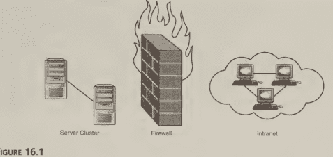

图 16.1

一个基本互联网服务将服务器置于防火墙之外。

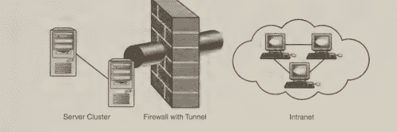

图 16.2


*DMZ 需要穿过防火墙的通道来传递信息。*

为了最大限度地发挥 `DMZ` 的作用，你必须制定关于什么可以放入其中的规则。防火墙很少提供许多服务；防火墙后面的服务器才提供。然而，如果你在 `DMZ` 内暴露太多内容，你最好忘记 `DMZ` 并节省你的资金。随着你越接近内部网，行为规则（由于必要性）变得越宽松。以下列表提供了一些常见规则：

- **最小化端口**（暴露的防火墙）——大多数暴露给外部世界的防火墙限制了可用端口的数量。这些端口提供了客户端获取公司提供的信息所必需的精确内容。暴露的端口为攻击者提供了更多可能获得访问权限的方式。

- `最小化服务`（暴露的服务器）——最接近互联网的服务器仅提供绝对最小化的服务。通常，这些服务与防火墙被动过滤的端口紧密相关。一些包括 `HTTP`、`HTTPS` 和 `FTP`（只读）。

- `限制数据库`（内部 `DMZ`）——数据库通常存放公司最有价值的信息。任何私有数据库都不应位于任何 `DMZ` 中。一些系统通常将 `LDAP` 放在其中一个内部 `DMZ` 中（而不是内部网中），但这种做法同样存在安全隐患，因为数据库通常包含未加密的用户名和密码。如果 `DMZ` 中的服务器需要数据库访问，你可以轻松创建点对点信使，将请求人工携带回内部网。这些信使应该是编译后的程序，以减少被破解的风险。

- `使用编译服务`（暴露的服务器）——像 `Perl` 这样的脚本虽然比 `C/C++` 更容易编程，但却是人类可读的形式，使其成为安全风险。尽可能尝试生成能够阻止罪犯在入侵发生时改变服务器行为的工具。

- `分离伪装`——每个 `DMZ` 可以使用独立的虚假 `IP` 空间进行伪装。从一个 `DMZ` 到另一个改变地址方式使渗透内部网更加困难，并使网络维护复杂化。

与过去城堡和有城墙城市的比较非常适用于互联网的现状。互联网没有规则，经常处于无政府状态运行。建立必要的安全措施可以保护你和你的真实客户。

## RPC 漏洞

许多网络程序员认识到随着端口数量的增加，入侵的可能性也随之增加。然而，经验较少的程序员可能没有意识到他们可能使用在运行时创建端口的工具。例如，远程过程调用（`RPC`）的 `portmap` 程序创建端口。此外，`Java` 的远程方法调用（`RMI`）和 `Microsoft` 的 `COM/COM+` 构建在 `RPC` 之上。编写服务器脚本的网站管理员可能没有意识到他们正在随着每个新对象打开新的安全漏洞。

## 保护通道

网络有两个你可以根据自己的需求进行调节的不同元素：物理网络和消息。保护两者免受攻击至关重要。

### 物理窃听

一种明显的物理措施是专用连接。不幸的是，这并不像曾经认为的那样安全。即使在专用连接中，非侵入式窃听技术也很简单。尽管如此，这是一个非常好的开端。物理介质提供了几种隐藏（或暴露）你数据的方式。连接越晦涩，成本越高。本节描述了四种基本的物理传输形式：电/光 和 导体/无导体。

基于导体的电气导管（如双绞线或同轴电缆）可能最容易窃听。柔性导线对主导体上的外科手术式探测非常宽容。此外，电磁学的特性允许有人在未察觉的情况下进行窃听。刚性导管更安全，损耗更小，但它昂贵且难以操作。

无导体的电气（如无线电或微波）和光学传输（如红外或定向激光）实际上是最容易窃听的形式。你只需要一个天线位于字段中或传输路径上。微波是一种类似于激光的定向传输。另一方面，较低频率和红外倾向于广播。这些形式无法得到物理保护，安全性很低。

光学导管是最安全的。然而，几年前，研究人员发现，如果他们将柔性导管弯曲到正确的角度（临界角），光信号就会泄漏出来。他们用这个来证明即使是光纤也不是对窃听完全免疫的。当时，他们仍然无法引入信号。如果研究团队没有找到引入光信号的方法，他们可能很快就会找到。再次强调，为了解决这个问题，你可以获得更刚性、不允许光纤在临界角附近弯曲的光纤导体。

总而言之，刚性导电导管降低了被窃听的可能性。光学增加了抵御电磁窃听的安全防护。此外，光学已被证明能够承载非常高的带宽。

### 消息窃听

保护消息不太明显。防火墙允许通过并过滤暴露在互联网上的信息。你使用客户端期望的特定端口和服务。更改一些期望的设置和接口可以增加你的安全性。

虽然开源运动并不鼓励，但使用私有协议可以阻止入侵（另一方面，它也可能引起更多关注）。例如，不使用 `HTTP` 作为协议，而是发明一个新的专用版本。这种方法确实有重大缺点：你必须编写客户端接口并将其交付给你的客户。

另一种方法是限制可用性窗口和发送的信息。例如，在第二次世界大战期间，盟军使用美国原住民在无线电台上用自己的语言连续聊天数小时。在指定的间隔，消息会转向战术或战略指令或状态。

`img/2591af4bdf00a0f382331fc9481f785e_368_0.png`

`img/2591af4bdf00a0f382331fc9481f785e_368_1.png`

# 第四部分

使用该示例，你可以编写一种资金转账机制，使其在特定时间间隔启动，或者甚至在非工作时段一直开放，期间传输无关信息。

增加随机性是消息安全的关键。例如，假设你有一个连接到互联网的钱自动柜员机（`ATM`）（想想就让人害怕！）。它需要向主机服务器发送和接收交易请求。它使用随机性的一种方式是持续地发送和接收虚假交易。然后，在指定的时间间隔内，主机和 `ATM` 都能识别出某笔交易是真实的。（当然，这对于实际实施来说仍然过于宽松。）

随机性的另一种形式是数据加密。良好的数据安全在很大程度上取决于数据加密所引入的随机性数量。数据越随机，数据就越难解密。密钥决定了可能结果的范围。完美的加密密钥在大小上没有限制。不幸的是，随着密钥大小的增加，计算时间呈指数级增长。因此，一个好的密钥是足够长的密钥，从而在计算上降低被发现的可能性。这就是为什么每个人都想要 128 位加密的原因。

`img/2591af4bdf00a0f382331fc9481f785e_369_0.png`

128 位加密的范围足够宽，如果一台计算机每秒纳秒（1×10⁻⁷ 秒）尝试每个密钥，它需要超过 10⁸⁸ 年才能找到密钥。那是一段很长的时间。就随机性而言，128 位加密看起来是一个足够大的范围，可以近似完美密钥——至少目前如此。

加密有两种形式：单向（有损）和双向（无损）。单向加密会丢失关于原始数据的信息。`UNIX` 密码中使用的典型加密是单向的。单向加密不需要恢复任何数据；例如，用户输入的密码只需要与加密形式匹配即可。

发送到服务器的请求需要一种获取数据回来的方法。双向加密以某种方式打乱数据，使得信息可以通过解密密钥恢复。服务器和客户端必须知道加密算法以及加密/解密密钥。

`img/2591af4bdf00a0f382331fc9481f785e_370_0.png`

## 加密消息

加密并不是什么新鲜事物。最著名的加密设备是德国恩尼格玛密码机（`Enigma Machine`）。事实上，当前的一些算法是基于这台二战时期设备。加密的整个理念是确保只有接收者才能理解消息。现代加密算法（密码）就像计算机一样普遍。

当两个主机相互通信时，设计者假设其他主机可以窥探消息。网络窥探设备可以打开并检查本书定义的所有协议。当然，窥探者必须物理上位于同一网络上才能获取任何消息。同样，窥探者必须浏览大量无用信息才能找到真正有价值的内容。

本节描述了加密的不同部分，并介绍了一种在计算机中常用的协商方式。

## 可用的加密类型有哪些？

网络计算机使用两种不同的密码：公钥和对称密钥。公钥密码使用两个密钥——一个用于加密，一个用于解密。服务器通常使用此算法来启动加密过程或执行单笔交易。

对称密钥密码使用相同的密钥进行加密和解密。解密只是撤销加密所做的操作（有点像松开拉紧的弹簧）。由于对称密钥密码的性质，两个主机必须对密钥保密。算法非常快且相对简单。同样，你可以使用任何随机数作为密钥。

另一方面，公钥密码有两个密钥——一个加密（公共）密钥和一个解密（私有）密钥。服务器与网络上的任何客户端共享加密密钥。（密钥本身并不关键——只有算法转换的数据才是关键的。）服务器内部保留解密密钥以解密传入的消息。

公钥密码有一些限制。首先，密钥必须相关联。主机不能随机生成加密密钥，而必须同时计算解密密钥。这极大地限制了可用密钥的数量。由于数字必须用于加密然后解密，与完整的整数集相比，你只能拥有少数可用的密钥对。例如，在 128 位密钥中，你只能拥有 2³¹ 个可能的密钥对。其次，由于你只有有限数量的密钥对（而不是整个数字范围），这些密码比私钥不安全。例如，128 位公钥密码可能只与 64 位或 32 位对称密码一样强。

## 已发布的加密算法

互联网提供了许多不同的公共和对称密码套件（不同密码的集合）。最常见的是基于 `RSA`（作者姓名：`Rivest`、`Shamir` 和 `Adleman`）公钥、`DES`（数据加密标准）和 `RC2/RC4`（`Rivest` 密码）。一些密码仍然受专利保护，使用需要支付特许权使用费（2000 年 10 月，`RSA` 的专利到期）。

大多数 `Linux` 发行版要么在安装中包含这些套件，要么将你链接到一个下载它们的网站。

## 加密的问题

密码呈现出一组有趣的问题。首先，直到最近，美国限制强加密算法的出口。事实上，这是某些发行版不在其 `CD-ROM` 上放置密码套件的原因之一。相反，安装过程会试图从外国服务器获取套件。2000 年，政府解除了这一限制，获取密码变得稍微容易一些。


另一个问题是计算时间。虽然对称密码相对较快，但所有初始通信都必须使用较慢的公钥。公钥不适合大数据块。因此，协商密码和密钥的额外复杂性必须是协议的一部分。

最后一个问题相当奇怪。加密实际上吸引了它本想避免的事情——破解和窥探。显然，互联网上有一个想要出现在头条新闻中的破解者群体。

## 安全套接层 (SSL)

如前所述，两个主机必须就一组密码达成一致，以便以某种安全性进行通信。安全套接层 (SSL) 定义了此协议。它是一个精心设计的过程，旨在严重限制破解的可能性。`SSL` 使用公钥和对称密码来建立连接、协商协议和通信数据。

本节范围无法涵盖 `SSL` 如何协商密钥和通信通道的细节。相反，本节向你展示如何使用 `OpenSSL` API 编写 `SSL` 客户端和服务器。同样，本章无法涵盖整个 API——这些信息可以轻松填满另一本书。

## 使用 OpenSSL

你可以获取一个功能强大但文档不全的 `SSL` API，称为 `OpenSSL`。它可以在 `www.openssl.org` 获取，并支持多个平台，当然包括 `Linux`。要使用该 API，你需要执行几个步骤来配置、编译和安装它。

它默认未编译，并且某些安装步骤与 `Mandrake` 或 `Red Hat Linux` 的集成性不佳。（其他发行版可能有类似问题，因此你可能需要记下来。）以下步骤将帮助你安装并启用该工具：

-   下载 `tarball`（压缩包），在一个安全的（非 `root`）目录中打开它，并进入新创建的目录。

-   运行 `config` 文件（`./config`）。如果它报错，你需要使用 `./config linux-elf` 明确指定操作系统类型。

-   运行 `make` 来编译源代码。

-   运行 `make test` 来验证算法。

-   以 `root` 身份登录。运行 `make install` 将所需文件移动到它们的目录（`/usr/local/ssl/`）。

-   创建库的引用：

    ```bash
    ln -s /usr/local/ssl/lib/libssl.a /usr/lib/
    ln -s /usr/local/ssl/lib/libcrypto.a /usr/lib/
    ```

-   创建包含文件的引用：

    ```bash
    ln -s /usr/local/ssl/include/openssl/ /usr/include
    ```

-   将 `MANPATH /usr/local/ssl/man` 添加到你的 `/etc/man.config` 文件。（你可能希望运行 `makewhat` 来执行主题搜索。）

-   将 `/usr/local/ssl/bin` 添加到你的路径中。

此过程中的一个小故障是所有编译都使用静态库，所以如果你的执行文件初始大小为 `600KB`，不要感到惊讶。如果你想使用共享库，你必须将 `libssl.a` 和 `libcrypto.a` 转换为 `*.so` 文件。

完成所有这一切后，你就准备好编写安全套接字了。链接阶段必须以特定顺序包含库。如果两个库交换位置，程序链接将因未解析的外部符号而失败：

```bash
cc test.c -lssl -lcrypto
```

你可能会注意到 API 包含一些演示 `C++` 源文件。这是过度设计。对所有库的调用都可以是纯 `C`。（事实上，如果你查看源代码本身，你可能会注意到它实际上是 `C++` 文件中的 `C` 源代码。）

## 创建 SSL 客户端

现在你已经安装了 API，你可以通过编写一个简单的客户端/服务器程序对来尝试它。创建 `SSL` 客户端/服务器几乎和创建普通套接字一样简单。事实上，`OpenSSL` 是在该框架之上构建的。

客户端的第一步是设置 `SSL` 库状态：

```c
/*****************************************************************/
/** Initialize Client SSL state        ***/
/*****************************************************************/
SSL_METHOD *method;
SSL_CTX *ctx;
OpenSSL_add_all_algorithms();    /* Load cryptos, et.al. */
SSL_load_error_strings();        /* Load/register error msg */
method = SSLv2_client_method(); /* Create new client_method */
ctx = SSL_CTX_new(method);      /* Create new context */
```

如果 API 调用的返回值为 `NULL` 或零，可以使用以下代码显示错误：

```c
ERR_print_errors_fp(stderr);    /* Print errors to stderr */
```

下一步是创建一个普通套接字。

```c
/*****************************************************************/
/** Connect client’s socket to SSL server        ***/
/*****************************************************************/
struct sockaddr_in addr;
struct hostent *host = gethostbyname(hostname);
int sd = socket(PF_INET, SOCK_STREAM, 0); /* create socket */
bzero(&addr, sizeof(addr));
addr.sin_family = AF_INET;
addr.sin_port = htons(port);         /* server port */
addr.sin_addr.s_addr = *(long*)(host->h_addr); /* server IP */
connect(sd, &addr, sizeof(addr));    /* connect to the server */
```

在客户端和服务器之间建立套接字连接后，您需要创建一个 `SSL` 实例并将其与该连接关联：

```c
/*****************************************************************/
/** Establish SSL protocol and create encryption link        ***/
/*****************************************************************/
SSL *ssl = SSL_new(ctx); /* create new SSL connection state */
SSL_set_fd(ssl, sd);          /* attach the socket descriptor */
if ( SSL_connect(ssl) == -1 )    /* perform the connection */
    ERR_print_errors_fp(stderr);     /* report any errors */
```

从此时起，您就拥有了一个具有完全加密功能的 `SSL` 连接（具体取决于客户端和服务器协商的内容）。您可以按以下方式获取密码套件：

```c
char* cipher_name = SSL_get_cipher(ssl);
```

您还可以使用以下调用读取证书：

```c
/*****...
/** Read certificates ***/
/*****...
char line[1024];
X509 *x509 = X509_get_subject_name(cert); /* Get subject */
X509_NAME_oneline(x509, line, sizeof(line)); /* Convert it */
printf( "Subject: %s\n", line); 
x509 = X509_get_issuer_name(cert); /* get issuer */
X509_NAME_oneline(x509, line, sizeof(line)); /* convert it */
printf( "Issuer: %s\n", line);
```

最后，程序可以使用类似于 `send()` 和 `recv()` 的调用来发送和接收数据。然而，这些调用有一些不同之处。首先，缺少 `flags` 参数；其次，如果发生错误，函数返回 `-1`。`send()` 和 `recv()` 的正式定义指出，如果发生错误，返回值为负数。


```c
/*****...
/** Send & receive messages ***/
/*****...
int bytes;
bytes = SSL_read(ssl, buf, sizeof(buf)); /* get/decrypt */
bytes = SSL_write(ssl, msg, strlen(msg)); /* encrypt/send */
```

`API` 还有更多可用的函数，用于控制流程、更改 `SSL` 状态以及配置。

## 创建 SSL 服务器

客户端和服务器只有细微的差别。两者都必须初始化上下文、建立连接并启动 `SSL` 协议。服务器还有几个额外的步骤需要执行。首先，上下文初始化的变化很小：

```c
/*****...
/** Initialize Server SSL state ***/
/*****...
SSL_METHOD *method;
SSL_CTX *ctx;
OpenSSL_add_all_algorithms(); /* Load cryptos, et.al. */
SSL_load_error_strings(); /* Load/register error msg */
method = SSLv2_server_method(); /* Create new server-method */
ctx = SSL_CTX_new(method); /* Create new context */
```

您可能注意到程序使用的是 `SSLv2`，而不是 `SSLv3`。您可以使用任意一种。但是，如果您希望 `Netscape` 连接到您的 `SSL` 服务器，它需要 `SSLv2`。即便如此，出于某种原因，`Netscape` 认为自己连接到了 `SSLv3` 套接字。

与客户端不同，服务器必须加载其证书文件。这包括两部分：证书和私钥。您必须在初始化部分加载这两部分。两部分可以位于同一个文件中。

```c
/***** Load certificate and private key files *****/

/* set the local certificate from CertFile */
SSL_CTX_use_certificate_file(ctx, CertFile, SSL_FILETYPE_PEM);
/* set private key from KeyFile */
SSL_CTX_use_PrivateKey_file(ctx, KeyFile, SSL_FILETYPE_PEM);
/* verify private key */
if ( !SSL_CTX_check_private_key(ctx) )
    fprintf(stderr, "Key & certificate don't match");
```

客户端也有加载证书文件的选项，但这并非必须。如果数据安全需要，您可能希望客户端拥有证书。

通常，如果您要在 Internet 上公开运行，您可以从各处购买证书，例如 `VeriSign`。然而，如果您只是进行测试，可以使用 `OpenSSL` 中的工具创建自己的证书。（请勿使用随 `OpenSSL` 提供的证书。）用于创建证书的 Perl 工具 `CA.pl` 位于构建目录 `/usr/local/ssl/misc` 中。如果没有提示您一系列问题，说明您尚未将路径设置为指向 `/usr/local/ssl/bin`。

服务器套接字基本上与普通套接字服务器相同：

```c
/***** Establish socket server port *****/

struct sockaddr_in addr;
int sd, cClient;
sd = socket(PF_INET, SOCK_STREAM, 0); /* Create socket */
bzero(&addr, sizeof(addr));
addr.sin_family = AF_INET;
addr.sin_port = htons(port);
addr.sin_addr.s_addr = INADDR_ANY; /* permit any network */
bind(sd, &addr, sizeof(addr)); /* bind to a port */
listen(sd, 10); /* convert to listening socket */
client = accept(server, &addr, &len); /* accept connection */
```

与客户端一样，服务器必须创建一个 `SSL` 会话状态，并将其与客户端的连接关联。

```c
/********************************************************/
/** Create SSL session state based on context & SSL_accept */
/********************************************************/
ssl = SSL_new(ctx); /* get new SSL state with context */
SSL_set_fd(ssl, client); /* associate socket with SSL state */
if ( SSL_accept(ssl) == FAIL ) /* do SSL-protocol accept */
    ERR_print_errors_fp(stderr);
else {
    int bytes;
    bytes = SSL_read(ssl, buf, sizeof(buf)); /* get request */
    SSL_write(ssl, reply, strlen(reply)); /* send reply */
}
```

步骤实际上如此简单。尝试在 `Sams` 网站上运行代码并使用 `Netscape` 进行连接。由于 `Netscape` 不识别您自定义的证书，程序会显示一条警告消息以及几个设置对话框，以便临时注册该证书。

## 总结：安全服务器

网络套接字为您提供了许多提高生产力和分发处理的机会。然而，您在主机之间共享的信息并未对其他连接在同一网络上的主机保密。将关键或机密信息放置在 Internet 上无异于邀请损失、间谍活动、数据损坏等发生。Internet 的本质本身可能成为您的负担。

您可以通过提前规划并在关键产品周围建立安全性来减少损失。大多数公司无法忽视它们必须在 Internet 上存在才能生存这一事实。防火墙、策略和加密是锁定站点并阻止攻击的典型方式。

当两个或更多主机在公共环境（如 Internet）中通信时，您可以要求使用某些协议和算法来降低窃听的可能性。加密有多种形式，并提供不同级别的安全性。两种标准的加密形式是对称加密和公钥加密。如今，`SSL` 等通信方式使用这两种形式。

在 `SSL API` 中编写程序在很大程度上取决于 `API` 的实现。在本文撰写时，不存在标准的 `SSL API`。然而，您可以通过使用一个名为 `OpenSSL` 的开源版本来体验在 C 语言中使用 `SSL` 的感觉。`OpenSSL` 是一个非常丰富的实现，拥有超过 200 个 `API` 调用。

只要规划得当、有前瞻性，并使用诸如 `OpenSSL` 等标准工具，你就可以为互联网创建一个有效、可靠且安全的资源。

下一章将带你了解信息分享的另一极端——组播和广播。安全旨在确保隐私。而组播和广播则试图尽可能多地分享，并尽可能高效地分享。

## 使用组播、广播和 Mbone 共享消息

第 17 章

## 本章内容

- 向域广播消息 360
- 向组组播消息 362
- 总结：高效的消息共享 370

网络是将从一个地方到另一个地方传递消息的极佳媒介。它拥有广泛的技术和带宽，让你可以尝试不同的方法。你可能不会视为优势的其中一点是，通常所有计算机都连接到某种骨干网。那么，将计算机连接到相同的骨干网上有什么好处呢？通常，流量会更大，而主机到主机的专用连接则是最佳选择。

一些服务可以同时到达多个目的地。你无需将同一条消息发送给每个主机，只需发送一条消息，让所有主机简单地获取它即可。这样做的好处显而易见——减少了冗余流量。

互联网协议提供两种形式的数据分发消息：广播和较新的组播。本章讨论不同类型的分发消息及其实现方式。

## 向域广播消息

数据分发消息的第一种形式——广播（`RFC919`, `RFC922`），利用子网和子网掩码的特性来确定目的地。广播是一种强制性的消息分发形式；子网和主机都必须接收该消息。（实际上，如果主机未启用广播，硬件将不会接受该消息。尽管如此，消息仍会占用带宽，并且每个主机都可以读取它。）

#### 重温 IP 结构

子网对于发送和接收广播消息非常重要。正如第 2 章“TCP/IP 网络语言流畅性”中所述，当你使用 `ifconfig` 定义接口时，同时也定义了一个广播地址和一个子网掩码。广播地址是一个特殊地址，主机通过监听该地址来获取消息。


子网通常与子网掩码和广播地址相同。例如，如果你的 `198.2.56.xxx` 子网中大约有 250 台主机，那么你的子网掩码和广播地址将是 `255.255.255.0` 和 `198.2.56.255`。因此，如果你想向子网中的每个人发送消息，你会使用 `198.2.56.255` 地址。（如第 2 章所述，你可以对子网掩码进行非常创造性的操作——只需记住，最后一个有效位是掩码的末尾。）

子网实际上是硬件实现的封装。真正的工作发生在硬件和内核的低层。要了解正在发生的事情，你需要从物理连接开始。

除了物理连接外，发送广播消息比接收广播消息更容易。要发送任何消息，你只需要 IP 地址（如第 2 章所述，网络最终会将该地址转换为目标的以太网 MAC 地址）。要接收消息，接口卡必须正在监听匹配的 MAC 地址。问题在于，广播消息不能假设具有与主机不同的 MAC 地址。事实上，如第 2 章所述，同一子网中的两个主机不太可能拥有相似的 MAC 地址。因此，广播不能依赖任何专门的 MAC 地址来执行广播消息。

相反，当程序发送广播消息时，内核会自动分配一个全 1 的 MAC 地址（`FF:FF:FF:FF:FF:FF`）。这个 MAC 地址是所有网卡拾取该消息的标志——即使没有程序正在监听广播消息也是如此。

网卡打开大门，让消息填充其内部缓冲区。完成后，它通过中断通知内核。内核检索数据包并查看目标 IP。如果地址匹配广播地址，它将数据包传递到网络子系统的队列中。

网络子系统（通常是 UDP）检查消息，如果发现具有匹配端口号的广播套接字，它会将数据包移动到该套接字的 I/O 通道中。如果没有，它会丢弃该数据包。你可能希望指定一个端口号，以便告知内核为你过滤掉不需要的消息。否则，你可以预期会有一场不需要的回复风暴。

#### 编程以启用广播

你可以使用 `SO_BROADCAST` 套接字选项来启用广播。程序的其余部分看起来像一个普通的数据报消息程序。

```c
/***** *******************************************************/
/*** Create a broadcast datagram socket    ***/
/***** *******************************************************/
const int on=1;

sock= socket( PF_INET, SOCK_DGRAM, 0 );
if ( setsockopt( sock, SOL_SOCKET, SO_BROADCAST, &on, sizeof( on) )
!= 0 )
    panic( "set broadcast failed" );

bzero(&addr, sizeof(addr));
addr.sin_family = AF_INET;
addr.sin_port = htons(port);
addr.sin_addr.s_addr = INADDR_ANY;
if ( bind( sock, &addr, sizeof(addr)) != 0 )
    panic( "bind failed" );

addr.sin_port = htons(atoi(strings[2]));
if ( inet_aton(strings[1], &addr.sin_addr) == 0 )
    panic( "inet_aton failed (%s)", strings[1]);
```

启用广播后，你可以向广播地址发送消息。你可能希望为接收者和发送者创建一个进程或线程。与你可以期望单次传输获得单次回复的其他传输不同，广播可能会为每条发送的消息产生许多回复。如果你这样做，请确保关闭其中一个通道的传入队列。

```c
/*************************************************************************/
/* ** Split the responsibilities into sender and listener ** */
/* ** Close the sender's listening channel. ** */
/*************************************************************************/
if ( fork( ) )
    Receiver( sd );
else
{
    shutdown( sd, SHUT_RD ); /* close the input channel */
    Sender( sd );
}
wait( 0 );
```

#### 广播的局限性

广播消息有一些问题。虽然你可能能够通过一条消息同时到达许多计算机，但你只能到达你子网内的那些计算机。尽管如此，你可以通过更改广播地址来增加你的影响范围。不幸的是，你无法在广域网（WAN）上使用广播，因为地址 `255.255.255.255` 在互联网上不再合法。（你甚至可能发现大多数路由器根本不允许广播消息通过。因此，即使你有正确的广播地址，例如 `198.2.255.255`，位于 `198.2.1.0` 的路由器也可能忽略该数据包。）

此外，子网上的每个人都会听到你的消息。由于硬件实现广播的方式，所有网卡都会拾取广播消息。这可能会给那些不希望接收该消息的主机带来很多不必要的负担。

另一个问题是协议。IPv4 仅支持数据报上的广播（排除 TCP）。如果你想要可靠性和流媒体，你必须自行实现。数据报在许多情况下都非常有用，通过一些增强，你可以提供一个良好的接口供客户端连接。

#### 向组组播消息

组播 `[RFC1112]` 解决了广播的一些问题。广播的主要思想是向地址范围内的每个人发送消息。组播使用主机可以加入以监听消息的约定地址。

组播使用单个 IP 地址向多个接收者发送消息。与广播相比，它具有以下优势：

- `所有协议`——它支持数据报和流媒体协议（UDP 和 TCP）。
- 数据报目前支持组播，但流媒体没有即时的实现。你可以找到免费（非开源）的可靠投递组播实现。
- `广域网可访问`——你可以加入全球组播组。然而，截至本书撰写之时，广域网中有些部分不支持或无法传递组播消息。
- `有限的监听者`——组播消息并不一定强制所有网卡都拾取它（见本章稍后的“网络如何提供组播”部分）。
- `IPv6 支持`——IPv6 取消了对广播的支持，但采纳并扩展了组播。

##### 开启组播支持

大多数发行版都包含已开启组播的内核。（你可以查看 `/proc/net/dev_mcast` 以检查当前运行的内核。）但是，组播路由可能未启用，或者如果你使用的是下载的内核，你可能没有设置该选项。如果你想使用组播，或者你为希望使用组播的其他人管理路由器，你可能需要重新配置并重编内核。配置位于配置中的网络部分。

#### 加入组播组

使用组播就像加入一个列表服务一样简单。就像列表服务一样，你会收到其他人发送的大量消息，因此很容易超出受限的网络连接。如果你加入一个组，请小心确保你有带宽支持数据流。很可能，你会丢弃数据包，使连接变得不如预期有用。

广播地址遵循特定的模式，以便路由器能够识别它们。这些地址直接来自 IP 分配（首次在第 2 章中引入）。范围是 `224.0.0.0–239.255.255.255`。这些地址预留给广播。该地址范围被细分为较小的范围，以指示地址范围或消息在路由器阻止之前可以传播多远。表 17.1 显示了这些划分。

## 表 27.1 组播地址分配与作用域

| 作用域 | 典型 TTL | 地址范围 |
| :--- | :--- | :--- |
| 集群 | 0 | `224.0.0.0–224.0.0.255` |
| 站点 | < 32 | `239.255.0.0–239.255.255.255` |
| 组织 | < 128 | `239.192.0.0–239.195.255.255` |
| 全局 | <= 255 | `224.0.1.0–238.255.255.255` |

要加入一个组，你需要使用带有一个新参数的 `setsockopt()` 内核服务调用。这个新参数是 `ip_mreq` 结构体：

```c
/* ************************************************** */
/* ** The ip_mreq structure for selecting a multicast addr ** */
/* ************************************************** */
struct ip_mreq
{
   struct in_addr imr_multiaddr;     /* known multicast group */
   struct in_addr imr_interface;      /* network interface */
};
```


`imr_multiaddr` 字段指定了你要加入的组播组。它的格式与`sockaddr_in`结构体中的`sin_addr`字段相同。`imr_interface`字段允许你选择一个特定的主机接口。这类似于`bind()`，后者允许你指定主机接口（或者通过`INADDR_ANY`值将主机选项完全开放）。然而，它的行为可能并不像你预期的那样。

> **组播接口的默认设置**
>
> 当你为`imr_interface`选择`INADDR_ANY`时，内核会为你选择接口。至少在`2.2.XX`Linux内核中，这并不意味着“在所有接口上监听”。因此，如果你有多个接口，你可能需要在希望监听的所有接口上加入组。

下面的代码片段展示了如何使用`ip_mreq`结构体加入一个组。它将`imr_interface`字段设置为`INADDR_ANY`仅用于演示。除非你的主机只有一个接口，否则不要使用它；否则结果可能不可预测（参见上面的框）。

```c
/* ************************************************** */
/* ** Join a multicast group ** */
/* ************************************************** */
const char *GroupID = "224.0.0.10";
struct ip_mreq mreq;
if ( inet_aton(GroupID, &mreq.imr_multiaddr) == 0 )
    panic("address (%s) bad", GroupID);
mreq.imr_interface.s_addr = INADDR_ANY;
if ( setsockopt(sd, SOL_IP, IP_ADD_MEMBERSHIP, &mreq, sizeof(mreq)) != 0 )
    panic("Join multicast failed");
```

如果你希望另一个程序连接到相同的地址/端口，你必须在该套接字上使用`SO_REUSEADDR`选项。目前，Linux不支持地址/端口共享（`SO_REUSEPORT`）。要开启地址共享，请使用以下代码片段：

```c
/**** Enable address sharing  ****/
if ( setsockopt(sd, SOL_SOCKET, SO_REUSEADDR, &on, sizeof(on)) != 0 )
    panic("Can't reuse address/ports");
```

你可以加入的组的数量取决于硬件和内核的限制。许多UNIX操作系统将每个主机的连接数限制为16。没错，不是每个程序。有关更多信息，请参阅本章后面的“网络如何提供组播”。

当你结束对该端口的监听时，你可以放弃该成员资格：

```c
/**** Drop a multicast group  ****/
if ( setsockopt(sd, SOL_IP, IP_DROP_MEMBERSHIP, &mreq, sizeof(mreq)) != 0 )
    panic("Drop multicast failed");
```

你也可以简单地结束程序，程序会为你清理连接。

> **组播清理**
>
> 你可能想要手动放弃组播组。这是少数几个自动进程清理不是好主意的时候之一。如果内核有任何问题，简单地终止程序并不会显示任何错误。此外，你的程序终止后仍可能接收到消息。这会导致端口对新程序实例不可用或数据混乱。手动关闭可以让程序看到连接上的任何错误，有助于调试。

加入组播组相对容易。事实上，创建一个本地组播组只需选择一个未使用的IP地址即可。全局地址则是另一回事。如果你想发布互联网组播服务，你可能需要向`IAB`申请一个地址（和端口）。

## 发送组播消息

向组播组发送消息与发送数据报消息一样简单。请记住，`UDP`允许你连接到该地址，简化了组播发送和接收。


在创建组播时有一个有趣的副作用，它具有巨大潜力：你不需要成为组播组的成员就可以发送消息。一个程序可以简单地将消息发送到广播地址/端口。流媒体组播服务器实际上可能永远不会真正加入组播组。要接收消息，你必须加入该组。

出于合法目的，能够不加入组就提供消息是一个真正的优势。这样，你的服务器就可以避免受到与组播相关的流量冲击。

## 网络如何提供组播

操作系统（如`Linux`）实现组播的方式可能会导致大量消息。了解其工作原理有助于你进行性能考虑以及如何快速过滤消息。

许多网卡支持某种形式的MAC别名（在短时间内获取额外标识）。所有网卡都分配了MAC地址。与使用广播地址（`FF:FF:FF:FF:FF:FF`）的广播不同，组播使用组播地址作为密钥创建临时的MAC地址。组播MAC的标准前缀是`01:00:5E`，最后三个字节（实际上是23位）来自组播地址。例如，组播地址`224.138.63.10`(`E0:8A:3F:0A`)会变成MAC地址`01:00:5E:0A:3F:0A`（注意`8A`中的`8`被丢弃了）。

操作系统获取此地址并将网卡编程为接受该地址。网卡以三种方式接受此编程：

- **标记表**——网卡完整保存地址。它根据自身的MAC和该表中的所有MAC检查网络上的每条消息。这是100%可靠的。
- **哈希键（不完美的过滤）**——网卡将MAC哈希成一个`64`到`512`位的哈希数组。当消息通过网络时，网卡对该MAC地址进行哈希。如果数组中对应的位是开启的，网卡接受该消息。这种方法可能会接受并非发给该主机的消息。下一层则负责过滤掉不需要的消息。这是最不理想的情况。
- **混杂模式**——一些网卡不支持组播。替代方法是将网卡置于混杂模式并接收所有消息。下一层必须丢弃所有不需要的消息。这是最不理想的情况。

网卡没有端口的概念，因此IP协议栈中的较高层必须将消息移动到适当的队列或丢弃它们。请记住，即使你没有监听端口，你的主机也会获取你加入的地址上的所有组播消息。如果你选择`UDP`或`TCP`，内核会为你过滤端口。如果你选择原始套接字，你必须程序中过滤。

## 发出组播消息

获取组播消息的第一步是编写程序并启用主机的硬件和内核以支持组播。下一步是告诉路由器你需要这些消息。这还不够。你的组播消息在到达广域网（`WAN`）的基带之前面临着几个障碍。

你可能需要执行其他任务才能让消息发出。本节讨论这些问题及解决它们的方法。

## 让路由器知道

互联网试图使用两个地址将消息从源发送到目的地——IP地址和`MAC`。`MAC`在消息发出之前很少是已知的，而IP地址具有内置的路由功能。但是，路由器期望每条消息只有一个目的地——一条消息有两个目的地通常是一个错误。

组播需要几个不寻常的网络特性。这些不寻常的特性会影响支持路由器的配置。首先，路由器必须接受生成的MAC。这实际上是路由器职责的变化，可能需要额外的路由器配置。

## 多播协议与路由器

随着多播协议的创建，互联网标准提出了互联网组管理协议（`IGMP`）[RFC1112, RFC2236]，用于传递多播组通告。`IGMP`携带子域内主机希望加入或退出的组ID和`MAC`地址。加入消息仅传递到作用域允许的范围内。即使路由器后没有主机加入该组，路由器仍必须跟踪可用的组。（如果路由器宕机，信息不会丢失。当内部主机加入组时，路由器开始重建组列表。）

施加在路由器上的另一个负担定义了新协议的独特性。尽管组的所有订户都能看到每条消息，但所有订户可能不会看到完全相同的消息（参见“多播限制”）。路由器必须将所有广播和多播消息传递给所有已加入的子域。这可能隐式或显式地要求复制该消息。

路由器将消息显式复制到两个或更多不同的连接上。路由器通常连接到多个网络，并在它们之间路由流量。显式复制将数据包放置在其中一个或多个网络上。

隐式复制是由于网络的性质。由于物理上连接到同一根线缆，每个人（在同一子域上）都能看到其他所有内容。当网络上的多个主机接收到它们看到的消息时，会发生隐式复制。

### 穿越防火墙的隧道（Mbone）

一些路由器或防火墙没有所需的多播组实现支持，因此子域内的主机将无法看到来自外部的任何消息。仅支持定向（或单播）消息的路由器是`单播路由器`。

在1992年之前不久，程序员希望利用多播的新特性。不幸的是，网络上充满了单播路由器。答案是使用IP封装封装新协议，并将其直接发送到会解封装并转发的接收方。这种用于多播的虚拟网络骨干（`Mbone`）如今也可用于防火墙。

它是如何工作的？`Mbone`使用多播路由器（路由）来接受消息并通过外部域将其传递给另一个路由服务器。路由服务器接受每个完整的数据包，并将其放入带有自己头的另一个数据包中。结果是一个带有两个IP头的消息。在另一端，接收路由服务器解包消息，并将结果放入其子域中。

### 多播限制

多播回答了广播的许多问题，但它也有自己的问题。一些问题涉及硬件支持、性能/带宽瓶颈、问责制和独特性。

### 获取硬件支持


上一节描述了操作系统和硬件如何支持多播。不幸的是，某些 NIC（如`Ethernet Express`）完全不支持多播和混杂模式。要获取多播消息，硬件必须至少支持混杂模式。在测试本章的一些算法时，这个问题曾使开发受阻了一段时间。

您可以在`//linux/Documentation/networking/multicast.txt`中查看支持的 NIC 列表。如果您的编程尝试不起作用，请确保您的网卡具有完全支持。

### 性能瓶颈

在获取广播或多播消息时（特别是对于使用混杂模式进行多播的 NIC），您面临另一个问题。程序必须过滤大量不需要的消息。广播也有这个问题，而多播大大减轻了其影响。但问题仍然存在。

类似地，客户端到网络的连接可能无法处理多播组发送的所有消息（例如，`56Kbps`调制解调器上的视频流）。会发生什么？路由器对消息进行排队，直到它们过期。了解您的服务器和客户端之间的瓶颈有助于保持高可靠性和可用性。

解决瓶颈问题的潜在方案可能需要路由器更强的控制。

### 对每条消息负责

最后一个问题是问责制；任何人是否拥有或属于多播组都可以发送任何消息。这可能导致那些想要损害互联网有效性的人的干扰。

### 消息独特性

在处理多播协议时，会出现另一种形式的问责。您可能熟悉数据报可能产生的消息镜像。在多播中，由于需要为不同路径复制消息，这个问题更为明显。

这种重复的一个例子是当主机连接到互联网并必须穿过几个路由器时。在某一点，消息穿过同一子域中的几个路由器。这不应该发生，因为适当的网络每个域只有一个路由器，但这种情况确实会发生。

这是由路由器使用`IGMP`通告的。它传递消息，这两个路由器将其传递给它们的子域。由于隐式复制（由每个路由器执行），主机接收两条相同的消息。

为了解决这个问题，首先，确保您标记所有消息，其次，尽量保持网络拓扑干净。

### 总结：高效的消息共享

如果您需要在多个主机之间共享消息，而不必直接发送给每一个，可以使用广播或多播。广播是较旧的形式，使用`IP`寻址和网络掩码创建和发送消息。它更有效地使用网络资源，但强制子网上的每个主机都听到该消息。此外，在`WAN`上进行广播是不允许的。

多播解决了广播的许多限制，并具有更大的可扩展性。即使路由器可能需要发送同一消息的不同副本，它也是共享`LAN`和`WAN`上消息的更好方法。与广播不同，收听多播消息是自愿的。

多播是一项不断增长的技术，越来越多的多播路由器到位以克服单播路由器。然而，您可能不会看到广播完全消失，因为它在某些低级协议中有一席之地。

## 原始套接字的威力

## 第 18 章

## 本章内容

- 何时使用原始套接字？ 372
- 有哪些限制？ 373
- 将原始套接字付诸实践 374
- `Ping`是如何工作的？ 376
- `traceroute`是如何工作的？ 379
- 总结：做出原始决策 380

有时可用的材料不符合项目的意图和需求。当这种情况发生时，您必须从非常原始的材料开始。`TCP`和`UDP`不让您访问`IP`数据包的核心内部。您需要深入挖掘并进行更多基础工作。

原始套接字为您提供了很多灵活性。此外，使用原始套接字的程序往往非常简洁且快速。本章详细说明了原始套接字的使用和意图，并为您提供如何构造数据包的技巧。

## 何时使用原始套接字？

`IP`编程的原始材料仅在实际网络帧之上的一层。当您使用原始套接字时，您没有高级协议的高开销，这可能会侵蚀您的网络吞吐量。但与此同时，您失去了高级协议的特性。您必须仔细选择何时使用原始套接字。

## 暴露 ICMP

使用原始套接字打开了消息（错误）协议。高级协议（如`TCP`和`UDP`）将您锁定在发送`ICMP`数据包之外。此外，`IP API`不提供`SOCK_MSG`（与名称`SOCK_STREAM`或`SOCK_DGRAM`相比）。要发送`SOCK_MSG`风格的数据包，您必须创建一个原始数据包，创建并填充`ICMP`头，并将其发送出去。

`ICMP`子命令提供附录 A“数据表”中列出的若干服务。一些有用的子命令包括回显（用于`ping`）、时间戳、路由器请求和地址掩码。当然，这些功能都非常低级。`ICMP`不是设计用来管理比最简单消息任务更复杂的事情。

## 控制 IP 头

此外，如果您想管理`IP`头本身，您必须使用具有适当套接字选项（`IP_HDRINCL`）的原始套接字。参考第 3 章“不同类型的互联网数据包”，`IP`头有几个字段，通常可以用`setsockopt()`设置。此外，`IP`头有一些字段是无法设置的。

例如，如果您（出于任何原因）想测试分片字段，您必须使用启用`IP_HDRINCL`的原始套接字。此功能的另一个用途是编程第 3 章表 3.1 中列出的一些替代`IP`版本。

## 穿越物理网络

如前所述，低级协议非常快。原始套接字仅在网络帧之上有一层抽象。本质上，您的原始数据包以物理网络速度穿过网络。

大多数网络帧在`10Mbps`网络中为`1–2KB`。更快的网络提供更大的帧大小。如果你需要速度，请尝试匹配网络帧大小。这会减少拆分消息的需求。实际上，这听起来比做起来难：你无法直接获取帧大小。你可以询问用户或查询硬件配置，但这需要更多的工作（且回报更少）。

如果你需要在`IP`堆栈的极低层级别工作，原始套接字（`raw socket`）是答案。或者，如果数据通信很重要且准确性是必须的，大多数程序使用更高级别的协议来提供大部分通信功能。

## 限制是什么？

原始套接字为你提供了很多灵活性，但它们不是万灵药。选择何时使用原始套接字需要了解其限制。

- 可靠性丧失——你失去了许多高层协议的功能。例如，`TCP`提供可靠连接——发送的数据即接收的数据。（当然，原始套接字和`UDP`共享相同级别的不可靠性。）
- 没有端口——你失去了端口（虚拟网络连接）。这实际上可能是一个问题。由于没有端口，内核会将原始数据包传递给所有匹配的原始套接字。换句话说，如果多个原始套接字具有相同的协议号，内核无法确定实际目的地。本章后面的`MyPing`示例演示了这个问题。
- 非标准通信——发送方和接收方必须理解你在做什么。你不能仅仅编写一个原始套接字发送器而不编写一个配套的接收器。`ICMP`在`IP`堆栈中有自己的接收器。
- 没有自动 ICMP——如前所述，`ICMP`没有像`TCP`（`SOCK_STREAM`）或`UDP`（`SOCK_DGRAM`）那样的接口。相反，你必须创建一个原始套接字，预留一个看起来像列表 3.2（见第 3 章）的头部，填充它，计算校验和，附加任何数据，并发送它。
- 没有原始 TCP 和 UDP——你不能指望原始`TCP`或`UDP`能工作。你可以将协议参数设置为你想要的任何值，甚至是`TCP`（`6`）或`UDP`（`17`），但并非所有操作系统都尊重接收套接字。换句话说，你可能能够创建一个`UDP`原始套接字，构建并初始化`UDP`头部，并发送消息，但不要期望任何回复。
- `root`权限——与其他协议不同，程序必须以`root`权限运行。

如果你能接受这些限制，原始套接字可以真正帮助加速你的程序。

## 将原始套接字投入工作

在你选择使用原始套接字之后，你需要知道如何与之配合工作。不幸的是，一个所需的工具是不可用的。本节介绍了缺失的算法并引入了一个新的系统调用。

### 选择正确的协议

创建原始套接字的第一步是选择正确的协议。`/etc/protocol`文件（见附录 A，表 A.7）列出了协议号、名称和同义词。你可以使用此文件从标准字母名称获取正确的协议号，而无需定义任何常量。要使用的系统调用是`getprotobyname()`：

```c
#include <netdb.h>
struct protent* getprotobyname(const char* name);
```

如果成功，此调用返回一个结构体（`struct protent*`）。此结构体包含一个字段（`p_proto`），你将其用于发起`socket()`系统调用：

```c
struct protent* proto;
int sd;
proto = getprotobyname("ICMP");
sd = socket(PF_SOCKET, SOCK_RAW, proto->p_proto);
```

如前所述，`ICMP`没有`socket()`第二个参数的专属常量，因此你使用`SOCK_RAW`配合适当的协议值。

### 创建 ICMP 数据包

创建原始套接字后，你需要初始化一个消息数据包。每个数据包都会有某种头部信息（甚至我们自己的专有数据包也可能有头部）。就低层`IP`层而言，这些全是数据。你是否选择包含头部对`sendto()`命令影响不大，因此你需要在程序中管理头部。

`ICMP`数据包有一个头部和数据主体。为了方便编程（和架构独立性），`Linux`在库中包含了头部定义：

```c
#include <netinet/ip_icmp.h>
struct icmpdr *icmp_header;
```

因为你很可能在数据包中包含比头部更多的信息，你可能希望如下定义自己的结构体：


```c
#define PACKETSIZE    64    /* bytes */
struct packet_struct
{
    struct icmphdr header;
    char message[PACKETSIZE - sizeof(struct icmphdr)];
} packet;
```

你可以使用此结构体发送和接收消息。

### 计算校验和

对于 ICMP 数据包，下一步至少是计算校验和。校验和是整个数据包的补码和。不幸的是，此算法不是 Linux 发行版标准库的一部分（尽管内核中反复使用它）。

列表 18.1 展示了缺失的子例程。

**列表 18.1 ICMP 校验和**

```c
unsigned short checksum(void *b, int len)
{
    unsigned short *buf = b, result;
    unsigned int sum = 0;

    for ( sum = 0; len > 1; len -= 2 ) /* Sum all 16b words */
        sum += *buf++;
    if ( len == 1 ) /* If any stray bytes, */
        sum += *(unsigned char*)buf; /* add to sum */
    sum = (sum >> 16) + (sum & 0xFFFF); /* Add the carry */
    sum += (sum >> 16); /* (again) */
    result = ~sum;
    /* Take the one’s complement */
    return result;
    /* Return 16b value */
}
```

接收方通过反转算法来验证数据包——它累加数据包的全部内容。结果应为零（由于补码校验和的原因）。这是检查数据包的一种非常巧妙的方法，但它有局限性。

主要局限性在于该算法只能检测 16 位字中的唯一位错误。它无法检测字与字之间的类似缺陷。例如，如果数据包有两个字，且在相同位置都有一个位翻转，则计算出的校验和将相同。

### 控制 IP 头部

IP 头部对其自身的校验和字段使用相同的校验和算法。当你选择创建自己的 IP 头部时，这就会成为一个问题。与 ICMP 协议不同，IP 头部为你完成了几项工作。例如，它始终计算校验和，且校验和仅涵盖 IP 头部。（请记住，ICMP 计算的是整个数据包的总和。）如果你想计算校验和，尽管去做——它将被重新计算。

IP 层保持所有原始 IP 字段（如表 3.4 所示）不变，除了 IP 网络版本号以外的所有字段。如果你将版本号设为零，`sendto()` 会将值设置为当前网络的值（例如，`PF_INET` 为 4，`PF_INET6` 为 6）。如果你将其设置为其他值，IP 层将保持原样。

除非你正在做非常不寻常的事情，否则 `setsockopt()` 会触及 IP 头部中的大多数功能字段。

## 第三方流量

直接操纵 IP 头部赋予了你一些非常不寻常的能力。其中之一是低层第三方流量。假设你有一个由三个服务器组成的网络——源、目标和中介。中介接受来自源的消息，进行一些处理，然后将结果传递给目标。这被称为第三方流量。在大多数情况下，发送给中介的数据包将包含源和最终目标（连同其自身地址）。

现在你必须与一个不理解回复必须发送到与源不同的主机的遗留系统进行接口。大多数非 TCP 协议回复到 IP 头部中的 Source-IP 字段。使用 IP 头部操纵，你可以将 Source-IP 字段设置为第三方的地址，而不是源的地址。

> **第三方流量可能会考验道德**
>
> 将 Source-IP 字段设置为你喜欢的任何值的能力非常强大——而且不寻常且很少必要。通常情况下，使用此功能的程序员实际上是在试图`欺骗`网络，让主机认为消息来自其他地方。试图进行网络欺骗的人冒着违反当地、国家和国际法律的风险。
>
> 首先，ISP（互联网服务提供商）可以（并且应该）通过跟踪消息并验证 Source-IP 字段轻松检测数据包是否被欺骗。其次，Linux 不允许发送欺骗数据包：它会填充 IP 源字段。第三，ISP 通常会丢弃这些“源路由”数据包。

## Ping 是如何工作的？

当你创建第一个原始套接字程序时，你通常从 ping 开始，这是一个标准的“你在那儿吗？”客户端。当你发送这样的请求时，IP 堆栈几乎总是回复——没有应用程序或服务器在等待该消息。

由于用户可能希望测试往返时间，程序通常会有两个进程运行——一个用于发送，另一个用于接收。发送进程通常在每次传输之间等待一秒，而接收进程则负责记录消息及其时间。

### MyPing 接收端

接收端很简单。在创建原始套接字后，它会反复调用 `recvfrom()`，如清单 18.2 所示。

#### 清单 18.2 MyPing 接收循环

```c
/*
 * MyPing Receiver – Get pending message and display it.
 * From MyPing.c on Web site.
 *
 */
for (;;) {
    int bytes, len=sizeof(addr);

    bzero(buf, sizeof(buf));          /* Clear buffer & Get msg */
    bytes = recvfrom(sd, buf, sizeof(buf), 0, &addr, &len);
    if ( bytes > 0 )                  /* If no error, */
        display(buf, bytes);         /* check ID & display */
    else
        perror("recvfrom");
}
```

`display()` 调用会将 `buf` 转换为 `packet_struct` 并检查 ID。如果 ID 匹配，则该数据包确实属于该进程。

需要 ID 是因为内核将消息交付给原始套接字的方式。如前所述，在没有端口的情况下，内核无法确定原始数据包的正确目的地，因此它会将所有特定协议的原始数据包交付给该协议的所有原始套接字。

协议是内核的关键。如果你的程序注册了一个 ICMP 协议的原始套接字，该程序将接收所有 ICMP 消息（即使那些是给其他进程的）。如何区分呢？ICMP 包含一个 ID 字段，大多数程序会将它们的 PID（进程 ID）放入其中。响应主机会回显其收到的所有内容，包括 ID。如果 ID 不匹配 PID，接收端就会丢弃它。

### MyPing 发送端

发送端有更多工作要做。除了准备和发送消息外，它还必须接受内核选择放入队列中的任何虚假消息（参见清单 18.3）。

#### 清单 18.3 MyPing 发送循环


```c
/**** MyPing Sender - Get & toss any pending messages, ***
/*** compose message, send message, and pause. ***
/*** From MyPing.c on Web site. ***

for (;;) {
    int len=sizeof(r_addr);

    /****-Get any message that the kernel may have sent-****/
    if ( recvfrom(sd, &pckt, sizeof(pckt), 0, &r_addr, &len) > 0 )
        printf("***Got message***\n");

    /****-Initialize outgoing packet-****/
    bzero(&pckt, sizeof(pckt));                /* Zero contents */
    pckt.hdr.type = ICMP_ECHO;                 /* Request echo */
    pckt.hdr.un.echo.id = pid;                 /* Set ID */
    for ( i = 0; i < sizeof(pckt.msg) -1; i++ )  /* Fill buffer */
        pckt.msg[i] = i+'0';
    pckt.msg[i] = 0;                            /* Make C-string compatible */
    pckt.hdr.un.echo.sequence = cnt++;          /* Set counter */
    pckt.hdr.checksum =
      checksum(&pckt, sizeof(pckt));           /* Compute checksum */
    if ( sendto(sd, &pckt, sizeof(pckt), 0, addr,  /* SEND! */
              sizeof(*addr)) <= 0 )
        perror("sendto");

    sleep(1);                                   /* Wait for 1 second */
}
```

将消息重置为相同的值并非完全必要，但这是一种预防措施。当目的地回复时，发送端将收到该消息的副本。如果你没有收到该消息（以及任何其他 `ICMP` 消息），内核最终会预留越来越多的内存用于不必要的消息。

为了让算法正确工作，程序必须更改某些套接字的默认设置。首先，大多数 `ping` 程序将 `TTL`（生存时间）设置为最高的跳数（255）。此外，发送端的套接字必须启用非阻塞模式，以便在调用 `recvfrom()` 时不会停滞。

`MyPing` 程序是大多数 `ICMP` 风格数据包消息的良好起点。当你熟悉此算法后，其他原始套接字程序与数据报编程类似。

## traceroute 是如何工作的？

另一种类型的 `ICMP` 风格原始套接字程序是 `traceroute`。你可能曾使用 `traceroute` 来确定主机访问者或垃圾邮件的路径。该程序基于 `MyPing` 程序构建，因为它使用 `ICMP` 消息。

基本算法是向目的地发送带有不足 `TTL` 的 `ping` 消息。拦截路由器的数据包过期并返回错误。使用较大的 `TTL` 重复此过程，直到消息到达目的地。结果其实相当巧妙：源和目的地之间的路由器发现 `TTL` 已过期，因此向源发送错误（`ICMP` 消息）。路由器将其地址放入错误消息中。这里只有原始 `ICMP` 套接字有效，因为你可能无法从路由器获取错误消息。

循环类似于 `MyPing` 的发送进程。该程序需要一些额外的逻辑来解释回复：

```c
TTL = 0;
do
{
    int len=sizeof(r_addr);
    struct iphdr *ip;

    TTL++;
    if ( setsockopt(sd, SOL_IP, IP_TTL, &TTL,   /* Set TTL */
            sizeof(TTL)) != 0)
        perror("Set TTL option");

    /***Initialize the message (see MyPing's sender)*** */

    if ( sendto(sd, &pkt, sizeof(pkt), 0, addr,  /* SEND! */
            sizeof(*addr)) <= 0 )
        perror("sendto");
    if ( recvfrom(sd, buf, sizeof(buf), 0,        /* Get reply */
        &r_addr, &len) > 0 )
    {
        struct hostent *name;
        ip = (void*)buf;
        printf("Host #%ld: %s \n", cnt-1, /* Print router IP */
            inet_ntoa(ip->saddr));
        hname = gethostbyaddr(              /* Try getting name */
            (void*)& addr.s_addr, sizeof(r_addr.s_addr),
            r_addr.sin_family);
        if ( hname != NULL )
            printf("(%s)\n", hname->h_name);
        else
            perror("Name");
    }
    else
        perror("recvfrom");
}
/*--Repeat until the destination is the same as the reply.--*/
while ( r_addr.sin_addr.s_addr != addr->sin_addr.s_addr );
```

多次运行此程序时，你可能会注意到路径似乎变化很大。这是正常的，不是 bug。请参阅第 2 章“TCP/IP 网络语言流利度”，了解网络动态的解释。

## 总结：做出原始决策

原始套接字使你能够使用 `IP` 子系统使用的错误消息协议（`ICMP`）。它还允许你创建自己的协议。原始套接字的主要优势是其纯粹的速度，它仅比物理网络帧高一个抽象层。

最常见的入门级原始套接字程序是 `ping` 和 `traceroute`。当你理解这些程序的工作方式以及数据报消息涉及的风险时，你可以选择最佳方法来满足你的程序需求。

## IPv6：IP 的下一代


## 本章内容

- 当前寻址问题 382
- 试用 `IPv6` 384
- `IPv6` 的优缺点 390
- 总结：将代码带入未来 392

互联网包含当今世界的大部分网络流量。它具有强大的力量和灵活性。其力量和灵活性基于 `IP` 数据包。该数据包使消息从那里到这里的传递变得更加容易。然而，它确实存在一些限制，这些限制主要基于增长和可扩展性。

本章深入探讨 `IP` 的下一代：`IPng`（是的，“`IP Next Generation`”）或 `IPv6`。贯穿全书，你完全在 `IPv4` 领域工作，其中大部分知识适用于 `IPv6`。你只需要知道一些额外的技巧即可确保你的创意项目具有长久性。

## 当前寻址问题

`IPv4` 主要关注子网内的一组计算机的寻址。如第 2 章“TCP/IP 网络语言流利度”中所述，该数字由 4 字节值（或 32 位数字）组成。此外，地址按网络类别分组。当公司购买地址块时，它们按这些类别获取。这些类别的范围从几百个到几百万个地址。

正在分配和使用的地址数量已使互联网活动委员会（`IAB`）感到担忧。该委员会发现，真正与网络节点相关的分配数字不到 1%。结果是：可用地址供应日益减少。

`IAB` 预计互联网连接的计算机数量在未来几年内将增加多达一百倍。`IPv4` 根本没有足够的可用地址来满足需求。

## 解决日益减少的 IPv4 地址空间

`IAB` 已采取一些措施来解决地址日益减少的问题。拥有真实 `IP` 地址的成本上升，因此公司现在使用伪装和 `DHCP` 来限制分配的地址数量。


此外，互联网可以比仅仅 32 位采用更宽的寻址方案。`IPv6` [RFC2460] 正好回答了这一需求。`IPv6` 长度为 128 位（或 16 字节宽）。这打开了至少直到下个世纪的可能性。`IPv4` 的有效地址数约为 20 亿个网络节点（扣除特殊地址后）。`IPv6` 的有效地址空间为 $1 \times 10^{38}$。

## IPv6 是什么样子？

由于程序员现在必须处理大量的数字，`IPv6` 地址与 `IPv4` 略有不同。每个地址是八个十六进制数，以冒号分隔。例如，一个合法的地址是`2FFF:80::0:0:0:94:1`。为了简化，你可以将重复的零替换为两个冒号（`2FFF:80::94:1`）。

端口号仍然可以使用小数点加十进制端口号的形式附加在地址末尾。例如，上述地址的 80 端口将是`2FFF:80::94:1:80`。你不能使用冒号作为分隔符，因为这会使简写形式产生歧义。

`IPv6` 地址空间（与 `IPv4` 类似）已经被划分为特定的区域或组（[RFC1897, RFC2471]）。这些组试图合并不同的地址（如 `IPX`）。截至本书撰写时，定义仍在变化中，许多分组仍未定义。

在不同的分组中，前三个比特以`001`开头的数字地址值专门用于替代 `IPv4` 寻址。图 19.1 展示了该地址包含的内容。


## 图 19.1

`IPv6` 地址被分为五个主要部分。这些部分标识了地址的性质、路由以及主机。

图 19.1 包含五个部分：分配 ID（Allocation ID）、`TLA` ID、`NLA` ID、`SLA` ID 和接口 ID。表 19.1 定义了每个部分的作用。

### 表 19.1 IPv6 地址部分

| 字段 | 描述 |
| :--- | :--- |
| 分配 ID | 这是一个 3 比特标志（`001`），表明这是一个公共互联网地址。（3 比特） |
| TLA ID | 顶级聚合（Top-Level Aggregation）。这代表全球互联网的最高层级。（13 比特） |
| NLA ID | 下一级聚合（Next-Level Aggregation）。`TLA` 内部的细分组。（32 比特） |
| SLA ID | 站点级聚合（Site-Level Aggregation）。这可能是一家大型公司或集团。（16 比特） |
| 接口 ID | 特定的机器 ID。（64 比特） |

网络需要解决的一个问题之一是第 2 章首次讨论的“每个人都认识每个人”问题。这个问题迫使所有路由器必须知道所有可用的地址，以便正确地路由消息。这就是为什么机器不能直接使用 `MAC` 地址的原因。

`IPv4` 通过使用内置于网络 `IP` 地址中的类别解决了这个问题。`IPv6` 使用了一种更稀释的形式。它仍然需要在 `TLA`、`NLA` 和 `SLA` 区域中解析地址，但不必同时解析它们。相反，路由器根据它拥有的地址部分，将消息从一个组移动到下一个组。

## IPv4 和 IPv6 如何协同工作？

承诺的路由机制确实为提议的转变增加了一些吸引力。但互联网当然还没有完全过渡到 `IPv6`。事实上，它可能会一直保留 `IPv4`。那么，服务器和客户端如何混合使用这两种协议？

几乎所有支持 `IPv6` 协议栈的系统也都支持 `IPv4` 协议栈。这些双栈系统可能会存在相当长一段时间，或者直到大多数应用完全迁移到 `IPv6`。主要问题是如何让它们协同工作。

实际上，地址宽度的增加对协议栈影响甚微。互联网使用的主要协议是 `UDP` 和 `TCP`，无论如何它们都是嵌入在 `IP` 数据包中的。当你从 `IPv4` 客户端向双栈服务器发送消息时，`IPv4` 堆栈会相应地作出反应。但是，在剥离 `IP` 封装后，它看起来就像一条 `TCP` 或 `UDP` 消息。如果你小心地编写应用程序，你可以非常容易地从 `IPv4` 迁移到 `IPv6`。

基本上，`IPv6` 是 `IPv4` 的超集。它采用了 `IPv4` 的所有良好特性，并弃除了过时的特性。`IPv4` 地址被映射到 `IPv6` 地址。要映射地址，`IPv6` 地址的所有高位都设为零，最后 48 位变为`0xFFFF`加上 `IPv4` 地址。例如，将`128.10.48.6`转换为 `IPv6` 地址，你会得到`::FFFF:128.10.48.6`或`::FFFF:800A:3006`（同样，`::`是所有零的简写）。

当然，唯一的限制是你不能逆向操作：`IPv4` 应用程序无法直接接受 `IPv6` 消息。（一些系统允许地址修改，这将 128 位地址转换为临时的 32 位地址。当 `IPv4` 应用程序接受 `IPv6` 消息时，它只看到修改后的地址。当它使用该地址回复时，内核将消息转换回 128 位地址。）

## 尝试 IPv6

若要尝试 `IPv6`，你不仅需要对程序进行一些更改，内核和网络工具也必须支持它。一些发行版为了减少安装复杂性或安全风险而省略了对它的支持。本节描述了启用支持的过程，并展示如何转换你的程序以支持 `IPv6`。

## 配置内核

你可以快速检查你的内核版本是否支持 `IPv6`。如果你有`/proc`支持，请查看`/proc/net`。如果你看到`igmp6`或`if_inet6`，你就拥有 `IPv6`。如果你没有看到这些文件，你可能需要加载`ipv6.o`模块。

> `net_tools` 中的`ifconfig`工具存在一个缺陷，不会自动加载`ipv6.o`模块。如果你遇到这个问题，你可能希望重新编译内核的`ipv6`，使其不作为模块加载。

如果你需要重新配置内核，请前往源代码目录。（由于某些原因，一些发行版不会自动安装内核源代码，因此你可能需要下载并安装它。网站`www.kernel.org`是一个很好的来源。）确保在所有选项中所有设置都是正确的，并选择实验性驱动程序（Experimental Drivers）。接下来在网络设置菜单中选择`IPv6`。你可以在“It Is Safe to Leave These Untouched”（保持这些不变是安全的）部分找到它。一些内核配置允许你选择独占的`IPv6`。不要这样做。同样，你可能希望将`IPv6`包含在内核中，而不是将其编译为模块。这可以为你节省一些调试时间。

请务必保留旧内核的备份。如果你遇到问题，可以使用它回到正常状态。

## 配置工具

接下来需要测试的是工具。如果你已确认内核支持，请不带任何参数运行`ifconfig`。它会显示每个网络接口的当前配置。如果它支持`IPv6`，列表中每个接口的第二行或第三行将包含一个`IPv6`地址。

如果你没有看到这些地址，请使用`-help`选项再次运行它。该命令随后会列出所有支持的协议。在这种情况下，你可能不会看到`IPv6`。如果省略了`IPv6`，你需要获取`net_tools` RPM 包，重新配置并编译它。安装后，使用`configure.sh`进行配置并启用`IPv6`。如果你愿意，可以包含通过`IPv4`运行`IPv6`，但这可能是不必要的。编译包并将所有可执行文件复制到它们的典型位置（这通常是`/sbin`）。

再次强调，保留工具的备份是一个非常好的主意。（你可能会注意到`configure.sh`的默认设置与你的旧安装相同。因此，如果你的备份不起作用，你可以简单地重新编译。）

在编译并安装你的工具和内核后，重启主机。当系统再次就绪时，运行`ifconfig`会显示其分配的`IPv4`地址的映射地址。你甚至可以使用以下命令添加一个`IPv6`别名：

```
ifconfig eth0 add <IPv6 地址>
```

例如

```
ifconfig eth0 add 2FFF::80:453A:2348
```

当你的系统全部设置好后，你可以开始编写几个`IPv6`程序。

### 将 IPv4 调用转换为 IPv6

在计算机正确设置以支持`IPv6`后，你可以编写几个程序。你只需要更改几个参数即可完成转换。基本上，如果你遵循前几章定义的公式规则，一切都会继续按预期工作。

第一个更改是套接字结构。不再使用`sockaddr_in`，而是使用`sockaddr_in6`：

```
struct sockaddr_in6 addr;
bzero(&addr, sizeof(addr));
```

使用此结构进行`bind()`、`connect()`和`accept()`系统调用。同样，获取你的套接字或对等方套接字地址的套接字选项也需要这种新结构。第二个更改是套接字类型。你不能从同一个套接字接收不同的协议。尽管`IPv6`几乎是`IPv4`的完整超集，但你必须选择不同的套接字类型：

```
sd = socket(PF_INET6, SOCK_STREAM, 0);   /* TCP6 */
/* ...或者...*/
sd = socket(PF_INET6, SOCK_DGRAM, 0);    /* UDP6 */
/* ...或者...*/
sd = socket(PF_INET6, SOCK_RAW, 0);      /* Raw-6 或 ICMP6 */
```

在这些示例中的每一个中，你可能会注意到除了套接字类型外，其他一切都保持不变。这就是通用`socket()`接口的意图。接下来的几个步骤也会有些许变化：


```c
addr.sin6_family = AF_INET6;
addr.sin6_port = htons(MY_PORT);
if ( inet_pton(AF_INET6, "2FFF::80:9AC0:351", &addr.sin6_addr) == 0 )
    perror("inet_pton failed");
```

前面的代码片段使用了一个新调用，`inet_pton()`。它及其伴侣调用 `inet_ntop()` 都是新的，有助于处理各种形式的地址计算。`n` 代表网络（`network`），`p` 代表表示形式（`presentation`）。此调用支持多种地址格式，包括 `IPv4`、`IPv6`、`Rose`、`IPX` 和 `HAM radio`。GNU 库提供的当前版本未记录在文档中，且仅支持 `INET` 和 `INET6`。

完整的原型如下：

```c
#include <arpa/inet.h>
int inet_pton(int domain, const char* prsnt, void* buf);
char *inet_ntop(int domain, void* buf, char* prsnt, int len);
```

`inet_pton()` 调用将 `prsnt` 中的字母数字地址转换为网络字节序的二进制形式，并将结果放入 `buf` 中。`inet_ntop()` 调用执行反向操作。参数 `domain` 和 `len` 分别定义网络类型（`AF_INET` 或 `AF_INET6`）和 `prsnt` 数组长度。

### 将原始套接字转换为 IPv6

如果您使用的是 `UDP` 或 `TCP` 套接字，这就已足够。但是，如果您正在编写原始（`raw`）或 `ICMP` 套接字，则必须使用新的特殊记录格式。`Raw-6` 和 `ICMP6` 包含新的或修订过的字段以支持额外的功能。

`IPv6` 头部比 `IPv4` 头部简单得多，且开销仅为双倍（`40 字节对 20 字节`）。头部大小也是固定的，因为不允许任何选项（请注意，这并不完全正确，下一节将描述）。原始套接字的 `IP`（`IP` 协议头）可以在网络字节序中定义如下：

```c
/* ***************************************************** */
/* *** IPv6 Packet definition                        *** */
/* ***************************************************** */

union IPv6_Address
{
  unsigned char u8[16];
  unsigned short int u16[8];
  unsigned long int u32[4];
  unsigned long long int u64[2];
};

struct IPv6_Header
{
  unsigned int version:4;         /* The IP version (6) */
  unsigned int priority:4;
  unsigned int flow_label:24;
  unsigned int payload_len:16;     /* bytes following header */
  unsigned int next_header:8; /* protocol (6 for TCP) */
  unsigned int hop_limit:8; /* same as TTL */
  union IPv6_Address source;
  union IPv6_Address dest;
};
```

只有三个字段需要更多解释。`priority`（优先级）字段是一个实验性字段，用于设置数据包的优先级。如果网络变得拥塞，路由器可能会扣留或丢弃低优先级的数据包。默认情况下，所有数据包的 `priority`（优先级）为零。

`flow_label`（流标签）字段也是实验性的，并与 `priority`（优先级）协同工作。`flow`（流）是一组从源到目的地通过一系列路由器移动的数据包序列。`flow_label`（流标签）帮助路由器确定任何特殊处理。一条消息只有一个 `flow_label`（流标签）；一旦选定，`flow`（流）值对于该 `flow`（流）中的所有数据包都不会改变。您可以使用 `sockaddr_in6` 中的可选 `sin6_flowinfo` 字段在绑定套接字地址时设置 `priority`（优先级）和 `flow_label`（流标签）。

最后一个字段，`payload_len`（载荷长度），可以为零，以表示巨大的数据包。在一个千兆（甚至 `100Mbit`）网络上发送小数据包（小于 `100KB`）是带宽的浪费。将此字段设置为零，并在头部和载荷之间包含一个额外的记录。以下是其在网络字节序中的定义：

```c
/***** Jumbo (extra large) packet option definition ****/
struct Jumbo_Payload
{
unsigned char option; /* equals 194 */
unsigned char length; /* equals 4 (bytes) */
unsigned long bytes; /* payload length */
};
```

使用此选项，您可以发送高达 `4GB` 的数据包。这对于一段时间来说还不错。

### 将 ICMPv6 套接字转换为 IPv6

`ICMPv6` 头部的物理布局 [`RFC2463`] 与 `ICMPv4` 相同，但 `type`（类型）和 `code`（代码）字段发生了显著变化。例如，`echo`（回显）请求和 `echo`（回显）回复有了新的编号（分别为 `128` 和 `129`）。几种代码不再受支持。完整代码列表请参考附录 A，“数据表”。

### 新的多播协议

另一个架构变化在于 `IPv6` 管理多播的方式。它必须与三个方面协同工作：硬件、寻址和路由。

正如第 17 章“通过多播、广播和 `Mbone` 共享消息”所描述的那样，多播必须与硬件协同工作，告诉它接收非其自身以太网或 `MAC` 地址的数据包。这些地址取决于请求的多播地址——`IPv6` 采用地址的最后四个字节并创建一个前缀为 `33:33` 的 `MAC` 地址。例如，如果请求的多播地址是 `FF02::725:6832:0012`，生成的 `MAC` 地址将是 `33:33:68:32:00:12`（忽略 `725`）。

`IPv6` 的多播寻址与 `IPv4` 略有不同。第一个字节 `FF` 表示这是一个多播地址，但下一个字节包含关于多播组类型和路由详情的额外信息，每个子字段宽 `4` 位。

第一个子字段有四个位标志，每个代表一个特性。最低有效位（第 `0` 位）为零 (`0`) 表示众所周知的多播地址。为一 (`1`) 表示临时地址。其他三个位目前保留。

另一个子字段同样有四个位，指示地址的作用域（本地或全局地址）。数字越大，作用域越广。另一方面，`IPv4` 仅使用 `TTL` 来确定作用域（较小的数字会在到达全局地址之前过期）。此外，正如第 17 章所述，`IPv4` 已分配特定的地址块用于本地、站点或全局作用域。表 `19.2` 定义了不同的作用域。

表 `19.2` `IPv6` 多播的作用域子字段

| 作用域范围 | 描述 |
| :---- | :---- |
| 1 节点 | 本地位于同一主机上（类似 `127.0.0.1`）。 |
| 2 链路 | 消息保持在路由器组内。路由器从不让这些消息通过。 |
| 5 站点 | 由网络管理员定义，消息保持在站点 locality 内。 |
| 8 组织 | 由网络管理员定义，消息保持在组织 locality 内。 |
| 14 全局 | 所有路由器允许消息通过全球网络（直到它们过期）。 |

最后，路由规则（如第 17 章所述）保持不变。`IPv6` 使用 `IPv4` 的可选 `IGMP` 来传递加入或退出多播组的请求。由于两者都使用 `MAC` 地址获取多播消息，`IPv6` 无需定义超出 `IPv4` 实现以外的内容。

加入 `IPv6` 多播组的程序与 `IPv4` 几乎相同，但您需要使用不同的结构来选择地址：

```c
/************** IP multicast structure definition ***************/
struct ip6_mreq {
struct in6_addr ipv6mr_multiaddr; /* IPv6 multicast addr */
unsigned int ipv6mr_interface; /* interface number */
};
```

第一个字段，`ipv6mr_multiaddr`，是广播消息地址。您在此字段中放置 `IPv6` 地址（例如，`FF02::10`）。下一个字段是接口编号：`0` 表示所有接口，`1` 表示第一个接口（`eth0`），以此类推。

要启用 `IPv6` 多播，请使用以下代码片段：


```c
/************* Join a IPv6 multicast group *********************/
const char *GroupID = "FF02::4590:3A0";
struct ip6_mreq mreq;
if ( inet_pton(AF_INET6, GroupID, &mreq.ipv6mr_multiaddr) == 0 )
    panic("address (%s) bad", GroupID);
mreq.ipv6mr_interface = 0; /* any interface */
if ( setsockopt(sd, IPPROTO_IPV6, IPV6_ADD_MEMBERSHIP, &mreq, sizeof(mreq)) != 0 )
    panic("Join multicast failed");
if ( setsockopt(sd, SOL_SOCKET, SO_REUSEADDR, &on, sizeof(on)) != 0 )
    panic("Can't reuse address/port");
```

如您所见，代码与 `IPv6` 多播代码非常相似。

## `IPv6` 的优缺点

作为一种协议，`IPv6` 清理了 `IPv4` 中一些过时的特性，并将协议推向更高性能的网络。首先，也是最明显的，是 `128` 位地址提供的更广泛的寻址范围。今天的网络比 `IPv4` 最初引入时复杂得多。路由器可以更轻松、更快速地解析这些地址。

另一个 `great` 特性是更大的数据包尺寸，增加了其在千兆环境中的实用性。`IPv4` 限制在 `64KB` 数据包。`IPv6` 对 `Jumbo` 载荷的支持使其更具经济性（对网络负担较小）。此载荷支持 `4GB` 数据包。

多播也是该协议的另一个优势。然而，多播中的许多新特性已被回溯添加到 `IPv4` 中，因此您可能不会注意到太多差异。

## `IPv6` 的局限性及 `Linux` 支持情况

`IPv6` 存在三个局限性。首先，它使开销加倍。典型的 `IPv4` 消息头宽度约为 `20` 字节。如果你的消息宽度为 `1500` 字节，那么 `IP` 开销约占消息的 `1%`。`IPv6` 将其加倍至 `40` 字节，使典型消息开销增加到约 `2%`。然而，与 `IPv4` 不同，`IPv6` 的有效载荷长度中不包含包的长度。这节省了几个字节——`IPv4` 的最大包大小为 `65,535` 字节，而 `IPv6` 非巨型包的最大值为 `65,535+40` 字节。

`IPv6` 已弃用 `IPv4` 的广播支持。实际上，这并不是一个问题。多播比广播具有更大的灵活性和控制性，而且现代项目中已不再真正使用广播。

最后，`IPv6` 不再在头部中包含校验和字段。在简化 `IP` 头部的过程中，他们删除了一些冗余字段。然而，这可能会给那些物理帧中不包含校验和或 `CRC` 的旧接口带来问题。较新的硬件接口会代替操作系统完成所有的数据完整性检查。如果你拥有旧硬件，可能需要就此进行详细调查。

### 预期的 `Linux` 整合情况

`Linux` 开发社区一直紧跟 `IPv6` 的发展。从 `2.2.0` 开始的所有版本都完全支持当前版本的 `IPv6`。不幸的是，`IPv6` 有一个主要缺点：它尚未被完全接受为标准，其中许多部分仍未定义。

`Linux` 在有限的定义范围内尽可能提供支持。你仍然可以在开发中使用它，但要记住 `IPv6` 是一个不断变化的目标，因此目前没有操作系统能 `100%` 合规。你可以预期它将继续保留在内核的实验选项部分中。

> **互联网支持及 `6bone`**
>
> 正如最初对多播的支持曾带来问题并导致了 `Mbone` 的出现，许多路由器也不支持 `IPv6`。与 `Mbone` 类似，`IPv6` 爱好者创建了 `6bone`，这是一个 `IPv6-over-IPv4`（`IP-in-IP`）消息子系统。`6bone` 将 `IPv6` 数据包封装在 `IPv4` 数据包内部，由一个路由服务器传递给另一个。虽然不像 `Mbone` 服务器那样普及，但其支持正在增长（特别是在欧洲和远东地区）。

最后一点说明：请注意，由于 `IPv6` 的实验性质，它可能会在你的系统中造成一些安全漏洞。你可能不希望在一个将互联网连接到内部网的网络上进行操作。

## 总结：让你的代码面向未来

`IPv6` 解决了当前 `IPv4` 寻址结构中的局限性。通过多个数量级扩展寻址范围，`IPv6` 看起来是互联网清晰的未来方向。尽管仍处于婴儿期，其寻址分配已采用诸如 `IPX` 等标准网络。它已在欧洲和远东网络中获得支持。

随着地址的扩展，物理外观发生了变化，并包含了一些简写符号以便于表示和编程。只要你遵循本书中的指南和示例，从 `IPv4` 移植程序到 `IPv6` 是 `straightforward`（直接的/简单的）。`socket()` 系统调用真正帮助网络编程适应不同的网络。

`IPv6` 网络涵盖了 `IPv4` 网络，因此所有 `IPv4` 地址仍然有效。支持 `IPv6` 的大多数操作系统很可能使用双栈来支持和转换这两种网络。这些双栈中的寻址方案和转换允许某种隐式协作——支持这种协作只需重新编写很少的代码。

`Linux` 内核从 `2.2.0` 版本开始支持 `IPv6`，但并非所有操作系统发行版都安装了启用此功能的编译内核。事实上，如果你的发行版不包含编译了 `IPv6` 的内核，该发行版很可能也没有更新的相关工具。本章描述了如何在你的 `Linux` 主机上让 `IPv6` 正常工作。

此外，本章通过示例展示了如何转换 `IPv4` 程序。它还介绍了两个用于辅助地址转换的新工具。在你的程序中支持 `IPv6` 增加了你的工作在未来被使用的可能性。

## 附录

### 第五部分

### 本部分内容

*   `A` 数据表 395
*   `B` 网络 API 421
*   `C` 内核 API 子集 449
*   `D` 对象类 477

## 数据表

## 本附录内容

*   **域 (Domains)**：`socket()` 的第一个参数 396
*   **类型 (Types)**：`socket()` 的第二个参数 404
*   **协议定义** 404
*   **标准互联网端口分配**（前 100 个端口） 405
*   **HTTP 1.1 状态代码** 407
*   **套接字选项**（`get/setsockopt()`） 408
*   **信号定义** 414
*   **ICMP 代码** 415
*   **IPv4 多播分配** 417
*   **拟议的 IPv6 地址分配** 417
*   **ICMPv6 代码** 418
*   **IPv6 多播作用域字段** 419
*   **IPv6 多播标志字段** 420

本附录识别并列举了所有与套接字编程相关的表格和数据格式。

### 域：`socket()` 的第一个参数

表 A.1 列出了 `socket()` 系统调用第一个参数的值。你也可以在 `bind()` 系统调用中使用这些类型。虽然大多数程序在 `socket()` 和 `bind()` 中都使用 `AF` 风格，但正确的做法是在 `socket()` 中使用 `PF` 风格，在 `bind()` 中使用 `AF` 风格。如果你对使用 `PF` 风格感到不安，可以安全地使用 `AF` 风格，因为 `C` 头文件将 `AF` 风格定义为 `PF` 风格。结构定义位于 `<bits/socket.h>` 中。

#### 表 A.1 `socket()` 域参数的协议族值

| 类型 | 描述和示例 |
| :--- | :--- |
| `PF_UNSPEC` | 未指定 |
| `PF_LOCAL` <br> `PF_UNIX` | `BSD` 访问本地命名管道的方法 <br><br> ```c <br> #include <linux/un.h> <br> struct sockaddr_un addr; <br> addr.sun_family = AF_UNIX; <br> strcpy(addr.sun_path, <br> "/tmp/mysocket"); <br> ``` |
| `PF_INET` | `Internet IPv4` 协议族 <br><br> ```c <br> #include <linux/in.h> <br> struct sockaddr_in addr; <br> bzero(&addr, sizeof(addr)); <br> addr.sin_family = AF_INET; <br> addr.sin_port = htons(9999); <br> if ( inet_pton("127.0.0.1", <br> &addr.sin_addr) == 0 ) <br> perror("Addr conversion"); <br> ``` |

| 关联数据 |
| :--- |


```c
struct sockaddr {
    unsigned short sa_family;
    unsigned char sa_data[14];
};
#define UNIX_PATH_MAX 108
struct sockaddr_un {
    sa_family_t sun_family;
    char sun_path[UNIX_PATH_MAX];
};
struct sockaddr_in {
    sa_family_t sin_family;
    unsigned short sin_port;
    struct in_addr sin_addr;
    unsigned char pad[];
};
```

#### 表 A.1 续

| 类型 | 描述和示例 | 关联数据 |
| :--- | :--- | :--- |
| `PF_AX25` | 业余无线电 `AX.25`<br><br>`#include <linux/AX25.h>` | `typedef struct {`<br>`char ax25_call[7];`<br>```} ax25_address; ```<br><br>`struct sockaddr_ax25 {`<br>`sa_family_t sax25_family;`<br>`ax25_address sax25_call;`<br>`ax25_address sax25_ndigis;`<br>`int ...;`<br>`};` |
| `PF_IPX` | `Novell` 互联网协议<br><br>`#include <linux/ipx.h>` | `struct sockaddr_ipx`<br>`{`<br>`sa_family_t sipx_family;`<br>`__u16 sipx_port;`<br>`__u32 sipx_network;`<br>`unsigned char sipx_node[IPX_NODE_LEN];`<br>`__u8 ...;`<br>`};`<br><br>`struct sockaddr_in_at {`<br>`unsigned char si...;`<br>`__u8 padding;`<br>`unsigned char si...;`<br>`};` |
| `PF_APPLETALK` | `Appletalk` `DDP`<br><br>`#include <linux/atalk.h>` | `struct sockaddr_at {`<br>`sa_family_t sat_family;`<br>`struct s_net {`<br>`u16 s_net;`<br>`__u8 ...;`<br>```} ...; ```<br>`struct s_node {`<br>`u16 s_addr;`<br>`sat_addr;`<br>`char sat_zero1[...]`<br>`};` |

#### 表 A.1 续

| 类型 | 描述和示例 | 关联数据 |
| :--- | :--- | :--- |
| `PF_NETROM` | 业余无线电 `Net-ROM` | |
| `PF_ATMUBRIDGE` | 多协议网桥 | |
| `PF_AIMCPVC` | `ATM` `PVCs` | |
| `PF_X25` | （保留用于 `X.25` 项目）<br><br>`#include <linux/x25.h>` | |
| `PF_INET6` | `IPv6` 协议族<br><br>`#include <linux/in6.h>` | `typedef struct {`<br>`char x25_addr[16];`<br>`} x25_address;`<br><br>`struct sockaddr_x25 {`<br>`sa_family_t x25_family;` /* `X.121` family */<br>`x25_address x25_addr;`<br>`};`<br><br>`struct in6_addr`<br>`{`<br>`union {`<br>`__u8 in6_addr8[16];`<br>`__u16 in6_addr16[8];`<br>`__u32 in6_addr32[4];`<br>```} __u32 in6_addr32[4]; ```<br>`#if ( < 0UL) _RELAX_IN6ADDR_ALIGNMENT`<br>/* 别名，协议不遵守<br>`64` 位对齐。`rsvp/pim/...` 是<br>损坏的。但是，如果<br>可能，强制正确的<br>对齐是个好主意。 */<br>`#endif`<br>`__u64 in6_addr64[2];`<br>`};`<br>`#endif` |

*(注意：表格单元格包含混合的文本和代码块。`X.25` 和 `INET6` 行的“关联数据”列分别包含代码片段和注释。)*


#### 表 A.1 续

| 类型 | 描述和示例 | 关联数据 |
| :--- | :--- | :--- |
| `PF_ROSE` | 业余无线电 `X.25` `PLP` | `#define s6_addr8 int6 u.u6_addr8`<br>`#define s6_addr16 int6 u.u6_addr16`<br>`#define s6_addr32 int6 u.u6_addr32`<br>`#define s6_addr64 int6 u.u6_addr64`<br>`};`<br>`#include <linux/rose.h>`<br>`struct sockaddr_rose {`<br>`    sa_family_t rose_family;`<br>`    rose_addr rose_addr;`<br>`    int ax25_addr rose_indig;`<br>`    ax25_addr rose_dig;`<br>`};`<br>`struct full_sockaddr_rose {`<br>`    sa_family_t rose_family;`<br>`    rose_addr rose_addr;`<br>`    ax25_addr rose_call;`<br>`};`<br>`struct sockaddr_int {`<br>`    unsigned short int sing_family;`<br>`    ___u32 sing_port;`<br>`    ___u32 sing_flowinfo;`<br>`    struct int6_addr sing_addr`<br>`};`<br>`typedef struct {`<br>`    char rose_addr[5];`<br>`} rose_address;` |
| `PF_DESIGN` | （保留用于 `DECint` 项目） | `unsigned int rose_ndigis;`<br>`ax25_address rose_digis[ROSE_MAX_DIGIS];` |
| `PF_NETBEUI` | （保留用于 `802.2LLC` 项目） | `#define NB_NAME_LEN 20`<br>`struct sockaddr_netbeui`<br>`{`<br>`    char sa_family;`<br>`    char nr_name[NB_NAME_LEN];`<br>`    char nr_devhint[FNAME1SZ];`<br>`};` |
| `PF_SECURITY` | 安全回调伪 `AF` | `struct sockaddr_n1`<br>`{`<br>`    sa_family_t nl_family;`<br>`    unsigned short nl_pad;`<br>`    u32 __32`<br>`    u32`<br>`};`<br>`struct sockaddr_pkt`<br>`{` |
| `PF_KEY` | `PF_KEY` 密钥管理 `API` | |
| `PF_NETLINK` | 用于模拟 `4.4BSD` 的消息 | `#include <linux/netlink.h>` |
| `PF_ROUTE` | | |
| `PF_PACKET` | 数据包族 | `#include <linux/netlink.h>`<br>`struct sockaddr_netbeui`<br>`{` |

| 类型 | 描述和示例 | 关联数据 |
| :--- | :--- | :--- |
| `PF_ATMSVC` | `ATM` `SVCS` | `/* 控制/标志字节。 */` |
| `PF_SNA` | `Linux` `SNA` 项目 | `unsigned char cb;` |
| `PF_IRDA` | `IRDA` 套接字 | `unsigned char type;`<br>`#include <linux/irda.h>`<br>`struct eo_addr addr;`<br>`unsigned long cookie;`<br>`});`<br>`struct sockaddr_irda {`<br>`    sa_family_t sir_family;`<br>`    /* USAP/TSAP 选择器 */`<br>`    unsigned char sir_isap_sel;`<br>`    /* 设备地址 */`<br>`    unsigned int sir_addr;`<br>`    /* 通常为 <server:IRDALinTP *>`<br>`    char sir_name[25];`<br>`};` |

*注意：以下表格结构是根据第 `421-422` 页关于套接字结构和额外协议的碎片化数据重构的。*

| 类型 | 描述和示例 | 关联数据 |
| :--- | :--- | :--- |
| `PF_PACKET` | 数据包族 | `spkt_family; spkt_device[14]; spkt_protocol;`<br>`sill_family;`<br>`sill_protocol;`<br>`sill_index;`<br>`sill_nettype;`<br>`sill_pkttype;`<br>`sill_naten;`<br>`sill_addr[8];`<br>`struct sockaddr_ll {`<br>`    unsigned short`<br>`    unsigned short`<br>`    unsigned int`<br>`    unsigned short`<br>`    unsigned char`<br>`    unsigned char`<br>`    unsigned char`<br>`    unsigned char`<br>`};`<br>`struct ec_addr {`<br>`    /* 站点号。 */`<br>`    unsigned char station;`<br>`    /* 网络号。 */`<br>`    unsigned char net;`<br>`};`<br>`struct sockaddr_ec {`<br>`    unsigned short sec_family;`<br>`    unsigned char port;` |
| `PF_ECONET` | `Acorn` `Econet` | `#include <linux/if_econet.h>` |

## 类型：`socket()` 的第二个参数

第二个参数（`type`）选择协议层。表 A.2 中定义的一些常数仅仅是当内核支持该协议时的占位符。

### 表 A.2 `socket()` 调用中 `type` 参数的协议值

| 协议类型 | 描述 |
| :--- | :--- |
| `SOCK_STREAM` | (`TCP`) 可靠的流式双向通信。你可以在涉及 `FILE*` 类型的高级 `I/O` 函数调用中使用这种类型的套接字。该协议使用端口和专用客户端通道为你提供到网络的虚拟连接。连接后，`accept()` 调用返回一个专门用于新客户端的新套接字描述符。 |
| `SOCK_DGRAM` | (`UDP`) 不可靠的无连接通信。每个消息都是独立的，可能在传输过程中丢失。该协议使用端口虚拟化网络，允许你在不重新连接的情况下与许多对等方发送和接收消息。 |
| `SOCK_RAW` | (`IP`) 访问内部网络接口和字段。如果你想创建 `ICMP` 消息，你需要创建一个原始套接字。仅限 `Root` 访问。 |
| `SOCK_RDM` | (`RDM`—可靠交付消息) 确保每个数据包安全到达目的地，但不保证正确的数据包顺序。（尚未在 `Linux` 和其他 `UNIX` 操作系统中实现。） |
| `SOCK_SEQPACKET` | 有序、可靠的基于连接的固定长度数据报。（尚未在 `Linux` 中实现。） |
| `SOCK_PACKET` | (物理层) 将套接字置于混杂模式（如果可用），在那里它将接收网络上的任何和所有数据包。这是一个仅适用于 `Linux` 的工具。仅限 `Root` 访问。（已弃用—请改用 `PF_PACKET`。） |

## 协议定义

列表 A.1 摘自你的发行版中 `/etc/protocols` 文件 `[RFC2292]`。它包含网络数据包中使用的通用和标准协议标准。修改此文件*不是一个好主意*。

### 列表 A.1 `/etc/protocols` 文件

```


# 协议与端口参考

## 网络协议号分配

`ip` 0 `IP` # internet protocol, pseudo number

`icmp` 1 `ICMP` # internet control message protocol

`igmp` 2 `IGMP` # Internet Group Management

`ggp` 3 `GGP` # gateway-gateway protocol

`ipencap` 4 `IP-ENCAP` # IP encapsulated in IP

`st` 5 `ST` # ST datagram mode

`tcp` 6 `TCP` # transmission control protocol

`egp` 8 `EGP` # exterior gateway protocol

`pup` 12 `PUP` # PARC universal packet protocol

`udp` 17 `UDP` # user datagram protocol

`hmp` 20 `HMP` # host monitoring protocol

`xns-isp` 22 `XNS-IPD` # Xerox NS IDP

`rdp` 27 `RDP` # "reliable datagram" protocol

`iso-tp4` 29 `ISO-TP4` # ISO Transport Protocol class 4

`xtp` 36 `XTP` # Xpress Transfer Protocol

`ddp` 37 `DDP` # Datagram Delivery Protocol

`idpr-cmtp` 39 `IDPR-CMTP` # IDPR Control Message Transport

`rsbp` 73 `RSBP` # Radio Shortest Path First

`vmt` 81 `VMT` # Versatile Message Transport

`ospf` 89 `OSPFIGP` # Open Shortest Path First IGP

`ipip` 94 `IPIP` # Yet Another IP encapsulation

`encap` 98 `ENCAP` # Yet Another IP encapsulation

## 标准互联网端口分配（前 100 个端口）

列表 A.2 显示了 `/etc/services` 文件中定义的标准端口（直到端口 #100）。你可以更改其中许多以适合你的需求，但如果你这样做，请务必通知客户端。

### 列表 A.2 `/etc/services` 文件

```
tcpmux    1/tcp     # TCP port service multiplexer

rtmp      1/ddp     # Routing Table Maintenance Protocol

nbp       2/ddp     # Name Binding Protocol

echo      4/ddp     # AppleTalk Echo Protocol

zip       6/ddp     # Zone Information Protocol

echo      7/tcp

echo      7/udp

discard   9/tcp     sink null

discard   9/udp     sink null

systat    11/tcp    users

daytime   13/tcp

daytime   13/udp

netstat   15/tcp

qotd      17/tcp    quote

msp       18/tcp    # message send protocol

msp       18/udp    # message send protocol

chargen   19/tcp    ttytst source

chargen   19/udp    ttytst source

ftp-data  20/tcp

ftp       21/tcp

fsp       21/udp    fspd

ssh       22/tcp    # SSH Remote Login Protocol

ssh       22/udp    # SSH Remote Login Protocol

telnet    23/tcp

# 24 - private

smtp      25/tcp    mail

# 26 - unassigned

time      37/tcp    timeserver

time      37/udp    timeserver

rlp       39/udp    resource    # resource location

nameserver 42/tcp    name        # IEN 116

whos      43/tcp    nicname

re-mail-ck 50/tcp    # Remote Mail Checking Protocol

re-mail-ck 50/udp    # Remote Mail Checking Protocol

domain    53/tcp    nameserver  # name-domain server

domain    53/udp    nameserver

mtp       57/tcp    # deprecated

bootps    67/tcp    # BOOTP server

bootps    67/udp

bootpc    68/tcp    # BOOTP client

bootpc    68/udp

tftp      69/udp

gopher    70/tcp    # Internet Gopher

gopher    70/udp

rje       77/udp    netrjs

finger    79/tcp

www       80/tcp    http        # WorldwideWeb HTTP

www       80/udp    # HyperText Transfer Protocol

link      87/tcp    tylink

kerberos  88/tcp    kerberos5 krb5  # Kerberos v5

kerberos  88/udp    kerberos5 krb5  # Kerberos v5

suppup    95/tcp

linuxconf 98/tcp

# 100 - reserved
```


## HTTP 1.1 状态码

如果您想编写自己的 Web 服务器，就需要理解并使用 HTTP 1.1（RFC2616、RFC2817）的标准状态码。表 A.3 列出了这些状态码。

**表 A.3** HTTP 结果码

| 代码类别值 | 类别名称 | 具体代码及描述 |
| :--- | :--- | :--- |
| 1xx | 信息 | 100 继续 |
| | | 101 切换协议 |
| 2xx | 成功 | 200 确定 |
| | | 201 已创建 |
| | | 202 已接受 |
| | | 203 非权威信息 |
| | | 204 无内容 |
| | | 205 重置内容 |
| | | 206 部分内容 |
| 3xx | 重定向 | 300 多种选择 |
| | | 301 永久移动 |
| | | 302 临时移动 |
| | | 303 查看其他 |
| | | 304 未修改 |
| | | 305 使用代理 |
| 4xx | 客户端错误 | 400 错误请求 |
| | | 401 未授权 |
| | | 402 需要支付 |
| | | 403 禁止 |
| | | 404 未找到 |
| | | 405 方法不允许 |
| | | 406 不可接受 |
| | | 407 需要代理身份验证 |
| | | 408 请求超时 |
| | | 409 冲突 |
| | | 410 已删除 |
| | | 411 需要长度 |
| | | 412 先决条件失败 |
| | | 413 请求实体过大 |
| | | 414 请求-URI 过长 |
| | | 415 不支持的媒体类型 |
| 5xx | 服务器错误 | 500 内部服务器错误 |
| | | 501 未实现 |
| | | 502 坏网关 |
| | | 503 服务不可用 |
| | | 504 网关超时 |
| | | 505 HTTP 版本不支持 |

## 套接字选项 (get/setsockopt())

表 A.4 至 A.7 列出了各种套接字选项及其所需参数。并非所有选项在 UNIX 类型之间都具有大小兼容性。例如，Linux 中的 `IP_TTL` 允许使用 `int` 类型，但只填充第一个字节。而 IBM 的 AIX 将同一选项限制为 `char` 类型。

| 层级 | 选项 | 描述 | * | 读 | 写 | 值 | 类型 |
| :--- | :--- | :--- | :--- | :--- | :--- | :--- | :--- |
| SOL_SOCKET | SO_ATTACH_FILTER | 附加过滤器 | ? | ? | ? | 整数 | int |
| SOL_SOCKET | SO_BINDTODEVICE | 绑定到设备 | ? | ? | ? | 字符串 | char* |
| SOL_SOCKET | SO_BROADCAST | 启用广播 | Y | Y | Y | 布尔值 | int |
| SOL_SOCKET | SO_BSDCOMPAT | 请求 BSD 逐 bug 兼容性 | Y | Y | Y | 布尔值 | int |
| SOL_SOCKET | SO_DEBUG | 启用套接字调试 | Y | Y | Y | 布尔值 | int |
| SOL_SOCKET | SO_DETACH_FILTER | 分离过滤器 | ? | ? | ? | 整数 | int |
| SOL_SOCKET | SO_DONTROUTE | 禁止路由 | Y | Y | Y | 布尔值 | int |
| SOL_SOCKET | SO_ERROR | 最近错误 | Y | Y | Y | 整数 | int |

**表 A.4 续**

| 层级 | 选项 | 描述 | 读 | 写 | 值 | 类型 |
| :--- | :--- | :--- | :--- | :--- | :--- | :--- |
| SOL_SOCKET | SO_KEEPALIVE | 启用保持连接 | Y | Y | Y | 布尔值 | int |
| SOL_SOCKET | SO_LINGER | 滞留直至数据发送 | Y | Y | Y | 滞留 | struct linger |
| SOL_SOCKET | SO_NO_CHECK | 不检查 | Y | Y | Y | 布尔值 | int |
| SOL_SOCKET | SO_OOBINLINE | 将带外数据内联放置 | Y | Y | Y | 布尔值 | int |
| SOL_SOCKET | SO_PASSCRED | 启用传递用户凭证 | Y | Y | Y | 布尔值 | int |
| SOL_SOCKET | SO_PEERCREDS | 对端凭证 | Y | Y | Y | 凭证 | struct ucred |
| SOL_SOCKET | SO_PRIORITY | 设置队列优先级 | Y | Y | Y | 整数 | int |
| SOL_SOCKET | SO_RCVBUF | 接收缓冲区大小 | Y | Y | Y | 整数 | int |
| SOL_SOCKET | SO_RCVLOWAT | 接收低水位标记 | Y | Y | N | 整数 | int |
| SOL_SOCKET | SO_RCVTIMEO | 接收超时 | Y | Y | Y | 时间 | struct timeval |
| SOL_SOCKET | SO_REUSEADDR | 重用地址 | Y | Y | Y | 布尔值 | int |
| SOL_SOCKET | SO_REUSEPORT | 重用地址（多播） | N | - | - | 布尔值 | int |
| SOL_SOCKET | SO_SECURITY_AUTHENTICATION | 安全身份验证 | N | - | - | 整数 | int |
| SOL_SOCKET | SO_SECURITY_ENCRYPTION_NETWORK | 安全网络加密 | N | - | - | 整数 | int |
| SOL_SOCKET | SO_SECURITY_ENCRYPTION_TRANSPORT | 安全传输加密 | N | - | - | 整数 | int |
| SOL_SOCKET | SO_SNDBUF | 发送缓冲区大小 | Y | Y | Y | 整数 | int |
| SOL_SOCKET | SO_SNDLOWAT | 发送低水位标记 | Y | Y | Y | 整数 | int |
| SOL_SOCKET | SO_SNDTIMEO | 发送超时 | Y | Y | Y | 时间 | struct timeval |
| SOL_SOCKET | SO_TYPE | 套接字类型 | Y | Y | Y | 整数 | int |

**表 A.5 IP 层套接字选项**

| 层级 | 选项 | 描述 | * | 读 | 写 | 值 | 类型 |
| :--- | :--- | :--- | :--- | :--- | :--- | :--- | :--- |
| SOL_IP | IP_ADD_MEMBERSHIP | 添加多播组成员资格 | Y | Y | Y | IPv4 多播地址 | struct in_addr |
| SOL_IP | IP_DROP_MEMBERSHIP | 删除多播组成员资格 | Y | Y | Y | IPv4 多播地址 | struct in_addr |
| SOL_IP | IP_HDRINCL | 启用手动 IP 报头创建 | Y | Y | Y | 布尔值 | int |
| SOL_IP | IP_MTU_DISCOVER | MTU 发现 | Y | Y | Y | 整数 | int |
| SOL_IP | IP_MULTICAST_IF | 出站多播接口 | Y | Y | Y | IPv4 地址 | struct in_addr |
| SOL_IP | IP_MULTICAST_LOOP | 启用多播回环 | Y | Y | Y | 布尔值 | int |
| SOL_IP | IP_MULTICAST_TTL | IP 多播生存时间 | Y | Y | Y | 整数 | int |
| SOL_IP | IP_OPTIONS | IP 选项 | Y | Y | Y | 选项 | int [] |
| SOL_IP | IP_PKTOINFO | 启用获取数据包信息 | Y | Y | Y | 布尔值 | int |
| SOL_IP | IP_RECPOPTNS | 数据包选项 | N | - | Y | 选项 | int [] |
| SOL_IP | IP_RECVERR | 启用接收错误数据包 | Y | Y | Y | 布尔值 | int |
| SOL_IP | IP_RECVOPTS | 启用接收选项 | Y | Y | Y | 布尔值 | int |
| SOL_IP | IP_RECVTOS | 获取接收到的 TOS | Y | Y | Y | 整数 | int |
| SOL_IP | IP_RECVTTL | 获取接收到的 TTL | Y | Y | Y | 整数 | int |
| SOL_IP | IP_MULTICAST_IF | 多播接口 | * | Y | Y | 整数 | int |
| SOL_IP | IP_MULTICAST_TTL | 多播生存时间 | * | Y | Y | 布尔值 | int |
| SOL_IP | IP_MULTICAST_LOOP | 多播回环 | * | Y | Y | 布尔值 | int |
| SOL_IP | IP_TOS | 服务类型 (TOS) | * | Y | Y | 整数 | int |
| SOL_IP | IP_TTL | 生存时间 (TTL) | * | Y | Y | 整数 | int |

**表 A.6 IPv6 层套接字选项**

| 层级 | 选项 | 描述 | * | 读 | 写 | 值 | 类型 |
| :--- | :--- | :--- | :--- | :--- | :--- | :--- | :--- |
| SOL_IPV6 | IPV6_ADD_MEMBERSHIP | 加入多播组成员资格 | ? | ? | ? | IPv6 多播地址 | struct ip_mreq6 |
| SOL_IPV6 | IPV6_ADDRFORM | 更改套接字地址 | ? | ? | ? | 整数 | int |
| SOL_IPV6 | IPV6_AUTHHDR | AUTHHDR 偏移量 | ? | ? | ? | 整数 | int |
| SOL_IPV6 | IPV6_CHECKSUM | 原始套接字的原始校验和偏移量 | ? | ? | ? | 整数 | int |
| SOL_IPV6 | IPV6_DROP_MEMBERSHIP | 删除多播组成员资格 | ? | ? | ? | IPv6 多播地址 | struct ip_mreq6 |
| SOL_IPV6 | IPV6_DSTOPTS | 启用获取目标选项 | ? | ? | ? | 布尔值 | int |
| SOL_IPV6 | IPV6_HOPLIMIT | 启用获取跳数限制 | ? | ? | ? | 布尔值 | int |
| SOL_IPV6 | IPV6_HOPOPTS | 启用获取逐跳选项 | ? | ? | ? | 布尔值 | int |
| SOL_IPV6 | IPV6_MULTICAST_HOPS | 指定多播跳数 | ? | ? | ? | 整数 | int |
| SOL_IPV6 | IPV6_MULTICAST_IF | 指定出站多播接口 | ? | ? | ? | IPv6 地址 | struct in6_addr |
| SOL_IPV6 | IPV6_MULTICAST_LOOP | 启用多播回环 | ? | ? | ? | 整数 | int |
| SOL_IPV6 | IPV6_NEXTHOP | 启用指定下一跳 | ? | ? | ? | 布尔值 | int |
| SOL_IPV6 | IPV6_PKTINFO | 接收数据包信息 | ? | ? | ? | 整数 | int |
| SOL_IPV6 | IPV6_RCVTCLASS | 指定数据包类 | ? | ? | ? | 选项 | int [] |
| SOL_IPV6 | IPV6_ROUTER_ALERT | 启用路由器警报 | ? | ? | ? | 布尔值 | int |
| SOL_IPV6 | IPV6_RSRCRT | 接收源路由 | ? | ? | ? | 布尔值 | int |
| SOL_IPV6 | IPV6_UNICAST_HOPS | 指定跳数限制 | ? | ? | ? | 整数 | int |

### 表 A.7 TCP 层套接字选项

| 层级 | 选项 | 描述 | * | R | W | 值 | 类型 |
|---|---|---|---|---|---|---|---|
| SOL_TCP | TCP_KEEPALIVE | 保持连接延迟（已替换为 sysctl 调用） | N | - | - | 整数 | int |
| SOL_TCP | TCP_MAXRT | 最大重传时间 | N | - | - | 整数 | int |
| SOL_TCP | TCP_MAXSEG | 设置最大分段（发送缓冲区）大小 | Y | Y | Y | 整数 | int |
| SOL_TCP | TCP_NODELAY | 启用 Nagle 算法 | Y | Y | Y | 布尔值 | int |
| SOL_TCP | TCP_STDURG | 指定紧急字节的位置（已替换为 sysctl 调用） | N | - | - | 布尔值 | int |
| SOL_TCP | TCP_CORK | 永不发送部分完成的数据段 | Y | Y | Y | 布尔值 | int |
| SOL_TCP | TCP_KEEPIDLE | 在此时间段后开始保持连接探测 | Y | Y | Y | int |
| SOL_TCP | TCP_KEEPINTVL | 保持连接探测之间的间隔 | Y | Y | Y | int |
| SOL_TCP | TCP_KEEPCNT | 连接断开前的保持连接探测次数 | Y | Y | Y | int |
| SOL_TCP | TCP_SYNCNT | SYN 重传次数 | Y | Y | Y | int |
| SOL_TCP | TCP_LINGER2 | 孤立的 FIN-WAIT-2 状态的生存时间 | Y | Y | Y | int |
| SOL_TCP | TCP_DEFER_ACCEPT | 仅在数据到达时唤醒监听者 | Y | Y | Y | int |
| SOL_TCP | TCP_WINDOW_CLAMP | 限制通告窗口 | Y | Y | Y | int |

## 信号定义

表 A.8 列出了标准信号及其含义。

### 表 A.8 标准 Linux 信号代码

| 信号 | 值 | 动作 | 注释 |
| :--- | :--- | :--- | :--- |
| SIGHUP | 1 | A | 检测到控制终端挂断或控制进程终止 |
| SIGINT | 2 | A | 来自键盘的中断 |
| SIGQUIT | 3 | A | 来自键盘的退出 |
| SIGILL | 4 | A | 非法指令 |
| SIGABRT | 6 | C | 来自 abort(3) 的中止信号 |
| SIGFPE | 8 | C | 浮点异常 |
| SIGKILL | 9 | AEF | 杀死信号 |
| SIGSEGV | 11 | C | 无效内存引用 |
| SIGPIPE | 13 | A | 管道破裂：向没有读者的管道写入 |
| SIGALRM | 14 | A | 来自 alarm(2) 的定时器信号 |
| SIGTERM | 15 | A | 终止信号 |
| SIGUSR1 | 30,10,16 | A | 用户自定义信号 1 |
| SIGUSR2 | 31,12,17 | A | 用户自定义信号 2 |
| SIGCHLD | 20,17,18 | B | 子进程停止或终止 |
| SIGCONT | 19,18,25 | | 如果已停止则继续 |
| SIGSTOP | 17,19,23 | DEF | 停止进程 |
| SIGTSTP | 18,20,24 | D | 在终端上输入的停止 |
| SIGTTIN | 21,21,26 | D | 后台进程 tty 输入 |
| SIGTTOU | 22,22,27 | D | 后台进程 tty 输出 |
| SIGIOT | 6 | CG | IOT 信号：SIGABRT 的同义词 |
| SIGEMT | 7,-,7 | G | |
| SIGBUS | 10,7,10 | AG | 总线错误 |
| SIGSYS | 12,12 | G | 例程参数错误 (SVID) |
| SIGSTKFLT | -,16,- | AG | 协处理器栈故障 |
| SIGURG | 16,23,21 | BG | 套接字上的紧急状况 (4.2 BSD) |
| SIGIO | 23,29,22 | AG | I/O 现在可能 (4.2 BSD) |
| SIGPOLL | | AG | SIGIO 的同义词 (System V) |
| SIGCLD | --,18 | G | SIGCHLD 的同义词 |
| SIGXCPU | 24,24,30 | AG | CPU 时间限制超出 (4.2 BSD) |
| SIGXFSZ | 25,25,31 | AG | 文件大小限制超出 (4.2 BSD) |
| SIGVTALRM | 26,26,28 | AG | 虚拟闹钟 (4.2 BSD) |
| SIGPROF | 27,27,29 | AG | 性能分析闹钟 |
| SIGPWR | 29,30,19 | AG | 电源故障 (System V) |
| SIGINFO | 29,-, | G | SIGPWR 的同义词 |
| SIGLOST | -,-,- | AG | 文件锁丢失 |
| SIGWINCH | 28,28,20 | BG | 窗口大小改变信号 (4.3 BSD, Sun) |
| SIGUNUSED | -,31,- | AG | 未使用的信号 |

- A—默认动作是终止进程。
- B—默认动作是忽略信号。
- C—默认动作是转储核心。
- D—默认动作是停止进程。
- E—信号不能被捕获。
- F—信号不能被忽略。
- G—非 POSIX.1 兼容信号。

## ICMP 代码

表 A.9 显示了不同类型的 ICMP (RFC792) 数据包及其含义。

### 表 A.9 ICMP 代码描述

| 类型 | 代码 | 描述 |
| --- | --- | --- |
| 0 | 0 | 回显应答 |
| 3 | | 目的站不可达 |
| | 0 | 网络不可达 |
| | 1 | 主机不可达 |
| | 2 | 协议不可达 |
| | 3 | 端口不可达 |
| | 4 | 需要分片但设置了 DF 位 |
| | 5 | 源路由失败 |
| | 6 | 目的网络未知 |
| | 7 | 目的主机未知 |
| | 8 | 源主机隔离（已废弃） |
| | 9 | 目的网络在管理上被禁止 |
| | 10 | 目的主机在管理上被禁止 |
| | 11 | 网络不可达（针对 TOS） |
| | 12 | 主机不可达（针对 TOS） |
| | 13 | 通信在管理上被禁止 |
| | 14 | 主机优先级违规 |
| | 15 | 优先级截断生效 |
| 4 | 0 | 源站抑制——网关请求主机降低传输速率 |
| 5 | | 重定向 |
| | 0 | 针对网络的重定向 |
| | 1 | 针对主机的重定向 |
| | 2 | 针对服务类型和 network 的重定向 |
| | 3 | 针对服务类型和 host 的重定向 |
| 8 | 0 | 回显请求 |
| 9 | 0 | 路由器通告 |
| 10 | 0 | 路由器请求 |
| 11 | | 超时 |
| | 0 | 传输过程中 TTL 等于 0 |
| | 1 | 分片重组过程中 TTL 等于 0 |
| 12 | | 参数问题 |
| | 0 | IP 头部错误 |
| | 1 | 缺少必需选项 |
| 13 | 0 | 时间戳请求 |
| 14 | 0 | 时间戳应答 |
| 15 | 0 | 信息请求 |
| 16 | 0 | 信息应答 |
| 17 | 0 | 地址掩码请求 |
| 18 | 0 | 地址掩码应答 |

## IPv4 组播分配

表 A.10 定义了当前组播地址分配 [RFC2365] 在频谱顺序中的排列。

### 表 A.10 建议的组播分配

| 地址范围 | 范围 | 典型 TTL |
| :--- | :--- | :--- |
| 224.0.0.0–224.0.0.255 | 集群 | 0 |
| 224.0.1.0–238.255.255.255 | 全球 | <= 255 |
| 239.0.0.0–239.191.255.255 | （未定义） | |
| 239.192.0.0–239.195.255.255 | 组织 | < 128 |
| 239.196.0.0–239.254.255.255 | （未定义） | |
| 239.255.0.0–239.255.255.255 | 站点 | < 32 |

## 建议的 IPv6 地址分配

表 A.11 列出了以位为单位的建议 IPv6 地址分配。

### 表 A.11 建议的 IPv6 地址分配

| 分配 | 地址前缀 |
| :--- | :--- |
| （保留） | 0000 0000 |
| （未分配） | 0000 0001 |
| NSAP | 0000 001 |
| IPX | 0000 010 |
| （未分配） | 0000 011 |
| （未分配） | 0001 1 |
| （未分配） | 0001 |
| 聚合全球单播地址 | 001 |
| （未分配） | 010 |
| （未分配） | 011 |
| （未分配） | 100 |
| （未分配） | 101 |
| （未分配） | 110 |
| （未分配） | 1110 |
| （未分配） | 1111 0 |
| （未分配） | 1111 10 |
| （未分配） | 1111 110 |
| （未分配） | 1111 1110 0 |
| 链路本地单播地址 | 1111 1110 10 |
| 站点本地单播地址 | 1111 1110 11 |
| 组播地址 | 1111 1111 |

## ICMPv6 代码

表 A.12 显示了用于 IPv6 的新 ICMPv6 [RFC2463]。

### 表 A.12 ICMPv6 代码描述

| 类型 | 代码 | 描述 |
|---|---|---|
| 1 | 0 | 目的站不可达 |
| | 1 | 在管理上被禁止（防火墙过滤） |
| | 2 | 不是邻居（错误的严格源路由） |
| | 3 | 地址不可达（通用） |
| | 4 | 端口不可达 |
| 2 | 0 | 数据包过大 |
| 3 | 0 | 超时 |
| | 1 | 传输过程中跳数限制超出 |
| | | 分片重组时间超时 |
| 4 | 0 | 参数问题 |
| | 1 | 头部字段错误 |
| | 2 | 无法识别的下一个头部 |
| | | 无法识别的选项 |
| 128 | 0 | 回显请求（ping） |
| 129 | 0 | 回显应答（ping） |
| 130 | 0 | 组成员身份查询 |
| 131 | 0 | 组成员身份报告 |
| 132 | 0 | 组成员身份减少 |
| 133 | 0 | 路由器请求 |
| 134 | 0 | 路由器通告 |
| 135 | 0 | 邻居请求 |
| 136 | 0 | 邻居通告 |
| 137 | 0 | 重定向 |

## IPv6 组播范围字段

表 A.13 定义了 IPv6 组播地址中范围字段的不同值。

### 表 A.13 IPv6 组播范围字段描述

| 范围 | 区间 | 描述 |
| :--- | :--- | :--- |
| 0 | （未定义） | |
| 1 | 节点 | 在同一主机上本地使用（类似于 127.0.0.1）。 |
| 2 | 链路 | 消息保留在路由器的组内。路由器绝不让这些消息通过。 |
| 3–4 | （未定义） | |
| 5 | 站点 | 由网络管理员定义，消息保留在站点的局部范围内。 |
| 6–7 | （未定义） | |
| 8 | 组织 | 由网络管理员定义，消息保留在组织的局部范围内。 |
| 9–13 | （保留） | |
| 14 | 全球 | 所有路由器允许消息通过全球网络，直到它们过期。 |
| 15 | （保留） | |

## IPv6 多播标志字段

表 A.14 展示了 IPv6 多播地址中当前定义的标志字段。

**表 A.14** IPv6 多播标志字段描述

| 位 # | 描述 |
| :--- | :--- |
| 0 | 临时性 |
| | 0= 知名地址 |
| | 1= 临时地址 |
| 1 | （保留） |
| 2 | （保留） |
| 3 | （保留） |

## 附录 B

### 本附录内容

- 连接到网络 422
- 在通道上通信 428
- 终止连接 437
- 网络数据转换 438
- 网络寻址工具 442
- 套接字控制 446

本附录汇总了所有网络库和系统调用。

## 连接到网络

Sockets API 提供工具帮助你创建套接字并连接到其他主机。本节描述了与套接字创建和连接相关的 API。

### socket()

`socket()` 创建一个双向通道，通常用于连接网络。你可以使用此通道配合网络特定的系统调用或通用文件 I/O 进行操作。

#### 原型

```c


`#include <resolv.h>`

`#include <sys/socket.h>`

`#include <sys/types.h>`

`int socket(int domain, int type, int protocol);`

```

### 返回值

如果成功，该调用返回一个有效的套接字描述符。否则，结果小于零。请检查 `errno` 以获取更多关于错误的信息。

### 参数

- `domain` 选择套接字的网络协议（参见附录 A，“数据表”）。
- `type` 选择网络层（参见附录 A）。
- `protocol` 通常为 0（参见附录 A）。

### 可能的错误

- `EPROTONOSUPPORT` 该协议类型或指定协议在此域中不受支持。
- `ENFILE` 内核内存不足以分配新的套接字结构。
- `EMFILE` 进程文件表溢出。
- `EACCES` 和 `ENOBUFS` 拒绝创建指定类型或协议的套接字。
- `ENOMEM` 可用内存不足。在释放足够的资源之前无法创建套接字。
- `EINVAL` 未知协议或协议族不可用。

### 示例

```c
/** 创建一个 TCP 套接字 **/

int sd;

sd = socket(PF_INET, SOCK_STREAM, 0);

/** 创建一个 ICMP 套接字 **/

int sd;

sd = socket(PF_INET, SOCK_RAW, htons(IPPROTO_ICMP));
```

## bind()

`bind()` 将端口或名称绑定到套接字。如果你希望为传入连接使用一致的端口，必须将套接字绑定到某个端口。在大多数情况下，如果你未显式调用，内核会自动为套接字调用 `bind()`。内核生成的端口分配在每次执行时可能不同。

### 原型

```c
#include <sys/socket.h>

#include <resolv.h>

int bind(int sockfd, struct sockaddr* addr, int addrlen);
```

### 返回值

如果一切正常，返回 0。如果发生错误，你可以在 `errno` 中找到原因。

### 参数

- `sockfd` - 要绑定的套接字描述符。
- `addr` - 端口分配或名称。
- `addrlen` - `addr` 的长度，因为 `addr` 可以是不同大小的。

### 可能的错误

- `EBADF` - `sockfd` 不是有效的描述符。
- `EINVAL` - 套接字已绑定到某个地址。未来可能会改变；详情请参见 `.../linux/unix/socket.c`。
- `EACCES` - 该地址受保护，且用户不是超级用户。
- `ENOTSOCK` - 参数是文件的描述符，而非套接字。

### 示例

```c
/*** 将端口 #9999 绑定到任何互联网地址的套接字 ***/

int sockfd;

struct sockaddr_in addr;

sockfd = socket(PF_INET, SOCK_STREAM, 0);

bzero(&addr, sizeof(addr));

addr.sin_family = AF_INET;

addr.sin_port = htons(9999); /* 或你想要的任何端口 */

/* 绑定任何网络接口 */

addr.sin_addr.s_addr = INADDR_ANY;

/* -或- 绑定特定接口，使用以下内容： */

/* inet_aton("128.1.1.1", &addr.sin_addr); */

if ( bind(sockfd, &addr, sizeof(addr)) != 0 )

    perror("bind");
```


## listen()

`listen()` 将套接字转换为监听套接字。此选项仅适用于 `SOCK_STREAM` 协议。该调用创建了一个传入连接队列。

### 原型

```c
#include <sys/socket.h>

#include <resolv.h>

int listen(int sockfd, int queue_len);
```

### 返回值

如果一切正常，返回 0。如果发生错误，你可以在 `errno` 中找到原因。

### 参数

| 参数 | 描述 |
| :--- | :--- |
| `sockfd` | 已绑定到端口的 `SOCK_STREAM` 套接字 |
| `queue_len` | 待处理连接的最大数量 |

### 可能的错误

| 错误 | 描述 |
| :--- | :--- |
| `EBADF` | 参数 `sockfd` 不是有效的描述符。 |
| `ENOTSOCK` | 参数 `sockfd` 不是套接字。 |
| `EOPNOTSUPP` | 套接字类型不支持 `listen()` 操作。如果你提供任何非 `SOCK_STREAM` 类型的套接字，都会得到此错误。 |

### 示例

```c
/*** 将套接字转换为具有 10 个槽位的监听套接字 *** */

int sockfd;

sockfd = socket(PF_INET, SOCK_STREAM, 0);

/*** 使用 bind() 设置地址 ---**/

listen(sockfd, 10); /* 创建一个包含 10 个待处理连接的队列 */
```

## accept()

等待连接。当连接到达时，为该特定连接返回一个新的套接字描述符（独立于 `sockfd`）。此调用仅适用于 `SOCK_STREAM` 套接字。

### 原型

```c
#include <sys/socket.h>

#include <resolv.h>

int accept(int sockfd, struct sockaddr *addr, int *addr_len);
```

### 返回值

| 条件 | 结果 |
| :--- | :--- |
| 如果 >= 0 | 一个新的套接字描述符。 |
| 如果 < 0 | 错误；`errno` 中有详细信息。 |

### 参数

- `sockfd` 已绑定并处于监听状态的套接字描述符。
- `addr` 如果非零，该调用会将地址定义放置在此区域中。虽然它应该匹配 `sockfd` 的协议族（`AF_INET`），但不要假设如此。
- `addr_len` 通过引用传递长度，以便该调用可以准确告知你使用了 `addr` 数据块的多少部分。这意味着你需要在每次调用时重置该值。

### 可能的错误

- `EBADF` 套接字描述符无效。
- `ENOTSOCK` 描述符引用的是一个文件，而非套接字。
- `EOPNOTSUPP` 引用的套接字类型不是 `SOCK_STREAM`。
- `EFAULT` `addr` 参数不在用户地址空间的可写部分。
- `EAGAIN` 套接字被标记为非阻塞，且当前没有预存在的连接可供接受。
- `EPERM` 防火墙规则禁止连接。
- `ENOBUFS`, `ENOMEM` 空闲内存不足。

### 示例

```c
/*** 接受连接，忽略来源 ***/

int sockfd = socket(PF_INET, SOCK_STREAM, 0);

/*---使用 bind() 将地址绑定到套接字---*/

/*---使用 listen() 将其转换为监听套接字---*/

for (;;) {

    int client;

    client = accept(sockfd, 0, 0);

    /*---与客户机交互---*/

    close(client);

}

/*** 接受连接，并在日志中捕获来源 ***/

int sockfd = socket(PF_INET, SOCK_STREAM, 0);

/*---使用 bind() 将地址绑定到套接字---*/

/*---使用 listen() 将其转换为监听套接字---*/

for (;;) {

    struct sockaddr_in addr;

    int client, addr_len = sizeof(addr);

    client = accept(sockfd, &addr, &addr_len);

    printf("Connected: %s:\n", inet_ntoa(addr.sin_addr),

           ntohs(addr.sin_port));

    /*---与客户机交互---*/

    close(client);

}
```

## connect()

连接到对等端或服务器。你可以使用此函数用于 `SOCK_DGRAM` 或 `SOCK_STREAM` 协议。对于 UDP，它仅记住你连接的端口。这允许你使用 `send()` 和 `recv()`。对于 TCP (`SOCK_STREAM`)，此调用启动流通信的三次握手。

### 原型

```c


```c
#include <sys/socket.h>

#include <resolv.h>

int connect(int sockfd, struct sockaddr *addr, int addr_len);
```

### 返回值

如果一切正常，返回 `0`。如果发生错误，你可以在 `errno` 中找到原因。

### 参数

- `sockfd` 新创建的套接字。你可以可选地在调用此函数前调用 `bind()` 来分配本地端口。如果不这样做，内核将分配下一个可用的端口槽位。
- `addr` 目标地址的地址和端口。
- `addr_len` `addr` 数据块的长度。

### 可能的错误

| 错误 | 描述 |
| :--- | :--- |
| `EBADF` | 无效的描述符。 |
| `EFAULT` | 套接字结构地址位于用户地址空间之外。这是由无效的 `addr` 结构引用导致的。 |
| `ENOTSOCK` | 描述符未与套接字关联。 |
| `EISCONN` | 套接字已连接。你不能重新连接已连接的套接字。相反，你必须关闭套接字并创建一个新套接字。 |
| `ECONNREFUSED` | 服务器拒绝连接。 |
| `ETIMEDOUT` | 尝试连接时超时。 |
| `ENETUNREACH` | 网络不可达。 |
| `EADDRINUSE` | 地址已被使用。 |
| `EINPROGRESS` | 套接字是非阻塞的，且连接无法立即完成。可以通过选择套接字的写入操作来 `select()` 或 `poll()` 以完成等待。当 `select()` 指示可写性后，使用 `getsockopt()` 读取 `SOL_SOCKET` 级别的 `SO_ERROR` 选项以确定连接是成功（`SO_ERROR` 为 `0`）还是失败（`SO_ERROR` 是先前列出的常见错误代码之一，说明失败原因）。 |

## `connect()` 错误处理

- `EALREADY`
  该套接字为非阻塞模式，且之前的连接尝试尚未完成。
- `EAFNOSUPPORT`
  传入地址的 `sa_family` 字段中未包含正确的地址族。
- `EACCES`
  用户尝试连接到一个广播地址，但未启用套接字的广播标志。

## 示例

```c
/*** 连接到 TCP 服务器 ***/

int sockfd;

struct sockaddr_in addr;

sockfd = socket(PF_INET, SOCK_STREAM, 0);

bzero(&addr, sizeof(addr));

addr.sin_family = AF_INET;

addr.sin_port = 13; /* 当前时间 */

inet_atoi("127.0.0.1", &addr.sin_addr);

if (connect(sockfd, &addr, sizeof(addr)) != 0)
    perror("connect");
```

## `socketpair()`

创建一对相互连接的套接字，其连接方式类似于管道，但使用套接字子系统。它几乎等同于 `pipe()` 系统调用，但提供了套接字 API 的附加功能。`socketpair()` 仅支持 `PF_UNIX` 或 `PF_LOCAL` 套接字。你不需要将此套接字 `bind()` 到文件系统中的文件名。

### 原型

```c
#include <sys/socket.h>

#include <resolv.h>

int socketpair(int domain, int type, int protocol,
               int sockfds[2]);
```

### 返回值

如果一切正常，则返回零 (`0`)。如果发生错误，可以在 `errno` 中查找原因。

### 参数

- `domain`
  必须是 `PF_LOCAL` 或 `PF_UNIX`。
- `type`
  `SOCK_STREAM`；这会创建一个类似 `pipe()` 的套接字。在某些 UNIX 系统中，管道是双向的。然而，Posix 1 并不要求双向性。
- `protocol`
  必须为零 (`0`)。
- `sockfds[2]`
  一个整数数组，如果调用成功，新的套接字描述符将存储在该数组中。

### 可能的错误

- `EMFILE` 此进程正在使用的描述符过多。
- `EAFNOSUPPORT` 此机器不支持指定的地址族。
- `EPROTONOSUPPORT` 此机器不支持指定的协议。
- `EOPNOSUPPORT` 指定的协议不支持创建套接字对。
- `EFAULT` `sockfds` 的地址未指定进程地址空间的有效部分。

### 示例

```c
/** 创建套接字对 ***/

int sockfd[2];

struct sockaddr_un addr;

if (socketpair(PF_LOCAL, SOCK_STREAM, 0, sockfd) != 0)
    perror("socketpair");
```

## 在通道上通信

在建立套接字和连接之后，你可以使用 API 来发送和接收消息。本节定义了所有套接字 I/O 的调用 API。

## `send()`

向已连接的通信对端、客户端或服务器发送消息。此调用类似于 `write()` 系统调用，但 `send()` 允许你为通道控制定义额外的选项。

### 原型

```c
#include <sys/socket.h>

#include <resolv.h>

int send(int sockfd, void *buffer, int msg_len,
         int options);
```

### 返回值

与 `write()` 类似，该调用返回写入的字节数。字节计数可能小于 `msg_len`。如果调用未能成功写入所有必需字节，可以使用循环进行后续写入。如果返回值为负，则调用会在 `errno` 中存储错误详情。

### 参数

- `sockfd` 套接字通道。这可以是已连接的 `SOCK_DGRAM` 或 `SOCK_STREAM` 套接字。
- `buffer` 要发送的数据。
- `msg_len` 要发送的字节数。
- `options`
  一组标志，用于启用特殊消息处理：
  - `MSG_OOB` 发送带外（紧急）消息。
  - `MSG_DONTROUTE` 绕过所有路由器发送消息。如果不成功，网络将返回错误。
  - `MSG_DONTWAIT` 不允许阻塞。类似于 `fcntl()` 选项调用，但仅适用于此调用。如果调用会阻塞，则返回 `errno` 中的 `EWOULDBLOCK`。
  - `MSG_NOSIGNAL` 如果对端断开连接，不在本地引发 `SIGPIPE` 信号。

### 可能的错误

- `EBADF` 指定了无效的描述符。
- `ENOTSOCK` 参数 `sockfd` 不是套接字。
- `EFAULT` 为 `buffer` 指定了无效的用户空间地址。
- `EMSGSIZE` 由于套接字要求消息必须原子发送，且要发送的消息大小导致无法完成此操作，因此调用无法完成。
- `EAGAIN` 套接字标记为非阻塞，且请求的操作会阻塞。
- `ENOBUFS` 系统无法分配内部内存块。当缓冲区可用时，操作可能会成功。
- `EINTR` 发生了一个信号。
- `ENOMEM` 没有可用内存。
- `EINVAL` 传入了无效参数。
- `EPIPE` 在已连接的套接字上，本地端已关闭。在这种情况下，除非设置了 `MSG_NOSIGNAL`，否则进程还将接收 `SIGPIPE`。

### 示例

```c
/* ** 向已连接的目标发送消息 (TCP, UDP) ** */

int sockfd;

int bytes, bytes_wrote=0;

/* -- 创建套接字，连接到服务器/对端 -- */

while ((bytes = send(sockfd, buffer, msg_len, 0)) > 0)
    if ((bytes_wrote += bytes) >= msg_len)
        break;

if (bytes < 0)
    perror("send");
```

```c
/*** 向已连接的目标发送紧急消息 (TCP) ***/

int sockfd;

int bytes, bytes_wrote=0;

/*--- 创建套接字，连接到服务器 ---*/

if (send(sockfd, buffer, 1, MSG_OOB) != 1)
    perror("Urgent message");
```

## `sendto()`

向特定目标发送消息，而无需建立连接。通常，你对 UDP 和原始套接字使用此系统调用。对 TCP 套接字使用此调用属于事务 TCP (T/TCP)。（然而，Linux 尚不支持 T/TCP）。

### 原型

```c
#include <sys/socket.h>

#include <resolv.h>

int sendto(int sockfd, void* msg, int len, int options,
```


`struct sockaddr *addr, int addr_len);`

```

### 返回值

返回已发送的字节数，如果发生错误则返回 -1。

### 参数

| 参数 | 描述 |
| :--- | :--- |
| `sockfd` | 套接字描述符 |
| `msg` | 要发送的数据 |
| `len` | 要发送的字节数 |
| `options` | 消息控制标志（与 `send()` 相同） |
| `addr` | 目标的地址 |
| `addr_len` | 目标数据体的大小 |

### 可能的错误

（与 `send()` 相同）

### 示例

```c
/*** 向未连接的目标发送消息 (TCP, UDP) ***/

int sockfd;

struct sockaddr_in addr;

if ((sd = socket(PF_INET, SOCK_DGRAM, 0)) < 0)
    perror("socket");

bzero(&addr, sizeof(addr));

addr.sin_family = AF_INET;
addr.sin_port = htons(DEST_PORT);

inet_aton(DEST_ADDR, &addr.sin_addr);

if (send(sockfd, buffer, msg_len, 0, &addr, sizeof(addr)) < 0)
    perror("sendto");
```

## `sendmsg()`

从几个数据块组装一个消息。此例程获取 `iovec` 结构中的数据并创建单个消息。如果 `msg_name` 指向实际的 `sockaddr`，则该例程以无连接方式发送消息。如果是 `NULL`，则例程假设套接字已连接。

### 原型

```c
#include <sys/socket.h>
#include <resolv.h>
#include <sys/uio.h>

int sendmsg(int sockfd, const struct msghdr *msg, unsigned int options);
```

### 返回值

此调用返回发送的总字节数，如果发生错误则返回 -1（查看 `errno` 以获取更多信息）。

### 参数

- `sockfd`：已打开的套接字描述符。
- `msg`：这是对 `msghdr` 结构的引用，其中包含目标地址、标志和消息。结构定义如下：

```c
struct iovec {
    void *iov_base;      /* 缓冲区起始位置 */
    _kernel_size_t iov_len; /* 缓冲区长度 */
};

struct msghdr {
    __ptr_t msg_name;    /* 目标地址 */
    socklen_t msg_namelen; /* 地址长度 */
    struct iovec *msg_iov; /* 缓冲区向量 */
    size_t msg_iovlen;  /* 向量长度 */
    __ptr_t msg_control; /* 辅助数据 */
    size_t msg_controllen; /* 辅助数据长度 */
    int msg_flags;       /* 接收到的消息标志 */
};
```

辅助数据允许程序传输特殊数据，如文件描述符。

- `options`：消息控制标志（与 `send()` 相同）。

### 可能的错误

（与 `send()` 相同）

### 示例

```c
int i, sd, len, bytes;
char buffer[MSGS][100];
struct iovec io[MSGS];
struct msghdr msg;
struct sockaddr_in addr;

sd = socket(PF_INET, SOCK_DGRAM, 0);

bzero(&addr, sizeof(addr));

addr.sin_family = AF_INET;
addr.sin_port = htons(8080);

inet_aton("127.0.0.1", &addr.sin_addr);

bzero(&msg, sizeof(msg));

msg.msg_name = &addr;
msg.msg_namelen = sizeof(addr);

for (i = 0; i < MSGS; i++) {
    io[i].iov_base = buffer[i];
    sprintf(buffer[i], "Buffer #%d: this is a test\n", i);
    io[i].iov_len = strlen(buffer[i]);
}

msg.msg_iov = io;
msg.msg_iovlen = MSGS;

if ((bytes = sendmsg(sd, &msg, 0)) < 0)
    perror("sendmsg");
```

## `sendfile()`

通过套接字传输文件的快速方式。该调用从 `in_fd` 读取数据并将其写入 `out_fd`。该调用不会更改 `in_fd` 中的文件指针，但 `out_fd` 的文件指针会发生变化。该调用从 `offset` 开始读取 `count` 字节。完成后，`offset` 指向最后一个已读取字节之后的位置。如果你需要添加头部信息，请参考 `TCP(4)` 中的 `TCP_CORK` 选项以提高性能。

### 原型

```c
#include <unistd.h>

int sendfile(int out_fd, int in_fd, off_t *offset, size_t count);
```

### 返回值

如果成功，该调用返回复制的总字节数。如果发生错误，该调用返回 -1 并将 `errno` 设置为错误代码。

### 参数

- `out_fd`: 目标描述符（文件指针会被修改）
- `in_fd`: 源描述符（文件指针不会被修改）
- `offset`: 指向保存起始偏移量变量的指针
- `count`: 要发送的字节数

### 可能的错误

- `EBADF`: 输入文件未以只读方式打开，或输出文件未以只写方式打开。
- `EINVAL`: 描述符无效或已锁定。
- `ENOMEM`: 从 `in_fd` 读取数据时内存不足。
- `EIO`: 从 `in_fd` 读取数据时发生未指定的错误。

### 示例

```c
#include <unistd.h>
...

struct stat fstat;
int client = accept(sd, 0, 0);
int fd = open("filename.gif", O_RDONLY);

fstat(fd, &fstat);
sendfile(client, fd, 0, fstat.st_size);

close(fd);
close(client);
```

## `recv()`

等待并接受来自已连接的对端、客户端或服务端的消息。该系统调用类似于 `read()`，但增加了控制标志。如果 UDP 已连接到对端，则可以使用此调用。

### 原型

```c
#include <sys/socket.h>
#include <resolv.h>

int recv(int sockfd, void *buf, int maxbuf, int options);
```


### 返回值

读取的字节数，如果发生错误则为 `-1`。

### 参数

- `sockfd`: 打开的套接字描述符
- `buf`: 用于接受传入消息的字节数组
- `maxbuf`: 数组的大小
- `options`: 一组可以通过算术或运算组合的标志：
  - `MSG_OOB`: 此标志请求接收带外数据，而正常数据流中不会接收此类数据。某些协议将加急数据放在正常数据队列的头部，因此不能使用此标志与此类协议一起使用。
  - `MSG_PEEK`: 此标志导致接收操作从接收队列的开始处返回数据，而不从队列中移除该数据。因此，后续的接收调用将返回相同的数据。
  - `MSG_WAITALL`: 此标志请求操作阻塞，直到满足完整请求。但是，如果捕获了信号、发生错误或断开连接，或要接收的下一个数据与返回的数据类型不同，则调用仍可能返回比请求更少的数据。
  - `MSG_ERRQUEUE`: 从错误队列中接收数据包。
  - `MSG_NOSIGNAL`: 此标志关闭流式套接字在对端消失时引发 `SIGHUP` 的行为。
  - `MSG_ERRQUEUE`: 此标志指定应从套接字错误队列中接收排队的错误。错误通过辅助消息传递，其类型取决于协议（对于 IP，为 `IP_RECVERR`）。错误通过 `sock_extended_error` 结构体提供。

### 可能的错误

- `EBADF`: 参数 `sockfd` 是一个无效的描述符。
- `ENOTCONN`: 该套接字与面向连接的协议相关联且未连接（参见 `connect()` 和 `accept()`）。
- `ENOTSOCK`: 参数 `sockfd` 不指代套接字。
- `EAGAIN`: 该套接字被标记为非阻塞，且接收操作会阻塞，或者设置了接收超时并且超时而未收到数据。
- `EINTR`: 信号在数据可用之前中断了接收操作。
- `EFAULT`: 接收缓冲区指针指向进程地址空间之外。
- `EINVAL`: 传递了无效的参数。

### 示例

```c
/*** Recv a message (TCP, UDP) from a connected destination ***/

int sockfd;

int bytes, bytes_wrote=0;

/**** Create socket, connect to server/peer ---*/

if ( (bytes = recv(sockfd, buffer, msg_len, 0)) < 0 )

    perror("send");

/*** Recv an URGENT message (TCP) from a connected destination ***/

/*** This code is typically in a SIGURG signal handler ***/

int sockfd;

int bytes, bytes_wrote=0;

/**** Create socket, connect to server ---*/

if ( (bytes = recv(sockfd, buffer, msg_len, 0)) < 0 )

    perror("Urgent message");
```

## recvfrom()

等待并接收来自未连接的对端（UDP 和原始套接字）的消息。请注意，TCP 从不使用此调用。相反，接收方使用 `accept()`。

### 原型

```c
#include <sys/socket.h>

#include <resolv.h>

int recvfrom(int sockfd, void *buf, int buf_len, int options,

    struct sockaddr *addr, int *addr_len);
```

### 返回值

如果成功，返回读取的字节数。如果发生错误，返回值为 `-1`，并且 `errno` 持有错误代码。

### 参数

- `sockfd`: 打开的套接字描述符。
- `buf`: 用于接收数据的字节数组。
- `buf_len`: 缓冲区的最大大小（如果缓冲区太小，消息会被截断并丢弃）。
- `options`: 通道控制选项（与 `recv()` 相同）。
- `addr`: 发送方的地址和端口。
- `addr_len`: `addr` 的最大大小（如果太小，地址会被截断）。返回时，该值更改为与实际使用的字节数匹配。

### 可能的错误

（与 `recv()` 相同）

### 示例

```c
struct sockaddr_in addr;

int addr_len=sizeof(addr), bytes_read;

char buff[1024];

int sockfd = socket(PF_INET, SOCK_DGRAM, 0);

/***Bind socket to specific port***/

bytes_read = recvfrom(sockfd, buf, sizeof(buf), 0, &addr, &addr_len);

if ( bytes_read < 0 )

    perror("recvfrom failed");
```

## recvmsg()

从同一源一次性接收多条消息。此调用通常与 `SOCK_DGRAM` 套接字一起使用（与 `sendmsg()` 的理由相同）。该操作没有灵活性来接受来自不同源的数据。

### 原型

```c
#include <sys/socket.h>

#include <resolv.h>

#include <sys/uio.h>

int recvmsg(int sockfd, struct msghdr *msg,

    unsigned int options);
```

### 返回值

如果没有发生错误，返回接收的总字节数；否则，返回 `-1`。

### 参数

- `sockfd`: 等待消息的套接字描述符
- `msg`: 接收的数据
- `options`: 通道控制选项（与 `recv()` 相同）

### 可能的错误

（与 `recv()` 相同）

### 示例

```c
char buffer[MSGS][1000];

struct sockaddr_in addr;

struct iovec io[MSGS];

struct msghdr msg;

...

bzero(&addr, sizeof(addr));

msg.msg_name = &addr;

msg.msg_namelen = sizeof(addr);

for ( i = 0; i < MSGS; i++ )

{

    io[i].iov_base = buffer[i];

    io[i].iov_len = sizeof(buffer[i]);

}

msg.msg_iov = io;

msg.msg_iovlen = MSGS;

if ((bytes = recvmsg(sd, &msg, 0)) < 0)

    perror("recvmsg");
```

## 终止连接

在与外部主机通信后，一个健壮的程序的最后一步是关闭连接。本节描述用于终止套接字的 API。

## shutdown()

关闭数据流的具体路径或方向。套接字连接默认是双向的。如果你想将流限制为只读或只写，`shutdown` 将关闭通道的另一半。

### 原型

```c
#include <sys/socket.h>

int shutdown(int sockfd, int how);
```

### 返回值

如果一切正常，返回零。如果发生错误，你可以在 `errno` 中找到原因。

### 参数

- `sockfd`: 打开的套接字描述符。
- `how`: 指示要关闭通道的哪一半（或两半）的标志：
  - `SHUT_RD` (0) — 使通道仅输出。
  - `SHUT_WR` (1) — 使通道仅输入。
  - `SHUT_RDWR` (2) — 关闭两半，功能上等同于 `close()`。

此操作仅适用于已连接的套接字。

### 可能的错误

- `EBADF`: `sockfd` 不是有效的描述符。
- `ENOTSOCK`: `sockfd` 是文件，不是套接字。
- `ENOTCONN`: 指定的套接字未连接。

### 示例

```c
int sockfd;

struct sockaddr_in addr;

sockfd = socket( PF_INET, SOCK_STREAM, 0);

bzero( &addr, sizeof( addr) );

addr.sin_family = AF_INET;

addr.sin_port = htons( DEST_PORT);

inet_aton( DEST_ADDR, &addr.sin_addr);

connect( sockfd, &addr, sizeof( addr) );

if ( shutdown( sockfd, SHUT_WR) != 0 )
```


```c
PANIC( "Can't make socket input-only");
```

## 网络数据转换

在处理网络数据时，你必須考虑数据的字节序、地址转换等。`Socket API` 包括一个相当大的工具列表，可帮助你获取所需信息。本节描述书中使用的工具（以及其他一些工具）。

## `htons()` 或 `htonl()`

将主机字节序的二进制数据转换为网络字节序。在小端处理器上，此调用会交换字节顺序。大端主机什么都不做，只是返回该值。

### 原型

```c
#include <netinet/in.h>

unsigned short int htons(unsigned short int host_short);

unsigned long int htonl(unsigned long int host_long);
```

### 返回值

（无）

### 参数

- `host_short`：16 位主机值
- `host_long`：32 位主机值

### 可能的错误

（无）

### 示例

```c
/ *** Assign #1023 to socket *** /

struct sockaddr_in addr;

addr.sin_port = htons( 1023);

/ *** Assign 128.1.32.10 to the destination address *** /

struct sockaddr_in addr;

addr.sin_addr.s_addr = htonl( 0x0012100A);
```

## `ntohs()` 或 `ntohl()`

将网络字节序转换为主机的字节序。

## 原型

```c
#include <netinet/in.h>

unsigned short int ntohs(unsigned short int network_short);

unsigned long int ntohl(unsigned long int network_long);
```

## 返回值

转换后的值（16 位或 32 位）。

## 参数

| 参数 | 描述 |
| :------- | :------- |
| `network_short` | 要转换的 16 位值 |
| `network_long` | 要转换的 32 位值 |

## 可能的错误

（无）

## 示例

```c
struct sockaddr_in addr;

int client, addr_len=sizeof(addr);

client = accept(sockfd, &addr, &addr_len);

if ( client > 0 )

        printf("Connected %\ix%d\n", ntohl(addr.s_in_addr),

            ntohs(addr.s_in_port));
```

## `inet_addr()`

这是一个已弃用的工具，用于将数字、点分地址转换为网络字节序的二进制形式。如果失败，返回值（`-1` 或 `255.255.255.255`）仍然是一个合法的地址。`inet_aton()` 工具具有更好的错误处理机制。

## 原型

```c
#include <netinet/in.h>

unsigned long int inet_addr(const char *ip_address);
```

## 返回值

| 返回值 | 描述 |
| :------- | :------- |
| 非零 | 如果一切正常，值为转换后的 IP 地址。 |
| `INADDR_NONE`(`-1`) | 参数无效。（这是该调用的缺陷——没有负值，而 `255.255.255.255` 是通用广播地址。） |

## 参数

| 参数 | 描述 |
| :------- | :------- |
| `ip_address` | 人类可读的点分表示形式（例如，`128.187.34.2`） |

## 可能的错误

（不设置 `errno`）

## 示例

```c
if ( (addr.sin_addr.s_addr = inet_addr("128.187.34.2")) == -1 )

    perror("Couldn't convert address");
```

## `inet_aton()`

将人类可读的点分表示 IP 地址转换为二进制、网络字节序形式。此调用取代了 `inet_addr()`。

## 原型

```c
#include <netinet/in.h>

int inet_aton(const char* ip_addr, struct in_addr *addr);
```

## 返回值

如果一切正常，则返回非零值。如果发生错误，该调用返回零。

## 参数

- `ip_addr`：IP 地址的 ASCII 字符串（例如，`187.34.2.1`）。
- `addr`：目标地址。通常，你会填充 `sockaddr_in` 结构中的 `sin_addr` 字段。

## 可能的错误

（不设置 `errno`）

## 示例

```c
struct sockaddr_in addr;

if ( inet_aton("187.43.32.1", &addr.sin_addr) == 0 )

    perror("inet_aton() failed");
```

## `inet_ntoa()`

此调用将网络字节序的二进制转换为人类可读的形式。注意，此调用使用静态内存区域；后续调用会覆盖较旧的结果。

## 原型

```c
#include <netinet/in.h>

const char* inet_ntoa(struct in_addr *addr);
```

## 返回值

地址在返回的字符串中。

## 参数

- `addr`：二进制地址（通常是 `sockaddr_in` 结构中的地址字段）

## 可能的错误

（不设置 `errno`）

## 示例

```c
clientfd = accept(serverfd, &addr, &addr_size);

if ( clientfd > 0 )

    printf("Connected %s:\n\n", inet_ntoa(addr.sin_addr));
```

## `inet_pton()`

将人类可读的 IPv4 或 IPv6 地址从点/冒号表示法转换为二进制、网络字节序形式。

## 原型

```c
#include <netinet/in.h>

int inet_pton(int domain, const char* prsnt, void *addr);
```

## 返回值

如果一切正常，则返回非零值。如果发生错误，该调用返回零。

## 参数

- `domain`：网络类型（`AF_INET` 或 `AF_INET6`）。
- `prsnt`：IP 地址的 ASCII 字符串（例如，`187.34.2.1` 或 `FFFF::8090:A03:3245`）。
- `addr`：目标地址。通常，你会填充 `sockaddr_in` 结构中的 `sin_addr` 字段或 `sockaddr_in6` 结构中的 `sin6_addr` 字段。

## 可能的错误

（不设置 `errno`）

## 示例

```c
struct sockaddr_in addr;

if ( inet_pton(AF_INET6, "187.43.32.1", &addr.sin6_addr) == 0 )

    perror("inet_pton() failed");
```

## `inet_ntop()`

此调用将网络字节序的二进制转换为人类可读的形式。与 `inet_ntoa` 不同，你需要提供给它一个临时字符串缓冲区。此函数支持 `AF_INET` 和 `AF_INET6`。

## 原型

```c
#include <arpa/inet.h>

char* inet_ntop(int domain, struct in_addr *addr, char* str, int len);
```

### 返回值

该调用返回参数 `str`。

### 参数

| 参数 | 描述 |
| :--- | :--- |
| `domain` | 网络类型（`AF_INET` 或 `AF_INET6`） |
| `addr` | 二进制地址（通常是 `struct sockaddr_in` 中的地址字段） |
| `str` | 字符串缓冲区 |
| `len` | `str` 中可用的字节数 |

### 可能的错误

（不设置 `errno`）

### 示例

```c
char str[100];

clientfd = accept(serverfd, &addr, &addr_size);

if ( clientfd > 0 )

  printf("Connected %s:%d\n",
```


`inet_ntop(AF_INET, &addr.sin_addr, str, sizeof(str)), ntohs(addr.sin_port));`

## 网络寻址工具

与数据和寻址工具一样，API 提供了访问命名服务的接口。这些服务包括域名服务（DNS）、协议等。本节描述了用于转换人类可读名称的调用。

## `getpeername()`

此例程获取连接的对端在 `sockfd` 通道另一端的绑定地址或名称。该调用将结果放置在 `buf` 中。`buf_len` 是 `buf` 中可用的字节数。如果太小，信息将被截断。这与使用 `accept()` 调用获得的信息相同。

### 原型

```c
#include <sys/socket.h>

int getpeername(int sockfd, struct sockaddr *addr,
                socklen_t *addr_len);
```

### 返回值

如果一切正常，则返回零。如果发生错误，可以在 `errno` 中找到原因。

## 参数

- `sockfd`：已连接的套接字通道。
- `addr`：持有地址结构的缓冲区。
- `addr_len`：`addr` 中可用的字节数。这是通过引用传递的（该调用会修改此字段）。

## 可能的错误

- `EBADF`：参数 `sockfd` 不是有效的描述符。
- `ENOTSOCK`：参数 `sockfd` 是一个文件，而不是套接字。
- `ENOTCONN`：套接字未连接。
- `ENOBUFS`：系统中没有足够的资源来执行该操作。
- `EFAULT`：`addr` 参数指向的内存不在进程地址空间的有效部分。

## 示例

```c
struct sockaddr_in addr;

int add_len = sizeof(addr);

if ( getpeername(client, &addr, &addr_len) != 0 )
    perror("getpeername() failed");

printf("%s:%d\n", inet_ntoa(addr.sin_addr),
       ntohs(addr.sin_port));
```

## `gethostname()`

获取本地主机的名称。该调用将结果放置在 `name` 参数中，最多为 `len` 字节。

## 原型

```c
#include <unistd.h>

int gethostname(char *name, size_t len);
```

## 返回值

如果一切正常，则返回零。如果发生错误，可以在 `errno` 中找到原因。

## 参数

- `name`：用于接受本地主机名称的缓冲区
- `len`：`name` 中可用的字节数

## 可能的错误

- `EINVAL`：`len` 为负值，或者对于 Linux/i386 上的 `gethostname()`，`len` 小于实际大小。
- `EFAULT`：`name` 是无效地址。

## 示例

```c
char name[50];

if ( gethostname(name, sizeof(name)) != 0 )
    perror("gethostname() failed");

printf("My host is: %s\n", name);
```

## `gethostbyname()`

搜索并将主机名转换为 IP 地址。名称可以是主机名或地址。如果是地址，该调用不会进行搜索；相反，它会在 `hostent` 结构的 `h_name` 和 `h_addr_list[0]` 字段中返回该地址。

如果主机名以句号结尾，该调用将名称视为不带缩写的绝对名称。否则，该调用将搜索本地子网名称。如果在环境中定义了 `HOSTALIASES`，该调用将搜索 `HOSTALIASES` 指向的文件。

## 原型

```c
#include <netdb.h>

struct hostent *gethostbyname(const char *name);
```

## 返回值

该调用返回指向 `struct hostent` 的指针；如果失败，返回值为 `NULL`。该结构列出了主机拥有的所有名称和地址。宏 `h_addr` 提供了向后兼容性。

```c
#define h_addr h_addr_list[0]

struct hostent {
    char  *h_name;       /* 主机的正式名称 */
    char **h_aliases;    /* 别名列表 */
    int    h_addrtype;   /* 主机地址类型 */
    int    h_length;     /* 地址长度 */
    char **h_addr_list;  /* 地址列表；第 0 个是主要的 */
};
```

## 参数

`name`：要搜索的主机名或 IP 地址

## 可能的错误

| 错误 | 描述 |
| :--- | :--- |
| `ENOTFOUND` | 指定的主机未知。 |
| `NO_ADDRESS, NO_DATA` | 请求的名称有效，但没有 IP 地址。 |
| `NO_RECOVERY` | 发生了不可恢复的名称服务器错误。 |
| `EAGAIN` | 权威名称服务器上发生临时错误。请稍后重试。 |

## 示例

```c
int i;

struct hostent *host;

host = gethostbyname("sunsite.unc.edu");

if (host != NULL)
{
    printf("Official name: %s\n", host->h_name);

    for (i = 0; host->h_aliases[i] != 0; i++)
        printf("  alias[%d]: %s\n", i,
               host->h_aliases[i]);

    printf("Address type=%d\n", host->h_addrtype);

    for (i = 0; i < host->h_length; i++)
        printf("Addr[%d]: %s\n", i,
               inet_ntoa(host->h_addr_list[i]));
}

else
    perror("sunsite.unc.edu");
```

## `getprotobyname()`

此函数读取 `/etc/protocol` 文件以获取与 `pname` 匹配协议。你可以使用此调用将诸如 `HTTP`、`FTP` 和 `Telnet` 等名称转换为它们的默认端口号。

### 原型

```c
#include <netdb.h>

struct protent *getprotobyname(const char *pname);
```

### 返回值

如果成功，该调用返回指向 `protent` 的指针（在本附录后面定义）。否则，返回 `NULL`。

```c
struct protent {
    char        *p_name;        /* 官方协议名称 */
    char        **p_aliases;    /* 别名列表 */
    int         p_proto;        /* 协议号 */
};
```

字段 `p_proto` 是协议号。

### 参数

- `pname`：协议名称。这可以是任何被识别的协议名称或别名。

### 可能的错误

- （未设置 `errno`）

### 示例

```c
#include <netdb.h>

...

int i;

struct protoent *proto = getprotobyname("http");

if (proto != NULL)
{
    printf("Official name: %s\n", proto->p_name);

    printf("Port#: %d\n", proto->p_proto);

    for (i = 0; proto->p_aliases[i] != 0; i++)
        printf("Alias[%d]: %s\n", i+1,
               proto->p_aliases[i]);
}

else
    perror("http");
```

## 套接字控制

在套接字打开期间，你可以配置它以各种方式运行。本节描述了 API 调用。

### `setsockopt( )`

更改套接字 `sd` 的行为。每个选项都有一个值（某些选项是只读或只写的）。你可以通过 `optval` 和 `optlen` 来设置每个选项。有关选项的完整列表，请参阅附录 A。

**原型**

```c
```


### 内核 API 子集

附录


## 本附录内容

- 任务 450
- 线程 456
- 锁 460
- 信号 462
- 文件等等 465

本附录列出了内核库和系统调用的所有手册页，这些内容与套接字没有直接关系，但通常与套接字结合使用。

#### 任务

任务包括进程和线程。线程（`pthread`s）在下一节中定义；本节涵盖进程和底层任务（克隆）。

#### `fork()`

在此调用时创建一个新的进程（独立任务）。此调用创建一个子进程与父进程一起运行。你必须小心，你要捕获子进程并将其引导至其分配的任务；否则，子进程会执行父进程执行的每条语句（它们一起运行）。

**原型**

```c
#include <unistd.h>

pid_t fork(void);
```

**返回值**

- `0`: 获得此值的任务是子进程。
- `>0`: 获得此值的任务是父进程。
- `<0`: 父进程未能创建新的子进程；检查 `errno`。

**参数**

（无）

**可能的错误**

- `EAGAIN`: `fork()` 无法分配足够的内存来复制父进程的页表并为子进程分配任务结构。
- `ENOMEM`: `fork()` 因内存紧张而未能分配必要的内核结构。

**示例**

```c
int PID;

if ((PID = fork()) == 0)
{ /*--- CHILD ---*/
      /**** Run the child's assignment ****/
      exit();
}
else if (PID > 0)
{ /*--- PARENT ---*/
      int status;
      /**** Do parent's work ****/
      wait(status); /* may be done in SIGCHLD signal handler */
}
else /*... ERROR ....*/
    perror("fork() failed");
```

#### `clone()`

这是一个用于创建任务的底层系统调用。你可以直接控制父进程和子进程之间共享的内容。这不是供业余程序员使用的；你可以创建非常不可预测的程序。（有关此调用的完整描述，请参阅第 7 章“划分负载：多任务处理”。）

**原型**

```c
#include <sched.h>

int __clone(int (*fn)(void* arg), void* stacktop, int flags, void* arg);
```

**返回值**

- 进程 ID: 如果为负值，`errno` 包含确切的错误代码。

**参数**

| 参数 | 描述 |
| :--- | :--- |
| `fn` | 子任务的归宿。创建一个接受 `void` 参数论的功能（或过程）。当例程试图返回时，操作系统会为你终止该任务。 |
| `stacktop` | 你必须为子任务创建一个堆栈。此参数指向该堆栈的顶部（数据块的最高地址）。因为你提供了堆栈，所以堆栈的大小是固定的，不能像正常任务的堆栈那样增长。 |
| `flags` | 两种类型信息按位或在一起；要共享的 VM 空间和终止信号。此标志支持所有信号类型，当任务终止时，操作系统会触发你定义的信号。<br>可用的 VM 空间如下：<br>• `CLONE_VM` 在任务之间共享数据空间。使用此标志共享所有静态数据、预初始化数据和分配堆。否则，复制数据空间。<br>• `CLONE_FS` 共享文件系统信息：当前工作目录、根文件系统和默认文件创建权限。否则，复制设置。<br>• `CLONE_FILES` 共享打开的文件。当一个任务更改文件指针时，其他任务会看到更改。同样，如果任务关闭文件，其他任务将无法再访问该文件。否则，创建对打开 inode 的新引用。 |
| | • `CLONE_SIGHAND` 共享信号表。单个任务可以选择忽略打开的信号（使用 `sigprocmask()`）而不影响同伴。否则，复制表。<br>• `CLONE_PID` 共享进程 ID。谨慎使用此标志；并非所有现有工具都支持此功能。PThreads 库不使用此选项。否则，分配新的 PID。 |
| `arg` | 你可以使用此参数传递指向任何数据值的指针引用。当操作系统完成创建子任务时，它会使用 `arg` 参数调用例程 `fn`。如果你使用此功能，请确保将 `arg` 指向的值放置在共享数据区域 (`CLONE_VM`) 中。 |

**可能的错误**

- `EAGAIN`: `__clone()` 无法分配足够的内存来复制父进程的页表并为子进程分配任务结构。
- `ENOMEM`: `__clone()` 因内存紧张而未能分配必要的内核结构。

**示例**

```c
#define STACKSIZE     1024

void Child(void* arg)
{
       /*---child's responsibility---*/
       exit(0);
}

...

int main(void)
{
       int cchild;
       char *stack=malloc(STACKSIZE);
       if ((cchild = __clone(&Child, stack+STACKSIZE-1,
                               SIGCHLD, 0)) == 0 )
```


#### `exec()`

运行外部程序（二进制文件或第一行带有 `#! <interpreter> [arg]` 的可执行脚本）。此调用用外部程序的上下文替换当前运行的任务。新程序保留调用者的 `PID` 和打开的文件。

调用 `exec1()`、`exec1p()`、`execl()`、`execv()` 和 `execvp()` 都是 `execve()` 的前端。

## 原型

```c
#include <unistd.h>

int exece(const char* path, char* const argv[], char* const envp[]);

int execl(const char* path, const char* arg, ...);

int execlp(const char* file, const char* arg, ...);

int execle(const char* path, const char* arg, ..., char* const envp[]);

int execv(const char* path, char* const argv[]);

int execvp(const char* file, char* const argv[]);
```

## 返回值

如果调用成功，该函数不返回。如果失败，返回值为 `-1`。

## 参数

- **`file`**: 要执行的程序。该调用使用已定义的 `PATH` 在此变量中搜索名称。
- **`path`**: 要执行的程序的绝对路径和文件名。
- **`argv`**: 命令行参数字符串数组。第一个数组元素值必须是 `argv0`（或程序名称）。最后一个数组元素始终为零 (`0`)。
- **`arg`**: 命令行参数。其后跟随省略号 (`...`) 表示有多个参数。第一个 `arg` 始终是程序名称，最后一个 `arg` 始终为零 (`0`)。
- **`envp`**: 环境参数字符串数组。每个参数的形式为 `param=value`（例如，`TERM=vt100`）。最后一个数组元素始终为零 (`0`)。

## 可能的错误

| 错误 | 描述 |
| :--- | :--- |
| `EACCES` | 文件或脚本解释器不是常规文件，或文件/脚本解释器的执行权限被拒绝，或文件系统以 `noexec` 方式挂载。 |
| `EPERM` | 文件系统以 `nosuid` 方式挂载，用户不是超级用户，且文件设置了 `SUID` 或 `SGID` 位。 |
| `EPERM` | 进程正在被跟踪，用户不是超级用户，且文件设置了 `SUID` 或 `SGID` 位。 |
| `E2BIG` | 参数列表太大。 |
| `ENOEXEC` | 可执行文件不是认可的格式，适用于错误的架构，或存在其他格式错误导致无法执行。 |
| `EFAULT` | 文件名指向您可访问地址空间之外。 |
| `ENAMETOOLONG` | 文件名太长。 |
| `ENOENT` | 文件名、脚本或 `ELF` 解释器不存在。 |
| `ENOMEM` | 可用的内核内存不足。 |
| `ENOTDIR` | 文件名、脚本或 `ELF` 解释器的路径前缀中的某个组件不是目录。 |
| `EACCES` | 文件名路径前缀组件或脚本解释器名称上的搜索权限被拒绝。 |
| `ELOOP` | 在解析文件名、脚本名称或 `ELF` 解释器时遇到的符号链接过多。 |
| `ETXTBUSY` | 可执行文件被一个或多个进程打开用于写入。 |
| `EIO` | 发生 `I/O` 错误。 |
| `ENFILE` | 已达到系统上打开文件总数的限制。 |
| `EMFILE` | 进程已打开最大数量的文件。 |
| `EINVAL` | `ELF` 可执行文件包含多个 `PT_INTERP` 段。 |
| `EISDIR` | `ELF` 解释器是一个目录。 |
| `ELIBBAD` | `ELF` 解释器不是认可的格式。 |

## 示例

```c
execl("/bin/ls", "/bin/ls", "-al", "/home", "/boot", 0);

perror("execl() failed"); /* 此处无需 IF 判断：若成功则不返回 */

char *args[]={"ls", "-al", "/home", "/boot", 0};

execvp(args[0], args);

perror("execvp() failed");
```

## `sched_yield()`

在不阻塞的情况下放弃 `CPU` 控制权。此例程通知调度器当前正在运行的任务希望放弃其当前时间片的剩余部分。该调用将在下一个时间片返回。

## 原型

```c
#include <sched.h>

int sched_yield(void);
```

## 返回值

如果一切正常且控制权已转移，则返回零；否则返回 `-1`。

## 参数

(无)

## 可能的错误

(未定义)

## 示例

```c
#include <sched.h>

sched_yield();
```

## `wait()`, `waitpid()`

等待并确认子进程终止。这对于防止僵尸进程滞留在进程表中并释放宝贵资源非常重要。`wait()` 调用等待任何进程终止，而 `waitpid()` 调用允许您指定特定的进程或进程组。您可以使用以下宏从状态中获取含义：

- `WIFEXITED(status)` 如果子进程正常退出，则非零。
- `WEXITSTATUS(status)` 评估为终止的子进程返回码的最低有效八位，该返回码可能作为 `exit()` 调用的参数设置，或作为主程序中 `return` 语句的参数。仅当 `WIFEXITED` 返回非零时，才能评估此宏。
- `WIFSIGNALED(status)` 如果子进程因未捕获的信号而退出，则返回真。
- `WTERMSIG(status)` 返回导致子进程终止的信号编号。仅当 `WIFSIGNALED` 返回非零时，才能评估此宏。
- `WIFSTOPPED(status)` 如果导致返回的子进程当前已停止，则返回真；这仅在调用使用了 `WEXITED` 时才有可能（注：原文此处可能有误，通常对应 `WUNTRACED` 或特定上下文，但按原文直译）。
- `WSTOPSIG(status)` 返回导致子进程停止的信号编号。仅当 `WIFSTOPPED` 返回非零时，才能评估此宏。

## 原型

```c
#include <sys/types.h>

#include <sys/wait.h>

pid_t wait(int *status);

pid_t waitpid(pid_t pid, int *status, int options);
```

## 返回值

两个调用都返回终止的子进程的 `PID`。

## 参数

- **`status`**
    - 返回子进程的结束状态。如果非零且非 `NULL`，此参数将获取子进程的终止代码和 `exit()` 值。
- **`PID`**
    - 指示要等待哪个进程：
        - `-1`: 等待任何进程组 `ID` 等于 `PID` 绝对值的子进程。
        - `-1`: 等待任何子进程；这与 `wait()` 表现的行为相同。（注：通常 `-1` 在 `waitpid` 中表示等待任何子进程，前一条描述可能是针对特定语境或原文笔误，此处保留原意逻辑翻译）
        - `0`: 等待任何进程组 `ID` 等于调用进程进程组 `ID` 的子进程。
        - `> 0`: 等待进程 `ID` 等于 `PID` 值的子进程。
- **`options`**
    - `WNOHANG`: 如果没有子进程退出，则立即返回。
    - `WUNTRACED`: 对于已停止且其状态尚未报告的子进程返回。

## 可能的错误

- **`ECHILD`**: 如果 `PID` 中指定的进程不存在，或者不是调用进程的子进程。（对于自己的子进程，如果 **`SIGCHLD`** 的操作设置为 **`SIG_IGN`**，则可能发生这种情况。）
- **`EINVAL`**: 如果 **`options`** 参数无效。
- **`EINTR`**: 如果未设置 **`WNOHANG`** 且捕获了未屏蔽的信号或 **`SIGCHLD`**。请重试。

## 示例

```c
void sig_child(int signum) /* 此处理器只处理一个等待的僵尸进程 */

{

    int status;

    wait(&status);

    if ( WIFEXITED(status) )

        printf("Child exited with the value of %d\n", WEXITSTATUS(status));

    if ( WIFSIGNALED(status) )

        printf("Child aborted due to signal %d\n", WTERMSIG(status));

    if ( WIFSTOPPED(status) )

        printf("Child stopped on signal %d\n", WSTOPSIG(signum));

}
```


`void sig_child(int signum)` /* 此处理器移除所有等待的僵尸进程 */

```c
{
    while ( waitpid(-1, 0, WNOHANG) > 0 );
}
```

## 线程

线程是另一种类型的任务。本节定义了来自 `pthreads` 库的几个库调用。

### `pthread_create()`

此调用创建一个轻量级内核进程（线程）。线程从 `start_fn` 指向的函数开始，使用 `arg` 作为函数的参数。当函数返回时，线程终止。函数应返回一个 `void*` 值，但如果没有，线程仍然终止并且结果被设置为 `NULL`。

### 原型

```c
#include <pthread.h>

int pthread_create(pthread_t *tchild, const pthread_attr_t *attr,
                  void *(*start_fn)(void *), void *arg);
```

### 返回值

如果成功，这是一个正值。如果创建线程的调用遇到任何错误，该调用返回负值并将 `errno` 设置为错误。

### 参数

-   **`thread`**：线程句柄（按引用传递）。如果成功，该调用将此参数设置为线程句柄。
-   **`attr`**：线程的初始属性。更多信息请参见 `pthread_attr_init`。
-   **`start_fn`**：线程将启动的例程。此函数应返回 `void` 值。
-   **`arg`**：传递给 `start_fn` 的参数。您应使此参数为非共享（除非您计划锁定它）的非栈内存引用。

### 可能的错误

-   **`EAGAIN`**：系统资源不足，无法为新线程创建进程。
-   **`EAGAIN`**：已有超过 `PTHREAD_THREADS_MAX` 个线程处于活动状态。

### 示例

```c
void* child(void *arg)
{
    /**** 做点什么！ ****/
    pthread_exit(arg); /* 终止并返回 arg */
}

int main()
{
    pthread_t tchild;

    if ( pthread_create(&tchild, 0, child, 0) < 0 )
        perror("Can't create thread!");

    /**** 做点什么！ ****/

    if ( pthread_join(tchild, 0) != 0 )
        perror("Join failed");
}
```


## `pthread_join()`

类似于 `wait()` 系统调用，该调用会等待并接收子线程的返回值。

### 原型

```c
#include <pthread.h>

int pthread_join(pthread_t child, void **retval);
```

### 返回值

成功时返回正值。如果线程创建调用遇到任何错误，该调用返回负值并将 `errno` 设置为错误代码。

### 参数

- **`thread`**：要等待的线程句柄。
- **`retval`**：指向传回值的指针（通过引用传递）。

### 可能的错误

- **`ESRCH`**：未找到与 `child` 指定的对应线程。
- **`EINVAL`**：子线程已被分离。
- **`EINVAL`**：另一个线程已经在等待 `child` 终止。
- **`EDEADLK`**：`child` 参数指向调用该函数的线程。

### 示例

（参见 `pthread_create()`）

## `pthread_exit()`

显式终止当前线程，并返回 `retval`。你也可以使用简单的 `return` 语句。

### 原型

```c
#include <pthread.h>

void pthread_exit(void *retval);
```

### 返回值

（无）

### 参数

- **`retval`**：要返回的 `void *` 值。确保该值不是栈内存。

### 可能的错误

（无）

### 示例

（参见 `pthread_create()`）

## `pthread_detach()`

将子线程从父线程分离。通常，你需要加入（`join`）或等待每个进程和线程。此调用允许你创建多个线程并忽略它们。这等同于在创建时设置线程属性。

### 原型

```c
#include <pthread.h>

int pthread_detach(thread_t tchild);
```

### 返回值

成功时返回零。如果线程创建调用遇到任何错误，该调用返回负值并将 `errno` 设置为错误代码。

### 参数

- **`tchild`**：要分离的子线程。

### 可能的错误

- **`ESRCH`**：未找到与 `tchild` 指定的对应线程。
- **`EINVAL`**：`tchild` 线程已被分离。
- **`EINVAL`**：另一个线程已经在等待 `tchild` 终止。
- **`EDEADLK`**：`tchild` 参数指向调用该函数的线程。

### 示例

```c
void* child(void *arg)
{
  /**** 执行某些操作！ ****/
  pthread_exit(arg); /* 终止并返回 arg */
}

int main()
{
  pthread_t tchild;

  if (pthread_create(&tchild, 0, child, 0) < 0)
    perror("无法创建线程！");
  else
    pthread_detach(tchild);

  /**** 执行某些操作！ ****/
}
```

## 锁

使用线程的主要优势在于共享数据内存。由于线程可能同时尝试修改内存，你需要锁定内存以实现独占访问。本节描述你可以使用的 `pthread` 调用（甚至在使用 `clone` 时也可以使用）来锁定内存。

### `pthread_mutex_init()`, `pthread_mutex_destroy()`

这些调用创建和销毁互斥信号量变量。你可能不需要初始化器，因为定义的变量使用更简单且更快。销毁调用通常释放资源。然而，`Linux` 实现不使用分配的资源，因此该调用除了检查资源是否未锁定外不做其他任何事情。

#### 原型

```c
#include <pthread.h>

/*---预定义互斥锁设置---*/

pthread_mutex_t fastmutex = PTHREAD_MUTEX_INITIALIZER;

pthread_mutex_t recmutex = PTHREAD_RECURSIVE_MUTEX_INITIALIZER_NP;

pthread_mutex_t errchkmutex = PTHREAD_ERRORCHECK_MUTEX_INITIALIZER_NP;

int pthread_mutex_init(pthread_mutex_t *mutex,
                       const pthread_mutexattr_t *mutexattr);

int pthread_mutex_destroy(pthread_mutex_t *mutex);
```

#### 返回值

始终为零。

#### 参数

- **`mutex`**：要创建或销毁的互斥锁。
- **`mutexattr`**：要设置的任何属性。如果为 `NULL`，该调用使用默认设置 (`PTHREAD_MUTEX_INITIALIZER`)。

#### 可能的错误

（无）

### `pthread_mutex_lock()`, `pthread_mutex_trylock()`

锁定或尝试锁定信号量以进入临界区。参数只是一个充当预留票据的变量。如果另一个线程尝试锁定已预留的位置，它将阻塞，直到预留线程释放信号量。

#### 原型

```c
#include <pthread.h>

int pthread_mutex_lock(pthread_mutex_t *mutex);

int pthread_mutex_trylock(pthread_mutex_t *mutex);
```


### pthread_mutex_lock()

#### 返回值

该调用成功时返回零，出错时返回非零。你可以在 `errno` 中找到确切的代码。

#### 参数

| 参数 | 描述 |
| :--- | :--- |
| `mutex` | 信号量变量 |

#### 可能的错误

| 错误代码 | 描述 |
| :--- | :--- |
| `EINVAL` | 互斥锁未正确初始化。 |
| `EADLK` | （`pthread_mutex_trylock`）调用线程已经锁定了互斥锁（仅限错误检查互斥锁）。 |
| `EBUSY` | （`pthread_mutex_lock`）由于当前已被锁定，调用线程无法获取。 |

#### 示例

```c
pthread_mutex_t mutex = fastmutex;

...

if (pthread_mutex_lock(&mutex) == 0)
{
    /**** 处理临界数据 ****/
    pthread_mutex_unlock(&mutex);
}

pthread_mutex_t mutex = fastmutex;

...

/*--等待信号量时进行其他处理--*/
while (pthread_mutex_trylock(&mutex) != 0 && errno == EBUSY)
{
    /**** 等待时处理其他事务 ****/
}

/*--获取信号量！现在处理临界区--*/
if (errno != EBUSY) // 注意：原文说 ENOERROR 不存在，可能是 EBUSY 或 0 检查
{
    /**** 处理临界数据 ****/
    pthread_mutex_unlock(&mutex);
}
```

### pthread_mutex_unlock()

解锁互斥信号量。

#### 原型

```c
#include <pthread.h>

int pthread_mutex_unlock(pthread_mutex_t *mutex);
```

#### 返回值

该调用成功时返回零，出错时返回非零。你可以在 `errno` 中找到确切的代码。

#### 参数

| 参数 | 描述 |
| :--- | :--- |
| `mutex` | 信号量变量 |

#### 可能的错误

| 错误代码 | 描述 |
| :--- | :--- |
| `EINVAL` | 互斥锁未正确初始化。 |
| `EPERM` | 调用线程不拥有该互斥锁（仅限错误检查互斥锁）。 |

#### 示例

（参见 `pthread_mutex_lock()`）

## 信号

在处理任务时，你的程序可能会接收到信号（或异步通知）。本节描述允许你捕获和处理这些信号的系统调用。

### signal()

注册 `sig_fn` 例程以响应 `signum` 信号。默认行为是单次触发；在接收到第一个信号后，信号处理程序会恢复为默认状态。如果你想要更多地控制行为，请改用 `sigaction()`。

#### 原型

```c
#include <signal.h>

void (*signal(int signum, void (*sig_fn)(int signum)))(int signum);

- 或 -

typedef void (*TSigFn)(int signum);

TSigFn signal(int signum, TSigFn sig_fn);
```

#### 返回值

成功时返回正值。如果线程创建调用遇到任何错误，该调用返回负值并将 `errno` 设置为错误代码。

#### 参数

- `signum`：要捕获的信号号。
- `sig_fn`：调度程序调用的程序例程。

#### 可能的错误

（未设置 `errno`）

#### 示例

```c
void sig_handler(int signum)
{
    switch (signum)
    {
        case SIGFPE:
            ...
    }
}

...

if (signal(SIGFPE, sig_handler) == 0)
    perror("signal() 失败");
```

### sigaction()

与 `signal()` 类似，`sigaction()` 建立特定信号的接收者。然而，与 `signal()` 不同，此调用使你对信号通知行为拥有更多的控制权。其使用也稍微复杂一些。

#### 原型

```c
#include <signal.h>

int sigaction(int signum, const struct sigaction *sigact,
              struct sigaction *oldsigact);
```

#### 返回值

成功时为零；否则为非零。

#### 参数

- `signum`：要捕获的信号。
- `sigact`：所需的行为和信号处理程序，使用以下结构：

```c
struct sigaction
{
    void (*sa_handler)(int);
    sigset_t sa_mask;
    int sa_flags;
    void (*sa_restorer)(void);
};
```

- `sa_handler`：信号处理程序函数指针。
- `sa_mask`：在信号处理程序中处理信号期间要阻止的信号集。
- `sa_flags`：如何处理信号。你可以使用以下标志：
    - `SA_NOCLDSTOP`：如果信号是 `SIGCHLD`，忽略子进程停止或暂停的情况。
    - `SA_ONESHOT` 或 `SA_RESETHAND`：在接收到第一个信号后，将处理程序重置为默认值。
    - `SA_RESTART`：尝试重新启动被中断的系统调用。通常，被中断的系统调用返回 `EINTR` 错误。此选项尝试重新调用并避免 `EINTR` 错误。
    - `SA_NODEFER` 或 `SA_NOMASK`：允许类似信号中断处理程序。通常，如果你的处理程序正在响应诸如 `SIGCHLD` 的特定信号，内核会暂停其他 `SIGCHLD` 信号。这可能导致信号丢失。使用此选项允许你的处理程序被中断。使用此选项时请小心。
- `sa_restorer`：已废弃；请勿使用。
- `oldsigact`：旧行为的存储库。你可以在此处复制旧设置。

#### 可能的错误

- 指定了无效信号。如果尝试更改无法捕获的 `SIGKILL` 或 `SIGSTOP` 的动作，也会生成此错误。
- `sigact` 或 `old_sigact` 参数指向的内存不是进程地址空间的有效部分。
- 系统调用被中断。

#### 示例

```c
void sig_handler(int signum)
{
    switch (signum)
    {
        case SIGHCHLD:
            ...
    }
}

struct sigaction sigact;

bzero(&sigact, sizeof(sigact));

sigact.sa_handler = sig_handler;      /* 设置处理程序 */

sigact.sa_flags = SA_NOCLDSTOP | SA_RESTART; /* 设置选项 */

if (sigaction(SIGHCHLD, &sigact, 0) == 0)
    perror("sigaction() 失败");
```

### sigprocmask()

在处理信号期间，设置允许哪些信号中断当前操作。

#### 原型

```c
#include <signal.h>

int sigprocmask(int how, const sigset_t *sigset, sigset_t *oldsigset);
```


### 返回值

出错时返回非零值；否则返回零。

### 参数

| 参数 | 描述 |
| :--- | :--- |
| `how` | 在处理信号期间，中断信号的处理方式如下：<br>- `SIG_BLOCK`：被阻塞的信号集是当前信号集与 `sigset` 参数集的并集。<br>- `SIG_UNBLOCK`：从当前被阻塞信号集中移除 `sigset` 中的信号。尝试解除未阻塞信号是合法的。<br>- `SIG_SETMASK`：被阻塞的信号集被设置为参数 `sigset`。 |
| `sigset` | 目标信号集。 |
| `oldsigset` | 如果非 `NULL`，该调用会将旧值的一份副本放入此处。 |

### 可能的错误

| 错误 | 描述 |
| :--- | :--- |
| `EFAULT` | `sigset` 或 `oldsigset` 参数指向的内存不是进程地址空间的有效部分。 |
| `EINTR` | 系统调用被中断。 |

## 文件等

本节描述了一些用于文件管理的库和系统调用。

## `bzero()`, `memset()`

`bzero()` 将指定的块初始化为零。此调用已弃用，因此你可能希望改用 `memset()`。

`memset()` 将指定的块设置为 `val`。

### 原型

```c
#include <string.h>

void bzero(void *mem, int bytes);

void *memset(void *mem, int val, size_t bytes);
```

### 返回值

`bzero()` 不返回值。

`memset()` 返回引用 `mem`。

### 参数

- `mem`: 要初始化的内存段
- `val`: 用于填充该段的值
- `bytes`: 要写入的字节数（即内存段的大小）

### 可能的错误

（无）

### 示例

```c
bzero(&addr, sizeof(addr));

memset(&addr, 0, sizeof(addr));
```

## `fcntl()`

操纵文件或套接字句柄。

### 原型

```c
#include <unistd.h>

#include <fcntl.h>

int fcntl(int fd, int cmd);

int fcntl(int fd, int cmd, long arg);

int fcntl(int fd, int cmd, struct flock *flock);
```

### 返回值

出错时返回 `-1`，并相应设置 `errno`。对于成功的调用，返回值取决于操作：

- `F_DUPFD`：新的描述符
- `F_GETFD`：标志的值
- `F_GETFL`：标志的值
- `F_GETOWN`：描述符所有者的值
- `F_GETSIG`：当读取或写入变为可能时发送的信号值，或者对于传统的 `SIGIO` 行为则为零

其他所有命令均返回零。

### 参数

`fd`

要操纵的描述符。

`cmd`

要执行的操作。某些操作是现有函数的重复。某些操作需要操作数（`arg` 或 `flock`）。每个操作都被归入特定的功能组：

- 复制描述符（`F_DUPFD`）：与 `dup2(arg, fd)` 相同，此操作用 `arg` 中描述符的副本来替换 `fd`。
- 操纵 close-on-exec（`F_GETFD`、`F_SETFD`）：内核不会将所有文件描述符传递给 `exec` 子进程。使用该参数，你可以测试或设置 close-on-exec。
- 操纵描述符标志（`F_GETFL`、`F_SETFL`）：使用这些命令，你可以获取描述符的标志（由 `open()` 系统调用设置）。你只能设置 `O_APPEND`、`O_NONBLOCK` 和 `O_ASYNC`。
- 操纵文件锁（`F_GETLK`、`F_SETLK`、`F_SETLKW`）：`GETLK` 检索当前持有该文件的锁结构。如果文件未被锁定...
- 确定谁拥有 I/O 信号（`F_GETOWN`、`F_SETOWN`）：返回或设置当前 `SIGIO` 信号所有者的 `PID`。
- 确定要发送的信号类型（`F_GETSIG`、`F_SETSIG`）：获取或设置当可以执行更多 I/O 操作时发出的信号类型。默认值为 `SIGIO`。

`arg`

要设置的值。

`flock`

锁键。

### 可能的错误

`EACCES`

操作被其他进程持有的锁禁止。

`EAGAIN`

操作被禁止，因为文件已被另一个进程内存映射。

`EBADF`

`fd` 不是打开的文件描述符。

`EDEADLK`

检测到指定的 `F_SETLKW` 命令将导致死锁。

`EFAULT`

lock 位于你可访问的地址空间之外。

| 错误 | 描述 |
| :--- | :--- |
| `EINTR` | 对于 `F_SETLKW`，该命令被信号中断。对于 `F_GETLK` 和 `F_SETLK`，该命令在检查或获取锁之前被信号中断——最可能是在锁定远程文件（例如通过 `NFS` 锁定）时发生，但有时也会在本地发生。 |
| `EINVAL` | 对于 `F_DUPFD`，`arg` 为负数或大于最大允许值。对于 `F_SETSIG`，`arg` 不是允许的信号编号。 |
| `EMFILE` | 对于 `F_DUPFD`，进程已经打开了最大数量的文件描述符。 |
| `ENOLCK` | 打开了太多的段锁，锁表已满，或远程锁定协议失败（例如通过 `NFS` 锁定）。 |
| `EPERM` | 尝试清除具有仅追加属性的文件的 `O_APPEND` 标志。 |

### 示例

```c
#include <unistd.h>

#include <fcntl.h>

...

printf("PID which owns SIGIO: %d", 
       fcntl(fd, F_GETOWN));

#include <unistd.h>

#include <fcntl.h>

...

if ( fcntl(fd, F_SETSIG, SIGKILL) != 0 )

    perror("Can't set signal");

#include <unistd.h>

#include <fcntl.h>

...

if ( (fd_copy = fcntl(fd, F_DUPFD)) < 0 )

    perror("Can't dup fd");
```

## `pipe()`

创建一个指向自身的管道。`fd[]` 中的每个文件描述符分别对应输入（`fd[0]`）和输出（`fd[1]`）。如果你向 `fd[1]` 写入，你可以在 `fd[0]` 上读取数据。主要用于 `fork()`。

### 原型

```c
#include <unistd.h>

int pipe(fd[2]);
```

### 返回值

正常时返回零；出错时返回 `-1`。

### 参数

- `fd`: 一个包含两个整数的数组，用于接收新的文件描述符值

### 可能的错误

- `EMFILE`: 当前进程已经使用了太多的文件描述符。
- `ENFILE`: 系统的文件表已满。
- `EFAULT`: 进程不拥有 `fd` 指向的内存（无效的内存引用）。

### 示例

```c
int fd[2];

pipe(fd); /* 创建管道 */
```

## `poll()`

类似于 `select()`，此调用等待多个 I/O 通道中的任意一个发生变化。不同于使用宏来管理和控制描述符列表，程序员使用结构体条目。

### 原型

```c
#include <sys/poll.h>

int poll(struct pollfd *ufds, unsigned int nfds, int timeout);
```

### 返回值

如果小于零，表示发生错误；返回零表示调用超时。否则，调用返回发生变化的描述符记录数。

### 参数

- `ufds`: 以下是一个 `pollfd` 结构体数组。每条记录跟踪一个不同的文件描述符。

```c
struct pollfd {
    int fd;       /* 文件描述符 */
    short events; /* 请求的事件 */
    short revents; /* 返回的事件 */
};
```


`fd` 字段是要检查的文件描述符。`events` 和 `revents` 字段分别指示要检查的事件和发生的事件。可用的位值如下：
- `POLLIN`: 有数据可读。
- `POLLPRI`: 有紧急数据可读。
- `POLLOUT`: 现在写入不会阻塞。
- `POLLERR`: 错误条件。
- `POLLHUP`: 挂断。
- `POLLNVAL`: 无效请求；`fd` 未打开。
- `POLLRDNORM`: 正常读取（仅 Linux）。
- `POLLRDBAND`: 带外读取（仅 Linux）。
- `POLLWRNORM`: 正常写入（仅 Linux）。
- `POLLWRBAND`: 带外写入（仅 Linux）。

- `nfds`: 在调用期间要检查的记录数。
- `timeout`: 以毫秒为单位的超时时间。如果 `timeout` 为负数，则调用将永远等待。

### 可能的错误

- `ENOMEM`: 没有空间分配文件描述符表。
- `EFAULT`: 作为参数给出的数组不包含在调用程序的地址空间中。
- `EINTR`: 在任何请求的事件发生之前出现了信号。

### 示例

```c
int fd_count=0;

struct pollfd fds[MAXFDS];

 fds[fd_count].fd = socket(PF_INET, SOCK_STREAM, 0);

/*** 绑定并监听套接字 ***/

 fds[fd_count++].events = POLLIN;

for (;;) {

if (poll(fds, fd_count, TIMEOUT_MS) > 0) {

int i;

if ((fds[0].revents & POLLIN) != 0) {

 fds[fd_count].events = POLLIN | POLLHUP;

 fds[fd_count++].fd = accept(fds[0].fd, 0, 0);

 }

 for (i = 1; i < fd_count; i++) {

if ((fds[i].revents & POLLHUP) != 0) {

 close(fds[i].fd);

 /*** 向上移动 FD 以填补空槽 ***/

 fd_count--;

}

else if ((fds[i].revents & POLLIN) != 0) {

```

# `read()`

从文件描述符 `fd` 读取 `buf_len` 个字节到缓冲区中。此系统调用既可用于套接字，也可用于文件，但与 `recv()` 系统调用相比，该调用提供的控制选项较少。

## 原型

```c
#include <unistd.h>

int read(int fd, char *buffer, size_t buf_len);
```

## 返回值

实际读取的字节数。

## 参数

- `fd`
    文件（或套接字）描述符
- `buffer`
    用于接收读取数据的内存缓冲区
- `buf_len`
    要读取的字节数以及缓冲区中合法字节数

## 可能的错误

- `EINTR`
    在读取任何数据之前，调用被信号中断。
- `EAGAIN`
    已使用 `O_NONBLOCK` 选择了非阻塞 I/O，且没有数据可立即读取。
- `EIO`
    I/O 错误。当进程位于后台进程组中，试图从其控制终端（tty）读取数据，并且正在忽略或阻塞 `SIGTTIN`，或者其进程组是孤立的时，会发生这种情况。此外，当从磁盘或磁带读取数据时发生底层 I/O 错误时，也可能出现此错误。
- `EISDIR`
    `fd` 指向一个目录。
- `EBADF`
    `fd` 不是有效的文件描述符，或者未打开以用于读取。
- `EINVAL`
    `fd` 附加到一个不适合读取的对象。
- `EFAULT`
    `buf` 超出了可访问的地址空间。

## 示例

```c
int sockfd;

int bytes_read;

char buffer[1024];

/*---create socket & connect to server---*/

if ( (bytes_read = read(sockfd, buffer, sizeof(buffer))) < 0 )

    perror("read");
```

# `select()`

等待文件描述符集中的任何 I/O 状态变化。当指定的任何集合发生变化时，调用返回。你有四个宏可以帮助构建和管理文件描述符集：

- `FD_CLR`
    从集合中移除描述符。
- `FD_SET`
    将描述符添加到集合中。
- `FD_ISSET`
    测试指定描述符是否已准备好进行 I/O。
- `FD_ZERO`
    将集合初始化为空。

## 原型

```c
#include <sys/time.h>

#include <sys/types.h>

#include <unistd.h>

int select(int hi_fd, fd_set *readfds, fd_set *writefds,

fd_set *exceptfds, struct timeval *timeout);

FD_CLR(int fd, fd_set *set);

FD_ISSET(int fd, fd_set *set);

FD_SET(int fd, fd_set *set);

FD_ZERO(fd_set *set);
```

## 返回值

状态发生变化的描述符数量。如果发生错误，返回值为负数。如果超时，返回值为零。

## 参数

| 参数 | 描述 |
| :--- | :--- |
| `hi_fd` | 这是最高文件描述符编号 + 1。例如，如果你有四个打开的文件加上 stdio，你的描述符可能是 0, 1, 2, 3, 5, 6 和 8。最高的是 8。如果你在 select 语句中包含 fd(8)，hi_fd 将等于 9。如果最高 fd 是 5，则此参数为 6。 |
| `readfds` | 测试可读性的描述符集合。 |
| `writefds` | 测试可写性的描述符集合。 |
| `exceptfds` | 测试带外数据的描述符集合。 |
| `timeout` | 等待数据到达的最大时间（以微秒为单位）。这是一个指向数字的指针。如果该数字为零（不是指针），则在检查完所有描述符后调用立即返回。如果指针为 NULL（零），则 select 的超时功能被禁用。 |
| `fd` | 要添加、移除或测试的文件描述符。 |
| `set` | 文件描述符集。 |

## 可能的错误

- `EBADF`
    其中一个集合中给出了无效的文件描述符。
- `EINTR`
    捕获了一个非阻塞信号。
- `EINVAL`
    n 为负数。
- `ENOMEM`
    select 无法为内部表分配内存。

## 示例

```c
int i, ports[]={9001, 9002, 9004, -1};

int sockfd, max=0;

fd_set set;

struct sockaddr_in addr;

struct timeval timeout={2,500000}; /* 2.5 sec. */

FD_ZERO(&set);

bzero(&addr, sizeof(addr));

addr.sin_family = AF_INET;

addr.sin_addr.s_addr = INADDR_ANY;

for ( i = 0; ports[i] > 0; i++ )

{

    sockfd = socket(PF_INET, SOCK_STREAM, 0);

    addr.sin_port = htons(ports[i]);

    if ( bind(sockfd, &addr, sizeof(addr)) != 0)

        perror("bind() failed");

    else

    {

        FD_SET(sockfd, &set);

        if ( max < sockfd )

            max = sockfd;

    }

}

if ( select(max+1, &set, 0, &set, &timeout) > 0 )

{

    for ( i = 0; i <= max; i++ )

        if ( FD_ISSET(i, &set) )

            {

                int client = accept(i, 0, 0);

                /*** process the client's requests ****/

            }

}
```


# write()

从缓冲区向文件描述符 `fd` 写入 `msg_len` 个字节。你也可以使用套接字描述符，但它提供的控制选项不如 `send()` 系统调用多。

## 原型

```c
#include <unistd.h>

int write(int fd, const void *buffer, size_t msg_len);
```

## 返回值

写入的字节数。字节数可能小于 `msg_len`。如果调用未能成功写入所有必需的字节，你可以使用循环进行连续写入。如果为负数，调用会在 `errno` 中存储错误详情。

## 参数

- `fd`
  文件描述符（可以是套接字描述符）
- `buffer`
  要写入的消息
- `msg_len`
  消息的长度

## 可能的错误

| 错误 | 描述 |
| :---- | :---------- |
| `EBADF` | `fd` 不是有效的文件描述符，或者未打开以用于写入。 |
| `EINVAL` | `fd` 附加到一个不适合写入的对象。 |
| `EFAULT` | `buf` 超出了可访问的地址空间。 |
| `EPIPE` | `fd` 连接到一个读取端已关闭的管道或套接字。当发生这种情况时，写入进程将收到 `SIGPIPE` 信号；如果它捕获、阻塞或忽略该错误，则返回 `EPIPE`。 |
| `EAGAIN` | 已使用 `O_NONBLOCK` 选择了非阻塞 I/O，且与 `fd` 连接的管道或套接字中没有空间立即写入数据。 |
| `EINTR` | 在写入任何数据之前，调用被信号中断。 |
| `ENOSPC` | 包含 `fd` 所指文件的设备没有空间容纳数据。 |
| `EIO` | 在修改 `inode` 时发生了底层 I/O 错误。 |

## 示例

```c
/* ** Write a message (TCP, UDP or Raw) ** */

int sockfd;

int bytes, bytes_wrote=0;

/* --- Create socket, connect to server --- */

while ( (bytes = write(sockfd, buffer, msg_len)) > 0 )

if ( (bytes_wrote += bytes) >= msg_len )

break;

if ( bytes < 0 )

perror("write");
```

# close()

关闭所有描述符（文件或套接字）。如果套接字已连接到服务器或客户端，它请求执行 `close()`。通道在 `close` 之后实际上仍然保持活动状态，直到通道排空或超时。每个进程对其可以拥有的打开描述符数量都有一个限制。

`getdtablesize()` 在 Linux 2.2.14 中返回 1024，并且 `/usr/include/linux/limits.h` 文件使用 `NR_OPEN` 定义了此限制。此外，前三个描述符默认为 `stdin` (0)、`stdout` (1) 和 `stderr` (2)。

## 原型

```c
#include <unistd.h>

int close(int fd);
```

## 返回值

如果一切正常，返回零。如果发生错误，你可以在 `errno` 中找到原因。

## 参数

- `fd`
  文件或套接字描述符

## 可能的错误

- `EBADF`
  `fd` 不是一个有效的打开文件描述符。

## 示例

```c
int sockfd;

sockfd = socket(PF_INET, SOCK_RAW, htons(99));

if ( sockfd < 0 )

PANIC("Raw socket create failed");

...

if ( close(sockfd) != 0 )

PANIC("Raw socket close failed");
```

## 对象类

## 附录 D

## 本附录内容

- C++ 异常 478
- C++ 支持类 479
- C++ 消息类 480
- C++ 套接字类 481
- Java 异常 485
- Java 支持类 486
- Java I/O 类 488
- Java 套接字类 494

本附录列出了书中和本书网站上描述的 Java API 中定义的类以及自定义 C++ 库。每个类都有一个三种指定类型之一：`Class`（可以实例化的普通类）、`Abstract Class`（为派生类定义骨架的类）和 `Superclass`（可实例化的父类）。

## C++ 异常

本节描述书中定义的异常类。该层次结构遵循尽可能少的原则，以最小化潜在灾难性类创建的可能性。


> 图 D.1
> C++ 异常类层次结构。

### Exception (Superclass)

构造函数：`Exception(SimpleString s);`

通用描述：具有 `SimpleString` 类型的通用异常消息。

方法：`const char* Getstring()` 获取字符串消息。

子异常：
`RangeException` 任何范围异常。由 `MessageGroup` 类使用。
`FileException` 任何文件异常。由 `Socket` 类使用。

### NetException (Class)

构造函数：`NetException(SimpleString s);`

通用描述：通用网络异常。

父类：`Exception`（异常）

子类异常：

| 异常 | 描述 |
|---|---|
| `NetConversionException` | 主机（`inet_ntop`/`inet_pton`）地址转换异常。由 `HostAddress` 类使用。 |
| `NetDNSException` | 无法解析主机名的异常。由 `HostAddress` 使用。 |
| `NetIOException` | `send()`/`recv()` 异常。由 `Socket` 使用。 |
| `NetConnectException` | 在尝试使用 `bind()`、`connect()`、`listen()` 或 `accept()` 时发生的异常。由 `ServerSocket`、`ClientSocket` 和 `MessageGroup` 使用。 |
| `NetConfigException` | 在尝试设置或获取套接字选项时发生的异常。由所有 `Socket` 类使用。 |

## C++ 支持类

本节描述了几个与框架相关的类，但比其他类库中的类更简单。请随意使用标准 C++ 类库替换这些类。

### SimpleString（类）

构造函数：

```cpp
SimpleString(const char* s);

SimpleString(const SimpleString& s);
```

一般描述：非常简单和轻量的字符串类型。

方法：

| 方法 | 描述 |
|---|---|
| `operator+(SimpleString& )` | 将字符串追加到当前实例。 |
| `const char* GetString()` | 获取字符串消息。 |

抛出异常：（无）

### HostAddress（类）

构造函数：

```cpp
HostAddress(const char* Name=0, ENetwork Network=IPv4);

HostAddress(HostAddress& Address);
```


### 主机地址类

一般描述：用于管理主机标识的类。

方法：

- `void SetPort(int Port);` 设置端口号。
- `int GetPort(void) const;` 获取端口号。
- `ENetwork GetNetwork(void) const;` 获取网络类型。
- `struct sockaddr* GetAddress(void) const;` 获取实际的套接字地址。
- `int GetSize(void) const;` 获取套接字地址大小。
- `int ==(HostAddress& Address) const;` 比较是否相等。
- `int !=(HostAddress& Address) const;` 比较是否不相等。
- `const char* GetHost(bool byName=1);` 获取主机名。

抛出异常：

- `Exception`
- `NetConversionException`
- `NetDNSException`

## C++ 消息类

此类的层次结构允许你定义能够自我封装和自我解封装内部数据的类。虽然不像 Java 中的层次结构那样简单直接，但它依然简单直接。

### `Message`（抽象类）

构造函数：（无）

一般描述：创建特定消息进行发送和接收的消息模式。

方法：

- `virtual char* Wrap(int& Bytes) const;` 对象封装接口。
- `bool Unwrap(char* package, int Bytes, int MsgNum);` 对象解封装接口。

抛出异常：（无）

### `TextMessage`（类）

构造函数：（无）

一般描述：创建特定消息进行发送和接收的消息模式。

父类：`Message`

方法：

```cpp
operator= (const char* str);  // 将新字符串分配给对象。
operator= (const TextMessage& s);
operator+= (const char* str);  // 将字符串追加到对象。
operator+= (const TextMessage& s);
const char* GetBuffer(void) const;  // 获取文本。
char* Wrap(int& Bytes) const;  // 封装对象以发送。
bool Unwrap(char* package, int Bytes, int MsgNum);  // 解封装接收到的对象。
GetSize(void) const;  // 获取字符串长度。
void SetSize(int Bytes);  // 设置字符串长度。
int GetAvailable(void) const;  // 获取缓冲区中可用的字节数。
```

抛出异常：（无）

## C++ 套接字类

此层次结构定义了构成套接字接口的类。它实际上包含五个可以实例化的不同类：`SocketServer`、`SocketClient`、`Datagram`、`Broadcast` 和 `MessageGroup`。你可以轻松地使用 OpenSSL 类（`SSLServer` 和 `SSLClient`）扩展此层次结构。


### `Socket`（超类）

构造函数：

```cpp
Socket(void);
Socket(int sd);
Socket(ENetwork Network, EPProtocol Protocol);
Socket(Sock& sock);
```

一般描述：通用套接字类，不打算直接实例化。

方法：

- `void Bind(HostAddress& Addr);` 将套接字绑定到端口/接口。
- `void CloseInput(void) const;` 关闭输入流。
- `void CloseOutput(void) const;` 关闭输出流。
- `int Send(Message& Msg, int Options=0) const;` 向已连接的站点发送消息。
- `int Send(HostAddress& Addr, Message& Msg, int Options=0) const;` 发送定向消息。
- `int Receive(Message& Msg, int Options=0) const;` 从连接中接收消息。
- `int Receive(HostAddress& Addr, Message& Msg, int Options=0) const;` 接收定向消息。
- `void PermitRoute(bool Setting);` 允许可路由数据包。
- `void KeepAlive(bool Setting);` 保持连接活动状态。
- `void ShareAddress(bool Setting);` 共享端口/接口地址。
- `int GetReceiveSize(void);` 获取/设置接收缓冲区大小。
- `void SetReceiveSize(int Bytes);`
- `int GetSendSize(void);` 获取/设置发送缓冲区大小。
- `void SetSendSize(int Bytes);`
- `int GetMinReceive(void);` 获取/设置 `SIGIO` 接收信号的最小水位线。
- `void SetMinReceive(int Bytes);`
- `int GetMinSend(void);` 获取/设置 `SIGIO` 发送信号的最小水位线。
- `void SetMinSend(int Bytes);`
- `struct timeval GetReceiveTimeout(void);` 获取/设置中止接收前的时间。
- `void SetReceiveTimeout(struct timeval& val);`
- `struct timeval GetSendTimeout(void);` 获取/设置中止发送前的时间。
- `void SetSendTimeout(struct timeval& val);`
- `ENetwork GetTType(void);` 获取套接字类型（网络）。
- `virtual int GetTTL(void);` 获取/设置生存时间。
- `virtual void SetTTL(int Hops);`
- `int GetError(void);` 获取任何待定错误。

抛出异常：

- `NetException`
- `FileException`
- `NetConnectException`
- `NetIOException`
- `NetConfigException`

### `SocketStream`（类）

构造函数：

```cpp
SocketStream(void);
SocketStream(int sd);
SocketStream(ENetwork Network);
SocketStream(SocketStream& sock);
```

一般描述：流式（`SOCK_STREAM`）套接字。
父类：`Socket`

方法：

- `int GetMaxSegmentSize(void);` 获取/设置分段大小（MSS）。
- `void SetMaxSegmentSize(short Bytes);`
- `void DontDelay(bool Setting);` 启用/禁用 Nagle 算法。

抛出异常：

- `NetConfigException`

### `SocketServer`（类）

构造函数：

```cpp
SocketServer(int port, ENetwork Network=IPv4, int QLen=15);
SocketServer(HostAddress& Addr, int QLen=15);
```

一般描述：TCP 服务器。
父类：`SocketStream`

方法：

- `void Accept(void (*Servlet)(const Socket& Client));` 接受连接并调用 `Servlet` 传入 `Socket` 句柄。
- `void Accept(HostAddress& Addr, void (*Server)(const Socket& Client));` 接受连接并捕获主机 ID。

抛出异常：

- `Exception`
- `NetConnectException`

### `SocketClient`（类）

构造函数：

```cpp
SocketClient(ENetwork Network=eIPv4);
SocketClient(HostAddress& Host, ENetwork Network=eIPv4); // auto-connect
```


一般描述：TCP 客户端。
父类：`SocketStream`

方法：

- `void Connect(HostAddress& Addr);` 连接到 `Addr` 处的主机。

抛出异常：
- `NetConnectException`

### Datagram（类）

构造函数：

```cpp
Datagram(HostAddress& Me, ENetwork Network=eIPv4, EProtocol Protocol=eDatagram);

Datagram(ENetwork Network=eIPv4, EProtocol Protocol=eDatagram);
```

一般描述：通用数据报（UDP）套接字。
父类：`Socket`

方法：

- `void MinimizeDelay(bool Setting);` 请求最小数据包延迟。
- `void MaximizeThroughput(bool Setting);` 请求最大网络吞吐量。
- `void MaximizeReliability(bool Setting);` 请求最大可靠性。
- `void MinimizeCost(bool Setting);` 请求最小成本。
- `void PermitFragNegotion(EFrag Setting);` 设置分片协商。

抛出异常：
- `NetConfigException`

### Broadcast（类）

构造函数：

```cpp
Broadcast(HostAddress& Me);
```

一般描述：子网广播套接字。
父类：`Datagram`

方法：（无）

抛出异常：
- `NetConfigurationException`

### MessageGroup（类）

构造函数：

```cpp
MessageGroup(HostAddress& Me, ENetwork Network=eIPv4);
```


一般描述：多播套接字。
父类：`Datagram`

方法：

- `Connect(HostAddress& Address);` 连接到多播组地址。
- `void Join(HostAddress& Address, int IFIndex=0);` 加入多播组。
- `void Drop(HostAddress& Address);` 放弃多播组。

抛出异常：

- `NetConfigurationException`
- `NetConnectException`
- `RangeException`

## Java 异常

本节描述了 Java 程序在使用其套接字工作时可能生成的所有相关异常。


**图 D.3**
*Java 异常类的层次结构。*

## java.io.IOException（类）

构造器：
- `IOException();`
- `IOException(String msg);`

通用描述：输入和输出过程中发生的通用异常。

父类：`Exception`

子类异常：

| 子类异常 | 描述 |
| :--- | :--- |
| java.net.ProtocolException | 套接字中的协议错误。 |
| java.net.UnknownHostException | DNS 中未找到主机名。 |
| java.net.UnknownServiceException | 尝试使用不支持的服务。 |

## java.net.SocketException（类）

构造器：
- `SocketException();`
- `SocketException(String msg);`

通用描述：尝试使用 `bind()`、`connect()`、`listen()` 或 `accept()` 时发生的异常。被 `ServerSocket`、`ClientSocket` 和 `MessageGroup` 使用。

父类：`IOException`

子类异常：

| 子类异常 | 描述 |
| :--- | :--- |
| java.net.BindException | 无法绑定到地址/端口（通常因为该地址/端口已被另一个进程占用）。 |
| java.net.ConnectException | 主机不可用、未找到、无响应，或指定端口上没有进程在监听。 |
| java.net.NoRouteToHostException | 无法建立到目的地的路由。 |

与 C++ 框架类似，Java 使用几个支持类来与其套接字 API 进行交互。本节仅描述与套接字直接相关的类。

## Java 支持类

## java.net.DatagramPacket（类）

构造器：
- `DatagramPacket(byte[] buf, int len);`
- `DatagramPacket(byte[] buf, int len, InetAddress addr, int port);`
- `DatagramPacket(byte[] buf, int offset, int len);`
- `DatagramPacket(byte[] buf, int offset, int len, InetAddress addr, int port);`

通用描述：用于接收和发送消息的基本消息载体。

方法：
- `InetAddress getAddress();`
    获取或设置数据包源地址或目的地址。
- `void setAddress(InetAddress addr);`
- `byte[] getData();`
    获取或设置消息数据。
- `void setData(byte[] buf);`
- `void setData(byte[] buf, int offset, int len);`
- `int getLength();`
    获取或设置消息数据长度。
- `void setLength(int length);`
- `int getOffset();`
    获取待发送或接收数据的偏移量。
- `int getPort();`
    获取或设置数据包源端口或目的端口。
- `void setPort(int port);`

抛出的异常：（无）

## java.net.InetAddress（类）

构造器：（无）

通用描述：Internet 地址套接字。此类没有构造器。相反，请使用其中一个静态方法。

静态方法：
- `InetAddress getByName(String host);`
    返回主机的 InetAddress。
- `InetAddress getAllByName(String host);`
    返回主机的所有 INETAddresses。
- `InetAddress getLocalHost();`
    获取本地主机 IP 地址。

方法：
- `String getHostAddress();`
    获取数字地址。
- `byte[] getAddress();`
    获取二进制地址。
- `boolean isMulticastAddress();`
    检查地址是否位于多播范围内。
- `String getHostName();`
    获取主机的实际名称。

抛出的异常：
`UnknownHostException`

## Java I/O 类

Java 拥有一套出色的类，可用于处理各种 I/O。不幸的是，它们并不直观，将它们组合在一起类似于解拼图。请阅读第 12 章“使用 Java 的网络 API”以获取有关如何将这些部件连接成有用流的信息。

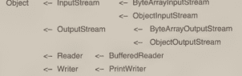

**图 D.4**
*Java I/O 类层次结构。*

## java.io.InputStream（抽象类）

构造器：

`InputStream();`

通用描述：用于基本流输入的通用类。

父类：`Object`

方法：

- `int available();`
    返回在不阻塞的情况下可以读取的字节数。
- `void close();`
    关闭通道。
- `void mark(int readlimit);`
    设置 mark() 和 reset() 的缓冲最大字节数。
- `boolean markSupported();`
    检查流是否支持 mark()/reset()。
- `int read();`
    从流中读取单个字节。
- `int read(byte[] arr);`
    将字节数组读取到 arr 中。
- `int read(byte[] arr, int offset, int length);`
    从偏移量 offset 开始，将 length 个字节读取到 arr 中。
- `void reset();`
    返回到最后标记的位置。
- `long skip(long n);`
    在流中向前跳过 n 个字节。

抛出的异常：
`IOException`

## java.io.ByteArrayInputStream（类）

构造器：
- `ByteArrayInputStream(byte[] buf);`
- `ByteArrayInputStream(byte[] buf, int offset, int length);`

通用描述：允许您从字节数组创建虚拟输入流。有时你会获得一块数据（例如来自 DatagramSocket）；此类承担将这些信息以流形式传输的作用。

父类：`InputStream`
方法：（无；包含许多来自 InputStream 的重写方法）
抛出的异常：（无）

## java.io.ObjectInputStream（类）

构造器：
`ObjectInputStream (InputStream o);`

通用描述：使用此类，你读取传输或存储的对象。你使用 InputStream（在 Socket 类中可用）创建此对象。

父类：`InputStream`

方法：

- `int available();`
    返回在不阻塞的情况下可以读取的字节数。
- `void close();`
    关闭此通道。
- `void defaultReadObject();`
    从此流中读取当前类的非静态和非 transient 字段。
- `int read();`
    读取一个字节。
- `int read(byte[] arr, int offset, int len);`
    读取字节数组。
- `readFully(byte[] arr);`
    读取所有字节以填满数组。
- `readFully(byte[] arr, int offset, int len);`
    从偏移量 offset 开始读取 len 个字节，必要时阻塞。
- `boolean readboolean();`
    读取指定类型。
- `byte readByte();`
- `char readChar();`
- `double readDouble();`
- `float readFloat();`
- `int readInt();`
- `long readLong();`
- `short readShort();`
- `int readUnsignedByte();`
- `int readUnsignedShort();`
- `String readUTF();`
    读取 Object 实例。你可以发现类型，然后使用转换操作符稍后转换它。
- `Object readObject();`

抛出的异常：
`IOException`
`ClassNotFoundException`
`NotActiveException`
`OptionalDataException`
`InvalidObjectException`
`SecurityException`
`StreamCorruptedException`

## java.io.OutputStream（抽象类）

构造器：
`OutputStream();`

通用描述：用于基本流输出的通用类。

父类：`Object`

方法：
- `void close();`
    关闭通道。
- `void flush();`
    将缓冲中的数据刷新。
- `void write(byte b);`
    向流中写入单个字节。
- `int write(byte[] arr);`
    向流中写入字节数组（arr）。
- `int write(byte[] arr, int offset, int len);`
    从偏移量 offset 开始，向流中写入 len 个字节（arr）。

抛出的异常：
`IOException`

## java.io.ByteArrayOutputStream（类）

构造器：
- `ByteArrayOutputStream();`
- `ByteArrayOutputStream(int size);`

通用描述：允许你将数据以流形式写入字节数组。像 DatagramSocket 这样的类仅与数据块配合工作；此类承担以流形式传输信息的作用。

父类：`OutputStream`

方法：

| 方法 | 描述 |
| :--- | :--- |
| `void reset();` | 清除缓冲区并清空数组。 |
| `int write(byte[] arr, int offset, int len);` | 从 *offset* 开始，写入 *arr* 中的 *len* 个字节。 |
| `byte[] toByteArray();` | 返回流式数据数组。 |
| `int size();` | 返回缓冲区的当前大小。 |
| `String toString(String encoder);` | 创建字符串，使用 *encoder* 转换字符。 |
| `void write(int b);` | 向流中写入单个字节。 |
| `void write(OutputStream o);` | 通过 *OutputStream* 发送数据数组。 |

抛出的异常：（无）

## java.io.ObjectOutputStream（类）

构造器：

`ObjectOutputStream(OutputStream o);`

通用描述：使用此类，你传输或存储对象。你使用 *OutputStream*（在 *Socket* 类中可用）创建此对象。

父类：*OutputStream*

方法：

| 方法 | 描述 |
| :--- | :--- |
| `void close();` | 关闭此通道。 |
| `void defaultWriteObject();` | 将当前类的非静态和非 transient 字段写入此流。你只能在序列化期间在 *writeObject()* 方法内调用此方法。 |
| `int flush();` | 将缓冲中的数据刷新。 |

`int reset();`
丢弃写入流中的信息。
`void useProtocolVersion(int version);` // 强制使用较早的序列化版本。
`void write(byte b);` // 写入一个字节或一个字节数组
`int write(byte[] arr);` // 从偏移量 offset 开始写入 len 个字节。
`int write(byte[] arr, int offset, int len);`
`void writeBoolean(boolean b);` // 写入指定类型。
`void writeByte(byte b);`
`void writeBytes(String s);`
`void writeChar(int c);`
`void writeChars(String s);`
`void writeDouble(double d);`
`void writeFloat(float f);`
`void writeInt(int i);`
`void writeLong(long l);`
`void writeShort(int us);`
`void writeUTF(String s);` // 将缓冲区中的字段写入流。
`int writeFields();`
`void writeObject(Object o);` // 写入 Object 实例。

抛出的异常：
- `IOException`
- `SecurityException`

## java.io.BufferedReader (类)

构造函数：`BufferedReader(Reader i); BufferedReader(Reader i, int size);`

通用描述：为改进性能而保留缓冲区。对某些类型进行转换以识别行。size 指定输入缓冲区的大小。

父类：`Reader`

方法：

- `void close();`
  - 关闭通道。
- `void mark(int readlimit);`
  - 为 mark() 和 reset() 设置缓冲的最大字节数。
- `boolean markSupported();`
  - 检查流是否支持 mark()/reset()。
- `int read();`
  - 从流中读取单个字节。
- `int read(byte[] arr, int offset, int length);`
  - 读取一个字节数组到 arr，从 offset 开始，长度为 length 个字节。
- `String readLine();`
  - 读取直到换行符并返回 String。
- `boolean ready();`
  - 如果准备好读取，则返回 true。
- `void reset();`
  - 返回到最后一个标记位置。
- `long skip(long n);`
  - 在流中向前跳过 n 个字节。

抛出的异常：
- `IOException`

## java.io.PrintWriter (类)

构造函数：

- `PrintWriter(Writer o);`
- `PrintWriter(Writer o, boolean autoFlush);`
- `PrintWriter(OutputStream o);`
- `PrintWriter(OutputStream o, boolean autoFlush);`

通用描述：将数据类型转换为可读文本。autoFlush 标志在程序调用 println() 时强制刷新。

父类：`Writer`

方法：

- `boolean checkError();`
  - 刷新流并检查任何错误。
- `void close();`
  - 关闭此通道。
- `void defaultWriteObject();`
  - 将当前类的非静态和非瞬态字段写入此流。您只能在序列化期间的 writeObject() 方法中调用此方法。
- `int flush();`
  - 从缓冲区刷新已写入的数据。
- `void print(boolean b);`
- `void print(char c);`
- `void print(char[] s);`
- `void print(double d);`
- `void print(float f);`
- `void print(int i);`
- `void print(long l);`
- `void print(Object obj);`
- `void print(String s);`
  - 打印指定类型。Object 类型使用 String.valueOf() 方法转换数据。
- `void println()`
- `void println(boolean b);`
- `void println(char c);`
- `void println(char[] s);`
- `void println(double d);`
- `void println(float f);`
- `void println(int i);`
- `void println(long l);`
- `void println(Object obj);`
- `void println(String s);`
  - 打印指定类型并以换行符结束行。如果启用了 autoFlush，则刷新流。
- `void write(int b);`
- `int write(char[] arr);`
- `int write(char[] arr, int offset, int len);`
- `int write(String s);`
- `int write(String s, int offset, int len);`
  - 向流中写入单个字节。
  - 向流中写入字符数组 (arr)。
  - 从 offset 开始向流中写入字符数组 (arr)，长度为 len 个字节。
  - 将字符串写入流。
  - 从 offset 开始将字符串写入流，长度为 len 个字节。

抛出的异常：
- `IOException`
- `SecurityException`

## Java Socket 类

Java Socket API 支持四个基本的 IPv4 类：`Socket`、`ServerSocket`、`DatagramSocket` 和 `MulticastSocket`。本节描述了这些类中每个类的接口。


### 图 D.5
Java socket 类层次结构。

## java.net.Socket (类)

构造函数：

- `Socket(String host, int port);`
- `Socket(InetAddress addr, int port);`
- `Socket(String host, int port, InetAddress lAddr, int lPort);`
- `Socket(InetAddress addr, int port, InetAddress lAddr, int lPort);`

通用描述：这是所有网络流量的基本通信接口（TCP）。

父类：`Object`

方法：

- `void close();`
  - 关闭套接字。
- `InetAddress getInetAddress();`
  - 获取对等方（peer）的主机地址。
- `InputStream getInputStream();`
  - 获取用于接收消息的 InputStream。
- `boolean getKeepAlive();`
  - 保持连接处于活动状态。
- `void setKeepAlive(boolean on);`
- `InetAddress getLocalAddress();`
  - 获取套接字连接到的本地地址。
- `int getLocalPort();`
  - 获取本地端口。
- `OutputStream getOutputStream();`
  - 获取用于发送消息的 OutputStream。
- `int getPort();`
  - 获取对等方的端口号。
- `int getReceiveBufferSize();`
- `void setReceiveBufferSize(int size);`
  - 获取/设置接收缓冲区的大小。
- `int getSendBufferSize();`
- `void setSendBufferSize(int size);`
  - 获取/设置发送缓冲区的大小。
- `int getSoLinger();`
- `void setSoLinger(boolean on, int linger);`
  - 获取/设置套接字滞留时间（以秒为单位）。
- `int getSoTimeout();`
- `void setSoTimeout(int timeout);`
  - 获取/设置 I/O 的超时时间。如果启用，读取管道将在指定时间后中止。
- `boolean getTcpNoDelay();`
- `void setTcpNoDelay(boolean on);`
  - 启用/禁用 Nagle 算法，该算法确定发送信息的处理过程。如果禁用，计算机在接收到任何确认之前就会发送数据。
- `void shutdownInput();`
  - 关闭输入通道。
- `void shutdownOutput();`
  - 关闭输出通道。

抛出的异常：
- `IOException`
- `SocketException`

## java.net.ServerSocket (类)

构造函数：

- `ServerSocket(int port);`
- `ServerSocket(int port, int backlog);`
- `ServerSocket(int port, int backlog, InetAddress bindAddr);`

通用描述：此专用的 TCP 套接字创建一个监听服务器套接字。

父类：`Object`

静态方法：

- `setSocketFactory(SocketImplFactory fac);`
  - 设置 Socket 实现工厂。

方法：

- `Socket accept();`
  - 接受客户端连接并返回一个 Socket。
- `void close();`
  - 关闭套接字。
- `InetAddress getInetAddress();`
  - 获取套接字连接到的本地地址。
- `int getLocalPort();`
  - 获取本地端口。
- `int getSoTimeout();`
- `void setSoTimeout(int timeout);`
  - 获取/设置 I/O 的超时时间。如果启用，读取管道将在指定时间后中止。

抛出的异常：
- `IOException`
- `SocketException`

## java.net.DatagramSocket (类)

构造函数：
- `DatagramSocket();`
- `DatagramSocket(int port);`
- `DatagramSocket(int port, InetAddress bindAddr);`

通用描述：这是用于消息传递的通用数据报（UDP）套接字。

父类：`Object`

方法：

- `void close();`
  - 关闭套接字。
- `void connect(InetAddress addr, int port);`
  - 为隐式发送连接对等方。
- `void disconnect();`
  - 断开已连接的对等方。
- `InetAddress getInetAddress();`
  - 获取对等方的主机地址。
- `InetAddress getLocalAddress();`
  - 获取套接字连接到的本地地址。
- `int getLocalPort();`
  - 获取本地端口。
- `int getPort();`
  - 获取对等方的端口号。
- `int getReceiveBufferSize();`
- `void setReceiveBufferSize(int size);`
  - 获取/设置接收缓冲区的大小。
- `int getSendBufferSize();`
- `void setSendBufferSize(int size);`
  - 获取/设置发送缓冲区的大小。
- `int getSoTimeout();`
- `void setSoTimeout(int timeout);`
  - 获取/设置 I/O 的超时时间。如果启用，读取管道将在指定时间后中止。
- `void receive(DatagramPacket p);`
  - 接收消息。
- `void send(DatagramPacket p);`
  - 发送消息。

抛出的异常：
- `IOException`
- `SocketException`

## java.net.MulticastSocket (类)

构造函数：
- `MulticastSocket();`
- `MulticastSocket(int port);`

通用描述：这是用于非连接消息的通用数据报（UDP）套接字。

父类：`DatagramSocket`

方法：

- `InetAddress getInterface();`
- `void setInterface(InetAddress addr);`
  - 获取/设置套接字连接到的本地地址。
- `int getTimeToLive();`
- `void setTimeToLive(int TTL);`
  - 获取/设置每个消息的生存时间。
- `void joinGroup(InetAddress addr);`
  - 加入多播组。
- `void leaveGroup(InetAddress addr);`
  - 离开多播组。
- `void send(DatagramPacket p, int TTL);`
  - 发送具有特定 TTL 的消息。

抛出的异常：
- `IOException`
- `SocketException`

## 索引

## 符号
- 1xx 结果代码，407
- 2xx 结果代码，407
- 3xx 结果代码，407
- 4xx 结果代码，407
- 5xx 结果代码，408
- 6bone，391
- 128位加密，350

## A
- -a 命令，68
- -a 选项，331
- 抽象类
  - java.io.InputStream，488
  - java.io.OutputStream，490
  - Message，480
- 抽象编程，247
- 抽象（对象编程），252-253
- 抽象，识别（框架），291
- accept() 系统调用，122, 223, 424
  - 连接日志（列表），124
  - 错误，124, 425
  - 列表，123
- 接受客户端连接，122
- 访问权限（对象编程），255
- 确认号，65
- 活动连接，116
- 活动数据，341
- 主动过滤，345
- addr 参数，大小问题，122
- 地址解析协议（ARP），29, 68
- 地址，29。另见 ID
  - 广播，32, 360, 363
  - 冲突，28
  - 转换，441
  - 互联网，29
  - 类别，30
  - 子网，30
  - IP，12, 28-29
  - IP 失忆，34
  - IPv6，35
  - IPv6，35, 382-384, 417
  - 局限性，33
  - MAC
    - 广播，361
    - 播报列表，367
    - 掩码，32
    - 消息，289
    - 解析，333
    - 欺骗，376
    - zerofl，32
- IP4 寻址问题，382
- addr_len 参数（recvfrom() 系统调用），80
- 高级研究计划局网络（ARPANet），105
- AF * 常量，14
- 报警信号，192
- alarm() 系统调用，192-193
- 算法，351。另见 密码
  - 写时复制，135
  - 启发式，311
  - 管理，208
  - Nagle，215
  - 并行，312
  - 调度，（线程），165
  - servlet，199
  - Smart Select，204
- TCP 客户端，13
- 验证，91
- 分配 ID（IPv6 地址），383
- 分配（内存），230-231
- 分析（程序开发），306-307
- 无政府状态（对象），308
- AppleTalk 数据包，44
- 应用层（互联网协议套件），106, 109
- 应用层（OSI 网络模型），105
- 应用程序，测试，118
- ARP（地址解析协议），29, 68
- ARPANet（高级研究计划局网络），105
- ASCII 数据，126
- 异步 I/O，183-189, 216
- 异步写入，187-188
  - 按需连接，188-189
  - 按需读取，185-186
  - 信号驱动 I/O，176, 183, 185
- 属性
  - 类，293
  - 对象编程，254
- 认证，234, 340

## B
- 反向握手，235
- 骨干，360, 368
- 带宽，多播组数据流问题，363
- 行为，名称混淆，253
- 双向心跳，219
- 大端数字，37-38
- 二进制数据，126
- 二进制数
  - 转换为点分十进制，39
  - 存储，37
- bind() 系统调用，36, 119, 223, 423
  - connect() 系统调用（比较），85
  - 错误，214, 423
  - 列表，120
  - 原型，84
  - 请求端口号，84
- 将端口绑定到套接字，119, 121
- 黑盒测试，317
- 阻塞，174
  - I/O 阻塞，174-176
    - 替代方案，176
    - 解决不必要的 I/O 阻塞，189-192
    - 读阻塞，176
    - 写阻塞，176
- brainfuck，327
- 广播地址，32
- Broadcast 类，290, 484
- 广播数据报套接字，361
- 广播，360
  - 地址，363
  - 局限性，362
  - 启用编程，361
  - 发送/接收，360
  - 子网，360
- BSD，select 冲突，205
- BSD 信号，157
- 构建和测试范式，118
- 业务分析师，315
- 字节序，37
- bzero() 系统调用，19, 465

## C
- C 编程语言
- C++（比较），284
- 编译带线程的程序，142
- 网络编程，323
- 传递数据，323
- 按值返回向量，324
- 字符串类型，332
- C++ 编程语言
  - C 比较，284
  - 异常类，478
  - friend 指令，309
  - 局限性，数据流，287
  - 消息类，480
  - 套接字类，481
  - 套接字编程，284
  - 支持类，479
- -c <count> 命令，68
- 计算校验和，375
- 使用 exec server 调用外部程序，168-170
- calloc() 系统调用，230
- 调用，223。另见 系统调用
  - IPv4，转换为 IPv6，386-387
  - 非无状态，使用打开的连接创建，335
  - 阶段，336
  - Socket API 调用，返回值，223-225
  - UNIX 库调用，222-223
- 捕获
  - SIGPIPE 处理器，158
  - 信号，462
- 卡片
  - 以太网卡
  - 局域网卡，98
  - 安全性，345
  - 网卡，混杂模式，99
- 转换 sockaddr 类型，18
- 证书，使用 OpenSSL 创建，356
- 认证，126, 235, 341
- CGI（通用网关接口），168
- 通道，8, 428
- 检查点，104, 325
- 校验和
  - 计算，375
  - TCP，90
  - UDP，90
- 子异常
  - Exception 超类，478
  - java.io.IOException 类，486
  - java.net.SocketException 类，486
  - NetException 类，479
- 子进程
  - 与父进程的双向连接，155
  - 控制，165
  - 创建，199
  - 在子进程中创建管道，152
  - 分离，167
  - getpid() 系统调用，139
  - 返回值，167
  - 设置状态，149
  - 与父进程的单向连接，154
  - 终止，455
  - 僵尸进程，165
- CIDR（无类别互联网域路由），31
- 密码，351-352
  - 公钥密码，351
  - 对称密钥密码，351
- 类，291, 478。另见 组件
  - 抽象
    - java.io.InputStream，488
    - java.io.OutputStream，490
    - Message，480
  - 添加函数，292-294
  - 属性，293
  - Broadcast，484
  - 构造函数，294
  - 耦合，313
  - Datagram，484
  - DatagramPacket 类（Java），269
  - DatagramSocket 类（Java），269
  - 定义能力，291
  - 析构函数，295
  - Exception，288
  - friend 指令（C++），309
  - HostAddress，479
  - I/O 类（Java），272-275
  - 继承，290
    - 外部类，309
    - 程序开发，308
  - 互联网寻址，30
  - java.io.BufferedReader，492
  - java.io.ByteArrayInputStream，489
  - java.io.ByteArrayOutputStream，491
  - java.io.IOExpception，486
  - java.io.ObjectInputStream，489
  - java.io.ObjectOutputStream，491
  - java.io.PrintWriter，493
  - java.net.DatagramPacket，486
  - java.net.DatagramSocket，497
  - java.net.InetAddress，487
  - java.net.MulticastSocket，497
  - java.net.ServerSocket，496
  - java.net.Socket，495
  - java.net.SocketException，486
  - MessageGroup，485
  - 方法
    - 实现，294
    - 静态，295
  - 多重继承，代码膨胀，313
  - NetException，478
  - 网络，31
  - 对象编程，253-254
    - 退化类，258-259
    - 元素，255
    - 子类，254
    - 超类，254
  - 重载，292
  - 部分类限制，310
  - 关系，290
  - SimpleString，479
  - Socket 超类，290
  - SocketClient，484
  - SocketServer，483
  - SocketStream，483
  - 超类，289
    - Exception，478
    - Socket，481
  - TextStream，480
  - 可线程化类，创建（Java），277
  - 线程，添加（Java），278
  - 编写匹配的应用程序类型，284
- 无类别互联网域路由。另见 CIDR，31
- 客户端套接字（Java），265
- 客户端-服务器通信，76
- 客户端-套接字连接，12
- 客户端/服务器并发，237-238
- 客户端
  - 活动连接，116
  - 时钟同步，127
  - 通信
    - 认证，126
    - 死锁，127
    - 顺序，125
    - 与对等方/服务器，9
    - 角色，126
    - 与服务器，123
  - 连接，325
    - 接受，122
    - 限制，196
    - 服务器，9
    - 线程化，208
  - ping，376
  - 服务器
    - 关闭连接，128
    - 重启连接，127
  - 服务调用，327
  - 服务调用级通信，325
  - 信号，159
  - 在队列中等待，201
  - SSL 客户端，创建，353-358
  - 饥饿，127
  - 有状态连接，335
  - 无状态连接，335
  - T/TCP，81
  - 瘦客户端，236
- client2 套接字描述符，123
- 时钟同步，127
- clone() 系统调用，145
  - 注意事项，145
  - 列表，148
  - 参数，146
  - 可共享任务数据，146
- clone() 系统调用，451-452
- CLONE_FILES 标志，147
- CLONE_FS 标志，146
- CLONE_PID 标志，147
- CLONE_SIGHAND 标志，147
- CLONE_VM 标志，146
- close() 系统调用，23, 224, 475
- 关闭
  - 管道中的通道，155
  - Java 套接字，266
- 集群，限制集群间的流量，32
- 粗粒度锁定，162
- 代码级可移植性（Java），264
- 冲突（数据包），10, 97
  - 地址，28
  - select，205
- 通用网关接口（CGI），168
- 公共内存，150
