# Linux 套接字编程


# 献词

> 致一切良善的赐予者及完满和平之主。

# 致谢

我知道，如果没有几个人，这本书是不可能完成的。首先，我挚爱的妻子苏珊耐心地鼓励我，并给我时间和督促。其次，我的父亲温德尔试图教我良好的组织和表达能力。第三，`Linux` 运动无私地为我提供了一个高效、可靠的操作系统，让我可以在此基础上完成这项工作。第四，贝弗利·谢尔夫让我开了眼，向我展示了一种有效的沟通方式。最后，直到我的朋友查尔斯·库恩森和迈克·霍尔斯泰因提供意见和鼓励，我才意识到这项工作对我的职业生涯有多重要。

## 告诉我们你的想法！

作为本书的读者，`你`是我们最重要的批评者和评论者。我们重视你的意见，希望了解我们做对了什么，哪些地方可以做得更好，你希望我们在哪些领域进行出版，以及你愿意分享的任何其他智慧建议。

作为 Sams 的副出版人，我欢迎你的评论。你可以通过传真、电子邮件或直接写信给我，告诉我你对我本书的哪些地方喜欢或不满意——以及我们如何使我们的书籍更加出色。

> 请注意，我无法帮助你解决与本书主题相关的技术问题，并且由于我收到的邮件数量庞大，我可能无法回复每一条信息。

当你写信时，请务必附上本书的书名和作者，以及你的姓名和电话或传真号码。我将仔细审阅你的评论，并与参与本书工作的作者和编辑分享。

| 项目 | 值 |
|---|---|
| 传真 | `317-581-4770` |
| 电子邮件 | `Samsfeedback@macmillanusa.com` |
| 邮寄地址 | **副出版人**<br>`Sams`<br>`201 West 103rd Street`<br>`Indianapolis, IN 46290 USA` |

## 扩展编程挑战

大多数编程工作针对的是桌面或笔记本电脑上的即时功能或任务。这些任务很少与鼠标、键盘、显示器和文件系统以外的设备通信。更大的编程挑战涉及通过网络通道连接的不同计算机上的多个程序。网络编程扩展了这种挑战，因为你需要协调任务并分配工作。

在 `Linux`（以及大多数其他操作系统）中，所有网络编程的基本单元都是套接字。就像文件 `I/O` 将你连接到文件系统一样，套接字将你连接到网络。套接字是你的程序用来寻址、发送和接收消息的接合点。

网络或套接字编程比单任务甚至多任务编程更具挑战性，因为真正的多处理引入了更多的力量和议题。其力量显而易见：像 `Beowolf` 这样的并行虚拟机（`PVMs`）可以通过组织任务块并将其分发到联网的计算机来执行更多的处理。议题则出现在获得最佳吞吐量、协调传输和管理 `I/O` 方面。

本书描述并提供了解决这些问题的几种方案。它旨在满足职业网络程序员的即时和长期需求。

## 本书组织

本书深入探讨了许多网络编程的细节。它分为五个特定部分，每一部分都建立在前几部分的基础之上：

- **第一部分**：从客户端角度审视网络编程
    - 这部分介绍了套接字并定义了术语。它描述了不同类型的套接字、寻址方案和网络理论。
- **第二部分**：服务器端视角与负载控制
    - **第二部分**扩展了带有服务器、多任务技术、`I/O` 控制和套接字选项的套接字编程。
- **第三部分**：客观审视套接字
    - `C` 并不是唯一提供套接字访问的编程语言。这部分介绍了一些面向对象的接近方法，并描述了对象技术在一般情况下的优势和局限性。
- **第四部分**：高级套接字——增加价值
    - 这部分介绍了高级网络编程技术的广阔领域，包括安全性、广播和多播、`IPv6` 和原始套接字。
- **第五部分**：附录
    - 附录汇总了许多与套接字相关的资源材料。第一个附录包含对于章节而言过于庞大的表格和列表。第二个和第三个附录描述了 `Socket` 和内核 `API`。

配套的网站包含本书示例的所有源代码、以 `HTML` 和 `Adobe` 便携式文档格式（`PDF`）呈现的书籍附录，以及以 `HTML` 格式呈现的与套接字编程相关的 `RFC`（请求评论）。

## 专业读者的风格

本书专为职业程序员设计。通常，职业程序员想做三件事之一：学习新技术、解决特定问题，或查找某个示例或定义。章节和附录试图满足这些标准中的每一项。

- **从头到尾线性阅读** 这适用于希望一次接触一个主题的人。每个小节和章节都建立在前面的知识之上。本文的组织方式旨在逐步增加复杂度。套接字编程起初可能显得相当直观。然而，编程会引发关于时序、异常、性能等方面的若干注意事项和问题，这些都可能破坏出色的设计。线性阅读有助于你层层构建概念，从而知道如何正确地完成工作。
- **浏览** 浏览者无需涉猎过多的不必要细节即可获取所需信息。他们对主题了解更多，希望跳过到精彩的部分。就像导航网站一样，浏览者在主题之间跳跃，直到找到所有需要的信息片段。
- **查阅参考** 专家通常希望快速找到信息（表格、程序片段、`API`）。信息需要简洁且易于查找。

本书的排版布局旨在提供实现通常所需或所求内容的基本信息。此外，许多章节包含与正文分开的段落。这些段落提供额外信息、细节、专家笔记和观点。

## 目标读者与预期交互

本书和网站包含许多示例代码，用以说明当前主题。阅读相应章节并尝试运行程序。你需要知道如何执行以下操作：

1. 创建一个 `C` 或 `Java` 源文件（使用你选择的任意编辑器）。
2. 使用 `C` 或 `Java` 编译器进行编译。
3. 运行该程序。

一些示例可能需要修改内核（广播和多播）。大多数 `Linux` 发行版即使没有连接物理网络，也会安装并运行网络。为了运行本书中的所有程序，你必须：

- 能够编程并编译 `C`、`C++` 和 `Java` 代码。
- 安装所有编译器。
- 能够为网络、广播和多播配置内核。
- 编译并安装新的内核。

## 免责声明与局限

虽然本书中列出的所有程序都经过测试，但由于系统配置随时间变化，它们可能并不总能开箱即用。大多数情况下，如果某些功能无法正常工作，可能是发行版在某种程度上更改了头文件包含。

此外，测试人员已在其他 `UNIX` 操作系统上验证了部分程序。这有助于解决一些可移植性问题。然而，如果 `Linux` 与其他实现之间存在差异，本书将列出 `Linux` 版本（并包含描述该问题的注释）。本书主要关注 `Linux`。

最后，本书不涵盖其他操作系统（`Microsoft Windows` 或 `Macintosh`）。虽然某些章节注明了对比，但所有算法均支持 `Linux/UNIX`。

## 本书使用的约定

本书使用以下排版约定：

- 代码行、命令、语句、变量以及你在屏幕上输入或看到的任何文本都采用等宽字体显示。**粗体等宽**字体通常用于表示用户输入。
- 语法描述中的占位符采用*斜体等宽*字体显示。请用实际的文件名、参数或其代表的其他元素替换占位符。
- *斜体*用于在定义技术术语时突出显示这些术语。
- 在实际上是前一行代码续行的代码行前使用 `→` 图标。有时一行代码太长，无法在页面上作为单行显示。如果你看到代码行前有 `→`，请记住它是紧邻其上方那一行代码的一部分。
- 文本中还包含对称为“请求评论”（`RFC`）的互联网标准文档的引用。参考文献引用以方括号包含 `RFC` 编号，例如 `[RFC875]`。

## 章节列表

1. 介绍网络客户端示例程序
2. TCP/IP 网络语言熟练度

## 三种不同类型的互联网数据包

## 在对等节点之间发送消息

## 理解网络分层模型

# 第1章 介绍食谱网络客户端

## 本章导读

- 使用套接字连接世界
- 使用专业术语：TCP/IP 寻址概述
- 倾听服务器：客户端的基本算法
- 总结：幕后发生了什么？

*该死的 CMOS 电池！好吧，现在几点了？看不见时钟。我干脆直接打时间电话。1-614-281-8211。嘟声。“...现在是八点二十三分四十秒。”挂断。哼！上午还是下午？难道指望我往外看？*

你使用的计算机通常连接到某种网络。它可能是一个带有防火墙并接入互联网的企业级内部网络；也可能是你业余时间连接的几台电脑。网络连接了工作站、服务器、打印机、磁盘阵列、传真机、调制解调器等。每个网络连接都使用或提供一种服务。某些服务在不进行任何交互的情况下提供信息。就像我们拨打时间电话的例子一样，基本的网络客户端会连接并监听服务器。

服务器提供哪些类型的服务？很多。所有服务都归入四类资源：通用的、受限或昂贵的、共享的、以及授权的。以下是每类的一些示例：

| 类别 | 示例 |
| :--- | :--- |
| 通用 | 磁盘空间（集中备份） |
| 受限 | 打印机、调制解调器、磁盘阵列 |
| 共享 | 数据库、项目控制、文档 |
| 授权 | 远程程序、分布式查询 |

本章将指导你编写一个连接某个服务器的基本客户端。这个过程有助于你理解编写网络程序所涉及的所有内容。客户端最初连接到服务器的正确时间服务（或其他不期望首先输入的服务）。在此过程中，本章将解释不同的调用、其参数以及常见错误。


客户端程序需要一个发送/接收接口和一个地址来连接服务器。客户端和服务器都使用套接字（`sockets`）来连接并独立于位置发送消息。再次考虑电话的例子：听筒有两个部分，麦克风（传输）和扬声器（接收）。套接字也具有这两个通道。此外，电话号码本质上是电话的唯一地址。

同样，套接字也有两个部分或通道：一个用于监听，一个用于发送（类似于文件 I/O 的读取/写入模式）。客户端（或呼叫者）与服务器（或应答者）连接以开始网络会话。每个主机提供几种标准服务（参见文件系统上的`/etc/services`），例如正确时间的电话号码。

## 注意

## 运行本书的示例

如果你在内核中启用了网络功能，并且`inetd`网络服务器守护进程正在运行，那么你可以在未连接网络的情况下运行书中大多数程序示例。事实上，许多示例使用本地（或`回环`）地址`127.0.1`。如果你没有启动并运行网络驱动程序，大多数 Linux 发行版都包含了至少用于回环网络所需的一切。

你的客户端程序必须执行几个步骤才能与对等节点或服务器通信。这些步骤必须遵循特定的顺序。当然，你可能会问：“为什么不用更少的调用替代所有这些步骤？”在每一步之间，你的程序可以从许多选项中进行选择。尽管如此，某些步骤是可选的。如果你的客户端跳过了某些步骤，通常操作系统会使用默认设置为你填补空白。

你可以遵循几个基本步骤来创建套接字，设置目标主机，建立与另一个网络程序的通道，以及关闭。图 1.1 以图形方式展示了客户端连接服务器所经历的步骤。


## 客户端

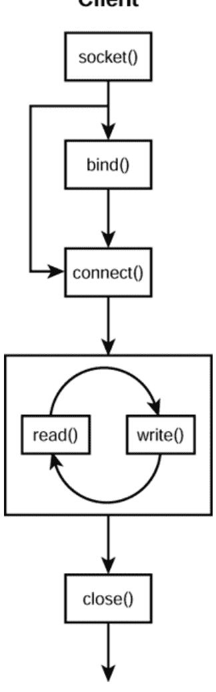

以下列表描述了每个步骤：

1. 创建套接字。从各种网络域（如互联网）和套接字类型（流）中进行选择。
2. 设置套接字选项（可选）。你有很多影响套接字行为的选项。只要套接字处于打开状态，程序可以随时更改这些选项。（更多详情请参见第 9 章，“突破性能瓶颈”。）
3. 绑定到地址/端口（可选）。接受来自所有或单一 IP 地址的连接，并建立端口服务。如果你跳过此步骤，操作系统将假设任何 IP 地址并分配一个随机的端口号。（第 2 章，“TCP/IP 网络语言流畅度” 对地址和端口进行了更详细的讨论。）
4. 连接到对等节点/服务器（可选）。主动建立你的程序与另一个网络程序之间的双向通道。如果你跳过此步骤，你的程序将使用定向或无连接通信。
5. 部分关闭连接（可选）。将通道限制为仅发送或仅接收。你可能希望在复制通道后使用此步骤。
6. 发送/接收消息（可选）。选择不进行任何 I/O 的一个原因可能包括检查主机可用性。
7. 关闭连接。当然这一步很重要：长时间运行的程序如果未关闭失效的连接，最终可能会耗尽可用的文件描述符。

接下来的几节将描述这些步骤中的一些，定义系统调用并提供示例。

## 使用套接字连接世界

几年前，网络涉及从一台计算机到另一台计算机的专用串行线路。没有其他计算机共享同一条电路，并且 UNIX 使用`UUCP`（UNIX 到 UNIX 复制）来移动文件。随着线路传输技术的进步，共享传输线路的概念变得可行。这意味着每台计算机都需要唯一地识别自己并轮流传输。有许多不同的方法来共享网络时间，其中许多工作得相当好。有时，计算机同时传输，导致数据包冲突。

硬件和低层驱动程序处理诸如冲突和重传等问题，这现在是过去编程的遗物。这使你的设计能够专注于消息的传输和接收。套接字`API`（应用程序接口）为设计人员提供了接收或发送消息的通道。

套接字编程不同于典型的应用程序或工具编程，因为你处理的是并发运行的程序和系统。这意味着你需要考虑同步、时序和资源管理。

套接字使用单个双向通道链接异步任务。这可能会导致死锁和饥饿等问题。通过意识和规划，你可以避免其中大多数问题。你可以在第 7 章，“分担负载：多任务” 中阅读如何处理多任务问题，并在第 10 章，“设计强健的 Linux 套接字” 中阅读如何构建强健的套接字。

通常，过载的服务器会降低互联网感知的响应速度。时序和资源管理减轻了服务器负担，提高了网络性能。你可以在第二部分，“服务器视角与负载控制” 中找到许多改善性能的想法。

互联网被设计为完全分组交换。每个数据包都必须包含到达目的地所需的所有必要信息。就像信件一样，数据包必须包含源地址和目标地址。数据包沿着连接（或链路）从一台计算机切换到下一台。如果网络在传递消息时丢失一个链路，数据包会找到另一条路线（分组交换），或者如果无法到达主机，路由器会将错误弹回给发起者。这确保了某种形式的数据可靠性。网络中的断路会导致网络中断。你自己可能也遇到过几次网络中断。

## 使用专业术语：TCP/IP 寻址概述

网络支持许多不同类型的协议。程序员针对特定问题（如无线电/微波）设计了一些协议；其他协议则试图解决网络可靠性问题。`TCP/IP`（传输控制协议/互联网协议）侧重于数据包和潜在丢失通信通道的风险。在任何时候，如果某个网络段发生故障，协议都会尝试寻找一条新路由。

数据包跟踪、丢失检测和重传是复杂的算法，因为时间并非唯一的指标。幸运的是，行业经验已经证明了该协议所使用的算法的有效性。通常情况下，在设计阶段你可以忽略这些问题，因为解决方案深藏于协议的底层实现中。

`TCP/IP` 是分层的：高层协议提供更高的可靠性但灵活性较低，而低层协议提供更大的灵活性但牺牲了可靠性。面对不同层面的灵活性和可靠性需求，`Socket API` 提供了所有必需的接口。这与标准 UNIX 方法不同，后者为每一层都提供了一套独立的调用接口。

标准文件 I/O 同样采用分层方法。通过 `TCP/IP` 连接的计算机主要使用套接字进行相互通信。考虑到程序可用的众多不同协议层，以及我们曾经被告知的`open()`（生成文件描述符）和`open()`（生成文件引用）是不同的且几乎不兼容，这看起来很奇怪。所有协议层都可以通过一个调用接口访问：`socket()`。这个单一的调用抽象了不同网络（`TCP/IP`、`IPX`、`Rose`）的所有实现细节。

从根本上说，每个数据包都包含数据、源地址和目标地址。协议中的每一层都会向其传输的数据包添加自己的签名和其他数据（封装层）。在传输过程中，封装层有助于接收方将消息转发到适当的层以等待读取。

每台连接到互联网的计算机都有一个互联网协议（IP）地址，这是一个唯一的 32 位数字。如果没有这种唯一性，就无法确定数据包的正确目的地。

`TCP/IP` 通过端口的概念将地址处理推向了更深一层。就像 3 到 5 位的电话分机号一样，每个计算机地址都有几个端口供计算机通信使用。这些并非物理端口，而是系统的抽象概念。所有信息仍然通过网络地址传输，就像主要电话号码一样。

IP 地址的标准书写格式是`[0-255].[0-255].[0-255].[0-255]`，例如`123.45.6.78`。请注意，0 和 255 是用于网络掩码和广播的特殊数字，因此使用时要小心（第 2 章将更详细地讨论 IP 编号）。互联网端口通常使用冒号或句点分隔这些数字：

```
[0-255].[0-255].[0-255].[0-255]:[0-65535]
```

例如，`128.34.26.101:9090`（IP=`128.34.26.101`，端口=`9090`）。

```
[0-255].[0-255].[0-255].[0-255].[0-65535]
```

例如，`64.3.24.24.9999`（IP=`64.3.24.24`，端口=`9999`）。

## 注意

**冒号与句点端口**

在端口表示法中，冒号记法比句点记法更常见。

每个 IP 地址实际上提供了约 65,000 个端口号，套接字可以连接这些端口。更多信息请参见[第 2 章](#)。

## 聆听服务器：客户端的基本算法

最简单的客户端套接字连接是打开到服务器的连接、发送请求并接收响应。某些标准服务甚至不需要任何提示。一个例子是位于端口 13 的“时间服务”（`time-of-day service`）。不幸的是，许多 Linux 发行版在没有修改`etc/inetd.conf`文件的情况下并未开放该服务。如果你有权限访问`BSD`、`HP-UX`或`Solaris`机器，你可以尝试连接该端口。

有几个服务可供你安全地尝试。你可以尝试在你的机器上运行`Telnet`来连接`FTP`端口（21）：

```
% telnet 127.0.0.1 21
```

连接后，程序会收到来自服务器的欢迎消息。使用`Telnet`连接`FTP`服务器并不是非常顺畅，但你可以看到基本的交互过程。[清单 1.1](#) 中的简单客户端示例连接到服务器，读取欢迎信息，然后断开连接。

### 示例 1.1. 基本 TCP 客户端算法

```
/****** 一个基本的客户端算法。 ******/
创建套接字
为服务器创建目标地址
连接到服务器
读取并显示任何消息
关闭连接
```

[清单 1.1](#) 中的算法可能看起来过于简化，也许确实如此。然而，连接到服务器并与之通信确实就是这么简单。接下来的部分将描述这些步骤中的每一个。你可以在书的末尾和随附的光盘上找到该程序的完整源代码。

## 套接字系统调用：过程与注意事项


创建有效的消息接收器并启动与其他计算机发送和接收消息整个过程的单一工具是`socket()`系统调用。该调用是`Linux/UNIX`操作系统上所有可用协议之间的通用接口。正如系统调用`open()`创建文件描述符以访问系统中的文件和设备一样，`socket()`创建描述符以访问网络上的计算机。它需要确定你要访问哪些层的信息。语法如下：

```
#include <sys/socket.h>
#include <resolv.h>
int socket(int domain, int type, int protocol);
```

`socket()`系统调用接受几种不同的值。完整列表请参见附录 A“数据表”。目前，你可以在表 1.1 中找到一些常用值。

### 表 1.1，选定的 `socket()` 系统调用参数值

| **参数** | **值** | **描述** |
| :--- | :--- | :--- |
| `domain` | `PF_INET` | Internet IPv4 协议；TCP/IP 协议栈。 |
| | `PF_LOCAL` | BSD 风格的本地命名管道。通常用于系统日志记录器或打印队列。 |
| | `PF_IPX` | Novell 协议。 |
| | `PF_INET6` | Internet IPv6 协议；TCP/IP 协议栈。 |
| `type` | `SOCK_STREAM` | 可靠的、顺序的数据流（字节流）[传输控制协议 (TCP)]。 |
| | `SOCK_RDM` | 可靠的、分组的数据（在大多数操作系统中尚未实现）。 |
| | `SOCK_DGRAM` | 不可靠的、分组的数据（数据报）[用户数据报协议 (UDP)]。 |
| | `SOCK_RAW` | 不可靠的、底层分组数据。 |
| `protocol` | | 这是一个网络字节序的 32 位整数（参见第 2 章中关于网络字节序的小节）。大多数连接类型仅支持`protocol` = 0（零）。`SOCK_RAW`要求指定 0 到 255 之间的`protocol`值。 |

目前，示例中使用的唯一参数是`domain=PF_INET`、`type=SOCK_STREAM`和`protocol=0`（零）。

## 注意

### PF 值与 AF 值

本书在套接字调用中使用`PF_*`（协议族）域，因为`PF_*`域常数是正确的形式。然而，大多数程序互换使用`AF_*`（地址族）常数。当你看到使用 AF 风格的源代码时，请小心不要混淆。（C 头文件将`AF_*`常数定义为`PF_*`。）如果你愿意，使用`AF_*`同样有效。然而，这可能会在未来导致不兼容性问题。

流式 TCP/IP 调用的示例如下所示：

```c
int sd;
sd = socket(PF_INET, SOCK_STREAM, 0);
```

`sd`是套接字描述符。它的作用方式与文件描述符`fd`相同：

```c
int fd;
fd = open(...);
```

当发生错误时，该调用返回一个负值，并将错误代码存放在`errno`（库错误的标准全局变量）中。以下是一些你可能遇到的常见错误：

- **EPROTONOSUPPORT** 该域内不支持该协议类型或指定的协议。当域不支持请求的协议时会出现此情况。除了`SOCK_RAW`之外，大多数域类型仅支持协议值为零。
- **EACCES** 拒绝创建指定类型或协议的套接字的权限。你的程序可能没有足够的权限来创建套接字。`SOCK_RAW`和`PF_PACKET`需要 root 权限。
- **EINVAL** 未知协议，或协议族不可用。当`domain`或`type`字段中的值无效时会出现此情况。有关有效值的完整列表，请参见附录 A。

当然，你需要知道要包含的重要头文件。对于 Linux，这些文件是：

```c
#include <sys/socket.h>		/* 定义函数原型 */
#include <sys/types.h>		/* 标准系统数据类型 */
#include <resolv.h>			/* 定义所需的数据类型 */
```

`sys/socket.h`文件包含 Socket API 所需的函数定义（当然包括`socket()`）。`sys/types.h`包含了许多你用于套接字的数据类型。

## 注意

### 使用 resolv.h 与 sys/types.h

本书使用`resolv.h`文件来定义数据类型。请注意，其他 Linux 发行版或 UNIX 版本可能使用更标准的包含文件`sys/types.h`。在编写本书期间，示例是在 Mandrake 6.0–7.0 上测试的，这些版本使用了奇怪的包含文件。（似乎这些发行版版本有一个糟糕的`sys/types.h`文件，它没有包含地址类型所需的`netinet/in.h`文件。）

`socket()`系统调用所做的唯一事情就是创建用于发送和接收数据的队列，这与用于打开文件的系统调用不同，后者实际打开文件并读取第一个块。只有当你的程序执行`bind()`系统调用时，操作系统才会将队列连接到网络。

再次使用电话示例，套接字只是听筒，没有电话或网络连接。执行`bind()`、`connect()`或某些 I/O 操作将听筒连接到电话，并将电话连接到网络。（如果你的程序未显式调用`bind()`，操作系统会隐式地为你进行该调用。更多信息请参见第 4 章“在通信对等方之间发送消息”。）

## 拨打电话：连接到服务器

创建套接字后，你可以通过连接到服务器来发出第一个“你好？”。`connect()`系统调用在许多方面类似于打电话给某人：

- 你使用电话号码标识目的地。当你拨打一个电话号码时，你正在标识位于世界任何地方的电话网络上的特定电话。同样，IP 地址标识了计算机。就像电话号码具有特定格式一样，连接需要特定的格式来定义哪台计算机以及如何连接。

## 连接与通信

连接提供了消息传递的通道。一旦电话被接通，就存在一条允许两人或多人对话的路径。你的电话号码本身并不重要，除非对方需要回拨给你。

返回你手机的路径隐藏在电话系统内部。电话网络拥有几条共享路径，就像计算机网络一样。因此，拥有反向路径对于将消息传回你的手机至关重要。目标对等节点或服务器会获取你程序的地址和端口，以便通过类似的路径进行回复。

如果程序要接受呼叫，你的电话号码必须对外公开。你必须指定一个唯一的通道（或端口）并将其发布给你的客户端。

`connect()`系统调用的定义如下：

```c
#include <sys/socket.h>
#include <resolv.h>
int connect(int sd, struct sockaddr *server, int addr_len);
```

第一个参数（`sd`）是你使用`socket()`调用创建的套接字描述符。最后一个参数是`sockaddr`结构体的长度。第二个参数指向不同大小和类型的结构体。这一点很重要，因为正是这一点使`socket()`调用与文件 I/O 调用有所不同。

回想一下，`socket()`系统调用至少支持两个不同的域（`PF_INET`和`PF_IPX`）。每个网络域（`PF_*`）都有自己的结构体来描述地址。它们都有一个共同的父类——即在`connect()`定义中看到的`struct sockaddr`。关于所有结构体声明的完整列表，请参阅附录 A。

### 注意：Sockaddr 数据抽象

`sockaddr`接口使用数据抽象。数据抽象通过断言数据类型可能会改变，但算法保持不变，从而简化接口。例如，栈可以包含不同的数据类型，但栈的功能保持不变：压入、弹出等。要使用抽象接口，`sockaddr`结构体的第一个字段必须具有相同的含义。所有结构体都有一个公共字段：`*_family`。该字段的类型是一个无符号 16 位整数。该字段保持的值决定了使用哪种网络域。

### 注意：匹配套接字类型与 Sockaddr 域字段

你在`socket()`系统调用中设置的域类型必须与`sockaddr`家族中的第一个字段值相同。例如，如果你的程序创建了`PF_INET6`套接字，结构体字段必须是`AF_INET6`，程序才能正确工作。

目前，以下是通用记录和 INET 记录的对比（来自头文件）：


```c
struct sockaddr{                 struct sockaddr_in {
    unsigned short int sa_family;      sa_family_t    sin_family;
    unsigned char sa_data[14];         unsigned short int sin_port;
                                       struct in_addr sin_addr;
                                       unsigned char __pad[1];
};                                   };
```

请注意，`sa_family` 和 `sin_family` 是两个结构体共有的。每个过程调用在执行接收到此记录时，任务都是检查第一个字段。请注意，这是唯一的以主机字节顺序存储的字段（参见第 2 章）。填充字段（名为 `sa_data` 和 `__pad`）在 `sockaddr` 家族中可能是通用的。按照惯例，通用 `sockaddr` 结构体和 INET `sockaddr_in` 结构体必须长 16 字节（IPv6 结构体 `sockaddr_in6` 为 24 字节）。因此，填充字段用任何未使用的字节填满结构体。

你可能会注意到填充字段 `__pad` 的长度缺失了。这只是一个惯例。由于填充必须设置为零，实际大小并不重要。（就这个 `sockaddr_in` 定义而言，它是 8 字节宽。）一些实现可能会定义额外的字段用于内部计算。不用担心它们——也不要用它们，因为你无法保证字段在不同系统和不同版本之间的可用性。如果你使用非标准字段，任何更改都可能破坏你的代码。在所有情况下，将整个结构体实例初始化为零是最好的做法。

下表描述了每个字段。它还给出了可能值的示例。

| **字段名称** | **描述** | **字节顺序** | **示例** |
|---|---|---|---|
| `sin_family` | 协议族 | 主机，本机 | `AF_` |
| `sin_port` | 服务器端口号 | 网络 | 13 (time of day) |
| `sin_addr` | 服务器数字 IP 地址 | 网络 | 127.0.0.1 (localhost) |

在调用 `connect()` 系统调用之前，程序会填充每个字段。Linux 对系统调用进行了一些屏蔽，因此不需要将 `sockaddr_in` 转换为 `sockaddr`。为了可移植性，你可能仍然希望遵循惯例并添加转换。

### 注意：转换 Sockaddr 类型

在其他 UNIX 兼容的操作系统中，你可以将 `sockaddr *` 家族成员中的任何一个转换为 `sockaddr` 以避免警告。这里的示例没有使用任何转换，只是为了节省空间（并且因为 Linux 允许这样做）。

代码可能如下 Listing 1.2 所示。

### 示例 1.2. Connect() 示例

```c
/***********/
/** Code snippet showing initialization and calling of ***/
/** the connect() system call. ***/
/*************/
#define PORT_TIME 13
struct sockaddr_in dest;
char *host = "127.0.0.1";
int sd;
/** Create the socket & do other work ***/
bzero(&dest, sizeof(dest));    /* start with a clean slate */
dest.sin_family = AF_INET;      /* select the desired network */
dest.sin_port = htons(PORT_TIME); /* select the port */
inet_aton(host, &dest.sin_addr);  /* remote address */
if (connect(sd, &dest, sizeof(dest)) == 0) /* connect! */
{
    perror("Socket connection");
    abort();
}
...
```

此代码中的 `connect()` 系统调用在将套接字连接到服务器之前需要几个准备步骤。首先，创建一个 `sockaddr_in` 结构体。使用服务器地址作为第二行。如果你想连接到不同的服务器，请将适当的 IP 地址放入此字符串中。程序进行其他初始化，包括 `socket()` 系统调用。当你开始处理结构体时，使用 `bzero()` 将其清零。程序将 family 设置为 `AF_INET`。接下来，程序设置端口和 IP 地址。这里使用的 `htons()` 和 `inet_aton()` 转换工具在第 2 章中介绍。

下一个调用是连接到服务器。请注意，代码片段检查每个过程调用的返回值。这一策略是使你的网络程序健壮性的众多关键之一。

在程序建立连接后，套接字描述符 `sd` 成为两个程序之间的读/写通道。我们习惯的大多数服务器提供单次事务然后挂断（例如，HTTP 1.0 服务器发送请求的文件，然后关闭连接）。为了与这些类型的服务器接口，你的程序必须发送请求，获取回复，并关闭连接。

## 获取服务器的回复

套接字已打开，通道已建立。现在，你可以获取第一个“你好”。有些服务器发起转换，就像接电话的人一样。此消息可能包含服务器名称和一些连接说明。一旦连接打开，你可以使用标准库低级 I/O 调用进行通信。以下是 `read()` 系统调用：

```c
#include <unistd.h>
ssize_t read(int fd, void *buf, size_t count);
```

你很可能熟悉此调用。除了使用套接字描述符 (`sd`) 而不是文件描述符 (`fd`) 的特殊功能外，其他几乎与从文件读取相同。你甚至可以使用 `read()` 系统调用如下代码片段所示：

```c
...
int sd, bytes_read;
sd = socket(PF_INET, SOCK_STREAM, 0);      /* create socket */

/**** Connect to host ****/

bytes_read = read(sd, buffer, MAXBUF);  /* read the message */
if ( bytes_read < 0 )
    /* report connection error; exit routine */
```

事实上，你可以将套接字描述符转换为 `FILE*` 以进行高级 I/O。例如，要使用 `fscanf()`，你可以遵循下面的示例。（粗体行表示与前面列表的变化。）

```c
char Name[NAME], Address[ADDRESS], Phone[PHONE];
FILE *sp;
int sd;
sd = socket(PF_INET, SOCK_STREAM, 0);          /* create socket */

/**** Connect to host ****/

if ((sp = fdopen(sd, "r")) == NULL )   /* convert to FILE* */
    perror("FILE* conversion failed");
else if ( fscanf(sp, "%*s, %*s, %*s\n", 
                 NAME, Name, ADDRESS, Address, PHONE, Phone) < 0 )
    perror("Fscanf");
{...
```

只有流式套接字才能可靠地转换为 `FILE*` 流。原因很简单：数据报套接字通常是面向无连接的——发送一条消息就结束了。此外，流式套接字提供数据完整性和消息可靠性，而数据报是不可靠的。数据报类似于将信息放入贴好地址和邮票的信封中通过邮政系统发送：信息可能根本不会到达。`FILE*` 连接必须是一个打开的通道。如果你尝试转换数据报，可能会丢失关键数据。有关流与数据报的更多信息，请参阅[第 3 章，“不同类型的互联网数据包”](#)。

`FILE*` 套接字连接为网络程序员提供了出色的扫描和解析资源。然而，当你使用它们时，必须检查所有返回值，包括 `*printf()` 和 `*scanf()`。注意前面的示例：如果 `fscanf()` 的返回值小于零，则发生错误。

### 注意：网络安全与可靠性

安全性与可靠性在创建网络程序时至关重要。在编写这本书时，微软操作系统面临了几个基本的安全问题，其中几个涉及网络连接。当你编写程序时，请确保缓冲区不能被溢出，并且所有返回值都被检查。在软件集市（bazaar）环境中，你可以就你的源代码向他人征求建议。软件集市的同行评审是知识和经验的丰富资源——请利用它。


回到 `read()` 系统调用，你可能会遇到以下常见错误：

-   `EAGAIN`：选择了非阻塞 I/O，没有可用数据。此错误指示程序再次尝试调用。

## 获取分片数据包

你的程序的执行速度远快于网络。有时，由于网络路由器为了适应带宽更窄的网络而对数据包进行了分片，数据包会分部分到达计算机。如果在这种情况下你调用 `recv()`，你可能会收到一个不完整的消息。这就是 `MSG_PEEK` 在连续调用中可能产生不同结果的原因之一：第一次调用可能返回 500 个字节，而第二次调用可能返回 750 个字节。同样，这也是存在 `MSG_WAITALL` 标志的原因。

`recv()` 系统调用比 `read()` 更灵活，允许你使用不同的标志来修改其行为。从套接字管道执行常规读取（等同于 `read()`）：

```
int bytes_read;
bytes_read = recv(sd, buffer, MAXBUF, 0);
...
```

从套接字管道执行非破坏性读取：

```
int bytes_read;
bytes_read = recv(sd, buffer, MAXBUF, MSG_PEEK);
...
```

从套接字中非破坏性地读取带外数据：

```
int bytes_read;
bytes_read = recv(sd, buffer, MAXBUF, MSG_OOB | MSG_PEEK);
...
```

第一条语句从服务器获取信息，提供缓冲区、长度，且没有标志。下一条语句显示这些信息。这里有一个故意设计的缺陷：如果服务器发送的信息超过了缓冲区能接受的量怎么办？这并不是一个严重的缺陷；什么都不会崩溃。算法只是可能丢失那些它没有读取的数据。

`recv()` 系统调用产生与 `read()` 类似的错误代码，并包含以下扩展：

-   `ENOTCONN` `sd` 未连接。提供的套接字描述符未连接到对端或服务器。
-   `ENOTSOCK` `sd` 不是套接字。提供的套接字描述符没有表明其来自 `socket()` 系统调用的签名。

请注意，如果你使用 `read()` 系统调用，当使用套接字描述符时，你仍然会收到这些错误代码，因为 `read()` 调用只是通往 `recv()` 调用的入口。

## 关闭连接

你已经从服务器获取了所需的信息，一切顺利，现在你想关闭连接。同样有两种方法可以关闭连接。大多数程序使用标准 I/O 的 `close()` 系统调用：

```
#include <unistd.h>
int close(int fd);
```

同样，套接字描述符 `sfd` 可以替代文件描述符 `ffd`。其工作原理相同。如果成功，返回值为零。

### 始终关闭套接字描述符

务必养成手动关闭描述符的习惯，特别是套接字。默认情况下，操作系统会为你关闭所有描述符并刷新缓冲区。如果描述符指向一个文件，该过程将正常工作，且不影响其他系统。另一方面，套接字可能会停留过长时间，占用资源并使得其他客户端难以连接。

此调用仅产生一种错误：

-   `EBADF` `fd` 不是一个有效的打开的文件描述符。

`shutdown()` 系统调用让你对关闭通道有更多的控制，因为你可以关闭传入或传出的通道。当使用套接字替代 `stdin` 或 `stdout` 时，此调用特别有用。

### 令人困惑的关闭命令

`shutdown()` 系统调用与用于关闭操作系统的 `shutdown` 命令（在线 UNIX 手册第 8 章）不同。

使用 `shutdown()` 系统调用，你可以关闭通信路径中数据流的不同方向，使路径变为只读或只写：

```
#include <sys/socket.h>
int shutdown(int s, int how);
```

`how` 参数可以具有三个值：

| 值 | 功能 |
| :--- | :--- |
| 0（零） | 仅写入（想想“output”中的“O”） |
| 1（一） | 仅读取（想想“input”中的“I”） |
| 2 | 关闭输入和输出 |

## 总结：幕后发生了什么？

当程序打开套接字并连接到 TCP 服务器时，幕后会发生好几件事。套接字调用所做的只是创建一个消息队列。事情真正发生在程序连接时。（你可以在随书光盘中找到完整的程序列表。）表 1.2 展示了客户端和服务器端发生了什么。

### 表 1.2，创建套接字和连接的步骤

| **客户端的操作** | **服务器的操作** |
| :--- | :--- |
| 1. 调用 `socket()`：创建一个队列；设置通信协议的标志。 | （等待连接） |
| 2. 调用 `connect()`：如果套接字未通过 `bind()` 分配端口号，操作系统会分配一个临时端口号。 | （等待） |
| 3. 向服务器发送请求连接的**消息**，告知服务器客户端正在使用哪个端口。 | 4. 将连接请求放入监听队列。 |
| （等待服务器） | 5. 读取连接队列，接受连接，并创建唯一的套接字通道。 |
| （等待） | 6. 创建（有时）一个唯一的任务或线程来与你的程序交互。 |
| （等待） | 7. 发送回确认信息，表明连接已被接受。要么向你的端口发送消息，要么等待你程序的请求。如果服务器提供简单的公告信息（如当前时间），它在发送数据后可能会关闭通道。 |
| 8. 开始数据通信。 | |

对于简单的 `connect()` 调用来说，这已经相当复杂了。这个过程可能会变得更加复杂，特别是对于中间的路由器（例如路由管理、数据包验证、分片和重组、协议转换、隧道等）。套接字 API 极大地简化了网络通信。

网络需要特定的语言和算法来建立连接。首先，`socket()` 系统调用通过创建“听筒”来启动这一过程。这个“听筒”允许程序发送和接收与其连接的消息。程序可以使用在管道和文件描述符中常用的常规 `read()` 和 `write()`。或者，你可以使用更专业的系统调用，如 `recv()`。

IP 网络有几个特性需要进一步解释。下一章将扩展介绍 IP 编号、端口和字节顺序。它解释了非常有用的工具来转换这些信息，从而简化你的编程工作。

# 第 2 章. TCP/IP 网络语言熟练度

### 本章内容

-   IP 编号概述
-   IP 主机端口号
-   网络字节顺序
-   不同种类的 `sockaddr`
-   UNIX 命名管道
-   总结：应用 IP 编号和工具

使用互联网要求你知道如何为消息寻址，以便它们能正确到达。寻址是创建消息的重要组成部分。就像电话一样，计算机必须有一个地址或 ID，以便它能接收正确的消息，其他计算机也能相应地引导流量。

上一章向你介绍了套接字。本章将扩展这一主题，涵盖更多的套接字 API。首先，它讨论了 IP 编号系统、路由在抽象层面的工作原理、正确的二进制格式以及不同的套接字类型。

## IP 编号概述

IP 编号使用固定长度的地址。这种限制在协议设计时需要大量的规划。该协议在其生命周期内解决了一系列问题：计算机标识、网络组织、路由和地址解析。现在，它面临着新的挑战，如爆炸式增长和地址枯竭。

### 计算机标识

网络涉及多台计算机共享单一资源（网络线缆）。由于在网络介质上可能传输的所有信息，每台计算机都必须接收信息。然而，如果你网络上的每台计算机都叫 Bert 或 Ernie，其他主机将无法确定实际的目标。每个网络计算机都需要一个唯一的标识符（ID）。但这还不是全部。

**注意：面对地址冲突**

当工作站共享一个地址（地址冲突）时，其在网络上的工作表现不佳。任何试图追踪地址冲突的人都可以证实，修复起来相当困难。如果其中一台计算机原本应该使用某种动态地址分配（如 DHCP），情况会更糟。解决这个问题的最直接（也是最费力）的方法是查看该区域内的每台计算机。

网络是动态的，且趋于复杂。随着网络扩展，必须能通过其 ID 轻松定位计算机。放在网络上的所有信息都消耗了宝贵“地盘”的一部分，因此消息中不应包含任何不必要的信息。

一些网络系统会在消息中包含路由图。列表中的每个服务器都会接收消息并将其传递给下一个服务器。这种方法通过降低头部与实际数据之比，降低了网络的吞吐量。如果你将通往目的地的指示编码在地址本身中，就不需要路由图了。

联网的计算机已经有一个称为 *媒体访问控制（MAC）* 的唯一 ID：以太网 ID 就是一个例子。你的计算机使用此 ID 进行网络启动（仅配备 RAM 且所有永久存储都位于服务器上的无盘系统）。以太网 ID 长度为 6 字节，通常以十六进制书写：`00:20:45:FE:A9:0B`。每块以太网卡都有一个，且它是唯一的。

不幸的是，你不能单独使用该 ID 来标识你的计算机。它有两个基本问题。首先，每个路由服务器都必须获取网络上的每个 ID。ID 数据库可能会变得非常大，并显著减慢每条消息的路由时间。其次，并非每个接口都有 MAC（例如 PPP）。

计算机 ID 可以包含一种内置的消息路由机制。这种机制类似于寄信：从最一般到最具体。互联网 ID 解决了唯一性问题，同时为路由问题提供了提示。


与硬件提供的 `MAC` 相比，IP 地址具有几个优势。首先，数字可以改变（不是固定的），因此部署一致的地址集群更容易，笔记本电脑也不会遇到问题。网络可以使用`地址解析协议`（`ARP`）将 IP 映射到硬件 `MAC`。请参阅随附 CD-ROM 上的请求评论 #826 [RFC826]。

### 注意：地址解析协议（ARP）

`ARP` 是一个简单的转换表，它接收 IP 并填充关联的 `MAC`。网络上的所有消息都必须有 `MAC`，以便适配器（或驱动程序）能够接收消息。源端可能不知道目标主机的 `MAC`，该主机隐藏在多个路由器之后。路由器将消息发送到控制 IP 地址中定义的子网（或子网）的路由器。当消息到达具有 `ARP` 的路由器时，它会检查表。如果路由器找到 IP 地址，数据包的 `MAC` 将获得正确的目标。否则，路由器会在子网中发送广播以解析 IP 地址。

## 互联网 ID 组织

互联网 ID 使用一种从最具体到最不具体的寻址方案。每个 ID 是一个四字节数字，类似于以太网 ID。从左到右阅读的第一个数字是网络`类别`。请查看图 2.1。


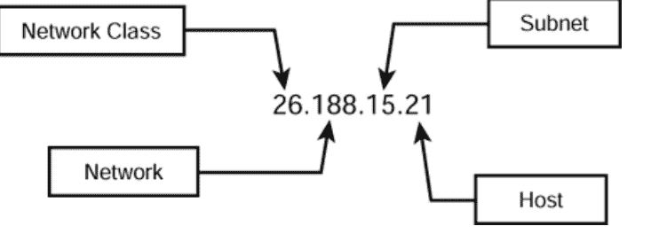

IP 地址充当通往路由器的通用路线图。地址的每个部分都提供有关目标位置更具体的信息。从网络类别开始，地址以主机编号结束。你可以很容易地将其与信封上的地址进行比较：第一行是收件人，然后是街道地址或信箱号。地址中的细节越来越少，直到州或国家。

互联网寻址有五个基本地址类别。每个类别都是从非常大型到小型网络的分配块。互联网寻址计划的组织方式使公司可以从寻址空间中购买段。这些类别标记为 A–E：

| 类别 | 地址 | 地址范围，描述 |
|---|---|---|
| | `0.0.0.0` 到 `0.255.255.255` | (`保留`) |
| A | `1.0.0.0` 到 `126.255.255.255` | 每个分配段 $2^{24}–2$ 或 16,777,214 个节点。此类有 126 个段。 |
| | | 用于需要按需划分子网的大型组织，如互联网服务提供商（ISPs）。 |
| | `127.0.0.0` 到 `127.255.255.255` | (`保留用于环回接口`) |
| B | `128.\*\*\*.0.0` 到 `191.\*\*\*.255.255` | 每个分配段 $2^{16}–2$ 或 65,534 个节点。此类有 64×256 个可用段。 |
| | | 用于大型组织，如公司和大学。它们可以创建子网。XXX 是分配和指定的子网（例如，`129.5.0.0` 是一个分配的子网）。注意：此地址空间几乎已用完。 |
| C | `192.\*\*\*.\*\*.0` 到 `223.\*\*\*.\*\*.255` | 每个分配段 $2^8–2$ 或 254 个节点。此类有 32×65,536 个可用段。 |
| | | 小型公司或个人。地址在此处有几个可用槽位。 |
| D | `224.0.0.0` 到 `239.255.255.255` | $2^{28}–2$ 或 268,435,454 个节点。 |
| | | 这些地址未分配，但保留用于组播地址。 |
| E | `240.0.0.0` 到 `255.255.255.255` | $2^{28}–2$ 或 268,435,454 个节点。 |
| | | 这些保留供将来使用。请注意，`255.255.255.255` 是一个通用广播 IP 地址。它`绝不是一个合法的`地址。 |

网络类别的编号有些特殊，因为寻址使用地址的前几位来确定类别。例如，A 类网络在地址的第一位有一个零。同样，B 类在第一位有一个 1，第二位有一个零：

- A 类：`0 (0000,0000) 到 126 (0111,1110)`
- B 类：`128 (1000,0000) 到 191 (1011,1111)`
- C 类：`192 (1100,0000) 到 223 (1101,1111)`
- D 类：`224 (1110,0000) 到 239 (1110,1111)`
- E 类：`240 (1111,0000) 到 255 (1111,1111)`

使用这种方法，网络上的路由器可以快速确定（在 4 位内）是否允许消息进入网关。今天的路由更加高效，使用`无类别域间路由（CIDR）`。这些新定义（在`RFC 1517–1519`中找到）使用地址的高位来识别主机的位置和路由。

IP 协议引入了这种编号方案来标识计算机，以便有效地聚集这些计算机。借助它，路由器可以快速确定是阻止数据包还是将其移动到通往目标子网的接口。`传播`非常重要：仅仅接收数据包、检查它并将其传递下去是不够的。路由器接受的每一位都意味着网络上的延迟。路由器必须延迟的位数不得超过确定相关性所需的位数。换句话说，它对传播延迟必须是不可见的。例如，典型的美国电话交换并不试图一次性解析整个电话号码；前三位表示区域或地区，接下来的三位表示站点。

## 子网掩码

某些类别需要更多的过滤。如果一个网络有 1600 万个节点，而且它们全部堆叠在一个空间里，那就太过分了。当你设置 Linux 计算机并配置网络时，你可能会已注意到子网掩码这一术语。CIDR 的引入有助于简化大型子网的复杂性 [RFC950]。

网络子网掩码专门用于识别接口可以访问的连续地址组。它提供了一种额外的过滤器，仅允许特定的消息通过。当消息到达时，路由器使用消息目标地址上的子网掩码。如果匹配成功，路由器就会将该消息传递下去。你可以按任意方式构建掩码，但最低位的置位比特决定了子网。

例如，假设你有一个由八台机器组成的小网络，并且预计该组的机器数量增加不会超过五台，你可以将路由器的子网掩码设置为 `187.35.209.176`。地址中最后一位比特在 `176 (1101,0000)` 中。地址范围位于 `1101,XXXX` 的 'X' 部分（活动子网）。从这里，你可以分发地址：`187.35.209.176`（路由器）、`187.35.209.177`（主机 #1），直到 `187.35.209.222`。你可以使用任何组合，但最低位的置位比特是标记。

### 备注

#### 子网掩码和默认地址

将网络掩码用作主机地址可能会导致冲突并丢失数据包。这是由于特殊地址 0（零）造成的。例如，`187.35.209.0` 的最后八位都是零。如果地址与网络掩码匹配，则它是第零个地址。你应该始终将第零个地址保留给网络地址掩码。同样，你可能已经注意到示例中省略了 `187.35.209.223`。如果你使用该 ID，该主机可能永远无法看到任何消息。数字 `223` 的活动子网全为 1：`1101,1111`。这是一个广播地址。你不应该将其用作主机地址。

在大多数情况下，你不需要担心设置路由器，而且配置超出了本书的范围。通常，当你在网络配置中看到子网掩码时，你可以接受脚本提供的掩码。

## 路由器和地址解析

局域网（LAN）可能会因主机之间的所有消息而变得非常繁重。互联网上的每台计算机都有可能听到每条消息。但由于所有流量，网络变得非常混乱，数据包相互碰撞（同时传输），吞吐量降至接近零。

局域网使用寻址和子网掩码限制组（或集群）内的流量。除了将消息传递给适当的接口外，路由器还充当信息控制门，将流量本地化。本地流量保留在集群内部，外部流量则通过。

主机使用子网掩码确定是否必须将消息传递给路由器。所有发往外部的消息都通过路由器，而本地消息则保留在子网内部。此过程减少了网络骨干上的拥塞。

路由器还使用其路由表将消息导向目标。每个路由器告诉网络上的其他路由器它能接受哪些流量导向。广域网（WAN）使用此功能来投递消息。

在源和目标之间的每一步都会查看 IP 地址，并将其与路由表中的网络进行比较。路由器将你的消息移向越来越具体的目标。第一跳尝试在集群中解析，第二跳将消息向上移动以在子网中解析，依此类推，直到解析出类别。

一旦路由器找到匹配项（无论是通用的还是特定的），它就会使用该方向上的 `MAC` 地址将消息发送到下一个路由器。最终，匹配到的集群获得消息，并且路由器的 `ARP` 将路由器的 `MAC` 地址替换为目标 `MAC` 地址。

以太网网络适配器仅接受带有其 ID 的消息。一旦主机启动并稳定下来，它就会告诉子网上的其他所有人其以太网 ID 和 IP 地址。这就是之前提到的 `ARP` 的功能。

## 特殊和减少的地址

如前所述，有一些保留地址。子网掩码的活动子网有两个保留地址：全零（网络）和全一（广播）。这意味着，当你计算可用地址数量时，必须从该数字中减去 2。考虑一下：如果你创建 100 个子网，实际上会丢失 200 个地址。

这种丢失仅仅是开始。两个大块地址被保留用于内部使用：`0.0.0.0` 到 `0.255.255.255` 和 `127.0.0.0` 到 `127.255.255.255`。第一个地址组在 IP 简写中表示“此网络”（参见以下 shaded note）。如果你的网络地址是 `128.187.0.0`，在消息中使用 `0.0.25.31` 会隐式地导致 `128.187.25.31`。


1992 年，互联网活动小组（`IAB`——有关互联网设计、工程和管理，参见 `RFC1160`）对互联网的爆炸性增长感到十分担忧——即使有了所有的寻址技术和周密的规划。地址分配超过了 4.5 亿个节点。该小组看到增加的分配正在吞噬可用的地址空间。然而，实际上只有约 2% 的分配被使用。所有剩余的地址都在哪里？

`IAB` 以整块的形式向公司分配地址范围。公司为了应对预期的额外使用并尽可能保持地址连续，购买了比其需求更大的范围。

## 备注

## 分配膨胀

我曾经工作过的一个小地方让我看到了它 128 个地址的分配；当时只有 30 个在使用。他们为我划拨了 10 个插槽。我从未使用超过 2 个。直到今天，我认为那些地址可能仍然分配给我，即使我大约四年前就离开了那家公司。

总之，地址异常和浪费的分配已经消耗了大部分地址空间。最近的估计表明，`B` 类和 `C` 类网络已满。`ISP` 正在更多地使用 `A` 类。不久，需求可能会用完所有地址。

互联网将如何处理丢失的地址空间？如何更好地利用当前的 `IP` 寻址？`IAB`，现在称为互联网名称与数字分配机构（`ICANN`），无法轻松收回出售给公司的未使用插槽，因为公司的 `IT` 部门已经在组织内部分配了这些地址。

许多公司现在使用动态主机配置协议（`DHCP`）[`RFC2131`]，该协议在启动时分配 `IP` 地址。没有主机永久拥有 `IP` 地址。`DHCP` 还有助于安全：电脑黑客喜欢固定的 `IP` 地址。如果你还记得，`bootp` 会发出广播消息以寻找 `bootp` 服务器。当找到后，服务器发出一个 `IP` 地址。类似地，普通主机在启动时加载其 `DHCP` 请求器。请求器发出广播消息以寻找响应性的 `DHCP` 服务器。当找到后，服务器从其可用地址池中分配一个地址并将其（连同适当的网络掩码）传递给请求器。

`DHCP` 请求器接受信息并配置本地主机的网络协议。在某些情况下，由于网络拥塞，这可能需要几秒钟。在本地主机正确配置之前，它可能会遭受 `IP` 失忆症（主机不知道自己的地址）。

## 备注

主机或 `IP` 失忆症

当网络和主机命名未正确设置时，也会发生主机或 `IP` 失忆症。这可能是一个重大问题。即使 `ping 127.0.0.1` 可能也无法工作。如果你的主机有失忆症，请检查你的发行版。`RedHat` 发行版（及其衍生版本）使用 `/etc/sysconfig/network` 和 `/etc/sysconfig/network-scripts/ifcfg-*` 来定义和设置值。

另一个解决方案是增加 `IP` 地址本身的大小。介绍：`IPv6` [`RFC2460`]！`IPv6` 简而言之是 `IP` 地址的四倍大小：128 位对比 32 位。`IPv6` 还极大地改变了外观：

```
001 8008:4523:F0E1:23:830:CF09:1:385
002 <Snope>
```

结果是一个不太容易记住的地址。

`IPv6` 的主要优势在于它拥有更大的地址空间可供使用。超过 3×10^38 个地址可能在很长一段时间内消除任何地址限制问题。更多信息请参见[第 17 章，“通过多播、广播和 Mbone 共享消息”](#)。

## IP 主机端口号

所有消息都到达一个或多个认可的地址。如果某个程序接受这些消息，它可能会接收发往其他正在运行的程序的信息。操作系统不太关心消息去向，只要它能投递即可。`TCP/IP` 协议栈添加了端口的概念。一个系统可以有多个可用端口，它们都关联到同一个地址。

`TCP/IP` 协议栈添加了端口以抽象网络并简化你的编程。这些不是真实的物理端口。它们是网络子系统使用的通道，用于将信息重定向到适当的程序。所有网络程序不再接收所有消息；它们仅接收发往其端口的消息。

你在基于互联网的网络上的每个典型 `IP` 数据包都有主机的地址和端口号。当数据包从网络到达时，数据包头部中的 16 位字段指示目标端口号。操作系统读取此字段并将新数据包放在端口队列中。然后，程序通过套接字读取数据（使用 `read()` 或 `recv()` 系统调用）。

同样，当程序发送消息（通过 `write()` 或 `send()` 系统调用）时，操作系统会将数据放入端口的发送队列中。

默认情况下，只有一个程序拥有某个端口。事实上，如果你试图在同一台计算机上运行分配相同端口号的两个程序，系统调用将返回 `EINVAL` 错误码。你可以选择使用 `SO_REUSEADDR` 来共享端口（参见第 9 章“突破性能瓶颈”）。

### 注：SMP 上的端口共享

“两个套接字不能共享同一端口”的规则也适用于对称多处理器（`SMP`）。原因很简单：处理器就像资源一样，共享内存和操作系统。如果你运行了两个操作系统，理论上你可以拥有两个在同一端口号上运行的不同程序中的套接字，只要它们位于不同的操作系统空间中。

所有标准服务都有分配的端口号。你可以在 `Linux` 工作站上的 `/etc/services` 文件、附录 A“数据表”中看到完整的列表。以下是一些标准端口：

| 端口 | 服务名称、别名 | 描述 |
| --- | --- | --- |
| 1 | tcppmux | TCP 端口服务多路复用器 |
| 7 | echo | 回声服务器 |
| 9 | discard | 类似 /dev/null |
| 13 | daytime | 系统日期/时间 |
| 20 | ftp-data | FTP 数据端口 |
| 21 | ftp | 主 FTP 连接 |
| 23 | telnet | Telnet 连接 |
| 25 | smtp, mail | UNIX 邮件 |
| 37 | time, timeserver | 时间服务器 |
| 42 | nameserver | 名称解析 (DNS) |
| 70 | gopher | 文本/菜单信息 |
| 79 | finger | 当前用户 |
| 80 | www, http | Web 服务器 |

你可以在附录 A 中找到更完整的列表。

你也许会认出其中的一些服务。该文件的格式很清晰：端口号、服务名称、别名和描述。你可以使用 `Telnet` 或前面提到的程序与其中许多服务进行交互。请注意，即使 `/etc/services` 列出了某个服务器，计算机上可能也没有运行相关的服务器（例如，`Mandrake` 发行版未启用 `time` 服务）。`/etc/services` 文件中列出的所有端口都是保留的，因此任何使用都可能导致冲突。

基于套接字的程序在通信中使用某个本地端口：这是 `bind()` 的主要职责。即使你不使用 `bind()` 系统调用，一旦你的程序使用套接字进行任何 I/O，操作系统就会为该套接字分配一个可用的本地端口。

### 注：特权端口

作为内核安全的一部分，值小于 1024 的端口需要 `root` 或特权访问权限。例如，如果你想创建一个时间服务器（端口 13），`root` 必须运行该程序（或 `SUID root`）。`SUID` 是“set user ID”的缩写。文件系统中的每个程序都可以允许用户像所有者运行该程序一样运行它。通常，当用户运行一个程序时，该程序拥有与用户相同的权限。有时程序需要不同的或额外的权限。通过切换用户 ID，程序可以像所有者运行该程序一样运行。例如，`/usr/bin/at` 需要访问 `cron` 表（由 `root` 拥有）。为了实现这一点，`/usr/bin/at` 必须自动切换到 `root` 访问权限。有关更多信息，请参阅标准 `UNIX` 文档。警告：`SUID root` 是潜在的安全风险来源。除非你非常了解该程序并了解所有风险，否则在 `root` 状态下切勿创建或设置 `SUID`。

如前所述，如果你不将端口分配给套接字，操作系统会为你分配一个。这些自动或动态分配的端口被称为临时端口。`Linux` 似乎遵循 `BSD` 风格的端口分配：它将端口 1024 及以上分配给临时端口。

### 注：安全调试

在试验不同端口时，你可能希望遵循以下简单规则：

- 以普通用户（而不是 `root`）身份编程、运行和调试。
- 使用不影响他人或造成安全风险的端口和地址。
- 记录所有传入消息的来源。

## 网络字节序

网络上可能驻留着许多不同类型的计算机，但它们可能并不都使用相同的处理器。并非所有处理器都以相同的方式存储二进制数。计算机使用两种基本的二进制数存储类型：大端（big-endian）和小端（little-endian）。简单来说，大端数字从左到右读取；小端数字从右到左读取。例如，考虑数字 214,259,635。在十六进制中，该数字读作 `0x0CC557B3`。大端处理器存储此值的方式如下：

| 地址: | 00 | 01 | 02 | 03 | 04 |
| --- | --- | --- | --- | --- | --- |
| 数据: | 0C | C5 | 57 | B3 | ... |

注意，最高有效字节（`0C`）最先列出。小端处理器将其逆序存储：

| 地址: | 00 | 01 | 02 | 03 | 04 |
| --- | --- | --- | --- | --- | --- |
| 数据: | B3 | 57 | C5 | 0C | ... |

注意，最低有效字节（`B3`）最先列出。


不同字节序的实用性是一个长期争论的话题。本文无意重新引发这些讨论，只是想指出重要的用途和差异。当然，为什么不能直接使用十六进制 `ASCII` 呢？这种表示方式效率低下，基本上使所需的字节数翻倍。为了让异构网络上的计算机高效通信，它们必须使用二进制并确定一种字节序。计算机或主机的字节序称为`主机字节序`。同样，网络的字节序称为`网络字节序`。网络字节序总是大端序。

### 使用 Internet 转换工具

许多年前，网络协议选择了大端序作为其传输格式。这对大端处理器来说没问题，但小端处理器呢？有几种工具可以帮助进行转换。网络程序总是使用这些工具来填充 `struct sockaddr_*` 结构，无论进程的字节序如何。现在，又有一个障碍：结构中的并非所有字段都是网络字节序。有些是主机字节序。考虑一下来自`第 1 章“介绍食谱网络客户端”`的代码摘录：

```c
/***************************************************************/
/***  Conversion tools example: filling sockaddr_in     ***/
/***************************************************************/
struct sockaddr_in dest;
char *dest_addr = "127.0.0.1";
...
dest.sin_family = AF_INET;
dest.sin_port = htons(13);    /* port 13 (time server) */
if ( inet_aton(dest_addr, &dest.sin_addr) == 1 ) {
...
```

代码正在填充三个字段：`sin_family`、`sin_port` 和 `sin_addr`。`sin_family` 是一个主机字节序字段，因此不需要转换。其他两个是网络字节序。两字节字段 `sin_port` 使用 `htons()` 转换端口 13。有几个类似的转换器：

| 调用 | 含义 | 描述 |
| :--- | :--- | :--- |
| `htons` | 主机到网络短整型 | 将 16 位二进制转换为大端序。 |
| `htonl` | 主机到网络长整型 | 将 32 位二进制转换为大端序。 |
| `ntohs` | 网络到主机短整型 | 将 16 位转换为主机格式。 |
| `ntohl` | 网络到主机长整型 | 将 32 位转换为主机格式。 |

附录 B“网络 API”详细列出了这些函数。你可能想知道，如果你的计算机已经是大端（网络字节序），使用这些工具在 CPU 时间上并不花费什么。

示例中的下一个调用是 `inet_aton()`，它将 `ASCII` IP 地址（使用点分十进制表示法）转换为等效的二进制。它还将结果转换为网络字节序（你不需要对结果调用 `htonl()`）。以下是其他一些函数：

| 调用 | 描述 |
| :--- | :--- |
| `inet_aton()` | 将点分表示法 (`###.###.###.###`) 转换为网络字节序二进制。如果失败则返回零，如果地址有效则返回非零值。 |
| `inet_addr()` | 已废弃（与 `inet_aton()` 相同）。它不能正确处理错误。如果发生错误，它返回 `-1`（`255.255.255.255`——通用广播地址）。 |
| `inet_ntoa()` | 将二进制、网络字节序 IP 转换为 `ASCII` 点分表示法。 |
| `gethostbyname()` | 请求名称服务器将名称（如 `http://www.linux.org`）转换为一个或多个 IP 地址。 |
| `getservbyname()` | 获取 `/etc/services` 文件中某个服务的端口和相关协议。 |

库提供的函数工具远不止这些。本书仅涵盖少数始终有用的函数。有关这些函数调用的更多信息，请参阅附录 B。

### 注：寻求可移植性

如果你认为不需要担心这些转换工具，请考虑这一点：编写 `Linux` 软件的核心思想就是使其与所有系统兼容，对吧？使用这些调用在平台上不会造成任何损害。通常，像要移植到另一个处理器一样编程是一种良好的编程实践。

如果你试图将一种格式转换为另一种格式，你可能会在某个库中找到合适的转换器。这就是使用 `POSIX` 兼容性等成熟技术的美妙之处。当然，这意味着有许多工具需要浏览。按功能对工具进行分组会有帮助。（这就是为什么本书在附录中包含几个相关的手册页。）

## 应用工具并扩展客户端

下一步是扩展时间读取器的功能，使其能够发送消息并获取回复。再次强调，套接字描述符可以与文件描述符互换。就像你可以使用 `read()` 一样，你也可以使用 `write()`：

```c
#include <unistd.h>
ssize_t write(int fd, const void *buf, size_t count);
```

以下是一些你可能会遇到的常见错误：

- `EBADF`: `fd` 不是有效的文件描述符，或没有以写模式打开。例如，程序已经关闭了套接字描述符，或者套接字从未正确打开（检查 `socket()` 调用的返回值）。
- `EINVAL`: `fd` 附加到一个不适合写入的对象上。如果程序之前已关闭写入通道，可能会发生这种情况。
- `EFAULT`: 为参数指定了无效的用户空间地址。`buf` 指针没有指向合法的内存空间。当调用尝试访问内存区域时，它遇到了段错误。
- `EPIPE`: `fd` 连接到一个读取端已关闭的管道或套接字。当这种情况发生时，写入进程会收到一个 `SIGPIPE` 信号；如果捕获、阻塞或忽略此信号，则返回错误 `EPIPE`。此错误仅在第二次 `write()` 调用时发生。一个场景可能是：
    - a. 客户端连接到服务器并发送一些数据。
    - b. 服务器读取消息的一部分，然后关闭连接（或崩溃）。
    - c. 未察觉任何问题的客户端发送下一块数据。

同样，在 `write()` 调用中，你可以用套接字描述符（`sd`）替换文件描述符（`fd`）。作为一个示例，以下代码片段展示了使用 `write()` 进行的典型套接字输出：

```c
int sd, bytes_written = 0, retval;

sd = socket(AF_INET, SOCK_STREAM, 0);
... /*** Connect to host ***/

while ( bytes_written < len )      /* repeat sending until all */
{                                  /*...bytes of message are sent */
    ret_val = write(sd, buffer+bytes_written, len);

    if ( ret_val >= 0 )
        bytes_written += ret_val;
    else
        /*--report connection error--*/
}
```

另一方面，以下代码片段展示了通过将套接字描述符转换为 `FILE*`，使用 `fprintf()` 进行的典型套接字输出：

```c
FILE *sp;
int sd;

sd = socket(AF_INET, SOCK_STREAM, 0);
... /*** Connect to host ***/

sp = fdopen(sd, "w");             /* create FILE* from socket */
if ( sp == NULL )
    perror("FILE* conversion failed");

fprintf(sp, "%s, %s, %s\n", Name, Address, Phone);
```

请注意，在第一个示例中，程序必须对 `write()` 进行循环，以输出所有字节。尽管这是套接字流，但你无法保证程序会一次性发送所有字节。第二种情况没有这种限制，因为 `FILE*` 拥有自己的数据缓冲子系统。当你向 `FILE*` 缓冲区写入时，子系统会强制你等待，直到所有字节发送完毕。

当然，还有一个专用的套接字写入调用：`send()`。与 `recv()` 调用类似，`send()` 赋予程序员对传输过程更精细的控制。其原型声明如下：

```c
#include <sys/socket.h>
#include <resolv.h>
int send(int sd, const void *msg, int len, unsigned int flags);
```

所有参数与 `write()` 相同，除了最后一个——`flags`。`send()` 系统调用有几个选项，有助于调整调用的行为：


- `MSG_OOB` 发送“带外”数据。如上所述，它允许你向对端（客户端或服务器）发送一个字节，以指示紧急状况。接收方仅有一个字节专门用于 OOB 数据；随后的 OOB 消息会覆盖最后一条消息。当 OOB 消息到达时，操作系统会向相关程序发出 `SIGURG`（紧急信号）。

- `MSG_DONTROUTE` 不允许对数据包进行路由。这会导致数据包绕过路由表，强制网络尝试直接联系接收方。如果目的地无法直接访问，该调用将产生 `ENETUNREACH`（网络不可达）错误。只有诊断或路由程序才会使用此选项。

- `MSG_DONTWAIT` 不等待 `send()` 完成。此选项允许程序继续执行，就好像 `send()` 已经执行（或已委托）完成。如果使用了此选项，操作系统会发出 `SIGIO` 信号，表示 `write()` 操作已完成。如果操作因为 `send()` 队列已满而阻塞，调用将返回错误并将 `errno` 设置为 `EAGAIN`。

- `MSG_NOSIGNAL` 不发出 `SIGPIPE` 信号。如果对端提前关闭，而你的程序又发送了另一条消息，你可能会收到 `SIGPIPE` 信号。如果你未准备好处理此信号，你的程序将会中断。

使用 `send()` 系统调用与使用 `recv()` 类似。如果你想要聚合标志，可以使用算术或运算符：

```c
/**** ... ****/
/** Do a normal write to socket pipe ****/
/**** ... ****/
int bytes_sent;
bytes_sent = send(sd, buffer, MAXBUF, 0);
...

/*----------Send any out of band data from socket pipe----------*/
int bytes_sent;
bytes_sent = send(sd, buffer, MAXBUF, MSG_OOB | MSG_NOSIGNAL);
...
```

第二个示例选择了 `MSG_OOB` 和 `MSG_NOSIGNAL`。请记住，这些示例与 `write()` 系统调用的区别在于增加了一个用于控制套接字的参数。此外，必须将套接字连接到服务器或主机才能使用 `write()`。以下是你可能会遇到的一些错误：

- `EBADF` 指定的描述符无效。可能的原因是程序未检查 `socket()` 调用的返回值。

- `ENOTSOCK` 参数不是套接字。可能是混淆了文件和套接字描述符。

- `EMSGSIZE` 套接字要求内核原子性地发送消息，而待发送消息的大小使得这一点变得不可能。广播消息不能被分片，或者程序设置了套接字选项“不分片”。

- `EAGAIN` 套接字被标记为非阻塞，且请求的操作会阻塞。这不是错误，仅仅是“尚未就绪”。稍后请再次尝试发送。

- `EPIPE` 面向连接的套接字本地端已关闭。在这种情况下，除非设置了 `MSG_NOSIGNAL`，否则进程也会收到 `SIGPIPE`。（与 `write()` 系统调用中的 `EPIPE` 相同。）

你使用 `send()` 系统调用向服务器发出请求。例如，如果你想使用服务器的网络 finger 服务，你需要打开到服务器端口（79）的通道，发送用户名，并读取响应。这种算法通常是客户端执行的操作。

执行此任务不需要任何特殊选项。但是，你可能希望读取服务器发送的尽可能多的信息。有时，响应可能比你的缓冲区大小更大。以下程序列表摘录展示了该算法的实现。你可以在随书附带的 CD-ROM 上获取完整的程序列表。

```c
 /*********************************************************/
 /*** Expanding the port tester - add the capability to  ***/
 /*** access any port and to send a message.         ***/
 /*********************************************************/
 int main(int count, char *strings[])
 {
    int sockfd;
    struct sockaddr_in dest;
    char buffer[MAXBUF];

    /*--- Create socket and assign a port number ---*/
    sockfd = socket(AF_INET, SOCK_STREAM, 0);
    bzero(&dest, sizeof(dest));
    dest.sin_family = AF_INET;
    dest.sin_port = htons(atoi(strings[2]));
    inet_addr(strings[1], &dest.sin_addr.s_addr);

    /*--- Connect to server & send request ---*/
    if ( connect(sockfd, &dest, sizeof(dest)) != 0 )
         PANIC("connect() failed");
    printf(buffer, "%s\n", strings[3]);
    send(sockfd, buffer, strlen(buffer), 0);
    /*--- Clear buffer and read SHORT reply ---*/
    bzero(buffer, MAXBUF);
    recv(sockfd, buffer, MAXBUF-1, 0);
    printf("%s", buffer);
    close(sockfd);
    return 0;
}
```

如果你想使用此算法获取较长的回复，你需要将最后部分更改为以下内容：

```c
 /*********************************************************/
 /*** Revising the code to get lengthy replies      ***/
 /*********************************************************/
 /*--- Clear buffer and read SHORT reply ---*/
 do
 {
        bzero(buffer, MAXBUF);
        bytes = recv(sockfd, buffer, MAXBUF, 0);
        printf("%s", buffer);
 }
 while ( bytes > 0 );
 close(sockfd);
```

如果服务器在发送数据后关闭连接，此添加部分可以正确工作。否则，你的程序将无限期地等待数据。

等待信息是套接字编程中的一个特定问题。有时你可以信任服务器在发送完毕后关闭连接。然而，一些服务器期望保持通道打开，直到客户端关闭它。请注意，如果你的程序等待了很长时间，你可能正面临这种类型的问题。

## 不同类型的 `sockaddr`

网络支持几种不同类型的协议。每种协议都有特定的功能和特性。对于网络而言，它们都只是数据包。数据包类型包括：

| 协议 | 常量 | 描述 |
| :--- | :--- | :--- |
| 命名套接字 | `PF_LOCAL` | 实际上不连接到网络。这完全用于使用文件系统处理队列。 |
| 互联网协议 | `PF_INET` | （前面已经演示过。） |
| Novell 协议 | `PF_IPX` | 用于与 Novell 网络通信。 |
| AppleTalk | `PF_APPLETALK` | 用于与 AppleTalk 网络通信。 |

你可以在*附录 A*中找到更多已定义和支持的协议。每种类型都使用自己的命名系统和约定，并且它们都使用套接字 API。这应该使编程它们相当直接明了。遗憾的是，这里无法包含所有内容，因此本文主要关注互联网协议。

## UNIX 命名管道

简要地，让我们考虑 `syslog` 是如何工作的。问题是：你如何协调可能在不同时间发出错误或消息的多个应用程序？`syslog` 是一个接受此类消息的工具。套接字 API 已经内置了这种协调机制。

命名套接字允许多个本地程序提交消息（或数据包）。之所以称为*命名*，是因为它们实际上会在文件系统中创建一个文件。通信仅限于本地；没有任何数据通过网络传输，网络客户端也无法连接到它。

它的工作方式与普通套接字类似：你可以创建流连接或数据报连接。唯一的区别，如前所述，是 `sockaddr`。以下是如何设置命名管道：


```c
/****************************************************************
/**  Unix named socket example                       ***/
*****************************************************************/
#include <sys/un.h>
int sockfd;
struct sockaddr_un addr;
sockfd = socket(PF_LOCAL, SOCK_STREAM, 0);
bzero(&addr, sizeof(addr));
addr.sun_family = AF_LOCAL;
strcpy(addr.sun_path, "/tmp/mysocket");      /* Assign name */
if ( bind(sockfd, &addr, sizeof(addr)) != 0 )
	perror("bind() failed");
```

所有内容看起来应该都相对熟悉。`sun_path` 字段允许最长 104 字节的路径（包括 `NULL` 终止符）。从这里开始，你可以使用所有常规的 API 调用。对于所有支持的协议，情况都是如此。

运行此代码片段后，你可以查看`/tmp`目录以查看新文件。务必在再次运行该程序之前删除此文件。

## 总结：应用 IP 编号和工具

套接字 API 是网络编程中一个非常灵活的接口工具。它支持多种不同的协议，使你可以连接并与其他网络协议互连。

互联网协议使用内置路由消息和计算机集群分组的寻址。这使得每个消息都能与发起者独立：即使消息在网络上被丢弃，也可以通过路由表和 `ARP` 表到达目的地。然而，由于寻址的灵活性和稀疏分配，合法的地址块正在逐渐耗尽。

`TCP/IP` 协议栈的一部分通过端口来抽象网络。大多数连接使用端口与其他网络上的特定程序进行通信，就好像它们拥有该网络连接一样。此功能简化了编程，并减少了你的程序实际可能收到的消息洪流。

网络使用特定的类型和字节顺序（端序）来回传输消息。`sockaddr` 定义了连接的协议、地址和端口。由于所有这些不同的数据格式，套接字 API 为你提供了许多用于寻址（例如，`inet_addr()`、`inet_aton()`、`inet_ntoa()`）和端序（`htons()`、`ntohs()`、`htonl()`）的转换工具。

`TCP` 和 `UDP` 为你的程序提供不同的接口级别。下一章定义了 `IP` 中每种协议的不同类型和能力。

# 第 3 章. 不同类型的互联网数据包

### 本章内容

- 基本网络数据包
- 剖析各种数据包
- `IP` 协议如何协同工作
- 使用 `Tcpdump` 嗅探网络
- 编写自定义网络嗅探器
- 总结：选择最适合发送消息的数据包

物理网络支持不同类型的逻辑网络，如 `Novell` (`IPX`)、`Microsoft` (`NetBEUI`)、`AppleTalk`，以及当然的 `TCP/IP`。每种逻辑网络使用离散的数据消息，称为数据包，如上一章所定义。数据包可以是传输线上的实际消息（包含更多信息），或者只是你发送的消息。

在通用层面上，逻辑网络数据包由关于源、目的地和数据负载的信息组成。每种逻辑网络提供不同程度的功能和接口（协议）。所有数据包类型和协议都可以在网络编程中使用。每种类型都有显著的优点和缺点。就像购买工具一样，你选择数据包类型取决于如何使用它。

你可以从四种基本的互联网数据包协议中选择：原始 `IP`、`ICMP`、`UDP`（不可靠消息传递）和 `TCP`（流式），它们都叠加在物理网络之上（参见图 3.1）。本章描述了每种类型，并介绍了它们的优点、缺点和典型用途。

图 3.1. 套接字 API 提供不同级别的可靠消息。

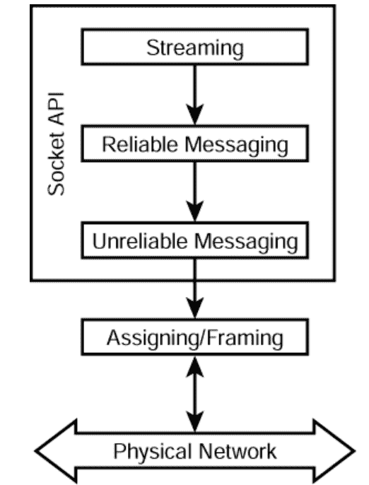

## 基本网络数据包

如果你能实际看到从一个计算机传输到另一个计算机的位，你会看到什么？每种协议都非常不同，但它们都共享一个共同的必要特征：它们都携带程序的消息。一些协议包含源地址，而一些需要目的地。你可能认为不需要目的地有点不寻常，但某些协议（如 `UUCP`）使用连接作为目的地的地址。

互联网协议 (`IP`) [RFC791] 要求数据包具有三个基本元素：源、目的地和数据。（数据负载包括其长度。）这些元素为数据包提供了自治性。无论数据包在何处，你都可以识别它来自哪里、去哪里以及它有多大。

数据包的自治性是互联网的一个重要特性。只要数据包是活跃的（数据是及时且相关的），路由器就可以将数据移动至其目的地，当数据包被放入网络时。

**注意**

数据包别名

数据包自治性也有缺点。虽然数据包提供了一种从任何地方到达任何地方的方法，但恶意程序员可以轻松欺骗网络。网络不要求验证源主机的地址。别名或欺骗（掩盖真实身份并假设不同的身份）硬件地址是困难的，但程序可以别名其他 ID。请注意，后来的 Linux 内核不允许欺骗。

正如在[第 2 章，“TCP/IP 网络语言熟练度”]中讨论的那样，网络数据包采用网络字节序（或大端序）。带着这一点，看一下[列表 3.1]中网络数据包外观的结构定义，[图 3.2]展示了物理布局。

图 3.2. `IP` 头部布局。

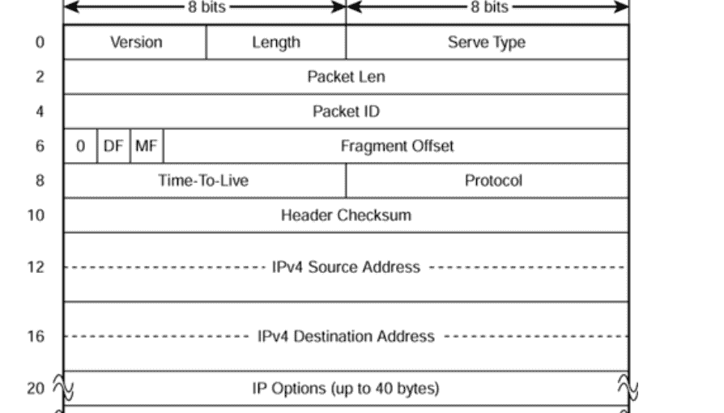

### 示例 3.1. `IP` 结构定义

```cpp
/* IP Packet definition */
typedef unsigned int uint;
typedef unsigned char uchar;

struct ip_packet {
    int version:4;       /* 4-bit version [note] */
    int header_len:4;    /* header length in words [note] */
    int serve_type:8;    /* how to service packet [note] */
    int packet_len:16;   /* total size of packet in bytes */
    int ID:16;           /* packet ID [note] */
    int reserved:1;      /* always zero */
    int dont_frag:1;     /* flag to permit fragmentation */
    int more_frags:1;    /* flag for "more frags to follow" */
    int frag_offset:13;  /* to help reassembly */
    int time_to_live:8;  /* permitted router hop cnt [note] */
    int protocol:8;      /* ICMP, UDP, TCP [note] */
    int hdr_chksum:16;   /* ones-comp. checksum of header */
    int IPv4_source:32;  /* IP address of originator */
    int IPv4_dest:32;    /* IP address of destination */
    uchar options[];     /* up to 40 bytes [note] */
    uchar data[];        /* message data up to 64KB [note] */
};
```

注意，数据包结构包含比本章前面讨论的基本四个字段更多的字段。`IP` 子系统使用这些额外字段来控制数据包。例如，`dont_frag` 字段告诉网络，不要将消息切割成更小的块，而应该完全接受消息或丢弃它。

大多数字段都足够简单，它们旁边的注释提供了足够的描述。其余字段需要更长的描述。以下章节定义了你可以修改或使用的 `IP` 字段。本文并非详尽无遗；如果你想了解每个字段的更多细节，请参考有关 `TCP/IP` 协议的优秀文献。

## version 字段

第一个 `IP` 字段是 `IP` 协议版本的版本号。大多数值是保留或未分配的；例如，`IPv4` 在此字段中放置 4。少数已定义的列值列表在表 3.1 中。


| 值 | 描述/用途 |
|---|---|
| 4 | `IPv4` |
| 5 | 流式 `IP` 数据报模式（实验性 `IP`） |
| 6 | `IPv6` |
| 7 | `TP/IX`（“下一个”互联网协议） |
| 8 | “`P`”互联网协议 |
| 9 | `TUBA` |

你填写此字段的唯一机会是在你创建原始套接字并选择自己填写头部（使用套接字选项 `IP_HDRINCL`）时。即使如此，你可能将字段设置为 0。零标志内核为你填入适当的值。

## header_len 字段


此字段告诉接收者头部长度（以 32 位字为单位）。由于值 0 是保留的（且无意义），最大长度为 15 个字或 60 字节。再次说明，你填写此字段的唯一情况是在使用原始套接字数据包和 `IP_HDRINCL` 时。由于所有 IP 头部至少为 20 字节，此字段的最小值为 5（20/4）字节。

## serve_type 字段

`serve_type` 字段指示如何管理数据包。它有两个子字段：*优先级*子字段（在大多数系统中被忽略）和服务类型（`TOS`）子字段。通常通过 `setsockopt()` 系统调用设置 `TOS`。`TOS` 有四个选项：最小延迟、最大吞吐量、最大可靠性和最低成本（货币）。未选择特殊服务意味着正常管理。（参见第 9 章，“打破性能障碍”，了解 `setsockopt()` 及其值的详细信息。）

## ID 字段

IP 子系统为每个数据包分配一个唯一的 ID。由于该字段仅为 16 位，您可以想象数字会被很快用完。然而，当 IP 子系统重新使用某个 ID 时，之前具有相同值的报文很可能已经过期。

ID 有助于重组碎片化的数据包。如果您选择自行管理报头（`IP_HDRINCL`），则必须自行管理 ID。

## 注意

自定义 ID

如果您选择自行操作报头，请记住您的程序并不是唯一可能发送消息的程序。IP 子系统会跟踪 ID。您必须谨慎行事（并编写额外的代码），以降低选中子系统最近使用过或可能会使用的 ID 的概率。

## dont_frag、more_frags、frag_offset 标志和字段

这些标志管理您的数据包如何（或是否）进行分片。如果在穿越网络时，一个较长的数据包必须通过一个受限的网络段（一个无法支持该帧大小的段），路由器可能会尝试将数据包拆分成更小的部分（*分片*）。分片后的数据包在到达目的地之前会保持分片状态。由于每个分片都会添加自己的 IP 报头，因此开销会降低性能。

## 注意

内核分片重组器

当主机是路由器时，您可以选择使用 Linux 内核来重组分片数据包。此选项是内核配置中防火墙/路由器部分的一部分。请注意，重组数据包需要时间，特别是当分片分散且在不同时间到达时。然而，由于目的地无论如何都必须重组数据包，选择此选项可以减少防火墙内部网络上的流量。

`dont_frag` 位告知路由器或主机不要拆分数据包。如果设置了此位，并且数据包对于受限网络段来说太大，路由器将丢弃该数据包并返回一个错误（`ICMP`）数据包。

`more_frags` 位告知目的地期望接收更多分片数据包的片段。最后一个分片将此位设置为 0。（未分片的数据包将此位设置为 0。）如果您正在手动配置报头，请始终将此位设置为 0。

`frag_offset` 字段指示分片在数据包中的位置。由于数据包的各个分片可能通过网络中的不同路径传输，它们可能在不同时间到达。目的地必须重组数据包，并使用偏移量将分片放置到其正确的位置。

`frag_offset` 字段只有 13 位长——对于最大可达 64KB 的数据包来说，这远远不够长。偏移量乘以 8 以确定数据包中的实际字节位置。这意味着每个分片（除了最后一个）都必须是 8 的倍数。IP 子系统完全管理您的数据包的分片和重组，您无需担心此问题。

利用这些字段和数据包 ID，IP 子系统可以对您的数据包进行分片和重组。如果子系统无法在指定时间内获取所有片段，它将丢弃数据包并向发送者发送一个错误。

## time_to_live (TTL) 字段

该字段最初用于计算数据包在传输过程中可以在网络上存活的秒数。后来，其含义变更为路由跳数。*一跳* 是指数据包通过一个主机或路由器（*节点*）的传输过程，其中该节点主动将数据包从一个网络移动到另一个网络。

这个 8 位字段允许最多 255 次路由跳转，之后数据包将被丢弃。当路由器或转发主机接收到数据包时，会将此字段减 1。如果在到达目的地之前该字段变为零，节点将丢弃数据包并向源发送错误。TTL 字段防止数据包在网络中无限期地来回传输。

使用 `IP_TTL` 套接字选项来设置此值（参见*第 9 章*）。或者，如果您选择直接操作 IP 报头（`IP_HDRINCL`），也可以直接设置它。

## protocol 字段

互联网上的每个数据包都被分配了一个协议值，`ICMP`（`IPPROTO_ICMP` 或 1）、`UDP`（`IPPROTO_UDP` 或 17）和 `TCP`（`IPPROTO_TCP` 或 6）各自拥有一个代码。协议告诉系统如何处理传入的数据包。您可以在 `socket()` 系统调用中使用 `SOCK_RAW` 选项来设置此值。协议值是该调用的最后一个参数。内核的 `netinet/in.h` 头文件列出了更多的协议。（请记住，即使内核包含某个协议的定义，它也可能不支持该协议。）

## options 字段

IP 子系统可以随每个数据包传递多个选项。这些选项包括路由信息、时间戳、安全措施、路由记录和路由警报。此字段最长可达 40 字节。由于某些选项依赖于系统，您不太可能直接操作这些选项。

## data 字段

您的消息在此处，最多可包含 65,535 字节（减去 60 字节，即报头的最大大小）。数据部分包含高层协议所需的任何报头信息。例如，`ICMP` 需要 4 字节，`UDP` 需要 8 字节，而 `TCP` 需要 20–60 字节。

互联网数据包系统基于此结构构建其所有 IPv4 数据包。在此之上的每一层都增加了功能性和可靠性。

## 解析各种数据包

互联网协议提供了几种数据包协议，从非常快速到非常可靠不等。它们都建立在最低层——基本 IP 数据包之上。然而，每一层都是为了解决特定问题而演化的。为了选择正确的大数据包类型，您必须了解所传输内容的特性。

最可能引起兴趣的数据包类型是 `TCP`、`UDP`、`ICMP` 和原始数据包。了解每种类型的优缺点可以帮助您选择最适合应用程序的类型。每种数据包类型都有不同的优势，如表 3.2 所示。

表 3.2，数据包类型优势

| | 原始 (Raw) | ICMP | UDP | TCP |
| :--- | :--- | :--- | :--- | :--- |
| 开销（字节） | 20-60 | 20-60+[4] | 20-60+[8] | 20-60 +[20-60] |
| 消息大小（字节） | 65,535 | 65,535 | 65,535 | （无限制） |
| 可靠性 | 低 | 低 | 低 | 高 |
| 消息类型 | 数据报 | 数据报 | 数据报 | 流 |
| 吞吐量 | 高 | 高 | 中 | 低 |
| 数据完整性 | 低 | 低 | 中 | 高 |
| 分片 | 是 | 是 | 是 | 低 |

在此表中，请注意每种数据包类型都包含比较。可靠性为“低”值仅意味着您不能依靠该协议来提高可靠性。虽然这些差异可能看起来极其明显，但请记住，它们仅仅是比较。

### 考虑数据包的问题

每种协议都解决了传输中的问题。以下部分定义了表 3.2 中的每个问题及其相关类别。这些信息可以帮助您了解为什么某些协议实现了某些功能而跳过了其他功能。

#### 协议开销

协议开销包括报头大小（以字节计）以及协议所需的交互量。高数据包开销会降低吞吐量，因为网络需要花费更多时间传输报头，而用于读取数据的时间更少。

强烈的协议同步和握手会增加交互开销。由于传播延迟的存在，这在广域网（`WAN`）上代价更高。表 3.2 未包含此度量。

#### 协议消息大小

为了计算网络吞吐量，您需要知道数据包大小和协议的开销。传输大小给出了发送消息的最大尺寸。由于除 `TCP` 外都使用一次性消息，因此此限制通常受 IP 数据包的限制（65,535 字节）。您的程序每个数据包传输的数据量等于传输大小减去报头。

#### 协议可靠性

网络问题的一部分是消息丢失的可能性。消息在从一个主机或路由器移动到另一个主机或路由器时可能会损坏或丢失，或者主机或路由器可能会崩溃或故障。在每种情况下，消息都可能丢失，您的程序可能需要跟进。

此外，您可能需要确保目的地按正确顺序处理数据包。例如，您可能编写了一条无法装在一个数据包中的消息。如果第二个数据包在第一个数据包之前到达，接收者必须知道如何识别并纠正问题。然而，当每个消息都是独立且自包含的，顺序并不重要。

数据包的可可靠性表明了消息安全到达的确定性以及其顺序性。低可靠性意味着协议无法保证数据包到达目的地，也无法保证数据包按序传输。

## 协议消息类型

某些消息是自包含的，且独立于其他消息。图片、文档、电子邮件消息等，这些例子可能符合数据包的大小要求。而其他消息则更倾向于流动的数据流形式，例如 `Telnet` 会话、`HTTP` 打开的通道 `[RFC2616]`、大型文档、图片或文件。消息类型定义了最适合每种协议的样式。

## 注意

HTTP 的协议

`HTTP` 1.0 可以有效地使用 `UDP` 来传输消息，而不是 `TCP`。客户端只需发送对特定文档的请求，服务器则回复该文件。实际上，客户端和服务器之间没有发生对话。

## 协议吞吐量

数据传输中最显著的方面是网络吞吐量。最大限度地利用网络是让用户满意的最佳方式。为了获得最佳性能，你需要了解吞吐量。通常，比特率（`bps`）只是整个方程中的一小部分；它仅指示网络在理想情况下可能达到的性能。


协议吞吐量衡量的是源点在一段时间内能向目的点发送多少实际数据。如果头部很大而数据很小，结果就是低吞吐量。要求对每条消息进行确认会大幅降低吞吐量。默认情况下，高可靠性和完整性会导致低吞吐量，反之亦然。

## 协议数据完整性

目前的网络技术对于数据完整性有很多保障措施。一些网络接口为每个低层消息包含校验和或循环冗余校验（`CRC`）。它们还包含特殊的硬件技术，可以过滤掉噪声并获取真实的消息。此外，每个协议都包含检测数据中错误的措施。这些错误对你来说可能重要，也可能不重要。

数据完整性的重要性取决于数据本身；也就是说，某些数据需要非常仔细的监督，而不太重要的数据则没那么关键。以下是几种数据类型的示例：

- **不容错（Fault-Intolerant）**——关乎生命的数据。任何可能影响公众或私人健康/生命的数据。例如，来自医疗设备的生命体征、生理体征以及导弹发射指令。

- **关键（Critical）**——重要且可靠的数据。如果数据乱序或出现故障，可能会造成财产或安全损害的数据。例如，金融交易、信用卡、`PIN` 码、数字签名、电子货币、商业秘密、病毒扫描更新以及产品更新。

- **重要（Important）**——需要正常功能的数据。任何丢失都可能导致故障。例如，`X11` 连接、`FTP` 下载、`Web` 页面、服务器/路由器地址以及 `Telnet` 连接。

- **信息性（Informational）**——对于正常功能而言，可靠性可以低于 100% 的数据。例如，电子邮件、新闻源、广告以及 `Web` 页面。

- **时效性（Temporal）**——受日期/时间约束的数据。除非程序在特定时间内使用这些信息，否则其重要性会降低。例如，天气数据、监控数据和时间。

- **有损（Lossy）**——即使退化也不会失去用途的数据。这些通常是音频或视觉数据。例如，电影、音频文件、照片以及垃圾邮件（当然）。

在选择数据包类型或协议之前，请尝试根据此列表对数据进行分类。还要包含程序的额外（或外部）约束条件。这些约束可能包括监管约束。

## 协议分片

在慢速网络上，大型消息可能会让其他用户感到沮丧。所有网络都会设置最大帧大小，以防止这些大型消息主导网络。请记住，路由主机仍可能对通过受限网络的大型消息进行切割或分片。

每种协议的分片可能性不同。由于重组分片消息是 `IP` 的一部分，因此重组对更高层协议来说可能是透明的。然而，某些情况可能需要数据包的完整性。这对于网络性能尤为重要。当路由器将数据包切割成较小的块时，路由器必须花费时间来切割消息，导致产生的数据包开销增加。通过阻止分片，网络会丢弃数据包，并向你的程序返回“消息过大”的错误。

## 数据包类型

以下部分描述每种数据包，展示其统计信息和头部定义（如果有的话）。每个部分采用快速参考风格，帮助你快速了解每种协议的功能。使用这种风格帮助你为应用程序选择正确的数据包。

### 原始数据包

原始数据包可以直接访问 `IP` 数据包和头部。它在编写特殊或自定义协议时非常有用。其属性列于表 3.3 中。

**表 3.3，原始数据包属性**

| 属性 | 值 |
| :--- | :--- |
| 消息大小（字节） | 65,535（最大数据负载 65,515） |
| 开销（字节） | 20–60 |
| 可靠性 | 低（网络可能会丢弃或重新排序数据包） |
| 消息类型 | 数据报 |
| 吞吐量 | 高（系统开销低） |
| 数据完整性 | 低（系统不验证消息） |
| 分片 | 是 |

Linux 提供了在不同网络协议栈层中工作的选项（请参考第 5 章“理解网络分层模型”，以获取层和 `IP` 栈的完整定义）。最基础的 `TCP/IP` 消息是原始 `IP` 消息。除了最基本的信息外，它不包含其他任何信息。

你可以使用 `IP` 数据包本身创建最基础的层，以便创建自己的自定义协议。通过在 `socket()` 系统中选择 `SOCK_RAW` 来访问 `IP` 数据包。出于安全原因，你必须拥有 `root` 权限才能运行原始套接字程序。

原始套接字允许你摆弄 `IP` 数据包的核心。你可以配置套接字以两种详细程度工作：仅数据或数据和头部操作。数据操作类似于 `UDP` 数据传输，但不支持端口。相比之下，头部操作允许你直接设置头部字段。

使用这种消息既有优点也有缺点。作为数据报消息，它不提供到达或数据完整性的保证。然而，你可以以接近网络的速度发送和接收消息。有关原始数据包操作的更多信息，请参阅第 18 章“原始套接字的威力”。

### IP 控制与错误消息（ICMP）

互联网控制消息协议（`ICMP`）是建立在基本 `IP` 数据包之上的层之一。所有连接互联网计算机（主机、客户端、服务器和路由器）都使用 `ICMP` 进行控制或错误消息。它用于发送错误或控制消息。一些用户程序也使用此协议，例如 `traceroute` 和 `ping`。`ICMP` 的属性列于表 3.4 中。

**表 3.4，ICMP 属性**

| 属性 | 值 |
| :--- | :--- |
| 消息大小（字节） | 65,535（最大数据负载 65,511） |
| 开销（字节） | 24–64 |
| 可靠性 | 低（与原始 `IP` 相同） |
| 消息类型 | 数据报 |
| 吞吐量 | 高（与原始 `IP` 相同） |
| 数据完整性 | 低（与原始 `IP` 相同） |
| 分片 | 是（但不太可能） |

如果你在自己的程序中使用 `ICMP`，可以重用你的套接字向不同主机发送消息，而无需重新打开套接字。使用 `sendmsg()` 或 `sendto()` 系统调用发送消息（在下章中有描述）。这些调用需要目的地的地址。使用单个套接字，你可以向任意数量的对等方发送消息。

`ICMP` 数据包的优缺点基本上与原始 `IP`（以及其他数据报）相同。然而，该数据包包含用于数据验证的校验和。此外，网络对 `ICMP` 数据包进行分片的可能性非常小。原因在于 `ICMP` 消息的性质：它们用于状态、错误或控制。消息不会很大，因此可能永远不需要重组。

虽然你可以使用 `ICMP` 来发送自己的消息，但它通常用于错误消息和控制。所有网络错误都通过 `ICMP` 数据包在网络中传播。该数据包有一个头部，其中包含错误代码，而数据部分可能包含描述错误的更具体消息。

作为 `IP` 协议的一部分，`ICMP` 获得一个 `IP` 头部并添加自己的头部。清单 3.2 展示了结构的定义。

### 示例 3.2. ICMP 结构定义

```c
/****…*****/
/*** ICMP structure definition     ***/
/*** Formal definition in netinet/ip_icmp.h ***/
/****…*****/
typedef unsigned char ui8;
typedef unsigned short int ui16;
struct ICMP_header {
    ui8 type;       /* Error type */
    ui8 code;       /* Error code */
    ui16 checksum;  /* Message checksum */
    uchar msg[];    /* Additional data description */
} ;
```

### 图 3.3. ICMP 布局。

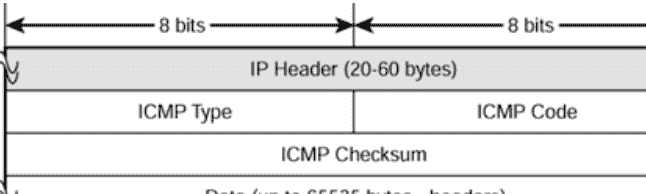

类型和代码定义了发生了哪种错误。`msg` 可以是任何有助于详细说明出错原因的附加信息。有关类型和代码的完整列表，请参阅附录 A。

### 用户数据报协议 (UDP)

用户数据报协议 (`UDP`) 主要用于无连接（独立消息）通信。它可以在不重新创建新套接字的情况下向不同目的地发送消息，目前是最常见的无连接协议。`UDP` 的属性列于表 3.5 中。

#### 表 3.5. UDP 属性

| 属性 | 值 |
| :--- | :--- |
| 消息大小 (字节) | 65,535 (最大数据负载 65,507) |
| 开销 (字节) | 28–68 |
| 可靠性 | 低 |
| 消息类型 | 一次性 (One-shot) |
| 吞吐量 | 中等 |
| 数据完整性 | 中等 |
| 分片 | 是 |

`IP` 栈中向上层的每一层都更关注数据，而较少关注网络。`UDP` 隐藏了关于错误消息以及内核如何传输消息的一些细节。此外，它还会重组分片的消息。

你通过 `UDP` 发送的消息就像一封电子邮件：目的地、来源和数据就是它所需的全部信息。内核接收该消息并将其置于网络上，但不验证其到达情况。与 `ICMP` 数据包一样，你可以使用不同的发送系统调用从单个套接字向多个目的地发送消息。然而，在没有验证的情况下，你可以实现接近最大值的吞吐量。

由于没有到达验证，网络可能会失去数据可靠性。网络可能会丢失数据包或片段并损坏消息。使用 `UDP` 的程序要么自行跟踪消息，要么不在意某些数据丢失或损坏。（请注意，虽然数据报是不可靠的，但这并不意味着一定会出错。它只是意味着该协议不提供任何保证。）


在之前定义的不同数据类型中，信息型 (Informational)、时间型 (Temporal) 和易失型 (Lossy) 最适合 UDP 服务。主要原因是它们对丢失的容忍度。如果你的网络摄像头未能向每个客户端更新，最终用户很可能不会注意到，也不会在意。另一个可能的用途是正确的时间服务。因为正确的时间属于时间型数据，主机可能会丢弃几个时钟滴答声而不会失去完整性。

`UDP` 具有高速的优势。此外，你可以以以下方式自行提高其可靠性：

-   拆分大型数据包。将每条消息划分为多个部分并分配一个编号（例如 5 个中的第 2 个）。另一端的对等方重组消息。请记住，更多的开销和更少的发送数据会降低吞吐量。

-   跟踪每个数据包。为每个数据包分配唯一编号。强制对等方确认每个数据包，因为没有确认，你的程序将重发最后一条消息。如果对等方未收到预期数据包，它会请求使用最后的消息编号重发，或者发送一条重启消息。

-   添加校验和或 `CRC`。使用数据求和验证每个数据包的数据。`CRC` 比校验和更可靠，而校验和更容易计算。如果对等方发现数据损坏，它会要求你的程序重发消息。

-   使用超时。你可以认为超时过期意味着失败。你的发送方可以重新传输消息，而你的接收方可以向发送方发送提醒。

关键型 (Critical) 和重要型 (Important) 数据类型需要 `TCP` 或更高级别提供的可靠性。容错型 (Fault-Intolerant) 需要的可靠性远超上述任何协议所能提供的。上述步骤模拟了 `TCP` 的可靠性。

`UDP` 依赖于 `IP` 的功能和服务。每个 `UDP` 数据报包都会接收一个 `IP` 头和一个 `UDP` 头。列表 3.3 定义了 `UDP` 结构的外观。

### 示例 3.3. `UDP` 结构定义

```
/****...*****/
/** UDP (datagram) structure definition ***/
/** (Format definition in netinet/udp.h) ***/
/****...*****/
typedef unsigned char ui8;
typedef unsigned short int ui16;
struct UDP_header {
ui16 src_port; /* Originator's port number */
ui16 dst_port; /* Destination's port number */
ui16 length; /* Message length */
ui16 checksum; /* Message checksum */
uchar data[]; /* Data message */
};
```

### 图 3.4. `UDP` 布局。

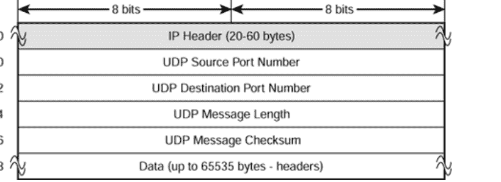

`UDP` 以端口的形式为每条消息创建一个虚拟网络接口。借助端口，`IP` 可以快速将消息分流给正确的所有者。即使你没有使用 `bind()` 定义端口，`IP` 子系统也会为你从临时端口列表中创建一个临时端口（参见第 2 章）。

### 传输控制协议 (`TCP`)

传输控制协议 (`TCP`) 是互联网上最常用的套接字协议。它可以 `read()` 和 `write()`，并且需要为每个连接重新创建套接字。`TCP` 的属性列于表 3.6 中。

#### 表 3.6. `TCP` 属性

| 属性 | 值 |
| :--- | :--- |
| 消息大小 (字节) | (无限) |
| 开销 (字节) | 40–120 |
| 可靠性 | 高（检查数据接收） |
| 消息类型 | 流 |
| 吞吐量 | 低（与其他协议相比） |
| 数据完整性 | 高（包含校验和） |
| 分片 | 不太可能 |

进一步确保可靠性需要确保目的地准确接收了发送方发送的消息。`UDP` 具有速度，但缺乏许多程序所需的可靠性。`TCP` 解决了可靠性问题。

然而，网络存在几个使其不可靠的根本问题。这些问题不是限制。相反，它们是网络设计中固有的。为了通过杂乱无章的网络传输可靠的流式消息，`TCP/IP` 必须纳入许多在 `UDP` 部分中建议的用于提高可靠性的想法。互联网存在三个障碍：动态连接、数据丢失和受限路径，将在以下章节中讨论。

#### 动态连接

一个主机的消息发送到另一个主机。该消息穿越网络，经过各种路由器和网关。发送的每个消息可能使用不同的路径。网络段（计算机之间的连接）随着服务器的启动和关闭经常出现和消失。互联网的强大之处在于其适应这些变化并相应路由信息的能力。

适应性是驱动互联网发展的动力之一。你的计算机可以发出请求，网络会尝试可能的途径来满足订单。不幸的是，这一优势意味着你的计算机与服务器或对等方之间的路径可能会变化，导致距离变长或变短。

随着路径变长，传播时间增加。这意味着你的程序可以发送连续的消息，其中许多会以不同时间到达，常常是乱序到达。

`TCP` 确保在发送下一条消息之前，目的地已正确接收了上一条消息。将此与一系列编号的消息进行比较（`TCP` 实际上就是这样工作的）。你的程序可能连续发送 10 条消息。`TCP` 接收每条消息，附加唯一编号并将其发送出去。目的地接收消息并回复确认。收到确认后，`TCP` 允许你的程序发送下一条消息。

**注意**

#### 滑动窗口协议

`TCP` 使用的技术优于发送/等待（或 `ACK/NACK`）协议，后者对于任何人的耐心来说都太慢了。相反，它使用滑动窗口：它衡量何时以及如何频繁地回复 `ACK`。较慢或较差的连接可能会增加确认消息。更快且丢失较少的连接允许在等待确认之前发送更多消息。这是 `Nagle` 算法的一部分。你可以使用套接字选项禁用它（参见**第 9 章**）。

#### 数据丢失

当目的地收到你的消息时，它会确定数据的完整性。数据可能沿着次优的通信路径传输，这些路径可能会丢弃或损坏消息位。请记住，网络逐位发送每条消息。`TCP` 随消息发送校验和以验证数据。`TCP` 是能够检测和修复损坏数据的最后一层。

如果目的地检测到任何错误，它会发送错误并请求你的程序重传。同样，如果你的计算机在特定时间内未收到确认，`TCP` 子系统会自动重发消息，无需你的程序干预。

#### 受限路径

回到发送到特定主机的单条消息，假设该消息对于中间段来说太长了。数据包在通过网络时遇到的问题是不同的技术和传输载体。一些联网计算机允许较长的数据包；其他则对大小有限制。

`UDP` 试图发送其能发送的最大消息。这可能在受限的数据路径中成为问题。`IP` 算法预见到路由器可能会分片数据。同样，`IP` 预期它必须重组传入的消息。

另一方面，`TCP` 将每个数据包限制为小块。`TCP` 在网络有机会触碰它们之前拆分较长的消息。`TCP` 选择的大小是大多数网络可以完整接受的大小。默认情况下，`TCP` 使用 536 字节，通常协商至 1,500。要手动增加该大小，请设置 `MSS`（最大段大小）`TCP` 套接字选项（参见**第 9 章**）。

接收方可能会发现消息的数据包顺序混乱。`TCP` 在将消息交给你的程序之前对其进行重新排序。

解决所有这些网络问题会增加 `TCP` 算法的协议和头部开销。当然，所有 `TCP` 技术增加的开销会明显降低性能。

#### `TCP` 头部定义

`TCP` 必须在其头部添加大量信息，以支持其为你提供的所有功能。`TCP` 头部的大小（以字节为单位）约为 `UDP` 头部的三倍。有关结构定义，请参阅**列表 3.4**。

### 示例 3.4. `TCP` 结构定义

```c
/***************************************************************************/
/* **  TCP (streaming socket)  structure definition ** */
/* **  (Formal definition in netinet/tcp.h) ** */
```


```c
typedef unsigned char ui8;
typedef unsigned short int ui16;
typedef unsigned int ui32;
typedef unsigned int uint;

struct TCP_header {
    ui16 src_port;     /* 源端口号 */
    ui16 dst_port;     /* 目的端口号 */
    ui32 seq_num;      /* 序列号 */
    ui32 ack_num;      /* 确认号 */
    uint data_off:4;   /* 数据偏移 */
    uint _res:6;       /* （保留） */
    uint urg_flag:1;   /* 紧急，带外消息 */
    uint ack_flag:1;   /* 确认字段有效 */
    uint psh_flag:1;   /* 立即将消息推送至处理程序 */
    uint rst_flag:1;   /* 因错误重置连接 */
    uint syn_flag:1;   /* 打开虚拟连接（管道） */
    uint fin_flag:1;   /* 关闭连接 */
    ui16 window;       /* 接收方允许的字节数 */
    ui16 checksum;     /* 消息校验和 */
    ui16 urg_pos;      /* 紧急消息的最后一个字节 */
    ui8 options[];     /* TCP 选项 */
    ui8 __padding[];   /* （用于对齐 data[]） */
    uchar data[];      /* 数据消息 */
};
```

图 3.5. `TCP` 布局。

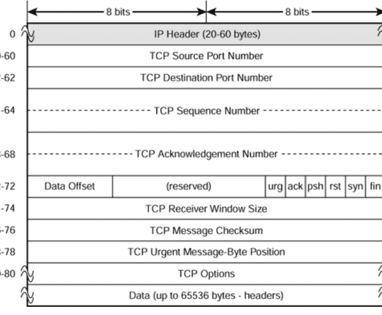

首部的大小可能是可变的，因此 `data_off` 字段指向数据的开始位置。为了节省首部空间，该字段的作用类似于 `IP` 的 `header_len` 字段：它给出了物理上位于你数据之前的 32 位字的数量。

`TCP` 使用某些字段专门用于打开连接、流量控制和关闭连接。在通信会话期间，部分首部字段为空。以下段落介绍了一些有趣的字段。

`TCP` 首部使用与 `UDP` 中相同的端口号。但 `seq_num` 和 `ack_num` 为数据流提供了可追溯性。当你发送消息时，`IP` 子系统会附加一个序列号（`seq_num`）。接收方回复确认号（`ack_num`），该值比序列号大 1。这一特性允许确认数据包同时也携带数据。

## 观察 `TCP` 交互

当你打开流式连接时，你的程序与服务器将交换表 3.6 中列出的消息。

### 表 3.6a. 三次握手

| 客户端发送 | 服务器发送 | 描述 |
|:-------------|:-------------|:------------|
| `SYN=1 (syn_flag)` | | 请求虚拟连接（管道）。 |
| `ACK=0 (ack_flag)` | | 设置序列号。 |
| | `SYN=1 (syn_flag)` | 允许并确认虚拟连接。 |
| `ACK=1 (ack_flag)` | | |
| `SYN=0 (syn_flag)` | | |
| `ACK=1 (ack_flag)` | | 建立虚拟连接。 |

这被称为三次握手。在传输过程中，客户端和服务器指定其接收缓冲区（窗口）的大小。

另一方面，关闭连接并不像看起来那么简单，因为可能有数据正在传输中。当你的客户端关闭连接时，可能会发生表 3.7 中所示的交互。

### 表 3.7. `TCP` 连接关闭

| 客户端 | 服务器 | 描述 |
|:-------|:-------|:------------|
| `FIN=1 (fin_flag)` | 传输数据 | 客户端请求关闭。 |
| | 接收数据 | |
| `ACK=1` | 传输更多数据 | 服务器通道已刷新。 |
| | 接收更多数据 | |
| `ACK=1` | `FIN=1` | 接受关闭。服务器关闭并等待客户端确认。 |
| `ACK=1` | | 客户端关闭其一侧。 |

关闭 `TCP` 连接后，无法将该套接字用于其他连接。例如，如果你连接到某服务器，断开连接的唯一方法是关闭通道，这也会关闭套接字。然后如果你想连接到另一个服务器，必须创建一个新的套接字。其他协议没有这种限制。

## `IP` 协议如何协同工作

在与网络接口交互时，你可能会好奇所有这些协议是如何协同工作的。在某些情况下，它们似乎完全不协同工作。它们确实使用了彼此的一些特性，但并没有紧密协作到不可分离的程度。

原始 `IP`、`ICMP`、`UDP` 和 `TCP` 协议各自承担特定的角色。在设计网络应用程序时，你可以根据需求使用这些角色。当然，虽然 `TCP` 比其他协议具有更高的可靠性和功能，但你不能用 `TCP` 替换 `ICMP`。由于 `Linux` 子系统对 `TCP/IP` 的不同特性有不同要求，每种数据包类型对于系统的正确运行都是重要的。

`ICMP`、`UDP` 和 `TCP` 数据包在物理上依赖于原始 `IP` 数据包。它们的首部和数据位于 `IP` 的数据段中，紧随 `IP` 首部之后。

## 使用 `tcpdump` 窥探网络

观察实时网络上的数据包能有效地展示内核如何处理消息以及网络子系统如何解析地址请求。从原始 `IP` 数据包到 `TCP`，`tcpdump` 是一个显示网络数据的工具。出于安全考虑，运行 `tcpdump` 需要 `root` 权限。

默认情况下，`tcpdump` 使用混杂模式，这样你可以看到网络上的所有内容。混杂模式直接操作硬件接口以接受任何和所有消息。

**注意**

**网络伦理的平衡**

知道如何做很多事情是非常强大的，但也伴随着很大的责任。拥有 `root` 权限，你可以对网络做出很多好事，也可以造成很大的伤害。当你在计算机上安装 `Linux` 时，发行版假设你拥有与那些赋予你窥探他人数据包能力的人同样良好的意图。破坏自由软件运动的一个有效方法就是滥用其他善良且用心良苦的人赋予你的权力和信任。

通常，硬件接口适配器只拾取它从以太网地址识别出的那些消息。回顾第 2 章可知，每个以太网硬件适配器都有唯一的 6 字节 ID。适配器使用此 ID 来忽略除了匹配该 ID 以外的所有数据包。

**注意**

**可编程以太网 ID**

一些原始设备制造商（`OEM`）提供的网络接口卡（无论是 `PCI` 还是 `PCMCIA`）支持可编程 `MAC` 地址（或以太网 ID）。这使得少数几家卡片制造商能够进行大规模生产，同时服务于数百家技术领先的公司。不幸的是，你可能会得到一张具有虚假 ID 的卡片，因为名牌公司没有正确编程。这种错误会使你的卡片在网络中不再唯一。

如果你不想使用混杂模式，可以通过其中一个选项将其关闭。`Tcpdump` 有许多选项帮助你过滤掉不需要的消息，并选择显示的数据和数据重定向方向。以下是一些有趣的命令行选项：

| 选项 | 描述 |
|:-------|:------------|
| `-a` | 尝试为网络和广播地址分配名称。这需要访问名称服务器。 |
| `-c <count>` | 在获取指定数量的消息后停止。 |
| `-n` | 不将节点地址转换为其名称（在没有名称服务器时很有用）。 |
| `-p` | 不将接口置于混杂模式。如果网络较小或是一个集群，看到所有数据包可能很有趣。否则，启用混杂模式时，网络很容易使你的计算机不堪重负。 |
| `-v` | 打印稍微更详细的转储。这包括生存时间（`TTL`）字段。 |
| `-vv` | 在转Dump中打印更多详细信息。 |
| `-w <file>` | 将原始数据包写入文件。 |

`tcpdump` 可以不带任何选项运行，并显示你需要的大多数信息。你还可以看到有趣的交互，例如 `ARP`（地址解析协议）请求和获取 `IP` 地址的以太网 ID。以下是一个捕获 100 个详细数据包且不带时间戳的示例：

```bash
tcpdump -v -t -c 100
```

`-t` 选项抑制时间戳前缀。

`tcpdump` 也有一些异常；例如，它不会拾取发给它自己的消息。它看不到来自 `ping 127.0.0.1` 的数据包，因为网络子系统不会将这些消息发送到 `tcpdump` 挂钩的低层协议层。

## 编写自定义网络嗅探器

`tcpdump` 是如何工作的？你可以阅读冗长的开源程序，或者编写你自己的网络嗅探器（一种 `tcpdump`）。你唯一需要知道的是如何捕获主机的任何和所有消息。本节描述的工具帮助你编写一个网络嗅探器，该嗅探器可以分解意图发往主机的数据包。然而，它不支持混杂模式。

出于安全考虑（类似于 `tcpdump`），你需要是 `root` 才能运行网络嗅探器。嗅探器捕获所有发往你计算机的消息。要获取所有消息，你使用以下调用：

```c
sd = socket(PF_INET, SOCK_PACKET, filter);
bytes_read = recvfrom(sd, buffer, sizeof(buffer), 0, 0, 0);
```

注意新的套接字类型：`SOCK_PACKET`。这是一个只读的硬件级别套接字。


你可以为 `SOCK_PACKET` 使用几种过滤器。过滤器告诉 IP 层你想要捕获哪种类型的数据包。其中一些过滤器是：

- `ETH_P_802_3`: 802.3 帧
- `ETH_P_AX25`: AX.25 帧
- `ETH_P_ALL`: 所有帧（小心使用）
- `ETH_P_802_2`: 802.2 帧

要使用的过滤器是 `ETH_P_ALL`。正如注意事项所示，使用该过滤器时要小心，因为当你选择它时，它会给你所有内容。生成的调用是：

```c
sd = socket(PF_INET, SOCK_PACKET, ETH_P_ALL);
```

## 总结：选择最适合的消息发送数据包

在成功建立连接后，每次调用 `recvfrom()` 系统调用都会返回一个网络帧（即物理网络消息）。网络帧包含硬件地址（例如以太网地址）以及头部信息。

`SOCK_PACKET` 提供了访问硬件层帧及每次传输中所有相关数据的能力。通过它，你可以观察网络子系统是如何构建帧的。

你可以使用本章开头定义的 IP 结构。但请记住，存储是依赖于硬件的，因此位域的顺序可能是错误的。该结构假设位 `#0` 是帧流中的第一个位。

网站上的程序示例 `snooper.c` 重新排列了字段，以匹配小端处理器（Intel 兼容）和 GNU 编译器的实际硬件帧。如果你使用不同的处理器（甚至不同的编译器），你可能需要调整该结构。

你可以使用 `tcpdump` 和 `snooper` 来打印你的计算机发送和接收的各种类型的数据包。就 IP 而言，这些数据包可能是原始 IP 数据包、ICMP 错误消息包、UDP 数据报或 TCP 流消息。每种数据包类型都承担特定的角色，同时保留了大量的扩展空间。

每个数据包都有自己的头部。ICMP、UDP 和 TCP 将它们的头部附加到 IP 头部上。专门用于这些头部的总大小在 20 字节到 120 字节之间。头部与真实数据之间的平衡会影响网络吞吐量。

由于头部与数据的比例，TCP 的吞吐量最低。因为它提供了两台计算机之间最可靠的通信，所以它是互联网上最常用的协议。TCP 提供流式接口，允许你使用更高级的库 I/O 函数，如 `fprintf()` 和 `fgets()`。

你可以使用 UDP 向不同的主机发送单条消息而无需重新连接。它通过端口将网络虚拟化，使你的连接看起来拥有对网络的独占访问权。UDP 提供良好的吞吐量，但传输不可靠。

最常用的协议是 TCP，因为其可靠性。UDP 远远落后于它。如今的网络已经不再试图使用非常底层的数据包和接口，而是转向发送消息。性能不再像可靠性那样重要，但用户仍然会注意到性能问题。

# 第 4 章 对等节点之间发送消息

### 本章内容

- 基于连接的套接字是什么？
- 示例：连接到 HTTP 守护进程
- 无连接套接字是什么？
- 发送直接消息
- 确保 UDP 消息到达
- 任务切换：多任务介绍
- 总结：连接模型与无连接模型

你可以从两个不同的角度来思考消息传递：连续且不间断的（TCP）或离散的信息包（UDP）。虽然连续的数据流就像电话传输一样，但离散的数据包就像装在已写好地址的信封里的信件。

连续流要求你必须与目的地建立已建立的连接。这确保了在交换过程中没有信息丢失，并且在到达时顺序正确。离散消息允许你建立连接仅仅是为了简化编程。如果没有连接，你的程序必须为每条消息指定地址。

本章讨论基于连接和基于无连接的接口。比较和示例可能帮助你选择最适合你应用程序的类型。

## 基于连接的套接字是什么？

Linux（以及所有 UNIX 类型的操作系统）为你的程序提供了三个基本上不同的通信级别。所有级别都需要使用 `socket()` 系统调用。这些级别向你展示了网络编程的动态性，并使编程变得具有挑战性。

三种基本协议（如第 3 章“不同类型的互联网数据包”中定义的原始 IP、UDP 和 TCP）抽象了网络并增加了可靠性，同时必然牺牲了性能。最高级别 TCP 具有所有协议级别中最高的可靠性。它保证数据正确且按顺序到达目的地。它如此可靠，你可以将其视为文件或进程间管道。这就是为什么 TCP 套接字是`基于连接`的套接字。

## 程序之间的开放通道

TCP 套接字在两个程序之间提供开放的、双向的通道。就像麦克风耳机一样，该通道不间断地发送和接收流式信息。程序可以同时将信息发送给彼此，而无需从单独的重新组装对话消息。

TCP 还记得你在和谁交谈。在 IP 协议的较低级别中，每条消息都必须随每条消息提供目的地址。这就像每次你想轮流说话时都要拨通你朋友的号码。

当你连接到其他程序（使用 `connect()` 系统调用）时，你的套接字随后会记住目的地址和端口。此外，你可以使用为流式 I/O 设计的高级库调用，如 `fprintf()` 和 `fgets()`。这极大地简化了编程。

在設計你的程序时，TCP 协议帮助你避免其他协议可能出现的数据丢失问题。这种简单性让你可以专注于你的程序。

## 可靠的通信

TCP 的流式 I/O、高可靠性以及对高级 I/O 的访问意味着数据路径清晰且无阻碍。TCP 保证可靠的通信：对等端接收程序发送的所有内容。包含设备和协议栈（位于服务器或客户端上）的网络子系统接受消息，检查它，并将其传递给程序。

如果检查失败且子系统检测到错误，子系统通过要求重传来处理。通信路径的两端都执行此验证检查。如上一章所述，一些消息具有唯一且顺序的包 ID。ID 对于确保可靠性和顺序至关重要。当你选择 TCP 协议时，你会获得此功能。

网络通信中最大的两个问题是包丢失和包乱序。假设你的程序发送了一条消息。除非收到目的地的响应，否则程序无法绝对检测到目的地是否接收到了消息。例如，你的程序发送消息，目的地等待数据包到达。如果目的地在一段时间内没有收到任何东西，它向你的程序发送一条消息，指示它可靠接收的最后序列号。这种协作紧密地将你的程序与目的地耦合在一起。

另一方面，目的地可能会以乱序接收消息的一部分。当这种情况发生时，目的地保留该消息片段，直到获取你中间的片段。目的地然后使用序列号作为排序键重新组装消息。

如前所述，高级库调用期望一个开放通道，并且也需要可靠的通信路径。TCP 协议专注于你的消息通道，使得信息看起来像非打包的流一样流动。相反，低层协议专注于数据包，因此它们不能支持如 `printf()` 这样的高级 I/O 库调用。

可靠性较低的协议为你的程序提供了非常快速的发送消息的通道。特别是，UDP 试图快速将消息发送到你的网络上，而不考虑顺序。同样，目的地接受每条独立的消息，不期望任何顺序。

顺序对于你的设计是一个重要的考虑因素。你可能没有期望你的数据是顺序相关的，但实际上可能是。以下是几个可以帮助你决定消息是否需要流（并附带简短的括号内摘要）的问题。

- **你的数据是否构成独立的请求？** 当消息是独立请求时，你的程序可以按任何顺序接受回复。例如，在不相关的请求中，执行顺序并不重要：程序可以请求一个文件，然后继续请求对等端的状态。然而，如果你正在为网络游戏中的玩家发送坐标点——即相互依赖的请求——位置顺序非常重要。（是=UDP；否=TCP）

- **如果你随机重新排序消息，你的程序最终是否会产生相同的结果？** 这是基于消息的通道的真正试金石。流不能容忍包的重新排序。TCP 仔细地将消息重新排序为连续的消息。（是=UDP；否=TCP）

- **你是否将你的对话想象为连接两个程序的管道，还是 FedEx 信使？** 一方面，你的程序和对等端之间的信息流可以比作管道中的水。这些信息是有顺序的。另一方面，单个信息包可以比作物品。信息是无序的且被打包的。例如，你可以按任何顺序接收几个包裹，并且可能只回复其中几个。流式管道无法在不丢失信息的情况下支持这种模式。（FedEx=UDP；管道=TCP）

- **如果在每条消息之间断开并重新连接，服务器或对等端是否必须跟踪你所在的位置或交易状态？** 某些交易可能仅仅是“给我这个”，而回复是“给你”。服务器在交易之间不保留任何记忆。其他交易迫使你通过不同的状态。Telnet 会话有两种状态：已登录和未登录。（否=UDP；是=TCP）

- 你的程序在同时处理多个连接时，是否必须跟踪谁说了什么？有时你需要建立对话（带或不带数据流），而服务器必须跟踪客户端。例如，互联网上的个性化功能允许用户定制其工作环境。某些程序可能会以类似方式工作。（是=UDP；否=TCP）

- 网络是否会丢失消息，而又不影响目的端的计算？发送方可能需要处理丢失的数据，但只要目的端不依赖于每条消息都能安全到达，你就可以使用 UDP 的非流式协议。例如，丢失一个无序请求可能无关紧要，而丢失有序请求则完全是另一回事。例如，股票价格需要严谨的信息流，而天气统计数据即使出现一些小错漏也不会影响预报。（是=UDP；否=TCP）

回答完这些问题后，如果你发现只有一个答案是 TCP，你可能必须要么使用 TCP，要么增强 UDP 协议。这些规则并不是一成不变的；你可能会选择接受不可靠的 UDP 所带来的问题，以便获得所需的性能。

## 低层协议连接

可以在 UDP 套接字上使用 `connect()` 系统调用。当你不需要高层 I/O 时，这可能很有吸引力，因为 UDP 通过自包含的消息提供了性能提升。然而，UDP 的连接功能在运作方式上与 TCP 处理连接的方式略有不同。


第 3 章将该过程描述为三次握手。此握手建立了程序之间流式传输数据的通信级别。由于 `UDP` 不支持流，`connect()` 系统调用仅仅是简化了消息传递。

在 `UDP` 连接上调用 `connect()` 系统调用只是记录你所发送消息的目的地址。你可以像 `TCP` 连接那样使用 `read()` 和 `write()`，但你没有可靠性和顺序保证。清单 4.1 中给出的算法与 `TCP` 编程非常相似。

### 示例 4.1：一个简单的连接数据报

```c
/*****...****/ /* Sample datagram example with connection */
/*****...****/ /* Excerpt from connected-peer.c */
/*****...****/
int sd;
struct sockaddr_in addr;

sd = socket( PF_INET, SOCK_DGRAM, 0 ); /* datagram socket */
bzero( &addr, sizeof( addr ) );
addr.sin_family = AF_INET;
addr.sin_port = htons( DEST_PORT );
inet_aton( DEST_IPADDR, &addr.sin_addr );

if( connect( sd, &addr, sizeof( addr ) ) != 0 ) /* connect! */
    perror( "connect" );

/*---Note: this is not a streamed send--*/
send( sd, buffer, msg_len ); /* send like TCP */
```

通常，使用 `UDP` 时，你会使用 `sendto()` 或 `recvfrom()` 系统调用（将在本章后面介绍）。`send()` 系统调用假设程序已经通过 `connect()` 注册了目的地址。

等待连接的对等端（或服务器）可以使用相同的连接接口，也可以使用 `sendto()` 和 `recvfrom()`。然而，为了使程序能够连接到对等端，对等端必须使用 `bind()` 系统调用发布其端口号。关于 `bind()` 系统调用的完整描述，请参阅本章后面的“发送直接消息”部分。

清单 4.1 中的示例代码片段引用了 `DEST_PORT`。这个数字是两个程序之间约定好的端口接口。监听的对等端通过调用 `bind()` 请求 `DEST_PORT` 来设置端口。当你的消息到达时，目的端可能会自行发起 `connect()` 系统调用。

与 `TCP` 的 `connect()` 系统调用不同，你的程序可以重新连接到其他对等端或服务器多次，而无需关闭套接字。使用 `TCP` 时，除非关闭套接字然后重新打开，否则无法连接到其他对等端或服务器。`UDP` 提供的重要特性之一是能够在不关闭套接字的情况下向不同目的地址发送消息。在 `UDP` 协议中使用 `connect()` 系统调用仍然提供了这种灵活性。

再次强调，如果你以任何形式使用 `UDP`，就选择了随之而来的不可靠性。你可能会丢失数据包，或者数据包可能会乱序到达。`UDP` 的 `connect()` 系统调用仅记录目的地址，并不会增加你的程序之间信道的可靠性。

## 注意

### 可靠交付消息 (RDM)

可靠交付消息（`RDM`）协议 `[RFC908, RFC1151]` 提供了 `TCP` 所保证的可靠交付，同时也允许你拥有基于消息（非流式）的 `UDP` 速度。`RDM` 可能会导致消息乱序，但它提供了 `UDP` 和 `TCP` 之间的一种良好折衷。不幸的是，尽管该协议已经存在多年，但 `Linux`（以及其他 `UNIX` 操作系统）尚未支持它。

### 示例：连接到 HTTP 守护进程

用户连接的最常见协议是 `HTTP`。它描述了一个非常简单的接口，其中包括一个查询。服务器反过来解释该查询，并回复一条客户端能够理解的消息。该消息可以是简单电子邮件头格式内的任何文档。

接口的简单性向你展示了网络上的许多事务。大多数客户端 - 服务器交互都是基于单次事务的。对于单次事务而言，`TCP` 接口和可靠性检查的所有开销可能是浪费的。尽管如此，这仍然是被接受的标准。

### 简化的 HTTP 协议

向 `HTTP` 服务器发送请求时，你只需要知道一条命令。这是 `HTTP` 协议的过度简化表示。第 6 章“服务器入门”将更深入地介绍该协议：

```
GET <query> HTTP/1.0<cr><cr>
```

查询通常看起来像目录路径，但它也可以接受参数和变量。当你在浏览器中输入 URL `http://www.kernel.org/mirrors/` 时，你的浏览器会打开到 `http://www.kernel.org` 的套接字，并发送以下消息：

```
GET /mirrors/ HTTP/1.0<cr><cr>
```

它还可能发送大量关于它可以接收哪种类型数据的信息。这有助于数据转换。最后两个 `<cr><cr>` 是换行符，表示消息的结束。客户端可以发送任意数量的参数和设置，但必须以两个换行符结束消息。

连接是流式的，因此你不知道是否已到达消息末尾。这可能导致你无限期地等待永远不会到达的内容。这两个换行符告诉服务器客户端已经说完话了。

## 获取 HTTP 页面

编写查询是连接过程中最容易的部分。查询也为你添加所需内容提供了很大的灵活性。唯一的要求是确保服务器能够理解你的消息。清单 4.2 展示了一种获取网页的方式。该程序打开在命令行上指定的连接并发送 `HTTP` 请求。程序将结果打印到标准输出。

### 示例 4.2：从 HTTP 服务器获取网页

```c
/***** ***************************************************** */
/*** Excerpt from the http-client.c (on Web site) file. *****/
/*** ***************************************************** */
int sd;
struct servent *serv;

if ( (serv = getservbyname("http", "tcp")) == NULL )
    PANIC("HTTP servent");

if ( (sd = socket(AF_INET, SOCK_STREAM, 0)) < 0 )
    PANIC("Socket");

/*---Initialize server address/port struct---*/
bzero(&dest, sizeof(dest));
dest.sin_family = AF_INET;
dest.sin_port = serv->s_port;              /* HTTP Server */
if ( inet_addr(Strings[1], &dest.sin_addr.s_addr) == 0 )
    PANIC(Strings[1]);

/*---Connect to server---*/
if ( connect(sd, &dest, sizeof(dest)) != 0 )
    PANIC("Connect");

/*---Compose the query and send it---*/
sprintf(buffer, "GET %s HTTP/1.0\n\n", Strings[2]);
send(sd, buffer, strlen(buffer), 0);

/*---While there's data, read and print it---*/
do
{
    bytes_read = recv(sd, buffer, sizeof(buffer)-1, 0);
    buffer[bytes] = 0;
    if ( bytes_read > 0 )
        printf("%s", buffer);
}
```

## 什么是无连接套接字？

并非所有的通信都需要在双方之间打开一个完整的双向通道。如果说电话是流式连接的例子，那么邮政系统最好地代表了基于消息的（或无连接的）系统。与邮政系统类似，`UDP` 组包、指定目的地并将消息发出，而在消息传送到目的地的过程中不进行任何追踪。（再次重申：数据报的不可靠性意味着它不提供投递保证。这并不意味着它不起作用。）

## 设置套接字地址

完整的 `Linux` 发行版安装通常包括允许你从网络上的其他工作站发送和接收信息的工具。这些工具只需要一个机器地址，也许还需要一个用户名。你可以使用 `UDP` 套接字自行实现这种类型的工具。为此，你需要查看当前用户是否是消息的接收者。

这些 `Messenger` 风格的工具使用两个数据部分（主机名和用户名）来唯一地标识接收者。由于工具没有流式数据，你的实现可以使用无连接接口。


无连接接口不使用`connect()`系统调用，但你不能在没有连接的情况下调用`send()`或`recv()`。相反，操作系统提供了两个较低层级的系统调用，它们包含目标地址：`recvfrom()`和`sendto()`。这些调用的作用与`recv()`和`send()`类似，但你在调用中提供目标地址：

```c
#include <sys/socket.h>
#include <resolv.h>
int sendto(int sd, char* buffer, int msg_len, int options,
           struct sockaddr *addr, int addr_len);
int recvfrom(int sd, char* buffer, int maxsize, int options,
             struct sockaddr *addr, int *addr_len);
```

前四个参数与`recv()`和`send()`相同。即使选项和可能的错误条件也是相同的。`sendto()`系统调用添加了目标套接字的地址。当你向目标发送消息时，你填充`addr`结构并调用`sendto()`。列表 4.3 说明了一个示例。

### 示例 4.3. `sendto()` 示例

```c
/* Sendto() example. */
int sd;
struct sockaddr_in addr;
sd = socket (PF_INET, SOCK_DGRAM, 0);
bzero (&addr, sizeof (addr));
addr.sin_family = AF_INET;
addr.sin_port = htons (DEST_PORT);
inet_aton (DEST_ADDR, &addr.sin_addr);
sendto (sd, "This is a test", 15, 0, &addr, sizeof (addr));
```

此示例将消息直接发送到`DEST_ADDR:DEST_PORT`。当然，你可以在消息主体中使用原始数据或`ASCII`。这并不重要。

`recvfrom()`系统调用略有不同。与`sendto()`调用一样，前五个参数在本质上是相同的。`recvfrom()`的行为与`recv()`类似，执行时等待来自某个发送者的消息到达。

最后一个参数的类型不同。它是一个指向整数的指针。`sendto()`的最后两个参数是目标地址。`recvfrom()`的最后两个参数是发送者的地址。由于`struct sockaddr`家族可以有不同的大小，你可能会收到来自与套接字类型（默认为`AF_INET`）不同的源的消息。

## 注意

### 传递地址的长度

`recvfrom()`调用（像`recv()`一样）传递指向结构体长度的指针。这是来自另一种协议族`PF_LOCAL`的遗留产物。当调用结束时，你需要知道调用使用了`addr`数据区域中的多少部分。你也需要告诉调用可用多少空间来使用。因此，参数是按引用传递的，以便系统调用可以返回它实际使用的字节数。

由于`recvfrom()`可能会改变`addr_len`参数，你每次发起系统调用时都需要设置该值。否则，`addr_len`中的值可能会随着每次系统调用而变小。以下是使用`recvfrom()`的示例：

```c
/* Rcvfrom() example. */
int sd;
struct sockaddr_in addr;
sd = socket(PF_INET, SOCK_DGRAM, 0);
/*---bind to a particular port---*/
while (1)
{
    int bytes, addr_len=sizeof(addr);
    
    bytes = recvfrom(sd, buffer, sizeof(buffer), 0, &addr,
    &addr_len);
    fprintf (log, "Got message from %s:%d (%d bytes)\n",
    inet_ntoa (addr.sin_addr), ntohs (addr.sin_port), bytes);
    /*** process request **** */
    sendto (sd, reply, len, 0, &addr, addr_len);
}
```

在此示例中，你创建套接字并绑定端口。`while`循环等待传入消息，记录连接，处理请求，并回复结果。循环重置了`addr_len`的值，以便`addr`的大小看起来不会随着每次系统调用而缩小。你可以使用`addr`中的信息作为回复的回信地址。

如果你使用`recvfrom()`系统调用，你必须提供有效的`addr`和`addr_len`；你不能将它们设置为`NULL`(0)。因为`UDP`是无连接的，你需要知道请求的源。最简单的做法是在处理请求时保持`addr`完整。

## 有些程序只需要消息

无连接协议简化了握手过程。`TCP`需要三次握手：客户端发送连接请求，服务器接受请求并发送其自己的连接请求，然后客户端接受服务器的连接请求。

无连接的`UDP`实际上没有握手；消息本身是唯一远程共享的协作内容。这意味着该协议不检查连接。最终，如果找不到对等方或发生传输错误，你可能会收到网络错误消息。然而，该消息可能在网络检测到错误很长时间后（一到五分钟）才到达。

`UDP`无握手协议减少了`TCP`握手的大量开销。为了支持这一点，你可能会看到总共一个或两个设置数据包。对于高速通信来说，这还不错。

## 事务 `TCP` (T/TCP)：一种无连接的 `TCP`

与`UDP`协议相比，`TCP`的三次握手需要多达 10 个设置数据包。当请求者只需要单个事务时，这种缓慢的启动成本非常高。在启动过程中，连接的两端验证彼此的服务和通道可靠性。类似地，关闭过程需要额外的握手（参见第 3 章）。

`TCPv3` [RFC1644] 添加了一项新功能，在保留`TCP`可靠性的同时提供了一些`UDP`的连接速度。事务`TCP` (T/TCP) 通过单个`sendto()`系统调用完成连接、传输和关闭。它是如何做到这一点的？

`TCP`使用三次握手建立连接，并使用特定的握手关闭或终止连接。这些步骤对于确保客户端和服务器按正确顺序接收所有已发送数据是必要的。为了达到这一目标，`TCP`数据包必须使用标志来指示何时建立连接(`SYN`)、确认数据(`ACK`) 以及关闭通道(`FIN`)。

第 3 章描述了`TCP`数据包的格式。数据包头部包含几个似乎互斥的字段。例如，它分别为`SYN`、`ACK`和`FIN`设置了独立的标志。为什么要在只有一个位可能同时激活的情况下浪费数据包中宝贵的空间呢？

T/TCP 同时使用这些字段。当T/TCP 客户端连接时，它在请求连接(`SYN`) 的同时向服务器发送消息。它还设置`FIN`标志，以便在服务器完成事务后立即关闭连接。参见图 4.1。


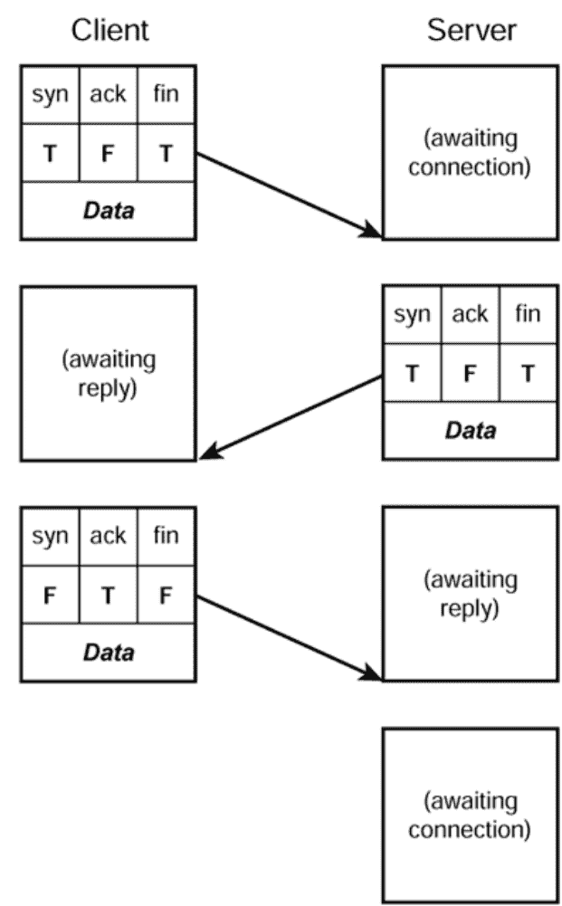

服务器以自己的连接请求、关闭请求以及对客户端关闭请求的确认作为回应。（连接请求的确认是隐含的。）此数据包包含服务器生成的数据。最后，客户端确认服务器的关闭。

T/TCP 可以非常快。这里有一个问题：所有信息必须在`TCP`的最大分段大小（`MSS`）内传输，而`MSS`仅为 540 字节。不过，你可以将该设置更改为最大 64KB。此外，程序不仅限于发送一条消息；它可以发送多条消息。

服务器程序无需额外工作即可支持T/TCP。正常`TCP`连接的算法同样适用于T/TCP，因为所有服务器端支持都已在网络子系统中编程实现。所有工作都在客户端完成。你可以在客户端使用以下算法：

```c
/***** ... *******/
/*** T/TCP basic algorithm. ***
/***** ... *******/
```

```c
int flag=1;
int sd;
sd = socket( PF_INET, SOCK_STREAM, 0);
if ( setsockopt( sd, IPPROTO_TCP, TCP_NOPUSH, &flag,
sizeof( flag) ) != 0 )
    PANIC( "TCP_NOPUSH not supported" );
/** Set up addr to destination ****/
if ( sendto( sd, buffer, bytes, MSG_FIN, &addr, sizeof( addr) )
< 0 )
    PANIC( "sendto" );
...
```


使用 T/TCP 时，你必须禁止 TCP 过快刷新其缓冲区。示例中 `setsockopt()` 系统调用所做的正是这件事。此外，你可以发送任意数量的消息，但最后一条消息必须在 `sendto()` 系统调用中包含 `MSG_FIN`（见上文）。

## 注意

## T/TCP 与 Linux

不幸的是，Linux 目前不支持 T/TCP。未来会支持，但现阶段，你可以将技术应用于其他 UNIX 操作系统。你可以在 Linux 内核中看到一些表示正在进行工作的标志（例如，`linux/socket.h` 中定义了 `MSG_EOF` 和 `MSG_FIN`）。尽管如此，你可以尝试网站上的 T/TCP 程序。

如前所述，TCP 要求你为每个新连接重新创建 TCP 套接字，因为你只能通过关闭套接字本身来关闭连接。与 TCP 不同，T/TCP 可能具有无需重新创建套接字的附带好处，因为其连接和关闭都是隐式的。

T/TCP 使你能与任何支持该协议的服务器进行短暂的交互爆发，同时将启动和关闭时间降至最低。T/TCP 的好处有助于你的程序更快地响应服务器。

## 发送定向消息

到目前为止，你使用已连接通道发送和接收消息，这最像使用电话。定向消息是未连接的，意味着它不进行握手。为对等方创建定向消息（不是管道）需要一个发送者和一个接收者。发送者传输消息，接收者接受消息。就这么简单。

每条消息需要一个目标地址（内核会在数据包中为你放置返回地址）。`send()` 和 `recv()` 假设它们具有已连接通道，这会目标地址自动定义。相反，你必须使用 `recvfrom()` 和 `sendto()` 系统调用，因为两者都提供每条消息所需的寻址。

在发送消息之前，你构建目标地址，其中包括主机地址和端口号。如前几章所述，如果你的程序跳过选择端口，操作系统会随机为套接字分配一个。这对对等程序来说不是好主意。调用的对等方必须知道目标端口才能正确寻址消息。

## 注意

## 检查 Linux sockaddr 支持

Linux 内核支持几种不同的寻址协议，但并非所有协议都直接包含在发行版内核中。例如，发行版内核通常省略业余无线电协议。如果你不确定编译的内核支持哪些绑定协议，只需运行你的程序。`bind()`、`sendto()`、`connect()` 和 `recvfrom()` 系统调用在接收到它们无法理解的 `sockaddr` 时会发出警告。你可以在附录 A “数据表”中找到支持的 `sockaddr` 列表。

UDP/TCP 发送者必须知道接收者监听的端口，以便操作系统将数据包路由到正确的程序。此端口通常是发送者和接收者之间商定端口号。例如，`/etc/services` 文件列出了提供标准服务的公开端口号。

## 将端口绑定到套接字

你可以使用 `bind()` 系统调用向操作系统请求特定端口号。你之前可能见过此调用，但遗憾的是，大多数 UNIX 手册页将其定义为“命名套接字”的方法。此定义指的是使用文件系统的 `PF_LOCAL` 或 `PF_UNIX` 套接字。更好的描述是“将端口号或其他可发布接口绑定到套接字”。

## 注意

## 名称和端口绑定

端口分配和套接字命名在不同 `sockaddr` 家族成员之间差异很大。一些，如 `AF_LOCAL` 和 `AF_AX25`，是字母数字名称；其他，如 `AF_INET` 和 `AF_IPX`，使用端口。端口号必须唯一，因此通常两个 TCP 或 UDP 套接字不能有相同的端口号（至少对于 `AF_INET`）。不过，你可以让 UDP 套接字和 TCP 套接字共享相同的端口号。这就是某些服务（在 `/etc/services` 中）同时提供两者连接的原因。

`bind()` 系统调用的原型定义为：

```c
#include <sys/socket.h>
#include <resolv.h>
int bind(int sd, struct sockaddr *addr, int addr_size);
```

本节仅介绍 `bind()`；有关深入描述，请参见第 6 章。使用类似于 `connect()` 系统调用，你需要先初始化 `addr` 参数：

```c
/*****\*\*\*\*\*\*\*\*\*\*\*\*\*\*\*\*\*\*\*\*\*\*\*\*\*\*\*\*\*\*\*\*\*\*\*\*\*\*\*\*\*\*\*\*\*\*\*\*/
/***** Bind() example.
/*****\*\*\*\*\*\*\*\*\*\*\*\*\*\*\*\*\*\*\*\*\*\*\*\*\*\*\*\*\*\*\*\*\*\*\*\*\*\*\*\*\*\*\*\*\*\*\*\*/
struct sockaddr addr;
int sd;
sd = socket(PF_INET, SOCK_STREAM, 0);
bzero(&addr, sizeof(addr));
addr.sin_family = AF_INET;
addr.sin_port = htons(MY_PORT); /* request specific port */
addr.sin_addr.s_addr = INADDR_ANY; /* any IP interface */
```

```c
if ( bind(sd, &addr, sizeof(addr)) != 0 )
    perror("bind");
...
```

如果将此 `bind()` 系统调用示例与 `connect()` 系统调用的示例进行比较，你可能会注意到两个主要区别：在这里，代码片段正在请求 `MY_PORT`，并且地址为 `INADDR_ANY`。你的程序需要一个特定端口号以便对等方连接。

`INADDR_ANY` 是一个特殊标志（本质上是 0.0.0.0），表示任何对等方都可以从任何接口连接。一些计算机具有多个网络接口（例如，两个局域网卡，带局域网卡的调制解调器，别名 IP 地址）。每个硬件或逻辑接口都有自己 IP 地址。使用 `bind()` 系统调用，你可以指定是服务于其中一个还是所有这些接口。你可以使用此功能进行跨防火墙翻译或过滤，它适用于 TCP 和 UDP 协议两者。要表示特定接口，你可以使用以下代码：

```c
if ( inet_aton("128.48.5.161", &addr.sin_addr) == 0 )
    perror("address error");
...
```

这使请求在 128.48.5.161 上监听端口。你可以像 `htonl()` 一样使用网络字节序转换：

```c
addr.sin_addr.s_addr = htonl(0x803005A1);   /* 128.48.5.161 */
```

无论哪种方式，功能都相同。你可能会注意到 `INADDR_ANY` 不使用 `htonl()` 转换调用。由于它是全零，因此不需要使用它，且保证处于网络字节序。

## 抛掷消息

发送和接收 UDP 消息看起来有点像在雾中玩接球。球员们轮流抛掷和接球，即使他们看不见彼此。发送者是首先抛球的人。接收者必须具有已知的地址和端口号，通过 `bind()` 系统调用建立。发送者不需要建立其端口号，因为每条消息都包含返回地址。可能存在玩家将球抛到空处的可能性。

发送者进行很少的初始化，通常只请求一条消息。如果你想来回抛掷消息，可以将此放在循环中。发送者的代码见列表 4.4 和网站上的 `connectionless-sender.c`。

### 示例 4.4. 数据报发送者示例

```c
/********************************************************
/**  Sender example.
/**  (Excerpt from connectionless-sender.c)
/**
****/struct sockaddr addr;int sd, bytes, reply_len, addr_len=sizeof(addr);
```


```c
char *request= "select * from TableA where field1='test';";
char buffer[1024];

/****- set up socket----*/
sd= socket(PF_INET, SOCK_DGRAM, 0);
bzero(&addr, sizeof(addr));
addr.sin_family= AF_INET;
addr.sin_port= htons(9999); /* request specific port */
if ( inet_aton(DEST_ADDR, &addr.sin_addr)== 0) /* Dest IP */
    perror("Network IP bad");

/****- send message----*/
if ( sendto(sd, request, strlen(request), 0, &addr, addr_len)<0 )
    perror("Tried to reply with sendto");

/****- get reply----*/
bytes= recvfrom(sd, buffer, sizeof(buffer), 0, &addr, &addr_len);
if ( bytes> 0)
    perror("Reply problem");
else
    printf("%s", buffer);
...
```

假设接收方端口为 `9999`，此示例中的发送方传输一个 `SQL` 请求。

发送方无需请求特定端口，因为接收方会从 `recvfrom()` 放置在 `addr` 中的数据中获取该信息。（再次提醒，所有套接字都需要端口。如果你不请求端口，内核会为你的程序选择一个。）

## 捕获消息

与发送方不同，接收方程序需要设置端口号（使用 `bind()`）。在创建套接字后，它必须公布商定好的端口号，以便对端可以与其通信。`列表 4.5` 中的代码展示了接收方的示例。你可以在网站上的 `connectionless-receiver.c` 文件中找到完整程序。

### 示例 4.5. 数据报接收方示例

```c
/* ****************************************************** */
/** Receiver example. ***/
/** (Excerpt from connectionless-receiver.c) ***/
/* ****************************************************** */
struct sockaddr addr;
int sd;

/*---Set up socket and request port allocation---*/
sd= socket(PF_INET, SOCK_DGRAM, 0);
bzero(&addr, sizeof(addr));
addr.sin_family= AF_INET;
addr.sin_port= htons(9999); /* request specific port */
addr.sin_addr.s_addr= INADDR_ANY; /* any IP interface */
if ( bind(sd, &addr, sizeof(addr)) != 0)
    perror("bind");

/*---Get & process all requests---*/
do
{
    int bytes, reply_len, addr_len=sizeof(addr);
    char buffer[1024];

    /*---Await message, if OK process request and reply---*/
    bytes = recvfrom(sd, buffer, sizeof(buffer), 0, &addr, &addr_len);
    if ( bytes > 0 ) /* if valid return */
    {
        /* ...declare connect and reply */
        printf("Caught message from %s:%d (%d bytes)\n", inet_ntoa(addr.sin_addr), ntohs(addr.sin_port), bytes);
        /****Process message****/
        if ( sendto(sd, buffer, reply_len, 0, &addr, addr_len) < 0 )
            perror("Tried to reply with sendto");
    }
    else
        perror("Awaiting message with RecvFrom");
}
while ( !quit );
...
```

在这个摘录中，接收方请求一个端口，然后等待传入的消息。如果收到消息，它会处理请求并回复结果。

发送方仅传输一条消息。另一方面，接收方的行为更像服务器，它接收、处理并回复每一个到达的消息。这两种算法之间提出了一个根本性问题：为整个消息分配足够的空间。

如果你的程序需要可变长度的消息，你可能需要创建一个更大的缓冲区。最大的 `UDP` 消息约为 `64KB`；这最终是你最大的尺寸限制。

## 注意

`大型 UDP 消息`

如果消息大于缓冲区，消息队列将丢弃传入消息的剩余字节。这适用于支持数据报的许多协议族。

### 确保 UDP 消息到达

丢弃只读了一半的消息似乎不是一个好主意。在使用 `UDP` 协议时，有几个问题需要注意。如上所述，你需要知道消息的大小。`UDP` 也是不可靠的，这意味着你无法保证目的地收到了你的消息。

你可能认为在所有情况下都需要可靠性，但并非所有系统真正需要它。例如，一些消息具有极强的时间敏感性。一旦时间过期，消息的重要性就降为零。

如果你希望增强 `UDP`（而不是 `100%` 转向 `TCP`），你可以采取几个步骤。事实上，你可以轻松超越 `TCP` 的可靠性。

### 增强 UDP 的可靠性

`TCP` 背后的整体思想是在客户端和服务器之间提供一个可流式接口。`TCP` 引入了开销，这在通信过程中会明显降低性能。尽管如此，与 `UDP` 不同，它可以保证每条消息的到达。如果你想在 `UDP` 中获得这种保证，你必须添加自己的代码。

为了讨论方便，假设每条消息包含几个 `UDP` 数据包。确保目的地收到消息引入了两个有趣的问题：

- 接收方如何知道一个数据包应该到达？

- 发送方如何知道接收方是否收到了数据包？

解决第一个问题有助于让接收方跟踪消息的每个数据包。如果出现顺序问题，接收方可以请求特定数据包。此外，发送方可以期望对每个数据包进行确认。

你可以使用的一种方法是为每个数据包分配唯一的序列号（类似于 `TCP` 的确认机制）。随着每个数据包的到达，你增强的 `UDP` 代码会将其标记为已接收。如果数据包丢失，你的程序可以请求用特定数据包号进行重传。该方法的主要问题是发送方必须保留其发送的所有数据包记录。它可以丢弃非常旧的数据包，但该数据包历史可能变得非常长。

解决冗长数据包历史的一种方法是确认每个数据包。该方法解决了第二个问题，并要求接收方用自己的消息回复每个数据包，指示其按序列号成功接收的内容。从本质上讲，这种技术就是 `TCP` 所做的。然而，使用这种技术，你的程序会经历 `TCP` 带来的一些性能损失。

问题是大多数物理网络并非真正双向的。每次传输都会占用一部分网络带宽，阻止其他传输。此外，每个数据包都有 `IP` 头和 `UDP` 头（最少 `28` 字节）。如果接收方单独回复每个数据包，大部分确认信息都是头部开销（用于序列 `ID` 确认的 `4` 或 `5` 字节，以及 `28` 字节的 `UDP/IP` 头部）。因此，尽量让接收方保持沉默有助于减少网络拥塞。

一个解决方案是将确认分组到几个数据包中。例如，如果每个数据包是 `1,024` 字节，发送方必须传输 `1MB` 的消息，接收方大约可以收到 `1,000` 个数据包。在 `1,024` 字节的限制内，接收方可以轻松地一次确认 `10` 个数据包。这将历史记录限制在 $10^4$ 的 `1,024` 字节内。你需要了解网络性能和主机内存限制才能正确实施这一点。

这引入了另一个问题：接收方如何知道发送方已完成？例如，如果接收方每确认第 `10` 个数据包，而发送方只有 `5` 个数据包，你可能会遇到两个问题：

- 接收方可能永远不会发送确认。

- 发送方可能认为接收方从未收到数据包，因此进行重传。

为了解决这个问题，你可以告诉接收方预期接收的数据包总数。当接收方收到最后一个数据包时，它会传输缩短的确认消息。

#### 数据包排序

在 `UDP` 协议下，消息的每个数据包可能会乱序到达目的地。这是因为互联网非常动态（参见`第 3 章`）。停滞、拥塞和链路中断可能迫使路由器延迟或重新路由你的消息。

确保数据包到达的解决方案之一包括一个唯一编号。该方案有助于数据包排序。为了让这起作用，编号必须在消息之间是顺序且唯一的。


如果数据包乱序，你的协议可能会保留较高编号的数据包，直到较低编号的消息到达。例如，如果数据包 `1`、`2`、`4` 和 `5` 到达，数据包 `4` 和 `5` 将等待直到 `3` 到达。

潜在地，网络可能在传输过程中丢弃数据包 `3`，在这种情况下，接收方可以专门请求数据包 `3`，或者确认已到达的数据包。无论如何，发送方都会重新传输丢失的消息。

### 数据包冗余

网络可能导致数据包镜像，导致重复数据包到达目的地。最常见的原因是当一个非常晚的数据包在目的地请求重传后到达时。排序消除了冗余数据包。接收方只需丢弃具有重复序列 ID 的数据包。

### 验证数据完整性

数据包从源通过网络和路由器移动到目的地。在任何时候，网络都可能破坏消息（在拥塞网络上经常发生）。一次碰撞迫使源主机重新传输。在上述示例中，如果数据包 `3` 丢失，主机很可能已发送该数据包。然而，网络也可能轻易将其冲毁。

`UDP` 和 `TCP` 都使用数据的一补码校验和。`IP` 层仅对其自己的头部进行校验和，忽略数据消息。校验和对于检测小错误很有用，但错误可能会相互抵消。一些网络接口包含硬件循环冗余检查（`CRC`）或纠错码（`ECC`），用于查找和修复损坏的数据。

再次强调，数据包 `3` 实际上可能到达，但其内容可能在通过 `IP` 和 `UDP` 校验和的同时仍然受损。

你可以在你的数据包和消息中集成自己的校验和、`CRC`、哈希或 `ECC`。这些算法可以从开源社区在互联网上找到。当你选择验证算法时，需将其与以下项目进行平衡：

- 你传输的数据量。增加头部大小可能会显著降低网络吞吐量。

- 数据的可修复性。一些数据可能由于冗余或低关键性而容易修复。

- 数据值与数据位置。校验和擅长快速计算数据值，但失去了字节顺序的重要性。`CRC` 需要更多计算，但可以轻松识别直到 `CRC` 大小的位错误。例如，`32` 位 `CRC` 可以可靠地检测长达 `32` 位的位错误。超过 `32` 位，其可靠性会降低。

数据可靠性对大多数应用程序都很重要。检查、验证和排序有助于确保消息安全有序地到达。确保发送方和接收方通信有助于平滑数据流。

### 数据流故障

对等方之间的通信并不总是清晰的。每一方都可能假设应由另一方先开口（这会导致网络死锁）。另一个问题类似于被无限期搁置：你永远无法确定对方是否已经把你搁置并花了一整天时间去喝咖啡休息。

当请求者无限期地等待响应时，就会发生饥饿现象。原因可能包括网络故障、对等方响应缓慢、对等方重启等。在大多数情况下，你可以通过编程一个催报器来解决接收方饥饿的问题，它只是一条提醒发送方你的接收程序仍在等待的消息。

催报器应该在失去耐心之前等待一段时间。你可以在消息中包含最后发送的序列 ID 甚至时间戳。如果在等待期间没有收到来自发送方的任何信息，接收方可能会重置连接。这个过程需要发送方能够理解催报和连接重置消息。

在数据包交换过程中，如果某条消息丢失，就可能发生网络死锁。发送方在等待回复，而接收方仍在等待那条丢失的消息。你的催报器也可以帮助打破这种死锁。例如，在数据包交换示例中，接收方会使用其收到的最后序列 ID 向你的发送方发送催报。你的程序随后会重传丢失的消息。

## 任务调度：多任务处理简介

回到发送方和接收方程序，为什么要使用两个程序？为什么不使用一个？使用一个程序是可行的，但当你想同时发送和接收时，本质上你需要两个程序。

假设你有一个分布式程序（一个将网络用作多处理器的程序），它能非常快速地处理图像数据。你的网络使用几个阶段来处理图像：图像采集器、去抖器、平滑器、量化器和序列化器。每个阶段都在不同的计算机上，信息从一个阶段流向下一个阶段。平滑器从去抖器接收数据，处理信息，然后将其传递给量化器。每个中间阶段必须几乎同时接收和发送，就像一个底部有洞的水桶。

在这个例子中，你不能轻易地合并两个阶段。每个阶段必须独立，以便进入的信息不会与输出的结果混杂在一起。当然，你还可以引入图像错误问题：你如何得到一个`*向上*`传播的级联错误消息？

将任务划分为定义明确的责任是多任务`*处理*`概念的一部分。你可以在各自独立的上下文中同时运行多个程序，以确保输入和输出永不混杂。这避免了结果损坏。本章中的示例使用一种多任务处理形式，因为它们作为独立的程序运行。

这些程序实际上非常相似，以至于你可以将它们合并为一个，让它们相互对话。在这种情况下，为了简化交互，你必须为每个程序创建一个独立运行的任务，并指示哪一个发送第一条消息。

多任务处理是网络编程中固有的。[第 8 章，“选择何时等待 I/O”] 更详细地讨论多任务处理。

## 摘要：连接型与无连接模型

在对等方或客户端和服务器之间传递消息涉及基于连接或无连接的通信。对于基于连接的消息，你只需打开一个通道，连接到对等方，然后继续发送和接收信息。连接会为你跟踪目标，因此你不需要重复说明它。`TCP` 和 `UDP` 都支持连接；然而，只有 `TCP` 包含具有可靠性和顺序保证的连接。`UDP` 的连接仅提供一种简写形式，因此你可以使用比 `sendto()` 和 `recvfrom()` 更高的 I/O 服务。

无连接消息传递类似于寄信：你需要在发送前为每条消息填写地址。为此，你必须使用连接型通信所使用的 `send()` 和 `recv()` 之外的调用。这些调用是 `sendto()` 和 `recvfrom()`。这些系统调用与其他调用类似，但增加了目标和源地址。

事务 `TCP`（`T/TCP`）本质上是一种无连接 `TCP`。如果得到支持（`Linux` 目前尚不支持 `T/TCP`），`T/TCP` 可帮助你避免冗长的建立和关闭时间。这加速了你消息的传输。此外，这种简化的协议侧重于数据包而非数据流，并将交互减少为三个消息包。

默认情况下 `UDP` 是无连接的，但你可以将 `UDP` 套接字连接到以简化编程。与 `TCP` 不同，你可以将同一个套接字重新连接到不同的对等方。

`TCP` 为你提供了可靠性，但也伴随着大量的开销。你可以通过确保数据到达、对数据包排序、消除冗余、验证数据完整性以及解决数据流问题，逐次为 `UDP` 增加可靠性。`TCP` 和 `UDP` 提供不同级别的可靠性和交互。`TCP` 让你将信息视为数据流；`UDP` 让你的程序能够访问单个消息。这些都是在 `IP` 的架构、功能和工作模式基础上构建的。

# 第 5 章。理解网络分层模型

本章内容

- `*解决网络挑战*`

- `*开放系统互连（OSI）网络模型*`

- `*互联网协议套件*`

- `*OSI 与 IP 之间的基本区别*`

- `*提供什么服务？*`

- `*摘要：从理论到应用*`

欧洲最美味的一种甜点莫过于蛋糕（`torte`），一种非常丰盛的糕点。蛋糕通常有好几层（五到八层）。每一层的重量都压在下面的层上，并且拥有不同的风味和颜色。蛋糕表面有一层坚固的糖霜，覆盖从顶部到盘子的整个表面。

如果你查看概念上的网络子系统（或`*协议栈*`）的设计，你会发现类似的层次结构。在表面上，它与下层展示了一个通用接口。网络的每一层都建立在另一层之上以支持其功能。这种依赖性非常重要：如果底层任何部分失败，整个子系统要么崩溃，要么以更不优化的方式运行。

划分网络责任支持了高级功能的繁重特性。网络子系统是硬件、内存、安全、数据、内核和应用的大型复杂混合物。协调所有这些技术就是网络挑战。

除非你真正理解这些技术的协同作用，否则频繁地协调它们的融合会给网络挑战带来负担。

网络建模在不丧失可移植性的情况下解决了网络挑战。本章介绍了网络挑战，并提出了两种试图解决它的模型。

## 解决网络挑战

网络编程涉及计算机科学和软件工程的许多部分，因此在低层级上工作非常复杂。类似于建造房屋，如果你专注于砍伐木材，你可能永远无法完成房屋。但是，通过结合适当的工具材料，你可以更多地关注你的成品和潜在功能。

网络编程引入的挑战正是使这项特定技术如此有趣的原因。然而，要从头开始编写网络程序，你必须是一位高手（或所有计算机领域的大师）。网络编程的挑战包括硬件、传输、操作系统接口和程序接口。

## 网络硬件问题

技术提供了许多实现网络的选项。这些选项包括传导式与非传导式介质（某种承载信号的物理导体）、电气与非电气传输、定向与非定向路径以及短距离与长距离。表 `5.1` 列出了一些网络连接形式。

表 `5.1`. 网络介质具有不同的特性和限制

| 介质 | 传导式 | 电气 | 定向 | 距离 | 最高吞吐量 |
|---|---|---|---|---|---|
| 同轴电缆 | 是 | 是 | 连接 | `<2Km` | `10Mb/s` |
| 双绞线 | 是 | 是 | 连接 | `<150m` | `100Mb/s` |
| 光纤 | 是 | 否 | 连接 | `(无限)` | `100Gb/s` |
| 无线：HF | 否 | 是 | 广播 | `>1000Km` | `<10Kb/s` |
| 无线：VHF/UHF | 否 | 是 | 广播，视线 | `<30Km` | `<40Kb/s` |
| 无线：微波 | 否 | 是 | 是，视线 | `<30Km` | `<1Mb/s` |
| 卫星 | 否 | 是 | 是 | `(无限)` | `<10Mb/s` |
| 红外 | 否 | 否 | 是，广播 | `<10m` | `<1Mb/s` |
| 激光 | 否 | 否 | 是 | `很长` | `<100Gb/s` |

幸运的是，内核将你与所有这些技术的直接交互隐藏了起来。想象一下，知道计算机使用哪种介质和传输方式会有多困难。然而，所有这些技术都必须应对几个常见问题。


许多技术的一个问题是`信号衰减`，或线路损耗，来自介质电阻。电气类型的传输特别容易受到此问题的影响。消息可能会因介质本身而退化。对于某些技术（例如双绞线和同轴电缆），线路信号损耗是一个实际问题。电气和无线电传输的物理特性会使你的消息在通过介质时衰减。

另一个问题是`冲突`。共享同一介质（传导式或非传导式）的多台计算机可能会导致冲突，当它们同时传输消息时。如果你的计算机在另一台计算机正在传输时发送数据包，产生的冲突会使两个数据包都变得杂乱无章。两台计算机必须检测冲突、退避、恢复并重传。

导体中的中断会导致信号丢失和分组质量下降。由于其中涉及的物理原理，如果您从活动网络中断开同轴电缆，任何活动的电信号都会像镜面反射一样从断开点反射。任何传输结果都会变得完全混乱。

激光、微波或红外等有向传输也容易遭受中断。在发射机和接收机之间放置障碍物可能会完全阻挡信号。烟雾、雾霾和鸟类等其他问题也会造成干扰。

主机连接到公共网络介质，共享时间和资源，因此硬件识别突然可能成为问题。每个分组在共享网络上都需要一个目的地。如果网络连接只是两台计算机（点对点网络），则分组不需要指定目的地，目的地将是隐含的。然而，共享网络需要硬件地址，以便网络接口能够从众多快速传过网络的消息中筛选出发给它的消息。

以太网局域网卡提供自己的标识：`MAC`，即一个六字节的以太网地址。当您的计算机发送消息时，网络子系统会将该消息分割成多个帧，帧是最小的传输容器。在以太网中，每个帧都包含源和目的`MAC`。最终，网络会将逻辑`IP`地址与实际的物理（`MAC`）地址关联起来。凭借物理地址，局域网卡会监听其地址。当匹配的地址到达时，它会打开缓冲区并让消息流入。

## 网络传输问题

硬件问题聚焦于物理通信通道的技术。下一个网络问题是关于如何通过网络移动分组。分组面临许多可能使其损坏或完全丢失的风险。通常，发送方和接收方很少甚至没有收到分组失败的提示。有时接收方会超时，因为它没有收到来自发送方的消息，但实际上它们之间的路由可能已经中断。

网络层面的分组故障通常涉及路由问题。由于网络在消息从一个地方移动到另一个地方的过程中会发生变化，提前了解症状可以帮助您识别问题并找到解决方案。

网络拓扑（`或`传播`动态`）的变化即使是对于控制最严格的网络配置也是一个关注点。虽然原因各异，但其结果是传输丢失。一种传播动态类型是网络本身在传输过程中丢失消息。您可能已经体验过或听说过那些位于办公隔间里的网络，当某人移动脚时会导致其他人的集群关闭。计算机之间的网络会变化；计算机之间的连接会出现并消失。

传播动态的另一个原因是过分的分组老化。当分组沿路径传播时，每个转发该分组的节点都使用生存时间（`TTL`）字段来跟踪其年龄。当分组的跳数超过其允许的路由器跳数限制时，该分组就会过期。每个分组最多可以有 255 跳；默认值是 64 跳。通常，这就足以让您的消息到达目的地。

跳数限制对于防止网络因大量长期存活的分组而变得拥塞至关重要。没有跟踪的分组很容易无限循环。例如，假设路由器 `A` 收到一条消息。`A` 的路由表显示最佳路径是通过 `B`，因此它将分组发送给 `B`。然而，路由器 `B` 失去了链路，因此它可能会将分组发送回 `A`。路由器 `A` 没有收到该分组的记录，因此分组来回弹跳（直到 `TTL` 字段过期，或者路由器 `A` 和 `B` 同步它们的表）。`TTL` 字段限制了分组在循环中持续的时间。

路由列表和主机表可能变得非常庞大。仔细管理表可以帮助您避免在计算到目的地的最佳路径时产生漫长的延迟。

虽然网络的复杂性具有挑战性，但检测路径丢失、恢复和循环同样复杂。通常，当网络段消失时，会形成循环（或网络环路），导致分组快速老化和消亡。网络很少通知您的发送和接收主机存在问题；分组只是简单地过期。

有时路径歧义会导致消息中的分组在传输过程中被复制（分组镜像或鬼影）。这种怪现象除非每个分组都持有 `ID` 或序列号，否则是无法检测的。网络不仅可能不必要地复制信息，还可能在传输过程中通过路由器消失甚至分组损坏而丢失数据，导致错误消息永远无法返回给发送方。

分组丢失时刻都在发生。如果没有统计和确认机制，发起者可能永远无法确定接收方是否收到了消息。

最后，段可能存在路由器数据不兼容问题。某些路由器或网络不支持完整的 8 位字节或大分组大小。路由器必须转换这些分组或返回错误。

幸运的是，网络问题只在你使用低级别协议时才会出现。如果你没有时间或不想面对这些挑战，并且对较慢的吞吐量感到满意，请使用经过测试和验证的高级别协议。大多数网络应用程序都使用它们。一旦你使用高级别协议测试了你的算法，请考虑使用低级别协议调整程序以获得更多性能。然后，当项目开发热潮的尘埃落定后，磨利并调整你的算法，以榨取更多的性能。

## 网络与操作系统接口

网络必须能够与操作系统接口，原因有几个。为了完成其工作，操作系统处理网络子系统所需的资源，例如中断、端口和内存。此外，虽然网络子系统管理网络的细节，但它必须驻留在内核中才能获得最佳性能。

网络-内核接口很复杂——特别是如果内核不是可重入的。幸运的是，`Linux` 内核现在已经克服了可重入性障碍，并且可以处理相关的问题。

当消息到达时，硬件向 `CPU` 发送中断以接收该消息。如果内核（其中驻留着中断处理程序）稍微延迟，另一个消息可能会覆盖第一个消息。当网卡被置于`混杂模式`（接受它听到的任何消息）时尤其如此。第 3 章“不同类型的 Internet 分组”首次介绍了混杂模式。

除了像 `PPP` 这样的模拟网络外，`CPU` 很少直接处理硬件网络接口。`CPU` 使用网络接口卡上的协处理器。`CPU` 将数据加载到网络接口并指示其传输。完成后，该卡向 `CPU` 发出中断。这指示内核该网络卡再次准备好接受另一个消息。另一方面，`PPP` 需要更多的 `CPU` 交互，但由于接口速度慢得多，它的负担不像可能看起来那么重。

消息队列保存传出和传入的消息。当内核收到卡准备好处理另一个帧的通知时，它直接从消息队列中获取消息。如果你的程序在接口未就绪时发送消息，内核会将请求或消息放在队列中以便稍后处理。网络是一种有限资源；两个程序不能同时访问它。因此，操作系统必须排队并按顺序处理请求。

此外，内核必须为每个消息准备传输，或者必须拆卸传入消息以供接收方使用。缓冲子系统跟踪已构建的帧并为网络或客户进程（如磁盘 `I/O`）做好准备。

包装消息过程的一部分是分配标识。硬件标识（如 `MAC`）笨拙且在大型网络上难以管理。因此，网络子系统提供逻辑标识（例如，`IP` 编号）。

每个分组都需要该标识，以便操作系统可以快速确定将其发送到哪里。`IP` 编号为网络操作系统提供了一种将计算机分组到子网中的方法。

## 网络与程序接口

主要关注领域之一是如何将网络接口到你的程序中。由于网络编程有很多角度和注意事项，请分别考虑每种情况的具体细节，然后确定它们如何相互关联。本节讨论其中的一些问题。

第一个问题是接收和处理错误或异常。操作系统和你的程序必须能够接收和处理网络错误或异常。一些错误和异常对于正在运行的程序是异步的。`C` 和 `Java` 可以拦截它们，但一些语言不能（例如，`Pascal`）。因此，在考虑如何编写应用程序时，请记住并非所有语言都适合网络编程的需求。

第二个问题是数据和分组可靠性。一些程序期望高数据可靠性；另一些则不然。分析你拥有什么类型的数据以及它需要多可靠。在[第 2 章，“TCP/IP 网络语言熟练度”]中，你可以找到数据类型及其关键性的列表。使用此列表帮助你选择合适的协议。

第三个问题是同步和并发。你的网络程序与另一个并发运行的程序接口。你必须协调程序以避免死锁和饥饿问题（在[第 10 章“设计健壮的 Linux 套接字”]中的["客户端-服务器并发问题"]一节中详细讨论）。

最后，考虑检查真实连接与虚拟连接。网络通过让程序看起来好像拥有网络连接，为你的程序提供了更简单的接口形式。这些虚拟连接（端口）只投递连接应该看到的那些消息。

虽然程序接口问题很复杂，但它们使网络编程具有挑战性且有趣。这个列表并不全面。然而，`Socket API` 为你的程序隐藏了许多网络编程挑战。

层可以依赖于较低层的解决方案。就像剥洋葱一样，网络的核心是物理传输介质（电力、无线电或光）。

本节介绍的两个模型——`OSI` 和 `IP`——与其他许多网络模型相似。凭借这些信息，你可以理解他们为何采取其行动方案。

## 开放系统互连 (OSI) 网络模型

公认度最高的网络模型——`OSI`——采用分层方法，包含七层。该模型的每一层都抽象了硬件与程序之间的接口。该模型甚至将接口扩展到了用户空间。

你工作站上的程序和应用为你提供了完成工作所需的工具。用户空间定义了客户的工作区域。请将注意力集中在这个区域，因为良好的设计使用户与你的程序的交互变得无缝且直观。

`OSI` 网络模型提供了一个通用接口，使得一旦用户理解了程序，他就可以在其他 `OSI` 实现中使用相同的方法。`OSI` 模型有意隐藏并抽象了特定硬件的实现细节。这使用户在任何平台上都能获得相同的体验。

`OSI` 模型的接口试图回答网络编程中其他每项具体挑战。然而，同时它也提供了对更低层的接口（或`钩子`），以便高级程序员仍可进行灵活操作。该模型有七层，从硬件层开始，如图 5.1 所示。从下到上，每一层都将网络实现从用户和程序中抽象出来。


## OSI 模型


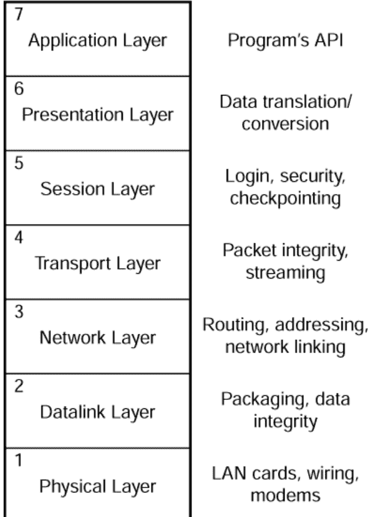

### 第 1 层：物理层

物理层涵盖了所有与硬件相关的接口：介质和信号。介质（例如：双绞线、同轴电缆、光纤）将信号传输到其目的地。

物理层的一部分是网络适配器。网络适配器充当内核和物理介质之间的中介。在一端，它接受来自内核驱动的传输请求并发送消息数据包（`帧`）。完成后，它会通过中断通知内核。

适配器的微控制器在尝试发送帧之前会监听静默的网络。它检测并处理冲突和重传。如有必要，它会通知内核传输问题。内核的驱动程序随后管理其自身的重试或将错误传递给协议栈的上层。

在另一端，适配器监听网络上与其硬件（`以太网`）地址匹配的消息。匹配后，适配器填充内部缓冲区并向内核发出中断。为此，硬件层提供其自身的硬件标识。

数据帧中继器接受所有网络消息并将其传递到网络的新段。数据中继器是“笨拙”的，因为它们不从数据包中进行选择并忽略硬件标识。数据中继器比典型的中继器具有更少的编程智能，典型的中继器选择性地允许数据包在段之间传输，并位于物理层。使用数据中继器来扩展网络长度并放大衰减的信号。

最后，一些以太网适配器现在包括自己的校验和或`CRC`以执行数据验证检查。如果`CRC`发现错误，卡会将数据标记为可疑，供数据链路层修复。这可能会给你对数据报协议多一点信心。

其他物理网络可能有其他机制。例如，`PPP`连接可能包含奇偶校验（大多数不包含）。`FDDI`有校验和或`CRC`。一些晦涩的无线电协议只是将每个字符发送两次。

### 第 2 层：数据链路层

数据链路层建立在物理层之上。数据链路层的主要作用是在主机之间提供数据传输。它将消息打包成帧供硬件使用。它检查并尝试纠正传输错误。如果硬件不支持校验和或`CRC`，数据链路层会自行进行计算。

数据链路层在内核和网络硬件之间提供接口。通常，数据链路层是位于内核中的网络驱动程序。该驱动程序使用统一接口，以便内核可以盲目地处理差异巨大的技术。

该层准备数据帧以进行传输，并解组装接收的消息。驱动程序等待指示消息已发送或已接收消息的中断。当它收到消息发送通知时，数据链路驱动程序加载下一个要发送的帧。

数据链路层与内核的缓冲子系统紧密协作。大多数时候，它只需要 10–60KB 的系统 RAM。`Linux`的内核配置允许你定义缓冲区和 1MB 以上的帧大小，用于非常快速的传输（100MB/s 或更高），如果你有足够的内存。这对于可能接收大帧或高吞吐量的超高速连接非常有用。要使用此功能，你可能需要重新编译内核，因为许多`Linux`发行版未启用此功能。

网络桥位于数据链路层。在本文撰写时，`Linux`内核的桥选项仍属实验性质。如果你想尝试使用它，可能需要重新配置并编译内核以包含驱动程序。

网络层建立在数据链路层之上，并提供地址解析和路由。

### 第 3 层：网络层

网络层建立在数据链路层之上。其主要功能是与路由表、路由器和网关配合，以找到目标主机。在未路由网络中，该层基本上处于非活动状态。

网络层为异构网络提供统一的寻址机制。例如，如果你有两个物理网络，如`AppleTalk`和`以太网`，该层通过帧转换将它们桥接起来。

网络路由器位于此层，提供同构物理网络和异构物理网络之间的连接。

### 第 4 层：传输层

传输层建立在网络层之上，依赖于数据链路层和网络层的数据完整性和路由。其主要责任是完整、有序且无重复地传递消息。该层添加了许多功能以提供流传输和通信完整性。

传输层是该模型能够处理任何数据或通信错误的最后一层。（`数据错误`在此仅指数据的完整性，而非含义。例如，该层不会捕获格式错误的`HTTP`请求，但会捕获校验和错误。）如果该层检测到数据包丢失或损坏，它会请求发送方重传。为了进行此检查，它向数据包添加了更多的校验和。

该层引入了`虚拟网络`或`多路复用`的概念。凭借此功能，每个连接都拥有对网络的独占连接的感知（类似于`TCP/IP`端口概念）。尽管你的主机可能正在运行几个网络程序，你的程序仍能接收到其他程序发送给它的消息。

由于其可靠性，传输层是应用程序之间通过互联网进行通信时最常使用的层。它提供了保持网络会话所需的所有功能。

### 第 5 层：会话层

会话层严重依赖传输层来提供其所需的流传输和可靠性。其主要责任是提供对连接和数据流的控制。

连接可能不稳定，因此该层提供`检查点`。例如，假设连接正在传输文件，连接中断了。如果在重新连接时文件必须重新开始，那么获取文件第一部分所花费的所有时间都丢失了。检查点固定传输的部分，以便新连接只需接收缺失的部分。

如前文所暗示，会话层自动重新建立中断的连接。它还提供安全和服务登录程序。

它还提供数据流管理。`客户端/服务器`连接的问题之一是控制谁先说话以及如何保持对话。该层使用的一种方法是传递令牌：拥有令牌的主机可以执行关键操作。这种流控制降低了死锁、饥饿或数据损坏的可能性（在“[客户端服务器并发问题](Client-Server%20Concurrency%20Issues)”章节第 [第 10 章](Chapter%2010)中详细讨论）。

### 第 6 层：表示层

表示层管理数据并进行必要的转换（例如：解压缩、格式化、布局、图像显示、字符集转换）。远程过程调用（参见 [第 15 章](Chapter%2015)，"[使用远程过程调用 (RPC) 进行网络封装](Remote%20Procedure%20Calls%20(RPCs))"）是该层的一个实际示例。

## 第 7 层：应用层

最后一层，即应用层，提供了诸如文件传输、终端仿真、消息传递和网络管理等网络服务。本质上，大多数应用程序都使用这一层，因为它提供了应用程序编程接口（`API`）。然而，它并不是实际的用户应用程序；它是一组库调用和服务，旨在帮助应用程序与网络协同工作。网络文件系统（`NFS`）是这一层的一个示例，它挂钩到操作系统的虚拟文件系统架构。它在`RPC`工具之上构建，以提供功能接口。

## 互联网协议套件

`Linux`（与大多数其他`UNIX`操作系统一样）并不直接使用`OSI`网络模型。然而，该模型是理解`IP`协议栈的起点。`Linux`使用互联网协议套件来管理其原生网络接口。

## 注意

`IP`协议源于`ARPAnet`（高级研究计划局网络），该网络由`DARPA`（国防高级研究计划局）于 1972 年资助。`BBN`公司实现了该网络最早的雏形。后来，由贝尔实验室提供的免费操作系统`UNIX`也采用了该模型。参与其中的大学使用`UNIX`测试了一个概念，即在美国各地将多台计算机连接在一起。`Sockets API`起源于 1983 年的`BSD 4.2`。

互联网协议套件包含四个层，与`OSI`模型紧密对应。最高层被称为应用层。`IP`套件的应用层涵盖了`OSI`的第 5 至第 7 层（见图 5.2）。请参考图 5.1 进行对比。

> 图 5.2。国防部（`DoD`）或互联网协议栈与`OSI`模型非常相似。`Socket API`止步于`OSI`的传输层（第 4 层）。该协议将剩余的层留给高级程序，如`Telnet`、`FTP`和`Lynx`。

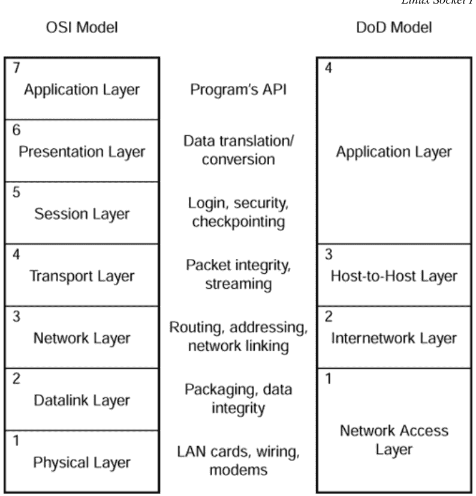

## 第 1 层：网络访问层

`IP`的第一个网络层与`OSI`的物理层和数据链路层最为接近。由于硬件和驱动联系非常紧密，且硬件支持差异巨大，因此无法将两者隔离开来。

其特征类似：驱动程序与硬件接口紧密协作，为内核提供一组通用的功能。作为交换，内核赋予驱动程序对端口和中断的直接访问权。如果接口缺少内核所需的任何功能，驱动程序将弥补这一不足。

`Linux`增加了另一项使该层复杂化的功能：热插拔网络适配器。这在`PCMCIA`支持中有所体现。当您插入`PC`卡时，`PC`卡管理器会识别它，分配适当的端口和中断，插入定义的内核模块，并配置您的网络。同样，当您移除卡时，管理器会禁用网络并移除内核模块。

## 第 2 层：网际层（IP）

`IP`层（包括`IPv4`和`IPv6`）依赖于设备驱动程序提供通用接口和功能。这两个版本在该层有所不同。它们组成不同的协议栈，根据需要将在`IPv4`和`IPv6`之间进行转换，以确保兼容性。

`IP`层与`OSI`的网络层对齐得最好。它提供了该层的逻辑寻址和路由功能。`IP`层缺乏的一个部分是网络层的错误消息功能。

### 第 2 层：控制/错误消息扩展（ICMP）

`ICMP`（互联网控制消息协议）补充了`OSI`网络层缺失的错误消息功能。`ICMP`为消息路由和转发中的错误和异常提供消息协议。典型的异常包括 `network not reachable` 和 `host not found`。

该协议与其他系统协作以执行各种功能。例如，当主机变得无法访问时，它会与路由表（`ARP`）协同工作。此外，它与`TCP`协作以加速或减缓通信并改变滑动窗口。`IPv6`甚至增加了对多播组管理的控制。

关于`ICMP`，有趣的是它独立存在。`UDP`和`TCP`都不使用它的层。它们确实接受其消息用于自身处理。

## 第 3 层：主机到主机（UDP）

与普遍认知相反，`UDP`（用户数据报协议）并不完美匹配`OSI`传输层（参见*图 5.3*）。传输层保证交付、有序数据包、无错误数据包和流式功能。`UDP`并不提供这些；参见*表 5.2*。


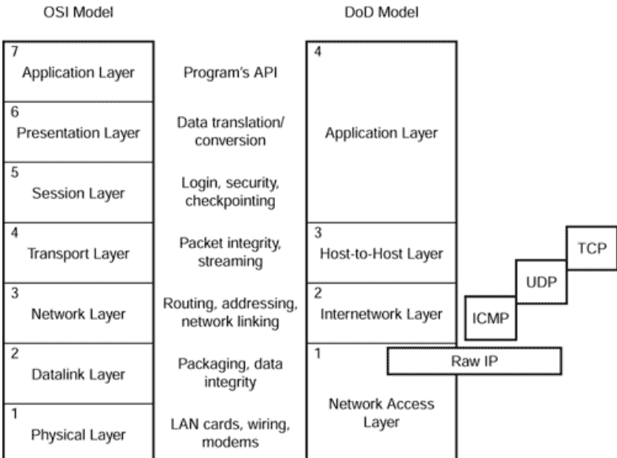

**表 5.2**，传输层与 UDP 对比

| 传输层 | UDP |
|---|---|
| 可靠数据 | 可靠数据（校验和） |
| 可靠交付 | 无保证交付 |
| 协商窗口大小 | 固定窗口（由程序决定） |
| 面向记录 | 面向数据包 |
| 基于网络层 | 基于 IP |

`UDP` 增加了传输层的一项主要功能：带有端口的虚拟网络。如第 4 章“对等间发送消息”所述，这一特定功能抽象了网络，使您的网络程序表现得好像它独占连接一样。其他所有功能都与 `IP` 层类似。如果定位得当，`UDP` 横跨网络和传输层，更偏向网络侧。

## 第 3 层：主机流（TCP）

`TCP` 层与 `OSI` 传输层匹配得很好。两者都提供了构建会话所需的可靠性、流式、有序性和错误管理。重要的是要强调，`TCP` 并不建立在 `UDP` 之上。它在网络子系统中拥有自己的报头和路径。并排对比请见表 5.3。

**表 5.3. 传输层与 TCP 对比**

| 传输层 | TCP |
|---|---|
| 可靠数据 | 可靠数据（校验和） |
| 可靠交付 | 保证交付 |
| 协商窗口大小 | 滑动窗口 |
| 面向记录 | 面向流 |
| 基于网络层 | 基于 IP |

## 第 4 层：应用层

这是 `TCP/IP` 模型停止的地方。根据该模型，应用层由 `OSI` 的会话层（第 5 层）、表示层（第 6 层）和应用层（第 7 层）组成。`TCP/IP` 模型有一些应用程序来填补这些角色。这一层的一些示例包括 `Web` 浏览器、网关、`Telnet` 和 `FTP`（文件传输协议）。远程过程调用（`RPC`）与表示层对齐得最好。网络文件系统（`NFS`）依赖于 `RPC`，似乎符合应用层。然而，这些应用程序模糊了边界，使得将它们分配到任何特定层都很困难。

应用层建立在主机流层（`UDP` 和 `TCP`）之上。然而，它可能会直接接受来自 `ICMP` 的消息。

## `OSI` 和 `IP` 之间的基本差异

`OSI` 和 `IP` 模型都使用分层来定义每个协议栈的角色。它们也都从依赖硬件的代码过渡到抽象应用。但您可能已经注意到一些差异。

`OSI` 对数据以及协议都进行分层。参考图 5.1，堆栈中的每一层都有自己独立的报头信息。当数据在堆栈中向物理层移动时，每一层都将消息封装在自己的数据包中。

例如，如果您发送一个会话层消息，物理层将看到一系列倒序的报头：数据链路、网络、传输和会话。消息本身跟随在所有这些报头之后的数据末尾。每一层都使用此过程，包括物理层。最终，单个数据包上可能有最多七个报头。

接收方逆转此过程。它使用封装的数据来确定是否将您的消息传递到下一层。在之前的示例中，您的消息到达物理层。每一层剥离其报头。如果它看到另一个报头，它将消息传递到下一层。最终，消息在会话层停止。

`IP` 模型的工作方式不同。为每一层附加报头可能会使您的消息报头繁重，从而降低吞吐量。相反，`IP` 模型将协议类型放在 `IP` 报头中。当 `IP` 接收到消息时，它检查该字段并在移除自己的报头后，将消息直接路由到您选择的协议。

此外，如第 3 章末尾所述，`IP` 的每个协议都填充一个特定的角色。与 `OSI` 模型中每一层稳稳地建立在低层之上不同，所有协议都建立在原始 `IP` 协议之上。

再次说明，`IP` 模型使用协议来解决特定需求。`ICMP` 用于错误消息，`UDP` 用于定向消息和无连接通信，`TCP` 用于流式传输。原始 `IP` 用于开发新协议。

## 哪些服务做什么？

下一步是如何使用 `DoD` 网络模型。如果您想访问 `IP` 堆栈的所有不同层，请使用 `socket()` 系统调用。

**表 5.4. `DoD` 层摘要**

| `DoD` 层 | 程序员/用户访问 |
|---|---|
| 4-应用 | `FTP`, `Gopher`, `Lynx`, `Netscape`, `IRC` |
| 3-主机到主机 (`TCP`) | `socket(PF_INET, SOCK_STREAM, 0);` |
| 3-主机到主机 (`UDP`) | `socket(PF_INET, SOCK_DGRAM, 0);` |
| 2-网际 (`ICMP`) | `socket(PF_INET, SOCK_RAW, IPPROTO_ICMP);` |
| 2-网际 (`IP`) | `socket(PF_INET, SOCK_RAW, protocol);` |
| 1-网络访问 | `socket(PF_INET, SOCK_PACKET, filter);` |

此接口可能与您的预期不同。`Linux` 允许使用 `SOCK_PACKET` 读取低级别驱动程序消息。这一 `Linux` 特定功能使您可以访问网络上的任何和所有消息。您在第 3 章中使用此功能构建了自己的网络监听器。

## 总结：从理论到应用

本章探讨了不同网络元素之间的接口，这些元素需要协同工作。网络挑战包括计算机硬件接口、网络连接问题、操作系统链接和应用接口。每个都有特定的问题，阻碍您的程序访问其他计算机。网络使用精心设计的模型来解决这些问题，帮助您以一致的方式编程。

两个网络模型，`OSI` 和 `IP`（或 `DoD`），将解决方案分为层。这些层像蛋糕层一样层层堆叠。低层提供的支持增加了高层的数据可靠性和接口。这些层还为您提供速度与可靠性之间的广泛选择。

第一层处理计算机之间的物理接口。依次，每一层增强消息的可靠性、到达和流动。当您使用协议堆栈中间层的接口时，您可以预期数据将正确到达。

较高的层级表现得好像网络就是计算机一样，而较低的层级则表现得好像你正在发送瓶中信。每一层对程序数据都有其用途。

# 第二部分：服务器视角与负载控制

- 第 6 章：服务器入门
- 第 7 章：负载分配：多任务处理
- 第 8 章：选择何时等待 I/O
- 第 9 章：突破性能壁垒
- 第 10 章：设计健壮的 `Linux` 套接字

# 第 6 章：服务器入门

### 本章内容

- 映射套接字：服务器的一般程序流程
- 一个简单的回声服务器
- 关于定义协议的一般规则
- 扩展示例：`HTTP` 目录服务器
- 总结：服务器的基本元素

网络程序总是包含一个发送者和一个接收者。通常，发送者是一个客户端，它连接到网络计算机提供的服务。本书的第一部分，“从客户端视角的网络编程”，详细涵盖了客户端的立场——如何连接到服务器、如何创建无连接通信，以及如何支持 `IP` 的工具。本章介绍另一半：即接收者或服务器的视角。

服务器的视角完善了客户端/服务器交互。为了说明客户端和服务器之间的关系，你可以将网络比作电话系统，将服务器比作大型公司的中心电话号码，该号码将呼叫路由给其员工。客户端通过中心号码和分机号连接到其中一名员工。从这个例子中，你可以看到网络上的服务器如何接受来自客户端的连接。主号码是主机的地址，分机号则是服务端口。

服务器请求一个特定的端口号——即客户端知晓的那个端口。类似于公布电话号码，如果服务器没有获得它想要的号码，客户端就无法呼叫它。

本章将视角从第一部分中讨论的“请求服务”转变为“提供服务”。它将引导你逐步完成编写和构建服务器的过程。最后，一个小型 `HTTP` 目录服务器向你展示如何连接到 `Web` 客户端以及如何打包 `HTML` 消息。

## 映射套接字：服务器的一般程序流程

创建服务器的过程总是从创建套接字开始。就像客户端在特定时刻需要特定的调用一样，服务器使用类似的路径，但增加了一些额外的系统调用。服务器调用 `socket()`，但它必须执行客户端可选的那些额外工作，如图 6.1 所示。

**图 6.1。客户端和服务器的程序流程相似，但在连接网络的方式上有明显区别。这是一张客户端和服务器程序系统调用的映射图。**

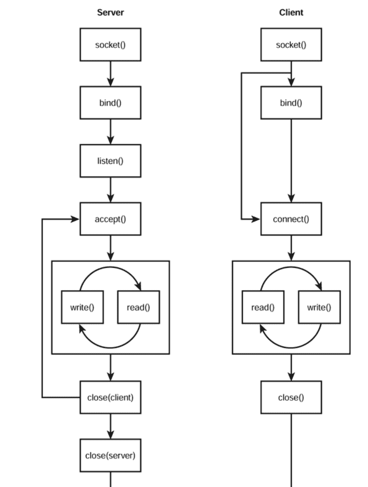

你在前面章节中编写的客户端程序遵循客户端流程图。按顺序，客户端调用：`socket()`、`connect()`、`read()`、`write()` 和 `close()`。`bind()` 系统调用是不必要的，因为操作系统为你执行了该功能。由于程序是呼叫服务器，所以不需要端口号。客户端始终建立主动连接，因为它主动追求连接。

另一方面，服务器程序需要为客户端程序提供一致且特定的端口号，以便服务器能够服务它们。服务器图显示了一些与客户端不同的地方。你编写的服务器程序必须调用 `socket()`、`bind()`、`listen()`、`accept()` 和 `close()`。并且，当客户端程序是主动连接时，服务器是被动连接。`listen()` 和 `accept()` 系统调用仅在客户端请求连接时才建立连接（就像接起振动的电话）。

第 4 章“在对等体之间发送消息”介绍了 `bind()` 系统调用。本章对其进行更正式的定义。同样，本章描述了两个新的调用——`listen()` 和 `accept()`。

### 一个简单的回声服务器


在讨论用于创建服务器的不同系统调用之前，你可能想先看看服务器示例的一般程序流程。该示例是标准的回声服务器。就像 C 语言编程中的 `Hello World` 示例一样，回声服务器是套接字服务器的示例。你可以在网站上找到该程序的完整源代码，其名为 `simple-server.c`。

对于大多数通信来说，最简单的测试是回声。就像电话推销员重复你的订单以确保正确性一样，你可以使用回声来启动自己的服务器。基本上，以这种方式编写程序有助于你构建和测试关键应用程序。

**注意**

构建与测试范式

你可能注意到，本书引用了许多基于计算机科学的学科。网络编程需要更多地关注测试、检查和构建。它充满了许多不同的根本性问题，因此你必须使用最简单的编程方法以尽量减少程序错误。构建与测试范式（`快速原型设计`的一个小方面）让你能够专注于特定问题。解决该问题后，结果将成为你其余开发的构建块。

通用服务器要求你按特定顺序调用一系列系统调用。回声服务器很好地展示了这种顺序，而没有用服务器特定的处理来混淆示例。以下是回声服务器的一般程序流程：

1. 使用 `socket()` 创建套接字。
2. 使用 `bind()` 绑定端口。
3. 使用 `listen()` 将套接字转换为监听套接字。
4. 使用 `accept()` 等待连接。
5. 使用 `recv()` 或 `read()` 读取消息。
6. 使用 `send()` 或 `write()` 回声返回消息。
7. 如果消息不是 `bye`，返回步骤 5。
8. 使用 `close()` 或 `shutdown()` 关闭连接。
9. 返回步骤 4。

该程序流程通过仅在客户端指示时（使用 `bye` 命令）才关闭连接，展示了与无连接接口的区别。[第 4 章](Chapter_04.html) 提出了基于连接和无连接套接字的比较。服务器完善了该比较。你可以将无连接的等待对等体视为准服务器。

该程序流程在创建服务器时重要的是看到前方有什么。第一个明显的步骤（创建套接字）已在[第 1 章，“介绍食谱网络客户端。”](#chapter_1) 中讨论过。并且，正如那里所述，所有网络通信都从该步骤开始。下一步，绑定端口，对你的服务器至关重要。

## 将端口绑定到套接字

基于连接的套接字，像往常一样，从调用 `socket()` 开始。服务器通常使用可靠的 TCP 协议层，因此你可以使用 `SOCK_STREAM` 标志。但是，你必须再进一步——客户端需要知道连接哪个端口。

`bind()` 系统调用询问系统你的程序是否可以拥有特定的端口号。就像销售公司请求并公布中心电话号码供其客户端使用一样，`bind()` 选择一个端口号。如果你的服务器未指定端口号，操作系统将从其号码池中分配下一个可用的端口。如果操作系统为你分配了一个端口，该端口在你每次运行程序时可能不同。

如果你请求但未获得特定端口号，你也能判断服务器是否已在运行。操作系统将端口仅分配给一个进程。

`bind()` 系统调用看起来如下：

```c
#include <sys/socket.h>
#include <resolv.h>
int bind(int sd, struct sockaddr *addr, int addrsze);
```

`sd` 变量是你最初创建的套接字描述符。最初在[第 1 章](#chapter_1)中定义，变量 `addr` 指向来自 `sockaddr` 记录族（定义于[第 2 章，“TCP/IP 网络语言流利度”](#chapter_2)）的套接字名称（端口号）。你提供的最后一个参数 `addrsze` 是 `sockaddr` 记录的长度。

由于套接字 API 的整体概念——一个接口但多种架构——程序需要向操作系统提供记录的大小。操作系统支持许多协议，每个协议使用其自己的命名结构，并且每个结构具有不同的大小。

要使用 `bind()`，你需要创建并填充 `addr`（参见[列表 6.1](#listing_6_1)）。

### 示例 6.1. 在 TCP 服务器中使用 bind()

```c
/*****...
/*** INET 套接字示例：填充 sockaddr_in 结构 ***
/*** 变量 addr。 ***
/*****...*/
struct sockaddr_in addr; /* 创建互联网套接字名称 */
bzero(&addr, sizeof(addr)); /* 从干净的状态开始 */
addr.sin_family = AF_INET; /* 选择 IP 堆栈 */
addr.sin_port = htons(MY_PORT); /* 指定端口号 */
addr.sin_addr.s_addr = INADDR_ANY; /* 允许任何主机 IP 地址 */
if ( bind(sd, &addr, sizeof(addr)) != 0 ) /* 请求端口 */
```

```c
perror("Bind AF_INET");
```

使用清单 6.2 中的代码段绑定到命名套接字（`AF_UNIX` 或 `AF_LOCAL`）。

### 示例 6.2. 在 LOCAL 服务器中使用 bind()

```c
/**************************************************
/***  LOCAL Socket Example: Fill the sockaddr_un struct  ***/
/***  variable addr
/*****

#include <linux/un.h>
struct sockaddr_un addr;      /* create a local named socket */
bzero(&addr, sizeof(addr));   /* start with a clean slate */
addr.sun_family = AF_LOCAL;    /* select a named socket */
strcpy(addr.sun_path, "/tmp/mysocket");  /* select name */
if ( bind(sd, &addr, sizeof(addr)) != 0 )        /* bind name */
        perror("Bind AF_LOCAL");
```

使用此特定代码段，你可以查看 `/tmp` 目录并看到套接字文件。系统消息记录器 `syslogd` 使用 `LOCAL` 套接字获取其信息：系统进程打开到记录器套接字的连接并向其发送消息。

以下是调用时可能出现的典型错误：

- `EBADF` 套接字描述符无效。如果 `socket()` 系统调用失败且你未检查返回值，可能会发生这种情况。
- `EACCES` 请求的端口号仅允许 `root` 访问。请记住，如果你使用 0–1023 之间的端口，运行程序时必须是 `root`。更多信息，请参见第 2 章中关于主机端口号的部分。
- `EINVAL` 端口已被使用。你可能有另一个程序拥有此端口。此外，如果你在服务器死机后立即重新运行服务器，也可能会遇到此错误。操作系统释放已分配端口（最多 5 分钟！）需要一些时间。

在所有情况下，`bind()` 系统调用都尝试为你的服务器套接字分配一个特定的名称或端口（使用 `/etc/services` 文件作为可用端口或标准端口的参考）。客户端使用此端口建立连接并开始发送和接收数据。

## 创建套接字监听队列

套接字接口为你的程序提供了与其他网络上的程序连接的方式。连接是排他的：一旦某个程序连接，其他程序就无法连接。绕过此限制的一种方法是创建一个等待队列。

你使用 `listen()` 系统调用来启用套接字等待队列。回顾本章前面的示例，如果公司只有一部电话，它一次无法处理超过一个呼叫；因此，不太可能不会遇到忙音。解决方案是添加呼叫等待。

`listen()` 系统调用类似于呼叫等待队列。当服务器调用 `listen()` 时，它指定队列插槽的数量。此调用还将套接字转换为仅监听套接字。此转换很重要，以便你稍后使用 `accept()` 系统调用。

```c
#include <sys/socket.h>
#include <resolve.h>
int listen(int sd, int numslots);
```

同样，`sd` 参数表示由 `socket()` 调用创建的套接字描述符。`numslots` 参数分配待处理连接插槽的数量。清单 6.3 中的代码段显示了一种典型用法。

### 示例 6.3. Listen() 示例


```c
/* ******************************************************/
/*   Listen-Conversion Example: Convert the socket to a   */
/*   listening socket for client connections.               */
/* ******************************************************/
int sd;
sd = socket(PF_INET, SOCK_STREAM, 0);
/* ** Bind port ***/
if ( listen(sd, 20) != 0 )    /* convert to listening socket */
    perror("Listen");        /* ...with 20 pending slots */
```

通常，服务器将队列深度设置为 5 到 20 个待处理连接。在正常的生产（多任务）环境中，队列深度超过 20 通常是一种浪费。如果没有多任务，你可能需要将其增加到接近你设置的超时值（例如，60 秒设为 60）。

以下是 `listen()` 系统调用通常返回的错误：

- `EBADF` 套接字描述符无效（参见 `bind()` 系统调用的说明）。

- `EOPNOTSUPP` 套接字协议不支持 listen 调用。例如，TCP（`SOCK_STREAM`）支持监听队列，但 UDP（`SOCK_DGRAM`）不支持。

将套接字转换为监听套接字后的下一步是等待并接受连接，如下一节所述。

## 接受客户端连接

到目前为止，程序已创建套接字、绑定了端口号并设置了连接队列。现在，它可以接受连接了。`accept()` 系统调用使套接字描述符成为所有连接的分派器。这里事情变得有点奇怪，并且最初的规则被打破。当你将套接字转换为监听套接字时，它不再是数据的双向通道。你的程序实际上甚至不能读取数据；监听套接字只允许你接受连接。`accept()` 系统调用等待（或阻塞）直到连接到达。

当客户端建立连接时，监听套接字使用相同的端口为该客户端创建一个新的双向通道。`accept()` 系统调用隐式为程序创建一个新的套接字描述符。实际上，每个新连接都在客户端和服务器之间创建一条新的专用线路。从此，你通过新通道与客户端交互。

此外，你可以确定谁在连接到你的服务器，因为调用的一些参数获取了客户端的连接信息。第 4 章介绍了一个类似的系统调用 `recvfrom()`，它获取数据和返回地址。这些地址信息对于跟踪连接到你的服务器的计算机非常有用。

```c
#include <sys/socket.h>
#include <resolve.h>
int accept(int sd, sockaddr *addr, int *addr_size);
```

一如既往，`sd` 参数是套接字描述符。与 `recvfrom()` 系统调用一样，最后两个参数为调用提供了写入客户端地址和端口号的位置。与 `recvfrom()` 系统调用不同，`accept()` 的最后两个参数是可选的。如果你不想获取调用者的地址和端口号，只需将这些参数设置为零。

确保 `addr` 参数的大小足够大，以接受其预期的地址。不用担心缓冲区溢出导致的损坏；调用不会超过 `addr_size` 字节。在大多数情况下，客户端连接的大小与协议相同（例如，`sockaddr_in` 对应 `AF_INET` 或 `sockaddr_ipx` 对应 `AF_IPX`）。该调用通过引用传递 `addr_size`，以便你的程序可以确定实际使用的字节数（参见清单 6.4）。

## 示例 6.4. Accept() 示例

```c
/*************************************************************/
/*** Accept Example: Wait for and accept a client        ***/
/*** connection.                                         ***/
/*************************************************************/
int sd;
struct sockaddr_in addr;

/*** Create socket, bind it & convert it to a listener **/
for (;;)                                /* repeat this indefinitely */
{
    int clientsd;                       /* the new socket descriptor */
    int size = sizeof(addr);            /* reassign the size of addr */

    clientsd = accept(sd, &addr, &size); /*await connection */
    if ( clientsd > 0 )                 /* no error occurred */
    {
        /**** Interact with client ****/
        close(clientsd);                /* clean up and disconnect */
    }
    else                                /* accept error */
        perror("Accept");
}
...
```

## 与客户端通信

请注意，清单关闭了 `clientsd`。`clientsd` 套接字描述符与 `sd`（主套接字描述符）不同。关闭 `clientsd` 很重要，因为每个连接都会生成一个新的描述符。未能关闭每个连接最终可能导致文件描述符插槽耗尽。

## 注意

### 重用 `addr` 变量

你可以重用 `bind()` 系统调用中的 `addr` 局部变量。在完成服务器端口的 `bind()` 之后，服务器不再需要该信息。此时可以安全地使用该变量用于其他目的。

请记住，大多数参数都是网络字节序。你可以使用第 2 章中描述的转换工具从 `addr` 中获取地址和端口号（参见清单 6.5）。

## 示例 6.5：带连接日志记录的 Accept()

```c
/***** Accept 示例（修订版）：添加客户端连接日志记录   ***/
/***** 请与列表 6.4 进行比较                 ***/
*****（在循环内部）****/
...
client = accept(sd, &addr, &size);
if ( client > 0 )
{
    if ( addr.sin_family == AF_INET )
        printf("Connection[%s]: %s:%d\n", /* 记录连接日志 */
               ctime(time(0)),             /* 给连接打上时间戳 */
               ntoh(addr.sin_addr), ntohs(addr.sin_port));
    /****-与客户端交互-****/
...
```

如果 `accept()` 系统调用发生错误，它会向你的服务器返回一个负值。否则，它将返回一个新的套接字描述符。以下是一些常见的错误：

- `EBADF` 套接字描述符无效（参见第 4 章中关于 `bind()` 的说明）。

- `EOPNOTSUPP` 对于此调用，套接字必须是 `SOCK_STREAM` 类型。

- `EAGAIN` 套接字被设置为非阻塞模式，且监听队列中没有待处理的连接。如果没有人在队列中，对 `accept()` 的调用将阻塞任务，除非将套接字设为非阻塞。

回显服务器简单地将其接收到的内容原样发送回来，直到接收到 `bye` 消息为止（参见列表 6.6）。

## 示例 6.6：回显服务器示例


```c
/**** 回显服务示例：将收到的任何内容都回显发出去   ***/
/**** 直到收到 "bye<回车>"。（请与列表 6.5 进行比较）        ***/
*****（在循环内部且在 accept() 之后）****/
...
if ( client > 0 )
{
    char buffer[1024];
    int nbytes;

    do
    {
        nbytes = recv(client, buffer, sizeof(buffer), 0);
        if ( nbytes > 0 )      /* 如果有真实数据，则回显 */
            send(client, buffer, nbytes, 0);
    } while ( nbytes > 0 && strncmp("bye\ r", buffer, 4) != 0 );
    close(client);
}
...
```

请注意，结束条件查找的是 `"bye\ r"`（`bye` 后跟回车符），而不是 `"bye\ n"`（`bye` 后跟换行符）。取决于输入处理的方式（`Telnet` 不做任何处理），服务器可能会收到其中一种字符。为了增强健壮性，建议同时测试这两种情况。请使用 `Telnet` 作为客户端来尝试此程序。完整的程序名为 `simple-server.c`，可在网站上找到。

## 定义协议的一般规则

当与其他计算机通信时，你的程序需要就交互过程达成一致。两个非常重要的问题是“谁先说话？”和“何时结束？”这种协议定义了事务协议。

客户端和服务器使用这些过程来确保它们不会同时传输数据，也不会盲目地等待对方先传输数据。在构建服务器时，请考虑以下各小节中的问题。

### 哪个程序先说话？

大多数服务器会先说话。但高安全系统有时会让客户端发送第一条消息。你所使用的过程可以让客户端进行身份识别（不仅仅是标准的主机 ID 和端口）。与此同时，你可能希望有一个更用户友好的系统，在连接时提供一些身份识别信息和协议列表。

另一个需要考虑的是不必要的交互。如果服务器先说话，它通常在每次接收到连接时都说同样的话。客户端需要知道这一点吗？增加的交互会稍微减慢通信通道吗？

### 哪个程序主导对话？

通常，客户端主导与服务器之间的交互。客户端连接到服务器并发送请求。服务器则处理这些请求并发出回复。

但是，你有时可能需要交换角色。例如，客户端向你的服务器请求某些数据库信息。在传输数据后，另一个客户端更新了第一个客户端请求的字段。如果第一个客户端仅基于第一组数据进行工作，它可能会做出错误的决策。

在这种情况下，服务器应向客户端发送未经请求的更新，而客户端需要接受这些更新。考虑客户端如何与服务器交互，以及同级如何相互交互，并注意例外情况，制定解决它们的方法。

### 你需要什么级别的认证？

为了编写高度安全的系统，了解服务器正在与谁通信至关重要。反过来，服务器必须知道或认证用户，至少是机器。

认证过程可以包括用户名和密码。它也可以使用受信任的证书颁发机构为用户的机器进行认证。`第 16 章“为网络程序和 SSL 添加安全性”` 讨论了安全套接字层（`SSL`），并提出了两种解决此问题的可能方案。

另一方面，你可能不需要认证，而是希望进行某种形式的日志记录。有多少人口统计数据访问你的服务器？为了满足用户需求，你需要加强服务器的哪些部分？你如何在不引人注目的情况下了解你的客户？

在编程服务器时，这些问题都很重要。网上有很多关于如何获取人口统计数据和用户需求/趋势的示例。这些信息还可以提供关于软件缺陷甚至系统破解者的信息。一种简单的方法是询问。一些浏览器和 `Web` 服务器使用更复杂的方法。

### 你使用什么类型的数据？

你交互的大多数服务器都使用 `ASCII` 进行通信，而大多数网页都是文本/`HTML`。考虑一下“这是最有效率的数据形式吗？”和“客户端支持压缩数据吗？”这些问题是个好主意。当你查看你的服务器和客户的客户端时，请考虑如何减少服务器、网络和客户端上的延迟。

压缩数据可以带来一些实实在在的好处。压缩后的 `ASCII` 可以将数据大小减少 50% 到 80%。即使是压缩数据也可以是 `ASCII`，不会导致太大膨胀，因此网络不会丢失任何二进制高位。以下各小节更详细地说明了如何处理数据。

### 你如何处理二进制数据？

二进制数据——尤其是压缩后的——比 `ASCII` 更有效率。问题在于：一些网络只支持 7 位字节。这对于 8 位二进制数据来说是一个实际问题。这些网络通常是老旧系统（dinosaurs），更换成本太高。幸运的是，连接到这些网络的路由器通常能识别这种不兼容性，并根据需要将数据进行降位或升位转换。这种转换需要计算时间，因此会减慢传播速度。数据重定格式会影响接收主机，因为主机必须重组被分割的数据。

此外，你是从非二进制开始然后切换到二进制吗？如果是这样，你的客户端或服务器需要告诉对方何时切换。类似地，你可能希望在某个时候切回非二进制。

### 你怎么知道发生了死锁？

你可能会遇到服务器和客户端互相等待的情况（死锁）。在等待过程中，它们占用了宝贵的资源，可能会考验用户的耐心。

在确定你的特定问题是否是死锁之前，尝试识别导致死锁的情况。如果存在死锁，唯一的解决方案是断开连接并重试。当你不得不重新连接时，你会丢失连接的上下文（你在交互中的位置），并且可能会丢失数据。

客户端或服务器可能会遇到`饥饿`（无限期地等待资源）。`饥饿`通常发生在客户端或服务器正在执行除管理连接以外的其他操作时。与死锁一样，标准解决方案是超时并重新连接。

### 你需要时钟同步吗？

虽然具有挑战性，但当存在时间关键问题（如金融交易）时，时钟同步（协调主机之间的实时时钟）是必不可少的。这是一个棘手的问题。首先，确定同步需要多准确。

服务器必须相对于客户端建立其时钟。然而，大多数客户端不与网络时间同步。由于客户端通常不准确，双方都会使用仲裁者（时间服务器）。然而，这带来了自身的问题（从网络获取正确时间的延迟）。

解决同步问题的一个方案是在服务器上设置所有事务（将更多责任从客户端转移走）。在服务器完成事务后，它将发布时间和日期回复给客户端。

## 如何以及何时重启连接？

在交互的某些阶段，服务器和客户端可能需要从头开始，但又不能失去连接。失去连接可能导致大量信息丢失，因此重新建立连接是不可行的。

`TCP/IP` 协议提供了一种优先消息，你可以将其用作重置消息。有关优先消息和带外数据的更多信息，请参阅`第 9 章“突破性能瓶颈”`。这条消息只是一个开始；你的服务器和客户端都必须回到某个起点。这在结构化编程中是一个挑战。

重新连接是重新开始的直接方式。紧急消息可以指示客户端或服务器关闭连接。然后，客户端可以重新连接以重新建立通信。然而，重新连接可能会丢失比你期望更多的信息。因此，重置可以强制客户端和服务器回到某个已知的点。你的数据的关键性在连接恢复中起着非常重要的作用。

## 何时结束？

服务器和客户端已经连接并来回传递数据包。现在是说再见的时候了。知道交互何时完成可能不像看起来那么容易。例如，当你编写一个 `HTTP` 服务器时，你通过发送两个换行符来完成交互。然而，如果你用于单次读取的缓冲区空间不足，并且使用`read()`或`recv()`进行读取时，你可能会无限期地等待客户端的请求。在这种情况下，服务器可能会超时而声明连接结束。

同样，决定哪个程序应该先关闭连接也很困难。如果服务器在客户端完成传输之前关闭连接，客户端会收到管道破裂错误（`EPIPE`）。

归根结底，这取决于协议的要求。`HTTP` 交互需要一对换行符来表示传输结束。你可能不得不定义自己的方式，因为流式套接字给了你很大的自由度。

## 扩展示例：HTTP 目录服务器

回显服务器（`Echo Server`）是构建几种不同服务器的绝佳起点。许多人脑海中浮现的一个常见服务器是 `HTTP` 服务器。现在，一个完整的 `HTTP` 服务器稍微超出了本文的范围，但你可以创建一个更小规模的服务器来响应任何浏览器的请求。

本节描述了一个小型服务器，该服务器动态生成 `HTML`，而不是从文件系统中获取文件。从某种意义上说，这使得程序更易于使用和享受。你可以在网站上找到完整的程序列表，它被称为 `html1s-server.c`。

正如上一节所述，`HTTP 1.0` 拥有定义客户端和服务器如何交互的特定协议。`列表 6.7` 展示了与 `列表 6.6` 中回显服务器示例的区别。

### 示例 6.7：简单的 HTTP 响应器示例


```c
/***** Simple HTTP responder. */
...
while (1) {
    int client;
    int size = sizeof(addr);
    client = accept(sd, &addr, &size);
    if (client > 0) {
        char buffer[1024];
        /* --- Message for client --- */
        char *reply = "<html><body>Hello!</body></html>\n";
        bzero(buffer, sizeof(buffer)); /* clear buffer */
        recv(client, buffer, sizeof(buffer), 0); /* get msg */
        send(client, reply, strlen(reply), 0); /* send reply */
        /* --- display client's 'hello' message on server --- */
        fprintf(stderr, "%s", buffer);
        close(client);
    } else
        perror("Accept");
}
...
```

每次客户端连接时，它都会发送一个类似于以下内容的消息：

```
GET /dir/document HTTP/1.0 (some protocol definitions)
```

第一行是请求。后续所有消息都告诉服务器 HTTP 客户端可以接受和解释的内容，并且可以包含配置信息以帮助服务器确定如何与客户端交互。最需要检查的相关行是 `GET` 命令。`GET` 有两个参数——请求和已理解的协议。你的服务器可以解析请求以获取所请求的路径和文档。（当然，请求可能比完全限定的文件名更复杂。）

HTTP 1.0 协议允许路径中包含空格，因此扫描该行需要获取从初始 `/` 到 `HTTP/` 之间的所有内容。路径可以包含十六进制表示的字母，但示例服务器的基本程序流程忽略了这些。

此外，当服务器回复时，协议使用某些 `MIME` 头部协议。客户端期望文档具有特定的字段和状态：

```
HTTP/1.1 200 OK
Content-Type: text/html
...
(empty line)
<empty line>
<html>
<head>
...
```

第一行是状态。如果你曾想知道臭名昭著的 `404`（请求未找到）错误是从哪里来的，回复的第一行会告诉你的客户端查询有多成功。请参考附录 A“数据表”，其中列出了完整的 HTTP 1.1 状态代码列表。

不过，你可以跳过返回状态和 `MIME` 信息，因为客户端假设默认是 HTML。程序只需发送生成的 HTML 源代码即可。

当你编写一个简单的 HTTP 服务器时，可能会遇到一些麻烦。首先，服务器无法提前知道生成的文档可能有多大，因此服务器需要将套接字通道转换为 `FILE*` 结构（参见列表 6.8）。

### 示例 6.8：扩展的 HTTP 响应器算法

```cpp
/************************************/
/*** HTTP 1.0 Example: Accept connection, get request,
/*** open directory, and create HTML directory listing.
****/
........................
/**** Create socket, bind it, convert it to listener ****/
for (;) {
    int client;
    int size = sizeof(addr);

    client = accept(sd, &addr, &size);    /* await connection */
    if (client > 0) {                     /* if successful... */
        char buf[1024];
        FILE *clientfp;

        bzero(buf, sizeof(buf));          /* clear buffer */
        recv(client, buf, sizeof(buf), 0);     /* get packet */
        clientfp = fdopen(client, "w");    /* convert to FILE* */
        if (clientfp != NULL) {           /* if conv. successful... */
            /**** Get path from message (buf) ****/
            /**** Open directory ****/
            /**** For all files,... ****/
            /**** Read each file name ****/
            /**** Generate HTML table ****/
            fclose(clientfp);            /* close FILE ptr */
        } else {
            perror("Client FILE");       /* can't convert to FILE */
            close(client);               /* close client's socket */
        }
    } else
        perror("Accept");             /* an error occurred in accept() */
}
  ................
```

你可以通过对文件名排序、识别文件类型、包含 HTTP 1.1 错误代码等方式来改进该程序列表。现有的程序流程仅适用于目录。服务器为任何普通文件放置一个 FTP 链接。同样，你可以在网站上获取完整的程序。

## 总结：服务器的基本元素

本章向你展示了如何从服务器的角度看待问题。这有助于你了解网络有哪些部分是相互关联的，并增强你的网络编程技能。以此为出发点，你可以在控制和集中关键数据和操作的同时，为客户提供许多服务。你在分配负载、触达更多客户端以及提高数据可管理性方面拥有广泛的能力。

网络服务器应用程序除了典型的客户端使用的调用外，还使用三个新的调用——`bind()`、`listen()` 和 `accept()`。你使用这些来选择端口号（`bind()`）、定义连接队列（`listen()`）以及接受新连接（`accept()`）。`accept()` 调用为每个新连接创建一个新套接字连接，从而使你的程序允许通过单个端口进行多个同时连接。

服务器定义要求你考虑事务协议。这些协议描述了客户端和服务器如何交互以及它们应该如何行为。逐步分析客户端/服务器交互以及正确且高效地满足每个请求的最佳方式。

# 第 7 章. 负载分担：多任务处理

### 本章内容

- [定义多任务处理：进程与线程](#)
- [与时间赛跑：竞态条件与互斥锁](#)
- [控制子进程并清除僵尸进程](#)
- [扩展现有的客户端和服务器](#)
- [使用 exec 服务器调用外部程序](#)
- [总结：分配进程负载](#)

想象一下，如果你能同时处理许多不同的活动，你能完成多少任务。这种`并行任务处理`让你能够高效地专注于不同的任务而不受干扰。事实上，大脑确实能做到这一点。例如，你可以在清理地下室的同时思考一个特别困难的算法；或者你可以一边阅读科幻小说一边琢磨一个数学问题。这些都是并行或多任务处理的例子。

到目前为止，你已经创建了几个连接网络服务器的客户端，编程让对等体共享信息，并编写了几个服务器。但在所有这些情况下，每个程序一次只执行一个任务。服务器只允许一个客户端；而入站的客户端连接必须等待，直到服务器处理完当前客户端。如果能同时接受多个连接不是很棒吗？让你的客户端同时连接到几个服务器如何？

多任务处理非常强大，如果你将并行或多个任务视为具有指定职责的任务，它可以简化编程。最重要的是，编写你的代码以便你的同事能理解。如果没有适当的计划就修改良好的源代码来实现多任务处理，很容易产生不受欢迎且难以管理的代码。

本章涵盖了多任务处理这一常令人困惑的主题，涉及进程和线程。除了如何以及何时使用它们外，本章还描述了它们的用途、区别、优点和缺点。此外，本章介绍了信号、锁定和死锁。

正如你可能猜到的，本章介绍的主题相当广泛。你可以找到整本大学教材都致力于这些主题。然而，本章仅介绍了网络编程所需的多任务处理基本要素。因此，讨论集中于你快速且轻松地完成任务所需的信息。


为了清晰起见，本章使用术语`任务`来表示可执行系统实体。在此定义下，`进程`和`线程`均被视为任务，以简化讨论并帮助你在该上下文中理解多任务处理。

## 定义多任务处理：进程与线程

通过多任务处理，你可以利用`Linux`及其他`UNIX`克隆系统的强大功能，因为你可以通过它将`CPU`时间分配为独立的时间切片（`时间切片`）和空间（系统资源）。如果程序针对多任务处理进行了适当设计，它们就能完成更多工作并更高效地运行。

任务是系统中的独立可执行单元。你操作的所有活跃内容都是任务。计算机多任务处理分为两大阵营——`进程`和`线程`（或`轻量级进程`）。这两个术语实际上是数据共享广泛谱系中的两个极端。要理解多任务处理如何工作，你需要知道操作系统如何将各个任务彼此分离。

每个任务将信息分组到不同的内存分区（`页`）中。操作系统为每个任务分配一个`页表`——一组页，每个页执行不同的功能。任务通过微处理器的虚拟内存（`VM`）子系统使用这些页。`VM`是一个表，它将程序的有效地址转换为物理位置。当操作系统开始任务切换时，它会保存关于该任务的信息——`上下文`——并将下一个任务的页表加载到`VM`中。

## 注意

**虚拟内存的目的**

虚拟内存页表包含的信息不仅仅用于内存转换。它还包括对访问权限（读/写/执行）的引用。操作系统还会标记那些被交换到二级存储器的页。这样，当程序访问该页时，微处理器会发出页错误（页缺失）。然后，页错误处理程序会从二级存储加载缺失的页。

根据任务创建方式的不同，任务可以共享不同的页。对于进程，`Linux`使用`写时复制`算法。进程之间不共享任何数据，但为了避免一次性复制所有内容，`VM`仅复制父进程或子进程修改的页。写时复制减少了进程创建的开销，提高了工作站的性能。你在`Linux`中看到的卓越性能，部分归因于这种延迟的内存复制。

进程和线程各自具有其特定角色，很少越界。这些角色可以帮助你决定使用哪一个。例如，你使用进程来调用外部程序并从中获取信息。另一方面，你可以在加载图像的同时使用线程来处理该图像以便显示。这条简单的规则可以帮助你决定是使用进程还是线程：如果你需要共享数据，请使用线程。

`图 7.1`展示了任务中可以共享的部分。在所有情况下，任务不能共享堆栈和上下文。当前线程的库实现将线程定义为除进程 ID（`PID`）外共享所有内容。


**图 7.1. Linux 任务拥有多个内存区域。**

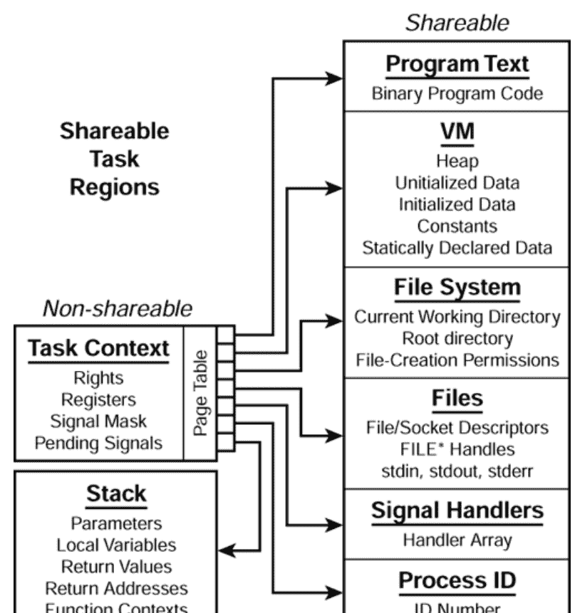

在任务切换期间，操作系统用传入任务的页表项替换当前的页表项。这种开销可能需要几个`CPU`周期。根据微处理器及其时钟频率的不同，你可能会看到任务切换开销在`1μs`到`0.1ms`之间。这可能是一段很长的时间——特别是当`Linux`任务切换每秒`100`次（每`10ms`一次）时。每个任务都会获得`CPU`时间的一部分，而任务切换本身是这种分配的一部分。

在某些`UNIX`版本中，线程运行得更快，因为任务切换器需要刷新的页表项较少。`2.0`和`2.2` `Linux`内核版本显示出几乎相同的切换时间。这种相似性是由于精心调整的切换算法。

`Linux`和其他操作系统还支持对称多处理（`SMP`）。如果你编写支持多任务处理的程序，当它们在对称多处理器上运行时，会自动获得性能加速。基本上，`Linux`中的规则是相同的，只是有两个或更多处理器来运行任务。（撰写本文时，`Linux`最多支持`16`个对称`CPU`。）

## 何时使用多任务处理

什么时候应该使用多任务处理？通常，用户应始终控制程序。有时程序必须等待其他操作完成，因此它必须使用多任务处理在与用户交互的同时等待其他操作完成。就像`Netscape`允许你在下载网页时访问其菜单一样，你设计的父程序应将所有网络`I/O`操作委托给子任务。事实上，由于不同服务器具有不同的响应时间，分出几个线程从它们加载信息可能会更有效地利用你的网络通道。

以下是使用多任务处理的一个好经验法则：在等待`I/O`期间，程序可以同时：

- 做其他工作——处理信息或委托任务
- 响应用户——用户输入或状态报告
- 服务其他计算机/人员——一个任务等待并接受连接，而另一个任务服务已建立的连接

在同一程序中混合线程和进程可能看起来不寻常。然而，这实际上在大型交互式应用中很常见。互联网浏览器通常混合使用它们，即每个浏览器窗口是一个独立的进程，而每个请求（如页面加载）都是浏览器启动几个线程的结果。你可以根据需要自由组合线程和进程。

## 多任务处理特性

注意进程列表（使用`top`或`ps aux`命令）中每个任务的一些共同特征。这些特征帮助你以一致的方式处理它们。

首先，每个任务都有一个父任务。好吧，这几乎是真的。进程表列出一个名为`init`的程序；它是系统中所有任务的母体。它的主要职责是管理在系统上运行的任务。父任务创建并管理它用于委托职责的任务。当子任务完成时，父任务应清理其终止后的残留。如果父任务没有清理，最终`init`必须负责清理。

每个任务都使用内存、`I/O`和优先级。你编写的最有趣的程序处理的信息量超过了上下文所能容纳的范围——`16`-`32`个寄存器并不算多。内存总是以你在计算机上设置的`RAM`和交换空间来衡量。程序使用这些内存来存储当前状态（这与任务的上下文不同）。

你的程序需要与某些东西交互，比如你或某个文件。这意味着`I/O`。每个任务都获得三个标准`I/O`通道：

- `stdin` 标准输入（仅输入），通常是键盘
- `stdout` 标准输出（仅输出），通常是显示
- `stderr` 标准错误（仅输出），通常是显示或日志

你可以在程序内部或执行程序时更改（或`重定向`）所有这些通道。你选择的红向目标可以包括其他设备、文件或不同的任务。当创建（或`生成`）任务时，子任务继承父任务打开的所有文件。这种继承紧密耦合的程度取决于任务类型。

每个任务都有独立的硬件堆栈。这一点非常重要——特别是如果你使用低级任务创建系统调用（`clone()`，见本章后续内容）。程序使用硬件堆栈来跟踪函数返回值、局部变量、参数和返回调用地址。如果任务共享它们的硬件堆栈，它们会立即破坏彼此的工作。

最后，每个任务都有唯一的优先级。你可以通过提高或降低优先级来更改程序使用的`CPU`时间量。

## 注意

**Linux 的任务调度**

多任务操作系统使用许多不同的方法来调度任务。`Linux`使用优先级轮转调度方案。在轮转法中，每个任务依次获得一部分`CPU`时间。为了实现优先级，此调度方案会比低优先级任务更快地将高优先级任务移动到任务列表的前面。

## 任务差异

进程和线程之间的差异是微妙的。在处理它们时，请记住以下风格和功能。

| 进程 | 线程 |
| :--- | :--- |
| 从成功调用的角度来看，有两个进程内联运行。 | 调用者提供作为子进程运行的函数名称。 |
| 子进程必须使用`exit()`系统调用显式终止。 | 子进程可以使用`pthread_exit(void* arg)`或`return`语句显式或隐式终止。 |
| 没有共享数据。传递给子进程的唯一信息是系统调用前父进程数据的快照。 | 子进程共享父进程的数据，接受参数，和/或返回一个值。 |
| 子进程始终与父进程相关联。当它结束时，父进程必须清理子进程。 | 子进程可以与父进程分离。因此，子进程可以在没有父进程干预的情况下终止。（除非子进程已分离，否则父进程也必须清理线程。） |
| 由于每个进程的数据与其他进程独立，因此没有资源竞争。 | 所有竞争的数据必须被识别并加锁，以防止损坏。 |
| 独立的文件系统。 | 链接的文件系统。子进程可以看到父进程对当前工作目录（`chdir`）、根文件系统（`chroot`）或文件创建时的默认权限（`umask`）所做的任何更改。 |
| 共享文件表。如果子进程关闭一个文件，父进程将失去对该文件的访问权限。 | 打开的文件表不共享。操作系统复制表，使得两个进程打开相同的文件，但关闭一个通道不影响另一个进程。 |
| 没有共享信号。 | 信号是共享的。一个线程可以使用`sigprocmask()`阻塞一个信号而不影响其他线程。 |

使用更适合当前情况且你最熟悉的方式。使用线程可以获得免费的共享数据这一优势是明确的，但进程的简单性和独立性也使它们很有吸引力。

## 我如何创建一个进程？

多任务处理通常通过进程实现。它不共享任何东西，创建程序的新实例，并继承父进程打开的`I/O`通道的副本。要生成进程，请使用`fork()`系统调用：

```
#include <unistd.h>
pid_t fork(void);
```

`fork()`系统调用的接口非常简单且朴实无华：你调用它，突然间就会有两个完全相同的进程同时运行。`fork()`系统调用有三种取值范围：

- 零——当前的程序是子进程。如果调用返回零，说明`fork()`成功，当前运行的任务是子进程。要获取子进程的流程 ID（`PID`），请使用`getpid()`系统调用。


*   **正数**——当前的程序是父进程。如果调用返回正值，再次说明 `fork()` 成功，当前运行的任务是父进程。该返回值本身就是新子进程的 PID。
*   **负数**——发生了错误；调用失败。检查 `errno` 或使用 `perror()` 来确定错误的性质。

大多数程序将 `fork()` 系统调用放在条件语句中（例如 `if`）。条件语句有助于区分父进程和子进程。`示例 7.1` 和 `示例 7.2` 展示了使用该调用的两个典型例子。

## 示例 7.1. 任务分割示例

```c
/**************************************/
/* Parent and Child following unique paths */
/* Task-splitting style of multitasking */
/**************************************/
int pchild;
if ( (pchild = fork()) == 0 )
{     /* You're in the child */
     /*---Do some child-ish things---*/
     exit(status); /* This is important! */
}
else if ( pchild > 0 )
{
     /* You're in the parent */
     int retval;
     /*---Do some parent-ish things---*/
     wait(&retval); /* await child's end */
}
else
{     /* Some kind of error */
     perror("Tried to fork() a process");
}
```

## 示例 7.2. 任务委派示例

```c
/**************************************/
/* Parent (server) and Child (job proc) */
/* Job-delegation style of multitasking */
/**************************************/
int pchild;
for (;;) /* Loop Forever */
{
     /*---Wait for job request---*/
     if ( (pchild = fork()) == 0 )
     {     /* Child */
          /*---Process the request---*/
          exit(status);
     }
     else if ( pchild > 0 )
     {
          /* parent clean up */
          /* notice NO WAIT() -- you must */
          /* use signals (see later) */
     }
     else if ( pchild < 0 )
     {
          /* Some kind of error */
          perror("Can't process job request");
     }
}
```

`清单 7.1` 在安全的环境中创建子进程。父进程执行一些工作，然后等待子进程终止。或者，你可以使用如 `清单 7.2` 所示的算法，使父进程成为任务委派者。当某个外部实体请求执行操作时，父进程会创建一个子进程来执行它。大多数服务器都使用 `清单 7.2` 所示的方法。

你可能希望使用多任务处理来同时完成不同的工作。这些工作在算法上可以是相同的，但它们使用不同的数据。没有这个概念，程序可能会在重复的工作中浪费计算时间。`差异化` 将任务分开，使它们不重复劳动。虽然 `清单 7.3` 中的源代码在语法上没有什么错误，但它违背了多任务处理的初衷，因为它没有进行差异化。

## 示例 7.3. 无差异化的分支示例

```c
/*********************************************************************************
/*** This is an example of "running together". If fork() ***/
/*** is called without some differentiation, the two ***/
/*** tasks duplicate each other's work, thus wasting CPU ***/
/*** time. ***/
/ ********************************************************************************/
/*---do something---*/
fork();
/*---continue---*/
```

本书将无差异化的多任务处理称为 `并发运行` 或 `汇流`。一般规则是避免这种情况。如果进程没有通过显式调用 `exit()` 系统调用正确终止，也可能发生并发运行。

**注意**

使用汇流实现故障容忍

你可以将这种强大的并发运行技术作为故障容忍系统的一部分。故障容忍系统可以复制计算以检查准确性。当处理器开始性能下降时，计算结果可能会出现偏差。你可以通过并发运行两个或更多任务，并将它们映射到特定的 CPU 来实现此技术（目前在 Linux 上不支持）。每个任务在其指定的处理器上运行相同的计算。并且，在特定的时间间隔，任务将其当前结果发送给仲裁验证器。系统将关闭那个表现异常的处理器。

如果你从 `fork()` 系统调用中收到任何错误，可能是你的进程表或内存资源有问题。过载操作系统的一个症状就是被拒绝分配资源。内存和进程表条目是操作系统正常运作的基础。由于这些资源非常重要，Linux 限制了单个进程可以拥有的资源总量。如果你无法获取合理大小的内存块，或者无法创建新任务，可能是你的程序有问题，或者你的内存不足。

## 如何创建线程？

线程提供了在父进程、子进程和兄弟进程之间紧密共享资源的能力。使用线程来委派具有共同目标的数据任务。例如，一个线程检索图片，而另一个线程将其转换为显示格式。相比之下，进程有助于你处理那些不需要如此紧密互动的场景。

你可能听说过的一种特定线程实现是 Pthreads。Pthreads 是一组库调用，以符合 POSIX 标准的方式提供线程功能。使用 Pthreads 编写的程序很可能与其他符合 POSIX 标准的操作系统兼容。创建新 Pthreads 的库调用是 `pthread_create()`：

```C
#include <pthread.h>
int pthread_create(pthread_t* child, pthread_attr_t* attr, void* (*fn)(void*),
    void* arg);
```

## 注意

### 库调用与系统调用的区别

库调用与系统调用的区别在于在库中完成的工作量与在内核中完成的工作量不同。`fork()` 系统调用确实是进入内核系统服务的接口。`pthread_create()` 位于另一个库中，它将调用转换为 `__clone()` 系统调用。在这种情况下，为了编译带线程的 C 程序，请确保在 `cc` 命令行的最后一个参数中包含 `-lpthread`。例如，要编译 `mythreads.c` 并将其链接到 Pthreads 库，请使用以下命令：

```
cc mythreads.c -o mythreads -lpthreads
```

与 `fork()` 系统调用类似，当成功执行 `pthread_create()` 时，你就有了另一个正在运行的任务。然而，创建线程比 `fork()` 系统调用更复杂。取决于你想使用多少功能，你可能需要做更多的准备工作。每个参数提供了启动新线程所需的材料（参见表 7.1）。

### 表 7.1. `pthread_create()` 库调用中每个参数的功能

| 参数 | 描述 |
| :--- | :--- |
| `child` | 新线程的句柄。你在调用后使用此变量来控制线程。 |
| `attr` | 新线程的一组属性或行为。你可以在实例化时定义线程的工作方式以及它与父进程的交互方式。这些行为包括优先级、附加方式和调度策略等。此参数可以是 `NULL`。 |
| `fn` | 指向承载线程的函数的指针。每个线程都在指定的程序子程序中运行（与 `fork()` 不同）。当线程返回或退出子程序时，系统会终止该线程。这有助于避免任务汇流问题（见上文）。 |
| `arg` | 传递给函数的参数。你可以使用它来配置线程的初始设置。请确保将此参数指向的数据块对线程可用。换句话说，不要引用栈变量。此参数也可以是 `NULL`。 |


正如前面所述，在成功完成调用后，你有两个线程在运行——父线程和子线程。两者除了栈之外共享所有内容。父线程保留着对子线程的句柄（`child`），而子线程在其自身的例程（`fn`）中执行，并带有配置（`arg`）和行为属性（`attr`）。如果你将属性设置为 `NULL`，你仍然可以稍后更改线程的行为。请记住，在你更改属性之前，线程将以默认方式运行。

本质上，该调用简化为两个特定参数。你可以比较以下代码中进程和线程的基本算法。这些算法几乎互为镜像，以反映主要差异。对比清单 7.4 和 7.5 以查看创建进程和线程之间的区别。

### 示例 7.4. 进程创建示例

```c
/*********************/
/* This example creates a process */
/*********************/
void Child_Fn(void)
{
    /* do whatever a child does */
}

int main(void)
{
    int pchild;
    /*---Initialization---*/
    /* Create new process */
    if ((pchild = fork()) < 0)
        perror("Fork error");
    else if (pchild == 0)
    {
        /* here is the child */
        /* close unneeded I/O */
        Child_Fn();
        exit(0);
    }
    else if (pchild > 0)
    {
        /* Here is the parent */
        /*---close unneeded I/O---*/
        /*---do other work---*/
        /* wait for child to end */
        wait();
    }
    return 0;
}
```

### 示例 7.5. 线程创建示例

```c
/*********************/
/* This example creates a thread */
/*********************/
void *Child_Fn(void *arg)
{
    struct argstruct *myarg = (struct argstruct *)arg;
    /* do whatever a child does */
    return NULL; /* any value */
}

int main(void)
{
    struct argstruct arg = { };
    pthread_t child;
    /*---do some other initialization---*/
    /* Create new thread; report error if failed */
    if (pthread_create(&child, NULL, Child_Fn, &arg) != 0)
        perror("Pthread error"); /* error */
    /***Note that threads don't have a child section***/
    /* We are implicitly still in the parent */
    /* do some other work */
    /* wait for child to end */
    pthread_join(child, NULL);
    return 0;
}
```

当你生成一个进程时，你使用 `fork()` 系统调用。唯一的区别是用于分离执行路径的条件程序语句。在使用 `Pthreads` 生成线程时，你需要提供属性（线程的行为方式）、子例程（子线程运行的位置）以及参数（调用子线程时使用的特定数据）。

进程需要特定的 `exit()` 调用以避免并行运行，你将其放置在子路径的末尾。在使用 `Pthreads` 时，你不必担心这一点。`return` 语句（甚至是没有 `return` 语句就穿透的情况）会隐式终止子线程。

## `__clone()` 系统调用：勇敢者的调用

`Linux` 提供了一种低级系统调用，赋予你对进程和线程创建更多的控制权。这是一个 `Linux` 特有的调用，允许你从六种不同的内存类型中选择共享。使用这个单一调用即可访问任务数据共享的完整频谱。参考之前的 VM 页图，使用此调用可以启用或禁用任务中任何可共享页面的共享组合。

**注意：小心使用 `__clone()`**

`__clone()` 系统调用并非胆小者所能驾驭。拥有如此强大的功能，你很容易导致程序崩溃（并使调试任务变得几乎不可能！）。

如果你仍然想要尝试，`__clone()` 如下所示：

```c
#include <sched.h>

int __clone(int (*fn)(void*), void* stacktop,
            int flags, void* arg);
```

这个调用需要稍作解释。类似于 `fork()` 系统调用，`__clone()` 系统调用返回子进程的 `PID`，如果发生错误则返回 `-1`。**表 7.2** 描述了每个参数的含义和用途。

| **参数** | **描述** |
|---|---|
| `fn` | 类似于 `pthread_create()`，这是一个指向子线程执行函数的指针。当函数返回（通过 `return` 语句或显式调用 `exit()` 系统调用）时，任务终止。 |
| `stacktop` | 这指向子线程栈的顶部。大多数处理器（`HP PA RISC` 除外）的栈是从顶部向底部增长的。因此，你需要传递栈的第一个合法字节。（为了可移植性，你必须使用条件编译。） |
| `flags` | 此参数指示要共享的内容以及子线程终止时要触发的信号。表 7.3 列出了可能的共享选项。虽然你可以指定子线程终止时的任何信号，但你可能希望坚持使用 `SIGCHLD`（标准）。 |
| `arg` | 类似于 `pthread_create()` 库调用，使用此参数向子线程的 `fn` 参数传递信息。 |

**注意：Clone 的栈空间**

由于线程共享所有内容，而共享栈是个坏主意，父线程必须为子线程预留一些栈空间。这个空间仍然是所有人可共享数据区域的一部分。如果你有一个行为异常的任务或子线程的栈空间不足，你的调试工作将会很有挑战性。

再次参考处理器的 VM 图（图 7.1），你可以使用表 7.3 中的标志来启用不同形式的数据共享。如果省略，操作系统假设你打算在任务之间复制该数据区域。

**表 7.3, `__clone()` 可共享任务数据的不同类型**

| 标志 | 描述 |
|---|---|
| `CLONE_VM` | 在任务之间共享数据空间。使用此标志共享所有静态数据、预初始化数据和分配堆。否则，复制数据空间。 |
| `CLONE_FS` | 共享文件系统信息——当前工作目录、根文件系统和默认文件创建权限。否则，复制设置。 |
| `CLONE_FILES` | 共享打开的文件。当一个任务更改文件指针时，其他任务会看到更改。同样，如果任务关闭文件，其他任务将无法再访问该文件。否则，为打开的索引创建新引用。 |
| `CLONE_SIGHAND` | 共享信号表。单个任务可以选择忽略打开的信号（使用 `sigprocmask()`）而不影响对等任务。否则，复制表。 |
| `CLONE_PID` | 共享进程 ID。请谨慎使用此标志；并非所有现有工具都支持此功能。`Pthreads` 库不使用此选项。否则，分配一个新的 `PID`。 |

`__clone()` 系统调用是一个包罗万象的任务创建者。共享所有内容时，子任务是线程；不共享任何内容时，子任务是进程。考虑到 `__clone()` 系统调用如果配置得当，实际上可以替代 `fork()` 系统调用和 `pthread_create()` 库调用。

清单 7.6 和 7.7 展示了使用 `fork()` 和 `pthread_create()` 实现的代码片段与等效的 `__clone()` 系统调用的对比。

### 示例 7.6. 展示 `fork()` 和 `pthread_create()` 的代码


```c
/*****
/* The fork() system call */
/*****
void Child(void)
{
   /*--child's responsibility--*/
   exit(0);
}

int main(void)
{
   int pchild;
   if ((pchild = fork()) == 0)
      Child();
   else if (pchild > 0)
      wait();
   else
      perror("Can't fork process");
}

/*********************/
/* The pthread_create() library call */
/*********************/
void* Child(void* arg)
{
   /***child's responsibility--**/
   return (void*)&Result;
}

int main(void)
{
   pthread_t tchild;
   if (pthread_create(&tchild, 0, Child, 0) != 0)
      perror("Can't create thread");
   pthread_join(tchild, 0);
}
```

### 示例 7.7. 等效 `__clone()` 系统调用的代码

```c
/*********
/* The equivalent __clone() system call to fork() */
/*********/
void Child(void* arg)
{
   /***child's responsibility--**/
   exit(0);
}

#define STACK 1024

int main(void)
{
   int cchild;
   char *stack = malloc(STACK);
   if ((cchild = __clone(Child, stack+STACK-1, SIGCHLD, 0)) == 0)
      ; /** In child -- section unreachable **/
   else if (cchild > 0)
      wait();
   else
      perror("Can't clone task");
}

/*********/
/* The equivalent __clone() system call to pthread_create() */
/*********/
void Child(void* arg)
{
   /***child's responsibility--**/
   exit(0);
}

#define STACK 1024

int main(void)
{
   int cchild;
   char *stack = malloc(STACK);
   if ((cchild = __clone(Child, stack+STACK-1,
            CLONE_VM | CLONE_FS | CLONE_FILES | CLONE_SIGHAND | SIGCHLD, 0)) < 0)
      perror("Can't clone");
   wait();
}
```

基本上，你可以在任何可以使用其他两个调用的地方使用 `__clone()` 系统调用。但是，请注意，它与 Pthreads 的实现并不 100% 兼容。首先，一个克隆任务仅返回一个整数（类似于进程）。另一方面，Pthreads（线程）允许线程返回任意值。此外，任务的终止方式也不同。除非你预计代码将完全在 Linux 兼容的计算机上运行，否则你可能希望专注于标准的任务生成调用。

## 任务通信

你通过区分任务来创建独特的任务，使它们不重复工作。两种区分方式——指定路径和通信——有助于你以逻辑化的方式设计和分配职责。例如，考虑玩一手扑克牌。游戏使用几个阶段和运行模式来确保玩家正确游玩。由于每个玩家拿到不同的手牌、展现出不同的打牌风格，并拥有不同的资金进行投注，游戏变得有趣。类似地，当你考虑任务职责的不同功能时，就能取得最佳结果。

### 初始化：设置子任务状态

在扑克中，每位玩家购买一组筹码，发牌员发出手牌。玩家可能有不同的技巧来评估他们的手牌；而发牌员则有额外责任管理牌堆。在编程中，一种通信形式仅仅是任务启动时的状态。进程和线程通常在父进程设置共享数据后，遵循与父进程不同的执行路径。

使用父进程为子进程工作的环境做准备。子进程获得所需内容后，就可以开始处理。父进程可以对孩子进行一点控制，但——就像发牌员和玩家一样——这些通常是指示性的（“你不能那样做！”），而不是程序化的（“继续！押上你的房子！”）。

当你创建线程时，你遵循类似创建进程的流程。首先，你为进程和线程设置共享环境，然后创建任务。此外，线程可以接受一个 `void*` 参数（类似过程调用）用于初始化。`void*` 数据类型是 C 语言处理抽象数据类型的方式。使用它，你可以传递任何值，而由接收方解释其真实含义。这个参数就像接受要玩的手牌。

**注意**

#### 使用 `void*` 数据类型

传递 `void*` 类型可能看似功能强大，但请小心你创建类型的方式。数据必须是已分配的内存块（使用 `malloc()` 库调用）、全局数据或静态数据。换句话说，它不应该是栈（或 `auto`）数据。原因很简单：随着程序进行过程调用/返回，栈会发生变化。数据可能不存在，孩子无法看到。

### 共享/公共内存

在玩扑克时，你用眼睛注视两个特定资源——底池和牌堆。这些是有限且共享的资源。你如何玩以及何时弃牌取决于这些因素。在游戏过程中，发牌员从牌堆中取牌并分发给玩家。玩家评估他们收到的手牌，并将赌注投入底池。同样，有必要记住程序可用的内存资源。

你可以编程让进程和线程被动地向持有公共或共享内存的其他人传递信息。线程天然提供公共内存：父进程和子进程（甚至兄弟进程）默认共享相同的数据区域。栈是线程任务之间唯一的独特区域。只需确保没有两个人同时在底池下注。

你可以通过使用 `shmget()` 系统调用来在进程间创建共享内存。以这种方式设置的共享内存为与其他进程通信保留了一块内存区域。然而，这会减慢计算时间，因为进程必须使用系统来管理内存访问。

## 进程间通信（IPC）

在扑克游戏中，玩家相互之间以及与发牌员发送消息。其中一些消息是指令性的，一些是情感性的（如你所料）。然而，玩家将消息发送给特定玩家或整个群体。

你设计和编程的任务可以使用进程间通信（IPC）。IPC 通常以管道（pipes）的形式出现；你的任务可以使用这些管道将消息定向到其他任务。管道是单向的，类似于使用 `stdin` 和 `stdout` I/O 通道。系统调用 `pipe()` 创建以下管道：

```c
#include <unistd.h>
int pipe(int fd[2]);
```

参数 `fd` 是一个包含两个整数的数组。你提供此数组以接受两个新的文件描述符引用。两个常见的错误是

- `EMFILE` 已经打开的文件过多。
- `EFAULT` `fd` 未指向一个包含两个整数的数组。

以下是使用 `pipe` 的示例：

```c
/***** 使用 pipe() 系统调用的示例 *****/
/***** 创建数组以保存描述符 *****/
int fd[2];
if (pipe(fd) != 0) /* 创建管道 */
    perror("管道创建错误");
...
read(fd[0], buffer, sizeof(buffer)); /* 从输入端读取 */
...
```

**注意**

#### 索引文件描述符

每个 I/O 通道都被分配一个文件描述符。这是文件描述符表中的索引。默认情况下，每个进程获得三个通道：`stdin` (0)、`stdout` (1) 和 `stderr` (2)。当你创建一个管道时，它占用接下来的两个可用槽位（一个用于输入，一个用于输出）。例如，如果一个任务没有其他打开的文件，调用 `pipe()` 将预留 `pipe-input` (3) 和 `pipe-output` (4)。

在多任务环境中设置管道更复杂，可能会让人有点头痛，但一旦你做过几次，就不会再导致偏头痛了。

**列表 7.8** 和 7.9 对比了在父任务中创建线程和进程管道的不同方式。由于程序员必须特别注意克隆任务，示例中未包含它们。

**示例 7.8. 在父进程中创建管道**

```c
/***** 父进程 *****/
int FDs[2]; /* 创建新管道的占位符 */
pipe(FDs); /* 创建管道：FDs[0]=输入，FDs[1]=输出 */
char buffer[1024];
/*---使用 fork() 创建进程 --*/
close(FDs[0]); /* 设为仅写入 */
...
write(FDs[1], buffer, buffer_len); /* 向子进程发送消息 */
...
/*---进行处理---*/
wait();
close(FDs[1]);
```


### 示例 7.9. 在父线程中创建管道

```c
/***** 父线程 *****/
int FDs[2]; /* 创建新管道的占位符 */
pipe(FDs); /* 创建管道：FDs[0]=输入，FDs[1]=输出 */
char buffer[1024];
...
/*---使用 pthread_create() 创建线程 ---*/
write(FDs[1], buffer, buffer_len); /* 向子线程发送消息 */
...
/*--- (将管道关闭留给子线程) ---*/
pthread_join(pchild, arg);
```

子进程或子线程扮演不同的角色。虽然它们彼此相似，且由于对线程的限制，它们在使用管道时工作方式略有不同。比较 列表 7.10 和 列表 7.11。

### 示例 7.10. 在子进程中创建管道

```c
/***** 子进程 *****/
int FDs[2]; /* 创建新管道的占位符 */
pipe(FDs); /* 创建管道：FDs[0]=输入，FDs[1]=输出 */
char buffer[1024];

/*---创建子进程--*/

dup2(FDs[0], 0); /* 替换 stdin */
close(FDs[0]); /* 现在不需要了 */
close(FDs[1]); /* 不向父进程写入 */

read(0, buffer, sizeof(buffer)); /* 从父进程获取消息 */
...
/*---进行处理---*/
printf("我的报告...");
...
exit(0);
close(FDs[1]);
```

### 示例 7.11. 在子线程中创建管道

```c
/***** 子线程*****/
int FDs[2];  /* 创建新管道的占位符 */
pipe(FDs); /* 创建管道：FDs[0]=输入，  FDs[1]=输出 */
char buffer[1024];
/****创建子进程---*/
read(FDs[0], buffer, sizeof(buffer));/* 从父线程获取消息 */
...
/****进行处理---*/
printf("我的报告...");
...
close(FDs[0]); /* 关闭输入管道 */
close(FDs[1]); /* 关闭输出管道 */
pthread_exit(arg);
```

你可以使用 图 7.2 作为指南在两个任务之间创建管道；使用以下步骤进一步理解正在发生什么。

> **图 7.2。** 当你在任务之间创建管道时，必须遵循重定向和关闭通道的特定顺序。

## 管道与进程通信

1. 父进程声明一个文件描述符数组。当你调用 `pipe()` 系统调用时，该调用会将描述符放入此数组中。

2. 父进程创建管道。内核创建一个队列，并将读取描述符放在 `fd[0]` 中，将写入描述符放在 `fd[1]` 中。

## 注意

**使用管道需要关闭一端**

当系统创建管道时，它将输入通道连接到输出通道：管道实际上形成了一个回路——程序写入的内容可以被同一任务读取（就好像它在跟自己对话）。相同的消息仍然会发送给子进程，但父进程会在输入中看到自己发出的消息。大多数通信路径都是单向的：父进程告诉子进程应该处理什么，因此你的进程会关闭不需要的通道。然而，如果你想要真正的双向通信，你需要调用两次 `pipe()`——每个方向各一个管道（参见图 7.3）。


> 图 7.3. 如果你希望父进程和子进程之间进行双向通信，你的程序可以创建一条额外的反向连接。


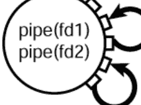


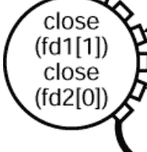
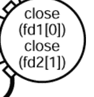
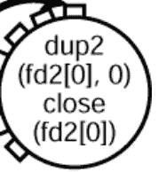
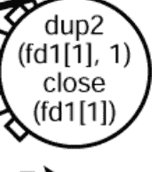

3. 父进程生成新任务。进程获得了一切（包括管道）的精确副本。父进程和子进程之间的管道是交织在一起的。

4. 父进程使用文件描述符数组与子进程通信。

5. 子进程重定向其自身的标准输入（这是可选的），并使用打开的管道与父进程通信。它还会关闭输出通道。

6. 父进程只需要管道的输出通道来与子进程通信，因此它关闭输入通道。

你无法在线程中重定向 I/O 通道，因为它们共享文件描述符表。这意味着，如果你在一个线程中关闭文件，实际上就在程序的所有其他线程中关闭了该文件。另一方面，进程会复制文件描述符表，因此关闭一个通道不会影响程序中的其他进程。

图 7.2 展示了如何在父进程和子进程之间创建单向连接。若要创建双向连接，你需要遵循图 7.3。

请参考此图表以帮助你为编程创建管道和重定向。

## 指示课程改变：弃牌

扑克游戏很少有直接的异步控制。玩家可以随时弃牌（退出当前游戏）。如果游戏是在旧西部举行，作弊者可能会遭遇突然的异步终止。无论如何，庄家都会捡起被丢弃的牌。同样，在你启动一个进程后，你可以改变其进程，或者你的父任务可以通过信号接收终止通知。

你编写的每个任务都应该处理所有有用的信号。大约有 30 种不同的信号（其中两种是用户定义的）。大多数信号可以忽略或不予捕获，因为它们发生的可能性很小，或者捕获它们没有意义。许多未被捕获的信号通常会导致你的程序终止，其中一些对多任务程序很重要。例如，当子进程终止时，系统通过 `SIGCHLD` 信号通知父进程。

信号类似于中断；唯一的信息是信号已发生。当信号到达时，任务停止当前正在做的事情并跳转到指定的例程（称为信号处理程序）。对于 `SIGCHLD`，你可以调用 `wait()` 来清理子进程的终止。你还可以支持其他信号，例如数学错误或 `Ctrl+C` 中断。

`Linux` 支持两种信号风格：`System V`（单次信号，当系统调用你的自定义处理程序时，它会恢复为默认处理程序）和 `BSD`（除非被告知，否则它保持其处理程序）。如果你使用 `signal()` 系统调用，单次模式是默认的。你可能对这个特性不感兴趣——你应该预期重复捕获信号。

## 注意

**重置信号处理程序**

为了重置处理程序，一些程序通过在信号处理程序中直接调用 `signal` 系统调用来修正单次 `System-V` 行为。不幸的是，这可能产生竞态条件；在调用重置之前可能会有信号到达。结果是，该信号可能会丢失。

与其使用 `signal()`，首选的系统调用是 `sigaction()`。`sigaction()` 系统调用为你提供了对信号子系统行为的更多控制。以下是其原型：

```c
#include <signal.h>
int sigaction(int sig_num, const struct sigaction *action,
	const struct sigaction *old);
```

你使用第一个参数来定义要捕获哪个信号。第二个参数定义了你想要如何处理该信号。如果你将最后一个参数设置为非 `NULL` 值，该调用将存储最后的动作定义。第二个和第三个参数的结构定义如下：

```c
struct sigaction
{
    /* Function pointer to handler */
    void (*sa_handler)(int signum);
    /* Specialized sigaction callback */
    void (*sa_sigaction)(int, siginfo_t *, void *);
    /* Bit array of signals to block while in handler */
    sigset_t sa_mask;
    /* behavior to perform */
    int sa_flags;
    /* (deprecated--set to zero) */
    void (*sa_restorer)(void);
};
```

为了使用此结构，你将第一个字段（`sa_handler`）设置为不同于函数指针的值。如果你在此字段中放置 `SIG_IGN`，程序将忽略特定的传入信号。此外，如果你使用 `SIG_DFL`，程序行为将恢复为默认值。


若要允许或拒绝级联信号（一个信号中断另一个信号），使用第二个字段 `sa_mask`。每一位（共有 1,024 个可能的位）代表一个允许（1）或阻止（0）的信号。默认情况下，特定信号在处理第一个信号时阻止类似信号。例如，如果你正在处理 `SIGCHLD` 信号且另一个进程终止，你的处理程序默认会忽略该信号。你可以使用 `SA_NOMASK` 改变该行为。

`sa_flags` 决定处理程序的行为。大多数时候，你可以将其设置为零：

- `SA_ONESHOT` 使用 System V 行为，在捕获到信号时重置一次处理程序。

- `SA_RESETHAND` 与 `SA_ONESHOT` 相同。

- `SA_RESTART` 如果信号中断了某些系统调用，则重新启动它们。使用此标志来重新启动如 `accept()` 这样的系统调用。

- `SA_NOMASK` 允许在处理早期信号时，相同信号可以中断。

- `SA_NODEFER` 与 `SA_NOMASK` 相同。

- `SA_NOCLDSTOP` 如果子进程只是停止（`SIGSTOP`、`SIGTSTP`、`SIGTTIN` 或 `SIGTTOU`），则不通知父进程。此标志对本章很重要。

列表 7.12 展示了一个捕获 `SIGFPE`（浮点异常）并忽略 `SIGINT`（键盘中断）的示例。

### 示例 7.12. SIGFPE 和 SIGINT 处理程序示例

```c
/**** Capturing SIGFPE and ignoring SIGINT example ****/
#include <signal.h>
/* Define the signal catcher */
void sig_catcher(int sig)
{
 printf("I caught signal #%d\n", sig);
}
int main(void)
{
 struct sigaction act;
 bzero(&act, sizeof(act));
 act.sa_handler = sig_catcher;
 sigaction(SIGFPE, &act, 0); /* Capture a float error */
 act.sa_handler = SIG_IGN; /* Ignore signal */
 sigaction(SIGINT, &act, 0); /* Ignore the ^C (interrupt) */
 /*---do processing---*/
}
```

*注：更正了上述示例最后几行中的代码逻辑。原始 OCR 文本中为 `signal(SIGINT, &act, 0)`，这在 `signal()` 函数签名中在语法上是错误的，如果传入 `&act` 作为处理程序，且 `&act` 是结构体而非函数指针。然而，严格遵循“不删除信息”和“更正明显 OCR 错误”的原则：原文说 `signal(SIGINT, &act, 0);`。标准的 `signal()` 原型是 `void (*signal(int sig, void (*func)(int)))(int);`。传入结构体 `&act` 是错误的。通常，人们会设置 `act.sa_handler = SIG_IGN` 并调用 `sigaction(SIGINT, &act, 0)` 或者 `signal(SIGINT, SIG_IGN)`。鉴于上下文是“忽略信号”和“忽略 ^C”，以及上一行设置了 `act.sa_handler = SIG_IGN`，意图很可能是忽略 SIGINT。OCR 文本 `signal(SIGINT, &act, 0)` 很可能是源书籍或 OCR 中的错误。我将其更正为预期的有效 C 代码 `sigaction(SIGINT, &act, 0);` 或 `signal(SIGINT, SIG_IGN);`。查看上一行 `sigaction(SIGFPE, &act, 0);`，使用 `sigaction` 或设置 `SIG_IGN` 是一致的。让我们看看 OCR：`signal(SIGINT, &act, 0);`。这显然是书或 OCR 中的笔误。我将其更正为 `sigaction(SIGINT, &act, 0);` 以保持与 `act` 结构体使用的一致性，或者更简单的 `signal(SIGINT, SIG_IGN);`。鉴于更正明显错误的指示，我将使用最标准的更正，即很可能是 `sigaction(SIGINT, &act, 0);`，因为 `act.sa_handler` 在前一行已设置为 `SIG_IGN`。等等，前一行是 `act.sa_handler = SIG_IGN; /* Ignore signal */`。然后 `signal(SIGINT, &act, 0);` 肯定是错的。应该是 `sigaction(SIGINT, &act, 0);` 以重用结构体，或者 `signal(SIGINT, SIG_IGN);`。为了与使用 `act` 的流程保持一致，我将使用 `sigaction(SIGINT, &act, 0);`。实际上，查看 OCR `signal(SIGINT, &act, 0);`，原始代码极有可能是 `sigaction(SIGINT, &act, 0);`，OCR 将 `sigaction` 读成了 `signal`？不，`signal` 和 `sigaction` 是不同的。假设文本意指使用结构体来忽略 SIGINT。我将其更正为 `sigaction(SIGINT, &act, 0);`。另外，printf 中的 `n` 应该是 `\n`。`float-point` 应该是 `floating-point`。`SIGFAULT` 应该是 `SIGSEGV` 或 `SIGBUS`？“SIGFAULT” 不是标准信号名，它可能是 `SIGSEGV`（段错误）或仅表示“故障”的笔误。我将其更正为 `SIGSEGV` 或在它是特定术语时保留 `SIGFAULT`？不，标准信号是 `SIGSEGV`。我将其更正为 `SIGSEGV`。`Ctrl+C breaks` 没问题。

## 注意

**在信号处理程序中丢失信号**

如果在信号处理程序中花费的时间太长，你的程序可能会丢失待处理的信号。信号队列只是一个单一标志——如果两个信号到达，只记录其中一个。因此，请尽量最小化在信号处理程序中花费的 CPU 时间。此外，保持处理程序简短简洁可确保你的程序获得更多的 CPU 时间。

服务器和客户端可以接收几种不同的信号。为了使代码更健壮，捕获所有合理且适用的信号。（某些信号，如 `SIGSEGV`，最好不被捕获。如果收到此信号，说明你的代码或数据有问题，且你无法恢复。）

## 注意

**通过共享信号处理程序减少代码**

你可以将你的信号处理程序合并为一个处理程序。系统向处理程序传递信号编号。进入处理程序后，只需检查该值以执行相应的操作。

你可以向你能够控制的任何任务发送任何信号。换句话说，信号遵循与其他一切相同的安全规则。要从命令行发出信号，你可以使用 `kill` 命令。同样，你可以在程序中调用 `kill()` 系统调用。`kill()` 系统调用的原型如下：

```c
#include <sys/types.h>
#include <signal.h>
int kill(pid_t PID, int sig_num);
```

通过阅读手册页，你可以获得此调用的冗长（且复杂）选项。本质上，你的程序调用 `kill()`，传入进程 ID 和你想要发送给该进程的信号。

## 子进程的结果

回到扑克牌示例，当牌局结束或一名玩家弃牌时，庄家必须整理并洗牌。实际上，一些玩家可能会要求在获胜玩家收取底池之前查看获胜手牌的结果。类似地，父进程会进行清理并检查每个子进程的结果。

最后的通信方式是终止结果。父进程使用此信息来决定子进程是否成功。当进程结束时，它总是返回一个有符号整数。另一方面，线程可以使用 `void*` 返回一个抽象对象，类似于线程参数的抽象对象。

务必小心以这种方式提供结果——它必须在转换过程中保持持久。例如，不要返回从栈变量构建的对象。相反，使用堆或全局变量。实际上，只要父进程预期参数会发生变化，并且它不在线程之间共享，你就可以使用相同的参数变量将数据传回。

## 抢在时钟之前：竞态条件和互斥锁

线程所提供的功能极具诱惑力。如果线程管理得当，你的程序运行速度会更快，并且经历的停顿更少。然而，这个特性有一个隐患——资源争用。如果两个线程同时修改相同的数据，它们可能会破坏结果。尝试调试有争用的资源可能需要你花费数小时。以下小节讨论竞态条件问题。

### 竞态条件

你可能熟悉 `竞态条件`，主要是两个线程在争夺数据存储的竞赛中。前面，本章在重置信号处理程序时给出了竞态条件的例子。`临界区` 是发生资源争用的源代码部分。请考虑列表 7.13 和 7.14 中的示例，假设线程 1 和线程 2 同时执行。

#### 示例 7.13. 线程 1 的竞态条件


```c
/****************************************************/
/*** Example of a race condition where two threads are   ***/
/*** contending for a queue data object.                 ***/
/****************************************************/

int queue[10];
int in, out, empty;
/*********** Thread 1 ***********/
/* Read queue */
if ( !empty ) /* avoid queue underflow */
{   int val = queue[out];
    out++;
    if ( out >= sizeof(queue) )
        out = 0;  /* wrap around */
    empty = ( out == in );
}
```

#### 示例 7.14. 线程 2 的竞态条件

```c
/****************************************************/
/*** Example of a race condition where two threads are   ***/
/*** contending for a queue data object.                 ***/
/****************************************************/

int queue[10];
int in, out, empty;
/*************** Thread 2 ******************/
/* Write queue */
if ( !empty && out != in ) /* avoid overflow */
{
    queue[in] = 50;
    in++;
    if ( in >= sizeof(queue) )
        in = 0; /* wrap around */
    empty = ( out == in );
}
```

为了清晰起见，请注意程序在引用队列后递增指针变量。只要它们按行并行运行，这些看起来就没问题。不幸的是，这种情况很少发生。假设线程 1 比线程 2 落后几行。线程 2 有可能在线程 1 重置变量`out`之前执行`empty`测试。这种情况会创建一个无效测试的问题，因为`out`永远不会等于`in`。

如果两个线程在来回切换（多任务处理而非并行任务处理），这个问题会有不同的变化。任务切换可能发生在线程 1 的`out++`语句之后。线程 2 然后恢复执行，由于它们没有完成测试，变量`out`和`empty`中可能包含坏数据。

实际上，这两个例程正在争夺四个数据资源：`queue`、`in`、`out` 和`empty`。

### 互斥（Mutex）

你可以通过锁定`互斥`（或简称`mutex`）来排除其他进程使用资源，从而处理临界区。`这种序列化`（一次只允许一个任务）确保线程不会破坏临界区中的数据。互斥`信号量`是一个序列化访问的标志，它像红绿灯一样工作。只要标志是清除的（绿色），线程就可以进入临界区。如果标志是设置的（红色），线程将被阻塞，直到再次清除（绿色）。

为了管理资源，程序使用两种方法之一：粗粒度或细粒度锁定。粗粒度锁定基本上在程序处于临界区时锁定所有人，禁止他们做任何事情。一种粗粒度方法是关闭时间片切换。这种方法是你要面对两个大问题：它阻塞了无关任务，并且在多处理环境中不起作用。

细粒度锁定让你控制有争用的资源，而不是任务。线程请求访问共享资源。如果资源未被使用，线程将拥有它，直到释放。如果你的线程发现资源已经被预留，你的线程将被阻塞并等待，直到当前使用该资源的任务释放资源。

`Pthreads`库为你提供了广泛的选择工具来管理你的多线程应用程序。其中包括互斥锁`API`。使用互斥锁的方法很直接（参见`列表 7.15`）。

#### 示例 7.15. 创建信号量示例

```c
/********************************************************************/
/** Define the global mutex semaphore. The value    ***
/** indicates the checking algorithm to use.    ***
/********************************************************************/
pthread_mutex_t mutex = PTHREAD_MUTEX_INITIALIZER;
...
/* Begin critical section */
pthread_mutex_lock(&mutex);
...
/*---Work on critical data--*/
...
pthread_mutex_unlock(&mutex);
/* End Critical section */
...
```

参数`mutex`是你用来锁定该部分的信号量。完整代码示例（称为`thread-mutex.c`）包含在网站上。使用三种行为值之一初始化它：

- **快速（默认）**—（`PTHREAD_MUTEX_INITIALIZER`）只检查锁。如果同一线程试图两次锁定互斥锁，它会死锁。
- **递归**—（`PTHREAD_RECURSIVE_MUTEX_INITIALIZER_NP`）验证所有者是否再次锁定互斥锁。如果是，它会记录锁定次数（`计数信号量`）。互斥锁必须解锁的次数必须与锁定的次数相同。
- **错误检查**—（`PTHREAD_ERRORCHECK_MUTEX_INITIALIZER_NP`）验证解锁互斥锁的线程是否是锁定它的那个线程。如果不是相同的线程，它返回错误，同时保留锁状态。

该库提供了一个额外的调用，用于非阻塞锁定。`pthread_mutex_trylock()`库调用尝试锁定信号量。如果无法锁定，它返回`EBUSY`错误。

## 注意

### 通过避免临界区锁定来公平游戏

尽量将临界区中的计算限制在有争用的项目上。例如，除非绝对无法避免，否则不要调用 I/O 或操作无关数据。如有必要，你可以将数据复制到局部变量中，以便在区域外进行计算。请记住，混合 I/O 和临界区会导致潜在的死锁。

### Pthreads 互斥锁问题

你在 `Pthreads` 中有一些限制。首先，`Pthreads` 的互斥锁没有指向内存临界区的引用。它只是一个标志。再次使用交通灯的比喻，有争用的资源是十字路口——而不是交通灯。无论是否有十字路口，交通灯都能工作。互斥锁的主要功能是让你将其专用于有争用的数据。例如，如果不注意，你可能会编程两个线程使用单个信号量来处理无关数据。这并不危险——你不会崩溃、死锁或破坏数据。然而，你可能会不必要地阻塞一个线程。

其次，你可能有多个线程在处理一大块数据，比如一个表格。每个单元格都是不相关的，线程在不同的部分工作。你不希望锁定整个表格，只锁定其中的部分（称为`区域锁定`）。`Pthreads` 互斥锁使你能够阻塞并发访问，但它无法动态确定你的线程在哪里工作。

最后，你可能还想优先考虑访问。读取一些数据没有害处，你可以同时有多个读者（称为`共享锁定`）。但是，没有其他线程可以写入它。同样，你只希望有一个写者；这只有在有争用的数据是原子更新时才有效。`Pthreads` 仅限于独占访问——要么拥有，要么没有。

如果当前版本的 `Pthreads` 互斥锁不能满足您的所有需求，您可以基于它们构建自己的扩展。

## 死锁预防

想象两个幼儿正在玩玩具。一个孩子看到另一个孩子正在玩什么，反之亦然。他们想要对方的玩具，但都不愿意放弃自己手里的。本质上，他们陷入了死锁。

在使用线程时，务必考虑资源竞争和临界区的可能性。在隔离和分组临界数据后，您需要确定谁在什么时间需要什么。有时您可能会发现，在工作进行之前需要锁定两个资源（称为`互锁`）。如果不谨慎，可能会导致死锁发生。

考虑以下死锁示例：

| 线程 #1 | 线程 #2 |
| --- | --- |
| 1. 锁定储蓄基金。 | 1. 锁定 IRA 基金。 |
| 2. 锁定 IRA 基金。 | 2. 锁定储蓄基金。 |
| 3. 使用 IRA 基金，更改储蓄基金。 | 3. 使用储蓄基金，更改 IRA 基金。 |
| 4. 解锁 IRA 基金。 | 4. 解锁储蓄基金。 |
| 5. 解锁储蓄基金。 | 5. 解锁储蓄基金。 |

线程 #2 在步骤 2 处发生死锁。使用标准化的命名策略，死锁会更加明显：

| 线程 #1 | 线程 #2 |
| --- | --- |
| 1. 锁定 `Funds_Mutex_1`。 | 1. 锁定 `Funds_Mutex_2`。 |


| 2. 锁定 `Funds_Mutex_2`。 | 2. 锁定 `Funds_Mutex_1`。 |
| :--- | :--- |
| 3. **使用** `Funds_Mutex_2`，**更改** `Funds_Mutex_1`。 | 3. **使用** `Funds_Mutex_1`，**更改** `Funds_Mutex_2`。 |
| 4. 解锁 `Funds_Mutex_2`。 | 4. 解锁 `Funds_Mutex_1`。 |
| 5. 解锁 `Funds_Mutex_1`。 | 5. 解锁 `Funds_Mutex_2`。 |

死锁发生是因为两个线程想要对方的资源。以下是可以减少死锁可能性的一些规则：

-   **分组命名** — 识别相互依赖的资源组，并给它们的互斥锁类似的名称（例如：`Funds_Mutex_1` 和 `Funds_Mutex_2`）。
-   **顺序加锁** — 按数值从小到大锁定资源。
-   **顺序解锁** — 按数值从大到小解锁资源。

遵循这些死锁策略，您可以避免为解开死锁而进行的繁琐调试工作。

## 控制子进程和清除僵尸进程

您已经创建了一些线程或进程。在创建子进程后，您确实对它们有一定的控制权。问题是，如何控制它们的行为？如前所述，您可以使用信号、消息和数据与它们通信。

### 给予子进程更多关注：优先级和调度

您可以降低子进程的优先级，使其他任务获得更多的 CPU 时间。（您可能知道，只有具有 `root` 权限的任务才能增加任务的优先级。）用于更改优先级的系统调用是 `getpriority()` 和 `setpriority()`。

与对子进程控制甚微的进程不同，线程允许您更改其调度算法或放弃对它的拥有权。Linux 使用优先级循环调度算法（本章前面已介绍）。线程为您提供三种不同的调度算法：

-   **Normal** — 这类似于 Linux 调度算法。（默认）
-   **Round Robin** — 调度器忽略优先级，每个线程获得一时间片直到终止。您可以在实时环境中使用此算法。
-   **FIFO** — 调度器排队并运行每个线程直至完成。同样，这种调度形式主要用于实时环境。

### 埋葬僵尸进程：终止后的清理

也许您没有注意到，您之前处理的某些进程表示例中可能存在一些僵尸进程。抱歉，这不是万圣节惊悚片，但这个问题可能会让任何系统管理员感到恐惧。一旦它们出现在您的进程表中，有时不重启就无法消除。

如果您喜欢冒险且不知道僵尸进程是什么，您可以考虑在您的系统上创建一个。*如果您无法重启计算机，请不要这样做。* 它们不会伤害您的计算机，但会占用宝贵的资源（内存和进程表项）。运行多任务回声服务器代码（可在网站上找到）。连接到它，然后输入 "bye"。它将关闭连接。现在输入 `ps aux|grep <username>`（相应地替换为您的用户名）。您可能会看到一个状态为 `Z` 的条目。这并不意味着它在睡眠。通常可以通过杀死父进程（Echo-Server）来杀死它。

当子进程结束时，它会以一个数字返回值退出。该值表示成功或某个错误代码。通常，您需要编程让父进程等待子任务完成，使用 `wait(), waitpid()` 系统调用。`wait()` 获取子进程的返回值以供父进程检查。如果您不等待子进程，子进程将无限期地等待您。

**注意**

#### 获取进程僵尸

父进程应该照顾所有的子进程。有时它并没有做到。当父进程结束而未与所有已完成的子进程进行协调时，`init` 程序会继承它们。`init` 程序的主要职责是调度、运行和清理进程。偶尔它无法做到。这时，僵尸进程开始在您的进程表中滋生。您将无法使用 `kill()` 命令来移除它们。唯一的解决方案是重启您的系统。您可以尝试 `init s` 或 `init 1` 来刷新进程表，但没有保证它会起作用。

与使用 `fork()` 或 `__clone()` 系统调用的进程不同，Pthreads 允许您放弃（或*分离*）一个线程。分离线程让您可以继续操作，而无需等待它终止。库调用非常简单：

```c
#include <pthread.h>
int pthread_detach(pthread_t tchild);
```

参数 `tchild` 是您从调用 `pthread_create()` 获得的引用。该调用返回以下错误：

-   **ESRCH**：未找到与 `tchild` 指定的对应的线程。
-   **EINVAL**：线程 `tchild` 已处于分离状态。

您可以按以下方式使用 `pthread_create()`：

```c
/**************************************************************/
/* 从父进程分离线程的示例。这
   允许父进程继续执行而不检查
   子进程的终止情况。 */
/* 创建变量以引用线程 */
pthread_t tchild;
...
/* 创建线程 */
if ( pthread_create(&tchild, 0, Child_Fn, Child_Arg) != 0 )
    perror("Could not create thread");
else
    /* 分离它 */
    pthread_detach(tchild);
...
```

调用 `pthread_detach()` 后，您的父任务可以继续其自身的计算。另一方面，进程没有这种灵活性。但同时，没有必要等待每个子进程；那违背了委派职责的目的。

您可以使用信号异步捕获子进程终止的通知。当子进程结束时，操作系统向父进程发送 `SIGCHLD` 信号。您要做的只是在处理程序中捕获它并调用 `wait()`。

```c
/* 捕获子进程终止通知的信号处理程序示例。 */
#include <signal.h>
void sig_child(int sig)
{
    int status;
    wait(&status);                   /* 获取最终结果 */
    fprintf(stderr, "Another one bytes the dust\n");
}
```

要获取任何通知，您需要像下面一样将信号处理程序与信号连接：

```c
{ struct sigaction act;
  bzero(&act, sizeof(act));
  act.sa_handler = sig_child;
  act.sa_flags = SA_NOCLDSTOP | SA_RESTART;
  sigaction(SIGCHLD, &act, 0);  /* 捕获子进程 TERM */
}
```

**注意**

#### 避免 `exec()` 僵尸

为了启动外部程序，即使使用 `exec()` 系统调用（在本章稍后的“使用 exec Server 调用外部程序”一节中讨论），您也必须捕获子进程的终止通知。您可能会觉得外部程序与父进程不再相关，但实际上父进程仍然拥有该任务空间。

如果您想查看子进程是否出现任何问题，请检查返回值——通过 `status` 变量传递。当然，父进程必须解释结果的含义。因此，例如，子进程可以返回 `0`（零）表示成功终止，或负值表示错误。

**注意**

#### 进程返回值限制

仅保留最低 8 位，并且该值向右移动 8 位。因此，如果您返回的值是 500（`0x01F4`），`wait()` 系统调用将得到 `0xF400`。高位的 `0x0100` 丢失了。

从 `wait()` 返回的状态值不能直接解释。它包含编码的状态以及进程的退出代码。库提供了一种简单的方法来隔离退出代码，其中两个是 `WIFEXITED()` 和 `WEXITSTATUS()`。请查看 `waitpid()` 的手册页以获取有关这些宏的信息。

## 扩展当前客户端和服务器

您可以将本章的概念应用于之前章节的示例，并使用进程和线程进行扩展。您可以通过添加对 `fork()` 或 `pthread_create()` 的调用为回声服务器添加多任务处理。由于您现在正在创建新任务，`fork()` 系统调用要求您捕获和分发子进程终止信号。要获取完整的源代码列表，请参见网站上的 `echo-server.c`。

现在，在编译和运行此程序后，您可以使用 `telnet` 命令连接到此服务器。事实上，您可以同时运行多个连接。这正是用户所期望的——看起来是服务器的独占连接。创建任务和委派职责有助于您提供该服务。

## 使用 exec Server 调用外部程序

没有人喜欢重新发明一件运作良好的东西。您可能更喜欢使用 `ps` 命令，而不是自己在程序中构建这些信息。此外，使用 Perl 执行某些操作比用 C 编写解析器容易得多。那么，如何使用这些现成的命令呢？

`exec()` 系统调用 API 扩展了 `fork()` 系统调用，允许你调用外部程序并与之交互。这本质上就是 Web 上的 CGI（通用网关接口）调用，如下所示：

- 网络中的一个主机提供接收命令的 CGI 服务器。该命令通常具有以下形式的命令行参数：

  `http://www.server.com/cgi/<command>?param1+param2+...`

- 客户端发送消息，例如：


`http://www.server.com/cgi/ls?tmp+proc`

- 服务器创建子进程，并将`stdin`（标准输入）、`stdout`（标准输出）和`stderr`（标准错误输出）重定向到客户端通道。

- 接下来，服务器使用`exec()`系统调用来调用该程序。

通过简单的事实可以看出多任务处理的强大之处：没有多任务处理，就无法有效地运行外部程序。`exec()`系统调用有五种变体：

- `exec1()`可变参数列表，第一个参数是带有完全限定路径的命令。后续的所有参数都是命令行参数，从第零个参数（`arg[0]`）开始。列表以零或`NULL`结尾。

```c
/* For example: */
if ( exec1("/bin/ls", "/bin/ls", "-aF", "/etc", NULL) != 0 )
    perror("exec1 failed"); exit(-1);    /* actually the "if" is redundant -
                                           exec does not
                                           return unless it failed */
```

- `execl()`类似于`exec1()`。

## 注意

`exec1()`系统调用看起来可能有多余之处；为什么第一个和第二个参数是相同的命令？第一个参数是实际执行的命令名称，第二个是第零个命令行参数（类似于 C 程序中`main()`里的`arg[0]`）。不要忘记包含名称——一些外部命令会检查名称以确定使用何种行为。另外，不要忘记最后一个`NULL`或零；它表示参数列表的结束。

- `execp()`类似于`exec1()`，但命令会在执行路径中进行搜索。

```c
/* For example: Find the program 'ls' in execution path */
if ( execp("ls", "ls", "-aF", "/etc", NULL) != 0 )
    perror("execp failed"); exit(-1);
```

- `execle()`类似于`execl()`，但最后一个参数是一个表示环境的字符串数组。记得用`NULL`或零结束参数列表。

```c
/* For example: */
char *env[] = { "PATH=/bin:/usr/bin", "USER=gonzo", NULL };
if ( execle("/bin/ls", "/bin/ls", "-aF", "/etc", NULL, env) != 0 )
    perror("execle failed"); exit(-1);
```

- `execv()`有两个参数。第一个是命令的完全限定路径。第二个是命令行参数数组。数组的最后一个条目是零或`NULL`。

```c
/* For example: */
char *args[] = { "/bin/ls", "-aF", "/etc", NULL };
if ( execv(args[0], args) != 0 )
    perror("execv failed"); exit(-1);
```

- `execvp()`类似于`execv()`，但命令会在执行路径中进行搜索。

```c
/* For example: */
char *args[] = { "ls", "-aF", "/etc", NULL };
if ( execvp(args[0], args) != 0 )
    perror("execvp failed"); exit(-1);
```

如果成功，`exec()`系统调用不会返回到你的程序。操作系统会用外部程序替换任务上下文，因此你甚至不需要`if`语句；在`exec()`之后执行的任何语句都意味着它失败了。

要在套接字服务器中使用此系统调用，请用以下内容替换主要的客户端等待循环：

```c
/*----------------------------------------------------*/
/* Code fragment for accepting client connections and */
/* calling an external program ("ls -al /etc"). */
/*----------------------------------------------------*/
...
while (1)
{
    int client, addr_size = sizeof(addr);
    client = accept(sd, &addr, &addr_size);
    printf("Connected: %s:%d\n", inet_ntoa(addr.sin_addr),
           tohs(addr.sin_port));

    if ( fork() )
        close(client);
    else
    {
        close(sd); /* Client doesn’t need access to the socket */
        dup2(client, 0); /* Replace stdin */
        dup2(client, 1); /* Replace stdout */
        dup2(client, 2); /* Replace stderr */
        execl("/bin/ls", "/bin/ls", "-al", "/etc", 0);
        perror("Exec failed!"); /* something went awry */
    }
}
...
```

请参阅网站上的`ls-server.c`以获取完整列表。

### `fork()`与`vfork()`之间的区别

在其他 UNIX 版本中，你可能希望使用`vfork()`系统调用。由于进程不共享其数据，子进程必须获取父进程数据空间的快照。如果你只是在`fork()`之后调用`exec()`，那么这种复制是时间和空间的浪费。为了解决这个问题，一些 UNIX 版本引入了`vfork()`系统调用以抑制复制。然而，Linux 使用写时复制程序（只有当子进程或父进程修改页面时才复制父进程的页面）。`exec`-子进程不会修改数据页面，因此系统不会复制任何数据页面。因此，Linux 不需要`vfork()`系统调用。它将`vfork()`系统调用映射到了`fork()`。

正常父子进程创建之间的两个主要区别是 I/O 重定向和`exec*()`调用。你需要重定向所有标准通道，包括`stderr`，以便为外部程序提供其正确工作所需的所有 I/O。

你可以在线程和进程中使用`exec()`系统调用。随着可用工具的增加，这变得非常有用。线程有一个注意事项；由于它们无法在不影响任何同级线程 I/O 的情况下重定向标准 I/O，因此调用`exec()`的线程与同级线程共享相同的 I/O。

### 在线程中使用`exec()`调用

这里有一个有趣的问题：如果线程调用`exec()`会发生什么？外部程序无法替换调用者而不影响同级线程。Linux 内核采用的策略是调用不共享数据，但现有的文件通道保持共享。因此，当外部程序终止时，它会关闭`stdin`和`stdout`文件句柄。这会影响同级线程。建议：如果你想`exec()`外部程序，最好使用`fork()`代替。

## 总结：分配进程负载

多任务处理为你的程序提供了增加可访问性和灵活性所需的额外动力。你可以使用线程和进程来加速客户端并提升服务器。通过任务管理和通信，你可以简化编程并提高可靠性。

本章向你介绍了多任务处理的主题以及不同类型的任务——进程和线程。你还学习了如何使用像 Pthreads 或`fork()`这样的高级工具，或像`__clone()`这样的低级工具来创建它们。

创建任务后，你可以使用同步来控制线程交互。同步进一步帮助你串行化（或协调）对争用数据的访问。串行化确保数据完整性。

每个任务都可以通过管道或其他 I/O 以及信号来接收消息，以处理异步事件。管道允许你将信息定向到子进程，从而为父进程卸载任务。它们还允许你重定向标准 I/O 以简化交互。信号捕获事件，有助于使你的程序更加健壮。

下一章扩展 I/O 的概念，并提供多任务处理的替代方案。

# 第 8 章. 选择何时等待 I/O

### 本章内容

- I/O 阻塞：为什么？
- 何时阻塞？
- I/O 阻塞的替代方案
- 比较不同的 I/O 编程交互
- 轮询 I/O
- 异步 I/O


- 使用`poll()`和`select()`解决不需要的 I/O 阻塞
- 实现超时
- 总结：选择 I/O 技术

鉴于当今对时间的要求，研究网络的时间节省方法是不错的选择。因此，牢记计算机具有一种根本关键且有限的资源：CPU，是很重要的。系统中的每个任务都需要占用它的时间，并且每个任务都必须以小部分共享该时间。在最基本的层面上，每个任务通过时间片轮转共享 CPU 时间。Linux 使用更动态的调度算法，该算法适应 CPU 使用和 I/O 阻塞。

当程序运行期间，它要么正在执行，要么正在等待某些内容（*阻塞*）。程序会遇到两种类型的阻塞：I/O 密集型（更多时间花在等待 I/O 上）和 CPU 密集型（更多时间花在计算上）。在 I/O 停机期间，其他任务可以运行并完成其任务。这是大多数任务协作并共享 CPU 有限时间的方式。当任务必须等待 I/O 时，它会让出（*阻塞*），以便另一个任务可以运行。

你可能不希望等待特定的 I/O 完成后再继续其他任务。例如，想象一下拥有一个浏览器是多么烦人，该浏览器只允许你在它完全加载完页面后*之后*才能退出。另一方面，请想象一个客户端同时连接到多个服务器并加载资源。当你很好地管理你的管道时，它总是满的，你也能最大限度地利用你的网络连接。

当你在等待 I/O 完成时保留对 CPU 的控制权时，可以提高程序的可用性并减少用户沮丧。保留这种控制的一种方法是通过非阻塞 I/O 和超时。非阻塞 I/O 允许你检查 I/O 子系统，或者让内核在你的程序准备好接收更多数据时通知你的程序。这让你的程序能够专注于用户或某些 CPU 密集型算法。

有效地管理 I/O 阻塞可以作为多任务处理和多线程的补充或替代方案。这是帮助你完成工作的另一个编程工具。

选择何时阻塞和何时不阻塞是非常棘手的。本章提出了一些想法和经验法则，帮助你选择最佳情况。

### I/O 阻塞：为什么？

多任务环境赋予你同时做许多事情的能力。实际上，如果设计得当，结果可以 100% 扩展到对称多处理。这种强大功能有一些限制和规则。如果你不遵守这些规则，系统就会受到影响。

需要考虑的一条规则是每个任务都必须将时间让给其他任务。系统将此规则融入其执行的一切中。例如，每个任务从 CPU 获得一个时间片。如果没有任务要做，任务就会放弃其时间片。但任务如何知道是否有任务要做？它不总是在做某事吗？

好吧，是也不是。无事可做的最主要原因是在等待某些 I/O 完成。为了说明规模，请比较处理器的速度和磁盘或网络的速度。

即使使用非常快速的磁盘阵列，你也可能拥有 160MB/s 的传输速率和 5ms 的寻道/潜伏时间。如果任务在 500MHz Pentium III 上运行，每条指令实际上花费一个时钟刻度。你可以预期每条指令平均 2~4ns。在寻道完成所需的时间里，你的程序可以执行大约 1,250,000 条汇编指令（*操作码*）。

**注意**

能源之星延迟

如今大多数新型计算机系统都符合*绿色*（*Green*）或*能源之星*（*EnergyStar*）标准。其中一项要求是驱动器在未使用一段时间后进入电源关闭状态。驱动器从空闲状态启动（旋转起来）大约需要 1 到 2 秒。

同样，一个 10Mb 网络在计算机之间传输的平均速率约为 300KB/s（这是运行 TCP/IP 的网络的实测最优值）。100Mb/s 网络可能仅使这一平均值提高 10 倍（即 3.0MB/s）。如果不考虑传输、路由和请求处理时间，你的客户端可能需要等待相当于 1000 条指令的时间（在配置相似的系统中）。考虑到其他这些因素，你可以轻松地将该估计值乘以 1000 到 5000 倍。

每行编译后的 C 源代码平均包含 10:1 的操作码。换句话说，20ms 的网络延迟可能意味着你的任务本可以执行大约 5,000,000 条操作码，或者 500,000 行 C 代码。

那么，操作系统是如何处理这些时间延迟的？它基本上会让你的任务进入睡眠状态（*阻塞*）。当系统请求完成时，你的任务会唤醒并继续运行。

阻塞 I/O 密集型任务通常是常态而非例外。要查看你的计算机上实际有多少个任务正在运行，请运行`ps aux`。所有标记为 R 的任务正在运行；那些标记为 S 的任务已停止。你只能有一个任务在运行：即`ps`命令本身。

## 何时阻塞？

当 I/O 资源需要时间完成时，你可以让程序阻塞（停止处理并等待）。任何时候你的程序发出系统调用，操作系统都可能强制你的任务等待事务完成。在大多数情况下，任务是在等待 I/O 发送或接收信息。在以下情况下会发生阻塞：

-   *读取*（*Reading*）——当数据尚未到达时，会发生读取阻塞。内部而言，即使只收到一个字节，也可能导致`read()`在指定时间段后返回。
-   *写入*（*Writing*）——当内部缓冲区已满，正在等待传输，而你的程序请求发送更多数据时，会发生写入阻塞。Linux 为所有 I/O 子系统预留了用于缓冲区的内存。这些缓冲区临时存储数据，直到 I/O 子系统将其传输出去。如果缓冲区填满，后续的调用将阻塞，直到部分缓冲区释放出来。
-   *连接*（*Connecting*）——当`accept()`和`connect()`系统调用在监听队列中找不到待处理的连接时，会发生连接阻塞。在等待连接时进行阻塞可能实际上是个好主意；否则，你可能希望将 I/O 请求委托给单独的线程或任务。

以下各节将讨论有关阻塞的进一步考量。

## I/O 阻塞的替代方案

有哪些替代阻塞的方法可以使用？你可能希望在等待系统请求完成时让程序执行其他操作。该程序可以：

-   测试其数据的完整性。
-   启动并跟踪其他请求。
-   等待多个套接字连接。
-   处理一些 CPU 密集型计算。

考虑到在等待请求期间可以完成多少工作，避免 I/O 阻塞可能颇具吸引力。但是，除非从一开始就设计好，否则很难创建非阻塞的环境。（后期改造以支持非阻塞是非常具有挑战性的，并且可能涉及大量额外工作。）请从以下三种方法中选择来避免阻塞：轮询、超时和异步 I/O。

## 注意

**异步 I/O 与 信号驱动 I/O**

本章介绍的异步 I/O 算法本质上是信号驱动 I/O，让信号决定 I/O 缓冲区何时准备好读取或写入。真正的异步 I/O，如`POSIX.1`所定义，从不阻塞。事实上，发起读取会立即返回。接收缓冲区被视为不安全，直到读取完成且程序接收到信号为止。Linux（与许多其他操作系统一样）不遵守`POSIX.1`关于套接字的异步 I/O。为了与大多数行业保持一致，本章使用“信号驱动 I/O”这一术语。

### 比较不同的 I/O 编程交互

为了提高吞吐量和响应性，你最重要的工具可能是创造性地使用 I/O 子系统。你的程序需要从外部源获取信息。控制何时以及如何阻塞可以使你的程序对用户更具响应性。Linux 基本上提供四种不同的 I/O 交互风格。考虑到这四种不同的 I/O 交互风格各有其优缺点是非常有帮助的。`图 8.1`展示了任务使用不同的交互风格读取数据包的过程。过程开始时，内核缓冲区中没有等待的数据。

`图 8.1. 每种 I/O 控制风格在读取期间为任务提供的可用时间量有所不同。`

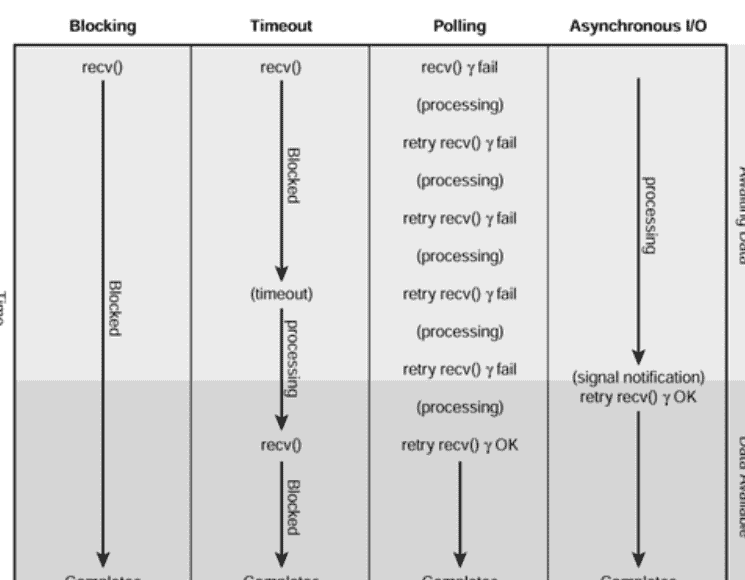

在阻塞风格中，程序等待直到数据到达。轮询风格反复调用`recv()`系统调用，直到数据到达。另一方面，超时风格如果在数据未能在及时到达的情况下可能无法获取数据。尽管如此，在使用超时风格时，你不会丢失消息；内核会为你保留消息，直到你再次请求它。最后，在使用异步风格时，内核在获取到数据时通知任务。

需要注意的是，每种风格在处理发送消息的界面时情况有所不同。内核的缓冲区填补了非阻塞调用中的空缺以加快处理速度。在所有情况下，阻塞调用都会停止，直到内核完全发送消息。（这并不完全准确，因为内核实际上会等待直到可以发送消息时才唤醒任务，但为了简化编程，你可以假设当任务恢复时消息已发送完毕。）轮询和异步调用将消息存储在缓冲区中并立即返回。`图 8.2`假设数据太大，无法完全存储在缓冲区中。

`图 8.2. 写操作通过使用缓冲区为任务提供更多时间。`

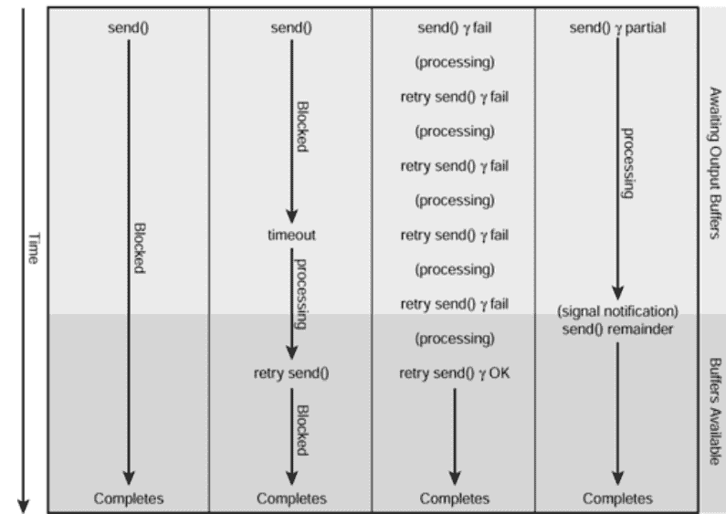

以下各节将向你展示如何使用轮询、超时和异步 I/O。

## 轮询 I/O

程序除了等待数据包外可能还有其他事情要做。一旦你调用`send()`发送消息，消息如何或何时离开计算机就不再是关注点。就你而言，I/O 子系统完整无误地发送了消息。通常情况并非如此；大多数消息会被拆分成小块以适应网络限制。同样，你可能不希望获取消息的片段。相反，你希望填满缓冲区。在这两种情况下，你的程序都会停止并等待任务完成。

通过检查通道是否就绪，轮询有助于你避免在 I/O 通信中被阻塞。要使用轮询，请将通道配置为非阻塞。然后，检查系统调用的返回值。如果调用返回`EWOULDBLK`（或`EAGAIN`），请稍后重试。程序通常将此放入一个包含某些局部处理的循环中，例如以下轮询算法中所示：


```
/***************
/ General Polling Algorithm
while ( /** Transferring Data **/)
{
  if ( /** check a channel for readiness **/)
    /** process the channel **/
  /** Do some computation **/
}
...
```

在此代码段中，计算部分非常重要。Linux 使用基于优先级的轮转调度。当任务进行更多 CPU 密集型处理（较少的 I/O 密集型处理）时，其有效优先级会增加。如果你省略计算部分，你的任务将陷入紧密循环，在几乎什么都没做的同时增加调度偏好。紧密循环对任务调度非常不利。你的任务最终可能会主导调度时间，却只完成很少的工作。

此外，如果你想不到在等待通道释放时该做什么，请不要使用延迟循环或`sleep()`。除非你需要实时响应，否则延迟循环或`sleep()`会违背轮询的目的。要么使用超时，要么让程序阻塞。

## 轮询读取器

轮询让任务在等待更多数据的同时获取并处理部分信息。使用轮询读取器，程序获取并处理数据。通常，处理和数据读取是相关的，并且你必须启用非阻塞 I/O 才能在读/写级别进行轮询。使用`fcntl()`系统调用来启用非阻塞 I/O，如下所示：

```
#include <fcntl.h>
int fcntl(int fd, int command, int option);
```

与`read()`系统调用类似，该命令接受文件描述符（`fd`）或套接字描述符（`sd`）。命令是`F_SETFL`，选项是`O_NONBLOCK`。此系统调用还有更多选项。请参阅附录 C 获取更广泛的列表。

```
if ( fcntl(sd, F_SETFL, O_NONBLOCK) != 0 )
    perror("Fcntl--could not set nonblocking");
```

例如，假设你正在编写一个音频播放器插件。与其等待整个片段从互联网下载完毕，你可能希望在接收数据的同时播放。当然，由于数据可能经过压缩，程序必须将数据转换为机器可读形式。代码片段可能类似于清单 8.1 中找到的代码。

## 示例 8.1。轮询读取示例

```c
/*************************************************************/
/** Polling Read Example: reading an audio stream, ***/
/** processing the data, and playing it. ***/
/*************************************************************/
...
if ( fcntl( sd, F_SETFL, O_NONBLOCK ) != 0 )
    perror("fcntl--could not set nonblocking");
...
done = 0;
while ( !done )
{
    int bytes;
    Queue ProcessingQueue;
    Queue OutputQueue;
    /**** Get any pending data ****/
    if ( (bytes = recv( sd, buffer, sizeof( buffer ), 0 )) > 0 )
        QueueData( ProcessingQueue, buffer);
    /**** Convert a certain number of bytes from the ****/
    /**** processing queue--typically faster than recv() ****/
    ConvertAudio( ProcessingQueue, OutputQueue);
    if ( /*** output queue is far enough ahead **/ )
        PlayAudio( OutputQueue );
    /**** If data stream is done & output queue empty... ****/
    if ( bytes == 0 && /***--output queue empty---*/ )
        done = 1;
}
...
```

此示例接收数据，将其入队并进行处理。然而，它确实存在一个问题：如果两个队列中都没有数据，`while`语句将变成一个紧密循环。为了解决这个问题，您可以插入一个延迟，因为音频是一个实时问题。

### 轮询写入器

程序的运行速度比任何 I/O 函数都快得多。（事实上，为了提高计算机性能，应增加内存并替换旧的、缓慢的 I/O。仅仅获得更快的 CPU 效果并不显著。）因此，当您的程序发送消息或提出任何请求时，操作系统会使您的程序暂停相当长的时间。

轮询写入器具有与轮询读取器类似的算法。将数据生成和处理与发送器结合是一个好主意。准备工作是相同的：使用相同参数的`fcntl()`系统调用。

您可能需要在轮询写入器中处理的问题恰好与读取器相反。读取器可能没有数据可处理，从而导致读取器陷入紧密循环。写入器可以比`send()`更快地生成数据并传输它（写入器堆积）。

例如，考虑清单 8.2中的算法，用于将照片从数码相机发送到少数几个客户端。

## 示例 8.2。轮询写入器示例

```c
/*************************************************************/
/** Polling Writer Example: sending an image to several ***/
/*** clients. ***/
/*************************************************************/
...
int pos[MAXCLIENTS];
zero( pos, sizeof( pos) );
for ( i = 0; i < ClientCount; i++ )
if ( fcntl(client[i], F_SETFL, O_NONBLOCK) != 0 )
perror( "Fcntl--could not set_nonblocking" );
...
done = 0;
/*--- repeat until all the clients get the whole message ---*/
while ( !done )
{
int bytes;
done = 1;
/*--- For all clients... ---*/
for ( i = 0; i < ClientCount; i++ )
/*--- If still more to send to client... ---*/
if ( pos[i] < size )
{
/*--- send msg, tracking how many bytes sent ---*/
bytes = send(client[i], buffer+pos[i],
size-pos[i], 0 );
if ( bytes > 0 )
{
pos[i] += bytes;
/*--- if all the clients are done, exit ---*/
if ( pos[i] < size )
done = 0;
}
}
}
...
```

在此代码中，必须单独跟踪每个客户端，因为它们可能以不同的速率接收数据。`pos`整数数组跟踪每个客户端正在处理的缓冲区中的字节位置。您可以扩展此算法以包含超时机制。

另一个问题可能是，您的服务器在第一个图像仍在发送时可能会收到另一个图像，从而导致写入器堆积。为了解决这个问题，请选择以下选项之一：

- 将新消息附加到旧消息上。

- 取消最后一条消息并开始发送新消息。

- 更改相机的帧率。

在所有情况下，请根据数据的重要性、可能丢失的数据量以及连接的波动程度来选择选项。关于准则列表，请参阅第 4 章“对等节点之间发送消息”。

## 轮询连接

一种更罕见的轮询算法涉及连接来自不同端口的客户端。服务器等待客户端连接，通常，服务器程序只提供一个端口。虽然这是惯例，但您可以打开程序内任意数量的端口。然而，设计者认为程序具有特定目的，端口提供特定服务。

某些端口服务非常基础且琐碎，为每个服务编写程序都是浪费时间、精力和内存。但是，一个套接字只能连接到一个端口。相反，考虑编写一个轮询套接字程序，如下所示：


```c
/*******************************************/
/*** Polling Connection Example: check various ports for ***/
/*** connections creating a new task to answer each ***/
/*** request. ***/
/*******************************************/
"";
/* --- Set nonblocking for each socket --- */
for ( i = 0; i < numports; i++ )
    if ( fcntl(sd[i], F_SETFL, O_NONBLOCK) != 0 )
        perror("Fcntl--can't set nonblocking on port#%d", i);

for (;;) /* Do this forever */
{
    int client;
    for ( i = 0; i < numports; i++ )
        if ( (client = accept(sd[i], &addr, &size)) > 0 )
            SpawnServer(sd[i], i);

    /**** Do housekeeping ****/
}
"";
```

这可能看起来是个好主意，但为每个`accept()`创建一个单独的任务可能更易于管理。事实上，最好的解决方案是使用`select()`系统调用，该调用等待多个I/O通道解除阻塞（有关`select()`的更多信息，请参阅第 7 章“分割负载：多任务处理”）。

### 异步 I/O

让操作系统在通道准备好处理更多I/O请求时通知您，从而将文件I/O的问题转化为对您有利的局面。这为程序提供了更多时间用于计算，减少了在各种系统调用中停滞的时间。

异步读取类似于办公电话上指示语音邮件的闪烁指示灯。同样，电话回拨功能类似于异步写入。将异步I/O想象为通道可用性的通知。

系统通过`SIGIO`信号（有时称为*信号驱动I/O*）实现这种异步I/O。当数据准备好读取或写入通道准备好接收更多数据时，程序会收到`SIGIO`。与所有信号一样，您只知道发生了信号，而不知道更多细节。因此，在两个通道打开且程序收到`SIGIO`的情况下，并不明显应该检查哪个通道。

异常带来了另一个问题。如果通道发生错误，内核不会发出信号。除非您在程序中实际测试通道，否则很难判断程序何时失去了与客户端的连接。

程序通过指示内核接受`SIGIO`信号来启动信号驱动I/O。当信号到达时，信号处理程序设置一个标志，主程序监视该标志。主程序循环随之开始处理，偶尔检查指示信号已到达的标志。处理程序可以自行执行I/O处理，然后标记主循环，或者也可以将I/O留给主循环处理。

这与轮询有何不同？两种算法都需要定期检查I/O通道是否就绪。轮询调用不会阻塞系统调用，但需要定期检查。同样，主循环也必须轮询由信号驱动I/O设置的标志。

主要区别在于程序在系统调用中花费的时间。信号驱动I/O在`send()`和`recv()`系统调用中花费的时间很少：内核会在就绪时通知您的程序。另一方面，轮询必须反复进行系统调用。

清单 8.3 中的算法提供了该工作流程的大致思路。

### 示例 8.3。信号驱动 I/O 算法

```c
/*******************************************/
/*** General Asynchronous or Signal-Driven I/O Algorithm ***/
/*******************************************/
int ready=0;
...
void sig_io(int sig)
{
    /**** IF RECV(): Get all pending data ****/
    /**** IF SEND(): Send all processed data ****/
    ready = 1;    /* tell main loop: "transaction complete" */
}
for (; ;)
{
    if ( ready > 0 )
    {
        /**** Block SIGIO temporarily ****/
        ready = 0;
        /**** IF RECV(): copy data into processing area ****/
        /**** IF SEND(): fill output buffer from ****/
        /**** ~processed data queue ****/
        /**** Unblock SIGIO ****/
    }
    /**** Process incoming data ****/
    /**** --OR- ****/
    /**** Generate more data to send ****/
}
...
```

阻塞`SIGIO`信号可能看起来有点不寻常。由于信号处理程序和主循环共享相同的变量，您有一个临界区（参见第 7 章中的“互斥（Mutex）”部分）。关闭信号处理程序是一个重要的互斥机制。

## 注意

### 排队消息

为了获取所有待处理消息，您可能需要在处理程序中多次调用`send()`和`recv()`。内核可能同时向您的程序发出多个信号，但您的程序一次只能接收到一种信号类型。如果两个相同的信号非常接近地到达，您的程序只能接收到一个。

您使用`fcntl()`系统调用来启动`SIGIO`消息。该系统调用不仅告知内核使套接字描述符变为异步（请记住，这适用于所有文件描述符），还告知内核将信号定向到特定进程。例如，以下代码段开启`SIGIO`信号并将其定向到当前任务：

```c
/*******************************************/
```

### 按需读取

程序可以使用异步读取，即按需读取，来处理到达的数据。随着数据的到达，内核会向程序发送信号。程序接收并处理这些数据。这就像工厂或装配线一样，所需的材料到达并向前移动。

此功能最适用于在等待单一数据源时执行大量CPU计算的情况。（请记住，尽管可能开启了多个I/O通道，但你仍需手动检查以确定哪个通道发出了信号。）对于此任务，可以考虑使用虚拟现实建模语言（VRML）文档，如清单 8.4 所示。

### 示例 8.4. 异步处理算法

```c
/*** 用于启动 SIGIO 信号流代码片段 ***/
/***** ******************************************/
if ( fcntl(sd, F_SETFL, O_ASYNC | O_NONBLOCK) < 0 )
    PANIC("无法使套接字异步且非阻塞");
if ( fcntl(sd, F_SETOWN, getpid()) < 0 )
    PANIC("无法拥有 SIGIO");
...

/*** VRML 异步读取示例：处理数据的同时
    ***/
    /*** 等待更多数据到达。
    ***/
/***** ******************************************/
int ready=0, bytes;
...
void sig_io(int sig)
{
    /*--- 获取待处理消息 --*/
    bytes = recv(server, buffer, sizeof(buffer), 0);
    if ( bytes < 0 )
        perror("SIGIO");
    ready = 1;    /* 告知主循环：“交易完成” */
}
/*--- 启用异步、非阻塞 I/O ---*/
if ( fcntl(sd, F_SETFL, O_ASYNC | O_NONBLOCK) < 0 )
    PANIC("无法使套接字异步且非阻塞");
/*--- 声明对 SIGIO 和 SIGURG 的所有权 --*/
if ( fcntl(sd, F_SETOWN, getpid()) < 0 )
    PANIC("无法拥有 SIGIO");
while ( !done )
{
    if ( ready > 0 )
    {
        /**** 暂时阻塞 SIGIO ***/
        ready = 0;
        FillQueue(Queue, buffer, bytes);
        /**** 解除对 SIGIO 的阻塞 ****/
    }
    /**** 在 VRML 光栅化器中短时间处理传入数据， ***/
    /**** 或者直到变量 "ready" 发生 ***/
}
/*** 变化。
...
    ****/
```


再次强调，避免在信号处理程序中做太多事情。在这种情况下，你的处理程序可以简单地通知主循环自己去加载数据。但是，由于队列管理器可能会使用内存管理，填充图像处理队列应在处理程序外部进行。

## 注意

### 过于频繁的读取事件

接收缓冲区在超过低水位线（内核发出 `SIGIO` 之前所需的最少字节数）时会通知任务。低水位线默认为 `1`，因此每次缓冲区获得 `1` 字节时，你的程序都可能收到信号。在某些系统中，可以使用`setsockopt()`将其更改为更大的值（参见第 9 章）。然而，Linux 似乎不支持写入此参数。

### 异步写入

由于内核的缓冲区，你编程异步写入的方式略有不同。当你的程序第一次调用`send()`时，内核的缓冲区可能可以存储整个数据块。但也可能无法存储，内核仅缓存了一部分。

因此，检查每个`write()`的返回值，以确保所有数据都已发送。你可能甚至需要将该通道的所有传出数据保留在单个队列中。这减少了涉及多个缓冲区的代码复杂性。尽管如此，使缓冲灵活也很重要，以便队列可以根据需要扩展或缩小。

数据库查询示例在这种情况下很适用。它生成大量数据，可以在发送回复的同时进行处理或收集，如清单 8.5 所示。

#### 示例 8.5. 异步写入器算法

```c
/* ***************************************************** */
/*** 数据库查询异步写入器示例：处理查询的同时 ***/
/*** 生成结果。 ***/
/* ***************************************************** */
int ready=0, bytes, size=0, pos=0;
int sig_io(int sig)
{
    if ( size > 0 )
    {
        bytes = send(client, buffer, size+pos, 0);
        if ( bytes > 0 )
        {
            pos += bytes;
            ready = 1;
        }
    }
}
...
/*** 启用非阻塞、信号驱动的 I/O；声明 SIGIO ***/
while ( !done )
{
    if ( /*** 通道可用 **/ )
    /** 发送消息，不阻塞 **/
    else
    /** 将消息入队 **/
}
... 
```

每当通道空闲并准备好接收更多数据时，内核都会向进程发送`SIGIO`信号。使用前一个示例中展示的方法，利用该信号以按需方式将数据传送出去。

### 按需连接

你可以创建一个按需连接服务器（理论上）。它本质上看起来像按需读取器，但程序调用的是`accept()`而不是读取文件。处理程序需要三个全局变量与主循环通信：套接字接收器（`sd`）、描述符数组以及当前连接数。你的信号处理程序创建的任何局部变量在处理程序结束时都会丢失。

处理程序可能如下所示：

```c
/*************************************************************************/
/** 按需连接示例：在 **/
/** 信号处理程序中建立连接。主循环遍历每个打开的 **/
/** 套接字以获取消息。（摘自 CD 上的 demand-accept.c 代码片段） **/
/*************************************************************************/

int Connections[MAXCONNECTIONS];
int sd, NumConnections=0;
void sig_io(int sig)
{   int client;
     /*--- 接受连接。如果太多，则报错并关闭 ---*/
     if ( (client = accept(sd, 0, 0)) > 0 )
         if ( NumConnections < MAXCONNECTIONS )
             Connections[NumConnections++] = client;
         else
             {
             send(client, "连接数过多！\n", 22, 0);
             close(client);
             }
     else
         perror("Accept");
}
... 
```

虽然按需服务器很有用，但多任务处理的明显优势在于它允许你保留局部变量，并为每个连接设置一个特定的任务。

除非你的服务器容易任务过载（程序创建了大量进程导致性能下降），否则使用按需连接可能会给你的编程带来负担。对于设计和实现按需连接服务器所付出的所有努力，你很可能无法获得同样的性价比。使用多任务或轮询技术要简单得多。

### 使用 `poll()` 和 `select()` 解决非预期的 I/O 阻塞

Linux 提供了两种工具，帮助你同时处理多个打开的通道。这些工具比手动轮询更高效（且可能更容易实现）。每个工具背后的核心思想是系统调用会阻塞，直到任何通道状态发生变化。

状态变化包括数据可供读取、通道可供写入或发生错误等条件。返回时，一个或多个通道可能已改变状态。调用返回的值代表状态发生变化的通道数量。

然而，`select()` 系统调用稍微复杂一些，涉及几个宏来管理描述符列表：

```c
#include <sys/time.h>
#include <sys/types.h>
#include <unistd.h>
int select(int maxfd, fd_set *to_read, fd_set *to_write,
        fd_set *except, struct timeval *timeout);
FD_CLR(int fd, fd_set *set);    /* 从集合中移除 fd */
FD_ISSET(int fd, fd_set *set);   /* 检查 fd 是否在集合中 */
FD_SET(int fd, fd_set *set);    /* 将 fd 添加到集合中 */
FD_ZERO(fd_set *set);           /* 初始化集合以便使用 */
```

主例程是`select()`系统调用。它有几个辅助宏（`FD_CLR()`、`FD_ISSET()`、`FD_SET()`、`FD_ZERO()`）来管理描述符列表。参数定义见表 8.3。

#### 表 8.3，`select()` 系统调用的参数

| 参数 | 描述 |
| :--- | :--- |
| `maxfd` | 集合中编号最高的文件描述符加 1。（更多详情请参见下文。） |
| `to_read` | 等待读取的描述符集合。这是你想测试读取的集合。 |
| `to_write` | 等待写入的描述符集合。 |
| `except` | 等待优先消息的描述符集合。 |
| `timeout` | 在放弃之前等待的秒数/微秒数。（更多详情请参见下文。） |
| `fd` | 要添加、删除或测试的文件描述符。 |
| `set` | 要操作的描述符集合。 |

`maxfd` 参数是三个集合中编号最高的描述符槽位加 `1`。每个任务获得一定数量的 I/O 描述符槽位（通常为 `1024`）。每个 I/O 通道占据一个槽位（`stdin` 是 `0`，`stdout` 是 `1`，`stderr` 是 `2`）。如果集合在`to_read`中有描述符 `[3,6]`，在`to_write`中有 `[4,5,6]`，在`except`中有 `[3,4]`，则`maxfd`变为 `6`（最高描述符编号）加 `1`，即 `7`。

`timeout` 参数提供了设置系统调用等待时长上限的灵活性：

- 如果为`NULL`，则无限期等待。
- 如果为正数，则等待指定的微秒数。
- 如果为零，则在检查完所有描述符后立即返回。

例如，如果你有编号为 `[3,4,6]` 的三个打开的客户端通道，你可以像这样等待它们向程序发送数据：

#### Select() 示例


```c
/*****************************************/
/***  Select() Example.             ***/
/*****************************************/
int count;
fd_set set;
struct timeval timeout;


FD_ZERO(&set);                          /*  Clear set  */
FD_SET(3, &set);                        /*  Add client channel #3  */
FD_SET(4, &set);                        /*  Add client channel #4  */
FD_SET(6, &set);                        /*  Add client channel #6  */
timeout.tv_sec = 5;                     /*  Timeout after 5.25 seconds  */
timeout.tv_usec = 250000;
/****  Wait for select()  ----*/
if ( (count = select(6+1, &set, 0, 0, &timeout)) > 0 )
    /****  Find the descriptors that changed ****/
else if ( count == 0 )
      fprintf(stderr, "Timed out!");
else
      perror("Select");
...
```

在这个例子中，当`select()`系统调用返回正值时，三个通道之一有待读取的数据。要确定哪个通道已准备就绪，需添加相应的代码并读取数据。然而，如果返回值为零，则调用超出了`5.25`秒的时间限制。

`poll()`系统调用与`select()`类似，可能更容易管理。它使用结构体数组来定义行为：

```c
struct pollfd
{
    int fd;          /*  the descriptor to test  */
    short events;   /*  requested events to watch  */
    short revents;  /*  events that fired  */
} ;
```

第一个字段`fd`是文件或套接字描述符。第二和第三个字段`events`和`revents`是特定事件的位掩码：

-   `POLLERR` 任何错误条件。如果通道发生任何错误则返回。
-   `POLLHUP` 另一端挂断。如果对等方挂断则返回。
-   `POLLIN` 传入数据。如果有数据可供读取则返回。
-   `POLLNVAL` `fd` 未打开。如果通道不是打开的文件或套接字则返回。
-   `POLLPRI` 优先级消息。如果收到优先级消息则返回。
-   `POLLOUT` 通道可用性。如果`write()`不会阻塞则返回。

对`poll()`的系统调用如下所示：

```c
#include <sys/poll.h>
int poll(struct pollfd *list, unsigned int cnt, int timeout);
```

程序在使用此系统调用前会填充一个`pollfd`结构体数组。`cnt`参数是数组中合法套接字描述符的数量。（请记住保持这些描述符连续；如果其中一个关闭，请压缩数组。并非所有实现都能很好地处理空槽位。）`timeout`参数的作用类似于`select()`的超时，但以毫秒为单位。

`select()`或`poll()`系统调用均提供了同时监控多个通道的功能。通过良好的规划，你可以避免多任务处理中遇到的一些开销问题。

## 实现超时

轮询`I/O`通道的一种简单替代方法是告诉操作系统你不希望等待超过指定的时间。`Linux`系统调用并没有提供直接的实现方式。请考虑使用以下方法来实施超时：

-   在`select()`或`poll()`系统调用中使用超时参数
-   使用信号（`SIGALRM`）唤醒任务

## 注意

`Linux`套接字超时支持

套接字选项包括发送（`SO_SNDTIMEO`）和接收（`SO_RCVTIMEO`）的超时。不幸的是，这些参数目前为只读；在`Linux`上，它们的默认值为`OFF`。如果你尝试移植使用这些参数的某些代码，可能不得不使用上述其他两种方法。

前文所述的`select()`和`poll()`系统调用提供以微秒为单位的超时参数。使用这些系统调用可能是实现超时最简单的方式，但超时适用于调用中的所有通道。

这种情况可能会成为一个问题：假设你有三个通道，其中之一的响应非常迟钝。仅使用这些系统调用，你无法检测到故障通道本应超时并关闭。你可以手动为每个通道保留单独的时间，并在每次响应时重置时间。即便如此，这可能仍会涉及大量不必要的检查和日志记录。

你可以使用替代方案：一个`alarm`信号。`alarm`是在内核中运行的时钟。当`alarm`触发时，内核以`signal`的形式向任务发送`wakeup`调用。如果任务正在`system`调用中等待，`signal`将中断该调用，任务进入`signal`处理程序，然后`system`调用返回并带有`EINTR`错误。

每个任务都可以向自己发送`signal`，但任务需要知道如何处理该`signal`。在某些系统中，`sleep`库调用使用`alarm()`系统调用，首先设置任务以捕获`SIGALRM` `signal`。请查看以下`example`：

```c
/********************************************************************/
/** Example: Timeout example using the alarm() system **/
/** call. (Except from echo-timeout.c on CD.) **/
/********************************************************************/
...
int sig_alarm(int sig)
{ /** do nothing **/}
...
void reader()
{    struct sigaction act;
/*--- Initialize signal structure; reset to default ---*/
 bzero(&act, sizeof(act));
 act.sa_handler = sig_alarm;
 act.sa_flags = SA_ONESHOT;
 /*--- Set the signal handler ---*/
 if ( sigaction(SIGALRM, &act, 0) != 0 )
       perror("Could not set up timeout");
 else
   /*--- If signal handler installed, set timer ---*/
   alarm(TIMEOUT_SEC);
 /*--- Call the I/O that might timeout ---*/
 if ( recv(sd, buffer, sizeof(buffer), 0) < 0 )
   {
       if ( errno == EINTR )
           perror("Timed-out!");
   }
}
```

所示示例设置了信号处理程序，设置了定时器，并调用了`I/O`。如果`recv()`在定时器到期前未获取到数据，任务将收到一个信号。该信号中断`recv()`系统调用，系统调用返回并带有错误（`EINTR`）。

要获得此行为，请从`sa_flags`字段中省略`SA_RESTART`选项。第`7`章建议你在信号中包含此选项。在这种情况下，为了超时定时器正常工作，请省略此选项。

最后一点提示：避免将`alarm()`系统调用与`sleep()`一起使用，因为这可能会导致程序中出现问题。相反，使用`Linux`的`SIGALRM`信号或使用`sleep()`——不要混用它们。

## 总结：选择 I/O 技术

网络程序通过网络与其他程序进行交互。由于性能和响应时间因机器和而异，了解何时以及如何使用非阻塞`I/O`来提高客户端和服务器的`I/O`管理至关重要。

谨慎使用并合理平衡阻塞和非阻塞`I/O`可以提高你的客户端和服务器对用户的响应能力。

本章涵盖了阻塞（它是什么、何时有用、为何使用）和非阻塞（不同类型、何时使用、如何使用）的多个主题。它讨论了选择非阻塞`I/O`的主要工具：`fcntl()`系统调用。


两种主要的非阻塞工具是轮询和异步 I/O。轮询反复使用 I/O 系统调用。异步（或信号驱动）I/O 将确定通道何时空闲的负担交给内核。轮询专注于 I/O，而信号驱动 I/O 专注于本地处理。

管理阻塞的另一个工具是超时。你可以在 `select()` 或 `poll()` 系统调用中部署超时，或使用定时器信号，当调用耗时过长时唤醒进程。

# 第 9 章。突破性能瓶颈

### 本章内容

- 在客户端到达前创建 Servlet
- 通过智能 Select 扩展控制
- 深入套接字控制
- 恢复套接字描述符
- 发送先于接收：消息交错
- 记录文件 I/O 问题
- 使用基于需求的 I/O 恢复 CPU 时间
- 发送高优先级消息
- 总结：整合性能特性

如何让你的服务器或客户端发挥最大效能？Linux 在套接字 API 中提供了多个工具，使这一过程相对简单。然而，你需要同时从多个角度看待编程问题，因为每个方面都涉及并影响其他方面。

你的网络程序有三个不同的方面：任务、连接和消息。你在程序运行过程中操作每一项。任务涉及处理所有相关进程或线程。连接是套接字本身及其行为，消息则与接收和发送消息的 I/O 处理相互作用。为了充分利用你的网络程序，你必须在任务和消息传递之间取得平衡。套接字使你能够根据需求专门化连接。

本章带你了解几个理念和最佳实践，这些实践针对任务、连接和消息传递。你需要了解前面章节中介绍的概念，才能充分利用这些算法。

## 在客户端到达前创建 Servlet

到目前为止，你已经了解了如何创建服务器、实现多任务处理以及控制 I/O 阻塞。这些模块中的每一个都有助于你与客户端交互并控制吞吐量。第 7 章“分配负载：多任务处理”展示了如何委派接受和处理传入连接的任务，根据需要创建子进程。

然而，在某些系统中，每次创建新任务都会消耗时间和资源。此外，你可能不希望将计算机的所有资源都专门用于服务网络客户端。（另一方面，你可能确实希望这样做，但你必须对服务器访问设置逻辑上有效的限制以确保性能。）你可能有其他需要定期运行的程序，甚至是本地/远程登录。无论如何，你需要控制服务器程序的增长。控制连接数量需要额外的编程。

### 限制客户端连接数量

如果你回忆前几章的内容，服务器会在客户端连接时立即创建一个新的子进程。你的程序需要在此处进行修改，以纳入对过多进程的控制（一旦被称为兔子进程，因为它们繁殖太快而无法控制）。以下标准算法做到了这一点。

```c
/***********************/
```

## 标准的随需创建进程算法

```c
int sd;
struct sockaddr_in addr;
if ( (sd = socket(AF_INET, SOCK_STREAM, 0)) < 0 )
    PANIC("socket() failed");
bzero(&addr, sizeof(addr));
addr.sin_family = AF_INET;
addr.sin_port = htons(MY_PORT);
addr.sin_addr = INADDR_ANY;
if ( bind(sd, &addr, sizeof(addr)) != 0 )
    PANIC("bind() failed");
if ( listen(sd, 20) != 0 )
    PANIC("listen() failed");
for (;;) {
    int client, len=sizeof(addr);
    client = accept(sd, &addr, &len);
    if ( client > 0 )
    {
        int pid;
        if ( (pid = fork()) == 0 )
        {
            close(sd);
            Child(client); /*---Serve the new client---*/
        }
        else if ( pid > 0 )
            close(client);
        else
            perror("fork() failed");
    }
}
```

你在第 7 章中见过这个算法，它能很好地处理长连接。长连接包括登录、数据库交互以及客户端和服务器进行多次迭代交互的任何其他情况。

该算法存在一个主要缺陷：如果你耗尽 PID 会发生什么？如果因为没有足够的 RAM 来支持进程数量而导致交换分区（swap）开始颠簸（thrashing），又会发生什么？这正是兔子进程生成器（rabbit process generators）面临的问题。

### 注意：RAM 和内存的区别

你可能认为，拥有所有交换空间的虚拟内存系统可以拯救你的系统。实际上，这具有相当大的误导性。当你需要性能时，你需要让所有活跃进程及其数据保留在 RAM 中。如果它们被交换出去，内核重新加载它们所需的时间会消除任何速度上的感知。了解你的系统、内存、处理器和 I/O 是榨取性能的第一道门槛。

你可以尝试的一种方法是统计进程数量：

```c
/** *******************************************************/
/**  Algorithm revised to limit the number of children  ***/
/** ("capped-servlets.c" on Web site)                  ***/
/** *******************************************************/
int ChildCount=0;
void sig_child(int sig)
{
  wait(0);
  ChildCount--;
}
...
for (; )
{
   int client, len=sizeof(addr);
   while ( ChildCount >= MAXCLIENTS )
      sleep(1); /*---You could "sched_yield()" instead---*/
   client = accept(sd, &addr, &len);
   if ( client > 0 )
   {
      int pid;
      if ( (pid = fork()) == 0 )
      { /*---CHILD---*/
         close(sd);
         Child(client); /*---Serve the new client---*/
      }
      else if ( pid > 0 )
      { /*---PARENT---*/
         ChildCount++;
         close(client);
      }
      else
         perror("fork() failed");
   }
}
```

在这个例子中，父进程跟踪子进程的数量。如果有太多的子进程，服务器只是让出 CPU，直到其中一个连接关闭且子进程终止。你可以相当容易地使用这种方法，而且由于 `ChildCount` 变量的唯一写入者是服务器及其信号处理程序，你不必担心竞态条件。

再次强调，这个算法对于你的长连接运行良好。然而，如果你有很多短期的、单事务的连接，创建和终止子进程的成本可能会吞噬服务器的性能。想法是让一组进程运行，所有进程都在等待连接的到来。

## 预派生你的服务器

你的服务器可以有 5–20 个进程等待连接的到来。这就是负载分布的 HTTP 服务器所做的。（如果你安装了 `HTTPD` 并且正在运行，查看你的进程表，你可能会看到几个实例在运行。）如果进程不共享数据，子进程如何获取数据？答案在下面的代码片段中。

```c
/*****...*****/
/*** Code fragment of the child process          ***/
/*****...*****/
if ( (pid = fork()) == 0 )
{
  close(sd);
  Child(client); /*---Serve the new client---*/
}
```

这个摘录显示了子进程关闭套接字描述符 `sd`。客户端套接字描述符提供了与客户端的连接。为什么子进程要关闭 `sd`？

当你创建子进程时，子进程共享父进程的打开文件。如果子进程不需要该文件，它应该关闭它。然而，子进程可以保持文件打开并像父进程一样进行读取或写入。这就引出了你可能如何创建多个进程服务于同一套接字：


```c
/*************************************************************************/
/*** Creating a set of child-servers to await connection ***/
/*** ("Preforking-servlets.c" on Web site)   ***/
/*************************************************************************/
int ChildCount=0;
void sig_child(int sig)
{
    wait(0);
    ChildCount--;
}
...
main()
{
    /*** Attach signal; create & bind socket ***/
    for (; ;)
    {
        if ( ChildCount < MAXPROCESSES )
        {
            if ( (pid = fork()) == 0 )     /*---CHILD----*/
                for (; ;)
                {
                    int client = accept(sd, 0, 0);
                    Child(client);  /*---Serve new client---*/
                }
            else if ( pid > 0 )           /*---PARENT----*/
                ChildCount++;
            else                          /*---ERROR----*/
                perror( "fork( ) failed");
        }
        else
            sched_yield();                /*--- OR, sleep(1)---*/
    }
}
```

这反转了`accept()`和`fork()`的顺序：不是在连接后创建进程，而是该算法在创建子进程后等待连接。

这个代码片段可能创建例如 10 个进程。所有子进程进入无限循环，等待并处理连接。假设没有等待的连接，所有 10 个进程都处于 I/O 阻塞（睡眠）状态。当连接到达时，所有进程都会唤醒，但只有一个获得连接。剩下的九个回去睡觉。这个循环无限期地继续。

如果一个子进程崩溃或终止会发生什么？这就是为什么父进程永远不进行`accept()`系统调用的原因。父进程的主要角色是确保始终有正确数量的子进程可用。

最初，父进程创建子进程的配额。当子进程终止时，信号处理程序获取通知并将配额减一。当父进程恢复时，它创建一个新子进程。如果父进程不需要创建更多子进程，它将时间片让给其他任务。

## 适应不同的负载级别

父进程的主要责任是确保有足够的子进程可用，以处理传入的连接。这一责任必须与计算机的资源负载保持平衡。如果你不仔细，客户端可能会因超时而开始掉线，因为你的服务器没有足够的监听器来处理连接。

使用固定数量的监听器（`servlets`）对活跃连接的数量设置了限制。这是预派生 servlets 的主要限制。然而，限制程序创建和销毁进程数量的想法是一个好主意。它减轻了进程表和系统资源的混乱。有什么好方法可以在满足连接客户端需求的同时最小化创建和销毁吗？

你可以使 servlet 算法适应系统的需求。你的服务器必须应对两个不同的挑战：知道何时创建更多的 servlets，以及知道何时终止多余的。第二个挑战很简单：如果 servlet 空闲了一段时间，它会自行终止。

第一个挑战，知道何时创建更多的 servlets，并不那么直接。你可能记得每个 TCP 服务器都有一个监听队列（这就是`listen()`系统调用的功能）。网络子系统将每个连接请求入队，而`accept()`系统调用确认并创建到客户端的专用通道。如果客户端在队列中停留时间过长，它可能只等几分钟就会放弃。

能够看到队列中有多少待处理连接以及最长的等待请求可能是多少，可能有助于服务器调优。你可以使用这些信息来监控系统对请求的响应能力。随着队列填满，服务器可以创建更多的 servlets。如果连接延迟变得太长，你可能只需调整 servlet 的自终止延迟。不幸的是，这不是 API 调用提供的功能。如果你想要 servlet 的适应性，你必须使用另一种方法。

一种创建新 servlet 以应对大量请求的方法类似于撒诱饵捕鱼。在合法的情况下，渔民撒出不同种类的诱饵样本。鱼吃的诱饵就是渔民使用的诱饵。鱼的反应还指示了鱼群有多大。

像撒诱饵一样，服务器偶尔会多派生一个 servlet。只要终止的多余 servlet 数量与创建的数量相同（因为无事可做），服务器就继续这个过程。当 servlet 停止终止时，你的服务器增加创建的多余 servlet 数量，直到数量再次稳定。

预派生的目的是最小化创建和清理 servlet 的时间。随意创建和终止 servlet 会将你带回为每个新连接进行派生的做法。你必须仔细规划以避免这种结果。此外，你的算法必须运行最少数量的 servlet 才能使此方法生效。

这就是统计数据有点帮助的地方。适应性算法必须面对三种可能性：连接数量是稳定的，正在增加，或正在减少。如果连接数量是稳定的，服务器会看到在给定时间段内终止的 servlet 数量与创建的数量相同。例如，如果你的服务器每 60 秒创建一个 servlet（带有 30 秒的空闲超时），你可能会在图 9.1 的示意图中看到第一种模式。

**图 9.1.** 抛出额外的 servlet 以查看是否有待处理的连接。

`img/03334662da8fdfb8d95a02f270c522f6_156_0.png`

`img/03334662da8fdfb8d95a02f270c522f6_156_1.png`

如果连接数量正在增加，则被终止的连接少于被创建连接。如果你的服务器在规定的时间间隔内未观察到连接终止，你可以假设它正在处理一个连接。此时，你的服务器会将 Servlet 创建速率加倍（参见 **图 9.1** 中的第二个模式）。这一过程持续进行，直到 Servlet 数量达到上限，或者你的服务器达到最大创建频率（例如，每隔 5 秒一次）。

再次假设，你的服务器每 60 秒创建一个新 Servlet（空闲超时为 30 秒）。如果额外的 Servlet 未在规定时间内终止，你可以将创建之间的时间延迟减半，从而将频率加倍。你可以重复这一过程，直到连接速率开始稳定下来。

最后，当连接开始减少时，待处理的连接（如果存在）拥有的 Servlet 远多于队列所需，服务器开始观察到 Servlet 的终止。当多余的 Servlet 开始终止时，你可以将服务器的频率重置为正常水平。

```c
/***************************************************/
/*** Chumming connections example	***
/*** ("servlet-chummer.c" on Web site)	***
/***************************************************/
int delay=MAXDELAY;		/* for example, 5 seconds */
time_t lasttime;
void sig_child(int signum)
{
	wait(0);			/* Acknowledge termination */
	time(&lasttime);		/* get the time stamp */
	delay = MAXDELAY;		/* reset chummer back */
}
void Chummer(void (*servlet) (void))
{
	time(&lasttime);		/* Initialize timestamp */
	for (;;) {
		if ( !fork() )		/* first, set the chum */
			servlet();	/* call the task (must have exit()) */
		sleep(delay);		/* dream for a while */
		/* If no child terminated, double frequency */
		if ( time(0) - times[1] >= delay-1 )
		if ( delay > MINDELAY )	/* don’t go below min */
			delay /= 2;	/* double chum frequency */
	}
}
```


此代码片段展示了如何通过记录最后一个子进程终止的时间来跟踪 Servlet 的形成并测试负载增加。终止也会重置计时器，以便当前连接可以稳定下来，并且进程可以重新开始。

## 使用智能 Select 扩展控制

使用进程来管理连接流是分配任务的一种直观方式。此外，对正在运行的进程数量设置限制并预创建（preforking）进程可以确保连接得到所需的关注。然而，所有这些方法都存在一个根本问题：调度器风暴（scheduler storm）。

## 调度器风暴

调度器风暴提出了两个问题，暴露了多任务处理的局限性以及单 CPU 系统可能被压垮的原因。第一个问题展示了大量进程表对 Servlet 的影响。第二个问题影响了预创建（preforking）概念。

进程表可以轻松处理几百个进程。取决于内存和交换空间，理论上你可以拥有更多。但仍需考虑限制：Linux 每 `10ms` 在进程之间切换一次。这还不包括卸载旧进程上下文和加载新进程的时延。

例如，如果你有 200 个 Servlet 正在运行，在一个每 `0.01` 秒切换一次任务的系统中，每个进程可能需要等待 2 秒才能获得一小段 CPU 时间。如果每个时间片能在此小段时间内发送 `1KB` 数据，你可能会在 `10Mbps` 局域网连接上看到大约 `200KBps` 的吞吐量（这对于 `TCP/IP` 来说还算正常）。然而，每个连接每秒只能获得 `512` 字节。这是让进程表无限制增长的主要风险。

第二个问题在于预创建的核心：多个进程都在等待同一个连接。当连接请求到达时，你的服务器可能有 20 个处于 `I/O` 阻塞状态的 Servlet。由于所有进程都在等待连接，内核会唤醒所有 20 个进程。第一个获得连接的进程会继续工作，而其他所有进程返回到 `I/O` 阻塞状态。一些程序员称此现象为 `调度风暴`（scheduling storm）或 `惊群效应`（thundering herd）。无论哪种情况，这个问题都强调了减少等待 Servlet 数量并基于连接负载进行调整的必要性。

### 注意

在内核中解决惊群效应

编写一本关于像 Linux 这样不断演进的技术书籍的问题之一是，信息会很快过时。`Linux 2.4` 通过仅唤醒一个处于 `I/O` 阻塞状态的进程在内核中解决了惊群效应问题。

## 过载的 select()

解决这些问题的一个方法是完全避免多任务处理。在前一章中，你阅读过关于 `I/O` 多路复用系统调用：`select()` 和 `poll()`。这些系统调用可以像多个进程一样发挥作用。

与其让 20 个 Servlet 进程都在等待连接，不如提供一个进程来等待连接。当连接请求到达时，服务器将该连接（客户端通道）放入 `I/O` 列表中。这些系统调用等待其中任何一个发送请求或命令。系统调用将准备好的通道返回给你的服务器，然后你的服务器检索并处理该命令。

完全跳过多任务处理而使用这些多路复用器的诱惑可能会导致性能的某些损失。当使用单个任务处理信息时，你的程序或服务器在进程生命周期的各个阶段必须等待 `I/O`。如果你不利用这段空闲时间，你的服务器可能会失去做其他事情的重要机会。例如，如果你曾经编译过内核，你可能会发现，如果你使用 `make` 选项 `-j` 强制多个任务，编译时间会更短。（如果你有足够的内存，每个处理器运行两个或三个任务可以显著减少编译时间。）

## 采用智能 Select 进行折中

在创建高性能、高需求的服务器时，你可以使用各种方式来分配负载。其中两种是多任务处理和 `I/O` 多路复用。然而，如果单独使用，多任务处理可能会失去对调度器的控制，并将宝贵的时间耗费在上下文切换上，而 `I/O` 多路复用则会浪费未使用的 CPU 带宽。一种替代方法是结合两者。将两者结合成一个 `智能 Select`（Smart Select）可以帮助你减少各自的缺点，同时利用它们的能力。

智能 Select 分派几个进程。每个进程拥有一个连接通道和一组打开的客户端通道。一个 `I/O` 多路复用器管理所有通道。以下是该过程的算法：

```c
/*****...*******************************...*****/
/*** Smart Select example: each child tries to accept a ***/
/*** connection. If successful, it adds the connection ***/
/*** to the select() list.                ***/
/*** ("smart-select.c" on Web site)              ***/
/*****...*******************************...*****/
int sd, maxfd=0;
fd_set set;
FD_ZERO(&set);
/*** Create socket and fork() processes ***/
/**---In Child---*/
maxfd = sd;
FD_SET(sd, &set);
for (;;) {
        struct timeval timeout={ 2,0 };         /* 2 seconds */
        /**--Wait for some action--*/
if ( select(maxfd+1, &set, 0, 0, &timeout) > 0 )
{
        /**--If new connection, connect and add to list--*/
 if ( FD_ISSET(sd, &set) )
  {  int client = accept(sd, 0, 0);
     if ( maxfd < client )
        maxfd = client;
     FD_SET(client, &set);
  }
        /**--If command/request from client, process--*/
else
        /*** Process client's request ***/
        /*** If client just closed, remove from list ***/
}
}
```

你可以使用此算法创建少量进程——远少于在纯多任务处理服务器中可创建的数量——例如，5–10 个 Servlet。反过来，每个 Servlet 可以支持 5–10 个连接。

### 注意

Select 碰撞

你可能听说过一个称为 `select 碰撞`（select collision）的 BSD 问题。前面的算法假设 `select()` 可以等待多个描述符，并且仅在描述符状态改变时唤醒。`BSD 4.4` 实现存在一个限制，会导致所有阻塞在 `select()` 中的进程都唤醒。看起来 Linux 没有这个限制。

这种方法可以轻松支持数百个连接而不互相干扰。任务数量与连接数量之间的平衡有助于最小化对进程表的影响。然而，如果有如此多的连接，当你需要跟踪协议状态时可能会导致问题。

你可以轻松地将此算法用于无状态服务器。无状态连接不记住之前的任何事务。这要求发送到你的服务器的所有事务与其他事务没有任何关系，或者每个连接只有一个事务。此外，如果你的服务器需要短期到中期连接，你可以使用这种方法。一些例子包括 `HTTP` 服务器、数据库查询服务器和网络重定向器。

## 实现问题

如你可能注意到的，这种方法确实有一些局限性。首先，主要服务器无法平衡每个 Servlet 之间的连接数量。你可以添加代码来对连接数量设置上限：

```c
/*************************************************************/
/** Limiting the number of connections to a servlet ***/
/*************************************************************/
if ( FD_ISSET(sd, &set) )
    if ( ceiling < MAXCONNECTIONS )
    {
        int client = accept(sd, 0, 0);
        if ( maxfd < client )
            maxfd = client;
        FD_SET(client, &set);
        ceiling++;
    }
```

这种方法有效地将连接让渡给另一个 Servlet。然而，你 Servlet 之间连接的分配可能是随机的。

另一个问题涉及连接的上下文。当客户端连接到你的服务器时，除非它是单事务连接，否则你的服务器会经历不同的状态。例如，状态一是登录，状态二是会话。

前面的代码片段总是返回到等待并获取某些消息的点。如果你想整合状态，你必须跟踪每个连接的位置。凭借这些信息，你可以为 Servlet 编程，将其与接收到的消息进行比较。这并不难，但你需要对程序进行稍多的规划。


该算法的最后一个限制是其对长期（深度事务）连接的支持。如果你的客户端和服务器执行单个事务或短交互，该算法会保持稳定。然而，深度事务连接通常需要多个状态。这会给你的服务器带来极大的复杂性。此外，由于连接处于活动状态的时间更长，负载均衡失衡的可能性也会增加。

## 重新分配负载

如果你从使用进程切换到使用线程，就可以解决负载分配的限制。如上文所述，服务器无法轻松分配每个任务的连接数量。（你可以通过进程间通信（`IPC`）来实现，但这带来的麻烦远大于其价值。）线程允许你在任务之间共享所有内容，包括文件描述符表。

类似地，你的服务器可能有多个线程在运行，这使得连接分配变得困难。你拥有一个描述符数组，可以使用`poll()`系统调用。（你可以使用`select()`调用，但算法不如`poll()`直观。）每个线程拥有数组的一部分。只有当父进程接受所有连接时，这种方式才有效。当服务器看到连接请求时，父进程接受该请求并将其放入描述符数组中。

取决于`poll()`的实现，你的线程可能必须频繁超时，以便拾取描述符数组中的任何变更。一些实现只是循环测试每个描述符；其他实现（在Linux中更常用）实际上是将描述符注册到系统调用中。该系统调用等待并报告描述符的活动。因此，如果父进程添加了新的描述符，线程必须再次调用`poll()`才能开始处理它。

```c
/*****************************************/
/*** Fair load distribution example: parent accepts ***/
/*** and assigns connections to various threads. ***/
/*** ("fair-load.c" on Web site)   ***/
/*****************************************/
int fd_count=0;
struct pollfd fds[MAXFDs]; /* cleared with bzero() */
/*---parent---*/
int sd = socket(PF_INET, SOCK_STREAM, 0);
/***Bind() and listen() socket***/
for (;;) {
    int i;
    /*--- Find an available slot before accepting conn. ---*/
    for ( i = 0; i < fd_count; i++ )
        if ( fds[i].events == 0 )
            break;
    if ( i == fd_count  &&  fd_count < MAXFDs )
        fd_count++;
    /*---If you have an available slot, accept connection---*/
    if ( i < fd_count )
    {
        fds[i].fd = accept(sd, 0, 0);
        fds[i].events = POLLIN | POLLHUP;
    }
    else                    /* otherwise, yield for a little while */
                        /* or, some yielding delay */
        sleep(1);
}
/*---child---*/

void *Servlet(void *init)
{
    int start = *(int*)init;          /* get the fd-range start */
    for (;;) {
        int result;
                         /* wait for only 0.5 second */
        if ( (result = poll(fds+start, RANGE, 500)) > 0 ) {
            int i;
            for ( i = 0; i < RANGE; i++ ) {
                if ( fds[i].revents & POLLIN )
                    /*** Process incoming message ***/
                else if ( fds[i].revents & POLLHUP )
                    /*** close connection ***/
            }
        }
        else if ( result < 0 )
            perror("poll() error");
    }
}
```

这展示了父进程和子进程（线程）的职责。父进程接受连接并将其放入`fds[]`数组中。子进程（线程）等待各自范围内的连接。（如果`pollfd`结构中的`events`字段为零，你对`poll()`的调用会跳过该条目。如果数组中没有活动的描述符，`poll()`只会等待超时期然后返回零。）

你的客户端程序也可以利用线程连接的优势。正如你在第 7 章中读到的，线程非常适合发送多个独立的请求、收集信息并对其进行汇总。你的客户端可以并行执行所有这些操作，因为网络通信中大部分时间都花在等待服务器上。由于线程本质上共享数据，你可以发起多个请求，并在等待其余结果的同时解释部分结果。

## 深入探讨套接字控制

围绕套接字和连接控制你的算法是提高服务器和客户端性能的一部分。你还需要控制套接字本身。前面的章节提到了一些你可以用来根据需求配置套接字的选项。本节将定义更多选项。

你可以使用`getsockopt()`和`setsockopt()`系统调用来控制所有套接字配置选项。这些系统调用配置套接字的一般选项和特定协议的选项。附录 A“数据表”总结了所有可用的选项。这些调用的原型如下：

```c
int getsockopt(int sd, int level, int optname, void *optval, socklen_t *optlen);
int setsockopt(int sd, int level, int optname, const void *optval, socklen_t optlen);
```

每个选项都有一个级别。目前，Linux 定义了四个套接字级别：`SOL_SOCKET`、`SOL_IP`、`SOL_IPV6` 和 `SOL_TCP`。每个选项都有一个类型：布尔值、整数或结构体。当你设置或获取一个选项时，你将选项放入`optval`中，并在`optlen`中声明值的大小。当你获取一个选项时，调用通过`optlen`返回它使用的字节数。

例如，如果你想要禁用`SO_KEEPALIVE`，请使用以下代码：

```c
/*****************************************/
/*** setsockopt() example: disable keepalive ***/
/*****************************************/
int value=0; /* FALSE */
if ( setsockopt(sd, SOL_SOCKET, SO_KEEPALIVE, &value,
               sizeof(value)) != 0 )
    perror("setsockopt() failed");
```

同样，如果你想知道套接字类型（`SO_TYPE`），可以使用以下示例：

```c
/*****************************************/
/*** getsockopt() example: socket type ***/
/*****************************************/
int value;
int val_size = sizeof(value);
if ( getsockopt(sd, SOL_SOCKET, SO_TYPE, &value,
               &val_size) != 0 )
    perror("getsockopt() failed");
```

以下各节定义了你可以使用的所有选项。

## 通用选项

通用选项适用于所有套接字。这些选项的级别是`SOL_SOCKET`。

- `SO_BROADCAST`：此选项允许你的套接字发送和接收广播消息。`broadcast`地址将活动的子网位（参见第 2 章“TCP/IP 网络语言流利度”）设置为全 1。并非所有网络都支持广播（以太网和令牌环支持）。支持该功能的网络仅允许数据报消息。（布尔值，默认禁用。）


- `SO_DEBUG`：此选项启用对发送或接收的所有消息信息的日志记录。`TCP` 是唯一支持此功能的协议。要了解如何读取此队列，请参阅 `TCPv2` `RFC`。（布尔值，默认禁用。）

- `SO_DONTROUTE`：在极少数情况下，你可能不希望数据包通过路由到达目的地。例如路由器配置数据包。此选项启用/禁用路由。（布尔值，默认禁用。）

- `SO_ERROR`：获取并清除任何待处理的套接字错误。如果你在下一个 `I/O` 操作之前未提取此错误，`errno` 将会获取该错误。（整数，默认 0，只读。）

- `SO_KEEPALIVE`：如果你的 `TCP` 套接字在 2 小时内未收到外部主机的回应，它将发送一系列消息，试图重新建立连接或确定问题。如果发现任何问题，套接字将发布错误并关闭自身。（布尔值，默认启用。）

- `SO_LINGER`：如果套接字的缓冲区中仍有数据，它不会立即关闭。`close()` 系统调用为你的套接字标记关闭（而不实际关闭）并立即返回。此选项告诉套接字强制你的程序等待直到关闭完成。它使用 `linger` 结构，该结构有两个字段：`l_onoff`（启用/禁用滞留）和 `l_linger`（最大等待秒数）。如果启用且 `l_linger` 为零，套接字关闭将中止连接并丢弃所有缓冲数据。另一方面，如果 `linger` 非零时，关闭套接字会等待数据发送完成或超时。（默认禁用 `struct linger`。）

- `SO_OOBINLINE`：你可以发送非常短的消息，这些消息不会被接收端放入数据队列中。相反，接收端会单独接收该消息（带外），因此你可以用它来传输紧急消息。此标志强制将带外数据放入数据队列，以便你的套接字可以正常读取。

- `SO_PASSCRED`：启用/禁用用户标识的传递（参见 `SO_PEERCRED`）。（布尔型，默认禁用。）

- `SO_PEERCRED`：设置对端凭据（用户 ID、组 ID 和进程 ID）。（默认值为零的 `struct ucred`。）

- `SO_RCVBUF`：你可以使用此选项调整输入缓冲区的大小。对于 `TCP`，你应该将其设置为 `MSS`（最大段大小，见下文 `TCP_MAXSEG`）大小的 3 到 4 倍。`UDP` 没有流量控制，因此任何超出接收缓冲区大小的消息都会丢失。（整数，默认值为 65,535 字节。）

- `SO_RCVLOWAT`：与 `SO_SNDLOWAT` 类似，此选项适用于 `I/O` 多路复用系统调用和基于信号的 `I/O`。一旦套接字接收到指定数量的字节，套接字就会通知你的程序。在 `Linux` 上，此选项是只读的。（整数，默认值为 1 字节。）

- `SO_RCVTIMEO`：与 `SO_SNDTIMEO` 类似，此选项为等待输入的时间设置限制。如果读调用（`read()`、`readv()`、`recv()`、`recvfrom()` 或 `recvmsg()`）在规定时间内未获取到数据，则读调用返回错误。（默认为 1 字节、仅获取的 `struct timeval`。）

- `SO_REUSEADDR`：使用此选项，你可以创建两个共享地址:端口连接的套接字。你可以在同一进程、不同进程或不同程序中的不同套接字之间共享一个端口。大多数情况下，当你的服务器崩溃且你需要快速重启时，此选项非常有用。内核通常在所有者终止后保留端口几秒钟。如果你在 `bind()` 中遇到 `Port Already Used` 错误，可以使用此选项绕过该问题。（布尔型，默认禁用。）

- `SO_SNDBUF`：此选项允许你定义输出套接字数据缓冲区的大小。（整数。）

- `SO_SNDLOWAT`：这是发送信息的低水位线。当你能够向套接字写入那么多字节时，`I/O` 多路复用系统调用会报告套接字可写。如果你使用基于信号的 `I/O`，达到低水位线时会收到一个信号。在 `Linux` 上，此选项是只读的。（整数，默认值为 1 字节。）

- `SO_SNDTIMEO`：此选项允许你为所有写调用（`write()`、`writev()`、`send()`、`sendto()` 和 `sendmsg()`）设置超时。如果你的程序中某个调用耗时过长，它会因错误而中止。（默认为 1 字节、仅获取的 `struct timeval`。）

- `SO_TYPE`：此选项返回套接字类型。此数字与 `socket()` 系统调用中的第二个参数匹配。（整数，无默认值，仅获取。）

## IP 特定套接字选项

IP 特定的套接字选项主要适用于数据报和管理底层细节。要使用这些选项，你必须将 `getsockopt()` 和 `setsockopt()` 中的 `level` 参数设置为 `SOL_IP`。

- `IP_ADD_MEMBERSHIP`：加入组播成员资格。（无默认值的 `struct ip_mreq`，仅写入。）

- `IP_DROP_MEMBERSHIP`：退出组播成员资格。（无默认值的 `struct ip_mreq`，仅写入。）

- `IP_HDRINCL`：此选项允许你构建原始 `IP` 数据包报头信息。你唯一不需要填充的字段是校验和。此选项仅适用于原始数据包。（布尔型，默认禁用。）

- `IP_MTU_DISCOVER`：允许你开启 `MTU`（最大传输单元）发现过程。`MTU` 是发送方和接收方之间关于数据包大小应达到的共识。这有三种取值：

  - `IP_PMTUDISC_DONT` (0) 从不发送 `DF`（不分片）帧。

  - `IP_PMTUDISC_WANT` (1) 使用逐路由提示。

  - `IP_PMTUDISC_DO` (2) 始终使用 `DF` 帧。（整数，默认禁用。）

- `IP_MULTICAST_IP`：设置发出的组播接口。这是分配给硬件接口的 `IPv4` 地址。大多数机器只有一个接口和一个地址，而有些机器可能有更多。此设置允许你指定使用哪个地址接口。（默认为 `INADDR_ANY` 的 `struct in_addr`。）

- `IP_MULTICAST_LOOP`：启用组播环回。你的接收缓冲区会收到你发送内容的副本。（布尔型，默认禁用。）

- `IP_MULTICAST_TTL`：设置组播消息允许的最大跳数（生存时间）。对于任何有效的互联网组播，你必须设置此值，因为默认情况下它仅允许一次路由。（整数字节，默认值为 1。）

- `IP_OPTIONS`：允许你选择特定的 `IP` 选项。这些选项是 `IP` 报头中的注释，告诉接收方特定注释（例如，时间戳、安全级别和警报）。更多信息请查看 `TCPv1` 和 `TCPv2` `RFC`。（字节数组，默认无。）

- `IP_TOS`：此选项允许你确定发出的数据包所需的服务类型（`TOS`）。你可以从四种类型中选择：`IPTOS_LOWDELAY`（最小化延迟）、`IPTOS_THROUGHPUT`（最大化吞吐量）、`IPTOS_RELIABILITY`（最大化可靠性）和 `IPTOS_LOWCOST`（最小化成本）。（整数，默认无额外服务。）

- `IP_TTL`：设置每个数据包的生存时间（`TTL`）。这表明数据包在过期前经过的最大路由跳数。（整数字节，默认值为 64。）

## IPv6 特定套接字选项

`IPv6` 特定的套接字选项适用于 `IPv6` 或 `IPng` 的扩展功能。要使用这些选项，你必须将 `getsockopt()` 和 `setsockopt()` 中的 `level` 参数设置为 `SOL_IPV6`。

- `IPV6_ADD_MEMBERSHIP`：与 `IPv4` 版本类似，此选项允许你加入 `IPv6` 组播组。（无默认值的 `struct ipv6_mreq`，仅写入。）

- `IPV6_ADDRFORM`：此选项允许你在 `IPv4` 和 `IPv6` 之间转换套接字。（布尔型，默认禁用。）

- `IPV6_CHECKSUM`：在使用原始 `IPv6` 套接字时，此选项允许你告诉套接字数据包中校验和的字节偏移量。如果值为 -1，内核不会为你计算校验和，接收方也会跳过它。（整数，默认值为 -1。）

- `IPV6_DROP_MEMBERSHIP`：与 `IPv4` 版本类似，此选项允许你退订 `IPv6` 组。（无默认值的 `struct ipv6_mreq`，仅写入。）

- `IPV6_DSTOPTS`：此设置允许你从接收到的数据包中检索所有选项。这些信息出现在 `recvmsg()` 系统调用中。（布尔型，默认禁用。）

- `IPV6_HOPLIMIT`：如果你使用 `recvmsg()` 系统调用并启用了此选项，你可以在辅助数据字段中获取接收到的数据包中剩余的跳数。（布尔型，默认禁用。）

- `IPV6_HOPOPTS`：如果你使用 `recvmsg()` 系统调用并启用了此选项，你可以在辅助数据字段中获取逐跳选项。（布尔型，默认禁用。）

- `IPV6_MULTICAST_HOPS`：与 `IPv4` 版本（`TTL`）类似，此选项允许你定义过期前的最大路由跳数。（整数字节，默认值为 1。）

- `IPV6_MULTICAST_IF`：与 `IPv4` 版本类似，此选项允许你定义使用哪个接口（按 `IP` 地址）来发送组播消息。（默认为零的 `struct in6_addr`。）

- `IPV6_MULTICAST_LOOP`：与 `IPv4` 版本类似，此选项会回显你通过组播发送的每条消息。（布尔型，默认禁用。）


- `IPV6_NEIGHOP` 此选项允许你在你使用 `sendmsg()` 时指定数据报的下一跳。你需要具有 `root` 权限才能执行此操作。（布尔型，默认禁用。）

- `IPV6_PKTHINFO` 通常你无法获取有关接收到的数据包的太多信息。此选项允许你获取到达的接口索引和目标 IPv6 地址。（布尔型，默认禁用。）

- `IPV6_PKTOPTIONS` 类似于 IPv4 的 `IP_OPTIONS`，你可以直接使用字节数组指定选项。在大多数情况下，你通过 `sendmsg()` 系统调用的辅助数据发送 IPv6 选项。（字节数组，默认无。）

- `IPV6_UNICAST_HOPS` 类似于 IPv4 的 `IP_TTL`，此选项允许你指定数据包过期前的最大路由跳数。（整数字节，默认值为 64。）

## TCP 特定套接字选项

TCP 特定的套接字选项适用于 TCP 层的流式传输功能。要使用这些选项，你必须将 `getsockopt()` 和 `setsockopt()` 中的 `level` 参数设置为 `SOL_TCP`。

- `TCP_KEEPALIVE` `SO_KEEPALIVE` 在检查连接之前等待 2 小时。此选项允许你更改该延迟。值的单位是秒。在 Linux 上，`sysctl()` 调用取代了此选项。（整数，默认值为 7200。）

- `TCP_MAXRT` 此选项允许你以秒为单位指定重传时间。`0` 选择内核默认值，`-1` 强制网络子系统永久重传。（整数，默认值为 0。）

- `TCP_MAXSEG` TCP 流被分段为数据块。最大段大小（MSS）指定每个块中的数据量。网络子系统会与对端的 MSS 协调此值。你无法将此值增加到超过对端的 MSS，但可以将其减小。（整数，默认值为 540 字节。）

- `TCP_NODELAY` TCP 使用 Nagle 算法，该算法禁止在接收方确认（ACK）所有未决消息之前发送小于 MSS 的任何消息。如果你启用此选项，将关闭 Nagle 算法，从而可以在获取 ACK 之前发送多个短消息。（布尔型，默认禁用。）

- `TCP_STDURG` 此选项指定在流中找到 `OOB` 数据字节的位置。默认情况下，它是紧随 `OOB` 标志之后的字节。由于所有实现都识别此默认值，你可能永远不需要使用此选项。Linux 使用 `sysctl()` 系统调用取代了此选项。（整数，默认值为 1。）

## 恢复套接字描述符

当你学习如何进行网络编程时，你可能会编写许多服务器。你可能会遇到 `bind()` 因 `address in use` 错误而失败的问题。这是程序员（即使是经验丰富的程序员）最常遇到的错误，也是 Usenet 上最常被提出的问题之一。这个问题源于内核分配端口的方式。

### 大多数内核在重新分配端口前会等待几秒钟

某些规格书声称最长可达一分钟。这一策略对安全性至关重要。这种延迟确保了在允许新连接之前，浮动数据包已经消失。

如果你使用 `SO_REUSEADDR` 选项，就可以绕过这个问题。事实上，有些人认为你应该在所有服务器上启用此选项。正如前一节所述，此选项允许你快速重新连接，即使内核可能仍然将其分配中。要启用此选项，可以使用以下摘录：

```c
/**** REUSING A PORT EXAMPLE (FOR SERVERS THAT DIE AND NEED TO RESTART) *****/
int value = 1; /* TRUE */
int sd = socket(AF_INET, SOCK_ADDR, 0);
if ( setsockopt( sd, SOL_SOCKET, SO_REUSEADDR, &value, sizeof( value) ) != 0 )
   perror( "setsockopt() failed" );
/* Bind(), listen(), and accept() */
```

你可以遵循的另一种程序是：如果 `bind()` 系统调用返回 `EAGAIN` 错误，则重试该调用。使用此选项的一个注意事项是，没有其他程序应使用你的端口。`SO_REUSEADDR` 选项让你的程序共享端口。这可能会导致问题。你不想让两个 HTTP 服务器同时运行，都使用 80 端口。此外，尝试启动一个已经启动的服务器是系统管理员常见的错误。

一些程序员禁用此功能并重试几次，以检测程序是否已在运行。如果你想使用此选项（实际上这是一个好主意），请务必使用不同的锁定机制，例如 `/var` 中的 PID。

### 发送先于接收：消息交错

服务器响应性的一方面是快速恢复。另一方面是客户端多快能将请求发送出去。你还可以使用 `TCP_NODELAY` 来协助提升服务器性能，方法是尽可能快地发出客户端的查询。

如前所述，TCP 使用纳戈尔算法（Nagle Algorithm）来限制广域网（WAN）上的小消息数量。在接收方确认（ACK）所有未决消息之前，它禁止发送任何小于 MSS 的消息。当然，如果发送缓冲区中的数据超过 MSS 字节，它会尽快发送。这意味着，如果你有多个短请求，你可能会等待更长的时间才能得到回复。这是因为它们在你 `write()` 它们时不会立即发送，而是被序列化为发送-确认-发送的交互过程。

使用这种方法时可能产生的唯一损失是网络吞吐量降低，但你可以控制这一点。请记住，如果头部中的字节数开始超过数据本身，吞吐量就会受到影响。如果你能限制消息，使它们不会太小（先尝试手动将它们构建到一个缓冲区中），那么你可以突发发送它们。结果是获得即时传输的吞吐量，同时最大程度地减少吞吐量损耗。

## 注意文件 I/O 问题

在查看构建消息的选项时，你可能会想到使用标准文件 I/O 系统调用或更高级的 `FILE*` 库调用。到目前为止，本文告诉你这种互换性是很好的。

使用标准调用对于快速原型设计和快速开发非常有用。它们很熟悉，并且具有几个可以使你的编程非常容易的功能。事实上，在进行快速原型设计时，使用与 Sockets API 中最匹配的调用。尽量限制那些可能更难转换的调用，如 `printf()`。

使用文件 I/O 调用存在的问题源于库和系统管理它们的方式。当你使用套接字描述符进行文件 I/O 调用之一，或者使用 `fopen()` 时，系统可能会将你的数据从文件缓冲区复制到套接字缓冲区几次。这会损害你的客户端或服务器的卓越性能。即使是低级别的文件 I/O，`read()` 和 `write()`，也会检查你的描述符，确定它需要套接字 I/O，并进行相应的调用。

最终，你可能希望专门使用 Sockets API。这也有助于提高代码的可读性和可维护性；它使你的程序很容易看出是在处理文件还是套接字。

## 使用基于请求的 I/O 恢复 CPU 时间

你的服务器、客户端和对等体都共享两个共同特征：你的算法和 I/O 子系统。你可以通过良好的设计和剖析来控制你的程序。I/O 子系统没有那么灵活。（Linux 最具吸引力的特点之一是你可以深入其中并进行更改。）Sockets API 中的 I/O 系统调用为你提供了大量控制发送和接收数据的方式。结合 `fcntl()` 的控制，这提供了一些非常强大的工具。

在大多数情况下，内核只是缓冲你发送的消息。这意味着你可以专注于获取信息并处理它。第 8 章“选择何时等待 I/O” 解释了如何使用异步 I/O（或基于请求的 I/O）让内核为你完成一些工作。

异步 I/O（不是实时定义的那种）通过将对通知的责任转移给 I/O 子系统来与你的程序协同工作。在你的程序的生命周期中，你可能会进行几次读取和写入。

## 加速 `send()`

当你发送消息时，内核将消息复制到其缓冲区并开始构建数据包的过程。完成后，内核将状态返回给你的程序。延迟的唯一原因是生成 `send()` 的结果。如果你的消息有任何问题，内核可以用错误消息回复。

然而，连接后的大多数错误来自传输，而不是 `send()` 命令。除非你有诸如非法内存引用之类的问题（该调用可以快速检测到），否则你可能在 `send()` 完成之前不会收到错误。你可以在库的 `errno` 获取错误之前，从 `SO_ERROR` 套接字选项中获取这些错误。

你可以使用 `MSG_DONTWAIT` 系统调用选项来加速 `send()` 操作。使用此选项，调用会复制你的数据并立即返回。从那时起，你可以继续其他操作。但是，仔细检查错误代码是你的责任。

写入操作阻塞的唯一时间是当传输缓冲区已满时。当你有很多未使用的内存时，这种情况并不经常发生。如果发生了，你可以使用带有信号的异步 I/O，以便在缓冲区可用时通知你。

### 卸载 `recv()`

与 `send()` 系统调用不同，大多数 `recv()` 系统调用是 I/O 阻塞的，因为你的程序通常运行速度比到达的数据快。如果接收缓冲区中有数据，读取操作会复制信息并返回。即使缓冲区中有一个字节准备就绪，读取操作也会返回那一个字节。（你可以通过 `recv()` 系统调用中的 `MSG_WAITALL` 选项更改此行为。）


一般来说，当你的程序可以做其他事情时，你不想等待数据到达。你有两个选择：生成线程来管理该特定 I/O，或使用信号。如果你使用线程，你可能有另一个进程在`recv()`上阻塞 I/O。这可能不是问题，但请记住系统资源。如果你的程序（或其他程序）中已经有几个进程或线程，你可能不想让进程表过载。

另一种选择是同步 I/O 或信号驱动的 I/O，它让你的程序继续运行。当消息到达时，内核向你的进程发送信号（`SIGIO`）。你的信号处理程序接受该并发出读取调用。完成后，处理程序设置一个标志，表示数据已就绪。

请记住，信号只是告诉你的程序数据已到达，而不是多少数据。此外，在信号处理程序中执行 I/O 的危险在于你可能会丢失其他信号。你可以通过不强制调用提供超过可用数据，并设置标志，将读取留给主程序来解决这些问题。

这两种算法——线程或信号驱动的 I/O——本质上做的是同样的事情。两者都会在数据到达时立即获取，并且当数据准备就绪时都必须设置一个全局标志。

### 发送高优先级消息

在消息交换过程中，你的程序可能需要唤醒另一端或停止某些操作。TCP 协议支持紧急消息，它们基本上会跳过输入队列。这些紧急消息就是你到目前为止可能已经读到的带外（OOB）数据。（其他协议也支持紧急消息，但实现方式不同。）这个选项听起来不像那么辉煌。根据规范，紧急消息从不允许超过一个字节的消息。

事实上，如果你的程序连续收到两个紧急消息，第二个可能会覆盖第一个。这是由于网络子系统存储紧急消息的方式。它每个套接字只有一个字节的缓冲区。

最初，此功能服务于基于事务的连接，如 Telnet，它们需要一种方式来强制中断（如`^C`）跨越网络。你可以使用它们来告诉客户端或服务器非常具体的操作，例如`reset-connection`或`restart-transaction`。实际上，你能做的不多于此。（不过，你可以在这 256 种可能性中非常有创造性。）

## 紧急（带外）数据处理

如果您未选择`SO_OOBINLINE`套接字选项，内核将通过信号（`SIGURG`）通知您的程序存在带外（OOB）数据。（除非您捕获该信号，否则您的程序默认会忽略此信号。）在信号处理程序中，您可以在`recv()`系统调用中使用`MSG_OOB`选项读取该消息。

如果您想发送紧急消息，需要在`send()`系统调用中使用`MSG_OOB`选项。此外，与异步 I/O 类似，您需要通过`fcntl()`系统调用来启用捕获此事件：

```c
/*****************************************************/
/*** Claim ownership of SIGIO and SIGURG signals  ****/
/*****************************************************/
if ( fcntl (sockfd, F_SETOWN, getpid()) != 0 )
  perror ("Can't claim SIGURG and SIGIO");
```

此调用告知内核您希望接收`SIGURG`和`SIGIO`的异步通知。请记住，该调用仅将该消息的一个字节用作带外数据。

您可以使用紧急（带外）消息来确保监听者处于活跃状态，因为与常规数据不同，流控制不会阻止这些消息。您可以将其用于心跳机制：

```c
/*****************************************************/
/*** Heartbeat between programs: Server replying to beats ***
/*** ("heartbeat-server.c" on Web site)             ***
/*****************************************************/
int clientfd;
void sig_handler (int signum)
{
  if ( signum == SIGURG )
  {
    char c;
    recv (clientfd, &c, sizeof (c));
    if ( c == '?')
      send (clientfd, "Y", 1, MSG_OOB);
    /* Are you alive? */
    /* YES! */
  }
}
int main ()
{
  int sockfd;
  struct sigaction act;
  bzero (&act, sizeof (act));
  act.sa_handler = sig_handler;
  sigaction (SIGURG, &act, 0); /* connect SIGURG signal */
  /*** set up server & connection client to clientfd ***/
  /*---claim SIGIO/SIGURG signals---*/
  if ( fcntl (clientfd, F_SETOWN, getpid()) != 0 )
    perror ("Can't claim SIGURG and SIGIO");
  /*** do your work ***/
}
```

在此示例中，服务器回复客户端发送的消息（也可以反转角色）。列表中的大多数项目涉及消息的设置和响应。客户端则略有不同：

```c
/*****************************************************/
/*** Heartbeat between programs: Client sends beats. ***
/*** ("heartbeat-client.c" on Web site)              *****/
/****** */
int serverfd, got_reply=1;
void sig_handler(int signum)
{
    if ( signum == SIGURG )
    {
        char c;
        recv(serverfd, &c, sizeof(c));
        got_reply = ( c == 'Y');           /* Got reply */
    }
    else if ( signum == SIGALRM )
        if ( got_reply )
        {
            send(serverfd, "?", 1, MSG_OOB);    /* Alive?? */
            alarm(DELAY);                     /* Wait a while */
            got_reply = 0;
        }
        else
            fprintf(stderr, "Lost connection to server!");
}
int main()
{
    struct sigaction act;
    bzero(&act, sizeof(act));
    act.sa_handler = sig_handler;
    sigaction(SIGURG, &act, 0);
    sigaction(SIGALRM, &act, 0);
    /** set up connection to server to serverfd ***/
    /---claim SIGIO/SIGURG signals---*/
    if ( fcntl(serverfd, F_SETOWN, getpid()) != 0 )
        perror("Can't claim SIGURG and SIGIO");
    alarm(DELAY);
    /** do your work ***/
}
```

这些示例展示了一种由客户端驱动的心跳机制。只需在服务器端添加一个测试，即可将其扩展为双向心跳。如果服务器在一段时间内未收到客户端的消息，您就知道客户端端存在错误。

只要两端都预期这种级别的交互，紧急消息能为您提供对连接的更多控制权。这是第 6 章“服务器入门”中讨论的协议建立的一部分。

## 总结：整合性能特性

直到本章为止，每一章都为您提供了构建高性能客户端和服务器的大型拼图中的一块。网络程序（客户端、服务器或对等节点）必须管理其发送和接收的信息。如果不慎，使用多任务处理可能会限制性能。

当与 I/O 控制和 I/O 多路复用平衡时，您可以充分利用各自的优势，且损失极少。这增加了程序的复杂性，但通过良好的设计和前瞻性思维，您可以克服其带来的问题。

套接字选项还允许您精细控制套接字如何管理数据包。其中一个特性包括即使缓冲区未满也可发送消息。在发送和接收消息时，调用套接字 API 可以加快执行速度。


# 第 10 章。设计强健的 Linux 套接字

套接字 API 提供的工具增加了您对程序的控制力。您可能会在单个程序中使用其中许多功能，以便预测程序的可靠性。网络程序中的可靠性很难把握，需要多种技巧、提示和建议。下一章将把您带到可靠性的另一个层级。

## 本章内容

- 使用转换工具
- 关注返回值
- 捕获信号
- 资源管理
- 关键服务器
- 客户端/服务器并发问题
- 拒绝服务攻击
- 总结：坚如磐石的服务器

您想要编写商业级客户端和服务器。这是一个很好的目标——即使您打算将工作贡献给开源项目。没人喜欢因为代码受到批评。那么，如何让良好的代码变得卓越？好问题。

您可以考虑自己试图实现的目标。如果您是为特定类型的用户编写，心中是否有具体的用户画像？您能否与其合作并从可能性中获取灵感？客户端和服务器需要多高的可靠性？

编写强健的网络程序类似于常规编程，但您必须先看清大局；您的程序总是与任何连接的程序同时运行。这使得视野变得开阔得多。您必须考虑的不仅是让源码可读。

本章提供了若干处理这些问题的建议精髓。它不可能面面俱到；光关于编写稳健代码就有整本书。但它可以帮助您避免典型的网络编程障碍。

## 使用转换工具

创建良好且强健的套接字程序的第一步是使用套接字 API 的转换工具。您拥有大量工具，用于在地址、名称和二进制数之间来回转换。如果您希望确保代码的可移植性、可测试性和 longevity（长寿性），这非常重要。

如[第 2 章“TCP/IP 网络语言熟练度”](Chapter_2_TCP_IP_Network_Language_Fluency)所述，网络使用大端二进制存储格式。您可能拥有 Alpha 或 68040，它们本身也是大端字节序。但是，您可能希望 Linux 社区中的所有人都能使用您的创意作品。这些工具会自动使结构的二进制数据正确。如果您在大端计算机上，不会有任何损失——库会自动将所有转换调用映射为无操作，因此您的程序不会在无效的调用中空转。

成千上万的程序员测试过您 Linux 机器上的所有库。承认其中一些测试可能是临时的。然而，GNU 组织对其打包库的可靠性非常认真。这些测试程序的彻底性甚至近乎挑剔，使得 Linux 使用的库非常稳固。这一基础也赋予了您的程序强度。

一些程序员喜欢用自己的接口或行为变化来重新发明库。如果您遵循这种方法而不尝试使用标准化工具，您花在发明上的时间可能会比开发更多。而且，结果会更大、更复杂，更难测试。但是，如果您发现库缺少所需的功能，请尝试遵循 UNIX 库调用的风格和哲学。以下是一些示例：

- 如果调用无错误完成，返回 `0`。
- 如果调用不成功，返回负值并将错误提交给 `errno`。
- 使用标准错误号。
- 将结构体作为引用传递。
- 尝试定义底层调用，并在其上构建高层调用。
- 将所有只读指针参数定义为 `const`。
- 优先使用结构体定义而非 typedef。
- 小写变量和函数名优于大写。常量全大写。
- 使用 `syslog` 记录事件、错误和任何异常活动。

这只是其中少数几项。最好的解决方案是找到现有的函数并模仿其接口风格。

以熟悉且易读的方式编写您的程序，使其他人更容易使用、修改和增强它。请考虑这一点：Linus Torvalds 本人宣称他不打算永远拥有内核。使用标准工具和实践可以延长其生命周期。

## 关注返回值

当您使用套接字 API 调用时，需要查看其行为和结果。网络编程与其他大多数类型的编程不同。错误可能在程序的任何时候发生，有时错误甚至与当前执行无关。

首先，您可能需要检查所有返回值。某些调用非常重要，某些则至关重要。通常，转换调用不会返回错误，或者返回的错误不非常关键。以下是一些关键调用：

- `bind()`：当您需要特定端口时，必须保留它。如果无法保留，您需要尽早知道。您可能会遇到的错误是端口冲突（已被使用）或套接字存在问题。
- `connect()`：除非您建立了连接，否则无法继续。您可能会看到诸如 `host not found`（主机未找到）或 `host unreachable`（主机不可达）等错误。
- `accept()`：除非该调用的结果大于零，否则您的程序无法开始与客户端通信。（是的，对于合法的套接字描述符，零是可能的，但那是罕见的程序。）您可能会经常看到的错误是 `EINTR`（调用被信号中断）。这是正常的。要么在 `sigaction()` 调用的标志中包含 `SA_RESTART`，要么忽略该错误并手动重新启动调用。
- 所有 I/O（`recv()`、`send()` 等）：这些调用确定您是否成功发送了消息或新消息是否真实。您可能会遇到连接关闭错误或调用中断（如前所述）。如果使用更高级的函数，如 `fprintf()`，您应该使用返回某种成功或失败的调用，并检查该结果。您可能会随时失去连接，导致 `SIGPIPE` 信号终止您的程序。
- `gethostbyname()`：如果您从该调用获得任何错误，返回的值是零（或 `NULL`）。

因此，如果在遇到错误时解引用返回的指针，您的程序将因段错误而中止。

## 检查返回值

- `fork()` 返回值表示你处于子进程还是父进程中。你可能需要分离子进程和父进程的执行路径。此外，你还可以检查是否存在错误。如果返回值为负数，说明你没有创建子进程，并且可能存在更严重的系统性问题。
- `pthread_create()` 与 `fork()` 调用类似，你可能需要验证该调用是否成功创建了新线程。
- `setsockopt()` / `getsockopt()` 套接字有许多选项可供你调整其行为。通常，你可能需要知道调用是否成功，以便基于该假设继续执行。

如果这些调用失败，它们面临着一个共同的命运——你的程序可能会终止或行为不可预测。这是一个良好的经验法则：如果调用会严重损害程序的可靠性，请务必检查返回值。如果发现问题，请将其报告到控制台。这能及早提醒用户问题所在。

以下是一些不那么重要的调用，你可以忽略其返回值：

- `socket()` 只有在请求无法拥有的套接字（权限不足或缺乏内核支持）、参数错误，或者描述符表已满时，此调用才会失败。在所有情况下，`bind()`、`connect()` 或 I/O 调用都会作为后备，通过“不是套接字”错误捕获故障。
- `listen()` 如果 `bind()` 之前已成功，你不太可能从此调用获得错误。监听队列的深度确实有限制。如果使用 15–20 个条目，即使连接速率较高，你的程序也能良好运行。
- `close()` 或 `shutdown()` 如果文件描述符无效，文件反正已经不存在了。无论成功还是失败，文件都不复存在，你的程序可以继续。如果你突然发现文件描述符耗尽，可能需要检查程序中调用此功能的位置。

不那么关键的 API 调用通常紧随其后有其他重要调用来弥补不足。此外，如果它们失败，可能不会导致灾难性的故障。但这并不意味着可以随意忽略这些调用的返回值；在所有情况下，检查都能验证成功，从而增加程序的可靠性。

你可以使用其他措施来捕获在系统调用或库调用之外发生的错误。这些错误是由于网络动态特性以及服务器或客户端可能静默造成的。网络子系统会在 TCP 协议中跟踪其中一些错误，因为 TCP 不断确保通道可用于双向通信。

如果你的程序有一段时间没有发送消息，你需要手动检查连接。如果不这样做，错误最终会以 I/O 故障的形式出现。为了访问此信息，你可以使用带有 `SO_ERROR` 选项的 `getsockopt()` 系统调用：

```c
int error;
socklen_t size=sizeof(error);
if ( getsockopt(sockfd, SOL_SOCKET, SO_ERROR, &error, &size) == 0 )
    if ( error != 0 )
        fprintf(stderr, "socket error: %s(%d)\n", strerror(error), error);
```

采用这种方法可以在错误到达 I/O 子系统之前拦截错误。由于你较早捕获了错误，可以在用户发现问题之前修复它。

系统通知错误的方式是通过信号。大多数调用会警告一次通道发生错误。某些错误，如过早关闭或正常关闭，如果你第一次未收到消息，会向程序发送信号。你的程序默认可能会忽略某些信号，但捕获所有相关信号可以降低长时间调试的风险。

## 捕获信号

网络程序涉及多种技术，其中一些技术会调用信号。你的程序必须支持收集和这些信号的处理。最常被忽略的、可能导致程序中止的信号是 `SIGPIPE`。

信号拦截和处理有其独特的问题，如[第 7 章“划分负载：多任务处理”](#)中所述。你必须处理的第一个问题是每个进程仅记录每种信号类型的一个信号。如果在完全处理第一个信号之前收到更多信号，你的程序会丢弃这些事件。

你有几个选项来解决这个问题。首先，你应该在信号处理程序中尽可能少地做事。任何 I/O 都可能进一步丢失信号。信号处理程序中 I/O 阻塞的风险可能导致灾难性后果（例如程序挂起）。此外，应避免循环；尝试直接执行完所有信号算法。这条规则有一些例外，但通常最小化处理是个好主意。


其次，你可以允许处理程序被中断。请小心使用此选项；你的信号处理程序可能使用不同的硬件堆栈来接受每次调用。由于该特殊堆栈默认不深，你可以轻松溢出该堆栈。

第三，你的处理程序可以接受信号并将其放入队列，由主程序处理。然而，这并不像你想的那么有用。信号只告诉你发生了某事。除了特定的信号类型（Linux 定义了 32 种类型），你不知道其他任何信息。如果你将消息排队，你的队列处理循环必须确定多个信号事件意味着什么，或者是否实际上可以合并为一个事件。

确定如何处理每个信号事件取决于信号本身。在定义的 32 种信号类型中（列于本书的[附录 A](#)以及 man 页面中），你的程序通常会遇到或请求六种：`SIGPIPE`、`SIGURG`、`SIGCHLD`、`SIGHUP`、`SIGIO` 和 `SIGALRM`。你可能会收到其他信号，但这些是更常见且相关的。

### SIGPIPE

`SIGPIPE` 是一个常见信号。UNIX 手册指出，只有幼稚的网络程序才会忽略此信号。在正常的非并发编程中，你可能永远不会遇到此事件。另一方面，如果你确实收到此信号，它可能对程序并不重要，终止是可以的。然而，在编写服务器或客户端时，你必须密切关注连接，以便程序能够恢复而不提前终止。

管道错误发生在目标主机在你发送完成前关闭连接时（参见网站上的 `sigpipe-client.c` 和 `sigpipe-server.c`）。如果你通过像 `less` 这样的分页程序管道传输长目录列表，也会得到相同的错误。如果在到达列表底部之前退出分页程序，你会收到管道破裂的消息。你可以在 `send()` 系统调用中使用 `MSG_NOSIGNAL` 选项来避免信号。但这可能不是最好的方法。

你如何处理信号取决于你的需求。首先，你必须关闭文件（或为主循环设置标志），因为通道现在已失效。如果你有多个打开的连接且程序轮询每个连接，你需要找出哪个连接关闭了。

但你可能对另一端还有未完成的工作。如果客户端或服务器了解你的协议，它们不太可能在流中间关闭连接。两个可能的原因是客户端/服务器侧发生了错误，或者路径断裂了。无论哪种情况，如果你需要会话完成，你可能需要重新建立连接。

如果服务器或客户端断开连接或崩溃，一旦准备好再次连接，你就可以重新建立。你可能希望给其他程序一点时间恢复。同样，有故障的网络也需要一点时间在其重新调整路由后平静下来。如果经过几次尝试仍无法重连，你可以通知用户并让他选择下一步操作（这是某些浏览器所做的）。

等待一段时间后，网络可能仍然不可靠。重连后，你可以发送较短的数据突发，并在过程中设置检查点。这让你可以在协议中从上次停止的地方继续。

### SIGURG

客户端和服务器之间的协议要求选择传递信息所需的所有功能。你可以包含一些关键功能，如数据流中断或心跳（参见第 9 章“突破性能壁垒”），这需要带外（OOB）数据功能。

但除非你计划并将其设计到协议中，否则你不会收到 `SIGURG` 信号。其行为与其他信号不同。默认信号行为是忽略信号，你的程序必须请求信号才能收到。

`SIGURG` 信号专门用于接收 OOB 数据。你的程序必须遵循几个步骤来拦截此消息（参见第 9 章）。通常，如果客户端或服务器将其发送给程序，可能有充分理由。因此，如果你意外收到此信号，你可能想要捕获它并记录日志以便以后审阅。

如果你的程序过快收到多个此信号以至于无法接受和处理，程序会丢失最后一个 OOB 数据消息。这是因为套接字的传入数据队列仅为紧急消息保留一个字节。

### SIGCHLD

与必须请求通知的 `SIGURG` 信号不同，如果你使用多任务处理（特别是进程）且进程终止，你会收到 `SIGCHLD` 信号。当子进程终止时，内核保留其上下文以便父进程检查结果。内核还使用此信号通知父进程。如果你的程序忽略此信号，这些上下文会作为僵尸进程积累在进程表中（参见第 7 章）。

通常，程序使用此信号调用 `wait()` 系统调用。但是，收到信号的速度可能快于一行系统调用如 `wait()`。这是一个棘手的问题，但很容易解决。`SIGCHLD` 信号是唯一证明使用循环处理所有僵尸进程的信号。

由于 `wait()` 可能会阻塞你的程序（在信号处理函数中阻塞并不是一个好主意），请使用 `waitpid()` 系统调用：

```c
#include <sys/types.h>
#include <sys/wait.h>
int waitpid(int pid, int *status, int options);
```

`pid` 参数可以有几个值；如果你使用 `-1`，此调用的行为就像普通的 `wait()` 系统调用一样。`status` 参数与 `wait()` 中的相同。为了防止调用阻塞，将 `options` 设置为 `WNOHANG`。如果你已经处理完所有未决的僵死进程，该调用将返回零。以下是该调用在信号处理函数中的一个使用示例：

```c
/****...*/
/** Improved zombie killer example      ***/
/****...*/
void sig_child(int signum)
{
    while ( waitpid(-1, 0, WNOHANG) > 0 );
}
```

再次强调，在信号处理函数中使用循环确实只有这种情况是允许的。在信号处理函数中花费太多时间会导致丢失待处理的信号。这个示例之所以可以使用循环，是因为 `waitpid()` 的工作方式。你不需要信号来收集已终止的子进程。

例如，你进入这个例程是因为某个子进程终止了。当你的程序处理该信号时，另一个进程终止了。由于你正处于 `SIGCHLD` 的信号处理函数中，你丢失了该信号。然而，`waitpid()` 的下一次迭代会收集该子进程的上下文。一次调用可以清除所有未决的终止请求——而不仅仅是一个。

### SIGHUP

当父进程终止时，子进程会发生什么？子进程会收到一个 `SIGHUP` 信号。如果用户注销，你的程序可能会收到此信号。默认情况下，收到此消息的进程会终止。在大多数情况下，你可能希望保留这种默认行为，因为你可能不希望程序在控制程序终止后仍然残留。

大多数服务器在作为守护进程（没有特定登录会话）在后台运行时效果更好。实际上，一些守护进程会派生一个子进程，该子进程承担了程序的全部职责。当子进程准备就绪时，父进程会终止。这与使用 `nohup` 命令类似，并且具有额外的好处，即它不会出现在管理员的作业列表中。

此外，重启守护进程的一种标准方法是向其发送挂起信号（hang up signal）。通常这会终止当前运行的进程，并由 `init` 启动一个新实例。如果你不能依赖 `init` 来保持你的服务器持续运行，你可以通过 `exec()` 一个新实例来强制重启（参见网站上的 `restart-example.c`）。在执行此操作之前，你必须手动终止旧父进程下的所有当前进程。（你可能需要对任何能够终止你服务器的信号都使用这种重启技术。）

### SIGIO

你可以通过将 I/O 通知卸载到内核来提升网络程序的性能。如果实现得当，每当 I/O 缓冲区不再阻塞读或写操作时，你的程序都会收到 `SIGIO` 信号。对于写入操作，当 I/O 子系统能够接受至少一个字节时（参见写低水位线，`SO_SNDLOWAT`，套接字选项）就会发生这种情况。对于读取操作，当 I/O 子系统已接收到至少一个字节时（参见读低水位线，`SO_RCVLOWAT`，套接字选项）就会发生这种情况。关于如何实现此信号，请参见第 8 章“选择何时等待 I/O”，关于性能收益，请参见第 9 章。

### SIGALRM

与 `SIGIO` 信号类似，只有当你的程序请求时，你才会收到 `SIGALRM` 信号。此信号通常是调用 `alarm()` 系统调用（一个具有时间延迟的唤醒调用）的结果。守护进程经常使用此信号作为看门狗，以确保程序仍然存活或检查连接的完整性。关于将其用作连接心跳检查器，请参见第 9 章。

## 资源管理

信号只是程序资源的一小部分。如果你跟踪并捕获特定信号，可以减少系统损坏并可能提高性能。整个程序包含的内容远不止信号。它还包括文件、堆、静态/数据内存以及 CPU 时间。你还拥有其他资源，如子进程和共享内存。使服务器（甚至客户端）可靠的关键在于谨慎管理你的资源。

## 文件管理

程序启动时会自动获得三个标准文件：`stdin`、`stdout` 和 `stderr`。你应该熟悉这些文件以及用户可以重定向其中任何一个这一事实。这通常不是问题，因为内核会在程序终止时为你刷新并关闭这些文件。

新文件和套接字则有所不同。你必须记住跟踪和关闭每个文件。尽管内核会在程序终止时为你关闭所有文件（如标准 I/O 文件），但所有文件都需要内核和程序内存的一部分。程序失去跟踪的所有文件都会消耗越来越多的资源。

即使你只处理一个文件，在程序中的某处强制关闭它也是一种良好的编程实践。总有一天，在修订过程中，你可能会打开更多的文件。

## 内存堆

内存堆（或动态内存分配）类似于打开和关闭文件，你必须跟踪分配出来的每一块内存。但是，堆对许多程序员来说往往是真正的棘手问题。内存泄漏很常见，且很难追踪。有一些库可以帮助你跟踪这些内存块（如 `ElectricFence`），但一些良好的实践可以帮助你避免常见的错误。


### 内存分配最佳实践

第一个也是最常见的编程错误之一是忘记检查`malloc()`或`calloc()`的返回值（在C++中你需要捕获任何异常）。如果请求的内存大小不可用，该调用会向你的程序返回`NULL`（零）。根据你对该空间的需求程度，你可以设计程序来终止、清理并重试、通知用户等。一些程序员喜欢为每次内存分配使用`assert()`。不幸的是，如果失败，它会始终中止你的程序。

保持分配调用的一致性。如果你使用`calloc()`，请为所有内存分配使用它。不要混用调用。特别是，`C++ new`运算符有时无法很好地与`malloc()`和`calloc()`配合使用。当你对通过`malloc()`分配的内存块调用`delete`时，可能会出现不可预测的结果。

此外，当你释放一块内存时，将`NULL`赋值给指针变量。这是发现脏引用（在释放内存后使用该指针）的一种快速方法。

当你分配一些内存时，你可以获得你确切所需的，或者获得你预期可能需要的。这是解决同一问题的两种不同方法。第一种方法（精确分配）在变量需要时精确地开辟所需空间。使用另一种方法的程序（宽松分配）通常请求一大块内存，然后使用该块进行处理。

`表 10.1`总结了每种编程风格的好处。与混用分配调用不同，你可以混用精确分配和宽松分配，但务必记录你的使用情况。

#### 表 10.1，分配方式比较

| 精确分配 | 宽松分配 |
| :--- | :--- |
| 获取你确切的所需量。 | 获取一大块，稍后可以分配。 |
| 不浪费已分配的内存。 | 几乎总是浪费一部分已分配的内存。 |
| 需要多次分配和释放调用。 | 需要一次分配和一次释放。 |
| 更有可能导致程序内存碎片化。 | 不太可能导致内存碎片化。 |
| 在模块级或程序范围的内存使用中有效。 | 在使用一块内存然后释放它的单个过程调用中非常有用。 |
| 可能浪费分配空间，因为每个分配块都需要一个分配描述符。（这就是分配子系统如何跟踪内存使用的。） | 仅为整个块生成一个分配头。 |
| 可移植到其他系统。 | 这也具有可移植性，但利用了 Linux 的潜在分配。（只有使用的 1KB 页面才实际链接到物理内存。） |

### 注意

`malloc()`导致分段错误

如果你在`malloc()`系统调用中遇到分段错误，说明你的程序损坏了某个已分配内存的分配块。这种故障通常是由于行为异常的字符串操作或越界数组引起的。测试数组索引并限制字符串长度以避免此问题。

你的程序可能有多个模块以不同方式使用分配。如果你与其他程序员进行接口对接，请确保明确谁拥有什么。例如，如果你将某个内存的指针传递给一个例程，该例程现在是否拥有该指针？或者，它是否应该制作一个副本？

一种典型的做法是将所有权留给创建该内存的例程/模块。这意味着如果你将引用传递给需要其版本的其他模块，你必须提供一种克隆该块的方法。一些面向对象程序员称之为深拷贝，因为块内部的所有引用都必须被复制。

### 静态数据内存

在众多资源类型中，静态数据内存可能是你遇到问题最少的部分。该内存包括已初始化和未初始化的数据变量以及栈变量。以下示例展示了不同类型的数据内存：

```c
int counter;                         /* 未初始化数据 */
char *words[] = { "the","that", "a",0} ; /* 已初始化数据 */
void fn(int arg1, char *arg2)        /* 参数（栈） */
{   int i, index;                    /* “自动”变量（栈） */
}
```

避免该资源出现问题的最佳方法是确保程序在使用之前初始化所有变量。你可以使用`-Wall`C编译器选项来显示所有警告。

### CPU、共享内存和进程

最后三种资源：CPU、共享内存和进程，仅需简要说明。更多信息请参阅第 7、8 和 9 章。

- 共享内存——类似于文件管理。你需要打开、锁定和关闭对共享内存区域的访问。
- CPU——你的程序可能会轻易占据计算机的调度时间。务必通过在合适的时间进行阻塞来释放一些时间。
- 进程——如果你使用多任务处理，系统会告知你每个子进程的状态。你需要接收并处理这些通知，以免进程表被僵尸进程填满。

### 关键服务器

了解外部和内部事件（例如信号）有助于你从系统层面理解如何工作。在编写客户端和服务器时，你需要确定在何时必须发生什么。这决定了你的程序在各种情况下必须表现出的行为。预测行为的主要难点在于，每台计算机可能拥有不同的配置——即使发行版的安装方式是相同的。（这是一个既定事实：每个系统管理员都必须对其工作站进行微调。）

单台计算机上的可变性本身就很令人生畏，但当你引入网络编程时，几乎可以说一切皆有可能。然而，你确实拥有一些控制权。如果你完全理解程序应该做什么以及它与什么进行交互，你就可以排除其他变量。你可能需要向用户定义，外部依赖项必须与其自身的依赖项正确协同工作。

例如，假设你有一个需要作为守护进程运行的服务器。如果你的服务器需要访问目标系统上的某些文件，你可能需要规定这些文件必须位于特定目录中，并且必须保留指定的格式。这有助于系统管理员知道，如果出现问题，他可以查看文件以进行验证。

特别是服务器，在预期和性能方面存在差异。用户期望当他们联系你的服务器时，服务器是可用的。他们还期望服务器在合理的时间内做出响应。为了保持用户满意，你需要了解“合理”的具体含义。此外，你可能需要确定你的服务器需要多少正常运行时间。如果服务器宕机，用户期望系统多快恢复？这完全取决于你的服务器有多关键。

#### 什么算作关键服务器？

与可以频繁上下线的客户端不同，用户期望服务器保持在线且持续运行。客户端可以连接、建立协议、传输信息并相对迅速地关闭。当然，在客户端中，你可以在内存和文件管理方面更宽松。某些Windows程序就是这样做的。当程序退出时，内存管理器会释放所有那些资源（至少在Linux中是这样）。

另一方面，服务器必须保持无限期地在线和运行。就像神灯里的精灵一样，你期望你的客户端可以随时连接到服务器并实现任何愿望（在合理范围内）。精灵不能说：“请稍等，我要重启一下。” 服务器必须随时可用并保持就绪状态。

预期的可用性决定了你的服务器有多关键。有些服务器比其他服务器更关键。例如，`HTTP`服务器只需要在特定时间内做出响应即可。其他服务器必须跟踪事务，以确保客户端或服务器都不丢失任何信息，并且所有会话看起来都是无缝的；一个常见的例子是信用卡购买或资金转账。

### 通信事件与中断

在购买过程中，客户端的连接突然断开。什么可能导致这种情况？`TCP`连接本应是客户端和服务器之间可靠的连接。可能出了什么问题？有很多可能。

连接事件和中断可能导致数据、资金甚至生命的损失。当你使用任何形式的信道将两台计算机连接在一起时，你都冒着失去该连接的风险。在考虑可能发生的事情时，你必须考虑存在哪些类型的信息通道，以及`TCP`如何与每个通道交互。

#### 物理中断

网络有如此多不同类型的物理连接和中断载波（即丢失承载数据包电气或光学信号）的方式，列举它们会非常繁重且用处不大。简单的要点是，A点和B点之间的连接可能会断开。

`TCP`处理这些事件的效果非常好。无论物理介质是导线、光纤还是无线电波，这都不重要。最初的设计者来自核恐慌时代，失去整个网络的可能性塑造了路由器发送消息的方式。如果网络有到达相同目的地的不同路径，网络会检测到并重新编程路由器。问题在于，发现新路径并导致重新路由需要时间。

你的关键信息可能会遇到这个问题，通常`TCP`会在没有你介入的情况下恢复。然而，如果网络无法建立新路径，你的程序可能需要自行恢复会话。

#### 路由翻转

物理中断会导致路由出现短暂故障，表现为循环。消息可能会在路由器之间来回反弹，直到被发现并修复。这会导致重复和丢包。同样，在单个`TCP`连接期间，你的程序不会遇到这些问题，因为协议会在到达你的程序之前修复它们。

### 服务器/客户端掉线

另一方面，如果你必须重启会话，你必须考虑重复的可能性。如果客户端或服务器掉线，你可能必须重启会话。服务器在崩溃时会掉线或完全黑屏。在崩溃时刻，它会失去所有事务。当客户端掉线时，它当时发送的信息可能会丢失。服务器的数据丢失比客户端的更为关键。

### 会话恢复问题

如果任何一方断开连接，客户端必须重新连接到服务器。你需要面对几个重新建立连接的问题。`TCP`通常会自动为你解决这些问题。然而，会话是依赖于连接的——如果连接断开，用户和服务器似乎从未跳过心跳。

你必须处理的第一个问题是事务丢失。在事务过程中，服务器可能因程序故障或系统故障而掉线。如果客户端不跟踪每条消息，而是假设服务器接收到了事务，网络可能会丢失该消息。即使服务器恢复运行，已发送的消息也可能永远不会到达。

第二个问题是事务丢失的反面——事务重复。这与数据包重复不同。在关键通信期间，服务器和客户端都会跟踪它们发送的消息。在某些时刻，在接收方确认消息之前，双方可能都拥有同一消息的副本。


例如，客户端发出请求，将 `100` 美元从储蓄账户转到支票账户。在客户端收到服务器确认之前，它会将该消息保留在事务队列中。如果客户端掉线，系统会保存事务队列。恢复运行后，客户端会重试事务队列中每个未完成的事务。如果服务器再次执行该事务，账户经理将总共转移 `200` 美元，而不是 `100` 美元。

你必须处理的最后一个典型问题是会话重建流程。通常，会话并不安全，并且不需要通过不同的安全墙。不安全连接只需要重新连接即可。但是，如果你的服务器是关键服务器，你必须进行身份验证。`身份验证`核实客户端是否有连接权限。这可以通过登录提示实现，这是一种常见的安全形式。

另一种形式是建立并核实客户端是否确实是其声称的身份（`认证`）。认证过程需要一个可信的第三方服务器（`认证机构`）。当服务器接受连接并开始登录过程时，服务器会要求客户端提供真实性的证书。然后服务器将该证书转发给第三方认证机构。认证机构检查证书并回应真实性。

在实施之前，你必须考虑这些一般问题以及其他你可能面临的问题。如果你在实施后才考虑安全和会话协议，你将在设计中创建不可插拔的漏洞。

## 会话恢复技术

安全系统的一部分包括会话恢复。由于您可能拥有关键数据，因此必须考虑保护数据的方法。上一节介绍了解决此问题的一些思路。

自动恢复流程的一部分是最大限度地减少用户交互。您还需要考虑之前讨论过的问题。上一节提供了一些关于如何帮助恢复会话的方法提示。

第一个问题仅仅是连接。尽管您的服务器最先注意到连接丢失，但如果协议基础是 `TCP`，它无法主动发起连接。相反，客户端必须连接到服务器。如果您想使用 `TCP` 协议，您的客户端必须足够智能，以能够检测到连接中断并重新建立连接。

### 注意：反向握手

让客户端意识到连接已中断可能更加困难，因为网络错误的出现需要时间。您可以进行反向握手——即在双向进行连接。通常，客户端连接到服务器。在反向握手中，服务器反向连接到客户端。您可以使用反向通道发送程序化消息回去（例如重新连接）。您可以使用可靠的 `UDP` 代替 `TCP` 用于此反向通道。

连接过程可以包括强制恢复的客户端自动重新身份验证或重新认证，或重新登录。这是恢复安全会话的必要步骤。如果您的用户在重新建立会话时仍在使用应用程序，您可以调用之前的身份验证并替他登录。然而，重新认证必须遵循与之前相同的程序。幸运的是，用户无需参与，甚至无需知情。

用户以事务的形式与会话交互。这些事务可以获取数据或修改服务器数据。为了确保数据始终准确，客户端和服务器跟踪每个修订事务。作为程序设计者，您无需跟踪数据检索（除非那是您安全策略的一部分）。

您可以通过标记、记录和确认所有事务来避免事务丢失。为了确认事务，事务必须具有唯一的 `ID` 标签。唯一的标签与 `TCP` 消息 `ID` 不同，因为标签对于所有会话都是唯一的。（实际上，标签不必对所有会话都唯一。您可以在预定义时间后重用标签。这简化了实现。）

例如，客户端发送一个请求，从信用卡账户中提取资金。同时，它在本地永久存储中记录该事务。服务器遵循两个步骤。首先，它确认消息（事务已入账）。完成事务后，服务器发送另一个确认消息（事务已提交）。

在服务器确认事务后，客户端丢弃待处理事务。（程序不应丢弃关键事务。相反，应将它们移入安全存档。）客户端可以使用第二个确认消息作为标志来更新当前记录。

## 注意

## 瘦客户端

如果您不想承担与服务器不同步的风险，可以通过不在本地保留任何信息来将您的客户端制作成`瘦客户端`。您编程的客户端仍然跟踪事务，但不像在本地保留信息（例如当前余额）那样，每次信息刷新都成为对服务器的请求。

如果会话中断，客户端和服务器必须恢复会话。恢复会话后，客户端和服务器必须处理未决事务。它们比较事务标签，丢弃那些已完成的事务。

该过程还有助于消除重复事务问题。客户端和服务器只消除它们共同拥有的那些事务。剩余的是未决事务，需要重新入账。

您可能会发现需要额外处理的其他问题。本节涵盖的那些问题对于大多数关键服务器来说是标准的。要发现其他问题，请创建具有相关场景的用例，并尝试发现您的特定需求。

## 客户端/服务器并发问题

会话故障可能并非由像崩溃或中止这样灾难性的事件引起。当您操作并发运行的程序时，会遇到并发问题，这些问题可能导致与线程和进程（多道程序设计）类似的死锁和饥饿。然而，这些更难检测。

您需要理解的是，网络编程中发现的并发问题与多道程序设计并不完全相同。原因很简单：与多线程程序不同，客户端/服务器和对等体实际上并不共享资源。它们是隔离和独立的。唯一的链接是网络的物理介质。此外，多道程序设计类型的死锁非常难以（甚至不可能）解开。您可以解开网络死锁，但它们仍然可能互相死锁和饥饿。

### 网络死锁

大多数网络通信都定义了谁先说话的协议。例如，通常一方发送请求，另一方响应。该指定定义了连接哪一端驱动协议。

为了说明这种交互，请考虑 `HTTP` 和 `Telnet` 服务器。`HTTP` 服务器接受来自客户端的请求，使客户端成为协议的驱动者。另一方面，`Telnet` 会话提示用户输入用户名和密码。一旦登录，用户知道服务器可以响应的唯一时间是他看到命令提示符时。`Telnet` 会话可以使用键盘中断（`Ctrl+C`）接受异步命令。

网络死锁很简单：客户端/服务器或对等体忘记该谁先说话，因此它们最终无限期地等待对方。这种形式的死锁难以检测，因为它表现出与网络严重拥塞相同的症状——两端在一段时间内都听不到任何声音。

您可以对连接设置超时来解决这个问题。这是一个非常好的想法，因为任何客户端或服务器（特别是后者）都不应在网络上永远等待。但超时除了告诉你消息到达花费了太长时间外，不能告诉你更多。

绕过死锁的另一种方法是偶尔交换角色。如果服务器正在驱动会话，在指定时间后让客户端驱动会话。如果发生死锁，最终两者都会交换角色并开始传输。一旦它们这样做，就可以快速重新建立协议。

防止、检测和修复死锁的一种有效方法是使用前一章中介绍的`heartbeat`算法。除了仅仅发送“你活着吗”查询外，连接的两端还会向对方发送一条消息，指示其是否处于监听模式（例如，驱动监听或响应监听）。你甚至可以将消息扩展以指示协议的状态。

### 网络饥饿

您可能面临的另一个网络问题是饥饿。网络饥饿，就像网络死锁一样，是与客户端通信中的缺陷。假设您有一个服务器在 `select()` 中有十个连接，但服务器只有足够的时隙来响应其中五个。这是可能发生的，其中一个连接永远得不到服务。

在互联网上连接非常繁忙的网站时，您经常遇到这个问题。您看到的唯一症状类似于死锁；您连接后很长一段时间听不到任何声音。这与只是连接和等待而没有数据传输不同，这是 `TCP` 协议在建立和排队连接请求时造成的。相反，您看到几个字节发送到您的客户端，然后——沉默。

这个解决方案不像死锁解决方案那样直接。就像试图告诉一个微观管理者他需要委派一些任务一样，一个接受比它真正支持的更多连接的服务器看起来很有生产力。相反，它只是让一个接一个的连接处于饥饿状态。

第一步是确保处理器/系统性能与活动连接数量之间有良好的平衡。当您设置监听队列深度时，请记住待处理的连接是可以接受的——只要您在它们超时之前服务它们。您需要衡量每个会话的持续时间并相应地调整队列深度。

您可以采取另一种方法来防止连接处于饥饿状态。这类似于进程通过调度获得 `CPU` 时间的方式。您可以尝试的概念是动态调度或优先级。当您有，比如说，三个具有相同 `CPU` 使用率的进程时，一次只能运行一个。因此，调度器提高它跳过的进程的优先级。这确保了 `CPU` 的公平分配。

类似地，您可以在每个连接上使用某种优先级方案。这是有利的，因为您可以以不同方式使用优先级。那些有数据就绪的连接获得比其他的连接更高的优先级。

### 拒绝服务攻击

网络罪犯使用网络死锁或饥饿的退化形式。您需要了解这一点，即使它是较旧的网络攻击之一。如前几节所述，网络子系统接受客户端在特定端口上的连接请求。该端口代表一个服务器，并且该端口具有监听队列。

攻击者连接到该端口。`TCP` 三次握手完成，网络子系统将连接重定向到监听队列。您的服务器获取到该连接，并且

接受该连接（请记住，在`accept()`系统调用完成之前，连接并未完全建立）。接着，你的服务器将连接移交给一个 `Servlet`。

这就是问题所在。如果攻击者什么也没做，没有发送任何数据，`TCP/IP` 协议栈最终会因超时而丢弃攻击者的连接。这是好事。然而，攻击者要比这聪明得多；他发送了几个字节——不足以填满任何缓冲区，但足以导致 I/O 阻塞（I/O 停顿）。

你的服务器接收到最初几个字节后，就会在读取剩余数据时阻塞。攻击者知道你的服务器在该连接上发生了阻塞。他的程序随后会发起更多连接。最终，你的服务器可能在未产生任何有效结果的情况下耗尽系统资源。即使你限制了连接数量，攻击者的程序也可能最终占据服务器的资源和队列。届时，你将无法为其他人提供服务。

你可以采取以下三个步骤来防止这种情况：

1.  始终为所有 I/O 调用设置超时。设置超时很容易，它能防止你失去对服务器的控制。
2.  始终保留一个进程空闲（通常是父进程）来监控子进程。这样可以确定有多少进程已经停滞。
3.  限制来自特定主机 `ID` 或子网的连接数。每个连接都包含源主机的 `ID`。这是一种较弱的预防措施，因为攻击者非常有创造力，且这可能会误伤无辜的访问。

这些步骤有助于你定位并禁用网络攻击。你还可以发现其他形式的攻击；你可能需要监控你的命中率和连接日志。

## 总结：坚如磐石的服务器


你可以提供用户可信赖的可靠且稳定的服务器或客户端。你可以识别并避免诸如网络攻击、死锁和饥饿等问题。同样，通过捕获信号，你可以加强程序以抵御一些常见的编程错误。

本章提供了一些关于健壮性编程的建议。这些大多是常识：转换工具有助于可移植性，且返回值始终需要关注。但知道该关注哪些返回值，能让你少担忧错误，多关注程序本身。此外，了解转换工具在大端（big endian）计算机上不会损失性能，也降低了使用它们的风险。

了解你的服务器是如何工作以及它如何与客户端交互，是调整服务器并使其不可摧毁的最重要方式。

# 第三部分：客观地审视套接字

# 第 11 章：利用对象节省时间

## 本章内容

- 软件工程演变
- 达到编程的涅槃境界
- 奠定对象基础
- 对象特性
- 扩展对象
- 特殊形式
- 语言支持
- 总结：面向对象的思维

时钟中的电池为时钟提供运行所需的电力。如果需要更换电池，你只需取出旧电池并装入新电池即可。想象一下，如果我们能用同样的方式处理程序——只需拔掉旧的，插上新的——那该有多方便。

对象技术试图达到这种级别的接口标准。它专注于每个组件的职责，并提供一个稳固且不可变的接口，供你连接其他组件。要了解这项技术未来的方向，你需要知道它过去的历程。

本章涵盖了对象技术背后的概念。它并不涵盖所有理论的广阔领域，但介绍了主要话题。本章从软件工程的演变开始，最后讨论了如何将这些概念应用于非面向对象语言。

**注意**

本章位于讨论特定实现中套接字的章节之前。为了恰当涵盖 `Java` 和 `C++` 的具体实现，本章提供了关于对象的基础信息。任何关于对象的书籍都不应省略这些基础哲学作为前言。通常，大多数程序员并不真正理解对象，因此实现往往偏离了该技术的原始意图。

# 软件工程的演变

软件开发和编程不像物理学、数学或其他此类科学那样拥有漫长的历史。软件工程的某个部分（软件开发的生命周期）——计算机科学——严重依赖于数学的思想和过程，特别是布尔代数、群论和统计学。尽管如此，软件工程和计算机科学领域在技术上取得了显著进展。这些进展定义了你今天使用计算机的方式。

在了解这些部分如何拼合在一起之后，你可以轻松地为正确的工作选择合适的工具。本节描述了行业在过去几十年中开发的每种编程和建模理论。本质上，技术上的这些进展（或阶段）彼此包容，表现为不断扩展的工具和方法集合。最重要的阶段是功能编程、模块化编程、抽象编程和对象编程。本节描述了每个阶段。

## 分步功能编程

最初的方法开发源于流程图的概念。其核心思想是每个程序都包含一系列函数、决策、数据和 I/O。流程图展示了评估的分步阶段，将有意义的输入转换为有意义的输出。

功能设计演变为结构化系统需求（SSR）、结构化系统分析（SSA）和结构化系统设计（SSD）。每个阶段定义了解决特定编程问题所需的材料。这些阶段如同同心圆般彼此包容，中心是实际的实现。

`SSR` 考察系统的需求。`SSR` 通常被称为第 0 级（零级），它定义了内部程序范围和外部程序范围之间的边界。在这个层级，作为设计者的你，考察那些与拟议设计进行交互的系统或人员。`SSR` 定义了你的设计需要向用户提供的功能。

下一阶段，`SSA`，帮助你提出正确的问题，以定义系统传过的一些高层功能和数据。第 1 级和第 2 级对主要系统架构和组件进行建模和定义。数据不应是具体数据，而是每个组件用于完成任务的通用信息。在此阶段，模型使用圆圈表示操作或函数，使用连接弧线表示数据路径（数据流图）。

第 3 级是 `SSA` 和 `SSD` 之间的过渡阶段。你使用它来定义任何依赖于系统的、遗留的或第三方的接口。某些系统接口包括你的用户接口和网络接口。

最后一个阶段，`SSD`，通过识别如何将问题划分为函数或过程来进一步细化细节。使用这种方法时，你可能深入至编写通用算法或使用流程图。

`SSR`、`SSA` 和 `SSD` 最深可达八级（第 7 级细节最多），但只有非常大的项目（数百万行代码）才会走到那一步。模型在这方面非常灵活；设计者只需走到所需的程度即可。

每位程序员仍然使用类似于功能设计的东西——即使只是编写代码。流程图始终可以帮助你组织程序中采取的步骤。如本章后文所述，第 0 级也是至关重要的。

不幸的是，从设计到实际源代码的映射并不清晰。你可能会注意到——即使在 `SSD` 阶段——还没有人编写任何程序源代码。尽管这些阶段展示了从抽象到细节的清晰过渡，但接手设计文档的程序员往往在连接纸张与代码之间感到吃力。

## 通过模块化编程隐藏实现

下一阶段为有些人所谓的“良好编程”增加了力度。功能设计的问题之一在于容易违反作用域规则。已定义的变量、函数、过程和模块的作用域规定了“谁有权看到什么”。如果没有作用域规则（或作用域未强制实施），程序员的诱惑是快速使用所有可用资源来完成工作。在一个无作用域的环境中（这在功能设计中经常发生），每个函数都可以访问所有其他函数和所有变量。创建全局变量就是违反作用域的一个例子。

### 注意

全局变量与临时变量

不要认为你永远不能使用全局变量。在某些情况下（如嵌入式系统编程），你必须非常小心内存浪费。程序经常使用内存空间进行临时计算。如果你仔细小心，就可以共享一些临时变量，而不会产生作用域违规。只需记住，这样做会严重影响并发（或线程）编程。

许多程序员因为副作用而避免使用全局变量。如果程序的几个部分依赖于特定变量，并且代码修订更改了该变量，那么所有依赖的部分也必须随之更改。（这不适用于全局只读数据，因为程序无法对其进行修订。）

模块化编程（结构化编程的轻微扩展）设定了所有程序员必须遵循的作用域规则。程序员必须将所有变量包裹在一组实现或接口中（详见本章后文的“接口”部分）。模块化编程的另一个名称是封装，详见本章后文的“实现封装”部分。模块化编程通过支持并发——监视器（`monitors`）——进一步扩展了这一概念。监视器是一种函数或过程，它一次只允许一个执行线程通过。

模块化编程为你提供了与外界交互的理解和接口。如果你将程序组织成带有接口的模块，你可以更换模块并插入一个改进后的新模块，而无需进行大量的重新工程化。

模块化编程仍有一些缺点。但它确实引入了一个有助于定义许多可复用库的概念。由于它提供了很少变更的可靠接口，为其他程序员编写可插拔模块变得非常有吸引力。此外，程序员无需了解实现细节，因此对代码的修订更受欢迎。

### 无需关注细节：抽象编程

一些细节离实现需求非常遥远，程序员开始关注抽象的计算机科学概念。在模块化编程中，数据可以只是对模块而言意义不大的数据块。一个经典的例子是队列或 `FIFO`（先进先出）；算法不需要知道输入的是什么——只需要知道它必须输出。

一些最初的抽象包括队列、栈、树、字典、集、集合、数组等。其中每一个都有一组你可以日常使用的方法。事实上，在 `UNIX` 5 版本中（在它分叉之前），大约有 10 个队列的实现。通过数据抽象，程序员可以避免这种重复，并专注于一些更有意思的问题。

在编程解决问题时，看看你是否可以概括程序的某个方面。通过仔细分析和练习，你可以发现可以在其他地方有用的部分。此外，你还可以找到许多已经为你写好的通用算法。

从抽象角度看待数据是计算机科学领域的一个重大步骤。通过抽象，程序员不需要知道程序传递的所有数据细节。他只需专注于数据能做什么。

## 通过对象编程接近自然

当前的编程趋势是对象编程，但也许更好的视角是责任建模。对象编程专注于你试图编程的系统中的事物。它通过两个问题扩展了模块化编程的概念：“它知道什么？”和“它做什么？”这就是为什么责任建模这个词可能更接近其本意。

对象更进一步，试图近似自然。自然中的一切都有特征（属性）和行为（函数或方法）。它们还具有内在能力。例如，后代可以从父母那里继承特征和函数。狗具有某些行为这一事实可能源于父母基因或监管。

### 达到编程的极致

编程的最终目标是避免反复编写相同的代码。如果能发明出类似于“锤子程序”的东西，你可以反复使用它，仅略微改变其行为以满足当下的需求，那将多么美好？

程序员试图通过两个目标来达到这一崇高高度：重用和可插拔性。以下部分更详细地描述了这些目标。

#### 重用你的工作

正确应用对象编程会产生其他人可以借鉴或重用的设计。所有软件工程领域的圣杯就是“一次编写，多次重用”。对象让你更接近那种理想状态。

你作为程序员日常面临的问题，与之前程序员面临的问题相去无几。事实上，大多数问题只是古老设计的变体。一些可重用的设计包括 `TCP` 消息发送器或服务器，例如电子邮件或 `HTTP`。遗憾的是，它们的大部分设计被锁定在专有软件的围墙后面。

重用的力量在于能够采用他人的工作并在此基础上构建。想象一下，如果建筑商必须自己熔炼金属来制作钉子，建造你的新居需要多长时间！现在，这个行业可以在工厂中生产出令人印象深刻、坚固且建造精良的房屋，并在三天内将部件运送到现场！为什么计算机行业不能做到这一点？好吧，它可以，但这需要自律。

**注意**

`NIH`：非此发明（`Not Invented Here`）

当我在第一份工作时，我遇到的都是我曾经见过的最聪明和最有才华的工程师。想要在人群中脱颖而出是一种持续的斗争。然而，他们中许多人共有的一个特征限制了他们的潜力：`NIH`。非此发明是一种心态，它规定“如果我们没有做，那可能做错了（或没做到完美）”。我了解到这种错误（甚至可以说是傲慢）的观点在几乎所有软件公司中普遍存在。


你可能需要考虑重用的两个角度——接受他人的工作以及推广你自己的工作。前者其实很简单，只需要在你和提供商之间有一点信任。只要提供商对你的需求做出响应，这就没问题。

反面是你作为用户-程序员的提供商。为了推广你的工作，库必须健壮，并且你需要快速响应用户。良好且直观的设计会让你的客户在后续版本中回头。此外，提供清晰的升级路径有助于使艰难的过渡变得更容易。

最后，概括你的设计简化了重用。将问题看作一组拼图块。你让拼图块越接近概括形式，你的用户就越可能重用你的工作。

另一个最终目标是能够用一个更好的库替换另一个库。例如，电池有特定的接口，但有许多不同的制造风格和特性。电池可以是简单的干电池，甚至可以是更新的锂离子电池。它们仍然使用极性风格的接口，一端为正，另一端为负。干电池更便宜，而锂离子电池效率更高，可充电，寿命更长。

按照这种风格，你需要选择一个接口并抵制更改它。因此，无论发生什么，你都可以改进实现（提升性能、增加可靠性、修复缺陷）。能够换入换出库或模块的能力就是`可插拔性`。

你需要遵循某些规则来产生可插拔代码。首先，定义一个接口并坚持它。经过深思熟虑的接口决定了模块的生命周期。如果接口无法跟上不断变化的需求，设计者会抛弃它，转而采用更新（有时未经充分验证）的技术。一个灵活接口的一个好（但也常令人困惑）的例子是 `socket()` 系统调用本身。虽然起初不太直观，但该接口非常灵活，已经经受住了多年的网络发展和许多网络技术。

可插拔代码的第二条规则是`极简主义`——尽可能简化接口会增加被采用的可能性。`耦合`是系统具有的独立连接数（或者就模块而言，传入的独立数据元素数）。增加耦合会增加依赖性并降低适应性。套接字编程实际上是简化接口与复杂接品的混合。要运行套接字，你必须进行多次系统调用（多达七次）。虽然这提供了很大的适应性，但它对程序员没有多大帮助。套接字之所以能生存这么久，唯一的理由就是它们能够变化。

第三条也是最后一条规则是分层。`分层`不仅仅是对一组数据进行模块化；它将整个技术包裹在一个单一的边界内。`TCP`或`OSI`分层模型在技术分层方面做得很好。每层都有规则，每层都有接口。规则总是设想一种能够适应新技术的产品。

## 对象特征

纳入对象技术的基础包括若干特征或定义。这些特征可能并不新鲜，但它们在谈论对象技术语言时是重要的术语。

这七个特征是访问权限、类、对象、属性、属性、方法和关系。本节将描述每个特征。

### 类或对象

前两个特征常常使程序员困惑。类是对象的描述，而对象是实际分配的东西。这类似于蓝图（类）和根据蓝图建造的房屋（对象）。

经验丰富的 C 程序员知道 `struct` 语言元素——它描述复合数据结构的内容。类类似地描述对象创建时将拥有的元素。从类创建对象就像使用定义的结构标签创建变量。

`Linux` `Socket` 编程

### 说明

使用注意事项

到目前为止，本章一直使用“对象”一词来同时指代类和对象。这样做是为了减少混淆。

继承层次结构包含两种特殊的类类型：超类和子类。超类是位于继承树最顶端的类，通常它是抽象的。每个从某个父类派生行为的类都是子类。

### 属性

C 结构体中的各个字段类似于类中的属性。通常，属性包括类的所有字段，无论是公开的还是隐藏的。类中对界外可见的元素作为接口的一部分被公开。大多数情况下，你希望隐藏（或封装）类的所有属性。

### 属性

某些属性可以对接口可见。这些就是类的属性。除非你希望将类的一部分暴露给外部世界，否则不要使用此功能。通常，属性要么是只读定义，要么位于 `Get()` 和 `Set()` 守卫之后。你绝不应该向外部暴露纯变量。

### 说明

编程 `CRUD`

`Get()` 和 `Set()` 方法并不是真正的方法。它们是一组特殊函数的一部分，这些函数所做的只是创建、读取、更新和删除（`CRUD`）信息。方法是职责：它们做某件事。`CRUD` 不提供任何功能，且始终被视为默认存在。因此，它不计入方法集。

子类从其父类继承属性和属性。

### 方法

方法是对象的职责或行为。你可以重写继承的方法、添加新方法，或通过多态性增强现有接口。当你重写继承的方法时，通常会调用父类的原始方法。这有助于父类初始化其私有属性和行为。

属性、属性（`Properties`）和方法构成了类的元素。

### 访问权限

访问权限确保程序的部分访问接口的正确部分。`Java` 和 `C++` 都提供三个级别的访问权限——私有、受保护和公共。

| 访问级别 | 描述 |
| :--- | :--- |
| **私有** | 将元素与除所有者以外的所有人隔离 |
| **受保护** | 允许所有者及其子类访问该元素 |
| **公共** | 允许任何人访问该元素 |

你可以通过在类之间建立友元关系来放松访问规则的严格程度。

### 关系

对象以三种不同的方式相互交互。其中一种方式，即继承，在本章前面已经描述过。你可以用三个关键概念来记住这些关系：`是-a`、`有-a` 和 `使用`。专业人士在对象分析和设计中使用这些关键概念，它们有自己的图形表示法（这超出了本文的范围）。

| 关键概念 | 描述 |
| :--- | :--- |
| *是-a* | 继承：一个类从另一个类派生其行为。 |
| *有-a* | 包含：一个类持有/拥有另一个类。 |
| *使用* | 工作：一个类工作或使用另一个类。 |

所有对象交互都仅涉及这些关键概念。在让对象交互时要小心：两个对象之间不应多于一种交互。例如，对象 A 不应既包含又使用对象 B。如果分析显示存在这种关系，那么设计是有缺陷的。

*关系二重性* 表示分析做得不好。对象必须只有一个职责。具有多个不同职责的对象可能会表现出这种二重性。解决方案很简单——将对象一分为二或更多。

### 特殊形式

对象技术在数据和设计方面与其他技术面临同样的问题。并非每个数据问题都适合对象模型。这些退化形式并不一定是糟糕的设计，但过多出现则表明对对象的理解不足。

本节定义了退化类的类型，给出了示例，并提出了如何尽可能避免它们的建议。

### 记录/结构体

一条旧规则指出，没有方法的类只是一个记录。有些记录是必要的。如果你想不到任何职责，它可能确实没有职责。例如，数据库只是存储数据，它们不存储方法。然而，自然界中没有任何没有方法的对象。一切都能做某事。

记录或结构体只是数据的集合。除了 `CRUD` 之外，它没有任何方法。很少情况下，你可能会遇到这种退化类。如果遇到，请尝试用以下问题进行测试：

- **元素（字段）之间是否强相关？**—— 例如，如果你改变其中一个，它应该改变另一个的值或含义。如果没有，你可能有一个`集合`（一堆无关项目的袋子）。尝试隔离所有相关的分组。然后，确定它们负责什么。

- **你是先确定类然后识别支持属性吗？**—— 一个常见错误是找到所有可能的属性，然后试图将它们分组到一个类中。这是本末倒置。编程问题始于一个主要职责或任务，你可以将其分解为越来越小的子任务。

- **你正在查看一个非常大的系统的一部分吗？**—— 数据库是集合的绝佳例子。每个关系都必须保留在一组业务规则中，以便你维护数据完整性。如果你一开始只查看关系图的一部分，你可能会得出它完全没有功能的结论。现实情况可能是你只见树木不见森林。

如果你对这些问题的回答都是“是”，那么不用担心，创建该记录即可。务必使用 `CRUD` 对其进行封装。

### 函数袋

函数袋是记录或数据袋的对立面。它没有数据，但有很多函数。一个极好的例子是数学库。你可能会认为浮点数与数学库中的函数有关。实际上，它们相关但并非耦合。要创建一个合适的类，数据和之间必须有良好的强耦合。如果没有，你就没有对象。`exp()` 函数与浮点类型相关但并非耦合（你仍然可以在没有 `exp()` 函数的情况下拥有浮点数）。

与数据袋不同，函数袋确实存在于自然界中。你可以在任何物理或微积分教科书中找到它们。它们随数据需求而存在。

如果你发现推导出了函数袋，请通过以下问题测试其有效性：

- **你是否将职责仔细划分到了适当的级别？**—— 你可以很容易地在委托方面做得过头，最终分裂原子——本应是一个的两个或更多对象。寻找类之间过强的耦合。重构后你实际上可能只有一个或两个对象。

- **类之间是否有良好的、“健康”的耦合？**—— 就像任务一样，如果两个或更多类相互依赖，你可能会得到一种死锁或循环依赖形式。这些依赖表明数据或函数在错误的类中。

- **函数和数据的归属是否恰当？**—— 如果数据和函数不强烈依赖或相关，或者你可以轻松地将它们分区，你可能没有将职责放在正确的位置。

- **职责之间是否相互作用？**—— 一个方法应该直接或间接改变其他方法的行为。如果这种情况没有发生，它们之间就没有任何耦合。

- **方法是否使用任何内部（非常量）数据？**—— 一个健康的类会有改变对象状态的方法。如果没有任何改变，你实际上拥有的不是方法，而是一个转换函数。

函数袋比数据袋更常见，但你仍需对意外的函数袋保持怀疑态度。

### 语言支持

一旦你理解了对象技术的能力，你自然会想要尝试它们。它们提供的特性对大多数程序员和技术人员极具吸引力。甚至电气（硬件）和嵌入式系统（固件）工程师也加入了对象技术的浪潮。

正如你可能预期的，现在支持对象需求的许多语言已存在。你甚至可以找到 `Object` `Cobol` 的版本（对于那些想要挑战的人）。经典的面向对象


编程语言包括`SmallTalk`和`Eiffel`。`Lisp`是一种语言，早在对象技术变得流行之前，它就支持了一种面向对象的形式。接下来的两章将讨论`Java`和`C++`中的套接字API。

## 支持、启用与导向

你可能已经注意到了一些术语上的细微差别——面向对象（`object-oriented`）和对象启用（`object-enabled`）。这些确实是对象技术专家为不同语言定义的术语。实际上，很少有对象语言是真正面向对象或对象强制（`object-enforced`）的。`SmallTalk`或许是唯一一种流行且属于对象强制的语言。在`SmallTalk`中你所做的任何事情都是针对对象的。无论是创建实例、处理源代码或编译器，还是操作框架，你都无法绕开它。

大多数语言是对象启用的：这些语言支持并鼓励对象技术的基础、特性和扩展。例如，`C++`是一种对象启用的语言。你可以规避许多特性，仅仅用它来编译`C`代码。你甚至可以使用`struct`来定义具有类的大部分特性——除了封装和权限——的准对象。

对象启用语言允许你编写不强制执行对象技术所有信条的代码。即使是`Java`也是对象启用的；你可以在单个类定义中编写一个巨大的`main()`，并配合几个辅助方法。真正的对象强制语言并不局限于单一入口点；程序所需的所有对象都会在启动时实例化（创建和运行）。

对象导向最松散的形式是对象支持。本质上，对象支持语言具有对象增强特性，但这些特性是可选的，是语言结构的附属品。你无论是否使用对象支持元素，都可以从语言中获得相似或同等的功能。对象支持语言的一个好例子是`Perl`或`Visual Basic`。当然，对象支持语言存在局限性。通常，你会失去继承能力。

为了弥补这些局限性，这些语言通常会引入一个万能元素。例如，`Visual Basic`提供了`variant`类型来支持抽象和手动继承。不幸的是，这些万能元素破坏了对象技术的其他基础，如封装、重用、可维护性、可读性和可测试性。`Visual Basic`的`variant`类型将类型确定权交给了接收者，迫使接收者必须了解它所接收数据的相关私有信息。

## 如何将对象映射到非对象语言

如果你能在对象启用的编程语言（如`C++`和`Java`）中进行编程，那么对象技术是非常出色的。你可以从基础和扩展中获益良多，并且如果处理得当，你的代码将更具可重用性。然而，并非每个开发环境都支持或允许使用对象语言。你可以做什么？

信不信由你，对象的大部分基础和特性都可以部署在任何编程语言中，包括`COBOL`和汇编语言（除了继承之外）。这只是需要纪律和特定的编程风格。不幸的是，几乎所有的扩展都会丢失。

因为面向对象的大部分基于先前的技术（抽象、模块化编程等），当时的语言具备这些特性。以下是获取这些益处的方式：

-   封装 — 确保你模块的所有接口都是过程或函数。相信程序员不会打开你的代码并使用变量和其他私有成员。此外，使用诸如`<ModuleName>.<ProcedureName>()`的名称来命名你的方法。但是，某些编译器可能会限制名称长度，因此你可能需要检查这一点。

-   抽象 — 允许你通过类似类型转换的方式改变变量类型的语言可以实现某种形式的抽象。你可以将实际类型作为记录结构的一部分存储起来，并让它执行相应的操作。

-   多态 — 你可以进行自己的名称修饰（例如，`Play_MIDI()`）。

-   继承 — 一些语言可以使用函数指针来模拟继承，但这很难调试和维护。

-   类和对象 — 如果语言支持记录，你就有一个很好的起点。

-   属性 — 这些只是记录的字段。

-   特性 — 你为每个公开的特性创建CRUD（创建、读取、更新、删除）接口。

-   方法 — 所有语言都支持函数和过程。如果你没有函数，你可以使用参数值返回来模拟它。

-   访问权限 — 访问权限是你设定的使用模块的规则。如果有人违反了这些规则，一切后果自负。

-   关系 — 包含和工作关系是可用的。继承关系取决于语言。

-   模板 — 不可用。

-   持久性 — 你可以跟踪状态，并在程序每次启动时手动加载。

-   流 — 数据的打包和解包需要关于数据的知识以及转换数据类型的能力。无法识别未知结构，因为方法不会随数据一起分发。

-   重载 — 不可用。

-   接口 — 你可以使用隐式接口，但这仅假设有一个动态加载环境。这通常不可用。

-   事件和异常 — 你可以模拟一些事件编程和异常捕获，但你需要使用函数间跳转（如`C`的`setjump()`）来复制它。这不是一个好主意。

你并没有被排除在对象编程之外。这里列出的良好实践可以帮助你在任何工作条件下进行开发。

## 总结：面向对象思维

对象技术建立在大量优秀的研究和编程创新之上。对象的基础（抽象、多态、继承和封装）帮助程序员设计和编写良好的、稳固的程序，以便他人可以利用或重用。特性定义了对象技术实现基础部分的哪些方面，而扩展则让程序员能够成长并具备其他能力。

如果使用得当并遵循纪律，面向对象分析和设计的结果更容易重用。它也比传统编程更容易维护和扩展。最后，它让程序员更多地关注问题本身，而不是编程。

# 第 12 章 使用 Java 网络 API

### 本章内容

-   探索不同的`Java`套接字
-   通过I/O连接
-   配置`Java`套接字
-   程序多任务处理
-   实现限制
-   总结：`Java`风格网络编程

到目前为止，本书已经涵盖了`C`语言中的套接字和网络编程。`C`风格编程的优势对于操作系统设计者来说非常明确——强大且无开销确实是一个巨大的优势。然而，它并不总是能产生可重用或可移植的程序。

或者，你可以使用对象启用语言并创建一组可重用的工具。`Java`是出色重用甚至可移植性的一个绝佳例子。`Java`的整体基础在于提供两个级别的可移植性——源代码级别和代码级别。源代码级别的可移植性意味着所有程序必须能够在任何平台上编译。（你可能会注意到，`Sun Microsystems`保留了使某些接口、方法或类过期或弃用的权利。）这非常强大，因为你可以在任何支持`Java`的平台上重用代码。

代码级别的可移植性其实并不新鲜。使用正确的工具，“一次编译，到处运行”的概念很容易实现。`Java`编译为字节码，虚拟机会运行这些字节码。`Java`虚拟机（`JVM`）按顺序执行每条指令，行为有点像微处理器。当然，解释字节码永远无法接近本机机器语言（`C`编译成的语言）的速度，但由于现代微处理器的速度，性能下降不太明显。

`Java`是一种功能强大、简单且有趣的语言。如果你知道如何用`C/C++`编程并理解对象技术，你在`Java`编程方面就有了一个好的起点。`Java`中的库非常广泛，涵盖了许多操作。你很容易在众多可用类中迷失。即使你学会了`Java`并彻底熟悉了类库，你也可能仍会把`Java`开发者工具包（`JDK`）文档和少量打印参考资料放在手边。

上一章介绍了对象技术的目的以及如何使用它进行设计。本章涵盖了`Java`中的一种套接字实现；下一章定义了一个自定义的`C++`套接字框架。由于`Java`的主题非常广泛，本章的主题主要假设你已知晓`Java`并希望进入网络编程。同样，配套网站上的某些示例包含抽象窗口工具包（`AWT`）程序代码——讨论GUI和事件超出了本章的范围。

以下部分讨论`Java`为套接字、相关I/O和线程提供的类。本章还讨论了一些较新的方法，这些方法支持套接字配置（见第9章“打破性能障碍”中所述）。

## 探索不同的 Java 套接字

与`C`一样，`Java`提供了访问互联网的方式。事实上，一些程序员认为`Java`的真正优势来自GUI独立性及其固有的网络编程。`Java`提供了一些供你使用的互联网协议，主要是`TCP`和`UDP`。

`Java`首选的网络通道是`TCP`通道。正如本书第一部分所述，它具有最高的可靠性。此外，与数据报式通信相比，它更易于使用。`Java`仍然提供`UDP`连接，但I/O库并未提供对其的直接支持。

## 编程客户端和服务器

流式（或`TCP`）通道与`Java`的接口最为契合。`Java`试图抽象细节并简化接口。你可以轻松理解将`TCP`支持放在I/O库背后的决策。`Java`创建套接字的方法真正将步骤减少到几个对象和方法。

### Java TCP 客户端

例如，如果你需要客户端套接字，只需创建它即可：

```java
Socket s = new Socket(String Hostname, int PortNum);
Socket s = new Socket(InetAddress Addr, int PortNum);
```

常见的实现可能如下所示：

```java
Socket s = new Socket("localhost", 9999);
```

就这样。你无需执行其他任何操作即可连接到服务器。当`JVM`创建对象时，它会分配一个本地端口号，执行网络字节序转换，并连接到服务器。你甚至可以使用以下扩展来指定要使用的本地网络接口和端口：


```java
Socket s = new Socket(String Hostname, int PortNum,
    InetAddress localAddr, int localPort);
Socket s = new Socket(InetAddress Addr, int PortNum,
    InetAddress localAddr, int localPort);
```

`InetAddress`类将主机名或IP地址转换为二进制地址。大多数时候，除非你一开始就使用它，否则你不会在调用中直接使用该`InetAddress`对象。相反，传递主机名的构造方法更为常用。大多数程序使用用户提供给程序的信息（通常为主机名或IP地址）进行连接。

**注意**

## Java 的 IPv4/IPv6 支持

Java目前直接支持IPv4，并且根据Merlin项目（参见`java.sun.com`），当操作系统支持时，应可用IPv6支持。像管理名称和转换的`InetAddress`这样的类应该能够轻松适应其他协议。但请注意，你拥有的版本可能尚未支持。某些接口（例如`InetAddress.getHostAddress()`）需要修改以支持扩展地址和新格式。

### 发送/接收消息

创建套接字后，然而程序不能直接通过此类发送或接收数据。你必须从类实例中获取`InputStream`或`OutputStream`：

```java
InputStream i = s.getInputStream();
OutputStream o = s.getOutputStream();
```

使用这些方法，你可以读取或写入字节数组：

```java
byte[] buffer = new byte[1024];
int bytes_read = i.read(buffer); //--从套接字读取块
o.write(buffer);   //--通过套接字传输字节数组
```

你甚至可以使用`InputStream`结合`InputStream.available()`来确定内核缓冲区中是否有等待的数据。此方法返回程序可以读取的字节数而不会阻塞。

```java
if (i.available() > 100) //--除非有 100 个字节等待，否则不读取
   bytes = i.read(buffer);
```

完成后，你可以调用一次`Socket.close()`来关闭套接字（以及所有I/O通道）：

```java
//--清理
s.close();
```

**注意**

## 手动与垃圾收集

Java对所有调用使用`new`。JVM将一切（除标量外）作为指针传递，而这些指针从不暴露给你的程序。一切都必须指向某些数据或`null`。当资源开始变得稀缺时，JVM会调用垃圾收集进程。在此期间，所有松散的内存引用都会回流到可用池中。这意味着你永远不需要释放你分配的任何内存。然而，这不适用于套接字。你必须手动关闭所有套接字。如果程序未关闭失效的套接字，程序最终可能会耗尽可用的文件描述符。由此产生的程序行为可能并非完全不可预测。

使用这些调用和对象，你可以创建一个如`Listing 12.1`所示的回显客户端。

**示例 12.1. Java 中简单回显客户端的示例**

```java
/****...
// SimpleEchoClient 摘录
//----------------------------
Socket s = new Socket("127.0.0.1",  9999);  // 创建套接字
InputStream i = s.getInputStream();        // 获取输入流
OutputStream o = s.getOutputStream();       // 获取输出流
String str;
do
{
    byte[] line = new byte[100];
    System.in.read(line);                    // 从控制台读取
    o.write(line);                           // 发送消息
    i.read(line);                            // 读回
    str = new String(line);                  // 转换为字符串
    System.out.println(str.trim());          // 打印消息
}
while (!str.trim().equals("bye"));
s.close();                                 // 关闭连接
```

`Listing 12.1`展示了一个简单的读取和发送循环。它远未完成，但演示了功能。如果你尝试编译此代码片段，编译器会抱怨未捕获某些异常。所有网络操作都必须捕获异常。对于源代码`Listing 12.1`，你需要用以下代码包围代码：

```java
try
{
// <--在此处添加所有源代码
}
catch (Exception err)
{
    System.err.println(err);
}
```

`try...catch`块完成了示例。你可以将此代码直接放入类的`main()`块中。

### Java TCP 服务器

正如你在前面部分所见，Java简化了创建、读取、写入和关闭套接字的过程。编写相应的服务器甚至更容易。创建服务器套接字的调用有三个接口：

```java
ServerSocket s = new ServerSocket(int PortNum);
ServerSocket s = new ServerSocket(int PortNum, int Backlog);
ServerSocket s = new ServerSocket(int PortNum, int Backlog,
                                  InetAddress BindAddr);
```

`Backlog`和`BindAddr`提供了与基于C的系统调用`listen()`（等待连接队列）和`bind()`（绑定到特定网络接口）相同的特性。

如果你回忆一下，基于C的服务器程序大约需要7–10行代码来编写。在Java中，你可以用大约两行代码创建等效的服务器：

```java
ServerSocket s = new ServerSocket(9999);
Socket c = s.accept();
```

并且，就像C风格的监听套接字一样，你仅使用`ServerSocket`来等待客户端连接。当客户端请求连接时，服务器获得一个新的`Socket`对象，可以使用它来创建I/O流。

同样，你可以使用这些类创建一个`SimpleEchoServer`（参见`Listing 12.2`）。

**示例 12.2. Java 中的简单回显服务器在输入/输出流中使用字节数组**

```java
// *******
// SimpleEchoServer 摘录
//-------
try
{
    ServerSocket s = new ServerSocket(9999);  // 创建服务器
    while (true)
    {
        Socket c = s.accept();                // 等待连接
        InputStream i = c.getInputStream();   // 获取输入流
        OutputStream o = c.getOutputStream(); // 获取输出流
        do
        {
            byte[] line = new byte[100];      // 创建草稿区
            i.read(line);                     // 读取客户端消息
            o.write(line);                    // 发回
        }
        while ( !str.trim().equals("bye") );
        c.close();                             // 关闭连接
    }
}
catch (Exception err)
{
    System.err.println(err);
}
```

`Listing 12.2`展示了在Java中创建服务器是多么简单。这些示例比较简略，有点笨拙，但以下部分修正了I/O限制，并可以帮助你编写更坚固的代码。

## 实现消息传递

上一节涵盖了流式协议（或TCP）。对于基于连接的通信，流式应该能很好地为你工作。然而，某些消息可能更适合基于消息的协议，例如数据报（UDP）。Java网络包有几个类，可以让你创建套接字并发送消息。这些是`DatagramSocket`和`MulticastSocket`。


`DatagramSocket` 类允许你通过一次调用创建套接字：

```java
DatagramSocket s = new DatagramSocket();
```

与 `Socket` 类一样，你可以手动设置本地端口和网络接口：

```java
DatagramSocket s = new DatagramSocket(int localPort);
```

### 数据报套接字的初始化与使用

```java
DatagramSocket s = new DatagramSocket(int localPort,
 InetAddress localAddr);
```

创建数据报套接字后，即可发送和接收消息。这些消息不会直接与 Java I/O 包接口交互。相反，必须使用字节数组。网络包包含 `DatagramPacket` 类，用于管理每条消息的数据和目标信息：

```java
DatagramPacket d = new DatagramPacket(byte[] buf, int len);
DatagramPacket d = new DatagramPacket(byte[] buf, int len,
 InetAddress Addr, int port);
```

使用第一个构造函数创建一个用于读取的对象。第二个构造函数常用于创建计划发送的消息，并添加了目标地址/端口。`buf` 指向一个已分配的字节数组；`len` 指向数组的长度或有效数据的长度。

为了演示 `DatagramSocket` 和 `DatagramPacket` 的使用，考虑一个源对等方和目标对等方的示例。源对等方程序将消息发送到目标对等方。这与第 4 章“在对等方之间发送消息”中演示的数据报编程类似。列表 12.3 展示了一个使用数据报的源对等方示例。

#### 示例 12.3. 创建数据报套接字并发送消息

```java
/** *************************************
 * SimplePeerSource excerpt
 * ************************************** */
DatagramSocket s = new DatagramSocket();  // 创建套接字
byte[] line = new byte[100];
System.out.print("Enter text to send: ");
int len = System.in.read(line);
InetAddress dest =                   // 转换主机名
    InetAddress.getByName("127.0.0.1");
DatagramPacket pkt =              // 创建消息包
    new DatagramPacket(line, len, dest, 9998);
s.send (pkt);                       // 发送消息
s.close();                          // 关闭连接
```

此列表发送消息并立即关闭套接字。虽然看似错误，但所有套接字都允许你发送任何内容然后关闭——甚至是在消息离开你的本地主机之前。套接字的消息队列会一直保留，直到所有消息都消失。

目标对等方本质上与客户端执行相同的操作，只是它读取消息而不是发送消息。列表 12.4 展示了简单的目标对等方。

#### 示例 12.4. 接收数据报消息并显示它

```java
/** *************************************
 * SimplePeerDestination excerpt
 * ************************************** */
DatagramSocket s = new DatagramSocket(9998); // 创建套接字
byte[] line = new byte[100];
DatagramPacket pkt =              // 创建用于接收消息的缓冲区
    new DatagramPacket(line, line.length);

s.receive(pkt); // 获取消息
String msg = new String(pkt.getData()); // 转换数据
System.out.println("Got message: "+msg);
s.close(); // 关闭连接
```

Java 对数据报套接字的支持仅限于可以创建套接字和发送消息，仅此而已。如果你需要更强大的 I/O 功能，Java 并没有直接提供。相反，你可以使用内存 I/O 类在数组中构建消息（本章后面“对 I/O 类进行分类”部分中有描述）。

发送定向消息而不是开放管道的优势本质上与 UDP 提供的优势相同。（有关这些差异的更多详细信息，请参阅[第 3 章，“不同类型的 Internet 数据包”](#page-83-3)和[第 4 章](#page-107-4)。Java 为数据报协议提供了简单的封装。

## 发送到多个目的地

数据报协议允许你将单个消息发送到未连接的目标。数据报的一个优势是能够使用广播和多播同时向多个目标发送。[第 15 章，“通过远程过程调用 (RPCs) 进行网络封装”](#page-343-15)详细讨论了这两种发送消息的方法。

**注意**

**当前 Java 多播支持**

在撰写本文时，多播套接字选项无法正常工作。这种支持应该很快得到修复。这是在 WinNT 和 Linux 的 1.3 beta 版本上测试的。

Java 在其网络封装中提供了多播，但排除了广播。多播允许一个程序加入一个专门保留给多播组的 IP 地址。该组中的每个程序都会收到发送到该地址的消息。要创建 `MulticastSocket`，可以使用两个构造函数之一：

```java
MulticastSocket ms = new MulticastSocket();
MulticastSocket ms = new MulticastSocket(int localPort);
```

即使你可以创建一个未指定端口的多播套接字，程序也必须选择一个端口才能期望收到任何消息。原因在于所有多播数据报都使用端口来过滤不需要的消息。

创建套接字后，其表现与 `DatagramSocket` 完全相同。你可以发送和接收定向消息。要获得扩展的多播功能，需要加入一个组。IPv4 已分配了一段合法的多播地址范围：`224.0.0.0`–`239.255.255.255`。

```java
MulticastSocket ms = new MulticastSocket(16900);
ms.joinGroup(InetAddress.getByName("224.0.0.1"));
ms.joinGroup(InetAddress.getByName("228.58.120.11"));
```

从这一点开始，你的套接字将接收发送到 `224.0.0.1:16900` 和 `228.58.120.11:16900` 地址的消息。与其他数据报一样，程序可以接收每条消息并直接回复发送者，或者程序可以回复给该组。

发送消息时无需加入组。由于多播套接字仍然是 UDP 套接字，因此可以在不实际加入组的情况下向组发送消息。然而，要接收多播消息，套接字必须加入该组。

**注意**

**对象与未来规划**

IPv6 支持基于 UDP 的多播，并打算支持基于 TCP 的多播。此扩展去除了 UDP 协议的不可靠性。但由于 `MulticastSocket` 继承自 `DatagramSocket`，当前的层级结构无法支持 IPv6 对可靠数据报的计划。这种设计是没有为未来规划的典型例子。设计并编写任何对象框架时，请试着向前多看一步。留一些需要升级或扩展的地方比修复层级结构更容易。`MulticastSocket` 无法支持 IPv6 T/TCP 套接字，因为它仅仅继承了数据报。

列表 12.5 给出了一个创建和配置多播套接字的示例。

#### 示例 12.5. 创建多播套接字并为其分配端口 #16900，加入组并等待消息


```java
/*************************************************************************
 // SimpleMulticastDestination excerpt
/*———————————————————————————————*/
MulticastSocket ms = new MulticastSocket(16900);  // 新套接字
ms.joinGroup(InetAddress.getByName("224.0.0.1")); // 加入组
String msg;
do
{
    byte[] line = new byte[100];
    DatagramPacket pkt = new DatagramPacket(line, line.length);
    ms.receive(pkt);
    msg = new String(pkt.getData());
    System.out.println("From "+pkt.getAddress()+":"+msg.trim());
}while (!msg.trim().equals("close"));
ms.close();                // 关闭连接
```

列表 12.5 创建了一个用于多播的套接字，并请求一个可以接收数据报的端口。在加入`224.0.0.1`（本地主机）组之后，它为传入的数据报创建一个包。

## 通过 I/O 连接

到目前为止，示例使用的是非常简单且常常笨拙的 I/O 接口。Java 套接字的强大之处在于其通过不同 I/O 类进行连接的能力。Java 有几个类提供不同形式的数据读取和写入。

本节对 I/O 类进行分类，并展示如何使用你可能希望与套接字一起使用的 I/O 类。覆盖并不全面，因为 I/O 包有很多功能。如果你想知道更多，你可能需要查阅其他 Macmillan 出版的 Java 书籍（例如 Kenneth Litzak 的《Pure Java 2》或 Nathan Meyers 的《Java Programming on Linux》）。

## 分类 I/O 类

Java I/O 包包含多个类，每个类都定义为执行特定任务。它们都用于发送或接收信息。不幸的是，由于类数量众多，很难知道该使用哪个以及何时使用。也许处理它们最简单的方法是根据它们的几种职责进行分组。这样你就可以轻松看出哪个类最适合套接字使用。

I/O 包本质上提供六种主要的 I/O 类型。每种类型都服务于特定目的，并且都派生自`Reader`、`Writer`、`InputStream`或`OutputStream`：

* **内存** — 基于内存缓冲区的 I/O。该包不访问任何硬件设备；相反，RAM 中的数组充当虚拟 I/O 池。这在解析字符串甚至创建数据报缓冲区时非常有用。示例包括`ByteArrayInputStream`、`ByteArrayOutputStream`、`CharArrayReader`、`CharArrayWriter`、`StringReader`和`StringWriter`。
* **文件** — 文件系统读取、写入和操作。这些类提供了在文件系统中创建、读取、写入、删除或操作文件的方式。示例包括`FileInputStream`、`FileOutputStream`、`FileReader`和`FileWriter`。
* **过滤器** — 进行某种基于字符的转换或解释的 I/O。例如，将换行符视为记录结束，通过制表符或逗号识别字段，或将二进制值转换为可读数字。示例包括`FilterReader`、`FilterWriter`、`PrintWriter`和`PrintStream`（已弃用）。
* **对象** — 完整对象的发送和接收。这是最令印象深刻的一点；Java 可以在你无需编写代码的情况下发送和接收实例。在大多数情况下，你只需标记类为`Serializable`，即可传输和接收对象实例。相关的类是`ObjectInputStream`和`ObjectOutputStream`。
* **管道** — 类似于 C 语言中的进程间通信（IPC）。你创建一个管道并将其与另一个管道链接，然后两个线程互相发送消息。相关的类是`PipedInputStream`、`PipedOutputStream`、`PipedReader`和`PipedWriter`。
* **流** — 通用缓冲 I/O 通信。这是套接字使用的形式。如果你想使用其他类型，需要将流类转换为另一种类型（参见下一节）。抽象类是`InputStream`和`OutputStream`。基本的转换类是`InputStreamReader`和`OutputStreamWriter`。

该包还有几个其他类，实际上并不适合这种分类。例如，`SequenceInputStream`允许你将两个流合并为一个。

在所有这些类中，你可能最想熟悉的是用于发送和接收自定义类的`ObjectInputStream`和`ObjectOutputStream`，或者用于字符串 I/O 的`BufferedReader`和`PrintWriter`。网络程序经常使用这些，因为它们最适合套接字编程。同样，你可以使用`ByteArrayInputStream`或`ByteArrayOutputStream`对象来为数据报消息提供接口。

## 在 I/O 类之间转换

某个类拥有的某些功能可能在套接字提供给你的 I/O 类中不可直接获得。`Socket`类仅提供两个 I/O 类——`OutputStream`和`InputStream`。这些功能提供了非常基础的字节数组读取和写入。要获取不同的功能，你需要转换这些类。

假设你想读取字符串，而不是字节数组。`BufferedReader`具有良好的`String`接口。你需要从`InputStream`抽象类转换到`Reader`抽象类。`InputStreamReader`类充当此转换的中介：

```java
Socket s = new Socket(host, port);
InputStream is = s.getInputStream();
InputStreamReader isr = new InputStreamReader(is);
BufferedReader br = new BufferedReader(isr);
String l = br.readLine();
```

你也可以使用以下惯用的简写：

```java
BufferedReader br = new BufferedReader(new InputStreamReader(s.getInputStream()));
```

通过通道发送字符串（而不实际转换字符串）要容易一些：

```java
String msg = new String("<html><body>Welcome to my Java website</></body></html>");
SocketServer ss = new SocketServer(9999);
Socket s = ss.accept();
PrintWriter pw = new PrintWriter(s.getOutputStream(), true);
pw.println(msg);
s.close();
```

第一个参数为新的`PrintWriter`实例提供了套接字流的引用。第二个参数告诉对象每当程序调用`println()`时执行`自动刷新`。通常，`PrintWriter`中的 I/O 会缓冲数据，直到积累足够数据以最小化带宽浪费。指定自动刷新意味着你希望指定何时发送缓冲区。

使用这些 I/O 类，你可以创建非 Java 程序能够解释的 I/O 消息。然而，你仍然可以使用`ObjectOutputStream`/`ObjectInputStream`类与另一个 Java 程序进行对象的发送/接收。你可以传输任何实现了`Serializable`接口的对象。

```java
String msg = new String("Test");
Socket s = new Socket(hostname, port);
ObjectOutputStream oos = new ObjectOutputStream(s.getOutputStream());
oos.writeObject(msg);
```

接收端可以将消息作为对象接收，并将其转换为已知类型：

```java
Socket s = ss.accept();
ObjectInputStream ois = new ObjectInputStream(s.getInputStream());
String newMsg = (String) ois.readObject();
```


如果消息与强制转换的类型不匹配，解释器将抛出`ClassCastException`。因此，如果程序获取了一个你未预料的类，你可以使用类反射来获取正确的类型。如果程序仍然不知道类型，你可以深入该类以获取方法、继承和实现。虽然这种方法会使代码更复杂，但使用它可以产生更具扩展性的产品。

## 配置 Java 套接字

第 9 章列出了几种你可以配置套接字以执行不同操作的方法，这些配置使用套接字选项。Java 1.3 及更早版本已在 API 中公开了一些这些功能。请注意，如果操作系统不支持某些套接字选项，Java 无法公开它们。本节描述了这些已公开的选项。

### 共享的 Java 套接字配置

所有 Java 套接字共享配置套接字的方法。以下内容确定读取等待数据的时间。这些方法公开了`SO_TIMEOUT`套接字选项，该选项确定读取等待的时间。`SO_TIMEOUT`选项已过时，Linux 使用`fcntl()`、`poll()`或`select()`代替。

```java
getSoTimeout()
setSoTimeout(int timeout)
```

以下代码指定内部发送缓冲区的大小（以字节为单位）。这些方法公开了`SO_SNDBUF`套接字选项：

```java
getSendBufferSize()
setSendBufferSize(int size)
```

下一段代码行指定内部接收缓冲区的大小（以字节为单位）。这些方法公开了`SO_RCVBUF`套接字选项。

```java
getReceiveBufferSize()
setReceiveBufferSize(int size)
setKeepAlive(boolean on)
```

以下方法确定套接字关闭后是否保留以及保留多长时间。这些调用公开了 IP `SO_LINGER` 套接字选项。

```java
getSoLinger()
setSoLinger(boolean on, int linger)
```

下一段代码启用或禁用 Nagle 算法，该算法在发送下一个数据包之前等待网络交付数据包。这些调用公开了`TCP_NODELAY`套接字选项。

```java
getTcpNoDelay()
setTcpNoDelay(boolean on)
```

## Java 组播特定配置

本节列出了你可以在`MulticastSocket`对象上设置的选项。这些功能决定了数据包在应该终止前允许经过多少个路由器跳数。

以下方法公开了`IP_MULTICAST_TTL`套接字选项。（奇怪的是，Java 不允许你为其他套接字类型指定 TTL。）

```java
getTimeToLive()
setTimeToLive(int ttl)
```

下一组方法通过公开`IP_MULTICAST_IF`套接字选项来设置组播传输的主要网络接口。

```java
getInterface()
setInterface(InetAddress inf)
```

## 程序多任务处理

Java 使多种编程技术变得简单而直接。除了大幅减少编程工作量和复杂度的网络包和 I/O 包外，它还拥有一致的多线程结构。Java 线程简单到只需声明一个接口。

在进行网络编程时，你肯定需要充分利用系统提供的所有多任务处理能力。本节总结了一些如果你想在自己的 Java 程序中使用线程时需要了解的事项。

## 类线程化

要创建可线程化的类，你可以从`Thread`类派生或实现`Runnable`接口。在这两种情况下，你必须定义`run()`方法，线程实际在那里开始运行。在第一种情况下，你可以简单地编写以下代码：

```java
public class TestThread extends Thread
{
  public void run()
  {
    /*** thread runs here ***/
}
```

扩展线程（Extending Thread）允许你基于类来创建线程。`run()`方法确定了线程开始执行的位置。当该方法退出时，线程终止。接下来的几行代码创建并运行了线程。

```java
public static void main(String[] args)
{
    start(); // <-- 启动线程并调用 run()
    /**** 在线程运行期间执行某些操作 ****
}
```

如果你想创建多个线程，每次都需要调用`start()`。顾名思义，所有线程共享所有数据。要为线程创建一个独立的工作空间，你可以创建一个新的对象：

```java
Thread t = new TestThread();
t.start();
```

## 注意

**与 Java 线程公平共处**

就像任务可能接管计算机一样，Java 线程也很容易占据大部分 CPU 时间（这在 Windows 系统中比在 Linux/UNIX 系统中更为明显）。务必遵循第 7 章“分配负载：多任务处理”中列出的准则，以便其他任务有机会运行。

程序的任何部分，包括事件和异常处理程序，都可以创建并启动线程。但是，请记住，你需要保留对任何已创建对象的引用。否则，当发生随机垃圾回收时，你未引用的线程可能会突然终止。

## 向类中添加线程

然而，有时从`Thread`继承是不可能的。典型的例子是你正在编写一个派生自`Frame`的类。Java 不允许多重继承，因此同时继承`Frame`和`Thread`是不可能的。在这种情况下，你可以使用第二种技术，即实现`Runnable`接口。结果是一样的，程序只需做少量更改。

```java
public class TestFrameThread extends Frame
implements Runnable
{
    public void run()
    {
        /**** 子线程 ****
    }
    public void someMethod()
    {
        Thread t = new Thread(this);
        t.start();
    }
}
```

`Frame` 和 `Runnable` 指出了源码中的两处更改。第一处是继承`Frame`并实现`Runnable`。这声明了我们获得正确程序行为所需的关联。第二处更改是创建线程。`Thread`类有一个额外的构造函数，接受任何实现了`Runnable`接口的对象，并据此创建一个`Thread`对象。调用`start()`的效果与类从`Thread`派生时相同。

在类中运行的所有线程实际上可能与类的基本功能无关。你实际上没有任何限制。但如果你遇到了不同的责任组，请确保实际上并没有两个不同的类。判断你是否真的拥有不同类的两种方法包括：分离的线程（父线程和子线程）共享多少资源，以及子线程是否可以在没有父线程数据或功能的情况下存在。

为每个主要责任创建独立的类是良好的对象设计，并且在多程序环境中非常有用。如果你需要访问每个对象的方法或资源，请创建属性控制方法（`set()`/`get()`）。通过方法集中控制所有属性，你实际上是在构建封装，并使线程同步变得更加容易。

## 方法同步

线程的一个主要优势是能够共享资源。这引发了第 7 章中描述的相同的互斥问题。Java 通过使用`synchronized`方法来解决这个问题。

`synchronized`方法取代了`pthread`中使用的信号量。其声明如下：

```java
public synchronized changeSomething()
{
    /**** 管理竞争资源 ****/
}
```

`synchronized`关键字强制方法的所有进入操作一次只发生一次。在另一个线程可以进入该方法之前，第一个线程必须完成其调用。

有时你需要更多的控制。例如，假设你有三个线程（父线程和两个子线程），通过套接字控制缓冲区的进出。你不想在缓冲区未满时发送它，而子线程控制输出缓冲区。同步方法获取缓冲区的控制权，但缓冲区尚未充满。该方法可以返回一个失败值，迫使子线程重试调用。或者，方法可以保持对资源的控制权，并强制线程暂时让出控制权。

退后一步想想，当线程竞争受控资源时，它们会进入等待队列。当当前资源所有者退出同步方法时，队列中的下一个线程会获取资源的控制权。只要线程在竞争，这种情况就会持续下去。

在需要更多控制的时候，线程获取控制权却发现资源不足，无法进行任何操作。在这种情况下，它可以让出控制权并自动移动到等待队列的末尾。它使用的工具是`wait()`和`notifyAll()`。


```java
public synchronized changeSomething() {
    while ( buffer_not_full )    // 是否有足够的数据？
    {
        try { wait();            // 没有，移动到队列末尾
        catch (Exception err)
        { System.err.println(err); }
    }
    /* 发送消息 */               // 处理数据
    notifyAll();                 // 通知所有等待线程
}
```

`wait()` 方法将当前线程放回等待队列。调度器唤醒队列中的下一个线程。如果可以继续，它退出循环并发送消息。完成后，`notifyAll()` 方法告诉所有等待线程现在可以尝试获取资源。

## 实现限制

Java 对网络编程的实现是快速简单开发的优秀模型。创建套接字、发送消息和管理异常都很简单。然而，它确实存在一些限制。

- **令人困惑的 I/O** — I/O 包没有想象中直观。可能的原因是类名使用了动词。不同类型 I/O 的分离是很好的，但结果是导致了*类爆炸*（类在 I/O 类型和基类之间排列组合），这并非使部署变得直接简单。
- **仅支持 IPv4** — Java 显然只支持 TCP/IPv4 网络。在撰写本文时，`java.sun.com` 网站显示了一个名为 Merlin 的项目，定义了 IPX 和 IPv6 的支持。但这还很遥远，且某些类方法需要变更才能支持其他网络。
- **无原始套接字** — Java 不支持原始套接字。
- **套接字选项不完整** — 缺少一些套接字选项配置。包括 TCP 和 UDP 的 TTL、重传时间等。
- **无直接分叉** — 进程创建（分叉）仅限于外部调用。你可以通过实例化一个新的线程对象来模拟进程，但由于线程仍然共享相同的虚拟空间，因此你无法保证不会发生资源损坏。
- **无广播** — Java 包中不包含广播功能。可能的原因是广播的流行程度正在下降。你可以预期广播将在相对较短的时间内完全消失。

尽管存在所有这些限制，Java 仍是一个良好且稳固的编程环境。利用它具备的所有功能，你可以做很多事情。

## 总结：Java 风格网络编程

Java 包含一个大型库，可以帮助你编写网络程序。Network 包包括用于流式（TCP）、数据报（UDP）和多播（UDP）套接字的类。它还包含用于管理地址和转换的类。

与 I/O 包结合使用时，套接字包增强了其功能。I/O 包提供了几种方式来处理套接字、内存和线程之间的通信。虽然库稍显混乱，但它拥有巨大的威力，使网络编程变得非常快速。

Java 的线程处理能力简化了套接字编程，并减轻了服务器开发的负担。你可以通过两种方式创建线程：继承 `Thread` 或实现 `Runnable`。有了这个，调用 `start()` 方法就会创建一个新的执行线程，并在你自定义的 `run()` 实现中启动任务。使用两个工具同步多线程类是相当容易的：同步方法和执行让出。

分析并使用 Java 作为编程基础，有助于你了解如何在面向对象的语言中部署套接字。下一章将提出并详细阐述一个 C++ 实现。

# 第 13 章 设计和使用 C++ 套接字框架

### 本章内容

- 为何使用 C++ 进行套接字编程？
- 框架布局
- 测试套接字框架
- 实现限制
- 总结：C++ 套接字框架简化编程

上一章向你展示了如何在 Java 中编程套接字。Java 是一种功能非常强大的语言，具有许多优势，如平台无关性、JIT（即时）编译，甚至原生编译器/转换器。然而，并非所有人都想使用 Java，有人声称其缺乏稳定性或所需的性能，有些人可能更倾向于使用 C++ 版本。

编写套接字`框架`（或类库）需要采用本书中描述的所有技术。事实上，本章还提供了一些额外的套接字特性，这些特性在`第四部分`“高级套接字——增加价值”中有涵盖。

要使用本章，你必须熟悉 C++ 和对象编程。与前面的章节一样，假设你知道如何用 C++ 编写、编译和链接文件。这些步骤的教程很容易在互联网上找到。

本章带你一步步完成分析、设计和创建类框架的过程。这个特定的框架仅围绕 Socket API 提供一个包装器（一个功能增加不多的接口）。你仍然可以使用这些原则来定义其他框架，而不仅仅是包装器。

## 为何使用 C++ 进行套接字编程？

包装 Socket API 的 C++ 框架相比手动进行单个系统调用提供了几个优势。你可能已经注意到，创建、配置和使用套接字的过程从应用程序类型到应用程序类型变化很小。

## 简化套接字接口

编写一个与应用程序类型相匹配的类，可以让你更专注于编程本身，而减少在网络层面的投入。套接字接口并不困难，但需要特定的步骤才能让通信渠道保持一致运行。

C++ 语言比 C 更强大，并且是 C 功能集的完全超集。事实上，你可以使用与 C 相同的工具（`cc`）来编译 C++ 程序。（实际上这并不 100% 准确。当 `cc` 发现 `.c` 或 `.cpp` 扩展名时，它会调用 `g++` 而不是 `gcc`。）伴随着这些额外功能，C++ 语言也变得更加复杂。尽管如此，其优点仍然大于缺点。

编写套接字框架允许你为其他用户定义更简单的接口。程序简洁性对于可测试性和缺陷修复至关重要。此外，接口越简单，使用就越容易。同样地，某样东西越容易使用，被正确且频繁使用的可能性就越大。

设计合理且编写良好的 C++ 框架提供了非常简便且直接的接口，使程序员能够真正专注于手头的工作。

## 隐藏实现细节

接口决定了产品的简单性或复杂性。随着接口复杂性的增加，易用性会下降。隐藏实现细节对于确保简洁性非常重要。设计和实现——尤其是在封装器中——试图向用户程序员隐藏细节。

当然，用户程序员可能想知道你是如何实现某些功能的，但这些信息可能对你和他/她都有害。封装（encapsulation）是对象基础之一，在[第 11 章，“利用对象节省时间”](#chapter-11-saving-time-with-objects)中已提及，它保护了框架编写者和用户程序员。通过隐藏你如何实现某些步骤，你保护了程序员免受这些实现变化的影响。这也保护了框架，使系统可以在内部演进而不影响外部接口。

与其他所有支持对象的语言一样，C++ 强制执行所有权规则，以便程序只能访问它能看见并拥有的对象。如果规划得当，一个框架可以支持所有形式的套接字网络。

## 部署具有易用接口的可重用组件

接口和隐藏实现细节在程序和框架之间形成了一个非常薄的隔膜。程序必须通过此隔膜传递所有请求。类内部的操作接受并处理数据和请求。

保持接口简洁非常重要。结果很明确：一套许多程序都可以使用的程序工具。事实上，针对同一接口可能存在多种实现。你只需选择在当前情况下表现最好的那一种。

当你编写这些工具时，可重用的明显优势对用户程序员变得显而易见。反过来，他们通过发布基于这些工具的程序来推广你的工作。（一个很好的例子是 `Qt`。）

## 展示框架设计流程

互联网上存在框架工具。你可以找到各种风格/形式。另一方面，找到一个套接字框架稍微困难一些。在此处编写一个框架，允许你以喜欢的形式进行配置，并附带展示了编写工具的过程。

与 OOA/D 的 UML 风格不同，编写库或框架更多是从底层入手，而非完全从顶层入手。OOA/D 指出，你必须从需求开始，最终构建产品——类似于剥洋葱。其核心思想是最小化功能蔓延（`feature-creep`），仅实现所需的功能。

框架创建采取不同的视角：用户程序员所期望的功能尚未知，因此框架实现了用户程序员可能使用的尽可能多的功能。这种方法，当然，仿佛在喊：“我们要功能！”这可能引起对死代码（链接的未使用/不可达代码）的担忧。如今，死代码在程序中已不多见。较新的、更智能的链接器会剔除所有看似不需要的代码。

## 规划框架结构

创建对象框架类似于搭建墙体：你从确定的尺寸开始，并以特定的顺序将所有东西钉在一起。本节通过识别功能、分组为组件、组织层次结构等步骤，阐述创建框架的方法。

## 定义通用功能

框架必须依赖于某种相关的需求。需求过少的程序无趣（且不值得实现），而需求过于分散的程序会产生笨拙的结果。需求定义了框架必须运行的参数。

通常，当你获得一份期望拥有的列表时，该列表的详细程度不足以进行分析。请准备好提问。套接字框架必须支持本书中描述的绝大多数主要功能。

## 支持不同类型的套接字

互联网套接字框架的主要功能是访问协议。本书提到的第一个协议是 TCP 连接。这种编程风格总是有客户端和服务器。服务器等待客户端的连接请求，为其创建独立的连接，然后与客户端交互。

另一种通信能力将一台主机作为对等方连接到另一台主机。这种风格严格来说没有客户端或服务器，但有发起者和响应者。此外，它使用 UDP 连接。

另外两种通信类型是广播和多播，将在本书后文讨论。两者都允许你同时向多个目标发送消息。有关这些协议的更多信息，请参阅第 15 章，“使用远程过程调用（RPCs）进行网络封装”。

最后两种套接字类型（原始套接字和混杂模式套接字）对于本框架而言底层程度太低。虽然这些类型可以集成到框架中，但由于所需的细节和管理级别较高，最好将其留给直接 API 使用。你可以随意修改框架以包含这些功能，按你的意愿行事。


## 发送简单消息

第二大功能是有效功能的关键——框架必须能够发送和接收消息。消息由三部分组成：地址、通道和消息主体。

前面的章节描述了发送和接收消息的两种方法。这些调用假设了特定的套接字状态。例如，要使用`send()`系统调用，你必须有一个已连接的套接字。获取和接收消息的主要目标包括简化这些接口。

简化通信的方法是让消息自己“发货”。第 11 章描述的扩展功能之一是数据流——数据的自动打包和解包。该类会很好地了解其内部；它应该承担这一角色。

C++ 语言不适合提供数据流。它有一个重大限制——它必须在数据使用之前知道数据。与 Java 相比——Java 允许你定义一个类并附加一个`Serializable`接口。从这里开始，类会自动打包/解包自己。非常简单。它能做到这一点是因为它使用解释型字节码。它假设没有机器特定的信息。

C++ 程序必须提供打包和解包过程。并且，由于 C++ 不支持接口，你必须继承一个描述这些过程的公共类。

## 管理异常

第三大功能必须控制网络引入编程的各种异常和错误。在你创建和配置套接字以及发送和接收消息时，可能发生无数异步错误。

所有错误都源自套接字、连接、路由或其他主机。快速且高效地收集错误有助于用户程序员隔离问题并适当恢复。

框架使用 C++ 异常管理结构`try...catch()`，类似于 Java 中找到的结构。用户程序员必须捕获框架抛出的所有异常；否则，程序将因未捕获的异常错误而终止。你可以在程序根部捕获所有意外异常并返回一些有意义的消息，以改善调试。

## 配置套接字和连接

最后一个主要功能是配置你创建的套接字或连接。所有套接字类型都有不同的设置，允许你进行调整。不同的可调设置会改变套接字或发送和接收通道的行为。

## 分组为主要组件

创建框架的下一步是识别所有主要部分或组件。`组件`是协同工作以解决特定问题或提供服务的对象网络。与对象一样，组件具有责任和接口，因此你也可以像对待对象一样对待它们。

通常，这些组件是包含在单一接口中的异构对象。一些对象分析师将这些组称为`包`，这源于其分发方式；或者称为`模式`，因为对象系统通常以通用方式契合。但是，它们也可以是具有抽象对象作为主要接口的层级结构。

本节描述`Socket`框架的四个基本组件。每个组件都如同前文所述，作为一个层级结构存在。

## 异常：处理问题

所有框架都应识别并使用异常。你可能需要捕获的异常类型包括网络、I/O、边界等。异常层级依赖于`Exception`类以实现基本功能。`图 13.1`展示了异常组件。

> `图 13.1. 所有异常类都派生自 Exception，该类仅捕获一个字符串和错误代码。`

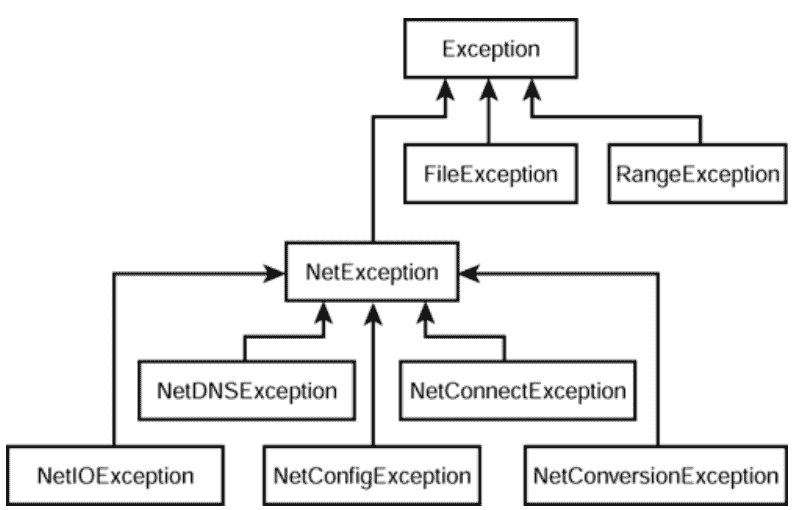

异常类层级很少会定义任何惊人或巧妙的设计。事实上，如果你使用类层级来表示异常，请务必小心，不要制造出递归异常的可能性。例如，如果你分配内存并将内存处理器映射到一个异常，那么仅凭一个糟糕的`new()`调用就可能导致程序崩溃。请将异常的设计保留在最简单的形式，除了值和简短的消息外，不要包含太多内容。

## 消息：数据的打包与传输

要通过 I/O 子系统发送和接收消息，你需要数据块和缓冲区。`Message`虚类提供了打包（`Wrap()`）和解包（`Unwrap()`）自身的基本接口。该接口有助于近似模拟 Java 的 I/O 功能。

另一个类，`TextMessage`，提供了使用此接口的示例。例如，`Wrap()`方法会创建一块连续内存并将文本复制到其中。（释放该内存块的责任留给调用者。`TextMessage`的消息是一个可变长度的 C 风格字符串。）

解包方法`Unwrap()`执行相反的操作。它从调用者那里接收数据块，并开始重组内部信息。有时，消息可能不完整，因此`Unwrap()`必须获取更多数据以完成重组。例如，`TextMessage`可能大于 64KB（缓冲区限制），因此`TextMessage`类必须足够智能，以请求更多数据。`Unwrap()`方法返回一个布尔值，以指示是否已完成。

## 寻址：识别源和目的地

每条消息都来自某个主机并去往某个主机。这些主机的寻址对于将消息发送给合法所有者至关重要。另一个简单的组件是`HostAddress`。使用`struct sockaddr`寻址名称，该组件管理名称及其到 IP 级别的解析。

框架将所有地址转换为此组件。此外，该组件可以支持多种寻址类型。

## 套接字：建立、配置和连接

最后一个组件拥有最多的功能。它基于`Socket`类并派生所有基本连接。它使用其他组件来完成工作。层级结构将基本功能放在`Socket`类中，并将所有特化放在继承类中。

需求列表中列出的所有协议都有专用类：`SocketServer`、`SocketClient`、`Datagram`、`Broadcast`和`MessageGroup`（多播）。所有特定于协议的配置都位于相应的协议类中。当您需要更改设置时，请查看你正在使用的协议。如果你找不到，请查看父类。

这些类还假设你遵循正确的规则。从之前的`send()`示例来看，这些类不会检查套接字是否已连接。相反，程序会抛出异常。

## 创建框架层级

这些组件使得将对象连接在一起的过程更容易过渡。组件为外部世界提供接口，并可能暗示最上层父类（`超类`）的功能。在开始处理框架层级之前，你需要定义每个组件内的非抽象类。

此时，你应该拥有几个类，如上一节所列出的那样。从那里开始，你找到关系和继承。看到功能从父类到子类消失又重现并不奇怪。这是正常的，而且通常仍然可以实现。

## 关系

第一步是识别组件和类之间的关系。使用通用术语，如`uses`（使用）、`is-a`（是一种）、`has-a`（拥有）和`throws`（抛出），来标记组件或类之间的连接。

在图 13.2 中，不同的组件相互连接，以展示它们如何相互作用。一些图表系统使用特殊的线段末端（例如箭头）。使用你最习惯的方式即可。最重要的因素是清晰度。


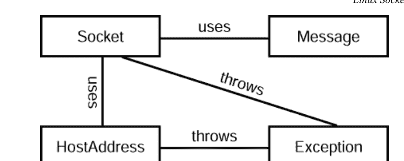

`Socket`组件与其他所有组件相连，这是意料之中的。这些类可能并非都具有这些连接，但这并不重要。深入挖掘会让你看到更多细节，以及哪个类真正使用了什么。

## 挖掘自然继承

第二步是在组件中查看，试图发现一种称为`inheritance`（继承）的特殊关系。如`第 11 章`所述，继承允许你从其他类（基类）创建一个相关的类，并仅更改少量功能（特化），而无需重写整个类。这是对象技术的主要力量。

唯一拥有有趣类的组件是`Socket`。它有五个类明显相关。参见`图 13.3`。`Broadcast`和`MessageGroup`（多播）类使用 UDP 套接字，并且功能相似，因此它们必须派生自`Datagram`。然而，虽然`SocketClient`和`SocketServer`使用 TCP，但它们的运作方式并不相同。客户端主动连接，而服务器等待连接。

> `图 13.3. Datagram、MessageGroup和Broadcast类看起来是相关的。SocketServer和SocketClient关联度不够高。`


`Exception`和`Message`组件可能有许多类和多个继承级别。然而，就实现而言，层级结构非常简单。（请注意，在 UML 中，箭头指向父类。）

## 标识抽象

回到`Socket`层级，这些类确实契合在一起，但需要一些额外的类。显然，`Socket`类必须是超类，即所有套接字的母类。除了为所有子类提供一组通用功能外，它实际上没有其他功能。

`Socket`超类提供了所有的获取和设置功能。它还包含创建、发送、接收和关闭功能。但是，它无法在现实的时间和空间中真正存在。原因是它没有协议。协议是在其他地方定义的。

## 注意事项

## 调整层级以适应原始套接字

你可以修改层级，使`Socket`本身能够创建一个原始或混杂套接字。

然而，你可能会遇到问题。首先，这些底层套接字的功能更接近于 UDP 而非 TCP。你将不得不在`SocketClient`和`SocketServer`类中`关闭`某些功能。那样做很丑陋。或者，你可以将功能抽象化得更进一步，在 UDP 那一半的层级中添加一个新的层次。无论哪种方式，组件都会变得更复杂。这是编写框架时一个真实且持久的问题：你添加的功能越多，它就越复杂，使用也就越困难。

`SocketClient`和`SocketServer`之间的差异仍然足够大，直接将它们连接到`Socket`无法提供 TCP 的通用性。此外，它们有更多功能差异，使得它们不能直接关联。

你可以通过一个中间类（`SocketStream`）来解决`SocketClient`和`SocketServer`之间的紧密关系，该类定义 TCP 套接字的功能，同时不失去超类的身份。图 13.4 展示了完成的图表。


> 图 13.4。完成的 `Socket` 类层级包含两个虚类：`Socket` 和 `SocketStream`。

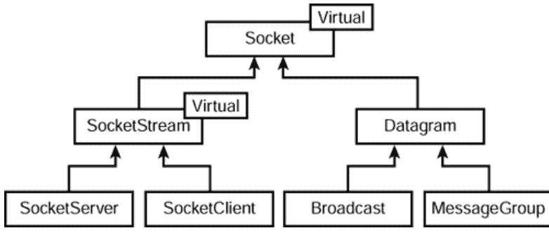

这两个类，`Datagram` 和 `SocketStream`，提供了其协议所需的配置和功能。像这样分离协议使得添加其他协议（如 `SOCK_RAW`）甚至新协议（如 RDM，可靠交付消息）变得容易且整洁。

## 定义每个类的能力

设计的最后一步与标准的 OOA/D 迭代处理不同。主要原因是 OOA/D 主要关注项目，而不是库。查看一个库时，你无法确切知道用户想要或需要什么。通常，设计者必须考虑这个问题：“库可以用作什么？”

### 项目产生库的谬误

许多程序员和设计师认为项目是设计库的最终来源。他们的逻辑有一定道理：像编写项目那样编写工具。然而，这种逻辑有两个主要缺陷。

为什么大多数这样构建的库或框架缺乏可扩展性？为什么这些库开始看起来像一块由不同代码片段拼凑而成的疯狂拼布？问题很简单：项目从未拥有全局视野来辅助定义库的哲学。过度负载类的最佳例子是 MFC 的 `CString` 类。要启动一个良好的、灵活的、干净的库，必须首先定义其哲学。然后你再考虑每个类的可能性。

本节将带你经历细化每个类详细过程的过程。与常规对象项目开发相比，第一步和第二步是颠倒的。

### 属性：添加其所知

在大多数情况下，下一步是将函数或方法放入每个类中。然而，在创建库时，特别是套接字 API 的封装器时，你需要识别所有可用的功能或属性。

套接字的功能大多内置于套接字选项中。第 9 章“打破性能壁垒”和附录 A“数据表”列出了标准的和依赖于 Linux 的套接字选项。这些是 `Socket` 类属性的良好候选者。实际上，该类并不将属性作为类中的独立条目保存。相反，套接字描述符保存每个设置。通常伴随 CRUD（创建/读取/更新/删除）方法的每个 get/set 对实际上调用的是 `getsockopt()`/`setsockopt()`。

图 13.5 显示了每个暴露属性的 get/set 函数调用。有些属性仅开启或关闭某项功能，因此设计中不包含 `get()` 函数。一个类可能不会暴露所有属性；通常，它暴露的属性是那些会改变类行为的属性。其他内部属性可能仅改变类的状态，因此它们往往对外部隐藏。

> 图 13.5。类中的每个属性可能都有相关的 `get...()`/`set...()` 函数。

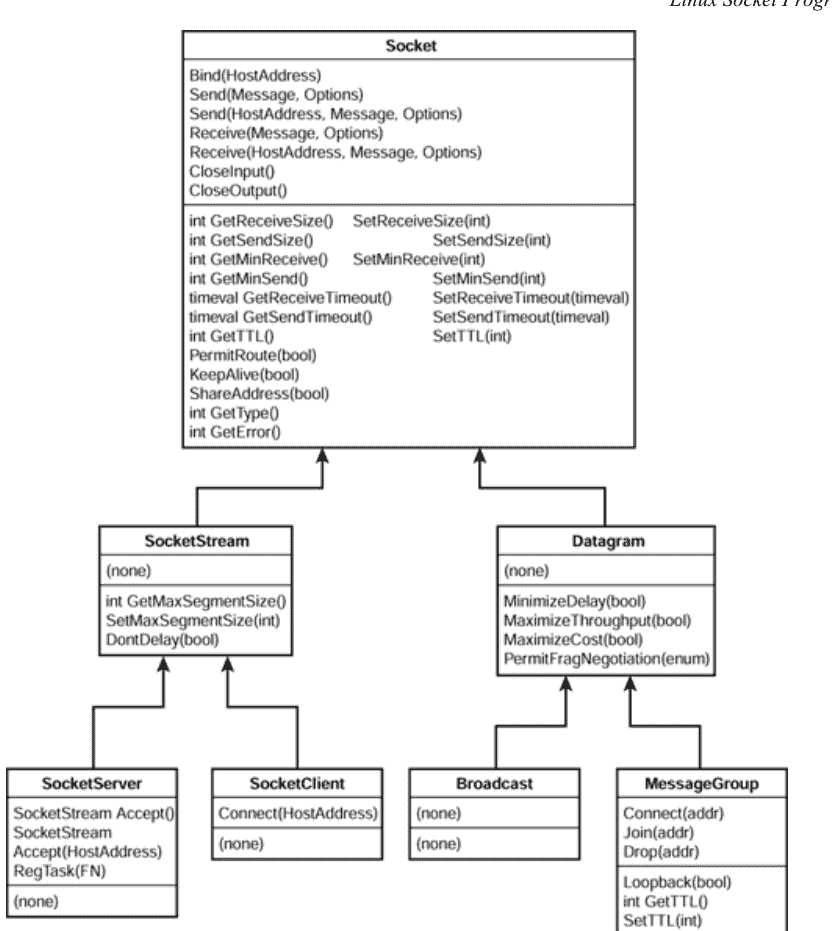

最后一个特殊属性需要比改变值稍多一点的逻辑。这些是真正的属性，它们看起来像属性，但实际上执行多个操作。例如，`Datagram` 中的 `MinimizeDelay()`、`MaximizeThroughput()`、`MaximizeReliability()` 和 `MinimizeCost()` 调用都通过单个 `setsockopt()` 接口。但为了简化接口，它们计算并设置正确的位值，因此你无需这样做。

套接字组件中的类可以包含该类特定实现特有的其他属性。例如，`SocketServer` 可以存储为已接受连接注册的回调例程。此外，多播套接字没有一种干净的方式来离开组，因此 `MessageGroup` 包含一个已加入组的数组。

### 方法：添加其所为

与可用于多播套接字的加入组函数一样，某些类具有扩展 CRUD 方法的特定方法实现。标准的面向对象分析/设计（OOA/D）方法确定了每个类必须做什么以满足其职责。这些职责与用例中提到的功能有关（如第 11 章所述）。

然而，库没有任何坚实的工作用例，因此方法通常反映套接字 API 中找到的功能。当然，并非每个功能都适用于每个类。表 13.1 按类列出了在套接字组件中定义的具体实现。

**表 13.1 在套接字组件中实现的特殊方法**

| 类 | 方法 | 描述 |
| :--- | :--- | :--- |
| `Socket` | `Bind` | 提供 `bind()` 调用 |
| | `Send` | 提供 `send()` 和 `sendto()` 调用 |
| | `Receive` | 提供 `recv()` 和 `recvfrom()` 调用 |
| | `CloseInput` | 使用 `shutdown()` 关闭输入通道 |
| | `CloseOutput` | 使用 `shutdown()` 关闭输出通道 |
| `SocketServer` | `Accept` | 提供 `accept()` 调用 |
| `SocketClient` | `Connect` | 提供 `connect()` 调用 |
| `MessageGroup` | `Connect` | 提供 `connect()` 调用 |
| | `Join` | 使用套接字选项将连接加入多播组 |
| | `Drop` | 退出多播连接 |

一个类可能没有任何特定的实现或甚至属性来证明新类的必要性；它只需要不同的行为。广播类（Broadcast class）就是这样一个例子；它的基础类（`Datagram`）在行为上差异足够大，足以证明其存在的必要性。

### 构造函数：创建对象的方式

每个类通常都有一组配置参数，用于定义某些初始行为。再次说明，广播类（Broadcast class）没有提供任何额外的方法或属性，但它必须配置为发送和接收广播消息。这种配置将放在构造函数中。

构造函数与普通方法略有不同；你可以执行大多数在常规方法中会执行的操作——创建对象、分配空间、执行计算等等。例如，以下是 `Socket` 类构造函数的声明：

```cpp
//*****************************************************
/*** 默认 Socket 构造函数
/*** 使用网络 (PF_INET) 和协议 (SOCK_STREAM)，
/*** 创建一个套接字并将引用放入 SD
/*** 属性中。
Socket::Socket(ENetwork Network, EProtocol Protocol)
{
   SD = socket(Network, Protocol, 0);
   if ( SD < 0 )
      throw NetException("Could not create socket");
}
```

如果在创建过程中出现问题，你无法通过常规方法返回错误。相反，该框架使用异常将错误直接发送到处理器。如果一切顺利，构造完成并返回给调用者。

并非所有操作都可用于构造函数。你不能调用正在创建的类的方法，除非它们是静态声明的。每个类都携带一个上下文或其状态。每个方法都假设上下文是完整且稳定的。而在构造函数中，编译器认为上下文是不完整或不稳定的。

类的静态方法不依赖于上下文，因此你基本上可以在任何时间、任何地方使用它们。事实上，你甚至不需要实例化对象就可以使用它们。因此，静态方法与类之间的关系非常松散，几乎是附带的。由于这种松散的关系，类很少使用静态方法。然而，在某些场合它们很有用。某些系统调用（如信号处理器）不支持标准方法所需的上下文。因此，例如，如果你想在类中捕获各种信号，你必须将信号处理器声明为静态方法。

### 析构函数：需要清理的内容

正如构造函数初始化对象并使其准备好使用一样，析构函数反转某些步骤并使对象准备好被释放回自由堆。与使用垃圾回收器来释放空间的 Java 不同，C++ 要求你手动清理对象。

通常，对象是自包含的，除了释放空间外不需要太多操作。然而，某些类（如 `SimpleString` 和 `TextMessage`）使用部分堆内存。编译器无法判断这些类中的指针是否真的指向多于一个元素。析构函数允许你指定需要清理什么以及何时清理。

其他典型的清理步骤包括关闭文件和解除挂钩处理器。以下是 `Socket` 类的析构函数：

```cpp
//********************************************************
//*** Socket 析构函数
Socket::~Socket(void)
{
   if ( close(SD) != 0 )
      throw FileException("Can't close socket");
}
```

你应该将所有析构函数声明为虚函数，以便继承层次结构中的所有析构函数都能被执行。非虚析构函数表明你不想在删除对象时触发父类的析构函数。你可以只需指定超类的析构函数为虚函数——这使得所有继承的析构函数也成为虚函数。然而，为了清晰起见，你可能希望显式地将它们声明为虚函数。

## 测试套接字框架

套接字框架是基于前几节所述标准进行自定义实现的。接下来的部分将通过几个例子展示如何使用它。随本书提供的网站上有其他一些示例，展示如何实现数据报、广播和多播套接字。

## 回显客户端/服务器

第一个例子（也是全书引用最多的）是回显客户端/服务器。使用回显客户端/服务器的真正原因是测试通信是否正常工作。一旦你掌握了这部分，其余部分就简单了。

**清单 13.1** 展示了基本客户端。

### 示例 13.1. Echo-Client.cpp


```cpp
//*****************************************************
// Client main body
HostAddress addr(string[1]);  // <address:port> format
try
{
    SocketClient client(addr);   // Create the socket & connect
    TextMessage msg(1024);       // Set aside the message space
    do                          // Repeat until "bye"
    {
        char line[100];
        client.Receive(msg);     // Get the welcome or reply
        printf("msg=%s", msg.GetBuffer()); // Display it
        fgets(line, sizeof(line), stdin);  // Get line
        msg = line;              // Place in message space
        client.Send(msg);        // Send message to server
    }
    while ( strcmp(msg.GetBuffer(), "bye\n") != 0 );
}
catch (Exception& err)
{
    err.PrintException();
}
```

所有程序都使用相同的 `try...catch( )` 格式。你需要用它来捕获并恢复系统可能会遇到的异常。以下是 `清单 13.1` 中省略的一个 `catch( )`，你应该始终将其放在调用树的底部：

```cpp
//*****************************************************
// Exception Catchall
catch(...)
{
    fprintf(stderr, "Unknown exception!\n");
}
```

此定义捕获了你未预料到的一切。

服务器可以是一个内置的回显服务器、邮件服务器或 HTTP 服务器。`TextMessage` 类与其中每一个都兼容。不过，`清单 13.2` 向你展示了回显服务器的对象版本。

## 示例 13.2. Echo-Server.cpp

```cpp
//*****************************************************
// Server's main body
try
{
    SocketServer server(port);  // Create & config the socket
    do                          // Repeat forever
        server.Accept(Echoer);  // Connect & serve a client
    while ( 1 );
}
```

如你所见，服务器的主体非常简单。`SocketServer` 为你完成了所有的配置和设置。变量 `Echoer` 是该过程的另一半（参见 `清单 13.3`）。

## 示例 13.3. Echo-Server.cpp, Part 2

```cpp
//*******************************************************
// Server's client service routine (Echoer)
try
{
  TextMessage msg(1024);  // Get a message buffer
  client.Send(welcome);   // Send "welcome" message
  do          // Repeat until "bye"
  {
    client.Receive(msg);  // Get message
    client.Send(msg);     // Echo it back
  }
  while ( msg.GetSize() > 0 &&
      strcmp(msg.GetBuffer(), "bye\n") != 0 );
}
```

再次地，算法很简单：接收消息并将其发回，直到客户端发送 `bye` 消息为止。你可能注意到，该程序是其自身 `try...catch()` 块的例外。这是一个好主意。如果此连接发生错误，它仅与该连接相关，并且必须不影响主套接字。没有 `清单 13.3` 中专用的 `try...catch` 块，当客户端突然断开连接时，由于 `main` 的 `try...catch` 块会捕获该异常，整个服务器将会崩溃。

### 注意

**放置异常处理器**

仔细规划在哪里和何时放置异常处理器。另外，你可能不希望处理所有类型的异常。相反，你可能希望仅支持特定的类型。通常，不同的连接需要自己的 `try...catch()` 块，灾难性异常应仅存在于调用树的根节点。

当前的服务器实现不提供多任务处理。该类包含了一些你需要实现的钩子。

### 多任务点对点

你仍然可以使用进程或线程进行多任务处理。尽管当前框架未实现此功能，但你可以在代码中创建任务。经典的例子是数据报，它在发送消息的同时必须接受任意数量的消息（参见 `清单 13.4`）。

## 示例 13.4. Peer.cpp

```cpp
//*******************************************************
// Datagram message sender
try
{
  HostAddress addr(strings[1]);   // Define own address
  Socket *channel = new Datagram(addr);  // Create socket
  if ( !fork() )               // Create process
    receiver(channel);         // Call data receiver
    channel->CloseInput();          // Close input channel
    HostAddress peer(strings[2]);   // Define peer addr
    TextMessage msg(1024);          // Create msg space
    do
    {
        char line[100];
        fgets(line, sizeof(line), stdin); // Read line
        msg = line;                 // Place in message
        channel->Send(peer, msg);   // Ship it.
    }
    while ( !done );
    delete channel;
}
```

`receiver()` 的实现看起来很像 `SocketServer` 的 `Echoer` 调用。

如果你想在框架中使用多任务处理，你需要记住几条规则：

- **遵守规则** — 查看 [第 7 章，“划分负载：多任务处理”](http://#) 中的说明和建议。特别是，确保捕获子进程终止信号。此外，线程共享它们的 I/O 通道；关闭一端会关闭所有线程的通道。
- **内存共享** — 知道内存资源争用是一个几乎难以解决的问题。尽可能少地共享。
- **C++ 局限性** — 在 C++ 中采用多线程是危险的。幕后发生了如此多的事情，你必须非常小心哪个线程拥有哪些数据。在启动新线程之前在堆栈上创建对象可能导致不可预测的结果。

多任务处理有其优点，你仍然可以使用 C++，但务必非常小心。

### 实现局限性

该框架只是一个功能性的——但不完整的——示例，展示了如何在 C++ 库中实现套接字。这应该给你一些如何适应它（或编写自己的）以满足编程需求的想法。

目前，你可以创建客户端、服务器、数据报以及组播/广播套接字。它允许你使用套接字选项配置套接字。它包含一个消息抽象，因此你可以编写自己的消息格式。以下部分列出了几个功能丰富的想法。

### 发送未知/未定义消息

当前框架允许你从 `Message` 派生自己的消息类型。如果你专门使用 `Message` 组件或具有已知类型，这将非常有用。然而，你可能没有灵活性仅从一个类派生——特别是如果你正在集成遗留系统。

多重继承有时是一种必要的恶，特别是当你试图合并不同且经常冲突的框架时。Java 有接口的优势，但这似乎不是 C++ 在近期的选择。


同样，你并不总是知道数据本身。这通常发生在你有一个较新的客户端与遗留服务器交互时。服务器不知道客户端可能支持哪些扩展，因此性能可能会受到影响。编写抽象消息协议将解决此问题。

抽象信使不仅将保持数据，还将保持数据结构。这类似于发送带有目录结构的文件。抽象信使可以使主机之间的通信更有用且可扩展。

### 添加多任务处理

另一个局限性，如前所述，是缺乏多任务支持。大多数与网络相关的程序同时执行多个任务以提高性能。提供进程和线程作为框架的固有功能将使编程变得更加简单。

问题源于类的简单定义：做某些事并知道某些事的东西。因此，如果你定义一个套接字类，你会得到一个多任务套接字和一个多线程套接字吗？此外，任务是一个对象吗？如果是，那么确实有两个可派生的类：`Socket` 和 `Process`/`Thread`。结果是多重继承问题（大多数对象原教旨主义者会皱眉）。

也许问题比表面看起来更简单。但将客户端、服务器、数据报、广播和组播与非多任务、线程和进程结合到 15 个类的想法并不理想。

### 总结：C++ 套接字框架简化编程

使用面向对象的语言，如 `C++`，可以帮助简化套接字开发。你已经看到套接字编程有很多相似之处，只有少数变化，但你需要遵循某些规则来编写套接字的库或框架。这些规则与标准 `OOA/D` 实践略有不同。

框架协调组件之间的接口，组件定义一组网络化类的任务或主要功能。组件中的每个类都致力于完成这项任务。

套接字框架包括四个组件：异常、消息、地址和套接字。异常组件与其他组件保持独立，以减少内部故障的可能性。地址和消息组件为套接字组件提供支持。

本章向你展示了创建套接字框架的过程，并展示了如何为你的程序做到这一点。`C++` 和框架的可扩展性可能帮助你尝试在自己的 `C++` 工作中试用这些功能。

# 第 14 章。对象的局限

## 本章内容

- 思想重于对象
- 对象不能解决一切
- 复杂性的得失
- 项目管理困境
- 总结：在页岩上谨慎行走

对象技术并不能解决所有问题。是的，这是真的。它仅仅是一种在正确时机使用的工具。如果你试图在所有地方使用它，你就会失去替代编程方法的简单性。

当你选择使用对象时，你可能需要了解其中的一些问题。这些问题包括让人们以对象思维进行思考，认识到对象仍然无法完成某些任务，为额外的复杂性做好准备，以及管理新的范式。

对象技术的魅力令人着迷，但本章将让你了解其少数局限性。

## 观念重于对象

程序员、设计人员和分析师在开始对象项目时遇到的第一个问题是尝试审视对象本身。如果你忘记这样做，你可能会陷入许多前人已经踩过的陷阱。对象分析的每一步都专注于系统应该做什么、对象对努力做出了什么贡献，以及何时知道工作已完成。

本节介绍了你在开发过程中可能面临的几个陷阱。请记住，这只是可能出错事项的示例。

## 开个好头

`Beguin` 是一种早于探戈的西班牙舞蹈。就像这种舞蹈一样，如果在对象项目中你没有从正确的脚起步，那无异于与死神共舞。理解用户的需求是你所采取的最重要步骤。与用户的交互就像一支舞蹈——由用户领舞。

用户是与你的程序进行交互的人或系统。如果你未能确定并固化接口，舞蹈可能会反制你——你最终可能会被迫领舞。这是一个不利的位置；结果必然不是用户所期望的。

你可以使用四种基本工具来定义用户的需求和期望：上下文、功能列表、用例/场景以及系统流程。获取一本关于需求收集和管理的优秀书籍，以了解详细的操作方法。这些工具将帮助你证明程序按照用户的期望正常运行。

上下文简单地定义了你的程序*不*做什么。它识别了所有用户、流入和流出的信息，以及用户负责的功能。这对成功的项目至关重要。如果你不识别将要省略的内容，用户可能会假设程序将具备这些功能。

上下文直接引导你获得程序将执行的功能列表。每个功能都是一个动词-对象配对。例如，一个好的功能描述是“为用户打印统计报告”。隐含的主语是程序。

功能列表在逻辑上引导至用例。用例通常描述程序如何执行该功能。用例始终以外部开始并结束；中间的步骤描述了所需的转换。你可以将用例细分为各个场景。请记住，用例是功能，而场景处理的是数据中的差异。考虑以下示例：

| 用例 #9 |
| :--- |
| **任务：** “向网络上的人发送消息” |
| 1. 用户输入消息并点击发送 |
| 2. 打开与目的地的连接 |
| 3. 联系接收者 |
| 4. [接收者接受中断] |
| 5. 发送消息 |
| 6. 向用户返回确认 |
| 7. [用户接收状态] |

| 场景 #9.1 |
| :--- |
| **任务：** “发送消息；消息被拒绝” |
| 1. [用户输入消息并点击发送] |
| 2. 打开与目的地的连接 |
| 3. 联系接收者 |
| 4. [接收者拒绝中断] |
| 5. 向用户返回拒绝 |
| 6. [用户接收状态] |

| 场景 #9.2 |
| :--- |
| **任务：** “向网络上的人发送长消息” |
| 1. [用户输入消息并点击发送] |
| 2. 打开与目的地的连接 |
| 3. 联系接收者 |
| 4. [接收者接受中断] |
| 5. 分部分发送消息 |
| 6. 向用户返回确认 |
| 7. [用户接收状态] |

此示例中的场景是原始用例的简单变体。用例通常包含负面或*异常用例*。*异常用例*是指展示程序如何响应数据或交易问题的用例。

最后一步将用例以图形方式展示程序在功能上如何工作。重要的是要包含每个用例，并展示数据如何变化直到到达最终目的地。

## 搅拌机不是对象

设计师面临的另一个问题是正确的命名。在理解用户需求之后，你可以开始分析程序系统中的“事物”。这个事物系统具有职责（“它知道什么”和“它做什么”），这些职责决定了其行为。

用具有代表性的名称命名对象决定了其当前行为及其演变。好的名称总是名词。例如，将对象命名为 `Socket` 比命名为 `NetIO` 更好，因为你可以对网络做的不仅仅是 I/O。但是，如果你用动词命名对象（`NetIO` 是网络输入/输出的缩写——两者都是动词），你就限制了对象的有效性和演变。使用 `Socket`，你不必止步于读取和写入消息；你可以包括网络控制、订阅多播网络等等。

大多数名词都很有效。然而，英语在以下词汇上存在问题：你可能会用虚假或误导性的名称命名对象。典型的误导性名称是动名词（像名词一样作用但实际上是动词的词）。例如，搅拌机（`blender`）并不是一个对象。

搅拌机做什么？它搅拌。那么搅拌机应该有哪些方法？`blend()`？这对于一个好的对象来说还不够。想出好的名称非常困难。当基于其行为来命名时，很难不让你的思维偏离它未来可能做的事情。

有时，你无法找到一个合适的名称。一个过度简化（但通常有效）的解决方案是给它一个不相关的名称，例如 `bob`。然后让职责驱动对象。

## 将分析与设计分离

命名非常重要，但确保不要陷入过多细节更为重要。公司通常会在定义整个问题之前很久就定义项目需要数据库。这有什么坏处吗？这是坏事吗？

在设计之前进行设计将技术置于流程的中心，而其他一切都围绕它旋转。没有好的家庭建筑师会在确定其承重之前定义木材宽度。同样，如果分析在整个问题未知之前就得出*“它必须用 Java 编写”*的结论，可能会对健康和生命造成伤害（注意 `Sun` 在 `Java` 上放置的免责声明）。

分析是通过玫瑰色眼镜看世界的时候。当你进入分析阶段时，你只关注在宏观层面需要做什么。每当有人提到具体的实现细节时，该细节直接进入设计*停车场*（稍后需审查的项目列表）。

## 注意

**系统约束**

有时需求包含特定硬件和软件材料的约束。如果适度且属于业务需求的一部分，你必须考虑它们。然而，你通常可以在设计阶段忽略其中大部分。尽管如此，如果需求声明必须用 `COBOL` 编写，你必须考虑这对你的继承的影响。

分析还假设你拥有可能需要的所有工具和容器类型。不要担心某些事情是如何完成的；只需关注系统中的主要事物以及它们如何交互以实现用例。

## 适当的细节级别

用例对于引导你通过分析过程非常重要。然而，就像你的分析一样，如果你陷入过多细节，你就无法上升到足够高的层次来证明设计满足需求。

当你审视需求时，你开始充实系统的表面*“如何”*。直接与业务人员合作，向他们展示你的高层解决方案如何执行他们要求的操作。不可避免地，他们会发现你所做的正是他们要求的，而不是他们原本意图的。如果细节过多，听众会迷失方向或失去对用例的关注。

如果你的客户（业务人员）想要了解更多关于你打算如何实现产品的事宜，这可能是一个好迹象，表明你的工作很好。你可以向他们保证，在完成设计后，他们可以再次审查工作。在那时，他们可以看到所有想要的细节。

## 继承爆炸

在设计阶段，你获取已定义的类并提供细节。在此时必须非常小心；诱惑在于简单地继承所有类至设计级别的细节。其理由是*“我们有一个纯净且可移植的分析。让我们在设计期间保持其纯净。”* 事实上，一些对象技术专家强烈鼓励这种对象爆炸。然而，这很少是必要的。

大多数实现所做的不过是充实容器类并添加用户界面。分析工作仍然保持原貌，你所做的工作并未被稀释。只需继续添加必要的组件，将分析与系统架构对应起来即可。


此外，如果你允许对象泛滥，结果必然是——对象无政府状态和维护噩梦。只有当你需要改变行为或添加功能时，才应该继承某个类。如果该功能不属于分析阶段而属于设计阶段，请确保这并非疏忽。

对象无政府状态确实反映出一种缺乏责任建模的现象。继承每一个类都会增加形成复杂网状结构的可能性，因为每个类都试图建立适当的关联。

即使有文档支持，维护这种连接嵌套也极其困难。而且，当你尝试修改继承树中的某个对象时，它可能会影响其他对象，从而违背了封装的初衷。

### 复用与误用

对象爱好者们普遍存在的一个神话是他们声称可以复用一切。这种信念非常不切实际。正如将锤子改造成牙医钻头充其量只是不匹配一样，某些类最适合于其设计初衷所处的特定位置。

如果你想复用一个类，请确保其意图与接口紧密契合你的需求。如果你不得不重新适配大量接口，那么可能说明适配度不佳，或者原始设计存在缺陷。以下是需要考虑的几个问题：

- 该类的预期功能是否大致符合你的需求？
- 你是否只需要重新适配一两个接口？
- 父类和超类是否满足你的需求？
- 你是否按照预期使用现有数据？

如果以上任何问题你的回答都是“否”，那么你可能会遇到复用与误用的问题。一种解决方案是找到一个更接近你需求的父类。另一种解决方案是完全脱离现有层次结构，开启新的发展路径。

### 正确使用 C++ 的 friend

继承是一个危险的特性——尤其是当你继承自外部类时。另一种危险的做法是滥用 `friend`。`friend` 指令允许其他类窥视并使用你类的私有部分（破坏了封装性）。它还允许你将你的类插入到一组工作函数中（例如运算符重载）。

几乎所有对象专家都反对 `friend` 指令。只有在运算符重载的使用中，这条指令才被接受为必要的恶。有些人将其等同于 `goto` 语句。除非没有其他办法可以避免，否则不要使用它。

## 重载的运算符

如今，即使运算符重载也被认为是不必要且不受欢迎的。虽然它没有违反对象的核心规则，但它确实使代码的可读性和可维护性降低。改进软件工程技术的整个目的就是为了提高复用性和可插拔性。重载的运算符往往恰恰起到相反的作用。它们在使用和维护上都令人困惑。

尽管如此，如果你想使用运算符重载，请记住以下规则：

- 不要按值或指针传递数据——尽可能按引用（`§`）传递。否则，当你反复调用构造函数和析构函数时，可能会导致悬空指针或性能下降。
- 始终重载等于运算符——你必须这样做才能正确进行类型转换。
- 选择最适合你操作的运算符——例如，`<string> + <string>` 很清晰，但 `<queue>` 并不一定意味着 `Queue->Pop()`。
- 考虑重载 `new()` 和 `delete()` 运算符——一些作者认为这是个好主意，但这个建议值得怀疑。
- 永远不要重载那些奇怪的运算符——函数调用（`()`）和字段访问器（`.` 和 `->`）很少能带来清晰的接口使用体验。

总体而言，尽量使用有意义的编程。如果你想让人们使用你的优秀工作成果，就让它对他们来说是可理解的。

## 对象并非万能

有些人声称对象是编程的最终解决方案。使用对象和对象技术可以做很多事，但在某些任务上，其他范式可能更简单。就像只有锤子的水管工一样，严格的对象程序员可能会把所有问题都看作对象问题。

本节将介绍对象技术存在的问题。

## 流行语潮起潮落

对象技术实际上只是最新的技术潮流。新的潮流是模式（`Patterns`），它关注常见对象系统。教训很明确：好的潮流会演变得更好。当你刚开始学习一项技术时，另一项技术就会取而代之，成为新的焦点。

## 继承感染

对象引入了继承的概念，即复用既定类的行为。不幸的是，一些程序员认为这是编程的万能药——因此他们继承一切。这些程序员试图将所有内容放入一个层次结构中，即使各个事物之间完全不相关。

中等规模的程序通常有 3 到 5 个主要组件，每个组件可能有 2 到 7 个对象。所有类在逻辑上都相互关联的情况极其罕见，强迫这种关联也是不必要的。（请注意，这不适用于 `Java`，因为 `Java` 中所有类都继承自 `Object`。）

## 不可达代码

对象技术可以回答编程特定领域中的许多问题。抛给它的许多问题都是通用的，并且可能不会改变。这就是为什么复用如此重要。有人曾说，大多数程序很可能已经被写过了。现在所做的工作主要在于人机接口和新技术。

然而，对象技术无法解决一小部分问题。这些问题比当前对象的定义更接近自然。本节介绍这些局限性及其可能的变通方法。

## 部分类

第一个局限是部分类。在自然界中，如果你移除椅子除一条腿以外的所有腿，它仍然是一把椅子。然而，如果一个类失去部分功能，它就不再符合原始类的资格。虽然它具有原始接口，但它不是原始形式的继承。

## 空函数

部分类还延伸到空函数。空函数允许你关闭某个方法，使其不再提供服务。在继承自父类时，你可能会发现某个服务现在已过时，甚至对新类具有破坏性。空函数或方法会将该方法从新类中完全修剪掉，随后被遗忘。

如果你想要这个特性，一些程序员会重写该方法但不附加任何行为。虽然这在效果上达到了相同的目标，但该方法仍然存在，占据定义空间。

## 对象变异

另一个局限是对象变异，它允许程序员在不进行类型转换的情况下将一个对象变为另一个对象。类型转换非常危险，即使在 `C++` 和 `Java` 等强类型的对象语言世界中也是如此。变异是形式更温和的转换，它有一些规则确保你可以从 A 到 B 而不至于太麻烦。

变异是一个工具，让你创建一个通用对象，并在发现更多关于它的情况时，你可以一点一点地改变或变异它——甚至可能产生一个全新的、以前未知的类。这种工具的完美适用场景是对象流，在那里你可以获得一堆通用的数据并需要破译它。你可以部分创建一个翻译构造函数，接受另一种形式并从中创建新类，但你必须为每个相关的其他类编写一个翻译构造函数——这是一个组合问题。

变异引擎需要满足以下条件：

- 数据块必须保持完整——引擎不会创建副本或翻译任何信息。相反，它改变对信息的解释。
- 数据块只能在继承层次结构内进行变异——要将一个对象变为另一个，这两个类必须具有共同的标识线索。
- 发现引擎必须能够创建抽象类的实例——你可能会觉得这很难接受，但在发现过程中（就像玩二十问游戏一样），你可能不得不从抽象开始。
- 结果必须是某个具体类的实例——原因显而易见：对象不能存在于不完整的类之上。
- 发现引擎必须能访问私有元素——这似乎违背了封装原则，但为了探究数据块的真实本性，你需要了解目标类的内部细节。
- 该过程必须能够使方法失效并支持部分类——有时，你可能需要动态地关闭已定义类中的方法，以便使产生的变异对象行为正确。自然界中的变异生物可能具有超出其所属纲定义的能与局限。

变异对象在处理程序代码未曾预见的实例时拥有强大的能力。它为系统提供了一点额外的智能，使其更贴近自然。

## 启发式算法

对象技术并不直接支持启发式算法。启发式算法是基于目标的问题，其中用户描述问题，计算机则致力于达成目标。许多情况可以进行模拟，但非确定性求解的整体前提在计算上是不可达的。

你可以创建启发式算法，并使用伪随机数生成器来近似非确定性的求解。然而，这种模拟受限于随机数的有效性。

## 大规模并行算法

最后一个算法问题涉及大规模并行问题，例如真正的神经网络。同样，就像启发式算法一样，它只能模拟结果。要真正符合大规模并行系统，需要专用的基于目标的处理器。即使是高度集成的并行 `Fortran` 程序，也会难以满足这些要求。

## 复杂性的权衡

对象技术在技术本身之外还有其他局限性。专业人士已经发现，当处理大型框架（库层次结构）或维护现有实现时，对象带来的承诺并没有兑现。本节扩展讨论了对象的问题以及历史所展示的情况。

## 通过既定接口简化程序

在对象编程蓬勃发展的这些年里，专业人士发现了几条经验教训。其中一个教训是既定接口的重要性。类的接口对于其长久使用至关重要。然而，程序员很少花时间设计最佳的接口。

被修改过的代码的接口往往过于专业化或功能过于具体，无法真正发挥对象的力量。因此，当其他人打开代码进行维护时，他们会发现该类的方法和甚至整体行为随时间已经退化。在这些类中，非常常见会遇到一种“散弹枪”式的编程方法：“它在这里能工作——为什么不把代码复制粘贴到那里和那里呢？”

接口是模块化编程中最重要的部分——这一点怎么强调都不为过。然而，接口必须是简单且直观的。另一个问题是框架本身及其多类接口。经常发现，在使用这些类系统进行编程时，你必须按特定顺序实例化几个类。这种顺序和复杂度在 `GUI` 编程中非常明显，可能是因为 `GUI` 提供的功能和选项。

当你创建对象时，请考虑方法接口有多简单和清晰。更重要的是，确保这是程序员使用你类的方式。如果你需要类之间的相互依赖，请尽可能让它们易于组装。

## 多重继承困境

另一个复杂性源于继承的特性。`C++` 语言允许你创建继承自多个父类的类。管理继承层次结构已经足够困难。第 11 章“用对象节省时间”提到了耦合的概念。从多个来源继承会在类之间引入不健康的耦合。

这种耦合形成了对父类的依赖。如果这些类发生变化，设计者必须验证它们与子类之间的接口。这些变化有时非常细微，但可能需要在子类中进行特殊的名称解析。这相当混乱。


从理论上看，多重继承是可行的，但不实用。具有多重继承的设计通常是破碎的。大多数原因源于不当的职责委派或类命名。最常见的原因是不恰当的抽象和委派。通常，两个父类有一组共同的行为，这些行为应该被提取并放置在他们上方作为一个超类。

多重继承的另一个常见原因是用动词命名类。例如，如果你拥有 `StreamReader` 和 `StreamWriter`，你必须合并这两个类以获得随机访问的 `Stream`。问题在于名称 `-Reader` 和 `-Writer`。

你可以通过将共同特性提取到抽象超类，或使用容器来解决大多数多重继承问题。通常，新类与其中一个父类的相似度高于另一个。继承自更相似的类，并包含另一个。

任务类被证明是该规则的一个小例外。如果你有一个类与一个父类相关，并且也是一个任务（进程或线程），你可能不得不使用多重继承。原因是该类不能包含一个任务类：编程效果并不理想。你的子类通常与另一个类关系更密切。

为了解决没有多重继承的任务类问题，你可能不得不强制子类继承自任务并包含另一个类。这是双重的，但可能很麻烦。

## 代码膨胀

继承、抽象、重载和模板在快速完成任务方面提供了巨大的帮助。然而，你可能会遇到另一个问题：源代码和对象代码的膨胀。如果你有足够的内存，对象大小的增加可能并不重要。但是，你写的代码行数越多，程序存在缺陷的可能性就越大。

根据你类的复杂度，与模块化设计相比，你可能会发现需要编写的代码行数增加了 20% 到 50%。这主要是由于语言语法和支持所致。以牺牲增加的源代码复杂度为代价，你确实获得了更多的能力和更强的类型检查。

早期的对象程序员对对象代码的膨胀感到惊讶。在某些情况下，对于相同的功能，将 C 转换为 C++ 导致结果程序增加了 10%。这是一个极端的例子，但你可以预期程序大小典型地增加 2 到 5%。

你可以通过以下方式减少这些增加：

- 不要重载运算符。
- 不要试图将所有类统一到单一的继承层次结构中。
- 不要使用虚拟继承。
- 不要过度使用虚拟方法。
- 永远不要使用多重继承。
- 限制内联函数。（有些人认为你应该始终避免显式内联函数，让编译器选择该特性。）

这些提示可以极大地帮助你最小化源代码和对象代码的大小。尽管如此，仍应预期会有增加；名称解析引擎和支持库比函数式或模块化语言的要大。

## 项目管理困境

对象程序为经理带来了一组新的且异常的问题。他必须同时协调更多的人，并证明工作正在推进。特别是当涉及多个团队时，除非项目有技术经理，否则项目经理必须与比项目组成员更多的人进行协调。

对象项目经理必须面面俱到。在委派、协调、组织甚至谈判方面的技能对于项目的成功至关重要。请记住，成功的项目意味着比按时且低于预算交付产品多得多的东西。如果团队在完成后瓦解，或者文档不能代表产品，或者客户不满意或感到被压制，那么该项目就是失败的。

本节仅简要触及了其中一些问题。你可能需要记住，这是一个比几页纸所能概述的要大得多的问题。每个经理都必须面对这样的现实：项目的成功在于团队，而非产品。

## 在正确的时间获得合适的人

最好的项目是由最好的人进出画面。培训是一个附带问题，必须与导师协调。产品不是决定成功的决定性因素，因为产品是由将使用它的人请求并批准的。如果结果符合用户的设想，其接受是理所当然的。

团队的成功更为重要，并且经理在团队中拥有比程序员更多的人。以下是团队中的人员列表及其需求时间：

- **项目发起人** — 为项目提供资金。他需要领导项目的主要里程碑。

### 客户角色

- **客户倡导者** — 与客户进行对接和检查点沟通。倡导者必须非常熟悉客户的思维方式和他们的工作流程。他主导产品需求，并参与项目的整个阶段。
- **业务分析师** — 收集和提炼需求文档。他们参与需求收集和阶段，并必须与客户倡导者进行对接。随后，他们在测试阶段非常有用。
- **技术分析师** — 将分析推进到设计阶段。他们将模型化的分析形式映射到现实世界，并必须定期与业务分析师对接。
- **质量代表** — 收集和归档文档，并推动测试过程。在业务分析师确定需求后，质量代表开始生成验收测试。当设计完成后，他就可以开始处理边界测试和压力测试。
- **程序员** — 获取设计并将其以所选语言编码实现。
- **遗留系统（如需要）** — 作为技术分析师的资源，以确保接口匹配。

这比大多数管理者想象的要庞大得多。如果项目经理能顺畅地运行流程，每个人就会进出画面，并在产品上盖上认可的印章。

## WISCY（“威士忌”）现象

由于需要参与的人很多，经理经常面临“为什么山姆还没开始写代码？”（WISCY）的问题。项目发起人（Project Sponsor）和客户倡导者通常都会提出这个问题。这是自然的：一个人想要看到他的金钱的结果，另一个人想要看到产品。

根据行业最佳实践，只有 20% 的总项目时间用于编码。其余 80% 的时间平均分配给分析和设计以及测试（40% 分析和设计，20% 编码，以及 40% 测试）。通常，美国软件行业最终更倾向于遵循 33% 分析和设计，34% 编码，以及 33% 测试。因此，最多只有 33% 的时间真正花在编码上。为什么不在前期花时间解决所有需求和定义以及设计问题呢？

为了安抚项目发起人和客户倡导者，让他们了解日程安排，并保持他们对进度的知情。让他们通过演示参与进来，并展示文档。让他们知道你的项目对你，这位经理，有多重要。

如果那行不通，你可以使用即时（JIT）设计。JIT 设计能让你快速开始编码，但可能会引入漏洞。当这种情况发生时，修复它们。当你遇到需要澄清的问题时，与客户倡导者甚至客户本人合作，因为 JIT 设计需要更强大的对接。

然而，不要陷入创建一次性原型向客户展示的陷阱。那行不通。如果你创建原型（特别是在 JIT 设计期间），要做好使用它的准备，而永远没有时间去“以后做对”。

## 测试的（不）集成

整个软件开发周期依赖于一系列需求的推导和验证。流程的第一部分描述需求，而监督流程确保项目将这些需求编码化。这个监督流程通常被称为*测试*或*质量保证*。

实际上，验证不仅仅是测试功能。它收集和归档工作成果；它检查和验证产品交付物；并确保业务和产品线合规。在项目的所有职责中，质量代表的任务最为艰难。

对象技术并没有改善状况。事实上，它将级别的复杂性翻倍甚至翻四倍。首先，白盒和黑盒（在下一节中定义）测试和验证就足够了。模块引入了灰盒测试。对象添加了继承、多态、框架、重用合规性和接口测试。对象技术给软件质量领域带来的巨大复杂性，导致许多人重新思考测试本身。

许多人犯的第一个错误是让设计师或程序员独自测试他们的工作。这个问题应该显而易见：导致缺陷的相同盲点可能会妨碍发现它们。这种巧合的概率太高，不能忽视。让有经验的测试工程师来交叉检查程序员的工作。

在创建对象项目时，你必须和你的客户确定要做多少测试。要知道，验证消耗资源和时间。预计当你过渡到对象项目时，常规项目花费的人力小时数会翻倍或翻三倍。

## 灰色的深浅

上一节提到了白盒、灰盒和黑盒测试。软件测试使用与对象中发现的技术类似，其中之一是封装。定义系统的*灰色程度*揭示了可见内部组件的数量。在全亮（白盒）模式下，测试人员探索每个函数、路径、决策和语句。通常，程序员或设计师可以相当安全地做到这一点。

黑盒测试从用户的观点来看待系统。黑盒测试类似于验收测试，其中用例决定合规性。

最后是灰盒测试，它在中间取平衡。它对实现有更多的了解（一直到模块或函数级别，但不更深），并且依赖于用例进行验证路径。

对象使这些定义变得模糊不清。例如，继承、覆盖和多态测试放在哪里？重用测试呢？结果很清楚；每个人都必须测试一切。

## 定义“系统集成”

随着项目构建产品，它逐个组装和组合部件。对象略微混淆的最后一个定义是部件何时真正组合作为一个系统。当使用内部或现成的框架时，你可以将任何组装视为一个系统。另一方面，一些项目被拆分为在本地或网络上协同工作的程序。那么，你何时才真正集成系统？

实际上，真正的系统集成早就消失了。它仅在最近几个*互联网年代*（3 个月的产品生命周期）中变得明显。仍然使用该术语的公司意味着与原始含义完全不同的东西。对于对象来说，集成是指每次交付快照或冻结的时候。

## 总结：在页岩上小心行走

对象技术提供了巨大的力量，但这种力量确实有增量成本。成本的增加源于理论、技术和人员。就像攀登一座页岩山，你必须小心迈步，并期望会有一些倒退。

一些倒退来自于试图一次做太多。试着控制这种冲动。教育并分享学习过程。你可能做的最重要的一件事是让顾客参与进来。如果顾客觉得他们参与并且重要，他们就会对他们得到的结果满意。

与扩展团队协作的次要重要性。试着留意对象技术的陷阱，并让每个人知道他可以如何变得重要。就像导演让演员进出场景一样，你可以在需要时给参与者提个提醒。

团队的成功优先于产品的成功，因为产品是已知的愿望或需求。剩下的就是按时保质地完成。满意的顾客想要更多，满意的团队更紧密地协作——就像一台润滑良好的机器。

# 第四部分：高级套接字——增加价值

1. 使用远程过程调用（RPC）进行网络封装
2. 为网络程序添加安全性以及 `SSL`
3. 使用多播、广播和 `Mbone` 共享消息
4. 原始套接字的威力
5. `IPv6`：IP 的下一代


# 第 15 章：使用远程过程调用（RPC）进行网络封装

### 本章内容

- 回顾 OSI 模型
- 比较网络编程和过程编程
- 提供中间件方法
- 使用 `rpcgen` 创建 RPC
- 使用打开连接创建非无状态调用
- 总结：创建 RPC 工具集

从开发者-用户角度来看，了解网络编程的所有怪癖可能比你想要的更费力。有时，你或你的同事（开发者-用户）只是想专注于手头程序的开发，将网络细节留给成熟的库或工具。远程过程调用（RPC）完美地符合这一需求。

## 重温 OSI 模型

RPC 为你的开发者用户处理所有的连接和数据转换。从开发者用户的角度来看，网络部分只是程序功能集的一小部分。让他们花费大量时间来编写和测试网络接口将非常昂贵且低效。

反过来，你可以编写工具（服务调用），为你的程序提供健壮的通信方式。这些工具将与客户端、服务器和同级节点进行接口交互。根据协议的不同，你的服务调用可能很复杂——需要工具提供大量的检查和重传（`UDP`）——也可能很简单（`TCP`）。

本章向你展示如何从两种不同的方法编写 RPC。第一种方法演示了如何在没有任何工具的情况下，凭借自己的双手编写它们。第二种方法介绍了 `rpcgen` 工具。在所有这些之前，下一节将回顾网络模型的概念，以展示 RPC 是如何契合的。

在第 5 章“理解网络分层模型”中，你读到网络模型将所有功能和操作分层，对用户和程序隐藏信息。操作包括有关网络如何将数据从一个程序传递到另一个程序的信息。网络分层模型还增加了目标接收到消息的可能性。根据网络理论，用户实际上不与应用层（第 7 层）以外的任何事物进行接口交互。

然而，`IP` 协议栈实际上在第 4 层（网络层）就停止了。`TCP` 是最后一个协议，具有 `IP` 协议栈中最高的可靠性。你可以创建一个套接字，其行为很像文件流。这赋予了你大量的能力和灵活性。协议将实现较高层级的责任留给应用程序。

这确实带来了一个小问题。如果没有定义较高的层级，许多应用程序纷纷涌现，本质上是重复劳动。考虑 `FTP` 和 `Telnet` 协议。每个都提供了身份验证阶段——用户登录。虽然登录接口可能很小且次要，但它们重复了该过程。此外，这对于你作为一名专业程序员来说，使方法变得复杂。如果你想在客户端程序中整合身份验证，你基本上必须自己编写。

你可以使用自己的接口提供一些此功能。其他程序随后可以使用这些函数。与各种网络模型一样，你可能希望使接口对网络透明。对网络透明的程序从不强制用户（或程序员）与网络交互。整个理念是使网络连接尽可能轻松。

## 网络与过程式编程的比较

每当开始考虑网络接口时，你就开启了一个软件工程师很少触及的编程领域。它的挑战显然非常有趣，但这不足以简单地开始编程它。你必须向前思考客户端和服务器（系统）如何协同工作。

网络编程与过程式编程完全不同。过程式编程非常宽容。如果你编写一个由两人使用（客户端和服务器）的程序，这些人期望更高的质量和更好的错误恢复能力。

要创建一个网络就绪工具库，你面临几个障碍。这些障碍涉及性能和可靠性；它们还涉及技术本身的简单限制。

## 语言限制

你面临的第一个问题是语言接口本身。`C` 编程语言允许你做几件事，但它们在网络接口中没有意义。

首先，你发送的信息必须是值形式。指针在网络环境中没有意义，原因显而易见；一台计算机的地址不等于另一台计算机的地址。你的程序必须以值传递所有数据。这与某些程序员的本能相悖。没有人喜欢以值传递结构体或数组；数据复制会消耗内存和 `CPU` 时间。

### 注意：C 风格的数据复制

`C` 语言假设你不想复制大型数据类型，因为仅仅移动数据就可能消耗性能。因此，它尽可能通过指针或引用传递信息。所有复杂语言都支持标量（简单类型，如 `int` 和 `char`）和向量（数组和结构体）。默认情况下，`C` 以值传递标量。然而，当你试图以值传递结构体时，某些编译器会抱怨。要以值传递数组，你必须声明一个新类型或使用结构体。在所有情况下，程序使用硬件堆栈来存储你的数据，你必须确保有足够的堆栈空间来容纳数据。

这确实导致了信息返回的问题，除非你让返回值成为结果。你可以避免以值传递所有内容，但在某个点程序确实必须发送数据。采用这种方法，你仍然通过引用来传递参数，但程序至少在最后阶段会复制数据。

以下示例展示了 `getphoto()` 服务调用接口的原型。类型 `image_t` 和 `host_t` 是你创建自定义类型。如果你愿意尝试，你也可以以值返回结果。尽管如此，你可能仍希望保留返回值以指示错误；如果你以值返回结构体或类型，则无法有效地检测错误。

```c
/******************** */
/*** Pass-by-value example - call a camera server to get ***/
/*** recent snapshot.  ***/
/******************** */
image_t *getphoto(host_t host);
```

### 注意：以值返回向量

`C` 语言允许你以值返回向量。然而，实现是特定于编译器的，可能会让你惊讶。由于某些处理器处理硬件堆栈的方式，编译器可能不会实际上将结果复制到堆栈中。相反，它可能会创建一个局部或静态变量，并传回该变量的引用。返回时，调用者随后将值复制到适当的目的地。这在多线程程序中可能会产生显著的副作用。

或者，某些编译器甚至可能很“聪明”，在调用函数之前记录目的地。当函数填充向量时，它实际上是在修改实际的目的地。

参数本身是一个特定的问题。大多数程序员没有指定哪些参数仅输入、仅输出或输入/输出。但是，由于接口必须确定哪些参数要发送和哪些要填充，你需要在接口中以某种方式表明这一点。通常文档就是接口。考虑以下示例：

```c
/***** Network interface example      ****/
/*--------------------------------------*/
                    ***PUBLICATION NOTES***
/* getuserinfo - get the finger information from a host    */
/*  user - (input) user's login id                         */
/*  host - (input) the external host name                  */
/*  data - (output) the results of the call                */
/* RETURN VALUE: success or failure (check errno)          */
int getuserinfo(char* user, char* host, userinfo_t *data);
```

这个例子更典型。你按照以下顺序组织参数：仅输入、输入/输出和仅输出。每个参数都通过引用传递，调用假设用户阅读了出版说明。

## 保持连接会话

服务调用级别的客户端和服务器之间的通信假设无缝通道。你不希望用户登录多次，甚至不希望用户意识到客户端程序进行了多个连接。这是保持网络会话概念的一部分。

最简单的服务调用形式是无状态的，不需要服务器执行某些任务之外的事。但如果你想要创建一个会话，你就必须在客户端和服务器两侧进行额外的工作。

网络会话包括大多数人理解并期望的隐含保证。第 5 章介绍了一些这些保证。在 RPC 服务调用中，你必须部署它们。

## 建立对话

提供会话层功能的第一步是确定通信顺序并保持它。大多数 RPC 连接需要某种形式的身份验证，但客户端驱动通信。

客户端与你的服务器之间的初始连接通常需要登录过程。客户端必须提供一定级别的验证（如用户名和密码）。出于安全原因，你必须确保这种交换通过某种形式的加密来保护，因为同一子网上的任何人都可以看到客户端和服务器之间的消息。登录之后，客户端和服务器建立谁先通信。

有时丢失消息可能会混淆连接。客户端和服务器最终都会等待对方。如第 5 章所述并在第 10 章“设计稳健的 Linux”中描述，套接字。你可以跟踪轮到谁进行通信。最简单的方法是定期使用带外（`OOB`）数据协议发送消息，以指示彼此的状态。

## 检查点（Checkpointing）

某些服务导向的连接可能包含关键事务。这些事务不允许数据丢失（例如银行交易）。在客户端和服务器建立对话后，您可能希望定期强制触发一个检查点。

检查点类似于某些数据库中的 `commit` 命令。在会话期间，您可能有多个事务。这些事务会改变服务器的状态（例如转账或支付账单）。客户端和服务器都会跟踪这些事务及其预期结果。检查点就像在几次转账后核对余额一样。

在检查点方面，您可能会遇到另一个棘手的问题。有时，客户端必须将事务记录到本地文件以进行审计。如果情况如此，您可能希望加密每个事务。

## 可恢复的连接

会话通常要求有一个始终看似保持打开的单连接。但这并不总是可行的；网络随时可能会断开连接。此外，`Socket` API 不会直接告知您何时失去连接。

拥有可恢复的连接意味着您不仅要尝试重新连接，还意味着您的程序必须确定连接的活性（即通道清晰且活跃）。第 10 章介绍了几种检查连接活性的方法。


如果您在设计程序时已考虑了这一要求，恢复连接就容易多了。会话丢失问题的一部分在于试图跟踪您进行到了哪里。有点像使用书签，您需要标记您离开的地方。客户端和服务器都必须支持这种书签，即 `session ID`。如果没有 `session ID`，如果连接恢复非常困难甚至不可能，您将发现很难恢复连接。

当您的程序发现连接断开后，它只需重新连接到服务器即可。以最小的用户交互完成此过程是无缝连接的一部分。

## 无缝连接

这里的目标是为用户提供易于使用的界面，并尽量减少用户的感知度。相比之下，某些应用程序采用侵入式的方法，要求用户重新输入密码或手动建立网络连接。

您只需提供用户希望程度下的网络交互。这可能意味着在定义的会话期间跟踪登录信息。例如，如果您将会话定义为客户端程序执行期间的时长，您可以监视所有用户登录，并记住它们以便将来使用。

然而，您必须充分意识到安全问题。将密码保存在文件中以实现自动登录往往是不必要的安全风险。（令人惊讶的是，一些专业应用程序默认提供此功能！）同样，在特定的不活动时间后，您可能希望断开连接并忘记登录信息。在极端情况下，如果连接必须是超高安全性的，您可能希望在每次重新连接时强制登录。请使用您的最佳判断并咨询您的最终用户。

## 提供中间件方法

您可以编写一组与服务器交互的服务调用。这些服务调用提供网络的一个被动（或主动）接口，隐藏了网络连接的实现。通常情况下，接口或中间件是被动的，不进行计算——只是将信息从一个地方复制和翻译到另一个地方。

中间件是现代产品中的重要过程。大多数应用程序在不同层面和需求上与其进行交互。使您的中间件组件非常健壮至关重要。

创建良好、稳固的中间件服务调用的第一步是定义面向长期使用的接口。您不能期望编写一个供他人使用的接口，而您打算在六个月内对其进行修改。对于像网络这样的基础技术，短期的接口可能不受欢迎。

您可以通过识别服务的核心理念（一组目标、意图、哲学和理论）来创建持久的接口——这对所有严肃的项目都至关重要。在巩固您的核心理念之后，您可以开始处理网络桩（stubs）。

## 网络调用的桩（Stubbing）

如果您正在编写被动接口，您的客户端程序和网络支持功能之间的接口只需要一组简单的过程调用。这些过程调用实现了核心理念的不同部分。这些过程也可以是对参数进行重新封装以外的操作的例程。

前文讨论的 `getphino()` 和 `getuserinfo()` 示例，是不做其他事情只是检索数据的接口示例。这些调用可以很容易地成为安保台核心理念的一部分；当安保人员需要通过面部和凭证来识别某人时，他或她使用一个工具来检索和显示该信息。

网络桩识别了调用者期望什么以及服务器需要履行请求的内容。接口必须简单；您的用户开发者需要提供的信息越多，使用就越困难。

## 添加服务调用实现

在您的客户端服务调用接受请求后，该调用必须打包数据并将其发送到服务器。服务器反过来实现服务器端的服务调用，以接受和拆解数据及请求。这是中间件的核心。

## 定义客户端服务

客户端服务通常基于按需处理；网络交互仅在请求期间活跃。服务请求者的基本需求是目标、请求和数据。大多数请求是事务性的，因此中间件不需要支持除了打包和发送信息以外的功能。服务调用模块在请求之间处于非活动状态。UDP 很好地适应这种情况，因为单个消息在客户端和服务器之间传递。

您可能会发现需要保持连接打开的场景——是对话而不是简单的请求。TCP 在这种情况下更合适。事实上，客户端服务的角色略有变化，因为通道必须保持打开，并且您可能潜在地能够与多个服务器保持多于一个的对话。除了按需连接的基本需求外，您的模块必须跟踪会话和连接。支持此级别连接性的网络模块通常添加两个额外的接口：`open_session` 和 `close_session` 的服务调用。

### 通过服务器端服务响应

服务器端服务的作用方式与客户端相同。就像您可以为客户端程序创建网络模块一样，您可以为服务器编写网络模块。服务器通常做的远不止提供数据。然而，客户端和服务器网络服务模块之间的相似性就此戛然而止。

当您开始编写服务器服务提供者时，面临的首要重大问题是多个请求可能同时到达。您可以依次接受和处理每一个（请记住，内核将所有消息入队，直到 `recv()` 系统调用读取它）。然而，您无法确定请求必须在队列中等待多长时间。这可能是一个非常长的时间。

服务器的多任务处理减少了事务系统的延迟。当程序多任务运行时（使用线程和进程），Linux 运行效率更高。每个新请求创建一个任务来为其服务。其组织方式与第 6 章“服务器入门”中展示的程序层级差别不大。

1. 客户端程序调用客户端网络模块。
2. 客户端网络模块（服务请求者）打包请求和数据，并通过网络发送。它等待回复。
3. 服务器端网络模块（服务提供者）接受请求并将其传递给服务器程序。
4. 服务器程序（请求处理器）处理请求并返回结果。
5. 服务器端网络模块接受结果，打包它，并将其通过网络推送。
6. 客户端网络模块接受结果消息，拆解它，并将其返回给客户端程序。
7. 客户端程序接受结果。

您可能注意到，网络服务模块的层级位置在客户端和服务器端之间有所不同。通常，客户端网络模块是程序层级中的叶节点（最底层）。另一方面，服务器程序将网络模块放在层级的顶端，在所有初始化完成后。为这种倒置的接口编写可重用模块可能会有问题。

为了解决倒置接口问题，您可以使用两种方法之一。第一种方法是定义一个由服务器端模块调用的外部过程。服务器程序必须将该过程定义为其请求处理器的入口点。这种方法的问题在于使用预定义过程名称的灵活性不足。随着您的程序演进，接口名称可能会失去其意义。

另一种方法是提供注册服务。作为初始化的一部分，在服务器启动并等待连接之前，服务器程序可以注册其所有请求处理器例程。这是克服倒置接口问题的首选方式。它确保了接口的持久性。

## 实现表示层

在接受和传递数据的过程中，你通常只需将数据复制到消息中并传递下去。然而，你不能确定所有客户端都能像你的服务器那样进行通信。一个明显的例子是字节序（Endianness）。基于 Intel 的与基于 Alpha 的程序在二进制数据上有不同的字节顺序。另一个例子是 ASCII 与 EBCDIC。

OSI 模型中的表示层（Presentation Layer）提供了一种将信息从一种形式转换为另一种形式的方法。当你创造你的应用程序时，需要考虑你的程序可能在哪些类型的客户端和服务器上运行。与第一步一样，字节顺序无关性（byte-order independence）非常重要。

### 使用 rpcgen 创建 RPC

Linux 发行版通常包含一个名为 `rpcgen` 的工具，帮助你编写自己的 RPC。这个工具极大地简化了 RPC 编程，并提供方法帮助你构建程序。本节将展示如何使用这个工具，并描述其中涉及的一些语法。

### rpcgen 的接口语言

`rpcgen` 工具是 UNIX 世界中又一个广泛使用的语言翻译器。这种语言让你定义程序使用并通过网络传输的接口和数据。按照惯例，该文件使用 `.x` 作为文件名扩展名。其格式非常类似于 C 语言，但有少数例外。

### 注意

Microsoft 的 COM 和 COM+

使用并学习如何操作 RPC 定义在其他领域也很有用。Microsoft “新”的 COM 和 COM+ 定义基本上使用了 RPC 协议。事实上，你可以在某个 COM 项目文件中读取 X 文件格式。它略有不同，并有少数扩展，但它遵循相同的基本流程。

### 生成基本接口

例如，如果你想要获取服务器的 UTC 时间（自 1970 年 1 月 1 日起的秒数），你可以按如下方式定义接口：

```c
/*********************************************************/
/*--- 定义获取服务器时间的接口 ---*/
/*********************************************************/
program RCTIME
{
    version RCTIMEVERSION
    {
        long GETTIME() = 1;
    } = 1;
} = 2000001;
```

声明的第一行定义了程序名称（`RCTIME`）。将其声明为大写是一种标准约定；然而，`rpcgen` 会将所有名称转换为小写。你可以拥有同一接口的多个版本，因此下一个声明定义了第一个接口版本。在其中，你可以找到实际的过程接口。

声明中的每个部分都被分配了一个数字 ID。这个 ID 对于客户端到服务器的通信非常重要。你可以为版本和过程名称使用任何数字，但某些程序 ID 是保留的。你可以安全地尝试在 2,000,000 到 3,000,000 之间的数字。

你可能会注意到示例中的调用返回的是 `long` 而不是 `time_t`。`rpcgen` 工具在语法上接受任何类型（实际上它忽略了类型），并将语义检查（类型声明和含义）留给 C 编译器。然而，`rpcgen` 假设它了解有关类型的信息以便正确翻译。你可以像 C 语言一样定义一个类型，以便程序使用标准定义：

```c
typedef long time_t;
```

`rpcgen` 的 XDR（数据转换）接口为你处理所有转换。

下一步是运行 `rpcgen`：

```bash
rpcgen -a rpctime.x
```


`-a` 选项创建你可能需要创建和运行客户端和服务器所需的所有文件。如果没有 `-a` 选项，你只会得到客户端（`rpctime_clnt.c`）和服务器（`rpctime_svc.c`）接口文件。如果你定义了一些类型，你会得到 XDR 文件（`rpctime_xdr.c`）。不要修改这些文件中的任何一个——它们是根据 `.x` 文件动态生成的。使用 `-a` 选项时，`rpcgen` 生成示例客户端（`rpctime_client.c`）和服务器（`rpctime_server.c`）文件以及用于编译所有内容的 `Makefile.rpctime`。这使得开发变得非常容易。

## 注意

**谨慎执行 `make clean`**

如果你计划使用示例文件进行开发，请不要使用标准的 `clean` 选项调用 `make`。`Makefile` 会错误地删除这些文件。

查看这些文件时，你可能会注意到 `GETTIME` 过程调用现在名为 `gettime_1()`。`_1` 是该过程的版本号。在调用这些过程时，你需要指定接口版本号。虽然简单地调用 `gettime()` 并让系统根据参数或甚至只是最新版本选择正确的版本会很棒，但这并不是 `rpcgen` 的工作方式。

下一步是在运行 `rpcgen -a`（以生成示例客户端和服务器文件）后，在示例中添加与时间相关的代码。打开 `rpctime_client.c` 文件并添加以下代码：

```c
/*************************************************************************/
/** RPC 时间客户端代码片段				***/
/*****\*\*\*\*\*\*\*\*\*\*\*\*\*\*\*\*\*\*\*\*\*\*\*\*\*\*\*\*\*\*\*\*\*\*\*\*\*\*\*\*\*\*/
/**这是自动生成的    ---\*/
result_1 = gettime_1((void*)$gettime_1_arg, clnt);
if (result_1 == (long *) NULL) {
clnt_perror (clnt, "Call failed");
}
/**--添加以下代码   ---\*/
else
printf("%d %s", *result_1, ctime(result_1));
```

添加的代码只是打印出调用的结果。服务器代码类似：

```c
/*****\*\*\*\*\*\*\*\*\*\*\*\*\*\*\*\*\*\*\*\*\*\*\*\*\*\*\*\*\*\*\*\*\*\*\*\*\*\*\*\*\*\*/
/*** RPC 时间服务器代码片段\*\*/
/**\*\*\*\*\*\*\*\*\*\*\*\*\*\*\*\*\*\*\*\*\*\*\*\*\*\*\*\*\*\*\*\*\*\*\*\*\*\*\*\*\*\*/
static long result; /*---自定义代码---\*/
time(&result);
return &result;
```

`rpcgen` 工具添加了一个注释部分，指示在变量声明和返回语句之间插入服务器代码。完成后，你可以使用以下命令进行编译和测试：

```bash
make -f Makefile.rpctime
./rpctime_server &
./rpctime_client 127.0.0.1
```

结果是秒数和标准 ASCII 格式的时间。该工具非常容易使用和开发。

## 使用更复杂的 X 文件

在 `rpcgen` 取得一些成功后，你可能想尝试使用它的一些类型。`rpcgen` 工具添加了两个新类型——`string` 和 `bool_t`。`bool_t` 弥补了 C 语言中布尔值的缺失。只允许 1 和零，即使实际大小可能更大。

`string` 类型需要更多的解释。C 语言允许你使用 `char*` 来表示指向 `char` 的指针、`char` 数组或 NULL 终止的字符串。这太有歧义了。因此，它创建了一种类型，`string`，以减少歧义。其格式如下：

```c
string filename<100>; /*--最长 100 个字符---\*/
string myname<>; /*--任意长度---\*/
```

所有字符串都是可变长度的。如果你知道字符串的最大长度，你可能希望用该长度定义它。这确保 XDR 只传输指定数目的字节。

此外，你可以在 X 文件中包含联合体（unions）。这些联合体看起来像是 Pascal 和 C 的 switch 语句的混合体：

```c
/***** RPC 联合体代码片段 ******/
/***** RPC genrpc 代码片段结果 ******/
union proc_res_switch(int Err)
{
    case 0:  string Data<>; /*---如果 Err 为 0，Data 是值---*/
    default: void; /*---如果 Err 是其他值，没有数据---*/
};
```

在这个例子中，联合体可以返回一个字符串或什么都不返回，具体取决于关键字变量 `Err`。`rpcgen` 工具将其转换为带有联合体的结构：

```c
/***** RPC genrpc 代码片段结果 ******/
/***** RPC genrpc 代码片段结果 ******/
struct proc_res
{
    int Err;
    union
    {
        char *Data;
    } proc_res_u;
};
```

如果你希望发送特定的错误代码而不打扰 XDR 例程，联合体非常有用。服务器端代码总是返回指向结果的指针，而不是结果本身。如果服务器失败，它返回一个 `NULL`。首先，`NULL` 描述性不强，其次，底层调用可能会拦截 `NULL` 返回。

下一个例子使用联合体结构来返回 `/proc` 中文件的信息或错误代码。完整的 X 文件如下：

```c
/***** RPC RPCproc X 文件声明 ******/
/***** RPC RPCproc X 文件声明 ******/
union proc_res_switch(int Err)
{
    case 0:  string Data<>; /*---无错误，返回字符串---*/
    default: void; /*---如果有错误，返回无---*/
};
program RPCPROC
{
    version RPCPROCVERSION
    {
        proc_res READPROC(string) = 1; /*---/proc 文件名---*/
    } = 1;
}
} = 2000025;
```

服务器接受指向 `/proc` 虚拟文件系统中某个文件的文件名，并打开该文件。如果没有发生错误，服务器将读取文件内容，关闭文件并返回结果。在这里你可能会遇到一个小问题。首先，服务器返回的是结果的引用，因此数据不能位于栈上。所有返回值都被声明为静态（`static`），以确保数据仍然存在。然而，字符串始终会被转换为 `char*`。

在填充返回记录时，你必须分配内存以插入字符串。这意味着你必须在某处释放内存；否则，你的程序将产生内存泄漏。XDR 例程提供了一种清理上一次调用产生的资源的方式：

```c
xdr_free((xdrproc_t)xdr_proc_res, (void*)&result);
```

唯一改变的参数是 `xdr_<return-type>`（在本例中为 `xdr_proc_res`）。你总是在执行其他任何操作之前调用此函数。该函数足够智能，如果它是首次被调用，则不会执行任何操作。（要查看此程序的算法和完整文件列表，请参阅 Sams Publishing 网站。）

## 向其中添加记录和指针

最后一种类型应该非常熟悉。`struct` 与 C 语言中的记录声明完全相同，并起到相同的作用。但是，`struct` 还起到了另一个作用。使用 `rpcgen` 工具集有一个重大（但并非无法解决）的限制：你无法通过服务调用传递多个参数。所有涉及多参数的调用必须使用记录（records）来传入和传出数据。

结构体定义如下：

```c
/***********************************/
/**  RPC RgCList X File snipet    ***/
/***********************************/
typedef struct NodeStruct *TNode;
struct NodeStruct
{
    string Name<>;
    TNode Next;
} ;
```

你可能会注意到，该结构体内部包含一个指针类型（`TNode`）。如前文所述，本章前面部分指出你不能通过网络发送指针——因为内存空间不同，指针引用是没有意义的。`rpcgen` 的 XDR 非常智能；它会复制并转换复杂结构体中的所有指针引用，以便客户端或服务器能够理解结果。你可以发送树、链表以及任何非循环的动态内存存储。

X 文件中唯一奇怪的地方是指向语法的写法。指针类型必须通过 `typedef` 声明：


```
/***********************************/
/*** RPC syntax example          ****/
/**** /***********************************/
typedef struct NodeStruct TNode;
struct NodeStruct
{
    string Name<>;
    TNode *Next;     /--- This is not legal ---/
};
```

Sams 网站上有几个示例，包括一个 `RPC ps` 命令，它在一个动态分配的表格中返回信息，该表格包含行和字段。

## 创建具有开放连接的无状态调用

在客户端和服务器之间来回传递信息，所涉及的不仅仅是数据。通常，每个程序都必须跟踪机器状态，以便正确响应请求。前面的章节专注于假设不关心其他调用的程序；它们也涉及另一种类型的调用。通常，每个调用都与其他任何调用相互独立（`无状态连接`）。如果你需要保持某种信息从一次调用到下一次调用，这就没有多大用处。

由于缺乏更好的术语，`有状态`（或无状态）连接必须保留某种信息，以便进行适当的通信。这方面的几个例子包括登录（用户必须先登录才能获取任何数据）和数据库事务（服务器可能不会一次性传输整个表）。

第一行动策略是回答这些问题：“为什么无状态连接很常见？”以及“为什么有状态连接是一种负担？”

## 诊断状态问题

无状态连接很简单。客户端发送信息，服务器回复答案。如果问题丢失，客户端只需再次询问。这种方法远远无法满足有状态连接的需求。

有状态连接必须维护一种关系。如前几节和章节所述，服务器和客户端必须确保握手是确定性的且可恢复的。有状态连接的问题包括以下几点：

- `当前状态` — 会话必须跟踪已经执行的操作。没有人喜欢一遍又一遍地回答相同的问题或重复同样的步骤。

- `状态路径或路由` — 会话必须具有明确的路径或路由。前进和后退的步骤必须是确定性的且清晰的。否则，状态恢复或下一步将变得不确定或混乱。

- `状态恢复` — 如果状态丢失，系统可能需要回滚到之前已知的状态。即使连接断开，客户端和服务器也必须从断点处继续。作为最后的手段，两个系统必须能够完全撤销交易，直到断点为止。

状态问题必须解决这些问题中的每一个。在某些情况下，恢复无关紧要。但总体而言，客户端和服务器必须唯一地识别对方的当前会话。

# 记住你所在的位置

最简单的有状态连接是跟踪当前状态的一种。你可以使用 `会话 ID` 来做到这一点。该 `ID` 必须经过编码，以便只有客户端和服务器理解其含义。作为一个简单的例子，客户端请求数据库查询结果的第一行。为了获取下一行，服务器必须能够将下一次调用与初始查询关联起来。

解决这个问题的简单方法是将调用分为至少三个阶段：初始化、事务处理和终止。初始化状态的唯一目的是建立会话并开始处理。基于事务的调用操作由初始化启动的状态。而终止状态会清除任何挂起的事务，关闭连接并保护数据。

会话关闭后，`会话 ID` 不再有效。

# 遵循特定路线

三种主要状态——初始化、事务处理和终止——是提供状态路线图的基础。状态路线图显示了所有状态以及如何在它们之间转换。根据当前会话的信息，服务器和客户端确切地知道他们可以做什么以及如何到达下一个状态。

状态图中的确定性意味着你必须拥有唯一的状态和唯一的转换。具体而言：

- `单一转换不会导致分散的状态` — 示例：如果服务器更改了目录，客户端必须反映该更改。

- `两个状态不能有相同的转换` — 示例：一个事务不能导致客户端和服务器同时处于等待消息的状态。

如果没有确定性提供的可预测性，你就无法从任何状态失败中恢复。

# 从状态故障中恢复

有状态连接面临的三种不同问题中，从状态失败中恢复是最困难的。网络特别引入了许多导致状态丢失的方式。一些状态丢失的原因包括硬件、路由、连接、程序缺陷等。第一个问题是识别。

如果你没有为此做好计划，状态丢失可能是一个棘手的问题。首先，两个程序必须检查彼此的 `会话 ID`。`会话 ID` 还必须包含一定级别的安全、过期和状态识别。你甚至可以包括最后的状态和潜在的下一个状态。如果这些键中的任何一个失去同步，你的程序就可以确定状态已丢失。

从状态丢失中恢复会带来其自身的一系列困难。在你确定状态已丢失后，你接下来面临的是下一步该做什么的挑战。以下是几个想法：

- `连接重置` — 强制客户端重新开始会话。服务器回滚前一个会话的所有事务。

- `状态回滚` — 客户端和服务器都回滚到已知状态。中间事务被丢弃。如果已知状态干扰了客户端或服务器中的任意一方，它们将选择另一种状态。如果所有其他方法都失败了，它们将重置连接。

`状态强制`——服务器告诉客户端正确的状态是什么。客户端回复该状态是否可接受。如果不可接受，双方都执行状态回滚。

根据交易的关键程度，你可能会选择其中一个想法而非另一个。然而，每个想法都依赖于前一个想法。如果不选择更简单的选项，你无法轻松选择其中某个。

## 总结：创建 RPC 工具集

你可以利用你的套接字编程经验，帮助其他想要享受网络编程好处而不必担心实现细节的用户开发者。`RPC` 有两种形式：创建自定义接口或使用标准工具（如 `rpcgen`）。

创建自定义工具允许你定义接口的工作方式，并让你自定义传输策略。接口不受限制，允许你发送任意数量的参数，并以你认为最佳的形式或顺序发送。但是，你不能发送指针，并且必须手动复制所有数据。

`rpcgen` 工具集让你可以专注于程序而非传输。你可以选择 `TCP` 或 `UDP` 协议，但传输层不在其控制范围内。它提供了大量自动转换功能，包括发送指针的能力。这些工具非常容易使用，使编程变得简单。

最后，大多数 `RPC` 连接是无状态的——这是一种简单的请求-响应机制。然而，一些连接需要更复杂的有状态交互——当前调用依赖于之前的调用。为了实现这种级别的交互，你必须自行实现状态、会话和恢复。

安全套接字层 (`SSL`) 在其协议中嵌入了许多状态，严重依赖于 `RPC`。下一章讨论安全性和 `SSL`。

# 第 16 章：为网络程序添加安全性和 SSL

### 本章内容

- [授予工作权限](#)

- [互联网的问题](#)

- [保护网络节点](#)

- [加密消息](#)

- [安全套接字层 (SSL)](#)

- [总结：安全服务器](#)

安全系统提供的功能并不比不安全系统多——它提供的数据更可靠。不安全系统提供服务和信息共享，但它容易受到攻击并变得不可靠。这种不可靠性使服务的价值蒙上阴影，甚至可能损害公司的声誉或品牌。

在大多数情况下，安全是你构建产品时假定的前提。业务需求很少会说：“服务器必须能够抵御拒绝服务攻击。” 安全性是一项基础要求，客户假定它是产品的一部分。你必须将所需的安全性纳入你的程序中。你面临的最困难的决策是：“需要多少安全性？”

本章讨论网络编程安全的许多问题：概念和术语、互联网的影响、方法和实现，以及安全套接字层 (`SSL`)。

## 授予工作权限

网络编程围绕着信息共享和工作分配的概念展开。为了共享信息，你需要知道谁在与你的服务器交互；这是朋友还是敌人？当前系统受到攻击数量的增加表明敌人数量正在上升，因此在设计安全方面的优先级高于实现产品功能。

交互意味着识别和信任。安全性将身份识别的责任置于客户端和服务器双方。在身份识别建立后，客户端可以发送或检索信息，甚至进行协作计算。

为了管理安全范围，你需要了解安全级别以及需要在何处强制执行安全。

## 身份识别级别

建立用户身份识别级别是创建安全系统的重要组成部分。最简单的安全形式，认证，仅仅识别客户端。这是用户通过的安全系统的第一道门。一个认证连接的程序的例子是远程登录。登录程序只是检查你的用户名和密码。

下一个安全级别，授权，允许或拒绝访问系统中的功能。`Linux` 的远程登录将认证与授权结合起来，通过附加用户的角色和组权限。某些操作系统要么不区分一个远程用户和另一个，要么提供非常有限的授权。例如，如果你在 `Microsoft Windows 95` 和 `98` 中共享具有只读访问权限以上的文件，它只检查客户端的认证。一旦通过认证，客户端可以对你的文件和打印机做任何他想做的事。

认证和授权的问题是，客户端无法确定服务器是否是特洛伊木马。证书提供最高安全级别的认证。它需要可信的第三方来证明客户端和服务器。第三方是一个可信的证书服务器，证明客户端和服务器确实是它们所声称的身份。

## 互换形式

在确立了客户端身份后，你需要查看计算机之间传递的信息。数据互换有两种形式：审查和入侵。数据审查只有在通信受限时才会成为问题。泄露受限数据（如用户名和密码）可能导致入侵。数据入侵是一个更大的问题，因为入侵者可以增加甚至修改数据。

通常，通信是公开的，因为通道中的数据不会危及客户端或服务器。`Web` 服务器和其他简单服务在此级别工作。

公共互换并不意味着每个人都能看到数据。相反，它意味着两个程序不为隐私采取任何预防措施。同一物理局域网连接上的任何计算机都能看到互换的消息。这种通信形式非常容易受到网络审查和入侵。


另一种数据互换形式是在组内。共享消息依赖于 `TCP/IP` 协议来广播消息或隔离流量。同一网络段中的所有计算机都能看到这些消息。由于路由器不通过外部广播消息，组消息在目标段中被隔离。它通常比公共形式更安全，但仍受网络窃听（在同一网络段内）的影响。由于该段通常假定你是朋友，因此入侵问题不那么严重。

私有消息试图限制源和目的地之间信息的访问。它们通常包含关键信息，外部数据窥探可能会造成严重损害。私有消息需要额外的物理和逻辑措施来确保数据安全和完整性。

此处需要纳入的另一种重要消息形式是一种将程序执行分布到其他站点的特殊数据形式。这些命令包括 `RPC` 和直接命令（如 `telnet`、`rlogin` 或 `rsh` 的命令）。数据的功能展示了它与常规数据的区别。常规数据（或`非活动数据`）仅在损坏时改变其含义或解释。分布式命令（或`活动数据`）在损坏时改变执行，甚至可能危及主机安全。`Microsoft Outlook` 中的“爱虫”病毒就是损坏的活动数据的例子。

在不同的数据类型交互中，活动数据带来的安全风险最大。如果你被要求包含远程指令和命令，你必须小心验证远程主机是否可信。

## 互联网的问题

互联网本身就提出了其独特的问题。它的本质是问题的核心；它是为了应对无政府状态问题而设计无政府状态的。你可以找到关于互联网是如何创建的几个故事，但最相关的事实是，它是为了规避核爆炸黑障问题而设计的。这就是为什么主机到主机的路径如此动态的原因。

系统中的任何路径都不是真正精确的。你不能对网络系统说：“让这个数据包通过这些路由器到达目的地。” 每个数据包甚至可能遵循不同的路径。你的管道可能进出互联网上的敌对领土。

## 一切可见

在编写网络程序时，你必须记住一条重要规则：互联网不能保证你拥有私有通道。就像在纽约证券交易所地板上喊出卖出命令一样，那里的每个人都能听到你。然而，大多数时候，听到的人不关心并忽略消息。其他时候，房间里可能有监听者，他们出于不良动机截获甚至修改该消息。

同样，消息可能在受信区域进出。`受信区域`是公司信任其安全的网络。例如，两个流行的受信区域是 `AT&T` 和 `US Sprint` 骨干网。其他大型公司通过专用线路接入这些网络。之所以受信任，是因为这些区域的主机提供商提供有限的隐私保证。

公司创建或购买受信区域，作为其自身网络或内部网的一部分。内部网是公司自己的网络系统。当两家或更多公司协作并在专用网络（这通常发生在同一物理介质上）中共享信息时，它们形成一个`外部网`。由于每家公司必须快速地在主机之间获取信息，定义互联网、内部网和外部网的边界开始模糊。

或者，单独的消息可能会经过互联网中类似“无人区”的地方，在那里消息会受到窃听。即使是曾经仅限于特权 `root` 用户使用的工具，现在也人人可及。借助这些工具，一个并不仁慈的超级用户可以访问——甚至修改——消息。像 `Linux` 这样强大且自由的操作系统，其力量也可能成为其弱点。

最好的解决方案是意识到这些风险，并保护你需要发送的数据。遵循良好的实践，例如始终遮蔽用户名和密码信息，并且在未加密的情况下绝不发送信用卡号。

## 入侵/攻击的形式

通过了解典型的攻击形式，你可以保护你的客户端和服务器。这些攻击围绕着通信的基本形式展开。所有形式的攻击都遵循这种本质：客户端与服务器进行通信。

-   **线路窃听**（`Line-Tapping`）—— 窃听者监听消息，等待可以利用的诱人数据。网络嗅探器就巧妙地属于这一类别。

-   **线路切断**（`Line-Severing`）—— 恶意程序限制服务器或客户端的可访问性。这种行为对网络或主机本身做某些操作，导致回复延迟甚至完全消失。两个例子是 `ping` 风暴和拒绝服务（`DoS`）。

-   **线路劫持**（`Line-Hijacking`）—— 程序不仅阻碍通信，还可能接管主机和客户端之间的通信交换。由于生成 `TCP` 序列号的方式，某些协议栈（例如 `Linux` 中的协议栈）使得劫持变得困难。

无疑会出现更多安全入侵形式，但你可以放心的是，所有形式都符合上述类别之一。（病毒是另一个完全不同的问题。它们可能引起安全问题，但不是直接的数据安全攻击。）网络编程的安全问题适用于所有连接到网络的事物。安全性主要独立于操作系统的实现（例外情况见下一节）。

`Linux` 系统内置了安全性，这是其基本设计。效果显而易见：一个非常安全可靠操作系统。采用该理念的其他操作系统也具有坚实的安全性水平。类似地，那些不是基于此理念建立的系统永远无法达到如此高的安全性。尽管如此，网络程序中的安全性似乎主要独立于系统的基本理念，因此网络安全的程度取决于你编写的程序。

## `TCP/IP` 的可破解性

大多数计算机现在都使用互联网协议。甚至 `Novell` 和 `Microsoft` 也开始放弃其专有协议，以便更容易地与互联网进行接口。`IP` 的可破解程度如何？

实际上，互联网协议（`IP`）相当容易被破解。正如本书中介绍的网络嗅探器所示，监视网络消息是多么容易。使用原始套接字（记住这是一个特权协议），协议破解者可以模拟所有协议，通常是用虚假消息淹没接收者。最容易伪造的协议是 `ICMP`、`UDP` 和 `RDP`。（可靠数据报协议（`RDP`）尚未在大多数操作系统上实现。）

`TCP/IP` 堆栈中的每个协议都有其漏洞。一些安全专家认为 `TCP` 是最难破解的。这在一定程度上是真的。他们声称数据包序列号提供了一定程度的附着性——如果你无法猜测下一个顺序号，你就无法劫持通信。劫持者必须精确复制下一个数字，才能欺骗接收者认为另一条消息是重复的。

`TCP/IP` 协议除了确保每个数据包在生命周期内具有唯一编号外，不限制编号序列。如果确定下一个数字的算法是可预测的，那么该通道就容易受到攻击。（请注意，序列号本身不是漏洞。相反，其生成方式才是弱点。）`TCP` 是否是最难劫持的 `IP` 协议？是的，但其他联网计算机仍可以窃听，并且劫持仍然可能发生。

## 保护网络节点

你如何开始锁定系统以防止攻击和入侵？网络安全是工具和规则的大型且复杂的混合体。本节介绍了一些控制系统的良好实践。有些想法与网络编程没有直接相关性，但它们仍然很重要。你可能需要意识到这远非详尽无遗；你必须考虑来自多个来源的想法以提高网络安全性。

### 限制访问

你可以使用以下建议来提高服务器和客户端程序的安全性：

-   **文件权限**—— 网络安全的第一步是确保你的文件具有正确的权限和所有权。某些网络程序可能需要 `root` 访问权限（例如原始 `IP`）；在这些程序中要小心你做什么。实际上，某些需要 `root` 访问权限的程序会在成功打开原始套接字后立即放弃 `root` 权限。

-   **连接限制**—— 限制远程主机在连接期间能做的事情。不要允许在没有适当授权的情况下执行通用的远程命令。

-   **减少端口漏洞**—— 限制可用端口的数量。系统中的每个端口都会增加一层安全风险。（不要过度应用这条建议。只需记住，你拥有的端口越多，程序可以进入的开口就越多。）

-   **专注于网卡**—— 如果你有一个路由器或网关，并且它拥有多个以太网卡（或接口），请将你的服务设置在一个设备上。大多数服务在未告知的情况下会为所有设备提供服务。同样，如果你有多个物理接口，很少需要在所有接口上都启用服务。例如，你可能希望在内部网（`intranet`）的一张卡上启用 `Telnet`，但在连接互联网的卡上不启用。

-   **切断不需要服务**—— 如果你不打算使用某个特定服务（即使很少使用），就不要运行它。当你需要它时，再启动它；在那之前，保持其关闭状态。（这包括你自己的服务器。）

如果你修剪掉所有不必要的功能和它提供的服务，你的服务器可以运行得更高效。通过查看服务器日志，你可以快速确定哪些是始终需要的，哪些是可以丢弃的。

### 防火墙

防火墙在外部客户端和内部服务器之间提供非常具体的服务或接口。这些服务对于内部网络的安全性至关重要。通常，防火墙甚至对客户端不可见，并可以与服务器透明地协同工作。

防火墙的主要角色是过滤。防火墙中的算法提供两种过滤形式：被动和主动。被动过滤仅查看每个消息的地址。一个好的防火墙会隐藏每个内部服务器的地址，并强制翻译所有地址。此外，如果需要，防火墙可以重新映射端口。被动过滤充当客户端和服务器之间的初始缓冲区或屏障。

主动过滤更深入地挖掘数据包，试图确定它是否包含妥协命令或其他差异。这种过滤形式需要了解服务器上可用的服务。例如，`FTP` 连接需要的安全措施与 `HTTP` 不同。

此外，防火墙内部的服务器可以使用未注册的 `IP` 地址。例如，内部服务器会使用 `DHCP` 发出这些虚假地址。然后，防火墙使用伪装来翻译地址（被动过滤）。如果没有真实地址，客户端无法轻松启动通信。

**注意**

一些网络管理员认为，客户端无法与拥有虚假 `IP` 地址的服务器启动通信。这并不完全正确，可能会产生虚假的安全感。例如，`FTP` 协议使用反向会话：客户端向服务器发出下载请求，但服务器创建到客户端的通道以获取文件。客户端可能确实位于防火墙后面。在这种情况下，外部服务器能够通过防火墙启动通信。这可以通过启用了伪装的防火墙事件发生。

### 非军事区（`DMZs`）

防火墙通过引导信息从客户端流向服务器来帮助增加安全性。一些公司将防火墙概念更进一步：创建非军事区（`DMZ`）。这个概念并不新鲜；在中欧和中东，城市或城堡周围的两到三层围墙证明了其有效性。


# DMZ 定义

一种简单且有效的方法来减缓渗透。攻击可能突破一道防火墙，却发现另一道墙。最内层的网络空间将是公司的内部网络，其中包含关键和机密的公司信息。正如古人所证明的，这通过减缓攻击、改进检测和增加保护来增加安全性，从而对他们有利。

简单形式的防火墙将托管服务器放置在外部，且与内部网络没有连接（参见图 16.1）。这是彻底安全的，因为没有通往敏感数据的路径。该技术提出了两个基本问题：服务器如何获取更新，公司如何保持内部信息同步？一种解决方案是手动将更新信息携带到服务器。工程师喜欢称这种方法为"Sneakernet"（步行网）。这些服务器孤岛真正限制了访问通常位于内部网络中的数据库、工具和动态信息的能力。更高级的 DMZ 集成了公司对互联网的访问、对外部客户的服务以及内部网络。


DMZ（隔离区）在 Internet 和内部网络之间设置了不止一道屏障（见图 16.2）。

> 图 16.2. DMZ 需要通过防火墙中的通道来传递信息。

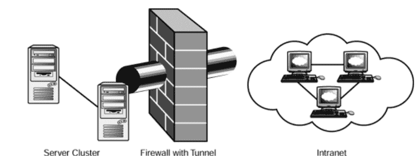

为了最大化发挥 DMZ 的作用，你必须制定关于哪些内容可以进入其中的规则。防火墙很少提供服务；提供这些服务的是位于防火墙后方的服务器。然而，如果在 DMZ 内部暴露了过多的内容，你不妨直接放弃 DMZ 以节省资金。随着你靠近内部网络，行为准则（由于必要性）会变得更加宽松。以下列表提供了一些常见的规则：

- **最小化端口（暴露的防火墙）** — 大多数暴露在外部世界的防火墙都会限制可用端口的数量。这些端口精确地提供了客户端获取公司信息所需的通道。暴露的端口越多，攻击者可能获得访问权限的途径也就越多。
- **最小化服务（暴露的服务器）** — 最靠近 Internet 的服务器仅提供绝对最少的服务。通常，这些服务与防火墙被动过滤的端口紧密相关。一些常见服务包括 `HTTP`、`HTTPS` 和 `FTP`（仅读取）。
- **限制数据库（内部 DMZ）** — 数据库通常存储着公司最有价值的信息。任何私有数据库都不应位于任何 DMZ 中。一些系统经常将 `LDAP` 放置在其中一个内部 DMZ 中（而不是内部网络中），但这种做法同样是一个安全隐患，因为数据库通常包含未加密的用户名和密码。如果 DMZ 中的服务器需要数据库访问权限，你可以轻松创建点对点信使，将请求手动带回内部网络。这些信使应该是编译后的程序，以减少被破解的风险。
- **使用编译的服务（暴露的服务器）** — 像 `Perl` 这样的脚本虽然比 `C/C++` 更容易编程，但它们处于人类可读的形式，这使其成为安全风险。尽可能多地尝试生成工具，以便在发生入侵时防止攻击者改变服务器的行为。
- **分离伪装** — 每个 DMZ 都可以使用带有伪装的独立虚拟 IP 空间。从一个 DMZ 到另一个 DMZ 更改寻址方式，会使渗透内部网络变得更加困难，并增加网络维护的复杂性。

## 注意

### RPC 漏洞

许多网络程序员认识到随着端口数量增加，入侵的可能性也会增加。然而，经验不足的程序员可能没有意识到，他们可能使用了动态创建端口的工具。例如，远程过程调用（`RPC`）的`portmap`程序会创建端口。此外，`Java`的远程方法调用（`RMI`）和微软的`COM/COM+`都建立在`RPC`之上。为服务器编写脚本的网站管理员可能没有意识到，他们每创建一个新对象，就会打开一个新的安全漏洞。

将当今 Internet 的状态与古老的城堡和城墙城市进行比较是非常恰当的。Internet 没有规则，通常处于无政府状态。建立必要的安全措施可以保护你和你的真正客户。

## 保护信道

网络有两个你可以调整以满足需求的不同要素：物理网络和消息。保护两者免受攻击至关重要。

### 物理窃听

一种明显的物理措施是专用连接。不幸的是，这种连接并没有曾经认为的那样安全。即使在专用连接中，非侵入式窃听的技术也非常简单。尽管如此，这是一个非常好的起点。物理介质提供了几种隐藏（或暴露）你数据的方法。连接方式越晦涩，成本越高。本节介绍了四种基本的物理传输形式：电/光 和 有导体/无导体。

基于导体的电气信道（如双绞线或同轴电缆）可能是最容易被窃听的。柔性导线对于主要导体上的外科手术式探测非常宽容。此外，电磁学的特性允许某人进行未被察觉的窃听。刚性信道更安全且损耗更小，但价格昂贵且难以处理。

无导体电气传输（如无线电或微波）和光传输（如红外或定向激光）实际上是最容易被窃听的形式。你只需要在传输场或路径中放置一个天线即可。微波是一种类似于激光的定向传输。另一方面，较低频率和红外更倾向于广播。这些形式无法在物理上得到保护，安全性很低。

光信道是最安全的。然而，几年前，研究人员发现，如果他们将柔性信道弯曲到恰好合适的角度（临界角），光信号就会泄漏出来。他们利用这一点证明，即使是光纤也并非对窃听免疫。当时，他们仍然无法引入信号。如果研究团队尚未找到引入光信号的方法，他们可能很快就会找到。再次，为了解决这个问题，你可以获取更刚性的光纤信道，这些信道不允许光纤弯曲到接近临界角。

总结来说，刚性有导体信道降低了被窃听的可能性。光传输具有对电磁窃听免疫的额外安全性。此外，光传输已被证明可以承载非常高的带宽。

### 消息窃听

保护消息不那么明显。防火墙让暴露给 Internet 的信息通过并进行过滤。它们使用客户端预期的特定端口和服务。更改某些预期的设置和接口可以增加你的安全性。

虽然开源运动不鼓励这样做，但使用私有协议可以阻止入侵（另一方面，这也可能会增加关注度）。例如，不使用 `HTTP` 作为协议，而是发明一个新且专用的版本。这种方法确实存在重大缺点：你必须编写客户端界面并将其交付给客户。

另一种方法是限制可用窗口和发送的信息。例如，在二战期间，盟军使用美洲原住民在无线电波上以他们自己的语言进行长达数小时的交谈。在特定间隔，消息会转变为战术或战略指令或状态。

利用这个例子，你可以编写一个资金转移机制，它在特定间隔启动，或者全天候保持开放但在非工作时间发送无关信息。

增加随机性是消息安全的关键。例如，假设你有一台连接到 Internet 的自动取款机（`ATM`）（这是一个可怕的念头！）。它需要向主机服务器发送和接收交易请求。它使用随机性的一种方式是持续发送和接收虚假交易。然后，在特定间隔，主机和 `ATM` 都会识别出某笔交易是真实的。（当然，这对于实际实施来说仍然太宽松了。）

随机性的另一种形式是数据加密。良好的数据安全在很大程度上取决于数据加密引入的随机量。数据越随机，解密数据就越困难。密钥设定了可能结果的范围。完美的加密密钥没有大小限制。不幸的是，随着密钥大小的增加，计算时间呈指数级增长。因此，一个好的密钥是长度足够长，从而在计算上降低被发现的可能性。这就是为什么每个人都希望使用 128 位加密。

## 注意

### 通过防火墙过滤器进行加密

你不能将某些技术结合起来以构建针对攻击的更强防御。例如，加密会击败防火墙的主动过滤。再次强调，主动过滤会查看数据包中任何可能可疑的内容。不幸的是，如果内容已加密，只有客户端和服务器知道内容（希望如此）。如果你启用了过滤，你可能只能期望被动过滤能与加密消息配合工作。

128 位加密具有足够宽的范围，如果一台计算机每秒纳秒（$10^{-9}$ 秒）依次尝试每个密钥，它将需要超过 $10^{20}$ 年才能找到密钥。那是一段时间。就随机性而言，128 位加密似乎具有足够大的范围来近似完美密钥——至少就目前而言。

# 消息加密

加密有两种形式：单向（有损）和双向（无损）。单向加密会丢失关于原始数据的信息。UNIX 密码中使用的典型加密是单向的。单向加密不需要恢复任何数据；例如，用户输入的密码只需要与加密形式匹配即可。

发送到服务器的请求需要一种方法来取回数据。双向加密以某种方式对数据进行混淆，使得信息可以通过解密密钥进行检索。服务器和客户端必须同时知道加密算法和加密/解密密钥。

加密并非新事物。最著名的加密设备是德国的 Enigma 机器。事实上，当前的一些算法正是基于这个二战时期的设备。加密的核心思想是确保只有接收者能够理解消息。现代加密算法（密码）与计算机一样普遍。

当两个主机相互通信时，设计者假设其他主机可能会偷听消息。网络窃听设备可以打开并检查本书中定义的每一种协议。当然，窃听者必须物理上位于同一网络才能获取任何消息。同样，窃听者必须穿越大量杂乱信息才能获取真正有价值的内容。

本节描述加密的不同组成部分，并介绍一种在计算机中常见的协商机制。

## 有哪些可用的加密类型？

联网计算机使用两种不同的密码：公钥和非对称密钥（对称密钥）。公钥密码使用两个密钥——一个用于加密，一个用于解密。服务器通常使用此算法来启动加密过程或执行单事务。

对称密钥密码使用相同的密钥进行加密和解密。解密只是撤销加密所做的操作（有点像放松一个拉紧的弹簧）。由于对称密钥密码的特性，两个主机必须保密该密钥。这些算法非常快且相对简单。同样，你可以使用任何随机数作为密钥。

另一方面，公钥密码有两个密钥——一个加密（公共）密钥和一个解密（私有）密钥。服务器将加密密钥与网络上的任何客户端共享。（密钥本身并不关键——只有该算法转换的数据才是关键的。）服务器内部保留解密密钥以解密传入的消息。


公钥密码有一些局限性。首先，密钥必须相关。主机不能随机生成加密密钥而不计算解密密钥。这大大限制了可用密钥的数量。因为数字必须相关才能加密然后解密，与完整的整数集相比，你只能有少数几对可用密钥。例如，在 `128` 位密钥中，你只能有 $2^{32}$ 个可能的密钥对。其次，因为你只有有限数量的密钥对（不是整个数字范围），这些密码比私钥密码安全性较低。例如，`128` 位公钥密码可能只具有 `64` 位或 `32` 位对称密码的强度。

## 已发布的加密算法

互联网提供了许多不同的公钥和对称密码套件（不同密码的集合）。最常见的是基于 `RSA`（作者姓名：`Rivest`、`Shamir` 和 `Adleman`）公钥、`DES`（数据加密标准）和 `RC2`/`RC4`（`Rivest` 密码）。一些密码仍然拥有专利，使用时需要支付特许权使用费（`2000` 年 `10` 月，`RSA` 的专利过期）。

大多数 `Linux` 发行版要么在安装中包含这些套件，要么提供链接供你下载它们。

## 加密的问题

密码带来了一系列有趣的问题。首先，直到最近，美国限制强加密算法的出口。事实上，这是某些发行版不会将密码套件放在其 `CD-ROM` 上的原因之一。相反，安装过程会尝试从外国服务器获取套件。`2000` 年，政府解除了这一限制，获取密码变得稍微容易一些。

另一个问题是计算时间。虽然对称密码相对较快，但所有初始通信必须使用较慢的公钥。公钥不适合大块数据。因此，协商密码和密钥的额外复杂性必须成为协议的一部分。

最后一个问题相当奇怪。加密实际上吸引了它本意想要避免的事情——破解和窃听。显然，互联网上有一群破坏者希望登上头条新闻。

## 安全套接层 (SSL)

如前所述，两个主机必须就一组密码达成一致才能进行具有一定安全性的通信。安全套接层（`SSL`）定义了此协议。它是一个经过精心设计的过程，旨在严格限制破解的可能性。`SSL` 使用公钥和对称密码来建立连接、协商协议和通信数据。

本节范围无法包含 `SSL` 如何协商密钥和通信通道的细节。相反，本节向你展示如何使用 `OpenSSL` API 编写 `SSL` 客户端和服务器。再次强调，本章无法涵盖整个 API——那些信息轻松就可以写满另一本书。

## 使用 OpenSSL

你可以获取一个功能强大但文档不全的 `SSL` API，称为 `OpenSSL`。它在 `http://www.openssl.org` 上可用，并支持多个平台，当然包括 `Linux`。要使用该 API，你需要遵循几个步骤来配置、编译和安装它。

它不是开箱即用的（预编译的），且某些安装步骤与 `Mandrake` 或 `Red Hat Linux` 的集成效果不佳。（其他发行版可能有类似问题，因此你可能需要注意。）以下步骤将帮助你安装并使其工具可用：

-   下载 tar 包，在安全（非 root）目录中解压，并进入新创建的目录。

-   运行配置文件（`./config`）。如果报错，你需要使用 `./config linux-elf` 明确指定操作系统类型。

-   运行 `make` 编译源代码。

-   运行 `make test` 验证算法。

-   以 root 身份登录。运行 `make install` 将所需文件移动到它们的目录（`/usr/local/ssl/`）中。

-   创建库的引用：

    -   `ln -s /usr/local/ssl/lib/libssl.a /usr/lib/`

    -   `ln -s /usr/local/ssl/lib/libcrypto.a /usr/lib/`

-   创建头文件引用的引用：

    -   `ln -s /usr/local/ssl/include/openssl/ /usr/include`

-   将 `MANPATH /usr/local/ssl/man` 添加到你的 `/etc/man.config` 文件中。（你可能想要运行 `makewhatis` 来进行主题搜索。）

-   将 `/usr/local/ssl/bin` 添加到你的路径中。

此过程的一个小缺点是，所有编译都使用静态库，因此不要惊讶如果你的可执行文件初始大小为 `600KB`。如果你想使用共享库，你必须将 `libssl.a` 和 `libcrypto.a` 转换为 `.so` 文件。

完成这一切后，你就可以开始编写安全套接字了。链接阶段必须以特定顺序包含库。如果两个库的顺序颠倒，程序链接将因未解析的外部符号而失败：

```
cc test.c -lssl -lcrypto
```

你可能注意到，该 API 包含一些演示用的 C++ 源文件。这是过度设计。对所有库的调用都可以使用纯 C。（事实上，如果你查看源代码本身，你可能会注意到它实际上是 C++ 文件中的 C 源代码。）

## 创建 SSL 客户端

现在你已安装好 API，可以通过编写一个简单的客户端/服务器程序对来试用它。创建 `SSL` 客户端/服务器几乎与创建普通套接字一样容易。事实上，`OpenSSL` 是在该框架之上构建的。

客户端的第一步是设置 `SSL` 库状态：

```c
/****/ 
/*** 初始化客户端 SSL 状态              ***/ 
/****/ 
SSL_METHOD *method;
SSL_CTX *ctx;
OpenSSL_add_all_algorithms();        /* 加载加密算法等 */ 
SSL_load_error_strings();             /* 加载/注册错误消息 */ 
method = SSLv2_client_method();      /* 创建新的客户端方法 */ 
ctx = SSL_CTX_new(method);          /* 创建新的上下文 */ 
```

如果 API 调用的返回值为 NULL 或零，您可以使用以下方法显示错误：

```C
ERR_print_errors_fp (stderr); /* 将错误输出到 stderr */
```

下一步是创建一个常规套接字。

```C
/********************
*** 将客户端套接字连接到 SSL 服务器 ***
****
struct sockaddr_in addr;
struct hostent *host = gethostbyname (hostname);
int sd = socket (PF_INET, SOCK_STREAM, 0); /* 创建套接字 */
bzero (&addr, sizeof (addr));
addr.sin_family = AF_INET;
addr.sin_port = htons (port); /* 服务器端口 */
addr.sin_addr.s_addr = * (long *) (host->h_addr); /* 服务器 IP */
connect (sd, &addr, sizeof (addr)); /* 连接到服务器 */
```

在客户端和服务器之间的套接字连接建立后，您需要创建一个 `SSL` 实例并将其关联到该连接：

```C
/*
*** 建立 SSL 协议并创建加密链接 ***
****
SSL *ssl = SSL_new (ctx); /* 创建新的 SSL 连接状态 */
SSL_set_fd (ssl, sd); /* 关联套接字描述符 */
if ( SSL_connect (ssl) == -1 ) /* 执行连接 */
    ERR_print_errors_fp (stderr); /* 报告任何错误 */
```

从此时起，您拥有一个具有完整加密功能（具体取决于客户端和服务器协商的结果）的 `SSL` 连接。您可以按如下方式获取密码套件：

```C
char *cipher_name = SSL_get_cipher (ssl);
```

您还可以使用以下调用读取证书：

```C
/**
*** 读取证书 ***
****
char line [1024];
X509 *x509 = X509_get_subject_name (cert); /* 获取主体 */
X509_NAME_oneline (x509, line, sizeof (line)); /* 转换它 */
printf ("Subject: %s\n", line);
x509 = X509_get_issuer_name (cert); /* 获取颁发者 */
X509_NAME_oneline (x509, line, sizeof (line)); /* 转换它 */
printf ("Issuer: %s\n", line);
```

最后，程序可以使用类似于 `send()` 和 `recv()` 的调用来发送和接收数据。然而，这些调用有一些不同之处。首先，`flags` 参数缺失；其次，如果发生错误，函数返回 `-1`。`send()` 和 `recv()` 的正式定义指出，如果发生错误，返回值将为负数。


```C
/***************************************************************/
/** 发送和接收消息                       ***/
/***************************************************************/
int bytes;
bytes = SSL_read(ssl, buf, sizeof(buf));     /* 获取/解密 */
bytes = SSL_write(ssl, msg, strlen(msg));    /* 加密/发送 */
```

该 API 还提供了许多其他函数，可用于控制流程、更改 SSL 状态以及进行配置。

## 创建 SSL 服务器

客户端和服务器只有微小的差异。两者都必须初始化上下文、建立连接并启动 SSL 协议。服务器需要多执行几个步骤。首先，上下文初始化的变化很小：

```C
/***************************************************************/
/** 初始化服务器 SSL 状态                     ***/
***************************************************************/
SSL_METHOD *method;
SSL_CTX *ctx;
OpenSSL_add_all_algorithms();      /* 加载加密算法等 */
SSL_load_error_strings();          /* 加载/注册错误消息 */
method = SSLv2_server_method();    /* 创建新的服务器方法 */
ctx = SSL_CTX_new(method);         /* 创建新的上下文 */
```

您可能已经注意到，该程序使用的是 SSLv2，而不是 SSLv3。您可以使用其中任何一种。但是，如果您希望 Netscape 连接到您的 SSL 服务器，它需要 SSLv2。即使在这种情况下，出于某种原因，Netscape 仍然认为它连接到一个 SSLv3 套接字。

与客户端不同，服务器必须加载其证书文件。这分为两部分：证书和私钥。您必须将两者都作为初始化的一部分加载。两部分可以位于同一个文件中。

```C
/***************************************************************/
/** 加载证书和私钥文件            ***/
***************************************************************/
/* 从 CertFile 设置本地证书 */
SSL_CTX_use_certificate_file(ctx, CertFile, SSL_FILETYPE_PEM);
/* 从 KeyFile 设置私钥 */
SSL_CTX_use_PrivateKey_file(ctx, KeyFile, SSL_FILETYPE_PEM);
/* 验证私钥 */
if ( !SSL_CTX_check_private_key(ctx) )
    fprintf(stderr, "Key & certificate don't match");
```

客户端也可以选择加载证书文件，但这并不是必须的。如果数据安全要求这样做，您可能希望您的客户端拥有证书。

## 注意

通常，如果您打算在互联网上正式运营，您可以从 VeriSign 等各种渠道购买证书。但是，如果您只是进行测试，可以使用 OpenSSL 中的工具创建自己的证书。（不要使用 OpenSSL 随附的证书。）创建证书的 Perl 工具 `CA.pl` 位于构建目录 `/usr/local/ssl/misc` 中。如果它没有要求您回答一系列问题，说明您尚未将路径设置为指向 `/usr/local/ssl/bin`。

服务器套接字本质上与常规套接字服务器相同：

```C
/*****...*/
/** 建立套接字服务器端口 */
/*****...*/
struct sockaddr_in addr;
int sd, client;
sd = socket(PF_INET, SOCK_STREAM, 0);      /* 创建套接字 */
bzero(&addr, sizeof(addr));
addr.sin_family = AF_INET;
addr.sin_port = htons(port);
addr.sin_addr.s_addr = INADDR_ANY;  /* 允许任何网络 */
bind(sd, &addr, sizeof(addr));      /* 绑定到端口 */
listen(sd, 10);                     /* 转换为监听套接字 */
client = accept(server, &addr, &len);  /* 接受连接 */
```

与客户端一样，服务器必须创建一个 SSL 会话状态并将其与客户端的连接相关联。

```C
/*****...*/
/** 基于上下文和 SSL 接受创建 SSL 会话状态 */
/*****...*/
ssl = SSL_new(ctx);          /* 获取带有上下文的新 SSL 状态 */
SSL_set_fd(ssl, client);    /* 将套接字与 SSL 状态关联 */
if ( SSL_accept(ssl) == FAIL )      /* 执行 SSL 协议接受 */
    ERR_print_errors_fp(stderr);
else
{
    int bytes;
    bytes = SSL_read(ssl, buf, sizeof(buf));  /* 获取请求 */
    SSL_write(ssl, reply, strlen(reply));     /* 发送响应 */
}
```

步骤真的就这么简单。在 Sams 网站上尝试一下代码，并使用 Netscape 进行连接。由于 Netscape 无法识别您自制的证书，程序会显示一条警告消息，并附带几个设置对话框以临时注册该证书。

## 总结：安全服务器

网络套接字为您提供了许多提高生产力和分布处理的机会。然而，您在主机之间共享的信息并未对连接到同一网络的其他主机隐藏。在 Internet 上放置重要或机密信息相当于在招引丢失、间谍活动、腐败等风险。Internet 的本质可能是您的弱点。

您可以通过提前规划和围绕重要产品建立安全性来减少损失。大多数公司都不能忽视这样一个事实：为了生存，它们必须拥有一种 Internet 存在。防火墙、策略和加密是锁定站点并阻止攻击的典型方法。

当两个或多个主机在公共环境中（例如 Internet）进行通信时，您可以要求特定的协议和算法来降低窃听的可能性。加密有多种形式，并提供不同级别的安全性。两种标准的加密形式是对称加密和非对称（公钥）加密。如今，两者都用于 SSL 等通信。

编写 SSL API 中的程序在很大程度上取决于 API 的实现。在本书撰写时，尚不存在 SSL 的标准 API。但是，您可以通过使用一个名为 OpenSSL 的开源版本来体验在 C 语言中使用 SSL 的感觉。OpenSSL 是一个非常丰富的实现，拥有超过 200 个 API 调用。

通过良好的规划、远见以及像 OpenSSL 这样的标准工具，您可以为 Internet 创建一个有效、可靠且安全的资源。

下一章将带您了解信息共享的另一极端：组播和广播。安全性旨在确保隐私。组播和广播则试图尽可能多且尽可能高效地共享。

# 第 17 章。使用组播、广播和 Mbone 共享消息

### 本章内容

- 向域广播消息
- 向组组播消息
- 总结：高效的消息共享

网络是将消息从一个地方传送到另一个地方的绝佳媒介。它拥有各种各样的技术和带宽，让您可以尝试不同的事物。您可能没有认为是一个优点的一个优势是，所有计算机通常都连接到某种骨干网。那么，在同一骨干网上连接一台计算机会有什么优势呢？通常，流量会更大，而主机之间的专用连接则最好。

某些服务可以同时到达多个目的地。与其将相同的消息发送到每个主机，不如发送一条消息，让所有主机简单地将其接收。其优点显而易见——减少冗余流量。

Internet 协议提供了两种形式的分发消息：广播和较新的组播。本章讨论不同类型的分发消息及其实现方法。

### 向域广播消息

分布式消息传递的第一种形式，即广播 `[RFC919, RFC922]`，利用子网和网络掩码的特性来确定目的地。广播是一种强制性的消息分发形式；子网和主机都必须接收该消息。（实际上，如果主机未启用广播，硬件不会接受该消息。尽管如此，该消息仍然会占用带宽，且每台主机都可以读取它。）

### 重温 IP 结构

子网对于发送和接收广播消息至关重要。如第 2 章“TCP/IP 网络语言精通”中所述，当使用 `ifconfig` 定义接口时，你同时也定义了一个广播地址和一个网络掩码。广播地址是一个特殊地址，主机通过监听它来获取消息。


子网通常与网络掩码和广播地址相同。例如，如果你的`198.2.56.xxx`子网中大约有 250 台主机，那么你的网络掩码和广播地址将分别是`255.255.255.0`和`198.2.56.255`。因此，如果你想向子网中的每个人发送消息，应使用`198.2.56.255`地址。（如第 2 章所述，你可以对网络掩码进行非常创造性的设置——只需记住最后一个有效位是掩码的结束位置。）

子网实际上是硬件实现的封装。真正的工作发生在硬件和内核的低层。为了理解正在发生的事情，你需要从物理连接开始。

除了物理连接外，发送广播消息比接收要容易。要发送任何消息，你只需要 IP 地址（如第 2 章所述，网络实际上会将该地址转换为目标的以太网 MAC 地址）。要接收消息，网卡必须正在监听匹配的 MAC 地址。问题在于，广播消息不能假设拥有不同于主机的 MAC 地址。事实上，如第 2 章所指出的，同一子网中的两台主机不太可能拥有相似的 MAC 地址。因此，广播不能依赖任何专用 MAC 来执行广播消息。

相反，当程序发送广播消息时，内核会自动分配全 1 的 MAC 地址（`FF:FF:FF:FF:FF:FF`）。这个 MAC 是一个标志，指示所有 NIC 接收它——即使没有程序在监听广播消息。

NIC 打开闸门，让消息充满其内部缓冲区。完成后，它通过中断通知内核。内核获取数据包并查看目标 IP。如果地址与广播地址匹配，它会将数据包传递到网络子系统的队列中。

网络子系统（通常是 UDP）检查消息，如果发现端口号匹配的广播套接字，它会将数据包移动到该套接字的 I/O 通道中。如果没有，则丢弃数据包。你可能需要指定端口号，以告诉内核为你过滤掉不需要的消息。否则，你可能会引起一场不需要的回复风暴。

### 编程启用广播

你可以使用`SO_BROADCAST`套接字选项来启用广播。程序的其余部分看起来像是一个普通的分组消息程序。

```c
/*****
***** 创建一个广播分组套接字  *****
/*****
const int on=1;
sd = socket(PF_INET, SOCK_DGRAM, 0);
if ( setsockopt(sd, SOL_SOCKET, SO_BROADCAST, &on, sizeof(on)) != 0 )
      panic("set broadcast failed");
bzero(&addr, sizeof(addr));
addr.sin_family = AF_INET;
addr.sin_port = htons(port);
addr.sin_addr.s_addr = INADDR_ANY;
if ( bind(sd, &addr, sizeof(addr)) != 0 )
      panic("bind failed");
addr.sin_port = htons(atoi(strings[2]));
if ( inet_aton(strings[1], &addr.sin_addr) == 0 )
      panic("inet_aton failed (%s)", strings[1]);
```

启用广播后，你可以向广播地址发送消息。你可能希望为接收者和发送者创建一个进程或线程。与其他传输中你可以期望单次传输得到单次回复不同，每次发送的消息在广播中可能会产生许多回复。如果你这样做，请务必关闭其中一个通道的入站队列。

```c
/*****
***** 将职责分为发送者和监听者 *****
***** 关闭发送者的监听通道。 ***
/*****
if ( fork() )
      Receiver(sd);
else
{
     shutdown(sd, SHUT_RD);     /* 关闭输入通道 */
     Sender(sd);
}
wait(0);
```

## 广播的限制

广播消息有几个问题。虽然你可能能够用一条消息同时到达多台计算机，但你只能到达你的子网内的那些计算机。不过，你可以通过更改广播地址来扩大你的影响范围。不幸的是，你不能在广域网（WAN）上使用广播，因为地址`255.255.255.255`在 Internet 上不再合法。（你甚至可能发现大多数路由器根本不允许广播消息通过。因此，即使你有正确的广播地址，例如`198.2.255.255`，位于`198.2.1.0`的路由器也可能忽略该数据包。）

此外，子网上的每个人都会听到你的消息。由于硬件实现广播的方式，所有网卡都会接收广播消息。这可能给那些不想要该消息的主机带来大量的不必要负担。

另一个问题是协议。IPv4 仅支持分组的广播（排除 TCP）。如果你想要可靠性和流式传输，你必须自行实现。分组在许多情况下表现良好，经过一些加强，你可以提供一个良好的接口供客户端连接。

## 向组组播消息

组播 [RFC1112] 解决了广播的一些问题。广播的主要思想是向地址范围内的每个人发送消息。组播使用主机可以加入以监听消息的约定地址。

组播使用单个 IP 地址向多个接收者发送消息。与广播相比，它具有以下优势：

- **所有协议**：它支持分组和流式协议（UDP 和 TCP）。分组目前支持组播，但流式没有立即的实现。你可以找到免费（非开源）的可靠递送组播实现。
- **广域网可访问**：你可以加入全球组播组。然而，在撰写本文时，广域网中有一些部分不支持或不通组播消息。
- **有限的监听者**：组播消息并不必然强制所有 NIC 接收它（参见本章后面的“网络如何提供组播”部分）。
- **支持 IPv6**：IPv6 取消了对广播的支持，但它采用并扩展了组播。

> 注意

## 开启组播支持

大多数发行版包含已开启组播的内核。（你可以查看`/proc/net/dev_mcast`来检查你当前正在运行的内核。）然而，组播路由可能未启用，或者如果你使用的是下载的内核，你可能没有设置该选项。如果你想使用组播，或者你为想要使用组播的其他人管理路由器，你可能需要重新配置并重编内核。配置位于配置的网络部分。

## 加入组播组

使用组播就像加入列表服务一样简单。像列表服务一样，你接收到的消息数量与别人发送的一样多，因此很容易使受限的网络连接过载。如果你加入一个组，请确保你有足够的带宽来支持数据流。最可能的情况是，你会丢弃数据包，使连接变得不那么有用。

广播地址遵循特定模式，以便路由器可以识别它们。这些地址直接来自 IP 分配（首次在 Chapter 2 中介绍）。范围是 `224.0.0.0`–`239.255.255.255`。这些地址保留用于广播。该地址范围被细分为较小的范围，以指示地址范围或消息在路由器阻止它之前可以走多远。表 17.1 显示了这些划分。

**表 17.1 组播地址分配和范围**

| 范围 | 典型 TTL | 地址范围 |
| :--- | :--- | :--- |
| 簇 | 0 | `224.0.0.0`–`224.0.0.255` |
| 站点 | < 32 | `239.255.0.0`–`239.255.255.255` |
| 组织 | < 128 | `239.192.0.0`–`239.195.255.255` |
| 全球 | <= 255 | `224.0.1.0`–`238.255.255.255` |

要加入一个组，您使用带有新参数的`setsockopt()`内核服务调用。新参数是`ip_mreq`结构：

```c
/****************************************************************/
/**  The ip_mreq structure for selecting a multicast addr  ***/
/****************************************************************/
struct ip_mreq
{
    struct in_addr imr_multiaddr;    /*  known multicast group  */
    struct in_addr imr_interface;    /*  network interface  */
};
```

`imr_multiaddr`字段指定您要加入的多播组。其格式与`sockaddr_in`结构中的`sin_addr`字段相同。`imr_interface`字段允许您选择特定的主机接口。这类似于`bind()`，后者允许您指定主机接口（或者使用`INADDR_ANY`值将主机选项完全开放）。但是，其表现可能与您预期的不同。

### 注意：默认多播接口

当您将`imr_interface`设置为`INADDR_ANY`时，内核会为您选择接口。至少在使用 2.2.XX Linux 内核时，它并不意味着“在所有接口上监听”。因此，如果您有多个接口，您可能需要在所有想要监听的接口上分别加入该组。

下面的代码片段展示了如何使用`ip_mreq`结构加入一个组。它仅出于演示目的将`imr_interface`字段设置为`INADDR_ANY`。除非您的主机只有一个接口，否则请勿使用此设置；结果可能不可预测（参见上方的框）。


```c
/****************************************************************/
/**  Join a multicast group                         ***/
/****************************************************************/
const char *GroupID = "224.0.0.10";
struct ip_mreq mreq;
if ( inet_aton(GroupID, &mreq.imr_multiaddr) == 0 )
    panic("address (%s) bad", GroupID);
mreq.imr_interface.s_addr = INADDR_ANY;
if ( setsockopt(sd, SOL_IP, IP_ADD_MEMBERSHIP, &mreq, sizeof(mreq)) != 0 )
    panic("Join multicast failed");
```

如果您预计要将另一个程序连接到相同的地址/端口，您必须在该套接字上使用`SO_REUSEADDR`选项。目前，Linux 不支持地址/端口共享（`SO_REUSEPORT`）。要启用地址共享，请使用以下代码片段：

```c
/****************************************************************/
/**  Enable address sharing                         ***/
/****************************************************************/
if ( setsockopt(sd, SOL_SOCKET, SO_REUSEADDR, &on, sizeof(on)) != 0 )
    panic("Can't reuse address/ports");
```

您可以加入的组数量取决于硬件和内核的限制。许多 UNIX 操作系统将每个主机的连接限制为 16 个。没错——是每主机，而不是每程序。更多信息请参阅本章后面的“网络如何提供多播”。

当您完成端口的监听时，您可以放弃成员身份：

```c
/***********************/
/*** Drop a multicast group ***/
/*********************/
if ( setsockopt (sd, SOL_IP, IP_DROP_MEMBERSHIP, &mreg, sizeof(mreg)) != 0 )
    panic("Drop multicast failed");
```

您也可以选择直接结束程序，程序会为您清理连接。

### 注意：多播清理

您可能希望手动放弃多播组。这是少数几种自动进程清理并非好主意的情形之一。如果内核存在问题，仅仅终止程序不会显示任何错误。此外，在程序终止后，您仍可能接收到消息。这将导致端口对新程序实例不可用或数据乱码。手动关闭可以让程序看到连接上的任何错误，从而帮助您进行调试。

加入多播组相对容易。事实上，创建一个本地多播组只需要选择一个未使用的 IP 地址。全局地址则有所不同。如果您想发布 Internet 多播服务，您可能需要从 IAB 请求一个地址（和端口）。

## 发送多播消息

向多播组发送消息与发送数据报消息一样简单。请记住，UDP 允许您连接到该地址，从而简化多播的发送和接收。

### 注意：拥有多播地址

即使您可以为特定服务设置一个地址，也无法保证您独占该地址。其他人也可以在该地址上发送消息。如果您的服务需要一定程度的连续性，您可能需要提供一种方式来区分您的消息和其他消息。客户端仍会拾取网络上发送的所有消息。区分真实消息是由内核和您的程序负责。

在制作多播过程中一个有趣的副作用具有巨大潜力：您发送消息时不必是多播组的成员。程序可以简单地将消息发送到广播地址/端口。流媒体多播服务器实际上可能从未真正加入多播组。要接收消息，您必须加入该组。

出于正当理由，能够在不加入的情况下提供消息是一个真正的优势。这样，您的服务器可以避免受到与多播相关的流量冲击。

## 网络如何提供多播

操作系统（如 Linux）实现多播的方式可能会导致大量消息涌入。了解其工作原理有助于您考虑性能问题以及如何快速过滤消息。

许多网卡支持某种形式的 MAC 别名（短暂地采用额外的标识）。所有网卡都被分配了 MAC 地址。与使用广播地址（`FF:FF:FF:FF:FF:FF`）的广播不同，多播使用多播地址作为密钥创建临时 MAC 地址。多播 MAC 的标准前缀是 `01:00:5E`，最后三个字节（实际上是 23 位）来自多播地址。例如，多播地址 `224.138.63.10`（`E0:8A:3F:0A`）变成 MAC 地址 `01:00:5E:0A:3F:0A`（注意 8A 中的 8 被丢弃了）。

操作系统获取此地址并编程网卡以接受该地址。网卡以三种方式接受此编程：

-   标签表— 网卡原样保存整个地址。它检查网络上的每条消息，将其与其自身的 MAC 以及此表中的所有 MAC 进行对比。这是 100% 可靠的。

-   哈希密钥（不完整过滤）— 网卡将 MAC 哈希到 64 位至 512 位的哈希数组中。当消息通过网络时，网卡对该 MAC 地址进行哈希处理。如果数组中对应的位被打开，网卡接受该消息。这种方法可能会接受并非发往主机的消息。下一层则负责过滤掉不需要的消息。

-   混杂模式— 某些卡不支持多播。替代方案是将卡置于混杂模式并接收所有消息。下一层必须丢弃所有不需要的消息。这是最不可取的。

网卡没有端口的概念，因此 IP 协议栈中的较高层必须将消息移动到其适当的队列中或丢弃它们。请记住，即使您没有监听某个端口，您的主机也会接收到您已加入地址上的所有多播消息。如果您选择 UDP 或 TCP，内核会为您过滤端口。如果您选择原始套接字，则必须在程序中执行过滤。

## 发送多播消息

获取多播消息的第一步是编写程序并启用主机的硬件和内核以支持多播。下一步是告知路由器您需要该消息。但这并不是全部。您的多播消息在到达 WAN 基带之前面临几个障碍。

您可能需要执行其他任务才能将消息发送出去。本节讨论这些问题及其解决方法。

## 让路由器知晓

Internet 试图使用两个地址将消息从源发送到目的地——IP 地址和 MAC。MAC 通常在消息发送前很少被知道，而 IP 地址具有内置的路由功能。但是，路由器预期一条消息只有一个目的地——对于一个地址有两个目的地通常是错误。

组播需要一些特殊的网络特性。这些特殊特性会影响支持路由器的配置。首先，路由器必须接受生成的 MAC 地址。实际上，这改变了路由器的职责，可能需要额外的路由器配置。

随着组播协议的创建，互联网标准提出了互联网组管理协议（`IGMP`）[RFC1112, RFC2236]，用于传递组播组通告。`IGMP` 携带子域中主机希望加入或退出的组 ID 和 MAC 地址。加入消息仅传递到作用域允许的范围。即使路由器后方的没有任何主机加入该组，路由器仍然必须跟踪可用的组。（如果路由器宕机，信息不会丢失。当内部主机加入组时，路由器开始重建组列表。）

路由器承担的另一个负担定义了新协议的独特性。尽管组的所有订阅者都能看到每条消息，但所有订阅者看到的消息可能并不完全相同（参见“组播的限制”）。路由器必须将所有广播和组播消息传递给所有已加入的子域。这可能隐含地或显式地需要复制消息。

路由器显式地将消息复制到两个或更多不同的连接上。路由器通常连接到多个网络，并在它们之间路由流量。显式复制将数据包放置在其中一个或多个网络上。

隐式复制是由于网络特性导致的。在同一子域内，由于物理上连接到同一根线路，每个人都能看到其他人的所有内容。当多个主机在网络上看到消息并拾取它时，就会发生隐式复制。

## 穿透防火墙（Mbone）

某些路由器或防火墙缺乏对组播组所需的实现支持，因此子域内的主机无法看到来自外部的任何消息。仅支持定向（或单播）消息的路由器被称为`单播路由器`。

1992 年前不久，程序员希望利用组播的新特性。不幸的是，网络中充满了单播路由器。解决方案是将新协议封装在 IP 包装器中，直接发送给一个接收器，该接收器会解封装并传递它。这个用于组播的虚拟网络骨干（Mbone）今天也可以用于防火墙。

它是如何工作的？Mbone 使用`组播`路由器（`mrouted`）来接受并通过外部域将消息传递给另一个 `mrouted` 服务器。`mrouted` 服务器接受每个完整的消息数据包，并将其放入另一个带有其自身头部的数据包中。结果是一个具有两个 IP 头部的消息。在另一端，接收 `mrouted` 服务器解封装消息，并将结果放入其子域中。

## 组播的限制

组播解决了许多广播带来的问题，但它也有自己的问题。一些问题包括硬件支持、性能/带宽瓶颈、责任归属和唯一性。

### 获取硬件支持


上一节描述了操作系统和硬件如何支持组播。不幸的是，一些网卡（如`Ethernet Express`）根本不支持组播和混杂模式。要接收组播消息，硬件必须至少支持混杂模式。在测试本章的一些算法时，这个非常具体的问题曾短暂阻碍了开发。

你可以在`/./linux/Documentation/networking/`下的`multicast.txt`中查看支持的网卡列表。如果你的编程尝试不起作用，请确保你的网卡具有完整的支持。

### 性能瓶颈

你在接收广播或组播消息（特别是那些使用混杂模式进行组播的网卡）时还会面临另一个问题。程序必须过滤大量不需要的消息。广播也有这个问题，组播极大地减少了其影响。但问题仍然存在。

同样，客户端到网络的连接可能无法处理组播组发送的所有消息（例如，`56Kbps`调制解调器上的视频馈送）。会发生什么？路由器将消息入队，直到它们过期。了解你的服务器和客户端之间的瓶颈有助于你保持高可靠性和可用性。

解决瓶颈问题的潜在方案可能需要路由器更强的控制能力。

### 对每条消息负责

最后一个问题是责任归属；无论是否拥有组播组的一部分，任何人都可以发送任何消息。这可能导致那些想要损害互联网有效性的的人的干扰。

### 消息唯一性

在处理组播协议时，会出现另一种形式的问责。你可能熟悉潜在的组播数据报镜像问题。在组播中，由于需要为不同的路径复制消息，这个问题更加明显。

这种重复的一个例子是当主机连接到互联网并且必须穿过几个路由器时。在某个点上，消息通过同一子域中的几个路由器。本不应该发生这种情况，因为适当的网络每个域只有一个路由器，但这种情况确实会发生。

当主机加入组时，两个路由器看到请求并将消息传递给父路由器。稍后，组播消息到达父路由器。父路由器识别出该消息是路由器使用`IGMP`通告的。它传递消息，两个路由器将其传递到它们的子域。由于隐式复制（由每个路由器执行），主机收到两个相同的消息。

为了解决这个问题，首先，确保你标记所有消息，其次，尽量保持网络拓扑整洁。

## 总结：高效的消息共享

如果你需要在多个主机之间共享消息而不直接发送给每一个，你可以使用广播或组播。广播，这种较老的形式，使用`IP`寻址和网络掩码来创建和发送消息。它更高效地利用网络资源，但迫使子网上的每个主机都听到消息。此外，在`WAN`上的广播是不允许的。

组播解决了许多广播的限制，并具有更强的可扩展性。即使路由器可能需要发送同一消息的不同副本，它仍然是`LAN`和`WAN`上共享消息的更好方法。监听组播消息是自愿的，这与广播不同。

组播是一项不断增长的技术，越来越多的组播路由器到位，以克服单播路由器。然而，你可能不会看到广播完全消失，因为它在某些底层协议中有一席之地。

# 第 18 章。原始套接字的力量

### 本章内容

- `何时使用原始套接字？`

- `有哪些限制？`

- `将原始套接字付诸实践`

- `Ping 是如何工作的？`

- `Traceroute 是如何工作的？`

- `总结：做出原始的决策`

有时可用的材料不符合项目的意图和需求。当这种情况发生时，你必须从非常原始的材料开始。`TCP`和`UDP`不让你访问`IP`数据报的原始内部结构。你必须挖掘更深，做更多的基础工作。

原始套接字提供了大量的灵活性。此外，使用原始套接字的程序往往非常简单且快速。本章详细说明了原始套接字的使用和意图，并提供了关于如何构建数据报的提示。

### 何时使用原始套接字？

`IP`编程的原始材料仅比实际网络帧高一层。当你使用原始套接字时，你没有高级协议的开销，这些协议可能会侵蚀你的网络吞吐量。但是，与此同时，你失去了高级协议的功能。你必须仔细选择何时使用原始套接字。

### 暴露 ICMP

使用原始套接字打开了消息（错误）协议。高级协议，如`TCP`和`UDP`，阻止你发送`ICMP`数据包。此外，`IP` API 不提供`SOCK_MSG`（与名称`SOCK_STREAM`或`SOCK_DGRAM`相比）。要发送`SOCK_MSG`风格的数据包，你必须创建一个原始数据包，创建并填充`ICMP`头部，并将其发送出去。

`ICMP`子命令提供了几种服务，如附录 A “数据表”中列出的一些有用的子命令包括`echo`（用于`ping`）、时间戳、路由器请求和地址掩码。当然，这些功能都是非常低级别的。`ICMP`的设计不仅仅是为了管理最简单的消息任务。

### 控制 IP 头部

此外，如果你想管理`IP`头部本身，你必须使用带有适当套接字选项（`IP_HDRINCL`）的原始套接字。回顾第 3 章 “不同类型的互联网数据报”，

`IP`头包含多个通常可以通过`setsockopt()`设置的字段。此外，`IP`头中还有一些字段是无法设置的。

例如，如果你（出于任何原因）想要测试分片字段，你就必须使用启用了`IP_HDRINCL`的原始套接字（`raw socket`）。此功能的另一个用途是编程第 3 章表 3.1 中列出的某些替代`IP`版本。

## 加速物理网络传输

如前所述，底层协议非常快。原始套接字仅比网络帧高一级抽象。本质上，你的原始数据包以物理网络速度通过网络传输。

大多数网络帧在`10Mbps`网络中为`1-2KB`。更快的网络提供更大的帧尺寸。如果你需要速度，请尽量匹配网络帧大小。这减少了拆分消息的需求。实际上，这比听起来要难；你无法直接获取帧大小。你可以询问用户或查询硬件配置，但这需要更多的工作（且回报较少）。

如果你需要在`IP`堆栈的非常低的层级工作，原始套接字就是答案。或者，如果数据通信很重要且准确性是必须的条件，大多数程序使用高层协议来提供大部分通信功能。

## 限制是什么？

原始套接字提供了大量的灵活性，但它们不是万灵药。选择在何时使用原始套接字需要了解其限制。

- **可靠性丢失**——你失去了高层协议的许多功能。例如，`TCP`提供可靠的连接——发送的数据即为接收到的数据。（当然，原始套接字和`UDP`具有相同级别的不可靠性。）

- **无端口**——你失去了端口（虚拟网络连接）。这实际上可能成为一个问题。因为没有端口，内核会将原始数据包传递给所有匹配的原始套接字。换句话说，如果多个原始套接字具有相同的协议号，内核无法确定实际目标。本章稍后的`MyPing`示例演示了这个问题。

- **非标准通信**——发送方和接收方必须理解你在做什么。你无法仅编写一个原始套接字发送器而不编写一个配套的接收器。`ICMP`在`IP`堆栈中有自己的接收器。

- **无自动 ICMP**——如前所述，`ICMP`不像`TCP`（`SOCK_STREAM`）或`UDP`（`SOCK_DGRAM`）那样具有接口。相反，你必须创建一个原始套接字，预留一个看起来像清单 3.2（见第 3 章）的头部，填充它，计算校验和，附加任何数据，然后发送。

- **无原始 TCP 和 UDP**——你不能期望原始`TCP`或`UDP`正常工作。你可以将协议参数设置为任何你想要的值，甚至可以是`TCP`（`6`）或`UDP`（`17`），但并非所有操作系统都支持接收套接字。换句话说，你可能会创建一个`UDP-raw`套接字，构建并初始化`UDP`头部并发送消息，但不要期望任何回复。

- **Root 权限**——与其他协议不同，程序必须以`root`权限运行。

如果你能接受这些限制，原始套接字可以成为加速程序的实际优势。

## 利用原始套接字

在决定使用原始套接字后，你需要了解如何与它们配合工作。不幸的是，缺乏一个所需的工具。本节介绍了缺失的算法并引入一个新的系统调用。

### 选择合适的协议

创建原始套接字的第一步是选择正确的协议。`/etc/protocol`文件（见附录 A，表 A.7）列出了协议编号、名称和同义词。你可以使用此文件从标准字母名称获取正确的协议编号，而无需定义任何常量。要使用的系统调用是`getprotobyname()`：

```c
#include <netdb.h>
struct protoent* getprotobyname(const char* name);
```

此调用如果成功，返回一个结构体（`struct protoent*`）。该结构体包含一个字段（`p_proto`），你将用它来发起`socket()`系统调用：

```c
struct protoent* proto;
int sd;
proto = getprotobyname("ICMP");
sd = socket(PF_INET, SOCK_RAW, proto->p_proto);
```

如前所述，`ICMP`没有为`socket()`的第二个参数提供自己的常量，因此你使用`SOCK_RAW`加上相应的协议值。

### 创建 ICMP 数据包

在创建原始套接字后，你需要初始化一个消息包。每个包都将包含某种头部信息（甚至你自己的专有包也很可能有一个头部）。就底层`IP`层而言，这都是数据。你选择包含头部对`sendto()`命令意义不大，因此你需要在程序中管理头部。

`ICMP`包具有头部和数据主体。为了简化编程（和架构独立性），`Linux`在库中包含头部定义：

```c
#include <netinet/ip_icmp.h>
struct icmphdr *icmp_header;
```


由于你可能在包中包含比头部更多的信息，你可能希望如下定义自己的结构体：

```c
#define PACKETSIZE        64        /* bytes */
struct packet_struct
{
    struct  icmphdr header;
    char message[PACKETSIZE-sizeof(struct icmphdr)];
} packet;
```

你可以使用此结构体来发送和接收消息。

## 计算校验和

下一步，至少对于 ICMP 包，是计算校验和。校验和是整个包的一位补码和。不幸的是，此算法不是 Linux 发行版标准库的一部分（尽管它在内核中反复使用）。清单 18.1 介绍了缺失的子例程。

### 示例 18.1. ICMP 校验和

```c
unsigned short checksum(void *b, int len)
{
    unsigned short *buf = b, result;
    unsigned int sum=0;

    for ( sum = 0; len > 1; len -= 2 ) /* Sum all 16b words */
        sum += *buf++;
    if ( len == 1 )                       /* If any stray bytes, */
        sum += *(unsigned char*)buf;
    sum += (sum >> 16) + (sum & 0xFFFF);  /* Add the carry */
    sum += (sum >> 16);                  /* (again) */
    result = ~sum;                        /* Take the one's complement */
    return result;                         /* Return 16b value */
}
```

接收方通过反转算法来验证数据包——它对数据包的全部内容求和。结果应该为零（因为是一位补码校验和）。这是一种非常巧妙的方法来检查数据包，但它有限制。

主要限制是，该算法只能检测 16 位字中的唯一位错误。它无法检测字与字之间的类似缺陷。例如，如果数据包有两个字，每个字在相同位置翻转了一位，校验和将计算相同。

## 控制 IP 头

IP 头对其自身的校验和字段使用相同的校验和算法。当你选择创建自己的 IP 头时，这成为一个问题。与 ICMP 协议不同，IP 头为你做了一些工作。例如，它始终计算校验和，并且校验和仅涵盖 IP 头。（回想一下，ICMP 计算整个包的总和。）如果你想计算校验和，请随意——它只会重新计算。

IP 层保留所有原始 IP 字段（如表 3.4 所示）不变，除了 IP 网络版本号和控制校验和。如果你将版本号设置为零，`sendto()` 将值设置为当前网络的值（例如，`PF_INET` 为 4，或 `PF_INET6` 为 6）。如果你将其设置为其他值，IP 层将保持其不变。

除非你正在做非常不寻常的事情，否则 `setsockopt()` 会触及 IP 头中大多数功能字段。

### 第三方流量

直接操纵 IP 头赋予你一些非常不寻常的能力。其中之一是低层第三方流量。假设你有一个由三个服务器组成的网络——源、目标和中介。中介接受来自源的消息，进行一些处理，然后将结果传递给目标。这被称为第三方流量。在大多数情况下，发送到中介的数据包将包含源和最终目标（连同其自身的地址）。

现在你必须与一个不理解回复必须发送到除了源之外的不同主机的遗留系统接口。大多数非 TCP 协议回复 IP 头中的源 IP 字段。使用 IP 头操纵，你可以将源 IP 字段设置为第三方的地址，而不是源的地址。

**注意**

第三方流量可能测试伦理

能够随意设置源 IP 字段是非常强大的——并且不寻常且很少必要。通常，使用此功能的程序员实际上是在尝试*欺骗*网络，让主机认为消息来自其他地方。那些试图进行网络欺骗的人冒着违反当地、国家和国际法律的风险。

首先，ISP（可以且应该）通过跟踪消息和验证源 IP 字段轻松检测到数据包是否被欺骗。其次，Linux 不允许发送欺骗的数据包：它填充 IP 源字段。第三，ISP 通常会丢弃这些“源路由”数据包。

### Ping 是如何工作的？

在创建你的第一个原始套接字程序时，你通常从 ping 开始，这是一种标准的“你在吗？”客户端。当你发送这样的请求时，IP 堆栈几乎总是回复——没有应用程序或服务器等待该消息。

由于用户可能想要测试往返时间，程序通常有两个进程在运行——一个用于发送，另一个用于接收。发送进程通常每次传输之间等待一秒，接收方记录消息及其时间。

### MyPing 接收器

接收器很简单。创建原始套接字后，它反复调用 `recvfrom()`，如 清单 18.2 所示。

### 示例 18.2. MyPing 接收器循环

```c
/**************************************************************************/
/** MyPing Receiver – Get pending message and display it.**/
/*** From MyPing.c on Web site.****/
/**************************************************************************/
for (;;)  {
    int bytes, len = sizeof(addr);

    bzero(buf, sizeof(buf));          /*  Clear buffer & Get msg  */
    bytes = recvfrom(sd, buf, sizeof(buf), 0, &addr, &len);
    if ( bytes > 0 )                  /*  If no error,  */
        display(buf, bytes);          /*  check ID & display  */
}
```

## MyPing 发送端

发送端的工作稍多一些。除了准备并发送消息外，它还必须接收内核决定放入队列的任何错误消息（参见 清单 18.3）。

### 示例 18.3. MyPing 发送端循环

```c
/***********
* MyPing Sender - Get & toss any pending messages, *
* compose message, send message, and pause. *
* From MyPing.c on Web site. */
for ( ; ; )
{
    int len = sizeof(r_addr);
    /*---Get any message that the kernel may have sent---*/
    if ( recvfrom(sd, &pktct, sizeof(pktct), 0, &r_addr, &len) > 0 )
        printf("***Got message!***\n");
    /*---Initialize outgoing packet---*/
    bzero(&pktct, sizeof(pktct)); /* Zero contents */
    pktct.hdr.type = ICMP_ECHO; /* Request echo */
    pktct.hdr.un.echo.id = pid; /* Set ID */
    for ( i = 0; i < sizeof(pktct.msg)-1; i++ )
        pktct.msg[i] = i+'0'; /* Fill buffer */
    pktct.msg[i] = 0; /* Make C-string compatible */
    pktct.hdr.un.echo.sequence = cnt++; /* Set counter */
    pktct.hdr.checksum = /* Compute checksum */
        checksum(&pktct, sizeof(pktct));
    if ( sendto(sd, &pktct, sizeof(pktct), 0, addr, /* SEND! */
        sizeof(*addr)) < 0 )
        perror("sendto");
    sleep(1); /* Wait for 1 second */
}
```

将消息重置为相同的值并非完全必要，但是一种预防措施。当目的地回复时，发送端将收到该消息的副本。如果你没有收到该消息（以及任何其他 ICMP 消息），内核最终会为不需要的消息预留越来越多的内存。


为了使算法正确工作，程序必须更改套接字的一些默认设置。首先，大多数 ping 程序将 `TTL`（生存时间）设置为最高的跳数值（255）。此外，发送端的套接字必须启用非阻塞模式，以便在调用 `recvfrom()` 时不会停滞。

`MyPing` 程序是大多数 ICMP 类型数据包消息传递的良好起点。一旦你熟悉了这个算法，其他原始套接字程序与数据报编程类似。

## 路由跟踪是如何工作的？

另一种类型的 ICMP 风格原始套接字程序是路由跟踪（`traceroute`）。你可能已经使用过路由跟踪来查找主机访客或垃圾邮件的路径。该程序构建在 `MyPing` 程序之上，因为它使用 ICMP 消息。

基本算法是向目的地发送一个 TTL 不足的 ping 消息。拦截的路由器会使数据包过期并返回一个错误。使用更大的 `TTL` 重复操作，直到消息到达目的地。结果实际上非常巧妙：源和目的地的路由器发现 `TTL` 已过期，因此它向源发送一个错误（ICMP 消息）。路由器将其地址放入错误消息中。这里只有原始 ICMP 套接字才能工作，因为你可能无法从路由器获得错误消息。

循环类似于 `MyPing` 的发送端过程。该程序需要一些额外的逻辑来解释回复：

```c
TTL = 0;
do
{
  int len=sizof(r_addr);
  struct iphdr *ip;

  TTL++;
  if ( setsockopt(sd, SOL_IP, IP_TTL, &TTL,
                  sizeof(TTL)) != 0) 
    perror("Set TTL option");
  /****Initialize the message (see MyPing's sender)****/

  if ( sendto(sd, &pkt, sizeof(pkt), 0, addr, 
              sizeof(*addr)) <= 0) 
    perror("sendto");
  if ( recvfrom(sd, buf, sizeof(buf), 0,
                &r_addr, &len) > 0 ) 
  {
    struct hostent *hname;
    ip = (void*)buf;
    printf("Host #%d: %s \n", cnt-l, /* Print router IP */
           inet_ntoa(ip->saddr));
    hname = gethostbyaddr(
          (void*)&r_addr, sizeof(r_addr),
          r_addr.sin_family);   /* Try getting name */
    if ( hname != NULL )
      printf("(%s)\n", hname->h_name);
    else 
      perror("Name");
  } 
  else 
    perror("recvfrom");
}
/*----Repeat until the destination is the same as the reply---*/
while ( r_addr.sin_addr.s_addr != addr->sin_addr.s_addr );
```

当你多次运行此程序时，你可能会注意到路径似乎变化很大。这是正常的，不是 bug。有关网络动态的解释，请参阅第 2 章“TCP/IP 网络语言流利度”。

## 总结：做出原始决策

原始套接字使你可以使用 IP 子系统所使用的错误消息协议（ICMP）。它还允许你创建自己的协议。原始套接字的主要优势是其极高的速度，因为它仅比物理网络帧高一层抽象。

最常见的入门级原始套接字程序是 ping 和路由跟踪。当你了解这些程序的工作方式以及数据报消息传递中涉及的风险时，你可以选择最佳方法来满足你程序的要求。

# 第 19 章. IPv6：IP 的下一代

### 本章内容

- 当前寻址问题
- 尝试 IPv6
- IPv6 的优缺点
- 总结：将你的代码带入未来

互联网包含当今世界的大部分网络流量。它具有强大的力量和灵活性。它的力量和灵活性基于 IP 数据包。此数据包使消息从这里传递到那里变得更加容易。然而，它存在某些限制，主要基于增长和可扩展性的限制。

本章深入探讨 IP 的下一代：IPng（是的，“IP Next Generation”）或 `IPv6`。在这本书中，你一直在 `IPv4` 领域工作，而其中大部分知识也适用于 `IPv6`。你只需要知道一些额外的提示和技巧，以确保你的创意项目的持久性。

## 当前寻址问题

`IPv4` 主要侧重于子网内一组计算机的寻址。如第 2 章“TCP/IP 网络语言流利度”中所述，该数字由 4 字节值（或 32 位数字）组成。此外，地址被分组到网络类别中。当公司购买地址块时，它们是以这些类别获取的。这些类别的范围从几百到几百万个地址不等。

分配和使用的地址数量使互联网活动板（IAB）感到担忧。该董事会发现，实际分配的数字中不到 1% 真正与网络上的节点相关联。结果：可用地址供应日益减少。

IAB 预计连接到互联网的计算机数量将在未来几年内增加多达一百倍。`IPv4` 没有足够的可用地址来满足需求。

### 解决 IPv4 地址空间萎缩问题

IAB 已采取一些措施来解决地址萎缩问题。拥有真实 IP 地址的成本已经上升，因此公司现在使用伪装和 `DHCP` 来限制分配地址的数量。

此外，互联网可以采用比仅 32 位更宽的寻址方案。`IPv6 [RFC2460]` 回答了这一确切请求。`IPv6` 长 128 位（或宽 16 字节）。这至少将可能性延伸到下一个世纪。`IPv4` 的有效地址数量约为二十亿个网络节点（排除特殊地址）。`IPv6` 的有效地址空间是 `2^128`。

### IPv6 看起来是什么样子的？

由于程序员现在必须管理大量数字，`IPv6` 地址与 `IPv4` 看起来略有不同。每个地址是八个用冒号分隔的十六进制数字。例如，一个合法的地址是 `2FFF:80:0:0:0:94:1`。为了简写，你可以用两个冒号替换重复的零（`2FFF:80::94:1`）。

仍然可以使用小数点和十进制端口号将端口附加到地址的末尾。例如，前一个地址的端口 80 将是 `2FFF:80::94:1.80`。你不能使用冒号分隔符，因为它会使简写变得含糊不清。

`IPv6` 地址空间（类似于 `IPv4`）已被划分为特定的区域或组 `[RFC1897, RFC2471]`。这些组试图合并不同的地址（如 `IPX`）。截至本书撰写时，定义仍在变动中，许多分组尚未定义。

在不同的分组中，以 `001` 作为前三位的具体数字地址值专门替代了 `IPv4` 寻址。图 19.1 显示了此地址。


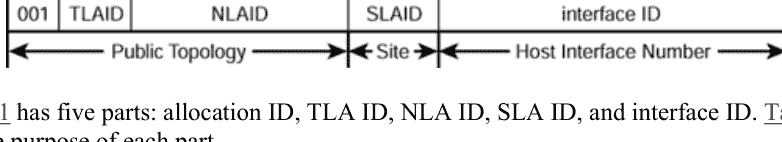

图 19.1 有五个部分：分配 ID、`TLA` ID、`NLA` ID、`SLA` ID 和接口 ID。表 19.1 定义了每个部分的用途。

表 19.1. `IPv6` 地址部分

| 字段 | 描述 |
| --- | --- |
| 分配 ID | 这是表示这是公共互联网地址的 3 位标志（`001`）。(3 位) |
| `TLA` ID | 顶级聚合。这代表全球互联网的最高级别。(13 位) |
| `NLA` ID | 下一级聚合。`TLA` 内的细分组。(32 位) |
| `SLA` ID | 站点级聚合。这可能是一家大公司或企业集团。(16 位) |
| 接口 ID | 特定的机器 ID。(64 位) |

网络必须解决的一个问题是第 2 章中首次讨论的“每个人都知道每个人”的问题。这个问题迫使所有路由器了解每个可用地址，以便正确路由消息。这就是为什么机器不能使用 `MAC` 地址的原因。

`IPv4` 使用嵌入网络 IP 地址中的类解决了这个问题。`IPv6` 使用了一种更为分散的形式。它仍然必须解析 `TLA`、`NLA` 和 `SLA` 区域中的地址，但不必同时解析它们。相反，路由器根据其所需的地址部分，将消息从一个组移动到下一个组。

## IPv4 和 IPv6 如何协同工作？

承诺的路由机制为这项拟议的变更增加了一些吸引力。但显然，互联网尚未完全转换为 `IPv6`。事实上，它可能永远保留 `IPv4`。那么，服务器和客户端如何混合使用这两种协议呢？

目前几乎所有支持 `IPv6` 协议堆栈的系统也支持 `IPv4` 协议堆栈。这些 `双栈` 系统可能会存在相当长的时间，直到大多数应用程序完全迁移到 `IPv6` 为止。主要问题是如何让它们协同工作。

实际上，地址宽度的增加对协议堆栈的影响微乎其微。互联网使用的主要协议是 `UDP` 和 `TCP`，这些协议无论如何都嵌入在 IP 数据包中。当你从 `IPv4` 客户端向双栈服务器发送消息时，`IPv4` 堆栈会相应地作出响应。但是，在剥离 IP 封装后，它看起来就像一个 `TCP` 或 `UDP` 消息。如果你仔细编程应用程序，可以非常轻松地从 `IPv4` 迁移到 `IPv6`。


本质上，`IPv6` 是 `IPv4` 的超集。它采用了 `IPv4` 的所有优良特性，并摒弃了过时的特性。`IPv4` 地址被重新映射到 `IPv6` 地址。为了映射地址，`IPv6` 地址的高位全部设为零，最后 48 位变为 `0xFFFF` 加上 `IPv4` 地址。例如，将 `128.10.48.6` 转换为 `IPv6` 地址，你会得到 `::FFFF:128.10.48.6` 或 `::FFFF:800A:3006`（再次强调，`::` 是全零的简写）。

当然，唯一的限制是你不能逆向操作：`IPv4` 应用程序不能直接接受 `IPv6` 消息。（某些允许*地址截断*，它将 128 位地址转换为临时的 32 位地址。当 `IPv4` 应用程序接受 `IPv6` 消息时，它只看到截断后的地址。当它使用地址回复时，内核将消息转换回 128 位地址。）

## 试用 `IPv6`

若要试用 `IPv6`，你不仅要稍作修改程序，而且内核和网络工具也必须支持它。一些发行版为了减少安装复杂性或安全风险而省略了对它的支持。本节描述了启用支持的过程，并展示了如何将你的程序转换为 `IPv6`。

### 配置内核

你可以快速检查你的内核版本是否支持 `IPv6`。如果你支持 `/proc`，请在 `/proc/net` 中查找。如果你看到 `ip6_tables` 或 `ipv6`，则说明你拥有 `IPv6`。如果你没有看到这些文件，可能需要加载 `ipv6.o` 模块。

**注意**

`net_tools` 中找到的 `ifconfig` 工具存在缺陷，不会自动加载 `ipv6.o` 模块。如果你遇到此问题，建议重新编译内核的 `ipv6` 而非将其作为模块。

如果你需要重新配置内核，请前往源码目录。（出于某些原因，一些发行版不会自动安装内核源码，因此你可能需要下载并安装它。网站 [http://www.kernel.org](http://www.kernel.org) 是一个良好的来源。）请确保在所有选项中所有设置都正确，并选择 `Experimental Drivers`。接下来在网络设置菜单中选择 `IPv6`。你可以在“It Is Safe to Leave These Untouched”部分找到它。某些内核配置允许你选择独占的 `IPv6`。不要这样做。同样，你可能希望将 `IPv6` 包含在内核中，而非将其编译为模块。这可以为你节省一些调试时间。

请务必保留旧内核的备份。如果你遇到问题，可以使用它回到正常状态。

### 配置工具

下一个需要测试的是工具。如果你已确认内核支持，请不带任何参数运行 `ifconfig`。它会显示每个网络接口的当前配置。如果它支持 `IPv6`，列表中每个接口的第二或第三行将包含 `IPv6` 地址。

如果你没有看到地址，请使用 `-help` 选项再次运行。命令随后将列出所有受支持的协议。在这种情况下，你很可能不会看到 `IPv6`。如果它被省略，你需要获取 `net_tools` RPM 并重新配置和编译它。安装后，使用 `configure.sh` 进行配置并启用 `IPv6`。如果你愿意，可以包含 `IPv4` 上的 `IPv6`，但这可能没有必要。编译包并将所有可执行文件复制到它们的典型位置（通常是 `/sbin`）。

同样，保留工具备份是一个非常好的主意。（你可能会注意到 `configure.sh` 的默认设置与你旧的安装相同。所以如果你的备份不起作用，你可以简单地重新编译。）

在你编译并安装工具和内核后，重启主机。当系统再次就绪时，运行 `ifconfig` 将显示为其分配的 `IPv4` 地址映射的地址。你甚至可以用以下命令添加一个 `IPv6` 别名：

```
ifconfig eth0 add <IPv6 Address>
```

例如：

```
ifconfig eth0 add 2FFF::80:453A:2348
```

当你的系统全部设置好之后，你可以开始编写一些 `IPv6` 程序。

### 将 `IPv4` 调用转换为 `IPv6`

在计算机正确设置为支持 `IPv6` 后，你可以编写一些程序。你只需要更改几个参数即可完成转换。本质上，如果你遵循了前几章中定义的公式规则，一切都会继续按预期工作。

第一个变化是套接字结构。不再使用 `sockaddr_in`，而是使用 `sockaddr_in6`：

```
struct sockaddr_in6 addr;
bzero(&addr, sizeof(addr));
```

使用此结构进行 `bind()`、`connect()` 和 `accept()` 系统调用。类似地，获取你的套接字或对端套接字地址的套接字选项也需要这种新结构。第二个变化是套接字类型。你不能从同一个套接字接收不同的协议。尽管 `IPv6` 几乎是 `IPv4` 的完全超集，但你必须选择不同的套接字类型：

```
sd = socket(PF_INET6, SOCK_STREAM, 0);    /* TCP6 */
/*---OR---*/
sd = socket(PF_INET6, SOCK_DGRAM, 0);     /* UDP6 */
/*---OR---*/
sd = socket(PF_INET6, SOCK_RAW, 0);        /* Raw-6 or ICMP6 */
```

在这些示例中的每一个中，你可能会注意到除了套接字类型外，其他一切都保持不变。这就是通用 `socket()` 接口的意图。接下来的几步也会略有不同：

```
addr.sin6_family = AF_INET6;
addr.sin6_port = htons(MY_PORT);
if ( inet_pton(AF_INET6, "2FFF::80:9AC0:351", &addr.sin6_addr) == 0 )
    perror("inet_pton failed");
```

`sockaddr_in6` 还有其他字段，你可以在程序中忽略它们。只需将它们设置为零（使用 `bzero()` 或 `memset()`），一切就应该正常工作。此外，你在程序中无需做任何其他事情。

前面的代码片段使用了一个新的调用，`inet_pton()`。它及其伴随调用 `inet_ntop()` 是新增加的，有助于处理各种形式的地址计算。`n` 当然代表网络，而 `p` 代表表示形式。此调用支持许多地址格式，包括 `IPv4`、`IPv6`、`IPX` 和 `HAM` 无线电。`GNU` 库提供的当前版本未记录在案，且仅支持 `INET` 和 `INET6`。

完整的原型如下所示：

```
#include <arpa/inet.h>
int inet_pton(int domain, const char* prsnt, void* buf);
char *inet_ntop(int domain, void* buf, char* prsnt, int len);
```

`inet_pton()` 调用将 `prsnt` 中的字母数字地址转换为网络字节序的二进制形式，并将结果放置在 `buf` 中。`inet_ntop()` 调用执行相反的操作。参数 `domain` 和 `len` 分别定义网络（`AF_INET` 或 `AF_INET6`）和 `prsnt` 数组长度。

### 将原始套接字转换为 `IPv6`

如果你使用的是 `UDP` 或 `TCP` 套接字，那就是你要做的全部。然而，如果你正在编写原始套接字或 `ICMP` 套接字，你必须使用特殊的新记录格式。`Raw-6` 和 `ICMP6` 包含新的或修订的字段以支持额外的功能。

`IPv6` 头部比 `IPv4` 头部简单得多，开销加倍（40 字节对 20 字节）。头部也是固定大小的，因为不允许有选项（请注意，这并不完全正确，如下节所述）。`IP`（对于原始套接字）可以在网络字节序中定义如下：


```c
/***************************************************************/
/** IPv6 Packet definition ***/
/***************************************************************/
union IPv6_Address
{
    unsigned char u8[16];
    unsigned short int u16[8];
    unsigned long int u32[4];
    unsigned long long int u64[2];
};
struct IPv6_Header
{
    unsigned int version:4;         /* The IP version (6) */
    unsigned int priority:4;
    unsigned int flow_label:24;
    unsigned int payload_len:16;    /* bytes following header */
    unsigned int next_header:8;     /* protocol (6 for TCP) */
    unsigned int hop_limit:8;       /* same as TTL */
    union IPv6_Address source;
    union IPv6_Address dest;
};
```

只有三个字段需要更多解释。`priority` 字段是一个实验性字段，它设置数据包的优先级。如果网络变得拥塞，路由器可能会保留或丢弃较低优先级的数据包。默认情况下，所有数据包都是 `priority` 零。

`flow_label` 字段也是实验性的，并与 `priority` 协同工作。流是由源到目的地通过一系列路由器移动的数据包序列。`flow_label` 帮助路由器确定任何特殊处理。一个消息只有一个 `flow_label`；一旦选定，流值对于流中的所有数据包都不会改变。你可以在绑定套接字地址时，使用 `sockaddr_in6` 中的可选 `sin6_flowinfo` 字段来设置 `priority` 和 `flow_label`。

最后一个字段，`payload_len`，可以为零，以表示巨大的数据包。一个一吉比特（甚至 100Mbit）网络发送小数据包（小于 100KB）是带宽的浪费。将此字段设置为零，并在头部和载荷之间包含一条额外的记录。以下定义按网络字节序显示：

```c
/* ************************************************** */
/** Jumbo (extra large) packet option definition    ***/
/* ************************************************** */
struct Jumbo_Payload
{
    unsigned char option;   /* equals 194 */
    unsigned char length;   /* equals 4 (bytes) */
    unsigned long bytes;    /* payload length */
};
```

使用此选项，你可以发送最大为 4GB 的数据包。对于一小段时间来说，这还不错。

## 将 ICMPv6 套接字转换为 IPv6

ICMPv6 头部的物理布局 [RFC2463] 与 ICMPv4 相同，但 `type` 和 `code` 字段发生了相当大的变化。例如，回显请求和回显应答有了新的编号（分别为 128 和 129）。一些代码不再受支持。关于代码的完整列表，请参见附录 A“数据表”。

## 新的多播协议

另一项架构变更涉及 IPv6 管理多播的方式。它必须在三个方面发挥作用：硬件、寻址和路由。

正如第 17 章“通过多播、广播和 Mbone 共享消息”所述，多播必须与硬件协同工作，指示硬件接收并非其自身以太网或 MAC 地址的数据包。这些地址取决于所请求的多播地址——IPv6 取地址的最后四个字节，并创建具有 `33:33` 前缀的 MAC 地址。例如，如果请求的多播地址是 `FF02::725:6832:D012`，则生成的 MAC 地址将是 `33:33:68:32:D0:12`（忽略 725）。

IPv6 的多播寻址与 IPv4 略有不同。第一个字节 `FF` 指示这是一个多播地址，但下一个字节包含关于多播组类型和路由细节的附加信息，每个信息宽 4 位。

第一个子字段有四个位标志，每个代表一个特征。最低有效位（第 0 位）为零 (0) 表示已知的多播地址。为一 (1) 表示瞬时地址。其他三个位目前保留。

另一个子字段同样有四位，指示地址的范围（本地或全局地址）。数字越高，范围越广。另一方面，IPv4 仅使用 TTL 来确定范围（较小的数字会在到达全局地址之前过期）。此外，如第 17 章所述，IPv4 已分配特定的地址块用于本地、站点或全局范围。表 19.2 定义了不同的范围。

| 范围 | 范围值 | 描述 |
| :---- | :---- | :---------- |
| 1 | 节点 | 同一主机上的本地（类似于 `127.0.0.1`）。 |
| 2 | 链路 | 消息保持在路由器的组内。路由器从不允许这些消息通过。 |
| 5 | 站点 | 由网络管理员定义，消息保持在站点的本地范围内。 |
| 8 | 组织 | 由网络管理员定义，消息保持在组织的本地范围内。 |
| 14 | 全局 | 所有路由器允许消息通过全局网络（直到它们过期）。 |

最后，路由规则（如第 17 章所述）保持不变。IPv6 使用 IPv4 的可选 IGMP 将加入或退出多播组的请求传递出去。由于两者都使用 MAC 地址获取多播消息，IPv6 无需定义超出 IPv4 实现之外的内容。

加入 IPv6 多播组的程序几乎与 IPv4 相同，但你需要使用不同的结构来选择地址：

```c
/* ********************************** */
/** IPv6 multicast structure definition **** */
/* ********************************** */
struct ipv6_mreq
{
    struct in6_addr ipv6mr_multiaddr; /* IPv6 multicast addr */
    unsigned int ipv6mr_interface; /* interface number */
};
```

第一个字段 `ipv6mr_multiaddr` 是广播消息地址。你在此字段中放置 IPv6 地址（例如，`FF02::10`）。下一个字段是接口号：0 表示所有接口，1 表示第一个接口（`eth0`），依此类推。

要启用 IPv6 多播，请使用以下代码片段：

```c
/***** */
/** Join a IPv6 multicast group **** */
/***** */
const char *GroupID = "FF02::4590:3A0";
struct ipv6_mreq mreq;
if ( inet_pton(GroupID, &mreq.ipv6mr_multiaddr) == 0 )
    panic("address (%s) bad", GroupID);
mreq.ipv6mr_interface = 0; /* any interface */
if ( setsockopt(sd, SOL_IPV6, IPV6_ADD_MEMBERSHIP, &mreq, sizeof(mreq)) != 0 )
    panic("Join multicast failed");
if ( setsockopt(sd, SOL_SOCKET, SO_REUSEADDR, &on, sizeof(on)) != 0 )
    panic("Can't reuse address/ports");
```

可以看出，代码与 IPv4 多播代码非常相似。

## 摘要：将代码移向未来

IPv6 解决了目前 IPv4 寻址结构中的局限性。通过扩展寻址范围几个数量级，IPv6 看起来是互联网明确的未来。仍处于初创阶段，寻址分配已采用标准网络，如 IPX。它已在欧洲和远东网络中获得支持。

随着扩展地址的出现，物理外观发生了变化，并包含了一些简写表示法以便于表示和编程。只要遵循本文中的指南和示例，将程序从 IPv4 移植到 IPv6 是直接的。`socket()` 系统调用真正帮助网络编程适应不同的网络。

IPv6 网络包含 IPv4 网络，因此所有 IPv4 地址仍然有效。大多数支持 IPv6 的操作系统很可能使用双栈来支持和转换这两个网络。双栈中的寻址方案和转换允许某些隐式协作——支持所需的重编程很少。


截至 2.2.0，Linux 内核支持 IPv6，但并非所有操作系统发行版都安装了启用此功能的编译内核。事实上，如果你的发行版不包含编译了 IPv6 的内核，该发行版很可能也没有更新的工具。本章描述了如何在你的 Linux 主机上运行 IPv6。

此外，本章通过示例演示了如何转换 IPv4 程序。它还介绍了两个用于帮助地址转换的新工具。在你的程序中支持 IPv6 增加了你的工作在未来使用的可能性。

# 第五部分：附录

- A 数据表
- B 网络 API
- C 内核 API 子集
- D 对象类

## 附录 A. 数据表

### 本附录内容

- 域：`socket()` 的第一个参数
- 类型：`socket()` 的第二个参数
- 协议定义
- 标准互联网端口分配（前 100 个端口）
- HTTP 1.1 状态码
- 套接字选项（`get/setsockopt()`）
- 信号定义
- ICMP 代码
- IPv4 多播分配
- 提议的 IPv6 地址分配
- ICMPv6 代码
- IPv6 多播范围字段
- IPv6 多播标志字段

本附录识别并列出与套接字编程相关的所有表和数据格式。

### 域：`socket()` 的第一个参数

表 A.1 列出了 `socket()` 系统调用第一个参数的值。你也可以在 `bind()` 系统调用中使用这些类型。虽然大多数程序在 `socket()` 和 `bind()` 中都使用 `AF` 风格，但正确的形式是在 `socket()` 中使用 `PF` 风格，在 `bind()` 中使用 `AF` 风格。如果你不习惯使用 `PF` 风格，你可以安全地使用 `AF` 风格，因为 C 头文件将 `AF` 风格定义为 `PF` 风格。结构定义位于 `<bits/socket.h>` 中。

| 类型 | 描述和示例 | 关联数据 |
|:---- | :------------------------ | :--------------- |
| `PF_UNSPEC` | 未指定 | `struct sockaddr { unsigned short int sa_family; unsigned char sa_data[14]; };` |
| `PF_LOCAL` `PF_UNIX` `PF_FILE` | 访问本地命名管道的 BSD 方法<br>`#include <linux/un.h>`<br>`struct sockaddr_un addr;`<br>`addr.sun_family = AF_UNIX;`<br>`strcpy(addr.sun_path, "/tmp/mysocket");` | `#define UNIX_PATH_MAX 108`<br>`struct sockaddr_un { sa_family_t sun_family; char sun_path[UNIX_PATH_MAX]; };` |
| `PF_INET` | Internet IPv4 协议族<br>`#include <linux/in.h>`<br>`struct sockaddr_in addr;`<br>`bzero(&addr, sizeof(addr));`<br>`addr.sin_family = AF_INET;`<br>`addr.sin_port = htons(9999);`<br>`if ( inet_aton("127.0.0.1", &addr.sin_addr) == 0 )`<br>`perror("Addr conversion");` | `struct sockaddr_in { sa_family_t sin_family; unsigned short int sin_port; struct in_addr sin_addr; unsigned char pad[]; };` |
| `AF_AX25` | 业余无线电 AX.25<br>`#include <linux/AX25.h>` | `typedef struct { char ax25_call[7]; } ax25_address;`<br>`struct sockaddr_ax25 { sa_family_t sax25_family; ax25_address sax25_call; int sax25_ndigis; };` |
| `PF_IPX` | Novell 互联网协议<br>`#include <linux/ipx.h>` | `struct sockaddr_ipx { sa_family_t sipv_family; __u16 sipv_port; __u32 sipv_network; unsigned char ... }` |
| `PF_IPX` | IPX（带 XTI 的 IP） | `#include <linux/ipx.h>` | `struct sockaddr_ipx { u8 ipx_family; struct in_addr ipx_addr; u16 ipx_port; }; typedef struct { u16 th; u32 net; u8 node[IPX_NODE_LEN]; u8 s_type; /* padding */ unsigned char s_zero; };` |
| `PF_APPLETALK` | Appletalk DDP | `#include <linux/atalk.h>` | `struct sockaddr_at { sa_family_t sat_family; u8 sat_port; struct at_addr { u16 s_net; u8 s_node; } sat_addr; char sat_zero[]; };` |
| `PF_NETROM` | 业余无线电 NetROM | | |
| `PF_BRIDGE` | 多协议网桥 | | |
| `PF_ATMPVC` | ATM 永久虚电路 | | |
| `PF_X25` | （预留用于 X.25 项目） | `#include <linux/x25.h>` | `typedef struct { char x25_addr[16]; } x25_address; struct sockaddr_x25 { sa_family_t sx25_family; /* X.121 地址 */ x25_address sx25_addr; };` |
| `PF_INET6` | IPv6 协议族 | `#include <linux/in6.h>` | `struct in6_addr { union { u8 u6_addr8[16]; __u16 u6_addr16[8]; __u32 u6_addr32[4]; #if (-_0) > 0xfffffff #ifndef __RELAX_IN6_ADDR_ALIGNMENT /* 唉，协议并不尊重 64 位对齐。rsvp/pim/... 是损坏的。然而，在可能时强制正确的对齐是个好主意。 */ __u64 u6_addr64[2]; #endif #endif } in6_u; #define s6_addr in6_u.u6_addr8 #define s6_addr16 in6_u.u6_addr16 #define s6_addr32 in6_u.u6_addr32 #define s6_addr64 in6_u.u6_addr64 }; struct sockaddr_in6 { unsigned short int sin6_family; __u16 sin6_port; __u32 sin6_flowinfo; struct in6_addr sin6_addr; };` |
| `PF_ROSE` | 业余无线电 X.25 PLP | `#include <linux/rose.h>` | `typedef struct { char rose_addr[5]; } rose_address; struct sockaddr_rose { sa_family_t rose_family; rose_address rose_addr; ax25_address rose_call; int rose_ndigis; ax25_address rose_digi; }; struct full_sockaddr_rose { sa_family_t rose_family; rose_address rose_addr; ax25_address rose_call; unsigned int rose_ndigis; ax25_address rose_digis[ROSE_MAX_DIGIS]; };` |
| `PF_DECnet` | （预留用于 DECNet 项目） | | |


| **PF_NETBEUI** | **（预留用于 802.2LLC 项目）** | **`#include <linux/netbeui.h>`** | `#define NB_NAME_LEN 20 struct sockaddr_netbeui { sa_family_t snb_family; char snb_name[NB_NAME_LEN]; char snb_devint[IFNAMSIZ]; };` |

| **PF_SECURITY** | **安全回调伪 AF** | | |

| **PF_KEY** | **PF_KEY 密钥管理 API** | | |

| **PF_NETLINK** | **模拟 4.4 BSD 的别名** | **`#include <linux/netlink.h>`** | `struct sockaddr_nl { sa_family_t nl_family; unsigned short nl_pad; __u32 nl_pid; __u32 nl_groups; };` |

| **PF_ROUTE** | | | |

| **PF_PACKET** | **数据包族** | **`#include <linux/if_packet.h>`** | `struct sockaddr_pkt { unsigned short spkt_family; unsigned char...` |

| **PF_ASH** | **Ash** | | |

| **PF_ECONET** | **Acorn Econet** | **`#include <linux/if_ec.h>`** | `struct ec_addr { /* 站点号。 */ unsigned char station; /* 网络号。 */ unsigned char net; }; struct sockaddr_ec { unsigned short sec_family; unsigned char port; /* 控制/标志字节。 */ unsigned char cb; /* 消息类型。 */ unsigned char type; struct ec_addr addr; unsigned long cookie; };` |

| **PF_ATMSVC** | **ATM 交换虚电路** | | |

| **PF_SNA** | **Linux SNA 项目** | | |

| **PF_IRDA** | **IRDA 套接字** | **`#include <linux/irda.h>`** | `struct sockaddr_irda { sa_family_t sir_family; /* LSAP/TSAP 选择器 */ unsigned char sir_lsap_sel; /* 设备地址 */ unsigned int sir_addr; /* 通常是 <服务>:IrDA:TinyTP */ char sir_name[25]; };` |

## 类型：`socket()` 的第二个参数

第二个参数（`type`）选择协议层。表 A.2 中定义的一些常量仅仅是占位符，用于内核支持该协议的情况。

## 表 A.2，`socket()` 调用中 `type` 参数的协议值

| 协议类型 | 描述 |
| :--- | :--- |
| **`SOCK_STREAM`** | (TCP) 可靠的双向流通信。您可以使用这种类型的套接字来进行涉及 `FILE*` 类型的高层 I/O 函数调用。该协议为您提供了一个使用端口和专用客户端通道的网络虚拟连接。连接后，`accept()` 调用返回一个专门用于新客户端的新套接字描述符。 |
| **`SOCK_DGRAM`** | (UDP) 不可靠的无连接通信。每条消息都是独立的，在传输过程中可能会丢失。该协议通过端口虚拟化网络，允许您从多个对等方发送和接收消息而无需重新连接。 |
| **`SOCK_RAW`** | (IP) 访问内部网络接口和字段。如果您想创建 ICMP 消息，则需要创建一个原始套接字。仅限根权限访问。 |
| **`SOCK_RDM`** | (RDM—可靠交付消息) 确保每个数据包都能安全到达目的地，但不保证正确的数据包顺序。（尚未在 Linux 和其他 UNIX 操作系统中实现。） |
| **`SOCK_SEQPACKET`** | 固定长度的顺序、可靠、基于连接的分组。（尚未在 Linux 中实现。） |
| **`SOCK_PACKET`** | (物理层) 将套接字置于混杂模式（如果可用），在此模式下它将接收网络上的任何和所有数据包。这是一个仅适用于 Linux 的工具。仅限根权限访问。（已弃用——请改用 `PF_PACKET`。） |

## 协议定义

*Listing A.1* 是您发行版中 `/etc/protocols` 文件 [RFC2292] 的摘录。它包含网络数据包中使用的常见和标准协议标准。修改此文件是个坏主意。

### 示例 A.1. `/etc/protocols` 文件

```
ip		0 IP		# internet protocol, pseudo number
icmp		1 ICMP		# internet control message protocol
igmp		2 IGMP		# Internet Group Management
ggp		3 GGP		# gateway-gateway protocol
ipencap	4 IP-ENCAP	# IP encapsulated in IP
st		5 ST		# ST datagram mode
tcp		6 TCP		# transmission control protocol
egp		8 EGP		# exterior gateway protocol
pup		12 PUP		# PARC universal packet protocol
udp		17 UDP		# user datagram protocol
hmp		20 HMP		# host monitoring protocol
xns-idp	22 XNS-IDP	# Xerox NS IDP
rdp		27 RDP		# "reliable datagram" protocol
iso-tp4	29 ISO-TP4	# ISO Transport Protocol class 4
xtp		36 XTP		# Xpress Transfer Protocol
ddp		37 DDP		# Datagram Delivery Protocol
idpr-cmtp	39 IDPR-CMTP	# IDPR Control Message Transport
rsrp		73 RSRP		# Radio Shortest Path First
vmtp		81 VMTP		# Versatile Message Transport
ospf		89 OSPFIGP	# Open Shortest Path First IGP
ipip		94 IPIP		# Yet Another IP encapsulation
encap		98 ENCAP		# Yet Another IP encapsulation
```

## 标准互联网端口分配（前 100 个端口）

*Listing A.2* 显示了在 `/etc/services` 文件中定义的标准端口（直到端口 #100）。您可以根据需要更改其中许多端口，但如果您这样做，请务必通知客户端。

### 示例 A.2. `/etc/services` 文件


```
topmux		1/tcp			# TCP port service multiplexer
rtmp		1/dgp			# Routing Table Maintenance Protocol
nbp		2/dgp			# Name Binding Protocol
echo		4/dgp			# AppleTalk Echo Protocol
zip		6/dgp			# Zone Information Protocol
echo		7/tcp
		7/udp
discard		9/tcp		sink null
discard		9/udp		sink null
systat		11/tcp		users
daytime		13/tcp
daytime		13/udp
netstat		15/tcp
qotd		17/tcp		quote
msp		18/tcp			# message send protocol
msp		18/udp			# message send protocol
chargen		19/tcp		ttylst source
chargen		19/udp		ttylst source
ftp-data	20/tcp
ftp		21/tcp
fsp		21/udp		fspd
ssh		22/tcp			# SSH Remote Login Protocol
ssh		22/udp			# SSH Remote Login Protocol
telnet		23/tcp
# 24 - private
smtp		25/tcp		mail
# 26 - unassigned
time		37/tcp		timeserver
time		37/udp		timeserver
rlp		39/udp		resource	# resource location
nameserver 42/tcp		name		# IEN 116
whos		43/tcp		nicname
re-mail-ck 50/tcp			# Remote Mail Checking Protocol
re-mail-ck 50/udp			# Remote Mail Checking Protocol
domain		53/tcp		nameserver	# name-domain server
domain		53/udp		nameserver
mtp		57/tcp			# deprecated
bootps		67/tcp			# BOOTP server
bootps		67/udp
bootpc		68/tcp			# BOOTP client
bootpc		68/udp
tftp		69/udp
gopher		70/tcp			# Internet Gopher
gopher		70/udp
rje		77/tcp		netrjs
finger		79/tcp
www		80/tcp		http		# WorldWideWeb HTTP
www		80/udp			# HyperText Transfer Protocol
link		87/tcp		tylink
kerberos 88/tcp		kerberos5 krb5 # Kerberos v5
kerberos 88/udp		kerberos5 krb5 # Kerberos v5
supdup		95/tcp
linuxconf	98/tcp
# 100 - reserved
```

## HTTP 1.1 状态代码

如果您想编写自己的 Web 服务器，您需要理解并使用 HTTP 1.1 的标准状态代码 `[RFC2616, RFC2817]`。表 A.3 列出了这些代码。

## 套接字选项 (get/setsockopt())

表 A.4 至 A.7 列出了各种套接字选项及其所需参数。并非所有选项在 UNIX 类型之间都具有大小兼容性。例如，Linux 中的 `IP_TTL` 允许类型为 `int`，但仅填充第一个字节。而 IBM 的 AIX 则将同一选项限制为 `char` 类型。

### 表 A.3. HTTP 结果代码

| 代码类别值 | 类别名称 | 特定代码及描述 |

| :--- | :--- | :--- |

| 1xx | 信息性响应 | 100 Continue 101 Switching Protocols |

| 2xx | 成功 | 200 OK 201 Created 202 Accepted 203 Non-Authoritative Information 204 No Content 205 Reset Content 206 Partial Content |

| 3xx | 重定向 | 300 Multiple Choices 301 Moved Permanently 302 Moved Temporarily 303 See Other 304 Not Modified 305 Use Proxy |

| 4xx | 客户端错误 | 400 Bad Request 401 Unauthorized 402 Payment Required 403 Forbidden 404 Not Found 405 Method Not Allowed 406 Not Acceptable 407 Proxy Authentication Required 408 Request Timeout 409 Conflict 410 Gone 411 Length Required 412 Precondition Failed 413 Request Entity Too Large 414 Request-URI Too Long 415 Unsupported Media Type |

| 5xx | 服务器错误 | 500 Internal Server Error 501 Not Implemented 502 Bad Gateway 503 Service Unavailable 504 Gateway Timeout 505 HTTP Version Not Supported |

### 表 A.4. 通用套接字选项

| 级别 | 选项 | 描述 | *读/写 | 值 | 类型 |

| :--- | :--- | :--- | :--- | :--- | :--- |

| `SOL_SOCKET` | `SO_ATTACH_FILTER` | 附加过滤器 | ? ? ? | 整数 | `int` |

| `SOL_SOCKET` | `SO_BINDTODEVICE` | 绑定到设备 | ? ? ? | 字符串 | `char*` |

| `SOL_SOCKET` | `SO_BROADCAST` | 启用广播 | Y Y Y | 布尔值 | `int` |

| `SOL_SOCKET` | `SO_BSDCOMPAT` | 请求 BSD bug 兼容性 | Y Y Y | 布尔值 | `int` |

| `SOL_SOCKET` | `SO_DEBUG` | 启用套接字调试 | Y Y Y | 布尔值 | `int` |

| `SOL_SOCKET` | `SO_DETACH_FILTER` | 分离过滤器 | ? ? ? | 整数 | `int` |

| `SOL_SOCKET` | `SO_DONTROUTE` | 禁止路由 | Y Y Y | 布尔值 | `int` |

| `SOL_SOCKET` | `SO_ERROR` | 最后一个错误 | Y Y Y | 整数 | `int` |

| `SOL_SOCKET` | `SO_KEEPALIVE` | 启用保持连接 | Y Y Y | 布尔值 | `int` |

| `SOL_SOCKET` | `SO_LINGER` | 延迟直到数据发送完成 | Y Y Y | Linger | `struct linger` |

| `SOL_SOCKET` | `SO_NO_CHECK` | 不进行检查 | Y Y Y | 布尔值 | `int` |

| `SOL_SOCKET` | `SO_OOBINLINE` | 将带外数据放置在内联中 | Y Y Y | 布尔值 | `int` |

| `SOL_SOCKET` | `SO_PASSCRED` | 启用传递用户凭证 | Y Y Y | 布尔值 | `int` |

| `SOL_SOCKET` | `SO_PEERCRED` | 对等方凭证 | Y Y Y | 凭证 | `struct ucred` |

| `SOL_SOCKET` | `SO_PRIORITY` | 设置队列优先级 | Y Y Y | 整数 | `int` |

| `SOL_SOCKET` | `SO_RECVBUF` | 接收缓冲区大小 | Y Y Y | 整数 | `int` |

| `SOL_SOCKET` | `SO_RCVLOWAT` | 接收低水位标记 | Y Y N | 整数 | `int` |

| `SOL_SOCKET` | `SO_RCVTIMEO` | 接收超时 | Y Y Y | 时间 | `struct timeval` |

| `SOL_SOCKET` | `SO_REUSEADDR` | 重用地址 | Y Y Y | 布尔值 | `int` |

| `SOL_SOCKET` | `SO_REUSEPORT` | 重用地址（组播） | N - - | 布尔值 | `int` |


| SOL_SOCKET | `SO_SECURITY_AUTHENTICATION` | 安全认证 | N- | 整数 | `int` |

| SOL_SOCKET | `SO_SECURITY_ENCRYPTION_NETWORK` | 安全网络加密 | N- | 整数 | `int` |

| SOL_SOCKET | `SO_SECURITY_ENCRYPTION_TRANSPORT` | 安全传输加密 | N- | 整数 | `int` |

| SOL_SOCKET | `SO_SNDBUF` | 发送缓冲区大小 | YYY | 整数 | `int` |

| SOL_SOCKET | `SO_SNDLOWAT` | 发送低水位标记 | YYY | 整数 | `int` |

| SOL_SOCKET | `SO_SNDTIMEO` | 发送超时 | YYY | 时间 | `struct timeval` |

| SOL_SOCKET | `SO_TYPE` | 套接字类型 | YYY | 整数 | `int` |

### 表 A.5. IP 层套接字选项

| 级别 | 选项 | 描述 | *读/写 | 值 | 类型 |

| :--- | :--- | :--- | :--- | :--- | :--- |

| `SOL_IP` | `IP_ADD_MEMBERSHIP` | 添加组播成员资格 | YYY | IPv4 组播地址 | `struct ip_mreq` |

| `SOL_IP` | `IP_DROP_MEMBERSHIP` | 删除组播成员资格 | YYY | IPv4 组播地址 | `struct ip_mreq` |

| `SOL_IP` | `IP_HDRINCL` | 启用手动创建 IP 头部 | YYY | 布尔值 | `int` |

| `SOL_IP` | `IP_MTU_DISCOVER` | MTU 发现 | YYY | 整数 | `int` |

| `SOL_IP` | `IP_MULTICAST_IF` | 发出的组播接口 | YYY | IPv4 地址 | `struct in_addr` |

| `SOL_IP` | `IP_MULTICAST_LOOP` | 启用组播环回 | YYY | 布尔值 | `int` |

| `SOL_IP` | `IP_MULTICAST_TTL` | 组播 TTL | YYY | 整数 | `int` |

| `SOL_IP` | `IP_OPTIONS` | IP 选项 | YYY | 选项 | `int [ ]` |

| `SOL_IP` | `IP_PKTINFO` | 启用获取包信息 | YYY | 布尔值 | `int` |

| `SOL_IP` | `IP_PKTOPTIONS` | 包选项 | N- | 选项 | `int [ ]` |

| `SOL_IP` | `IP_RECVERR` | 启用接收错误包 | YYY | 布尔值 | `int` |

| `SOL_IP` | `IP_RECVOPTS` | 启用接收选项 | YYY | 布尔值 | `int` |

| `SOL_IP` | `IP_RECVTOS` | 获取接收到的 TOS | YYY | 整数 | `int` |

| `SOL_IP` | `IP_RECVTTL` | 获取接收到的 TTL | YYY | 整数 | `int` |

| `SOL_IP` | `IP_RETOPTS` | RETOPTS | YYY | 布尔值 | `int` |

| `SOL_IP` | `IP_ROUTER_ALERT` | 启用路由器告警 | N- | 布尔值 | `int` |

| `SOL_IP` | `IP_TOS` | 服务类型 (TOS) | YYY | 整数 | `int` |

| `SOL_IP` | `IP_TTL` | 生存时间 (TTL) | YYY | 整数 | `int` |

### 表 A.6. IPv6 层套接字选项

| 级别 | 选项 | 描述 | *读/写 | 值 | 类型 |

| :--- | :--- | :--- | :--- | :--- | :--- |

| `SOL_IPV6` | `IPV6_ADD_MEMBERSHIP` | 加入组播成员资格 | ??? | IPv6 组播地址 | `struct ip_mreq6` |

| `SOL_IPV6` | `IPV6_ADDRFORM` | 更改套接字地址 | ??? | 整数 | `int` |

| `SOL_IPV6` | `IPV6_AUTHHDR` | AUTHHDR | ??? | 整数 | `int` |

| `SOL_IPV6` | `IPV6_CHECKSUM` | 原始套接字的校验和偏移量 | ??? | 整数 | `int` |

| `SOL_IPV6` | `IPV6_DROP_MEMBERSHIP` | 删除组播成员资格 | ??? | IPv6 组播地址 | `struct ip_mreq6` |

| `SOL_IPV6` | `IPV6_DSTOPTS` | 启用获取目标选项 | ??? | 布尔值 | `int` |

| `SOL_IPV6` | `IPV6_HOPLIMIT` | 启用获取跳数限制 | ??? | 布尔值 | `int` |

| `SOL_IPV6` | `IPV6_HOPOPTS` | 启用获取逐跳选项 | ??? | 布尔值 | `int` |

| `SOL_IPV6` | `IPV6_MULTICAST_HOPS` | 指定组播跳数 | ??? | 整数 | `int` |

| `SOL_IPV6` | `IPV6_MULTICAST_IF` | 指定发出的组播接口 | ? ? ? | IPv6 地址 | `struct in6_addr` |

| `SOL_IPV6` | `IPV6_MULTICAST_LOOP` | 启用组播环回 | ? ? ? | 整数 | `int` |

| `SOL_IPV6` | `IPV6_NEXTHOP` | 启用指定下一跳 | ? ? ? | 布尔值 | `int` |

| `SOL_IPV6` | `IPV6_PKTINFO` | 接收包信息 | ? ? ? | 整数 | `int` |

| `SOL_IPV6` | `IPV6_PKTOPTIONS` | 指定包选项 | ? ? ? | 选项 | `int []` |

| `SOL_IPV6` | `IPV6_ROUTER_ALERT` | 启用路由器告警 | ? ? ? | 布尔值 | `int` |

| `SOL_IPV6` | `IPV6_RXSRCRT` | 接收源路由 | ? ? ? | 布尔值 | `int` |

| `SOL_IPV6` | `IPV6_UNICAST_HOPS` | 指定跳数限制 | ? ? ? | 整数 | `int` |

### 表 A.7. TCP 层套接字选项

| 级别 | 选项 | 描述 | *读 | 写 | 值 | 类型 |

| :--- | :--- | :--- | :--- | :--- | :--- | :--- |

| `SOL_TCP` | `TCP_KEEPALIVE` | 保持连接延迟（已被系统调用取代） | N | - | 整数 | `int` |

| `SOL_TCP` | `TCP_MAXRT` | 最大重传时间 | N | - | 整数 | `int` |

| `SOL_TCP` | `TCP_MAXSEG` | 设置最大段（传输缓冲区）大小 | Y | Y | 整数 | `int` |

| `SOL_TCP` | `TCP_NODELAY` | 启用 Nagle 算法 | Y | Y | 布尔值 | `int` |

| `SOL_TCP` | `TCP_STDURG` | 指定紧急字节的位置（已被系统调用取代） | N | - | 布尔值 | `int` |

| `SOL_TCP` | `TCP_CORK` | 从不发送部分完成的段 | Y | Y | 布尔值 | `int` |

| `SOL_TCP` | `TCP_KEEPIDLE` | 在此时段后开始保持连接 | Y | Y | | `int` |

| `SOL_TCP` | `TCP_KEEPINTVL` | 保持连接之间的间隔 | Y | Y | | `int` |

| `SOL_TCP` | `TCP_KEEPCNT` | 断开前的保持连接次数 | Y | Y | | `int` |

| `SOL_TCP` | `TCP_SYNCNT` | SYN 重传次数 | Y | Y | | `int` |

| `SOL_TCP` | `TCP_LINGER2` | 孤立的 FIN-WAIT-2 状态的生存时间 | Y | Y | | `int` |

| `SOL_TCP` | `TCP_DEFER_ACCEPT` | 仅在有数据到达时唤醒监听器 | | Y | Y | `int` |

| `SOL_TCP` | `TCP_WINDOW_CLAMP` | 限制通告窗口 | | | | |

## 信号定义

表 A.8 列出了标准信号及其含义。

### 表 A.8. 标准 Linux 信号代码

| 信号 | 值 | 动作 | 注释 |

| :--- | :--- | :--- | :--- |

| `SIGHUP` | 1 | A | 在控制终端上检测到挂断或控制进程死亡 |

| `SIGINT` | 2 | A | 来自键盘的中断 |

| `SIGQUIT` | 3 | A | 来自键盘的退出 |

| `SIGILL` | 4 | A | 非法指令 |

| `SIGABRT` | 6 | C | 来自 `abort(3)` 的终止信号 |

| `SIGFPE` | 8 | C | 浮点异常 |


`SIGKILL` | 9 | AEF | 终止信号

`SIGSEGV` | 11 | C | 无效的内存引用

`SIGPIPE` | 13 | A | 管道破裂：向无读者的管道写入

`SIGALRM` | 14 | A | 来自`alarm(2)`的定时器信号

`SIGTERM` | 15 | A | 终止信号

`SIGUSR1` | 30,10,16 | A | 用户定义信号 1

`SIGUSR2` | 31,12,17 | A | 用户定义信号 2

## ICMP 代码

表 A.9 展示了不同种类的 ICMP [RFC792] 数据包及其含义。

| 类型 | 代码 | 描述 |
|---|---|---|
| 0 | 0 | 回显应答 |
| 3 | | 目标不可达 |
| | 0 | 网络不可达 |
| | 1 | 主机不可达 |
| | 2 | 协议不可达 |
| | 3 | 端口不可达 |
| 4 | | 需要分片但设置了`DF`位 |
| 5 | | 源路由失败 |
| 6 | | 目标网络未知 |
| 7 | | 目标主机未知 |
| 8 | | 源主机隔离（已弃用） |
| 9 | | 目标网络因管理原因被禁止 |
| 10 | | 目标主机因管理原因被禁止 |
| 11 | | 网络对`TOS`不可达 |
| 12 | | 主机对`TOS`不可达 |
| 13 | | 通信因管理原因被禁止 |
| 14 | | 主机优先级违规 |
| 15 | | 优先级截止生效 |
| 4 | 0 | 源抑制——网关请求主机降低传输速率 |
| 5 | | 重定向 |
| | 0 | 网络重定向 |
| | 1 | 主机重定向 |
| | 2 | 针对服务类型和`network`的重定向 |
| | 3 | 针对服务类型和`host`的重定向 |
| 8 | 0 | 回显请求 |
| 9 | 0 | 路由器通告 |
| 10 | 0 | 路由器请求 |
| 11 | | 超时 |
| | 0 | 传输过程中`TTL`等于 0 |
| | 1 | 分片重组过程中`TTL`等于 0 |
| 12 | | 参数问题 |
| | 0 | `IP`头错误 |
| | 1 | 缺少必需选项 |
| 13 | 0 | 时间戳请求 |
| 14 | 0 | 时间戳应答 |
| 15 | 0 | 信息请求 |
| 16 | 0 | 信息应答 |
| 17 | 0 | 地址掩码请求 |
| 18 | 0 | 地址掩码应答 |

### IPv4 组播分配

表 A.10 定义了当前按频谱顺序排列的组播地址分配 [RFC2365]。

**表 A.10，建议的组播分配**

| 地址范围 | 范围 | 典型 TTL |
|---|---|---|
| `224.0.0.0–224.0.0.255` | 集群 | 0 |
| `224.0.1.0–238.255.255.255` | 全局 | <= 255 |
| `239.0.0.0–239.191.255.255` | （未定义） | |
| `239.192.0.0–239.195.255.255` | 组织 | < 128 |
| `239.196.0.0–239.254.255.255` | （未定义） | |
| `239.255.0.0–239.255.255.255` | 站点 | < 32 |

### 建议的 IPv6 地址分配

表 A.11 列出了以位为单位的建议`IPv6`地址分配。

**表 A.11，建议的 IPv6 地址分配**

| 分配 | 地址前缀 |
|---|---|
| （保留） | `0000 0000` |
| （未分配） | `0000 0001` |
| `NSAP` | `0000 001` |
| `IPX` | `0000 010` |
| （未分配） | `0000 011` |
| （未分配） | `0000 1` |
| （未分配） | `0001` |
| 聚合全局单播地址 | `001` |
| （未分配） | `010` |
| （未分配） | `011` |
| （未分配） | `100` |
| （未分配） | `101` |
| （未分配） | `110` |
| （未分配） | `1110` |
| （未分配） | `1111 0` |
| （未分配） | `1111 10` |
| （未分配） | `1111 110` |
| （未分配） | `1111 1110 0` |
| 链路本地单播地址 | `1111 1110 10` |
| 站点本地单播地址 | `1111 1110 11` |
| 组播地址 | `1111 1111` |

## ICMPv6 代码

表 A.12 展示了用于`IPv6`的新`ICMPv6` [RFC2463]。

**表 A.12，ICMPv6 代码描述**

| 类型 | 代码 | 描述 |
|---|---|---|
| 1 | | 目标不可达 |
| | 0 | 无到目标的路由 |
| | 1 | 管理禁止（防火墙过滤） |
| | 2 | 非邻居（错误的严格源路由） |
| | 3 | 地址不可达（通用） |
| | 4 | 端口不可达 |
| 2 | 0 | 数据包过大 |
| 3 | | 超时 |
| | 0 | 传输过程中跳数限制超过 |
| | 1 | 分片重组超时 |
| 4 | | 参数问题 |
| | 0 | 头部字段错误 |
| | 1 | 无法识别的下一头部 |
| | 2 | 无法识别的选项 |
| 128 | 0 | 回显请求（`ping`） |
| 129 | 0 | 回显应答（`ping`） |
| 130 | 0 | 组成员资格查询 |
| 131 | 0 | 组成员资格报告 |
| 132 | 0 | 组成员资格减少 |
| 133 | 0 | 路由器请求 |
| 134 | 0 | 路由器通告 |
| 135 | 0 | 邻居请求 |
| 136 | 0 | 邻居通告 |
| 137 | 0 | 重定向 |

### IPv6 组播范围字段

表 A.13 定义了`IPv6`组播地址中范围字段的不同取值。

**表 A.13，IPv6 组播范围字段描述**

| 范围 | 区间 | 描述 |
|---|---|---|
| 0 | （未定义） | |
| 1 | 节点 | 同一主机本地（类似于`127.0.0.1`）。 |
| 2 | 链路 | 消息保持在路由器的组内。路由器绝不让这些消息通过。 |
| 3–4 | （未定义） | |
| 5 | 站点 | 根据网络管理员的定义，消息保持在站点本地范围内。 |
| 6–7 | （未定义） | |
| 8 | 组织 | 根据网络管理员的定义，消息保持在组织本地范围内。 |
| 9–13 | （保留） | |
| 14 | 全局 | 所有路由器允许消息通过全局网络，直至其过期。 |
| 15 | （保留） | |

### IPv6 组播标志字段

表 A.14 展示了当前定义的`IPv6`组播地址标志字段。

**表 A.14，IPv6 组播标志字段描述**

| 位号 | 描述 |
|---|---|
| 0 | 瞬态性 |
| | 0= 知名地址 |
| | 1= 瞬态地址 |
| 1 | （保留） |
| 2 | （保留） |
| 3 | （保留） |

## 附录 B. 网络 API

### 本附录内容

- 连接到网络
- 在信道通信
- 终止连接
- 网络数据转换
- 网络寻址工具
- 套接字控制

本附录汇总了所有网络库和系统调用。

### 连接到网络

`API`提供了帮助创建套接字并连接到其他主机的工具。本节描述与套接字创建和连接相关的`API`。

#### socket()

`socket()`创建一条双向信道，通常用于连接网络。您可以使用此信道进行与网络相关的系统调用或通用文件`I/O`。

#### 原型

```c
#include <resolv.h>
#include <sys/socket.h>
#include <sys/types.h>
int socket(int domain, int type, int protocol);
```

#### 返回值

如果成功，调用返回有效的套接字描述符。否则，结果小于零。检查`errno`以获取有关错误的更多信息。

#### 参数

| 参数 | 描述 |
|---|---|
| `domain` | 选择套接字的网络协议（参见附录 A，“数据表”）。 |
| `type` | 选择网络层（参见附录 A）。 |
| `protocol` | 通常为零（参见附录 A）。 |

#### 可能的错误

| 错误 | 描述 |
|---|---|
| `EPROTONOSUPPORT` | 该协议`type`或指定的`protocol`在此域中不受支持。 |
| `ENFILE` | 内核内存不足，无法分配新的套接字结构。 |
| `EMFILE` | 进程文件表溢出。 |


| `EACCES` 和 `ENOBUFS` | 创建指定 `*type*` 或 `*protocol*` 套接字的权限被拒绝。 |

| `ENOMEM` | 可用内存不足。在释放足够的资源之前，无法创建套接字。 |

| `EINVAL` | 未知的 `*protocol*` 或协议族不可用。 |

#### 示例

```c
/*** 创建一个 TCP 套接字 ***/
int sd;
sd = socket(PF_INET, SOCK_STREAM, 0);

/*** 创建一个 ICMP 套接字 **/
int sd;
sd = socket(PF_INET, SOCK_RAW, htons(IPPROTO_ICMP));
```

## `bind()`

`bind()` 将端口或名称绑定到套接字。如果您希望为传入连接使用一致的端口，则必须将套接字绑定到该端口。在大多数情况下，如果您没有显式调用，内核会自动为该套接字调用 `bind()`。内核生成的端口分配在每次执行时可能会有所不同。

### 原型

```c
#include <sys/socket.h>
#include <resolv.h>
int bind(int sockfd, struct sockaddr* addr, int addrlen);
```

### 返回值

如果一切正常，返回零。如果发生错误，您可以在 `errno` 中找到原因。

### 参数

| 参数 | 描述 |
|:---|:---|
| `sockfd` | 要绑定的套接字描述符。 |
| `addr` | 端口分配或名称。 |
| `addrlen` | `addr` 的长度，因为 `addr` 的大小可能不同。 |

### 可能的错误

| 错误 | 描述 |
|:---|:---|
| `EBADF` | `sockfd` 不是有效的描述符。 |
| `EINVAL` | 套接字已经绑定到一个地址。这将来可能会改变；有关详细信息，请参阅 `../linux/unix/socket.c`。 |
| `EACCES` | 地址受保护，且用户不是超级用户。 |
| `ENOTSOCK` | 参数是文件描述符，而不是套接字。 |

### 示例

```c
/* ** 将端口 #9999 绑定到来自任何互联网地址的套接字 ** */
int sockfd;
struct sockaddr_in addr;
sockfd = socket(AF_INET, SOCK_STREAM, 0);
bzero(&addr, sizeof(addr));
addr.sin_family = AF_INET;
addr.sin_port = htons(9999); /* 或者您想要的任何端口 */
/* 绑定到任何网络接口 */
addr.sin_addr.s_addr = INADDR_ANY;
/* -或者- 绑定到特定接口，请使用以下方法： */
/* inet_aton("128.1.1.1", &addr.sin_addr); */
if ( bind(sockfd, &addr, sizeof(addr)) != 0 )
    perror("bind");
```

## `listen()`

`listen()` 将套接字转换为监听套接字。此选项仅适用于 `SOCK_STREAM` 协议。该调用创建一个传入连接队列。

### 原型

```c
#include <sys/socket.h>
#include <resolv.h>
int listen(int sockfd, int queue_len);
```

### 返回值

如果一切正常，返回零。如果发生错误，您可以在 `errno` 中找到原因。

### 参数

| 参数 | 描述 |
|:---|:---|
| `sockfd` | 已绑定到端口的 `SOCK_STREAM` 套接字。 |
| `queue_len` | 待处理连接的最大数量。 |

### 可能的错误

| 错误代码 | 描述 |
|:---|:---|
| `EBADF` | 参数 `sockfd` 不是有效的描述符。 |
| `ENOTSOCK` | 参数 `sockfd` 不是套接字。 |
| `EOPNOTSUPP` | 套接字不支持 `listen()` 操作。如果您提供的套接字不是 `SOCK_STREAM`，则会收到此错误。 |

### 示例

```c
/*** 将套接字转换为具有 10 个槽位的监听套接字 ***/
int sockfd;
sockfd = socket(PF_INET, SOCK_STREAM, 0);
/*----使用 bind() 设置地址----*/
listen(sockfd, 10);  /* 创建一个包含 10 个待处理连接的队列 */
```

## `accept()`

### 返回值

| 返回值 | 描述 |
|:---|:---|
| 如果 >= 0 | 新的套接字描述符。 |
| 如果 < 0 | 错误；详细信息见 `errno`。 |

### 参数

| 参数 | 描述 |
|:---|:---|
| `sockfd` | 已绑定并正在监听的套接字描述符。 |
| `addr` | 如果非零，该调用会将地址定义放入此区域。虽然它应该与 `sockfd` 的族（`AF_INET`）匹配，但不要假设它是匹配的。 |
| `addr_len` | 您通过引用传递长度，以便调用可以告诉您它确切使用了 `addr` 数据块的多少。这意味着您需要为每次调用重置该值。 |

### 可能的错误

| 错误 | 描述 |
|:---|:---|
| `EBADF` | 套接字描述符无效。 |
| `ENOTSOCK` | 描述符引用的是文件，而不是套接字。 |
| `EOPNOTSUPP` | 引用的套接字不是 `SOCK_STREAM` 类型。 |
| `EFAULT` | `addr` 参数不在用户地址空间的可写部分。 |
| `EAGAIN` | 套接字被标记为非阻塞，且没有连接可供接受。 |
| `EPERM` | 防火墙规则禁止连接。 |
| `ENOBUFS`, `ENOMEM` | 没有足够的空闲内存。 |

### 示例

```c
/**** 接受连接，忽略来源 ****/
int sockfd = socket(PF_INET, SOCK_STREAM, 0);
/*---使用 bind() 将地址绑定到套接字---*/
/*---使用 listen() 将其转换为监听套接字---*/
for (; ; )
{
    int client;
    client = accept(sockfd, 0, 0);
    /*---与客户端交互---*/
    close(client);
}
```

```c
/**** 接受连接，并在日志中捕获来源 ****/
int sockfd = socket(PF_INET, SOCK_STREAM, 0);
/*---使用 bind() 将地址绑定到套接字---*/
/*---使用 listen() 将其转换为监听套接字---*/
for (; ; )
{
    struct sockaddr_in addr;
    int client, addr_len = sizeof(addr);
    client = accept(sockfd, &addr, &addr_len);
    printf("Connected: %s:%d\n", inet_ntoa(addr.sin_addr), ntohs(addr.sin_port));
    /*---与客户端交互---*/
    close(client);
}
```

## `connect()`

连接到对等方或服务器。您可以将此函数用于 `SOCK_DGRAM` 或 `SOCK_STREAM` 协议。对于 UDP，它只是记住您连接的端口。这使得您可以使用 `send()` 和 `recv()`。对于 TCP（`SOCK_STREAM`），此调用启动流通信的三次握手。

### 原型

```c
#include <sys/socket.h>
#include <resolv.h>
int connect(int sockfd, struct sockaddr *addr, int addr_len);
```

### 返回值

如果一切正常，返回零 (0)。如果发生错误，您可以在 `errno` 中找到原因。

### 参数

| 参数 | 描述 |
|:---|:---|
| `sockfd` | 新创建的套接字。您可选地在调用之前调用 `bind()` 来分配本地端口。如果您没有这样做，内核将分配下一个可用的端口槽。 |
| `addr` | 目标地址的地址和端口。 |
| `addr_len` | `addr` 数据块的长度。 |

### 可能的错误

| 错误 | 描述 |
|:---|:---|
| `EBADF` | 无效的描述符。 |
| `EFAULT` | 套接字结构地址位于用户地址空间之外。这是由无效的 `addr` 结构引用引起的。 |
| `ENOTSOCK` | 描述符未与套接字关联。 |


| `EISCONN` | 套接字已经连接。您不能重新连接已连接的套接字。相反，您必须关闭套接字并创建一个新套接字。 |
| `ECONNREFUSED` | 服务器拒绝连接。 |
| `ETIMEDOUT` | 尝试连接时超时。 |
| `ENETUNREACH` | 网络不可达。 |
| `EADDRINUSE` | 地址已在使用中。 |
| `EINPROGRESS` | 套接字是非阻塞的，且连接无法立即完成。可以通过选择套接字进行写操作来 `select()` 或 `poll()` 以完成。在 `select()` 指示可写性后，使用 `getsockopt()` 读取 `SOL_SOCKET` 级别的 `SO_ERROR` 选项，以确定连接是否成功（`SO_ERROR` 为零）或失败（`SO_ERROR` 是之前列出的常规错误代码之一，解释了失败的原因）。 |
| `EALREADY` | 套接字是非阻塞的，且之前的连接尝试尚未完成。 |
| `EAFNOSUPPORT` | 传入地址的 `sa_family` 字段中没有正确的地址族。 |
| `EACCES` | 用户试图连接到广播地址，但未启用套接字广播标志。 |

### 示例

```c
/** 连接到 TCP 服务器 **/
int sockfd;
struct sockaddr_in addr;
sockfd = socket(PF_INET, SOCK_STREAM, 0);
bzero(&addr, sizeof(addr));
addr.sin_family = AF_INET;
addr.sin_port = 13; /* 当前时间 */
inet_aton("127.0.0.1", &addr.sin_addr);
if ( connect(sockfd, &addr, sizeof(addr)) != 0 )
    perror("connect");
```

## `socketpair()`

创建一对通过套接字子系统相互链接的套接字，就像管道一样。它几乎与 `pipe()` 系统调用相同，但提供了 Socket API 的附加功能。`socketpair()` 仅支持 `PF_UNIX` 或 `PF_LOCAL` 套接字。您不需要将此套接字 `bind()` 到文件系统文件名。

### 原型

```c
#include <sys/socket.h>
#include <resolv.h>
int socketpair(int domain, int type, int protocol, int sockfds[2]);
```

### 返回值

如果一切正常，返回零 (0)。如果发生错误，您可以在 `errno` 中找到原因。

### 参数

| 参数 | 描述 |
|:---|:---|
| `domain` | 必须是 `PF_LOCAL` 或 `PF_UNIX`。 |
| `type` | `SOCK_STREAM`；这会创建一个像 `pipe()` 一样的套接字。在某些 UNIX 系统中，管道是双向的。然而，`Posix 1` 并不要求双向性。 |
| `protocol` | 必须为零 (0)。 |
| `sockfds[2]` | 一个整数数组，如果成功，调用会将新的套接字描述符存储在其中。 |

### 可能的错误

| 错误 | 描述 |
|:---|:---|
| `EMFILE` | 此进程正在使用过多的描述符。 |
| `EAFNOSUPPORT` | 指定的地址族在此机器上不受支持。 |
| `EPROTONOSUPPORT` | 指定的 `protocol` 在此机器上不受支持。 |
| `EOPNOSUPPORT` | 指定的 `protocol` 不支持创建套接字对。 |
| `EFAULT` | 地址 `sockfds` 未指定进程地址空间的有效部分。 |

### 示例

```c
/*** 创建套接字对 ***/
int sockfd[2];
struct sockaddr_un addr;
if ( socketpair(PF_LOCAL, SOCK_STREAM, 0, sockfd) != 0 )
    perror("socketpair");
```

## 在通道上通信

建立套接字和连接后，您可以使用 API 来发送和接收消息。本节定义了所有套接字 I/O 的调用 API。

## `send()`

向已连接的对等方、客户端或服务器发送消息。此调用类似于 `write()` 系统调用，但 `send()` 允许您为通道控制定义附加选项。

### 原型

```c
#include <sys/socket.h>
#include <resolv.h>

int send(int sockfd, void *buffer, int msg_len, int options);
```

### 返回值

与 `write()` 一样，该调用返回写入的字节数。字节数可能少于 `msg_len`。如果调用未能成功写入所有必需的字节，您可以使用循环进行连续写入。如果返回值为负，该调用会在 `errno` 中存储错误详情。

### 参数

| 参数 | 描述 |
|:---|:---|
| `sockfd` | 套接字通道。这可以是已连接的 `SOCK_DGRAM` 或 `SOCK_STREAM` 套接字。 |
| `buffer` | 要发送的数据。 |
| `msg_len` | 要发送的字节数。 |
| `options` | 一组用于启用特殊消息处理的标志：<br>• `MSG_OOB`：带外（紧急）发送消息。<br>• `MSG_DONTROUTE`：绕过所有路由器发送消息。如果失败，网络将返回错误。<br>• `MSG_DONTWAIT`：不允许阻塞。类似于 `fcntl()` 选项调用，但仅适用于此调用。如果调用会阻塞，则调用会在 `errno` 中返回 `EWOULDBLOCK`。<br>• `MSG_NOSIGNAL`：如果对等方切断连接，则不在本地引发 `SIGPIPE` 信号。 |

### 可能的错误

| 错误 | 描述 |
|:---|:---|
| `EBADF` | 指定了无效的描述符。 |
| `ENOTSOCK` | 参数 `sockfd` 不是套接字。 |
| `EFAULT` | 为 `buffer` 指定了无效的用户空间地址。 |
| `EMSGSIZE` | 由于套接字要求消息必须原子性地发送，且要发送的消息大小导致此操作无法完成，因此调用无法完成。 |
| `EAGAIN` | 套接字被标记为非阻塞，且请求的操作会阻塞。 |
| `ENOBUFS` | 系统无法分配内部内存块。当缓冲区可用时，操作可能会成功。 |
| `EINTR` | 发生了信号。 |
| `ENOMEM` | 没有可用内存。 |
| `EINVAL` | 传递了无效参数。 |
| `EPIPE` | 已连接套接字的本地端已关闭。在这种情况下，除非设置了 `MSG_NOSIGNAL`，否则进程也会收到 `SIGPIPE`。 |

### 示例

```c
/*** 向已连接的目标发送消息 (TCP, UDP) ***/
int sockfd;
int bytes, bytes_wrote=0;
/*--- 创建套接字，连接到服务器/对等方 ---*/
while ( (bytes = send(sockfd, buffer, msg_len, 0)) > 0 )
    if ( (bytes_wrote += bytes) >= msg_len )
        break;
if ( bytes < 0 )
    perror("send");

/*** 向已连接的目标发送紧急消息 (TCP) ***/
int sockfd;
int bytes, bytes_wrote=0;
/*--- 创建套接字，连接到服务器 ---*/
if ( send(sockfd, buffer, 1, MSG_OOB) != 1 )
    perror("Urgent message");
```

## `sendto()`

在未连接的情况下向特定目标发送消息。通常，您使用此系统调用于 UDP 和原始套接字。对 TCP 套接字使用此调用是事务 TCP (T/TCP)。（然而，Linux 目前尚不支持 T/TCP。）

### 原型

```c
#include <sys/socket.h>
#include <resolv.h>

int sendto(int sockfd, void* msg, int len, int options,
           struct sockaddr *addr, int addr_len);
```

### 返回值

返回发送的字节数，如果发生错误则返回 −1。

### 参数

| 参数 | 描述 |
|:---|:---|
| `sockfd` | 套接字描述符 |
| `msg` | 要发送的数据 |
| `len` | 要发送的字节数 |
| `options` | 消息控制标志（与 `send()` 相同） |


| `addr` | 目标的地址 |
| `addr_len` | 目标数据体的大小 |

### 可能的错误

（与 `send()` 相同）

### 示例

```c
/*** 向未连接的目标发送消息 (TCP, UDP) ***/
int sockfd;
struct sockaddr_in addr;
if ( (sd = socket(PF_INET, SOCK_DGRAM, 0)) < 0 )
    perror("socket");

bzero(&addr, sizeof(addr));
addr.sin_family = AF_INET;
addr.sin_port = htons(DEST_PORT);
inet_aton(DEST_ADDR, &addr.sin_addr);

if ( send(sockfd, buffer, msg_len, 0, &addr, sizeof(addr)) < 0 )
    perror("sendto");
```

## sendmsg()

从多个数据块组装消息。例程接收 `iovec` 结构中的数据并创建单个消息。如果 `msg_name` 指向真实的 `sockaddr`，例程将以非连接方式发送消息。如果为 `NULL`，例程假设套接字已连接。

### 原型

```c
#include <sys/socket.h>
#include <resolv.h>
#include <sys/uio.h>

int sendmsg(int sockfd, const struct msghdr *msg, unsigned int options);
```

### 返回值

此调用返回发送的总字节数，如果发生错误则返回 -1（有关更多信息，请检查 `errno`）。

### 参数

| 参数 | 描述 |
| :--- | :--- |
| `sockfd` | 打开的套接字描述符。 |
| `msg` | 这是对 `msghdr` 结构的引用，其中包含目标地址、标志和消息。结构定义如下：<br><br>```c<br>struct iovec {<br>    void *iov_base;        /* 缓冲区起始位置 */<br>    __kernel_size_t iov_len; /* 缓冲区长度 */<br>};<br><br>struct msghdr {<br>    __ptr_t msg_name;      /* 目标地址 */<br>    socklen_t msg_namelen; /* 地址长度 */<br>    struct iovec *msg_iov; /* 缓冲区向量 */<br>    size_t msg_iovlen;     /* 向量长度 */<br>    __ptr_t msg_control;   /* 辅助数据 */<br>    size_t msg_controllen; /* 辅助数据长度 */<br>    int msg_flags;         /* 接收消息标志 */<br>};<br>```<br><br>辅助数据允许程序传输文件描述符等特殊数据。 |
| `options` | 消息控制标志（与 `send()` 相同）。 |

### 可能的错误

（与 `send()` 相同）

### 示例

```c
int i, sd, len, bytes;

char buffer[MSGS][100];

struct iovec io[MSGS];

struct msghdr msg;

struct sockaddr_in addr;

sd = socket(PF_INET, SOCK_DGRAM, 0);

bzero(&addr, sizeof(addr));

addr.sin_family = AF_INET;

addr.sin_port = htons(8080);

inet_aton("127.0.0.1", &addr.sin_addr);

bzero(&msg, sizeof(msg));

msg.msg_name = &addr;

msg.msg_namelen = sizeof(addr);

for ( i = 0; i < MSGS; i++ )

{

    io[i].iov_base = buffer[i];

    sprintf(buffer[i], "Buffer #%d: this is a test\n", i);

    io[i].iov_len = strlen(buffer[i]);

}

msg.msg_iov = io;

msg.msg_iovlen = MSGS;

if ( (bytes = sendmsg(sd, &msg, 0)) < 0 )

    perror("sendmsg");
```

## sendfile()

通过套接字快速传输文件的方法。该调用从 `in_fd` 读取数据并将其写入 `out_fd`。该调用不会更改 `in_fd` 中的文件指针，但会更改 `out_fd` 的文件指针。调用从 `*offset` 开始读取 `count` 个字节。完成后，`*offset` 指向读取的最后一个字节之后的位置。如果您需要添加头部信息，请参考 `TCP(4)` 中的 `TCP_CORK` 选项以提高性能。

### 原型

```c
#include <unistd.h>

int sendfile(int out_fd, int in_fd, off_t *offset, size_t count);
```

### 返回值

如果成功，该调用返回复制的总字节数。如果发生错误，该调用返回 -1 并将 `errno` 设置为错误代码。

### 参数

| 参数 | 描述 |
| :--- | :--- |
| `out_fd` | 目标描述符（文件指针被修改） |
| `in_fd` | 源描述符（文件指针未被修改） |
| `offset` | 指向持有起始偏移量的变量的指针 |
| `count` | 要发送的字节数 |

### 可能的错误

| 错误 | 描述 |
| :--- | :--- |
| `EBADF` | 输入文件未以只读方式打开，或输出文件未以只写方式打开。 |
| `EINVAL` | 描述符无效或被锁定。 |
| `ENOMEM` | 从 `in_fd` 读取时内存不足。 |
| `EIO` | 从 `in_fd` 读取时发生未指定的错误。 |

### 示例

```c
#include <unistd.h>

#include <sys/stat.h>

#include <fcntl.h>

...

struct stat fstat;

int client = accept(sd, 0, 0);

int fd = open("filename.gif", O_RDONLY);

fstat(fd, &fstat);

sendfile(client, fd, 0, fstat.st_size);

close(fd);

close(client);
```

## recv()

等待并接收来自已连接的对等方、客户端或服务器的消息。该系统调用行为类似于 `read()`，但添加了控制标志。如果已连接到对等方，UDP 可以使用此调用。

### 原型

```c
#include <sys/socket.h>

#include <resolv.h>

int recv(int sockfd, void* buf, int maxbuf, int options);
```


### 返回值

读取的字节数，如果发生错误则返回 `-1`。

### 参数

| 参数 | 描述 |
| :--- | :--- |
| `sockfd` | 打开的套接字描述符 |
| `buf` | 用于接收传入消息的字节数组 |
| `maxbuf` | 数组的大小 |
| `options` | 一组可以通过算术或运算组合的标志：<br>• `MSG_OOB` 此标志请求接收带外数据，这些数据在正常数据流中不会被接收。某些协议将加急数据放在正常数据队列的头部，因此不能在这些协议中使用此标志。<br>• `MSG_PEEK` 此标志使接收操作从接收队列的开头返回数据。 |

## 可能的错误

- `MSG_WAITALL`：此标志请求操作阻塞，直到完整请求得到满足。但是，如果捕获到信号、发生错误或断开连接，或者要接收的下一个数据与已返回的数据类型不同，该调用仍可能返回少于请求的数据量。
- `MSG_ERRQUEUE`：从错误队列接收数据包。
- `MSG_NOSIGNAL`：此标志在流套接字对端消失时，关闭产生 `SIGPIPE` 信号的功能。
- `MSG_ERRQUEUE`：此标志指定应从套接字错误队列中接收排队错误。错误通过辅助消息传递，其类型取决于协议（对于 IP，为 `IP_RECVERR`）。错误在 `sock_extended_error` 结构体中提供。

### 错误

| 错误 | 描述 |
| :--- | :--- |
| `EBADF` | 参数 `s` 是无效的描述符。 |
| `ENOTCONN` | 套接字与面向连接的协议相关联，但尚未连接（参见 `connect()` 和 `accept()`）。 |
| `ENOTSOCK` | 参数 `sockfd` 不指向一个套接字。 |
| `EAGAIN` | 套接字被标记为非阻塞模式，且接收操作会阻塞，或者设置了接收超时且超时期间未接收到数据。 |
| `EINTR` | 在接收到任何数据之前，信号中断了接收操作。 |
| `EFAULT` | 接收缓冲区指针指向了进程地址空间之外的位置。 |
| `EINVAL` | 传递了无效参数。 |

### 示例

```c
/*** 从已连接的目的地接收消息 (TCP, UDP) ***/

int sockfd;

int bytes, bytes_wrote=0;

/*--- 创建套接字，连接到服务器/对等方 ---*/

if ( (bytes = recv(sockfd, buffer, msg_len, 0)) < 0 )

    perror("recv");

/*** 从已连接的目的地接收 URGENT 消息 (TCP) ***/

/*** 此代码通常位于 SIGURG 信号处理程序中 ***/

int sockfd;

int bytes, bytes_wrote=0;

/*--- 创建套接字，连接到服务器 ---*/

if ( (bytes = recv(sockfd, buffer, msg_len, MSG_URGENT)) < 0 )

    perror("Urgent message");
```

## recvfrom()

等待并从未连接的对等方（UDP 和原始套接字）接收消息。请注意，T/TCP 从不使用此调用。相反，接收方使用 `accept()`。

### 原型

```c
#include <sys/socket.h>

#include <resolv.h>

int recvfrom(int sockfd, void *buf, size_t buf_len, int options,

    struct sockaddr *addr, socklen_t *addr_len);
```

### 返回值

如果成功，返回读取的字节数。如果发生错误，返回值为 `-1`，且 `errno` 包含错误代码。

### 参数

| 参数 | 描述 |
| :--- | :--- |
| `sockfd` | 已打开的套接字描述符。 |
| `buf` | 接收数据的字节数组。 |
| `buf_len` | 缓冲区的最大大小（如果缓冲区太小，消息将被截断并丢弃）。 |
| `options` | 信道控制选项（与 `recv()` 相同）。 |
| `addr` | 发送方对等方的地址和端口。 |
| `addr_len` | `addr` 的最大大小（如果太小，地址将被截断）。返回时，此值更改为实际使用的字节数。 |

### 可能的错误

（与 `recv()` 相同）

### 示例

```c
struct sockaddr_in addr;

int addr_len=sizeof(addr), bytes_read;

char buf[1024];

int sockfd = socket(PF_INET, SOCK_DGRAM, 0);

/***绑定套接字到特定端口***/

bytes_read = recvfrom(sockfd, buf, sizeof(buf), 0, &addr, &addr_len);

if ( bytes_read < 0 )

    perror("recvfrom failed");
```

## recvmsg()

一次性从同一源接收多条消息。此调用通常用于 `SOCK_DGRAM` 套接字（原因与 `sendmsg()` 相同）。该操作不具备从不同源接受的灵活性。

### 原型

```c
#include <sys/socket.h>

#include <resolv.h>

#include <sys/uio.h>

int recvmsg(int sockfd, struct msghdr *msg,

            unsigned int options);
```

### 返回值

如果没有发生错误，则返回接收到的总字节数；否则，返回 `-1`。

### 参数

| 参数 | 描述 |
| :--- | :--- |
| `sockfd` | 等待消息的套接字描述符 |
| `msg` | 接收的数据 |
| `options` | 信道控制选项（与 `recv()` 相同） |

### 可能的错误

（与 `recv()` 相同）

### 示例

```c
char buffer[MSGS][1000];

struct sockaddr_in addr;

struct iovec io[MSGS];

struct msghdr msg;

...

bzero(&addr, sizeof(addr));

msg.msg_name = &addr;

msg.msg_namelen = sizeof(addr);

for ( i = 0; i < MSGS; i++ )

{

    io[i].iov_base = buffer[i];

    io[i].iov_len = sizeof(buffer[i]);

}

msg.msg_iov = io;

msg.msg_iovlen = MSGS;

if ( (bytes = recvmsg(sd, &msg, 0)) < 0 )

    perror("recvmsg");
```

## 终止连接

健壮的程序在与外部主机通信后执行的最后一步是关闭连接。本节描述套接字终止的 API。

### shutdown()

关闭数据流的具体路径或方向。套接字连接默认是双向的。如果你想将流限制为只读或只写，`shutdown` 会关闭信道的另一半。

#### 原型

```c
#include <sys/socket.h>

int shutdown(int sockfd, int how);
```

#### 返回值

如果一切正常，返回零。如果发生错误，可以在 `errno` 中找到原因。

#### 参数

| 参数 | 描述 |
| :--- | :--- |
| `sockfd` | 已打开的套接字描述符。 |
| `how` | 指示要关闭信道的哪一半（或两半）的标志：<br> `SHUT_RD` (0)—使信道仅输出。<br> `SHUT_WR` (1)—使信道仅输入。<br> `SHUT_RDWR` (2)—关闭两半，功能上与 `close()` 相同。<br> 此操作仅适用于已连接的套接字。 |

#### 可能的错误

| 错误 | 描述 |
| :--- | :--- |
| `EBADF` | `sockfd` 不是有效的描述符。 |
| `ENOTSOCK` | `sockfd` 是一个文件，而不是套接字。 |
| `ENOTCONN` | 指定的套接字未连接。 |

#### 示例

```c
int sockfd;

struct sockaddr_in addr;

sockfd = socket (PF_INET, SOCK_STREAM, 0);

bzero(&addr, sizeof(addr));

addr.sin_family = AF_INET;

addr.sin_port = htons (DEST_PORT);

inet_aton (DEST_ADDR, &addr.sin_addr);
```


```c
connect (sockfd, &addr, sizeof (addr));

if ( shutdown (sockfd, SHUT_WR) != 0 )

    PANIC ("Can't make socket input-only");
```

## 网络数据转换

在处理网络数据时，必须考虑数据字节顺序、地址转换等。`Socket` API 包含大量有助于获取所需信息的工具。本节描述本书中使用的工具（以及少数其他工具）。

### `htons()` 或 `htonl()`

将主机字节序二进制数据转换为网络字节序。在小端处理器上，此调用交换字节。大端主机什么也不做，只是返回该值。

#### 原型

```c
#include <netinet/in.h>

unsigned short int htons (unsigned short int host_short);

unsigned long int htonl (unsigned long int host_long);
```

#### 返回值

（无）

#### 参数

| 参数 | 描述 |
| :--- | :--- |
| `host_short` | 16 位主机值 |
| `host_long` | 32 位主机值 |

#### 可能的错误

（无）

#### 示例

```c
/*** 将 #1023 分配给套接字 **/

struct sockaddr_in addr;

addr.sin_port = htons(1023);

/*** 将 128.1.32.10 分配给目标地址 **/

struct sockaddr_in addr;

addr.sin_addr.s_addr = htonl(0x8001200A);
```

### `ntohs()` 或 `ntohl()`

将网络字节序转换为主机字节序。

#### 原型

```c
#include <netinet/in.h>

unsigned short int ntohs(unsigned short int network_short);

unsigned long int ntohl(unsigned long int network_long);
```

#### 返回值

转换后的值（16 位或 32 位）。

#### 参数

| 参数 | 描述 |
| :--- | :--- |
| `network_short` | 要转换的 16 位值 |
| `network_long` | 要转换的 32 位值 |

#### 可能的错误

（无）

#### 示例

```c
struct sockaddr_in addr;

int client, addrLen = sizeof(addr);

client = accept(sockfd, &addr, &addrLen);

if ( client > 0 )

    printf("Connected %1X:%d\n", ntohl(addr.sin_addr),

           ntohs(addr.sin_port));
```

### `inet_addr()`

一个已弃用的转换工具，用于将数字点分十进制地址转换为网络字节序二进制形式。如果失败，返回值（`-1` 或 `255.255.255.255`）仍然是一个合法地址。`inet_aton()` 工具具有更好的错误处理。

#### 原型

```c
#include <netinet/in.h>

unsigned long int inet_addr(const char *ip_address);
```

#### 返回值

| 值 | 描述 |
| :--- | :--- |
| 非零 | 如果一切正常，该值为转换后的 IP 地址。 |
| `INADDR_NONE` (`-1`) | 参数无效。（这是该调用的缺陷——没有负值，且 `255.255.255.255` 是泛播地址。） |

#### 参数

| 参数 | 描述 |
| :--- | :--- |
| `ip_address` | 人类可读的点分十进制形式（例如，`128.187.34.2`） |

#### 可能的错误

（`errno` 未设置）

#### 示例

```c
if ( (addr.sin_addr.s_addr = inet_addr("128.187.34.2")) == -1 )

    perror("Couldn't convert address");
```

### `inet_aton()`

将人类可读的点分十进制 IP 地址转换为二进制网络字节序形式。此调用替代了 `inet_addr()`。

#### 原型

```c
#include <netinet/in.h>

int inet_aton(const char* ip_addr, struct in_addr *addr);
```

#### 返回值

如果一切正常，返回非零。如果发生错误，调用返回零。

#### 参数

| 参数 | 描述 |
| :--- | :--- |
| `ip_addr` | IP 地址的 ASCII 字符串（例如，`187.34.2.1`）。 |
| `addr` | 目标地址。通常，你会将 `sockaddr_in` 结构体中的 `sin_addr` 字段填充为此值。 |

#### 可能的错误

（`errno` 未设置）

#### 示例

```c
struct sockaddr_in addr;

if ( inet_aton("187.43.32.1", &addr.sin_addr) == 0 )

    perror("inet_aton() failed");
```

## `inet_ntoa()`

此调用将网络字节顺序的二进制数据转换为人类可读的形式。请注意，此调用使用静态内存区域；后续的调用会覆盖较旧的结果。

### 原型

```c
#include <netinet/in.h>

const char* inet_ntoa(struct in_addr *addr);
```

### 返回值

地址包含在返回的字符串中。

### 参数

`addr`
二进制地址（通常是 `struct sockaddr_in` 中的地址字段）。

### 可能的错误

（`errno` 未设置）

### 示例

```c
clientfd = accept(serverfd, &addr, &addr_size);

if ( clientfd > 0 )

    printf("Connected %s:%d\n",

        inet_ntoa(addr.sin_addr), ntohs(addr.sin_port));
```

## `inet_pton()`

将点/冒号表示法的人类可读 `IPv4` 或 `IPv6` 地址转换为二进制、网络字节顺序的形式。

### 原型

```c
#include <netinet/in.h>

int inet_pton(int domain, const char* psrcnt, void *addr);
```

### 返回值

如果一切正常，则返回非零值。如果发生错误，调用返回零。

### 参数

| 参数 | 描述 |
| :--- | :--- |
| `domain` | 网络类型（`AF_INET` 或 `AF_INET6`）。 |
| `psrcnt` | IP 地址的 ASCII 字符串（例如，`187.34.2.1` 或 `FFFF::B090:A03:3245`）。 |
| `addr` | 目标地址。通常，你会将 `sockaddr_in` 结构体中的 `sin_addr` 字段或 `sockaddr_in6` 结构体中的 `sin6_addr` 字段填充为此值。 |

### 可能的错误

（`errno` 未设置）

### 示例

```c
struct sockaddr_in addr;

if ( inet_pton(AF_INET6, "187.43.32.1", &addr.sin6_addr) == 0 )

    perror("inet_pton() failed");
```

## `inet_ntop()`

此调用将网络字节顺序的二进制数据转换为人类可读的形式。与 `inet_ntoa` 不同，你需要提供一个临时字符串缓冲区。此函数支持 `AF_INET` 和 `AF_INET6`。

### 原型

```c
#include <arpa/inet.h>

char* inet_ntop(int domain, struct in_addr *addr, char* str, int len);
```


### 返回值

该调用返回参数 `str`。

### 参数

| 参数 | 描述 |
| :--- | :--- |
| `domain` | 网络类型（`AF_INET` 或 `AF_INET6`） |
| `addr` | 二进制地址（通常是 `struct sockaddr_in` 中的地址字段） |
| `str` | 字符串缓冲区 |
| `len` | `str` 中可用的字节数 |

### 可能错误

（`errno` 未设置）

### 示例

```c
char str[100];
clientfd = accept(serverfd, &addr, &addr_size);
if ( clientfd > 0 )
    printf("Connected %s:%d\n", inet_ntop(AF_INET, addr.sin_addr, str, sizeof(str)), ntohs(addr.sin_port));
```

## 网络寻址工具

与数据和寻址工具一样，API 允许你访问命名服务。这些服务包括域名系统（DNS）、协议等。本节描述用于转换人类可读名称的调用。

## getpeername()

此例程获取在 `sockfd` 通道另一端的已连接对端绑定的地址或名称。该调用将结果放入 `buf`。`buf_len` 是 `buf` 中可用的字节数。如果太小，信息将被截断。这与通过 `accept()` 调用获取的信息相同。

### 原型

```c
#include <sys/socket.h>
int getpeername(int sockfd, struct sockaddr *addr, socklen_t *addr_len);
```

### 返回值

如果一切正常，则返回零。如果发生错误，你可以在 `errno` 中找到原因。

### 参数

| 参数 | 描述 |
| :--- | :--- |
| `sockfd` | 已连接的套接字通道。 |
| `addr` | 保存地址结构的缓冲区。 |
| `addr_len` | `addr` 中可用的字节数。这是通过引用传递的（调用会修改此字段）。 |

### 可能错误

| 错误 | 描述 |
| :--- | :--- |
| `EBADF` | 参数 `sockfd` 不是有效的描述符。 |
| `ENOTSOCK` | 参数 `sockfd` 是一个文件，而不是套接字。 |
| `ENOTCONN` | 套接字未连接。 |
| `ENOBUFS` | 系统中没有足够的资源来执行该操作。 |
| `EFAULT` | `addr` 参数指向的内存不在进程地址空间的有效部分。 |

### 示例

```c
struct sockaddr in_addr;
int addr_len = sizeof(addr);
if ( getpeername(client, &addr, &addr_len) != 0 )
    perror("getpeername() failed");
printf("Peer: %s:%d\n", inet_ntoa(addr.sin_addr), ntohs(addr.sin_port));
```

## gethostname()

获取本地主机名称。该调用将结果放入 `name` 参数中，最多放入 `len` 个字节。

### 原型

```c
#include <unistd.h>
int gethostname(char *name, size_t len);
```

### 返回值

如果一切正常，则返回零。如果发生错误，你可以在 `errno` 中找到原因。

### 参数

| 参数 | 描述 |
| :--- | :--- |
| `name` | 接收本地主机名称的缓冲区 |
| `len` | `name` 中可用的字节数 |

### 可能错误

| 错误 | 描述 |
| :--- | :--- |
| `EINVAL` | `len` 为负值，或者对于 Linux/i386 上的 `gethostname()`，`len` 小于实际大小。 |
| `EFAULT` | `name` 是无效地址。 |

### 示例

```c
char name[50];
if ( gethostname(name, sizeof(name)) != 0 )
    perror("gethostname() failed");
printf("My host is: %s\n", name);
```

## gethostbyname()

搜索并将主机名转换为 IP 地址。`name` 可以是主机名或地址。如果是地址，该调用不会进行搜索；相反，它将地址返回在 `hostent` 结构体的 `h_name` 和 `h_addr_list[0]` 字段中。

如果主机名以句号结尾，该调用将名称视为绝对名称，不进行缩写。否则，该调用搜索本地子网名称。如果在环境中定义了 `HOSTALIASES`，该调用将搜索 `HOSTALIASES` 指向的文件。

### 原型

```c
#include <netdb.h>
struct hostent *gethostbyname(const char *name);
```

### 返回值

该调用返回指向 `struct hostent` 的指针；如果失败，返回值为 `NULL`。该结构体列出了主机拥有的所有名称和地址。宏 `h_addr` 提供了向后兼容性。

```c
#define h_addr h_addr_list[0]
struct hostent {
    char *h_name;          /* 主机的官方名称 */
    char **h_aliases;      /* 别名列表 */
    int h_addrtype;        /* 主机地址类型 */
    int h_length;          /* 地址长度 */
    char **h_addr_list;    /* 地址列表；第 0 个是主要地址 */
};
```

### 参数

| 参数 | 描述 |
| :--- | :--- |
| `name` | 要搜索的主机名或 IP 地址 |

### 可能错误

| 错误 | 描述 |
| :--- | :--- |
| `ENOTFOUND` | 指定的主机未知。 |
| `NO_ADDRESS`, `NO_DATA` | 请求的名称有效，但没有 IP 地址。 |
| `NO_RECOVERY` | 发生了不可恢复的名称服务器错误。 |
| `EAGAIN` | 在权威名称服务器上发生了临时错误。请稍后重试。 |

### 示例

```c
int i;
struct hostent *host;
host = gethostbyname("sunsite.unc.edu");
if ( host != NULL )
{
    printf("Official name: %s\n", host->h_name);
    for ( i = 0; host->h_aliases[i] != 0; i++ )
        printf("    alias[%d]: %s\n", i+1, host->h_aliases[i]);
    printf("Address type=%d\n", host->h_addrtype);
    for ( i = 0; i < host->h_length; i++ )
        printf("Addr[%d]: %s\n", i+1, inet_ntoa(host->h_addr_list[i]));
}
else
    perror("sunsite.unc.edu");
```

## getprotobymname()

此函数读取 `/etc/protocol` 文件以获取匹配 `pname` 的协议。你使用此调用来将 HTTP、FTP 和 Telnet 等名称转换为其默认端口号。

### 原型

```c
#include <netdb.h>
struct protoent *getprotobymname(const char *pname);
```

### 返回值

该调用成功时返回指向 `protoent`（在本附录后面定义）的指针。否则，返回 `NULL`。

```c
struct protoent {
    char *p_name;        /* 协议的官方名称 */
    char **p_aliases;    /* 别名列表 */
    int p_proto;         /* 协议号 */
};
```

字段 `p_proto` 是端口号。

### 参数

`pname`
协议名称。这可以是任何受识别的协议名称或别名。

### 可能错误

（`errno` 未设置）

### 示例

```c
```


```c
#include <netdb.h>

...

int i;

struct protoent *proto = getprotobymname("http");

if ( proto != NULL )

{

        printf("Official name: %s\n", proto->p_name);

        printf("Port#: %d\n", proto->p_proto);

        for ( i = 0; proto->p_aliases[i] != 0; i++ )

                printf("Aliases[%d]: %s\n", i+1,

                        proto->p_aliases[i]);

}

else

        perror("http");
```

## 套接字控制

在套接字打开期间，你可以将其配置为以各种方式运行。本节描述了相关的 API 调用。

### `setsockopt()`

更改套接字 `sd` 的行为。每个选项都有一个值（某些选项是只读或只写的）。你可以通过 `optval` 和 `optlen` 设置每个选项。完整的选项列表，请参见附录 A。

#### 原型

```c
#include <sys/types.h>

#include <sys/socket.h>

int setsockopt(int sd, int level, int optname,
               const void *optval, socklen_t optlen);
```

#### 返回值

如果一切正常，则返回零。如果发生错误，你可以在 `errno` 中找到原因。

#### 参数

| 参数 | 描述 |
| :--- | :--- |
| `sd` | 要修改的套接字 |
| `level` | 特性层级（`SOL_SOCKET`, `SOL_IP`, `SOL_TCP`, `SOL_IPV6`） |
| `optname` | 要修改的选项 |
| `optval` | 指向新值的指针 |
| `optlen` | 值的长度（以字节为单位） |

#### 可能的错误

| 错误 | 描述 |
| :--- | :--- |
| `EBADF` | 参数 `sd` 不是有效的描述符。 |
| `ENOTSOCK` | 参数 `sd` 是一个文件，而不是套接字。 |
| `ENOPROTOOPT` | 在指定的层级中，该选项未知。 |
| `EFAULT` | `optval` 指向的地址不在进程地址空间的有效部分中。 |

#### 示例

```c
const int TTL=128;

/*---Change the time-to-live to 128 hops---*/

if ( setsockopt(sd, SOL_IP, SO_TTL, &TTL, sizeof(TTL)) != 0 )

    perror("setsockopt() failed");
```

### `getsockopt()`

获取套接字配置。

#### 原型

```c
#include <sys/types.h>

#include <sys/socket.h>

int getsockopt(int sd, int level, int optname, void *optval,
               socklen_t *optlen);
```

#### 返回值

如果一切正常，则返回零。如果发生错误，你可以在 `errno` 中找到原因。

#### 参数

| 参数 | 描述 |
| :--- | :--- |
| `sd` | 要读取的套接字。 |
| `level` | 特性层级（`SOL_SOCKET`, `SOL_IP`, `SOL_TCP`, `SOL_IPV6`）。 |
| `optname` | 要修改的选项。 |
| `optval` | 值的存储位置。 |
| `optlen` | 值的长度（以字节为单位）。此字段按引用传递。 |

#### 可能的错误

| 错误 | 描述 |
| :--- | :--- |
| `EBADF` | 参数 `sd` 不是有效的描述符。 |
| `ENOTSOCK` | 参数 `sd` 是一个文件，而不是套接字。 |
| `ENOPROTOOPT` | 在指定的层级中，该选项未知。 |
| `EFAULT` | `optval` 或 `optlen` 指向的地址不在进程地址空间的有效部分中。 |

#### 示例

```c
int error, size=sizeof(error);

if ( getsockopt(sd, SOL_SOCKET, SO_ERROR, &error,
                &size) != 0 )

{

    perror("getsockopt() failed");

}

printf("socket error=%d\n", error);
```

## 附录 C. 内核 API 子集

### 本附录内容

- 任务
- 线程
- 锁定
- 信号
- 文件等

本附录列出了所有内核库和系统调用的手册页，这些手册页不直接与套接字相关，但通常与套接字一起使用。

### 任务

任务包括进程和线程。线程（`pThreads`）在下一节中定义；本节涵盖进程和低级任务（`clone`）。

#### `fork()`

在此调用处创建一个新的进程（独立任务）。此调用创建一个子进程，与父进程一起运行。你必须小心捕获子进程并将其导向其分配的任务；否则，子进程将运行父进程所做的每一条语句（它们一起运行）。

##### 原型

```c
#include <unistd.h>

pid_t fork(void);
```

##### 返回值

| 值 | 描述 |
| :--- | :--- |
| 0 | 获得此值的任务是子进程。 |
| >0 | 获得此值的任务是父进程。 |
| <0 | 父进程未能创建新的子进程；请检查 `errno`。 |

##### 参数

（无）

##### 可能的错误

| 错误 | 描述 |
| :--- | :--- |
| `EAGAIN` | `fork()` 无法分配足够的内存来复制父进程的页表并为子进程分配任务结构。 |
| `ENOMEM` | 由于内存紧张，`fork()` 未能分配必要的内核结构。 |

##### 示例

```c
int PID;

if ( (PID = fork()) == 0 )

{  /*--- CHILD ---*/

    /**** Run the child's assignment ***/

    exit();

}

else if ( PID > 0 )

{  /*--- PARENT ---*/

    int status;

    /**** Do parent's work ****/

    wait(status); /* may be done in SIGCHLD signal handler */

}

else /*--- ERROR ---*/

    perror("fork() failed");
```

#### `__clone()`

这是一个用于创建任务的低级系统调用。你可以直接控制父进程和子进程之间共享的内容。这不是面向业余编程人员的；你可以创建非常不可预测的程序。（有关此调用的完整描述，请参见第 7 章“负载分担：多任务处理”。）

##### 原型

```c
#include <sched.h>

int __clone(int (*fn) (void* arg), void* stacktop, int flags, void* arg);
```


##### 返回值

`进程 ID` 如果为负值，`errno` 包含确切的错误代码。

##### 参数

| 参数 | 描述 |
| :--- | :--- |
| `fn` | 子任务的入口点。创建一个接受 `void*` 参数参数的函数（或过程）。当该例程尝试返回时，操作系统会为你终止该任务。 |
| `stacktop` | 你必须为子任务创建一个堆栈。此参数指向该堆栈的顶部（数据块的最高地址）。由于你提供了堆栈，堆栈的大小是固定的，并且不能像正常任务的堆栈那样增长。 |
| `flags` | 两种类型的信息算术或在一起：要共享的 VM 空间和终止信号。此标志支持所有信号类型，并且当任务终止时，操作系统会引发你定义的信号。可用的 VM 空间如下： |
| | - `CLONE_VM`：在任务之间共享数据空间。使用此标志共享所有静态数据、预初始化数据和分配堆。否则，复制数据空间。 |
| | - `CLONE_FS`：共享文件系统信息：当前工作目录、根文件系统和默认文件创建权限。否则，复制设置。 |
| | - `CLONE_FILES`：共享打开的文件。当一个任务更改文件指针时，其他任务会看到此更改。同样，如果任务关闭文件，其他任务将无法再访问该文件。否则，为打开的 inode 创建新的引用。 |
| | - `CLONE_SIGHAND`：共享信号表。单个任务可以选择忽略打开的信号（使用 `sigprocmask()`），而不影响同级别的任务。否则，复制表。 |
| | - `CLONE_PID`：共享进程 ID。小心使用此标志；并非所有现有工具都支持此功能。PThreads 库不使用此选项。否则，分配新的 PID。 |
| `arg` | 你可以使用此参数传递任何数据值的指针引用。当操作系统完成创建子任务后，它会使用 `arg` 参数调用例程 `fn`。如果你使用此功能，请确保将 `arg` 指向的值放在共享数据区域（`CLONE_VM`）中。 |

##### 可能的错误

| 错误 | 描述 |
| :--- | :--- |
| `EAGAIN` | `__clone()` 无法分配足够的内存来复制父进程的页表并为子进程分配任务结构。 |
| `ENOMEM` | 由于内存紧张，`__clone()` 未能分配必要的内核结构。 |

##### 示例

```c
#define STACKSIZE   1024

void Child(void* arg)
{
    /*---child's responsibility---*/
    exit(0);
}

int main(void)
{
    int cchild;
    char *stack=malloc(STACKSIZE);
    if ( (cchild = __clone(&Child, stack+STACKSIZE-1,
            SIGCHLD, 0)) == 0 )
    {
        /* Child code */
    }
}
```

#### exec()

运行外部程序（二进制文件或首行包含 `#! <interpreter> [arg]` 的可执行脚本）。此调用用外部程序的上下文替换当前正在运行的任务。新程序保留调用者的 PID 和打开的文件。

调用 `exec1()`、`execl()`、`execle()`、`execv()` 和 `execvp()` 都是 `execve()` 的前端。

##### 原型

```c
#include <unistd.h>

int execve(const char* path, char* const argv[], char* const envp[]);

int execl(const char* path, const char* arg, ...);

int execle(const char* file, const char* arg, ...);

int execv(const char* path, char* const argv[], char* const envp[]);

int execvp(const char* path, char* const argv[]);
```

##### 返回值

如果成功，此调用不会返回。如果失败，返回值为 −1。

##### 参数

| 参数 | 描述 |
| :--- | :--- |
| `file` | 要执行的程序。该调用使用定义的 `PATH` 在此变量中查找名称。 |
| `path` | 要执行的程序的绝对路径和文件名。 |
| `argv` | 命令行参数的字符串数组。第一个数组元素值必须是 `arg0`（或程序名称）。最后一个数组元素始终为零（`0`）。 |
| `arg` | 命令行参数。这后面跟着省略号（…），表示有多个参数。第一个 `arg` 始终是程序的名称，最后一个 `arg` 始终为零（`0`）。 |
| `envp` | 环境参数的字符串数组。每个参数形式为 `<param>`=`<value>`（例如，`TERM`=`vt100`）。最后一个数组元素始终为零（`0`）。 |

##### 可能的错误

## 执行错误表

| 错误 | 描述 |
| :--- | :--- |
| `EACCES` | 文件或脚本解释器不是常规文件，或者对该文件或脚本解释器的执行权限被拒绝，或者文件系统以 `noexec` 方式挂载。 |
| `EPERM` | 文件系统以 `nousid` 方式挂载，用户不是超级用户，且文件设置了 `SUID` 或 `SGID` 位。 |
| `EPERM` | 进程正在被跟踪，用户不是超级用户，且文件设置了 `SUID` 或 `SGID` 位。 |
| `E2BIG` | 参数列表太大。 |
| `ENOEXEC` | 可执行文件不是可识别的格式，是为错误的架构编写的，或者存在其他格式错误，导致无法执行。 |
| `EFAULT` | 文件名指向可访问地址空间之外。 |
| `ENAMETOOLONG` | 文件名太长。 |
| `ENOENT` | 文件名或脚本或 `ELF` 解释器不存在。 |
| `ENOMEM` | 可用的内核内存不足。 |
| `ENOTDIR` | 文件名、脚本或 `ELF` 解释器的路径前缀的某个组件不是目录。 |
| `EACCES` | 对文件名路径前缀的某个组件或脚本解释器名称的搜索权限被拒绝。 |
| `ELOOP` | 在解析文件名、脚本或 `ELF` 解释器的名称时遇到的符号链接过多。 |
| `ETXTBUSY` | 可执行文件被一个或多个进程打开以进行写入。 |
| `EIO` | 发生 `I/O` 错误。 |
| `ENFILE` | 已达到系统上打开文件总数的限制。 |
| `EMFILE` | 该进程已打开最大数量的文件。 |
| `EINVAL` | `ELF` 可执行文件有多个 `PT_INTERP` 段。 |
| `EISDIR` | `ELF` 解释器是一个目录。 |
| `ELIBBAD` | `ELF` 解释器不是可识别的格式。 |

## 示例

```c
exec1("/bin/ls", "/bin/ls", "-al", "/home", "/boot", 0);

perror("exec1() failed"); /* 此处无需 IF 判断：如果成功，则不会返回 */

char *args[] = { "ls", "-al", "/home", "/boot", 0 };

execvp(args[0], args);

perror("execvp() failed");
```

## sched_yield()

在不阻塞的情况下放弃对 CPU 的控制权。此例程告诉调度程序当前运行的任务希望放弃其当前时间片的剩余部分。该调用将在下一个时间片返回。

### 原型

```c
#include <sched.h>

int sched_yield(void);
```

### 返回值

如果一切正常且控制权已转移，则返回零；否则返回 -1。

### 参数

（无）

### 可能的错误

（未定义）

### 示例

```c
#include <sched.h>

sched_yield();
```


## `wait( )`, `waitPID( )`

等待并确认子进程的终止。这对于防止僵尸进程在进程表中滞留以及释放宝贵资源非常重要。`wait( )` 调用等待任何进程终止，而 `waitPID( )` 调用允许您指定特定的进程或组。您可以使用以下宏来获取状态的含义：

- 如果子进程正常退出，`WIFEXITED(status)` 为非零。
- `WEXITSTATUS(status)` 计算为终止的子进程返回码的低八位，该返回码可能被设置为对 `exit( )` 调用的参数，或作为主程序中 `return` 语句的参数。只有当 `WIFEXITED` 返回非零时，才能计算此宏。
- 如果子进程因未捕获的信号而退出，`WIFSIGNALED(status)` 返回 `true`。
- `WTERMSIG(status)` 返回导致子进程终止的信号编号。只有当 `WIFSIGNALED` 返回非零时，才能计算此宏。
- 如果导致返回的子进程当前已停止，`WIFSTOPPED(status)` 返回 `true`；这仅在使用 `WUNTRACED` 执行调用时才可能。
- `WSTOPSIG(status)` 返回导致子进程停止的信号编号。只有当 `WIFSTOPPED` 返回非零时，才能计算此宏。

### 原型

```c
#include <sys/types.h>
#include <sys/wait.h>

PID_t wait(int *status);
PID_t waitpid(PID_t PID, int *status, int options);
```

### 返回值

两个调用均返回终止的子进程的 `PID`。

### 参数

| 参数 | 描述 |
| :--- | :--- |
| `status` | 返回子进程的终止状态。如果不为零或 `NULL`，此参数将获取子进程的终止代码和 `exit( )` 值。 |
| `PID` | 指示要等待哪个进程：<br>- -1: 等待进程组 ID 等于 `PID` 绝对值的任何子进程。<br>- -1: 等待任何子进程；这与 `wait()` 表现的行为相同。<br>- 0: 等待进程组 ID 等于调用进程进程组 ID 的任何子进程。<br>- > 0: 等待进程 ID 等于 `PID` 值的子进程。 |
| `options` | - `WNOHANG`: 如果没有子进程退出，立即返回。<br>- `WUNTRACED`: 对已停止且状态尚未报告的子进程返回。 |

### 可能的错误

| 错误 | 描述 |
| :--- | :--- |
| `ECHILD` | 如果 `PID` 中指定的进程不存在或不是调用进程的子进程。（对于自己的子进程，如果 `SIGCHLD` 的动作被设置为 `SIG_IGN`，可能会发生这种情况。） |
| `EINVAL` | 如果 `options` 参数无效。 |
| `EINTR` | 如果未设置 `WNOHANG`，并且捕获了未屏蔽的信号或 `SIGCHLD`。只需重试即可。 |

### 示例

```c
void sig_child(int signum) /* 此处理器只获取一个等待的僵尸进程 */
{
    int status;
    wait(status);

    if ( WIFEXITED(status) )
        printf("Child exited with the value of %d\n", WEXITSTATUS(status));

    if ( WIFSIGNALED(status) )
        printf("Child aborted due to signal #%d\n", WTERMSIG(status));

    if ( WIFSTOPPED(status) )
        printf("Child stopped on signal #%d\n", WSTOPSIG(signal));
}

void sig_child(int signum) /* 此处理器移除所有等待的僵尸进程 */
{
    while ( waitpid(-1, 0, WNOHANG) > 0 );
}
```

## 线程

线程是另一种类型的任务。本节定义了 `pThreads` 库中的几个库调用。

## `pthread_create()`

此调用创建一个轻量级内核进程（线程）。该线程从 `start_fn` 指向的函数开始，使用 `arg` 作为函数参数。当函数返回时，线程终止。函数应返回一个 `void*` 值，但如果它不返回，线程仍会终止，且结果被设置为 `NULL`。

### 原型

```c
#include <pthread.h>

int pthread_create(pthread_t *tchild, pthread_attr_t *attr,
void (*start_fn)(void*), void *arg);
```

### 返回值

如果成功，这是一个正值。如果线程创建调用遇到任何错误，该调用返回一个负值，并将 `errno` 设置为该错误。

### 参数

| 参数 | 描述 |
| :--- | :--- |
| `thread` | 线程句柄（通过引用传递）。如果成功，该调用将线程句柄放入此参数中。 |
| `attr` | 线程的起始属性。有关更多信息，请参阅 `pthread_attr_init`。 |
| `start_fn` | 线程启动的例程。此函数应返回一个 `void*` 值。 |
| `arg` | 传递给 `start_fn` 的参数。您应该将此参数设为非共享内存引用（除非您打算加锁）且非堆栈内存引用。 |

### 可能的错误

| 错误 | 描述 |
| :--- | :--- |
| `EAGAIN` | 系统资源不足，无法为新线程创建进程。 |
| `EAGAIN` | 已经有超过 `PTHREAD_THREADS_MAX` 个线程处于活动状态。 |

### 示例

```c
void* child(void *arg)
{
    /**** 做点什么！ ****/
    pthread_exit(arg); /* 终止并返回 arg */
}

int main()
{
    pthread_t tchild;
    if (pthread_create(&tchild, 0, child, 0) < 0 )
        perror("Can't create thread!");

    /**** 做点什么！ ****/
    if (pthread_join(tchild, 0) != 0 )
        perror("Join failed");
}
```

## `pthread_join()`

类似于 `wait()` 系统调用，此调用等待并接受子线程的返回值。

### 原型

```c
#include <pthread.h>

int pthread_join(pthread_t tchild, void **retval);
```

### 返回值

如果成功，为正值。如果线程创建调用遇到任何错误，该调用返回一个负值，并将 `errno` 设置为该错误。

### 参数

| 参数 | 描述 |
| :--- | :--- |
| `thread` | 要等待的线程句柄 |
| `retval` | 指向传回值的指针（通过引用传递） |

### 可能的错误

- `ESRCH`：无法找到与 `tchild` 指定的线程对应的线程。
- `EINVAL`：`tchild` 线程已被分离。
- 另一个线程已经在等待 `tchild` 终止。
- `EDEADLK`：`tchild` 参数指向调用线程本身。

### 示例

（参见 `pthread_create()`）

#### `pthread_exit()`

显式终止当前线程，并返回 `retval`。您也可以使用简单的 `return` 语句。

### 原型

```c
#include <pthread.h>

void pthread_exit(void *retval);
```

### 返回值

（无）

### 参数

| 参数 | 描述 |
| :--- | :--- |
| `retval` | 要返回的 `void*` 值。请确保该值不是栈内存。 |

### 可能的错误

（无）

### 示例

（参见 `pthread_create()`）

#### `pthread_detach()`

将 `tchild` 线程从父进程中分离。通常，您需要等待或加入（`join`）每一个进程和线程。此调用允许您创建多个线程并忽略它们。这与在创建时设置线程属性相同。

### 原型

```c
#include <pthread.h>

int pthread_detach(thread_t tchild);
```


### 返回值

成功时返回零。如果线程创建调用遇到任何错误，该调用返回负值并将 `errno` 设置为错误代码。

### 参数

| 参数 | 描述 |
| :--- | :--- |
| `tchild` | 要分离的子线程 |

### 可能的错误

| 错误 | 描述 |
| :--- | :--- |
| `ESRCH` | 无法找到与 `tchild` 指定的线程对应的线程 |
| `EINVAL` | `tchild` 线程已被分离 |
| `EINVAL` | 另一个线程已经在等待 `tchild` 终止 |
| `EDEADLK` | `tchild` 参数指向调用线程本身 |

### 示例

```c
void* child(void *arg)
{
    /**** Do something! ****/
    pthread_exit(arg); /* terminate and return arg */
}

int main()
{
    pthread_t tchild;
    if ( pthread_create(&tchild, 0, child, 0) < 0 )
        perror("Can't create thread!");
    else
        pthread_detach(tchild);
    /**** Do something! ****/
}
```

### 加锁

使用线程的主要优势是共享数据内存。由于线程可能会同时尝试修改内存，您需要锁定内存以实现独占访问。本节介绍了您可以用来锁定内存的 `pthread` 调用（即使在使用 `clone` 时也可以使用）。

**`pthread_mutex_init()`, `pthread_mutex_destroy()`**

这些调用创建和销毁互斥信号量变量。您可能不需要初始化器，因为定义的变量更简单且使用更快。`destroy` 调用通常释放资源。然而，Linux 实现不使用分配的资源，因此该调用除了检查资源是否已解锁外不执行其他操作。

### 原型

```c
#include <pthread.h>

/*---Predefined mutex settings---*/
pthread_mutex_t fastmutex = PTHREAD_MUTEX_INITIALIZER;
pthread_mutex_t recmutex = PTHREAD_RECURSIVE_MUTEX_INITIALIZER_NP;
pthread_mutex_t errchkmutex = PTHREAD_ERRORCHECK_MUTEX_INITIALIZER_NP;

int pthread_mutex_init(pthread_mutex_t *mutex,
    const pthread_mutexattr_t *mutexattr);

int pthread_mutex_destroy(pthread_mutex_t *mutex);
```

### 返回值

始终为零。

### 参数

- `mutex`: 要创建或销毁的互斥量。
- `mutexattr`: 要设置的任何属性。如果为 `NULL`，则调用使用默认设置（`PTHREAD_MUTEX_INITIALIZER`）。

### 可能的错误

（无）

**`pthread_mutex_lock()`, `pthread_mutex_trylock()`**

锁定或尝试锁定信号量以进入临界区。参数只是一个充当预留票据的变量。如果另一个线程试图锁定一个已预留的位置，它会阻塞，直到预留该位置的线程释放信号量。

### 原型

```c
#include <pthread.h>

int pthread_mutex_lock(pthread_mutex_t *mutex);

int pthread_mutex_trylock(pthread_mutex_t *mutex);
```

### 返回值

成功时返回零，出错时返回非零。您可以在 `errno` 中找到确切的代码。

### 参数

| 参数 | 描述 |
| :--- | :--- |
| `mutex` | 信号量变量 |

### 可能的错误

| 错误 | 描述 |
| :--- | :--- |
| `EINVAL` | 互斥量未正确初始化。 |
| `EDEADLK` | （`pthread_mutex_trylock`）调用线程已经锁定了互斥量（仅限错误检查互斥量）。 |
| `EBUSY` | （`pthread_mutex_lock`）调用线程无法获取锁，因为它当前已被锁定。 |

### 示例

```c
pthread_mutex_t mutex = fastmutex;
...
if ( pthread_mutex_lock(&mutex) == 0 )
{
    /**** work on critical data ****/
    pthread_mutex_unlock(&mutex);
}
```

```c
pthread_mutex_t mutex = fastmutex;
...
/*---Do other processing while waiting for semaphore---*/
while ( pthread_mutex_trylock(&mutex) != 0  &&  errno == EBUSY )
{
    /***** Work on something else while waiting ****/
}
/*---Got the semaphore!  Now work on the critical section---*/
if ( errno != ENOERROR )
{
    /**** work on critical data ****/
    pthread_mutex_unlock(&mutex);
}
```

### `pthread_mutex_unlock()`

解锁互斥信号量。

### 原型

```c
#include <pthread.h>

int pthread_mutex_unlock(pthread_mutex_t *mutex);
```

### 返回值

成功时返回零，出错时返回非零。您可以在 `errno` 中找到确切的代码。

### 参数

| 参数 | 描述 |
| :--- | :--- |
| `mutex` | 信号量变量 |

### 可能的错误

| 错误 | 描述 |
| :--- | :--- |
| `EINVAL` | 互斥量未正确初始化。 |
| `EPERM` | 调用线程不拥有该互斥量（仅限错误检查互斥量）。 |

### 示例

（参见 `pthread_mutex_lock()` ）

### 信号

在处理任务时，您的程序可能会收到信号（或异步通知）。本节介绍了您可以用来捕获和处理这些信号的系统调用。

#### `signal()`

注册 `sig_fn` 例程以响应 `signum` 信号。默认行为是单次触发；在接收到第一个信号后，信号处理程序恢复为默认设置。如果您想更多地控制行为，请使用 `sigaction()`。

### 原型

```c
#include <signal.h>

void (*signal(int sig_num, void (*sig_fn)(int sig_num)))(int sig_num);

//Or-
typedef void (*TSigFn)(int sig_num);

TSigFn signal(int sig_num, TSigFn sig_fn);
```

### 返回值

成功时返回正值。如果线程创建调用遇到任何错误，该调用返回负值并将 `errno` 设置为错误代码。

### 参数

| 参数 | 描述 |
| :--- | :--- |
| `sig_num` | 要捕获的信号编号 |
| `sig_fn` | 调度器调用的程序例程 |

### 可能的错误

（未设置 `errno`）

### 示例

```c
void sig_handler(int sig_num)
{
    switch( sig_num )
    {
        case SIGFPE:
        ...
    }
    ...
}
...
if( signal(SIGFPE, sig_handler) == 0 )
    perror("signal() failed");
```

#### `sigaction()`

类似于 `signal()`，`sigaction()` 建立特定信号的接收者。然而，与 `signal()` 不同，此调用允许您对信号通知的行为进行更多的控制。使用它也稍微复杂一些。

### 原型

```c
#include <signal.h>

int sigaction(int sig_num, const struct sigaction *sigact,
```


`struct sigaction *oldsigact);`

```
### 返回值

成功时为零；否则为非零。

### 参数

| 参数 | 描述 |
| :--- | :--- |
| `signum` | 要捕获的信号。 |
| `sigact` | 期望的行为和信号处理程序，使用以下结构： |
| | `struct sigaction` |
| | `{` |
| | `    void (*sa_handler)(int);` |
| | `    sigset_t sa_mask;` |
| | `    int sa_flags;` |
| | `    void (*sa_restorer)(void);` |
| | `};` |
| `sa_handler` | 信号处理函数指针。 |
| `sa_mask` | 在信号处理程序中处理信号时要阻塞的信号集。 |
| `sa_restorer` | `已废弃；请勿使用。` |
| `sa_flags` | 如何处理信号。您可以使用以下标志： |
| | `SA_NOCLDSTOP` 如果信号是 `SIGCHLD`，则忽略子进程停止或暂停的情况。 |
| | `SA_ONESHOT` 或 `SA_RESETHAND` 在接收到第一个信号后，将处理程序重置为默认设置。 |
| | `SA_RESTART` 尝试重新启动被中断的系统调用。通常，被中断的系统调用会返回 `EINTR` 错误。此选项尝试重新启动调用并避免 `EINTR` 错误。 |
| | `SA_NOMASK` 或 `SA_NODEFER` 允许相同类型的信号中断处理程序。通常，如果您的处理程序正在响应特定信号（如 `SIGCHLD`），内核会挂起其他 `SIGCHLD` 信号。这可能导致信号丢失。使用此选项允许您的处理程序被中断。使用此选项时要小心。 |
| `oldsigact` | 旧行为的存储库。您可以将旧设置复制到这里。 |

### 可能的错误

| 错误代码 | 描述 |
| :--- | :--- |
| `EINVAL` | 指定了无效的信号。如果尝试更改无法捕获的 `SIGKILL` 或 `SIGSTOP` 的行为，也会生成此错误。 |
| `EFAULT` | `sigact` 或 `oldsigact` 参数指向的内存不是进程地址空间的有效部分。 |
| `EINTR` | 系统调用被中断。 |

### 示例

```c
void sig_handler(int signum)
{
    switch ( signum )
    {
        case SIGCHLD:
        ...
    }
    ... 
}
```

```c
struct sigaction sigact;
bzero(&sigact, sizeof(sigact));
sigact.sa_handler = sig_handler; /* set the handler */
sigact.sa_flags = SA_NOCLDSTOP | SA_RESTART; /* set options */
if ( sigaction(SIGCHLD, &sigact, 0) == 0 )
    perror("sigaction() failed");
```

## `sigprocmask()`

设置在处理信号期间允许中断的哪些信号。

### 原型

```c
#include <signal.h>
int sigprocmask(int how, const sigset_t *sigset, sigset_t *oldsigset);
```

### 返回值

出错时返回非零值；否则，返回零。

### 参数

- `how`：在处理信号期间，中断信号的处理方式如下：
  - `SIG_BLOCK`：阻塞信号集是当前信号集与 `sigset` 参数的并集。
  - `SIG_UNBLOCK`：将 `sigset` 中的信号从当前阻塞信号集中移除。尝试解除未阻塞信号的状态是合法的。
  - `SIG_SETMASK`：阻塞信号集被设置为参数 `sigset`。
- `sigset`：目标信号集。
- `oldsigset`：如果非 NULL，调用会将旧值的副本存放于此。

### 可能的错误

- `EFAULT`：`sigset` 或 `oldsigset` 参数指向的内存不是进程地址空间的有效部分。
- `EINTR`：系统调用被中断。

## 文件等

本节介绍一些用于文件管理的库函数和系统调用。

### `bzero()`, `memset()`

`bzero()` 将指定的块初始化为零。该调用已弃用，因此您可能希望改用 `memset()`。

`memset()` 将指定的块设置为 `val`。

### 原型

```c
#include <string.h>
void bzero(void *mem, int bytes);
void* memset(void *mem, int val, size_t bytes);
```

### 返回值

`bzero()` 不返回值。

`memset()` 返回引用 `mem`。

### 参数

| 参数 | 描述 |
|---|---|
| `mem` | 要初始化的内存段 |
| `val` | 用于填充段的值 |
| `bytes` | 要写入的字节数（内存段的大小） |

### 可能的错误

（无）

### 示例

```c
bzero(&addr, sizeof(addr));
memset(&addr, 0, sizeof(addr));
```

## `fcntl()`

操纵文件或套接字句柄。

### 原型

```c
#include <unistd.h>
#include <fcntl.h>
int fcntl(int fd, int cmd);
int fcntl(int fd, int cmd, long arg);
int fcntl(int fd, int cmd, struct flock *flock);
```


### 返回值

出错时，返回 -1 并适当地设置 `errno`。对于成功的调用，返回值取决于操作：

- `F_DUPFD`：新的描述符
- `F_GETFD`：标志的值
- `F_GETFL`：标志集的值
- `F_GETOWN`：描述符所有者的值
- `F_GETSIG`：当读或写变得可能时发送的信号值，或对于传统的 `SIGIO` 行为为零

其他所有命令返回零。

### 参数

- `fd`：要操纵的描述符。
- `cmd`：要执行的操作。某些操作是现有函数的重复。某些操作需要操作数（`arg` 或 `flock`）。每个操作分组到特定的函数中：
  - **复制描述符**（`F_DUPFD`）：与 `dup2(arg, fd)` 相同，此操作用 `arg` 中的描述符副本替换 `fd`。
  - **操纵 close-on-exec**（`F_GETFD`、`F_SETFD`）：内核不会将所有文件描述符传递给 `exec` 子进程。使用此参数，您可以测试或设置 close-on-exec。
  - **操纵描述符标志**（`F_GETFL`、`F_SETFL`）：使用这些命令，您可以获取描述符的标志（由 `open()` 系统调用设置）。您只能设置 `O_APPEND`、`O_NONBLOCK` 和 `O_ASYNC`。
  - **操纵文件锁**（`F_GETLK`、`F_SETLK`、`F_SETLKW`）：`GETLK` 检索当前持有文件的锁结构。如果文件未被锁定...
  - **确定谁拥有 I/O 信号**（`F_GETOWN`、`F_SETOWN`）：返回或设置 `SIGIO` 信号当前所有者的 PID。
  - **确定要发送的信号类型**（`F_GETSIG`、`F_SETSIG`）：获取或设置当更多 I/O 操作可以执行时的信号类型。默认为 `SIGIO`。
- `arg`：要设置的值。
- `flock`：锁定键。

### 可能的错误

- `EACCES`：操作被其他进程持有的锁禁止。
- `EAGAIN`：操作被禁止，因为文件已被另一个进程内存映射。
- `EBADF`：`fd` 不是打开的文件描述符。
- `EDEADLK`：检测到指定的 `F_SETLKW` 命令会导致死锁。
- `EFAULT`：lock 位于您的可访问地址空间之外。
- `EINTR`：对于 `F_SETLK`，命令被信号中断。对于 `F_GETLK` 和 `F_SETLK`，命令在检查或获取锁之前被信号中断——最可能发生在锁定远程文件时（通过 NFS 锁定），但有时也可能在本地发生。
- `EINVAL`：对于 `F_DUPFD`，`arg` 为负值或大于最大允许值。对于 `F_SETSIG`，`arg` 不是允许的信号号。
- `EMFILE`：对于 `F_DUPFD`，进程已经打开了最大数量的文件描述符。
- `ENOLCK`：打开的段锁太多，锁表已满，或远程锁定协议失败（例如通过 NFS 锁定）。
- `EPERM`：尝试清除具有仅追加属性的文件的 `O_APPEND` 标志。

### 示例

```c
#include <unistd.h>
#include <fcntl.h>

...

printf("PID which owns SIGIO: %d", fcntl(fd, F_GETOWN));
```

```c
#include <unistd.h>
#include <fcntl.h>

...

if (fcntl(fd, F_SETSIG, SIGKILL) != 0)
    perror("Can't set signal");
```

```c
#include <unistd.h>
#include <fcntl.h>

...

if ((fd_copy = fcntl(fd, F_DUPFD)) < 0)
    perror("Can't dup fd");
```

## pipe()

创建一个指向自身的管道。`fd[]` 中的每个文件描述符分别对应输入（`fd[0]`）和输出（`fd[1]`）。如果您向 `fd[1]` 写入，可以在 `fd[0]` 上读取数据。主要与 `fork()` 一起使用。

### 原型

```c
#include <unistd.h>
int pipe(fd[2]);
```

### 返回值

正常时为零；出错时为 -1。

### 参数

- `fd`：用于接收新文件描述符值的两个整数数组

### 可能的错误

- `EMFILE`：当前进程已经使用了太多文件描述符。
- `ENFILE`：系统的文件表已满。
- `EFAULT`：进程不拥有 `fd` 指向的内存（无效的内存引用）。

### 示例

```c
int fd[2];
pipe(fd); /* create pipe */
```

## poll()

类似于 `select()`，此调用等待多个 I/O 通道中任意一个发生变化。而不是使用宏来管理和控制描述符列表，程序员使用结构体条目。

### 原型

```c
#include <sys/poll.h>
int poll(struct pollfd *ufds, unsigned int nfds, int timeout);
```

### 返回值

如果小于零，则发生错误；返回零表示调用超时。否则，调用返回发生变化的描述符记录数。

### 参数

- `ufds`：以下是 `pollfd` 结构的数组。每条记录跟踪不同的文件描述符。

  ```c
  struct pollfd{
      int fd; /* file descriptor */
      short events; /* requested events */
      short revents; /* returned events */
  };
  ```

  `fd` 字段是要检查的文件描述符。`events` 和 `revents` 字段分别指示要检查的事件和发生的事件。可用的位值如下：
  - `POLLIN`：有数据可读。
  - `POLLPRI`：有紧急数据可读。
  - `POLLOUT`：现在写入不会阻塞。
  - `POLLRERR`：错误状态。
  - `POLLHUP`：挂断。
  - `POLLNVAL`：无效请求：`fd` 未打开。
  - `POLLRDNORM`：正常读取（仅限 Linux）。
  - `POLLRDBAND`：读取带外数据（仅限 Linux）。
  - `POLLWRNORM`：正常写入（仅限 Linux）。
  - `POLLWRBAND`：写入带外数据（仅限 Linux）。
- `nfds`：调用期间要检查的记录数。
- `timeout`：以毫秒为单位的超时时间。如果 `timeout` 为负数，调用将永远等待。

### 可能的错误

- `ENOMEM`：没有空间分配文件描述符表。
- `EFAULT`：作为参数给出的数组不在调用程序的地址空间中。
- `EINTR`：在任何请求事件发生之前出现了信号。

### 示例

```c
int fd_count=0;
struct pollfd fds[MAXFDS];
 fds[fd_count].fd = socket(PF_INET, SOCK_STREAM, 0);
 /*** bind() and listen() socket ***/
 fds[fd_count++].events = POLLIN;

for (;;)
{
    if ( poll(fds, fd_count, TIMEOUT_MS) > 0 )
    {
        int i;
        if ( (fds[0].revents & POLLIN) != 0 )
        {
            fds[fd_count].events = POLLIN | POLLHUP;
            fds[fd_count++].fd = accept(fds[0].fd, 0, 0);
        }
        for ( i = 1; i < fd_count; i++ )
        {
```

## read()

从文件描述符 `fd` 中读取 `buf_len` 字节到缓冲区。此系统调用可用于套接字和文件，但与 `recv()` 系统调用相比，该调用提供的控制能力较少。

### 原型

```c
#include <unistd.h>
int read(int fd, char *buffer, size_t buf_len);
```


## 返回值

实际读取的字节数。

## 参数

| 参数 | 描述 |
| :--- | :--- |
| `fd` | 文件（或套接字）描述符 |
| `buffer` | 用于接收读取数据的内存缓冲区 |
| `buf_len` | 要读取的字节数以及缓冲区中合法字节的数量 |

## 可能的错误

- `EINTR`：在读取任何数据之前，调用被信号中断。
- `EAGAIN`：已通过 `O_NONBLOCK` 选择非阻塞 I/O，且没有数据可立即读取。
- `EIO`：I/O 错误。当进程处于后台进程组中，尝试从其控制终端读取，且忽略或阻止 `SIGTTIN`，或其进程组成为孤儿组时，会发生此情况。此外，当从磁盘或磁带读取时发生低级 I/O 错误时也可能发生。
- `EISDIR`：`fd` 指向一个目录。
- `EBADF`：`fd` 不是有效的文件描述符，或未打开用于读取。
- `EINVAL`：`fd` 连接到一个不适合读取的对象。
- `EFAULT`：`buf` 超出了可访问的地址空间。

## 示例

```c
int sockfd;
int bytes_read;
char buffer[1024];

/*---create socket & connect to server---*/
if ( (bytes_read = read(sockfd, buffer, sizeof(buffer))) < 0 )
    perror("read");
```

# select()

等待文件描述符集中的任何 I/O 状态变化。当指定的任一集发生变化时，调用返回。您可以使用四个宏来帮助构建和管理文件描述符集：

- `FD_CLR`：从集合中移除描述符。
- `FD_SET`：将描述符添加到集合中。
- `FD_ISSET`：测试指定描述符是否已准备好进行 I/O。
- `FD_ZERO`：将集合初始化为空。

## 原型

```c
#include <sys/time.h>
#include <sys/types.h>
#include <unistd.h>

int select(int hi_fd, fd_set *readfds, fd_set *writefds, fd_set *exceptfds, struct timeval *timeout);

FD_CLR(int fd, fd_set *set);
FD_ISSET(int fd, fd_set *set);
FD_SET(int fd, fd_set *set);
FD_ZERO(fd_set *set);
```

## 返回值

状态发生变化的描述符数量。如果发生错误，返回值为负数。如果超时，返回值为零。

## 参数

| 参数 | 描述 |
| :--- | :--- |
| `hi_fd` | 这是最高文件描述符编号加 1。例如，如果您打开了四个文件加上标准输入输出，描述符可能是 0、1、2、3、5、6 和 8。最高的是 8。如果您在 `select` 语句中包含 `fd(8)`，`hi_fd` 等于 9。如果最高的 `fd` 是 5，此参数为 6。 |
| `readfds` | 要测试可读性的描述符集合。 |
| `writefds` | 要测试可写性的描述符集合。 |
| `exceptfds` | 要测试带外数据的描述符集合。 |
| `timeout` | 等待数据到达的最大时间，以微秒为单位。这是一个指向数字的指针。如果该数字为零（不是指针），则在检查所有描述符后调用立即返回。如果指针为 `NULL`（零），则禁用 `select` 的超时功能。 |
| `fd` | 要添加、移除或测试的文件描述符。 |
| `set` | 文件描述符集合。 |

## 可能的错误

- `EBADF`：集合中的一个给出了无效的文件描述符。
- `EINTR`：捕获了一个非阻塞信号。
- `EINVAL`：`n` 为负数。
- `ENOMEM`：`select` 无法为内部表分配内存。

## 示例

```c
int i, ports[]={ 9001, 9002, 9004, -1};
int sockfd, max=0;
fd_set set;
struct sockaddr_in addr;
struct timeval Timeout={ 2, 500000} ; /* 2.5 sec. */

FD_ZERO(&set);
bzero(&addr, sizeof(addr));
addr.sin_family = AF_INET;
addr.sin_addr.s_addr = INADDR_ANY;

for ( i = 0; ports[i] > 0; i++ )
{
      sockfd = socket(PF_INET, SOCK_STREAM, 0);
      addr.sin_port = htons(ports[i]);
      if ( bind(sockfd, &addr, sizeof(addr)) != 0)
            perror("bind() failed");
      else
      {
            FD_SET(sockfd, &set);
            if ( max < sockfd )
                 max = sockfd;
      }
}

if ( select(max+1, &set, 0, &set, &timeout) > 0 )
{
      for ( i = 0; i <= max; i++ )
            if ( FD_ISSET(i, &set) )
            {
                 int clicant = accept(i, 0, 0);
                 /**** process the client's requests ****/
            }
}
```

# write()

从 `buffer` 向 `fd` 文件描述符写入 `msg_len` 字节。您可以使用套接字描述符，但它提供的控制能力不如 `send()` 系统调用。

## 原型

```c
#include <unistd.h>
int write(int fd, const void *buffer, size_t msg_len);
```

## 返回值

写入的字节数。字节计数可能小于 `msg_len`。如果调用未能成功写入所有必需字节，可以使用循环进行连续写入。如果为负数，调用会在 `errno` 中存储错误详细信息。

## 参数

| 参数 | 描述 |
| :--- | :--- |
| `fd` | 文件描述符（可以是套接字描述符） |
| `buffer` | 要写入的消息 |
| `msg_len` | 消息长度 |

## 可能的错误

- `EBADF`：`fd` 不是有效的文件描述符，或未打开用于写入。
- `EINVAL`：`buf` 连接到一个不适合写入的对象。
- `EFAULT`：`buf` 超出了可访问的地址空间。
- `EPIPE`：`fd` 连接到一个其读取端已关闭的管道或套接字。发生此情况时，写入进程将收到 `SIGPIPE` 信号；如果它捕获、阻止或忽略该错误，则返回 `EPIPE`。
- `EAGAIN`：已通过 `O_NONBLOCK` 选择非阻塞 I/O，且与 `fd` 连接的管道或套接字中没有空间立即写入数据。
- `EINTR`：在写入任何数据之前，调用被信号中断。
- `ENOSPC`：包含 `fd` 所指文件的设备没有空间容纳数据。
- `EIO`：在修改 `inode` 时发生了低级 I/O 错误。

## 示例

```c
/**** Write a message (TCP, UDP or Raw) ****/
int sockfd;
int bytes, bytes_wrote=0;

/*--- Create socket, connect to server ---*/
while ( (bytes = write(sockfd, buffer, msg_len)) > 0 )
    if ( (bytes_wrote += bytes) >= msg_len )
        break;

if ( bytes < 0 )
    perror("write");
```

# close()

关闭所有描述符（文件或套接字）。如果套接字已连接到服务器或客户端，则请求 `close()`。通道在关闭后实际上仍保持活动状态，直到通道清空或超时。每个进程对其拥有的打开描述符数量都有限制。`getdtablesize()` 在 `Linux 2.2.14` 中返回 1024，且 `/usr/include/linux/limits.h` 文件使用 `NR_OPEN` 定义此限制。此外，前三个描述符默认分别为 `stdin(0)`、`stdout(1)` 和 `stderr(2)`。

## 原型

```c
#include <unistd.h>
int close(int fd);
```


## 返回值

如果一切正常，返回零。如果发生错误，可以在 `errno` 中找到原因。

## 参数

| 参数 | 描述 |
| :--- | :--- |
| `fd` | 文件或套接字描述符 |

## 可能的错误

- `EBADF`：`fd` 不是有效的打开文件描述符。

## 示例

```c
int sockfd;

sockfd = socket(PF_INET, SOCK_RAW, htons(99));

if ( sockfd < 0 )
    PANIC("Raw socket create failed");

...

if ( close(sockfd) != 0 )
    PANIC("Raw socket close failed");
```

# 附录 D. 对象类

**本附录内容**

- C++ 异常
- C++ 支持类
- C++ 消息类
- C++ 套接字类
- Java 异常
- Java 支持类
- Java I/O 类
- Java 套接字类

本附录列出了书中及本书网站描述的 Java API 和自定义 C++ 库中定义的类。每个类具有以下三种指定之一：`类`（可以实例化的普通类）、`抽象类`（为派生类定义骨架的类）和`超类`（可实例化的父类）。

## C++ 异常

本节描述书中定义的异常类。该层次结构遵循尽可能少做事的原则，以最小化灾难性类创建的可能性。

图 D.1. C++ 异常类层次结构。

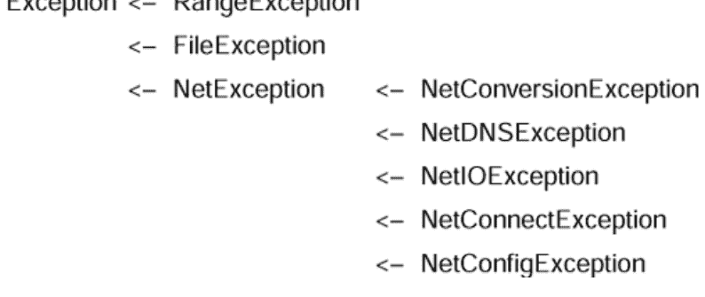

### 异常 (Exception) (基类)

构造函数:

```
Exception(SimpleString s);
```

通用描述: 带有 `SimpleString` 类型参数的通用异常消息。

方法:

| 方法 | 描述 |
| :--- | :--- |
| `const char* GetString()` | 获取字符串消息。 |

子类异常:

| 异常 | 描述 |
| :--- | :--- |
| `RangeException` | 任何范围异常。由 `MessageGroup` 类使用。 |
| `FileException` | 任何文件异常。由 `Socket` 类使用。 |

### NetException (类)

构造函数:

```
NetException(SimpleString s);
```

通用描述: 通用网络异常。

父类: `Exception`

子类异常:

| 异常 | 描述 |
| :--- | :--- |
| `NetConversionException` | 主机 (`inet_ntop`/`inet_pton`) 地址转换异常。由 `HostAddress` 类使用。 |
| `NetDNSException` | 无法解析主机名的异常。由 `HostAddress` 使用。 |
| `NetIOException` | `send()`/`recv()` 异常。由 `Socket` 使用。 |
| `NetConnectException` | 尝试使用 `bind()`、`connect()`、`listen()` 或 `accept()` 时发生的异常。由 `ServerSocket`、`ClientSocket` 和 `MessageGroup` 使用。 |
| `NetConfigException` | 尝试设置或获取套接字选项时发生的异常。由所有 `Socket` 类使用。 |

## C++ 支持类

本节描述了一些与框架相关的类，但它们比其他类库中的类更简单。您可以随意用标准 C++ 类库替换这些类。

### SimpleString (类)

构造函数:

```
SimpleString(const char* s);

SimpleString(const SimpleString& s);
```

通用描述: 非常简单的轻量级字符串类型。

方法:

| 方法 | 描述 |
| :--- | :--- |
| `operator+=(const char* s), operator+=(SimpleString& s)` | 将字符串追加到当前实例。 |
| `const char* GetString()` | 获取字符串消息。 |

抛出异常: (无)

### HostAddress (类)

构造函数:

```
HostAddress(const char* Name=0, ENetwork Network=eIPv4);

HostAddress(HostAddress& Address);
```

通用描述: 用于管理主机标识的类。

方法:

| 方法 | 描述 |
| :--- | :--- |
| `void SetPort(int Port)` | 设置端口号。 |
| `int GetPort(void) const` | 获取端口号。 |
| `ENetwork GetNetwork(void) const` | 获取网络类型。 |
| `struct sockaddr* GetAddress(void) const` | 获取实际的套接字地址。 |
| `int GetSize(void) const` | 获取套接字地址大小。 |
| `bool operator==(HostAddress& Address) const` | 比较是否相等。 |
| `bool operator!=(HostAddress& Address) const` | 比较是否不相等。 |
| `const char* GetHost(bool byName=1)` | 获取主机名。 |

抛出异常:
- `NetConversionException`
- `NetDNSException`

## C++ 消息类

该类别体系结构允许您定义能够自打包和自解包内部数据的类。虽然不如 Java 中的体系结构那么简单直接，但它的处理方式简单直接。

### Message (抽象类)

构造函数: (无)

通用描述: 用于创建特定消息以进行发送和接收的消息模式。

方法:

| 方法 | 描述 |
| :--- | :--- |
| `virtual char* Wrap(int& Bytes) const` | 对象打包接口。 |
| `bool Unwrap(char* package, int Bytes, int MsgNum)` | 对象解包接口。 |

抛出异常: (无)

### TextMessage (类)

构造函数: (无)

通用描述: 用于创建特定消息以进行发送和接收的消息模式。

父类: `Message`

方法:

| 方法 | 描述 |
| :--- | :--- |
| `operator+=(const char* str), operator+=(const TextMessage& s)` | 将新字符串赋值给对象。 |
| `operator#=(const char* str), operator#=(const TextMessage& s)` | 将字符串追加到对象。 |
| `const char* GetBuffer(void) const` | 获取文本。 |
| `char* Wrap(int& Bytes) const` | 封装对象以便发送。 |
| `bool Unwrap(char* package, int Bytes, int MsgNum)` | 解封装接收到的对象。 |
| `int GetSize(void) const` | 获取字符串长度。 |
| `void SetSize(int Bytes)` | 设置字符串长度。 |
| `int GetAvailable(void) const` | 获取缓冲区中可用的字节数。 |

抛出异常: (无)

## C++ 套接字类

该体系结构定义了构成套接字接口的类。它实际上包含五个可以实例化的不同类：`SocketServer`、`SocketClient`、`Datagram`、`Broadcast` 和 `MessageGroup`。您可以轻松地使用 OpenSSL 类（`SSLServer` 和 `SSLClient`）扩展此体系结构。


### Socket (基类)

构造函数:

```
Socket (void);

Socket (int sd);

Socket (ENetwork Network, EProtocol Protocol);

Socket (Socket& sock);
```


### Socket（类）

通用描述: 通用套接字类，不打算直接实例化。

方法:

| 方法 | 描述 |
| :--- | :--- |
| `void Bind (HostAddress& Addr)` | 将套接字绑定到端口/接口。 |
| `void CloseInput (void) const` | 关闭输入流。 |
| `void CloseOutput (void) const` | 关闭输出流。 |
| `int Send (Message& Msg, int Options=0) const` | 向连接站点发送消息。 |
| `int Send (HostAddress& Addr, Message& Msg, int Options=0) const` | 发送定向消息。 |
| `int Receive (Message& Msg, int Options=0) const` | 从连接接收消息。 |
| `int Receive (HostAddress& Addr, Message& Msg, int Options=0) const` | 接收定向消息。 |
| `void PermitRoute (bool Setting)` | 允许可路由数据包。 |
| `void KeepAlive (bool Setting)` | 保持连接活跃。 |
| `void ShareAddress (bool Setting)` | 共享端口/接口地址。 |
| `int GetReceiveSize (void); void SetReceiveSize (int Bytes)` | 获取/设置接收缓冲区大小。 |
| `int GetSendSize (void); void SetSendSize (int Bytes)` | 获取/设置发送缓冲区大小。 |
| `int GetMinReceive (void); void SetMinReceive (int Bytes)` | 获取/设置 `SIGIO` 接收信号的最小水位线。 |
| `int GetMinSend (void); void SetMinSend (int Bytes)` | 获取/设置 `SIGIO` 发送信号的最小水位线。 |
| `struct timeval GetReceiveTimeout (void); void SetReceiveTimeout (struct timeval& val)` | 获取/设置终止接收之前的超时时间。 |
| `struct timeval GetSendTimeout (void); void SetSendTimeout (struct timeval& val)` | 获取/设置终止发送之前的超时时间。 |
| `ENetwork GetType (void)` | 获取套接字类型（网络）。 |
| `virtual int GetTTL (void); virtual void SetTTL (int Hops)` | 获取/设置生存时间 (time-to-live)。 |
| `int GetError (void)` | 获取任何待处理错误。 |

抛出异常:
- `NetException`
- `FileException`
- `NetConnectException`
- `NetIOException`
- `NetConfigException`

### SocketStream (类)

构造函数:

```
SocketStream(void);

SocketStream(int sd);

SocketStream(ENetwork Network);

SocketStream(SocketStream& sock);
```

通用描述: 流式 (SOCK_STREAM) 套接字。

父类: `Socket`

方法:

| 方法 | 描述 |
| :--- | :--- |
| `int GetMaxSegmentSize(void); void SetMaxSegmentSize(short Bytes)` | 获取/设置分段大小 (MSS)。 |
| `void DontDelay(bool Setting)` | 启用/禁用 `Nagle` 算法。 |

抛出异常:
- `NetConfigException`

### SocketServer (类)

构造函数:

```
SocketServer(int port, ENetwork Network=eIPv4, int QLen=15);

SocketServer(HostAddress& Addr, int QLen=15);
```

通用描述: `TCP` 服务器。

父类: `SocketStream`

方法:

| 方法 | 描述 |
| :--- | :--- |
| `void Accept(void (*Servlet)(const Socket& Client))` | 接受连接并使用 `Socket` 句柄调用 `Servlet`。 |
| `void Accept(HostAddress& Addr, void (*Server)(const Socket& Client))` | 接受连接并捕获主机 ID。 |

抛出异常:
- `Exception`
- `NetConnectException`

### SocketClient (类)

构造函数:

```
SocketClient (ENetwork Network=eIPv4);

SocketClient(HostAddress& Host, ENetwork Network=eIPv4); //自动连接
```

通用描述: `TCP` 客户端。

父类: `SocketStream`

方法:

| 方法 | 描述 |
| :--- | :--- |
| `void Connect(HostAddress& Addr)` | 连接到 `Addr` 处的主机。 |

抛出异常:
- `NetConnectException`

### Datagram (类)

构造函数:

```
Datagram(HostAddress& Me, ENetwork Network=eIPv4, EProtocol Protocol=eDatagram);

Datagram(ENetwork Network=eIPv4, EProtocol Protocol=eDatagram);
```

通用描述: 通用数据报 (`UDP`) 套接字。

父类: `Socket`

方法:

| 方法 | 描述 |
| :--- | :--- |
| `void MinimizeDelay(bool Setting)` | 请求最小数据包延迟。 |
| `void MaximizeThroughput(bool Setting)` | 请求最大网络吞吐量。 |
| `void MaximizeReliability(bool Setting)` | 请求最大可靠性。 |
| `void MinimizeCost(bool Setting)` | 请求最小成本。 |
| `void PermitFragNegotiation(EFrag Setting)` | 设置分片协商。 |

### Broadcast（类）

构造函数:

```
Broadcast (HostAddress& Me);
```

通用描述：子网广播套接字。

父类：`Datagram`

方法：（无）

抛出异常：
- `NetConfigException`

### MessageGroup（类）

构造函数：

```
MessageGroup (HostAddress& Me, ENetwork Network=eIPv4);
```

通用描述：多播套接字。

父类：`Datagram`

方法：

| 方法 | 描述 |
| :--- | :--- |
| `Connect (HostAddress& Address);` | 连接到多播组地址。 |
| `void Join(HostAddress& Address, int IFIndex=0);` | 加入多播组。 |
| `void Drop(HostAddress& Address);` | 离开多播组。 |

抛出异常：
- `NetConfigException`
- `NetConnectException`
- `RangeException`

# Java 异常

本节描述 `Java` 程序在处理套接字时可能生成的所有相关异常。

图 `D.3`。`Java` 异常类层次结构。

### java.io.IOException（类）

构造函数：

```
IOException();

IOException(String msg);
```


# java.net.SocketException（类）

**通用描述**：输入和输出过程中的通用异常。

**父类**：`Exception`

**子异常**：

| 异常 | 描述 |
| :--- | :--- |
| `java.net.ProtocolException` | `Socket` 中的协议错误。 |
| `java.net.UnknownHostException` | 在 DNS 中未找到主机名。 |
| `java.net.UnknownServiceException` | 尝试使用不支持的服务。 |

**构造函数**：

```java
SocketException();

SocketException(String msg);
```

**通用描述**：尝试使用 `bind()`、`connect()`、`listen()` 或 `accept()` 时发生的异常。由 `ServerSocket`、`ClientSocket` 和 `MessageGroup` 使用。

**父类**：`IOException`

**子异常**：

| 异常 | 描述 |
| :--- | :--- |
| `java.net.BindException` | 无法绑定到地址/端口（通常是因为该端口已被其他进程使用）。 |
| `java.net.ConnectException` | 主机不可用、未找到、无响应，或指定端口上没有进程在监听。 |
| `java.net.NoRouteToHostException` | 无法建立到目的地的路由。 |

## Java 支持类

与 C++ 框架类似，Java 使用多个支持类来接口其套接字 API。本节仅描述与套接字直接相关的类。

## java.net.DatagramPacket（类）

**构造函数**：

```java
DatagramPacket(byte[] buf, int len);

DatagramPacket(byte[] buf, int len, InetAddress addr, int port);

DatagramPacket(byte[] buf, int Offset, int len);

DatagramPacket(byte[] buf, int Offset, int len, InetAddress addr, int port);
```

**通用描述**：用于接收和发送消息的基本消息载体。

**方法**：

| 声明 | 描述 |
| :--- | :--- |
| `InetAddress getAddress();` `void setAddress(InetAddress addr);` | 获取或设置数据报的源地址或目的地址。 |
| `byte[] getData();` `void setData(byte[] buf);` `void setData(byte[] buf, int offset, int len);` | 获取或设置消息数据。 |
| `int getLength();` `void setLength(int length);` | 获取或设置消息数据长度。 |
| `int getOffset();` | 获取要发送或接收的数据的偏移量。 |
| `int getPort();` `void setPort(int port);` | 获取或设置数据报的源端口或目的端口。 |

**抛出异常**：（无）

## java.net.InetAddress（类）

**构造函数**：（无）

**通用描述**：互联网地址套接字。此类没有构造函数。相反，请使用其中一个静态方法。

**静态方法**：

| 声明 | 描述 |
| :--- | :--- |
| `InetAddress getByName(String host);` | 返回 `host` 的 `InetAddress`。 |
| `InetAddress getAllByName(String host);` | 返回 `host` 的所有 `InetAddresses`。 |
| `InetAddress getLocalHost();` | 获取本地主机 IP 地址。 |

**方法**：

| 声明 | 描述 |
| :--- | :--- |
| `String getHostAddress();` | 获取数字地址。 |
| `byte[] getAddress();` | 获取二进制地址。 |
| `boolean isMulticastAddress();` | 检查地址是否处于多播范围内。 |
| `String getHostName();` | 获取主机的实际名称。 |

**抛出异常**：
- `UnknownHostException`

## Java I/O 类

Java 拥有一套出色的类，用于处理各种 I/O。不幸的是，它们并不直观，将它们连接在一起类似于玩拼图。请阅读**第 12 章**，**“使用 Java 网络 API”**，了解如何将这些部件互锁成有用的流的更多信息。


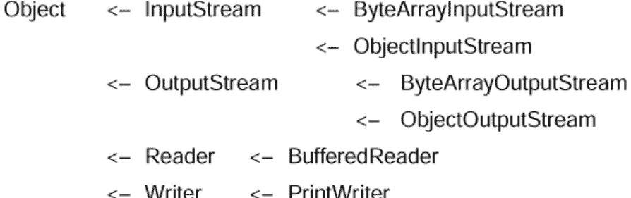

## java.io.InputStream（抽象类）

**构造函数**：

```java
InputStream();
```

**通用描述**：基本流输入的通用类。

**父类**：`Object`

**方法**：

| 声明 | 描述 |
| :--- | :--- |
| `int available();` | 返回在不阻塞的情况下可读的字节数。 |
| `void close();` | 关闭通道。 |
| `void mark(int readlimit);` | 为 `mark()` 和 `reset()` 设置缓冲的最大字节数。 |
| `boolean markSupported();` | 检查流是否支持 `mark()`/`reset()`。 |
| `int read();` | 从流中读取单个字节。 |
| `int read(byte[] arr);` | 将字节数组读取到 `arr` 中。 |
| `int read(byte[] arr, int offset, int length);` | 从 `offset` 开始将 `length` 个字节的字节数组读取到 `arr` 中。 |
| `void reset();` | 返回到最后一个标记位置。 |
| `long skip(long n);` | 在流中向前跳过 `n` 个字节。 |

**抛出异常**：
- `IOException`

## java.io.ByteArrayInputStream（类）

**构造函数**：

```java
ByteArrayInputStream(byte[] buf);

ByteArrayInputStream(byte[] buf, int offset, int length);
```

**通用描述**：允许你从字节数组创建虚拟输入流。有时你会获得一块数据（例如来自 `DatagramSocket`）；此类扮演流式传输该信息的角色。

**父类**：`InputStream`

**方法**：（无；许多来自 `InputStream` 的 overridden 方法）

**抛出异常**：（无）

## java.io.ObjectInputStream（类）

**构造函数**：

```java
ObjectInputStream(InputStream o);
```


通用描述：使用此类，你读取传输或存储的对象。你使用`InputStream`（在`Socket`类中可用）创建此对象。

父类：`InputStream`

方法：

| 声明 | 描述 |
| :--- | :--- |
| `int available();` | 返回在不阻塞的情况下可读的字节数。 |
| `void close();` | 关闭此通道。 |
| `void defaultReadObject();` | 从此流中读取当前类的非静态和非瞬态字段。 |
| `int read();` <br> `int read(byte[] arr, int offset, int len);` <br> `void readFully(byte[] arr);` <br> `void readFully(byte[] arr, int offset, int len);` | 读取一个字节或从`offset`开始读取`len`个字节组成的字节数组。`readFully()`读取所有字节以填充数组，必要时阻塞。 |
| `boolean readBoolean();` <br> `byte readByte();` <br> `char readChar();` <br> `double readDouble();` <br> `float readFloat();` <br> `int readInt();` <br> `long readLong();` <br> `short readShort();` <br> `int readUnsignedByte();` <br> `int readUnsignedShort();` | 读取指定类型。 |
| `String readUTF();` <br> `Object readObject();` | 读取`Object`实例。你可以发现其类型，然后使用强制转换运算符稍后将其转换。 |

抛出异常：
- `IOException`
- `ClassNotFoundException`
- `NotActiveException`
- `OptionalDataException`
- `InvalidObjectException`
- `SecurityException`
- `StreamCorruptedException`

## java.io.OutputStream（抽象类）

构造函数：

```java
OutputStream();
```

通用描述：基本流输入的通用类。

父类：`Object`

方法：

| 声明 | 描述 |
| :--- | :--- |
| `void close();` | 关闭通道。 |
| `void flush();` | 将缓冲区中写入的数据刷新。 |
| `void write(byte b);` | 向流写入单个字节。 |
| `void write(byte[] arr);` | 向流写入字节数组(`arr`)。 |
| `void write(byte[] arr, int offset, int len);` | 从`offset`开始向流写入`len`个字节组成的字节数组(`arr`)。 |

抛出异常：
- `IOException`

## java.io.ByteArrayOutputStream（类）

构造函数：

```java
ByteArrayOutputStream();
ByteArrayOutputStream(int size);
```

通用描述：允许你将数据流式传输到字节数组中。像`DatagramSocket`这样的类只处理数据块；此类扮演流式传输信息的角色。

父类：`OutputStream`

方法：

| 声明 | 描述 |
| :--- | :--- |
| `void reset();` | 清空缓冲区并清空数组。 |
| `int write(byte[] arr, int offset, int len);` | 从`offset`开始向流写入`len`个字节组成的字节数组(`arr`)。 |
| `byte[] toArray();` | 返回流式数据的数组。 |
| `int size();` | 返回缓冲区的当前大小。 |
| `String toString(String encoder);` | 创建字符串，使用`encoder`转译字符。 |
| `void write(int b);` | 向流写入单个字节。 |
| `void write(OutputStream o);` | 通过`OutputStream`发送数据数组。 |

抛出异常：（无）

## java.io.ObjectOutputStream（类）

构造函数：

```java
ObjectOutputStream(OutputStream o);
```


通用描述：使用此类，你传输或存储对象。你使用 `OutputStream`（在 `Socket` 类中可用）创建此对象。

父类：`OutputStream`

方法：

| 声明 | 描述 |
| :--- | :--- |
| `void close();` | 关闭此通道。 |
| `void defaultWriteObject();` | 将当前类的非静态和非瞬态字段写入此流。 <br>你只能在序列化过程中在 `writeObject()` 方法内调用此方法。 |
| `void flush();` | 将缓冲区中写入的数据刷新。 |
| `void reset();` | 丢弃写入流的信息。 |

## 方法

| 方法 | 描述 |
| :--- | :--- |
| `void useProtocolVersion(int version);` | 强制使用早期的序列化版本。 |
| `void write(byte b); int write(byte[] arr); int write(byte[] arr, int offset, int len);` | 写入一个字节或从 `offset` 开始、长度为 `len` 的字节数组。 |
| `void writeBoolean(boolean b); void writeByte(byte b); void writeBytes(String s); void writeChar(int c); void writeChars(String s); void writeDouble(double d); void writeFloat(float f); void writeInt(int i); void writeLong(long l); void writeShort(int us);` | 写入指定类型的数据。 |
| `void writeUTF(String s); int writeFields();` | 将缓冲区中的字段写入流。 |
| `void writeObject(Object o);` | 写入 `Object` 实例。 |

**抛出的异常：**

- `IOException`
- `SecurityException`

## java.io.BufferedReader (类)

**构造函数：**

- `BufferedReader(Reader in)`
- `BufferedReader(Reader in, int size)`

**一般描述：** 保持缓冲区以提高性能。进行一些类型转换以识别行。`size` 指定输入缓冲区的大小。

**父类：** `Reader`

**方法：**

| 方法 | 描述 |
| :--- | :--- |
| `void close();` | 关闭通道。 |
| `void mark(int readlimit);` | 设置用于 `mark()` 和 `reset()` 的最大缓冲字节数。 |
| `boolean markSupported();` | 检查流是否支持 `mark()`/`reset()`。 |
| `int read();` | 从流中读取单个字节。 |
| `int read(byte[] arr, int offset, int length);` | 从 `offset` 开始读取 `length` 个字节到字节数组 `arr` 中。 |
| `String readLine();` | 读取直到换行符并返回 `String`。 |
| `boolean ready();` | 如果准备好读取，则返回 `true`。 |
| `void reset();` | 返回到上次标记的位置。 |
| `long skip(long n);` | 在流中向前跳过 `n` 个字节。 |

**抛出的异常：**

- `IOException`

## java.io.PrintWriter (类)

**构造函数：**

- `PrintWriter(Writer out)`
- `PrintWriter(Writer out, boolean autoFlush)`
- `PrintWriter(OutputStream out)`
- `PrintWriter(OutputStream out, boolean autoFlush)`

**一般描述：** 将数据类型转换为可读文本进行转换。`autoFlush` 标志强制在程序调用 `println()` 时刷新。

**父类：** `Writer`

**方法：**

| 方法 | 描述 |
| :--- | :--- |
| `boolean checkError();` | 刷新流并检查是否有任何错误。 |
| `void close();` | 关闭此通道。 |
| `void defaultWriteObject();` | 将当前类的非静态和非临时字段写入此流。只能在序列化期间在 `writeObject()` 方法内调用此方法。 |
| `void flush();` | 从缓冲区刷新已写入的数据。 |
| `void reset();` | 丢弃写入流的信息。 |
| `void write(byte b); int write(byte[] arr); int write(byte[] arr, int offset, int len);` | 写入一个字节或从 `offset` 开始、长度为 `len` 的字节数组。 |
| `void print(boolean b); void print(char c); void print(char[] s); void print(double d); void print(float f); void print(int i); void print(long l); void print(Object obj); void print(String s);` | 打印指定类型的数据。`Object` 类型使用 `String.valueOf()` 方法转换数据。 |
| `void println(); void println(boolean b); void println(char c); void println(char[] s); void println(double d); void println(float f); void println(int i); void println(long l); void println(Object obj); void println(String s);` | 打印指定类型的数据并以换行符终止行。如果启用了 `autoFlush`，则刷新流。 |
| `void write(int b);` | 向流写入单个字节。 |
| `int write(char[] cbuf);` | 将字符数组 (`cbuf`) 写入流。 |
| `int write(char[] cbuf, int off, int len);` | 从 `off` 开始将字符数组 (`cbuf`) 写入流，长度为 `len`。 |
| `int write(String s);` | 将字符串写入流。 |
| `int write(String s, int off, int len);` | 从 `off` 开始将字符串写入流，长度为 `len`。 |

**抛出的异常：**

- `IOException`
- `SecurityException`

## Java Socket 类

`Java` `Socket` API 支持四种基本的 `IPv4` 类：`Socket`、`ServerSocket`、`DatagramSocket` 和 `MulticastSocket`。本节描述了这些类的接口。


### java.net.Socket (类)

**构造函数：**

- `Socket(String host, int port)`
- `Socket(InetAddress address, int port)`
- `Socket(String host, int port, InetAddress localAddr, int localPort)`
- `Socket(InetAddress address, int port, InetAddress localAddr, int localPort)`

**一般描述：** 这是所有网络流量的基本通信接口 (`TCP`)。

**父类：** `Object`

**方法：**

| 方法 | 描述 |
| :--- | :--- |
| `void close();` | 关闭套接字。 |
| `InetAddress getInetAddress();` | 获取对端的主机地址。 |
| `InputStream getInputStream();` | 获取用于接收消息的 `InputStream`。 |
| `boolean getKeepAlive(); void setKeepAlive(boolean on);` | 保持连接活动。 |
| `InetAddress getLocalAddress();` | 获取套接字连接到的本地地址。 |
| `int getLocalPort();` | 获取本地端口。 |
| `OutputStream getOutputStream();` | 获取用于发送消息的 `OutputStream`。 |
| `int getPort();` | 获取对端的端口号。 |
| `int getReceiveBufferSize(); void setReceiveBufferSize(int size);` | 获取/设置接收缓冲区的大小。 |
| `int getSendBufferSize(); void setSendBufferSize(int size);` | 获取/设置发送缓冲区的大小。 |
| `int getSoLinger(); void setSoLinger(boolean on, int linger);` | 获取/设置套接字滞留时间（以秒为单位）。 |
| `int getSoTimeout(); void setSoTimeout(int timeout);` | 获取/设置 `I/O` 超时。如果启用，读取管道将在指定时间后中止。 |
| `boolean getTcpNoDelay(); void setTcpNoDelay(boolean on);` | 启用/禁用 `Nagle` 算法，该算法决定了发送信息的过程。如果禁用，计算机将在收到任何确认之前发送数据。 |
| `void shutdownInput();` | 关闭输入通道。 |
| `void shutdownOutput();` | 关闭输出通道。 |

**抛出的异常：**

- `IOException`
- `SocketException`

### java.net.ServerSocket (类)

**构造函数：**

- `ServerSocket(int port)`
- `ServerSocket(int port, int backlog)`
- `ServerSocket(int port, int backlog, InetAddress bindAddr)`

**一般描述：** 此专用 `TCP` 套接字创建监听服务器套接字。

**父类：** `Object`

**静态方法：**

| 方法 | 描述 |
| :--- | :--- |
| `static void setSocketFactory(SocketImplFactory fac);` | 设置 `Socket` 实现工厂。 |

**方法：**

| 方法 | 描述 |
| :--- | :--- |
| `Socket accept();` | 接受客户端连接并返回一个 `Socket`。 |
| `void close();` | 关闭套接字。 |
| `InetAddress getInetAddress();` | 获取套接字连接到的本地地址。 |
| `int getLocalPort();` | 获取本地端口。 |
| `int getSoTimeout(); void setSoTimeout(int timeout);` | 获取/设置 `I/O` 超时。如果启用，读取管道将在指定时间后中止。 |

**抛出的异常：**

- `IOException`
- `SocketException`

### java.net.DatagramSocket (类)

**构造函数：**

- `DatagramSocket()`
- `DatagramSocket(int port)`
- `DatagramSocket(int port, InetAddress bindAddr)`

**一般描述：** 这是用于消息传递的通用数据报 (`UDP`) 套接字。

**父类：** `Object`

**方法：**

| 方法 | 描述 |
| :--- | :--- |
| `void close();` | 关闭套接字。 |
| `void connect(InetAddress addr, int port);` | 连接对端以进行隐式发送。 |
| `void disconnect();` | 断开已连接的对端。 |
| `InetAddress getInetAddress();` | 获取对端的主机地址。 |
| `InetAddress getLocalAddress();` | 获取套接字连接到的本地地址。 |
| `int getLocalPort();` | 获取本地端口。 |
| `int getPort();` | 获取对端的端口号。 |
| `int getReceiveBufferSize(); void setReceiveBufferSize(int size);` | 获取/设置接收缓冲区的大小。 |
| `int getSendBufferSize(); void setSendBufferSize(int size);` | 获取/设置发送缓冲区的大小。 |
| `int getSoTimeout(); void setSoTimeout(int timeout);` | 获取/设置 `I/O` 超时。如果启用，读取管道将在指定时间后中止。 |
| `void receive(DatagramPacket p);` | 接收消息。 |
| `void send(DatagramPacket p);` | 发送消息。 |

**抛出的异常：**

- `IOException`
- `SocketException`

### java.net.MulticastSocket (类)

**构造函数：**

- `MulticastSocket()`
- `MulticastSocket(int port)`

**一般描述：** 这是用于非连接消息的通用数据报 (`UDP`) 套接字。

**父类：** `DatagramSocket`

**方法：**

| 方法 | 描述 |
| :--- | :--- |
| `InetAddress getInterface(); void setInterface(InetAddress addr);` | 获取/设置套接字连接到的本地地址。 |
| `int getTimeToLive(); void setTimeToLive(int TTL);` | 获取/设置每个消息的生存时间。 |
| `void joinGroup(InetAddress addr);` | 加入多播组。 |
| `void leaveGroup(InetAddress addr);` | 离开多播组。 |
| `void send(DatagramPacket p, int TTL);` | 发送具有特定 `TTL` 的消息。 |

## 抛出的异常：

- 输入/输出异常
- 套接字异常
