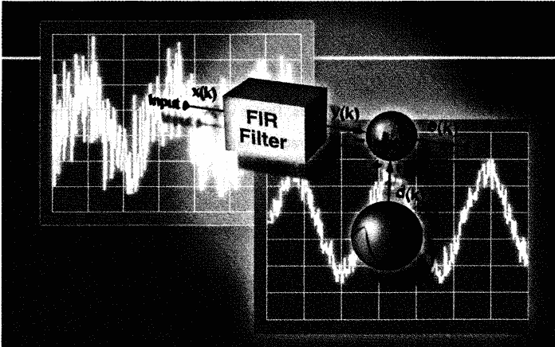

# Linux、软件无线电与业余无线电

软件无线电技术如何让业余无线电实验焕发生机。长期以来，人们一直关注软件无线电（SDR）和业余无线电实验对社区人口的影响，以及对业余无线电业务（ARS）监管地位的可能影响。电子技术的进步最初由业余无线电背景的人引领，它们带来的技术受限于大多数没有专业背景的人员的硬件实现能力。本文标题的灵感源于James Kosten在50年前发表的一篇文章，在文中John发现单边带（SSB）的广泛使用导致高频（HF）设备制作的快速衰减，并对ARS产生了更具负面的影响。本文的观点是：一种利用软件无线电技术为ARS建立良好的连接策略，对于扭转实验明显的衰减趋势具有积极影响，甚至可能为业余无线电带来一个更年轻、受实验驱动的新兴群体。

## 什么是软件无线电？

软件无线电是指通过数字硬件上的数字控制来实现一个或多个收发机的设备。软件无线电使用数字信号处理（DSP）对无线电内部的信号进行滤波、调制和解调。DSP还能完成模拟无线电难以或无法实现的功能。然而，软件无线电与计算机革命密切相关，因为这些无线电的设计和实现利用了引起当今年轻一代兴趣的专业技能。

该无线电实现了一个带有DSP的2米波收发机，并开放源代码供用户进行修改。由于个人电脑同时使用硬件和软件，并且可以通过添加或修改软件来对其修改，因此软件无线电在引入新的或修改过的软件后，可以在其硬件限制范围内获得新功能。不再需要旧的电烙铁了？

在软件无线电的新世界里，实验将涉及编写软件发射器或接收器函数、修改现有软件以进行“微调”，或者阅读新程序、遵循它并进行空中测试。相信这种类型的实验可以激发人们对火腿无线电的新兴趣，并培养在当今社会中非常有价值的技能。

DSP-10米收发机由Bob Larkin（WTPUA）开发，已由图森森数据包无线电（TAPR）组织以套件形式提供。

## 软件无线电面临的障碍

虽然ICC小组展示了火腿无线电技术的一些创新，但注意此处并非如此，FCC的规则似乎允许软件产品的使用和销售。德州仪器（TI）之前的意图显示了这一政策的执行。主要的障碍似乎是业余无线电社区对制作允许用户使用软件接口的无线电缺乏兴趣。

检查顶级收发机的广告会发现，许多设备都带有计算机，其中许多设备带有DSP。那么以前使用的“机械交互”一词又是怎么解释？现在的接口可以像计算机一样容易改变——比如转动旋钮。它们并不能让你轻松地重写任何软件。

考虑以下示例：传统无线电和软件无线电通常都带有各种波段的滤波器。传统无线电必须为每个波段调整谐振器。而在软件无线电中，则使用数学算法并通过一组变量来滤波频率、带宽和形状。据我所知，今天没有哪个火腿制造商允许用户更改任何型号的这些功能，允许用户使用修改接口而不是硬件。

## ARRL在软件方面的积极作用

2002年初，ARRL启动了一个软件定义工作组，以推动Mike所说的某些事项的发展。该工作组由Bob Larkin、Leif Asbrik（SMSBSZ）、Gary Baour（ACQ）、Paul Rinardi、Gerald Younglund和Mike领导。我们于2002年6月在ARRL技术简报上提交了第一份报告。你可以在网上找到更多信息：http://www.arl.org/announce.html。

诚然，如今与硬件相比，Mike建议的某些事情可能需要很长时间才能实现。这并没有阻止实验，至少有四个工作组取得了进展。来自火腿世界其他地方的人也开发了他们认为非常有用的软件，我们将观察年底会发生什么。

一些火腿收发机已经了通过套件更新软件的能力（Kenwood, Ten-Ele）；然而，用户无法获得源代码来编写自己的嵌入软件。支持方面的问题仍然存在，因为我可以负责任地说，此类软件——通常用原生语言汇编编写——即使尽最大努力，也很难进行编程和编辑。这就是软件收发机与传统设备的不同之处。

考虑一种具有高频接口的无线电，它可以将信号传递到外部软件的样本。这样，软件开发就可以在方便平台上进行，例如为了方便访问而使用个人电脑，如下文列出的某些文章所示。

此外，可以构建出DSP软件，它比他们喜欢的任何无线电都更易使用，将所有沉重的计算留到无线电内部。灵活性是游戏规则。

预计当前的工作进展将引发一些现实检查——即实现和硬件方面的衰减。

ARRL火腿市场需要一种新型火腿。

然而，知识产权论点并没有解释如何将滤波器内容加载到任何现有无线电中。滤波不是写程序；只是下载一个滤波器供程序使用。对此的解释将在剩余章节中随后说明。

制造商表达的第二个担忧是用户支持问题。由于用户支持和营销部门规模较小，支持是有限的。

我与一些火腿制造商讨论过将软件无线电用于ARS。一些收发机在概念上保留了这些功能，但另一些人表示，软件开发将需要用户访问制造商的专有财产。

制造商可能对产品中特定功能的知识产权存在法律担忧；例如下变频器、解调器和无线电的整体架构。人们好奇，他们是否认为这种知识产权观点是为了在软件更改后维持或略微提高性能。

在反复阅读本文后，整个火腿社区都会思考重振ARS可能扭转趋势并取得成功。你会从火腿小组购买软件包，并由为ARS手工艺提供用户支持的火腿提供吗？

第三点是，火腿对开发和维护此类无线电的软件不感兴趣。我通过指出记录良好的DSP10米无线电来回应这一点。访问 www.gnu.org/gnuradio.html 获取更多信息。

你可能好奇为什么文中提到了Linux。GNU是由自由基金会赞助的自由软件项目，是目前的操作系统之一。无线电本身不是收发机。但对于软件定义无线电的原则已经建立。

制造商过去没有关注更传统的操作系统。许多人现在接受Linux作为个人电脑的可行选择。也许制造商也有类似的担忧，特别是消费者对未来持怀疑态度时。火腿与爱好者社区之间的交流可能会带来互利。

