# Linux+ 学习指南：考试 XKO 001 (附 CD-ROM)

# 致亲爱的读者：

Sybex 荣幸能担任 CompTIA Linux+ 顾问委员会的成员。正如 CompTIA 致力于为未来支持 Linux 系统的人员建立可衡量的认证标准，Sybex 也致力于为这些人提供提供满足这些标准所需的技能。通过与 CompTIA 合作，并结合 Linux+ 社区的其他优秀成员，我们的愿望是帮助弥补目前行业前沿的知识和技能差距。

Sybex 预计 Linux+ 程序将受到寻求合格技术人员的公司和 IT 培训社区的欢迎。凭借 CompTIA 现有包括 A+, Network+, Server+ 和 i-Net 在内的系列厂商中立认证，Linux+ 认证在未来几年将证明是一项无价的资产。

我们的作者和编辑付出了巨大努力，确保本 Linux+ 学习指南是详尽、深入且符合教学逻辑的。我们相信，这本书将满足并超过认证市场的严苛标准，并帮助作为 Linux+ 考生的你在努力中取得成功。

祝您追求 Linux+ 认证之路好运！

Neil Edde

副主编—认证

Sybex, Inc.

SYBEX Inc.

客户服务部

1151 Marina Village Parkway

Alameda, CA 94501

(510) 523-8233

传真 (510) 523-2337

电子邮件：it@syex.com

WEB://WWW.SYBEX.COM

www.syex.com

> 纪念道格拉斯·亚当斯（1952–2001）。再见，感谢带来所有的欢笑。

# 致谢

一本书的诞生并非凭空而就。从项目构思到产品完成的每一个环节，除了作者之外，许多人也发挥了影响。收购与开发编辑 Elizabeth Hurley 引导了书籍的开发，特别是关键的前几章。制作编辑 Shannon Murphy 协调了许多位为书籍贡献思想的人员的工作。编辑 Rebecca Rider 提供了建议以保持文笔的可读性。技术编辑团队仔细审查了文本，以确保其没有技术性错误，并确保涵盖范围的完整。此外，我还要感谢此书的校对员 Emily Hsuan、Nelson Kim、Laurie O'Connell、Yariv Rabinovitch 和 Suzanne Stein；电子出版专家 Nila Nichols；以及 Sybex 的整个 CD 团队，他们共同生产了最终产品。我还想感谢 Studio B 的 Neil Salkind；作为我的经纪人，他帮助我联系到 Sybex 并编写了这本书。

## 引言

为什么要学习 Linux？它是一个增长快速的操作系统，而且廉价且灵活。Linux 还是中小型服务器领域的主角，对于工作站和桌面使用来说，它也是一个日益可行的平台。了解 Linux 将提高你在职场中的竞争力。即使你已经熟悉 Windows 或 macOS，且你的雇主专门使用这些系统，在寻找新工作或寻求晋升时，Linux 也会带给你优势。例如，这些知识将使你能够就何时以及如何部署 Linux 做出明智的决策。

计算机技术行业协会（CompTIA）开发了 Linux+ 考试，作为希望进入涉及 Linux 相关职业的人士的入门认证。该考试旨在证明个人具备安装、操作和排错 Linux 系统的技能，并熟悉 Linux 特有的概念和基础硬件。

本书书的目的是帮助你通过 Linux+ 考试。由于该考试涵盖了 Linux 的安装、使用、配置、管理和硬件交互，这些都是书中重点介绍的主题。你将学到足够的知识来让 Linux 系统运行起来，并学习如何针对许多任务对其进行配置。即使在参加并通过 Linux+ 考试之后，这本书仍然是一份非常有用的参考书。

# 什么是 Linux？

Linux 是 Unix 操作系统的克隆，多年来在学术界和许多商业环境中广受欢迎。Linux 曾仅用于大型主机，但现在可以运行在小型计算机上——而这些小型计算机的性能实际上比几年前的主机要强大得多。由于其起源，Unix（以及 Linux）具有良好的扩展性，能够胜任如今严苛的科学、工程和网络服务器任务。

Linux 由一个内核（核心软件）以及许多依赖内核来提供用户交互功能的库和工具程序组成。该操作系统以多种不同的发行版形式存在，这些发行版是基于特定内核并带有特定支持程序的借用版本。这些概念将在第 1-3 章中进行更详细的讨论。

# 为什么要获得 Linux+ 认证？

获得 Linux+ 认证有几个充分理由。CompTIA 候选人信息包列出了五大主要优势：

- **证明专业成就**：认证正迅速成为计算机服务行业中地位的象征。包括计算机服务行业成员在内的机构正在认可如 Linux 或 A+ 等认证的益处。各机构正推动其成员获得认证。每天都有越来越多的人在名片上加上 CompTIA 的官方标志。
- **增加你的市场竞争力**：Linux+ 认证使个人对潜在雇主更具吸引力。此外，获得 Linux+ 认证的员工可能会获得更高的薪水，因为员工不需要在特定供应商培训上花费大量资金。
- **提供晋升机会**：大多数加薪和晋升都是基于表现的。Linux+ 认证员工工作更快、更高效。员工生产力越高，为公司赚的钱就越多。当然，他们赚的钱越多，对对的价值就越高。因此，如果员工拥有 Linux+ 认证，他们晋升的机会也会随之增加。
- **满足培训需求**：每年都有越来越多的硬件供应商（包括但不限于 IBM、惠尔士-帕科德和 Compaq）将 CompTIA 认证作为其各自认证计划的先决条件。使用 Linux+ 这类侧边认证具有降低员工成本的额外好处。随着越来越多的小公司部署 Linux 这一灵活且廉价的操作系统，对经验丰富用户的需求日益增长。CompTIA 预见 Linux+ 考试将发现自己也同样被整合到各种认证计划中。
- **增强客户信心**：随着 IT 社区、小企业主和大众越来越熟悉“Linux+ 认证人士”这一称号，他们中更多人将意识到相比非认证人员，Linux+ 专业人士更有资格胜任他们的 Linux 环境。

# 如何获得 Linux+ 认证

Linux+ 认证面向任何通过测试的人。你不需要在特定的公司工作。它不是一个秘密社。但它确实是一个精英群体。

考试由 Prometric 管理，可以在任何 Prometric 考试中心参加。如果你通过了，你将收到来自 CompTIA 的邮寄证书，证明你已通过考试，你还将收到一枚胸针和名片。

# 谁应该买这本书

Linux+ 认证面向任何通过测试的人。你不需要在特定的公司工作。它不是一个秘密社。它确实是一个精英群体。

考试由 Prometric 管理，可以在任何 Prometric 考试中心参加。如果你通过了，你将收到来自 CompTIA 的邮寄证书，证明你已通过考试，你还将收到一枚胸针和名片。

# 本书的结构

本书由九章组成，加上补充信息：术语表、引言以及引言后的评估测试。章节安排如下：

- 第 1 章“实施规划”涵盖了在计算机上安装 Linux 之前应该考虑的事项。本章将 Linux 与操作系统进行对比，讨论了 Linux 的硬件要求和磁盘分区要求，描述了各种 Linux 发行版，并探讨了 Linux 世界中的许可证。
- 第 2 章“安装 Linux”涵盖了 Linux 安装过程。由于 Linux 有多种变体形式，本章专注于其中一种（Linux Mandrake 8.0），但其他 Linux 发行版必须执行相同的各种任务，因此大部分信息可以直接适用于其他发行版。本章还涵盖了一个关键的 Linux 组件的安装后配置：X Window 系统（简称 X），它提供了 Linux 的 GUI 环境。
- 第 3 章“软件管理”涵盖了如何安装和配置软件。大部分内容致力于 Linux 中两个主要的包管理系统：红色软件包管理器 (`RPM`) 和 Debian 包。本章还涵盖了内核问题和引导程序（用于启动 Linux 内核）。
- 第 4 章“用户与安全”涵盖了如何创建和维护用户账户；还涵盖了围绕用户和 Linux 安全问题。由于 Linux 是 Unix 的克隆，它包含了丰富的多用户支持，理解 Linux 用户账户模型对于 Linux 操作的许多方面至关重要。
- 第 5 章“网络”涵盖了如何在网络上使用 Linux。本章包含了对什么是网络的概述，包括构建互联网的流行的 TCP/IP 网络工具。本章讨论了若干 Linux 网络客户端程序，以及如何控制访问 Linux 计算机的主题。

## 引言 xxvii

- 第 6 章“管理文件与和服务”涵盖了许多重要的 Linux 配置文件以及一些杂的管理任务，例如你应该如何使用 GUI 环境以及如何编写和恢复 Shell 脚本。这些内容中的大部分并不非常华丽，但如果你想保持系统正常运行，了解它们是至关重要的。
- 第 7 章“管理分区与进程”涵盖了两个方面：文件系统（磁盘分区及其包含的数据）和进程（运行中的程序）。具体主题包括如何创建和管理文件系统、如何备份和恢复计算机、如何按计划时间运行程序，以及如何操作进程。
- 第 8 章“硬件问题”涵盖了各种硬件主题。这包括配置打印机、使用内核模块（用于硬件设备）、添加新硬件、使用笔记本电脑以及诊断硬件问题。这些问题中的某些与其他操作系统相同，但 Linux 处理某些硬件设备的方式与许多其他操作系统有根本性的不同。
- 第 9 章“故障排除”专门解决当出现出现问题时该怎么办的问题。本章包含了关于如何将问题范围缩小到可管理范围的信息，并就当你看到许多复杂症状时该如何处理提供了建议。

每个章节的开头都列出了该章节涵盖的 CompTIA Linux 目标。（本书未涵盖 CompTIA 列表，所以当你发现序列中的缺失时，不要惊讶。）在每个章节的末尾，有几个元素供你准备考试：

**考试要点（Exam Essentials）** 本章总结了章节中涵盖的重要信息。你应该能够执行每项任务或查询请求的信息。

**本章命令（Commands in This Chapter）** 大多数章节包含了对 Linux 命令的讨论。（第 1 章是例外。）在参加考试之前，你应该熟悉这些命令。你可能不需要知道每个命令的每一个选项，但你应该知道该命令的作用并熟悉其主要选项。（第 3 章开始了关于如何在 Linux 命令行 shell 中执行基本任务的讨论。）

**关键术语（Key Terms）** 关键术语在全文中以斜体表示。它们是在你考试之前应该熟悉的重要术语。术表（Glossary）提供了所有关键术语的定义。它们在首次被详细讨论的正文中也给出了定义。

**复习题（Review Questions）** 每个章节都以二十个问题结束。你应该回答这些问题，并与后面提供的答案进行比对。如果你不能正确回答至少 80% 的问题，请回去复习该章节，或者至少复习那些你感到困难的部分。

书中的复习题、评估测试以及包含的其他测试元素并非源自 CompTIA Linux+ 考试，因此不要背诵这些问题的答案，并假设这样做就能让你通过 Linux 考试。你将像书中文字描述的那样学习底层主题。这将让你能够回答书中提供的问题并并通过考试。学习底层主题也是在工作中对你最有帮助的方法——这也是像 Linux 这样的认证的终极目标。

为了充分利用本书的价值，你应该从头到尾阅读每个章节，并通过章节末尾的元素检查你的记忆和理解。即使你已经熟悉某个主题，也应该浏览一下该章节；Linux 足够复杂，通常有多种方法可以完成任务，所以即使你已经在某个领域很精通，也可能学到一些东西。

## 赠送 CD-ROM 内容

本书附带一张 CD-ROM，其中包含了本书的功能和若干额外的元素。CD-ROM 上的可用项目包括：

**PDF 格式的书籍内容（Book contents as a PDF file）** 全书以 Adobe 便携式文档格式（PDF；又称 Acrobat）文件提供。这允许你在旅途中携带书籍，或使用 PDF 阅读器的搜索功能来查找你记得读过但无法准确找到的单词或短语。

**电子“闪闪卡”（Electronic “flashcards”）** CD-ROM 包含 150 个“闪闪卡”格式的问题（一个问题后跟一个唯一的正确答案）。你可以用它来复习对 Linux+ 考试目标的知识。

**样本测试（Sample Tests）** 书中的所有问题都出现在 CD-ROM 上——包括本引言末后的 30 题评估测试，以及由每个章节九部分每部分二十题复习题组成的 180 个问题。此外，还有两个 65 题的额外考试。

你可以使用 Adobe Acrobat 等 PDF 阅读器或 Linux 中任何基于 Ghostscript 的查看器来读取 CD-ROM 上的 PDF 文件。样本测试使用 Java applet，它可以在 Linux、Windows 或或其他操作系统的启用 Java 的 Web 中运行。在 CD-ROM 的测试引擎目录下寻找名为 `.htn` 的文件，并在文件管理器中双击它，或者在你的 Web 浏览器中使用文件选择器加载它。如果你需要从 Linux 访问这些文件，第 7 章“管理分区与进程”讨论了挂载磁盘（包括 CD-ROM）。

## 本书规范（Conventions Used in This Book）

本书使用了某些排版样式帮助你识别信息。特别是：

- *斜体（Italized）*表示关键术语
- *等宽字体（Monospaced font）*用于文件名
- *斜体等宽字体（Italicized monospaced text）*表示变量或命令
- **粗体等宽字体（Bold monospaced font）**用于突出重要信息

除了这些适用于单个单词的规范外，还有几个：

- **注意（Note）**表示有用或有趣但与主要讨论较次要的信息。
- **提示（Tip）**提供可以节省你时间或避免沮丧的信息，这些可能并不完全显而易见。
- **警告（Warning）** 描述潜在的陷阱或危险。如果你忽视警告，可能会花费大量时间修复错误，甚至可能需要从头恢复整个系统。

侧边栏（Sidebar）类似于注意但长度更长。通常，注意的长度在一个段以内，而侧边栏则更长。侧边栏中的信息是有用的，但不符合正文的流。

## 真实世界场景（Real World Scenario）

真实世界场景是一种侧边栏类型，描述了特别真实的任务或示例。这可能是我或我认识的人遇到的情况，也可能是关于处理工作环境中常见问题的建议。

## 考试目标（The Exam Objectives）

在每一个计算机行业考试中你都可以找到考试目标——考试开发者希望确保你掌握的广泛主题。Linux 考试的官方 CompTIA 目标列在此。考试目标可能会随时更改，恕不另通知，并由 CompTIA 决定。请访问 CompTIA 网站上的 Linux 页面 (`http://www.comptia.com/certification/linuxplus/index.htm`) 获取最新的目标列表。

### 领域 1.0 实施规划

- 1.1 根据预设要求识别 Linux （例如：设备、桌面系统、数据库、邮件服务器）。
- 1.2 识别所需的所有系统硬件并验证 Linux 是否支持（例如：CPU、内存、显卡、存储设备、网络接口卡、调制解调器）。
- 1.3 确定应该安装哪些软件和服务（例如：工作站的客户端应用程序、针对所需任务的服务程序），检查要求并验证 Linux 是否支持。
- 1.4 确定如何将存储空间分配给文件系统（例如：分区方案）。
- 1.5 比较并对比主要的 Linux 许可方案的工作原理（例如：GNU/GPL、免费软件、共享软件、开源、闭源、艺术许可）。
- 1.6 识别不同 Linux 服务的函数（例如：Apache, Squid, SAMBA, Sendmail, BIND）。
- 1.7 识别不同发行版及其软件包解决方案的优缺点（例如：tar 包与 RPM/DEB）。
- 1.8 描述与其他操作系统相比，Linux 解决方案的功能、特性和优势（例如：Linux 播放器、发行版、可用软件）。
- 1.9 识别 Linux 内核版本编号的规则。
- 1.10 识别获取软件和资源的地方。
- 1.11 确定客户对解决方案的需求（例如：人员配置、预算、培训）。

## 领域 2.0 安装

- 2.1 根据环境确定合适的安装方法（例如：启动盘、CD-ROM、网络 (HTTP, FTP, NFS, SMB)）。
- 2.2 描述不同类型的 Linux 安装交互，并确定在特定情况下应使用哪种（例如：GUI、文本、网络）。
- 2.3 为 Linux 安装选择合适的参数（例如：语言、时区、键盘、鼠标）。
- 2.4 根据机器的“角色”选择分区（例如：工作站、服务器、自定义）。
- 2.5 根据预安装选择为分区选择合适的选项（例如：FDISK、第三方分区软件）。
- 2.6 使用 `fdisk` 根据你的预安装计划进行分区（例如 `/boot/`, `/usr`, `/var/home`, SWAP）。
- 2.7 配置文件系统（例如：ext2 或 ext3 或 REISER）。
- 2.8 选择合适的网络配置和协议（例如：调制解调器、以太网、令牌环）。
- 2.9 选择合适的安全设置（例如：Shadow 根文件、密码、umask 值、密码限制和密码规则）。
- 2.10 在安装期间创建用户和密码。
- 2.11 安装并配置 XFree86 服务器。
- 2.12 选择显卡支持（例如：芯片组、内存、支持的分辨率）。
- 2.13 选择合适的显示器制造商和设置（例如：自定义、垂直、水平、刷新）。
- 2.14 选择合适的窗口管理器或环境（例如：KDE, GNOME）。
- 2.15 解释何时以及为何需要重新编译内核。
- 2.16 安装引导加载程序（例如：LILO, MBR 与启动分区的第一扇区）。
- 2.17 在安装操作系统后安装和卸载应用程序（例如：RPM, tar, g2ip）。
- 2.18 读取安装期间创建的日志文件以验证安装成功。
- 2.19 验证已安装的应用程序在测试和生产环境中均运行正常。

## 领域 3.0 配置

- 3.1 使用自动化工具配置 Xwindow 系统（例如：Xconfig, XF86Setup）。
- 3.2 为客户端工作站配置远程访问（例如：ppp, ISDN）。
- 3.3 设置环境变量（例如：DNS, PATH, DISPLAY, TERM）。
- 3.4 配置基础网络服务和设置（例如：netconfig, linuxconf；TCP/IP, DNS, DHCP 的设置）。
- 3.5 配置基础服务器服务（例如：X, SMB, NIS, NFS）。
- 3.6 配置基础互联网服务（例如：HTTP, POP, SMTP, SNMP, FTP）。


### 3.7 识别何时需要增加交换空间（`swap space`）。

### 3.8 添加和配置打印机。

### 3.9 安装并配置外接硬件（例如：显示器、调制解调器、网络接口、扫描仪）。

### 3.10 重新配置引导加载程序（例如：`LILO`）。

### 3.11 识别配置文件的目的特性（例如：`BASH`, `inittab`, `fstab`, `/etc/*`）。

### 3.12 编辑基础配置文件（例如：`BASH` 文件、`inittab`, `fstab`）。

### 3.13 加载、移除和编辑内核模块（例如：`insmod`, `rmod`, `Ismod`, `modprobe`）。

### 3.14 记录操作系统的安装情况，包括配置。

### 3.15 配置访问权限（例如：`rlogin`, `NIS`, `FTP`, `TFTP`, `SSH`, `Telnet`）。

## 领域 4.0 管理

### 4.1 创建和删除用户。

### 4.2 修改现有用户（例如：密码、组、个人信息）。

### 4.3 创建、修改和删除组。

### 4.4 使用 `chmod`, `chown` 和 `chgrp` 识别并更改文件权限、模式和类型。

### 4.5 管理并导航 Linux 层级结构（例如：`/etc`, `/bin`, `/var`）。

### 4.6 管理并导航标准 Linux 文件系统（例如：`mkdir`, `ls`, `rm`）。

### 4.7 以 root 身份登录或通过使用 `su` 命令执行管理任务（例如：理解对系统危险的命令）。

### 4.8 挂载和管理文件系统及设备（例如：`/mnt`, `/dev`, `du`, `df`, `mount`, `umount`）。

### 4.9 描述并使用多用户环境的功能（例如：虚拟终端、多次登录）。

### 4.10 使用常用的 shell 命令和表达式。

### 4.11 使用网络命令连接并管理远程系统（例如：`telnet`, `ftp`, `ssh`, `netstat`, 传输文件、重定向 Xwindow）。

### 4.12 使用 `tar` 创建、提取和编辑文件。

### 4.13 管理运行级别（`runlevels`）。

### 4.14 根据需要停止、启动和重启服务（守护进程）。

### 4.15 管理打印队列（`spools`）。

### 4.16 使用 `vi` 创建并编辑。

### 4.17 导航图形用户界面（例如：菜单、`xterm`）。

### 4.18 使用 shell 命令编写基础脚本（例如：`grep`, `find`, `cut`）。

## 领域 5.0 维护

### 5.1 创建并管理本地设备和文件系统（例如：`fsck`, `fdisk`, `mkfs`）。

### 5.2 识别 `cron` 任务并理解其功能。

### 5.3 处理核心转储（`core dumps`）。

### 5.4 使用 `ifconfig`。

### 5.5 下载并安装补丁和更新（例如：软件包, `tgz`）。

### 5.6 区分关键和非关键服务（例如：`ps`）。

### 5.7 识别、执行和杀死进程。

### 5.8 定期监控系统日志。

### 5.9 记录执行的操作。

### 5.10 评估安全风险（例如：密码、文件权限）。

### 5.11 设置安全权限。

### 5.12 设置 `SUID` 组。

## 领域 6.0 故障排除

### 6.1 判断问题是硬件、操作系统、应用程序软件还是用户。

### 6.2 描述故障排除的最佳实践。

### 6.3 根据症状检查配置文件。

### 6.4 检查、启动和停止进程。

### 6.5 使用系统状态（例如：`fsck`, `setserial`）。

### 6.6 使用磁盘工具诊断文件系统。

### 6.7 检查系统日志。

### 6.8 使用磁盘工具解决文件系统问题（例如：`mount`）。

### 6.9 根据用户反馈解决问题（例如：无法登录、无法接收或发送邮件）。

### 6.10 识别常见错误（例如：软件包依赖、库错误、版本冲突）。

### 6.11 对启动采取适当行动（例如：`LILO`, `bootstrap`）。

### 6.12 识别备份和恢复错误。

### 6.13 识别服务器故障（例如：网页, `telnet`, `pop3`, `snmp`）。

### 6.14 识别并使用故障排除命令（例如：`locate`, `find`, `grep`, `|`, `<`, `>>`, `tail`）。

### 6.15 查找故障排除资源并根据允许更新（例如：手册帮助页）。

### 6.16 使用网络工具识别网络连接问题（例如：`ping`, `traceroute`, `netstat`, `lsof`）。

## 领域 7.0 识别、安装和维护硬件

### 7.1 识别系统组件的基本术语、概念和功能，包括每个组件在正常运行和启动过程中如何工作。

### 7.2 以正确的程序安装 ATA 设备之前确保系统硬件配置正确（例如：`IRQs`, `BIOS`, `DMA`, `SCSI` 设置, 布线）。

### 7.6 通过识别添加和移除现场可更换组件的基本步骤，根据问题症状移除并更换硬件及配件（如电缆和组件）。

### 7.7 通过识别与每个组件相关的常见症状和问题以及如何故障排除和隔离问题，根据问题症状移除并更换硬件及配件（如电缆和组件）。

### 7.8 识别基础网络概念，包括网络的工作原理。

### 7.9 识别诊断和故障排除 ATA 设备的正确程序。

### 7.10 识别诊断和故障排除 SCSI 设备的正确程序。

### 7.11 识别诊断和故障排除外围设备的正确程序。

### 7.12 识别诊断和故障排除核心系统硬件的正确程序。

### 7.13 识别并维护移动式系统硬件（例如 `PCMCIA`、`APM`）。

# 评估测试

1. 以下工具中，在紧急恢复磁盘上*最*重要的是准备哪一个？

A. `fdformat`

B. WordPerfect

C. `mkfs`

D. `traceroute`

2. *free* 的输出显示一个具有 256MB RAM 的系统正在使用 191MB RAM，并在 350MB 的可用交换空间中使用了 12MB。这些值随时间的变化并不大。以下哪项是正确的？

A. 将内存翻倍会让计算机获得显著的速度提升。

B. 交换空间可以安全地删除。

C. 管理员应该使用 *swapon* 命令来激活更多现有的交换空间。

D. 可用的交换空间和 RAM 对于系统当前运行是足够的。

3. 以下哪些任务可以 */etc/modules.conf* 执行？（选择所有项。）

A. 它们可以指定供内核模块使用的硬件参数（如 IRQ）。

B. 它们可以指示每次内核加载模块时执行的命令。

C. 它们可以指示内核应该重新编译模块的条件。

D. 它们可以指定为特定类型的硬件加载相应的模块。

4. 以下哪些是电源管理协议？（选择所有项。）

- A. `ACPI`
- B. `PPP`
- C. `SMTP`
- D. `APM`

5. `telinit` 的 `-t` 参数控制什么？

- A. 对不需要的服务器进行礼貌关闭（通过 `SIGTERM`）和强制关闭（通过 `SIGKILL`）之间的时间
- B. 发出 `telinit` 命令与运行级别切换发生之间的时间
- C. 命令完成后要进入的运行级别
- D. 在运行级别切换生效前发送给用户的消息

6. 在仅作为防火墙运行的系统中，你可能想要移除以下哪些程序？（选择所有项。）

- A. `init`
- B. Telnet 客户端
- C. Linux 内核
- D. Apache 服务器

7. 使用 `userdel` 删除账户时，执行以下哪项操作是明智的？

- A. 确保用户的密码没有在 `/etc/passwd` 或 `/etc/shadow` 中重复。
- B. 搜索计算机查找由原用户的所有遗留文件。
- C. 修改系统文件的权限以防止用户远程访问它们。
- D. 使用用随机数据覆盖原文件内容的工具来删除用户文件。

8. 关于基于 Debian 的 发发行版，以下哪项是正确的？

- A. 它们都使用针对 Intel Pentium CPU 优化的内核。
- B. 它们都源自 GNU/Linux，但在许多方面与原始版本有所不同。
- C. 它们无法使用 RPM 格式分发的软件。
- D. 由于 RPM 和基于 tarball 的发行版非常流行，它们极其罕见。

9. `ls -l` 显示 `loud` 文件的权限字符串为 `crw-rw----`，且所有者为 root 用户和 audio 组。关于该文件，以下哪项陈述正确？

- A. 只有 root 和创建它的账户可以读取或写入该文件。
- B. 该文件是一个目录，如开头的 c 所示。
- C. `audio` 组中的任何人都可以读取和写入该文件。
- D. 执行 `chmod 660 loud` 命令将让更多用户能够访问。

10. 以下哪些内容通常出现在 `/etc/inetd.conf` 的服务器条目中，但不在 `/etc/xinetd.conf` 的等效条目或 `/etc/xinetd.d` 中的文件中？

- A. 对 `tcpd` 的调用
- B. 协议的指定（如 `tcp`）
- C. 用户指定（如 `nobody`）
- D. 传递给目标服务器的参数

11. 为什么脚本可能会包含像 `CC="/usr/bin/gcc"` 这样的变量赋值？

A. 为了确保脚本使用 `gcc` 而不是其他 C 编译器。

B. 因为某些程序除非通过变量引用时，否则无法从脚本中调用。

C. 变量赋值允许脚本在缺少执行权限的情况下运行该程序。

D. 变量可以方便地更改或分配不同的值，增加了脚本的实用性。

12. 以下哪些症状在内核 bug 中比在应用程序问题中更常见？

- A. 程序消耗大量的 CPU 时间。
- B. 出现包含 `oops` 字样的错误消息。
- C. 程序拒绝启动。
- D. 问题发生在某些用户身上但在另一些用户身上不发生。

13. 使用 `resizefs` 等工具时，哪些是潜在问题？（选择所有项。）

- A. 调整大小期间断电可能导致数据丢失。
- B. 工具可能无法识别分区。
- C. 工具可能会更改文件系统。
- D. 你需要重新安装 `LILO`。

14. 在以下哪情况下运行 `resizefs` 是最合适的？

A. 永远；它是危险的。

B. 当你需要多显示器支持时。

C. 当你需要对芯片组的支持时。

D. 当你有超大桌面时。

15. 你想在 Linux 计算机上设置防火墙。你会使用哪些工具？

- A. Apache
- B. `iptables`
- C. `wall`
- D. TCP Wrappers

16. `setserial` 命令的目的是？

- A. 自动配置一系列操作。
- B. 配置通用总线 (`USB`) 参数。
- C. 强制 Linux 一次执行一个命令。
- D. 查询或配置 RS-232 端口状态。

17. 以下启动脚本的目的是？

- A. 设置系统的时区和语言默认。
- B. 存放为计算机创建的启动命令。
- C. 显示启动消息以帮助调试。
- D. 验证所有启动脚本运行正常。

18. 以下哪些协议可以帮助自动配置 SCSI 设备？

- A. `SCAM`
- B. `SMB`
- C. `ASPI`
- D. `ATAPI`

19. 关于紧急恢复程序，以下哪项是正确的？

- A. 无论工具是什么，你都应该测试它们以确保在紧急发生时它们有效且你知道如何使用。
- B. 发行版提供的紧急磁盘保证能够恢复系统，只要它们能启动系统。
- C. 将 Linux 系统恢复到新磁盘的唯一方法是进行部分安装，然后使用部分系统的工具恢复备份。
- D. 你无法从 CD-R 备份完全恢复系统；你必须有带备份才能创建可启动的 Linux 系统。

20. 以下不是 `lprpd` 的职责之一？

- A. 维护打印队列
- B. 从远程系统接受打印作业
- C. 通知应用程序打印机的能力
- D. 向打印机发送数据

21. 以下哪些命令显示 tarball 的内容，包括文件大小和时间戳？

- A. `tar xzf theprogram-1.2.3.tgz`
- B. `tar ztf theprogram-1.2.3.tgz`
- C. `tar tvzf theprogram-1.2.3.tgz`
- D. `tar x theprogram-1.2.3.tgz`

22. 交换机允许而集线器不允许的是以下哪项？

A. 100Mbps 操作

B. 连接超过五台计算机

C. 全双工操作

D. 与 10-Base5 布线使用

23. 一位 Linux 系统管理员正在使用 Nedit（进程名为 `nedit`）编辑一个拥有多个用户的系统上的配置文件，但编辑器卡住了。由于由于原因，管理员输入了 `killall nedit`。为什么这个操作可能是一个错误？

A. 为了正常工作，你必须使用 `-SIGNAL` 参数指定信号类型。

B. 有必要用 `ps` 找到 PID 并将其传递给 `killall1`。

C. 该命令将杀死所有的 Nedit 进程，即使是其他用户拥有的。

D. 如果没有 `-n` 参数，`killall1` 将其第一个参数解释为用户名，而不是进程名。

24. 你如何指定用于安装的介质？

A. 你可以在首次启动安装程序时在 `l110:` 提示处输入代码 `c` 代表 CD-ROM，或输入 `n` 代表网络。

B. 你可以为每种介质使用独立的软盘，或者在安装过程中选择介质，这取决于发行版。

C. 每个发行版只支持一种安装介质，因此选择介质在你选择发行版时是隐含的。

D. 安装程序自动检测安装介质，因此不需要向安装程序显式提供此信息。

25. `USB` 端口可以连接哪些类型的设备？（选择所有适用）

A. 键盘

B. 调制解调器

C. RAM（内存）

D. 打印机

26. 一个桌面环境为 KDE 的用户报告无法以图形模式登录计算机。其他用户（即使也是使用 KDE 的用户）没有遇到这个问题。以下哪项最可能有助于解决这种状况？

- A. 重装 KDE
- B. 重新配置 XF86Config 文件的 Modeline 语句
- C. 删除用户的 `.icewm` 目录，该目录控制 KDE 的窗口管理器
- D. 删除用户的 `.kde` 目录，该目录存储了 KDE 的偏好设置

27. 你如何将 `uptime` 命令的输出重定向到名为 `uptime-stats.txt` 的文件中？

- A. `echo uptime uptime-stats.txt`
- B. `uptime > uptime-stats.txt`
- C. `uptime | uptime-stats.txt`
- D. `uptime < uptime-stats.txt cron`

28. 如何创建系统 `cron` 任务？

- A. 你将脚本复制到 `/etc/crontab` 中指定的目录，例如 `/etc/cron.d/Hourly` 或 `/etc/cron.daily`。
- B. 你输入 `crontab -u system` 来编辑系统用户的 crontab。
- C. 输入 `crontab -u system cron-file` 将 `cron-file` 转换为系统 cron 文件。
- D. 你不能这样做；系统 cron 任务由发行版固定，无法更改。

29. 下列哪项最能描述 Linux 和 Windows NT/2000 的相对优势？

A. Linux 最适合用于网络环境；Windows NT/2000 最适合用于单机安装。

B. Linux 更好地支持 Unix 应用和服务器；Windows NT/2000 更好地支持旧 DOS 应用。

C. Linux 最适合通过其 GUI 工具进行配置；Windows NT/2000 易于通过文本工具进行配置。

D. Linux 支持最流行的办公生产力应用；Windows NT/2000 支持最流行的互联网服务器。

30. 为什么你可能想同时使用防火墙和服务器选项根据客户端计算机的 IP 地址限制访问？

A. 如果没有这两种选项，访问将无法被限制。

B. 冗余提供了保护，以防一种访问控制机制存在缺陷或配置错误。

C. 基于服务器的控制适用于基于互联网 IP 地址的保护，而防火墙更适用于基于局域网 IP 地址的保护。

D. 基于服务器的控制无效且永远不应被使用。

# 评估测试答案

- 1. C. `mkfs` 是一个创建新文件系统的工具，这可能是你在紧急恢复情况下可能会做的事情。**fdformat** 对软盘进行低级格式化，WordPerfect 是一个文字处理器，而 **traceroute** 帮助诊断网络连接问题。你不太可能从应急磁盘中使用这些任何一个工具。更多信息请参见第 9 章。

- 2. D. 交换空间的使用率很低，因此没有降低系统性能。可用的交换空间足够大，内存使用的预期峰值可能不会导致溢出。然而，在这样的峰值出现时，交换空间并不会消除。增加 RAM 可能会提高性能，但很可能，这种操作不会提高性能。*swap* 命令不会提高性能，但如果内存需求增加，可以使用它来添加更多交换空间。更多信息请参见第 8 章。

- 3. A, B, D. `/etc/modules.conf` 包含了指定所有指明信息的参数，但 Linux 内核从不会自动重新编译内核模块；那是你作为管理员的任务。更多信息请参见第 6 章。

- 4. A, D. 高级配置电源接口 (`ACPI`) 和高级电源管理 (`APM`) 是电源管理协议。点对点协议 (`PPP`) 在串口或电话线路上建立 TCP/IP 网络链路，简单邮件传输协议 (`SMTP`) 处理电子邮件的交换。更多信息请参见第 6 章。

- 5. D. 关机时，`init` 向所有进程发送 `SIGTERM` 信号。如果进程在一段时间后仍未退出，`init` 会发送 `SIGKILL`。`SIGKILL` 无法被捕获或忽略，因为它直接由内核处理。`SIGTERM` 信号用于请求进程优雅地终止。更多信息请参见第 8 章。

- 6. B, D. XFree86 4.0.x 包含新的驱动架构，因此 3.3.6 的某些加速驱动尚未移植到 4.0.x 系统中。在这种情况下，使用旧服务器可以提供流畅的显示。是 4.0.x 提供了多显示器支持。3.3.6 中存在独立的加速驱动并不意味着 4.0.x 的支持会更慢。更多信息请参见第 2 章。

- 7. C. 第二组权限位（`rw-`）表示该组可以读和写。660 等同于 `rw----`。更多信息请参见第 4 章。

- 8. A. 最大的问题是在调整大小期间如果发生崩溃或断电，可能会导致数据丢失。它们还可能导致移动内核的系统无法启动。后一个问题可以通过重新安装 `LILO` 来解决。Linux 在安装时不划分分区 ID 代码，调整大小程序也不会触碰这些代码。PartitionMagic 和 `resize2fs` 是两个用于调整 ext2 文件系统的常用程序。更多信息请参见第 7 章。

- 9. B. 开头的 `c` 表示该文件是一个字符设备，而不是目录。更多信息请参见第 4 章。

评估测试 II 答案


- 15. `iptables` 是用于配置 2.4.x Linux 内核防火墙功能的工具。（`ipfwadm` 和 `ipchains` 分别为 2.0-x 和 2.2.x 内核执行这些任务）。`Apache` 是一个 Web 服务器，而 `wall` 向所有当前已登录的用户发送消息。`TCP Wrappers` 可以控制特定的服务器，但它本身并不是防火墙。更多信息请参阅第 1 章。

- 16. D. `serial` 返回关于 RS-232 串口的硬件和当前运行状态的信息，例如端口速度。更多信息请参阅第 9 章。

- 17. B. 这些脚本包含了针对其主机（“本地”）计算机单独定制的启动命令，而不是发行版一起提供的命令。从原则上说，这些脚本可以用于列出的任何其他用途，但这并不是它们的通常功能。更多信息请参阅第 6 章。

- 18. A. SCSI 自动配置 (`SCAM`) 协议如果由主机适配器和连接到它的 SCSI 设备支持，将配置设备。服务器消息块 (`SMB`) 是一种用于 Windows 文件共享的协议，并在 Linux 中通过 `Samba` 实现。高级 SCSI 编程接口 (`ASPI`) 是 DOS 和 Windows 中程序与 SCSI 设备接口的方法。高级技术附件数据接口 (`ATAPI`) 是许多 EIDE 设备使用的协议。更多信息请参阅第 1 章。

- 19. A. 测试你的应急工具可以在恢复工作压力巨大时为你节省时间。在极端情况下，通过测试并发现它们的问题，可能允许你纠正在紧急情况下可能花费数小时努力的问题。发行版可能包含也不包含你恢复系统所需的工具。它们不太可能备份工具。通过进行精简的 Linux 安装并使用其恢复已备份的系统是解决完整恢复问题的方法之一，但不是唯一的解决方案。假设你已经向 CD-R 进行了完整备份，就可以从 CD-R 完全恢复系统。更多信息请参阅第 7 章。

# 评估测试

- 20. C `lpd` 是一个多功能工具，接受本地和远程系统的打印作业，维护打印队列并向打印机（本地和远程）发送数据。然而，它*不会*向应用程序反馈打印机信息。更多信息请参阅第 8 章。

- 21. 选项 A 从归档中提取文件而不显示名称。选项 B 列出归档中的文件；在没有 `--verbose` (`v`) 选项的情况下，它不会列出文件大小或时间戳。选项 D 将导致 `tar` 尝试从标准设备提取指定的文件。更多信息请参阅第 3 章。

- 22. 交换机允许全双工操作，并相对于集线器减少网络中的碰撞概率。这两种设备都有 100Mbps 模型以及支持超过 5 个设备的模型。这两种类型的设备通常都不支持 10-Base5 电缆；它们旨在与双对网线配合。更多信息请参阅第 5 章。

- 23. 在 Linux 中，`killall` 杀死指定名称的所有进程。当超级用户发出命令时，它将杀死普通用户的进程以及 `root` 的指定名称的进程。如果省略该参数，它默认为 `TERM` 信号。`killall` 相比 `kill` 的优势在于使用 `killall` 时不需要查找 PID。`killall` 没有 `-parameter`。更多信息请参阅第 7 章。

- 24. 某些发行版允许使用启动软盘（或其他媒体）作为特定的安装介质。其他发行版允许你在安装过程中从列表中选择安装介质。没有要求你在 110: 提示处输入此信息的。大多数发行版支持多种安装介质。安装程序无法自动检测你的安装介质，除非安装程序只能写入一个，并为不同的介质准备不同的启动软盘。更多信息请参阅第 2 章。

- 25. A, B, D。USB 端口已用于连接几乎所有类型的外围设备，包括键盘、鼠标、调制解调器、打印机、扫描仪、相机移动媒体。USB 不足以驱动电机，但某些显示器带有 USB 集线器或 USB 扬声器。RAM 总是内部安装的，绝不会通过 USB 等外部端口安装。更多信息请参阅第 1 章。

- 26. D. 用户登录问题几乎与用户配置文件中的某些内容有关。问题的可能来源是控制窗口管理器或桌面环境的文件或目录。IceWM 不是 KDE 的默认管理器，所以 `kde` 不是要删除的目录；`kde` 是。更多信息请参阅第 2 章。

- 27. B. 输出重定向运算符是 `>`，因此选项 B 发送 `uptime-stats.txt` 的输出。`echo` 命令在屏幕上显示信息，因此选项 A 只是让 `uptime-stats.txt` 出现。选项 C 使用管道。如果 `uptime-stats.txt` 是一个程序，它将处理 `uptime` 的输出，但该命令的结果可能是找不到文件或权限被拒绝错误。选项 D 使用输入重定向运算符，因此 `uptime` 接收 `uptime-stats.txt` 的内容作为其输入。更多信息请参阅第 9 章。

- 28. A. 系统 cron 任务通过 `/etc/crontab` 控制，它通常指定了几个目录，其内容以不同的间隔执行，因此将脚本复制到这些目录之一就会将其变成系统 cron 任务。

大多数计算机在设计或销售时并没有考虑到 Linux。这意味着 Linux 在这些计算机上运行并不总是能够正常工作，或者可能无法充分利用计算机的硬件性能。因此，如果你需要购买或组装一台新计算机，了解 Linux 对硬件的需求至关重要，这样你就可以购买规格合适的计算机。

正如你了解 Linux 的硬件要求一样，你也需要对 Linux 软件世界有所了解。在决定在计算机上安装何种操作系统（OS）时，你应该问自己一个最关键的问题之一是：你需要的软件在目标操作系统上是否可用。寻找 Linux 软件的来源以及理解其术语，也是 Linux 软件需求中的重要方面。

理解这些基础硬件和软件特征将帮助你在后续 Linux 配置和使用的每一个方面都获得帮助，因为它们为额外的 Linux 层级奠定了基础。例如，你的许多选择（在第 2 章“安装 Linux”中进行讨论）取决于你的硬件，而系统配置和管理中的许多细节（在书的其余部分中进行讨论）则取决于你对 Linux 发行商的选择。

## 评估计算机需求

如果你正在组装或购买新计算机，你的首要步骤之一是列出系统的通用硬件要求——内存（RAM）容量、大致中央处理器（CPU）速度、磁盘空间等。这些特征在很大程度上取决于计算机将扮演的一个或多个角色。例如，用于图形设计师的工作站需要一个大显示器和良好的显卡，但 Internet 服务器这两者都不需要。一旦你决定了硬件要求的总体轮纲，就可以评估你的资源限制（如预算），并做出更具体的硬件选择——即各个组件的具体品牌和型号，或者选择一台整机。

## 工作站

工作站是指主要或专门从该计算机所有者的控制台（直接连接到计算机的键盘和显示器）使用的计算机。工作站有时也被称为桌面式计算机，尽管有些人会将后者用于没有网络连接的性能级计算机，而将“工作站”一词留给具有网络连接的系统。

由于工作站供个人使用，通常需要良好的输入输出设备——大显示器（通常为 17 英制或更大）、高质量键盘和一个良好的 3 键鼠标。（Linux 与 Windows 不同，使用所有按钮，因此 2 键鼠标并非最佳选择）。工作站还经常包含音频硬件（声卡、扬声器，有时还有麦克风）和大容量容量移动介质驱动器（Zip 或 LS-120 驱动器，可能是 CD-R 或 CD-RW 刻录机，通常还有 DVD-ROM 驱动器）。

CPU 速度、内存和硬盘需求随应用而异。如今的新计算机中，用于文字处理等简单任务的低端工作站，这些数值的较小值即可应付。而用于视频渲染、重型科学模拟等任务的高端工作站可能需要最快的 CPU、最大的内存以及最大的硬盘。同样，低端工作站的网络硬件可能比高端工作站更尖端，而且不同的硬盘需求决定了低端工作站对备份硬件方面的需求较少。

## 服务器

小型服务器（例如处理小型办公室内少数用户的服务器）不需要大量的 CPU 速度或内存，但较大的服务器需要更多的这些数量，尤其是内存。Linux 会自动在内存中缓存磁盘，并从磁盘中读取比请求更多的数据。这些做法意味着当后续请求到来时，Linux 可以从内存交付数据，这比返回磁盘获取数据要快得多。因此，配备内存的服务器性能优于仅具有适量内存的类似服务器。

重要的是，意识到服务器存在于一个连续的光谱上；一个需求极低的 Web 网站可能不需要非常强大的计算机，但一个非常流行的 Web 网站可能需要一个极其强大的系统。还有许多类型的服务器可用，包括 Usenet 服务器、数据库服务器、时间服务器等。（Linux 和数据库服务器特别可能需要非常大的磁盘。）

## 专用设备

某些 Linux 系统作为专用设备运行——仅供一两或两台打印机使用的打印服务器、小型机器人中的操作系统等。在某些情况下，当计算机作为小型路由器运行时，Linux 可以让本会处于闲置状态的旧硬件实现循环利用。这些专用应用通常不需要太特殊的硬件。在其他时候，应用需要非常专用的硬件，例如定制主板或触控面板输入设备。总的来说，很难对专用设备的需求做出概括性的归纳。

## 特殊需求

有时，计算机的预期用途需要某种特殊的硬件。常见的示例包括以下：

- **视频输入**：如果计算机必须将视频信号数字化（例如来自广播或录像带的信号），你需要一个视频输入卡。Linux 内核包含了此类产品的驱动程序，并有多种程序可以处理此类输入。Video4Linux 项目 (http://roadrunner.swansea.linux.uk/v4.shtml)

- **科学数据采集**：许多科学实验需要实时数据采集。这需要特殊的时间能力、数据采集硬件的驱动程序以及软件。Linux Lab Project (http://www.11p.fu-berlin.de) 是寻找此类应用合适信息的良好起点。

- **USB 设备**：通用串行总线（USB）是一种多功能外部硬件接口。它作为键盘、鼠标、设备、扫描仪、数码相机、打印机、移动介质驱动器等的接口方法，在使用率日益增加。Linux 在 2.2.18 和 2.4.x 内核中增加了 USB 支持。这种支持对某些设备有效，但对其他设备则薄弱或不存在。查看 http://linux-usb.org 以了解支持情况

## 确定可用资源

在决定用于新系统的特定硬件之前，你应该考虑你可用的资源。这些包括你可以重复使用的任何现有硬件，或者新系统必须集成的硬件；你必须遵循的预算；以及你拥有的专业知识，包括现在的知识和未来可能获得的知识。

## 利用现有硬件

你可能拥有的资源之一是现有硬件。Linux 受欢迎的原因之一是它可以剥离用户界面（GUI）工具和其他资源大户，并仍能完成大量工作。这使得 Linux 成为延长硬件寿命的优秀操作系统。在购买新系统之前，你还应该考虑它如何与你的现有基础设施集成，例如当前的网络、打印机等。

## 重用旧硬件

如果你有大量的旧硬件，你可能可以通过特殊方式使用 Linux 使用它们。例如，即使是一台 486 系统也可以作为中小型办公室良好的专用防火墙。如果一个应用不需要多少 CPU 功率、几乎不需要磁盘空间（此类用途的产品位于一个磁盘上）以及少量内存，该系统还可以转换为两三台打印机的打印服务器（这可能需要并行口或 USB 卡）；或者通过增加磁盘空间和可能的内存，它可以作为轻量级服务器使用。配备足够大的显示器作为其他 Linux 或 Unix 计算机的终端（甚至是图形终端）。

## 与现有基础设施集成

在规划新系统时，你必须意识到它将放置的环境。这个环境包含许多组件。有时，你无法做任何事情来让 Linux 与此基础设施兼容；

在其他情况下，你可以购买适当的硬件或安装软件来使系统兼容。以下是几个例子：

- **网络连接**在许多办公室中，网络至关重要，因此 Linux 系统必须能够在局域网上运行。例如，如果你的办公室使用令牌环（Token Ring）网络，你可能跟踪并安装存在 Linux 驱动程序的令牌环卡，而不是使用更常见的以太网卡。

- **打印机**如果计算机必须直接连接到打印机，则这两个设备需要兼容的接口。今天销售的大多数 x86 PC 都包含一个并行端口、一个或一个串口。如果你需要连接比此数量更多的打印机，可能需要添加额外的端口或购买 USB 集线器。打印机驱动配置是另一个重要问题，将在第 8 章“硬件问题”中讨论。

- **调制解调器**Linux 兼容大多数外部 RS-232 串口调制解调器。外部 USB 调制解调器如果遵循类抽象控制模型（CDC-ACM）协议，即可工作。内部型号可能无法工作，取决于具体型号。宽带（以及 DSL）调制解调器在使用以太网接口时可以工作，但内部和 USB 设备都都需要显式的驱动支持，因此请检查细节。

- **扫描仪**请访问 http://panda.mostang.com/sane 获取有关 Linux 支持扫描仪的信息。作为一个一般原则，SCSI 接口设备运行良好，而 USB 和并行端口扫描仪可能工作也可能不工作，取决于具体的型号。

- **可移动介质设备**Linux 与可移动介质设备配合良好。无论你的办公室使用的是 Zip、LS-120、磁光、Jaz、CD-RW 还是其他设备，Linux 都可以使用它们。主要的注意事项在于接口。SCSI 和 EIDE 设备运行良好，许多并行端口和 USB 设备也是如此——但后两者中的少数会引起问题。此外，某些 Windows CD-RW 软件创建的磁盘 Linux 无法读取。

从从一般原则来说，如果你期望 Linux 直接与设备交互，你应该检查兼容性。你通常可以找到某种让 Linux 在你的基础设施上运行的方法，但你可能需要购买额外的硬件或使用不常见的驱动程序。

## 平衡预算限制

无论是在机构工作还是为自己购买计算机，在购买之前为新电脑设定预算都是一个好主意。如果你没有这样做，很容易陷入功能通胀的模式，你决定在某项升级上“仅仅”多花 20 美，在另一项升级上“仅仅”多花 30 美。很快，你就为计算机成本增加了 500 美、1000 美或更多。在设定预算时，记住你可能在事后需要进行意外的购买。例如，你可能会发现需要一个适配器将外部 SCSI 设备连接到计算机的外部 SCSI 端口。

你很有可能发现理想的计算机成本超过了你的预算。如果发生这种情况，你有两个选择：修改预算或接受一台性能较低的计算机（当然，你可能会两者兼顾）。如果你选择削减预算，这里有一些建议：

- 今天的硬盘容量以几十 GB 为单位，这对于大多数工作站和许多服务器来说已经绰绰有余。你可能可以使用比计划中更小的硬盘硬盘，如果你在将来可以添加另一块硬盘。此外，对于硬盘容量的“甜点”——即每 GB 存储价格最低的点。如果你计划恰好在甜点处购买，稍微减小磁盘尺寸可以节省大量费用。

- 将软盘、DVD-ROM、CD-RW、Zip 和 Jaz 驱动器列为必需品很容易，但它们真的是必需的吗？你可能省略 DVDROM 驱动器，并使用 CD-RW 同时读写 CD。LS-120 驱动器可以读取普通的软盘。

- 大显示器非常漂亮，但它们可能过剩了，特别是对于低端工作站和服务器。然而，我不建议通过购买未知的廉价显示器来降低成本，特别是对于工作站而言。屏幕模糊或频繁闪烁的显示器会导致眼睛疲劳和头痛。同样，如果廉价键盘会导致腕管隧道综合症，那么在频繁使用的工作站上它们可能是一种得不偿算的经济。

第 1 章：实施规划

- 计算机行业中 CPU 速度增长迅速，在 2001 年，CPU 的速度已经超过了许多应用程序的需求。如果你确实需要快速的 CPU，尽管买一个，但对于许多工作站来说，中档 CPU 就足够了。你可能还想寻找 CPU 价格的甜点。这发生在顶端型号稍下方，所以即使你需要快速的 CPU，选择比顶配速度低一两个档位的模型可能是有意义的。

- 目前许多显卡针对游戏玩家，他们希望获得高速的三维效果。3D 效果的计算开销很大，而且需要大量的 RAM。对于传统的办公应用程序，一张具有最小或没有 3D 效果且带有 8MB RAM 的卡就完全足够了。尽管某些高端图形应用程序可能需要更多。

- 另一个考虑因素，特别是当你购买多台 Linux 计算机时，你可能可以将资源投入到单台计算机中，而不是将资源分配给一组系统。例如，一台带有大硬盘的单机可以作为几十台磁盘性能的计算机的文件服务器。你可以为用户提供中心系统的账户，让他们在计算机上运行程序，将自己的系统仅作为终端。事实上，这种方法是重用旧硬件的极佳方法——即使是 486 也可以充当合格终端（即使对于基于 X 的 GUI 程序）。

## 考虑可用专业知识

理想情况下，一旦 Linux 安装并运行，你硬件选择的细节对计算机的最终用户来说将是不重要的。普通用户并不在乎你使用的是 ATI 还是 Matrox 显卡，也不需要监控重新配置这些组件。当然，最终用户可能会在乎你为了省钱选择了 17 英而不是 19 英的显示器。

然而，本地专业知识在几个硬件设备上变得重要。如果你正在安装新网络，可能需要安排培训，以便用户可以使用网络应用程序。但对于最小的站点，手头有人能排除出现的网络问题也是重要的。可移动磁盘有时需要解释，特别是关于介质维护的警告。在 Linux 中，CD-R 和 CD-RW 驱动器的操作与其他可移动设备不同，因此可能告诉用户如何使用相应的软件。终端用户可能还需要磁带设备的培训。

终端用户培训和专业知识对于 Linux 软件来说和硬件一样重要。

一旦你决定了计算机的大致规格并设定了预算，就可以决定具体的规格了。如果你拥有必要的知识，我建议为每个组件指示制造商和型号，并为每个组件准备一两个备份。（不过，RAM 越来越商品化了；很少有人按品牌购买 RAM，尽管 RAM 的类型很重要。）然后你可以将此列表带到商店并与特定系统中包含的组件进行比较，或者将你的列表交给定制店以报价。如果你对特定组件没有深入了解，可以选择某些组件（如硬盘、CD ROM 驱动器和主板）的型号和数字。你绝对应该测试你的显卡、SCSI 主机适配器（如果你决定使用 SCSI 组件）和声卡（如果计算机要这样配备）的兼容性。除非你从具有构建 Linux 系统经验的商店购买，否则这些可能会给 Linux 带来问题，现在做一些研究可以以后在尝试让 Linux 运行组件时避免很多麻烦。

# PC 硬件概览

计算机由若干个组件组成，这些组件必须以高度受控的方式相互作用。如果某个组件运行异常，或者交互出现故障，整个计算机就会以微妙或明显的方式发生故障。计算机中的主要组件包括：

**主板** 主板（也称为 mainboard）承载着 CPU、内存（RAM）和插卡。它包含了将所有这些组件“粘合”在一起的电路系统。主板决定了计算机可以支持何种类型的内存和 CPU。它还包括控制启动过程的 BIOS，并且通常内置对硬盘、软磁盘、串口端口和其他常见硬件的支持。


进入`/path/to/xxx`目录，找到`xxx.json`。

# 第 1 章 实施规划

`CPU` `CPU`（中央处理器）是计算机的大脑——它执行了大部分计算工作，这使得系统具备了处理数字、在文字处理器中布局文本、将 PostScript 转换为打印机特定格式等能力。确切地说，某些计算是由其他组件完成的（例如视频卡执行的部分视频计算），但 CPU 完成了大部分计算工作。

`内存` 计算机持有多种类型的内存；其中最通用的类别是随机存存储器（RAM）和只读存储器（ROM）。每种都有多种品种。内存存储数据，包括 Linux 软件以及软件运行所需的数据。内存在速度和容量上有所不同。

`磁盘存储` 磁盘存储与内存一样，用于保留数据。磁盘存储比内存慢，但容量通常更大。Linux 本身位于磁盘存储中，当系统启动时，Linux 会加载到 RAM 中。除了硬盘，还有容量较小的可移动磁盘、CD-ROM 等。磁盘通过主板上的 EIDE 或 SCSI 电路或独立卡进行控制。通常情况下，Linux 不需要需特定的磁盘驱动程序，但需要控制器的驱动程序。

`视频硬件` 视频硬件包括视频卡和显示器。视频卡可能是独立的显卡，也可能是集成在主板上的。总的来说，视频硬件提供了计算机与用户通信的主要手段，但 Linux 能够通过其他计算机的视频硬件来实现通信。Linux 的视频支持通过两种方式提供：一种是通过内核中的标准文本模式功能，适用于任何视频卡；另一种是通过 Linux 的 GUI 软件包 XFree86 中的驱动，适用于大多数显卡，但并非所有的显卡。

`输入设备` 键盘和鼠标允许你向计算机发出命令。这些设备已良好标准化，尽管每种类型都有几种变体。Linux 对于常见的键盘和鼠标（包括轨迹球及鼠标替代品）不需要奇特的驱动程序，如果你使用 USB 设备，可能需要使用较新的内核——2.2.18、2.4.0 或更高版本。

`网络设备` 在大多数商业环境中，网络硬件由以太网卡或类似类型的计算机网络卡组成。网络在几十或数百英尺范围内将几台计算机连接在一起，并可以连接到更大的网络。许多家庭也使用这种网络。还可以通过调制解调器连接计算机，它利用电话线创建一个跨越数千英里的低速网络。这些设备通常在启动过程后期处于静止状态，此时 Linux 可能会启动程序开始交互。不过，可以通过网络连接启动计算机的方法。

`音频硬件` 许多工作站包含音频硬件，允许系统创建声音并使用麦克风或其他音频输入设备将声音数字化。这些对于基本系统功能至关重要；如果没有声卡，Linux 也可以静静启动。

要理解这些组件如何相互作用，请参考图 1.1，它显示了各种系统组件之间关系的简化图。组件通过线条连接在一起，这些线条对应于电路板上的布线、电路板上的芯片和物理电缆。某些总线被称为 busses，它们在组件之间传输数据。同一条总线上的某些组件可以直接相互通信，但不同总线上的组件需要某种形式的调解，例如 CPU。虽然图 1.1 未显示，但内存和 PCI 总线之间存在不直接涉及 CPU 的通信线路。计算机大部分工作是在不同总线之间传输数据。例如，运行程序时，数据必须从硬盘传输到内存，然后到 CPU。随后 CPU 对内存中的数据进行操作，并可能将其部分传输到视频卡。总线的速度（通常以兆赫 MHz 计）和宽度（通常以位 bits 计）各异。更快更宽的总线比更慢更窄的要好。

图 1.1 计算机是各种方式连接在一起的各个组件集合。

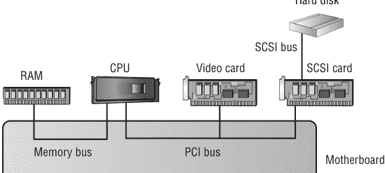

图 1.1 是非常的。例如，CPU 和 RAM 之间的链路通过主板芯片组和各种类型的缓存通过，正如后续章节“RAM”部分描述。

接下来的几节将更详细地检查几个关键系统组件。

## CPU

Linux 最初是为英特尔流行的 80x86（简称 x86）系列 CPU 开发的。特别是 386 是最初的开发平台。（Linux 系列中的较早 CPU 具有 Linux 所需的功能。）Linux 也适用于后续的 CPU，包括 486、Pentium、Pentium MMX、Pentium Pro、Pentium II、Pentium III、Pentium 4 和 Celeron。

除了基于 Intel 的 CPU，x86 版本的 Linux 也运行在 x86 上。

## 决定使用什么硬件

通常情况下，Linux 不需要特定的磁盘驱动程序，但需要控制器的驱动程序。除了基于 Intel 的 CPU，x86 版本的 Linux 也运行在 x86 上。

# 第 1 章 · 实现规划

在需要浮点数运算的应用中具有优势，例如光线追踪和某些科学应用。在比较不同的 CPU（例如，奔腾 4 与速腾龙）时，你应该查看诸如 MIPS（每秒百万条指令）或与你预定应用相关的基准测试。（Linux 内核在启动时会使用一种称为 BogIPS 的指标作为校准循环，但这并不是 CPU 性能的有效衡量；它仅用于校准某些内部计时循环。）

CPU 插在特定的主板上，主板是计算机中主要的（有时也是唯一的）主电路板。主板包含一个芯片组，该芯片组实现了许多主要功能，如 EIDE 控制器、CPU 与内存之间的接口、键盘接口等。Linux 兼容大多数主板，尽管有时 Linux 并不支持所有主板。例如，某些主板可能包含一个集成的视频或音频芯片组，而这些芯片组可能尚未成熟或不存在。选择主板的关键考虑是它必须与你购买的 CPU 兼容——包括其型号和速度。如果你购买的是预装系统，这就不需要担心了。

## RAM（内存）

RAM 有多种形式，2001 年最常见的是双内直线内存模块（DIMM）。较旧的主板使用单内直线内存模块（SIMM）格式，分为 30 引和 72 引两种规格。图 1.2 显示了一个 DIMM 和一个 72 引 SIMM。少数主板使用 RDRAM 内直线内存模块（RIMM），它们在物理上类似于 DIMM，但使用一种名为 RAMbus 动态内存（RDRAM）的特殊 RAM。

主板为特定类型的内存提供插槽——486 及更早主板上的 30 引 SIMM 插槽，486 和奔腾级主板上的 72 引 SIMM 插槽，某些奔腾级及以后主板上的 DIMM 插槽，以及奔腾 II 及以后主板上的 RIMM 插槽。根据模块和 CPU 类型，你可能需要单个、成对或四个一组地添加模块。奔腾及以后后的系统成对使用 72 引 SIMM 或直接使用 RIMM。

## 图 1.2 目前，DIMM（顶部）用于许多计算机；SIMM（底部）用于旧式计算机和某些外设。

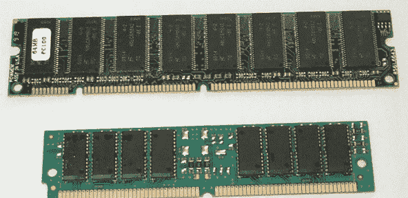

除了物理接口的差异，RAM 在电子特性上也有不同。今天的 RAM 大多源自动态内存（DRAM），它产生了许多改进变体，如快速页模式（FPM） DRAM、扩展数据输出（EDO） DRAM、同步动态内存（SDRAM）、双数据速率（DDR）SDRAM 和 RDRAM。大多数主板仅接受一或两种类型的 RAM，除了 RDRAM 和 RIMM 外，内存的物理格式并不能明确指示 RAM 的电子类型。2001 年，主板接受 SDRAM、DDR SDRAM 或 RDRAM 的某种组合，可能还有一或两种低层次的类型。DDR SDRAM 和 RDRAM 是速度冠军。DDR SDRAM 对普通 DRAM 进行了相当常规的改进，通过使用 64 位和中等速度（66–133 MHz）提供内存访问；RDRAM 使用了一种更不寻的设计，其中 RIM 使用窄的（16 位）总线，但在 RIMM 内部有一个独立的总线，外部变化频率（800 MHz），并采用了更传统的配置。

RAM 在处理错误的方式上也不同。计算机内存由单个位组成，位是二进制（二进制）数字——每个数字是 0 或 1。一个字节由八位组成。如果某个位的值发生变化（例如由于宇宙射线击中内存），数据就会损坏。这可能导致计算中的细微或极端错误，也可能导致数据损坏。某些内存模块在每个字节中包含一个第九位作为错误检测位。该位被编码以指示字节组中其他位出现错误或奇数个位。如果发生错误，主板的内存控制器可以检测到这一点。遗憾的是，通常的结果是系统崩溃，其理念是让计算机崩溃比传播错误数据更好。

一种更高级的方法是纠错。上述错误检测还需要每个字节一个额外的位（或者更准确地说，对于奔腾级及以上的系统是 64 位）。在这种情况下，支持纠错的主板可以纠正 98% 发生的错误，而不会干扰计算机运行。这对于任务关键型系统（如服务器）来说是一个理想的特性。

所有这些特性都适用于内存，正如你可能想象的，它是计算机的主要类型。主板和 CPU 还支持另一种类型的内存——缓存。缓存比内存少得多（通常小于 1MB），但缓存快得多。系统频繁使用缓存，这导致了性能的提升。通常，存在两个缓存。名为 L1 的缓存位于 CPU 的主体部分，大小为几 KB。在奔腾及更早的系统中，名为 L2 的缓存位于主板上并可以升级。在奔腾 Pro、速腾龙及以后系统中，L2 缓存位于 CPU 封装内部，而不是芯片的一部分。少数主板带有板载 L2 缓存，并提供 L3 缓存。

## 硬盘空间

硬盘之间的巨大差异在于 EIDE 和 SCSI。两种总线都有多种速度，从小于 10MBps 到 160MBps 不等。为了达到给定速度，硬盘及其接口必须支持相同的速度。例如，使用旧硬盘时，Ultra2 SCSI 适配器只能产生 10MBps，而不是 80MBps。

区分接口速度和设备速度很重要，但机械设备通常无法支持这些速度。硬盘可能具有 80MBps 的 Ultra 接口，但只能支持 35MBps 的持续传输率。制造商将设备的真实最高速度表示为内部传输速率，而不是外部速率。为了进一步混淆，许多制造商提供每秒比特（Mbps）的内部速率，而外部速率是每秒兆字节（MBps）。如果你没有进行正确的转换（除以或乘以 8），就会错误地认为接口是数据传输的瓶颈。

作为一般原则，在硬盘性能有要求的计算机中优选 SCSI 设备。有几个原因：

- 在需要多种设备的情况下，每个 SCSI 适配器可以支持 7-15 个硬件中断。（x86 架构中只有 15 个中断，许多是留给关键硬件的）。相比之下，EIDE 每条电缆仅支持两个设备（因此每个中断），尽管大多数主板支持两条通道（使用两个中断），总共四个设备。

- SCSI 设备的多任务处理能力优于 EIDE 设备。在 SCSI 适配器具有足够容量的情况下，多个 SCSI 设备可以全速进行数据传输。相比之下，EIDE 将全部容量分配给每条通道，即使设备无法使用 EIDE 控制器的全部容量。

- 硬盘制造商倾向于以 SCSI 格式发布速度最快、容量最大的驱动器。EIDE 驱动器通常较慢且较小。

这些优势是显著的，但对于许多情况，EIDE 的一个优势掩盖了这些优点：它的价格更低。正如前面提到的，现代 x86 主板出厂时支持两条 EIDE 链，因此不需要购买 EIDE 控制器。EIDE 硬盘的价格通常也比相同容量的 SCSI 设备便宜，尽管 EIDE 驱动器的速度通常较慢。

总的来说，当磁盘性能非常重要或者当你需要支持大量的存储设备（包括 CD-ROM、DVD-ROM、可移动磁盘和磁带驱动）时，SCSI 是值得的。但对于大多数低端和中端工作站，EIDE 的低成本更具吸引力，而且 EIDE 的性能对于许多此类系统已经足够。

幸运的是，Linux 对 EIDE 和 SCSI 适配器的支持非常好。大多数 EIDE 控制器可以使用通用驱动程序以旧式（且兼容）模式运行，但速度通常需要显式的驱动程序。因此，你可能需要检查 Linux 是否有适用于你主板或 EIDE 控制器的 EIDE 驱动。没有通用的 SCSI 主机适配器支持，因此你必须支持你的 SCSI 主机适配器。

一旦配置好 Linux 使用 EIDE 控制器或 SCSI 主机适配器，就不需要担心特定磁盘型号的支持。如果你重新编译内核，你需要显式地包含对硬盘或连接到适配器的任何其他设备的支持，但这些支持在所有主流 Linux 发行版中都是。你可以根据容量、速度以及制造商或型号的声誉来购买硬盘和存储设备。

硬盘由旋转盘片和读写头组成，当盘片在头部下方移动时，读写头从盘片读取或写入数据。你通常会看到列出盘片旋转速度的磁盘，例如每分钟 7200 转 (rpm)以及延迟或寻道时间，例如 9 毫秒 (ms)。旋转速度越快，数据通过头部的速度就越快。延迟是磁头从磁盘中心移动到新位置所需的时间，因此低延迟比高延迟更好。

遗憾的是，这两个数字并不是决定硬盘速度的唯一因素。数据密度——即在给定空间内封装的数据量——与旋转速度相互作用，共同决定磁盘速度。如果 7,200rpm 的磁盘数据密度显著更高，它的实际速度可能比 10,000rpm 的磁盘更快。出于这个原因，你应该寻找以 Mbps 或 Gbps 表示的实际传输率。

> 注意 数据传输率在内轨道和外轨道之间不同——外轨道包含的数据比内轨道多，因此外轨道产生更高的传输率。

# 第1章 · 实施规划

## 网络硬件

以太网是 2001 年常见的网络类型。有几种不同的以太网变，包括 10Base-2 和 10Base-5（分别使用双对线电缆）；10Base-T、100Base-T 和 1000Base-T（使用类似于电话线的双对线电缆）；以及 1000Base-SX（使用光纤缆）。在任何一种情况下，第一个数字（10、100 或 1000）都代表网络的最大速度，单位为 Mbps。在这些类以太网中，100Base-T 是目前新安装最受欢迎的选择。

大多数 100Base-T 网卡也支持 10Base-T 速度。这一事实可以帮助你将网络从 10Base-T 迁移到 100Base-T；你可以在新系统中安装双速率卡，并最终用双速率硬件替换旧的 100Base-T 硬件以升级整个网络。同样，许多 100Base-T 卡也支持 100Base-T 甚至 10Base-T 速度。

Linux 对以太网卡的支持总体上非常好。Linux 驱动程序是为特定的芯片组编写的，而不是与你购买的网卡名称相似，你可能对从不同制造商购买的板使用相同的驱动程序。幸运的是，许多发行版在安装过程中自动检测合适的芯片组方面做得很好，因此你可能在安装 Linux 时不需要处理这个问题。如果你事后需要添加网卡，第 8 章将涵盖如何添加新硬件的内容。

如果你面临选择，请购买外设部件互连 (PCI) 卡，而不是工业标准架构 (ISA) 卡。PCI 卡通常更容易配置，并且它们支持更高的传输率。ISA 总线的理论最大速度为 64Mbps——低于 100Base 以太网。一个 32 位的 PCI 卡具有理论最大速度 1056Mbps，这仅强足够千兆以太网。

在实践中，PCI 无法处理全速，因为其他设备的需求和对理论最大性能的偏会导致性能下降。少数 64 位 PCI 变体能够更好地维持全千兆速度。

Linux 支持除以太网以外的网络标准，但这些设备的整体支持程度较差。Linux 包括对令牌环 (Token Ring)、光纤分布式数据接口 (FDDI)、LocalTalk、光纤通道 (Fibre Channel) 以及无线产品等的支持。如果你现有网络使用这些技术之一，在购买之前你应该仔细研究 Linux 对特定网卡的支持。

计算机外的网络硬件不需要 Linux 特定的驱动程序。网线、集线器、交换机、路由器等都是与操作系统无关的。它们通常可以在任何系统上工作。

有些硬件的标准化程度非常高，因此不需要考虑其 Linux 兼容性。以下内容包含在这一类中：

- 机箱 计算机机箱是用塑料和金属制成的，用于放置其他组件。通常它们还包括电源、风扇和一些电线。机箱质量各不相同——要检查是否有毛刺、配合是否良好以及是否易于拆卸。不过，它们与操作系统无关。

## 软驱

标准软驱非常标准化。尽管如此，也有一些变体技术，例如 LS-120 软驱，它们通常通过 EIDE 端口接口。许多软驱可能需要在 `/etc/fstab` 配置文件中像硬盘一样进行处理（见第 6 章“管理文件和服务”）。

## CD-ROM 驱

如今，大多数 CD-ROM 驱动器使用 EIDE（又称附加包接口，或 ATAPI）或 SCSI 接口，这些设备非常标准化。例外是 USB 接口设备。即使是 DVD-ROM 驱动器也已经标准化。可光刻和可擦写 CD（CD-R 和 CD-RW）也变得越来越标准化。

## 磁带

大多数磁带机使用标准的 EIDE/ATAPI 或 SCSI 接口。这些驱动器几乎总是对一组标准命令做出响应，因此它们在 Linux 中不需要特殊配置。少数旧的软驱接口驱动器可以与 Linux 内核中的框架驱动器工作。一些旧的并行接口驱动器可能会导致问题，而较新的 USB 接口驱动器则罕见且未经过测试。

## 键盘

Linux 很好地支持 PC 键盘，且不需要特殊配置。不过，某些键盘包含 Linux 可能无法识别的特殊键，例如音量控制键或启动特定应用程序的键。还有 USB 键盘可用，在 2.4.x 内核中受支持，但测试并不充分。

## 鼠标

如今大多数鼠标使用 USB 或 PS/2 接口，但一些旧设备使用的是 RS-232 串口或特殊接口。所有这些都得到了良好支持，尽管 2.4.x 内核之前的 USB 支持很差。请注意，跟踪技术（传统的滚轮鼠标、光电鼠标、轨迹球、触摸）并不重要；重要的是接口协议和硬件接口类型。大多数 USB 或 PS/2 硬件使用 PS/2 协议或支持滚轮的变体。

## 串口和并行端口

如果你需要额外的串口或并行端口，可以使用插件卡。这些卡的标准化程度很高，因此它们在 Linux 中很少引起严重问题，尽管它们有时会与其他硬件冲突。

## 决定使用什么硬件

## 显示器

显示器不需要驱动程序，尽管你可能需要了解显示器的某些功能以便在 XFree86 中配置它。具体来说，你可能需要知道显示器的最大水平和垂直刷新率（分别以 kHz 和 Hz 表示）。在 XFree86 4.0 及更高版本中，X 服务器有时可以从显示器处获取这些信息。（第 2 章详细介绍了配置。）

某些其他类型的硬件需要特殊考虑。这些设备在 Linux 中可能需要不寻驱动程序或配置。示例包括：

- `USB 设备` Linux 需要为每个 USB 设备配备驱动程序；单个 USB 驱动程序无法处理所有 USB 设备。2.2.18 和 2.4 内核增加了许多（但并非所有）USB 设备的支持。请检查 `http://www.linux-usb.org` 获取当前支持的信息。


## 内部调制调器
在过去的几年里，内部调制调器在 Linux 中引起过问题，因为它们本质是由连接到普通串口的普通调制调器硬件组成的，全在一个卡上。如今，内部调制调器更有可能是*软件调制调器*——依赖 CPU 执行某些调制调器传统选择的设备。此类设备需要特殊的驱动程序，而这些程序有时在 Linux 中并不存在。检查 `http://www.linmodems.org` 获取关于支持和不支持的信息。

## 声卡
Linux 支持大多数声卡。标准内核包含了许多声卡的驱动程序。这些设备的商业变体（通常称为开放系统，或 OSS）可以通过 `http://www.front-tech.com` 获取。一个完全独立的项目——高级 Linux 声音架构（ALSA；`http://www.alsa-project.org`）旨在取代标准内核驱动程序，并支持一组不同的（重叠的）卡。你也可以检查声卡是否提供驱动程序，这些驱动程序可能是独特的，或者与内核或 ALSA 核心工作。

## 视频采集卡
视频采集硬件包括摄像头（通常通过并行、USB 或 RS-232 串口接口连接）以及接收电视输入信号的内部卡。Video4Linux 项目（`http://www.explo.org/v41`）开发此类设备的工具，标准内核包含了许多必需的驱动程序——但如果这很重要，请务必检查是否有支持的硬件。

# 第 1 章 · 实施规划

除了电缆等次要组件外，在没有检查兼容性的情况下，向 Linux 计算机添加硬件时应保持谨慎。人们很容易忘记计算机硬件通常需要驱动程序，如果没有人为 Linux 编写适当的驱动程序，那么该硬件根本无法工作。这些驱动程序的质量也存在差异，这也是为什么某些设备运行良好而其他设备运行糟糕的原因之一。


不可靠的驱动程序可能是系统不稳定的主要原因。大多数驱动程序对计算机硬件以及内核数据结构具有特权访问。因此，驱动程序中的错误 极有可能导致系统崩溃或其他严重问题。

## 安装前检查硬件配置

使用预装计算机的原因之一是这样就不必担心硬件配置的所有烦人细节了。遗憾的是，生活并不总是如愿意的。预装计算机通常带有一个或多个配置次优的组件，因此如果你有这样的系统，在安装之前检查硬件配置是明智的。某些设置如果错误可能会在安装期间或之后引起问题。

由于大多数硬件位于机箱内部，你必须打开机箱来检查硬件状态。这带来了两种危险：首先，如果计算机连接到墙壁插座，你可能会触电。电源具有独立于计算机开关的电源；关闭这些可以降低这种风险。其次，人体产生的静电（例如在干燥天气里在地毯上行走）可能会损坏计算机组件。你可以通过接地来降低这种风险——例如佩戴防静手环，或经常触摸水龙头、散热器或计算机电源。

## 检查布线

几种类型的设备使用机电缆，通常将设备连接到主板或控制器。这些电缆可以是完全内部或外部的。特定类型的电缆有特定要求，如下所示。

### 电源线

对于大多数用户来说，最明显的电源是从插座、插线板或不间断电源（UPS）连接到计算机的。这种线与许多设备的电源线相似，应完全插入计算机和电源。

第二类电源线位于机箱内部。这些电缆从电源（连接外部电源线的内部矩形盒）延伸到主板和各种磁盘设备（硬盘、软驱、CD-ROM 驱动器等）。有不同的内部连接器。大多数电源有六种不同形式的连接器，每种连接特定类型的设备。你应该检查所有电源连接器是否已牢固插入各自的设备，它们在运输过程中可能会松动。

> 所谓的 AT 样式主板（用于许多奔腾及早版本的计算机）使用两个主板连接器，而不是 ATX 系统使用的集成连接器。这些 AT 连接器必须并排插入，黑色线线在一起。这些连接器可能会反插，这会损坏主板！


### 内部数据线

内部布线的第二种主要形式是数据线。它们在组件之间传输数据——通常在磁盘或磁带设备与主板或控制器之间。最常见的数据线形式是带状线，因其电缆像带子而得名。带状线在宽度和连接器的具体形状上有所不同。某些线还有独特的特征，例如软驱线上的扭转部分。

## 检查电缆连接

你应该检查所有电缆连接器是否已牢固且正确插入。大多数电缆带有缺口或非对称连接器，以防止反插，但某些廉价电缆缺乏这些安全保护措施。如果你的某些电缆没有这些设计，请仔细注意电缆的方向。大多数电缆的一侧有一条彩色条纹，指示了第一条信号线的位置。设备或主板上的匹配连接器应标出 #1 引脚的位置，通常在连接器旁用小字字体。你应该能够插入电缆使得条纹位于 #1 引脚旁边。

某些类型的排线（ribbon cable）连接器数量可能比设备多。例如，当你只有两个 SCSI 驱动器时，可以使用一条带有四个连接器的 SCSI 线，并留下一个空闲（两个连接器连接到 SCSI 驱动器，一个连接到主机适配器）。对于排线，你应该确保两个连接器都被使用。通常情况下，其中一个连接到主板或控制器卡，另一个端连接到其中一个设备。

特别是在旧版系统中，排线有时会将内部连接器连接到外部连接器。例如，主板有一个并行端口的内部连接器，因此排线将其连接到外部连接器。此类电缆在现代主板上很罕见，现代主板将连接器集成在主板的标准位置，以便从机箱外部直接访问。你可能在少数设备上仍然发现此类电缆，例如它们被用于将 USB 端口连接到前面板 USB 连接器时。

排线不是内部数据电的唯一类型。CD-ROM 驱动器经常使用 3 线电缆将 CD-ROM 驱动器的音频输出连接到声卡。还有 2 线连接器将主板连接到前面板连接器组件，例如电源按钮、重位按钮和硬盘活动 LED 指示灯。

> LED 电缆必须以正确的方向连接，因为电缆没有防呆（keyed），除非你仔细注意电缆和主板上的正负标记，否则你有 50/50 的概率出错。这个细节对于现代电脑的电源或重位开关并不重要。

## 外部电缆

外部电缆将计算机与其键盘、鼠标和显示器连接起来。打印机、扫描仪、网络连接等都使用电缆。（存在少数无线设备，但即使这些设备通常也使用短电缆从标准接口连接端口或红外发射器。）

在所有情况下，为了让设备正常工作，将相关电缆牢固插入其匹配插座至关重要。某些电缆类型（如以太网）会卡入到位，除非你按下一个小小的杠杆或锁定机构，否则无法移除。其他（如并行、RS-232 串口和某些类型的外部 SCSI 连接器）带有螺丝，可以拧紧以确保连接稳固（其中一些需要真正的螺丝刀来拧紧松松）。其他（如 USB 和键盘连接器）没有锁定或紧固机构，因此你必须确保这些连接器完全且牢固地插入。

某些电缆类型不应在计算机运行时常规连接或断开。这些包括 SCSI、RS-232 串口和并行连接器。在连接或拔掉电缆时可能会损坏设备或计算机。其他连接器（如 USB 和以太网）设计为在计算机运行时进行热插拔。由于是你自己插入外部设备，你应该确保操作正确。误认为将设备连接到错误的端口是很容易的。这对于 RS-232 串口设备尤为如此，因为许多电脑有两个端口：用于声卡上的扬声器、麦克风和音频输入；以及 PS/2 鼠标和键盘。大多数电脑上的 USB 端口是可以通用的；使用哪一个并不重要。

某些连接器虽然兼容，但尺寸或形状不同。这对于 RS-232 串口连接器（有 25 脚版本）、并行连接器（分大、小类型）和 SCSI 连接器（有多种型号）尤为如此。可以提供这些设备的适配器，但使用时要小心——它们可能会给连接器增加足够的重量，导致其掉落，特别是 SCSI 适配器。

## 检查 IRQ、DMA 和 I/O 设置

大多数插卡使用 x86 架构中供应有限的硬件资源。特别感兴趣的是主板的中断请求 (`IRQ`)、其直接内存访问 (`DMA`) 通道以及其输入/输出 (`I/O`) 端口。x86 架构支持中断（0–15 以及几个 DMA 通道）。I/O 端口较少，但偶尔仍会冲突。主板使用中断告诉 CPU 发生了某些需要 CPU 注意的事情。DMA 通道和 I/O 端口用于将数据从主板传输到计算机内存或 CPU。

对于 ISA 来说重要的是两个设备不要尝试使用相同的 IRQ、DMA 通道或 I/O 端口。这样做可能导致其中一个不可用，在极端情况下会导致计算机崩溃。PCI 主板可能与另一个设备共享 IRQ，但即使这样有时也会导致硬件工作缓慢或行为异常。

> 如果你有任何旧主板，可以通过检查主板本身的跳线帽设置来检查它们的 IRQ。请查阅主板的文件。ISA 主板从不使用如第 8 章所描述的软件配置。PCI 主板由计算机的 BIOS 或 Linux 内核进行自动配置。在后这两种情况下，如果不启动计算机，就无法知道主板使用了哪些硬件资源。遗憾的是，如果资源发生冲突，计算机可能无法启动。如果你怀疑发生了这种情况，请查阅第 8 章获取硬件故障排除信息。

## 检查 EIDE 设备

大多数 x86 电脑使用 EIDE 连接硬盘、CD-ROM 和其他类型的磁盘和磁带设备。EIDE 有多种变体，速度从 8Mbps 到 100Mbps 不等，更快的速度更常见。在 2001 年，33Mbps 被认为是低端，66Mbps 是常见的，100Mbps 是首选接口。这些不同的接口类型通常以速度命名，例如“UltraDMA 33”或“ATA/66”。能力更高的接口可以与能力较低的设备通信，反之亦然，你可以根据需要混合使用——但将快速磁盘连接到同一条线缆可能会严重降低其性能。

每个 EIDE 通道可以支持一个控制器和最多两个设备。传统上，你必须将每个设备配置为主设备或从设备。在 Linux 中，主设备在 `/dev/hdx` 文件名中获得较小的字母，其中 x 是设备字母。配置从设备状态通过设备本身完成；详情请参阅文档。现代设备和控制器支持自动配置协议。

如果你需要更多设备，或者你想分离快慢设备，你必须使用多个 EIDE 线缆，每根线对应一根物理 EIDE 线。大多数主板支持两个设备（因此总共四个设备），你可以通过增加插卡 EIDE 控制器来增加数量。你可以使用类似的卡升级 EIDE。

通常，一个 EIDE 设备将是第一条（或主）链的主设备。第二个设备将是同一链上的从设备，或者是第二条链上的主设备。前者配置保留了 IRQ，如果你有许多其他设备，这可能是理想的，但后者可能会产生更好的性能。

## 检查 SCSI 设备

SCSI 是一种异常强大且复杂的接口总线。因此，SCSI 总线有时难以正确配置，特别是当有很多设备时。规划或检查 SCSI 总线时考虑几个因素：

- SCSI 变体：可用许多 SCSI 版本，从原始的 3MBps SCSI-1 到 160MBps 的 Wide SCSI。大多数这些版本都是兼容的，但将能力较弱的设备添加到更强大的 SCSI 链可能会降低性能。此外，两个设备之间的差异越大，它们在同一链上兼容的可能性就越小。例如，将 SCSI-1 设备添加到 Ultra3 SCSI 链中可能会导致问题。

SCSI 设备通过其 ID 号进行区分。旧的 SCSI 变体（使用 8 位宽总线的版本）使用的 ID 范围从 0 到 7，而宽型（Wide）变体（使用 16 位总线）的 ID 范围则从 0 到 15。SCSI 主机适配器会占用一个数字，这就是为什么 SCSI 链限制为 7 个或 15 个设备的原因。SCSI ID 通常通过通过内部设备上的跳线设置，或通过外部设备上的某些开关进行设置。请检查您的文档以获取详情。如果两个设备共享同一个 ID，可能会导致其中一个掩盖另一个，或者它们都会出现相当严重的故障。新设备可以使用 SCSI 自动配置 (`SCAM`) 协议，该协议允许设备自动获取 ID。

终止的 SCSI 总线可以被视为一条一维的设备链。链两端的设备都必须进行终止，以防止信号从链的末端回弹。与不同的 SCSI 设备有多种类型的终止关联，从被动式到活动低电平差分式 (`LVD`)。大多数 SCSI 设备都包含可以通过跳线或自动激活的终止功能。有时您可能需要添加 SCSI 终止器。务必确保设置正确，因为错误的终止会导致 Linux 系统崩溃。

电缆质量 SCSI —— 特别是高速 SCSI 变体 —— 非常受到低质量电缆引起的问题的影响。特别是如果您的 SCSI 链有很多设备，购买高质量的电缆可能是值得的。遗憾的是，这些电缆可能很贵——50 美元或更高。

电缆长度 最大 SCSI 电缆长度从 1.5 到 12 米 (m)，取决于 SCSI 版本。SCSI 电缆长度限制整个 SCSI 链。例如，如果您有两个外部 SCSI 设备，你需要将外部电缆长度以及任何内部电缆长度相加，确定 SCSI 链长度。


第 8 章包含了关于对 SCSI 链故障排除的信息。

## 检查 BIOS 设置

基本输入输出系统 (`BIOS`) 是最低级别的软件组件。CPU 作为启动程序的一部分运行 BIOS 代码。因此，在 Linux 启动之前，BIOS 就配置了计算机的许多基本方面。BIOS 还提供了计算机用于将 Linux 内核加载到内存的工具。

尽管 x86 BIOS 提供了一些标准功能，但它并不是完全标准化的。特别是，现代 BIOS 提供了一个设置工具，称为互补金属氧化半导体 (`CMOS`) 设置程序，您可以使用它来设置各种低级选项。计算机 CMOS 设置程序中的可用选项在不同设备之间有所不同，这既是因为硬件的差异，也是因为不同的 BIOS 设计。

大多数计算机在启动时会显示一个提示，告诉您如何进入 CMOS 设置。这通常是在启动过程中的关键点按下某个键（如 `Delete` 或 `F2`）完成的。一旦进入，您将看到 BIOS 设置界面，如图 1.3 所示。此屏幕允许您通过按下键盘上的方向键移动来选择和设置各种选项。


SCSI 主机适配器通常包含自己的 BIOS 和工具，这些工具与主板 BIOS 是分开的。SCSI 设置程序具有设置选项，您可以在启动过程中的特定点通过按键序列进行调整。请观察您的启动显示或咨询 SCSI 适配器文档以获取详情。

## 图 1.3

CMOS 设置程序使用菜单驱动显示让您调整计算机的内置硬件。

| 主菜单 | 高级 | 电源 | 启动 | 退出 |
|---|---|---|---|---|
| 系统时间: 10:26 系统日期: 03/21/2001 | | | | 项目特定帮助 |
| Legacy 磁盘 A: [1.44/25 MB]* | | | | 使用 <Tab>, Shift-Tab, 或 <Enter> 选择字段。 |
| Legacy 磁盘 B: [已禁用] | [1048MB] | | | |
| > 主驱动器 [CD-ROM] | | | | |
| > 备主器 [无] | | | | |
| > 键盘功能 | | | | |
| 系统内存: 640 KB 扩展内存: 6432 KB 语言: (英英语) | | | | |

```
F1 帮助 + 选择项目 -/+ 更改值 P9 设置默认值
F0 退出 + 选择菜单 回车 > 子菜单 F10 保存并退出
```

Copyright©2001 SYBEX, Inc., Alameda, CA www.sysex.com

## BIOS 设置项

大多数系统都带有合理的默认 BIOS 设置，但您可能想要检查并可能调整其中几个。这些包括：

**磁盘设置** 有两个常见的硬盘设置是您可能需要调整的。第一个指定了磁盘的大小。自动检测功能对于第一个正常工作。第二个决定了 BIOS 如何解释磁盘的柱面/磁头/扇区 (`CHS`) 地址。在大多数 BIOS 上，线性块寻址地址 (`LBA`) 模式是最佳选择。如果您使用 SCSI 硬盘，主板将无法检测到它们。如果是正常的；SCSI BIOS 将提供必要的支持。

**板载端口** 现代主板包含 RS-232 串口、并行口、USB、EIDE 以及常见的其他类型的端口。您可以启用或禁用这些端口（例如，禁用未使用端口可以释放资源）。

**PCI 设置** 某些 BIOS 允许您指定系统如何处理 PCI 设备。从两种或多种规则中选择 BIOS 如何分配 IRQ。有时一个规则会冲突而另一个不会，所以如果您遇到启动问题，这种设置值得调查。

**密码** 在高安全性环境中，您可能想要设置 BIOS 密码。这可以防止系统在不输入正确密码的情况下启动。它可以减缓具有物理访问权限的入侵者，但他们可以通过各种方式绕过此功能。设置 BIOS 密码还可以防止在断电时重启。尽管如此，减缓入侵者可能是值得的。

**内存设置** 某些 BIOS 可以配置为将自身或其他设备上的 BIOS 部分复制到 RAM 中。这种做法被称为屏蔽，可以加快对 BIOS 的访问。Linux 并不需要这么多，因此这是用的。某些 BIOS 还允许您控制一个或多个内存洞——即内存图中不可用的区域。有时这些会导致 Linux 错误检测安装的内存，因此您可能想要尝试这些设置。

Copyright©2001 SYBEX, Inc., Alameda, CA

www.sysex.com

## 分区规划

分区规划 35

**启动设备** 现代 BIOS 支持从各种磁盘和类磁盘启动，包括软盘、EIDE 磁盘、SCSI 磁盘、CD-ROM 驱动器以及如 Zip 或 LS-120 磁盘等高容量移动磁盘。通常可以设置系统按任何顺序从这些设备启动。BIOS 按顺序尝试每个介质，如果它不存在或不可引导，则会尝试下一个。为了最高的安全性，将系统设置为从 EIDE 或 SCSI 硬盘启动；为了方便启动安装或应急介质，将其设置为从 CD-ROM、软盘或其他移动介质启动。

在实践中，您可能需要对特定计算机的 CMOS 设置进行实验，以确定哪些有效。通常不要在良好的系统上尝试随机更改；如果您遇到问题，可以尝试这些设置。未经更改会导致系统不稳定，尽管如果您记得更改了，通常可以恢复系统。

## 理解 PC 分区系统

原始的 x86 分区方案仅允许四个分区。随着硬盘尺寸增大以及对更多分区的需求日益显现，原始方案在保持兼容性的同时进行了扩展。

与旧方案相比，新方案使用了三种分区类型：主分区（primary partitions），与原始分区类型相同；扩展分区（extended partitions），是主分区的一种特殊类型，作为后续类型的占位符；以及逻辑分区（logical partitions），它们存在于扩展分区内部。


对于任何一个磁盘，你被限制为四个主分区，即三个主分区和一个扩展分区。许多操作系统（如 DOS、Windows 和 FreeBSD）必须从主分区启动，正因如此，大多数硬盘都至少包含一个主分区。然而，Linux 并不受此限制，因此你可以从一个不包含任何主分区的磁盘启动 Linux，尽管在实践中很少有人这么做。


x86 分区方案并不是唯一选择。Linux 包含了许多替代方案，但基于 x86 的 Linux 系统通常使用 PC 分区方案。Linux 也运行在这些架构以外的平台上。从管理的角度来看，这些系统几乎比 PC 系统简单，因为主分区、扩展分区和逻辑分区之间没有区别。

磁盘的分区布局存储在一个名为分区表的数据结构中，它存在硬盘的第一个扇区上。这个扇区被称为主引导记录（`MBR`），因为它包含了计算机在 BIOS 初始化后运行的第一部分代码。逻辑分区的位置存储在扩展分区内部，但在 `MBR` 之外。尽管它们不是 `MBR` 的一部分，但这些数据有时被认为是分区表的一部分，因为它们定义了分区的区域。

## Linux 分区要求

对于 Linux 来说，分区类型之间的区别很小。Linux 对磁盘上的分区进行编号，扩展分区的获得从 1 到 4 的编号（例如 `/dev/hda1` 或 `/dev/sdc3`），而逻辑分区的编号从 5 开始。即使主、扩展分区少于四个，情况也是如此，因此分区的编号可能是 1, 2, 4, 5 和 6（跳过分区 3）。主分区编号类似于固定槽位，因此当磁盘使用这些槽位中的 1–3 个时，四个数字中的任何一个都不会被使用。相比之下，逻辑分区总是顺序编号的，没有任何缺失的数字，因此一个恰好有三个分区的系统必须编号为 5、6 和 7。

一些管理员使用主 Linux 启动分区，因为传统的 x86 `MBR` 只能从主分区启动。因此，可以将 Linux 加载器（`LILO`，Linux 用于启动的程序）放在 Linux 启动分区中以启动计算机。另一种方法是，`LILO` 可以直接位于 `MBR` 中，这样更直接，但会让 `LILO` 更容易被其他实用程序重写 `MBR` 时抹掉（第 3 章“软件管理”详细地讨论了启动过程）。

作为最低要求，Linux 需要单个分区来安装和启动。这个分区被称为根分区（root partition），或 `/`。之所以被称为根分区是因为它位于树的“根”部——系统上的所有文件都相对于此分区的基准进行标识。根分区还存储了目录，例如 `/etc` 和 `usr`，其他文件位于其中。某些目录可以作为挂载点——Linux 在此处挂载分区。例如，你可能会在 `/home` 上挂载一个分区。


Linux 中一个重要的目录是 `/root`

## 常见分区选项

除了根分区外，许多系统管理员喜欢创建额外的分区。将安装拆分为多个分区而不是保留为单体根分区可以带来以下几个优势：

- **多磁盘**：当你有两个或多个硬盘时，你必须创建单独的分区——每个磁盘至少一个。例如，一个磁盘可以托管根目录，而第二个磁盘可以存放 `/home`。此外，可移动的磁盘（软盘、CD-ROM 等）必须被挂载，因为它们是单独分区。

- **更好的安全选项**：通过将重要目录拆分到单独分区，你可以对不同的分区应用不同的安全选项。例如，你可以将 `/usr` 设置为只读，这减少了二进制文件意外或无意损坏的机会。

- **数据溢出**：某些错误或攻击可能导致文件增长到巨大，这可能导致系统崩溃或引发严重问题。将目录拆分为单独分区可以确保某个目录中的失控进程不会影响在其他目录中创建文件的能力。这使得更容易从此类困难中恢复。缺点是，拆分区增加了文件合法增长到填满分区的可能性。

- **磁盘错误保护**：磁盘分区有时会产生数据错误，即数据结构损坏，或磁盘出现了物理坏道。如果你的系统由多个分区组成，问题更有可能被隔离在一个分区中，这可以使数据恢复变得更容易或更完整。

- **备份**：如果你的备份大小远小于硬盘，将磁盘拆分成适合单个分区的分块可以简化你的备份程序。

- **理想的文件系统**：*文件系统*（filesystem）是一组低级数据结构，它规定了计算机如何在磁盘上为单个文件分配空间，以及与文件关联的数据类型（例如文件创建时间和文件名）。有时，一个文件系统适用于某些目的，但不适用于其他目的。因此，你可能希望将目录拆分为单独分区，以便使用多个文件系统。

那么，哪些目录经常被拆分到单独分区？表 1.1 总结了这些内容。

表 1.1 常见分区及其用途

| 分区（挂载点） | 典型大小 | 用途 |
| :--- | :--- | :--- |
| Swap（交换分区） | 内存的 1.5-2 倍 | 见“了解 Linux 文件系统”。 |
| `/home` | 200MB-100GB | 存放用户数据。大小取决于用户数量。 |
| `/boot` | 5MB-20MB | 存放关键引导文件。允许某些 BIOS 的限制。 |
| `/usr` | 500MB-4GB | 存放大多数 Linux 数据文件；这通常是最大的分区。 |
| `/usr/local` | 100MB-2GB | 存放自行编译的 Linux 程序数据文件。 |
| `/opt` | 100MB-2GB | 存放与第三方软件包相关的杂项。 |
| `/var` | 100MB-100GB | 存放系统日常运行相关的文件。这些文件通常是瞬时的。当系统作为使用邮件队列的服务器时，通常单独分区。 |

表 1.1 常见分区及其用途（续）

| 分区（挂载点） | 典型大小 | 用途 |
| :--- | :--- | :--- |
| `/tmp` | 100MB-10GB | 存放普通用户创建的临时文件。 |
| `/mnt` | 无 | `/mnt` 本身不是单独分区；相反，它的子目录用作软盘或 CD-ROM 等可移动媒体的挂载点。 |

某些目录*绝不*应该放在单独分区。这些目录是 `/etc`、`/bin`、`/sbin`、`/lib` 和 `/dev`。这些目录存放关键系统配置文件或没有它们系统无法运行。例如，`/etc` 包含 `/etc/fstab`（指定哪些分区对应哪些目录的文件），而 `/bin` 包含了挂载分区的 `mount` 工具。

> 2.4.x 内核包含了对专用 `/dev` 文件系统的实验性支持，这消除了对实际 `/dev` 目录中文件的需求，在某种意义上，`/dev` 可以位于单独的文件系统上，而不是单独的分区。

## 创建多个分区的真实世界场景

拆分单独分区的一个问题（特别是对于新管理员来说）是很难确定合适的大小。如表 1.1 所示，各种分区的合适大小在不同系统之间存在巨大差异。例如，工作站可能需要较小的 `/var` 分区（例如 100MB），但邮件或新闻服务器可能需要数 GB 大的 `/var` 分区。猜错了不是致命的，但很麻烦。你需要调整分区大小（这很繁琐且危险），或者在分区之间设置符号链接，以便一个分区上的子目录存储在其他分区上。

出于这个原因，我通常建议新的 Linux 管理员先尝试简单的分区布局。根（`/`）分区是必须的，设置交换分区（swap）是一个非常好的主意。除此之外，对于使用旧版本发行版或 BIOS 的大于 8GB 的硬盘，`/boot` 分区可能会非常有帮助。对于新管理员来说，`/home` 的合适大小通常很容易猜测，因此将其拆分通常是有意义的。除此之外，我建议新管理员要谨慎操作。

随着你对 Linux 经验的增加，你可能在随后的安装或升级磁盘硬件时，将目录划分到单独分区。你可以使用 `du` 命令来了解任何目录下的文件占用了多少空间。

## Linux 文件系统选项

Linux 支持许多文件系统。2001 年 Linux 分区中最流行的文件系统是二级扩展文件系统（ext 或 `ext2fs`），它是许多发行版的默认文件系统。`Ext2fs` 支持 Linux（或广义的 Unix 风格操作系统）所需的所有功能，并且经过了充分测试，非常健壮。

`Ext2fs` 有一个主要问题：如果计算机没有正常关机（由于停电、系统崩溃等），当计算机重启时，Linux 可能需要几分钟来验证 `ext2` 分区的完整性。这种延迟在最好的情况下只是令人恼恼，但在大型服务器等任务关键型系统上就是一个问题。解决方案实现在所谓的日志文件系统（journaling filesystem）中。这种文件系统会在特殊的日志日志文件中记录它即将进行的更改。因此，在意外崩溃后，系统可以检查磁盘的哪些部分可能需要检查。这种设计使得在崩溃或断电后，检查速度非常快——通常最多只需要几秒钟。

2001 年正在为 Linux 开发四种日志文件系统。2001 年年中，这些系统中最具实用性的是 `ReiserFS`（http://www.namesys.com/），它已作为标准组件添加到 2.4.1 内核中。日志文件系统包括 `ext3`（http://ftp.uk.linux.org/pub/linux/kernel/sc/fs/jfs），它是 `ext2fs` 的扩展；`XFS`（http://1linux-xfs.sg1.com/projects/xfs），它最初是为图形公司的 IRIX 操作系统设计的；以及日志文件系统（`jFS`）（http://oss.software.ibm.com/developerworks/opensource/jfs），它是 IBM 为其 AIX 和 OS/2 开发的。在这四种系统中，`XFS` 和 `JFS` 最先进，但 `ReiserFS` 最稳定，并且在 2001 年年中即可使用。

> 注意
> 交换分区不使用文件系统。Linux 需要向此分区写入一些基本数据结构以便将其作为交换空间（如第 8 节所述），但从技术上讲它不是文件系统，因为它内部不存储任何文件。

Linux 还支持许多非 Linux 文件系统，包括 DOS 和 Windows 使用的文件分配表（FAT）文件系统；Windows NT 和 2000 使用的新技术文件系统（NTFS）；OS2 使用的高性能文件系统（HPFS）；Unix 文件系统（UFS），也称为各种版本 Unix 使用的文件系统（File System 或 FFS）；macOS 使用的层级文件系统（HFS）；以及在 CD-ROM 上使用的 ISO-9660 和 Joliet 文件系统。这些文件系统大部分主要在双启动配置中有用——例如，在 Linux 和 Windows 之间共享文件——特别是 FAT、ISO-9660 和 Joliet——它们对于在可移动介质上的计算机之间交换文件非常有用。作为一般规则，这些文件系统不能存放关键文件系统，因为它们缺乏必要的文件系统功能。不过也有例外——Linux 扩展可以所需的必要信息带入 FAT 和 HPFS 分区，UFS 起初就是为了存储 Unix 文件系统设计的，而 Rock Ridge 扩展为 ISO-9660 增加了必要的支持。

Linux 分区通常使用 `ext2fs` 是最好的，尽管如果你有大分区并希望避免系统启动时进行长时间的文件系统检查，`ReiserFS` 是一个很好的选择。截至内核 2.4.2，`ext2fs` 仍然是稳定的。`XFS`、`JFS` 和 `ext3` 可能在 2001 年或 2002 年底用于生产系统。`XFS` 和 `JFS` 的优势在于支持大于 `ext2fs` 默认 4GB 限制的大小，大多数 2001 年发布的版本也支持 `ReiserFS`。其他的可能需要修改内核，你必须先将 Linux 安装到支持的文件系统中，然后转换或添加其他文件系统类型。使用 Linux 文件系统与非 Linux 系统进行数据交换。

## 分区工具

为了创建分区，你需要使用分区工具。有几十种工具可用，但只有少数在安装 Linux 系统时是合理的选择：

- **DOS 的 FDISK**：微软的 DOS 和 Windows 附带了一个名为 `FDISK`（用于固定磁盘）的简单分区工具。该程序并不灵活，使用粗糙的基于文本的用户界面，但它很容易获得，并可以创建 Linux 可以使用的分区。（尽管，你可能需要使用 Linux 工具修改分区类型代码以使用 DOS 创建的分区。）

- **Linux 的 fdisk**：Linux 包含一个与 DOS 程序同名的分区工具，但 Linux 的工具名称全小写，而 DOS 工具的名称通常全大写。Linux 的 `fdisk` 比 DOS 的 `FDISK` 灵活得多，但它也使用基于文本的用户界面。如果你有一个现有 Linux 磁盘，可以在安装操作系统之前使用它为 Linux 创建分区。

- **Linux 安装时工具**：大多数安装程序都包含分区工具。安装程序简化了 `fdisk` 的使用，其他时候提供了更易于使用的 GUI 工具。如果你正在安装纯 Linux 系统，安装程序自带工具可能是最佳选择。

- **PowerQuest 的 PartitionMagic**：PowerQuest（http://www.powerquest.com）制作了一种异常灵活的分区程序，被称为 `PartitionMagic`。这个商业程序提供了 GUI 界面，并可以创建准备好 FAT、NTFS、HPFS 或 ext2 文件系统的分区。这使其成为配置多操作系统计算机磁盘的极佳工具。`PartitionMagic` 还可以调整分区大小而不损坏内容。主程序是基于 Windows 的，软件包带有一个可以从软磁盘运行的 DOS 版本，因此可以在没有 Windows 的系统上使用它。

- **FIPS**：第一无破坏性分区分割（`FIPS`）程序包含在许多 Linux 发行版中。它是一个专门的分区工具，用于将单个 FAT 分区划分为两个分区。

## Linux 与私有操作系统

Linux 在很大种程度上与许多操作系统存在竞争。其中一个巨大的分水岭是 Linux 与私有操作系统之间的区别——私有操作系统是指使用不对公开审查的源代码的操作系统。特别是在许多人心中，Linux 是微软 Windows 的竞争对手。然而，在许多方面，Linux 的竞争对手更多是商业版本的 Unix。

与 Linux 相比，大多数私有操作系统在成本上处于劣势。商业操作系统的价格从大约 50 美元到数千美元不等。大多数 Linux 发行版可以从互联网免费下载，如果不需要官方支持或打印版手册，可以通过 CD-ROM 以低于 10 美元的价格购买；如果需要，价格也在 100 美元或以下。一些额外的豪华 Linux 软件包通常比这更贵，因为它们与某些昂贵的软件包或扩展支持捆绑。

## Linux 与微软操作系统

微软推出了两种操作系统产品：Windows 9x/Me 和 Windows/2000。每个操作系统都针对特定的市场，尽管它们在某种程度上有所重叠。Linux 与两者都竞争，尽管与 NT/2000 系列的竞争更为直接。

Windows 9x/Me 系列适用于家庭和功率相对较低的桌面系统。该操作系统源自旧的 MS-DOS 和 Windows 3.1 产品，这种遗产一直在文件系统支持、多任务处理能力（同时运行程序的能力）等方面影响着 Windows 9x/Me。Windows 9x/Me 的缺点之一是它背负着与过时处理器向后兼容的需要。这一事实限制了其可靠性以及高级网络服务器功能的能力。然而，许多桌面用户并不特别意意这些限制，他们被易于使用的 Windows 用户界面所吸引。尽管 Linux 比 Windows 9x 稳定得多，但 Linux 在用户界面方面正在追赶。因此，如果计算机将用作个人生产力工具，Windows Me 值得考虑。如果使用该机器的个人已经熟悉 Windows 不想学习其他东西，这一点尤为如此。

## 第 1 章 · 实施规划

微软将 Windows NT/2000 营销为 Unix 和 Linux 的竞争对手。该操作系统分支使用了更新内核，对今天重要的功能（如文件系统和多任务处理）提供了更好的支持。这使得 Windows NT/2000 比 Windows 9x/Me 更适合作为网络服务器。Windows NT/2000 和 Linux 之间的一个关键区别是，前者更依赖其图形用户界面（GUI）。这使得新管理员更容易上手 Windows NT/2000，但同时也降低了灵活性。另一方面，你可以以 GUI 不允许的方式配置文件，并可以完成其他使用 Windows NT/2000 困难或无法完成的事情。

与微软不同，OS/2 是与 Windows 同一家族的另一个操作系统。该操作系统仍由 IBM 销售，但自 20 世纪 90 年代中期以来一直在下滑。在许多方面，OS/2 与 Windows NT 相似——它使用更新的内核，但放弃了 Windows 9x/Me 携带的许多包袱。然而，它缺乏对今天软件的兼容性。在仍使用它的环境中，OS/2 可能仍然值得考虑，但其市场份额的下降意味着不应在新环境中采用它。支持任何与微软相关的操作系统的最有说服力的论点之一是桌面使用的应用程序基础。特别是 Microsoft Office 应用程序极其强大，Linux 不可用（同样，OS/2 也是如此）。同样，`WINE`、`VMware` 和 `Win4Lin` 等模拟器允许你在 Linux 下运行 Windows 软件，但如果使用计算机的主要目的是使用 Windows 软件，那么与直接运行相比，在模拟器中运行几乎没有优势。Linux 在 Windows 比较中的主要优势是它的软件基础。Linux 支持广泛的开源（通常是低成本的）应用程序。因为 Linux 是模仿 Unix 建模的，具有 Unix 经验的管理员应该能够很快地上手其他 Unix 变体。

## Linux 与 Unix

Linux 是作为 Unix 的克隆开发的。Torvalds 的目标是编写一个开源内核，现有的 Unix 部分可以在其周围汇聚；结果就是我们今天所知的 Linux 发行版。由于这段历史，现代 Linux 系统与现代 Unix 系统高度相似相似，事实上，两者的使用方式也是相似的。

在很多情况下，Linux 和商业 Unix 之间的主要区别在于成本。正如本节前面提到的，Linux 是一种非常低成本的操作系统，但商业 Unix 的价格贵得多（最常见的 x86 Unix 现在可以低廉的价格供个人使用，但大多数商业用户仍必须为许可支付数百美元）。大多数 Linux 软件以开源形式提供，并可以在 Unix 机器上编译——事实上，大多数 Linux 软件都是作为类 Unix 平台开发的，可以在那里运行。许多商业 Unix 程序已移植到 Linux（即在 Linux 上重新编译）。


商业 Unix 占据优势的地方在于极高性能计算。诸如 Silicon Graphics (SGI) 的 IRIX 和 Sun 的 Solaris 等操作系统运行在快速硬件上，并支持 Linux 移植较差的高级功能；例如，IRIX 的 XFS 在 Linux 上被认为更好。此外，高端系统所使用的硬件通常优于通常运行 Unix 的 x86 PC 所使用的硬件。Linux 已经移植到许多非 x86 平台，包括 Unix “大大哥”们运行的许多平台，但这些移植版本在整体完善程度和通用可用性方面落后于 x86 版本。

随着 Linux 的改进，Linux 和商业 Unix 之间的差距可能会缩小。即使是今天，Linux 也是工作站和中型服务器的优秀平台。由于与更高级系统的相似性，可以在减少配置和管理员培训的情况下将 Linux 迁移到高级 Unix 系统。这无疑是 Linux/Unix 家族优于 Windows 的优势。

## Linux 与其他开源操作系统

Linux 不是唯一的开源操作系统。大多数开源开源操作系统像 Linux 一样都是 Unix 的克隆。事实上，主要的竞争族类——FreeBSD、NetBSD 和 OpenBSD——直接源自主流 Unix。

BSD 代表伯利标准发行。BSD 作为 AT&T 原始 Unix 的组件级开源替代品而增长。在此过程及之后，经过多次开发，产生了多种产品，包括三个主要的开源 BSD。BSD 一术语指的是共享伯利遗产的整个操作系统，也可以指特定的组件，例如第 8 章讨论的 BSD 打印系统。

在大多数情况下，开源 BSD 的功能与 Linux 一样。这些操作系统具有基本相同的应用程序基础，管理方式也大相同。Linux 与其 BSD 兄弟之间的主要差异归于三个因素：

**内核许可证** Linux 内核根据通用公共许可协议 (GPL) 发布，与 BSD 使用的 BSD 许可证相比，鼓励鼓励公众参与内核开发。围绕每个操作系统形成的文化进一步加强了这种区别。结果是内核的发展比 BSD 内核更快，并且对更多硬件、更多文件系统等提供了支持。

**商业软件可用性** 商业软件开发者似乎更愿意将软件移植到 Linux，而不是开源 BSD。BSD 包含了运行 Linux 程序的方法，而且两个系统的大多数软件都是开源且在双方可用的；这一因素对于大多数人来说并不关键，但它仍然是 Linux 的一个加分项。

**支持网络** Linux 支持网络（嵌入在 Linux 新组、网站和商业 Linux 供应商的支持中）通常比 BSD 的支持网络更活跃。这有助于新用户上手 Linux，也能帮助经验丰富的管理员解决问题。某些支持论坛，然而

Linux 与非 Linux 解决方案 49

操作系统中立的，例如致力于在两个平台上运行的程序的邮邮件列表和新闻组。

这三个因素产生了一个正反馈循环——更多的用户创造了更好的志愿者支持网络、更多的潜在内核开发者，并增强了商业软件供应商将其产品移植到 Linux 的动力。这些因素中的每一个反过来又创造了吸引更多用户的环境。

到最后，你可能使用你最熟悉的 Unix 类开源操作系统是最好的选择。对于新用户来说，Linux 广广泛的支持网络可能是一个很大的优势。不过，如果你能更容易地获得 BSD 的个人支持，或者某个 BSD 支持你需要的但在 Linux 中不支持的硬件，那么 BSD 可能对你来说可能是更好的选择。无论何种情况，从 Linux 移动到 BSD 或反之都非常简单，因此如果你决定更换，你在某个系统上花费的时间就不会被白费。

## Linux 发行版概述

在 Linux 世界中，存在多个发行版。发行版是 Linux 内核、启动脚本、配置文件和关键软件的编译。发行版还包括某种类型的安装程序，让你获得一个可以运行的 Linux 系统。任何两个发行版可能使用这些组件的不同版本或全部版本，这将产生截然不同的体验。关键组件（如内核和某些支持软件）在所有发行版中来自同一源。例如，一个发行版可能使用 2.4.2 Linux 内核，而另一个带有 2.4.3 版本，但它们都是 Linux 内核。

Linux 发行版的一个区分特征是它们使用的软件包方法。红帽软件包管理器 (RPM)、Debian 软件包和 tar 包 (tarballs) 是三种最常见的包格式。使用这三种包格式的细节将在第 3 章中介绍。

根据你对“主要”的定义，主要的 Linux 发行版从两个三个到十几个不等。此外，还有一些不太流行和专门的发行版。许多 Linux 发行版源自 Debian 或红帽。常见的 Linux 发行版包括以下：

- **Caldera Desktop and eServer**：这些发行版来自 Caldera (http://www.caldera.com)，分别针对工作站和服务器使用。它们都源自早期的 OpenLinux。这些发行版是基于 RPM 的，并包含中等量的 GUI 配置工具。虽然 Caldera 是基于 RPM 的，但它的发行版并非直接源自红帽 Linux。Caldera 的发行版仅适用于 x86 CPU。

- **Corel Linux (http://linux.core.com)**：其发行版基于 Debian GNU/Linux，但它添加了非常用户友好的安装程序和 GUI 配置工具。通过这样做，Corel 使其发行版不再容易通过传统的 Linux 命令行方法进行配置。该发行版针对想要将操作系统作为桌面操作系统以替换 Windows 的 Linux 新用户。Corel 仅支持 x86。

- **Debian GNU/Linux**：该发行版总部位于 http://www.debian.org，由非营利组织构建，而非非营利公司（像大多数其他发行版那样）。Debian 避开了其他发行版使用的许多 GUI 配置工具，并旨在成为一个非常稳定且灵活的发行版。由于这些原因，它深受开源坚定支持者和那些喜欢折腾文本配置文件的人喜爱。Debian 适用于多种 CPU，包括 x86、PowerPC、Alpha、SPARC、x86 和 680x0。

- **Linux Mandrake**：该发行版是红帽的一个位于法国分支。Mandrake 最初开发为集成了 K 桌面环境 (KDE) 的红帽版本，后来发展出更多自己的个性，包括一个良好的 GUI 安装程序和标准服务器软件中的一些不寻选择，例如使用 Postfix 而不是更流行的 sendmail 作为邮件服务器。它的英文页面是 http://www.linux-mandrake.com/en。Mandrake 适用于 x86、IA-64、SPARC、Alpha 和 PowerPC CPU。

- **LinuxPPC**：该发行版是用于 PowerPC (PPC) 处理器的红帽衍生品——这些是现代 Macintosh 的核心 CPU。LinuxPPC 与红帽非常相似，但其 GUI 安装程序是独特的，专为 市场设计。LinuxPPC 网站为 http://www.linuxppc.com。

- **Red Hat Linux**：红帽 (http://www.redhat.com) 是今天最老的发行发行版之一，也是影响力最大的之一。红帽开发了许多发行版都使用的 RPM 格式，包括一些并非基于红帽的发行版。该发行版包含了异常完整的 GUI 安装和配置工具。红帽目前或曾适用于 x86、IA-64、SPARC 和 Alpha CPU，尽管红帽已从 6.2 版本停止了对 SPARC 的开发。

- **Slack Linux**：Slack 是幸存的 Linux 发行版中最老的。像 Debian 一样，Slack 倾向于手动文本配置而非配置工具，因此通常推荐给那些想要获得“体验”而不需要 GUI “拐杖”的人。Slack 是唯一依赖 tar 进行包管理的发行发行版。你可以在 http://www.slack.com 阅读更多。该发行版适用于 x86、Alpha 和 SPARC CPU。

- **Storm Linux**：该发行版来自 Stormix (http://www.storm.com)，是另一个 Debian 变体。像 Corel Linux 一样，Storm Linux 在 Debian 基础上增加了 GUI 安装和配置工具，但 Storm Linux 对这些工具的依赖较低。Storm Linux 仅适用于 x86 CPU。

- **SuSE Linux**：德国公司 SuSE (http://www.suse.com) 了一种在欧洲特别流行的发行版。该发行版包含了异常完整的 GUI 安装和配置工具。SuSE 适用于 x86、IA-64、SPARC 和 Alpha CPU。

- **Turbo Linux**：该发行版 (http://www.turbo.com) 是红帽的衍生品。该发行版包含了异常完整的 GUI 安装和配置工具。Turbo Linux 适用于 x86、IA-64 和 Alpha CPU。

- **Yellow Dog Linux**：像 LinuxPPC 一样，这是另一个基于红帽的发行版。Yellow Dog (http://www.yellowdog.com) 使用自己独特的标识符，但一旦设置，与 LinuxPPC 相似。Yellow Dog 适用于 x86。

## 第 1 章 ·实施规划

在决定 Linux 发行版时，某些将会排除。如果你不熟悉两者，没有理由偏于其中一个。

### 确定软件需求

在计划 Linux 安装时，重要的是知道系统上需要哪些软件。对于每一类程序，你都需要决定运行哪个特定的包。例如，如果你想配置一台文字处理工作站，你需要决定使用 Corel 的 WordPerfect、Sun 的 StarOffice、Appl 的 ApplixWare、开源的 LyX 还是其他。

...发行版；其他的必须独立获取。对于可下载的软件，如果它没有随你正在使用的发行版一起提供，你可能想在安装 Linux 之前先下载它。根据你可用的硬件，你通常可以将一个包放在软盘、大容量可移动磁盘（如 Zip 或 LS-120 磁盘）或 CD-R 上，以便在安装完主发行版后能够准备就绪进行安装。如果这是你第一次安装 Linux，在 Windows 下进行此操作也是完全可以的

### 常用工作站程序

工作站通常不需要太多的服务器软件。不过工作站通常会包含此类软件以提供本地服务——例如，Linux 工作站通常包含邮件服务器，用于处理由自动脚本等生成的管理员管理员邮件。最重要的工作站程序旨在帮助个人完成工作。

#### X 窗口系统

Window System（简称为 X）是 Linux 的 GUI 环境。它通过 `XFree86` 包实现。虽然 Linux 可以没有这个 GUI，但大多数工作站都使用 GUI 环境，而且越来越多的工作站程序需要 X 才能运行。

X 是一个相当精简的环境，因此经常由额外的工具进行补充，例如窗口管理器（为窗口提供边框和控制）和桌面环境（包含窗口管理器和一组帮助构建工作环境的实用程序）。特别是，K 桌面环境 ([KDE](http://www.kde.org)) 和 GNU 网络对象模型环境 ([GNOME](http://www.gnome.org)) 是 Linux 平台上两个流行的桌面环境。2001 年的大多数发行版都同时带了这两者，但默认只安装其中之一。例如，红帽（Red Hat）偏好 GNOME，而曼德拉（Mandrake）偏好 KDE。

#### 办公工具

办公工具是办公室电脑使用的主力；它们主要由文字处理器、电子表格和数据库组成，但也可能包含其他应用程序，如个人联系人管理器、日历程序等。Core 的 WordPerfect 和 Sun 的](http://www.sun.com) 的 StarOffice 在 Linux 和 Windows 中均可用，因此它们在混合的 Linux/Windows 环境中可以是很很好的选择。

Applix 的](http://www.appix.com) 的 ApplixWare 是另一个竞争性的办公套件。这三者都是商业产品，Sun 发布了 StarOffice 的免费下载版，旧版 Word 文字处理器的精简版本也是免费提供的。这三个产品都包含用于 Microsoft Office 文档的导入/导出过滤器，但前面未提到，这种方法充其量是不完美的。（StarOffice 通常被认为拥有这些过滤器中最好的。）

在开源领域，有各种软件包以独立程序而非集成办公套件的形式可用。例如，LyX](http://www.lyx.org) 和 AbiWord](http://www.abisource.com) 等 Linux “所见即所得”（WYSIWYG）文字处理器，以及 [TeX 和 LaTeX](https://www.latex-project.org) 等标记语言，配合像 Emacs 这样的编辑器也可以完成相同的工作。[Generic](http://www.gnome.org/projects/gnumeric) 是一种流行的 Linux 电子表格。GNOME](http://www.gnome.org) 和 KDE](http://www.kde.org) 都在构建开源套件，很大程度上是通过整合现有产品实现的。

#### 网络客户端

用户运行网络客户端来访问网络资源。示例包括 Web 浏览器](http://www.netscape.com) 和 Opera](http://www.opera.com)、可以读取邮件的 Mutt](http://www.mutt.org) 和 KMail（KDE 的一部分，http://www.kde.org），以及像 GFTP](http://ftp.seul.org) 这样的 FTP 客户端。所有主要的 Linux 发行版都带有各种网络客户端，但如果你需要某个特定程序，你应该检查它是否包含在你的发行版中。如果没有，请找到并安装它。大多数 Linux 网络客户端都是开源的，但很少有不是开源的。Opera 在这方面脱颖而出。

> 有关网络客户端的更多信息，请参阅第 5 章“网络连接”。

#### 音视频程序

音频/视频程序涵盖了非常广泛的产品。示例包括图形查看器和编辑器，如 XV](http://www.trilon.com/xv) 和 GIMP](http://www.gimp.org)；像 POV-Ray](http://www.povray.org) 这样的光线追踪程序；像 XAnim](http://xanim.va.pubnich.com) 这样的多媒体播放器；像音频/视频编辑器，如 Broadcast](http://heroines.sourceforge.net/bcast2000.php3) 和 Linux Video Studio](http://ronald.bitbreak.net)；以及像《文明：权力之召唤》和《Alpha Centauri》（均来自 Loki，http://www.lokigames.com）等游戏。某些音视频程序是严肃的工作工具，对某些用户来说会与办公工具一起使用。例如，工作涉及图形设计的人可能需要 GIMP 和 POV-Ray 这样的工具。其他音视频程序则属于娱乐、游戏领域。

Linux 对音视频程序的支持传统一直很弱。这种情况自 20 世纪 90 年代中期以来发生了性变化，随着像 GIMP 这样强大的程序的发展，以及日益复杂的多媒体播放器和编辑器的出现。得益于 Loki 这样专门将其他程序移植到 Linux 的公司，Linux 游戏也取得了巨大的进步。

#### 个人生产力工具

个人生产力工具是个人用来改善自己生活的程序。示例包括如 GNUCash](http://www.gnucash.org) 等个人财务程序以及办公程序的精简版本（例如，用于写信的文字处理器）。作为音视频程序，个人生产力应用传统上在 Linux 上较匮乏，但这种状况正在改善。GNUCash 特别是填补了许多用户认为很重要的空白。

个人生产力工具并不局限于办公。

#### 科学程序

Unix 系统长期以来一直用于科学研究，Linux 继承了丰富的专业和通用科学工具。这些包括数据绘图程序如 GNU plotutils 包](http://www.gnu.org/software/plotutils/plotutils.html) 和 SciGraphica](http://scigraphica.sourceforge.net)，数据处理程序如 Stata](http://www.stata.com)，许多为特定研究或目的编写的专业程序。Linux 的软件开发工具（稍后介绍）让你或你的用户编写科学程序，或编译他人编写的程序

### 常用服务器程序

服务器程序是通过网络连接提供某种的服务。通常，服务器在后台运行，用户无法察觉。事实上，许多运行服务器程序的计算机没有普通登录用户；相反，系统的用户位于其他系统，仅将该计算机用于服务器。例如，Web 服务器除了维护计算机及其网页的用户之外可能没有任何本地用户。

服务器一词有时也应用于整台计算机，例如“服务器需要大硬盘”。上下文通常足以区分这与指代特定软件程序的用法。

#### Web 服务器

Linux 的一个流行用途是作为运行 Web 服务器的平台。该软件使用超文本传输协议（HTTP）向使用 Web 客户端程序（通常称为 Web 浏览器）请求的用户交付文件。Linux 最流行的 Web 服务器远胜 Apache](http://www.apache.org)，它是包含在 Linux 中的开源程序。还有其他 Web 服务器可用，包括 Roxen](http://www.roxen.com/products/webserver) 和 httpd](http://www.acme.com/software/htttpd)。Roxen 是一个强大的商业 Web 服务器，而 httpd 是一个适用于小型网站或不需要高级功能的极简开源程序。

某些 Linux 发行版甚至在工作站上安装 Web 服务器，因为这些发行版使用 Web 服务器向本地用户交付文件。然而，这种配置会消耗资源，至少可能是一个安全问题。

#### 邮件服务器


邮件服务器处理电子邮件投递。所有主要的 Linux 发行版都自带了邮件服务器，例如 `sendmail` (http://www.sendmail.org)、`Exim` (http://www.exim.org) 或 `Postfix` (http://www.postfix.org)。这些服务器处理所有的简单邮件传输协议 (SMTP)，该协议用于在互联网上的邮件服务器之间投递邮件，也可以作为本地网络邮件系统的一部分使用。所有主要的 Linux 发行版还自带了邮局协议 (POP) 和互联网消息存取协议 (IMAP) 服务器。这些服务器用于将邮件投递到终端用户的邮件程序，而这些程序通常位于邮件服务器之外。大多数 Linux SMTP、POP 和 IMAP 服务器都是开源的，尽管也有一些商业服务器可供。

在不作为邮件服务器的系统上禁用 SMTP 服务器似乎可能是个好主意，但许多 Linux 系统依赖此项功能向系统管理员发送重要的状态报告。因此，通常最好的做法是确保邮件服务器以安全的方式进行配置（默认情况下就是安全的），并让其保持运行状态。

## 远程登录服务器

远程登录服务器允许用户从远程位置登录计算机。最常见的远程登录协议是 Telnet，它由 Linux 中名为 `telnetd` 的服务器处理。该服务器是开源的，并随所有 Linux 发行版一起，尽管它并不总是默认开启。

遗憾的是，Telnet 是一个不安全的协议。在 Telnet 客户端和服务器之间传输的数据可以在中间节点被拦截，导致数据泄露。出于这个原因，最好在任何 Linux 系统上禁用 Telnet 服务器，转而使用更安全的协议：虽然有安全 Telnet 变体，但一种名为安全外壳 (SSH) 的替代协议可以加密两个系统之间的所有数据，使被截获的数据变得毫无用处。最流行的 SSH 实现是开源的 SSH (http://www.openssh.com)。

Telnet 和 SSH 基本上都是基于文本的工具。然而，SSH 可以配置为通过其连接隧道 X 会话。配置好后，你就可以远程运行 X 程序。你也可以通过在 Telnet 登录时设置各种参数来实现这一点，如第 5 章“远程使用 X 程序”节所述。此外还有更直接的 GUI 登录工具（X 显示管理器 [XDM]、GNOME 显示管理器 [GDM] 和 K 显示管理器 [KDM]），它们也随所有主流发行版提供。最后，VNC 软件包 (http://www.uk.research.att.com/vnc) 也允许直接远程加入 X。除了 VNC 之外，这些工具都带有所有主流 Linux 发行版。

## 文件访问服务器

文件服务器允许用户从远程位置读取、写入或其他操作文件和目录。传统的远程访问协议是文件传输协议 (FTP)，它目前仍在使用。许多本地网络使用文件共享协议，允许一台计算机上的程序将文件视为本地文件进行处理。Sun 的文件系统 (NFS) 用于 Linux 和 Unix 之间的文件共享；服务器块 (SMB)，也称为通用互联网文件系统 (CIFS)，用于与 DOS、Windows 和 OS/2 系统共享文件；Novel 的 NetWare 是另一种文件共享协议；Apple 的 AppleShare 是 Macintosh 共享使用的协议。Linux 支持所有这些协议——带有标准内核工具和各种 NFS 服务器的 NFS；带有 Samba 软件包的 SMB/CIFS；带有 `mars_nwe` 和 `haired` 的 NetWare；带有 `netatalak` (http://www.umich.edu/~rsug/net1) 的 AppleShare。

大多数这些文件共享服务器还具有打印机共享功能，因此你可以为连接到 Linux 的打印机提供网络访问。NFS 也不例外，NFS 缺乏打印机共享功能可以通过 Linux 标准工具本身包含此项功能而得到了抵消。

由于 Linux 对许多不同文件共享协议的卓越支持，Linux 在跨平台办公环境中实现了卓越的文件和打印机共享。例如，在一个支持 Windows、macOS、OS/2 以及 Unix 或 Linux 桌面的办公环境中，单一 Linux 计算机就可以为所有这些操作系统提供文件和打印机共享服务，允许用户在不同的客户端平台之间自由移动，或与其他平台的用户协作。

## 杂项服务器

上述列表涵盖了许多最流行的服务器类型，但并不完整。许多服务器属于较少使用的类别，或者简单地无法分类。例如代理服务器，如 Squid (http://www.squid-cache.org)，它通过缓存互联网访问尝试来提高网络性能或安全性；动态主机配置协议 (DHCP) 服务器，它跟踪网络配置并帮助自动化 DHCP 客户端系统的配置；域名系统 (DNS) 服务器，如 BIND（也名 named），它在数字 IP 地址和主机名之间转换；以及像 Red Hat 的 `linuxconf` 这样的远程配置工具，它允许你从另一台计算机更改系统配置。大多数 Linux 发行版都带有大量的此类服务器，其中某些默认激活，某些则不是。

虽然它们本身不是服务器，但 `ipchains` 和 `iptables` 工具在将系统配置为防火墙或使用类似防火墙的规则保护单个工作站时极其有用。这些程序根据 IP 地址或与特定服务器或客户端程序运行相关的网络端口拦截对系统的访问。`ipchains` 在 2.2.x 内核系列中承担此角色，而 `iptables` 则与 2.4.x 内核配合。

## 任何系统的有用软件

无论计算机是用作工作站还是服务器，某些类程序都是极其用的。这些程序帮助处理用户任务并帮助管理员管理系统。库特别为重要，因为它们是大多数其他程序构建的基础。

## 文本编辑器

无论计算机是用作工作站还是服务器，某些类程序都是极其有用的。这些程序帮助处理用户任务并帮助管理员管理系统。库特别为重要，因为它们是大多数其他程序构建的基础。

文本编辑器，正如你想象的，是用于编辑文本的程序。大多数 Linux 发行版都自带了许多文本编辑器，有些你可能已经熟悉其中的几个。如果你需要进行紧急维护，你可能需要熟悉其中一种。大多数 Linux 系统都带有 Vim 这种强大的文本编辑器。特别是，Emacs (http://www.emacs.org) 是一个强大的编辑器。其他文本编辑器如 Nedit (http://www.org)、gedit（属于 GNOME）和 KEdit（属于 KDE）都是从底层开始设计的。虽然你可能更倾向于使用一种，但在日常操作中，你可能需要熟悉 Vim 这种强大的文本编辑器。

## 编程工具

`编译器`是一种将程序的源代码（程序员编写的人类可读格式）转换为二进制形式（机器可读格式）的工具。所有主要的 Linux 发行版都带了大量的编译器，其中最重要的的是 GNU 编译器 (`GCC`)。内核主要用 C 语言编写，许多 Linux 程序也是如此。如果你的用户要进行编程，请询问他们需要哪些工具。

有些编程语言是不编译的；它们是解释执行的。在解释型语言中，计算机实时将人类可读格式翻译为机器码。这降低了执行速度，但可以加速开发，因为不需要显式编译软件。许多解释型语言被称为*脚本语言*，因为它们被用于创建简单的程序脚本。Java、Python 和 Perl 是流行的语言。

许多开发者喜欢使用集成开发环境 (IDE)。IDE 提供了 GUI 前端编辑器、编译器、链接器、调试实用程序和其他编程工具。软件公司使用 IDE 进行 Linux 开发，例如 MetroCodeWarrior (http://www.metewerks.com/desktop/linux)。其他是开源项目，如 Crusader (http://www.newplanetsoft.com/jcc) 和 KDevelop (http://www.kdevelop.org)。

> 在服务器上保留编程通常是不明智的。如果系统被黑客（入侵计算机系统的人）破解，编程工具可能会被用来编译黑客自己的工具。尽管如此，编译器在管理服务器时有用。通常，你会在与服务器配置类似的系统上编译软件，然后将编译后的软件传输到服务器系统。

## 库

库本身不是程序；相反，它是一个可以被程序使用的软件例集。将常用代码放在库中可以节省磁盘空间和内存。所有 Linux 系统都依赖于名为 *C 库 (libc)* 的库，因为它提供了必要的例程

## 确定软件需求

任何 C 程序在 Linux 中运行都需要它。（2001 年主流发行版附带的 libc 版本被称为 glibc。）除了最基础的 Linux 系统外，任何系统都会使用许多额外的库。你必须确保安装了适当的库。如果没有这样做，你的软件包系统可能会提示你该问题，并表现为依赖关系失败（依赖关系将在第 3 章中进行详细描述）。

## 验证软件需求

计算机软件具有高度的依赖性。程序依赖其他程序，而其他程序又依赖其他程序。这种循环最终指向 Linux 内核——Linux 系统的“心脏”。甚至内核也依赖于其他软件——即第 3 章提到的内核所需的基本输入输出系统（BIOS）。依赖和需求有时会带来问题，因为为了安装一个你想要的软件包，可能需要安装几十个新程序。

如果某个程序随你的 Linux 发行版一起提供，该程序在该发行版上运行良好。在某些情况下，你可能需要安装额外的包。大多数发行版使用支持依赖检查的软件包管理系统（如第 3 章所述），因此当你尝试安装新程序时，系统会告诉你缺少哪些文件或软件包。

对于不随发行版提供的的程序——即使是随附的程序——你通常可以在程序的网站或其文档中找到需求列表。该需求列表可能包含以下几个组件：

- 支持的操作系统：大多数 Linux 软件运行在类 Unix 操作系统上。最好检查某个软件包是否显式支持 Linux。这对于二进制包（如商业领域常见的二进制包）来说尤为如此。例如，用于 IRIX 的二进制包在 Linux 中毫无用处。带有源码的程序可以在 Linux 上无障碍地编译，但程序越大，如果作者没有显式支持 Linux，你就越可能遇到障碍。

- 支持的发行版：某些包的文档提到了特定的 Linux 发行版。根据一般原则，在一个发行版上运行的东西可以在另一个发行版上运行。有时转换过程是微不足道的，但有时你可能需要处理错综复杂的未满足依赖关系，以便程序在其作者未显式支持的发行版上运行。

- CPU 要求：以源码形式提供的软件通常可以在任何类型的 CPU 上编译。然而，仅二进制的程序通常只适用于一种 CPU 家族，例如 x86 或 PowerPC。这个问题影响了许多商业包。即使是某些带有源码的程序，在所有 CPU 上也可能无法正确编译，尽管这种情况很罕见。

- 库需求：绝大多数程序依赖于特定的库，如 libc 和 GT+。检查需求列表并尝试确定系统中是否安装了这些库。如果你的发行版使用 RPM 或 Debian 软件包系统，你通常可以检查指定名称的库。第 3 章讨论了软件管理，包括 RPM 和 Debian 工具。

- 开发工具和库：如果你打算自己编译程序，请注意软件包编译时所需的开发工具或库。例如，如果程序是用 C++ 编写的，你需要一个 C++ 编译器。此外，许多库都有相应的开发工具。这些包含了编译使用这些库的程序所需的额外文件，但除非经过编译，否则运行程序时并不需要它们。

如果你的系统需要满足程序作者指定的所有要求，请尝试按照提供的说明安装软件包。如果失败，请在尝试安装或运行程序时阅读任何错误信息；这些信息通常包含线索。你可能还想查看第 3 章“软件管理”以获取有关 Linux 软件包的信息，并查看第 9 章“故障排除”（特别是标题为“软件包依赖与冲突”的部分）进行软件包安装的故障排除。

## 理解软件许可

大多数计算机软件都受版权保护。这赋予了所有者法律权利限制软件的发行，并限制其使用方式。在 Linux 世界，开源许可占据主导地位。这些许可赋予了用户异常宽泛的权利。商业许可也存在，但限制较多。

依赖和需求有时会带来问题，因为你可能为了安装一个你想要的程序，需要安装几十个新程序。


## 确定软件需求

任何 C 程序在 Linux 中运行都需要它。（2001 年主流发行版附带的 libc 版本 版本 glibc。）。）除了最的 Linux Linux 系统，任何系统都会使用许多额外的库。你必须确保安装了适当的库。如果没有这样做，你的软件包系统可能会提示你该问题，并表现为依赖关系失败（依赖关系将在第 3 章中进行详细描述）。

## 验证软件需求

计算机软件具有高度的依赖性。程序依赖其他程序，而其他程序又依赖其他程序。这种循环最终指向 Linux 内核——Linux 系统的“心脏”。甚至内核也依赖于其他软件——即第 3 章提到的内核所需的基本输入输出系统（BIOS）。由于依赖和需求有时会带来问题，因为你可能为了安装一个你想要的软件包，需要安装几十个新程序。

如果一个程序 随你的程序随你的 Linux 发行版一起提供，该程序在该发行版上可能运行良好。在某些情况下，你可能需要安装额外的包。大多数发行版使用支持依赖检查的软件包管理系统（如第 3 章所述），因此当你尝试安装新程序时，系统会告诉你缺少哪些文件或软件包。

对于不随发行版提供的的程序——即使是随附的程序——你通常可以在程序的网站或其文档中找到需求列表。该需求列表可能包含以下几个组件：

- 支持的操作系统：大多数 Linux 软件运行在类 Unix 操作系统上。最好检查一个软件包是否显式支持 Linux。这对于二进制包（如商业领域常见的二进制包）来说尤为如此。例如，用于 IRIX 的二进制包在 Linux 中毫无用处。带有源码的程序可以在 Linux 上无障碍地编译，但程序越大，如果作者没有显式支持它，你就越可能遇到障碍。
- 支持的发行版：某些包的文档提到了特定的 Linux 发行版。根据一般原则，在一个发行版上运行的东西可以在另一个发行版上运行。有时转换过程是微不足道的，但有时你可能需要处理错综复杂的未满足依赖关系，以便程序在其作者未显式支持的发行版上运行。
- CPU 要求：以源码形式提供的的软件通常可以在任何类型的 CPU 上编译。然而，仅二进制的程序通常只适用于一种 CPU 家族，例如 x86 或 PowerPC。这个问题影响了许多商业包。即使是某些带有源码的程序，在所有 CPU 上也可能无法正确编译，尽管这种情况很罕见。
- 库需求：绝大多数程序依赖于特定的库，如 `libc` 和 GT+。检查需求列表并尝试确定系统中是否安装了这些库。如果你的发行版使用 RPM 或 Debian 软件包系统，你通常可以检查指定名称的库。第 3 章讨论了软件管理，包括 RPM 和 Debian 工具。
- 开发工具和库：如果你打算自己编译程序，请注意软件包编译时所需的开发工具或库。例如，如果程序是用 C++ 编写的，你需要一个 C++ 编译器。此外，许多库都有相应的开发工具。这些包含了编译使用这些库的程序所需的额外文件，但除非经过编译，运行程序时并不需要它们。

如果你的系统需要满足程序作者指定的所有要求，请尝试按照提供的说明安装软件包。如果失败，请在尝试安装或运行程序时阅读任何错误信息；这些信息通常包含线索。你可能还想查看第 3 章“软件管理”以获取有关 Linux 软件包的信息，并查看第 9 章“故障排除”（特别是标题为“软件包依赖与冲突”的部分）进行软件包安装的故障排除。

## 理解软件许可

大多数计算机软件都受版权保护。这赋予了所有者法律权利限制软件的发行，并限制其使用方式。在 Linux 世界，开源许可占据主导地位。这些许可赋予了用户异常宽泛的权利。商业许可也存在，但限制较多。

每一个开源许可证都有其独特的特性。这些特征对于可能想要为软件项目贡献的开发者感兴趣，有时它们对系统管理员来说也至关重要。主要的开源许可证包括以下：

**GNU GPL 和 LGPL** GNU GPL 是 Linux 内核使用的许可证。如上述未提到的，它包含要求修改部分必须在 GNU GPL 下开放的条款。这确保了 Linux 内核不会出现专有版本，这取决于你的观点，可能是好事，也可能是坏事。该许可证的一个变体是较级 GPL (LGPL)，以前称为 Library GPL。它旨在应用于库。LGPL 明确允许使用 LGPL 代码的软件继续使用，即使该软件不遵循 LGPL 或 GPL。这一“漏洞”对于库来说非常重要；因为使用 GPL 许可的库将要求所有使用该库的程序也使用 GPL。

**BSD** BSD 许可证用于开源操作系统以及为它们开发的各种软件组件。与 GPL 不同，BSD 允许在其他许可证下分发修改版本。该许可证的最新版本与 MIT 许可证非常相似。

**MIT** 马诸塞理工学院（MIT）是 X Window 系统的最初推动者，MIT 许可证（有时称为 X11 许可证）继续用于 XFree86——这是包含在所有主流 Linux 发行版中的 X 实现。MIT 许可证异常简短。

**Artistic** Artistic 许可证最初为 Perl 编程语言开发的，但也被用于其他程序。对于这些程序来说，它充满了要求和漏洞。大多数使用 Artistic 许可证的软件在分发时都带有规定，即该许可证是可选的；用户可以选择遵循某些其他许可证的条款（通常是 GPL）。

**Qt** Trolltech (http://www.tolltech.com) 开发了一个跨平台 GUI 库 Qt，它被用作 KDE 等程序的核心。Qt 最初的许可方式并不符合开源定义，尽管它在 Linux 中是免费可用的。Trolltech 修改了其许可证使其符合开源定义，尽管一些自由软件纯粹主义者并不喜欢它，因为它为所有者保留了比大多数开源许可证更多的的权利。

**NPL 和 MPL** Netscape 公共许可证 (NPL) 和 Mozilla 公共许可证 (MPL) 是由 Netscape 浏览器在开源领域开发的。像 Qt 公共许可证一样，NPL 为版权所有者保留了一些权利，但 MPL 更加开放。

还有其他符合开源要求的许可证。你可以在开源倡议网站 http://www.opensource.org 上找到许可证列表，以及关于什么是开源许可证的额外讨论。

各种开源许可证的细节对大多数系统管理员来说可能并不极端重要。你可以随心所欲地使用和分发任何开源程序。但是，如果你修改了程序，你应该意识到分发要求，特别是当你想要合并两个程序或在修改后的许可证下分发程序时。你还应该意识到，某些 Linux 发行版（特别是那些以软光盒形式出的发行版）可能包含不符合开源定义的软件。其中一些是商业软件，另一些属于某些变体类别。

开源软件不等同于公共领域软件，尽管两者在某些方面是相似的。本章稍后部分将讨论公共领域软件的“杂杂软件许可证”。

# 商业软件许可证

商业软件在 Linux 中并不像在 Windows 或商业 Unix 系统中那样常见，但它仍然存在。Linux 的商业程序通常是大型生产力应用，例如 WordPerfect Office；或者主要的服务器，例如 Roxen。你可能会在商业许可证下发现小型实用程序。

尽管 Linux 内核是在 GPL 下分发的，但有几个商业内核模块包。特别是 Open Sound System (OSS); http://www.4front-tech.com 包是一个用于 Linux 的商业声驱动集。OSS 可以分发商业内核修改，因为它们是独立的模块，没有被编译进内核本身。

# 理解软件许可证

商业软件没有像开源软件那样定义明确。有些人认为任何非开源的都是商业的，但情况没那么简单，正如稍后“杂杂软件许可证”节所说明的那样。不过，作为一个一般规则，商业软件具有开源软件不具备的特征：

- **闭源 (Closed source)**：商业软件的源代码通常是不可用的，或者仅受到严格限制，例如接收者需要签署非泄露协议 (NDA)，这阻止了它的分发。
- **分发限制 (Distribution limitations)**：通常，用户无法合法地分发商业软件。尽管如此，这种限制并不适用。例如，今天许多商业软件可以从互联网下载并分发，但除非输入许可证密钥，否则它们无法运行。（在这种情况下，你将不被分发你的许可证密钥。）
- **付费 (Payment)**：使用商业软件通常需要付费。为了万无一失，你可能也会付费获取开源软件，但你通常可以免费或低成本找到开源软件，特别是如果不计算介质或网络渠道。不过，商业产品的开发者期望金钱回报。有时会赠送商业软件的精简版本。

如果所有这些限制都适用，那么你可以放心地将“商业软件”一词应用于某个软件包。如果其中某些条件不适用，那么它可能是一个灰色地带，例如，Corel 免费提供了 WordPerfect 8 的精简版本，但大多数人认为它是商业性的。当你使用商业软件时，你应该遵守任何许可证，这些许可证可能包括限制同时用户数量、到期日期或其他因素。有些人用“闭源”代替“商业软件”。正如稍后描述的，那并不是开源的定义。

# 杂杂软件许可证

某些软件处于开源和商业之间的某种模糊地带。还有一些许可证（或缺乏许可证）简单来说既不是开源的也不是商业的。一些具体的例子包括以下：

- **公共领域 (Public domain)** 公共领域是指作者放弃了版权，或者版权已失效的作品。公共领域软件在分发时没有许可或版权限制。因此，它既不是开源的也不是商业的，尽管有人对其进行了修改，他们可以拥有版权。
缺乏版权声明并不意味着产品处于公共领域。如果你找不到版权声明或关于软件包属于公共领域的说明，请联系作者以了解其状态。作者可能忽略了明确版权问题，或者版权声明在作者和用户之间丢失了。
- **非开源 (Not-open-source)** 某些软件是在一种相当免费但并非完全开源的许可证下分发的。例如，qmail 邮件服务器使用了修改过的 GPL，该版本禁止分发产品的二进制版本。这一条款违反了开源定义，但该软件本质是商业性的。
- **共享软件 (Shareware)** 共享软件一词适用于可以免费分发但作者要求付费的软件。有时这种软件以免费形式订阅，而有时它需要许可证密钥来解锁某些功能。随着互联网允许大型软件公司通过电子方式分发软件，共享软件与商业之间的界限已变得模糊。也曾出现过发行开源软件的同时请求（但不要求）付费的情况。
- **演示软件 (Demeware)** 商业软件有时免费分发其精简版本。这种软件通常被称为演示软件或残割软件。它通常被认为具有相当的商业性。有时演示软件可以通过付费并输入产品密钥转换为完整产品，这使得它与共享软件的区别变得模糊。

这些许可证之间的区别可能会变得非常模糊。然而，在所有情况下，重要的并不是你将软件称为开源、商业还是其他称呼；而是许可证**允许**和**不允许**你做什么。如果你有疑问，请联系软件的作者。

另一个值得考虑的最后一点是“免费软件”（freeware）。这个词通常适用于任何免费分发的软件，无论它是否是开源的。这并不等同于“自由软件”（free software），后者是 FSF 倾向于对 GPL 及其某些其他形式开源软件使用的术语。WordPerfect 8 的免费版和 StarOffice 是两个非开源的免费软件示例。

## 在 Linux 中使用受许可的软件

一些人认为，Linux 的开源特性意味着该操作系统只能运行其他开源软件。事实并非如此。许多商业应用程序在 Linux 上均可用。大多数库使用 GPL 或或其他开源许可证，这些许可证允许开发者编写使用该库的软件，而无需开源许可证的限制。如果不是这样，像 WordPerfect 和 Roxen 这样的程序就无法在 Linux 上运行。

然而，与任何环境一样，你应该检查你打算运行的软件的许可条款。软件许可证偶尔包含特殊条款，原则上，一个程序可能包含要求软件不得从 Linux 运行的要求，或其他任何阻止你合法运行该软件的内容。例如，我曾见过限制在地理区域或特定职业中使用软件的许可证（例如**此类做法**促成了开源要求 #5 和 #6 的产生）。

## Linux 发行版的许可证

讨论软件许可证时，一个关注点是 Linux 整体的许可证。当你下载 CD-ROM 镜像文件或 Linux 软件包时，你将获得许多不同的许可证——GPL、BSD 许可证、MIT 许可证等。这些许可证中的大多数是开源的，但有些不是。许多发行版附带有几个共享软件或并非完全开源的软件包，例如共享软件 XV。零售软件包有时会包含纯商业软件。对于这些，你不应该：

第 1 章 · 规划实施

复制零售版 Linux 软件包的 CD-ROM（从网上下载的镜像文件复制复制可能是安全的，但请检查任何名为 COPYRIGHT 的附带文件以确保安全。）

Linux 发行版包含安装程序、配置程序等。在版权方面，这些总和通常是发行版打包者可以声称的。大多数发行版维护者已将他们的安装和配置程序通过 GPL 或或其他开源许可证提供，但情况并非总是如此。例如，SuSE 的 GUI 配置工具 YaST 和 YaST2 不是开源的。此类细节可以将一个看似开放的操作系统变成不完全开放。Debian 通过在其主包集中在使用开源软件，允许自由分发但非开源的程序进入其“非自由”（non-free）软件包集。

由于一个完整的 Linux 发行版是由使用许多不同许可证的组件组成的，因此谈论适用于整个操作系统的单一副本或许可证并没有意义。相反，你应该将发行版看作一组不同产品的集合，带有一个统一的安装实用程序。不过，绝大多数程序都使用一种或另一种开源许可证。

## 定位 Linux 软件

现代 Linux 发行版在交付时是相当完整的实体。大多数填满 1 到 650MB 的 CD-ROM——而且其中大部分内容以压缩形式存储，因此结果是，系统在完全安装和解压后可以轻松填满 1-8GB。然而在实践中，Linux 的安装可以比这快得多；毕竟，你不太可能安装发行版带的每一个软件包。其中部分空间也会被源代码占用，而你可能不需要它们。

另一方面，你安装的 Linux 系统完全可能缺少几个你需要的程序。如果你使用较小的发行版或想要运行某些商业软件，这种情况尤其可能发生。当这种情况发生时，你有必要去哪里寻找你想要。

Copyright © 2001 SYBEX, Inc., Alameda, CA www.sybex.com

## 定位开源软件

你可以通过几种方法获取开源软件：

- **Linux CD-ROM**：正如前面提到的，Linux 安装介质通常包含大量的软件。如果你知道你需要的软件包的名称，可以在 CD-ROM 上搜索它。例如，为了在挂载在 `/mnt/cdrom` 的 CD-ROM 上找到 Ned 编辑器，你可能输入 `find /mnt/cdrom -name *nedit*`。当包名显而易见时，这种搜索是有效的。
- **文件归集**：分发便宜 Linux CD-ROM 的公司也会分发包含热门开源 FTP 站点存档的 CD-ROM。如果你没有快速的互联网连接，这些是获取额外软件的好方法。
- **文件存档网站**：许多 Web 和 FTP 站点托管了开源软件集合。著名的例子包括 http://sourceforge.net、http://ibiblio.org/pub/linux 和 ftp://sunsite.unc.edu。
- **软件包管理器站点**：大多数开源项目都有主页，以应用程序本身命名（通常在 .org 域名下）。如果你无法通过包名找到网站，尝试进行 Web 搜索。

如果你不知道软件包的名称，但知道你想要寻找的软件类型（例如 Pascal 编译器或 Apache 服务器的替代品），你可以尝试在 http://sourceforge.net 或 http://www.linux.org 进行搜索。这两个站点都包含开源软件。

## 定位商业软件

Linux 的商业软件可以通过与获取开源软件类似的方法获得。具体来说，考虑：

- **Linux 软件包**：零售软件包经常包含商业演示版。许多带有功能完整的程序。
- **Linux 零售商**：你可以从 Linux 零售商处获取 Linux 程序，例如 Linux Mall (http://www.linuxmall.com)、Linux System Labs (http://www.ls1.com) 和 CheapByes。
除了这些网络零售商，软件越来越多地出现在零售商店货架上。
- **软件出版商**：软件出版商直接销售他们的软件包。事实上，有些提供下载版本；你可以从出版商网站购买许可证密钥。

如果你不知道所需软件的名称，在 Linux 站点搜索或进行 Web 搜索，结合开源软件通常会发现有用信息。Linux 杂志，如《Linux Journal》和《Linux Magazine》，提供商业软件的评论。这些出版物通常会有每月主题深入探讨某个话题，包括多个产品或对比测试。

# 总结

在安装 Linux 之前，你应该花些时间规划实施。虽然 Linux 适用于各种硬件，但你应该仔细考虑这一细节，以便在预算范围内获得满足你需求的系统，并确保你没有 Linux 不支持组件。在安装 Linux 之前检查硬件也可以避免由于某些组件安装错误或与另一个设备配合而带来的极大困恼。

规划你的软件配置同样重要。这从根据系统需求规划磁盘分区开始。有几种不同的 Linux 发行版可用，你可能还出于某些目的考虑非 Linux OS。

# 考试要点

描述工作站与服务器之间的区别。个人使用工作站进行生产力任务；服务器则通过网络与其他计算机交换数据。

针对购买或组装 Linux 计算机时提供如何扩展有限预算的建议。升级现有计算机而不是购买新计算机；将现有组件整合到新计算机中；优先考虑系统的硬件需求，并对低优先级功能消除硬件或使用廉价的硬件。

描述 CPU 速度、可用 RAM 和硬盘特性如何影响性能。更快的 CPU 会导致更快的计算，并在计算密集型任务中运行速度更快，而充足的 RAM 则允许计算机对大型数据集进行计算。硬盘的容量和速度各不相同，这会影响你存储大量数据的能力以及快速访问数据的能力。

描述 Linux 的分区需求。Linux 需要单个根分区，并可能需要一个独立的交换（swap）分区。在某些系统中，为 `/boot/`、`/home` 和 `/var` 等目录创建额外的分区是理想的，但通常不是必须的。总结 Linux 发行版的概念。发行版是由不同的个人和小组开发的软件集合，并通过一个安装程序组合在一起。Linux 发行版在许多方面有所不同，但它们具有相同的渊源并具备运行相同程序的能力。

确定计算机将如何使用。工作站作为个体的生产力工具，而服务器则响应来自许多客户端的数据传输请求。计算机将承担的角色决定了你将在其上安装的程序类型。

描述开源软件许可证最重要的特征。开源许可确保了源代码的可用性，以及你更改和重新分发该源代码以及生成的二进制程序的能力。

描述商业软件许可证最重要的特征。商业许可通常不允许用户分发软件或查看源代码。商业软件版权所有者通常期望获得软件的付费。

# 本章中的命令

在其他章节中，你将找到本章使用的命令列表。你应该确保自己熟悉这些命令以及如何使用它们。

## 关键术语

在考试之前，请确保你熟悉以下术语：

- 基本输入输出系统 (BIOS) 桌面计算机
- 伯克利标准发行版 (BSD) 桌面环境
- 二进制直接内存访问 (DMA)
- 位分布 (bit distribution)
- 总线双内线内存模块 (DIMM)
- 动态随机存储器 (DRAM)
- C库 (libc)
- 增强型集成设备电子 (EIDE)
- 缓存内存
- 以太网
- 中央处理单元 (CPU)
- 扩展分区
- 芯片组
- 外部传输率
- 通用互联网文件系统 (CIFS)
- 依赖失败
- 编译器
- 文件共享协议
- 互补金属氧化物半导体 (CMOS)
- 设置实用
- 文件系统
- 控制台
- 免费软件 (freeware)
- 共享左 (copyleft)
- 通用公共许可证 (GPL)
- 削弱 (cripple)
- glibc
- 演示软件 (demeware)
- 热插拔
- 超文本传输协议 (HTTP)
- 公有领域
- 工业标准架构 (ISA)
- RAMBUS 动态随机存储器 (RDRAM)
- 输入/输出 (I/O)
- RDRAM 内存模块 (RIMM)
- 内部传输率
- 排线
- 中断请求 (IRQ)
- 根分区
- 日志文件系统
- 脚本语言
- 库
- 第二扩展文件系统 (ext2 或 ext2fs)
- 逻辑分区
- 安全 Shell (SSH)
- 主内存
- 服务器
- 主设备 (master)
- 服务器消息块 (SMB)
- 服务器程序
- 主引导记录 (MBR)
- 调制解调器
- 共享软件 (shareware)
- 主板
- 单内线内存模块 (SIMM)
- 从设备 (slave)
- 挂载点
- 小型计算机系统接口 (SCSI)
- 开源
- 现代
- 分区
- 软件
- 分区表
- 文本编辑器
- 外围部件连接 (PCI)
- 通用总线 (USB)
- 主分区
- 窗口管理器
- 专利所有
- 工作站

# 复习题

1. 以下哪些是典型的工作站任务？（选择所有适用）
A. 文字处理
B. 网络间的路由
C. 运行网站
D. 运行科学模拟

2. 一台计算机用于每 10 分钟捕捉一次房间的 640×480 图像，并在硬盘上存储一天。在组装这样一台计算机之前，你可能会研究哪些组件？
A. 用于查看图像的 21 英寸显示器
B. 用于快速存储图像的高端 SCSI 磁盘
C. 用于渲染房间图像的 3D 显卡
D. 用于 USB 接口摄像头的 USB 支持

3. 你正在设计一台主要用于文字处理的工作站计算机。对于该系统，以下哪种节约措施最不合适？
A. 购买一个 10 美元的键盘而不是 50 美元的
B. 购买 40GB 的硬盘驱动器而不是 80GB 的型
C. 购买 CD-ROM 驱动器而不是 DVD-ROM 驱动器
D. 购买 750MHz 的系统而不是 900MHz 的

4. Linux 运行在许多不同类型的 CPU 上。在比较不同家族 CPU 的速度时，以下哪种措施最有用？
A. 内核报告的 BogoMIPS 测量
B. MHz 单位的 CPU 速度
C. CPU 中的晶体管数量
D. 每个 CPU 运行你程序的速度

5. 以下哪项*不是* SCSI 硬盘优于 EIDE 硬盘的优点？
A. SCSI 每个 IRQ 支持更多设备。
B. SCSI 硬盘比其 EIDE 对应产品便宜。
C. SCSI 允许在单链上进行多次并发传输。
D. 性能最高的驱动器采用 SCSI 格式。

6. 作为一般规则，为了[录制]，以下哪项是最重要的？
A. 卡 支持 SCSI。
B. 卡应该有更多的内存。
C. 卡应该被 Linux 支持。
D. 卡 应该是最新的。

7. 在安装 EIDE 磁盘时，你可能通过跳线设置哪个功能？
A. 总线速度 (33, 66 或 100)
B. 终端 (termination)
C. 主/从状态
D. ID 号 (0–7)

8. 为什么你可能想检查计算机的 BIOS 设置？
A. BIOS 用于配置分区。
B. 使用 BIOS 禁用硬件。
C. BIOS 用于设置设备的 ID。
D. 设置分辨率。

9. 你想将旧 10MBps SCSI 扫描仪连接到计算机，但你有的 SCSI 适配器是 20MBps Ultra SCSI。系统没有其他 SCSI 设备。以下哪项是正确的？
A. 你可以将扫描仪连接到 SCSI 适配器，两者兼容，尽管你可能需要适配线。
B. 你必须在 SCSI 适配器上设置合适的跳线才能与 SCSI-2 扫描仪通信。
C. 你必须购买 SCSI-2 适配器；SCSI 版本之间不兼容，因此 Ultra SCSI 不。
D. 你可以将扫描仪连接到 SCSI 适配器，但由于协议不兼容性能会很差。

10. 一位新的 Linux 管理管理员计划创建一个具有独立的 /home、/usr/local1 和 /etc 分区的系统。以下哪项描述了这种配置？
A. 因为 /etc 包含了挂载非根分区所需的配置文件。
B. 系统将启动，但无法使用 /usr/local1，因为挂载的分区必须直接在其父分区上，而不是子目录下。
C. 系统只有当 /home 分区与 /usr/local1 分区位于不同的物理磁盘时才能启动。
D. 只要每个分区的大小足够大，系统就能正常运行。

11. 以下哪项总结了 DOS' FDISK 和 Linux fdisk 的区别？
A. Linux 的 fdisk 是 DOS' FDISK 的简单克隆，但它是为 Linux 而不是 DOS 或 Windows 编写的。
B. 这两个是实现相似目标的完全独立程序，尽管 Linux 的 fdisk 更加灵活。
C. DOS' FDISK 使用 GUI 控制，而 Linux 的 fdisk 使用命令行界面，但它们的功能是的。
D. 尽管名称相似，但它们是完全不同的工具——DOS' FDISK 处理磁盘分区，而 Linux 的 fdisk 用于格式化软盘。

12. 以下哪些特征在 Linux 和商业 Unix 系统之间存在差异差异？（选择所有适用项。）
- A. 运行开源软件的能力
- B. 成本
- C. 内核源码库的历史
- D. 操作系统设计的底层原理

13. Linux 发行版之间在哪些方面有所不同？（选择所有适用项。）
- A. 软件包管理系统
- B. 内核开发历史
- C. 安装程序
- D. 运行流行的 Unix 服务器的能力

14. 在作为办公文件服务器的计算机上，以下哪些软件包*最*可能需要？
- A. Samba 和 Netatalk
- B. Apache 和 StarOffice
- C. Gnumeric 和 Postfix
- D. XV 和 BIND

15. 对于公共可访问的服务器，哪种类型的软件最重要的是应当*删除*（remove）？
- A. 不必要的内核模块
- B. 未使用的防火墙软件
- C. 未编译的源代码
- D. 软件开发工具

16. 为了使软件被认证为开源，以下哪项*不是*必须的？
## 第 1 章 • 实施规划
- A. 许可证不得歧视个人或群体。
- B. 许可证不得要求软件必须作为特定产品的一部分进行发行。
- C. 许可证不得要求更改必须以相同的许可证进行发行。
- D. 程序必须附带源代码，或者作者可以在互联网上方便地提供。

17. 关于 Linux 中的商业软件许可证，以下哪些描述是正确的？（选择所有适用项。）
- A. 它们必须符合 LGPL 的条款。
- B. 它们可能限制发行、要求付费，或具有开源操作系统中商业许可证常见的其他条款。
- C. 与开源许可证相比，它们并不常见。
- D. 它们一定阻止商业包随 Linux 发行版一起发行。

18. 你如何在 PCI 板上设置 IRQ？
- A. 你不需要；PCI 板不使用 IRQ。
- B. 你不需要；它们由 BIOS 或内核自动设置。
- C. 通过调整板板上的跳线帽（jumpers）。
- D. 通过编辑 `/etc/isapnp.conf` 文件并运行 isapnp。

19. 你预期你的 Linux 发行版会以什么形式到达？
- A. 带有足够的软件，以至于某些系统不需要额外的包。
- B. 它将不可避免地需要安装额外的软件包。
- C. 通常，它将包含至少 50% 的商业软件。
- D. 它无法从提供商业软件的相同获取。

20. 商业和开源 Linux 软件的可能来源包括哪些？（选择所有适用项。）
- A. 程序作者的网站
- B. Linux 零售盒
- C. 互联网零售商
- D. 实体零售商

# 复习题答案

- 1. A, D. 工作站供个人用于执行生产力任务，如文字处理、草图、科学模拟等。路由是由路由器完成的任务——属于专用设备任务。网站位于服务器上。
- 2. D. 许多数相机使用 USB 接口，因此 Linux 对 USB 以及对特定 USB 相机的支持对于该应用可能很重要。（某些相机也使用并行端口或专门的 PCI 卡接口）。21 英寸显示器对于显示 640x480 的图像来说过剩了，也不需要 3D 显卡。同样，拍摄之间的 10 分钟暂停足够慢，从速度角度考虑，不需要高端磁盘（SCSI 或 EIDE），尽管如果图像要保留任意长度，则可能需要大磁盘。
- 3. 作为一台文字处理工作站，该系统的键盘质量非常重要。40GB 硬盘和 750MHz 的 CPU 对于此应用几乎绰绰有余，CD-ROM 驱动器也是如此。
- 4. D. CPU 速度的最终衡量是它运行程序的快慢，因此衡量 CPU 性能的最好标准是 CPU 在运行这些程序时的性能。BogoMIPS 几乎没有意义；它对于校准某些内核计时循环很有用。MHz 单位的 CPU 速度在不同 CPU 家族之间没有意义，但在家族内部是有用的。此外，CPU 中的晶体管数量并不重要，尽管更复杂的 CPU 更快。
- 5. B. SCSI 硬盘通常比相同尺寸的 EIDE 驱动器贵，尽管 SCSI 磁盘通常性能更好。
- 6. XFree86 随完整的 Linux 发行版一起，因此支持 XFree86 对于让 Linux 在 GUI 模式下运行非常重要。Accelerated-X 和 Metro-X 的支持可以绕过 XFree86 不支持的问题，或提供 XFree86 不具备的功能，但在大多数情况下，XFree86 的支持更重要。如果你想使用显卡的 3D 功能，超过 8MB 的内存是重要的，但在 2001 年很少有 Linux 程序使用这些功能。最近的设计通常与 XFree86 不兼容，因为必须编写驱动程序。
- 7. EIDE 驱动器可以在 EIDE 上配置为两个位置。（某些相机也使用并行端口或专门的 PCI 卡接口）。21 英寸显示器对于显示 640x480 的图像来说过剩了，也不需要 3D 显卡。同样，拍摄之间的 10 分钟暂停足够慢，从速度角度考虑，不需要高端磁盘（SCSI 或 EIDE），尽管如果图像要保留任意长度，则可能需要大磁盘。
- 8. 作为文字处理工作站，该系统的键盘质量非常重要。40GB 硬盘和 750MHz 的 CPU 对于此应用几乎绰绰有余，CD-ROM 驱动器也是如此。（注：此处 OCR 文本存在重复乱码，已根据逻辑对齐）。
- 4. D. CPU 速度的最终衡量是它运行程序的快慢，因此衡量 CPU 性能的最好标准是 CPU 在运行这些程序时的性能。BogoMIPS 几乎没有意义；它对于校准某些内核计时循环很有用。MHz 单位的 CPU 速度在不同 CPU 家族之间没有意义，但在家族内部是有用的。此外，CPU 中的晶体管数量并不重要，尽管更复杂的 CPU 更快。
- 5. B. SCSI 硬盘通常比相同尺寸的 EIDE 驱动器贵，尽管 SCSI 磁盘通常性能更好。
- 6. XFree86 随完整的 Linux 发行版一起，因此支持 XFree86 对于让 Linux 在 GUI 模式下运行非常重要。Accelerated-X 和 Metro-X 的支持可以绕过 XFree86 不支持的问题，或提供 XFree86 不具备的功能，但在大多数情况下，XFree86 的支持更重要。如果你想使用显卡的 3D 功能，超过 8MB 的内存是重要的，但在 2001 年很少有 Linux 程序使用这些功能。最近的设计通常与 XFree86 不兼容，因为必须编写驱动程序。
- 7. EIDE 驱动器可以在 EIDE 上配置为两个位置。（注：此处 OCR 文本变得混乱，已提供可读的句子）。
- 8. 作为文字处理工作站，该系统的键盘质量非常重要。40GB 硬盘和 750MHz 的 CPU 对于此应用几乎绰绰有余，CD-ROM 驱动器也是如此。
- 9. 作为文字处理工作站，该系统的键盘质量非常重要。40GB 硬盘和 750MHz 的 CPU 对于此应用几乎绰绰有余，CD-ROM 驱动器也是如此。（注：此处 OCR 明显损坏，已按原文内容输出）。

16. C. 开源定义规定用户能够分发更改，但并不要求许可允许根据其他许可条款进行分发。选项 A、B 和 D 均转述了实际的开源许可术语要求。

17. B. Linux 的许可条款并不限制商业软件供应商应用其自身的许可条款的权利。大多数 Linux 软件本质上是开源的。LGPL 允许商业软件链接到 LGPL 软件，但 LGPL 不将其条款强加于商业软件包。商业软件包可以且有时会与 Linux 软件包一起分发。

18. B. PCI 的设计使得 BIOS 或操作系统能够自动为这些设备设置 IRQ，因此通常不需要显式调整这些功能。不过，发生冲突时，你有时可以更改 BIOS 用于分配 IRQ 的算法。

19. A. Linux 发行版通常包含 1-6 张光光盘（CD-ROM），其中包含了大量的开源软件和偶尔的商业软件——满足某些系统所有的需求。有时——但并非总是——还需要额外的软件。今天出售的所有 Linux 发行版中，商业软件占比远低于 50%。许多零售商同时销售 Linux 发行版和商业 Linux 软件。某些公司（如 Corel）甚至同时生产两者。

20. A, B, C, D. 开源软件可以以任何技术可行的方式进行分发。商业软件的分发取决于许可条款，但总而言之，商业软件开发者已经接受了广泛的分发方法，包括此处列出的所有选项。

- 2.1 根据环境确定合适的安装方法（例如：启动盘、CD-ROM、网络 (HTTP, FTP, NFS, SMB)）。
- 2.2 描述不同类型的 Linux 安装交互界面，并确定在特定情况下应使用哪种（例如：GUI、文本、网络）。
- 2.3 为 Linux 安装选择合适的参数（例如：语言、时区、键盘、鼠标）。
- 2.4 根据机器的“角色”选择软件包（例如：工作站、服务器、自定义）。
- 2.5 根据预安装选择为分区选择合适的选项（例如：FDISK、第三方分区软件）。
- 2.6 根据你的预安装计划使用 fdisk 进行分区（例如：/boot/、/usr/、/var/home、SWAP）。
- 2.7 配置文件系统（例如：ext2）或 REISER。
- 2.8 选择合适的网络配置和协议（例如：调制解调器、以太网、环形网络）。
- 2.9 选择合适的安全设置（例如：Shadow密码、root密码、umask 值、密码限制和密码规则）。
- 2.10 在安装过程中创建用户和密码。
- 2.11 安装并配置 XFree86 服务器。
- 2.12 选择显卡支持（例如：芯片组、内存、支持分辨率）。
- 2.13 选择合适的显示器和设置（例如：自定义、垂直、水平）。
- 2.14 选择合适的窗口管理器或桌面环境（例如：KDE、GNOME）。
- 2.18 读取安装期间创建的日志文件以验证安装成功。
- 3.1 使用自动化实用程序重新配置窗口系统（例如：Xconfig、XF86Setup）。

如第 1 章所述，规划 Linux 安装是让 Linux 系统运行起来的重要第一步。一旦你完成了这一步，就可以开始实际安装 Linux 了。Linux 安装的许多细节在不同发行版之间有所不同，要涵盖所有细节需要一整本书。Mandrake 8.0。Linux 安装中最快的方面之一是让窗口系统运行起来。许多安装程序从开始就能正确完成任务，但有时你可能需要手动修改配置。大多数发行版包含一个或多个配置工具来帮助，即使 X 本身运行正常，也需要额外的工具来创建一个工作环境，你可能希望选择默认工具的替代工具。

## 选择安装方法

在决定发行版后，安装 Linux 时必须做的第一个选择是你打算使用的安装方法。选项分为两类：安装介质和安装期间的交互方法。在这两种情况下，某些发行版提供的选项比其他更多或不同，因此你的喜可能会影响对发行版的选择。例如，Debian GNU/Linux 不支持 GUI 安装，如果你强烈渴望此功能，就不能使用 Debian。

## 媒体选项

Linux 可以从多种介质启动并安装——软盘、CD-ROM、网络连接等。对于启动和安装，不同的介质有不同的优缺点。

## 启动方法

Linux 安装程序运行在 Linux 内部。这意味着为了安装 Linux，你必须能够启动由发行版维护者提供的小型 Linux 系统。该系统用于安装 Linux，有时也用于应急维护。它通常装在一条或两张软盘上，或者来自可启动 CD-ROM。如第 1 章所述，现代 BIOS 包含了选择启动介质的选项。典型选择包括软盘、CD-ROM 驱动器、硬盘、SCSI 磁盘或高容量可移动介质驱动器（如 Zip 或 LS-120 磁盘）。此外，某些网卡包含 BIOS，允许计算机从服务器上的文件启动。在服务器中，可以使用任何这些介质之一来启动安装程序。此外，某些发行版提供了 DOS 或 Windows 程序，可以从运行中的 DOS 或 Windows 系统启动安装。

有许多启动方法可供，最常见的如下：

- 软盘 许多盒装发行版附带一个或多个启动软盘。如果你将 BIOS 配置为从软盘启动而非任何其他介质启动，你可以插入软盘并启动安装程序。如果你下载或获取了在 CD-ROM 上的文件（通常命名为 .img 或类似文件），使用 DOS 程序制作软盘。查看这些文件以及如何使用它们的说明。。
- CD-ROM 现代 Linux 发行版几乎都在 CD-ROM 或 DVD-ROM 上，这些本身是可启动的。如果你的计算机配置为从 CD-ROM 启动，你可以插入 CD-ROM 并打开计算机，启动程序会自动运行。如果你下载并运行 Linux CD-R 文件，不需要任何特殊步骤即可使 CD-R 可启动。某些旧 BIOS 不支持 CD-ROM 启动
- 现有操作系统 某些发行版带有 DOS、Windows 或 macOS 程序，可以关闭操作系统并启动 Linux 安装程序。这些程序在你插入 CD-ROM 时有时会自动运行。如果你计划安装双系统，或者计划用 Linux 替换当前的操作系统，使用它们是一个很好的开始。

最终，启动方法并不重要，因为无论你选择哪种，运行的都是相同的程序。选择最适合你的硬件和所选安装形式的启动方法。

## 安装介质

安装介质是 Linux 文件的物理形式。Linux 在安装介质方面非常灵活。常见的选择包括：

**CD-ROM 或 DVD-ROM** 如果你在商店或在线零售商购买 Linux，你会得到一张 CD-ROM。事实上，许多发行版包含多张 CD-ROM。某些公司（如 SuSE）已开始在其某些软件包中附带 DVD-ROM。（DVD-ROM 存储的数据比 CD-ROM 多，因此单个 DVD-ROM 等于多张 CD-ROM）；CD-ROM 安装通常很快。大多数发行版提供 CD-ROM 镜像文件，你可以自己刻录到 CD-R。要找到 CD-R 镜像文件，请检查 http://www.linuxiso.org、delaware.linux.tucows.com/distribution.html 或 ftp://sunite.com/pub/jlinux/distributions，或者访问所选发行版的 Web 或 FTP 站点。

**网络** 如果你有快速的网络连接且不想被安装 CD-ROM 打扰，可以通过网络连接安装许多发行版。下载启动软盘，从中创建软盘并启动安装程序。如果你想通过网络安装并指向发行版的公共归档站点。

## 第 2 章 · 安装 Linux

如果你有一个 CD-ROM 和网络，但目标系统没有 CD-ROM 驱动器，那么这种方法也很有用。你可以将 CD-ROM 插入网络中的某一台计算机，配置该系统共享光盘，并使用网络安装工具通过网络读取这些文件。网络安装的缺点是，它们通常比从 CD-ROM 安装慢。它们需要用户提供更多信息，因此对于新用户来说，可能更难操作。如果网络连接中断或服务器无响应，安装可能会在途中失败。网络安装可以使用传输文件的多种传输协议中的任何一种，包括 FTP、HTTP (Web)、SMB (Windows 文件共享) 和 NFS (Unix/Linux 文件共享)。具体支持哪些协议取决于不同的发行版。

**硬盘** 这种方法可以将 Linux 文件存放在 DOS 或 Windows 分区上，并使用这些文件在另一个分区上安装 Linux。这种方法以前在没有 CD-R 刻录机的爱好爱好者中相当常见。虽然这种方法在今天很常见，但仍然偶尔会用到。例如，如果你发现你的 CD-ROM 驱动器在 Linux 中无法工作，你可能会使用这种方法；你可以将文件从 CD-ROM 拷贝到硬盘，然后从那里安装。因为 Linux 将高容量的可移动媒体驱动器视为硬盘，你也可以将文件存储在像 Jaz 或 Orb 驱动器之类的设备上，这在某些环境中在多个系统上安装 Linux 可能非常方便。

**软盘** 早期的 Linux 发行版是以软盘组提供的。虽然今天的大型发行版压缩后超过了 1GB，但某些专门的发行版仍然非常小。例如，Linux Router Project (http://www.linuxrouter.org) 产生了一个单软盘 Linux 发行版，旨在将旧计算机转换为网络路由器。

**单文件** 可以将整个 Linux 系统作为一个单独文件分发。这类文件中的一个例子是演示 CD-ROM 的镜像文件，它可以直接从 CD-ROM 启动并在无需在计算机上安装的情况下运行。另一个是 ZipSlack 发行版，它是 Slackware (http://www.slack.com) 的精简版本。该发行版使用了 DOS 或 Windows 文件分配表 (FAT) 文件系统的扩展，因此你可以将发行版存储在普通的 FAT 分区或高容量的可移动媒体驱动器（如 Zip 或 LS-120 驱动器）上。完成后，你可以使用软盘启动 ZipSlack。

## 选择安装方法

并不是所有的发行版都支持所有这些安装选项。所有主流发行版都支持从 CD-ROM 安装，大多数发行版至少支持一种形式的网络安装。除此之外，你应该检查该发行版的文档。

即使系统缺少 CD-ROM 驱动器，你也可以临时从另一台计算机安装一个驱动器来安装 Linux。如果系统有网络连接，这通常不是效率最高的方法，但在孤立系统中安装 Linux 时可能会非常方便。

## 如何获取 Linux

Linux 发行版有几种常见方式：

- 来自发行版维护者提供的官方软件包，随附有多张 CD-ROM、打印版手册和一定程度的客户支持
- 与描述该发行版的第三方书籍装在一起
- 从廉价的 CD-ROM 复制机处购买，他们出售低至 2 美元的发行版
- 从互联网下载，通常以 CD 镜像文件的形式刻录到 CD-RR 光盘上，或通过网络安装

作为一般规则，你在这个列表中越往下移动，获得的实用额外内容和支持就越少。因此，购买商业发行版通常是 Linux 管理员的最佳选择。此外，通过购买商业发行版，你支持了经常帮助改进 Linux 的公司——例如，红帽 (Red Hat) 为内核开发做出了贡献，SUSE 为音频视频驱动程序的开发做出了贡献。如果你预算有限，廉价 CD-ROM 或在你有网络连接的情况下自己下载发行版可能很有吸引力。最终，你必须根据自己对支持的需求和预算做出妥协。就个人而言，我使用过——并且继续使用——通过这四种方法获取的发行版。

## 安装过程中的交互方法

大多数 Linux 安装方法都需要你在在此过程中做出决定。你可能需要告诉系统如何划分你的硬盘、你的网络设置是什么等。为了处理此类交互，发行版维护者开发了三种数据输入方法：基于 GUI 的、基于文本的和脚本。前两种最适合个人安装，而当你要配置大量几乎相同的系统时，脚本是最佳选择。

## GUI 安装

作为一般规则，Linux 发行版正在转向 GUI 安装程序。在基础 640 × 480 (VGA) 模式下的 XFree86 GUI 环境可以在更现代的显卡上运行。（某些安装程序可以在 800 × 600 或更高分辨率运行。）系统随后可以使用基于鼠标的点击操作来获取用户的输入。因为显示是位图图形，所以也可能以分区大小的图形化形式显示信息。这些显示可能非常有用，人们通常发现解释图表比解释文本实用程序经常使用的数字更容易理解。

GUI 安装在基于 CD 的安装中最受欢迎。XFree86 及其相关库相当庞大，因此通过网络或基于软盘的连接实现基于 X 的安装是繁琐的。此外，GUI 安装程序并不在所有系统上都能工作，因为某些系统具有与 GUI 安装程序不兼容的特殊视频硬件。这种问题在笔记本电脑上尤为突出，因为笔记本电脑的 LCD 屏幕有时无法与 GUI 安装程序使用的视频模式配合工作。如果你面临这种情况，你可能需要使用基于文本的安装器。

## 文本模式安装

少数发行版（显著的 Debian 和 Slack）不提供 GUI 工具，所以如果你想安装这些发行版之一，必须使用基于文本的安装器。从原理上说，基于文本的安装工作与 GUI 一样。具体来说，你必须输入相同类型的信息——Linux 分区信息、TCP/IP 网络配置选项、包选择等。不过，基于文本的工具要求你使用键盘选择选项，而且它们无法显示像 GUI 安装程序那样复杂的图表。某些基于文本的程序可以产生

## 选择安装方法

进度条等，尽管程序使用基于文本的菜单，让你通过 Tab 键切换以选择你想要的选项。甚至让你使用鼠标从文本菜单中选择选项。

大多数 Linux 发行版都提供文本安装选项。通常，早期的屏幕会给你运行 GUI 或文本安装的选择，或者你可以使用特殊命令切换到文本模式（如果默认是 GUI 的话）。如果你没有看到启动文本安装程序的明显方法，请查阅你发行版的文档。

## 脚本安装

在自动脚本安装中，你通常会创建一个配置文件，其中包含了你通常通过键盘或鼠标输入的信息——分区大小、网络选项、要安装的包等。在安装过程的早期，你告诉系统从软盘或网络读取配置。然后系统在无需你进一步干预的情况下继续安装。

要创建配置文件，你通常必须先在一台系统上安装 Linux。安装程序会提供保存配置的选项。当你在下一台系统上安装 Linux 时，使用该文件创建一个与第一台相同的系统。

脚本安装最适用于许多相同或几乎相同的计算机上安装 Linux。如果系统在磁盘大小或预期功能（工作站、服务器等）等重要细节上存在差异，脚本安装不会给予你在各个系统上更改这些细节的机会，因此你在安装后纠正问题的时间将比节省的时间多。如果有需要，你可以快速在单台计算机上重新安装发行版。

并非所有发行版都包含脚本化的安装选项。详情请参阅您用发行版的文档。

# 开始安装

本章将介绍从 CD-ROM 光盘安装 Mandrake 8.0 的示例方法。此示例展示了如何使用 Mandrake GUI 安装器设置系统。如前所述，配置其他 Linux 系统的细节将有所不同，但基本原理与此处介绍的相同。

如果您正准备在某个系统上安装 Linux，并计划在 Linux 和其他操作系统之间进行双启动，您应该先运行磁盘分区软件（如 FIPS 或 PartitionMagic），在硬盘上为 Linux 留出空区域。Linux 发行版没有在安装期间动态调整分区大小的方法；如果磁盘上有未分区的空间或空白分区，您会发现在不删除正在使用的分区的情况下，无法安装 Linux。

要开始安装，请将 CD-ROM 光盘插入驱动器并开启电脑。如果系统被设置为从 CD-ROM 驱动器启动，您将听到它旋转的声音，并看到显示“boot...”的提示信息。在此提示处按下回车键即可启动 GUI 安装器。

按下回车键后，您将看到大量信息在屏幕上滚动。这些是内核启动信息，反映了各种内核驱动程序的启动、硬件检查以及它们的状态报告。在这些操作完成后，屏幕将清除，您将看到第一个选项配置屏幕，该屏幕允许您设置默认语言。

安装器收集信息的顺序因发行版不同而异。因此，您可能会发现您的发行版请求信息的顺序与此处展示的不一致。尽管如此，所有发行版必须输入的信息大体是相同的。

## 选择基本安装参数

大多数 Linux 安装的第一阶段会收集系统的基本信息，以便安装器能够与您交互并定位要安装的文件。这些设置中的许多将都会带到安装后的系统中；因此，请务必输入正确的信息。您可以在安装操作系统后更改这些设置，但在最初就设置正确会更简单。

## 语言

Mandrake 安装器询问的第一个问题是它应该使用哪种语言（见图 2.1）。Mandrake 安装器在左侧显示安装步骤的摘要，当您移动列表时，每个选项选择旁会显示下一个星号。屏幕的其他部分显示了下方的选项设置。如果您想回到之前的配置，请点击屏幕左侧该步骤对应的上星号。

**图 2.1** 安装配置屏幕通常以小组形式呈现选项。

在示例中，我选择了美国英语（默认值）作为语言并点击了 OK。

## 许可条款

包括 Mandrake 在内的少数发行版会在安装过程的某个点显示软件许可。第 1 章讨论了软件许可，包括整个 Linux 发行版的许可。您应该阅读许可条款，以确保没有意外惊喜，例如发行版中是否包含了某些专有软件，这可能会限制您能的操作。

## 安装类型与硬件检测

在接受许可条款后，系统将进入安装阶段，准备计算机以接收 Linux。这涉及选择安装的通用类型以及检测某些硬件。

## 安装类型

Mandrake 提供两种主要的安装类型：安装（Install）和更新（Update）。每种类型都有自己的按钮，对于每种，您都可以选择推荐（Recommended）或专家（Expert）安装。后者让您对安装期间系统的行为拥有更大的控制权，但它假设您更了解 Linux 的运行原理。作为一个一般原则，安装提供了更多、更好的选择。出于这个原因，本章的其余部分强调选择此选项的结果，但如果您是 Linux 新手，可能希望选择“推荐”以获得流畅的安装。

某些发行版使用工作站（Workstation）、服务器（Server）和自定义（Custom）安装等术语。此类选项的数量和名称随发行版而异。

## 磁盘检测

Mandrake 尝试自动检测您的硬盘。在某些情况下，它可能会错过 SCSI 设备；如果没有检测到 SCSI 适配器，它会询问您是否有一个。如果有，选择 Yes 并点击 OK；否则选择 No 并点击 OK。

Mandrake 在自动检测 EIDE 磁盘方面做得很好，因此您不应该被询问 EIDE 驱动器。

## 鼠标和键盘

一旦系统检测到硬盘，它就会询问有关鼠标的信息，如图 2.2 所示。该配置根据硬件接口（PS/2、USB 等）将鼠标分为不同的部分。在每个组中，有几个与协议和鼠标功能相关的选项，例如按钮数量以及鼠标是否有滚轮。

**图 2.2** 安装器显示了它自动检测为默认的鼠标类型。

Mandrake 会自动检测鼠标，因此初始设置可能是正确的。如果您更改了鼠标选择，安装器将给您一个机会，通过显示带有三个按钮的简单鼠标轮廓来测试它。移动鼠标并点击按钮。当您点击真实的鼠标时，屏幕上的“按钮”应该亮起。如果这不起作用，使用 Tab 键突出显示取消（Cancel）按钮。这将返回到上一个界面。如果鼠标选择是正确的，它将继续下一步。在确认好鼠标选择后，点击 OK。

第 2 章 · 安装 Linux

## 配置磁盘

要安装 Linux，您必须对磁盘进行分区并在这些分区上创建文件系统。

## 磁盘分区

Mandrake 使用 GUI 磁盘分区工具，如图 2.3 所示。该工具显示了磁盘的图形化表示，并允许您对现有分区进行调整，点击全部。

### 2.3 Linux Mandrake 分区工具允许您处理空空间

要为 Linux 创建分区，请遵循以下步骤：

1. 点击分区列表中的空空间区域（白色显示）。创建（Create）选项将可用。
2. **点击创建（Create）。** 这将产生一个对话框（见 2.4），在其中输入分区信息。

**图 2.4** 您可以在单个对话框中指定分区信息。

| 起始扇区 | 1 |
|---|---|
| 大小 (MB) | 235 |
| 文件系统类型 | Linux 原生 |
| 挂载点 | / |
| 偏好 | 扩展 |

3. 起始扇区字段默认为第一个可用扇区。如果您交叉创建分区，可以增加此值；如果按顺序创建分区，则保持原样。
4. 在 MB 字段中输入分区大小（以兆字节）。或者，您可以通过移动下方的滑块来更改。
5. 在文件系统类型字段中选择文件系统类型。Linux 分区有选项：Linux 原生（ext2fs）、Linux 交换（Swap）、ReiserFS、Linux RAID 和逻辑卷管理（LVM）。Linux 是安全的选择，但如果您需要日志文件系统，ReiserFS 可能是理想选择，而 RAID 和 LVM 选项对于理解这些选项并需要其功能的用户有用。
6. 在挂载点字段中选择一个挂载点，如第 1 章所述。您必须创建一个根（/)文件系统，尽管它可能不是您定义的第一个。对于交换分区，可以跳过此项。
7. 在偏好字段中，选择主（Primary）或扩展（Extended）。（Mandrake 未显式提到逻辑分区；使用扩展分区用于逻辑分区，Mandrake 将扩展分区内创建逻辑分区。）

安装实用程序提供了一个选项，允许为你之前定义的每个分区创建或不创建文件系统。如果你是在仅运行 Linux 的系统上全新安装 Linux，你几乎肯定想要格式化这部分，因此请务必选中这些选项。（如果你使用其他工具（如 PartitionMagic）创建了 Linux 文件系统，则可以跳过此步。）如果你正在升级系统或在与其他操作系统并存的情况下安装 Linux，应该更加谨慎。在继续之前，请双倍甚至三倍检查你只格式化需要格式化的分区。

## 选择安装的包 103

## 低级和高级格式化

“格式化”一词具有双重含义。它可以指低级格式化，即重新定义磁盘的物理扇区；也可以指高级格式化，即重新创建文件系统。硬盘出厂时已经有了合适的低级格式化，几乎没有必要重新进行。低级磁盘格式化需要特殊的工具，或者在 SCSI 设备的情况下需要 BIOS 选项。然而，用户可以对软盘进行低级和高级格式化。在 DOS 和 Windows 中，`FORMAT` 实用程序完成软盘上的任务，或对硬盘进行高级格式化。在 Linux 中，`fdformat` 实用程序对软盘执行低级格式化（或替换特定的文件系统），对软盘和硬盘分区都执行高级格式化。第 7 章讨论了创建文件系统，你也可以在命令行提示符输入 `fdformat` 或 `mkfs` 来阅读已安装这些实用程序的 man 手页。

硬盘偶尔会出现故障。损坏的扇区被称为坏道，Mandrake 与许多其他 Linux 发行版一样，在格式化过程中提供了检查它们的选项。你需要点击“高级”（Advanced）按钮来找到此选项。如果你选择了此选项，Linux 在执行格式化的同时验证每个扇区是否都能存储数据。如果发现任何坏道，系统将它们从可用扇区列表中映射，以免危及你的数据。执行坏道检查需要时间——通常需要几分钟，在大型磁盘上可能超过一小时。注意，执行坏道检查通常是一个好主意，因为它可以从未来保护你的数据。

坏道通常由硬盘本身映射掉。如果现代驱动器出现了 Linux 可检测到的坏道，说明该磁盘可能撑不了多久了。你最好更换它。

## 选择安装的包

设置好系统分区后，Mandrake 安装程序将进入一个界面，在此处输入想要安装的包组（见图 2.5）。此屏幕上显示的每个选项都代表一组包——若干个共同提供某些功能的程序。

**图 2.5** 包组由多个提供相关工具的包组成。

这里有几个可选的包组。如图 2.5 所示，必须包含当鼠标悬停在组上时出现的异常气泡。选择任何你听起来有用的包组，但请注意，选择的越多，消耗的磁盘空间就越多。包组倾向于提供广泛的功能，仅从大型包组（如 KDE Workstation 或 GNOME Workstation）中选择少数几个，就可能消耗数百兆字节的磁盘空间，甚至更多。某些发行版（但不是 Mandrake）会在此屏幕的某处提供所需磁盘空间的估值。不过，Mandrake 在你继续后提供此类估值。

如果你认为你可能只需要*某些选组中的某些功能*，而不是全部，点击“高级”并勾选“单个包选择”（Individual Package Selection）选项。如果你点击此项然后点击“确定”，Mandrake 会显示一个界面，可以在其中选择和取消单个包，如图 2.6 所示。你可以使用屏幕左侧的列表浏览包类别。被选中的包在右侧带有复选标记，未选中的包则显示为方框。点击包的名称查看其描述，然后分别点击方框或标记来选择或取消选择。某些包包含依赖项，需要安装额外的包。如果你在依赖项未满足的情况下选择安装其中一个包，系统将通知你它必须安装相关包。

**图 2.6** 包选择界面允许你精细调整默认的包安装选择。

在选择包时，点击“安装”（Install）以继续系统安装。安装程序会显示一个进度框，显示单个包以及整个系统的安装进度。根据你的硬件、安装介质以及安装的大小，此过程可能需要几分钟到几小时不等。

## 安装时用户配置

大多数 Linux 发行版都提供在系统安装期间配置一个或两个账户的机会，通常更多。Mandrake 也并非这一规则的例外。在你安装完系统软件后，你将能够配置 root 密码并创建用户账户。

## 密码选项

每个 Linux 系统都有一个具有特殊权限的用户。该用户被称为超级用户或系统管理员，名为 root。大多数发行版通过允许你指定 root 密码来提供此功能。在图 2.7 中，你通过输入两次密码来实现这一点，一次在“密码”字段中，再次在“密码（再次）”字段中。

**图 2.7** 当你在安装期间输入密码时，看到的是星号而不是密码。

大多数发行版（包括 Mandrake 在内）都强制有关密码长度和内容的规则。在 Mandrake 中，密码长度至少为四个字符。某些发行版坚持要求密码至少包含一个非字母字符，如数字或标点符号。这些措施旨在使密码难以被猜到或推断，即使潜在的入侵者拥有 Linux 密码文件的副本（该文件以加密格式存储密码）。

> 至少有一个发行版，即 Core Linux，在安装期间不设置 root 密码。相反，Core Linux 在第一次登录之前让 root 账户处于无密码状态。这种方法使计算机面临受到入侵的风险。你务必在安装系统后立即执行此操作，特别是当计算机连接到网络时。

如果你的网络使用网络信息服务（NIS）来集中化密码存储，请检查“黄页”（Yellow Pages）选项。（NIS 以前被称为 Yellow Pages，Mandrake 在安装期间仍使用该名称。）

## 用户账户创建

除了设置*root 密码*，Mandrake 安装程序还允许你配置一个或多个用户账户。你可以通过点击*root密码界面*上的“确定”来实现。图 2.8 展示了此功能。在系统安装期间创建账户，请遵循以下步骤：

- 1. 在“真实姓名”（Real Name）中输入用户的全名。
- 2. 在“用户名”（User Name）字段中输入用户名。
- 3. 输入两次密码，一次在“密码”字段中，再次在“密码（再次）”字段中。与*root密码*一样，你在屏幕上看到的是星号而非实际密码。
- 4. 点击“接受用户”（Accept User）。
- 5. “输入用户”界面再次出现，并附带说明已已了你指定的用户。你可以重复步骤 1–4 以添加其他用户。

**图 2.8** 输入信息并点击“接受用户”以添加用户；定义完所有用户后点击“完成”（Done）。

> 与 root 账户一样，Corel Linux 不会对你在系统安装期间创建任何用户账户设置密码。相反，系统会在有人首次登录该账户时设置密码。这种设计使得在有人登录系统安装期间创建的任何账户之前，系统处于易受入侵的风险中，因此请务必在安装操作系统后处理此事。

## 在系统安装期间定义账户的优缺点

通常情况下，在系统安装期间至少创建一个一个用户账户是有帮助的。即使对于仅供单人使用的计算机，用户账户也能提供有用的安全性——当你以普通用户登录时，你无法对标准的 Linux 安装造成严重破坏。因此，在安装期间为系统主用户创建一个用户账户可以简化你安装后的工作。

缺点是，系统安装期间创建账户提供的选项比系统安装后提供的选项要少。第 4 章将详细地介绍账户管理，因此你应该咨询该章节以了解安装系统后可以完成的操作细节。在安装 Linux 后可以做的一些示例包括（通常但不限于）：设置非标准主目录、调整账户过期策略以及定义组策略。

## 杂项设置

创建用户账户后，Mandrake 会呈现一系列杂项配置选项。这些选项涉及网络、时区和默认账户配置。

## 安装时网络配置

Mandrake 允许你在安装期间配置网络设置。你可以通过勾选“Internet/Network Access”（互联网/网络访问）按钮来启用或禁用网络。下一个选项让你启用或禁用自动检测。假设你选择了此选项，Mandrake 会列出可能的连接方法，例如“Normal Modem Connection”（普通调制调器连接）和“LAN Connection”（局域网连接）。本节介绍后续选项。

Mandrake 会通知你检测到的网卡类型。这种检测通常是正确的，所以如果你不确定，当安装程序询问你是否有另一个网卡时，点击“No”。你就可以输入关键的 IP 信息，如图 2.9 所示。在相应的字段中输入你的 IP 地址和子掩码。你必须从网络管理员处获取地址和其他信息。如果你的网络使用动态主机配置协议（DHCP），请勾选“Automatic IP”选项，且不要输入 IP 地址或子掩码。设置此选项后，你的计算机将从本地网络获取必要的地址和其他信息。并非所有网络都包含 DHCP 服务器，因此此选项并不总是有效。

## 图 2.9

如果你从 CD-ROM 驱动器安装，Linux 会系统安装期间检测你的网络。

输入 IP 地址和子掩码后，Mandrake 会要求额外信息，如图 2.10 所示。DNS 服务器和网关字段尤为重要。再次，你必须从网络管理员处获取这些信息。不过，如果你选择了“Automatic IP”选项，就不需要设置此查询。

## 图 2.10

DNS 服务器将主机名翻译为 IP 地址，网关在你的网络和互联网之间转发数据。

Mandrake 允许你配置系统使用网络代理服务器。这些是向外部世界转发请求的服务器，在此过程中保护本地网络的系统。如果你的网络包含代理服务器，你可以输入它们的地址。如果没有，请留空这些字段。

## Mandrake 总结配置

在你完成网络配置后，Mandrake 会呈现一个“Summary”（总结）屏幕。在这里，你可以重新查看鼠标配置、设置系统时区或配置打印机。

## 时区配置

要配置时区，请点击“Summary”屏幕中的时区（默认为 Europe/London）。这将产生一个展开的城市列表，如图 2.11 所示。在你所在的时区找到一个城市，点击它，然后点击 OK。

图 2.11 时区选择对于在文件上保持适当的时间码非常重要。

用于设置时区的城市列表非常有限。例如，纽约在列表中，但同一时区的很少有其他大城市在内——所以，如果你住在波士顿、费城、辛辛那提或美国东部时区的其他地方，你将通过选择纽约来指示这一事实。

## 杂项设置

Unix 系统传统上将时间存储在内存和硬件时钟中的协调世界时（UTC）格式（又称格林威治标准时间）——即英国格林威治的时间，未根据夏令时调整。Unix 系统传统的基于时区到本地时间的转换变得复杂，这是因为 x86 PC 传统上将时间作为本地时间存储在硬件中，并在转换时转换为 UTC。因此，存储在计算机硬件时钟中的时间（Linux 在启动时查询该时间）是本地时间。如果 Linux 是计算机上唯一的操作系统，你可以通过对“Is Your Clock Set to GMT”（你的时钟已设置为 GMT 吗）这一问题回答“Yes”，来减少在夏令时期间时间出现偏差的概率。这导致了在夏令时到来时需要更改硬件时钟的需求。如果计算机在 Linux 和 Windows 之间双启动，你应该对此问题选择“No”。

当然，无论你将时间存储为 UTC 还是本地时间，无论你的软件是否可以转换为其他格式（例如 12 小时制，或将一天分为 1000 个“节拍”而非 24 小时的特殊互联网时间），PC BIOS 都 24 小时时间格式。

## 打印机配置

如果你想在安装期间配置打印机，可以这样做。或者，你可以将此任务推迟到以后。如果你决定配置打印机，请点击“Summary”屏幕上的“No Printer”（无打印机）项目。Mandrake 会首先要求你使用通用 Unix 打印系统（CUPS）或 1pr 打印系统。CUPS 是更先进的系统，但 2001 年的应用使用了它的功能，因此在实践中，它和 1pr 在大多数情况下运行都良好。安装程序可能会从 CD-ROM 加载一些附加包。安装程序将询问几类型的信息，如下：

- **Connection type 连接类型**本地打印机、远程 Unix 或 Linux 打印机或远程 Windows 打印机的选项。
- **Connection details 连接详情**对于本地打印机，你必须输入连接到打印机的端口信息，例如第一个打印机端口或第二个 RS-232 串口。对于远程打印机，你需要指定远程服务器的名称、队列名称以及可能的密码。
- **Printer type 打印机类型**你必须从列表中选择打印机类型。Mandrake 提供了打印机型号列表，但某些发行版提供的打印机类型列表较短。（目前市场上的大多数打印机实际上模拟了十几种流行的语言之一）。

你可以测试打印机配置以查看其工作是否正常。如果不起正常，最好等到系统完全安装后再处理，而不是为了尝试修复它而减慢安装速度。测试打印机配置后，Mandrake 会给你添加更多打印队列定义的选项，或者保留你创建的。

## 服务配置

Linux 系统不可避免地运行多个服务。许多许多网络服务，如 Web 服务器和邮件服务器。其他提供服务，如按计划运行的 cron。Mandrake 与许多发行版一样，让你有机会指定启动时要运行的服务（图 2.12）。此列表中的许多服务在鼠标悬停在选项上时会弹出描述。选择你想要运行的服务并点击 OK。如果你不确定这些选项，请保持默认设置。

图 2.12 选择你想要自动启动的服务。

## 启动选项

在你配置服务后，Mandrake 安装程序会提供创建一个启动盘的机会。这张软盘如果你创建了，应该可以启动

## 杂项设置

即使硬启动过程中出现问题，计算机也能正常工作。硬盘启动有时会出问题，特别是在双启动环境中，因此制作此引导引导软盘是一个好主意。

在很多情况下，你可以在大多数时间里直接从硬盘启动 Linux。为了实现这一点，Linux 使用了两个程序之一：Linux 引导加载程序 (LILO) 或通用统一引导加载程序 (GRUB)。绝大多数 Linux 发行版使用 LILO，少数发行版（包括 Mandrake）提供 GRUB 作为选项。图 2.13 显示了 Mandrake 的引导加载程序安装选项。

**图 2.13** 你必须提供关于你打算如何启动计算机的若干信息。

图 2.13 显示了点击“高级”按钮后的额外选项。你可能需要或不需要这些功能。完整的选项允许你调整几个因素：

- 你可以从 Bootloader 选项列表中选择一个引导加载程序（LILO 或 GRUB）。如果你选择 LILO，Mandrake 让你从图形或文本菜单中选择。两者都可以工作，但图形菜单更具视觉性。
- Boot Device（启动设备）是 LILO 存储其引导代码的地方。在某些系统中，这将 `/dev/hda`（用于 EIDE 硬盘）或 `/dev/sda`（用于 SCSI 磁盘）。如果你正在配置双启动系统并想使用 LILO 或 GRUB 以外的内容作为主引导加载程序，你应该将 LILO 或 GRUB 放在 Linux 分区（`/dev/hda1`、`/dev/sda5` 或其他编号设备——如有必要请检查你的分区布局）。
- LILO 在启动默认操作系统之前会暂停。Delay Default Image（延迟默认映像）项设置了此延迟。
- 硬盘大于 8GB 的系统可能需要设置 LBA 选项，该是默认设置。但是，如果你使用的是旧的 BIOS，则应该禁用此选项。
- Compact（紧凑）选项可以稍微加快启动速度，特别是从软盘启动时。
- Linux 引导加载程序可以编程配置显卡以多种分辨率中的任意一种运行。Video Mode Linux 引导程序的 Normal（普通）设置可以编程配置显卡以多种分辨率中的任意一种运行。Video Mode 选项的 Normal 设置保留默认分辨率，但你可以设置系统以各种图形或文本模式启动。
- `/tmp` 目录存放临时文件。你可以通过重启此选项来告诉系统清理这些内容，或者你可以告诉它在重启时保持 `/tmp` 文件完好无。
- Linux 通常能正确检测到安装的 RAM，但在某些操作系统上这种检测会失败。结果是 Linux 认为它有 64MB（有时仅为 16MB），而实际上多得多。如果括号中显示的 RAM 数量（图 2.13 中的 48MB）不准确，如有需要，在 Precise RAM Size（精确 RAM 大小）中输入正确的值。

当你点击 OK 时，系统会显示引导加载程序选项的摘要。在 Mandrake 中，这包括两个 Linux 选项（linux 和 failsafe）（后者会将引导过程重定向到软盘）。如果你的系统是双启动，可能还有 DOS 或 Windows 的选项。双击 Add（添加）添加条目，完成后点击 Done（完成）。

# 第 2 章 · 安装 Linux

Linux 使用 X Window 系统（简称 X）作为其 GUI 环境。在安装系统之前，Mandrake 给了你通过一系列 X 配置屏幕来配置 X。你可能会被要求在这些屏幕中输入以下信息：

**显卡型号（Video card model）** 你的显卡对于确定 Linux 将使用的 X 驱动程序至关重要。Mandrake 尝试自动检测此值，因此你可能可以使用任何默认值。如果不是，你应该尝试从列表中找到你的显卡。有时你需要选择显卡的芯片组（如 GeForce 或 S3 Trio），而不是显卡本身，因此知道显卡使用什么芯片组是有帮助的。

**XFree86 版本（XFree86 version）** Mandrake 8.0 让你选择 XFree86 版本 3.3.6 或 4.0.2。前者兼容更多的硬件，后者具有额外功能。可能其中任何一个都可以工作，选一个，如果你遇到问题，可以更改它（在本章稍后的部分描述）。在你做出此选择后，Mandrake 将安装一或两个包。

**你的显示器和型号（Your monitor and model）** 不同的显示器具有最大的分辨率和刷新率。如果你足够好，可以从列表中指定你显示器的精确型号。如果不是，你可能告诉系统使用数据显示通道（DDC），它直接从显示器获取信息，但此选项仅适用于 1990 年代中期之后制造的显示器和显卡。如果其他方法都失败了，你可以手动输入显示器的最大水平和垂直刷新率。这些值应该记录在显示器的说明书中。

包括 Mandrake 在内的某些发行版提供了一种测试你的 X 规格的方法。系统尝试使用你输入的信息启动 X 服务器。计算机显示一条消息询问你是否可以读取显示。如果你可以，点击 Yes，系统将保留设置。如果不是，系统将在短段时间后返回。

在极少数情况下，测试配置的尝试可能会失败到导致你必须中止安装。如果 Mandrake 在此处崩溃，它可能会重启。因此，这些测试存在你可能需要重新进行安装的风险。某些发行版让你选择以 X 模式或文本模式启动 Linux。X 启动对于工作站通常理想，但服务器有时并不需要运行 X；事实上，这样做消耗了可以用于服务器任务的 RAM。

# 检查安装后日志文件

在完成 X 配置后，Mandrake 安装程序通知你可能重启计算机。如果你正在执行脚本安装的模板安装，你应该点击“高级”按钮以生成自动安装软盘或保存你的包选择以便半自动安装。完成这些后，或者你不计划创建脚本软盘，点击 OK 重启计算机。

一旦系统安装并重启，你将看到图形或文本登录界面，取决于所选的 X 选项。以 root 以及任何定义的用户登录计算机。如果你遇到问题，你可能需要重新配置帐户或密码，或者更改特定帐户配置文件。

大多数 Linux 发行版会在系统某处留下安装选项日志，如 `/tmp/install.log`。系统安装后检查此日志通常是一个好主意。你可以通过在提示符输入 `less /tmp/install.log` 来执行。大多数条目是常规的——只需安装包的名称。但有些报告配置问题或错误或直接安装失败。

一个常见的安装问题是分配所有软件包的空间不足。如果你可以登录计算机，输入 `df` 查看已用和可用磁盘空间的报告。Available 列显示为 0，或者如果 Use% 列显示任何 Linux 分区的值高于 90%，则你可能分配的空间不足。安装后后，最简单的解决方案是返回并重新安装，使用更合理的分区大小组合。或者，你可以使用包管理工具删除你不需要的包，如第 3 章“软件管理”所述；或者你可以使用 resize2fs 或 PartitionMagic 调整你的分区大小到更合理的值。

## 其他可能的配置选项

前面的讨论概述了在典型的 x86 硬件上安装 Linux Mandrake 系统。然而，对于特定的硬件或使用其他发行版，可能还有一些安装选项：

**安装介质** 在过去，许多发行版允许你在安装过程早期的屏幕上选择安装介质（CD-ROM 驱动器、网络、硬盘等）。由于 Linux 内核体积不断增大，迫使许多发行版为不同的安装介质提供启动盘。如果你从 CD-ROM 驱动器启动，则将从 CD-ROM 安装。如果你想从其他介质安装，则需要使用适当的启动盘启动。例如，Mandrake 提供了一个网络镜像文件，使用 DOS RARWRITE 程序或 Linux 的 `dd` 将其写入软盘后，就可以从网络进行安装。

**现代配置** 某些发行版允许你拨号点对点协议（PPP），以替代或补充前述的网络配置。此类配置允许你指定调制调器设备（对于外部 RS-232 串口调制调器，通常为 `/dev/ttyS0` 或 `/dev/ttyS1`）、ISP 的电话号码以及用户名和密码。

**Umask 值** 如第 4 节所述，umask 值决定了用户创建文件的默认权限。该值是一个八进制（基 8）数字，转换为二进制后，代表了权限字符串中*未设置*的位。常见的 umask 值包括 002、022 和 027。更多详情请参阅第 4 章。

**密码选项** 某些发行版提供了处理密码的选项。具体而言，已使用了两种密码编码方法（MD5 和 DES），某些发行版提供了任选其一。自动使用 MD5。MD5 比 DES 更新、更安全。此外，某些发行版提供了是否使用影子密码（shadow passwords）的选项。传统上，Unix 和 Linux 系统将密码和其他账户信息存储在加密文件 `/etc/passwd` 中。各种工具需要访问此文件获取非密码信息，因此它需要对所有用户可读的。影子密码允许将密码分离到一个大多数用户不可读的文件中；这提高了安全性。

**显卡 RAM** 尽管大多数发行版都能自动检测你显卡中安装的 RAM 容量，但在某些情况下，你可能需要这些信息。它通常在系统启动过程早期打印出来，你可能需要留心观察。

## 安装后的 X 配置

一旦安装了 Linux，你可能需要进行额外的配置以使其达到至少基本的运行接受水平。最可能引起问题的项目是 X 配置。你可能会发现虽然已经安装了 Linux，但 X 无法正常工作。你可能还需要修改 X 配置以以你喜欢的方式运行，例如在不同的分辨率下运行。如果你将显卡更换为不兼容型号，则需要更改 X 配置。对于所有这些情况，Linux 都提供了 X 配置工具，或者你可以手动编辑 X 配置文件。你可能需要承担的首要任务是选择 X 服务器。

## 选择 X 服务器

X 是一个支持网络功能的 GUI 系统。它由一个 X 服务器（在本地显示器上显示信息，并传回键盘和鼠标的用户输入）和一个 X 客户端（在 X 服务器上运行用于用户交互的程序）组成。尽管这两个程序经常运行在同一台计算机上，但它们并不必须。第 5 节“网络”包含了关于通过网络使用 X 的额外信息。本章其余部分假设你在运行服务器的同一系统上运行程序，但如果你远程运行 X 程序，安装 X 的方式也不同。

X 服务器包含了你显卡的驱动程序，以及对鼠标和键盘的支持。因此，在安装和配置 X 服务器时，了解你的显卡信息是非常重要的。

## 确定你的显卡芯片组

为了为系统正确配置 X，你必须知道你的系统使用的是什么显卡芯片组。遗憾的是，这些信息在显卡盒或说明书中并不总是明显的，因为许多制造商使用其他公司的芯片组，而且他们并不总是芯片组的制造商。解决这个问题有几种方法，包括以下：

**自动检测** Linux 可以自动检测芯片组，如之前所述在系统安装期间，或者在安装后运行 X 配置。

**Windows 驱动程序报告** 如果计算机双启动到 Windows，或者你刚刚购买了 Windows 系统并打算将其转换为 Linux，你可以使用 Windows 中的“系统”工具查找安装了什么驱动程序（因此可能是什么芯片组）。双击控制面板中的“系统”图标，然后点击“设备管理器”选项卡。点击“显示适配器”旁加号。这将列出计算机中安装的显卡。（通常只有一个）。双击该项目以获取更多信息；这将打开显卡的属性对话框，如图 2.14 所示。驱动程序和制造商可能是显卡的，也可能是芯片组的。

**目视检查** 大多数显卡会产生大量热量，必须通过散热器（一种从芯片引走热量的金属设备）来散热。某些高性能芯片组产生的热量可以辐射到周围空气中。某些制造商在芯片顶部放置一个风扇。芯片上的某些标签可以帮助识别制造商，如图 2.14 和 2.15 所示。通常，你可以通过检查显卡来寻找制造商的迹象。如果主 XFree86 版本不包含适当的驱动程序，这一点肯定的；即使有驱动程序，这也是可能的——少数标准的 XFree86 驱动程序没有加速，这意味着它们不支持显卡某些提高绘图或移动图像速度的功能。

## 现实场景

| XFree86 3.3.6 或 4.0.x |
| :--- |

在 2001 年，向 XFree86 4.0.x 的过渡尚未完成。其部分原因在于，虽然 3.3.6 支持的大多数显卡芯片组也受 4.0.x 支持，但情况并非普遍如此。某些被标记为 4.0.x 支持的显卡，其支持程度不如 3.3.6 时代，这是因为驱动程序没有实现 3.3.6 驱动程序所处理的所有功能。此外，少数程序在 XFree86 4.0.x 下无法正常工作，尽管这种情况非常罕见。另一方面，XFree86 4.0.x 支持某些 3.3.6 中不具备的功能，例如多屏显示（在两个或多个显示器上创建一个超大桌面）。

那么，你应该使用哪一个？答案取决于你的显卡。请查看 XFree86 网站有关对这两个版本 X Server 支持的信息，并做出初步判断。如果在运行一个时遇到问题，可能想尝试另一个。你可以安装 XFree86 3.3.6 和 4.0.x 服务器，并通过更改符号链接在它们之间切换，正如本章的“选择服务器或驱动程序”部分描述的那样。随着2001年和2002年的推进以及版本号超过4.0.3，XFree86 4.0.x 可能会改进，因此务必定期查看哪些新功能加入了 4.0.x 系列。

XFree86 有时完全不支持某些设备。在这种情况下，你有三个选择：

- **使用帧缓冲设备（frame buffer device）。** Linux 内核自带一些视频驱动程序。可以通过 *frame buffer* XFree86 驱动程序访问。要使此项字体，内核必须包含对你视频芯片组的帧缓冲支持。这种支持在 2.4.x 内核中得到了大幅扩展。
- **使用商业 X Server。** Xi Graphics (http://www.xi.com) 和 Metro Link (http://www.metrolink.com) 两家公司生产用于 Linux 的商业 X Server，分别被称为 Accelerated-X 和 Metro-X。这些服务器偶尔可以在 XFree86 不支持的硬件上运行，或者产生更好的速度。
- **更换硬件。** 如果你有一张顽固的显卡，最后的选择是更换它。你可能可以通过使用不同显卡的 Windows 系统进行交换，或者可能需要购买一个新的。遗憾的是，这并不总是可能的；例如，你可以更换笔记本电脑上的显卡。

## 安装 X Server

实际上安装 X Server 通常并不困难；这只需使用你发行版的包管理工具来安装软件——就像安装任何其他软件一样（在第3章中描述）。在大多数情况下，这将在本章的系统安装期间完成。只有在系统安装期间未能成功安装 XFree86，或者你需要安装新的服务器时，你才需要手动安装服务器。

> X 由多个包组成。只有一个包包含 X Server 本身；其他包支持库、字体、实用工具等。

在 XFree86 4.0.x 中，一个服务器包提供了所有视频芯片组。该包的实际名称随发行版的不同而异，但它可能被称为 XFree86-server、xserver-xfree86 或类似的名称。你可能使用类似于使用 RPM 的发行版中的命令来安装它：

```bash


## `rpm -Uvh XFree86-server-4.0.2-11.i386.rpm`

如果你的发行版使用 Debian 包，类似于以下命令即可：

```bash
## dpkg -i xserverfree86-xfree86_4.0.2-7.i386.deb
```

结果是安装了一个名为 `XFree86` 的程序，它通常存储在 `/usr/X11R/bin` 中。这是一个通用的 X Server。它依赖于独立的驱动模块，在某些情况下这些模块会与主包一起安装。这些驱动模块可能位于 `/usr/X11R/lib/drivers` 中。

如果你使用的是由显卡制造商提供的 `XFree86 4.0.x` 驱动程序，请按照制造商的说明安装驱动程序。你可能被要求将驱动程序文件复制到 `XFree86 4.0` 驱动程序目录，尽管驱动程序可能以 RPM 或 Debian 包的形式提供并自动完成此操作。

如果你的显卡不受 `XFree86 4.0` 支持，但受 `XFree86 3.3.6` 支持，则你需要安装一个旧的 `XFree86 3.3.6` X 服务器。这些服务器包含在包含芯片组名称的文件中，例如 `XFree86-S3-3.6-19.1386.rpm`。该文件为 S3 制造的各种芯片组提供了 X Server，其中某些在 `XFree86 4.0.3` 中不受支持。如果你有其中一个文件，可以安装 3.3.6 服务器文件，它将安装一个名为 `X86_S3` 的 X Server。运行此服务器程序而非 4.0.x `XFree86` 可执行文件。

正如本章的“选择服务器或驱动程序”部分描述的。结果是安装了一个名为 `XFree86` 的程序，它通常存储在 `/usr/X11R/bin` 中。这是一个通用的 X Server。

## 配置 X

X 的配置通过位于 `/etc/X11/xconfig` 的文件进行。`XFree86 4.0.x`，此文件通常被称为 `xconfig`。对于 `XFree86 3.3.6`，此文件通常被称为 `xinit`。

## 配置 X 的方法

有两种方法可以配置 X：工具。此文件通常位于 `/etc/X11/xconfig`。`XFree86 4.0.x`，此文件通常被称为 `xconfig`。对于 `XFree86 3.3.6`，此文件通常被称为 `xinit`。

## X 配置-测试循环

如果你的 X 配置无法正常工作，你需要修改配置并进行测试。许多 Linux 发行版配置系统自动启动 X。然而，自动启动 X 使得测试新配置变得困难；对于一个新的 Linux 管理员来说，测试新配置唯一明显的方法就是重启电脑。

更好的解决方案是让系统进入一个不自动启动 X 的模式。在许多发行版中，可以通过输入 `runlevel 3` 实现。（在 SUSE 中，请使用 `runlevel 2`。）此操作将系统设置为 `runlevel 3`，其中 X 通常不运行。

一旦 X 会话关闭，你可以使用文本模式登录并手动调整你的 X 设置，或者可以使用配置程序，如后文所述。然后你可以输入 `start` 重新启动 X Server。如果结果符合你的预期，从 X 退出并输入 `runlevel 5`（SUSE 为 `runlevel 3`）以恢复系统的正常登录界面。

## XFree86 3.3.x 的配置工具

`XFree86 3.3.x` 有许多可用的配置工具。大多数发行版都至少带有其中一种，通常是：

`xf86config` 这是 `XFree86 3.3.x` 配置程序的核心。它在文本模式下运行，并针对你的硬件和配置偏好提出一系列问题。由于其用户界面简单，它可以用于创建初始的 X 配置。然而，`xf86config` 不提供纠正错误的功能，如果你输错了条目，必须停止它并从头开始。

`Xconfigurator` 该程序从文本登录界面启动时在文本模式下运行。在某些发行版中，从 X 启动时会在 GUI 模式下运行。无论何种情况，它都使用菜单帮助你选择合适的设置，但它仍然按照固定的顺序让你完成配置。通常情况下，使用 `xf86config` 更加容易。较新版本同时支持 `XFree86 3.3.x` 和 `4.0.x`。

`XF86Setup` 该程序仅在 GUI 模式下运行，因此只有在 X 至少基本运行时它才能工作。图 2.16 显示了它的运行情况。此程序可以帮助从一个工作但非最优的模式重新配置 X。它允许你通过选择窗口顶部按钮（鼠标、键盘、显卡等）中的任何系统，根据你的喜意在配置中移动。

通常情况下，`Xconfigurator` 可以作为首次配置新系统的良好工具，而 `XF86Setup` 适用于调整现有系统，而无需深入研究 `XF86Config` 文件。


> 注意：有时一个配置工具会产生一个工作的 X 系统，但另一个则不能。这在使用挑剔的硬件时特别容易发生，例如笔记本电脑上使用的 LCD 显示器。如果你似乎无法从一个实用程序获得可工作的 X 配置，请尝试另一个。

## 图 2.16 XF86Setup 允许你可以在配置选项之间跳跃，按你喜欢的任何顺序查看详情。

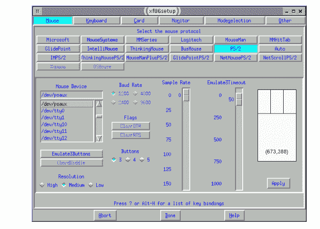

## XFree86 4.0.x 的配置工具

在首次发布时，`XFree86 4.0.x` 的配置实用程序非常少；然而，从那以后情况有所改善。现在至少有三个工具帮助配置 `XFree86 4.0`，尽管并不是所有的发行版都带有所有工具：

`XFree86` `XFree86` 服务器本身具有查询硬件并生成 `XF86Config` 文件的能力。如果没有 X 在在运行，输入 `XFree86-configure` 即可。结果应该是一个文件 `/root/XF86Config.new`。这个新文件可能不会产生最优结果，但它至少是手动修改的起点。

`Xconfigator` 近期版本的 `Xconfigator` 可以生成并修改 `XFree86 4.0.x` 的 `XF86Config` 文件格式，以及 3.3.x 的格式。

`xf86cfg` 这是仅适用于 `XFree86 4.0.x` 的工具。该程序是另一个仅在 X 已经运行时运行的。你的用户界面（如图 2.17 所示）与 `XF86Setup` 一样，让你按喜欢的任何顺序跳跃以配置不同的元素。在 `xf86cfg` 中，你右键点击图标并选择结果 `Configure`（配置）选项来配置元素，或者选择其他选项（删除、禁用等）来执行其他操作。

## 图 2.17 xf86cfg 允许你使用点点操作配置 XFree86 4.0.x。

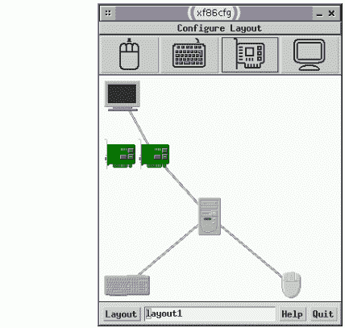

这些实用程序中的某些尝试编辑 `XF86Config` 文件，但另一些可能足够智能并锁定 `XF86Config-4`，如果你的发行版将 `XFree86 4.0.x` 配置文件放在那里。如果实用程序找到错误的文件，它可能会崩溃，你可能需要临时调整文件以使系统工作。

## 手动编辑 XF86Config 文件

在 `XFree86 3.3.6` 和 `4.0.x` 之间某些选项发生了变化，但 `XF86Config` 文件的基础保持不变。此文件由许多标记的节组成，每个节以关键字 `Section` 开头，后跟引号中的名称，并以关键字 `EndSection` 结束。在这两行之间是定义与该功能配置相关的特征行。可能还有注释，即以井号 (`#`) 开头的行。例如，这里有一个定义计算机可以在何处找到关键文件的节：

``` 
Section "Files"
```

```
RgbPath /usr/X11R6/lib/X11/rgb
```

## 允许多个 FontPath 条目

```
FontPath /usr/X11R6/lib/X11/fonts/75dpi
FontPath /usr/X11R6/lib/X11/fonts/Type1
Section
```

## 安装后的 X 配置

接下来的页面将告诉你哪些节和关键部分。这些节包含了了要配置的选项。你可以直接编辑 `XF86Config` 或使用实用程序来完成这些工作（如果你有一个工作的 X，如果不小心删除了这些配置，可能会导致系统无法工作。）

> 警告：如果你有一个工作的 X，在修改之前要备份 `XF86Config`。

## 设置杂项选项

某些 `XFree86 3.3.x` 和 `4.0.x` 之间的选项发生了变化，但 `XF86Config` 文件的基础保持不变。此文件由许多标记的节组成，每个节以关键字 `Section` 开头，后跟引号中的名称，并以关键字 `EndSection` 结束。在这两行之间是定义与该功能配置相关的特征行。可能还有注释，即以井号 (`#`) 开头的行。

> 注意：有时一个配置工具会产生一个工作的 X 系统，但另一个则不能。这在使用挑剔的硬件时特别容易发生，例如笔记本电脑上使用的 LCD 显示器。如果你似乎无法从一个实用程序获得可工作的 X 配置，请尝试另一个。

## 配置路径

`Files` 节包含了计算机可以在何处找到关键文件的信息。这些通过 `FontPath` 行处理。使用此行的示例如下：

```
FontPath "usr/X11R6/lib/X11/fonts/Type1"
FontPath "unix; -1"
FontPath "tcp/fontserver.com:7101"
```

这些行中的第一行指示字体目录，第二行指向本地运行的字体服务器，不可访问。最后一行指向在另一台计算机上端口 7101 的字体服务器。字体服务器是一个向本地或远程计算机提供字体的程序。某些 Linux 发行版使用字体服务器，网络有时使用它们来管理字体。你不需要使用字体服务器，但如果你的发行版默认使用本地字体服务器，你应该保留 `XF86Config` 中的引用。单个 `XF86Config` 可以有多个 `FontPath` 行；X 按顺序在每个指定位置搜索字体。

## 配置键盘

`Keyboard` 节定义了 `XFree86` 中键盘的操作。在大多数情况下，需要修改 `XF86Config` 设置。人们可能想要更改的是 `AutoRepeat` 行。当你按下并保持按键时，系统开始重复，就像你在重复按键一样。此行控制 X 运行时按键的速率。此行形成如下：

```
Option 'AutoRepeat' delay rate 延迟以毫秒 (ms) 为单位，系统开始重复按键之前，速率是每次重复之间的间隔。例如，如果延迟为 500 速率为 200，则系统在按下按键后等待 500ms，之后每 200ms（每秒）产生另一个字符，直到你释放按键。
```


用户可以使用桌面环境的控制工具或其他程序通过设置此选项覆盖覆盖的键盘重复速率。

在某些情况下，你可能还会调整以下行：
```
Option 'XkbModel' 'pc105'
Option 'XkbLayout' 'us'
```

这些设置了键盘模型和布局。模型与按键的数量和位置有关，布局决定了每个按键产生的字符。布局用于指定不同国家或语言的键盘，这些键盘通常包含略不同的按键选择。

## 配置鼠标

`InputDevice` 部分定义了鼠标。此部分通常非常短，如下所示：

```text
Section "InputDevice"
Identifier "Mouse1"
Driver "mouse"
Option "Protocol" "PS/2"
Option "Device" /dev/psaux
Option "Emulate3Buttons"
Option "Emulate3Time" "50"
EndSection
```


在 XFree86 3.3.x 中，此部分被称为 Pointer，并且缺少 Identifier 和 Driver 选项。

你可能不需要修改 Identifier 或 Driver 选项。Protocol 是鼠标使用的软件协议。它通常是 PS/2，但也可能是其他协议（微软或罗技），特别是对于较旧的串口鼠标。Device 选项指向与鼠标关联的 Linux 设备文件。这有时是真实设备文件的符号链接，例如 `/dev/psaux`（用于 PS/2 鼠标）、`/dev/usb/mouse`（用于 USB 鼠标）或 `/dev/ttyS0` 或 `/dev/ttyS1`（用于串口鼠标）。第 6 章将详细介绍 `/dev` 设备及其内容。Emulate3Buttons 允许 XFree86 将 2 键鼠标上两个按键的相似按下视为第三个按键，而 Emulate3Time 则告诉系统这两个按下必须持续多长时间（毫秒）。如果系统本身配有 3 键鼠标，则这些选项应该被注释或禁用。

X 程序经常使用中键；例如，文本编辑器用它来粘贴文本。因此，任何 Linux 工作站都应该配备真正的 3 键鼠标，而不是 2 键设备。尽管 Emulate3buttons 选项允许你在 Linux 中使用 2 键鼠标，但这样做会很笨拙。

## 设置显示器选项

X 配置中最复杂的方面之一与显示器选项有关。你可以在 Monitor 部分设置这些选项，该部分往往非常大，特别是在 XFree86 3.3.6 中。一个简化的 Monitor 部分如下：

| Key | Value |
| :--- | :--- |
| Identifier | 'Iiyama' |
| ModelName | 'VisionMaster Pro 450°' |
| HorizSync | 27.0–115.0 |
| VertRefresh | 50.0–160.0 |
| # My custom '1360x1024' mode | 197.8 |
| 1360 1370 1480 1752 | |
| 1024 1031 1046 1072 -HSync -VSync | |

Identifier 选项是一个自由格式的字符串，包含用于在后续部分识别显示器的信息。此部分将配置的各种组件连接起来。Identifier 可以是你喜欢的任何内容。同样，ModelName 选项也可以是你喜欢的任何内容；它主要用于你在查看配置文件时供自己参考。

当你继续阅读该部分时，你会看到 HorizSync 和 VertRefresh 行，它们至关重要；它们定义了显示器可以接受的水平和垂直刷新率范围，分别为千赫兹（kHz）和赫兹（Hz）。这些值共同决定了显示器的最大分辨率和刷新率。尽管名称如此，但单的 HorizSync 项并不决定最大水平刷新率。相反，该值、VertRefresh 值以及分辨率共同决定了显示器的最大刷新率。XFree86 会根据你在其他部分中指定的分辨率，选择显示器将支持的最大刷新率。某些 X 配置工具显示显示器型号列表或分辨率与刷新率组合（例如“800×600 @ 72 Hz”）来获取此类信息。这种方法通常更容易处理，但不如输入精确的水平和同步值那么精确。

## 安装后的 X 配置 133

> 警告
> 不要设置随机的水平和垂直刷新率；特别是在旧硬件上，将这些值设置得太高可能会损坏显示器。（大多数现代显示器会忽略刷新率过高的信号。）

为了确定分辨率，X 会查找一系列模式行（mode lines），这些是通过 ModeLine1 选项指定的。计算 mode lines 非常复杂，所以除非你擅长此类事务，否则我不建议你尝试。mode lines 定义了水平和垂直时间的组合，这些组合可以产生特定的分辨率和刷新率。例如，特定的 mode line 可能定义 90Hz 刷新率下的 1024 × 768 显示，而另一个可能代表 72Hz 下的 1024 × 768。

某些 mode lines 代表超出显示器水平或垂直同步范围的视频模式。X 可以计算这些模式并丢弃显示器无法支持的模式。如果被要求生成分辨率，则 X 会搜索所有匹配的 mode lines，丢弃显示器无法处理的，并使用剩余的在该分辨率下产生最高刷新率的 mode line。（如果没有 mode line 支持请求的分分辨率，X 将退回到指定的指定的（稍后描述），并再次尝试。）

由于这种安排，你会在 XFree86 3.3.x 的 XFree8Config 文件看到大量的 ModeLine 条目。大多数未被使用，因为对于你不使用的分辨率不需要 mode lines，或者因为显示器不支持它们。某些 X 配置工具显示显示器型号列表或分辨率与刷新率组合（例如“800×600 @ 72 Hz”）来获取此类信息。这种方法通常更容易处理，但不如输入精确的水平和同步值那么精确。

## 设置显卡

X 配置的基本方面之一是显卡。

## 第 2 章 · 安装 Linux

| 深度 | 8 |
| --- | --- |
| 模式 | * 1280x1024* * 1024x768* * 640x400* |
| 结束章节 | |
| 子章节 "Display" | 16 |
| 模式 | * 1024x768* * 800x600* * 640x480* |
| 虚拟 | 1280 1024 |
| 视口 | 0 0 |
| 结束子章节 | |

本节有几个需要强调的关键要点：

- * Identifier（标识符）在 ver. XFree86 4.0.x 中指定整体配置。在这个版本的 XFree86 中，一个配置文件可以包含多个 Screen（屏幕）部分，如后文所述。在 XFree86 3.3.x 中，没有 Identifier 行；取而代之的是 Driver（驱动）行，它用于识别 X 服务器（例如 svga、vga16 或 accel；后者代表所有专门的服务器，如 XF86_S3）。当 3.3.x 服务器读取 XConfig 文件时，它会在 Driver 行上找到相应的 Screen 部分。
- Device（设备）和 Monitor（显示器）行分别指向特定的 Device 部分和 Monitor 部分。
- DefaultDepth（默认深度）行指定显示器使用的每像素比特数。例如，上述示例将此值设置为 16，即使用 16 位色彩深度，产生 2^16（或 65,536）种颜色。
- 每个 Subsection（子章节）定义了一种特定的显示类型。它们有关联的色彩深度（由 Depth 行指定）和一系列分辨率（由 Modes 行指定）。系统会依次尝试 Modes 行指定的每种分辨率，直到找到一个可以运行的。此外还有可选参数，例如 Virtual（虚拟，它定义了一个比实际显示屏幕更大的虚拟屏幕）和 ViewPort（视口，即在该虚拟显示器中启动初始显示的点）。

在 XFree86 4.0.x 中，还需要最后一个部分：ServerLayout（服务器布局）部分。该部分由若干行组成，用于识别默认的 Screen 部分并将其与鼠标和键盘定义链接起来。（在 3.3.x 中，只能定义一个鼠标和一个键盘；但 4.0.x 在方面更为灵活）。例如，一个典型的配置将包含类似于下面的 ServerLayout 部分：

## Section "ServerLayout"

| Identifier | "layout1" |
| Screen | "screen1" |
| InputDevice | "Mouse1" "CorePointer" |
| InputDevice | "Keyboard1" "CoreKeyboard" |

EndSection

通常，4.0.x 的 XF86Config 文件仅有一个 ServerLayout 部分，但通过向 XFree86 传递 -layout 参数，你可以告诉服务器使用不同的 ServerLayout 部分（如果存在的话）。你可能用它来用不同的鼠标启动 X，例如——比如使用 USB 鼠标而不是内置的 PS/2 触摸板。

## 配置窗口管理器

正如本章开头提到的，一个运行良好的 X 配置由许多独立的组件组成。这些组件由不同的人选择：编写运行软件的程序员、系统管理员，甚至包括用户。你必须理解这些组件是如何组合在一起的，以便有效地管理和使用 Linux 计算机。

X 处于 X 层级结构的基础。它为视频硬件、鼠标和其他外围设备提供驱动程序，以及具有绘制线、圆、文本等能力的基础低级图形功能。它还可以显示窗口，尽管“原始”窗口对用户来说几乎无法被识别为窗口，因为缺少窗口必不可少的边框和拖动条。这就是第二个组件发挥作用的地方：窗口管理器。

## 理解窗口管理器的作用

窗口管理器为用户提供了控制单个窗口的方法。该工具为 X 窗口提供了一个边框，边框既有装饰性又有功能性。边框允许用户调整窗口大小，并且通常包含顶部或侧面的一部分，允许用户拖动窗口（拖动条）。窗口管理器还控制哪个窗口拥有焦点——即哪个窗口接收键盘或鼠标的输入。有几种不同的焦点模型可用，例如焦点跟随（focus-follows-mouse，你只需将鼠标移动到窗口上方赋予焦点）、点击聚焦（click-to-focus，点击窗口即可赋予焦点）等。窗口管理器至少支持其中两种，尽管今天最常用的是点击聚焦，微软的 Windows 和苹果的 MacOS 也在使用它。同样，窗口管理器控制何时将窗口移动到重叠窗口栈的前端。这可能在窗口获得焦点时发生，也可能需要其他操作。

除了处理单个窗口外，窗口管理器还控制整个屏幕。窗口管理器提供了某种菜单，用户可以通过该菜单运行程序并控制窗口管理器操作的各个方面。此菜单可能是用户点击桌面（屏幕上未被窗口或其他对象覆盖的任何部分）时弹出的菜单；也可以可以通过一个永久可见的图标访问，通常位于屏幕的左下角。无论何种方式，用户都可以通过编辑主目录下的配置文件来自定义此功能——例如，将程序添加到启动菜单中。

许多 Linux 管理器包含分页器（pager）功能。此功能允许你维护多个工作区，并通过通过点击按钮或从菜单中选择选项在它们之间切换。你可能有一个工作区运行文字处理器，另一个运行网络浏览器，第三个运行工具。

## 配置窗口管理器 141

**IceWM** 这款窗口管理器旨在保持尽可能小，同时提供用户最常用的功能，例如分页器（pager）和一些外观的可定制性。尽管它不是最好的，但它与 GNOME 集成良好。你可以在 http://icwm.sourceforge.net 了解更多信息。

**Window Maker** Window Maker 的灵感源自旧的 NeXT 界面，尽管它并没有为 Linux 系统提供任何 NeXT 兼容性。与 IceWM 一样，它的目标是小巧且功能齐全，并与 GNOME 集成良好。官方的 Window Maker 也可以作为 KDE 窗口管理器运行。官方 Window Maker 页面为 http://www.windowmaker.org。

此列表并不详尽。某些窗口管理器（如 FVWM 和 TWM）曾经很流行，但现在不再是大多数系统的默认选择。其他的一些（如 WMX）从未流行过，但可能为至少部分用户提供他们所需的功能。

哪种窗口管理器最好？这就像在问哪种水果最好。虽然你可以对窗口管理器的评估应用客观标准，但主观因素才是更为重要的。例如，你觉得配置格式直观吗？你喜欢窗口管理器的焦点策略吗？它与你的桌面环境集成良好（如果你用了话）？作为用户，最好的办法是尝试几种窗口管理器，直到找到一个你喜欢的。作为系统管理员，你可能应该为用户提供多个选项，尽管这样做会增加你的工作量——如果用户带着窗口管理器的问题来找你，你将知道如何解决该问题，而该问题可能属于某个特定的窗口管理器。

## 运行窗口管理器

运行窗口管理器的第一步是安装。如果你在系统中安装了 X，那么无论你是否知道，你肯定也安装了至少一个窗口管理器。事实上，如果电脑进入 X 模式并且你可以登录并看到窗口边界，或者你可以在文本模式下启动并看到窗口边界，那么一个窗口管理器正在自动运行。这在大多数系统上都是正常现象；默认的 X 登录脚本包含了对标准窗口管理器的调用。

假设你想探索窗口管理器选项，或者你应该检查当前安装了什么，或者正在尝试或更新窗口管理器。之前提到的 X Web 窗口管理器是寻找新窗口管理器的良好来源。大多数窗口管理器网站都包含二进制文件，你可以按照第 3 节的描述使用 `rpm`、`dpkg` 或 `tar` 进行安装。

窗口管理器由用户或由用户的启动脚本运行。因此，作为系统管理员，你通常不需要修改任何设置来使窗口管理器可用。然而，你可以更改默认窗口管理器。你可以在一个系统到另一个系统中进行操作。可能设置此项的文件包括 `/etc/X11/Xconfig`、`/etc/X11/xinitrc`、`/etc/X11/xSession` 和 `/etc/sysconfig/desktop`。

当系统使用 K Desktop Manager (KDM) 或 GNOME 桌面管理器 (GDM) 作为 GUI 登录程序时（这对直接进入 X 的系统很常见），KDM 或 GDM 为用户提供了选择默认登录环境的方法。例如，图 2.20 显示了一个 KDM 对话框。用户可以在会话类型（Session Type）菜单中选择桌面环境或窗口管理器。

图 2.20 GDM 和 KDM 程序为用户提供了选择登录环境的方法。

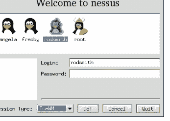

如果登录界面没有提供你想要的窗口管理器，你可以轻松地修改用户登录文件来完成任务。常见的 X 登录脚本包括用于 GUI 登录的 `.xsession` 和 `.Xlogin`，以及从文本模式登录启动 X 的 `.xinitrc`。你可能需要根据选择的登录选项修改不同的文件。这些脚本包含了一系列在登录时运行的命令。作为脚本，它们通常必须是可执行的，并且可以被修改为将所需的窗口管理器作为最后一个运行项启动。

例如，以下脚本启动了一个 `xterm` 窗口和 WMX 窗口管理器：

```
xterm &

wmx
```


需要注意的是，窗口管理器命令之前的大多数命令必须后跟一个安培符号（`&`）。这告诉 Linux 启动程序并在第一个程序完成之前移动到下一个命令。不过，窗口管理器命令通常不应包含安培符号。这样一来，当用户从窗口管理器退出时，Linux 会注销该用户。（所有窗口管理器都包含某种退出命令。今天，其中许多这些命令表现为菜单中的“注销”。）

## 理解小部件集

图 2.18 和 2.19 展示了两种窗口管理器对程序在屏幕上外观的影响以及它们所使用的小部件集（widget set）的行为。这是一套在 X 提供的基础的基础上构建的编程工具。小部件集为程序员提供了简单的方法来显示菜单、对话框等——在窗口内的大多数控件中。因此，它们极大地影响了为 X 编写的程序的整体感觉。

大多数操作系统在内核本身就提供了 Linux 小部件集包含的功能，但在 Linux 中，这些是分开的。两个不同的 Linux 程序可以使用不同的小部件集，结果是，它们将具有不同的外观和行为。一个程序可能使用大字体的栏并要求你按住鼠标按钮进行选择，而另一个可能使用小字体并要求点击，这对于初学者来说可能会令人困惑。

幸运的是，Linux 程序员日益转向两个小部件集：`Qt`（http://www.qt.com/）和 `GTK+`（http://www.gtk.org/）。尽管这些小部件集彼此相互不同，但随着程序员越来越多地使用这两者，Linux 的整体一致性得到了提高。其他具有一定流行程度的小部件集包括 `Motif`（http://www.motif.org/），它在 Unix 和 Linux 程序中一直很流行；`LessTif`（http://www.lesstif.org/），它是 Motif 的完全开源克隆；以及 Athena，它是与 X 关联的标准程序集。

作为系统管理员或用户，除非你想重写程序以使用不同的小部件集，否则你无法控制程序使用什么。程序作者决定使用小部件集，更改它可能是项艰燥的工作。但作为系统管理员，你可能需要安装该库。

`GNOME` 使用 `GTK`，而 `KDE` 构建在 `Qt` 之上。结果是人们经常将程序称为“GNOME 程序”或“KDE 程序”，实际上程序只是使用 `GTK` 或 `Qt`。在 `GNOME` 中使用 `Qt` 程序或在 `KDE` 中使用 `GTK+` 程序也是完全可能的，前提是你安装了相应的库。然而，少数程序依赖于桌面环境的其他元素。如果是这样，它们将需要安装竞争环境的额外部分。

## 配置桌面环境

窗口管理器是一个实用的工具，但它绝非就能创建一个舒适的体验。习惯于使用运行 MacOS、Windows、OS/2 或其他 GUI 环境的计算机的用户已经习惯了手头有各种工具。这些工具包括文件管理器（用于复制文件、启动程序等）、小型实用程序程序（文本编辑器、计算器等）、系统配置工具（设置键盘重复率、默认字体等）以及各种其他杂项工具。虽然 Linux 中提供了这些程序，但它们并不总是能良好地工作。例如，在一个程序中设置的默认字体可能在另一个程序中无效。

桌面环境负责处理这些需求。桌面环境是一个集成程序套件，旨在为用户提供其他 GUI 操作系统习惯的触手可及的各种便利设施。桌面环境在窗口管理器的基础上，添加实用程序和配置程序，以创建一个舒适的工作环境。

## Linux 常见的桌面环境

Linux 提供了多种桌面环境，下面列出了最常见的几种：

- [KDE](http://www.kde.org) 可能是 Linux 中最流行的桌面环境。它基于自己的窗口管理器 `KWM` 和 `Qt` 小部件集构建。`KDE` 在 2001 年年中已进入 2.1 系列，它非常先进且完备。大多数 Linux 发行版都青睐 `KDE`。
- [GNOME](http://www.gnome.org) 是 `KDE` 的主要竞争对手。它是几个发行版（包括红帽 Red Hat 和 Debian Debian）的默认环境。`GNOME` 构建在 `GTK` 之上，并在 1.2 版本中使用了 `Sawfish` 窗口管理器。`GNOME` 没有像 `KDE` 那样精细（`GNOME` 较新），但两者非常接近。
- `CDE` 通用桌面环境（`CDE`）是商业用 Unix 系统上的商业桌面环境。它基于 `Motif` 小部件集构建。`Graphics`（http://www.xxi.com）提供了名为 `DeTop` 的 Linux 版本。
- `XFce` 这是一个仿 `CDE` 建模的开源环境，但它使用 `GTK+` 小部件集。它没有 `KDE` 或 `GNOME` 那样完备，但对磁盘和内存的消耗也较低。你可以在 http://www.xfce.org 了解更多信息。

大多数发行版同时附带 `KDE` 和 `GNOME` 桌面环境，尽管如前面提到的，大多数发行版会选择其中一种，并投入更多精力将桌面环境的配置调得正确。除 `CDE` 外，所有这些环境都是开源软件，因此获取和分发它们并不是问题。

作为系统管理员，在桌面环境方面，你最好的选择是决定支持哪一个。你可以在一台计算机上安装多个桌面环境，并允许用户在登录时在它们之间进行选择，正如前面介绍窗口管理器时提到的。然而，安装多个桌面环境可能会消耗大量的磁盘空间。例如，`GNOME` 和 `KDE` 消耗的磁盘空间可能远超过 100MB。另一方面，应用程序数量的增加需要安装其中一个环境的大部分子集，即使该应用程序并不是 `KDE` 或 `GNOME` 的官方部分。

## 运行桌面环境

从系统管理员和用户的角度来看，运行桌面环境的方式与运行窗口管理器非常相似。`KDM` 和 `GDM` 登录程序可以配置为启动桌面环境。如果用户有自定义的登录脚本，你可以在其中包含 `startkde` 或 `start gnome` 来启动 `KDE` 或 `GNOME`，以替代前面描述的对简单窗口器的调用。

`KDE` 和 `GNOME` 都包含了从屏幕左上角的菜单中运行关联程序的能力。`KDE` 菜单看起来像一个字母 K，而 `GNOME` 菜单看起来像一个 G 形状的脚印。这些菜单中列出的所有程序都与其各自的桌面环境相关，但其中许多是相关的。通过浏览选项可以了解它们是什么。某些选项允许你配置桌面环境本身的功能。特别是 `GNOME` 控制中心（`GNOME Control Center`）和 `KDE` 控制中心（`KDE Control`）都让你获取有关系统硬件的信息并调整你的环境（如键盘重复速率、屏幕等功能）。

尽管桌面环境旨在为新用户提供友好的界面，但它们依赖于类似于其他 Linux 程序所使用的文本配置文件。`KDE` 的设置存储在用户主目录的 `.kde` 子目录中，而 `GNOME` 为此目的使用 `.gnome`。原则上，你可以通过编辑这些文件来更改你的环境操作。但在大多数情况下，使用为此目的提供的 GUI 配置工具更简单。如果某个环境行为出现异常或错误，删除整组配置文件可能会有效——但此操作将导致你可能创建的任何自定义内容的丢失。尝试重命名备份目录；这样，如果你知道某些恢复起来可能太琐的特定文件，你就可以恢复单个配置文件。

## 混合组合桌面环境组件

尽管 `KDE`、`GNOME`、`CDE` 和 `Xfce` 都是为集成环境设计的，但可以混合组合来自所有这些系统的组件。例如，你可能想使用 `KDE` 的音频 CD 播放器和 `GNOME` 的混音器（以控制你所播放的 CD 音量）。这无疑是可能的。主要的缺点是你可能会丢失某些功能，因为程序之间的交互可能没有它们预想的那么好。例如，一个个人日程安排程序和电子邮件工具如果设计成如此，可能会共享联系人数据库；但如果你混合组合组件，你将失去共享它们的能力。

事实上，从其他程序的碎片以及未关联的程序构建你自己的环境是可能的。这种方法实际上可以节省内存，因为你可能不会在你从不使用的工具和功能上花费内存。另一方面，如所述，这种方式混合组合组件会牺牲功能。

无论是使用单个组件还是生成一个完全独特的桌面环境，混合组合组件都是你作为系统管理员不需要担心的事情。这是个人用户需要做的事。

# 总结

Linux 安装过程涉及实现你在规划安装时所做出的许多决定。你必须运行 Linux 安装程序，选择安装的概括轮廓（文本、GUI 等），设置各种选项，选择包并设置安装程序。如果一切顺利，当安装程序完成它的工作后，你就可以重启进入 Linux。

总结 X 如何确定显示器的刷新率。X 使用显示器的最大水平和垂直刷新率，以及一系列固定模式行（mode lines），这些模式行定义了各种视频分辨率的特定计时参数。X 会在指定的分辨率下选择能够产生显示器允许的最高刷新率的模式行。

描述窗口管理器（window manager）在 X 中的作用。窗口管理器为窗口提供装饰性及功能性的边框。它还控制整个屏幕，提供启动实用程序以及各种小工具的手段。

总结窗口管理器与桌面环境之间的关系。窗口管理器是桌面环境的一个组件。桌面环境还包括文件管理器、配置工具和各种小工具。

## 本章命令

| 命令 | 描述 |
| --- | --- |
| `xf86config` | 基于文本的 XFree86 3.3.x 配置程序 |
| `Xconfigurator` | 基于文本或 GUI 的 XFree86 3.3.x 和 4.0.x 配置程序 |
| `XFree86Setup` | 基于 GUI 的 XFree86 3.3.x 配置程序 |
| `XFree86` | 可以自动生成自身配置文件的 XFree86 4.0.x 服务器 |
| `xf86cfg` | 基于 GUI 的 XFree86 4.0.x 配置程序 |

## 关键术语

在参加考试之前，请确保你熟悉以下术语：

- 坏块 (`bad block`)
- 协调世界时 (`UTC`)
- 创建文件系统
- 数据显示通道 (`DDC`)
- 拖条 (`drag bar`)
- 动态链接 (`dynamically linked`)
- 焦点 (`focus`)
- 字体服务器 (`font server`)
- 格式化 (`formatting`)
- 帧缓冲区 (`frame buffer`)
- GNU 网络对象环境 (`GNOME`)
- 格林威治时间 (`Greenwich Mean Time`)
- K 桌面环境 (`KDE`)
- 模式行 (`mode line`)
- 分页器 (`pager`)
- 代理服务器 (`proxy server`)
- 静态链接 (`statically linked`)
- 部件集 (`widget set`)
- X
- X 客户端 (`X client`)
- X 服务器 (`X server`)
- X 窗口系统 (`X Window System`)
- XFree86

# 复习题

- 1. 下列哪最能描述典型 Linux 发行版的安装方法？
    - A. 安装程序是一个较小的 Linux 系统，从软盘、CD-ROM 或硬盘启动，以便在硬盘上安装一个更大的系统。
    - B. 安装程序是一组 DOS 脚本，用于将文件复制到硬盘，然后运行一个转换程序将目标分区转换为 Linux 分区。
    - C. 安装程序仅从网络服务器启动，允许从 CD-ROM 或网络连接进行安装。
    - D. 安装程序在 Minix 操作系统下运行，该系统足够小，可以放入软盘中，但可以将数据复制到 Linux 分区。

- 2. 下列哪是 GUI 安装优于基于文本安装的优点？
    - A. GUI 安装程序支持的硬件比其文本对应的程序更多。
    - B. GUI 安装程序可以提供分区大小、软件包浏览器等内容的图形化表示。
    - C. GUI 安装程序即使在仅支持 VGA 图形的的显卡上也能工作。
    - D. GUI 安装程序在安装期间能更好地测试系统硬件。

- 3. 在安装期间指定指针类型时，你必须提供什么信息？（选择所有适用项）
    - A. 是鼠标还是轨迹球
    - B. 它是使用光学机制还是机械机制
    - C. 它使用的接口类型（PS/2、串口或 USB）
    - D. 指针有多少个按钮

- 4. 在为 Linux 创建分区时，你可以使用以下哪项？（选择所有适用项）
    - A. 在系统安装之前运行的来自紧急磁盘的 Linux `fdisk`
    - B. PowerQuest 的 PartitionMagic 或类似的第三方工具
    - C. Disk Droid 或另一个特定于分发行版的安装时工具
    - D. 在系统安装之前运行的 DOS FORMAT 实用

- 5. 你应该将交换分区（swap partitions）关联到哪个挂载点？
    - A. `/`
    - B. `/swap`
    - C. `/boot`
    - D. 无

- 6. 坏块检查（bad block check）的作用是什么？
    - A. 它验证在安装期间写入磁盘的数据是否正确。
    - B. 它检查硬盘中不可靠的扇区并确保它们不被使用。
    - C. 它检查内部一致性的依赖关系信息。
    - D. 它寻找持有丢失数据的磁盘扇区序列。

- 7. 为什么在系统安装期间或之后立即设置 `root` 密码很重要？
    - A. 没有 `root` 密码的系统相对容易被破解。
    - B. 必须设置 `root` 密码系统才能挂载文件系统。
    - C. 在定义普通用户账户之前，必须设置 `root` 密码。
    - D. 在设置普通用户密码之前，必须设置 `root` 密码。

- 8. 如果你的安装允许输入拨号 PPP 账户信息，你可能被要求输入以下什么类型的信息？（选择所有适用项）
    - A. 一个或多个拨号电话号码
    - B. 你使用的 ISP 名称
    - C. 账户名和密码
    - D. 由 ISP 分配的你的 IP 地址

- 9. 为什么你可能会延迟到安装系统后再创建大多数用户账户？
    - A. 系统安装期间创建的用户账户本质上是不安全的。
    - B. 安装期间创建的账户在被删除之前只能登录一次。
    - C. 使用普通实用程序和安装时工具创建账户有更多可用选项。
    - D. 你可以使用安装时工具创建账户。

- 10. 在安装期间选择组（groups）的缺点是什么？
    - A. 你必须之后卸载整个组。
    - B. 安装的组通常是不完整的。
    - C. 组通常会随系统一起安装。
    - D. 组在之后可以可以卸载。

- 11. 安装日志文件通常揭示哪些类型的信息？（选择所有适用项）
    - A. 计算机的名称
    - B. 安装的软件包
    - C. 关于软件包的注释
    - D. 软件包的安装

- 12. 下列哪项对于定位显卡驱动程序是有用的？
    - A. Windows 下的显卡
    - B. 显卡上的标记
    - C. 显卡使用 ISA、PCI 或 AGP
    - D. 制造商名称

- 13. 关于 XFree6 安装，下列哪项是正确的？
    - A. 如果不随系统安装它，你必须从源码重新编译。
    - B. 大多数发行版随系统一起安装。
    - C. 如果你更改显卡，必须重启所有 XFree6。
    - D. XFree6 可以共存。

- 14. 当配置 X 服务器时，你需要修改配置文件并重启。下列哪项可以简化这一过程？
    - A. 通过切换运行级别关闭 X，配置后使用 `startx`。
    - B. 通过进入单用户模式关闭 X，配置后使用 `telinit`。
    - C. 配置 X 然后拔掉电脑。
    - D. 使用 `startx` 工具检查配置文件。

- 15. 下列哪项总结了 X 文件的结构？
    - A. 文件包含多个部分，每个屏幕一个。每个部分包含组件的子部分。
    - B. 配置选项可以任何顺序输入。特定组件的选项可以穿插。
    - C. 文件以每个屏幕的摘要开始。选项之前有一个指示适用于哪个屏幕的代码。
    - D. 文件被分成部分，每个组件一个或多个。在文件末尾有一个或多个部分定义了如何组合这些部分。

- 16. 字体服务器的优点是什么？
    - A. 它提供了比其他方式更字体显示。
    - B. 它可以简化具有许多 X 服务器的网络的字体维护。
    - C. 它是 XFree86 4.0.x 提供 TrueType 字体的唯一手段。
    - D. 它允许计算机将位映射转换为 ASCII 文本文件。

- 17. 显示器手册列出的允许同步值范围为水平 27–96kHz，垂直 50–160Hz。这对于显示器能够支持的 own和刷新率有什么影响？
    - A. 显示器在所有分辨率下都可以达到 160Hz 的垂直刷新。
    - B. 根据颜色深度，显示器可以处理高达 160Hz 的垂直刷新率。
    - C. 根据分辨率，显示器可以处理高达 160Hz 的垂直刷新率。
    - D. 显示器可以处理垂直分辨率高达 600 行（96,000 / 160），但不能更多。

156 第2章 安装 Linux

18. 在 XF86Config 的哪个部分指定你想要运行的分辨率？
    - A. 在 `Screen` 部分的 `Display` 子部分，使用 `Modes` 选项
    - B. 在 `Monitor` 部分，使用 `Modeline` 选项
    - C. 在 `Device` 部分，使用 `Modeline` 选项
    - D. 在 `DefaultResolution` 部分，使用 `Define` 选项

19. 哪个主要的 Linux 桌面环境是商业软件包？
    - A. `KDE`
    - B. `GNOME`
    - C. `CDE`
    - D. `Xfce`

20. 从一个桌面环境运行另一个运行程序时，以下哪是正确的？
    - A. 你必须在计算机上安装必要的支持库（例如用于 `GNOME` 程序的 `GTK+` 库）。
    - B. 你必须为两个环境配置相同的键盘重复率、鼠标速度等默认值。
    - C. 你必须在目标程序的父环境中进行配置；之后，它可以从其他环境无缝运行。
    - D. 你必须从父环境的文件管理器启动该程序。

# 复习题答案

- 1. A. 大多数 Linux 发行版使用用 Linux 编写的安装程序，而不是 DOS 或 Minix。系统通常从软磁盘或 CD-ROM 启动，尽管其他启动媒体（如硬盘甚至网络）也是。
- 2. B. GUI 安装程序使用的位图显示可以用于显示文本模式无法显示的系统状态的图形化表示。基于文本的安装程序在硬件支持方面实际上具有优势，因为它们可以在 X 不支持显卡上运行。
- 3. C. 接口和缓冲区数量对鼠标配置非常重要。形式（鼠标、轨迹板等）和底层技术（光学、机械等）对 Linux 来说并不重要，因此不需要指定。
- 4. A, B, C. 你通常可以使用任何创建分区的工具定义分区，尽管使用某些工具（如 DOS 的 FDISK），你可能需要使用 Linux 工具更改分区类型。DOS FORMAT 工具用于创建 FAT 文件系统，而不是定义分区。
- 5. D. 交换分区不像文件系统那样被挂载，因此它们没有关联点。
- 6. B. 随着硬盘老化，其磁性会退化，导致扇区变得不可靠。坏块检查会寻找这种情况，通过避免受影响的扇区来提高数据存储的可靠性。然而，当磁盘开始积累坏块时，其他区块损坏的可能性增加，因此最好更换磁盘。
- 7. A. 如果没有设置 root 密码，任何物理访问计算机或登录普通账户的人都可以对计算机配置进行任何操作。root 密码不需要挂载根文件系统，也不需要配置用户帐户或密码。

## 第2章 安装 Linux

- 8. A, C. PPP 拨号配置需要计算机拨打的电话、用户名和密码。PPP 不需要 ISP 的名称。尽管 PPP 允许静态 IP 地址分配，此信息通常由 ISP 自动提供。
- 9. C. 普通账户创建工具提供了许多选项来定制和微调它们创建的账户。这些大多数选项在安装时的账户创建工具中是缺失。
- 10. C. 软件包组是系统中承担某些作用的包组。你可能只需要某些单独包，安装整个组可能会浪费本可以用于其他用途的磁盘空间。
- 11. B, D. 安装日志文件通常总结遇到的错误，这就是过程。

管理已安装的软件涉及各种任务，其中许多任务针对特定类型的软件甚至是特定的软件包。其他章节涵盖了某些特定示例，例如 Windows 系统配置（在第 2 章“安装 Linux”中介绍）或网络客户端和服务器的配置（第 5 章“网络连接”）。本章涵盖了软件包安装的通用机制，使用了三种常见打包方案中的任何一种。由于 Shell 命令在包管理和其他日常 Linux 管理中至关重要，本章从查看 Shell 的使用开始介绍。

在软件包安装过程中，有一个特定的程序值得特别关注，尽管有时像升级其他程序一样升级内核，但通过从头开始编译内核来升级通常是有有益的。即使你不这样做，可能也需要通过引导加载程序修改内核的加载方式。本章也涵盖了这些问题。

## 命令行 Shell 的使用

Shell 是一种允许你通过启动程序、操纵文件和发出命令与计算机进行交互的程序。如果你读过第 2 章，这听起来可能与那里对桌面环境或文件管理器的定义非常像，在某种意义上，这些程序就是图形化 shell。不过，shell 一词通常用于基于文本的程序，而这正是本节所描述的——用于控制 Linux 系统的文本程序。即使你更倾向于使用 GUI 环境，理解基本的 shell 使用也很重要，因为 shell 提供了跨发行版和其他环境中最一致的用户界面。你还可以通过文本模式的网络连接使用基于文本的 shell。一旦启动了 shell，你就可以查看和操纵文件并启动程序。

## 启动 Shell

Linux 支持许多不同的 shell，尽管具体安装哪一个取决于不同的发行版。大多数 Linux 系统都包含 `bash`，它通常是新用户的默认 shell。另一种常见的 shell 称为 `tsh`、`zsh`、`csh` 和 `ash`，还有许多其他可供的 shell 可用。大多数 shell 在大体上是相似的，但有些有所不同。

启动 shell 有许多不同的方法，其中大多数方法至少是部分自动的。常见方法包括以下：

- **在文本模式控制台登录**：如果你使用文本模式控制台登录计算机，将看到你的默认 shell，就像你在你的用户账户信息中定义的那样（见第 4 章“用户与安全”）。
- **远程登录**：通过 Telnet、安全外壳（SSH；使用 SSH 名称，SSH 不是此处讨论的意义上的 shell，但它会自动启动一个 shell）或其他文本模式登录都将启动一个 shell。
- **启动 `xterm`**：`xterm` 是一个可以运行基于文本程序的 GUI 程序。默认情况下，`xterm` 通常会启动你的默认 shell，除非另有说明。第 6 章“管理文件与服务”中的“启动 xterm”小节详细讨论了 `xterm`。
- **显式启动 shell**：你可以从一个 shell 启动另一个。如果你在运行另一个 shell 的同时需要某个 shell 的某些功能，这将很有帮助。输入新 shell 的名称来启动它。

当你启动 shell 时，你会看到一个用于输入的*命令提示符*。虽然不是通用的，但命令提示符通常包含你的用户名、计算机主机名或 shell 运行所在的目录。例如，命令提示符可能像如下：


当你启动一个 shell 时，你会看到一个*命令提示符*用于输入。虽然不是通用的，但命令提示符通常包含你的用户名、计算机主机名或 shell 运行所在的目录。例如，命令提示符可能像如下：

```
[rodsmith@nessus /mnt]$
```

# 第 3 章 · 软件管理

虽然不是通用惯例（可以在用户的配置文件中设置），但最后一个字符通常是普通用户的美元符号（`$`）或 root 用户的井号（`#`）。这用作超级用户状态的视觉指示；在 root shell 中输入命令时你应该小心，因为从这种 shell 中很容易损坏系统。（第 4 章更详细地讨论了 root 及其功能。）

本书在单独的行中包含了命令示例。当命令不是普通用户可以发出的时，其前面有一个 `$` 提示符；当只有 root 发出命令时，其前面有一个 `#` 提示符。由于用户名、计算机名和目录通常不重要，这些信息在书中打印的提示符中被省略了。文本段落中的命令示例也省略了提示符。

## 查看文件和目录

使用 shell 时，通常需要查看给定目录中的文件。此任务通过 `ls` 命令完成，该命令显示当前目录或你在命令后指定的目录的内容。如果你列出一个文件，它只会显示文件名。它的用法如下所示：

```
$ ls -l /var
```

默认情况下，`ls` 创建的列表是按文件名排序的。在其他系统上，`ls` 显示带颜色编码的名称，以便你轻松识别目录和其他文件类型。该命令接受许多可以修改其行为的参数。其中最常见的参数之一是 `-l`，它按长度创建列表，如下：

```
$ ls -l *
```

## 操纵文件

如果你需要移动或重命名文件，你应该使用 `mv` 命令。该命令将文件关联一个新的名称（可能在不同的目录中）。要使用它，在命令后面输入源文件名和新文件名。例如，查看如下：

```
$ mv somefile.txt newfile.txt
```

此命令会将 `somefile.txt` 移动。

如果你需要删除文件，可以使用 `rm` 命令，它可以移除文件。在命令后列出你想要删除的文件，如下：

```
$ rm testfile.txt
```

如果你想切换到另一个目录，你应该使用 `cd` 命令。在 `cd` 后面加上你想要进入的目录路径。路径既可以是绝对路径（以 `/` 开头），也可以是相对路径（不以 `/` 开头）。例如：

```
$ cd /tmp
```

## 启动程序

你可以通过输入程序名称从 shell 启动程序。事实上，许多“命令”（包括 `ls` 和 `mv`）实际上是 shell 运行的程序。大多数标准命令位于 `/bin` 目录，但 shell 会搜索 `PATH` 环境变量（在第 6 章详细介绍）中指定的目录来寻找命令。如果你输入路径中的任何程序名称，shell 就会运行该程序。你还可以向程序传递参数——程序可以以特定方式使用的可选信息。例如，要操纵的文件名就是 `mv` 和 `rm` 命令的参数。许多程序接受以一个或两个横杠后跟代码的代码，例如 `-r` 或 `-t`。大多数参数对大小写敏感，在许多程序中，参数的大小写版本有不同的用途。

大多数文本程序会接管显示器（文本模式登录、会话、xterm 或你所拥有的）。许多程序在返回 shell 之前显示很少或没有信息，因此你不会注意到这一点。某些程序作为文本编辑器会真正控制显示器；它们可能会清除之前出现的所有信息并在显示器上填充自己的信息。其他程序可能不会完全清除屏幕，甚至不会显示自己的信息，但它们可能运行很长时间。在某些情况下，你可能希望在程序后台运行时保留对 shell 的控制。要做到这一点，在命令后跟一个取符号 `&`。这样做后，程序将附加到启动它的显示器，但它与 shell 共享显示器。这对于非交互式程序有效，但对于交互式工具效果很差。

## Shell 快捷键

Shell 允许一些最重要的操作快捷键。这些快捷键中最实用的是使用 Tab 键对 `filename` 进行补全。假设你想移动一个名为 `shareholder-report-for-2001.txt` 的文件。你可以输入整个文件名，但这可能变得非常繁琐。大多数 shell（包括流行的 bash shell）都支持一种功能：只要你输入了足够的字符来唯一定义该文件或命令，按下 Tab 键即可补全未完全的命令或文件名。例如，假设 `ls` 显示了目录中的两个文件：

```
$ ls
share-price-in-2001.txt  share-report-for-2001.txt
```

如果你想将第二个文件移动到另一个目录，你可以输入命令 `mv`，然后按 Tab 键。shell 将将补全文件名，因此你的命令行就变成了 `mv share-report-for-2001.txt`。

# 包概念

追踪文件到其所有者。系统中还有一个校验和以及关于文件所有权和权限的信息，这使得检测文件是否被修改变得可能——前提数据库也没有被修改。不过，这些文件信息并不适用于某些包的自定义配置文件。然而，标准的配置文件通常会被跟踪。

**依赖关系 (Dependencies)** 依赖关系是一个包对另一个包的依赖。例如，许多程序依赖于 `libc`。包包含了它们所依赖的文件或包的信息。此功能允许包管理系统检测到这些依赖关系，并在依赖项未满足时阻止包的安装。如果一个包依赖于其他包，我们也会阻止该包的删除。

**提供信息 (Provision information)** 某些包提供了被其他包使用的功能。例如，邮件客户端可能依赖于邮件服务器，而 Linux 有不同的邮件服务器。在这种情况下，无法使用简单的文件或包依赖关系，因为任何一个邮件服务器都可以满足客户端的需求。尽管如此，这种功能本质上也是依赖的一种。

每当你通过包管理系统安装、删除或修改包时，系统都会更新其数据库以反映你所做的更改。随后，你可以查询已安装包的数据库，并且在你稍后修改安装时，系统可以使用该数据库。通过这种方式，系统可以避免麻烦——例如，如果某个包包含会覆盖另一个包所属文件的文件，系统可以警告你并避免安装该包。

包数据库不包括任何非通过包管理系统安装的文件或包的信息。由于这个原因，最好不要将不同类型的包混合在一起。虽然可以在一台计算机上同时安装 RPM 和 Debian 包管理系统，但它们的数据库仍然保持独立，从而削弱了冲突跟踪和依赖关系的优势；依赖于该库的 RPM 包将不知道该库已安装，因此除非你提供覆盖开关，否则它们不会安装。此外，当你删除或升级该库时，你可能不会收到其他程序需要该库的警告，因此你可能会在无意中破坏 RPM 包。

某些程序以 tar 包（tarball）的形式分发。在这种情况下，你可以尝试从 tar 包构建 RPM 或 Debian 包，或者直接从 tar 包中安装，而不具备包管理系统的益处。虽然后者的选项有上述缺点，但它通常比创建 RPM 或 Debian 包要简单得多。如果你只安装了几个这样的程序，不会遇到太大麻烦，特别是如果你对从 tar 包安装的内容留了良好的记录。通常，你从源码编译的程序位于 `/usr/local` 目录树中，大多数 RPM 或 Debian 包都不会使用该目录。这一事实有助于保持程序类型的隔离，进一步减少出现麻烦的概率。

如果你有一个二进制 tar 包，你可能可以使用 `alien` 实用将其转换为 RPM 或 Debian 包，该工具将在接后的“转换包格式”中进行描述。

# 重建包

包系统的一个功能是，它们允许你直接安装二进制包（有时称为预编译包），或者在你自己的系统上重新编译源码包。前者方法通常更简单且更耗时，但后者也有其优。。具体来说，当你从源码重新编译时，可以对程序进行自定义。这可以包括对程序源码的更改以及编译时的自定义（例如在不寻常架构上编译包）。RPM 和 Debian 系统都可以通过更简单的 tar 包进行重新编译——事实上，源码分发的主要手段通常是 tar 包。

如果你发现某个没有其他形式提供的包的 tar 包，你有两个基本选择：你可以根据 tar 包中的指令编译或安装软件，如果你的系统使用了 RPM 或 Debian 数据库，这样做会跳过它；或者你从 tar 包创建一个 RPM 或 Debian 包。

# 安装和删除包

Linux 世界中最流行的包管理器是 RPM。事实上，RPM 也适用于非 Linux 平台，尽管它在 Linux 世界之外的可见较少。RPM 系统提供了早期章节中描述的所有基本工具，例如“包概念”，例如允许检查特定包的冲突和所有权的包数据库。

## 使用 RPM 的发行版

正如 RPM 的全名（Red Hat Package Manager）所示，RPM 是由红帽公司为自己的发行版而开发的。然而，红帽根据通用公共许可（GPL）发布了该软件，因此其他人可以在自己的发行版中自由使用它，事实上，正是这开启了局面。某些发行版，如 Mandrake、TurboLinux 和 Yellow Dog 是基于红帽的，它们也使用 RPM 以及红帽发行版的许多其他部分。其他发行版如 SuSE 和 Caldera，从红帽模板中借鉴的较少，但它们确实使用 RPM。

RPM 是一个跨平台工具。如前文提到的，某些非 Linux 的 Unix 系统可以使用 RPM，尽管大多数系统并不将其作为主要的发行版系统使用。RPM 支持任何 CPU 架构。事实上，红帽 Linux 至少支持三种 CPU 架构：x86、Alpha 和 SPARC。

RPM 软件包的命名惯例如下：

```
classname-a.b.c-arch.rpm
```


文件名中的每个组件都有特定的含义：

- `classname`：这是软件包的名称，例如用于 Samba 文件和打印机服务器的 `samba`。
- `a.b.c`：这是软件包的版本号，例如 `2.0.7`。版本号不一定是用句点分隔的数字，但这是最常见的格式。版本号由程序作者指定。
- `x`：紧随其后的数字是构建号（也称为发布版本），此数字代表软件包管理器所做的微小更改，而不是程序作者所做的。这些更改可能代表启动脚本或配置文件的修改、文件位置的更改、文档的添加，或者是附加到原始程序的补丁，以修复漏洞或提高包与目标 Linux 发行版的兼容性。某些发行版维护者会在构建号后添加一个字母，以将他们的软件包与其他区分来。请注意，这些数字在不同的软件包维护者之间*不是*可比较的——George 的某个包构建号 3 *并不一定*比 Susan 的同一包构建号 4 更改进。

# 第 3 章 · 软件管理

`arch` 产生 `.rpm` 扩展名的最后一个组件是软件包的架构代码。`i386` 是最常见的架构代码；它代表为从 80386 开始的任何 x86 CPU 编译的文件。某些包包含了针对 Pentium 或更高版本（`i686`）的优化，以及针对其 CPU 的非 x86 二进制代码，例如针对 PowerPC CPU 的 `ppc`。脚本、文档和其他与 CPU 无关的包通常使用 `noarch` 架构代码。该规则的唯一例外是 RPM，它使用 `src` 架构代码。

在理想化世界中，任何 RPM 软件包都可以在任何使用适当 CPU 类型的 RPM 发行版上安装并运行。遗憾的是，偶尔会由于兼容性问题出现。这些问题包括：

- 发行版可能使用不同版本的 RPM 工具，稍后将讨论这一点。这个问题可能完全阻止来自某一个发行版的 RPM 在另一个发行版上使用。
- 为某一个发行版设计的 RPM 软件包可能在另一个发行版中无法满足依赖关系。例如，某个包可能需要的库版本比你正在使用的发行版中的版本要新。这类问题通常可以通过安装或升级所需的包来解决，但有时这会导致问题，因为升级可能会破坏其他包。通过从源 RPM 重新构建你想安装的包，你通常可以解决这些问题，但有时底层源代码也需要升级后的库。
- RPM 软件包可能被构建为依赖于特定名称的包，例如 `samba-client` 依赖于 `samba-common`，如果你使用的发行版对该包的命名不同，`rpm` 工具将报错。你可以通过 `--nodeps` 选项来覆盖此报错，但有时包安装后将无法工作。从源 RPM 重新构建可能修复也可能无法修复此问题。

# 表 3.2 rpm 选项（续）

| rpm 选项 | 配合的操作 | 描述 |
| :--- | :--- | :--- |
| `--nodeps` | `-i`, `-U`, `-F`, `-e` | 在不检查依赖的情况下执行。即使软件包依赖于不存在的包或文件，或者被未卸载的包所需，也安装或删除该包。 |
| `--test` | `-i`, `-U`, `-F` | 检查依赖、冲突和其他问题，但不会实际安装软件包。 |
| `--prefix path` | `-i`, `-U`, `-F` | 将安装目录设置为 `path`（仅适用于某些软件包）。 |
| `-a` or `--all` | `-q`, `-V` | 查询或验证所有软件包。 |
| `-f file` or `--file file` | `-q`, `-V` | 查询或验证拥有该文件的软件包。 |
| `-p package-file` | `-q` | 查询未安装的 RPM 包文件。 |
| `-i` | `-q` | 显示软件包信息，包括包维护者、简短描述等。 |
| `-R` or `--requires` | `-q` | 显示该包依赖的包和文件。 |
| `-l` or `--list` | `-q` | 显示软件包中包含的文件。 |

## 安装和卸载软件包

使用 `rpm` 时，你将操作与一个或多个选项结合。在大多数情况下，你会包含一个或多个包名或软件包文件名。（软件包文件名是完整文件名，而包名是缩短版本。例如，软件包文件名可能是 `samba-2.0.7-18mdk.i58`，而匹配的包名是 `samba`。）你可以为每个包单独执行一次 `rpm` 命令，也可以在命令行上列出由空格分隔的多个软件包。当你要安装或卸载多个软件包（其中某些包依赖于该组中的其他包）时，后者更好。在这种情况下，单独执行命令需要你先列出已安装的依赖包，或者使用单个命令在命令行上按任何顺序列出软件包。

某些操作需要你提供软件包文件名，而另一些则需要包名。特别是 `-i`、`-U`、`-F` 和重构（rebuild）操作需要软件包文件名。`-q`、`-V` 通常需要包名，尽管 `-p` 选项可以修改查询 (`-q`) 操作以处理软件包文件名。

在安装或升级软件包时，`-U` 操作通常是最有用的，因为它允许你在无需手动卸载旧包的情况下安装包。当软件包包含许多依赖项时，这种一步操作特别有用，因为 `rpm` 会检测这些依赖项，并在新包满足旧包提供的依赖项时执行该操作。

要使用 `rpm` 安装或升级软件包，请执行类似下的命令：

```
## rpm -Uvh samba-2.0.7-18mdk.i58.rpm
```

如果你还没有安装 `samba` 软件包，也可以用 `rpm -ivh` 代替 `rpm -Uvh`。

在不同的名称下分发同一个程序是可能的。在这种情况下，升级可能会失败，或者产生重复安装，从而导致诡异的程序特定故障。红帽（Red Hat）描述了一套软件包命名系统以避免此类问题，但它们仍偶尔发生。因此，最好使用提供原始包的同一个人或组织提供的后续版本来升级软件包。

Copyright ©2001 SYBEX, Inc., Alameda, CA www.sysex.com

## 第3 章 · 软件管理

使用 `rpm -qi` 命令验证软件包已安装，该命令会显示二进制包是在何时以及在什么种计算机上构建的等信息。列表 3.1 展示了此命令。（`rpm -qi` 还会显示关于软件包内容的扩展纯英语摘要，该摘要在列表 3.1 中省略了）。

### 列表 3.1：RPM 查询输出

```
$ rpm -qi samba

Name : samba                Relocations: (not relocable)

Version : 2.0.7                               Vendor:

MandrakeSoft

Release : 18mdk                               Build Date: Mon

16 Oct 2000 09:54:0 6 AM EST

Install date: Sat 04 Nov 2000 11:36:09 AM EST    Build

Host: no.mandrakesoft.com                Source RPM:

Group : System/Servers

samba-2.0.7-18mdk.src

Size : 10429317                             License: GPL

Packager : Till Kampeter <till@mandrakesoft.com>

Summary : Samba SMB server.
```

## RPM 与其他软件包格式的比较

RPM 是一个非常灵活的软件包管理系统。在大多数方面，它可以与 Debian 的包管理器相媲美，并且提供的功能比工具多得多。与 Debian 软件包相比，RPM 最大的优势可能是它们的通用性。许多软件包可以从其开发者和发行版处获得 RPM 格式的包。

> 注意：发行版经常会修改原始程序，以便使其更顺利地集成到整个发行版中。例如，可能会添加特定于发行版的启动脚本，程序二进制文件可能会从默认的 `/usr/local` 子目录移动，并可能对程序源代码进行补丁以修复错误或添加功能。尽管这些更改可能很有用，但你可能并不想要它们，特别是当你在另一个发行版上使用该程序时。

Copyright ©2001 SYBEX, Inc., CA www.sybex.com

有这么多基于 RPM 的发行版这一事实也是一个优势。你可能可以将为一个发行版设计的 RPM 用在另一个发行版上，尽管前面已经提到，这并不是肯定的。事实上，如果你尝试混合使用太多，这种优势可能会变成缺点——你可能会陷入冲突包的不匹配中，这非常难以理顺。

RPMFind 网站 http://rpmfind.net/linux/RPM 是你想要查找特定程序的 RPM 时的一个非常有用的资源。该网站包含了指向程序作者构建的 RPM、特定发行版的 RPM 以及由第三方构建的 RPM 的链接。

与 tar 包（tarballs）相比，RPM 提供了更精密的软件包管理工具。这在升级或删除软件包以及验证已安装软件包的完整性时非常重要。另一方面，尽管 RPM 在 Linux 世界非常常见，但在其他平台上并不常见。

## Debian 软件包

在整体功能上，Debian 软件包与 RPM 相似，但操作细节各不相同。（这一过程将在稍后的“格式之间的转换”中描述）。

## 使用 Debian 软件包的发行版

顾名，Debian 软件包源于 Debian 发行版。从那时，该格式已被其他发行版采用，包括 Storm 和 Corel。

## dpkg 命令集

Debian 软件包与 RPM 软件包不兼容，但基本原理是相同的。与 RPM 类似，Debian 软件包包含依赖信息，Debian 软件包工具维护已安装软件包、文件等的数据库。你使用 `dpkg` 命令安装 Debian 软件包。该命令的语法与 `rpm` 类似：

```
dpkg [options][action] [package-files][package-name]
```

操作（action）是要执行的操作；常用操作总结在表 3.3 中。选项（options，见表 3.4）会修改操作的行为，类似于 `rpm` 的选项。

## 表 3.3 dpkg 主要操作

| dpkg 操作 | 描述 |
|---|---|
| `-i` or `--install` | 安装软件包 |
| `--configure` | 重新配置已安装的软件包：运行安装后脚本以设置特定特定的选项 |
| `-r` or `--remove` | 移除软件包，但保留配置文件 |
| `-P` or `--purge` | 移除软件包，包括配置文件 |
| `-p` or `--print-avail` | 显示已安装软件包的信息 |
| `-I` or `--info` | 显示未安装软件包文件的信息 |
| `-l pattern` or `--list pattern` | 列出所有名称匹配模式的已安装软件包 |
| `-L` or `--listfiles` | 列出与软件包关联的安装文件 |
| `-S pattern` or `--search pattern` | 定位拥有模式指定的文件的软件包 |
| `-C` or `--audit` | 搜索部分安装的软件包并建议如何处理它们 |

## 表 3.4 细调 dpkg 操作的选项

| dpkg 选项 | 配合使用的操作 | 描述 |
| :--- | :--- | :--- |
| `--root=dir` | 所有 | 使用位于 `dir` 的根目录修改 Linux 系统。可用于在操作系统安装或紧急维护期间维护一个独立于另一个的 Linux 安装。 |
| `-b` or `--auto-deconfigure` | `-r` | 禁用依赖正在移除的软件包的包 |
| `--force-things` | 杂项 | 强制执行特定操作。有关此选项的详情请咨询 `dpkg` 页面 |
| `--ignore-depends=package` | `-i`, `-r` | 忽略指定软件包的依赖信息 |
| `--no-act` | `-i`, `-r` | 检查依赖、冲突和其他问题，而不实际安装或移除软件包 |
| `--recursive` | `-i` | 在指定目录及其所有子目录下安装所有匹配包名通配符的软件包 |
| `-G` | `-i` | 如果已安装了更高版本的软件包，则不安装该软件包 |

## 表 3.4 细调 dpkg 操作的选项（续）

| dpkg 选项 | 配合使用的操作 | 描述 |
| :--- | :--- | :--- |
| `-E` or `--skip-save-version` | `-i` | 如果已安装了相同版本的软件包，则不安装该软件包 |

与 `rpm`一样，`dpkg` 在某些情况下需要包名，在其他情况下需要软件包文件名。具体来说，`--install (-i)` 和 `--info (-i)` 都需要软件包文件名，而其他命令使用较短的包名。

例如，考虑以下命令，它安装了 `samba-common_2.0.7-3.deb`：

```
## dpkg -i samba-common_2.0.7-3.deb
```

如果你正在升级软件包，可能需要在安装新软件包之前移除旧软件包。要执行此操作，对 `dpkg` 使用 `-r` 选项，如下：

```
## dpkg -r samba
```

要查找已安装软件包的信息，对 `dpkg` 使用 `-p` 参数，如列表 3.2 所示。该列表包含了软件包功能的扩展英文描述。

### 列表 3.2：dpkg 软件包信息查询输出

```
## dpkg -p samba-common_2.0.7-3.deb

Package: samba-common

Priority: optional

Section: net

Installed-Size: 3206

Maintainer: Eloy A. Paris <peloy@debian.org>

Architecture: i386

Source: samba

Version: 2.0.7-3

Replaces: samba (<= 2.0.5-2)

Depends: libpam-modules, libc6 (>= 2.1.2), libncurses5, libpamp, libreadline4 (>= 4.1)

Filename: dists/porto/main/binary/i386/samba-common_2.0.7-3.deb

Size: 569538

MD5: 1221667defd35aeb656624af2cacd2


# 第 3 章 · 软件管理

基于 Debian 的系统通常使用名为 `dselect` 的高级工具来处理软件包的安装和移除。`dselect` 提供了已安装软件包以及来自指定源（如 CD-ROM 驱动器或 FTP 站点）可用软件包的文本列表，允许你选择想要安装和移除的软件包。当你想要安装多个软件包时，此界面非常有用，但在操作一两个软件包时，`dpkg` 往往更方便。由于 `dpkg` 可以接受软件包文件名作为输入，它也是从异常源下载或自行创建的软件包的首选方法。

## 使用 apt-get

Debian 软件包管理的另一种选择是 `apt` 工具，特别是 `apt-get`。该工具允许你执行软件包升级，特别是当你有快速互联网连接时。基于 Debian 的系统包含一个文件（通常为 `/etc/apt/sources`），它指定了获取重要软件包的位置。如果你是从 CD-ROM 驱动器安装的操作系统，此文件将包含安装 CD-ROM 目录列表，可以在其中找到它们。可能还有几个……

## 表 3.5 apt-get 命令

| apt-get 命令 | 描述 |
|---|---|
| update | 从 `/etc/apt/sources` 获取可用软件包的更新信息 |
| upgrade | 根据本地存储将所有已安装软件包升级到最新版本 |
| dselect-upgrade | 使用 `dselect` 执行软件包状态的任何更改 |
| dist-upgrade | 与 `upgrade` 类似，但执行“智能”冲突解决，以避免升级破坏依赖关系的软件包 |
| install | 使用可用信息通过包名（而非文件名）安装软件包 |
| remove | 通过包名移除指定的软件包 |
| source | 通过包名检索最新的可用源软件包包 |
| check | 检查软件包数据库的一致性和损坏的软件包安装 |
| clean | 执行清理工作，帮助清除软件包数据库中检索到的文件信息 |
| autoclean | 与 `clean` 类似，但仅移除无法下载的软件包信息 |

## 表 3.6 最常用的 apt-get 选项

| apt-get 选项 | 配合使用的命令 | 描述 |
| --- | --- | --- |
| `-d` or `--download-only` | `upgrade`, `dselect-upgrade`, `install`, `source` | 下载软件包文件但不安装它们 |
| `-f` or `--fix-broken` | `install`, `remove` | 尝试修复依赖未满足的系统 |
| `-m`, `--ignore-missing`, or `--fix-missing` | `upgrade`, `dselect-upgrade`, `install`, `remove`, `source` | 忽略所有无法检索的软件包文件（由于网络错误、文件丢失等） |
| `-q` or `--quiet` | 所有 | 省略部分进度信息。可以双倍（例如 `--qq`）以产生更少的进度信息 |
| `-s`, `--simulate,--just-print,--dry-run`, `--recon`, or `--no-act` | 所有 | 执行操作的模拟，而不实际修改、安装或移除文件 |
| `-y`, `--yes`, or `--assume-yes` | 所有 | 对安装脚本中的任何 yes/no 提示产生“yes”响应 |

## 表 3.6 最常用的 apt-get 选项（续）

| apt-get 选项 | 配合命令 | 描述 |
| --- | --- | --- |
| `-b`, `--compile`, 或 `--build` | `source` | 在检索源码包后对其编译。 |
| `--no-upgrade` | `install` | 如果已安装了旧版本，则导致 `apt-get` 不升级该软件包。 |

如果你使用 `apt-get` 自动升级系统上的所有软件包，你实际上是将系统的控制权交给了发行版维护者。虽然 Debian 或其他分发发行版的维护者不太可能通过这种方式破坏你的电脑，但在你监督极少的情况下进行自动更新，很容易破坏你系统中的某些内容，特别是如果你过去从不常见的源获取过软件包。

## Debian 软件包与其他软件包格式的比较

Debian 软件包的整体功能与 RPM 相似，尽管存在差异。Debian 源码包实际上并不是单个文件；它们是由源码 tar 包、一个用于修改源代码的补丁文件（包括一个用于控制 Debian 软件包构建的文件）以及一个包含数字“签名”以帮助验证内容真实性的 `.dsc` 文件组成的。Debian 软件包工具将这些结合并编译软件包以创建 Debian 二进制包。这种结构使得 Debian 源码包的传输变得不方便，因为你必须移动至少两个文件（tar 包和补丁文件；dsc 是可选的），而不是仅一个。Debian 源码包还支持仅一个补丁文件，而 RPM 源码包包含多个补丁文件。虽然你确实可以将多个补丁文件合并为一个，但这样做会让补丁的来源变得不再清晰，从而更难撤销任何给定的更改。

然而，这些源码包的差异主要针对软件开发人员。作为系统管理员或终端用户，你通常不需要担心这些，除非你必须从源码形式重新编译软件包——即便如此，不同格式之间的差异可能并不具有压倒性。每个系统使用的精确命令和功能有所不同，但它们实现了相似的总体目标。

由于 2001 年封装 Debian 软件包的所有发行版都源自 Debian，因此这些发行版之间（其软件包类型）比基于 RPM 的发行版更具兼容性。特别是，Debian 定义了其系统启动脚本和其他许多功能的细节，以帮助 Debian 软件包在任何基于 Debian 的系统上安装和运行。这有助于基于 Debian 的系统避免可能渗透到 RPM 系统中的启动脚本不兼容问题。当然，某些未来的发行版可能会违反 Debian 在这些问题上的准则，因此这种优势无法保证随着时间的推移而持续。

从实际操作角度来看，寻找某些程序的 Debian RPM 软件包可能是困难的。尽管如此，Debian 在 `http://www.debian.org/distrib/packages` 维护了良好的集合，而且一些程序作者编写了提供的 Debian 软件包。如果你找到了 RPM 但没有找到 Debian 软件包，可能可以使用稍后描述的 `alien` 工具将 RPM 转换为 Debian 格式。如果其他方法都失败了，你可以使用 tar 包，但你会失去 Debian 软件包数据库的优势。

## Tar 包

所有发行版都可以使用 tar 包——使用 `tar` 工具收集在一起，并通常使用 `compress`、`gzip` 或 `bzip2` 进行压缩的文件。与 RPM 和 Debian 软件包一样，tar 包可能包含源代码、二进制文件或作为文档或字体的体系无关文件。然而，这些文件缺乏依赖信息，且 `tar` 不维护已安装文件的数据库，因此通过 tar 包删除程序比删除 RPM 或 Debian 软件包更困难。

## Tar 包的普及性

`tar` 是一个多功能工具。该程序最初是为了将文件归档到磁带上——该名称代表“磁带归档器”（tape archiver）。由于 Unix（以及 Linux）将硬件设备视为文件，像 `tar` 这样的归档程序可以用于在磁盘上创建文件归档。这些文件可以被压缩、复制到软盘或其他可移动介质、发送到网络等。

在 Linux 世界中，tar 包的作用类似于 DOS 和 Windows 世界中的 zip 文件。然而，它们之间存在差异。`zip` 工具（包括 Linux 中的 `zip` 和 `unzip` 命令）先压缩文件，然后将其添加到归档中。相比之下，`*tar*` 不直接进行压缩；要压缩文件，生成的归档需要使用第二个工具（如 `gzip`、`bzip2` 或 `compress`）进行压缩。`gzip` 是 Linux 上最流行的，尽管 `bzip2` 变得越来越常见，且 `compress` 仍在某些 Unix 系统上使用。（`gzip` 可以解压缩旧归档，因此 Linux 系统省略了 `compress`。）生成的文件可能有两个扩展名（`.tar.gz` 或 `.tar.bz2`），或者双扩展名可能会合并为单个三字符扩展名（`.tar.gz`），以便在不支持长或多扩展名的系统（如 DOS 的 FAT）上存储。（旧的 `compress` 归档使用大写的 Z 扩展，因此这些 tar 包名为 `*.tar.Z`）。

RPM 和 Debian 软件包都类似于 tar 包。RPM 使用压缩的 `cpio` 归档（类似于压缩的 tar 归档）来存储其文件。

作为软件包发布机制，tar 主要由 Slackware 发行版使用，它是常用主流 Linux 发行版中最老老的。Slackware 避开了配置工具，转而采用简约的方法。在这方面，Slackware 类似于 Debian，但 Slackware 放弃了软件包管理工具。Debian 也将 tar 包作为软件包管理系统的一部分，但大多数管理员不需要担心这一点。

二进制 tar 包包含预编译的程序。有时 tar 包中包含程序形式允许你直接将 tar 包解压到目标目录。例如，你可以将目标更改为 `/usr/local` 并解压 tar 包，使程序文件落入 `/usr/local/bin`、`/usr/local/` 等处。在其他情况下，你可能需要在临时目录中解压缩 tar 包，然后运行安装实用程序来安装软件。

然而，你对 tar 执行的大部分操作都可以通过常用命令涵盖。表 3.7 列出了主要的 tar 命令，表 3.8 列出了修改这些命令行为的限定符。每当你运行 `tar` 时，你恰好使用一个命令并使用至少一个限定符。

| 命令 | 缩写 | 描述 |
| --- | --- | --- |
| `--create` | `c` | 创建归档 |
| `--concatenate` | `A` | 将 tar 文件合并到归档 |
| `--append` | `r` | 将非 tar 文件追加到归档 |
| `--update` | `u` | 将比归档中文件更新的文件追加到归档 |

## 表 3.7 tar 命令（续）

| 命令 | 缩写 | 描述 |
| --- | --- | --- |
| `--diff` or `--compare` | `d` | 将归档与磁盘上的文件进行比较 |
| `--list` | `t` | 列出归档内容 |
| `--extract` or `--get` | `x` | 从归档提取文件 |

## 表 3.8 tar 参数

| 命令 | 缩写 | 描述 |
| --- | --- | --- |
| `--directory dir` | `C` | 在执行操作前切换到目录 `dir` |
| `--file [host:]file` | `f` | 使用名为 `host` 的计算机上名为 `file` 的作为归档 |
| `--listed-incremental file` | `g` | 执行增量备份或恢复，使用文件作为已归档文件列表 |
| `--one-file-system` | `l` | 仅备份或恢复一个文件系统（分区） |
| `--multi-volume` | `M` | 创建或提取多卷归档 |
| `--tape-length N` | `L` | 经过 N kibytes 后更换磁带 |
| `--same-permissions` | `p` | 保留所有保护信息 |
| `--absolute-paths` | `P` | 保留文件名开头的 `/` |
| `--verbose` | `v` | 列出所有读取或提取的文件；与 `--list` 配合使用时，显示文件大小、所有者和时间戳 |
| `--verify` | `W` | 在写入后验证归档 |

## 表 3.8 tar 参数（续）

| 命令 | 缩写 | 描述 |
| --- | --- | --- |
| `--exclude file` | (none) | 从归档中排除文件 |
| `--exclude-from file` | `X` | 从归档中排除 `file` 中列出的文件 |
| `--gzip --unzip` | | 通过 `gzip` 处理归档 |
| `--bzip2` | `I` or | 通过 `bzip2` 处理归档 |

在表 3.7 列出的命令中，最常用的是 `--create`、`--extract` 和 `--list`。表 3.8 中最实用的参数是 `--file`、`--listed-incremental`、`--one-file-system`、`--permissions`、`--gzip`，以及 `--bzip2`（注意：`--bzip2` 是最近添加的特性，因此如果你使用的是旧版本的 `tar`，它可能无法工作）。如果你没有用 `--file` 参数指定文件名，`tar` 将尝试使用默认设备，这通常（但并非总是）是一个磁带设备。从 tarball 提取文件的典型命令如下：

```
# tar --extract --verbose --gzip --file
--samba-2.0.tar.gz
```

可以使用命令缩写更简洁地表示此命令：

```
## tar xzf samba-2.0.tar.gz
```

无论采用哪种形式，该命令都会从 `samba-2.0.7.tar.gz` 提取文件到当前目录。Tarball 包含整个目录，因此如果这些目录不存在，该命令将创建一个或多个目录，以及目录中的文件。

在提取 tarball 之前，使用 `--list` 命令查看它包含的文件和目录。这些信息可以帮助你定位存储在 tarball 中的文件。此外，万一 tarball 不包含整洁的目录结构，而是包含会直接丢弃在当前目录的文件，这可以帮助你在问题发生之前发现它们。

## Tarball 与其他格式的比较

尽管 Linux 发行版自带了 `tar`、`gzip` 以及通常还有 `bzip2`，但这些工具仅是作为分发操作系统组成软件包的手段。原因是 `tar` 缺乏维护软件包数据库的机制。虽然可以创建一个包含完整 Linux 发行版的 tarball 集，甚至可以编写安装脚本来安装任意 tarball 子集，但维护这样一个系统面临着挑战。如果没有依赖信息或关于哪些文件属于哪些包的信息，删除包或安装可能依赖其他包的新包将变得困难。例如，如果你安装了一个新的邮件阅读器，它可能会崩溃或无法启动，因为它依赖于你不拥有的库，或者依赖于你已拥有的库的更新版本。经验系统管理员有时可以很轻松地诊断此类问题，但这些困难经常让管理员感到困扰。

`tar` 的一个有用特性是，该程序可以轻松地创建文件，也可以从中提取文件。你可以使用此特性来创建你自己编写或构建的文件、文档或程序。当然，你也可以创建 RPM 或 Debian 软件包，但这个过程要复杂得多，通常的方法需要你预先提供一个源代码的 tarball。创建一个单个目录中所有文件的 tarball 是容易的：

```
# tar cvzf-my-stuff.tgz my-stuff-dir
```


可以使用类似的命令来备份目录甚至整个软件包。你不再提供 tar 文件名，而是指定一个磁带设备文件的名称，例如用于第一个 SCSI 磁带单元的 `/dev/st0`。此主题将在第 7 章中进一步讨论。

无论你是创建自己的 tarball 还是为发行版软件包创建 tarball，都应该熟悉 tar，这是因为 tarball 作为源码分发机制的本质，也因为 tar 工具是一个磁带备份工具。（你可能选择其他工具进行磁带备份，但 tar 是此领域最低标准的选择。）

## 软件包格式之间的转换

（注：原文此部分存在大量重复的占位文本，已根据翻译要求进行逻辑处理。）

# 第 3 章 ·软件管理

GNOME RPM 仅适用于使用 RPM 的系统。如果你正在使用基于 Debian 的系统，类似的工具是 Storm 软件包管理器，它是 Storm Linux (http://www.stormix.com) 的一部分，但它也可以用于 Debian 或其他基于 Debian 的系统。

GNOME RPM 程序（见图 3.1）是一个用于 RPM 工具的流行 GUI 界面。GNOME RPM 随 Red Hat 和 Mandrake 发行版一起，并可以在其他基于 RPM 的发行版上安装和使用。GNOME RPM 支持基本的软件包安装、卸载、升级和维护功能。它缺乏对高级 RPM 功能的接口，例如用于从源 RPM 构建二进制 RPM 的工具，或创建你自己的 RPM 软件包。在 `xterm` 命令行提示窗口中输入 `gnome-rpm`。

## 3.1 Gnome RPM 为基于 RPM 的系统的软件包管理提供了一个点点点击的界面。

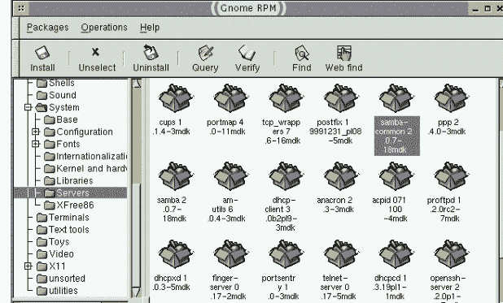

GNOME RPM 的左侧面板包含软件包组列表。其中一些组有子组——例如，图 3.1 显示了 System 组已打开，揭示了 Base（基础）、Configuration（配置）、Fonts（字体）等子组。这些组并不是 GNOME RPM 特有的；它们被存储为 RPM 文件基本信息的一部分。你可以通过命令行输入 `rpm -qi packagename` 来学习 RPM 的组信息。

并不是所有发行版都使用软件包组。特别是，SUSE 并没有对其软件包进行分组。这可能使得按类型查找软件包变得困难，但因为在使用组的发行版中分类并没有完全标准化，因此组的存在并不总是很有帮助。

RPM 的一个问题是，软件包组的结构并不总是一致的。你可能认为某个软件包应该在 System/Servers 中，但它实际上可能在 Networking/Daemons 中。如果你知道软件包名称，这对于文本工具来说不是问题，但对于 GNOME RPM 可能是问题。解决方案是使用“查找软件包”（Find Packages）功能，你可以通过选择 Operations（操作）> Find（查找）来打开它。这将产生一个“查找软件包”对话框（图 3.2）。在“查找软件包”字段中输入搜索参数，并在图 3.2 中选择搜索标准，例如 Match Label（匹配标签）。点击 Find（查找），查找软件包将显示所有符合你输入标准的软件包。然后你可以从列表中选择软件包（图 3.2 中仅显示了一个），并点击相应的按钮来查询（query）、卸载（uninstall）或验证（verify）软件包。

## 3.2 GNOME RPM 查找软件包对话框可以定位符合你标准的软件包，并允许你对它们执行某些操作。

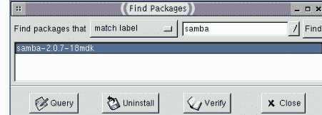

GNOME RPM 窗口的右侧面板显示你在左侧面板中选择的组中的所有软件包。如果你想对已安装的软件包执行操作，可以点击这些一个或多个软件包，并在菜单栏中选择适当的操作。例如，要卸载软件包，选择它并选择 Packages Uninstall（软件包卸载）。要验证软件包的完整性，选择软件包并选择 Packages Verify（软件包验证）。或者，你可以使用菜单栏正下方相应的按钮。

在这两种情况下，GNOME RPM 都会显示一个包含工具进度信息的对话框，然后是一个状态框。在验证软件包时，状态对话框将包含有关软件包与原始安装状态之间任何偏差的信息，例如丢失或被更改的文件。


GNOME RPM 将其软件包组和软件包列表分为两个面板，但并不是所有的软件包管理工具都是这样。在 GNOME RPM 的软件包组列表处使用一个简单的面板，但单个软件包也包含在此列表中。

要安装软件包，选择 Operations（操作）>。结果是 Install（安装）对话框，如图 3.3 所示。如果你已经挂载了安装 CD-ROM，你将在展开的树中看到未安装的软件包。找到你需要的软件包，并勾选名称右侧的复选框，如图 3.3 中的 GEdit 所示；然后点击 Install（安装）。如果你想安装已下载的软件包，点击 Add（添加）。这将产生一个文件选择对话框，你可以在其中选择你获取的软件包并将其添加到软件包列表中，然后安装它们。

图 3.3 GNOME RPM 安装对话框列出了从你发行版的安装 CD-ROM 或任何来源的待安装软件包。

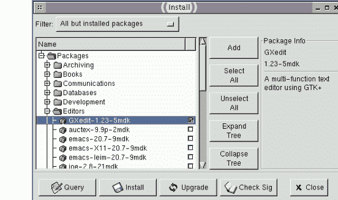

## 真实场景

### 为什么使用 GUI 而不是命令行软件包管理工具？

即使是理解命令行工具的经验丰富的管理员也可以很好地利用 GNOME RPM、Storm 软件包管理器或类似的工具。此类程序提供了所有已安装软件包的可浏览列表，这使得发现系统上有什么变得容易得多，而无需记忆每个命令。

# 验证程序运行正常 205

通常情况下，你可以在该软件包的网站上找到文档。如果你必须安装文档，请查看你正在安装的程序是否带有单独的文档包；这样你就可以在安装主包之前先安装并阅读文档。当然，软件包管理系统的优点之一是你可以轻松撤销升级，因此如果你在没有先查看其文档的情况下安装了主包，不太可能造成太大的破坏。如果你这样做了，你应该在安装软件后阅读文档，这样你会在尝试使用它时心里有数。

当你安装或升级测试软件时，请务留注意配置文件发生了什么变化。RPM 和 Debian 通常会保持配置文件不变，或者至少会备份你的配置文件；但如果软件包没有构建得当，安装软件包可能会抹除你的配置文件。如果发生这种情况，你将需要恢复原始配置文件（推测是从生产系统恢复的）。

如果你足够幸运，软件会在你第一次尝试时就完美运行。如果没有那样，你将不得不追踪问题所在。这既是一门艺术，也是一门科学，很难说问题出在哪里，尤其是作为一条一般规则——不同的软件包差异巨大，对其中一个的良好建议对另一个可能并不适用。作为一般规则，配置文件和库问题是寻找问题的切入点。在软件包升级的情况下，配置文件有时会发生变化。这对于主版本升级以及 alpha-beta 测试周期内的升级尤为如此。（在生产系统上运行此类发布前的软件通常是不允许的，但有时你别无选择，因为没有可用软件，或者你需要 alpha 或 beta 软件中添加的高级功能。）

> 你可以参考第9 章获取有关排除安装错误和挫折的更多详细信息。

具体如何测试软件取决于所涉及的程序。小型实用程序可能只需要在几个测试用例上运行它即可。像新的 Web 服务器这样的大型软件包可能需要大量的正式测试，使用多个 Web 浏览器访问网站的所有页面，甚至可能将其运行情况与前一个版本进行对比进行基准测试。升级重要的库（如 libc）可能会对数百个其他程序产生影响，因此在你进行此类升级时，你可能需要测试一系列独立的软件包。你必须自己判断要做多少程度的测试。记住在生产系统上安装糟糕软件包的后果。如果此类升级可能会给你或你的用户带来严重的困扰，那么就有必要在测试系统上进行大量的验证。

在整个过程中，你应该做好记录。如果你遇到问题并找到了解决方案，你的记录将帮助你在在生产系统上安装软件时实施这些解决方案。如果你遇到许多问题或难以找到解决方案，你可能需要整理你的记录，将测试系统恢复到原始状态，并练习重新安装新软件，以确保你能够以最短的生产系统停机时间完成操作。

# 在生产系统上检查应用程序

一旦你在测试系统上检查了应用程序，就是时候在生产系统上安装它了。在升级之前备份这台电脑通常是明智的，特别是如果是大升级的话。如果发生了某些意外，你可以将系统恢复到原始状态，并返回测试系统确定问题出在哪里。

备份生产系统后，安装新软件，并在必要时遵循你的记录。如果你正在升级一个程序，且此升级需要关闭服务器程序或整台计算机，请务必将升级安排在干扰最小的时间段，例如周末或深夜。如果这种切换是可行的，你可能还想让测试系统处于待命状态，以便在遇到意料之外的困难时接管主系统的职责。务必通知你的用户升级事宜，以免让他们措手不及。

一旦你完成了安装或升级，你应该在新的生产环境中对软件进行最少量的测试。你可能没有时间执行全套测试，特别是对于大型软件包，但你至少应该能够评估基本功能。

有些软件包非常微小，以至于前面的讨论似乎是多此一举。同样，在小型机构中，你可能没有奢侈使用硬件作为测试系统。在这种情况下，你应该在安装前格外仔细检查文档，在升级的情况下，

# 内核问题 207

确保备份了配置文件，并准备好在遇到问题时恢复原始软件的计划。安装一个“经过改进的”软件包很容易，但发现它无法工作，然后花费一小时或更长时间疯狂寻找你之前一直在使用的版本，或者你可能会发现编译或安装它时遇到麻烦。

## 持续监控应用程序

许多程序都需要监控。安装大型软件包后不久，你应该通过任何可行的方法检查它是否运行正常，例如通过测试数据运行它，或从另一个系统检查服务器的操作。你可以定期使用 `ps` 查看它是否持续运行，或者尝试使用该软件（例如使用另一个系统的 Web 浏览器访问 Web 服务器）。

有些程序会记录日志文件。你可以利用这些日志来监控它们的性能。日志文件通常位于 `/var` 目录下。升级后，格外留心地监控这些文件通常是一个好主意。这样做可以提醒你注意原本可能察觉到的问题，例如 Web 服务器仅向本地系统提供 Web 页面以及

> 注意：日志文件在第4章的“监控文件”部分有更详细的讨论。

## 内核问题

Linux 内核是任何 Linux 系统的核心。事实上，从技术上讲，内核就是 Linux。其他部分——C 库、启动文件等——都独立于 Linux 内核，这些代码也用于其他类 Unix 系统，如 FreeBSD。许多程序是在自由软件基金会的 GNU 项目支持下编写的。由于由于，有些人将 Linux 称为 GNU/Linux。

Copyright ©2001 SYBEX, Inc., Alameda, CA www.sybex.com

任何操作系统的内核都提供至关键的底层设施。这些包括：

- 内存管理，包括处理交换空间（如果有）
- 大多数硬件驱动程序（X 的视频驱动和打印机驱动是两个例外）
- 进程调度——决定程序何时访问 CPU
- 大型网络栈，为程序提供网络访问
- 文件系统，用于访问磁盘文件

大多数情况下，用户不与内核直接交互，除非内核处理键盘输入和文本视频输出。然而，程序依赖内核来实现上述功能。正因如此，程序的可靠性取决于内核——不可靠的内核会表现为程序的不可靠。同样，如果内核缺少功能，应用程序的能力也会受到限制。

作为系统管理员，你有若干与内核相关的职责：

- 你必须决定何时使用内核。太旧的内核会限制你的硬件选择，但太新的内核可能不可靠。接下来的章节“内核版本号”包含了此点的重要信息。
- 你必须决定如何安装内核。所有的 Linux 发行版都提供了与其他软件类似的软件包中的预编译内核。你可能倾向于自己编译内核。“何时重新编译内核”将帮助你决定何时这样做。
- 你必须配置你的系统以启动你所需的内核。“配置引导加载程序”章节涵盖了这一主题。（这在安装 Linux 时会自动完成，但如果你升级了内核，你就需要处理这个问题。）
- 你必须为新硬件或升级的硬件配置内核模块。该主题将在第 8 章“硬件问题”中进行介绍。

## 内核问题 209

- 你必须配置你的系统以启动你所需的内核。“配置引导加载程序”章节涵盖了这一主题。（这在安装 Linux 时会自动完成，但如果你升级了内核，你就需要处理这个问题。）
- 你必须为新硬件或升级的硬件配置内核模块。该主题将在第 8 章“硬件问题”中进行介绍。

## 内核版本号命名规则

由于内核可以称是 Linux 计算机中最重要的软件组件，因此理解 Linux 版本号如何工作方法变得尤为重要。Linux 内核版本号有一套明确的体系，理解这一体系可以帮助你判断何时可能需要升级内核。此外，这种版本命名方法也被一些非内核软件项目采用，因此对于理解这些项目也可能很有用。


> 不要将 Linux 内核版本号与 Linux 发行版版本号混淆。二者是无关的。例如，Linux Mandrake 8.0（一个发行版）自带的是内核 2.4.3。一些新的 Linux 管理员会将两者合并，并说他们运行的是（例如）“Linux 8.0”。并没有这种东西——至少在 2001 年是没有的。“Linux 2.4.3”无义地指代内核版本 2.4.3，但在指代发行版时，你必须指定它的名称。

内核版本包含三个数字，用点（.）隔开：

- 第一个是主版本号。在 2001 年，这个数字是 2。主版本号的改变通常意味着内核工作方式发生了相当大的变化。
- 第二个数字具有特殊含义。当它为偶数时，表示这是一个稳定内核或发布内核——即内核开发人员使其几乎没有 Bug 并准备供广大用户使用的内核。奇数表示开发版内核。这些内核是实验性的——它们包含了主要的新的驱动程序、现有代码的大幅重写等。只有当你急需该内核提供的某些功能时，才应该使用开发版内核——即便如此，你通常可以在稳定内核中找到此类功能的后向移植（将较新的驱动程序传输到旧内核中）。
- 最后一个数字表示次要升级。对于稳定内核，这些数字通常表示微小的 Bug 修复，偶尔会添加一个重要但经过良好测试的新驱动程序。对于开发版内核，最后一个数字表示在添加功能、修复 Bug 以及（诚实地说）随着新功能添加新 Bug 方面的进展。

在任何给定时刻，有两个内核是当前的：一个在稳定发布树中，另一个在开发分支中。当 Linus Torvalds 认为一个开发版内核已接近稳定并可以作为下一个稳定发布的目标时，他会要求“功能冻结”，这样就不会添加或更改新的驱动程序，除非是为了修复 Bug。在接接的几周或几个月里，开发版内核的稳定性得到提高，并最终作为下一个稳定内核发布。例如，2.3 内核导致了 2.4 内核的发布。当一个新的稳定内核发布时，开发版内核会被放弃，并开始一条新线——例如为了发布 2.4.0 而开始 2.5x 线。这条线将导致 2.6 或 3.0 内核的发布。

主流 Linux 发行版都带有稳定内核。在 2001 年初，这些是 2.2 系列的后期版本，但随着 2.4.0 内核的发布，2001 年年中发布的发行版已采用 2.4 内核。作为一个一般原则，最好使用与发行版所使用的同一系列的内核。内核名称第二个值的更改倾向于指示某些低级实用程序所需的内核接口、对文件系统的修改、新的驱动程序和名称等。尽管大多数发行版在升级内核内核后仍能继续运行，但可能会出现一些小故障，例如驱动程序无法自动加载。在新内核发布附近，某些发行版会尝试让其系统为新内核做好就绪。例如，Red Hat 7.0 的目标是与 2.4.0 内核兼容。此类尝试并不总是成功的，但如果你必须在新内核发布后进行升级，使用这样的发行版会有帮助。

在单一系列内部，升级通常是安全的。升级最常见的原因是新版本修复了在旧版本中发现的 Bug。另一个升级是因为新版本添加了驱动程序。例如，2.2.18 内核增加了大量在 2.3.x 系列中开发的驱动程序。这使得人们能够利用 2.4.0 内核的许多功能（例如对 USB 设备的支持），而无需升级到 2.4.0 并面临此类升级可能出现的小故障。

## 何时重新编译内核

内核的升级与其他软件包类似，通过安装一个单个二进制包文件来实现。（你可能也需要显式地重新配置你的引导加载程序，尽管这可以通过自动安装脚本完成。）然而，许多 Linux 管理员更倾向于从源代码编译自己的内核。这样做有几个优势：

- **优化内核**：如果你编译内核，可以针对你特定的硬件水平对其进行优化。
- **个性化配置**：许多 Linux 管理员更倾向于从源代码编译自己的内核。这样做有几个优势：
- **标准化**：许多 Linux 管理员更倾向于从源代码编译自己的内核。这样做有几个优势：
- **应用补丁的能力**：许多 Linux 管理员更倾向于从源代码编译自己的内核。这样做有几个优势：
（注：原文中此处存在多处重复内容，翻译已按要求保留结构）
 只有当你急需该内核提供的某些功能时，才应该使用开发版内核——即便如此，你通常可以在稳定内核中找到此类功能的后向移植（将较新的驱动程序传输到旧内核中）。
（注：原文中此处存在多处重复内容，翻译已按要求保留结构）

## 配置引导器

对于仅运行 Windows 的 PC 来说，MBR 中的引导加载程序被硬编码为检查活动分区中的次级引导加载程序。该次级引导加载程序直接加载 Windows 内核。Linux 的方法类似，但标准的 Linux 引导加载程序相当复杂。最流行的 Linux 引导加载程序是 Linux 加载器 (LILO)，它允许你针对 Linux 和非 Linux 操作系统选择多个不同的启动选项。其他引导器也可用（如后文简述所示），其中大多数引导器也允许你选择要运行的几个操作系统。遗憾的是，这种额外的复杂性是有代价的：高级引导器比 Windows 使用的简单单操作系统引导程序更难配置。

在某些系统中，它使用多个加载器。一个存在于 MBR 中，另一个存在于单独分区的启动扇区中。不同分区上的操作系统可以拥有它们自己的基于启动扇区的加载器。在这种配置中，基于 MBR 的引导程序是主引导程序，而分区扇区中的是次级引导程序。次级引导程序可以将引导过程重定向到不同的分区，在这种情况下，该分区的引导程序就成为三级加载器，尽管其配置与二级状态相同。

## 可用的引导器

许多操作系统都有自己的引导器，其他的则由第三方提供。以下是一些最常见的引导器：

- **LILO**：如前所述，LILO 是 Linux 最流行的引导器。它可以直接引导 Linux 内核，并可以作为主引导程序或次级引导程序工作。它还可能被安装在软盘上，这对于引导器来说是不寻常的。当作为次级引导程序使用时，LILO 应该只安装在 Linux 分区中；它会破坏非 Linux 文件系统的内容。在交换分区中安装 LILO 是不可接受的，因为它会被交换活动抹除。LILO 可以将引导过程重定向到非 Linux 分区，因此它用于双引导系统中的选择启动 Linux 或 Windows。

- **GRUB**：大统一引导加载器 (GRUB) 是 LILO 的替代方案，正变得越来越常见。GRUB 是第一个可以直接从硬盘的第 1024 磁道启动 Linux 的引导程序，这使其获得了一定的普及。不过，LILO 此后也实现了类似的能力。

- **OS Loader**：这是 Windows NT/2000 引导程序的名称之一。另一个名称是 NTLDR。这是一个次级引导加载程序，不能直接引导 Linux，但它可以引导一个包含 LILO 的磁盘文件，从而间接引导 Linux。这在双引导安装中很常见。

- **System Commander**：这个引导器来自 V Communications (http://www.v-com.com)，是引导器中的“凯迪拉克”，具有一些非常先进的功能。它像许多其他引导器一样不能直接引导 Linux，它可以将过程引导到安装了 LILO 的 Linux 分区。

**LOADLIN** 是一个不寻常的引导器，因为它既不是主引导也不是次级引导。相反，它是一个可以在 DOS 加载后引导 Linux 的 DOS 程序。它对于紧急情况特别有用，因为允许你使用 DOS 启动软盘引导 Linux 内核，你还可以用它传递参数来影响引导系统的行为。LOADLIN 随大多数 Linux 发行版一起位于主安装 CD-ROM 的一个目录下。

安装 Linux 后，创建一个带有 LOADLIN 和内核拷贝的 DOS 启动软盘。如果 LILO 表现异常或你的内核被意外覆盖，你就可以使用此启动软盘引导 Linux。

还有许多额外的第三方引导器，大多数像 System Commander 一样不能直接引导 Linux 内核，但可以引导安装了 LILO 的分区。出于这个原因，本文强调了 LILO 的配置——LILO 可用于引导 Linux，无论 LILO 是作为主级、次级还是三级引导程序工作。如果你选择使用 LILO 作为次级引导程序，将需要咨询你的主引导程序的文档以学习如何配置它。

在仅限 Linux 的系统上，不需要处理高级第三方引导器；LILO 可以在此类系统上顺利作为主引导程序工作。当你安装两个或多个操作系统时，第三方引导器最有用，特别是当 LILO 在将引导过程重定向到其他操作系统遇到困难时（这非常罕见）。

LILO 的常规配置将其放置在 MBR 中。然而，即使在 Linux 下，有时将 LILO 放置在 Linux 启动分区也是理想的。这样使用时，如果 Linux 启动分区是标记为活动的主分区，标准的 DOS/Windows MBR 就会启动。这种配置在 DOS/Linux 或 Windows/Linux 双引导配置中特别有用，因为它们在安装时往往会覆盖 MBR。因此，将 LILO 放在 Linux 启动分区可以避开风险，你可以在安装或重新安装 DOS 或 Windows 后，使用 DOS 或 Windows FDISK 程序并将 Linux 分区标记为活动，从而让 LILO 运行。如果 LILO 在 MBR 上，且你需要以某种方式引导 Linux，例如 LOADLIN

## 1024 磁道限制

20 世纪 90 代 PC 世界的一个祸是所谓的“1024 磁道限制”。该限制源于 x86 BIOS 使用 CHS 寻址。当大于 504MB 的磁盘变得常见时，BIOS 进行了 CHS 翻译调整，将限制增加到仅 8GB。一旦 Linux 完成启动，这些限制就再也不会影响它，因为 Linux 使用线性块寻址 (LBA) 模式处理超过 504MB 的空间。

今天，所有新的 BIOS 都包含了所谓的 INT13 调用支持，这可以绕过 CHS 寻址。只要引导程序和操作系统支持，这些 BIOS 可以从硬盘 1024 磁道标记之后启动操作系统。

## 第 3 章 ·软件管理

## LILO 配置文件概述

LILO 通过 `/etc/lilo.conf` 文件进行配置。该文件由通用配置选项行组成，随后是一个或多个标准——定义要启动的单个操作行的组。例如，列表 3.3 显示了一个示例 lilo.conf 文件，它定义了一个可以启动 Linux 或 Windows 的系统。

### 列表 3.3：示例 lilo.conf 文件

```


```
boot=/dev/hda
prompt
delay=40
map=/boot/map
install=/boot/boot.b
default=linux
lba32
message=/boot/message
image=/boot/bzImage-2.2.17
label=linux
root=/dev/hda9
append=mem=128M
read-only
other=/dev/hda3
label=windows
table=/dev/hda
```


每一行包含一个定义 LILO 运行某个方面的命令。以下项目描述了列表 3.3 中重要的通用配置选项：

- `boot=/dev/hda` 此选项告诉 LILO 它将安装到 `/dev/hda`——第一个物理 EIDE 磁盘的 MBR。要将 LILO 作为次级引导程序，请将其放在 Linux 分区中，例如 `/dev/hda9`。

`prompt` 此选项告诉 LILO 向用户发出提示。默认情况下，LILO 使用简单的文本模式提示，例如 `liilo:`。许多现代发行版都包含额外的参数，用于添加基于菜单和图形的提示。

`delay=40` LILO 在可配置的延迟后启动操作系统，该延迟以十分之一为单位。此行将延迟设置为 4 秒。

`default=1linux` 这指定要启动的默认操作系统或内核；它指向分段（stanza）中的 `label1` 行。如果省略此选项，LILO 将使用第一个分段作为默认。

`lba32` 此选项启用了启动磁盘第 1024 磁道之后内核的能力（在大多数现代硬盘上约为 8MB）。

虽然还有其他选项，但你需要自定义 LILO 在用户面前的显示方式或启用高级功能，否则你可能不会更改它们。

每个分段以自己的 `line=image`（用于 Linux 内核）或 `other=`（用于其他操作系统，如 DOS 或 Windows）开头。列表 3.3 显示每个分段除第一行以外的所有行都缩进了，但这并不是要求的；它只是为了区分不同的分段。特定分段的重要选项包括：

`label1` 是操作系统或内核被标识的名称。在默认的 LILO 配置中，用户在 `Lilo:` 提示处输入此名称。如果 LILO 配置为使用菜单，则该名称将出现在菜单中。每个分段必须有一个 `label1` 定义。尽管列表 3.3 显示标签位于相关操作系统之后，但实际上，这些标签是任意的。

`root` 此选项设置系统的根（`/`）文件系统。一旦启动，Linux 内核会查找启动脚本、`/etc/fstab`（用于查找其他文件系统的位置）等。

`append` 此可选行允许你向内核传递参数。这些参数会影响内核处理它们的方式。列表 3.3 包含一个 `append` 选项，它告诉内核系统有 128MB 内存（Linux 通常能正确检测到这一点，但某些 BIOS 会出问题）。如果驱动程序构建在内核中，你还可以告诉 Linux 为硬件使用哪些设置（IRQ 和 DMA 通道）。

`read-only` Linux 通常通过以只读模式启动根文件系统，稍后将其切换到全读写模式。此选项告诉 LILO 以这种方式运行；它是 Linux 启动分段的标准部分。

`table` 此选项允许 LILO 将启动磁盘分区表的位置传递给非 Linux 操作系统。某些操作系统的启动需要此项。它的正常值对于 IDE 磁盘为 `/dev/hda`，对于 SCSI 磁盘为 `/dev/sda`。

LILO 是一个复杂的程序，有许多额外选项。请参考 `lilo.conf` 帮助页获取有关这些选项的更多信息。要重要的是，LILO 有三个方面：

- LILO 配置文件，`/etc/lilo.conf`
- 已安装的引导加载程序，位于 MBR 或引导扇区中
- `lilo` 程序，它负责将 `lilo.conf` 文件转换为已安装的引导加载程序

在你编辑了 `/etc/lilo.conf` 后，你必须输入 `lilo` 来激活你的更改。如果你省略此条目，你的系统将继续使用旧的引导加载程序。

# 向 LILO 添加新内核

可以配置 LILO 使用同一个发行版启动两个或多个内核之一。当你想要测试新内核时，这非常方便。与其删除你正在工作的配置，不如在旧内核旁边安装新内核，并为新内核创建一个新的 `lilo.conf`。结果是你可以在启动时选择旧内核或新内核。如果内核未按预期工作，你可以重启并选择旧内核。此过程允许你避免出现新内核完全无法启动的窘境。

假设你不需要更改内核 `append`或其他功能，向 LILO 添加新内核的一个步骤如下：

- 安装新内核文件，通常在 `/boot` 中。不过，请确保你没有覆盖现有的内核文件。如果你编译了自己的内核，请记住也安装内核模块（使用 `make modules_install`）。

# 配置引导加载程序 219

- 2. 在 `/etc/lilo.conf` 中复制现有内核文件的分段。结果是两个相同的分段。

- 3. 修改其中一个分段的名称（标签）以反映新内核名称。你可以使用任何喜欢的任意名称，即使是数字也可以，例如为 2.4.2 内核使用 `242`。

- 4. 调整新内核分段中的 `image` 行，以指向新内核文件。

- 5. 如果你想让新内核成为默认，请将 `default` 行指向新内核。

通常最好在测试新内核之前不要将其设置为默认。如果你过早地做了此更改，然后在一段时间内又无法解决新内核的问题，你可能会发现自己意外启动了错误的内核。这通常是一个微小的麻烦。

- 6. 保存你的 `/etc/lilo.conf` 更改。

- 7. 输入 `lilo` 将 LILO 安装到 MBR 或引导分区的扇区。

## 现实场景

## 内核文件命名

添加新内核时的一个良好做法是给它起一个包含版本号或其他标识符的名称。

描述安装 RPM 或 Debian 软件包的过程。使用 `rpm` 程序安装 RPM 包，或使用 `dpkg` 或 `apt-get` 安装 Debian 包。这些程序可以安装、升级或删除与软件包相关的所有文件，并维护相关的数据库。

描述 tar 包（tarballs）与 RPM 或 Debian 软件包的区别。tar 包不包含依赖信息，而且与 RPM 或 Debian 系统维护的数据库相比，`tar` 实用程序不会对数据库进行打包。

总结验证程序正常运行的步骤。理想情况下，程序在安装到生产系统之前，应先在一次性测试系统中进行测试。在测试系统和生产系统中，都应该在普通用户使用之前，通过以典型方式运行程序来测试其基本功能。

解释 Linux 内核版本编号系统。内核版本号由三个部分组成，分别对应重要性递减的变化。中间数字对于稳定内核取偶值，对于开发内核取奇值。

描述引导加载程序（boot loader）的基本功能。引导程序是由 BIOS 运行的低级程序，作为启动操作系统的步骤。Linux 常用的 LILO 引导程序可以启动 Linux 内核，或将启动过程重定向到存储在分区引导扇中的另一个引导程序。

描述如何配置 LILO。LILO 使用一个名为 `/etc/lilo.conf` 的配置文件，该文件由通用行以及一个或多个与特定 Linux 内核或非 Linux 操作系统相关的多行段组成。编辑此文件后，管理员必须输入 `lilo` 以将引导程序安装到 MBR 或 Linux 引导扇中。

## 本章命令

| 命令 | 描述 |
| --- | --- |
| `rpm` | 在基于 RPM 的 Linux 发行版上安装、删除、更新、查询或验证软件包 |
| `dpkg` | 在基于 Debian 的 Linux 发行版上安装、删除、更新、查询或验证软件包 |
| `apt-get` | 在基于 Debian 的 Linux 发行版上安装、删除或更新软件包；可以从远程站点自动检索软件包 |
| `tar` | 向 tar 包添加、删除或显示其内容 |
| `alien` | 在 Linux 软件包格式之间进行转换 |
| `gnorpm` | `rpm` 实用程序的 GUI 前端 |
| `lilo` | 在 MBR 或引导扇中安装配置好的 LILO 引导程序 |

## 关键术语

在参加考试之前，请确保你熟悉这些术语：
- 1024 柱面限制依赖 (1024-cylinder limit dependency)
- 二进制包开发内核 (binary package development kernel)
- 引导程序扩展 INT13 (boot loader extended INT13)
- 引导扇文件名完成 (boot sector filename completion)
- GNU/Linux 构建版本 (build number GNU/Linux)
- CHS 翻译线性块寻址 (LBA)
- 命令行提示符 Linux加载器 (LILO) (command prompt Linux Loader (LILO))
- Debian 软件包主版本号 (Debian package major version number)
- 参数 (parameter)
- 主引导程序 (primary boot loader)
- 红帽软件包管理器 (RPM)
- 发布内核 (release kernel)
- 发布版本号 (release number)
- 次级引导程序 (secondary boot loader)
- Shell (shell)
- 软件包 (source package)
- 源码 RPM (source RPM)
- 稳定内核 (stable kernel)
- tar 包 (tarball)

# 复习题

+ 1. 下列哪些过程通常会启动 shell？（多选）

A. 通过启动 xterm 窗口
B. 在命令提示符处输入 shell1
C. 使用 SSH 登录
D. 你不能；shell 在启动时自动启动

+ 2. bash shell 使用哪个键根据前几个字符来补全文件名？

A. End（结束）
B. Tab
C. Enter（回车）
D. Insert（插入）

+ 3. tar 包、RPM 和 Debian 软件包共享哪些特性？（多选）

A. 它们都包含文件集合，包括目录结构。
B. 它们都提供依赖信息。
C. 它们都会独立压缩其包含的文件。
D. 它们都可以用于存储跨平台文件。

+ 4. 下列哪项不是源码包相对于二进制包的优势？

A. 单个源码包可以用于多个 CPU 架构。
B. 通过重新编译源码包，有时可以解决库不兼容的问题。
C. 你可以修改源码包中的代码，改变程序的行为。
D. 源码包的安装速度比二进制包快。

+ 5. 关于在台电脑上同时使用 RPM 和 Debian 软件包管理系统，哪项是正确的？

+ A. 通常是不建议的，因为这两个系统不共享已安装文件的数据库信息。
+ B. 这是不可能的，因为它们的已安装文件数据库相互冲突。
+ C. 如果你在每种格式中都安装一次重要的库，就不会产生问题。
+ D. 这是红帽和 Debian 系统上的常见做法。

+ 6. 关于为特定发行版构建的二进制 RPM 包，以下哪条陈述是正确的？

+ A. 它们通常可以用于相同 CPU 架构的另一个 RPM 发行版，但这无法保证。
+ B. 只有在对 rpm 使用 `--convert-distrib` 参数时，它们才能在另一个 RPM 发行版中使用。
+ C. 只有在用 alien 转换软件包后，才能在另一个 RPM 发行版中使用。
+ D. 它们可以为运行在其他类型 CPU 上的 RPM 发行版重新编译。

+ 7. 关于源码 RPM 包哪项是正确的？

+ A. 它由三个文件组成：一个原始源码 tar 包、一个更改的补丁文件以及一个指示软件包真实性的 PGP 签名。
+ B. 重建它们需要编程知识。
+ C. 它们有时可以用于解决依赖问题。
+ D. 源码包的安装速度比二进制包快。

+ 8. 传统上文件名包含以下哪些？

A. 构建版本 (Build number)
B. 构建日期
C. 版本号 (Version number)
D. 维护者的首字母

+ 9. 要使用 dpkg 删除一个软件包及其配置，你该执行哪个命令？

A. `dpkg -P`
B. `dpkg -p`
C. `dpkg -r`
D. `dpkg -s`

+ 10. 下列哪项描述了 apt-get 和 dpkg 之间的区别？

A. apt-get 提供 GUI 界面；dpkg 没有。
B. apt-get 可以安装 RPM 和 tar 包；dpkg 不能。
C. apt-get 可以从互联网自动检索；dpkg 不能。
D. apt-get 随 Debian 提供。

+ 11. 关于尝试使用发行版的软件包，以下哪项是正确的？

A. 因为库不兼容是不可能的。
B. 因为 Debian 标准是可能的。
C. 只有在软件包已安装后才可能。
D. 因为 CPU 架构的原因是可能的。

+ 12. tar 程序可以用于完成哪些任务？（多选）

A. 安装 RPM 和 Debian 软件包。
B. 从 tar 包安装软件。
C. 备份到磁带。
D. 创建存档文件。

+ 13. tar 提供更方便的：

A. 依赖跟踪
B. 源码编译
C. 文件所有权
D. 软件包创建

+ 14. 使用 alien 目标格式是？

A. tar 包
B. RPM
C. Debian 软件包
D. Stampede 软件包

+ 15. 在生产系统安装程序后，以下哪些方法最可能监控程序的运行？

A. 检查 `/var/log` 目录中的日志项
B. 定期使用测试数据测试程序
C. 定期使用 ps 查看服务器是否运行
D. 在不同配置上运行程序

+ 16. 在哪些情况下重新编译内核最有意义？

A. 你需要升级内核以获取错误修复。
B. 系统无法识别所有已安装内存。
C. 你需要确保内核位于 1024 柱面以下，因为你有一个旧的 BIOS。
D. 你需要包含一个异常的实验驱动程序。

+ 17. 你正在管理一个使用 2.2.4 内核的系统。哪些内核变化最可能引起问题？

A. 升级到内核 2.4.2
B. 升级到内核 2.3.27
C. 升级到内核 2.2.17
D. 应用适用于 2.4.2 的内核补丁并重新编译

+ 18. LILO 将安装在哪里？

A. MBR、Linux 分区的引导扇或软磁盘
B. MBR、Linux 分区的引导扇或 Windows 分区的引导扇
C. Linux 分区的引导扇或 Windows 分区的引导扇
D. MBR、软磁盘或交换分区

- 19. 将 LILO 安装在主 Linux 分区的引导扇中，以下哪项是其优点？
  - A. LILO 可以启动 1024 柱体标记之外的内核。
  - B. LILO 可以将引导过程重定向到其他系统的引导扇。
  - C. 如果 MBR 被覆盖，可以使用 DOS 或 Windows 的 FDISK 实用程序将 LILO 重置为引导程序。
  - D. LILO 可以配合 LOADLIN 使用来启动多个内核。

- 20. 关于用于测试新软件的系统硬件，以下哪项描述是正确的？
  - A. 它必须与目标生产系统的硬件完全相同。
  - B. 仅在测试新驱动程序时，硬件才不重要。
  - C. 通常情况下，确保其与生产系统的硬件匹配并不比确保系统软件匹配更重要。
  - D. 即使硬件不同，也必须使用与生产系统相同的驱动程序。

# 复习题答案

### 复习题 231 答案

- 1. A., C. 当你登录或启动 xterm 窗口时，会自动启动 shell，除非你配置了特殊的账户，或者在启动 xterm 时指定了另一个运行程序。输入 `she1` 不会启动 shell，因为没有标准 shell 名为 `shell`。（不过输入 shell 的名称可以达到效果）。计算机启动时通常不会启动 shell；你必须先登录。

- 2. B. 当你在输入命令或文件名时按下 Tab 键，bash 会检查你目前已输入的字符是否足以唯一标识该命令或文件名。如果是，bash 就会补全命令或文件名，为你节省键盘击击次数。

- 3. A, D. Tarballs（压缩归包）、RPM 和 Debian 软件包包含了所有文件集合，这些文件可能在多个平台上可用，尽管这无法保证。Tarballs 不提供依赖信息。这三种格式都是对多个文件的归档进行压缩，而不是对压缩文件进行存档。

- 4. D. 因为它们在安装之前必须经过编译，所以源包的安装时间比二进制包更长。

- 5. A. 软件包管理系统并不共享信息，但它们的数据库也不会主动冲突。使用两个系统安装相同的库，几乎可以保证两个系统提供的文件将相互冲突。在任何发行版中，主动使用 RPM 和 Debian 软件包并不常见，尽管在所有这些系统中都是可能的。

- 6. A. RPM 通常在发行版之间是通用的，但偶尔会包含不兼容性。rpm 没有 `--convert-distrib` 参数，也不是所有包都用于从 RPM 格式转换为 RPM 格式。二进制包无法为另一个 CPU 架构重新构建，但源包可以为任何支持的架构重新构建，只要源代码不依赖于任何特定的 CPU 特性。

- 7. 某些依赖关系源于编译时将二进制文件动态链接到库，因此可以通过从源 RPM 重新编译软件解决。选项 A 描述的是 Debian 源包，而不是 RPM 包。重新编译源 RPM 只需执行适当的命令，但你必须安装适当的编译器和库。源 tarballs 也可以用于为 RPM 系统编译软件，尽管这无法带来 RPM 的任何优势。

- 8. 软件包版本号（以及 RPM 构建版本号）和 CPU 架构代码（源代码用 `src`，架构无关文件用 `noarch`）包含在 RPM 文件名中。Red Hat 不为 RPM 维护者提供认证。构建日期和软件包维护者的名称存储在 RPM 中，但不在文件名中。（某些发行版在 RPM 文件名中包含发行名称代码，但这不是通用做法。）

- 9. 大写的 `-P` 调用清除（purge）操作，它会完全删除软件包及其配置文件。小写的 `-p` 调用 `dpkg` 来打印软件包内容的信息。`-r` 参数删除软件包，但保留配置文件。最后一种变体（选项 D）也指定了完整文件名，这并用于删除软件包——你应该只指定较短的包名。

- 10. 你可以在 `/etc/apt/sources.list` 中指定 Debian 归档站点，然后输入 `apt-get update` 和 `apt-get upgrade` 来快速将 Debian 系统更新到最新软件包。Storm 和 Core Linux 都带有 GUI 软件包管理工具，但它们不是 apt-get。`alien` 程序可以转换 RPM 文件并将转换后的包安装在 Debian 系统上。dpkg 和 apt-get 均包含在所有基于 Debian 的发行版中。

# 复习题 233 答案

- 11. D. 在2001年，使用 Debian 的系统基于相同的内核，因此它们共享大多数组件，使得软件包移植很可能（但并非一定）成功。库的不兼容可能会导致问题，但不太可能，特别是当你使用较新的软件包和发行版时。尽管 Debian 有明确定义的关键位置、启动脚本等，但这些不能保证成功。为不同 CPU 构建的二进制包几乎可以确定无法工作，尽管脚本或其他非二进制包可能会在不同的 CPU 类型间正常工作。

- 12. B, C, D. `tar` 可以直接安装 RPM 或 Debian 包时执行这些操作，尽管在使用 `alien` 转换包后也可以这样做。

- 13. D. `tar --create` 命令从任何目录创建归档；RPM 和 Debian 软件包创建工具比这复杂得多。`tar` 完全不提供任何跟踪机制，让你自己完成这些工作。虽然 `tar` 可用于分发源代码，但它本身不用于编译源代码。

- 14. C. `alien` 可以转换为这些格式的任何一种，但取决于软件包指定。

- 15. D. 测试系统可以帮助你熟悉无法从生产系统获得的新程序。

- 16. D. 不常见的实验性驱动程序通常以源码形式出现，因此需要你重新编译内核。通过 RPM 或 Debian 软件包升级内核。识别内存的问题可以通过 `lilo.conf` 中的选项解决。1024 柱体问题可以通过将内核完全放在 1024 柱体标记之前解决。

- 17. C. 2.2.4 和 2.2.17 内核属于内核系列，因此它们将以相同的方式与其他操作系统交互。2.4.2 内核属于下一个系列，因此其接口发生了变化。

- 18. A. LILO 可能存在于选项 A 列出的任何位置。如果你将其安装在 FAT 或 NTFS 分区（供 DOS 或 Windows 使用），这些分区将受到损坏；如果你将 LILO 安装在会被使用的交换分区中，LILO 将被擦除。

- 19. C. LILO 安装在 MBR 时，容易被其他操作程序完全覆盖。将 LILO 安装在主 Linux 分区的引导扇中消除了这种风险，使得恢复变得容易。LILO 启动 1024 柱体标记之外或启动多个操作的能力无论安装在哪里都是相同的。同样，LILO 在不使用 LOADLIN 的情况下也可以启动多个操作系统，无论 LILO 安装在哪里。

- 20. C. 在测试系统上测试新软件时，通常系统软件的匹配比硬件匹配更重要。这种情况的唯一例外是测试新驱动程序，在这种情况下硬件更重要。当硬件不匹配时使用相同的驱动程序通常是没有意义的，因为驱动程序与特定的硬件组件绑定。

## 第4章
## 用户与安全

本章涵盖的 CompTIA 目标：

- 4.1 创建和删除用户。
- 4.2 修改现有用户（例如：密码、用户组、个人信息）。
- 4.3 创建、修改和删除组。
- 4.4 使用 `chmod`、`chown` 和 `chgrp` 识别并更改文件权限、模式和类型。
- 4.7 以 root 身份登录或使用 `su` 命令执行管理任务（例如：理解对系统危险的命令）。
- 4.9 描述并使用多用户环境的特性（例如：虚拟终端、多次登录）。
- 5.8 监控系统日志以检查错误、登录和异常活动。
- 5.11 执行并验证安全最佳实践（例如：密码、物理环境）。
- 5.12 评估安全风险（例如：位置、敏感数据、文件系统权限、移除/禁用未使用的账户、审计系统服务/程序）。
- 5.13 设置守护进程和进程权限（例如：SUID - SGID - 所有者/组）。

传统的 PC 操作系统（如 DOS 和早期版本的 Windows）基本上是单用户操作系统。虽然确实可以让两个或更多个人使用运行这些操作系统的计算机，但操作系统本身并没有提供任何机制来防止用户读取甚至破坏彼此的文件。相比之下，Linux 是模仿 Unix 设计的。在 Linux 和 Unix 中，操作系统提供了一整体机制。由于这些原因，Linux 系统管理员拥有专门设计的工具来帮助用户防止损坏彼此的文件。同样的机制也被用于提供安全并防止用户破坏整个操作系统。因此，需要了解操作系统如何处理用户，以及你可以使用哪些工具来管理自己系统上的用户。

用户配置中一个尤为重要的方面是安全——但安全涵盖了额外的领域，例如控制对你系统的远程访问。计算机应急响应小组 (CERT); http://www.cert.org 跟踪软件中的安全违规和漏洞。1998 年，CERT 记录了 3,734 起事件和 262 个新漏洞；1999 年，这些数字是 9,859 起事件和 417 个新漏洞；2000 年，CERT 总共记录了 21,756 起事件和 774 个新漏洞。这些不断增加的数字并不意味着软件变得糟糕；它们可能反映了计算机和计算机服务器程序数量的增加。尽管如此，大量的问题强调了在处理计算机安全时谨慎的性。与此主题相关的问题有很多，从网络账户维护到保持程序更新并正确安装。本章在涵盖基本用户管理的同时，还涵盖了这些问题。

## Linux 多用户概念

在处理 Linux 系统上管理用户账户的细节之前，有必要理解底层概念（少数实现细节除外）。这些信息将帮助你规划一个有效的账户结构，或扩展现有结构以满足新需求。在将账户从一台计算机移动到另一台计算机、添加新硬盘或执行其他类型的系统维护时，这些信息可能至关重要。

## 用户账户：多用户系统的核心

Linux 用户账户基本上与 Unix 类操作系统中的账户相同。它们允许几个人在不同时间或同时使用同一个系统，而互不干扰。单个用户可以同时多次登录，这有时会带来不便。了解用户账户允许你对系统做什么以及如何识别用户是非常重要的。

## 多用户系统中的账户

从技术上说，“用户”是一个人，而“账户”是与该用户相关的一系列数据结构和权限。然而，经常将“用户”一词与“账户”同义使用，例如“你必须删除这个用户”。不要字面地理解这种说法——删除的是账户，而不是用户。

Linux 账户关联了以下几个重要特性：

- **用户名 (Username)**  *用户名*是人类识别账户的名称，例如 eleven。Linux 用户名的特征将在稍后在“Linux 用户名”章节中进行详细描述。

- **登录权限 (Login privileges)** 账户允许个人登录 Linux 计算机。根据系统的配置，这可以是控制台登录（即直接连接到计算机的键盘和显示器）或远程登录（通过串口、调制解调器或网络）。当个人登录时，他们可以使用计算机上的部分或全部程序和资源。其他资源（如由 Web 服务器传输的文件）不需要登录。

- **密码保护 (Password protection)** Linux 账户受密码保护。尝试登录的人必须提供用户名和密码。用户名通常是公开的，但密码是秘密的。某些登录形式会绕过密码保护，通常是通过推迟由另一台计算机执行认证。

- **权限 (Permissions)** 每个账户都有运行某些程序和访问某些文件的权限。这些权限是按文件进行控制的，正如本章稍后“文件权限”部分描述的那样。

- **主目录 (Home directory)** 每个账户都有一个与之关联的主目录。这是一个用户可以在其中存储数据文件的目录。通常，每个用户都有自己的主目录，尽管也可能配置系统让两个用户共享一个主目录。

- **用户 ID 和组 ID (User and Group IDs)** 计算机在内部运行时基于数字而非单词。Linux 为每个账户关联了两个数字。第一个是用户 ID (UID)，映射到用户名。第二个是组 ID (GID)，映射到组。

- **默认 shell (Default shell)** 在控制台（或通过网络协议）使用 Linux 时，Linux 向用户显示一个名为 shell 的程序。shell 接受 `cd` 等命令，并允许用户运行额外的程序。Linux 有多个可用的 shell，并按账户进行设置。

- **程序特定文件 (Program-specific files)** 许多程序会在用户的主目录中创建配置文件。另一个例子是邮件池（mail spool），Linux 系统在其中存储的邮件。假设安装了基础邮件软件，创建邮件账户对于用户接收邮件通常是必要且充分的，尽管也有例外，特别是对于邮件服务器软件包。

某些特性定义在一个或两个系统文件中：`/etc/passwd` 和 `/etc/shadow`。etc/passwd 是大多数账户信息的传统存储库，包括用户名、UID 数字、GID 数字、主目录位置和默认 shell 指定。创建或修改账户主要涉及修改这一个文件。然而，由于额外的细节，大多数管理员使用特殊工具来执行这些任务，将在稍后“配置用户账户”中描述。

遗憾的是，由于状态需要，etc/passwd 必须对所有用户可读。这一事实使得即使是加密形式的密码信息也处于一个危险的位置。由于这个原因，2001 年大多数 Linux 发行版都带有影子密码。在这种系统中，用户的密码存储在单独的文件 `/etc/shadow` 中。大多数用户无法读取此文件，使得拥有计算机账户的人进入其他用户账户变得更加。

虽然可以使用同一个账户进行多任务登录，但使用多个账户可能非常有帮助，特别是当涉及个人时。每个账户都可以根据所有者的偏好进行配置，因此，同时登录可以针对桌面图标或使用的命令 shell 显示不同的设置。此外，如果用户更改了默认值，该更改不会影响当前登录到系统的其他用户。

当然，Linux 的多任务能力并不意味着计算机可以支持无限数量的并发用户。某些活动，例如 George 的 C 程序编译，可能会消耗大量的 RAM、CPU 时间或磁盘 I/O。如果许多用户尝试同时运行此类资源密集型程序，所有用户都会看到性能下降。一台 Linux 计算机能支持多少用户取决于许多因素，包括他们可能运行的程序类型，以及系统拥有的关键资源（RAM、CPU 速度、网络磁盘速度和磁盘容量）的量。如果使用的应用程序不是资源密集型的，单台现代计算机可以支持几十或数百个同时在线的用户；但如果程序涉及一种或多种资源，每台计算机分配一个用户可能就足够了。

多个用户同时使用通常需要某种形式的连接，尽管也可以通过连接到串口的终端来处理。通常，像 Shell 或 Secure Shell (SSH) 等远程登录协议允许文本模式登录。Linux 的 GUI 环境——X Window 系统（或简称为 X）支持网络功能，并允许远程使用 GUI 程序。或者，VNC 程序（http://www.uk.research.att.com/vnc）也允许类似的连接。

Linux 通过一项名为“虚拟终端 (VTs)”的功能，通过其标准控制台支持同时登录。在文本模式登录下，按下 Alt 键配合功能键 1-6 即可切换到不同的虚拟屏幕，你可以登录任意数量的此类屏幕。你可以通过在启动时发出适当参数来运行多个 X 会话。通常，第一个 X 会话运行在 VT 7 上。要退出你所处的 VT，你必须添加 Ctrl+Alt+F7 从 X 切换回第一个文本模式 VT。你可以通过登录到 VT 并使用以下命令来运行第二个 X 会话：

```


$ start :1 vt8

```
这将在 VT 8 中运行 X。你可以通过切换 Ctrl+Alt+F7 和 Ctrl+Alt+F8 在它和第一个 X 会话之间来回切换。
```

当然，这种 VT 能力对于单用户工作站最有用——因为两个人无法同时实际使用同一个键盘。尽管如此，如果你是一名管理员，想要在多个账户或 X 配置下运行 Linux，或者想在不运行 X 的情况下在多个文本程序之间轻松切换，它仍然很有用。

# 超级账户 (The Superuser Account)

所有 Linux 系统中一个特别重要的账户就是超级用户账户。超级用户也被称为管理员。超级用户使用的账户通常被称为 `root`。

每当你在 Linux 计算机上执行系统管理任务时，你都会以 `root` 的身份进行。你可以通过以下几种方式之一实现：

- `root` 登录：你可以以 `root` 身份登录计算机。之后，你执行的任何操作都将以超级用户的身份执行。这是一种非常危险的系统使用方式，因此最好只在短时间内这样做。大多数系统对 `root` 登录有限制，因此只能从控制台进行，以防止外部人员使用被窃的密码通过网络访问系统。
- `su`：该命令允许你临时获取超级用户权限或承担任何其他用户的身份。作为普通用户登录后，输入 `su` 并按回车键，系统将提示你输入 `root` 密码。如果你正确输入了密码，后续命令将以 `root` 身份执行。输入 `exit` 返回你的普通用户权限。要获得非 `root` 用户的权限，请添加你的用户名，例如 `su george`，以便无需该用户密码即可接管另一个用户的身份；`sudo` 不会向 `root` 索要密码。这在调试可能与特定用户配置相关的问题时非常有用。
- `sudo`：配置完成后，`sudo` 命令允许你以 `root` 身份执行单个命令。这限制了以 `root` 身份运行的危险，因此它是作为 `root` 身份频繁运行常用程序的好方法。`/etc/sudoers` 文件包含了一份可以使用 `sudo` 的用户列表以及可以使用哪些命令。你可以使用 `visudo` 命令编辑此文件，它会调用 `vi` 编辑器（第 7 章，“管理分区和进程”），并帮助你获取配置文件的格式。

`SUID root` 文件：正如本章稍后“解释文件访问代码”部分描述的，即使文件是由另一个用户运行，也可以将其设为以 `root` 身份执行。这必须根据每个程序逐一进行设置。

程序提示：某些配置会提示你输入 `root` 密码，然后以 `root` 身份运行自身。这种设置在许多 Linux 发行版自带的 GUI 配置工具中最为常见。

`root` 账户是特殊的，因为它绕过了正常的安全功能。具体来说，超级用户可以读取、写入或删除计算机上的任何文件，无论该文件归谁所有，无论所有者是否已授予其他用户读取或写入权限。这种力量之所以危险，不仅因为它有侵犯其他用户隐私的能力，还允许 `root` 对计算机造成严重破坏。例如，假设你想删除一个目录及其内容。你可以执行以下命令：

```
## rm -rf /home/george/olddir
```

此命令将删除 `/home/george/olddir` 目录及其所有文件。不幸的是，一个拼写错误就会产生一个破坏性更大的命令：

```
## rm -r /home/george/olddir
```

注意 `/` 和 `home/george/olddir` 之间多余的空格。这个拼写错误可能会导致计算机删除 `/` 目录下的所有文件——即计算机上的所有文件以及 `home/george/olddir` 中的文件。这就是这种……

# Linux 用户名 (Linux Usernames)

Linux 在用户名方面非常灵活。下划线 (`_`) 和点 (`.`) 通常不会引起（问题）。然而，大多数 Linux 版本会将用户名转换为小写。事实上，Linux 将用户名视为区分大小写敏感的。创建并遵循这种标准做法可以帮助你找到属于某个个人的账户。但是，如果你的计算机有许多用户，你可能会发现某种命名约定产生重复，特别是当你使用名字首字母时。因此，你可能被迫偏离标准或加入数字来区分世界上所有的 David 和 Smith。

Linux 支持由任何...字符组成的用户名。大多数网站都开发了创建用户名的标准方法，例如使用名字首字母和姓氏。如果你的计算机有许多用户，你可能会发现某种命名约定产生重复，特别是当你使用名字首字母时。因此，你可能被迫偏离标准或加入数字来区分所有的...

# Linux 多用户概念 (Linux Multiuser Concepts) 243

## 组：将用户关联在一起以提高效率 (Groups: Linking Users Together for Productivity)

Linux 使用组作为组织用户的手段。在许多方面，组与用户是并行的。组与用户在以下方面相似：

- 组定义在单个文件 `/etc/group` 中，其结构与 `/etc/passwd` 类似。
- 组的名称与用户相似。
- 组名与组 ID (`GID`) 绑定。

然而，组并不是账户。相反，组是组织账户的手段，很大程度上是一种安全措施。正如稍后在“文件权限”中描述的，Linux 系统上的每个文件都与特定的组关联，并为该组的成员分配各种权限。例如，组员（如大学教师）可能被允许读取文件，而其他人（如学生）可能被禁止访问。由于 Linux 通过文件提供硬件（如串口和磁带备份），这种机制可以用于控制对硬件的访问。

每个组的成员数量从零到与计算机用户一样多。组成员关系通过 `/etc/group` 控制。该文件包含了组列表以及属于每个组的成员。除了 `/etc/group` 中定义的成员关系外，每个用户都有一个默认的主组。用户的主组设置在 `/etc/passwd` 中的用户配置中。当用户登录计算机时，他们的组成员关系被设置为其主组。当用户创建文件或启动程序时，这些文件和运行程序将与单个组关联——当前的组成员。用户仍然可以访问属于其他

©2001 SYBEX, Inc., CA www.sybex.com

` tags (第 279-283 页)：

## 第 4 章 • 用户与安全

组，只要用户允许访问即可。然而，要以非主组成员的身份运行程序或创建文件，用户必须运行 `newgrp` 命令来切换当前的组身份。例如，要切换到 `project2` 组，你可能输入以下内容：

```
$ newgrp project2
```


如果用户输入此命令并在 `/etc/group` 中被列为 `project2` 组的成员，则用户的当前组身份将发生更改。此后用户创建的文件将与 `project2` 组关联。或者，用户可以使用稍后提到的 `chown` 命令来更改现有文件关联的组，这在“修改权限”部分会有详细描述。

这种组机制允许你设计一种安全系统，允许不同的用户组同时处理相同的文件，同时防止同一台计算机的其他用户尝试访问他们不应访问的文件。在简单的情况下，你可以为不同的项目、课程或工作组创建组，并将每个用户限制在这些组之一。需要访问多个组的用户可以是这些组的每个成员——例如，修两门课的学生可以属于与每门课程相关的组，或者主管可能会监控所有受监管的组。本章稍后部分的“常用用户和组策略”描述了各种 Linux 发行版默认采用的方法，并解释了你如何扩展和使用这些策略以适应你自己的需求。

## 将 UID 和 GID 映射到用户和组

如前所述，Linux 通过数字（分别为 UID 和 GID）来定义用户和组。在内部，Linux 通过这些数字而非名称来跟踪用户和组。例如，用户 `sam` 可能被绑定到 UID 523，而 `eleven` 可能是 GID 609。同样，组 `project1` 可能是 GID 512，而 `project2` 可能是 GID 523。在大多数情况下，这些细节会自动处理——你使用名称，而 Linux 使用 `/etc/passwd` 或 `/etc/group` 来查找与用户关联的数字。尽管如此，当你告诉 Linux 执行某些操作时，你可能需要知道 Linux 是如何分配数字的。这在你排排除故障或手动编辑 `/etc/passwd` 或 `/etc/group` 时尤为真实。

Linux 发行版为系统使用保留了前百个用户和组 ID（0–99）。其中最重要的是 0，它对应于 root（包括用户和组）。随后的低数字被用于与特定的 Linux 工具和功能相关的帐户和组。例如，UID 2 和 GID 2 分别通常是守护进程（daemon）账户和组，供各种服务器使用；而 UID 8 和 GID 12 通常是 `mail1` 账户和组，可供邮件相关服务和工具使用。并不是所有 0-99 的账户和组编号都会被使用；通常只有一两个账户和十几个组是以这种方式被使用的。你可以检查你的 `/etc/passwd` 和 `/etc/group` 文件来确定使用了哪些用户和组 ID。

入侵者有时会创建 UID 为 0 的账户，以便在他们入侵的系统上获得 root 权限。任何 UID 为 0 的账户实际上都是 root 账户，拥有超级用户的所有权限。如果你怀疑 `/etc/passwd` 文件中有一个 UID 为 0 的可疑账户，那么你的系统很可能已经被攻破。

创建多个使用相同 UID 的用户名或或多个使用相同 GID 的组名是可能的。在某种意义上，这些是不同的帐户或组；它们在 `/etc/passwd` 或 `/etc/group` 中有不同的条目，因此可以拥有不同的主目录、不同的密码等。然而，由于这些用户与其他用户或组共享 ID，在文件权限方面它们被视为相同的。除非你有充分的理由这样做，否则应避免创建共享 ID 的多个用户或组。

## 跨系统的 UID 和 GID 同步

如果你维护几台 Linux 计算机并想要设置网络文件系统（NFS）共享，出现的一个问题就是保持跨系统的 UID 和 GID 同步。由于 Linux 文件系统（包括 NFS）跟踪的是数字 ID 而非人类使用的名称，UID 和 GID 不匹配会导致一个人的文件在 NFS 挂载上显示为另一个人的所有。例如，假设两台电脑都有用户 `ellen` 和 `george`。在一台电脑上，`ellen` 的 UID 是 500，但在另一台电脑上这些数字反过来了。结果，当一台电脑通过 NFS 挂载另一台电脑的文件时，UID 值将指示 `ellen` 的文件实际上归 `george` 所有，反之亦然。

解决此问题的方案之一是保持所有计算机上的 UID 和 GID 一致。对于只有少数用户的小型系统来说，这并不困难，但对于更大或更多的系统，这就会变得繁琐。NFS 还支持各种映射选项，例如查询远程登录数据库、使用静态文件或使用运行在客户端系统上的用户 ID 映射服务器。这些选项在导出（export）页面中会有描述。

## 主目录的重要性

用户的主目录是磁盘上的一个通常仅供用户使用的目录。在 Linux 系统上，主目录的标准位置位于 `/home` 目录树中，每个用户的主目录以用户的账户名命名。例如，`sally` 账户的主目录将是 `/home/sally`。然而，这种命名和放置只是约定——并不是强制要求。`/etc/passwd` 文件包含了每个用户主目录的位置，因此你可以通过编辑该文件来修改此位置。你也可以在创建帐户时（稍后在“添加用户”中描述）指定一个备选位置，或者在之后使用用户名更改它。

此命令的输出可能包含几个不同的组件，每个组件都有特定的含义：

**权限字符串** 第一个组件 `-rwr-xr-x` 是权限字符串。它与用户和组名一起，共同决定了对文件的访问权限。正如 `ls -l` 所示的那样，权限字符串是一系列代码，稍后将在“解释文件访问代码”中对它们进行更详细的描述。有时该字符串的第一个字符会被省略，特别是在讨论普通文件时，但在 `-l` 列表中，它总是会出现的。

**硬链接数** Linux 在其文件系统中支持硬链接。硬链接允许一个文件通过两个或多个不同的文件名被引用。在内部，Linux 使用一个名为 `inode` 的数据结构来跟踪文件。在前面的示例输出中，数字 `1` 意味着有一个文件名指向该文件；它没有硬链接。较大的数字表示存在硬链接——例如，`3` 表示该文件可能通过三个不同的文件名被引用。

> 硬链接和软链接（或符号链接）的处理方式不同。仅通过目录列表无法判断一个文件是否具有软链接，尽管权限字符串的第一个字符中的 `1` 表示该文件有软链接。

**所有者** 下一个字段（在本示例中为 `root`）是文件的所有者。对于长的用户名，用户名可能会被截断。

**组** `kmem` 属于文件所属的组。许多系统都属于 `root` 所有者和 `root` 组；对于这个示例，我选择了一个属于不同组的文件。

**文件大小** 下一个字段（在本示例中为 `84124`）是按字节为单位的文件大小。

**创建时间** 下一个字段包含文件的创建时间和日期（示例中为 `Oct 3 02:37`）。如果文件已超过一年，你将看到年份而不是创建时间，尽管时间仍然存储在文件中。

# 第 4 章 • 用户与安全

**文件名** 最后一个字段是文件名。由于前面示例中的 `ls` 命令指定了文件的完整路径，因此完整路径会显示在输出中。如果执行命令时没有指定来自 `/usr/sbin` 目录的该路径，`lsof` 将单独显示文件名。

硬链接数和文件创建日期等信息有时可能很有用，但它们对于确定文件访问至关重要。对于这一点，你需要文件的所有者、组和文件访问权限字符串。

## 解释文件访问代码

文件访问控制字符串长度为十个字符。第一个字符具有特殊含义——它是文件类型。代码决定了 Linux 如何解释该文件——作为普通数据、目录或特殊类型。表 4.1 总结了 Linux 类型代码。

### 表 4.1 Linux 文件类型代码

| 代码 | 含义 |
| --- | --- |
| - | 普通数据文件；可以是文本、可执行程序、图形、压缩数据或几乎任何其他类型的数据。 |
| d | 目录；磁盘目录和任何文件一样也是文件，但它们包含文件名和指向磁盘 `inodes` 的指针。 |
| l | 符号链接；文件包含另一个文件或目录的名字。当 Linux 访问符号链接时，它会尝试读取被链接的文件。 |
| p | 命名管道；管道允许两个 Linux 程序之间相互通信。一个打开管道进行读取，另一个打开管道进行写入，从而在程序之间传输数据。 |
| s | 套接字（Socket）；套接字类似于命名管道，但允许网络和双向链接。 |

### 表 4.1 Linux 文件类型代码（续）

| 代码 | 含义 |
|---|---|
| b | 块设备；数据以大于一个字节的块在设备之间传输的硬件设备。磁盘设备（硬盘、软盘、CD-ROM 等）是常见的块设备。 |
| c | 字符设备；数据以一个字节为单位在设备之间传输的硬件设备。示例包括并行和串口设备。 |

权限字符串的剩余九个字符（前面示例中的 `rwr-xr-x`）被分为三组字符。第一组控制文件所有者对文件的访问，第二组控制所属组对文件的访问，第三组控制所有其他用户对文件的访问（通常称为“世界用户权限”）。

在这三种情况中的，权限字符串决定了三种访问类型中每种权限是否存在：读、写和执行权限是非常自而易懂的，至少对于普通文件是如此。如果存在执行权限，意味着该文件可以作为程序运行（当然，这并不会将非程序文件变成程序；它意味着如果它是一个程序，用户就可以运行它）。在非程序文件上设置执行位可能不会造成伤害，但可能会引起混惑）。权限的缺失用连字符表示（读用 `-`，写用 `w`，执行用 `x`）。

因此，示例权限字符串 `rwr-xr-x` 意味着文件的所有者、文件组的成员以及所有其他用户都可以读取和执行该文件。只有文件所有者对文件具有写权限。你可以通过描述的方法更改权限字符串，排除不属于文件组的用户，甚至排除文件所有者。

单个权限（例如文件所有者的执行权限）通常被称为权限位（permission bits）。这是因为 Linux 以二进制格式编码信息。因为是二进制的，权限信息可以表示为一个 9 位的数字。这个数字通常用八进制表示。

某些文件对于 root 用户来说可能无法访问，但这仅是因为底层的限制——例如，即使是 root 也无法访问未安装在计算机上的硬盘。

系统还支持一些特殊的权限选项，它们可能通过权限字符串的变化来指示：

**设置用户 ID (SUID)** 用户 ID (SUID) 选项与可执行文件一起使用，它告诉 Linux 以文件所有者的权限运行程序，而不是以运行程序的用户的权限运行。例如，如果一个文件由 root 所有并设置了 SUID 位，则该程序将以 root 权限运行，并可以读取计算机上的任何文件。某些服务器和其他系统程序通过权限字符串中所有者执行位置的 `s` 来表示，如 `rwxr-xr-x`。（正如本章稍后讨论的，SUID 程序可能会导致安全风险。）

**设置组 ID (SGID)** 组 ID (SGID) 选项与 SUID 选项类似，但它将运行程序的组设置为文件的所属组。它通过权限字符串中组执行位置的 `s` 来表示，如 `rwxr-xr-x`。

粘滞位（sticky bit）在 Unix 历史过程中含义发生了变化。在现代 Linux 实现中（大多数现代 Unix 版本）中，它用于防止非文件所有者删除文件。当目录上存在此位位时，目录下的文件只能由其所有者、目录所有者或 root 删除。粘滞位通过世界执行位位置的 `t` 表示，如 `rwxrxr-t`。

## 修改文件所有权和权限

根据所需的效果，可以使用某些程序来更改谁可以读取、写入或执行文件。具体而言，`chown` 更改文件的所有者，`chgrp` 更改文件的所属组；而 `chmod` 更改权限字符串。

### 修改所有权

首先，`chown` 的语法如下：

```
chown [options] [newowner][.newgroup] filename...
```

`newowner` 和 `newgroup` 分别是文件的新所有者新组。如果包含了其中一个或两个，它们之间不能有空格，只能有一个点（.）。例如，以下命令将 `report.tex` 文件的所有权交给 `sally`，并将文件组设置为 `project2`：

```
# chown sally.project2 report.tex
```

`chown` 命令支持许多选项，例如 `--dereference`（更改符号链接的引用）和 `--recursive`（更改目录及其所有子目录中的所有文件）。后者可能是 `chown` 最用的选项。

`chgrp` 命令与 `chown` 类似，但它不更改或修改文件的所有者——它只作用于组。例如，要将 `report.tex` 的组改为 `project2`，你可以执行以下命令：

```
# chgrp project2 report.tex
```

`chgrp` 采用与 `chown` 相同的选项。使用这些命令的一个注意事项是，即使是文件的所有者也无法更改文件的所有者组。所有者可以将文件的组更改为所有者所属的任何组，而不能更改其他组。通常情况下，只有 root 可以更改文件的所有者。

### 修改权限

你可以使用 `chmod` 命令修改文件的权限。该命令可以通过许多不同的方式来实现相同的效果。其语法为：

```
chmod [options] [mode[,mode...]] filename...
```

`chmod` 选项与 `chown` 和 `chgrp` 的选项相似。特别是 `--recursive`（或 `-R`）将更改目录树内的所有文件。

`chmod` 的大部分复杂性来自于对文件模式——即权限的指定。你有两种基本形式来指定模式：作为八进制数或作为符号模式（符号模式是一组与权限字符串表示形式相关的代码）。

模式的八进制表示与之前描述并在表 4.2 中总结的相同。例如，要将 `report.tex` 的权限更改为 `rw-r--r--`，你可以执行以下命令：

```
# chmod 644 report.tex
```


此外，可以在所有者、组和世界权限的三个数字之前加上另一个设置特殊权限的数字。系统支持三个比特位（因此值在 0 到 7 之间）：添加 4 设置设置用户 ID (`SUID`) 位；添加 2 设置设置组 ID (`SGID`) 位；添加 1 设置粘滞位。如果你省略了第一个数字（如上一个示例所示），Linux 会清除所有三位。使用四位数字会导致第一位被解释为特殊权限。例如，以下命令设置程序具有 `SUID` 和 `SGID` 位（6），所有者可读、可写、可执行（7），组可读、可执行（5），对所有其他人完全不可访问（0）：

```bash
# chmod 67500 bigprogram
```

相比之下，符号模式由三个部分组成：表示你想要修改的权限的代码（所有者、组等）；表示要添加、删除还是将模式设置为指定值的符号；以及指定权限应该是多少的代码。表 4.3 总结了这些代码。请注意，这些代码是区分大小大小的。

## 表 4.3 符号中使用的代码

| 权限集代码 | 含义 | 更改类型代码 | 含义 | 权限修改代码 | 含义 |
| :--- | :--- | :--- | :--- | :--- | :--- |
| u | 所有者 | + | 添加 | r | 读取 |
| g | 组 | - | 删除 | w | 写入 |
| o | 世界 | = | 设置 | x | 执行 |
| a | 所有 | | | x | 执行 |
| | | | s | SUID 或 SGID |
| | | | t | 粘滞位 |

### 表 4.4 使用 chmod 的权限示例

| 命令 | 初始权限 | 最终权限 |
| :--- | :--- | :--- |
| chmod a+x bigprogram | rw-r-- | rwxrx-x |
| chmod ug=rw report.tex | r-------- | rw------ |
| chmod o-w bigprogram | rwxrx-x | rw------ |
| chmod g-w,o report.tex | rw------ | rw---- |

## 设置默认权限

当用户创建文件时，文件具有默认的所有权和权限。默认所有者意乎所当然是创建该文件的用户。默认组是用户的主组。然而，默认权限是可配置的。它们由用户掩码（`umask`）定义，通过 `umask` 命令设置。该命令接受一个八进制值作为输入，表示在创建文件或目录时从目录的 777 权限或文件的 66 权限中移除的位。例如，为了让 Linux 文件具有 640 权限，目录具有 0750 权限，你需要输入以下命令：

```bash
$ umask 027
```

注意，`umask` 并不是对 777 或 666 值的简单减法；它是位移除。在 `umask` 中设置的任何位都会从新文件的最终权限中移除，但执行位（对于普通文件而言）不会产生任何影响。例如，考虑上述 `umask` 命令末尾的 7。这对应于二进制值 111。普通文件可能有 rw-(110) 权限，但应用 `umask` 的 7 (111) 会消除 1 值但不触碰 0 值，产生 000（二进制）值——即用符号表示的权限。

普通用户可以输入 `umask` 命令来更改他们创建的新文件的权限。超级用户也可以通过修改系统配置文件来修改所有用户的默认设置。通常为，`/etc/profile`

## 配置用户账户

包含一个或多个 `umask` 命令。在 `/etc/profile` 中设置 `umask` 可能会生效，也可能无效，因为它可能会在其他地方被覆盖，例如用户自身的配置文件。尽管如此，如果你想更改默认系统策略，在 `/etc/profile` 或其他系统文件中设置 `umask` 是一个非常有用的程序。大多数 Linux 发行版使用默认 002 或 022 的 umask。

要查找当前的 umask 是什么，请输入 `umask` 而不带任何参数。输入 `umask -S` 会产生符号形式表示的 umask，而不是八进制。当你想要更改 umask 时，也可以通过这种方式指定，在这种情况下，`umask u=rx,g=rx,o=rx` 等同于 `umask 022`。

## 配置用户账户

维护的频率取决于系统管理员的性质。某些系统（如小型工作站）很少需要更改。其他系统（如用户不断进出的大型系统）可能需要每天维护。后一种似乎需要对用户账户配置工具有更多了解；即使在很少变化的系统中，了解如何进行这些操作也是有用的，这样当你需要添加、修改或删除用户账户时，就能快速、准确地完成。

### 添加用户

可以通过 `useradd` 工具完成添加用户。该程序在某些发行版中被调用。它的基本语法如下：

```bash
useradd [-c comment] [-d home-dir] [-e expire-date]
[-f inactive-time] [-g initial-group] [-G group,...]
[-m] [-k skeleton-dir] | -M [-p password] [-s shell]
[-u UID [-o uid]] [-r] [-n] username
```

> 这些参数中的某些修改仅在系统使用影子密码时有效。这是目前大多数发行版的标准配置。

## 第 4 章 • 用户与安全

在最简单的形式，你可以输入 `useradd username`，其中 `username` 是你想创建的用户名。其余参数用于修改存储在 `/etc/login.defs` 文件中的系统默认值。- -c comment 某些管理员会在该字段中存储公共信息，如用户的办公室或电话号码。另一些则存储用户的真实姓名，或者不存储任何信息。
- -d home-dir 账户的家目录。在大多数系统中，这默认为 `/home/username`。
- -e expire-date 账户禁用的日期，格式为 YYYY-MM-DD。（许多系统也接受其他格式，例如代表自 1970 年 1 月 1 日以来天数的单个值）。默认值是不不过期的账户。此选项在用户账户本身具有时间限制的环境中最有用，例如参加特定课程的学生或临时员工的账户。
- -f inactive-days 密码过期后账户变为完全禁用的天数。值 -1 表示禁用此功能，并且是默认值。
- -g default-group 用户默认组的名称或 GID。此默认值在不同发行版之间有所不同，后文在“常用用户和组策略”中会有详细描述。
- -G group,... 用户所属的一个或多个组的名称或 GID。这些组不需要是默认组，并且可以通过逗号分隔来指定多个。
- -m -k skeleton-dir 如果指定了 -m，系统会自动创建用户的家目录。通常情况下，默认配置文件是从 `/etc/skel` 复制的，但你可以通过 -k 选项指定另一个模板目录。许多发行版在运行 `useradd` 时将 -m 作为默认值。
- -M 此选项强制系统不自动创建家目录，即使 `/etc/login.defs` 指定该操作为默认值。

## 配置用户账户

**p encrypted-password** 此参数将用户的预加密密码传递给系统。**encrypted-password** 值将被**原封未地**地添加到 `/etc/passwd` 或 `/etc/shadow` 文件中。这意味着如果你输入一个未加密的密码，它将不会像你预期的那样起作用。在实践中，此参数在脚本中最有用，脚本可以加密密码（使用 *crypt*）然后通过 `useradd` 发送加密结果。默认值会禁用账户，因此你必须运行 `passwd` 来更改用户密码。

**s shell** 用户默认登录 shell 的名称。在大多数系统中，这默认为 `/bin/bash`，但 Linux 支持许多替代方案，例如 `/bin/tcsh` 和 `/bin/zsh`。

**u UID [-o]** 创建具有指定用户 ID (`UID`) 的账户。此值必须是正整数，对于用户账户，它通常在 500 以上。账户数字通常小于 100。-o 允许数字被重用，以便用户名与单个 UID 关联。

**r** 此参数允许创建系统账户——即值低于 `/etc/login.defs` 中指定的 UID_MIN 的账户。（如果该值通常为 100、500 或 1000.）`useradd` 也不会为系统账户创建家目录。

**n** 在某些发行版（如 Red Hat）中，系统会创建一个与指定用户名同名的组。此参数禁用了这种行为。

假设你已经在某些用户的家目录所在位置添加了新硬盘，并将其挂载为 `/home2`。要创建一个用户账户并使其家目录位于 `/home2`，属于 `project4` 且指定 `tcsh` 为默认 shell，你可以使用以下命令：

```bash
# useradd -d /home2 -G project4 -s /bin/tcsh salty
passwd salty
```

更改 Sally 的密码
新 UNIX 密码：
重新输入 UNIX 密码：
密码已成功更新

## 第 4 章 • 用户与安全

> 注意
`passwd` 命令会要求输入密码，但它不会在屏幕上显示输入的内容。这防止了看到你屏幕的人读取密码。`passwd` 在普通用户运行时会要求两次密码。在“修改用户账户”部分会有更详细的讨论。

## 修改用户账户

用户账户可以通过多种方式修改：你可以直接编辑 `/passwd` 等关键文件，或者使用工具修改其家目录。了解如何进行这些操作是有用的，这样当你需要添加、修改或删除用户账户时，就能快速、准确地完成。

### 设置密码

`adduser` 提供了 -p 来设置密码，这在添加用户时并不好用，因为它需要预加密的密码。因此，最简单的方法是先创建账户（不使用 -p），然后设置密码。这可以通过以下命令完成：

```bash
passwd [-k] [-1] [-u] [-d] [-S] [username]
```

此命令的参数含义如下：

-k 此参数指示系统应更新过期的账户。
-1 此参数通过在加密密码前加感叹号 (!) 来锁定账户。
-d 此参数移除账户的密码，使其无需密码。
-S 此选项显示账户的密码信息——是否已设置以及使用何种加密类型。

普通用户可以使用 `passwd` 更改自己的密码，但许多参数只能由 root 使用。具体而言，-1、-u、-f 和 -5 对普通用户不可用。只有 root 可以指定用户名。当普通用户运行程序时，应省略用户名，`passwd` 将更改运行该程序的用户的密码。作为安全措施，当普通用户运行程序时，`passwd` 会要求输入旧密码。超级用户可能不知道用户的密码，这是必要的。

##

`odermod` 程序在功能和参数上与 `useradd` 类似。然而，该工具是修改现有账户而不是创建新账户。`useradd` 和 `usermod` 之间的主要区别如下：

- `usermod` 在与 -d 使用时允许添加 -m 参数。单独使用 -d 会更改用户的家目录，但不会移动任何文件。添加 -m 会导致 `usermod` 将用户的文件移动到新位置。

## 第 4 章 • 用户与安全

- `usermod` 支持 -l 参数，该参数可以将用户的登录名称更改为指定的值。例如，`usermod sally -l sjones` 将用户名从 `sally` 更改为 `sjones`。
- 你可以使用 -L 和 -U 选项分别锁定或解锁用户的密码。这重复了 `passwd` 提供的功能。

`usermod` 根据所使用的选项更改 `/etc/passwd` 或 `/etc/shadow` 的内容。如果使用了 `-m`，如前所述，`usermod` 还会移动用户的文件。

在所有者已登录时更改账户属性可能会导致不预期的后果。对于 `-d -m` 组合，情况尤为如此，它可能会导致用户正在使用的文件发生移动。其他更改（例如更改账户的默认 shell）在用户注销并重新登录之前将不会生效。

如果你更改了账户的 UID，此操作不会更改存储在用户文件中的 UID。由于这个问题，用户可能会失去对这些文件的访问权限。你可以使用之前在“修改所有权”章节中描述的 `chown` 命令手动更新所有文件的 UID。具体而言，在更改账户 `sally` 的 UID 后，执行如下命令将恢复 `sally` 家目录中文件的正确所有权：

```bash
# chown -R sally /home/sally
```

此操作不会更改 `sally` 家目录之外的文件的所有权。如果你认为此类文件仍然存在，你可能需要使用“删除账户”章节中描述的 `find` 命令来追踪它们。此外，此命令会盲目地更改 `/home/sally` 目录下所有文件的所有权。这可能是符合预期的，尽管可以想象该目录下的某些文件可能应该属于其他人——例如，可能因为 `sally` 和另一个用户正在协作完成一个项目。

使用 -G 选项将用户添加到新组时，请注意任何未列出的组都将被移除。在稍后描述的 `gpasswd` 命令提供了一种将用户添加到一个或多个特定组而不影响现有组成员身份的方法，因此对于此目的，它通常是更优的。

## 使用 chage

`chage` 命令允许你修改与账户过期期相关的账户设置。可以配置 Linux 账户，使得当以下两个条件之一满足时，账户将自动过期：

- 密码在指定的时间内未被更改。
- 系统日期已超过预定时间。

第一个选项通常用于强制更改密码——例如，让用户每月更改一次密码。第二个选项适用于账户仅存在有限期限的情况，例如学期结束或直到临时员工离职为止。这些设置通过 `chage` 工具进行控制，其语法如下：

```bash
chage [-m mindays] [-M maxdays] [-d lastday]
[-I inactive] [-E expired] [-W warndays] username
```

每个参数都有特定的含义：

- **-1**: 此选项导致 `chage` 显示特定用户的账户过期信息和密码龄期信息。
- **m mindays**: 这是两次密码更改之间的最小天数。0 表示用户可以在一天内多次更改密码；1 意味着用户每天可以更改一次密码；2 意味着用户可能每隔两天可以更改一次密码；以此此类推。
- **M maxdays**: 这是两次密码更改之间允许的最大天数。例如，30 意味着大约每月需要更改一次密码。

如果用户在截止日期之前更改了密码，计数器将从密码更改日期重置。

- **d lastday**: 这是最后更改密码的日期。这通常由 Linux 自动更新，但你可以使用此参数来人工修改密码更改次数。例如，你可以用它来设置最后更改日期，以便在你确定的某段时间强制更改密码。*lastday* 以 YYYY/MM/DD 格式表示，或者自 1970 年 1 月 1 日以来的天数表示。
- **I inactive**: 这是密码过期到账户禁用之间的天数。取决于发行版，过期的账户可能无法使用，也可能强制用户在登录时立即更改密码。然而，被禁用的账户是完全禁用的。
- **E expired**: 你可以使用此选项设置一个绝对过期日期。例如，你可以使用 `-E 2003/05/21` 让账户在 2003 年 5 月 21 日过期。日期也可以表示为自 1970 年 1 月 1 日以来的天数。值 -1 表示没有过期日期。
- **W warns**: 这是系统在过期前向用户警告即将到来的过期的天数。使用此功能来提醒用户状况通常是一个好主意，特别是当你频繁使用密码更改过期功能时。

`chage` 通常可以由 root 使用。该规则唯一的例外是使用了 `-l` 选项；此功能允许用户检查账户过期情况。

## 直接修改配置文件

可以直接修改配置文件。许多系统使用 `/etc/passwd`，它由行组成，每行一个账户。一个典型的 `/etc/passwd` 条目如下：

```bash
sally:x:529:100:Sally:/home/sally/bash
```

每个字段都有特定的含义，如下所示：

- **Username**: `/etc/passwd` 中的第一个字段是用户名。
- **Password**: 第二个字段传统上保留给密码。然而，大多数 Linux 系统使用 shadow。示例中的 `x` 表示在使用 shadow 密码。
- **UID**: 紧随密码之后的是账户的用户 ID（在本示例中为 529）。
- **Primary GID**: `/etc/passwd` 账户行中的下一个是默认组 ID。示例使用的主 GID 为 100。
- **Comment**: 注释字段在不同系统中内容不同。在示例中，它是用户的全名。
- **Home directory**: 接下来是用户的家目录。
- **Default shell**: 默认 shell 是每行的最后一项。通常是 `/bin/bash`、`/bin/tcsh` 或其他 shell。尽管如此，这里可以使用异常的内容。例如，许多系统有一个 shell 为 `/bin/shutdown` 的关闭账户。如果你登录此账户，计算机将关闭。你可以创建其他 shell 为 `/bin/false` 的用户账户，防止用户作为普通用户登录，但保留实用程序。例如用户可以通过 POP 或 IMAP 等邮件协议接收并检索邮件。这种方案的变体使用 `/bin/passwd`，允许用户远程更改密码但无法实际使用命令 shell。

你可以直接修改这些文件，但在密码系统中，你可能*不*想要修改密码字段；你应该使用 `passwd` 进行密码相关的更改，以便它们被加密并存储在 `/etc/shadow` 中。最好在用户未登录时使用 `usermod` 修改 `/etc/passwd`，防止更改破坏正在进行的会话。

与 `/etc/passwd` 一样，可以直接编辑 `/etc`。一个示例 `/etc/shadow` 行所示：

```bash
sally:E:/m0fKeTSUnTQ:11372:0:-1:7:-1:
```


这些字段中的大多数对应于使用 `chage` 工具设置，尽管也是通过 `passwd`、`useradd` 或 `usermod` 设置。此行每个冒号分隔字段的含义如下：

- **Username**: 每行以用户名开头。注意 `/etc/shadow` 中不使用 UID；用户名将此文件的条目与 `/etc/passwd` 中的条目关联。
- **Password**: 密码以加密格式存储，因此与实际密码没有相似之处。

## 第 4 章 • 用户与安全


如果你忘记了系统的 root 密码，可以使用紧急恢复系统启动（如在第 9 章“故障排除”中讨论过的），并复制一个你记得密码的账户的密码字段内容。然后你可以正常启动系统，以 root 身份登录并更改密码。在紧急情况下，你可以删除密码字段的内容，这将导致一个没有密码的 root 账户。不过，如果执行此操作，请务必在重启后立即更改 root 密码。

上次密码修改时间
下一个字段（在本例中为 `11372`）是上次更改密码的日期。该日期以自 1970 年 1 月 1 日以来的天数存储。

允许修改前的天数
下一个字段（在本例中为 `0`）是允许更改密码之前的剩余天数。

强制修改前的天数
该字段是自上次更改密码后，必须再次更改密码所需的所需的天数。值 `-1` 或 `9999` 通常表示此功能已禁用。

密码过期前的警告天数
如果你的系统配置了密码过期，你可以设置在到期日临近时警告用户。在前面的示例中，值 `7` 是很典型的设置。

过期与重新激活之间的天数
Linux 允许账户过期与完全停用之间存在一段间隔期。过期的账户无法使用，或者要求用户在登录后立即更改密码。无论何种情况，其密码都保持完好。被停用的密码会被擦除，在系统管理员重新激活它之前，该账户无法使用。

过期日期
该字段显示账户将过期的日期。结合上次密码修改日期，该日期表示为自 1970 年 1 月 1 日以来的天数。

特殊标记
该字段预留供以后使用，通常不使用或包含无意义的值。在前面的示例中，该字段是空的。

这些值通常最好通过 `usermod` `chage` 命令进行修改，因为手动设置它们可能非常复杂——例如，在计算自 1970 年 1 月 1 日以来的天数时，很容易忘记闰年等情况。同样，由于密码的加密性质，除了通过 `password` 或类似的工具外，无法有效地编辑密码字段。（你可以从配置文件剪切并粘贴一个值，或者自己创建一个，但使用 `password` 命令更简单。从其他系统复制加密密码也有一定的风险，因为这意味着用户在两个系统上将拥有相同的密码，这一事实对于获取加密密码列表的人来说是显而易见的。）

`/etc/shadow` 通常以非常严格的权限存储——`rw-------`，所有者为 root。这一事实对于 shadow 系统的实用性至关重要——它防止非 root 用户读取文件并获取密码列表，即使是加密格式的。因此，如果你手动修改 `/etc/shadow`，请确保你在操作时拥有正确的权限。


## 配置用户账户

### 删除账户

表面上，删除用户账户很容易。你可以使用 `userdel` 命令来完成从 `/etc/passwd` 以及（如果系统使用密码则从 `/etc/shadow`）中移除用户条目的工作。`userdel` 只需要一个参数：`-r`。该参数导致系统删除用户主目录中的所有文件，以及主目录本身。使用以下命令可以轻松删除用户账户：

```bash
# userdel -r Sally
```

如果你想保留 Sally 的文件，可以省略 `-r` 参数。然而，有一个潜在的复杂问题：用户可能会在主目录之外创建文件。例如，许多程序使用 `/tmp` 目录作为“临时空间”，因此用户文件往往会落到那里。这些文件在一段时间后会自动删除，但你可能还有其他用户存储文件的目录。要找到所有所有文件，你可以使用 `find` 命令配合其 `-uid` 参数。例如，如果 Sally 的 UID 是 `529`，你可以使用以下命令来定位她的所有文件：

```bash
# find -uid 529
```

结果将是归 UID `529`（原为 sally）拥有的文件列表。你可以检查此列表并决定对这些文件采取什么措施——将它们的所有权更改给其他人、删除它们、备份到软盘，或者根据你的需要操作。尽管如此，对这些文件做些处理是明智的，否则如果 Sally 的 UID 被重用，这些文件可能会被分配给另一个用户。如果文件超过了用户的磁盘配额，或者它们包含新用户不应拥有的信息，可能会变得很尴尬——这些人可能会被错误地指控有不当行为，甚至是犯罪。

少数服务器——最著名的是 Samba——可能会维护自己的用户列表。如果你运行此类服务器，那么在删除用户主账户时，最好也从该服务器的用户列表中移除该用户。对于 Samba 来说，这通常通过手动编辑 `smpasswd` 文件（通常位于 `/etc/samba` 或 `/etc/samba.d`）并删除与问题用户对应的行来实现。

## 配置组

Linux 提供了组配置工具，这些工具在许多方面与用户工具相并行。组不是账户，因此这些工具的许多功能与它们不同。同样，你可以通过直接编辑配置文件来创建或修改组。

### 添加组

Linux 提供了 `groupadd` 命令来添加新组。该工具与 `useradd` 相似，但选项较少。`groupadd` 的语法如下：

```bash
groupadd [-g GID [-o]] [-r] [-f] groupname
```

该命令的每个参数含义如下：
- `-g GID [-o]` 使用 `-g` 参数指定特定的组 ID。如果你省略此参数，`groupadd` 将使用下一个可用 GID。通常，你指定的 GID 不能被其他组占用，除非你包含了 `-o` 参数，这时允许创建共享同一个 GID 的多个组。
- `-r` 此参数指示 `groupadd` 创建小于 `500` 的 GID。并非所有发行版都支持此选项；它是 Red Hat 添加的。Red Hat 将 `500` 及以上的 GID 用于用户私组（稍将在“私组”中讨论），因此有了 `-r` 参数。
- `-f` 通常，如果你尝试创建一个存在的组，`groupadd` 会返回错误信息。此参数可以抑制该错误。并非所有版本的 `groupadd` 都支持此参数。

在大多数情况下，你在不指定任何参数的情况下创建组，例如：

```bash
## groupadd project3
```
该命令创建 `project3` 组，并赋予它系统找到的 GID 加 1。完成此操作后，你可以将用户添加到组中，稍后将在“修改组信息”中描述。当你添加用户时，可以使用前面提到的 `-g` 和 `-a` 参数直接将用户添加到新组。

### 修改组信息

组信息与用户账户信息一样，可以通过实用程序或直接编辑底层配置文件 `/etc/group` 进行修改。与创建类似，修改组的选项比修改账户少，且工具和配置文件也相似。事实上，`usermod` 是修改组的工具之一。

#### 使用 groupmod 和 usermod

`groupmod` 命令修改现有组的设置。其语法所示：

```bash
groupmod [-g GID [-o]] [-n newgroupname] oldgroupname
```

这些选项的含义如下：
- `-g GID [-o]` 使用 `-g` 参数指定新的组 ID。如果你指定的新组 ID 已在使用，`groupmod` 将返回错误，除非你包含了 `-o` 参数，这时你可以创建共享同一个 GID 的两个组。
- `-n newgroupname` 使用 `-n` 参数指定新组名。

然而，你执行的最常见的组操作之一并不是通过 `groupmod` 处理的，而是通过 `usermod` 完成。具体来说，`usermod` 允许你通过 `-G` 参数将用户添加到某个组。例如，以下命令将 Sally 设为 `users`、`project1` 和 `project4` 组的成员，并将她从所有其他组中移除：

```bash
# usermod -G users,project1,project4 sally
```

除了你想要添加的任何组外，请务必列出用户当前的所有组。遗漏用户当前所在的任何一个组都会导致其从该组中移除。你可以使用 `groups` 命令查看用户当前所属的组，例如 `groups Sally`。如果你不小心漏掉了组，许多系统管理员倾向于在文本编辑器中修改 `/etc/group` 文件，或者使用 `groupadd`。这两个选项都允许你在不指定用户现有组成员关系的情况下将用户添加到组。

#### 使用 gpasswd

`gpasswd` 命令是 `passwd` 的组对应。`gpasswd` 还允许你修改其他组功能并分配组管理员——即为自己的组执行组相关管理功能的用户。这是该命令的基本语法：

```bash
gpasswd [-a user] [-d user] [-R] [-r] [-A user,...] %[-M user,...] group
```

各个选项的含义如下：
- `-a user`: 此选项将用户添加到指定的组。
- `-d user`: 此选项从指定的组中删除指定的用户。
- `-R`: 此选项配置该组，不允许任何人通过 `newgrp` 成为成员。
- `-r`: 此选项移除组密码。
- `-A user,[...]`: root 可以使用此参数指定组管理员。组管理员可以向组中添加和删除成员，并更改组密码。使用此参数将完全覆盖管理员列表，因此如果你想向现有的组管理员集添加一个管理员，你必须指定所有的用户名。
- `-M user[...]`: 此选项的作用与 `-A` 类似，但它还将指定的用户添加到组成员列表中。

如果在仅输入了组名而没有输入任何其他参数的情况下运行命令，`gpasswd` 将更改该组的密码。

组密码允许你控制由 `newgrp` 授予的临时组成员身份。组成员可以使用 `newgrp` 更改其组成员身份（这将影响他们创建的文件）。如果设置了密码，即使不是该组的成员也可以成为临时组成员；`newgrp` 会提示输入密码，如果输入正确，用户将获得组成员身份。

遗憾的是，这些功能在所有发行版中并未被正确实现。特别是，非组成员输入密码有时并获得组成员身份——系统会返回拒绝访问的错误信息。`-R` 选项有时无法正常工作——主组身份为另一个组的组可能仍然可以使用 `newgrp` 设置其主组身份。

### 直接修改组配置文件

组信息主要存储在 `/etc/group` 文件中。与账户配置文件一样，`/etc/group` 文件被组织成一组行，每行一个组。该文件中的典型行如下所示：

```
project1:x:501:sally,sam,ellen,george
```

每个字段之间用逗号分隔。这四个字段的含义如下：
- **组名**: 第一个字段（上例中的 `project1`）是组的名称。
- **密码**: 第二个字段（上例中的 `x`）是组密码。使用阴影密码的发行版通常在此字段中放置 `x`；其他版本则将加密后的密码直接放在此字段中。
- **GID**: 组 ID 数字放在此字段中。
- **用户列表**: 最后一个字段是逗号分隔的组成员列表。

用户也可能根据其 `/etc/passwd` 文件中的组规范成为某个组的成员。例如，如果 george 将 `project1` 列为他的主组，那么他就不列在 `/etc/group` 的 `project1` 条目中。如果 george 使用 `newgrp` 切换到另一个组，除非他列在 `/etc/group` 中，否则将无法切换回 `project1`。

使用阴影密码的系统还会使用另一个文件 `/etc/gshadow` 来存储组的密码信息。该文件存储了阴影密码以及之前在“使用 gpasswd”部分描述的组管理员信息。

### 删除组

删除组通过 `groupdel` 命令完成，该命令接受单个参数：组名。例如，`groupdel project3` 会移除 `project3` 组。你也可以通过编辑 `/etc/group` 文件（以及存在的 `/etc/gshadow`）并移除该组的相关行来删除组。但通常使用 `groupdel` 更好，因为 `groupdel` 会检查该组是否为用户的主组。如果是，`groupdel` 将拒绝删除该组；你必须更改用户的主组或删除用户账户。

在删除用户时，删除组可能会在计算机上留下“孤立”文件。你可以使用 `find` 命令找到它们。例如，如果被删除的组 GID 为 `503`，你可以使用以下命令找到它们：

```bash
# find -gid 503
```

## 第 4 章 · 用户与安全


一旦你找到了任何与已删除组的文件，你必须使用 `chown` 或 `chgrp` 命令来决定如何处理它们。

## 常见的用户和组策略

Linux 处理用户和组的工具非常强大，但在你获得实践环境中的经验之前，并不总是容易看出如何使用它们。这也是系统配置的一个领域，发行版维护者无法以一种帮助的方式进行预配置。毕竟，用户账户和组在不同系统之间不可避免不同。尽管如此，Linux 发行版需要某种处理用户和组的默认方案——分配什么样的 UIDs 和 GIDs，以及为新创建的用户使用哪些组。这两种方案很常见，每种方案都可以以对你的系统有用的方式扩展。

## 用户私有组 (The User Private Group)

用户私有组方案被 Red Hat Linux 及其衍生发行版（如 Mandrake）使用。这种方案创建了用户与组的初始一一映射。在这种方案中，每当创建一个账户时，就会创建一个对应的组，名为该用户。这个匹配组只有一个成员——通常名称相同。例如，当你创建账户 `sally` 时，也会创建一个名为 `sally` 的组。在不进行任何修改的情况下，用户私有组策略实际上消除了组作为 Linux 安全的因素——每个组都只有一个成员，组权限失去了意义。然而，可以通过修改组成员关系来控制文件访问。例如，如果你想让 `george` 能够读取 Sally 的文件，你可以将 `george` 添加到 Sally 组，并设置 Sally 的 `umask` 以为 Sally 创建的新文件提供组读权限。事实上，如果你让所有用户都成为自己组的组管理员并让他们控制访问，这提供了极大的灵活性，特别是当用户非常专业时。然而，赋予用户这种权力可能会违背系统的安全需求。当政策禁止用户成为组管理员时，如果你需要按用户精细调整文件访问，用户私有组策略是有意义的。这种方法还可以提供非对称的文件访问。例如，`george` 可能能够读取 Sally 的文件（至少在相应的组权限下），但 Sally 可能无法访问 `george` 的文件（除非 `george` 为其文件设置了世界读位）。

## 项目组 (Project Groups)

组配置的另一种方法是为特定目的或项目创建独立的组。因此，我参考此项目组

## 第 4 章 • 用户与安全

这种方法。考虑一家生产三种不同产品的公司示例。大多数员工只负责一种产品，出于安全考虑，你不希望从事某一种产品的用户能够访问与另外两种产品相关的信息。在这样的环境中，为每种产品设置三个用户组对 Linux 系统非常有帮助。大多数用户将恰好是一个组的成员。如果你在配置系统时使用了拒绝访问的掩码（mask），不属于特定组的用户将无法读取与该产品相关的文件。你可以设置读取或读写组权限，以允许组员轻松地交换文件。（当然，个人可以使用 `chmod` 自定义特定文件和目录的权限。）如果用户需要访问与多个产品相关的文件，你可以将用户分配到尽可能多的组以满足需求。例如，主管可能拥有所有三个组的访问权限。

当用户很容易划分为成员必须协作的离散组时，项目组方法的工作效果就很好。当用户不需要（甚至不应该）直接访问其他所有人的文件时（例如上同一门课程的学生），这种方法也同样适用。在这种情况下，你会设置系统阻止用户访问用户的文件。然而，作为管理员，用户的逻辑分组对你仍然很有帮助，因为你可以轻松地跟踪用户所属的组——例如，你可以轻松地找到所有由参加特定课程的用户拥有的文件（尽管当用户是多个组的成员时，这种跟踪就会失效）。

许多 Linux 发行版默认使用某种项目组方法。此类系统上新用户的默认组称为 `users`。你（在大多数情况下）会创建额外的组来处理所有的项目。你可以留着 `users` 组不使用，将其重命名为第一个项目组名称，或者将 `users` 作为归档组，当你想让大多数普通用户访问某个文件，但可能不是所有人（例如 FTP 服务器上的访客用户）使用。

## 多组成员身份

在任何系统（极其简单的系统除外），至少某些用户很可能是多个组的成员。这意味着这些用户将执行以下操作：

- 读取属于用户任何组的文件，前提是文件具有组读权限。
- 写入属于用户任何组的文件，前提是文件具有组写权限。
- 运行属于用户任何组的程序，前提是文件具有组执行权限。
- 将用户自己拥有的任何文件的组所有权更改为用户所属的组。
- 使用 `newgrp` 将用户所属的任何一组设置为用户的主组。此后创建的文件将以所选组作为组所有者。

在使用上述私有组时，多组成员身份极其重要——如果没有这一点，无法对用户文件的访问进行精细调整。尽管即使在项目组配置中，多组成员身份对于需要访问多个组文件的用户也是至关重要的。

你可能会发现自己创建了这两种结合的成员身份方案，或者一种独立的方案。例如，你可能会创建重叠的子组以精细调整访问控制。在这种情况下，用户属于多个组可能是常见的。不过，此类配置的问题所在部分在于教用户如何正确使用 `newgrp` 和 `chgrp` 命令——许多技术精通的用户更倾向于直接创建文件，而不去考虑这些细节。

## 账户安全

创建、维护和删除用户账户显然是 Linux 系统上的活动。一项特别重要的维护任务（或一组任务）是维护账户安全。不法分子有时会通过脆弱的用户账户攻击系统。一旦获得了普通账户的访问权限，就可以利用漏洞或松散的内部安全措施来让破解者获取 root 权限，或者利用该账户攻击其他系统。因此，你关注此问题并定期检查你的配置以确保其保持安全是非常重要的。

Copyright ©2001 SYBEX, Inc. Alameda, CA www.sybex.com

## 第 4 章 • 用户与安全

大众媒体使用 hacker（黑客）一词来指计算机犯罪。然而，这个词有一个更老的含义——指的是某些喜欢编程或在计算机上进行其他技术挑战性工作的人，而不是指非法或破坏性的行为。许多 Linux 程序员认为自己是这种积极意义上的黑客。因此，我使用 cracker 一词来指那些侵入计算机的人。

## 强制用户密码安全

作为一个一般规则，人们在安全方面往往倾向于懒惰。在计算机中，这意味着用户倾向于选择容易猜的密码，并且不经常更改。这些条件让破解者的生活更容易，特别是如果破解者熟悉 Linux。幸运的是，Linux 包含了帮助你选择良好密码并定期更改它们的工具。

常见的（因此是糟糕的）密码包括基于家庭成员、朋友和宠物名称的：喜欢的书、电影、电视节目，或其中任何一个的字符：电话号码、街道地址或安全号码；或其他具有意义的个人信息。在字典（任何语言）中找到任何单个单词都是密码的糟糕选择。最好的密码是字母、数字和标点符号的随机组合。遗憾的是，这些很难记忆。一个合理的折中方案是分步构建密码：第一，选择一个容易记忆但难以猜测的基准。第二，以增加难度的方法修改该基准。

构建密码的一种方法是使用无关的单词，例如“bun”和“pen”。另一种方法（而且认为比第一种方法更好）是使用一个有意义的短语的首字母。例如，“yesterday I went to the dentist” 变成 `yiwttd`。在这两种情况下，基准都不应该是任何语言中的一个单词。从一般规则来说，密码越长越好。旧版本的 Linux 有有 8 个字符的密码限制，但这些限制现在已经取消了。许多 Linux 系统要求密码至少为四或五个字符。

Copyright ©2001 SYBEX, Inc. Alameda, CA www.sybex.com

## 账户安全

有了基准后，是时候通过修改它来创建密码了。下面列出了几种可能的修改方式；用户应该至少应用其中几个：

- 添加数字或标点符号：最重要的修改是在基准中插入随机数字或标点符号。这一步可能会产生，例如 `bu3pe&` 或 `y#9td`。作为一般规则，至少添加两个符号或数字。
- 混合大小写：Linux 使用大小敏感的密码，或者任何可以提高安全性的字母。应用此规则可能会产生 `Bupe` 和 `Dti9#`。
- 反转顺序：这种变化本身非常弱，但与其他结合使用时可以增加安全性，即反转所有字母的顺序。你可能会将其应用于双单词基准中的某个单词。这可能会产生 `nu3pe&` 和 `D9#`。

让你选择良好密码的最佳工具是让他们被已知密码的恶意分子猜中，或者他们针对并在电话簿、Web 页面等方面查找个人信息。然后让他们使用 Linux 的密码加密算法对加密密码进行对比。存在一些程序，如果发现匹配项，破解者就能找到密码。此外，使用不在字典中、或不是字典单词简单变体的密码会大大提高安全性。告诉用户他们的账户可能会被用作破解整个计算机的第一步，或者作为攻击其他账户的启动点。向你的用户解释，他们不应该向任何人泄露密码，即使是自称系统管理员的人——这是一个常见的骗局，但真正的系统管理员不需要用户的密码。而且这样做会迅速将一个系统上的受损账户变成所有系统的受损账户。告诉你的用户这些事情将帮助他们理解你担忧的原因，并且可能促使至少一部分人选择良好的密码。

如果你的用户在听到这些后感到担心（在大型安装中，确实有人会这样），你将不得不依靠 `passwd` 中可以进行的检查。大多数发行版的实用程序实现要求密码最小长度（通常为四或五个字符）。它们通常还会检查

# 第 4 章 • 用户与安全

密码可以通过字典攻击，从而过滤掉了一些最糟糕的密码。有些策略要求密码必须包含一或两个数字或标点符号。

> 密码破解程序，例如 Crack (http://www.users.dircon.co/.crypto/)，是很容易被击的。你可以考虑在你自己的加密数据库上运行程序以发现弱密码，并在许多组织中对此进行解雇，这在很多情况下是一项良好的政策。这也可以作为解雇的理由，并可能导致刑事起诉，至少在未经授权的情况下是。如果你想通过这种方式获取恶意密码，请与你的上级讨论此事并获得许可。此外，对涉及的文件要格外小心；可能最好的办法是在没有网络连接的计算机上检查密码。

另一个密码安全问题是密码更改。频繁更改密码可以缩短破解者造成破坏的机会窗口；如果破解者获取了密码，但在破解者可以使用它（或在破解者使用受损账户进行进一步破坏）之前密码已经更改，那么这次密码更改就避免了灾难。正如本章所述，你可以配置账户定期更改密码。配置后，如果一段时间没有定期更改密码，账户将在一段时间后停止接受登录。（当期临时）对于敏感系统或用户众多的系统，这是一个非常好的选项。不要将过期时间设置得太低——用户必须过于频繁地更改密码，他们可能只会在几个密码之间切换，或者只选一个。到底多“低”的密码更改时间取决于环境。对于大多数系统来说，1-4 个月是一个合理的更改时间，但对于某些系统，可能更长或更短。

# 降低密码被破解风险的步骤

密码可以通过各种方式落入破解者手中，你必须采取措施来降低这些风险。你可以改进系统安全的步骤包括以下：

- 频繁更改密码。正如刚才提到的，这可以尽量减少因密码被破解而造成的损害。同样，选择一个良好的密码可以尽量减少其通过此处描述的任何手段被发现的风险。

- 使用影子密码（shadow passwords）。如果破解者通过普通用户账户侵入你的系统并可以读取密码文件，或者你的普通用户之一是拥有密码文件访问权限的破解者，该个人可以在该文件上运行多个密码破解程序。出于这个原因，你应该尽可能使用存储在 `/etc/shadow` 中的影子密码。大多数 Linux 发行版默认使用影子密码。

- 保持密码秘密。你应该提醒用户不要向他人泄露密码。这种信任是不恰当的，有时即使是意图良好的接收者也可能失误，让密码落入他人之手。这可以通过写下密码、以电子形式存储或通过电子邮件或电子手段发送来发生。用户不应该将自己的密码通过电子邮件发送给自己，因为电子邮件在各个点都可以被拦截。

- 使用安全的登录协议。某些远程登录协议本质上是不安全的；所有数据都以未加密的形式在网络中传输。中间的计算机可以被配置为从会话中窃取密码。因此，最好禁用 Telnet、FTP 以及其他使用明文密码的协议，转而使用诸如 Secure Shell (SSH) 等加密协议。第 5 章“网络”将详细讨论这些协议。

- 警惕“肩窥（shoulder surfing）”。如果用户在公共终端上登录（这在大学校园、网吧等场所很常见），他人可能能够看到他们的密码（这种做法有时被称为“肩窥”）。用户应该警惕这种可能性，并尽可能减少登录次数。

在这些步骤中，有些是你可以通过将不安全的远程登录协议替换为加密协议来实现的。另一些是用户必须完成的。再次，这说明了用户教育的重要性，特别是在用户众多的系统上。

# 禁用闲用账户

Linux 计算机有时会堆积未使用的账户。这发生在员工离开公司、学生毕业等情况下。你应该勤奋地禁用此类账户，因为它们很容易被滥用，无论是被那些离开你组织的个人，还是被通过已讨论的任何手段发现密码的其他人。正如本章前面详细讨论的，你使用 `userdel` 命令来实现这一点。

如果该个人曾拥有 root 账户的合法访问权限，你必须仔细考虑如何处理。如果你没有理由怀疑该个人有不当，更改 root 密码并删除用户的普通账户可能足够了。然而，如果该个人可能破坏过计算机，你将很难检查每种可能的损坏，特别是当该个人是一个胜任的管理员时。在这种情况下，你最好备份用户数据并从头开始，就像你的系统被外部人员入侵时所做的一样。

许多 Linux 发行创建创建许多通常用于常规用户的特殊账户。这些可能包括 `daemon`、`lp`、`shutdown`、`mail`、`news`、`uucp`、`games`、`nobody` 等。这些账户中的某些具有必要的功能。例如，`daemon` 被某些服务器使用，`lp` 与 Linux 的打印系统相关，`nobody` 被各种不需要系统高特权访问的程序使用。其他账户在许多系统上可能未被使用。例如，`games` 被某些游戏使用，在大多数服务器或两个生产工作站上很有用。你可能删除其中一些闲用账户，但如果你这样做，你应该一定要记录这些账户配置的细节，以便当你由于账户并不像看起来那么闲用而遇到问题时，可以恢复它们。

# 文件系统安全

安全不仅关于保护你的系统不受外部未经授权的访问；它还关于保护本地用户破坏系统或其他用户。大型系统很容易在不知情的情况下产生恶意内容。破解者也有可能进入本地账户，即使是小型系统。由于这些原因，Linux 以权限的形式提供了文件系统安全。

# 评估你的权限

正如本章前面所述，你可以调整 `umask` 来设置用户创建的文件的默认权限。完成此任务的 `umask` 命令可能位于系统级启动脚本中（如 `/etc/profile`），但个人用户可以覆盖它，所以你应该记住你对其没有绝对控制。

合适的 `umask` 取于系统的安全需求，并与你使用的组——用户隐私、组或其他策略——密切相关。一些可能的配置包括：

- 高安全性：如果用户不应经常访问彼此的文件，你可能想要使用 `077` 的 `umask`，这消除了文件所有者以外的所有权限。如果你使用项目策略，用户可以通过更改特定文件的权限授予组成员访问权限。如果你使用私有组策略并赋予组管理员权限，他们将能够调整访问。在任何情况下，用户都可以授予其文件的世界访问。

- 默认用户组：如果用户需要与任意用户协作，你可能想要使用私有组策略和 `027` 的 `umask`。`077` 将赋予用户私有组成员对用户文件的读写访问。用户将不得不运行 `chmod`、更改 `umask` 或从其私有组中删除成员来限制访问。

- 默认项目组：你可以使用 `027` 或 `007` 的 `umask` 以及项目组策略，允许项目组的成员访问彼此的文件。再次，个人可以通过 `chmod` 对单个文件进行进一步的限制或更广泛的权限授予。

- 开放系统：在用户可能合法需要访问他人文件的系统中，`022` 或 `002` 的 `umask` 是常见的。这赋予用户的文件世界只读访问。`002` 允许组成员写入这些文件。使用 `000` 的 `umask` 通常是不明智的，因为它赋予了世界完全读写访问；即使在一个用户通常相互信任的系统中，这种访问权限也很容易被滥用或导致事故。

284 第 4 章 • 用户与安全

除了评估默认用户权限外，你还应该检查 Linux 文件系统中常见目录的权限。大多数目录应该是所有人可读的，但不是所有人可写的。在大多数情况下，目录应该由 root（并属于 root 组）所有，且组权限应该反映世界权限。（在在这种所有权配置下，组权限实际上很少用，但如果 root 组遭到攻破，它们可能会变得非常重要。）这些规则的例外包括：

- `/tmp` 和 `/var/tmp` 这些目录需要是所有人可写的，因为任何用户都应该能够在此处存储临时文件。它们还应该设置粘滞位（sticky bits），以便用户无法删除彼此的文件。
- `/var/pool` 按照惯例，`/var/pool` 子目录比较特殊。有些目录（如 `/var/pool/mail`）可能由特定的用户组所有，并允许这些组访问。另一些目录（如 `/var/pool/cron`）可能除了所有者外，任何人都无法读取。某些目录可能由 daemon、ucp 或其他特殊用户所有。由于服务或安全理念的不同，细节在不同发行版之间有时会有差异。
- `/mnt/mount` 挂载点的权限在很大程度上是的，因为它们可以在分区或设备挂载时更改。
- `/home/username` 用户家目录需要由相应的用户所有，通常将组所有设置为用户的默认组。权限应该根据你的整体权限设置——通常与使用默认掩码（mask）创建的目录相同。
- `/root` root 用户的家目录通常具有 0700 权限，以便普通用户无法查看该目录中的内容。

遗憾的是，对于哪些目录应该具有特定权限给出快速规则是不可能的。如果你有疑问，请尝试找出哪些程序使用了特定目录，并检查文档。这可能是了解由一两个程序使用的目录的好方法。其他时候，FHS（在第 7 章讨论，并在 http://www.pathname.com/fhs 详细介绍）可能为标准化的目录提供线索。

## 评估程序的权限

Linux 将程序文件放置在二进制目录中，例如 `/bin`、`/sbin` 和 `/usr/X11R6/bin`。为了运行程序，必须至少设置执行位。大多数程序都设置了所有三个执行位（所有者、组和所有人）。这允许任何用户运行该程序。然而，你可能想限制某些用户访问某些程序。要做到这一点，你应该移除执行权限和所有人读取权限。如果用户可以读取一个文件，他们就可以将其复制到自己的目录中，更改权限并运行副本。你可以创建一个包含应该能够运行该程序的用户组，将程序的所有权更改为该组，并确保程序文件存在执行权限。如果你只想让程序所有者能够执行该程序，则只给所有者赋予执行权限。

从文件中移除执行权限并不能阻止真正有决心的用户运行大多数程序。因为标准 Linux 程序的源代码是随处可见的，用户可以下载源代码并编译他们自己的实用程序副本。这种方法对于专有程序无效，而且如果程序需要 SUID 访问（稍后将在“设置进程权限”中进行描述），它也可能是无效的。

## 移除不必要的程序

你应该花些时间了解你计算机上安装的程序。如果你的系统是基于 RPM 或 Debian 的，一种 GUI 软件包安装工具是帮助你完成此工作的优秀程序类型。Red Hat 及其大多数派生系统都带有一个名为 GNOME RPM 的工具（输入 gnome 启动它）。SUSE 的 YaST（输入 yeast yast2 启动它）包含了类似的功能。对于 Debian，Package Manager（输入 strangle 启动它）起着类似的作用。Store Manager 随 Store Linux 提供，也可以安装在基于 Debian 的系统上。第 3 章“软件管理”讨论了此类软件包的使用。

移除不需要的软件包可以节省磁盘空间，并通过减少恶意分子利用程序漏洞行事的风险来提高安全性。破解者利用有漏洞的程序——特别是有漏洞的 SUID root 程序——来做他们从未被允许的事。在一个有许多用户的系统中，如果某些工具没有被使用，你可能甚至想要移除许多看似无害常见的工具。这可以防止恶意分子将你的系统作为攻击其他计算机的跳板。例如，移除 Linux 的 Telnet 客户端和 C 编译器可以很大程度上使系统成为一个针对他人攻击的无吸引平台。对于度较高的系统（如邮件和 Web 服务器）或作为路由器或防火墙的系统，移除此类工具尤为重要。如果你的防火墙锁定了入侵者可能用来造成进一步损害的工具，那么在防火墙被攻破时，你就让网络更安全了。注意“安全”这个相对词的使用；尽管一个资源丰富的破解者确实可以克服几个缺失的工具，特别是当存在一个开启漏洞时。例如，破解者可以使用 FTP 客户端从另一个系统检索缺失的工具。

你应该特别勤奋地移除不必要的服务。如果一个本地程序（如 su 或 mount）包含可以被利用的漏洞，该漏洞仅限于本地。

# 288 第 4 章 用户与安全

计算机运行着并非由他们编写的入侵脚本。某些入侵者经常并不理解他们所攻破系统的微妙之处，因此他们往往会在日志文件中留下痕迹，有时还会以附带损害的形式出现——服务器其妙地崩溃、功能停止工作等。当然，你不应该因为系统出现故障就断定你的系统已被入侵；许多其他因素也可能导致计算机运行异常。尽管这种情况确实可能。

许多黑客的目的不仅仅是进入计算机；他们还想对该系统做些什么。为此，他们会修改计算机的文件——他们可能会为自己创建账户，或者为通常没有密码的账户设置密码，以便将来更容易地登录。入侵者可能会安装修改过的关键软件版本——例如，修改过的登录程序可能会收集其他用户的密码，某些修改过的程序可能是完全恶意的，或者包含导致计算机损坏的漏洞。出于这些原因，你应该认真对待系统可能遭受损坏的可能性。

或许检测系统被入侵的最佳方法是使用像 Tripwire（http://www.tripwire.org）这样的入侵检测工具。该工具记录了计算机上所有重要文件的set信息，包括各种类型的校验和（checksums）和哈希（hashes）——这些简短的“签名”允许你快速判断文件是否被更改过。（这也可以用于其他方式；例如，Linux 使用哈希存储密码。）通过将此数据库存储在安全位置，你可以定期检查系统是否有变动。如果入侵者修改了你的任何文件，Tripwire 将向你发出警告。如果你愿意，可以定期运行 Tripwire 验证——例如，在 cron 任务中每周运行一次。

RPM 系统也会检查软件包的校验和。你可以通过 rpm 的 `-V` 参数来验证这些内容。`rpm -V` 会检查系统上的所有文件。（此命令会返回缺失的文件名、标记被更改的文件名等。）尽管，RPM 的校验和很容易被破解；黑客只需通过 RPM 安装软件，就能让软件在检查时看起来是合法的。

许多发行版都带有 Tripwire，但它可能没有默认安装。该工具通过两个配置文件控制：`tw.cfg` 和 `tw.pol`，它们通常位于 `/etc/tripwire`。`tw.cfg` 控制整体配置选项，例如 `tw.pol` 所在的位置、Tripwire 向系统管理员发送报告等。`tw.pol` 包含了它要包含在数据库中的文件等信息。这两个文件都是由文本模式文件 `twcfg.txt` 和 `twpol1.txt` 创建的二进制文件。你可能需要编辑 `twpol1.txt` 以消除对系统中不存在的文件的引用，并添加你系统中但默认文件未使用的文件信息。参考 `twinstall.sh` 来生成二进制配置文件和其他关键数据库文件。该工具会要求你设置一对短语（pass phrases），它们类似于密码但通常更长，用于控制对 Tripwire 工具的访问。你需要输入这些短语来让工具执行编码工作。

一旦生成了基础设置文件，使用 `tripwire --init` 对其配置为监控的所有文件生成初始校验和和哈希。这个过程可能需要几分钟时间。之后，`tripwire --check` 将对比数据库检查系统的当前状态，而 `tripwire --update` 将更新数据库（例如，在升级软件包时）。`--init` 和 `--update` 操作需要你输入短语，但 `--check` 不需要。因此，你可以在 cron 任务中包含一个自动的 Tripwire 检查。

> Tripwire 最好在完全全新的安装上安装并初始化，在所有程序配置完成后再将计算机连接到互联网。尽管在已经运行了一段时间的系统上安装它在事实上也是可行的。

# 设置进程权限

大多数 Linux 程序以执行该程序的用户的权限运行。例如，如果 jane 运行一个程序，那么该程序就可以读取与 jane 读取的完全相同的文件。然而，少数程序需要额外的权限。例如，`su` 允许一个用户获取另一个用户的身份，它需要 root 权限来进行这种身份切换。此类程序使用在本章稍早介绍的 SUID 位，使程序以程序文件所有者的权限运行。是 SUID 位更改了有效用户 ID（UID）。SGID 位的作用方式类似，但它设置了与进程关联的组。尽管这些功能非常有用，甚至有时是必不可少的，但它们至少存在潜在的安全风险，因此你应该确保尽可能少地让程序使用这些功能。

## SUID SGID 程序的风险

SUID 和 SGID 程序存在两个主要的潜在风险：

- 如果程序允许用户执行潜在危险的操作，普通用户可能会滥用该程序。例如，Linux 的 `fdisk` 程序可以修改磁盘分区，如果被滥用，可能会导致系统被完全破坏。即使是相对无害的程序，如果设置为 root，也可能被滥用。

## 何时需要 SUID 或 SGID？

当程序需要执行特权操作但可能由普通用户运行时，SUID 和 SGID 是必要的。一些符合描述的常用程序包括 `passwd`、`gpasswd`、`crontab`、`su`、`sudo`、`mount`、`unmount` 和 `ping`。

## 现实场景

## 控制守护进程权限

正如第6 章所述，某些方式允许你设置服务器进程的有效用户 UID。例如，`inetd` 和 `xinetd` 都允许你指定运行服务器的用户名。有时服务器需要以 root 权限运行，但有时并没有必要。你应该咨询服务器的文档来了解它的要求。

# 寻找 SUID 或 SGID 程序

你可以使用 `find` 命令找到设置了 SUID 或 SGID 位的文件。具体来说，你需要使用该命令的 `-perm` 参数，并在用户或组中指定 `s` 权限代码。例如，以下命令可以定位计算机上所有的 SUID 或 SGID 文件：

```


# find / -perm +ug-s

## 第 4 章 · 用户与安全

位设置（bit set），检查其 man 页，并尝试使用 RPM 验证其包的完整性（如果你的系统使用 RPM）。例如，输入 `rpm -V packagen`。这将会显示 `originalname` 中文件权限的更改，包括对 SUID 或 SGID 位的更改。当然，可以想象到某个程序在原始软件包文件中其 SUID 或 SGID 位的设置就可能是不当的。

### 监控日志文件

保持文件系统的良好状态对于安全至关重要，但 Linux 计算机是一个动态系统。因此，监控正在进行的活动非常重要。许多 Linux 程序（包括大多数服务器、登录进程和内核）都记录在日志文件中记录其活动的总结。因此，它们是很有用的安全工具——如果有人尝试进行未经授权的操作，那么该活动的的证据很有可能会出现在一个或多个日志文件中。成功的入侵者通常会从日志中删除其活动证据，尽管这并不是检测入侵者的 100% 可靠手段。尽管如此，监控你的日志文件以寻找入侵尝试或纯粹的软件故障的证据，仍然是 Linux 系统管理员的一项重要工作。

### 定位重要的日志文件

监控日志文件的第一个诀窍是知道它们在哪里。大多数此类文件由系统日志守护进程（`syslogd`）和内核守护进程（`klogd`）维护。这些工具都依赖于 `/etc/syslog.conf` 配置文件。该配置由定义如何记录特定类型消息的行组成。以井号（`#`）开头的行是注释，会被忽略。非注释行以日志项类型的定义（“选择器”）开始，并以用于记录的“动作”结束。例如，考虑以下内容：

```
mail.=debug;mail.=info;mail.=notice /var/log/mail/info

mail.=warn /var/log/mail/warnings

mail.err @logger
```

选择器被分为两个部分，用点隔开：设施（facility）和优先级（priority）。在这些例子中，设施都是 `mail`，它定义了与电子邮件传输相关的消息。优先级是命名代码，在本例中它们是 `debug`、`info`、`notice`、`warn` 和 `err`。这些对应于不断增加的严重性。许多服务器允许你在特定的严重级别调整其日志的详细程度。通常情况下，任何指定优先级或更高的消息都会使用指定行的动作进行记录；然而，在严重性代码前加上等号会导致仅记录该严重性的消息。预测的示例对大多数严重性使用了这种方法，以保持日志隔离。

大多数此类示例的动作是将消息记录到文件 `/var/log/mail/info` 或 `/var/log/mail1`。然而，`err` 将日志信息传递给另一台计算机日志服务器（`logger`）。使用一台计算机保存其他计算机的日志信息可以是一个重要的预防措施；如果黑客破解了一个系统，黑客无法在不破坏另一台计算机的情况下修改日志。

掌握了这些，你可以使用 `/etc/syslog.conf` 配置你的大多数日志文件。这些文件通常位于 `/var/log` 及其子目录下。在大多数发行版中，`/var/log/messages`、`/var/log/sec` 和 `/var/log/syslog` 特别重要。这些文件中的一个或多个包含通用信息。

某些服务器创建自己的日志文件。你在服务器的原生配置文件配置这些日志的位置。例如，Samba 使用 `smb.conf` 文件来控制其日志的位置。对于系统日志，服务器特定的日志通常以 `/var/log` 或其子目录结尾。

大多数程序都会记录其活动。然而，Shell 会保留其最后几个命令的简单记录。例如，Bash 使用用户主目录下的 `.bash_history` 出于此目的。此类日志的首要目的是允许用户通过按上方向键快速重复命令，但如果你怀疑用户有不当行为，可以检查此文件以寻找证据。

### 日志文件中记录的信息

服务器和其他进程根据其编程情况记录不同的信息。以下是你可能特别感兴趣并监控的信息列表：

- `root` 登录以及尝试使用 `su` 获取 `root` 权限的尝试。无论成功还是失败的尝试都可能重要意义。
- 防火墙记录的信息，可能包括对关闭端口的访问。虽然此类访问可能是诚实的失误，但它们也可能表明恶意活动。
- `TCP Wrappers`、`xinetd` 或单个服务器记录的失败访问尝试。与防火墙日志相比，这些可能可能表示诚实的失误，也可能表示恶意活动。
- 系统关机和启动。在 Linux 中，这些情况罕见，以至于任何你没有监督的关机都是可疑的。
- 未计划的服务器重启，与系统重启一样，可能表明发生了成功的入侵。
- 奇异的服务器错误消息。有时，利用特定服务器中的漏洞尝试入侵系统会以错误消息的形式出现，这些消息可能包含乱码字符串。大多数情况下，如果你看到此类错误，尝试并未成功；但知道尝试已经发生是好的。其他错误可能表示服务器配置错误。
- 硬件错误消息，即 `kernel oops`。包含 `oops` 字的消息表示内核漏洞或硬件故障。

你可以熟悉你系统日志文件的内容。虽然某些类型的活动在许多 Linux 系统中常见，但另一些更针对特定系统或发行版。例如，你不会在标准的 Mandrake 或 Debian 系统上找到日志文件条目，因为这些发行版使用其他邮件服务器。同样，拥有用户的系统将看到许多登录尝试。

### 常规和异常日志活动

例如，让我们考虑几个系统条目。这些是在一个运行 Linux 7.2 的系统上产生的；其他发行版的日志细节有所不同。让我们看一次失败和一次成功的登录，随后是使用 `su` 变成 `root`：

```
Apr 21 17:03:25 nessus pam_unix(1302): authentication failure; LOGIN(tty2)

Apr 21 17:03:44 nessus pam_unix(1302): session opened for user root tty2

Apr 21 17:04:54 nessus pam_unix(3094): session opened for user root by (null)
```


前两个条目时间戳为 17:03:25，代表用户输入错误的密码导致登录失败。登录过程记录了用户名以及其他信息。接下来的两行时间戳为 17:03:44 显示登录成功。由于这些操作在时间上很接近，可以推断用户只是输错了密码——但你无法确定。最后一行时间戳为 17:04:54 显示用户使用 `su` 获取了 `root` 权限。

# 辅助分析日志文件的工具

系统日志文件可能会变得非常大且混乱。Linux 发行版包含了 `cron` 任务（在第 7 章讨论）来轮转日志文件。日志进程临时停止，现有的日志文件被重命名，然后重启进程。这种轮转可能每天、每周或每月发生一次，取决于活动量和保留日志文件的意愿。旧日志文件通常在保留几次轮转后被删除。

由于每日和每周 `cron` 任务通常在深夜运行，Linux 系统至少偶尔要在夜间保持开机状态。这是服务器的标准做法，但许多人每晚上都会关闭工作站。如果你这样做，Linux 将永远不会轮转它的日志文件，因此它们可能会增长到巨大的体积，甚至可能填满分区。

296 第 4 章 • 用户与安全

日志轮转对于保持系统整洁很有帮助，但也有其他工具可以帮助你分析日志文件。其中之一是 Logcheck (http://www.psionic.com/abacus/logcheck)。该软件包包含在某些发行版中，如 Mandrake 和 Debian。遗憾的是，它需要对你的系统进行大量的自定义，因此，如果它随你的发行版提供，并已经针对你的日志格式进行了预配置，那么它的实现将是最简单的。如果你想在另一个发行版上使用它，必须编辑位于软件包核心的 `logcheck.sh` 文件。该文件调用 `logtail` 实用程序检查日志内容，因此你必须配置脚本来检查你监控的日志文件。你还可以根据需要调整功能，例如接收报告的用户以及实用程序应在日志文件中查找包含字符串的文件位置。一旦配置完成，你就可以在 `cron` 任务中调用 `logcheck.sh`。然后，Logcheck 将有关任何可疑系统日志的报告通过电子邮件发送给在 `logcheck.sh` 中定义的用户（默认是 `root`）。

## 物理安全

尽管许多注意力集中在网络和其他电子形式的安全上，但计算机安全真正始于物理安全。如果你的计算机没有受到妥善保护以防止物理篡改或盗窃，它将成为被滥用的容易目标。你可以采取几个步骤来最大限度地减少入侵者获得计算机物理访问可能造成的损害，因此对于任何关键系统，你都应该制定并遵循一个保护你计算机的计划，从门锁等平凡的工具开始。

### 入侵者获得物理访问后可以做什么

Linux 系统提供了各种软件保护措施来防止滥用和未经授权的访问，例如密码、文件权限和日志系统。这些机制在用得当时对对攻击是有效的，但除非入侵者可以接触计算机硬件，否则它们无济于事。在获得这种权限的情况下，两种显而见的攻击方法是偷取硬盘并使用入侵者自己的介质启动系统。

如果小偷拿了你的磁盘，该小偷就可以访问磁盘上的所有数据。Linux 的密码保护机制由操作系统控制，因此小偷只需要将磁盘安装在一个由该小偷控制的系统中，就可以访问你计算机的文件。事实上，间谍完全可能复制你硬盘的内容，而你却一无所知。

Copyright ©2001 SYBEX, Inc., Alameda, CA www.sybex.com

物理安全 297

即使没有偷走硬盘，如果计算机可以从软盘启动，入侵者也可以获得你系统的访问。恶作者只需要带上 Linux 紧急启动软盘并启动它。结果是可以获得你文件的完全访问。如果目标是破坏，入侵者甚至不需要精通 Linux——一个带有几个磁盘工具的 DOS 启动软盘就可以快速抹除你的数据。

当然，盗取整台计算机也是一种可能。这种盗窃可能并非源于偷取你的数据或造成个人伤害的愿望——小偷可能是为了硬件。

### 减轻物理攻击损害的步骤

对于计算机物理攻击的威胁，你完全无能为力。以下是你可以采取的一些保护自己的步骤：

- **移除介质。** 如果计算机没有软盘、没有 Zip 驱动器、没有 CD-ROM 驱动器、没有备份驱动器等，入侵者很难从硬盘以外的任何设备启动计算机，或者带着拆卸磁盘上的数据走掉。当然，入侵者可以带一个硬盘来启动，但这需要打开计算机机箱，从而减慢操作速度。在不移除驱动器的情况下，你可以购买特殊的锁，使得只有在用户持有钥匙时才能访问。

- **限制 BIOS 选项。** 大多数 BIOS 包含启用和禁用特定启动介质的选项。如果你的计算机有可移动介质，你可以设置 BIOS 仅从硬盘启动。这将减慢入侵者的速度，但这些设置可以很容易更改，因此这种措施只有在与 BIOS 密码（下文讨论）结合使用时才有显著的安全影响。然而，这种措施作为防止病毒的保护可能仍然值得，因为某些病毒是通过软盘传输的。尽管这些病毒无法感染 Linux，但少数可以损坏 LILO 并导致系统无法启动。

- **使用 BIOS 密码。** 大多数 BIOS 一个设置密码的选项，在系统启动或更改 BIOS 设置之前必须输入。设置这可以在很大程度上防止篡改，但它并不完美。主板 BIOS 可以通过修改跳线设置来重置，因此能够打开机箱的入侵者可以克服这一措施。

©2001 SYBEX, Inc., Alameda, CA www.sybex.com

- **使用 LILO 密码。** 如果启动镜像包含 `password = pass` 选项，LILO 只有在用户输入密码 (`pass`) 时才会启动该镜像。如果启动镜像还包含限制关键字，LILO 只有在用户尝试发出任何启动参数（例如 `single`，它通常会将系统引导到单用户模式）时才会应用此密码规则。

- **保护计算机。** 为了防止篡改计算机内部，你可以将大多数计算机机箱使用的普通螺丝替换为需要特殊工具的螺丝。去锁匠或五金店检查一下是否有这种螺丝。如果你需要高强度的机箱安全，还可以购买带锁的合页。许多计算机商店出售由链条和额外硬件组成的套装，用于将计算机固定在桌子或墙上，以威慑盗窃整台计算机。

- **保护房间。** 门锁对于保持计算机安全很有帮助。如果入侵者无法接触计算机，入侵者就什么也做不了。

- **使用数据加密。** 为了防止篡改计算机内部，你可以将大多数计算机机箱使用的普通螺丝替换为需要特殊工具的螺丝。去锁匠或五金店检查一下这种螺丝。如果你需要高强度的机箱安全，还可以购买带锁的合页。许多计算机商店出售由链条和额外硬件组成的套装，用于将计算机固定在桌子或墙上，以威慑盗窃整台计算机。

## 300 第 4 章 • 用户与安全

描述 Linux 中组的作用。组允许系统管理员在个人用户访问和全局（所有用户）访问之间提供某种程度访问控制。你可以使用组来赋予任意用户对某个目录或至少是其他用户某些文件的读取或写入权限，同时保留对这些目录和文件的其他用户者的访问权限。

定位重要日志。日志文件通常位于 `/var/log` 或其子目录下。它们的精确位置通过 `/etc/syslog.conf` 以及服务器的配置文件进行控制。

描述良好密码的特征。良好的密码类似于字母、数字和标点符号的随机字符串。为了让账户持有者记住，可以从一个基础开始生成，例如使用与个人相关的缩写或两个不相关的单词，并通过添加字母和标点符号、混合字母大小写以及反转密码中的某些序列来对其修改。

描述如何检测计算机上的入侵者。`RPM` 工具可以发现被粗心入侵者更改过的文件，但像 `Tripwire` 这样更复杂的工具执行得要可靠得多。有时，异常的日志条目会提醒你注意黑者的攻击。

评估对 SUID 或 SGID 程序的必要性。某些程序（如 `is` 和 `passwd`）必须具有增强权限才能运行。大多数程序不需要这些权限，也不应设置它们的 SUID 或 SGID 位。

总结重要的物理安全措施。只要可能，计算机应储存在锁的门后面，或者可能用链条固定住。根据你的需求和环境，你可能希望移除可移动介质、将计算机设置为仅从硬硬盘启动、锁定机箱、设置 BIOS 密码、设置 LILO 密码，或加密硬硬盘上的文件。

# 本章中的命令

| 命令 | 描述 |
|---|---|
| `su` | 更改用户的登录账户。通常用于普通用户登录后获取超级用户权限。 |
| `sudo` | 使用替代权限执行单条命令。通常用于以 root 身份运行管理程序。 |
| `newgrp` | 用户的登录组。 |
| `chown` | 更改文件的所有者。 |
| `chgrp` | 更改文件的所属组。 |
| `chmod` | 更改文件的权限。 |
| `umask` | 更改当前的 umask；更改进程创建的文件的权限。 |
| `useradd` | 创建新用户账户。 |
| `usermod` | 修改现有用户账户的设置。 |
| `chage` | 更改账户过期（老化）信息。 |
| `userdel` | 删除现有的用户账户。 |
| `passwd` | 更改账户密码。 |
| `groups` | 显示用户所属的组。 |
| `groupadd` | 添加新组。 |
| `groupmod` | 修改现有组的设置。 |
| `groupdel` | 删除现有的组。 |

| 命令 | 描述 |
|---|---|
| `gpasswd` | 更改组密码；从组中添加和删除用户。 |
| `logcheck.sh` | 从定时 任务（cron job）调用，该脚本检查日志文件中的可疑或危险事件，并向你发送电子邮件报告。 |
| `tripwire` | 在加密数据库中记录有关系统程序的信息，更新或验证被监控的文件未被更改。 |

## 关键术语

在参加考试之前，请确保你熟悉以下术语：

- 账户 (account)
- 校验和 (checksum)
- 黑客 (cracker)
- 有效用户 ID (effective user ID)
- 文件访问权限 (file access permissions)
- 文件所有者 (file owner)
- 文件权限 (file permissions)
- 文件类型代码 (file type code)
- 组管理员 (group administrator)
- 组 ID (GID)
- 组所有者 (group owner)
- 组 (group)
- 黑客 (hacker)
- 硬链接 (hard link)
- 哈希值 (hash)
- 目录 (home directory)
- 节点 (inode)
- 内核错误 (kernel oops)
- 日志文件 (log file)
- 模式 (mode)
- 权限位 (permission bit)
- 脚本小子 (script kiddies)
- 设置组 ID (SGID)
- 设置用户 ID (SUID)
- 影子密码 (shadow password)
- 软链接 (soft link)
- 粘位 (sticky bit)
- 超级用户 (superuser)
- 符号链接 (symbolic link)
- 用户 (user)
- 用户 ID (UID)
- 用户掩码 (umask)
- 用户私有组 (user private group)
- 用户名 (username)
- 虚拟终端 (VT)

# 复习题

1. 下列哪些是合法的 Linux 用户名？（选择所有可能的）

- A. larrythemoose
- B. 4sale
- C. PamJones
- D. Samuel_Bernard_Delney_the_Fourth

2. 为什么组对 Linux 用户管理和安全模型很重要？

- A. 它们可以用于为一组用户提供文件访问，而不赋予所有用户访问文件的权限。
- B. 它们允许你为定义组内的所有用户设置单个登录密码。
- C. 用户可以将文件所有权分配给组，从而隐藏他们创建该文件的行为。
- D. 通过删除一个组，你可以快速移除该组中所有用户的账户。

3. 下列哪些操作允许人们执行管理任务？（选择所有可能的）

- A. 以普通用户登录并使用 `chgrp` 命令获取超级用户权限
- B. 以 root 用户名登录控制台
- C. 以普通用户登录并使用 `su` 命令获取超级用户权限
- D. 在没有其他人使用该系统时登录，从而将其作为单用户计算机使用

4. 你将使用什么命令来将 `somefile.txt` 的所有权从 ralph 更改为 tony？

- A. chown ralph.tony somefile.txt
- B. chmod somefile.txt
- C. chown somefile.txt
- D. chown somefile.txt

5. 下列哪个 umask 值将导致 `rw------`？

- A. 640
- B. 210
- C. 022
- D. 027

6. 下列关于密码的描述正确？

- A. 它们通过日志工具更改。
- B. 它们可能由字母组成。
- C. 它们每月更改一次。
- D. 它们可以是小写的。

7. 下列哪个命令将账户配置为 1 月 1 日过期？

- A. chage -E 203-1
- B. usermod -E 203-1
- C. usermod -E
- D. chage -

8. `groupadd` 允许你创建什么？

- A. 一个组
- B. 任意数量的组
- C. 仅组
- D. 密码的

9. 关于 `groupdel`，下列哪些描述是正确的？（选择所有可能的）

- A. 在系统默认情况下，它不会删除。
- B. 如果系统包含任何，它不会删除。
- C. 它删除了 `/etc/shadow` 的引用。
- D. 如果成员。

10. 下列哪个描述了用户组策略？

- A. 它是 Red Hat 的要求。
- B. 它不能与 Debian/Linux 使用。
- C. 它允许用户定义系统的。
- D. 它为每个用户创建一个。

11. 当一个用户同时属于以下各项时，下列哪个是正确的？

- A. 用户必须使用 `newgrp` 读取。
- B. 如果授予组权限，用户创建的任何文件将
- C. 用户可以使用 `newgrp` 更改默认
- D. 用户登录后的关联是随机分配的。

12. 指定一个保护良好的计算机记录其他计算机的日志文件，其优点是什么？

- A. 以这种方式记录信息减少了网络使用。
- B. 日志系统可以使用 Tripwire 分析。
- C. 存储在独立计算机上的日志不太可能被黑客破解。
- D. 你可以将信息记录到一台不在本地的计算机上。

13. 为什么像 Logcheck 这样的日志分析工具很有用？

- A. Logcheck 将晦涩的日志注释翻译成英语。
- B. Logcheck 筛选大型日志文件并提醒你最可疑的。
- C. Logcheck 比较几天或几周的活动模式。
- D. Logcheck 使用日志文件中的信息来识别。

14. 计算机牢固地链在墙上，所有账户都受良好的影子密码保护，并配置为仅从硬硬盘启动，但系统没有 BIOS 或 LILO 密码。当前没有用户登录该系统。没有账户的恶意个人可能如何在几分钟内损坏它？（选择所有可能的）

- A. 入侵者可以重启它，重新配置为从软盘启动，启动 DOS 软盘并使用 DOS 的磁盘工具删除 Linux 分区并擦除硬盘。
- B. 入侵者可以对系统的 `/etc/passwd` 文件运行密码破解程序，获取所有用户的密码，以供日后进一步破坏系统。
- C. 入侵者可以打开机箱，取出硬硬盘并插入另一台计算机，然后修改配置文件并将硬硬盘返回原始机器。
- D. 入侵者可以利用 `su`、`passwd` 或其他 SUID root 程序中的漏洞来获取 root 权限，然后更改系统的配置文件。

15. 对于以下步骤，哪一项*不能*对具有典型硬件和设置的计算机的典型 Linux 安装相比显著提高安全性？

- A. 设置 BIOS 密码。
- B. 设置计算机在从软盘之前从 CD-ROM 启动。
- C. 移除默认安装但未使用的服务器。
- D. 将电脑锁好。

16. 你应该如何让用户帮助保护你的计算机密码？

- A. 教育他们安全性的重要性、选择良好密码的方法以及黑客获取密码的途径。
- B. 给你的某些用户提供加密数据库文件的副本作为备份，以防黑客入侵并损坏原始文件。
- C. 强制执行密码更改规则，但不要告诉用户黑客是如何获取密码的，因为你可能在培养未来的黑客。
- D. 指示你的用户将密码副本通过电子邮件发送到其他系统上的自己，以便在紧急情况下可以随时使用。

17. 在邮件服务器上，以下哪个账户最可能被删除？

- A. daemon
- B. games
- C. mail
- D. nobody

18. 调整程序文件的执行权限可以限制谁可以运行这些程序。此类限制的局限性是什么？

- A. 用户可以编译大多数程序的自己的副本。
- B. 如果用户知道程序的位置，他们可以通过指定完整路径来运行它。
- C. 执行权限限制仅适用于 bash shell。
- D. 用户可以设置 SUID 位来克服限制。

19. 你应该在系统安装过程的哪个点配置 Tripwire？

- A. 在安装 Apache 等主要服务器之前
- B. 在安装主要服务器之后但在配置之前
- C. 在安装并配置主要服务器之后但在将计算机连接到互联网之前
- D. 在计算机计算机到互联网并运行 1–4 周之后

20. 以下哪些是 SUID 和 SGID 程序的风险？（多选）

- A. 程序文件很大，因此可能会导致磁盘空间耗尽。
- B. 程序中的漏洞可能会造成的损害比在普通程序中更大。
- C. 用户可能会滥用程序的功能，造成比通常情况下更大的损害。
- D. 因为程序需要输入密码，在不安全的网络链路上传运行它们存在密码被截获的风险。

# 复习题答案

1. A, C. Linux 用户名的长度必须小于 32 个字符，可以包含字母、数字和某些符号，并且必须以字母开头。选项 A 和 C 都符合这些标准。选项 C 使用大小写混合字符，这是合法的但不建议。选项 B 以数字开头是无效的。选项 D 于 32 个字符。

2. A. 组提供了文件访问控制的好方法。虽然它们可能有密码，但这些不是账户登录密码；那些是按账户设置的。文件确实关联组，但这些是在个人文件所有权之外的，不能用于标记文件的所有者。删除一个组不会删除该组的所有账户。

3. B, C. 直接以 root 登录以及使用 su 从普通登录获取 root 权限都允许用户管理系统。`chgrp` 命令用于更改文件的组所有权，而不是更改管理权限。虽然 Linux 支持单用户紧急救援模式，但该模式并不是通过仅有一个用户登录来触发的。

4. D. `chown ralph. tony somefile.txt` 将文件的所有者设置为 ralph，组设置为 tony。`chmod` 用于更改文件权限、所有权。选项 C 反转了文件名和所有者的顺序。

5. D. 027 删除了组的写权限和所有权限。（文件通常没有执行位，但在移除读取权限时显式地移除写权限。）640 是所需的 `rw----` 的八进制等值，但 `umask` 设置的是要从权限中移除的位，而不是要设置的位。210 会移除所有者的写权限，但不会移除组的写权限，这是错误的。它还会留下所有权限。022 不会移除世界的读取权限。

6. D. 超用户和账户所有者都可以更改账户密码。执行此操作的工具是 `passwd`，而不是 password。虽然单个用户可能对密码只小写字母和数字，但 Linux 也支持大写字母和标点符号。系统管理员可以强制每月更改密码，但 Linux 本身并不要求此类更改。

7. D. 此任务可以使用 `chage` 或 `usermod -e`，后跟一个 YYYY/MM/DD 格式的日期表达式。选项 A 和 B 在日期格式中使用连字符代替斜杠 (/)，且选项 A 还使用了错误的参数 (-t)，选项 C 实际上是一个合法的命令，它指定了 1970 年 1 月 1 日之后 2003 天的日期——也就是说，在 1973 年年中。

8. A. `groupadd` 每次调用程序都会创建一个组。此类组可以是私有组，但不必是。

12. 黑客经常尝试伪造系统日志以隐藏他们的踪迹。将日志放在另一台计算机上可以降低他们实现这一目标的概率，你更有可能检测到入侵。Tripwire 不进行日志分析；那项工作由 Logcheck 完成，且 Logcheck 可以运行在任何存储日志的计算机上。系统日志记录可以在本地记录任何信息。

13. Logcheck 使用模式匹配规则提取包含与可疑活动相关的关键词的日志文件条。虽然其他选项可能有用，Logcheck 无法执行这些任务。

14. A, 如果系统没有 BIOS 密码，BIOS 选项可以轻松更改，甚至可以使用 DOS 软盘来破坏 Linux 安装。Linux 自身的文件系统功能在磁盘移动到另一台计算机时是没用的。密码破解程序只有在个人获取密码文件后才能运行，而这个恶意个人并没有它。此外，使用影子密码，密码存储在 `/etc/shadow` 而不是 `/etc/passwd`，良好的密码不太可能被密码破解程序攻破。

# 网络

本章涵盖了以下 CompTIA 目标：

- 3.2 为客户端工作站配置远程访问（例如 ppp、ISDN）。
- 3.4 配置基础网络服务和设置（例如 netconfig、linuxconf；TCP/IP、DNS、DHCP 设置）。
- 3.5 配置基础服务器服务（例如 X、SMB、NIS、 NFS、 SNMP、FTP）。
- 3.6 配置基础互联网服务（例如 HTTP、POP、SMTP、Telnet）。
- 3.15 配置访问权限（例如 login、NIS、FTP、TFTP、SSH、Telnet）。
- 4.11 使用网络命令连接并管理远程系统（例如 telnet、ftp、ssh、netstat、传输文件、重定向 Xwindow）。
- 5.4 运行并解释 ifconfig。
- 7.8 识别基础网络概念，包括网络的工作原理。

网络是一个复杂的课题，本书的几个章节都涉及了。本章介绍了基础传输控制协议/网协议 (TCP/IP) 网络配置，并概述了 Linux 可以充当的许多网络客户端。（尽管 CompTIA 目标 3.5 和 3.6 指的是“服务”，但它们指的是客户端。）本章还包含了如何通过网络协议远程管理 Linux 计算机的信息。有关网络客户端和服务器的更多信息，你需要参考其他书籍或文档。

从广义上看，网络是计算机之间相互通信的方式，就像人与人的交流，尽管通信可以实现许多不同的目标。这些目标与一个或多个网络协议相关。例如，电子邮件传输使用某些协议，这些协议与文件共享使用的协议不同。本章专门介绍这些协议以及配置它们的基础。

# 理解网络

在 20 世纪的最后二十年里，网络急剧增长。随着日益复杂的网络应用程序的编写，局域网和大型网络的重要性都大幅增长。为了理解这些应用程序，了解一些网络硬件和最常见的网络协议是有用的。这两者都影响着网络能做什么。

# 网络硬件的基本功能

网络硬件的设计是为了允许两或多台计算机相互通信。正如短文所述，这种硬件可以有多种形式。大多数网络硬件以插入计算机的卡的形式出现，某些设备是外部的，通过 USB 端口或内部网卡等普通接口连接。大多数网络依赖电线或电缆以电冲的形式在机器之间传输数据，但某些设备使用无线波甚至光来完成工作。

有时网络硬件与外围接口之间的界限可能是模糊的。在这种情况下，并行端口通常不被视为网络端口；当它配合并行接口协议 (PLIP; http://www.linuxdoc.org/HOWTO/PLIP.html) 使用时，并行端口就变成了网络设备。最常见的是，USB 或 RS-232 串口在使用点点协议 (PPP) 使用时（本章稍后会讨论）可以变成网络接口。

从核心上说，网络硬件是促进计算机之间数据传输的设备。硬件通常用于以各种方式帮助这种传输的联网功能。例如，此类硬件可能会针对特定计算机的数据进行寻址，如后文所述。

# 网络硬件类型

除了 USB、RS-232 串口和并行端口等现代连接器外，常见的网络硬件还包括：

- 以太网（Ethernet）是最常见的网络类型。Linux 支持多个版本，包括 10Base-2、10Base-5 和 10Base-T。
- 千兆以太网随着价格下降可能会在新的安装中变得更加常见。Linux 支持 1000Base-T 和 1000Base-SX。

- 环形网（Token Ring）：曾是以太网的重要竞争对手，但 IBM 的环形网正在迅速落后。最快的环形网速率为 16Mbps。同样，它比以太网贵，且硬件支持较少。Linux 包含了对大多数环形网的支持。

- FDDI：光纤分布式数据接口是一种网络技术，其速度与 100Base-T 以太网相当。FDDI 使用光纤，但一种称为 CDDI 的变体可以通过铜缆工作。两种技术都由 Linux 驱动程序支持。

- HIPPI：高性能并行接口（HIPPI）提供 800Mbps 或 1600Mbps 的速度。它通常用于在几十或数百米内跨联计算机集群或超级计算机。Linux 包含有限的 HIPPI 支持。

- LocalTalk：LocalTalk 是 Apple 为其 Macintosh 时代开发的网络硬件协议。按今天的标准来看它已经过时了（2Mbps），现代 Mac 不再包含 LocalTalk 接口。尽管如此，曾生产过一些 x86 LocalTalk 适配卡，Linux 支持其中的一些卡。

- 光纤通道（Fibre Channel）：支持光纤和铜介质，速度为 133Mbps 和 1062Mbps。光纤网络的潜在范围通常很广——达 10 公里。Linux 对光纤通道的支持较新且不完整，但确实存在。

- 无线协议：几种无线网络产品正变得流行，特别是在小型办公室和家庭。这些产品在速度和范围上有所不同。Linux 支持其中几种，但由于它们非常新，你会在购买给定设备前确保 Linux 支持该设备。

# 理解网络 319

如果你正在为典型的办公室构建一个新网络，那么 100Base-T 或千兆以太网可能是最佳选择。如果你需要连接到现有网络，你应该弄清楚它使用的是什么类型的硬件。如有必要，请咨询你本地的网络管理员以确定你需要什么种类型的网卡。

> 某些计算机在出厂时预装了网络硬件。所有现代 Mac 和某些 x86 PC 都是如此，尤其是那些作为办公工作站出售的电脑。这些硬件几乎都是以太网。

除了安装在计算机中的网卡外，你还需要计算机以外的网络硬件。除了无线网络外，你将需要某种与你的硬件类型唯一的网络布线。（对于 100Base-T 以太网，请使用至少符合 5 类（或 Cat-5）规格的布线。）许多网络类型（包括双绞以太网）需要使用一种被称为集线器（hub）或交换机（switch）的中央设备。如图 5.1 所示，你将局域网上的每台计算机连接到这个中央设备上。集线器或交换机在计算机之间传递数据。

## 图 5.1 许多网络通过被称为集线器或交换机的中央设备将计算机连接在一起。

通常情况下，交换机的性能优于集线器。集线器会将所有流量镜像到所有计算机，而交换机足够智能，只将数据包发送到目标地。结果是，交换机允许两对计算机进行全速数据传输；而使用集线器时，这两个传输将相互干扰。交换机还允许全双工传输，即双方可以同时发送数据（就像两个人用电话通话一样）。集线器允许半双工传输，即两台计算机轮流进行（就像两个人使用对讲机一样）。

集线器或交换机在逻辑上位于中心位置，但在地理上并不一定位于该位置。大致中心的位置有助于简化布线，但当你决定放置设备的位置时，请考虑你的计算机布局、房间以及之间可用的线管。

# 网络数据包

现代网络运行在称为数据包的离散数据块上。假设你想从一台计算机向另一台计算机发送一个 100KB 的文件。与其一次性爆发发送文件，不如将其拆分成较小的块。例如，你可能会发送 100 个每个 1KB 的数据包。这样一来，如果发送某一个数据包时发生错误，你只需要重新发送该数据包，而不是整个文件。（网络协议不可避免地包含错误检测程序）。

通常，每个数据包包含一个信封，其中包含者地址、接收者地址和其他管理信息；以及一个负载（payload），即要传输的数据。当接收系统接收到数据包时，它必须保留它们并按顺序重新组装，以重建数据流。（数据包在传输过程中延迟甚至丢失并不罕见，因此这些错误恢复程序至关重要）。它们由计算机的网络硬件透明地处理。

数据包有多种类型，且它们可以相互存储。例如，以太网包含它自己的数据包类型（称为帧），而网络协议生成的数据包运行在以太网之上（如在下一节“网络协议栈”中讨论的内容），存储在以太网帧中。总而言之，数据传输可能涉及多层数据的封装和解包。在每一层中，来自上层的数据包可能会被合并或拆分。

# 网络协议栈

网络数据的打包和解包经常被描述为协议栈。理解此类栈的各个部分是如何组合的，可以帮助你理解整个网络，包括 Linux 使用的各种网络协议。因此，本节介绍了这些信息；它从对协议栈的一般描述开始，转向 TCP/IP 栈及其替代方案。

# 什么是协议栈？

可以在不同的抽象级别上思考网络数据。例如，在某一层，网络承载用于特定网络类型（如以太网）的数据包，这些包指向局域网上的特定计算机。这种描述对于理解局域网很有用，但对于理解更高层的网络协议（例如处理电子邮件传输的协议）用处不大。高层协议通常根据计算机之间往来的命令来描述，而不引用数据包。在不同级别使用的地址也不同，正如“网络地址类型”中所描述。

协议栈是一组软件，用于在抽象层级之间转换和封装数据。例如，栈可以获取电子邮件传输协议的命令以及正在传输的电子邮件消息，并将它们封装成数据包。栈的另一层可以获取这些数据包并将其它们重新封装为以太网帧。任何协议栈都有多个层，它们以高度规范的方式相互作用。在任何给定层都可以将一个组件替换为另一个。例如，在每个栈的顶端是一个使用该栈的程序，例如电子邮件客户端。你可以很容易地从一个电子邮件客户端切换到另一个；而其他部分保持不变。同样，如果你更换了网卡，就必须更换驱动程序，而驱动位于栈的极底层。之上的应用程序可以保持不变。

每个协议栈支持不同的抽象级别。每个协议栈都是一组转换和封装数据的软件。

# OSI 模型

协议栈的交互应该通过示例变得更加清晰。用于描述协议栈的常用模型是开放系统互连（OSI）模型，如图5.2所示。该模型包含七层，从应用层到物理层。

## 图 5.2 信息在协议栈中“向下”和“向上”传输。

OSI 模型描述的是理想化的协议栈；其特征可以通过多种方式实现。最常见的实现之一是传输控制协议/网协议（TCP/IP）栈。TCP/IP 栈的描述与 OSI 栈略不同。具体来说，TCP/IP 栈通常使用四层（应用、传输、网络、链路），而不是 OSI 的七层。两者的原理是相同的；区别在于术语的应用以及栈的具体实现方式。

# TCP/IP 协议栈

TCP/IP 有几个重要特性，使其成为流行的网络协议以及互联网的基础。这些特性包括：

- 可路由：TCP/IP 设计使得计算机能够在两个网络之间路由数据包。这些计算机（被称为路由器）使得互联网成为可能。一个小型网络通过路由器连接到另一个网络，以此此类推。这样的网络集合被称为 internet（小写）。Internet（大写）是一个跨越范围特别广的网络。
- 灵活命名：TCP/IP 支持两种命名类型，一种基于数字，一种基于文本。数字系统支持约四十亿个地址，文本系统支持多层级名称。两种特性都支持大型且复杂的网络结构。
- 多连接类型：TCP/IP 支持多种不同的连接类型，包括以此栈命名的传输控制协议（TCP）、用户数据报协议（UDP）和互联网控制消息协议（ICMP）。这些连接协议支持不同复杂度的纠错。
- 标准化：TCP/IP 栈以及使用它的许多协议都由互联网工程任务组（IETF）这一国际标准组织维护的文档描述。IETF 协议是非专有的，因此任何愿意查看和使用 IETF 标准文档的人都可以对其实现，这些文档被称为“意见请求”（RFC）。

# 第 5 章 · 网络

这种组合使得 TCP/IP 成为了一个强大的协议栈。它被实现在从 DOS 到 Linux 的大量操作系统中。大量的网络工具构建在 TCP/IP 之上，包括所有与互联网相关的内容——Web 浏览器、电子邮件客户端等。然而，也有少数网络程序并不使用 TCP/IP，或者仅将其作为可选使用。协议栈在某些环境中仍然流行，你应该了解这些协议栈，以及它们如何与 TCP/IP 交互和竞争。

## TCP/IP 的替代方案

TCP/IP 最初是使用 Unix 开发的，但今天它被用于许多其他平台。其中某些操作系统拥有自己的协议栈。这些操作系统大多数也实现在其他操作系统中，包括 Linux。不过，这些 TCP/IP 的替代方案不支持许多网络应用程序，而且通常局限于比 TCP/IP 支持的小得多的网络。尽管如此，你可能在某些环境中遇到这些协议栈。它们包括：

- **NetBEUI**：IBM 和微软是 NetBEUI 的推动者，这是一种为 DOS、OS/2 和 Windows 系统的局域网开发的协议栈。NetBEUI 与 NetBIOS 密切相关，微软的文件共享协议就是基于 NetBIOS 构建的。由于 Windows 网络广泛使用网络工具，NetBEUI 也有可能通过 TCP/IP 运行 NetBIOS，而 Linux 的 Samba 文件服务器软件包正是使用这种方法与 Windows 客户端互连。Linux 并不包含自己的 NetBEUI 协议栈，尽管 Poco Technologies (http://www.poco.com) 开发了一个不属于 Linux 内核的协议栈。你可能不需要使用它，因为 Samba 在 TCP/IP 上运行良好，且 Samba 是唯一可能使用 NetBEUI 协议栈的 Linux 软件包。

- **IPX/SPX**：网数据包交换 (IPX) 和顺序数据包交换 (SPX) 构成了一个大框架上与 TCP/IP 或 NetBEUI 类似的协议栈。IPX/SPX 是 Novel 网络工具的核心，这些工具在 DOS 和 Windows 网络中竞争文件和打印机共享。Linux 内核包含了对 IPX/SPX 的支持，尽管在所有内核中可能都没有被默认编译。还有一些使用 IPX/SPX 协议栈的文件和打印机共享包。

- **AppleTalk**：Apple 开发了 AppleTalk 协议栈用于其 LocalTalk 网络硬件。它的主要用途是与 AppleShare 文件共享协议配合。尽管最初绑定到 LocalTalk，但 AppleTalk 现在已可以在以太网上使用（这种组合有时被称为 EtherTalk）。

Linux 内核包含了对 AppleTalk 的支持，但这可能在所有内核中都没有被编译。支持 AppleTalk 和 AppleShare 的 Linux 软件包是 Netatalk。Netatalk 不仅支持旧的 AppleTalk，还支持 AppleShare IP（使用 TCP/IP 作为文件共享的协议栈）。为了在 Macintosh 网络上获得最佳功能，你需要在 Linux 中同时具备 TCP/IP 和 AppleTalk 支持。

这些 TCP/IP 的替代方案都用于局域网，而不是整个互联网（互联网是一个基于 TCP/IP 的网络）。所有这些替代方案在某些方面都限制，限制了它们的扩展。例如，它们缺乏处理主机名中超过两个层级的能力。正如稍后在“主机名”中描述的那样，TCP/IP 支持分级名称结构，这减少了名称冲突的概率，允许每台连接到互联网的计算机都拥有唯一的名称。这些替代协议栈的命名方案简单得多，使得维护一个全球命名系统变得极不实际。

## IPv6 的到来

另一种替代协议栈实际上是 TCP/IP 的扩展。TCP/IP 中 IP 部分当前版本是 4。然而，一个重大升级正在进行中，其名为 IPv6（即 IP 版本 6）。IPv6 为 TCP/IP 增加了多个功能和改进，包括对更安全连接的标准支持，以及对更多地址的支持。有关 IPv6 的详细信息，请查看 http://playground.sun.com/png/html/ipv6-main.html。

尽管 TCP/IP 允许的四十亿个地址看起来很多，但在这些地址的分配上存在很多效率。随着互联网的扩展，真正可用地址的数量正在快速缩小。IPv6 将地址数量增加到了 $2^{128}$，或 $3.4 \times 10^{38}$。这足以为地球表面每平方米土地分配 $2.2 \times 10^{18}$ 个地址。

在 2001 年，IPv6 仍处于实验阶段，但一些站点已开始使用它。它可能会在未来几年内逐步引入。Linux 内核包含了 IPv6 支持，所以如果你需要，可以使用它。很可能，等到普通办公室需要 IPv6 时，它已经成为标准了。为 IPv6 配置系统与为 IPv4 配置系统会有所不同，而本章描述的是后者。

不同的协议栈在某些方面是不兼容的，即它们不能完全互换——例如，你不能使用 AppleTalk 运行 FTP 客户端。（尽管某些协议，如用于 Windows 文件共享的协议，可以绑定到多个协议栈。）在另一个意义上，这些协议栈并不是兼容的。具体来说，你可以在一个网络或一台计算机上运行多个协议栈。

## 网络地址

为了让计算机之间相互通信，它们需要某种方式相互识别。这种机制由地址解析协议 (ARP) 提供，它将 IP 地址映射到硬件地址。当你尝试理解地址时，总共有三种重要的地址：硬件地址、数字 IP 地址和文本主机名。

## 硬件地址

在 OSI 模型的最底层是物理层，它对应于网络硬件。以太网或令牌环卡等专用硬件的一个特点是它们内置了硬件地址，也称为媒体访问控制 (MAC) 地址。在以太网的情况下，这些地址长度为六字节，通常以十六进制（16进制）数字表示。你可以使用 `ifconfig` 命令发现计算机的硬件地址。`ifconfig n` 其中 n 是接口的数量（第一个为 0，第二个为 1，以此此类推）。你会看到几行输出，其中包含如下内容：


eth0 Link encap:Ethernet HWaddr 00:AC:24:BA:02

这一行告诉你该设备是以太网卡，其硬件地址是 00:AC:24:BA:02。但什么在使用它？某些低级工具使用硬件地址。例如，网络交换机使用它引导数据包。交换机学习特定的地址连接到特定的线路上，并将指向该地址的数据发送到该共享线路上。动态主机配置协议 `DHCP`，在本章稍后讨论）是一种自动配置特定计算机的方法。它具有使用硬件为给定计算机分配相同 IP 地址的功能。还有高级的网络诊断工具可以检查来自或发往特定硬件地址的数据包。尽管在大多数情况下，你并不需要计算机的硬件地址。你不需要在大多数工具或程序中输入它。它对于某些通用功能是重要的。

## IP 地址

之前，我说 `TCP/IP` 允许约四十亿个地址。这个数字是基于 `TCP/IP` 中使用的 IP 地址的大小：四个字节（32 位）。具体来说，`2³² = 4,294,967,296`。并不是所有这些地址都是可用的；某些是网络定义相关的开销，另一些是保留的。

4 字节的 IP 地址和 6 字节以太网地址在数学上没有关联。相反，`TCP/IP` 栈通过地址解析协议 `ARP` 在两者之间转换。该协议允许计算机

### 第 5 章 · 网络

发送广播查询——这是一种发送到本地网络上所有计算机的消息。该查询请求具有特定 IP 地址的计算机识别其身份。当回复返回时，它包含了硬件地址，因此 `TCP/IP` 栈就可以将针对特定 IP 地址的流量定向到目标计算机的硬件地址。

对于不在本地网络上的计算机，程序更为复杂。对于此类计算机，必须涉及路由器，正如稍后在“DNS 与路由器：将一切连接在一起”中所描述的那样。

IP 地址通常以十进制（0–255）表示，并用点隔开，例如 `192.168.29.39`。如果你的 Linux 系统的栈已经启动运行，你可以可以使用之前描述的 `ifconfig` 来发现它的 IP 地址。输出包含如下所示的一行，该行识别了 IP 地址 `inet addr`：

```
inet addr:192.168.29.39 broadcast:192.168.1.255
mask:255.255.255.0
```

虽然仅从 IP 地址本身并不能看出，但此地址被拆分为两个部分：网络地址和计算机地址。网络地址识别由一个组织使用的 IP 地址块，而计算机地址识别该网络中的某一台计算机。这种划分的原因是为了让路由的工作更容易——路由器不需要记录如何将数据包定向到四十亿地址中的每一个，而是被程序为根据数据包的网络地址来引导流量，这是一项简单得多的工作。

网络掩码（又子网掩码）是一个用于识别 IP 地址中属于网络地址部分和计算机地址部分的数字。用二进制（二进制）来考虑这很有帮助，因为网络掩码使用二进制 1 值表示地址的网络部分，使用二进制 0 值表示计算机地址部分。网络部分始终位于计算机部分之前。用十进制表示时，这些地址通常由 255 或 0 值组成，255 是网络字节，0 是计算机字节。如果一个字节既是网络地址又是计算机地址，它将具有某些其他值。表示网络掩码的另一种方法是表示地址中网络位数的数字。这个数字通常紧跟在 IP 地址和一个斜杠之后。例如，`192.168.29.39/24` 等同于掩码为 `255.255.255.0` 的 `192.168.29.39`——最后一个数字显示网络部分是固定的 8 位字节，因此是 24 位。

IP 地址和网络掩码对于网络配置至关重要。如果你的网络没有使用 `DHCP` 或类似的协议来自动分配 IP 地址，你必须手动配置系统的 IP 地址。此配置中的错误可能导致工作完全失败，或产生更微妙的错误，例如无法与某些计算机进行通信。

非 `TCP/IP` 栈有自己的寻址方法。`NetBEUI` 使用机器名；它没有独立的数值寻址方法。`AppleTalk` 使用两个 16 位数字。这些寻址方案与 IP 地址是独立的。

## 主机名

计算机通过数字工作，因此 `TCP/IP` 使用数字作为计算机地址并不意外。然而，人们更擅于使用名称工作。因此，`TCP/IP` 包含一种将计算机名称（称为主机名）与 IP 地址连接的方法。事实上，有几种方法可以实现，其中最重要的一种将在下一节“DNS 与路由器：将一切连接在一起”中讨论。

对于 IP 地址，主机名由两部分组成：机器名和域名。

前者指代特定的计算机，而后者指代计算机计算机的集合。域名并不等同于 IP 地址的网络部分；尽管它们是完全独立的概念。域名由个人或组织注册，该个人或组织可以在域名内分配机器名并将机器名链接到任意地址。然而，域名和网络地址之间存在某些对应关系，因为控制域名的个人或组织可能也希望为该域名内的计算机获取一个 IP 地址块。

互联网域名是分层结构的。层次结构的顶端是顶级域名 `TLD`，例如 `.com`、`.edu` 和 `.uk`。这些 `TLD` 名称出现在互联网地址的末尾。某些对应国家（例如 `.uk` 和 `.us` 分别代表英国和美国），但另一些对应特定类型的实体（例如 `.com` 和 `.edu` 分别代表商业机构和教育机构）。在每个 `TLD` 内部是各种识别特定组织的域名，例如用于 Sybex 的 `sybex.com` 或用于美国国会的 `.gov`。这些组织可以可选地将它们的域名划分为子域名，例如代表宾夕法尼亚大学计算机与信息科学的 `cis.upenn.edu`。域名并不等同于 IP 地址的网络部分；尽管它们是完全独立的概念。域名由个人或组织注册，该个人或组织可以在域名内分配机器名并将机器名链接到任意地址。然而，域名和网络地址之间存在某些对应关系，因为控制域名的个人或组织可能也希望为该域名内的计算机获取一个 IP 地址块。

## DNS 与路由器：将一切连接在一起

互联网非常大，引导流量是一项艰巨的任务。在处理这项任务时，有两个组件很重要：域名系统 `DNS` 和路由器。

`DNS` 是一个分布式数据库，将主机名转换为地址。在实践中，查找主机名涉及一系列 `DNS` 服务器，每台服务器都会重定向搜索直到找到服务器为止。这个过程对你是隐藏的，因为大多数组织都会自动使用 `DNS`。你只需要将计算机指向你组织的 `DNS` 即可。

路由器将流量从一个网络传递到另一个网络。你配置 Linux 系统直接接触本地网络上的系统。你的系统使用网关访问互联网。任何目的不是本地网络的流量都会被定向到此路由器，由其传递到目的地。在实践中，你与互联网站点之间可能有十个或更多路由器。每个路由器至少有两个接口，并维护一张关于根据目标 IP 地址向何处发送数据的规则表。你的 Linux 计算机也有这样一张表，但与主路由器上的表相比，可能非常简单。`Linux` 可以充当路由器，但此类配置超出了本文的范围。

## 网络端口

访问特定的计算机很重要，但仍然剩下另外一种寻址类型：发送者必须拥有远程系统上特定程序的地址。例如，假设你正在使用 Web 浏览器。Web 服务器运行的可能不仅是 Web 服务器，可能更多——它还可能是电子邮件服务器或 `FTP` 服务器，这只是许多可能性中的一种。

除了 IP 地址之外的另一个数字允许你将流量定向到特定的程序。这就是网络端口号，每个访问 `TCP/IP` 网络的程序都通过一个或多个端口进行。

服务器在启动时会将自己绑定到特定端口，通过这种方式连接与特定的服务器程序关联。例如，端口 `25` 与电子邮件服务器关联，端口 `80` 被 Web 服务器使用。因此，客户端可以将它的请求定向到特定端口并期望连接到相应的服务器。客户端自身的端口号不是固定的；它由操作系统分配，因为客户端发起了传输，它可以在连接请求中包含自己的端口号，所以客户端不需要固定端口号。动态分配客户端端口号还允许一台计算机轻松运行单个客户端的多个实例，因为它们不会争夺同一个端口的访问权限。

幸运的是，对于基本功能，你不需要对 Linux 系统上的端口进行任何配置。尽管如此，如果你运行不寻常的服务器，可能需要处理这个问题，你可能需要配置系统以将服务器链接到正确的端口。

### 基础网络配置

现在你已经了解了一些关于网络如何工作的知识，问题随之而来：如何在 Linux 中实现网络功能？大多数 Linux 发行版都提供了在系统安装期间配置网络连接的手段，如第 2 章“安装 Linux”中所描述的那样。因此，在大多数情况下，你系统上的网络已经可以工作了。不过，如果网络没有工作，本节总结了你为了完成任务必须执行的操作。第 9 章“故障排除”包含了一些额外的网络故障排除提示，因此如果你遇到问题，可能想要想查阅第 9 章。

### 客户端与服务器

在继续之前，一个重要的区别是客户端和服务器之间的区别。客户端是发起网络连接以交换数据的程序。服务器则监听此类连接并做出响应。例如，像 `Netscape` 或 `Opera` 等 Web 浏览器就是客户端程序。你启动程序并将其指向 Web 页面，这意味着 Web 浏览器向指定地址的 Web 服务器发送请求。Web 服务器对请求发送数据数据。客户端也可以发送数据，例如当你在 Web 表单中输入信息并点击提交 `Submit` 或发送 `Send` 按钮时。

“客户端”和“服务器”术语也可以适用于主要在其中一种角色中运行的整个计算机。因此，“Web 服务器”这样的短语具有某种歧义——它既可以指 Web 程序，也可以指运行该程序的计算机。当这种区别很重要且从上下文中不明确时，我会对其进行澄清（例如，通过引用“Web 服务器程序”）。

版权 ©2001 SYBEX, Inc., Alameda, CA www.sybex.com

### DHCP 配置

配置计算机使用 `TCP/IP` 网络的最简单方法之一是使用动态主机配置协议 `DHCP`，它允许网络上的某台计算机管理许多其他计算机的设置。其工作原理如下：当一个正在运行的 `DHCP` 客户端启动时，它会发送一个广播来寻找 `DHCP` 服务器。服务器回复客户端所需的配置信息，允许其与网络上的其他计算机通信——最重要的是客户端的 IP 地址、子网掩码，以及网络网关和 `DNS` 地址。服务器还可能给客户端主机名。然后客户端使用这些参数配置自己。定期，客户端会再次检查 `DHCP` 服务器以“续租其租约”，以便 `DHCP` 服务器不会将相同的 IP 地址分配给另一个系统。

Linux 上常用的有三个 `DHCP` 客户端：`pump`、`dhclient` 和 `dhcpcd`（不要与 `DHCP` 服务器 `dhcpd` 混淆）。某些 Linux 发行版附带其中一个，而另一些则附带两个甚至全部三个。所有发行版都有一个默认的 `DHCP` 客户端，即你在安装时告诉系统你想使用 `DHCP` 时安装的那个。那些带有多个 `DHCP` 客户端的发行版通常允许你仅通过删除旧包并安装新包来简单地将一个替换另一个。

理想情况下，`DHCP` 客户端在系统启动时运行。这通常由 `SysV` 启动文件处理（如第 6 章“管理文件和服务”中描述），或者作为主网络配置启动文件的一部分（通常一个 `SysV` 启动文件配置一个文件来决定是否运行 `DHCP` 客户端）。例如，红帽在一个名为 `/etc/sysconfig/network-scripts/ifcfg-eth0` 的文件中设置了此选项（如果你使用单以太网接口的其他内容，此文件名可能不同）。相关行看起来如下：

```
BOOTPROTO="dhcp"
```

如果 `BOOTPROTO` 变量被设置为其他内容，按此处所示进行更改将配置系统使用 `DHCP`。然而，正如稍后在“使用 GUI 配置工具”中描述的，使用 GUI 配置工具来设置此选项会容易得多。

### 静态 IP 地址配置

如果网络缺少 `DHCP` 服务器，你必须手动提供基础网络配置选项。有几个特定的项目是必需：

- **IP 地址**：你可以通过 `ifconfig command` 手动设置 IP 地址，但要自动设置它，你需要在启动脚本中设置，例如 `/etc/sysconfig/network-scripts/ifcfg-eth0` 并带有 `DHCP` 配置，此信息的确切位置因不同发行版而异。`IPADDR` 项包含 IP 地址。
- **子网掩码 Netmask**：可以通过 `ifconfig command` 手动设置子网掩码。要永久设置，你必须调整 `/etc/sysconfig/network-scripts/ifcfg-eth0`，在其中设置了 `NETMASK` 项。
- **网关 Gateway**：你可以通过 `route command` 手动设置网关。要永久设置，你需要调整配置文件，例如 `/etc/sysconfig/network-scripts/ifcfg-eth0`（`GATEWAY` 项）或 `/etc/sysconfig/network`（同样是 `GATEWAY` 项）。对于未连接到更广泛网络的系统，网关不是必需的——也就是说，如果系统仅运行在不包含路由器的本地网络上。
- **DNS 设置**：为了让 Linux 使用 `DNS` 翻译 IP 地址和主机名，你需要在 `/etc/resolv.conf` 文件中指定至少一个 `DNS` 服务器。在 `DNS` 服务器的 IP 地址之前加上关键字 `nameserver`，如 `nameserver 192.168.29.1`。你可以在文件中包含最多三行 `nameserver`。调整这个就是你设置名称地址所需要做的。

### 基础网络配置 337

版权所有 ©2001 SYBEX, Inc., CA www.sybex.com

## 第5章 · 网络

- 9. 在右侧提供的字段中输入您的 `DNS` 服务器。
- 10. 在左侧列表中选择 `Networking`（网络）➤ `Client Tasks` ➤ `Routing and Gateways` ➤ `Set Defaults`（设置默认值）。再次，右侧将出现一个新的配置标签。
- 11. 在为此目的提供的字段中输入您的网关地址。
- 12. 点击右侧每个打开配置标签中的 `Accept`（接受），然后点击左侧列表下方的 `Act/Changes`（执行/更改）。结果应该弹出一个较小的对话框，告知系统状态已与您的配置同步。
- 13. 点击信息框中的 `Activate the Changes`（激活更改），更改系统配置并立即启用网络设置。
- 14. 在剩余的 `linuxconf` 窗口中点击 `Quit`（退出）。

所有的网络配置工具都像 `linuxconf` 那么复杂。例如，`netconfig` 是一个简单的基于文本的工具。图 5.4 显示它在 `xterm` 窗口中运行。你可以使用 `netconfig` 在一处输入四个所需的组件，因此它比 `linuxconf` 快——但它的灵活性低得多。

### 图 5.4 netconfig 比 linuxconf 简单，但功能也更少。

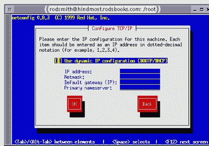

版权 ©2001 SYBEX, Inc., Alameda, CA www.sybex.com

## 配置远程客户端访问

许多 Linux 系统通过网卡直接连接到网络。此类系统通过上述方法进行配置——通过 `DHCP` 或静态 IP 地址分配。然而，其他计算机使用的连接方法较少。这些计算机通常位于家庭或小型微企业中，它们需要使用拨号连接、综合业务数字网络 `ISDN` 链路或宽带连接。此类系统有时工作更像直接连接，但有时又需要不同的配置方法。

### 发起 PPP 连接

传统的调制解调器是网络连接的低端。该设备将公共电话网络转换为计算机网络介质，精确地连接两个点。在最简单的形式下，调制解调器可以使用终端启动文本模式连接——终端是一个允许远程文本登录但无法进行其他操作的程序。但今天，调制解调器通常与 `PPP` 结合使用。`PPP` 在两台计算机之间建立 `TCP/IP` 链路，因此你可以使用许多基于 `TCP/IP` 的工具，如本章后面在“网络配置”中讨论的工具。然而，大多数 `PPP` 账户设计为短期使用，而不是持续连接。因此，在此类系统上运行服务器是不可取的，因为大多数服务器需要始终在线的互联网连接。不过，某些 `ISP` 提供全天 `PPP` 链路。

要发起 `PPP` 连接，你必须在 Linux 系统上安装 `PPP` 软件。最重要的 `PPP` 软件包被称为 `pppd`，即 `PPP` 守护进程。此实用程序可以启动 `PPP` 链路并响应启动链路的尝试。它描述了方法

### 使用基于文本的 PPP 工具

在 中，`PPP` 连接通常需要在 `/etc/ppp/pap-secrets` 或 `/etc/ppp/chap-secrets` 文件中有一个条目。这两个文件都使用相同的格式。它们提供了 `PPP` 客户端和服务器之间传递的身份验证信息，使用密码认证协议 `PAP` 或挑战握手协议 `CHAP`。由于 `PPP` 设计用于拨号电话线，拨号方通常必须向另一个系统提供用户名和密码；`PAP` 和 `CHAP` 仅仅是以标准方式执行此操作的协议。`secrets` 文件行的格式如下：

```
username server IP_address
```


用户名和密码值分别是你的用户名和密码，这些值是从你的互联网服务提供商（ISP）处获取的。服务器值是你连接的系统名称。星号（`*`）表示 `ppd` 将连接到你的计算机。`IP_address` 是 `ppd` 将连接的 IP 地址。这通常为空白，意味着系统将接受任何地址。

从命令行连接需要修改连接脚本。这些脚本通常被称为 `ppp-up`、`ppp-dialer` 和 `ppp-down`。第一个启动连接，第三个断开连接。这些脚本存储在文档目录中，例如 `/usr/share/doc/ppp/scripts`。将它们复制到路径上方便的二进制目录，例如 `/usr/local/bin`。然后你必须根据与你的 ISP 相关的信息对其进行修改：

- 在 `ppp-on` 中，找到以 `telephone=`、`ACCOUNT=` 和 `PASSWORD=` 开头的行，并将它们修改为适用于你的 ISP 和账户的内容。（如果你使用 `PAP` 或 `CHAP`（几乎总是如此），`ACCOUNT` 和 `PASSWORD` 变量包含占位符。）
- 检查 `ppp-on` 中的 `DIALER_SCRIPT` 变量是否指向 `ppp-dialer` 的正确位置。默认位置是 `/etc/ppp`。
- 检查 `ppp-on` 最后几行对 `ppd` 的调用。大多数调用参数非常晦涩，但你应该能够确认它正在使用正确的调制解调器设备和速度。串口调调器通常使用 `/dev/tty0` 或 `/dev/tty1` 作为文件名。在大多数情况下，`115200` 是适当的速度，但默认是 `38400`。
- 检查 `ppp-dialer` 脚本。此脚本包含 `chat` 序列——程序期望在一列中看到来自调器或远程系统的字符串，在另一列中看到响应。你可能需要使用 `minicom` 等终端程序登录，然后捕获 ISP 询问用户名和密码的提示；你需要修改脚本的最后两行才能使其工作。或者，如果你的 ISP 使用 `PAP` 或 `CHAP`，你可能需要用井号（`#`）注释掉最后两行，并删除 `CONNECT` 行中的反斜杠（`\`）。

`chat` 程序期望单行；为了人类方便，其输入在 `ppp-dialer` 中以列的形式格式化。大多数行结尾的反斜杠表示换行，以便 `chat` 将多个输入行解释为单行。只有最后一行缺少反斜杠。

当你完成这些更改后，以 root 身份输入 `pp-on`（必要时带有完整路径）来测试连接。如果一切顺利，你的系统应该拨号调制解调器、建立链路并提供 Internet 访问。如果没有发生这种情况，使用类似 `tail -n 20 /var/log/messages` 的命令检查 `/var/log/messages` 的最后几行。应该会有某种错误信息，这可能帮助你诊断问题。要停止连接，输入 `pp-down`。

## 使用 GUI 拨号器

许多人喜欢使用 GUI 拨号工具来控制 PPP 连接。有很多可用。大多数 Linux 系统自带 `KPPP`，它是 KDE 系统的一部分。你可以在其他环境中使用 `KPPP`，也可以使用另一个 GUI 拨号器。大多数 PPP 拨号器提供相似的功能。

图 5.5 显示 `KPPP` 窗口。你可以通过终端输入 `kppp` 或通过 KDE 菜单（通常是 `K > Internet > KPPP`）启动它。如果已配置，你只需要从连接列表中选择你的 ISP，在 `Login ID` 字段中输入用户名和密码，然后点击 `Connect` 开始连接。这可以在连接建立时断开。

### 图 5.5 GUI 拨号器允许你选择多个 ISP 或拨号号码并点击按钮连接。

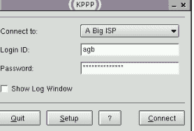

要配置 `KPPP`，遵循以下步骤：

- 1. 点击 `Setup`。产生如图 5.6 所示所示 `KPPP` 配置窗口。此窗口控制基本 `KPPP` 功能并允许修改特定账户。

### 图 5.6 KPPP 配置窗口控制账户和全局 KPPP 设置。

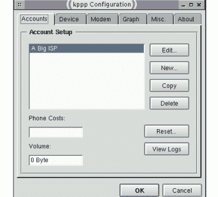

- 2. 点击 `New` 创建新账户。系统显示对话框询问使用向导还是通过对话框设置。向导不支持美国 ISP，因此如果你在美国，你需要使用对话框选项。`KPPP` 然后显示新账户对话框（图 5.7）。

### 图 5.7 KPPP 新账户对话框允许你输入特定特定信息。

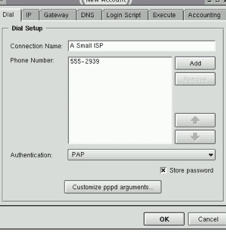

## 配置远程客户端访问

- 3. 在“连接名称”（`Connection Name`）字段中输入一个标识名称。设置此名称是为了方便识别该配置，因此在此可以使用任何您喜欢的名称。
- 4. 点击“添加”（`Add`），输入您的 ISP 电话号码，然后点击“确定”（`OK`）。如果您的 ISP 提供多个本地接入点，请重复此步骤。
- 5. 选择您的 ISP 使用的身份验证形式（`PAP` 最常见，其次是 `CHAP` 和脚本登录）。
- 6. 点击“新账户”（`New Account`）对话框中的“确定”将其关闭。
- 7. 在 `KPPP` 配置窗口中，检查“设备”（`Device`）和“调制解调器”（`Modem`）选项卡上的设置。您可能需要调整某些设置，例如调制解调器设备和连接速度。

当第一次建立连接时，在主 `KPPP` 窗口中点击“显示日志窗口”（`Show Log Window`）（图 5.5）。这将产生一个显示您的系统与 ISP 之间交互的窗口，万不符合预期时，这非常有帮助。

## 使用 ISDN 服务

`ISDN` 是传统模拟电话线的数字替代方案。`ISDN` 的优势之一是它允许您结合一对 `64Kbps` 的数字线路，实现 `128Kbps` 的净数字吞吐量。与模拟电话调制解调器可能的最高 `56Kbps` 速度相比，这是一个巨大的改进；在当今世界，这最多是一种权宜之计；更好的升级是使用宽带，使用 `USL` 或电缆调制解调器服务。此外，在美国 `ISDN` 往往昂贵，且可用性不稳定。然而，`ISDN` 在欧洲流行得多。

`ISDN` 服务需要使用通常被称为终端适配器（`terminal adapter`）的设备。它的角色类似于模拟电话调制解调器，事实上，许多此类适配器是通过串口接口的外部设备，就像普通电话调制解调器一样。使用终端适配器时，您可以像使用模拟电话调制解调器一样通过 PPP 连接到 ISP。因此，上述关于 PPP 连接说明同样适用于此类设备。

某些 `ISDN` 调制解调器是内部卡，类似于模拟电话调制解调器。这些设备在 Linux 中需要特殊的驱动程序。Linux 内核包含了多种卡的驱动程序，因此您的卡很有可能得到支持——但在购买前请检查任何显卡的 Linux 支持情况。`ISDN` 驱动程序允许 `ISDN` 卡像调制解调器一样被访问，其命令与拨号普通调制解调器使用的命令类似。然而，您必须使用 `/dev/tty10`（以及后续的设备文件名）而不是 `/dev/tty50`。

虽然普通的 PPP 工具可以处理 `ISDN` 设备，但许多 `ISDN` 用户更倾向于使用 `ISDN` 专用工具。这些工具可以帮助设置系统以自动拨号和传输、将系统作为防火墙等——这些在模拟电话调制解调器连接中无疑是可能的，但 `ISDN` 用户特别可能这样做。一组可以帮助进行此类配置的工具集可以从 `http://www.manna.ni/tipkstest_en.html` 获取。

## 使用 DSL 或电缆调制解调器服务

数字用户线路（`DSL`）和电缆调制解调器服务是远程访问连接方法的下一个进阶方案。这些是最常见的宽带连接形式——高速远程访问。宽带也可以指允许传输视频、语音以及数字数据的介质。宽带的其他形式包括卫星、本地无线电和光纤连接，但这些目前仍然相对少见。与模拟调制解调器和 `ISDN` 连接一样，宽带连接通常用于将家庭和企业的小型计算机网络连接到互联网。与典型的 PPP 和 `ISDN` 连接不同，宽带连接可以每天运行 24 小时，因此您在使用服务之前可能不需要运行任何命令来启动连接。（稍后描述的两种连接方法除外。）

`DSL` 有几种类型，其中最常见的是非对称 `DSL`（`ADSL`）、对称 `DSL`（`DSL`）和基于 `ISDN` 的 `DSL`（`ISDL`）。尽管这些形式的 `DSL` 实际能力有所不同，但其硬件要求和配置细节是相同的。同样，配置电缆调制解调器的基本原理与配置 `DSL` 相同，尽管硬件和底层技术不同。

Copyright ©2001 SYBEX, Inc., Alameda, CA www.syex.com

有两个因素影响宽带与 Linux 的兼容性，并决定您如何对其配置：

### 硬件兼容性

所有宽带连接都需要使用模拟电话调制解调器。宽带调制解调器不兼容通过以太网接口连接到主机的普通模拟外部宽带调制解调器——这种接口也用于许多本地网络。这种接口在 Linux 中更受青。其他外部调制解调器使用 `USB` 接口。少数宽带调制解调器采用内部卡形式。`USB` 和内部宽带调制解调器都需要特殊的 Linux 驱动程序，而这些程序很少见。

### IP 地址分配方法

ISP 通常使用四种 IP 地址分配方法之一：静态 IP 地址、`DHCP`、以太网上的 PPP（`PPPoE`）和 ATM 上的 PPP（`PPPoA`）。前两种的工作方式与之前在“基础网络配置”中描述的本地网络完全相同。`PPPoE` 和 `PPPoA` 是普通 PPP 的变体。

如果您的提供商提供了一个不兼容 Linux 的调制解调器，您唯一的选择是替换为兼容型号（可能是基于以太网的设备）或编写自己的驱动程序。当然，前者更容易。在 IP 分配区域，主要的复杂性来自使用 `PPPoE` 或 `PPPoA` 的 ISP。`PPPoE` 是这些中最常见的，大多数 Linux 发行版现在都带有至少一个 `PPPoE` 包，通常是 Roaring Penguin（`http://www.roaringpenguin.com/pppo`）。Roaring Penguin 自带一个文本配置脚本 `1-setup`，会向您询问关键信息，如用户名和密码。然后您可以输入 `ads1-start` 启动连接，或者输入 `ads1-stop` 停止。

## 安全与宽带连接

许多用户将计算机直接连接到宽带 ISP 网络，仅在计算机和网络介质之间使用宽带调制解调器。这种方法在安全方面需要谨慎；就像您将系统连接到公司网络一样，只要计算机通电，就可以被随时访问。如今大多数公司网络都包含防火墙——阻止对内部计算机非法访问的设备。然而，很少宽带 ISP 提供防火墙，因此连接宽带的计算机通常是脆弱的。

解决方案是运行防火墙来保护连接的计算机（或通过它连接的其他计算机）。本章的“通过防火墙控制访问”部分提供了 Linux 配置的一些建议。

另一种选择是购买宽带路由器。这些设备花费 50 到 500 美元（大多数为 100-150 美元），位于计算机和以太网调制解调器之间。它们被设计作为防火墙，且通常非常容易配置。大多数型号还支持端口网络地址转换（`NAT`），允许您在多个计算机之间共享 Internet 连接，即使您的 ISP 只提供一个 IP 地址。多个型号评论可以在 `http://www.practicallynetworked.com/reviews/index_router.htm` 找到。

## 网络应用程序配置

一旦网络连接建立并运行，就是时候研究该连接可以做什么了。本节重点关注流行的网络客户端程序——即允许您作为用户发起数据传输的程序，例如检索电子邮件或访问远程计算机上的文件系统。网络服务器的配置（那些响应数据传输查询的程序）大部分超出了本书的讨论范围，尽管本节讨论了其中几种。

### 使用 Web 浏览器

Linux 中最流行的 Web 浏览器是 Netscape (`http://www.netscape.com`)，但也有其他选择。这些包括 Mozilla (`http://www.mozilla.org`)，它是 Netscape 的一个完全开源分支；Opera (`http://www.opera.com`)，一种在许多平台上可用的商业浏览器；Lynx (`http://lynx.browser.org`)，一种文本模式浏览器；以及 Konquer (`http://www.kde.org.browser`)，它是 K 桌面环境 (`KDE`) 的一部分。

许多桌面环境和窗口管理器（在第 6 章的“基础 GUI 使用”中讨论）都包含启动 Web 浏览器的简单方法。事实上，`KDE` 的 Web 浏览器 `Konquer` 兼任管理器的角色，并在你启动 `KDE` 时默认启动。如果你愿意，可以在 `xterm` 中输入其名称来启动 Web 浏览器。对于 `Lynx` 来说，你也可以从文本模式登录启动它。

`Lynx` 的 GUI Web 浏览器工作方式与其他操作系统中的对应程序大相似。你可以通过点击链接（链接通常显示为另一种颜色）来查看与当前页面相关的链接页面。（`Lynx` 使用方向键和 `Tab` 键高亮显示链接；按 `Enter` 键会导致程序加载所链接的页面。）

### 使用电子邮件客户端

互联网上的电子邮件依赖于称为简单邮件传输协议 (`SMTP`) 的协议。这被称为推送邮件协议，因为传输是由发送方发起的。邮件服务器接收邮件后，要么存储，要么转发到另一个系统，具体取决于接收者地址和服务器的配置。Linux 几乎总是包含 `SMTP` 服务器，并因此作为 `SMTP` 拉取接收端运行。

今天常用的另一种邮件协议是拉取邮件协议，因为传输是由接收方发起的。通常，邮件客户端是一个工作站，而服务器处理整个组织的邮件。目前有两种常用的拉取邮件协议：邮政邮局协议 (`POP`) 和互联网邮件访问访问协议 (`IMAP`)。在这两者中，`IMAP` 更加复杂，允许邮件服务器存储和组织消息；`POP` 则较简单，要求用户下载并将邮件存储在本地以便将其组织到文件夹中。

在 Linux 中处理电子邮件有两种方法，它们反映了这两种类型的邮件传输协议：

- **从本地邮件队列读取。** 如果你向收件人提供你的 Linux 系统名称和在该系统上的用户名，你可以让 Linux 系统充当 `SMTP` 服务器，并在 Linux 计算机上直接读取邮件。例如，如果你的系统是 `apollo.luna`，用户名是 `hschmidt`，那么发往 `hschmidt@apollo.luna` 的其他系统邮件将送达你的处并存储供你阅读。
- **从远程系统读取。** 如果你不希望邮件地址直接发送到你自己的电脑，请使用拉取邮件协议配合单独的邮件服务器。例如，你提供你的电子邮件地址 `hschmidt@mail1.luna.edu`，然后使用你的 `apollo` 工作站从 `mail1.luna.edu` 获取邮件。

这每种情况都需要你恰善地配置邮件阅读器，稍后会进行描述。如果系统有许多在其他系统中没有邮件账户的用户，那么使用本地邮件队列是有意义的。如果你的系统 IP 地址经常变化，或者有时不在线，那么从独立的邮件服务器读取邮件将会有意义，因为在这些情况下，向你的系统交付 `SMTP` 邮件将不可靠。

`SMTP` 服务器可能被误配置为*开放邮件中继*（`open mail relays`）。它们会将从任何地址的邮件转发到任何其他地址，深受发送垃圾邮件（未经请求的批量电子邮件）的人之喜爱。1999 年以来发布的所有 Linux 发行版默认都配置为开放邮件中继。如果你运行的是旧版本的发行版，或者你尝试更改邮件服务器的配置，请确保你没有运行开放邮件中继。访问 `http://mail1-abuse.sybex.com` 获取有关这一重要主题的更多信息。

Linux 支持多种电子邮件客户端。这些包括 Netscape Communicator (`http://www.netscape.com`)，Netscape Web 浏览器的邮件部分；`KMail` (`http://www.kde.org`)，`KDE` 的邮件客户端；`Mutt` (`http://www.mutt.org`)，一种高级的基于文本的邮件阅读器；以及

作为桌面浏览器，你可以从桌面环境或窗口管理器菜单中选择它们来启动邮件客户端，或通过在 shell 提示符处输入程序名称。你通常配置邮件客户端使用本地队列或远程邮件服务器。如果是后者，你必须输入服务器名称、它使用的协议、你在该服务器上的用户名（这可能与你的本地用户名不同）以及可能可能的其他信息。图 5.8 显示了 `KMail` 的添加账户对话框，大部分信息都在此处输入。

图 5.8 当使用拉取监控器时，你的电子邮件客户端使用你在邮件服务器上的账户从该服务器检索你的电子邮件。

你还必须选择如何发送邮件。由于 Linux 系统包含邮件服务器（通常是 `sendmail`，但也有其他选项），日常邮件操作的细节在程序之间有所不同，但作为规律，这些程序包含了读取新邮件、回复邮件、发送新邮件、删除旧消息以及将消息组织到文件夹的功能。当你使用远程服务器时，必须显式地检查新邮件（通过点击按钮或选择菜单选项），或配置程序定期执行此操作。

### 远程使用 X 程序

如第 2 章所述，Linux 的 GUI 环境——X 窗口系统（简称 X）其特殊之处在于它完全支持网络。仅需使用标准的 X 软件和 Linux 配置，你就可以在网络其中一台计算机上运行一个 X 程序，同时使用另一台计算机的显示器和键盘。事实上，这些系统中的一个可能运行着非 Linux 的 Unix 系统。甚至可以在 Windows、OS/2 或完全非 Unix 系统上，或者在与 Linux 系统不同类的 CPU 系统上运行 X 服务器。

为了理解这一点，请从程序的角度来看。对于文字处理程序来说，显示器和键盘是需要的服务，就像网络可用的打印机一样。

假设你的本地网络包含两台机器。名为 `zeus` 的计算机是一台强大的机器，运行着文字处理程序和数据分析工具。`apollo` 是一个较弱的系统，但它拥有良好的显示器和键盘。因此，你想在 `apollo` 上运行位于 `zeus` 上的程序。两个系统都运行 Linux。要完成此任务，请遵循以下步骤：

- 登录 `apollo`，如果它还没有运行 X，则启动它。
- 在 `apollo` 上打开终端（例如 `xterm`）。
- 在 `apollo` 的终端输入 `xhost +zeus`。此命令告诉 `apollo` 接受来自 `zeus` 并在 X 服务器中显示的内容。

4. 从客户端登录服务器。例如，你可以使用 `Telnet` 或安全外壳（`SSH`）。（参见后后的章节“设置远程访问服务器”和“远程系统管理”）。结果应该是能够在通过 `SSH` 在 shell 中输入命令等。

5. 在 Linux 上，输入 `export DISPLAY=:0.0`。（这假设你正在使用 `bash`；如果你使用 `csh`，则命令应为 `setenv DISPLAY :0.0`。）此命令告诉程序使用哪个显示器进行。

6. 无论你可能需要在命令行提示符下运行什么内容。例如，你可以输入[命令]来启动。你应该看到程序在显示器上打开，但它们可以读取服务器上可访问的文件。

7. 完成后，关闭程序并注销。这将增强安全性，使得计数统计错误的用户无法修改你的显示器。

有时，你可以跳过这些步骤中的部分。根据配置的不同，`SSH` 可以转发连接并将这些请求传递给系统。远程运行程序的另一种选择法是使用虚拟网络计算（`VNC`），它至少是一个单向协议；`VNC` 在你正在使用的计算机上运行一个服务器。这种客户端和服务器角色的反转在某些情况下是有益的，例如当你尝试访问防火墙后的远程系统时。（提供 Windows 和 macOS 的 `VNC` 服务器，允许你从这些非 Linux 操作系统控制 Linux。）

### 使用 FTP 客户端

文件传输协议（`FTP`）是传输文件的较旧协议之一。尽管历史悠久，但 `FTP` 仍然被广泛使用因为它易于配置且 `FTP` 客户端程序非常常见。在 Linux 上，这些程序包括原始的文本模式 `ftp`、更新的文本模式 `NcFTP`（`http://www.ncftp.com`）以及像 `lFTP`（`http://lftp.org`）之类的 GUI 程序。此外，网页包含指向 FTP 站的链接，因此 Web 浏览器可以作为单向 FTP 客户端。

`FTP` 的目的正如其名称所示，是在计算机之间传输文件。当你运行 `FTP` 客户端时，可以选择服务器上或你自己系统上的文件，然后点击按钮或发出命令来传输文件。文本模式 `FTP` 客户端接受许多命令，最重要的命令列在此处：

- **put** 此命令从你的系统向 `FTP` 服务器发送单个文件。
- **get** 使用 **get** 命令从服务器检索单个文件。
- **mput** 此命令是 **put** 的多文件变体；你可以指定多个文件全部发送到服务器。
- **mget** 此命令是 **get** 的多文件变体；你可以指定文件并全部检索。
- **cd** 类似于 Linux shell，`FTP` 客户端中的 **cd** 会更改服务器上的目录。
- **ls or dir** 这两个命令都能在服务器上产生目录列表。某些程序对这两个命令的响应不同，通常 **dir** 比 **ls** 产生更多信息（如文件大小和日期）。
- **binary** 大多数 `FTP` 客户端默认使用二进制模式，该模式传输文件时不更改其内容。如果你想切换到此模式，请执行此命令。
- **ascii** 因为不同的操作系统存储换行符的方式不同，通过 `FTP` 传输的文本文件在检索后有时无法显示。执行 **ascii** 命令会导致传输时更改换行符以符合客户端的规范。这对于文本文件有用，但**不应**用于二进制文件。

退出 `FTP` 会话，`quit` 命令会关闭会话并退出程序。这些命令可以从菜单选项或使用 GUI `FTP` 程序中的按钮轻松访问。例如，图 5.9 显示了 `gFTP`，本地计算机的文件系统显示在左侧，`FTP` 服务器的显示在右侧。你可以点击一侧的文件，然后点击窗格之间的箭头之一在它们之间移动它们。

图 5.9 FTP 客户端允许你使用点点点击界面浏览文件。

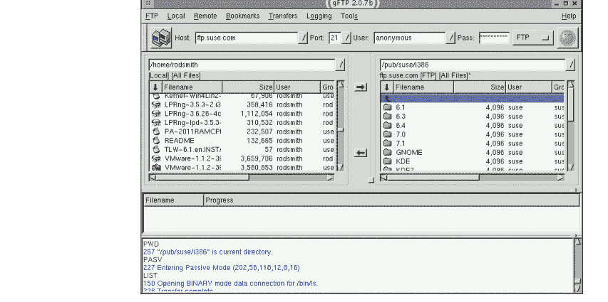

`FTP` 要求用户发送用户名和密码以访问远程系统。如果你联系的系统是你拥有账户的系统，你可以使用该系统上的普通登录用户名和密码。这经常被使用，例如当将文件上传到 ISP 的 Web 服务器以用于你的个人网页时。许多站点并不以此方式使用用户名和密码；但有匿名 `FTP` 站点。要使用站点，你使用 `anonymous` 作为用户名，并将命名（惯例是你的邮件地址）作为密码。匿名 `FTP` 站点经常持有公开访问的文件。

### 访问 SMB/CIFS

**警告**：如果你在网络上使用 `FTP`，其不安全的性质极易被截获。因此，你应该尽可能使用基于 `SSH` 的连接。服务器消息块（`SMB`）最初设计用于 Windows 的文件共享，但现在已重命名为通用互联网文件系统（`CIFS`），因为它不仅限于 Windows。`SMB/CIFS` 是计算机之间文件共享和打印机的协议。在 Linux 下，`Samba` 包含一个名为 `smcount` 的实用，它实际上会将远程共享挂载到 Linux 挂载点。`smcount` 的界面与 `smclient` 非常相似，但你必须将其添加到调用中。这是一个完成与前一个相同任务的序列：

```bash


$ smcount //apollo/hschmidt /mnt/alt

Password:

$ ls -1 /mnt/alt

total 152

-rwxr-xr-x 1 rodsmith users 152576 Mar 29 13:01

drock.wpd

drwxr-xr-x 1 rodsmith users     512 Apr 2 2000 geology

$ cp /mnt/alt/drock.wpd ./

$ smcount /mnt/alt

## 356 第 5 章 · 网络

为了让普通用户运行 `smbmount` 和 `smembunt`，`smbnt` 和 `smb` 程序必须设置 SUID 位，这允许普通用户以 root 权限运行程序（`smbnt` 是 `smbmount` 的辅助程序）。如果安装 Samba 时未设置，请以 root 身份执行 `chmod a+s /usr/bin/smbnt /usr/bin/smbmount`。因此，普通用户将可以使用这些程序，但他们需要拥有所使用的挂载点，例如上示例中的 `/mnt/a17`。

运行 SMB/CIFS 共享的另一种方法是通过标准的 Linux `mount` 命令。这要求你通过 `-t` 参数传递 `smbfs` 的文件系统类型：

```bash
# mount -t smbfs //apollo/hschmidt /mnt/a17
```

Samba 实际上是一个主服务器；客户端工具只是 Samba 功能的一一小部分。当服务器运行时，Linux 系统可以作为 Windows 客户端的文件服务器。标准的 Samba 服务器配置通过 `smb.conf` 文件处理，该文件通常存储在 `/etc/samba`、`/etc/samba.d` 或类似位置。默认配置通常在有限范围内有效，但需要一些自定义。你可能需要为了将 Samba 作为客户端使用而设置其中的一些选项。以下是最常见的两个领域：

**工作组或域名**：你必须使用 `smb.conf` 中的 `workgroup` 参数设置工作组或域，以与本地网络匹配。

**加密密码**：Samba 默认使用未加密密码，但最近版本的 Windows 使用加密密码，且不会回退到未加密密码。你必须将 `encrypt` 参数设置为 `Yes`，然后使用单独的 `smbpasswd` 命令为单个用户添加加密密码，例如输入 `smbpasswd -hschmidt` 为 hschmidt 设置密码。

你还需要为系统定义共享。默认配置通常包含一些示例，以及一个 `[homes]` 共享定义，允许用户访问其家目录。有关 Samba 服务器配置的更多多信息，请参阅 Samba 主网站 (http://www.samba.org) 上的文档或相关主题书籍，例如我的 *Linux Samba Server Administration* (Sybex, 2001)。

版权所有 ©2001 SYBEX, Inc., CA www.sybex.com

## NFS 共享

与 SMB/CIFS ，Sun 的 *Network Filesystem (NFS)* 是一种文件共享协议，但它是针对 Unix 系统的需求设计的。NFS 包含了 Unix 特性，例如对所有者、组和权限字符串的支持（更多功能见第 4 章“用户与安全”中的“文件权限”），而 SMB/CIFS 不。由于 Linux 接近 Unix 模型，NFS 是 Linux 系统之间文件共享的首选方法。

在 Linux 中，客户端访问 NFS 导出紧密集成到标准的 Linux 文件访问工具中。具体来说，你使用 *mount* 命令来挂载 NFS 导出，并像访问普通文件一样访问在 NFS 服务器上的文件。例如，使用上一个 SMB/CIFS 示例中的文件，你可能会执行如下命令：

```bash
## mount apollo:/home/schmidt /mnt/a17
## ls -l /mnt/a17
total 152
-drwxr-xr-x 2 rodsmiths users 15256 Mar 29 13:01
* drock.wpd
drwxr-xr-x 1 rodsmiths users 512 Apr 2 2000 geology
## cp /mnt/a17/drock.wpd ./
## umount /mnt/a17
```

通常，只有 root 可以使用命令在 `/etc/fstab` 中为导出创建条目。该导出应允许 `user` 选项以赋予普通用户挂载文件系统的权限，然后：

```bash
apollo:/home/schmidt /mnt/a17 nfs user,noauto,exec 0
```

当行项目存在时，用户可以通过输入 *mount /mnt/a17* 来挂载 NFS 导出，并通过输入 *umount /mnt/a17* 来卸载。或者，省略 *user* 和 *noauto* 选项会导致系统在启动时为没有显式挂载导出的用户自动挂载远程文件系统；它将一直挂载（假设服务器始终在线），就像本地文件系统一样。

注意的是，访问 NFS 导出时不需要输入密码。NFS 服务器允许指定的客户端以某种程度上不受限制的方式访问导出目录；服务器依赖客户端的安全策略来防止滥用。

## 358 第 5 章 · 网络

在服务器端，通过向 `/etc/exports` 添加条目来导出目录。例如，以下行告诉 Linux 将其 `/home` 目录与计算机 taurus 和 littrow 共享，赋予 taurus 读写权限，赋予 littrow 只读权限：

```bash
/home taurus(rw) littrow(ro)
```


## 使用 SNMP 客户端

简单网络管理协议 (`SNMP`) 设计用于提供关于网络计算机的信息并对其控制。它通常在一个名为 `sn` 或 `ucd-snmp` 的包中提供。（注：此处 OCR 文本包含大量重复循环，已省略）。

例如，关于防止未经授权的邮件继以及通过 `SSH` 阻止 `root` 登录的注释。尽管如此，这个问题远超这些情况。幸运的是，Linux 提供了许多控制网络控制手段。

尽可能地应用冗余的访问控制。例如，你可以同时使用防火墙和 `TCP Wrappers` 或 `xinetd` 来阻止对特定服务器的非预期访问。这样做有助于防止错误和配置错误——例如，如果防火墙配置出现问题，那么次级拦截可能会阻止入侵者。如果你仔细配置了系统，访问还会留下一条你可以看到的日志信息，这样你就会发觉防火墙没有正常工作。

## 通过防火墙控制访问

传统上，防火墙是阻止两个网络之间不必要的网络传输的路由器。通常，一个网络是由一个管理员管理的小型网络，另一个网络要大得多，例如互联网。图 5.11 展示了这种安排。（也可以使用多台计算机的复杂防火墙。）专用防火墙是可用的，在许多情况下是很好的投资。事实上，可以通过 Linux 将普通计算机转换为此类设备——可以使用诸如 Linux Router Project (`http://www.linuxrouter.org`) 的专用发行版，也可以使用普通发行版并将其配置为具有防火墙功能的路由器。

图 5.11 防火墙可以使用各种标准选择性地通过某些数据包而不是其他包。

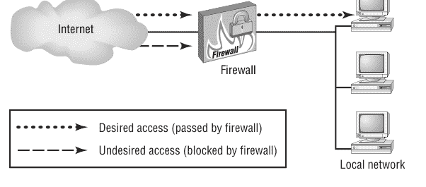

正如本章前面的介绍，服务器通过将自己与特定的网络端口关联来运行。同样，客户端也绑定到端口，但客户端端口绑定并没有标准。常见的防火墙类型是数据包过滤器，它通过检查单个数据包并根据源和目的端口号、源和目的 IP 地址，以及可能的较低级标准（例如具有多个接口的计算机中的网络接口）来决定是否允许其通过。在图 5.11 中，你可能在内部运行 `Samba` 服务器，但外部计算机无法访问该服务器。因此，你配置防火墙来阻止指向 `Samba` 所用端口的外部数据包。

在路由器上运行防火墙之外，可以在单个系统上运行防火墙。这种方法可以为敏感计算机提供额外的保护，即使有外部防火墙保护该计算机也是。对于对于独立防火墙保护的计算机（例如许多宽带连接的系统），这种方法也很有用。

无论如何，Linux 都使用 `ipfwad`、`ipchains` 和 `iptables` 工具来配置防火墙功能。这些工具分别为 2.0.x、2.2.x 和 2.4.x 内核设计。（2.4.x 内核系列包含了使用旧工具的能力，但仅作为编译选项）。你有几种方法可以配置防火墙：

- 手动可以读取用于配置内核的工具的语法并编写自己的脚本。虽然这是可能的，但对于新的 Linux 管理员来说很难，因为这些选项既复杂又微妙，很容易配置出一个无法按预期工作的防火墙。如果你选择走这条路，我建议你读读关于该主题的书，例如 Robert L. Ziegler 的《Linux Firewalls》(New Riders, 1999)。
- 在 GUI 配置工具的帮助下，有几个用于 Linux 防火墙配置的 GUI 配置工具，例如 `Firestarter` (`http://firestarter.sourceforge.net`) 和 `Guarddog` (`http://www.simzone.com/software/guarddog`)。一些发行版（如 Red Hat）现在自带了此类工具。这些工具允许你指定某些基本信息，例如网络端口以及你允许的客户端和服务器协议，并由生成可以在系统启动时自动运行的防火墙脚本。
- 在网站的帮助下，《Linux Firewalls》的作者 Robert Ziegler 提供了一个网站，通过 Web 提供类似于 GUI 配置工具的功能。你在系统上输入信息，网站会生成一个防火墙脚本。该工具可以在 `http://linux-firewall-tools.com/linux` 获得。

如果你使用 GUI 工具或网站，请务确保你的工具支持你的内核规则。截止到你读到这里时的 5 月份，只有 `Firststar` 支持 `iptables`，这可能会发生变化。你不应该将防火墙视为完美的保护。你可能会创建一个包含缺陷的配置，或者实际实现防火墙规则的 Linux 内核代码中可能存在缺陷。


防火墙的优势之一（即使是保护一台计算机）是它可以阻止对任何服务器的访问尝试。其他措施是有限的。例如，`TCP Wrappers` 仅保护配置为通过 `inetd` 使用 `TCP Wrappers` 运行的服务器；而密码仅对那些创建时就需要密码的服务器有效。

## 通过 TCP Wrappers 控制访问

运行服务器的一种流行方式是 `inetd`，它是一个代表其他服务器监听网络连接并根据需要启动目标服务器的服务。当服务器程序很少使用时，这种方法可以减少服务器计算机的内存需求，因为 `inetd` 一直运行。第 6 章将更详细介绍 `inetd`。


并不是所有的 Linux 系统都使用 `inetd`。`Mandrake` 和 `Red Hat` 已切换到 `xinetd`，它包含了自己的访问功能。`inetd` 的进一步优势是它可以与名为 `TCP Wrappers` 的包配合使用。该包使用名为 `tcpd` 的程序。`inetd` 不再直接调用服务器，而是调用 `tcpd`，`tcpd` 执行两件事：它检查客户端是否有权访问服务器；如果客户端有权限，`tcpd` 就会调用服务器。

`TCP Wrappers` 通过两个文件进行配置：`/etc/hosts.allow` 和 `/etc/hosts.deny` 第一个指定允许以特定方式访问系统的计算机，这意味着未列出的系统不允许访问；相比之下，`hosts.deny` 列出了不允许访问的计算机；所有其他计算机都被允许使用系统。如果一个系统同时列在两个文件中，`hosts.allow` 优先。两个文件使用相同的格式。该文件由以下行组成：

`daemon-list : client-list`

`daemon-list` 是服务器列表，使用 `/etc/services` 中出现的服务器名称。还有通配符可用，例如代表所有服务器的 `ALL`。

`client-list` 是授予或拒绝访问指定域权限的计算机列表。你可以通过名称或 IP 地址指定计算机，并可以通过前导点或后缀点指定网络。例如，`.luna.edu` 阻止 `.luna.domain` 下的所有计算机，`192.168.7.` 阻止 `192.168.7.0/24` 网络的所有计算机。你可以在 `client-list` 中使用通配符，例如 `ALL`（所有计算机）。`EX` 允许例外。例如，当放在 `hosts.deny` 中，`.192.168.7.105` 会阻止 `192.168.7.0/24` 网络中的所有计算机，除了 `192.168.7.105`。

`hosts.allow` 和 `hosts.deny` 页面（它们实际上是同一个文档）提供了有关高级功能的额外信息。如果你构建 `TCP Wrappers`，应该查阅它们。

记住，所有服务器都受到 `TCP Wrappers` 的保护。通常，`inetd` 通过 `tcp` 运行的服务器都受到保护。服务器通常包括但不限于：`Telnet`、`FTP`、`TFTP`、`rlogin`、`linuxconf`、`POP` 和 `IMAP` 服务器。少数服务器可以独立解析 TCP 配置文件，如有疑问请查阅服务器文档。

## 通过 xinetd 控制访问

在 2000 年和 2001 年，开始从 `inetd` 切换到 `xinetd`。虽然 `xinetd` 可以使用 `TCP Wrappers`，但通常不使用，因为它包含了自己的类似的功能。2001 年，使用 `xinetd` 的发行版 a

### 设置远程访问权限

主配置文件名为 `/etc/xinetd.conf`；但该文件大部分是空的，因为它调用 `/etc/xinetd.d` 目录下的单独文件来执行实际工作。该目录包含处理各个服务器的独立文件。第 6 章包含了有关基础 `xinetd` 配置的信息。目前，请了解安全是通过配置参数逐个服务器进行处理的，其中某些参数与 `hosts.allow` 和 `hosts.deny` 的功能相似：

- **bind** 此选项告诉 `xinetd` 仅在一个网络接口上监听该服务。例如，你可以在路由器上指定 `bind = 192.168.23.7`，使其监听在与该地址相关的以太卡上。此功能在路由器中非常有用，但对于只有一个网络接口的计算机来说用处不大。该选项的同义词是 `interface`。
- **only_from** 你可以在此行中指定 IP 地址（如 `192.168.78.0/24`）或计算机名称，用空格分隔。结果是 `xinetd` 将仅接受来自这些地址的连接，类似于 `TCP Wrappers` 的 `hosts.allow` 条目。
- **no_access** 此选项是 `only_from` 的相反；你列出你想要黑名单的计算机或网络。这类似于 `TCP Wrappers` 的 `hosts.deny` 文件。

你应该将这些选项输入到 `/etc/xinetd.d` 中对应于你想保护的服务器的文件里。将这些行放置在服务的起始大括号 `{` 和结束大括号 `}` 之间。如果你想限制所有配置了 `xinetd` 的服务器，可以将条目放在 `/etc/xinetd.conf` 中的 `defaults` 部分。

> 某些服务器提供了类似于 `TCP Wrappers` 本身的访问控制机制。例如，`Samba` 提供了 `hosts allow` 和 `hosts deny` 选项，其工作方式非常类似于 `TCP Wrappers` 文件条目，`NIS` 也包含了类似的配置选项。这些选项在那些难以通过 `inetd` 或 `xinetd` 运行或无法运行的服务器上常见。

## 通过密码控制访问

不同服务器的服务对象不同。某些服务器（如 Web 服务器和 `SMTP` 邮件服务器）通常配置为公开访问。任何人都可以访问这些服务器，尽管服务器可能不会为所有人执行所有操作——例如，邮件服务器可能只为某些计算机中继。其他服务器（如 `Telnet` 和 `FTP` 服务器）要求用户以某种方式进行身份验证。这种方法通常是密码，通常对应于用户的普通登录密码。

密码可以是一个非常有用的安全工具，但它们并非没有缺陷。首先，如前面提到的，安全协议默认以未加密的形式发送密码。这些包括但不限于：`Telnet`、`FTP`、`POP` 和 `IMAP`。这些协议都有安全变体，它们以加密的形式发送密码和其他数据。加密防止了密码即使被截获也无法被使用。其他协议（如 `SSH`）从底层开始就被设计成是安全的。

某些协议使用密码以外的身份验证方法。例如，`SSH` 可以配置为在客户端和服务器使用特殊密钥。当配置了 `SSH` 时，用户无需输入密码。虽然这种配置提供了安全的身份验证，但如果用户的普通计算机被破解，这种配置就是有风险的，因为加密密钥存储在硬盘上，可能会被盗取。

更有风险的是用户在登录时使用的 `rsh` 和 `rcp` 方法——被称为“r-commands”（r 命令）。这些命令允许用户在不经过身份验证的情况下登录到另一个 Unix 或 Linux 系统、在上面运行程序或复制文件。与 `NFS` 服务器一样，服务器信任客户端的身份验证机制。单个用户可以控制他们的 r-command 访问。这是通过在用户主目录下创建一个名为 `hosts` 的文件来实现。该文件包含受信任的主机列表，随后是该主机上的用户名。（如果未指定用户名，系统要求两台计算机上具有相同的登录名。）如果配置了运行 r-command 服务器，那么让它们保持运行通常是不明智的；因为它们的安全风险太大了。如果你必须使用这些服务器，请使用防火墙以及 `TCP Wrappers` 或 `xinetd` 选项来限制仅允许需要访问的计算机连接。

## 通过文件权限控制访问

最后，远程访问权限可以通过文件权限来限制。第 4 章对此有更详细的描述。简而言之，任何服务器运行都就像某个特定的用户。需要登录的服务器（如 `FTP`、`Telnet` 和 `SSH` 服务器）通常赋予用户与用户名相关的权限以获得访问。因此，如果某人以 `ernan` 身份登录，他就拥有相应的权限。

某些服务器不使用密码。这些通常以启动脚本或超级服务器指定的权限运行。`nobody` 是一个常见的选择。使用 `nobody` 时，除非赋予了全局读取权限，否则用户无法读取文件。许多服务器会创建自己的低权限用户，以便针对特定用户进行精细调整。通过规划与服务器相关的用户以及你的文件权限方案，你可以限制对服务器用户的访问。

文件权限限制在为匿名用户提供系统部分访问时最有用。例如，你可能希望让 `FTP` 或 Web 服务器访问某些目录但不允许其他目录。你可以使用文件权限来确保服务器只能读取目标目录中的文件，而不读取其他文件。（还有其他方法可以实现类似的效果，例如使用服务器特定的配置选项或使用 `chroot` 命令。后这一个选项是高级选项，超出了本书的范围。）

## 远程系统管理

访问权限如此重要的原因之一是可以使用不同的协议来提供计算机的管理访问。虽然使用此类协议可能会带来安全风险，但远程管理通常非常方便，甚至在某些情况下是必要的。你可以使用多种工具远程管理你的系统，包括文本模式登录、GUI 登录、文件传输和专用远程管理协议。

### 文本模式登录

之前的章节“设置访问服务器”描述了两种接受文本模式登录的服务器类型：`Telnet` 和 `SSH`。你可以使用它们中的任何一种从一台系统管理另一个系统——甚至从运行其他操作系统的计算机（如 Windows 或 macOS）进行。通常，你会使用普通用户账户登录，然后输入 `root` 密码以获取超级权限。

> 警告 `Telnet` 以未加密的形式传递所有数据。这意味着你的用户登录密码以及配合使用的 `root` 密码可能会被源端、目的或任何中间网络上的不法分子截获。由于这个原因，最好不要使用 `Telnet` 进行远程管理。事实上，如果可能，你应该完全避免 `Telnet`。`SSH` 加密两个系统之间传输的所有数据，因此它是远程管理的更好选择。

在 Linux 上使用 `Telnet`，请使用 `telnet hostname`，其中 `hostname` 是你想联系的计算机的 DNS 主名。你随后会看到远程系统的登录提示。整个过程如下：

```
$ telnet apollo.luna.edu

Trying 192.168.1.1...

Connected to apollo.luna.edu.

Escape character is '^'.

Caldera OpenLinux(TM)

Version 2.4 Desktop

Copyright 1996-2000 Caldera Systems, Inc.

login: ecernan

Password: 

You have old mail in /var/spool/mail/ecernan.

Last login: Sat May 5 13:05:29 2001 from gemini on 4 [ecernan@apollo ecernan]$
```

远程系统管理 369

在此时，你输入的任何内容（`Ctrl+C` 除外，它是“转义”字符，允许你向本地 `Telnet` 程序输入命令）都将由远程系统处理。你可以使用 `su` 获取 `root` 权限，使用 `Vi`、`Emacs` 或任何其他文本编辑器编辑文件等。

`SSH` 的工作原理类似，不同之处你看不到登录提示；`SSH` 将你当前的用户名传递给服务器，服务器将尝试使用相同的用户名对你进行身份验证。如果你想在服务器上使用与当前系统不同的用户名，应该在命令行中包含 `-l username`，如下所示：

```
$ ssh apollo.luna -l eczern

ecernan@apollo.luna.edu password:

Last login: Mon May 7 11:14:51 2001 from gemini.luna.edu

[ecernan@apollo$ecern]$
```


当你第一次连接到某个服务器时，你会看到一条消息，告知服务器的真实性无法验证。该消息会显示一个与服务器相关的代码。如果你想继续，请在查询时输入 `yes`。

如果你的用户名在两个系统中相同，可以省略 `-l username` 参数。如果你通过 `SSH` 登录，你可以像通过 `Telnet` 登录或从控制台操作一样使用该系统——通过文本命令、使用文本编辑器编辑文件等。由于 `SSH` 会加密所有数据，你的原始密码（或在你使用 `su` 时输入的密码）极不可能被截获数据流的人利用。

除了 `Telnet` 和 `SSH` 之外，还有其他远程文本模式工具。其中一个特殊的工具是 `login`，它使用信任主机安全模型，服务器依赖客户端对用户进行身份验证。如后文所述，`login` 消除了一个潜在的安全漏洞。因此，最好使用你的包管理工具完全删除 `login` 服务器（通常称为 `/usr/sbin/nologind`，见第 3 章“软件管理”），或停止服务器运行（如第 6 章所述）。

Copyright ©2001 SYBEX, Inc., Alameda, CA www.sybex.com

370 第 5 章 · 网络


> `login` 服务器通常包含在一个软件包中，与其他你可能需要的实用放在一起。在确认你不需要该服务器的其他程序之前，不要删除该服务器所在的软件包。

## GUI 登录

如果你想远程使用 GUI 管理工具，可以做到，但你需要在用于访问 Linux 的系统上安装适当的软件。通常，这是一个 X 服务器，正如本章早些“远程使用 X 程序”部分描述的那样。由于所有主要的 Linux 发行版都包含 X 服务器，因此通常可以将 Linux 计算机作为终端，对另一台电脑进行 GUI 配置。（这唯一的例外情况是你在你想要管理的另一台电脑上没有安装 X）。同样，你可以使用运行 X 服务器或 VNC 客户端（如果你已在 Linux 上安装了 VNC 服务器）的 Windows 系统来远程控制带有 GUI 的 Linux 系统。

一旦登录，你就可以使用 `su` 命令获取 root 权限，就像使用文本模式登录时一样。然后你可以运行 GUI 管理工具，如 Red Hat 的 `linuxconf`、SuSE 的 `YaST2` 或 Caldera 的 `OS`。


> `X` 和 `VNC` 都不在网络上加密数据，尽管 `VNC` 会加密其密码。此外，当你使用命令获取 root 权限时，你将看到明文的 root 密码。因此，它可能会泄露。解决此问题的简单方法是使用 `SSH` 进行初始连接。配置配置后，`SSH` 将把 X 协议通过自身的加密连接进行隧道。这会略微降低速度，但它可以保护数据（包括你输入的密码）免受攻击。

## 文件传输

尽管通常不被视为此类，但文件传输工具在远程管理中可能很有用。如果你愿意，可以在一个系统上编辑配置文件并将其传输到另一个系统。如果一个系统比另一个系统拥有更复杂的编辑器或配置检查工具，你可能希望这样做。例如，如果你正在管理一个只有基础工具的打印服务器，你可能想在另一台电脑上更舒适的环境中修改配置文件，然后将配置文件传输到打印服务器。（当然，这需要打印服务器运行某些文件传输服务器，如 `FTP`、`NFS` 或 `Samba`。）

以这种方式使用文件传输时，通常不要为配置文件的目标目录提供直接访问。例如，你可能不应该使用 `NFS` 或 `Samba` 导出系统的 `/etc` 目录。虽然这样做让读写配置文件变得更容易，

Copyright ©2001 SYBEX, Inc., Alameda, CA www.sybex.com

远程系统管理 371

## 远程管理协议

有几种设计用于允许远程管理的工具。示例包括：

- `SNMP`: 该协议在本章早些描述过。
- `SWAT`: `Samba Web 管理工具` (`SWAT`) 正如其名，是一个基于 Web 的工具。……（后续文本）

# 网络诊断工具

网络配置是一个复杂的话题，遗憾的是，事情并不总是按计划进行。幸运的是，有一些命令可以帮助诊断问题。其中最简单的是 `ping`。它向你命名的系统（通过 IP 地址或主机名）发送一个小数据包并等待响应。在 Linux 中，`ping` 会每秒发送一次数据包，直到你用 `Ctrl+C` 中断它。以下是其输出示例：

```
$ ping speaker
```

```
PING speaker.rodsbooks.com (192.168.1.1) from 192.168.1.3: 56 (84) bytes of data.
```

```
64 bytes from speaker.rodsbooks.com (192.168.1.1): icmp_seq=0 ttl=255 time=199 usec
```

```
64 bytes from speaker.rodsbooks.com (192.168.1.1): icmp_seq=1 ttl=255 time=136 usec
```

```
64 bytes from speaker.rodsbooks.com (192.168.1.1): icmp_seq=2 ttl=255 time=147 usec
```

```
64 bytes from speaker.rodsbooks.com (192.168.1.1): icmp_seq=3 ttl=255 time=128 usec
```

```
--- speaker.rodsbooks.com ping statistics ---
4 packets transmitted, 4 packets received, 0% packet loss
round-trip min/avg/max/dev = 0.128/0.140/0.149/0.008 ms
```


该命令发送了四个数据包并等待它们返回，返回非常快（平均为 0.140ms），因为目标系统位于本地网络上。通过 `ping` 本地和远程网络上的系统，你可以隔离网络问题发生的位置。例如，如果你 `ping` 本地系统但不 `ping` 远程系统，那么问题很可能在你的路由器配置上。如果你可以 `ping` IP 地址但不能通过名称 `ping`，则问题出在你的 DNS 配置上。

另一个有用的诊断工具是 `netstat`。这可以算是网络工具中的“瑞士军刀”，因为根据传递的参数，它可以替代其他多个工具。它还可以返回其他方式不易获取的信息。示例包括：

**接口信息** 传递 `netstat --interface` 或 `-i` 参数来获取有关网络接口的信息，类似于 `ifconfig` 返回的内容。（某些版本的 `netstat` 返回相同格式的信息，但其他版本会以不同的方式显示这些信息。）

**路由信息** 你可以使用 `--route` 或 `-r` 参数来获取路由表列表，类似于 `route` 命令显示的内容。

**伪装信息** 传递 `netstat --masquerade` 或 `-M` 参数来获取由 `ipchains` 或 `iptables` 工具调解的连接信息。（这些工具允许 Linux 路由器执行 IP 伪装，即 Linux 系统在单个 IP 地址后面“隐藏”一个网络。这是扩展有限 IP 地址的极佳方法。）

某些版本的 `netstat` 支持 `--program` 或 `-p` 参数，尝试提供使用网络连接的程序信息。这种尝试并不总是成功的，但通常是成功的，因此你可以看到哪些程序正在建立外部连接。

**开放端口** 当与各种其他参数一起使用或完全不带任何参数时，`netstat` 会返回开放端口以及它们连接的系统信息。

`netstat` 是一个非常强大的工具，它的选项和输出在不同发行版之间并不一致。你可能想查阅它的手册页（`man` page）并对其进行实验以学习它能做什么。

# 总结

网络对于许多现代 Linux 系统来说非常重要，这些系统经常作为本地网络上的服务器或工作站。网络运行通过将数据拆分为单个数据包来实现，这种方式由系统所使用的特定协议栈决定。Linux 包含了对多种协议栈的支持，其中最重要的是 TCP/IP 协议栈。你可以使用 DHCP 自动获取地址、手动输入信息或建立 PPP 链路来为 Linux 配置 TCP/IP 网络。你可以使用文本模式工具或 GUI 工具完成这些任何操作，但 GUI 工具在不同发行版之间并没有统一标准。

一旦 Linux 连接到网络，你就可以使用许多客户端程序之一来访问网络上的资源（本地网络或互联网）。文件传输和共享、Web 浏览、电子邮件和远程访问只是 Linux 中可以实现的网络应用的一小部分。

大多数 Linux 发行版都带有一个大量的网络服务器，了解如何限制对你系统的访问至关重要。如果你不这样做，早晚会有某些不受欢迎的人获得对你系统的未经授权的访问。防火墙、TCP Wrappers、`xinetd`、密码和文件权限均可用于保护你的计算机。

# 考试要点

为 Linux 计算机确定合适的网络硬件。如果计算机要在现有网络上使用，你必须获取与该网络兼容的类型的网卡，例如以太网（Ethernet）、环形网（Token Ring）等。如果你正在构建一个新的本地网络，以太网是最常见的选择，尽管在某些特定情况下其他特殊的替代方案可能适用。

描述在静态 IP 网络上配置计算机所需的信息。四项信息至关重要：IP 地址（又称网络掩码或子网掩码）、网络网关地址以及至少一个 DNS 服务器地址。

总结 PPP 的功能。点对点协议（PPP）协商 TCP/IP 连接，通常从 PPP 服务器获取必要信息。它用于通过电话线连接计算机，并以改进的形式用于某些宽带链路。

解释 X 客户端和服务器的本质。X 服务器控制屏幕显示并处理用户的输入，而 X 客户端是运行并访问 X 服务器的程序。

总结常见的访问控制机制。防火墙、TCP Wrapper 和 `xnetd` 都通过阻塞端口或控制运行在这些端口上的服务器的访问来控制特定端口的访问。密码和文件权限可以通过要求身份验证或在用户进入系统后限制对特定文件的访问来控制对个人的访问。

描述如何管理 Linux 系统。

# 本章中的命令

| 命令 | 描述 |
| :--- | :--- |
| `ifconfig` | 配置网络接口或显示信息 |
| `route` | 配置路由表或显示 |
| `smclient` | 在 SMB 共享之间传输文件 |
| `smbmount` | 挂载 SMB/CIFS 共享 |
| `smbmount` | 卸载 SMB/CIFS 共享 |
| `netstat` | 显示网络 |

# 术语

在考试之前，请熟悉以下术语：

- 地址解析协议 (ARP)
- 客户端 (client)
- 匿名 FTP (anonymous FTP)
- 默认路由 (default route)
- AppleTalk
- 域名系统 (DNS)
- 宽带 (broadband)
- 域名 (domain name)
- 广播 (broadcast)
- 动态主机配置协议 (DHCP)
- 信封
- 介质访问控制 (MAC)
- 光纤分布式数据接口 (FDDI)
- 网络 NetBIOS (NetBIOS)
- 文件传输协议 (FTP)
- 帧 (frame)
- 全双工 (full-duplex)
- 网络掩码 (netmask)
- 网络文件系统 (NIS)
- 网关 (gateway)
- 千兆以太网 (gigabit Ethernet)
- 网络掩码 (network mask)
- 半双工 (half-duplex)
- 开放系统互连 (OSI) 模型
- 硬件地址 (hardware address)
- 数据包 (packet)
- 高性能并行接口 (HIPPI)
- 主机名 (hostname)
- 负载 (payload)
- 点对点协议 (PPP)
- 集成数字业务 (ISDN)
- 端口号 (port number)
- 邮局协议 (POP)
- 互联网协议栈 (Internet protocol stack)
- 互联网消息访问协议 (IMAP)
- 互联网数据包交换 (IPX)
- 请求注释 (RFC)
- IPv6 路由器
- LocalTalk
- Samba
- Web 管理工具 (SWAT)
- 机器名 (machine name)
- 序列数据包交换 (SPX)
- 简单邮件传输协议 (SMTP)
- 简单网络管理协议 (SNMP)
- 垃圾邮件 (spam)
- 环形网 (Token Ring)
- 子域名 (subdomain)
- 传输控制协议/网协议 (TCP/IP) 子网掩码

# 考试重点

# 复习题

1. Linux 支持哪些网络硬件？（选择所有适用）
   - A. 环形网
   - B. 以太网
   - C. DHCP
   - D. 光纤

2. 下列哪是 TCP/IP 网络上的有效 IP 地址？
   - A. 202.9.257.33
   - B. 63.63.63.63
   - C. 107.29.5.3.2
   - D. 98.7.104,24

3. 下列哪项不是 Linux DHCP 客户端？
   - A. `pump`
   - B. `dhcpcd`
   - C. `dhcpd`
   - D. `dhclient`

4. 你尝试通过静态 TCP/IP 配置在本地网络上设置计算机，但缺少网关地址。下列哪项正确？
   - A. 因为网关地址是必要的，所有 TCP/IP 网络功能都无法工作。
   - B. TCP/IP 网络可以工作，但你无法将主机名转换为 IP 地址或反之。
   - C. 你可以与本地网络工作段的机器通信，但无法与其他系统通信。
   - D. 计算机无法判断哪些计算机是本地的，哪些是远程的。

5. 输入 `ifconfig eth0` 会返回以下哪种信息？（选择所有适用项。）
   - A. 正在使用 `eth0` 的程序名称
   - B. 分配给 `eth0` 的 IP 地址
   - C. `eth0` 的硬件地址
   - D. 与 `eth0` 关联的主机

6. GUI 网络配置工具是如何简化网络配置过程的？
   - A. 它们是使用 DHCP 配置电脑的唯一方法，这是一种比静态 IP 地址设置网络选项简单的方法。
   - B. 它们提供了配置 PPPoE 或 PPPoA 的手段，这些方法比 DHCP 或静态 IP 地址更容易配置。
   - C. 一旦运行，它们为选项提供了易于查找的标签，消除了寻找相应配置文件的需要。
   - D. 它们在不同的发行版之间是一致的，使得在不熟悉的发行版上更容易找到合适的选项。

7. 通过模拟电话线启动 PPP 连接通常需要以下哪项信息？（选择所有适用项。）
   - A. ISP 的电话号码
   - B. 客户端 IP 地址
   - C. 账户名（用户名）
   - D. 密码

8. ISDN 服务的通常全速是多少？
   - A. 56Kbps
   - B. 128Kbps
   - C. 608Kbps
   - D. 1.5Mbps

复习题 381

9. Linux 宽带调制解调器的理想接口类型是什么？
   A. 以太网
   B. USB
   C. RS-232 串口
   D. 内部 PCI 卡

10. 你想在一个旧 Pentium 电脑上使用 X server，以便在现代 Alpha CPU 系统上运行 X 客户端，目标是进行计算密集型的电子表格计算。以下哪项是正确的？
    A. 由于 Pentium 服务器的速度较慢，电子表格计算将很慢。
    B. 你将无法运行电子表格，因为 Alpha 和 Pentium CPU 需要不同的执行文件。
    C. 计算将运行得很快，但图形显示可能会因为 Pentium 的速度限制而变慢。
    D. 只有当 Alpha 计算机通过 NFS 提供其文件系统时，计算才能运行很快。

11. 你想允许运行 StarOffice 的 Linux 用户直接编辑存储在 Windows 2000 SMB/CIFS 文件服务器上的文件。你使用以下哪项来实现这一点？
    A. Linux 标准的 NFS 文件共享支持
    B. 运行在 Windows 系统上的 FTP 服务器
    C. Linux `smbcclient` 程序
    D. Linux `smbmount` 程序

12. NFS 服务器如何确定谁可以访问其导出的文件？
    - A. 它结合本地文件所有权和权限、客户端的用户身份验证以及受信任客户端计算机列表。
    - B. 它使用以明文形式通过网络发送的密码。
    - C. 它使用以加密形式通过网络发送的密码。
    - D. 它使用单个用户的 `.login` 文件内容来确定哪些客户端计算机可以访问共享。

13. 为什么你可能会配置 Linux 计算机作为 NIS 客户端？
    - A. 将远程文件系统挂载为本地文件系统
    - B. 在用户身份验证方面听从网络中央权威
    - C. 根据中央时间服务器设置系统时
    - D. 自动获取 IP 地址和其他基本网络配置信息

14. SNMP 充了什么功能？
    - A. 它允许远程系统向计算机的用户发送邮件。
    - B. 它允许对计算机进行远端监控和配置。
    - C. 它监控多个网络端口并根据需要运行其他服务器。
    - D. 它使用 POP 协议从远程系统检索邮件。

15. 为什么允许 root 直接使用 SSH 登录是不明智的？
    - A. 拥有 root 密码但没有其他密码的人可以侵入计算机。
    - B. `root` 密码绝不通过网络连接发送；以这种方式进行 root 登录是自招灾难之门。
    - C. SSH 将所有登录信息（包括密码）存储在公共可读的文件中。
    - D. 使用 SSH 登录时，`root` 的命令可以被不受欢迎的元素拦截和复制。

复习题 383

16. 服务器/计算机组合同时出现在 `hosts.allow` 和 `hosts.deny` 中。当 TCP Wrappers 运行时，此种配置的结果是什么？
    - A. TCP Wrappers 拒绝运行并在 `/var/log/messages` 中记录错误。
    - B. 系统管理员将收到通知以决定是否允许访问。
    - C. `hosts.deny` 优先级更高；拒绝客户端访问服务器。
    - D. `hosts.allow` 优先级更高；允许客户端访问服务器。

17. `xinetd` 的 `bind` 选项何时最有用？
    - A. 当你想在一个端口上运行两个服务器时
    - B. 当你想通过名称而非 IP 地址指定计算机时
    - C. 当 `xinetd` 运行在具有两个网络接口的系统上
    - D. 在解决不同服务器之间的冲突时

18. 如何更改 `rlogin` 使用的密码？
    - A. 使用 `rpasswd` 命令。
    - B. 修改普通用户账户密码。
    - C. 修改 Samba 加密密码。
    - D. 你不能；`rlogin` 不使用密码。

19. 服务器要求的哪种类型的访问需要用户名并通常提供？
    - A. 以 `nobody` 账户的权限访问
    - B. 以运行它们的账户的权限访问
    - C. 以 `root` 权限访问
    - D. 以所结束的用户名的权限访问

20. 你可以在 Linux 计算机上运行以下哪些工具，以便你远程管理它？（选择所有适用项。）
    - A. Netscape
    - B. TCP Wrappers
    - C. SSH 服务器
    - D. Webmin

# 复习题答案

1. A, B, D. 以太网是 2001 年局域网中最常见的网络硬件类型。Linux 对其支持非常好，Linux 还包含了对令牌环和光纤的支持。

2. A, C, D. NFS 使用“信任主机”策略让客户端管理自己的访问，包括对 NFS 服务器文件的访问。NFS 不使用密码，也不使用用户主目录下的 `.login` 文件。

3. B, C, D. NIS 的功能是在网络中分发数据库信息，最著名用户身份验证信息。它不用于文件共享、设置时或分配基本的 TCP/IP 配置信息。

4. B. SNMP 是一种网络管理协议。选项 C 描述 SMTP。选项 D 描述 `inetd` 或 `xinetd`。选项 D 描述了一个名为 `fetchmail` 的程序，它根本不是一个服务器。

15. A. 仅允许普通用户通过 SSH 登录，这实际上要求任何远程 root 维护都需要两个密码，从而提高了安全性。SSH 加密了所有连接，因此密码或在 SSH 会话期间发出的命令被拦截的可能性很低。（尽管如此，某些管理员仍然不愿承担即使这种微小的风险。）SSH 不会在文件中存储密码。

16. D. TCP Wrappers 使用此功能，在设置 `hosts.deny` 中的默认策略 (ALL : ALL) 的同时，通过向 `hosts.allow` 添加更多更显式的访问权限来覆盖拒绝访问。

17. C. `xinetd` 的 `bind` 选项允许你将服务器绑定到一个网络接口，而不是链接到所有接口。它与在单端口上运行多个服务器、通过主机名指定计算机或解决服务器之间的冲突无关。

18. D. `rlogin` 依赖于客户端系统来验证用户。为了控制访问，你可以在用户的 `.hosts` 文件中指定受信任的客户端。

19. D. 要求用户名的原因之一是在授予文件系统访问权限时，确定使用谁的权限。

20. C, D. SSH 服务器允许你登录并使用基于文本的配置工具来管理系统。Webmin 是一种特殊的远程管理工具，允许你从任何带有 Web 浏览器的计算机管理系统。尽管 Netscape 是这样一种 Web 浏览器，但它在你打算远程管理的计算机上安装它并不能启用远程管理，因为它仅仅是一个客户端。TCP Wrappers 可以作为防止未经授权的管理访问的重要工具，但它本身不能启用远程管理。

## 第 6 章
文件与服务的管理

本章涵盖了以下 CompTIA 目标：

- 3.3 设置环境变量（例如 `PATH`、`DISPLAY`、`TERM`）。
- 3.11 识别配置文件的目的和特性（例如 `BASH`、`inittab`、`fstab`、`/etc/`）。
- 3.12 编辑基础配置文件（例如 Bash 文件、`inittab`、`fstab`）。
- 3.14 记录操作系统的安装情况，包括配置。
- 4.13 使用 `init` 和 `shutdown` 管理运行级别 (runlevels)。
- 4.14 根据需要停止、启动和重启服务（守护进程）（例如 `init` 文件）。
- 4.17 管理和导航图形用户界面（例如菜单、`xterm`）。
- 4.18 使用常用的 shell 命令编写基础 shell 脚本（例如 `grep`、`find`、`cut`、`if`）。
- 5.9 记录在系统上执行的工作。

管理 Linux 计算机的大部分工作涉及处理配置文件、设置环境变量以及管理服务和运行级别。这些任务控制了 Linux 计算机的大部分功能，从启动过程到各种程序可用的默认信息。因此，本章将涵盖这些任务，从配置文件开始，转向环境变量、服务和运行级别。

本章还涵盖了一些额外的管理和用户任务。这些包括处理 Linux 的 GUI 环境、shell 脚本以及记录你的系统配置。GUI 的使用和可能的 shell 脚本对于非管理员来说也可能很重要，尽管 shell 脚本在处理管理任务时特别方便。

## 基础配置文件位置

在编辑配置文件之前，你必须能够找到它们。作为一种多用户操作系统，Linux 存储两种类型的配置文件：用户和系统。用户配置文件存储了适用于单个用户的设置。这些可能包括用户的桌面图标位置、窗口管理器偏好设置以及在启动命令行提示符 shell 时自动运行的脚本。理论上，每个用户通常负责控制自己的配置文件，但系统管理员也必须像管理员一样处理这项任务。其一，系统管理员既是用户也是管理员；另一方面，当用户损坏了自己的配置时，可能会找系统管理员。`root` 可以编辑系统上的任何文件，包括用户自己的配置文件，因此 `root` 可以帮助他们解决自己制造的任何麻烦。

相比之下，系统配置文件控制整个系统。其中某些为用户配置提供默认值，而另一些则控制整个系统。第二类配置文件具有部分关键性，因为如果某些文件出现问题，系统的行为可能会非常严重，甚至可能无法启动。

## 用户配置文件

用户配置文件存储在用户的家目录下。这些通常位于 `/home` 目录树中，以账户名命名的子目录下。例如，`/home/theo` 可能是名为 `theo` 的用户的家目录。然而，这些目录位置可以更改。关于如何更改，请参考第 4 章“用户与安全”，该章节描述了账户和家目录的配置。

在用户目录下，配置文件通常（但并非总是）点文件（dot files）。这些是以点（`.`）开头的文件。除非有明确指示，否则 Linux 工具会忽略它们（例如，单独输入 `ls` 不会显示这些文件，但输入 `ls -a` 会）。结果是点文件是被隐藏的，就像 Windows 系统中的隐藏位一样。这种设置使得点文件不显眼，对于用户不希望出现的配置文件来说是理想的。

大多数账户从一组默认配置文件开始。以下内容中最重要的：

- `.bashrc` 此文件是一个在每次 `bash` shell 运行时都会执行的脚本。
- `.kderc` 和 `.kde` 文件存储了 K 桌面环境 (KDE) 的许多参数。
- `.gnome` `.gnome` 目录是 GNU 网络环境等同于 `.kde` 目录；它持有特定 GNOME 组件的配置文件。
- `.netscape` 该目录持有 Netscape 的配置文件。

X 配置文件取决于你如何启动 X，你可能有一个名为 `.xinitrc`、`.xession` 或 `.Xclients` 的 X 配置文件。这个文件和 `.bashrc` 一样实际上是一个脚本，通常用于启动你经常使用的程序。

窗口管理器文件 窗口管理器控制布局并提供装饰边框和程序启动功能。大多数窗口管理器文件或目录以它们命名，例如 `.icewm` 或 `.fwmrc`。

除了这些文件外，你可能会在用户目录下发现更多文件和目录，特别是当你运行了大量的程序时。任何用户程序都可以根据需要创建配置文件。结果是你会看到邮件程序、阅读器、文字处理器、文本编辑器等的配置文件。大多数这些文件都是根据创建它们的程序命名的，例如 `.gedit`。

## 系统配置文件

大多数系统配置文件存储在 `/etc` 目录树中。某些文件直接位于此目录下，但某些则隐藏在子目录下。事实上，过去几年的趋势是将与单个程序相关的多个配置文件移动到以程序命名的子目录中，例如用于 Samba 配置文件的 `/etc/samba`。这些子目录名称在不同发行版之间并不总是一致；尽管；例如，某些发行版使用 `/etc/samba.d` 或 `/etc/smb` 而不是 `/etc/samba`。

## 系统启动脚本

系统启动脚本控制 Linux 的启动过程。这个过程在不同发行版之间并不完全一致。作为一个一般规则，Linux 系统使用 SysV 启动脚本（SysV 是多年前一个影响影响力的 Unix 版本），但许多发行版使用该过程的变体。

在整个 Unix 系统中，有两种常见的启动过程。一种是 Linux 使用的 SysV 方法。另一种是伯克利标准发行版（BSD）启动过程。与 SysV 系统相比，BSD 过程涉及较少但体积更大的启动脚本。一些早期的 Linux 发行版使用 BSD 启动脚本，与 Linux 竞争的开源操作系统 NetBSD 也使用了它们。到2001年，所有主要的 Linux 发行版都使用 SysV 启动脚本。

SysV 启动过程在内核运行 `init` 程序时开始。该程序使用其配置文件 `/etc/init.d` 来启动启动过程。其内容将在稍后的“/etc/init.d”章节中进行详细描述。目前，你只需要知道其较早的行之一指定了系统初始化期间要的操作（使用的关键字是 `sysinit`）。在许多 Linux 系统（如红帽及其衍生版）中，`sysinit` 进程运行一个名为 `/etc/rc.d/sysinit` 的脚本。在 Debian 及其衍生版中，系统运行一个名为 `/etc/init.d/rcS` 的脚本。

无论哪种情况，此初始化脚本都会根据系统的运行级别（runlevel——一个 0-6 的数字，表示系统如何引导）运行另一个脚本。本章稍后的“设置运行级别”将对运行级别进行更广泛的讨论。在大多数发行版中，运行级别 3 对应于正常的文本模式启动，运行级别 5 是自动启动 X 的正常启动。在任何情况下，特定服务器和系统单元的启动脚本位于对应于特定级别的目录。例如，在红帽及其大多数衍生版中，这些文件位于 `/etc/rc.d/?`，其中 `?` 是运行级别数字。在 Debian 及其衍生版中，相应的目录是 `/etc/rc.d/?`。

每个运行级别目录下的脚本文件名为 `S??name` 或 `K??name`，其中 `name` 是对应程序的名称，`??` 是序列号。以 S 开头的文件表示要启动的程序，而 K 表示要杀掉的程序。例如，一个启动目录可能包含以下脚本：


## K35smb

## S10network

## S80postfix

这组文件意味着 `smb` 服务（Samba）应该停止，而 `network` 和 `postfix` 服务应该启动。脚本按数字顺序执行，因此 `network` 在 `postfix` 之前启动。

实际上，这些启动脚本通常是真实脚本的符号链接，真实脚本位于其他目录中，例如 `/etc/init.d` 或 `/etc/rc.init.d`。这些目录中的脚本没有 `S` 或 `K` 前缀或序列号，因为这些是与特定运行级别相关的特征。

这种配置的结果是，你可以通过移动或重命名相应运行级别控制中的链接，控制在任何运行级别下运行的服务。例如，重命名 `K35smb` 将启动 Samba 服务器而不是停止它。本章稍后还会有用于在特定运行级别中激活或禁用服务器的工具。

这种 SysV 启动脚本方案存在变体。例如，在 SuLinux 中，启动文件通过 `/etc/rc` 按其 `S` 或 `K` 前缀进行控制。许多 Linux 发行版支持一个运行大部分或所有其他脚本的启动脚本，其中可能包含你可能需要的任何系统特定自定义。此脚本通常称为 `rc.local`，存在于 `/etc` 或启动脚本目录（如 `/etc/rc.d`）。你可以使用此脚本启动不带 SysV 启动脚本的服务器，或者设置系统特定功能（通过 `kbrate` 程序）。

记住这些是脚本很重要。这意味着它们是纯文本文件，但它们包含了系统在引导时执行的命令。大多数 SysV 脚本只启动或停止一个程序，或一组紧密相关的程序（例如共同关联的 `smbd` 和 `mmbd` 程序）。尽管如此，某些脚本执行的是复杂的操作。例如，网络启动脚本相当复杂，它必须检查未知数量网络接口的存在，并对每个接口采取行动——这些动作因接口不同而异。

### 定义系统功能的文件

另一类配置文件由那些在系统启动后定义系统功能的文件组成。这些文件通常不是脚本。相反，它们被其他程序用于控制其操作。这些文件位于 `/etc` 目录树中，就像其他系统级 Linux 配置文件一样。这里列出了一些较重要的例子：

`lilo.conf`: 此文件控制 LILO 的配置，LILO 是流行的 Linux 引导加载程序。通过编辑此文件并运行 LILO 程序，你可以更改内核系统引导、向引导菜单中添加新的操作系统，或更改重要的引导选项。LILO 配置在第 3 章“软件管理”中讨论过。

`fstab`: 此文件定义了 Linux 自动挂载的磁盘分区和设备以及挂载方式。例如，你可以指定双系统系统上的 Windows 分区可以作为 `/windows`, `/mnt/win` 访问，或者任何你想要的其他。尽管 `/etc/fstab` 文件仅限于控制 Windows 分区；但它包含了所有 Linux 分区的条目。这种格式将在稍后的“etc/fstab”章节中更详细地讨论。

`X11`: `/etc/X11` 目录包含多个配置文件和子目录，用于 X 的配置。其中最重要的是 `XFreeConfig`，它定义了屏幕分辨率、色彩深度、鼠标类型和其他 XFree 细节（某些发行版将此文件直接存放在 `/etc` 中，而不是 `/etc/X11` 中）。

`modules.conf`: 这些文件帮助 Linux 确定加载哪些模块以及何时加载。其格式将在稍后的“etc/modules.conf”中讨论。

`passwd`, `shadow`, `group` 和 `gshadow`: 这些文件包含用户账户和组的信息，包括用户名、组名、密码等。

`resolv.conf`: 此文件包含域名服务器的信息，用于将 IP 地址转换为主机名。这只是系统文件的一个样本。`/etc` 中的许多文件处理你可能需要调整的设置。例如，某些发行版将计算机的主名放在 `/etc/hostname` 文件中，而另一些则没有。

### 控制服务器的文件

服务器在后台运行无需人工监督，因此通过存储在 `/etc` 中的文件进行配置。作为管理员，你可以调整服务器配置文件并重启它以更改行为。一些重要的服务器文件包括：

- `inetd.conf` 或 `xinetd.conf`: 这些文件控制通过 `inetd` 或 `xinetd` 运行的网络服务器。这些程序监听不同服务器的网络请求并在需要时启动相应的服务器。这在服务器不常用时节省了内存。这些文件在本章稍后的“启动和停止服务”部分有更详细描述。
- `sendmail.conf`: 此文件控制 `sendmail` 邮件服务器，它用于大多数 Linux 发行版。少数发行版使用替代邮件服务器，例如 Exim（通过 `/etc/exim.conf` 控制）或 Postfix（通过 `/etc/postfix` 控制）。
- `smb.conf`: 这是 Samba 配置文件，处理与 Windows 系统的文件共享。此文件通常位于 `/etc` 的子目录中，例如 `/etc/samba` 或 `/etc/samba.d`。
- `exports`: 网络文件系统（NFS）服务器处理与其他 Linux 和 Unix 系统的文件共享。服务器通过 `/etc/exports` 文件配置，该文件包含了导出目录列表以及哪些系统可以访问这些导出目录的信息。
- `httpd.conf`: 此文件控制 Apache Web 服务器。通常位于 `/etc` 的子目录中，例如 `/etc/httpd.conf`。

许多其他服务器将它们的配置文件放在 `/etc` 或其子目录中。如果你刚刚安装了一个服务器并想要配置它，请检查 `/etc` 中是否有与你安装的服务器相关的文件或子目录。名称可能与服务器名称相关（如 `sendmail.conf`），也可能与它服务的协议相关（如 `httpd.conf`），因此请检查这两者。

常见配置文件的格式 397

服务器配置文件可能位于其他位置，对于在本地编译的服务器来说，这种做法并不罕见。此类配置文件通常位于服务器的安装目录或 `/usr/local/etc`。如果你知道服务器文档所在的位置，可以检查一下——但这些文档有时会引用默认位置，而当服务器被编译为 RPM 或 Debian 软件包时，这些位置可能会发生变化。

### 常见配置文件的格式

了解配置文件的位置只是尝试更改系统配置的第一步。要使其生效，你必须了解配置文件中内容的某些格式。本书的许多章节都讨论了特定的配置格式。本节涵盖了几个最重要的通用配置文件。

在所有情况下，你都可以使用任何喜喜欢的编辑器来编辑配置文件。第 7 章“管理分区和进程”包含了对 Vi 编辑器的介绍，你也可以使用其他编辑器，只要它已安装并正常工作。

> 除非你理解其功能和文件格式，否则不要编辑任何配置文件。在修改某些文件（包括这里讨论的文件）时，如果操作错误，可能会导致系统无法启动。在这种情况下，你可能需要从应急系统启动并恢复原始文件的备份，或撤销你的修改。

在大多数情况下，你可以通过使用 `man`（manual 的缩写）帮助系统来学习有关配置文件的信息，它会显示关于文件或命令的 man 页。例如，输入 `man fstab` 会显示关于 `/etc/fstab` 配置文件的信息。

### 启动脚本

之前描述的启动脚本只是脚本。因此，它们可以像其他脚本一样被编辑，正如本章简述的那样。作为一个一般原则，除非你清楚自己在做什么，否则最好不要编辑 SysV 启动脚本——这些脚本通常包含对各种条件的检查，并以发行版开发人员认为有效的方式启动程序。

该规则的一个例外是你安装了专为其他发行版设计的服务器。在这种情况下，启动脚本可能已经为不兼容的启动系统进行了了定制。在这种情况下，你有三个选择：

- **编辑提供的脚本。** 你可能可以调整启动脚本以使其在你的系统上运行。
- **构建新脚本。** 你通常可以通过修改用于启动另一个服务器的脚本来设计一个新脚本。记得编辑主脚本，并更改所有运行级别中指向它的软符号链接。
- **在 `rc.local` 脚本中启动服务器。** 你可以在 `rc.local` 或 `boot.local` 启动脚本中输入适当的启动命令来启动服务器。并不是所有发行版都支持此选项——特别是 Debian 及其衍生版本不包含此功能。

### 真实世界场景

### 可行的启动方法

根据我的经验，对于从源码构建或从不兼容的发行版安装的服务器，最好的方法是在系统的 `rc.local` 或 `boot.local` 启动脚本中创建一个条目。修改不兼容发行版的脚本很少有效，除非你对所用发行版的启动过程不熟悉，因为这些脚本往往充满了发行版特定的赋值。构建新脚本是一个不错的选择，但它经常会因为模型脚本中的服务器特定功能，或者因为你的新服务器需要模型脚本中可能无法开启的选项而失败。相比之下，本地启动脚本是简单的，因此它们通常支持对新程序进行简单的单行调用。这种方法的问题在于它不提供易于操作的进程控制机制——当你切换运行级别时，你无法让服务器自动停止和启动。如果新服务器必须在通过常规 SysV 脚本启动其他服务器之前运行，那么这种方法也是不恰的。

### /etc/inittab

如前所述，`/etc/inittab` 文件控制 `init` 进程，该进程负责运行启动脚本。此文件由多行组成，这些行可能是以井号 `#` 开头的注释，或者是控制行。（注释是程序读取文件时会忽略的行。）控制行具有以下格式：

```
id:runlevel1:action:process
```

这些组件的每个含义如下：

- **id** 是用于运行级别的 1-4 字符标识字符串。有时它必须具有特定形式，例如用于登录终端的数字。在 `in/n` 字符串中，`n` 是 0-6 之间的数字，表示切换到新运行级别要执行的操作。
- **runlevel** 之前简要描述了运行级别。在任何时候，计算机都处于一个运行级别，这决定了它运行哪些系统进程和进程。对于大多数条目，`runlevel` 变量标识进程将运行的运行级别，且没有中间进程——例如，运行级别 2–5 标识为 `2345`。
- **action** 此字段决定了 init 如何处理该进程。以下是一些常见的 action 值：
    - **initdefault** 用于指定默认运行级别。
    - **sysinit** 表示在系统引导期间运行的进程。通常，此进程会运行 SysV 初始化脚本。
    - **respawn** 系统每当进程退出时都会启动该进程。这用于登录进程。
    - **wait** 系统运行该进程并等待其终止。这用于运行 SysV 初始化脚本。
    - **ctrlalt** 识别 init 在有人按下 Ctrl+Alt+Del 序列时要运行的进程。这通常会调用重启过程。
    - **process** 为给定条件执行的命令。

编辑 `/etc/inittab` 的较常见原因之一是更改系统的默认运行级别。此操作将在本章的“设置运行级别”中进行描述。

## 第 6 章 · 管理文件和服务

`/etc/inittab` 包含包含启动各种 `getty` 的行。`getty` 是一个显示文本登录提示的程序。大多数 Linux 发行版在虚拟控制台上启动 `getty`，你可以通过 `Alt+Fn` 切换，其中 `n` 是 `getty` 的编号。（你正在运行 X。）

`/etc/fstab` 文件控制 Linux 如何访问分区和移动介质。Linux 支持统一的目录结构，每个磁盘设备（分区或移动磁盘）都挂载在目录树的特定点。例如，你可以将软盘挂载在 `/mnt/floppy`。该树的根是 `/`。根的目录可以是其他分区，即普通目录。例如，`/etc` 应该与 `/` 在同一个分区上，但许多其他目录（如 `/home`）对应独立的分区。`/etc/fstab` 描述了这些文件系统的布局（fstab 是 filesystem tree 的缩写）。fstab 由一系列行组成，每行包含由空格或制表符分隔的字段。以井号开头的行是注释，会被忽略。列表 6.1 显示了示例 `/etc/fstab`。

列表 6.1: 示例 `/etc/fstab` 文件

| | 挂载点 | 文件系统 | 选项 | dump | fsck |
| :--- | :--- | :--- | :--- | :--- | :--- |
| /dev/hda1 | / | ext2 | defaults | 1 |  |
| /dev/hdb7 | /home | reiserfs | defaults | 0 | 2 |
| /dev/hdb5 | /windows | vfat | uid=500,mask=0 | 0 | 0 |
| /dev/hdc | /mnt/cdrom | iso9660 | user,moauto | 0 | 0 |
| /dev/fd0 | /mnt/floppy | auto | user,moauto | 0 | 0 |
| server:/home | /other/home | nfs | user,exec | 0 | 0 |
| /dev/hda4 | swap | swap | defaults | 0 | 0 |

常见配置文件格式 401

此文件中每个字段的含义如下：

- **设备（Device）**：第一列指定挂载设备。这些通常是引用硬盘、软盘驱动器等的设备文件名。例如，在列表 6.1 中，`/dev/sda1` 是 EIDE 硬盘上的第一个分区。也可以列出网络驱动器，如 `server:/home`，它是计算机服务器上的 `/home` 导出目录。
- **挂载点（Mount point）**：第二列指定*挂载点*；在 Unix 文件系统中，这是分区或磁盘挂载的地方。它通常应该是另一个文件系统中的一个空目录。根（/)文件系统是一个特例。对于交换空间，请参见第 8 章“困难问题”中的“添加交换空间”部分，该部分更详细介绍了交换分区。
- **文件系统类型（Filesystem type）**：文件系统类型代码与使用 `mount` 命令挂载文件系统时使用的类型代码相同。常见的类型代码包括 ext2（用于 Linux 原生的 ext2 文件系统）。
- **挂载选项（Mount options）**：大多数文件系统都支持多个挂载选项，这些选项修改内核处理文件系统的方式。你可以指定多个用逗号分隔的挂载选项。例如，列表 6.1 中 `/windows` 的 `uid=500,umask=0` 将所有文件的用户 ID（所有者）设置为 500，并将 umask 设置为 0（第 4 章讨论了用户 ID 和 umask 的含义）。`defaults` 指定使用默认值。`user` 允许普通用户挂载和卸载文件系统，这对于可移动介质很有用。`owner` 含义类似，但要求用户拥有设备文件。`auto`（与文件系统类型 `auto` 无关系）意味着文件系统在启动时不会被挂载。同样，这对于可移动介质设备有用。输入 **man mount** 学习特定文件系统的挂载选项。
- **dump 操作（dump operation）**：倒数第二个字段包含 1，表示 `dump` 工具应该备份该分区；包含 0 则表示不备份。如果你从不使用 dump 备份程序，此选项基本上没有意义。
- **fsck 顺序（fsck order）**：在启动时，Linux 使用 `fsck` 程序检查文件系统的完整性。此列表示此检查发生的顺序。`A` 表示 `fsck` 不应检查文件系统。数字表示检查顺序。根分区应具有值 1，所有其他需要检查的分区应具有值 2。

如果你添加了新硬盘或重启了现有分区，你可能需要修改 `/etc/fstab`。你可能还需要编辑 `/etc/fstab`，例如为在 Linux 中挂载的某些分区设置用户 ID 或 umask，这对于让普通用户写入该分区来说可能是必要的。第 7 章更详细地涵盖了文件系统处理。

### /etc/modules.conf

内核包含硬件和文件系统的驱动程序以及其他功能。其中某些驱动程序和功能可以编译到主内核文件中，也可以作为模块（即独立的驱动程序文件）。Linux 允许动态加载和卸载模块，这允许你通过在需要之前保持未使用模块卸载来减少内存需求。例如，在处理计算机运行时连接和断开的硬件（如 USB 和 PC 设备）时，你可以让软盘驱动器保持卸载状态。

为了管理这些驱动程序

> 注意：可以手动加载内核模块而不使用 `/etc/modules.conf`。尽管如此，这样做需要人工干预，并消除该文件可能提供的某些选项。

常见配置文件格式 403

第 8 章中的“管理内核模块”章节更详细地介绍了内核模块。`modules.conf` 文件包含有关模块的信息，例如当访问特定类型的设备时 Linux 应该加载的模块，以及硬件配置选项，例如与硬件设备使用何种中断请求 (IRQ)。

`modules.conf` 支持异常复杂的语法，包括条件语句（在满足某些条件时执行）、次级文件的包含以及大部分（Mostly）。尽管如此，行由操作模块名称的单条命令组成，允许你指定某些操作。例如，请看以下内容：

```
alias snd-card-0 snd-card-interwave

options snd-card-interwave irq=15

post-install snd-card-interwave alsactl restore

alias eth1 35c01

options 35c01 io=0x300 irq=5
```


此示例演示了一些最常用的 `/etc/modules.conf` 功能：

- `alias` 别名命令告诉系统在需要特定类型设备（`snd-card-0` 或 `eth1`）时加载哪些模块（`snd-card-interwave` 或 `35c01`）。
- `options` 行指定传递给模块的内容。选项对于每个模块都是非常具体的。例如，注意 `snd-card-interwave` 的 IRQ 是通过 `snd-card-interwave` 的 `snd_irq` 选项设置的，但你可以在一行中传递多个选项，如 `35c01` 示例所示。
- `post-install` 命令告诉 Linux 在加载模块后运行一个程序。在前面的示例中，系统在加载 `snd-card-interwave` 模块后运行 `alsactl`。还有一个类似的 `pre-install` 命令用于在加载模块之前运行命令。

幸运的是，Linux 通常在极少或不配置 `/etc/modules.conf` 的情况下处理适当模块。

## 管理内核模块

第 8 章中的“管理内核模块”章节更详细地介绍了内核模块。`modules.conf` 文件包含有关模块的信息，例如当访问特定类型的设备时 Linux 应该加载的模块，以及硬件配置选项，例如与硬件设备使用何种中断请求 `IRQ`。

`modules.conf` 支持异常复杂的语法，包括条件语句、在满足某些条件时执行、次级文件的包含以及大部分 `Mostly`。尽管如此，行由操作模块名称的单条命令组成，允许你指定某些操作。例如，请看以下内容：

```
alias snd-card-0 snd-card-interwave

options snd-card-interwave irq=15

post-install snd-card-interwave alsactl restore

alias eth1 35c01

options 35c01 io=0x300 irq=5
```

此示例演示了一些最常用的 `/etc/modules.conf` 功能：

- `alias` 别名命令告诉系统在需要特定类型设备（`snd-card-0` 或 `eth1`）时加载哪些模块（`snd-card-interwave` 或 `35c01`）。
- `options` 行指定传递给模块的内容。选项对于每个模块都是非常具体的。例如，注意 `snd-card-interwave` 的 IRQ 是通过 `snd-card-interwave` 的 `snd_irq` 选项设置的，但你可以在一行中传递多个选项，如 `35c01` 示例所示。
- `post-install` 命令告诉 Linux 在加载模块后运行一个程序。在前面的示例中，系统在加载 `snd-card-interwave` 模块后运行 `alsactl`。还有一个类似的 `pre-install` 命令用于在加载模块之前运行命令。

幸运的是，Linux 通常在极少或不配置 `/etc/modules.conf` 的情况下处理适当模块。

## 文件与服务

第 8 章中的“管理内核模块”章节更详细地介绍了内核模块。`modules.conf` 文件包含有关模块的信息，例如当访问特定类型的设备时 Linux 应该加载的模块，以及硬件配置选项，例如与硬件设备使用何种中断请求 `IRQ`。

`modules.conf` 支持异常复杂的语法，包括条件语句、在满足某些条件时执行、次级文件的包含以及大部分 `Mostly`。尽管如此，行由操作模块名称的单条命令组成，允许你指定某些操作。例如，请看以下内容：

```
alias snd-card-0 snd-card-interwave

options snd-card-interwave irq=15

post-install snd-card-interwave alsactl restore

alias eth1 35c01

options 35c01 io=0x300 irq=5
```

## 环境变量

第 8 章中的“管理内核模块”章节更详细地介绍了内核模块。`modules.conf` 文件包含有关模块的信息，例如当访问特定类型的设备时 Linux 应该加载的模块，以及硬件配置选项，例如与硬件设备使用何种中断请求 `IRQ`。

`modules.conf` 支持异常复杂的语法，包括条件语句、在满足某些条件时执行、次级文件的包含以及大部分 `Mostly`。尽管如此，行由操作模块名称的单条命令组成，允许你指定某些操作。例如，请看以下内容：

```
alias snd-card-0 snd-card-interwave

options snd-card-interwave irq=15

post-install snd-card-interwave alsactl restore

alias eth1 35c01

options 35c01 io=0x300 irq=5
```

## 附加文件

某些配置文件使用的格式易于理解。另一些则中等复杂但文档齐全。

## 环境变量的作用

程序通过查询环境变量来了解计算机的整体状态或可用资源。这些变量包含了许多信息，如用户主目录的位置、计算机的 Internet 主机名以及当前所处命令壳 `shell` 的名称。单个程序还可能使用特定程序的环境变量，来告知其配置文件的位置、如何显示信息或如何使用其他程序特定的选项。然而，从一般规则而言，环境变量提供了对多个程序都有用的信息。特定程序的信息更多地存在于程序配置中。

## 如何设置环境变量

如果你正在使用 `bash` shell，你可以在命令行提示符中为特定的登录会设置环境变量，方法是输入变量名，后跟一个等号 `=` 和变量值，然后在下一行输入 `export` 和变量名。例如，你可以输入以下内容：

```
$ NTPSERVER=news.abigisp.com

$ export NTPSERVER
```

你可以通过在第一行的开头输入 `export` 将其缩短为一行：

```
$ export NTPSERVER=news.abigisp.com
```

在设置多个环境变量时，前一种语法有时更好，因为你可以在每一行输入一个变量，然后使用一个单一的 `export` 命令让所有变量都生效。这比你尝试在一行中导出多个变量及其值所得到的长度要短得多。例如，你可以输入以下内容：

```
$ NTPSERVER=news.abigisp.com

$ YACLPATH=/usr/src/yacl

$ export NTPSERVER,YACLPATH
```

## 设置环境变量 407

这种语法与在 `/etc/profile` 中设置环境变量的语法相同。这个系统级配置文件是由 `bash` shell 脚本调用的，这意味着它包含了可以在命令行提示符中输入的命令。

在 shell 脚本中如 `/etc/profile` 中设置环境变量时，你应该忽略这些示例中显示的命令行提示符 `$`。

`tcsh` 的用户不使用 `/etc/profile` 来设置环境变量，事实上，这种语法对该 shell 不起。对于 `tcsh`，设置环境变量的正确命令是 `setenv`。它的单行形式用法与 `export` 类似，但没有等号：

```
$ setenv NTPSERVER news.abigisp.com
```

`tcsh` 使用 `/etc/csh.rc` 和 `/etc/csh.login` 文件进行系统级配置，而不是 `/etc/profile`。因此，如果你的系统中同时有 `bash` 和 `tcsh` 用户，你需要修改这两个文件，并对每个文件使用相应的语法。

前面的示例为环境变量分配了值。在其他上下文中，环境变量前面带有一个美元符号 `$`。在设置另一个变量时，可以使用它引用一个环境变量。例如，在 `bash` 中，以下命令将 `:/opt/bin` 添加到 `PATH` 变量中：

```
$ export PATH=$PATH:/opt/bin
```

这种语法对于 `tcsh` 来说稍微复杂一些。在该 shell 中，你必须给新值加上引号，并在 `PATH` 变量使用大括号：

```
$ setenv PATH '$(PATH):/opt/bin'
```

除了系统级文件，个人用户还可以通过编辑本地配置文件来设置环境变量：`bash` 使用 `.bashrc`，`tcsh` 使用 `.tcshrc`、`.cshrc` 或 `.login`，`tcsh` 会逐个尝试这些文件，直到找到一个存在的文件。

## 常见环境变量的含义

你的系统中可能会遇到很多常见的环境变量。你可以通过输入 `env` 来了解环境变量是如何配置的。该命令用于在更改一组环境变量的情况下运行程序，但当单独输入它时，它会返回当前设置的所有环境变量。你在输出中可能看到的变量包括以下这些：

- `USER`：这是你当前的用户名。它是由系统维护的变量。
- `PWD`：这是当前工作目录。该环境变量由系统维护。当你没有提供完整路径时，程序可以使用它来搜索文件。
- `HOSTNAME`：这是计算机当前的 TCP/IP 主机名。
- `PATH`：这设置了搜索路径，它是一个由冒号分隔的目录列表，当你输入程序名时，Linux 会在这些目录搜索可执行程序。例如，如果 `PATH` 为 `/bin:/usr/bin` 且你输入 `ls`，Linux 会在 `/bin` 和 `/usr/bin` 中寻找名为 `ls` 的可执行程序，然后 Linux 返回“找不到未”的错误。`PATH` 变量通常在多个配置文件中构建，例如 `/etc/profile` 和用户主目录下的 `.bashrc` 文件。

路径包含了当前目录指示符 `..`，因此可以运行当前目录下的程序。尽管如此，这种做法带来了安全风险，因为坏分子可以创建一个与其他程序如 `ls` 同名的程序，并通过简单将其放在受害者经常所在的目录中来骗另一个用户运行它。出于原因，最好从 `PATH` 变量中省略当前目录，特别是对于超级用户。如果普通用户确实需要，请将其放在路径的末尾。

- `LD_LIBRARY_PATH`：少数程序使用此环境变量指示可能找到库文件的目录。它的工作方式与 `PATH` 类似。
- `PS1`：这是 `bash` 中的默认提示符。它通常包含它自己的变量，例如 `\u`、用户名、`\h`、主机名和 `\W`、当前工作目录目录名。此值经常在 `/etc/profile` 中设置，但通常会被用户覆盖。
- `NNTSERVER`：某些新闻阅读器使用此环境变量来指定新闻服务器名称。此值可能设置在 `/etc/profile` 或用户的配置文件中。
- `TERM`：这是当前终端类型。为了移动文本模式效果，Linux 需要知道终端支持哪些命令。该变量在登录时自动设置，但在某些情况下可能需要用户更改。
- `DISPLAY`：这是 X 使用的显示器。通常是 `:0.0`，表示第一个从零开始编号显示器。它在登录时自动设置，但在某些情况下可能需要更改。

# 启动和停止服务

典型的 Linux 系统可以被看作运行程序的集合。即使在计算机启动后，当你只看到登录提示符时，计算机也在运行若干服务。这些程序中的某些处理本地服务，其他使计算机可用。

> 注意：Linux 通常只使用这里讨论的一种方法来运行任何服务器。

# 通过 SysV 脚本启动和停止

本文之前的“启动脚本”部分讨论了 SysV 启动过程。简而言，当 Linux 启动时，它会进入多个运行级别之一。运行级别 `0` 关闭计算机，运行级别 `1` 配置为单用户模式运行，运行级别 `6` 重启系统。大多数 Linux 系统的运行级别 `3` 对应多任务文本模式，运行级别 `5` 添加 X 用于 GUI 登录提示符。SUSE 使用运行级别 `2` 和 `3` 代替 `3` 和 `5`，尽管 Slack 使用 `3` 和 `4` 执行这些功能。默认，Debian 在所有运行级别下尝试启动 X。无论如何，两个运行级别是未使用的。后续章节“设置运行级别”将介绍临时或永久切换运行级别。

# 临时启用或禁用服务

SysV 启动脚本位于特定目录——`/init.d/`。你可以运行这些脚本之一，后跟 `start`、`stop` 或 `restart` 等选项来影响服务器状态。某些启动脚本提供额外的选项，如 `status`。在不带任何参数输入脚本名称即可查看列表。例如，以下命令在 Mandrake 7.2 系统上启动 Samba 服务器：

```
# /etc/rc.d/init.d/smb start
```

你通常会看到正在启动的指示。如果脚本响应 `FAILED` 信息，通常意味着配置存在某些问题，或者服务器可能已经在运行。

启动与停止服务 411

当你以这种方式手动启动或停止服务时，应该记住以下几点：

- 启动脚本的名称通常与相关的软件包有关，但并没有完全标准化。例如，某些 Samba 服务器将其启动脚本命名为 `smb`，而另一些使用 `samba`。少数启动脚本会执行相当复杂的的操作并启动程序。例如，许多发行版包含一个初始化许多网络功能的网络或网络配置脚本。
- SysV 启动脚本是为特定的发行版设计的，如果你在另一个发行版上安装该包，它们可能无法工作。例如，红帽 `Red Hat` 的 SysV 启动脚本可能无法在 SuSE 上正常运行。
- 启动脚本有时看起来工作正常，但服务并没有正确运行。你通常可以在 `/var/log/messages` 文件中找到失败的线索，输入 `tail /var/log/messages` 查看最后几条记录。
- 重新初始化服务器的方法是重新读取其配置文件，使用 `restart` 启动脚本命令。不过，某些启动脚本并不包含 `restart` 命令。在这种情况下，当你更改配置选项时，可能需要手动通过 `start` 命令执行停止命令。不过，某些服务器提供了你可以直接向其发出的命令，可以在无需重启的情况下重新读取配置选项；详情请参阅服务器的文档。

当你需要调整配置或首次安装服务器时，临时启动或停止服务是非常用的。通过重新配置和重启服务，始终可以在不重启系统的情况下重新配置正在运行的 Linux 系统。

## 永久添加或删除服务

如果你想永久更改系统运行的服务组合，你可能需要调整计算机运行的 SysV 启动脚本。如前所述，Linux 通过使用运行级别 `run-level` 来确定运行哪些服务。除了存放 SysV 启动脚本的 `/etc/rc.d/init.d` 或 `/etc/init.d` 外，Linux 系统还包含了几个包含这些脚本符号链接的目录。这些目录通常命名为 `/etc/rc.d/rcn.d` 或 `/etc/rcn.d`，其中 `n` 是运行级别数字。例如，`/etc/rc.d/rc3.d` 是与运行级别 `3` 关联的目录。目录中的链接使用格式为 `Knnservice` 或 `Snnservice` 的文件名，其中 `nn` 是两位数字，`service` 是服务的名称。当计算机进入某个运行级别时，它会执行关联目录中的 `K*` 和 `S*` 脚本。系统将启动命令传递给以 S 开头的脚本，并将停止命令发送给以 K 开头的脚本。因此，控制 SysV 启动和停止服务的关键在于这些 SysV 脚本中文件的重命名方式——如果你重命名一个以 S 开头的脚本使其变为以 K 开头，那么它在系统下一次进入受影响的运行级别时将开始运行。

SUSE Linux 使用名为 `/etc/rc.config` 的文件来启动启动脚本。`/etc/rc.config` 中的许多变量对应特定的服务器，例如用于 Apache HTTP 服务器的 `START_HTTP`，服务器会检查这些变量是否为 `no`。普通脚本会检查这些值，如果对应值为 `no`，则不会启动服务器。因此，在 SuSE 中通过 SysV 脚本启动服务器，你必须在此处启用脚本并编辑其在 `/etc/rc.config` 中的条目。SuSE 的配置工具 YaST 和 YaST2 都能自动处理。

S 和 K 之后的数字控制了各种服务启动和停止的顺序。系统按照数字从最小到最大的顺序执行这些脚本。这一因素可能非常重要。例如，你通常会在基础网络建立后启动 Samba 或 Apache 等服务器。

存在各种工具可以帮助调整在各个级别下运行的服务。不过，并非所有的发行版都包含所有这些工具。以下是一些调整服务的工具：

```


进入`/path/to/xxx`目录，找到`xxx.json`。

`chkconfig`是一个严格的命令行实用程序。它会输出每个运行级别下服务的摘要，以及它们是否已启用的信息。你可以使用`--level`参数在指定的运行级别中添加或删除服务，例如 `chkconfig --level 5 smb on`，这将在运行级别 5 中启用 Samba。（使用`off`则是禁用服务。）

`ntys`是一个文本模式实用程序，它会展示在通过`--level`参数指定的运行级别下运行的服务模式。你可以通过将光标移动到运行级别并按下空格键来启用或禁用服务。

`system`图 6.1 显示了此 GUI 工具。它允许你在从 2 到 5 的任何运行级别中启用或禁用服务。在运行级别中找到并选择该服务，然后点击`Remove`（移除）。这会移除其启动或停止条目。然后点击可用列表中的服务并点击`Add`（添加）。你可能会被提示输入运行级别以及是启动还是停止它。你可能需要输入一个序列号。

## 图 6.1 ntsys 程序提供了用于运行级别管理的 GUI 界面。

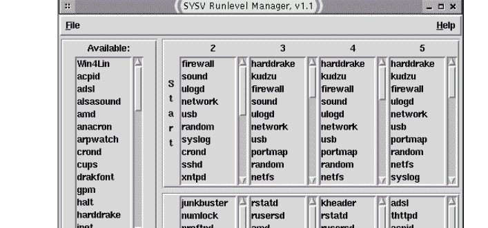

特定发行版工具 许多发行版的通用系统管理工具（如`innuxconf`、`YaST`和`COAS`）都提供了在特定运行级别下启动和停止 SysV 服务的方法。细节因发行版而异，因此请查阅你所用发行版的文档。

# 第 6 章 · 管理文件与服务

永久删除服务的另一种方法是从`/etc/rc.d/init.d`或`/etc/init.d`中删除它。然而，不建议这样做，因为升级升级可能会导致不一致。更好的方法是使用上述配置工具。

禁用服务的另一种方法是删除`/etc/rc.d/rcn.d`或`/etc/rcn.d`中的符号链接。这将防止服务在启动时自动运行，但该服务仍安装在系统中。

如果你想完全删除一个服务，应该使用包管理器卸载该包。这将移除二进制文件和所有的配置文件。

[页面 447]

## 编辑 inetd

运行超级服务器的问题之一是它们消耗内存。这就是为什么许多人使用`inetd`，它只在接收到连接时启动服务器。超级服务器在 Linux 上很常见：这里介绍了`inetd`，下一节介绍了`xinetd`。

你通过`/etc/inetd.conf`文件控制服务器。该文件由一系列行组成，一个典型的行如下：

```
ftp stream tcp nowait /usr/sbin/tcpd
/usr/sbin/in.ftpd -a
```

每行包含多个由空格分隔的字段。这些字段的含义如下：

`Service name`是服务在`/etc/services`文件中显示的名称。

`Socket type`是多个可能值之一，最常见的是`stream`、`raw`和`dgram`。

`Protocol`是所使用的 TCP/IP 协议类型，通常是`tcp`或`udp`。

`Wait/Wait`对于数据套接字类型，此条目指定服务器是连接并释放套接字（`nowait`）还是处理所有数据包后等待（`wait`）。使用其他套接字类型的服务器应在此字段中指定`nowait`。

`User`是运行服务器的用户名。`root`和`nobody`是常用选择，但其他可能的选择。

`Server name`是服务器的文件名。在前面的示例中，服务器被指定为`/usr/sbin/tcpd`，这是 TCP Wrappers 的二进制文件。该程序提供了一些安全检查，允许根据来源和其他因素限制访问服务器。第 5 章“网络”更详细地介绍了 TCP Wrappers。

`Parameters`服务器名称之后的所有内容都是传递给服务器的参数。如果你使用 TCP Wrappers，请在此字段中传递真实目标服务器的名称（例如`/usr/sbin/in.ftpd`）及其参数。

[页面 448] 确保你编辑了配置文件！习惯于某种工具的管理员在处理另一个系统时往往会感到困惑。管理员可能会编辑错误的配置文件并发现更改没有效果。理想情况下，系统不应该拥有已卸载服务器的配置文件。

# 416

## 第6 章 · 管理文件与服务

井号 (`#`) 是`/etc/inetd.conf`的注释符号。在该文件中，如果某个服务器正通过`inetd`运行，而你想禁用它，可以在行首放置一个井号。如果你想向`inetd.conf`添加一个服务器，则需要为它创建一个条目。大多数可以从`inetd.conf`运行的服务器，文件中都包含了常见服务器的条目，而且其中许多都被注释掉了；删除行首的井号即可激活该服务器。

在修改`inetd.conf`后，你必须重启`inetd`超级服务器本身。这个超级服务器像标准的 SysV 服务器一样正常运行，因此你可以通过输入类似的命令来重启它：

```bash
# /etc/rc.d/init.inetd restart
```

通常情况下，在`inetd.conf`（如果使用`xinetd`则为`xinetd`配置文件）中尽可能禁用服务器是明智的。根据一般原则，如果你不某个服务器的作用，就禁用它。这通过消除可能存在漏洞或配置错误的服务器，来提高系统的安全性。

## 编辑 xinetd.conf 或 xinetd.d 文件

`xinetd`（读音为 "zee-net-dee"）是一个扩展的超级服务器。它提供了`inetd`的功能，以及类似于 TCP Wrappers 的安全选项。Mandrake 在 7.1 版本在使用`xinetd`，Red Hat 在 7.0 版本在使用。其他发行版未来也可能使用它。你可以在任何发行版上将`inetd`替换为`xinetd`。

`/etc/xinetd.conf`文件控制`inetd`。在 Red Hat 和 Mandrake 中，此文件仅包含默认选项以及一个包含存储在`/etc/xinetd.d`中文件的指令。每个应该通过`inetd`运行的服务器都会在`/etc/xinetd.d`中安装一个文件，并带有其自身的配置选项。

无论服务的条目是在`/etc/inetd.conf`还是`/etc/xinetd.d`中的文件里，它包含的信息都与`inetd.conf`文件中的信息相似。然而，`xinetd`将信息分布在多行中，并进行了更显式的标签标记。列表 6.2 显示了一个等同于之前`inetd.conf`条目的示例。该条目提供的信息与`xinetd.conf`条目完全相同，只是它不包含对`/usr/sbin/tcpd`（TCP Wrappers 二进制文件）的引用。由于`xinetd`包含了类似的功能，通常不与 TCP Wrappers 同时使用。第 5 章包含了有关`xinetd`安全性的信息。

### 列表 6.2：示例 xinetd 配置条目

```bash
service ftp
{
  socket_type = stream
  protocol    = tcp
  wait        = no
  user        = root
  server      = /usr/sbin/ifptd
  server_args = -l -a
}
```

另一个重要的`xinetd.conf`参数是：`disable`（禁用）。如果你在服务定义中包含`disable = yes`行，`xinetd`将忽略该条目。`/etc/xinetd.d/`中的某些服务器启动文件默认设置了此选项；你必须编辑文件并将条目改为`disable = no`来启用服务器。你也可以通过在主`xinetd.conf`文件的`defaults`部分的`disabled`行列出它们的名称来禁用一组服务器，例如`disabled = ftp shell`。

使用`xinetd`时，在你对`xinetd`配置做出更改后，必须重启超级服务器。你可以通过输入类似下面的命令来实现此：

```bash
# /etc/rc.d/init.xinetd restart
```

## 自定义启动文件

偶尔，你希望通过 SysV 脚本或超级服务器以外的手段启动服务器。这最常见于你自己编译了一个服务器，或者从一个并非你正在使用的发行版的包文件中安装了它，并且出于性能考虑，你不想通过超级服务器运行它。在这种情况下，该程序可能没有附带 SysV 启动脚本，或者它在你的系统上无法正常工作。

许多 Linux 发行版包含一个在其他 SysV 启动脚本之后运行的启动脚本。该脚本通常称为`/etc/rc.d/rc.local`、`/etc/rc.d/boot.local`或类似的名称。你可以通过输入服务器文档中描述的手动启动服务器的命令，从该脚本中启动服务器。例如，你可能会包含以下行来启动 FTP 服务器：

```bash
/usr/sbin/in.ftpd -l -a
```

某些程序必须在行末添加`am`和符号 (`&`) 以在后台执行它们。如果你没有这样做，启动脚本中的后续行可能不会运行。

通过自定义脚本运行服务器时需要注意的一点是，这种方法没有关闭服务器的方法，而你可以通过向 SysV 启动脚本传递`stop`参数来这样做。如果你想停止服务器，你需要使用 Linux 的`kill`命令，可能需要先通过`ps`定位服务器的进程 ID。例如，查看以下：

```bash
# ps | grep ftp
638 S 0 in.ftpd -l -a
# kill 638
```

与其提供单个自定义脚本，Debian 及其衍生版提供了一个目录`/etc/rc.d`，你可以在其中添加你自己的启动脚本。这种方法允许你为每个程序创建脚本，或者创建一个单一脚本完成所有任务，就像在其他发行版中做的那样。在`/etc/rc.d/rc.local`中随意为你的脚本命名；启动脚本会运行`/etc/rc.d/rc.local`中的所有脚本，无论它们被称为什么。

## 设置运行级别 (Runlevel)

更改运行级别的方法是更改计算机的服务。对于单个服务，你可以临时或永久地更改运行级别。这两者都有用。临时更改用于测试系统的更改，而永久更改用于在长期范围内实施更改。

## 理解运行级别的角色

正如本章前面所述，Linux 在启动时进入某个运行级别以运行某些程序子集。例如，你可能想为计算机准备两种配置：一种提供所有常用的网络服务，另一种提供更受限的服务集合，供你在对计算机进行维护时使用。通过定义适当的运行级别并在它们之间切换，你可以轻松地启用或禁用大量服务。在大多数 Linux 系统上，运行级别还控制计算机提供文本模式还是 GUI 登录提示符。后者是工作站的首选状态，前者在许多情况下或配置存疑时更适用。

## 使用 init 或 telinit 更改运行级别

`init`程序对 Linux 的启动过程至关重要，因为它读取`/etc/inittab`文件，该文件控制启动过程并实现其中的设置。除了其他，`init`还设置了初始运行级别。计算机启动后，你可以使用`telinit`程序来更改运行级别。（在实践中，直接调用`init`同样有效，因为`telinit`只是指向`init`的符号链接。）当使用`telinit`时，语法如下：

```bash
telinit [-t sec] runlevel
```

你可以使用`runlevel`命令发现你的计算机处于什么状态。该命令将之前的和当前的运行级别作为输出。在大多数情况下，`runlevel`是你要系统更改的运行级别。然而，你也可以传递几个特殊代码：最重要的是`S`或`s`将系统带入单用户模式；而`Q`或`q`告诉系统重新检查`/etc/inittab`文件并实现该文件中的任何更改。

可以通过先发送`SIGTERM`信号来实现，这是一种程序化系统以管理关机的方法。如果你这样做，并且你的系统被设置为自动启动 X，在某些发行版中，结果之一是系统将启动 X、失败、重试、失败，如此循环进行。如果计算机有网络连接，停止这种循环的方法是远程登录并将运行级别更改为不启动 X 的级别。这将停止由于 X 尝试启动失败导致的恼人屏幕闪烁。然后你可以从远程登录或控制台纠正问题、测试 X 并恢复默认运行级别。

在切换运行级别时，`init`有时必须杀死进程。它起初会礼貌地发送`SIGTERM`信号，如果不起作用，`init`就会变得强硬并发送`SIGKILL`信号，这可能更有破坏性，因为程序可能会留下临时文件且无法保存打开文件中的更改。`t`时间参数告诉`init`在发送这两个信号之前等待多久。默认是五秒钟，这通常已经足够了。

运行级别更改的一个特殊情况是你正在关闭计算机时。运行级别 0 关闭计算机并停止运行——取决于内核选项和硬件能力，或者它可能只是将计算机置于可以关闭以节省系统电能的状态。运行级别 6 重启计算机。你可以使用`init`进入这些运行级别，但最好使用名为`shutdown`的独立命令来完成任务，因为它提供了额外的选项。该命令的语法如下：

```bash
shutdown [-t sec] [-a] time [warning-message]
```

参数的含义如下：

- `t sec`：`shutdown`通过`SIGTERM`通知进程与实际启动关机过程之间的延迟（秒）。默认为 5 秒。这为程序提供了关闭的机会（例如关闭打开的文件）。
- `a`：`/etc/inittab`文件包含一个当按下 Ctrl+Alt+Del 键组合时调用的`shutdown`调用。这允许任何从物理上访问计算机的人重启它。如果这不可行，请添加`-a`参数，系统将检查`/etc/shutdown.allow`文件以获取授权关机的用户列表。

## 设置运行级别 (Runlevel)

`system.` 只有当这些用户之一在控制台登录时，关机操作才会继续。

- `-r` 此参数会在关机后执行重启。本质上，它调用了向运行级别 6 的更改。
- `-k` 此参数会“伪装”关机——它向用户发送关机消息，但不会关闭计算机。
- `-h` 此参数会导致系统在关机后停止（halt）。本质上，它调用了向运行级别 0 的更改。
- `-c` 如果你启动了关 后改变了主意，使用此参数执行`shutdown`命令可以取消。这在关机被调度在未来某个时间而不是立即执行时，非常有用。
- `-f` 此选项允许系统在重启时跳过磁盘检查 (`fsck`)。
- `-f` 此选项在系统重启时强制进行磁盘检查 (`fsck`)。
- `time` 关机可以使用此参数调度，可以许多不同的格式。`[time]now[/time]` `now` 是一个常用值，会导致立即关机。你也可以指定 24 小时格式的 `hh:mm`，例如在 13:15 关机。格式 `+m` 表示 m 分钟后关机。
- `-` `warning-message` 当许多人使用系统进行远程登录时，给这些用户发出关机警告是个好主意。你可以包含解释系统关闭的原因或你预计关闭多久的消息。

在单用户系统上，`shutdown -h now` 和 `shutdown -r now` 是完全合理的关 用。当系统有许多用户时，最好调度在未来 5、10 或更多分钟后关机，并提供以下信息：

```bash
# shutdown -h +10 在10分钟后关闭
```

Copyright ©2001 SYBEX, Inc., Alameda, CA www.sybex.com

第 6 章 管理文件与服务

> 注意：某些发行版包含了 `halt` 和 `reboot` 命令，分别相当于 `shutdown -h now` 和 `shutdown -r now`。

## 永久更改运行级别

可以通过编辑`/etc/initab`文件永久更改计算机的运行级别。该文件包含如下行：

```text
id:3:default:
```


此示例显示了配置为运行级别 3 的系统。要更改它，将 3 改为适当的值。进行此更改后，你可以运行 `telinit`（如前所述）使系统立即切换到新的运行级别，或者可以使用运行级别代替 Q。

> 警告：不要将运行级别设置为 0 或 6，因为会导致系统立即关机或重启。

## 基本 GUI 使用

如第 2 章“安装 Linux”所述，Linux 的 GUI 环境并不是像其他操作系统那样的单体。相反，X 是一个模块化系统，允许系统管理员甚至个人用户从根本上改变系统的工作方式。此外，不同的发行版会定制它们的默认环境并提供不同的管理工具。因此，很难提供“Linux GUI 环境将不同”的详细信息。尽管如此，某些共同点和通用原则，本节涵盖了这些。

Copyright ©2001 SYBEX, Inc., Alameda, CA www.sybex.com

尽管 Linux GUI 管理工具变得越来越常见，但它们并不适用于所有发行版。例如，Red Hat 的 `linuxconf` 与 SuSE 的 `YaST2` 不同。由于原因，对“通用”Linux 的讨论倾向于基于文本的配置方法。

### 窗口管理器提供的功能

窗口管理器在 X 提供的“原始”窗口之上提供了装饰性和功能性的特性。理解这些特性以及不同窗口管理器之间的差异，将帮助你在需要时导航 Linux 系统并在各种窗口管理器中工作。图 6.2 显示 Icwm 窗口管理器 (http://icwm.sourceforge.net) 使用 Helix 主题显示的典型窗口。此配置在视觉上与大多数 Linux 窗口管理器相似，窗口顶部拖动栏的颜色和图案以及组件的可用性和放置差异很大。

**图 6.2** 窗口管理器的外观和位置各异，但这些是典型的。

| | | 拖动栏 | Win |
| --- | --- | --- | --- |
| 文件 编辑 搜索 偏好 帮助窗口 | | 帮助 | |
| *initab* | 该文件描述了 INIT 进程如何按照特定顺序设置系统。 | | |
| *作者:* | Miquel van Seocenburg, (miquiel@linux.umget) 由 Marc Eving 和 Donnie Baes 为 RMS Linux 修改 | | |
| *默认运行,* | RMS 使用的运行级别为： | | |
| 0 主机（不要将默认设置为此） | | | |
| 1 单用户模式 | | | |
| 2 多用户，无 HFS（如果你没有网络，则与 3 相同） | | | |
| 3 全多用户模式 | | | |
| 5 系统 | | | |
| 6 重启：（不要将默认设置为此） | | | |
| *default:* | | | |
| 4 系统初始化。 | | | |
| si:/asinit/etc/rc/rc.asinit | | | |
| 4 系统初始化 | | | |
| si:/asinit/etc/rc/rc.asinit | | | |
| 4 系统初始化。 | | | |
| si:/asinit/etc/rc/rc.asinit | | | |

桌面环境也提供了许多此类全局功能。当桌面环境的功能与窗口管理器的功能冲突时，通常是桌面环境的功能会覆盖后者。需要注意的是，这些功能在不同的窗口管理器或桌面环境之间是不同的。

### 桌面环境提供的功能

桌面环境承担的角色之一是提供如文所述的许多窗口管理器所提供的全局功能。桌面环境通常具有程序启动器、分页器、系统信息显示等。这些功能都可以像在窗口管理器中一样使用。桌面环境控制菜单包含了一些可以在你登录或启动 X 时自动运行的方法。这些工具包括以下内容：

**桌面环境控制** 传统上，Unix 系统使用不同的控制和控制程序来调整用户图形用户界面（GUI）环境的许多方面，例如键盘重复率、鼠标跟踪率、桌面背景图像等。然而，桌面环境通常提供一个统一的控制工具，例如图 6.4 所示的 GNOME 控制中心（Control Center）。通过该程序，你可以调整 GUI 环境的许多方面。为桌面环境设计的程序将从你在控制工具中调整的设置中获取某些默认值（例如菜单使用的字体），从而进一步统一 GUI 体验。这些设置只影响一个用户的默认设置；桌面环境将这些值存储在每个用户的家目录下，因此一个用户的偏好不会骚扰喜欢其他设置的用户。

# 图 6.4 桌面环境控制工具，你可以根据个人化需求调整环境功能。

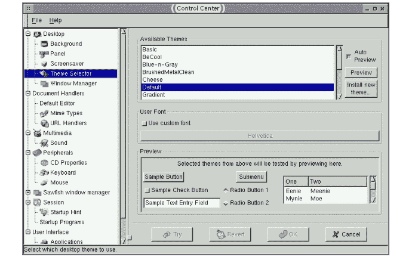

支持工具 桌面环境包含支持工具，如计算器、文本编辑器、邮件程序、音频 CD 播放器，甚至几个游戏。当你从桌面环境外部使用这些程序时，它们正式成为该环境的一部分，并可以从环境的菜单中轻松启动。

总的来说，了解桌面环境能力的最佳方法就是使用它。尝试研究从桌面环境主菜单提供的可用程序。如果你不确定某个程序的作用，请检查它是否有“帮助”按钮，或者直接退出，直到你有时间再回来查看它。

除非你已经登录，或者在程序要求密码时提供了 root 密码，否则你无法通过在桌面环境中研究程序来对整个 Linux 安装系统造成严重破坏。有一种极小的概率你可能会导致某个账户无法使用。如果发生这种情况，请以文本模式登录（通过按 Ctrl+Alt+F1 并登录）并删除桌面环境的目录——KDE 的 kde 或 GNOME 的 .gnome。下次桌面环境启动时，它将恢复默认设置，因此该账户应该再次可用，尽管你已经丢失了自定义设置。

### 启动 xterm

一个特别重要的 X 程序被称为 `xterm`。这是一个在 X GUI 环境内提供基于文本的 shell 程序。大多数窗口管理器和桌面环境都提供了一种非常简单的方法来选择 `xterm` 窗口。例如，图 6.3 左侧的程序启动按钮启动 `xterm`。`xterm` 的图标通常看起来像计算机终端或显示器。大多数桌面环境和窗口管理器在其主菜单中包含一个或多个 `xterm` 选项。

事实上，有几个提供类似功能的不同程序。这些包括原始的 `xterm`；类似的 `rxvt` 程序；以及分别属于 KDE 的速度快得 Konsole 和 GNOME Terminal。在本书中，我指的是 `xterm` 窗口，但你可以查看任何你喜欢的 `xterm` 或类 `xterm` 程序。所有的 `xterm` 都允许你在 X 下运行基于文本的程序。大多数程序都包含滚动条，以便你可以查看旧命令和输出列表。更高级的版本包含额外功能，例如允许你快速更改配色方案和字体的菜单。在原始 `xterm` 中，这些可以在启动程序时通过选项设置。这需要修改窗口管理器或桌面环境的 `xterm-launch`。

一旦 `xterm` 运行，你就可以像使用文本模式登录一样使用它。你会得到一个 shell 提示符，然后可以在提示符处输入命令。你还可以通过选择文本并在目标程序中点击鼠标按钮，在 `xterm` 和其他程序之间剪切和粘贴文本。（这在其他基于 X 的程序之间同样有效。）`xterm` 像文本模式登录一样运行的规则唯一的例外是，你不是通过输入 `logout` 来退出 `xterm`；你输入 `exit`。

还有一些程序无法在 `xterm` 中运行——即那些使用对显卡的低级调用来创建图形显示的程序，例如游戏和图形实用程序。然而，这些许多程序都有基于 X 的对应程序，你可能可以在 X 中运行其中一个。

### GUI 管理工具

大多数 Linux 发行版都包含某种类型的 GUI 管理工具。这些工具为各种配置选项提供了点击式界面，例如分区挂载点、网络配置、服务器配置、运行级别（runlevels）、用户管理等。Linux 发行版维护者尚未确定一种标准的 GUI 管理工具。一些较常见的 GUI 管理工具包括以下这些：

**linuxconf** 红帽（Red Hat）使用 `linuxconf` 作为其 GUI 管理工具，几个源自红帽的发行版，如 Mandrake、Linux-PPC 和 Yellow Dog，也使用了 `linuxconf`。该工具可以在 GUI 控制、文本模式或使用基于文本的远程登录中运行，或者通过 Web 浏览器运行。你可以在 `xterm` 或文本模式登录中输入 `linuxconf` 来启动它，或者从窗口中选择它。

**YaST** SuSE 创建了 Yet Setup 工具（YaST）作为 SuSE 系统的配置工具。与 `linuxconf` 类似，这些工具可以从桌面菜单中启动，或者在 `xterm` 中输入 `yast` 或 `yast2`。

**COAS** Caldera 开放管理系统（COAS）是 Caldera 的 GUI 管理工具入口。它可以从 Caldera 标准桌面菜单中启动，或者在 `xterm` 中输入 `cost`。

**SAS** Stormix 为其 发行版开发了 Storm 管理系统（SAS）。SAS 支持 GUI 和文本菜单操作。它可以从标准桌面菜单中启动，或者在提示符处输入 `sas`。

通常，GUI 管理工具将管理任务分组，例如网络、用户管理、文件系统等。这些每个组都有小组，可能会进一步细分。最终，你会进入特定功能的配置控制，可以在窗口中输入必要的配置信息。图 6.5 展示了红帽 `linuxconf` 中的这种组织结构，其中左侧菜单列出了主题区域，窗口右部分显示最终的数据输入区域。

# 图 6.5 GUI 管理工具对管理任务进行分类并为工具提供点击式界面。

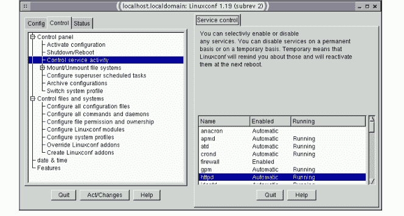

GUI 管理工具本质上是极其特殊的编辑器；它们对底层配置文件进行更改。因此，你可以使用文本编辑器和一些命令完成你在 GUI 中可以完成的事情。

### Shell 脚本

你在 Linux 系统上的大部分工作通过在提示符处输入命令完成。然而，当你使用 Linux 时，可能会可能会发现某些任务是非常重复的。例如，如果你需要向系统添加一百个用户，手动输入百次 `useradd` 会是非常乏味的。坦率地说，Linux 包含一种消除这种乏味的方法：shell 脚本。这些是用解释器计算机语言编写的简单程序。

# 基础 Shell 脚本 431

它是嵌入在你输入命令时使用的 Linux shell 中的。大多数 Linux 系统默认使用 `bash` shell，因此 shell 脚本通常用 `bash` 脚本语言编写；但 `tcsh` 以及其他 shell 脚本语言也非常相似。事实上，在任何常见的 Linux shell 中看到 shell 脚本运行并不并不罕见。


许多 Linux 启动脚本（包括 SysV 启动脚本）实际上都是 shell 脚本。因此，如果你想修改 Linux 启动脚本，理解 shell 脚本编写是必要的。

和任何编程任务一样，shell 脚本可能变得非常复杂。因此，本章仅对 shell 脚本可以完成的工作触浅及表面。更多信息请参阅有关该主题的书籍，例如 Cameron Newham 和 Bill Rosenblatt 编写的《Learning the Bash Shell》（O'Reilly, 1998）。

#### 开始 Shell 脚本

Shell 脚本是纯文本文件，因此你在文本编辑器中创建它们。shell 脚本以第一行识别用于运行它的 shell 开头，如下：

```
/bin/sh
```

前两个字符是一个特殊代码，告诉 Linux 内核这是一个脚本，并将该行的其余部分作为解释该脚本的程序的路径。shell 脚本语言使用井号（`#`）作为注释字符，因此脚本实用程序会忽略这一行，但内核不会。在许多系统中，`/bin/bash` 或 `/tcsh` 是指向 `/bin/sh` 的符号链接，但它也可能指向其他 shell。指定脚本使用 `=/bin/bash` 可以确保在运行该脚本的任何 Linux 系统上存在适当的 shell 程序，但如果脚本使用了某个特定 shell 的任何功能，你应该修改该部分——例如，使用 `/bin/bash` 或 `/bin/tcsh` 代替 `/bin/sh`。

当你写完 shell 脚本后，应该修改它使其具有可执行性。你像第 4 章描述的那样通过 `chmod` 命令来实现这一点。具体来说，你使用 `+x` 选项来添加执行权限，可能配合 `a` 为所有用户添加这些权限。例如，要让名为 `my-script` 的文件变为可执行，你会执行以下命令：

```
$ chmod a+x my-script
```

你将通过输入其名称来执行脚本，可能在名称前加上 `./` 以告诉 Linux 在当前目录中搜索脚本。如果你没有这样做，仍然可以通过运行 shell 程序后跟脚本名称（如 `bash my-script`）来运行脚本；但通常情况下将脚本设为可执行更好。如果该脚本是你经常运行的，你可能想将它移动到路径上的某个位置，例如 `/usr/local/bin`。当你这样做时，就不需要输入完整路径或移动脚本目录来执行它；你只需输入 `my-script` 即可。

#### 使用外部命令

shell 脚本最基本的功能之一是运行外部命令的能力。你在 shell 提示符中输入几乎所有命令都是外部命令——它们位于 `/bin`、`/usr/bin` 以及你路径上其他目录中的程序。你可以在脚本中运行此类程序并包括它们的名称。你还可以在脚本中为程序指定参数。例如，假设你想启动一个脚本来启动两个 `xterm` 和 KMail 邮件阅读器程序（列表 6.3 展示了一个实现这一目标的脚本）。除了识别其为脚本的第一行外，该脚本看起来就像你为了手动完成任务而输入的命令一样，除了以下几点：脚本列出了每个程序的完整路径。这通常不是严格必要的，但列出完整路径可以确保当 `PATH` 环境变量更改时，脚本仍运行程序。此外，列表... 中的每个程序启动行都以和符号（`&`）结尾。这个字符告诉 shell 继续执行下一行，无需等待其完成。如果你省略了列表 6.3 中的和符号，效果将是第一个 term将打开，但在第一个关闭之前，第二个将不会打开。同样，KMail 在 sec（此处此处）之前不会启动

##### 列表 6.3：一个启动三个程序的简单脚本

```bash
#!/bin/bash

/usr/X11R6/bin/xterm &

/usr/X11R6/bin/xterm &

/usr/bin/kmail &
```

虽然从一个脚本启动多个程序可以节省启动脚本和某些其他情况下的时间，但脚本更频繁地用于运行系列以某种方式处理数据的程序。此类脚本不包含命令末尾的和符号，因为一个命令必须在一个接一个运行，甚至可能依赖于第一个命令的输出。列出此类命令的完整列表是不可能的，因为你可以运行任何在 Linux 中安装的程序作为命令——即使是另一个脚本。脚本中常用的几个命令包括：

- **普通文件操作命令**：第 7 章讨论的这些命令，如 `ls`, `mv`, `cp`, and `rm`，经常在脚本中使用。你可以使用这些命令来帮助自动化重复的文件任务。
- **grep**：此命令定位包含特定字符串的文件。在它最基本的形式中，`grep pattern files`。例如，`grep pattern` 在文件中搜索字符串。
- **find**：它默认递归地搜索模式，意味着它搜索所有子目录。要使用 `find`，你再传递一个目录名称和一个表达式。例如，如果你想找到所有以 budget 开头的文件，使用 `find -name "budget*"`
- **cut**：此命令从字段中提取文本。它经常用于从文件中提取信息。要使用 `cut`，你再传递控制它切割的选项。例如，用户出现在第6个字段 `cut -f 6 -d ':'`
- **sed**：此程序代表流编辑器（Stream Editor）。它通过命令提供了许多传统编辑器的功能。例如，如果你想将文件中所有的字符串 2001 替换为 2002，可以使用 `sed s/2001/2002/ budget-01.txt > budget-02.txt`
- **echo**：有时脚本必须向用户提供消息。`echo` 是实现这一目标的工具。你可以向 `echo` 传递各种选项或要显示的字符串。例如，`echo 'Press the Enter key`

#### 使用变量

变量可以帮助扩展脚本的实用性。变量是运行时确定值的占位符。变量的值可以通过参数传递给脚本，也可以由脚本自然生成。

##### 列表 6.4: 一个减少创建账户繁琐性的脚本

```bash
#!/bin/sh

useradd $1

passwd $1

mkdir /shared/$1

chown $1.users /shared/$1

chmod 775 /shared/$1

ln -s /shared/$1 /home/$shared

chown $1.users /home/$shared
```

如果你使用列表 6.4，只需要输入三个内容：带有目标用户名的脚本名，以及密码（输入两次）。例如，如果脚本名为 `mkuser`，你可以这样使用它：

```bash
# mkuser ajones
Changing password for user ajones
New UNIX password:
Retype new UNIX password:
passwd: all authentication tokens updated successfully
```


大多数脚本程序在遇到问题之前（问题不会显示在屏幕上）都是静默运行的，这仅仅是 `passwd` 命令的结果。实际上，列表 6.4 的脚本将七行命令替换为了一行。由于这些中的每一行都使用了用户名，通过使用此脚本，你还减少了错误的概率。

另一种一种在脚本内部赋值的变量类型——例如，它可以从命令的输出中设置。这些变量也通过前面的美元符号来标识，它们通常以字母开头并命名，例如 `$ADDR` 或 `$NAME`（在给变量赋值时，会省略美元符号，稍后所示）。你可以将这些变量与普通命令配合使用，就像是命令参数一样。

例如，考虑列表 6.5，它使用 `ipchains` 实用实现了简单的防火墙规则。此脚本使用了两个变量。第一个是 `$IP`，它是通过 `grep` 和 `cut` 命令从 `ifconfig` 的输出中提取的。（脚本第二行末尾的反斜杠表示下一行是上一行的延续）。在此赋值中使用的管道运算符（`|`）将在第 9 章中讨论。当从命令输出为变量赋值时，该命令应该包含在反引号（`` ` ``）中，反引号在大多数键盘上与波浪号（~）位于同一个键上。它们不是普通的单引号（''），单引号与普通引号位于同一个键上。第二个变量 `IPCHAINS` 仅指向 `ipchains` 程序。这样的变量有时用于以后以后更容易修改脚本。例如，如果你移动了 `ipchains` 程序，你只需要修改脚本中的一行。它们也可以与条件表达式配合使用，以确保脚本在许多系统上运行——例如，如果 `ipchains` 在系统中被称为其他名称。

## 列表 6.5: 变量的赋值和使用

```bash
#!/bin/sh

IP=$(ifconfig eth0 | grep inet | cut -f 2 -d ":" | \
    cut -f 1 -d ' ')

IPCHAINS='/sbin/ipchains'

echo 'Restricting access to $IP'

IPCHAINS -A input -p tcp -s 0/0 -d IP 25 -j REJECT

IPCHAINS -A input -p tcp -s 0/0 -d IP 80 -j REJECT
```

列表 6.5 是一个糟糕的防火墙。它只阻塞两个端口，并且省略了许多防火墙中非常有用的功能。然而，它是脚本变量的一个易懂的演示。

像列表 6.5 这样从运行一个或多个命令获取信息的脚本，在配置依赖于系统特定信息或随时间变化的信息时非常有用。你可以使用类似的方法来获取主机名 `hostname` 命令、当前时间（使用 `date`）、计算机运行的总时间（`uptime`）、可用磁盘空间（使用 `df`）等。当与条件表达式（稍后描述）结合时，变量会变得更强大，因为你的脚本可以在满足一个条件执行一个操作，而在另一种情况下执行另一个操作。例如，一个安装软件的脚本可以检查可用磁盘空间，如果没有足够的磁盘空间则中止安装。

## 使用条件表达式

脚本语言支持多种类型的条件表达式。这些允许脚本根据某些条件（通常是变量的值）执行多个不同动作中的一种。使用条件表达式的一个常用命令是 `if`，它允许系统根据某些条件是否为真采取两个动作中的之一。`if` 条件表达式出现在 `if` 关键字后的括号中，并可以有许多形式。例如，`-f file` 如果文件存在且是普通文件，则为真；`-s file` 如果文件存在且大小大于 0，则为真；`string1 =` 如果两个字符串具有相同的值，则为真。

为了更好地理解条件判断的使用，请考虑以下代码片段：

```bash
if [ -s /tmp/tempstuff ]
then
    echo "/tmp/tempstuff found; alerting"
    exit
fi
```

此片段会导致脚本在 `/tmp/tempstuff` 存在时退出。如果脚本创建并稍后删除此文件，那么这段代码可能有用，因为它的存在表明脚本的上一次运行没有成功。

条件表达式有时也用于循环。循环是告诉脚本重复执行相同任务直到满足某些条件（直到某些条件不再满足）的结构。例如，列表 6.6 显示了一个播放目录中所有 `.wav` 音频文件的循环。

**列表 6.6:** 在目录中每个匹配文件上执行命令的脚本

```bash
#!/bin/bash

for d in *.wav; do
    play $d;
done
```

在这里使用的 `for` 循环会为 `ls *.wav` 生成列表中的每个项目执行一次。

## 记录系统配置

一个容易被忽略的非常重要的系统任务是记录配置。许多管理员都会记录所有更改的日志。这种格式的优势在于它不容易受到困扰电子日志的问题，例如，如果硬盘损坏了。

你会在日志中记录什么？

- 初始配置：记录安装时的配置情况。这可能包括硬件组件、Linux 发行版和版本号。
- 软件包安装：当你安装软件包时，记录这些信息。如果你自己编译软件包或从压缩包安装，这一点尤为重要，因为这些安装方法在包管理中没有记录。

## 管理员日志

许多管理员都会记录所有更改的日志。这种格式的优势在于它不容易受到困扰电子日志的问题，例如，如果硬盘损坏了。

理想情况下，日志应该存储在管理计算机时可以方便获取的地方。例如，电脑附近的抽屉可能很好。日志通常不包含敏感信息，但如果包含，在使用时请将其锁好以防窥探。

> 不要要在日志中记录任何密码，特别是 root 密码。只有授权的管理员应该知道 root 密码，写下它或其他任何密码都是灾难的根源。管理员不需要知道其他用户的密码，因为 root 可以对其他用户执行任何操作，甚至冒充其他用户的身份，如第 9 章所示。

## 备份重要的配置文件

记录系统配置的一种方法是备份重要的 `/etc` 配置文件。最简单的方法是备份整个 `/etc` 目录。这可以通过 `tar` 命令完成，该命令在第 3 章和第 7 章中有更详细的描述：

```
# mount /dev/fd0 /mnt/floppy
# tar cvfz /mnt/floppy/etc.tgz /etc
```

这些命令会在挂载在 `/mnt/floppy` 的软盘上创建一个整个 `/etc` 内容的压缩备份。某些发行版中 `/etc` 中的数据超过了单张软盘能容纳的容量，经过压缩后，你可能需要使用多块软盘，或者将信息存储在 Zip 或 LS-120 等更高容量的磁盘上。

当然，你应该定期对计算机进行全量备份，这将你所有的配置文件与其他所有内容一起存储。当你进行了一些导致问题的更改时，保留 `/etc` 的独立备份是最有用的；这样一来，你可以从磁盘上的一个较小的 tar 包中恢复单个文件，这比从磁带备份中恢复要快得多且安全得多。

`/etc` 目录树的备份不能取代书面的管理员日志。管理员日志包含了你修改过的内容，这可以帮助你直接定位到某项更改，而不是在各种文件中来来找去地寻找更改。同样，日志不能替代配置文件的备份；日志不太可能包含所有配置文件的内容，而其中任何一个文件在紧急情况下都可能在短时间内被需要。

`/etc` 目录包含一些不应被轻易访问的数据。特别是，`/etc/shadow` 文件（在不使用 shadow 密码的系统中为 `/etc/passwd`）包含加密的密码。尽管这些密码经过了加密，但仍然可以通过暴力攻击提取出弱密码。因此，你应该将 `/etc` 目录的备份保存在安全的位置。

# 总结

配置文件基本可以分为两大类：用户配置文件和系统配置文件。用户配置文件存储在用户的家目录中，允许用户自定义各种用户级程序的功能。系统配置文件位于 `/etc` 目录，控制系统范围的参数。

可以在系统范围内设置环境变量，以控制用户 Linux 体验的各个方面，例如默认提示符。用户可以通过输入适当的命令或编辑其启动脚本来调整环境变量。

启动和停止特定服务，以及设置系统的运行级别（runlevel）整体“个性”——系统运行哪些网络服务器、默认运行哪一组本地定义的服务等。了解如何调整这些功能允许你自定义自己的系统，并可以通过移除不必要的服务器来提高安全性。

尽管许多管理任务可以在文本模式下完成，但许多用户甚至系统管理员更倾向于使用 GUI 环境。Linux 的 GUI 环境自 20 世纪 90 年代中期以来已大大成熟，今天提供了许多熟悉 Windows 或 MacOS 的用户期望的舒适性。

许多系统管理任务涉及重复性操作。出于这一原因，大多数管理员都学会了编写基本的 shell 脚本，这些脚本可以将许多命令合并为一个，并经常使用变量和条件表达式来提高脚本的灵活性。

当你编辑配置文件或执行其他系统维护时，记录你的更改是非常关重要的。实现此点的一种实用技术是保留一本管理员日志。重要配置文件的易访问备份（例如整个 `/etc` 目录树）在你可能需要将配置文件恢复到早先状态时也能提供帮助。

# 考试要点

**描述 SysV 启动过程**。`init` 进程读取 `/etc/inittab` 文件，该文件控制从一个运行级别切换到另一个运行级别时运行的程序。每个运行级别对应的目录中的脚本在运行级别改变时启动和停止。

**掌握一些最关键的系统配置文件**。重要的系统配置文件包括：`/etc/inittab`（驱动引导过程）、`/etc/fstab`（决定分区如何以及在何处挂载）、`/etc/modules.conf`（设置内核模块的加载）以及 `/etc/profile`（设置环境变量的详细信息）。

**总结环境变量的作用**。环境变量提供了在不同程序间应保持不变的信息，例如用户名称和搜索程序的路径。

**解释 SysV 启动脚本与用于运行服务器的超级服务器（super servers）之间的区别**。SysV 启动脚本在计算机启动时切换运行级别运行时运行，这样服务器始终运行并能响应请求，但服务器在运行期间会一直消耗内存。超级服务器仅在响应客户端请求时才针对服务器，从而减少了不常用服务器的内存负担，但代价是以对传入请求的响应较慢为代价。

**描述运行级别（runlevel）的功能**。有时你可能希望在不同的时间运行一组与平时不同的服务不同的 Linux 系统。运行级别允许你定义一组服务并在它们之间快速切换。

**解释 GUI 管理工具的**。传统的 Unix 或 Linux 系统管理涉及使用大量的文本命令并编辑许多配置文件。GUI 管理通过为这些独立的命令和文件提供通用的用户界面，可以减轻新管理员的任务。

**描述 shell 脚本如何有用**。shell 脚本结合了多个命令，可能可能包括条件表达式、变量和其他编程特性，使脚本能够对系统做出动态响应。因此，shell 脚本可以通过一个命令执行一系列重复任务来减少管理工作量。

## 本章命令

| 命令 | 描述 |
| --- | --- |
| telinit | 更改当前运行级别。 |
| man | 显示关于命令、配置文件或其他系统功能的帮助信息。 |
| export | 在 bash shell 中使环境变量可用。 |
| setenv | 在 tcsh 及相关 shell 中设置环境变量。 |
| env | 显示当前环境变量，并临时更改它们。 |
| init | 设置计算机的初始运行级别。 |
| telinit | 更改计算机的运行级别。（实际上，它是 init 的符号链接。） |
| shutdown | 关闭（关机）或重启计算机。 |
| xterm | 在 X 中提供文本模式提示符。 |

## 关键术语

在考试之前，务必熟悉以下术语：

- 条件表达式
- 点文件
- 环境变量
- getty
- 循环
- 模块
- 路径
- 运行级别
- shell 脚本
- 启动脚本
- 超级服务器
- System V
- SysV 启动脚本
- xterm

# 复习题

1. 下列哪个描述大多数用户配置文件？
   - A. 它们控制哪些用户访问服务器。
   - B. 它们文件名以点 (.)开头。
   - C. 它们不能被 root 编辑。
   - D. 它们存在 /etc 目录树中。

2. 下列哪个控制 Linux 挂载分区和磁盘？
   - A. /etc/inittab
   - B. /etc/fstab
   - C. /etc/modules.conf
   - D. /etc/profile

3. 下列哪个 Linux 启动脚本的标准？
   - A. 它们以二进制格式存储，必须使用 bedit 程序编辑。
   - B. 它们使用 m4 工具从元配置文件创建。
   - C. 它们是 shell 脚本，可以像其他 shell 脚本一样编辑。
   - D. 它们是标准化的，以便在发行版之间传输。

4. 为了更改 Linux 系统的默认运行级别，你会做什么？
   - A. 执行 telinit 命令，其中 x 是所需的运行级别。
   - B. 编辑 /etc/modules.conf 并将运行级别作为 runlevel 模块的选项。
   - C. 执行 telinit Q 命令让系统查询新的运行级别。
   - D. 编辑 /etc/inittab 并在 initdefault 行中输入正确的运行级别。

446 第 6 章 • 管理文件和服务

+   5. 下面的 /etc/fstab 文件条目有什么错误？（选择所有适用项。）

`/dev/hda8 nfs default 0 0`

+   A. 该条目缺少挂载点规范。
+   B. /etc/fstab 字段应该用逗号分隔。
+   C. 默认选项可能仅用于 ext2 文件系统。
+   D. /dev/hda8 是一个磁盘分区，但 nfs 表示网络文件系统。

+   6. 如果将以下内容放在 /etc/profile 中，哪一个项会将 /usr/local/bigprog/bin 添加到 PATH 环境变量的末尾？ 
+   A. export PATH=/usr/local/bigprog/bin
+   B. setenv PATH=$PATH:/usr/local/bigprog/bin
+   C. export PATH=$PATH:/usr/local/bigprog/bin
+   D. setenv PATH "${PATH} :/usr/local/bigprog/bin"

+   7. 谁可以为普通用户设置默认环境变量？
+   A. root 或用户均可，以用户的设置为准
+   B. root 或用户均可，以 root 的设为准
+   C. 仅限 root
+   D. 仅限用户

+   8. 当前目录指示符 (.) 位于 root 的 PATH 环境变量中的最佳位置是哪里？
+   A. 在所有其他目录之前。
+   B. 在所有其他目录之后。
+   C. 无处不在；它不应该出现在 root 的路径中。
+   D. 任何方便的地方都可以。

+   9. 你应该在管理员的日志中记录什么类型的信息？（选择所有适用项。）

Copyright ©2001 SYBEX, Inc., Alameda, CA www.sybex.com

+   **A.** 所有配置文件的确切内容
+   **B.** 主要实用程序程序（如 e2ffsck）的位置
+   **C.** 系统安装期间选择的主要选项
+   **D.** 对重要配置文件更改的描述

+   **10.** 下列方法是备份 /etc 目录的最佳方法？
+   **A.** 使用 tar 将内容复制到软盘或其他可移动磁盘。
+   **B.** 打印每个文件并将打印记录保存在活夹中
+   **C.** 将所有文件复制到互联网上的另一个系统。
+   **D.** 使用 diff 记录当前文件与其原始状态之间的差异。

+   **11.** Linux 系统将其 SysV 启动脚本保存在 /etc/init.d 目录。如果从这些启动脚本启动，下列哪条命令将临时停止 ProFTPd 服务器？
+   **A.** /etc/init.d/proftpd stop
+   **B.** sysvstop /etc/init.d/proftpd
+   **C.** sysvstop proftpd
+   **D.** /etc/init.d/proftpd stop

+   **12.** 一新的 Linux 管理员编辑 /etc/inetd.conf 添加了一个服务器。更改后，管理员测试新服务器，但远程系统无法访问。这可能是为什么？（选择所有适用项。）
+   **A.** 管理员可能忘记重启 inetd。
+   **B.** 系统可能使用的是 xinetd 而不是 inetd。
+   **C.** 管理员可能忘记为 /etc/rc.d/init.d 脚本新服务器。
+   **D.** 管理员可能忘记手动启动新服务器。

# 第 6 章 · 管理文件和服务

+   13. 你通过编译源代码安装了一个服务器。源代码没有包含 SysV 启动脚本，你不想从超级用户运行它，因此在本地启动脚本（etc/rc.d/rc.local）中启动它。你需要临时关闭服务器。你可以如何做？
+   A. 输入 /etc/rc.d/rc.local stop。
+   B. 编辑启动脚本以移除服务器。
+   C. 从 /etc/inetd.conf 删除服务器条目并输入 /etc/rc.d/init.d/inetd restart。
+   D. 使用 ps 找到服务器的进程 ID (pid) 并输入 kill。

+   14. 下列哪条命令将运行系统切换到级别 3？
+   A. telnet 3
+   B. runlevel 3
+   C. telinit 3
+   D. switch-runlevel 3

+   15. 系统管理员输入以下命令会实现什么？

```
# shutdown -r 0 "Up soon."
```


+   A. 在 01:00 重启电脑并显示消息“Up soon.”作为用户警告
+   B. 在 01:00 关闭电脑并显示消息“Up soon.”作为用户警告
+   C. 在 00:00 关闭电脑并显示消息“Up soon.”作为用户警告
+   D. 在 00:00 重启电脑并显示消息“Up soon.”作为用户警告。

# 复习题 449

+   16. 下列哪些是调整大小的常用方法？（选择所有适用项。）
+   A. 在 xterm 中输入 winnum
+   B. 从桌面点击 resize
+   C. 点击最大化窗口以填充屏幕
+   D. 从菜单选择 resize
+   17. 一旦你使用默认参数启动脚本，如何移除它？（选择所有适用项。）
+   A. 在 xterm 中输入 logout
+   B. 点击窗口上的 exit
+   C. 点击窗口边框
+   D. 将窗口拖入垃圾桶
+   18. 使用文本编辑器创建 shell 脚本后，你应该采取哪种步骤？
+   A. 使用 chmod 设置可执行位
+   B. 将脚本复制到 `/etc`
+   C. 通过输入 scriptname 编译脚本，其中 scriptname 是
+   D. 在脚本上运行病毒检查器
+   19. 描述以下短脚本的作用，假设它被命名为 cp：

```
#!/bin/sh

cp $
```

+   A. 它的效果与 cp 相同，复制了的。
+   B. 它将 C 程序 .c 编译为 .cc。
+   C. 它复制脚本的内容。
+   D. 它将 C 程序转换成 C++。
+   20. Shell 脚本中条件表达式的目的是什么？
+   A. 它们在条件不满足时防止脚本执行。
+   B. 它们显示关于脚本环境的信息。
+   C. 它们允许脚本根据变量数据采取不同的操作。
+   D. 它们允许脚本以类似于帕甫洛夫条件反射的方式学习。

# 复习题答案

**1.** 大多数用户配置文件是存储在用户主目录下的“隐藏”点文件。这些文件对服务器操作几乎没有影响。`root` 可以编辑电脑上的任何普通文件，包括用户文件。`/etc` 目录存放的是系统配置文件，而不是用户配置文件。

**2.** `/etc/init` 控制引导过程。`/etc/modules.conf` 包含有关内核模块的信息。`/etc/profile` 为 bash 用户设置默认环境变量。

**3.** Linux 通过 shell 脚本控制其启动过程，一旦你理解了脚本-配置文件，相关文件就易于编辑。这些文件不是以二进制格式存储，也不是从元配置文件创建的。不同发行版之间的启动脚本标准化较差，因此在另一个发行版上使用需要一个发行版启动脚本的包，通常需要你编辑或替换脚本。

**4.** `/etc/init` 控制默认运行级别。虽然可以用 临时更改运行级别，但此更改不是永久的。`reinit` 告诉系统重新读取 `/etc/init`，因此它可以在编辑文件后用于实现更改的默认值，但在编辑文件之前将不起作用。`/etc/modules.conf` 与运行级别无关，也没有标准的运行级别。

452 第6章 · 管理文件与服务

- 6. 选项 A 将路径设置为仅包含 `/usr/local/bigprog/bin` 目录，而不是将该目录添加到现有路径中。选项 B 和 D 使用 tcsh 语法来设置路径，而选项 B 错误地认为 `/etc/profile` 用于在 bash 中设置环境变量，而不是 tcsh。
- 7. `root` 用户可以在 `/etc/profile` 或其他系统级配置文件中设置环境变量，而用户可以在 `.bashrc`、其他用户级配置文件或通过手动输入来设置自己的环境变量。由于用户的设置是后加载的，如果发生冲突，它们将覆盖系统默认值。
- 8. 当前目录指示符（`.`）在 `root` 的 `PATH` 环境变量中特别危险，因为它可能被不怀好意的本地用户利用，从而诱导 `root` 运行由该不法用户设计的程序。
- 9. C, D。管理员的日志应该包含相关信息，以便在需要时帮助你恢复出一个与近乎完全相同的系统，或者帮助你撤销无效的配置更改。选项 C 和 D 对其中一个或两个目标都有用。另一方面，所有配置文件的确内容在纸质日志中输入实在太麻烦了，而且主要实用程序的位置是标准化的，易于发现的。（如果你需要将程序从其标准位置移动，记录这一事实可能是必要的。）
- 10. 软盘速度相当快，且压缩后可以容纳 `/etc` 目录的所有内容。当软盘太小时，Zip 磁盘或类似的介质更好。当你需要快速恢复整个文件时，打印输出是不现实的。`/etc` 中的文件是敏感的，不应通过互联网传输。此外，互联网链接可能在尴尬的时间掉线，导致数据无法恢复。虽然 `diff` 可以生成一个紧凑的更改文件，但保持其更新可能是困难的，而且对于未通过 `diff` 记录的更改，恢复是不可能的。

Copyright ©2001 SYBEX, Inc., Alameda, CA www.sybex.com

复习题答案 453

- 11. A. 没有标准的 `sysstop` 命令，选项 B 和 C 不可能正确。选项 D 使用了一个非标准的参数 (`stop5m`)，它不会停止服务器。选项 A 停止服务器，稍后可以手动重启，或者在服务器重启时自动重启（如果配置了该功能）。
- 12. A, B. 在编辑 `/etc/inetd/inetd.conf` 后，应该重启 inetd，输入 `/etc/rc.d/initd/inetd restart` 或类似的命令。一个未使用的 `/inetd.conf` 文件有时会诱导管理员去编辑该文件，而不是在运行这种替代超级服务器（super server）的系统上配置 inetd。在这种情况下，运行或编辑目标服务器的启动脚本是没有必要的；因为该服务器是从超级服务器启动的，而不是直接运行的。
- 13. 使用 `k11` 杀死服务器将使其停止运行。本地启动脚本不包含像 SysV 启动脚本那样的启动和停止参数。重新运行启动脚本（即使编辑后删除了对目标服务器的引用）也不会运行运行中的进程。`inetd` 是一个超级服务器，由于所涉及的服务器并非从超级服务器运行，重启 `inetd` 不会杀死目标服务器。
- 14. C. `telinet` 命令更改运行级别（runlevel）。`telnet` 是 Linux 用于发起远程登录的 Telnet 工具。`runlevel` 显示当前和先的运行级别，但不会改变运行级别。没有 `switch-runlevel` 命令。
- 15. D. 重启时间在指定 `hh:mm` 格式时，给出的是 24 小时制的时间，因此 `01:00` 对应于上午 1:00。`-r` 表示重启，而不是停机（`-h` 表示停机）。
- 16. B, C, D. 大多数窗口管理器都提供许多调整窗口大小的方法，尽管某些窗口管理器并不提供所有这些选项。虽然某些程序提供了设置初始窗口大小的命令行选项，但并没有一个用于从命令行调整（enlarge）窗口大小的 `enlarge` 命令。

Copyright ©2001 SYBEX, Inc., Alameda, CA www.syateex.com

454 第6章 · 管理文件与服务

- 17. B. 可以通过输入 `exit` 关闭 Xterm 会话，也可以通过点击由窗口管理器维护的关闭组件，或者有时选择 xterm 中的菜单选项。（最后一种选项在像 GNOME 和 KDE 提供的高级类 xterm 程序中最为常见）。Xterm 会话不是“登录会话”，这意味着输入 `logout` 是无效的。桌面环境的垃圾图标用于删除文件，而不是程序。
- 18. 脚本和二进制程序一样，通常至少设置了一个可执行位，尽管在某些情况下即使没有该特性也可以运行。`/usr/bin/scripts` 不是标准目录，脚本可以存在于任何目录。脚本是解释型程序，这意味着它们不需要编译。输入 `bash scriptname` 将运行该脚本。Linux 中的病毒极其罕见，而且由于脚本是你创建的，它可能包含病毒的唯一方法是你的系统已经被感染了，或者你故意把它写成了病毒。
- 19. C. 脚本中唯一调用了 `cp` 命令，它是用于复制文件的。由于脚本反向将参数（`$1` 和 `$2`）传递给 `cp`，它们的效果被反转了——`cp` 将其第一个参数复制到第二个名称（即脚本 `cp script`）中。
- 20. 条件表达式返回“真”或“假”，允许脚本执行。

Copyright ©2001 SYBEX, Inc., Alameda, CA

## 第7章 · 分区与进程管理

**本章涵盖以下目标：**

- 4.5. 管理和导航层次结构（例如 `/etc`, `/usr/`, `/var`）。
- 4.6. 管理和导航标准文件系统（例如 `mv`, `mkdir`, `ls`）。
- 4.8. 挂载和卸载文件系统及设备（例如 `/mnt`, `/dev`, `df`, `mount`, `umount`）。
- 4.16 使用 `vi` 创建、编辑和保存文件。
- 5.1 创建和管理本地存储设备和文件系统（例如 `fsck`, `fdisk`, `mkfs`）。
- 5.2 验证用户和 root cron 任务并理解 `cron`。
- 5.3 识别核心转储并根据需要删除。
- 5.6 区分核心服务与非关键服务（例如 `ps`, `PID`, `PPID`, `init`, `timer`）。
- 5.7 识别、执行和杀死进程（例如 `ps`, `killall`）。
- 5.10 执行和验证备份与恢复。

大多数计算机的操作都与其磁盘分区及包含的文件紧密相关。Web 服务器必须能够交付存储在磁盘上的 Web 文件，工作站必须能够运行并在磁盘上存储数据，以此类推。因此，当你使用 Linux 计算机时，管理这些文件以及包含它们的文件系统是非常重要的。本章大部分内容都致力于这一主题，从分区管理开始，介绍 Linux 文件系统布局、备份以及操作编辑命令。本章以进程——即运行中的程序——作为结束。

# 分区管理与维护

Linux 系统将数据存储在磁盘分区上。这些是硬硬盘上连续的区域，用于存放特定类型的数据。大多数分区包含文件系统，在本文背景下，文件系统是指控制文件在分区内放置位置的低级数据结构。第 2 章“安装 Linux”介绍了这些概念，但本章将涵盖管理分区及其包含的文件文件系统的某些细节。

## 使用 fdisk 创建分区

Linux 原生的创建分区的工具被称为 `fdisk`，其全称是“fixed disk”（固定磁盘）。该实用程序以一个 DOS 工具命名，我在书中用大写字母（FDISK）来指代它，以与 Linux 的小写 fdisk 区分开来；尽管这两个工具执行的任务相似，但在操作上大不相同。大多数其他操作系统也包含它们自己的磁盘分区软件。

> 非 x86 系统上的 Linux 可能不使用名为 `fdisk` 的工具。例如，PowerPC 版本的 Linux 使用一个名为 `pdisk` 的工具。不同平台之间的某些操作细节不同，如果你正在使用非 x86 系统，请参阅你所在发行版及其对应磁盘分区工具的文档。

Linux 的 `fdisk` 是一个基于文本的工具，要求你输入单字母命令。你可以通过输入 `?` 获取命令列表，最核心的 fdisk 命令标记如下：

- 删除分区。
- 创建新分区。
- 显示（打印）分区布局。
- 在不保存更改的情况下退出。
- 修改分区的类型代码。
- 写入（保存）更改并退出。

要启动 `fdisk`，请输入它的名称，后跟与你的磁盘设备关联的 Linux 设备文件名，例如 `/dev/sda` 或 `/dev/hdb`，如 `fdisk /dev/hdb` 所示。当你第一次启动 `fdisk` 时，程序会显示提示符。在提示符处输入 `p` 可以显示当前的分区布局，如图 7.1 所示。这有助于你确认是否正在正确的磁盘上操作（如果你有多个硬盘）。它还会向你显示现有分区的设备 ID。

### 图 7.1 作为一个文本型程序，fdisk 可以在文本模式或 xterm 中运行（此处所示）。

| | 起始 | 结束 | 块数 | Id | 系统 |
|---|---|---|---|---|---|
| /dev/sda* | 0 | 4 | 32768+ | 83 | Linux |
| /dev/sdb | 4 | 115 | 903108+ | 8 | Extended |
| /dev/sdc | 116 | 596 | 475208+ | 83 | Linux |
| /dev/sdd | 597 | 1021 | 339968 | 83 | Linux |
| /dev/sde | 1022 | 1028 | 139021 | 83 | Linux swap |
| /dev/sf | 1029 | 1025 | 129056 | 83 | Linux |

```
Command (m for help):

disk dev/sda: 255 heads, 63 sectors, 115 cylinders

units = cylinders * 512 bytes
```

x86 分区方案使用三种分区类型。磁盘上的主分区表空间只能容纳四个分区。这些分区被称为主分区（primary partitions），Linux 将它们编号为 1 到 4，尽管其中任何数字都可能缺失。例如，注意图 7.1 所示的磁盘没有编号为 1 或 2 的分区；它的分区从数字 3 开始，如“Device”列所示。一个主分区可以被留作作为额外分区的占位符。这种特殊的主分区被称为扩展分区（extended partition）。`fdisk` 在其输出的 System 列中标识分区，如图 7.1 所示。包含在扩展分区中的分区被称为逻辑分区（logical partitions），并从 1 开始向上编号。扩展分区的编号从 5 开始，然后是 6，依此类类推。如果你添加或删除逻辑分区，数字会自动调整。例如，在图 7.1 中，如果删除了分区 7，分区 8 将成为新的分区 7。

你可以使用上述概述的命令来更改磁盘的分区布局，但请注意你的更改具有潜在的破坏性。删除分区将导致其数据无法访问。某些命令需要你输入额外信息，例如新分区的编号或大小。以下序列说明了与添加新分区相关的命令：

```
Command (m for help): n
Command action
```

- 1 logical (5 or over)
- primary partition (1-4)

```
1 First cylinder (519-784, default 519): 519
Last cylinder or +size or +sizeM +sizeK (519-784, default 784): +2G
```

你可以以磁道数（cylinder numbers）或以字节、千字节、兆字节或吉字节（提示符中未提到）的单位输入分区大小。当你完成更改时，输入 `w` 将其写入磁盘并退出。如果你犯了错，立即输入 `q`；这将退出 `fdisk` 而不将更改提交磁盘。

## 创建新文件系统

仅仅创建分区不足以让它们在 Linux 中变得可用。要让它们变得有用，你必须在分区上创建一个文件系统（该任务也称为“格式化分区”）。Linux 使用 `mkfs` 程序来完成此任务。该工具具有以下用法：

```
mkfs [options] [type] [device]
```

> `mkfs` 实际上是某些特定文件系统工具包装程序。`mkfs` 具有以下参数：
- `-V`：产生详细输出。
- `-t type`：指定文件系统类型。常见值包括 ext2, ext3, xfs, reiserfs 等。
- `device`：要格式化的设备名称。
- `blocks`：指定文件系统的大小（通常不需要指定）。

> `mkfs` 实际上是某些文件系统工具包装程序。`mkfs` 具有以下参数：

```
mkfs [options] [type] [device]
```

- `-V`：产生详细输出。
- `-t type`：指定文件系统类型。通常，`mkfs` 会自动确定类型。常见值包括 ext2, ext3, xfs, reiserfs 等。
- `options`：可以传递给特定文件系统的选项。`mkfs` 会将它不理解的选项的选项传递给底层检查程序。
- `device`：要格式化的设备名称。
- `blocks`：指定文件系统的大小。

## 检查文件系统错误

创建分区和文件系统是你可能会执行的任务，但另一项任务更为常见：检查文件系统错误。故障、断电和机械问题都可能导致文件系统上的数据结构损坏。其结果可能是微妙的，但如果不进行检查，可能会导致严重的数据丢失。因此，Linux 包含了验证文件系统完整性的工具。为此目的使用的主要工具是 `fsck`。`fsck` 实际上是其他工具的包装程序，例如 `e2fsck`。`fsck` 的语法如下：

```
fsck [-sARTNP] [-t type] [--] [fsck-options] filesystems
```


以下列表包含了该命令的常用参数的含义：

- `-A`：此选项导致 `fsck` 检查 `/etc/fstab` 中标记的所有分区。这通常用于系统启动脚本。
- `-C`：此选项显示检查过程的文本进度指示。大多数文件系统不支持此功能，但 `ext2fs` 支持。
- `-V`：此选项产生检查过程的详细输出。
- `-N`：此选项告诉 `fsck` 显示它通常会做什么，而不实际执行。
- `-t type`：通常，`fsck` 会自动确定文件系统类型。尽管你可以通过此标志强制指定。如果与 `-A` 结合使用，会导致系统只检查指定的切换系统，即使其他分区被标记为检查。如果在 `fsck` 前加上 `no`，则检查除指定类型以外的所有文件系统。
- `--`：特定文件系统的检查程序有自己的选项。`fsck` 将它不理解的选项或跟随双横杠（`--`）的选项传递给底层检查程序。选项包括 `-a` 或 `-p`（执行自动检查）、`-r`（执行交互式检查）和 `-f`（即使文件系统看起来干净也强制检查）。
- `filesystems`：这是正在检查的文件系统名称，例如 `/dev/sda6`。

通常，你只带文件系统运行 `fsck`，如 `fsck /dev/sda6`。不过，你可以根据需要添加选项。查阅 `fsck` 手页以获取不常用的选项。

# 第 7 章 · 管理分区与进程

> 在当前未挂载或以只读模式挂载的文件系统上运行 `fsck`。在正常读/写操作期间写入磁盘的更改可能会混淆 `fsck` 并导致文件系统损坏。

正如在第 6 章“管理文件和服务”中所讨论的，Linux 会在 `/etc/fstab` 中标记为需要 `fsck` 检查的分区在启动时强制运行 `fsck`。`e2fsck` 的正常行为是，如果分区已干净地卸载，它会对该分区进行快速检查。结果是，除非系统没有正常关闭，否则 Linux 启动过程不会因为文件系统检查而延迟。该规则有几个例外：如果磁盘距离上次检查已过了特定时间（通常为六个月），或者系统自上次检查以来的挂载次数超过了特定次数（通常为 20 次），`e2fsck` 将强制进行检查。因此，即使系统正常关闭，你也会偶尔看到 `ext2fs` 分区的文件系统检查。

以 `ext3`、`ReiserFS`、`JFS` 和 `XFS` 为代表的新一代文件系统，如果系统没有正常关闭，也会在启动时处理文件系统检查。日志文件系统（Journaling filesystems）保留磁盘上待处理操作的日志，以便在发生断电或崩溃时，可以检查日志并重放或撤销这些操作，以保持文件系统的良好状态。此操作在挂载此类文件系统时会激活。尽管如此，这些文件系统仍然需要检查程序来修复由意外故障、错误、硬件问题等引起的问题。如果你要卸载一个旧的文件系统，可以考虑卸载它并执行文件系统检查——但务必先阅读文档。在 2001 年中期，Linux 的日志文件系统在很大程度上仍处于实验阶段，且支持工具（包括文件系统检查程序）处于活跃开发中，并可能存在 Bug。

## 分区控制

系统管理员的任务之一是管理磁盘分区。第 1 章“规划实施”中的“规划磁盘分区”介绍了设计初始分区布局时涉及的一些考虑因素，但你可能在安装后需要更改这些决定。你可能还需要挂载和卸载可移动的介质设备，例如软盘和 CD-ROM。

## 识别分区

Linux 使用设备文件来识别分区，其名称基于底层硬件设备的名称。具体来说，Linux 对其分区进行编号：1-4 用于主分区和扩展分区，5 用于扩展分区内的逻辑分区。要访问分区，请在特定硬盘的设备文件名后附加其分区号。例如，如果硬盘是 `/dev/sda`（第一块 SCSI 硬盘），你将使用 `/dev/sda5` 来访问该磁盘上的第一个分区。

可移动介质有时使用分区，但有时你可能通过 `/dev/sda`、`/dev/sda1`、`/dev/sda4` 或其他分区号访问可移动 SCSI 磁盘。Zip 磁盘预装时已完成分区，带有一个单一分区：分区号为 4。磁光盘和 CD-ROM 很少进行分区。

当然，你必须首先知道设备的基名称。Linux 中常见的设备类型是 EIDE 和 SCSI。每种类型的设备都有自己的标识符。对于 EIDE，设备文件名以 `/dev/hda` 开头，后跟一个字母来识别特定设备。EIDE 设备可以根据两个因素进行分类：EIDE 接口或链（每个链在主板或 EIDE 控制器上各有一个物理连接）以及驱动器是否配置为为主驱动器（master）或从驱动器（slave）。大多数 x86 主板支持两条链，每条链支持一个主驱动和一个和一个驱动器。这些标签以 `a` 代表主链上的主驱动器，`b` 代表主链上的从驱动器，`c` 代表辅助链上的主驱动器，`d` 代表辅助链上的从驱动器。如果你添加了另一链，字母将继续向后延伸。几乎所有基于 EIDE 的系统都有一个 `/dev/hda`，额外的驱动器可能采用其他标识符。例如，系统可能拥有 `/dev/hda` 和 `/dev/hdbc`。CD-ROM、Zip 和其他可移动介质设备使用相同的标识方案。

SCSI 的工作方式有所不同。在 SCSI 磁盘中，第一块物理磁盘始终是 `/dev/sda`，第二块始终是 `/dev/sdb`，依此类推。无论特定驱动器的 SCSI ID 是什么，或者它们是否来自同一个主机适配器，情况都是如此。大多数可移动介质磁盘（如 Zip 或磁光盘）使用这些标识符，但 CD-ROM 驱动器是一个例外。第一个 SCSI CD-ROM 驱动器称为 `/dev/scd0`，第二个是 `/dev/scd1`，依此类推。

大多数系统会创建一个链接，你可以使用 `/dev/cdrom` 来访问你的 CD-ROM 驱动器，无论它叫什么名字。

Linux 当然也支持软盘。在只有一个软盘的系统中，你最频繁地使用 `/dev/fd0` 作为设备文件名。较高的数字（`/dev/fd1` 及以上）指的是额外的软盘驱动器，它们可能指向特定容量的软盘，例如用于 1440KB 软盘的 `/dev/fdh0140`。

如果你不记得 Linux 是在系统安装时创建你的分区的，可以使用 `fdisk` 命令来查找。传递参数 `-l`（大小写的 L）和磁盘名称（如 `/dev/sda`）以获取该磁盘上的分区列表：

```
fdisk -l /dev/sda
```

| Device | Start | End | Blocks | System |
| :--- | :--- | :--- | :--- | :--- |
| /dev/sda1 | 255 | 63 | | 2 |
| /dev/sda2 | 192 | 154 | | Extended |
| /dev/sda3 | 193 | 256 | | 2 |
| /dev/sda4 | 257 | 771 | | Linux |
| /dev/sda5 | 517 | 668 | | HPFS/NTFS |
| /dev/sda6 | 669 | 1216 | | FAT16 |
| /dev/sda7 | 772 | 1024 | | Linux |

此输出显示了分区的设备名称、起始和结束磁区号、512 字节块数、分区十六进制 ID 代码以及相关的操作系统类型。Linux 在安装和扩展分区期间忽略分区 ID 代码，但其他操作系统使用它来确定要挂载的分区。因此，建议将任何 Linux 分区的 ID 代码设置为 `0x83`（Linux 交换分区使用 `0x82`）。

## 挂载与卸载分区

提供了 `mount` 和 `umount` 命令来挂载和卸载分区。（是的，`mount` 的拼写没错。）在实践中，使用这些命令通常并不困难，但它们支持大量的选项。

### mount 的语法与参数

`mount` 的语法如下：

```
mount [-alsw] [-t ftype] [-o options] [device] [mountpoint]
```

以下是 `mount` 最常用的参数列表：

- **a**: 此参数导致挂载 `/etc/fstab` 中列出的所有分区和设备。第 6 章包含了该文件格式的讨论。
- **r**: 此参数导致 Linux 以只读模式挂载文件系统，即使它是正常的读/写文件系统。
- **v**: 与许多命令一样，`-v` 会产生详细输出——在操作发生时注释。
- **w**: 此参数导致 Linux 以读写模式挂载文件系统。这是许多文件系统的默认设置，但某些实验性驱动程序默认只读。
- **t ftype**: 使用此参数指定文件系统类型（`ftype`）。常见的文件系统类型有 `ext2`（用于 `ext2fs`）、`vfat`（带有 VFAT 长文件名的 FAT）、`msdos`（使用短 DOS 文件名的 FAT）、`iso96660`（用于 CD-ROM 文件系统）和 `nfs`（用于 NFS 网络导出）。

Linux 还支持许多其他类型。如果省略此参数，Linux 将尝试自动检测文件系统类型。

`-o options` 选项 你可以使用此参数添加许多选项。其中许多选项是特定于文件系统的。

**device** 是分区或磁盘设备关联的设备文件名，例如 `/dev/hda4`、`/dev/fd0` 或 `/dev/cdrom`。此参数通常是必需的，但在上述的某些情况下，也可以省略。

**mountpoint** 挂载点 这是设备内容应该挂载的目录。与 `device` 类似，它通常是必需的，但在某些情况下也可以省略。

上述挂载参数列表并不详尽；请参阅 `mount` 页面以获取某些更晦涩的选项。`mount` 最常用的用法使用了少量参数，因为 Linux 通常在检测文件系统类型方面表现得很好，且默认参数的效果相当不错。例如，考虑此示例：

```
# mount /dev/sdb7 /mnt/shared
```

该命令将 `/dev/sdb7` 的内容挂载到 `/mnt/shared`，自动检测文件系统类型并使用默认选项。通常，只有 root 用户可以使用挂载文件系统的命令；然而，如果 `/etc/fstab` 指定了用户或选项，普通用户可以使用简化的语法挂载文件系统，只需指定设备或挂载点，而无需两者都指定。例如，如果 `/etc/fstab` 指定了 `/mnt/cdrom`，用户可能会输入 `mount /mnt/cdrom` 来挂载 CD-ROM 驱动器。

> 许多发行版带有自动挂载支持，这会导致操作系统在插入可移动介质时自动将其移除。在 GUI 环境中，文件浏览器也会在插入的磁盘上打开。用户需要使用 `unmount` 命令（后文描述）或通过选择桌面环境中的选项来卸载文件系统。

### mount 选项

当你需要使用特殊参数时，通常是为了添加特定于文件系统的选项。表 7.1 总结了最重要的文件系统选项。其中某些选项仅在 `/etc/fstab` 文件中才有意义。

#### 表 7.1 mount 命令的重要文件系统选项

| 选项 | 支持的文件系统 | 描述 |
|---|---|---|
| defaults | 所有 | 使用该文件系统的默认选项。主要用于 `/etc/fstab`，以确保文件中有一个选项列 |
| loop | 所有 | 使用回环设备进行此项挂载。允许你像挂载磁盘分区一样挂载文件。例如，`mount -t vfat -o loop image.img /mnt` 将文件镜像 `.img` 像磁盘一样挂载 |
| auto or noauto | 所有 | 在启动时或 root 执行 `mount -` 命令时监控或不挂载该文件系统。默认是 `auto`，但 `noauto` 适用于可移动介质。用于 `/etc/fstab` |
| user or nouser | 所有 | 允许或禁止普通用户挂载文件系统。默认是 `nouser`，但 `user` 通常适用于可移动介质。用于 `/etc/fstab`。当包含在此文件中时，允许用户输入 `mount /mountpoint`（其中 `/mountpoint` 是分配的挂载点）来挂载到磁盘 |
| owner | 所有 | 与 `user` 类似，不同之处是用户必须拥有该设备文件的所有权。某些发行版（如 Red Hat）将某些设备文件（如软盘的 `/dev/fd0`）的所有权分配给控制台用户，因此这很有帮助 |
| remount | 所有 | 在不显式卸载分区的情况下更改一个或多个挂载选项。要使用此选项，你可以在已挂载的文件系统上执行 `mount` 命令，但带上 `remount` 以及任何你想更改的选项。可以用于启用或禁用分区的写权限，例如 |

#### 表 7.1 mount 命令的重要文件系统选项（续表）

| 选项 | 支持的文件系统 | 描述 |
| --- | --- | --- |
| ro | 所有 | 指定文件系统的只读挂载。这对于不包含写权限的文件系统以及某些写支持特别不可靠的文件系统来说是默认设置。 |
| rw | 所有读写文件系统 | 指定文件系统的读写写挂载。这是大多数读写文件系统的默认设置。 |
| uid=value | 大多数不支持 Unix 权限的文件系统，如 `vfat`, `hpf`, `ntfs`, 和 `hfs` | 设置所有文件的所有者。例如，将所有者设置为具有 Linux 用户 ID 500 的用户。（在 `/etc/passwd` 文件中检查 Linux 用户 ID）。 |
| gid=value | 大多数不支持 Unix 权限的文件系统，如 `vfat`, `hpf`, `ntfs`, 和 `hfs` | 功能与 `uid=value` 类似，但设置文件系统上所有文件的组。你可以在 `/etc/group` 文件中找到组 ID。 |
| umask=value | 大多数不支持 Unix 权限的文件系统，如 `vfat`, `hpf`, `ntfs`, 和 `hfs` | 设置从文件权限中移除权限的掩码。例如，`umask=027` 产生 750 的权限，即 `--rwx---`。与 `uid=value` 和 `gid-value` 配合使用，此选项允许你控制 FAT、NTFS 以及许多其他文件系统的访问。 |
| conv=code | Microsoft 和 Apple 操作系统上使用的大多数文件系统：`mdsos`, `umsdos`, `vfat`, `hpf`, `ntfs`, `hfs` | 如果 `code` 为 `b` 或 `binary`，Linux 不修改文件内容。如果 `code` 为 `t` 或 `text`，Linux 在 Linux 风格和 DOS 或 Macintosh 风格的换行符之间自动转换文件。如果 `code` 为 `a` 或 `auto`，Linux 将应用转换，除非 |
| norock | iso60 | 禁用 iso660 扩展。 |
| nojoliet | iso60 | 禁用 Joliet 扩展。 |

某些文件系统支持此处未讨论的额外选项。

### 使用 amount

`amount` 比 `mount` 命令简单。其基本语法为：

```
amount [-anrv] [-t ftype] [device | mountpoint]
```


大多数这些参数与 `mount` 的含义相似，但存在差异：

- `-a` 让 `amount` 挂载 `/etc/fstab` 中列出的分区。
- `-n` 让 `amount` 不显示任何输出。
- `-r` 让 `amount` 以只读模式挂载。
- `-v` 提供详细输出。
- `-t ftype` 让 `amount` 仅挂载指定类型的分区。你需要指定设备或挂载点，而无需两者都指定。

## 第 7 章 管理进程

与 `mount` 类似，普通用户通常无法挂载。例外是分区或设备在 `/etc/fstab` 中指定了用户或选项，在这种情况下普通用户可以卸载设备。（在 `owner` 的情况下，执行命令的用户必须拥有设备文件）。这对于可移动设备很有用。

移除磁盘时要小心。Linux 会缓存软磁盘的访问，这意味着在写入命令后一段时间内数据可能尚未写入。由于这一点，拔出磁盘可能会导致损坏。在拔出软盘之前必须使用 `mount` 命令。对于可移动介质，这不是问题，因为 Linux 可以锁定它们的机制，防止此类问题的发生。另一种写入缓存的方法是使用 `sync` 命令，但由于该命令没有完全卸载文件系统，因此它不是 `mount` 的替代品。

## 使用 df

如果你需要整个分区的磁盘空间信息，`df` 命令总结了总共、已用可用磁盘空间。`df` 支持许多选项，最重要的选项列在这里：

- `h` --human-readable 通常 `df` 以 1024 字节块提供输出。此选项使其以带标签的千字节 `k`、兆字节 `M` 或吉字节 `G` 单位提供列表。
- `-i` --inodes 默认 `df` 显示已用磁盘空间，但此选项让 `df` 显示 inode 使用情况。inode 是存储文件信息的结构。某些文件系统（如 `ext2fs`）在格式化时有固定数量的 inode。其他（如 `FAT` 和 `ReiserFS` 没有，因此这些信息对这些文件系统没有意义。
- `-l` --local 此选项让 `df` 忽略网络文件系统。
- `T` --print-type 此选项让 `df` 在显示其他信息的同时显示文件系统类型代码。

你可以单独输入 `df` 或结合选项使用，以获取有关系统挂载分区的信息。如果你只想获取某一个分区的信息，可以添加该分区所在的设备或文件系统上的任何目录，从而将 `df` 的输出限制在该分区上。`df` 的工作方式如下：

| 文件系统 | 类型 | 大小 | 可用 | 已用 | 挂载点 |
| :--- | :--- | :--- | :--- | :--- | :--- |
| /dev/hda3 | ext2 | 2.0G | 1.8G | 96M | 95% | / |
| /dev/hdb5 | vfat | 2.0G | 1.4G | 564M | 72% | /mnt/windows |
| speaker | nfs | 4.55 | 2.22 | 2.33G 449 | /mntmntspeaker/%home |
| /dev//dbdb7 |iseriser | |4..2G | ..9G | 2.3G | 45% | /home |

`df` 在发现磁盘上有多少空闲空间以及这些空间在各个分区上的分布情况时非常有用。

> Linux 的 `ext2` 文件系统通常会为 root 用户预留约 5 百比的可用空间。此举意图是，当用户接近填满磁盘时，有足够的空间让系统管理员登录并进行基本维护以纠正问题。如果关键文件系统被完全填满，root 可能无法登录。

# 理解 Linux 文件系统层次结构

Linux 文件的存放方式源于三十年的 Unix 历史。鉴于这一事实，该结构非常简单且连贯，但新管理员很容易感到困惑。某些目录在表面上似乎承担着相似甚至完全相同的作用，但它们之间存在细微而重要的区别。本节描述了 Linux 目录布局标准，概述了哪些内容应该存放在何处，并解释了 `du` 工具的使用，该工具对于学习你的磁盘空间被用在何处很有。

## FSSTND 和 FHS

尽管 Linux 大地借鉴了 Unix，但 Unix 悠久的历史导致了许多分叉和变体，始于伯克利标准发行版（BSD），它最初是 AT&T 原始 Unix 代码的一组补丁和扩展。由于 Unix 社区内这些方案的结果，早期 Linux 发行版并不总是遵循彼此相同的模式。结果导致了大量的困惑。这个问题在 Linux 历史中非常严重，并威胁到将 Linux 分为许多派系。人们采取了各种措施来解决这个问题，其中就是文件系统标准（FSSTND）的开发，它首次发布 1994 年初。FSSTND 标准化了若干特性，包括这些：

- 标准化位于 `/bin` 和 `/usr/bin` 中的程序。这方面的差异可能会在方案引用其中一个位置或另一个位置的文件时引起问题。
- 规定可执行文件不应位于 `/etc` 中，这在以前已成为常态。
- 从 `/usr` 目录树中移除可更改的文件，使其能够变为只读，这是一种安全措施。

FSSTND 有三个主要版本：1.0、1.1 和 1.2。FSSTND 从 1994 年开始平定 Linux 世界的一些混乱。到 1995 年，FSSTND 的局限性本身变得显而易见。因此，开发了一个新标准——文件系统层次结构标准（FHS）。这个新标准基于 FSSTND 但对其大幅扩展。例如，FHS 是与某些非 Linux 类操作系统的开发者共同创建的。出于这个原因，FHS 不仅仅是一个 Linux 标准；它可能被用于定义其他 Unix 类操作系统上的文件布局。

FHS 提出的一个重要区别是“可共享文件”和“不可共享文件”之间的区别。可共享文件可以在计算机之间共享，例如数据文件甚至甚至是二进制文件。（当然，你不需要共享此类文件，但你可以这样做。）如果文件被共享，它们通常通过 NFS 服务器共享，这在第 5 章“网络连接”中简要讨论过。不可共享文件包含系统特有的信息，例如配置文件。例如，你可能不想在计算机之间共享服务器的配置文件。

FHS 使用的第二个重要区别是“静态文件”和“变动文件”之间的区别。前者通常不会改变，除非通过系统管理员。大多数程序可执行文件都是静态文件的良好示例。变动文件可能会被用户、自动化脚本、服务器等更改。例如，用户的家目录和邮件队列由变动文件组成。FHS 试图将目录隔离到 2 × 2（共享/不可共享 × 静态/变动）矩阵的一个单元格中。例如，`/home` 是可共享且变动的，`/usr` 是可共享且静态的，而 `/etc` 是不可共享且静态的。在这些情况下，目录是混合的，FHS 试图指定特定子目录的状态。例如，`/var` 是变动的，它包含一些可共享的子目录和不可共享的子目录。

与 FSSTND 一样，FHS 也有编号版本。2.2 于 2001 年 5 月发布。（编写本文时可用的发行版遵循 FHS 2.1，但其主要功能与新的 FHS 2.2 并没有区别）。FHS 官方网页的 URL 是 http://www.pathname.com。

## 目录及其内容

FHS 精确地定义了一些目录，但其他目录的细节仍留待未决。例如，如第 4 章“用户与安全”所述，用户文件通常放在 `/home` 目录中，但你可能有理由将其称为其他名称，或者为用户文件使用两个独立的目录。总的来说，有几个由 FHS 定义或按惯定义的常用目录，包括这些：

- `/` 每一个 Linux 文件系统都追溯到一个单一目录，称为根目录（读音，通常称为根文件系统或根目录）。所有其他目录都从这个文件系统分支出来。Linux 不使用驱动器号；
- `/boot` 启动目录包含与系统启动相关的静态和不可共享文件。某些系统对 `/boot` 实施限制。例如，x86 BIOS 和旧版本的 LILO 可能要求 `/boot` 位于独立分区。

## 第 7 章 · 管理分区与进程

- `/bin` 该目录包含某些可执行文件，如 `ls`、`cp` 和 `mount`。这些命令对所有用户开放，构成了普通用户可能使用的命令。

- `/sbin` （注：原文此处缺失目录名，但上下文暗示为sbin）该目录与 `/bin` 非常相似，但它包含了通常只由系统管理员运行的程序——如 `fd` 和 `fsck`。因此，它是静态的且理论上可共享，但在实践中没有必要共享。

- `/lib` 该目录与 `/bin` 和 `/sbin` 相似，但它包含了库，库是由许多程序共享的代码，并存储在单独的文件中以节省空间和内存。`/lib/modules` 内核模块——根据需要加载和卸载的驱动。与 `/bin` 和 `/sbin` 一样，`/lib` 是静态的且理论上可共享，尽管在实践中并不共享。

- `/usr` 该目录托管 Linux 计算机大部分程序。其内容可访问且为静态，因此可以只读挂并与其他系统共享。由于这些原因，许多管理员将 `/usr` 划分为独立分区，尽管这不是强制要求的。`/usr` 的某些子目录与其根目录中的同名目录相似（如 `/usr/bin` 和 `/usr/lib`），但它们包含了对计算机基本运行并非重要的程序和库。

- `/usr/local` 该目录包含镜像 `/usr` 结构的子目录，例如 `/usr/local/bin` 和 `/usr/local/lib`。`/usr/local` 托管系统管理员本地安装的内容——例如在目标计算机上编译的软件包。这种想法是为操作系统整体升级时的自动软件升级留出一个区域。在安装 Linux 之后，`/usr/local` 除了一些“存根”子目录外应该是空的。某些系统管理员会将其划分为单独分区，以防止受可能删除父分区的操作系统重装程序的影响。

`/usr/X11R6` 此目录包含与 X Window 系统（简称为 X）相关的文件。

`/opt` 此目录在许多方面与 `/usr/local` 类似，但它旨在存放那些不随操作系统分发的现成软件包，例如商业字字处理器或游戏。通常，这些程序位于 `/opt` 下以其自身命名的子目录中，因为 `/opt/app/` 是可以共享的。某些系统管理员会将它分为一个独立的分区，或者创建一个指向 `/usr/local` 下某个子目录的符号链接，并将该独立分区作为该目录。

`/home` 此目录包含用户数据，它是共享且可变的。在文件系统（FS）中，`/home` 被认为是可选的。例如，如果你添加了一个新磁盘来支持额外的用户，你可能会留下现有的 `/home` 目录并创建一个新的 `/home2` 目录来存放新用户。`/home` 通常位于自己的分区上。

`/root` 这是 root 用户的家目录。由于 root 账户至关重要且特定于系统，此目录并不是真正可共享，但它是可变的。

`/var` 此目录包含各种类型的临时文件——系统日志文件、打印队列文件、邮件等。因此，该目录的内容是可变的。某些子目录是可以共享的，但另一些不是。某些系统管理员——特别是在那些 `/var` 活动频繁的系统上，如大型 Usenet 新闻或邮件服务器——会将 `/var` 放在自己的独立分区中。

`/mnt` Linux 使用其标准的目录结构挂载可移动介质设备，`/mnt` 就是为此目的提供的。某些发行版会在 `/mnt` 内部创建子目录，例如 `/mnt/floppy` 和 `/mnt/cdrom`，作为挂载点。其他版本则直接使用 `/mnt`，甚至在 `/` 之外使用单独挂载点，如 `/floppy` 和 `/cdrom`。FHS 只提到了 `/mnt`；它没有规定如何使用它。挂载在 `/mnt` 中的特定介质可能是静态的也可能是可变的。根据一般规则，这些设备是可以共享的。

`/media` 此目录是 FHS 2.2 版本的一个可选添加内容。它类似于 `/mnt`，但 FHS 2.2 规定它应该包含针对特定介质类型的子目录，例如 `/media/floppy` 和 `/media/cdrom`。

`/dev` Linux 将大多数硬件设备视为文件，操作系统必须在其文件系统中有一个位置来存放这些设备文件，`/dev` 就是那个地方。它包含了大量作为硬件接口运行的文件。如果用户具有足够的权限，可以通过读写相关文件来访问设备硬件。

`/proc` 这是一个不寻的目录，因为它不对应于普通的目录或分区。相反，它是由 Linux 动态创建的虚拟文件系统，用于提供某些无法通过 `/dev` 访问的硬件信息。例如，如果你输入 `cat /proc/cpuinfo`，系统会响应并显示关于你的 CPU 的信息——型号名称、速度等。`/proc` 并不是 FHS 的正式部分，但它存在于所有主流 Linux 发行版中。

了解这些目录及其用途对于管理 Linux 系统来说是无价的。例如，理解 `/bin`、`/sbin`、`/usr/bin`、`/usr/local/bin` 等目录的用途将会在安装新程序时对你有帮助。将程序放在错误的位置可能会在日后引起问题。例如，如果你将一个本应放在 `/usr/local/bin` 的二进制文件放在 `/bin` 中，那么该程序在系统升级期间可能会被覆盖或删除，而保持原样会更合适。

## 使用 du

有时，你必须估计某些文件或目录所占空间的大小。例如，如果 `/usr` 空间不足了，你可能想将某些子目录移动到另一个物理硬盘上的新分区上。但是，为了匹配移动到目标分区的数据，你必须知道各个分区中的文件占用了多少空间。你可以使用 `du` 命令来实现，它会显示磁盘使用信息。其基本语法如下：

```
du [options] [files]
```


该程序接受大量的选项，其中最重要的包括以下：

- `-c` 或 `--total` 此选项创建总使用空间的摘要。当你提供多个文件或目录的列表而不是单个目录时，它最有用。
- `-h` 或 `--human-readable` `du` 通常提供块的数作为输出，这些块的大小通常为 1KB。如果你使用此选项，软件将根据情况转换为千字节、兆字节或吉字节。
- `-S` 或 `--separate-dirs` 如果你指定此选项，`du` 不会将子目录的总和计入父目录。例如，如果你对一个包含两个 5KB 文件和一个包含 500KB 子目录的目录使用 `du`，它会报告子目录为 500KB，主目录为 50KB。
- 如果省略此选项，`du` 会报告主目录为 500KB。
- `-s` 或 `--summarize` 此选项导致 `du` 跳过对单个子目录的报告。它只为每个文件或目录提供总计。如果你针对的目录有很多子目录，这非常有用。
- `--max-depth=N` 此选项告诉程序显示指定目录内嵌套深度超过 N 层的目录的大小。`du` 会统计嵌套更深的文件，但在摘要模式外不报告目录大小。使用此选项可以限制目录的大小。根据一般规则，这些设备是可以共享的。

# 备份与恢复计算机

许多情况可能会发生在计算机上并导致数据丢失。硬盘可能会故障、你可能会输入某些破坏性的命令、黑客可能会入侵你的系统，或者用户可能会误删文件，这只是几个例子。为了防止此类问题，维护良好的备份是重要的。为了这一点，你需要选择合适的硬件，并按照计划执行备份。在需要时，你还应该有一个计划来恢复部分或全部数据。

## 常用备份硬件

任何可以存储计算机数据并将其读取回设备设备都可以作为备份介质。最好的备份设备是廉价、快速、大容量且可靠的。不过，它们通常不需要随机访问设备。随机访问设备能够快速访问任何数据。硬盘、软磁盘和 CD-ROM 都是随机访问设备。这与顺序访问设备形成对比，后者在访问所需组件之前必须读取所有中间数据。磁带是最常见的顺序访问设备。表 7.2 总结了常见类型备份设备的关键信息。对于某些设备，如磁带，还有用于网络备份的容量更大且更昂贵的设备。

表 7.2 常用备份设备关键数据
| 设备 | 驱动器成本 | 介质成本 | 未压缩容量 | 速度 | 访问类型 |
| --- | --- | --- | --- | --- | --- |
| 磁带 | $200–$1500 | $1–4/GB | 10–60GB | 1–15 Mbps | 顺序 |
| 硬盘 | $100 (便携式安装套件) | $5/GB | 30–70GB | 15–30 Mbps | 随机 |

## 表 7.2 常见备份设备的统计数据（续）

| 设备 | 驱动器成本 | 介质成本 | 未压缩容量 | 速度 | 访问类型 |
| --- | --- | --- | --- | --- | --- |
| 可移动式磁盘 | $100–$500 | $25–200/GB | 40MB–2.5GB | 1–12 Mbps | 随机 |
| 光学 | $100–$4000 | $1–7/GB | 650MB–5.2GB | 1–6 Mbps | 随机 |

数据为 2001 年中期的近似值。历史以来，所有存储介质的价格都在迅速下降，容量在不断上升。未来成本可能会更，容量会更高。

表 7.2 中出现的设备类型通常常用于备份 Linux 系统。使用特定设备的优缺点如下：

- **磁带（Tapes）**驱动器是备份整个计算机的最流行选择。它们的顺序访问特性对应用程序是一种障碍，但对于常规备份来说并不是问题。磁带最大的问题是它们的可靠性低于备份介质，尽管可靠性在不同类型的磁带之间存在很大差异，而且最好的磁带也是相当可靠的。

- **硬盘（Hard disks）**可以将硬盘用于备份目的。如果你的计算机配备了允许快速从计算机中取出驱动器的套件，你就可以根据需要插拔硬盘，并根据需要将它们移到场外。然而，如果没有此类套件，硬盘可能会连同它们要备份的计算机一起被盗或损坏。

- **可移动式磁盘（Removable disks）**可移动磁盘的范围从 40MB 的 PocketZip 到 Orb、磁光磁盘以及容量超过 2GB 的其他磁盘。`虽然理论上可以使用软盘进行备份，但它们有限的容量和较慢的速度意味着除了备份小型数据文件外，它们并不实用。`这些驱动器每 GB 成本高且容量低，使其适用于数据文件的个人备份，但不适用于整个系统。

## 备份和恢复计算机

光学介质包括刻录 CD `CD-R`、可重写 CD `CD-RW` 以及各种刻录 DVD `DVD-R`、`DVD-RAM` 等技术。Linux 不将这些视为可移动硬盘；你必须使用像 `ddrecord` 这样的特殊软件来刻录它们。它们极其可靠，非常适合长期归档存储。`大多数估计，例如 CD-R 可以保存 10 到100 年。`其中一些介质的容量足够备份整个系统，特别是当计算机较小时如此，但对于真正的大型任务，磁带更高的容量是理想的。

作为一条一般规则，计算机和网络最佳备份设备是磁带。磁带的低成本和高容量使其非常适合对计算机进行多次备份。有时最好用光学备份来补充磁带备份。`通常是备份到 650MB 的 CD-R 或 CD-RW 驱动器，尽管刻录 DVD 介质变得越来越廉价且常见。`CD-R 对于小型客户端系统特别有用，在这些系统上，安装程序可能放进 650MB 内，特别是在应用了压缩的情况下。由于 CD-R 可以在普通的 CD-ROM 驱动器中读取，因此可以使用网络备份服务器创建基础安装的备份，并在紧急情况下，使用紧急 Linux 启动软盘、CD-R 和计算机的普通硬件恢复数据。磁带备份驱动器则需要在客户端配备专用的磁带硬件，或者通过网络连接来恢复基础系统。

如果你将计算机的主安装分区限制在约 1–1.3GB，那么这些分区在压缩后最可能可以放入 650MB 的 CD-R 中。这可以简化备份和恢复工作。

通常情况下，保留多个备份并将其中一些存储在它们要保护的计算机之外是明智之举。场外存储可以保护你的数据免受火灾、破坏或其他严重的物理创伤。保留几个备份会让你更有可能恢复出某些内容，即使是旧的备份，这样在你最近的备份失败时也不至于如此。

如果你决定使用磁带驱动器，你的选择还没有结束。2001 年常用中有几种相互竞争的磁带格式。这些包括：主导低端的 Travan；数字音频磁带 `DAT`，通常被认为更胜一次；数字线性磁带 `DLT`，在服务器和网络上备受推崇；8mm 磁带，与 DAT 类似但容量更高；以及高级智能磁带 `AIT`，是一种高端磁带介质。这些每种格式都与某些其他格式部分相互竞争。Travan 驱动器通常非常便宜。`通常为 $200-$500`，但介质很贵。其他格式的驱动器更昂贵。`单个驱动器为 $500-$1500`，但介质成本更低。最大容量各异，从过时 Travan 格式的不足 1GB 到顶级磁带的 10GB，再到最大的 8mm 磁带 60GB。总而言，Travan 是低端工作站的良好解决方案；DAT 适用于高端工作站、服务器和小型网络；而其他格式均适用于高端工作站、服务器和网络。

磁带驱动器有几种接口，最常见的是 SCSI、EIDE 和 USB。对于 SCSI，设备为 `/dev/st0`。对于 EIDE，设备为 `/dev/st0`。对于 USB，设备为 `/dev/nst0`。如果你有多个驱动器，它们将分别编号为 `/dev/st0`、`/dev/st1` 等。

## 第 7 章 · 管理分区和进程

## 常用备份程序

Linux 支持几种备份程序。有些是为备份文件、目录或计算机设计的工具。另一些基于这些工具以提供网络支持。基础程序包括 `tar`、`dump` 和 `cpio`。ARKEIA 和 BRU 是两个提供 GUI 前端的商业备份包。AMANDA 是一个具有网络能力的脚本包，可以帮助 `tar` 或 `dump` 执行整个网络的备份。

## 备份软件综述

尽管 `tar` 存在一些问题，但它通常是最低标准的备份程序。因此，`dump` 必须显式支持你想要备份的任何内容。2001 年年中，`dump` 支持 Linux 的 ext2fs，但支持新的日志文件系统。`如 ReiserFS 和 XFS` 的版本尚未可用。

现实场景使用光学介质进行备份

光学介质。`如 CD-R` 需要特殊的备份程序。通常，这些驱动器无法像磁带驱动器那样被直接访问。相反，应使用 `cdrecord` 等特殊程序将文件复制到介质中。通常，`cdrecord` 接受来自 `mkisos` 等程序的输入，该程序创建一个 ISO-9660 文件系统——这是在 CD-ROM 上最常见的文件系统类型。

备份 CD-R 的一种方法是使用 `mkisofs` 然后使用 `drecord` 将文件复制到 CD-R。然而，如果你以这种方式“原始”地复制文件，你将丢失一些信息，例如写入权限位。如果你在磁盘上创建一个 tar 文件，效果会更好，就像你进行常规备份时一样。然后，你可以使用 `mkisofs` 将该 tar 包置于 ISO-9660 文件系统中，然后将 ISO-9660 镜像文件刻录到 CD-R。结果将是一个可以挂载的 CD-R，其中包含一个你可以用 `tar` 命令读取的 tar 包。

另一种稍微直接的选项是创建一个 tar 包并使用 `drecord` 将其刻录到 CD-R，从而跳过 `mkisofs`。这种 CD-R 无法以通常的方式挂载，但你可以通过使用 CD-ROM 设备文件直接访问 tar 包。在恢复时，这种操作类似于磁带恢复，区别在于你指定的是 CD-ROM 设备文件名。`例如 /dev/cdrom` 而不是磁带设备文件名。`例如 /dev/st0`。

## 使用 tar 备份计算机

第 3 章提供了 `tar` 功能的总结。简而言之，你将一个 `tar` 命令。`如 --create (c) 或 --extract (x)` 与一个或多个 `tar` 限定符。`如 --file (f) 或 --verbose (v)` 结合起来。命令决定了 `tar` 执行的基本动作，例如记录或恢复备份。限定符精确了 tar 执行这些动作的方式，例如指定文件。`如 /dev/st0`，一个 SCSI 磁带设备。第 3 章的表 3.7 和 3.8 总结了最常用的 tar 命令和限定符，但你可以咨询 `tar` 手页以获取更多不常用的选项。要备份计算机，可以使用如下命令完成任务：

```bash
# tar --create --verbose --one-file-system --same-permissions --file=/dev/st0 /home /var
```

此命令按特定顺序列出目录。tar 是顺序访问介质，系统将按照备份时的顺序恢复项目。因此，为了实现最快的恢复，请列出你最期望先恢复的文件系统。在这个示例中，`/home` 被列在第一个，因为用户有时会意外删除文件。备份 `/home` 可以更快地恢复文件。

Copyright ©2001 SYBEX, Inc., Alameda, CA www.sytex.com

可以使用命令和限定符的单字符缩写来更简洁地表述此命令：

```bash
# tar cvlpf /dev/st0 /home /boot /var
```

大多数 `tar` 选项并不起眼，但有一个值得特别说明的：`--one-file-system`。该限定符告诉 `tar` 不要备份挂载在目标目录下的任何文件系统中的文件，除非它被显式地列为 tar。通常情况下，`tar` 会备份此类目录；例如，如果你要备份 `/usr` 或 `/usr/local`。使用 `--one-file-system` 可以防止这种情况发生。这在备份中很重要，因为某些文件系统不应该被备份，例如网络导出、可移动介质和 `/proc` 文件系统。`/proc` 是虚拟文件系统——它不是磁盘分区；相反，它提供了指向硬件信息的接口。备份它会浪费磁带，而恢复它可能会在系统设置恢复后引起问题。由于使用了 `one-file-system`，它成功地列出了你想要备份的所有区的挂载点，包括 `/`。

创建备份后，你可能想使用 `tar --diff --compare -d` 来验证你刚刚写入的备份与磁盘上的文件进行对比。或者，你可以包含 `--verify (W)` 限定符让它自动完成此操作。验证备份不能保证在它需要时它是可读的，但它仍然可以捕获由于磁带严重损坏导致的重大错误。另一方面，验证几乎会返回一些严重的错误，这些文件的内容在写入和比较之间发生了合法的更改。例如，日志文件就是如此。

## 使用 mt 控制磁带驱动器

在术语中，每个备份都是文件。这个文件可能包含来自原始系统的许多文件，但与 RPM 或 Debian 包文件一样，tar 文件是一个单一实体。有时，tar 文件比它所放置的磁带小得多。如果你想在磁带上存储多个 tar 文件，可以使用不回绕的磁带设备文件名来实现。例如，以下命令与前面的命令具有相同的目标，但方式略有不同，且结果有细微差别：

```bash
# tar cvlpf /dev/nst0 /home
# tar cvlpf /dev/nst0 /
# tar cvlpf /dev/nst0 /boot
# tar cvlpf /dev/nst0 /var
```

发布这些命令后，磁带将包含四个 tar 文件，分别对应四个目录。为了写入后访问每个文件，你需要使用一个名为 `mt` 的特殊程序。该程序在磁带文件之间前后移动，并在其他方面控制磁带功能。它的语法如下：

```bash
mt -f device operation [arguments]
```

| Operation | Description |
| :--- | :--- |
| fsf | 向前移动指定数量的文件 |
| bsf | 向后移动指定数量的文件 |
| eof | 移动到磁带末尾 |
| rewind | 回退磁带 |
| offline | 卸载磁带 |
| erase | 擦除磁带 |
| status | 显示磁带信息 |
| load | 载入磁带 |
| compression | 启用或禁用压缩 |
| decompress | 启用或禁用压缩 |

`device` 是磁带文件名。`mt` 支持许多操作，包括：

- `fsf`: 向向前移动指定数量的文件
- `bsf`: 向后移动指定数量的文件
- `eof`: 移动到磁带末尾
- `rewind`: 回退磁带
- `offline`: 卸载磁带
- `erase`: 擦除磁带
- `status`: 显示磁带信息
- `load`: 载入磁带
- `compression`: 启用或禁用压缩
- `decompress`: 启用或禁用压缩

Copyright ©2001 SYBEX, Inc., Alameda, CA www.sytex.com

## 备份和恢复计算机 489

部分恢复涉及仅恢复少数几个非关键文件。例如，用户可能会找你并要求你从他们的主目录中恢复文件。你可以通过使用 `--extract (x)` `tar` 命令轻松地做到，操作如下：

```bash
# cd /
# tar xvlvpf /dev/st0 home/username/filename
```


这一系列操作涉及切换到根目录以及必须恢复的文件。之所以这样做，是因为 `tar` 通常会剥离它所备份文件路径开头的 `/` 符号，因此文件在归档中是以相对文件名的形式记录的。如果你尝试使用绝对文件名来恢复文件，它将无法工作。

为了执行此操作，你需要知道想要恢复的文件或目录的确切名称。如果你不知道确切的文件名，可能需要使用 `--list` (`t`) 命令来检查磁带的所有内容，或者至少直到看到你想要恢复的文件为止。

如果你使用增量备份，可以使用增量文件列表来定位你想要恢复的文件名。

更严重的问题是恢复一个受损严重的系统。如果你的磁盘崩溃或系统被黑客入侵，你必须从头开始恢复整个系统，而无法利用正常安装的帮助。你可以针对此问题采取几种方法之一，包括以下方法：

### 发行版的安装磁盘
大多数 Linux 发行版的安装磁盘都带有某种应急恢复系统。这些系统可能以独立的软磁盘镜像形式出现，或者作为启动过程中输入的选项出现。无论如何，这些镜像通常是较小但功能齐全的 Linux 系统，包含一些关键工具，如 `disk`、`mkfs`、`Vi` 和 `tar`。请检查你发行版的文档或启动其介质并研究其选项以获取更多信息。

# 第 7 章 · 管理分区和进程

### 可移动磁盘上的应急系统
你可以在可移动磁盘上创建自己的应急系统。如果你有一个容量中等较大的移动磁盘（例如 Zip 或 LS-120 磁盘），你可以在此磁盘上创建一个相当舒适的 Linux 系统。`ZipSlack` 发行版（Slackware 的变体，http://www.slack.com）对于此目的特别方便，因为它被设计为适用于 100MB 的 Zip 磁盘。即使你的常规安装是另一个版本的 Linux，你也可以使用它。

### 应急恢复分区
如果你提前做了计划，可以在常规安装旁边创建一个你偏好的发行版的小型应急安装。你不应该在 `/etc/fstab` 中挂载此系统。该系统对于恢复某些问题（如软文件系统损坏）很有用，但对于其他问题（如磁盘完全故障）没用。

无论你选择哪种方法，都应该在需要之前对其测试。学习你计划使用的任何系统中可用工具的基础。如果你使用了不常用的备份工具（例如商业备份软件），请务必将这些工具复制到你的应急系统中，或让它们在单独的软磁盘上可用。如果你需要通过网络链接恢复客户端，也请测试这些设置。

你可能无法完全测试你的应急恢复工具。理想情况下，你应该启动这些工具，恢复一个系统并测试该系统运行正常。如果你有备用硬件可以实验，这是可能的；但如果你缺乏这种奢侈，你可能只能通过对几个文件进行测试恢复并测试应急启动程序——例如，使用 `LOADLIN`（一种当 `LILO` 未安装或无法运行时可以启动 Linux 系统的 DOS 引导器）。注意，新恢复的系统是无法启动的；你需要在 DOS 启动软磁盘上的内核和 `LOADLIN`，或其他其他应急启动系统来完成首次启动。然后你可以重新安装 `LILO` 以恢复系统从硬盘启动的能力。

# 文件操作命令

挂载、卸载和查找有关分区的信息是有用的，甚至是必要的，但要在 Linux 系统上实际任何操作，你必须能够操作单个文件和目录。Linux 提供了传统的 Unix 命令来完成此任务。

# 导航 Linux 文件系统

在 Linux 文件系统中移动涉及几个命令。了解一些常用 Linux shell 的特性也有助于这种导航。其中某些命令与在 DOS 和 Windows 中使用的命令相似。（这并非偶然；DOS 在某种程度上是模仿 Unix 建模的，因此复制了现在已成为 Linux 的 Unix 特性。）

## ls 命令

为了操作文件，了解它们是什么会有帮助。这是 `ls` 命令的工作，它的名称是 "list" 列出）的缩写。`ls` 显示目录中的文件名。它的语法简单：

```bash
ls [options] [files]
```

该命令支持大量的选项；详细信息请参阅 `ls` man 手页。最实用的选项包括：
- `-a` 或 `--all` 通常情况下，`ls` 会省略以点（`.`）开头命名的文件。这些点文件通常是不感兴趣的配置文件。添加此参数可以显示点文件。
- `--color` 此选项会产生彩色编码的列表，通过以不同的颜色显示它们来区分目录、符号链接等。它在 Linux 控制台、X 中的 `xterm` 窗口以及某些类型的远程登录中有效，但某些远程登录程序不支持颜色显示。
- `-d` 或 `--directory` 通常情况下，如果你将一个目录名作为文件之一，`ls` 会显示该目录的内容。如果目录名匹配通配符（稍后讨论），也会发生相同的情况。添加此参数会将此行为更改为仅列出目录名，有时这样是优的。

## 492 第 7 章 · 管理分区和进程

- `-d` 或 `--directory` 通常情况下，如果你将一个目录名作为文件之一，`ls` 会显示该目录的内容。如果目录名匹配通配符（稍后讨论），也会发生相同的情况。添加此参数会将此行为更改为仅列出目录名，有时这样是优的。
- `-p` 或 `--file-type` 此选项在每个名称末尾添加指示以标识类型。含义如下：
  `/` 目录
  `@` 符号链接
  `|` 管道
- `-R` 或 `--recursive` 此选项允许 `ls` 递归显示。也就是说，如果目标目录包含子目录，`ls` 会显示目标目录。

选项和文件列表都是可选的。如果你省略文件列表，`ls` 将显示当前目录。例如：

```bash
$ ls -p /usr
```

```
/usr:
include/ man/ src/
X11/ games/
bin/ lib/
etc/ libexec/ sbin/
doc/ local/ share/
```

此输出显示了 `/usr` 的内容。后者主要由子目录组成，但也包含符号链接。

## 使用通配符

你可以在 `ls`（以及许多其他命令中使用通配符。通配符是代表其他字符的符号或符号集。Linux 中常见的三类通配符：
- 问号 (`?`) 代表单个字符。例如，`b??k` 匹配 `book`、`back`、`buck` 或任何以 `b` 开头 `k` 结尾的四字母文件名。
- 星号 (`*`) 任何字符或字符集，包括空字符。例如，`b*k` 匹配 `book`、`back` 和 `buck`，同样 `**k` 也匹配 `bk`、`bbk` 和 `backtrack`。
- 方括号内的包围值 `[]` 匹配集合中的任何字符。例如，`b[ao]k` 匹配 `back` 而不是 `buck`。也可以指定值的范围；`b[a-z]ck` 匹配任何第二个字母为小写字母的 `back`、`buck` 以及其他四字母文件名。这与 `b??k` 不同——Linux 对文件名区分大小写，`b[a-z]ck` 不匹配 `back`，尽管 `b??ck` 匹配。

通配符实际上是在 shell 中实现的，并传递给你调用的命令。例如，如果你输入 `ls b?k`，而该通配符匹配了三个文件 `balk`、`buck` 和 `back`，结果与你执行以下操作相同：

```
ls balk buck
```

## 查找和更改当前目录

Linux shell 实现了当前目录的概念。当 `ls` 或其他命令没有指定目录时，这是默认显示的目录。你可以通过输入 `pwd` 来发现你的当前目录。该命令的名称代表 "present working"（当前工作），当你不知道当前在哪个目录中操作时，它可能非常有用。

# 494 第 7 章 · 管理分区与进程

在提供文件名或目录名时，你可以指定绝对目录名或相对目录名。前者表示相对于根目录的目录名。绝对目录名以斜杠 `/` 开头，例如 `/usr/local` 或 `/home`。相对目录名相对于当前目录指定。相对目录名有时以双点 `..` 开头。此代码代表目录的父目录。例如，如果你的当前目录是 `/usr/local/`，`..` 指向 `/usr`。同样，单点 `.` 作为目录名指向当前目录。例如，如果你的当前目录是 `/usr/local`，那么 `/usr/X11` 和 `../X11` 都指向 `/usr/X11`。

另一个重要的快捷方式是波浪号 `~`。这个字符代表用户的家目录。例如，`~/document` 指用户的家目录。对于用户 `silly` 来说这可能是 `/home/silly/document`。

要切换另一个目录，请使用 `cd` 命令。与大多数命令不同，`cd` 是内置在 shell（`bash`、`tcsh` 或你使用的 shell）中的。它的名称代表“change directory”（更改目录），它会将当前目录更改为你指定的任何路径。输入命令后跟你的目标目录：

```
$ cd some
```

你可以在 `cd` 命令上使用绝对或相对目录名——也可以用于其他接受文件名或目录名作为输入的的命令。

# 操作文件

有几个操作命令对于日常文件操作至关重要。这些命令允许你复制、移动、重命名和删除文件（第 4 章讨论了一些与 Linux 文件所有权和权限模式相关的额外命令）。

# cp

`cp` 命令复制文件。其基本语法如下：

```
cp [options] source destination
```

源通常是一个或多个文件，而目标可以是文件（当源是单个文件时）也可以是目录（当源是一个或多个文件时）。当复制到目录时，`cp` 会保留原始文件名；否则它将赋予目标指定的新文件名。该命令支持大量选项；更多信息请参阅其 man 页（帮助文档）。以下是一些最实用的选项：
- `-f` 或 `--force` 此选项强制系统覆盖任何文件而无需提示。
- `-i` 或 `--interactive` 此选项导致 `cp` 在写入任何现有文件之前向你询问。
- `-p` 或 `--preserve` 通常情况下，复制的文件所有属于执行 `cp` 命令的用户，并在可能的情况下保留所有权和权限。
- `-R` 或 `--recursive` 如果你使用此选项并指定目录作为源，则整个目录（包括子目录）都将被复制。
- `-u` 或 `--update` 此选项告诉 `cp` 仅当原始文件比目标文件新，或者目标不存在时才复制文件。

例如，以下命令将 `/etc/fstab` 配置复制到 `/root` 中的备份位置，但仅当原始的 `/etc/fstab` 新于现有的备份时执行：

```
# cp -u /etc/fstab /root/fstab-backup
```

# mv

`mv` 命令（"move" 的缩写）通常用于将文件和目录从一个位置移动到另一个位置并对其进行重命名。Linux 不区分这两种操作，尽管许多用户是区分的。`mv` 的语法与 `cp` 类似：

```
mv [options] source destination
```

该命令接受许多与 `cp` 相同的选项。在列表中，`--preserve` 和 `--recursive` 不适用于 `mv`，但其他均适用。要移动一个或多个文件或目录，请指定文件作为源（可选，用于单个文件移动），文件名作为目标。这是一个示例：

```
$ mv document.wpd important/purchases/
```

该命令将 `document.wpd` 文件复制到 `important/purchases` 子目录中。如果复制发生在同一个低级文件系统中，Linux 通过重写目录项来完成工作；不需要读取和重写文件数据。这使得 `mv` 很快。然而，当目标目录在另一个分区或磁盘上时，Linux 必须读取原始文件，将其写入新位置并删除原始文件。这会减慢 `mv`。此外，`mv` 可以在文件系统中移动项，但不能跨文件系统移动。

前面的示例在目标目录上使用了尾斜杠 `/`。这种做法有助于避免由拼写错误引起的问题。例如，如果目标目录误写为 `important/purchase`（缺少最后的 s），`mv` 将把 `document.wpd` 移动到 `important` 目录下并重命名为 `purchase`。添加尾斜杠可以明确表示你意图将文件移动到子目录。如果该目录不存在，`mv` 会报错，这样你就不会留下不匹配的文件。如果你在 Linux shell（如 `bash`）中按下 Tab 键，shell 会尝试自动补全文件名，减少拼错误的风险。

使用 `mv` 重命名文件与移动文件类似，区别在于源和目标文件名在同一个目录下，如下所示：

```
$ mv document.wpd washer-order.wpd
```

这在同一目录内将 `document.wpd` 重命名为 `washer-order.wpd`。这两种形式也可以结合：

```
$ mv document.wpd important/purchases/washer-order.wpd
```

此命令将 `document.wpd` 文件复制到 `important/purchases` 子目录中（并进行重命名）。

# rm

要删除文件，请使用 `rm` 命令，其名称是 "remove" 的缩写。其语法非常简单：

```
rm [options] files
```

`rm` 接受许多与 `cp` 相同的选项。在列表中，`--preserve` 和 `--update` 不适用于 `rm`，但其他均适用。

默认情况下，Linux 不为 `rm` 提供任何回收站功能；一旦你删除了文件，它就消失了。这在以 root 身份登录时尤其如此。

# 496 第 7 章 · 管理分区与进程

# 操作目录

文件通常存储在目录中。普通用户经常创建、删除和其他操作目录。前面的命令中某些可以用于目录——例如，你可以用 `mv` 移动或重命名目录，`rm` 在不配合 `-R` 时无法删除目录（注：此处原文逻辑缺失，已根据逻辑补全）。

# mkdir

`mkdir` 命令创建一个目录。该命令的语法为：

```
mkdir [options] directory-names
```

在某些情况下，`mkdir` 在不带选项的情况下使用，但支持一些选项，包括：
- `-m` 或 `--mode` 此选项导致新创建的目录具有指定的八进制模式。
- `-p` 或 `--parents` 通常情况下，如果你指定在一个不存在的目录内创建目录，`mkdir` 会返回“无此类文件或目录”错误且不创建。然而，如果你包含了此选项，`mkdir` 会创建必要的父目录。

# rmdir

`rmdir` 是 `mkdir` 的相反操作；它删除目录。其语法与 `mkdir` 非常相似：

```
rmdir [options] directory-names
```

与 `mkdir` 一样，`rmdir` 支持的选项很少，最重要的如下：
- `--ignore-fail-non-empty` 通常，如果目录包含文件或其他目录，`rmdir` 不删除它并返回错误消息。使用此选项后，`rmdir` 不删除该目录，但不返回错误消息。
- `-p` 或 `--parents` 此选项导致 `rmdir` 删除目标目录内的空目录。

删除填充文件的目录树时，`rm -R` 是 `rmdir` 更好的选择，因为 `rm -R` 会删除目录内的文件，而 `rmdir` 不会。

# 使用 Vi 编辑文件

`Vi` 是 Unix 的第一个全文本编辑器。它的设计非常小且简单。`Vi` 小到可以放入微型软盘启动系统中。因此，`Vi` 是值得学习的；你可能在紧急恢复情况下需要它。然而，`Vi` 有点奇怪，特别是如果你习惯了 GUI 编辑器的话。

> 大多数 Linux 发行版实际上带有一个名为 `Vim` 的 Vi 变体，即“改进版 Vi”。正如其名称所示，`Vim` 支持比原始 Vi 更多的功能。这里的讨论适用于 Vi 和 Vim。大多数带有 Vim 的发行版都允许你通过输入 `vi` 来启动它，就像运行原始 Vi 一样。

# Vi 模式

在任何时刻，`Vi` 都运行在三种模式之一：

**命令模式（Command mode）** 此模式接受命令，这些通常以单个字母输入。例如，`i` 和 `a` 进入编辑模式（尽管方式略有不同，稍后会描述）；`o` 在当前行下方打开新行。

**Ex 模式（Ex mode）** 要操作文件（包括保存当前文件和运行外部程序），使用 ex 模式。你通过输入冒号（`:`）从命令模式进入 ex 模式；通常跟着你想要使用的 ex 模式名称。运行 ex 命令后，`Vi` 会原子性返回命令模式。

**编辑模式（Edit mode）** 在编辑模式下输入文本。大多数按键都会导致文本出现在屏幕上。一个重要的例外是 `Esc` 键，在必要时它可以从编辑模式退出到命令模式。


如果你不确定 `Vi` 处于何种模式，请按 `Esc` 键。这将让你返回命令模式，如有需要，你可以从那里重新进入编辑模式。

# 基本文本编辑步骤

作为学习 `Vi` 的一种方法，考虑编辑 `/etc/lilo.conf` 来添加新内核。列表 7.1 显示了此示例使用的原始 `lilo.conf` 文件。如果你想跟着练习，请使用你熟悉的文本编辑器并将其保存到磁盘。

**列表 7.1：** 示例 `/etc/lilo.conf` 文件

```
boot=/dev/sda
map=/boot/map
install=/boot/boot.b
prompt
default=linux
timeout=50
image=/boot/mlinuz
label=linux
root=/dev/sda
read-only
```

# 500 第 7 章 · 管理分区与进程

不要尝试将编辑真实的 `/etc/lilo.conf` 文件作为练习；错误可能会导致你下次输入 `lilo` 时系统无法启动。你可以为本次练习将测试用的 `lilo.conf` 文件放在家目录中。

第一步是使用 `Vi` 启动它并加载文件。在本示例中，在包含文件的目录下输入 `vi lilo.conf`。结果应显示图 7.2，该图显示 `Vi` 在外部窗口中运行。显示左侧的波浪号（`~`）表示文件结束。底一行显示最后一条命令的状态——因为你在启动程序时指定了文件名，这是一个隐式文件加载。

# 图 7.2 Vi 显示器中的行是显示程序消息的行。

```
/boot/dev/map
/boot/boot
install=/boot/boot.b
project
default=linux
timeout=0
image=/boot/linux
abled=linux
root=/dev/sda6
read-only
"lilo.conf" 10L, 14K 1.1 All
```


在 `lilo.conf` 中添加新项涉及复制以 `image=` 开头的行并按第 3 章所述修改复制的内容。因此，第一个编辑任务是复制这四行。按照以下步骤操作：

- 1. 使用下方向键将光标移动到 `image=` 行的开头；你应该看到光标停在 `i` 上。
- 2. 你现在必须“复制”（yank）四行文本。这个术语用法与大多数文本编辑器中的“复制”（copy）相似——你将文本复制到缓冲区，稍后可以将其粘贴回文件。要复制文本，使用 `yy` 命令，并在前面加上你想要复制的行数。因此，输入 `4yy`（但不要按回车键）。Vi 在其状态行上返回 `4 lines yanked` 消息。`dd` 命令的作用与 `yy` 类似，但它在删除行的同时也将它们复制到缓冲区。
- 3. **使用方向键将光标移动到文件的最后一行。**
- 4. **p**（再次，不要按回车键）。Vi 会从光标所在的行开始粘贴缓冲区中的内容。文件现在应该有两个完全相同的 `image=` 段落。光标应该停在第二个段落的开头。如果你想在光标*之前*的行开始将文本粘贴到文档，请使用大写的 `P` 命令。

现在你已经复制了必要的行，必须修改其中一个副本以指向你的新内核。按照以下步骤操作：

- 1. 将光标移动到第二个 `image=` 行的 `vim` 处。你正准备自定义这第二个段落。
- 2. 直到为止，你一直在普通命令模式下操作。有几个命令可以用来进入编辑模式。此时，最合适的是 `R`，它进入编辑模式并配置为文本替换而非插入。如果你更喜欢插入模式，可以使用 `i` 或 `a`（后者会将光标向后移动一个空格，这在行尾有时很有用）。为了这些说明，请按 **R** 进入编辑模式。你应该在状态行中看到 `-- REPLACE --`。
- 3. 输入新 Linux 内核的名称。为了本示例，假设你将其命名为 `bzimage-4.3`，那么就是它。
- 4. 将光标移动到行尾并按 `Esc` 返回命令模式。
- 5. 修改 `label` 以匹配新内核名称。
- 6. 修改 `image` 路径指向新内核。
- 7. 保存文件并退出。

# 使用 Vi 编辑文件 501

# 535 第 7 章 · 管理分区与进程

不要尝试编辑真实的 `/etc/lilo.conf` 文件作为练习；错误可能会导致你下次输入 `lilo` 时系统无法启动。你可以为本次练习将测试用的 `lilo.conf` 文件放在家目录中。

第一步是使用 Vi 启动它并加载文件。在本示例中，在包含文件的目录下输入 `vi lilo.conf`。结果应显示图 7.2，该图显示 Vi 在外部窗口中运行。显示左侧的波浪号（`~`）表示文件结束。底一行显示最后一条命令的状态——因为你在启动程序时指定了文件名，这是一个隐式文件加载。# 图 7.2 Vi 显示器中的行是显示程序消息的行。

```
/boot/dev/map

/boot/boot

install=/boot/boot.b

project

default=linux

timeout=0

image=/boot/linux

abled=linux

root=/dev/sda6

read-only

"lilo.conf" 10L, 14K 1.1 All
```

在 `lilo.conf` 中添加新项涉及复制以 `image=` 开头的行并按第 3 章所述修改复制的内容。因此，第一个编辑任务是复制这四行。按照以下步骤：

- 1. 使用下方向键将光标移动到 `image=` 行的开头；你应该看到光标停在 `i` 上。
- 2. 你现在必须“复制”（yank）四行文本。这个术语用法与大多数文本编辑器中的“复制”（copy）相似——你将文本复制到缓冲区，稍后可以将其粘贴回文件。要复制文本，使用 `yy` 命令，并在前面加上你想要复制的行数。因此，输入 `4yy`（但不要按回车键）。Vi 在其状态行上返回 `4 lines yanked` 消息。`dd` 命令的作用与 `yy` 类似，但它在删除行的同时也将它们复制到缓冲区。
- 3. **使用方向键将光标移动到文件的最后一行。**
- 4. **p**（再次，不要按回车键）。Vi 会从光标所在的行开始粘贴缓冲区中的内容。文件现在应该有两个完全相同的 `image=` 段落。光标应该停在第二个段落的开头。如果你想在光标*之前*的行开始将文本粘贴到文档，请使用大写的 `P` 命令。

现在你已经复制了必要的行，必须修改其中一个副本以指向你的新内核。按照以下步骤操作：

- 1. 将光标移动到第二个 `image=` 行的 `vim` 处。你正准备自定义这第二个段落。
- 2. 直到为止，你一直在普通命令模式下操作。有几个命令可以用来进入编辑模式。此时，最合适的是 `R`，它进入编辑模式并配置为文本替换而非插入。如果你更喜欢插入模式，可以使用 `i` 或 `a`（后者会将光标向后移动一个空格，这在行尾有时很有用）。为了这些说明，请按 **R** 进入编辑模式。你应该在状态行中看到 `-- REPLACE --`。
- 3. 输入新 Linux 内核的名称。为了本示例，假设你将其命名为 `bzimage-4.3`，那么就是它。
- 4. 将光标移动到行尾并按 `Esc` 返回命令模式。
- 5. 修改 `label` 以匹配新内核名称。
- 6. 修改 `image` 路径指向新内核。
- 7. 保存文件并退出。

# 使用 Vi 编辑文件 501

# 保存更改

在 Vi 中保存更改，使用 `w` 命令。这会将缓冲区写入文件。如果你想用新名称保存文件，使用 `:w` 后跟文件名。要不保存更改退出，使用 `:q!`。要用一个命令保存并退出，使用 `:wq` 或 `:x`。

# 管理 Cron 任务

某些系统维护任务应该定期执行并高度自动化。例如，`/tmp` 目录（存放许多用户创建的临时文件）倾向于收集无用数据。Linux 提供了一种在指定时间调度任务的方法来处理此类问题。这个工具就是 `cron` 程序，它运行所谓的 `cron` 任务（cron jobs）。

# Cron 的作用

# Cron 的作用

`Cron` 是一个守护进程，这意味着它持续运行，寻找触发其行动的事件。与大多数网络服务器守护进程不同，`cron` 时间事件。具体来说，它每分钟“唤醒”一次，检查 `/var/spool/cron` 和 `/etc/` 目录下的配置文件以及 `/etc/crontab` 文件，如果符合文件中列的时间，则执行这些文件指定的命令。

`Cron` 任务有两种：系统 `cron` 任务和用户 `cron` 任务。系统 `cron` 任务以 `root` 身份运行并执行系统级维护任务。默认情况下，大多数 Linux 发行版都包含清理 `/tmp` 中旧文件、执行日志轮转（重命名旧文件并删除旧文件以防止填满磁盘）的 `cron` 任务，你也可以添加用户任务，定期运行某些用户程序。

关于 `cron` 任务的一个关键点是它们是在无监督的情况下运行的。因此，如果某个程序需要用户输入，就不要在 `cron` 任务中调用它。例如，你不会在 `cron` 任务中运行文本编辑器。但你可能会运行一个自动处理文本文件的脚本，例如日志文件。

## 创建系统级 Cron 任务

`/etc/crontab` 文件控制系统级 `cron` 任务。该文件通常以几行设置环境变量的配置开头，例如 `PATH` 和 `MAILTO`（前者设置路径，后者是程序输出发送的邮件地址）。随后，该文件包含若干类似于如下内容的行：

```
02 * * * root run-parts /etc/cron.daily
```

此行以五个字段开头，用于指定时间。这些字段分别是：分钟（0-59）、小时（0-23）、日期（1-31）、月份（1-12）和星期（0-7）；其中 0 和 7 都对应星期日。对于月份和星期的值，如果你愿意，可以使用名称的前三个字母而不是数字。

在所有情况下，你都可以通过以下几种方式指定多个值：

- 星号 (`*`) 匹配所有可能的值。
- 用逗号分隔的列表（例如 `0, 6, 12, 18`）匹配指定的任何一个值。
- 用连字符 (`-`) 分隔两个值表示一个范围，包含端点。例如，小时字段中的 `9-17` 指定从上午 9:00 到下午 5:00 的时间。
- 斜杠 (`/`) 与某些多变量选项配合使用，指定值——跳过某些成员范围。例如，分钟字段中的 `*/10` 表示每 10 分钟运行一次的任务。

在前面的字段之后，`/etc/crontab` 条目继续是执行程序时使用的账户名称（示例中为 `root`）以及要运行的命令（示例中为 `run-parts /etc/cron.daily`）。默认的 `/etc/crontab` 条目通常使用 `run-parts`、`cronloop` 或运行目录内任何执行脚本的类似工具。因此，前面的示例每天运行 `/etc/cron.daily` 中的所有脚本。大多数发行版都包含每月、每日、每周和每小时的系统 `cron` 任务，分别对应于 `/etc/cron.interval?` 目录中的脚本，其中 `interval` 是与运行频率相关的单词。其他则将这些脚本放在 `/etc/cron.d/interval` 目录中。

系统 `cron` 任务执行的精确时间因发行版而异。但通常，每日和间隔较长的 `cron` 任务在清晨运行——午夜到凌晨 6:00 之间。检查你的 `/etc/crontab` 文件以确定你的系统 `cron` 任务何时运行。

若要创建一个新的系统级 `cron` 任务，你可以创建一个执行所需任务的脚本（如第 6 章所述），并将该脚本复制到相应的 `/etc/cron.interval` 目录。下一次 `cron` 运行时，它将运行该脚本。

在提交脚本作为 `cron` 任务之前，请对其进行彻底测试。如果 `cron` 任务会在你不在场时运行，这一点尤为重要。你不希望 `cron` 脚本中的 `bug` 导致磁盘被文件填满或产生成千上万封邮件，而此时你又无法及时纠正问题。

如果你需要在标准 `/etc/cron` 不支持的时间或间隔创建 `cron` 任务，你可以修改该文件以添加 `cron` 任务运行时间，或者按照后文描述创建一个用户级任务。如果你选择修改系统 `cron` 任务机制，请在现有条目后修改你的模型，根据需要更改时间和脚本存储目录。

系统 `cron` 任务存储目录应由 `root` 所有，且仅允许 `root` 向其写入。如果普通用户可以写入系统 `cron` 目录，不法用户可能会编写脚本赋予自己特权权限并将其放在系统 `cron` 目录中。下一次 `cron` 运行这些脚本时，用户将拥有系统的完全管理权限。

## 创建 Cron 任务

若要创建一个用户级 `cron` 任务，请使用 `crontab` 工具，不要将其与 `/etc/crontab` 配置文件混淆。`crontab` 的语法如下：

```
crontab [-u user] [-l | -e | -r] [file]
```

## 第 7 章 · 管理分区与进程

## 处理转储（Handling Dumps）

遗憾的是，很少有程序是完美的。一类特别重要的缺陷会导致程序崩溃——即程序突然停止工作并退出。

## 核心转储（Core Dumps）

核心转储（core dump）之所以这样命名，是因为它是程序崩溃时所使用的内存的记录（转储）。在非常早期，我们现在称为 RAM 的内存被称为核心内存，因为它是由磁性环（cores）构建的。生成核心转储之前的逻辑是：程序员应该能够研究崩溃的程序以恢复其崩溃的原因。由于崩溃的程序不再活跃于内存中，如果没有核心转储，这项任务是困难或无法可能的。通过核心转储，程序员可以使用核心文件研究程序崩溃时的状态。如果程序包含了适当的调试代码，程序员甚至可以追踪导致崩溃的步骤，从而相对容易地定位问题源。

由于核心转储是程序崩溃时内存的记录，因此它们的大小各不相同。处理少量数据的简短程序会产生较小的核心文件，但处理大型数据集的大型程序会产生较大的核心文件。在任何情况下，这些文件通常出现在程序运行所在的目录中。

并不是所有程序崩溃都会创建核心转储。一个常见原因是用户在他们没有访问权限的目录中运行了程序。另一个原因是 shell 可能限制了核心文件的大小。在 `bash` 中，可以通过 `ulimit` 命令来实现，通过传递...

## 列表 7.2: 示例 Cron 任务

```
SHELL=/bash

MAILTO=tableaker

HOME=/home/tableaker

0,30 * * * /usr/bin/fetchmail -s

0 2 * * mon /usr/local/bin/clean-deouble $HOME
```

508 第 7 章 · 管理进程

`-c` 参数确保以千字节（KB）为单位的核心限制。例如，`ulimit -c 60` 确保不会创建大于 60KB 的核心文件。如果核心文件大于此数值，它将会被截断到该大小或更小。此类被截断的核心文件可能没有太大用。输入 `ulimit -c 0` 会完全停止核心文件的创建。（此命令有时出现在 `bash` 配置文件中）。在尺度的另一端，输入 `ulimit -c unlimited` 则允许系统创建任何大小的核心文件。

## 定位并删除不需要的核心文件

你可以通过输入以下命令来定位系统上所有的核心文件：

```bash
# find -name core
```

然而，此命令会返回一些并非上述意义上核心文件的文件。例如，`/dev/core` 是一个设备文件，而 `/proc/sys/core` 是一个目录。Linux 内核源码中也有名为 `core` 的目录。这些都不是作为“崩溃程序存储区域”的核心文件。如果你以普通用户身份执行上述的 `find` 命令，你将收到“权限拒绝”（Permission denied）错误信息，因为你无权读取某些目录。结果是你你将在这些目录中找不到核心文件。

一旦你在系统上找到了核心文件，就会出现如何处理它们的问题。正如所讨论的，核心文件可能有用，但对程序员来说，访问创建核心文件的程序的源代码是最有用的。Linux 的优势之一在于，如果你具备技能和意愿，你所运行的大多数程序都拥有源代码，你可以使用核心文件来帮助调试问题。

> 对于大多数人来说，创建核心文件的程序必须在编译时启用了调试代码。此类代码通常不包含在作为 Linux 发行版发布的程序中，如果你想调试此类程序产生的核心转储（core dumps），可能需要启用调试代码并重新编译。

Copyright ©2001 SYBEX, Inc., Alameda, CA www.sysex.com

## 处理核心转储 509

并不总是一眼看出是什么创建了核心文件，因此无法判断它是否有用。不过，这里有一些你可能想要检查的线索：

- **所有者 (Owner)**：核心文件的所有者是执行程序的人。此信息在追踪某些目录下核心文件的来源以及确定是否删除这些文件时可能有用。例如，如果你知道 `smccoy` 正在系统上编写程序，并且发现了属于 `smccoy` 的核心文件，你可能不想立即删除它们，或者至少可能想问问 `smccoy` 如何处理它们。用户可能需要这些核心文件，或者它们可能是占用系统资源的垃圾。
- **创建日期 (Creation date)**：像所有文件一样，核心文件也有创建日期。要使用核心文件，通常需要检查它以追溯导致崩溃的操作。这最好在你脑中还记得崩溃情况时进行。因此，核心文件越旧，越可能没用。
- **创建程序 (Creating program)**：尽管所有核心文件的文件名相同，但可以确定是什么程序创建了该文件。你可以通过输入 `gdb -c core` 来实现这一点。这将启动调试器 `gdb`，它将检查核心文件并报告（以及其他）生成该文件的程序名称。然后输入 `quit` 退出 `gdb`。有了这些最少的信息，这应该帮助你决定核心文件代表的是开发中程序的崩溃，还是计算机上标准工具的崩溃。

有了这些信息，你可以决定如何处理核心文件。你可能会将其移动到用户目录并向该用户发送电子邮件；替换一个正在崩溃的故障实用程序；尝试自己进行进一步调试；删除核心文件；将文件发送给程序作者（在确认作者想要之后）；或其他。请注意，这是一个主观判断；对于一个系统的适当操作对于另一个系统可能并不合适。系统的用途、用户的专业知识以及你的专业知识是决定如何处理核心文件的重要因素。

你可能想将搜索和删除核心文件的过程自动化。我不建议自动删除计算机上所有的核心文件，因为正如前面提到的，有几个名为 `core` 的文件和目录并不是核心转储。误删其中任何一个都可能导致问题。如果系统用户编写程序并使用核心文件，即使是那些可能招致这些用户反感的程序。如果移动文件导致这些文件无法访问，也会引起问题。不过，你可以将前面提到的 `find` 命令包含在系统的 `cron` 任务（定时任务）中。如果你这样做，假设 `MAILTO` 环境变量设置正确，那么每次任务运行时，都会得到一份系统上所有核心文件的报告。这样的每周或每月报告将提醒你注意任何你可能需要手动检查的核心文件。

510 第 7 章 · 管理进程

## 管理进程

即使是没有直接崩溃的程序也会以其他方式表现异常。例如，一个程序可能会停止响应，或者可能会消耗过量的 CPU 时间。在这些情况下，了解如何对这些程序行使超级用户控制至关重要，以便你可以控制它们或直接终止它们。做到此的第一步是知道如何找到运行的程序，本节由此开始。

## 使用 ps 检查进程列表

进程管理中最重要的工具之一是 `ps`。该程序显示进程状态（因此得名 `ps`）。它带有许多实用的选项，在监控系统发生的情况方面非常有用。当计算机没有按预期工作时——例如速度异常慢——它可能是尤为重要的。

### 有用的 ps 选项

`ps` 的官方语法相当简单：

```
ps [options]
```


这种形式的简单隐藏了巨大的复杂性，因为 `ps` 支持三种不同类型，每种类型都有许多选项。这三种类型的选项如下：

- **Unix98 选项**：这些单字符选项可以分组，并以单个横杠（`-`）开头。
- **BSD 选项**：这些单字符选项可以分组，但不能以横杠开头。
- **GNU 长选项**：这些多字符选项不能分组。它们以双横杠（`--`）开头。

可以分组的选项可以在不留空格的情况下聚在一起。例如，与其输入 `ps -a -f`，你可以输入 `ps -af`。

## 512 第 7 章 · 管理进程与进程

之所以如此复杂，是因为 `ps` 工具在历史上不同的 Unix 操作系统之间存在很大差异。主流 Linux 发行版附带的 `ps` 版本尝试实现所有这些不同 `ps` 版本的大多数功能，因此它支持许多不同的“个性”。实际上，你可以通过将 `PS_PERSONALITY` 环境变量设置为 `posix`、`old`、`linux`、`bsd`、`sun`、`digital` 或其他来更改某些默认行为。本节的其余部分介绍了大多数 Linux 系统上的默认 ps 行为。

一些常用的 ps 选项包括：

- `-A`, `-e` 或 `x`：默认情况下，`ps` 显示从你的终端（xterm、文本模式登录、远程登录）运行的进程。`-A` 和 `-e` 选项显示系统上的所有进程，而 `x` 显示执行命令的用户所属的所有进程。`x` 还会增加每个进程显示的信息量。
- `-u`, `U`, `user` 或 `--User`：你可以使用这些选项显示指定用户拥进程。`user` 可以是用户名或用户 ID。
- `-f`, `-j`, `l`, `u` 和 `v`：这些选项扩展了 ps 输出中的信息。`ps` 可以显示的信息可能多到无法全部排在一行内。因此，这些选项提供了各种信息的组合。
- `-H`, `f` 或 `--forest`：这些选项对进程进行分组，并显示进程之间的层级关系。如果你在追踪一个进程的命运，这非常有用。
- `-w` 或 `W`：`ps` 输出的宽度可以超过 80 列。通常情况下，`ps` 会截断输出以适应你的屏幕或 xterm。这些 ps 选项告诉它不要这样做，这在你将输出重定向到文件时非常有用，例如 `ps w > ps.txt`。然后你可以使用支持宽行的文本编辑器查看该输出文件。

你可以以许多方式组合这些选项来生成你想要的输出。你可能需要通过实验来学习哪些选项产生想要的结果，因为这些选项中的每一个都会以某种方式修改输出。即使是那些似乎只影响列出进程选择的选项，有时也会修改关于每个进程提供的信息。

## 解析 ps 输出

列表 7.3 和 7.4 显示了 `ps` 运行的几个示例。列表 7.3 显示了 `ps -u rodsmith --forest`，列表 7.4 显示了 `ps U rodsmith`。

列表 7.3：`ps -u rodsmith --forest` 的输出

```bash
$ ps -u rodsmith --forest
| PID | TTY | TIME | CMD |
| :--- | :--- | :--- | :--- |
| 2451 | pts/3 | 00:00:00 | bash |
| 2451 | pts/3 | 00:00:00 | ps |
| 2496 | | 00:00:00 | kvt |
| 2498 | pts/1 | 00:00:00 | bash |
| 2505 | pts/1 | 00:00:00 | nedit |
| 2506 | | 00:00:00 | csh |
| 2544 | | 00:00:00 | xeyes |
| 19221 | | 00:00:01 | dfm |
```

列表 7.4：`ps U rodsmith` 的输出

```bash
$ ps u U rodsmith
| USER | PID | %CPU | %MEM | VSZ | RSS | TTY | START | COMMAND |
| :--- | :--- | :--- | :--- | :--- | :--- | :--- | :--- | :--- |
| rodsmith | 19221 | 0.0 | 1.5 | 4484 | 1984 | ? | S May07 | dfm |
| | | | | | | | %0:01 | | |
| rodsmith | 2451 |0.0 | 0.8 | 1856 | 1048 | pts/3 | S 16:13 | -bash |
| | | | | | | | %0:00 | | |
| rodsmith | 2496 | 0.2 | 3.2 | 6232 | 4124 | ? | S 16:17 | /opt/kd |
| | | | | | | | %0:00 | | |
| rodsmith | 2498 | 0.0 | 0.8 | 1860 | 1044 | pts/1 | S 16:17 | -bash |
| | | | | | | | %0:00 | | |
| rodsmith | 2505 | 0.1 | 2.6 | 4784 | 3332 | pts/1 | S 16:17 | nedit |
| | | | | | | | %0:00 | | |
| rodsmith | 2506 | 0.0 | 0.7 | 2124 | 1012 | ? | S 16:17 | /bin/cs |
| | | | | | | | %0:00 | | |
| rodsmith | 2544 | 0.0 | 1.0 | 2576 | 1360 | ? | S 16:17 | xeyes |
| | | | | | | | | | |
| rodsmith | 2556 | 0.0 | 0.7 | 2588 | 916 | pts/3 | S 16:18 | dfm |
```

# 516 第 7 章 . 管理分区与进程

系统以便做出此类决策；程序的正当需求差异巨大，因此无法给出一个简单的规则来判断进程何时消耗了过多的 CPU 时间。

图 7.4 顶部显示了系统摘要信息以及计算机上 CPU 密集型进程的信息。

```
1035min up 4 days, load average: 1.15, 1.06, 1.01
74 processes: 72 sleeping, 2 running, 0 total
tpu stats: 0.2 user, 0.8 system, 96.0 idle, 0.0 idle
mem: 253768 used, 253912 used, 30586 free, 213186 buff/cache
swap: 1536 used, 0 used, 1096616 free, 109536 cached
PID USER NI VSIZE RSS SHR SIRT SHARE TOP CPU% MEM TIME COMMAND
1337 root 0 11 19508 159 R S 9.6 R 0.1 6344:setome
1388 root 0 0 25688 25688 S 0.0 0.1 0:01 idle
17805 root 0 2 904 904 R 0.7 0.1 0:09 top
2 root 0 0 1276 1276 S 0.0 0.0 0:00 kbdadd
3 root 0 0 468 468 S 0.0 0.0 0:00 kbdadd
4 root 0 0 0 0 S 0.0 0.0 0:00 kbdadd
5 root 0 0 0 0 S 0.0 0.0 0:00 kbdadd
6 root 0 0 0 0 S 0.0 0.0 0:00 kbdadd
7 root 0 0 0 0 S 0.0 0.0 0:00 kbdadd
329 root 0 0 206 136 152 S 0.0 0.0 0:00 dhpoed
429 root 0 0 732 732 S 0.0 0.1 0:00 portslave
454 root 0 0 0 0 S 0.0 0.0 0:00 rpcbind
473 root 0 0 0 0 S 0.0 0.0 0:00 ulogd
481 root 0 0 668 668 300 S 0,0 0,2 0:00 klogd
501 root 0 0 590 500 464 S 0,0 0,2 crond
```

与 Linux 命令一样，`top` 接受多个选项。以下是最实用的选项列表：

- `d delay` 指定更新之间的延迟，通常为五秒。
- `p pids` 如果你想监控特定进程，可以使用此选项列出它们。你需要 PIDs，可以如前所述通过 `ps` 获取。你可以通过多次使用此选项来指定多达 20 个 PID，每个 PID 使用一次。
- `n iter` 你可以告诉 `top` 显示指定次数的更新（`iter`）然后退出。（通常情况下，`top` 会持续更新直到你退出程序。）
- `b` 这进入批处理模式，它不使用正常的屏幕更新。例如，你可能会用它将目标程序的 CPU 使用情况记录到文件中。

`top` 的功能远不止更新其显示。在它运行时，你可以输入几个单命令切换中的任何一个，这些切换可能会提示你输入额外信息。这些命令包括：

- `h` 或 `?` 这些按键将显示帮助信息。
- `k` 你可以使用此命令杀死一个进程。`top` 会询问一个 PID 号，如果它能够杀死该进程，就会执行。（接下来的章节“杀死进程”描述了杀死进程的其他方法。）
- `q` 此选项用于退出 `top`。
- `r` 你可以使用此命令更改进程的优先级。你必须输入 PID 号和一个新的优先级值——正值将降低其优先级，负值将增加其优先级（假设其初始优先级为默认的 0）。只有 root 可以增加进程的优先级。重命名命令（稍后讨论的“限制进程 CPU 使用率”）是另一种完成此任务的方法。
- `s` 此命令更改显示更新率，系统会要求你输入（单位为秒）。
- `p` 设置显示按 CPU 使用率排序，这是默认设置。
- `M` 你可以使用此命令将显示改为按内存排序。

`top` 中可用的命令（包括命令行选项和交互式命令）比这里能总结的要多；更多信息请咨询 Top 页面。

`top` 提供的信息之一是平均负载（load average），在图 7.4 中，你会在第一行看到平均负载估计值；这些对应于当前平均负载以及计算机运行的时间。没有程序需求 CPU 时间的系统其平均负载为 0。有一个程序运行密集型任务的系统，其平均负载为 1。较高的平均负载反映了进程正在竞争 CPU 时间。平均负载在检测失控进程时非常有用。例如，如果系统正常平均负载为 0.5，但突然卡在 2.5 的负载上，可能有几个占用 CPU 的进程——即变得无响应。你可以使用 `top` 找到这些进程，并在必要时杀死它们。

## 限制进程 CPU 使用率

有时你可能想要优先考虑程序的 CPU 使用率。例如，在一台负载沉重的计算机上，你可能有一项非常密集但需要很长时间才能完成的工作，而你不希望该程序干扰其他程序。或者，实现此目的的常用方法是通过 `nice` 和 `renice` 命令。你可以使用 `nice` 以指定的优先级启动程序，或使用 `renice` 恢复运行中程序的优先级。

你可以通过三种方式为 `nice` 指定优先级：通过指定带连字符的优先级（这对于正优先级有效，但看起来可能像负优先级）；通过在参数后指定优先级；或者在 `--adjustment=` 后指定优先级。在所有情况下，这些参数后面都是你想要运行的程序名称。例如，以下命令是等价的：

```
$ nice -12 number-crunch data.txt
$ nice -n 12 number-crunch data.txt
$ nice --adjustment=12 number-crunch data.txt
```

所有这些命令都以 12 的优先级运行 `number-crunch` 程序，并向其传递数据文件。如果你省略了调整值，`nice` 使用 0 作为默认值。值的范围是 -20 到 19，负值具有最高优先级。只有 root 可以以增加优先级（即负值）启动程序，但任何用户都可以使用 `nice` 以低优先级启动程序。如果你发现运行进程消耗了过多的 CPU 时间或被其他程序交换且应该给予更多时间，可以使用 `renice` 在不中断程序运行的情况下更改其优先级。`renice` 的语法如下：

```
renice priority [-p] pids [-g] pgrps [-u] users
```

你必须指定优先级，其值与 `nice` 相同。此外，你必须指定一个或多个 PID (`pids`)、一个或多个组 ID (`pgrps`) 或一个或多个用户名 (`users`)。后两种情况下，`renice` 会更改所有符合指定标准的程序的优先级——但只有 root 可以这样这样使用 `renice`。此外，只有 root 可以增加进程的优先级。如果你提供数值值而不加 `-p`、`-g` 或 `-u`，`renice` 假设该值是 PID。你可以混合使用这些指定方法。例如，你可能会输入以下命令：

```
# renice 7 16580 -u david
```

此命令将 PID 16580 以及所有属于 david 和 baker 的进程的优先级设置为 7。

## 杀死进程

有时降低进程的优先级采取的行动不够强大。程序可能会变得完全无响应，或者你可能想要终止一个不应该运行的进程。在这些情况下，`kill` 命令是需要使用的工具。它向进程发送信号（Linux 用于与进程通信的方法）。信号通常由内核或程序自身发送，以终止进程。Linux 支持许多数字信号，每个信号对应一个特定的名称。你可以通过输入 `kill -l` 查看所有信号。如果不使用 `-l`，`kill` 的语法如下：

```
kill -s signal pid
```

`-s signal` 参数向进程发送信号。你可以使用数字（如 9）或名称（如 SIGKILL）指定信号。你最可能使用的信号是 1（SIGHUP，导致许多守护进程重新读取配置文件）、9（SIGKILL，导致进程在不执行清理任务的情况下退出）和 15（SIGTERM，导致进程退出但允许其关闭打开文件等）。如果你没有指定信号，默认是 15 (`SIGTERM`)。你也可以使用快捷形式 `-signal`。如果你这样做并使用信号名称，应该省略名称中的 SIG 部分——例如，使用 KILL 而不是 SIGKILL。`pid` 是你想杀死的进程的 PID。你可以从 `ps` 或 `top` 获取此数字。

`kill` 命令只会杀死运行 kill 用户所属的进程。例外是该用户是 root；超级用户可以杀死任何用户的进程。

`kill` 的变体是 `kill -a`。该命令根据名称杀死进程，而不是 PID 数字。例如，`kill -a vi` 会杀死所有名为 vi 的运行进程。

(-signal)。使用 kill 命令，默认值为 15 (`SIGTERM`)。`killall` 的一个可能重要的选项是 `-i`，它会导致程序在向每个进程发送信号之前请求确认。你可以像这样使用它：

```
$ killall -i vi
kill vi (13211) ? (y/n) y
kill vi (13217) ? (y/n) n
```


在这个示例中，运行了两个 Vi 编辑器的实例，但本应该只杀死其中一个。按照规定，如果你运行 `killall root`，你应该使用 `-i` 参数；如果不使用它，你很可能会杀死你不应该杀掉的进程，特别是当有多人同时使用该计算机时。

某些版本的 Unix 提供的 `killall` 命令，其工作方式与 Linux 的 `killall` 不同。这种替代的 `killall` 会杀死由运行命令的用户启动的所有进程。这是一个可能更具破坏性的命令，因此如果你发现自己在一个非 Linux 系统上，在通过阅读 `killall` 手册确认该系统的 `killall` 行为之前，请不要使用 `killall`。

# 总结

Linux 使用统一的文件系统，这意味着它不像 Windows 那样使用驱动器器。相反，分区被挂载在单一目录结构中，从根 (`/`) 分区开始。你可以在移动磁盘上创建文件系统、挂载它们、在上面存储文件，并单独对它们或跨分区进行备份。这些目录和文件系统的组织在 FHS 中有所描述，FHS 定义了文件在 Linux 系统中的位置。在 Linux 系统上，操作单个文件至关重要，Linux 包含了许多帮助你完成此工作的工具，从复制和移动文件的命令到像 Vi 这样的编辑器。

某些文件与特定类型的运行程序相关。例如，控制文件管理 `cron` 任务（`cron` 任务是按计划时间运行的进程）。核心转储（Core dumps）是另一种与运行进程关联的文件类型，但这些进程已经消失了——留下核心转储作为导致它们崩溃原因的线索。你可能想要删除这些文件、检查它们，或者将它们发送给程序崩溃的个人作为调试辅助。

# 考试要点

即使程序没有崩溃，它也可能导致其他问题，例如消耗过内存或 CPU 时间。你可能需要识别此类问题进程并采取行动，以确保它们不会让你的系统瘫痪。

解释 `mount` 命令的操作。其基本形式是 `mount` 接收一个设备文件名和一个目录，并将两者绑定，以便可以在指定的目录中访问设备上的文件。若干参数和选项可以修改其功能或它对所挂载系统的处理方式。

总结备份硬件选项。备份硬件包括磁带、硬盘、移动磁盘和光介质。磁带是最常见的备份硬件类型，但其他每种都有其特定的备份类型。

描述你如何学习使用了多少磁盘空间。`du` 命令报告单个目录或一组目录占用的磁盘空间。`df` 命令总结整个分区消耗的磁盘空间。

总结 Vi 的三种编辑模式。你使用编辑模式（edit mode）输入文本，该模式允许文本输入和删除。命令模式（command）和 ex 模式用于执行更复杂的命令或运行外部程序以处理在编辑模式中输入或更改的文本。

在磁盘或分区上创建文件系统。`mkfs` 程序在移动介质或硬盘分区上创建文件系统。该程序是执行实际工作程序的前端，例如用于 ext2fs 的 `mke2fs`（又名 `mkfs.ext2`）。

检查文件系统错误。`fsck` 程序检查文件系统的内部一致性。像 `mkfs` 一样，它是特定文件系统程序的前端，例如用于 ext2fs 的 `e2fsck`（又名 `fsck.ext2`）。

## 第 7 章 管理分区和进程

创建一个 `cron` 任务。你通过将脚本放在适当的目录（如 `/etc/cron.daily`）来创建系统 `cron` 任务。你可以使用 `crontab` 命令创建用户 `cron` 任务，它允许你编辑脚本或将其传递给实用程序进行适当处理。

限制进程使用的 CPU 时间。你可以使用 `nice` 启动程序，或使用 `renice` 更改其获取 CPU 时间的优先级。如果一个进程确实失控，你可以使用 `kill` 命令终止它。

## 本章命令

| 命令 | 描述 |
| --- | --- |
| `du` | 显示文件、目录或一组文件或目录的磁盘使用情况信息 |
| `mount` | 将分区或设备挂载到 Linux 目录树中的指定位置 |
| `umount` | 从 Linux 目录树中的位置卸载分区或设备 |
| `df` | 显示一个或所有分区或设备的磁盘使用情况信息 |
| `ls` | 显示目录内容或文件信息 |
| `pwd` | 显示当前工作目录 |
| `cd` | 当前工作目录 |
| `cp` | 复制一个或多个文件或目录 |
| `mv` | 移动或重命名一个或多个文件或目录 |
| `rm` | 删除一个或多个文件或目录 |
| `mkdir` | 创建目录 |
| `rmdir` | 删除目录 |
| `fdisk` | 修改 x86 计算机上的分区 |
| `mkfs` | 创建文件系统 |
| `crontab` | 创建用户 cron 任务 |
| `ulimit` | 限制限制 |
| `gdb` | 调试程序 |
| `ps` | 显示状态 |
| `top` | 动态信息；显示进程 |
| `nice` | 以指定的优先级运行程序 |
| `renice` | 更改进程的优先级 |
| `kill` | 根据 PID 终止进程 |
| `killall` | 根据名称终止进程 |

## 关键术语

在考试之前，确保你熟悉以下内容：

- 绝对目录
- 核心转储
- 子进程
- 崩溃
- `cron` 任务
- 设备
- 文件系统层次结构标准 (FHS)
- 文件系统标准 (FS)
- 挂起
- 增量备份
- 平均负载
- 日志轮转
- 已挂载
- 非回绕设备
- 父进程
- 进程
- 随机访问
- 相对目录
- 根目录
- 顺序访问
- 可共享文件
- 信号
- 产生
- 静态文件
- 系统任务

# 复习题

1. 你在工作站上安装了名为 Wonder 的程序。你可能在以下哪个目录找到可执行文件？
A. `/usr/sbin`
B. `/etc`
C. `/bin`
D. `/opt`

2. 在以下哪些情况下，为分区 `var` 重要？
A. 计算机托管多个用户账户，许多用户创建大文件。
B. 计算机专门作为打印服务器。
C. 计算机是运行程序的工作站。
D. 计算机是数百用户的邮件服务器。

3. 输入 `fdisk -l /dev/da` 输出四个分区：`devda1`、`devda2`、`devda5` 和 `devda6`。哪项正确？
A. 磁盘包含两个主分区和两个扩展分区。
B. `devda1` 或 `devda2` 其中之一是扩展分区。
C. 分区表损坏；在 `devda5` 之前应该有 `devda3` 和 `devda4`。
D. 如果用 `fdisk` 添加 `devda3`，`devda5` 将变为 `devda6`，`devda6` 将变为 `devda7`。

4. `df` 无法报告哪些信息？
A. 文件系统挂载了多久
B. 分区使用的 inode 数量
C. 文件系统类型
D. 分区可用空间的百分比

5. 以下哪个命令将 `/home` 目录备份到 EIDE/ATAPI 磁带驱动器？
A. `tar cvpf /home /dev/st0`
B. `tar cvpf /home /dev/ht0`
C. `tar cvf /dev/st0 /home`
D. `tar cvf /dev/ht0 /home`

6. 以下旨在已有一个增量备份的磁带上记录另一个增量备份的命令问题在哪里？

```
# mt -f /dev/st0 fsf 1

# tar cvpf /dev/st0 --listed-incremental /root/inc /home
```
A. 命令应该是 2 而不是 1，以跳到磁带上的第二个位置。
B. 备份 `/home` 时，增量文件必须位于 `/home` 中，而不是 `/root`。
C. 设备文件名应该是非回绕名称（例如 `/dev/nst0`），而不是回绕名称 (`/dev/st0`)。
D. 增量备份必须包含根 (`/`) 目录；不能只包含 `/home`。

7. 你想发现目录中几个点文件的大小。你可以使用以下哪个命令来实现此操作？

- A. `ls -la`
- B. `ls -p`
- C. `ls -R`
- D. `ls -d`

9. 你想将一个文件从硬盘移动到软磁盘。以下哪项是正确的？
- A. 你必须使用 `--preserve` 选项配合 `mv` 来确保所有权和权限设置正确。
- B. 如果软磁盘与硬盘分区使用相同的文件系统类型，`mv` 命令将调整文件系统指针而无需在物理上重写数据。
- C. 你必须在两种介质上使用相同的文件系统类型以保留所有权和权限。
- D. `mv` 在文件复制到软磁盘后将删除硬盘上的该文件。

9. 输入 `mkdir one/two/three` 并收到一条显示“没有此类文件或目录”（No such file or directory）的错误信息。你可以如何解决这个问题？（选择所有适用）
- A. 在 `mkdir` 命令中添加 `--parents` 参数。
- B. 分别执行三个独立的 `mkdir` 命令：`mkdir one`，然后 `mkdir one/two`，最后是 `mkdir one/two/three`。
- C. 输入 `touch /bin/mkdir` 以确保 `mkdir` 程序存在。
- D. 输入 `rm one` 以清除目标目录树的干扰文件。

10. 在 Vi 中你会使用哪种模式来输入文本？
- A. Ex 模式 (Ex mode)
- B. 命令模式 (Command mode)
- C. 输入模式 (Type mode)
- D. 编辑模式 (Edit mode)

## 第 7 章 · 管理分区与进程

11. 如何使用 Vi 删除文件中的两行文本？
A. 在命令模式下，将光标置于第一行并输入 `2dd`。
B. 在命令模式下，将光标置于最后一行并输入 `2yy`。
C. 在编辑模式下，将光标置于第一行的开头，按住 Shift 键两次向下箭头，然后按键盘上的 Delete 键。
D. 在编辑模式下，将光标置于第一行的开头并按两次 Ctrl+K。

12. 运行 Linux 的 `fdisk` 并修改你的分区布局。在退出程序之前，你意识到你一直在错误的磁盘上操作。你可以如何纠正这个问题？
A. 无可为；损害已经造成，所以你必须从备份中恢复数据。
B. 输入 `w` 退出 `fdisk` 且不保存更改到磁盘。
C. 输入 `q` 退出 `fdisk` 而不保存更改到磁盘。
D. 重复输入 `u` 以按顺序撤销你所执行的操作。

13. 下列命令实现了什么功能？
```bash
mkfs -t ext2 /dev/sda4
```


```
A. 它将 /dev/sda4 的分区表代码设置为 ext2。
B. 它将 FAT 分区转换为 ext2fs 分区，且不会破坏分区现有的文件。
C. 它在 /dev/sda4 上创建一个新的 ext2 文件系统，覆盖任何现有的文件系统和数据。
D. 什么也没做；-V 选项无效，因此导致 mkfs 终止其操作。

14. 以下哪些任务最可能由 cron 任务（cron job）处理？（选择所有适用）
-   A. 在计算机启动时启动重要的服务器
-   B. 查找并删除旧的临时文件
-   C. 编写受监督账户创建的脚本
-   D. 监控服务器状态并向超级用户发送报告

15. 在用户 cron 任务中，以下哪行将每天运行两次 `/usr/local/bin/cleanup`？
-   A. 15, 19 * * * baker /usr/local/bin/cleanup
-   B. 15, 19 * * * /usr/local/bin/cleanup
-   C. 15 */2 * * * baker /usr/local/bin/cleanup
-   D. 15 */2 * * /usr/local/bin/cleanup

16. 下列哪个 bash 命令可以防止 bash shell 运行产生核心转储（core dumps）？
-   A. core -limit 0
-   B. ulimit -0
-   C. dump --none
-   D. ulimit -c 0

17. 自动化处理核心文件（core files）最的方法的方法？
-   A. 创建一个 cron 任务，搜索并删除所有名为 core 的文件。
-   B. 创建一个 cron 任务，搜索所有名为 core 的文件并将发现的结果通过电子邮件发送报告。
-   C. 创建一个 cron 任务，搜索名为 core 的文件并删除不在异常列表中的文件。
-   D. 创建一个 cron 任务，搜索所有名为 core 的文件并将它们移动到一个特殊目录，你可以在其中进行研究。

18. 哪个进程位于 Linux 进程层次结构的根节点？
-   A. BIOS
-   B. LILO
-   C. init
-   D. ps

19. 一个工作站通常负载平均为 0.25。突然，其负载平均变为 1.25。根据这些信息，你可能怀疑以下哪点？（选择所有适用）
-   A. 工作站的用户可能运行了比平时更多的程序或更消耗 CPU 资源的程序。
-   B.某个进程可能死锁在循环中消耗 CPU 时间但没有做任何有用工作。
-   C. 一个进程可能开始消耗大量的内存。

20. 下列哪个命令最可能停止一个进程？
-   A. kill -SIGHUP
-   B. kill -SIGTERM
-   C. kill -SIGKILL
-   D. kill -SIGDIE

# 复习题答案

1. D. 如果文件系统支持所有权和权限，它们将被保留；`mv` 不需要 `--preserve` 选项来实现这一点，且这种保留并不依赖于具有相同的文件类型。

2. A. `--p` 参数告诉 `mkdir` 在此类情况下自动创建所有必要的父目录。在这个例子中，如果目录已存在，`mkdir` 可能不需要，但尝试创建一个已存在的目录不会产生危害。

3. B. 它将 FAT 分区转换为 ext2fs 分区，且不会破坏分区现有的文件。

4. A. `df` 报告磁盘空间的使用百分比。

5. D. `tar` 文件必须跟随 `(f)` 限定符；前两个选项都尝试备份内容。

6. C. 设备（实际上也包括 ht0）在每次操作后都会回位。因此，第一个命令将覆盖第一个备份。

7. A. `-l` 参数产生详细列表，包括文件大小。`-a` 参数列出目录中的所有文件，包括点文件。

8. D. 当从一个分区或磁盘移动文件时，`mv` 本质上必须读取然后删除成功的原始文件。

## 复习题 533 答答案

- 11. A. `dd` 是命令模式下删除行的命令。在该命令前加上数字可以删除相应数量的行。`yy` 的工作原理类似，但它是复制（“yank”）文本而不是删除。选项 C 在许多更现代的文本编辑器中有效，但在 Vi 中不适用。选项 D 在 Emacs 和类似的文本编辑器中有效，但在 Vi 中不适用。

- 12. C. Linux 的 fs 在你通过输入 `w` 退出程序之前，不会将代码写入磁盘。输入 `q` 会在不保存更改的情况下退出，因此在这种情况下输入 `q` 可以避免灾难。输入 `w` 恰恰是错误的做法。除非 `u` 不是撤销命令，否则输入 `u` 将不会起任何作用。

- 13. C. `mkfs` 会创建一个新的文件系统，覆盖任何现有数据并导致现有文件无法访问。该命令没有在分区表中设置分区类型。`-V` 选项是有效的；它会让 `mkfs` 在报告其活动时更加详细。

- 14. B, D. Cron 是执行无监督任务的良好工具，例如删除旧文件或检查服务器是否运行正常。需要交互的任务（如创建账户）不适合 cron 任务，因为 cron 任务必须在无监督的情况下执行。虽然 cron 任务可以重启崩溃的服务器，但通常不用于启动服务器，除非通过 SysV 启动脚本。

- 15. B. 用户级 cron 任务不包含用户名指定（taker 出现在选项 A 和 C 中）。选项 C 和 D 中小时部分的 `*/2` 规格会导致任务每隔小时执行一次；选项 A 和 B 中的 `7, 19` 规格会导致任务每天执行两次，分别在第 7 小时第 19 小时（结合 15 分钟的指定，意味着上午 7:15 和下午 7:15）。

- 16. D. `limit` 是一个 bash 命令，用于设置核心转储（core dumps）的大小限制。指定 `-c` 会设置 0KB 的限制，因此不会创建任何核心文件。

- 17. 某些文件可能被称为 core 但并不是核心转储（core dumps）。因此，任何自动删除或移动名为 core 文件的脚本都可能造成破坏。此外，自动移动或删除可能会给依赖 core 文件来调试其编写的程序的用户带来麻烦。排除列表可以缓解这些问题，但无法消除它们。

- 18. 虽然 BIOS 和（通常是）LILO 对计算机启动至关重要，但一旦 Linux 完全启动，它们都不是运行中的进程，反之亦然，严格来说，它们都不属于 Linux 进程。在启动期间，Linux 从此处启动，所有其他进程都源于此。尽管 `ps` 允许你检查运行中进程的状态，但它在进程层次中并不处于特权位置；它只是另一个进程。

- 19. 负载平均（load average）的突然跳跃表明程序对 CPU 的需求比正常大。这可能是由于合法因素，例如用户运行了更多或需求量更高的程序，也可能意味着某个程序陷入了无产出的死循环。内存使用情况不会反映在负载平均中。CPU 故障可能会表现为系统崩溃，而不是负载平均的变化。

- 20. 许多服务器使用 SIGHUP 作为重新读取配置文件的信号；该信号不会终止进程。SIGTERM 是停止进程的一种礼貌方式；它让进程控制自己的关闭过程，包括关闭打开的文件。SIGKILL 是一种更强制的终止方法；它比 SIGTERM 更可能有效，但打开的文件不会被保存。

## 第 8 章

## 硬件问题

本章涵盖了以下 COMPTIA 目标：

- 3.7 识别何时需要增加交换空间（swap space）。
- 3.8 添加和配置打印机。
- 3.9 安装和配置外接硬件（例如：显示器、调制解调器、网络接口、扫描仪）。
- 3.13 加载、移除和编辑列表模块（例如：insmod, rmmod, modprobe）。
- 4.15 管理打印池和队列。
- 7.6 通过识别添加和移除现场替换组件的基本步骤，根据问题症状移除并更换硬件及配件（例如：电缆和组件）。
- 7.7 通过识别与每个组件相关的常见症状和问题，以及如何排除和隔离问题，根据问题症状移除并更换硬件及配件（例如：电缆和组件）。
- 7.9 识别诊断和排除 ATA 设备的正确程序。
- 7.10 识别诊断和排除 SCSI 设备的正确程序。
- 7.11 识别诊断和排除外围设备的正确程序。
- 7.12 识别诊断和排除核心系统硬件的正确程序。
- 7.13 识别并维护移动系统硬件（例如：PCMCIA, APM）。

大多数 Linux 发行版可以在系统安装时自动检测并配置以正确使用你的软件。事实上，发行版越来越多地包含了通过 Red Hat 的 Kudzu 和 Mandrake 的 HardDrake 等工具在安装后执行此操作的功能。但有时，你需要手动配置新硬件或进行调整。本章涵盖了硬件问题，特别强调交换空间、打印和安全。另一个值得关注的领域是 X Window 系统。

### 添加交换空间

Linux 允许运行消耗内存超过可用 RAM 的程序。这是通过使用交换空间实现的，Linux 将其视为 RAM 的扩展。当你的 RAM 填满时，Linux 会移动到交换空间。这种功能在操作系统中很常见，非常方便。拥有足够的交换空间也很重要。如果计算机耗尽交换空间，程序可能会运行异常。

### 评估交换空间

`free` 是检查系统内存使用情况的一个极具价值的工具。该程序显示你计算机内存使用情况的信息。其语法如下：

```
free [-b] [-k] [-m] [-o] [-s delay] [-t] [-V]
```

该命令的选项列表：

- -b | -k | -m 这些选项分别指定以字节（bytes）、千字节（kilobytes）或兆字节（megabytes）显示的数值。如果不包含其中任何参数，free 默认使用千字节。
- -o 默认情况下，free 对磁盘缓存使用的内存进行更正（后文将描述）。添加此参数将省略更正。
- -s delay 此选项导致 free 每隔 `delay` 秒显示一次报告。默认值是显示单份报告然后退出。
- -t 此选项在输出中添加一行，包含总计（RAM 加上交换空间）。
- -V 此选项导致 free 显示其版本号然后退出。

列表 8.1 显示了在具有 128MB RAM 的系统上运行 `free` 的示例输出（报告的总内存少于 128MB，这是因为内核消耗了内存以及 x86 架构的效率问题）。

# 列表 8.1：free 的示例输出

| | total used free shared buffers cached |
|---|---|---|---|---|---|
| Mem: | 127592 | 125320 | 2272 | 149524 | 2736 | 77068 |
| +/- buffers/cache: | 45516 | 82076 | | |
| Swap: | 136512 | 12292 | 142220 | |

## 第 8 章 · 硬件问题

或者，如果空闲（free）列经常接近 0，那么就是时候添加 RAM 了。这些信息对于规划你的交换空间（swap space）并没有太大帮助。

最后几行显示了空间使用情况。在列表 8.1 中，有 136,512KB 的交换空间可用。例如，已使用 12,292KB，剩余 124,220KB 空闲。鉴于使用的交换空间较少（约 9%），看来 8.1 所示的系统有足够的交换空间。

然而，单次运行 `free` 只能提供动态系统的快照。你可以使用 `-s` 选项来实时查看内存使用情况，但这需要在数据在屏幕上滚动时对其进行捕捉，或者使用重定向操作符 `>` 将输出发送到文件中以供稍后研究，例如执行 `free -s 600 > free.txt`。或者，你可以在系统运行缓慢慢，定期使用 `free`。如果可用交换空间缩小到很小的值，你可能想要增加交换空间，如后续章节所述。

### 何时添加交换，何时添加 RAM

交换空间之所以存在是因为硬盘按兆字节计算的成本比 RAM 便宜。然而，由于两者的价格都在下降，放弃交换空间而选择增加额外的 RAM 通常是明智的。RAM 比交换空间快，因此在其他条件相同的情况下，RAM 更好。

一个从 x86 机器时代得出的通用规则是，交换空间应该是 RAM 的 1.5 到 2 倍。例如，拥有 256MB RAM 的系统应该有 384-512MB 的交换空间。对于 2.2.x 内核，将此视为交换空间的*最大*值会更有帮助。如果你的交换空间经常超过 RAM 尺寸的 1.5 到 2 倍，你的系统整体性能可能会严重下降。向系统中添加 RAM 几乎会提高其性能。不过，拥有额外的交换空间也没有坏，除了这减少了程序和数据文件的可用磁盘空间之外。2.4.x 内核改变了交换空间的管理方式，因此 2.4.x 内核在运行相同程序时比 2.2.x 内核使用更多的交换空间。因此，你应该确保使用 2.4.x 内核的系统至少拥有与物理 RAM 等量的交换空间。

### 添加交换文件

添加交换空间的一种方法是创建一个交换文件。这是一个普通的磁盘文件，配置为 Linux 的交换空间。要添加交换文件，请遵循以下步骤：

- 1. 创建一个适当大小的空文件。你可以通过使用 `dd` 工具从 `/dev/zero` 复制字节来实现，这是一个返回包含值 0 的字节的设备文件。该命令需要 `bs`（块大小，以字节为单位的块数）和 `count`（文件总大小是这两个值的乘积）参数。如果你指定文件 `of=` 且输出命令创建一个大小为 134,217,728 字节（128MB）的 `/swap.swap` 文件：

```bash
dd if=/dev/zero of=/swap.swap count=131072
```

交换空间可以位于 Linux 文件系统上。交换空间可能位于网络文件系统（NFS）挂载上，如果你尝试创建交换文件且第 3 步中的 `swap` 命令不起，这可能是问题所在。linux ext2 和 VFAT 文件系统驱动程序都支持交换空间，新的 Reiser 文件系统也是如此。这些是你最可能为此目的使用的文件系统。

- 2. 使用 `mkswap` 命令初始化交换文件备用。此命令向文件写入数据结构，允许 Linux 将内存交换到磁盘，但 `mkswap` 不会激活交换文件。例如，以下命令执行此操作：

```bash
mkswap /swap.swap
```

- 3. 使用 `swapon` 命令开始使用新初始化的交换空间：

```bash
swapon /swap.swap
```

如果你在执行这些步骤的前后运行 `free`，你应该看到总交换空间计数增加，反映了新交换空间的添加。如果你想让对该交换文件的使用持久化，必须在 `/etc/fstab` 中添加条目（在第 6 章“管理文件和服务”中描述）。该条目应类似于所示：

```text
/swap.swap swap swap defaults 0 0
```

一个关键点是在第一列列出交换文件的完整路径，包括开头的 `/`。一旦添加了此条目，系统将在重启后使用该交换文件。

要禁用交换空间，请使用 `swapoff` 命令，如下：

```bash
swapoff /swap.swp
```


如果交换文件已被使用，此命令可能需要一些时间执行，因为系统需要时间从磁盘读取数据进行存储或交换到其他地方。

（注：提供的 OCR 文本包含大量重复和碎片化的句子。我将根据提供的唯一部分进行清理以提供逻辑流。）

## 542 第 8 章 · 硬件问题

当你调整现有分区大同时，动态分区调整工具会非常有帮助。其中一种某些 Linux 发行版自带的工具以 DOS 形式出现，它可以调整 ext2 文件系统。这个特定工具使用起来有点繁琐，并且需要 `fsck` 才能完成整个过程。实验性的高级日志系统（如 ReFS）在理论上也支持分区调整工具，但在 2001 年年中，它们仍然可靠性仍然较低，如果它们能正常工作的话。

对于 ext2fs 的另一种选择是使用 PowerQuest 提供的商业软件 Partition-Magic（http://www.powerquest.com/）。该程序提供 DOS 和 Windows 环境版本，包括一个 DOS 启动软盘，你可以在一个仅运行 Linux 的系统上通过软盘运行它。PartitionMagic 特别有用，因为它提供了一个图形界面（GUI），点点击即可操作，如图 8.1 所示。你可能仍然需要调整 `/etc/fstab` 条目并重新安装 LILO，而且在执行此类操作之前备份数据总是明智之举。尽管如此，动态分区工具可以极大地简化交换分区（swaps）的调整。

### 图 8.1 PartitionMagic 分区可以缩小 Linux ext2 分区交换分区。

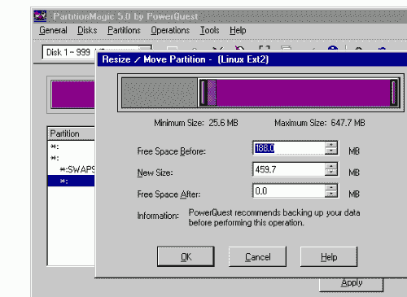

你有时也可能想缩小交换分区。这种操作通常出现在你发现意外创建了一个大得离谱的交换分区。在这种情况下，你可以使用动态分区调整工具来调整分区大小，或者删除交换分区并在其创建两个或多个分区：一个较小的交换分区和一个或多个用于数据存储的分区。你可以将这些额外的数据分区用于你通常放置数据分区的任何用途。

## 基础打印

Linux 打印是几个不同工具协作完成的结果。系统管理员必须熟悉该集合中每个工具的功能，以及它们是如何相互作用的。与 Linux 部分的许多其他程序一样，某些工具有几个不同的版本，如果你不了解系统整体是如何运作的，可能会导致困惑或不兼容。

## Linux 打印架构

Linux 打印是围绕“打印队列”的概念构建的。这是一种等待打印文件的存放区域。单台计算机可以支持多个打印队列。这些队列通常对应不同的打印机，但也可以配置多个队列以不同的方式向同一台打印机打印。例如，你可能使用一个队列进行单面打印，另一个队列在支持双面打印的打印机进行双面打印。

用户通过名为 `lpr` 的程序提交打印任务。用户可以直接调用此程序，也可以让另一个程序调用它。无论何种情况，`lpr` 都会将打印任务发送到指定的队列。该队列对应硬盘上的一个目录，通常位于 `/var/spool` 下的一个子目录下，并以 `lpd` 程序命名，而 `lpd` 是 Linux 打印系统的核心。该程序是一个在后台运行的守护进程，监控某些会触发其运行的事件。`lpd` 接受来自 `lpr` 或远程计算机的打印任务，监控打印队列，并充当某种“交通警察”，将打印任务从打印队列有序地引导到打印机。为了完成这一切，`lpd` 依赖于 `/etc/printcap` 配置文件，稍后将详细描述该文件。

Linux 打印的一个重要且不寻常的特征是它是高度网络化的。正如提到的，`lpd` 既可以接受来自远程系统的打印任务，也可以接受本地任务。事实上，即使是本地打印任务也是通过网络协议提交的，尽管它们通常不使用网络硬件，因此即使是没有网络连接的计算机也可以打印。除了作为打印任务服务器，`lpd` 还可以作为客户端，将打印任务传递给运行相同协议的其他计算机。

Linux 打印系统的缺陷之一是它本质上是单向的——打印任务源于应用程序，应用程序盲目地产生 PostScript（稍后将描述），而不知道它正在打印的打印机的任何信息。打印队列接收此输出并将其发送到打印机，打印机必须尽力处理。Linux 应用程序无法直接查询打印机相关的能力。

Linux 打印的一个令人困惑的方面是，Linux 支持几种计算打印系统。最流行的两个是原始的伯克利标准发行（BSD）打印系统和较新的 LPR 软件包。两者都按照概述的输出工作，但在某些细节上有所不同，其中一些将在接下来的章节中讨论。这两者的替代方案是通用 Unix 打印系统（CUPS），它在大框架上的工作方式类似，但更多细节有所不同。例如，CUPS 不使用 `lpd` 或 `/etc/printcap`；相反，它使用 `cupsd` 以及 `/etc/cups` 中的各种文件进行配置。CUPS 支持高级功能，旨在为应用程序提供更多关于目标打印机的信息，但在 2001 年，它还没有 BSD 或 Lprng 流行的打印系统。

## 使用 Postscript 和 Ghostscript

如果你在 Windows、macOS、OS/2或其他操作系统下配置过打印机，你可能熟悉打印机驱动的概念。在这些操作系统中，打印机驱动位于应用程序和打印机之间。在 Linux 中，打印机驱动是 Ghostscript（http://www.wisc.edu/~/）的一部分，它作为打印队列的一部分存在（这也是后期）。这种关系有时会令人困惑，特别是因为并不是所有的应用程序或打印机都需要 Ghostscript。

## Postscript: Linux 事实上的打印语言

我们今天所知的激光打印机于 20 世纪 80 年代开始流行。第一批 Post 打印机是非常昂贵的设备，其中许多设备支持当时一种新型且强大的打印语言：PostScript。

PostScript 成为 Unix（以及继承 Linux）事实上的打印标准。Windows 系统上的程序被设计为与打印驱动程序界面，而 Linux 上的类似程序生成 PostScript 并将其发送到 Linux 打印队列。PostScript 作为标准的问题在于，它在中低价打印机上并不常见。因此，要使用生成 PostScript 输出的传统 Unix 程序进行打印，你需要翻译器，以及一种将翻译器放入打印队列的方法。这就是 Ghostscript 起作用的地方。

## Ghostscript: PostScript 翻译器

当使用 PostScript 打印机时，计算机直接将 PostScript 文件发送到打印机。PostScript 是一种编程语言，尽管它是以产生打印页面作为输出为目标的。因此，PostScript 打印机大量的内存和 CPU 能力。事实上，在 80 年代，PostScript 打印机的内存和 CPU 比其连接的计算机大并不见。

但今天，打印机的内存和 CPU 能力有限——特别是廉价的喷墨机型号。

Ghostscript 是运行在计算机上的 PostScript 解释器，减轻了对内存和 CPU 能力的需求。它接收 PostScript 输入，解析并产生数十种位图格式输出，包括许多非 PostScript 打印机接受的格式。这使得 Ghostscript 成为一种极低成本转换 Linux 兼容打印机的方法（Ghostscript 以开源软件的形式提供，更高级的版本免费提供，但不能在任何商业软件包中自由分发。由于所有 Linux 发行版都以付费形式通过光盘提供，因此它们都带了 GNU Ghostscript，这对于大多数用户来说足够了）。

基础打印 545

Copyright ©2001 SYTEX, Inc., Alameda, CA www.sybex.com

546 第 8 章 · 硬件问题

Ghostscript 的缺点之一是它产生的输出文件很大。一个包含文本页面的 PostScript 文件可能只有几 KB 大。如果使用 Ghostscript 在 600 dpi（每英寸点数）打印机上打印此页面，输出可能高达 4MB（假设是黑白色的）。如果页面包含颜色，尺寸可能会大得多。在某种意义上，这并不重要，因为这些大文件只会在硬盘上存储很短的时间。尽管它们仍然必须从计算机传输到打印机，这个过程可能会很慢。此外，某些打印机（尤其是激光打印机）在 Linux 下可能需要扩展内存才能可靠地运行。


# 为 Linux 选择合适的打印机

如果你想为 Linux 准备一台快速的打印机，请选择内置 PostScript 的型号。这对于文本和线条图输出尤为如此，因为这类输出从 PostScript 转换为位图时，尺寸膨胀受影响最大。根据我的经验，Ghostscript 驱动的打印机对于速度高达每分钟 6 页（ppm）的 600dpi 黑白打印机效果良好。如果打印机速度超过该值，并行端口或 USB 端口可能无法提供必要的性能，尽管你可以对其进行微调以获得稍微改善。

彩色喷墨打印机通常受限于打印头的速度，而不是端口数据传输速度。很少有打印机直接支持 PostScript。某些带有 Windows PostScript 引擎的型号在概念上与 Ghostscript ，但此类软件在 Linux 下毫无用。市场上有一些 PostScript 喷墨打印机，以及使用其他打印技术的彩色 PostScript 打印机。

有关 Ghostscript 支持哪些打印机的信息，请查看 Ghostscript 网页或 GNU/Linux 打印网页 http://www.linuxprinting.org/printer_list.cgi。

Copyright ©2001 SYBEX, Inc., Alameda, CA www.sysex.com

# 将 Ghostscript 挤入队列

在 Linux 中打印到非 PostScript 打印机需要将 Ghostscript 纳入打印队列中。这通常通过使用智能过滤器（smart filter）来实现。这是一个在打印过程中被调用的程序。智能过滤器检查正在打印的文件，确定其类型，并在 `lprpd` 将其发送到打印机之前，将其通过一个或多个额外的程序。智能过滤器可以配置为使用适当参数调用 Ghostscript，以为打印队列生成输出。

智能过滤器通过 `/etc/printcap` 中的字段指定，下文所示。Linux 有几个可用的智能过滤器包，包括 rhs-filters（用于 Red Hat 及其某些衍生版本）、APSFilter（用于其他几个发行版）和 magicfilter。

智能过滤器的配置可能很复杂，但大多数发行版都包含了极具帮助的设置工具。接下来的章节“使用 GUI 工具”描述了此类工具的使用。在配置你的打印系统时，我强烈建议使用此类程序。

典型的 Linux 打印队列功能的结果是处理任何支持的 PostScript 打印机。产生 PostScript 输出的应用可以直接打印到队列。智能过滤器检测到输出为 Postscript 并通过 Ghostscript 运行。智能过滤器还可以检测其他文件类型（如纯文本和图形文件），并将其通过适当的程序代替或额外 Ghostscript，以创建合理的打印效果。

如果你有一台可以自己处理 PostScript 的打印机，智能过滤器通常会参与其中，但它不会通过 Ghostscript 传递 PostScript。在这种情况下，智能过滤器直接将 PostScript 传递给打印机，但仍然通过任何必要的处理将其他文件类型转换为 PostScript。

# BSD 和 LPRng 的配置与使用

幸运的是，原始 BSD 打印工具和 LPRng 的基本打印机配置是类似的。你可以通过直接编辑配置文件来手动配置一切，但某些关键细节——即你的智能过滤器是如何设置的——在不同发行版之间不同，而且追踪起来可能繁琐。因此，直接编辑文件最好保留给可以放弃智能过滤器的情况，或者你愿意查找系统所使用的任何智能过滤器的文档。在大多数情况下，使用 GUI 配置工具进行初始打印机配置更容易，如果有必要，你可以手动调整该配置。无论如何，守护进程都在后台运行并通过 `lpr` 接收打印作业。

# 配置 /etc/printcap 文件

`/etc/printcap` 文件是 BSD 和 LPR 打印系统的核心。列表 8.2 通过显示单个打印机的条目说明了 `/etc/printcap` 的格式。不过，你可以在 `/etc/printcap` 中定义多个打印机，只需确保使用不同的名称即可。

列表 8.2：示例 `/etc/printcap` 文件

```
1p|hp4000:\n:lp=/dev/lp0:\n:br=57600:\n:rm=\n:rp=\n:sd=/var/spool/lpd/lp1:\n:sh=\n:mx0=#
:if=/var/spool/lpd/lp/printfilter:
```

从技术上讲，每个打印机定义为一行。然而，`/etc/printcap` 条目传统上大量使用 Linux 通用习惯，使用反斜杠（\）来表示换行（注意列表 8.2 中的每行，反斜杠）。这使得打印机定义更易读。打印机定义的常用组件包括：

- **name**: 每个打印机定义以一个或多个名称开始。
- **br**: `br` 代表波特率；它定义了 RS-32 串口打印机的速率。
- **rm**: 如果你为连接到另一计算机或直接连接到网络的打印机定义打印队列，使用它指定其机器名称。
- **rp**: 此选项用于指定远程系统打印队列的名称。
- **sd**: `sd` 代表溢存目录（spool directory）。这是你硬盘上打印队列的位置。
- **mx**: `mx` 选项设置打印作业的最大 own，单位为字节。
- **sh**: `sh` 选项没有值。它代表抑制页。

基础打印

# 第 8 章 硬件问题

**if** 此选项设置输入文件名，它是与队列相关的智能过滤器（smart filter）的一部分。这通常是一个位于 spool 目录内的脚本。该脚本会设置各种选项（例如要使用的 Ghostscript 驱动程序名称），并调用磁盘上其他位置的智能过滤器文件。

`/etc/printcap` 是非常复杂的文件，支持许多选项。你可以从文件的帮助手册（man page）中了解更多信息（输入 `man printcap`）。不过，除了智能过滤器配置外，前面的选项涵盖了你可能对队列执行的所有操作。

在重新配置打印队列后，你可能需要重启打印机守护进程。在大多数系统中，你可以通过向 LPS 和 BSD 打印启动脚本传递 `restart` 参数来实现（启动脚本在第 6 章中有所描述）。以下是执行此操作的示例：

```
# /etc/rc.init.d/lpd restart
```


此文件的精确名称和位置会随发行版的不同而异。只有在系统没有正在打印时，才使用此命令。

# 使用 GUI 配置工具

在 Linux 中打印的巨大挑战并非来自 `/etc/printcap` 文件，而是来自关于打印机的系统信息——即智能过滤器和 Ghostscript 配置。GNU Ghostscript 支持所有 Linux 发行版，对于你的系统可能已经足够。在某些情况下，你可能需要升级到最新版本的 Ghostscript，或从其他地方获取版本。GNU 打印网页（http://www.linuxprinting.org/printer/）是查找适当驱动程序非常有用的资源。

在大多数情况下，为特定的非 PostScript 打印机配置带有智能过滤器的打印队列简单方法是使用 GUI 打印机配置工具。大多数 Linux 发行版都带有此类工具。例如，Caldera 的 COAS、SuSE 的 YaST 和 YaST2、Red Hat 及其衍生版的 `printtool` 都能帮助你完成打印机设置过程。这些系统的细节不同，但它们必须执行相同的任务，因此在轮廓上是相似的。以 `printtool` 的使用为例。要使用此程序，请遵循以下步骤：

- 1. 在 `xterm` 或类似的基于 X 的命令行窗口中以 root 身份输入 `printtool`。结果是显示 `printtool` 主窗口，如图 8.2 所示（显示了三个预配置的队列，但当你第一次启动它时，队列列表可能是空的）。

图 8.2 `printtool` 主窗口显示了可用打印队列，允许你对这些队列进行测试。

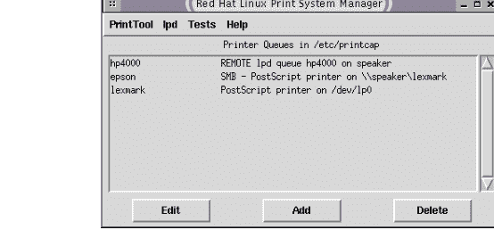

- 2. 点击 Add 添加打印机。`printtool` 会显示一个小对话框，询问你想添加什么种类型的打印机。选项包括本地打印机、远程 Unix (`lpd`) 队列、Windows 打印队列、Netware 打印机队列以及直接到端口（跳过 `lpd`）。本示例遵循第一个选项。远程打印机配置类似，但你需要输入打印机的识别信息，例如远程主机和打印队列名称。

- 3. 如果你创建了本地打印队列，系统将显示检测到的打印机硬件信息。根据我的经验，`printtool` 经常无法检测到正常硬件，因此如果你没有看到你熟悉的设备，请不要惊讶。

- 4. 在关闭通知可用打印机设备的对话框后，`printtool` 会显示图 8.3 所示的“编辑本地打印机项”（Edit Local Printer Entry）对话框。该对话框允许你输入关键的 `/etc/printcap` 信息，例如打印机名称、`spool` 目录名称和打印机设备文件名。输入这些信息后，不要点击 OK。

图 8.3 “编辑本地打印机项”框为队列提供了一个平淡但可用的默认名称。

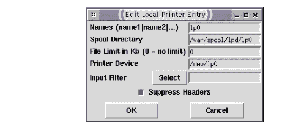

- 5. **点击**“编辑本地打印机项”对话框。这将弹出“配置过滤器”（Configure Filter）对话框（图 8.4）。在这里，你可以选择要使用的 Ghostscript 驱动程序以及其他选项：

    - a. 配置过滤器对话框左侧的打印机类型（Printer Type）字段显示打印机类型列表。注意，此列表不包含大多数打印机型号，因为大多数打印机使用其他型号开创的命令。例如，如果你有与 HP LaserJet 4/516 系列兼容的打印机，请选择该打印机，如图 8.4 所示。列表中有一个 PostScript 打印机条目，如果你的更新标准支持 PostScript，请从列表中选择 PostScript Printer。

图 8.4 配置过滤器对话框让你为队列选择打印机驱动程序和其他打印选项。

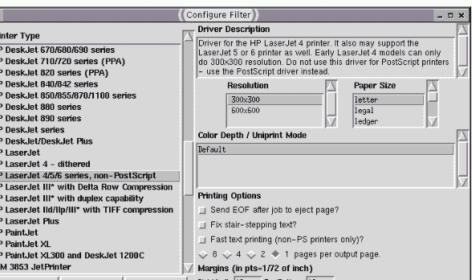

    - b. 分辨率（Resolution）和纸张尺寸（Paper Size）字段允许你如想象的那样设置打印机的分辨率和纸张尺寸。某些打印机驱动程序不使用这些选项；相反，它们将这些功能推入-

# 基础打印 555


在原始 BSD 版本的 `lpr` 中，`-P` 和队列名之间不应该有空格。LPRng 在这方面更加灵活；你可以根据需要插入空格或省略它。

- `-r` 通常情况下，`lpr` 将你打印的文件发送一份副本到队列中，保持原始文件不受影响。使用此选项后，`lpr` 会在打印后删除原始文件。
- `-h` 此选项会抑制单个打印任务的横幅页（banner）。
- `-jname` 打印任务有名称，以便识别它们，无论是在队列中还是在打印出来后（如果队列配置为打印横幅页）。名称通常是打印任务中第一个文件的名称，但你可以通过包含 `-j` 选项来更改它。
- `-m username` 此选项会导致 `lpd` 在打印任务完成后向 `username` 发送电子邮件。

假设你有一个名为 `report.txt` 的文件，想将其打印到连接到 `lexmark` 队列的打印机上。该队列通常很忙，所以当任务完成后，你就知道在去取打印时需要给 `jones` 发送电子邮件。你可以使用以下命令完成此任务：

```
$ lpr -Plexmark -m j1jones report.txt
```

普通用户和 root 用户都可以访问 `lpr`，因此任何人都可以使用此命令进行打印。它也被许多需要直接打印的程序（调用，例如图形程序和文字处理器。这些程序为你提供了一些方法来调整打印命令，以便你输入打印机名称等参数。参见 Netscape 的打印对话框。请注意，“打印命令”输入字段包含一个完整的 `lpr` 命令，但不包含文件名。其他程序将 `lpr` 命令隐藏在配置工具中，并在其主打印对话框中提供可选的打印机列表。如果你不确定它是如何工作的，请咨询该程序的文档。

Copyright ©2001 SYBEX, Inc., Alameda, CA www.sybex.com

# 图 8.5 大多数 Linux 程序都可以通过使用 `lpr` 进行打印，并且它们通常允许你编辑用于打印的精确命令。

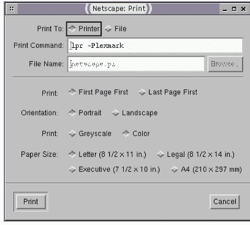

# 监控和控制打印队列

有几个工具可以检查和操作 Linux 打印队列。这些工具是 `lq`、`lpr` 和 `lpc`。所有这些命令都使用 `-P` 参数来指定它们在特定的打印队列上进行操作。

## lq

`lq` 显示打印队列的信息——它包含多少文件、这些文件有多大、所有者是谁等等。通过输入用户名作为参数，你还可以使用此命令检查特定用户拥有的任何任务。要使用 `lq` 检查队列，你可以使用如下命令：

```
$ lq -Plexmark
Printer: lexmark@speaker
Queue: 1 printable job
Server: pid 14817 active
Unspooler: pid 14822 active
```

# 基础打印 557

状态: 打印 'rodsmith@speaker+787', 文件 1
'Insight.ps', 大小 672386, 格式 'l' 于 14:57:10

| 排序 时间 | 所有者/ID 类 | 任务 文件 大小 |
| :--- | :--- | :--- | :--- | :--- | :--- |
| 1 14:56:22 | rodsmith@speaker+787 active | A | 787 | Insight.ps | 672386 |


此示例显示了 LPRng 的 `l` 的输出。使用原始 BSD 打印系统的显示的信息较少，但最重要的信息（如任务号、任务所有者、文件名和任务大小）在两种情况下都存在。

特别感兴趣的是任务号——在本例中为 787。
你可以使用它来从队列中删除任务，或者重新调整它的顺序使其在其他任务之前打印。任何用户都可以使用 `lq` 命令。

## lprm

`lprm` 命令从打印队列中删除一个或多个任务。有不同的方法执行此命令：

- - 如果带数字执行，则该数字被理解为要删除的任务 ID（如 `lq` 的输出所示）。
- 如果 root 运行 `lprm` 并向程序传递用户名，它将删除属于该用户的所有任务。
- 如果用户运行 BSD `lprm` 并向程序传递一个横杠 (`--`)，它将删除该用户的所有任务。LPRng 使用 `all` 代替横杠来实现目的。
- 如果 root 运行 BSD `lprm` 并向程序传递一个横杠 (`--`)，它将删除所有用户的任务。同样，LPRng 使用 `all` 实现此目的。

此程序可以由 root 或普通用户运行，但正如刚刚提到的，其功能取决于运行它的人。普通用户可能只能从队列中删除自己的任务，但 root 可以删除任何人的打印任务。

## lpc

`lpc` 启动、停止和重新排序打印队列中的任务。`lpc` 接受命令，某些命令需要额外的参数。你可以像其他打印工具一样通过 `-P` 传递打印机名称，也可以在不使用 `-P` 参数的情况下传递此信息。在后的情况下，打印队列名称紧跟在命令之后。以下是最有用的 `lpc` 命令：

- `abort` 停止当前任务和队列中的任何其他任务，但保持这些任务完好。随后执行 `start` 命令将恢复打印。
- `disable` 将队列设置为拒绝后续打印任务，但不停止队列中当前任务的打印。
- `down` 停止向队列打印并设置队列拒绝后续任务。
- `enable` 启用队列使其重新接受任务。这是 `disable` 的反面。
- `exit` 如果 `lpc` 在交互模式下启动（稍后描述），此命令将退出此模式。
- `start` 开始打印并为队列启动 `lpd` 进程。
- `stop` 停止 `lpd`，以便在当前任务完成后禁用打印。
- `topq jobid` 将 ID 为 `jobid` 的任务移动到队列开头（当前正在打印文档之后）。使用它重新设置打印队列的优先级。
- `up` 启用指定的打印队列；`down` 的反面。

你可以在交互模式下运行 `lpc`，一个接一个一个执行命令，也可以在同一命令行上指定命令来启动 `lpc` 并执行单个命令并退出。例如，假设你想调整 `brother` 队列上（通过之前的 `lpq` 命令识别）任务 945 的打印，使其紧接着打印。你可以执行以下命令来实现此：

```
# lpc topq brother 945
```


# 添加新硬件

虽然普通用户可以运行 `lpc`，但在大多数情况下，他们无法对其做任何事情。典型的 `lpc` 操作需要超级用户权限。

首先要检查的地方。大多数发行版会将这些驱动程序的大部分直接编译到内核中，或者作为模块。尽管如此，你可能需要升级或重新编译内核以获取某些设备的驱动程序。

## 新内核驱动程序

随着新设备上市，Linux 开发者会为它们编写驱动程序。最初，许多此类项目并不是官方内核的一部分。它们可能会在稳定版内核发布之前集成到不稳定的开发内核中。（有关内核版本的讨论，请参见第 3 章“软件管理”。）遗憾的是，寻找新的驱动程序可能很困难。对设备名称和“Linux”进行网络搜索可以找到指向驱动程序的线索。你也可以尝试使用开发内核，但这些内核是不稳定的。

## 硬件制造商

越来越多的硬件制造商为其产品提供 Linux 驱动程序。这些程序有时只是标准的内核驱动程序，但少数制造商会提供自己的驱动程序。

## Ghostscript

Linux 下的打印机依赖于本章之前介绍的 Ghostscript 软件包中的驱动程序。http://www.linuxprinting.org/printer_list.cgi 提供了有关特定打印机驱动程序与 Linux 兼容性的信息。

## 软件模型

大多数外部调制解调器与标准的 Linux 串口驱动程序兼容。然而，今天销售的大多数内部型号是*软件模型*。这些设备需要特殊的驱动程序支持，而这种支持在 Linux 下并不完善的。LinModems 网站 http://www.linmodems.org 拥有此类型号的驱动程序信息。

## USB 设备

从 2.2.18 和 2.4.x 内核开始，Linux 包含了良好的支持。（某些发行版也将这些补丁打到了早期内核中。）受支持的 USB 设备包括键盘、鼠标、CDC-ACM 模块、许多扫描仪、打印机、Zip 驱动程序等。USB 的开发仍在进行。此外，某些设备（如打印机和扫描仪）需要来自 Ghostscript 等次级软件包的驱动程序才能工作。Linux USB 项目首页 http://www.linux-usb.org 提供了有关 USB 设备驱动程序的更多信息。

## X 服务器

Free86 是 Linux 的主要服务器。XFree86 网站（http://www.x86.org）当你想查找关于显卡 Linux 支持的信息时，可以作为一个重要的资源。

查找关于显卡 Linux 支持的信息。在某些情况下，XFree86 没有驱动程序，但两个商业 X 服务器之一——Accelerated X（http://www.xig.com）或 Metro-X（http://www.metrolink.com）可能支持该显卡。


Linux 在文本模式下可以使用任何显卡，几乎任何显卡都支持如 640 × 480 VGA 的模式。只有当你打算在高分辨率下运行 X 时，才需要 XFree86 或另一个 X 服务器的支持。对于大多数工作站来说，这是一个虚拟性需求，但某些服务器不需要。

## 声卡驱动程序

Linux 内核包含了对许多声卡的支持，但对某些声卡的支持很弱。有两个对某些声卡改进支持的替代项目。一个是开源的 Linux 音频架构（ALSA；http://www.alsa-project.org）项目。另一个是商业开源系统（OSS；http://www.4front-tech.com）项目。标准的 2.4.x 及更早内核驱动程序实际上源于精简版的 OSS 驱动程序，ALSA 驱动程序可能会集成到 2.5.x 或更新内核驱动程序中。

## 扫描仪

Linux 下的扫描仪需要非内核驱动程序。这些程序由开源的 Scanner Access Now Easy（SANE；http://www.mostang.com/sane）项目提供。商业 OCR Shop（http://www.vivididata.com/html）软件包无需 SANE 即可工作。

除了驱动程序外，某些类型的硬件还需要特殊的用户软件。例如，CD-R 和 CD-RW 驱动器需要特殊的 CD-R 刻录软件，如 X-CDraft（http://www.xcroast.org），数字相机需要像 gphoto（http://www.gphoto.org）之类的软件包。此类软件使用低级 Linux 驱动程序（如内核中的 SCSI 或 USB 驱动程序）访问硬件，但软件提供了让硬件工作的方法，可能包括针对特定设备的驱动程序。事实上，打印机支持也是同样原理；Ghostscript 依赖低级并行、RS-232 串口、USB 或网络驱动程序将其输出发送到打印机。然而，打印机更常见且对计算机功能更基础，因此我将 Ghostscript 分类为 Linux 主要驱动程序。

## 在 Linux 中配置硬件

硬件配置可能从极其简单到极其复杂不等，取决于硬件——包括其通用类型和你正在使用的特定型号。你必须执行以下几类任务。某些硬件要求你执行所有这些任务，但其他硬件允许你省略一个或多个。

### 更换硬件的正确步骤

添加或更换硬件时最基本的任务是物理安装。硬件大致分为三类，每种类都需要不同的程序：外部设备、内部线缆设备（如硬盘和 CD-ROM 驱动器）以及内部扩展卡。某些设备跨越了界限。

外部设备通过外部端口连接到计算机，例如 RS-232 串口、并行端口、SCSI 端口或 USB 端口。这些设备（但并非所有）还需要墙插座供电，设备本身至少有两根电缆。外部连接器的形状通常使其只能以一种方式插入。大多数设备应在断电时连接。

内部线缆设备通常连接到主板或扩展卡。它们通常需要连接两根电缆：电源线和数据电缆。电源线具有防呆设计以防止误插，数据电缆也是如此。但数据电缆具有这种防呆设计。如果你必须使用电缆，请检查边缘的彩色条，并根据主板和卡上的“1 号脚”标记进行插入。内部设备使用螺丝固定在机箱上。例如，我曾见过某些小型机系统需要拆卸主板才能找到 3.5 英寸硬盘的螺丝。如果你已经拆除了螺丝但无法移除驱动器，请寻找其他可能存在螺丝的区域（即使是隐藏区域）。

如图 8.6 所示。注意由于尺寸和位置差异，不可能将错误类型的卡插入插槽——例如，PCI 卡无法插入 ISA 插槽。如果你用尽了某种类型，可以使用可用的槽位，你可能需要移除一个卡以腾出空间。有时你可以使用其他类型的设备，例如 USB 转太网适配器而不是以太网卡。插入卡之前，必须关闭计算机。不这样做几乎肯定会损坏卡或计算机。在断电后，对齐卡的连接器使其与插槽匹配，用力推入扩展插槽。然后你应该用螺丝将卡的顶部固定在机箱上。某些组件（如内存甚至 CPU）安装在插槽中，与扩展卡使用的类似。它们的安装程序相似，但这些设备的安装方式无法从计算机外部访问。

图 8.6 若干种不同且不兼容的扩展插槽。

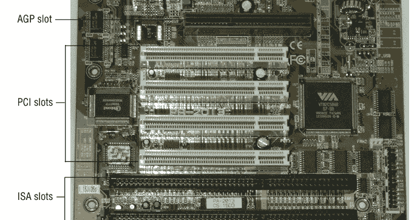

你可能经历过在地毯房间里走动，并在触摸门手时受到静电冲击。这种现象被称为静电释放（ESD）。当你处理计算机硬件时也可能发生这种情况，但这种事件实际上会损坏计算机或组件。因此，重要的是

## 第 8 章 · 硬件问题

在处理计算机硬件（无论是电脑还是单个组件）时，请务必进行接地。最好的方法是使用防静电（ESD）手带。这种手带看起来像手环或医院 ID 卡，但它连接到墙上插座或地线。结果是你的身体处于电气接地状态，因此你积累的任何静电在对电脑造成伤害之前就会被释放到地面。如果你缺少防静电手带，至少不应该穿着橡胶底鞋在地的毯上走动，因为这容易积聚静电，你应该通过其他方式进行接地，例如触摸散热器或水龙头。如果你没有采取这些行动，可能会在触摸电脑或组件时导致其损坏，特别是在你处于干燥的环境中工作时。

保护电脑很重要，但保护你自己更为重要。在操作电脑时，触摸电脑是安全的。现代电脑在关闭时并切断所有电源，即使你已经关闭了系统，它仍会有一些电路，如果你不小心触碰到它们，可能会受到电击。有些电脑背面带有拨动开关，可以切断所有电源，使用这种开关比拔掉插头具有更高的安全性。（当开关关闭但插着时，带有此类开关的电脑也是一个实用的接地源——你可以通过触摸电源而不是散热器或水龙头来接地。）

## 确定可用资源

许多设备需要使用特定类型的有限硬件资源。这些可能包括中断请求（IRQ），它允许硬件在发生重要硬件事件时向 CPU 信号；直接内存访问（DMA）通道，允许数据传输；以及输入/输出（I/O）端口，允许更多数据传输。根据一般规则，每个设备需要这些资源中的一种（一组 I/O 端口），且无法共享资源。某些硬件与其他设备共享资源，对于外设总线接口（PCI）板尤为如此。

你可以通过 `/proc` 文件系统中的三个伪文件查看 Linux 计算机当前正在使用的资源：`/proc/interrupt`、`/proc/dma` 和 `/proc/ioports`。你可以使用 `cat` 命令查看这些任何伪文件的内容。某些 GUI 环境也允许你查看这些信息（例如图 8.7 所示的 KDE 控制中心）。

**图 8.7** GUI 工具在获取硬件信息方面非常方便，但 `/proc` 文件系统中也可以获得相同的信息。

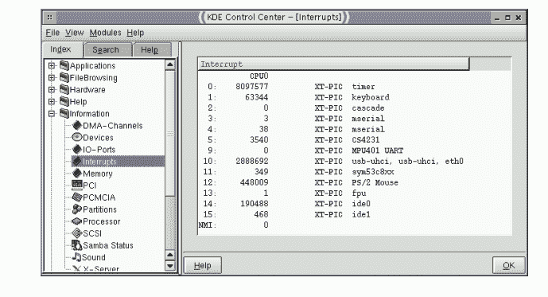

当你计划添加硬件时，应该寻找可用资源中的空隙。例如，在图 8.7 中，IRQ 6–8 是未使用的，因此（至少理论上）可以被某些新设备使用。然而，检查可用资源时需要记住的一个关键点是：Linux 不列出由未加载驱动程序的设备所使用的资源。例如，软驱使用 IRQ 6，但在捕捉图 8.7 时，软驱在系统内未使用，因此 IRQ 6 显示为空闲，实际上它并没有空闲。

图 8.7 还显示了一个共享 IRQ 的实例：IRQ 10 被 USB 和以太网设备共同使用。这在两种系统中都是可行的，因为它们都是能够共享中断的 PCI 组件。

当你添加 SCSI 设备、USB 设备、打印机、扫描仪以及许多较新的 PCI 设备时，几乎没有理由检查可用资源。（这假设基本端口，如 SCN 适配器或 USB 端口已分配了资源。）这些外设要么使用已安装的设备（它们不消耗额外资源），要么由系统自动配置并可以共享资源。如果你在使用此类设备时遇到问题，可能需要检查可用资源以查看是否存在冲突。

## 设置跳线

许多旧的硬件设备（特别是旧的 ISA 卡）通过跳线进行配置（图 8.8）。这些是硬件设备上的金属引脚，由由带有塑料绝缘的金属盖子覆盖。覆盖跳线引脚的结果是它们之间建立了电气接触，从而调整硬件的运行方式。如今，大多数扩展卡不再使用跳线，但主板仍使用它们来设置 CPU 速度或其他低级选项。

## 图 8.8 跳线允许你调整硬件运行的关键方面，特别是在旧款硬件上。


为了设置跳线，你需要找到硬件的文档（某些设备将此信息包含在卡本身上）。跳线通常控制设备使用的 IRQ 和 DMA 通道等功能。如果设备有多个功能，你还可以启用或禁用它们。例如，RS-232 卡可能支持两个 RS-232 端口，其中一个可以通过设置跳线来禁用。

## ISA PnP 配置

在 20 世纪 90 年，ISA 卡的即插即用（PnP）规范变得流行。该规范允许对 ISA 硬件的许多功能进行无跳线配置。Linux 处理 ISA PnP 配置有两种：通过 `isapnp` 程序和通过内核 PnP。

`isapnp` 是一个可以从文件中读取配置信息以设置 ISA PnP 选项的程序。要创建一个配置文件，最好从 `isapnp` 程序开始。该程序创建一个可以修改的文件，如下所示：

```
isapnp > isapnp.conf
```

生成的 `isapnp.conf` 文件包含一组选项，这些选项通过行首的 `#` 号注释掉了。当你找到想要设置的配置时，取消相应的注释。每张卡可能需要取消 2-6 行。

许多发行版在启动时会运行 `isapnp`。对于其他发行版，你可能需要在启动脚本（如 `/etc/rc.d/rclocal`）中包含该调用。在测试驱动程序时，你也可以手动运行该程序。确保包含配置文件的名称。例如：

```
isapnp /etc/isapnp.conf
```

2.4.x 内核的 PnP 支持需要单独的 `isapnp` 工具。在这些内核中，PnP 设备由内核自动检测并配置。或者，你可能可以在 `/etc/modules.conf` 文件（见第 6 章）中强制特定选项。如果你愿意，可以省略内核的 PnP 支持，并在 2.4 内核中使用 `isapnp` 工具。

PCI 设备不需要 PnP 支持。这些设备由内核或 BIOS 自动配置，尽管 `/etc/modules.conf` 可以强制特定的配置。

## 加载适当驱动程序

Linux 内核以两种方式之一加载驱动：它可能将驱动包含在主内核文件中，也可以从模块加载驱动。与内核直接关联的驱动（如 Ghostscript 或 SANE 驱动）可能构建在安装中，也可能单独加载。Ghostscript 始终使用构建在主程序中的驱动，这意味着如果你想添加一种特殊的驱动，必须找到包含它的的 Ghostscript 二进制文件（后者是一个乏味的过程）。SANE 通常使用模块化驱动。

## 设置驱动选项

有在驱动中设置某些硬件相关的选项。例如，你可能需要告诉驱动你使用了哪些硬件设置，或者你可能告诉驱动你安装了两个

## 第 8 章 硬件问题

相同的设备（例如两块以太卡）。Linux 内核将这些称为驱动选项，并有两种方法来设置它们：

**内核选项** 当驱动程序被编译进内核本身时，你将驱动选项传递给内核。在大多数情况下，这是通过使用 `/etc/modprobe.conf` 中的 `append` 选项来实现的。例如，可以使用以下行告诉内核以太网设备 `eth0` 使用 IRQ 10 和 I/O 端口 6200：

```
append="~eth=10,0x6200,eth0*"
```


**模块选项** 如果驱动程序作为模块而不是内核的一部分加载，你需要在 `/etc/modules.conf` 文件中输入模块选项，这在本章稍后以及第 6 章中会有。

无论哪种情况，驱动程序接受的选项都取决于特定的驱动程序。有时，相同的信息（如 IRQ 号）可能会以不同的方式传递给不同的模块。因此，有必要查阅特定驱动程序的文档才能正确使用。

## 让用户能够访问硬件

作为一条一般规则，Linux 通过 `/dev` 目录树中的设备文件条目使硬件可用。表 8.1 总结了常见的设备文件名及其用途。这些文件具有与其他 Linux 文件相同的所有权和权限，如第 4 章“文件权限”节所述。这些权限控制对特定文件的访问，从而控制了对硬件的访问。

### 表 8.1 常见的 Linux 设备文件名及其用途

| 设备文件名 | 主设备号 | 功能 |
|---|---|---|
| /dev/fd* | 2 | 软磁盘访问。 |
| /dev/hdxy | 3, 22, 33, 和 34 | EIDE 硬盘访问。x 是从 a 开始的字母，表示磁盘驱动器；y 是从 0 开始的可选数字，表示分区。也用于 EIDE 光驱。 |
| /dev/sdxy | 8, 65–71 | SCSI 硬盘访问。x 是从 a 开始的字母，表示设备驱动器；y 是从 0 开始的可选数字，表示分区。 |
| /dev/scdx | 11 | SCSI 光驱驱动器。 |
| /dev/htx and /dev/nhtx | | EIDE 磁带备份设备。 |
| /dev/stx and /dev/nstx | 9 | SCSI 磁带备份设备。 |
| /dev/sqx | 21 | “通用”SCSI 设备。x 是从 a 开始的字母。 |
| /dev/ttySy | 4 | RS-232 串口。 |
| /dev/lpx | 6 | 并口。 |
| /dev/usb/* | variable | USB 设备。 |
| /dev/dspx | 14 | 数字音频（声卡）。 |
| /dev/sequencer | 14 | MIDI 音频播放（声卡）。 |
| /dev/mixerx | 14 | 音频混合器（控制声卡音量）。 |
| /dev/psaux | 10 | PS/2 样式鼠标（注意 x 不是变量；只有一个 /dev/psaux 设备）。 |

除非另有说明，否则 x 是从 0 开始的数字，表示设备类型。此变量有时可以省略。

表 8.1 为每个设备类型指定了“主设备号”。在 Linux 中，每个设备文件都关联两个数字：主设备号和次设备号。这两个数字共同决定了设备类别和特定设备。例如，`/dev/ttySy` 使用主号 4 和次设备号 64；`/dev/tty1` 使用次设备号 65；`/dev/tty2` 使用次设备号 66；以此此类推。如有必要，你可以使用 `mknod` 命令为新硬件创建设备文件。此命令需要主号和次设备号来创建设备文件。使用 `mknod` 创建设备文件几乎不是必要的，因为 Linux 发行版总是会带有所有常见硬件的设备文件。如果你在使用非常新的实验性硬件驱动程序，你可能需要创建特殊设备文件。在这种情况下，你需要查阅驱动程序的文档以获取完整说明。

有时，用户必须访问 `/dev` 目录中的设备文件。例如，如果用户需要在调制解调器（通常是串口设备）上拨打电话、在声卡上播放或录制声音，或在光驱驱动器上播放音频，就需要这样做。某些发行版（如 Red Hat）在登录过程中包含代码，以将此类文件的所有权更改为在控制台登录的用户。这种方法通常对工作站效果良好。其他发行版不使用这种方法；而是由管理员调整权限以允许用户访问设备。例如，你可以创建一个组，将组相关的设备文件分配给该组，并赋予它们 `rw----` 权限。任何作为音频组成员的用户都可以使用声卡。某些发行版包含了专门为该目的设计的组。

其他设备文件通过不同的方式访问，通常通过内核访问。例如，磁盘设备通过文件系统驱动程序访问。因此，没有必要让普通用户直接访问设备。其中显著的是网络设备，例如以太卡。

## 第 8 章 · 硬件问题

## 管理内核模块

Linux 内核模块在许多操作系统中等同于驱动程序文件。然而，内核模块是非常动态的；它们可以根据需要加载和卸载。此外，某些内核模块依赖于其他模块。例如，SCSI 系统由处理 SCSI 适配器的驱动程序（非常特定于特定型号）以及处理硬盘、SCSI 磁带设备的附加模块组成。后这些模块依赖于前者。理解这些依赖关系并加载使用设备所需的所有模块对于有效使用硬件至关重要。

### 内核模块配置文件

内核模块配置通过两个文件处理：

- `etc/modules.conf` 此文件（某些发行版中称为 `/etc/conf.modules`）包含用于特定任务模块的信息，以及内核如何自动加载和卸载模块的指令。其格式在第 6 章概述。
- `lib/modules/x.y.z/modules.dep` 此文件位于以使用的内核版本（`x.y.z`）命名的目录中，包含模块依赖关系信息——该文件的每行列出一个模块及其所依赖的模块名称。

你可能需要按照第 6 章所述调整 `etc/modules.conf` 以在需要时自动加载模块。Linux 会在安装内核模块时自动维护 `modules.dep` 文件，但如果你手动更改了配置，应该输入 `depmod -a` 来更新该文件。

## 插入和移除内核模块

如果你的内核在编译时支持内核模块加载器，那么内核就有能力根据需要加载模块。例如，如果你的系统以模块形式编译了 USB 支持，那么任何访问 USB 设备的尝试都会导致内核查找并加载相应的内核模块。通常，这些模块在设备不再被使用时会自动卸载。这种安排非常方便，但有时对于新模块或不寻常的模块无法正常工作，或者如果 `/etc/modules.conf` 未包含帮助系统确定特定设备需要哪些模块的别名（例如，加载 Adaptec SCSI 卡的驱动程序而不是 Symbios SCSI 卡）。由于这些原因，有专门的程序用于手动加载和移除内核模块。（事实上，内核在自动加载模块时也会使用这些工具。）你可以将这些命令包含在启动脚本中，或根据需要手动输入。后者在测试新硬件时很有帮助。

> 在某些情况下，由于设备必须快速响应某些事件或被频繁使用，自动卸载模块会导致性能下降。

### insmod

这些内核处理命令中的第一个是。该程序向内核中插入单个模块。此命令接受模块名称作为参数，也可能接受几个选项。更重要的 `insmod` 选项有：

- `-f` 强制 `insmod` 加载模块，即使它是为不同版本的内核编译的。这在你处理商业专有二进制模块时最有用。
- `-k` 在模块上设置自动清理标记。这会导致系统在模块被闲置后自动移除它。
- `-p` 测试模块是否可以加载，而不实际执行加载。
- `-s` 将所有消息输出到系统日志，而不是控制台。

例如，你可能使用以下命令为许多笔记本电脑使用的 Lucent 软件调制解调器加载 `ltmodem` 模块：

```bash
# insmod -f ltmodem
```

模块通常具有相同的名称和文件名，区别是模块文件名通常包含结尾的 `.o.`。因此，`ltmodem` 在磁盘上被称为 `ltmodem.o`。这些模块存储在 `/lib/modules/x.y.z` 的子目录下，其中 `x.y.z` 是内核版本号（有时会加上发行版号）。

### modprobe

`insmod` 是一个实用的工具，但它仅限于单个模块。在模块依赖于许多其他模块的情况下，使用 `insmod` 需要你确定哪些模块依赖于其他模块，并在使用你需要的模块之前手动插入所有被依赖的模块。这是一个繁琐的过程。因此，有了 `modprobe` 程序来为你完成这些工作。`modprobe` 使用模块的内容来确定使用目标模块必须加载哪些模块。与 `insmod` 类似，`modprobe` 支持许多选项；其中最重要的选项在此处描述：

- `-c` 或 `--showconfig` 显示当前模块配置。这包括模块文件的路径、`/etc/module.conf` 信息的摘要等等。
- `-k` `--autoclean` 设置自动清理标记，与 `insmod` 的 `-k` 选项一样。
- `-n` 或 `--show` 不执行模块插入，而是总结将发生的动作。
- `-s` 或 `--syslog` 将所有错误消息输出到系统日志，而不是控制台。
- `-r` 或 `--remove` 移除模块栈。如果没有指定模块名称，此选项将强制对栈进行自动清理。

例如，要插入 `snd-card-interwave` 模块及其依赖的所有模块，并设置自动清理标记，你需要输入：

```bash
# modprobe -k snd-card-interwave
```

### rmmod

要移除模块，你可以使用 `modprobe` 的 `--remove` 选项，或者使用 `rmmod` 命令。此命令支持三个选项：

- `-a` 移除所有设置了自动清理选项的未使用模块。
- `-r` 移除一组模块，而不仅仅是单个模块。
- `-s` 将所有消息输出到系统日志，而不是控制台。

在实践中，当你尝试新驱动程序或新硬件并对其进行手动配置时，这些命令最有用。特别是在你调试时。当你找到有效的配置后，通常可以通过在 `/etc/modules.conf` 中设置别名并通过内核自动加载器使其正常工作。在某些情况下，你可能会发现通过启动文件中使用这些命令安装模块更容易强制解决问题。手动插入模块还可以防止内核浪费时间重复执行该任务。虽然加载模块的时间很短，但如果你的系统执行某些其他对时间敏感的任务（例如实时数据采集），这可能会是一个因素。

### lsmod

如果你想知道任何时刻加载了哪些模块，可以使用 `lsmod` 命令。此命令列出已加载的模块、它们的大小以及依赖于它们的模块的名称。这是一个示例：

| Module | Size | Used by |
| :--- | :--- | :--- |
| dc2xx | 2512 | 0 (unused) |
| ip_masq_ftp | 2320 | 0 (unused) |
| 1p | 5276 | 0 |
| parport_pc | 7316 | 2 |
| parport | 7236 | 2 [1p parport_pc] |
| via-rhine | 8996 | 1 |

此输出显示 `dc2xx` 未使用，`ip_masq_ftp` 未使用，`parport` 被 `1p` 和 `parport_pc` 使用，`via-rhine` 被 1 个模块使用。

### 硬件问题

如果你想知道任何时刻加载了哪些模块，可以使用 `lsmod` 命令。此命令列出已加载的模块、它们的大小以及依赖于它们的模块的名称。这是一个示例：

| Module | Size | Used by |
| :--- | :--- | :--- |
| dc2xx | 2512 | 0 (unused) |
| ip_masq_ftp | 2320 | 0 (unused) |
| 1p | 5276 | 0 |
| parport_pc | 7316 | 2 |
| parport | 7236 | 2 [1p parport_pc] |
| via-rhine | 8996 | 1 |

此输出显示 `dc2xx` 未使用，`ip_masq_ftp` 未使用，`parport` 被 `1p` 和 `parport_pc` 使用，`via-rhine` 被 1 个模块使用。

### 核心系统问题

如果你想知道任何时刻加载了哪些模块，可以使用 `lsmod` 命令。此命令列出已加载的模块、它们的大小以及依赖于它们的模块的名称。这是一个示例：

| Module | Size | Used by |
| :--- | :--- | :--- |
| dc2xx | 2512 | 0 (unused) |
| ip_masq_ftp | 2320 | 0 (unused) |
| 1p | 5276 | 0 |
| parport_pc | 7316 | 2 |
| parport | 7236 | 2 [1p parport_pc] |
| via-rhine | 8996 | 1 |

此输出显示 `dc2xx` 未使用，`ip_masq_ftp` 未使用，`parport` 被 `1p` 和 `parport_pc` 使用，`via-rhine` 被 1 个模块使用。

### EIDE/ATA 问题

大多数 x86 计算机使用通过增强集成电子（EIDE）端口连接的硬盘和 CD-ROM 驱动器，它也称为高级技术附件（ATA）或 ATA 数据包接口（ATAPI）。这些设备 own可能会非常严重，因为它们会阻止 Linux 启动或导致数据损坏。

## 硬件问题诊断

例如，你可能需要更换控制器或将 Linux 内核升级到新版本。

某些 Linux 用户遇到磁盘传输速度非常慢的问题。这可能是由几个不同因素引起的。例如，尽管 Linux 的基础 EIDE 驱动程序兼容几乎所有的 EIDE 控制器，但你可能可以使用专门的驱动程序从你的驱动器中获得最佳性能。你可以使用 `hdparm` 工具来测试磁盘并设置可以提高硬盘性能的各种选项。`hdparm` 支持大量选项，因此你应该阅读其 man 手页（帮助文档）以获取详情。

- `-d [0|1]` x86 EIDE 设备可以在程序输入/输出 (PIO) 模式或直接内存访问 (DMA) 模式运行。在前者中，CPU 负责所有数据传输，而在后者中，CPU 退出并让控制器直接将数据传输到内存中。DMA 模式为磁盘访问产生较低的 CPU 负载。使用 `-d1` 可以启用 DMA 模式。此选项通常与 `-X`（稍后描述）结合使用。此选项并非在所有系统上都有效，如果你要使用特定 EIDE 芯片组的 DMA 模式，Linux 要求其显式支持。
- `-p mode` 此参数设置 PIO 模式，在大多数情况下在 0–5 之间变化。较高的 PIO 模式对应更好的性能。
- `-s timeout` 此选项设置了一个节能选项：磁盘将在进入低功耗状态之前等待而不进行任何访问。磁盘从这种状态恢复需要几秒钟，许多台式电脑会等待超时，你可能想将超时 设置为其他值。在笔记本电脑上，1 到 240 之间的值是 5 秒的倍数（例如，10 意味着 50 秒的延迟）；241–251 意味着 1–11 个以 30 分钟为单位；252 是 21 分钟的超时；253 是特定磁盘的超时；255 是 21 分钟 15 秒的超时。
- `-T` 此参数对未缓存磁盘读取进行测试。实际上，这是对内存和非磁盘系统性能的衡量，因为没有访问磁盘。
- `-t` 此参数对未缓存磁盘读取进行测试。你可以用它来查看你的硬盘性能是否如预期那样良好。（2001 年的新硬盘应该返回远大于 10MB/s 的值，通常为 20MB/s；任何低于此值的都表明是旧硬盘或磁盘配置不优。）
- `-v` 此选项显示各种磁盘设置。
- `-X transformmode` 此选项设置磁盘所使用的 DMA 传输模式。`transformmode` 的示例值包括 34（DMA 模式 2）和 66（UltraDMA 模式 2）。

如果使用不当，许多 `hdparm` 参数可能会导致严重的损坏。具体什么是恰当的取决于不同的系统。例如，在一个系统上使用 `-x66` 是可以的，但在另一个系统上可能会导致文件系统损坏。你可以使用 `t` 参数测试磁盘性能，只有当你的磁盘性能不佳时，才再尝试实验 `hdparm` 设置。

假设你的硬盘性能不佳。你可以按照以下方式对其进行测试：

```bash
# hdparm -t /dev/hda
```

```
/dev/hda:
Timing buffered disk reads: 64 MB in 12.24 seconds = 15.23 MB/sec
```

事实上，这项测试揭示了现代标准下相当缓慢的性能。你可能通过启用 DMA 模式传输并重新测试来改进情况：

```bash
# hdparm -d1 -X34 /dev/hda
```

```
/dev/hda:
setting using_dma to 1 (on)
setting xformode to 34 (multiword DMA mode2)
using_dma = 1 (on)
```

```bash
# hdparm -t /dev/hda
```

```
/dev/hda:
Timing buffered disk reads: 64 MB in 4.49 seconds = 14.25 MB/sec
```


在大多数情况下，不需要危险的实验，因为大多数系统都会自动配置，以产生产生（或至少是合理的）性能。最好的方法是在当 `hdparm` 的初始测试显示性能不佳时，才进行此类实验。如果你不满意，请检查你的 EIDE 控制器的 Linux 驱动程序可用性，以及该控制器处理硬盘的能力。（快速的现代硬盘可能会超过几年前的控制器。）

你可以检查硬盘的规格来确定它的性能应该有多好。查看内部数据传输率，它应该包含在你的驱动器规格表中。根据现实世界的标准，这将是乐观的。`hdparm` 返回的值应该是理论最大值的 75-90%。

# SCSI 问题

有一个老笑话，说运行一个功能正常的小型计算机系统接口 (SCSI) 链是九部分科学和一部分巫术。实际上，事实并非如此，一旦设备超过两个或三个，SCSI 配置就会变得非常棘手。常见的问题源包括以下：

**终止 (Termination)** SCSI 链的两个末端都必须用特殊的电阻端口进行终止。大多数 SCSI 设备都内置了这些功能，添加或移除终止是设置跳线帽或开关的问题。然而，复杂的是，有几种不同类型的终止，不同的 SCSI 类型需要不同的终止类型。使用错误的终止类型会导致数据传输错误并运行不稳定。不位于链末端的设备也会导致运行问题。大多数 适配器包含启用或禁用终止的 BIOS 工具。

**SCSI ID** SCSI 设备通过 ID 数字进行识别——8 位 (Narrow) SCSI 为 0–7，16 位 (Wide) SCSI 为 0–15。如果两个设备共享同一个数字，可能只有一个设备会显示，或者一个设备可能占据所有 SCSI ID。在任何情况下，性能都可能很慢。

**电缆长度** 最大 SCSI 长度从 1.5 到 12 米不等，取决于 SCSI 的种类。超过电缆限制通常会导致数据错误，导致文件系统损坏。

**电缆质量** 廉价的 SCSI 电缆会导致数据错误，错误的终止或过长的电缆也是如此。遗憾的是，良好的 SCSI 电缆可能非常贵——50 美元更多并不常见。

**分支链** 许多现代 SCSI 适配器带有三个接口——一个外部接口和两个内部接口（用于 Wide 和 Narrow 设备）。然而，SCSI 链应该是一维的——每个设备都连接到链上的下一个设备，由 SCSI 适配器本身连接。因此，你不*应该*在一个 SCSI 适配器上使用超过两个接口。不听此建议会产生数据错误，就像其他问题一样。

大多数 SCSI 问题都可以追溯到这些问题之一，特别是终止和布线问题。正如此，有效的排排除技术涉及简化 SCSI 链。例如，假设你有一个两个 SCSI 硬盘、一个光驱驱动器和一个磁带驱动器的链。如果你只需要一个硬盘即可启动，你应该尝试移除所有其他设备以使链尽可能短。如果这有效，再换用更长的电缆并开始将设备加回链中。通过这种方法，你可能会发现问题与电缆长度或特定设备有关。

Linux 不包含适用于所有 SCSI 适配器的驱动程序，与 IDE 控制器情况不同。因此，你的*内核*必须包含对你特定型号 SCSI 适配器的支持。大多数发行版都包含了大多数 SCSI 适配器，但如果你有一个非常奇特的适配器，你可能会发现自己不受支持。

你可以使用前面描述的 `hdparm` 工具测试你的 SCSI 硬盘的性能。`hdparm` 不能用于调整 SCSI 硬盘的性能。在 Linux 中，SCSI 硬盘始终以最高性能运行；没有可配置的传输模式，也没有在 PIO 和 DMA 模式之间切换的方法。（所有良好的 SCSI 适配器都仅使用 DMA 模式，但某些非常廉价的仅使用 PIO 模式。）

## 外设设备问题

在计算机语境下，*外设*是指连接到计算机并由计算机控制的设备。键盘、鼠标、显示器和扫描仪就是很好的例子。然而，许多位于计算机内部的设备也是外设。这些包括硬盘、CD-ROM 驱动器和磁带备份设备。在有适当硬件的情况下，大多数内部外设都可以外接连接。

由于外设领域非常广泛，诊断此类问题也涵盖了大量领域。但根据一般原则，外设问题可以分为三个大类：外设设备本身的问题、连接外设与计算机的电缆问题，以及计算机外设接口的问题。

## 外设设备问题

在诊断外设设备问题时，你应该采取的步骤之一是确定问题是与设备驱动程序还是设备本身有关。接下来的“识别支持和不支持的硬件”部分将帮助你判断该设备是否可以在 Linux 下工作。打印机、扫描仪、相机以及更奇特的外部设备特别可能需要 Linux 中可能存在的特殊驱动。键盘、鼠标、显示器、外部 RS-232 调制器以及 EIDE 和 SCSI 设备在 Linux 中几乎总是受支持的。

一个非常有用的测试方法是在另一个操作系统下尝试该设备。由于大多数外设都可以配合 Windows 驱动程序工作，安装这些驱动并在 Windows 中尝试该设备将为你提供一些线索，帮助你判断问题源是硬件故障还是驱动程序。如果你双启动到 Windows 且设备无法工作，你无法确定问题是否在设备上；它可能出在电缆或计算机到设备的接口上。如果你将外设移动到另一台计算机且它可以工作，那么问题也可能在 Linux 计算机的电缆或接口上。

> 巧合会发生，因此无法通过将设备移动到另一台计算机或操作系统来确定结论。例如，如果你将故障设备移动到另一台计算机上它仍然无法工作，可能是因为两台计算机的软件配置都错了。

## 外设电缆问题

电缆问题通常很好测试——在大多数情况下，你可以很容易地更换电缆。然而，SCSI 电缆可能非常贵，因此你可能不愿为了测试使用新电缆。少数设备（如鼠标和键盘）带有内置电缆。坦率地说，后者的设备通常非常廉价，因此如果电缆出现问题，你可能会更换整个受影响的设备。

遗憾的是，某些特别廉价的排线（用于计算机内部的 SCSI、EIDE 和软驱设备）卡住了防止反插的缺口。如果你有这样的电缆，请寻找电缆一侧的彩色条，并查看设备连接器上的引脚编号。对齐电缆，使彩色条在两端都对应引脚 1，它就能正常工作。如果电缆反反，设备将无法工作。

软驱器的特殊之处在于它们包含一个“转折”——一段电缆被切断并扭转以改变引脚映射。你应该在这个转折之后连接第一个软驱器。如果你在转折之前连接第一个驱动器，你的驱动器将产生混乱。在单软驱系统中，只有软驱器会被识别为 `/dev/fd1` 而不是 `/dev/fd0`。此外，软驱线通常包含两种连接器。一种用于连接 5.25 英寸驱动器，另一种连接 3.5 英寸驱动器。你不能将驱动器连接到错误类型的连接器上，但你应该意识到这种差异，以免被困扰，或者被典型软驱线上的五个连接器困扰（一个用于主板，两个用于第一个软驱，两个用于第二个驱动器）。最多只会使用这些连接器中的三个。

## 外设接口问题

大多数外设使用少量接口。除了本章前面讨论的 EIDE 和 SCSI 接口外，常见接口还包括：

- 带有软驱的 x86 计算机包含一个可以控制多达两个软驱的软驱接口。这些接口非常成熟，Linux 驱动程序很少引起问题。你可能需要注意的一个配置细节是在计算机的 BIOS 设置屏幕中启用该端口。如果没有启用，Linux 可能无法检测到软驱。如果 BIOS 配置正确但 Linux 无法使用软驱，可能是因为软驱控制器存在故障。作为一种集成在主板上的设备，更换软驱控制器可能很困难，但由于老旧的 486 及更早的系统通常在独立卡上使用软驱控制器，因此如果你能找到那样的古董，你可能可以使用它。

- 显示器：显示器端口是显卡的一部分。与它一起的软件通常涉及 XFree86（在第 2 节“安装 Linux”中讨论）。如果硬件有故障，你很有可能无法看到 BIOS 启动信息。

- 键盘：x86 计算机有一个键盘端口，使用大型 8 针 DIN 连接器或小型 mini-DIN 连接器。它们在电气上是兼容的，所以如果你有不兼容的键盘，可以使用适配器。与软驱端口相比，键盘端口高度标准化。事实上，它没有内核选项；糟糕的键盘连接器可能会出现在 BIOS POST 自检中，但无法保证。如果键盘在 Linux 中无法工作，启动其他操作系统可能会有所帮助。

## 诊断硬件问题

（注：此节提供的文本在 OCR 源中似乎是片段化的或不完整的，但上述内容反映了所提供的可用信息。）

在笔记本电脑上使用 Linux

## 识别支持和不支持的硬件

多年来，Linux 为各种硬件获取了广泛的驱动程序。尽管如此，Linux 并不支持所有设备。确定哪些设备受支持而哪些不支持有时是一项挑战；Linux 驱动程序通常是为设备的芯片编写的，而不是针对特定品牌和型号的设备。例如，Tulip 驱动是否适用于 Linksys LNAE100TX 并不显而易见。要识别哪些硬件受支持，你可能需要咨询各个发行版维护的硬件列表。例如，http://hardware.redhat.com 和 http://www.sse.com/us/support/hardware 是很好的资源。Linux 硬件兼容性 HOWTO (http://www.linuxdoc.org/HOWTO/Hardware-HOWTO) 也是极好的资源。

硬件兼容性在不同发行版之间的差异很小。发行版之间的唯一区别在于另一个发行版包含的非标准驱动程序，或者由于配置特殊性导致设备之间的冲突。因此，如果一个设备在某个发行版中被列为支持，那么该设备在任何其他发行版中几乎都能工作。

如果你找不到驱动程序或不确定使用哪些驱动程序，还应该向硬件制造商确认。某些制造商会在其页面包含 Linux 驱动程序（通常只是标准内核驱动程序）或指向其产品与 Linux 兼容性信息的链接。

制造商有时会在不更改名称的情况下更改产品设计。因此，产品在兼容性数据库中存在，甚至在制造商网站上有兼容性信息，并不意味着该设备能够工作。在搜索兼容性信息时，请留意主板修订号等细节。

## 在笔记本电脑上使用 Linux

笔记本电脑（也称为便式电脑）为 Linux 带来了某些挑战，除了通常的驱动问题之外。这些挑战之一源于 Linux 作为一个 Unix 克隆版本，其设计目标是不需要处理电源管理或交换 PC 卡的系统。然而，最令人沮丧的笔记本问题通常与安装有关。这些问题大部分归结为难以让 Linux 的 XFree86 配置与笔记本电脑上使用的挑剔液晶显示器（LCD）协同工作。

### 特定的笔记本安装

笔记本电脑本质上是微型台式计算机。笔记本电脑包含 CPU、内存、键盘、鼠标（通常是触摸板或触控板的形式）、硬盘、CD-ROM 驱动器、软盘驱动器和显示器。从软件角度来看，这些设备的工作方式与台式计算机上的对应设备相同。不过，笔记本电脑上也有一些常见的限制，包括以下内容：

- 大多数现代笔记本电脑内置了调制调器。遗憾的是，x86 笔记本电脑上的大多数调制调器是需要特殊驱动程序的软件调制调器。此类驱动程序在 Linux 中很少见。你可以查看 http://www.modems.org 获取这些设备的信息。在大多数情况下，你需要在安装 Linux 后安装调制调器驱动程序。如果你的内置调制调器完全没有 Linux 驱动程序，可以使用独立的 PC 卡或外部 RS-232 或 USB 调制调器。如果你使用 PC 卡或 USB 调制调器，请确保它是 Linux 支持的。

- 所有现代 Macintosh 和高端 x86 笔记本电脑都内置以太网。在购买笔记本电脑之前，确保 Linux 包含以太网端口的驱动程序。如果你的电脑没有以太网端口而需要在网络上使用，可以购买 PC 卡或 USB 太网适配器（PC 卡适配器更好。）如果在安装 Linux 时插入了卡，它可能会被安装程序检测到，并按照第 2 章所述进行配置。一旦卡配置完成，大多数发行版都会自动检测插入的 PC 以太网适配器是否到位。

- 在笔记本电脑上运行 Linux 最大的问题与显示有关。具体来说，笔记本电脑使用的 LCD 往往只接受很窄的水平和垂直刷新率（这些在第 2 章中讨论过）。因此，运行 GUI 安装程序可能很困难或不可能，而在配置 X 时，你可能找到也可能找不到一个可用的配置。即使系统可以工作，它也可能无法以最佳分辨率运行。由于 LCD是由固定数量的离散像素构建而成的，它们在单一分辨率下效果最好（笔记本电脑通常为 800×600 或 1024×768）。在较低分辨率下运行通常会产生颗粒感显示。另一个因素是，由于笔记本电脑的显示电路是可拆卸的，如果你在使用笔记本电脑时……那么笔记本电脑使用的任何视频芯片组必须支持 Linux。


在购买笔记本电脑或尝试安装 Linux 之前，请检查 Linux on Laptops 网页 http://www.linux-laptop.net。该网站包含了许多在特定机型上运行 Linux 的用户维护的站点链接。你可以从这些页面获取有用的提示和配置步骤，甚至可能获得可用的 X86Config 页面。Linux on Laptops 主站还包含了有关有用笔记本电脑实用程序和其他信息的链接。

如果你在笔记本电脑上安装 Linux 遇到困难，可以尝试另一个发行版，或者尝试使用该发行版的文本模式安装程序（如果有的话）。视频或其他问题直接阻止了发行版的安装。例如，我尝试在自己的笔记本电脑上安装五个发行版的多个版本。其中一个使用 GUI 安装工具安装良好。另外两个没有 GUI 安装程序，使用文本模式安装良好。其中一个完全没有安装成功。第五个发行版也没有安装成功。

## 理解电源管理

笔记本电脑由电池驱动。大多数笔记本电池只能运行几小时。因此，现代笔记本电脑包含各种电源管理工具，可以大幅减少所需的功率，延长电池寿命。2.4 内内核包含两个电源管理工具：高级电源管理 (APM) 和高级配置与电源接口 (ACPI)。两者都需要计算机 BIOS 的支持。截至 2.4 内核早期，ACPI 还是新的且实验性的。出于这个原因，即使你的硬件支持 ACPI，最好也使用 APM。大多数 Linux 发行版都包含 APM 支持。

> 注意：电源管理工具主要为笔记本电脑设计，但也可用于桌面级系统。事实上，这就是 Linux 关闭电脑的方式。

要使用 APM 功能，你需要某种方法告诉计算机何时进入节电状态。此任务通过 apmd 包 (http://www.world.ca/~apenn/apmd) 完成，该包随大多数 Linux 发行版并自动安装。`apmd` 程序是一个守护进程，因此它应该在计算机启动时启动。运行时，它会监控系统的电池状态，如果电池电量过低，`apmd` 会将系统带挂起模式，在该模式下功能会被关闭或仅维持系统内存。`apmd` 还会在硬盘长时间未闲时挂起硬盘。（你也可以使用前面提到的 `hdparm` 工具来直接控制硬盘电源管理。）

如果你想手动控制 APM 功能，可以使用 `apm` 工具来实现。运行它会显示基本的电源管理信息，例如剩余电量。`-s` 和 `-5` 参数分别导致系统进入挂起模式和待机模式。挂起模式会关闭设备的电源，仅留 CPU 和内存运行；待机模式会保留更多设备的电源，因此系统可以更快恢复；待机模式浪费的电力较少。许多笔记本电脑包含可以强制系统进入挂起或待机模式的键序列。大多数情况下，`apmd` 会检测到按键并执行请求。详情请参阅笔记本电脑文档。

## 使用 PC 设备

由于笔记本电脑没有 ISA 或 PCI 插槽，制造商开发了一种扩展卡标准，允许你轻松插入和移除许多与台式计算机上 ISA 或 PCI 插槽同类型的设备。该标准最初是以该行业小组命名的

# 在 Laptop 589 上使用 Linux

个人电脑内存卡国际协会（PCMCIA）开发了不同尺寸的卡。不过，为了减少缩写的使用，该标准已重命名为 PC Card。许多 Linux 实用程序在使用旧名称。

台式系统也有 PC Card 适配器，因此 PC Card 工具有时会在这些系统上发挥作用。不过，PC Card 设备在笔记本电脑上更为常见。

PC Card 硬件有几种不同的种类。PC Card 有三种不同的类型：Type I、Type II 和 Type III，每种都比前一种更厚。Type II 卡是最常见的类型，用于以太网卡、调制调器等。Type III 卡非常罕见，用于硬盘或其他带有内部运动部件的设备。电子设备使用 PCMCIA 1.0、PCMCIA 2.0、PCMCIA 2.1 以及 PC Card，最后一种是最先进的。你可以在 PC Card 网站 http://www.pc-card.com 了解更多关于这些标准的信息。

与硬件支持不同，PC Card 支持并不包含在 Linux 内核中。你必须获取并安装辅助驱动包。幸运的是，大多数 Linux 发行版都包含了这些 PC Card 驱动，因此不需要去 sourceforge.net/pcmcia-cs，除非你需要支持特定设备或通过手动编译来升级你的驱动。

PC 卡的设计为可以随时插入和拔出。遗憾的是，Linux 的驱动对热插的支持并不良好。因此，PC Card 驱动包含一个名为 Card Services（卡服务）的功能，它可以帮助你从内核中安装和删除驱动，并帮助潜在问题（例如，在插入或拔出以太网 PC 时自动启动或停止网络服务）。Card Services 通过 `/etc/pcmcia` 中的配置文件控制。这些脚本位于不同类型服务的目录中，例如网络和空闲。如果你的发行版维护者关注 PC Card 设备，这些脚本应该不需要任何修改即可正常工作。但在某些情况下，你可能需要编辑这些脚本以执行正确的操作。有关此操作的详细信息取决于具体的发行版和设备。如果你需要修改这些脚本，第 6 章的“基础 Shell 脚本”部分可能会帮助你理解它们。

Copyright ©2001 SYSEX, Inc., Alameda, CA www.sytex.com

第 8 章 • 硬件问题

# 总结

在 Linux 中配置硬件需要广泛的技能。配置工作（如设置交换空间、创建和管理打印队列以及管理内核模块）在 Linux 中的处理方式与其他操作系统不同。打印机配置在 Linux 中特别奇特，因为它依赖于 Postscript 打印机的存在或 Ghostscript（一个运行在 Linux 下的 Postscript 解释器）。

当你添加新硬件时，必须为这些设备找到 Linux 驱动程序。这些驱动可能以内核模块的形式出现，也可能存在非内核包中（如 Ghostscript）。不过，你在物理上安装硬件的方式与任何其他操作系统是一致的，并且你应该对你自己和硬件的安全采取预防措施。

有时，新硬件会出现问题。常见问题包括主板、CPU 和 RAM 缺陷或过热；配置错误或有缺陷的 IDE 设备；配置错误的 SCSI 设备。其他设备也会导致问题，特别是当这些硬件是奇特型号或使用了新设计时。一种特别棘手的硬件类型是笔记本电脑。笔记本显示器、电源管理和 PC Card 设备都构成了挑战，但并非不可逾越的。

# 考试要点

- 识别何时需要增加交换空间。`free` 命令的输出显示了 Linux 使用了多少内存——包括 RAM 和交换空间。当已用交换空间量接近可用量时，有必要增加交换空间或 RAM。

- 描述 Ghostscript 在 Linux 打印中的作用。Ghostscript 可作为非 Postscript 打印机的计算机本地 Postscript 解释器，允许预期打印到 Postscript 打印机的程序可以使用更便宜的打印机。

- 描述 lpd 在 Linux 打印中的作用。行打印守护进程（lpd）接受本地和远程打印作业，维护本地打印队列，调用智能过滤器并有序地将数据传递到打印机端口。

- 对比内核驱动和驱动模块。Linux 内核负责所有驱动。存储在 Linux 内核中的驱动始终被加载并会增加内核文件的大小，但驱动模块可以动态加载和移除，以配置复杂性为代价减少内存负载。

- 识别 Linux 驱动程序的一些可能来源。Linux 驱动可以作为 Linux 内核的一部分、从硬件制造商、第三方开发努力以及专门特定类型硬件的网站获取。

- 总结笔记本的安装和使用与台式机安装和使用何不同。在笔记本电脑上安装 Linux 需要仔细注意笔记本不可更换的硬件，特别是可能出错的显示器。使用该系统可能需要使用 PC Card 设备和电源管理，这两者在台式机系统中未被或不那么重要。

## 本章命令

| 命令 | 描述 |
| --- | --- |
| free | 显示总 RAM 和交换空间的使用信息 |
| mkswap | 初始化一个文件或分区用作交换空间 |
| swapon | 激活交换空间的使用 |
| swapoff | 否激活交换空间的使用 |
| lpr | 将打印作业提交到打印队列 |
| lpq | 显示打印队列中作业的信息 |
| lrm | 删除打印队列中的作业 |
| lpc | 监控和控制打印队列 |
| ppndump | 根据已安装的硬件创建原型 isapnp 配置文件 |
| isapnp | 配置 ISA PnP 设备 |
| depmod | 查找模块依赖关系 |
| insmod | 向内核插入单个模块 |
| modprobe | 插入模块及其依赖的所有模块（模块栈） |
| rmmod | 从内核中移除模块或模块栈 |
| hdparm | 设置磁盘参数并测试磁盘性能 |
| apm | 控制 APM 功能 |

## 关键术语

在参加考试之前，确保你熟悉以下术语：

- 高级配置和电源接口 (ACPI)
- 高级电源管理 (APM)
- 波特率
- 卡服务 (Card Services)
- 守护进程 (daemon)
- 静电释放 (ESD)
- FireWire
- 分段
- IEEE-1394
- 跳线
- 内核模块
- 笔记本电脑
- 液晶显示器 (LCD)
- 笔记本
- PC 卡
- 外围设备
- 个人电脑内存卡国际协会 (PCMCIA)
- 即插即用 (PnP)
- Postscript
- 自检 (POST)
- 打印队列
- 打印控制语言 (PCL)
- 打印机驱动
- 智能过滤器
- 缓存目录
- 交换文件
- 交换分区
- 交换空间

# 复习题

1. 交换文件可能位于？
- A. 根文件 (/)
- B. 在本地可写 Linux 系统上
- C. 在 NFS 或 ext2 文件系统上
- D. 在任何空闲空间大于 512MB 的分区上

2. 在以下种情况下，创建新的交换分区最合理？
- A. 你的常用服务器几乎用尽交换空间，需要例行维护。
- B. 一位工作站用户一直在使用超出内存容量的内存程序，需要快速修复。
- C. 你正在为多用户系统添加新硬盘，并预计未来几个月会有几个新用户。
- D. 系统由于过度交换导致性能缓慢。

3. 关于 Linux 打印程序，通常哪种正确？
- A. 它们将数据直接发送到打印机端口。
- B. 它们为打印产生 Postscript 输出。
- C. 它们包含了大量的打印机驱动。
- D. 它们只有借助额外的商业程序才能打印。

+ 4. 下列哪项描述了智能过滤器（smart filter）的功能？

+ - A. 它检测文件类型并通过通过程序处理，使其能够在特定型号的打印机上打印。

+ - B. 它检测打印任务中可能的机密信息，作为防止工业间谍行为的措施。

+ - C. 它向提交打印任务的人发送电子邮件，由于其不需要在打印机旁等待打印结果。

+ - D. 它检测并删除可能由恶作剧者创建的打印任务，其目的是浪费你的纸张和墨水。

+ 5. 下列哪项是 GUI 打印机配置工具优于手动配置的优点？

+ - A. GUI 工具允许你输入基于文本工具无法实现的选项。

+ - B. GUI 工具包含检测喷墨打印机墨盒容量的能力。

+ - C. GUI 工具允许你配置非 PostScript 打印机以接受 Post-Script 输出。

+ - D. GUI 工具隐藏了智能过滤器的配置细节，这些细节在不同发行版之间有所异。

+ 6. `lprq` 命令显示关于打印任务的哪些信息？（选择所有适用项）

+ - A. 提交任务的应用名称

+ - B. 一个可以用于操作任务的数字任务 ID

+ - C. 打印机中剩余的墨水或碳粉量

+ - D. 提交任务的人的用户名

+ 7. 哪些设备需要不是标准 Linux 2.4.x 内核部分的驱动程序？（选择所有适用项）

+ - A. CDC-ACM USB 调制解调器

+ - B. 扫描仪

+ - C. 非 PostScript 打印机

+ - D. 大多数以太卡

+ 8. 在 Linux 中可以通过哪些方式设置驱动选项？（选择所有适用项）

+ - A. 通过 `insmod` 命令传递选项

+ - B. 在 `lio.conf` 中使用 `append` 选项

+ - C. 在 `modules.dep` 中使用 `option` 命令

+ - D. 在 `modules.conf` 中使用 `option` 命令

+ 9. `/lib/modules/x.y.z/modules.dep` 文件的目的是什么？

+ - A. 告诉内核加载模块以访问特定类别的设备

+ - B. 告诉 modprobe 在配合所选模块时加载哪些模块

+ - C. 指明在重新构建内核时哪些驱动程序应该编译为模块

+ - D. 跟踪在任何时刻加载了哪些模块

+ 10. `lsmod` 提供了什么信息？

+ - A. 模块编译的日期

+ - B. 当前安装的模块列表

+ - C. 安装模块所使用的 IRQ

+ - D. 模块自动卸载前的剩余分钟数

+ 11. POST（开机自检检）的目的是什么？

+ - A. 在系统关机后关闭电源

+ - B. 在通电时执行基础硬件测试

+ - C. 将控制权从 LILO 移交给内核

+ - D. 测试打印机的 PostScript 能力

+ 12. 为什么在使用 `hdparm` 时应该保持小心？

+ - A. `hdparm` 可以设置某些硬件不支持的硬件选项，从而导致损坏。

+ - B. 因为 `hdparm` 会修改分区表，错误会导致一个或多个分区及其所有数据丢失。

+ - C. 通过更改硬件设备文件映射，你可能会对哪个驱动是 `/dev/hda` 哪个是 `/dev/hdb` 产生困惑。

+ - D. `hdparm` 可能会导致 Linux 将 ext2fs 分区视为 FAT，导致严重损坏。

+ 13. 单通道 SCSI 卡上的一个 SCSI 设备行为异常，你对其进行了检查。你发现设备连接在 SCSI 主适配器的三个接口上，总共有五个设备。每根电缆的末端都已终止（terminated），电缆质量良好，且没有两个设备共享同一个 SCSI ID 号。下列哪项是这些问题最可能的原因？

+ - A. 所有设备都不应该被终止。

+ - B. 只应该对其中一个设备进行终止。

+ - C. 应该只使用主适配器的两个接口。

+ - D. 连接到主适配器的设备应该只有四个。

# 598 第 8 章 · 硬件问题

+ 14. 你在 Linux 下使用数相机遇到了问题。你将相机（包括电缆）移动到另一台运行 Windows 的电脑上，但相机在 Windows 下无法工作，即使你安装了相机附带的 Windows 软件也是如此。你能得出什么结论？

+ - A. 问题几乎肯定与 Linux 驱动程序或相机软件有关。

+ - B. 问题很可能与电缆或相机硬件有关。

+ - C. 问题可能存在电脑的接口硬件中。

+ - D. 问题绝对与相机的硬件无关。

+ 15. 下列哪些设备在 x86 系统中高度标准化，因此具有成熟且不随模型变化而变化的 Linux 驱动程序？（选择所有适用项）

+ - A. 并口

+ - B. 软磁盘口

+ - C. SCSI 主适配器

+ - D. 以太适配器

+ 16. 你为电脑购买了一块新的 PCI 声卡，但当你打开电脑时，你发现它有三个 PCI 插槽，且全部都被占用了。你有哪些选项可以添加声卡？（选择所有适用项）

+ - A. 插入显卡

+ - B. 购买一个新显卡

+ - C. 使用外部设备

+ - D. 升级主板

+ 17. 为什么最好使用交换文件（swap file）而不是交换分区（swap partition）？

+ - A. 交换文件可以在不重启的情况下调整大小

+ - B. 交换文件可以位于任何分区上

+ - C. 交换文件比交换分区快

+ - D. Linux 不支持交换文件

+ 18. 如果你的电脑内存耗尽，你可能会尝试什么解决方案？

+ - A. 增加内存条

+ - B. 增加交换空间（swap space）

+ - C. 使用更快的硬盘

+ - D. 拔掉电脑插头以节省电力

+ 19. 当 Linux 进入挂起（suspend）模式时，哪些组件继续供电？（选择所有适用项）

+ - A. CPU

+ - B. 硬盘

+ - C. 显示器

+ - D. RAM

+ 20. 从 Linux 的角度来看，下列哪项是卡设备（Card devices）的挑战？

A. 卡设备消耗的电超过了 Linux 支持。
B. 卡设备随机出现和消失，导致使用变得困难。
C. 支持卡设备需要一种新设备。
D. 为了支持卡设备，你拔掉了电脑插头。

## 第 8 章 ·硬件问题

- 6. B, D. `lpq` 会显示作业 ID 和作业所有者。除非应用程序在文件名中嵌入了自身的名称，否则不会显示这些信息。大多数打印机缺乏查询墨水或硒盒状态的 Linux 工具；`lpq` 显然无法做到。
- 7. B, C. 扫描器和非 PostScript 打印机都需要非内核驱动（分别是 SANE 和 Ghostscript）。CDC-ACM USB 调制解调器和大多数网卡的随 2.4.x 内核标准提供，尽管 USB 支持对于 2.2.18 和 2.4.x 内核是新的。
- 8. B, D. `/etc/modules.conf` 中的 append 选项在启动时将选项发送到内核中的驱动程序中。option 命令是 `/etc/modules.conf` 文件功能集的一部分，而不是 `/lib/modules/x.y/modules.dep` 文件功能集的一部分。除了 modules.conf 中设置的选项外，`insmod` 没有向驱动程序传递选项的机制。
- 9. `modules.dep` 包含模块依赖信息——即其他模块运行需要哪些模块。`modprobe` 在每次请求加载一个模块时都会使用这些信息来加载先决模块。
- 10. `lsmod` 显示当前安装的模块列表、它们的大小以及依赖于它们的模块。它不提供有关编译日期、IRQ 或模块在被移除之前的预估时间的信息。（不过，你可以从 `/proc/interrupts` 伪文件获取 IRQ 使用情况）。
- 11. POST 代表“上电自检（power-on self-test）”。它是一个 BIOS 例程，用于检查核心系统组件的基本功能，例如 RAM 完整性和键盘是否存在。如果 POST 失败，大多数计算机会提供编码蜂鸣声。
- 12. `hdparm` 用于操作 EIDE 硬盘控制器中的低级选项，例如 DMA 或 PIO 模式的使用。如果控制器存在 Bug 或不支持指定的模式，可能会导致数据损坏或丢失对的访问。该工具与分区表、设备文件映射或文件系统无关。
- 13. C. SCSI 链必须是一维的——沿着直线一个接一个地排列。通过使用 SCSI 主机适配器上的三个连接器，描述的配置会在 SCSI 链中创建一个 Y 型分叉，这极有可能导致数据传输错误。SCSI 链的每个端都应该被终止。
- 14. B. 因为电缆和摄像头在两次测试中都是常数，它们最可能是问题的来源。尽管如此，这并不确定；软件或接口硬件问题可能存在于两个测试系统中，从而误导你的诊断。
- 15. A. 并行口和软盘口在 x86 硬件上都是标准的。SCSI 主适配器和以太网适配器都有许多不兼容的种类。Linux 包含了大多数设备的驱动程序，但你必须将驱动程序与每个设备使用的芯片匹配。
- 16. B. 扩展槽是有限资源，你必须对其进行预算。如果没有空间了，你必须通过使用另一种连接类型或优先考虑已安装的设备来妥协。将 PCI 卡插入 ISA 插槽或反之是不可能的。目前没有适配器可以实现这种用途。
- 17. B. 现代计算机使用由主板介的电源电路，因此即使在插电时它们也带有电流。如果你在断电时不小心碰了某些电路，可能会受到电击。
- 18. B. 温度相关问题可以通过改善计算机内的通风来克服。内核 oops 通常是由 CPU 过热引起的，升级散热器和风扇可以改善情况。虽然内核 oops 有时由内核 Bug 引起，但问题的温度敏感性表明选项 C 不会产生任何影响。内核 oops 绝对不正常。旋转速度快的硬盘可能比旋转速度慢的硬盘产生热量，因此选项 A 可能对问题没有积极影响，并可能使问题恶化。
- 19. A, D. 挂起模式是一种旨在节省笔记本电脑电池电量的低功耗模式。因此它会在系统未被活动使用时关闭不需要的组件，例如显示器、硬盘和 CD-ROM 驱动器。CPU 和 RAM 持续接收电源（尽管是最低水平），以维持工作配置。
- 20. B. Linux 期望大多数设备（如以太网卡和硬盘）一直可用直到 Linux 卸载驱动程序。PC 卡可以由用户物理拔出。这需要一个额外的软件层（Card Services）来帮助内核适应设备的突然丢失或重新出现。

## 第 9 章
## 故障排除

本章涵盖以下 CompTIA 目标：

- 6.1 通过确定问题是硬件、操作系统、应用程序软件、配置还是用户引起的，来识别并定位问题。
- 6.2 描述故障排除的最佳实践（即方法论）。
- 6.3 使用系统工具根据问题迹象检查并编辑配置文件。
- 6.4 根据问题的迹象和症状检查、启动和停止进程。
- 6.5 使用系统状态工具检查系统资源和状态（例如：sybex, fsck, setserial）。
- 6.6 在工作站和服务器上使用系统启动盘和根磁盘来诊断和救援文件系统。
- 6.7 从系统日志文件中检查并确定错误原因。
- 6.8 使用系统状态工具检查系统资源和状态（例如：sybex, fsck, setserial）。
-  6.6 在工作站和服务器上使用系统启动盘和根磁盘来诊断和救援文件系统。
- 6.7 从系统日志文件中检查并确定错误原因。
- 6.8 使用系统状态工具检查系统资源和状态（例如：sybex, fsck, setserial）。
- 6.9 根据用户反馈解决问题。
- 6.10 识别常见错误。
- 6.11 采取适当行动。
- 6.12 识别并恢复。
- 6.13 识别并网络。
- 6.14 通过确定问题是硬件、操作系统、应用程序软件、配置还是用户引起的，来识别并定位问题。
- 6.15 定位并更新。
- 6.16 使用系统状态工具检查系统资源和状态（例如：sybex, fsck, setserial）。

## 定位问题

通常，你采取的故障排除步骤是定位问题——可能的领域包括硬件、操作系统、应用程序软件、配置和用户。有时你可以将范围缩小到一个两个领域。

## 硬件问题的症状

硬件问题可以影响几乎任何方面——启动过程、网络操作、磁盘输入输出、整体系统可靠性等。例如，第 8 章“硬件问题”详细讨论了硬件问题，因此你在故障排除时应该查阅它。

硬件问题可能出现在一致或不一致的系统中。一致的问题是指容易重现的问题；例如，如果你无法使用网络接口。不一致的问题是指即使在所有条件相同的情况下也不会总是发生的问题；如果网络接口有时出现，有时又不出现。虽然其他问题类有时也会产生不一致

在判断问题是不一致的并因此开始关注硬件问题之前，你应该确定问题确实是不一致的。不一致的问题看起来是不一致，是因为某些关键环境条件发生了变化，例如运行命令的用户名或发生故障的其他程序。再次运行网络接口无法启动的例子——它只有在加载内核模块后才会出现。如果你没有意识到这一点，但在不加载内核模块的情况下进行测试，你可能会误认为问题是不一致的。

物理表现是硬件问题的另一个症状。例如，你可能会从计算机中听到不同的声音。未启动的硬盘不会产生正常声音——它可能是静音的，或者在电机对抗某些问题时产生一些噪音。某些软件问题也会产生症状，特别是当软件本应该引起硬件操作时。带备份软件的问题可能会导致驱动器无法运行

现代计算机中一种重要的物理表现是热量。CPU、硬盘和其他计算机组件会产生热量，如果不散发，这种热量可能会损坏。lm_sensors 软件包可以帮助你检测热量问题，特别是你的 CPU。该程序监控大多数现代主板上存在的传感器报告的温度，

你可以观察温度是否升高过高，以及这是否与某个问题有关。

硬件问题的一个特别可靠的信号是“内核 oops”（kernel oops），它表示内核中发生了处理错误。在某些情况下，内核 oops会导致程序崩溃，但在极端情况下，它们可能会导致整个计算机崩溃。内核 oops 会生成一个包含“oops”字样的错误信息，该信息显示在文本模式控制台上，并且（如果系统没有崩溃的话）记录在 `/var/log/messages` 或其他日志文件中。内核 oops 总是由内核 bug 或硬件问题引起的（通常在 CPU 或 RAM 中，有时在其他组件中，甚至是稳定系列中的旧版本内核，你也可以尝试将其替换为最新的稳定内核，看看是否能解决问题）。如果不能解决，那么极有可能是问题出在你的硬件上。

如果一个系统一直运行正常，但自发地出现了系统范围的问题或特定硬件设备的问题，最可能的解释是硬件问题或配置问题。软件（包括内核）不会自发地发生故障，尽管升级可能意味着安装了包含新 bug 版本。一个例外被称为“软件腐烂”（software rot），这非常罕见，通常是由文件系统错误导致程序或关键数据文件损坏引起的。

## 内核问题的症状

Linux 内核的主要职责之一是作为硬件与你在计算机上运行的大部分软件之间的接口。由于这一点，内核对系统硬件具有异常的特权访问。内核中的 bug 可能会以难以与硬件问题区分的方式表现出来，例如系统崩溃、内核 oops、硬件运行不可靠或无法使用硬件。

内核 bug 出现不一致现象的概率比硬件问题低，但这种表现是可能的。（事实上，bug 是一致的，但它会根据你无法观察到的某些底层因素（例如特定硬件寄存器的值）导致不同的症状。）内核 bug 产生物理症状（如计算机声音的变化）概率较低。幸运的是，Linux 内核 bug 非常罕见，至少如果你使用的是稳定发布版（第二个数字为偶数的版本，例如 2.2.18 或 2.4.3）。这些稳定内核经过了广泛测试，很少引起问题。然而，如果你需要使用开发内核（第二个数字为奇数）来访问特别新的驱动程序或功能，你可能会遇到内核问题。解决这些问题可能需要升级到较新的内核或降级到旧的内核。

## 应用程序软件问题的症状

应用程序软件运行时并不具备内核那样的底层硬件访问权限，因此此类问题要严重得多。这些问题通常仅限于某一个程序，而硬件和内核问题往往表现于许多不同的程序中。典型的应用程序问题包括以下内容：

- **程序启动失败**：程序有时根本不启动。这可能是由于程序中的 bug 或未满足的依赖关系引起的，将在接下来的章节“软件包依赖与冲突”中进行更详细的讨论。
- **程序崩溃**：程序可能启动，但随后崩溃。与启动失败一样，这可能与程序中的 bug 或依赖失败有关。硬件和内核问题有时也会以这种方式表现出来。
- **程序消耗过多资源**：有时程序运行失控，并开始消耗过量的系统资源——通常是过多的 CPU 时间、RAM 或磁盘空间。这通常是由程序设计不当或程序 bug 引起的。如果程序停止响应但仍在消耗资源，它可能已经挂起（hung），在这种情况下，你可能需要杀死（kill）它。这些情况将在接下来的章节“停止、启动或重启进程”以及第 7 章“管理分区和进程”中讨论。
- **程序以特定程序的方式运行异常**：程序故障通常以非常特定的方式发生。它们可能会产生糟糕的显示、损坏数据等。此类问题有时也可能是由配置错误引起的。

定位问题 611

> **警告**：如果应用程序在你没有升级或更改配置文件的情况下出现问题，这可能是被入侵的症状。黑客有时会替换关键应用程序，而此类替换的行为可能与原始程序有明显不同。软件腐烂是此类问题的另一个可能。

应用程序问题最好的处理方法通常是替换软件，使用较新（有时是较旧）的软件版本或使用竞争性的软件包。你可能想要检查故障排查资源（在“使用故障排查资源”中讨论过），以找到有关你正在经历的特定问题的信息，并了解该软件包的较新或较旧版本是否也存在相同的问题。

## 配置问题的症状

单个程序和 Linux 整体都使用配置文件，这些文件可能设置不正确，或者设置方式不适用于你的系统或目标。在这种情况下，程序或计算机的行为可能会以难以与应用程序问题、有时与内核或硬件问题区分的方式出现。程序可能会崩溃，硬件可能变得不可用，在极端情况下，计算机可能无法启动，或在启动一段时间后崩溃。（尽管导致系统在启动后崩溃的配置问题极其罕见。）

系统配置问题通常影响子系统，例如访问分区的能力、启动网络、使用 X 或打印。本书前面的章节涵盖了相关的子系统，并包含有关正确配置的信息，从而帮助你确定在这些情况下出了什么。接下来的章节“配置文件问题”提供了提示。

用户应用程序也使用配置文件，因此它们也受到这类问题的影响。这些文件可能是系统范围的（通常存储在 `/etc`），也可能存储在个人用户目录中。如果只有一个用户遇到问题，那么很有可能是该用户的配置文件是罪祸首。如果所有用户都遇到问题，则更有可能与系统级配置文件或应用程序问题（bug）。

Copyright ©2001 SYBEX, Inc., Alameda, CA www.sybex.com

## 用户问题的症状

有些问题并不是真的计算机的问题，而是用户的问题——更准确地说，是用户的预期。如果用户期望 Linux 系统完全像 Windows 系统一样运行，该用户向你提交的“问题报告”更多反映的是两个系统之间的差异。例如，用户在没有先卸载的情况下期望软盘，发现磁盘上的文件损坏或丢失。这不是 Linux 的 bug，而是 Linux 处理磁盘的方式不同。

如果你对 Linux 缺乏经验，很难将用户问题与其他问题区分开。最好的方法是更多地了解 Linux 是如何工作的，特别是在出现问题的领域。这本书是一个很好的起点，如果你按顺序阅读了章节，到目前你应该对 Linux 的基本运行模型有了良好的了解。

## 问题识别

理想情况下，你能够利用先前的建议将问题定位在一个或两个领域，至少是一个初步估计。一旦做到，你就可以利用日志文件、工具以及用户报告（或你经历的）症状来帮助识别问题的本质。

> 有时，解决问题的性质可能要求你修正对问题的最初评估。起初，你可能认为问题与内核有关，但后来你可能会判定它是硬件问题，例如。即使是经验丰富的诊断专家偶尔也会出错。

# 使用日志文件识别问题

第四章“用户与安全”中的“监控日志文件”节介绍了日志文件。简而言之，Linux 维护了各种机制，用于在日志文件中记录内核活动以及各种系统和工具的重要信息。大多数此类日志文件位于 `/var/log` 目录下，大多数系统上最重要的日志文件是 `/var/log/messages`、`/var/log/secure` 和 `/var/log/syslog`。第四章描述了如何定位系统日志文件，以及如何定位特定服务器的日志文件（针对那些那些维护自有日志的服务器）。

你可以使用日志文件来监控系统负载（例如，确定 Web 服务器处理了多少页面）、检查入侵尝试、验证系统的正常运行，并记录由某些类型程序生成的错误。在某种程度上，所有这些手段都可用于识别问题。以下是一些在排除故障时可能实用的信息示例：

- **验证高负载**：如果服务器运行缓慢，日志文件中可能以大量条目的形式包含来自自服务器的信息。如果服务器遭遇了客户端处理程序数量或文件大小大幅增加，你可能需要增加服务器的容量以恢复良好的性能。不过，大多数非服务器程序都不会记录其活动，因此你可能无法通过这种方式诊断由于工作站需求增加引起的类似日志问题。不过，你可能会通过更直接的方式意识到工作站负载的增加，因为工作站用户应该知道他们正在运行更多或资源密集型程序。有时，日志记录操作本身就会大幅增加服务器的 CPU 和输入/输出需求。如果服务器运行缓慢，可以降低其日志级别（以便记录较少的信息）。

- **入侵检测**：某些系统问题与入侵者的存在有关。黑客经常修改你的系统文件或工具，影响你系统的性能或可靠性。他们的行动有时会反映在日志文件中。甚至条目的缺失有时也是一个线索——黑客经常删除日志文件，或者至少删除某些记录的条目。然而，除非在入侵发生后不久立即检查日志文件，否则你可能注意到此类日志文件的差异。

- **系统正常运行**：常规日志文件条目的存在及其信息有时有助于你确定问题，或至少排除可能性。例如，假设你的系统正作为你网络的 DHCP 服务器工作，如第五章所述向其他系统分配 IP 地址。如果你的客户端没有接收 IP 地址，你可以检查服务器上的日志文件。如果该文件显示 DHCP 服务器已收到请求并在范围内分配租约，你就可以将解决精力集中在客户端上。

- **缺失条目**：如果你知道某个程序应该记录信息，但你找不到它，这可能是程序配置错误或未正常启动的证据。在某些情况下，缺失的条目识别了你正在检查的计算机之外的问题。例如，假设你配置 Samba 记录访问尝试。如果你无法从另一个系统访问 Samba 服务器，可以检查 Samba 日志条目。如果这些条目不存在，可能意味着 Samba 没有运行、其配置错误，或者某些网络问题（如配置错误的路由器或防火墙）阻止了访问。

- **错误**：日志文件中问题最直接的证据通常是错误消息。例如，日志文件条目可能指示身份验证失败，这应该帮助你集中排除故障的精力。（用户可能会或可能收到与日志文件中记录同样详尽的消息。）为了提高这种能力，你可以配置许多服务器和工具记录比平时更多的信息；详细信息请参阅程序文档。

当你使用内核、用户工具以及其他各种低级工具诊断软件问题时，日志文件最有用。日志文件中常规记录的信息包括内核启动消息、内核模块操作、用户登录、cron 任务、文件系统挂载和卸载，以及许多服务器执行的操作。这些信息可以反映硬件、内核、应用程序、配置甚至用户问题。

# 现实世界场景

# 使用 dmesg 进行系统诊断

`dmesg` 命令对于诊断某些类型的硬件和内核问题特别有用。该命令显示内核环形缓冲区的内容，这是一个包含内核消息的数据结构。虽然许多此类消息被记录在日志文件中，但 `dmesg` 只显示内核消息。在你启动计算机后，你将看到内核环形缓冲区中的消息随着计算机启动以高速速度在屏幕上滚动。这些消息包含了关于你系统硬件的潜在重要信息，以及大多数写入内核环形缓冲器的驱动程序，涉及它们是否加载成功，以及它们正在控制哪些设备（例如由 EIDE 或 SCSI 控制器处理的硬盘）。

例如，假设你的电脑有两个网卡，但只有一个工作。当你在启动后检查 `dmesg` 的输出时（例如，通过输入 `dmesg | less 1`），它应该显示工作卡的信息，可能也显示未工作卡的信息。如果没有缺失网卡的条目，那么很有可能是 Linux 没有检测到该网卡是因为缺少驱动程序。如果有网卡的条目，那么很有可能是网络配置的其他方面存在错误。你可以使用 `grep` 搜索特定信息，如 `dmesg | grep eth0` 以找到引用 `eth0` 的行。如果你知道你正在寻找的条目包含字符串，这种方法最有效。

启动后 `dmesg` 的输出非常重要，因此某些发行版会将输出发送到日志文件（如 `/var/log/messages`）。如果你的发行版没有这样做，你可以通过将类似 `dmesg > /var/log/messages` 的行放入 `/etc/rc.d/rc.local`或其他启动脚本来实现。随着系统正常运行，内核环形缓冲区将积累消息，最终取代启动消息。

# 使用系统状态工具识别问题

Linux 包含许多配置和信息工具可以帮助诊断问题。通常，这些工具返回当前配置，或允许你更改配置。这些工具的有用性取决于你对底层系统的了解，但它们通常不会明确指示某些功能配置错误。这些工具包括：

- **setserial**：该程序显示或设置 RS-232 串口（`/dev/tty50` 和 `/dev/tty51`）的选项。如果你输入 `setserial -a /dev/device`，该工具将显示扩展报告，包括硬件类型、端口速率以及使用的硬件资源。

- **ifconfig**：该命令在第五章中讨论，用于获取网络接口的信息或配置。你可以用它了解设备是否具有 IP 地址、中断请求 (IRQ) 等。

- **route**：该命令同样在第五章中讨论，显示或设置计算机路由表的信息，计算机通过它向特定的 IP 地址发送信息。这些信息在诊断许多网络问题时非常重要。

- **df**：如果你怀疑硬盘已满，可以使用该命令（在第七章中讨论）显示所有分区已和可用磁盘空间。

- **fsck**：文件系统损坏可能是一个严重问题，Linux 包含一个诊断并修复它的工具：fsck。该工具检查分区并可选地修复它。它在第七章以及随后的“文件系统问题”节中讨论。

- **lpq**：打印问题可能有多种原因，lpq 将帮助你排除某些可能性。该命令在第八章中讨论，显示所有等待打印的任务。如果提交的任务在进入队列后消失了，那么很有可能是打印机丢失了任务。如果任务留在队列中，则 Linux 找不到打印机来发送任务。

这些以及其他诊断工具在本章中以及书的早期章节中都有讨论。作为一个一般原则，任何可以返回系统状态信息的工具都是一个有用的工具。


`/proc` 文件系统是另一个有用的诊断信息源。该目录包含计算机配置的文件和子目录。向某些文件写入内容可以改变计算机的运行方式，而从文件（使用 `cat` 或 `less` 命令）读取则允许你检查系统配置。相关的 `/proc` 文件系统文件在本书中都已讨论过。

## 评估用户投诉

用户所经历的问题症状可以是重要的诊断信息来源。如果你正试图解释他人的报告，挑战在于如何从缺乏经验的用户解读中提取出真实的症状。用户的描述可能不准确，或者遗漏对理解问题至关重要的信息，例如程序报告的准确错误消息。调查问题、尝试重现它并进一步了解相关信息通常是有帮助的。


如果你在系统中拥有管理员权限，可以使用 `su` 临时接管用户的身份。首先，以 root 身份登录或使用 `su` 获取 root 权限。然后，执行 `su - username`，其中 `username` 是报告问题的用户的用户名。当你这样操作时，你将获得该用户的身份，而无需提供密码。（只有 root 拥有此权限。）然后你就可以使用目标用户的配置文件来调查问题，这些文件有时对于重现问题是必要的。

如前所述，某些用户问题是由于缺乏理解导致的。例如，如果一个习惯了 DOS 的用户在 Linux 提示符中输入 `DIR`，Linux 会返回“找不到命令”的错误消息。你必须教育用户 Linux 的处理方式，或者你可能需要自定义你的环境以符合用户的预期。例如，你可以创建一个名为 `dir` 或 `DIR` 的脚本，该脚本调用 `ls`（或 `ls -l`），这样用户在输入这些命令时就能得到类似于他们预期的输出。

一些常见的问题报告包括：

- **登录问题**：用户有时会忘记密码，或输入错误。提醒用户他们的 Linux 密码是区分大小大小的。你可能需要检查密码是否过期，理想情况下只设置一两天时间，以便用户可以更改密码。如有必要，你可以使用 `passwd`。

- **文件权限问题**：Linux 文件权限系统对于新用户来说可能很难理解。如果用户在自己的目录中工作，这通常不是问题，但如果用户协作共享文件，就可能变成一个问题。如果是这种情况，你必须按照第 4 章描述的那样，教育用户重要的 Linux 所有权权限功能。

- **可移动介质问题**：Linux 处理可移动介质的方式与 Windows 不同，这经常让新用户感到沮丧。许多发行版配置了桌面环境，使 Linux 看起来更像 Windows，但 Linux 仍然必须挂载可移动介质并在完成后卸载等。务必指出桌面环境提供的任何挂载工具，或教导用户使用 `umount` 命令。（你可能还需要修改 `/etc/fstab` 以允许用户挂载和卸载可移动介质。）软盘特别容易引起问题，因为用户可以在 x86 系统上在不先卸载的情况下插入软盘，这可能导致文件系统损坏。Linux 可以锁定其他介质使其无法拔出，这更有可能引发立即的投诉或查询，但导致介质文件系统损坏的可能性较低。

- **打印问题**：如果你按照第 8 章描述的正确配置了打印，你的用户也应该能够打印。尽管某些用户仍会遇到问题，特别是当面对没有列出打印机的文本程序或命令时（例如图 9.1 所示的 GUI 打印对话框）。你必须教育用户系统的打印机名称以及如何列出它们。注意，如果你使用 BSD 打印系统，`-P` 和打印机之间不应有空格。

**图 9.1** 某些打印对话框要求用户知道打印机的名称，这可能会让人无所措。

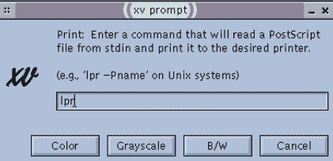

- **电子邮件问题**：与打印一样，如果按照第 5 章描述的正确配置，电子邮件对所有用户都应该是正常工作的。如果你使用本地邮件队列并运行 SMTP 邮件服务器，情况尤其如此。如果每个用户都有 POP 或 IMAP 账户，你可能需要指示所有用户如何配置他们的邮件客户端来读取邮件。

- **程序错误**：几乎任何用户程序都可能崩溃、损坏数据或有异常行为。有时这将迫使你更换程序，或建议用户使用替代方案。尽管，你必须根据具体情况进行故障排除。

- **关机问题**：像 20 世纪 90 年代发布的操作系统一样，Linux 应该使用显式的关机命令。如第 6 章“管理文件和服务”所述，该命令是 `shutdown`，且通常可以由 root 执行。许多发行版在 GUI 登录界面包含关机选项，以便普通用户关闭系统。如果工作站用户应该这样做，必须告诉他们使用此选项，而不是直接按下电脑电源开关。不正常关机通常会导致启动过程缓慢，并可能导致文件系统损坏和数据丢失。如果你的用户经常看到此类症状，很可能是他们没有正确关机，或者关机过程存在问题。

## 诊断软件问题

有几类特定的软件问题值得专门讨论，因为它们比其他问题更常见、异常严重或特别难以诊断修复。某些问题非常具体，例如文件系统问题和备份恢复困难。另一些问题更通用，例如配置文件和服务器问题。

## 文件系统问题

Linux 通过一个或多个文件系统在硬盘上存储数据，文件系统本质上是让 Linux 记住给定文件位置的复杂数据结构。在某种意义上，文件系统类似于书的目录或索引；它将文件名关联磁盘上的特定位置，就像索引允许你找到书中的信息一样。然而，大多数文件系统是动态的，在处理数据的过程中有时会产生错误。Linux 提供了 `fsck` 程序来定位并可选地修复这些错误。

> 如果常规运行 fsck（例如由于挂载次数达到指定的最大次数而强制运行 fsck）时你开始定期看到错误，这可能是更严重问题的征兆，例如驱动程序错误、磁盘控制器或开始故障的磁盘。


# 诊断软件问题 621

一些文件系统问题可以通过重新挂载文件系统来修复。这在 DOS 和 Windows FAT 文件系统中尤为常见。由于 DOS 和 Windows 9x/Me 不支持 Linux 风格的所有权和权限，FAT 文件系统并不具备这些特性。因此，Linux 在挂载 FAT 文件系统时会模拟这些功能。默认情况下，Linux 将所有文件的所有权赋予给执行挂载命令的用户，并仅赋予所有者对该分区的写权限。如果你通过 `/etc/fstab` 手动挂载分区，这可能会导致问题，因为会导致分区所有权变为 root，而其他用户无法写入该分区。你可以通过在挂载时使用 `umask=value`、`uid=UID` 和 `gid=GID` 选项来解决这个问题，并将这些参数包含在 `/etc/fstab` 中以便在重启时自动使用；或者如果你需要立即移除它们，可以使用这些选项重新挂载。

如果你尝试卸载文件系统但收到“设备忙忙”（device is busy）的错误，这意味着某些进程在设备设备上打开了文件。如果该计算机有多个用户，可能很难看出是哪个进程。在这种情况下，工具 `lsof` 可能非常有帮助，它能列出所有打开的文件。你可以将 `lsof` 的输出通过 `grep` 搜索挂载点目录的名称。例如，以下命令可以定位 `/mnt/floppy` 上的文件：

```bash


`$ lsof | grep "/mnt/floppy*"`

`less 27343 rodsmith 8r REG 2,0 2215 174253 /mnt/floppy/readme.txt`

第一列列出命令（在此例中为 `less`），第二列列出 ID（PID），第三列显示用户名，后续列列出额外信息，最后一列显示文件的名称（在此例中为 `/mnt/floppy/readme.txt`）。一旦你定位了阻止你卸载文件系统的进程，你可能可以手动关闭它们或关闭目标目录中任何打开的文件。在最坏的情况下，你可以使用 `kill` 终止这些进程，但这可能会给正在使用这些程序的人带来麻烦。

Shell 经常会阻止你卸载文件系统。如果你使用 `cd` 移动到了已挂载的文件系统，你将无法卸载它。与其退出 Shell，不如使用 `cd` 移动到另一个目录。

# 配置文件问题

Linux 中的许多问题可以追溯到配置文件中的条目。这些文件控制 Linux 系统行为的许多方面，因为错误或非优化的设置可能会导致严重或轻微、显性或微妙的问题。潜在问题的数量与配置文件的数量一样多——某些文件控制 Linux 系统运行的多个方面。第 6 章概括性地涵盖了 Linux 的许多配置文件，其他章节则更详细地涵盖了其中一些。最常引起问题的文件包括：

- `/etc/lilo.conf`：与配置文件不同，它不会在每次系统启动时被读取；相反，它控制 init1 单元的运行，该单元如第 3 章“软件管理”所述写入 Linux 的 LILO 引导程序。LILO 问题会在启动时出现，正如本章后部分“处理 LILO 启动错误”所讨论。

- `/etc/init.ab`：此文件控制计算机的初始启动。与此文件相关最常见的问题是系统无法启动 X，或者在你不想启动时它启动了。其他问题可能包括文本模式或远程登录的困难，以及与内核无关的严重系统启动失败。第 6 章详细讨论了此文件。

- `/etc/modules.conf`：此文件控制内核模块的自动加载。如果不手动加载适当的内核模块，你就无法使用硬件设备，可以通过此文件来解决问题。第 6 章讨论了此文件的格式。

- `/etc/fstab`：Linux 根据此文件中的规范自动挂载分区。你也可以通过编辑此文件来配置文件系统的挂载。因此，如果某个分区没有正确挂载，编辑此文件可能会修复问题。第 6 章和第 7 章讨论了 `/etc/fstab` 及其选项。

- `/etc/password`：此文件存储用户账户信息。（在大多数 Linux 系统上，辅助文件 `/etc/shadow` 存储密码）。你可以通过编辑这些文件来修复许多用户账户问题，但文本模式和 GUI 工具为这些文件提供了更易用且不易出错的界面。第 4 章详细讨论了这些问题。

- `/etc/hosts`：翻译 IP 地址和主机名有多种方法，其中一种是通过此文件中的条目。通常情况下，此文件的内容大部分都无关，但在少数情况下，如果 IP 地址和主机名没有正确映射，系统的启动过程甚至某些程序的启动可能会被延迟。解决方案是在此文件中为 localhost（IP 地址为 127.0.0.1）和你的网络主机名（及其关联 IP 地址）创建条目。行开头放置 IP 地址，主机主机名。

- `/etc/printcap`：在使用 BSD 或 LPR 打印系统的发行版中（2001 年的大多数 Linux 发行版），`/etc/printcap` 控制打印机定义。如果某些不起，这是要检查的地方。第 8 章涵盖了这些问题。

- `/etc/X11/xinitrc`：此文件（有时位于 `/etc/X11`）在 X86 未启动时控制它。也可能是服务器本身实现了限制，因此你应该检查服务器的配置。第 5 章涵盖了这些问题。

- `/etc/crontab`：`cron` 工具（第 7 章讨论）使用多个配置文件，例如 `/var/spool/cron`。

# 服务器软件问题

网络服务器很难调试，因为它们是非交互式的——你无法点击选项并看到错误消息。在大多数情况下，通过检查系统日志可以了解许多服务器问题，如前所述。当问题发生时，你可以使用 `tail` 命令查看日志文件的最后几行。例如，如果服务器没有响应，你可以从另一台机器连接服务器，然后输入 `tail /var/messages` 查看服务器记录了任何消息。（某些服务器可能需要使用不同的日志文件。）常见的服务器问题包括：

- 启动失败：可能无法启动。这个问题可能是由于 `/etc/inetd.conf` 或 `/etc/xinetd/` 中错误的服务器配置引起的，或者是由于错误的 SysV 启动配置。启动器的通常问题是给定的脚本名称导致服务器停止而非启动。这两个问题在第 6 章中有更详细的讨论。

- 无响应：有时服务器正在运行但对查询没有响应。这可能是因为防火墙、TCP Wrappers、`xinetd` 配置或其他访问控制机制阻止了请求。也可能是服务器本身实现了限制，因此你应该检查服务器的配置文件。第 5 章涵盖了所有这些问题。

- 响应缓慢：有时服务器会响应，但速度很慢。如果你收到投诉，应首先尝试追踪哪些客户端遇到了响应缓慢的情况；例如，问题可能是由于路由器缓慢或互联网骨干网络过载引起的。也可能是服务器的网络连接、CPU、内存或硬盘无法胜任任务。最后，某些服务器在某些任务上故意变慢。例如，某些邮件服务器在输入无效的目标地址时会暂停几秒钟；这是一种减缓那些试图测试系统以将其作为开放中继的垃圾邮件发送者的方法。

诊断软件问题 625

意外的响应：如果服务器没有生成你预期的回复，这通常表明服务器配置不正确。例如，你可能无法对 FTP 服务器进行匿名登录，此时你可以检查 FTP 服务器的配置文件。如果你在 Web 服务器上没有看到预期的 Web 页面，其原因可能在配置文件中，或者你可能将 Web 页面放在了错误的位置。

服务器崩溃：服务器程序可能会响应，但随后崩溃或断开用户连接。这种问题在许多服务器中相当罕见，但确实会发生，特别是在一些不常见的服务器中。这可能是由于 Bug、错误的配置甚至是硬件故障导致的。

根结底，排除服务器故障与排除普通应用程序故障相似，不同之处你大多数错误信息会在服务器的日志文件中，而不是显示在屏幕上。

## 备份与恢复问题

如第 7 章所述，备份计算机对于系统的安全是一项重要任务。如果没有备份，一旦发生以下几种情况之一，你可能会丢失数据，或者至少经历昂贵的停机。这些情况包括系统被入侵、硬件被盗、硬件故障甚至是人为失误。遗憾的是，备份本身也无法避免某些问题的影响。你应该对这些问题做好准备，或者至少熟悉一些解决方案。

发现备份程序出现问题的糟糕时机，是在你在时间紧的紧急情况下需要备份时。因此，你应该在紧急情况发生之前尽可能地测试你的备份和应急恢复程序。

由于大多数 Linux 备份系统使用磁带，本节重点介绍磁带备份程序。这些问题和解决方案某些适用于其他媒介（如 CD-R 或 CD-RW 设备），但其他并非如此。磁介质的缺陷之一是它们会随时间的推移而退化，特别是频繁使用的情况下。因此，你应该在磁带使用约 100 次后更换，或者在发现它们可能变得不可靠的第一迹象更换，例如在备份程序的验证阶段出现无法解释的失败。

在备份系统时会出现某些备份和恢复错误——例如，你可能无法访问带驱动。其他问题发生在恢复期间，例如恢复数据时的错误。这两类问题中最常见的问题包括：

- **驱动程序问题**：备份硬件与其他所有硬件一样需要驱动程序支持。大多数 IDE/SATA/SCSI 磁带设备都需要底层控制器或主机适配器的支持以及对磁带设备的支持。如果这些驱动程序被编译为模块，则在执行备份时必须加载它们。如果驱动程序不存在，你将无法访问磁带设备。
- **磁带访问错误**：如第 7 章所述，类似 `/dev/st0` 和 `/dev/rnst0` 的 Linux 设备文件提供了对磁带驱动器的访问。你应该能够以执行备份的用户身份读写访问这些设备。该用户是 root，因此访问不应该是问题。如果你在尝试访问磁带设备时没有设备错误，你可能输入了错误的设备文件名，或者你的驱动程序可能加载。
- **文件访问错误**：为了备份计算机，运行备份的用户必须对所有文件具有完全访问权限。因此，你通常以 root 运行备份。（非 root 用户可以备份大多数系统文件，但可能无法备份其他用户的文件，更无法备份像 `/etc/shadow` 这样保护的文件。如果你只想备份自己的用户文件，可以使用普通账户，但该账户必须对磁带设备文件具有完全读/写权限。恢复文件需要对所有影响目录具有完全/写权限——再次，root 是执行此任务的首选。）
- **媒介错误**：在许多方面，备份的最噩梦就是磁带出现错误。问题甚至可能在验证成功后发生，特别是如果磁带已存储了一段时间。为了降低这种问题的风险，你应该将磁带存储在室温下（例如，不要将它们放在热汽车里）。为同一台计算机至少保留两份备份。如第 7 章所述，不要在 `tar` 中配合使用 `gzip` 或 `bzip2` 压缩，因为一旦发生错误，这些压缩会导致错误之后的所有备份变得无效。大多数磁带驱动器都包含压缩功能，不受此类问题影响；使用这些功能或未压缩的备份，单个错误可能只损坏几个文件（可能只有一个）。
- **未找到文件**：在命令行使用 `tar` 或类似工具时，经常会出现无法恢复特定文件的情况。当使用 `-P` (`--绝对路径`) 参数进行覆盖时，`tar` 存储文件时不带 `/.`。因此，在恢复特定文件或目录时，你不应包含 `/.`（这意味着当你在执行恢复时，应该切换到根目录。）如果你不知道文件的确切名称，可以使用 `tar -t` (`--list`) 命令来恢复它，但这可能需要一些时间。更高级的备份软件包包含了磁带上文件的索引，如果你需要恢复某些文件，可以通过点击式方法选择这些文件，这有助于减少你因拼错文件名而搜索整个备份却找不到文件的概率。

为了解决恢复时机的问题，验证备份至关重要。这通常可以使用备份时的验证选项完成，该选项会在备份后立即自动执行检查。（这可能会对在备份和验证通过之间最近更改的文件返回错误。）许多磁带驱动器包含一个独立的读头，在写入数据后立即验证数据。此功能可以节省时间，但偶尔对每个驱动器运行一次验证通过仍然是明智的，以防它们在到达驱动器时已损坏。在恢复后，你可以通过 `rpm -V` 验证 RPM 包相对于任何汇总信息。）

## 诊断网络问题

Linux 系统通常在网络上运行，网络问题涉及本地系统之外的问题。网络线缆、与其他系统的交互、路由器问题等都会发生。遗憾的是，并不总是容易判断问题是与本地配置有关还是其他原因。即使问题只发生在你的 Linux 系统上，原因也可能在别处。例如，服务器可能存在仅影响客户端的 Bug。你的解决任务从检查配置开始；之后，可以使用高级诊断工具定位问题。

### 检查你的网络配置

许多网络问题是由配置错误引起的。因此，在开始排除故障之前最好检查你的设置。某些命令和程序对于验证你的设置是否正确非常有帮助。如果你使用静态数字向网络管理员配置 IP 地址，你也应该双击检查数字是否正确；如果你写错了，或者管理员给了你错误的数字，那么很有可能是你的网络配置将无法工作。

如果你使用 DHCP 配置网络设置，你应该做什么来验证 DHCP 是否运行正常？尝试使用 `ps` 验证 `dhcpcd`、`dhcpclient` 或 `pump` 进程的存在，取决于你的发行版。例如，你可以输入以下命令：

```
$ ps | grep dhc

340 ? S 0:00 /sbin/dhcpcd eth0
```

此输出确认了 `dhcpcd` 正在运行并绑定到 `eth0`。DHCP 客户端通过日志文件或查询系统信息提供调试信息。例如，`pump` 有一个 `-s` 选项可以提供租约信息——`pump -s` 返回 IP 地址、网络 DHCP 服务器等。你可能无法确认这些值是否有效，但该命令至少让你知道它们已被分配给计算机，并且正因此 DHCP 客户端以最小程度工作了——或者没有。）

无论你是使用静态 IP 地址还是像 DHCP 或 PPP 的动态系统，都可以使用 `ifconfig` 验证基础接口的功能，如第 5 章所述。例如，输入 `ifconfig eth0` 会返回关于的

`eth0`（第一个以以太网）接口。检查 IP 地址和子网掩码是否正确，或者如果它们是通过 DHCP 或 PPP 分配的，至少确保它们已经存在。

如果你的计算机可以与本地系统通信，但无法与其他网络通信，可能是你指定了错误的网关（即路由器）地址。你可以通过 `route` 命令检查此细节，如下：

```
# $ route -n

# 内内核 IP 路由表

| Destination | Gateway | Genmask | Flags | Metric | Ref | Iface |
| :--- | :--- | :--- | :--- | :--- | :--- | :--- |
| 10.19.1.0 | 0.0.0.0 | 255.255.255.0 | | 0 | 0 | eth0 |
| 127.0.0.0 | 0.0.0.0 | 255.0.0 | U | 0 | 0 | lo |
| 0.0.0.0 | 10.19.1.1 | 0.0.0.0 | UG | 0 | 0 | eth0 |
```

最后这一行的目标为 0.0.0.0（如果你在 `route` 命令中省略了 `-n` 选项，则称为默认），它显示了网关系统——在本例中为 10.19.1.1。将其与预期值进行核实。你可能还想检查是否有多余的路由。只有一个网卡的系统可能会列出三条路由：一个用于本地网络（如上例中的 10.19.1.0 路由），一个用于本地回环（127.0.0.0），以及一个默认路由。具有多个网卡且没有 Internet 连接（仅有本地网络连接）的系统可能有两条，且没有默认路由。在少数情况下，只有一个网卡的系统可能会有三条以上的路由，但这种配置非常罕见。

如果你可以通过 IP 地址访问计算机，但无法通过名称访问，很可能是你的名称服务器配置出了问题。检查 `/etc/resolv.conf`。它应该包含一行或多行如下内容：

```
nameserver 10.19.1.1
```

这些行中的每一行都应该包含 DNS 服务器的名称，由你的网络管理员或动态 IP 地址系统（DHCP 或 PPP）提供。核实这些地址是否正确，如果不正确，请适当编辑该文件。如果列出了任何多余地址，将其将其。`/etc/resolv.conf` 可能包含最多三行 nameserver。

DNS 服务器与其他服务器一样，偶尔会出现问题。因此，DNS 问题可能是由于你无法控制的网络问题导致的。如果你认为情况如此，请联系负责 DNS 服务器的管理员报告该问题。

## 定位问题源

除了 DHCP 客户端的 `ifconfig`、`route` 和诊断功能外，还要使用几种网络诊断工具。其中最基础的是 `ping`，它在第 5 章的“网络诊断工具”中有所描述。该工具测试你的计算机与指定的另一台计算机之间的基本连通性。如果你可以 ping 通另一台计算机，很可能你也可以使用其他协议访问它。

务必同时使用 IP 地址和主机名测试连通性。如果前者有效而后者无效，你的系统可能存在前面描述的 DNS 问题，或者你网络的 DNS 服务器可能没有正常工作。

当你调试基础连通性问题时，尝试 ping 几个系统：

- ping本地回环 (127.0.0.1) 可以验证最基础的 Linux 网络工具正在运行。因为此地址对应于 Linux 本身且不与任何特定的网络硬件关联，它应该始终可用。

- 你应该能够 ping 通你网络接口硬件上的 IP 地址。（如果你不知道该地址，请使用 `ifconfig` 获取。）如果此测试失败，可能表明存在硬件故障、驱动程序问题或 IP 地址配置失败。

- ping 本地网络上的其他计算机可以测试其中一些低层网络硬件（如连接到网络插器的线缆）；你的网络布线；以及本地网络上的任何集线器、交换机和类似设备。

- 如果你的网络连接到 Internet，你应该能够 ping 通 Internet 上的系统。这测试了你的路由器以及 Internet 上其他设备的正常功能。

某些计算机被配置为忽略 ping。因此，你可能 ping 通某些计算机但不能 ping 通另一些。

如果你可以 ping 通某些主机但不能通其他，可以使用 `traceroute` 来定位问题。该命令向你与目标地之间的每个路由器发送三个数据包，并记录接收响应所需的时间。这与 ping 的作用的作用非常相似，区别在于 `traceroute` 对你和你目标之间的每个系统都执行此操作。结果是，你应该能够发现故障的源头，因为它没有返回所有三个数据包，或者因为它显示往返时间大幅增加。例如，这里是运行 `traceroute` 的结果：

```
traceroute -n 128.197.153.100
```


`traceroute` 到 `128.197.153.100` (`128.197.153.100`), 30 跳/最大, 40 字节数据包

| Hop | Time 1 | Time 2 | Time 3 |
| :--- | :--- | :--- | :--- |
| 1 | 66.926 ms | 21.187 ms | 21.187 ms |
| 2 | 66.926 ms | 21.187 ms | 21.187 ms |
| 3 | 66.926 ms | 21.187 ms | 21.187 ms |
| 4 | 66.926 ms | 21.187 ms | 21.187 ms |
| 5 | 66.926 ms | 21.187 ms | 21.187 ms |
| 6 | 66.926 ms | 21.187 ms | 21.187 ms |
| 7 | 66.926 ms | 21.187 ms | 21.187 ms |
| 8 | 66.926 ms | 21.187 ms | 21.187 ms |
| 9 | 66.926 ms | 21.187 ms | 21.187 ms |
| 10 | 66.926 ms | 21.187 ms | 21.187 ms |
| 11 | 66.926 ms | 21.187 ms | 21.187 ms |
| 12 | 66.926 ms | 21.187 ms | 21.187 ms |
| 13 | 66.926 ms | 21.187 ms | 21.187 ms |
| 14 | 66.926 ms | 21.187 ms | 21.187 ms |
| 15 | 66.926 ms | 21.187 ms | 21.187 ms |
| 16 | 66.926 ms | 21.187 ms | 21.187 ms |
| 17 | 66.926 ms | 21.187 ms | 21.187 ms |
| 18 | 66.926 ms | 21.187 ms | 21.187 ms |
| 19 | 66.926 ms | 21.187 ms | 21.187 ms |
| 20 | 66.926 ms | 21.187 ms | 21.187 ms |
| 21 | 66.926 ms | 21.187 ms | 21.187 ms |
| 22 | 66.926 ms | 21.187 ms | 21.187 ms |
| 23 | 66.926 ms | 21.187 ms | 21.187 ms |
| 24 | 66.926 ms | 21.187 ms | 21.187 ms |
| 25 | 66.926 ms | 21.187 ms | 21.187 ms |
| 26 | 66.926 ms | 21.187 ms | 21.187 ms |
| 27 | 66.926 ms | 21.187 ms | 21.187 ms |
| 28 | 66.926 ms | 21.187 ms | 21.187 ms |
| 29 | 66.926 ms | 21.187 ms | 21.187 ms |
| 30 | 66.926 ms | 21.187 ms | 21.187 ms |

## 处理 LILO 错误

`LILO` 是 Linux 的引导程序（Loader）。`LILO` 是接管 `BIOS`、将 Linux 内核加载到内存并将控制权交给内核的引导加载程序。不幸的是，这听起来要困难得多。`BIOS` 在设计时硬盘还很大，随着技术的演进，`BIOS` 也是如此。`LILO` 的错误也非常令人沮丧，因为这意味着系统无法启动。理解如何绕过它们可以帮助将错误信息转化为启动系统。在继续本节之前，你应该回顾第 3 章的“配置引导”。

### LILO 启动错误代码

当 `LILO` 无法启动系统时，它会显示错误代码。不幸的是，这些代码非常晦涩。表 9.1 总结了 `LILO` 错误代码，以便你可以解析它们并有机会解决根源问题。

| 错误代码 | 含义 | 可能的解决方案 |
| :--- | :--- | :--- |
| (none) | `LILO` 未加载。 | `LILO` 可能未安装，或者安装在了错误的位置。检查 `/etc/lilo.conf` 中的 `boot` 行，根据需要进行调整，并设置 `init` 以重新安装 `LILO`。使用 Linux 磁盘分区来实现。 |
| error-code | `LILO` 的主部分已启动，但它找不到第二阶段引导程序 `/boot/boot`。 | 错误代码是 `BIOS` 提供的两位代码。这些代码在 `LILO` 文档中有详细说明。大多数指示硬件故障，例如坏硬盘。有些指示磁盘几何问题，即 `BIOS` 和 `LILO` 对处理磁盘地址的方式不一致。此类问题可以通过更改 `BIOS` 中的几何选项或在 `/etc/lilo.conf` 中添加删除选项来解决。 |
| LI | `LILO` 的主部分已启动并加载了第二阶段引导程序 `/boot/b`，但该第二阶段加载程序无法运行。 | 与 `LI` 错误代码情况一样，这些问题通常指示几何不匹配，可能需要你调整 `BIOS` 或 `/etc/lilo.conf` 中的几何设置。 |
| LI101... | `LILO` 已启动，但它找不到你的内核镜像。 | 此问题通常是因为安装新内核覆盖了旧内核且没有重新运行 `lilo` 导致的。 |

# 634 第 9 章 • 故障排除

表 9.1 `LILO` 错误代码、含义及可能的解决方案（续）

| 错误代码 | 含义 | 可能的解决方案 |
| --- | --- | --- |
| LIL | 第二阶段加载器 `/boot/boot.b` 已加载并运行，但它无法读取工作所需的信息。 | 此问题通常由硬件故障或磁盘几何结构不匹配引起。如果是后者，你可能可以通过调整 `BIOS` 磁盘几何结构或通过在 `/etc/lilo.conf` 中设置或删除选项来修复它。 |
| LIL? | 第二阶段引导加载器 `/boot/boot.b` 被加载到了错误的地址。 | 此问题可能是由于重新运行 `lilo` 移动了 `/boot/boot.b` 或磁盘几何结构不匹配引起的。 |
| LIL- | 磁盘描述符表 `/boot/map` 损坏。 | 此问题可能是由于在未重新运行 `lilo` 的情况下移动了 `/boot/map` 或磁盘几何结构匹配引起的。 |
| LILO | 程序已正确加载并运行。 | 如果 Linux 在此点无法启动，问题极可能出在内核、驱动程序或系统配置文件上。 |

> 这些问题中的几个都涉及到 `LILO` 无法读取已更改或移动的文件。关于 `LILO` 需要记住的一个关键点是：它不会自动从更改的配置文件恢复数据；在进行任何更改后，你必须输入 `LILO`，这些更改才能生效。在此背景下，“更改”既包括对配置文件的编辑，也包括移动或替换文件（如内核文件）。如果你没有这样做并因此遇到问题，请按照后文描述的通过其他方式启动 Linux，然后输入 `LILO` 来纠正问题。

Copyright ©2001 SYBEX, Inc., Alameda, CA www.syex.com

## 非 LILO 启动技术

### 现实世界场景

### 修复磁盘几何问题的激进手术

处理磁盘上的数据有多种不同的方法。两种流行的方法是逻辑块寻址（`LBA`）模式和柱//头/扇区（`CHS`）模式。前者使用单个数字指定磁盘地址，后者使用三个数字。`x86 BIOS` 和 `EIDE` 驱动器传统上使用 `CHS` 模式，尽管新的 `BIOS` 扩展和 `SCSI` 驱动器使用 `LBA` 模式。在两者以及不同类型的 `CHS` 寻址之间进行转换会导致 `x86` 系统上出现许多问题。

当磁盘从一台计算机移动到另一台计算机时，经常发现旧计算机分配了 `CHS` 几何结构，而新计算机想要使用不同的几何结构。结果可能导致无法使用 `LILO` 启动，有时会导致数据丢失。在这种情况下，最佳解决方案通常涉及备份数据、擦除磁盘分区表和引导区，并从头开始。为了做到，你可以使用 `dd` 用零填充磁盘的引导区：

```bash
# dd if=/dev/zero of=/dev/hda bs=512 count=1
```


当然，你应该将`/dev/sda`替换为正确的设备标识符。此过程将擦除磁盘上的所有分区！如果在将磁盘从一台计算机移动到另一台计算机时不需要保留数据，那么常规执行此程序并不是一个坏主意。

# 非 LILO 启动技术

如果 LILO 失败，你可能需要其他方法启动计算机。一种方案可能是使用独立的紧急磁盘集，如“从紧急启动系统修复 LILO”和“使用紧急磁盘集”中所的。在许多情况下，更简单的解决方案是使用替代方法启动你的系统。这些选项包括：

- `LOADLIN` 这是一个启动 Linux 的 DOS 程序。`LOADLIN`随大多数 Linux 发行版一起，通常位于安装 CD-ROM 上名为`dosutils`的目录中。要使用`LOADLIN`，你需要一个 DOS 引导软盘或分区、一份`LOADLIN.EXE`拷贝以及一份你的 Linux 内核拷贝。启动 DOS 并输入 `LOADLIN VMLINUZ root=/dev/rootdevice ro`，其中`VMLINUZ`是内核名称，`/dev/rootdevice`是你的根分区名称（例如`/dev/hda3`或`/dev/sda7`）。

- 软盘上的原始内核 如果直接写入软盘，一个原始 Linux 内核能够通过命令 `dd if=vmlinuz of=/dev/fd0` 将拷贝写入软盘，其中`vmlinuz`是内核文件名。要进行启动，将软盘插入配置为从软盘启动的系统中并开启。然而，为了这项工作，内核需要配置有关你根分区位置的信息。如果你构建自己的内核，这会自动发生；但如果没有，你需要执行命令 `mdev /dev/fd0 /dev/rootdevice`，其中`/dev/rootdevice`是你的根分区。持有原始内核的磁盘没有文件系统，因此在 DOS 或 Windows 中显示为未格式化，且无法在 Linux 中挂载。

- 软盘上的 LILO 你可以将 LILO 安装到软盘上。这将比从软盘使用`LOADLIN`或使用软盘上的原始内核更快，因为内核仍然留在计算机上。然而，这种方法无法解决由内核故障或`/boot/`其他部分引起的问题。要在软盘上安装 LILO，请编辑`/etc/lilo.conf`，使引导行读取为 `boot=/dev/fd0`；然后输入 `lilo`。（如果你需要，你将需要将其改回来。）

作为一般规则，`LOADLIN`是这些技术中最灵活的，因为你可以使用来自 CD-ROM 的内核。软盘上的原始内核是一种方便的工具，因为你需要时可以使用它。软盘上使用 LILO 实际上是不实用的，但在某些情况下是有用的。有些人更倾向于这种方法而不是基于磁盘的 LILO。

# 从紧急启动系统修复 LILO

如果你有紧急磁盘集（如后文所述），你可能需要在磁盘上恢复 LILO。一种可能的方法是使用磁盘的内核启动。然而，更直接的方法是使用紧急系统的 LILO 拷贝来完成工作。为了做到这一点，你必须以某些方式配置`/etc/lilo.conf`：

- 你必须将根磁盘（`/`）分区挂载到紧急系统的某处——例如`/mnt/std`。如果你的`/boot`目录位于单独的分区，你还需要挂载它。
- 你必须调整所有对`/boot`或文件的引用，使其指向恢复分区。例如，将`/boot/vmlinuz`改为`/mnt/std/boot/vmlinuz`。
- 像通常一样配置内核映像和其他启动选项。例如，引导和根选项应该指向你的磁盘或分区。

如果运气好，当你输入`LILO`时，引导加载器将正常安装。但并不保证。如果你的紧急系统使用的 LILO 版本与你在常规系统上安装的不同，版本不可能会导致 LILO 安装失败。在这种情况下，很容易使用`LOADLIN`等方法启动并使用常规系统工具重新安装 LILO。

# 使用紧急磁盘集

有时需要对由于 LILO 问题以外的原因无法启动的计算机进行恢复操作。例如，映射分区到文件系统的`/etc/fstab`文件可能损坏，或者启动脚本可能会在计算机完成启动之前锁定或关闭系统。当你的硬盘发生故障，你需要更换它并从备份恢复系统时，你也需要这样做。在这些情况下，你需要在不使用主分区的情况下启动 Linux 系统。这就是紧急磁盘的作用。此类磁盘有多种形式，从单软盘发行版到完整的 Linux。

救援程序安装在高容量可移动磁盘或 CD-ROM 上。了解如何定位或创建此类磁盘是一项至关重要的故障排除技能，而在需要使用此类磁盘时，了解这些磁盘上有哪些工具是非常重要的。

## 查找现成的应急磁盘

有多个来源可以获取现成的 Linux 应急磁盘。这些可以从互联网下载，并且使用时很少或不需要配置。示例包括：

- 你的发行版安装媒体 大多数发行版都包含某种类型的应急磁盘。这些磁盘有时在启动安装程序时会被访问。例如，在 Red Hat Linux 中，你在安装程序的提示符处输入 `linux rescue`。某些发行版包含了用于此目的的启动盘；详情请参阅你的文档。
- **Tom's Root/Boot Disk** 该发行版的官方名称。
- **muLinux** 这是另一个单软盘发行版，概念与 Tom’s Root/Boot Disk 类似。你可以在其网站 `http://mulinux.nevalabs.org` 了解更多信息。
- **ZipSlack** Slack (`http://www.slack.com`) 生成了一个发行版版本，安装大小略小于 100MB，并且可以来自 FAT 分区。该发行版可以放入小型 DOS 分区或像 Zip 或 LS-120 磁盘这样的可移动磁盘上。它比单软盘发行版更完整，并且可以使用自定义备份工具、自定义内核驱动等进行轻松定制。
- **Demo Linux** Demo Linux, `http://www.demolinux.org` 是一个基于 CD-ROM 的完整发行版。要使用它，你需要从一个 650MB 的文件创建一个 CD-R（此操作说明在 Demo Linux 网站上），因此你应该拥有快速的网络连接或足够的耐心。Demo Linux 异常地完整；你可以在大多数视频硬件上运行 X。

SuSE Evaluation (`http://www.suse.com`) 提供其操作系统的评估版本。SuSE 评估 CD-ROM 在许多方面与 Demo Linux 相似，例如其大小和对 GUI 操作的支持。

这是一个微型 Linux 发行版的示例；你可以在 `http://www.linux.org/dist/english.html` 找到更多；此页面的后半部分列出了许多特殊发行版。Tom's Root/Boot disk 页面还提供了某些其他微发行版的链接。

## 创建自定义应急磁盘

很有可能某个标准的应急磁盘会适合你的需求。如果不是，你可以创建一个自定义磁盘。此任务取决于你如何处理它。通常最简单的方法是修改现有的磁盘。`ZipSlack`特别适合这种工作，因为它非常像普通的 Linux 发行版（尽管缺少了 Xi 这样的便利工具）。你可以复制它的内核（或为普通发行版编译一个内核）、以及你需要的所有工具等。在 100MB 的 Zip 磁盘上，`ZipSlack`留有少量空间用于添加内容，但如果你不需要某些程序，可以剔除掉它们。如果你有一个更大的磁盘用于运行程序，例如 250MB 的 Zip 磁盘，那么你就有更大的自由来扩展分区。

如果你修改了像 Tom's Root/Boot Disk 这样的磁盘发行版，你需要非常小心地操作。这些发行版通常使用对空间进行了非常精细优化的大文件，替换它们或添加更多程序可能会超过磁盘上的可用空间。基于 CD 的应急系统由于其只读属性，不容易被修改；如果你在普通发行版中需要这样的系统，可以将其复制到硬盘上，进行自定义，然后根据你的更改刻录新的 CD-R。

虽然创建自定义应急磁盘需要额外的努力，但有时是必要的。当你的系统具有需要特殊驱动程序的异常硬件，或者使用了常用磁盘不支持的文件系统、网络功能或其他配置时，通常最可能出现这种情况。

## 应急恢复工具

无论你使用什么种类型的恢复磁盘，它都应该包含某些工具。在大多数情况下，这些是标准的 Linux 程序；但在某些情况下可能需要更奇特的工具。任何应急恢复磁盘上应该拥有的程序示例包括：

- 驱动程序 你需要任何打算支持的硬件和文件系统的驱动程序。对于单软盘发行版来说这可能是一个挑战，因为它们消耗宝贵的磁盘空间，而且不同的计算机并不相同。如果你使用了特殊的 SCSI 适配器和 SCSI 硬盘或其他异常的关键硬件，这个问题会尤为突出。
- 文本编辑器 大多数应急系统至少包含 Vi（在第7章中讨论）。它较小的体积使其成为良好的选择。较大的系统通常包含其他编辑器。
- 磁盘工具 你的应急系统应该包含用于准备磁盘以支持 Linux 系统的工具，如 `disk` 和 `mkfs`。`fsck`可以修复损坏的文件系统（但不能修复故障硬件）。如果你使用异常的文件系统，请确保你拥有必要的支持工具。
- 备份软件 大多数应急系统至少包含 `tar`，以及 `restore`（`dump`的伴侣）、`cpio`以及可能的其他工具。如果你使用商业备份软件，你需要将其添加到你的应急系统中。（如果软件无法放入你的应急系统主磁盘上，你可能可以将其存储在单独的软盘上。）
- 网络软件 如果你打算访问网络（例如，为了通过网络恢复数据），你需要网络包。某些恢复方法需要网络功能。例如，如果你正在使用 NFS，你必须包含对它的支持。这在 Zip 驱动器上可行，但当然，未来会得到修复。

## 停止、启动或重启进程

有时程序会运行异常。在这些情况下，你可能需要杀死进程或重启它。程序有时还会崩溃，在这种情况下你可能需要重新启动它。这些问题已经在其他地方讨论过，例如第7章，但在管理进程时有一些特殊的故障排除考虑因素。

## 何时停止、启动或重启进程

如第7章所述，停止进程的一个常见原因是进程挂起了——即它对它的正常输入没有响应。挂起的进程无所事事，并且会浪费时间。在杀死进程之前，你应该尝试确定进程是否真的挂起。某些程序在处理数据时会暂时无响应。你必须熟悉你程序的正常模式才能判断进程是否真的挂起。

642 第 9 章 • 故障排除

可以通过第 7 章所述的通过 `kill -11` 发送此信号，从而在更改服务器配置而不短暂中断其服务。某些服务器的 SysV 启动文件包含重启选项，可以自动停止服务器并重新启动。查阅程序文档以了解它支持的选项，或检查 SysV 启动脚本以了解其功能。

## 解决周期出现的问题

如果你发现经常需要启动或重启进程，因为它们挂起或崩溃，那么该程序很可能有 Bug。联系程序的维护者，查看是否有程序的更新版本。另一种可能是 CPU、主板和内存存在细微问题，以及某些其他组件存在不那么细微的问题，这些问题有时会以特定程序定期崩溃的形式出现。这些崩溃有时会伴随着内核错误（kernel oops）。有时这些或其他错误可能会导致计算机完全崩溃。

如果你无法用更新后的版本替换有 Bug 的程序，你可能需要采取通融方案。一种可能性是使用另一个功能类似的程序来替换它。如果该程序真的是独一无二的（例如它执行某些冷门任务），你可能会尝试自己修复它。描述如何这样做已超出了本书的范围；然而，请参考 Linux 编程书籍以获取更多信息。除了替换程序或修复其 Bug 之外，你可能可以通过改变使用它们的方式来解决问题。如果特定的数据文件格式不起作用，尝试使用另一种。如果一个必须一直运行的进程经常崩溃，而你似乎无法让它重新工作，可以创建一个 cron 任务（第 7 章），在它崩溃时重启它。你可以根据需要频繁运行此脚本以获得可的性能。如果该程序是一个服务器，你可以从 `inetd` 或 `xinetd` 启动它，而不是使用 SysV 启动脚本。

## 现实场景

### 解决有 Bug 的路由器

网络硬件依赖于*地址解析协议 (ARP)* 在 TCP/IP 地址和网络硬件的介质访问控制 (MAC) 地址之间进行转换。为了实现这一点，本地网段上的所有计算机都维护着 ARP 解决方案缓存。如果设备需要联系一台名称不在 ARP 缓存中的计算机，设备可以向网络发送查询以定位正确的 MAC 地址并创建此类条目。遗憾的是，这个过程偶尔会出错，特别是当某些类型的硬件位于必须通信的两台计算机之间时。具体来说，一台计算机（假设它是一个路由器）可能会丢失另一台计算机（假设是你的 Linux 机器）的 ARP 条目，当它需要向 Linux 机器发送数据时无法生成新的 ARP 条目，除非 Linux 系统最近有数据。结果是，入站网络流量可能无法到达 Linux 机器。

我在管理的仅有一台计算机的网络上遇到这个问题时，解决方案是创建一个 cron 任务，使用 `ping` 每隔十分钟向路由器发送一个数据包。这种解决方案在某种意义上并不美观，但非常有效，并改进了 cron 任务在解决某些类型问题上的实用性。

## 包依赖与冲突

第 3 章讨论了包安装。虽然这个过程通常进展得很顺利，但有时并不顺利。问题的常见来源与未满足的依赖关系或包与包之间的冲突。RPM 和 Debian 包管理系统旨在帮助你定位并解决这些问题，但在某些情况下（特别是当混合来自不同供应商的包时），它们实际上会引起问题。在任何情况下，识别这些错误并知道如何解决它们都是价值的。

## 第 9 章 • 故障排除

虽然依赖和冲突问题经常以 RPM 或 Debian 包要求的形式进行讨论，但它们也出现在 tar 包中。然而，这些更原始的包缺乏自动检测这些问题的手段。

## 真实与模拟的包依赖问题

包依赖和冲突可能由于多种原因引起，包括以下方面：

- 缺少库或支持程序：常见的依赖问题之一是由于缺少支持包。例如，所有的 K 桌面环境 (KDE) 程序都依赖于 Qt，这是构建这些程序的一套小部件集。如果没有安装 Qt，你将无法使用 RPM 或 Debian 包安装任何 KDE 包。库——可以被许多不同程序使用的支持代码，就像它们是程序的一部分一样——在这一方面是常见的问题源。
- 不兼容的库或支持程序：即使库或支持程序存在于你的系统上，它也可能是错误的版本。例如，如果一个程序需要 Qt 2.2，那么存在 Qt 1.4 没多大用。幸运的是，Linux 库命名规范允许你安装库的多个版本，以防你有具有特定要求的程序。
- 重复文件或功能：当一个包包含已安装且属于另一个包的文件时，就会产生冲突。偶尔，广泛的功能可能会发生冲突，正如在 Web 服务器包中那样。功能冲突通常伴随着名称冲突。当当混合为不同发行版设计的包时，文件可能会以不同的方式跨包分布，冲突冲突。
- 名称不匹配：RPM 和 Debian 包管理系统为它们的包命名。这些名称在不同发行版之间并不总是匹配。因此，如果一个包通过名称检查另一个包，那么即使安装了相应的包，第一个包也可能在另一个发行版上安装，因为该目标包有不同的名称。当 1999 年和 2000 年 Red Hat 包安装在非 Red Hat 发行版上时，这是一个常见问题，因为 Red Hat  glibc 库的方式与他人不同。

这些问题中的某些是非常真实且严重的。例如，必须安装的。（有时，一个看似缺少的库并不像看起来那么复杂，详见‘强制安装’。）其他问题，如名称不匹配，是包管理系统的产物。遗憾的是，并不总是容易判断它属于哪种冲突。在使用包管理系统时，你可能可以使用包系统报告的错误信息，结合你对特定包的经验来做出判断。例如，如果 RPM 报告缺少一些你不熟悉的库，你可能需要找到至少一个包——除非你已经已经通过其他方式安装了这些库，这时你可能想要强制安装。

当安装 tariffs 时，你不会在安装期间收到任何错误消息；只有当你尝试运行程序或文件时才会看到问题，或者它们可能只是导致程序崩溃或发生异常行为。冲突在 tar 包中可能为隐蔽，因为你不会收到冲突警告，安装一个包可能会破坏现有的包，你可能可能一段时间后才会注意到损害。不过，你可以使用 `--keep-old-files` 参数防止 kefir 覆盖现有文件。

例如，如果依赖项是一个你通过自己编译源代码安装的包，那么你可以安全地忽略该依赖项。在使用 rpm 时，你可以通过 `--nodepes` 参数告诉程序忽略失败的依赖，因此：

```
# rpm -i apackage.rpm --nodepes
```

你可以使用 `--force` 参数强制安装以忽略其他某些错误，例如与现有软件包的冲突：

```
# rpm -i apackage.rpm --force
```


请不要理所当然地使用 `--force`。忽略依赖检查可能会给你带来麻烦，因此你只应该在需要时才使用这些选项。在发生冲突的情况下，你初第一次尝试在不使用 `--force` 安装时收到的错误信息将告诉你你将替换哪些软件包，因此请务必备份它们，或者准备好在出现问题时重新安装该软件包。

如果你正在使用 `dpkg`，可以使用 `--ignore-depend=package`、`--force-depends` 和 `--force-conflicts` 参数来解决基于 Debian 的系统中的依赖和冲突问题。由于基于 Debian 的系统之间在包名和需求的差异较小，这些选项在这些系统上通常不需要。

## 升级或替换被依赖的软件包

从官方来说，恢复软件包依赖问题的正确方法是安装、升级或替换被依赖的软件包。如果一个程序需要（例如）Qt 1.44 或更高版本，你应该将旧版本（如 1.40）升级到 1.44。要执行升级，你需要找到并安装适当的软件包。如果你想要的新包来自某个 Linux 发行版，这通常并不困难；适当的被依赖软件包应该会随同一个发行版一起提供。

这种方法的一个问题是，为不同发行版设计的软件包有时会有不同的需求。如果你在发行版 A 上运行，并安装一个为发行版 B 构建的包，该包将以发行版 B 的文件和版本表示依赖。相应的版本可能不会以适用于发行版 A 的形式存在，通过安装发行版 B 的版本，有时会导致与其他发行版 A 的软件包发生冲突。即使你有了升级后的软件包并运行了它，在将来安装某些其他程序或整体升级发行版时，你仍可能会遇到问题——升级安装程序可能识别发行版 B 的包，或者可能无法升级其自身的更新版本。

## 重新构建问题软件包

某些依赖源于编译该包的计算机上安装的库和其他支持工具，如果在一个具有不同软件包的系统上重新编译软件，依赖将会改变。因此，从源代码重新构建软件包可以克服至少某些依赖。

如果你使用基于 RPM 的系统，重新构建软件包的命令非常直观：你可以像下面这样使用源包名称调用 `rpm` 并使用 `--rebuild` 参数：

```
# rpm --rebuild packagename-version.src
```

当然，要执行此操作你必须拥有该软件包的 RPM。这通常可以从二进制 RPM 相同的位置获得。当你执行此命令时，`rpm` 会提取源代码并执行所有命令来构建一个新的软件包——或有时是多个新软件包。（一个源 RPM 可以构建多个二进制 RPM。）编译过程可能需要几秒钟到几小时不等，具体取决于软件包的大小和计算机的速度。结果应该是 `/usr/src/distname/RPM/arch` 中的一个或多个二进制 RPM，其中 `distname` 是你发行版的代码（例如对于 Red Hat 使用 RedHat 或 Fedora），`arch` 是你的 CPU 架构（例如 x86 使用 i1386 或 i1586，PowerPC 使用 ppc）。你可以将这些 RPM 移动到任何方便的位置并像其他一样安装它们。

> 注意：Debian 系统也提供源包，但除了致力于 Debian 及其发行版的网站外，Debian 源包很少见。拥有这些包的网站提供的形式通常易于在适当的 Debian 或相关系统上安装。由于这个原因，你从源代码重新构建 Debian 软件包的可能性较小。

# 第 9 章 · 故障排除

你也可以从源 tar 包重新编译软件包。这要求你阅读随源包一起的文档。细节在不同软件包之间有所不同，但你通常只需要运行六个或更少的命令来为你的系统配置编译脚本、编译软件并安装软件。你可能需要手动编辑某些配置文件。如果你对该过程有一定的经验，这种过程是最好的——但当然，每个做过这件事的人都是从一个包开始的，所以你可能想尝试尝试一下以获得经验。

无论你如何操作，从源代码重新编译比安装需要更多的软件。至少，你需要适用于该软件的任何编译器（通常是 GNU C 编译器 `GCC`）。特别是对于基于 X 的程序，你可能还需要你所用库的头文件。这些是编译程序以使用库时所需的特殊文件，它们可能没有安装在操作系统上。头文件的名称中经常包含 `dev` 字样，例如 `qt-dev` 或 `ncurses-dev`。你可以像安装其他任何包一样安装这些包。你安装的版本应该与关联库的版本匹配；如果不是这样，使用该库的程序可能无法正常编译，或者在编译后可能无法工作。

从源代码重新构建软件包（即使通过 RPM）并不总是奏效。部分原因之一是可能缺少必要的头文件包。同样，编译器或其他开发工具可能缺失或版本错误。有时，底层源代码依赖于你正在使用的库版本中不存在的功能。当这些问题发生时，你在准备或编译软件包时会看到错误信息。这些错误信息可能是晦涩的，或者你可能需要专门参考版本冲突或依赖项。在这种情况下，你可能需要使用其他方法来绕过依赖问题。

## 定位问题软件包的其他版本

修复依赖问题或软件包冲突的最简单方法是使用你想要安装的软件包的不同版本。这可以是较新或较旧的官方版本（是 4.2.3 而不是 4.4.7，或者可能是相同的官方版本但它是为你的发行版构建的而不是为其他发行版）。像 RPM Find (`http://www.rpmfind.net`) 或 Debian 的包列表 (`http://www.debian.org/distrib/packages`) 这样的对于跟踪软件包的替代版本非常有用。你自己的发行版的 Web 或 FTP 站点也是定位软件包的好地方。


如果你尝试安装的软件包需要你已有的较新库，那么旧版本可能有效。

定位软件包的其他版本的主要问题是，有时你需要的正是无法正确安装的那个。它可能包含你需要的特性，或者可能有重要的错误。有时，其他版本可能不可用，或者你无法在你偏好的包格式中定位另一个版本。（你可以使用第 3 章介绍的 `alien` 工具从另一种格式进行转换。）

## 启动脚本问题

在从另一个发行版尝试安装服务器时，特别常见的问题是让 SysV 启动脚本工作。尽管所有主要的 Linux 发行版都使用 SysV 启动脚本，但这些脚本并不总是可以在发行版之间传输。不同的发行版经常以独特的方式实现支持程序，因此这些脚本可能不兼容。结果是即使启动脚本链接正确（如第 6 章所述），你安装的服务器可能无法启动。该章的“启动脚本”部分包含了解决此问题的讨论。可能需要修改服务器自带的启动脚本、基于你发行版的另一个脚本构建新脚本，以及通过本地启动脚本（如 `/etc/rc.d/local` 或 `/etc/rc.d/boot.local`）启动服务器。

启动脚本问题只影响计算机启动时自动启动的服务器和其他程序；不会影响典型的用户应用程序或库。

## 使用常用的排排除命令

某些通用型命令和 shell 工具在排排除某些类型的问题时非常有用。这些命令也可以用于其他场景，而事实上上，它们通常并不被认为是纯粹的排排除工具。本节描述了其中一些命令，并将它们分为文件定位、文件检查和重定向工具。

### 文件定位命令

你使用文件定位命令在你的计算机上查找文件。最常见的情况下，这些命令帮助你通过名称查找文件，有时也通过其他标准（如修改日期）进行查找。这些命令可以搜索目录树（包括根目录，它会扫描整个系统），在任何子目录中查找符合指定标准的文件。

#### find

`find` 实用程序实现了一种暴力破解的方法来查找文件。该程序通过遍历指定的目录树，检查文件名、文件创建日期等来定位符合指定标准的文件。由于这种操作方式，`find` 往往比较慢，但它的执行速度非常快，而且假设你搜索的文件存在，那么它很可能会成功。`find` 的语法如下：

```
find [path...] [expression...]
```

你可以指定一个或多个 `find` 运行的路径；程序将将其操作限制在这些路径内。`expression` 是指定你想要查找内容的方法。`find` 的 man页包含了关于这些表达式的信息，但其中一些包含以下：

- `-name pattern`: 你可以使用此表达式搜索与指定 `pattern` 的文件名。如果 `pattern` 是普通文件名，`find matches` 将精确匹配该文件。如果你将 `pattern` 包在引号中，可以使用通配符，`find` 将定位匹配通配符文件名的文件。
- `-perm mode`: 如果你需要查找具有特定权限的文件，可以使用 `-perm` 表达式来实现，`mode` 可以以符号形式或八进制格式表示。如果你在 `mode` 前加上 `+`，则会查找设置了任何指定权限位的文件。如果你在 `mode` 前加上 `-`，则会查找设置了所有指定权限位的文件。
- `-size n`: 你可以使用此表达式搜索指定大小的文件。通常情况下，`n` 以 512 字节块为单位，但你可以通过在值后面跟一个字母代码来修改它，例如 `c` 表示字节，`k` 表示千字节。
- `-gid GID`: 此表达式搜索组 `GID` 设置为 `GID` 的文件。
- `-uid UID`: 此表达式搜索所有者用户 ID `UID` 为 `UID` 的文件。
- `-maxdepth levels`: 如果你想搜索一个目录以及某些有限数量的子目录，可以使用 `-maxdepth` 表达式来限制搜索。

有许多变体和额外选项；`find` 是一个非常强大的命令。作为一个使用示例，考虑在所有用户的家目录中查找所有 C 源代码文件（通常以 `.c` 结尾的文件）的任务。如果这些目录位于 `/home` 中，你可能会执行以下命令：

```bash
# find /home -name "*.c"
```

结果将列出所有符合搜索标准的文件列表。

普通用户可以使用 `find`，但它无法克服 Linux 的文件权限功能。如果你缺少列出目录内容的权限，`find` 将返回该目录名称和错误信息：Permission denied（拒绝访问）。

#### locate

如果你想通过名称查找文件，`locate` 实用程序的工作方式与 `find` 类似，但它在两个重要方面有所不同：

- `locate` 在搜索选项上比 `find` 简单得多。你通常只用它对文件名进行搜索，程序返回所有包含指定字符串的文件。例如，搜索 `rpm`，`locate` 会返回其他程序，如 `gnorm` 和 `rpm2cpio`。
- `locate` 从它维护的一个数据库文件中工作。大多数发行版都包含一个 cron 任务，它调用带有选项的 `locate` 以便定期更新数据库，例如每晚一次或每周一次。（你也可以使用 `updated` 命令随时执行此任务。）由于这个原因，`locate` 可能找不到最近的文件，或者它可能会返回许多已不存在的文件名。如果数据库更新使用了某些目录，则这些文件将不会通过 `locate` 查询返回。

由于 `locate` 是基于数据库工作的，它通常比 `find` 快得多，特别是在全系统搜索时。尽管如此，它可能会返回很多误，特别是当你想要查找一个短名称的文件时。要使用它，输入 `locate search-string`，其中 `search-string` 是文件名中出现的字符串。

> 某些 Linux 发行版使用 `slocate` 代替 `locate`。`slocate` 包含了安全功能防止用户查看他们不应该访问的目录中的文件名。在大多数使用 `locate` 的系统上，`locate` 命令是 `slocate` 的链接，因此 `locate` 实现了 `slocate` 的安全功能。

#### whereis

`whereis` 在一组受限的位置中搜索文件，例如标准二进制目录、库目录以及许多其他目录。该工具不搜索用户目录或其他 `find` 或 `locate` 易于找到的其他位置。`whereis` 是快速查找程序执行文件及相关文件的方法，`whereis` 会根据你输入的任何搜索标准返回文件名，即使这些文件包含扩展名。此功能可以找到 `/etc` 中的配置文件、man 页面和类似的文件。要使用该程序，执行：

```bash
whereis [pattern]
```

### 文件检查命令

以下工具允许你检查文件的内容。当你需要在大型日志或配置中查找特定信息时，这些工具特别有用。

#### grep

`grep` 是一个用于在文件中搜索模式的强大工具。它使用正则表达式来定义模式并输出匹配的行。`grep` 的基本语法为：

```
grep [options] pattern [file...]
```

`grep` 的常用选项包括：

- `-v`: 反向匹配；显示不匹配模式的行。
- `-i`: 忽略匹配的大小写。
- `-n`: 在每个匹配行打印行号。
- `-c`: 打印匹配行的计数。
- `-l`: 列出包含匹配行的文件名。
- `o`: 只显示行中匹配的部分。

例如，要在系统日志文件中查找所有包含 `"error"` 的行，你会使用：

```bash
grep "error" /var/log/syslog
```

如果你想递归搜索一个目录，可以使用 `-r` 标志：

```bash
grep -r "pattern" /path/to/directory
```

#### head and tail

`head` 命令显示文件的前几行，而 `tail` 命令显示文件的最后几行。两者都在不打开编辑器的情况下快速检查大文件的内容非常有用。

```bash
head -n 10 filename
tail -n 20 filename
```

`tail` 的 `-f` 标志对于监控不断增长的日志文件特别有用：

```bash
tail -f /var/log/syslog
```

# 使用常用故障排除命令 655

`cat` 命令读取的 `-` 字符是标准输入的缩写——通常是你的键盘。在此之后输入的任何内容都将输入到 `text.txt`，直到你按下 Ctrl+D 为止。此按键会终止 `cat` 程序，此时 `text.txt` 将包含你所需的文本。如果你正在使用极其精简的应急系统，或者需要快速创建配置文件，这是一个特别实用的技巧。

## more 和 less

在许多操作系统中使用的、允许你以受控方式查看信息的程序被称为 `more`。输入 `more 文件名` 会逐页显示文件名的内容。你可以按回车键向下移动一行，或按空格键向前移动一页。这可以是查看配置或其他文件的一种方便方法。

尽管 `more` 很有用，但原始程序有许多局限性。例如，没有办法在文件内搜索文本时向后翻页。这些需求催生了 `more` 的改进版本，在幽默中它被称为 `less`。除了向前翻页外，它还允许你输入各种快捷键来执行其他操作。其中一些模仿了 Emacs 编辑器中的按键，例如用 Ctrl-V 向前移动屏幕，用 Esc-V 向后移动屏幕。你还可以通过输入 `/` 后跟搜索模式来搜索文本。输入 `q` 退出 `less`。你可以从 `less` 的 man 页了解更多信息。


大多数 Linux 系统使用 `less` 来显示 man 页，因此你可以在使用 `less` man 页面时练习这些命令。

## tail

有时，你想查看文件的最后几行，而不是文件的开头。例如，你可能想检查日志文件，查看你执行的操作是否创建了条目。因为程序将操作记录在日志的末尾，所以快速检查文件末尾的方法非常方便。这就是编写 `tail` 的初衷。它显示文件的最后 10 行（或者如果你包含了 `-n` 参数，则显示最后 `num` 行）。例如，要查看 `/var/log/messages` 的最后 20 行，你可以输入以下命令：

```
# tail -n 20 /var/log/messages
```

## 重定向和管道

前面的几个示例中包含了重定向和管道（也称为 pipes）。这些是你用来将输入重定向到进程或将输出从进程出的机制。重定向将输入传递给文件或从文件获取，管道允许你将一个或多个程序连接在一起，使一个程序的输出作为另一个程序的输入。

通常情况下，程序的标准输出指向你启动它的显示器。输出重定向运算符 `>` 会改变此，将标准输出发送到你指定的文件。例如，假设你想将 `ifconfig` 的输出捕获到 `iface.txt` 的文件中。你可以使用以下命令来实现：

```bash
$ ifconfig > iface.txt
```

如果 `iface.txt` 文件已存在，此运算符将清空该文件。如果你想追加信息而不是覆盖它，可以使用 `>>` 运算符代替 `>`。

你可以使用重定向运算符 `<` 来替换标准输入。当你必须反复成次地向程序提供相同信息时，这最有用。你可以创建一个包含信息的文件并通过重定向运算符将其传递给程序，如下：

```bash
$ cat < script-input.txt
```

要让一个程序将另一个程序的输出作为输入，你需要使用管道，它由竖线 (`|`) 表示。早前的一个示例说明了这个过程：`ps` 的输出可能包含太多信息而无法快速解析，因此你可以将其输出通过 `grep` 传递以定位你需要的信息，如下：

```bash
# ps ax | grep xterm
```


此命令在 `ps` 输出中搜索字符串 `xterm`，并显示所有匹配的行。`ps` 的输出进入 `grep`，`grep` 的输出出现在你的屏幕上。（如果你愿意，可以使用另一个管道或重定向 `grep` 的输出。）

## 使用故障排除资源

你可能不是第一个遇到特定问题的人。如果你能利用过同样困境的人的知识，你可能更快地走过那条路。这就是各种故障排除资源存在的动力。其中一些在线上，另一些随你的发行版提供，还有少数是非电子形式的。这些资源包括：

- **本地文档** 大多数程序都带有若干种不同形式的文档。通常，安装和详细文档出现在 `/usr/doc` 或 `/usr/share/doc` 下的子目录下，并以程序命名。大多数程序还附带 Linux man 页和 info 页，可以通过输入 `man` 或 `info` 后跟程序名或配置文件名来访问。这些 man 页和 info 页通常比传统手册短得多，因此如果你想查找参数名称或其他其他细微细节，它们是最有用的。

- **HOWTO**。许多 Linux 用户以 HOWTO 文档的形式贡献了 Linux 文档。这些文档存档在 http://www.linuxdoc.org 等地方。Linux 发行版带有这些文档的部分或全部，通常位于 `/usr/doc/HOWTO` 或 `/usr/share/doc/HOWTO`。（还有 mini-HOWTOs，它们像 HOWTO 但更短。）HOWTO 比 man 页或 info 页更像教程。它们通常不是详尽的，但它们提供了足够的信息让你开始想要的操作。
- **Web 页面** 大多数程序都有关联的 Web 页面，这些 Web 页面经常包含文档。如果你想评估产品或阅读资料，这种资源特别有用。例如，输入 `rpm -q` 查看信息。

## 第 9 章 故障排除

**Usenet 群组** Usenet 新是一个个人发布消息供所有人阅读的论坛。Usenet 帖子在许多方面与电子邮件相似，但它们是公开的。大多数 ISP 和大学等组织维护 Usenet 服务器，个人可以使用 Linux 程序如 `tin` (http://www.tin.org) 或 `Pan` (http://pan.com) 访问这些。Google Groups Web (http://groups.google.com) 维护新闻组数据库，因此你可以搜索之前的查询。在发布新的求助之前，你应该这样做；搜索比发布新帖子更快获得答案。

**打印文档** 商业程序通常附带打印文档，许多开源程序也有书籍可用。较小的程序通常会在相关主题的书书中提到。因此，去书店或图书馆可能是值得，特别是当你需要深入学习时。

**用户组** 计算机用户组是信息的长期来源。这些是定期（通常每月一次）见面参加小组赞助演讲（LUG）并交流信息的人。参加 *Linux 用户组* 可以为你提供解决问题或学习 Linux 的联系。你可以通过浏览 http://www.linux.org/users/index.html 找到 LUG。用户组还经常在本地计算机出版物上广告或在本地计算机商店张贴告示。

# 总结

故障排除涉及许多不同的任务。你通常必须从追踪问题的原因开始——是软件、硬件还是用户引起的？涉及哪些特定组件？哪些原因可能是导致症状的根源？最后一个问题尤其难以于回答；回答它需要你对故障组件的正常和非正常运行情况有所了解。因此，为了有效排查 Linux 计算机上的任何问题，你需要对 Linux 的每个功能以及运行它的硬件有深入了解。

本章讨论了 Linux 中许多常见或重要的问题，包括启动错误、启动和关机问题以及包依赖问题。这些问题都有自己的症状和解决方案。

当你处理问题时，有几个技能和资源对你来说非常重要。其中之一是启动应急系统的能力。这些可以是微小的基于软盘的发行版、可拆卸介质上的专用 Linux 系统，甚至是硬盘上的应急安装系统。此类工具可以帮助你处理一个甚至无法再次启动的系统。同样，许多 Linux 命令（如 `find`、`grep` 和 `less`）在调试 Linux 系统时极其有用。最后，知道在故障排除过程中去哪里寻求帮助是非常重要的，因为即使是最知识丰富的 Linux 管理员也可能偶尔遇到棘手的问题。

# 考试要点

- 总结一些定位问题的方法。了解问题是持续出现还是间歇性出现，是影响整台计算机还是仅影响一两个程序，以及是影响所有用户还是仅部分用户，这些都是帮助你追踪问题的关键线索。

- 描述 LILO 启动过程可能可能出错。如果 BIOS 找不到 LILO 或 LILO 找不到内核，启动过程就会失败。这两种情况都可能由于各种原因发生，例如 LILO 安装在错误的位置、BIOS 和 LILO 之间的 CHS 几何结构不匹配或内核损坏。

- 总结从哪里获取应急 Linux 磁盘集以及如何使用它们。应急磁盘集随大多数发行版一起提供，也可以从第三方（包括其他发行版维护者）获取。要使用它们，你需要从应急介质（通常是软盘）启动，有时你还需要插入第二个介质（如 Zip 磁盘）来完成启动过程，之后你就可以将其作为普通的文本模式 Linux 登录使用。

- 解释何时可能需要重启进程。进程有时会变得无响应或发生异常，需要重启。在其他情况下，你必须重启进程以加载已更改的配置文件。

- 描述当你无法解决问题时可以在哪里找到帮助。帮助存在于许多地方，包括官方文档（`/usr/doc` 或 `/usr/share/doc` 中的文档文件、man 页面和 info 页面）、在线（程序网页、HOWTO、Usenet 新闻组）以及非电子形式（书籍、杂志和人员）。

## 本章命令

| 命令 | 描述 |
| --- | --- |
| `setserial` | 显示或调整计算机串口接口的信息 |
| `lsof` | 显示计算机上打开的文件 |
| `traceroute` | 显示你与目标计算机之间每个路由器的延迟 |
| `find` | 查找符合许多搜索准则的文件，如名称、所有者和权限 |
| `locate` | 根据名称在系统范围的数据库中查找文件 |
| `whereis` | 在常见的二进制、文档和配置目录中查找文件 |
| `grep` | 查找包含指定搜索字符串的文件 |
| `cat` | 合并多个文件；通常用于在屏幕上显示完整文件 |
| `more` | 一次显示一屏文件 |
| `less` | `more` 的改进版本 |
| `tail` | 显示文件的最后几行 |

## 关键术语

在参加考试之前，请确保你熟悉以下术语：
- 地址解析协议 (ARP)
- 头文件重定向
- HOWTO 文档
- 正则表达式
- 内核环缓冲区
- 软件腐化 (software rot)
- Linux 用户组 (LUG)
- 标准输入
- 锁文件
- 标准输出
- 管道

# 复习题

- 1. 你可能何时遇到软件腐化？
  A. 当你的计算机被病毒感染时
  B. 当你安装了木马程序时
  C. 当程序意外删除了设备文件时
  D. 当磁盘损坏损坏程序文件时

- 2. 一个多服务器系统托管了一个名为 `analyze` 的程序，系统用户在使用它。一个用户来你这里报告 `analyze` 经常崩溃，但其他用户没有遇到这个问题。以下哪项最可能是真实的？
  A. CPU 过热导致 `analyze` 崩溃。
  B. 用户的配置文件或数据集导致 `analyze` 崩溃。
  C. 你必须更改用户的密码来解决此问题。
  D. 内核或设备驱动程序导致 `analyze` 崩溃。

- 3. 你安装了一个新的 SCSI 扫描仪，但无法让它工作。以下哪个命令最可能提供关于何错误的线索？
  A. `dmesg | less`
  B. `fdisk /dev/sda`
  C. `scandiag`
  D. `lsof | less`

- 4. 以下哪个命令可以帮助你识别一个运行失控并消耗异常 CPU 时间的进程？
  A. `grep`
  B. `fsck`
  C. `top`
  D. `cat /proc/cpuinfo`

- 5. 用户报告复制到软盘的文件已损坏或找不到。以下哪项最可能导致这种症状？
  A. 用户退出了磁盘。
  B. 软盘配置文件损坏。
  C. 刻驱驱动器故障。
  D. 网络驱动程序有 Bug。

- 6. 如何解决由于打开文件导致无法卸载的问题？
  A. 检查 `/etc/itab`。
  B. 输入 `netstat`。
  C. 输入 `lsof`。
  D. 输入 `closefiles`。

- 7. 每当你重启 Linux 系统时，都需要手动挂载 `/`。是哪个配置文件？
  A. `/etc/initt`
  B. `/etc/mtab`
  C. `/etc/localstab`
  D. `/etc/fstab`

- 8. 你正在运行一个 Web 服务器，之前运行良好。但最近你注意到它对外部请求的响应缓慢。以下哪些可能导致这种情况？（多选）
  A. CPU 可能损坏或过热。
  B. Web 服务器的 SysV 启动脚本可能损坏。
  C. 网站流量可能增加了。
  D. 失控进程可能慢了服务器。

- 9. 为了在紧急情况下恢复备份时避免意外，你应该采取哪些措施？（多选）
  A. 在制作备份时进行验证。
  B. 仅使用测试过至少百次的磁带。
  C. 在需要之前测试应急程序。
  D. 使用 gzip 而不是 bzip2 压缩 tar 备份。

- 10. `traceroute` 命令可以提供什么样的故障排除信息？
  A. 你与互联网上任何站点之间无响应或缓慢的路由器信息
  B. 你的计算机路由表内容，包括默认路由
  C. 你的主机名设置是否正确
  D. 计算机 IP 地址与其硬件地址之间的映射

- 11. 你的计算机无法启动，LILO 错误代码似乎表明 BIOS 和 Linux 之间的柱面/头/扇（CHS）几何结构不匹配。在坏情况下，可能需要做什么来修复这个问题？
  A. 使用 Linux 的 `dd` 擦除主引导记录 (MBR) 并重建磁盘的所有分区。
  B. 使用 Linux `fsck` 中的命令重写磁盘分区表。
  C. 删除计算机的 BIOS 以使其不再干扰 LILO。
  D. 更换为与 LILO 更兼容的硬盘。

12. 如果 LILO 无法工作且你想启动 Linux，你可能会使用以下哪些技术？（选择所有选项。）
- A. `LOADLIN`
- B. System Commander
- C. DOS 的 SYS 命令
- D. 软磁盘上的原始内核

13. 哪些介质可以用于 Linux 紧急启动？（选择所有选项。）
- A. 磁带
- B. 软盘
- C. 光光盘 (CD-ROMs)
- D. Zip 磁盘

14. 为什么你可能想要修改紧急恢复磁盘集？
- A. 为了包含常规紧急磁盘集中没有的自定义或商业软件包
- B. 为了移除 disk 和 fsck 等不必要的工具，为其他工具腾出空间
- C. 为了确保磁盘集包含最新版本的 Netscape 和 StarOffice
- D. 为网络摄像头、扫描仪或声卡添加驱动程序

15. 使用什么来信号某个程序正在使用某资源，以防止其他程序尝试使用该相同资源？
- A. 锁文件 (lock file)
- B. 管道 (pipe)
- C. 重定向 (redirection)
- D. 信号 (signal)

## 第 9 章 · 故障排除

16. 下列依赖问题*最不可能*由根本问题引起，而*最可能*由人为命名不匹配引起？
- A. 两个软件包都包含了名为 `/usr/bin/bigprog`。
- B. 软件包抱怨它需要 `biglib-1.4`，但你安装了 `biglib-1.4+plus`。
- C. 你的系统安装了 `biglib-1.4` 软件包，但某个程序需要 `biglib-1.9`。
- D. 软件包抱怨它需要 `biglib-devel-1.4`，但你安装了 `biglib-1.4`。

17. 下列哪些是通过重新构建软件包来解决依赖问题的缺点？（选择所有选项。）
- A. 如果你使用的 CPU 架构与开发者使用的架构不同，这种方法将不起作用。
- B. 重新构建软件包通常需要你可能没有的开发头文件。
- C. 重新构建软件包总是丢失依赖信息。
- D. 重新构建软件包比安装常规二进制软件包花费更多时间。

18. 下列哪个文件位置命令可能花费*最长时间*来找到可能位于计算机任何位置的文件？
- A. `find`
- B. `locate`
- C. `whereis`
- D. 它们速度相同。

复习题 667

19. 下列哪个命令是 `more` 的改进版本？
- A. `grep`
- B. `tail`
- C. `cat`
- D. `less`

20. 下列哪个陈述是对手页 (man pages) 与 HOWTO 文档的公平比较？
- A. 手页需要访问互联网才能阅读；HOWTO 不需要。
- B. 手页是某种类型的打印文档；HOWTO 是电子的。
- C. 手页从用户的角度描述软件；HOWTO 是程序员的文档。
- D. 手页是简短的参考文档；HOWTO 在本质上更具教程性。

# 复习题答案

1. 软件腐烂 (Software rot) 是一种程序文件（或可能是配置文件、库或其他支持文件）由于文件系统错误或其他问题而变得损坏的状态。这种状态与病毒或木马无关，也不指以错误的方式处理程序（例如删除设备文件）。

2. 因为只有一个用户遇到了问题，所以很有可能是该问题与该用户的配置、使用程序的方法或输入到程序的数据有关。硬件和内核问题几乎肯定会影响其他用户，可能还会影响其他程序。用户的密码可能没有参与在内，因为在用户登录后，程序通常不会使用密码。

3. `dmesg` 工具显示系统启动信息，其中应包含由 SCSI 适配器检测到的 SCSI 设备信息。（通过将 `dmesg` 传递给 `less` 可以让你随时查看输出。）

4. `top` 工具显示任何时刻运行进程的信息，并按使用的 CPU 时间顺序排序。如果一个通常消耗很少 CPU 时间的进程跃升到列表顶端，它可能已经挂起或在某种程度上运行异常。

5. Linux 缓存可以包含所有磁盘，包括到软磁盘的磁盘，在不先挂载的情况下弹出软磁盘可能会导致数据损坏。在 Linux 中访问软磁盘不需要 `.flo` 配置。。CD盘和网络硬件驱动程序不太影响向软磁盘写入文件。

6. `ls` 程序显示所有打开的文件列表。（你可能想通过 `grep` 管道传递其输出，使其输出更易于管理）。一旦在你想要卸载的分区上找到了打开的文件，你就可以关闭它们。

7. `/etc/fstab` 定义了 Linux 系统在系统启动时自动挂载的分区。为 `/usr/local` 添加条目或编辑现有条目将使此目录自动挂载。

8. C, D。服务器将因为需求增加而变慢，如果这种情况没有发生，你可能需要手动删除锁文件。

9. A, C. 软件包名 `biglib-1.4plus` 有点奇怪，可能表明某人将其作为 `biglib-1.4` 软件包的扩展版本构建的。它可能与标准的 `biglib-1.4` 软件包兼容，但这不是确定的。这更有可能是严重且真实的问题。

10. A。对于某些资源（如 RS-32 串口），创建特殊文件（称为锁文件），向其他程序信号该资源正在被使用。当原始程序结束时，它会删除锁文件，以便其他程序可以使用该资源。

11. D. 重新构建软件包需要时间，如果你缺少重要的头文件或开发工具，则可能不起作用。它通常可以在于程序作者使用的以外的 CPU 上运行，如果你使用 RPM 或 Debian 源软件包，结果将是 RPM 或 Debian 软件包，包含完整的依赖信息。

12. A, D. `LOADLIN` 是一个不会失败的引导加载程序。DOS 的 SYS 命令会重写文件，但什么用没有。

13. B, C. 较大的介质（如光盘）包含这些工具，但它们对于系统运行并非必需的。磁带不能。

## 术语表

## 672 术语表

`1024` 柱限制 x86 BIOS 传统上无法在柱/头/扇 (CHS) 寻址方案中读取超过 1024 柱，这限制了硬盘的大小——最初限制为 504MB，然后限制到略低于 8GB。在带有旧版 BIOS 的计算机上，1024 柱限制系统无法从高于此限制的地方启动内核，尽管 Linux 本身使用的寻址方案不受此限制的影响。20 世纪 90 年代后期制作的 BIOS 也包含了绕过该限制的方法，只要软件理解这些机制。另参见柱/头/扇 (CHS) 寻址。

绝对目录名 一个以斜杠 (`/`) 开头的目录名，表示其从根目录 (`/`) 开始解释。

账户 (account) 存储的信息和一个预留目录，允许个人个人使用计算机。该术语通常被使用，并被看作是计算机中一个供人使用的独立虚拟组件，例如“Sam 登录了他的账户”或“Miranda 的账户无法工作”。

`ACPI` 参见高级配置和电源接口 (ACPI)。

地址解析协议 (ARP) 一种根据 IP 地址获取网络硬件地址的协议。

高级配置和电源接口 (ACPI) 一种电源管理协议。Linux 包含有限的 ACPI 支持。

高级电源管理 (APM) 一种电源管理协议。Linux 对 APM 的支持优于 ACPI。

匿名 FTP 站点一个允许通过 FTP 协议访问的服务器，使用用户名 `anonymous` 和任何密码。（按照惯例，你提供自己的电子邮件地址作为密码。）匿名 FTP 服务器通常用于在互联网上分发文件。

`APM` 参见高级电源管理 (APM)。

`AppleTalk` Apple 与 Macintosh 计算机使用的一种网络协议栈。`AppleTalk` 主要用于局域网的文件和打印机共享。

`ARP` 参见地址解析协议 (ARP)。

## 673 术语表

**坏道 (bad block)** 磁盘上无法可靠存储数据的扇区。磁性介质随着时间的推移不可避免地会产生坏道，但当这种情况开始发生时，磁盘往往会迅速恶化。

**基本输入输出系统 (BIOS)** 包含在计算机主板上、以只读存储器 (ROM) 形式存在的低级软件组件。CPU 在启动时运行 BIOS 代码，BIOS 负责定位并启动操作系统或加载器。

**波特率 (baud rate)** 传输速度的衡量标准，通常用于串口，对应于每秒传输的信号数。该术语常用作“每秒比特数”的同义词，但许多调制解调器每个信号元素编码多个比特，因此两者并非同义词。

**伯克利标准发行版 (BSD)** 最初是 AT&T Unix 发布版的一组附加实用程序。BSD 后来成为一个独立的类 Unix 操作系统家族。BSD 也指代特定的组件或处理某事的方式。

- **二进制 (binary)** 1. 二进制计数法。2. 包含除纯文本之外数据（如图形或程序数据）的程序或文件。3. 计算机运行的程序版本，相对于源代码版本。

- **二进制包 (binary package)** 一个包含已编译并准备就绪运行的 Linux 程序的文件，包括必要的配置文件、文档和其他支持文件。

- **BIOS** 参见基本输入输出系统 (BIOS)。

- **位 (bit)** 一个二二进制数字（0 或 1）。

- **引导程序 (boot loader)** 指导引导过程的程序。BIOS 调用引导程序，引导程序加载 Linux 内核或将引导过程重定向到另一个引导程序。

- **引导区 (boot sector)** 磁盘或分区的第一个扇区。可启动磁盘或分区的引导区包含引导程序代码。

**宽带 (broadband)** 1. 提供给家庭和小型企业的高速（大于 200Kbps）互联网连接。2. 允许同时传输数据、语音和视频的网络技术。

**广播 (broadcast)** 一种网络访问方式，其中一台计算机向许多台计算机发送消息（（通常是发送者局域网网段上的所有计算机））。

**BSD** 参见伯克利标准发行版 (BSD)。

**构建号 (build number)** 用于标识维护者对二进制包进行的细微更改的数字，而不是程序实现的更改（后者反映在版本号中）。

**总线 (bus)** 计算机内部的数据传输机制，例如 SCSI 总线或内存总线。

**字节 (byte)** 一个 8 位数，通常表示为 0 到 255 之间。

**缓存内存 (cache memory)** 一种快速内存形式，用于临时存储较大较慢内存存储的子集。当实现良好时，缓存可以提高系统性能。硬盘包含用于磁盘数据的缓存，计算机也可以实现自己的磁盘缓存。现代 CPU 包含一种 RAM 缓存形式，某些主板也包含。

**卡片服务 (Card Services)** 一个帮助在 Linux 中集成 PC 卡（作为 PCMCIA）设备的软件包。

**中央处理器 (CPU)** 计算机上的主芯片，处理其大部分计算任务。

**校验和 (checksum)** 一种简单的文件完整性检查，其中将单个位或字节的值相加，并与参考版本文件的存储值进行比较。

## 675 术语表

**子进程 (child process)** 由另一个进程创建的进程。

**芯片组 (chipset)** 主板上的一组集成电路，协调组件之间的数据流。

**CHS 寻址** 参见柱/头/扇 (CHS)。

**CHS 模式** 参见柱/头/扇 (CHS)。

**CHS 转换** 参见柱/头/扇 (CHS)。

**CIFS** 参见通用文件系统 (CIFS)。

- **客户端 (client)** 1. 向服务器请求服务的计算机或程序。2. 命令行提示符，如 `xterm`。

- **命令行提示符 (command prompt)** Shell 显示的指示其已准备好输入的字符。许多使用美元符号 (`$`) 或井号 (`#`)。

**通用文件系统 (CIFS)** 服务器消息块 (SMB) 的更新版本。

**编译器 (compiler)** 将源代码转换为机器码的程序。

**互补金属氧化半导体 (CMOS) 设置** BIOS 的一部分，允许配置硬件设置。

**条件表达式 (conditional expression)** 和脚本中测试条件并确定动作的结构。

- **拷贝左 (copyleft)** 指 GNU GPL或其他开源许可的术语。

- **核心转储 (core dump)** 崩溃进程的内存记录，存储在磁盘文件中。核心转储可调试崩溃原因。

- **CPU** 参见中央处理器 (CPU)。

- **破解者 (cracker)** 破解计算机的个人。

- **崩溃 (crash)** 程序突然且异常终止的事件。

- **创建文件系统 (creating a filesystem)** 向磁盘写入低级（含义 1）数据结构。这也被称为高级格式化。

- **残疾软件 (crippleware)** 分发时缺少某些重要功能或工作时间有限的软件。

- **cron 任务 (cron job)** 由 cron 守护进程按定期运行的程序或脚本。

1. 直接连接到计算机的显示器和键盘。
2. 命令行提示符，如 `xterm`。

**协调世界时 (UTC)** 参见格林威治标准时间。

## 术语表 677

守护 (daemon) 一个持续运行并提供后台服务的程序。Linux 服务器通常作为守护进程实现，尽管也有少数非服务器守护进程。

数据显示通道 (Data Display Channel, DDC) 允许计算机查询显示器的最大水平和垂直刷新率以及其他重要统计数据的协议。

`DDC` 参见数据显示通道 (Data Display Channel)。

Debian 包 (Debian package) 源于 Debian 发行版的文件格式，现在也用于其他几个发行版。Debian 包具有良好的依赖跟踪功能以及易于安装和卸载的操作。

默认路由 (default route) 如果没有更具体的路由通过其他方式引导网络包，网络包将采取的路由。默认路由通常涉及一个可以进一步重定向包的网关或路由器系统。

演示软件 (demoware) 商用程序的演示版本。参见限制软件 (crippleware)。

依赖 (dependency) 一个软件包对另一个软件包必须安装的要求。例如，大多数 Linux 程序都依赖于 C 库。

台式电脑 (desktop computer) 放在桌子上用于个人生产力任务的计算机。台式电脑与工作站类似，但某些情况下使用“桌面式”是指性能稍低或没有网络连接的计算机。参见工作站 (workstation)。

桌面环境 (desktop environment)一组为 Linux 用户提供友好图形环境的程序。

开发内核 (development kernel) 中间数字为奇数的内核，例如 `2.3.47`。这些内核包含了实验性特性，没有发布版内核那样稳定。参见发布内核 (release kernel)。

设备文件 (device file) 一个通常位于 `/dev` 目录下的特殊文件，为程序提供访问的权限。大多数类型的硬件都有设备文件，例如 RS-232 串口端口、软磁盘、声卡等。许多设备支持多个设备文件。

## 术语表

`DHCP` 参见动态主机配置协议 (DHCP)。

`DIMM` 参见双内直线内存模块 (DIMM)。

直接内存访问 (direct memory access, DMA) 一种不直接涉及 CPU 而在设备（如声卡或 SCSI 主机适配器）与内存之间传输数据的方法。

发行版 (distribution) Linux 内核和运行 Linux 所需程序的完整集合。目前存在几十种不同的 Linux 发行版，每种都有其独特特性；但它们的工作方式相似，并且可以运行相同的程序，前提是关键支持库的版本相似。

`DMA` 参见直接内存访问 (DMA)。

`DNS` 参见域名系统 (DNS)。

域名 (domain name) 与某个组织或一组计算机关联的名称。单个计算机在域内被命名，域名可以划分为子区域。

域名系统 (Domain Name System, DNS) 一组运行服务器的分布式计算机，用于转换计算机名称（如 `ns.example.com`）和 IP 地址（如 `192.168.45.204`）。DNS 服务器按层次结构组织，并成功回答针对更具体域的请求。

点文件 (dot file) Linux 或 Unix 文件名以点（）开头。大多数 Linux Shell 和程序都会向用户隐藏文件，因此配置文件通常采用这种形式，以便在目录列表中不显眼。

拖动条 (drag bar) 通常显示在窗口顶部的窗口控件，允许用户在屏幕上移动窗口。拖动条有时被称为标题栏，因为窗口标题显示在此区域。

`DRAM` 参见动态随机存储器 (DRAM)。

双内直内存模块 (dual inline memory module, DIMM) 分布有内存芯片的多种小型电路板之一，便于在计算机中安装。DIMM 用于某些奔腾级及以后的计算机。

动态主机配置协议 (Dynamic Host Configuration Protocol, DHCP) 一种用于本地网络发布网络配置信息的协议。单个 DHCP 服务器可以维护许多 DHCP 客户端的信息，减少整体配置工作。

动态随机存储器 (dynamic RAM, DRAM) 多种 RAM 类型之一。普通 DRAM 现在在桌面计算机中已很大程度上过时。

动态链接 (dynamically linked) 程序在程序运行时，通过加载单独的库文件来调用库中的信息。这与静态链接程序形成对比。参见*库 (library)*。

有效用户 (effective user) 与运行中的进程关联的所有者。这可能是也可能不是运行程序的个人的用户 ID。

`EIDE` 参见增强集成设备电子 (Enhanced Integrated Device Electronics, EIDE)。

静电释放 (electrostatic discharge, ESD) 电荷从一个物体到另一个物体的转移。当人在干燥天气下在地毯上走动并触摸金属物体（如门把手或计算机组件）时，经常发生 ESD。这会对电子设备造成极大的损坏。

增强集成设备电子 (Enhanced Integrated Device Electronics, EIDE) 一种硬盘、CD-ROM 驱动器、磁带和其他质存储设备的接口类型。

封包 (envelope) 在网络中，数据包中用于引导包传输和路由的部分。封包包含源地址、目的地址以及其他管理信息。

环境变量 (environment variable) 会话中运行的任何程序可用的设置。环境变量可以定义特性，如使用的终端类型、搜索可执行程序的路径以及用于 GUI 程序的 X 服务器位置。

`ESD` 参见静电释放 (ESD)。

以太网 (Ethernet) 2001 年最常见的本地网络形式。

`ext2` 参见第二扩展文件系统 (ext2 或 ext2fs)。

`ext2fs` 参见*第二扩展文件系统 (Second Extended Filesystem)* (ext2 或 ext2fs)。

扩展 (extended) 90 年代后期添加的 INT13 BIOS 程序，允许 x86 计算机从大于 8GB 的硬盘启动。

扩展分区 (extended partition) 用于 x86 系统的磁盘分区类型。扩展分区是一个或多个逻辑分区的占位符。

外部传输率 (external transfer rate) 设备与设备之间的数据传输率。外部传输率通常应用于 EIDE 或 SCSI 接口的磁盘和类似设备，而不是驱动器本身的速度。外部传输率几乎总是比内部传输率快。

依赖失败 (failed dependency) 在尝试安装包时依赖未满足的状态，或者移除某个包会导致已安装包出现未满足的依赖的状态。

`FDDI` 参见光纤分布式数据接口 (Fiber Distributed Data Interface, FDDI)。

`FHS` 参见文件系统层次结构标准 (Filesystem Hierarchy Standard, FHS)。

光纤分布式数据接口 (Fiber Distributed Data Interface, FDDI) 一种通过光纤电支持高达 100Mbps 的网络硬件。

光纤通道 (Fiber Channel) 一种通过光纤电支持高达 1062Mbps 速度的网络硬件。

文件权限 (file permissions) 参见文件权限。

文件管理器 (file manager) 允许用户使用鼠标点击操作文件的 GUI 程序。

文件名补全 (filename completion) 部分 Shell 的功能，允许在按下 Tab 键时补全命令或文件名。

文件所有者 (file owner) 与文件关联最紧密的账户。所有者通常比其他用户对文件拥有更多权限。

文件权限 (file permissions) Linux 的文件访问控制机制。每个文件都有所有者、组和权限，定义了所有者、组员和其他所有用户可以访问该文件。

文件共享协议 (file sharing protocol) 一种允许计算机访问第二台计算机上存储文件的网络协议，就像第二台计算机的文件位于第一台计算机本地一样。示例包括 SMB/CIFS（用于 Windows）、NFS（用于 Unix 网络）和 AppleShare（用于 Macintosh 网络）。

文件系统 (filesystem) 1. 为了引导数据放置而记录在磁盘上的底层数据结构。文件系统决定了如分区大小、文件命名规则以及与文件关联的额外数据（时间戳、所有权等）。2. 计算机上文件和目录的整体布局。例如，Linux 文件系统包括根目录（/）、其多个目录（/usr, /var, /boot 等）、子目录等。

文件系统层次结构标准 (Filesystem Hierarchy Standard, FHS) 定义 Linux 文件系统关键目录名称和内容的标准。

文件系统标准 (FSSTND) 早期定义 Linux 文件系统关键目录名称和内容的尝试。FSSTND 已被 FHS 取代。

文件传输协议 (File Transfer Protocol, FTP) 一种在 TCP/IP 网络上传输文件的简单协议。

文件类型代码 (file type code) 定义文件类型的代码——普通文件、符号链接等。

火线线 (FireWire) Apple 对 IEEE-1394 的命名。

焦点 (focus) 在窗口器的上下文中，焦点是指接收键盘和鼠标输入的窗口。焦点可以根据窗口管理器及其设置以多种方式更改。参见窗口管理器 (window manager)。

字体服务器 (font server) 为相同或有时为其他计算机上的客户端程序提供字体位图的程序。字体服务器可以直接从位图工作，也可以从轮廓字体（如 PostScript Type 1 或 TrueType 字体）生成位图。

格式化 (formatting) 向磁盘写入所需的数据结构。格式化可以是高级或低级的。高级格式化与创建文件系统同义。底层格式化在硬盘上并不需要，但在软磁盘上更常见。它涉及重新创建定义扇区位置的底层数据结构。

## 682 术语表

**碎片化的 (fragmented)** 指内容被分散在磁盘多个部分，而不是连续放置的文件。文件碎片往往会导致磁盘性能下降，因为它在读取文件时增加了磁头的移动次数。

**帧 (frame)** 在网络中，指与网络硬件（如以太网）相关的数据包，相对于软件层（如 TCP/IP）。

**帧缓冲区 (frame buffer)** 软件与视频硬件之间的一种低级但标准的接口。X 在许多非 x86 系统上使用帧缓冲区接口。

**自由软件 (free software)** 自由软件基金会用于代某类型开源软件的术语。在此用法下，该术语不应与免费软件（freeware）混淆。

**免费软件 (freeware)** 任何可以自由分发和使用的软件，无论其是否开源。不应将其与自由软件混淆，至少该术语最常用于开源社区内部。另参见自由软件。

**FSSTND** 参见文件系统标准 (FSSTND)。

**FTP** 参见文件传输协议 (FTP)。

**全双工 (full duplex)** 一种通信模式，数据可以同时向两个方向传输。

**网关 (gateway)** 在两个网络之间充当路由器作用的计算机。

**通用公共许可证 (GPL)** 由自由软件基金会开发的一种软件许可证。GPL 是开源许可证之一。它允许任何人修改程序并分发修改版本，只要更改的版本也是按照 GPL 条进行分发的。

**getty** 一个处理来自文本控制台或串口登录过程的程序。

**GID** 参见组 ID (GID)。

**千兆比特以太网 (gigabit Ethernet)** 以太网的一种变体，每秒可传输 1,000 兆比特（1 吉兆比特）数据。

**glibc** 自 20 世纪 90 年代后期以来用于 Linux 系统的一种特定类型的 C 库。

**GMT** 参见格林威治标准时间 (GMT)。

**GNOME** 参见 GNU 网络对象模型环境 (GNOME)。

**GNU** GNU's Not Unix（GNU 不是 Unix）的递归缩写。GNU 是一个自由软件（FSF）项目，旨在构建一个工作原理类似于 Unix 的完全开源的操作系统。该术语也被一些非 FSF 项目使用。

**GNU/Linux** 对完整 Linux 操作系统的通用术语，用于将完整的操作系统与内核部分区分来。该术语被 Debian 采用；大多数其他发行版仅使用“Linux”。

**GNU 网络对象模型环境 (GNOME)** Linux 的一种常用桌面环境。

**GPL** 参见通用公共许可证 (GPL)。

**图形用户界面 (GUI)** 一种人机交互方法，其特点是图形显示、使用鼠标在屏幕上移动指针，以及通过指向屏幕上的对象并点击鼠标按钮来执行操作。

**格林威治标准时间 (GMT)** 英国格林威治的时间，未经过夏令时间调整。Linux 系统内部使用此时间，并通过识别系统时区来调整本地时间。

**组 (group)** 用户的集合。文件由一个用户和一个组所有，组成员可以在独立于所有者及所有其他用户的情况下访问文件。此功能可能用于通过向组员提供特定文件的读/写权限，同时排除非组员人员，来增强协作能力。

**组管理员 (group administrator)** 对某个组拥有管理权限的人。组管理员可以从组中添加或删除成员，并执行类似的管理任务。

**组 ID (GID)** 与特定组关联的数字。类似于用户 ID (UID)。

**组所有者 (group owner)** 除文件所有者外与文件关联最密切的组。

**GUI** 参见图形用户界面 (GUI)。

## 术语表

**黑客 (hacker)** 1. 精通使用或编写计算机并乐于以建设性方式使用这些技能的人。许多 Linux 程序员从该术语的意义上认为自己是黑客。2. 破解者（也称为 *cracker*）。该术语的用法在大媒体中更为流行，但在 Linux 社区中是不受欢迎的。

**半双工 (half-duplex)** 一种数据传输类型，数据一次只能向一个方向发送。

**硬链接 (hard link)** 指向已存在另一个目录项的文件目录项。所有硬链接都是访问文件的有效方式，且在删除文件之前必须删除所有硬链接。另参见*软链接 (soft link)*。

**硬件地址 (hardware address)** 唯一标识单个网络接口的代码。该地址是构建在设备中的，而不是在 Linux 中分配。

**哈希 (hash)** 一种加密方法，将文件或字符串以不可逆的方式进行编码。哈希通常用于密码存储，以及作为校验和的更安全的变体等。另参见校验和 (checksum)。

**头文件 (header files)** 包含库中软件程序接口定义的文件。使用库的程序代码必须引用相关的头文件。

**高性能并行接口 (HiPPI)** 一种网络硬件，在光纤电缆连接上支持高达 1600Mbps 的速度。

**HiPPI** 参见高性能并行接口 (HiPPI)。

**家目录 (home directory)** 与账户关联的目录，用户的文件就存于其中。

**主机名 (hostname)** 计算机的人类可读名称，例如 `persephone.example.com`。

**热插拔 (hot swapping)** 在计算机开启状态下添加或移除硬件。

**HOWTO 文档** 描述如何完成某些任务或使用特定程序的 Linux 文档。HOWTO 通常具有教程性质。它们归档于 http://www.linuxdoc.org，且所有主流发行版也附带了这些文档。

**HTTP** 参见超文本传输协议 (HTTP)。

**集线器 (hub)** 一种网络硬件，作为网络中的中央交换点。每台计算机都有一根连接到集线器的电缆。

**挂起 (hung)** 用于描述停止响应程序的术语。

**超文本传输协议 (HTTP)** 一种用于传输 Web 页面的协议。

**IEEE-1394** 一种连接高速设备的技术。

**IMAP** 参见邮件访问协议。

**增量备份 (incremental backup)** 对发生变化的文件进行备份。

**工业标准架构 (ISA)** 原始 PC 上使用的扩展总线。

**节点 (inode)** 包含文件关键信息的数据结构，如大小和位置。

**输入/输出 (I/O)** 描述数据接收或发送的术语。

**综合数字业务 (ISDN)** 一种支持 128Kbps 数据传输的数字服务。

**内部传输率 (internal transfer rate)** 设备内部的数据传输速率。这通常用于硬盘和类似设备，描述它们读取或写入数据的速度。

**互联网 (internet)** 通过路由器连接的任何集合。

**互联网 (Internet)** 地球上最大的网络，连接全球的计算机。在此用法下，该单词首字母大写。

**互联网邮件访问协议 (IMAP)** 一种交换邮件消息的协议。接收者发起 IMAP 会话。IMAP 与 POP 的区别在于，IMAP 允许接收者将消息留在服务器的组织文件夹中。

**数据包交换 (IPX)** 许多 Novell 网络的基础协议。尽管名为 Internet，但该协议与互联网无关。

**中断请求 (IRQ)** 外设（SCSI 主机适配器、声卡等）向 CPU 请求注意的方法。IRQ 也指中断信号线。x86 架构支持编号为 0–15 的 IRQ，但 IRQ 2 和 9 是关联的，因此实际上只有 15 个 IRQ，且其中许多被基础硬件软盘占用。

## 术语表

**LBA** 参见线性块寻址 (LBA)。

**LCD** 参见液晶显示器 (LCD)。

**libc** 参见 C 语言库 (libc)。

**库 (library)** 一组对许多程序可能有用的代码。这些代码存储在特殊文件中，以便在运行使用该库的程序时节省磁盘空间和内存。

**LILO** 参见 Linux 加载器 (LILO)。

**线性块寻址 (LBA)** 一种在磁盘上访问数据的方法，使用单个扇区号从该扇区检索数据。LBA 与磁道/头/扇区 (CHS) 寻址形成。某些来源将 LBA 称为逻辑寻址。

**Linux** 1. 由 Linus Torvalds 设计的开源内核，作为类 Unix 操作系统（OS）的核心。2. 基于 Linux 内核构建的完整操作系统。参见 GNU/Linux。

**Linux 加载器 (LILO)** 最流行的引导加载器。可以启动 Linux 内核，或将引导过程重定向到非 Linux 分区的另一个引导加载器，以启动其他操作系统。参见引导加载器 (boot loader)。

**Linux 用户组 (LUG)** 一组定期（通常为每月一次）会面的 Linux 用户，用于交换信息、参加演示并互相帮助。

**液晶显示器 (LCD)** 一种扁面板显示器，在笔记本电脑上很常见，并在桌面系统中变得越来越常见。LCD 重量轻且耗电少，但其生产成本比传统显示器更贵。

**平均负载 (load average)** 衡量运行程序对 CPU 时间的需求。平均负载为 0 表示对 CPU 时间没有需求；1 表示一个程序对 CPU 产生恒持续需求；高于 1 的值表示多个程序在竞争 CPU 时间。`top` 和 `uptime` 命令都提供平均负载信息。

**LocalTalk** 一种在旧版 Macintosh 网络中常见的网络硬件。

**锁文件 (lock file)** 应用程序创建的文件，用于指示某些资源（如 RS-232 串口）正在使用中，以防止访问该资源时发生冲突。

**日志文件 (log file)** 由系统整体或单个服务器维护的文本文件，其中记录了重要的系统事件。日志文件通常包括用户登录、服务器访问尝试和自动例行维护的信息。

**日志轮转 (log rotation)** 一种例行维护过程，计算机系统在日志文件中记录数据、重命名它们并打开新的日志文件。它会删除旧的日志文件。此过程使日志文件在一段时间可用，但最终会删除它们，防止其增长到耗尽所有磁盘空间。

**逻辑块寻址 (LBA)** *参见线性块寻址 (LBA)*

**逻辑分区 (logical partition)** 一种 x86 硬分区，在主分区表中没有条目。相反，逻辑分区包含在扩展分区内。

**循环 (loop)** 一种编程或脚本结构，允许多次执行一段段代码。通常通过使用条件表达式终止。

**LUG** *参见 Linux 用户组 (LUG)*。

**MAC 地址** *参见介质访问控制 (MAC) 地址。*

**机器名 (machine name)** 主机名的一部分，用于识别网络上的计算机，而不是整个网络（例如，`gingko.example.com`）。`gingko.example.com` 的机器名部分有时被用来整个主机名。

**主内存 (main memory)** 计算机中主要的 RAM 类型，与缓存内存相对。

**主版本号 (major version number)** 程序版本号中的第一个数字。例如，如果一个程序的版本号是 1.2.3，则主版本号是 1。

**主设备 (master)** 单 EIDE 链上两个 EIDE/ATAPI 设备之一。主设备获得比从设备（slave）更低的 Linux 设备设备符。

**主引导记录 (MBR)** 硬盘的第一个扇区。MBR 包含 BIOS 在启动过程中运行的代码以及分区表。

**MBR** 参见主引导记录 (MBR)。

**介质访问控制 (MAC) 地址** 分配给网络接口控制器（NIC）的唯一标识符，用于局域网通信。MAC 地址通常由制造商注册。

**模式 (mode)** 计算机或程序的运行状态。在 Linux 中，通常指用户态或内核态。

**调制解调器 (modem)** 一种将数字信号转换为模拟信号以便通过电话线路传输反之亦然的设备。该词是调制解调器的缩写。

**模块 (module)** 一种根据需要加载或卸载的驱动程序或其他内核级。

**主板 (motherboard)** 计算机的主电路板。主板有时被称为系统板。

**挂载点 (mount point)** 挂载文件系统（意味着 1）的目录。挂载点通常为空。

**已挂载 (mounted)** 文件系统（意味着 1）已连接的状态。

**NetBEUI** 一种类似于 AppleTalk 或 TCP/IP 的网络栈，但主要用于局域网。

**NetBIOS** 通常与 NetBEUI 或 TCP/IP 一起使用的网络。NetBIOS 是 Windows 使用的 SMB/CIFS 文件共享协议的基础。

**掩码 (netmask)** 参见网络掩码。

**网络文件系统 (NFS)** 用于 Linux 和 Unix 计算机之间的文件共享协议。

**网络信息服务 (NIS)** 一种允许计算机共享简单数据库文件的网络。。用于提供本地认证并作为小型网络中 DNS 的替代品。

**网络掩码 (network mask)** 识别 IP 地址中网络部分和识别网络上计算机部分的位模式。模式可以表示为由点分隔的四个字节（如 255.255.255.0），也可以表示为 IP 地址后跟斜杠的网络位数（如 192.168.45.23/24）。网络掩码也被称为 netmask 或子网掩码。

**NFS** 参见网络文件系统 (NFS)。

**NIS** 参见网络信息服务 (NIS)。

**非回卷带设备 (non-rewinding tape device)** 一种任务完成后不会导致磁带自动回卷的带设备文件。设备的非回卷特性通过设备文件名前的 n 来指示，例如 `/dev/nst0` 或 `/dev/nht0`。此文件用于在单个带上处理多个备份。参见 *回卷带设备 (rewinding tape device)*。

**笔记本电脑 (notebook computer)** 参见笔记本电脑。

**开放中 (open mail relay)** 配置为从任何地方转发到任何地方的 SMTP 邮件服务器。开放中经常被垃圾邮件者滥用，以隐藏消息的真实来源。

**开源 (open source)** 一种可以自由分发、带有源代码并允许任何想要修改的人进行的软件。（有一个正式的 9 点定义，在第 1 章“实施计划”中进行了摘要。）

## 术语表

**SysV startup script** 一种遵循 System V 启动标准的启动脚本。此类脚本启动一个服务或一组相关的服务。

**tarball**一种基于 `tar` 工具的包文件格式。Tarball 易于创建，并且可以在任何版本的 Linux 或大多数非 Linux 系统上进行读取。然而，它们不包含依赖信息，且安装后并不容易删除。

**TCP/IP** *传输控制协议/网络协议 (TCP/IP)*。

**Telnet** 一种用于对计算机进行远程文本模式登录的协议。Telnet 是通过互联网连接的糟糕选择，因为它以不加密的格式传输所有数据（包括密码），这构成了安全风险。请参阅 *Secure Shell (SSH)*。

**terminal program** 用于在两台计算机之间建立简单文本模式连接的程序，特别是通过调制解调器或 RS-232 串口连接。

**text editor** 一用于在计算机上编辑文本文件的程序。

**title bar** *参见滚动条 (drag bar)。*

**Token Ring** 一种网络硬件，在双绞线缆上支持高达 16Mbps 的速度。

**Transmission Control Protocol/Internet Protocol (TCP/IP)** 2001 年最流行的网络栈，也是构建互联网的基础。

**UID** *参见用户 ID (UID)。*

**umask** *参见用户掩码 (umask)。*

**Universal Serial Bus (USB)** 一种用于低中速外部设备的接口，例如键盘、鼠标、摄像头、扫描仪和可移动磁盘驱动器。Linux 从 2.2.18 和 2.4.x 内核开始添加 USB 支持。

**unshare files** 不与另一计算机进行合理共享的文件。最常见的例子是系统配置文件。

**USB** *参见通用串行线 (USB)。*

# 术语表 703

**user** 在计算机上拥有账户的个人。该术有时作为*账户 (account)* 的同义词。

**user cron job** 由个人用户创建用于处理用户任务的 cron任务，例如在深夜运行 CPU 密集型任务，此时不会干扰其他用户对任务 CPU 需求的感知。另另*系统 cron任务 (system cron job)*。

**user ID (UID)** 与特定账户关联的数字。Linux 在大多数操作中使用内部 UID，仅在与人员交互时才转换为关联的用户名。

**user mask (umask)** 一种模式，表示要从进程创建的文件中移除的权限位。

**user group** 每个用户都与一个唯一组关联的组。用户可以将其他用户添加到自己的组中，以便单独控制文件。

**username** 与账户关联的，例如 `theo` 或 `Miranda`。Linux 用户名大小写敏感，长度可能在 1 到 32 个字符之间，尽管它们完全小写且长度不超过 8 个字符。

**UTC** 参见 *协调世界时 (UTC)* 和 *格林威治标准时间 (Greenwich Mean Time)*。

**variable** 在计算机编程或脚本中，数据的“占位符”。变量可以在不同程序之间发生变化，甚至在程序的单词运行过程中变化。

**virtual files** 可能在没有系统管理员直接干预的情况下变化的文件。例如用户的数据文件和日志文件。虚拟文件必须挂载到分区上才能进行读写访问。

**virtual filesystem** 不对应于实际分区、可移动磁盘或网络输出的文件系统。*/proc/* 是 Linux 中的一种虚拟文件系统，提供访问计算机硬件信息的功能。

**widget** GUI 控件，例如用于点击的按钮。

**widget set** 一组提供有用 GUI 元素（如按钮、菜单栏和对话框）的编程工具。程序员使用 widget 集合来实现常见的 GUI 特性。

**wildcard** 字符或字符组，当在 shell 中作为文件名的一部分使用时，它可以匹配多个字符。例如，`b??k` 可以匹配 `book`、`back` 和 `buck` 等许多其他可能。

**window manager** 一个为 X 提供的原始窗口提供装饰性和功能增强的程序。Linux 支持几十种窗口管理器。

**workstation** 一种计算机，主要由个人一次使用，以执行生产力任务，如绘图、科学或工程仿真或写作。另参见**桌面电脑 (desktop computer)**。

**X** 一个使用 X 并在与用户交互的程序。

**X Display Manager (XDM)** 一个直接接受对计算机 X 进行远程或本地登录的程序，而不涉及文本模式协议 Telnet 或 SSH。某些 Linux 发行版使用原始的 XDM 程序，而其他发行版使用如 GNOME 显示器管理器 (GDM) 或 KDE 显示器管理器 (KDM) 等变体，两者都提供了额外功能。

**XDM** *参见显示管理器 (Display Manager (XDM)。*

**X server** 一个为计算机实现 X 的程序；特别是与视频硬件交互最直接的组件。

**X Window System** Linux 的 GUI 环境。X 窗口系统是一个感知网络、跨平台的 GUI，它依赖于多个组件（如窗口管理器和 widget 集合）来提供完整的 GUI 体验。

**XFree8** 一组用于 Linux 和其他操作系统的 X 服务器及相关工具。

**xterm** 一个允许在 X 中运行文本模式程序的进程。在本书中 xterm 既指原始的 xterm 程序，也指提供相似功能的各种程序。

```
