# Linux 系统管理：用户指南

> 我想将本书献给我的父母，
>
> Hector 和 Marie-Anne，
>
> 以及
>
> 献给我生命中的爱人，
>
> 我的妻子，也是我最好的朋友，Sally Tomasevic。

## 目录

- Ibiblio.org
- 安装和构建软件
- SCSI 与 IDE
- CD-ROM 和 CD-RW
- 建立你自己的名称服务器
- 现在是反向 DNS 区域
- 可以工作吗？
- 谁能看到信息？
- DNS 总结
- 挂载 NFS 分区
- 使用 Linux `autofofs` 简化网络挂载
- 网络信息服务
- `Webmin`
- 图形化管理工具
- 微小但强大的工具
- 无处不在的 Linux
- `tomsrtbt`
- 资源
- Wine
- 清理工作与数字的含义
- `syslogd`：主日志记录器
- 回到 `logger` 程序
- 自动化日志检查过程
- Logcheck
- 个人加密
- 安全壳 (SSH) 简介
- 构建信任关系

## 致谢

你现在手中的这本书对我来说是非常令人兴奋的，无论是写它的过程中，还是现在完成了它之后。

在写作过程中的某个时刻，我得出了一个奇怪结论。做这样一个项目是*疯狂的*。它所需要的时间、能量、奉献、专注等，会让你怀疑为什么任何人——我的意思是*任何人*——会投身这样一个项目。在某些方面，我想这某种程度上（非常遥远地）类似于母亲分娩。一旦结束，总能听到妈妈们说：“噢，其实没那么糟。”然而，分娩室传出的声音会让你认为事实恰然相反。

如果没有家人、朋友和同事在道路上的某个地方为你提供帮助，你无法完成这样一个项目。我想花点时间感谢其中的几位。首先，我必须感谢我的妻子 Sally Tomasevic，她是我的妻子、伴侣、最好的朋友和知己。没有她，坦率地说，我不知道自己会处于什么样的状态。

特别感谢我在纽约的代理人 Richard Curtis。我还要感谢我的出版社 Addison-Wesley 以及我的编辑 Michael Slaughter。同样感谢我的朋友 James Alan Gardner 和 Robert J. Sawyer，他们在整本书的早期为我提供了建议和指导。

诚心感谢那些在此期间审阅我书的人。他们是（按姓氏字母顺序排列）Maggie Biggs, Travis Casey, Amy Fong, Scott Lewendowski, Rich Morin, Michael O'Brien, Lew Pitcher, Paul Reavis, Peter Salus, Jan Schaumann, Joe Sharp, Joseph Sloan 和 Mark Willey。我深知审阅过程是艰苦的工作，我感谢他们的努力、敏锐的目光和建议。

最后，我想承认并感谢 Linux 社区：开发者和软件设计师、Linux 用户组成员、许多在 Usenet 上分享经验的人士，以及所有在 IRC 群组中以匿名身份提供免费建议的无名英雄。

感谢大家。

## 第一章：引言

### 什么是 Linux？

我猜，如果你正在阅读这本书，你已经知道这个问题的答案了。你已经知道 Linux 是一个基于 UNIX 的完全多任务操作系统。

你可能甚至知道这条 Linus Torvalds 发给 Usenet 组 `comp.os.minix` 的闻名（或许可能是传奇性的）信息：

> 发件人：torvalds@klaava.Helsinki.FI (Linus Benedict Torvalds)
>
> 组：comp.os.minix
>
> 主题：你最希望在 minix 中看到什么
>
> 摘要：关于我新操作系统的的小调查
>
> 消息 ID：<191Aug25.20508.9541@klaava.Helsinki.FI>
>
> 日期：91年8月25日 20:57:08 GMT
>
> 组织：赫尔辛基大学
>
> 各位使用 minix 的朋友，大家好——
>
> 我正在为 386(486) 克隆机开发一个（免费的）操作系统（只是爱好，不会像 GNU 那样大且专业）。这从 4 月就开始酝酿，现在开始准备就绪了。我想听听人们对 minix 喜不喜欢之处的反馈，因为我的操作系统与它相似（出于实用考虑，文件系统的物理布局也相同等）。我目前正在将 `bash(1.08)` 移植到 `gcc(1.40)`，一切看起来运行良好。这意味着我将在几个月内就能得到一些实用的东西，我想知道大多数人想要哪些功能。欢迎任何建议，但我不保证会实现它们 :-
>
>
> Linus (torvalds@kruuna.helsinki.fi)
>
> 备注。是的——它不包含任何 minix 代码，并且有一个线程化的文件系统。它不是 POSIX 的（使用了 386 任务切换等），而且可能永远不会支持 AT 硬盘以外的任何东西，因为我只有这些——(-

从 Linus 对他的小项目能完成和不能完成的原始愿景来看，我们已经走了很远。他所做的是捕捉了全球无数才华程序员的想象力。通过互联网的魔力聚集在一起，他们协作、编码、调整，并诞生了这个现在正在改变计算世界的操作系统。

请注意，我提到了“无数才华的程序员”。Linux 并不是一个人的心血。Linus Torvalds 是 Linux 的原始架构师，如果可以的话，他是它的父亲，但他并不是它之前唯一的努力贡献者。也许 Linus Torvalds 最伟大的天才在于知道何时分担负担。在没有任何其他报酬的情况下，他雇佣了世界各地的人，委托任务，与他们合作，并对从 GNU 项目开始的下一代模型请求并接受了反馈。

GNU 是一个递归缩写，代表“GNU's Not Unix”，是自由软件基金的一个项目。该项目始于 1984 年，意在创建一个免费的、类 UNIX 的操作系统。多年来，许多 GNU 工具被编写并被许多商业供应商以及当然，还有试图完成任务的系统管理员广泛使用。Linus Torvalds 内核的出现，让 GNU 创建完全免费的、类 UNIX 操作系统的梦想最终变成了现实。

### 为什么选择 Linux？

因为这与其说是关于获取和安装 Linux，不如说是与 Linux 一起工作，我不会花大量时间来回答“为什么选择 Linux？”这个问题。坦率地说，回答“为什么不选择 Linux？”花费的时间少得多。只需要说 Linux 是一个强大的、可靠的、在某些硬件上运行的稳定、可扩展、灵活、可配置、多任务操作系统（这些硬件设备包括 Alpha、Macintosh、PowerPC 以及嵌入式设备，你可以在那里找到、数字手表、高尔夫球和智能手机）。

### 完全免费吗？

嗯……也许我应该解释一下“免费”。在这种情况下，它指的是成本，尽管你可以免费下载，这并不违反任何法律。Linux 是根据 GNU 通用许可协议分发的，从本质上意味着你可以复制、分发，甚至出售它，只要将更改交回社区且许可条款保持不变。免费意味着你可以自由地修改 Linux 并创建你自己的版本。这意味着 GPL 允许分发者在传输副本时收取费用，而你可以选择获得免费的保修服务。如果你对你的 Linux 供应商或他们提供的支持不满意，你可以转向另一个供应商而无需损失你的投资（这进一步说明了这一点）。换句话说，GPL 确保了像 Linux 这样的程序是免费的。最坏的情况下，你可能被要求支付副本费用。每个人都应该花时间阅读一下 GNU GPL。你可以在本章末的资源部分找到它的链接。

### 系统管理员的工作

所以，这本书是关于 Linux 系统管理的。到底什么是系统管理？系统管理（或系统运维）是一个奇特的怪兽。在多年管理不同复杂程度的操作系统平台后，我对这种工作描述产生了一些可能被称之奇怪的想法。

> 系统管理员 n。部分魔术师、部分杂技师、部分技术支持分析师以及吧台/心理分析师，系统管理员通过确保一切运行正常来完成让公司成员满意的不可能工作。这通常包括完全超出系统管理员控制范围的事情，如电话、复印机、传真机、暖气、空调以及纸张短缺。

我知道我有些胡闹，但系统管理员通过最奇怪的方式获得他们显赫的位置。你会发现那些真正想做这份工作并努力实现目标的职业系统管理员。在这条道路上，你还会发现一些不幸或愚蠢到说自己懂电脑的秘书，并立即被推了这个角色。后一类“系统管理员”的情况比你想象的要常见得多。最后，是家庭用户，这个奇妙领域的新手，这很大程度上归功于 Linux。

## 关于本书

当我初开始思考如何构思这本书时，我考虑了多种方法，并最终决定采用以下方案。我不想让你——作为读者——沉没在一堆关于网上 HOWTO 指南的参考章节中（尽管在必要时，我会为你提供相应的资源链接）。我也不想给你列出命令选项或页面的逐字列表。

我想做的是给你提供一些真实生活中的示例以及你可以亲手尝试的东西，以最大限度地发挥系统的性能。你也会获得理论知识，但仅此而已。我希望你带走的是通过实际*操作*获得的理解。我在计算机行业经历过的最快乐的时光来自于做事情、尝试新事物，并且基本上是在*玩耍*。计算机可以成为一台听从你指令而执行任务的机器！当你是在工作而不是在玩游戏时。这是非常酷的东西。想象一下——当打印机卡纸、你的网络连接中断时，你却忘记了这一切是多么奇妙。所以，坐到你的键盘前，给自己倒杯咖啡（那是咖啡，不是 `Java` 编程语言），动起你的手指，开始玩耍吧。

我决定的一个假设是你已经有一个可以使用的 Linux 系统。你想知道的是如何更好地使用它。这并不意味着我打算略过任何内容。我将比较各种安装哲学和发行版，以满足你对其他 Linux 系统的好奇心。这为我引出另一个我决定的假设提供了完美的伏笔。

> 马塞尔的假设 #312：你们并不是所有人都在运行 Red Hat Linux（或者 Caldera、Slackware 等）。

Linux 是一个操作系统内核，它被支持并捆装在操作系统发行版中，然后由许多不同的公司或组织进行标记、销售或赠送。这意味着，我将尝试涵盖与各种发行版相关的特殊特性，这些特性在你尝试书中提到的内容时可能会影响到你。我无法保证会在这里涵盖每一个可能的发行版，但我会做的是给你提供工具，让你确定你系统中某个特定版本的配置文件或脚本位于路径的什么位置，这样你至少能找到它。足以说明，在“我的文件在这儿而不是在那儿”的情况下，至少格式往往是于恒定的。

## 命令行才是王道！

在你阅读这本书时，你会注意到我把大量精力集中在命令行界面上。从系统管理的角度来看，命令行确实统领一切。它总是可用的。它是灵活的。它让你能够通过缓慢的现代线路，在数千英里外的远程系统上舒适地工作。面对现实吧，所有那些图形在缓慢的网络连接上都是杀手。

这是另一个需要简要回顾历史的原因。友好的管理界面出现的时间比精美的前端 GUI 和图形桌面要早得多。在很久以前，在我早期从事 UNIX 系统管理的日子，就有许多菜单驱动的界面用于管理工具。这这一切都非常棒，让即使是初级管理员也能完成任务，而无需成为专家。然而，真正的力量来自于对那个友好的菜单或图形界面之下正在发生的事情的真正理解。

学会使用命令行类似于在武术中获得黑带或获得急救员证书。它并不是让你突然拥有了粉碎任何来来障碍（或对手）的能力，而是让你拥有信心和知识，在紧急情况发生时能够保护自己或处理好它。命令行是力量，它一直在那里支持你。

## GUI 也是王道！

好了，既然我刚才调动了气氛，让你兴奋地想要展示你基于文本的管理肌肉了，我承认，有时在友好的图形环境中工作是很棒的。更重要的是，如果你必须分担管理系统的负载，没有什么比把那个图形工具放在一个胆小的用户面前更好的了。它还能给那些认为花哨的装饰才是操作系统真正测试的非技术人员留下深刻印象（“你什么意思，我不能玩纸牌？”）。在这一理解的基础上，我也将涵盖图形化的操作方法。

但我不会隐藏任何事情。这意味着命令行优先，GUI 次之。毕竟，许多 GUI 界面只是底层命令的美化前端或封装器。

## 灵活性

最重要的是，一个成功的系统管理员是灵活的。只有一些硬性的规则，而且即使这些规则在必要时也可以被弯曲。背下整个 `man` 页（帮助手册）的内容无法替代日常所需的灵活性。

### 灵活性详述

知道如何以一种方式进行备份是不够的。你需要在随时运行备份，并生成一份配套的自定义报告。当被要求这样做时（你会被要求的），你需要将与一个打印机相关的所有作业重定向到另一个打印机。知道如何打印是不够的。

灵活性是我在书中涵盖的另外一点。你完成工作所需的一切都在你获得 Linux 时收到的 CD-ROM 上。这只是一个根据当前需求以及你组织的持续需求将正确的工具进行混合组合的问题。

### 有什么是 Linux 做不到的吗？

对上一个问题的回答越来越是“不是”。这类问题最初是委婉的“我可以用这个 Linux 运行我的 Windows 软件吗？”如今，答案通常是响亮的“可以”，无论是通过 VMware 和 Win4Lin 这样的商业包，还是通过免费的替代方案。

Linux 提供了许多在商业系统中找不到的应用程序。你可以在第 2 章中了解更多。

在附录 A 中，我提供了一个名为“Linux 专用”的章节。

### 我的一些遗憾

我将这样结束引言：告诉你们我对编写这本书感到兴奋。我唯一的遗憾是未能涵盖 Linux 世界的一切。Linux 世界正在以惊人的速度进化。其的人才、投入和支持使其成为令人兴奋的世界。

### 资源

- GNU 基金会：<http://www.gnu.org/>
- GNU 通用许可证：<http://www.gnu.org/copyleft/gpl.html>
- Linux Online：<http://www.linux.org/>

## 第 2 章 Linux 与 UNIX

### UNIX 问题

我经常遇到的问题之一是“Linux 和 UNIX 有什么区别？”这个问题通常跟在“我可以用这个 Linux 运行我的 Windows 软件吗？”之后。

当我时间有限时，给出的答案是：“除了这些，它们没什么区别，它是免费的，可以在随处买到的廉价硬件上运行，并拥有许多在 UNIX 中找不到的应用程序。”为了回答 Linux/UNIX 问题，事实是 Linux 和 UNIX 共享相同的背景。一个发现自己处于 UNIX 环境的 Linux 系统管理员会发现一切都很熟悉，学习曲线非常小。对于来到 Linux 店的 UNIX 管理员也是如此。

让我们来看一个小店。


# 第 1 章 UNIX 与 LINUX 的起源

在开始，操作系统（如果有的话）是为特定的机器创建的。每当有人从一台机器移动到另一台机器时，他们必须准备学习新的 OS。标准化是一种尝试。最初的尝试集中在一个名为 `MULTICS` 的新操作系统上。最终，Bell Labs 离开了 `MULTICS` 环境，导致许多人失去了计算环境。

为了解决这一困境，Ken Thompson 和 Dennis Ritchie（以及其他人）开始编写第一个 UNIX 系统（最初称为 UNIX）。第一个 UNIX 运行在 DEC PDP-7 计算机上，并用汇编编写。后来，UNIX 用 C 语言重写；这一变化一直影响到现在。使用 C 语言，UNIX 可以很容易地移植到各种机器上而产生极少的麻烦。

在新形式下，UNIX 开始变得流行。

# 第 2 章 LINUX 对比 UNIX

Unix 的实验并非完全 100% 成功，但远非失败。UNIX 代码出现了碎片化，各个供应商引入了专有扩展，这使得可移植性的梦想有时显得遥不可及——但并非不可能。你可能会遇到的某些版本（无特定顺序）包括以下：

- AIX，来自 IBM
- HPUX，来自 Hewlett-Packard（惠普）
- Solaris，来自 Sun Microsystems
- DigitalUX，来自 Digital Equipment Corporation
- IRIX，来自 Silicon Graphics

如今，尽管存在不同的版本，但每种版本都保留了相似之处，使得从一个平台迁移到另一个平台相对并不痛苦。UNIX 是任何操作系统中最接近标准的之一。有趣的是，UNIX（或 Unix）从未被设计成一种商业产品。如今，UNIX 无处不在，它的影响触及了许多其他（看似并不相似的）操作系统。为了本书，我将重点关注一个极其流行的变体：Linux，这个“可能且将会”的操作系统。

## Linux 问题

至于问题中的 Linux 部分，答案（正如我在引言中提到的）正变得越来越像是一个你用 Linux 能做什么而在 UNIX 中做不到的问题。让我给出一个大胆的陈述：在操作系统领域，Linux 是未来。如果一家 Linux 公司明天消失——即使是大公司——对所有人免费的源代码将继续存在，世界各地的才华程序员将继续做出贡献。就长期可行性而言，Linux 可能是开发以来最强大的操作系统。正当我认为自己解决了这个问题时，另一个问题又来了：“Linux 有何不同？”在在本章中，我将尝试回答这个问题。

## 发行版

当你谈论发行版（distributions）时，你实际上是在讨论由供应商组合在一起的一个程序或工具包。该供应商的发行版将为你提供标准配置、桌面以及该供应商认为可能有助于将其发行版与其他区分开来的任何其他内容。如果这听起来有问题，请考虑以下：

Linux 仅仅是内核。

当你尝试将 Linux 作为生活中的替代平台时，你可以记住这条信息（当然，我假设你以后某时刻会这样做）。我大多数工作使用的机器最初是一个原生的 Red Hat 系统。它经过了多次升级，加载了许多非 Red Hat 的软件。它的内核，如果你愿意这么说的话，已经被替换为 Linux 存档。它仍然是一个 Red Hat 系统吗？这还重要吗？那么，发行版的问题就变成了长远来看什么是合理的，而且这会随人、企业而改变。

上一个问题是最难回答的问题之一，而且总是威胁要引发类似于宗教战争的争论，这取决于你问谁。正如我之前提到的，Linux 实际上是内核，在任何给定时间内，一个或多个发行版都可能使用相同版本的内核。如果你把我逼到墙角，我可能不得不承认，我安装的 Red Hat 系统比任何其他系统都多。另一方面，多年来我也安装并使用过几十种发行版。事实上，在编写此这本书期间，我在不同的发布版本之间反复跳跃，以便让这本指南尽可能不以某个特定的发布版本为中心。

这很好，但问题仍然是：选择哪一个？我将尝试通过带你参观各种发行版来回答这个问题。掌握了这些之后，你应该能够做出让自己感到舒服的决定。现在，在开始比较之前，我注意到我在每个发行版的描述之后添加了一个小小的信息框，上面有关于每个发行版的简要备注。在这些备注中，请注意包管理器，即在每个相应系统中安装软件的手段。包管理器通常与人们最终选择哪种发行版关系很大。我个人非常喜欢 `RPM`，但也对 Debian 的 `apt-get` 程序的强大和简单产生了深切的尊重。

此外，还要关注更新方法。特别是该发行版是否允许互联网更新。最后，这里有一个十年来最大的免责声明：Linux 是一个不断移动的目标，因此特定发行版的细节会随着时间的推移而变化。结果，我不得不进行某种程度的概括，我不会涉及过多的细节。最好的情况下，我希望这个概述能提供足够的信息，让你对差异以及你感兴趣的内容有一个大致的感受。

最后一点：世界上有非常多的 Linux 发行版，我不可能涵盖所有一个。你在这里看到的是目前流行的部分精选。可以考虑访问 Linux Weekly News 网站 (http://www.lwn.net/)，获取一份令人深刻的发行版列表以及更多在线发行版的链接。

话得足够了。开始比较。

## Red Hat Linux

公认为是最流行的 Linux 发行版，Red Hat 自 1994 年开业以来一直存在。它被认为是支持最好、最成熟的发行版之一。Red Hat 提供许多套装、专用配置和各种支持选项。在写本文时， Red Hat 是市场上的领导者。缺点是，Red Hat 有时会受到 Linux 社区的批评，但尽管如此，当发现问题时，补丁发布很快。Red Hat 是 Linux 世界的主要力量。

| 特性 | 备注 |
| :--- | :--- |
| 包管理器 | `RPM` |
| 更新 | 包含远程互联网更新（Red Hat Update）。 |
| 安装 | 安装和使用相对简单。 |

## SuSE

SuSE（发音为 'soo-sah'）最初于 1992 年诞生于德国，是最老的主要的 Linux 发行版。在写本文时，SuSE 是欧洲最流行的 Linux 发行版。SuSE 是一个领先的、面向业务的发行版，为客户提供各种服务和支持。SuSE 也为个人市场提供解决方案。

到目前为止，SuSE 与其他发行版的区别在于其套装中海量的应用程序。在六张 CD 上有超过 1500 个应用程序，你可能很一段时间都不需要寻找其他软件了。等等，我在这里指的是专业版。

## Caldera

Caldera 在宣布购买 SCO UNIX 时引起了新闻，这使其成为拥有 UNIX 的公司。考虑到 Caldera 起家是一家 Linux 公司，而 Linux 被认为对微软不是威胁，但是对其他 UNIX 版本的威胁，这确实非常讽刺。Caldera 是另一个主要力量，拥有一个成熟、易于使用和管理的发行版。Caldera 拥有作为业务 Linux 发行的声誉，并一直努力这样定位自己。

## Mandrake

Mandrake 从一个带有酷炫桌面（KDE）的 Red Hat 发行版成长变成了一个主要的发行版和一个独立的竞争者。Mandrake 自早期以来进步巨大，现在是世界上最流畅、最易于使用的 Linux 发行版之一。尽管如此，Mandrake 仍在努力让企业认真对待它。遗憾的是，在业务提供（支持、培训和企业选项）方面，Mandrake 仍然落后于其他主要竞争者。

## Slackware

在 Red Hat（红帽）和 Caldera 等公司开始向商业世界推销 Linux 之前，Slackware 是当时的发行版。它无疑是我的第一个 Linux 发行版。在我写下这些文字时，目前还没有图形化安装程序，但你会发现安装过程相对容易，尽管绝对不是最简单的。

这是老牌 UNIX 管理员喜爱的发行版之一，这绝不不仅仅是因为怀旧。我应该指出，这是 Slack 背后哲学的一部分。Slack 的官方网页上直接写着这一点：它的目标是产出最“类 UNIX”的 Linux。它是一个良好、稳定的产品，拥有丰富的文档，并在社区中得到了良好的支持。

```
Package manager: installpkg
Installation: 不太漂亮，但非常洁简单。
URL: http://www.slackware.com/
```

## Debian

啊，Debian。深受各地硬核极客的喜爱。

如果你是 Linux 新手，你可能会发现 Debian 要求你付出更多努力。在一个大多数主流安装程序几乎全自动化的世界里，Debian 仍然要求你对正在的操作、Linux 的工作原理、你的硬件等有相当深入的了解。

此外，Debian 不提供商业支持。Debian 是一个非营利发行版，支持通过 Linux 社区的新闻组、邮件列表或 IRC 通道提供。请记住，你可以聘佣市外的许多优秀 Linux 顾问（在本章末尾的资源部分提供了《Linux 顾问 HOWTO》的链接）。然而，这在某些公司可能是一个无法逾越的障碍。

这是坏处。好处是，Debian 从一开始就完全是一个非营利产品。Debian 用户推崇他们的系统是可靠、稳如磐石的性能。他们受益于世界上最易用的升级系统（`apt-dist-upgrade`）。他们也热爱自己的系统。

```
Package manager: dpkg
Update: 你可以通过互联网使用有名的 apt-get 进行更新。
Installation: 困难。假设你有深厚的知识。一旦安装，更新就轻而易举。
URL: http://www.debian.org/
```

## Turbolinux

虽然这家公司已经存在一段时间，但直到最近这个名字才开始变得广为人知。是在北美。Turbolinux 在亚洲市场非常受欢迎（事实上是领导者），而且其的人气（以及企业采用率）在全球范围内增长。

Turbolinux 的一项技术成名之举是，它是第一个原生提供 Intel IA-64 架构支持的 Linux 厂商（尽管并不完整）。

```
Package manager: RPM
Installation: 不是最漂亮或最花眼的安装，但很简洁且相对容易。
URL: http://www.turbolinux.com/
```

# 获取 Linux

当你与其他操作系统一起工作时，获取和尝试新版本通常需要某种资金支出。在 Linux 的情况下，你最多只需要一台空闲机器来玩玩。如果你有高速互联网连接，可以访问本章涵盖的任何供应商并下载他们最新、最强大的版本。但请记住，虽然你下载他们的最新 Linux 是免费的，但技术支持是额外费用。

不喜欢访问这些每一个网站的主意吗？访问 Linuxiso.org (http://www.linuxiso.org/) 可以为你提供一个针对更流行的 Linux 发行版的一站式服务。

# 让别人尝试 Linux

好了，这里是推销辞。Linux 实现你梦想过的一切的最佳方式，就是让尽可能的人使用它。反对为 Linux 开发或在办公环境中支持 Linux 的理由之一是没人用它。这不再是事实，随着时间的推移，这种说法变得越来越不成立。底仍然是：使用的人越多，可能更重要的是，为它开发的人也越多。

如果你是那种面对新事物毫无恐惧的人，那么尝试不同的系统对你来说可能不是问题。如果你担心弄坏现有的系统，可以考虑在虚拟机中运行。

# 第 3 章 帮助（以及真相就在远方）

以下是一个命令输出示例。我应该指出，这并不是 `ls` 命令的完整帮助页（man page），而是一个很小的片段，旨在让你了解其格式。

## 列表 1.1

```
LS(1)                                            FSF                                            LS(1)

NAME

ls - 列出目录内容

SYNOPSIS

ls [OPTION]... [FILE]...
```

DESCRIPTION

列出关于文件（默认是当前目录）的信息。如果没有使用 -cftsuX 或 --sort 参数，则按字母顺序排序条目。

-a, --all

    不隐藏以 . 开头的条目

-A, --almost-all

    不列出隐含的条目以及 .

-b, --escape

如果你想知道某个命令是做什么的，而且一个简单的单行描述就足够了，例如，在你的你的 `/usr/bin` 目录中漫游时，你可能会发现一个像下面这样有趣的命令：zipcloak。现在，（你可能会问）zipcloak 是什么？为什么不直接问你的系统呢？

```
$ whatis zipcloak
zipcloak (1) - 打包并压缩（存档）文件
zipcloak [zip]
```

`whatis` 数据库在你的系统上可能不存在，但不必担心。如果你收到消息告诉你 `whatis` 数据库缺失，你可以用 `makewhatis` 命令创建它。

```
/usr/sbin/makewhatis
```

根据你机器的性能大小，这可能需要一些时间，所以请耐心等待。

## 如果你不知道命令名称怎么办？

幸运的是，即使你不知道命令是什么，也有办法可以找到你需要的命令。为了让这种魔法发生，Linux 有一个非常棒的微型命令叫做 `apropos`。当你使用 `apropos` 搜索时，你是在使用关键词。这些关键词列在 what 数据库中。

例如，你可能想知道如何创建用户，但你不知道对应的命令是什么。是 `makeuser` 还是 `inventouser`？谁知道呢。好吧，你的系统可能知道。尝试一下：

```
apropos user | less
```

垂直线 (`|`) 被称为管道符号（pipe symbol）。它传统上位于键盘回车键下方或正上方，显示为一条断开的垂直线。`less` 命令允许你将屏幕和信息流拆分成易于管理的区块。你将在第 5 章中详细接触这类内容。

我不会用这个特定命令输出的流信息来无扰你（毕竟“user”是一个很泛化的术语）。让我们取输出的一个快照，看看它告诉了我们什么。

| 命令 | 说明 |
| :--- | :--- |
| useradd (8) | 创建新用户或更新默认用户信息 |
| useradd [adduser] (8) | 创建新用户或更新默认用户信息 |
| userdel (8) | 删除用户账户及相关文件 |
| userhelper (8) | 用于 pam 的辅助接口 |
| userinfo (1) | chfn 的图形化等效命令 |
| usermod (8) | 修改用户账户 |

第一个听起来很对。如果你真的想确认一下，可以使用 `useradd` 命令返回并阅读实际的帮助页。注意定义前括号里的数字 8。如果你对命令 `useradd` 执行 `man` 操作，你会在顶部看到这个：

```
USERADD (8) USERADD (8)

NAME useradd - 创建新用户或更新新用户信息
```

这告诉你 `useradd` 命令的信息位于帮助页的第 8 部分。我想花点时间给你介绍这些章节，但在那之前，我要告诉你一个秘密。所有这些命令都紧密相关。事实上，`apropos` 命令等同于使用 `man` 命令配合 `-k` 选项。例如，如果你想找到允许你登录系统的命令，你可以尝试以下任一方法：

```
$ apropos login
$ man -k login
```

这两者都会通过搜索 what 数据库中匹配你查询的项来生成相同的结果。年前，我会主张使用 `man -k`，因为它少按了一个按键，但现在我决定使用我认为更“贴切”的 `apropos`。随着时间的推移，当你继续使用 Linux 并学习它时，你会发现好几个同义命令的例子。例如，我之前讨论的 `what` 命令实际上和 `man -f` 是一样的。好奇吗？为什么不检查一下 `man` 命令的帮助页呢？

现在我将用上一个例子来说这些页面章节的含义。使用 `apropos` 命令调用关于 `login` 的信息。部分列表如下所示：

+ (5) - 登录失败日志文件
(8) - 检查 faillog 并设置登录文件限制
(3) - 获取用户名
(5) - 启动消息和标识文件

注意 `faillog` 条目。它出现了两次：一次在第 5 部分，一次在第 8 部分。表 3.1 显示了这些章节的含义。如果你输入 `man faillog`，你会看到第 8 部分的条目而不是第 5 部分。这是因为 `man` 首先检查命令章节（1、6 和 8）。你可能认为，完全通过帮助页查找信息的用户永远不会错过其他信息，但如果你滚动到帮助页的底部，你会发现一个 `SEE ALSO`（另参见）章节，它提供了相关的命令和相应的章节。如果你想看 `faillog` 属于第 5 部分，你应该使用这个版本的命令：

```
man 5 faillog
```

### 3.1 章节编号与含义

| 章节编号 | 你可以在那里找到什么 |
| :--- | :--- |
| 1 | 基础命令 |
| 2 | 系统调用 |
| 3 | 库程序、函数调用等 |
| 4 | 设备和特殊文件 |
| 5 | 文件格式和内核文件 |
| 6 | 游戏和其他趣味内容 |
| 7 | 杂项 |
| 8 | 系统管理命令 |

## 显示路径，man！

实际上，那是“显示我的 MANPATH”。并不是所有的帮助页都位于默认的 MANPATH（通常是 `/usr/man`）。不同的应用程序安装在不同的地方。这就是使用 `-M` 标志的原因。例如，如果你在 `/opt` 安装了一个包，其随带的帮助页面也在那里。在你的系统上可能存在一个 `/etc/man.config` 文件。

## INFO（那个命令，就是）

实际上，那是“显示我的 MANPATH”。并不是所有的帮助页都位于默认的 MANPATH。不同的应用程序安装在不同的地方。这就是使用 `-M` 标志的原因。例如，如果你在 `/opt/` 安装了一个包，其随带的帮助页面也在那里。在你的系统上可能存在一个 `/etc/man.config` 文件。

## HOWTOs 和分发文档

对于你系统中已经存在的内容来说，帮助页和 info 文件只是开始。默认情况下，安装的包会将它们的文件放在系统上一个名为 `/usr/doc` 的目录中。注意，这个路径并不是固定的。在某些发行版中，这实际上是 `/usr/share/doc` 目录。事实上，随着较新版本的发布，你可能会发现大部分此类文档都在 `/usr/share/doc` 中。快速列表显示了

## LINUX 文档项目

大量的目录，每个目录都代表一个软件包以及该软件包在你系统中存在的版本号。例如，系统中存在的 `directory` 软件包的简短列表显示了以下子目录：


awk-3.0.4
gd-1.3
gdm-2.0beta2
edit-0.6.1
gety-ps-2.0.7j
gftp-2.0.6a
ghostscript-5.50
gimp-1.0.4

上述每一个子目录都是包含额外文件（或目录）的目录，这些文件包含与特定软件包相关的信息。例如，如果你切换到 `gimp-1.0.4` 目录，你将发现几个与此版本相关的文件、安装说明，以及一个名为 `COPYING` 的文件中的 GNU 公共许可副本。其他软件包可能还会提供可以使用 Web 浏览器阅读的 HTML 手册。

在 `/usr/doc` 分层结构下（或 `/usr/share/doc`）中，你可能还会找到一个 `HOWTO` 目录。Slackware 用户应该在这里查找 `Linux-HOWTOs`。这个目录是不同发行版之间可能略有不同的内容之一。尽管如此，如果你从这里开始寻找，离目标也不会太远。

HOWTO 是由用户或开发者贡献的文档，详细描述了（有时是极其详尽地）如何安装或使用特定的软件。HOWTO 是 Linux 社区尝试定义和描述 Linux 软件包各种组件的核心。它们不是像你在 `pages`（帮助手册）中找到的那种命令参考。相反，HOWTO 文档倾向于关注软件包或如打印等更广泛的话题。对这里的新用户提一个警告：一个普通的 HOWTO 可能会让你有些无从从。

HOWTO 还有一个较小的“兄弟”，叫做 `mini-HOWTO`。这些文档旨在帮助技术不太懂的用户——无疑是那些希望短时间内让事情运行起来的用户。虽然会在 `/usr/doc/HOWTO` 中找到普通的 HOWTO 文档，但 `mini-HOWTO` 位于 `/usr/doc/HOWTO/mini` 中更深一层的目录。

# Linux 文档项目

在你的 Linux 发行版 CD 上，你可能拥有一组在 Linux 世界被称为 HOWTO 的文档。正如前所述，这些是由用户或开发者贡献，并由一个或个人维护和更新的文档。你可以在 Linux 文档项目（LDP）网站（http://www.linuxdoc.org/）找到这些文档的最新版本。

# 第 3 章 帮助（而真理在远方）

注：原文 "THE TRUTH IS OUT THERE" 是电影《黑客帝国》的经典台词

LDP 的使命本质上是为所有 Linux 相关内容提供一个全面的文档库。如果你一直在到处寻找关于在你的 PC 上安装那块 FTL 无线网卡的信息但还没有找到你想要的内容，请尝试 LDP。

LDP 还专门提供最新版本的 man pages，以及涵盖范围比标准 HOWTO 更广的用户指南。

## Linux 用户组

让我们暂时搁开技术，探索一下你可能听过的其他东西：Linux 社区。是的，确实存在 Linux 社区。在世界各地，你会发现热心的 Linux 用户聚集在一起举行定期会议，边喝啤酒吃披萨，边分享信息。信息共享是让 Linux 如此友好的原因之一。

Linux 用户组（LUGs）倾向于运行电子邮件列表，在列表上进行非正式的信息交换。新用户受到欢迎，他们的问题会得到愉快的回答。这些用户从刚开始起步的新手到资深开发者都有。如果你发现自己无处可去，请寻找你当地的 LUG 并加入邮件列表。今天，有人会帮助你。随着你管理 Linux 系统的变得越来越精通，你可能会回馈他人。

在你所在的地区寻找 LUG 就像访问 Linux 在线网站（http://www.linux.org/）一样简单。点击“User Groups”按钮，你就出发了。列表按国家组织，然后按州或省，以此类推。

去吧——加入一个当地的 LUG。他们是一群很有趣的人。

## Usenet 新闻

不要让任何人告诉你 Usenet 已经死掉了。它仍然是当今网上最有活力的信息来源之一，字面上成千上万个新闻组和成千上万的用户。如果你还没听过，Usenet 是一个由互联网服务提供商（ISP）、高校大学以及个人用户和公司免费支持的全球分布式新闻组系统。大多数 ISP 都提供新闻组列表，可以通过阅读器（如 Netscape 的 Collabra）或标准命令行工具（如 `tin` 或 `trn`）进行访问。新闻组是极佳的信息来源。

尽管如此，Usenet 有时可能有点奇怪。新闻组可能是非常繁忙的地方，并不是发布在特定新闻组上的所有内容都与该组使命定义的主题相关。就像你的个人电子邮件包一样，Usenet 也会受到大量的垃圾邮件和垃圾信息。

如果你是通过前面提到的方法之一访问 Usenet，尝试在第一个 `comp.os.linux` 分层的群组中“潜水”（lurking）。例如，下面的列表代表了我运行的 `tin`（一个小型、纯文本新闻阅读器）的一个小快照。你可以看到几个比较流行的 Linux 新闻组。你在第一列看到的数字是该新闻组在订阅组列表中的位置。第二列代表新消息或未读消息的数量。

| 编号 | 新闻组 |
| :--- | :--- |
| 70 | comp.os.linux.advocacy |
| 71 | comp.os.linux.announce |
| 72 | comp.os.linux.answers |
| 73 | comp.os.linux.apps |
| 74 | comp.os.linux.system |
| 75 | comp.os.linux.hardware |
| 76 | comp.os.linux.misc |
| 77 | comp.os.linux.networking |
| 78 | comp.os.linux.security |
| 79 | comp.os.linux.setup |
| 80 | comp.os.linux.x |

我来告诉你一个秘密。那个列表根本比不上整个列表的规模。我上次检查时，我的 ISP 有近 300 个 Linux 相关新闻组。

如果你在寻找某个特别困难 Linux（或其他）问题的答案，很有可能某人已经在那里问过了。他们可能是在一个名为 Google Groups（之前的 Deja.com 最近被 Google 收购，一个强大的搜索引擎）中。将你的浏览器指向 http://groups.google.com/。该网站允许你根据关键词、新闻组、日期和语言进行搜索。我多次使用过这项服务。当然，有时候信息就是太多了。

### 资源

- Google Groups（Usenet 存档）：http://groups.google.com/
- Linux 文档项目：http://www.linuxdoc.org/
- 全球 Linux 用户组：http://lugww.org/

# 第 4 章 Linux 系统安装

## 准备安装

好了，我在这里承认。当你坐在那里考虑安装 Linux 时，你的 PC 可能已经运行了另一个操作系统（OS）。并不是说 Linux 安装比其他操作系统难得多，但大多数情况下，其他操作系统（Windows 9x/2000）已经为你安装好了。换句话说，已经有人完成了研究哪些硬件兼容、需要加载哪些驱动程序的工作，一个明智之举是利用这些工作成果，并对你机器中的硬件做记录。

## 硬件考虑

并不是所有的设备都能在 Linux 上运行。你不应该认为这很奇怪，或者在某种程度上代表了 Linux 独有的弱点。毕竟，Linux 在这方面并不孤单。事实上，在支持的设备总数量上，Linux 可能是相当独特的。在本文写作时，只有 Microsoft Windows 98 支持的设备数量比 Linux 多，而且这仅限于计算了 x86 计算机世界（可以说大多数人对此都很熟悉）。Linux 可以运行在许多平台上，从基于 Intel 的系统到 Alpha、RISC 再到 Macintosh。正如我在引言中提到的，IBM 的整个系列计算机，从小型桌面级 PC 到像 S/390 这样的大型机，都可以运行。

还有 MIPS、SPARC 和 StrongARM。你还可以在微型系统中找到嵌入 Linux，它运行在便携式 MP3 播放器上，运行在 Palm Pilot 上，甚至运行在数字手表上。这是不可置信的硬件移植能力！

尽管如此，如果你想查找你的电脑及其相关设备是否能在你的 Linux 安装上运行，首要查看的地方是供应商的网站。虽然 Linux 是通用的，但不同厂商产品的不同版本可能处于不同的开发水平。因此，在某个时刻，Red Hat 对硬件的支持可能略高于其他发行，而一个月后，SuSE 可能会提供最广泛的支持。

另一个很棒硬件资源是 Hardware HOWTO。你可以随时通过访问 Linux 项目的硬件兼容性 HOWTO 页面（http://www.linux.org/HOWTO/Hardware-HOWTO/）来找到最新版本。

随着 Linux 的普及，你会发现硬件供应商越来越倾向于开发这个不断增长的市场。我曾有过这样一段经历：在现场为客户的系统添加硬件（我立刻想到了以太卡），发现系统没有驱动程序。我迅速访问了以太卡制造商的网站，发现已经有预编译好的驱动程序在等候我了。

内核开发者本身是决定哪些设备被支持的决定因素。如果你发现自己处于一种急切需要在服务器上运行超赞 FJX-2020-XJK FTL 卡的境地，那么可能需要去 Linux 内核存档网站（http://www.kernel.org/）看看。在这种情况下，你可能需要参考第 12 章来获取构建内核的帮助。

## 传递启动选项

现代 Linux 发行版拥有广泛的硬件支持。虽然你可能仍然遇到问题（某些硬件），但这类问题的一个经典例子在于，Linux 经常用于将某些非常老旧的硬件转换为功能互联网和电子邮件网关（我在第 20 章中只涵盖了一小部分）。假设你组织的管理层给了你一台带有旧式 Mitsumi CD-ROM 驱动器的 46 SX-25。毕竟，你告诉过他们，有了 Linux，你就可以用手头的任何东西构建出那个实用又廉价的防火墙。而他们采纳了你的建议。问题是安装磁盘的内核没有内置 Mitsumi 驱动程序。你可以这样做：在 SYSLINUX 或 LILO 提示符处，不要简单地按回车让构建自动开始，而是快速输入以下内容：

```
SYSLINUX : mcdx=0x300,10
```

`mcdx` 行告诉内核在启动时加载 Mitsumi 驱动程序（或模块）。此外，你要告诉系统 CD 驱动器位于地址 0x300 和 IRQ 10。了解你拥有什么硬件是有帮助的。我使用了非 IDE 或 ATAPI CD-ROM 驱动器的示例，因为这在这一阶段往往是真正的障碍。CD 是一切的核心。如果你无法读取 CD-ROM，安装（除非你正在进行网络安装）可能会过早中断。这里是另一个涉及旧式 Sony CDU-535 的示例：

```
sonycd535=0x340,10
```

参数告诉安装磁盘在地址 0x340 和 IRQ 10 寻找 CD-ROM 驱动器。因为奇葩的 CD-ROM 最可能是你在此阶段会遇到的问题，你可能想访问 The Linux CD-ROM HOWTO 页面（http://www.linux.org/HOWTO/CD-ROM-HOWTO/），并在安装过程无法定位其奇特设备时参考它。有许多这样的启动时参数。如果你发现自己陷入了真正的困境，请检查安装手册或参考本章末尾的资源部分。

## 双启动

让我们假设你正试图说服一个朋友为了尝试尝试 Linux。你的朋友仍然想偶尔运行 Windows，但他/她也确实想拥有 Linux。通常，这涉及到所谓的双启动。

一种场景是，你通常只有一个已经加载了 Windows 的磁盘，并且可能占据了整个分区表。即使在这样的环境下，如果磁盘有足够的空间，你仍然可以建立双启动系统。技巧是缩小现有分区，创建出一些空间来安装 Linux。你可以使用一个名为 FIPS 的小程序来实现，你可以在 Linux 发行版中找到它。在 Debian 上，检查 `tools` 目录。在 Red Hat 或 Turbolinux 上，检查 `dosutils` 目录。

> **注意**：在执行此操作之前，你必须在 Windows 95/98 中对磁盘进行碎片整理。

如果你打算双启动，你可能还想看看我在第 2 章提到的 PartitionMagic。在继续之前，不要忘记 Linux 允许你对所做的许多决定进行更改。

> **警告**：在进行任何极端操作时，请务必备份。

如果你打算进行双启动，你可能还想看下我在第 2 章提到的 UMSDOS。大多数发行版仍然提供该工具，我不认为这会改变任何事情。让我们开始一个基础且通用的安装。将涵盖你可能会遇到的一些问题以及解决方法。

我的建议是你先从图形界面开始。如果你遇到问题（通常是在设置显示器时），请尝试文本安装。

## 第 3 步：选择语言（你会说法语吗？）

在这里你不太可能遇到任何奇异或奇怪的事情。取决于你选择的发行版，你可能有十种或更多语言供选择。Linux 在全球社区中非常有代表性，国际化计划始终在进行中。

## 第 4 步：选择键盘类型

再次，在这里你可能不会遇到太多问题，但有些需要注意的地方。在英语国家，通用的 101 键键盘通常都能工作，无论它是否有额外的按键或更多按键（如 Windows 键）。尽管如此，为了充分利用键盘的功能，请选择一个与你使用习惯最匹配的类型。

注意启用或禁用“死键”（dead keys）选项。这指的是使用组合键来创建带重音符号的字符（如 è、ç、â 或 Ý）的技术。根据你的需求进行响应。

## 第 5 步：选择你的鼠标

这里没什么奇怪的——通常情况下，你的鼠标会被顺利检测到。请特别注意“模拟 3 键鼠标”选项。在 X 窗口环境中，你经常使用基于三个按钮的功能。通过选择此选项，当你同时点击两个按钮时，它看起来就像你点击了 2 键鼠标的中间按钮一样。除非你真的在使用 3 键鼠标，否则请务必确保设置了此项。

## 第 6 步：选择时区

你可能会被询问你的位置和时区。我不完全确定是谁决定用哪些城市来代表时区位置，但列表中有几个相当大的中心奇怪地缺席了。在我的情况下，最近的位置是某个远离任何人口稠密北部北部小镇。啊，好吧。

噢，是的。你还需要指定你的位置是否遵守夏令时。

## 第 7 步：创建分区

这里可能会有一些额外的步骤，要求提供额外信息或提供让你决定安装复杂性的选项。后者意味着你现在想要决定是由自己做出这些关键决策（有时被称为自定义安装或专家安装），还是让系统处理好一切。基本上，自定义安装归结为：你定义自己的磁盘分区，并由你决定具体安装什么。

自定义安装步骤的第一步可能也是最关键的一步涉及到磁盘分区。然而，在过去的几年里，帮助你完成此操作的工具变得越来越友好和强大。几乎每个发行版都有某种菜单驱动的分区管理器，即使不是全功能的图形化工具。

以下是你系统所需的最少配置：

- 一个交换分区（swap partition）
- 一个根分区（或 / partition）

交换分区是一个设计用于虚拟内存存储的特殊区域。如果你发现自己运行着耗尽所有物理内存的密集型程序，你的 Linux 系统将开始使用交换分区。如果交换空间耗尽，它将交换到磁盘，但这不如使用交换分区那样快速或高效。与其他磁盘分区不同，交换分区不是你可以通过像……这样的命令直接查看的内容。

确定交换分区的大小不是一门精确的科学。你应该能够确定日常操作的平均内存需求，从可用实际内存中减去该值，并加一点作为交换空间。以前的规则是你实际内存的两倍作为你的交换空间（例如，如果你有 16MB，那么你的交换空间就是 32MB）。在我的测试系统（我正在写这本书的这台机器）上，我配置了 256MB 的内存和 120MB 的交换空间。

另一个必要的分区是你的根（/）分区。你也可以定义单独的 /tmp、/usr 或 /home 分区。选择单一分区而非切片的原因取决于个人需求。例如，虽然简单的交换和根配置可以正常良好运行，但你可能会发现你希望将用户目录（/home 分区）挂载为单独磁盘。根据使用服务器的人数，限制 /tmp 空间可能比允许访问整个磁盘更明智。再次强调，这并不是一门精确的科学。随着经验的积累，你将发现最适合你环境的方法。

但要注意：如果你决定创建单独分区，请记住为所有内容留出足够的空间，尤其是 /usr。这是你大部分程序存放的地方，你不希望过早地重新安装它们。

## 第 8 步：格式化分区

这一步非常自而易见。你格式化分区上的所有内容都将被破坏。这是最大的警告。然而，注意那个小复选框——关于坏块的那个细节。勾选此框的优点是，格式化过程将花时间检查磁盘上的每一个扇区。缺点是，这个过程可能会花费很长时间。

## 第 9 步：使用 LILO 还是不使用 LILO

一旦磁盘格式化完成，你会被询问是否要使用 LILO 启动。在这里几乎没有理由选择 LILO 之外的任何东西——事实上，它是默认的。LILO 是 Linux 加载器，是一种启动管理器，它足够灵活，可以在启动时提供不同操作系统的选择。这就是在 Linux 和另一个操作系统之间进行双启动时发生的情况。事实上，大多数安装都会识别出你已经有另一个操作系统，并提供一个启动它的默认标签。当我介绍启动 Linux 时，我会详细介绍 LILO 选项。

LILO 的一个选项涉及到 LILO 安装的位置。默认是主引导记录，即 MBR。这是磁盘 的一小部分，是操作系统加载的方式。注意你可能已经有了另一个启动加载程序。如果是这样，请选择此选项并在分区上识别 Linux。

这里的唯一其他选项是使用线性模式（linear mode）。某些硬盘使用 LBA 寻址，这就是线性模式所指的。

## 第 10 步：选择并安装软件包

如果你有大量的磁盘空间，可以考虑安装所有内容。大多数安装都提供此选项。但在选择执行此操作之前，注意此警告：安装所有内容的缺点是，取决于版本，这可能是一笔惊人的软件量。我的 SuSE 6.4 盒装包含五张光盘。对于普通的发行版，你可能不需要那些。

## 第 11 步：配置网络

在这里唯一需要注意的是，此步骤涉及局域网和网卡。这不是拨号网络或任何与解调器有关的内容。很多网卡会自动检测。如果此时无法识别你的网卡，不要担心。你可能需要来自供应商的更新驱动程序。你可以在安装完成后随时添加它。我在书的后面会详细介绍网络。

## 第 12 步：识别身份

现在该为根用户选择一个唯一的密码了。如果你对什么是好密码有疑问，你将在介绍用户和组管理的第 6 章找到大量建议。这一步提供了添加更多用户的机会。在此时，我会添加一个根账户并到此为止。这是你以后可以做的另一个工作。

你还会被询问是否要使用影子密码，我强烈建议你这样做。

## 第 13 步：棘手的 X 窗口配置


X 窗口系统是另一个如果你没有立即工作就不必过度担心的领域。毕竟，Linux 系统在没有任何图形界面的情况下也可以运行得很好。这并不是说我在贬低运行的桌面配置的重要性——只是说它可以以后再处理。

> 注意：标准的 Linux 图形环境被称为 X、XFree86 或 X 窗口系统。常用术语“X-Windows”是不正确的。

## 第 4 章 LINUX 系统安装

大多数现代安装程序在隔离你的显卡方面做得相当出色。显示器则是另一回事。在呈现给你的列表中，找到你显示器的品牌和型号并输入它。如果你指定的频率错误，仍有损坏显示器的危险。如果你在列表中没有看到你的显示器，请检查随附的说明书。

随后，窗口配置实用程序将尝试根据你的选择启动服务器。如果一切运行顺利且你喜欢这种外观，那么你在这里只需要回答一个问题：你是否希望系统默认启动到图形化桌面？对于大多数人来说，答案是“是”。但对于像我这样奇特的的用户（比如你，或许也如此），启动到纯文本界面可能更合意，让用户手动启动 X。我将在第 9 章中讨论这样做的某些原因，该章节将深入探讨 X 的核心内容。

### 第 14 步：启动盘问题

这是你在重启之前（通常）最后一个需要回答的问题。这里的答案是“是”，你想创建一个启动盘。这是简短的回答。接下来的章节提供了更详细的解释。

### （应急）启动盘

当安装过程询问你是否想创建一个应急启动盘时，正确的答案是“是”。如果由于某些奇特的原因，你在安装时跳过了这一步，现在回去创建一个也不不晚。然而，在这样做之前，我想解释一下使用这种软盘驱动器的原因。第一个原因显而易见，给磁盘起个名。在紧急情况下，拥有一个能够使用当前配置启动系统的手段是非常方便的。如果你在使用 SCSI 硬盘启动，你会发现这尤为重要。如果发生了糟糕的事情导致你只有一个内核（例如，如果你重新编译了内核但没有保留旧内核以备应急），你有一个快速返回的方法。

磁盘的第二个原因可能并不完全明显。当你安装系统时，系统提供了使用 LILO 启动系统的选项。在正常情况下，这是推荐的做法。LILO 允许你启动多个内核并允许方便的启动，使得在 Windows 和 Linux 之间切换变得简单。如果由于某种原因，你决定不使用 LILO，那么启动盘可能是你启动 Linux 系统的可能手段。无论何种，你都应该准备一个应急启动盘，以下是事后创建它的方法。

确保你已经准备好了一个空白、已格式化且未写保护的软磁盘。因为该过程实际上会覆盖软磁盘上的任何内容，我建议使用空白磁盘的原因是为了确保你没有删掉重要东西。将软磁盘插入驱动器后，输入以下命令：

```
mkbootdisk kernel-version
```

`kernel-version` 部分应该替换为你正在启动的任何内核版本。你可以通过在命令提示符处输入 `uname -r` 来获取。当我在测试系统上执行此操作时，得到如下所示：

```
2.2.14-test
```

`-r` 标志告诉 `uname` 返回操作系统发行版本。有了这些信息后，我通过执行此命令创建启动盘：

```
mkbootdisk 2.2.14-test
```

> 注意：`mkbootdisk` 命令会寻找名为 `vmlinuz-release_num` 的内核，以及位于 `/lib/modules` 下名为 `release_num` 的模块目录。在上一个示例中，我将有一个名为 `/boot/vmlinuz-2.2.14-test` 的内核以及一个名为 `/lib/modules/2.2.14-test` 的模块目录。我提到这一点是因为你可以用任何名称保存内核，但 `/lib/modules` 条目可能会不同。在 `/boot` 下保存新内核时，使用 `vmlinuz-release_num` 约定可能是一个好主意。

你应该意识到，并不是每个系统都存在 `mkbootdisk` 命令。例如，在我的 Debian 测试系统中，我使用 `mkbootdisk` 命令创建了启动盘（尽管我在安装过程中确实有机会创建这样的磁盘）。

```
mkbootdisk
```

我遇到的问题相对较小，即 `mkbootdisk` 命令尝试在 `/boot` 目录下寻找 `vmlinuz`（Linux 内核）。不幸的是，`vmlinuz` 文件位于根目录下，导致 `mkbootdisk` 命令失败。为了解决这个问题，我为内核创建了一个符号链接。

```
ln -s /vmlinuz /boot/vmlinuz
```

如果你重新执行 `mkbootdisk` 命令，一切应该都能正常工作。

### 启动 Linux

这听起来太显而易见了，不值得花时间。毕竟，你打开电源开关，坐好，看着 Linux 运转。然而，事实可能比这更有趣。例如，你可能选择了使用启动盘，这并不是我想表达的。

> 极客趣闻：“启动”（booting）一词源于“自举”（bootstrapping），正如“提着自己的鞋带把自己提起来”。你谦卑的作者记得曾经用过一种四角启动器，字面意思是通过在数字键盘上输入代码来“启动”。那四个角是该键盘四个角的关键键。

当你启动系统并看到那个奇妙的 lilo 启动提示符等待你输入时，如果你设置了双系统，除了按回车键或输入 win（或 dos）外，还有其他选项。事实上，你可以在启动时将信息传递给内核，在这里在 lilo 提示符处针对未被识别的硬件。就像你在安装期间做的那样，你可以向系统传递信息：

```
linux single
```

对于那些调试系统的人，请参考第 12 章，该章节介绍了内核编译。

### 关闭 Linux

好了。关于关闭系统的第一条规则：

> 永远不要直接拔掉电源。你必须正常关机。噢，买一个不间断电源（UPS），以防你的系统意外关闭。我应该说明一下，运行 Linux 不需要 UPS。但是，如果你不想让电压波动或几秒钟断电损坏你的系统，增加一个 UPS 保护是有意义的。在 root 提示符下输入：

```
shutdown -h now
```

当 `shutdown` 带有 `-h` 参数调用时，它是“关闭系统并保持关闭”的另一种表达。在某些系统上（配合适当硬件），该选项会在关闭后重启：

```
shutdown -r now
```

`-r` 选项告诉 Linux 立即重启。重启选项通常在内核重建后使用。

```
shutdown -t 60
```

这告诉 shutdown 在关闭系统前等待 60 秒。如果有用户仍登录系统，这给了他们一点退出的时间。

## 参考

Linux 是一个多用户、多处理器操作系统。即使看起来没有什么发生，后台可能有很多活动。你的系统正在维护磁盘空间、内存和文件。在此期间，它忙于记录安全、电子邮件、错误等方面的情况。可能有打开的文件或正在运行的任务。拔掉电源导致的突然停止可能会损坏你的文件系统。正常关机非常重要。

- [Linux CD-ROM HOWTO](http://www.linuxdoc.org/HOWTO/CDROM-HOWTO/)
- [Linux Hardware Capability HOWTO](http://www.linuxdoc.org/HOWTO/Hardware-HOWTO/)
- [Linux Hardware Database](http://lhd.zdnet.com/)
- [Linux.com's Hardware Page](http://www.linux.com/enhance/hardware/)
- [PartitionMagic (from PowerQuest)](http://www.partitionmagic.com/)
- [Red Hat Linux Hardware Compatibility List](http://www.redhat.com/support/hardware/)（注意：从 Red Hat 7.0 开始，请访问 http://hardware.redhat.com/）

## 第 5 章 掌控 Linux

在开始这一章之前，我想把大家分成两组。如果你们觉得自己已经足够精通 Linux，没必要讨论那些你们日复一日都会用到的命令了，请跳到基础章节后面并向后翻页。其他人将留在这里和我一起，涵盖一些基础知识。当然，你们这些 Linux 精通人士可能仍然想留下来看看。毕竟，万一你们错过了什么呢？我打算继续保持我的一项坏习惯：从基础开始，并在此基础上构建。我会走多远？哎，压力真大。

我想谈论的是你在学习整本书以及使用 Linux 期间会需要的基础命令。我希望向你们展示的内容之一是这些命令是多么灵活。对于大多数命令，你可以通过命令行开关、标志或选项来修改其基本功能，从而让它们产生比简单执行本身多得的信息。对探索的一点小渴求（我希望你在第 3 章已经培养了这种渴望）将开启日常命令的真实潜力。

在结束本章之前，我还会介绍编辑器。编辑器不是奢侈品或选项，而是系统管理员生活中永恒的必需。每当你转过身，都必须编辑某些配置文件或命令来完成工作。我将给你们一些建议，让这个过程尽可能简单且无痛。

### Linux 命令：一见倾心

当你谈论命令时，通常意味着在 shell 级别进行工作：命令提示符。那是美元符号提示符 (`$`)，是许多命令 shell 通用的。当你以 root 用户身份登录时，通常会看到一个不同的符号 (`#`)，它有许多名称。在北美，我们称之为“磅金号”（pound sign）或“哈希号”（hash mark）。我的英国朋友告诉我它叫“octothororp”（井号）。其他人称它为井井棋棋盘。我打算称它为 root 提示符（root prompt）。

无论如何，你需要在这样一个命令提示符下开始你的实验。如果你在图形化环境中运行，请点击终端窗口图标以启动终端（或 shell）会话。KDE 用户将启动 Konsole，而 GNOME 用户可能会启动 xterm。说有大量的终端模拟器可能是某种误解。你拥有古老的 xterm，以及 Konsole、rxvt 和 Eterm，这仅列举了几个。

在学习这一章的过程中，你会注意到我会插入一些像下面这样的方框。如果这些命令还没有在你的武器库中，请花几分钟玩玩它们，并发现它们的作用。

| 需要了解并喜爱的命令，第一部分 |
| :--- |
| `date` | 日期和时间。 |
| `who` | 谁登录了系统？ |
| `w` | 类似于 who，但提供了不同的信息。 |
| `whoami` | 我到底是谁？ |
| `tty` | 识别你的工作站。 |
| `echo` | Hello, hello, lo, lo, o, o, o . . . |
| `finger` | 识别用户。获取关于他们的信息。 |
| `last` | 谁登录了，他们还在线吗？ |

### 处理文件

让我告诉你们关于计算机、操作系统以及整个围绕这些事物的行业的秘密：一切都是数据。信息是我们用计算机做一切的开始和结束。文件是这些信息的仓库，学习如何操作它们、使用和滥用它们，或者以其他方式玩弄它们，仍然是 20 年后计算机的核心。

接下来我想谈论的是你系统中最容易被忽视的三个文件：标准输入（standard in）、标准输出（standard out）和标准错误（standard error）。处理这些“文件”的功能将在你工作时为你提供惊人的灵活性。

### 需要了解并喜爱的命令，第二部分

| 命令 | 说明 |
| :--- | :--- |
| `ls` | 列出文件 |
| `cat` | 合并文件 |
| `sort` | 排序文件内容（或任何输出） |
| `uniq` | 仅返回唯一行——在排序后执行此操作 |
| `wc` | 单词计数（返回单词、字符和行的计数） |
| `cp` | 复制文件 |
| `mv` | 移动或重命名文件 |
| `rm` | 或删除文件 |
| `more` | 允许对大文件进行分页 |
| `less` | 类似于 more 命令，但功能更强大 |

### 文件命名规范

有效的文件名可以包含几乎任何字符。你必须对名称稍加注意。在一些旧旧系统中，曾几何时存在过 14 个字符的限制。然而，Linux 系统允许长度长达 255 个字符。你如何定义文件名可以为你节省很多麻烦，正如我将演示的那样。一些有效的文件名示例包括：

```
fish
duck
out
bash_profile
```

特别注意最后一个。它以点开头。这种文件在普通的列出中是不可见的。这很重要，因为当我在书中讨论你的系统安全性时，你会再次看到它。目前，只需说如果你想让一个文件在列出中被忽略，给它起一个以点开头的文件名。

### 带感情地列出文件！

`ls` 命令看起来非常简单，但它拥有可以给你提供海量信息的选项。尝试这些选项：

```
cd /etc
ls --color
ls -lt
```

第一次列出将以不同颜色显示不同类型的文件和目录。第二个 (`-b`) 将显示可能是用控制字符创建的文件的八进制表示。取决于你正在使用的终端，默认是问号或仅仅是留白。如果你需要访问（或删除）文件，知道它到底是什么会有帮助。第三个和第四个选项控制排序。最后一个选项 (`-t`) 按时间排序，最新的文件排在顶部，最旧的在底部。

### 元字符概览

现在我将提到最基础的元字符，因为你将经常使用它们。这些是对于你的 shell（即你工作时的美元符号或哈希号）具有特定含义的特殊字符。此时，我只提到两个元字符，我稍后在介绍 shell 时会再次详细讨论这个主题。我想查看的两个是星号和问号。以下是它们对 shell 的含义：

- `*` 匹配任意数量的字符
- `?` 匹配单个字符

继续我们关于关于出文件的讨论，你可以使用此命令列出所有文件：

```
$ ls *
```

同样，你可以这样找到所有以 "h" 开头的单词：

```
$ ls h*
```

现在，如果你想看到所有七位字符的单词，可以使用此命令：

```
$ ls ?????
```

问号代表一个字符的位置。

### 文件权限：初探

当你使用 `ls -l` 命令时，你将获得 Linux 安全性的初步了解。这是一个示例：

```
$ ls -l
total 3
drwxr-x-- 5 root 512 Dec 25 12:01 presents
-r-xr-r-- 1 user 123 Dec 24 09:30 wishlist
-rw-rw-- 1 user 637 Nov 15 09:30 long
```

第一列下的条目显示目录大小（稍后我们将讨论接下来的字符）。第一个字符是 "d"，表示这是一个目录。在每行的末尾你会找到目录或文件名——在我的示例中，它们是 "presents"、"wishlist" 和 "long"。由于权限字段的第一个字符是 "d"，presents 是一个目录。另外九个字符（第 2 到第 10 位）表示所有者（前三个）、组（中间三个）和其他（最后三个）的权限。在第一行中，用户 root 拥有读取、写入和执行权限，而系统组只有读取和执行权限。最后的三个连字符意味着其他人没有任何权限。接下来两个文件属于用户 user。

> **快速提示：** 记住 user、group 和 other (ugo)。你在更改文件和目录权限时会发现它们有用。

### 隐藏文件

当你查看有效文件名时，记得我提到过以点开头的文件是隐藏的。因此，这种方式创建目录或文件是系统破解者的喜欢的技巧。习惯使用 `-a` 选项列出你的目录和文件，这样你就能看到那里的一切。寻找异常。

但请记住，许多应用程序会在你的主目录中创建点配置名称，这样你通常就不会受到看到所有配置的负担。这很棒，但你应该知道你的磁盘上有什么。始终将便利性与健康的奇心保持平衡。在你的主目录下运行 `ls -a` 将向你显示一些随着时间推移你会变得非常熟悉的文件（和目录）。这是一个示例：

```
.bash_history .bash_profile .gnupg .kde
```

### 删不掉的奇怪文件名

偶尔当你对目录进行列出时，会出现一个你明明不应该出现在那里的奇怪文件。不要恐慌。它是并不一定是有黑客在工作。你可能只是输错了什么东西，只需要把它删掉。但问题是，你删不掉。例如：我不小心创建了几个名称难以处理的文件。我不希望它们留在那里，但尝试删除它们却不起作用。这里是这些文件：

```
-another_file
onemore_file
```

当我尝试删除它们时，发生了以下情况：

```
[magne@scigate tmp]$ rm -another_file
rm: invalid option -- a
输入 `rm --help` 获取更多信息。
```

那另一个文件呢？

```
[magne@scigate tmp]$ rm onemore_file
rm: cannot remove 'onemore_file': No such file or directory
```

第一个文件的问题在于，连字符（hyphen）看起来我在向 `rm` 命令传递了一个选项。为了解决这个问题，我将使用 `rm` 命令的双横杠（double-dash）选项。两个横杠告诉命令，后面的内容不是该命令的选项。我们再来一次：

```
[magne@scigate tmp]$ rm -- -another_file
[magne@scigate tmp]$
```

漂亮！顺便说一下，这种双横杠语法适用于许多其他需要识别的文件名。第二个文件呢？它看起来很正常，不是吗？如果你仔细看，你会发现字母 `o` 前面有一个空格，所以简单告诉 `rm` 删除文件同样不起作用，因为 "onemore" 并不是文件名。实际上是 " onemore_file"。因此，我需要传递那个空格，为了这样做，我通过双引号括文件名来提供完整名称（包括空格）。

```
[magne@scigate tmp]$ rm " onemore_file"
[magne@scigate tmp]$
```

### 更多关于 rm（或“哎！我真的不是那个意思。”）

在 Linux 中删除一个文件时，它就消失了。如果你不是真的想删除（rm）一个文件，是时候检查你是否保留了良好的备份。另一个选项是在删除文件之前用 `rm` 命令进行检查。与其简单输入 `rm` 后跟文件名，不如尝试这种方法：

```
rm -i file_name1 file_name2 file_name3
```

`-i` 选项告诉 `rm` 以交互模式工作。对于示例中的三个文件，`rm` 都会暂停并询问你是否真的要这样做。

```
rm : 要删除 'file_name1'?
```

### 工作文件


如果你想变得更啰嗦一点，也可以尝试 `rm --interactive_file_name`，但这违背了系统管理员的首要原则。

> 系统管理员的首要原则：系统管理员相信化繁为简。如果你的解决方案让事情变得更加复杂，那么就出了非常严重的错误。

当然，遵循这一原则，你可以使用星号 `*` 来删除所有以单词“file”开头的文件：`rm -i file*`

## 使用 alias 让你的生活更轻松

你可能会发现，你每次删除任何东西时都想使用 `-i` 选项，以防万一。在确认时输入 `Y` 比去翻找你的备份要容易得多。问题在于你增加了按键次数，而大家都知道系统管理员是臭名昭著的懒人。这涉及到整个首要原则的问题。这就是为什么我们把 "list" 简写为 "ls"。不过，不要绝望——Linux 有一种办法。那就是 `alias` 命令。

```
alias rm='rm -i'
```

现在，每当你执行 `rm` 命令时，它都会先询问你。这种行为将持续到你注销为止。如果你想将此 `alias` 命令添加到你的本地 `.bashrc` 文件中。如果你希望这种行为对系统上的每个用户都生效，你应该将你的 `alias` 定义添加到系统级的 `/etc/bashrc` 中，从而节省更多时间。取决于你的发行版，可能已经为你设置了 `alias` 定义。要发现是否已设置的第一种方法是在空行上输入 `alias` 命令。

```
[root@website /root]# alias
alias cp='cp -i'
alias ls='--color'
alias mv='mv -i'
alias rm='rm -i'
```

使用 `cat` 命令，你可以查看本地的 `.bashrc` 文件并发现相同的信息。

```
[root@website /root]# cat .bashrc
# *alias
```

## 第 5 章 掌握 Linux

### 用户特定的 alias 和函数

```
alias rm='rm -i'
alias cp='cp -i'
alias mv='mv -i'
```

### 载入全局定义

```
if [ -f /etc/bashrc ]; then
  . /etc/bashrc
fi
```

嗯，这很有趣吧？注意这里另外两个命令，`cp`（复制文件）和 `mv`，它们也都带有 `-i` 标志。它们也可以被设置为交互模式工作，在覆盖某些内容之前向你核实。假设我想使用 `cp` 命令为名为 `important_info` 的文件创建一个备份副本。

```
cp important_info important_info.backup
```

也许我实际上想做的是重命名文件（而不是复制）。为此，我将使用 `mv` 命令。

```
mv important_info not_so_important_info
```

只有当你遇到“确定吗？”这种困扰时，才会遇到它（如果文件已经存在）。

```
mv: 要覆盖 'not_so_important_info'?
```

### 删除文件的交互式确认

当你在 Linux 中删除文件时，它就消失了。如果你不是真的想删除（`rm`）一个文件，是时候检查你是否保留了良好的备份。另一个选项是在删除文件之前用 `rm` 命令进行检查。与其简单输入 `rm` 后跟文件名，不如尝试这种方法：

```
rm -i file_name1 file_name2 file_name3
```

`-i` 选项告诉 `rm` 以交互模式工作。对于示例中的三个文件，`rm` 都会暂停并询问你是否真的要这样做。

```
rm: 是否删除 'file_name1'?
```

第一个文件的问题在于，连字符看起来像我在向 `rm` 命令传递了一个选项。为了解决这个问题，我将使用 `rm` 命令的双横杠（`--`）选项。两个横杠告诉命令，后面的内容不是该命令的选项。我们再来一次：

```
[magne@scigate tmp]$ rm -- -another_file
[magne@scigate tmp]$
```

漂亮！顺便说一下，这种双横杠语法适用于许多其他需要识别的文件名。第二个文件呢？它看起来很正常，不是吗？如果你仔细看，你会发现字母 `o` 前面有一个空格，所以简单告诉 `rm` 删除文件同样不起作用，因为 "onemore" 并不是文件名。实际上是 " onemore_file"。因此，我需要传递那个空格，为了这样做，我通过双引号括文件名来提供完整名称（包括空格）。

```
[magne@scigate tmp]$ rm " onemore_file"
[magne@scigate tmp]$
```

## 标准输入和输出

你将标准输入和输出贯穿整个 Linux 管理生涯，所以 I'll cover them。标准输入 (STDIN) 是系统期望找到输入的地方。通常是键盘，尽管也可以是程序或脚本。当你改变默认值，你可以重定向。标准输出 (STDOUT) 是系统期望输出输出的地方，通常是终端屏幕。再次，STDOUT 的重定向取决于执行命令或脚本。从 STDIN 到 STDOUT 的事件链如下：

```
standard in -> Linux command -> standard out
```

STDIN 通常被称为 fd 0，文件描述符 0，STDOUT 通常被认为是 fd 1。还有错误 (STDERR)，系统报告程序执行中的任何错误。默认情况下，这也是终端。要重定向 STDOUT，使用大于号 (`>`)。正如你可能猜到的，要重定向 STDIN，你使用小于号 (`<`)。但这到底意味着什么？让我们尝试一个实验。从脑海中随机搜索并挑选名字。有了吗？现在输入 `cat` 命令并将它的 STDOUT 重定向到名为“random_names”的文件。

```
cat > random_names
```

你的光标会停下来等待你做些什么，所以那些名字，每个按一次回车。发生的是 `cat` 正在从 STDIN 获取输入并写入你的新文件。完成你的随机名字列表了吗？完成后，按 `Ctrl-D` 完成。`Ctrl-D`，顺便说一下，代表 EOF，即文件结束。

```
Marie Curie
Albert Einstein
Mark Twain
Wolfgang Amadeus Mozart
Stephen Hawking
Hedy Lamarr
^D
```

如果你 `cat` 这个文件，名称将写入到 STDOUT——在这种情况下，就是你的终端窗口。你也可以同时给 `cat` 传递几个文件。例如，你可以这样做：

```
cat file1 file2 file3
```

每个文件都将一个接一个地列出。该输出可以重定向到另一个文件中。你还可以让它重复地打印同一个文件（`cat random_names random_names random_names`）。`cat` 对这些事情并不挑剔，处理二进制文件（程序）的速度也一样快。注意不要使用 `cat` 将程序的内容打印到你的终端会话。最坏的情况下，你的终端会话将会锁定，或者带给你一堆蜂鸣声和奇怪的字符。

> **快速提示：** 如果你陷入了这种情况，并且屏幕上所有的字符看起来都是乱码，尝试输入 `echo` 然后按 `Ctrl-v` 和 `Ctrl-o`。如果你还能输入，也可以输入 `stty sane` 并按 `Ctrl-j`。

重定向 STDIN 的工作原理几乎相同，只是你使用的是 `less` 符号。使用 `sort` 命令，让我们处理那个随机名称文件。许多处理文件的命令可以直接从该文件获取输入。除非另有说明，否则 `cat` 和 `sort` 都会认为命令后面的单词是文件名。这就是为什么你做了 STDIN 重定向的操作。是的，没错：STDIN 只是另一个文件。某种意义上是这样。

```
sort random_names
```

结果自然是，你按字母顺序打印出所有的名称。你也可以指定 `sort` 从重定向的 STDIN 获取其输入。这看起来有点奇怪，但它是完全有效的。

```
[magne@scigate tmp]$ sort < random_names
Albert Einstein
Hedy Lamarr
Marie Curie
Mark Twain
Stephen Hawking
Wolfgang Amadeus Mozart
```

另一种变体涉及定义 STDIN（正如你之前做的那样）并在同一行指定不同的 STDOUT。在下面的示例中，我从我的文件重定向，并将输出重定向到一个新文件：

```
sort < random_names > sorted_names
```

### 管道

有时最合理的方法是将一个命令的输出直接馈给另一个命令，而不需要在每一步中都求助于中间文件。这被称为管道。这种符号意义并不微妙：想象一下管道将一个命令与另一个命令连接起来。直到命令的输出能量耗尽通过管道为止。管道符号是键盘上的断开竖线（`|`），通常位于回车键（Enter）的下方或（取决于键盘）上方，并与反斜杠键共享空间。以下是它的工作原理：

```
cat random_names | sort | wc -w > num_names
```

在前一个示例中，`cat` 命令的输出被管道到 `sort`，`sort` 的输出然后被管道到 `wc` 命令（单词计数）。`-w` 标志告诉 `wc` 统计 `random_names` 中的单词数。到目前为止，一切正常。

开头的那个实际上是多余的，但我想要堆叠几个命令来让你直观感受到管道的力量。通常情况下，我会把它写成：

```
sort random_names | wc -w > num_names
```

`cat` 是多余的，因为 `sort` 整合了它的功能。使用管道是非常节省时间的方法，因为你并不总是需要在每一步都有输出。

### tee：一个非常特殊的管道

假设你想将一个命令的输出发送到另一个命令，但你也想在时候查看结果。使用之前的单词计数示例，如果你想要一个排序后的名称列表，同时也想要单词计数，你可能需要使用两个不同的命令：一个生成排序列表，另一个用于统计单词数。如果可以将部分输出导向一个方向，让其余部分继续另一个方向，不是很好吗？为此，使用 `tee` 命令。

```
sort random_names | tee sorted_list | wc -w > num_names
```

`sort` 的输出现在位于名为 `sorted_list` 的文件中，而其余输出继续传递 `wc` 进行单词计数。

### STDERR

什么是 STDERR？有些命令（实际上有很多）处理错误输出的方式不同于 STDOUT。如果你在终端运行命令并且只需要这些，没有问题。有时，输出非常冗长，你需要捕获并在稍后查看。遗憾的是，使用 STDOUT 重定向（大于号）用处有限。可能生成的错误消息（例如编译时的警告消息）仍会像以前一样进入终端。一种方法是先将 STDERR 重定向到 STDOUT，然后将其重定向到文件。这是我用于此操作的行：

```
command_name 2>&1 > logfile.out
```

记住文件描述符 2 是 STDERR，文件描述符 1 是 STDOUT。这就是 `2>&1` 结构的全部含义。你将 fd2 重定向到 fd1，并将该输出重定向到你选择的文件。使用那个程序编译示例，你可能会得到这样的：

```
make -f Makefile 2>&1 > log.out
```

> **快速提示：** 大于号的用处有限。可能生成的错误消息（例如编译时的警告消息）仍会像以前一样进入终端。

### 通往虚无

如果你想删除一个目录，它必须是空的。如果目录不为空，`rmdir` 将失败。要删除包含文件的目录，你必须使用 `rm` 命令并配合 `-r`（递归）选项。

```
rm -r directory_name
```

> **警告：** 请小心使用 `rm -r`，因为它会在不确认的情况下删除目录中的所有内容。

如果你想在不提示确认的情况下删除目录，可以使用 `-f`（强制）选项。

```
rm -rf directory_name
```

这是一个强大且危险的命令，使用时应极其谨慎。

## 关于文件权限的更多信息

根据你的用户名或组名，你对文件可以做什么和不能做什么，基本上包含在四个小字母中。每一个字母都可以用一个数字来引用。它们分别是 r、w、x 和 s。它们的数值表示分别为 4、2、1 和“视情况而定”。要理解这一切，你需要进行一些二进制数学运算。

从左到右看，将 x 认为位于位置 0。那么，w 位于位置 1，r 位于位置 2。其工作原理如下：

- 2 的 0 次方等于 1 (x 是 1)
- 2 的 1 次方等于 2 (w 是 2)
- 2 的 2 次方等于 4 (r 是 4)

为了指定权限，你只需要将这些数字相加。如果你想指定读取和执行权限，只需将 4 和 1 相加即可得到 5。对于所有权限 (rwx)，使用 7。

文件权限以三个 rwx 组的形式被引用。r 代表“读取”(read)，w 表示“写入”(write)，x 表示该文件是可执行的。

虽然这些权限按三个 rwx 组合分组排列，但它们的含义在所有情况下都是相同的。区别在于它们代表的是谁，而不是权限本身。这三组中的第一个代表用户 (user)，第二个代表组权限 (group)，第三个代表不属于前两个类别的所有人。

你将用于更改这些基本权限的命令是 `chmod`、`chown` 和 `chgrp`。

```
chmod      更改文件的模式 (MODe)（即其权限）
chown      更改文件或目录的所有者 (OWNer)
chgrp      更改文件或目录的组 (GROUp)
```

### 用户和组所有权

要将文件 `mail_test` 的所有权从 root 更改为 natika，你必须先以 root 登录，因为只有 root 可以更改 root 对文件的所有权。这非常简单。

```bash
chown natika mail_test
```

你使用使用 `-R` 来递归更改所有权。让我们用名为 `test_directory` 的目录作为示例。再次，它属于 root，而你想让该目录（及其子目录）中的每个文件都归 natika 所有。

```bash
chown -R natika test_directory
```


更改组所有权的格式同样简单。让我们更改 `test_directory`（之前属于 root）的组所有权，使其及其所有文件和子目录属于 `accounts` 组：

```bash
chgrp -R accounts test_directory
```

你甚至可以结合两种格式。在下面的示例中，整个 `finance_data` 目录的所有权更改为 `natika` 为所有者，`accounts` 为组。为了这样做，你使用 `chown` 命令的这种形式：

```bash
chown -R natika.accounts finance_data
```

> 小提示：你也可以使用 `-R` 标志通过 `chgrp` 和 `chmod` 递归更改子目录中的所有内容。

现在文件（和目录）由某些用户和某些组所有。这引出了下一个问题。

### 谁可以做什么？

有时你需要修改文件权限。原因是安全性。然而，最常见的原因是为了让 shell 脚本变为可执行。这是通过 `chmod` 命令实现的。

```bash
chmod filename
```

例如，如果你有一个名为 `list_users` 的脚本文件，你可以通过以下命令使其可执行：

```bash
chmod +x list_users
```

该命令将赋予所有用户执行权限。如果你只想让所有者和组对该文件可执行，你可以在命令行上这样指定：

```bash
chmod u+x,g+x list_users
```

`u` 代表用户（实际上是文件的所有者），`g` 代表组。你用 `u` 代表所有者而不是 `o`，是因为 `o` 被用于“其他”，即其他所有人。`chmod +x list_users` 命令可以表示为 `chmod u+x,g+x,o+x list_users`。遗憾的是，这开始变得有点麻烦了。现在让我们来看一组更复杂的权限。假设你想让 `list_users` 脚本对所有者具有读取、写入和执行权限，对组具有读取和执行权限，对其他人只有读取权限。实现此点的长期方法如下：

### 关于文件权限的更多信息

```bash
chmod u=rwx,g=rx,o=r list_users
```

使用等号 (`=`) 结构而不是加号 (`+`)。这是因为加号是添加权限，在这种情况下，你希望它们是绝对的。如果文件的原始权限对“其他”有访问权限，加号结构将不会移除执行权限。使用减号 (`-`) 移除权限。如果你想完全从文件中删除执行权限，你可以这样做：

```bash
chmod -x list_users
```

简化 `chmod` 命令的一种方法是记住 `r` 是 4，`w` 是 2，`x` 是 1，并相加三个位置中的数字。`rwx` 此时是 4+2+1，或 7。`r-x` 翻译为 4+1，而 `x` 仅仅是 `-`。倒数第二个示例中的那个怪物可以重写为：

```bash
chmod 755 list_users
```

### 谁是那个掩掩的用户？

每当你创建一个文件时，你都会 set 一组默认权限。继续吧。使用 `touch` 命令创建一个空文件。我把我的空文件命名为“fish”。

现在通过 `ls -l` 查看它的权限。

```bash
$magname@testsys ~$ ls -l
total 0
-rw-rw-r-- 1 magname magname 0 Nov 5 11 fish
```

在没有做任何操作的情况下，你的文件对用户和组都有读写权限，对所有人都有读取权限。这是因为你有一个 002 的默认文件创建掩。你可以使用 `umask` 命令发现它。

```bash
$magname@testsys ~$ umask
```

002 从可能的权限集 `rwx` (或 7) 中减去。7-0 剩余 7，而 7-2 是 5。但等等——5 代表 `r-x`，或读取和执行。为什么文件只显示读取位呢？这是因为新创建的文件不可执行。在最好的情况下，它们为所有人提供读写权限。显示此信息的另一种方法是使用 `-S` 标志。

## 第5 章 掌握 Linux

```bash
$magname@testsys ~$ umask -S
u=rwx,g=rx,o=r
```

如果你有一个需要你提供一组权限的应用程序，更改 `umask` 以反映这一点。作为一个示例，假设你想让所有人读取。

```bash
$magname@testsys ~$ umask 222
$magname@testsys ~$ touch duck
$magname@testsys ~$ ls -l
total 0
-r--r--r-- 1 magname magname 0 Nov 5 12:58 duck
```

除了这三个权限（读取、写入、执行），之外还有一个非常重要的：`s` 位，有时被称为 setuid 或 setgid 位。这个特殊位后的逻辑如下。有时你希望一个程序运行就像你登录另一个用户一样。例如，你可能希望某个程序以 root 用户身份运行。由于某种原因，该程序需要读取或写入属于 root 的文件。`sendmail` 程序就是一个完美的例子。

setuid 是“执行”位的一种变体。为了让假设的程序 `ftl_travel` 以 root 权限供任何人执行，你更改其权限：

```bash
chmod +s ftl_travel
```

下一步正如你可能猜到的，是将权限与 setuid 位结合起来。首先将 setuid 和 setgid 视为另一组权限。正如你可以将 `r`、`w` 和 `x` 引用为 4、2 和 1 一样，你是否可以将 setuid 引用 4，setgid 为 2，其他（你不需要担心）。

使用一个很好的复杂的示例，让我们让该命令对所有者具有读取、写入和执行权限，对组具有读取和执行权限，对其他人没有任何权限。然而，对于具有执行权限的人，你希望他们拥有 setuid。你也可以以符号或数值方式表示该命令。

```bash
chmod u=rwx, g=rx, o= ftl_travel
chmod 4750 ftl_travel
```

### 文件属性

开头的 4 代表 setuid 位。如果你想将程序设置为 setgid，可以将其更改为 2。是的，如果你想让可执行文件同时保持所有者权限和所属组权限，你只需简单地将 4 和 2 相加得到 6。得到的权限组合如下：

```bash
chmod 6750 ftl_travel
```

更改 setuid（或 setgid）并不严格等于为非 root 用户提供管理权限。这可以是任何情况。你可能有一个仅在一个用户 ID 下运行的数据库包，或者你可能希望所有用户都能像某个特定组的成员一样访问某个程序。这由你决定。

**重要注意：** 你不能对 shell 脚本使用 setuid 或 setgid 位（尽管有 Perl 钩子可以做到）。出于安全原因，这是行不通的。如果你需要让脚本以其自身之外的权限执行，你必须编写一个短小的 C 程序来封装你的脚本，然后允许该程序而非脚本拥有 setuid（或 setgid）权限。

### 文件属性

遗憾的是，人们第一次遇到文件属性通常是在系统被破解之后。（我在第 25 章中讨论了破解者及其技术。）发生的情况是，当你尝试更新一个已知已被修改的软件包时，系统不允许你这样做。于是你尝试删除该文件但仍然无效。你检查了自己的用户 ID，发现自己是以 root 身份登录的，但仍然无法删除文件或用干净的版本更新它。这是怎么了？root 不是应该无所不能的吗？

你可能只是遇到了一个设置了不可变（immutable）属性的文件，这意味着在任何情况下你都无法移动、重命名、删除或写入该文件。

在大多数情况下，用户永远不会进入这个领域，而且这往往是 Linux ext2fs 文件系统中一个被忽视的方面。在这里要查看的第一个命令（你猜对了）是 `lsattr`，它列出任何给定文件的属性。通常情况下，你的默认系统没有这些类似权限的位，因此使用 `lsattr` 命令将显示类似如下所示的内容：

```bash
$magagne]$lsattr LSdocs
-------- LSdocs/LSA01- Introduction
```

## 第 5 章掌控 Linux

这些横线都代表可以使用 `chattr` 命令设置（或更改）的若干属性的位置标记符。

`chattr +attribute file_name`

你也可以使用减号 (`-`) 来移除属性，或使用等号 (`=`) 同时设置多个属性。某些属性必须由超级用户单独设置。这些是 `a` 和 `i`。属性 `i` 是那个让文件变得不可变的属性——对我来说，它是最有趣的那个。现在，你为什么要费精力于这些这些呢？回想我是如何介绍这一节以及我的不可变文件的。你也可以做同样的事情来保护自己。对于那些绝对不希望任何人在远程会话中修改的系统文件，添加这个属性。

仅限 root 的属性是 `a`。设置此位意味着文件是只允许追加的（appendonly）。换句话说，你不能简单地覆盖文件。这对于你不希望突然清空的日志文件可能很有处。以下是这种属性生效的示例：

```bash
$magname@testsys magname $ chattr -a test.txt
chattr: Operation not permitted while setting flags on test.txt
$magname@testsys magname$ su - root
Password:
[root@testsys]#] chattr +a test.txt
[root@testsys]#] /usr/games/fortune -l > test.txt
bash: test.txt: Operation not permitted
[root@testsys]#] /usr/games/fortune -l >> test.txt
```

当我第一次尝试设置该属性时，我是以普通用户身份运行的，你可以看到结果了。我又尝试了一次，但这次切换到了 root 用户。我使用 `touch` 创建了一个空文件，然后设置了追加属性。第一次，我只是简单地重定向了 `fortune` 程序的输出（使用大于号），尽管我是以 root 身份运行的也被拒绝了。只有当我开始将输出追加到文件中时，我才被允许这样做。

你通过这种方式设置的其他权限如下：

- 属性 `A`：更新文件上的访问时间信息。对于频繁访问且变化不大的大的文件，此属性可以提供性能改进。当然，陷阱在于你无法跟踪文件上的访问时间。这也可以为整个文件系统设置，这是第 6 章将讨论的内容。

- 属性 `c`：当此文件未被访问时，系统会自动将其压缩。每当访问该文件时，它在你的系统中可能是无效的，因为在本书时尚未完全实现。

- 属性 `d`：以此方式标记的文件不会被 `dump` 命令备份。（有关 `dump` 命令的更多信息，请参见第 16 章。）

- 属性 `s`：将其视为偏执位（paranoia bit）。如果你在文件上设置此位，删除它时它将被完全清零。换句话说，在位级别扫描你磁盘的人将不会留下它曾经存在过的痕迹。

- 属性 `S`：只要发生更改，所有标记了此位的文件都会自动同步到磁盘。

- 属性 `u`：这是另一个在本书时尚未实现的位。其想法是你可以实现“反删除”（undelete）。

### 查找任何内容

```bash
# find /data/Marcel -size +1024 (-mtime +365 -o -atime +365 \) -ls -exec {} \;
```

跟在 `-exec` 之后的大括号 `{}` 意味着生成的文件列表应该传递给 `-exec` 选项之后的任何命令（换句话说，就是你将执行的命令）。结尾的反斜杠和分号是该命令生效所需的。如你所见，`find` 极其强大。学会利用它可以让你的管理工作变得简单得多。在本书的后续内容，你会多次遇到 `find`。

### grep 搜索美元符号（或其他任何内容）以及管道

grep：Global regular expression print（全局正则表达式打印）的缩写是众多缩写之一。

这个缩写的定义也很多。如果你听到有人称它为“gobble research exercise program”而不是我所称呼的，不要感到惊讶。基本上，`grep` 的生存意义就是方便你从文本文件中查找字符串。它的基本格式是：

`grep pattern file(s)`

例如，假设你想检查 `/etc/passwd` 文件中是否有一个名为 "natika" 的用户。麻烦在于该文件有 500 行。

```bash
[root@testsys /root]# grep natika /etc/passwd
natika:x:504:504:Natika The Cat:/home/natika:/bin/bash
```

有时候你只想知道某个特定的文本块是否存在于文件中，但不知道具体是哪个文件。在 `grep` 中使用 `-l` 选项可以让你查找文件名而不是行（grep 的默认行为）。在下一个示例中，我将在 `my-mail` 文件夹中查找 Natika 的名字。因为我不知道 Natika 在邮件文件夹中是如何大写的，我将为 `grep` 引入另一个标记：`-i` 标记。它告诉命令忽略大小写。

```bash
[root@testsys Mail]# grep -i -l natika *
Baroque music
Linux Stuff
Personal stuff
Silliness
sent-mail
```

如你所示，包含“Natika”单词（或名字）的行并没有显示——只显示了文件。这是 `grep` 的另一个妙用。每隔一段时间，你想扫描一个进程。可能是为了定位运行异常的终端，或者查找某个特定登录正在做什么。因为 `grep` 可以过滤文件或输出中的模式，所以它是一个非常有用的工具。与其尝试在屏幕上的 400 行中手动扫描一个命令，当 `grep` 找到目标文本时，它会显示在你的屏幕上。

```bash
[@testsys /root]$ ps ax | grep httpd
1029 ? S 0:00 httpd
1037 ? S 0:00 httpd
1038 ? S 0:00 httpd
1039 ? S 0:00 httpd
1040 ? S 0:00 httpd
1041 ? S 0:00 httpd
1042 ? S 0:00 httpd
1043 ? S 0:00 httpd
1044 ? S 0:00 httpd
30978 pts/2 S 0:00 grep httpd
```

注意进程列表中显示 `grep` 命令本身的最后一行。你将以此作为最后一个最后一个关于 `grep` 示例的起点。如果你想扫描指定字符串以外的字符串，请使用 `-v` 选项。使用此选项可以轻而举地列出系统当前运行的所有进程，但忽略任何引用 root 的进程。

```bash
ps ax | grep -v root
```

说到进程 . . .

### 进程

你会听到很多关于进程、进程状态、监控进程或杀死进程的内容。将整个讨论简化到最基本的形式，你只需要记住运行的任何命令都是一个进程。进程有时也被称为作业（jobs）。

什么构成了进程？万一切。执行你输入的命令的程序（shell）是一个进程。我用来编写这一章的工具正在创建几个进程。你打开的每一个终端会话、每一个互联网连接、你运行的每一个游戏——所有这些都会在你系统上生成一个或多个进程。事实上，你的系统在任何时刻可能有数百甚至数千个进程在运行。要查看自己的进程，尝试以下命令：

```bash
[@testsys /root]$ ps
PID TTY TIME CMD
12293 pts/5 00:00:00 S 21:23 login
12316 pts/5 00:00:00 S 21:23 -bash
12317 pts/5 00:00:00 S 21:23 ps
12340 pts/5 00:00:00 S 21:23 au
```

为了获取更多细节，尝试使用 `u` 选项。这将显示所有你拥有且具有控制终端的进程。即使你正在以 root 身份运行，也不会在此视图中看到进程。如果你添加 `-a` 选项，你将看到在该运行的所有进程——在这种情况下，揭示了执行 `su root` 操作的 shell。

```bash
[root@testsys root#] ps au
USER PID %CPU %MEM VSZ RSS STAT TIME COMMAND
12293 0.0 0.4 2196 512 pts/5 S 21:23 login --machine
magane 12294 0.0 0.3 1976 952 pts/5 S 21:23 -bash
root 12316 0.0 0.3 2156 952 pts/5 S 21:23 -root
root 12317 0.0 0.3 1936 980 pts/5 S 21:23 -bash
root 12342 0.0 0.2 2400 768 pts/5 R 21:24 au
```


# 第5章 掌控 Linux

人们最常见的操作是添加 `x` 选项。这将显示所有由你的终端控制的进程，以及其他用户的进程。管理员想要知道 `-f` 选项，它代表“forest”（树状）。它特别有用，因为它显示了每个进程的父进程，因为每个进程都有另一个启动（派生的）进程。当系统启动时，第一个进程是 `init`。它是主进程，每个进程都将持续运行直到系统重启。这是 `ps` 命令的一个有趣的视角：

```bash
[root@testsys root#] ps aux | more
UID PID NI VSZ STAT COMMAND
```

再次，这是一个部分列表。你注意到表头中的新标记。单行会截断信息。列将告诉你关于每个进程的少量信息。`F` 字段标识被 fork（派生）的进程，`UID` 代表用户，而 `PID` 和 `PPID` 是进程 ID 和父进程 ID。`PRI` 和 `NI`（优先级和 nice 值）将在以后讨论性能问题时介绍。通过 `ps` 显示的所有信息都可以让你理解 Linux 发行版。其中一个工具叫做 `pstree`。这是通过简单输入命令获取的示例：

```text
init
|--automount
|--gpm
|--httpd
|--ident
|--telnet
|--bash
...
```

这只是一个部分列表，但注意系统上存在一个名为 `init` 的祖先进程。尽管如此，那里还有 GNOME 和 KDE 应用程序。如果你想要更详细的输出，可以回到老朋友 `ps` 命令。`-f` 标记在这种情况下代表“forest”，再次是一个部分列表，但你还会获得 ID、运行状态等信息。

```bash
[root@testsys /root]# ps axf
1143 ? S 0:00 smbd -D
11640 ? S 0:00 smbd -D
11641 ? S 0:00 smbd -D
11642 ? S 0:00 smbd -D
1152 ? S 0:00 nmbd -D
1195 tty1 S 0:00 login -magane
1203 tty1 S 0:00 -bash
1218 tty1 S 0:00 -sh /usr/X11/bin/start
32125 tty1 S 0:00 xinit /home/magane/.xinitrc --auth /home
32126 ? S 0:04:12 :0 -auth/home/magane/.Authority
32129 tty1 S 0:20 wmaker
32132 tty1 S 7:09 gkkrell
32133 tty1 S 0:00 gkkrell
32133 tty1 S 0:00 wmcail
32143 tty1 S 0:15 /opt/winlin/publicbin/dosex -W
32556 tty1 SL 5:07 /opt/winlin/publicbin/dosex
32557 ? S 0:00 auserver 0x0 0x300000
32558 tty1 S 0:30 /opt/winlin/xcrt 0 11 12 vga
32601 tty1 S 0:00 /usr/lib/merge/winsock 0 12 1
32159 tty1 S 0:00 ascd
11106 tty1 S 1:52 /usr/lib/netscape/netscape-communication
11122 ? S 0:00 (helper)
11127 tty1 S 0:00 rxvt -bg black -white -fn fixe
11128 pts/0 S 0:00 bash
11139 pts/0 S 0:00 ssh -1 www webmaster
11275 tty1 S 0:01 gnumeric /home/magane/lsatals.g
11681 tty1 S 0:00 rxvt -bg black -white -fn fixe
11682 pts/3 S 0:00 bash
```

```bash
11091 ? S 0:00 Running...
11092 ? S 0:03 \ kdeinit: klo_pop3 pop3 /tmp/ksocket-magagne/klaunc
11672 ? S 0:00 kdeinit: notify
```

在 Linux 世界中，你可以找到许多致力于解码数字的程序，这使得你能够查出进程正在做什么，以及它们消耗了多少时间和资源，从而让管理产生的信息变得可能。

性能是一个管理学话题，有时被称为“圣杯”，因为对于系统管理员来说，这无疑是我们永远在寻找的目标。我们如何才能从机器中榨取更多一点性能？我们如何让它们运行得更快？更强大？这些都是如此重要的问题，以至于我在第26章中专门用了一个整个章节（标题恰恰其为“寻找圣杯”）来讨论这个主题。

## 中断、挂起和重启进程

大约每天一次，我会启动一个我认为需要几秒钟的进程。它可能是解析一个大文件、扫描某些文本、提取某些内容、排序输出，最后将整个内容发送到文件中。这些都是临时报告的术语。问题在于：两分半钟过去了，我开始变得有点不耐烦了。我本以为这个进程需要一段时间，我可能本应该在后台启动它的。

当你启动一个进程（通过输入命令并按回车）时，你通常是在前台启动该进程。换句话说，你的终端仍在控制该进程，光标会停在行尾，直到进程完成。此时，它会返回命令或 shell 提示符。对于大多数（并非所有）进程，你可以在后台运行，从而立即释放你的命令以执行下一个任务。你通过在按回车之前在命令末尾添加一个和符号（`&`）来实现这一点。

```bash
[root@testsys /root]# sh long_process &
```

遗憾的是，我已经向你坦白过我没有考虑得那么远，现在我正面对着闪烁的光标，怀疑自己是否做错了什么，以及这个东西需要多久。现在，我不想结束这个进程，但我介意能临时暂停它，以便我查看它的输出并决定是否继续。事实证明，我可以使用 `Ctrl-Z` 对正在运行的进程精确地做到这一点。

```bash
[root@testsys /root]# sh long_process
Ctrl-Z
[1]+ Stopped sh long_process
```

### 进程状态

现在进程已被挂起。事实上，如果你执行 `ps ax` 并查找 `long_process`，你会看到这些：

```text
5328 ?  RN    2267.04 ..setiathome -nice 19
5617 tty1 R     3294.01 wmaker
32118 tty1 S     0:00 /usr/X11R6/bin/startx
11091 ?  S     0:00 kdeinit: Running...
11127 tty1 S     0:00 rxvt -bg -fg white -fn fixed
11128 pts/0 S     0:00
11139 pts/0 S     0:00 ssh -l www website
11177 ?  S     0:00 smbd -D
11178 ?  S     0:00 smbd -D
11219 pts/2 T     0:01 sh long_process
```

> **快速提示：** 想看看你挂起了哪些作业吗？尝试使用 `jobs` 命令。

诚然，在这个快照中我添加了几个额外的进程。这是因为我想向你展示进程的状态。你在大多数这些进程的第三列看到的 `S` 意味着它们处于睡眠状态（sleeping）。在系统的任何时刻或任何快照中，几乎每一个进程都处于睡眠状态，只有少数几个会显示为 `R`，表示它们当前正在运行或可运行（即处于运行队列中）。你在挂起进程旁看到的 `T` 表示它正在被跟踪（traced）或被挂起（suspended）。

你可能会看到的两种状态是 `D` 和 `Z`。`D` 表示你的进程处于不可中断睡眠状态，并且很可能会保持这种状态（通常不是一个好信号）。`Z` 指变成僵尸（zombie）的进程。它可能会维持一段时间，一旦有人接收到信息就会死亡。

回到挂起的进程，你有几个选择。你可以通过在提示符处输入 `fg` 从它停止的地方重新启动它；换句话说，你可以在前台继续该进程。第二个选项是输入 `bg`，这告诉系统（你猜得没错）在后台运行该挂起的进程。如果你这样做，进程将以命令末尾带有和符号的方式重新启动，就像之前之前一样。

```bash
[root@testsys /root]# bg
[1]+ sh long_process &
```

你的另一个选项是终止进程，或者说杀死它（kill）。

### 杀死进程

你通常可以使用 `Ctrl-C` 中断前台进程，但这对后台进程无效。用于终止进程的命令被称为 `kill`，事实证明，对于一个执行功能不仅仅是终止进程的命令来说，这个名字并不理想。设计上，`kill` 向一个作业（或多个作业）发送信号。该信号作为选项（在连字符之后）发送给进程。

## vi 编辑器命令参考

| 功能 | 键位 |
| --- | --- |
| **这些命令让你自由移动：** | |
| 行（或光标）向上 | k |
| 行（或光标）向下 | j |
| 单个字符（或光标）向右 | l |
| 单个字符（或光标）向左 | h |
| 向后移动一个单词 | w |
| 向前移动一个单词 | b |
| 将光标移动到行的第一个字符 | ^ |
| 将光标移动到行首 | 0 |
| 将光标移动到行尾 | $ |
| 跳转到文件末尾 | G |
| 跳转到文件开头 | gg |
| (你也可以输入数字后接 gg 来跳转到该行。) | |
| **这些命令让你以各种方式开始插入文本：** | |
| 在当前字符之前开始插入文本 | i |
| 在行首开始插入文本 | I |
| 在当前字符之后开始插入文本 | a |
| 在行末字符之后开始插入文本 | A |
| 在当前位置下方打开一个空行 | O |
| 在当前位置上方打开一个空行 | o |
| **这些命令让你删除或修改字符、行等：** | |
| 删除单个字符 | x |
| 删除三个字符 | 3x |
| 删除整行 | dd |
| 删除 20 行 | 20dd |
| 删除一个单词 | dw |
| 修改整个单词（按 Esc 完成） | cw |
| 修改五个单词（按 Esc 完成） | 5cw |
| 替换单个字符 | r |
| 开始替换文本（直到你按 Esc） | R |

（注：你可能正尝试在不保存更改的情况下退出一个已修改过的文件。）

> **快速提示：** 在 `vi` 中需要帮助吗？请确保你没有处于插入模式或替换模式，然后输入 `help`。

我敦促你不要被 vi 吓到。去了解它吧。你登录到某个现代 Linux（或 UNIX）系统且没有安装某种形式的 `vi` 的概率几乎不存在。尽管如此，如果你需要比我在这里提供的更多信息，可以考虑使用 `vi` 教程（vi tutor）。这个小工具是作为 `vim` 文档的一部分分发的。它本质上是一个文本文件，在你阅读时，它会告诉你该做什么以及如何做。事实上，教程就是你实际进行操作的文件。因为你将要编辑和修改这个教程文件，你可能不想在原始副本上操作。请将教程复制到你的主目录并在那里工作。我应该告诉你，在某些系统上，你可以直接输入 `vimtutor` 来启动教程，以防你可以跳到下一节。`vimtutor` 命令会为你创建一个文件的副本并节省几个步骤，但如果它在每个系统上都无法工作，请继续阅读。

要进入教程，请切换到 `vim` 文档目录。该目录的路径为 `/usr/doc/vim-common-release_num/tutor`。要查找你拷贝的 vi 版本号，输入 `--version` 将给你比你需要的多得信息，所以请注意第一行。你会得到类似这样的内容：

```text
VIM - Vi Improved 5.6 (2000 Jan 16, compiled Mar 7 2000 12:18:07)
```

你感兴趣的是版本号，在本例中是 5.6。你的可能是 5.7 或 5.5 或任何当前的发布版本。使用该数字更改相应的目录。

```bash
cd /usr/doc/vim-common-5.6/tutor
```

如果你在此目录中执行 `ls`，你应该看到一个 README 文件和另一个名为 tutor 的文件。复制该文件，切换到你的主目录，并如下执行 vi 教程：

```bash
cp tutor $HOME/tutor
cd $HOME
vi tutor
```

当教程开始时，你应该能看到一张类似于图 5.1 的所示图片。对于大多数人来说，完成整个教程需要 20 到 60 分钟。

### 恢复 vim 会话

有时你可能会发现自己正尝试编辑一个文件，但其他人（可能是你本人）已经在编辑它了。该文件可能处于打开状态，或者发生了某些意外导致它终止。结果，你会收到一条长长的、类似于“找到交换文件”的消息，以及关于你可以做的大量信息。以下是该消息的简化版本：

| 文件 | 会话 | 选项 | 帮助 |
| --- | --- | --- | --- |
| ======================================================================= | | | |
| 欢迎来到 VIM 教程 - 版本 1.4 | | | |
| ======================================================================= | | | |


Vim 是一个非常强大的编辑器，拥有许多命令，在这样的教程中无法全部解释完。本教程旨在描述足够的命令，让你能够将 Vim 作为通用编辑器使用。

完成教程所需的大致时间为 25-30 分钟，取决于你花费在实验上的时间。

课程中的命令将修改……（文本根据 OCR 流程继续）

# 第 5 章 掌控 Linux


图 5.2 xbill 中的暂停消息

这会将我直接带到我想要的那行。在那里，我将“Continue”（继续）更改为“Ah go on”（继续吧）。图 5.3 显示了我现在游戏中按下 Pause（暂停）时收到的消息。


图 5.3 新的暂停消息

> **重要：** 注意，我修改时使用的字母完全相同。因为这是一个二进制文件，我进行修改时的可用空间是在编译时定义的。违反这一规则可能会让你遇到 dreaded“Segmentation fault (core dumped)”错误信息。如果用空格填充，使用较少的空间可能是可以。

### Pico：一个更亲和、温和的编辑器

在很多时候，我被要求（或强迫？）提供一个 vi 的替代编辑器，某种仍然是视觉导向的（“先生，我们这里可不要那种行编辑器东西！”），但又更友好、更直观的。我最喜欢的编辑器之一是 Pico，它代表“Pine COMPOSER”。Pico 是随 PINE 分发的全屏编辑器，PINE 是由华盛顿大学发布的一个优秀基于文本的电子邮件客户端。

### Emacs

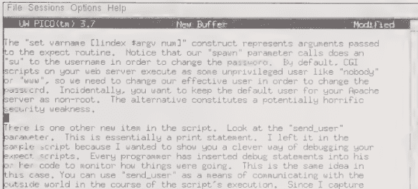

图 5.4 Pico，一个友好的替代方案

Pico 为你提供上下文相关的帮助，并方便访问显示在屏幕底部的命令。这些可以通过键组合访问，例如 `Ctrl-G` 用于“获取帮助”或 `Ctrl-R` 用于“读取文件”。关于 Pico 运行的示例，请看图 5.4。

你可以只需通过输入命令名称来启动 Pico，也可以指定文件名。

```bash
pico5.txt
```

如果你选择从编辑器开始，如果你知道文件的路径，则可以使用 `Ctrl-R` 指定文件名。如果你不 100% 确定，可以按 `Ctrl-T`，这会将带你进入一个文件管理器，你可以在其中导航并找到你想要的文件。

### Emacs 详解

在谈论 Emacs 时，几乎很难将其严格归类为一种编辑器。GNU Emacs 是 Richard M. Stallman（自由软件基金会创始人）的心血之作，它不仅仅是一个优秀的、强大的、尽管有些复杂的编辑器。它还是一个邮件读取器、新闻阅读器、网络浏览器、程序开发环境、LISP 解释器和心理治疗师。（不，真的。查看图 5.5。）

# 第 5 章 掌控 Linux

### 图 5.5 从 Emacs 医生处寻求帮助


因为你在做任何其他事情之前想知道如何操作，请通过输入 `emacs` 来启动 Emacs。你不需要为此指定文件名。现在按 `Esc-x`，输入 `doctor`，然后按回车。

还有一些稍微严肃一点。像 Pico 一样，Emacs 自带帮助。任何时候，你都可以按 `Ctrl-h` 进入帮助模式。你也可以通过 `Esc-x` 然后输入 `help-with-tutorial` 进入教程。你可能想在进入帮助模式后按 `t`，从内置教程开始对 Emacs 的探索。


如果你在 X 界面中工作，你很可能启动了 X 版本的 Emacs。你在图 5.5 中看到的医生正在 X Emacs 模式下运行即使在非图形环境中，你仍然可以使用 Emacs。要写出像 Emacs 的功能你得写一整本书。对于某些人来说，这编辑器太多了。专业程序员倾向于不同的思考，认为 Emacs 是不可或缺的。无论如何，你应该尝试这个极其强大且可自定义的工具。

### 资源

GNU Emacs

```
http://www.gnu.org/software/emacs/
```

PINE 信息中心（Pico 的家）

```
http://www.washington.edu/pine/
```

vim 首页

```
http://www.vim.org/
```

# 第 6 章 守护进程（Daemon）与运行级别

当你启动系统时，许多消息在屏幕上滚动。有些与硬件检测有关，但你还会看到许多正在启动（`named`、`sendmail` 等）。除非你已经对系统做了更改，否则这些都是默认配置或你安装系统时的请求的结果。现在你已经对进程有了新的了解，是时候进入下一个级别了。随着本书的进行，我建议你将各种程序添加到启动文件中。本章介绍了在各种 Linux 发行版中如何实现。

### 守护进程与其他事物

当你的系统启动时，它会启动许多服务。其中可以有一个 Web 服务器（如 Apache）、一个窗口服务器、`sendmail`（邮件传输系统）以及许多其他程序，如 `inetd`。由于我随口把 “inetd” 称为 “daemon（守护进程）”，所以我有必要解释一下我的意思。根据定义，*daemon* 是一个在生成（在启动时或通过 shell 命令）后断开启动它的终端连接的程序。如果随后完全断开启动程序的终端，该程序继续在后台运行。

> **定义：** 守护进程的功能是在没有用户控制的情况下自行运行。daemon 监听网络连接，而 syslog——另一个我会详细讨论的进程——观察、监控并记录。

### inittab 文件

在你系统所有的进程中，其中一个是主进程，它是其他每个进程的父进程（祖父等等）。它的 PID 始终是 1，它的主要工作是读取配置文件并启动那里定义的进程。哪些服务（或程序）被启动取决于系统启动时的运行级别。查看图 6.1 中的 `/etc/inittab` 文件中的运行级别。你正在寻找的那行在以下列表的底部（initdefault），但在你的系统中，它可能位于文件顶部，因为图 6.1 只显示了部分列表。我包含了注释以便让你看到我的系统上的级别含义。所以，我的系统运行在级别 5。要找出启动了什么，我执行 `ls -1 /etc/rc.d/rc5.d`。

```
# ls -1 /etc/rc.d/rc5.d
```

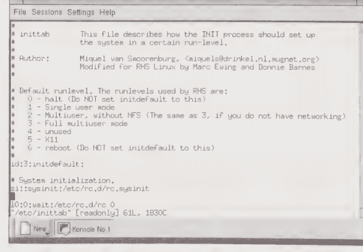

### 守护进程和其他并不的东西

是我看到的部分列表：

```
lrwxxr-x 1 root 17 Jul 18 13:48 S -> ../init.d/network
lrwxxr-x 1 root 17 Jul 18 13:48 S10 -> ../init.d/portmap
lrwxxr-x 1 root 15 Jul 18 13:48 S11 -> ../init.d/netfs
lrwxxr-x 1 root 16 Jul 18 13:48 S20 -> ../init.d/random
lrwxxr-x 1 root 16 Jul 18 13:48 S30 -> ../init.d/syslog
```

注意指向 `/etc/init.d` 目录中其他文件的箭头。这些指向启动和停止各种服务的文件的简单符号链接。如果指向文件的链接存在，该服务就会启动。在本书的某处，我可能会让你向启动脚本中添加一条命令。这通常指的是 `rc.local` 启动脚本。取决于你的系统和初始配置，你可能找不到 `rc.local` 文件。Debian 系统就是一个很好的例子。如果文件不存在，你如何创建它？又把它放在哪里？另一个问题：你如何让系统在启动时识别它？这些都是好问题。

### rc.local 文件与运行级别

为了了解 `rc.local` 的情况，我需要向你介绍运行级别以及每次系统启动时运行的少量脚本。启动时执行的内容部分由位于 `rc#.d` 文件中的符号链接定义，其中 `#` 代表对应于运行级别的数字。这个运行级别是什么？在你的 `/etc/inittab` 文件中，你会找到类似这样的条目：

```
id:3:initdefault:
```

注意行开头的 `3`。这告诉你系统启动后默认切换到运行级别 3（用于带有命令行登录的多用户模式）。如果你的系统显示为 `5`，这说明你正在直接启动到图形桌面。在这些级别上启动的内容将在相应的 `/etc/rc#.d` 目录中找到；在我的例子中是 `rc3.d`。是的，我还是一个使用 `startx` 命令启动 X 桌面的命令行用户（我稍后会谈到这个）。在 Red Hat（或 Mand）上，你会发现这个 rc 文件隐藏在 `/etc/init.d` 下。我不是说过它会在 `rc3.d` 目录中吗？如果你切换到 `/etc/rc3.d`，你会发现许多以 `S` 或 `K` 结尾的脚本文件。执行 `ls -1`你会注意到它们是指向其他处目录的符号链接。在 SuSE 系统上，`rc#.d` 目录在 `/sbin/init.d` 下，但你仍然能找到那些 `S` 或 `K` 文件，它们指向 `/sbin/init.d`。在 Red Hat 系统的情况下，它们指向 `/etc/rc.d/init.d` 目录。

```
lrwxrwxrwx 1 root root 11 Jul 12 16:09 /etc/rc.d/rc5.d/S99local
-> ../rc.local
```

在 Debian 系统上，这些脚本指向 `/etc/init.d`，我通常会在那里创建我的 `rc.local` 文件。在我自己的系统上，事实证明 `rc.local` 是通过调用 `S99local` 执行的。例如，在 Debian 系统上，请在相应的运行级别目录下查找（或创建）`S99local` 文件。

我（或 Red Hat）对 `S99local` 的使用在某种程度上是一种约定，你（如果愿意的话）可以稍微任意。该名称的第一部分 `S` 代表“启动”（`K` 代表“杀进程”），而 `99` 是一个足够大的数字，它很可能是系统在启动时执行的最后一个程序。`local` 部分只是一个对我有意义的名字。你可以将其命名为 `rcl`、`systemlocal` 或 `iceberg`。如果我想让这个文件在 Debian 系统的运行级别 3 下启动，我会创建一个如下符号链接：

```bash
ln -s /etc/init.d/rc.local /etc/rc.d/S99local
```

### 切换运行级别

你可以在不重启系统的情况下更改系统的运行级别。一种方法是启动和停止特定的初始化脚本。

```bash
# /etc/rc.d/init.d/named stop
```

这会停止名称服务器（第 18 章介绍），前提是该名称脚本位于 `/etc/rc.d/init.d` 中。然而，如果你想切换到所有在运行级别 5 下应该运行的进程，而你正处于运行级别 3，你可以使用 `init` 命令来实现：

```bash
# init 5
```

务小心更改运行级别。你可能会影响正在运行其他进程的用户。如果其他人正在使用系统，请务必提醒他们。

如果你不确定系统当前处于什么运行级别，可以尝试输入 `runlevel` 命令。

```bash
/sbin/runlevel
```

系统可能会以两种方式之一响应。你可能会得到字母 `N` 后面跟着一个数字，如下：

```
N 3
```

这表示系统处于级别 3，并且这是上一个级别。另一个可能的答案可能是类似 `3 5`，表示系统之前处于运行级别 3，最近被更改为运行级别 5。

### chkconfig 命令

在某些系统上（例如 Red Hat），你将找到另一种在启动时添加或删除服务的方法。查找 `chkconfig` 命令。该命令为更新或报告 `/etc/rc.d` 目录下的系统启动脚本提供了一个简单的界面。通过 `chkconfig`，创建和维护定义哪些服务被处理的符号链接的过程变得非常简单。

```
chkconfig version 1.1.2 - Copyright (C) 1997 Red Hat Software

此可以根据 GNU 公共许可证的条款自由重新分发。

usage: chkconfig --list [name]
chkconfig --add <name>
chkconfig --del <name>
chkconfig [--level] <name> <on|off|reset>
```

要找出哪些服务在启动时启动，可以使用 `--list` 选项。在末尾添加服务名将仅返回该服务的信息。例如，让我们看看 `inet` 服务在何时何地启动：

```bash
[root@testsys /]# chkconfig --list inet
inet 0:off 1:off 2:off 3:on 4:on 5:on 6:off
```

如果你想完全停止某个服务的自动启动，可以使用 `--del` 选项并指定该服务。在这个示例中，我正在从自动启动中移除高级电源管理进程（apmd）：

```bash
[root@testsys /]# chkconfig --del apmd
```

添加的过程相同，但使用 `--add` 选项。尽管如此，你可能还想根据特定的运行级别指定哪些服务启动。如果删除 `apmd` 服务后列出列表，所有运行级别都将显示为关闭。

```bash
[root@testsys /]# chkconfig --list apmd
apmd 0:off 1:off 2:off 3:off 4:off 5:off 6:off
```

如果由于某种奇怪的原因，我想让 `apmd` 仅在运行级别 3 时运行时，我将使用此命令：

```bash
[root@testsys /]# chkconfig --level 3 apmd on
```

要配置多个运行级别，将它们连接成一个数字。使用之前的示例，使用此命令变体在运行级别 3、4 和 5 下启动 `apmd`：

```bash
[root@testsys ~ /root]# chkconfig --level 345 apmd on
```

### 图形化操作运行级别

操作运行级别不是你每天都会做的事情。尽管如此，你可能会发现当涉及到这个问题时，漂亮、友好的图形界面会让工作变得更有趣。可以使用几种工具完成这项工作。你可能想要查找的第一个（如果你运行的是 Red Hat）名为 `ntsysv`（见图 6.2）。它非常简单，你可能在系统安装时就记得它的界面。

要启动（停止）服务，使用光标键导航列表，并使用空格键开启或关闭。注意：该程序只会影响 `/etc/init` 中的 `default` 参数。如果你想管理多个级别，这与 `chkconfig` 命令类似。在 `ntsysv` 运行级别 345 中，使用此命令变体在运行级别 3、4 和 5 下启动 `apmd`：

```bash
ntsysv --default 345
```

这个程序可能不是你考虑到图形界面时首先想到的，请看 `ntsysv` 的窗口。


FIGURE 6.2 Red Hat 的运行级别 级别编辑器

由于这些是特定平台的工具，我想为你介绍另一个作为 KDE 套件一部分的工具。它被称为 `ksysv`。因为它不是特定平台的，第一次看到它时会弹出配置向导（见图 6.4）。

会被要求选择发行版类型：Mandrake、Debian 等。这样做的原因我在章节早期提到过。启动文件尚未遵循统一的格式或文件布局。

该步骤结束。下一个屏幕是带有“完成”按钮的确认界面。点击后，`ksysv` 窗口弹出。它与你看到的 `tsysv` 在许多方面是类似的。点点击界面提供的精美的 KDE 外观（图 6.5）是一个加项，但它更强大。

通过此界面，你可以轻松地启动（并一次性重启它们）、直接编辑它们的配置文件，或从进程列表中完全删除它们。如果你选择了一个在所需的运行级别下未启动的服务，将其从列表拖到你选择的运行级别。完成后，点击磁盘图标保存更改。

直接点击服务（在活动运行级别下）会弹框，允许你处理运行中的进程（见图 6.6）。

从那里，你可以启动、停止或重启（如我之前提到的），但对于新管理员来说可能更有趣的是，你还可以


FIGURE 6.5 KDE ksysrunlevel 级别编辑器


FIGURE 6.6 获取服务的详细信息

关于此过程具体作用的一些信息。点击 Service 选项卡，sys 将揭露它关于指定服务的已知信息。

### （不是）最后的定论

正如我在章节开头提到的，添加自定义启动进程的经典方法是将它们放入 `rc.local` 脚本中（或者你最终给它起的名字）。你可以通过复制现有的脚本之一并对新版本进行修改，轻松地创建你自己的 rc 脚本。一个非常棒且简单的参考脚本是启动打印机守护进程 lpd 的脚本。

```
cd /path/to/init.d
cp lpd my_service
vi my_service
```

确保你将最终的脚本放在系统相应的 `init.d` 目录中，你甚至可以在图形化运行级别编辑器中处理该最终脚本。

### 资源

K 桌面环境 (KDE)

```
http://www.kde.org/
```

红帽软件（用于 ntsys 和 tksysv）

```
http://www.redhat.com/
```

# 第 7 章 用户与用户组

### 在多用户世界中生存

Linux 是一个多用户操作系统，这意味着一个或多个用户可以同时在上面工作。每个用户通过用户名来引用。每个用户名都关联有一个用户 ID (UID) 和一个或多个组。与用户名一样，组名也由数字标识符表示，这次称为组 ID (GID)。用户的 UID 是唯一的，用户组的 GID 也是如此。

当涉及到你的文件和目录时，Linux 系统的安全性是通过权限定义的，这直接与用户 ID 相关。用户要么是管理员用户或普通用户。首席管理员用户被称为“root”。用户的 ID 用于决定可以执行哪些命令，以及可以从哪些文件读取或写入哪些文件。

每个用户 ID 还关联有一个密码。该密码可以也应该定期更改。

### 何时不该使用 root 用户

简单直接的回答是，除非绝对必要，否则你永远不要使用 root 用户。危险在于 root 用户在系统上几乎是全能的。一个错误可能会导致严重的后果，甚至抹掉你的整个系统。除非绝对必要，否则以非管理员用户身份工作最好。还有其他原因。

是因为 root 用户拥有访问所有内容的权限，因此只给那些真正需要访问权限的人提供 root 密码是有意义的。访问 root 的人越少越好。让我给你几个警惕守护 root 权限的充分理由：

- 它更容易维护安全性
- 它降低了危险代码的风险
- 错误（通常）不会产生全局影响

是的，非 root 用户仍然可能对系统造成巨大破坏，但风险要小得得多。

### 管理用户

永远不要手动编辑密码文件。我不是说你不能这样做——而是你可能不应该。你会注意到我在介绍密码文件（顺便说一下，它是 `/etc/passwd`）之前，我曾提醒过你一遍。在运行带有 shadow 密码的系统上，还有另一个文件需要担心：`/etc/shadow`。

我用警告来引入这一节的原因很简单。我见过太多的人因为错误地修改密码文件而被锁定在系统之外。突然之间，既没有用户访问权限，也没有 root 访问权限。

> 你应该知道有一个 `vipw` 命令用于编辑密码文件（以及用于组文件的 `vigr` 命令），但我仍然建议不要使用它们。这些命令的目的不是为了防止危险类型，而是为了在更新时对文件进行适当锁定。

你的 Linux 系统拥有你所有需要的工具来添加和维护用户，而无需诉诸于手动编辑密码文件。话虽如此，让我们开始查看这个文件：

```
root:x:0:0:root:/bin/bash
bin:x:1:bin:/bin
daemon:x:2:2:daemon:/sbin
adm:x:3:4:adm:/var
lp:x:4:7:lp:/var/spool/
sync:x:5:0:sync:/sbin
shutdown:x:6:0:shutdown:/sbin
halt:x:7:0:halt:/sbin
mail:x:8:12:mail:/var/mail
news:x:9:13:news:/var/news
```

该文件的格式实际上非常简单。密码文件中的每个字段都用冒号分隔。首先是用户名，然后是密码字段（此处省略），随后是用户 ID、组 ID、某种注释、主目录以及默认 shell 或登录程序。

要记住的第一点是所有这些信息都是区分大小写的。当你尝试登录系统时，这很重要。选择用户名时，确保它的长度不超过八个字符。这些字符可以是字母、数字或混合的。

> **极客科普：** 八个字符的限制在过渡中是一个事实。在某些发行版本中，你实际上可以使用超过八个字符的用户名。那么问题变成了是将用户名截断为八个字符还是使用整个字段。

我稍后会详细讨论密码字段。现在让我们立即转向用户 ID (UID) 和组 ID (GID) 字段。UID 是唯一的数字标识，用于设置和修改文件及目录的安全信息。GID 也是如此，它不需要唯一的，因为它可以根据组来设置权限。例如，如果你有一个 accounting 程序，你想让财务部门的所有用户都能访问它，GID 提供了这些权限。

注意 root 用户。它的 UID 和 GID 都是 0。GID 0 也由 sync、shutdown 和 halt 所有用户共享。

接下来是注释字段。这正如字字意思。你可以输入关于用户的身份或目的的注释，以便可以使用 `finger` 命令进行识别。例如，查看系统用户之一 natika 的 `/etc/passwd` 条目：


# 第 7 章 用户与用户组

```
natika:x:504:504:Natika the Cat:/home/natika:/bin/bash
```

她的字段写着“Natika the Cat”，因为她恰好是我的猫。如果我输入查看谁登录了系统，我得到了：

```
# who
natika    pts/1    Dec  7 14:30
```

这只告诉这么多。如果我使用 `finger` 命令，我会得到更多信息，包括 natika 的计划。

```
# finger natika
Login: natika                               Name: Natika the Cat
Directory: /home/natika                     Shell: /bin/bash
On since Dec  7 14:30 (EST) on pts/1 from localhost.localdomain
       5 minutes 7 seconds idle
No mail.
Plan:
To get my own Natika-only Web site and rule the cat world.
```

> 顺便提一下，你看到的“plan”通常是空的。这是 UNIX 早期的遗留。现在已经没人那样做了。大多数人使用他们的 `.plan` 文件（如果他们用的话）来写像 natika 那样的幼稚注释。

回到密码文件。下一个字段是主目录。当用户登录系统时，他们被放置在这里（以一种电子虚拟的方式）。此目录包含个人登录和用户特定的信息。例如，X 窗口客户端文件会在这里，个人登录脚本 `.bash_profile` 也是。

最后是 shell 本身。如果你想可以更改默认 shell，但有效的 shell 列在另一个名为 `/etc/shells` 的系统中。以下是系统中 `/etc/shells` 的内容：

```
/bin/bash
/bin/sh
/bin/ash
/bin/bsh
/bin/bash2
/bin/tcsh
/bin/csh
```

是时候让你放过，最后谈谈密码字段本身了。你可能注意到在我的示例中，密码字段中唯一的只是单个字母 `x`。那是因为我使用了 shadow 密码文件来获得更高水平的安全。传统上，密码条目在 `/passwd` 文件中是的。遗憾的是，这听起来发现某人的密码就像查看密码文件中的条目一样简单，事实并非如此。

首先，让我们重新看一眼之前的密码文件。为了简单起见，我保留 root 密码。

```
root:x:0:0:root:/bin/bash
```

密码条目是一个相当晦涩的“x”。这是经典密码文件的条目：

```
2IsJW45pb4L56:0:0:root:/root:/bin/bash
```

如你所见，很难猜出“2IsJW45pb4L56”可能会翻译成“calculus”。问题在于创建密码的加密方法是为人知的，并且可以通过暴力破解方法和大量的 CPU 周期来破解密码文件中的密码，特别是如果我足够愚蠢地使用了字典里的单词。事实上，有多种名为“crack”和“Nutcracker”的流行密码破解工具，均可免费下载。（检查本章末尾的资源部分介绍了其中一个。）我将在本章的稍后部分介绍选择良好密码的规则。

回到影子密码文件（shadow password file）的概念，其真实原因是它让用户很难真正达到使用诸如密码破解工具的程度。这是因为 `/etc/passwd` 文件对所有用户都是可读的。另一方面，影子密码文件只有 root 用户可读。该文件的格式也略有不同，并且在用户配置方面具有更大的灵活性。让我们来看影子密码文件的布局。

```
$root:$1J:tGxREA$nhGbRUyid9.hf4I6UTRBs0:11242:99999:7:-1:135403056
```

与普通密码文件一样，这些字段由冒号分隔：总共有九个字段。从用户名开始，影子密码文件存储了密码本身，然后是一系列处理密码过期的数字。

其中第一个数字（第 3 字段）是自上次更改密码以来（从 1970 年 1 月 1 日开始）的天数、允许用户更改密码的最少天数，以及密码必须更改的天数。然后是警告设置。第 6 字段是用户开始收到更改密码警告前的天数。第 7 字段代表宽限期。这里有另一种观察角度：在密码过期后，你允许用户使用系统多少天，才会禁用该用户的账户？这让我们引出了第 8 字段，它是账户被禁用的表示（自 1970 年 1 月 1 日开始的天数）。最后是第 9 字段，它是预留的。不用担心它了。

如果条目包含 -1（如我示例中的第 7 和第 8 字段），本质意味着“从不”，因为用户永远不会收到警告，其账户永远不会被禁用。

在介绍如何添加、修改或删除用户（删除只是为了最后提一下）之前，我应该谈谈 `/etc/group` 文件。每个用户至少属于一个组。如果你使用那种快速而粗暴的方法，在添加用户时指定一个等同于 UID 的 GID，那么如此。

组的重要性显而易见。有时你希望一组特定的人共享一个或多个文件或应用程序的访问权限。与其为每个用户创建访问权限，不如说该财务应用程序对所有财务人员开放。（想象一下！）

我应该告诉你们，作为一名编辑 `/etc/passwd` 文件的人，我并不担心。其潜在风险没有编辑那个文件那么大。来看一下示例组文件的格式：

```
root:x:0:root
bin:x:1:bin,daemon
demon:x:2:root,bin,daemon
sys:x:3:root,bin,adm
adm:x:root,adm,daemon
users:x:100:marcel,natika,sally
```

像 `passwd` 和 `shadow` 文件一样，冒号分隔各个字段。第一个字段是组名。后面是密码字段，然后是唯一的组 ID。最后，你会看到一个由逗号分隔的该组成员的用户名列表。例如，如果你有一个名为“finance”的组，并让用户 albert、isaac 和 marie 成为该组的一部分，会有像这样的条目：

```
finance:x:540:albert,isaac,marie
```

## 管理组

处理组的管理比处理用户要简单一些（至少在操作系统领域是如此），所以让我们先处理这个。还有另一个原因。虽然听起来很奇怪，但在某些方面，组先于用户是有逻辑的。虽然没有用户的组确实不算是一个组，但人们通常会在向组中添加用户之前先定义组。这就是这个比特和字节的世界。

### 添加组

添加组是一个简单的程序。命令是 `groupadd` 后面跟着组名。

```
[root@testsys /root]# groupadd finance
```

你还可以通过 `-g` 标志指定组 ID。默认情况下，系统按顺序分配下一个非管理员组 ID。除非你正尝试从另一个系统复制组信息，否则允许默认可能是最好的主意。

### 修改组

通常情况下，修改组的原因涉及重命名。现实中，更改 GID 会让你头疼，因为这意味着更改该组最初拥有访问权限的所有文件的 GID。但是，你可能想将 finance 组（示例）改为读取账户。命令如下：

```
[root@testsysys /root]# groupmod -n accounts finance
```

顺便说，`-n` 标志用于引用新组。

### 删除组

删除组在会计世界经常被遗忘，无论是组账户还是用户账户。人们离开公司，名称发生变化。保持警惕。如果账户或组不再需要，请将其删掉。

要删除用户，使用 `userdel` 命令（注：此处原文误写为 groupdel，根据上下文应为 userdel，但保留原意逻辑）。

```
[root@testsysys /root]# groupdel xpilots
```

## 管理用户

### 添加用户

添加用户最简单的方法是 `useradd` 命令。注意，系统会创建主目录并分配默认 shell。显示如下：

```
useradd [-u uid] [-g group] [-G group] [-d home] [-s shell] [-c comment] [-m] [-k skeleton] [-f expire] [-p passwd] [-n name]
```

如果你想使用另一个账户作为创建新账户的模型（骨架），请使用 `-k` 标志。注意在这种情况下你还需要添加 `-m` 标志。假设你想创建一个用户 "einstein"，但你希望他拥有与 natika 主目录中存在相同的文件和配置。你应该这样做：

```
[root@testsys ~]# useradd -m -k /home/natika einstein
```

现在查看爱因斯坦先生的主目录，他的文件与 natika 的相同，但权限和所有权属于他。

### 组参与

`-g` 选项是让你定义用户所属哪个组的机会。默认情况下，如果你没有指定任何内容，系统将创建一个与用户 UID 匹配的组。对于用户访问一个他们都拥有权限且必须修改信息的数据库应用程序的环境，允许某种组识别至关重要。如果你需要指定额外的组（或多个组），请使用 `-G` 选项。

```bash
useradd -g -G finance,research staff aestein
```

在这里，爱因斯坦先生的账户被创建，初始组为 `staff`。他也被被添加到了 `finance` 和（当然还有）`research` 组。

### 仅限电子邮件账户

如果你正在创建一个只需要访问电子邮件而永远不需要登录 shell 会话的账户，解决方案是简单地不给账户分配 shell。你可以在创建账户时通过指定 shell `-s /bin/false` 来实现这一点。

```bash
useradd -g popusers -s /bin/false aestein
```

我刚才建议作为用户 shell 的 `/bin/false` 是那些极其精妙的小命令之一，堪称是神来之笔。与其用我自己的话来描述，不如让我引用一下书上那个人的话。

```
FALSE(1)               FSF               FALSE(1)
NAME
 - 什么都不做，并失败
```

### 更多用户创建控制

用户是多用户系统的存在的意义。因此，用户创建默认设置领域提供了另一个名为 `/etc/login.defs` 的有趣文件，它控制其他更有趣的事情。这里是该文件的一个小示例：

```
PASS_MAX_DAYS      99999
PASS_MIN_DAYS      0
PASS_MIN_LEN       5
PASS_WARN_AGE      7
```

```bash
#
### useradd 自动选择 uid 的最小/最大值
#
UID_MIN             500
UID_MAX             60000
#
### groupadd 自动选择 gid 的最小/最大值
#
GID_MIN             500
GID_MAX             60000
```

这非常有趣。你可以设置一个全局默认，用户必须每 30 天更改一次密码，或者根据你办公室安全要求的频率更改。默认值是 99,999 天，大约相当于 274 年。你几乎称之为为永远。该文件有完善的文档，你可以查看一下。

### 修改用户账户

我给出的添加用户的第一个示例是简单的 `useradd username`，这没问题，问题是除非你在当时提供了所有相关信息，否则它对账户创建的控制力很小。假设你觉得很懒（或者你正赶时间——典型的系统管理员陷阱），结果你没有设置任何额外信息，例如用户的全名。你如何进行更改呢？

使用 `usermod` 命令就可以做到。

```bash
usage: usermod [-u uid [-o] [-g group] [-G group,...] [-1 new_name] [-d home [-m]] [-s shell] [-c comment] [-f inactive [-e expire] [-p passwd] [-L| -U] name
```

在某些方面，`usermod` 看起来和 `useradd` 命令非常相似。要将用户的默认 shell 从 `/bin/bash` 更改为 `/bin/ash`，请使用此命令：

```bash
usermod -s /bin/ash natika
```

如果你只想更改名称字段（所谓的注释字段），还有另一个你可以使用的命令：`chfn`，它的实际意思是“更改指纹信息”，正如之前讨论过的 `finger` 命令一样。它的工作原理如下：

```
[root@testsys /root]# chfn -f "Tux the Penguin" guix
Changing finger information for guix.
Finger information changed.
```

### 删除用户账户

请允许我说一些显而易见的话（即使这听起来很像我在重复自己）。如果一个用户离开了，你应该删除该用户的登录账户（或者如果你愿意，删除其用户名）。你还应该作为日常工作计划的一部分，对休眠账户进行检查，但我很快就会提到这一点。现在，让我们聊聊删除用户账户。

删除用户很容易。这就是为什么你应该小心。执行此操作的命令是 `userdel`，它有一个可选标志 `-r`。

```bash
userdel [-r] user_name
```

`-r` 标志可选的，它告诉 `userdel` 不仅删除用户，还要删除他们的整个主目录。如果你省略了该标志，你必须手动清理该目录。在做这个决定时，你应该格外小心。你已经检查了用户的主目录以确保它不包含你以后可能需要的信息吗？花点时间观察一下。良好的做法可能是对该账户进行备份（可能备份两个）并将其半存档，直到你绝对确定账户中没有有用的东西为止。底线一如既往，是使用你良好的判断。

> 注意：如果用户接收过任何邮件（即使来自系统），在 `/var/spool/mail` 目录下可能有一个以其用户名命名的邮箱。在删除用户时你应该记住这一点。

### 检查密码文件

既然你手头没有足够的事要做了……好吧，让我再给你一个任务。你应该定期运行报告来识别已休眠的账户登录。这是一种委婉的说法，即“那些已经离开且短期内不会回来的人”。

正如你可能从 `finger` 命令记得的，`lastlog` 将显示账户最后被使用的时间。然而，Linux 系统带了一个方便的小命令可以实现此功能。

```
[root@testsys /root]# lastlog
Username Port From Latest
root tty1 Wed Mar 7 17:18:40 2001
daemon Never in
adm Never in
lp Never in
sync Never in
shutdown mgagne 1 Dec 7 14:30:15 2000
postgres Never in
www Never in
natika localhost.locald Dec 7 14:59:55 2001
guitx tty2 Mon 8 14:54:55 2001
```

> 趣味知识：你无法编辑或修改此文件，但 `lastlog` 命令来自 `/var/log/lastlog`。

还有一件事你应该做。偶尔运行 `pwck` 命令。默认情况下，它会遍历 `/etc/passwd` 和 `/etc/shadow` 文件并进行一些完整性检查，例如确保字段数量正确且每个名称都是唯一的。

```
### pwck
```

对于组文件，有一个辅助命令 `grpck`。

```
### grpck
```

### GUI 方式管理用户和组

对于那些更倾向于使用图形界面处理所有这些管理的人，有一些工具可以很好地完成这项工作。对于运行 GNOME 或 KDE 桌面的用户，你会发现一些吸引人的。

在 GNOME 世界中，是 `userconf`，它实际上是 `linuxconf` 用户管理软件包的一部分（你将在第 17 章详细回顾它）。目前只需说明 `userconf` 可以直接从命令行调用。由于你正在更新用户信息，这必须以 root 身份运行。

从 shell 窗口，只需输入 `userconf`，你就会得到一个类似于图 7.1 的界面。从那里你可以添加、删除或修改用户用户和组信息。

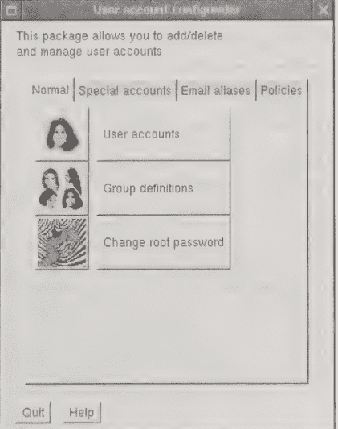

> 图 7.1 使用 userconf 管理用户

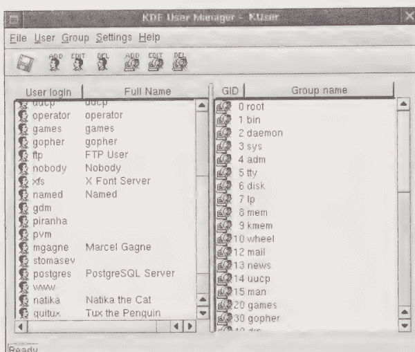

图 7.2 kuser 的界面可能看起来很熟悉

另一个选项——这个是给 KDE 用户的——在 KDE 系统菜单中显示为“用户管理”（User Management）。你也可以通过 `kuser` 命令从命令行调用它。工作过另一个操作系统的用户会注意到，这个界面非常熟悉，如图 7.2 所示。

也看看图 7.3。你会看到 kuser 程序的另一个面目，但重要的是，你应该注意到某些对影子密码（shadow password）敏感的字段被填充。如果你运行的是一台只有少数用户的小型机器，手动更改这些默认值没有问题（甚至是更好的），但对于大型组织，请考虑使用 `/etc/login.defs` 中的默认值。

正如你所猜的样，这些并不是用户和组管理的唯一替代方法。在第 19 章（工具汇编）中，我将向你展示处理用户或其他的方法。我无法涵盖这些系统提供的每一个系统和每一个管理变体。例如，SuSE 使用 YAST 作为用户和组管理的首选图形工具，而另一个发行版可能会使用其他工具。底线是：如果你能使用命令行工具，你就很棒了。

### 选择良好的密码

| 用户信息 | 扩展 | 组 |
|---|---|---|
| 上次更改密码于 2000年11月23日 | | |
| [ ] 不允许更改密码 | 在此日期之前无法更改密码 | |
| 24 | 11月 | 2000 |
| [ ] 密码不会过期 | 密码过期且必须更改的日期 | |
| 31 | 12月 | 2001 |
| [ ] 不将给予警告 | 在此日期之后将关于密码即将过期的警告 | |
| 7 | 1月 | 2002 |


| [x] 账户保持启用 | 如果密码过期，账户将被禁用的日期 | | |
| [x] 账户永不过期 | 账户过期并被禁用的日期 | | |
| 确定 | 取消 | |

图 7.3 使用 kuser 修改过期日期

### 选择良好的密码

你会发现在书中有一个模式。除了充满了有用的信息（如果我工作做得的话），你还会注意到我一直在反复反复地提到系统安全。系统安全是一个大问题，如果它不是，它也应该是。这在互联网世界中尤为如此，它快乐地将我们的虚拟大门向所有来者敞开。

即使你的系统没有直接连接到互联网，你仍然应该采取一些基础安全；在公司围墙内部，也有需要考虑的安全问题。不处理系统安全的方法就是忽略以下信息。

考虑一下：在你的组织中可能存在某些区域，用户会告诉你他们都知道彼此的密码，以防万一。以防什么万一，这纯属推测。

有些用户会在终端的角角上贴一张黄色小便利条，以防忘记密码。通常，系统身份验证的密码与 Novell 密码相同，就像 Windows 密码一样……事实上，它和他们使用的其他每个密码一样。

良好的系统安全策略意味着你必须培养一种健康的偏执症。假设最坏的情况并做好准备。

例如，诚然，保护你的系统远比一个好密码要复杂得多；然而，你最好的第一道防御是一个好密码，那也是我开始的地方。

- 良好的密码
- 长度在六到八个字符之间
- 不在任何英语或外语字典中
- 不包含个人信息（孩子的名字、驾照号码、生日等）
- 具有字母和非字母字符的混合
- 定期更改
- 每当有员工离职时更改

密码的安全水平因地而异。有些地方的密码每周更改——有些地方甚至每天更改密码。在更复杂的安装中，每日密码需要输入一个每天更改的身份验证密钥。算法可能会将星期几作为密钥的一部分，并乘以用户的出生日期，乘以 Stevenberg 从高中毕业的年份，再加上哈勃常数的平方根除以……你明白我的意思了。

### 破解者如何破解你的密码

之前那个密码公式对于你的组织来说可能“有点过头”了。只有你自己知道。良好的密码的原因可以直接追溯到我早期对密码文件的描述，因为它与非影子字段（nonshadow fields）中的密码字段有关。这里是格式的快速提醒：

```
root:2Isjw45pb4L56:0:0:root:/bin/bash
```

密码字段（字段 2）是通过哈希算法编码的。如果你对这些细节感兴趣，输入 `man crypt`，你将发现你想知道的关于密码编码的一切。简而言之：奇怪的密码实际上是你的密码一个基于两个字符随机生成的“盐”（salt）的编码版本。这个盐用于初始化哈希例程以生成最终的字符组。

“哈希”（hashing）一词代表一种获取字符字符串（例如人的姓氏）并生成固定长度字符串的技术。这个过程是单向的；你无法轻易反转哈希来找到原始密码。然而，攻击者可以猜测密码，对其进行哈希，并将结果与存储的哈希进行比较。这就是破解者的工作原理。

（注：原文此处存在大量重复段落，译文已根据要求去重并保留核心逻辑）

### 如何不做一个“傻瓜”

登录: mgagne

密码:

上次登录：1 月 8 日 星期一 16:00:39 来自 energize

这所谓的“energize”到底是什么鬼？显然，它是我上次登录时那台计算机的主机名，但我并没有一个名为“energize”的系统。此外，让我们假设我不认识任何拥有该系统的人，而且我是从同一个地方登录的。唯一的解释是，某个来自名为“energize”系统的人用我的登录名和密码登录了服务器。

这只是一个假设性情况，但它说明了另一个你应该考虑训练用户采用的习惯。如果他们日复一日地从同一台 PC 登录，那么这条信息永远不应该改变。如果他们不认识上次登录信息中的主机名，他们应该制定一项政策，向你警报。

安全不仅仅是系统管理员的领域。毕竟，你已经忙头万事了。任何帮助都感谢。你需要让用户参与进来。让他们知道，系统安全既是他们的工作，也是你的工作。

### 如何不做一个“傻瓜”（社会工程）

你听过“每分钟都会出生傻瓜”吗？这句话归功于马戏传奇人物 P.T. 巴纳姆。在现代政治正确的世界里，你可能更有可能遇到“社会工程”这个术语。虽然它听起来有点刺耳，但它的意思和 P.T. 巴纳姆的话是一样的。在系统安全的语境下，它指的是任何——无论多么聪明或透明——试图说服人们放弃密码的尝试。

当管理员都在担心人们穿过防火墙并侵入系统时，他们忘记了一旦进入，人们仍然需要密码。有时候，闯入是容易的部分。大多数安全违规并非来自某个刻板印象中的黑客，拿着一瓶汽水就巧妙地攻破了你所有昂贵的防御。而是某人走向某人说：“我忘记密码了，我真的需要那份文档。我可以用下你的吗？”我曾去过一家商店，那里有人伪造了一封电子邮件发送给几个人，并告诉他们更改为指定的密码。教育你的用户至关重要。

告诉你的用户，信息部门的任何人，或者说员工中的任何任何人，永远不会向他们索要密码。Linux 系统管理员可以用 root 身份登录任何账户而无需密码。这会让他们对系统管理员所掌握的权力感到更好还是更糟呢。

# 第 7 章 用户与组

用户应该报告任何试图从他们提取密码信息的尝试。任何人都不应该出于任何原因索要此类信息。一个经典的场景是某人告诉用户他们需要检查系统问题，必须使用通用登录进行测试。对话可能是这样的：

“你好，我是电话公司的，我来检查你的手机。”

“但我的电话没问题。”

记得我提到的那个个人经历吗？那些用户向我展示了一封来自“root”或“超级用户（superuser）”的信，要求他们将密码更改为预设计的密码（据称这些是系统选择的密码——“bootclock”）。相关用户给我打电话，是因为他们无法相应地更改密码。我执行的系统密码规则禁止了那种密码结构（他们需要在单词的特定位置包含两个数字进行选择，而且如果我发送邮件，是以我的身份发送的，而不是以“root”或“superuser”）。

我解释说，我永远不会告诉他们应该选择什么密码，而且也没有这样做。

> 正如《X 档案》中的福克斯·穆德可能会说的话：不要相信任何人！

### 资源

Nutcracker（密码破解工具）

```
http://northernlightsgroup.hypermart.net/nutcracker.html
```

## 磁盘与文件系统

我世界上最好的朋友（我的妻子 Sally）有一句格言：“数据优先。”这段小智慧的变体包括“必须有数据”。在开始任何操作之前，你的文件系统是什么样子的，这取决于你是否知道。文件是普通文件。你的字处理文档和数据库都是普通文件。

目录文件允许你将文件（所有类型）组织成某种逻辑顺序。你可以把它们想象成文件柜。抽屉是目录文件，它们内部的也是文件。

Linux 并不关心它是如何工作的，它显示了显示。。

### 一切文件

一切都是文件。在 Linux


一切都是文件。

尽管单个数据分区可能存在任意排列，但外部仍然存在着某种结构，这些顶层目录（`/usr`、`/etc`、`/home`）有时被称为文件系统，甚至被称为分区。这种层次级文件结构（顺便说一下，它的历史和 UNIX 一样悠久）正越来越多地由文件系统层次结构标准（FHS）所定义。这里有趣的是，FHS 最初是为标准化 Linux 而设计的，但它也被其他 UNIX 系统所采纳。

## 文件系统树

也许“树”这个词有点让人困惑，因为这实际上像是一棵倒置的树，根在顶部，目录向外延伸到叶节点（普通文件）。首先，让我们来看根目录（表示为 `/`）直接下方的目录列表。

```
# cd /
# find . -type d -maxdepth 1 -iname "*"
/lost+found
/proc
/var
/tmp
/dev
/usr
/etc
/bin
/boot
/home
/lib
/mnt
/root
/sbin
```

上面的列表是你在大多数 Linux 发行版中开箱即用时会看到的典型目录。这些某些目录经常被互换地称为文件系统或分区（记得之前关于分区的讨论）。真正将文件系统与简单区分开来如下：

> 文件系统是顶层目录（紧邻根目录下方），它们本身负责某些功能。当你探索各种文件系统时，你就会理解我的意思了。

你会注意到少了一个分区——一个你在安装系统时创建的、但在这个列表中没有显示的分区。这就是交换分区（swap partition）。这是因为交换分区本身并不是一个文件系统。你不能 `cd` 进入交换文件系统并执行 `ls` 来查看那里有什么文件。那里有一块原始数据区域，程序作为系统正常运行的一部分，可以在其中被换入或换出。它被设计为你真实内存（RAM）的物理扩展。你无法进入交换分区删除内容或移动数据，这就像你无法对 RAM 做这些事一样。然而，这并不会降低它的实用性。关于交换分区有一种观点认为：如果你有足够的内存，就不一定需要交换。我不赞同。为了以后省心，就不要把它看作是一个可有可无的选择。简单来说，你需要配置交换分区。

顺便提一下，以后可以使用 `mkswap` 命令添加更多交换分区。我稍后介绍创建文件系统时会讨论这一点。

## 根文件系统（又称 / 或 Slash）

“层次级文件系统”这个名字本身就意味着一种从某个顶层向下的组织结构。这个顶层就是 `/`，通常简称为 root（根）。它的主要目的是为让你的系统运行提供环境。当你的系统启动时，你执行的操作之一（在读取启动记录之后）就是挂载 `/`。你在这里拥有的是对于基础启动至关重要的文件。这就是 `/boot` 生活，即你的 Linux 内核（`vmlinuz`）所在的目录。它也是 `/bin`、`/dev`、`/etc`、`/lib` 和 `/sbin` 的大本营。

我将从你可以看作是命令的目录开始。首先是 `/bin` 目录，它提供了启动系统所需的所有基本命令，其标准是——即它们也是非管理员命令。仅限管理员或系统管理命令可以在恰好命名的 `/sbin` 目录中找到（可以理解为“超级用户 bin”）。该类别的另一个目录是 `/lib`，它包含了启动所需的共享系统库。这个目录包含系统可加载模块、小型对象库或驱动程序，这些可以根据需要加载到内核中。例如，这可能支持你的声卡或以太网适配器。当你访问硬件供应商获取更新的驱动程序时，它们最终会落在这里。

接下来是 `/dev`，它包含了代表你 Linux 系统上硬件设备的特殊文件。


剩下的就是 `/etc`。在这里，你会找到让你的系统独一无二的东西：配置文件、本地启动脚本、密码、网络配置等。在历史上，命令也可以在这里找到，但现在已不再如此了。如果你只是简单地备份 `/etc` 目录，你将拥有所有的标准系统配置。显然，还有更多内容需要备份，但它代表了系统的身份。（关于更全面的系统身份备份脚本的示例，请参阅第 16 章。）

### /usr 文件系统

这是大头，是你系统中最大的（或最大的文件系统）。除了数据区域本身，这往往是你系统中最忙碌、规模最大的目录。你在这里找到大部分系统工具、应用程序以及你的 X 窗口系统。以下是你在这里会发现的内容的简要概述。

注意，存在一个 `/usr/local` 层次结构，包含了我稍后将介绍的某些目录的镜像。这些通常是事后安装的程序——那些不是默认发行版一部分的程序。当你下载并编译程序时（你将在第 11 章中这么做），它们很可能会落到这里。这并不意味着这些程序不重要。例如，如果你从零开始构建 Apache Web 服务器，它默认会将它的文件安装在 `/usr/local/apache` 下。

这种结构中的某些逻辑与你供应商的发行版有关。当你升级系统时，供应商的程序可能会被覆盖。那些是存在于任何程序目录（`/bin`、`/usr/bin`、`/usr/sbin`）中的程序，但 `/usr/local` 下的除外。

### /usr/bin

你在这里找到大多数用户相关的程序。

### /usr/sbin

在这个目录中，你会找到管理守护进程，例如网络程序等。

### /usr/include

大多数系统头文件包含在这里。

### /usr/lib

这是另一个用于共享库的目录。

### /usr/man

这里有几个目录，但它们都与系统文档有关。

### /usr/share

`/usr/share` 是最忙碌的目录之一，值得翻翻。这个目录的居民包括桌面背景图像、图标、额外文档和其他文件。

### /usr/X11R6

R6 指的是 X 的第 6 版本。它有自己的 `bin`、`lib` 和 `share` 目录。因为我将在第 9 章介绍 X 系统，所以现在先到此。

### /usr/games

因为你不能总是在工作，所以有一个专门的游戏目录。在过去，这里有一系列古老游戏，比如经典的冒险游戏（你在一个四面八方都是相同通道的迷宫中）。取决于发行版，现在你在这里发现的东西。我的系统有 `banner` 和 `fortune`（我很喜欢它们）。游戏通常安装在 `/usr/local`，X 窗口系统自带的除外（如 `xbill`）。

### /var 文件系统

`/var` 目录包含变量数据，即经常变化或存在时间很短的文件。这些包括打印作业、邮件、日志、锁、系统统计信息和日志文件。如果你决定采用创建单独分区的方法，考虑这也可以是一个大分区。`/var/log` 目录从报告和安全的角度来看具有特殊重要。

如果你运气看到一些旧的发行版，可能会发现你看到的某些结构以前在 `/usr` 中。例如，`/var/spool` 曾经是 `/usr/pool`，而 `/var/tmp` 曾经是 `/usr/tmp`。事实上，这种遗迹仍然存在。检查你系统中 `/usr` 目录下的符号链接。在我其中一个测试系统（一台红帽 6.2 工作站）上，`/usr/tmp` 仍在那里，但它是指向 `/var/tmp` 的符号链接。

### /tmp 文件系统

这是另一个内容会快速变化的文件系统。正如其名称所示，该文件系统是为临时数据设计的。因为它是可写的，用户可能会将其用作自己临时数据的垃圾场。

这就是为什么在安装系统时建议将 `/tmp` 文件系统设置为独立分区的论据之一。因为用户可能会完全按照我所建议的那样做，他们可能会耗尽你磁盘上的所有数据。如果 `/tmp` 是独立的，而他们填满了它，那只是你的问题。

> 提示：将 `/tmp` 中的任何内容都视为随手可得。如果它在预定义时间内没有被认领，就将其删除。告知你的用户这种做法。这应该让他们保持规矩。程序也会使用它作为临时空间，包括你的窗口桌面应用程序。

### /proc 文件系统

你可能不知道

探索 `/proc` 可以非常有趣，更不用说信息量丰富了。`/proc` 文件系统（或伪文件系统，因为实际上并不存在）是活生生生的。

那么，神秘的 `/proc` 文件系统怎么可能不存在呢？嗯，首先如果你对根目录执行 `ls -1`，你将得到一个大小为零的目录。试一看。

```
# ls -l /
(note: only showing partial listing)
drwxr-xr-x 2 root               4096 Aug  1 15:07 patch
drwxr-xr-x 90 root               0 Aug 12 19:57 proc
drwxrwx------ 113 root               12288 Aug 14 14:55 root
drwxr-xr-x 3 root               4096 Jun 12 16:40 sbin
drwxrwxr-wt 8 root               4096 Aug 14 15:21 tmp
drwxr-xr-x 21 root               4096 Mar 13 17:07 usr
drwxr-xr-x 18 root               4096 Jun 22 18:59 var
```

注意，`/proc` 的大小确实为零。然而，当我通过 `cd /proc` 切换到 `/proc` 并在那里执行 `ls` 时，我看到了大量信息。

## 第 8 章 磁盘与文件系统

```
### cd /proc
### ls
1 10102 10105 10311 10315 10702 10710 10714 10715
10716 10717 10718 10719 10720 10721 10723 10755 10766
1145 1146 1147 1148 1150 1151 1152 2 330 345 346 355
369 4 420 429 443 446 447 450 461 475 490 505 528 583
6 612 626 675 715 716 717 718 719 720 723 745 752 753 757
771 773 775 776 7922 808 811 8784 8788 8936 9008
911  914 9957 ampr bus cmdline cpuinfo devices dma fb
filesystems fs ide interrupts ports kcore kms ksym loadavg
locks mdsat meminfo misc modules mount partitions pc
rtc scsi self label found start swaps sys uptime version
```

对于一个空目录来说，那里的东西相当多。让我们从一些简单的东西开始。首先查看名为 `cpuinfo` 的文件。另一个大小为零的文件。现在 `cat` 这个文件并查看结果。这是我的显示内容：

```
### /proc/cpuinfo
processor : 0
vendor_id : GenuineIntel
cpu family : 5
model : 2
model name : Pentium 75 - 200
stepping : 12
cpu MHz : 150.342254
fdiv_bug : no
hlt_bug : no
sep_bug : no
f00_bug : yes
coma_bug : no
fpu : yes
fpu_exception : yes
cpuid level : 1
wp : yes
flags : fpu vme de pse tsc sar mce cx8
bogomips : 59.80
```

实际上，在这种情况下它是 Pentium 150，但看到你的系统认为它是如何的还是很有意思的。让我们看看查看名为 `interrupts` 的文件时会发生什么。有人猜猜吗？

```
### /proc/interrupts
CPU
0: 6422178 XT-PIC timer
1: 43093 XT-PIC keyboard
2: 0 XT-PIC cascade
5: 3 XT-PIC soundblaster
8: 1 XT-PIC rtc
10: 34143 XT-PIC eth0
12: 541052 XT-PIC PS/2 Mouse
13: 1 XT-PIC fpu
14: 1622951 XT-PIC ide0
15: 6 XT-PIC idle
NMI: 0
```

### /proc 文件系统

同样，对 `meminfo` 文件执行 `cat` 可以让你关于内存和交换内存的当前统计数据。查看 `/proc/scsi/scsi` 会显示你的 SCSI 分配，而查看该文件会显示你的卡配置。`cat` `/proc/partitions` 文件显示你的磁盘分区信息，而 `version` 是你运行的内核以及它是如何编译的。跟踪这些。这里有很多内容，非常有趣。

# 丢失与恢复的文件系统 121

这一领域已经有了很大改进。ext2 文件系统在处理这类问题时实际上要好得多，但这些问题仍然会偶尔发生。

当这种情况发生时，你的系统在尝试重启时会注意到磁盘分区没有被正确卸载（类似于 Windows 系统中的磁盘扫描）。执行检测操作的命令，与之后执行修复工作的命令是同一种。那个命令是 `fsck`（不，那不是一种类型）。我特意提到一下 ext2 文件系统是因为我想给你们展示一些东西。`fsck` 实际上并不是真正的 `fsck` 命令，它是各种文件修复工具的前端。通过使用 `where` 命令，你可以大致了解我在说什么。

```bash
$magne@testsys marcel$ where fsck
fsck: /sbin/fsck /sbin/fsck.msdos /sbin/bin/fsck.minix
```

如你所见，`fsck` 前端（或包装器）尝试确定文件系统类型，然后运行程序的适当版本。对于 ext2 文件系统，适当的程序被称为 `ext2fs`，尽管该程序在你的磁盘上以另一个名称 `ext2fs` 存在。由于两者是同一个程序，所以使用哪一个并不重要。

由于 `fsck` 通常会自动运行，你可能没有考虑过可以手动运行它。然而，这样做需要你先卸载想要检查的文件系统。你也可以在单用户模式下启动（在 LILO 提示符处输入 `linux single`）。要检查文件系统，请使用此命令：

```bash
fsck /dev/hda5
```

这是检查磁盘最简单的场景。如果系统是干净卸载的，`fsck` 将直接返回命令提示符。若要强制检查，请使用 `-f` 选项。

```bash
fsck -f /dev/hda5
```

如果出现问题且 `fsck` 不确定该做什么，它会尝试先向你确认它的决定。你可以使用 `-y` 选项告诉 `fsck` 对所有问题都回答 yes。

```bash
fsck -y -f /dev/hda5
```

如果 `fsck` 无法重新挂载或处理文件碎片，它会将该碎片放在特定分区的 `lost+found` 目录中。由于 `fsck`（以及 `e2fsck`）实际上非常出色，你通常不会在这里发现任何东西。尽管如此，如果你的系统没有正常关闭，并且你被迫运行 `fsck` 检查，请检查 `lost+found` 中是否有……呃，好吧，丢失或发现的内容。

### 损坏的超级块（Superblock）？

让我先说，你收到如下消息的概率非常小。然而，在发生严重的文件系统损坏的情况下，在运行 `ffck` 后，你可能会发现自己正看着这样的内容：

文件系统超级块损坏。

尝试使用 `-b` 选项使用备用超级块再次运行 `e2fsck`。

为了实现像 ext2 文件系统这样健壮的架构，其布局的关键信息会定期被写入到名为“超级块”（superblocks）的数据区域中。这些副本每隔 8192 个块就能找到一个，从 8193 开始（因为第一个是 1 号块）。

```bash
fsck -y -b 8193 /dev/hda5
```

如果已经到了这一步，请现在修复问题并进行备份。你可能真的遇到了硬件问题，所以要做好任何准备。记住，你此时所做的备份可能也可能包含错误。如果你在磁盘上有一个损坏的文件，它最终会出现在你的备份中。

### 我还有多少空间来着？

磁盘空间是有限的资源，因此你必须关注它。`df` 命令（可以想成“disk free”）就是你用来执行此操作的工具。只需输入 `df` 即可获取每个挂载文件系统的信息。

```bash
[mgname@testsys marcel$] df
```

| 文件系统 | 1-块 | 已用 | 可用 | 使用率 | 挂载点 |
|---|---|---|---|---|---|
| /dev/hda1 | ext2 | 1981710 | 769130 | 38G / 1101144 | 41% | / |
| /dev/hda5 | ext2 | 7903716 | 520346 | 6G / 6973620 | 7% | /home |
| /dev/hda6 | ext2 | 1981710 | 714602 | 1G / 1164672 | 38% | /usr/local |
| scate:/mnt/data | nfs | 6110045 | 4978257 | 796M | 8% | /mnt/others |

该命令的一个变体使用了 `-h` 选项，它代表“人类可读格式”（human readable format）。我不知道另一种写法，但让我给你看一个示例。在此之前，让我们添加另一个有趣的标志——`-T`，它用于识别文件系统类型。

列表中的第四个系统是 NFS 挂载。这些文件系统并不直接存在于你的系统中——它们属于另一台计算机，并通过你的网络向你提供。

### 节点（NODES）到底是怎么回事？

图 8.1 GNOME 的 GDiskFree 工具

第 18 章详细介绍了 NFS 挂载。你也可以这样指定单个文件系统：

```bash
df -h
```

在 `LILO` 提示符处输入 `linux single` 可以进入单用户模式。


# 丢失与恢复的文件系统

这一领域已经有了很大改进。ext2 文件系统在处理这类问题时实际上要好得多，但这些问题仍然会偶尔发生。

当这种情况发生时，你的系统在尝试重启时会注意到磁盘分区没有被正确卸载（类似于 Windows 系统中的磁盘扫描）。执行检测操作的命令，与之后执行修复工作的命令是同一种命令。那个命令是 `fsck`（不，那不是一种类型）。我特意提到一下 ext2 文件系统是因为我想给你们展示一些东西。`fsck` 实际上并不是真正的 `fsck` 命令，它是各种文件修复工具的前端。通过使用 `where` 命令，你可以大致了解我在说什么。

```bash
$ magne@testsys marcel$ where fsck
fsck: /sbin/fsck /sbin/fsck.msdos /sbin/bin/fsck.minix
```

如你所见，`fsck` 前端（或包装器）尝试确定文件系统类型，然后运行程序的适当版本。对于 ext2 文件系统，适当的程序被称为 `ext2fs`，尽管该程序在你的磁盘上以另一个名称 `ext2fs` 存在。由于两者是同一个程序，所以使用哪一个并不重要。

由于 `fsck` 通常会自动运行，你可能没有考虑过可以手动运行它。然而，这样做需要你先卸载想要检查的文件系统。你也可以在单用户模式下启动（在 LILO 提示符处输入 `linux single`）。要检查文件系统，请使用此命令：

```bash
fsck /dev/hda5
```

这是检查磁盘最简单的场景。如果系统是干净卸载的，`fsck` 将直接返回命令提示符。若要强制检查，请使用 `-f` 选项。

```bash
fsck -f /dev/hda5
```

如果出现问题且 `fsck` 不确定该做什么，它会尝试先向你确认它的决定。你可以使用 `-y` 选项告诉 `fsck` 对所有问题都回答 yes。

```bash
fsck -y -f /dev/hda5
```

如果 `fsck` 无法重新挂载或处理文件碎片，它会将该碎片放在特定分区的 `lost+found` 目录中。由于 `fsck`（以及 `e2fsck`）实际上非常出色，你通常不会在这里发现任何东西。尽管如此，如果你的系统没有正常关闭，并且你被迫运行 `fsck` 检查，请检查 `lost+found` 中是否有……呃，好吧，丢失或发现的内容。

## 损坏的超级块？

让我先说，你收到如下消息的概率非常小。然而，在发生严重的文件系统损坏的情况下，在运行 `fsck` 后，你可能会发现自己正看着这样的内容：

> 文件系统超级块损坏。
> 尝试使用 `-b` 选项使用备用超级块再次运行 `e2fsck`。

为了实现像 ext2 文件系统这样健壮的架构，其布局的关键信息会定期被写入到名为“超级块”的数据区域中。这些副本每隔 8192 个块就能找到一个，从 8193 开始（因为第一个是 1 号块）。

```bash
fsck -y -b 8193 /dev/hda5
```

如果已经到了这一步，请现在修复问题并进行备份。你可能真的遇到了硬件问题，所以要做好任何准备。记住，你此时所做的备份可能也包含错误。如果你在磁盘上有一个损坏的文件，它最终会出现在你的备份中。

## 我还有多少空间来着？

磁盘空间是有限的资源，因此你必须关注它。`df` 命令（可以想成“disk free”）就是你用来执行此操作的工具。只需输入 `df` 即可获取每个挂载文件系统的信息。

```bash
[mgname@testsys marcel$] df
```

| 文件系统 | 1-块 | 已用 | 可用 | 使用率 | 挂载点 |
| :--- | :--- | :--- | :--- | :--- | :--- |
| /dev/hda1 | ext2 | 1981710 | 769130 | 38G / 1101144 | 41% | / |
| /dev/hda5 | ext2 | 7903716 | 520346 | 6G / 6973620 | 7% | /home |
| /dev/hda6 | ext2 | 1981710 | 714602 | 1G / 1164672 | 38% | /usr/local |
| scate:/mnt/data | nfs | 6110045 | 4978257 | 796M | 8% | /mnt/others |

该命令的一个变体使用了 `-h` 选项，它代表“人类可读格式”。我不知道另一种写法，但让我给你看一个示例。在此之前，让我们添加另一个有趣的标志——`-T`，它用于识别文件系统类型。

列表中的第四个系统是 NFS 挂载。这些文件系统并不直接存在于你的系统中——它们属于另一台计算机，并通过你的网络向你提供。

## 节点到底是怎么回事？

图 8.1 GNOME 的 GDiskFree 工具

第 18 章详细介绍了 NFS 挂载。你也可以这样指定单个文件系统：

```bash
df -h
```

# 第8章 磁盘与文件系统

图 8.3 usermount 工具

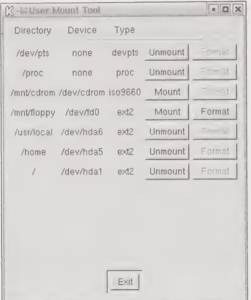

前面提到过。有一个名为 `partitions` 的文件，可以向你展示配置了什么以及在哪里。

```bash
[root@othersys ~]# cat /proc/partitions
major minor #blocks name
3 0 12537504 hda
3 1 2048728 hda1
3 2             hda2
3 5 8195068 hda5
3 6 2048728 hda6
3 7 136048 hda7
22 0 1073741823 hdc
```

如果文件系统是局部的，你还可以使用 `usermount` 工具以图形化方式对其控制（见图 8.3）。为了能够从此界面挂载、卸载和格式化设备，你必须是 root 用户，或者该用户必须是 `/etc/fstab` 中挂载点之一。

在我们之前查看磁盘空间时，我提到过 KDE 的 `KDiskFree` 工具。`KDiskFree` 允许你挂载和卸载文件系统（当然需要相应的权限）。

## 创建文件系统

所以你想自己创建一个文件系统？很好，为了在安装系统后创建一个文件系统，你使用 `fdisk` 命令后跟逻辑磁盘。记住第一个 IDE 驱动器是 `/dev/hda`，第二个是 `/dev/hdb`，以此类推。要在第二个磁盘上运行 `fdisk`，你使用 `fdisk /dev/hdb`。为了有东西演示，我在第一个 IDE 驱动器上留了一小块空间。

```bash
[root@escigate /root]# fdisk /dev/hda
Command (m for help): n
```

这是一个交互式会话。你在之前的代码中看到的 `n` 告诉程序我想添加一个新分区。我知道它显示输入 `m` 获取帮助，这并不特别直观，但请试着把这个程序想成“菜单”。继续会话，让我们添加一个逻辑分区。

```bash
Command action
1 logical (5 or over)
p primary partition (1-4)
1
First cylinder (1002-1023, default 1002):
Using default value 1002
Last cylinder +size or +sizeM or +sizeK (1002-1023, default 1023):
Using default value 1023
```

如你所见，在分区方面没有太多空间可以操作，所以剩下的全给你。关于分区可以有多大，你可以指定最后一个柱面（这就是我使用的 `1023`）、柱面数量（我可以输入 `+6` 来指定 6 个柱面）、兆字节数（`+20M` 表示 20MB）或通过使用 K 指定千字节数打印表格（仅打印到屏幕）并查看你配置的内容。

```bash
Command (m for help): p
Disk /dev/hda: 64 heads, 63 sectors, 1023 cylinders
Units = cylinders * 512 bytes
```

| Device | Start | End | Blocks | Id System |
| :--- | :--- | :--- | :--- | :--- |
| /dev/hda1 | | 940 | 189508+ | 83 Linux |
| /dev/hda2 | 941 | 1023 | 167328 | 5 Extended |
| /dev/hda5 | 941 | 1001 | 122944+ | 82 Linux swap |
| /dev/hda6 | 1002 | 1023 | 44320+ | 83 Linux |

Command (m for help):
现在，在提示符处输入 `w` 写入分区表并退出。

> **警告：** 当你对磁盘进行任何剧烈更改时，请务必提前进行备份。

`fdisk` 命令允许你指定大量的文件系统类型。默认是 Linux `ext2` 类型，但其他其他。要更改系统类型，使用 `t` 命令并输入数字。你可以借助 `l` 命令来确定你需要的系统类型。注意这个字母是大大写的。现在看看图 8.4，了解一下什么是可能的。

### 使用新文件系统

一旦这些信息写入，你就应该使用 `shutdown` 命令重启。

```bash
### /bin/shutdown -r now
```

分区表的更改是极端的，操作系统 应该有机会重新读取信息，而不会可能导致运行中的数百个程序挂起。如果这是你的第二个磁盘，并且你可以卸载每个分区（这个想法会自动排除第一个磁盘），那么可能是不需要重启的。

| File Sessions Settings Help | Command (m for help): L | | |
| :--- | :--- | :--- | :--- |
| 0 Empty | 10 Hidden HFS+/NTFS 5c | Prizam Edisk | a QBSD |
| 1 AST Windows swa 61 | 18 Hidden WinDS FR 63 | Speedor | a NextSTEP |
| 2 MINIX root | 1b Hidden WinDS FR 65 | GNU HURD on Sys b7 | BSDI Fa |
| 3 Extended | 1e Linux c7 | Novell Netcare c1 | BSDI sw |
| 4 FAT16 _3M | 24 DOS | 70 Disk mult c2 | DOS/REW (FAT) |
| 5 GRIS | 25 Solaris | 71 NTFS set c4 | DOS/REW (FAT) |
| 6 EXT3 | 30 Verix Boot | 79 Old lin c5 | c (IOS) |
| 7 HFS+/NTFS | 36 SFS | 82 Linux swap | ed DOS access |
| 8 ADB bootable | 42 SPFS | 83 DOS Fat | dOS Fat |
| 9 b WinDS FR32 | 44. second part 4 | OS/2 hidden | Speedor |
| 10 c WinDS FR34 | 45. third part 5 | Linux extended | BeOS Fa |
| 11 w WinDS FR 36 | 50 NTFS set f4 | NTFS secondary |
| 12 Common demount | 53 Ontrack_AMS 94 | Ameba Bebi | ld out |
| 14 Hidden FAT16 < 3 | 55 EZ-Drive b6 | 88 Thinklike high | Steep |
| 16 Hidden FAT16 < 9 | 56 Golden Boot | ff BBT |

图 8.4 使用 fdisk 选择文件系统

## 创建文件系统

在上一个例子中，我的启动磁盘有剩余空间，所以我现在重启了（你只需相信我），并准备好创建我的新系统。为了这一点，我使用 `mkfs` 命令。`mkfs` 允许我指定不同的文件系统类型，但默认是 `ext2` 系统，这是 Linux 的标准。

```bash
[root@testsys /root]# mkfs /dev/hda6
```

如果我想指定文件系统类型，命令类似，但我会使用 `-t` 标志配合参数 `ext2`。这是命令的输出：

```bash
[root@testsys /root]# mkfs -t ext2 -v /dev/hda6
mk2fs 1.18, for EXT2 FS 0.5b, 95/08/09
Filesystem label=
OS: Linux
Block size=1024 (log=0)
Fragment size=1024 (log=0)
11088 inodes, 44320 blocks
2216 blocks (5.0%) reserved for the super user
First data block=1
6 block groups
8192 blocks per group, 8192 fragments per group
1848 inodes per group
Superblock backups stored on blocks:
8193, 24577, 40961
Writing inode tables: done
Writing superblocks and filesystem accounting information: done
```

现在我有了一个有效的 Linux 文件系统。我可以创建一个挂载点并开始使用这个分区。

```bash
[root@testsys /root]# mkdir /mnt/newfs
[root@testsys /root]# mount /dev/hda6 /mnt/newfs
```

最后，`df` 显示我的文件系统可以使用。

```bash
[root@testsys /root]# df /dev/hda6
Filesystem 1k-blocks Used Available% Mounted on
/dev/hda6 42913 13 40684 0% /mnt/newfs
```


### 使用配额

通过配额，你可以使用你的 Linux 系统对磁盘空间使用设置并强制限制，然后只需让系统执行策略。如果有人抱怨，就怪系统。

## 准备配额

很久以前，配额支持是你必须在内核配置中设置的东西。几乎任何现代 Linux 发行版都将此支持内置在内核中，这使得你的工作简单得多。

要使用配额，你需要重新访问 `/etc/fstab` 文件，特别是那些挂载选项。与其显示整个文件，我将显示该文件中的几行——我将为配额支持配置两个文件系统。

| 设备 | 挂载点 | 文件系统 | 选项 | 转储/检查 |
| --- | --- | --- | --- | --- |
| /dev/sda | / | ext2 | defaults | 1 1 |
| /dev/hdb1 | /mnt/data | ext2 | defaults | 0 0 |

在这里拥有的只有默认挂载选项。为了使用配额，我将使用两个新选项。其中一个允许我在用户级别控制配额，而另一个处理组层面的配额。

第一个是 `usquota`，作为一个示例，我将设置 `/`（或 root）分区，以便在用户级别监控空间。第二个选项 `grpquota` 标识该分区为在组级别管理。

| 设备 | 挂载点 | 文件系统 | 选项 | 转储/检查 |
| --- | --- | --- | --- | --- |
| /dev/sda | / | ext2 | defaults,usquota | 1 1 |
| /dev/hdb1 | /mnt/data | ext2 | defaults,grpquota | 0 0 |

> 注意 `mount` 命令并不关心这些选项的相反。它们仅用于配额支持。

为了实际运行，我将创建配额数据库文件。这些文件被称为 `quota.user` 或 `quota.group`，取决于它们维护的是关于用户还是组的信息。这些文件存在于被监控的文件系统的根级别。这并不是根目录 (`/`)，而是你所讨论的任何文件系统的顶层。对于 `/` 的 `quota.user` 文件和 `/mnt/data` 的 `quota.group` 文件。你实际上不需要自己创建这些文件。如果它们不存在，系统将通过以下命令为你创建它们：

```
[root@testsys /root]# quotacheck -augav

Scanning /dev/hda/ done

Checked 5833 directories and 88825 files

Using quotfile /quota.user
```

扫描 /dev/hdb1 [/mnt/data] 完成
检查了 5996 个目录和 82804 个文件
使用配额文件 /mnt/data/quota.group

`quotacheck` 会扫描相应文件系统的配额信息并构建数据库文件。`-a` 选项告诉命令检查所有文件系统。这是处理此问题的最佳方法；否则，你需要在命令行中指定文件系统。`-u` 实际上是一个默认选项，意味着你应该检查用户配额，但我在这里包含它是为了与 `-g` 选项形成对比，`-g` 告诉命令扫描组信息。`-v` 意为“详细（verbose）”，在扫描时还会显示一个整齐的小旋转进度条。

我实际上还没有设置任何配额限制（稍后会提到这部分），但让我们看看我刚刚生成了哪些信息。使用 `quota` 命令，我可以创建一个关于谁在使用什么的报告。在这一操作中，我使用 `-a` 标记来指定所有文件系统，并使用 `-v`，即使没有使用量也会报告。请注意，输出被截断了，因为我不想用几页输出让你感到厌烦。

```
[root@testsys /root]# quota -av

*** Report for user quotas on /dev/hdb1 (/mnt/data) ***
```

| Filesystem | blocks | quota | limit | grace | files | quota | limit | grace |
| --- | --- | --- | --- | --- | --- | --- | --- | --- |
| /dev/hdb1 | 156128 | 0 | 0 | | 0 | 0 | 0 | |
| ... | ... | ... | ... | ... | ... | ... | ... | ... |

```
*** Report for group quotas on /dev/hdb1 (/mnt/data) ***
```

| Filesystem | blocks | quota | limit | grace | files | quota | limit | grace |
| --- | --- | --- | --- | --- | --- | --- | --- | --- |
| /dev/hdb1 | 2566207 | 0 | 0 | | 15839 | 0 | 0 | |
| ... | ... | ... | ... | ... | ... | ... | ... | ... |

如你所示，我配置的两个文件系统都在报告范围内。这些限制很有意思，指定了硬限制、软限制以及宽限期（grace period）。

硬限制（hard limit）顾名思义，是一道用户无法逾越的坚不可破墙。如果用户触及此限制，任何向磁盘写入的尝试都将被拒绝。

软限制（soft limit）像是一个棉花糖墙。用户可以通过它，但他或她会知道自己已经被标记了。系统会警告用户其已超过限制，取决于限制的配置方式，用户最终可能会被拒绝访问权限。

这就是宽限期。超过这段时间后，警告将变成事实，访问权限最终会被拒绝。如果你永远不希望拒绝访问权限，可以将宽限期设为零，也许最终，内疚感会战胜你那些“饥渴”的用户。

## 开启和关闭配额

现在是一个关键时刻，我要要求你重启系统。原因如下：为了让配额真正生效，被监控的文件系统需要卸载并重新挂载。如果没有人正在使用该文件系统，你只需卸载并重新挂载它；如果你尝试强制执行配额，则需要重启。每当系统重启时，你都需要运行 `quotacheck` 命令，所以你可能将其添加到启动脚本（`rc.local`）中。像这样就可以了：

```
/usr/sbin/quotacheck -au
```

时间流逝……既然你已经重启且配额已激活，可以关闭整个功能了。使用 `quotaoff` 命令执行此操作。

```
[root@testsys /root]# quotaoff -au

/dev/hdb1: user quotas off
/dev/hdb1: group quotas off
```

要重启配额监控，必须使用 `quotaon` 命令。`-a` 选项告诉命令开启 `/etc/fstab` 中定义的所有文件系统的配额。`-u` 和 `-g` 标记分别用户和组配额，而 `-v` 在启动时为你提供一些信息。

```
[root@testsys /root]# quotaon -av

/dev/hdb1: user quotas on
/dev/hdb1: group quotas on
```

## 使用配额

为了让系统跟踪限制，使用 `edquota` 命令。使用 `-u` 标记指定要为哪个用户设置限制。我为用户 natika 创建了一个记录并设置了一些限制。该用户的信息将在临时编辑器中显示。如果你使用不同的编辑器（例如 Emacs 或 Pico），请设置你的 `EDITOR` 变量以反映你的偏好：

```
export EDITOR=emacs
```

现在你可以用选择的编辑器启动 `edquota` 程序了。

```
[root@testsys /root]# edquota -u natika
```

user natika 的配额：
/dev/hdb1: blocks used: 280, limits (soft = 0, hard = 0)
inodes used: 67, limits (soft = 0, hard = 0)

注意软硬限制设置为零。这意味着没有任何限制。让我们将其改为合理的 5MB 磁盘空间。

user natika 的配额：
/dev/hdb1: blocks used: 280, limits (soft = 5000, hard = 7500)
inodes used: 67, limits (soft = 0, hard = 0)

如果 natika 尝试向她的账户拷贝大文件，会发生这种情况：

```
[natika@testsys $] cp /mnt/data/packages/apache_314.tar /: write failed, user limit reached.
cp: apache_314.tar: Disk quota exceeded
```

## 宽限

`edquota` 命令同样允许你设置宽限期。使用 `-t` 标记：

```
[root@testsys /root]# edquota -t
```

时间单位可以是：天、小时、分钟或秒。
执行软限制前的宽限期：
/dev/hdb1: block grace: 7 days, file grace: 7 days

最后，还可以定义默认用户并使用该用户为其他人克隆配额。例如，如果我想克隆 natika 的限制并分配给用户 guitix，我使用带有 `-p` 标记的 `edquota` 命令。

```
[root@testsys /root]# edquota -p natika guitix
```

## 让用户

`quota` 命令本身由任何用户运行，以让他们知道可用空间的情况。这可能是你决定放在 `/etc/profile` 脚本中的内容，以便每个人登录时都能看到。

```
[natika@testsys natika]$ quota -v

Disk quotas for user natika (uid 504):

Filesystem blocks quota limit grace files quota limit grace
/dev/hdb1 280 1000 5000 67 0 0
```

## 资源

文件系统层次结构 (FHS)

<http://www.pathname.com/fhs/>

文件系统 HOWTO（不限于 Linux）

<http://www.linuxdoc.org/HOWTO/Filesystems-HOWTO.html>

# 第 9 章 X 与图形桌面

大多数情况下，现代 Linux 系统在安装过程中完成了配置图形桌面环境的所有脏活。这就是为什么我决定以不同的方式处理这一章，而不是大多数书中呈现 X 信息的方式。我将开始展示桌面下的世界，这样你就可以快速深入表面，发现运行 X 时到底发生了什么。然后，我将介绍现有的几个桌面环境，并检查选择正确的环境如何帮助你完成工作，可能重要的是，帮助非管理员完成他们的工作。本章以对 X 进行微调的调查以及处理你可能会遇到的问题的技术作为结束。

## 这只是面子工程，对吧？

我热爱命令行。它是精简、干净、快速且强大的。
尽管如此，你极有可能在图形环境中完成大部分工作，而且如果你不这样做，其他人也会，包括你的同事。事实上，成熟的图形化工具和桌面的普及加速了 Linux 在职场中的接受。无论喜欢还是讨厌，图形桌面都将存在下去。此外，正确选择桌面环境可以让你按照想要的方式工作，从而提高效率。不仅如此，图形化环境的可配置性和灵活性还可以帮助你解决系统管理员面临的挑战之一：资源限制。
在你华丽的桌面之下是真正的图形引擎：X 窗口系统。虽然有商业性的 X 窗口系统，但你比较可能运行的是 `XFree86`，这是一种免费的图形化服务器。另一方面，桌面或窗口管理器定义了你桌面的外观以及它的工作方式。

具体来说，窗口管理器控制着你的窗口如何缩放、程序具有什么种边框、你的背景看起来是什么样、图标如何设置、你如何从一个应用程序切换到另一个应用程序，等等。

> 这里有另一种看待它的方式：窗口管理器就是图形化用户界面的体验。

我们这段旅程的第一站是图形登录管理器。

### 图形登录管理器

Linux 本质上是一个多用户系统。虽然我们中许多人在启动时会本能地登录 root 账户，但这实际上是一个非常糟糕的主意（如第 7 章所述）。root 登录是为了让你执行管理功能而存在的。虽然这是你在安装期间看到的第一次登录界面，但对某些用户来说，这也是最后一次。这不仅危险，而且限制了你的 Linux 系统的范围。

如果你工作的前提是一台工作站将由多个不同的人使用（无论是在你的公司还是在家里），我建议你使用登录管理器。如果你的图形桌面已经运行起来（可能它不像你熟悉的另一个系统那样好用），你可以自由更改它。你不必像其他人一样在桌面环境中工作。你可以选择适合你的方案并坚持使用下去。

对于一个一个用户将使用一台工作站的多用户环境，我建议你使用图形登录程序之一。对于 KDE 来说是 `kdm`，而对于 GNOME 来说是 `gdm`（见图 9.2）。那个老喜爱的 `xdm`（见图 9.1）仍然可用，但那些对 Linux 经验较少的用户可能会觉得默认的 X 窗口环境不太友好。

你可以通过几种不同的方式选择你的默认登录管理器。例如，在 Red Hat 系统上，你通过修改 `rc.sysinit` 脚本来设置对 `kdm` 的偏好。你会在 `/etc/rc.d` 目录下找到它。你需要的段落看起来像这样：

```
# Set preferred X display manager link
preferred=kdm
if [ -f /etc/sysconfig/desktop ]; then
  if [ -n "GNOME /etc/sysconfig/desktop" ]; then
    preferred=gdm
  elif [ -n "grep KDE /etc/sysconfig/desktop" ]; then
    preferred=kdm
  elif [ -n "grep AnotherLevel /etc/sysconfig/desktop" ]; then
    preferred=xdm
  fi
fi
```

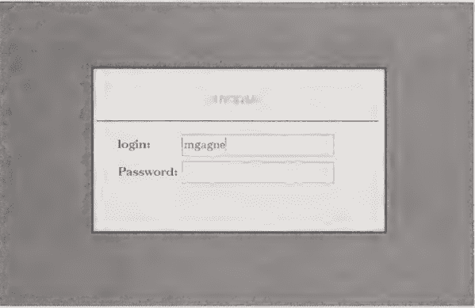

图 9.1 最简单的图形登录管理器，xdm

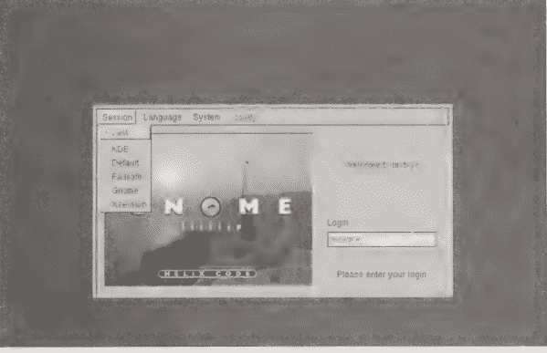

图 9.2 像 gdm 这样的高级登录管理器提供了 xdm 的替代方案。

默认情况下，`preferred=` 变量没有设置。我修改了相同的内容以编辑 `/etc/sysconfig/desktop` 文件，并简单地填入你喜欢的桌面环境名称。再往下看几行（在 `rc.sysinit` 的下一个段落中），系统设置了 `prefdm` 的行，然后该行会在你的 `/etc/inittab` 文件中启动。

```
ln -snf ../which kdm /etc/X11/prefdm
```

> 注意：在 Red Hat 的某些版本中，设置 `preferred` 变量的决定已转移到 `prefdm` 脚本本身。

在安装过程中，你可能获得了学习 Linux 启动图形桌面的机会。如果你选择不这样做，你仍然可以改变主意。这是我的 `/etc/inittab` 文件的末尾：

```
# Run xdm in runlevel 5
# xdm is now a separate service
x:5:respawn:/etc/X11/prefdm -nodaemon
```

现在看顶部，写着 `id:5:initdefault:` 的行。正如你所见，在这种情况下，默认运行级别（见第 6 章）是级别 5 的登录管理器，这就是它在启动时启动的方式。如果你愿意启动到文本界面并在命令行登录，请将你的 initdefault 改为 3。（确保人们没有在系统上操作）输入以下命令：

```
init 3
```

## 在没有图形登录管理器的情况下工作

这并不真的像是在没有安全网的情况下工作。相信我。之前描述的各种图形登录管理器（`kdm`、`gdm` 和 `xdm`）都是提供登录多用户工作站手段的极好方法，但对于某些人来说，尽管命令行登录只有简单的、未修饰的文本登录界面，它可能提供更多的灵活性、安全或性能。

## 表面下的世界

`xinit` 是启动你图形桌面的主程序。使用 `.X` 文件，`xinit` 将创建、构建并启动启动你的 X 窗口会话。但等一下——`startx` 背后的想法不是吗？在某种意义上，是的……

### XINITRC 文件

不是。你看，使用 `xinit` 启动你的 X 会话的问题在于它太复杂了（或者至少很啰嗦）。

`startx` 实际上只是 `xinit` 的一个 Bourne shell 前端。事实上，如果你查看文件 `/path_to/startx`，你会发现现在设置了一些变量、路径等之后，最后调用了 `xinit` 来实际启动 X。顺便说一下，该路径几乎总是这些路径之一：


/usr/X116/bin

/usr/bin/xinit

在不运行任何桌面或窗口管理器的情况下运行 X 是可能的。结果看起来可能很无聊，但它确实很有趣并邀请你尝试。从命令提示符，输入以下内容：

```
xinit /usr/X116/bin/xterm
```

你会注意到有一个完全没有任何修饰的 X 终端坐在一个没有任何特征的背景上。我想要让你做的第一件事是运行 `free` 命令，并注意运行这个简单无聊的 X 会话时内存利用率的变化。现在移动你的鼠标指针。你试过抓取终端窗口来移动它吗？不起作用，对吧？好了，在终端中输入一个命令——例如 `xcalc`。发生了什么？

计算器出现了，但它在与 X 终端相同的位置启动，这并算不上一个特别的工作环境。按 `Ctrl-C` 中断 `xcalc` 并在提示符输入 `exit`。系统将你带到纯文本控制台。

你可以以此方式从命令行启动你的桌面系统。例如，我可以用这样启动 KDE：

```
xinit /usr/bin/startkde
```

# xinitrc 文件

当你输入 `startx` 时发生的是：Shell 脚本会出去并检查本地 `.xinitrc` 文件是否存在。在没有本地 `.xinitrc` 文件的情况下，它会查找全局版本。如果没有本地 `.xinitrc` 文件，它会寻找，通常位于 `/etc/X11/init/xinitrc`。你的个人 `xinitrc` 文件，即以路径开头的那个，可以非常简单，正如运行 `xterm` 的。如果你已经有一个这样的文件，将其保存为 `bak.xinitrc` 以便以后恢复。现在创建一个非常简单的 `xinitrc`，使用这一行：

```
exec xterm
```

注意到当你用 `xinit` 启动 x 时得到了相同的结果。回看 `xinitrc` 文件，你会发现全局版本比你的个人 `xinitrc` 复杂一点，并检查是否存在。

在某种意义上，`xinitrc` 和 `.Xclients` 的作用非常相似。对于运行 Red Hat 的那些，情况有点不同。你的系统级 `xinitrc` 文件检查是否存在叫做 `.Xclients`。Red Hat 默认启动 GNOME。你可以通过修改全局 `Xclients` 文件来改变这种行为（特别是当多个用户登录一台工作站时）。

查找 `/etc/X11/Xclients` 附近的行 `PREFERRED=`：现在为空。将其更改为你喜欢的任何桌面。如果你想要 KDE，该行应该是这样的：

```
PREFERRED=startkde
```

我知道这看起来非常像你之前在本书中设置默认图形登录管理器所做的，但有两种不同的情况。对于 GNOME 用户群，将 `starkde` 替换为 `gnome-session`。你应该注意另一个文件：`.wm_style` 文件。如果你的全局 `Xclients` 文件，你会看到它指向叫做 `.wm_style` 的。这是本地用户偏好的管理器。为了让事情变得极其复杂，这是 `.Xclients` 的另一种替代方案，允许自由形式。全局 `Xclients` 文件查找管理器名称的变体。例如，如果你想运行 Window Maker、Windowmaker、Wmaker 或 `wmaker`。扫描 `/etc/X11/init/Xclients` 文件即可找到有效的选项。

这绝对是不常用的文件之一，但你应该了解它。`xserverrc` 定义了你想运行的 X 服务器，并且几乎从不使用。

这是因为默认情况下，你运行且仅运行一个 X 服务器，无论是你的 SVGA 服务器、加速 S3 服务器，还是直接的帧缓冲服务器——即为你的特定显卡运行的那个。如果你不要设置任何内容，你运行将取决于 `/etc/X11/X` 链接到哪里。例如，在我正在编写此书的系统中，`X` 链接到 `/usr/X11R6/bin/XF86_Mach64`。

# X RESOURCES 文件

## Xresources 文件

到此时，你可能已经开始意识到你的桌面是一个配置性惊人的环境。虽然窗口管理器负责一些工作，但你可以进行更深层的控制。例如，如果我启动一个 `xterm` 会话，想要一个漂亮的闪烁，比如我想让光标变成红色，而不是默认的蓝色。我可以通过创建或修改我的 `.Xresources` 文件来实现。

在我深入介绍文件结构的细节之前，你应该知道，你已经有一个全局文件在为你处理这一切了。实际上，你有好几个。切换目录到 `/usr/X11R6/lib/X11/app-defaults`，你会发现许多定义了标准 X 应用程序的文件。在你的主目录中，你可能还会发现一个 `.Xdefaults`，它执行更多或相同的功能。我的为几个应用程序设置了默认值，包括 Emacs、rxvt 和 `xterm`。

回到 `xterm`。我需要做哪些更改？嗯，如果通过 `man xterm` 查看 `xterm` 的帮助页并查找 X 资源，会发现 `cursor` 是影响光标颜色的属性。如果我退出 `Xdefaults` 或 `.Xresources` 文件并添加这些更改，它会变成如下所示——噢，我改变主意了。我更想让光标颜色变成一种难以阅读的小麦色（wheat）。

```
XTerm*cursorColor: Wheat
```

注意，我在资源前加了 `Xterm*`，以告诉系统该资源属于哪个（应用程序）。因为我希望在不注销 X 会话并重新登录的情况下让这些更改，我需要系统重新读取我的配置并合并更改。我是这样做的：

```
xrdb -merge $HOME/.Xdefaults
```

顺便说一下，`xrdb` 是 X 资源数据库工具。这个程序通常在你启动 X 会话时在某个地方被调用。在我的系统中，它是由 `/etc/X11/xinit/xinitrc` 调用的。如果我创建了 `.Xresources` 文件，我的命令将如下：

```
xrdb -merge $HOME/.Xresources
```

我启动了一个新的 `xterm`，看吧，光标变成了小麦色。既然你已经精通了这一点，让我们尝试一个更有趣的例子。当我启动 Netscape Navigator 时，我得到了一个在右侧显示有“Help”（帮助）字样的菜单栏。在我的 URL 地址栏旁边，我还得到了“Location”（位置）字样。为了好玩，就说当我需要帮助时，它更像是一个 SOS 而不是简单的寻求帮助。我希望我的浏览器在帮助处显示“SOS”，在位置栏显示“URL”。以下是我处理这个问题的方法。在我的 `.Xdefaults` 或 `.Xresources` 文件的末尾，我添加了这些行：

```
Netscape*menubar.helpMenu.labelString: S.O.S.
Netscape*urlLocationLabel.uneditedLabelString: URL:
```

在继续之前，我需要重新运行 `xrdb` 来合并这些资源。现在如果我关闭浏览器并重启，内容就会以我想要的方式显示了。你现在可能会问我是从哪里知道如何在 Netscape Navigator 中更改这些东西的。我在浏览器随附的文档中找到了 Netscape Navigator 的 X 资源。在我的机器上（带有 Netscape Navigator 4.75），该文档位于 `/usr/doc/netscape-common-4.75/Netscape.ad`。

## 在命令行上指定资源

让我们从不同的角度来看 X 资源。首先打开一个终端窗口并输入 `xclock`。你会得到一个类似于图 9.3 的熟悉的时钟。在 X 会话期间运行的每个应用程序都有一组关联参数。这些包括几何形状、调色板等。使用 `xwininfo` 你可以发现关于。

```
clock -icon &
xclock -title "RoundClock" &
xclock -background "SteelBlue" &
xclock -foreground "Red" &
xclock -geometry 250x250 &
```

## 看，妈！我可以运行多个桌面！

你可以通过按下 `Ctrl+Alt+F1` 在不影响当前 X 会话的情况下退出该会话。我可以使用 F2、F3、F4、F5 或 F6。如果你从命令行启动 X，当你按下 `Ctrl+Alt+F1` 时，可能会看到基于文本的登录管理器。顺便说一下，如果你以前不知道这一点，可以通过 `Alt+F#`（# 是数字）在这些虚拟终端（VT）之间进行切换。要回到 X 窗口会话，按下 `Ctrl+Alt+F7`。去尝试吧。反复切换。当你熟悉了之后，回到控制台屏幕（`Ctrl+Alt+F1`）。

现在你已经有了文本屏幕，让我们转向一些有趣的事情。如果你正在从图形登录管理器运行 X，现在是取消它的时间。回到那些虚拟终端。所以，功能 1 到 6 代表你的虚拟终端编号，而 7 是你的第一个 X 会话。那么 8、9 和 10 呢？

这是一个需要极佳回答的问题。嗯，让我们尝试一些有趣的。你的第一个 X 终端通常在 7 而不是 6，是因为 1 到 6 已经在你的 `/etc/inittab` 中被占用了。这里是我 `/etc/inittab` 的相关部分：

```
# 标准运行级别下的 getty
1:2345:respawn:/sbin/mingtty tty1
2:2345:respawn:/sbin/mingtty tty2
3:2345:respawn:/sbin/mingtty tty3
4:2345:respawn:/sbin/mingtty tty4
5:2345:respawn:/sbin/mingtty tty5
6:2345:respawn:/sbin/mingtty tty6
```

## 桌面的备份与恢复

概述的目的是为了让你了解登录并为每个使用特定 PC 或工作站的每个人创建不同的配置。这里的美之处在于，用户都在自己受保护的环境中工作。作为管理员，你可以在设置用户时，按照你想要的方式设置他们的个人桌面和配置，然后将其存储起来，以便在用户丢失数据时快速重建。

```
cd /path_to/home_dir/Desktop
find "Network Tools" -print | cpio -pduvm /home/another_user/Desktop
cd /home/another_user/Desktop
chown -R another_user "Network Tools"
chgrp -R another_user "Network Tools"
```

当你的用户下次登录时，他们会发现桌面上有一个小文件夹，里面包含了所有适当的链接和图标。理想情况下，你会将上述命令编写成适合你和你环境的脚本。

现在，之前的示例向你展示了如何处理桌面的一部分，但在大多数情况下，你会创建一个标准的桌面布局并提供给用户。实现这种方法的方法创建一个骨架桌面（来自一个虚拟账户）并备份生成的桌面。为此，我可能会使用 `tar` 命令。我的第一个例子是 KDE 桌面。

```
cd /home/skel_user
tar -cvf default.tar Desktop .kde .xinitrc .Clients own
```

恢复一个配置过的桌面（为另一个用户做准备）简单来说是在相应的目录下恢复骨架桌面即可。例如，下面的示例使用了用户名 “tpeng” 和组名 “staff”。

```
cd /home/tpeng
tar -xvf /path_to/default_desk.tar
chown -R tpeng Desktop .kde .xinitrc .Clients
chgrp -R staff Desktop .kde .xinitrc .Clients
```

如果你使用 GNOME 桌面，`.kde` 目录被称为“gnome”。如果使用 Window Maker 桌面，它被称为“wmaker”。

## 远程运行 X

远程控制并没有限制，X 提供了从几乎任何地方运行应用程序的工具。虽然我认为基于文本的应用对于远程管理更有意义，但并非所有情况都是如此。坦率地说，有时你更愿意运行工具的图形化版本。

为了从我自己的系统管理“marvin”（我网络上的一个主机）的运行级别，我打开一个 `xterm` 会话并运行 `xhost` 以允许客户端从 martin 访问我的系统。

```
# xhost +marvin
marvin being added to access control list
```

`xhost` 程序的作用是允许来自名为“marvin”计算机的应用程序在我的机器上运行。从我的系统，我

### 选择窗口管理器

现在 `telnet` 到 marvin。我以自己的身份登录，并切换到 root 用户以进行 root 级管理。

```
[magagne@marvin magagne su - root
Password: ********]
```

从这里开始，我设置 `DISPLAY` 变量，使得运行在 marvin 上的 X 会话知道如何找到我。

```
DISPLAY=myhost:0 ; export DISPLAY
```

就这样。我现在可以从命令行 shell 提示符运行这些图形化管理程序（或任何程序）。

> **安全警告：** 我不想在这里深入探讨这个问题，我将在书的后后部分（第 18、24 和 25 章）进行详细介绍，但这种环境的安全性是有限的。这种设置传输明文数据，可能会被被称为嗅探器（sniffers）的网络工具捕获。远程运行此类应用程序在短时间内或可信网络中是可以接受的，但目前请注意，从系统传输的信息没有经过加密。

### 选择窗口管理器

当我开始这一章时，我提到选择各种窗口管理器的原因之一是资源有限。“资源”一词可以意味着很多事情，但你会发现自己正在考虑的是内存使用。现代版本的 KDE 和 GNOME 非常漂亮且强大，但它们确实在处理器和内存方面消耗了系统的资源。处理器是很难通过购买新硬件来管理的硬资源。内存也是如此，当然，你可以通过选择更精简、更要求的应用程序来管理内存。

桌面也是如此。回到你的文本控制台屏幕，输入 `free` 命令，并查看输出。以下来自我的系统。

| | total | used | free | shared | buffers | cached |
| :--- | :--- | :--- | :--- | :--- | :--- | :--- |
| | 127784 | 78540 | 49244 | 14212 | 16380 | 38560 |
| -/+ buffers/cache: | | 23600 | 104184 | | | |
| Swap: | 122936 | 70780 | 52156 | | | |

注意特定的这一行，在 `used` 列下。不计算分配给 buffers 和 cache 的内存，我正在使用 23600KB 的内存（运行了许多服务器，邮件、httpd、postgresql、fontastic 等）。我在我一直在玩的一个 Storm Linux 系统上（没有运行很多服务）也执行了同样的操作，数字仅勉为 7.5MB。你要做的是根据窗口管理器提供的功能、它们之间的差异，以及最重要的它们对你系统产生的需求来比较窗口管理器。

为了测试各种显示管理器，你将从命令行 shell 启动一切。这意味着使用 `startx` 并与最简单的 `.xinitrc` 文件一起工作。尽管如此，让我们从第一个窗口管理器候选者开始。

## Tab 窗口管理器 (twm)

在你的 `.xinitrc` 文件中添加：

```
exec twm
```


## Window Maker

然后运行 `startx`。一旦进入环境，你就可以移动窗口、调整它们的大小并切换工作空间。Window Maker 最酷的功能之一是 `clip`。`clip` 可以配置为像 dock 一样吸引图标，但它的主要功能提供了一个在工作空间之间进行切换以及允许创建额外工作空间的简单界面。

Window Maker 最酷的功能之一是为窗口管理器存在的 dock 应用。这些是图标大小的应用程序，例如 DC 播放器、性能监控器、时钟、微仪表板等。虽然我使用多种 dock 环境（每当有机会就会展示它们），但 Window Maker 是我一直会回去使用的那个。

### KDE

现在让我们来看看目前最受欢迎的两个桌面环境之一。除了 GNOME 之外，没有哪个桌面环境能获得如此媒体的报道和关注。实际上，说“KDE 桌面环境”有点冗余，因为 KDE 代表 K Desktop Environment（酷炫桌面环境）。这个 K 代表什么？它代表“Kool”（酷炫）！

真的如此。

可以说，KDE 值得得它所获得的所有赞誉。这是一个美观、精炼且易于使用的桌面，配备了各种应用程序和工具。当那些行政事务让你感到压力很大时，你会发现有很多游戏可以消遣。说认真的，当我为父母配置他们的第一台电脑时，我安装了 Linux 和 KDE。我的父母是电脑领域的新的新手，而他们现在运行着 Linux。

曾几何时，KDE 的主页曾会询问 UNIX（以及 Linux）是否准备好进入桌面。而现在，他们谈论的是企业级。

与人们熟悉的 Windows 桌面一样，KDE 在左下角有一个大按钮，可以打开配置工具、程序、游戏等。桌面切换器位于看起来熟悉的任务栏中间，该任务栏支持停靠应用程序。（参见 9.6 节）。

除了常规工具集外，KDE 还拥有 KOffice，这是一套完整的生产力套件，包括文字处理器、电子表格、演示文稿包等。更棒的是，KDE 还带了 Konqueror，这是一个多功能文件查看器和管理器，它正迅速成为互联网上最好的浏览器之一。

KDE 的唯一缺点是它已经变成了一个“资源大户”，它需要一定程度的性能支持，包括处理器和内存。一台配备 16MB RAM 的 A486 可以制作 Linux 防火墙和 Web 服务器，但对于 KDE 来说还不够。

就像 Window Maker 一样，你的 Linux 发行版 CD 可能包含 KDE，但在 K Desktop Environment 网站（`http://www.kde.org/`）上始终提供最新版本。

提到强大的桌面，允许我介绍窗口管理器世界的另一颗星：GNOME。

### GNOME

GNOME 代表 GNU Network Object Model Environment（GNU 网络对象模型环境）。它是 GNOME 项目的全功能桌面环境。在 GNOME 面板（一个大脚）下，你会发现了一系列丰富的应用程序、系统工具、网络应用程序、游戏等等。

GNOME 的方法与 KDE 项目略有不同，因为它更多像是一个桌面工具包，而不是一个集成环境。在某些方面，这正是它的优势之一。让我们举个例子：在我写这本书的期间，GNOME 的默认窗口管理器是 Sawfish。而一年前，它是 Enlightenment。

由于这种“随处可插”的方法，许多窗口管理器（如 Window Maker）都集成了 GNOME 支持（有时被称为“感知 GNOME”）。例如，如果你想从 Window Maker 运行 GNOME 环境，可以点击应用程序菜单中的“运行”（Run）并启动一个 `xterm` 窗口。输入以下内容：

```
panel
```

如果你看图 9.7 的屏幕截图，你会看到 GNOME 桌面运行在下方的 Sawfish 窗口管理器之上。

> **预告**：如果我已经让你们兴奋地想要尝试更现代、更快、更慢的窗口管理器（甚至是下一个类 Windows 风格的候选者），而不是你们发行版 CD 中附带的版本，请不要担心。让它去互联网上走一趟，这就是第 10 章涵盖的内容。第 11 章将告诉你所有关于寻找和编译软件、你想知道但不敢于问的问题。请保持关注。

### QVWM

**图 9.7** GNOME 提供了一个平滑、精炼的桌面环境

GNOME 目前的优势之一来自它与 HELIX 的关联。这种优势是一个易于使用的网络更新和安装设施。在安装方面，如果你有互联网连接，GNOME 的安装非常简单且——

## 第 9 章 X 与图形化桌面

如果你想调整 X 显示设置，可以尝试这种方法：在命令行启动 `xvidtune` 后，立即点击 Show（显示）并记录下那些设置。我的设置看起来像这样：

```
Vendor: Unknown, Model: Unknown

Num hsync: 1, Num vsync: 3

hsyncync range 0: 30.00 - 70.00

vsync range 0: 50.00 - 180.00

*1024x768* 85.00 1024 1032 1152 1360 768 784 787 823
```

最后一行是启动 `xvidtune` 后点击 Show 的结果。之前的行是在 `xvidtune` 启动时打印的。现在，来看一眼 `XF86Config` 文件。任何 ModelLine 参数看起来眼熟吗？其中一个应该和你的设置完全匹配。在稍微调了一下水平数字后，点击 Test（测试）然后点击 Show，我看到了这些设置的修改版本：

```
*1024x768* 85.00 1024 1032 1152 1360 768 784 787 823
```

顺便说一下，这样做（因为在我折腾之前我的屏幕看起来还好）让它变窄了。我剪掉了第一行，并将其添加到 `/etc/X11/XF86Config` 文件的原始行下方，并注释掉了原始行（永远留有备份！）。我的系统运行正常，我不想丢失设置。此点的意义在于，并不是每一个窗口配置看起来都是完美的，并不是每个屏幕都能让你通过那些小按钮来修改设置。此外，即使在物理屏幕上，通过按钮调整屏幕可能意味着你的 X 显示看起来很棒，但你的文本却是错乱的。

## “乱套”的 X 会话

偶尔，你的 X 显示会发生一些奇怪的事情。事情看起来就是不对劲。如果你像我一样倾向于实验，情况尤为如此。在我撰写这个主题的过程中，我经常尝试不同的 X 和桌面。我还会下载并测试大量的 Beta 软件，以及比应得份额更多的 Alpha 软件。因此，显示偶尔会出问题。

你可以关闭 X 并重启会话，但那不是我们 Linux 世界喜欢的方式。相反，尝试使用 `xrefresh` 命令。

```
xrefresh
```

如果你不输入其他内容，`xrefresh` 会清空屏幕（这非常快）并在空白背景上重绘。为了获得有趣的效果，可以指定一个重绘的颜色。这是通过 `-solid` 标志实现的，如“solid color”所示。在这个例子中，我的 X 会话将从一个平坦的红色背景重绘：

```
xrefresh -solid red
```

## 屏幕截图

在结束本章之前，我为你们准备了一个特别节目。我将回答一个似乎每个人都在问的问题，你可能可能也在问自己。你是否好奇过如何获得精美的屏幕截图？我的意思是，我是如何获得本章中展示的 KDE、GNOME 和 Window Maker 桌面的那些漂亮截图的？实现这一现象是否涉及某种复杂的魔法？

事实是，获取屏幕截图有多种方法。桌面软件包有它们自己的小工具。例如，在 KDE 中，你可以点击大 K，选择 Graphics（图形）菜单，然后点击 Screen capture（屏幕截图）。看看图 9.10 了解它是如何工作的。

个人而言，我喜欢的方法是使用系统自带且安装妥当的小工具。它被称为 `import`，这里是它的工作原理示例：

```
import -border -frame -colorspace GRAY image_name.jpg
```

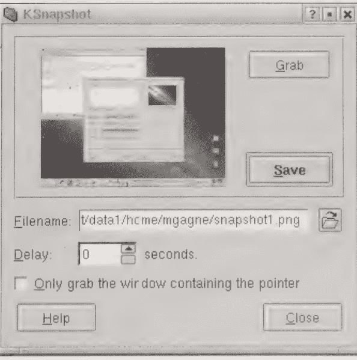

**图 9.10** KDE 的屏幕截图工具

一旦按下回车键，光标会变成十字。点击你想捕捉窗口上的光标，它将保存到你决定的任何文件名。让这个工具非常灵活且非常易用的原因是，你可以通过指定适当的扩展名来定义图像类型。如果你喜欢 PNG 文件，将 `.jpg` 扩展名改为 `.png`。

如果你想捕捉整个桌面，尝试这个版本的命令：

```bash
import --window root my_screenpic_name.jpg
```

想要更有趣的吗？你可以捕捉另一个 X 显示器上的远程屏幕，只要已经授予了适当的 `xhost` 权限（如之前讨论）。

```
import --root -display remotehost:0 screen_cap.tif
```

那将捕捉名为“remotehost”机器的整个桌面，并将整体保存为名为 `screen_cap.tif` 的 TIF 文件。啊，太有趣了。

### 资源

- GNOME 窗口管理器：`http://www.gnome.org/`
- ICE 窗口管理器：`http://icewm.sourceforge.net`
- KDE 环境 (KDE) 首页：`http://www.kde.org/`
- Qvwm 首页：`http://www.qvwm.org/`
- Window Maker：`http://www.windowmaker.org/`
- X 窗口管理器：`http://www.plig.org/xwinman/`
- XFree86 项目官方网站：`http://www.xfree86.org/`

## 第 10 章 使用 PPP 接入互联网

PPP 可以作为包进行安装。在 Red Hat、Caldera 或任何使用 Red Hat 包管理器 (RPM) 的 Linux 发行版中，你可以使用：

```
rpm -ivh ppp.i86.rpm
```

如果你运行 Debian、Corel Linux 或 Storm Linux，命令类似：

```bash
dpkg -i ppp.deb
```

实际上，对于 Debian 用户，有一种更好的方法（称为 `apt-get`），但我将在下一章讨论。此外，这需要已经连接到网络，而这正是你正在做的。

## 从 ISP 获取的信息

下一步是从你的 ISP 获取一些信息：你的用户名（很可能是你的电子邮件地址）和密码，以及 DNS 或域名服务器地址。显然，你需要 ISP 的电话号码来拨入他们的网络。如果你有之前提到的那些漫游账户，确保获取你可能经常去的地区的本地接入列表。将该列表保存在你的 Palm Pilot、Handspring 或 PDA 上。

你还应该拥有电子邮件包的服务器信息。你需要获取的信息是 POP 和 SMTP 服务器地址。某些 ISP 使用代理进行浏览。询问这一点，如果你的 ISP 是这种情况，请随手记录。这与连接没有关系，但当你运行 Netscape Navigator 时会需要它。

## 信息所在的位置

如果你的 ISP 给了你 DNS 地址，请使用你喜欢的编辑器编辑 `/etc/resolv.conf` 文件并添加如下信息（`XXX` 被你的 ISP 提供的数字替换）：

```
nameserver XXX.XXX.XXX.XXX
```

### 基础知识

定义：POP 是邮局协议（Post Office Protocol）。像许多互联网协议一样，这个协议已经有所改进。你的 ISP（互联网服务供应商）可能正在使用（或提供）POP3，即第 3 版本。POP 是电子邮件客户端获取邮件的手段。

SMTP 是邮件问题的另一端。它的全称是简单邮件传输协议（Simple Mail Transfer Protocol），它是负责将消息从一个位置传输到另一个位置的程序。

NNTP 是新闻新闻协议（Network News Transfer Protocol）。这种通信标准允许在客户端和服务器之间传输 Usenet 消息。网景导航者浏览器（Netscape Navigator）拥有一个支持 NNTP 的阅读器。在你的 Linux 发行版中，你还会找到 `tin` 和 `trn`。在图形化世界，可以寻找 KDE 中的经典 X 程序 `xrn`，以及 GNOME 中的 `pan`。

最简单形式的 PPP 设置涉及一个聊天脚本（chat script）和一个配置适当的选项文件。这些文件可能位于 `/etc/ppp` 目录下。有更优雅的方法来设置 PPP，但操作原始文件将让你非常直观地理解它的工作原理：

第一个要编辑的是选项文件。我的看起来像这样：

```
/dev/modem

57600

modem

crtscts

lock

defaultroute

noidpdefault

connect "/usr/sbin/chat -vf /etc/ppp/chat-script"
```

我的调制调器位于 `/dev/ttyS0`，但为了方便，我也有一个指向 `/dev/modem` 的符号链接（如果不存在，使用命令 `ln -s /dev/tty0 /dev/modem` 来链接）。

其他项目意味着什么？`57600` 是我的波特率，`crtscts` 表示我的调制调器应该使用硬件流控。`lock` 意味着 `pppd` 创建一个锁文件，以确保在我尝试连接 ISP 时，其他用户不会尝试使用我的调制调器（记住，Linux 是多用户系统）。下一个参数 `defaultroute` 意味着连接建立后应建立指向 PPP 接口的默认路由。这意味着所有非本地流量都通过我的点对点接口。`connect` 之前的最后一个参数是 `nodefault`，意味着我没有为连接指定本地地址。`pppd` 进程将尝试通过从系统获取本地地址来自行解决这个问题。

`connect` 语句描述了你如何建立 PPP 连接。这就是你的聊天脚本。`chat` 是一个命令，其目的是与你的 ISP 建立连接。这个小程序与你的调制调器对话，并监控类似于 `CONNECT` 字符串或登录提示的内容。示例聊天脚本如下：

```
ABORT 'NO CARRIER'

ABORT 'NO DIALTONE'

ABORT 'ERROR'

ABORT 'NO ANSWER'

ABORT 'BUSY'

** ATZ

OK ATDT550000

CONNECT **

login: myISPLogin

password: myISPpassword
```


这是一个经典的 expect/send 脚本。等待没有任何输出，然后发送 `ATZ` 来重置调制调器。当调制调器响应 `OK` 时（你预料到了吧？），发送 `ATDT你的电话号码`，以此类推。

上一个例子极其简单，但有效。你可以通过找到 `pppd` 的进程 ID 并使用 `kill` 命令将其终止来断开。要了解 PPP 的细节，请查看 Linux 文档项目网站上的最新 HOWTO（你可以在本文末的资源部分找到该 URL）。

## 第 10 章 使用 PPP 拨号上网

### 图形化替代方案

如果你使用 KDE 作为桌面，点击大 K，选择“Internet”菜单，然后点击“网络拨号器”。你也可以从 X 窗口终端会话中使用命令 `kppp &` 启动应用程序。

当 KDE 的 Internet 连接首次建立时，没有什么可看的，因为什么都没有配置。你会看到一个空的“Connect”列表，以及空的用户名和密码字段。要开始操作，点击“Setup”按钮。这将带你进入 Kpp 配置界面。这是一个很好的工具，你可以用它创建和维护多个拨号账户。大多数人可能只用一个，但你也可以用它为同一个账户设置多个配置文件。携带笔记本旅行的人可以为他们访问的各个城市创建配置文件。

从账户设置窗口中，点击“New”创建一个新账户。你将被要求提供连接名称、ISP 的电话号码以及身份验证类型（见图 10.1）。这默认为 PAP 认证（目前大多数 ISP 都使用这种认证）。如果你的 ISP 仍然要求你通过某些身份验证脚本（例如之前讨论的 expect/send 对话），请从列表中选择“Script-based”。

注意菜单上还有一些额外的标签页。“IP”标签页允许你手动输入 ISP 提供的 IP 地址。大多数账户使用动态地址，这是默认选择，你可能不需要更改任何内容。下一个标签页“Gateway”标签也是如此。这通常在你连接时由系统设置好。再次，如果你的 ISP 提供静态网关地址，你可以通过提供该地址来覆盖此设置。

极有可能，你可能想按照 ISP 的指示在此处配置一个地址。点击“manual”按钮。将给给你的 DNS 地址输入“DNS IP Address”字段中，然后点击“Add”。如果你有第二个地址，`pppd` 进程将尝试通过从系统获取本地地址来自行解决这个问题。

（注：此处原文存在大段重复的文本，译文已根据逻辑含义进行了去重处理，以确保翻译流畅且符合工程规范。）

### x3net

启动 x3net 接口非常简单。只需输入 `./x3net &`（你也可以提供你决定存储脚本的完整路径）。要查看 x3net 的运行情况，请查看图 10.3 中的截图。

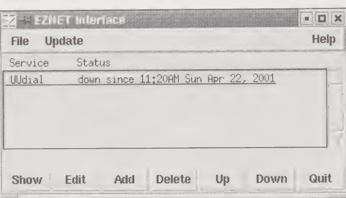

**图 10.3** x3net: x3net 的窗口界面

### wvdial

下一个程序 wvdial 来自于 Worldvisions Computer Technology, Inc.。与上一个示例一样，这是一个连接到你的 ISP 的非常智能的工具。和 x3net 一样，你可以从命令行运行 wvdial，也可以使用图形化界面。这里有一个惊喜：wvdial 自带了该程序，而且某些 Linux 发行版还包含了自己的 wvdial 图形界面。在 Red Hat 的情况下，该包是 `rp3`，它包含一个名为 `/usr/sbin/rp3-config` 的 wvdial 风格的程序（参见图 10.4）。SuSe 有一个名为 `wvdial.tcl` 的 Tcl 脚本。在上网之前，请检查你的发行版 CD。

由于它的流行性，人们还开发了许多其他该程序的图形前端，包括 Patrick Patterson 基于 KDE 的 `kwvdial` 和 Joergen Scheibengruper 基于 GNOME 的 `gppp-wvdial`。

让 wvdial 变得简单的 `wvdialconf` 程序。这样启动它：`wvdialconf /etc/wvdialconf`。

使用 Debian 的 dpkg 安装它的那些已经见过这一步了。这是安装过程的一部分。当你第一次运行该程序时，它将通过自动检测序列并自动识别并配置你的调制调器。

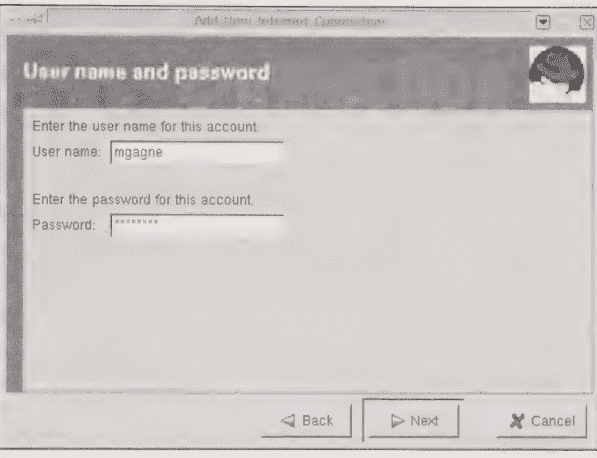

**图 10.4** rp3-config: Red Hat 的 wvdial 前端

#### wvdialconf /etc/wvdialconf

正在扫描你的串口以查找调制调器。

```
ttyS0<*1>: ATQ0 V1 E1 -- OK
ttyS0<*1>: ATQ0 V1 E1 Z -- OK
ttyS0<*1>: ATQ0 V1 E1 S0=0 -- OK
ttyS0<*1>: ATQ0 V1 E1 S0=0 &C1 -- OK
ttyS0<*1>: ATQ0 V1 E1 S0=0 &C1 &D2 -- OK
ttyS0<*1>: ATQ0 V1 E1 S0=0 &C1 &D2 S11=55 -- OK
ttyS0<*1>: ATQ0 V1 E1 S0=0 &C1 &D2 S11=55 +FCLASS=0 -- OK
ttyS0<*1>: Modem Identifier: ATI -- 5601
ttyS0<*1>: Speed 2400: AT -- OK
ttyS0<*1>: Speed 4800: AT -- OK
ttyS0<*1>: Speed 9600: AT -- OK
ttyS0<*1>: Speed 19200: AT -- OK
ttyS0<*1>: Speed 38400: AT -- OK
ttyS0<*1>: Speed 57600: AT -- OK
ttyS0<*1>: Speed 115200: AT -- OK
ttyS0<*1>: Max speed is 115200; that should be safe.
ttyS0<*1>: ATQ0 V1 E1 S0=0 &C1 &D2 S11=55 +FCLASS=0 -- OK
tty1<*1>: ATQ0 V1 E1 -- ATQ0 V1 E1 -- nothing.
PortScan<*1>: S2 S3
```

在 `/dev/ttyS0` 上找到了调制调器；初始化 "ATQ0 V1 E1 S0=0 &C1 &D2 S11=55 +FCLASS=0"

很简单对吧？现在，使用你喜欢的编辑器，编辑名为 `/etc/wvdial.conf` 的文件。你会看到类似这样的内容：

```
;Dialer Defaults
Modem = /dev/ttyS0
Baud = 115200
Init1 = AT2
Init2 = ATQ0 V1 E1 S0=0&C1 &D2 S11=55+FCLASS=0
SetVolume = 1
Dial Command = ATDT
; Phone = <Target Phone Number>
; Username = <Your Login Name>
; Password = <Your Password>
```

删除最后三行的注释标记（分号），并像下面的示例一样输入 ISP 电话号码、用户名和密码。

```
Phone = 905-555-1784
Username = MyISPLogin
Password = MyISPassword
```

要建立此连接，输入 `wvdial`。就此了。程序会在运行过程中告知你进度。

## 第 11 章 寻找、构建与安装软件

### SourceForge

如果说开源开发有一个聚会场所或俱乐部，那它可能是 SourceForge (http://www.sourceforge.net/)。SourceForge 是一个为开源开发项目提供的免费托管服务。对于任何积极参与开源项目的人来说，它都提供了磁盘空间、留言板、错误跟踪系统、存档、备份以及许多其他功能。由于使用该服务的价格非常合理，这里提供的内容极其丰富。在 TUCOWS 或 Freshmeat 上看到一个有趣的软件评测，然后顺着 URL 发现自己正处于 SourceForge 上，这并不不寻常。

与之前提到的网站一样，SourceForge 允许你按主题进行搜索，然后缩小范围以找到你想要的内容。例如，我通过点击软件地图（Software Map）上的“通讯”链接（见图 11.3）并点击“邮件”链接，发现了一个名为 SquirrelMail 的有趣 Web 电子邮件客户端。

如果你想参与这些项目的任何一个，或者想发布自己的消息（以防你正在跟踪某个项目或寻求支持），你可以在 SourceForge 上获取一个自己的账户。它是免费的。如果你是一个开发者并想让 SourceForge 托管你的项目，你必须符合开源计划（Open Source Initiative）接受的许可之一（访问 http://www.opensource.org/licenses/ 了解更多信息）。

**图 11.3** 在 SourceForge 上浏览开发项目

### Rpmfind

对于那些运行基于 RPM 的 Linux 发行版的用户来说，这是一个你必须知道的网站。该网站提供了一个搜索引擎，你可以在其中输入要查找的包名，让 Rpmfind 自动处理。结果会漂亮地显示，并突出显示不同的版本、发行版类型（Mandrake、Caldera 等）以及源码包和二进制包。当你寻找的二进制（RPM）包就在你的发行版 CD 中，而你在 RPM 网站上也找不到时，不要走，快跑到 http://www.rpmfind.net/ 吧。

另一个与 Rpmfind 网站配合使用的优秀工具是 `rpmfind`。你可以在你的发行版 CD 上找到它，或从该网站下载。使用这个工具，你可以在 Rpmfind 数据库中搜索你可能需要的 RPM 包。该工具能够为你自动下载并安装软件。

快速检查 Turbolinux 和 Red Hat 发行版 CD 可以发现其中包含 `rpmfind` 包，所以你可能不需要找得太远。要安装它，请使用 `rpm` 命令。

```
rpm -ivh rpmfind-release.no.i386.rpm
```

我来告诉你这些：`-i` 表示安装。`-v` 意味着“详细（verbose）”，会提供更多信息，而 `-h` 标志会在工作时在你的屏幕上打印小标记。你可以在它的网络主页获取 `rpmfind`。访问 http://rpmfind.net/linux/rpmfind.html 获取一个副本（而且，他们提供了 RPM 格式的）。

如果你不知道在找什么，可以使用简单的关键词来搜索软件。使用 `--apropos` 标志可以实现此操作。例如，如果你在寻找某种刻录机（burner），你可以使用关键词 "burner"。

```
rpmfind --apropos burner
```

你可能想将此输出重定向到文件中，因为一个一个简单的搜索也可能产生大量的命中结果。注意看当我对 "editor"编辑器）进行相关性搜索时找到的候选数量：找到了 25 个与编辑器相关的包。

你还可以使用 `rpmfind` 为你升级软件。现在，我会对此操作持谨慎态度，但在某些情况下，特别是当你知道自己在找什么时，这是一个非常棒且方便完成工作的方法。例如，如果你正在寻找某个工具将 bluefish（一个 HTML 编辑器）升级到最新版本，使用此命令：

```
[root@test]# rpmfind --upgrade bluefish
```

### ibiblio

该网站以前名为 metalab.edu，它应该被认为是 Linux 软件的必备书签。ibiblio 的存在时间比 Linux 长得多，它在 Linux 出现之前就已经为全球用户提供服务。将你的浏览器指向 http://www.ibiblio.org/ 并四处看看。

这是一个巨大的仓库，经过了分类和排序（见图 11.4）。ibiblio 还提供了一个出色的搜索引擎来定位难以找到的包。不说也，我在这里只提到了几个网站。这些并不是互联网上唯一的软件评测网站或仓库。它们代表了我认为每个管理员都应该知道的几个。如果你需要更多，请查看章节末尾的“资源”（Resources）部分。除此之外，祝你狩猎愉快。

### 安装与构建软件

现在你已经知道了在哪里以及如何获取大量优秀的软件，问题就变成了安装问题。一旦下载了新软件，你无疑会急于将其运行一下。症结在于，许多软件是以源码形式提供的——这并不意外，因为 GPL 许可证（许多 Linux 软件均根据此许可发行）要求你在分发程序的同时分发源码。某些开源项目与使用该许可作为版权手段的 GNU 项目没有关系。此外，还有其他使用 BSD 风格许可、授权等的许多其他开源项目，它们都以源码格式分发程序。

图 11.4 ibiblio 的镜像

当你考虑到某些项目追溯到 Linux 革命很久以前时，另一个原因就显而易见了。你下载的软件可能被 Linux 用户广泛使用，但 Linux 用户是第一批（或最后一批）使用它们的人。你下载的软件在 Linux 用户中是流行的，但 Linux 用户在某种程度上是第一批（或最后一次）接受它们的人。你下载的软件可能可以编译。相比之下，二进制发行版（如 RPM 或 DEB）允许程序在不同的系统上运行。

### 从源码编译

正如我提到的，许多软件是以源码形式提供的。初看之下，这可能是一个麻烦，但源码使得程序具有可移植性。源码通常代表了领先。从源码构建并不复杂，许多步骤在大多数发行版中是通用的。如果你能构建一个包，你就能构建大部分。

#### 步骤 1：解包

大多数程序源码以 tar 包（tarballs）的形式分发，这意味着它们是使用 tar 命令存储的。例如，一个名为 "ftl-drive version 1.01" 的包可以在如下站点列表中找到：

| 传输到 |
| :--- |
| http://rpmfind.net/linux/ |

如所示，解压过程会去掉文件的 .Z 扩展名。tar 程序有一个 `-Z` 标志，理论上应该解压文件（例如 `tar -xzvf filename.Z`），但那并不总是有效，这就是为什么我给了你两步走的方法。一直有效的是解压 Gnu 压缩存档（这种 gzip 程序不应被 DOS/Windows 的 PKZIP 或 WinZip 程序压缩）。这些是带有 .gz 扩展名的 tar 包。使用压缩示例，你可以分两步完成：首先使用 `gzip` 程序进行解压，然后对源码进行 `untar`。第二种选项是通过这种方式提取：

简单的 .tar 是非常基础的。你可以使用 `tar -xvf ft-drive.tar` 命令提取存档。在第二个示例（带有 .Z 扩展）中，你看到的是一个使用 `compress` 命令压缩的文件。这是一个相当经典的压缩方法，你可以在每个 UNIX 系统中找到。要从这个 tar 包中提取源码，你首先使用 `uncompress` 命令解压文件。然后继续你的 tar 提取。

只需要一步就够了。最后一个 tar 包代表了压缩领域的新手。由于开发者提供了源码，它在许多平台上都可以构建。你的 Linux 系统可能已经有了 `compress` 和 `uncompress` 命令，以及 `gzip` 和 `gunzip`。然而，你的发行版中可能没有 `bzip2` 和 `bunzip2` 程序。如果你需要安装它们，请检查章节末尾的资源部分获取该包的主页。

要提取 bzip2 存档，你需要执行与处理 `compress` 几乎相同的步骤。使用命令 `bunzip2 ftl-drive-1.01.tar.bz2` 来解压文件，并使用标准的 `tar` 命令进行提取。

或者，你也可以使用单行命令。该命令的选项因系统而异。在我用过的大多数系统中，这是 `-I` 选项（很快将被 `-j` 选项取代），但在 Slackware 等系统中，例如你应该尝试使用 `-y` 选项。在我的测试 Slack 系统上，我可以使用此命令一次性完成 `tar` 提取和 `bzip2` 解压：

```
tar -xvf ftl-drive-1.01.tar.bz2
```

> **关于压缩说明：** 不同形式的压缩将产生不同的结果。这里有一个你可能会觉得有趣的例子。让我们从 `/etc` 归档开始，我们将其命名为 `etc.tar`。在我的系统中，该归档文件占用 350MB 字节。虽然磁盘空间并非无限，但我请你考虑各种压缩类型的优势。从 `compress` 程序开始，我生成了一个名为 `etc.tar.z` 的 1170555 字节的文件。另一方面，`gzip` 创建了一个名为 `etc.tar.gz` 的 755073 字节的文件。最后，`bzip2` 创建了一个惊人的小的 666817 字节文件 `etc.tar.bz2`。我的归档仅占原始空间的 19%。

#### 步骤 2：构建你的程序

一旦你从 tar 归档中提取出程序源码，切换到软件的发行目录。使用我目前的 `ftl-drive` 示例，使用 `cd ftl-drive-1.01`，此时 `ls` 可能会显示如下若干文件：

| CHANGES | README | Makefile | Makefile.in | configure |
|---|---|---|---|---|
| INSTALL | ftl-drive.h | ftl-drive.c | engine.c | config.h |

你想做的第一件事是阅读 `README` 和 `INSTALL` 文件。这些文件将精确地告诉你你为了运行程序需要做什么。许多程序都提供一个 `configure` 文件，特别是当该软件是为了运行在不同版本的 UNIX 和 Linux 上而构建时。这是一个可执行脚本，旨在识别你的系统类型、发布级别、你是否安装了某些代码库、你的系统可能使用特定系统的哪个版本等。你像这样从命令行运行 `configure` 脚本：

```
./configure
```


# 第 11 章 查找、构建和安装软件

95% 的情况下，`configure` 脚本会完成生成 `Makefile` 所需的所有更改。`Makefile` 由 `make` 命令使用，该命令获取信息并确定为了构建你的软件需要编译或重新编译的内容。

下一步，即输入 `make`。当程序被编译和链接时，你会看到屏幕上有大量信息在运行。通常（在成功编译后），你会在 `make` 命令后紧跟 `make install`。你会将软件复制到 `Makefile` 中定义的目录中。许多程序员还提供了一个 `make uninstall` 选项，以防你以后决定不想保留该程序。

> 注意：如果你是一个开源程序员并想让人们感到高兴，请始终提供一个 `uninstall` 选项。

有时，你会被要求在输入 `make` 之前自己对 `Makefile` 进行修改。在程序仅为 Linux 系统编写并运行于 Linux 系统（且程序相当简单）的情况下，你只需要输入 `make` 而无需任何配置更改。不幸的是，提供源码并构建它的方法理论上和程序员的数量一样多，因此请仔细阅读那些 `README` 文件。同样，大多数程序员都遵循某种标准的发行方法，而这段介绍将让你很快学会如何玩转这个新游戏。我是说成“游戏”吗？我当然，我的意思是“工具”。

## 下载和安装 Perl 模块

Perl 是一种流行的编程语言，你很可能会发现自己正在安装有时完全基于 Perl 的软件。如果你寻找的工具或程序是基于 Web 的，这种可能性尤其大——CGI 脚本很大程度上是用 Perl 编写的。即使是使用其他语言（C、C++、PICK 等）访问数据库的代码，也使用 Perl 作为从 Web 到数据之间的桥梁。

Perl 巨大的社区在综合 Perl 归档网络（CPAN）上创建了一个模块归档，你可以将其下载并用于你自己的脚本和应用程序中。如果你发现下载的某个包显示了类似“你需要 Perl 模块 `CGI.pm` 和 `Digest::MD5` 才能使用此应用程序”的内容，不要轻视你所做的一切。

先访问 CPAN 并下载你需要的模块。做到此最简单的方法是将浏览器指向 CPAN 网站（http://cpan.org/）。

在这个示例中，我将使用一个名为 `DBI` 的真实模块。它用于简化 Perl 下的数据库开发。

```
cd /usr/local/temp_dir
tar -xzvf DBI-1.13.tar.gz
cd DBI-1.13
perl Makefile.PL
make
make test
make install
```

## 包管理器

下载、解压、解包源码、编译、安装，然后跟踪这一切并不一定令人望而畏。好吧，也许它确实很望而畏。事实上，如果你忘记了你在哪里执行了安装（记得我在 `Makefile` 中调用 `uninstall` 脚本的吗），升级该软件可能是另一场灾难。这正是包管理器试图简化的内容。

安装软件最简单的方法是通过发行版提供的包。以下是包是如何被识别的。假设我正在说一个名为 `ftl_drive` 的假设包。在如下系统中，在 Debian 系统上更新或安装软件包最简单的方法是使用 `dpkg` 命令的这种格式：

```
dpkg --install ftl_2.1.deb
```

第一部分是包名。下划线之前的数字是版本号。连字符后面的最后的后缀 `.deb` 表明这是一个 Debian 包。`dpkg` 是 Debian 系统的基础安装工具。之前的命令安装包。这一个移除它：

```
dpkg --remove ftl_2.1
```

> 注意：如果看起来像我在节省击键次数，是有原因的。我只在安装时指示了包版本号和后续扩展。要移除包，你只需要包名本身。

你应该意识到，移除包还有另一个需要考虑的步骤。虽然程序现在已经从你的系统中删除，但你的配置文件仍然存在（这可能是个好主意）。要彻底消除这些，你需要清除（purge）该包。

```
dpkg --purge ftl_2.1
```

### 查看已安装软件包

当然。如果你想获取系统中每个包的列表，对 `dpkg` 使用 `--list` 选项。你可能想将输出传递给 `more`。

```
dpkg --list | more
```

如果列表中的某个项证明很有趣你想你想更多关于该包的信息，尝试 `--print-avail` 标志。在这个例子中，我尝试发现关于神秘包 `mtools` 的某些信息。

```
speedy:~# dpkg --print-avail mtools
Package: mtools
Priority: standard
Section: otherfs
Installed-Size: 311
Maintainer: Mark W. Einch <echin@thok.org>
Architecture: i386
Version: 3.9.6-3.1
Depends: libc6 (>= 2.1.2), xlib6 (>= 3.3.5)
Size: 183456
Description: Tools for manipulating MSDOS files
Mtools 是一个公有领域的程序集，允许 Unix 系统读取、写入和操作 MSDOS 文件系统（通常是软磁盘）上的文件。每个程序都尝试尽可能地模拟 MSDOS 等效的命令。
```

### 查找软件包的当前发布版本

要查找系统中已经安装了哪个版本的软件包，请使用 `-l` 标志。在接下来的示例中，我查询了系统以确定我正在使用的 bash（Bourne Again Shell）的版本。

```
dpkg -l bash
Desired=Unknown/Install/Remove/Purge/Hold
Status=Not/Installed/Config-files/Unpacked/Failed-installed
Err?=(none)/Held/Reinst-required/X-both-problems (Status, Err: uppercase=bad)
|/ Name                          Description
++===============================================
ii bash                 2.03-6                The GNU Bourne Again Shell
```

### 那个奇怪的文件是什么？

假设你正在好奇系统上的某个文件在做什么。例如，在我的 `/usr/bin` 目录下有一个名为 `hinotes` 的文件，我不记得自己安装过它。此外，如果我尝试在帮助文档（pages）中查找它，系统告诉我没有关于该文件的信息。使用 `-S` 标志，我可以让 `dpkg` 识别该文件属于哪个软件包。

```
dpkg -S /usr/bin/hinotes
pilot-link: /usr/bin/hinotes
```

因为我记得安装过 `pilot-link` 软件（用来帮助将我的 Palm Pilot 与 Linux 系统同步），所以我可以稍微放心了。

### 使用 apt-get 安装或更新软件

经常使用 Debian 发行版的人有时会将这个极妙的小程序认为是 Debian 如此优秀的原因。嗯，我绝对不会否认 `apt-get` 是非常棒的。

如果你想安装一个名为 `xpilot` 的软件包，操作方法如下：

```
speedy:# apt-get install xpilot
Reading Package Lists... Done
Building Dependency Tree... Done
The following extra packages will be installed:
xpilot-server
The following NEW packages will be installed:
xpilot-server
0 packages upgraded, 2 newly installed, 0 to remove and 2 not upgraded.
Need to get 317kB of archives. After unpacking 1017kB will be used.
Do you want to continue? [Y/n]
```

这里的很棒之处在于，你不需要去各种网站寻找并识别合适的软件。你只需要调用带有 `install` 参数的 `apt-get` 即可。注意，`apt-get` 会自动获取给定软件包的依赖项并在需要时安装它们。如果你想更新到 `xpilot` 的最新版本，将 `install` 参数替换为 `update`。也许 Debian 实力最著名的例子是由以下命令所象征的：

```
apt-get dist-upgrade
```

对于一个能够将你的系统完整升级到最新发布版本的命令来说，这看起来简单得有些不可信。它就像魔法一样，但并非完全是魔法。毕竟，`apt-get` 必须从某个地方获取这些信息，对吧？

### 教育 apt-get

那个“某个地方”就是 `/etc/apt/sources.list` 文件。啊！一个软件源列表。这是一个可以用你喜欢的编辑器修改的简单文本文件。每一行的格式如下：

```
deb url_path distribution components
```

第一个参数 `deb` 在源发行版列表中也可以是 `deb-src`。

```
# 用于本地镜像 - 移除你的镜像中
# 包含的 ftp http 行
# deb /mirror/here/debian stable non-free
```

例如，下面这一行通过 FTP 识别了一个 Debian 镜像。在这种情况下，稳定发布版被标识为 `potato`。通常，这类似于 `stable`、`unstable` 或 `frozen`，但正如你所看到的，可以识别特定的发行。最后部分是组件部分（components）。它将被识别为 `main`、`contrib`、`non-free`。

这是一个 Debian 系统示例：

```
deb ftp://ftp.debian.org/debian potato contrib non-free
```

你应该定期用最新的可用软件包信息更新你的本地源数据库。

```
apt-get update
```

如果你经常从开发站点（例如 Wine 网站）安装 Debian 文件，你可能想要更新你的本地源。编辑 `/etc/apt/sources.list` 文件并添加站点信息。对于能够让你在 Linux 上运行 Windows 程序的 Wine 软件包，我添加了以下行：

```
deb http://deb.debian.org/debian wine main
deb-src http://deb.debian.org/debian wine main
```

> 注意：Wine 在第 22 章中介绍。

### 图形化替代方案

Debian 提供了一个基于字符、菜单驱动的界面，用于添加、删除或更新软件包。这就是 `dselect` 工具（见图 11.5），它实际上是之前使用的 `dpkg` 工具的前端。

从 root 提示符如下启动 `dselect`：

它允许你选择访问方法，可以是 NFS 挂载的驱动器、FTP 站点或你的 CD 发行版。如果你选择 `Select` 选项，将看到一个可用软件包列表。使用光标键高亮感兴趣的内容，同时关注屏幕下半部分。你会看到相关软件包的描述。这并不是你唯一的可用软件包。取决于你的桌面环境，你会发现许多工具。例如，如果你觉得需要一些更华丽的东西且恰好正在运行 KDE，你可以尝试 `kpackage` 工具。要运行它，只需在桌面的命令行中使用它。它非常易用。首先，点击 `New` 标签页。从 `Settings` 菜单选择 `uninstalled package`。一旦这样操作，你会注意到你可以选择 `debs`、`rpms` 和 `Slackware` 软件包。这是一个与许多不同发行版良好工作的工具。由于你现在正在处理 Debian，请点击 `DEB`（见图 11.6）。从那里，你只需输入你喜欢的镜像的 URL 并点击 OK。现在，按 F5（或从 `File` 菜单选择）并等待你的可用软件包列表更新。

`Updated` 标签页允许你从系统中已有的软件包列表中进行选择。`New` 标签页向你显示所有可用但未安装的内容。当你点击软件包时，右侧窗口提供该软件包的描述（见图 11.7）。另一个使用 `dpkg` 工具的前端见图 11.8。

## 红帽软件包管理器

红帽软件包管理器（RPM）并不严格针对红帽。你会发现许多使用它的发行版。你会发现红帽、Caldera、Mandrake 和 Turbolinux 都在使用 RPM。即使你的 Linux 发行版没有自带 RPM，你仍然可以安装并它。RPM 维护一个已安装产品的数据库，以便验证完整性或查询文件位置。这是一个非常好用的工具，可以判断软件包是否在你不知情的情况下被修改（第 25 章详细介绍了安全性）。

你可以在 http://www.rpm.org/ 找到最新版本的 RPM。

### 安装 RPM 软件包管理器

使用我的假设软件包，让我们用 RPM 安装一些功能。

```
rpm -ivh ftl-transport-2.1-1.i386.rpm
```

在现实中，你只需要使用 `-i` 标志执行此操作。`v` 提供额外的反馈，`h` 在屏幕上打印小哈号以显示安装进度。

```
rpm -ivh rpmfind-1.6-1.i386.rpm
```

你们中有些人非常好奇，所以我要告诉你们一个从这个过程中获取大量信息的秘密。去掉 `h`（尽管我喜欢这种模式）并再增加两个 `v`。在接下来的示例中，我正在安装之前讨论过的 `rpmfind` 软件包。你可能会觉得这非常有趣。通过双 `v`，你可以看到安装过程中各个阶段发生了什么。这让你对 RPM 工具的简单性产生相当的尊重。

```
rpm -ivvv rpmfind-1.6-1.i386.rpm
D: counting packages to install
D: found 1 packages
D: looking for packages to download
D: retrieved 0 packages
D: New Header signature
D: Signature size: 149
D: Signature pad : 3
D: sizeize : 152
D: Header + Archive: 53825
D: expected size : 53825
D: opening database mode 0x42 in /var/lib/rpm
D: found 0 source and 1 binary packages
D: YES A libxml = 1.8.10-0_helix_1 B libxml >= 1.8.6
D: requires: libxml >= 1.8.6 satisfied by db packages.
D: requires: ld-linux.so.2 satisfied by db providers.
D: requires: libbz2.so.0 satisfied by db providers.
D: requires: libc.so.6 satisfied by db providers.
D: requires: libdbx.so.2 satisfied by db providers.
D: requires: libopt.so.0 satisfied by db providers.
D: requires: libxml.so.1 satisfied by db providers.
D: requires: libz.so.1 satisfied by db providers.
D: requires: libc.so.6 (GLIBC_2.0) satisfied by db providers.
D: requires: libc.so.6 (GLIBC_2.1) satisfied by db providers.
D: installing binary packages
D: getting list of mounted filesystems
D: New Header signature
D: Signature line: 149
D: Signature pad : 3
D: sizeize : 152
D: Header + Archive : 53825
D: expected size : 53825
D: package: rpmfind-1.6-1 file test = 0
D: /usr/bin/bind rpmfind-1.6 action: create
D: /usr/doc/rpmfind-1.6 action: create
D: /usr/doc/rpmfind-1.6/ action: create
D: /usr/doc/rpmfind-1.6/CHANGES action: create
D: /usr/doc/rpmfind-1.6/Copyright action: create
D: /usr/doc/rpmfind-1.6/README action: create
D: /usr/doc/rpmfind-1.6/TODO action: create
D: /usr/share/man/1/rpmfind.gz action: create
D: running preinstall script (if any)
rpmfind-1.6-1
GZDIO: 15 reads, 120508 total bytes in 0.046 secs
D: running postinstall scripts (if any)
```


有时安装会因为各种原因而无法继续，但你比它更清楚。这通常发生在你正在尝试开发包并希望一直继续时。例如，如果 RPM 发现其字体文件版本与其他软件包的版本冲突，它可能会停止。在这种情况下，请使用 `--force` 选项。

```
rpm -i --force matter_transporter.1.0.3-i386.rpm
```

当执行安装脚本时，会进行许多完整性检查。其中包括先决条件或依赖检查。RPM 将停止并提示你缺少某些软件包，并在错误消息中列出其名称。在这种情况下，`--force` 选项将不起作用。相反，请使用 `--nodeps`（依赖检查）选项。

```
rpm -i --nodeps matter_transporter.1.0.3-i386.rpm
```

# 升级 RPM 软件包

升级是安装的一种形式。在过程中，旧版本的文件将被替换，软件包的默认配置文件可能会被移动或重命名以保留原始文件（如果发生这种情况，你通常会看到相应的提示）。此操作与安装过程几乎相同，区别在于你在命令行中使用 `U` 而不是 `i`。

```
rpm -Uvh matter_transporter-1.2-1.1386.rpm
```

# 卸载 RPM 软件包

在你担任系统管理员期间，你最终会卸载许多你不一定想要保留的软件。RPM 让移除旧软件包变得轻而易举。

```
rpm -evv matter_transporter
```

对于 `-e` 标志，只需记住“erase”（删除）。双写的 `v` 标志的作用是提供大量关于在删除此软件包过程中哪些内容被删除、哪些内容被更新的信息。你实际上只需要 `-e` 选项，内容仍然会被移除。

另一个值得注意的点是：如你所见，我没有为该软件包指定版本号。只有在安装时才需要。

# 关于 RPM 软件包，你想了解一切却又不敢提问

RPM 可以告诉你关于软件包的很多信息。要查找系统中安装了哪个版本的 `fileutils` 软件包，请单独使用 `-q` 标志。这是查询标志。

```
# rpm -q fileutils
fileutils-4.0-21
```

要找出哪些文件属于（或构成）该软件包，请为软件包中的所有项添加 `l` 标志。

```
# rpm -ql fileutils
/bin/chgrp
/bin/chmod
/bin/chown
/bin/cp
/bin/dd
/bin/df
/bin/ln
```

... 后面还有更多

你也可以通过 `f` 标志查找某个文件属于哪个软件包。在我的 `/sbin` 目录下，有一个名为 `sysctl` 的文件。如果我想知道这个文件来自哪里以及属于哪个软件包，我使用此命令：

```
# rpm -qf /sbin/sysctl
procps-3.0.5
```

（注：由于原文文本中存在大量 OCR 识别错误和重复，译文已根据逻辑进行了清理和整合。）

### 资源

- rpm.org (RPM 工具主站): http://www.rpm.org/
- Rpmfind: http://www.rpmfind.net/
- SourceForge: http://www.sourceforge.net/
- TUCOWS Linux: http://linux.tucows.com/

# 内核编译与重构

## 内核到底是什么？

内核是你 Linux 系统的心脏。事实上，你的内核就是 Linux。你认为的 Linux 系统的所有其他东西——文字处理器、编辑器、Web 浏览器、编译器——都只是面子工程（注意不要与窗口管理器混淆，我们在本书前面的章节已经讨论过窗口管理器）。

## 我什么时候应该重新编译我的内核？

啊，问得好。嗯，简短的回答是永远不要。较长的答案可能需要我解释一下这个短答案。在现代 Linux 发行版中，运行系统所需的所有内容很大可能已经配置在内核中了。尽管如此，在某些时候，发行版内核不支持你的硬件。你可能还需要某些特定功能，这些功能虽然常见，但在你的环境中是必要的。你可能需要实现一个需要新内核的安全修复。此外以及未来还会有其他原因。

这通常意味着需要 Linux 所提供的最新、强大的特性。如果你想知道 Linux 内核的最新版本是什么，它是稳定版还是开发版，请尝试以下命令：

```
finger @kernel.org
```

几秒钟后，系统会返回类似这样的内容：

```
[zeus.kernel.org]
Linux 内核的最新稳定版本是：2.2.17
Linux 内核的最新 beta 版本是：2.4.0-test10
最新的预补丁（alpha）版本*似乎是：2.4.0-test11/pre5*
```

当然，这假设你目前已连接到互联网。如果你没有连接，请参阅第 10 章了解如何连接的详情。

## 下载并编译新内核

获取了最新的内核信息后，你现在可以访问喜爱的内核源码镜像并下载你需要的内容。访问本地镜像非常简单。你做的只是在 kernel.org 的 `ftp` 或 `www` 之间插入你的国家代码即可。例如，假设我在加拿大（国家代码为 ca）。ftp 和 www 站点的地址如下：

- ftp.ca.kernel.org
- www.ca.kernel.org

如果我在美国，我会使用这些镜像：

- ftp.us.kernel.org
- www.us.kernel.org

如果你不确定这些代码中的任何一个，请访问 http://www.kernel.org/mirrors/ 内核主站获取完整列表。内核以 `tar.gz` 和 `tar.bz2` 格式提供下载。

下一步当然是编译内核。源码在手，是时候解压并提取这些源码了。通常且首选的位置是 `/usr/src`。来自任何 kernel.org 镜像的内核目录倾向于提取到一个名为 `linux` 的层次结构中。这意味着你的内核源码将位于 `/usr/src/linux`。然而，你可能会发现 `/usr/src/linux` 只是指向实际内核源码文件的符号链接。例如，如果我在其中一台服务器上执行 `ls -l`：

```
# cd /usr/src
# ls -l linux
lrwxr-xr-x 1 root 11 Nov 1999 linux -> linux-2.2.5
```

注意它指向一个名为 `linux-2.2.5` 的目录。如果你想直接从源码提取，可以通过重命名链接为其他名称并提取内核。该树将被称为 `linux`。现在，切换到 `linux` 目录并输入 `make config`。在你输入该命令之前——


我应该告诉你这是处理事务的旧方法。你将获得一个逐行的问答会话，旨在帮助你完成新内核的配置过程。如果你输入 `make menuconfig`，你将得到一个基于 ncurses 的界面，看起来有点熟悉（见图 12.1）。

最后一个选项是 `make xconfig`（见图 12.2），它使用 X 窗口环境进行构建。这可能是最好的方法，因为它很容易从系统配置的一个区域切换到另一个区域。例如，如果你忘记在新的内核中编译 MS-DOS 文件系统支持了，只需点击“Filesystems”按钮并添加你想要的内容即可。

> **注意：** `make xconfig` 命令要求你加载了 Tcl/Tk 包。

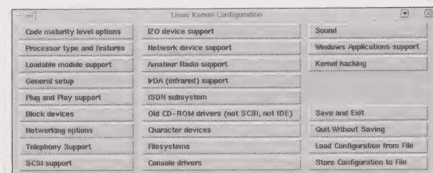

正如我所提到的，这是一个问答会话。你通过回答 Y（是）、N（否）和 M（模块）来决定你的内核中需要什么。根据你的选择，你可能还会被要求提供特定设备的信息。请仔细阅读。在过程的任何时候，如果你不知道某个特定事项的作用，可以寻求帮助。`make` 过程非常擅长引导并帮助你通过这一点。如果它告诉你应该包含某些东西，那就包含它。信任内核开发者。

> **术语表说明：** 谈论模块时（特别是可加载模块），我指的是没有编译进内核本身的内核支持代码。相反，你加载这些模块并本质上随心地将它们插入到运行的内核中。通常，“随心地”意味着在启动时，事实上你可以动态安装和卸载某些设备的支持。不将所有内容都编译进内核而是使用模块的优点是使内核更小、更快。

一旦完成，你实际上可以返回进行一些修改。在 `/usr/src/linux` 目录下，你会发现一个名为 `.config` 的文件。使用你喜欢的编辑器你仍然可以进行更改。这种菜单驱动的方法允许你进入你想要的内容。以下是最近构建的 `.config` 文件示例：

```
# CONFIG_486 is not set
# CONFIG_586 is not set
# CONFIG_TSC is not set
CONFIG_686=y
CONFIG_X86_WP_OK=y
CONFIG_X86_INVLPG=y
CONFIG_X86_BSWAP=y

CONFIG_X86_TSC=y
CONFIG_X86_GOOD_APIC=y
CONFIG_1GB=y
# CONFIG_2GB is not set
CONFIG_MATH_EMULATION=y
CONFIG_TRR=y
# CONFIG_SMP is not set
```

下一步是执行 `make dep`（它处理所有依赖关系并创建 Makefile），然后是 `make clean`。如果这是第一次构建，你会看到正在清理和删除文件的消息。

现在，是时候实际编译你的内核了。你通过执行 `make bzImage` 来执行。

> **快速提示：** 由于旧处理器限制，内核必须加载在第一兆内存中。这就是内核镜像问题出现的地方，以及为什么有时会收到“内核太大”的消息。你可以执行 `make bImage`，但在大多数现代环境中，最好不要这样做。除非将所有不需要的内容编译为模块，否则内核往往大到无法适应这种旧内存模型。这意味着你需要返回执行 `make bzImage`。bImage（认为“b”代表 big）的前提是旧限制不是因素。

下一步可能需要一段时间，取决于你计算机的速度，所以可以考虑给自己泡壶新咖啡（或者我的另一个自我可能会说）坐着不错的红葡萄酒一边等待。完成后，你将在 `/usr/src/linux/arch/i386/boot/` 目录下找到内核镜像。记得你要求系统构建 `bzImage`。现在，将新内核拷贝到 `/boot`。在以下命令中，我使用了 `vmlinuz-2.2.17`，但你可以将其命名为任何你喜欢的名字。如果我在尝试不同的内核，我通常按日期命名。例如，11 月的第一个内核将是 `vmlinuz-11101`。你可以使用任何你认为合理的命名约定。

```
cp /usr/src/linux/arch/i386/boot/bzImage /boot/vmlinuz-2.2.17
```

接下来，你想要把你的新内核包含在 lilo 的可引导内核列表中。对于这个示例，我直接从源码构建了 2.2.17 内核。完成后，我使用我的 vi 编辑器修改了 `/etc/lilo.conf` 文件。这是我开始之前它的样子：

```
boot=/dev/hda
map=/boot/map
install=/boot/boot.b
prompt
timeout=50
linear
default=linux
image=/boot/vmlinuz-2.2.14-5.0
        label=linux
        read-only
        root=/dev/hda1
```

在文件的末尾，我添加了以下行：

```
image=/boot/vmlinuz-2.2.17
        label=linux-2.2.17
        root=/dev/hda1
```

你会发现我没有更改这个示例中的任何其他内容。我的默认启动项仍然是 `vmlinuz-2.2.14-5.0`，这是随我的系统自带的默认内核。以 `image=/boot/vmlinuz-2.2.17` 开头的行是我后来添加的。现在，我将通过运行此命令来让我的 Linux 系统重新读取配置文件：

```
/sbin/lilo
```

在 lilo 处理完你的 `/etc/lilo.conf` 配置文件后，它应该返回类似下面的内容：

```
Added linux *
Added linux-2.2.17
```

> **快速提示：** `/sbin/lilo` 运行次数越多越好，但你不能运行两次。如果你对内核或你的 `/etc/lilo.conf` 文件做了更改，却忘记运行 `/sbin/lilo`，你的系统将无法启动。这极其重要。如果你不确定是否运行了 lilo，请再次运行它。

你只剩下最后几件事要做了。因为你没有定义要包含在你新内核中的几个模块，所以你还需要定义它们。你通过 `make modules` 命令来完成这一点，紧接着运行 `make modules_install`。

就是这样。总而言之，整个过程并不复杂，只是有很多需要记住和可能被遗忘的事情，而那个至关重要的 lilo 步骤可能会给你带来很多困扰。

## 自动构建与安装

既然我让你做了那么所有这些工作，你可能会问是否可以更简单一些。答案是有些许“是”和“也许”。以下是内幕：你可能可以通过输入此命令来跳过几个步骤：

```
make bzlilo
```

此命令会为你复制内核到指定位置，并让事情变得在某种程度上自动化。我个人并不喜欢这样做，因为我想清楚过程中的每一步。如果出现错误，我想知道它们。这取决于个人决定，取决于你对处理这些事务的舒适程度。

## 2.4 内核如何？

Linux 世界最受期待的进展之一是 2.4 内核的开发。是否运行新的 2.4 内核的问题已经由供应商决定了，他们开始分发将 2.4 作为默认内核的发行版。它的优点是多多的。以下是某些优势的简短且不完整的列表。

- 内存能力提升（从 2GB 增加到 64GB）
- 用户和组的数量从约 65,000 个增加到 400 万多个
- 多处理器 (SMP) 支持可以轻松扩展到 8 个处理器（我听说过 64 个）
- 日志文件系统支持
- 逻辑卷管理
- 大得多的文件大小（从 2GB 增加到 16TB）
- 原始 I/O 支持（被大型数据库制造商使用）
- 内核级 HTTP 守护进程
- 高级 NFS 支持
- 更好的防火墙、网络过滤器和网络地址转换 (NAT)
- 支持 ATM 控制器和多个 IDE (10) 和以太网卡 (16)
- 以及更多！

2.4 内核的构建过程与 2.2 系列的构建过程非常相似。你会注意到的一点是配置屏幕中有更多的章节。将图 12.3 中 `make xconfig` 的图像与图 12.2 中 2.2 的屏幕对比，你就会开始理解我的意思。

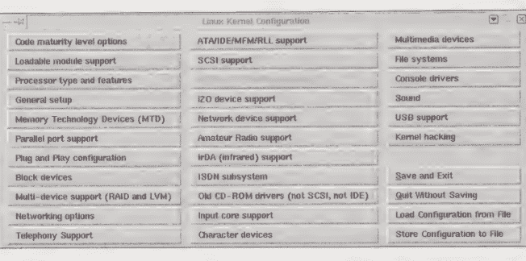

在解压源码后，你应该检查 `Documentation/Changes` 文件。你可能需要升级系统中的 C 编译器、库、`binutils` 软件包，可能还有其他软件包。最好先在这里检查。如果你发现你的第一次尝试构建 2.4 内核失败了，可能问题就出在这里。

如果你正在迁移（或仅仅是测试）新内核，不要将源码解压到 `/usr/src` 层次结构中。按照你安装或编译任何其他软件包的方式，选择一个临时安装目录。顶层目录仍然是 `linux`，但它不会导致与任何已安装的头文件产生任何问题。如果你完全放弃了 2.2 内核系列，将所有内容放在旧的层次结构中不会给你带来任何问题。

然而，有一个警告：可加载模块的默认位置已更改。你需要确保你拥有最新版本的 `modutils` 软件包。

### 资源

#### 源码文档

也检查内核源码树中的内核文档。一旦提取了内核源码（例如在 `/usr/src/linux`），查看该目录下的 `README` 文件，但也直接查看其下方的 `Documentation` 目录。

---

## 过滤器

让我们回到起点，看看这一切实际上是如何运作的，从你的老朋友——并行打印机开始。

基础架构通常有一个并行端口。连接在该端口的打印机将连接到 `/dev/lp0`。如果你的 PC 有多个并行连接器（或者你添加了打印机卡），那么第二个和第三个端口分别是 `/dev/lp1` 和 `/dev/lp2`。现在，假设你在第一个并行端口上连接了一个普通的文本打印机。打印它的操作像这样简单：

```bash
# echo "This is a test." > /dev/lp0
# echo "Ignore this print job." > /dev/lp0
# echo "This is nonsense." > /dev/lp0
# echo "^L" > /dev/lp0
```

> **注意：** 最后一行意味着“向打印机发送换页符以出纸”。`^L` 是 Ctrl-L。我通过按下 Ctrl-V（这允许我随后插入控制字符）然后按 Ctrl-L 将其插入到文本中。

你可能会发现一些奇怪的事情。这个简单任务的输出极可能像这样：

```text
This is a test.
Ignore this print job.
This is nonsense.
```

这就是我的打印机配置工具所谓的“文本阶梯状步”。你可能听过它被称为“阶梯效应”。发生的情况是，我的打印机（在此情况下是一台 LaserJet 5L）期望 PCL（它的原生打印机命令语言）或 DOS 风格的文本。这意味着每行末尾都有回车符和换行符，而 Linux 文件默认仅有换行符。这个经典问题让我们愉快地进入了过滤器的主题。

### 过滤器

让我们取完全相同的几行（非）信息（减去 `echo "^L"` 那行），并创建一个名为 "testfile" 的文件。我使用了 Pico 编辑器，但你可以使用任何你喜欢的工具。如果你像以前那样直接将文件 `cat` 到打印机（使用 `cat testfile > /dev/lp0`），结果是一样的。构建（或编写）一个过滤器可以非常简单。我的过滤器看起来如下：

```bash
#!/bin/bash
echo -e "\033&k2G"
cat
echo -ne "\f"
```


# 第 13 章 打印机与打印

## 过滤器

让我们回到起点，看看这一切实际上是如何运作的，从你的老朋友——并行打印机开始。

基础架构通常有一个并行端口。连接在该端口的打印机将连接到 `/dev/lp0`。如果你的 PC 有多个并行连接器（或者你添加了打印机卡），那么第二个和第三个端口分别是 `/dev/lp1` 和 `/dev/lp2`。现在，假设你在第一个并行端口上连接了一个普通的文本打印机。打印它的操作像这样简单：

```bash
# echo "This is a test." > /dev/lp0
# echo "Ignore this print job." > /dev/lp0
# echo "This is nonsense." > /dev/lp0
# echo "^L" > /dev/lp0
```

> **注意**：最后一行意味着“向打印机发送换页符以出纸”。`^L` 是 `Ctrl-L`。我通过按下 `Ctrl-V`（这允许我随后插入控制字符）然后按 `Ctrl-L` 将其插入到文本中。

你可能会发现一些奇怪的事情。这个简单任务的输出极可能像这样：

This is a test.
Ignore this print job.
This is nonsense.

这就是我的打印机配置工具所谓的“文本阶梯状步”。你可能听过它被称为“阶梯效应”。发生的情况是，我的打印机（在此情况下是一台 LaserJet 5L）期望 PCL（它的原生打印机命令语言）或 DOS 风格的文本。这意味着每行末尾都有回车符和换行符，而 Linux 文件默认仅有换行符。这个经典问题让我们愉快地进入了过滤器的主题。

让我们取完全相同的几行（非）信息（减去 `echo "^L"` 那行），并创建一个名为 "testfile" 的文件。我使用了 Pico 编辑器，但你可以使用任何你喜欢的工具。如果你像以前那样直接将文件 `cat` 到打印机（使用 `cat testfile > /dev/lp0`），结果是一样的。构建（或编写）一个过滤器可以非常简单。我的过滤器看起来如下：

```bash
#!/bin/bash

echo -033&k2G

cat

echo -ne \f
```

第一行换行符发送了命令，告诉我的 LaserJet 连接 Linux 换行符，随后是回车符、一个转义字符，最后是打印机控制序列 `&k2G`。这是一个 HP 特有的代码，因此你可能需要检查打印机手册以获取你打印机的正确代码序列。下一行只是获取收到的输入并原封不动地传递。最后一行发送一个换页符以出纸。我将该文件命名为 `dosilter`，移动到 `/usr/local/bin`，并赋予它可执行权限。

```bash
# cp dosilter /usr/local/bin
# chmod 755 /usr/local/bin/dosilter
```

我将重新发送任务并使用我新创建的过滤器。

```bash
# cat testfile | /usr/local/bin/dosilter > /dev/lp0
```

现在我的文本输出看起来正常：一行接一行，对齐。很不错，但在现实生活中，你通常不会这样向打印机发送任务。你会在系统上创建打印机并通过池打印（spooling）发送任务。让我们创建一个名为 `lptest` 的打印程序定义。通过编辑 `/etc/printcap` 并添加以下信息。请记住，`printcap` 文件的布局非常挑剔。你随 Linux 系统收到的指南（假设你买的是套装）告诉你使用 `tooltip` 或类似的工具。从长远来看，学习硬核方法更有趣，而且你最终会理解这一切是如何运作的。在章节后部分，我将向你展示如何使用工具。`/etc/printcap` 文件看起来如下：

```text
lptest:
:sd=/var/spool/lpd/lptest:\
:mx#0:\
:sh:\
:lp=/dev/lp0:\
:if=/usr/local/bin/dosilter:
```

这是所有内容的含义。第一行仅仅是打印机名称。如果你使用 `lpr` 命令向打印机发送任务，你需要指定这个队列名称。下一行指的是池目录。换句话说，就是当前任务相关的所有信息存放的地方。这是 `/var/spool/lpd` 目录下的一个目录（默认），但理论上它可以放在你喜欢的任何地方，`/var/spool` 是一种约定。我喜欢使用与队列名称相同的目录名。`0` 指你允许发送到打印机的最大文件大小。`0` 意味着“无限”，这通常是你想要的，除非你决定特定打印机不接受超过特定大小的任务（可能是太慢了）。下一行（`:sh:`）意味着“抑制表头”。因为这是一个物理连接的设备，你拥有 `lp` 选项，它定义了并行设备本身（`/dev/lp0`）（因为我只有一个并行端口）。最后一行指的是“输入过滤器”，即之前创建的 `dosilter`。

要让这一切运行，你只需要做的就是创建池目录（`/var/spool/lpd/lptest`）并将任务发送到打印机。

```bash
# mkdir /var/spool/lpd/lptest
# lpr -Plptest
```

## 打印作业控制

记住那个例子，假设你的适配器 IP 地址为 `192.168.1.225`，主机名为 `hpjdl`。要在你的 Linux 系统上创建一个队列，请使用此 `printcap` 条目：

```text
jdqueue:
:sd=/var/spool/lpd/jdqueue:\
:mx#0:\
:sh:\
:rm=hpjdl:\
:rp=text:
```

对于纯文本打印，这些就够了。注意远程打印机的名称是 "text"。JetDirect 卡和适配器有两个可识别的打印机名称。另一个是 "raw"。如果你的输出始终是 PCL 或 PostScript，你应该使用 "raw" 作为远程打印机名称。

HP 还出售了三端口的 HP JetDirect，它允许你通过一个 IP 地址（或一个物理网络插口）连接三台打印机。使用其中一个并不复杂。这些网卡可以识别六种不同的打印机名称：对于简单的文本输出，它们是 `text1`、`text2` 和 `text3`。对于原始或 PostScript 输出，尝试 `raw1`、`raw2` 以及（你猜到了）`raw3`。

打印机的主控制程序是 `lpc`，这是一个小型、交互式的命令行程序。在最简单的形式下，你输入：

```bash
# lpc
```

系统返回一个静静的小型提示符。

```
lpc>
```

如果你输入 `status`，你将获得该机器上配置的所有打印机的状态。这里是我系统上的输出样式：

```
lpc> status
lptest:
	queuing is enabled
	printing is enabled
	no entries
	no daemon present
```

让我们来看一个例子：我的主打印机 `lp` 出了问题，我不希望系统在我尝试修复它时继续尝试向它打印。在 `lpc>` 提示符下，我输入了以下内容：

```
lpc> down lp "You should not have bothered with this printer."
```

此操作的作用是禁用打印机并停止作业到达。注意 `down lp` 之后的消息。这将向任何从其计算机查询打印队列状态的人打印消息（我在这里假设是一个远程用户，但用户也可以是本地的）。因此，在不知道我的系统管理员做了什么的情况下，我向打印机发送了一个作业。然后我决定查看我的作业在队列中的位置，因此我使用 `lpq` 来查找。你可能已经猜到了，`lpq` 报告队列中作业的状态。像这样调用它：

```bash
# lpq -Pprinter_name
```

同时记住，如果你指定了 `PRINTER` 环境变量，就不需要指定打印机了。换句话说，输入此命令意味着我只需要输入 `lpq` 命令并结束即可。

```bash
PRINTER=lptest; export PRINTER
```

以下是我在系统管理员之后检查我的作业状态时发生的情况：

```
# lpq
lptest is not ready
Warning: lptest is down: "You should not have bothered with this printer"
Rank    Owner   Job     Files                          Total Size
1st     root    16      /etc/profile                   546 bytes
```

这告诉我我应该考虑使用不同的打印机。另一种替代方案是从队列中删除作业。这是通过 `lprm` 命令完成的。为了删除我的残留作业（编号 16），我输入了以下内容：

```bash
# lprm -Plptest 16
```

## 将任何内容打印到任何打印机

我想多聊一点关于过滤器。在我的办公室，我有一台小小的 HP LaserJet 5L。这就是我在本章所有示例中使用的那台。如果你曾花过任何时间使用 Linux（或其他 UNices/UNIX），你就知道大多数应用程序都使用 PostScript 格式打印。遗憾的是，我的打印机不能打印 PostScript。幸运的是，Linux 分带了一个名为 `ghostscript` 的小软件包。

我不会在 `ghostscript` 上花太多时间，除了告诉它是一个强大的工具，可以作为一个很棒的打印过滤器。如果我尝试将 PostScript 文件打印到我的打印机，它会变成奇怪的文本，而这恰好是一种代码——用 PostScript 语言编写的代码。查看我系统中 PostScript 文件的前几行，我看到：

```bash
# head contact.ps
%!PS-Adobe-PS
%%BoundingBox: 54 72 558 720
%%Creator: Mozilla (Netscape) HTML-->PS
%%DocumentData: Clean7Bit
%%Orientation: Portrait
%%Pages: 1
%%PageOrder: Ascend
%%Title: Registrant Name Change Agreement
%%EndComments
%%BeginProlog
```

如果我在没有某种可以解释 PostScript 的过滤器的情况下将其发送到打印机，它看起来也是这样。不同的 Linux 发行版提供了替代过滤器，但它们都共同包含 `ghostscript`。这是一个例子。我将我的 `contact.ps` 文件发送到打印机。注意我使用了 `ghostscript`。

```bash
cat contact.ps | gs -q -dNOPAUSE -sDEVICE=raw4 -r300 -sPAPERSIZE=letter -sOutputFile=-
```


# 将任何内容打印到任何打印机

我想多聊一点关于过滤器。在我的办公室，我有一台小小的 HP LaserJet 5L。这就是我在本章所有示例中使用的那台。如果你曾花过任何时间使用 Linux（或其他 UNices/UNIX），你就知道大多数应用程序都使用 PostScript 格式打印。遗憾的是，我的打印机不能打印 PostScript。幸运的是，Linux 发行版带了一个名为 `ghostscript` 的小软件包。我不会在 `ghostscript` 上花太多时间，除了告诉它是一个强大的工具，可以作为一个很棒的打印过滤器。如果我尝试将 PostScript 文件打印到我的打印机，它会变成奇怪的文本，而这恰好是一种代码——用 PostScript 语言编写的代码。查看我系统中 PostScript 文件的前几行，我看到：

```
# head contact.ps

%!PS-Adobe-PS

%%BoundingBox: 54 72 558 720

%%Creator: Mozilla (Netscape) HTML-->PS

%%DocumentData: Clean7Bit

%%Orientation: Portrait

%%Pages: 1

%%PageOrder: Ascend

%%Title: Registrant Name Change Agreement

%%EndComments

%%BeginProlog
```

这也是在我在没有某种可以解释 PostScript 的过滤器的情况下将其发送到打印机时的样子。不同的 Linux 发行版提供了替代过滤器，但它们都共同包含 `ghostscript`。这是一个例子。我将我的 `contact.ps` 文件发送到打印机。注意我使用了 `ghostscript`。

```
cat contact.ps | gs -qdNOPAUSE -sDEVICE=raw4 -r300 -sPAPERSIZE=letter -sOutputFile=-
```

# 一些 PostScript 技巧

假设你有一份两页的文档（一个程序列表或一组糟糕但幽默的单行代码），而你只想让它只占一页（它们其实没那么好）。这时 `mpage` 命令就派上用场了。你现在将打印此文档，让两个页面适应到一个页。输出将经过旋转，因此实际打印出来将是纵向的。

```
mpage -2 funnyjokes.txt | lpr -Pfpshpljet
```

两个页面显示在一个页上，且两个页面周围都有一条细线。让我们让它更精致一点好吗？尝试下一个命令，看看它生成了什么样的输出。

```
mpage -2 -B5r-51-3t-3b3 -M0510r50t50b -H prog_specs.txt | lpr -Plptest
```

这是什么意思？对于 `-2`，根据你的需要可以改为 `-4` 以让逻辑页面适应物理页。所以，如果你被我昂贵的术语困扰了，我是在使用“逻辑”和“物理”术语来区分打印机输出与物理的、“握在手里”的内容吗？你甚至可以使用 `-8`，但那可能有点傻了。`-B5r-51-3t-3b3` 部分意味着边框周围画一条粗线（3 磅）。那实际上是该行末尾的最后3个数字。`-5r-51-3t-3` 部分意味着顶部和底部有三行的页边距，左侧有五个字符的页边距。`M` 行使用类似的格式，并在你的虚拟页面周围提供 50 磅的页边距。记住，在这个例子中，一个物理页上有两个逻辑页。最后，`-H` 意味着每页都有页头。页头右侧是日期，中间是文件名，右侧是页码。

那么，你会在什么地方使用它？（在单行代码之后）是你的程序的代码。这是生成紧凑程序列表的极佳方法，无需将其导入到文字处理器中。我应该指出，还有一种非 PostScript 的方法可以创建简单的带编号的页面。你只需要使用 `pr` 命令即可。尝试在纯文本打印机上运行此命令：

```
pr +2 -h "Secret Kernel Enhancements" -o 5 ftl_travel.c | lpr -Phtextonly
```

`pr` 是一个为文本打印设计的命令。打印行表示获取 `ftl_travel.c` 文件，从第 2 页开始 (+2)，添加 5 个空格的左侧缩进 (-o 5)，并在每页上打印页头 "Secret Kernel Enhancements" (-h 后跟字符串)。如果你不指定不同的页头名称，将得到文件名本身，在此情况下为 `ftl_travel.c`。哦……它实际上会从第 2 页开始编号。

# 替代打印系统

对于需要更好更易用的打印系统，Linux 社区的呼声很高。虽然 `lp`/`lpd` 打印系统很好、运行良好且已经工作了几十年，但稍微简化一下无害。幸运的是，你可以在 Linux 世界找到一些工具，它们正在改变打印的面貌，使其从管理噩梦变成更有趣、更不那么可怕的事情。

每个发行版都通过其自己的界面来区分系统任务，如设置用户和打印机。红帽有 `printtool`，而 SUSE 有 `YaST`。虽然我可以探索每个发行版处理这些问题的选项，但我想花时间看看不针对特定发行版的替代方案。在接下来的几个章节中，我将为你介绍两个系统。请务必阅读第 16 章了解管理工具以及更多内容。

## PDQ

根据作者 Jacob A. Langford 的说法，PDQ 代表 "Print, Don't Queue"（打印，不排队）以及各种其他缩写。他的页面位于以下地址：http://pdq.net/。

PDQ 是一个很好、友好的软件包，适用于 Linux 和其他许多 UNIX 系统。虽然我不确定我是否完全同意关于打印、计费和队列的推理，但这并不会影响 PDQ 的价值。虽然它看起来完全有能力处理大型部署，但我特别喜欢 PDQ 的点是，它呈现了其他操作系统用户认为具有吸引力的友好面貌，并配有流畅的类窗口界面和可以帮助你快速设置打印机的向导。你可以轻松地使用 Grant Taylor 的兼容列表（位于 http://www.linuxprinting.org/）来查找最新的 PDQ 驱动程序和过滤器。下载 PDQ 源码并安装它是很容易的。当你获得副本后，只需确保替换适当的发布信息。你需要做的只是 `tar` 并解压，然后执行 `make` 接着执行 `make install`：

```
tar -xzvf pdq-2.1.tgz

cd pdq-2.1

make

make install
```

现在设置一个基础配置文件，如下：

```
mv /etc/pdq/example /etc/pdq/printrc
```

### 打印机与打印

要启动 PDQ 并配置你的第一台打印机，只需输入此命令：

```
lp
```

当界面出现时，点击 Printer（打印机），选择 Add（添加），并按照打印向导操作。当你将鼠标移动到字段上时，会有上下文相关的帮助来引导你。当你到达驱动程序选择屏幕时，你可能会发现列表有限——仅列出了大约十几个打印机，尽管你可能可以使用通用定义。对于我的 LaserJet，我回到了 Grant Taylor 的兼容列表。为了安装这个驱动，我进入了：

```
cd /etc/pdq/drivers
```

在驱动目录中，有针对打印机类的子目录。切换到 hp 驱动后，我使用了 `vi`（你可以使用 Emacs, Pico，取决于你喜欢的编辑器）并简单地粘贴了信息。然后我重启了 `lp`，我的打印机出现了（见图 13.2）。

**图 13.2 使用 lp 配置打印机**

### LPS

要使用 `lp` 打印任务，你发送该任务。格式很简单。为了我的测试，我发送了 PostScript 文件。

```
lp -Ph-51j /tmp/oneliners.ps
```

`-P` 标志调用我定义的打印机名称，而文件 `/tmp/oneliners.ps` 是我的 PostScript 文件。接口 `lp` 然后会报告任务状态，并允许你重新打印（如果它在任务列表中），或获取任务类型信息。

## CUPS

`lpd` 打印的另一种替代方案是 CUPS，即通用 UNIX 打印系统，设计为一种适用于许多不同 UNIX（或 Linux，取决于喜好）的跨平台打印系统。制作 CUPS 的公司（Common Software Products）根据 GPL 分发它，但你应该注意到驱动程序的数量是有限的。你可以在这里找到最新软件：http://www.cups.org

对于大型打印机支持，你可能希望考虑他们的 Enterprise Pro，这是一个包含 CUPS、大量打印驱动程序和精美 GUI 的商业方案。如果你想探索 CUPS 的商业方面，请访问 http://www.cups.org/printpro/

CUPS 使用互联网打印协议 (IPP)，这是一种替代 LPD 的下一代打印系统（尽管它仍然支持 LPD），在该环境中，任何用户都可以打印到任何地方的打印机。提议的标准甚至允许加密打印任务。对对此非常感兴趣的人可以访问打印工作组的网站（http://www.pwg.org/）。

如所述，CUPS 在其免费软件包中的打印机支持有限；然而，一些流行的打印机是支持的。如果你想走这条路线但坚持使用免费版（可以使用提供的驱动程序），你仍然可以为桌面获得一个漂亮的 GUI。你可以获得几个 GUI，这让你对 CUPS 日益增长的普及有所了解。

访问 CUPS 相关主页（http://cups.sourceforge.net/），你会发现一些可以丰富你 CUPS 体验的内容。特别是查看 KPS 和 QtCUPS。

# 杂记与技巧

如果你正在运行 Red Hat 6.1，你可能会发现自己苦恼于为什么系统不识别你的打印机端口。

这里存在两个潜在的问题。第一个与 `/etc/conf.modules` 文件中缺少的一行有关。如果你没有看到它，请尝试添加这一行：

```
alias parport_lowlevel parport_pc
```

另一个问题与系统分发的 `modutils` 版本有关。访问 Red Hat 网站并获取最新的 `modutils` RPM 包。

### 资源

- CUPS: http://www.cups.org/
- Ghostscript: http://www.cs.wisc.edu/~ghost/
- Linux 打印 HOWTO: http://www.linuxdoc.org/HOWTO/Printing-HOWTO/index.html
- Linux 打印用法 HOWTO: http://www.linuxdoc.org/HOWTO/Printing-Usage-HOWTO.html
- LinuxPrinting.org: http://www.linuxprinting.org/
- PDQ: http://pdq.sourceforge.net/
- 打印机工作组 (Printer Working Group): http://www.pwg.org/

# 脚本与脚本语言

我最喜欢的句子之一是“我不是一个程序员”，这并不是说我不会编程，也并不是说多年来我没有与多种不同的编程语言搏斗。COBOL、FORTRAN、BASIC、C、C++、Ada、Perl 以及令人生畏的汇编语言，这些名字都会在脑海中浮现，提醒着我。我知道写程序，而且很可能还会这样做。这只是不是那种能让我兴奋的事情。管理工作让我兴奋。网络设计、安全、系统集成以及那些复杂的后期支持也是如此（我喜欢解决谜题）。

我就像一个喜欢将多种食材组合以创造新的烹饪杰作的厨师。就像那位厨师一样，我依靠他人提供食材来完成工作。因此，我对那些专业（以及业余）程序员深表敬意，他们能够处理复杂的项目，并投入数周或几个月的时间来开发出像我这样的人所依赖的工具。

尽管如此，作为一名管理员，你需要在某些程度上进行编程。单一工具很少是解决单个问题的答案，但有时，组合正确的工具恰恰能提供你所寻求的解决方案。将这些工具组合在一起就需要编程。大多数 Linux 发行版都带有大量的编程和程序开发环境。幸运的是，大多数管理员可以使用几种非常简洁的语言满足他或她所有的编程需求。

这些语言之一就是你正在使用的那种。

## 眼所能及的 Shell

Shell 是与你的 Linux 系统工作最基础的环境。无论你对在文本环境中工作的想法，我保证，一旦你充分体验了简单文本的力量，你将永远信服。文本是紧凑的。在网络上进行系统管理最好在 Shell 级别进行体验。那些被迫在缓慢的调制解调器连接上使用图形化工具的人也会很快被说服。

很多人并没有意识到 Shell 实际上是一种编程语言。有很多种 Shell。Linux 世界最常见的被称为 `bash`，即 "Bourne Again Shell"。你可能在 Linux 系统上找到的其他 Shell 包括 `sh`（经典的 Bourne shell，我得找一个不包含它的 Linux 或 UNIX 发行版）、`pdksh`（公共 Korn shell）以及那个老程序员的最爱 `csh`（C shell）。

我给出的 Shell 列表只是一个很小的子集。还有 `ash`（代表 "a shell"）、`tsh`（增强型 shell）和 `zsh`（Z shell）。就像在海滩上散步并收集有趣的独特 Shell 样本一样，通过 Freshmeat (http://www.freshmeat.net/) 对你的软件仓库进行小小的旅行，让你看到人们一直在编写和设计 Shell。我的列表并非 Linux 的详尽列表，仅仅是流行 Shell 的集合。无疑，所有这些都可能出现在你的发行版 CD 中。

使用这些 Shell 编写的程序统称为脚本。详细介绍所有这些内容将构成另一本书（或者可能是几本书），所以我甚至不会假装尝试。我在这一章中做的是让你习惯编写 Shell 的概念，即编写实用的脚本来完成你作为 Linux 域管理员的工作，无论这个领域有多大。为了这个目标，我将集中在 `bash` 上。然后，我将介绍现有的一些脚本语言，看看它们如何帮助你完成工作。

## 到处都是命令

一个 Shell 脚本可以只是保存在一个文件中的命令集合。太简单了？

假设在白天，我经常检查时间和日期，并使用 `uptime` 检查系统运行了多久。我可以用我最喜欢的编辑器打开一个空文件，只需在每行上输入每个命令。

```
date

date

uptime
```

如果我将其保存为 `check3`（一个完全任意的名字），我可以通过输入以下内容来执行此脚本：

```
bash check3
```


就这样。Shell，`bash` 执行该文件中的三个命令并退出。可以想象的最简单的 Shell 脚本就是命令本身。例如，在写这本书时，我偶尔想捕捉某个特定窗口的快照。我是通过 `import` 命令做到的（该命令在第 9 章讨论过）。通常，我会从另一个桌面捕捉图像，即一台放在我写作工作站旁边的笔记本电脑。之所以做这两件事，是因为我可以这样做。

## 关于变量的更多

这里有很多内容。脚本会检查是否有任何参数。如果参数计数（这就是变量 `$#` 的含义）为 0，它会打印一条错误消息并退出。如果我记得传递一个文件名，我就会得到一个漂亮得多、类似“干得好”的消息。

```
$ grabwin etern.tif
etern.tif 捕获完成。
```

当你谈论 shell 编程时，你会在不同层级处理变量。你有之前看到的内置变量，也可以赋值变量。例如，在不编写脚本的情况下，在你的 shell（命令行）提示符处输入这一行：

```
hours=24
```

然后输入：

```
echo "There are $hours hours in a typical day"
```

系统的响应如下：

```
There are 24 hours in a typical day.
```

你通过在变量前加一个美元符号 (`$`) 来访问该变量。如果你只是在 shell 脚本中输入一行（不是 `hours=24` 这一行），让该脚本执行并运行，你会得到：

```
There are in a typical day.
```

shell 脚本没有获取到 `$hours` 变量。为了让 shell 脚本知道 `hours` 变量，你需要导出它（`export`）。有两种方法。其中一种是像你之前那样赋值变量，然后输入命令 `export hours`。你也可以把整个内容写在一行，以节省击键次数。

```
export hours="24"
```

现在运行脚本会显示一条更智能的消息，说明一天中到底有多少小时。除了用户分配的变量外，脚本还可以利用环境变量。这些变量是系统在你登录时为你设置的。其中一些变量有时会被用户主目录下的 `.bash_profile` 文件或全局的 `/etc/profile` 覆盖。一个常见的修改变量是 `PATH` 变量，它列出了可执行文件的可能搜索路径。检查你自己的 `HOME/.bash_profile` 文件中对以下内容的引用：

```
PATH=$PATH:$HOME/bin:/usr/local/bin
export USER BASH_ENV PATH
```

如你所见，你可以通过在赋值中引用它来修改环境变量。第二行导出了 `PATH` 和许多其他变量，以便你在任何可能工作的 shell 和任何环境中都能使用它们。要查看你的环境变量，请输入此命令：

```
env
```

## 特殊字符

某些字符对 shell 来说有特定的含义。以下是你将遇到的示例。

| 字符 | 描述 |
| --- | --- |
| `$` | 突出显示变量名的开头 |
| `#` | 注释字符 |
| `\` | 匹配字符 |
| `?` | 匹配任意单个字符 |
| `*` | 匹配任意数量的字符 |
| `'` | 定义字符串 |
| `` ` `` | 执行反引号内的内容 |
| `\` | 转义随后的字符 |
| `[]` | 列出括号内的字符范围 |

美元符号 (`$`) 是你已经见过的一个。它表示变量名的开始。你还见过注释字符 (`#`)，在接下来的章节中，我将讨论它的某些特殊属性。在很早的第 5 章中，我谈到了问号 (`?`) 和星号 (`*`)。

首先，我想谈谈反斜杠 (`\`)。当在特殊字符前面加一个反斜杠时，它会阻止 shell 解释该特殊字符。这是一个简单且我认为有效的演示。尝试输入此命令：

```
$ echo *
```

你是否得到了目录中每个文件并用空格分隔的列表？我所想的如此。再试一次，这次在星号前面加一个反斜杠。

```
$ echo \*
```

注意，shell 现在输出一个单个星号。每当你想要使用像 shell 中的那些特殊字符，但你不希望它们被以任何特殊方式处理时，在它们前面加一个反斜杠（我猜这是一种特殊处理）。

## 关于这一点我可以完全赞同

啊，引号。我有许多喜欢的引用。其中之一是“我想要永生，除非战斗到死”，这是 Spider Robinson 说过的一句话，但我希望我曾那样过。抱歉，这是不同风格的引言。

当然，我应该谈谈引号对 shell 意味着什么。双引号 (`"`) 告诉 shell 将内部内容解释为字符串。这是定义变量或将文本回显终端的方式。

```
my_variable="This is a double quote \" inside my double quotes."
```

你会注意到我在双引号内部又放了一个双引号，但用反斜杠转义了该字符。如果我输入 `echo $my_variable`，得到的是：

```
This is a double quote " inside my double quotes.
```

单引号 (`''`) 从表面上看似乎与双引号的作用相同，但它们确实有另一个重要功能。让我们设置几个变量并编写一个小的 shell 脚本。

```
$ os_name="Linux"
$ os_desc="way cool"
$ echo "$os_name is $os_desc"
Linux is way cool.
```

这大体是你在这里预期的结果。现在，我们在那个 `echo` 命令周围加上单引号，看看区别。

```
$ echo '$os_name is $os_desc.'
$os_name is $os_desc.
```

嗯……似乎单引号阻止了 shell 将美元符号解释为变量名。现在，那些反引号（`` ` ``）呢？反引号（或反引号）的特殊之处在于它们会执行内部的内容。例如，如果你有一个 shell 脚本回显 "The current date and time information is .."，而你想填充其他内容，你会想要 `date` 命令的输出。这是此此的一种方法：

```
the_date=`date`
echo "The current date and time information is $the_date."
```

另一种简单的方法是把反引号包裹的 `date` 命令放在 `echo` 行本身中。

```
echo "The current date and time information is `date`."
```

## 真正编写 shell

我提到的内容之一是 shell 是一种真正的编程语言。这完全正确。你可以使用如 `if...then...else`、`while` 和 `for` 循环、`case` 语句等结构。为了给你一个概念，这里有一个在意大利数学家 Leonardo Pisano 之后运行的小脚本。

```
# 运行斐波那契数列
fib_iterations=0
last_number=1
echo "The sequence starts with 1"
until [ $fib_iterations -ge 10 ]
do
    fib_iterations=$(expr $fib_iterations + 1)
    echo "number is $last_number"
done
```

## 指定 Shell

如果你查看 `/etc/rc.d/init.d` 目录下的某些启动脚本，或者可能是 `/etc/init.d` 目录，你会注意到它们以一个非常有趣的小结构开头。以下是我的 `inet` 启动脚本的前五行：

```
[root@testsys /root]# head -5 /etc/rc.d/init.d/inet
#!/bin/sh
# inet Start TCP/IP networking services. This script
# starts the Internet Network Daemon.
```

看到开头那行 `#!/bin/sh` 了吗？这种被称为 hash-bang（释字节符）的 `#!/path_to_shell` 结构是强制使用特定类型的 shell 来执行脚本的一种。假设你创建了一个使用 C shell 特有结构来工作的 shell 脚本。如果让 bash 来执行它，显然无法得到你想要的结果。此外，还有一些系统函数，例如 `at` 命令（将在下一章介绍），它们将使用 `/bin/sh` 执行所有命令。如果你创建的脚本使用了某些基础 `sh` 无法理解的 bash 命令怎么办？

解决方案很简单。只需在你的 shell 脚本顶部加上这一行：

```
#!/bin/bash
```

现在，即使运行脚本的 shell 是 `/bin/sh`，它也会切换到 `/bin/bash` 来执行该脚本。这也被用于定义其他的脚本环境。Perl 脚本开头会有这一行：

```
#!/usr/local/bin/perl
```

请记住，Perl 解释器的路径可能随系统而异。

## Perl

让我们直接进入 Perl 程序世界吧。将以下代码输入到一个简单的文本文件中（随你怎么喜欢命名），使该文件具有可执行权限，然后运行它。

```
#!/usr/bin/perl
# print "Perl, the Practical Extraction and Report Language, \n"
print "was was written by Larry Wall back in the eighties. \n";
```

Perl 被称为编程语言的“瑞士军刀”、互联网的“胶带”，以及其他同样有趣的称呼。对于你这个管理员来说，Perl 是一种编写强大应用程序的方法，而无需改变职业并成为一名专业程序员。

该语言本身汲借了 shell 脚本、C 语言、BASIC 以及其他语言。Perl 有几条格言。也许其中最著名的是“条条路都通”（There's more than one way to do it）。显然，这是该语言创建期间的一条格言。

Perl 的强大之处之一在于其庞大的用户群。它是全球 Web 上最流行的编程语言之一，用于大量的 CGI（通用网关接口，一组用于 Web 编程应用程序的钩子）。正如此，很容易被误导而仅从这个角度来看它。Perl 是一个很棒的小工具箱，你应该更好地了解它。

还记得我在第 11 章中提到的 CPAN 存档吗？那里有大量的预制模块，可以帮助你完成无数任务。

## Perl 实战：一个监控磁盘空间的脚本

有几本和这本书一样厚的书涵盖了 Perl 这个主题，所以我并不会假装能在几页内告诉你需要知道的一切。相反，我将为你提供一个实用的 Perl 脚本示例，用于你的日常系统维护工作。在这种情况下，你将创建一个 Perl 脚本，并将其设置为定期运行（下一章介绍自动化），以通知你关键的磁盘空间问题。如果磁盘空间低于总量的 10%，就会有人收到通知。让我们来看看它，然后我会告诉你发生了什么。

```
#!/usr/bin/perl
# checkusage.pl checks the usage of the disk space in percentage
# and e-mails it to sysadmin if greater than 90 percent

$admin_addr = 'marcel@my_domain.com';
&check_dfusage;
exit();
```

### 子程序

```
sub check_dfusage {
  @diskinfo = `df`;
  $message_text = '';
  foreach (@diskinfo) {
    ($dirname, $arg1, $arg2, $arg3, $arg4, $arg5, $arg6) = \
      split(' ', $_, 7);
    ($arg4num, $therest) = split('%', $arg4, 2);
    if ($arg4num > 90) {
      $message_text .= "Directory $dirname is now at\n$arg4num\n";
    }
  }
  print $arg4 . "\n";
  if ($message_text ne '') {
    &message;
  }
}

sub message {
  open(SF, "| mail -s 'Important system info' $admin_addr");
  print SF "$message_text";
  close(SF);
}
```

你要做的第一件事是设置管理员的邮箱地址。这可以是你的邮箱，也可以是一个应该被通知的用户列表。注意，电子邮件地址中的商业符号 (`@`) 已经用反斜杠字符进行了转义。

有两个子程序，每个子程序都通过行首保留字 `sub` 来标识。根据第一个子程序（称为 `check_dfusage`）的结果，你可能调用或不调用第二个程序（称为 `message`）来执行工作。

变量 `@diskinfo` 是 Perl 中所谓的数组变量。`df` 命令的结果被解析成数组中的每一行。我感兴趣的是第四列（文件系统名称），在脚本中由 `$arg4` 表示。如果 `$arg4`（减去百分号）大于 90，就会准备消息并通知你的管理员。90 是我设置的一个任意界值。如果你想在 75% 时收到警告，请将界值改为 75。

### 资源

使该脚本具有可执行权限并运行它：

```
chmod +x path_to/script
./path_to/script
```

输出示例：

```
Directory /dev/hda1 现在占用率为 95%
```

## 值得考虑的其他语言

Python 和 Tcl/Tk 都有大量的支持，且各有优势。你应该考虑的两个是 Python 和 Tcl/Tk。

### 资源

**书籍**

* *Programming Perl*, Larry Wall (Cambridge, MA: O'Reilly and Associates, 2000)

**网站**

* BASH Programming HOWTO: `http://www.linuxdoc.org/HOWTO/Bash-Prog-HOWTO`
* CPAN (Comprehensive Perl Archive Network): `http://www.cpan.org/`
* Perl 主页（至少一个）: `http://www.perl.com/`
* Tcl SourceForge 项目: `http://tcl.sourceforge.net/`

# 第 15 章 通过自动化简化管理

## 建设性的懒惰

多年来一直开玩笑说系统管理员是出名的懒人。他们会加班工作到深夜，唯一的目的是为了将某个过程自动化，以便以后再也不用做。这正是我一直以来的系统管理员风格（这意味着我通过不断寻找不用工作的方法为我的懒惰买单）。我并不是这么想的。Perl 大师 Larry Wall 声称懒惰是程序员的三大美德之一。他说“程序员”。

为了支持这一关于懒惰美德的说法，我最近在一个流行的互联网搜索引擎上搜索了“laziness”、“system”和“administrator”这些词，得到了超过 3500 条结果。罗伯特·A·海因莱因写过一个关于懒到不会失败的故事。事实上，他的一位角色拉扎拉斯·隆（出自《时间足够》）声称：“进步是由懒惰的人寻找更简单的方法来实现的。”

## cron: 掌控 Linux 时钟

运行在你系统上的基本进程之一是一个名为 `cron` 的实用程序。实际程序被称为 `crond`（cron 守护进程）。`cron` 是一个执行大量任务的小程序。每个 UNIX 系统都有某种形式的 `cron` 作为系统调度器的一部分。在你的 Red Hat Linux 系统（以及其他发行版）上，`cron` 实际上是由 Paul Vixie 编写的 "Vixie cron"。Slack 的 cron 则有些不同——它安装了 Matthew Dillon 的 cron 包。

那么，你问，它将如何改变你的生活？它能为你做什么？`cron` 允许你在名为 `crontab` 的文件中指定的时间和日期运行重复性任务。以用户 ID 和权限运行的 crontab 条目以用户名存储（这是它们来自 `/etc/passwd` 文件的名称）。例如，root 的 crontab 称为 "root"。每分钟，`cron` 都会唤醒并检查是否有任何任务需要运行。这些任务可以是关于任何你可以放入脚本文件中的内容：执行备份、清理日志文件、删除核心文件、通过 `fortune` 程序向你发送每日 Linux 格言等。此版本的 `cron` 还会检查它监控的任何目录和文件是否发生了变化。如果是，它将重新读取这些文件并将其加入待办列表。

crontab 的位置因系统而略有不同。系统中还存在 cron 任务，或多或少仅供系统使用的。查看你的 `/var/spool/cron` 目录。在你的 Red Hat 系统上，各种用户的 crontab 都在这里。在 Debian 系统上，有一个进一步子目录 `crontabs`，用户的 crontab 位于其中。

`/etc/crontab` 文件中 `cron.daily`、`cron.weekly` 等其他命令的执行时间。我的看起来像是：

```bash
SHELL=/bin/bash
PATH=/bin:/bin:/usr/bin
MAILTO=root
HOME=
# run-parts
01 * * * * root run-parts /etc/cron.hourly
02 4 * * * root run-parts /etc/cron.daily
22 4 * * 0 root run-parts /etc/cron.weekly
42 4 1 * * root run-parts /etc/cron.monthly
```


既然我已经说完了这些，这里有一个 root 用户的 crontab 条目：

```bash
30 2 * * * /usr/local/.Admin/backup.system 1>/dev/null 2>/dev/null
```

查看上一个 crontab 代码段中的最后一条目。`/usr/local/.Admin/backup.system` 及其标准输入和输出被重定向到 `/dev/null`。一个 crontab 条目有六个字段：

- 分钟，通常（实际上总是）在 0 到 59 之间
- 小时，运行范围从 0 到 23
- 日（这句“九月有 30 天……”很有用）
- 月（方便的是，Linux 使用 12 个月的日历）
- 星期，从数字上说，0 是星期日
- 命令字符串；即你最初想要自动化的内容

使用之前解释的字段定义，你可以看到该命令在每周、每月的每天凌晨 2:30 运行。`*`（星号）意味着“总是”。

如果你想让某项在一天内运行多次，你不需要为每个条目都写一行。例如，一个设置为每 15 分钟运行一次的进程可能如下：

```bash
0,15,30,45 * * * /path/to/my_15_minute/process
```

你也可以在不需要多行的情况下指定周期。让我们取之前的进程，但这次我会确保它在周一到周五以相同的 15 分钟间隔运行。我可以将日期字段输入为“1,2,3,4,5”，但你可以看到如果我对一个从每月 1 号到 15 号的任务尝试这样做，会变得非常繁琐（更不用说难看了）。尝试这种：

```bash
0,15,30,45 * * 1-5 * /path/to/my_15_minute/process
```

## 测试你的任务

编辑 crontab 的好方法是将你的任务安排在五分钟后（或任何时间）并观察结果。（cron 还会将包含任何输出信息的邮件发送到用户的信箱，当你将标准输入和输出重定向到 `/dev/null` 时，这特别有用。）

## 编辑 crontab

编辑 crontab 的正确方法是使用命令 `crontab -e`。这会将你放入 `vi` 编辑器，你可以在其中进行更改。当你写下更改时，crontab 会在某种程度上验证你更改的合理性，并在你做了某些非常奇怪的事情时通知你。对于你那些不太喜欢 `vi` 的人，可以使用 `EDITOR` 环境变量指定另一个编辑器。

```bash
export EDITOR=pico
```

你还可以使用以下版本的命令编辑另一个用户的 crontab（假设你是 root）。`-u` 标志定义了备用用户。

```bash
crontab -u user_name -e
```

## 我能看个示例吗？

我知道你急不及待要离开，这里有一个搜索旧文件并发送报告的脚本。

```bash
#!/bin/bash
# 此脚本搜索大于30天的旧文件并发送邮件报告
search_log=/tmp/foundfiles
find / -name core -mtime +30 -type f > $search_log
if [ -s $search_log ]; then
    mail -s "Core files report" user@example.com < $search_log
fi
rm $search_log
```

## 使用 at 运行任务

cron 真正伟大之处并不严格在于你可以运行脚本来自动化处理枯燥的过程，而在于你可以让系统在你不在场时完成这些工作。啊，如果你能让你的雇主在你离开办公室时也付你工作的工资就好了。

运行任务的另一种方法是使用 `at` 命令。当然，你也可以通过在 crontab 条目中让 cron 处理相同的事情。使用 `at` 的原因是它允许你进行一些非常灵活的操作。例如，我正要去度假了（下周二出发，而现在是周四），我想为任何在我不在期间给我发电子邮件的人创建一个假期通知。麻烦之处在于，虽然我现在记得要做这件事，但到了周一我可能就忘了。我可以费力去创建一个 cron 任务，或者直接在时间到的时候让它为我执行命令：

```
at 6 pm -f /path/to/file_that_updates_vacation_program
```

如你所示，`at` 能理解类英语的时间和日期定义，这使得定义某个事件发生的时间变得非常简单。`-f` 参数告诉 `at` 从脚本文件中读取必要的命令。在任何时候，你都可以通过 `atq` 命令查看你已队列等待 `at` 命令执行的任务。顺便说一下，`atq` 与 `at` 是同义词。以下是命令及其输出的示例。开头的 `12` 返回的是 `at` 队列的任务号。

```
# at
12 2000-09-26 18:00 a
```

如果你不想费力写脚本文件，可以从命令行进行操作，如下：

```
at noon today
at> /usr/games/fortune -1 linuxcookie | mail -s "Read this" me@here.com
at> ^D
```

如果我像上面那样输入命令，仅指定日期和时间，`at` 命令将在我输入命令时进入一个带有 `at>` 提示符的对话。命令提示符会随着我输入的每行内容重复。要发送信号完成命令输入，我按下 `Ctrl-D`。以下是另一种方法，它应该让你对 Linux Shell 脚本的灵活性有直观认识：

```
at noon today << MY_COMMANDS
/usr/games/fortune -1 linuxcookie | mail -s "Linux info" me@here.com
MY_COMMANDS
```

最后，如果事实是你只是在开玩笑并不并不想运行该任务，你可以用 `atrm` 命令将其删除。使用输出

## 自动化的其他工具

从上面的 `atq` 示例中，你可以这样从队列中删除任务 12：

```
atrm 12
```

### 权限问题

我想我应该早点告诉你这个。那些遵循“绝不在 root 账户运行（除非绝对必要）”这一黄金法则的人，可能发现自己最近被拒绝执行这些任何操作。`at` 命令会说：“你没有权限使用 at。”完结。与此同时，cron 则稍微口直接一点：

```
You (mgmane) are not allowed to use this program (crontab).
See crontab(1) for more information.
```

对于这些命令的访问权限，`at` 命令由 `/etc/at.allow` 和 `/etc/at.deny` 文件控制，而 `cron` 命令（你猜对了）由 `/etc/cron.allow` 和 `/etc/cron.deny` 文件控制。这些是简单的文本文件，列出了允许访问 `at` 或 `cron` 的用户。如果你想让所有人访问，只需留一个空的 `at.deny` 或 `cron.deny` 文件即可，因为这些代表了不允许访问的列表。要将访问限制在少数选定用户，只需创建一个 `at.allow` 或 `cron.allow` 文件，因为这是 `at` 或 `cron` 命令特权用户的文本列表。在后一种情况下，确保列表中至少包含 `root` 用户。

## 自动化的其他工具

你的 Linux 系统包含许多不同的工具来简化你作为系统管理员的生活。如果你经常获取某个特定文件的本地副本，你可以想象如果能为该过程创建一个 `crontab` 将会方便得多。这个想法的困难之处在于 `ftp` 命令的交互性质（你必须登录、提供密码等等）。

有时，你寻找的文件纯粹是信息性的，位于某个网站上。我有一位客户，由于内部原因，只允许通过 Linux 网关对一个工作站进行外部 Web 访问。尽管如此，这位客户仍然希望办公室里的每一个人都能查看快递服务的每日状态报告（通过快递网站获取）。该网页的本地副本可以解决问题，但我的客户不想开始教其中一个用户本地网站的设计。这必须是魔法才。

女士们先生们，Linux 来营救了。

## 第 15 章 通过自动化简化管理

### 自动下载：ncftp

让我们来看看你每天（每天/每小时）都需要获取的文件。启动一个 ftp 会话并将该文件传输到你的站点（或从你的站点传输到远程）。正如我所说，这很容易。它也是枯燥且重复的——正是计算机应该消除（或者说我们被告知要消除）的苦差。

你的 Linux 系统带有一个名为 `ncftp` 的优秀小工具，它旨在完美地处理这种情况。它有两个程序：`ncftpget`（获取文件）和 `ncftput`（传输本地文件）。在你想将文件传输到远程站的反向情况下，使用 `ncftput` 命令。让我们通过发送名为 `sales_results.txt` 的文件来尝试。

要完全自动化该过程，将命令放入脚本，创建相应的 `crontab`，让你的系统为你工作。

## 自动抓取：wget

如果是匿名 ftp 传输，可以省略 `-u` 和 `-p` 参数。在你想将文件传输到远程站的反向情况下，使用 `ncftput` 命令。（等等，让我们看看 `wget`）。

这里有一个简单易用的解决方案，可以解决我之前提到的问题：我的客户决定没有人能从办公室上网，但希望每个人都能访问快递网站上的一个页面。

```bash
#!/bin/bash
#
# 获取我的快递交付页面供本地访问
#
cd /home/http/html/mycou
mv deliveryupdates.html olddeliveryupdates.html
wget -11 http://www.mycourier_website.com/deliveryupdates.html
chmod 644 /home/http/html/mycou/deliveryupdates.html
#
```

通过 `crontab` 定期运行。然后 `wget` 从网站抓取新页面。顺便说，`-11` 标志告诉 `wget` 只保持单层。有些选项告诉 `wget` 扩展远程网站并在你的系统中创建完整的镜像。这在这种情况下不是我想要的。我脚本的最后一步是让新页面对所有人可读。脚本运行后，任何人现在都可以通过将浏览器指向正确的页面来访问 `deliveryupdates.html` 页面。

```
http://linux_server/mycourier/deliveryupdates.html
```

现在，办公室里的每个人都可以在没有互联网访问的情况下访问这些重要信息。

## 交互式会话脚本：expect

初一看，如果你想自动化人类干预过程，似乎运气不佳。有些事情需要人们从菜单选项中选择、输入密码或根据显示的信息做出决策。交互式应用程序需要用户的响应，不是吗？对于机敏且偷懒的系统管理员来说，答案是“并不总是如此”，这得益于一个名为 `expect` 的小程序。

虽然我以前听说过 `expect`，但我发现这种语言是如此有用。我和我的伙伴正在开发一个基于 Web 的系统，它需要定期从主机的数据库中更新数据，而该数据库不允许命令行脚本。数据需要执行一条 SQL 语句，而该语句只能通过供应商的菜单界面输入。SQL 语句随后将生成我们 Web 界面所需的数据文件。整个过程取决于编写一些代码，模拟一个用户坐在终端前，在各种提示出现时向其输入信息。`Expect`，这是一种基于 Tcl 的软件/语言，正是我们困境的答案。`Expect` 让我们的 Web 工具功能范围远超了我们当时的预期和希望。

仍在怀疑是否需要它吗？记得本章开头提到的“懒惰”吗？想象一下你正在工作到深夜，离开前最后一件需要做的是登录远程站点，确保某个特定应用程序已完成（它总是在凌晨 3:00 前完成），并将该程序生成的文件下载回本地站点。现在是晚上 10:00，你宁愿回家也不愿等待那个文件准备就绪的魔法时刻。你可以启动一个任务来运行 nftp 进行下载，但你不知道每次运行时的文件名会变化。你需要通过登录菜单系统并检查完成日志来找到名称。（我刻意让它变得复杂，是为了说明某些情况是很难用简单的 shell 脚本自动化的。）

expect 脚本的基本格式如下：

```expect
#!/usr/local/bin/expect
# 关于此脚本的注释（名称、功能、可选）
spawn some_command
set response "Some prompt . . . ."
send response$r
close
```

以下是发生的过程。`spawn` 关键字告诉 `expect` 开始某个程序。这可以是一个 shell (`/bin/bash`) 或任何进行会话的命令。通过 `set` 关键字，你将变量 `response` 设置为某个预设的响应。该语言的复数形式名称 `expect` 关键字，其功能完全如其名：它会扫描你通过 `spawn` 启动任何命令的输出，寻找匹配的文本。然后，`send` 使用第一个变量 `$response` 对预期的文本做出响应。现在让我们来点实操。

我的系统上运行着带有 OpenSSL 扩展的 Apache Web 服务器，用于安全事务。带有 OpenSSL 扩展的 Apache 需要我输入安全密码短语，以便启动服务器上加密的私钥文件。如果我在场输入密码短语，这没问题，但如果我在不在时服务器宕机了怎么办？虽然几个月没发生过，但这些事情确实会发生，而且我有时会在度假时遇到。这可能像为我的新磁带驱动器添加 SCSI 卡一样疯狂。我可能会忘记（确实发生过）在运行 OpenSSL 的情况下重启 Web 服务器。那该怎么办？为了解决这个问题，我写了以下简单脚本：

```expect
#!/usr/bin/expect
# 例程：startapache1
# 目的：启动开启 OpenSSL 的 Web 服务器
# log_file -tmp/expectlog
#log_user 0
spawn /bin/bash
sleep .2
send "/usr/local/apache/bin/apachectl start\rEnter pass phrase*"
sleep .2
send "mysecretphrasegoeshere\r"
sleep .2
```

当系统重启时，无论我是否在场，这个脚本都会重启运行 OpenSSL 的 Apache Web 服务器。观察脚本，你会注意到一些有趣的地方。例如，`log_file` 参数是新的。正如你预期的那样，它的作用是定义该脚本执行的日志文件。是否写入该文件由 `log_user` 参数定义。如果该参数设置为 1，则会记录日志。我打算在测试脚本时使用 `log_user`，但你可能决定始终捕获输出。另请注意，如果我通过启动 bash shell 进入，脚本中会有 `sleep` 语句。在所有情况下，我都会让 shell 等待 1/2 秒再继续。最后，`close` 语句终止了已启动的进程，因为已经没有后续操作了。此时，`expect` 终止并返回到启动它的进程。

无疑，你可以用其他语言编写这些功能，但 `expect` 让这一切变得简单。随着学习的深入，你会发现没有一种工具是适用于所有工作的。对于交互式应用程序的快速粗暴的自动化，没有什么能比得上 `expect`。

完全探索需要专门的一本书（事实上确实有一本），而我正试图让你领略你可以做些什么，而不是解释语言的每一个方面。在我让你去进行自己的探索之前，让我把这些例子再推深一步。

我们都知道定期更改密码是件好事，选择良好的密码也是如此（第 7 章），而且让用户在登录时完成此操作相当容易，但如果用户没有登录账户，则会困难一些。我指的是仅限邮件的用户，即那些你允许进行 POP3 邮件提取（或基于 Web 的电子邮件）但没有实际命令行提示访问的用户。许多办公室正是这种设置。为了让非登录用户更改密码，这是一个交互式活动，如下：

```
[root@my] # passwd
New password:
```

更复杂的是，为了非 root 用户更改密码，用户必须先输入旧密码。现在怎么办？你可以创建一个 Web 表单，让用户先输入这些信息（见图 15.1）。背后的 Perl 脚本会提取变量并传递给 `expect` 脚本完成剩余工作。

| 图 15.1 通过 浏览器修改密码 |
| :--- |
| ![img/c0ecd438ac7835cf030912433fa8b5267_0.png] |

如果你对 Web 应用感兴趣或想使用它，可以从我的网站 (`http://www.salmar.com/marcel/`) 下载。在此期间，看看这段来自应用程序的片段：

```expect
#!/usr/bin/expect
# 例程：psdcmd
# 目的：使用 expect 更改用户密码
log_user 1
set upvar [index $argv 0]
set currpassword [index $argv 1]
set newpassword [index $argv 2]
set renewpassword [index $argv 3]
#
# log_file -a /tmp/expectlog
# send_user "Spawning password with uservar.\n"
spawn user -l -c "password" $uservar
expect "Password:"
sleep .1
send "$currpassword\r"
sleep .1
#
expect {
    "current) UNIX password:" (send "$currpassword\r")
    su: incorrect password {exit 0}
}
sleep .1
expect {
    su: incorrect password {exit 0}
    "New UNIX password:" (send "$newpassword\r")
}
sleep .1
expect {
    "BAD:" {exit 0}
    "Retype new UNIX password:" (send "$renewpassword\r")
}
sleep .1
expect {
    su: incorrect password {exit 0}
    "New UNIX password:" {exit 0}
}
# 修改密码例程结束
```


`set varname [index $argv num]` 结构代表传递给 `expect` 例程的参数。注意 `spawn` 参数确实调用了 `su` 到指定用户以更改密码。默认情况下，Web 服务器上的 CGI 脚本以某些无权限用户（如 `nobody` 或 `www`）运行，你需要更改有效用户才能更改密码。顺便说一下，这些名称并不是写死的。最新的 Red Hat 7.0 使用 `apache` 作为运行 Web 服务器的用户名。你可以指定任何你想要的。

## 第 15 章 通过自动化简化管理

> **警告**：你可能希望将 Apache 服务器的默认用户保持为非 root。另一种做法将构成一个极其严重的安全漏洞。

脚本中还有另一个新项目。查看 `send_user` 参数。这本质上是一个打印语句。我把它留在示例脚本中，是因为我想向你展示一种调试 `expect` 脚本的巧妙方法。每个程序员都会在代码中插入调试语句来监控运行情况。在这种情况下，原理是一样的。你可以使用 `send_user` 作为脚本执行过程中与外部世界通信的手段。因为我通过 Perl 脚本捕获了 `expect` 脚本的输出，我也捕获这些消息。

顺便说一下，Perl 脚本调用了这里的例程（整个命令在同一行）：

```bash
$return_code = ./pscdmd "$username" "$currpassword" $newpassword "$renewpassword";
```

如你所示，调用 `expect` 脚本时传入了用户名、当前密码、新密码以及重复的新密码。我本可以简单传递两次新密码，但我想让密码更改程序的验证环节尽可能贴近原始逻辑，以便在命令行中提供尽可能清晰的用户体验。更准确地说，在更改用户设置之前，强制用户确认密码可能也是个好主意。

## 自动化交互自动化

现在你已经对 `expect` 脚本编写有了了解，我将让这个过程变得简单到难以置信。与其手动创建 `expect` 脚本，不如让程序也为你这样做？当你安装 `expect` 时，也会安装一个小程序 `autoexpect`。简单来说，`autoexpect` 会监控你在交互会话中执行的每一个操作并为你创建 `expect` 脚本。命令的格式如下：

```bash
-f script_outputfile command_string
```

例如，想象你想登录一个位于防火墙后的远程系统——本质上是一个两步登录过程。登录防火墙后，你执行登录（telnet、ssh 等）到内网中的另一个系统，然后你执行一个标准的菜单程序。你希望将整个双重登录并启动菜单的过程自动化。从命令行提示符，输入以下内容：

```bash
autoexpect -f superlogin.script telnet firewall.mycompany.com
```

完成登录后，你可以退出菜单并注销。

像魔法一样，`autoexpect` 会为你捕获整个会话。

现在，你可能想在其中进行一些编辑，但脚本的基础和所有提示都为你捕获了。将脚本设为可执行，你就几乎完成了。还有一件事是你想要添加的。在新 `expect` 脚本末尾，添加以下内容：

```bash
interact
```

这告诉 `expect` 在完成工作后将控制权还给你。如果没有它，`expect` 会关闭派生的进程，你所做的只是快速地登录和注销。

我完全无意将其作为 `expect` 的权威参考。不过，我希望这个短小的介绍（实际上是整章）能够激发你的兴趣，并启发你探索开发其他“建设性懒惰”的方法。毕竟，我们都有其他工作要做。

你屏幕上那个魔法斗篷是怎么回事？

### 资源

#### 书籍

- 《Exploring Expect》，Don Libes 著 (Cambridge, MA: O'Reilly and Associates, 1994)

#### 网站

- Expect 主页
  ```
  http://expect.nist.gov/
  ```

- GNU Wget
  ```
  http://www.cg.tuwien.ac.at/~prikryl/wget.html
  ```

- NcFTP
  ```
  http://www.ncftp.com/
  ```

- Salmar 网站（点击 Downloads 链接找到密码更改表单）
  ```
  http://www.salmar.com/marcel/
  ```

- Tcltk.com
  ```
  http://www.tcltk.com/
  ```

## 设备、设备以及更多设备

在某个时刻，你可能会为系统添加新设备——例如，用于备份的磁带驱动器，或者用于软件或数据长期存档的优秀 CD 刻录机。

本章涉及那些可能不属于磁盘驱动器和打印机基本类的设备的创建和支持。

## 创建设备定义

这个小插曲看起来像是对文件系统的回顾。将设备视为硬件是自然的。毕竟，控制台是你面前的一块发光大屏幕，你的键盘感觉也非常真实。当你为电脑买了一个新硬盘时，它确实很有分量。在不搞玄虚的情况下，从 Linux 内核的角度来看，设备只是 `/dev` 目录下的特殊文件。你定义这些文件的方式也定义了系统如何处理现实（物理）世界中的设备。

## 主号与次号

这些设备的定义是通过 `mknod` 命令创建的，并传递设备类型、主号（major number）和次号（minor number）。例如，我可以这样创建一个空设备的副本：

```bash
mknod /dev/null1 c 1 3
```

## 第 16 章 设备、设备以及更多设备

新系统中一种日益常见的设备是 CD-RW，或称 CD 可重写光盘。CD-ROM 和 CD-RW 的优点在于它们现在变得极其廉价，尽管 CD-ROM 的价格比 CD-RW 便宜一点。你当地的办公用品商店可能批量出售 50 张或 100 张一组的 CD-ROM 空光盘。对于长期存档或共享文件，CD-ROM 已经成为首选方案。

刻录光盘通常被称为“刻录”（burning），你会反复看到这个术语。事实上，录制光盘的程序通常被称为“刻录机”（burners）。对于 Linux 来说，首选工具是一个名为 `cdrecord` 的程序，可以从 Jörg Schilling 的网站（http://www.fokus.gmd.de/research/cd/clone/employees/joerg.schilling/private/cdrecord.html）获取。

获取最新的源码并将其解压到临时目录。构建软件的步骤相当简单。请始终记住，书中包含的版本号代表书籍编写时正在使用的版本。尽管这些内容会发生变化（它们本该如此），但格式通常保持不变。

```bash
tar xzvf cdrecord-1.9.tar.gz
cd cdrecord-1.9
./Gmake
install
```

默认情况下，`cdrecord` 安装在 `/opt/schilly` 目录下。为了方便后续讨论，你最感兴趣的程序是 `cdrecord` 和 `mkisofs`。前者（`cdrecord`）负责将数据写入你的可刻录光盘中，而 `mkisofs` 则创建 ISO9660 或 Joliet 文件系统，并带有可选的 Rock Ridge 扩展。正是这个镜像（或文件系统）将被复制到 CD 中。我建议你花些时间研究一下这两个命令的许多选项，但目前，我只需要提供足够让你开始使用程序的信息。

要查看你的 CD-RW 是否被 `cdrecord` 识别，输入以下命令：

```bash
/opt/schilly/bin/cdrecord -scanbus
```

这是我的系统返回的结果：

```
cdrecord 1.9 (i686-pc-linux-gnu) Copyright (1995-2000) Jörg Schilling
Linux sg driver version: 2.1.39
Using libscbus 'schilly-0.1'

0,0,0 0) *
0,1,0 1) *
0,2,0 2) 'AIWA' 'GD-8000' '0119' Removable Tape
0,3,0 3) 'YAMAHA' '1.0f' Removable CD-ROM
0,4,0 4) 'HP' 'C1130A' '3540' Processor
0,5,0 5) *
0,6,0 6) *
0,7,0 7) *
```

如你所见，我的 CD-RW 位于地址 "0,3"，是一个雅马哈 CRW4416s。`cdrecord` 还识别了其他设备，包括我旧的 AIWA 4mm 磁带驱动器和我的 HP 扫描仪（我接下来将讨论扫描仪）。

从一个简单的测试开始，我将放入一张 CD-RW 光盘。因为这是一张可重写光盘，它可能已经有了数据，所以我将从擦除光盘开始。

```bash
cdrecord -blank=fast dev=3,0
```

`dev=` 选项告诉 `cdrecord` 在哪里寻找我的 CD-RW。毕竟，我可能不止一个。程序给了几秒钟让我改变主意（实际上是十秒钟），然后继续擦除 CD-RW 光盘。

正在以速度 4 以单会话写入模式开始写入 CD/DVD。最后一次退出机会，11 秒后开始实际写入。

让我们尝试刻录 CD-RW。在我的系统中，我有一些原始的、ISO 格式的文件，类似于你可能从喜欢的 Linux 发行版下载的 ISO 文件。这是我在备份构成本书的文档时创建的镜像文件（我将在下一章讨论 CD 备份）。以下是我将其写入 CD-RW 的方法：

```bash
cdrecord -v dev=3,0 lsadocs.raw
```

我从这次操作中得到的反馈非常有趣，这就是我添加 `-v` 标志的原因。

```
Total size: 5 MB (00:35.37) = 2653 sectors
Lout start: 6 MB (00:37/28) = 2653 sectors
Current Secccs: 2048
ATIP info from disk:
Indicated writing power: 5
Reference speed: 2
Is not unrestricted
Is erasable
ATIP start of lead: -11615 (97:27/10)
ATIP start of lead out: 335925 (74:41/00)
speed: 0 high: 4
power factor: 5
recommended erase/write power: 3
A2 values: 5C C6 26
Disk type: Phase change
Manuf. index: 18
Manufacturer: Plasmon Data systems ltd.
Blocks total: 335925 Blocks current: 332272
Starting to write CD/DVD at speed 4 in write mode for single session.
Last chance to quit, starting real write in 1 seconds.
Waiting for reader to fill input buffer ... input buffer
ready.
Performing OPC...
Starting new track at sector: 0
Track 01: 3 of 5 MB written (100%).
Track 01: Total bytes read/written: 542948/542948 (2651 sectors).
Writing time: 39.18s
```

随着写入操作的进行，我将获得关于写入了多少以及完成这一切之前需要多长时间的信息。当完成后，我可以挂载生成的 CD 并像访问任何其他文件系统一样导航到它。

```bash
mount /dev/scd0 /mnt/cdrom
```

### 图形化刻录方法

有更有吸引力的方法可以刻录 CD。X-CD-RW (http://www.cderror.org/) 是你可以从源码编译的图形化软件包。也有一些二进制发行版，但（正如你现在在这个 Linux 世界所熟悉的，虽然预编译的二进制文件并不总是可用，但源码是有）。

```bash
tar -xzvf xcdrw-0.98alpha8.tar.gz
cd xcdrw-0.98alpha8
./Gmake
install
```


```
tar -xzvf xcdrw-0.98alpha8.tar.gz
cd xcdrw-0.98alpha8
./Gmake
install
```

获取最新的源码并将其解压到临时目录。构建软件的步骤相当简单。请始终记住，书中包含的版本号代表书籍编写时正在使用的版本。尽管这些内容会发生变化（它们本该如此），但格式通常保持不变。

## 扫描仪

扫描仪是办公室中非常实用的设备。我用它们作为复印机、获取数字照片的手段（或发送到电子邮件），以及发送传真的方式。正如我早之前在这一章提到的，扫描仪属于“通用型”设备类别。在大多数情况下，SCSI 设备不需要太大费力就能工作。如果你运行的不是 SCSI 扫描仪，情况就会变得有点奇怪。

首先你需要获取扫描仪的相应驱动程序。然后，你需要“伪造”一个 SCSI 设备。你通过加载扫描仪的相应驱动来实现。然后，加载 SCSI 通用模块。

```
modprobe something
modprobe sg
```

为了能够使用扫描仪，你应该下载并安装 Scanner Access Now Easy (SANE) 库。SANE 的设计初衷是为编写访问扫描设备的软件创建一个一致的接口。在此之前，每个应用程序的编写都需要考虑每种设备类型。虽然 SANE 通常用于扫描仪，它也允许你捕捉视频和静止摄像机的帧。目前，让我们专注于扫描仪。

SANE 由提供支持库和驱动程序的后端以及提供与扫描仪交互程序的前端组成。要在你的系统上运行 SANE，请从 `http://www.mostane.com/sane/` 下载二进制文件或源码。

## 后端

你需要在执行任何操作之前安装 SANE 后端。如果你是从源码编译，首先将软件提取到临时目录。处理过程如下：

```
tar -xzvf sane-backends-1.0.4.tar.gz
cd sane-backends-1.0.4
./configure
make
make install
```

在本章早期，我提到过你可以通过查看 `/proc` 文件系统中的 `cat /proc/scsi/scsi` 来了解系统识别的 SCSI 设备。以下是我的输出（严格针对扫描仪信息）：

```
Host: scsi0 Channel: 00 Id: 04 Lun: 00
Vendor: HP Model: CI1130A Rev: 3540
Type: 处理器
```

因为我知道我的 HP 扫描仪已经在那里了，我将使用 `scanimage` 并确保它也能识别出来。为了做到这一点，我将使用 `-L` 参数。

```bash
$ scanimage -L
device 'hp:/dev/sgc/' is a Hewlett-Packard CI1130A flatbed scanner
device 'hp:/dev/scanner/' is a Hewlett-Packard CI1130A flatbed scanner
```

太棒了，显然我似乎已经有了一个指向 `/dev/sgc`（我的通用 SCSI 设备）的符号链接，名为 `/dev/scanner`。如果该链接在你的系统上不存在，请创建它；将扫描仪命名为 `scanner` 而不是 `/dev/sg_somenumber` 更有意义。我可以尝试运行一张图片。

```bash
$ scanimage --mode Color --format tiff -d hp:/dev/scanner > myimage.tif
```

默认扫描是黑白线条画，这就是为什么我在那一行中指定了 `Color`（彩色）模式。此外，默认图像格式是 `pnm`，我选择用 `--format` 参数来覆盖它。如果你在尝试这个过程时一切顺利，你应该能够启动 GIMP（一个类似于 Photoshop 的免费图形程序）或你喜欢的图像查看器，并查看扫描后的图像。

## 前端

这一切都很完美，但操作起来有点笨拙。处理扫描仪时，理想的方法是使用稍微优雅一点的图形化前端。`sane-frontend` 软件包提供了几个这样的程序（你可能想直接去构建它们）。构建此包的格式与后端包几乎完全相同。

```bash
tar -xzvf sane-frontends-1.0.4.tar.gz
cd sane-frontends-1.0.4
./configure
make
make install
```

现在，你可以使用 `scanimage` 为你的扫描提供图形界面，事实上实际上，它比命令行版本并没有太大区别，但如果你使用 GIMP，你会发现 `xscanimage` 非常有用。然而，要将其作为插件使用，你需要准备一些东西。其中之一是 GIMP 本身及其开发库。如果你使用的是任何主流的 Linux 发行版，可以非常确定 GIMP 已经包含了。当然，最新版本始终可以在 `http://www.gimp.org/` 获取。

**图 16.3** 使用 xscanimage 访问扫描仪

我打算把 GIMP 留给你们去发现。在玩它了一段时间后，你会怀疑自己在没有它的情况下是怎么活过来的。尽管如此，为了将 `xscanimage` 作为插件在 GIMP 中，你还需要做最后一件事。从 `xscanimage` 可执行文件到你的 GIMP 插件目录创建一个符号链接（注意，GIMP 的版本号可能随系统而异）：

```bash
ln -s /usr/local/bin/xscanimage ~/.gimp/plug-ins/
```

## XSane

对于任何类型的扫描仪长期工作，你都会想要一些易用、可配置且灵活的东西。一个能够让你预览、复印和传真的工具也很好。这就是你应该选择 XSane 的原因。

XSane 在 X 环境运行。你实际上可以从获取 SANE 的 Mostang 网站获取源码，或者直接访问 XSane 网站 (`http://www.xsane.org/`)。当你构建此程序时，你将遵循与另外两个包相同的步骤。

```bash
tar -xzvf xsane-0.73.tar.gz
cd xsane-0.73
./configure
make
make install
```

要启动程序，只需输入 `xsane`。你会发现复制、传真或以线条画、半色、灰度和彩色捕捉图像的选项。

这里还有一点：像 `xscanimage` 一样，你可以将 `xsane` 作为 GIMP 的插件用于图形处理（如图 16.4 所示）。只需创建符号链接即可。

```bash
ln -s /usr/local/bin/xsane ~/.gimp-1.1.1/plug-ins/
```

## 磁带驱动

下一章在某些方面是本节的直接后续。它涉及系统的备份和恢复，而本节处理磁带驱动。磁带不是备份系统的唯一方法，但到目前为止，它们仍然是有意义的。因此，如果你的系统不仅仅是一个爱好，而且你需要更大规模的备份，你将会想要磁带驱动器。还有其他选项，我很快就会讨论那些。

提到磁带驱动器时，你应该使用 `mt` 命令。如果你正在构建自己的内核，请确保开启 SCSI 支持。设备文件将显示为 `/dev/st0` 等。

```bash
usage: mt [options] [device]
bs: 按块大小推进磁带。
f: 将磁带向前移动 n 块。
r: 将磁带后退 n 块。
h: 将磁带退回到开头。
n: 跳过磁带到末尾。
off: 弹出磁带。
pos: 将磁带置于第 n 块。
rewind: 将磁带退回到开头。
status: 报告当前块。
tell: 报告当前块。
erase: 擦除磁带。
```

## 其他磁带格式

IDE/ATAPI 磁带驱动也被支持，并且已经支持一段时间了。这里的情况相同：如果你正在构建自己的内核，计划使用这些设备，请开启 IDE 支持。设备文件显示为 `/dev/hd0`（以此类推）。

如果你正好有一个连接到软卡的廉价磁带（如 QIC-80、Iomega 等），你应该查看 `ftape` 模块。幸运的是，这是大多数现代发行版的一部分。访问 Ftape HOWTO (`http://www.linux.org/HOWTO/Ftape-HOWTO.html`) 来了解如何处理这种驱动器。

## 杂项设备

有很多额外的设备。我们有摄像头、加速卡、视频调谐器和采集卡、摇杆、业余无线和调频广播卡、触摸屏，以及更多、更多。因此，在本章中无法涵盖所有可能连接到你系统上的设备。

最好的办法是回到硬件兼容性 HOWTO 并确保你想要的东西被支持。如果你对实验感兴趣，Linux 用户组（LUG）是一个和你一起就你喜欢的设备进行头脑风暴的好地方。也许甚至可以指引你找到成功让它运行的人。

### 资源

- CDR Toaster: `http://www.jump.net/~brooke/cdrtoast/`
- cdrecord and mkisofs: `http://www.fokus.gmd.de/research/cc/glone/employees/joerg.schilling/private/cdrecord.html`
- Ftape-HOWTO: `http://www.linuxdoc.org/HOWTO/Ftape-HOWTO.html`
- The GIMP: `http://www.gimp.org/`
- SANE (Scanner Access Now Easy): `http://www.mostang.com/sane/`
- X-CD-Roast: `http://www.xcdroast.org/`
- XSane Web site: `http://www.xsane.org/`

## 第 17 章 备份与恢复

### 备份的必要性

好了，我不会说教的。嗯，也许只有一点。你可以让你询问任何一个人都同意备份是一个好主意。你也可以几乎可以肯定，人们备份的频率并没有他们要求的那么高。虽然我不会点名，但多年年来我认识许多人（尽管他们吹嘘定期备份的好处），以以下方式对待他们的重要数据：

- 备份是“偶尔”或“极少偶尔”进行的。
- 备份没有经过验证。（“它们应该是没问题的，对吧”）
- 备份没有标记。（“我备份了什么，什么时候备份的？”）
- 备份被放在一张反复使用的软磁盘上。
- 备份被放在一张反复使用的磁带上。
- 备份被保存在同一块磁盘的另一个目录中。

列表中的“单个软磁盘”定义是一个真实故事。那位用户所有的重要文档都只用一张软磁盘，因为他担心硬盘崩溃！（是的，软磁盘最终失效了，所有数据都丢失了。）尽管如此，在另一个操作系统的世界，备份往往意味着某处几张存有你文档的软磁盘。由于没必要用一个没完没了的列表来让你无聊，我就此此为止了。可以说，当系统崩溃且必须恢复数据时，那些数据总是重要数据。

那么，保护这些重要数据的最佳方法是什么呢？一个字：备份。对于许多处理简单系统的人来说，账户、文字处理文档和电子邮件就是唯一真正重要的部分。软磁盘的问题在于它们承载的信息有限。备份你的整个系统可能花费几年时间（至少是几小时），而且之后你可能需要镇静。每个系统都应该有某种大容量存储备份，例如磁带驱动器。没错，无论你听过什么，磁带依然运行得良好。在上一章中，我提到了设置其他设备，磁带驱动器就是重要的一种。这绝非巧合。

网络备份是可能的（许多大型备份系统都是这样构建的），但它们增加了复杂性。我将在本章稍后的部分讨论其中一些系统。

### 每个 Linux 系统中的基础工具

你的 Linux 发行版包含了适用于各种应用程序的惊人工具。保持数据安全也是如此。无需购买或下载其他东西，你就可以开始养成定期的良好习惯。

开箱最常用的命令是 `cpio` 和 `tar`。其他的命令行工具如 `dd`、`dump` 和 `afio` 也可用（尽管 `afio` 可能未包含在所有发行版中）。为了简单和通用，`tar` 和 `cpio` 非常实用且强大，它们也是我经常使用的工具。

### 使用 cpio

`cpio` 相比 `tar` 的主要优势是它在备份介质上打包数据方面做得更好，而且处理错误的能力更好，特别是在处理磁带时。还有另一个优势：使用 `tar` 时，你需要以短目录或文件列表的形式工作；而使用 `cpio` 时，你可以很大地自定义归档中的文件。例如，你可以从文件列表开始并将该列表直接传递给 `cpio`：

```bash
cpio -ov > /dev/st0 < /tmp/list_of_files
```

`-o` 将归档写入 `/dev/st0`（SCSI 磁带驱动器），并从名为 `list_of_files` 的文件中读取列表。然后你可以通过读取磁带并检查目录来检查备份。这是通过 `-t` 选项完成的：

```bash
cpio -ivt < /dev/st0
```

要从该归档提取文件，你需要知道它是如何存储的（归档的路径）。命令相当简单。假设我想恢复一个名为 `lost_file` 的文件，我可以这样操作：

```bash
cpio -iv lost_file < /dev/st0
```

### 使用 tar 工作

内置备份工具的下一个候选者是我的老朋友 `tar`。我承认我可能使用 `tar` 的次数比任何其他命令都多。这部分是因为习惯，因为我已经 `tar` 了很多文件了；另一部分是因为单文件归档总是以 `tar` 格式交付并经过某种程度的压缩，例如 `cool_new_software.tar.gz`。

Linux 的 `tar` 不是你普通的 `tar`；而是 GNU `tar`。这意味着它比普通的 `tar` 有一些优势，这使其变得有趣得多。例如，使用 GNU `tar` 可以同时使用标准 `compress` 压缩和 `gzip` 压缩进行压缩。你还可以指定多卷备份。这里有一个示例：

```bash
tar -cvf /fd0 /mydata
```

在这个示例中，我将目录 `/mydata` 备份到软磁盘上。是的，我知道我对软磁盘说了什么，但偶尔，没有什么能比得上使用软磁盘的便利性。遗憾的是，正如我之前提到的，软磁盘空间有限。如果你的软磁盘对于你想使用的数据量太小，而你仍然想用它怎么办？没问题（假设你不需要大量的软磁盘）。要解决这个问题，请使用 `-M` 标记。当 `tar` 到第一张磁带的末尾时，你将收到提示。

### 选择备份介质

你可以使用备用硬盘，但在那种情况下，为数据创建多个份备份会比较困难。不过，它的速度很快。此外还有磁带。

磁带本身相对廉价（目前，我可以花 20 美元买到 12GB 的 DDS 磁带）。然而，磁带最大的优势是容量。除了可能的另一个磁盘之外，没有其他介质能提供今天磁带驱动器的备份容量——而且成本绝不可比拟。在容量方面，现在可以获得兼容 Linux 的磁带驱动器，单条带就能备份惊人的 50GB 数据。

大容量带来了另一个优势：无人值守备份。你可以在晚上出门前放入磁带，而不需要坐在屏幕前盯着列表看。只要花点技巧，你就可以验证备份、捕获已备份内容的列表，并在早晨将结果邮件发送给你。例如，看看下面这个匆忙编写的脚本（我信它可以写得漂亮得多）。

```bash
#!/bin/bash
# 4mm.dataonly 这个简短备份脚本仅备份我的数据
# 2000 - Marcel Gagne
# 为短时间备份设置一些指针
sb_log=/usr/local/.Admin/dataonly.log
sb_errlog=/usr/local/.Admin/dataonly.err
# 我们捕获文件列表，还是将其到空设备？
# file_log=/usr/local/.Admin/backup.log
file_log=/dev/null
admin_dir=/usr/local/.Admin

# 进行一些清理
mv $sb_log $sb_log.old
mv $sb_errlog $sb_errlog

# 准备报告表头
# ====================================================
echo "====================================================" >> $sb_errlog
echo "以下是备份过程中或随后的验证过程中" >> $sb_errlog
echo "所遇的错误报告。" >> $sb_errlog
echo "====================================================" >> $sb_errlog

echo "仅数据夜间备份. <date>" >> $sb_errlog
echo "====================================================" >> $sb_errlog

# 开始实际备份
#
echo *** 正在移动数据目录..." >> $sb_log
cd /root

echo "****夜间备份 : `date`..." >> $sb_log
echo "备份错误 ..." >>$sb_errlog
tar -cvf /dev/st0 2>>$sb_errlog
```

### 验证备份

从磁带开始：

```bash
mt -f /dev/st0 rewind
```

```bash
echo *****正在验证备份 : `date` *** >> $sb_log

echo "恢复和验证错误 .\"" >>$sb_errlog
tar -vtf /dev/st0 2>>$sb_errlog
```

```bash
echo *****夜间备份完成 : `date`... >> $sb_log

# 请报告一下这个，好吗？
cat $sb_errlog >> $sb_log
mail -s "仅数据备份状态报告" root << $sb_log
```


# 备份与恢复

当我第二天早上来时，我的备份已经完成，我收到了一封邮件，告诉我是什么时候开始的以及花了多久。磁带生成的（标准）STDERR 信息我在那封邮件中看到了。

我在那里漏掉的另一个选项是列出备份和恢复中的文件。这会消耗你大量的磁盘空间，这就是为什么我的 `file_log` 有选项可以指向文件或 `/dev/null`。因为我的 4mm DAT 可以备份 4GB，我可以每晚都通过 `cron` 任务（见第 15 章）运行它，而无需担心。我只需要记得在这里把磁带放进去。这里是一个 cron 条目，每天晚上 11:00 运行 dump：

```
0 23 * * 1-5 /usr/local/.Admin/4mm.dataonly
```

## 使用 dump 备份

`dump` 命令是半部分，另一部分是 `restore` 命令。该命令的理念是完成文件系统的备份，而不是单个目录。使用 `dump` 进行备份被称为“全量备份”。从那里开始，你可以通过执行增量备份来加快备份过程。换句话说，只备份自上次全量备份以来修改的内容。通过这种方式，级别 1 备份保存自上次级别 0 备份以来更改的文件。级别 2 备份保存自上次级别 1 备份以来更改的文件。（你发现规律了吗？）有九种可能的增量备份级别。接下来的内容是我运行的一个文件系统备份本质：`zero` 表示级别 0，或全量备份。`u` 标志告你更新 `/etc/dumpdates`。此外，`f` 标志指定了发生备份的设备。在管道符号之前，我指定了文件系统。

```bash
# dump -Ouf /dev/hdb1 | cat > /dev/st0
DUMP: 级别0备份日期：2001年4月18日 16:43:54
DUMP: 上次级别 0 备份日期：epoch
正在备份 /dev/hdb1 (mnt/data) 到标准输出
DUMP: 标签：无
DUMP: (阶段 I) [普通文件]
DUMP: (阶段 II) [目录]
DUMP: 估计 15908653 磁带块
DUMP: 卷 1 开始于：2001年4月18日 16:44:03
DUMP: (阶段 III) [目录]
DUMP: (阶段 IV) [普通文件]
DUMP: 6.25%, 完成于 1:15
DUMP: 13.09%, 完成于 1:06
DUMP: 19.90%, 完成于 1:00
DUMP: 26.99%, 完成于 0:54
```

注意到什么奇怪的地方没有？我没有指定磁带驱动器（`f` 标志），而是使用连字符将其重定向到标准输出，然后通过管道 `cat` 重定向到磁带驱动器。如果这看起来很复杂，请考虑：`dump` 命令想要知道磁带每英寸的密度（`d` 标志）。

现在，这是一个文件系统的备份，结果如下：

```bash
# dump -Ouf /dev/hdb1 | cat > /dev/st0
DUMP: 级别0备份日期：2001年4月18日 16:43:54
DUMP: 上次级别0备份日期：epoch
正在备份 /dev/hdb1 (mnt/data) 到标准输出
DUMP: 标签：无
DUMP: (阶段 I) [普通文件]
DUMP: (阶段 II) [目录]
DUMP: 估计 15908653 磁带块
DUMP: 卷 1 开始于：2001年4月18日 16:44:03
DUMP: (阶段 III) [目录]
DUMP: (阶段 IV) [普通文件]
DUMP: 6.25%, 完成于 1:15
DUMP: 13.09%, 完成于 1:06
DUMP: 19.90%, 完成于 1:00
DUMP: 26.99%, 完成于 0:54
```

如你所见，`/etc/dumpdates` 文件现在看起来如下：

```
/dev/hdb1 0 2001年4月18日 16:43:54
/dev/hdb1 1 2001年4月19日 17:16:35
```

### 使用（你猜对的）restore 进行恢复

当需要从备份中恢复时，你必须使用 `mk2fs` 命令（见第 8 章）重新创建文件系统，切换到该文件系统（在这种情况下为 `/mnt/data`），然后将数据恢复到那里。

```
restore -rf /dev/st0
```

这将覆盖所有内容，你必须从级别 0 备份开始。你还可以通过指定 `-i` 标志进行交互恢复。你会发现自己处于 `<restore>` 提示符，可以在其中进入交互会话并指定单个目录或文件。

我承认 `dump` 和 `restore` 系统不是最漂亮的系统，但它们运行良好，并且带有每个主要的 Linux 发行版。

## 身份备份

尽管我希望每个 Linux 系统管理员都有备份用的磁带驱动器，但我承认在某些情况下，你没有合适的备份设备且需要解决方案。

例如，许多人利用 Linux 强大的网络工具和伪装（更不用说价格）为他们的公司创建简单的邮件服务器和互联网网关（我在第 21 章中描述了这种技术）。假设这台机器是一台旧的 486，带有双速 CD-ROM 但没有磁带驱动器。你要求一个，但你坚持 Linux 将不会花费他们一分钱并给他们一切，这导致你违反了基本规则之一，并在备份上打了折扣。

在这台服务器上，你可能运行 `daily`、`fetchmail`、IP 伪装和电子邮件服务。这并不复杂，而且数据（电子邮件）会传输到用户 PC 上。没什么好担心的，对吧？请记住，我花了几个小时来调优这台机器，并获取拨号连接 ISP 的正确设置。当然，Linux 非常稳定，但磁盘会崩溃。你可以从 CD-ROM 在几分钟内重新安装 Linux，但要正确设置一切可能

这比用户们昨天就想要获得电子邮件和互联网访问的时间稍微长了一点。

拥有所有东西是个好主意，但并非所有东西都是必须的。因为这种系统本质上是配置文件的总和，你可以执行我所谓的“身份备份”。这个脚本将收集所有让你的组装服务器在所有其他组装服务器中脱颖而出的文件。它的样子如下：

```bash
#!/bin/bash

# Linux 系统的身份备份

# 此脚本对重要文件进行备份

# Marcel Gagne, 2000

#

clear

echo "Identity backup for Linux systems"
echo "2000: Salmar Consulting Inc."
echo ""

echo "Please enter a directory name for temporary image storage"
echo "ie: /data/PROTECT"

read PROTECT_dir

############################################################

# 开始复制 etc 下的配置文件

mkdir -p $PROTECT_dir/etc/rc.d
mkdir $PROTECT_dir/root
mkdir -p $PROTECT_dir/usr/local/.Admin
cd /etc

for file_names in passwd group profile bashrc sendmail.cw \
nsendmail.cf hosts.allow hosts.deny named.conf named.boot \
nhosts.ipld ldial.conf aliases
do
    cp $file_names $PROTECT_dir/etc
done

find nsdata -print | cpio -pduvm $PROTECT_dir/etc
find ppp -print | cpio -pduvm $PROTECT_dir/etc
find syslog -print | cpio -pduvm $PROTECT_dir/etc
cp rc.d/rc.local $PROTECT_dir/rc.d

cd /
cp /root/.
find usr/local/.Admin -print | cpio -pduvm $PROTECT_dir/usr
```

基础操作如下。在获取临时备份目录后，我通过创建我想要重建的目录层级来构建结构。（使用 `mkdir` 的 `-p` 标志，我可以少按几次键，并一次性创建所需的整个子目录。）

我经常会将一些管理脚本保存到 `/usr/local/.Admin` 目录，这个脚本也是如此。因此，在制作作为身份备份一部分的目录备份脚本时，我备份了该目录。如果你想使用不同的目录，请确保考虑这一点。在写完脚本后，我赋予它可执行权限并运行它。

```bash
# chmod 700 /usr/local/.Admin/identity_backup
# /usr/local/.Admin/identity_backup
```

当脚本运行时，我会在我的服务器上给它起一个名字。我经常用的是 `/data/PROTECT` 或 `/something/PROTECT`，但你可以使用任何有意义的名字，当然，要确保你复制到的文件系统有足够的磁盘空间。你最终得到的是系统的一种配置“镜像”。无需大费周章，你就可以从原始结构的副本中快速取回你所需的文件。

这个备份项目列表并非完备。不仅如此，这个列表是我认为非常有用的东西。你可能会在用户目录或 `/usr/local` 目录下导入重要的配置文件。你在这里所做的是获取最基础的文件和配置，以便在灾难发生时尽可能快地重建一个功能完整的系统。现在你已经有了这个快速的身份快照，你应该对它做什么呢？如果你在 `/data` 中创建了 `PROTECT_dir`，你应该执行以下操作：

```bash
# cd /data
# tar -czvf hostname.identity.tar PROTECT_dir
```

这创建了一个系统配置的 tar 压缩文件。下一步是将其移出系统并放在安全的地方。如果文件足够小（通常如此），你可以将其保存到软盘中。事实上，你可以直接将整个内容 tar 到软盘，从而省去一步。或者，你可以将该文件 ftp 到另一台服务器、Windows PC，或者（如果你是远程工作的系统管理员）到你自己的服务器上。

> 冷知识：在写这段话时，我稍微停顿了一下，并在你作为企业电子邮件/互联网网关的远程 Linux 系统上运行了该脚本。生成的文件约为 35K。你可以在自己的系统上存储很多这样的文件。

如果你想将此“身份”提取到本地系统，你可能会执行如下操作：

```bash
# mkdir -p /home/remote_servers/hostname
# cd /home/remote_servers/hostname
# tar -xzvf hostname.identity.tar.gz
```

## 备份到 CD-RW

大功告成！这是一个让系统独唯一的副本，保存在服务器本身以外的地方。

> **警告：** 我知道我已经说过了，但我想强调得清楚。这并不是备份的全方位答案。对于这一点，你需要考虑其他方法来看待你的系统、数据以及如何存储它们。同时，让我们来看看另一种流行的替代方案：CD-RW。

制作喜爱的歌曲集以及刻录额外的 Slackware 或 Debian CD 通常是使用名为 `cdisord` 的工具完成的，在第 16 章讨论过。

目前，我基于这样一个前提进行讨论：即你已经设置好了可以工作的 CD 刻录机。（如果没有，请回去阅读上一章。）

在我的 `/mnt/data/backup` 镜像中，我捕捉了 `/home` 和 `/usr/local`，而在我最初的 `identity_backup` 脚本中（当时我还在谈论软磁盘），我并没有关注其中任何一个。在创建镜像后，你会立即将数据刻录到磁盘中。

你可能注意到，在这些空白和复制 CD 的提示处（即显示“read_answer”的地方），除了暂停之外，我并没有在做任何事情。因为我镜像中的数据量可能是动态变化的，更不用说非常巨大了，我想有一个机会验证自己是否保持在 650MB 的限制之内。我通过命令来实现这一点。

```
du -sk /mnt/data/data_backup
```

由于我使用的是可重写 CD，我在开始之前会对 CD 进行清空。这是通过以下行实现的：

```
cdrecord -blank=fast dev=3,0
```

我使用 `-blank=fast` 选项来快速擦除磁盘上的目录表。你可以选择清空整个磁盘，但这可能需要很长时间。

真正的魔法发生在脚本末尾的 `mkisofs` 和 `cdrecord` 处。`mkisofs` 的 `-R` 选项意味着我想使用 Rock Ridge 扩展。换句话说，我想要一个具有用户和组信息、文件名支持等的 Linux 文件系统。（如果你想能够将此光盘加载到 Windows PC 上查看，请记住也要指定 `-joliet` 标志。）就这些了。和之前的示例一样，这个脚本意味着你 CD 备份的起点。我在备份中认为重要的可能与你不同。

对于好奇的人来说，这里是 CD 的正常事件流程。你用 `mkisofs` 写出一个 ISO9660 镜像，然后将其刻录到 CD 上。到 CD 的最终备份分两个阶段完成。例如，命令如下：

```bash
# 首先我们根据之前密集的“镜像”备份创建镜像
mkisofs -o /another_dir/image.iso -R /mnt/data/data_backup

# 现在，我们将镜像刻录到 CD
cdrecord -v dev=3,0 /another_dir/image.iso
```

> 快速提示：如果你的硬盘上有几个 ISO 镜像，你可以像挂载任何 CD 文件系统一样挂载它们。方法如下：假设 `debian.iso` 镜像就在你的磁盘上，你想查看它。首先，创建一个挂载点（`mkdir /mnt/debdst`）。接下来，使用此命令挂载：`mount -r -t iso9660 -o loop debian.iso /mnt/debdst` `-r` 选项意味着“只读”。正如你所见，它非常像 CD 文件系统。

## 以图形化方式备份

桌面的友好性对许多人很有吸引力，这种环境并不缺乏备份工具。你会发现，这些工具大部分都以某种形式设计为与磁带配合。你可能想要考虑使用磁带驱动器备份的另一个原因（以防我还没有说服你）是，无论好坏，磁带是数据保护世界成长起来的介质，绝大多数备份工具都是为磁带设计的。这些工具从免费到非常昂贵不等。我将介绍其中一些工具，从免费工具开始。

### Taper：一种基于文本的备份实用

我喜欢的工具之一（尽管每个存档限制为 4GB）是名为 `taper` 的工具。`taper` 可以配合软磁盘驱动器或磁盘文件工作，它实际上是一个磁带工具。`taper` 还有一个很漂亮的 curses（基于文本）界面。

由 Yusuf Nagre 开发的 `taper` 出现在许多发行版的 CD 中，你可能已经有了，但你也可以在 taper 网站（http://www.e-survey.net/au/taper/）找到它。

安装非常简单。我做的只是下载了最新版本（`taper-6.9b.tar.gz`）并遵循几个步骤。页面还包含一个警告，确保你的 curses 版本是 4.1 或更高。

```bash
tar -xzvf taper-6.9b.tar.gz
cd taper-6.9b
make
make install
```

然后你使用命令开关启动 `taper` 以定义你想备份的内容。是的，尽管我关于磁带了一通胡言乱语，但我提到的这个工具对于磁盘上的文件、软磁盘驱动器、Zip 驱动器或（你猜对了）许多不同的磁带驱动器都非常得心。

使用这个小程序你有除了磁带以外的选项。通过命令开关，你可以定义你的目标。这里有一个小示例：

```bash
taper -T s      # 使用 SCSI 磁带驱动器启动 taper
taper -T r      # 使用软磁盘启动 taper
```


`-T` 选项可以进一步修改以使用类似 Zip 驱动器等设备，尽管我个人还没有尝试过。界面简单且由菜单驱动。要备份你的数据，请选择备份模块（见图 17.1）。软件会在开始时识别你的磁带并向你索要存档标题和卷标题。例如，我使用了 "Web server archive" 和 "Volume 1" 作为我的存储信息。

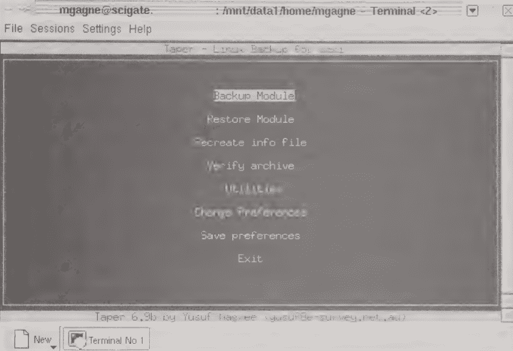

**图 17.1** Taper，一种基于文本的备份工具

然后你会看到一个相对于你启动 `taper` 位置的目录列表。你通过按键选择包含在备份中的文件。按 `i` 告诉程序“包含”文件（或目录），而按 `u` 则改变主意将其“排除”。选择完成后，只需按 `f` “完成”，`taper` 将开始工作并报告其位置、预计整个过程所需的时间以及已完成进度。

为了恢复，选择恢复模块。你会看到一个备份和存档列表。从列表中选择并按回车。系统会提示你想要恢复的存档所在的目录（你可能不想让文件位于你启动时完全相同的目录）。选择你想恢复的文件（使用你之前的方法），完成后按 `f`。

# 第 17 章 备份与恢复

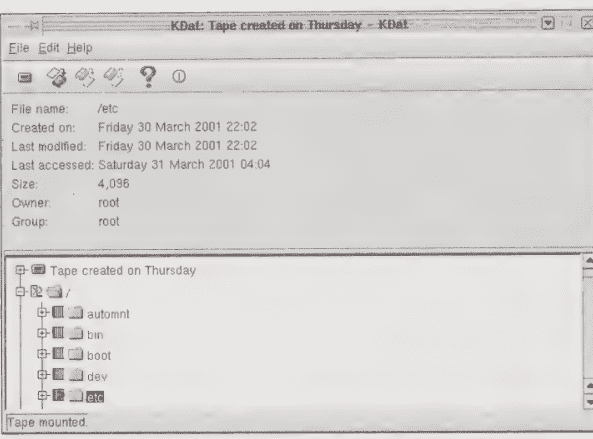

**图 17.2** 以图形化方式备份

（注：原文后续部分存在大量重复的段落，已根据要求去重，仅保留核心翻译内容）

## BRU 备份与恢复工具

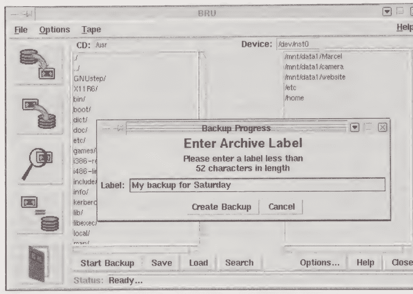

**图 17.3** BRU 备份与恢复工具

单击访问全量、1 级备份和 2 级备份。系统会要求你输入磁带标签，然后即可完成（见图 17.3）。BRU 的关键在于简单。即使是调度选项（每日、每周、每月任意某一天）也很容易设置和使用。恢复单个文件或一组文件也没有那么困难。

虽然 BRU 的图形界面简单且易于操作，但它也可以从命令行运行。就此而言，你可以访问 BRU 网站获取贡献的脚本，用于无人值守或自定义的备份需求。你可以在网站的“技术技巧（Tech Tips）”部分找到这些内容。

BRU 提供多种版本。对于多任务备份和自动化磁带库成为常态的真正大规模网络，你应该查看一下 BRU 的名为 BRU-PRO 的企业级软件包。除了 Linux 备份外，你还可以处理各种 Windows 平台、AIX、Solaris 等。请查看网站获取详情和当前支持的平台。

BRU 是一款商业产品，但该公司也提供一个非商业版本，它能很好地备份你的系统，让你在不花费大量资金的情况下获得安心。个人版 BRU 仅供非商业个人使用。

## Arkeia

如果你试图用一点花哨让非 Linux 用户留下深刻印象，那么看看 Arkeia 就没错了。单从视觉效果来看，我必须把 Knox Software 开发的 Arkeia 颁发“酷炫奖”。像 BRU 一样，你可以从命令行运行 Arkeia，但它的 GUI 看起来非常酷炫，即使你可以使用命令行来提高速度，一个闪亮的速度表也会以每分钟兆字节记录你的备份速度，而里程表则会跟踪已备份的总数据量，如图 17.4 所示。你可以判断这是否仅仅是愚蠢，但它确实很有趣。

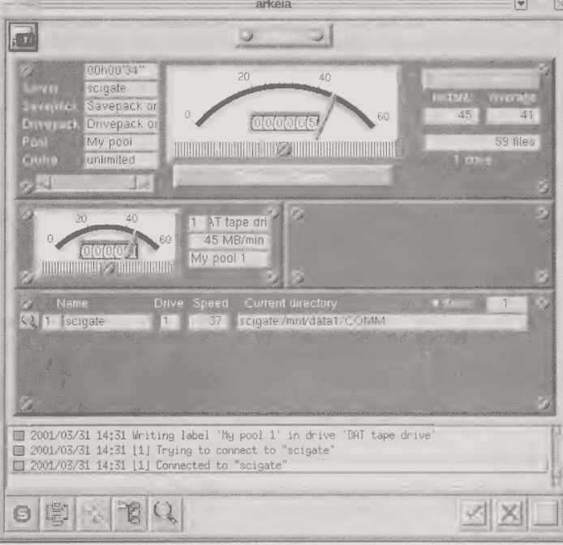

**图 17.4** 备份看起来似乎在与 Arkeia 一起“竞速”

抛开玩笑，Arkeia 是一个强大的工具，其客户端运行在许多平台上。例如，你可以将网络备份到 Linux 系统的 DLT 上，该系统由 IBM RS/6000、一台 HPUX 机器、几台 NT 服务器和一些 Windows 9x 设备组成。Arkeia 处理全量、增量和按需备份。你甚至可以同时备份多个系统（以及架构），同时保持权限、符号链接等。

池管理、磁带管理等整个概念需要一些时间适应。因此，它不像运行 BRU 那样直观（简单），运行 BRU 只点击“全量备份”按钮就可以出发了。你并不是加载 Arkeia 就开始使用。在运行第一张磁带之前，你必须进行相当大量的设置，反思来看这是有必要的。

你会发现，Arkeia 强制良好的备份实践和磁带轮换（这实际上是好事）。你不能从列表中选择特定的磁带。当然，如果你足够固执，有两种方法可以覆盖任何设置，但这违背了初衷。磁带必须遵循轮换。

Arkeia 是一个商业软件包；然而，Arkeia 也有免费版。区别在于规模。免费版在非商业个人环境中仅支持一台服务器、一台磁带驱动器和两个客户端（Linux 或 Windows 9x）。访问 Arkeia 网站（http://www.arkeia.com/）并查看一下。

## 其他考虑

诸如 Arkeia 和 BRU 等产品为 Linux 的成熟性提供了极大的信誉。它们还提供了图形化工具，无论你是否喜欢，这些工具通常被认为是判断某物是否“现代”的决定因素。“现代”通常等同于“良好”。

尽管如此，寻找复杂且强大的备份解决方案的人还应该检查来自马里兰大学大学帕克分校的 AMANDA，即高级马里兰大学自动磁盘归档程序（http://www.amanda.org/）。AMANDA 是一个非 GUI 工具，但它提供了将大量客户端备份到高容量磁带驱动器单个位置的方法。Windows 客户端可以使用 Samba 进行备份（我将在书后的部分介绍），并使用标准的 Linux 备份工具存储数据。此外，AMANDA 是免费软件。

## 结语

-   做好备份。
-   给你的备份贴标签。
-   定期进行备份。

记住，没有任何数据能比你需要恢复它的那一天重要。

### 资源

- **AMANDA**: http://www.amanda.org/
- **Arkeia**: http://www.arkeia.com/
- **BRU**: http://www.bru.com/
- **KDat**: http://www.kde.org/
- **Taper**: http://www.e-survey.net.au.au/taper/

# 第 18 章 网络管理

Linux 几乎是网络的同义词。当被问及时，我们从 TCP/IP 的基础知识开始。由于我要涵盖很多内容，我将在过程中为你提供一些标记。

## TCP/IP 的光速介绍（第一幕，第一场）

### 协议与协议套件

在关于 TCP/IP 的讨论中，你经常听到“协议”这个词。事实上，TCP/IP 通常被称为“TCP/IP 协议族”。换句话说，它是使用同一种语言的协议集合。使用 TCP/IP 协议族传输任何信息都是通过 IP 包完成的，这是基本单元。最终，一切都变成包或来自包。

数据包跨越网络传输到各种应用协议。这些传输协议倾向于使用传输控制协议（TCP）或用户数据报协议（UDP）。

TCP 被称为面向连接的协议，这意味着我们连接特定的应用程序，这种连接一直持续到你断开为止。当你登录到另一台计算机时，你正在使用 TCP 作为你的传输协议。TCP 将大块信息分成编号的 IP 包并将其路由到最终目的地。数据包经过编号是因为它们理论上可以通过不同的路径到达目的地，并在那里根据编号进行重组。

相反，UDP 被称为无连接协议。不需要创建连接（除了运行特定的应用程序守护进程）。UDP 通过数据报发送信息，数据报是较小的、类似包的数据块。与 TCP 包不同，它没有编号信息，也没有确保数据报按顺序到达的。它也不保证交付。任何一致性检查都必须由应用程序完成。那么，为什么会理智想要使用 UDP 作为自己的传输协议呢？

> 趣味问答：大多数使用 UDP 的应用协议也可以使用 TCP。反之也部分如此，极少数协议使用 UDP。

答案是性能。因为 UDP 不需要担心编号、拆分和重组数据包，它往往更高效（如果你不需要担心在那个时间获取所有数据的话）。对于我们

由于 UDP 快速且私密，对于某些非关键性应用程序，它可能不是一个糟糕的传输机制。简单网络管理协议（SNMP）就是一个 UDP 应用协议的示例。

在这个 TCP/IP 协议族中，你还有许多应用协议（有些是 UDP，有些是 TCP，两者都有）。这些包括简单邮件传输协议（SMTP）、邮局协议（POP）和文件传输协议（FTP）等。这些被称为“服务”（services），并通过它们各自的端口号进行寻址。

### 服务与端口

你系统的主进程，即让系统运行起来的进程（也就是在你按下电源开关之后），被称为 `init`。`init` 的进程 ID 为 1。它始终是 1。如果你想进一步探索，可以使用 `ps` 在你的进程列表中找到 `init`。

```
ps ax | grep init
```

系统启动时，`init` 启动的服务之一是 `inetd`。它的工作是监听网络请求，并通过 Internet 套接字号或端口来引用这些请求。例如，当你通过输入 `telnet mysystem` 登录到你的系统时，你实际上是在请求 `mysystem` 上的 `inetd` 启动处理端口 23 通信的 telnet 进程。到目前为止一切正常。然后，`inetd` 启动一个进程，最终要求你输入用户名和密码，奇迹地，你随后就登录了。

基本上，`inetd` 通过监听来发现哪些守护进程（daemons）会被唤响应端口请求。如果你想查看服务号对应的是什么，可以查看 `/etc/services`，这是一个列出已知 TCP 服务端口的文本文件。这里是该文件的一个样本：

```
tcpmux 1/tcp # TCP 端口服务复用器
echo 7/tcp
echo 7/udp sink null
discard 9/tcp
discard 9/udp sink null
systat 11/tcp users
daytime 13/tcp
daytime 13/udp
netstat 15/tcp quote
qtd 17/tcp # message send protocol
msp 18/tcp # message send protocol
msp 18/udp ttyttst source
chargen 19/tcp
chargen 19/udp ttyttst source
ftp-data 20/tcp
ftp 21/tcp
fsp 21/udp fspd
ssh 22/tcp # SSH 远程登录
Protocol 22/udp # SSH 远程登录
Protocol 23/tcp
```

注意，我有一些服务同时使用 TCP 和 UDP 作为它们的传输协议。你自己的 `/etc/services` 文件将包含一个更常见的端口号列表。该服务文件的格式非常简单。第一项列出服务名，后面跟着一些空格、一个端口号、一个斜杠，然后是该服务的传输协议。你也可以再次留出空格并添加描述性注释。你这个版本的文件将列出几百个（或更多）服务。尽管如此，这绝不是一个详尽的列表。本章末尾的“资源”（Resources）部分提供了一个更完整列表的链接。

从资源的角度来看，拥有一个监听器比为每个服务都设置一个监听器要有意义得多。对于那些能够记忆并视觉化这些事物的人，请想象莉莉·托姆林（Lily Tomlin）充当电话接线员（她最终会将把你接通到你想通话的人）。她是 `inetd`，而你想通话的人就是服务守护进程。你请求分机 23，她最终为你接通。

当 `inetd` 启动时，它会读取一个 `inetd.conf` 文件。你会在 `/etc` 目录下找到它，就像找到 `services` 文件一样。以下是 `inetd.conf` 的几行：

```
#
# 这些是标准服务。
#
ftp stream tcp nowait root /usr/sbin/tcpd in.ftpd -l -a
telnet stream tcp nowait root /usr/sbin/tcpd in.inetd
#
# Shell, login, exec, comsat and talk 是 BSD 。
#nshell stream tcp nowait root /usr/sbin/tcpd in.rshd
login stream tcp nowait root /usr/sbin/tcpd in.rlogind
#exec stream tcp nowait root /usr/sbin/tcpd in.rexec
```

### IP 地址、网络和子网，我的天哪！

注意那个试图吓跑你的家伙。虽然接下来的术语看起来可能像来自奇异平行宇宙的奥秘词汇，但它们实际上是网络的组成部分。所有这些口袋（数据包）都必须去某个地方……（注：此处原文存在大量重复文本，翻译已按要求处理核心含义）。

# IP 地址、网络与子网，我的天呐！

> **极客趣闻**：我的本地 IP 地址 192.168.22.2 也可以读作 323224154。你可能会问：“这怎么可能？”跟着我做这些微小的计算，你就会明白了。取第一个字节（在这种情况下，是最左侧的）并乘以 256。将结果加上第二个字节乘以 256 的平方，再加上第三字节乘以 256，最后加上第四个字节。困惑了吗？这是我将计算输入命令行计算器 `bc` 的结果：

```
((192*256)+(168*256^2)+(22*256)-2) = 3232241154
```

如果我 ping 3232241154，系统的响应就像我输入了 ping 192.168.22.2 一样。你自己试试看。这比你想象的要麻烦得多，但很有趣。

这整个“网络地址耗尽”的问题确实有积极影响。事实证明，正如我所说，你的 ISP（互联网服务供应商）能够为你网络上的每台机器提供 IP 地址的概率非常小，这真的是件好事。标准的非营利地址方案（由于需要）在整个互联网范围内是可以路由的。你的本地网络不应该是可路由的。让每台机器对世界上都可见只会增加你为了防范黑客（Crackers）而需要的工作量。黑客可能看到并尝试破解你的 Web 服务器，但内部网络会有问题，因为他们在将注意力转向你网络的其他部分之前，必须先通过你的网关或防火墙。

**警告**：你不能随意分配 IP 地址。即使你的网络没有以某种方式连接到互联网，也不要使用可路由地址。作为系统管理员，你的职责是确保分配给办公室环境中 PC 和其他设备的 IP 地址是唯一且合法的。

三种常见的网络类是 A 类、B 类和 C 类。A 类网络涵盖了从 1.0.0.0 开始到 127.0.0.0 的地址范围。B 类网络从 128.0.0.0 运行到 191.255.0.0，而 C 类网络占据了 192.0.0.0 到 223.255.255.0 的空间。还有其他两类地址（我不会花太多时间讨论）：多组播地址，范围从 224.0.0.0 运行到 239.255.255.255，以及“不要碰，这是保留的”空间，范围从 240.0.0.0 运行到 255.255.255.255。

如果你在家里或公司创建本地网络，你应该使用由 RFC1918 定义的子网地址。虽然其他地址需要分配给你，但私有网络地址可以以你认为合适的方式使用。此私有空间如表 18-3 所示。

## 表 18.3：私有网络地址

| 类别 | 地址范围 | 主机数量 |
|---|---|---|
| A 类 | 10.0.0.0 到 10.255.255.255 | 254 个可能的主机 |
| B 类 | 172.16.0.0 到 172.31.255.255 | 约65,000 个主机 |
| C 类 | 192.168.0.0 到 192.168.255.255 | 超过 150 万个主机 |

> **定义**：RFC 代表“意见请求”（Request For Comments）。这些文档（始于 1969 年）过去和现在一直在定义互联网（最初的 ARPANET）、计算机通信、通用网络、协议等。其中一些文档最终在互联网工程任务组（IETF）的支持下成为了互联网的标准。RFC 是互联网的一种蓝图。

你会发现，当在本书中使用地址时时，遵循遵循表 18-3 中的模式。事实上，我倾向于将示例调整为 C 类方案，因为它们代表了一个小型网络，这正是我办公室正在使用的类型。

### 子网、子网掩码和广播地址

即使你被分配了一个大型网络，你可能也想将网络划分为子网。事实上，当你的 ISP 在 A 类、B 类或 C 类中给你一个地址时，发生的就是这种情况。通常，你不会对 C 类网络划分子网，因为它已经很小了（254 个可能的主机），维护需求最小，且完全在大多数办公室的承受范围内。ISP 通常会对 C 类网络进行子网划分，因为它们是从一批 65,000 个主机（B 类）甚至更糟的超过 150 万个主机（A 类）中分配完整的网络。

子网掩码（netmask）旨在将你的网络与其他所有网络隔离开。要理解为什么这些是默认值，名称说明了一切：掩码（masks）覆盖了 IP 地址中不属于你子网的部分。我的 IP 192.168.22.2 的默认子网掩码是 255.255.255.0。子网掩码对于 192.168.22.2 的二进制为：11000000.10101000.00010110.00000000。255 对应 11111111，192 在地址中被掩码了。168 和 22 是你不能碰的。这些数字代表我的网络，而你可以看到的是同类网络中的其他计算机。这就是掩码的作用。正如你所见，掩码显示了地址的二进制为：11000000.10101000.00010110.00000000。在没有路由器帮助的情况下，同一网络内的计算机就可以相互通信。这就是子网掩码的作用。它定义了你的 IP 地址中哪些部分是你的网络。那么，留给你的这些 256 个数字（0 到 255）对吗？

如果你接受这种标准网络，你的网络本身没有划分为子网。例如，C 类网络将只有 254 个可用地址。这是因为 .0 地址保留用于表示网络本身（192.168.22.0），而 .255 变成了广播地址（192.168.22.255）。其他所有地址供你使用。

#### 广播地址

你问：“什么是广播地址？”嗯，我告诉你。向广播地址发送信息（数据包）类似于向网络上的每个主机发送信息。你实际上是在进行广播。例如，可以使用以下命令在我的网络上广播 ping：

```
ping -b 192.168.22.255
```


某些版本的 `ping` 命令在执行广播 ping 时需要使用 `-b` 标志。

# 第18 章 网络管理

参与网络由你的 IP 地址的网络部分、你的子网掩码和你的广播地址定义。同一网络内的任何主机根据定义，都不需要路由器的情况下与网络内的任何其他主机通信。简单来说，路由器是一种能够通过与不在同一网络的计算机通信的设备，处理网络之间的信息。

## 子网

如果我将一个网络分成小网络，这被称为子网划分。如果我从较大的网络中创建子网，我需要路由器让这些子网通信。路由器是要钱的。将你的网络与其他分开是合理的。

## 中插

为了帮助我解释 CIDR，让我们继续研究 2000 主机网络。你将使用私有的 B 类网络，这样每个主机在某个地方都有一个地址，在 `172.16.0.1` 和 `172.31.255.254` 之间。正常情况下，默认网络掩码为 `255.255.0.0`，其在二进制格式下显示如下：

```
11111111 . 11111111 . 00000000
[ 网络部分 ] [ 主机部分 ]
```

这两个字节定义了位于 `172.16.0.0` 的网络。位于 `172.16.10.1` 的计算机如果在同一个骨干网上，就可以看到位于 `172.16.12.17` 的另一台计算机。然而，`172.16.10.1` 无法与 `172.21.10.1` 的计算机通信，因为子网掩码不允许这样做。现在，如果你本质上通过使用 `255.255.255.0` 的子网来工作，创建了一大堆 254 主机的网络（或子网）。主机部分是一个小得多的数字。

```
11111111 . 11111111 . 00000000
[ 网络部分 ] [ 00000000 ]
```

由于这些是独立的网络，它们需要路由器来将数据包从一个段传输到另一个段。问题是，每个网络（或子网）仍然至少有 254 个主机。在互联网本身，这种地址的浪费是灾难的公式，因为 IP 地址空间很快就会耗尽。是否有方法可以将 C 类网络划分为更小的网络？

让我们回到我的 `255.255.255.0` 子网掩码。网络部分由位数来识别——在此处是 24 位。在在上一个例子中，它是 16 位（只需数 1 的个数即可）。最后，在 A 类网络中，网络掩码是 8 位。你可以这样写网络和网络掩码的定义：

| 类别 | 网络/掩码 |
| :--- | :--- |
| A 类 | `10.0.0/8` |
| B 类 | `172.16.0.0/16` |
| C 类 | `192.168.22.0/24` |

这就是 A 类网络的掩码，B 类为 16，C 类为 24。这是这里的重点。网络掩码定义了网络。那么，如果你弄乱了这个漂亮、干净的掩码会发生什么？CIDR 的整个意义是什么？

CIDR 允许使用 13 到 27 位的网络掩码来定义网络，从而放弃了（旧的标准）。使用 CIDR 方案，你可以通过向网络掩码添加位位，将一个 C 类网络拆分为两个或多个网络。例如，如果我想将我拥有 254 个主机的 C 类网络分为两个 128 个主机的独立网络，我应该使用 `255.255.255.128` 的掩码，这（使用 CIDR 格式）可以改写为 `192.168.22.0/25`。它是如何工作的？请看以下：

```
11111111 . 11111111 . 11111111 . 10000000
```

注意前面的二进制表示中多出的 1。那些 1 是我的网络掩码。它们定义了网络。这意味着我只剩下 7 位来指定 IP 地址。这是因为我只能用 7 个二进制数字创建出 0 到 127 的数字。懂了吗？我也最终得到了两个网络。像任何网络定义一样，我需要为一个网络地址和一个广播地址留出空间，留给我 126 个主机。我的第一个网络将是 `192.168.22.0`，广播地址为 `192.168.22.127`。最后一个字节中的那个额外的 1 是墙，没有路由器的情况下，任何网络都不被允许通过。第二个网络将是 `192.168.22.128`，广播地址为 `192.168.22.255`。

使用 CIDR 表示法，你可以创建更有趣的子网。继续 C 类的例子，`192.168.22.0/26` 将创建四个每个包含 64 个主机的 C 类网络。为什么？因为 6 位仅足够定义 0 到 63 的数字。而 `192.168.22.0/27` 呢？它变成了八个每个包含 32 个主机的网络，因为 5 位仅足够定义 0 到 31 的数字。

如果你向反方向操作会发生什么？`/22` 掩码怎样？网络的主机部分现在有 9 位。这足以生成从 0 到 511 的数字，这意味着你可以创建两个每个包含 512 个主机的 C 类网络。`/21` 掩码留下了 10 位，允许四个每个包含 1024 个地址的网络，因为 10 位允许你定义从 0 到 1023 的数字。这个过程被称为子网划分，除了对前景感到兴奋外，我将回到本地配置的讨论并留下这些想法。

## 设置你的 PC 网络（第 1, 2 节）

在第 10 章中，我们讨论了如何使用拨号调制解调器连接互联网。这不是设置办公室网络的方法。相反，将以太网卡安装到计算机中并通过集线器连接。配置以太网卡是通过加载适当驱动。我写这本书的 Linux 系统有两个网卡。以下是 `/etc/modules` 中的相关信息：

```
alias eth0
alias eth1
```

## 设置你的 PC 网络（第 2 节）

在这种情况下，我有两个网卡，一个运行 RealTek 驱动，另一个运行 Tulip 驱动。在 Debian 系统上，情况略有不同。有一个 `/etc/modules` 文件执行方式类似，但它是关键的一行。其他模块列在 `/etc/modutils` 中，该文件由名为 `update-modules` 的程序管理。这太不应该手动编辑。

## 设置 IP 地址

再次，设置 IP 地址取决于系统。在我进入系统之前，实际上有一种设置地址的通用方法。事实上，这是在启动系统时由脚本自动启动接口的。要查看系统上的所有接口，请输入此命令：

```
/sbin/ifconfig -a
```

你应该看到类似这样的内容：

```
Link encap:Ethernet HW:00:20:18:89:A6
inet addr:192.168.22.100  Bcast:192.168.22.255  Mask:255.255.255
UP BROADCAST MULTICAST MTU:1500  Metric:1
RX packets:131877  errors:0  overruns:0
tx packets:123807  errors:0  overruns:0
collisions:0  txuelen:0
```

```
Link encap:Loopback
inet addr:127.0.0.1  Mask:255.0.0.0
UP LOOPBACK RUNNING MTU:3924  Metric:1
RX packets:0  errors:0  overruns:0
tx packets:0  errors:0  overruns:0
collisions:0  txuelen:0
```

你可能会看到更多信息，取决于你已经配置了多少网卡。在这里有趣的是你可以从命令行执行一切——启动、停止和重新配置接口。让我们再看看 `eth0` 的前三行：

```
Link encap:Ethernet HW:00:20:18:89:A6
inet addr:192.168.22.100  Bcast:192.168.22.255  Mask:255.255.255
UP BROADCAST MULTICAST MTU:1500  Metric:1
```

第一行中的有趣信息是硬件地址 (`HWaddr`)。这也称为 MAC 地址。这是你的网卡的硬件地址，就像小王子玫瑰一样，全球唯一的。第二行是你认为的普通网络地址（IP、掩码等）。最后，在第三行中，你看到网卡已启动并运行（`UP`）。使用你的朋友 `ifconfig` 可以关闭该网卡：

```
/sbin/ifconfig eth0 down
```

将地址更改为其他（例如生命、宇宙和一切的答案），你可以使用相同的命令：

```
/sbin/ifconfig eth0 192.168.22.42 netmask 255.255.255.255
```

注意我用一个命令更改了网卡地址并启动了它。

当然，在现实生活中，这些事情在你启动系统时会自动发生。不需要手动启动接口（测试除外）。在红帽（或类似）系统中，你会在一个名为 `/etc/sysconfig` 的目录中找到配置文件。你的默认网络地址定义在 `network` 文件：

```
NETWORK=yes
HOSTNAME=mailhost.mydomain.com
GATEWAY=172.16.22.10
```

各种接口的细节位于 `/etc/sysconfig/network-scripts` 目录。在我的测试机器上，我有四个接口：用于 `lo`（回环地址）、用于 `eth0`（我的第一块以太网卡）、`eth1`，最后是用于拨号连接的 `ppp0` 接口。每个接口都有一个 `ifcfg-interface` 文件，包含该接口的细节。以下是 `network-scripts` 目录下的 `ifcfg-eth0` 文件：

```
DEVICE=eth0
ADDR=192.168.22.10
NETMASK=255.255.255.0
NETWORK=192.168.22.0
BROADCAST=192.168.22.255
ONBOOT=yes
BOOTPROTO=none
```

## 设置你的电脑网络（第18 幕，第2 场）

```bash
if [ $? -eq 0 ]; then
    ifconfig 127.0.0.1
    route add -net 127.0.0.0 netmask 255.0.0.0 dev lo
fi
```

```bash
IPADDR=192.168.22.2
NETMASK=255.255.255.0
NETWORK=192.168.22.0
GATEWAY=192.168.22.10
```

```bash
cat /proc/net/dev | grep : | cut -d : -f 1 | grep eth0 >/dev/null 2>&1
```

```bash
if [ $? -eq 0 ]; then
    ifconfig eth ${IPADDR} netmask ${NETMASK}
    route add -net ${NETWORK} netmask ${NETMASK} dev eth0
    [ "${GATEWAY}" ] && route default gw ${GATEWAY} metric 1
fi
```

在较新的系统（Potato 版本）上，情况发生了一些变化。所有信息都移动到了 `/etc/network/interfaces` 文件中。这里是我网络的一个配置示例，包括一个单环回接口（`127.0.0.1`）和一个用于内部网络接口的 `eth0` 网卡：

```
# 这是这是环回接口
if lo inet loopback

# 我们的单块以太网网卡
iface eth0 static
address 192.168.22.3
network 192.168.22.0
netmask 255.255.255.0
broadcast 192.168.22.255
gateway 192.168.22.10
```

随后，我可以使用 `ifup` 命令启动我的 `eth0` 接口，并使用 `ifdown` 命令将其关闭。

## 路由

我之所以向你展示整个 Debian 脚本有两个原因。首先，它很短；其次，它引入了路由的主题。仅仅配置一个网络接口是不够的。你的系统需要知道当数据包离开你的以太网卡（或拨号调制解调器）后该如何处理。你通过 `route` 命令来实现这一点。让我们看看 Debian 网络脚本中的上一行代码：

```bash
route add -net ${NETWORK} netmask ${NETMASK} dev eth0
```

通过填入相应的数字，你得到了这一行代码：

```bash
route add -net 192.168.22.0 netmask 255.255.255.0 dev eth0
```

在用 `ifconfig` 配置好网卡后执行此命令，你是在告诉系统当它看到位于 `192.168.22.0` 网络内的数据包地址时该做什么——将它们重定向到 `eth0` 接口。当生成的数据包属于该网络之外时，你依赖于另一种路由：默认路由。这个地址通常指向一个连接到其他路由器和主机的路由器。最终，其中一个路由器应该会知道这个数据包属于哪里。粗略概之，这就是互联网的工作原理。在接下来的示例中，我配置了系统，将我网络上的另一个主机作为所有本地网络流量的默认路由：

```bash
route default gw 192.168.22.10
```

该命令的最简单形式是 `/bin/route`：

| 目的 | 网关 | 生成掩码 | 标志 | 跃 | 引用 | 使用 | 接口 |
| :--- | :--- | :--- | :--- | :--- | :--- | :--- | :--- |
| testsys.mydomain | * | 255.255.255.255 | U | 0 | 0 | | eth0 |
| 192.168.22.0 | * | 255.255.255.0 | U | 0 | 0 | | eth0 |
| 127.0.0.0 | * | 255.0.0.0 | U | 0 | 0 | | lo |
| default | netgate | 0.0.0.0 | UG | 0 | 0 | | eth0 |

之前的命令会将数字地址解析为符号地址。你可以通过传递 `-n` 标志并仅使用数字显示来加速这个过程。

## 使用 netstat

你也可以使用 `netstat` 程序通过使用 `-r` 标志来显示基本上相同的信息（如 `/sbin/route` 命令显示的内容）。`netstat` 程序出于其他原因同样重要。通过使用带有 `-a` 和 `-p` 标志的程序，你可以发现系统上的每一个连接（或端口）以及哪些程序正在使用这些端口。

> **安全提示**：学习使用并重视 `netstat` 程序；它在判断是否有不该使用你系统的人在使用时极其有用。这些连接中的每一个对你来说都感觉正常吗？是否存在来自你不认识的主机的存活连接？这些都是在书中探索网络安全时需要考虑的问题。

在接下来的示例中，我同样使用了 `-n` 标志。这告诉 `netstat` 不要担心将 IP 地址解析为符号地址。也会让程序运行得快一点，因为没有进行解析。最后，由于列表可能会很长，所以我将整个输出通过管道传给 `more`。

## 域名服务（第18 幕，第3 场）

```text
# netstat -apn | more
Active Internet connections (servers)
Proto Recv-Q Send-Q Local Address         Foreign Address         State
tcp        0      0 127.0.0.1:53            0.0.0.0:*               LISTEN
tcp        0      0 192.168.22.10:80        0.0.0.0:*               LISTEN
tcp        0      0 192.168.22.10:443       0.0.0.0:*               LISTEN
tcp        0      0 192.168.22.10:54321     10.0.0.5:ESTABLISHED
```

PID 是进程的 ID。

顺便提一下，你的主机名包含在一个名为 `/etc/HOSTNAME` 的文件中。这就是系统在重启后记住该信息的方式。在 Debian 系统上，该文件名为全小写：`/etc/hostname`。

## 真正的 DNS 请站出来

BIND 是运行 DNS 的事实标准软件包。如果你看到你的系统上运行着某个东西，你就拥有了 BIND。BIND 代表 Berkeley Internet Name Domain（伯克利互联网域名），尽管名字里有“Berkeley”（那是它开始的地方），但 BIND 的家实际上是互联网软件协会 (ISC) (http://www.isc.org/)，你可以在那里一直找到最新、最好的 BIND。你的 Linux 发行版也会提供预编译该 DNS 软件的二进制文件，但它们通常落后于你在 ISC 网站上找到版本。

设置你自己的 DNS 是一件相当复杂的事情（我稍会介绍这部分），但正如我已经提到的，你可能不需要这样做。如果你已经连接到一个连接到互联网的现有网络，简单的解决方案是通过将名称服务器添加到你的 `/etc/resolv.conf` 文件中来指向它们。我在第 10 章讨论拨号连接到互联网时提到过这一点。在那种情况下，单行（或两行）指向你 ISP 商的名称服务器的代码就足够了。例如：

```
domain mydomain.com
nameserver XXX.XXX.XXX (first DNS)
nameserver YYY.YYY.YYY.YYY (second DNS)
```

这组设置是作为 DNS 客户端而不是服务器起什么作用？第一行是你的默认服务器（通常是你自己的）。如果你尝试进行查找（使用 `host` 或 `nslookup` 程序），你不需要指定你的域名。例如，如果我正尝试查找我网络上一个名为 "speed" 的主机的地址，我会执行这条命令：

```
$ host speed
speedy.mydomain.com has address 192.168.22.3
```

作为查找的一部分，默认域名会被附加到我指定的主机名之后。在进入细节之前，你还应该注意 `/etc/nswitch.conf` 文件。这个文本文件是我在本章稍些之后讨论 DNS 时会更详细介绍的内容之一。现在，只需知道某些信息（如主机名）的查找顺序在该文件中定义的即可。引用 `hosts` 文件的行看起来像这样：

```
hosts: files nisplus nis dns
```


该 DNS 软件的二进制文件，但它们通常落后于你在 ISC 网站上找到版本。

设置你自己的 DNS 是一件相当复杂的事情（我稍会介绍这部分），但正如我已经提到的，你可能不需要这样做。如果你已经连接到一个连接到互联网的现有网络，简单的解决方案是通过将名称服务器添加到你的 `/etc/resolv.conf` 文件中来指向它们。我在第 10 章讨论拨号连接到互联网时提到过这一点。在那种情况下，单行（或两行）指向你 ISP 商的名称服务器的代码就足够了。例如：

```
domain mydomain.com
nameserver XXX.XXX.XXX (first DNS)
nameserver YYY.YYY.YYY.YYY (second DNS)
```

这组设置是作为 DNS 客户端而不是服务器起什么作用？第一行是你的默认服务器（通常是你自己的）。如果你尝试进行查找（使用 `host` 或 `nslookup` 程序），你不需要指定你的域名。例如，如果我正尝试查找我网络上一个名为 "speed" 的主机的地址，我会执行这条命令：

```
$ host speed
speedy.mydomain.com has address 192.168.22.3
```

作为查找的一部分，默认域名会被附加到我指定的主机名之后。在进入细节之前，你还应该注意 `/etc/nswitch.conf` 文件。这个文本文件是我在本章稍些之后讨论 DNS 时会更详细介绍的内容之一。现在，只需知道某些信息（如主机名）的查找顺序在该文件中定义的即可。引用 `hosts` 文件的行看起来像这样：

```
hosts: files nisplus nis dns
```

通过这种配置，系统会查找本地主机（files），然后是 NIS（nisplus 和 nis），最后是 DNS（dns）。这种设计是为了加速查找过程。如果你想找到一个名为 `host1.natika.com` 的主机，且该信息在你的 `/etc/hosts` 文件中，那么系统将不再向后查找。因此，可以修改此文件来强制执行不同的顺序。

## 设置你自己的名称服务器

通常情况下，如果你运行一个具有简单拨号连接到互联网的单站点，并且你没有运行服务器服务，那么你不需要设置 DNS。如前提到的，你应该省去自己的麻烦，让你的 ISP 为你这样做。然而，如果你正在运行一个公共 Web 服务器，如果有多个服务器和客户端共享连接，或者你正在通过本地域分发邮件，那么勇敢的心灵们，请继续阅读。是时候建立一个真正的 DNS 了。但首先，请考虑关于 BIND 和 DNS 的以下这些老套之词。

> **安全提示：** 遗憾的是，BIND 的普及以及大多数服务器上永久可用的服务使其成为黑客和脚本小子（script kiddies）垂涎不已的目标。事实上，SANS 学院（http://www.sans.org/）经常将 DNS 和 BIND 置于其安全受损手段列表的前列。

请确保你运行的是最新版本的 BIND。

> **快速提示：** 在你深入研究整个 DNS 配置之前，我会让你变得轻松些。如果你访问我的网站（http://www.salmar.com/marcel/）并检查下载（Downloads）部分，你会发现一些通用的 DNS 配置文件。如果你想节省大量的打字时间，而你只需要为你的小型 PC 网络提供一个 DNS，请在那里寻找快速简单的软件包。

## 定义你的域名

这个练习的意义不是让你变成一个 ISP。如果你正尝试这样做，你将需要阅读更多关于 DNS 服务的内容，并且你肯定需要比我在这里提供的更多的信息。尽管如此，以下是此 DNS 的前提。

你有一台 Linux 服务器，提供路由、telnet（或 SSH）访问，可能为你的内网提供 Web 服务（见第 20 章），可能还有一点邮件服务，它还与内部网络共享你的外部连接。此示例中的内部网络将基于一个私有地址 C 类网络 192.168.22.0。

## /etc/named.conf 文件

从 BIND 8 开始，`/etc/named.conf` 文件代表了你 DNS 金字塔的顶端。在 Debian 系统上，你可能在 `/etc/bind` 目录下找到该文件，尽管我 Debian 机器运行的最新 BIND 安装在 `/etc` 中，就像 Red Hat 一样。首先要注意的是，任何以双斜杠（//）或斜杠星号星斜号（/* */）结构的内容都表示注释。第一种是 C++ 类型的注释，而第二种是良好的、老式的 C 风格注释。

让我们来看一个非常漂亮的 `named.conf` 文件。这个文件实际上来自一个 Red Hat 系统，来自一个名为 `caching-nameserver` 的基础包。在操作的同时，请安装 `bind` 和 `bind-util` 包。Debian 的用户将需要获取 `bind` 和 `dnsutils` 包。

### /etc/named.conf 列表

让我们从简单的开始。以下信息是仅缓存名称服务器的默认配置文件的列表。这是 `named` 启动时读取的内容：

```
// generated by named-bootconf.pl
options {
    directory "/var/named";
    /*
     * 如果你与想要通信的名称服务器之间有防火墙，
     * 你可能需要取消注释下面的 query-source
     * 指令。
     */
```

## 区域 (Zones)

Ack！ 别出神。你快成功了。

你遇到的第一个区域是 `named.ca` 区域，它被列为类型 hint。基本上，这正如其字面意思：如果你的 DNS 找不到答案，它至少能提供某种提示。那就是世界上顶级域名服务器的列表及其地址。这就是你的缓存文件。因为这是一个顶级服务器列表，而且列表会随时间变化，因此保持你的副本更新对你有利。要获取最新新鲜的副本，请使用这条命令：

```
dig @e-root-servers.net > newcache-file
```

你需要连接到网络（当然），并且当你需要时，将使用与当前缓存文件相同的名称（named.ca）。顺便说一下，`dig` 是用于查询名称服务器的命令行工具。

> **极客知识：** 你的 DNS 并不孤单。事实上，DNS 的整个意义在于每个服务器实际上都是更大实体的一部分——一个遍布全球的地址信息分布式数据库。

## 设置你自己的域名服务器

下一个区域是你的 localhost 区域。在示例中，文件名名为 `named.local`（这也是缓存域名服务器的默认值）。该文件类型为 `master`（主），这意味着它是与此区域相关的所有信息的主要来源。对于这个区域来说，这没有意义，但在另一个区域中，你可能会发现类型设置为 `slave`（从），其后面跟着一个主服务器列表以及一个 IP 地址列表，以获取相应的区域信息，如下：

```
zone mydomain.dom {
    type slave;
    masters ( ip_addr; );
}
```

> 小提示：注意每个选项末尾的分号。

让我们来看这个 `named.local` 文件。

@ IN SOA localhost.root.localhost. ( Serial 1997022700 ; Refresh 28800 ; Retry 14400 ; Expire 360000 86400 ) Minimum IN NS localhost.

第一行有一个非常重要的关键字：SOA，意思是“起始起始”（start of authority，意为“这一切的开始的地方”）。IN 告诉系统这是互联网记录（它们在 DNS 文件中几乎都是如此）。`localhost` 后的 `root.localhost.` 代表（第一个）该域名的完全限定域名（或 FQDN），以及（第二个）向域名管理员（你）发送电子邮件的地方。文件中用点 `.` 代替符号 `@` 符号并不是错误，请保持原样。

> 重要：同样请注意域名名称末尾的点。这非常重要。点表示这是一个完整的域名名称，而不是相对于区域记录中域名的相对路径。符号 `@` 表示被调用的域名。如果你为 `mydomain.dom` 设置了一个区域，`@` 可能被替换为 `mydomain.dom`。再次强调，末尾的点。这对于区域文件内部的 IP 地址也是如此。

接下来要看的是序列号（serial number），你可以看到这是一个日期。示例中的最后两个零代表该天内文件可能发生的 100 次更改。为什么要更改呢？每当你修改服务器记录时，都必须增加该区域的序列号以便其重新加载。如果你制作了更改（添加了主机）并发现更新的信息没有显示在查询中，你可能没有更新序列号。在这种情况下，你需要重启 `named` 守护进程。

第二个数字（Refresh，刷新）告诉从域名服务器在联系主域名服务器刷新其信息之前应该等待多长时间。如果连接失败或主服务器离线，下一个数字（Retry，重试）就变得很重要。在再次尝试联系主服务器之前，你需要等待多少秒？如果经过多次尝试仍无法联系主服务器，你可能得认为它已经彻底失效，并且与该域相关的任何缓存信息可能都是没用的。对于这一点，你可能会有一个 Expires（过期）数字。

### 你自己的区域文件

为了在与我告诉你的那个 `192.168.22.0` 域之间传输信息，你需要创建你自己的区域记录。你需要两个文件：主区域文件和相应的反向查找文件。主区域文件在 `named.conf` 文件中的调用方式如下：

```
zone "mydomain.dom" {
    type master;
    file "named.hosts";
}
```

它看起来与 `localhost` 的区域定义非常相似，但不是使用反向数字地址（0.0.127.in-addr.arpa），而是列出了一个域名。这是你的区域文件的一个简单示例：

```
IN SOA mydomain.dom. root.mydomain.dom. (
    200103131 ; serial，今天的日期 + 序列号
    28800 ; refresh, 秒
    14400 ; retry, 秒
    604800 ; expire, 秒
    86400 ; minimum, 秒
)
0 IN NS ns.mydomain.dom.
0 IN MX 10 mail.mydomain.dom.
    ; 主邮件交换器
ns IN A 192.168.22.10
mail IN A 192.168.1.11
gateway IN A 192.168.22.99
www IN CNAME gateway.mydomain.dom.
@ IN TXT "My Company Name, maybe."
```


# 设置你自己的域名服务器

## 其他主机

```
atika IN A 192.168.22.1
magane IN A 192.168.22.2
speedy IN A 192.168.22.3
```

这里有一些有趣的记录，包括 `MX` 记录，它指示发送到该域的邮件应该发送到哪里——也就是说，负责处理发送到该域的邮件。你看到的 `10` 被称为权重。数字越小意味着该服务器在寻找有效邮件交换主机的层级中权重越重要。如果一台服务器宕机了，将尝试第二个（或第三个）。

```
IN MX 10 mail.mydomain.com. ; 主邮件交换器
IN MX 20 mail.mydomain.dom. ; 次要邮件服务器
```

`NS` 记录指定了 DNS 的位置。你可以有多个 `NS` 记录。如果你通过 ISP 连接到互联网，可以使用它们作为次级 DNS 并将地址放在这里。

`A` 类型记录简单地指示从主机名到相关 IP 地址的映射，而 `CNAME`（或规范名称）只是之前定义的 `A` 记录的别名。

> 注意：不要为你的 `MX` 记录使用别名（`CNAME`）。

最后，你会看到 `TXT` 记录。它看起来基本上这样的：一个自由文本字段，你可以在其中填写公司信息（该 DNS 属于谁）或联系信息。你也可以选择什么都不放。

## 现在是反向 DNS 区域

你最后看的是反向映射。互联网不仅通过名称解析，还必须通过 IP 解析。你需要的第一件事是查看 `192.168.22.0 in-addr.arpa` 文件，其配置如下：

```
zone "22.168.192.in-addr.arpa" {
    type master;
    file "named.rev";
}
```

现在，这是反向文件：

```
@ IN SOA localhost.root.localhost. ( 
    1997022700 ; serial 
    28800 ; refresh
    14400 ; retry
    604800 ; expire
    86400 ; minimum
)
0 IN NS ns.mydomain.dom.
0 IN MX 10 mail.mydomain.dom.
    ; 主邮件交换器
ns IN A 192.168.22.10
mail IN A 192.168.1.11
gateway IN A 192.168.22.99
```

## DNS 配置示例

```
/*
// query-source address * port 53;
allow-query { 192.168.22.0/24; localhost };
```

从这里开始，内部 `192.168.22.0/24` 网络和本地主机地址允许自由访问 DNS。要允许站点查询 DNS 中的有效区域，请添加 `allow-query` 选项并指定允许“任何”主机访问，方式如下：

```
zone mydomain.dom {
  type master;
  file "mydomain.hosts";
  allow-query { any; };
}
```

如果你尝试从 Internet 上的远程机器对内部 `192.168.22.0` 网络上的地址执行 `nslookup`，你将得到类似下面的消息：

```
*** www.mydomain.dom can't find 192.168.22.3: Query refused ***
```

## DNS 总结

之前提供的信息应该足够你开始进行简单的 DNS 设置。虽然设置自己的域名服务相对容易，但它也可能非常复杂。如果你需要更多信息，请查看章节末尾的各种帮助页面或资源部分。

# 第 18 章 网络管理

## Linux 下的文件共享

涉及到文件共享时，你有许多选择。例如，你可以从 NFS、Samba、CODA、AFS 等中选择。当所有这些都失败时，总还有“间谍网络”（sneakernet）。最后一个不需要过多的解释——只要你有（即使你没有），你就连接上了。将该文件存到磁盘或磁带上，然后走过去带到远程系统。

了解各种系统的功能以及它们如何工作，是决定什么最适合你的环境的第一步。你可能已经注意到之前列表中的 Samba。我将把这个留到第 22 章。在本章中，我将重点介绍网络文件系统（NFS）。

## 网络文件系统

从历史角度来看，NFS 是网络文件共享技术的“祖父”（或祖母——我不确定）。它由太阳微型系统公司开发，自 80 年代以来一直存在。它的巨大优势是几乎存在于每一种 Linux 和 UNIX 分发版中。

共享目录不仅用于额外的空间（尽管这是使用它的一个好理由）。它们还提供了让大型程序或应用程序存在于一个链接系统的手段，从而避免了在每个工作站上反复安装相同内容的烦恼。共享目录常被用于电子邮件。与其将每个用户的邮件分发到每一个工作站，不如邮件存储在一个中央位置，一个备份的一站之地。说起备份，为什么不将每个用户的家目录远程挂载，这样在备份服务器时，他或她的信息也就随之备份了呢？这可以免去你担心每个人的“重要”数据丢失的烦恼。

就像 Linux 世界的几乎一切事物一样，NFS 仍在演进，在同一时期存在多个版本。虽然它存在问题（我将讨论这些），但它是一个良好、稳定的文件共享机制，值得关注。在大多数 Linux 机器上，NFS 的 Linux 实现处于版本 2 左右。NFS 版本 3 包含了改进的性能、更好的文件锁定和其他优秀功能，仍在开发中，并要求你的内核版本在 2.2.18 或更高，尽管针对其他内核版本也有补丁。本讨论将集中在版本 2 上。对于那些想要探索 NFS 世界最新、最强大功能的人，可以访问 SourceForge 上的 NFS 项目（http://nfs.sourceforge.net/）。

## NFS 如何工作？

NFS 是一个客户端/服务器系统，允许将本地目录（在服务器上）供其他计算机使用。这些可以是 Linux 机器、UNIX 工作站或任何可以挂载 NFS 目录的机器。为了实现这一点，服务器运行许多进程来处理权限、身份验证、已连接的维护等事务。NFS 使用远程过程调用（RPC）作为其通信机制。

如果你有启动时启动的服务，通常在启动时启动 NFS 服务器。在 Debian 服务器上，大多数守护进程由 `nfs-server` 脚本启动。

```bash
/etc/init.d/nfs-server start
```

在 Red Hat 或 Mandrake 系统上，你可能发现需要启动 `nfs` 和 `nfslock` 脚本。

```bash
/etc/rc.d/init.d/nfs start
/etc/rc.d/init.d/nfslock start
```

还有一个需要运行的程序。当目录被服务器“导出”时，另一个程序 `portmap` 会告诉客户端服务器上哪些目录是可用的。

使用 `rpcinfo` 程序，你可以确定服务器上运行了哪些 RPC 服务。命令的格式很简单。在下一个示例中，我查询了一个名为“testsys”的系统。这是我得到的结果：

```bash
# rpcinfo -p testsys
program vers proto port
100000 2 tcp 111 portmapper
100000 2 udp 111 portmapper
100001 1 udp 764 rquotad
100005 1 tcp 772 nfs
100005 1 udp 772 nfs
100005 2 tcp 777 nfs
100005 2 udp 777 nfs
```

*(注：rpcinfo 表格是乱码，我根据标准的 rpcinfo 输出进行了修复)。*

## NFS 守护进程

- **`rpc.statd`**: 该守护进程由 `lockd` 脚本同 `rpc.lockd` 一起启动。它们共同在重启时处理锁定和恢复（在服务器崩溃的情况下）。取决于系统不同，你可能在进程状态中看不到 `rpc.lockd`。

- **`rpc.quotad`**: 在设置了配额支持的机器上，`rpc.quotad` 将处理此项，确保任何设置的限制都应用于导出的目录上。

- **`rpc.nfsd`**: 你在这里拥有整个程序组的核心力量。这是处理所有 NFS 用户请求的程序。

- **`rpc.mountd`**: 当客户端对导出的目录发起请求时，该程序检查请求是否符合 `/etc/exports` 文件定义的权限。

## 创建远程文件系统

为了让服务器将目录（或文件系统）提供给一个或多个客户端，你必须在 `/etc/exports` 文件中添加条目。该文件中的条目（你可以用你喜欢的编辑器手动编辑）格式如下：

```
/name_of_dir client_name(permissions)
```

名称部分非常简单。它是你想在网络上共享的目录的完整路径。客户端名称是客户端的主机名。这也可以是一个 IP 地址。此外，你可以使用通配符让领域内的所有主机可用。例如，假设你的域名是 `mydomain.dom` 且你想让该领域的所有机器都能访问作为 NFS 服务器的 `/mnt/data`。你创建一个如下的条目：

```
/mnt/data *.mydomain.dom(permissions)
```

你也可以使用星号让网络上的每个主机访问你的 NFS 服务，但这是一个非常糟糕的主意。到目前为止，共享相当简单。这引导我们进入权限方面。

权限要复杂得多，应该详细讨论。权限（或安全）部分的选项有 `secure`、`rw`、`sync`、`no_wdelay`、`nohide` 和 `no_subtree_check`。还有与处理个人用户方式相关的权限组。我愿意将这些视为“压缩权限”（squashing permissions）。它们是 `root_squash`、`no_root_squash`、`all_squash`、`anonuid` 和 `anongid`。

### 权限选项详解

- **`secure`**: 此选项指定 NFS 挂载请求来自 1024 以下的互联网端口号。该选项是默认设置。如果你不想要这种行为，请指定 `insecure`。

- **`ro`/`rw`**: `ro` 权限选项允许只读访问。这是默认设置。它允许客户端查看文件，但不允许客户端更改任何内容。要允许读取和写访问权限，请指定 `rw`。

- **`sync`**: 这个选项可以称作一种“双刃剑”。它确保每次写操作之后都会进行数据提交。这在发生服务器崩溃时非常棒，但代价是性能的轻微影响。默认值是 `async`，这意味着系统只写入，而在移动到下一个操作之前不担心操作是否已完成。

- **`no_wdelay`**: 这是 `sync` 选项的近亲。如果你认为你的数据相对安全（但仍然想要提交），你可以选择设置此选项，让系统同时进行多次提交。默认的 `wdelay` 会延迟下一次写入，直到第一次提交完成。

- **`nohide`**: 假设你在同一个树中导出了两个目录。如果你通常在客户端挂载这两个目录，而你只挂载了父目录，你会看到第二个目录，但它没有任何数据上的收益。它是隐藏的。如果你想让整个子树也可见，请使用此选项。然而，请务必谨慎使用，因为客户端在这方面会出现问题，特别是与分配重复索引节点有关。默认选项是 `hide`。

- **`no_subtree_check`**: 如果你导出的目录是一个文件系统，其上方的目录可能对权限有某些要求。由于你只能访问导出的文件和目录，你必须检查整个链条以确保安全性。默认允许 `subtree_check`，这可能会产生微小的安全影响。如果你担心这个问题，请记住指定 `no_subtree_check`。

我将接下来的几个权限称为“压缩权限”，因为在列表中似乎有很多关于“压缩”的讨论。通常，它们与服务器在分配权限时如何处理用户 ID (UID) 和组 ID (GID) 的权限有关。

这里需要记住的一点是，默认安装的 NFS 在处理权限时，假设服务器和客户端上的 UID 和 GID 是相同的。如果你由你设置所有机器，并且可以确保所有机器都具有相同的 `/etc/passwd` 文件，那么这并不是大问题，但遗憾的是事实并非如此。真正的问题发生在服务器上的用户 "natika" 的 UID 为 505，而客户端上的 "natika" 的 UID 为 501。

处理这种情况的一种方法是运行 NIS。（我将在本章稍后的部分解释如何设置 NFS 服务器。）另一种方法是使用以下某些“压缩权限”选项，以便在挂载请求被接受时更改 NFS 的默认行为。

- **`no_root_squash`**: 当用户尝试访问远程 NFS 目录时，UID 和 GID 的处理方式在客户端和服务器上是相同的。默认情况下，对于 root UID 并非如此。出于安全考虑，NFS 将 root 的 UID (0) 映射到匿名用户或 "nobody"。如果你是 NFS 域的管理员，并且在所有机器上都是 root，那么这可能不是一个问题，你可能希望 root 对导出的目录拥有同等的权利。为了确保这一点发生，请使用 `no_root_squash`。你也可以指定默认值 `root_squash`。

- **`no_all_squash`**: 正如你预期，`all_squash` 选项意味着所有 UID 都应该像 root 一样，将它们映射到匿名用户。`no_all_squash` 是默认值。

- **`anonuid`/`anongid`**: 此选项允许你指定匿名用户的 UID 和 GID，`root_squash` 或 `all_squash` 将权限映射到该匿名用户。

看看下面的示例：

```
# /etc/exports 文件
# 这些仅仅是注释
#
/mnt/data natika(rw,no_root_squash)
/usr/local speedy(rw)
/mnt/acctng *.mycompany.dom(rw)
```

显然，前三行（以 `#` 符号开头）仅仅是注释。`/mnt/data` 这一行为名为 "natika" 的客户端提供了目录访问。它还允许 root 在此目录上进行启动。第二行为名为 "speedy" 的客户端提供了读写访问权限，但将 root 的 UID 映射到匿名用户。第三行允许 `mycompany.dom` 域中的任何计算机以读写访问权限挂载 `/mnt/acctng` 目录。

一旦你准备好了运行的导出项，就可以重启 NFS 或重启系统以重新读取 `/etc/exports` 文件，但这是 Linux。如果不需要，你就不必重启。这就是为什么你使用 `exportfs` 命令。在所有情况下，你都可以添加 `-v` 标志来增加命令的详细程度。

```
exportfs -a
```

前述命令导出 `/etc/exports` 中的所有条目。使用此命令时要小心，因为它是一个布尔命令。如果你再次执行它，它会再次导出 `/etc/exports` 中的所有条目。

```
exportfs -r
```

前述命令可能是最安全的选项，通常也是你想做的。它重新导出 `/etc/exports` 中的所有条目。如果它发现 `/etc/exports` 发生了变化，它就会更新当前的导出项。

## 通过 `/etc/fstab` 挂载 NFS

在这一章中看到的。最后一行是我在事后添加的。在这种情况下，它挂载了一个名为 "testsys" 的 NFS 远程文件系统。

```
/dev/sda1               ext2            defaults        1 1
/dev/cdrom         /mnt/cdrom     iso9660        noauto,owner,ro 0 0
/dev/fd0               /mnt/floppy    auto            noauto,owner 0 0
none                   /proc           defaults        0 0
none                   /dev/pts       devpts devids=5,mode=620 0 0
/dev/sda5              swap            defaults        0 0
/dev/hdb1              /mnt/data1     ext2            defaults        0 0
testsys:/home          /mnt/tshome nfs             rw,bg           0 0
```

如果你回看上一节，你会发现挂载是在后台（`bg`）进行的，且默认权限是读和写（`rw`）。本地目录名为 `/mnt/tshome`。

顺便说一下，`fstab` 不仅用于启动。它可以简化挂载和卸载，因为你对特定挂载的所有默认设置和要求都已经在那里了。与其手动输入设备名称、文件系统类型、各种选项和挂载点，一旦你在 `fstab` 中有了条目，你只需要输入 `mount /mnt/tshome` 即可。

## 使用 Linux autofs 简化网络挂载

如果你开始大规模使用 NFS，你可能会发现这整套挂载和卸载文件系统的过程变得非常乏味。你可以简单地将各种挂载点放在你的 `/etc/fstab` 中（如前文所述）并让它们自动启动，但这也有它的问题。如果系统并不总是可用的怎么办？你可能只是在需要的时候才用到这个文件系统。如果是这样，你不希望它被永久挂载。那么，当有人需要它时，你真的希望他或她打扰你吗？


# Linux autofofs 可以让你的生活变得简单得多

其思想是在映射文件中定义用于挂载的文件系统。该映射描述了文件系统类型、它们所在的位置以及挂载它们需要什么权限。它的之处在于，你不需要手动挂载这些文件系统，甚至不需要它们处于挂载状态。一旦用户请求映射路径中的某些内容，该文件系统就会自动挂载。

要使用此工具，你需要在系统中加载 `autofofs` 软件包。它可能已经包含在你的发行版 CD 中了。或者，你可以访问 `ftp.kernel.org` 网站并在 `/pub/linux/daemons/autofofs` 中查找最新最好的版本。

设置非常简单。通过设置你的 `/etc/auto.master` 文件，格式如下。你定义一个顶层目录，你的自动挂载将发生处。它指向另一个文件（你的映射文件），该文件负责单独定义这些挂载及其文件系统类型。这里是我的 `auto.master` 文件：

```
/automnt    /etc/auto.automount
```

你可以有许多定义。例如，你可能在 `/misc/home` 下定义挂载点，或者常驻的 `/mnt`。惯例是使用 `/etc/auto.map` 文件，其中 map 的名称与挂载点相同。不过，你可以使用任何你喜欢的名称，它仍然可以工作。让我们看看我定义的映射：

```
# 自动挂载位置
# 这是一个自动挂载器映射，具有以下格式
# key [ -挂载选项-用逗号分隔 ] 位置
```

```
# nfs 服务器
testsysdata    -ftype=nfs,rsize=8192,wsize=8192    testsys:/datal
testsysroot   -ftype=nfs,rsize=8192,wsize=8192    testsys:/
```

```
# samba 服务器
testsysdos   -ftype=smb,username=mgagne,password=secret  :/testsys/dosdir
winsoft      -ftype=smb                                :/nexus/win95
```

```
# Windows PC
atika_c      -ftype=smb,username=natika,password=secret:/speedy/natika_c
```

注意，我还列出了 Samba 文件系统和一台 Windows PC。Linux `autofofs` 可以处理许多不同的系统——它不仅仅是为了 NFS。在你开始使用这些东西之前，你需要启动（重启）`autofofs`。在运行 Red Hat 的系统上，我通过这样的脚本启动它：`/etc/rc.d/init.d/autofs start`。在 Debian 系统上，脚本可能位于 `/etc/init.d` 中，它将使用相同的关键字来启动自动挂载器。冷知识：实际执行工作的程序被称为 `automount`，所以如果你在 `ps` 中查找该程序，你会看到那个名称而不是 `autofofs`。要访问这些系统中的任何一个的信息，你只需要切换目录或引用文件即可完成其余工作。

# 网络信息服务 (NIS)

像 NFS 一样，NIS 是 Sun Microsystems 公司的产物，而且像 NFS 一样，它历史悠久。那时它被称为 Yellow Pages（黄页），但由于“Yellow Pages”恰好是一个注册商标，为了避免法律麻烦，名称被更改。尽管如此，在处理 NIS 时仍然使用 Yellow Pages 这个词。正如你很快就会在本节中发现的，“yp” 字母在配置文件和命令中都会出现。当我提到 NIS 时，我提到 NIS 假设服务器上的用户和组信息与客户端的用户和组信息是等等的。这个问题在于它要求管理员在每台计算机上创建并维护相同的 `/etc/password` 和 `/etc/group` 文件。这既不实际也不理想。解决此问题的方法之一是 NIS（以及最近的 NIS+）所做的远比允许这些文件在网络中保持一致要多。你可以使用 `ypcat` 命令获取你的系统已管理的数据库列表。

```
[root]# yp -x
Use "ethers" for map "ethers.byname"
Use "aliases" for map "mail.aliases"
Use "services" for map "services.byname"
Use "protocols" for map "protocols.bynumber"
Use "hosts" for map "hosts.byname"
Use "networks" for map "networks.byaddr"
Use "group" for map "group.byname"
Use "password" for map "password.byname"
```

现在你对 NIS 期望什么样的信息有了了解，即某一台机器上的用户在另一台机器上具有相同的 UID。除了总是保持一致之外……

# 第 18 章 网络管理

跨越整个网络的管理员 ID。如果你想更改此设置，请在此处进行。如果你在 Debian 系统上设置这些内容，你可能会发现这些值已经被设置为 100，而不是 Red Hat 默认的 500。

好了。在你准备完成服务器配置之前，还有两个非常重要的设置。在文件中查找这两项：

```
MERGE_PASSWORD=true
MERGE_GROUP=true
```

在很大情况下，你正在使用影子密码文件（参见第 7 章），如果你没有使用，请返回并现在实现影子密码。NIS 将从你的 `/etc/shadow` 文件中合并信息到其 `/etc/passwd` 的共享副本中。此设置通常被设置为 `true`，但你可以覆盖它。`MERGE_GROUP` 设置在某些系统上默认为 `false`（我的 Debian 测试系统就是其中），所以你可能想要更改此项的设置。查找 `/etc/gshadow` 文件。如果你的系统正在使用它，也将其设置为 `true`。

现在你已经准备好构建新的数据库了。你做的最后一步是确认你想要的内容，这是你真正决定哪些内容离开 NIS 大门的地方。在 `Makefile` 中查找此项：

- # 如果你不想构建这些映射中的某些，可以从从列表中注释掉。

```
all: passwd group hosts rpc services protocols netgrp mail \
    # shadow publickey # networks ethers bootparams printcap \
    # amd.home auto.master passwd.adjunct
```

再次强调，现有设置可能就是你需要的，但你可以设置之前章节中提到过的自动挂载文件（`auto.master` 等）。

准备好了吗？不，还没。初始化所有这些数据库的命令是 `ypinit`。

```
[root@testsysys /root]# /usr/lib/yp/ypinit -m
本地主机域名未设置。请设置它。
```

如果你收到这条消息，是因为域名在你的启动时脚本中。下次系统启动时，你就不需要担心这个问题了，因为它已经设置好了。由于你现在不想重启，请使用此命令手动设置域名：

```
domainname mydomain.nis
```

运行 `ypinit` 命令。

```
[root@scgate /root]# /usr/lib/yp/ypinit -m
此时，我们必须构建一个运行 NIS
服务器的主机列表
```

`testsys.mydomain.nis` 在 NIS 服务器主机列表中。

请继续添加其他主机的名称，每行一个。

当你完成列表后，输入 `<control D>`。

下一个要添加的主机: testsys.domain.nis

下一个要添加的主机:

除非你想在此处设置备用服务器，否则只需按 `Ctrl-D` 即可完成。如果你以后想添加服务器，在事后进行添加也很容易。这些服务器会被添加到一个名为 `/var/yp/pserver` 的文件中。如果你更改了这个目录，你会发现这是一个简单的文本文件。当你完成操作后，`ypinit` 将为你执行一次 `make` 并创建数据库。你应该会看到如下输出：

当前的 NIS 服务器列表如下：

testsys.mydomain.nis

```
这是否正确？[y/n y]
需要几分钟来构建数据库...
Building /var/yp/mydomain.nis/pservers...
Running /var/yp/Makefile...
gmake[1]: Entering directory '/var/yp/mydomain.nis'
Updating passed.byname...
Updating passed.byid...
Updating group.byname...
Updating group.bygidid
Updating hosts.byname...
Updating hosts.byaddr...
Updating rpc.byname...
Updating rpc.bynumber...
Updating services.byname...
Updating neid.byname...
Updating protocols.bynumber...
Updating protocols.byname...
Updating mail.aliases...
gmake[1]: Leaving directory '/var/yp/mydomain.nis'
```

当你第一次运行此命令时，可能运行得并不完全顺畅。最可能的情况是你告诉 `Makefile` 创建了系统中不存在的数据库。请注意这些消息并相应地编辑 `Makefile`。然后简单地重新运行 `ypinit`。此时，你也可以输入 `make`（如果你真的、真的想这样做的话）。

## 配置 NIS 客户端

尽管你如此出色地设置了 NIS 服务器，但如果没有客户端，它也就没多大用处。好了，客户端非常简单，所以尽管多设置几个它们。

首先，用你喜欢的编辑器打开 `/etc/yp.conf` 文件。设置客户端查找 NIS 服务器有三种可能的方法。

```
domain NISDOMAIN server HOSTNAME
# 使用 server HOSTNAME 用于域名 NISDOMAIN
```

如果你选择这种方法，请指定 `NISDOMAIN` 和客户端想要连接的 `HOSTNAME`。你可以有多个此类条目。使用我的 `domain.nis` 示例，我的 `yp.conf` 条目看起来如下：

```
domain domain.nis testsys.mydomain.dom
```

你也可以设置客户端通过广播监听 NIS 服务器。使用我的 `domain.nis` 示例，我的 `yp.conf` 条目看起来如下：

```
domain domain.nis testsys.mydomain.dom
```

（注：OCR 文本在此结束或变得重复。我将会在输入结束处停止。）

# 等一下！GUI 界面呢？

必须做这一点。一点警告：当你寻找它时，你可能会发现它是 `xntpd` 而不是 `ntpd`。

NTP 使用 `/etc/ntp.conf` 文件进行配置。还有一些你应该的程序。第一个是 NTP 程序本身，被称为 `ntpd`，这是一个运行在服务器和客户端侧的守护进程。

当你首次设置设备时，你可能想要（或渴望）与网络上的时间服务器快速同步。此事的常用方法是使用 `ntpdate` 命令。`/etc/ntp.conf` 文件已设置并准备就绪。现在我想快速为我的机器设置一个相对准确的标准，输入 `date` 命令并得到如下结果：周四 12月7日15:41 2000。至少差了一个小时。如果我运行 `ntpdate` 如：

```
ntpdate server_ip_address
```

当我再次运行 `date` 命令时，返回周四 12月7 14:46 2000，我想我的时钟不对。`ntpdate` 命令被认为是设置时间的粗暴方法，正如之前提到的。现在是启动 `xntpd` 的时候了。NTP 客户端/服务器将在后台运行并根据早先设置的默认值更新自身。

## 等一下！GUI 界面呢？

> “你说过会有 GUI。”

是的，我承诺过尽可能向你展示图形化的方法。这一章并不是例外，尽管服务器和网络配置大多是在不那么有趣的文本编辑器中完成的。对于持续管理；NIS、DNS、接口和其他各种网络功能；以及你想到的任何其他内容，请加入下一章图形管理世界的一些大器。

### 资源

- [常用端口号 (IANA 网站)](http://www.iana.org/assignments/port-numbers)
- [DNS HOWTO](http://www.linuxdoc.org/HOWTO/DNS-HOWTO.html)
- [ISC (BIND AND DNS)](http://www.isc.org/)
- [Linux Router Project](http://www.linuxrouter.org/)
- [RFC Editor](http://www.rfc-editor.org/)
- [时间服务器网站](http://www.udel.edu/~ntp/)

# 第 19 章 工具、工具和更多工具

如果你对管理 Linux 系统感到担心，或者更糟糕，将部分管理职责交给更担心的同事，本章旨在消除你的（以及他们的）恐惧。本章检查了一组旨在简化多系统甚至某些不同架构下管理工作的工具。本章还涵盖了管理员不应缺的图形化工具。

> **安全警告：** 就像第 18 章一样，我想提醒你，因为我正在讨论的是跨网络工具，TCP/IP 网络的所有缺点（和优点）在这里同样适用。关于安全和加密的深度介绍，请参考第 24 和第 25 章。

## 浏览器视角

浏览器无处不在。几乎每个经常使用电脑的人都知道浏览器的强大。无论你选择哪种浏览器（顺便说一下，Linux 只展示了用户如何使用它，如何连接到喜欢的网站、获取新闻和信息、在线银行以及填写表格）。还有什么比通过友好的浏览器界面进行管理更好的呢？这是一种无需任何人学习的界面。

## Linuxconf

我想查看第一个管理工具跨越了三个不同的接口。你可以从纯终端、X 窗口会话或你那舒适的浏览器中使用它。如果你使用 Red Hat 系统，或者运行 GNOME 作为桌面，你可能已经加载了 `linuxconf` 程序。如果没有，你可以通过访问 Jacques Gelinas 的网站 (http://www.solucorp.ca/linuxconf/)（`linuxconf` 的官方首页）从源码获取。

该程序提供了源码 tar 包，以及 Caldera、Red Hat、Slackware 和 SuSE 的预构建发行版本。如前所述，`linuxconf` 特别有趣，因为它被设计为可以在不同的环境中运行。尽管如此，无论你是使用 X 界面（在 Red Hat 系统上基于 GNOME）还是 Web 界面，界面都是相似的。该程序的另一个特点是它以两种方式看待自己：一个是配置实用，另一个是控制系统，你可以在其中执行关机重启系统、创建 cron 条目或安装软件等操作。要查看 `linuxconf` 的运行，请查看图 19.1（基于文本）和图 19.2（基于 X/Tcl）。

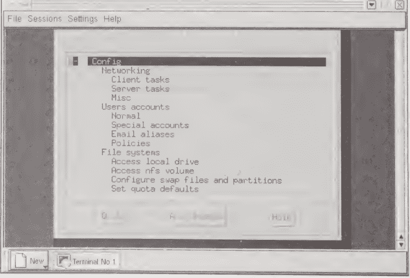

图 19.1 基于文本的 linuxconf 屏幕

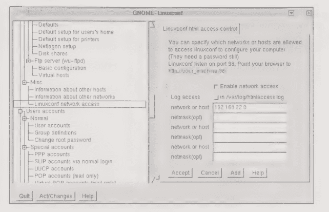

图 19.2 基于 X/Tcl 的 linuxconf 屏幕

## 浏览器的视角

337

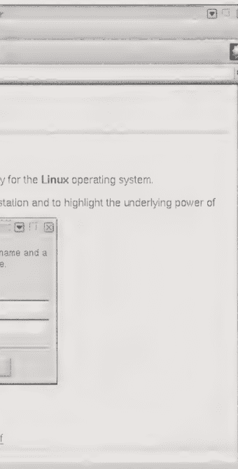

# 什么是 Linuxconf

欢迎使用 Linuxconf，这是一个用于 Linux 操作系统的交互式配置和管理实用程序。

Linuxconf 的创建是为了帮助管理 Linux 服务器或工作站，并突出 Linux 操作系统的底层强大之处。

它允许你管理：

- 启动和启动服务
- 日期与时间
- DNS
- 邮件 (sendmail)
- 文件系统和文件服务
- 防火墙
- 网络连接
- 用户账户
- UUCP

图 19.3 基于浏览器的 linuxconf 管理界面

```
[base]
LINUXCONF.distribution redhat
module.list 1 redhatppp
module.list 1 treemenu
module.list 1 inittab
module.list 1 motd
module.list 1 dnsconf
module.list 1 apache
module.list 1 samba
module.list 1 mailconf
module.list 1 wuftpd
kmaldbtype:etc/mail/virtusertable hash
netice.10-welcome.help 924195811
[netaccess]
htmlaccess.from 192.168.22.0
htmlaccess.dolog 1
htmlaccess.enable 1
```

# 338 第 19 章 工具、工具以及更多工具

注意结尾处 netaccess 段落的更改，我开启了对网络 192.168.22.0 的 htmlaccess 。

`linuxconf` 的灵活性在于它能与你的普通系统文件一起工作。你可以手动对任何系统文件进行更改，然后使用 `linuxconf` 进行其他更改。我提到这一点是因为很多早期的版本 `linuxconf` 似乎在争夺对你系统配置文件的控制权。你可能会进行手动更改，结果在你使用 `linuxconf` 时这些更改就丢失了。对于那些过去尝试过 `linuxconf` 但因为这些原因仍然望而却步的人来说，它现在似乎不再有那些配置文件问题了。那些问题已经变成了该软件包的一个非常强大的功能：如果我想了解我的系统（测试不同的软件部分）并想回到已知的配置，我认为这非常有趣。对于在不同配置之间移动的移动用户（例如从一个网络环境到另一个）来说，这似乎也是一个好主意。


该产品正在持续开发，新功能不断添加。在编写这一章时，我从 `linuxconf` 的标准发行版开始，下载了最新版本以查看更改。事实上，`linuxconf` 证明是一个背后蕴含巨大能量的动态产品。如果你正在寻找某种简化 Linux 系统管理的方法，这个工具是你值得自己检查一下的工具。

# Webmin

Webmin 正如其名称所示：一个基于 Web 的系统管理工具。在许多方面，Webmin 比 `linuxconf` 更先进，但它严格来说仍然是一个基于浏览器的实用程序。它的优势在于对多平台的支持。你应该考虑 Webmin 的另一个原因是它足够灵活，可以让你把那些管理工作分担给他人。当你开始使用该程序时，你就明白我的意思了。我将 Webmin 交给了其他不精通 Linux 的用户，但他们可以在我提供的定制菜单中处理那些系统功能。

此软件包仅要求你的系统中加载了 `Perl`（你很可能需要）。Webmin 有自己的 Web 服务器，因此甚至不需要 `Apache`。你可以从官方网站 (http://www.webmin.com/) 获取 Webmin。在我写下这里时，最新版本是 0.85，所以我将在示例中使用这些数字。不要被 1.0 之前的版本号吓到。

```
# tar -xzvf webmin-0.85.tar.gz
# cd webmin-0.85
# ./setup.sh
```

Webmin 安装现在会提示你几件事。对于配置文件目录，我接受了默认的 `/etc/webmin`。对于日志目录，我再次接受了默认的 `/var/webmin`。下一个提示很有趣，因为它告诉了我已经告诉过你们的内容，即运行 Webmin 真正需要的是 `Perl`。整个程序是用 `Perl` 写的，这就是为什么安装程序知道你的 `Perl` 二进制文件在哪里。很可能默认值就是正确的地方。

接下来，你会得到一个提示，告诉你关于 Webmin 最酷的事情之一。注意你的选择：

- 1) Sun Solaris
- 2) Caldera OpenLinux
- 3) Redhat Linux
- 4) Slackware Linux
- 5) Debian Linux
- 6) SUSE Linux
- 7) Mandrake Linux
- 8) Delix DLD Linux
- 9) Linux
- 10) FreeBSD
- 11) BSDI
- 12) HP/UX
- 13) SGI Iris
- 14) DEC/Compaq OSF/1
- 15) IBM AIX
- 16) SCO UnixWare
- 17) OpenServer
- 18) MacOS Server

如你所示，Webmin 运行在许多不同的平台上，并具有相同的界面。如果你学会了用 Webmin 管理你的 Linux 系统，你完全可以在 HPUX、AIX 等系统上这样做。这似乎是一个非常强大的功能。如果我想了解我的系统（测试不同的软件部分）并想回到已知的配置，我认为这非常有趣。对于在不同配置之间移动的移动用户（例如从一个网络环境到另一个）来说，这似乎也是一个好主意。

# 图形化管理工具

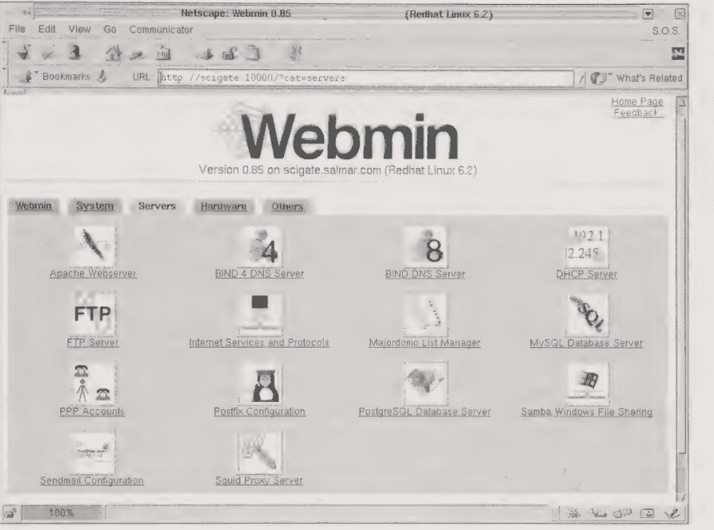

**图 19.4** Webmin 界面

## 图形化管理工具

让我们先看看你的桌面提供的功能，然后我将谈谈使用 KDE 或 GNOME 进行远程管理。你可以从各自的启动按钮访问这些工具。在你的 GNOME 桌面上，那是左侧那个大脚图标。KDE 有一个大 K。GNOME 和 KDE 都提供了许多棒的工具，但此时，我仍然对 KDE 提供的工具集留下了深刻的印象。在开源开发的世界里，变化很快。三个月后，我可能会有不同的感受。当然，美之处在于，我可以在 KDE 中运行我的 GNOME 工具，也可以在 GNOME 中运行 KDE 工具。

要控制环境的基础设置，请使用 GNOME 的会话管理器 `gnome`。你可以在“工具”菜单下的“系统信息”中找到它。在 GNOME 面板上，它可能在那个工具箱图标下。相反，KDE 有它的控制中心 `kcontrol`。在 KDE 面板上，它看起来像一个叠加了电路板的电脑屏幕。这里的好处之一是，你可以获取机器当前状态的快照。现在，你可能认为自诩为“控制中心”的东西会包含与系统相关的一切——事实并非完全如此。GNOME 和 KDE 的控制面板提供了一些功能和外观、颜色、样式等，但对于其他功能，你还需要引入其他工具。

在 KDE 组合包中，你会找到 `kdat`，这是一个基于 `tar` 的备份系统（我在上一章中介绍过它）。然后你可以尝试 `kuser`，这是一个非常用的图形化用户和用户组管理器。`ksysv` 是一个系统运行编辑器。对于 RPM 和 DEB 包管理，可以尝试 `kpackage`。在打印队列管理方面，查看 `klpq`。通过这个工具，你可以按打印机选择打印任务、重新调整顺序或删除作业。

GNOME 有自己的一系列工具。需要重置系统时钟吗？使用 `timeout`。对于 RPM 包管理，有 `gorp`。对于大多数系统管理任务，GNOME 整合了 `libconf`。

如果你和我一样，无法立即获得你喜欢的桌面环境的最新、强大的系统管理工具，你可以在相应的桌面网站上滚动可用软件包列表。在我给你这些 URL 之前，请记住，软件可能处于开发的非常早期阶段，可能仍有需要修复的 Bug。对于那些并不真正喜欢从发行版 tar 包中编译和安装程序的人，这可能不适合你，因为某些软件可能没有以 RPM 或 DEB 等标准发行版格式提供。

## 小而强大的工具

作为系统管理员，你已经准备就绪。你拥有知识，你的笔记本或桌面系统也加载了 Linux。你已经准备好应对任何现实。但当你无法轻松触及那个桌面时怎么办？如果你的笔记本在另一栋楼里（或者你可能没有笔记本）怎么办？当你使用 Linux 一段时间后，你会发现自己几乎可以离开它。很多情况下，你会发现自己在说：“你知道，如果我在这台小电脑上运行 Linux，我很快就能解决这个问题。”

解决方案是什么？随身携带自己的 Linux 发行版。最好的情况是能装进口袋的东西——单张磁盘上的整个 Linux 操作系统就太棒了。

## 无处不在的 Linux

幸运的是，Linux 开发者多次响应了这一呼唤。存在许多便携式的单磁盘 Linux 系统，使得救援崩溃的系统（Linux 和 Windows）、备份和恢复数据、诊断网络问题，或在忘记密码时访问计算机成为可能。在接下来的几页中，我将介绍这些微型 Linux 系统，从名副其实的 Linux On A Floppy (LOAF) (http://www.ecks.org/projects/loaf/) 开始。

当你访问 LOAF 网站时，你会发现有几个版本（或镜像）可用。每个镜像包含一个特定的网络驱动程序，因此你想获取最适合你办公室环境的一个或几个。我下载了 `load3.img`，它包含了 3Com 3x59 驱动。然后我插入一张空白磁盘并使用此命令创建了磁盘：

```
dd if=load3.img of=/dev/fd0
```

给它贴上标签，这就是你需要的。要在另一台 PC 上测试该磁盘（我假设你不想关闭自己的电脑），将其放入读取器并重启 PC。

当登录提示符出现时，只需输入 `root` 即可。要让 LOAF 识别你的网络并开展工作，你需要执行以下命令：

```
ifconfig eth0 local_ip_address
netmask your_network_mask
broadcast broadcast_address
route add -net network_address
echo "nameserver gateway_address" > /etc/resolv.conf
route add default gw gateway
```

在我的情况下，我使用的是 192.168.1.0 的本地私 C 类网络，客户端地址为 192.168.1.2（一台正在工作的 Linux 服务器）。

对于第二张软盘，情况是完全相同的。

```
dd if=classic=/dev/fd0
```

要使用 Trinux，只需从第一张软盘启动。系统会提示你插入第二张软盘，之后它会询问你是否还有更多软盘。现在，回答 N。（你可以在网站上阅读更多关于附加软件的介绍。）


你的 Trinux 系统现在已经启动，并有一个友好的欢迎消息和 shell 提示符（Trinux 0.version）。这里不需要登录——你会被自动路由。你可能会想这是否算是一个安全问题。答案是某种带有限定条件的“否”。在正常情况下，Trinux 是完全独立运行的。代码在内存（RAM）中。如果你在启动后取出软盘并将其放回口袋，没有人会对它们进行任何更改。尽管如此，如果你挂载了硬盘分区，你就可以访问那台电脑及其所有的信息。如果你在测试过程中工作，不登录意味着没有任何限制。请小心。

你的下一步将是配置你的 Trinux IP 地址并开始使用该系统。网络激活是通过 `netcfg` 命令完成的。你需要做的是切换目录到 `/etc/conf`，编辑 `/etc/conf0` 文件，编辑 `/etc/conf network` 文件，并运行 `netcfg` 来启动 `eth0`。我稍后向你展示如何操作；但首先，请考虑以下内容。

在不同的办公室和网络上工作意味着你每次都必须通过设置对话框。然而，如果你在同一个办公室工作，你可以通过修改已经创建的软盘，提前安全地将所有网络信息分配给你的 Trinux 发行版。这里是我意思的例子。

重新登录你创建 Trinux 磁盘的 Linux 系统。如果你还没有定义，请为软盘创建一个挂载点。我是用命令 `mkdir /mnt/floppy` 创建的。现在，将软盘挂载为 `mdos` 文件系统并切换目录到 `/mnt/floppy/conf`。

```
mount -t mdos /dev/fd0 /mnt/floppy
cd /mnt/floppy/conf
```

如果你在这里执行 `ls`，你会发现架构与最终启动后的证明有所不同。例如，当 Trinux 运行时，`conf` 目录位于 `/etc` 下，但此时并非如此。使用你喜欢的编辑器编辑 `eth0` 文件，以反映你为这个高度便携的工作站所需的地址（没有比一两张软盘更便携的了）。在我的网络中（在这种情况下我使用 192.168.2.0 C 类网络），我给 Trinux 分配了地址 192.168.2.4。以下是我的 `eth0` 文件最终看起来的样子：

```
export IPADDRESS NETWORK BROADCAST NETMASK
IPADDRESS=192.168.2.4
NETMASK=255.255.255.0
NETWORK=192.168.2.0
BROADCAST=192.168.2.255
```

你可能还想设置与默认网关和名称服务器相关的网络信息。这是网络文件。在已启动的 Linux 系统上，它位于 `/etc/conf/network`。在发行版软盘上，它就在 `conf` 目录下。经过快速编辑，我的网络文件看起来像：

```
GATEWAY=192.168.2.10
DNS=192.168.2.10
GWDEV=eth0
```

如前所述，Trinux 为具有安全意识的网络管理员提供了一个小型的工具宝库。例如，你得到了 `nmap`，这是我用过的最好的端口扫描器之一。如果你不确定主机开启了哪些服务，你将想要运行 `nmap`。你可能会对结果感到惊讶。因为实现此目标有多种方法，你也可以使用 `xscan` 进行网络映射。

Trinux 还具有 `ntop`，这是一个非常酷的工具，可以交互式地显示网络流量。你可以以各种方式对信息进行排序，关注特定的协议，并放大网络带宽大户。我非常喜欢的一个功能是一个显示，它允许我在网卡的 IP 地址和 MAC 地址之间进行切换。再按一次按键，这些 MAC 地址就会由网卡制造商识别。另一个包含的网络监控程序是 `iptraf`。

如果你在寻找嗅探器，请使用 `tcpdump` 或 `ipgrab`。你的 Trinux 工作站可以配置为带有 `iptchains` 的防火墙或运行代理。

如果你正在寻找要添加到工具箱的最新包（检查网站），你可以取一张空白的 DOS 软盘，按照之前的描述挂载它，并使用简单的 `cp` 命令将所需的包复制到那里。

```
cp newpackage.tgz /mnt/floppy
```

然后，如果你想在事后加载这样的包（当你的 Trinux 系统实际运行时），以完全相同的方式挂载软盘，并使用 `pkgadd` 命令加载新软件。

```
cd /mnt/trinus_mount_point
pkgadd newpackage.tgz
```

现在，只需输入命令名称并开始使用它。

这里有这样一个小包供你使用，你携带的这类网络工具在几年前可能花费数千美元。我记得当数据包嗅探器还是一件大事时，它是在自己的黑盒硬件中，并带有一个难以阅读的……

## 微小但强大的工具

当你第一次启动 `vncserver` 时，系统会提示你输入密码以访问服务器。你以后随时可以使用 `vncpasswd` 命令更改密码。当服务器激活后，你可以使用 `vncviewer` 命令连接到它。格式如下：

`vncviewer host:session_number`

要退出查看器（或发送特定的按键序列），请按 F8 键，然后点击 Quit Viewer（退出查看器）关闭会话。你也可以启动一个共享会话，以便其他用户可以使用此版本的命令使用同一个 X 窗口会话：

`vncviewer -shared host:session_number`

当你启动 `vncserver` 时，它会在你的主目录下创建一个 `.vnc` 目录（`/root/.vnc`）。这里保留了几个文件。你会发现与你运行的每个服务器关联的日志文件，以及一个允许删除服务器的 `.pid` 文件。顺便说一下，你可以这样杀死 `vncserver` 进程：

```
vncserver -kill :1
```

记住，`:1` 可能是 `:2` 或 `:3`，取决于你尝试杀掉的会话。尽管如此，我想让你看到的另一个文件是 `xstartup`。如果你对该文件执行 `cat`，你会得到类似这样的内容：

```
#!/bin/sh
xrddb $HOME/.Resources
xset -solid grey
xterm -geometry 80x24+10+10 -ls title "$VNDESKTOP Desktop" &
ntwm &
startkde &
```

注意，倒数第二行被注释掉了，并在下方添加了一行 `startkde`。这是因为 VNC 使用 twm（标签窗口管理器）作为它的默认桌面。我选择运行 KDE，并添加了随后的那行代码。如果你偏好其他窗口管理器，请在启动文件中进行修改。

正当你认为已经不能更完美了时，VNC 查看器还可以通过一个小型 Java Applet 从你喜欢的 Web 浏览器中运行。对于你的 Netscape 浏览器，使用此 URL（将 host 和 session_number 替换为你自己的）来访问 Java 客户端：

```
http://server_name:580session_number/
```

让我稍微澄清一下。在我的网络上有一台主机名为 gateway 的机器（作为通向我内网的网关）。如果我想连接到该机器上 `vncserver` 号为 1 的会话，我的 URL 看起来如下：

```
http://gateway:5801/
```

Java 在你的浏览器中启动，你会看到一个密码提示，即你第一次启动服务器时提供的那个密码。与命令行查看器不同，你不需要使用功能来剪切或断开会话。屏幕顶部留有四个小按钮供你使用。

这是一个小型、快速的客户端，响应非常快。通过浏览器客户端，你可以从任何 PC 访问你的 Linux（或 UNIX）服务器（当然，需要一个支持 Java 的浏览器）。

Windows 怎么说？早些我提到过 VNC 也为 Windows 提供了一个服务器。使用该产品，你再也不需要花几个小时在电话里引导用户解决 Windows 应用程序的问题——你只需要接管控制即可。要做到这一点，你需要安装以 .zip 文件形式提供的 Windows 产品。该文件的当前版本是 `vnc-3.3.r2_x86_win32.zip`。它适用于所有 Windows 9x、Windows NT 和 Windows 2000 产品。看一眼图 19.5。这是一个运行 Mozilla 的 Windows 95 会话，是从我运行着 KDE 会话的 Linux 系统访问的。

图 19.5 使用 VNC 控制 Windows 95 机器

要开始操作，请将文件提取到你选择的目录中（使用你喜欢的 Windows 归档客户端，如 pkzip 或 WinZip）。将创建两个文件夹。其中一个是 `vncviewer`，它包含一个单一的可执行文件 `vncviewer.exe`，运行它即可无需任何特殊安装就访问你的 Linux 服务器（或任何 VNC 服务器）。如果你不想在每台 PC 上都安装，可以把它放在磁盘上随身携带。另一个目录是 `winvnc`，它包含了完整的发行版，包括 Windows 版的 VNC 服务器。要为 Windows 安装 VNC，只需运行文件夹中的 `setup.exe` 文件。

接下来，点击 Start 按钮并选择 Program Files -> VNC -> Administrative Tools。点击 Install Registry Key，然后点击 Install Windows-VNC Service。要运行服务器，要么重启，要么启动 WinVNC Service。你应该会在 Windows 任务栏的托盘中（右侧时钟旁边）看到一个小小的 VNC 图标。现在，回到你的 Linux 机器，通过连接到服务号为 0 的主机来运行你的 `vncviewer`（无论通过命令行还是浏览器）。换句话说，为了让我连接到我的那台名为 "natika" 的 PC，我将运行以下两个命令中的任意一个（第二个实际上是 URL 而不是命令）：

```
vncviewer natika:0
http://natika:5800/
```

## 构建你自己的门户

由 Sally Tomasevic（她恰好是我的妻子和伙伴）编写。它根据 GPL 免费发行。

作为其功能的一部分，Salmar Station 会自动为你创建并维护链接，无需你费任何手指。任何新添加的项目都会在内网页面上自动突出显示。通常情况下，这种添加和删除需要用户交互。这个内网没有这个问题——它会为你完成。

为了使用此软件，你需要构建并配置 Apache 服务器，构建并配置 SQL 数据库系统（PostgreSQL），并交付我提到的内网。

内网的核心是你的 Web 服务器。幸运的是，你不需要远远寻找。Linux 发行版自带最流行、最灵活的 Web 服务器：Apache 服务器。与其他开源项目一样，Apache 服务器可以从头构建并按需定制。它还提供了广泛的模块支持，允许你“插件”附加功能，例如数据库支持或 SSL 加密。

“Apache”这个名字实际上是早期开发对服务器描述的一个同音词。最初，它是基于 NCSA http 服务器的。开发者们不断进行补丁和增强。当被问及他们的项目时，传说他们称之为“patchy”（补补丁的）服务器。我想他们本可以称之为“patchwork”（拼凑）服务器，但“Apache”流行了，剩下的正如俗所说，已成历史。

你可以随时从 Apache 网站获取最新代码，但它几乎已经包含在你的 Linux 发行版中了，为你提供了预编译、易于安装的版本。如果你想从头构建 Apache 服务器，我将在下一节向你如何做。

## 从源码编译 Apache

从这里，下载源码并将其保存到临时目录。在本例中，我将使用 1.3.14 版本。我所做的第一件事是将源码提取到我的目录中，如下：

```
tar -xzvf apache_1.3.14.tar.gz
cd apache_1.3.14
./configure
```

这会将 Apache 配置为安装到 `/usr/local/apache` 的默认目录结构。在 Red Hat 安装（以及其他某些发行版）中，默认目录是 `/home/httpd`。如果你想要不同的安装目录，请使用 `--prefix` 选项，如下：

```
./configure --prefix=/home/httpd
```

`configure` 脚本有许多可以设置的额外标志或选项。在开始安装之前，你可能想查看一下 `README.configure` 文件。现在，我将保持简单，在第一个示例中使用默认设置。当 `configure` 脚本完成创建 Makefiles 后，输入 `make` 接着输入 `make install` 来完成安装。

```
make
make install
```

如果你选择标准配置，系统会假设了一些默认值。例如，假设你的文档根目录为 `/usr/local/apache/htdocs`，而 `cgi-bin` 目录为 `/usr/local/apache/cgi-bin`，这在大多数情况下都是没。

一旦安装了服务器，你需要使用 `apachectl` 命令启动它。

```
/usr/local/apache/bin/apachectl start
```

你通过使用 `stop` 选项而不是 `start` 来停止服务器（你已经知道了，对吧？）。现在，为了测试你的安装，启动你喜欢的浏览器（Netscape、Lynx 或 Konqueror）并将其指向你的新服务器。假设你刚刚安装的服务器名为 "natika"，你使用此 URL：

```
http://natika/
```

你应该会得到一个看起来与图 20.1 非常的页面。

如果你查看运行中的进程，服务器本身通常会显示为 `httpd`。如果你的 Web 服务器是作为 Debian `apt-get` 或基础安装的一部分安装的，很有可能执行文件实际上被称为 `apache` 而不是 `httpd`。你可以通过此命令列出包文件来验证这一点：

```
dpkg -L apache | more
```

## 基本 Apache 配置

从 1.3.4 版本开始，所有的配置信息都在一个文件中：`httpd.conf` 文件。如果你是从零开始构建，你将在 `/usr/local/apache/conf` 中找到配置文件。在我预装的 Debian Apache 服务器上，`httpd.conf` 文件位于 `/etc/apache`。找到它在你的系统中确切位置的一种方法（除了运行命令外）是通过带有 `-V` 标志的调用 Apache 可执行文件本身。这将向你显示许多参数的编译时设置，包括配置文件的路径。为了本例起见，我假设 Apache 可执行文件在你的 PATH 中。

```
httpd -V
```

在我的 Debian 系统上，我改为输入 `apache -V`。寻找一行显示 `SERVER_CONFIG_FILE` 的内容。它指示了配置文件的完整路径。对 Web 服务器的任何更改都需要重启服务器。对于任何当前的 Apache 安装，这都是使用 `apachectl` 程序完成的（如前所示）。

## 常见更改

我想首先查看的是服务器名称。你的主机在同一网络上可能被称为不同的名称。一个常见的例子是经典的 `www.domain.dom` 格式。你的服务器最初可能响应为 `myserver.domain.dom`。

```
ServerName www.domain.com
```

你可能想要更改的其他参数是服务器运行身份的用户 ID 和组 ID。这些是 `User` 和 `Group` 配置参数。root 用户启动服务器，但 Apache 二进制文件会切换到此用户进行操作。某些网站有一个名为 "www" 的用户来运行 Web 服务。其他则使用 "nobody"。你可以根据服务器的配置使用任何用户。这在 `httpd.conf` 文件中定义，你那里找到这些行：

```
User www
Group www
```

偶尔，文档会出现问题，服务器将生成一条错误消息，并提示连接网站管理员。服务器在 `ServerAdmin` 参数中维护此信息。管理员可能位于服务器地址之外的某个地址。找到并修改像这样的行：

```
ServerAdmin webmaster@somedomain.com
```


还有其他你可能想要做的更改，通过这些更改你确实可以做很多事情。幸运的是，Apache 自带了 HTML 文档。在默认安装完成后，你应该在测试页面上看到指向文档的链接。

## Apache 基础

从 1.3.4 版本开始，所有的配置信息都在一个文件中：`httpd.conf` 文件。如果你是从零开始构建，你将在 `/usr/local/apache/conf` 中找到配置文件（s）。在我预装的 Debian Apache 服务器上，`httpd.conf` 文件位于 `/etc/apache`。找到它在你的系统中确切位置的一种方法（除了运行命令外）是通过带有 `-V` 标志的调用 Apache 可执行文件本身。这将向你显示许多参数的编译时设置，包括配置文件的路径。为了本例起见，我假设 Apache 可执行文件在你的 `PATH` 中。

```
httpd -V
```

在我的 Debian 系统上，我改为输入 `apache -V`。寻找一行显示 `SERVER_CONFIG_FILE` 的内容。它指示了配置文件的完整路径。对 Web 服务器的任何更改都需要重启服务器。对于任何当前的 Apache 安装，这都是使用 `apachectl` 程序完成的（如前所示）。

## 常见更改

我想首先查看的是服务器名称。你的主机在同一网络上可能被称为不同的名称。一个常见的例子是经典的 `www.domain.dom` 格式。你的服务器最初可能响应为

```
ServerName www.domain.com
```

你可能想要更改的其他参数是服务器运行身份的用户 ID 和组 ID。这些是 `User` 和 `Group` 配置参数。`root` 用户启动服务器，但 Apache 二进制文件会切换到此用户进行操作。某些网站有一个名为 "www" 的用户来运行 Web 服务。其他则使用 "nobody"。你可以根据服务器的配置使用任何用户。这在 `httpd.conf` 文件中定义，你那里找到这些行：

```
User www
Group www
```

偶尔，文档会出现问题，服务器将生成一条错误消息，并提示连接网站管理员。服务器在 `ServerAdmin` 参数中维护此信息。管理员可能位于服务器地址之外的某个地址。找到并修改像这样的行：

```
ServerAdmin webmaster@somedomain.com
```

## PostgreSQL 简介

PostgreSQL 是一个高级的多用户关系型数据库系统（RDBMS），随源码分发。最初编写于 1985 年并由许多开发者开发，PostgreSQL 快速、强大，支持大多数（并非所有）标准，最重要的是它是免费的。你可能不需要寻找 PostgreSQL，因为它在主要的 Linux 发行版中都包含了。

但如果你想使用最新版本的软件，下载源码并自行构建是有意义的。如果你已经安装了 PostgreSQL，有一些基础工作需要配置，所以让我们一起完成。

最新版本可以通过访问 PostgreSQL 网站（`http://www.postgresql.org/`）或访问其镜像站点获取（主站可能会很忙）。

在下载最新包后，将其提取到临时位置，切换到源码目录，并按照以下步骤构建 PostgreSQL：

```
tar -xzvf postgresql-7.0.3.tar.gz
cd postgresql-7.0.3/src
./configure
make
make install
```

该发行版（在此情况下为 `postgresql-7.0.3`）有一个很好的 `INSTALL` 文件，你可能需要花时间阅读，因为关于 `configure` 脚本的一些选项可能会有用。例如，默认情况下，PostgreSQL 安装在 `/usr/local/pgsql` 目录，你可能想使用其他位置。

当你编译时，PostgreSQL 需要知道如何找到它的库。你可以随时修改环境变量将 `/usr/local/pgsql/lib` 包含在 `LD_LIBRARY_PATH` 中，但更好的方法是将路径添加到 `/etc/ld.so.conf` 文件。这是一个告诉系统去哪里搜索库的文件。因为它是纯文本，只需添加库路径并以 root 身份运行此命令：

```
ldconfig
```

### 初始化数据库

```
mkdir data
```

首次初始化数据库，请使用以下命令：

```
$ bin/initdb -D /usr/local/pgsql/data
```

当然，这指的是你刚刚创建的那个目录。在此过程中，你将看到许多信息闪过，PostgreSQL 正在报告它所执行的操作。系统将设置默认权限。此外，将创建一个默认数据库，以及 PostgreSQL 自带的数据库 (`pg_database`)，用于存储用户和其他数据库信息。随后会创建几个视图，之后你应该会收到类似下面的消息：

Success（成功）。现在可以使用以下命令启动数据库服务器：

```
/usr/bin/postmaster -D /var/lib/pgsql
or /usr/bin/pg_ctl -D /var/lib/pgsql start
```

两种选项均可行，但第二种是更好的选择，因为它会为你在后台启动进程。你可能还需要将此项添加到系统启动文件 (`rc.local`) 中以便自启动。

接下来，你需要创建一些默认的 PostgreSQL 用户。必须添加 `root` 用户。"nobody" 用户也是如此。首先以 `postgres` 用户身份登录，并执行以下命令向你的 PostgreSQL 系统添加用户 "root" 和 "nobody"：

```
$ bin/createuser root
```

系统会提示输入 root 的 UID（接受默认值），并询问是否允许 root 创建数据库。回答 y。当被询问是否允许 root 创建用户时，我回答了 n。现在对用户 nobody 执行同样的操作。唯一的区别在于，在询问用户 nobody 是否允许创建数据库时，我也回答了 n。取决于你使用的 PostgreSQL 版本，关于是否允许用户创建其他用户的问题表述可能如下：

Is user "whoever" a superuser? 用户是否为超级用户

答案仍然是 n。最后，在创建用户 nobody 后，系统会询问 `createuser` 是否应该为 nobody 创建数据库。回答 y，用户创建工作即完成。

## 用于数据库访问的 Perl DBI 和 DBD

为了让 Perl 程序的数据库访问变得更简单，开发了数据库接口 (DBI) 模块。DBI 模块由一组程序组成，这些程序提供了接入 SQL 数据库的标准钩子。DBI 是用于 perl5 与数据库系统交互的应用程序接口 (API)。其核心思想是提供一组一致的模块和调用，使得数据库访问无需费力即可实现移植性。

现在，有许多数据库格式（PostgreSQL、MySQL、Sybase、Oracle 等），在访问和与这些不同数据库通信时存在差异。这正是数据库依赖 (DBD) 模块发挥用场的地方。DBD 模块通过其支持的数据库简单后缀来标识。例如，`DBD-Pg` 是 PostgreSQL 的 DBD 模块。同时，`DBD-Informsix` 是 Informix 数据库的 DBD 模块。

本质上讲，DBI 模块适用于所有数据库，但 DBD 模块必须（且确实）特定于数据库。

## 下载与安装模块

DBD 和 DBI 模块都可以在 CPAN 网站找到，这是一个巨大的 Perl 网络资源库。你可以在 `ftp://ftp.cpan.org/modules/by-module/DBI/` 找到 DBI 模块。可以在 `ftp://ftp.cpan.org/CPAN/modules/by-module/DBD/` 找到 DBD 模块。

在编写时，最新最强大的 DBI 版本是 `DBI-1.14.tar.gz`，而 DBD 发布版本为 `DBD-Pg-0.95.tar.gz`。在这些模块上，似乎总能获得最新最强大的。这是因为这些模块会随着它们所引用的数据库而增长和发展。最新的 PostgreSQL 数据库最好由最新的 `DBD-Pg` 来支持。

通过首先将分发解压到临时目录并遵循以下步骤安装 DBI 模块：

```
cd /usr/local/temp_dir
tar zvf DBI-1.14.tar.gz
cd DBI-1.14
perl Makefile
make
make test
make install
```

DBD 模块的安装过程类似。请注意，较新版本的 DBD 模块现在要求在安装之前设置两个环境变量：`POSTGRES_LIB` 和 `POSTGRES_INCLUDE`。

### 设置环境变量

```
POSTGRES_LIB=/usr/lib/postgresql ; export POSTGRES_LIB
POSTGRES_INCLUDE=/usr/include/postgresql ; export POSTGRES_INCLUDE
```

在 Debian 系统上，你可能会发现这些环境设置效果更好。

```
POSTGRES_LIB=/usr/lib/postgresql ; export POSTGRES_LIB
POSTGRES_INCLUDE=/usr/include/postgresql ; export POSTGRES_INCLUDE
```

现在，你可以运行安装了。

```
cd /usr/local/temp_dir
tar -xzvf DBD-Pg-0.95.tar.gz
cd DBD-Pg-0.95
perl Makefile.PL
make
make
make test
make install
```

## CGI 后端

你最后需要的是 Perl 的 `cgi-lib.pl` 库。这已成为使用表单进行 CGI 设计的事实标准。要获取最新版本，请访问 `http://cgi-lib.berkeley.edu/` 并文件保存到 `/usr/lib/perl15` 目录。

如果你的 Perl 库位于不同的目录（例如 `/usr/local/lib/perl15`），你需要修改所需的 `/usr/lib/perl15`。

## 内网的界面

内网有两个面貌：一个是所有人都能看到的，另一个是仅供管理员使用的几个小项目。管理员菜单可以通过你喜欢的浏览器在 `http://yourmachine_name/scimaint/admin/` 访问。

从这里你可以设置各种配置参数。第一个选项允许你创建、修改或删除发布类别。你会在菜单上看到 `Update Categories`。Posting Category 标题是你的用户在查看内网公共界面时看到的。默认类别是 News（新闻），但你可以将其设置为 Documents（文档）。新闻项和文档将显示在 What's New（最新动态）菜单下，但你可以在此处决定是否覆盖它。

你还可以定义这里允许谁发布。你的选择是仅允许管理员，还是将其作为一个公共类别并让每个人参与（见图 20.2）。

## 第 20 章 概念证明，第一部分

在此时，你拥有的另一个选择是是否允许互联网链接。链接可以指向互联网上的任何地方，也可以指向内部——或者换句话说，它们可以指向你本地网络上某处的公司文档。然后你可以决定发布顺序：按字母顺序或日期，升序或降序。最后，你可以指定系统是否会自动处理这些链接的过期删除。

环顾四周。探索一下。大萨尔马站（Grand Salmar Station）提供了许多其他选项。例如，你可以更改内网的样式——本质上就是改变它的外观和感受。你会发现发行版自带了六种样式，名字非常奇特，如 Beach Time（海滩时光）、Copper Kettle（铜壶）和 Blue Skies（蓝天）。你甚至创建自己的样式。你选择任何样式都可以扩展到整个内网。

电话簿也可以在这里进行管理（如果你选择安装它的），其他内网默认设置如到期日期也是如此。请务必阅读随附的文档，该文档也可以从管理员菜单获取。

为了对内网软件有一个了解，你可以使用浏览器生成一个包含示例记录的演示数据库。

```
http://yourmachine_name/scimaint/admin/demoreset.html
```

输入此地址即可访问非管理员菜单：

```
http://yourmachine_name/scintranet/
```

由于整个程序是用 Perl 编写的，因此它是学习连接互联网数据库的极佳介绍。此外，代码的开源性质使你能够对其进行定制以适应你自己的环境。

## 保护某些页面

关于内网的管理功能（以及你 Web 服务器上的其他内容），你可能不希望这些信息向所有人开放。你肯定见过某些网站在弹出时会有这样的“你必须输入密码”的小框。其实，你可以在内网的管理功能目录中通过 `.htaccess` 文件轻而易举地添加这些框，该文件存放在你想要访问的目录中。以下是基本格式：

```
AuthName             "Intranet Admin: Restricted access"
AuthType             Basic
AuthUserFile         /usr/local/apache/.intranetadmin

<Limit GET POST>
require valid-user
</Limit>
```

`AuthUserFile` 参数指向实际密码文件的位置。注意，我将它放在了 Web 服务器的文档根之外。这样的话，文件就无法通过简单的 HTTP 请求下载。使用 `htpasswd` 命令将密码添加到此文件中，如下：

```
htpasswd -c passwordfile username
```

顺便提一下，如果你从源码构建自己的 Apache 服务器，该程序可能位于 `/usr/local/apache/bin` 目录。这里有一个警告：`-c` 标志会在之前不存在该文件时创建一个新的密码文件。除非你想清空文件并重新开始，否则不应该使用它。你可能想要使用（可能应该使用）另一个标志是 `-m`，它强制对密码进行 MD5 加密。

```
htpasswd -m /usr/local/apache/.intranetadmin natika
```

当我将 natika 添加到列表时，系统提示我输入密码，然后要求我确认密码。

你几乎已经完成了。

既然我已经告诉了你如何为 Web 目录添加密码保护，我将后退一步，告诉你在 Web 服务器配置中需要更改什么以实现这一切。默认情况下，Apache 服务器不遵循 `.htaccess` 文件。你需要开启它。要这样做，请用你喜欢的编辑器打开 `httpd.conf` 文件并寻找此行：

```
AllowOverride None
```

你会发现至少有四个不同的地方出现此行。一个覆盖服务器根，一个是文档根（htdocs 或 html），一个用于 cgi-bin，另一个用于图标目录。你需要将 `None` 改为 `All`。

```
AllowOverride All
```

我倾向于对所有图标目录进行设置。


搞定了。重启 Apache，启动浏览器，你应该就能看到密码提示（见图 20.3）。


### 资源

- Apache Web 服务器：http://www.apache.org/
- DBI 列表：http://www.isc.org/services/public/lists.html
- 大萨尔马站内网：http://www.salmar.com/gss/
- 大萨尔马站邮件列表：http://www.salmar.com/mailman/listinfo/gss-users
- PostgreSQL：http://www.postgresql.org/

## 概念证明，第二部分

### Linux 风格的办公室

欢迎来到第二个“概念证明”章节（第一个是第 20 章）。在本章中，你将让 Linux 经历一系列操作。通过这里涵盖的信息，你将能够建立一个基于 Linux 的互联网和电子邮件网关。通过接下来的信息，你可以使用单台廉价机器（你有旧笔记本电脑吗？）为办公室的所有成员提供连接。这就是我们开始的地方。

我介绍的解决方案实际上由两个主要部分组成。一个是技术方面，涉及使用 Linux 服务器；另一个是业务方面，涉及和域名。

## 使用 dial 设置 ISP 连接

为了自动、友好的拨号，你将使用一个名为 `dial` 的程序。你也可以使用 `pppd` 程序自带按需拨号功能，但它不够灵活，特别是在考虑限制时间的连接时。

让我们假设你从一个名为“we-are-an-isp.com”的虚构公司购买了拨号 PPP 连接。该连接为我们提供了一个多域域邮箱，且每月限制为 200 小时。虽然这看起来很充裕，但你不想用到那么久。这就是为什么你会使用 dial 作为你的拨号器。

### 使用 DIAL 设置 ISP 拨号连接

你的机器上应该已经安装了所需的所有内容。唯一的例外是 `dial` 程序。它没有包含在我的 Red Hat 发行版中，但在 Caldera 2.3 CD 上有的，因此在决定是否需要寻找它之前，你应该检查一下。顺便说一下，`dial` 是一个由 Eric Schenk 最初编写的按需拨号程序。Eric 已将管理权移交给了新的维护者 Mike Jagdis。有关 Mike 网站的链接，请参阅本章最后的“资源（Resources）”部分。

你将以最程度的麻烦来设置 `dial`。我正在通过 COM1 端口使用一个普通的 56K 调制解调器。你可以直接从 `dial` 网站的压缩包安装 `dial`，也可以选择可用的二进制发行版。`dial` 的主控制文件是 `/etc/dial.conf`。我系统中的文件如下：

```
#
# 用于 Internet 网关的拨号配置脚本
#
mode ppp
connect /etc/ppp/ppp-on-dial
device /dev/ttyS0
speed 115200
modem
crtscts
local 192.168.1.150
remote 192.168.1.151
dynamic
defaultroute
include /usr/lib/dial/standard.filter
```

我稍后会为你展示连接脚本，但现在我想指出其中一些条目的含义。特别是查看 `local`、`remote` 和 `dynamic` 条目。为了让 `dial` 工作，它会建立一个临时的 SLIP 连接并“等待”来自网络的请求。

> 注意：SLIP 是串行接口协议（Serial Interface Protocol），是另一种通过 ISP 连接或建立拨号网络连接的方法。在大多数情况下，它已被点对点协议（PPP，Point-to-Point Protocol）取代。如今找到一个支持 SLIP 但不支持 PPP 的 ISP 是极罕见的。

例如，用户在 Web 浏览器中点击链接就是这种请求。当 PPP 连接建立时，`dynamic` 条目告诉 `dial` 将此地址分配给 PPP 连接。然后，`defaultroute` 告诉 `dial` 将新地址分配为访问 Internet 的默认路由。

现在是连接脚本：

```
#!/bin/sh
#
# 这是 dial 连接脚本。
#
exec /usr/sbin/chat -v \
TIMEOUT             3 \
ABORT               '\nBUSY\r' \
ABORT               '\nNO ANSWER\r' \
ABORT               '\nRINGING\r\n\rRINGING\r' \
''                  \rAtZ \
'OK----+c-OK' \
TIMEOUT             30 \
OK                   ATDTmy_isp_phone_number \
CONNECT\login:--login:           Pmy_isp_login \
ssword:             my_isp_passwd
```

顺便提一下，login（或 password）并不是拼写错误。你需要扫描整个字符串才能生效。此外，某些网站可能使用“Login”，而另一些使用“login”。将提示符缩短为较为常见的形式以简化操作。

此脚本必须是可执行的。你只需要替换你的 ISP 电话号码以及登录用户名和密码即可。

要启动 `dial`，请使用以下命令：

```
# /usr/sbin/sdial
```

`dial` 程序作为守护进程运行，在正常情况下不需要用户进一步干预。你可能想将 `dial` 包含在启动时的启动脚本中。

## 使用 fetchmail 自动远程获取邮件

fetchmail 是由 Eric S. Raymond 编写的远程邮件收集代理。该包非常流行，几乎包含在每个 Linux 发行版中，并提供源码形式运行在许多不同的 UNIX 变体上。这个棒软件包几乎可以处理所有的邮件收集协议。你现在只需要关注 POP3。POP3 是 ISP 提供的最流行、常用的邮件收集协议。你可以设置 `fetchmail` 使用你的 ISP 登录名和密码，并为单个或多个账户收集邮件。`fetchmail` 的伟大之处之一是，它可以获取电子邮件的标头信息并解析出其预定位置。

此时，我想指出，`fetchmail` 的作者并不完全推荐这种方法。原因是并不是所有消息都能被轻易解码，某些标头信息可能会丢失或被误读。通过大型邮件列表投递的消息（其 To: 信息被埋没或重写）是 `fetchmail` 最常见的问题区域。对于大多数情况以及绝大多数日常通信，你会发现 `fetchmail` 完全能够胜任。任何无法投递的邮件将进入根邮箱，系统管理员稍后可以进行重新路由。

`fetchmail` 可以在启动时作为守护进程运行、从命令行运行，或通过 cron 任务运行 shell 脚本。第一种方案最简单，但第三种方案允许你在 `fetchmail` 运行时添加其他选项，例如日期时间戳以确认邮件获取。它还允许你精确定义 `fetchmail` 的运行时间。例如，在我配置 `fetchmail` 的许多环境中，我受限于拨号连接分配的特定小时数。通过 cron 运行 `fetchmail` 使得我能够在可以在工作时间内每 15 分钟运行一次，而在其他时间不运行。

你大部分需要在名为 `/etc/aliases` 的文件中进行配置。内容如下：

```
# aliases 文件示例
# 以下行仅供示例
user1@example.com: user2@example.com
```

## DNS 访问

现在是内置功能了。这并不意味着你会发现已经启用了 IP 转发。

让我们以 Red Hat 系统为例。在 `/etc/sysconfig` 目录下，你会找到一个名为 `network` 的文件，它非常简单地定义了基本的网络规则。我的 Internet 服务器的配置看起来如下：

```
NETWORKING=yes
FORWARD_IPV4=yes
HOSTNAME=mailserver.mycompany.dom
DOMAINNAME=mycompany.dom
GATEWAY=
GATEWAYDEV=
```

这里重要的行是第二行。`FORWARD_IPV4` 默认设置为 "no"。要让办公室的 PC 访问你的拨号连接，你需要将其设置为 "yes" 并重启网络服务。同时注意，`GATEWAY` 和 `GATEWAYDEV` 没有被设置。正如之前提到的，这些是在 `diald` 启动 PPP 连接时设置的。

在 PC 终端，你应该确保你的 Internet 网关已设置为服务器的默认网关。在你的 Windows 9x 系统上，点击“开始”按钮，然后选择“设置”、“控制面板”。双击“网络”图标，然后双击“TCP/IP 配置”。如果你有网卡和拨号网络 TCP/IP 线路，请确保选择网卡的那一个。最后，点击“网关”选项卡并添加你的 Internet 服务器的地址。在这个示例中，地址是 `192.168.1.100`。

最后，开启网络上 PC 的 IP 转发。请注意，这个示例展示了用于内部网络外部路由的 `ipchains` 命令的最简单形式。我将在第 25 章中详细讨论这一点。

### 使用 ipchains 设置 IP 转发和 IP 伪装

```bash
/sbin/ipchains -A forward -j MASQ -s 192.168.22.0/24 -d 0.0.0.0/0
```

## 重温 DNS

我在第 18 章中介绍过 DNS，但为了讨论，我会为你提供一个非常简单的示例。对于那些没有在网站上运行全功能全天候域名的用户，我将探索一个精简版的 DNS。简单的答案是在 `/etc/resolv.conf` 中运行带有单个条目的仅缓存名称服务器。在这种情况下，指向 ISP 名称服务器的单行（或两行）配置即可。

```
nameserver XXX.XXX.XXX.XXX (ISP 的第一个 DNS)
nameserver YYY.YYY.YYY.YYY (ISP 的第二个 DNS)
```

你也可以通过控制面板添加 DNS 条目，让你的 Windows 9x PC 指向 ISP 的名称服务器。在这个示例中，你将 Internet 服务器指向主名称服务器。

如果你想为你的网站搭建一个简单但完全完全） DNS，请访问我的网站（在本章末的“资源”部分查看 URL）。该压缩包名为 `easdns.tar.gz`。修改你的引用以反映你的域名和 ISP 名称服务器条目，你就大好了。

## 汇总一切

在完成所有这些更改后，可能是时候重置网络了。在我的 Red Hat 系统上，我只需停止并重启网络服务和 `inetd`。

```bash
# /etc/rc.d/init.d/network stop
# /etc/rc.d/init.d/inet stop
# /etc/rc.d/init.d/inet start
# /etc/rc.d/init.d/network start
```

这假设我是直接登录到服务器的。如果我是通过网络登录，第一行将基本上结束我后续的所有命令。

由于你无疑希望在启动时激活所有这些服务，因此将它们添加到启动脚本中是明智的。我推荐 `rc.local` 文件（参见第 6 章）。如果你正在遵循此示例，你需要启动的是 `dial` 以及你的 IP 转发和伪装。如果你想全天候检查邮件，也将将你的 `fetchmail` 进程添加到启动脚本中。

## 基础防火墙服务

一旦你让自己和你的公司暴露在 Internet 上，你至少想要建立一些基础安全措施。有了你的高速 Internet 网关，实现几乎无懈可击的安全并非不可能。

> 安全警告：在任何时候你都不应该对网络安全掉以轻心。基础措施可以非常有效。你可以查看你的日志（参见第 23 章），并认为你的安全措施在拒绝和控制对系统的访问方面做得很好。但要保持警惕。以下信息旨在为你提供一个安全的快速入门，而随后的章节（特别是第 24 章和第 25 章）将更详细地探讨安全性。不要跳过它们。

## 使用 LINUX 设置邮件服务器

尽管如此，通过几项简单的配置就可以很容易地说出“离离开！”。TCP wrappers 是你控制对机器提供的网络服务访问的手段。可以被 wrapper 控制的服务列在你的 `/etc/inetd.conf` 文件中。判断依据是：由 TCP wrapper 提供的程序其行中带有 `tcp` 字样。例如，这里是处理登录服务的行代行：

```
#login stream tcp nowait /usr/bin/tcpd in.logind
```

正如你所看到的，该行被注释掉了，这意味着该服务对外部世界不可用。

### 设置 POP3 服务器

POP3 服务器监听来自用户的取邮件请求。要检查你是否已安装了 imap，请使用此版本的 rpm 命令：

```
# rpm -q imap
```

如果系统响应类似 imap-4.5-3 的内容，则该软件包已加载。如果没有，请挂载你的 Linux 发行版 CD-ROM 并安装 imap。

```
# mount /mnt/cdrom
# cd /mnt/cdrom/RedHat/RPMS
# rpm -ivh imap-somereleasenumber.i386.rpm
```

在我离开 POP3 并进入下一部分之前，还有最后一点：你可能还需要在 inetd.conf 中激活这些服务。这里是在我修改 `/etc/inetd.conf` 之前与 POP3 相关的行：

```
# pop-3 stream tcp nowait root /usr/sbin/tcpd ipop3d
```

通过删除开头的哈希 (`#`) 来取消该行的注释。现在你需要刷新 inetd 进程以使更改生效。找到 inetd 的进程 ID (PID) 并向它发送一个 SIGHUP 信号。小心操作那个 `-1`！记住，在这种情况下漏掉连字符可能会导致整个系统崩溃，因为作为主进程的 init PID 为 1。

```
kill -1 `cat /var/run/inetd.pid`
```

下一步是配置 sendmail。

### 设置 sendmail

根据你在你的互联网服务提供商 (ISP) 处设置账户的方式，你服务器的域名可能是类似 dhcp3-ip1.thedomain.com 的，这在设置电子邮件网关时可能不是你想要的。对于发件地址，使用 "fred" 最终会变成 fred@dhcp3-ip.thedomain.com，从本地系统发送邮件。你可以通过对你的 sendmail 配置文件进行我将建议的唯一一次修改，来让你的 sendmail 程序填入你的域名。

使用你喜喜欢的编辑器打开 `/etc/sendmail.cf` 并查找以下行：

```
#################
# 本地信息 #
################
```

```
Cwlocalhost

# 包含我们接收邮件的主机列表的文件

F/etc/sendmail.cw

# 我的官方域名
# ... 仅当 sendmail 无法自动确定你的域名时定义
#Dj$w.Foo.COM
Djcompany.dom

CP.

# “智能”中继主机（可能为空）

DSlocalhost
```

注意包含“我的官方域名”的部分。显示为 `Dj$w.Fo.COM` 的该行已被复制并用你的域名重写，以定义 `Dj` 宏（macro）。在 sendmail 术语中，宏非常像你 Bourne、Korn 或 C shell 中的环境变量。`Dj` 宏引用了你的规范主机名（canonical host name）。在本例中，将你的域名设为 mycompany.dom。

这是你想要对 `/etc/sendmail.cf` 进行的唯一更改，你需要修改的文件是 `/etc/sendmail.cw`。此文件包含了你的服务器将接受其邮件的所有域名和系统列表。例如，如果你用编辑器（vi?）编辑该文件并添加你的域名（mycompany.dom）和本地主机名（localhost），你将得到这个简单的文件：

```
# sendmail.cw - 在此处包含你所有机器的所有别名。

gateway

gateway.mycompany.dom

mycompany.dom

localhost
```

这告诉你的 sendmail 守护进程接受发往 user@localhost 或 user@mycompany.dom 的邮件信息，或者你设置的任何别名。

接下来，你需要编辑 `/etc/mail/relay-domains`。现代电子邮件最令人烦恼的问题之一就是垃圾邮件，那些似乎要淹没你邮箱的不受欢迎的广告片段。我个人最讨厌的是那些承诺能帮我快速赚钱的邮件。特别令人生愤的是那些使用他人电子邮件服务器来路由邮件流量的垃圾邮件者。sendmail 的现代版本让垃圾邮件者很难将你的机器作为中继。事实上，除非另有指定，否则 sendmail 将拒绝交付来自未告知的机器或域的邮件。这就是 relay-domains 文件发挥用场的地方。

编辑该文件并添加以下内容：

```
localhost

127.

mycompany.dom
192.168.1.
```

这应该涵盖你小型网络办公室中的所有主机，包括你可能需要使用 sendmail 在服务器本身上中继消息的任何需求。确保在本地域名地址的末尾（`127.`）以及私有网络和域名的末尾（`192.168.1`）包含点。

### 停止并重启 sendmail

在做出配置更改后，你需要重启 sendmail。不同的发行版将略有不同。如果你在使用 Red Hat 或 Turblinux，只需执行以下操作：

```
/etc/rc.d/init.d/sendmail restart
```

如果你选择的发行版是 Caldera，你可以使用以下命令：

```
/etc/rc.d/init.d/mta restart
```

Caldera 在 `/etc/mta` 下的“options”中定义了 MTA。如果所有其他方法都失败了，你可以杀死 sendmail 进程并通过执行此命令以旧方法重启它：


```
/usr/sbin/sendmail -bd -q5m
```

猜怎么着？这就是你真正需要的所有内容。

# 你的 DNS

现在你有了带有 sendmail 和超级简单 DNS 的服务器，用户已经创建（在虚拟意义上），并且为办公室和销售团队设置了别名。剩下的就是你的客户端了。

# 设置你的客户端 MUA

在服务器端花了这么多时间之后，现在是时候通过让客户端上线来将这一切连接起来了。

用户收集邮件的方式一直在变化并持续变化。该领域的一个新成员是基于浏览器的电子邮件软件包。尽管如此，在办公室环境中大多数人会有某种偏好的电子邮件软件包。之前，我提到了 Pegasus Mail 和 Netscape Communicator 等。由于你的电子邮件服务器既发送又接收邮件，因此你的 MUA 配置非常简单。

如果你正在使用 Netscape Communicator 电子邮件，点击编辑（Edit）、首选项（Preferences）。当弹出选项窗口时，在类别菜单点击邮件和新闻组（Mail and Newsgroups）。你有想要更改的两组设置。第一是身份（Identity）（见图 21.1），第二是邮件服务器（Mail Servers）（见图 21.2）。

在身份对话框中，输入你的全名（Tux M. Penguin）和电子邮件地址（`tux@mycompany.dom`）。至少这些都是你需要的。在邮件服务器对话框中，点击添加按钮指定一个传入（POP3）邮件服务器。你将看到另一个对话框要求你指定 POP3 服务器名称。这里是“gateway”，服务器类型为 POP。在这种情况下，用户名是“tux”。点击确定返回“邮件服务器（Mail Servers）”对话框。在那里，你将在“发件邮件 (SMTP)（Outgoing mail）”文本框中再次输入“gateway”。发件人用户名是 Tux 的电子邮件地址，`tux@mycompany.com`。

让我们来看另一个例子：Pegasus Mail，这是一个由 David Harris 开发的非常出色的 Windows 电子邮件客户端。图 21.3 展示了 Pegasus Mail 3.1 版本“邮件选项（Mail Options）”框的快照（点击 Pegasus Mail 菜单栏上的工具/Tools，并选择选项/Options）。在第一个选项卡（常规/General）中，你输入你的电子邮件地址——在此情况下，为 `tux@mycompany.com`。

第二个选项卡（如图 21.3 所示）是接收（POP）（Receiving）。对于 POP3 主机，输入“gateway”，即你的机器主机名。用户名和密码是“tux”以及你之前创建他时分配给他的任何密码。最后，在“发送 (SMTP)（Sending）”选项卡下，你只需要再次输入一次“gateway”，因为你的服务器同时处理邮件的发送和接收。

## 设置客户端 MUA

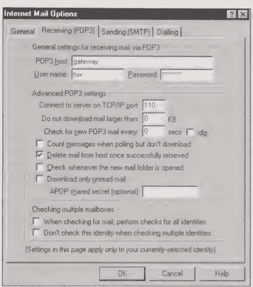

图 21.3 Pegasus Mail 中的 POP3 邮件配置

我包含了两个例子，为了向你展示大多数 Windows 电子邮件客户端都遵循类似的设置。你需要定义 SMTP 和 POP3 主机、一个用于获取邮件的用户名和密码，当然，还需要一个电子邮件地址。最后一点小细节。

由于你现在没有设置 DNS，PC 需要在 HOSTS 文件中包含指向你网关的地址。该文件位于 `C:\WINDOWS` 目录。通过点击开始按钮、选择“运行”并输入此命令来编辑该文件：

```bash
EDIT C:\WINDOWS\HOSTS
```

然后添加这一单行：

```bash
192.168.1.100 gateway.mycompany.com gateway
```

点击编辑器中的“文件”并选择“保存并退出”。

## 我们来发一些邮件

打开你的邮件客户端向办公室发送邮件。在“收件人（To）”字段中输入 `office@mycompany.com`。输入一些巧妙的主题和正文，然后点击“发送（Send）”按钮。现在，你的每个用户都应该收到邮件了。

## 极其简单的 sendmail 技巧

一旦你的组织变得相对复杂，你会发现自己想要对电子邮件做一些看起来并不立即重要的事情。仅仅成为 sendmail 的精师就是一项艰巨的任务。来自 O’Reilly Associates 出版的经典的、长达 1000 页的 sendmail 参考书至少听起来就令人生敬畏。根据我的经验，你不需要背诵那 1000 页中的每一页就能创建一个实用的、简单的邮件服务器。我只是想为后续章节中的信息找一些捷径，但我不得不翻阅数百页才找到它们。

让我们进入正题吧，好吗？

## 多域名、相似地址的困境

想象一下，你决定注册几个域名，所有它们都位于同一台机器上。毕竟，你的 Linux 系统完全有能力处理这些负载，你不想为了这些可能是低流量的域名而从头开始。然而，你想要的是一种标准方法，将仅包含信息的邮件发送到你的虚拟公司。你可能还想让这些邮件发送到不同的地方。简而言之，你想要的是：

```
info@mycompany.com
info@myseconddomain.com
info@myinfosite.com
```

现在，你的系统上只能有一个“info”登录账号。如果“info”不是你系统上的用户，你可以添加一个 info 别名（alias），将 info 邮件重定向到真实用户（而不是创建一个伪用户）。例如，如果让“mary”接收 info 的邮件，你的 `/etc/aliases` 条目将如下所示：

```
info: mary@somedomain.com
```

当你想要让所有这些不同的地址发送给不同的人时，问题就出现了。你不能为 info 设置两个别名条目。解决这一问题的方法是使用 sendmail 的虚拟用户表（virtertable）功能。在你的 `/etc/sendmail.cf` 配置中查找此行：

```
Kvertuser hash -o /etc/mail/virtertable
```

## 停止垃圾邮件！

这将为你提供虚拟用户表的路径，以及设置这些不同域名及其等效用户的方法。该文件的格式简单。

```
username@somedomomain.com realuser@someotherdomain.com
```

在我的例子中，我的虚拟用户表（virtusetable）如下：

```
info@mycompany.com mary@localdomain.com
info@myseconddomain.com tom@remotedomain.com
info@myinfosite.dom natika@bigschool.edu
```

停止并重启 sendmail，现在一切应该像广告的那样工作了。

## 多域名域

这是另一个场景。假设发往 myinfosite.org 的邮件应该发送给一个用户，因为 myinfosite.org 只有一个用户。你可能希望 myinfosite.org 发送给一个用户，因为你只有一个用户。但你可能想让这些邮件发送到不同的地方。奇怪的是，答案就在虚拟用户表（virtusetable）。

```
@infosite.dom andy@mycompany.com
```

停止并重启 sendmail，现在一切应该像广告的那样工作了。

## 停止垃圾邮件！

这里有一个清理你服务器的垃圾邮件的绝佳技巧。如果你离开了一段时间，垃圾是不良邮件的委婉说法。针对你服务器的大量垃圾邮件会降低速度。

## Windows 与 Linux 的集成

人们会告诉我花了很多时间推崇 Linux 作为 Windows 的替代品——也许到了传教的程度。虽然我可能会争论我推动 Linux 的力度，但我承认（目前）它是一个 Windows 世界。Linux 的神奇之处之一是它与 Windows 配合得很好。NetBIOS 并不是一个协议，而是为局域网软件提供构建块的接口（API）。

在本章中，你将研究 Linux 与 Windows 协作的许多方式。使用 Samba，你将看到与 Windows 用户共享文件是多么简单。甚至你还将研究如何用 Samba 服务器替换 NT 服务器，通往无 Windows 生活。

“在桌面上吗？”你可能会问。确实。凭借今天 Linux 世界的工具，可以启动 Linux 并留在那里，同时运行 Windows。但首先，你将学习如何与 Windows 合作，而不是反对它。

## Samba 简介

Samba 最初由 Andrew Trigdell 开发于 land under。使用服务器消息块（SMB）协议，Samba 使得在许多操作系统之间共享资源成为可能。SMB 与许多网络协议一样，随着开发者的工作不断演进。因此，SMB 协议的当前版本（或者说法）实际上被称为 CIFS。

### 资源

#### 书籍

- *sendmail*, Bryan Costales 与 Eric Allman 著（Cambridge, MA: O'Reilly's Associates, 1997）

#### 网站

- diald 网站：`http://diald.sourceforge.net/`
- Marcel 的网站（用于 easns）：`http://www.salmar.com/marcel/downloads.html`
- Netscape Communicator：`http://home.netscape.com/computing/download/`
- Pegasus Mail (Windows)：`http://www.pmail.com`
- RFC Editor：`http://www.rfc-editor.org/`
- sendmail 主页：`http://www.sendmail.org/`

# 第 22 章 Windows 与 Linux 的集成

Samba 可以在 Windows 95/98/NT、OS/2、VMS、AIX、HPUX、Linux（当然包括）以及许多系统之间提供文件共享服务。虽然大多数人倾向于将 Samba 视为用 Linux 替换 NT 服务器 Means，但 Samba 的灵活性远此得多。例如，我办公室里的一台 Windows PC 加载了微软网络客户端（Client for Microsoft Networks），这样它就可以在“网络邻域”共享文件。

假设这台 PC（名为“speedy”）有一个名为“natika_c/”的共享，这实际上是整个 C 盘。从我的 Linux 工作站，我可以挂载它并像这样驱动它（注意：命令是一行单行的）：

```bash
# -t smbfs -o username=natika,password=secret //speedy/natika_c/ /mnt/natika
```

如果我的 Linux 服务器上有一个 Samba 共享，我可以从另一台 Linux 服务器上挂载它，就像挂载一台 Windows 服务器一样。我有一台运行 Linux 的小型笔记本电脑（名为“willtrav”）。在一台稍大的服务器（名为“testsys”）上，我运行了 Samba。它定义了一个名为“winstuff”的共享。你可能记得在 NFS 中，我使用 `-t` 标志指定了文件类型，传递了适当的选项，并告诉它我正挂载到的目录（注意：命令是一行单行的）：

```bash
# -t smbfs -o username=marcel,password=itsassecret //testsys/winstuff /mnt/winstuff
```

如果我使用 `df` 命令，我将看到文件系统被挂载为我的本地驱动器之一。

```bash
[root@willtrav /root#]# df
Filesystem 1k-blocks Used Available Mounted On
/dev/hda 1517920 1405640 35172 98% /
/dev/hda5 2541472 1737840 648620 73% /data
/testsys/winstuff 6109952 4611072 1498880 75% /mnt/winstuff
```

很棒的东西。（在 Linux 内核中实际上挂载 Windows 共享的能力是被支持并可以配置的。）通过 Samba，你还可以让网络上的 Windows 可以使用打印机。顺便说一下，没有任何东西能阻止你从 Linux 使用 Samba 导出的打印机。如果你愿意，甚至可以使用 Samba 作为你跨网络的文件共享系统，从而取代 NFS。

现在我已经告诉了你们使用 Samba 能做的所有很棒的事情，我想我应该告诉你们你是如何操作这些的。

## 获取和构建 Samba

几乎每个 Linux 发行版的 CD-ROM 都带有一个版本的 Samba，你可以根据你的发行版使用 `rpm` 或 `dpkg` 安装它。当然，Deb 用户可以使用 `apt-get` 从 Debian 站点获取最新的发行版。但如果你真的想要最新、最强大的，你需要去 Samba 官网（`http://www.samba.org/`）。

进入下载（Download）部分。最新的源码始终命名为 `samba-latest.tar.gz`。如果你愿意，也可以找到适用于各种平台的近期二进制文件，但你不一定像源码文件那样更新。要从源码编译并安装 Samba，请将 tar 包解压到临时目录并遵循以下步骤：

```bash
tar -xzvf samba-latest.tar.gz
```

这将创建一个以 Samba 源码当前发布号结尾的目录。当我写这一章时，Samba 代码处于 2.0.7 版本。

```bash
cd samba-2.0.7
cd source
./configure
make
make install
```

默认情况下，Samba 将安装在 `/usr/local/samba` 目录下。如果你更喜欢它位于另一个目录，可以在执行 `./configure` 步骤时使用 `--prefix=/path/to_dir` 标志。安装完成后（假设你接受了默认设置），你需要创建一个 Samba 配置，它将存放在 `/usr/local/samba/lib`。最简单的方法是将示例文件随源码拷贝到相应的目录。

```bash
cd /tmp_install_dir/samba-2.0.7/examples
cp smb.conf.default /usr/local/samba/lib/smb.conf
```

如果你运行的是预装的 Samba，特别是如果你是在基于 RPM 的系统上运行，你应该在 `/etc` 目录查找默认的 `smb.conf` 文件。

使用你喜欢的编辑器打开 `smb.conf` 文件并更改这两个参数：`workgroup = server`，`string = .`。对于 `workgroup` 参数，我将其命名为“MYGROUP”，服务器名称为“Tetsys Samba Server”。现在，让我们启动 Samba 守护进程。

```bash
# /usr/local/samba/bin/smbd -D
# /usr/local/samba/bin/nmbd -D
```

你可能想将此添加到 `rc.local` 的启动脚本中。假设你的服务器名为“myserver”。要测试 Samba 并查看你是否一切做对，请输入以下命令：

```bash
/usr/local/samba/bin/smbclient -L myserver
```

## 密码加密

解决此问题的第一个方法是回到非加密密码。如果你运行的是只有一两台 PC 的小型网络，那么就没有必要在每台 PC 上进行操作。使用 Windows 注册表：

1. 点击“开始”按钮，选择“运行”，并输入 `regedit`。
2. 双击 `HKEY_LOCAL_MACHINE`。
3. 现在，沿着注册表结构向下移动，找到 `System/CurrentSet/Services/VxD/VNETSUP`
4. 从菜单栏选择“编辑”、“新建”、“DWORD 值”
5. 将新项从“新建值”重命名为 `EnablePlainText`。确保拼写正确——大小写很重要。
6. 按回车，然后双击你的新项。弹出一个允许你更改此键值的对话框。将值设置为 1。
7. 关闭注册表编辑器并重启。

另一种方法是使用 Samba 加密密码。在较大的网络中没有必要在每台 PC 上进行操作。要开始使用加密密码，在 `smb.conf` 中查找此部分：

```ini
; encrypt passwords = yes
```

前面的分号表示 `smb.conf` 文件中的注释。如果你是从源码编译 Samba（并使用默认设置），这些新密码的默认文件名为 `/usr/local/samba/private/smbpasswd`，或者通常情况下是 `/etc/smbpasswd`。可以通过 `smb.conf` 中的另一个参数来覆盖它：

```ini
; smbpasswd file = /etc/smbpasswd
```

要为系统中名为“gituitux”的用户添加 Samba 加密密码，我使用以下命令：

```bash
/usr/local/samba/bin/smbpasswd -a gituitux
```

系统会询问密码，然后要求确认密码。这部分应该看起来很熟悉。

## 配置服务器

我带你走这个过程的顺序可能看起来有点奇怪，但这样做是有章法的。Samba 是一个复杂的怪物，其参数和配置调整远超我可能涵盖的范围。就在这里。事实上，有整本书都是专门讲 Samba 的。尽管如此，我仍然为你提供设置服务器并开始进行实用工作所需的信息。因为要完全按照你的意愿配置服务器可能是一个持续进行的过程，你会发现分阶段进行这一过程可以减少某些功能无法运行的概率。现在，你已经有了一个可以运行的服务器，并决定了密码验证的方法。现在，让我们进入核心部分。


# 使用 Samba 共享目录

使用此类服务器的概念是提供 Samba 共享的内容：导出的目录可以被 Windows（或 Linux）系统挂载为驱动器。在 Windows 中，这些驱动器与如 `M:` 之类的驱动器号相关联。还有许多配置部分。共享部分和配置部分都通过方括号中的标题来标识。当你在查看 `smb.conf` 文件时，你会看到的一些部分如下：

- **[global]**：这些是影响整个服务器并因此影响其后所有内容的参数。你在设置加密密码、服务器名称和用户组时已经遇到过这个。由于你将继续使用加密密码，请将你的安全级别定义为用户级。

```
security = user
```

- **[homes]**：此部分定义了连接到系统的用户的家目录。通过在此部分中使用特定的配置宏（有很多此类宏），Samba 服务器会自动根据用户名将客户端连接到共享上。要以这种方式设置家目录部分，请使用以下示例。

```
[homes]
comment = Home Directories
browseable = no
path = /home/%u
writable = yes
```

`%u` 宏会在用户向顶层目录服务器进行身份验证时替换为用户名。这假设你使用 `/home` 作为人们家目录的顶层目录（如第 7 章中讨论的）。在家目录从 `/disk2/users` 开始的系统中，路径会随之变化。

- **[printers]**：打印机部分非常奇妙。通过 Samba，你可以将单个打印机定义为共享，或者你可以让它自动使你在 `/etc/printcap` 文件中定义的任何打印机可用，而无需任何额外工作。我将在讲解打印功能时介绍更多相关内容。

## Samba 简介

现在开始使用 Samba 的文件共享吧。与其现在从 Windows PC 上进行测试，不如尝试从命令行进行。你不需要在另一台机器上执行此操作。假设你仍在操作你的服务器。

```
smbclient //myserver/guitux -U guitux
```

`-U` 选项指定了你的 Samba 用户登录。接下来，系统将提示该用户的密码。这是你之前创建的 Samba 密码。

```
Password: *************

Domain=[MYGROUP] OS=[Unix] Server=[Samba 2.0.7]

smb: \\
```

在提示符处，你应该能够输入 `dir` 并看到 guit 家目录下的文件。在你那里时，在 smb 提示符处输入 `help` 并观察一下。

## PC 端配置

最简单的设置是将你的 Windows 工作站设置为你定义的工作组的一部分。点击“开始”按钮，然后选择“设置”、“控制面板”。双击网络图标。当对话框出现时，可以看到“配置”选项卡。

寻找由“已安装以下网络组件”定义的列表。在进行任何 Samba 网络设置之前，你需要安装“微软网络客户端”（Client for Microsoft Networks）。对于“微软网络文件和打印机共享”（File and Printer Sharing for Microsoft Networks）也是如此。如果缺少这些内容，获取你的 Windows 光盘（如果系统是预装的，文件实际上就在你的磁盘上）并执行以下步骤。

对于“微软网络客户端”，点击“添加”，选择“客户端”，然后点击“添加”按钮。你会在右侧看到客户端列表，左侧是它们的制造商。点击左侧窗口中的“Microsoft”。你现在应该会在列表顶部看到“微软网络客户端”。点击“确定”，你就会回到网络组件列表。

要安装“微软网络文件和打印机共享”，执行与安装“微软网络客户端”时相同的操作，只需指定“服务”而不是“客户端”。当你到达制造商列表时，你应该能在这里看到它。点击“确定”。

现在，点击“标识”选项卡，并在提供的字段中输入你的 PC 名称和工作组名称（参见图 22.1）。“计算机描述”文本框只是一个注释字段，如果你在“网络邻域”中（选择“查看”、“详细信息”）或使用 `smbclient -L` 查询客户端，它就会出现。

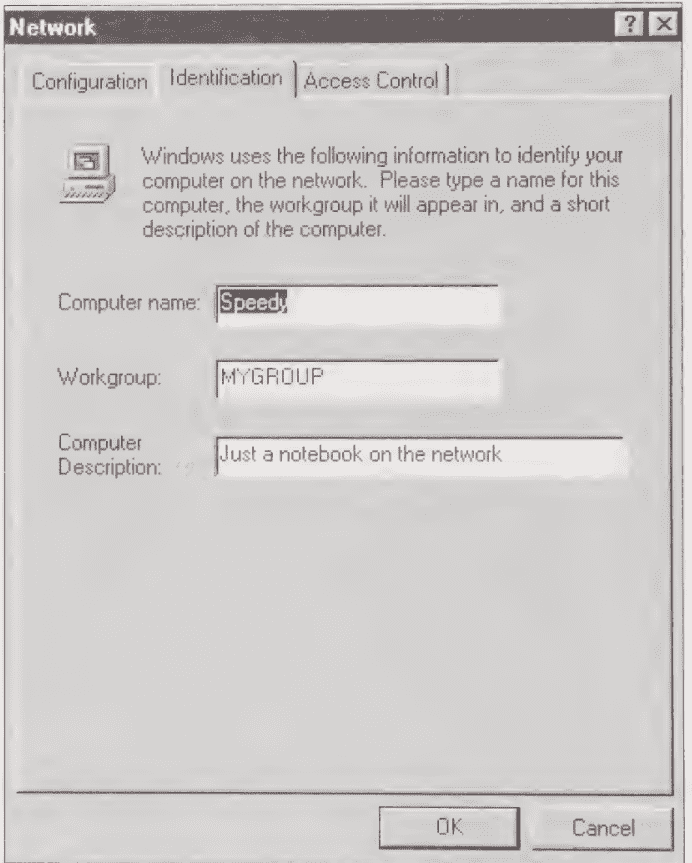

## 使用 Samba 打印

正如我之前提到的，打印机定义和共享的基础在一个非常奇怪的、名为 `[printers]` 的段落中。我的看起来是这样的：

```
[printers]
comment = My System Printers
path = /var/spool/samba
print ok = Yes
guest ok = Yes
browse = No
```

权限是非常开放的。任何人都可以在网络上浏览这些打印机，任何人都可以打印它们。`path =` 变量是临时池化目录，打印文件在打印期间保存在那里。对于打印机来说，这里 `browseable` 被设置为 `No`，因为这是一个共享打印机。

## 从 Windows 客户端打印

要在 Windows 中设置打印机，请点击“开始”按钮并选择“设置”、“打印机”。双击“添加打印机”图标。你现在应该看到“添加打印机向导”。点击“下一步”，通过点击单选按钮选择“网络打印机”，然后“浏览”。你现在应该会看到与图 22.2 类似的窗口弹出。

你可能需要点击合适主机旁边的加号 (`+`)。

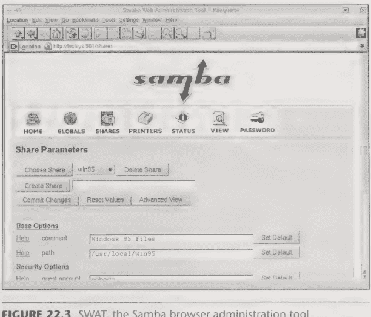

图 22.2 显示由名为“Netgate”的主机服务的 Samba 打印机列表。点击相应的打印机然后点击“确定”。向导随后会询问你打印机类型和制造商。此时（因为我不知道你拥有什么打印机），剩下的就你自己了。

## 使用 GUI 界面管理 Samba (SWAT)

既然我已经让你尝试了所有的命令行操作，现在让我向你展示由 Samba 团队提供的 GUI 界面方法。当你安装 Samba 时，也安装了一个名为 SWAT 的 Web 客户端。SWAT 除了提供了一种易于使用、点击式的方法来设置共享、打印机以及配置服务器的各种功能外，还为你可能遇到的任何配置参数提供了完整的在线帮助信息。


要使用 SWAT，你可能需要在你的 `inetd.conf` 文件中设置该服务。以下条目来自基于 RPM 安装的 Samba：

```
swat              tcp        nowait.400      root /usr/sbin/swat swat
```

SWAT 可执行文件的路径取决于你安装 Samba 的方式。如果你是默认的源码编译（正如我之前做的那样），你会在 `/usr/local/samba/bin` 中找到它，这就是你需要在 `inetd.conf` 文件中指定的路径。当你完成该更改后，记得重置 inetd 主进程。

```
kill -HUP `cat /var/run/inetd.pid`
```

注意最后一行使用的是反引号。访问 SWAT 的 URL 如下，其中 `my_server` 是你服务器的 IP 地址：

```
http://my_server:901/
```

## 备份 Windows 工作站

我在第 16 章中简要地提到了备份 Windows 工作站。要使用运行 Samba 的 Linux 系统备份 PC 客户端，最简单的解决方案是使用 `smbtar`。

要使用 `smbtar`，你必须先在 Windows 95/98 PC 上设置共享。要此操作，打开 Windows 资源管理器（右键点击“开始”按钮并选择“资源”）。

找到你想设置的目录并右键点击该文件夹。你可以点击驱动器图标本身共享整个磁盘。我建议只备份数据文件。当你的 Windows 95 系统需要恢复时，通常还需要干净的 Windows 和注册表安装。

无论，右键点击文件夹并选择“共享”，这将弹出图 22.4 所示的属性对话框。在示例中，我在 C 盘下使用名为 SCSI 的文件夹。


点击“共享”单选按钮并为它指定共享名称。默认是目录名称本身，但你可能想给它一个更直观名称——这取决于你。点击“确定”。

回到你的 Linux 机器，你现在可以使用 `smbtar` 备份此目录。格式如下：

```
smbtar -v -s server_name -x share_name -t tarfile
```

对于 `server_name`，输入 PC 的网络名称。对于 `share_name`，输入上一个示例使用的名称。在我的场景中，我会输入 `SCSI`。`tar_file` 是输出设备，可以是一个文件名。（危险！不要用尽你的磁盘空间！）在 SCSI 磁带驱动的情况下，它可能是 `/dev/st0`。

```
smbtar -v -s MARYPC -x SCSI -t /dev/st0
```

你现在将看到一个文件列表在控制屏幕上滚动。`smbtar` 的其他选项包括：

```
用法: smbtar [<options>] [<include/exclude files>]
功能: 备份/恢复 Windows PC 目录到本地磁带文件
选项: (描述) (默认)
-r 从磁带恢复到 PC / 从 PC 备份到磁带文件
-I 增量模式 / 全量备份
-v 详细模式 / 显示命令 / 不显示任何内容
-s <server> 指定 PC 服务器
-p <password> 指定 PC 密码
-x <share> 指定 PC 备份
-N 排除 / 包含
-n <newer> 用于日期比较的文件
-b <blocksize> 指定磁带的块大小
-d <dir> 指定共享中的目录 \
-l <log> 指定 Samba 日志级别 2（注：原文为l1，可能为lget误）
-u <user> 指定用户 root
-t <tape> 指定磁带设备 tar.out
```

如果你指定了依赖密码的访问类型（在你的 Windows 95 共享选项中），你需要指定用户名（`-u` 选项）和密码（`-p` 选项）来访问 PC。

# 第 22 章：将 Windows 与 Linux 集成

## 在 Linux 上运行 Windows

当我与对 Linux 感兴趣的人交流时，我经常遇到这样一个问题：“但是它能运行 Windows 应用程序吗？”因为我不想用谈论双引导来吓跑人们（毕竟这是我们一直向他们提供的优点之一——结束频繁的重启），我随后会跟上这个绝妙且晦涩的回答：“在适当的情况下。”

那些“情况”以几种不同的形式出现。我将在这里介绍其中几种。这些解决方案每个能为你提供什么，在某种程度上取决于你需要做什么。

### Wine

通过一个名为 Wine 的很棒软件包，你可以在你的 Linux 系统上运行某些 Windows 应用程序，而完全不需要运行 Windows。转述 Wine 网站的话，Wine 是一个兼容层，允许在 POSIX 兼容的操作系统（如 Linux、macOS 和 BSD）上运行 Windows 应用程序。

### Win4Lin


与 VMware 类似，Win4Lin 需要你有一张完整的 Windows 光盘才能进行安装。有趣的是，Windows 在这种模式下的安装和加载速度要比在原生模式下运行 Linux 快得多。看一眼图 22.6，然后回到本章，回看几个段落，告诉我这看起来眼熟吗？

对于大多数基础 Windows 应用程序，Win4Lin 是解决在 Linux 上运行 Windows 问题的绝佳方案。

## 资源

### Usenet 群组

```
comp.emulators.ms-windows.wine
linux.samba
```

### 网站

- **CodeWeavers**: http://www.codeweavers.com/
- **Samba 网站**: http://www.samba.org/
- **VMware**: http://www.vmware.com/
- **Win4Lin**: http://www.netraverse.com/
- **Wine**: http://www.winehq.com/

# 系统日志与统计

## 你的系统日志

许多人习惯记日记。即使你不这样做，可能也认识有人在记。多年来，我认识了很多倾向于此的人。他们忙碌地记录着日常生活中那些与众不同的事件细节，这些细节会以某种方式脱颖而出。在日后的某个时刻，他们（或某个未来的传记作家或历史学家）可以回溯这些笔记，尝试理解他们生命中那个阶段发生了什么。

与此类似，你的 Linux 系统也以日志的形式记录着它自己的日记。这些日志从内核到运行在系统上的应用程序，在许多层级上被生成并收集。由于日志不断更新，你会发现与安全、文件传输、电子邮箱、登录日期和时间、启动和关机信息、错误消息等相关的日志。事实上，一台运行在小型办公室的服务器在任何一天都会生成数百条（甚至数千条）消息。

作为系统或网络管理员，你的工作就是检查这些日志，并通过它们做出工作所需的决策。如果这听起来像某种无法完成的任务，请不要担心。在接下来的页面中，我将花一些时间为你揭示系统日志中的黑暗角落。

## 查看你的日志文件

幸运的是，从系统的角度来看，大多数事情（除少数例外外）往往保留在同一个地方：`/var/log` 目录。在你的系统中，切换到该目录并观察周围。

```
# cd /var/log
### ls
```

这里是你应该在这里看到的样本示例：

| boot.log | cron | cron.1 | cron.2 | dmesg |
| lastlog | lastlog.1 | maillog | maillog.1 |
| maillog.2 | messages | messages.1 | netconf.log |
| netconf.log.1 | netconf.log.2 | secure | secure.1 | secure.2 |
| secure.3 | secure.4 | spooler | spooler.1 | spooler.2 |
| uucp | wtmp | wtmp.1 | xferlog | xferlog.2 |

注意这些文件如何带有 `.1`、`.2`、`.3` 或 `.4`。这个编号序列是你的系统自动日志轮转的结果。执行此操作的文件位于 `/etc` 目录中。`/etc` 下有一个包含许多系统自动运行的管理脚本的目录。无需进行任何额外操作，Linux 就使用这些脚本来保持整洁——例如，它会轮转日志文件，以免它们增长到巨大的规模。在以前的 UNIX 时代，我们必须手动修剪日志。把这话告诉现在的孩子听吧！

开个玩笑，看一眼 cron 任务。花时间熟悉一下它们的作用。在某些情况下，你会发现每个脚本都是一个简单包的一部分，用于执行某个任务。例如，`tmpwatch` 和 `logrotate` 文件就是两个这样的包。如果你在这个目录下输入 `file`，你会在多或少地注意到它们。同样请注意，系统还有 `cron.hourly`、`cron.weekly` 和 `cron.monthly` 目录。其中几个目录可能是空的。这些每小时（每周，等等）cron 任务的实际日期和时间在 `/etc/crontab` 文件中。

## 名称的含义

正如你从之前的样本列表所示，`/var/log` 目录包含了大量信息。让我们看看从这些信息中解读出什么。

`messages` 日志文件是所有日志中最忙碌的。你会在这里找到启动和关机消息、DNS 错误、内核级错误、pppd 连接消息、守护进程的启动和停止、身份验证等。用户编写的程序甚至简单的脚本经常也会使用 `messages` 文件。向其写入内容很容易，有一个名为 `logger` 的非常棒工具（稍后会详细介绍）。

从破解者检测的角度来看，你的 `secure`（及 `secure.1`、`secure.2`、`secure.3` 和 `secure.4`）文件将特别令你感兴趣。如果你关闭了所有访问（本地网络外），你可以检查是否有此类可能的尝试：

```
grep /var/log/secure*
```

下面的列表是来自未经授权主机的连接尝试样本。


```
Sep 12 07:52 refused connect from in.logind
Sep 12 07:52 refused connect from in.rsh
Sep 12 07:52 refused connect from in.cd
Sep 12 07:52 refused connect from in.mapd
Sep 12 07:52 refused connect from in.telnet
Sep 12 07:52 refused connect from in.op3
Sep 12 07:52 refused connect from in.finger
Sep 12 07:52 refused connect from in.gnat
Sep 12 07:52 refused connect from in.ftp
Sep 12 07:52 refused connect from in.fish
Sep 12 07:52 refused connect from in.bird
Sep 12 07:52 refused connect from in.tty
Sep 12 07:52 refused connect from in.mail
Sep 12 07:52 refused connect from in.root
Sep 12 07:52 refused connect from in.mount
Sep 12 07:52 refused connect from in.cups
Sep 12 07:52 refused connect from in.nfs
Sep 12 07:52 refused connect from in.uwsgi
Sep 12 07:52 refused connect from in.lpadmin
Sep 12 07:52 refused connect from in.smbd
Sep 12 07:52 refused connect from in.sshd
Sep 12 07:52 refused connect from in.avahi
Sep 12 07:52 refused connect from in.systemd
Sep 12 07:52 refused connect from in.dbus
Sep 12 07:52 refused connect from in.postfix
Sep 12 07:52 refused connect from in.exim4
Sep 12 07:52 refused connect from in.sendmail
Sep 12 07:52 refused connect from in.atd
Sep 12 07:52 refused connect from in.timesync
Sep 12 07:52 refused connect from in.rsyslog
Sep 12 07:52 refused connect from in.ufw
Sep 12 07:52 refused connect from in.iptables
Sep 12 07:52 refused connect from in.auditd
Sep 12 07:52 refused connect from in.cron
Sep 12 07:52 refused connect from in.fail2ban
Sep 12 07:52 refused connect from in.clamav
Sep 12 07:52 refused connect from in.firewal
Sep 12 07:52 refused connect from in.wireguard
Sep 12 07:52 refused connect from in.openvpn
Sep 12 07:52 refused connect from in.docker
Sep 12 07:52 refused connect from in.podman
Sep 12 07:52 refused connect from in.kubelet
Sep 12 07:52 refused connect from in.haproxy
Sep 12 07:52 refused from in.nginx
Sep 12 07:52 refused connect from in.apache
Sep 12 07:52 refused connect from in.mysql
Sep 12 07:52 refused connect from in.postgresql
Sep 12 07:52 refused connect from in.redis
Sep 12 07:52 refused connect from in.mongodb
Sep 12 07:52 refused connect from in.rabbitmq
Sep 12 07:52 refused connect from in.kafka
Sep 12 07:52 refused connect from in.zookeeper
Sep 12 07:52 refused connect from in.memcached
Sep 12 07:52 refused connect from in.prometheus
Sep 12 07:52 refused connect from in.grafana
Sep 12 07:52 refused connect from in.logstash
Sep 12 07:52 refused connect from in.fluentd
Sep 12 07:52 refused connect from in.elasticsearch
Sep 12 07:52 refused connect from in.confluence
Sep 12 07:52 refused connect from in.jenkins
Sep 12 07:52 refused connect from in.gitlab
Sep 12 07:52 refused connect from in.bitbucket
Sep 12 07:52 refused connect from in.atira
Sep 12 07:52 refused connect from in.slack
Sep 12 07:52 refused connect from in.teams
Sep 12 07:52 refused connect from in.zoom
Sep 12 07:52 refused connect from in.skype
Sep 12 07:52 refused connect from in.discord
Sep 12 07:52 refused connect from in.whatsapp
Sep 12 07:52 refused connect from in.telegram
Sep 12 07:52 refused connect from in.signal
Sep 12 07:52 refused connect from in.line
Sep 12 07:52 refused connect from in.wechat
Sep 12 07:52 refused connect from in.kakao
Sep 12 07:52 refused connect from in.viber
Sep 12 07:52 refused connect from in.qq
Sep 12 07:52 refused connect from in.skype
Sep 12 07:52 refused connect from in.weype
Sep 12 07:52 refused connect from in.discord
Sep 12 07:52 refused connect from in.slack
Sep 12 07:52 refused connect from in.teams
Sep 12 07:52 refused connect from in.zoom
Sep 12 07:52 refused connect from in.skype
Sep 12 07:52 refused connect from in.discord
Sep 12 07:52 refused connect from in.whatsapp
Sep 12 07:52 refused connect from in.telegram
Sep 12 07:52 refused connect from in.signal
Sep 12 07:52 refused connect from in.line
Sep 12 07:52 refused connect from in.wechat
Sep 12 07:52 refused connect from in.kakao
Sep 12 07:52 refused connect from in.viber
Sep 12 07:52 refused connect from in.qq
Sep 12 07:52 refused connect from in.skype
Sep 12 07:52 refused connect from in.weype
Sep 12 07:52 refused connect from in.discord
Sep 12 07:52 refused connect from in.slack
Sep 12 07:52 refused connect from in.teams
Sep 12 07:52 refused connect from in.zoom
Sep 12 07:52 refused connect from in.skype
Sep 12 07:52 refused connect from in.discord
Sep 12 07:52 refused connect from in.whatsapp
Sep 12 07:52 refused connect from in.telegram
Sep 12 07:52 refused connect from in.signal
Sep 12 07:52 refused connect from in.line
Sep 12 07:52 refused connect from in.wechat
Sep 12 07:52 refused connect from in.kakao
Sep 12 07:52 refused connect from in.viber
Sep 12 07:52 refused connect from in.qq
Sep 12 07:52 refused connect from in.skype
Sep 12 07:52 refused connect from in.weype
Sep 12 07:52 refused connect from in.discord
Sep 12 07:52 refused connect from in.slack
Sep 12 07:52 refused connect from in.teams
Sep 12 07:52 refused connect from in.zoom
Sep 12 07:52 refused connect from in.skype
Sep 12 07:52 refused connect from in.discord
Sep 12 07:52 refused connect from in..
Sep 12 07:52 refused connect from in.telegram
Sep 12 07:52 refused connect from in.signal
Sep 12 07:52 refused connect from in.line
Sep 12 07:52 refused connect from in.we.
Sep 12 07:52 refused connect from in.kakao
Sep 12 07:52 refused connect from in.viber
Sep 12 07:52 refused connect from in.qq
Sep 12 07:52 refused connect from in.skype
Sep 12 07:52 refused connect from in.weype
Sep 12 07:52 refused connect from in.discord
Sep 12 07:52 refused connect from in.slack
Sep 12 07:52 refused connect from in.teams
Sep 12 07:52 refused connect from in.zoom
Sep 12 07:52 refused connect from in.skype
Sep 12 07:52 refused connect from in.discord
Sep 12 07:52 refused connect from in.whatsapp
Sep 12 07:52 refused connect from in.telegram
Sep 12 07:52 refused connect from in.signal
Sep 12 07:52 refused connect from in.line
Sep 12 07:52 refused connect from in.wechat
Sep 12 07:52 refused connect from in.kakao
Sep 12 07:52 refused connect from in.viber
Sep 12 07:52 refused connect from in.qq
Sep 12 07:52 refused connect from in.skype
Sep 12 07:52 refused connect from in.weype
Sep 12 07:52 refused connect from in.discord
Sep 12 07:52 refused connect from in.slack
Sep 12 07:52 refused connect from in.teams
Sep 12 07:52 refused connect from in.zoom
Sep 12 07:52 refused connect from in.skype
Sep 12 07:52 refused connect from in.discord
Sep 12 07:52 refused connect from in.whatsapp
Sep 12 07:52 refused connect from in.telegram
Sep 12 07:52 refused connect from in.signal
Sep 12 07:52 refused connect from in.line
Sep 12 07:52 refused connect from in.wechat
Sep 12 07:52 refused connect from in.kakao
Sep 12 07:52 refused connect from in.viber
Sep 12 07:52 refused connect from in.qq
Sep 12 07:52 refused connect from in.skype
Sep 12 07:52 refused connect from in.weype
Sep 12 07:52 refused connect from in.discord
Sep 12 07:52 refused connect from in.slack
Sep 12 07:52 refused connect from in.teams
Sep 12 07:52 refused connect from in.zoom
Sep 12 07:52 refused connect from in.skype
Sep 12 07:52 refused connect from in.discord
Sep 12 07:52 refused connect from in.whatsapp
Sep 12 07:52 refused connect from in.telegram
Sep 12 07:52 refused connect from in.signal
Sep 12 07:52 refused connect from in.line
Sep 12 07:52 refused connect from in.wechat
Sep 12 07:52 refused connect from in.kakao
Sep 12 07:52 refused connect from in.viber
Sep 12 07:52 refused connect from in.qq
Sep 12 07:52 refused connect from in.skype
Sep 12 07:52 refused connect from in.weype
Sep 12 07:52 refused connect from in.discord
Sep 12 07:52 refused connect from in.slack
Sep 12 07:52 refused connect from in.teams
Sep 12 07:52 refused connect from in.zoom
Sep 12 07:52 refused connect from in.skype
Sep 12 07:52 refused connect from in.discord
Sep 12 07:52 refused connect from in.
```


# SYSLOGD: 主日志记录器

```bash
weekly
mail user@mydomain.com
postrotate
/sbin/killall -HUP syslog
endscript
```

每个定义（或段落）都以日志文件的完整路径开头，后面跟着在波浪括号内的若干选项。让我们来拆解之前的例子。`rotate 5` 将覆盖我在全局配置中设置的默认值 4。`weekly` 告诉 `logrotate` 每七天轮转一次文件，而不是默认的每天轮转一次（记住，如果你在 `/etc/cron.daily` 中运行了 `logrotate` 的话）。程序随后会将最新文件通过邮件给我，然后重启 syslog 守护进程。这种重启是一种“脚本中的脚本”，带有一个 `postrotate` 参数作为开始，其后跟的是一个或多个要执行的命令。最后，`script` 结束了这个微脚本。另一个括号结束了整个结构。

即使你的系统中已经安装并设置了 `logrotate`，情况也会发生变化，你可能会认为更改进程运行的时间和频率更有意义。最近，我不得不亲自修改了它。在我的 Red Hat 系统上，`logrotate` 一直很好地处理我的 Apache 服务器文件，直到我下载了新的 Apache，用 `mod_php` 重新编译了它，并做了其他事情。Red Hat 将 Apache 日志存储在 `/var/log/http`，而新的 Apache 安装将日志存储在 `/usr/local/apache/`。

我意识到在第一次构建 Apache 时本可以更改这一切，但我没有，并决定保持原样，因为 Apache 似乎喜欢那样。问题是，我的日志在不断增长，除了磁盘空间外没有任何阻碍。

# syslogd: 主日志记录器

系统产生的大量日志是通过 syslog 守护进程提供给你的。syslog 守护进程是一个在后台运行的程序。它与你在系统上进行的任何其他操作无关，并且始终保持关注。这就是它的工作：收集正在发生的信息并进行报告。你可能在书中前面提到过，根据定义，守护进程（daemon）是一个在产生（无论是在启动时还是通过 shell 命令）后与它启动的终端断开连接并在后台运行的程序。如果你随后断开了终端会话或完全注销，该程序将继续在后台运行。如果守护进程的功能是什么呢？`inetd` 守护进程监听网络连接，而 `syslogd` 则负责观察、监控和记录。

# 第 23 章 系统日志与计费

syslog 记录的内容定义在名为 `/etc/syslog.conf` 的文件中。文件的格式由两个部分组成：选择器（selector）和动作字段（action field）。选择器（分为设施 `facility` 和优先级 `priority`）通过识别信息的来源以及其重要性或严重程度来定义你记录的内容。动作字段则告诉 syslog 信息去向何处或对其进行什么处理。不计算注释行，该文件看起来像这样：

`facility/priority /var/log/filename`

这就是基本格式。现在让我们看看我文件中的几行代码：

- 记录级别为 `info` 或更高的任何内容（邮件除外）。
- 不要记录私有的身份验证消息！
- `*.info:mail:none:authpriv.none`
- authpriv 文件有限制性访问。
- `authpriv.*`
- 在一个地方记录所有邮件消息。
- `mail.*`

考虑你在之前的示例中看到的文件名，看看它们如何适配到你当前的配置中。

你可能在那里看到的文件名是熟悉的（`messages`、`mailog` 和 `secure`），但正如你所见，它们也可以被更改。列出 `/var/log` 目录将显示你的系统保留的各种日志文件。你看到的一些文件（例如 Samba 日志）是由其他进程写入的。

实际上，之前的进程可以是额外的进程，甚至是另一台主机，你的 syslog 进程将按照其日志文件的指示执行任何操作。稍后注意——首先是选择器字段。该部分是 `auth`（安全信息）、`authpriv`（与 auth 相同或更详细）、`cron`（你的 cron 调度系统）、`daemon`（各种守护进程）、`kern`（内核生成的消息）、`lpr`（打印队列）、`mail`、`news`、`security`、`syslog`、`user`（用户程序）、`uucp` 或 `local0-7`。并不是所有这些都是有用的或会被使用的。例如，`basic` 基本上没有（它会被忽略），而 `security` 被 `auth` 取代了。

这些每个文件都有一个优先级来定义报告的严重程度。这些优先级是 `debug`（调试语句）、`info`（任何不适合其他地方的内容）、`notice`（变得重要）、`warning`（非常重要且可能是坏事）、`err`（错误条件），最后是：`crit`（严重）、`alert`（警告）和 `emerg`（没有更糟了）。请注意，你可以指定通配符 (`*`) 来表示你想获取与给定设施相关的每个优先级的报告。

`kern.* /dev/console`

这里的结论是，任何 Linux 系统都会产生海量信息。想象一下，你是一个小型/中/大型网络的系统管理员。你有一台运行作为桌面的自己的 Linux 机器，但你网络某处有你的主机器。它运行着邮件、防火墙设置等。如果那台机器发生了任何可怕的事件，比如磁盘崩溃、黑客突破安全防护，或你想到的任何事情，完全可能是等你有机会查看日志确定发生了什么时，已经太晚了。它们可能已经永远消失了。假设你有几个这样的关键系统需要关注。

# 自动化日志检查过程

想象有一个名为“natika”的脚本，它监控着我服务器上的某些关键系统资源。如果这些资源下降到某个水平，系统就会向系统日志文件写入一条消息——在这种情况下，是 `/var/log/messages`。我在脚本中用于实现此目的的命令如下。`-i` 标志允许我指定想要写入的日志文件。

```bash
logger -f /var/log/messages -i "Low on coffee. This is very important."
```

如果我 `tail` 我的 `/var/log/messages` 文件，我会得到如下结果：

```bash
# tail /var/log/messages
Jul 5 14:32:06 natika logger[1355]: Low on coffee. This is very important.
```

由于我的脚本正在监听 natika 的 syslog 消息，一旦另一个系统发生了什么，我将立即知道。

除了你生成的日志条目外，你可能已经注意到系统的个人日记开始变得忙碌了。那么，你知道该寻找什么呢？虽然在你连接并恰好在场时，运行 `tail -f` 将消息日志输出到屏幕上很棒，但在其他时间呢？你的日志在你不不在的时候也需要关注，而且（信你不信）即使是系统管理员也得睡觉。是时候让这个过程自动化了。

# 自动化日志检查过程

从哪里开始？这在尝试决定自动化什么内容时是真正的问题所在。随着时间的推移，你会发现有些事情对你的特定环境至关重要，你将编写脚本来处理这些事情。例如，我可以写一个 Perl 脚本来监控我系统中磁盘空间的状态。如果空间下降到特定水平，脚本将向相应的系统管理员或支持人员发送警报。

以下脚本用 Perl 编写。当磁盘利用率升过预设的“安全”水平时，它将检查并发送警报。它可以被设置为通过合适的 `crontab` 条目自动运行。

```perl
#!/usr/bin/perl
# 1999: Sally Tomlinson & Marcel Gagné
# Salmar Consulting Inc. www.salmar.com
# checkdfusage.pl : 检查磁盘使用率
# 百比并在大于
# 90% 时向系统管理员告警
&check_dfusage;
exit();
# 子程序 #
sub check_dfusage {
@message=$df;
$message_text = '';
foreach ($dirname, $arg1, $arg2, $arg3, $arg4, $arg5,$arg6 = split(' ', $_, 7);
  ($arg4num,$therest) = split('!',$arg4,2);
  if ($arg4num > "90") {
    $message_text .= "Directory $dirname is now \
    at $arg4num\";
  }
  print $arg4 . "\n";
}
if ($message_text ne '') {
  $smclient = "/usr/bin/smclient -U root";
  $smbhost = "speedy";
  &sendmessage;
}
sub sendmessage {
  open (SF,"|$smclient -M $smbhost");
  print SF "$message_text";
  close(SF);
}
```

# 第 23 章 系统日志与统计

# Logcheck

有些东西跨系统中是固定的，是你想要检查的，而一个不知疲倦地监控各种文件以寻找感兴趣或关注项的程序可以提供巨大的帮助。这就是来自 Psionic Software 的 Logcheck (http://psionic.com/abacus/logcheck/) 派上用场的地方。Logcheck 是一个自动化日志文件分析器，它在你睡觉时工作，并且免费提供并符合 GPL 许可。

要安装该软件，请将文件提取到临时目录并编译软件。你可能想阅读整个 `INSTALL` 文件，因为它包含了一些关于保护你日志的有用信息。很有可能，如果你运行的是标准的 Linux 发行版，你日志文件的权限可能是 `(rw----)`。

Logcheck（多或少）由两个程序组成：`logcheck.sh` 和 `logtail`。第一个 `logcheck.sh` 是一个脚本，它会遍历你的日志文件，记录任何异常情况并报告。第二个 `logtail` 记得它在日志文件中检查过的位置，以便它在向 `logcheck.sh` 提供信息时不会重复。这里还有几个额外的配置文件，我稍后会详细介绍。以下是安装该包的操作：

```bash
tar -xzvf logcheck-1.1.1.tar
cd logcheck-1.1.1
make linux
```

# LOGCHECK 417

安装运行非常快——几秒钟之内，你就准备就绪了。你需要做的第一工作是一些本地配置。使用你喜欢的编辑器，按照如下方式修改 `/usr/local/etc/logcheck.sh` 脚本。在下方稍处，你会看到一个像这样的条目：

- Person to log activity
- SYSADMIN=root

生成的报告将电子邮件给该用户。在我的系统中，我使用 `SYSADMIN=security`，这是一个邮件别名，会向不同地点的几个人发送邮件（以防万一）。如果发生了某些可怕的事情（例如，一个邪恶黑客发起了攻击）；我仍然拥有证据，因为已经通过邮件发送。

你还会找到另一个名为 `LOG FILE CONFIGURATION SECTION` 的部分，那里是 Logcheck 监控的日志文件所在。你可以根据需要在此处取消注释或添加文件。以下是我自己的：

```
LOGTAIL /var/log/messages
logcheck.ignore /var/log/secure
log.ignore /var/log/mail
```

现在一切都配置完成后，你需要设置 `cron` 定期运行 logcheck。以下是一个 `crontab` 示例（每15分钟一次）：

`0,15,30,45 * * * /usr/local/bin/logcheck`

当 Logcheck 运行时，它将报告分为三个部分：活动攻击、安全违规和异常事件。注意这里的某些内容可以取消注释。最后一个文件 `logcheck.ignore` 正如其名：它是 Logcheck 需要忽略的关键词列表。例如，在我自己的网络情况下，我告诉 Logcheck 忽略 `192.168.1`。

查看这些文件，你可以根据需要进行自定义。

> **警告**：你可能会想要添加很多要忽略的内容，这是因为 Logcheck 生成的信息量（并不那么糟糕），但要小心。你不想为了报告更整洁而过滤掉重要数据。信息多通常比信息少好。

这里是 Logcheck 输出的一个小示例：

## 安全违规

```text
Jul 16:05:03 netgate PAM_pwdb[3908]: authentication failure; (uid=0) ->+edgarc for pop service
Jul 16:05:04 netgate ip3d[3908]: Login failure user=edgarc
host=192.168.1.6
Jul 16:06:36 netgate PAM_pwdb[3912]: authentication failure; (uid=0) ->+edgarc for pop service
```

似乎用户 edgarc 可能忘记了他的密码。

正如你所见，有了这样一个软件包，过滤和查看日志的工作可以大大简化。当你对预期在日志中看到的内容越来越熟悉时，你可以自定义关键文件以交付你想要的信息。即使使用默认文件，Logcheck 也是一个很棒的小软件包。

你还没有结束 Logcheck。在第25章中，你将回到这个程序及其大哥——一个名为 Port-Sentry 的入侵检测协议。

# 网站日志分析

Web 服务器日志呢？快速看一眼任何网站的日志文件（即使是相当安静的网站）都会显示出惊人的对话。每个 HTML 文档或图形图像都被捕获，并带有时间、日期、浏览器类型等更多信息。你看，每当有人请求一个

## 网站日志分析

每次访问页面，你至少会在 Web 服务器的日志文件中获得一个条目。为什么是“至少”而不是“只有”一个？很有可能，你的页面并不是简单的文档。除了文本外，你可能还有几六个图形和一个 Web 计数器。其中每一个都会生成一个日志条目。如果你的 Web 页面使用了框架（frames），这意味着会有更多的日志条目。

在检查这些丰富信息之前，你得知道去哪里查看。对于 Red Hat RPM 安装，请查看 `/etc/http/logs`。如果像我一样，你是从源码构建了自己的 Apache 服务器，你可能应该查看 `/usr/local/apache/logs` 目录。无论哪种情况，要查看的文件都是 `access_log`。无论你运行什么系统，获取所需信息的另一种方法是使用以下命令：

```bash
httpd -V
```

`-D DEFAULT_XFERLOG=/path/to/your/access_log`

如前所述，每一个链接、图像或每段文本都在该文件中，并带有点击它的网站地址。这是海量信息，但你如何判断哪个页面最受欢迎？访问者在你的网站上寻找什么？这里有一个有趣的想法：如果你能统计访问你网站的浏览器类型，你可以对页面布局进行一些更改，以适应大多数访问者。

## Analog

我想介绍的第一个日志分析器叫做 Analog，由剑桥大学统计实验室的 Stephen Turner 编写。Analog 的网页（http://www.analog.cx/）自豪地称它是“世界上最流行的日志文件分析器”（对于那些想自己检查这些数字的人，Stephen 在他的网站上提供了研究链接。）

Analog 可以筛选字数以千计的 Web 日志条目，并在极短的时间内生成易读的报告。我从我的站点取了一个旧的 `access_log`，让 Analog 发挥它的作用。在我 150MHz 的 Pentium 笔记本电脑上，Analog 在 1 分钟 39 秒内处理了 800,000 行日志。这令人印象深刻。当我下载 Analog 副本时，最新版本是 4.11。对于那些运行 Linux 之外其他平台（可能是 Solaris 或 BSD Web 服务器）的人来说，这个程序可以在许多不同的 UNIX 平台上编译。

你应该将 Analog 解压到你最终希望它所在的目录。通常情况下，你会执行 make 和 install，然后删除安装目录。在这里不用。如果我想让 Analog 呆在 `/usr/local/analog-4.11`，我可以切换到 `/usr/local` 目录并执行以下步骤：

```bash
cd /usr/local
tar -xzvf analog-4.11.tar.gz
cd analog-4.11
```

在你继续输入 `make` 之前，你可能需要编辑 `anlghead.h` 文件。最明显的更改是以下几行：

```c
#define HOSTNAME "*my organization*"
#define HOSTURL "none"
#define ANALOGDIR "/usr/local/analog-4.11/*"
#define LOGFILE "/usr/local/apache/logs/access_log"
```

`HOSTNAME` 指的是显示在 HTML 报告顶部的横幅。这可以是任何内容——如果你只有一个 Web 服务器，你的公司或组织名称是一个显而易见的选择。如果你有多个 Web 服务器，可能想要标识一个特定的主机。接下来是 `HOSTURL`，它只是在报告头放一个回到你的主页（无论是哪个页面）的链接。`ANALOGDIR` 是 Analog 程序和支持文件的路径。这是你在解压程序时决定的。最后，`LOGFILE` 是你的 Web 服务器日志文件的完整路径——在我的情况下，路径是 `/usr/local/apache/logs/access_log`。

现在你准备好编译程序了。

```bash
make
```

在第一次运行程序之前，你将编辑一个东西。这个文件在程序的安装目录中，名为 `analog.cfg`。`examples` 目录包含了 `.cfg` 文件的变体，提供了关于你可能如何设置自己的文件的想法。在 `analog.cfg` 中可以设置许多参数，允许你自定义生成的报告以更好地适应你的站点。以下是这些参数的（非常小型的）样本：

- `LANGUAGE ENGLISH` |（我的选择，尽管我尝试过法语）
- `HOST ON` |（系统的主机名）
- `DOMAIN ON` |（他们找到你时所属的国家代码）


- REFERR ON |（他们从哪个页面过来）
- SEARCHQUERY ON |（用于找到你的搜索词）
- BROWSER ON |（他们在使用什么种浏览器）
- OSREP ON |（他们运行的是什么系统：Linux、Windows 等）

如果你检查 `examples` 目录中的 `big.cfg` 文件，会发现更多，因为它包含了你可能考虑的任何内容的。

应该指出，为了让 Analog 报告某些内容，你必须确保你的 Web 服务器实际上在收集这些信息。例如，你的服务器收集访问者的 IP 地址，并且不对每次连接进行 DNS 查询。这是现在 Apache 的默认配置，是为了速度考虑的。因此，在我的系统上不会获得 HOSTNAME 或 DOMAIN 报告。如果你好奇，请检查 Apache 配置文件中的参数 `HostnameLookups`。注意代价——默认关闭是有其缘由的。

总之，我偏离主题了。要运行 Analog，请输入命令的完整路径，或从安装目录执行它。

```
cd /usr/local/analog-4.11
/analog
```

等待一会儿，你就会得到报告。然后你可以在你喜欢的 Web 浏览器中查看它。如果你在系统上本地运行它，只需在浏览器的地址栏中输入报告的路径。如果你想看 Analog 报告的示例（在安装之前），点击 Analog 主页上的 See a Sample Report 链接。

Analog 很酷。它很快很快。它是免费的（尽管它不是 GPL——详情请阅读内置的许可证）。

## Webalizer

我们都在日常报纸和杂志上看到五彩斑斓的图表。Web 也是如此。这就是为什么你可能觉得 Webalizer 比 Analog 更有趣的原因之一。要看一眼 The Webalizer 提供的输出类型，请查看图 23.1 中的示例。

**图 23.1 使用 Webalizer 生成的 Web 统计数据**

## 23 系统日志与计数

瞬间，你就能看到你的站点最近几个月来的变化，基于每周（以及每小时）平均值的页面、文件和访问次数。Webalizer 官方网站（http://www.runix.net/）信息很好，但我发现它的下载请求很拥挤。如果你因为下载问题而拒绝，尝试位于奥地利的镜像站 `webizer.dexa.org`。

你将在我所在找到 Webalizer 的 2.x 开发版本。对于处理多个平台的人来说，得知 Webalizer 可以在系统上运行，Solaris、BSD 等。某些平台提供了二进制文件，但如果你没在那里看到——从源码编译很容易。

好了。唯一一个可能的障碍：Webalizer 使用 GD 库来构建“酷炫”的图形，而 GIF 格式的压缩算法由于专利限制引起了近期争议。这意味着 GD 库可能没有包含在你的 Linux 发行版中。Webalizer 的下载页面提供了你应该查看的链接。我在一个 Red Hat 6.2 系统上构建了 Webalizer 二进制文件，该系统仍然提供了这些库——目前你的系统可能也有。由于这个原因，在我们写作时，Webalizer 的开发正转向 PNG 格式图形。事实上，2.x 默认使用 PNG 格式。想了解更多细节的人可以访问 GNU 网站（但别忘了回来）。

让我们继续。最新的 1.3 版本是 `webalizer-1.30-04c-src.tgz`。安装步骤很简单：解压源码，进入目录，编译。这是我在系统上的操作：

你可以用任何用户 ID 执行这些步骤，但安装部分必须以 root 身份运行。现在你安装了 Webalizer，你将进行一些配置更改。（惊讶吗？Webalizer 需要知道你的日志文件存放在哪里，以及如何以及在哪里存储报告。）

你可能注意到构建过程创建 `etc/webalizer.conf.sample` 文件。配置的默认位置

# 网站日志分析

文件是 `/etc/webalizer.conf`，我建议你保持现状。首先，复制示例文件的副本并编辑该文件。在这种情况下，假设我将使用 `Pico` 作为我的编辑器。

```bash
cp /etc/webalizer.conf.sample /etc/webalizer.conf
pico /etc/webalizer.conf
```

我在这在这个文件中修改了四行，如下：

| LogFile | /etc/httpd/logs/access_log |
| OutputDir | /home/httpd/html/usage/ |
| Incremental | yes |
| HostName | myhost.mydomain.com |

`LogFile` 参数标识我的 `access_log` 文件的位置。之前的路径是典型的红帽（Red Hat）安装路径。

下一个参数 `OutputDir` 定义了 Web 报告的位置。我在 Web 服务器的文档根目录下创建了一个名为 `usage` 的目录。再次，之前的路径意味着这是一个红帽系统。接下来是 `Incremental yes`。如果你的日志文件每月滚动超过一次，这是一个非常有用的小参数（我非常建议使用）。它告诉 Webalizer 从上次停止的地方继续，即使是在开始一个全新的日志文件时（记得由 `logrotate` 创建的 `.1`、`.2` 等文件吗？）。最后一个参数 `HostName` 可能不是必要的。这取决于你的系统是否返回了正确的主机名（该名称被放在报告的顶部）。如果你运行许多虚拟域名（正如我在我的 Web 服务器上做样），你应该为报告表头选择一个。读取配置文件并决定你是否想更改其他内容。在我的情况下，这些是唯一的更改。

最后要做的事情是运行 Webalizer。你只需输入此命令即可：

```bash
/usr/local/bin/webalizer
```

虽然我没有发现 Webalizer 比 `Analog` 快——它处理一个 800,000 行的 `access_log` 文件用了 2 分钟 55 秒，而 `Analog` 只需 1 分钟 39 秒——但它仍然相当快。Webalizer 生成的数据是累积的。这意味着你可以在任何方便的时候运行 Webalizer，它会在现有数据的基础上进行构建。如果你想进行每日更新，你肯定想将以下命令放入 `crontab` 条目中（当然，`-e` 标志意味着“编辑”）：

```bash
crontab -e
```

一旦进入编辑器，我添加了以下行，它将在每天早上 6:00 运行 Webalizer：

```bash
0 6 * * * /usr/local/bin/webalizer > /dev/null 2> /dev/null
```

决定使用 `Analog` 还是 Webalizer 是一个个人喜好问题。在纯粹的“酷炫效果”和亮丽鲜艳色彩方面，Webalizer 绝对领先。

### 资源

- Analog 网站
  http://www.analog.cx/
- logrotate 程序
  ftp://ftp.redhat.com/pub/redhat/code/logrotate/
- Logcheck
  http://www.psionic.com/abacus/logcheck/
- The Webalizer
  http://www.mrunix.net/webalizer/

# 安全计算

### 加密简史

你可能听过“公钥加密”和“DSA”这些术语。你可能收到过带有“PGP 签名”附件的消息。这意味着什么？

当你还是孩子，你可能玩过秘密代码。嘿，你甚至可能发明了自己的代码。我记得见过的最早的秘密代码之一涉及反转字母表并将其作为加密密钥，如下所示：

```
abcdefghijklmnopqrstuvwxyz
zyxwvutsrqponmlkjihfedcba
```

如果我想用这种加密方法编写“secret message”（秘密信息）这个词，我会得到 `hvxivig nvnhhtv`。我意识到，这并不难破解。因此，多年来，人们创建了日益复杂的加密形式，特别是在战争期间。历史上，加密方法是建立在共享密钥文件基础上的。你会向与你想通信的人提供相同的密钥，通过它对消息进行编码。这意味着发送给共谋者（或其他任何人）的密钥是通过一个与消息独立的通道传输的。

症结在于，任何拦截密钥的人都可以解密你所有的消息。

# 个人加密

公共加密技术通常围绕公钥加密展开。我的消息是用两个密钥加密的。本质上，这个概念是这样工作的：一个是我的私钥，我非常保护它，并且从不交给任何人。我取这个密钥的副本，将其打印出来，保存到磁盘中，并将原始件和副本都储存在保险箱里。任何知道密钥去向的人都会……嗯，这听起来有点戏剧性，但你明白我的意思。

当我对消息编码时，我是通过将我的密钥与公钥结合来实现的。这不是我的公钥，而是由我想要通信的人提供的。加密/解密过程都需要这两个密钥密钥，但任何只持有密钥对的一半的人都一无所获，你绝不应该将你的私钥交给任何人。

这整套加密之所以与我们的老朋友 TCP/IP 有关。它是非常棒的，并带给了我们明亮、美丽的互联网，而这种互联网在本质上是不安全的。

### 安全外壳（Secure Shell）简介

```
# cat /etc/securetty
tty1
tty2
tty3
tty4
tty5
tty6
tty7
tty8
```

这并不能阻止你以此身份登录并执行 `su - root` 以获得 root 权限。

### 你的选择有哪些？

解决这个问题的方法之一是使用 `ssh`：一个客户端和服务器组件，利用生成的公钥和私钥进行强身份验证，以及一个安全的 ftp 服务器。为了简洁起见（无论那是谁），我将关注 telnet 或 ssh 客户端。

在运行安全外壳之前，你需要启动一个安全服务器。默认情况下，ssh 守护进程（或服务器）运行在 TCP 端口 22（可以通过查看你的 `/etc/services` 文件确认），但你可以使用 `-p` 选项指定不同的端口。我在服务器上通过命令行使用默认启动了新的 sshd。

```bash
# sshd
```

## 428 第 24 章 安全计算

> 噢！这应该比一点还要可怕。我之前没有给你们展示的内容发生在这之前，以及其中的趣闻。我的用户名和密码，包括切换到 root 的及其密码，都显示给任何人看。像 telnet 这样的基础 TCP 协议以明文形式进行所有工作。你输入的每一个字符和系统返回的所有字符都以明文形式存在那里，你网络上的任何人都能看到。这正是那种让人害怕打开电脑的事情。

让我们再试一次，这次带上情感——不，带上加密。从我的笔记本电脑（我已经在那里构建并安装了 ssh），我发起了到服务器的连接。

```bash
# ssh server_name
```

在响应密码提示后，我回到我的嗅器会话，点击新的端口 22 会话，并开始捕获输出。这次我看到的：

```
..V.e.q?../.F.D.vR..r1.j..k.U..J..X..g*.
DW..VSQ.A. [QYe[e..p'...s..l.n......|M..B..?.
..HE..XB
```

差别很大，对吧？

如果你想使用 ssh 的副本，可以访问官方 SSH 网站（http://www.ssh.com/）。

如果你不想从源码发行版构建，也可以在 http://www.replay.com/redhat/ssh.html 获取 Red Hat RPM。

请记住，ssh（官方 ssh）是一个商业产品，可以从 F-Secure 网站（http://www.datafews.com/）在线订购——你也能在 SSH 网站上找到链接。虽然产品不是免费的，但这并不会阻止你下载、评估或对其进行实验（评估期为 60 天）。如果你恰好符合非商业或教育用途的类别，你可以免费使用 ssh。详情请查看许可协议。

## OpenSSH

尽管 ssh 几乎确定是事实标准，但存在免费软件实现，你可能想使用它。虽然它不是 SSH 的 100% 无缝替代品，但它非常接近，并且支持 SSH1 和 SSH2 协议。OpenSSH（http://www.openssh.org/）主要由 OpenBSD 项目开发和分发。然而，这是一项国际性的努力。OpenSSH 根据 BSD 许可证分发，并免费分发。

## 安全套接层 (SSL)

这个版本的安全外壳很容易构建，但它需要两个额外的支持包：zlib（ftp://ftp.freesoftware.com/pub/infozip/zlib/zlib.html），一个无专利的压缩和解压缩库，以及 OpenSSL，开源的安全套接层包（SSL）。

我想花一点时间研究和讨论 OpenSSL，但首先我想谈谈刚才提到的第二部分，OpenSSL——这是一个非常重要的部分。

## 安全套接层

在我们检查 OpenSSL 之前，让我们先了解一下背景。

安全套接层 (SSL) 是由 Netscape Communications 最初创建的一种安全网络协议。它是几种传输层安全（TLS）协议之一——SSL 是其中一种。SSL 的主要应用和驱动力过去和现在都是电子商务。为了让用户愿意在 Web 上花费信用卡信息，他们需要被说服没有人可以拦截和解码他们的信息。

为了电子商务的繁荣，需要像 SSL 这样的东西；当前的 SSL 协议版本是 3.0 版本。如果你真的好奇，可以访问 Netscape 网站（http://www.netscape.com/eng/ssl13）查看当前的 SSL 3.0 规范。

SSL 创建一段时间后，该模型被分发给了万维网联盟（W3C）。我提到 W3C 是因为它是一个致力于处理像 SSL 这样的协议并将其导向某种全球互操作性的国际组织。万维网联盟网站（http://www.w3c.org/）是你想探索网络相关标准的地方。不过，我跑题了。

你可以通过浏览 http://www.openssl.org/ 并下载最新版本来找到 OpenSSL 包。在写作时，它是 0.9.6 版本。

下载后，提取文件并构建发行版。

```bash
# tar -xzvf openssl-0.9.6.tar.gz
# cd openssl-0.9.6
# ./config
```

如果你愿意，可以更改配置选项将 OpenSSL 加载到不同的目录结构中。默认值是 `/usr/local/ssl`。如果你想超出默认范围，请检查 INSTALL 文件。你可能想省略特定的密码算法或更改默认安装目录。例如，以下命令将创建一个 Makefile，将 OpenSSL 安装在 `/usr/myspecialdir/ssl` 而不是 `/usr/local`。它还将在不带 rc5 加密算法的情况下构建软件。

## 第 24 章 安全计算

```bash
# ./config --prefix=/usr/myspecialdir -no-rc5
```

> 注意：随着最近 RSA 专利的过期，加密通信和基于这些技术的构建软件的大门似乎大开。尽管如此，世界上仍有某些地区加密技术可能并不完全合法，技术的传输或交换可能会产生法律后果。遗憾的是，这仍然取决于个人是否意识到其所在地区可能生效的法律。


接下来，正如你所说，你将需要是。

现在你已经有了 SSL 库并知道要对它做什么，让我们回去完成你开始的工作。

## OPENSSH（回到起点）

为了让 OpenSSH 变得有趣（以及你也是），你需要获取该程序并让它运行。如果你还没有这样做，访问 `http://www.opens.org/` 并下载最新副本。然后按如下方式提取源码并构建：

```bash
tar -xzvf openssh-2.5.2p2.tar.gz
cd openssh-2.5.2p2
make
make install
```

安装过程中你看到的最后内容将是几条消息，告诉你 SSH 正在生成公钥/私钥如果。

# 第 24 章 安全计算

如果你使用默认设置从源码安装，这些文件将位于 `/usr/local/etc`。现在备份这些文件可能是一个好主意。

为了使用 OpenSSH 服务器，你需要运行以下命令启动它。请注意，你可能也想将其放入你的 `rc.local` 启动脚本中。

```bash
/usr/local/sbin/sshd
```

从另一台机器，我现在可以这样连接到服务器：

```bash
ssh -l marcel testsys
```

当我向我的服务器 `testsys` 发起连接时，使用了 `-l` 选项。这是因为我当前机器上的账户名与我想在 `testsys` 上登录的账户不同。例如，如果我在笔记本上已经以 `marcel` 身份登录，并想 ssh 到 `testsys`，我只需要这样做：

```bash
ssh testsys
```

就是这么简单——简单、安全的通信。

## 安全文件传输

OpenSSH 允许你在登录并在你的系统上工作（可以说是“隐身”工作）之外执行一些其他事情。另一个应用是安全文件传输。这非常类似于使用 `rcp`（远程复制），但带有加密的数据流。为此，你使用 `scp` 命令，它是 OpenSSH 软件包的一部分，也是你之前构建的工具之一。

要从一个名为 `faraway_sys` 的远程系统将一个名为 `ap_file` 的文件复制到我的本地系统，我会这样做（这假设我在远程系统有一个名为 `marcel` 的用户登录）：

```bash
scp marcel@faraway_sys:/directory/path/of/ap_file ap_file
```

记住软件安装在 `/usr/local/bin` 中，如果你的 `PATH` 变量中没有它，你需要使用完整路径。由于是安全连接，远程系统会要求我输入与用户名匹配的密码。在第二个示例中，我有一个名为 `ap_file` 的文件，我想将其发送到名为 `faraway_sys` 的远程系统。

```bash
scp ap_file marcel@faraway_sys:/directory/path/
```

你看到了吗？这在某种程度上与从位置 1 复制到位置 2 是一样的。在第一种情况下，位置 1 是远程的，因为我是从远程复制。在第二种情况下，文件在本地，我想把它发送到远程系统。

这里是一些你可能想要考虑的其他选项：

```bash
scp -p FROM TO
scp -r FROM TO
scp -v FROM TO
```

`-p` 意味着保留原始文件的修改时间、创建日期等信息。如果你正在复制目录，可以使用 `-r` 标志，这意味着递归复制。使用该选项时要小心，你需要确保这确实是你的本意，你可能会传输大量数据。最后，`-v` 会为你提供关于进程执行情况的详细反馈（详细模式）。

与普通的 FTP 相比，传输速度似乎有点慢？很有可能如果你尝试传输小文件，你不会察觉；但大文件在从一个系统到另一个系统的传输可能会显得很缓慢。嗯，这并不意外，因为 `scp` 对其传输的每个文件都会加密（这需要时间），并使它们在不同位置之间移动时体积变大（这需要更多时间）。你可以尝试 `-c` 选项，它会开启压缩。你可能会发现这对你非常有帮助。

对于安全文件传输，你还有另一个选项：`sftp` 程序，它是标准 `ftp` 程序的安全替代品。然而，它并不是完全可以无缝替换的，所以不要期望它的行为与你使用的 `ftp` 程序完全一样。要以用户 `natika` 连接到 `testsys`，你应该使用以下格式：

```bash
sftp natika@testsys
```

此时，系统会提示输入密码，然后你会看到一个类似 ftp 的提示符。

```bash
sftp>
```

输入 `help` 并享受其中吧。

## PGP 和 GnuPG

对于电子邮件的公钥加密，Pretty Good Privacy (PGP) 是事实上的标准。PGP 的官方版本可以在 PGP 安全网站（`http://www.pgp.com/`）获取。根据你的需求，PGP 提供多种价格不同的软件包。也有免费客户端可用。访问该网站获取更多信息。

我想花时间谈谈开源替代方案：GnuPG。要获取最新版本的 GnuPG，请访问 GNU Privacy Guard 网站（`http://www.gnupg.org/`）。你需要 `gmp` 或 `Gnu MP` 库才能进行编译。你可以从 GNU 网站或其一个镜像站点获取。

访问 `http://www.gnu.org/order/ftp.html` 并寻找许多镜像站之一。对于不耐烦的人，GnuPG 网站提供了 RPM 版本的链接。

显然，你需要的第一件事是制作包。

```bash
tar -xzvf gnupg-1.0.4.tar.gz
cd gnupg-1.0.4
./configure
make
make install
```

一旦你构建并安装了 GnuPG，你就需要生成自己的个人密钥。在解释各种命令之前，我应该告诉你，这将创建一个密钥对，意味着同时生成你的私钥（需要严格守护的）和你的公钥（分发给所有朋友的）。这里是命令（注意双连字符）：

```bash
gpg --gen-key
```

你将收到提示并回答问题。第一个问题是算法，默认是 DSA。接下来的问题是密钥长度，推荐使用 1024 或 2048 位（2048 位更安全，但生成所需时间更长）。你可以设置有效期，默认认为不过期。你可以指定天数、月份或年份。然后是你的邮箱地址和注释。最后，系统会要求你输入密码（passphrase）。确认密码后即完成。

即使在头脑最清醒的时候也难以阅读。它也是最难攻克的内容之一。难怪军方对平民可以使用这种技术感到不安。要解码这条消息，方法非常简单：

```bash
gpg -d /tmp/fish
```

然后你将能够用纯英文（或其原始编写的语言）阅读你的每日消息。它的内容如下：

我的老板的头发是尖尖的，就像……

嗯……也许有些内容留着加密比较好。在要求任何人以任何形式或方式向你发送加密信息之前，你需要向该人员提供你密钥的公半。此密钥可以导入到另一个 GnuPG 软件包或 Windows-xch 客户端中作为 PGP。首先，公开导出你之前创建的密钥。

```bash
gpg --export -a --output mykey.asc mgagne
```

`-a` 标志会在文件 `mykey.asc` 中创建一个 ASCII 输出文件。这可以作为邮件附件发送。对于所有与安全相关的事物，都有需要注意的项目，我将在“导入密钥”概念的章节中详细介绍。与此同时，这里是生成的 ASCII 输出的前几行：

```
----- BEGIN PGP KEY BLOCK----
Version: GnuPG v1.0.0 (GNU/Linux)
Comment: For info http://www.gnupg.org
mQIGDMg4HKRRBaC+TfN9XdB0fcDEE8HI2PSPGKZoz6g5ocqpu/4p3bMfJcgYOYOY
Pd2JWFRkIndbrerTTQPYBY1+10dsgrZFFBFIqd10A1EkpNNCMg2BCwdyggaB
j6VSRmAbVWgc/1iAKH3SZ23rdAb1P126jqdmLXZ7+r+fWEJcg8I01
```

现在你有了供他人信任的密钥。这是为了在导入公密钥后，对它们进行“签名”以验证真实性。如果一个加密消息来自你无法验证的来源，那它有什么用呢？这种验证过程可能是一个复杂的过程，特别是当你从密钥服务器获取密钥或仅仅是通过邮件收到它时。在用数字签名验证密钥之前，联系提供公钥的个人并安排另一种验证方法（事实、语音等）也是一个好主意。检查那个长长的 PGP KEY BLOCK 可能会有点奇怪。

使用 `--fingerprint`（指纹）选项可以简化这个过程。

```bash
gpg --fingerprint
```

```
pub 1024/ARC01167 1999-11-19 Natasha (这是我们猫的密钥)
natika@salmar.com.
```

## PGP 与 GNUPG

密钥指纹 = E895 FCCE 76A4 1007 D890 FE30 EC9C 75EC A8C0 1167

sub 1024g/97EF38F7 1999-11-19

如你所见，指纹比 PGP KEY BLOCK 短得多，而且通过电话验证要容易得多。

假设我想向系统中一个名为“natika”的用户发送一条加密消息。Natika 按照之前描述的方式开始导出她的密钥。然后她发送了包含其密钥的 ASCII 文件，我通过以下方式导入它：

```bash
gpg --import natika.asc
```

```
gpg: key A8C01167: public key imported
gpg: Total number processed: 1
  imported: 1
```

我的密钥行包含两个密钥：我为自己生成的和一个属于 Natika 的。要查看当前密钥环中的所有内容，请使用以下命令：

```bash
gpg --list-keys
```

这给出了以下输出：

```
/home/magagne/.gnupg/pubring.gpg
-------------------------------------------------------------
pub 1024D/00EEF396 1999-10-19 Marcel Gagne (Marcel 的个人
密钥）<magagne@salmar.com> sub 1024g/486E4725 1999-10-19

pub 1024D/A8C01167 1999-11-19 Natika (这是我们猫的密钥)
<natika@salmar.com> sub 1024g/97EF38F7 1999-11-19
```

顺便说一下，如果你想查看私钥环的内容，请使用此命令：

```bash
gpg --list-secret-keys
```

下一步是编辑 Natika 的密钥以验证密钥的真实性。你可以通过 `--edit-key` 选项来实现。

```bash
gpg --edit-key natika
```

结果是一个命令驱动的对话框，它从命令行提示符提供许多不同的选项。要列出可用命令，输入问号，你将获得每个命令功能的简短描述。你需要执行的操作是 `sign`（签名）。程序将询问你是否真的、真实地对此公钥签名，然后它会要求你用密码再次确认。现在，我可以给 Natika 发送一条只有她能解密的加密消息了。

```bash
cat my_message | gpg -ear natika | mail natika
```

因为你需要公私两个密钥来解密消息，即使是我也无法解密我刚刚发送给她的消息。

之前我提到了密钥服务器。有时，通过公密钥服务器分发你的公钥比给每个你想通信的人发邮件更有意义。如果你有网站或 FTP 服务器，你可以将密钥发布在上面，或者可以将密钥上传到密钥服务器，让其他人在那里找到它。一个很好的地方是 Key-server.net (`http://www.keysyserver.net/`)。从该网站，你可以上传密钥、搜索其他公钥，甚至找到其他密钥服务器。

在某些情况下，你可能想要从公密钥环中删除密钥（特别是开始从公密钥服务器收集大量密钥时）。你可以使用命令 `gpg --delete-key user_id` 完成。

## GnuPG 的图形化前端

这对于某些人来说可能是种亵渎。我知道有些人喜欢精美的菜单界面。现在你可以在命令行完成这些 GnuPG 的操作，事实上，GNOME 或 KDE 提供了非常友好的界面（参见图 24.1）。


图 24.1 密钥管理

## 建立信任关系

假设你在 MegaCorp 工作（如果存在这样的公司），公司政策规定所有电子邮件必须签名并加密才能被接受。问题是，MegaCorp 拥有 2 万名员工和联系人。再次，我们如何验证这些？

本质上，这就是 VerSign 和 GlobalSign 等公司背后的理念。当你访问运行 SSL 的网站时，该服务器会向你的浏览器呈现一个由受信任颁发机构签名的证书。你完全不需要看到这种交换。信任问题已经为你解答了。

如果你想看一个我所描述的例子，现在点击浏览器中的锁头图标。会弹出一个标题为“安全信息”的窗口。在左侧，点击证书下的“签名者”（Signers）。将出现一个证书颁发机构列表（参见图 24.2）。


图 24.2 使用 Netscape 浏览器查看证书的“签名者”

任何被这些 CA 签名的浏览器证书都将被简单接受。GnuPG 或 PGP 信任网的概念本质上是相同的。

假设我刚刚用 `gpg --import natika.asc` 命令导入了用户 natika 的密钥。我决定用这种方式给她编码消息：

```bash
gpg -ear natika message.txt
```

系统迅速返回此消息：

无法找到指向密钥的有效信任路径。让我们看看是否可以分配缺失的所有者信任。

没有找到通往我们密钥的路径。

1024g/486E4725-1999-10-19 "Marcel Gagne (Marcel 的个人密钥）
<mgaggane@salmar.com>"

指纹: C337 A4781 C7CD E8EE EEBF0 02B 3968 E7EB 486E 4725

不能确定该密钥属于其所有者。如果你*真的*知道自己在做什么，你可以对下一个问题回答 `yes`

仍然要使用此密钥吗？

这是一个很好的问题。Natika 是南极丛林地区的一位用户，那里的手机信号不稳定。联系她至多说是困难的。我该如何验证这个密钥是否有效？这里是对 `--edit-key` 选项的快速回顾：

```bash
gpg --edit-key natika
```

如果你在命令行提示符输入 help，你会注意到一个名为“trust”（信任）的选项和另一个名为“check”（检查）。几页之前，我直接对密钥进行了签名，这样你就不用经历这种问答对话了。让我们输入 check 看看 natika 的密钥信息。

```
Command: check
uid Natika Feline <natika@arctic.com>
sig! 9486A537 1999-10-20 [self-signature]
sig! 2E5230F8 1999-11-25 Australian Rainbow <rainbow@downunder.dom>
```

该密钥有两个签名：一个来自密钥所有者，另一个来自名为“rainbow”的人。这就是信任发挥作用的地方。事实是我认识 rainbow 以及他的签名。这意味着我对 natika 密钥的信任级别意味着什么？当我第一次导入 rainbow 时，我进入了 `--edit-key` 对话并选择了信任。我提供了四个选项，从 1（不知道）到 4（我信任此人可以信任我的信用卡）。根据我分配给用户 rainbow 的信任关系（在这种情况下是“完全信任”），我现在可以接受 natika 的密钥，并根据他的推荐对其签名，因为他是我的第三方，一个我可以安全地用来验证另一个签名的签名权威。

当你坐在一旁，看着政府、安全机构和大型集团在信任 PGP 证书中争夺他们的一一杯羹的尔谋算计时，值得关注一下全球互联网信任注册网站（`http://www.cl.cam.ac.uk/Research/Security/Trust-Register/index.html`）并阅读该机构的第四份目的声明（特别是第 4 条）。

当然，并不是每个人都喜欢这些。如果你只是想交换或加密电子邮件，那么签名权限并不是一项必要要求。尽管如此，现在仍有公司在销售经过验证的 PGP 证书，而且业务正在增长。所有对安全电子邮件和安全通信感兴趣的人都应该密切关注相关的进展。

# 加密电子邮件

因为我之前提到了使用 GnuPG（或 PGP）密钥对电子邮件签名……

# 第 24 章 安全计算

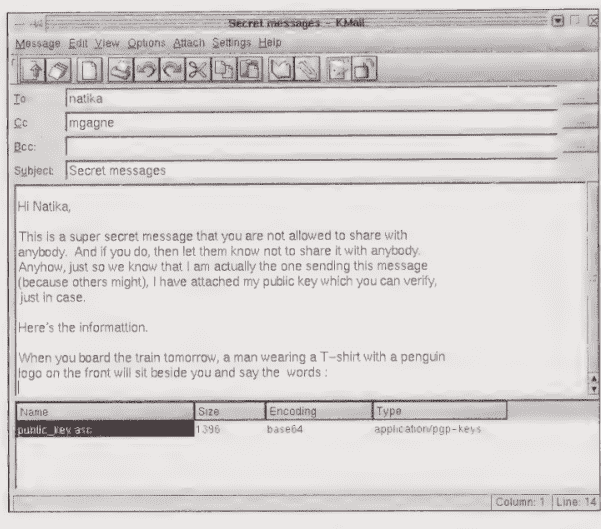

图 24.3 kmail2 中 GnuPG 签名的消息

虽然这不再是一个什么大问题了，但仍有一些邮件客户端不支持 GnuPG 或 PGP。不要气馁。再次检查 GnuPG 网站以获取电子邮件客户端列表以及相应网站的链接。

# 构建安全的 Web 服务器

如果你（或你的公司）正考虑运行电子商务网站，那么运行安全的 Web 服务器的想法似乎是一个显而易见的需求。任何提交信用卡信息的人都会想知道他们的交易是如何安全的，并隐藏在技术窥探者的监视之外。

对于那些企业内网来说，这可能仍然是一个极好的主意。问问自己，你网站上的信息是否是供公开使用的。在家庭办公室中，这可能不是问题，但当你访问朋友或客户时，你如何知道你的笔记本电脑与网站之间的通信没有被监控呢？


# 建立信任关系

这是一个很好的问题。Natika 是南极丛林地区的一位用户，那里的手机信号不稳定。联系她至多说是困难的。我该如何验证这个密钥是否有效？这里是对 `--edit-key` 选项的快速回顾：

```
# gpg --edit-key natika
```

如果你在命令行提示符输入 `help`，你会注意到一个名为“trust”（信任）的选项和另一个名为“check”（检查）的选项。几页之前，我直接对密钥进行了签名，这样你就不用经历这种问答对话了。让我们输入 `check` 看看 natika 的密钥信息。

```
Command: check
uid Natika Feline <natika@arctic.com>
sig! 9486A537 1999-10-20 [self-signature]
sig! 2E5230F8 1999-11-25 Australian Rainbow <rainbow@downunder.dom>
```

该密钥有两个签名：一个来自密钥所有者，另一个来自名为“rainbow”的人。这正是信任发挥作用的地方。事实是我认识 rainbow 以及他的签名。这意味着我对 natika 密钥的信任级别意味着什么？当我第一次导入 rainbow 时，我进入了 `--edit-key` 对话并选择了信任。我提供了四个选项，从 1（不知道）到 4（我信任此人可以信任我的信用卡）。根据我分配给用户 rainbow 的信任关系（在这种情况下是“完全信任”），我现在可以接受 natika 的密钥，并根据他的推荐对其签名，因为他是我的第三方，一个我可以安全地用来验证另一个签名的签名权威。

当你坐在一旁，看着政府、安全机构和大型集团在信任 PGP 证书中争夺他们的一杯羹时，值得关注一下全球互联网信任注册网站（http://www.cl.cam.ac.uk/Research/Security/Trust-Register/index.html）并阅读该机构的第四份目的声明（特别是第 4 条）。

当然，并不是每个人都喜欢这些。如果你只是想交换或加密电子邮件，签名权限并不是一项必要要求。尽管如此，现在仍有公司在销售经过验证的 PGP 证书，而且业务正在增长。所有对安全电子邮件和安全通信感兴趣的人都应该密切关注相关的进展。

# 加密电子邮件

因为我之前提到了使用 GnuPG（或 PGP）密钥对电子邮件签名……

# 第 24 章 安全计算


图 24.3 kmail2 中 GnuPG 签名的消息

虽然这不再是一个什么大问题了，但仍有一些邮件客户端不支持 GnuPG 或 PGP。不要气馁。再次检查 GnuPG 网站以获取电子邮件客户端列表以及相应网站的链接。

# 构建安全的 Web 服务器

如果你（或你的公司）正考虑运行电子商务网站，那么运行安全的 Web 服务器的想法似乎是一个显而易见的需求。任何提交信用卡信息的人都会想知道他们的交易是如何安全的，并隐藏在技术窥探者的监视之外。

对于那些企业内网来说，这可能仍然是一个极好的主意。问问自己，你网站上的信息是否是供公开使用的。在家庭办公室中，这可能不是问题，但当你访问朋友或客户时，你如何知道你的笔记本电脑与网站之间的通信没有被监控呢？

我的办公室有一个我称为“gatekeeper”的小型应用程序，它允许我们在访问私人电子邮件和其他服务的之前与服务器进行身份验证。在访问客户时，我不希望让我的密码在身份验证期间（或在任何时候）被窃获。我需要心安，你也是如此。启用 SSL 的 Web 服务器将给你这种安全感。

# 构建启用 SSL 的 Apache 服务器

你可能会发现自己在质问，如果已经在服务器上安装了一个 Apache Web 服务器，为什么还需要再构建一个 Apache Web 服务器呢？记住，你来自 Caldera 或 Red Hat 的默认 Apache 发行版是不带 SSL 功能的。你需要两个包。第一个是你的 Apache Web 服务器源码。你可以通过访问 http://www.httpd.org 或直接前往 FTP 站点 http://ftp.apache.org/dist/ 获取它。当前的压缩包（截至写本文时）版本是 1.3.19。这意味着你应该为本示例下载 `apache_1.3.19.tar.gz`。

你还需要来自 http://www.modssl.org/source 的 mod_ssl 包。发布版本与数字形式的 Release（部分）对应；在这种情况下，我下载了 `mod_ssl-2.8.2-1.3.19.tar.gz`。为了从固定的参考点进行构建，我将所有构建内容放在名为 `/usr/local/src` 的目录中。从该目录，我将提取 Apache 服务器和 mod_ssl 源码分布的文件。

```
# mkdir /usr/local/src
# cd /usr/local/src
# tar xzvf apache_1.3.19.tar.gz
# tar xzvf mod_ssl-2.4.9-1.3.19.tar.gz
```

尽管看起来很奇怪，我将不会进入 Apache 目录来设置 mod_ssl。


（等等，我发现我可能


# Encrypting Electronic Mail

Because I mentioned signing e-mail messages with GnuPG (or PGP) key earlier on...

# CHAPTER 24 SECURE COMPUTING


**FIGURE 24.3** GnuPG-signed messages in kmail2

While this is no longer a big deal anymore, there are still mail clients that do not yet support GnuPG or PGP. Don’t be discouraged. Once again, check the GnuPG Web site for a list of e-mail clients and links to the appropriate Web sites.

Not everyone likes something like this, of course. If you want to exchange or encrypted e-mail signing authority is not a requirement. Even now, though, companies are selling validated PGP certificates, and business is growing. All those interested in secure e-mail and secure communications would do well to keep an eye on associated developments.

# Building a Secure Web Server

The notion of running a secure web server may seem like an obvious need if you (or your company) is looking at running an e-commerce site. Anyone submitting credit card information will want to know how or her transaction is secure, hidden from the prying eyes of techno-snoops.

For those corporate intranets, this may still be an excellent idea. Ask yourself whether the information on your Web site is for public consumption. In your home office, this may not be a problem, but how do you know that your communications between your notebook and Web site aren’t being monitored when you are visiting a friend or customer?

My office has a personal little application I call `gatekeeper` that allows us to authenticate with our server before being granted access to private-mail and other services. When visiting a client, I don’t want to risk my password being picked up during this authentication (or at any time, for that matter). I need peace of of mind and so you do. SSL-enabled Web server will give you that peace of mind.

# Building the SSL-Enabled Apache Server

You might find yourself asking why you need to build another Apache Web server if you already have one installed on your server. Remember, your stock Apache distribution from Caldera or Red Hat does not come SSL-enabled. You will need two packages for this one. The first is your Apache Web server source. You can get that by surfing over to `http://www.httpd.org` or going directly to the FTP site at `http://ftp.apache.org/dist/`. The current bundle (as of this writing) is version 1.3.19. That means you should download `apache_1.3.19.tar.gz` for this example.

You will also need the `mod_ssl` package from `http://www.modssl.org/source`. The release corresponds (partially) with the Release in numbers; in this case, I downloaded `mod_ssl-2.8.2-1.3.19.tar.gz`. In order to build from a fixed point of reference, I will put all my builds in a directory called `/usr/local/src`. From this directory, I will extract the files for the Apache server and the `mod_ssl` source distribution.

```
# mkdir /usr/local/src
# cd /usr/local/src
# tar xzvf apache_1.3.19.tar.gz
# tar xzvf mod_ssl-2.4.9-1.3.19.tar.gz
```

Strange as it may seem, I will not go into the Apache directory to set up `mod_ssl`.


# 建立信任关系

这是一个很好的问题。Natika 是南极丛林地区的一位用户，那里的手机信号不稳定。联系她至多说是困难的。我该如何验证这个密钥是否有效？这里是对 `--edit-key` 选项的快速回顾：

```
# gpg --edit-key natika
```

如果你在命令行提示符输入 `help`，你会注意到一个名为“trust”（信任）的选项和另一个名为“check”（检查）的选项。几页之前，我直接对密钥进行了签名，这样你就不用经历这种问答对话了。让我们输入 `check` 看看 natika 的密钥信息。

```
Command: check
uid Natika Feline <natika@arctic.com>
sig! 9486A537 1999-10-20 [self-signature]
sig! 2E5230F8 1999-11-25 Australian Rainbow <rainbow@downunder.dom>
```

该密钥有两个签名：一个来自密钥所有者，另一个来自名为“rainbow”的人。这正是信任发挥作用的地方。事实是我认识 rainbow 以及他的签名。这意味着我对 natika 密钥的信任级别意味着什么？当我第一次导入 rainbow 时，我进入了 `--edit-key` 对话并选择了信任。我提供了四个选项，从 1（不知道）到 4（我信任此人可以信任我的信用卡）。根据我分配给用户 rainbow 的信任关系（在这种情况下是“完全信任”），我现在可以接受 natika 的密钥，并根据他的推荐对其签名，因为我是我的第三方，一个我可以安全地用来验证另一个签名的签名权威。

当你坐在一旁，看着政府、安全机构和大型集团在信任 PGP 证书中争夺他们的一杯羹的尔虞我诈时，值得关注一下全球互联网信任注册网站（`http://www.cl.cam.ac.uk/Research/Security/Trust-Register/index.html`）并阅读该机构的第四份目的声明（特别是第 4 条）。

当然，并不是每个人都喜欢这些。如果你只是想交换或加密电子邮件，签名权限并不是一项必要要求。尽管如此，现在仍有公司在销售经过验证的 PGP 证书，而且业务正在增长。所有对安全电子邮件和安全通信感兴趣的人都应该密切关注相关的进展。

# 加密电子邮件

因为我之前提到了使用 GnuPG（或 PGP）密钥对电子邮件签名……

# 第 24 章 安全计算


图 24.3 kmail2 中 GnuPG 签名的消息

虽然这不再是一个什么大问题了，但仍有一些邮件客户端不支持 GnuPG 或 PGP。不要气馁。再次检查 GnuPG 网站以获取电子邮件客户端列表以及相应网站的链接。

# 构建安全的 Web 服务器

如果你（或你的公司）正考虑运行电子商务网站，那么运行安全的 Web 服务器的想法似乎是一个显而易见的需求。任何提交信用卡信息的人都会想知道他们的交易是如何安全的，并隐藏在技术窥探者的监视之外。

对于那些企业内网来说，这可能仍然是一个极好的主意。问问自己，你网站上的信息是否是供公开使用的。在家庭办公室中，这可能不是问题，但当你访问朋友或客户时，你如何知道你的笔记本电脑与网站之间的通信没有被监控呢？

我的办公室有一个我称为“gatekeeper”的小型应用程序，它允许我们在访问私人电子邮件和其他服务之前与服务器进行身份验证。在访问客户时，我不希望让我的密码在身份验证期间（或在任何时候）被窃获。我需要心安，你也是如此。启用 SSL 的 Web 服务器将给你这种安全感。

# 构建启用 SSL 的 Apache 服务器

你可能会发现自己在质问，如果已经在服务器上安装了一个 Apache Web 服务器，为什么还需要再构建一个 Apache Web 服务器呢？记住，你来自 Caldera 或 Red Hat 的默认 Apache 发行版是不带 SSL 功能的。你需要两个包。第一个是你的 Apache Web 服务器源码。你可以通过访问 `http://www.httpd.org` 或直接前往 FTP 站点 `http://ftp.apache.org/dist/` 获取它。当前的压缩包（截至写本文时）版本是 1.3.19。这意味着你应该为本示例下载 `apache_1.3.19.tar.gz`。

你还需要来自 `http://www.modssl.org/source` 的 mod_ssl 包。发布版本与数字形式的 Release（部分）对应；在这种情况下，我下载了 `mod_ssl-2.8.2-1.3.19.tar.gz`。为了从固定的参考点进行构建，我将所有构建内容放在名为 `/usr/local/src` 的目录中。从该目录，我将提取 Apache 服务器和 mod_ssl 源码分布的文件。

```
# mkdir /usr/local/src
# cd /usr/local/src
# tar xzvf apache_1.3.19.tar.gz
# tar xzvf mod_ssl-2.4.9-1.3.19.tar.gz
```

尽管看起来很奇怪，我将不会进入 Apache 目录来设置 mod_ssl。（Strange as it may seem, I will not go into the Apache directory to set up mod_ssl）。


# BUILDING TRUST RELATIONSHIPS

That's a good question. Natika is a user in the jungles of Antarctica, and phone service is sporty. Getting in touch with her is difficult at best. How can I verify that this key is valid? Here's a quick refresher on the `--edit-key` option:

```
# gpg --edit-key natika
```

If you type `help` at the command prompt, you will notice an option called “trust” and another called “check.” ... (rest of the text)

Not everyone likes something like this, of course. If you want to exchange or encrypted e-mail signing authority is not a requirement. Even now, though, companies are selling validated PGP certificates, and business is growing. All those interested in secure e-mail and secure communications would do well to keep an eye on associated developments.

# Encrypting Electronic Mail

Because I mentioned signing e-mail messages with GnuPG (or PGP) key earlier on...

# CHAPTER 24 SECURE COMPUTING


FIGURE 24.3 GnuPG-signed messages in kmail2

While this is no longer a big deal anymore, there are still mail clients that do not yet support GnuPG or PGP. Don’t be discouraged. Once again, check the GnuPG Web site for a list of e-mail clients and links to the appropriate Web sites.

# Building a Secure Web Server

The notion of running a secure web server may seem like an obvious need if you (or your company) is looking at running an e-commerce Web site. Anyone submitting credit card information will want to know how or her transaction is secure, hidden from the prying eyes of techno-snoops.

For those corporate intranets, this may still be an excellent idea. Ask yourself whether the information on your Web site is for public consumption. In your home office, this may not be a problem, but how do you know that your communications between your notebook and Web site aren’t being monitored when you are visiting a friend or customer?

My office has a personal little application I call “gatekeeper” that allows us to authenticate with our server before being granted access to private-mail and other services. When visiting a client, I don’t want to risk my password being picked up during this authentication (or at any time, for that matter). I need peace of of mind and so you do. SSL-enabled Web server will give you that peace of mind.

# Building the SSL-Enabled Apache Server


# 建立信任关系

这是一个很好的问题。Natika 是南极丛林地区的一位用户，那里的手机信号不稳定。联系她至多说是困难的。我该如何验证这个密钥是否有效？这里是对 `--edit-key` 选项的快速回顾：

```
# gpg --edit-key natika
```

如果你在命令行提示符输入 `help`，你会注意到一个名为“trust”（信任）的选项和另一个名为“check”（检查）的选项。几页之前，我直接对密钥进行了签名，这样你就不用经历这种问答对话了。让我们输入 `check` 看看 natika 的密钥信息。

```
Command: check
uid Natika Feline <natika@arctic.com>
sig! 9486A537 1999-10-20 [self-signature]
sig! 2E5230F8 1999-11-25 Australian Rainbow <rainbow@downunder.dom>
```

该密钥有两个签名：一个来自密钥所有者，另一个来自名为“rainbow”的人。这正是信任发挥作用的地方。事实是我认识 rainbow 以及他的签名。这意味着我对 natika 密钥的信任级别意味着什么？当我第一次导入 rainbow 时，我进入了 `--edit-key` 对话并选择了信任。我提供了四个选项，从 1（不知道）到 4（我信任此人可以信任我的信用卡）。根据我分配给用户 rainbow 的信任关系（在这种情况下是“完全信任”），我现在可以接受 natika 的密钥，并根据他的推荐对其签名，因为我是我的第三方，一个我可以安全地用来验证另一个签名的签名权威。

当你坐在一旁，看着政府、安全机构和大型集团在信任 PGP 证书中争夺他们的一杯羹时，值得关注一下全球互联网信任注册网站（http://www.cl.cam.ac.uk/Research/Security/Trust-Register/index.html）并阅读该机构的第四份目的声明（特别是第 4 条）。

当然，并不是每个人都喜欢这些。如果你只是想交换或加密电子邮件，签名权限并不是一项必要要求。尽管如此，现在仍有公司在销售经过验证的 PGP 证书，而且业务正在增长。所有对安全电子邮件和安全通信感兴趣的人都应该密切关注相关的进展。

# 加密电子邮件

因为我之前提到了使用 GnuPG（或 PGP）密钥对电子邮件签名……

# 第 24 章 安全计算


图 24.3 kmail2 中 GnuPG 签名的消息

虽然这不再是一个什么大问题了，但仍有一些邮件客户端不支持 GnuPG 或 PGP。不要气馁。再次检查 GnuPG 网站以获取电子邮件客户端列表以及相应网站的链接。

# 构建安全的 Web 服务器

如果你（或你的公司）正考虑运行电子商务网站，那么运行安全的 Web 服务器的想法似乎是一个显而易见的需求。任何提交信用卡信息的人都会想知道他们的交易是如何安全的，并隐藏在技术窥探者的监视之外。

对于那些企业内网来说，这可能仍然是一个极好的主意。问问自己，你网站上的信息是否是供公开使用的。在家庭办公室中，这可能不是问题，但当你访问朋友或客户时，你如何知道你的笔记本电脑与网站之间的通信没有被监控呢？

我的办公室有一个我称为“gatekeeper”的小型应用程序，它允许我们在访问私人电子邮件和其他服务的之前与服务器进行身份验证。在访问客户时，我不希望让我的密码在身份验证期间（或在任何时候）被窃获。我需要心安，你也是如此。启用 SSL 的 Web 服务器将给你这种安全感。

# 构建启用 SSL 的 Apache 服务器

你可能会发现自己在质问，如果已经在服务器上安装了一个 Apache Web 服务器，为什么还需要再构建一个 Apache Web 服务器呢？记住，你来自 Caldera 或 Red Hat 的默认 Apache 发行版是不带 SSL 功能的。你需要两个包对于这一个。第一个是你的 Apache Web 服务器源码。你可以通过访问 http://www.httpd.org 或直接前往 FTP 站点 http://ftp.apache.org/dist/ 获取它。当前的压缩包（截至写本文时）版本是 1.3.19。这意味着你应该为本示例下载 `apache_1.3.19.tar.gz`。

你还需要来自 http://www.modssl.org/source 的 `mod_ssl` 包。发布版本与数字形式的 Release（部分）对应；在这种情况下，我下载了 `mod_ssl-2.8.2-1.3.19.tar.gz`。为了从固定的参考点进行构建，我将所有构建内容放在名为 `/usr/local/src` 的目录中。从该目录，我将提取 Apache 服务器和 `mod_ssl` 源码分布的文件。

```
# mkdir /usr/local/src
# cd /usr/local/src
# tar xzvf apache_1.3.19.tar.gz
# tar xzvf mod_ssl-2.4.9-1.3.19.tar.gz
```

尽管看起来很奇怪，我将不会进入 Apache 目录来设置 `mod_ssl`。


# 建立信任关系

这是一个很好的问题。Natika 是南极丛林地区的一位用户，那里的手机信号不稳定。联系她至多说是困难的。我该如何验证这个密钥是否有效？这里是对 `--edit-key` 选项的快速回顾：

```
# gpg --edit-key natika
```

如果你在命令行提示符输入 `help`，你会注意到一个名为“trust”（信任）的选项和另一个名为“check”（检查）的选项。几页之前，我直接对密钥进行了签名，这样你就不用经历这种问答对话了。让我们输入 `check` 看看 natika 的密钥信息。

```
Command: check
uid Natika Feline <natika@arctic.com>
sig! 9486A537 1999-10-20 [self-signature]
sig! 2E5230F8 1999-11-25 Australian Rainbow <rainbow@downunder.dom>
```

该密钥有两个签名：一个来自密钥所有者，另一个来自名为“rainbow”的人。这正是信任发挥作用的地方。事实是我认识 rainbow 以及他的签名。这意味着我对 natika 密钥的信任级别意味着什么？当我第一次导入 rainbow 时，我进入了 `--edit-key` 对话并选择了信任。我提供了四个选项，从 1（不知道）到 4（我信任此人可以信任我的信用卡）。根据我分配给用户 rainbow 的信任关系（在这种情况下是“完全信任”），我现在可以接受 natika 的密钥，并根据他的推荐对其签名，因为我是我的第三方，一个我可以安全地用来验证另一个签名的签名权威。

当你坐在一旁，看着政府、安全机构和大型集团在信任 PGP 证书中争夺他们的一一杯羹的尔谋算计时，值得关注一下全球互联网信任注册网站（`http://www.cl.cam.ac.uk/Research/Security/Trust-Register/index.html`）并阅读该机构的第四份目的声明（特别是第 4 条）。

当然，并不是每个人都喜欢这些。如果你只是想交换或加密电子邮件签名权限并不是一项必要要求。尽管如此，现在仍有公司在销售经过验证的 PGP 证书，而且业务正在增长。所有对安全电子邮件和安全通信感兴趣的人都应该密切关注相关的进展。

# 加密电子邮件

因为我之前提到了使用 GnuPG（或 PGP）密钥对电子邮件签名……

# 第 24 章 安全计算


图 24.3 kmail2 中 GnuPG 签名的消息

虽然这不再是一个什么大问题了，但仍有一些邮件客户端不支持 GnuPG 或 PGP。不要气馁。再次检查 GnuPG 网站以获取电子邮件客户端列表以及相应网站的链接。

# 构建安全的 Web 服务器

如果你（或你的公司）正考虑运行电子商务网站，那么运行安全的 Web 服务器的想法似乎是一个显而易见的需求。任何提交信用卡信息的人都会想知道他们的交易是如何安全的，并隐藏在技术窥探者的监视之外。

对于那些企业内网来说，这可能仍然是一个极好的主意。问问自己，你网站上的信息是否是供公开使用的。在家庭办公室中，这可能不是问题，但当你访问朋友或客户时，你如何知道你的笔记本电脑与网站之间的通信没有被监控呢？

我的办公室有一个我称为“gatekeeper”的小型应用程序，它允许我们在访问私人电子邮件和其他服务的之前与服务器进行身份验证。在访问客户时，我不希望让我的密码在身份验证期间（或在任何时候）被窃获。我需要心安，你也是如此。启用 SSL 的 Web 服务器将给你这种安全感。

# 构建启用 SSL 的 Apache 服务器

你可能会发现自己在质问，如果已经在服务器上安装了一个 Apache Web 服务器，为什么还需要再构建一个 Apache Web 服务器呢？记住，你来自 Caldera 或 Red Hat 的默认 Apache 发行版是不带 SSL 功能的。你需要两个包对于这一个。第一个是你的 Apache Web 服务器源码。你可以通过访问 `http://www.httpd.org` 或直接前往 FTP 站点 `http://ftp.apache.org/dist/` 获取它。当前的压缩包（截至写本文时）版本是 1.3.19。这意味着你应该为本示例下载 `apache_1.3.19.tar.gz`。

你还需要来自 `http://www.modssl.org/source` 的 `mod_ssl` 包。发布版本与数字形式的 Release（部分）对应；在这种情况下，我下载了 `mod_ssl-2.8.2-1.3.19.tar.gz`。为了从固定的参考点进行构建，我将所有构建内容放在名为 `/usr/local/src` 的目录中。从该目录，我将提取 Apache 服务器和 `mod_ssl` 源码分布的文件。

```
# mkdir /usr/local/src
# cd /usr/local/src
# tar xzvf apache_1.3.19.tar.gz
# tar xzvf mod_ssl-2.4.9-1.3.19.tar.gz
```

尽管看起来很奇怪，我将不会进入 Apache 目录来设置 `mod_ssl`。


# 建立信任关系

这是一个很好的问题。Natika 是南极丛林地区的一位用户，那里的手机信号不稳定。联系她至多说是困难的。我该如何验证这个密钥是否有效？这里是对 `--edit-key` 选项的快速回顾：

```
# gpg --edit-key natika
```

如果你在命令行提示符输入 `help`，你会注意到一个名为“trust”（信任）的选项和另一个名为“check”（检查）的选项。几页之前，我直接对密钥进行了签名，这样你就不用经历这种问答对话了。让我们输入 `check` 看看 natika 的密钥信息。

```
Command: check
uid Natika Feline <natika@arctic.com>
sig! 9486A537 1999-10-20 [self-signature]
sig! 2E5230F8 1999-11-25 Australian Rainbow <rainbow@downunder.dom>
```

该密钥有两个签名：一个来自密钥所有者，另一个来自名为“rainbow”的人。这正是信任发挥作用的地方。事实是我认识 rainbow 以及他的签名。这意味着我对 natika 密钥的信任级别意味着什么？当我第一次导入 rainbow 时，我进入了 `--edit-key` 对话并选择了信任。我提供了四个选项，从 1（不知道）到 4（我信任此人可以信任我的信用卡）。根据我分配给用户 rainbow 的信任关系（在这种情况下是“完全信任”），我现在可以接受 natika 的密钥，并根据他的推荐对其签名，因为我是我的第三方，一个我可以安全地用来验证另一个签名的签名权威。

当你坐在一旁，看着政府、安全机构和大型集团在信任 PGP 证书中争夺他们的一杯羹时，值得关注一下全球互联网信任注册网站（`http://www.cl.cam.ac.uk/Research/Security/Trust-Register/index.html`）并阅读该机构的第四份目的声明（特别是第 4 条）。

当然，并不是每个人都喜欢这些。如果你只是想交换或加密电子邮件，签名权限并不是一项必要要求。尽管如此，现在仍有公司在销售经过验证的 PGP 证书，而且业务正在增长。所有对安全电子邮件和安全通信感兴趣的人都应该密切关注相关的进展。

# 加密电子邮件

因为我之前提到了使用 GnuPG（或 PGP）密钥对电子邮件签名……

# 第 24 章 安全计算


图 24.3 kmail2 中 GnuPG 签名的消息

虽然这不再是一个什么大问题了，但仍有一些邮件客户端不支持 GnuPG 或 PGP。不要气馁。再次检查 GnuPG 网站以获取电子邮件客户端列表以及相应网站的链接。

# 构建安全的 Web 服务器

如果你（或你的公司）正考虑运行电子商务网站，那么运行安全的 Web 服务器的想法似乎是一个显而易见的需求。任何提交信用卡信息的人都会想知道他们的交易是如何安全的，并隐藏在技术窥探者的监视之外。

对于那些企业内网来说，这可能仍然是一个极好的主意。问问自己，你网站上的信息是否是供公开使用的。在家庭办公室中，这可能不是问题，但当你访问朋友或客户时，你如何知道你的笔记本电脑与网站之间的通信没有被监控呢？

我的办公室有一个我称为“gatekeeper”的小型应用程序，它允许我们在访问私人电子邮件和其他服务之前与服务器进行身份验证。在访问客户时，我不希望让我的密码在身份验证期间（或在任何时候）被窃获。我需要心安，你也是如此。启用 SSL 的 Web 服务器将给你这种安全感。

# 构建启用 SSL 的 Apache 服务器

你可能会发现自己在质问，如果已经在服务器上安装了一个 Apache Web 服务器，为什么还需要再构建一个 Apache Web 服务器呢？记住，你来自 Caldera 或 Red Hat 的默认 Apache 发行版是不带 SSL 功能的。你需要两个包来完成这一任务。第一个是你的 Apache Web 服务器源码。你可以通过访问 `http://www.httpd.org` 或直接前往 FTP 站点 `http://ftp.apache.org/dist/` 获取它。当前的压缩包（截至写本文时）版本是 1.3.19。这意味着你应该为本示例下载 `apache_1.3.19.tar.gz`。

你还需要来自 `http://www.modssl.org/source` 的 `mod_ssl` 包。发布版本与数字形式的 Release（部分）对应；在这种情况下，我下载了 `mod_ssl-2.8.2-1.3.19.tar.gz`。为了从固定的参考点进行构建，我将所有构建内容放在名为 `/usr/local/src` 的目录中。从该目录，我将提取 Apache 服务器和 `mod_ssl` 源码分布的文件。

```
# mkdir /usr/local/src
# cd /usr/local/src
# tar xzvf apache_1.3.19.tar.gz
# tar xzvf mod_ssl-2.4.9-1.3.19.tar.gz
```

尽管看起来很奇怪，我将不会进入 Apache 目录来设置 `mod_ssl`。


The notion of running a secure web server may seem like an obvious need if you (or your company) is looking at running an e-commerce Web site. Anyone submitting credit card information will want to know how or her transaction is secure, hidden from the prying eyes of techno-snoops.

For those corporate intranets, this may still be an excellent idea. Ask yourself whether the information on your Web site is for public consumption. In your home office, this may not be a problem, but how do you know that your communications between your notebook and Web site aren’t being monitored when you are visiting a friend or customer?

My office has a personal little application I call “gatekeeper” that allows us to authenticate with our server before being granted access to private-mail and other services. When visiting a client, I don’t want to risk my password being picked up during this authentication (or at any time, for that matter). I need peace of of mind and so you do. SSL-enabled Web server will give you that peace of mind.

# Building the SSL-Enabled Apache Server

You might find yourself asking why you need to build another Apache Web server if you already have one installed on your server. Remember, your stock Apache distribution from Caldera or Red Hat does not come SSL-enabled. You will need two packages for this one. The first is your Apache Web server source. You can get that by surfing over to `http://www.httpd.org` or going directly to the FTP site at `http://ftp.apache.org/dist/`. The current bundle (as of this writing) is version 1.3.19. That means you should download `apache_1.3.19.tar.gz` for this example.

You will also need the `mod_ssl` package from `http://www.modssl.org/source`. The release corresponds (partially) with the Release in numbers; in this case, I downloaded `mod_ssl-2.8.2-1.3.19.tar.gz`. In order to build from a fixed point of reference, I will put all my builds in a directory called `/usr/local/src`. From this directory, I will extract the files for the Apache server and the `mod_ssl` source distribution.

```
# mkdir /usr/local/src
# cd /usr/local/src
# tar xzvf apache_1.3.19.tar.gz
# tar xzvf mod_ssl-2.4.9-1.3.19.tar.gz
```

Strange as it may seem, I will not go into the Apache directory to set up `mod_ssl`.


# 资源

- Apache
  http://www.apache.org/

- GNU Privacy Guard (GnuPG)
  http://www.gnupg.org/

- ModSSL
  http://www.modssl.org/

- Netscape SSL 3.0 Specifications
  http://www.netscape.com/eng/ssl30

- OpenSSH
  http://www.openssh.org/

- OpenSSL
  http://www.openssl.org/

- Pretty Good Privacy
  http://www.pgp.com/

- SSH (Secure Shell)
  http://www.ssh.com/

- World Wide Web Consortium (W3C)
  http://www.w3c.org/

# 第 25 章 安全：你的系统之战

你的系统是一个战场。当你将计算机暴露在互联网上的那一刻，你就成为了他人极具吸引力的目标。你可能会问，为什么有人想入侵你的系统？毕竟，你的系统中可能除了你公开的一些文档外，并没什么有价值的东西。这些东西很难算作工业机密或国家安全关注的问题。你的那台机器可能仅仅是一台你用来上网的电脑。黑客对你想要什么呢？

答案：一个滩头堡。

对你系统的攻击可能仅仅是一个恶作剧，但你被攻破的系统也可能成为黑客向其他系统发起攻击的滩头堡。最近，发生过几次著名的分布式拒绝服务攻击（DoS），大型企业服务器被许多系统的合力击垮。在每秒发送的成千上万封电子邮件或 Web 请求的压力下，受攻击的服务器会崩溃。你被攻破的系统最终可能变成这些他人指使的爪牙之一。

那么你自己的系统呢？被破解的系统很少能像攻击前那样运行良好。一些你无法解释的怪异现象开始发生。某些电子邮件无法发送出去。你的命令失效了。你期望在日志中看到的信息消失了。你的系统性能急剧恶化。

还不糟？但如果是这样呢：你正被监视！你登录其他系统的行为正被监控。你的信用卡信息现在属于一个未知的黑客。你的私人文档不再是私密的。

每一位系统管理员和每一位连接互联网系统的所有者都应该尽力威慑系统黑客。通过帮助自己，你也在帮助他人。

## 什么是“脚本小子”（Script Kiddie）？

大多数人倾向于认为黑客是 IQ 达 250 的超级天才神童，他们深夜坐在高科技电脑房里（由旧烤面包机、电话和汽水罐拉环组装而成）。好吧，这里有一个令人震惊的事实：入侵系统完全不需要任何大脑筋，只需要一套正确的工具。

“脚本小子”这个词已经说明了一切。脚本小子使用从盗版网站或黑客新闻组下载的脚本，他们从字面上来说完全按照脚本操作。他们运行程序，扫描你的网络，当他们发现正确的签名时（例如 `BIND` 的不安全版本），他们就会按照脚本的下一步操作。通常情况下，这意味着运行一个利用网络程序特定漏洞的程序——例如，他们可能会导致易受影响程序发生缓冲区溢出。

脚本小子并不一定是天才。脚本小子只是执着，而且有很多空闲时间。是时候遏制这些脚本小子了。

## 基础知识：你的 TCP 封装器（TCP Wrappers）

随着时间的推移，我接到了越来越多系统被破解的人的电话。通常他们并没有意识到这一点，电话的开头往往是：“我的电子邮件似乎出了问题。你能帮我看看吗？”

我登录系统，快速环顾了一四周，发现到处都是他的足迹。那个狡猾的黑客又得手了。

当你建立 Linux 系统时，你启动了一个强大的、高层的、多任务的网络操作系统——这个系统可能有点太强大了。在出箱即用的情况下，某些发行版会启动大量的服务（`logind`、`inetd`、`httpd`、`infd`、`finger`、`timed`、`rhsd` 等）。你知道它们都是什么吗？你应该知道。作为系统管理员，你有足够要操心的了，就像那个猎人一样，但如果你的机器暴露在互联网上，你应该特别注意。

黑客使用最新的分布式利用程序（程序和/或技术）来突破你系统中众知的或最近发现的安全漏洞。好消息是，作为安全管理员，你完全能够意识到这些漏洞。经常访问你的 Linux 发行版网站（如 Red Hat 或 Caldera Systems），可以让你掌握最新的补丁以阻止那些利用程序。顺便一下，你可以通过查看 BugTraq 论坛或 CERT 来了解漏洞本身（请查看章节末尾“资源”部分的 URL）。无论是否是创新者，如果你的服务器大门敞开，破解系统就会变得容易得多。

控制访问的最简单方法（关闭你的机器之外）是通过一个称为 TCP wrapper（封装器）的程序。你很可能已经作为系统安装的一部分加载了它。使用封装器，你可以限制对我之前提到的某些服务的访问。最好的是，封装器会记录尝试进入你系统的操作，你可以追踪是谁在测试你虚拟大门的锁。如果你不需要访问 `telnet`、`rlogin`，你应该在 `/etc/hosts.deny` 中添加此行内容（注意，要使更改生效，你必须重启服务）：

```
ALL: 127.0.0.1
```

`/etc/hosts.deny` 中的第一行指的是所有人。`/etc/hosts.allow` 中的第二行也指的是所有人。如果你想允许从本地机器访问，你应该在 `/etc/hosts.allow` 中添加以下内容：

```
ALL: 127.0.0.1
```

现在，这并不意味着黑客永远进不来，但你知道他或她正在尝试，这是一个非常好的开始。

## TCP Wrapper 告诉了你什么

你还可以使用 `more` 命令查看其他文件以获取额外信息。`maillog` 文件将让你了解电子邮件消息是如何通过你的机器进行路由的。如果你想查看进出你机器的 FTP 传输，请查看 `xferlog` 文件。由于破解系统安全的尝试可能发生在网络系统的许多方面，因此监控这些文件至关重要。例如，这段来自 `maillog` 文件的提取显示黑客正试图向你的邮件池目录写入信息。

```
Dec 13 23:45:16 netsite sendmail[2384]: XAA02384: from=<cracker@bigcompany.com.tld,
size=1652,class=0,pri=91652,ncports=3,
msgid=0003b4d0033fd50002ec5@www.somebesite.tld; proto=ESMTP,
relay=questionablesite.tld [???.27.26.39]
Dec 13 23:45:16 netsite sendmail[2385]: XAA02384: forward
/var/spool/mail/.forward.netsite: Group writable directory
Dec 13 23:45:16 netsite sendmail[2385]: XAA02384: forward
/var/spool/mail/.forward: Group writable directory
```

原始地址很可能是伪造的（我更改了它以保护可能无辜的人员），你会注意到我的黑客试图撒谎或通过另一个毫无防备的主机发送其消息，试图掩盖其足迹。如果这次攻击成功，`.forward` 文件可能包含提供系统后门的代码。

另一个感兴趣的文件是 `wtmp`。要查看 `wtmp` 的内容，请使用 `last` 命令——你不能简单地 `cat` 这个文件。然而，你可能想将 `last` 的输出传递给 `more`。

```
# last | more
```

```
fishduck ttyp6 nexus Tue Sep 28
16:03 still logged in
birdrat ttyp5 speedy Tue Sep 28
15:57 still logged in
root tty1 Tue Sep 28
12:54 still logged in
```

确保这些都是你允许访问的人。也许你不认识 "birdrat"。

如果你已经有一段时间没有检查日志了，并且想查看 `wtmp.1` 中的内容，可以使用这个版本的 `last` 命令：

```
# last -f /var/log/wtmp.1 | more
```

## “嘿，我的日志里什么都没有！”

这是一个出现问题的明确信号。

考虑你日志文件的状态。如果你发现日志中的活动太少，或者日志大小倾向于 0 字节或完全缺失，那么是时候进行损害控制了。在脚本小子的说明书中，明确写着要掩盖足迹。做到这一点最简单的方法是删除日志文件，这无疑是脚本小子会采取的步骤之一（尽管删除所有日志信息有点混乱）。这引出了下一个主题，可以总结为：“我该如何发现自己是否被破解了？”

## 检测黑客

喜剧演员史蒂芬·莱特（Steven Wright）在他最著名的单调单口秀表演中表达了一个有趣的困境：有人闯了他的家，偷走了一切，并用完全相同的复制品替换了所有东西。在系统破解者的世界里，这并不是疯狂的想法。

情况是这样的：利用某些已知的漏洞或利用代码，黑客进入了你的系统。然而，当你执行 `ps` 时，没有任何证据。你认为你的密码文件看起来正常，但你无法确定。该怎么办？

替换系统上的某些文件。你将得到一个新版本的 `netstat`，其 `-a` 参数不会显示任何黑客存在的证据。黑客还会替换任何可能暴露其身份的文件。

其中一些文件如下。这只是许多可能性中的一个示例。

```
/bin/ps
/bin/netstat
/usr/bin/top
```

由于文件已被替换，简单地执行 `ls` 只能确认文件在那里。你有多种方法可以检测系统上被修改的文件。如果你正在运行 Red Hat、Caldera、Turbolinux 或任何使用 Red Hat 软件包管理器（简称 RPM）概念的发行版，我将为你展示如何这样做。

你需要做的第一件事是找出这些文件来自哪个包。使用 `rpm` 命令，你可以通过此版本的命令识别文件（例如 `netstat`）的位置：

```
# rpm -qf /bin/netstat
```

系统返回了此回复：

```
net-tools-1.51-3
```

我可以使用此版本的 `rpm` 命令扫描整个包，找出哪些发生了变化：

```
rpm -V net-tools
```

（你可以省略版本信息）

现在，在我的测试系统中，我修改了 `/bin/netstat` 二进制文件（在这种情况下，我将 6.0 版本替换为 5.2）。上一个命令的结果应该是空的——返回到（原始状态）。相反，我得到了这个：

```
/bin/netstat
```

> 此时，你可能会问这样一个问题：“如果破解者更改了 md5 怎么办？”

这类问题说明了整个安全事务是有多么棘手。解决此问题的方法是：在安装系统之后、连接互联网之前，立即获取 `md5sums` 和 `rpm`，打印结果并将其存储以备日后参考。此外，在写保护的磁盘（或 CD-ROM）上保留一份 `md5sum` 和 `rpm` 程序的干净副本，并妥善保存。即使服务器上的这些程序版本被修改过，磁盘上的版本仍然是干净的。

知道有人在关注这种感觉很不错。

## 破解者并不那么隐形的足迹

让我们来看看接下来会发生什么。你发现通过 `rpm` 技巧，像 `netstat` 和 `ls` 等文件实际上被修改了。随之而来的问题显而易见：“现在怎么办？”

你有许多选择。根据系统的重要性，我个人建议对用户目录、密码和其他关键系统文件进行备份，并在不包含这些文件的情况下重新构建系统，并将备份作为新系统的参考。我不会仅仅把这些文件拷贝回去。破解者可能在合法的地方隐藏了东西，你不想轻易让他或她再次进入。

你也可以不管这个系统，用 TCP wrappers 限制主机访问，关闭无意义的服务，并替换受影响的包。这是你应该定期进行备份（第 17 章）的另一个原因。干净、可靠的备份是你最好的解决方案。从干净开始很重要，但你并不总是有这种奢侈——至少不是立即。

> 小提示：你可能想要复制修改后的文件，以便研究攻击并精确确定破解者是如何进入以及他正在做什么。

如果你发现你的 `procps` 或 `net-tools` 包被破解者修改了，首先要做的事情是重新安装该包。因为该包可能是破解者进入的漏洞，通常从你的供应商（Red Hat, Caldera, Debian 等）获取最新版本是一个好主意。对于真正偏执的人来说，事实是，一旦破解者获得了系统的访问权限，他就可以替换任何东西，包括你用来追踪损坏情况的文件。就像老电视剧《功夫》中的少林僧一样，破解者的成功在于他的隐形。

现在，让我们来看一个真实案例。在受到破解攻击后，机器被加固，安装了 TCP wrappers，并替换了所有受影响的包。是时候评估损害了，同时密切关注日志是否有重复的破解尝试。查看 `/etc/passwd` 文件，我注意到有一个名为 "jon" 的用户，他不属于这个系统。它看起来像是一个正常的 `passwd` 条目，没有 root 权限。由于这台机器上有多个用户，破解者巧妙地隐藏在 `passwd` 列表中。

当我进入 jon 的家目录 (`/home/jon`) 并执行 `ls -a` 时，我只得到了这些：

```
.bashrc .bash_history .screenrc  emech.tar.gz
```

除了名为 `emech.tar.gz` 的文件外，它看起来不太对劲。难道这就是全部的问题所在吗？仔细观察，你会发现有两个 `..` 目录（指向文件系统层次结构中上一个目录的指针）。这很奇怪。然而，如果我用 `cd ..` 切换到 `..`，我只是进入了 `/home` 目录。怎么回事？

是因为第二个点点后面有一个空格。我可以通过以下方法发现这一点：

```
# cd /home/jon
# echo .* | cat -v
```

```
.bashrc .bash_history .screenrc emech.tar.gz
```

仔细看。注意每个项目是如何用一个空格隔开的。现在看第二个点点和 `.bashrc` 之间。实际上有两个空格，这意味着该目录实际上是 `点点-空格`。要进入该目录并查看四周，我这样做：

```bash
# cd ".. "
```

`ls` 向我显示了所有内容：

```
randfiles mech.set mech.pid checkmechrc cpu.memory
mech.help mech.usage mech mech.levels emech.users
psdevtab
```

这确实很有意思。让我们看看 jon 在磁盘周围还有没有其他文件。再次使用 `find` 命令，我指定搜索仅属于此用户 ID 的文件。

除了 `/home/jon` 目录中的内容，我得到了这个部分列表：

```
/usr/local/bin/.httpd
/tmp/.cl
/tmp/.1/bcast
/tmp/.1/.
/tmp/.1/imapd
/tmp/.1/log
/tmp/.1/pscan
/tmp/.1/pscan.c
/tmp/.1/rpc
/tmp/.1/slice2
/tmp/.1/sniffer
/tmp/.1/exploit
/tmp/.1/thc
/tmp/.1/ufs.c
```

看起来我的 jon 已经在到处活动了。我们在这里有什么？嗅探器。端口扫描器。我的破解者为自己营造了一个家。此外，我发现了另外两个来自不同主机的用户，他们有自己的文件。我的破解者要么是在不同的位置使用不同的 ID 操作，要么就是他非常聪明。

## 端口扫描器、嗅探器与破解者的工具

在开始进入这个主题之前，让我们来快速回顾一下第 18 章关于网络管理的知识（以防你因为现在就想看安全信息而跳过了书的前面的部分）。从最现实、最基础的层面，这整套机制的工作原理是这样的。

由初始化过程（又名“启动电脑”）启动的服务之一被称为 `inetd`。`inetd` 的作用是监听网络请求。这些请求通过 Internet 套接字号或端口来引用。当你通过输入 `telnet mysystem` 登录到你的系统时，你实际上是在请求 `mysystem` 上的 `inetd` 启动一个 `in.telnet` 进程来处理端口 23 的通信。

这些服务都列在一个名为 `/etc/services` 的文件中。这里有数百个服务，遗憾的是，也有数百种进入你系统的可能方法（但我稍后会提到）。

当 `inetd` 启动时，它会读取一个名为 `inetd.conf` 的文件。你可以在 `/etc` 目录下找到它。以下是 `inetd.conf` 的几行示例代码：


# 标准服务配置示例

```text
#
# 这些是标准服务。

ftp stream tcp nowait root /usr/sbin/tcpd in.ftpd -l -a
telnet stream tcp nowait root /usr/sbin/tcpd in.inetd
# Shell, login exec, comsat and talk 是 BSD 协议。

shell stream tcp nowait root /usr/sbin/tcpd in.rshd
login stream tcp nowait root /usr/sbin/tcpd in.logind
#exec stream tcp nowait root /usr/sbin/tcpd in.rexec
```

当破解者为了侵入而访问你的网站时，他或她通常会使用一种名为端口扫描器的工具来发现 `inetd` 正在监听你的系统。

我最喜欢的端口扫描器之一是 `Nmap`。你可以从 `http://www.insecure.org/nmap/index.html` 获取 `Nmap`。最新版本带有一个非常友好的 GUI 前端 `nmap.fe`。让我们针对我的测试系统上运行 `nmap` 命令，看看会发生什么。

选项 `-sS` 用于 TCP SYN 扫描（半开放扫描），`-O` 用于操作系统指纹识别。操作系统指纹识别意味着 `nmap` 将尝试猜测运行系统上的操作系统版本。破解者知道你运行的是哪个版本的操作系统，并会利用这些信息来决定最可能用于成功入侵的利用漏洞。以下是 `nmap` 命令以及我测试系统的输出：

```bash
# nmap -sS -O localhost
```

```text
Starting nmap V.2.3BETA5 by Fyodor (fyodor@dhp.com),
www.insecure.org/nmap/

Listing ports on localhost (127.0.0.1):

Interesting ports * open
```

## 第 25 章 安全：争夺你的系统的战战

| 端口 | 状态 | 协议 | 服务 |
|---|---|---|---|
| 21 | open | tcp | ftp |
| 23 | open | tcp | telnet |
| 25 | open | tcp | smtp |
| 53 | open | tcp | domain |
| 79 | open | tcp | finger |
| 80 | open | tcp | http |
| 98 | open | tcp | linuxconf |
| 111 | open | tcp | sunprc |
| 113 | open | tcp | auth |
| 139 | open | tcp | netbios-ssn |
| 513 | open | tcp | login |
| 514 | open | tcp | shell |
| 515 | open | tcp | printer |

TCP Sequence Prediction: Class=random positive increments Difficulty=4360068 (Good luck!)

Remote operating system guess: Linux 2.1.122 - 2.2.122

Nmap run completed -- 1 IP address (1 host up) scanned in 2 seconds

那些开放的端口是破解者的跳板。通过这些信息，他知道该花精力关注什么，该忽略什么。如果网络端口上没有守护进程在监听，为什么要费劲尝试通过这种方式进入呢？

现在，回去查看 `/etc/inetd.conf` 文件。注意到 `exec` 被注释了（行开头有一个 `#` 符号），但 `login` 没有。如果你结合 `nmap` 的输出来看，你会发现 `inetd.conf` 中未被注释的项被列了出来，而开头带有 `#` 号的则没有列出。

这就是如何关闭由 `inetd` 监控的必要端口。TCP wrapper 正在监视这些端口，但如果没有人访问远程 shell，为什么要让 `inetd` 监听它呢？wrapper 的作用是为特定的 IP 地址提供特定服务的访问权限。在本章的早些部分，你已经使用 wrapper 进行了快速锁定。现在，检查你的服务列表，决定你需要什么，哪些不需要，然后通过注释掉行来禁用不需要的服务。

要使更改生效，你需要重启 `inetd`。

```bash
# kill -1 `cat /var/run/inetd.pid`
```

现在，重新运行 `nmap`。

```text
Starting nmap V.2.BETA5 by Fyodor (fyodor@dhp.com), www.ingress.org/nmap/

Interesting ports on localhost (127.0.0.1):
```

| 端口 | 状态 | 协议 | 服务 |
|---|---|---|---|
| 21 | open | tcp | ftp |
| 23 | open | tcp | telnet |
| 25 | open | tcp | smtp |
| 53 | open | tcp | domain |
| 80 | open | tcp | http |
| 111 | open | tcp | sunprc |
| 113 | open | tcp | auth |
| 139 | open | tcp | netbios-ssn |
| 515 | open | tcp | printer |

TCP Sequence Prediction: Class=random positive increments Difficulty=4360068 (Good luck!)

Remote operating system guess: Linux 2.1.122 - 2.2.122

Nmap run completed -- 1 IP address (1 host up) scanned in 2 seconds

# 嗅探器

## 463

当你安装 Linux 系统时，很可能也安装了一个名为 `tcpdump` 的小软件包。虽然它不像提到的另外两个嗅探器那样显眼，但这个程序的功能是相同的。如果你曾经好奇过你的网络上发生了什么，你会发现它大有益处。在命令行中，输入以下内容：

```bash
# tcpdump
```

几秒钟后，你应该就会开始看到进入和离开你系统的数据包。以下是我系统的一些输出。我告诉 `tcpdump` 监控来自 `http://www.linux.com/`（一个 Linux 杂志和信息类网站）的进出流量。注意 `-l` 标志，它让 `tcpdump` 将我捕获的内容输出到文件中以便稍后查阅。

```bash
# tcpdump host www.linux.com -l | tee /tmp/tcpdump
```

这是我点击 Web 地址时的输出内容：

```text
16:41.49.10102 www2.linuxjournal.com.www > marcel.somedom.dom.142: F
230314864:230314864(0) ack 19948223290 win 16352
16:41.49.10126 marcel.somedom.dom.142 > www2.linuxjournal.com.www: . ack
1 win 32120 (DF)
16:41.50.01024 www2.linuxjournal.com.www > marcel.somedom.dom.1429: P
1805282316:1805282316(0) ack 1988937134 win 16352
16:41.50.01215 marcel.somedom.dom.1429 > www2.linuxjournal.com.www: . ack
1 win 32120 (DF)
16:41.548098 www2.linuxjournal.com.www > marcel.somedom.dom.1431: F
539885010:539885010(0) ack 1997163524 win 16352
16:41.50.84119 marcel.somedom.dom.1431 > www2.linuxjournal.com.www: . ack
1 win 32120 (DF)
16:41.51.94356 marcel.somedom.dom.1429 > www2.linuxjournal.com.www: P
1:335(334) ack 1 win 32120 (DF)
16:41.51.49703 marcel.somedom.dom.1433 > www2.linuxjournal.com.www: S
201912753:201912753(0) win 32120 (DF)
16:41.51.67123 www2.linuxjournal.com.www > marcel.somedom.dom.1429:
R
```

现在有很多嗅探器程序可用。有些是精简版，仅用于跟踪任何 telnet 或 ftp 会话的登录名和密码（这又提供了使用 ssh 的更多理由）。你的破解者可能会使用修改过的 `ps` 来在它记录数小时日志时隐藏嗅探器的存在。它在进程列表中也可能带有一个看起来看起来完全无辜的名字，即使 `ps` 本身是正常的。

# 哨兵：主动入侵检测与响应

当然，你正在寻找一个可怕的系统破解者可能正试图渗透你系统的迹象。破解者的问题在于，他们不会坐在那里通过 telnet 连接到你的系统并尝试不同的密码——如果他们想在破解你的系统时转移注意力的话话。最可能的第一次攻击是使用像 `nmap` 的工具进行隐蔽端口扫描。

“隐蔽”意味着隐藏，通常这类信息不会出现在你的日志中。对潜在破解者的最佳防御是在他们忙于扫描你的网络漏洞时抓住他们，并向其 ISP 报告该破解者。如果扫描是隐蔽的，你如何找到他们呢？完美的答案来自 Psionic 的那些疯狂家伙（他们是为你带来 Logcheck 的同一拨，我在第 23 章介绍过）：一个配合 Logcheck 使用的工具 PortSentry，PortSentry 是识别对你系统潜在威胁的理想方式。你可以从 Psionic 网站 (`http://www.psionic.com/abacus/portsentry/`) 获取最新版本的 PortSentry。

最新版本是 `portsentry-1.0.tar.gz`。要安装，将文件提取到临时目录并编译软件。

```bash
tar -xzvf portsentry-1.0.tar.gz
cd portsentry-1.0
make linux
make install
```

在实际输入 `make` 之前，你可能想阅读 `README.install` 文件，它将提供比我在简短描述中更多的详细信息。你可能还想在编译之前通过编辑 `portsentry_config.h` 修改某些文件的路径。在我的系统中，我直接使用了所有默认值并进行了编译。

编译并安装程序后，你可能想编辑 `portsentry.ignore` 文件。你会在 `/usr/local/portsentry/` 目录下找到它。该文件包含你不希望屏蔽的 IP 地址列表。默认情况下，它列出了 `127.0.0.1` 和 `0.0.0.0`。一个主意是将它们放在这里。接下来，你应该编辑 `portsentry.conf` 文件，它与 `portsentry.ignore` 位于同一目录。寻找关于 `KILL_ROUTE` 的部分。取决于你的操作系统或内核版本，可能在使用 `route`、`ipfw` 或 `iptables` 阻塞流量。这是我为 Red Hat 6 系统取消注释的部分（注意你只能取消其中一个）：

```text
# 支持 Linux内核 2.4+ 的 iptables
KILL_ROUTE="/sbin/iptables -I -s $TARGET -j DENY"
```

`portsentry.conf` 文件有很多选项，我建议你至少查看它。例如，你可以配置 PortSentry 在检测到扫描时运行特定命令。Psionic 还包含关于检测到扫描后如何做出反应的一些警告。实话说，我的演讲已经缩短了。注意：每当发生自动锁定时，你应该检查报告以判断操作是否有效。你必须依靠自己的判断。仅仅有些人想要搞你，并不意味着每个人都是。单个端口扫描并不一定是入侵。例如，我有时在没有 SSL 的情况下启动 Web 服务器。尝试使用 https 而不是 http 会触发报警。我不想因为我的疏忽报告这个人。最后，你需要启动 PortSentry。我使用最敏感模式，并通过将其放入 `rc.local` 在启动时重启它。这是以高级模式运行的方法：

```bash
/usr/local/portsentry/portsentry -a
```

当 PortSentry 检测到端口扫描尝试时，可以通过在 `/etc/hosts.deny` 中添加条目来自动锁定该地址，拒绝任何封装的服务。正如我之前提到的，它还会发出命令，通过 `ipfw` 或 `iptables` 为防火墙添加规则。以下是 PortSentry 和 Logcheck 报告的系统示例。实际报告有几百行，因为网络扫描了我的每一个端口，无论是真实的还是假的。感谢我尽可能保持简短。我也处理了 IP 地址。

# 主动系统警报

```text
====================================
Jul 7 21:46:04 website portsentry[462]: attackalert:
来自 host 264.63.97.521.some.domain 到 TCP 端口:449 的 SYN/正常扫描
Jul 7 21:46:04 website portsentry[462]: attackalert:
264.63.97.521 被封装器拦截，字符串为 "ALL: 264.63.97.521"
Jul 13 17:44:53 website portsentry[3279]: attackalert:
264.63.97.521 被丢弃路由拦截，使用 "/sbin/iptchains -I -s 264.63.97.521 -j DENY - *"
```

内容很多，列出了数百个端口，但你明白意思。Logcheck 程序将这些信息通过电子邮件发送到我，我可以在那里进行研究并采取适当行动。这绝不是防止入侵的万能药。始终关注你的系统并定期备份。监视可能的入侵者并不能保证没人突破你的安全。正如我之前所说的，你总得睡觉。没有什么是完美的，但定期掌握并监控日志，以及使用 Logcheck 和 PortSentry 等工具突出问题所在，对预防产生奇效。

# ipchains 与防火墙

`ipchains` 程序是旧 `ipfwadm` 程序的后续者。大多数较新的 Linux 发行版都需要 `ipchains` 进行数据包过滤。如果你读过 `ipchains` 文档，当你意识到这有多复杂时，可能会感到恐慌。我将在接下来的几段对该过程提供一些（希望）解释，然后向你展示一些让过程变得更容易工具。

首先，`ipchains` 是一个命令行实用，允许你创建称为链（chains）的数据包过滤规则集。这些链有几种类型：input（来自外部的数据包）、output（发往外部的数据包）和 forward（在 IP 转发和伪装的情况下通过你系统的数据包）。实际上还有第四种链可以由用户定义并命名。命令的格式如下：

```bash
/sbin/ipchains -A forward -j MAS -s 192.168.1.0/24 -d 0.0.0.0/0
```

- `-A` 意味着向现有链添加规则。其他选项是 `-D` 删除；`-R` 替换；`-I` 插入；`-N` 创建新的用户定义链；以及其他处理程序。之前的命令创建了一个规则集，将转发来自我内部网络任何主机的数据包，并将其伪装成仅来自一个主机的流量。`0.0.0.0` 意味着数据包目标可以是任何地方。`-j` 标志定义了此规则的操作。除了之前为你的站点执行伪装的选项外，你还可以指定 `ACCEPT`（允许包通过）、`REJECT`（拒绝包，并通知对方已被拒绝）和 `DENY`（不允许包通过且不提供任何解释）。

你还能用它做什么？例如，通过添加此单一规则创建一个相当安全的系统：

```bash
/sbin/ipchains -A input -j DENY -s 0.0.0.0/0 -d 0.0.0.0/0
```

没有人能进入你的系统，而且永远没人知道为什么。在添加之前的规则之前，将以下规则插入到链链中可能是一个好主意。至少你的局域网可以访问你的服务器。

```bash
/sbin/ipchains -I input -j ACCEPT -s 192.168.22.0/24 -d 0.0.0.0/0
```


让我们尝试稍微复杂一点。从零开始，你可能会设置如下输入链。注意这里不应该有断行。列表中的每个命令都以 `/sbin/ipchains` 开头。你可能会注意到这个互联网地址是一个虚的地址。（没有 IP 地址是以开头的）

- 输入规则
- `/sbin/ipchains -F input`
- `/sbin/ipchains -P input ACCEPT`
- `/sbin/ipchains -A input -j ACCEPT -s 192.168.1.0/24 -d 0.0.0.0/0`
- `/sbin/ipchains -A input -j ACCEPT -s 0.0.0.0/0 -d 0.0.0.0/0`
- `/sbin/ipchains -A input -j DENY -p tcp -s 0.0.0.0/0 -d 259.23.152.55 137:139`
- `/sbin/ipchains -A input -j DENY -p udp -s 0.0.0.0/0 -d 259.23.152.55 137:139`
- `/sbin/ipchains -A input -j ACCEPT -p tcp -s 0.0.0.0/0 -d 259.23.152.55 80`
- `/sbin/ipchains -A input -j DENY -s 0.0.0.0/0 -d 0.0.0.0/0`

你首先“清空”你的输入链。这就是你使用的 `-F` 选项。你使用 `-P` 选项分配了一个 `ACCEPT` 的默认策略。接两条规则允许来自你的局域网和外部的所有流量进入。你拒绝所有指向 137 到 139 端口的 NetBIOS 服务（Windows 或 Samba 共享）的流量。一组 TCP 端口范围通过起始数字、冒号和结束数字来表示。因为你想允许在这个神话系统上的 Web 服务器访问，所以你开放了 80 端口。最后，你捕获了任何仍然开放且不符合之前规则的流量，通过像早之前使用全包含的 `DENY` 来关闭访问。

你可能在奇怪为什么示例开始时的策略是 `ACCEPT` 而不是 `DENY`。其原因是基于管理选择的权衡后的风险。在构建这个示例时，我考虑了创建一个规则集，并远程按行添加，无论从你自己的内部网络还是从外部添加。如果你立即拒绝一切，你也拒绝了你自己。现在，当需要为所有这些命令编写脚本时，你可能想考虑设置 `DENY` 策略而不是 `ACCEPT`。即使规则在启动时通过脚本执行，其最终结果仍然是你拒绝了任何未被明确 `ACCEPT` 的内容，但崩溃并利用此点的窗口非常小。

在任何时候，你都可以通过输入 `/sbin/ipchains -L` 来列出所有规则。你也可以通过输入 `/sbin/ipchains -F` 来清空所有链和规则集的表。这绝不是一个完整的防火墙设置，也不完全现实。在真实服务器的真实设置中，我还会打开其他端口（例如电子邮件或 DNS 服务）。我还想显式地关闭对 X 窗口套接字（端口 6000、6001 等）的访问。

## 第 25 章 安全：你的系统之战

### 快速简易的防火墙解决方案

虽然彻底了解这些内容无疑是更好的，但你仍然可以使用一些免费的巧妙程序来设置一个很棒的 `ipchains` 防火墙。

如果从零开始创建防火墙的前景看起来有些令畏，而你更倾向于使用一种快速直接的方法来实现基于规则的 IP 过滤系统，不要看 Ian Hall-Meyer 分发的 `ipchains-firewall` 脚本了。你可以从 `http://firewall.langistix.com/` 获取最新的脚本。

要创建一个基本的防火墙，你只需要将你的外部接口和内部接口作为参数调用脚本。以下是我在带有 PPP 连接的系统上是如何做的：

```bash
./firewall.sh ppp0 eth0
```

当脚本运行时，它将设置伪装并阻止对 NetBIOS（Samba 和 Windows 文件共享）以及 X 会话的远程访问。使用 `/sbin/ipchains -L`，你可以列出脚本创建的规则。Ian 的脚本是一个考虑了“常规”的防火墙系统的开始。可以通过编辑脚本来完成定制，你无疑会这么做。默认设置具有相当的限制性。例如，SMTP 等关键服务默认是被拒绝的。下面的示例来自脚本本身，显示了我在哪里取消了端口 25 的注释（以及其他内容）：

```bash
# telnet
# IPCHAINS -A input -p tcp -s 0.0.0.0/0 -d 23 -j ACCEPT
# echo -n "."
# smtp (25)
# IPCHAINS -A input -p tcp -s 0.0.0.0/0 -d 25 -j ACCEPT
# echo -n "."
# DNS (53)
# IPCHAINS -A input -p tcp -s 0.0.0.0/0 -d 53 -j ACCEPT
# IPCHAINS -A input -p udp -s 0.0.0.0/0 -d 53 -j ACCEPT
# echo -n "."
```

处理此事的某些图形方法是这样的，但我喜欢使用某种更友好一点的主意，也许你可以生成防火墙的开头。然后调整结果。由 Daniel Roche 构思的 EasyFW（简易防火墙）是一个 Tcl/Tk（版本 8.0）应用程序，它为防火墙管理提供了一个良好的界面（见图 25.1）。

对于运行旧版本 Linux 的用户，该应用程序也适用于 `iptables`。该程序以 `tar.gz` 压缩包或 Red Hat RPM 形式提供。因为它是一个 Tcl/Tk 应用程序，如果你恰好在使用它，处理起来非常容易。两种情况下安装都很简单，因为不需要编译它。EasyFW (`http://www.linux-kernel.org/pub/easyfw/easyfw.html`) 带有了一些易于修改的预定义配置。使用命令 `easyfw` 启动程序。友好界面让你只需点击按钮即可看到你的内部和外部接口。它将扫描你的系统查看可能生效的 `ipchains` 规则。根据你的需要修改、添加或删除规则。当你完成时（记住我关于从脚本开始的说法）并在界面中显示这些规则，且配置令满意后，你可以选择“应用”配置到你运行的网络中（或在启动时），并将其保存到文件中。文件选项对于快速了解结构非常棒。

## 第 25 章 安全：你的系统保卫战

```bash
/usr/sbin/traceroute xxx.xxx.xxx.xxx -i ppp0
```

`-i` 标志指定执行 `traceroute` 的接口。如果你没有多个接口（意味着你只是掩蔽网络上的某台 PC，之此类设备），你可以跳过 `-i` 标志。拨号连接将遵循之前的格式。虽然 `traceroute` 的输出可能非常有趣，有时会产生 IP 的身份（通常在链的末尾），但在大多数情况下，你会感到一头雾水。破解者的 IP 地址无法通过简单的 `host XXX.XXX.XXX.XXX` 命令解析，随后我通过访问美国互联网数字注册局 (ARIN) 的数据库（`http://www.arin.net/whois/index.html`）来搜索该 IP 地址所属范围。

在搜索表单中输入 IP 地址将返回你刚刚输入的 IP 地址块，包括该块的所有者。然后你可以点击所有者，找到该个人或组织的域名记录以及联系信息。即使仅有了技术联系人的姓名，我通常也会向 `abuse@thedomain.com`（其中 `thedomain` 替换为域名）以及 `postmaster@thedomain.com` 发送邮件。你有很大概率联系到正确的人。

你无法在 ARIN 数据库中找到所有信息。例如，军用 IP 未列在 ARIN 中。不过，你仍然可以通过指向其他 Whois 数据库的链接找到那里的其他任何内容。

### 保持更新

对于负责网络连接机器的系统管理员来说，安全是一场持续的战斗，如今可能大多数人都是如此。你最好的防御是信息。信息越多越好。由于新漏洞经常被发现，因此关注你所拥有的资源是有意义的。

你应该关注的资源之一是 CERT。卡内基梅隆大学运行 CERT 协调中心（`http://www.cert.org/`）。如果你的系统被破解了，你应该考虑向 CERT 报告该事件。

CERT 网站还有大量的安全信息和描述安全问题或软件缺陷的“警报”。你可以且应该做的一是订阅 CERT 建议邮件列表（`http://www.cert.org/contact_cert/certmaillist.html`）。

#### 资源

- ARIN Whois 数据库搜索
  `http://www.arin.net/whois/index.html`

- BugTraq 列表
  （如需订阅，请邮件至 `subscribe-bugtraq@securityfocus.com`）
  `http://www.securityfocus.com/`

- CERT 建议邮件列表
  `http://www.cert.org/contact_cert/certmailist.html`

- EasyFw
  `http://www.linux-kheops.com/pub/easyfw/easyfwGB.html`

- GTK+ 防火墙控制中心 (gfcc)
  `http://icarus.autostock.co.kr/`

- Linux IPCHAINS HOWTO
  `http://www.linuxdoc.org/HOWTO/IPCHAINS-HOWTO.html`

- Linux Security HOWTO
  `http://www.linuxdoc.org/HOWTO/Security-HOWTO.html`

- Netwatch

- Nmap 网站
  `http://www.insecure.org/nmap/index.html`

- RFC 编辑器（RFC 文档存档）
  `http://www.rfc-editor.org/`

- Sniffit
  `http://reptile.rug.ac.be/~coder/sniffit/sniffit.html`

## 第 26 章 性能监控与调优

### 寻找圣杯

对于某些人来说，性能监控和调优听起来可能像是在寻找圣杯。世界上还有哪一个系统管理员不想要从他们的系统中再挤出几点性能呢——哪怕是几个 CPU 周期或增加磁盘访问率？我们将探索其中的一些可能性。

资源管理是性能的另一面。监控你拥有多少以及如何最好地使用这些资源同样重要。你的内存足够吗？你的处理器能胜任吗？有方法可以得知。如果你非常渴望这杯计算的“圣杯”，我将不再耽搁。

### 监控与分析性能

作为管理一个或多个系统的持续工作的一部分，你应该定期关注这些系统在做什么。你对有限的限制造成了何种压力？你将如何决定何时该扩展这些限制？幸运的是，每个 Linux 系统都配备了帮助你获得答案的工具。

#### uptime 命令

在所有可以报告系统快照的工具中，`uptime` 是我的老爱。老牌 Linux 用户喜欢用这个命令向他们使用 Windows 的朋友展示系统在不需要重启的情况下运行多久。

```bash
# uptime
9:04am 219 days, 2:46, 4 users, load average: 0.31, 0.29, 0.26
```

这看起来并不糟——在一个每月平均接受 14 万次访问的 Web 服务器上，已经运行了 219 天 2 小时 46 分钟而没有重启。（咳，我想指出最后一次重启是计划内的）。

除了可以让你进行友好调侃的机会，`uptime` 命令还提供了关于系统运行性能的有用信息。例如，我有四个用户登录。过去 1 分钟的平均值为 0.27，5 分钟为 0.23，15 分钟为 0.19。

#### top 命令

图 26.2 gtop, GNOME 的“top”

GNOME 桌面的 top 被称为“系统监视器”，你可以在“工具”菜单中找到它（当然，这在 GNOME 中是很过时的）。在命令行中输入 `gtop` 即可启动它。

> 你真的需要所有进程吗？

这是一个非常重要的问题，回答这个问题安装时应该比你花几秒钟的时间。许多 Linux 安装默认会运行很多进程。你需要运行 NFS、portmap 或 HTTP 守护进程吗？如果你不需要其中某些，最好让它们保持关闭状态（请参见第 6 章关于守护进程和运行级别）。此外，这些程序中的许多一个如果配置或监控不当，会给你的系统带来安全风险。关闭它们可能为你带来的不仅仅是额外的几个 CPU 周期。

#### free 命令

`top` 唯一真正的缺点是它在内存、CPU 等方面的占用空间相当大。如果你在系统上运行 `top`（或 `gtop` 或 `kps`），你会发现该程序本身在系统需求方面，作为顶层进程花费了相当的时间。这就是为什么我发现自己在使用像 `free` 这样小型轻量级的命令行工具。

```bash
# free
              total        used        free      shared  buff/cache   available
Mem:          63004       60768        2236       24448        3720       19956
Swap:        128480       13996      114484
```

`free` 报告内存情况，分为共享内存和交换空间。你可以获得同一内存空间（共享）中实际内存量、内核使用的缓冲区以及缓存到磁盘中的内容的快照。`+/-` 行反映了磁盘缓冲区缓存与实际写入磁盘的内存结合后的总内存与已内存。

#### 使用 vmstat

`vmstat` 无处不在。这个小命令以某种形式无处不在，因为你可以在大多数 UNIX 系统上找到它（当然包括 Linux）。它代表了查看当前 CPU 使用情况的另一种手段。命令的格式如下：

`vmstat interval_in_seconds number_of_intervals`

在下面的示例中，我每两秒采集一次样本，重复 5 次。

```bash
# vmstat 2 5
procs -----------memory---------- ---swap-- -----io---- -system-- ------cpu-----
 r  b   swpd   free   buff  cache   si   so    bi    bo   in   cs  us  sy  id
 0  0  14004   2168   2290  22992    0    0     1    21   23    3   4  16
 0  0  14004   2168  23104      0    0   15    0   225  18   3   2  94
 0  0  14004   2168  23104      0    0   23   285   9   2   1  97
 0  0  14004   2168  23104      0    0  105    9   1   2  97
 0  0  14004   2168  23104      0    0   3   125  10   1   2  97
```

让我们详细地查看 `vmstat`，包括你可以从其他一些列中解读出什么。注意 `us`、`sy` 和 `id` 这几列。它们代表了处理用户程序或请求的 CPU 时间百分比（`us`）；处理任务的 CPU 时间百分比（`sy`），例如等待 I/O、更新系统任务、维护优先级以及所有其他系统工作；以及完全无所事事的 CPU 时间百分比（`id`）。如果你的电脑是人类，它会通过翻阅电视节目指南来表示这一点。

使用 `vmstat 1` 不会告诉你任何有价值的信息。为了让数字真正具有意义，你应该进行采样或让 `vmstat` 运行几次。假设你持续看到 `us` 列的百分比很高，而 `sy` 占据了剩余部分且几乎没有空闲时间。你可能会猜到（记住，有很多因素）系统被任务过载了。本质上，系统除了为系统或用户任务外什么都没做。

磁盘 I/O 是任何系统的瓶颈，我将在本章稍后的性能调优部分详细讨论它。由于这个瓶颈，任何影响磁盘访问时间的因素都会对你的系统产生实质影响。例如，对内存的需求会导致你的系统频繁交换，这会导致你的磁盘抖动，因为信息页开始在内存和磁盘之间疯狂“舞蹈”。让我们看看 `vmstat` 的输出：

```bash
# vmstat 25
procs -----------memory---------- ---swap-- -----io---- -system-- ------cpu-----
 r  b   swpd   free   buff  cache   si   so    bi    bo   in   cs  us  sy  id
 1  0   3684   1120  1308  2569    0    1    19     2   267   8   3  89
 1  0   3684   2376  1308  25052   0    0   2657    0   172   4  67
 1  0   3684   2376  1308  25052   0    0   2657    0   172   4  67
 1  0   3684   1120  1308  2569    0    1    19     2   267   8   3  89
 1  0   3684   2376  1308  25052   0    0   2657    0   172   4  67
 1  0   3684   2376  1308  25052   0    0   2657    0   172   4  67
 1  0   3684   1120  1308  2569    0    1    19     2   267   8   3  89
 1  0   3384  22376  130   25052   0    0   2657    0   172   4  67
 1  0   3684   2376  1308  25052   0    0   2657    0   172   4  67
 1  0   3684   2376  1308  25052   0    0   2657    0   172   4  67
 1  0   3684   1120  1308  2569    0    1    19     2   267   8   3  89
 1  0   3684   2376  1308  25052   0    0   2657    0   172   4  67
 1  0   3684   2376  1308  25052   0    0   2657    0   172   4  67
 1  0   3684   1120  1308  2569    0    1    19     2   267   8   3  89
 1  0   3684   2376  1308  25052   0    0   2657    0   172   4  67
 1  0   3684   2376  1308  25052   0    0   2657    0   172   4  67
 1  0   3684   1120  1308  2569    0    1    19     2   267   8   3  89
```


## 第 26 章 性能监控与调优

磁盘 I/O 是任何系统的瓶颈，我将在本章稍后的性能调优部分详细讨论它。由于这个瓶颈，任何影响磁盘访问时间的因素都会对你的系统产生实质影响。例如，对内存的需求会导致你的系统频繁交换（swap），这会导致你的磁盘抖动，因为信息页开始在内存和磁盘之间疯狂“舞蹈”。

让我们看看 `vmstat` 的输出：

```
# vmstat 25

procs  memory    swap  io  system  cpu
r b w swpd free buff cache si so bo br in cs us my id
1 0 3684 1120 1308 2569 0 1 19 2 267 8 3 89
1 0 3684 2376 1308 25052 0 0 2657 0 172  4 67
1 0 3684 2376 1308 25052 0 0 2657 0 172  4 67
```

让我们详细地查看 `vmstat`，包括你可以从其他一些列中解读出什么。注意 `us`、`sy` 和 `id` 这几列。它们代表了处理用户程序或请求的 CPU 时间百分比（`us`）；处理任务的 CPU 时间百分比（`sy`），例如等待 I/O、更新系统任务、维护优先级以及所有其他系统工作；以及完全无所事事的 CPU 时间百分比（`id`）。如果你的电脑是人类，它会通过翻阅电视节目指南来表示这一点。

一个使用 `vmstat 1` 不会告诉你任何有价值的信息。为了让数字真正具有意义，你应该进行采样或让 `vmstat` 运行几次。假设你持续看到 `us` 列的百分比很高，而 `sy` 占据了剩余部分且几乎没有空闲时间。你可能会猜到（记住，有很多因素）系统被任务过载了。本质上，系统除了为系统或用户任务外什么都没做。

### free 命令

`top` 唯一真正的缺点是它在内存、CPU 等方面的占用空间相当大。如果你在系统上运行 `top`（或 `gtop` 或 `kps`），你会发现该程序本身在系统需求方面，作为顶层进程花费了相当的时间。这就是为什么我发现自己在使用像 `free` 这样小型轻量级的命令行工具。

```
# free
      total used free shared buffers cached
Mem: 63004 60768 2236 24448 3720 19956
-/+ buffers/cache: 14004 37092 25912
Swap: 128480 13996 114484
```

`free` 报告内存情况，分为共享内存和交换空间（swap）。你可以获得同一内存空间（共享）中实际内存量、内核使用的缓冲区（buffers）以及缓存到磁盘中的内容（cached）的快照。`+/-` 行反映了磁盘缓冲区缓存与实际写入磁盘的内存结合后的总内存与已用内存。

### 使用 vmstat

`vmstat` 无处不在。这个小命令以某种形式无处不在，因为你可以在大多数 UNIX 系统上找到它（当然包括 Linux）。它代表了查看当前 CPU 使用情况的另一种手段。命令的格式如下：

`vmstat interval_in_seconds number_of_intervals`

在下面的示例中，我每两秒采集一次样本，重复 5 次。

```
# vmstat 2 5
procs r b w swpd free buff cache si so bo in cs us sy id
0 0 14004 2168 2290 22992 0 0 1 21 3 4 16
0 0 14004 2168 23104 0 15 0 225 18 3 2 94
0 0 14004 2168 23104 0 0 23 285 9 2 1 97
0 0 14004 2168 23104 0 0 105 9 1 2 97
0 0 14004 2168 23104 0 0 3 125 10 1 2 97
```

让我们详细地查看 `vmstat`，包括你可以从其他一些列中解读出什么。注意 `us`、`sy` 和 `id` 这几列。它们代表了处理用户程序或请求的 CPU 时间百分比（`us`）；处理任务的 CPU 时间百分比（`sy`），例如等待 I/O、更新系统任务、维护优先级以及所有其他系统工作；以及完全无所事事的 CPU 时间百分比（`id`）。如果你的电脑是人类，它会通过翻阅电视节目指南来表示这一点。

一个使用 `vmstat 1` 不会告诉你任何有价值的信息。为了让数字真正具有意义，你应该进行采样或让 `vmstat` 运行几次。假设你持续看到 `us` 列的百分比很高，而 `sy` 占据了剩余部分且几乎没有空闲时间。你可能会猜到（记住，有很多因素）系统被任务过载了。本质上，系统除了为系统或用户任务外什么都没做。

## 性能优化微调

百万年前，当我刚开始使用 UNIX 系统时，我总是必须编译自己的内核（就像 Linux 早期那样）。这样做是因为每个系统在硬件、驱动程序、用户数量等方面都是不同的，而且在启动系统之前，必须考虑所有这些参数。否则，第 20 个登录的用户就会搞得一团糊涂。资源和容量规划以及性能调优是必须考虑的低级问题。如今的系统情况就不再如此了。对于那些想知道为什么以及何时应该重建内核的人，请快速跳转到第 12 章，然后回到这里。接下来的几页将讨论如何**不**重建内核。我将介绍在不微调内核且不重启系统的情况下提高性能的方法。

> **警告：** 在进行任何类型的操作系统级微调时要务必小心。能够让你的系统像魔法一样快速运行的命令，如果使用不当，可能会导致系统崩溃。我理解目标是加速生产系统，但请记住你正在对实时数据进行实验（而微调始终是实验）。*务必随时备份。*性能调优很有趣，结果可能令人惊叹，但其中涉及风险因素。

## /proc 重新回顾

在第 6 章中，我介绍过 `/proc` 文件系统以及它揭示的关于运行系统的所有信息。我曾承诺在性能调优章节中重新回顾它。这是因为 `/proc` 系统包含某些文件，修改这些文件将改变你运行系统的性能，从而允许你修改正在运行的内核。这是系统的一个非常令人兴奋的部分，值得进行研究。

以下示例来自一个 Red Hat 系统（为了说明问题）。切换到 `/etc/sysconfig` 目录并对你的网络文件执行 `cat` 操作。它看起来像这样：

```
NETWORKING=yes
FORWARD_IPV4=no
HOSTNAME=netgate.company.com
GATEWAY=192.168.22.10
GATEDEV=
```

特别请注意第二行（`FORWARD_IPV4`）。对于那些还不熟悉这个概念的人，IP 转发（IP forwarding）意味着路由。路由意味着联网计算机将在网络之间转发或引导数据包——具体来说是来自网络上其他计算机的数据包。通过这种方式，一台带有拨号上网连接的计算机可以充当整个计算机网络的网关。默认情况下，你的系统不进行 IP 转发。如果你想更改它，以便在启动时（或网络重启时）开启转发，请将 `FORWARD_IPV4` 的值改为 "yes" 而不是 "no"。现在，为所有要升级的用户提供一个小问题。

如果你正在升级到 Red Hat 6.2 且当前正运行着 IP 转发，你可能会发现旧的配置脚本似乎无法工作。如果你从一个纯净的 6.2 系统开始，你的 `/etc/sysconfig/network` 文件将有一条类似下面的条目：

```
# FORWARD_IPV4 removed; see /etc/sysctl.conf
```

`/etc/sysctl.conf` 文件如下：

```
# 禁用数据包转发
net.ipv4.ip_forward = 0
# 启用源路由验证
net.ipv4.conf.all.rp_filter = 1
# 禁用自动去碎片（伪装、LVS 需要）
net.ipv4.ip_always_defrag = 0
# 禁用 magic-sysrq 键
kernel.sysrq = 0
```

在这两种情况下，发生的是相同的事情。由于这些参数的设置，`/proc` 文件系统中的条目发生了变化——在本例中，为 `/proc/sys/net/ipv4/ip_forward`。如果你 `cat` 这个文件，如果你正在运行转发，你会看到 0 或 1。要实现这种“短长转换”，让你的网络从不转发变为转发，只需更改 `/proc` 条目即可。

向 `/proc` 条目（在本例中为 `ip_forward`）写入你自己的条目的方法如下：

```
echo "1" > /proc/sys/net/ipv4/ip_forward
```

这与折腾其他启动脚本的效果完全相同。

为了确保这在启动时发生，只需将该行（带上你自己的适当注释）添加到你的 `rc.local` 脚本中。记住，取决于你的系统，此脚本可能位于 `/etc/init.d` 或 `/etc/rc.d`。

很酷。要点在于（我是在表达观点吗？）你可以更改正在运行系统中的内容，本质上是修改了你正在运行的内核。事实上，`/proc` 中的许多条目可以在系统运行时进行修改。

这样做的原因各不相同，从更改某些行为到扩展内核在编译时内置的限制，再到提高性能。

缺点是，你可能会导致情况比你开始动手之前变得更糟糕，这就是为什么我提供以下警告。

> **警告：** 小心。每当你更改任何内容时，都要非常非常小心。

### sysctl 的使用

`sysctl` 的 `-p` 参数告诉命令从命名的文件（在本例中为 `/etc/sysctl.conf`）读取其参数，其中一个参数就是 `ip_forward`。在我转向其他内容之前，这是我给你的最后一个问题：在不看源码的情况下，你认为 `sysctl` 是做什么的？

## 文件系统调优

在过去（当与其他的 UNIX 操作系统工作时），我管理的环境运行着复杂的数据库，通常有数百个用户。我发现以下某些调优很奇怪，因为当你发现资源耗尽时，这些参数需要重新编译内核。你做出了最好的猜测，但不可避免地很快就到了重新编译内核的时间。在 Linux 中，这些参数只是简单的 `/proc` 调优。如果你正在运行一个拥有大量用户的繁忙数据库系统，这就是你可能会遇到的问题。

`file-max` 参数定义了系统在任何给定时刻打开文件的最大数量。然而，默认的 4096 是有限的。对于繁忙的系统，你可能想稍微推高这个限制。例如，假设我们将该数字翻倍。

```bash
echo 8192 > /proc/sys/fs/file-max
```


如果你收到错误提示句柄用尽，那么绝对是时候更改那个数字了，但不要等用户开始催促你。你可以查看“内部情况”，看看这个限制何时接近极限，而无需等待错误发生。（预防性维护——多么了不起的概念！）如果你对 `/proc/sys/fs/file-nr` 执行 `cat`，你会看到三个数字。第三个数字是 `file-max`。第一个数字是已分配的句柄，第二个是实际使用的句柄。这两个数字呢？当 Linux 内核分配文件句柄时，它不会释放它。如果你增加了 `file-max` 值，也应该增加 `inode-max`。考虑到每个文件都需要一个 inode 用于 stdin 和 stdout（可能还用于网络套接字），这个值需要比你的 `file-max` 高一些。取你的 `file-max` 值，乘以三，然后将其写回 `inode-max`。

```bash
echo 24576 > /proc/sys/fs/inode-max
```

## 繁忙的 Web 服务器与新闻服务器调优

这里有另一个针对你文件的调优方法，它使用了 `mount` 命令的选项之一 `noatime`。换句话说，不要更新被访问文件的访问时间。每次读取文件时，访问时间都会被更新，这可以产生关于文件使用的有用信息（例如使用 `find` 命令）。很有可能你并不需要这些信息。对于一个每天有几千次访问的 Web 服务器来说，这个小小的改变就能产生差异。在历史上，这是对新闻服务器上目录的建议。今天，我们通常讨论的是 Web 服务器。这是一个反复访问小文件的环境（相比之下，传统的数据库环境只有几个大文件）。

要使用 `noatime` 挂载文件系统，请如下使用 `-o` 标志。在示例中，我将使用虚拟驱动器 `hda5`。

```bash
mount -o noatime /dev/hda5 /datal
```

如果你希望这自动发生，还可以编辑你的 `/etc/fstab` 文件，添加一个类似下面的条目：

```text
/dev/hda5 /datal ext2 defaults,noatime 1 2
```

## 提高磁盘驱动性能

正如我提到的，性能方面的真正瓶颈通常（往往）是磁盘。在现代系统中，我们运行大型数据库，许多用户可以实时访问数据。在这种环境下，任何性能上的改进都是幸运。在你的 Linux 系统中隐藏着一个名为 `hdparm` 的小工具。这是一个具有相当灵活性强大的命令行程序。通过它，你有能力修改实际硬盘上某些 I/O 相关的参数，这可以导致磁盘访问性能的显著变化。

> **注意**：如果你的系统没有带 `hdparm`，你可以在 `http://www.bibiblio.org/pub/Linux/system/hardware/` 找到它。

> **警告**：记得我在这个话题上不断的喋叨。如果你还没有备份，现在是停下来并做一个备份的好时机。是的，我知道。书快看完了，而这个人仍然在宣讲备份。尽管如此……让我们继续吧。

你应该在更改任何内容之前先查看硬盘。使用 `-i` 标志，`hdparm` 将返回关于你拥有的驱动器类型以及一些基本能力的信息。以下是我在办公室的一台 Linux 机器 (devsys1) 上运行它时发生的情况：

```text
[root@devsys1 /root]# hdparm -i /dev/hda

/hda:
Model=QUANTUM BIGFOOT TS12.7A, Fw=A21.0G00, SerialNo=38190552
Config=Hard Soft NotMIM * Thief* Dev=15u Fixed DTR=10Mds
RawCHS=28476/16/63, TrkSize=32256, SectSize=2198, ECCbytes=4
InBuffer=3(DualPortCache), Buffer=418kB, MaxMultSet=16, MultSet=off
DblWordIO=no, maxPIO=2 (fast), DMA=yes, maxDMA=2 (fast)
CurCHS=16/0/63, TrkSize=32256, SectSize=2198, ECCbytes=4
InBuffer=3(DualPortCache), Buffer=418kB, MaxMultSet=16, MultSet=off
DblWordIO=no, maxPIO=2 (fast), DMA=yes, maxDMA=2 (fast)
```

If you increase the `file-max` value, you should also increase `inode-max`. Considering that each file requires an inode for stdin and stdout (and possibly a network socket), this needs to be somewhat higher than your `file-max`. Take your `file-max` value, triple it, and write it back to `inode-max`.

```bash
echo 24576 > /proc/sys/fs/inode-max
```


## Do-It-Yourself Benchmarks

The previous examples with `hdparm` actually show you some numbers you can nail down, but how can you be sure that things have actually improved? You've done all this tweaking and it feels like commands are executing faster, but "feels like" is hardly what you would call scientific. Loading and running complex benchmark software and trying to come with some kind of base-system environment to test everything is not what happens in a real, working environment. That's what you buy and read those benchmark reports. What, then, can you do?

```bash
echo 24576 > /proc/sys/fs/inode-max
```

You should probably start by having a look at the hard drive before you change anything. Using the `-i` flag, `hdparm` will return a little information about the type of drive you have and some of the basic capabilities. Here's what happens when I run it on one of my Linux machines in the office (devsys1):

## 第26章 性能监控与调优

系统中有一个名为 `time` 的命令，你应该有所留意。这个工具的作用是为命令的执行计时。其格式如下：

`time -v command_string`

- `-v` 选项告诉 `time` 命令提供更详尽的输出。例如，当你运行 `ps ax` 命令时，系统消耗了多少时间以及使用了什么种资源？让我们来发现吧。由于我无法在你的系统上操作，我将在我的系统上演示，你之后可以试一下。

```
# time -v ps ax
```

当 `ps` 命令运行完成后，`time` 会执行它的功能并显示以下内容：

```
User time (seconds): 0.08
System time (seconds): 0.12
Percent of CPU this job got: 41%
Elapsed (wall clock) time (h:mm:ss or m:ss): 0.00:48
Average shared text size (kbytes): 0
Average unshared data size (kbytes): 0
Average stack size (kbytes): 0
Average total size (kbytes): 0
Maximum resident set size (kbytes): 0
Average resident set size (kbytes): 0
Major (requiring I/O) page faults: 197
Minor (reclaiming a frame) page faults: 60
Voluntary context switches: 0
Swaps: 0
File system inputs: 0
File system outputs: 0
Socket messages sent: 0
Socket messages received: 0
Signals delivered: 0
Page size (bytes): 4096
Exit status: 0
```

如果你在定期进行性能测量，可能还会对另一个标记感兴趣：`-o` 标记。它会做什么？将你的命令的统计数据报告到文件中。每次使用 `-o` 连续运行都会覆盖该文件，你可能还想使用 `-a` 选项。这会告诉 `time` 将输出追加到指定文件的末尾，而不是每次都覆盖——我的意思是每次迭代。这是我设置了所有选项后的完整命令：

```
time -a psout.txt -v ps ax
```

我可以通过 `crontab` 定期运行此命令，并用另一个程序来分析或绘制结果图。这种可能性是无限的。

### 资源

- `hdparm`
- http://www.ibiblio.org/pub/Linux/system/hardware/
- KDE Desktop
- http://www.kde.org/
- GNOME Desktop
- http://www.gnome.org/

## 附录 A

### 全 Linux 办公？

让我们面对现实吧。在现在以及可预见的未来，这仍然是一个 Windows 的世界。虽然 Linux 正在快速接管服务器世界，但桌面仍然属于来自雷德蒙的男孩们。

**胡说八道！**
第一段是我为了表达观点而扭曲的说法。这里是真相，也是全部真相。全 Linux 办公的时代已经到来。进行切换并在每一台运行 Linux 的桌面系统上运行办公环境是可能的。你需要的所有工具都在那里——这里的“你”指的是管理员及以下用户。这一节并不是专门关于系统管理的；它更多是关于选择和替代方案——因此它作为书中其他部分的附录出现。

在整个办公室运行 Linux 桌面对于系统管理员来说也是有意义的。掌握了在这里发现的内容，你应该有足够的素材来说服 CIO、CEO 和 CFO。

### 系统管理员的故事

当涉及到管理散落在办公室各处的各种系统时，你在个人 PC 上需要做的工作越少越好。虽然 PC 用户现在已经将经常系统死机、蓝屏和通用保护错误视为办公室日常生活的一部分，但他们的问题就是你的问题——即使这些问题是他们已经习惯的。这就是在办公室部署 Linux 的第一个红利：可靠性。

第二个红利与 Windows 有关，当用户完全搞乱他们的桌面（或他们的 PC）时，必须由管理员提供快速修复（通常涉及重启），或者更糟的是，从头开始重装他们的 PC。最后一种选择听起来有点极端，但由于几乎没有任何日志信息、无法访问源码以及使用专有 API，有时唯一的答案就是格式化并重新加载 Windows。然而，使用 Linux，你可以设置具有特定权限的个人用户桌面账户。然后你对单个用户的桌面配置进行备份。如果桌面被“弄乱”，你只需恢复默认桌面即可。如果某些功能无法运行，你有日志可以参考以帮助你隔离问题。用户和组权限意味着你可以防止用户修改他们不应该修改系统部分。

说到用户和组，现在你可以根据登录的用户完全自定义用户环境。如果你愿意，每个用户的桌面（即使多个用户在同一台 PC 上）也可以是独一无二的。

你还可以节省很多路。从远程工作站，你可以轻松地在那些桌面上安装软件。我在第 9 章和第 19 章再次提到过不同的远程控制方法。此外，访问命令行的简单性和强大性意味着你可以在后台工作而不影响你的用户。最后，Linux 系统极少需要重启。

这对于你作为系统管理员来说非常棒，但对你的用户来说呢？

### 用户的故事

如果你花点时间思考问题的核心，你会发现大多数用户（尽管我承认，不是*所有用户*）的桌面体验是：

### 文字处理器

在这个领域，你将看到一些熟悉的成员再次出现：KOffice 的 KWord 和 StarOffice 的 StarWriter。它们在各自的环境中都得到了很好的集成，但正如我在上一节中提到的，有时所有你需要的是一个可靠、独立的应用程序。这正是 AbiWord 发挥作用的地方。

虽然它在技术上是 GNOME 桌面环境的一部分，但你不需要运行 GNOME（除非你想运行）。对于对要求最严苛的文字处理用户来说，这是一个优秀的软件包，它可以导入你现有的 Word 或 WordPerfect 文件（以及其他格式）。

http://www.abisource.com AbiWord

### 表格软件

在这个领域，你将看到一些熟悉的成员再次出现：KOffice 的 Spread 和 StarOffice 的 StarCalc。它们在各自的环境中都得到了很好的集成，但正如我在上一节中提到的，有时所有你需要的是一个可靠、独立的应用程序。这正是 Gnumeric 发挥作用的地方。

虽然它在技术上是 GNOME 桌面环境的一部分，但你不需要运行 GNOME（除非你想运行）。对于对要求最严苛的电子表格用户来说，这是一个优秀的软件包，它可以导入你现有的 Excel 或 Lotus 1-2-3 文件（以及其他格式）。

http://www.gnome.org/projects/gnumeric Gnumeric

### 集成办公套件

在过去的几个章节中，我提过，在讨论文字处理器和电子表格等办公应用时，我们通常按套件来讨论，即这些关键应用的集成集合，它们在各个组件之间共享相同的视觉和感受。Linux 在这方面也不例外，提供了多个套件。同样，我将从来自 Sun 公司的 StarOffice 开始，但我还会扩展这个选项。

1999 年，Sun Microsystems 在 GPL 下发布了 StarOffice，将整个项目变成了一个开源项目。OpenOffice.org 项目继续开发 StarOffice 应用程序套件。实际上，有两种许可证在生效。另一种是 SISSL，即 Sun 行业标准源许可证，它为基于源码的商业应用程序开发提供了一些灵活性。你应该查看 StarOffice 网站和 OpenOffice.org 项目。

你还应该考虑 KOffice，这是 KDE 的办公套件，包含 KWord、KSpread（用于演示文稿图形）等。另一个值得关注的套件是来自 VistaSource 的 Applix。它在舒适的界面中为文档格式提供了广泛支持。最后，在你赶路之前，请看看 SIAG（全称 Scheme In A Grid），这是我运行过的最轻量级且功能最丰富的办公套件之一。

- http://www.vistasource.com Applix Office
- http://www.koffice.org KOffice
- http://www.openoffice.org OpenOffice.org Project
- http://siag.nu SIAG
- http://www.sun.com/products/staroffice StarOffice at Sun Microsystems

### 邮件代理

电子邮件是现代业务通信的核心。我们依靠它来与供应商、客户和同事保持联系。它已成为保持联系、发送备忘录、跟踪业务计划等手段。我们依赖它，并总是期望它在那儿。

Linux 上存在许多基于文本或字符的电子邮件软件包。你会发现 elm、pine 和 mutt（可能已经作为发行版的一部分安装了），但在办公环境中，我们通常使用图形化桌面。两个主要的桌面环境 KDE 和 GNOME 分别带有它们自己的邮件软件包 KMail 和 Balsa。这些是功能完备的邮件软件包，很好地集成到它们各自的环境中。我几乎专门使用 KMail，但这些选择通常取决于个人的偏好。

KMail 和 Balsa 都是纯粹的邮件软件包，而不是地址簿、计划表和联系人管理器的结合体（像 Outlook 那样）。总的而言，我们统称这些东西为 PIMs（个人信息管理器）。如果你想要一个更完整集成这些额外功能的邮件软件包，请考虑使用你的 StarOffice 软件包。它的邮件包对 Outlook 用户来说会非常熟悉。

同样值得提到的是来自 The Company 的 Aethera，以及作为 GNOME 办公开发一部分的 Evolution。不过，我在这里想提的最后一点（尽管这绝对不是你的最后选择）是 Netscape 或 Mozilla。你的 Web 浏览器（我将在下一节中讨论）通常带有它自带的集成邮件软件包。

- http://www.thecompany.com/projects/aethera Aethera
- http://www.balsa.net/main.html Balsa
- http://www.ximian.com/apps/evolution.php3 Evolution
- http://kmail.kde.org KMail


# Web 浏览器

Web 浏览器曾经是一个工具或好奇事物，现在是办公环境中不可或缺的一部分。通过其无处不在的界面，我们学会了如何使用 Web 上极其丰富的信息，就像我们以前打开字典或百科全书一样容易。事实上，这些资源可以在多个网站上找到。这不仅如此——通过办公内网，我们还使用浏览器来访问公司文档和其他基本信息。浏览器甚至被用于财务、会计或呼叫中心应用程序。一个强大的 Web 浏览器不是奢侈品，而是必需品。

曾经几何，Linux 上唯一的全功能 Web 浏览器是 Netscape Navigator。几年后，我们发现自己在浏览器方面面临着令人尴尬的局面。经典的最爱依然在这里。现代的 Netscape Communicator 镜像了它的 Windows 对应版本，但不必停于此。1998 年，Netscape 在开源许可证下发布了其源代码，并与其强大的表兄弟 Mozilla 一起诞生：从那时以后发生了巨大的变化。事实上，Netscape 的当前版本（6.x 版本）是基于 Mozilla 的。强烈建议你考虑这一个。

在我写这些时，我倾向于在 Mozilla 和 KDE 自己的浏览器 Konqueror 之间切换。Konqueror 除了是一个出色的浏览器，还是一个强大的文件管理器。如果你正在运行 KDE，就不需要下载这个。它是整个 KDE 环境的一部分。

还不够吗？GNOME 有 Galeon（基于 Mozilla 引擎），而 Opera 拥有……嗯，Opera，是一个优秀且轻量级的浏览器。

> 注意：你可能注意到我在整本书的截图中使用了几个浏览器。

- http://galeon.sourceforge.net Galeon
- http://www.konqueror.org Konqueror
- http://www.opera.com Opera
- http://www.netscape.com Netscapeator
- http://www.mozilla.org Mozilla

# 说服 CIO、CFO 和 CEO

当你开始计算单个软件的成本时，像 StarOffice 这样的套件的优势开始显现出来。随着时间的推移，使用 Linux 本身可以成为一种投资。即使在桌面上只使用 Windows 的办公室里，发现 Samba 服务器在承担曾经 NT 服务器做过的工作，或者 Apache Web 服务器向世界展示这些企业能提供什么也并不罕见。Linux 没有应用程序的说法是一个陈旧的观点，但具有惊人的生命力。设备硬件和硬件支持薄弱的说法也是如此。消除这些论点的最佳方法实际上是安装并运行 Linux。从两个桌面开始，让你的用户参与进来。时间的推移，Linux 桌面的价值和力量将会变得。

### 资源

- Linux Advocacy mini-HOWTO: http://www.linuxdoc.org/HOWTO/mini_Advocacy.html
- Linux Business Directory（日常使用 Linux 的企业）：http://www.m-tech.ab.ca/linux-biz/

# GNU 通用许可证

这是 GNU 通用许可证的副本。希望查看原始版本的人可以访问自由软件基金会的网站。直接链接如下。

http://www.gnu.org/copyleft/gpl.html

在同一个网站上，你可能还想查看许可证类型（包括商业和非商业）的对比列表以及它们与 GNU GPL 的对比。这里最有趣的是许可证的定义以及它是否与 GPL 兼容。该地址在此。

http://www.gnu.org/philosophy/license-list.html

现在，没有任何额外的广告，这里是 GNU GPL。

# GNU 通用许可证

版本 2，1991年6月

版权 © 1989, 1991 Free Software Foundation, Inc.
59 Temple Place, Suite 330, Boston, MA 02111-1307 USA
均允许复制和分发本许可证文档的原逐副本，但不允许进行修改。

# 前言

大多数软件的许可证旨在剥夺你共享和修改它的自由。相比之下，GNU 通用许可证旨在保证您分享和更改自由软件的自由——确保软件对所有用户都是自由的。本通用公共许可证适用于自由软件基金的大多数软件，以及任何作者承诺使用该许可证的任何程序。（另一些自由软件基金的软件由 GNU 库通用公共许可证涵盖。）您可以将它应用于您的程序。

当我们谈论自由软件时，我们指的是自由，而不是价格。我们的通用公共许可证旨在确保您有自由分发自由软件副本（并根据您的意愿收费）的自由，您可以接收源代码或在需要时获取它，您可以更改软件或在新程序中使用它的某些部分；并且您可以了解这些内容的作用。

为了保护您的权利，我们需要制定一些限制条件，防止任何人否认您的权利或要求您放弃权利。如果您分发软件的副本或对其进行修改，这些限制将转化为您承担的某些责任。

例如，如果您分发此类程序的副本（无论免费还是收费），您必须向接收者提供您所拥有的所有权利。您必须确保他们也能接收或获取源代码。并且您必须向他们展示这些条款，以便他们了解自己的权利。

我们通过两个步骤保护您的权利：(1) 复制软件，(2) 向您提供此许可证，允许您复制、分发和/或修改软件。

此外，为了每位作者以及我们自身的保护，我们希望确保每个人都理解此自由软件不提供任何保证。如果软件被他人修改并传播，我们希望接收者知道他们所拥不是原始版本，这样他人引入的任何问题都不会影响原始作者的声誉。

最后，任何自由程序都不断受到软件专利的威胁。我们希望避免自由程序的分发者单独获得专利许可，从而实际上使程序变成专有软件。为了防止这一点，我们明确规定，任何专利必须是所有人免费许可的，或者根本不予许可。

复制、分发和修改的精确条款和条件。

# GNU 通用公共许可证
复制、分发和修改的条款与条件

+ 0. 本许可证适用于任何包含所有者声明的程序或其他作品，声明其可以根据本通用公共许可证的条款分发。下文的“程序”是指任何此类程序或作品，而“基于程序的作品”是指该程序或任何

除复制、分发和修改之外的活动不受本许可证约束；它们处于其范围之外。运行程序的行为不受限制，而程序的输出仅在其内容构成基于程序的作品时（无论是否为通过运行程序生成的）才受本许可证涵盖。这是否真实取决于程序本身。

+ 您可以按照您接收到的方式、以任何媒介复制并分发程序源代码的逐字副本，前提是您诚实且适当地发布每份副本，并附上适当的版权声明和免责声明；保留所有引用本许可证及不提供任何保证的通知；并向程序的任何其他接收者提供本许可证的副本连同程序一提供。

您可以对传输副本的物理行为收取费用，并根据您的选择收取费用以提供保修保护。

+ 您可以对您的程序副本或其任何部分进行修改，形成一个基于程序的作品，并根据上述第 1 节的条款复制和分发此类修改，前提是您满足以下所有条件：

+ a) 您必须使修改后的文件带有醒目的通知，说明您更改了这些文件以及更改的日期。

+ b) 您必须确保您分发或发布的任何全部或部分部分包含或源自程序或其任何部分的作品，都根据本许可证的条款向所有第三方免费许可整体。

+ c) 如果修改后的程序在正常情况下会与您交互式读取命令，则在以最普通的方式进行此类交互式使用运行时，应打印或显示一条包含适当版权声明和不提供保证通知（或者，否则说明您提供保修）的公告，并告知用户可以在这些条件下重新分发程序，同时告知用户如何查看本许可证的副本（例外：如果程序是交互式的但通常不打印公告，则您基于程序的作品不要求打印公告。）

这些要求适用于整个修改后的作品。作品中并非源自程序且可以被合理认为是本身独立且分离的作品的可识别部分，本许可证及其条款不适用于您将它们作为独立作品分发时的那些部分。当您将相同的部分作为基于程序的作品（即整体作品）的一部分进行分发时，整个作品的分发必须遵循本许可证的条款，本许可证对其他被许可者的许可延伸到整个作品，因此延伸到每一个部分，无论其是由谁编写的。

因此，本节的意图并不是主张权利或质疑您对完全由您编写的作品的权利；相反，意图是行使控制基于程序的衍生作品或集体作品发布的权利。

此外，仅仅在存储卷或分发介质上将并非基于程序的作品（或基于程序的作品）聚合在一起，并将该作品纳入本许可证的范围。

+ 3. 您可以根据第 1 节和第 2 节的条款以目标代码或可执行形式复制并分发程序（或基于它的作品，第 2 节），前提是您还执行以下操作之一：

+ a) 附带完整的机器可读源代码，并在上述第 1 节和第 2 节在常用的软件交换介质上分发；或

b) 附带一份书面报价，有效期至少三年，向任何第三方收取不超过物理分发费用的费用提供相应的完整机器可读副本，并在上述第 1 节和第 2 节在常用的软件交换介质上分发；或

+ c) 附带您收到的关于分发源代码的信息。（这种替代方案仅允许非商业分发，且仅在您以目标代码或可执行形式接收程序时有效。）

作品的源代码是指对其进行修改的理想形式。对于可执行作品，完整源代码意味着所有模块的源代码，加上任何定义文件，以及控制编译和安装的脚本。然而，根据特殊例外，分发的源代码不需要包含运行可执行程序的操作系统的主要组件（编译器、内核等）的任何通常分发的（源代码或二进制形式），除非该组件本身随可执行程序一起提供。

通过提供访问指定位置复制来分发可执行或目标代码，则从同一处提供等效源代码访问被视为分发源代码，尽管第三方并不被强制同目标代码一起复制源代码。

+ 4. 您不能在本许可证明确规定的之外复制、修改、分许可或分发程序。任何其他尝试复制、修改、分许可或分发程序的尝试都是无效的，并将自动终止您在本许可证下的权利。然而，从您处获得本许可证副本或权利的各方，只要他们继续完全遵守，其许可就不会终止。

+ 5. 您不要求接受本许可证，因为您还没有签署。但是，没有任何规定授予您修改或分发程序及其衍生作品的许可。如果不接受本许可证，这些行为是法律禁止的。因此，通过修改或分发程序（或

（基于本程序的任何工作），您表示接受本许可以执行该操作，以及所有复制、分发或修改程序或基于本程序的作品的条款和条件。

- 6. 每当重新分发程序（或任何基于本程序的工作）时，接收者将自动获得原始许可者的许可，允许根据这些条款和条件复制、分发或修改该程序。您不能对接收者行使本文授予的权利施加任何进一步的限制。您不对第三方遵守本许可的情况负责。

- 7. 如果由于法院判决或其他任何原因（包括限于专利问题）的侵权指控，导致对您（无论通过何种法院命令、协议或其他方式）施加了与本许可条件相矛盾的条件，则这些条件并不能免您履行本许可的义务。如果您无法通过分发来同时满足您在本许可下的义务和任何其他相关义务，那么作为结果，您可能完全无法分发该程序。例如，如果专利许可不允许所有通过您直接或间接接收副本的人员免版税地分发该程序，那么您能够满足这两者以及本许可的唯一方法就是完全停止分发该程序。

如果本节的任何部分在特定情况下被认为无效或不可执行，则该节的其余部分旨在适用，并在整体上在其他情况下适用。

本节的目的不是为了诱导您侵犯任何其他财产主张或质疑任何此类主张的有效性；本节的唯一目的是保护自由软件分发系统的完整性，该系统是通过公共许可实践实现的。许多人依靠该系统的一致应用，对通过该系统分发的广泛软件做出了慷慨贡献；作者/捐赠者决定其是否愿意通过任何其他系统分发软件，被许可者不能强加这种选择。

本节旨在阐明被认为是本许可其余部分的顺序。

- 8. 如果程序的分发和/或使用在某些国家受到国家或版权接口的限制，将程序置于本许可下的原始版权所有者可以增加明确的地理分发限制，排除这些国家，该分发仅在未被排除的国家或国家之间进行。在这种情况下，本许可包含了该限制，如同写在本许可的正文中一样。

- 9. 自由软件基金可能会随时发布修订和/或新版本的通用公共许可。这些新版本在精神上与当前版本相似，但在细节上可能不同，以解决问题或疑虑。

每个版本都有一个不同的版本号。如果程序指定了适用于它的本许可版本以及“任何后续版本”，则您可以选择遵循该版本或由自由软件基金发布的任何后续版本的条款和条件。如果程序没有指定本许可版本号，您可以选择自由软件基金曾经发布过的任何版本。

- 10. 如果您希望将程序的某些部分整合到分发条件不同的其他程序中，请写信给作者以寻求许可。对于由自由软件基金拥有版权的软件，请写信给自由软件基金；我们有时会对此进行破例。我们的决定将受到两个目标的指导，即维护我们自由软件的所有衍生品的自由状态，以及促进软件的的共享和重用。

- 11. 鉴于程序是免费许可的，在适用法律允许范围内，对程序不提供任何保证。除非另有书面说明，否则版权所有者和/或其他方按“原样”提供程序，不提供任何形式的保证，无论是明确还是暗示的，包括但不限于对商品销性和特定用途的适用性的暗示保证。有关程序条件和性能的全部风险由您承担。如果程序证明有缺陷，您将承担所有必要的维修、维修或纠正费用。

- 12. 在任何情况下，除非适用法律要求或书面同意，任何版权所有者或任何其他方根据上述许可修改和/或重新分发程序，不对因使用程序或无法使用程序而产生的损害（包括任何一般性的、特殊的、偶然的或间性的损害，包括但不限于数据丢失、数据变得不准确、您或第三方遭受的损失，或程序无法与任何其他程序运行）承担责任，即使此类所有者或其他方已被告知发生此类损害的可能性。

条款和条件结束

# 如何将这些条款应用于您的新程序

如果您开发了一个新程序，并希望它对公众产生最大的用处，实现这一点的最佳方法是让它成为可以根据这些条款重新分发和更改的自由软件。

要做到这一点，请将以下通知附加到程序。将它们附加到每个源文件的开头是最安全的，这样最有效地传达了对保证的排除；且每个文件至少应包含“版权”行和一个指向完整通知所在处的指针。

```
<一行用于提供程序名称及对其功能的简要说明。

Copyright (C) <年份> <作者姓名>
```


本程序是自由软件；您可以根据自由软件基金发布的通用公共许可条款对其进行重新分发和/或修改；该许可的第 2 版本，或（如果您选择的话）任何后续版本。

本程序的分发是希望它是有用的，不带任何保证；甚至没有对商品销性或特定用途的适用性的暗示保证。详情请参见通用公共许可。

您应该已经收到该程序的通用公共许可副本；如果没有，请寄信 Free Software Foundation, Inc., 59 Temple Place, Suite 330, Boston, MA 02111-1307 USA

另添加如何通过电子邮件和邮寄联系您的信息。
如果程序是交互式的，请让它在交互模式启动时输出如下简短通知：

```
Gnomovision 版本 69, Copyright (C) 年份 作者姓名
Gnomision 附带绝对没有任何保证；详情请输入 `show w`。这是自由软件，欢迎您在某些条件下重新分发它；详情请输入 `show c`。
```

假设的命令 `show w` 和 `show c` 应显示通用公共许可的相关部分。当然，您使用的命令可以不是 `show w` 和 `show c`——它们可以是鼠标点击或菜单项——取决于您的程序偏好。

您还应该告诉雇主（如果您作为程序员工作）或您的学校（如果有），在必要时为程序签署一份“版权免责声明”。以下是一个示例：请修改名称：

```
Yoyodyne 在此声明对程序的所有版权权益
Gnomovision（一种编译器的程序）由 James Hacker 编写
<Ty Coon 的签名, 1989年4月1日>
Ty Coon，Vice 总裁
```

通用公共许可不允许将您的程序整合到专有程序中。如果您的程序是一个子程序库，您可能认为允许专有应用程序与该库链接更有用处。如果您想这样做，请使用通用公共许可而非本许可。

## 索引

- `.` (点) 文件名, 47
- `;` (分号), 逗号分隔符, 393
- `&` (安符), 在后台运行命令, 70
- `*` (星号), 通配符, 46, 224
- `*` (反引号), shell 脚本变量, 224–225
- `$` (美元符号) 命令行提示符, 43–44, shell 脚本变量, 223–224
- `"` (双引号), shell 脚本变量, 224–225
- `#` (井号) 根节点，44, shell 脚本变量, 通配符, 46, 224
- `?` (问号), shell 脚本变量, 224–225
- `'` (单引号), 根文件系统。
- `|` (竖线), 管道符号, 21
- `<` (小于号) 重定向 STDIN, 51
- `>` (大于号) 重定向 STDERR, 54, 重定向 STDOUT, 51
- `\` (反斜杠), 转义字符, 64, 224
- `2.4 内核`, 199–200

美国互联网号码注册局 (ARIN), 472
安符 (&), 在后台运行命令, 70
模拟 (Analog), 419–421
anogid 选项, 319
anouid 选项, 319
Apache 服务器:
- 构建, 356–358
- 配置, 358–359
- SSL (安全套接层), 443–445
apachectl
- 仅追加文件权限, 62
- 应用程序。另见 demos；特定进程的条目；脚本；工具和实用程序。
- 当前, 222–243
- 查找。另见在线资源；软件评论网站。
- 已安装，列出, 180–181
- 安装。另见安装应用程序。
- 程序位置, 115–116
- 安装期间选择, 36–37
- 在 Debian 系统上更新, 180–185
- 版本, 221, 188
- X 窗口系统，远程运行, 146–147

A
AbiWord, 190
adduser 命令, 97–100
高级马里兰州自动网络磁盘归档器 (Advanced Maryland Automatic Network Disk Archiver), 284
密码老化, 108
alias 命令, 49–51
aliases 命令, 49–51
电子邮件, 381–382
all_squash 选项, 319
AMANDA 程序, 284
apropos 命令, 21–23
apt-get 程序, 182–183
归档文件，解包, 176–177
ARIN (美国互联网号码注册局), 472
Arkeia 程序, 283–284
星号 (*), 通配符, 46, 224
at 命令, 238–239
atrm 命令, 238–239
属性，文件, 61–63
autoexpect 程序, 246–247
autofs 程序, 322–323
自动化。*另见*脚本。
丢无用程序, 236–237
下载, 240–241
日志文件, 415–416
ncftp 程序, 240–241
在线资源, 247
权限, 239
使用 at 命令调度任务, 238–239
使用 cron 程序调度任务, 234–236
Web 获取, 241
wget 程序, 241
amountount 程序, 323

启动盘:
- 创建, 38–39
- 提供的, 33
- 启动选项，传递, 31
- 启动。*另见*关机 Linux。
- 双系统启动, 32
- 术语历史, 40
- 用于安装, 33
- 自引导 (bootstrapping), 40
Bourne Again (bash) shell, 220
Bourne (sh) shell, 220
广播地址, 295–296
BRU 程序, 281–283
BugTraq, 473
B
反引号 (’), shell 脚本命令, 224–225
备份数据:
- AMANDA 程序, 284
- Arkeia 程序, 283–284
- BRU 程序, 281–283
- 备份到 CD-RW, 275–277
- 压缩备份, 267
- 配置文件, 272–275
- cpio 命令, 266
- ndump 命令, 270–272
- 图形界面, 278–281, 342
- 身份备份, 272–275
- 导入, 265–266
- KDat 程序, 280–281
- 从备份恢复, 272
- 选择备份介质, 268–270
- Taper 程序, 278–280
- mar 命令, 267
- 来自工作表, 268
- 反斜杠 (\), 转义字符, 64, 224
- 备份与恢复程序, 281–283
- bash (Bourne Again shell), 220
- BIND (Berkeley Internet Domain), 304–305
- 性能基准, 489–490
位桶 (bucket), 54–55
书籍。另见文档。
C
Caldera 发行版, 13
cat 命令, 45
cd 命令, 55
CD-ROMs, 252–256
CD-RWs, 252–256
CD-WRs, 252–256
CERT 中心, 472
链, 466–483
CIDR (无分类域路由), 296–298
无分类域路由 (CIDR), 296–298
时钟, groupdel, 97
显示, 142–143
调度任务, 234–236
CodeWeavers, 402
颜色，文件列表, 45–46
命令行界面, 23–24 (图形界面)。
命令行提示符, 43–44
命令。另见工具和实用程序。
用法：
- adduser, 97–100
- alias, 49–51
- apachectl, 357
- apropos, 21–23
- atrm, 238–239
- cat, 45
- cd, 55
- chatt, 62
- chgrp, 57–58
- chkconfig, 85–86
- chmod, 57–59
- chown, 57–58
- cp, 45
- cpio, 266
- date, 44
- df, 122–123
- dig, 312–313
- dpkgk, 180–181
- d, 277
- dump, 270–272
- echo, 44
- exportfs, 319–320
- 磁盘, 127–129
- find, 63–65
- finger, 44
- free, 478–479
- grep, 65–66
- groupadd, 96
命令，用法（续）：
- smbt, 400–401
- tar, 267
- time, 490–491
- top, 476–477
- umask, 59–60
- uptime, 476
- userconf, 103–104
- userdel, 100–101
- usermod, 100
- vim, 75
- vipw, 92
- vncpassword, 350
- vncviewer, 349
- w, 44
- wc, 45
- who, 44
- whoami, 46
- clock, 142–143
- refresh, 156
- wininfo, 142–143
- yps, 329
D
守护进程 (daemons), 81–82。另见应用程序进程。
数据库依赖 (DBD) 模块, 362–363
数据库接口 (DBI) 模块, 362–363
数据库依赖 (DBD) 模块, 362–363
数据库接口 (DBI) 模块, 362–363
数据报 (datagrams), 288
date。另见时间。
将格里历历转换为迪斯科历, 344–345
设置, 44
时间同步, 330–331
date 命令, 44
数据库依赖 (DBD) 模块, 362–363
数据库接口 (DBI) 模块, 362–363
cron 程序, 234
死进程, 71
Debian:
- 发行版, 14
- 图形界面, 183–185
- 在上面安装/更新, 180–185
Deja.com, 27
删除：
- 直接, 55–56
- 文件, 45–49
- 无用程序，自动化, 236–237
- 邮件邮箱, 101
- 打印作业, 210
- 用户, 100–101
Demolinux 发行版, 16
拒绝服务攻击, 484–486

df 命令, 122–123
dial 程序, 370–388
拨号连接，设置, 370–353
dig 命令, 312–313
目录:
- 切换到, 55
- 创建, 55
- 删除, 55–56
- 回到主目录, 56
- 移动, 55
- 重命名, 55
- 工作目录，打印, 55
磁盘:
- 驱动器，性能调优, 487–489
- I/O, 监控, 480
设备定义:
- 创建, 249–251
设备定义, 249–251

# 514 索引

显示（续）
日志文件, 407–408
进程, 66–70
发行版, Linux
Caldera, 13
选择, 11–15
Debian, 14
定义, 10–11
DemoLinux, 16
DragonLinux, 16
查找。参见在线资源；软件评论网站。
在软盘上
LOAF (Linux On A Floppy), tomsrbt, 344–345
Trinus, 345–348
安装。参见安装 Linux。
Mandrake, 13
Phat Linux, 16
Red Hat, 14
Slackware, 14
SuSE, 12–13
Turbolinux, 15
DNS（域名服务器）。另另 IP 地址；NIS（网络信息服务）。
BIND (伯二级互联网域名系统), 304–305
配置, 确定, 304–305
域名, 定义, 306
/etc/hosts, 303–304
/etc/named.conf 文件, 306–308
示例, 375–376
lame 服务器, 313
在线资源, 332, 388
限制访问, 313–314
反向 DNS 区, 311–312
反向 IP 映射, 311–312
安全警告, 303, 306
测试, 312–313
区域文件, 310–311
区域, 308–313
文档。另参见 man 手页；在线资源。
探索 Expect, 247
HOWTOs, 24–25
info 文件, 23–24
内核源码, 200
LDP (Linux 文档项目), 25–26
位置, 116
sendmail, 388
texinfo 系统, 23–24
美元符号 ($)
命令提示符, 43–44
shell 脚本变量, 222–224
域名服务器 (DNS)。参见 DNS (域名服务器)。
域名
定义, 306
定义, 291–292
multid, 387
DOS, UMSDOS 文件系统, 32
双引号 ("), shell 脚本变量, 224–225
下载, 自动化, 240–241
dpkg 命令, 180–181
DragonLinux, 16, 32
驱动
CD-ROM, 301
网络管理, 298–299
打印机, 204
dselect 程序, 183
du du 命令, 277
双系统, 32
dump 命令, 270–272

# E
easyni 文件, 388
EasyFw 程序, 469
echo 命令, 44
编辑
crontab 文件, 235–236
密码文件, 92–96
编辑器
Emacs, 79–80
在线资源, 80
Pico, 78–79
vi, 73–78
Emacs 编辑器, 79–80

# 515 索引
电子邮件
别名, 设置, 381–382
加密, 441–442
LDA (本地投递代理), 378
邮件服务器, 设置, 377–378
邮件列表, 368
MTA (邮件传输代理), 378
MUA (邮件用户代理), 378, 383–385
multidrop 域名, 387
domple 域名, 相似地址, 386–387
Pegasus Mail, 384–385
PGP 签名, 441–442
POP3 (邮局协议), 161, 379
远程拾取, 372–374
sendmail, 379–381, 386–387
SMTP (简单邮件传输协议), 161
垃圾邮件过滤器, 378–388
用户, 设置, 381–382
电子邮件账户, 99
紧急启动盘。参见启动盘。
加密电子邮件, 441–442
加密, 425–426。另参见 PGP (优密隐私)。

文件内容
显示, 45
搜索, grep 命令, 65–66
搜索, vi 编辑器, 77
排序, 45
唯一行, 返回, 45
字数, 45
文件描述符 0。参见 STDIN (标准输入)。
文件描述符 1。参见 STDOUT (标准输出)。
文件句柄, 性能调优, 486
文件权限
只追加, 62
修改, 57–58
默认, 59–60
检查, 64
可执行, 57–61
组所有权, 57–58
隐藏文件, 47
列出, 46–47
“权限拒绝访问”消息, 83
读, 57
位, 60–61
可删除, 47–49
s (setuid) 位, 60–61
用户所有权, 57–58
写, 57
x 权限, 57
z 权限, 57
文件系统, 113–114
头文件, 115
程序, 115
root 文件系统, 113–114
共享库, 115
交换分区, 113–114
可加载模块, 114
环境变量, shell 脚本, 227
错误文件, 标准。参见 STDERR (标准错误)。
/etc/hosts 文件, 303–304
/etc/named.conf 文件, 306–308
/etc/conf 文件, 328–329
可执行文件权限, 57, 60–61
Expect 首页, 247
expect 程序, 242–247
export 命令, 319–320
eznet 程序, 165–266
fd0. 参见 STDIN (标准输入)。
fd1. 参见 STDOUT (标准输出)。
disk 命令, 127–129
fetchmail 程序, 372–374
fetchmail rc 文件, 373
FHS (文件系统层次结构), 134
文件系统
检查和修复, 120–122
配置显示, 126
创建, 127
默认, 125
定义, 113
描述, 112
间接块, 123–124
/lost+found, 120–122
挂载/卸载, 124–126
在线资源, 134
性能调优, 482–387
/proc, 117–120
程序, 116
切片, 112
指定, 129
/tmp, 117
/usr, 115–116
/var, 116
变量数据, 116
X 窗口系统, 116
文件类型, 条目, 227
文件。另参见特定文件的条目。关联包, 181, 188–189
合并, 45
复制, 45
数据, 112
定义, 111–112
删除, 45–49
目录, 112
查找, 63–65
隐藏, 47
列出, 45–46。另参见查找，
锁定/恢复, 317
日志。参见日志文件。
最大打开, 设置, 486
监控更改, 189
移动, 45
命名规范, 45
普通, 112
管道, 53
重命名, 45
安全传输, 432–433
共享, 314
特殊, 112
STDERR (标准错误), 54–55
STDIN (标准输入), 51–53
stdout (标准输出), 51–53
文本, 112
可删除, 47–48
文件系统层次结构 (FHS), 134
过滤器
打印, 205–208, 211–213
垃圾邮件, 387–388
find 命令, 63–65
查找。另参见搜索，应用程序。另参见在线资源；软件网站。
文件, 63–65
用户, 44
finger 命令, 44
FIPS, 32
防火墙, 376–377, 466–471
基于软盘的 Linux
LOAF (Linux On A Floppy), 343–344
tomsrtbit, 344–345
trinux, 345–348
强制命令, 50–51
进程森林视图, 68–70
页符, 额外的, 207
free 命令, 478–479
Freshheat, 170–171
fsck 程序, 120–121
F-HowTO, 263

# G
游戏, 116
GDiskFree, 123
gdm 程序, 136–138
Gelians, Jaques, 334
gfcc 程序, 470
ghostscript, 211–213
GIDs (组 ID), 93
GIMP, 263
GNOME (GNU 网络对象模型)
在线资源, 158, 491
窗口管理器, 152–153
gnome, 341–342
程序, 189–190, 342
GNU Emacs, 80
GNU (GNU 不是 Unix), 2
GNU 网络对象模型 (GNOME)。参见 GNOME (GNU 网络对象环境)。
GPG (GNU 隐私守护者), 433–439。另参见加密。
Google Groups, 27
宽限期, 违规, 132–134
格里高历日期, 转换到 344–345
grep 命令, 65–66
组文件, 92, 103
组 ID (GIDs), 93
组所有权, 57–58
group add 命令, 96
group mod 命令, 96–97
默认, 98
定义, 99
命令行, 96–97
图形界面, 342
ck 命令, 103
GTK+ 防火墙中心, 470
GUIs (图形用户界面)。另参见桌面；窗口管理器；X 窗口系统。
位, 5
Grand Salmar Station, 363–367
控制, 342
KDE 控制面板, 341–342
包, 342
用户, 342
Linuxconf, 334–338
VNC (虚拟网络计算), 348–352
Web 浏览器接口, 334–341
Webmin, 338
xinit 文件, 130–140
intric 文件, 139–143
Xresources, 141–143
xserverrc, 140–141

# H
黑客。参见破解。
硬磁盘。参见磁盘。
硬件兼容性, 30, 41
硬件要求, 30–31
Harris, David, 384
哈希标记。参见美元符号。
哈希处理, 107
arm 命令, 487–489
头文件, 位置, 115
Heinlein, Robert A., 233
帮助。另参见文档；man 页；在线资源。
vi 编辑器, 74–75
隐藏文件, 47
Hipp, D. Richard, 165
home 目录, 56, 98
HOME 环境变量, 56
HOWTOs, 24–25
HP Jetdirect, 208–209
HP710c 打印机, 204
htpasswd 命令, 367

# I
IANA (互联网分配机构), 292
iblio.org 网站, 174–375
ICE 窗口管理器, 158
身份备份, 272–275
ifconfig 命令, 299–301
import 程序, 157–158
inetd , 289–290
info 命令, 23–24
info 文件, 23–24
it , 82–83, 289–390
itt 文件, 82–83
节点, 123–124
输入文件, 源。参见 STDIN (标准输入)。
安装应用程序。另参见包管理器。
从源码编译, 175–178
在 Debian 系统上, 180–180
解压存档, 176–177
安装 Linux。另参见包管理器。应用程序, 选择, 36–37
root磁盘, 配置, 38–39
root磁盘, 提供的, 33
选项, 传递, 31
启动, 33
CD-ROM 驱动程序, 31
从源码编译, 175–178
双系统, 32
硬件要求, 30–31
安装类型, 选择, 33–34
键盘类型, 选择, 34
语言, 选择, 34
ILO (Linux 加载器), 36
MBR (主引导记录), 36
显示器, 配置, 17–38
鼠标, 选择, 34
网络, 配置, 37
分区, 32, 35–36
密码, 选择, 37
root 分区, 35
交换分区, 35
所需时间, 29
时区, 选择, 34
UMDS 文件系统, 32
解压存档, 176–177
X 窗口系统, 配置, 37–38
安装 Perl 模块, 176–179
installpkg 程序, 191
交互式会话, 脚本, 242–247
Intermezzo, 296–298
Internet。另参见电子邮件；局域网；IP 地址；PPP (点点协议)。
拨号连接, 设置, 370–372
防火墙, 376–377
图形界面, 162–164
IP 转发, 选择, 374–375
ISPs, 选择。另参见在线资源。
伪装, 374–375
SLIP (串行接口协议), 371
互联网分配机构 (IANA), 292
互联网服务提供商 (ISPs), 160, 370
互联网软件联盟会, 304–305
中断进程, 70–71
局域网。另参见 Internet。
Apache Web 服务器
构建, 356–358
配置, 358–359
数据库
DBD (数据库依赖) 模块, 362–363
DBI (数据库接口) 模块, 362–363
PostgreSQL, 360–361
用 Perl 编程, 362–363
Web-connect, 359
定义, 355–356
Grand Salmar Station, 363–367
密码, 366–367
用户界面, 363–367
IP 地址
定义, 292–294
反向映射, 311–312
设置, 299–301
IP 转发, 374–375
IP 数据包, 288
ipchains 程序, 466–468, 473
ipwfadm 程序, 466

# 索引

# 519

# J
- 任务 (jobs)。参见进程 (processes)。
- jobs 命令, 71
- Jörg Schilling 的网站, 253

# K
- K 桌面环境 (KDE)。参见 KDE (K Desktop Environment)。
- kcontrol, 342
- dkat, 342
- KDat 程序, 280–281
- KDE (K 桌面环境)
  - 控制面板, 341–342
  - 在线资源, 151–152
  - 窗口管理器, 123
- DiskFree,
- kdm 程序, 136–138
- *内核过大*, 197
-  内核 (kernels)
  - 2.4 内核, 199–200
  - 定义, 193
  - Linux 内核存档 (Linux Kernel Archives), 30
  - 在线资源, 201
  - 重新编译 (rebuilding)
    - 自动, 199
    - 编译新内核, 194–198
    - 下载新内核, 193–194
  - 识别需求,
    - 包含在 LILO 中, 197–198
  - *内核过大*, 197
  - 可加载模块 (loadable modules), 196
  - 重新读取配置文件, 197–198
  - 源文档, 200
- 键位映射 (key mapping), 154–155
- 键盘类型，选择, 34
- kill 命令, 72–73
- 杀死进程 (killing processes), 72–73
- Kjos, Ian, 255
- klpq, 342
- Kourai, Kenichi, 153–154
- 软件包程序 (package program), 184, 342
- ksysv 程序, 88–90
- kuser 命令, 104–352
- kwvdial 程序, 168
- Kyoseon, Koo, 470

# L
- 垃圾服务器 (lame servers), 313
- Langford, Jacob A., 215
- 语言，选择, 34
- 上一个命令 (last command), 44
- lastog 命令, 102–103
- LDA (本地交付代理/local delivery agent), 378
- LDP (Linux文档项目), 25–26
- 小于符号 (<)，重定向 STDIN, 51
- LILO (Linux 加载器), 36
- 换行 (line feeds)，转换为回车符 (carriage returns), 205–208
- 文档页面上的链接 (links), 24
- Linux
  - 软件, 6
  - 定义, 1–3
  - 发行版 (distributions)。参见发行版 (distributions)。
  - 安装 (installing)。参见安装 Linux (installing Linux)。
  - Internet资源。参见在线资源 (online resources)。
  - 局限性, 6
  - 从 CD-ROM 运行, 16
  - 运行 Windows 应用程序。参见 Windows。
  - 资源来源, 15
  - 在 Debian 系统上更新, 180–185
  - 对比 UNIX, 9
  - 对比 Windows, 10
- linux 命令, 40
- Linux 内核存档 (Linux Kernel Archives), 30
- Linux 内核 HOWTO, 201
- Linux 路由器项目 (Linux Router Project), 332
- LinuxBerg 网站, 171
- Linuxconf, 334–338
- LinuxPrinting.org, 218
- 列表显示 (listing)。参见显示 (displaying)。
- 可加载模块 (loadable modules), 196
- LOAF (基于软盘的 Linux), 343–344
- 本地交付代理 (local delivery agent/LDA), 378
- 日文件 (log files)
  - 模拟格式 (Analog), 419–421
  - 分析 (analyzing), 415–424
  - 归档 (archiving), 410–411
  - 自动化 (automating), 415–416
  - 清理 (cleaning up), 409–411
  - 内容指定 (specifying), 412–418
  - 检测破解者 (detecting crackers), 452
  - 显示 (displaying), 407–408
  - Logcheck, 416–418
  - logger 程序, 414–415
  - 主日志器 (master logger), 411–414
  - 命名 (names), 408–409
  - 重建 (recreating), 410–411
  - syslog.conf 文件, 412–414
  - syslogd 守护进程, 411–414
  - 系统日志 (system logs), 407
  - 用户生成的条目 (user-generated entries), 414–415
  - Web 服务器日志 (Web server logs), 418–424
  - Webizer, 421–424
  - twtmp 文件, 409
- 登录用户查询 (logged-in users), 44
- logger 程序, 414–415
- 登录管理器 (login managers), 136–138
- 登录 (logins)
  - Mandrake 发行版, 13
  - MANPATHS, 23
  - 伪装 (masquerading), 374–375
  - 主引导记录 (MBR), 36
  - 主日志器 (master logger), 411–414
  - 主进程 (master process), 82–83
  - 主服务器，配置, 325–327
  - MBR (主引导记录), 36
  - 介质访问 (MAC) 地址, 300
  - 日志, 478–479
  - 文档页面, 24
  - 菜单 (menus), 46
  - 介质 (metal) 网站, 174–175
  - Mills, David., 330
  - 次要设备 (minor device) 数字, 249–251
  - mkboot 命令, 39
  - mkdir 命令, 55
  - mkfs 命令, 129
  - ksysv 程序, 249–251
  - 监控 (monitoring)
    - 文件更改, 490–491
    - 执行 (execution), 189
    - 内核 I/O, 480
    - 磁盘空间, 479–481
    - 内存, 478–479
    - 时间, 476
  - 更多 (more), 45
  - 挂载 (mount), 124–125
    - /etc/fstab, 319–320
    - Linux autofs, 222–223
    - /etc/fstab, 321–322
    - Linux autofs, 222–223
    - 最新的, 102
    - 多个, 226–228
    - 源位置, 108–109
    - /lost+found, 120–122
    - lpc 命令, 209–210
    - ln 命令, 210
    - is 命令, 45–46
    - isattr, 61–63
  - LUGs (Linux 用户组), 26
- NFS (网络文件系统)
  - 文件锁定/恢复, 317
  - 硬挂载 (hard mounts), 320
  - 挂载 (mounting), 316–310
  - 配额支持 (quota support), 317
  - 远程文件系统，可用, 317–320
  - RPC 服务, 316
  - rpc.mountd 守护进程, 317
  - rpc.nfs 守护进程, 317
  - 软挂载 (soft mounts), 320
  - 权限压缩 (squashing), 317–320
  - 用户请求, 317
- NFS (网络文件系统)
  - 项目, 315
- Nmap, 243
- Nutcracker, 110
- NIS (网络信息服务)。参见 DNS (domain name servers)。
  - 配置主服务器, 325–327
  - 配置 NIS 客户端, 328
  - /etc/sswitch.conf, 328–329
  - 概述, 324–335
  - no_hide, 318
  - no_root_squash 选项, 318
  - no_subtable 选项, 318
  - no_delay 选项, 318
- NTP (网络新闻传输协议), 161
  - NTP, 330–311
  - 时间同步, 330–331
  - tpdate 命令, 331
  - top 程序, 347
  - 空输出, 54–55
- Netscape, 429
- Netscape Communicator, 388
- netstat 程序, 302–303
- Netwatch, 273
- 网络 (Network), 473
  - 网络管理。参见 DNS (domain name servers); Internet; 内域网; IP 地址; NFS (Network File System)。
  - 网络分类, 293–294
  - 网络信息服务 (NIS)。参见 NIS (network information service)。
- UDP (用户数据报协议), 288
  - 使用,显示, 347

# 索引

# 524 索引

### 索引

- 输出（续）
- STDERR（标准错误）文件, 54–55
- STDOUT（标准输出）文件, 51–53

- P
  - 软件包管理器
    - 定义, 11
    - 图形化界面, 342
    - 使用其安装软件, 179–180
    - installpkg, 191
    - pkgtool, 191
    - RPM (红帽软件包管理器), 186–191
    - Slackance, 191
  - 软件包 (packages)。参见应用程序 (applications)；发行版 (distributions)。
  - 并行打印机, 205
  - 分区 (partitioning), 32, 35–36
  - 分区工具, 32
  - Partition Magic, 21
  - 分区 (partitions), 126
  - 密码文件
    - 休眠账户，识别, 101–102
    - 编辑, 92–96
    - GIDs (组 ID), 93
    - 完整性检查, 102–103
    - 影子密码 (shadow passwords), 92–95
    - UIDs (用户 ID), 93
    - 密码跟踪工具, 110
  - 密码
    - 老期, 108
    - 更改间隔，设置, 100
    - 更改，自动化, 244–374
    - 选择, 106–107
    - 破解, 109–110
    - 硬件启动, 348
    - 内网, 366–367
    - Samba, 392–393
    - 安装时选择, 37
    - 影子密码, 92–96
  - pdksh (公有领域 Korn) shell, 220
  - PDQ, 215–217
  - Pegasus Mail, 384–385
  - 性能 (performance)
    - 监控与分析
      - 基准测试, 489–490
      - CPU 使用, 479–481
      - 磁盘 I/O, 480
      - free command, 478–479
      - 图形化界面, 477–478
      - 内存, 478–479
      - ps command, 480–481
      - 命令执行计时, 490–491
      - top command, 476–477
      - uptime command, 476
      - vmnist command, 479–480
    - 调优
      - 拒绝服务攻击, 484–486
      - 磁盘驱动器, 487–489
      - 文件句柄, 486
      - 文件系统, 486–487
      - 文件系统 /proc, 482–486
      - 最大打开文件数, 486
      - 网络路由, 482–484
      - 服务器, 486–487
      - syncookies, 484–486
      - TCP SYN 洪水, 484–486
  - 周期 ()
    - 文件名, 477
    - shell 脚本变量, 224
  - Perl
    - CGI 库, 363
    - 数据库访问, 362–363
    - 安装, 178–179
    - “Permission denied”消息, 63
  - 权限 (permissions)
    - 文件。参见文件权限 (file permissions)。
    - 用于脚本, 239
    - 压缩 (squashing), 317–320
  - PGP (Pretty Good Privacy), 433–439, 441–442。另另加密 (encryption)。
  - Hat Linux, 16, 32
  - Pico 编辑, 78–79
  - PINE, 80
  - 管道文件 (piping files), 53
  - pkgtool 程序, 191
  - .plan 文件, 94
  - 点对点协议 (PPP)。参见 PPP (Point-to-Protocol)。
  - POP3 (邮局协议), 161, 379
  - 端口扫描器, 459–461
  - 端口 (ports), 289–290
  - PostEntry 程序, 464–466
  - portsentry.conf 文件, 466–466
  - portsentry.ignore 文件, 464–466
  - 邮局协议 (POP3), 214
  - PostgreSQL, 360–361
  - PostScript, 211–214
  - 符号 (#)
    - root 提示符, 44
    - shell 脚本变量, 224
  - 关机, 40–41
  - PPP (点对点协议)
    - 自动连接, 164–168
    - 描述, 159–160
    - eznet 程序, 165–166
    - ISP 要求, 160
    - 在线资源, 168
    - 设置, 160–162
    - wvdial, 166–168
  - Pretty Good Privacy (PGP), 433–439, 441–442。另另加密 (encryption)。
  - 打印机端口未识别, 218
  - 打印机工作组 (Printer Working Group), 218
  - 打印机 (printers)
    - 兼容性, 204
    - 删除作业, 210
    - 将作业定向至, 211–213
    - 驱动程序, 204
      - HP HP JetDirect 适配器, 208–209
      - HP710C, 204
    - 作业控制, 209–210
    - 并行, 205
    - Samba, 399–400
    - 选择, 203–204
    - 状态检查, 209–210
    - 停止, 210
  - 打印 (printing)
    - 过滤器, 205–208
    - 额外的换页, 207
    - ghostscript, 211–213
    - 转换为 Linux 行符
    - 在线资源, 218
    - 概述, 204–205
    - PostScript, 211–214
    - 远程, 207–209
    - Samba, 395–398
    - 打印缓存 (spooling), 206–207
    - 阶梯效应, 205–208
  - 打印系统
    - CUPS (通用 UNIX 打印系统), 217
  - PDQ, 215–217
  - 隐私 (privacy)。参见加密 (encryption)；GNU 隐私守卫)；PGP (Pretty Good Privacy)。
  - proc 文件系统, 117–120, 482–486
  - 进程 (processes)。另另分解 (decompositions)：
    - 死亡, 71
    - 显示, 67
    - 森林视图, 68–70
    - init 进程, 82–83
    - 杀死, 72–73
    - 主进程, 82–83
    - 在后台运行, 71
    - 挂起, 70–71
    - 树状视图, 68–70
    - 僵尸 (zombie), 71
  - 程序 (programs)。参见应用程序 (applications)；发行版 (distributions)；工具 (utilities)。
  - 站点。参见软件评审
  - ps command, 66–68, 480–481
  - psionic, 464
  - pstree command, 68–70
  - 公有领域 Korn (dksh), shell, 220
  - pwd command, 55
  - 问号 (?)
    - 通配符, 46, 224
  - 配额支持 (quota), 317
  - quotacheck command, 131
  - quota.group 文件, 130–131
  - 配额 (quotas)
    - 定义, 130
    - 宽限, 133–134
    - 硬限制, 132
    - 设置, 130–131
    - 软限制, 132
    - 空间使用, 134
    - 开启/关闭, 132–133
    - 使用报告, 131–132
  - quota.user 文件, 131
  - qwm, 158
  - qwm 窗口管理器, 153–154
  - root 分区, 35
  - root 用户。另另系统管理员 (system administrators)。
  -  (exposures), 169
  - 使用, 91–92
  - ro/rw 选项, 318
  - 轮日志文件, 410–411
  - route command, 301–302
  - 路由 (routing)
    - CIDR (无分类域路由), 296–298
    - 描述, 301–303
    - Linux Router 项目, 332
    - 性能调优, 482–484
  - traceroute program, 343
  - RPC 服务, 316
  - rpcinfo 程序, 316
  - rpc.mountd 守护进程, 317
  - rpc.nfsd 守护进程, 317
  - rpc.quotad 守护进程, 317
  - rpc.statd 守护进程, 317
  - rpm command, 173
  - RPM (红帽软件包管理器)
    - 描述, 186–190
    - 在线资源, 192
    - 软件包管理, 342
  - rmfind, 173–174
  - r 权限, 57
  - Raymond, S., 372
  - rc.local 文件, 83–84
  - read 权限, 57
  - Red Hat，在线资源, 41, 192
  - Red Hat 发行版, 12
  - Red Hat 软件包管理器 (RPM)
    - 描述, 186–190
    - 在线资源, 192
    - 软件包管理, 342
    - 版本级别。参见版本。
  - 重命名
    - 目录, 55
    - 文件, 45
  - repquote command, 131
  - Request For Comments (RFC), 294
    - 资源, 141–143
    - 重启进程, 70–71
  - restore command, 272
  - 从备份恢复, 272
  - 反向 DNS 区域, 311–312
  - 反向 IP 映射, 311–312
  - RFC Editor，在线资源, 332, 388, 473
  - RFC (Request For Comments), 294
  - rm command, 45, 48–49
  - rmdir command, 55
  - root 文件系统, 113–114
  - S
  - s 位, 60–61
  - Salmar, 247, 363–367
  - salt, 107
  - Samba
    - 构建, 391–392
    - 配置服务器, 393–394
    - 描述, 389–390
    - 获取, 390–391
    - 全局参数, 392
    - 图形化界面, 377–378
    - 目录, 394
  - SANE (New Easy), 257–260
  - 扫描器, 257–258
  - 任务调度, 234–235
  - scp command, 347–348
  - screen 刷新, 156
  - shell 脚本
    - 创建, 222–223
    - 环境, 223–224
  - expect 程序, 245–246
  - 文件内容, 347–348
  - 文件类型, 229–230
  - grep command, 65–66
  - 硬件启动, 348
  - 内网密码, 366–367
  - ipchains, 466–468
  - netstat 程序, 302–303
  - 在线资源, 306, 473
  - OpenSSH, 428–429, 431–433
  - 硬件启动密码, 348
  - PGP (Pretty Good Privacy), 433–439
  - PGP 签名, 441–442
  - 限制访问名称服务器, 313–314
  - 安全文件传输, 432–433
  - siffers, 147
  - ssh (Secure Shell), 426–428
  - SSL (Secure Sockets Layer)
    - Apache 服务器, 443–445
    - 描述, 429–431
    - OpenSSL, 430–431
    - 安全 Web 服务器, 442–443
  - 安全。另另破解 (cracking)。
  - CERT 协调中心, 472
  - 链, 466–468
  - 信用卡信息, 442–443
  - 拒绝服务攻击, 484–486
  - DNS (域名服务器), 303, 306
  - 加密邮件, 441–442
  - 加密, 425–426
  - 防火墙, 376–377
  - 软盘版 Linux, 348
  - GnuPG (GNU Privacy Guard), 433–439
  - 内网密码, 366–367
  - ipchains, 466–468
  - netstat 程序, 302–303
  - 在线资源, 306, 473
  - OpenSSH, 428–429, 431–433
  - 硬件启动密码, 348
  - PGP (Pretty Good Privacy), 433–439
  - PGP 签名, 441–442
  - 限制访问名称服务器, 313–314
  - 安全文件传输, 432–433
  - siffers, 147
  - ssh (Secure Shell), 426–428

# 528
## 索引

## 服务器 (servers)
- 名称. 参见 DNS (域名服务器)。
- 性能调优, 486–487
- samba, 393–395
- 安全 Web 服务器, 442–443
- Web. 参见 Apache Web 服务器。
- 服务 (services)
- 网络, 289–290
- 启动, 配置, 85–86
- setgid. 参见 s bit。
- setuid. 参见 s bit。
- sh (Bourne), 壳, 220
- shadow 密码, 92–96
- 共享库, 位置, 115
- hares, 399, 400
- 共享文件, 314
-  脚本 (shell scripts)
- 创建, 220–221
- 定义, 220
- 环境变量, 223–224
- 文件类型, 测试, 227
- 传递参数, 221–222
- 编程, 226–228
- 特殊字符, 224
- 变量, 222–224
- 变量, 测试, 227
- 壳 (shell)
- bash (Bourne), 220
- pdksh (公有领域 Korn), 220
- sh (Bourne), 220
- 指定, 228
- ssh (安全壳), 426–428
- zsh (Z), 220
- 关机命令, 41
- 关闭 Linux, 40–41. 参见 启动 (booting)。
- sigHUP 信号, 72
- sigKILL 信号, 72
- sigTERM 信号, 72
- 简单邮件传输协议 (SMTP), 161
- 单引号 ('), 脚本变量, 224–225
- Slackware 发行版, 144
- Slackware 软件包管理器, 191
- 斜杠 (/) 文件系统. 参见 根文件系统。
- 切片 (slices), 112
- SLIP (串口接口协议), 371
- smb.conf 文件, 391–395
- smbtar 命令, 400–401
- sSMTP (简单邮件传输协议), 161
- 嗅探器 (sniffers), 147, 461–463
- snit 程序, 462–463
- 社会工程, 109–110
- 软磁盘使用限制, 132
- 软挂载 (soft mounts), 320
- 软件 (software). 参见 应用程序；发行版; 工具和实用程序。
- 软件评论网站
- Freshmeat, 170–171
- iblio.org, 174–175
- LinuxBerg, 171
- metal.unc.edu, 174–175
- rpmfind, 173–174
- sourceForge, 172
- TUWOCS Linux, 171
- sort 命令, 45
- 排序文件内容, 45
- sourceForge, 172, 192
- 垃圾邮件过滤器, 367–388
- 特殊字符. 参见特定字符。
- 在 shell 脚本中, 224
- 缓冲 (spooling), 206–207
- 权限压缩 (squashing permissions), 317–320
- ssh (安全壳), 426–428. 参见 OpenSSH。
- SSL (安全套接层)
- Apache 服务器, 443–445
- 描述, 429–431
- OpenSSL, 430–431
- 阶梯效应, 205–208
- Stallman, Richard M., 79
- 标准错误 (STDERR) 文件, 54–55
- 标准输入 (STDIN) 文件, 51–53
- 标准输出 (STDOUT) 文件, 51–53
- 启动 Linux. 参见 启动。
- 启动服务, 配置, 85–86, 90
- startx 程序, 138–139
- STDERR (标准错误) 文件, 54–55
- STDIN (标准输入) 文件, 51–53
- STDOUT (标准输出) 文件, 51–53

## 529
## 索引

- 子网 (subnets), 296
- 超块 (superblocks), 故障排除, 122
- SuSE 发行版, 12–13
- 挂起进程, 70–71
- “找到交换文件”消息, 75–76
- 交换分区 (swap partitions), 35, 113–114
- SWAT 程序, 399–400
- sync 选项, 318
- syncookies, 484–486
- 系统管理员 (sysadmins). 参见 系统管理员。
- syslog.conf 文件, 412–414
- syslog 守护进程, 411–414
- 系统管理 (system administration). 参见 特定管理任务。
- 自动化. 参见 自动化；脚本。
- 工具. 参见 GUI (图形用户界面); 工具和实用程序。
- 系统管理员 (system administrators). 另参见 root 用户定义, 3
- 职位描述, 3
- 懒惰, 233
- 系统可加载模块, 114
- 系统日志, 407
- time 命令, 490–491
- 时间服务器 (Time Server), 332
- 时区, 选择, 34
- timetool, 342
- 命令执行计时时, 490–491
- tksysys 程序, 87
- TLDs (顶级域名), 291
- 临时文件系统 (tmp file system), 117
- Tomasevic, Sally, 356
- torbtt, 344–345
- 工具和实用程序 (tools and utilities)
- 查找. 参见 在线资源；
- 用于 GUI. 参见 桌面; GUI (图形用户界面); 窗口管理器; X窗口系统
- 工具和实用程序, 用法. 参见 命令。
- Analog, apt-get, 182–183
- autoexpect, 246–247
- autofs, 322–323
- 容量 (amount), 323
- cdrecord, 253
- cron, 234
- crond, 234
- dcron, 234
- 拨号 (dial), 370–372
- dselect, 183
- fetchmail, 372–374
- fsck, 120–121
- gdm, 136–138
- gfc, 470
- gnorm, 189–190, 342
- GTK+ Firewall, 470
- ifconfig, 343
- 导入, 157–158
- installpkg, 191
- ipchains, 466–468
- ipwad, 466
- DiskFree, 123
- dkm, 136–138
- 软件包 (package), 184
- T
- 窗口管理器 (Window Manager), 148–149
- 磁带驱动 (tape drives), 260–262
- Taper 程序, 278–280
- arm 命令, 267
- Taylor, Grant, 204
- teltdk.com, 247
- TCP 洪水攻击, 484–486
- TCP (传输控制协议), 288
- TCP wrappers, 448–451
- tcpdup 程序, 463
- TCP/IP, 288–289
- texinfo 系统, 23–24
- The GIMP, 263
- Thompson, Ken, 111
- time. 参见 date。
- 钟钟, 显示, 142–342
- 任务调度, 234–236
- 设置, 44
- 同步 (synchronizing), 330–331

## 530
## 索引

- ksysv, 88–90
- Logcheck, 416–418
- logger, 414–415
- logrotate, 410
- lynx, 343
- cftp, 240–241
- cftpget, 240
- cftput, 240
- netstat, 302–303
- top, 349
- ntysys, 86–87
- pkgtool, 191
- PortSentry, 464–466
- rcpinfo, 316
- scanimage, 257–259
- Sniffit, 462
- startx, 138–139
- SWAT, 399–400
- Taper, 278–280
- tcdpump, 463
- tksysv, 87
- traceroute, 234
- usermount, 126
- Viewie cron, 234
- VMWare, 403
- Webizer, 421–424
- wget, 241
- Win4Lin, 403–404
- Wine, 402
- wmaker.isnt, 149
- cxdroost, 255
- hinit, 138–139
- dxdm, 136–138
- modmap, 154–155
- scanimage, 258–259
- vxtidue, 155–156
- top 命令, 476–477
- 顶级命令 (TLDs), 291
- Torvalds, Linus, 1
- traced processes, 71
- 传输控制协议 (TCP), 288
- 树状视图, 68–70
- Trigdell, Andrew, 389
- Trux, 345–348
- Troan, Eric, 410
- 故障排除 (troubleshooting)
- 坏超块, 122
- 屏幕上的垃圾, 52, 156
- “内核太大”消息, 197
- 端口未识别, 218
- 远程控制桌面, 348–352
- “段错误...”消息, 78
- “找到交换文件”消息, 75–76
- 信任关系, 499–442
- tty 命令, 44
- TUCOWS Linux, 171, 192
- Turbinolux 发行版, 15
- twm 窗口管理器, 148–149
- 2.4 内核, 199–200

## U
- UDP (用户数据报协议), 288
- UIDs (用户 ID), 93, 98
- umask 命令, 59–60
- UMDOS 文件系统, 32
- 卸载 (uninstall)
- 卸载软件包, 188
- unic 命令, 45
- UNIX: Linux, 99
- 卸载系统, 124
- 解压归包, 176–177
- 运行时间监控, 476
- Debian 系统上的运行时间, 180
- uptime 命令, 476
- 感兴趣的 URL. 参见在线。
- Usenet, 27, 161
- 用户数据报协议 (UDP), 288
- 用户 ID (UIDs), 93, 98
- 用户界面. 参见。
- 用户所有权, 57
- usermount 命令, 100
- 用户 (users)
- 添加, 97–100
- 删除, 100
- 电子邮件, 225
- 组, 98–99
- 主目录, 默认, 98
- 识别, 101
- 登录, 234
- 管理命令行, 92–96
- 管理图形界面, 105–105
- 名称, 命名规范, 93
- 远程控制桌面, 348–352

## 531
## 索引 

- /var 文件系统, 116
- 变量数据, 116
- 变量 (variables)
- 数组, 230
- 环境, 223–224
- shell 脚本, 222–224
- 验证请求, 50–51
- 版本, 确定, 181, 188
- 竖线 (│), 管道符号, 21
- vi 编辑器, 73–78
- 视频模式, 调优, 155–116
- 查看. 参见显示。
- vimgr, 92
- im 编辑器. 参见 vi 编辑器。
- vimtutor 命令, 75
- pipw 命令, 92
- 虚拟网络计算 (Virtual Network Computing), 316
- vixie cron 程序, 234
- vmstat 命令, 479–480
- VMWare, 403
- VNC (虚拟网络计算), 348–352
- vncpassword 命令, 350
- vncserver 命令, 390
- vncviewer 命令, 350
- wget 程序, 241, 247

## 532
## 索引 

- who 命令, 44
- whoami 命令, 44
- Win4Lin, 403–404
- Window Maker 窗口管理器, 149–150
- 窗口管理器 (window managers). 另参见 GUI (图形用户界面); X窗口系统。
- 选择, 147–148
- GNOME (GNU 网络对象环境), 152–153
- ICE, 158
- KDE (K 桌面环境), 151–152
- 在线资源, 158
- qvwm, 153–154
- 与 Linux 集成. 另参见 双系统启动; Samba。
CodeWeavers, 402
- 用于 (发行版), 16
- 文件共享. 参见 Samba。
- 看起来和感觉, 模拟, 153–154
- 在 Linux 上运行, 6, 401–404
- VMW, 403
- Win4Lin, 403–404
- Wine, 402

## W
- w 命令, 44
- w 权限, 57

# 532

# 索引

- Windows 对比 Linux, 10
- Windows 工作站
  - 备份, 268, 400–401
  - 设置, 395
- Wine, 402
- wmaker.isnt 程序, 149
- 字数, 45
- 文字处理, 190
- 工作目录, 打印, 55
- 工作站 (Linux), 识别, 44
- 工作站 (Windows)
  - 备份, 268, 400–401
  - 设置, 395
- 世界维网网联盟 (W3C), 429
- 写权限, 57
- wtmp 文件, 409
- wvdial 程序, 166–168
- 屏幕刷新, 156
- 视频模式, 调优, 155–156
- X-CD-Roast, 255–256
- cxdrost 程序, 255
- xclock 时钟命令, 142–143
- dxm 程序, 136–138
- XFree86, 158. 另见 X 窗口系统。
- hninit 程序, 138–139
- intric 文件, 139–140
- xmodmap 程序, 154–155
- xntpd 命令, 331
- xrefresh 命令, 156
- Xresources 文件, 141–143
- Xsane, 259–260, 263
- scanimage 程序, 258–259
- xserverrc 文件, 140–141
- xvidtune 程序, 155–156
- xwininfo 命令, 142–143

# X

- X 环境。另见 X 窗口系统。
- x 权限, 57
- X 服务器, 定义, 140–141
- X 窗口系统。另见桌面；GUI（图形化用户界面）；窗口管理器。
  - 配置, 37–38
  - 逃生口, 145
  - 令人兴奋的, 145
  - 按映射, 154–155
  - 位置, 116
  - 远程应用程序, 146–147

# Y

- 黄页电话。另见 NIS（网络信息服务）。
- yypcat 命令, 329

# Z

- z 权限, 57
- Z (zsh) Shell, 220
- 僵尸进程, 71
- 区域文件, 310–311
- 区域, 308–310
- zsh (Z) Shell, 220

# InformIT

www.informit.com

- 文章、书籍免费库、专家问答、培训、新闻、新闻动态、下载

- 操作系统
- Web 开发
- 编程
- 网络
- 认证
- 以及更多...

# 解决方案
来自你熟悉并信任的专家的支持。

- 免费、深入的文章和元素
- 在需要时掌握你所需的技能
- 从行业领先的书籍、电子书和培训产品中进行选择
- 获得行业认证并提升你的职业
- 在需要时从现场专家或 InformIT 丰富的库中获取答案

# 专家访问。
免费内容。

# 访问 InformIT
获取来自 Addison-Wesley 和 InformIT 的优质内容

Addison-Wesley 和 InformIT 是 Pearson plc 的商标。
Copyright©2020 pearson

www.informit.com

# 注册您的书籍
访问 www.aw.com/cseng/register

您可能有权接收：

- 本书即将出版版本的提前预告
- 相关书籍推荐
- 即将出版书籍的章节节选和补充
- 本书即将出版版本的提前预告
- 相关书籍推荐
- 即将出版书籍的章节节选和补充
- 全年期间特别竞赛和促销信息
- 关于作者活动、贸易展会以及与特邀嘉宾在线聊的通知和提醒

# 联系我们

如果您对撰写书籍或在出版前评审稿件感兴趣，请通过以下地址与我们联系：

编辑部
Addison-Wesley Professional
75 Arlington Street, Suite 300
Boston, MA 02116 USA
邮箱: AWPro@aw.com

访问我们的官方网站：http://www.aw.com/cseng

# Linux 系统管理

“Gagné 显然是 Linux 社区的内部人士，既熟悉技术细节又文化，这使得这本书与该领域的其他书籍脱颖而出。”
—— Joseph Sloan, Mirai Consulting 首席系统管理员

“Gagné 显然是 Linux 社区的内部人士，既熟悉技术细节熟悉文化，这使得这本书与该领域的其他书籍脱颖而出。”
—— Joseph Sloan, Mirai Consulting 首席系统管理员

入选 2001 年十大 10 强

这本全面、实用的 Linux 管理指南为您提供了对 Linux 更深层次的理解，以及成为卓越管理员所需的务实技术——无论您是职业人员还是仅仅是管理自己的系统。

使用标准的 Linux 工具（PostgreSQL, Apache, Perl 等），本书将帮助您开发出功能丰富的企业级……

本书既针对 Linux 初学者编写，也针对已经精通并希望精炼技能的人士编写，《Linux 系统管理》从基础开始，逐步过渡到更高级的内容。

本书充满了对系统管理专业的幽默和热情，以及对 Linux 力量和灵活性的深刻赞赏，《Linux 系统管理》将教您行业之道，指导您的工作，并作为权威参考资料。

您将获得对主要系统主题的全面覆盖：

- Linux 对比 UNIX
- 安装技巧
- 高效使用命令行
- 管理和组织系统用户
- 磁盘、文件系统、备份与恢复
- X 和图形桌面的原理
- 配置和使用扫描仪、CD-RW 以及设备
- 网络连接
- 寻找、构建和安装软件
- 内核编译与修复
- 脚本与自动化
- 网络管理、电子邮件和 Web 服务
- Windows 与 Linux集成
- 系统日志与统计
- 安全与防火墙
- 性能监控与调优

来自 Linux Journal 专栏“Cooking with Linux”的作者

Marcel Gagné 是 Samuel Consulting, Inc. 的总裁，该公司专注于 UNIX/Linux 系统和网络集成。多年来，他处理多种版本的 UNIX（包括 Linux），并安装和配置了大量的网络和互联网安全。他在 Linux Journal 上撰写“Cooking with Linux”专栏，编写在线系列“Sysadmin's Corner”，并在《UNIX Review》和《System Admin Magazine》等出版物上担任专栏作家。此外，Marcel 还是一名飞行员、编辑以及科幻和短小说作家。

http://www.ae.com/cseng/

封面设计：Katie Noyes
封面插画：Tamara L. Newman 和 Steve Lewkowitz
此 Tux 企鹅由 Leroy Ewing 创建
封面照片：J. David Andrews/Wonderfile
作者照片：Sally Tomasevic

> 来自 Linux Journal 专栏“Cooking with Linux”的作者

+   * 正文采用再生纸打印

Addison-Wesley
Pearson Education

7 85342-71934-5
ISBN 0-201-71934-7
44.99 美元 67.50 加拿大
