# Linux 系统管理黑书：部署和配置领先的开源操作系统的权威指南


亲爱的读者：

Coriolis 技术出版社成立旨在创建一组极其精尖的专业书籍：那些你最希望放在手边的书。当然，每个人都希望触手可及地拥有国会图书馆，但在现实世界中，你必须非常谨慎地选择那些你每天都依赖的书籍。

为了让我们出版的书籍在你 PC 旁那个备受珍视的书架上赢得一席之地，我们保证我们出版的每一本书都具备几项重要品质。这些品质是：

-   技术准确性——如果行不通，那就毫无意义。每本 Coriolis 技术出版社的书籍都经过该领域技术专家的审阅，并经过多次编辑和校对，以创造您现在手中的这部作品。

-   创新的编辑设计——我们在书籍中呈现信息的方式上投入了多年的研究和提炼。我们书籍的编辑方法专为反映人们学习新技术和寻找技术问题解决方案的方式而独特设计。

-   实用性重点——我们只将相关信息纳入书中，避免任何废话。夹在这两页封面之间的每一个事实都必须服务于书籍作为整体的使命。

-   易访问性——除非你能在需要时快速找到书中的信息，否则这些信息毫无价值。我们在目录上投入了大量精力，并对章节进行了大量交叉引用，以便您能轻松跳转至所需的信息。

在 Coriolis 集团，自 1989 年以来，我们一直从事书籍、技术期刊和培训材料的出版与包装工作。我们自己也是程序员和作者，并在定义我们出版什么以及如何出版方面发挥着持续主动的作用。我们对我们的书籍倾注了很多心血；请写信至 `ctp@coriolis.com` 告诉我们您的想法。我们希望您对手中的书感到满意，并且希望未来，当您寻找软件开发和网络信息时，您会首先查阅我们的其中一本书。

Keith Weiskamp

总裁兼首席执行官

Jeff Duntemann

副总裁兼编辑总监

## 查找这些来自 The Coriolis Group 的相关书籍：

**Linux 安装与配置口袋黑皮书**

*作者 Dee-Ann LeBlanc 和 Isaac-Hajime Yates*

**Linux IP 堆栈评注**

*作者 Stephen Satcell 和 HBJ Clifford*

**Linux 核心内核评注**

*作者 Scott A. Maxwell*

**构建 Linux 互联网服务器**

*作者 Hidenori Tsuji, Takashi Watanabe, 和 Acrobyte*

**构建 Linux 内部网服务器**

*作者 Hidenori Tsuji, Takashi Watanabe, 和 Acrobyte*

**使用 SVGAlib 进行 Linux 图形编程**

*作者 Jay Link*

## 此外，Coriolis Open™ 出版社最近还出版了：

**Samba 黑皮书**

*作者 Dominic Baines*

**使用 CVS 进行开源开发**

*作者 Karl Franz Fogel*

*我将这本书献给我的朋友 Andrew，*

*他帮助我在忙乱时期保持理智。*

## 关于作者

**Dee-Ann LeBlanc** 是一位计算机书籍作者、课程开发者和专注于 Linux 的技术培训师。她在这一领域撰写了多本书籍，包括为 The Coriolis Group 撰写的 *Linux 安装与配置口袋黑皮书* 和 *通用 Linux I 考试准备*，并为 *Linux AppDev* 撰写关于将 Linux 与其他操作系统集成的每月专栏。Dee-Ann 既是 Red Hat 认证工程师，也是 SAI/GNU Linux 认证专业人员，她为两所不同的在线学校教授 Linux、Unix 和其他课程，偶尔在计算机会议上做研讨会演讲，并为多个在线平台开发课程。

在她大量的空闲时间里，Dee-Ann 正在创作一部中世纪奇幻小说，被她叫 `Zorro` 的狗遛着，并挤时间与家人 `Rob` 共度时光，欣赏加拿大不列颠哥伦比亚省（BC）的美景。

## 致谢

首先，我要感谢 The Coriolis Group 的所有员工，他们为了这个项目的成功付出了艰辛的努力：`Toni Zuccarini Ackley`, `William McManus`, `David Williams`, `Meg Turecek`, `Michelle McConnell`, 和 `Jody Winkler`。我还要感谢那些让我保持警觉的学生们，他们不断提供值得包含在内的好点子，以及那些联系我告诉我他们喜欢和不喜我的各种书籍的读者，以及他们希望在未来项目中看到的内容。

## 引言

感谢购买*《Linux系统管理黑皮书》*。如果您正在寻找系统管理方面的资源，那么您很可能已经读到了关于 Linux 操作系统妙处的所有资料。其多用户、多任务特性使其成为在多人之间共享单台机器以及提供互联网服务的自然选择。然而，这个强大而稳健的操作系统也有其代价。连同其 Unix 家族的其他成员一样，Linux 并不是最容易上手的系统。

熟练使用 Linux 进行日常操作可能需要数年时间。操作系统中可以做的事情太多，完成大多数任务的方法也太多，总好像总有新的东西要学。如果您习惯于作为最终用户在 Linux 上工作，那么 Linux 系统管理在某种程度上需要一整套新的技能。我希望您会发现*《Linux系统管理黑皮书》*填补了这些空白。

### 这本书适合您吗？

*《Linux系统管理黑皮书》*是面向中级或高级用户编写的。预计您已经具备一些使用 Linux 命令行以及 `GNOME` 或 `KDE` 桌面环境的知识。但是，我尽量提供了详细的说明，以便如果您在某些领域没有经验，也不会感到困惑。

书中涵盖的主题包括：

-   用户账户管理

-   配置自动化安装

-   配置和管理域名服务

-   设置 `NFS` 安装服务器

-   构建实用的 shell 脚本

-   理解文件系统权限的细节

-   自行构建 `RPM`

-   微调内核

-   理解并设置 `X`

-   实施用户文件系统使用限制

-   集中化用户账户

-   使用 `DHCP` 在启动时自动分配网络信息

-   安装流行的打印过滤器

-   安装安全 shell

-   设置和管理使用 `sendmail` 的电子邮件

-   设置和管理 `Apache` Web 服务器

-   理解并实施缓存服务器

-   保障 `FTP` 和 `Telnet` 的安全并进行微调

-   使用 `Samba` 集成多个操作系统

-   Shell 和 Perl 脚本编写

-   Linux 中可用的 C 编程工具

### 如何使用本书

*《Linux系统管理黑皮书》*旨在作为学习工具和资源参考。虽然您不需要从头到尾读完这本书，但有些章节包含有助于理解后续章节的信息。下面我将简要介绍本书结构，以帮助您找到对您最有用的章节。

第1章包括 Linux 基础知识回顾、流行发行版列表、特别是关于 `Red Hat Linux` 的信息，以及安装问题的讨论。如果您不熟悉安装 `Red Hat` 或导航其附带的两个桌面环境——`GNOME` 和 `KDE`——请查看本章。

第2章到第5章解决了一些重要的设置和管理问题。如果您打算在系统上有大量用户，请不要跳过第2章。对于第3章和第4章，我强烈建议在继续阅读本书其余部分之前阅读或至少回顾这些章节。操作文件系统和各种包类型将在您的系统管理任务中给您带来持久影响。如果您一开始没有仔细通读第5章，请务必在某个时候回顾它。系统管理员应该理解内核是什么、它做什么以及如何操作它。

第6章处理 Linux GUI。虽然用户不需要了解 GUI 涉及的细微差别，但系统管理员需要了解。但是，您无需在阅读此章时操作，直到您感到需要时为止。

第7章对任何打算将其 Linux 机器联网的人来说都很重要。自行决定本章中哪些主题适用，但至少要确保您理解 `TCP/IP` 及其基本工作原理，以及在 Linux 下如何为接口分配 IP 信息。

第8章涵盖打印。只有在您的 Linux 机器上有打印机需要设置时才需要浏览此章。

第9章非常重要。如果您打算让 Linux 机器连接到互联网，请阅读此章。虽然您不必实施其中的所有内容，但至少需要了解有哪些可用以及您可能想要使用它们的原因。这使您能够就安全顾虑程度做出明智的选择。

第10章涵盖安装自动化。`Red Hat Linux` 附带一个名为 `KickStart` 的工具。如果您需要设置大量相同或几乎相同的机器——无论硬件还是用途——请仔细阅读本章。

第11章到第15章分别详细讨论不同的网络服务。我建议阅读每章的“深入讲解”部分，并确定其中介绍的工具是否对您有用。我认为第12章（`sendmail`）和第13章（`Apache`）会很受欢迎。

第16章到第18章处理各种类型的系统集成。如果您有一个大型 Linux 机器网络并希望在上面设置集中服务，请研究第16章（`NIS`）和第17章（`NFS`）。如果您需要将您的 Linux 网络与其他操作系统集成，特别是 `Windows` 操作系统，请仔细阅读第18章。

第19章和第23章涵盖了许多您作为系统管理员会发现的有用工具。我建议您在某个时候想要学习如何更充分利用命令行时回顾这些信息。


第20章到第22章涵盖了 Linux 中可用的各种编程工具。务必回顾第20章。如果您需要编写 CGI 脚本，请研究第21章并投资一本关于 Perl 和 CGI 的好书，例如 The Coriolis Group 的 Perl 黑皮书。如果您发现需要在系统中编译大量 C 源代码，第22章将很有用。

### 黑皮书哲学

由经验丰富的专业人士编写，Coriolis 黑皮书为全球编程和管理挑战提供即时解决方案，帮助您完成特定任务——特别是那些在其他书籍中记载不详尽的关键任务。黑皮书独特的两部分章节格式——详尽的技术概述后跟实用的即时解决方案——旨在帮助您运用知识，解决问题，并快速掌握复杂的技术问题，从而成为专家。通过将复杂主题分解为易于管理的组件，此格式帮助快速找到所需内容，并提供实现所需的说明和代码。

## 联系方式

我欢迎您对本书的反馈。您可以通过 `ctp@coriolis.com` 向 The Coriolis Group 发送电子邮件，或者直接通过 `dee@renaissoft.com` 给我发邮件。勘误、更新、Linux 资源列表等更多内容可在 `www.Dee-AnnLeBlanc.com` 上获取。

## 第 1 章

### Red Hat Linux

| 如果您需要立即解决以下问题： | 请参阅页码： |
|:--|--:|
| 获取 Red Hat Linux 新版本 | 8 |
| 通过 Red Hat 更新系统 | 8 |
| 导航 GNOME 界面 | 9 |
| 配置图形用户界面 | 10 |
| 打开程序 | 11 |
| 打开 Linuxconf | 12 |
| 访问帮助 | 13 |
| 获取命令提示符 | 14 |
| 导航 KDE 界面 | 15 |
| 配置图形用户界面 | 15 |
| 打开程序 | 17 |
| 访问帮助 | 19 |
| 获取命令提示符 | 19 |

### 深入解析

Red Hat Linux 6.2 是一个强大且流行的发行版。其安装工具使得安装 Linux 的过程比几年前容易得多。本章涵盖了安装 Red Hat 的一些主要问题，让您能够专注于细节，而不是被较大的决策困扰。它还概述了如何使您的安装保持最新，以及如何在该发行版默认包含的两个图形用户界面 (`GUI`) 中导航。

### 安装提示

在进行 Red Hat 安装过程时，有几个问题需要牢记。这些问题大多围绕着关于安装软件量或最终产品外观和感觉的决策。

### 安装问题

作为系统管理员，在进行系统安装时，有几项事项需要您牢记。这些担忧归根结底取决于机器旨在提供的用途。旨在供最终用户进行文字处理的机器，与旨在处理一堆 Web 站点且无事可做的服务器相比，其需求截然不同。

#### 选择分区

您可以选择以多种方式对系统进行分区。对于基本的最终用户系统，我通常只需创建一个约 16MB 的 `/boot` 分区，一个约 120MB 的交换分区，并将其余空间留给根 (`/`) 分区。另一个常选的项是 `/home` 分区，它允许您稍后重新安装系统，而无需清除用户主目录中保存的所有内容。

处于另一极端的是服务器，无论是专用服务器还是其他服务器。当然，在创建分区时过度设计是可能的，但在某些情况下，将文件系统的某些部分隔离到各自的分区上是有意义的。表 1.1 列出了您可能希望创建的那些分区，分区的最小推荐大小，以及创建每个分区的原因。请使用此信息以及您自己的知识来确定您自己的分区方案。

**表 1.1** 放置在独立分区上的文件系统部分。

| 挂载点 | 最小大小 | 创建原因 |
| :--- | :--- | :--- |
| `/boot` | 16MB | 启动分区对于启动并运行 Red Hat Linux 系统至关重要——并非所有版本的 Linux 都将内核保存在 `/boot` 中。避免问题的一种方法是创建一个独立的启动分区，这样如果文件系统的其他部分发生故障，启动过程不会受到干扰。 |
| `/home` | 400MB | 此分区的大小随着您打算在机器上托管的用户数量以及您预期他们需要的文件系统空间类型而有很大变化。正如正文所述，有时您可能会选择完全重新安装机器，这涉及从文件系统中清除所有内容。如果主目录位于单独的分区上，您可以选择在安装过程中不删除该分区。 |
| `/tmp` | 200MB | 此分区的大小随着您打算在机器上托管的用户数量以及将在那里运行的使用临时空间的处理程序数量而有很大变化。`tmp` 目录是文件系统中使用最频繁的部分之一。因此，它有较高的几率遭受磨损。另一个考虑因素是一些熟练的用户会使用 `tmp` 目录暂时存储大文件，并且众所周知，它们会超出其容量。在任何一种情况下，如果将 `tmp` 分区独立出来而不是放在根分区中，那么唯一可能受损的文件系统部分就是 `/tmp` 分区。 |
| `/usr` | 300MB | 对于许多系统，此最小大小将不够大。它最好用于工作站，而不是服务器，服务器可能需要 800MB 或更多。一个特别有趣的方面是，您可以从中央服务器挂载 `usr` 分区，而不是在本地保留一个。这种情况允许您集中管理可用的软件，而不是必须在每台机器上更新软件包。 |
| `/var` | 300MB | 文件系统的此部分包含定期变化的信息，如日志文件 (`/var/log`)、邮件队列、打印队列等。与 `tmp` 目录一样，`var` 是文件系统中使用最频繁的部分之一，因此比其他部分更容易磨损。另一个问题是，有时由于程序或系统问题，队列文件或日志文件可能会失控增长。无论如何，将 `var` 分区独立出来可以限制如果出现问题时，文件系统的其他部分可能受到的损坏程度。 |

### 选择软件包

您安装哪些软件包也高度取决于机器的用途。最终用户的图形工作站需要许多花哨的功能和图形程序，而打印服务器最多需要一个基本图形用户界面，几乎没有额外功能。您可能甚至不想浪费 CPU 速度在服务器机器上运行图形用户界面。

在每一点空间都很重要的机器上，或者由于安全顾虑只希望安装您确定会使用的东西时，请务必选择“自定义”安装类别以及“软件包组选择”对话框中的“选择单个软件包”选项。此操作使您有机会逐一检查将要安装的内容并添加或删除项目。

### 安装类别

Red Hat 提供了许多安装类别，有助于减少新接触安装 Linux 或更具体地说 Red Hat Linux 的系统管理员面临的障碍。通常，许多系统管理员将从使用“自定义”安装类别中受益最多。然而，对于测试安装，使用其他类别之一可以加快进程。

#### 服务器类别

“服务器”安装类别假设安装 Red Hat 的机器旨在成为某种形式的服务器，因此其硬盘空间都是可用的，因为服务器通常不采用双启动机器。毕竟，服务器的目的是等待并监听客户端请求，无论是用于邮件、新闻、Web 还是其他用途。如果机器还必须用作例如 Windows 98 工作站，那么这些服务将不总是可用的。此类别假设用户可能希望在工作站上使用的许多有趣工具和功能在服务器上将不被期望，因为服务器通常不作为工作站使用。在服务器上进行文字处理或浏览 Web 会因占用关键资源而使其变慢。

根据 Red Hat，“服务器”类别至少使用 1.7GB 的空间来创建表 1.2 中列出的分区。

**表 1.2** Red Hat 服务器类别的分区结构和大小。

| 挂载点 | 大小 | 增长 |
|---|---|---|
| `/` | 256MB | 无 |
| `/boot` | 16MB | 无 |
| `/home` | 512MB | 如果有可用空间 |
| `/usr` | 512MB | 如果有可用空间 |
| `/var` | 256MB | 无 |
| `swap` | 64MB | 无 |

**警告！** `服务器安装类别将删除系统上的所有内容并替换它们。如果您正在设置双启动机器，请选择工作站或自定义类别。`

#### 带有 GNOME 或 KDE 的工作站类别

“工作站”安装类别假设安装 Red Hat 的机器旨在成为用户工作站。虽然整个硬盘没有被安装接管，但所有 Linux 分区都被假设是为 Red Hat 准备的，并将被重新格式化和覆盖安装。此类别假设许多服务器工具在机器上是不必要的，因为工作站通常由最终用户使用，而不是运行服务。

> **注意：** `Red Hat 6.2 中存在一个 bug，即使您使用 KDE 工作站安装，它也会安装并启动 GNOME。如果您想使用 KDE，请执行自定义安装。`

根据 Red Hat，“工作站”类别至少使用 850MB 的空间来创建表 1.3 中列出的分区。

**警告！** `工作站安装类别将删除系统上所有 Linux 分区并替换它们。如果您已经安装了其他 Linux 发行版，请选择自定义类别。`

#### 自定义类别

“自定义”安装类别是最通用的类别，推荐给熟悉安装流程的人。您可以对哪些软件包进入系统、哪些服务在启动时启动以及更多方面拥有精细的控制级别。虽然这些信息都可以在安装后更改，但最初进行微调是更可取的。

“自定义”类别允许完全自由的安装。在自定义安装过程中，没有预设的分区、分区大小或将被放置的软件包。使用工作站和服务器类别帮助您确定应该为自定义安装类别预留多少可用空间。


> **注意：** 许多人喜欢选择自定义，只是为了确切看到正在安装的内容。此信息也在随所有购买的 Red Hat 6.2 版本附带的参考指南中可用，或在线 `www.redhat.com/support/manuals/RHL-6.2-Manual/ref-guide/` 可用。

**表 1.3** Red Hat 工作站类别的分区结构和大小（使用 GNOME 或 KDE 任一）。

| 挂载点 | 大小 | 增长 |
| :---------- | :------ | :---------------- |
| `/` | 770MB | 如果有可用空间 |
| `/boot` | 16MB | 无 |
| `swap` | 64MB | 无 |

### 升级选项

升级选项实际上并不是一种安装类别。它是一个允许你升级当前安装的选项，而不是安装操作系统的版本及其相关软件包的新版本。然而，这个选项并不总是更新系统最顺畅的方式。有时，使用 Red Hat 提供的 `RPM`（Red Hat 软件包管理器格式化的文件，详见第 4 章）并手动升级系统会更好。

### GNOME 与 KDE

Red Hat 6.2 及更高版本允许用户在安装过程的早期选择安装 `GNOME`（GNU 网络对象模型环境）或 `KDE`（K 桌面环境）图形用户界面（`GUI`），前提是使用工作站类。如果使用自定义类，选择哪个图形界面就涉及查看可用于安装的整体软件包列表。默认选择的是 `GNOME` 图形界面。如果想使用 `KDE`，请取消选择 `GNOME` 并选择 `KDE`。你也有选择安装两个图形界面的选项。

这两种桌面环境都是开源的，并且可自由使用。它们都附带了一组应用程序，旨在自动化日常终端用户和系统管理任务。这两个环境背后的组织在对待软件开发者方面略有不同，因此，如果你打算为 `GNOME`（`www.gnome.org`）或 `KDE`（`www.kde.org`）开发工具或应用程序，请务必仔细阅读它们的网站。

> 选择使用哪种图形界面通常涉及几个问题：

- 哪种外观和感觉最吸引你？
- 你更喜欢哪种桌面环境的**理念**？
- 你想要或需要的特定工具是否只在其中一个环境中可用？

有关 Linux 和图形界面的更多信息，请参阅第 6 章。

### 其他发行版

除了 Red Hat 之外，还有许多可用的 Linux 发行版。本书重点关注 Red Hat 特定的项目，但大部分内容适用于任何 Linux 版本。可能只需要对文件位置或工具进行少量调整。事实上，许多发行版都是基于 Red Hat 构建的。表 1.4 列出了其中一些。

当然，Red Hat 并不是唯一的 Linux 发行版。世界各地 regularly 引入新的 Linux 发行版。表 1.5 列出了许多可用的发行版及其详细信息查询处。

### 表 1.4 基于 Red Hat Linux 的流行 Linux 发行版。

| 名称 | 主页 | 体系结构 |
|---|---|---|
| `DLD` | `www.delix.de` | Intel x86 及兼容机型 |
| `LinuxPPC` | `www.linuxppc.org` | PPC (Power PC) 机器（完整列表请参见网站） |
| `Mandrake` | `www.linux-mandrake.com` | Intel x86 及兼容机型 |

### 表 1.5 其他流行的 Linux 发行版。

| 名称 | 主页 | 体系结构 |
|---|---|---|
| `Caldera` | `www.caldera.com` | Intel x86 及兼容机型 |
| `Debian` | `www.debian.org` | DEC Alpha, Intel x86 及兼容机型, Motorola 680x0, SPARC |
| `LinuxPPC` | `www.linuxppc.org` | PPC (Power PC) 机器（完整列表请参见网站） |
| `Mandrake` | `www.linux-mandrake.com` | Intel x86 及兼容机型 |
| `Slackware` | `www.slackware.com` | Intel x86 及兼容机型 |
| `SuSE` | `www.suse.com` | Intel x86 及兼容机型, DEC Alpha |
| `TurboLinux` | `www.turbolinux.com` | Intel x86 及兼容机型 |

# 即时解决方案

## 获取 Red Hat Linux 的新版本

你可以通过访问 `www.redhat.com` 来查找 Red Hat 最新、最棒的发布版本。盒装套装可以从此处购买，也可以从销售计算机软件的商店购买。如果你有足够大的带宽使之具有价值，还可以从 `ftp://ftp.redhat.com` 下载安装 CD 和/或源码 CD 的内容。要获取附带数字形式用户手册（不含技术支持）的廉价 Red Hat CD，请访问：

- `www.cheapbytes.com`
- `www.linixmall.com`

## 通过 Red Hat 更新系统

Red Hat 持续提供其发行版的更新。其中一些更新来自处理非 Red Hat 编写的软件包的团队。一旦补丁或新程序到达 Red Hat，编程团队会对其进行测试并编译 `RPM`，以将新功能平滑地添加到用户系统中。重要的更新包括在发现漏洞时的安全修复。了解最新的安全问题在第 9 章中有详细涵盖。

保持 Red Hat 更新最新的一种方式之一是加入 `Red Hat Announce` 邮件列表。要加入此列表，请执行以下操作：

1. 打开一封空白邮件。
2. 收件人设为 `redhat-announce-list-request@redhat.com`。
3. 在主题行中输入单词 “subscribe”。
4. 保持正文空白。
5. 发送邮件。
6. 按照要求回复邮件，确认你想订阅。

不过，没有必要加入邮件列表。所有更新都发布在 FTP 服务器（`ftp://ftp.redhat.com`）及其镜像站上。目录名称基于版本号体系结构。例如，如果版本是 Red Hat Linux 6.2，体系结构是 Intel x86 及等效机型，那么目录是 `/pub/redhat/updates/6.2/i386`。在第 20 章中，你将学习如何编写一个 shell 脚本来自动检查和获取新更新，并通知你它们已到达。

> **提示：** 大多数你在 Linux 中使用的工具的主页也提供更新，例如 `GNOME`。利用这些资源需要你对依赖关系和其他此类问题更加小心，但许多系统管理员喜欢直接从源代码使用项目，以便跟上最新版本。

# 导航 GNOME

如果在安装过程中选择了 GNOME 图形界面，登录后将面对一个包含多个自动打开的窗口的屏幕。暂时通过点击对话框中的“确定”，或点击“文件”菜单下的“关闭”或“退出”来清除这些窗口。

一旦清除屏幕上的初始项目，`GNOME` 的初始外观如图 1.1 所示。


图 1.1 GNOME 初始屏幕。

## 配置图形界面

要配置 GNOME 图形界面，请执行以下操作：

1. 启动机器。
2. 登录到包含你想配置的图形界面设置的账户。
3. 如果 Linux 系统没有自动进入图形界面，请键入“startx”来启动它。
4. 查看屏幕底部的任务栏，找到图 1.1 中显示的工具箱图标。
5. 点击工具箱图标以打开控制中心，如图 1.2 所示。
6. 点击与你想要配置的方面相对应的菜单项。例如，要配置环境的背景，请点击桌面菜单下的“背景”选项（见图 1.3）。
7. 根据需要选择设置。
8. 图 1.3 屏幕底部的一组按钮（尝试、恢复、确定、取消和帮助）位于每个控制中心选项的底部。当你选择了想要使用的新设置后，点击“尝试”按钮。

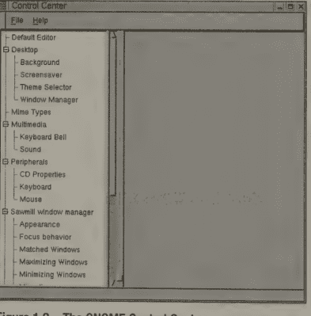

图 1.2 GNOME 控制中心。

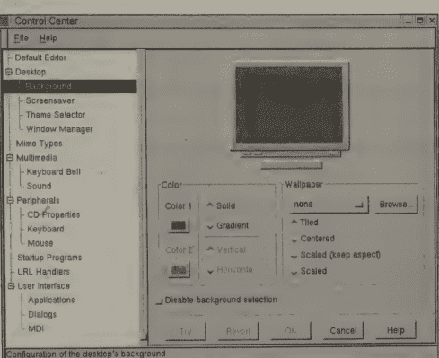

图 1.3 GNOME 控制中心背景配置选项。

9. 如果设置可以接受，点击“确定”关闭对话框或继续到下一个控制中心选项。否则，点击“恢复”以返回到以前的设置。

| 相关解决方案： | 所在页码： |
|---|---|
| 在线查找图形界面组件 | 162 |
| 添加窗口管理器 | 162 |
| 添加主题 | 164 |
| 更换桌面环境 | 167 |

## 打开程序

要打开用于 GNOME 图形界面的文件系统导航器，请执行以下操作：

1. 启动机器。
2. 登录到包含你想配置的图形界面设置的账户。
3. 如果 Linux 系统没有自动进入图形界面，请键入“startx”来启动它。
4. 查看屏幕底部的任务栏，找到图 1.1 中先前显示的足迹图标。
5. 点击足迹图标以调出如图 1.4 所示的 GNOME 菜单。

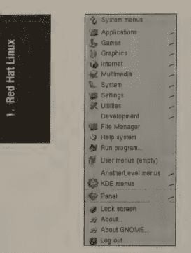

图 1.4 GNOME 主菜单。


6. 将鼠标指针移动到菜单中的各个选项上。如果有子菜单，则将鼠标移动到它上面。继续这样做，直到找到你要打开的项目。

7. 点击你要打开的项目。

| 相关解决方案： | 见第几页： |
| :--- | :--- |
| 在 `GNOME` 中导航文件系统 | 89 |

### 打开 `Linuxconf`

若要找到你可以用于配置用户账户及 `Linux` 系统其他方面的 `GNOME` `GUI` 工具，请执行以下操作：

1. 启动机器。
2. 登录到包含你要配置的 `GUI` 设置的账户。
3. 如果 `Linux` 系统没有自动进入 `GUI` 模式，请输入`startx`来启动它。
4. 查看屏幕底部的任务栏，并找到前面图 1.1 中显示的脚印图标。
5. 点击脚印图标以调出前面图 1.4 中显示的`GNOME`菜单。
6. 点击系统菜单选项以调出图 1.5 中显示的系统菜单。

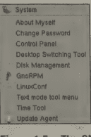

`GNOME`系统菜单。

7. 点击`LinuxConf`系统菜单选项。起初，`Linuxconf`欢迎对话框会打开。阅读该对话框中的信息。
8. 阅读完信息后，点击退出按钮。此时`Linuxconf`工具本身会打开，如图 1.6 所示。

> 注意：有时在点击退出按钮后，需要等待一会儿才会有反应。如果大约一分钟后仍无反应，请再次点击。否则，请耐心一点，等待系统处理完毕。

### 访问帮助

若要访问`GNOME` `GUI`帮助，请执行以下操作：

1. 启动机器。
2. 登录到包含你要配置的`GUI`设置的账户。

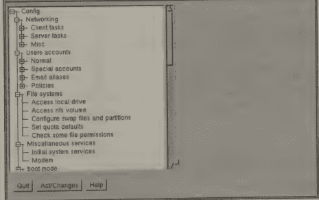

`GNOME` `Linuxconf`系统配置工具。

3. 如果`Linux`系统没有自动进入`GUI`模式，请输入`startx`来启动它。
4. 查看屏幕底部的任务栏，并找到前面图 1.1 中显示的`GNOME`帮助工具图标。
5. 点击帮助工具图标以打开图 1.7 中显示的`GNOME`帮助浏览器。

### 获取命令提示符

若要在`GNOME` `GUI`中获取命令提示符，请执行以下操作：

1. 启动机器。
2. 登录到包含你要配置的`GUI`设置的账户。
3. 如果`Linux`系统没有自动进入`GUI`模式，请输入`startx`来启动它。


图 1.7 `GNOME`帮助浏览器。

4. 查看屏幕底部的任务栏，并找到前面图 1.1 中显示终端仿真程序图标。
5. 点击终端仿真图标以打开一个终端窗口，如图 1.8 所示。


图 1.8 `GNOME`初始终端窗口。

## 在 `KDE` 中导航

如果在安装过程中选择了`KDE` `GUI`，登录后你会看到一个干净的屏幕，底部有一组图标，如图 1.9 所示。

> **注意：** 用户会话中的`KDE`选项与超级用户会话中的不同，因为用户会话中无法使用系统控制选项。

### 配置 `GUI`

若要配置`KDE` `GUI`，请执行以下操作：

1. 启动机器。
2. 登录到包含你要配置的`GUI`设置的账户。
3. 如果`Linux`系统没有自动进入`GUI`模式，请输入`startx`来启动它。
4. 查看屏幕底部的任务栏，并找到图 1.9 中显示的`KDE`控制中心图标。


图 1.9 超级用户账户的初始`KDE`屏幕。

5. 点击`KDE`控制中心图标以打开图 1.10 中显示的`KDE`控制中心。
6. 点击你要展开的菜单组旁边的加号（`+`）。
7. 点击你要配置的`KDE`方面的菜单项。例如，查看应用程序菜单下的登录管理器，如图 1.11 所示。
8. 根据你的要求配置该方面。
9. `KDE`控制中心底部的按钮几乎总是相同的，只有菜单项之间的细微差别。点击应用按钮可立即使更改生效，或者在配置会话结束时点击确定以应用所有更改。
10. 点击`文件|退出`以关闭`KDE`控制中心。

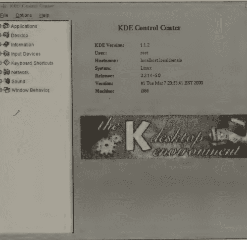

图 1.10 `KDE`控制中心。

| 相关解决方案： | 见第几页： |
| :--- | :--- |
| 在线查找`GUI`组件 | 162 |
| 添加窗口管理器 | 162 |
| 添加主题 | 164 |
| 更改桌面环境 | 167 |

### 打开程序

若要打开用于`KDE` `GUI`的文件系统导航器，请执行以下操作：

1. 启动机器。
2. 登录到包含你要配置的`GUI`设置的账户。
3. 如果`Linux`系统没有自动进入`GUI`模式，请输入`startx`来启动它。
4. 查看屏幕底部的任务栏，并找到前面图 1.9 中显示的`K`图标。
5. 点击`K`图标以调出图 1.12 中显示的`KDE`主菜单。

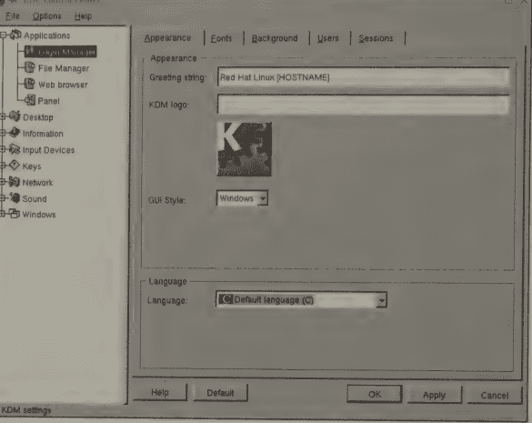

图 1.11 打开了应用程序菜单中登录管理器的`KDE`控制中心。


图 1.12 `KDE`主菜单。

6. 将鼠标指针移动到菜单中的各个选项上。如果有子菜单，则将鼠标移动到它上面。继续这样做，直到找到你要打开的项目。
7. 点击你要打开的项目。

| 相关解决方案： | 见第几页： |
| :--- | :--- |
| 在`KDE`中导航文件系统 | 94 |

### 访问帮助

若要访问`KDE` `GUI`帮助，请执行以下操作：

1. 启动机器。
2. 登录到包含你要配置的`GUI`设置的账户。
3. 如果`Linux`系统没有自动进入`GUI`模式，请输入`startx`来启动它。
4. 查看屏幕底部的任务栏，并找到前面图 1.9 中显示的`KDE`帮助图标。
5. 点击`KDE`帮助图标以打开图 1.13 中显示的`KDE`帮助浏览器。

### 获取命令提示符

若要在`KDE` `GUI`中获取命令提示符，请执行以下操作：

1. 启动机器。
2. 登录到包含你要配置的`GUI`设置的账户。
3. 如果`Linux`系统没有自动进入`GUI`模式，请输入`startx`来启动它。
4. 点击前面图 1.9 中显示的`Konsole`图标，以打开一个`Konsole`会话，如图 1.14 所示。

# 第 1 章 `Red Hat` `Linux`


图 1.13 `KDE`帮助浏览器。


图 1.14 `KDE`中的`Konsole`终端仿真器。

# 第 2 章 用户管理

| 如果你需要立即解决以下问题： | 参见第几页： |
| :--- | :--- |
| 创建`Shell`账户 | 31 |
| 从命令行创建`Shell`账户 | 31 |
| 在`GNOME`中创建`Shell`账户 | 31 |
| 在`KDE`中创建`Shell`账户 | 35 |
| 创建受限访问账户 | 37 |
| 从命令行创建受限访问账户 | 37 |
| 在`GNOME`中创建受限访问账户 | 38 |
| 在`KDE`中创建受限访问账户 | 40 |
| 创建软件账户 | 42 |
| 更改账户创建默认设置 | 42 |
| 更改默认主目录内容 | 42 |
| 在命令行更改用户默认设置 | 44 |
| 在`GNOME`中更改用户默认设置 | 44 |
| 在`KDE`中更改用户默认设置 | 44 |
| 重命名用户 | 46 |
| 从命令行重命名用户 | 46 |
| 在`GNOME`中重命名用户 | 46 |
| 在`KDE`中重命名用户 | 48 |
| 禁用用户 | 49 |
| 从命令行禁用用户 | 49 |
| 在`GNOME`中禁用用户 | 49 |
| 在`KDE`中禁用用户 | 50 |

（续） 21

若需要立即获得以下问题的解决方案：

| 参阅页面： |
| :--- |
| 删除用户 | 50 |
| 在命令行删除用户 | 50 |
| 在`GNOME`中删除用户 | 50 |
| 在`KDE`中删除用户 | 52 |
| 安装用户可运行的软件 | 53 |
| 创建组 | 53 |
| 在命令行创建组 | 53 |
| 在`GNOME`中创建组 | 53 |
| 在`KDE`中创建组 | 54 |
| 将用户添加到组 | 55 |


- 在命令行将用户添加到组 | 55
- 在 GNOME 中将用户添加到组 | 55
- 在 KDE 中将用户添加到组 | 56
- 转发用户邮件 | 57
- 在命令行转发用户邮件 | 57
- 在 GNOME 中转发用户邮件 | 57
- 在 KDE 中转发用户邮件 | 58

## 深入详解

作为系统管理员，你花在用户管理上的时间取决于许多因素，包括用户总数以及你添加或删除账户的频率。这些用户并非都是人类。有些是程序或守护进程——即无需人工值守即可运行以处理特定请求的程序。本章将深入探讨用户账户和用户管理，包括那些最终使系统更加安全的细微之处。

## 用户账户类型

起初，许多人认为 Linux 中只有一种类型的用户账户。这种假设不仅不正确，还导致了许多本可轻松避免的安全漏洞。Linux 中实际上使用了三种主要类型的账户。第一种是`完整用户账户`，或称为`Shell 账户`，这是大多数人提到 Linux 或 Unix 登录账户时想到的类型。第二种是`受限访问账户`，用户仅能访问机器上的特定服务。

另一种账户形式不是供人类用户使用的，而是供需要以自身身份运行的守护进程和其他程序使用的。在 `root` 账户下运行此类程序是危险的，因为这赋予了它们过高的访问权限。最好是为这些程序创建专门的账户，使其拥有恰好满足需求且不多不少的访问和控制权限。这样，如果这些进程被攻破或出现其他问题，它们只能在其自身领域内造成麻烦。

## Shell 账户

完整用户账户是 Linux 中最通用的账户类型。它提供 Shell 登录访问权限，以及用户使用所有被允许运行或打开的资源的能力。这种类型的账户可以通过诸如 `useradd` 等简短命令创建。不幸的是，Shell 访问在某些方面是一个严重的安全漏洞。如果某人能够访问命令行——Shell 正是提供此功能——这便为他们入侵系统省去了一个步骤。拥有 Shell 访问权限后，人们可以查看 `/etc/passwd` 文件的内容，针对你的机器配置专门编译程序，出于恶意目的运行它们，并探索文件系统以寻找权限和所有权结构中的弱点。即使账户所有者没有恶意意图，使用弱密码也会导致该账户被攻破。如果用户只需要访问，例如，POP 电子邮件，创建 Shell 登录便是不必要的风险。

> **提示：** 只有当人们确实需要 Shell 访问权限时，才给他们提供完整用户账户。

## 受限访问账户

对于只需访问特定功能而非完整账户的用户，请为他们创建非 Shell 账户。一些不需要 Shell 访问权限的流行服务包括：

- POP 电子邮件
- Usenet 新闻
- SLIP 或 PPP 拨号接入

如有必要，这些账户随时可以更改为 Shell 账户。现在应该已经很清楚，仅允许访问特定服务的优势在于什么。如果用户只能访问以检查他们的 POP 电子邮件，他们就无法获得命令行来破坏系统。此外，如果某人攻破了该账户——鉴于用户通常更倾向于处理自己的事务而非制造麻烦，这种情况更可能发生——那个人实际上并未获得多少立足点。然而，它确实让入侵者获得了受限账户所提供服务的访问权限。例如，有人乱搞你的 POP 邮件可不是什么好玩的事，尤其是当其中有他们可以获得的关键信息时。

强密码对于受限账户和 Shell 账户同样重要。但是，对于受限账户，被入侵的“可能性”可能更多由用户而非服务提供商感受到。注意“可能性”一词。如果某人成功破解了 PPP 账户的密码，那么服务提供商的资源将被该入侵者的流量和拨号使用所占用。

## 程序和守护进程

某些程序和守护进程实际上需要它们自己的用户 ID。程序或守护进程以其所有者用户的身份运行，因此如果项目以 `root` 身份运行，它就拥有 `root` 的所有权限。这与人以 `root` 身份运行一样危险。权限过于广泛的有缺陷的程序或守护进程可能会意外损坏文件系统。明智的做法也不给程序读写或执行它们无需查看的区域的权限。除非有人入侵并更改了这些设置，或者由于糟糕的系统管理习惯，你养成了通过放宽权限结构进行“快速修复”的习惯，否则这不会是一个担忧的问题。

人们经常发现例如 `sendmail` 守护进程中的漏洞。没有适当安全补丁的旧版本存在一个漏洞，人们可以利用它来运行程序或访问数据。每个程序或守护进程应尽可能隔离，达到它可以完成工作但不能做其他事情的程度。这也是为什么第 9 章如此强调关注和应用程序提供的安全补丁的原因，每当发现新弱点时都会提供这些补丁。

## useradd 进程分析

当你从命令行添加用户时，除非你编写了自定义的账户创建脚本，否则通常使用 `useradd` 程序来完成。了解该程序在创建新用户账户时具体做了什么，对于自定义创建过程非常重要。

## 将用户添加到 /etc/passwd

所有用户账户都必须输入 `/etc/passwd` 文件。这是包含基本用户认证信息的中心文件，如登录名、用户 ID 代码和密码，以及定义谁在使用账户的其他项目。`/etc/passwd` 中的一行分解如下：

```
loginname:password:UID:GID:FullName:homedir:shell
```

例如，用户 "dog" 被添加为用户 520 和组 520，其条目可能如下所示：

```
dog:$1$mI8tHPvG$4Ph:Canis Lupus Familiarus:/home/dog:/bin/bash
```

## 密码条目

示例中的密码看起来像乱码——在你的系统中也是如此。这是因为密码以加密格式存储。不幸的是，使用适当的工具，这种加密并不太难破解。`/etc/passwd` 文件必须对所有程序开放访问权限；因此，它是全局可读的。如果你使用影子密码（关于此主题的更多信息见第 9 章），密码将只是一个 "x"。

| 相关解决方案： | 发现于页面： |
| :--- | :--- |
| 激活和停用影子套件 | 264 |
| 设置密码规则 | 285 |

## 用户和组 ID

UID 和 GID 通常是不透明的，并由账户创建程序按顺序自动分配。因此，在 "dog" 之后添加的用户将具有 UID 和 GID 521。使用相同用户名和组名及数字（用户 “dog”，组 “dog”，UID 520，GID 520）的做法特定于基于 Red Hat 的发行版。大多数 Linux 发行版将所有用户分配到 “user” 组中。

> **提示：** 在 Red Hat 中，用户账户的 UID 和 GID 编号从 500 开始，并从此递增——上限大约在 65,000 左右。

## 主目录

主目录条目的值取决于你正在添加的用户和账户类型。Shell 账户用户的主目录是 `/home/loginname`，除非你更改了新用户的默认设置。处理程序或守护进程时，主目录是该程序或守护进程的存储位置——例如，`shutdown` 程序存储在 `/sbin` 目录中，因此那是它的主目录。

## Shell 条目

Shell 是用户工作的环境，它提供命令行接口——关于 Linux Shell 的更多信息见第 23 章。有多种可用的 Shell，每个都有自己独特的语言和命令。Linux 中的默认 Shell 通常是 `/bin/bash`。然而，在处理受限访问账户时，Shell 应设置为 `/bin/false`。这种做法防止用户实际登录到命令提示符，因为 `/bin/false` 根本不是 Shell。它是一个运行非常短暂然后结束的程序，从不提供 Shell 访问。其整个目的是不为受限访问账户提供命令提示符。

程序的 Shell 设置是该程序本身完整路径——例如，`shutdown` 程序的 Shell 列表将是 `/sbin/shutdown`。

## 将用户添加到 /etc/group

Red Hat Linux 发行版与许多其他发行版不同，它在 `useradd` 过程中为每个用户创建一个特殊组。这个新组与用户本身具有相同的名称和 ID。`/etc/group` 中的一行分解如下：

```
groupname:grouppassword:GID:loginname(s)
```

例如，在 Red Hat 中，用户 “dog” 将在 `/etc/group` 中显示为：

```
dog:at3B3ad2bWEK2de:520:
```

> **注意：** “特殊”和“私有”这两个术语都用于指代 Red Hat 为每个用户创建单独组的独特策略。

## 密码输入

并非所有组都需要设置密码。密码是为那些可能尝试使用 `chgrp` 命令切换到非默认组的用户准备的。对于任何不应允许在未进行身份验证的情况下切换的组，都应设置密码。与 `/etc/shadow` 文件一样，`/etc/group` 中列出的密码是经过加密的。如果你正在使用 shadow 套件，那么此密码将只是一个“x”，真正的密码存储在 `/etc/gshadow` 中。有关 shadow 套件的更多信息，请参阅第 20 章。

| 相关解决方案： | 所在页码： |
| :--- | :--- |
| 启用和禁用 Shadow 套件 | 264 |

## UID 列表


请注意，示例`/etc/group`列表中的`UID`部分是空白的。在`/etc/passwd`中明确分配给某个组的用户，无需在`/etc/group`中再次进行分配。然而，`/etc/passwd`仅允许将用户分配到单一组。如果你希望将用户添加到其他额外组，必须在`/etc/group`中操作。

若要向一个组添加多个用户，请使用格式`user1,user2,user3`，以此类推。

## 创建用户主目录

`useradd`程序还会为用户创建主目录。默认情况下，该主目录创建于`/home/loginname`。一旦创建此目录，就会设置适当的权限和所有权。Shell用户主目录的权限为`rwx------`，因此只有目录所有者才能访问该目录——`rwx------`仅授予目录所有者访问权限，除了`root`之外，任何人都无法进入（权限在第3章中详细讨论）。在Red Hat Linux默认的`useradd`设置中，用户和组的所有权都设置为相同的值——即相同的用户名和组名。例如，当列出用户`dog`的主目录时，列表可能如图2.1所示。

## 设置用户的默认文件

最后，`useradd`程序会访问存储在`/etc/skel`目录中的骨架用户目录。该目录内包含需要放入新用户目录的登录设置和脚本。所有文件都尽可能通用，使用如`$HOME`这样的环境变量来指代主目录，而不是使用绝对路径。（环境变量和Shell脚本在第20章中介绍——届时这些文件会更容易理解。）骨架目录中的所有内容都会放入每个新Shell账户的主目录中。

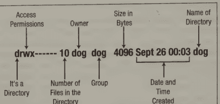

图2.1用户`dog`的主目录在`home`层次结构中的长格式列表。

## `userdel`过程分析

当你使用命令行程序`userdel`删除用户账户时，理解该程序执行和不执行的操作非常重要。它为你处理了用户移除过程的大部分工作，但并非全部。如果你希望从系统中完全移除一个用户账户，你需要做一些额外的工作。

### 从文件中移除用户条目

首先，`userdel`程序从用户管理文件中移除用户账户。此操作阻止用户登录，并阻止任何人切换到该用户的个人组。为了完成此任务，`userdel`程序打开`/etc/passwd`文件并删除其中的用户条目，然后打开`/etc/shadow`文件（如果它存在），并从中删除条目（关于`shadow`套件的更多信息见第9章）。然后账户移除工具在`/etc/group`中执行相同操作，移除用户的个人组，并将该账户从其他组中移除。（如果你正在使用`shadow`组，该程序还会进入`/etc/gshadow`（关于`shadow`组的更多信息见第9章）。

### 移除文件

一旦从用户管理文件中移除了用户条目，`userdel`就会转向账户的主目录并将其删除。然而，这就是它删除的全部内容。用户可能在其他位置安装了程序或文件。项目可能存在于`/tmp`目录、`/usr/sbin`，或用户可能拥有访问权限的其他位置，例如存放邮件spool的`/var/spool/mail`（关于电子邮件的更多信息见第12章）。请参见“即时解决方案”部分中的“移除用户”一节，了解如何确保遗留文件未被遗留。

## 组的巧妙用途

许多人似乎完全忘记了组的存在。这很可惜。使用组有许多方面，可以使系统管理员的工作更轻松，并使文件系统更安全。

### 组存储

用户组的一个良好用途是为项目团队创建组。这些团队的每个成员通常需要访问相同的一组材料，如项目指南、数据和文档。在文件系统中为团队文件创建单独的分区或区域，可以减少用户目录之间符号链接的过度使用。

此外，借助诸如网络文件系统（`NFS`）和`Samba`等工具，组文件存储区域可以设置为网络可访问。

| 相关解决方案： | 所在页码： |
| :--- | :--- |
| 设置`NFS`导出 | 505 |
| 使用`NFS`挂载远程文件系统 | 505 |
| 构建文件共享语句 | 541 |
| 在`Linux`下挂载`Windows`共享 | 546 |

### 组访问

有时，创造性地利用组更多是出于访问分散的程序或常规文件系统中特殊区域的需要，而不仅仅是将用户分组。例如，会计部门可能需要访问其公司主服务器上的特定程序。还可以使用此功能设置管理访问级别。例如，你可以创建一个名为`webmaster`的访问级别，该级别低于`root`，但可以访问`FTP`区域或`HTML`存储区域。为了授予此访问权限，你需要进入该组应有权访问的每个层次结构，查看分配给它们的组。然后，在`/etc/group`中，你需要做两件事：首先，创建`webmaster`组并将需要此访问权限的用户置于该组下。然后，可以将`webmaster`添加到已拥有该位置访问权限的组中。

### 组隔离

作为使用组的其他方法的反向操作，你也可以利用组来将特定人员排除在外。有时，系统中的大多数人应该能够访问某些程序或文件，但实习生或未达到特定安全或信任许可级别的人不应看到它们。实现这一点的一种方法是创建一个包含不应拥有这些文件访问权限的人员的组——例如，`untrusted`。然后，创建一个其组所有权为该组的目录。设置权限，使所有者和“其他”（`world`）有访问权限，但组本身没有。这些权限可能看起来像`rwx--rwx`。

## 创建Shell账户

有多种可用的工具允许你快速创建Shell账户。实际上，每种界面都有一个工具：一个命令行程序、一个`GNU`网络对象模型环境（`GNOME`）工具和一个`K`桌面环境（`KDE`）工具。

### 从命令行创建Shell账户

执行以下步骤以从命令行创建新的Shell账户：

1. 以`root`身份登录。
2. 输入`useradd *loginname*`。例如，要添加`dog`账户，输入`useradd dog`。
3. 在用户能够登录之前，你必须分配一个密码。为此，输入`passwd loginname`。
4. 在提示符处，输入用户的初始密码。这是一个临时密码，最好通过电话告诉用户。用户将在首次登录后被要求更改它。请注意，在输入时你看不到密码。你甚至看不到输入的字符数。
5. 此时会提示你重新输入密码以确保没有拼写错误。再次输入密码。整个密码添加过程可能如下所示：

```
[root@den /root]# passwd dog
Changing password for user dog
New UNIX password:
Retype new UNIX password:
passwd: all authentication tokens updated successfully
```

*注意：* 在`Red Hat`中，你可以使用`adduser`代替`useradd`。这并非在所有`Linux`发行版中都成立。

### 在`GNOME`中创建Shell账户

执行以下步骤以在`GNOME`中创建新的Shell账户：

1. 如果`GNOME`尚未启动，请在命令行输入`startx`或`init 5`来启动它。
2. 以`root`身份登录。
3. 点击`GNOME`足迹图标以打开主菜单。
4. 点击`System`菜单。
5. 在`System`菜单中点击`Linuxconf`项。`Linuxconf`工具将会打开。
6. 在屏幕左侧的列表中找到`Users Accounts`选项。
7. 点击`Users Accounts/Normal/User Accounts`以调出图2.2中所示的`Users Accounts`选项卡。
8. 点击`Add`按钮以打开图2.3中所示的`User Account Creation`选项卡。
9. 唯一必须填写的字段是第一个字段，即`Login Name`。在此处填写用户的账户名称。如果您希望其他设置保持默认值，请跳至第16步。
10. 如果需要，请在`Full Name`字段中为用户账户添加全名或昵称。
11. 如果您希望将该账户分配给一个非默认用户组（默认用户组与用户的登录名相同）的主要组，则在`Group`文本框中输入该组的名称。如果希望使用现有组，还可以使用下拉列表框进行选择。

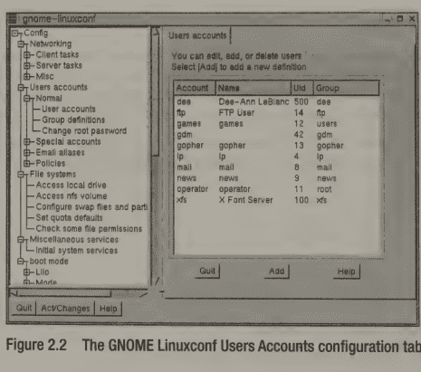

图2.2`GNOME Linuxconf`的`Users Accounts`配置选项卡。

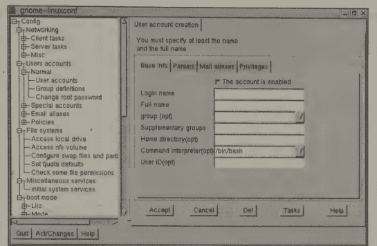

图2.3`GNOME Linuxconf`的`User Account Creation`选项卡。

12. 如果希望用户同时属于其他组（如`/etc/group`中列出的组），请在`Supplementary Groups`字段中输入这些组的名称。
13. 如果不想使用`/home/loginname`作为主目录，请在`Home Directory`字段中输入该目录的路径。


14. 如果不想让账户使用默认的 shell（`bash`），请在“Command Interpreter”字段中输入该 shell 的路径。

15. 如果希望使用特定的 `UID` 而不是下一个顺序号，请将数字输入到“User ID”字段中。

16. 点击“Accept”按钮以调出图 2.4 中所示的“Changing Password”选项卡。

17. 在“New UNIX Password”字段中输入用户的默认密码。

18. 点击“Accept”按钮以测试密码的安全性。

19. 如果检测到密码存在安全风险，您将会看到图 2.5 中所示的“Error”选项卡。如果没有，请跳至第 21 步。

20. 点击“Ok”按钮以关闭“Error”选项卡并打开“Changing Password”选项卡。在“Retype New UNIX Password”字段中再次输入密码。不过，我建议选择一个更安全的密码。

> 请记住：密码是系统的第一道防线。

21. 点击“Accept”按钮以完成账户添加过程。

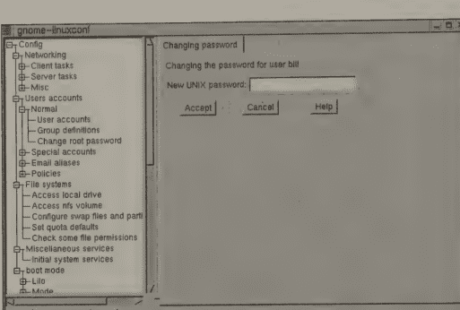

图 2.4 `GNOME` `Linuxconf` 的“Changing Password”选项卡。

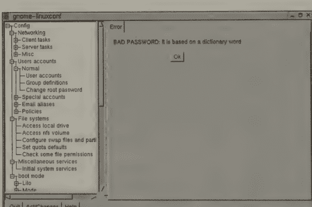

图 2.5 `GNOME` `Linuxconf` 的“Error”选项卡。

**相关解决方案：** 设置密码规则 | **所在页码：** 285

### 在 KDE 中创建 Shell 账户

要在 `KDE` 中创建一个完整的 shell 账户，请执行以下操作：

1. 如果 `KDE` 尚未启动，请在命令行输入`startx`或`init 5`来启动它。

2. 以 `root` 身份登录。

3. 点击 `KDE` 菜单图标。

4. 点击“Utilities/Konsole”以打开终端。

5. 输入`kuser &`并按 Enter 键，打开图 2.6 中所示的 `KDE` 用户管理器。

6. 点击“User/Add”以打开“Enter Username”对话框，如图 2.7 所示。

7. 输入新账户的用户名。

8. 点击“OK”以调出图 2.8 中所示的“User Properties”对话框。

9. 填写您希望分配给用户的各信息字段。

10. 在“Login Shell”下拉列表框中选择一个 shell。标准的 `Linux` shell 是`/bin/bash`。

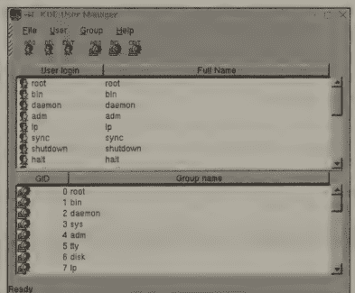

图 2.6 `KDE` 用户管理器对话框。

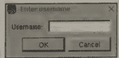

图 2.7 `KDE` 用户管理器“Enter Username”对话框。

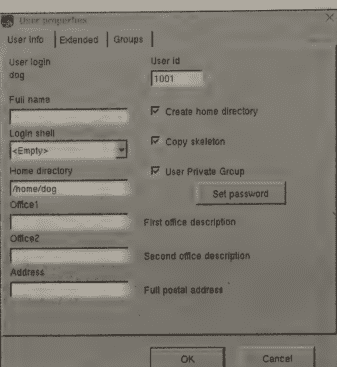

图 2.8 `KDE` 用户管理器中用户“dog”的“User Properties”对话框。

11. 除非您希望该特定用户仅被添加到`/etc/group`中的`users`组，否则请保留默认设置，即勾选“Create Home Directory”、“Copy Skeleton”以及“User Private Group”。

12. 点击“Set Password”按钮以打开“Enter Password”对话框。

13. 点击“OK”以接受密码。

14. 点击“OK”以关闭“User Properties”对话框。

15. 点击“File/Quit”以调出图 2.9 中所示的“Data Was Modified”对话框。

16. 点击“Save”按钮以保存更改并关闭用户管理器。

| **相关解决方案：** | **所在页码：** |
| --- | --- |
| 获取命令提示符 | 19 |


图 2.9 `KDE` 用户管理器“Data Was Modified”对话框。

## 创建受限访问账户

创建受限访问账户可能比添加标准的完整用户 shell 账户更为复杂。图形界面提供了一些工具，但从命令行创建账户是一个相当快速的过程。

### 在命令行创建受限访问账户

要在命令行添加一个受限访问账户，请执行以下操作：

1. 以 `root` 身份登录。

2. 输入`vi /etc/passwd`以打开账户管理文件。

3. 输入`G`以跳转到文件末尾。

4. 输入`o`以在光标下方打开一行，并进入插入模式。

5. 为用户创建一个条目。由于受限访问通常意味着“没有 shell 访问权限”，请务必分配`/bin/false` shell。此外，不要为用户分配主目录。如果文件中的最后一个用户 `UID` 和 `GID` 为 `560`，那么条目可能如下所示：

```
cat::561:561:House Kitty:/dev/null:/bin/false
```

> 提示：在 `Unix` 和 `Linux` 中，位置`/dev/null`代表“丢弃”。

6. 按 Esc 键，然后输入`:wq`以保存并退出文件。

7. 如果您正在使用 `shadow` 套件，请输入`vi /etc/shadow`以编辑 `shadow` 密码文件——如果没有启用该套件，该文件将不存在。您还需要在那里添加一个条目，因为 `shadow` 套件将需要验证用户的程序引导至 `shadow` 文件。有关此文件的更多信息，请参见第 9 章。

> 注意：只有在使用了 `shadow` 套件时才需要编辑`/etc/shadow`。如果未使用套件，该文件将不存在。在本“即时解决方案”之前的所有部分中，处理用户创建工作的程序也为您处理了`/etc/shadow`，因此这方面是透明处理的。

8. 输入`G`以跳转到文件末尾。

9. 输入`o`以在光标下方打开一行，并进入插入模式。

10. 添加一行格式为“loginname:……”的内容：例如，对于前文提到的 `cat` 用户，它将是“cat:……”：

> 注意：这里有八个冒号（:），每个对应`/etc/shadow`的一个字段，如第 9 章所述。

11. 按 Esc 键，然后输入`:wq!`以保存并退出文件。感叹号（!）是必须的，用于覆盖`/etc/shadow`的只读设置。

12. 输入`passwd *loginname*`以添加用户密码。

13. 输入用户的默认密码。请设置一个安全的密码或已选定的密码。用户无法进入 shell 提示符来更改它。

14. 再次输入以检查是否有拼写错误。

15. 如果您想双重确认，输入`tail /etc/passwd`以确认用户条目的密码字段中现在有一个“x”。然后输入`tail /etc/shadow`以确认该用户的所有字段现在都已填写。

> **提示：** `useradd` 命令也有标志，您可以使用它们来创建某些类型的受限访问账户。输入`useradd *loginname* -N -g *opusers* -s */bin/false*`将创建一个无主目录的仅限 `POP` 的账户。

### 在 GNOME 中创建受限访问账户

要在 `GNOME` 中创建受限访问账户，请执行以下操作：

1. 如果 `GNOME` 尚未启动，请在命令行输入`startx`或`init 5`来启动它。

2. 以 `root` 身份登录。

3. 点击 `GNOME` 足迹图标以打开主菜单。

4. 点击“System”菜单。

5. 在“System”菜单中点击“Linuxconf”项。`Linuxconf` 工具将会打开。

6. 在屏幕左侧的列表中找到“Users Accounts”选项。

7. 如有必要，点击“Special Accounts”子菜单旁边的加号以展开它。

8. 点击表 2.1 中列出的菜单项之一。

**表 2.1** *Linuxconf“Special Accounts”子菜单中的选项*。

| 选项 | 用途 |
| --- | --- |
| `POP` | 账户需要访问 `POP` 电子邮件，但不需要 shell。 |
| `PPP` | 账户需要通过服务器使用 `PPP` 的拨入访问，但不需要 shell。 |
| `SLIP` | 账户需要通过服务器使用 `SLIP` 的拨入访问，但不需要 shell。 |
| `UUCP` | 账户需要通过服务器使用 `UUCP` 的拨入访问，但不需要 shell。 |
| Virtual `POP` | 账户需要访问虚拟域的 `POP` 电子邮件，但不需要 shell。 |

## 2. 用户管理

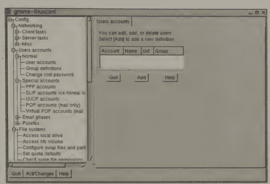

图 2.10 特殊账户子菜单中 `GNOME` `Linuxconf` 的“用户账户”选项卡。

9. 无论您选择哪个选项，您都会看到图 2.10 中所示的“用户账户”选项卡。

> **注意：** 如果您选择虚拟 `POP` 选项且没有虚拟域名，您将收到错误提示。


10. 单击“添加”按钮以调出图 2.11 中所示的“用户账户创建”选项卡——或类似的选项卡；这具体是 POP 选项卡。请注意，该选项卡与图 2.3 中所示的选项卡不同。它是专为受限访问账户设计的。

11. 填写“登录名”字段。

12. 填写其他有具体原因需要填写的字段。

13. 单击“接受”按钮以调出之前图 2.4 中所示的“更改密码”选项卡。

14. 输入用户的密码。请记住，用户无法登录 `shell` 来更改它，因此最好使用用户请求的密码或您分配的密码。务必以安全的方式将密码提供给用户，例如通过电话或普通邮件。

> **注意：** 虽然 POP 客户端通常有更改密码的选项，但其中一些受限访问账户是 SLIP 和 PPP 拨入。更改这些密码并不容易。

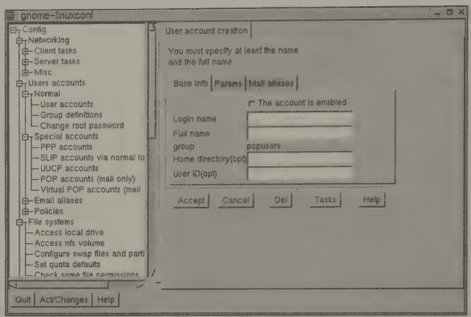

图 2.11 仅 POP 账户的 GNOME Linuxconf 用户账户创建选项卡。

15. 如果检测到密码存在安全风险，您将看到之前图 2.5 中所示的“错误”选项卡。如果没有，请跳至步骤 17。

16. 单击“确定”按钮以关闭“错误”选项卡并打开“更改密码”选项卡。在“重新输入新 UNIX 密码”字段中再次输入密码。不过，我建议为此账户选择一个更安全的密码。

17. 单击“接受”按钮以完成账户添加过程。

| 相关解决方案 | 所在页码 |
| :--- | :--- |
| 设置拨出连接 | 206 |

### 在 KDE 中创建受限访问账户

在 KDE 中创建受限访问账户的过程与创建 `shell` 账户的过程几乎相同。要完成此任务，请执行以下操作：

1. 如果 KDE 尚未启动，请在命令行输入 `startx` 或 `init 5` 来启动它。
2. 以 `root` 身份登录。
3. 单击 KDE 菜单图标。
4. 单击 `Utilities/Konsole` 以打开终端。
5. 输入 `kuser &` 并按 `Enter` 键，以打开之前图 2.6 中所示的 KDE 用户管理器。
6. 单击 `Users/Add` 以打开之前图 2.7 中所示的“输入用户名”对话框。
7. 输入新账户的用户名。
8. 单击 `OK` 以调出之前图 2.8 中所示的“用户属性”对话框。
9. 如果您愿意，请填写“全名”字段。
10. 将“登录 Shell”下拉列表框保留为 `<Empty>`。
11. 取消选中“创建主目录”复选框。
12. 单击“组”选项卡以打开图 2.12 中所示的屏幕。
13. 在“未加入的组”列表框中滚动，并单击与要创建的受限访问账户类型对应的组。通常选择的选项是 `popusers`、`pppusers` 和 `slipusers`。
14. 单击“用户信息”选项卡以返回上一个屏幕。
15. 单击“设置密码”按钮以打开“输入密码”对话框。
16. 单击“确定”以接受密码。
17. 单击“确定”以关闭“用户属性”对话框。
18. 单击 `File/Exit` 以调出之前图 2.9 中所示的“数据已修改”对话框。
19. 单击“保存”按钮以保存更改并关闭用户管理器。

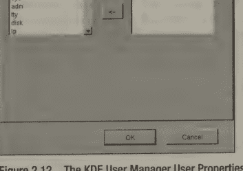

图 2.12 KDE 用户管理器“用户属性”对话框中的“组”选项卡。

为守护进程或程序创建以其自身用户身份运行的账户，基本上与创建其他任何账户都相同。此处不列举逐步操作指南，请参考以下要点并遵循相应的“创建 Shell 账户”章节中的说明：

- 查看现有用户列表，看看该程序是否属于现有的软件用户，例如 `games` 用户。
- 如果该程序不属于现有的软件用户，请为新账户赋予一个有意义的名称，以便您了解其用途。
- 务必为该账户分配一个较低的 `UID`，以确保其与其他软件账户在一起。
- 根据您对组分配的个人偏好，大多数程序会有自己的组，然后可能还会被添加到其他组中。为软件包分配专属组的主要原因是，如果安全受到破坏，它不会获得对其他项目的额外访问权限。
- 程序不会获得用户 `shell`，也不需要登录环境。相反，请在 `shell` 字段中输入该程序的完整路径。

> 注意：您可能无需为新软件创建新的用户账户。如果该程序是以 `RPM`（Red Hat 软件包管理器软件包）或其他具有安装功能的软件包形式提供的，安装程序可能已经为您创建了账户。

## 更改账户创建默认值

可以更改新账户的默认值。这些默认值仅影响在更改后添加的用户。每个界面都有自己用于进行这些更改的工具。然而，如何更改用户默认值取决于您要更改的方面。如果您想更改账户本身的各个方面，请参阅相应的“更改用户默认值”章节。但是，如果您想更改默认放置到用户主目录中的文件，请参阅“更改默认主目录内容”章节。

### 更改默认主目录内容

要更改为新创建的账户创建的初始主目录的内容，请执行以下操作：

1. 以 `root` 身份进入命令提示符，可以通过 `GUI` 或虚拟终端进行。
2. 切换到 `/etc/skel` 目录。
3. 输入 `ls -la` 以列出所有文件，包括隐藏文件。列出的文件取决于您在安装过程中选择的项，包括您选择的桌面环境。
4. 输入 `more filename` 以查看每个文件的内容。您可能会找到的每个文件的用途如表 2.2 所示。
5. 输入 `vi filename` 以编辑其中任意一个文件。
6. 按您的满意度修改内容。请确保您更改的任何内容都是您希望影响在此更改之后添加的所有新用户的内容。
7. 输入 `:wq` 以保存并退出文件。

| 相关解决方案 | 所在页码 |
| :--- | :--- |
| 在 vi 中操作 | 578 |
| 在 vi 中过滤文本 | 579 |

#### 表 2.2 骨架用户目录中的文件。

| 文件 | 用途 |
| :--- | :--- |
| `Desktop` | 此目录包含在 GUI 会话期间，最终将构成单个用户桌面（工作区）配置信息的骨架。 |
| `.bash_logout` | 此文件在您注销时执行命令。默认情况下，它会清除屏幕，以便登录提示符成为等待下一个登录会话的唯一内容。 |
| `.bash_profile` | 每次用户登录时，都会查看 `/etc/profile` 文件以确定在登录过程中要设置的环境变量和要运行的程序。之后，登录过程会查看用户主目录内这个用户配置的文件。此文件可以包含额外的项，甚至反转或更改在 `/etc/profile` 文件中执行的操作。在此文件中设置的项可以更改已在 `/etc/profile` 中设置的项。 |
| `.bashrc` | 每次用户登录时，都会查看文件 `/etc/bashrc` 以确定在该登录过程中要设置的功能和别名。之后，登录过程会查看用户主目录内这个用户配置的文件，该文件可以包含额外的功能和别名，并且可以覆盖 `/etc/bashrc` 文件。在此文件中设置的项可以更改已在 `/etc/bashrc` 中设置的项。 |
| `.kde` | 此目录包含最终将构成单个用户 KDE 配置信息的骨架。 |
| `.kderc` | 此文件仅在安装 GUI 时存在。它是该用户的特定 KDE 配置文件。 |
| `.screenrc` | 此文件包含 Screen 窗口管理器的自定义信息。 |

# 在命令行中更改用户默认设置

如果想在命令行中更改账户创建的默认设置，请执行以下操作：

1. 以 `root` 身份登录。
2. 输入 `useradd -D` 以显示当前默认值。
3. 确定要更改哪些默认值。可用选项列于表 2.3 中。
4. 以 `useradd -D` 开头构建语句，然后添加每个要更改的项目。例如：
   `useradd -D -g users -s /bin/ksh`
5. 再次输入 `useradd -D` 以验证默认值现在是否正确。

## 在 GNOME 中更改用户默认设置

GNOME 中没有特定的方法来更改用户默认设置。相反，请打开一个终端窗口，并在命令行中进行更改。

| 相关解决方案： | 在页面中查找： |
| :--- | :--- |
| 获取命令提示符 | 14 |

## 在 KDE 中更改用户默认设置

要在 KDE 中更改用户默认设置，请执行以下操作：

1. 如果 KDE 尚未启动，请在命令行中输入 `startx` 或 `init 5` 来启动它。
2. 以 `root` 身份登录。
3. 点击 KDE 菜单图标。
4. 点击 `Utilities/Konsole` 以打开终端。
5. 输入 `kuser &` 并按 `Enter` 键，打开前文图 2.6 中显示的 KDE 用户管理器。
6. 点击 `File/Preferences` 以调出图 2.13 中显示的“编辑默认值”对话框。
7. 如果要更改默认 `shell`，请从 Shell 下拉列表框中选择一个。
8. 如果要更改新主目录的位置，请更改“主目录基础”文本框中的条目。此框中列出的目录将是顶级主目录，所有用户主目录都将在此目录内创建。
9. 如果不想自动创建用户主目录，请取消选中“Create Home Dir”复选框。如果你几乎总是创建非 shell 账户，可能需要这样做。


- 10. 如果由于某种原因你想要创建主目录，但不希望将骨架目录中的项目放入其中，请确保取消选中 `Copy Skeleton To Home Dir` 复选框。

- 11. 如果不使用 `Red Hat` 的默认设置（即为每个用户创建一个新组），请确保取消选中 `User Private Group` 复选框。

- 12. 完成更改后，点击 `OK` 按钮。

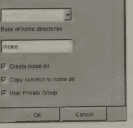

图 2.13 KDE 用户管理器“编辑默认值”对话框。

## 重命名用户

重命名用户账户可能涉及更改 `/etc/passwd`、`/etc/shadow` 和 `/etc/group` 中用户的名称。此外，必须移动重命名账户的主目录（除非你有理由保留原位置）。

### 在命令行中重命名用户

要在命令行中重命名用户账户，请执行以下操作：

- 1. 以 `root` 身份登录。
- 2. 输入 `usermod -d /home/newname -m -l newname oldname`。

### 在 GNOME 中重命名用户

要在 `GNOME` 中重命名用户账户，请执行以下操作：

- 1. 如果 `GNOME` 尚未启动，请在命令行中输入 `startx` 或 `init 5` 来启动它。
- 2. 以 `root` 身份登录。
- 3. 点击 `GNOME footprint` 图标以打开主菜单。
- 4. 点击 `System Linuxconf`。`Linuxconf` 工具将打开。
- 5. 在屏幕左侧列表中找到“`Users Accounts`”选项。
- 6. 点击“`Users Accounts`”菜单下的“`Normal`”选项。

> **注意：** 仅当你使用 `Red Hat` 的默认设置（即为每个新用户分配一个特殊组），或者在更改其余部分时也想更改组名时，才执行步骤 7 到 12。

- 7. 点击“`Normal`”菜单下的“`Group Definitions`”选项，以调出图 2.14 中显示的“`User Groups`”选项卡。
- 8. 点击分配给你要重命名的账户的特殊组。例如，如果我想将“`dog`”账户更改为“`canid`”，我会点击列表中的 `dog` 组。点击组之一会打开“`Group Specification`”选项卡。
- 9. 在“`Group Specification`”选项卡内选择“`Group Name`”文本框的内容。
- 10. 输入组的新名称。
- 11. 点击 `Accept` 按钮。此操作将你返回到图 2.14 中显示的“`User Groups`”选项卡。
- 12. 点击 `Quit` 按钮以关闭“`User Groups`”选项卡。
- 13. 点击“`Normal`”菜单下的“`User Accounts`”选项，以调出前文图 2.2 中显示的“`Users Accounts`”选项卡。

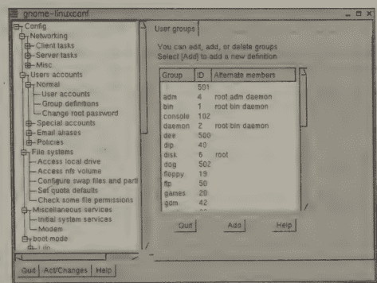

图 2.14 GNOME Linuxconf“User Groups”选项卡。

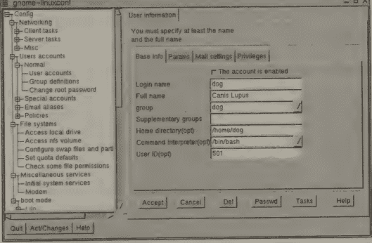

图 2.15 GNOME Linuxconf“User Information”选项卡，显示“dog”用户。

- 14. 单击“`Account`”列表中要更改的项目。此操作会调出图 2.15 中显示的“`User Information`”选项卡。
- 15. 选择“`Login Name`”文本框中的文本。
- 16. 用你想要使用的名称替换当前的登录名。

**注意：** 此时也可以更改文本框中的其他任何项目。

- 17. 用用户名或另一个你想更改账户所属的默认组替换当前的 `Group` 条目。
- 18. 你可能需要替换账户的主目录以匹配其新的用户名。例如，如果你将 `"dog"` 更改为 `"canid"`，则需要将 `"/home/dog"` 更改为 `"/home/canid"`。
- 19. 点击 `Accept` 按钮。此操作可能会打开图 2.16 中显示的“`User Home Directory`”选项卡。
- 20. 如果打开了图 2.16 中显示的对话框，点击 `Yes` 按钮以创建新的主目录。此操作将你返回到“`Users Accounts`”选项卡。

### 在 KDE 中重命名用户

`KDE` 不提供基于 GUI 的重命名用户账户的方法。你需要遵循“在命令行中重命名用户”部分的说明来决定如何操作。

**相关解决方案：**  

获取命令提示符  

**在页面中查找：** 19

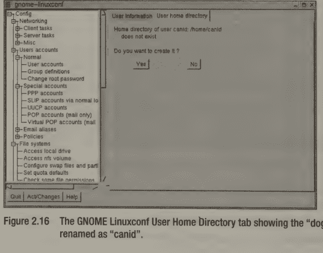

# 禁用用户

禁用用户涉及在不实际删除其账户的情况下移除其对系统的访问权限。这种措施通常用于确保当用户不应访问账户时（例如，当他们在休假或拖欠款项时），账户不会被未被察觉地闯入。

## 在命令行中禁用用户

要在命令行中禁用用户账户，请执行以下操作：

- 1. 以 `root` 身份登录。
- 2. 输入 `vi /etc/passwd`——如果你使用 shadow 密码，则输入 `vi /etc/shadow`——以打开用户管理文件。

> **提示：** 如果 `/etc/passwd` 中所有条目的密码项（第二项）都是 `"x"`，你需要查看 `/etc/shadow`。

- 3. 找到你要禁用的账户的条目。
- 4. 将条目中的第二个字段更改为星号 (`*`)。虽然在此字段中添加几乎任何单个字符都能阻止任何人登录到该账户，但星号对系统有特殊含义。它将账户的密码渲染为无意义的字符字符串。
- 5. 输入 `:wq` 以保存并退出文件。

## 在 GNOME 中禁用用户

要在 `GNOME` 中禁用用户账户，请执行以下操作：

- 1. 如果 `GNOME` 尚未启动，请在命令行中输入 `startx` 或 `init 5` 来启动它。
- 2. 以 `root` 身份登录。
- 3. 点击 `GNOME footprint` 图标以打开主菜单。
- 4. 点击 `System Linuxconf`。`Linuxconf` 工具将打开。
- 5. 在屏幕左侧列表中找到“`Users Accounts`”选项。
- 6. 点击 `Users Accounts | Normal | User Accounts` 以调出前文图 2.2 中显示的“`Users Accounts`”选项卡。
- 7. 单击“`Account`”列表中要更改的项目。此操作会调出前文图 2.15 中显示的“`User Information`”选项卡。
- 8. 点击“`The Account Is Enabled`”复选框以选中它。
- 9. 点击 `Accept` 按钮以激活更改并返回到“`Users Accounts`”选项卡。

表 2.3 使用 useradd 更改账户创建默认值的选项。

| 标志 | 目的 | 有效条目 |
|---|---|---|
| `b` | 更改默认主目录。 | 新主目录层级的路径；当前值 `/home`。 |
| `e` | 更改账户过期的默认日期。 | 格式为 `mm/dd/yy` 的日期。 |
| `f` | 更改密码过期后的默认等待时间。如果超过此等待时间而未更新密码，则禁用账户。 | 等待天数。如果账户应立即过期，输入 `"0"`。如果根本不使用此功能，输入 `"-1"`（默认）。 |
| `g` | 更改新用户被分配到的默认组。 | 现有组名或 `GID`。 |
| `s` | 更改新用户被分配到的默认 shell。 | 已安装 shell 的路径。 |

## 在 KDE 中禁用用户

`KDE` 不提供基于图形用户界面（GUI）的方法来禁用用户账户。您需要按照“在命令行中禁用用户”章节中的说明进行操作。

| 相关解决方案 | 所在页面 |
| :--- | :--- |
| 获取命令提示符 | 19 |

## 删除用户

完全删除用户不仅涉及删除其账户和移除主目录，还包括查找可能位于主目录之外的、由该用户拥有的任何文件。

### 在命令行中删除用户

要在命令行中删除用户，请执行以下操作：

- 1. 以 `root` 身份登录。
- 2. 输入 `find /* -user username > ~/userfiles`，以查找属于即将删除用户的文件，并将列表保存在根主目录中的 `userfiles` 文件中。
- 3. 输入 `userdel -r user` 以删除用户的账户（在适用的情况下，从 `/etc/passwd`、`/etc/group` 和 `/etc/shadow` 文件中删除）以及用户的主目录。

> **提示：** 如果您暂时不想删除主目录，请不要包含 `-r` 标志。

- 4. 检查 `~/userfiles` 文件，确定其中哪些程序和文件可以安全删除，哪些可能与其它用户共享。使用 `rm` 和 `rmdir` 命令删除每个可以安全删除的文件和目录。

> **提示：** 如果您认为某项内容可能被共享但不确定，可以尝试重命名它，看看是否有人注意到它的缺失。这是一种有点蛮力的方法，但它是有效的。

### 在 GNOME 中删除用户

要在 `GNOME` 中删除用户，请执行以下操作：


1. 如果 GNOME 尚未启动，请在命令行中输入 `startx` 或 `init 5` 来启动它。

2. 以 `root` 身份登录。

3. 单击 GNOME 脚印图标以打开主菜单。

4. 单击 系统|Linuxconf。`Linuxconf` 工具将打开。

5. 在屏幕左侧的列表中找到“用户账户”选项。

6. 单击 用户账户|常规|用户账户，以调出前文图 2.2 中所示的用户账户选项卡。

7. 单击账户列表中的单项以进行更改。此操作将调出前文图 2.15 中所示的用户信息选项卡。

8. 单击“删除”按钮以调出删除用户账户选项卡（其版本如图 2.17 所示）。

9. 选择提供的选项之一：
    - 如果您希望保存主目录的内容，请单击“归档账户数据”选项。选择此选项会告诉 Linux 检查目录 `/home/oldaccounts` 是否存在。如果不存在，则创建该目录。包含用户主目录内容的压缩软件包随后将保存到此位置。如果您不确定用户是否正在使用主目录中的任何内容，并且希望在遗失时能够恢复，这是一个安全的选项。
    - 如果您希望移除主目录的内容，请单击“删除账户数据”选项。如果没有用户使用此目录中的任何内容，或者您不希望人们继续使用正在共享的程序，请选择此选项。
    - 如果您希望保留主目录的内容不被触及，请单击“保留账户数据在原处”选项。如果您知道人们正在使用该用户主目录中的数据或程序，请选择此选项。如果您愿意，可以手动删除主目录中的所有其他数据。

10. 单击“接受”按钮以激活更改并返回用户账户选项卡。

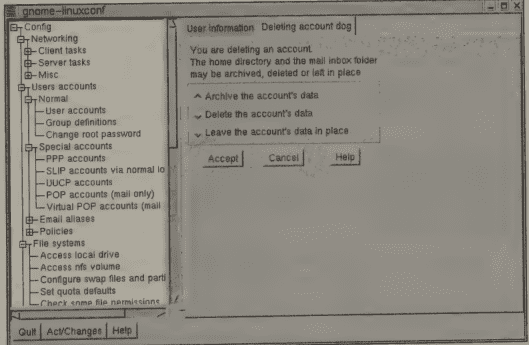

图 2.17 GNOME Linuxconf 删除用户账户选项卡，特别是针对用户“dog”。

### 在 KDE 中删除用户

要在 KDE 中删除用户，请执行以下操作：

1. 如果 KDE 尚未启动，请在命令行中输入 `startx` 或 `init 5` 来启动它。

2. 以 `root` 身份登录。

3. 单击 KDE 菜单图标。

4. 单击 实用工具/Konsole 以打开终端。

5. 输入 `kuser &` 并按下 `Enter` 键以打开前文图 2.6 中所示的 KDE 用户管理器。

6. 单击列表中的要删除的账户。

7. 在用户菜单中选择“删除”以调出图 2.18 中所示的警告对话框，以确认您确实想要删除用户的账户。

8. 单击“删除”按钮以继续删除账户，并调出图 2.19 中所示的警告对话框，以确认您是否想要删除用户的账户的私有用户组（如果存在的话）。

9. 单击“删除”按钮以完成私有组删除。


## 安装用户运行的软件

当准备为用户（甚至为您自己以非超级用户账户使用）安装软件时，需要注意以下几点：

- 用户必须具有运行该程序的权限。因此，不要将其放置在仅 `root` 可访问的位置。
- 不要放宽当前目录的权限以允许用户访问其中包含的程序。就安全目的而言，此举是适得其反的。
- 如果应用程序允许用户写入数据，请仔细配置以确保其安全性。
- 如果应用程序使用某种用户类型层级结构，请确保正确设置。
- 安装该软件包的手册页（在线手册）。

## 创建组

有时创建一个新组来放置用户，而不是使用已存在的组，会很有用。这些组信息进入 `/etc/group` 文件，但本节中讨论的没有任何方法需要您直接编辑该文件。

### 在命令行中创建组

要在命令行中创建新组，请执行以下操作：

1. 以 `root` 身份登录。

2. 输入 `groupadd *groupname*` 以创建新组。

### 在 GNOME 中创建组

要在 GNOME 中创建新组，请执行以下操作：

1. 如果 GNOME 尚未启动，请在命令行中输入 `startx` 或 `init 5` 来启动它。

2. 以 `root` 身份登录。

3. 单击 GNOME 脚印图标以打开主菜单。

4. 单击 系统|Linuxconf。`Linuxconf` 工具将打开。

5. 在屏幕左侧的列表中找到“用户账户”选项。

6. 单击 用户账户|常规|组定义，以调出前文图 2.14 中所示的用户组选项卡。


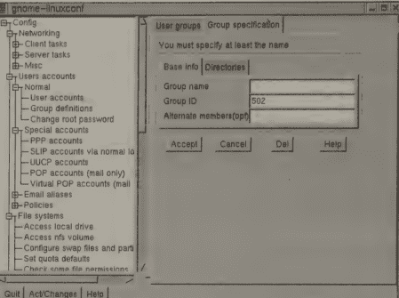

图 2.20 GNOME linuxconf 组规范选项卡。

7. 单击“添加”按钮以调出图 2.20 中所示的组规范选项卡。

8. 在组名称文本框中输入新组的名称。

9. 如果需要，更改组 ID 文本框中的默认 `GID` 设置。

10. 单击“接受”按钮以返回用户组选项卡。

### 在 KDE 中创建组

要在 KDE 中创建新组，请执行以下操作：

1. 如果 KDE 尚未启动，请在命令行中输入 `startx` 或 `init 5` 来启动它。

2. 以 `root` 身份登录。

3. 单击 KDE 菜单图标。

4. 单击 实用工具/Konsole 以打开终端。

5. 输入 `kuser &` 并按下 `Enter` 键以打开前文图 2.6 中所示的 KDE 用户管理器。

6. 单击“组添加”以调出图 2.21 中所示的添加组对话框。

7. 在组名称文本框中输入新组的名称。

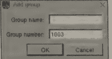

图 2.21 KDE 用户管理器添加组对话框。

8. 如果要更改默认的新 `GID`，请在组编号文本框中输入新的 `GID`。

> 注意：请注意，KDE 用户管理器使用的默认起始 `GID` 与 GNOME `Linuxconf` 不同。

9. 单击“确定”以返回主用户管理器屏幕。

## 将用户添加到组

当您创建用户账户时，该用户会自动被添加到其自己的私有组或 `users` 组中，具体取决于您如何配置默认值。然而，用户同时可以属于多个组。主要组（在 `/etc/passwd` 中列出的组）是用户操作时所依据的组，其名称分配给与该账户创建的任何文件或目录的组所有权。然而，任何次要组都允许用户访问那些组的成员能够到达的额外区域。

### 在命令行中将用户添加到组

要在命令行中将用户添加到现有组，请执行以下操作：

1. 以 `root` 身份登录。

2. 输入 `usermod -G newgroup user`。

> 注意：`newgroup` 必须已经存在。

### 在 GNOME 中将用户添加到组

要在 GNOME 中将用户添加到现有组，请执行以下操作：

1. 如果 GNOME 尚未启动，请在命令行中输入 `startx` 或 `init 5` 来启动它。

2. 以 `root` 身份登录。

3. 单击 GNOME 足迹图标以打开主菜单。

4. 单击 `System|Linuxconf`。`Linuxconf` 工具将打开。

5. 在屏幕左侧的列表中查找“用户账户”（`Users Accounts`）选项。

6. 单击 `Users Accounts|Normal|User Accounts` 以调出之前图 2.2 中显示的“用户账户”选项卡。

7. 在账户列表（`Account list`）中单击一次你想要修改的项目。此操作会调出之前图 2.15 中显示的“用户信息”选项卡。

8. 在“附加组”（`Supplementary Groups`）文本框中，输入你要将用户添加到的现有组名。如果你想输入多个附加组，请将这些词之间用空格分隔。

9. 单击“接受”（`Accept`）按钮，返回到“用户账户”选项卡。

### 在 KDE 中将用户添加到组

要在 KDE 中将用户添加到现有组中，请执行以下操作：

1. 如果 KDE 尚未启动，请在命令行中键入 `startx` 或 `init 5` 来启动它。

2. 以 `root` 身份登录。

3. 单击 KDE 菜单图标。

4. 单击 `Utilities|Konsole` 以打开终端。

5. 键入 `kuser &` 并按 `Enter` 键，以打开之前图 2.6 中显示的 KDE 用户管理器。

6. 单击 `User|Edit` 以调出之前图 2.8 中显示的“用户属性”对话框。

7. 单击“组”（`Groups`）选项卡（参见本章早先的图 2.12）。

8. 要将用户添加到次要组，首先在“未加入的组”（`Groups Not Belonged To`）列表框中单击该组的名称。

9. 现在，单击指向右侧的箭头按钮，以将所选组添加到“已加入的组”（`Groups Belonged To`）列表框中。

10. 如果你还想将用户添加到其他组，请返回步骤 7。否则，请继续执行步骤 11。

11. 单击“确定”（`OK`）按钮，返回到 KDE 用户管理器主屏幕。

# 转发用户邮件


这一部分乍看之下似乎有些格格不入，但实际上并非如此。自动将邮件从一个账户转发到另一个账户，这是可以在邮件服务器中设置的，但这项任务必须由系统或邮件管理员创建邮件别名来完成。一种更快的方法是创建一个特殊的转发文件。

| 相关解决方案： | 所在页码： |
| :--- | :--- |
| 手动设置邮件别名 | 393 |

## 在命令行中转发用户邮件

要在命令行中将用户账户设置为将邮件转发到其他地方，请执行以下操作：

1.  以 `root` 或你要转发邮件的用户身份登录。
2.  键入 `vi ~/.forward` 以创建文件 `~/.forward`，并打开它进行编辑。

> **注意**：波浪号（`~`）指的是当前登录会话的主目录。例如，如果你以 `root` 身份登录——在 Red Hat 中，`root` 的主目录是 `/root`，而不在 `home` 层级中——那么 `~/.forward` 就是 `/root/.forward`。然而，如果你以 `mary` 身份登录，`~/.forward` 就是 `/home/mary/.forward`。

3.  键入 `i` 以进入插入模式。
4.  输入邮件应转发到的电子邮件地址。
5.  按 `Esc` 键，然后键入 `:wq` 以关闭并保存文件。所有到达此账户的邮件都会被转发到你放在 `.forward` 文件中的地址。

## 在 GNOME 中转发用户邮件

要在 GNOME 中将用户账户设置为将邮件转发到其他地方，请执行以下操作：

1.  如果 GNOME 尚未启动，请在命令行中键入 `startx` 或 `init 5` 来启动它。
2.  以 `root` 身份登录。
3.  单击 GNOME 足迹图标以打开主菜单。
4.  单击 `System|Linuxconf` 项。`Linuxconf` 工具将打开。
5.  在屏幕左侧的列表中查找“用户账户”选项。
6.  单击 `Users Accounts|Normal User Accounts` 以调出之前图 2.2 中显示的“用户账户”选项卡。
7.  在账户列表中单击一次你想要修改的项目。此操作会调出之前图 2.15 中显示的“用户信息”选项卡。
8.  单击“邮件设置”（`Mail Settings`）选项卡，如图 2.22 所示。
9.  在“重定向消息到”（`Redirect Messages To`）文本框中，输入你想将邮件转发到的电子邮件地址。
10. 单击“接受”按钮，返回到“用户账户”选项卡。

## 在 KDE 中转发用户邮件

KDE 未提供基于 GUI 的方法来转发用户邮件。你需要按照“在命令行中转发用户邮件”章节中的说明进行操作。

| 相关解决方案： | 所在页码： |
| :--- | :--- |
| 获取命令提示符 | 19 |

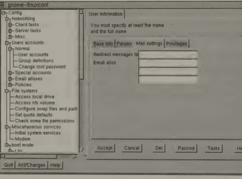

图 2.22 GNOME Linuxconf 用户信息邮件设置选项卡。

# 第 3 章

# 文件系统管理

**如果你需要立即解决以下问题：**

* 创建 Linux 文件系统 76
* 列出 ext2 文件系统设置 77
* 更改权限 77
*  显式更改权限 77
*  相对更改权限 77
* 设置特殊位 78
* 设置 Umask 79
* 更改所有权 79
* 更改组 79
* 检查文件系统错误 79
* 备份和恢复文件系统结构 80
*  备份文件系统结构 80
*  恢复文件系统结构 80
* 备份文件系统 81
* 从备份恢复文件系统 83
* 将文件系统部分移至分区 83
* 向文件系统添加和移除介质 84
*  添加临时介质 84
*  移除临时介质 85
*  添加永久介质 86
*  移除永久介质 88
* 查看当前挂载的内容 89

（续）

| 如果你需要立即解决以下问题： | 参见页码： |
| :--- | :--- |
| 在 GNOME 中导航文件系统 | 89 |
| 在命令行中打开 GNU Midnight Commander | 89 |
| 在 GNOME 会话中打开 GNU Midnight Commander | 90 |
| 在 GNU Midnight Commander 中导航目录 | 90 |
| 在 GNU Midnight Commander 中浏览和打开文件 | 90 |
| 在 KDE 中导航文件系统 | 94 |
| 在命令行中打开 KFM | 94 |
| 在 KFM 中浏览 | 95 |
| 设置磁盘配额 | 95 |
| 准备机器 | 95 |
| 设置配额 | 96 |
| 关机并重启 | 97 |
| 制作自定义启动盘 | 98 |
| 制作救援盘 | 98 |

## 深入探讨

文件系统是组成你 Linux 系统的分区和目录的组合，再加上或减去沿途添加和移除的设备。保持文件系统健康且有序非常重要，否则你会花费更多的时间去搜索文件和程序，而不是实际管理系统。当文件系统最终故障时——这在一台长时间使用的机器上必然会发生——你如何管理这个系统以及为此问题所做的准备，将决定这段经历有多痛苦。

## 硬盘概述

首先，了解本章使用的整体结构和术语非常重要，尽管你应该已经了解安装时分解驱动器以及文件系统移动的基础知识。与其他操作系统一样，Linux 内核及其关联文件存储在硬盘上，硬盘是一个物理单元。在每个硬盘内部有分区，它们在一定程度上充当虚拟硬盘。然后，在每个分区内部，你构建一个文件系统。

## 幕后

Linux 使用 `ext2`（二次扩展）文件系统，这是专为该操作系统创建的。该文件系统并不局限于硬盘，而是放置在你用于存储 Linux 数据的任何介质上。了解文件系统是如何分解的，有助于你在尝试理解文件系统操作命令时提供帮助。

## ext2 中的数据布局

`ext2` 文件系统中的数据存储在一组相同大小的数据块中，如图 3.1 所示。这些块通常为 1,024 字节，尽管在创建文件系统时你可以将它们设置为不同的大小。无论文件是 10 字节还是 1,020 字节，它都占用一个数据块，该块不能用于存储其他内容。那些大于 1,024 字节的文件，无论是 1,025 还是 2,026 字节，都占用两个数据块。由于文件系统的特性是文件不断被添加和删除，这些块可能在物理上相邻，也可能不相邻。


图 3.1 一个具有未映射 ext2 文件系统的设备。

单个数据块在文件系统内被组织成块组。使用块组而不是单个大的块集的主要原因之一是文件系统完整性。如果所有数据块都存在于一个集合中，那么关键区域的损坏将损害所有数据。块组不仅将数据块划分为邻域，还提供了信息韧性和冗余。

## 映射 ext2 文件系统

Linux 必须能够整理哪些数据块包含哪些文件或文件片段。如果数据继续到另一个块，还有关于总共有多少块以及数据块应按什么顺序读取的问题。所有这些包含在一个称为 `inode` 的文件系统对象中，它存储关于文件或对象的以下事实：

*   由 `inode` 定义的对象类型。对象类型为：设备（块或字符）、目录、管道、文件 or 符号链接。
*   该项的权限。
*   该项的所有者和组。
*   该项的大小，以字节列出。
*   该项创建的时间。
*   该项最后更改的时间。
*   指向该项在设备上物理位置的指针。如果该项是占据多个数据块的文件，则会列出所有块的位置以及它们应被访问的顺序。

`inode` 以其所在分区或设备上的唯一数字命名。没有要求特定的 `inode` 必须进入特定的块组。然而，即使其中的信息发生变化，块组始终包含相同的块。图 3.2 展示了 `inode` 如何与文件系统关联的一个示例。

出于映射目的，只有块组 0 的信息很重要。存在这一因素的原因是每个块组都有其他每个块组信息的副本。


只要块组 0 未损坏，一切都没问题。如果它损坏了，文件系统修复程序可以从其他块组中提取数据。

## 超级块

一个特殊的块包含关于整体文件系统的信息，而不是其组件的信息。这段被称为*超级块*，并且你可以使用 `dumpe2fs` 命令查看它。超级块包含的一些数据包括：

*   文件系统中总共有多少个 `inode` 和块。
*   有多少个块未被使用。
*   有多少个 `inode` 未被使用。
*   单个数据块有多大。此值通常为 1,024 字节。
*   一个块组由多少个块组成。
*   文件系统已挂载了多少次。
*   在执行强制文件系统检查之前，文件系统可以挂载多少次。
*   这个超级块的副本存储在哪个块组中。

每个块组都包含超级块的副本，用于冗余目的。与块组数据一样，在健康的文件系统中，只有块组 0 中的超级块副本被使用。

## 理解 Linux 文件系统


作为系统管理员，理解文件系统比普通用户所需的水平要深入得多。用户实际上只需要知道一些基础知识，例如如何添加到他们自己的主目录，而且他们通常并不完全理解权限的细节。如果系统管理员不理解这些事情，整台机器可能会面临安全受损或日常功能受到阻碍的问题。

### 文件系统层次标准

似乎新版本的 `Unix` 变体在不断涌现。不仅新的 `Linux` 发行版定期发布，还有 `FreeBSD` 和许多商业 `Unix` 变体。希望发布能在 `Unix` 及其近亲上运行的软件的公司发现，开发能在各种 `Unix` 变体甚至 `Linux` 变体之间轻松安装的代码变得越来越困难。

对这一问题的第一个回应导致了 `Linux` 文件系统标准 (`FSSTND`) 的诞生，于 1994 年完成。该标准规定了 `Linux` 文件系统中应该存在的目录以及如何使用它们。目标是让开发者能够针对通用的 `Linux` 进行编写，而无需担心软件将放置在哪个发行版上，从而增强 `Linux` 操作系统作为一种市场力量的地位。在某些方面，这一目标已经实现，因为关于许多类型文件应该放在哪里存在普遍共识。然而，在其他方面，情况并非如此。例如，几乎每个发行版都有不同的方式来管理其启动时的网络信息。只要差异保持最小，并且可以通过读取环境变量或查看已知位置来处理，那么目标的精神仍然完好。

> **提示：** 有关 `FSSTND` 的更多信息，请参阅 `www.pathname.com/fhs/1.2/fssstd-toc.html`。

`FSSTND` 的一个自然延伸成果是尝试让开发者更容易将其应用程序针对多个 `Unix` 变体。从这一愿望中诞生了文件系统层次标准 (`FHS`)。该标准旨在服务于更广泛的群体，而不仅仅是 `Linux` 社区。它涵盖了整个 `Unix` 领域，关于特定类型的数据和二进制文件应该在任何 `Unix` 文件系统上位于哪里。表 3.1 解释了根据 `FHS`，你应该在哪里找到特定类型的文件。

#### 表 3.1 根据 FHS 的 Unix 文件系统布局。

| 位置 | 内容 |
| :--- | :--- |
| `/bin` | 系统基本运行以及系统救援所必需的二进制文件 |
| `/boot` | 在内核接管之前启动机器所需的不变文件 |
| `/dev` | 设备驱动文件 |
| `/etc` | 配置文件，以及仅适用于当前主机的文件 |
| `/home` | 用户主目录 |
| `/lib` | 库、共享库和内核模块 |
| `/mnt` | 你只临时挂载的那些文件系统设备的挂载点 |
| `/opt` | 否则对系统运行非必需的附加软件包 |
| `/root` | 超级用户的主目录 |
| `/sbin` | 用于系统管理目的的二进制文件 |
| `/tmp` | 需要创建临时文件的程序的空间 |
| `/usr` | 包含可在机器间共享的文件的只读层次结构，除了其中包含的 `X` 子目录 |
| `/var` | 经常变化的数据文件。文件系统的这部分对于定期备份很重要，因为它使用频繁且容易磨损。 |

``

**提示：** 有关 `FHS` 的更多信息，请参阅 `www.pathname.com/fhs`。

## 揭示权限的奥秘

文件权限对系统管理员来说至关重要。如果设置错误，它们会破坏你的系统。更糟糕的是，在可以从 `Internet` 访问或拥有大量用户的系统上，对权限的松懈态度在安全方面是危险的。

### 什么是权限

权限控制谁有权对文件系统项目（文件、目录等）进行读取、写入和执行访问。这种控制被分解为用户群体的不同部分，以提供更精细的方法来决定谁可以访问什么。

### 权限是如何分解的

文件系统权限被分解为三组，每组三个位。按顺序，这些组分别指所有者权限、组权限和其他人权限。每组三个位的结构相同，尽管内容可能不同。单个部分都是位，因此要么开要么关。第一位确定此人是否可以读取文件或查看目录，第二位标识此人是否可以写入文件或目录，第三位指定此人是否可以执行该项目。当位开启时，它用相应的字母表示：

- `r` 表示读
- `w` 表示写
- `x` 表示可执行

当关闭时，它是一条破折号。因此，对于一个二进制文件，如果所有者拥有完全访问权限，组中的每个人拥有读取和执行访问权限，而其他所有用户仅拥有读取权限，那么权限将是 `rwxr-xr-`。

### 用数字表示权限

当你想快速进行修改时，必须输入权限集的全部九个字符可能会很麻烦。编写权限的另一种方法是计算每个三位的比特值。

再次将权限分解为三组三个位，并单独考虑这些组。使一个权限位开启会增加该组的值：

- 读权限加四
- 写权限加二
- 执行权限加一

在这个示例中，`rwxr-xr--`，将每个权限集分开来看。第一个集合 `rwx` 是 `4 + 2 + 1`，即 `7`。第二个集合是 `4 + 0 + 1`，即 `5`。第三个是 `4 + 0 + 0`，即 `4`。因此，数字权限被分解为 `754`。

### 掩码与 Umask

文件系统条目的**掩码**与其权限是相同的。这两个术语是等价的。另一个有用的条目是**umask**。该术语指的是在掩码或权限集中未开启的位。

`umask` 是系统管理员的一个极其有用的工具。许多用户不理解权限，因此在家目录中创建文件和目录时从不更改它们。当用户使用较弱的默认权限执行此操作时，该行为可能会导致安全问题。因此，通过将默认 `umask` 设置为更严格的设置来更改默认创建掩码，可以避免许多麻烦。

`rwxr-xr--` 的 `umask` 是 `---w--wx`。这种格式难以处理，因为很难追踪破折号，因此 `umask` 更多时候是用数字来讨论的。实际上，该格式并不完全正确。从技术上讲它是正确的，但由于安全原因，你不能使条目默认可执行。因此，`umask` 设置中永远不会有奇数。所以，示例中的 `umask` 实际上是 `---w--w_`，或 `022`。

### SUID 和 SGID

术语 `SUID`（设置用户 ID）和 `SGID`（设置组 ID）在 `Linux` 手册中被频繁提及，但从未真正讨论过它们的用途。当可执行文件必须能够“作为”特定用户或组成员运行，而不仅仅是属于该用户或组的进程时，会使用这些术语。当你听到或读到有人告诉你“以 `root` 身份运行程序”时，这就是说话者所指的内容。

### 粘滞位

你可能会遇到的另一个奇怪短语是“打开粘滞位”。这个权限位为某些目录提供额外的保护。它的主要用途是针对需要所有人都能访问内容，但任何人都不应能接触他人文件/目录的层次结构。（一些有用的示例包括 `/tmp` 或 `/var/spool/mail` 目录。）如果使用粘滞位，除非该用户是文件列表中的文件所有者、目录的所有者，或者是 `root` 或通过 `su` 从其他登录变为超级用户，否则该用户不能删除、移动或重命名文件。

## 创造性地使用分区

随着你管理的系统或局域网变得更大更复杂，可能会有一天你需要考虑拆分文件系统。这个问题出现的理由有很多。是你自己的独特情况决定了哪些额外的分区真正有助于你的系统或局域网。

### 大量 Shell 账户

在拥有大量账户的网络中，进一步拆分文件系统的 `/home` 部分可能很有用。例如，在 `ISP` 中，你可能有一个挂载为 `/home/users` 的分区，所有付费用户 `shell` 账户都会添加到这里；还有另一个挂载为 `/home/staff` 的分区，所有员工 `shell` 账户都会添加到这里。将这些条目放在单独的分区上，不仅允许你细化对这些区域的访问权限，还让你可以轻松地为用户和管理员设置单独的配额。

### 共享部门数据

在团队协作工作较多的环境中，创建各个团队可以轻松访问其集体数据的独立区域，同时不向公众开放，是很有用的。实现这一任务的一种方法是让每个部门拥有自己的共享数据分区。该分区将对所有部门成员开放访问，这一功能可以使用辅助组来实现。

### 大量小文件

每个分区可用的 `inode` 数量是有限的。也许你有很多小文件，例如软件包的数据文件或临时文件。例如，假设有一天你查看了分区剩余的 `inode`，发现所剩无几，但你却有很多空闲空间。你可能需要为这批小文件分配一个独立的分区，以免它们阻碍文件系统的其余部分正常工作。

> **注意：** 尽管许多习惯 `MS-DOS` 或 `Windows` 世界的用户可能会考虑在这种情况下对分区进行磁盘碎片整理，但 `Linux` 没有磁盘碎片整理工具。没有这样的工具是因为磁盘碎片在 `ext2` 文件系统中不会引起显著问题。

### 保护你的数据

最终每个人都会遇到这种情况。当你启动计算机或访问文件时，发现文件系统已损坏。有时你很幸运，只有 `/tmp` 目录出了问题。其他时候，重要区域会被破坏。决定这个问题是轻微麻烦还是灾难的因素在于你是否有最近且可靠的数据备份。

### 备份方案简介

你可以使用多种备份方案。备份方案指的是你的备份方法。有一些问题会影响你最终如何确定备份方案。

### 文件系统的一部分

看看文件系统的每个部分重建起来有多容易。小心你如何判断某事是否简单——现在看似简单的事情，在五个月后当你需要修复故障时可能就不再那么轻松了。

如果你有足够大的媒体来容纳整个文件系统，或者可以在多个媒体之间跨接，那么备份整个文件系统是可能的。然而，正如你将在本章“即时解决方案”部分关于增量备份的两个小节中学到的，每次都不需要备份整个文件系统。管理员最常备份的项目包括：


### 包含文件服务器数据的层次结构

- 包含文件服务器数据的层次结构，例如 FTP 或 Web 服务器文件存储区域。
- 包含程序数据的任何特殊目录。
- 包含你无法承受丢失的数据的日志文件，例如 Web 访问数据。
- `/etc` 层次结构，如果你最近配置了许多服务。

### 频率

你进行备份的频率取决于你的具体情况。你不需要以相同的频率备份所有项目。相反，你可以为文件系统的每个重要部分设置单独的备份。

你多久需要备份一次文件系统段的主要指标是数据变化的频率，以及如果发生故障，尚未备份的数据丢失会造成多大的问题。如果由于层次结构的一部分相当静态，且那里的信息不容易重建，一个月之内不会造成太大影响，那么该部分就不需要频繁备份。然而，对于随时且频繁变化的数据——例如主目录和邮件队列——强烈建议进行每日备份。

### 冗余

如果你只保留一套备份媒体，并在每次备份时覆盖媒体，你就忽略了冗余问题。也许一个入侵者潜入并你一周内都没发现。这些每日备份可能包含损坏的文件，而你无法将它们与更旧的备份进行比对。这只是考虑保留冗余备份的一个原因。由于程序错误、用户错误或其他不需要恶意意图的情况，也可能发生其他问题。

### 增量备份方案

通常，备份的目标是在必要时能够用可信副本替换整个系统。这一目标引出了每次备份系统多少的问题。从技术角度来说，每晚进行一次完整备份是好的。不幸的是，这项任务并不现实。

与其每 24 小时进行一次完整备份，许多人使用增量备份方案。该方案的目标是在不进行每日完整备份的情况下，尽可能保持文件系统副本的最新状态。

有些人可能采用的一个增量计划如下：

1. 每天在单个存储媒体上一起进行备份。一个专用的 shell 脚本（有关 shell 脚本的详细信息请参见第 20 章）结合自动提醒，以确保媒体就位且脚本自动在清晨运行，可能备份：
    - 主目录
    - Web 站点
    - 邮件队列
    - 日志文件
2. 每周备份一次定期更改但非每日更改的项目。同样，你会为此目的使用单独的存储媒体，可能标记为 `weekly` 以与其他区分。这个备份会更大，花费的时间比每日备份多。它可能包含：
    - 整个每日备份方案
    - `/etc` 层次结构
    - `/opt` 层次结构，如果你在那里安装应用程序包
    - `/usr/src` 层次结构，如果你经常处理源代码
3. 每月一次，或每两周一次，取决于你的整个系统变化的频率，你可以进行一次完整的文件系统备份。务必标记此媒体，以免将其被更频繁的备份覆盖。

> **注意：** 最后这一步实际上提供了很少的冗余。

## 带冗余的增量备份

如果我们有时间且有意愿，在备份方案中加入某种形式的冗余是明智之举。正如在“备份方案简介”一节中讨论的，采用冗余备份有许多理由——从未能察觉持续数天甚至数周的错误，到入侵者进行了必须回滚的根本性更改等，原因不一而足。

当开始向备份方案添加冗余时，你可能首先注意到需要更多的备份介质。这是因为每次备份时你不再覆盖旧备份，而是保留前几次备份的多个副本。

另一个区别在于提醒方式。冗余备份方案因其本质更加复杂，更难跟踪。因此，建立一套提醒机制至关重要，以便你记得哪一天该放入哪盘磁带。

实现增量冗余备份方案的一种方法称为汉诺塔法：

- 第 1 天——使用新的可重复使用介质进行备份。标记为 `1`。
- 第 2 天——使用新的可重复使用介质进行备份。标记为 `2`。
- 第 3 天——使用 `1` 号介质进行备份。
- 第 4 天——使用新的可重复使用介质进行备份。标记为 `3`。
- 第 5 天——使用 `1` 号介质进行备份。
- 第 6 天——使用 `2` 号介质进行备份。
- 第 7 天——使用 `1` 号介质进行备份。
- 第 8 天——使用新的可重复使用介质进行备份。标记为 `4`。
- 第 9 天——使用 `1` 号介质进行备份。
- 第 10 天——使用 `2` 号介质进行备份。
- 第 11 天——使用 `1` 号介质进行备份。
- 第 12 天——使用 `3` 号介质进行备份。
- 第 13 天——使用 `1` 号介质进行备份。
- 第 14 天——使用 `2` 号介质进行备份。
- 第 15 天——使用 `1` 号介质进行备份。
- 第 16 天——使用新的可重复使用介质进行备份。标记为 `5`。
- 第 17 天——返回到第 1 天。

``

你可能正在疑惑增量部分在哪里发挥作用。事实上，这些备份介质（编号 1 到 5）中的任何一个都不需要进行完整的文件系统备份。当你编写用于辅助此方案的 `cron` 任务和 `shell` 脚本时，请选择哪个介质编号对应文件系统的哪一部分。此外，务必定期将包含完整文件系统的介质从循环中取出，并用其他介质替换它，并标注其制作日期。这就增加了归档功能。

## 备份硬件

你手头可用的备份介质通常决定了你一次能备份多少数据。如果介质存储容量有限或速度缓慢，你倾向于保持备份简短而快速。然而，如果介质速度快或存储容量大，你在选择存入多少信息时会更加自由。

### 高密度 3.5 英寸软盘

由于现代 Linux 系统很容易接近 `800MB` 或更大，很少有人愿意使用存储容量仅为 `1.44MB` 的高密度软盘进行全系统备份。不过，软盘对于较小的备份仍然有用，即使这些备份跨越多张磁盘。`tar` 工具可以将备份分布在多张软盘上（有关使用 `tar` 的更多信息，请参阅第 4 章）。

### LS-120 软盘

许多人已经开始迁移到 LS-120 软盘。部分原因是驱动器具有向后兼容性——它既读取和写入高密度磁盘，也支持 LS-120 磁盘。但主要原因是，一张 LS-120 软盘可以容纳 `120MB` 的数据。在这个存储容量下，全备份仍需使用多张磁盘，但 LS-120 对于部分备份非常方便。

### Zip 磁盘

另一种用于数据存储和备份的流行物品是 Zip 磁盘。这种磁盘格式需要专用硬件，与其他格式不兼容，且有 `100MB` 和 `250MB` 两种存储规格。如果你有大量数据需要备份，请务必购买支持 `250MB` 存储的 Zip 驱动器。

### CD 刻录机

曾经有一段时间，CD 刻录机对于除大型企业以外的任何组织来说都过于昂贵。如今，价格已大幅下降。然而，你需要自问是否愿意使用一种无法重复使用的介质。单张 CD 可容纳 `650MB` 的信息。这对于希望永久保存的数据（例如文档或图形）来说是完美的选择。但作为有效的备份选项，除非你有无限的可写入 CD 来源和无限的存储空间，否则它必须与某种可重写介质搭配使用。

### DVD 刻录机

作为数据存储解决方案，DVD 刻录机在市场上相当新颖，但它们正在追随 CD 刻录机相同的趋势。再次说明，标准可写入 DVD 只能写入一次。DVD 刻录机是另一种适合希望永久保存或至少长期保存的数据的选项。单张 DVD 可容纳多达约 `17GB` 的数据；通常，整个 Linux 文件系统都能在这些空间内完成备份。这种介质可能是出于冗余目的而希望保留的全文件系统备份的良好选择。

### CD 和 DVD 重写器

还有一类可写入的 CD 和 DVD 驱动器及介质被称为 `可重写`。这些是可以多次写入的特殊 CD 和 DVD，需要能够正确操作它们的驱动器。可重写驱动器和介质比可写入版本更昂贵，但许多人认为可重复使用性足以弥补其成本。在讨论数据备份时，这个因素尤为重要，因为这些 CD 和 DVD 可用于临时存储。

可重写 CD 或 DVD 容纳的数据量与可写入版本相同。然而，可重写驱动器和介质两者的成本都显著高于单次写入的对应产品。

### 磁带

目前有非常广泛的磁带备份解决方案可供选择。你选择哪种选项主要取决于你需要备份多少数据，以及购买完成此任务所需硬件（也许还有软件）的预算大小。预算越大，设备速度越快，存储容量也越大，可达 `40GB` 甚至更多。

### 可拆卸机架硬盘

一种正在声名鹊起的备份选项是可拆卸机架硬盘。此解决方案要求你购买一个对接托架，它放置在计算机的硬盘托架内。除了对接托架外，你还需要购买若干可拆卸机匣，用于容纳硬盘。因此，更换硬盘所需做的只是移除一个机匣并插入另一个。使用此解决方案是进行系统全备份的绝佳方式，该备份可以轻松插入以替换故障的文件系统。

> **提示：** 强烈建议一开始就购买多个机匣。这样做可以避免必须从设备中拆下硬盘（如果硬盘受到大量晃动可能导致数据损坏），同时也避免了后期需要新机匣却无法找到与对接托架完全匹配的机匣的问题。

### RAID 备份

RAID（独立磁盘冗余阵列，或有时用“Independent”来解释其中的“T”）是一种被许多 ISP 和企业用于防止数据丢失和服务中断的备份和冗余解决方案。Linux 操作系统既提供硬件版本也提供软件版本，尽管实施时有时需要重新编译内核（有关内核的更多信息，请参阅第 5 章）。

目前有六种初始的 RAID 配置类型，以及其他一些正在使用的类型。表 3.2 概述了这些初始类型及其定义特征。

> **注意：** 利用软件 RAID，即使没有多个驱动器也可以实现 RAID 解决方案。

**表 3.2 RAID 类型及其特征。**

| RAID 级别 | 别名 | 描述与讨论 |
|---|---|---|


| RAID 0 | 无 | 一系列被视为单个大驱动器的物理驱动器。数据分散在所有驱动器上。不适用于备份。未内置冗余或错误保护。 |

| RAID 1 | 磁盘镜像 | 两个包含相同数据的磁盘驱动器，但系统仅将它们视为一个驱动器。如果第一个镜像驱动器崩溃，第二个将接管。但是，如果没有其他备份策略配合，此模式无法防止数据损坏。 |

| RAID 2 | 无 | 一系列被视为单个大驱动器的物理驱动器。数据分散在所有驱动器上，其中包括位于特殊数据段中的错误校正信息。由于现代驱动器会自动保存相同的错误校正信息，此类型已过时。 |

| RAID 3 | 无 | 一系列被视为单个大驱动器的物理驱动器。其中一个驱动器专门存储奇偶校验信息。对于错误恢复关注点来说是个绝佳选择。然而，由于 `RAID 3` 的特性，它不是多用户系统的好选择。 |

| RAID 4 | 无 | 一系列被视为单个大驱动器的物理驱动器。其中一个驱动器专门存储奇偶校验信息。与 `RAID 3` 略有不同，数据块更有可能全部位于一个驱动器上。对于多用户系统的错误恢复来说是绝佳选择。 |

| RAID 5 | 无 | 一系列被视为单个大驱动器的物理驱动器。奇偶校验信息分散在每个驱动器上。对于多用户系统的错误恢复来说是绝佳选择。写入访问速度比 `RAID 4` 快。 |

# 限制用户存储空间

当你拥有大量用户时，磁盘空间问题不可避免地会出现。将 `/home` 层级（或 `/home/users`）放置在自己的分区上可以解决部分此类问题。然而，这样做并不能防止特定用户通过存储文件超出可用空间。配额工具允许你具体管理用户对磁盘空间的访问权限。

## 配额创建过程

在启用配额之前，你需要对 `Linux` 和文件系统做一些设置。这个过程相当快捷；由于现代 `Linux` 内核默认集成了配额支持（这并非总是如此），使得操作变得更容易。准备使用配额主要涉及告知文件系统在哪里使用配额以及要查找哪些类型的配额。完成此过程后，你需要创建配额本身。有关这两项任务的更多详情，请参阅“即时解决方案”部分中的“设置磁盘配额”章节。

## 配额选项

在为某个用户或组创建配额时，需要考虑以下三个选项：

- **软限制**——定义用户可以使用多少磁盘空间。超过此限制的用户会收到超出配额的警告。

- **硬限制**——当用户尝试将超过此值的文件放入其主目录时，指定文件系统已满的错误。

- **宽限期**——定义用户需要花多长时间将文件系统使用量降至软配额标记以下。如果在宽限期内仍超出软配额的账户会自动禁用。与软限制配合使用。

软限制和硬限制协同工作效果很好。一个好的组合是创建一个软限制，警告用户开始清理文件空间，然后设置一个用户无法超越的硬限制，以保护你的文件系统。

## 即时解决方案

### 创建 `Linux` 文件系统

在某些操作系统中，你通过“格式化”设备来准备它以便存储文件。在 `Linux` 中，以及在 `Unix` 系统中，你通常“创建文件系统”。要创建文件系统，请执行以下操作：

1. 选择要在哪个设备上创建文件系统。

2. 确定该设备的标识。例如，第一个 `IDE` 驱动器上的第三个分区是 `/dev/hda3`，或者你可能想使用软盘驱动器，它是 `/dev/fd0`。

3. 选择要使用的文件系统选项。如果你只是格式化软盘，可能希望使用默认值。然而，有些人在格式化分区时有特定的偏好。表 3.3 列出了常用选项。

**表 3.3** 常见的 `mke2fs` 文件系统创建选项。

| 标志 | 用途 | 值 |
| :--- | :--- | :--- |
| `-b` | 指定构成文件系统的块的大小。 | 块的字节大小 |
| `-c` | 单独检查每个块以确保其未损坏。 | 无 |
| `-i` | 指定每个 `inode` 管理的字节数。确定文件系统上 `inode` 的总数。 | 管理的字节数 |
| `-N` | 指定文件系统上应存在多少个 `inode`。 | `inode` 数量 |
| `-m` | 为超级用户保留文件系统的一部分。 | 保留的文件系统百分比；默认值为 `5%` |
| `-q` | 运行时无需将输出发送到 `STDIN`（标准输入）。 | 无 |
| `-v` | 产生详细输出。 | 无 |
| `-F` | 即使设备不是块特殊设备，或者即使它已挂载或以其他方式使用，也继续运行。 | 无 |
| `-L` | 为文件系统分配名称。 | 文件系统标签 |
| `-R` | 设置正在创建的 `RAID` 条带中包含的块数。（仅用于 `RAID` 文件系统。） | 块数量 |
| `-S` | 写入超级块和组信息，不覆盖 `inode`。对于尝试恢复文件系统是一个很好的选项。 | 无 |

4. 确保设备在机器内部，无论是软盘在驱动器中还是新硬盘已安装。

5. 构建命令。通常，它看起来像 `mke2fs flags device`。一个示例可能是 `mke2fs -v /dev/fd0`。

# 列出 `ext2` 文件系统设置

要查看你当前在 `ext2` 文件系统上使用的设置，请使用格式为 `dump2fs device` 的 `dump2fs` 命令。此命令可以提供大量信息，因此最好将其通过 `more` 命令管道传输，例如 `dump2fs /dev/hda1|more`。

# 更改权限

要更改文件系统条目的权限，请使用 `chmod value item`。如何构造值是一个稍微复杂的过程。有两种不同的方法可以更改权限：显式方法和相对方法。

## 显式更改权限

你可以使用数字表示法或直接表示法显式更改权限。有关这两种权限形式如何工作的说明，请参阅“深入探讨”部分中的“揭秘权限”章节，请记住直接版本是你在文件列表中看到的那个。设置新的数字权限的一个示例是 `chmod 644 file`。

## 相对更改权限

使用 `chmod` 更改权限的另一种方法是将其分解为你想要更改的段以及你想做的更改。使用相对方法涉及组合三组不同的运算符，如表 3.4、3.5 和 3.6 中所述。

当组合这三个组件时，它们的顺序是“三段式 动作 结果”。例如，允许文件的所有者执行文件，你会使用 `chmod u+x file`。同样，要从组用户和外部用户中移除写权限，你会使用 `chmod go-w file`。

### 设置特殊位

还有一种特殊方法来设置 `SUID`、`SGID` 和粘滞位。你可以通过显式或相对方法来实现：

- 如果你正在显式设置权限，将特殊位的指定放在开头，因此有四个数字而不是三个。表 3.7 概述了哪个数字指定哪个特殊位。此过程的一个示例是使用 `chmod 1644 file` 将权限设置为 `trw-r-r--`。

- 如果你正在相对设置权限，有特殊的字符用于设置 ID 和粘滞位。这些字符在表 3.7 中概述。此过程的一个示例是使用 `chmod g+s file` 添加 `SGID` 位。

表 3.4 `chmod` 命令的三段式指定字符。

| 字符 | 含义 |
| :--- | :--- |
| `u` | 操作针对用户三段式。 |
| `g` | 操作针对组三段式。 |
| `o` | 操作针对其他用户三段式。 |
| `a` | 操作针对所有三个三段式。 |

表 3.5 `chmod` 命令的动作指定字符。

| 字符 | 含义 |
| :--- | :--- |
| `+` | 将指定的权限添加到指定的三段式。 |
| `-` | 从指定的三段式中移除指定的权限。 |
| `=` | 将指定的三段式更改为恰好给予的权限。 |

表 3.6 `chmod` 命令的结果字符。

| 字符 | 含义 |
| :--- | :--- |
| `r` | 读权限。 |
| `w` | 写权限。 |
| `x` | 可执行权限。 |

表 3.7 用于设置特殊位的字符。

| 类型 | 数字 | 字符 |
| --- | --- | --- |
| 粘滞 | `1` | `t` |
| `SGID` | `2` | `g+s` |
| `SUID` | `4` | `u+s` |

### 设置 `Umask`

要为文件系统条目设置新的 `umask`，你会使用格式 `umask value item`。例如，`umask 026 file`。

## 更改所有权

要更改拥有文件系统中条目的用户，请使用 `chown user item`。命令中的 `user` 部分可以是登录名或 `UID`。

> 提示：通过输入 `chown user.group item`，你可以同时更改所有者和组。

## 更改组

要更改拥有文件系统中条目的组，请使用 `chgrp group item`。命令中的 `group` 部分可以是组名或 `GID`。

> 提示：你还可以使用 `chown` 命令来更改组分配。

## 检查文件系统错误

要检查文件系统错误，请使用格式为 `fsck flags path` 的 `fsck` 命令。可用标志见表 3.8。

此命令通常以格式 `fsck -r /` 使用，它从根目录开始并遍历文件系统。如果你想确保在 `/etc/fstab` 中定义的所有 `Linux` 分区都已检查，你会使用 `fsck -t ext2 -A`。

## 表 3.8 与 `fsck` 命令常用标志。

| 标志 | 用途 |
| :--- | :--- |


| `-r` | 在进行修复之前，先向运行该命令的人确认，而不是自动执行修复。 |

| `-t` | 指示运行该命令的人将指定要检查的唯一文件系统类型。 |

| `-A` | 检查 `/etc/fstab` 中定义的每个文件系统。最好与 `-t` 一起使用，以确保仅检查 `ext2` 文件系统。 |

| `-V` | 以详细模式运行。 |

# 备份和还原文件系统结构

有时，将文件系统的结构与文件系统本身分开备份是值得一做的。如果你不小心更改了文件系统重要部分的权限或所有权，或者某个程序在无意间替你这样做，这些信息将极具价值。没有路线图就想回溯并修复问题并不是一件令人愉快的事情。

## 备份文件系统结构

以下是要备份文件系统结构的方法：

1. 因为你希望包含整个文件系统，所以输入 `cd /` 以进入文件系统的根目录。
2. 输入 `ls -IR > listing` 将文件系统结构保存到文件 `listing` 中。
3. 如果希望，可以通过输入 `gzip listing` 来压缩列表，这将生成一个名为 `listing.gz` 的文件。

提示：这种方法也是大型 Linux FTP 站点能够提供包含其目录列表的文件的原因。它们只是从 FTP 文件系统的顶部开始执行命令，而不是从机器的文件系统开始。

相关解决方案：

| 相关解决方案 | 所在页面 |
| :--- | :--- |
| 创建 Gzipped 文件 | 108 |
| 创建 Z 压缩文件 | 108 |
| 打开或创建 Tarball | 110 |

## 还原文件系统结构

在出现“故障”后还原文件系统的结构并不像只输入一个命令那么简单。但是，有一个简单明了的流程可以遵循：

1. 找到包含文件系统列表的文件，例如 `/listing.gz`。
2. 如有必要，通过输入 `gunzip listing.gz` 解压缩该文件，这将生成文件 `listing`。
3. 从这里开始，有许多方法可以处理这个问题；我将说明其中一种。输入 `less listing` 以显示文件的开头。我选择 `less` 程序而不是 `more` 的原因是，`less` 在找到搜索词时会高亮显示它们。
4. 在文件系统中选择一个逻辑起点。（你应该知道故障发生在哪里。如果没有，你仍然必须有理由开始这个过程。）
5. 确定一段独特的文本进行搜索，这样你就不必翻阅列表。
6. 输入 `/text`，其中 `text` 是搜索词，然后按 `Enter`。
7. 如果该词不匹配你要找的内容，再次输入斜杠 (`/`) 并按 `Enter`。继续此操作，直到找到正确的条目。
8. 在另一个终端或终端窗口中，输入 `ls -l entry` 以列出你试图修复的项目的完整信息。
9. 比较列表文件和当前条目列表之间的信息。分别使用 `chmod`、`chown` 和 `chgrp` 命令来修复任何问题。
10. 返回步骤 4 处理下一个需要修复的项目。

注意：备份文件系统列表的有用程度取决于它的时效性。务必经常备份。

相关解决方案：

| 相关解决方案 | 所在页面 |
| :--- | :--- |
| 创建 Gzipped 文件 | 108 |
| 创建 Z 压缩文件 | 108 |
| 打开或创建 Tarball | 110 |

# 备份文件系统

系统管理员可以做的一件最重要的事情之一是建立某种形式的备份例程。只有当机器上绝对没有你希望保留的文件时，你才应该忽略这个问题。虽然具体细节在这里或那里有所不同，但在创建备份例程时，有一个通用的流程可以遵循：

1. 确定你要备份的信息类型，并创建一个备份方案，如“深入”部分的“保护您的数据”中所述。


2. 在“深入”部分的“备份硬件”的帮助下，确定你要使用哪种介质来存储相关的特定备份段。
3. 你选择的介质决定了创建备份所需的软件。表 3.9 给出了哪些介质需要哪些软件的映射。
4. 加载内核模块或安装该介质所需的驱动程序。
5. 如有必要，安装软件。
6. 如果你使用的是特殊软件，请阅读文档并学习如何使用它。否则，阅读 `tar` 手册页，并参阅第 4 章中关于如何使用 `tar` 软件包的各种提示。
7. 在介质上构建你的存档。
8. 验证存档是否成功。如果你能够从介质中恢复任何文件，你就知道备份成功了。有关如何完成此任务，请参阅“从备份还原文件系统”部分。
9. 清晰地标记备份介质。
10. 将备份介质存放在安全的地方。

## 表 3.9 各种备份介质所需的驱动程序和外部软件。

| 介质 | 驱动程序 | 软件 |
| :--- | :--- | :--- |
| CD 写入器或 CD 重写器 | `cdrecord` 或 `cddaof` | 有很多程序可用于将数据写入 CD。有关更多信息，请参阅 [www.linuxdoc.org/HOWTO/CD-Writing-HOWTO-1.html](www.linuxdoc.org/HOWTO/CD-Writing-HOWTO-1.html) 上的 CD 写入器 HOWTO。 |
| DVD 写入器或 DVD 重写器 | 通用磁盘格式 (UDF) 文件系统驱动程序、硬件驱动程序 | 可以写入 ISO9660 和 UDF 的程序。这项技术目前尚不适合生产使用。请留意你最喜欢的 Linux 新闻站点以获取更多信息。 |
| 软盘 | 无特殊驱动程序 | 无需特殊软件。 |
| LS-120 | `pf` 驱动程序 | 无需特殊软件。 |
| RAID | 内核补丁 | Raidtools 软件。 |
| 可移动机架硬盘 | 无特殊驱动程序，但更换需要特殊设备 | 无需特殊软件。 |
| 磁带机 | `ftape` 驱动程序，大多数发行版中已安装 | 无需特殊软件，但有时拥有它是值得的。 |
| Zip 磁盘 | `ppa` 驱动程序（内核模块） | 无需特殊软件。 |

相关解决方案：

| 相关解决方案 | 所在页面 |
| :--- | :--- |
| 创建 `tar` 文件 | 109 |

## 从备份还原文件系统

还原文件系统，或文件系统的一部分，是一个在很大程度上取决于你所使用软件的流程。以下是从备份还原文件的一般流程：

1. 找到包含你需要还原的数据的介质。
2. 将介质挂载到文件系统上。
3. 确定你要还原介质上多少信息。
4. 确定你的软件（`tar` 或其他软件包）强制你还原多少信息。你可能无法一次处理一个文件或目录。
5. 使用第 4 章中讨论的 `tar` 应用程序，或者你用于创建备份的软件包，以提取所需的文件。
6. 测试文件系统以确保还原成功。
7. 卸载介质。
8. 将介质返回到适当的存储位置。

相关解决方案：

| 相关解决方案 | 所在页面 |
| :--- | :--- |
| 打开 `tar` 文件 | 110 |

## 将文件系统部分移动到分区上

系统需求往往会随时间变化。过了一段时间，你可能会发现希望将文件系统层次结构移动到自己的分区上，而不是留在根分区或另一个分区上。要完成此任务，请执行以下操作：

1. 如有必要，安装新的硬盘。
2. 使用 `fdisk` 等工具创建新分区。
3. 使用 `mv` 命令重命名当前版本的层次结构。例如，`mv /home/old-home`。


4. 使用 `mkdir` 命令创建一个具有原始名称的新目录。例如，`mkdir /home`。
5. 将分区挂载到现在为空的挂载点，即你刚刚创建的新目录。
6. 使用 `cd` 命令进入已移动的层次结构版本。例如，`cd /old-home`。
7. 使用 `cp` 工具，格式为 `cp -rp . newdir`，递归复制文件——连同其所有者、组、权限和时间戳设置——从当前位置到新分区。例如，`cp -rp . /home`。
8. 使用 `cd` 命令切换到新分区。花一点时间确保一切复制得当。尝试运行程序、编辑文件，并大致测试该分区的功能。
9. 一旦你确定传输成功，使用 `rm` 命令删除旧版本，格式为 `rm -r olddir`。例如，`rm -r /old-home`。

警告！在按下 `Enter` 之前，请两遍、三遍甚至四遍地检查你是否正确输入了此命令。没有人希望删除文件系统的错误部分！

10. 参见“添加永久介质”部分，了解如何将此分区添加到 `/etc/fstab`。

## 向文件系统添加和移除介质

根据介质的用途，添加和移除介质有两种不同的方法。临时介质，如软盘和 CD-ROM，通常在短时间内添加和移除。但是，如果你要添加新的分区并希望将其永久作为文件系统的一部分，那么你将使用不同的方法。

### 添加临时介质

要临时向文件系统添加介质，请执行以下操作：

1. 物理上将介质添加到文件系统。此操作可能包括将软盘放入驱动器，将 Zip 磁盘放入 Zip 驱动器，或将 CD-ROM 放入 CD-ROM 光驱。
2. 确定适用于该介质的设备驱动程序。表 3.10 列出了常用驱动程序的路径。


3. 确定该设备上使用的文件系统。表 3.11 列出了 Linux 中与临时介质常用的文件系统格式。

## 表 3.10 文件系统临时媒体设备驱动程序。

| 设备 | 驱动程序 |
| :--- | :--- |
| 第一个软盘 | `/dev/fd0` |
| 第二个软盘 | `/dev/fd1` |
| `CD-ROM` | `/dev/cdrom` |

## 表 3.11 临时媒体上的文件系统格式。

| 格式 | 用于 | 发现于设备 |
| :--- | :--- | :--- |
| `ext2` | Linux | 软盘、硬盘、`Zip` 磁盘、磁带 |
| `iso9660` | 专为 `CD-ROM` 设计 | `CD-ROM` |
| `msdos` | `MS-DOS`、`Windows 3.x`、`Windows 9x`、`Windows 2000` | 软盘、硬盘、`Zip` 磁盘、磁带；若与 `Windows 9x` 或 `2000` 配合使用，通常仅用于软盘 |
| `vfat` | `Windows 95`、`Windows 98`、`Windows 2000` | 软盘、硬盘、`Zip` 磁盘、磁带 |

4. 确定您想要挂载此媒体的位置。通常，它会被添加到文件系统的`mnt`层次结构中。`Red Hat`默认已创建了`mnt/floppy`和`mnt/cdrom`。如果您想将其放在其他位置，请确保该挂载点已经存在。

5. 按照以下格式构建语句：`mount -t fstype device mountpoint`。例如，要挂载一个格式化为`MS-DOS`的软盘到`mnt/floppy`，您应输入`mount -t msdos /dev/fd0 /mnt/floppy`。但是，如果您想添加一个`ext2`格式的设备，您可以省略`-t fstype`部分。

> 提示：`Red Hat`和其他一些发行版提供了进一步的快捷方式。要挂载`CD-ROM`，只需输入`mount /mnt/cdrom`，其余部分会自动处理。对于格式化为 Linux 的软盘也是如此。但是，格式化为`MS-DOS`的磁盘必须使用示例中列出的完整命令进行挂载，除非您创建自己的快捷方式。有关如何执行此操作的信息，请参见“添加永久媒体”部分。

## 移除临时媒体

与添加临时媒体时需要考虑的事项相比，将临时媒体从文件系统中移除所需的考虑要少得多。要完成此任务，请执行以下操作：

1. 确定您要移除项目的挂载点或设备驱动程序。

> **警告！** 在正确卸载媒体之前，切勿从 PC 中物理移除任何临时媒体非常重要。并非所有信息都立即写入磁盘——有些信息会被保存在内存中，直到下一次需要写入时。卸载设备的过程的一部分就是确保这些最后的信息被包含在内。

2. 输入`umount mountpoint`或`umount device`。例如，`umount /dev/fd0`和`umount /mnt/floppy`都可以从第一个软驱中卸载磁盘。

3. 物理移除媒体。

## 添加永久媒体

在日常使用中，您不太可能会频繁地插入或移除硬盘——除非您使用可移动机架驱动器——但有时您可能需要添加一个。当这种情况发生时，请执行以下操作：

1. 记录这是什么类型的设备。例如，它是`SCSI`还是`IDE`硬盘？

2. 将媒体物理添加到系统中。

3. 记录媒体在系统中的位置。例如，它是第三个`SCSI`驱动器，还是第二个`IDE`驱动器？

4. 以`root`身份登录。

5. 输入`cp /etc/fstab /etc/fstab.backup`为主文件系统控制器创建备份。

6. 输入`vi /etc/fstab`以打开主文件系统控制器进行编辑。

7. 输入`G`转到文件末尾。

8. 输入`o`在末尾打开新行。

9. `/etc/fstab`中的一行按以下方式呈现：

```
device  mountpoint  type  options  dump  order
```

确定新的文件系统部分位于哪个设备上。例如，如果您刚刚向`SCSI`链中添加了一个新驱动器，并且它是链上的第三个硬盘，那么它就是`/dev/sdc`。然而，这还不够具体。一旦您在设备上进行分区并创建了文件系统，您将知道要挂载哪个分区。例如，要挂载第三个`SCSI`驱动器上的第二个分区，设备将是`/dev/sdc2`。

10. 永久文件系统段的挂载点通常不在`/mnt`层次结构内。相反，该设备无缝地融入文件系统中。例如，如果您在安装过程中创建了一个`/boot`分区，那么对于执行文件系统列表查看的人来说，该分区看起来就像一个目录。永久挂载项目的挂载点必须在根文件系统上已经存在，您才能挂载该设备。例如，`/boot`目录必须存在于根文件系统中，然后才能将`/boot`分区插入到该位置。

11. 确定您要挂载的文件系统类型。通常，永久挂载设备的文件系统类型是`ext2`。本章前面表 3.11 中列出的选项都可供您使用，并且还有更多选项。

> 提示：输入`man mount`以获取文件系统类型和挂载选项的完整列表。

12. 选择您希望文件系统段挂载时使用的选项。表 3.12 概述了一些常用选项。首先考虑`defaults`选项通常是个好主意。如果您想使用多个选项，请用逗号分隔，中间不留空格。

## 表 3.12 在 /etc/fstab 中常用的挂载选项。

| 选项 | 目的 |
| :--- | :--- |
| `async` | 独立于此文件系统段的所有输入和输出操作。 |
| `auto` | 在启动时自动挂载此文件系统部分。 |
| `defaults` | 包括以下选项：`async`、`auto`、`dev`、`exec`、`nouser`、`rw` 和 `suid`。 |
| `dev` | 利用此文件系统部分上的字符设备和块设备。 |
| `exec` | 包含此文件系统部分上的所有可执行二进制文件。 |
| `noauto` | 不允许此文件系统部分自动挂载。 |
| `nodev` | 忽略此文件系统部分上的字符设备和块设备。 |
| `noexec` | 不允许执行此文件系统部分上的二进制文件。 |
| `nosuid` | 不接受 `SUID` 或 `SGID` 位。 |
| `nouser` | 将非 `root` 用户排除在此文件系统部分的挂载之外。 |
| `ro` | 将文件系统挂载为只读设备。 |
| `rw` | 将文件系统挂载为读写设备。 |
| `suid` | 接受 `SUID` 和 `SGID` 位。 |
| `sync` | 将对此文件系统段的所有输入和输出作为有序的数据流进行。 |
| `user` | 允许非 `root` 用户将设备挂载到文件系统上。如果您希望允许用户访问软盘和 `CD-ROM` 设备，则很有用。包括以下选项：`nodev`、`noexec` 和 `nosuid`。 |


13. `dump`项只能是三种不同的东西：空白条目、零（`0`）或一（`1`）。如果您将最后两个字段（`dump`和`order`）留空，则`/etc/fstab`条目被视为不是文件系统的一部分，因此在这种情况下，您必须填写这两个最后字段。如果您想确保`dump`实用程序备份此文件系统段，则输入`1`。如果没有，则输入`0`。如果您不打算使用`dump`实用程序，您可以使用`0`或`1`。

14. `/etc/fstab`文件系统定义中的最后一个条目是该项在启动时应挂载的顺序。根文件系统总是首先挂载，因此旁边有一个`1`。在此之后，按您希望挂载的顺序依次对选项进行编号。旁边带`0`的任何内容都表示该设备不会自动挂载。如果设备不会自动挂载，您也可以将此字段留空。

15. 填写完整的`/etc/fstab`条目。例如，如果您想将链中的第二个`SCSI`驱动器的第一个也是唯一的分区作为`/Projects`添加到文件系统，使用永久项的默认设置，启用`dump`，并确保它是启动时挂载的第三个设备，请输入该行：

```
/dev/sdb1 /Projects ext2 defaults 1 3
```

16. 按`Esc`键，然后输入`ZZ`以退出并保存文件。

> **注意：** 要实际测试新的`/etc/fstab`文件，您将需要重新启动机器。有关更多信息，请参见本章后面的“关机与重新启动”部分。

## 移除永久媒体

当您需要从系统中移除硬盘或其他永久媒体时，请执行以下操作：

1. 以`root`身份登录。

2. 输入`vi /etc/fstab`以打开文件系统控制器。

3. 使用箭头键移动到定义媒体设备、挂载点及其他信息的行。

> **提示：** “添加永久媒体”部分介绍了如何读取`/etc/fstab`并创建条目。

4. 输入`dd`删除整行。

5. 输入`ZZ`保存并退出文件。

提示：请仔细检查机器是否有启动磁盘以及救援磁盘，以防在尝试恢复系统时出现问题。请参阅本章后面“制作自定义启动磁盘”和“制作救援磁盘”部分。

6. 关闭机器。请参阅本章后面“关机与重启”部分以获取帮助。

7. 从机器中移除介质。


- 8. 开启机器并启动系统。

## 查看当前已挂载的内容

使用不带参数的 `df` 命令可以获取已挂载到文件系统的设备列表——无论是临时挂载还是永久挂载。这也是快速查看这些文件系统已使用多少空间以及剩余多少空间的好方法。

## 在 GNOME 中导航文件系统

GNU Midnight Commander 是 GNU 网络对象模型环境（GNOME）桌面环境提供的一个功能完备的桌面导航工具。由于使用此工具可以进行许多不同的操作，其用法被分为几个类别。

### 在命令行中打开 GNU Midnight Commander

在命令行模式下工作时，若要打开 GNU Midnight Commander，请执行以下操作：

- 1. 输入“`startx`”（在任意账户下）或“`init 5`”（在 `root` 账户下）以进入图形界面。

- 2. 使用您要导航的账户登录到 GNOME。

注意：如果您的会话设置为启动 K 桌面环境（KDE）而非 GNOME，您需要转到 KDE 导航部分或更改正在使用的桌面环境。

- 3. 关闭帮助浏览器，但保留 GNU Midnight Commander 处于打开状态。该窗口的大致外观如图 3.3 所示。

相关解决方案：更改桌面环境，见第 167 页

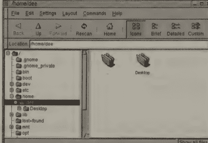

图 3.3 “`dee`” 用户账户下的 GNU Midnight Commander。

### 在 GNOME 会话中打开 GNU Midnight Commander

如果您已经处于 GNOME 图形界面中，请执行以下操作以打开 GNU Midnight Commander：

- 1. 点击脚印图标以打开 GNOME 菜单。

- 2. 点击“文件管理器”菜单选项。GNU Midnight Commander 将如图 3.3 所示打开。

### 在 GNU Midnight Commander 中导航目录

GNU Midnight Commander 的功能与您可能熟悉的其他文件管理器类似。导航主要在屏幕左侧进行。那里列出的每个文件夹都代表一个目录。要导航，请使用以下一个或多个操作的组合：

- 左侧文件夹旁的加号（`+`）表示您可以打开该文件夹查看其内部内容。点击加号可以查看可能存在的子文件夹。

- 点击左侧的文件夹以查看其实际内容，这些内容将显示在右侧。

- 左侧文件夹旁的减号（`-`）表示该文件夹已展开。如果您想关闭该文件夹，请点击减号。

### 在 GNU Midnight Commander 中浏览和打开文件

如前所述，GNU Midnight Commander 的功能与您可能熟悉的其他文件管理器类似。文件浏览和打开主要在屏幕右侧进行。要浏览和打开文件，请执行以下操作：

- 1. 打开 GNU Midnight Commander 并导航到您要查看其文件的目录。

- 2. 选择您想要使用的浏览样式。可用的样式如图 3.4 所示。

从左到右的选项包括：

- `*图标*` 样式——通过点击图 3.4 中显示的“图标”按钮来选择此样式。当您选择此浏览形式时，所有文件都通过与其文件类型相关的图标表示，目录则显示为文件夹，如图 3.5 所示。

- `*简要*` 样式——通过点击图 3.4 中显示的“简要”按钮来选择此样式。当您选择此浏览形式时，目录名称旁带有文件夹图标，文件按文件名列出，如图 3.6 所示。

- `*详细*` 样式——通过点击图 3.4 中显示的“详细”按钮来选择此样式。当您选择此浏览形式时，目录名称旁带有文件夹图标，文件按文件名列出。此外还包括项目的大小和最后修改时间。该格式如图 3.7 所示。


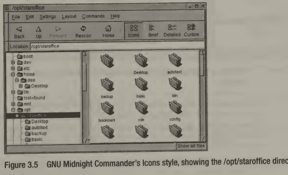

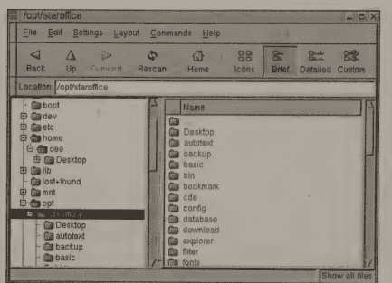

图 3.6 GNU Midnight Commander 的简要样式，显示 `/opt/staroffice` 目录。

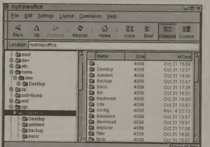

图 3.7 GNU Midnight Commander 的详细样式，显示 `/opt/staroffice` 目录。

- 自定义样式——通过点击图 3.4 中显示的“自定义”按钮来选择此样式。此样式可以随意修改。默认情况下，此选项显示目录名称旁带有文件夹图标，文件按文件名列出。还包括项目的大小和权限，如图 3.8 所示。

- 3. 双击文件或目录以打开它。如果 Midnight Commander 不确定使用哪个程序来打开该文件，它将显示如图 3.9 所示的 `gmc` 对话框。

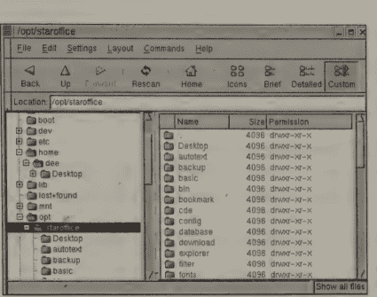

图 3.8 GNU Midnight Commander 的自定义样式，显示 `/opt/staroffice` 目录。

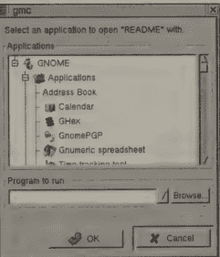

图 3.9 GNU Midnight Commander 的 `gmc` 显示程序对话框。

- 4. 在应用程序列表中点击您想要使用的程序，或者点击“浏览”按钮，通过导航文件系统来选择程序。

- 5. 选择要使用的程序后，点击“确定”按钮。然后，该程序将打开您想要处理的那个文件。

## 在 KDE 中导航文件系统

KDE 文件管理器（KFM）是 KDE 桌面环境提供的一个功能完备的桌面导航工具。由于使用此工具可以进行许多不同的操作，其用法被分为几个类别。

### 在命令行中打开 KFM

若要从命令行打开 KDE 文件管理器，请执行以下操作：

- 1. 输入“`startx`”（在任意账户下）或“`init 5`”（在 `root` 账户下）以进入图形界面。

- 2. 使用您要导航的账户登录到 KDE。

注意：如果您的会话设置为启动 GNOME 而非 KDE，您需要转到 GNOME 导航部分或更改正在使用的桌面环境。

- 3. 点击如图 3.10 所示的“个人目录”图标。此操作将打开 KDE 文件管理器，如图 3.11 所示。


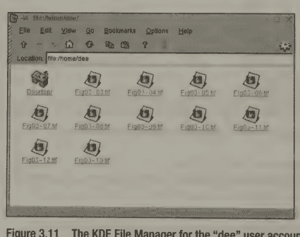

## 在 KFM 中浏览

KFM 的浏览很简单，其工作方式很像 Web 浏览器。要在目录结构中移动，请执行以下操作之一：

- 点击您想要打开的项目，无论是文件夹（目录）还是指向文件的图标。

- 利用位置文本框并输入“`file:path`”以指定您要去的位置。例如，“`file:/usr/sbin`”。

- 点击向上箭头以在目录树中向上移动。

提示：点击“主页”图标可快速返回您的主目录。

## 设置磁盘配额

设置使用配额有两个不同的阶段。在第一个阶段，您配置机器本身以查找配额。在第二个阶段，您分配配额。

## 准备机器

若要配置机器以查找配额信息，请执行以下操作：

- 1. 以 `root` 身份登录。

- 2. 使用 `ed` 命令进入您要强制实施配额的分区的基础目录。您必须按分区逐个创建配额；不能仅针对特定目录应用它们。

- 3. 使用 `touch` 命令创建文件“`quota.user`”和“`quota.group`”。

- 4. 打开文件 `/etc/fstab` 进行编辑。如果您不习惯处理此文件或不熟悉您喜欢的编辑器，请确保先对其进行备份。

- 5. 找到定义您要添加配额的分区的那一行。

- 6. 将光标移动到挂载选项列（第 4 列）。

- 7. 如果您使用的是 `vi`，请按“`i`”进入插入模式。

- 8. 在当前选项末尾添加文本“`usrquota`”以添加用户配额。如果您想按组分配配额，请添加文本“`grpquota`”。您也可以同时添加两者。生成文件的可能示例如下：

```
/dev/hda3   /tmp  ext2  defaults,usrquota,grpquota  1  3
```

注意：如果您不确定是否想要某个选项，请现在先添加它。

- 9. 保存并退出文件。

- 10. 重新启动机器。

## 设置配额

要设置用户和/或组配额，请执行以下操作：

1. 以 `root` 身份登录。

2. 选择要分配的配额类型，用户或组。对于用户配额，输入 “`edquota -u user`”；对于组配额，输入 “`edquota -g group`”。

> **提示：** 如果您将所有用户都放在 "users" 组中会很有帮助，以便在需要为所有用户分配相同配额时可以使用。

此命令会打开一个包含类似以下文本的文件：

```
Quotas for user sally:
/dev/hdb3: blocks in use: 153, limits (soft - 0, hard - 0)
inodes in use: 95, limits (soft - 0, hard - 0)
```


3. 填写您希望为该用户使用的软限制和硬限制，可以是 `inode`（最后一行）或块（中间一行），如果您希望同时限制使用的总空间和使用的 `inode` 总数，则两者都可以填写。如果您不确定这些术语的含义，请参阅 In Depth 部分中的“限制用户存储空间”。此命令使用的编辑器是 `vi`，因此您需要在更改值之前按 “i” 进入插入模式。

4. 完成后，按 `Esc` 键。

5. 输入 “ZZ” 或 “wq” 以保存并退出文件。

6. 输入 “edquota -t” 以设置宽限期。您无法单独设置此期限，必须为整个文件系统设置它。此命令会打开一个包含类似以下文本的文件：

```
Time units may be: days, hours, minutes, or seconds
Grace period before enforcing soft limits for users:
/dev/hdb3: block grace period: 0 days, file grace period: 0 days
```

7. 注意有两个不同的宽限期可供选择。这两个期限对应两种不同类型的配额。如果您只设置了块或 `inode` 配额，请设置相应的宽限期。如果您设置了两种配额，请务必设置两个宽限期。此命令使用的编辑器是 `vi`，因此您需要在更改值之前按 “i” 进入插入模式。

8. 完成后，按 `Esc` 键。

9. 输入 “ZZ” 或 “:wq” 以保存并退出文件。

10. 输入 “quotaon” 以启用配额并开始在此时生效。此命令稍后将在引导脚本中执行。

## 关机与重启

正确关机或重启 `Linux` 机器至关重要。不要直接切断电源或按下重置开关！正确的关机或重启可以确保 `RAM` 中持有的所有信息正确写入磁盘，通常能确保一切井然有序。

通常，`shutdown` 命令用于管理关机和重启，尽管表 3.13 列出了替代选择。此命令功能强大，不仅提供关于机器是准备关机还是仅重启的选择，还涉及何时发生以及应警告用户的消息内容。表 3.14 列出了一组 `shutdown` 选项。

**表 3.13 用于关闭和重启 Linux 机器的替代命令。**

| 命令 | 结果 | 等同于 |
| :--- | :--- | :--- |
| `halt` | 关闭机器。 | `shutdown -h now` |
| `init 0` | 关闭机器。 | `shutdown -h now` |
| `init 6` | 重启机器。 | `shutdown -r now` |
| `reboot` | 重启机器。 | `shutdown -r now` |

**表 3.14 shutdown 命令可用的标志。**

| 标志 | 目的 | 参数 | 示例 |
| :--- | :--- | :--- | :--- |
| 无 | 向用户发出的警告，以便他们有時間停止工作并保存进度。 | 带引号的警告 | `shutdown -ht 300 “System going down for maintenance. Back up in 3 hours.”` |
| `-c` | 取消已排队执行的关机或重启。 | 无 | `shutdown -c` |
| `-f` | 标记文件系统在下一次引导时不进行检查。 | 无 | `shutdown -rf now` |
| `-h` | 关闭机器。 | 无 | `shutdown -h now` |
| `-r` | 重启系统。 | 无 | `shutdown -r now` |
| `-t` | 命令生效前等待的时间。 | 等待的秒数，使用单词 `now` 表示事件应立即发生（使用 `now` 时无需该标志） | `shutdown -ht 30` |

## 制作自定义引导盘

如果机器已经安装且无法正常引导，随分发材料提供的引导盘是不够的。您需要准备一张自定义引导盘，其中包含您配置所需的信息。要制作此磁盘，请执行以下操作 `root`：

1. 输入 "uname -r" 以获取正在使用的内核的确切版本。

2. 将软盘放入软盘驱动器——它必须是一张软盘，不能使用其他类型的介质制作引导盘。

3. 输入 "mkbootdisk --version *version*"，其中 *version* 是步骤 1 中命令的结果。按 `Enter`。

4. 确保软盘在驱动器中，然后遵循屏幕上的说明。一旦程序完成向软盘写入数据，就可以安全地从驱动器中取出它。

5. 清楚地标记软盘为特定机器的引导盘，并将其放在需要时容易找到的地方。

> *注意：此过程适用于大多数当前的 Linux 发行版。*

## 制作救援盘

`Red Hat` 提供了一张特殊的救援盘，以简化系统恢复，与自定义引导盘配合使用。请执行以下操作 `root` 以创建救援盘：

1. 将软盘放入软盘驱动器。

2. 挂载 `Red Hat` 分发 CD，或从 FTP 站点将 `rescue.img` 文件复制到文件系统。

3. 输入 "dd if=/mnt/cdrom/images/rescue.img of=/dev/fd0 bs=1440k"。

4. 映像写入完成后，清楚地标记磁盘为救援盘，并与引导盘放在一起。救援盘并不针对特定机器，因此您不需要为每台机器准备一个。

# 第 4 章

# 软件包管理

| **如果您需要立即解决以下问题：** | **参见页码：** |
| :--------------------------------------------- | :------------ |
| 创建 **gzipped** 文件 | 108 |
| 打开 **gzipped** 文件 | 108 |
| 创建 Z **compressed** 文件 | 108 |
| 打开 Z **compressed** 文件 | 109 |
| 创建 **tar** 文件 | 109 |
| 查看 **tar** 文件的内容 | 110 |
| 打开 **tar** 文件 | 110 |
| 打开或创建 tarballs | 110 |
| 安装二进制文件 | 111 |
| 创建 RPM | 111 |
| 安装 RPM | 114 |
| 查看 RPM 文件的内容 | 115 |
| 列出已安装的 RPM | 115 |
| 删除 RPM | 115 |
| 验证 RPM 文件 | 115 |
| 检查 PGP 签名的 RPM | 116 |
| 使用 GNOME 的 RPM 工具 | 116 |
| 打开 GNOME RPM | 116 |
| 使用 GNOME RPM 安装 RPM | 117 |
| 使用 GNOME RPM 删除 RPM | 119 |
| 使用 KDE 的 RPM 工具 | 120 |
| 打开 Kpackage | 120 |
| 使用 Kpackage 安装 RPM | 120 |
| 使用 Kpackage 删除 RPM | 121 |

## 深入探讨

在软件包管理领域有各种工具可用。这些工具经常需要使用，特别是在安装新软件、备份文件系统和更新 `Linux` 安装时。在本章中，您将学习如何直观地识别软件包类型，何时使用可用的各种类型，以及如何处理它们。

### 工具类型

用于软件包管理的工具大致可以分为两类：压缩工具和打包工具。每个可用的项目都有其独特的功能、弱点和能力。熟悉它们，以便在需要使用这些程序准备文件或软件包与其他人共享或存档时，知道选择哪种工具。

### 压缩工具

`Linux` 中通常使用的文件压缩工具基本上有两种：`gzip` 和 `compress`。`gzip` 命令是一个 `GNU` 压缩实用程序，创建带有 `.gz` 扩展名的文件。`Linux` 世界中的大多数压缩文件都是使用此工具创建的。另一方面，`compress` 程序创建带有 `.Z` 扩展名的文件。

这两个程序使用不同的压缩算法。`compress` 工具今天的使用不如 `gzip` 广泛，因为 `gzip` 是一个更新的程序，具有更高效的压缩方法。然而，您仍然会遇到 `.Z` 文件，因为 `compress` 是所有 `Unix` 变体中都可以找到的实用程序。

### 打包工具

处于另一端的是打包工具。这些项目可能包含也可能不包含压缩方面，但它们的主要目的是将文件捆绑在一起，以便可以在接收者的机器上的正确位置安装，具有正确的权限，并且根据您选择的程序可能包括其他考虑因素。许多发行版现在制作自己的软件包管理工具，试图让普通 `Linux` 管理员的生活稍微容易一些。

## tar 工具

`tar`（磁带归档）打包工具被广泛应用于所有 `Unix` 平台。这是一个强大的实用工具，如果你打算以严肃的方式使用它，例如准备供他人解包和使用的软件包，或者将其用于自己的备份需求，那么它值得进行深入的研究。你可以通过 `.tar` 扩展名来识别 `tar` 包。

它的主要功能是文件的捆绑。你可以使用 `tar` 存储一组文件，甚至几个层级的目录，而不会丢失其权限或文件系统结构。此功能对于打包源代码或供他人下载和使用的程序极其有用。

## RPM 工具


RPM（Red Hat 软件包管理器）工具主要用于 Red Hat 及其相关发行版，但也可以更广泛地安装，实际上已移植到其他类型的 Unix。RPM 与其说是存储格式，不如说是集中的软件包管理系统。它维护一个数据库，记录你已安装的 `RPM`，当你要添加新软件包时，它会检查此数据库以确保其依赖的其他项目已存在。你可以通过 `.rpm` 扩展名来识别 `RPM` 软件包；然而，如果它仅包含源代码的 `RPM`，则其扩展名可能是 `.src.rpm` 或 `.srpm`。

对于非程序员职业的人来说，`RPM` 工具最大的优势之一是该格式无需编译，并且消除了你处理源代码或原始二进制文件的需要。安装 `RPM` 软件通常比编译源代码或尝试确定你是否拥有新二进制文件运行所需的所有内容要少得多烦恼。甚至更好，它将随程序附带的所有文件，如库和配置文件，精确放置在需要的位置，这与 `tar` 工具不同，后者倾向于将事物解包到单一位置。

> **注意：** 通常，程序本身以 `RPM` 格式提供，而源代码则以 `tar` 归档形式提供。

## 其他自定义工具

`Debian` 发行版（`www.debian.org`）有自己的软件包管理工具，称为 `dpkg`，而 `Stampede`（`www.stampede.org`）拥有其 `slp` 工具。当你看到 `.deb` 扩展名时，这是用于 `Debian` 的 `dpkg`。`.slp` 扩展名用于 `Stampede`。

> **提示：** 有一些程序，如 `alien`，可以在各种软件包管理格式之间进行转换。

## Linux 软件地图

`Linux 软件地图 (LSM)` 扩展名 `.lsm` 是独立的，因为它实际上不是任何特殊工具的产品。相反，此扩展名代表一个遵循 `LSM` 提供模板的文本文件。该模板详细说明了关于软件包的一组信息，例如可以找到新版本的位置以及对其用途的描述。

实际的 `Linux 软件地图` 位于 `www.execpc.com/lsm`。本质上，`LSM` 是一个所有可用于 `Linux` 的软件数据库。此工具的好坏取决于注册其中的程序员数量，因此如果你最终为 `Linux` 开发程序，请务必在 `LSM` 中列出它们。

## 选择下载内容

并非所有程序都提供多种软件包选择，但许多程序都提供。每种选择都有优缺点。其中一些考虑在特定情况下很重要，而另一些则是每次你准备下载某些东西时都需要考虑的事项。

### 选择源代码、二进制文件或 RPM

有时你可以选择想要下载程序的格式类型。也许 `Red Hat` 站点上有一个 `RPM` 可用，但它并不完全最新。或者可能根本没有任何 `RPM` 可用，但你希望或需要使用该软件包，并且源代码和二进制版本均可用。

在这三个选项——源代码、二进制文件或 `RPM`——之间做出选择有时非常简单。如果 `RPM` 可用并且你不需要对源代码进行任何更改，那么务必使用 `RPM`，因为 `Red Hat` 是一个基于 `RPM` 的发行版。使用 `RPM` 是确保软件包正确输入 `RPM` 软件包数据库的好方法，以便可以跟踪其与其他软件包的交互。

> **注意：** 如果你使用不基于 `RPM` 的其他发行版，此格式不应是你的首选。

如果没有 `RPM` 可用但有二进制文件可用，那么许多人会先尝试二进制文件，然后再尝试编译源代码。对于不熟悉编程和编译器的人来说，这一事实尤其如此。

选择源代码而非其他选项有几个原因：

- 你需要对代码进行更改。
- 你至少需要查看代码，以确定是否需要进行更改。如果你不需要进行任何更改，你可能决定实际安装 `RPM` 或二进制文件。
- 无论出于什么原因，没有其他软件包版本可用。
- 可用软件包的类型不符合你的软件包管理方案，或者不是你熟悉的格式。
- 你需要查看代码，以便正确地将自己的应用程序与其接口连接。

> **注意：** 有关在 `Linux` 中编译 `C` 代码的信息，请参见第 22 章。

### 选择下载站点

需要考虑的一件重要事情是从哪里下载软件。如果你从随机站点下载，你无法确定得到的是什么。即使软件包是在其他地方提供的合法项目，它也可能被篡改。即使是 `RPM` 也可以被反汇编、修改，然后重新组装。

当你想要下载程序或脚本时，值得考虑的好类型站点包括：

- 对软件包具有测试策略以确保程序未被更改的集中分发站点。
- 软件包的主站点。
- 如果你使用 `Red Hat` 发行版，则是 `www.redhat.com` 网站；否则，是你特定发行版主站点。

`Linux` 用户和系统管理员可能会喜欢的一些优秀的程序和脚本集中分发站点包括：

- `www.slashdot.org`
- `www.freshmeat.net`
- `www.linux.org/apps/lsm.html`
- `http://linux.tucows.com`
- `ftp://sunsite.unc.edu/pub/Linux/`

## 软件包管理原则

在处理软件包时，有一些值得记住的原则。其中一些原则涉及你存储内容的地方，另一些涉及此类存储的细节。这些问题现在可能看起来无关紧要，但当你的机器运行了一段时间后，你如何组织事物可能会产生巨大的影响。尤其是当你寻找一年前编写用于跟踪体育统计的程序时。

### 位置、位置、位置

对你下载的软件包存储位置拥有一致的策略很重要。不仅需要为软件包放置位置设立标准，你还需要考虑在哪里解包你获取的源代码，以及应该将获得的二进制文件放在哪里。

通过研究文件系统层次结构标准 (`FHS`)，大部分这些问题都可以得到解决，这在第 3 章中已讨论。通常，你可能会选择在你的主目录中创建一个 `Downloads` 目录，这是你将从互联网下载内容并处理它们之前的放置位置。

一旦是处理文件的时候，位置就变得至关重要。专门用于打开各种文件类型的章节详细说明了这些考虑因素。

### 命名

如果你打算将软件包保存一段时间，创建时给软件包命名很重要。在选择软件包名称时，请记住以下几点：

- 如果项目与时间敏感有关，请包含日期参考。如果你移动文件，时间戳可能并不总是有用的。
- 让名称反映软件包的功能。如果你不记得为什么为该项目选择这些名称，那么可爱或“酷”的名称经受不住时间的考验。
- 如果软件包是你正在构建或保留的一系列版本之一，请确保在名称中包含版本参考。

### 依赖项

尽管像 `RPM` 这样的现代软件包管理工具在需要安装或升级其他软件包以正确安装新软件包时会提醒你，但旧工具不会。理解在安装新程序时可能涉及的内容很重要。提前了解可以节省你大量寻找依赖软件包的时间，并避免在机器半更新、半未更新的状态下最终决定新软件不值得安装的情况。

在决定是否安装新软件包时，有若干事项需要注意。首先要查看的是该软件支持的最低内核版本。如果你需要升级内核——或者需要了解如何查看你拥有的内核版本——请参阅第 5 章，了解如何执行此任务以及涉及的内容。升级内核的好处是，你可能需要在此过程中升级其他软件包，从而使系统的其余部分针对新软件保持最新状态。

如果您的内核相当新，您可能无需升级。如果软件包不是特别新，这一点尤其成立。然而，即使内核没有问题，您可能仍需要更新其使用的其他程序版本——例如编译器、库，或诸多其他问题。每当您下载程序之前或下载时，请务必阅读附带的 `README` 文件。其中应包含此类信息。

## 4. 软件包管理

### 即时解决方案

#### 创建 gzip 压缩文件

要对文件进行 `gzip` 压缩，请使用格式 `gzip flags file(s)`。可用的标志列表见表 4.1。

> **注意：** 除非您使用 `-c` 标志，否则原始文件将被删除，并替换为 `gzip` 版本。使用格式 `gzip -c file > file.gz` 可以避免替换原始文件。

**表 4.1** `gzip` 命令常用标志。

| 标志 | 用途 |
| :--- | :--- |
| `--best` | 使用最彻底的压缩设置。此选项也是压缩速度最慢的形式。 |
| `-c` | 将输出发送到 `STDOUT`，而不是用压缩版本替换输入文件。与重定向到单独文件时结合使用非常有用。 |
| `--fast` | 使用最快的压缩设置。此选项也提供最低的压缩率。 |
| `-r` | 包含列在参数中的目录内的所有文件。 |
| `-v` | 列出文件名及其压缩比例。 |

#### 打开 gzip 压缩文件

要解压一个 `gzipped`（`gzip` 压缩）文件，请使用格式 `gunzip file`。`gzipped` 文件的内容将被放置在原始文件所在的同一目录中。

一旦您执行 `gunzip` 操作，`.gz` 文件将不再存在。如果您想保留副本，请务必在解压前进行备份。

#### 创建 Z 压缩文件

要创建一个 `Z 压缩` 文件，请使用格式 `compress flags file`。表 4.2 列出了可用的标志。

**表 4.2** `compress` 命令常用标志。

| 标志 | 用途 |
| :--- | :--- |
| `-c` | 将输出发送到 `STDOUT`，而不是用压缩版本替换输入文件。与重定向到单独文件时结合使用非常有用。 |
| `-r` | 包含列在参数中的目录内的所有文件。 |
| `-v` | 列出文件名及其压缩比例。 |

> **提示：** `zcat` 命令与 `compress -c` 的作用相同。

#### 打开 Z 压缩文件


要解压一个 Z 压缩文件，请使用格式 `uncompress file`。

> **提示：** `gunzip` 命令也可以解压 Z 压缩文件。

### 创建 tar 文件

要创建一个 `tar` 归档，请执行以下操作：

1. 确定要归档项目的范围和时间位置。

2. `tar` 命令创建归档所用的格式，最基本的是 `tar -cf name.tar original`。`c` 标志告诉 `tar` 您正在创建归档，`f` 标志告诉 `tar` 您将指定将归档放入哪个文件。现在，您需要决定还需要使用哪些其他标志。潜在的标志概述见表 4.3。

3. 选定标志后，通过列出应包含在归档中的文件来完成命令。您可以按目录、文件或两者的组合进行列出。例如，如果您想在文件 `/root/archives/March_work-files.tar` 中创建一个包含 `/root/bin` 和 `/etc` 以及文件 `/root/notes` 的归档，您可以使用以下命令：

   ```
   tar -cvf /root/archives/March_work-files.tar /root/bin /etc /root/notes
   ```

**表 4.3** `tar` 创建归档时使用的标志。

| 标志 | 用途 |
| :--- | :--- |
| `--exclude=file` | 不包含特定文件。在归档目录时很有用。 |
| `-c` | 创建归档。 |
| `-f` | 将归档保存至命令中指定的文件。 |
| `-M` | 将 `tar` 归档拆分为多个卷。用于将归档存储在多个介质上。 |
| `-P` | 使用绝对路径而不是相对路径。除非有非常具体的理由，否则不建议使用。 |
| `-v` | 在归档过程中打印文件名。 |
| `-z` | 在将文件放入归档之前对其 `gzip` 压缩。 |

### 查看 tar 文件内容

要查看 `tar` 归档的内容而无需解包，请使用格式 `tar -tf name.tar`。

### 打开 tar 文件

要解包一个 `tar` 文件，请使用格式 `tar -xvf name.tar`。虽然 `v` 不是必需标志，但它有助于跟踪进度。

### 打开或创建 Tarball

`Tarball` 是在 Linux 和 Unix 领域中常用的打包组合。您可以通过 `.tar.gz` 扩展名或 `.tgz` 扩展名来识别这些文件。无论如何，创建或打开这类文件都有两个步骤。要打开其中一种文件，请遵循“打开 `gzipped` 文件”部分的说明，然后遵循“打开 `tar` 文件”部分的说明。要创建一个 tarball，首先按照“创建 `tar` 文件”中所述创建 `tar` 归档，然后按照“创建 `gzipped` 文件”中所述对归档进行 `gzip` 压缩。

> **提示：** 您还可以在创建 `tar` 归档时使用 `-z` 标志来创建 tarball；例如，`tar -zcvf homearchive.tar /home`。要完全打开 tarball，请尝试 `tar -zxvf homearchive.tar`。

### 安装二进制文件

在安装二进制文件时，有一些注意事项：

- 我不得不强调阅读二进制文件附带的 README 和其他文件的重要价值。
- 查明二进制文件所需的内核版本。
- 查明二进制文件所需的其他程序。
- 如果有任何 man 手册页，请务必将它们安装在合适的位置。要了解合适的位置在哪里，请查看文件名。末尾应该有一个数字。然后，转到目录 `/usr/man`。将新的 man 手册页放入与扩展名数字匹配的目录中。
- 将非 man 文档放在 `/usr/doc` 中，在一个包含程序名称及其版本的目录中。

### 创建 RPM

制作自己的 RPM 是一个复杂的过程。然而，作为系统管理员，总会有些时候您想对特定软件包的源代码进行轻微修改，以便自己使用，然后构建一个可以安装在其他系统上的 RPM。要根据可从 Red Hat 源 RPM（SRPM）获得的源代码自行构建一个简单的 RPM，请执行以下操作：

1. 在从 Red Hat 获得的源 CD 上或包含 Red Hat 发行版的 FTP 站点上查找 SRPM——如果您处理的是开源软件包。

   > **注意：** SRPM 以扩展名 `.src.rpm` 结尾，但除此之外，文件名应与实际的软件包文件完全相同。例如，`samba-2.0.5a-12.i386.rpm` 的源代码在随 Red Hat 6.1 提供的源 CD 上的 `samba-2.0.5a-12.i386.src.rpm` 中。

2. 像安装程序 RPM 一样安装源 RPM。（有关如何安装 RPM 的信息，请参阅下一节。）

3. 使用 `cd` 命令切换到目录 `/usr/src/redhat/SOURCES`。SRPM 的内容被放置在此处。

4. `SOURCES` 目录中可能有多个文件。软件包的源代码很可能在与其名称匹配的 tarball 中。使用 `tar -zxvf package.tar.gz` 将源代码解包和解压缩到本地层次结构中。

5. 编辑源代码以满足您的需求。如果需要帮助，请参阅与您处理的代码类型相关的章节——第 20 章用于 shell 脚本，第 21 章用于 Perl 脚本，或第 22 章用于 C 编程。

   > **提示：** 建议在更改任何文件之前先制作副本。这样做允许您使用原始源代码加上您自己的补丁来制作 RPM，这被认为是一种干净的处理方法。

6. 使用 `cd` 命令返回到 `SOURCES` 目录。

7. 使用 `diff` 命令以格式 `diff -c directory/originalfile directory/changedfile > mychanges.patch` 创建您的补丁文件。

8. 使用 `rm` 命令以格式 `rm -rf directory` 删除未打包的源代码版本。

9. 输入 `cd ../SPECS` 切换到 `SPECS` 目录。那里应该有一个 `package.spec` 文件。

10. 使用 `vi package.spec` 打开 spec 文件进行编辑。

11. 查找一系列以“Source”开头的行，位于文档开头附近。将光标移动到最后一个 Source 行。

12. 接下来查找 patches 部分，如果有的话。如果有，将光标移动到最后一个 Patch 行。如果没有，将其放在 Sources 部分下方，并在您要添加的内容和 Sources 部分之间留一个空行。

13. 输入“o”以在 setup 行下方打开一个新行进行编辑。

14. 添加类似于以下行的内容，其中补丁文件的名称是您创建的文件的实际名称：

    ```
    Patch0: mychanges.patch
    ```

    如果已存在补丁项，请务必将数字更改为下一个可用的补丁编号。

15. 按 Esc 键返回命令模式。

16. 输入“/^%setup”并按 Enter。此操作将您向下移动到文件中以百分号开头然后是“setup”的一系列行中。

    > **注意：** 前一条目中的脱字符（^）确保搜索仅查看行首。

17. 如果没有 `%patch` 行，请将光标定位在 `%setup` 行上。否则，请将光标定位在最后一个 `%patch` 行上。

18. 输入 “o” 以打开新行进行编辑。

19. 添加一行类似以下内容，其中的补丁编号应与步骤 14 中添加的编号一致：

    ```
    %patch0 -p1
    ```

20. 按 Esc 键返回命令模式。

21. 输入 "1G" 以跳转到文件开头。

22. 输入 "/changelog" 以定位到该文件已做更改的日志。

23. 将光标移动到 changelog 行下方第一个星号 (*) 上。

24. 输入 “O” 将此行向下移动并在其原位置放入一个空行，然后进入插入模式。

25. 按以下格式输入新 changelog 的第一行：

    ```
    * Day Month date year Firstname Lastname <email>
    ```

    这些项目分解如下：

    - Day—星期几的前三个字母
    - Month—月份名称的前三个字母
    - date—对应星期几的日历日期
    - year—代表年份的四位数字
    - Firstname—你的名
    - Lastname—你的姓
    - email—你的电子邮件地址

    例如：

    ```
    * Wed Oct 11 2000 Alice Bates <alice@animals.org>
    ```

26. 按以下格式输入第二行及后续行：

    ```
    - notes
    - more notes
    ```

    

    你可以拥有一行或多行 changelog 注释。列出你在此文件中做的所有更改。行必须以短横线开始，但短横线后面不需要空格。例如，以下两种情况都是正确的：

    - 添加了一个补丁并修改此文件以使用该补丁
    - 在构建新的 RPM 时。

27. 输入 “1G” 跳转到文件顶部。

28. 将光标向下移动到以 “Release” 开头的行。


29. 将光标定位在该行末尾的数字上方。
30. 根据需要使用`x`键删除该数字。
31. 输入`i`进入插入模式。
32. 输入原有数字后的下一个整数。例如，如果显示`Release: 15`，则输入`16`。
33. 按`Esc`键。
34. 输入`ZZ`以保存并退出文件。
35. 使用格式`rpm -bp package-yourversion.spec`来准备构建 RPM 所需的文件。
36. 使用格式`rpm -bb package.spec`来构建二进制 RPM。

## 安装 RPM

要安装 RPM 文件，通常使用格式`rpm -ivh fullpackagename.rpm`。表 4.4 中列出了可用的安装相关标志。

表 4.4 RPM 工具常用的安装相关标志。

| 标志 | 用途 |
| :--- | :--- |
| `-F` | 如果已安装，则用新版本替换该软件包；否则，不安装它。 |
| `-h` | 打印井号标记 (`#`) 以显示安装进度。 |
| `-i` | 如果软件包尚未安装，则安装该软件包。 |
| `--oldpackage` | 与 `-U` 或 `-F` 标志配合使用。即使你要安装的软件包比旧版本更旧，也会用你试图安装的软件包替换现有软件包。 |
| `-U` | 如果软件包未安装，则安装该软件包。如果已安装，则用新版本替换它。 |
| `-V` | 在安装过程中显示信息。 |

> 提示：你可以通过在命令行中一次性列出所有 RPM，按格式`rpm -ivh file1.rpm file2.rpm file3.rpm`来同时安装多个 RPM。

## 查看 RPM 文件的内容

根据 RPM 是否已经安装，有两种不同的格式用于确定 RPM 中包含哪些文件：

- 如果 RPM 已经安装，使用格式`rpm -ql packagename`，不包括扩展名或完整文件名。
- 如果 RPM 未安装，使用格式`rpm -qlp packagename.rpm`，包含完整路径（如果不在当前目录中）、文件名和扩展名。

> 提示：想知道某个特定项目是否从 RPM 中安装，但不知道该查找哪个软件包？使用命令组合`rpm -ql * | grep item`。

## 列出已安装的 RPM

如果你想获取已安装的 RPM 列表，请使用`rpm -qa`。建议使用`rpm -qa | more`，因为通常列表相当长。

## 删除 RPM

要从你的系统中删除 RPM 软件包，请使用格式`rpm -e packagename`。

> 注意：此处不要使用`.rpm`扩展名或软件包的完整文件名。软件包名称就足够了。

## 验证 RPM 文件

RPM 工具提供了一个有用的功能，允许你检查已安装软件包的版本是否与你最初安装的版本相同。此技术可用于确保入侵者未更改任何内容，也可在你担心删除了关键文件时使用。要验证系统中的 RPM，请使用格式`rpm -Va options`。可用的选项如表 4.5 所示。

表 4.5 常用的 RPM 验证选项。

| 选项 | 用途 |
| :--- | :--- |
| `--nofiles` | 不警告缺失的文件。 |
| `--nomd5` | 不警告 MD5 校验和错误。 |
| `--nopgp` | 不警告 PGP 签名问题。 |

输出是一组八个字符。如果一切正常，则字符为句点。否则，它是一个字母。从左到右的字符为：

- `5` — MD5 校验和不正确。
- `S` — 文件大小不正确。
- `L` — 符号链接不正确。
- `T` — 文件的最后修改日期不正确。
- `D` — 设备不正确。
- `U` — 用户设置不正确。
- `G` — 组设置不正确。
- `M` — 权限不正确。

### 检查 PGP 签名的 RPM

如果你有一个附带 PGP（Pretty Good Privacy）签名的 RPM，请使用`rpm -checksig filename`来检查签名。

### 使用 GNOME 的 RPM 工具

GNU 网络对象模型环境 (GNOME) 桌面环境提供了 GNOME RPM 工具，供偏好使用 GUI 程序处理软件包的用户使用。本节分为你可能想用该程序执行的各种任务。

#### 打开 GNOME RPM

要从 GNOME 内部打开 GNOME RPM，请执行以下操作：

1. 点击脚印图标以打开菜单。
2. 点击“系统”菜单。
3. 点击`GnoRPM`以打开程序，如图 4.1 所示。

> 在 GNOME 中导航

### 使用 GNOME RPM 安装 RPM

要使用 GNOME RPM 工具安装 RPM，请执行以下操作：

1. 点击图 4.1 中所示的“安装”按钮。如图 4.2 所示，打开“安装”对话框。

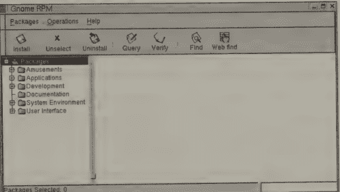

图 4.1 GNOME RPM 工具。

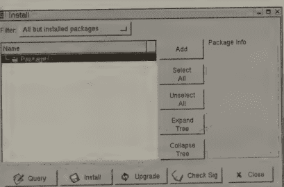

图 4.2 GNOME RPM 安装对话框。

> 提示：如果你想要升级软件包而不是仅仅安装它，请点击“升级”按钮。

2. 点击“添加”按钮以打开如图 4.3 所示的“添加软件包”对话框。
3. 使用文件浏览器定位你要安装的程序包。

> 注意：如果你要安装的程序包位于可移动介质（如 CD-ROM）上，你需要先挂载该介质。

4. 点击程序包以选择它。每个程序包旁边都有一个小组件。如果组件中有选中标记，则表示该程序包已被标记为待安装。如果组件未标记，你需要为该程序包进行标记才能安装。点击“全选”按钮可一次性标记所有程序包。
5. 如果你想添加另一个程序包，请返回步骤 3。

> 警告！不要忽略 RPM 依赖项警告。即使你设法安装了软件，它可能也无法正常运行，因为它缺少所需的一切。

6. 记下你要安装的程序包依赖于哪些项目。
7. 点击“No”以关闭“依赖问题”对话框并推迟安装。会打开一个信息对话框，如图 4.4 所示。
8. 点击“确定”以关闭信息对话框。
9. 按照步骤 1 至 4 添加满足依赖项要求的必要程序包。

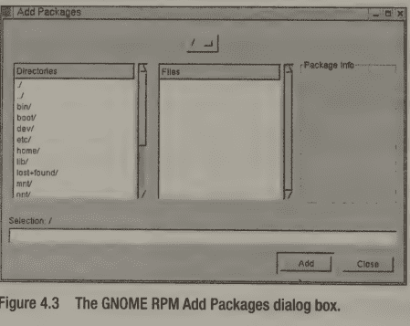
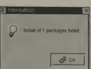

图 4.4 GNOME RPM 信息对话框。

10. 点击“安装”按钮以开始安装过程。将弹出一个对话框，显示安装进度。
11. 安装完成后，点击“关闭”按钮以关闭安装对话框。
12. 点击“包”/“退出”以关闭 GNOME RPM。

## 使用 GNOME RPM 移除 RPM

若要使用 GNOME RPM 工具从系统中移除 RPM，请执行以下操作：

1. 在主 GNOME RPM 对话框左侧进行浏览，直到找到您要移除的包。
2. 点击该包以选择它。
3. 点击“卸载”按钮（本章前文图 4.1 中已展示），以打开图 4.5 所示的“继续移除”对话框。
4. 若要继续移除该包，点击“是”按钮。此时该包即被卸载。

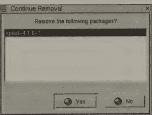

图 4.5 GNOME RPM 继续移除对话框。

## 使用 KDE 的 RPM 工具

KDE 桌面环境提供了 Kpackage 工具，供那些喜欢使用图形界面程序来管理包的用户使用。本节分为您可能想要使用该程序执行的各种任务。

### 打开 Kpackage

若要从中打开 Kpackage，请执行以下操作：

1. 点击 K 按钮以打开菜单。
2. 点击**实用工具**菜单。
3. 在**实用工具**菜单中点击**Kpackage**，以打开**Kpackage**实用程序，如图 4.6 所示。

| 相关解决方案： | 所在页码： |
| :--- | :--- |
| 导航 KDE | 15 |

### 使用 Kpackage 安装 RPM

若要使用 Kpackage 工具安装 RPM，请执行以下操作：

1. 点击**打开包**按钮，以打开图 4.7 所示的**选择要打开的文档**对话框。
2. 浏览以找到您要安装的包。

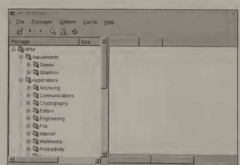

**图 4.6** KDE Kpackage RPM 管理器。

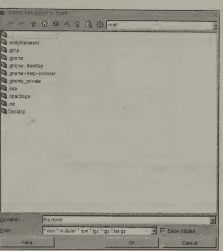

**注意：** 如果您要安装的包位于可移动介质上（例如 CD-ROM），您需要先挂载该介质。

3. 点击您要安装的项目使其被选中。
4. 点击确定按钮以获取包信息和安装选项，如图 4.8 所示。
5. 阅读“属性”选项卡中的包信息。
6. 点击“文件列表”选项卡，查看与该包一起安装的文件。
7. 点击“安装”按钮以安装该 RPM。


-   完成后，您可以返回步骤 2 以安装另一个包，或者点击“文件”|“退出”以关闭 `Kpackage`。

### 使用 `Kpackage` 移除 RPM

若要使用 `Kpackage` 工具移除 RPM，请执行以下操作：

1.  浏览屏幕左侧以找到您要移除的包。

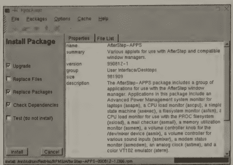

图 4.8 `KDE Kpackage` 安装包对话框。

2.  点击该包以选择它。此操作将调出关于该包及其文件的信息，如图 4.9 所示。

3.  点击“卸载”按钮。此时将出现卸载对话框，如图 4.10 所示。

4.  点击“卸载”按钮以从系统中移除该 RPM。

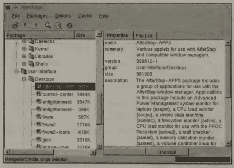

图 4.9 `KDE Kpackage` 的卸载信息。

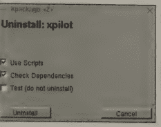

图 4.10 `KDE Kpackage` 的卸载对话框。

### 第 5 章

### 内核管理

| 如果您需要立即解决以下问题： | 见页码： |
| :--- | :---: |
| 获取内核版本及其他系统信息 | 135 |
| 获取最新内核源代码 | 135 |
| 安装新内核 | 136 |
| 使用 `config` 配置内核 | 137 |
| 使用 `menuconfig` 配置内核 | 141 |
| 使用 `xconfig` 配置内核 | 143 |
| 列出已加载模块 | 145 |
| 手动插入模块 | 145 |
| 手动移除模块 | 146 |
| 获取系统信息 | 147 |
| 设置模块参数 | 148 |
| 构建别名语句 | 148 |
| 构建选项语句 | 149 |
| 更新 `Lilo` | 149 |

125

### 深入解析

尽管最终用户很少需要关注内核，但大多数系统管理员却需要关注。无论您是致力于通过优化内核来提升系统性能的狂热信徒，还是仅仅因为需要使用新的软件包或硬件设备而被迫升级内核，这都是您最终必须面对的问题。幸运的是，如果您了解其背后的处理流程，内核管理并非那么令人望而生畏。

### `Linux` 内核

内核就是 `Linux` 本身。围绕它的其他一切不过是为了让它对我们更具吸引力而添加的修饰功能。保持内核健康就能使整个系统保持稳定，至少比不稳定时更稳定。在内核管理领域，有许多问题需要考虑。其中一些问题需要立即关注，而另一些问题则是长期考量，取决于您自身的系统管理策略。

### 内核组成部分

内核本质上由两个主要部分组成——尽管内核程序员会说这过于简化了。第一部分是一个编译好的部分，它始终驻留在内存中。这部分应仅包含那些几乎时刻都需要的项目。其余部分则应放在内核的第二部分：内核模块中。

那些间歇性使用的项目——例如某些设备驱动程序——被放置在内核模块中。这些组件可以随时加载和卸载，从而确保内核本身不会占用大量 `RAM`，同时您仍拥有完整的系统功能。

那些极少使用的模块实际上可以在您需要时手动加载，并在完成后移除。

### 何时自定义

关于内核，有两种观点流派。有人认为大多数发行版安装的默认内核本身就是可接受的。也有人坚信，通过编译自定义版本的内核（移除您不需要的部分并尽可能模块化化），可以大幅提高性能。

某些特定情况有时会出现，使得构建自定义内核变得必要，甚至必不可少。这些情况包括：

-   您安装了一个需要内核功能支持，但您未启用的程序。
-   您添加了一个几乎连续使用的新设备，不希望每次都手动加载模块。
-   您购买了一个当前内核不支持的新设备。
-   您当前的内核相当旧，而且您知道未来不久就需要一些当前版本不具备的功能，因此您希望安装最新版本以跟上时代步伐。

### 何时升级

新版本的内核似乎几乎每天都在发布。然而，我强烈建议您抵抗每次新版本出现就升级的诱惑。那不仅会占据您全部工作时间，还可能导致系统不稳定。根据系统需求以及您处理潜在问题的可用时间，有选择地决定何时升级会更好。

通常，当您需要添加需要更新内核版本的软件或设备时，升级的决定就被强加在您身上。

### 选择新内核

在选择新内核时，有许多事情需要牢记：

-   如果您需要对新设备的支持，新版本是否支持？
-   新版本是否支持您的所有旧设备？有时新版本会破坏一些在下一个版本中已修复的问题。
-   内核是否稳定？
-   如果新设备仅由实验性内核支持，这种稳定性风险是否值得？

如您所见，对于新内核，您需要了解许多事情。其中最重要的一项是您处理的是实验性内核还是生产内核。一旦您理解了这两种内核流派之间的区别，这个问题就相当清晰了。

内核准备工作在两条不同的开发路径上进行。实验性内核听起来怎么样就是什么样——目前是正在开发中的代码。新的设备驱动程序和新功能首先在这里进行测试。当添加了足够多的新项目后，稳定的实验性内核就变成了生产内核，然后一个新的实验性内核流程开始。生产内核是大多数系统管理员在机器上使用的那个。

这种内核开发的管理方式可能会让内核选择变得令人困惑。需要理解的关键信息在于每个内核版本是如何命名的，这样你才能一眼就选出最合适的选项。

内核名称的结尾通常是一串数字，格式为 `X.Y.Z`。每添加新功能或修复漏洞时，数字就会相应递增。`X` 的变化最慢；例如，可能需要好几年才会出现以 3 开头的内核。决定是否更改主版本号是一个主观的行为。从基于 2 的内核升级到 3 将代表某种重大飞跃。例如，当版本号从 1 跳转到 2 时，增加了以下新项目：

-   支持四个新的硬件架构平台（包括 `Apple PowerPC` 和 `Atari`）
-   更多的 `IDE` 设备驱动程序、更好的 `IDE` 错误处理、自动检测某些 `IDE` 特性以及处理更多控制器的能力
-   更多的 `SCSI` 设备驱动程序
-   大幅扩展的网卡列表
-   现代模块化结构
-   用于笔记本电脑等设备的高级电源管理 (`APM`)
-   `IP` 隧道、地址伪装以及额外的路由功能
-   `ISDN` 支持
-   `VFAT` 和 `SMB` 文件系统支持等
-   文件系统配额支持

本质上，当 `Linus Torvalds` 认为我们正处于内核开发的一个全新起点时，他就会决定更改 `X` 内核编号。

`Y` 组件以半定期的频率变化，大约每六个月左右一次。这是在判断内核是生产版还是实验版时的关键数字。实验内核的 `Y` 组件是奇数；例如，`2.3.12`、`3.7.16` 和 `4.19.92`。另一方面，生产内核的 `Y` 组件是偶数，例如 `2.2.12`、`3.8.16` 或 `4.20.92`。推进此组件的方法在本节前文中有说明。

也许最容易解释的是 `Z` 的变化。每当内核代码发生任何更改时，`Z` 组件就会递增。这是大多数软件开发者使用的方法。它是一种确切了解正在查看哪个源代码版本的方式。实际上，你甚至可能会看到格式为 `X.Y.Z-A` 的内核版本。当你看到这种格式时，说明你正在查看的是专为你的 `Linux` 发行版修改的版本。

对于那些更偏向视觉化的人来说，图 5.1 展示了完整的内核开发路径以及分支是如何工作的。


图 5.1 内核开发流。

## 内核文档

内核源代码默认附带一套文档。其中许多文件对于追踪特定内核模块或驱动程序设置的信息非常有用。以下是对文档目录的导览，以便你知道有哪些可用内容以及在哪里找到它们。如果你想开始查找任何内核文档文件——假设你已经安装了源代码——请前往 `/usr/src/linux/Documentation`。

### 通用内核文件

一些文档文件比较通用。例如，`00-INDEX` 文件包含一个列表，其中有一句话描述所有的文档文件。如果你下载了比 `Red Hat 6.2` 自带的版本更新的版本，这将很有用，因为可能存在细微的变化，而这些变化在你这里看到的版本中可能没有。另一个文件可能对许多人来说令人望而生畏，但有些人可能足够大胆去尝试。它是 `BUG-HUNTING`，包含追踪和报告内核中漏洞的说明。`ops-tracing.txt` 文件包含关于此问题的额外信息。

> **注意：** 如果你有兴趣深入研究内核事务，一个好的起点是《`Linux` 内核》（"The `Linux` Kernel"），它可以通过 `http://metalab.unc.edu/Linux/LDP/tik/tik.html` 获取，感谢 `Linux` 文档项目。

如果你打算为内核编写任何代码，无论是修复漏洞还是添加特定功能的补丁，务必阅读 `CodingStyle` 文件。这份文档基本上是一个内核代码格式的风格指南。如果你觉得这限制了你的创造力，试着想象一下，如果贡献代码给 `Linux` 内核的数百人各自使用自己的风格规范，内核代码会是什么样子。在此方面，另一个重要的文件是 `magic-number.txt`，它列出了已使用的数据结构魔术数。


对于对内核如何处理输入/输出 (`I/O`) 映射感兴趣的人，请查看 `IO-mapping.txt` 和 `ioctl-number.txt` 文件。如果你喜欢运行广泛的二进制文件类型，并希望能够从命令行做到这一点，请阅读 `binfmt_misc.txt` 文件。对于与 `Java` 相关的问题，请阅读 `java.txt`。你还可以通过阅读 `exception.txt` 文件了解内核如何处理错误，以及通过阅读 `smart-config.txt` 了解它在配置期间如何处理依赖项。

`kernel-parameters.txt` 文件包含内核在启动时接受的参数。此外，还有一份文档解释了管理内核模块的程序的运作方式。这个文件是 `lkmod.txt`。另一份文档涉及 Linux 内核动态加载和卸载模块的背景信息：`modules.txt`。要查看内核如何处理文件锁定，请阅读文件 `locks.txt` 以及相关的背景信息文件 `mandatory.txt`。内存问题在 `memory.txt` 中有所涉及。

在文件 `kernel-docs.txt` 中可以找到指向各种内核文档的指针。

### 特定架构文件

在内核文档中有一些文件专门处理某种硬件架构或另一种硬件架构。这些文件包括：

- `ARM-README`—来自 ARM 代码开发团队的笔记，涉及 ARM 用户需要考虑的特定问题。
- `IO-APIC.txt`—对于那些拥有 Intel 或基于 Intel 架构的具有 SMP 功能主板的人非常有用。并非所有主板都完全符合 IO-APIC 标准。此文件讨论了如何判断你的主板是否符合标准，以及如何处理问题。
- `arm`—此子目录包含与 Linux 的 ARM 版本相关的额外文件。
- `i386`—此子目录包含与 Linux 的 i386 (Intel) 版本相关的额外文件。
- `m68k`—此子目录包含与 Linux 的 Macintosh 68k 版本相关的额外文件。
- `mca.txt`—讨论在 Linux 下对 i386 微通道架构的处理。
- `mtrr.txt`—讨论 Intel Pentium Pro 和 Pentium II 系统上的内存类型范围控制。
- `powerpc`—此子目录包含与 Linux 的 Macintosh PowerPC 版本相关的额外文件。
- `sgi-visws.txt`—讨论 Linux 对 SGI 可视化工作站的处理。

### 特定硬件文件

特定架构文件和特定硬件文件之间有一个小区别：架构指的是系统设计的整体类型；硬件更像是一个设备标签，而不是设计标签。内核源代码中与特定设备相关的文件包括：

- `README.DAC960`—特定于 Mylex DAC960/DAC1100 PCI RAID 控制器的信息。
- `cdrom`—此子目录包含关于许多 CD-ROM 型号和制造商的信息文件。
- `comptone.txt`—特定于 Comptone Intelliport II/Plus 多端口串行驱动程序的信息。
- `epgarray.txt`—特定于 Compaq 的 SMART2 智能磁盘阵列控制器的信息。
- `digiboard.txt`—特定于 Digiboard PC/Xi、PC/Xe 和 PC/Xeve 多调制解调器硬件的信息。
- `digiecpa.txt`—更多关于 Digiboard 技术的信息。
- `fb`—此子目录包含关于帧缓冲驱动程序和设备的信息文件。帧缓冲与你的机器如何处理图形有关。
- `filesystems`—此子目录包含关于 Linux 理解的各種文件系统类型的信息文件。
- `ftape.txt`—关于 ftape 磁带驱动程序的讨论。
- `hayes-esp.txt`—特定于 Hayes ESP (增强型串行端口) 调制解调器的信息。
- `ide.txt`—关于 Linux 内核如何处理 IDE 设备的信息。
- `isdn`—此子目录包含关于内核 ISDN 处理以及可用各种驱动程序的信息，包括关于 ISDN 上的 PPP 的信息。
- `joystick-api.txt`—关于编写利用 Linux 摇杆功能的代码的信息。
- `joystick-parport.txt`—关于 Linux 和并行端口摇杆的信息。
- `joystick.txt`—关于 Linux 摇杆驱动程序的信息。
- `md.txt`—关于 Linux 多磁盘设备处理的讨论。
- `mkdev-ida`—这实际上是一个 shell 脚本，帮助你设置 SMART RAID IDA 控制器的设备信息。
- `networking`—此子目录包含关于 Linux 中可用的各种网卡设备驱动程序的信息。
- `paride.txt`—关于 Linux 和 IDE 并行端口设备的讨论。
- `parport.txt`—关于 Linux 并行端口支持和模块的讨论。
- `pci.txt`—关于编写 PCI 驱动程序时应避免什么事项的讨论。
- `pcwd-watchdog.txt`—关于 Linux 如何处理 ISA Berkshire PC 监控卡的讨论。
- `ramdisk.txt`—此文件并不真正特定于硬件，但它确实涉及一个驱动程序：在 Linux 中使用的 RAM 磁盘驱动程序。
- `riscom8.txt`—关于 RISCcom/8 多端口串行驱动程序的笔记。
- `rtc.txt`—关于 Linux 中用于配合 PC 和 Alpha 架构使用的实时时钟驱动程序的讨论。


## 额外实用文件

我认为有必要在本章中汇集一组文件。这些文件是任何准备升级内核的人在进行升级前应当阅读或至少浏览一遍的文件。这些文件包括：

- `Changes`——此文件包含一个内核资源网站列表。然而，这并不是将其归入本节的原因。`Changes` 文件 wonderful 之处在于，它列出了内核或构建内核所需的所有软件的版本要求，以及如何确定您当前拥有的版本。此外，它还包含了关于本次特定内核版本中更新的功能的说明。
- `Configure.help`——此文件列出了在内核配置过程中您可以启用或禁用的每一项内核特性和驱动程序，并附带一段或多段文字讨论该功能的用途以及哪些人可能或不需要使用它。如果您不确定是否要启用某项功能，这里是查找更多信息的地方。
- `devices.tex`, `devices.txt`——这两项是同一个文件。一个是 TEX 格式，这是一种用于排版文档的标记语言。另一个是 ASCII 文本文件。`devices` 文件列出了内核处理的所有设备编号和文件。
- `inird.txt`——在编译新内核时，关于您可以创建的启动 RAM 磁盘，人们常常感到困惑。此文件说明了这种 RAM 磁盘的用途类型以及如何将它们付诸实践。
- `kbuild`——此子目录包含与内核构建过程相关的文件。建议阅读。
- `proc.txt`——此文件讨论了文件系统的 `/proc` 部分及其包含的内容。
- `sysctl`——此子目录包含与修改 `/proc/sys/` 文件相关的文件。如果您认为可能需要操作这些文件，或者至少想了解您可以使用它们做些什么，请阅读此处存储的文件。
- `sysrq.txt`——许多人不知道他们可以启用一组按键绑定，从而直接向内核发送命令。当然，如果其他人可以访问该机器，您可能不希望启用此功能。在此文件中了解魔术按键绑定及其使用或不使用的原因。

## 杂项小部件

有些项目难以轻松归类。这些文件列在此处：

- `VGA-softcursor.txt`——如何更改命令行模式下的光标。
- `logo.gif`——非官方 Linux 标志。
- `logo.txt`——`logo.gif` 的说明。
- `nbd.txt`——关于实验性网络块设备驱动程序的讨论。
- `nfsvroot.txt`——如何在无盘系统上通过 NFS 挂载来挂载根文件系统。有关 NFS 的信息，请参阅第 17 章。
- `spinlocks.txt`——关于在单处理器和多处理器机器上使自旋锁高效的讨论。
- `svga.txt`——关于 80x86 机器上内核级视频模式选择的讨论。
- `unicode.txt`——关于内核如何使用 Unicode 来引用字符的讨论。
- `xterm-linux.xpm`——企鹅的 X 像素图。

# 即时解决方案

## 获取内核版本及其他系统信息

`uname` 命令允许您通过选择适当的标志来获取系统信息。可用的 `uname` 标志列表见表 5.1。

**表 5.1** `uname` 命令可用的标志。

| 标志 | 目的 |
| :--- | :--- |
| `-a` | 一次性提供所有标志的信息。 |
| `-m` | 列出该机器的架构。 |
| `-n` | 列出机器的主机名。 |
| `-p` | 提供机器的处理器类型。 |
| `-r` | 提供内核版本。 |
| `-s` | 列出您正在使用的操作系统。 |
| `-v` | 说明此操作系统安装的时间。 |

## 获取最新内核源代码


从可信网站获取内核源代码非常重要。获取源代码的一些最佳地点包括：

- `www.kernelnote.org`

- `www.kernel.org`

**提示：** 如果您想知道当前正在运行的是哪个内核版本，请输入 `uname -r`。

## 安装新内核

安装新内核，无论是升级还是您已有内核的新编译版本，都是一个复杂但并非极其困难的过程。要添加新内核，请执行以下操作：

1. 获取内核源代码，可以从“获取最新内核源代码”一节中列出的网站之一获取，也可以从发行版 CD 获取。对于 `Red Hat 6.2`，`Red Hat` 包管理器 (`RPM`) 为 `kernel-source-2.2.14-50.i386.rpm`。

2. 安装源代码。如果您未使用 `RPM`，请在 `/usr/src` 中解包 tar 包。

3. 需要确保安装某些特定包。以下是它们的列表，并附带了 `Red Hat 6.2` 版本号以便包含在完整文件名中：

    - `kernel-headers-2.2.14-50.i386.rpm`——包含内核源代码的头文件

    - `cpp-1.1.2-30.i386.rpm`——用于编译的 C 预处理器包

    - `egcs-1.1.2-30.i386.rpm`——C 编译器

    - `glibc-devel-2.1.3-15.i386.rpm`——C 开发库集

    - `make-3.77-6.i386.rpm`——您用于编译源代码的构建管理器

    - `ncurses-5.0-11.i386.rpm`——如果您选择 `menuconfig` 选项来配置内核参数，则控制光标所必需的

    - `ncurses-devel-5.0-11.i386.rpm`——如果您选择 `menuconfig` 选项来配置参数，则控制光标所必需的

4. 切换到该包的 `/usr/src/linux-version` 目录。对于 `Red Hat 6.2`，这是 `/usr/src/linux-2.2.14`。

5. 输入 `make oldconfig` 以基于当前内核设置构建配置文件。如果您不想冒漏掉已添加内容的风险，这是一个良好的起点。

6. 选择您想要使用的内核配置工具。关于您的选项，请参阅以下章节：“使用 `config` 配置内核”、“使用 `menuconfig` 配置内核”和“使用 `xconfig` 配置内核”。

7. 选择内核配置工具后，按照步骤 6 中列出的相关章节中的说明进行操作，然后进入步骤 8。

8. 输入 `make dep` 以构建源依赖项列表。有关 C 源代码操作的更多信息，请参阅第 22 章。

    > **注意：** 请记住，虽然这些 `make` 步骤阅读起来很短，但根据 CPU 的速度不同，可能需要几分钟或更长时间。

9. 输入 `make clean` 以清理迄今为止使用的临时文件。

10. 输入 `make bzImage` 以编译基本内核。

11. 输入 `make modules` 以编译内核将即时加载的模块。

12. 编译器将内核源代码放置在目录 `/usr/src/linux/arch/i386/boot/bzImage` 中。将此文件复制到 `/boot` 目录中。

13. 使用 `mv` 命令将 `/boot/bzImage` 重命名为 `/boot/vmlinuz-version`，其中 `version` 是您正在安装的新内核版本。

14. 将文件 `/boot/System.map` 复制到 `/boot/System.map-old`。

15. 将文件 `/usr/src/linux/System.map` 复制到 `/boot` 目录。

16. 输入 `make modules_install` 以将模块安装到 `/lib/modules/version`。

17. 虽然并非必要，但创建一个包含启动时硬件所需模块的特殊引导版本内核是一个好策略——例如，如果您的主硬盘是 `SCSI`。为此，请使用 `mkinitrd /boot/initrd-version version`。

18. 继续到本章末尾的“更新 `LILO`”一节。在您告知 `LILO` 在哪里找到新内核之前，您将无法使用新内核启动。

| 相关解决方案： | 所在页码： |
| :--- | :--- |
| 打开或创建 tar 包 | 110 |
| 安装 RPM | 114 |

## 使用 config 配置内核

`config` 内核配置工具完全是基于文本的，没有任何花哨的功能。走完整个配置过程需要一些时间，因为 `config` 通过逐个提问来获取新的内核配置。虽然终端用户可能不应该使用此选项，但系统管理员可以尝试几次，以了解他们想要时可以做出多少选择。提供样运行示例而不是一种

## 1. 运行 make config

这是一个耗时较长的过程，因此在此列出您应特别注意的事项。这些事项按照您可能遇到的顺序给出，默认选项为首选，通常以大写首字母或大写单词表示。

1.  要启动此配置工具，请输入 `make config`。代码编译过程会滚动显示，随后出现以下问题：

```text
* Code maturity level options*

* Prompt for development and/or incomplete code/drivers
(CONFIG_EXPERIMENTAL) [Y/n/?]
```

> **注意：** 以星号开头的行是配置程序显示的标题，用于标示问题所属的主题。此外，答案选项的顺序经常变化。它们按照从最可能被选中到最少被选中的顺序排列。

2.  对于重要的生产服务器，我建议选 `n`。对于此类机器，使用经过验证且稳定的代码是更好的选择。因此，输入 `n` 并按 Enter。如果你想选 `Y`，只需按 Enter，因为大写 `Y` 表示默认值。接下来，你将看到：

```text
* Processor type and features*

* Processor family (386, 486/Cx486, 586/K5/5x86/6x86, Pentium/K6/TSC, PPro/6x86MX) [386]
```

3.  有效答案是各个单独的条目，但对于用斜杠分隔的条目，你只需输入斜杠之间的某一部分即可。例如，如果机器装有 `Pentium` 处理器，请输入 `Pentium` 并按 Enter。如果你的是 `386` 处理器，只需按 Enter，因为此项已标注为默认值。接下来，你将看到：

```text
Maximum Physical Memory (1GB, 2GB) [1GB]
```

4.  如图所示，这里只有两个可选值。如果机器内存介于 1GB 和 2GB 之间，请输入 `2GB` 并按 Enter。否则，按 Enter 接受默认值。接下来你将看到：

```text
Math emulation (CONFIG_MATH_EMULATION) [Y/n/?]
```

> **注意：** 此处并未显示配置工具的全部输出。在列出的这些项之间，常常会有与你的设置相关的代码定义的说明。

5.  如果你的处理器是 `486DX` 或更快的型号，请输入 `n` 并按 Enter，因为数学仿真已集成在这些速度的处理器中。否则，按 Enter 接受默认值。接下来将出现：

- MTRR（内存类型范围寄存器）支持 (`CONFIG_MTRR`)
- [Y/n/2]

> **提示：** 如果你不确定如何回答，可以选择问号。这个回答会给你一个内核选项的说明，以便你做出更明智的选择。

6.  此选项主要适用于 `Intel P6` 机器以及其他与 `Pentium` 6 系列同类的机器。如果你没有这种机器，请输入 `n` 并按 Enter；如果有，只需按 Enter。下一个项目是：

- 对称多处理支持 (`CONFIG_SMP`) [N/y/?]

7.  如果你的主板上装有多个处理器，请输入 `y` 并按 Enter。否则，你不需要此选项，因此按 Enter 接受默认值。接下来是：

- *
- * 可加载模块支持
- *
- 启用可加载模块支持 (`CONFIG_MODULES`) [Y/n/?]

8.  你不想启用此选项的情况很少。如果没有它，你就必须将所有内容直接编译进内核。按 Enter 接受默认值。

现在，我只开始讲解特定的感兴趣项目。请记住，你可以随时阅读帮助信息以了解每个项目。阅读所有帮助信息是一次非常有教育意义的体验。我提到的这些项目，是你可能需要修改默认值以获得更好效果的。

> **提示：** 内核配置选项的所有帮助信息也可以在 `/usr/src/linux` 的 `Documentation` 子目录中的 `Configure.help` 文件里找到。

9.  如果你正在一台具有高级电源管理功能的笔记本电脑上安装 `Linux`，以下功能非常有用。否则，你不需要它：

- 高级电源管理 BIOS 支持 (`CONFIG_APM`) [Y/n/?]

> **注意：** 请注意，有很多项是指特定品牌的硬件或针对其进行的修复。

10. 有一些选项涉及集成开发环境（IDE）支持。如果你的系统没有 IDE 设备，可能不需要这种支持。在关闭它之前，请阅读帮助信息以确切了解该项目的功能。


11. 如果你打算使用 RAID（第 3 章有讨论），以下项目开启或至少设为模块化（`modular`）是有用的：

*   多设备驱动程序支持（`CONFIG_BLK_DEV_MD`）`[Y/n/?]`
*   自动检测 RAID 分区（`CONFIG_AUTO_DETECT_RAID`）`[Y/n/?]`
*   线性（追加）模式（`CONFIG_MD_LINEAR`）`[M/n/y/?]`
*   RAID-0（条带）模式（`CONFIG_MD_STRIPED`）`[M/n/y/?]`
*   RAID-1（镜像）模式（`CONFIG_MD_MIRRORING`）`[M/n/y/?]`
*   RAID-4/RAID-5 模式（`CONFIG_MD_RAID5`）`[M/n/y/?]`
*   Mylex `DAC960`/`DAC1100` `PCI` RAID 控制器支持（`CONFIG_BLK_DEV_DAC960`）`[M/n/y/?]`

12. 对作为包过滤防火墙起作用的机器有用的功能是：

*   网络防火墙（`CONFIG_FIREWALL`）`[Y/n/?]`
*   Unix 域套接字（`CONFIG_UNIX`）`[Y/m/n/?]`
*   `IP`: 策略路由（`CONFIG_IP_MULTIPLE_TABLES`）`[N/y/?]` (`NEW`)
*   `IP`: 防火墙（`CONFIG_IP_FIREWALL`）`[Y/n/?]`
*   `IP`: 防火墙包 `netlink` 设备（`CONFIG_IP_FIREWALL_NETLINK`）`[Y/n/?]`
*   `IP`: 使用 `FWMARK` 值作为路由键（`CONFIG_IP_ROUTE_FWMARK`）`[N/y/?]` (`NEW`)

> **注意：** 有时路由和过滤项目会重叠。请阅读帮助信息。

13. 你计划用作路由器的机器，应开启以下项目：

*   `IP`: 高级路由器（`CONFIG_IP_ADVANCED_ROUTER`）`[N/y/?]`
*   `IP`: 等价多路径（`CONFIG_IPROUTE_MULTIPATH`）`[N/y/?]` (`NEW`)
*   `IP`: 使用 `TOS` 值作为路由键（`CONFIG_IP_ROUTE_TOS`）`[N/y/?]` (`NEW`)
*   `IP`: 详细路由监控（`CONFIG_IP_ROUTE_VERBOSE`）`[N/y/?]` (`NEW`)
*   `IP`: 大型路由表（`CONFIG_IP_ROUTE_LARGE_TABLES`）`[N/y/?]` (`NEW`)
*   `IP`: 快速网络地址转换（`CONFIG_IP_ROUTE_NAT`）`[N/y/?]` (`NEW`)
*   `IP`: 优化为路由器而非主机（`CONFIG_IP_ROUTER`）`[N/y/?]`

14. 代理防火墙有用的功能是：

*   `IP`: 透明代理支持（`CONFIG_IP_TRANSPARENT_PROXY`）`[Y/n/?]`
*   `IP`: 伪装（`CONFIG_IP_MASQUERADE`）`[Y/n/?]`
*   `IP`: `ICMP` 伪装（`CONFIG_IP_MASQUERADE_ICMP`）`[Y/n/?]`

15. 如果你要进行虚拟主机，并为同一接口分配多个 `IP` 地址，请包含：

*   `IP`: 别名支持（`CONFIG_IP_ALIAS`）`[Y/n/?]`

16. 以下内容有助于防御拒绝服务攻击：

*   `SYN` 泛洪保护（`CONFIG_SYN_COOKIES`）`[N/y/?]`

| 相关解决方案 | 所在页码 |
| :--- | :--- |
| 添加虚拟站点 | 196 |
| 对抗拒绝服务攻击 | 285 |
| 设置 `IP` 防火墙 | 287 |
| 设置代理防火墙 | 289 |

## 使用 `menuconfig` 配置内核

`menuconfig` 内核配置工具是一个非图形化的、菜单驱动的程序，它允许你在各种类型的内核选项之间来回移动并调整设置，直到你对最终结果满意为止。要使用此工具，请执行以下操作：

1.  输入 `make menuconfig` 以运行该工具。一些编译器代码会滚动显示，然后工具会在虚拟终端中打开，如图 5.2 所示。

> **注意：** 此项需要安装两个 `ncurses` 软件包。如果你没有安装这些软件包，`menuconfig` 将无法正确构建。

2.  如果你是内核配置的新手，逐一浏览菜单并根据需要修改项目是个好主意。我将通过一个示例展示如何使用此工具进行导航。要选择处理器类型和功能（`Processor Type And Features`）菜单，请使用向下箭头向下移动至该菜单。

``

``

图 5.2 `menuconfig` 内核配置工具。

``

图 5.3 `menuconfig` 处理器类型和功能对话框。

3.  要打开菜单，请按 `Enter`。这将弹出图 5.3 中所示的处理器类型和功能对话框。请注意，其中一些是内核选项，一些是子菜单。

4.  按 `Enter` 进入处理器家族（`Processor Family`）子菜单。

5.  使用上下箭头移动到对应的 `CPU` 速度。

6.  按空格键选择该选项，并自动返回到上一个菜单，即处理器类型和功能（`Processor Type And Features`）。

7. 使用上下箭头移动到 `Math Emulation` 选项。

8. 如果该复选框已被选中——即其中包含一个星号——并且计算机是 `486DX` 或更快的处理器，请按下空格键将其取消选中。

9. 使用上下箭头移动到 `MTRR (Memory Type Range Register) Support` 选项。

10. 输入问号以调出帮助信息。将打开一个包含说明该内核选项用途的条目的对话框。此信息取自“深入解析”部分中提到的 `Configure.help` 文件。

11. 阅读该条目。使用箭头键滚动文本。

12. 阅读完毕后按 `Enter` 键。

13. 使用左右箭头键在下级菜单中移动，直到到达 `Exit` 选项。

14. 按 `Enter` 键返回到主 `menuconfig` 菜单。

15. 使用左右箭头键选择 `Exit` 选项。

16. 按 `Enter` 键退出该工具。

17. 如果你想保存配置，请将光标移动到 `Yes`。否则，选择 `No`。

18. 按 `Enter` 键完成。

## 使用 `xconfig` 配置内核

`xconfig` 内核配置工具是一个基于图形界面的程序，允许你使用鼠标在 various 内核选项组之间进行导航。要使用此工具，请执行以下操作：

1. 如有必要，通过输入 `startx` 进入图形界面。

2. 打开一个终端窗口。

3. 输入 `/usr/src/linux/make xconfig`。

4. 编译信息会快速滚动过去，随后 `xconfig` 工具将打开，如图 5.4 所示。

5. 如果你是内核配置的新手，建议逐一浏览选项并根据需要更改项目。我将通过一个示例向你展示如何使用此工具进行导航。点击“旧式 CD-ROM 驱动程序（非 `SCSI`、非 `IDE`）”选项以打开“旧式 CD-ROM 驱动程序（非 `SCSI`、非 `IDE`）”对话框，如图 5.5 所示。

``

### **图 5.4** `xconfig` 内核配置工具。

``

### **图 5.5** `xconfig` 旧式 CD-ROM 驱动程序（非 `SCSI`、非 `IDE`）对话框。

6. 学习如何阅读这些对话框是很有用的。如果第一行提到是否支持某项功能，在调整其下方的任何设置之前，请首先考虑这一点。我选择此对话框作为示例的原因是，除非你有一个足够旧且不是 `SCSI`、`IDE` 或与这些相关的 `CD-ROM` 驱动器，否则你不需要它。点击“支持非 `SCSI`/`IDE`/`ATAPI` `CDROM` 驱动器”旁边的“`n`”以停用此选项。请注意，对话框中的其他所有选项现在均不可用。

7. 点击“主菜单”按钮以关闭对话框。

8. 点击“原生语言支持”按钮以打开“原生语言支持”对话框。

9. 对于每种你不需要支持的语言，点击“`n`”。

10. 完成后，点击“主菜单”按钮。

11. 当配置完成后，点击“保存并退出”按钮以保存更改。将打开一个对话框。

12. 阅读对话框中的内容，该内容解释了您刚刚完成了内核配置以及内核编译过程中的下一个命令是什么。然后点击“确定”。

| 相关解决方案： | 所在页码： |
| :--- | :--- |
| 获取命令提示符 | 14 |

## 列出已加载模块

要查看当前已加载的内核模块，请使用 `lsmod` 命令或使用 `more /proc/modules`。

## 手动插入模块

要插入内核模块，请执行以下操作：

1. 使用 `cd` 命令更改到 `/lib/modules` 目录。


2. 使用`ls`命令查看目录的内容。如果您以前从未添加过新的内核，应该只有一个子目录。此子目录以其服务的内核版本命名。

3. 更改到相应内核版本的目录。

**表 5.2 每个`/lib/modules/version`子目录中的模块类型。**

| 目录 | 内容 |
| :--- | :--- |
| `block` | 块设备驱动程序（CD-ROM 和 SCSI 除外，它们有专门的部分），这些是随机访问介质，你可以在任何时间查看其任何部分，而不必按顺序进行。判断你是否正在处理块设备的一个快速方法是看数据量是否以字节为单位讨论。 |
| `cdrom` | 各种流行 CD-ROM 驱动器的驱动程序。 |
| `fs` | 受支持的文件系统类型模块。 |
| `ipv4` | IP 版本 4 服务模块，例如 IP 代理。 |
| `misc` | 不属于其他任何子目录的其他杂项模块。 |
| `modules.dep` | 包含哪些模块依赖于哪些其他模块列表的文件。此文件由`depmod`命令生成。 |
| `net` | 网络设备驱动程序模块，例如以太网驱动程序。 |
| `pcmcia` | PCMCIA 设备驱动程序。 |
| `scsi` | SCSI 设备驱动程序。 |
| `video` | 显示器和视频卡驱动程序。 |

4. 定位你要插入的模块。此处存在若干个子目录。表 5.2 列出了每个子目录包含内容的说明。

5. 更改到相应的子目录。

6. 输入 `"insmod module"`，其中`module`是你想加载的模块的名称。

## 手动移除模块

要移除已加载的内核模块，请执行以下操作：

1. 参阅“列出已加载模块”部分，了解如何获取当前正在运行的模块列表。

2. 确定你要加载的模块。

3. 输入 `"rmmod module"` 以卸载该模块。如果有依赖于你试图移除的模块的活动模块存在，你将得到一个依赖性错误。

4. 如果你得到依赖性错误，确定依赖模块是否是你需要的。你可能需要保留它，这意味着你应该保留你最初想要卸载的模块。然而，你可能也不需要用那个依赖模块。

5. 要移除初始模块及其依赖模块，输入`` `rmmod -r module` ``。

## 获取系统信息

有一个不寻常的目录层次结构，实际上并没有存储在硬盘上。`/proc`目录及其内容是由 Linux 内核在 RAM 中创建的，用于存储系统的最新信息。要获取关于你的 Linux 机器、其进程等的信息，请进入此层次结构。表 5.3 概述了你在每个`/proc`子目录中找到的内容。

> 提示：如果你需要更详细的信息，请输入`` `man proc` ``。

**表 5.3 每个`/proc`子目录或文件中的信息类型。**

| 目录 | 内容 |
| :--- | :--- |
| `number` | 每个以数字命名的目录对应于当前正在运行的进程。其中包含该进程如何被调用及其当前状态的详细信息。 |
| `cpuinfo` | 包含 CPU 和系统体系结构信息的文件。 |
| `devices` | 包含设备组列表及其分配数字的文件。 |
| `dma` | 正在使用的工业标准架构 (ISA) 直接内存访问 (DMA) 通道列表以及使用这些通道的设备。 |
| `filesystems` | 内核编译时能够理解的文件系统类型列表。 |
| `interrupts` | 每个中断请求 (IRQ) 设置可用的中断数量，包括哪个设备在使用哪个 IRQ。 |
| `ioports` | 各种输入/输出 (I/O) 设备正在使用的十六进制端口地址。 |
| `kcore` | 包含存储在 RAM 中信息的二进制文件。 |
| `kmsg` | 包含内核消息的二进制文件，可通过`dmesg`命令访问。 |
| `ksyms` | 由内核创建和用于管理模块的信息。 |
| `loadavg` | 服务器负载的平均值，通过查看 1 分钟、5 分钟和 15 分钟前有多少作业在运行来计算。 |

**表 5.3 每个`/proc`子目录或文件中的信息类型（续）。**

| 目录 | 内容 |
| :--- | :--- |
| `meminfo` | 空闲和已用 RAM、交换空间等的数量。 |
| `modules` | 由内核加载的模块的完整文本列表。 |
| `net` | 包含一组文件的目录，这些文件保存有关机器网络设置各个方面的信息。使用`netstat`和`ifconfig`工具通常比查看原始文件更容易理解此信息。 |
| `pci` | 在启动时找到的所有 PCI 设备及其分配的配置。 |
| `scsi` | 包含有关机器上 SCSI 设备信息以及单个设备更详细数据的目录。 |
| `stat` | 关于内核和系统活动的详细统计信息。 |
| `sys` | 包含与内核变量相关的信息的目录。 |
| `uptime` | 系统自上次重启以来未重启的秒数，以及闲置时长。 |
| `version` | 当前内核版本。 |

## 设置模块参数

要更改内核的模块参数，请编辑文件`/etc/conf.modules`。你可以在此处构建两种不同类型的语句：`别名` 和 `选项`。如果驱动程序有一个你发现难以记住的名称，或者如果你有多个设备本质上使用相同的驱动程序，你可能需要考虑在`/etc/conf.modules`中构建一个别名。别名常用于将设备名称设置为通用设备类型。另一方面，你可能需要向该文件添加一个选项。如果你需要在启动时向任何设备驱动程序传递参数，选项非常有用。

### 构建别名语句

一旦你打开文件准备编辑，请按照以下步骤构建要放在`/etc/conf.modules`中的别名：

1. 添加一个新行以添加语句。在`vi`中，你输入 `"o"` 以在光标正下方添加并打开一个新行。

2. 此行按`alias alias module`的格式构建。选择你想要的别名是什么。选择主要取决于别名的用途：它是为了简化过于复杂的模块，还是为了允许你区分出多个不同项目并指向同一模块？举个例子，我不想记得我拥有的是哪张具体的以太网卡，所以我的别名是`"eth0"`。

3. 模块组件是指别名应该指向的模块。如果我的第二块以太网卡使用`tulip`设备驱动程序，我的完整语句看起来像这样：

```
alias eth1 tulip
```

4. 保存并退出文件。如果您使用的是`vi`，请按`Esc`然后输入`ZZ`。

## 构建选项语句

要构建一个放入`/etc/conf.modules`的选项，一旦您打开文件进行编辑，请执行以下操作：

1. 添加一行新的语句。在`vi`中，输入`"o"`以在光标下方直接添加并打开一个新行。

2. 这行语句的格式为`option module options`。模块可以是真实的模块名称，也可以是您在同一文件中设置的别名。如果 Linux 难以找到我的第二块以太网卡——它是 ISA 的，而 Linux 无法自动检测 ISA 设备——在启动时需要通过一些选项来协助。因此，本例中的模块条目为`"tulip"`。

3. 接下来，您需要添加选项本身。对于以太网卡，如果内核无法找到它，我需要显式地提供正确的 I/O 地址。对于此卡，地址是`0x340`，因此我的行将是：

```
option tulip 0x340
```

4. 保存并退出文件。如果您使用的是`vi`，请按`Esc`然后输入`ZZ`。

## 更新 LILo

一旦您使用新版本制作了新内核，您需要告诉 Linux Loader (LILo)——Linux 使用的默认启动管理器——它可以在哪里找到映像文件，以便机器可以使用新内核启动。要完成此任务，请执行以下操作：

1. 使用`vi`编辑器或您喜爱的文本编辑器打开`/etc/lilo.conf`文件。

2. 查找定义当前内核启动参数的部分。它看起来应该像这样：

```
image=/boot/vmlinuz-2.2.14-5.0
label=linux
initrd=/boot/initrd-2.2.14-5.0.img
read-only
root=/dev/hda1
```

3. 将光标放在`image`行上。

4. 将整个部分复制到编辑器缓冲区。在`vi`中，对于像上一个示例那样的五行部分，您会输入`6yy`。

5. 将光标移动到`image`行上方的空白行，然后输入`p`粘贴文本。现在您有两个相同的`image`定义。

6. 将顶部实例中的版本号更改为与新内核版本匹配，并更改标签以便您可以区分这两个版本。例如，您可能会得到如下结果：

```
image=/boot/vmlinuz-2.2.25
label=linux-new
initrd=/boot/initrd-2.2.25.img
read-only
root=/dev/hda1

image=/boot/vmlinuz-2.2.14-5.0
label=linux
initrd=/boot/initrd-2.2.14-5.0.img
read-only
root=/dev/hda1
```

> 提示：您将新内核放在前面的原因是，默认情况下第一个`image`会被启动。

7. 保存并退出文件。在`vi`中输入`ZZ`来完成此操作。

8. 输入`/sbin/lilo -v`以运行 LILO 的详细模式。此操作可确保所有必要的文件都正确放置以便启动。


9. 重启时，按 `Tab` 键查看标签选择。使用新内核启动。如果一切顺利，请回来将旧内核从列表中移除，并将其从 `/boot` 目录中移除。务必再次运行 `LILO` 以使更改生效。

# 第 6 章

## GUI 管理

| 如果您需要立即解决以下问题： | 参见第： |
| :--- | :--- |
| 在 Red Hat 中安装 X 服务器 | 158 |
| 在 Red Hat 中安装 GNOME 或 KDE | 159 |
| 安装 GNOME | 160 |
| 安装 KDE | 160 |
| 在线查找 GUI 组件 | 162 |
| 添加窗口管理器 | 162 |
| 在 GNOME 中添加窗口管理器 | 162 |
| 在命令行为 GNOME 添加窗口管理器 | 163 |
| 在命令行为 KDE 添加窗口管理器 | 164 |
| 添加主题 | 164 |
| 在 GNOME 中添加主题 | 165 |
| 在 KDE 中添加主题 | 165 |
| 添加所有人都能使用的主题 | 166 |
| 更改桌面环境 | 167 |
| 重启 X 服务器 | 167 |
| 在通过 startx 启动时重启 | 168 |
| 在默认情况下启动 X 时重启 | 168 |
| 更改默认运行级别 | 168 |

## 深入解析

GUI 管理的重要性取决于您处理的机器类型。一些服务器机器确实不需要 GUI 组件，甚至有些机器因为 GUI 占用了本可用于更好用途的资源而受到影响。然而，在最终用户机器上，或者在需要多媒体组件用于开发目的的机器上，您需要能够添加和移除组件并对其进行配置。例如，一些用户可能更喜欢与默认安装不同的 GUI。

### Linux GUI 组件

Linux 中使用的 GUI 是一个客户端/服务器系统，您可能认为这指的是服务器在后台管理基础事务，而客户端处理面向用户的细节。然而，事实恰恰相反。Linux GUI 服务器通常驻留在最终用户机器上，而客户端可能存储在本地，也可能没有。Linux GUI 的服务器是 `XFree86`，也称为 `X` 窗口系统或简称 `X`。此服务器基于商业 `X11` 服务器，即原始的 `X` 窗口系统。`X` 被大多数 `Unix` 版本使用，甚至在一些非 `Unix` 平台上也可用。

### X 服务器

Red Hat 在安装过程中为您提供安装 `XFree86` 的机会。如果您当时没有安装，没关系，因为您可以随时添加它。`X` 服务器有许多组件。服务器本身有特定的任务要做。与大多数服务器一样，`X` 服务器的任务是运行后台事务。`X` 服务器可能位于最终用户正在工作的同一台机器上，也可能位于网络机器上。它的工作主要是绘制内容。服务器绘制您在 GUI 桌面上看到的所有不涉及您当前正在运行的应用程序的图形。

> 注意：`XFree86` 中的“86”与版本无关。根据 `XFree86` 项目（`www.xfree86.org`），该术语实际上指的是 `x86` 处理器，即 `Intel` 架构。

## 窗口管理器

在客户端侧安装的项目之一是`窗口管理器`。此工具管理窗口移动、最小化和调整大小，但不管理窗口的实际绘制和外观。然而，窗口管理器并不是实际的 `X` 客户端。相反，它是一个中间程序，接收来自服务器的窗口移动指令并将其转换为实际运动。

作为系统管理员，您不需要承担完全自定义每个用户环境的任务。然而，由于您知道您的用户群是什么样，您可能希望设置一个对用户有意义的默认工作环境。选择窗口管理器——无论是坚持使用默认选项还是使用新的——都是这项任务的一部分。Red Hat 中 `GNU` 网络对象模型环境（`GNOME`）提供的默认窗口管理器是 `Enlightenment`（`www.enlightenment.org`）。`K` 桌面环境（`KDE`）默认使用自己的窗口管理器。其他流行的选择包括：

- `AfterStep` (`www.afterstep.org`)
- `Blackbox` (`http://portal.alug.org/blackbox/`)
- `IceWM` (`http://icewm.cjb.net/`)
- `Sawmill` (`www.dcs.warwick.ac.uk/~johnt/sw/sawmill/`)
- `Window Maker` (`www.windowmaker.org`)

其中一些项目实际上包含在 Red Hat CD-ROM 上——具体来说是 `AfterStep` 和 `Window Maker`。安装包含的窗口管理器需要以下 `RPM`，按您需要安装的顺序列出：

- `AfterStep`—`AfterStep-1.8.0-1.i386.rpm`
- `Window Maker`—`libPropList-0.9.1-1.i386.rpm`, `WindowMaker-0.61.1-2.i386.rpm` 和 `wmakerconf-2.1-1.i386.rpm`
- `Sawmill`—（如果您运行 `GNOME`）`Sawmill-gnome-0.24-3.i386.rpm`, `sawmill-0.24-3.i386.rpm`

## 显示管理器

X 客户端硬币的另一面是`显示管理器`。此工具管理桌面的外观和感觉。感觉包括诸如用户登录等问题，因为用户可以在不离开 GUI 的情况下登录和注销会话。您通常不会像更换窗口管理器那样频繁地更换显示管理器。三种显示管理器很常见，它们都随 Red Hat Linux 一起提供：

- `gdm`—`GNOME` 的显示管理器。
- `kdm`—`KDE` 的显示管理器。
- `xdm`—`X` 显示管理器。

快速浏览下一节即可发现，这三项都属于更大的软件包。其中 `xdm` 部分是最通用的。它属于整个 `X` 窗口系统。

## 桌面环境

请注意，到目前为止，`GNOME`（`www.gnome.org`）和 `KDE`（`www.kde.org`）软件包本身并未列出——列出的只是它们的组件。这是因为 `GNOME` 和 `KDE` 并不是 `X` 客户端组件。相反，这两者是桌面环境，提供了一套完全集成的窗口管理器和显示管理器，加上它们自己的主题、工具、图标等。安装后，你还可以进一步对其进行配置。

你并不必使用这些桌面环境附带的窗口管理器。你可以随心所欲地更改，尽管有些窗口管理器可能比其他的效果更好。如果你希望为用户创建特定的外观和感觉，请务必进行实验，并在将配置部署给用户之前，确认所选择的配置能够满足他们的日常需求。

在选择 `GNOME` 和 `KDE` 时，很大程度上取决于用户的偏好。它们的界面略有不同。每个环境都有对方原生不具备的工具，不过 Red Hat 在两种情况下都包含了菜单，允许你在同时安装这两个环境时跨越使用对方的工具。人们选择其中一个而非另一个的其他原因涉及环境的成熟度。`KDE` 更旧，因此有更多的时间修复 `bug`。然而，`GNOME` 也不远落后。

## 图形用户界面与系统性能

在决定是否在系统上安装图形用户界面（`GUI`），以及安装哪一种时，你需要考虑的一个权衡因素是系统性能。很少有人会认为在系统上运行任何图形界面都会稍微降低其速度。显示图形涉及许多计算。但是，关于在服务器机器上运行 `GUI` 是否绝对不可行，存在争议。

分歧的部分原因是这个问题必须分解为组件来讨论。服务器机器有一套必须满足的特殊需求。不仅如此，这些需求是什么还取决于机器提供的服务。某些服务比其他服务更消耗处理器资源——尤其是在高负载下。确定系统在有 `GUI` 和无 `GUI` 情况下表现如何的最佳方法，是构建一个监控系统负载的 `shell` 脚本。第 20 章提供了一个生成此类脚本的示例。如果负载持续高于 `1.00`，你可能会有问题。它高于 `1.00` 的程度越高，问题就越严重。

如果平均负载过高，你可以做几件事：

- 确保你正在运行屏幕保护程序。服务器机器不应运行屏幕保护程序，尤其是那些需要大量数学运算的华丽屏幕保护程序。这只会占用 `CPU` 时间。
- 当不积极使用机器时，关闭 `GUI`。如果你很少使用机器，这可能足以产生显著的性能差异。
- 关闭华丽的 `GUI` 功能，如动画和声音。
- 改为使用更不消耗处理器资源的 `GUI` 组件。例如，考虑以下窗口管理器，它们均可在 [`www.themes.org`](http://www.themes.org) 上获取：`BlackBox`、`FVWM`、`IceWM`、`Window Maker` 和 `wm2`。
- 为机器增加额外的 `RAM`。
- 完全移除 `GUI`，因为机器无法在处理其服务的同时处理 `GUI`。

## 文件

`X` 窗口系统、`GNOME` 和 `KDE` 使用了许多文件。试图弄清楚这些文件是如何以及何时被使用的，以及在更改系统范围或个人 `GUI` 配置时应该参考哪些文件，往往会使许多用户陷入极大的挫折感和数小时的网络搜索。尽管我试图在本章的“即时解决方案”部分中解决尽可能多的特定需求，本节还是列出了 `X`、`GNOME` 和 `KDE` 使用的配置文件。

### X 窗口系统文件

在寻找某些 `X` 文件的位置时，不同的发行版之间存在一些差异。然而，哪些文件用于什么目的在各发行版中相当标准化。`X` 文件令人困惑的部分在于，你修改哪些文件取决于你如何进入 `GUI`。在本节中，我指的是启动进入 `GUI`，以及手动启动它。启动指的是将系统设置为默认进入 `GUI`。手动启动意味着系统启动到命令行，你使用 `startx` 命令进入 `X`。

无论如何进入 `GUI`，以下一些文件都很重要：


`/etc/X11/XF86Config`——你机器硬件的主要 X 配置文件。

`/usr/X11R6/lib/X11/fonts/`——包含一系列子目录的目录，这些子目录保存了所有的 X 字体。

`/usr/X11R6/lib/X11/app-defaults/`——包含 X 中可用各种应用程序的配置文件以及它们将打开的状态的目录。

其他文件专门用于启动 X 窗口系统的两种不同方法。如果你直接启动到 GUI，则以下文件很重要：

*   `/etc/X11/xdm/Xsession`——主脚本，启动你系统默认使用的窗口管理器。你还可以在此文件中设置 X 打开特定的终端窗口（称为 xterms）。一旦执行了自身内容，`Xsession` 通常会调用其他 X 配置脚本，包括下一个讨论的个人用户的 `.Xsession`。
*   `~/.Xsession`——`Xsession` 文件的用户个性化版本。在这里你可以添加信息以启动你自己的窗口管理器偏好。由于此文件是一个 shell 脚本，这些信息通常以 `if` 语句的形式出现。第 20 章更详细地讨论了 shell 脚本编程。此文件也是自动启动 xterms 供你自己使用的绝佳位置。
*   `/etc/sysconfig/desktop`——如果你的系统默认启动到 GNOME，则此文件可能不存在。它用于设置你想使用的桌面。你的默认选择是：GNOME（无需设置，如果文件不存在则假定如此）、KDE 或 AnotherLevel。如果文件仅包含文本 KDE 或文本 AnotherLevel，那么如果系统启动到 GUI，所有用户默认将获得 KDE 或 AnotherLevel。

    > **提示：** 请记住，Unix 变体中大小写很重要。输入 `"KDE"` 或 `"AnotherLevel"`，而不是 `"kde"` 或 `"anotherlevel"`。

*   `~/.wm_style`——每个用户可以通过在其主目录中的此文件放置名称来设置备用窗口管理器。默认选择包括：AfterStep、Window Maker、Fwm95 或 LessTif。
*   `/etc/X11/xdm/Xresources`——用于设置各种可用 X 应用程序参数的主文件。
*   `~/.Xresources`——每个用户可以在此处为自己设置 X 应用程序的参数。

如果你启动到命令行并且只在想要使用 GUI 时才启动 X，则适用以下文件：

*   `xinitrc`——用于设置 GUI 系统资源的主文件。
*   `~/.xinitrc`——单个用户的资源设置脚本。

无论如何进入 GUI，以下两个文件可能会引起你的兴趣：

*   `Xclients`——用于启动在其他文件中设置的桌面环境和窗口管理器的主脚本。
*   `~/.Xclients`——用户用于启动桌面环境和窗口管理器的文件。让系统使用不同于默认设置的一个方法是执行这里的启动脚本。

## GNOME 和 KDE 文件

许多管理员夜不能寐的另一个原因是试图找到 GNOME 和 KDE 环境的文件。最重要的文件是启动这些环境的程序。对于 GNOME，这是 `/usr/bin/gnome-session`，对于 KDE，这是 `/usr/bin/startkde`。你会将这些命令的完整路径放在如 `~/.Xclients` 这样的文件中以启动相应的环境。

除此之外，这些桌面的文件往往分散在各处。输入 `locate gnome | more` 或 `locate kde | more` 可以给你一种感受，看看它们分散得有多远。请注意，在某些情况下，取决于分配给特定用户的桌面，可能会有 `~/.kde` 或 `~/.gnome` 目录，你可以在其中找到更多的配置文件。在大多数这些情况下，这些文件是由环境本身创建和维护的。然而，有知识的用户可以微调它们。


## 即时解决方案

### 在 Red Hat 中安装 X 服务器

在 Red Hat 中安装 X 服务器是一个多步骤的过程。你必须确定哪个 X 服务器适合你的视频设备以及其他因素。如果你尚未在初始安装过程中安装完整的 GUI，请执行以下操作：

1. 以 `root` 身份登录。
2. 将第一张 Red Hat CD-ROM 插入 CD-ROM 驱动器。
3. 使用诸如 Red Hat 中可用的快捷命令 `mount /mnt/cdrom` 之类的语句挂载 CD-ROM。
4. 键入 `cd /mnt/cdrom/RedHat/RPMS` 切换到 Red Hat 包管理器（RPM）目录。

    > **提示：** `bash` shell 的一个功能可以为你节省大量输入工作，那就是 `Tab` 键。有一种称为 Tab 补全的技术，允许你键入部分文件名，当你键入的内容足以使其与目录或路径中的其他文件区分开时，你可以按下 `Tab` 键，名称的其余部分会自动出现在命令行上。

5. 键入以下内容以安装所需的 X 服务器组件：

    ```
    rpm -ivh XFree86-libs-3.3.6-20.i386.rpm XFree86-xfs-3.3.6-20.i386.rpm XFree86-3.3.6-20.i386.rpm
    ```

    > **注意：** 使用此确切顺序非常重要。包是按依赖顺序列出的，因此需要其他包的包列在其所需项目之后。

6. 键入 `rpm -ivh gtk+-1.2.5-2.i386.rpm Xconfigurator-4.2.8-2.i386.rpm` 以安装帮助你配置 X 服务器的 Red Hat 工具。
7. 键入 `Xconfigurator` 以运行配置工具。这个实例只是一个测试，如果你愿意，可以说是一个快速的小技巧。你使用它是为了查看你需要安装哪个特定的 X 服务器。一旦你选择了视频卡，这个选择将会揭晓。

    **警告！** 务必选择正确的视频卡条目，或者如果你的视频卡未列出，请选择输入自定义值。在视频配置方面粗枝大叶可能会损坏你的设备。

8. 当 `Xconfigurator` 因错误退出并列出未安装的 X 服务器时，记下是哪个服务器。你会在 `XFree86` 文件中找到该服务器。例如，如果程序因抱怨 `XF86_SVGA` 而退出，它需要的是服务器 `XFree86-SVGA-3.3.6-20.i386.rpm`。
9. 安装服务器。例如，`rpm -ivh XFree86-SVGA-3.3.6-20.i386.rpm`。
10. 再次运行 `Xconfigurator`。这一次，它应该顺利完成整个配置过程。

    **提示：** 在 `Xconfigurator` 程序的这个阶段测试 X 服务器是个好主意。否则，X 服务器可能未得到正确配置。

11. 程序退出后，你的 X 服务器已安装并正在运行。但是，你仍然需要安装 GNOME 或 KDE——参见下一节“在 Red Hat 中安装 GNOME 或 KDE”。

| 相关解决方案 | 所在页码 |
| :--- | :--- |
| 向文件系统添加和删除媒体 | 84 |

### 在 Red Hat 中安装 GNOME 或 KDE

要在 Red Hat Linux 中安装 GNOME 或 KDE 桌面环境，请从以下步骤开始：

1. 以 `root` 身份登录。
2. 将第一张 Red Hat CD-ROM 插入 CD-ROM 驱动器。
3. 使用诸如 Red Hat 中可用的快捷命令 `mount /mnt/cdrom` 之类的语句挂载 CD-ROM。
4. 使用 `cd /mnt/cdrom/RedHat/RPMS` 切换到 RPM 目录。
5. 确保你已经安装了 X 服务器，如“在 Red Hat 中安装 X 服务器”一节中所述。
6. 继续进行相应的小节以完成安装。

### 安装 GNOME

要安装 GNOME 桌面环境，请执行以下操作：

1. 键入以下内容以安装运行 Enlightenment 窗口管理器所必需的一堆图形和声音库：

    ```bash
    rpm -ivh libtiff-3.5.4-5.i386.rpm libpng-1.0.5-3.i386.rpm libjpeg-6b-10.i386.rpm libungif-4.1.0-4.i386.rpm freetype-1.3.1-5.i386.rpm audiofile-0.1.9-3.i386.rpm esound-0.2.17-2.i386.rpm libgr-2.0.13-23.i386.rpm libgr-progs-2.0.13-23.i386.rpm imlib-1.9.7-3.i386.rpm fllib-0.4.10.i386.rpm
    ```

    > **提示：** `bash` shell 的一个功能可以为你节省大量输入工作，那就是 `Tab` 键。有一种称为 Tab 补全的技术，允许你键入部分文件名，当你键入的内容足以使其与目录或路径中的其他文件区分开时，你可以按下 `Tab` 键，名称的其余部分会自动出现在命令行上。

2. 键入 `rpm -ivh enlightenment-0.15.5-48.i386.rpm` 以安装 Enlightenment 窗口管理器。
3. 键入以下内容以安装 GNOME 桌面环境所需的大量图形和声音库：


```bash
rpm -ivh xpm-3.4k-2.i386.rpm ORBit-0.5.0-3.i386.rpm gnome-audio-1.0.0-8.noarch.rpm gnome-libs-1.0.55-12.i386.rpm libgtop-1.0.6-1.i386.rpm libghttp-1.0.4-1.i386.rpm libxml-1.8.6-2.i386.rpm libglade-0.11-1.i386.rpm xloadimage-4.1-13.i386.rpm xsscreensaver-3.23-2.i386.rpm control-center-1.0.51-3.i386.rpm MagIcev-0.2.7-1.i386.rpm
```

4. 键入 `rpm -ivh gnome-ore-1.0.55-12.i386.rpm` 以安装 GNOME 本身。

5. 通常从这里开始你需要创建自己的 X 初始化文件，但 Red Hat 提供了一个包来为你启动这个过程。使用 `rpm -ivh xinitrc-2.9-1.i386.rpm` 进行安装。

6. 还有其他一些 GNOME 包你可能也想要安装。这些项目列在表 6.1 中。

### 安装 KDE

要安装 KDE 桌面环境，请执行以下操作：

1. 键入以下内容以安装 KDE 所需的大量图形和声音库：

   ```bash
   rpm -ivh libungif-4.1.0-4.i386.rpm libjpeg-6b-10.i386.rpm libpng-1.0.5-3.i386.rpm qt-2.1.0-4.i386.rpm qtlx-1.45-3.i386.rpm kdesupport-1.1.2-12.i386.rpm compat-libs-5.2-2.i386.rpm xpm-3.4k-2.i386.rpm kdelibs-1.1.2-15.i386.rpm libtiff-3.5.4-5.i386.rpm
   ```

| 包 | 用途 |
| :--- | :--- |
| `enlightenment-conf-0.15-9.i386.rpm` | `Enlightenment` 窗口管理器的配置组件 |
| `gnome-games-1.0.51-4.i386.rpm` | 一组游戏 |
| `gnome-linuxconf-0.25-2.i386.rpm` | `GNOME Linux` 配置工具；强烈推荐 |
| `gnome-media-1.0.51-2.i386.rpm` | 一组多媒体工具 |
| `gnome-objc-1.0.2-6.i386.rpm` | `Objective C` `GNOME` 库；强烈推荐 |
| `gnome-pim-1.0.5-1.i386.rpm` | `GNOME` 个人信息管理器；包含日历、待办事项列表和联系人列表管理软件 |
| `gnome-users-guide-1.0.72-1.noarch.rpm` | 供试图在 `GNOME` 中摸索前进的用户参考 |
| `gnome-utils-1.0.50-4.i386.rpm` | 适用于 `GNOME` 的各种实用工具，如计算器 |

> **提示：** `bash` shell 的一个功能可以为你节省大量输入工作，那就是 Tab 键。有一种称为 Tab 补全的技术，允许你键入部分文件名，当你键入的内容足以使其与目录或路径中的其他文件区分开时，你可以按下 Tab 键，名称的其余部分会自动出现在命令行上。

2. 键入 `rpm -ivh kdebase-1.1.2-33.i386.rpm` 以安装 KDE 本身。

3. 通常从这里开始你需要创建自己的 X 初始化文件，但 Red Hat 提供了一个包来为你启动这个过程。键入 `rpm -ivh xinitre-2.9.1.noarch.i386.rpm` 进行安装。

4. 还有其他一些 KDE 包你可能也想要安装。这些项目列在表 6.2 中。

| 包 | 用途 |
| :--- | :--- |
| `kdeadmin-1.1.2-6.i386.rpm` | `KDE` 系统管理工具 |
| `kdebase-lowcolor-icons-1.1.2-33.i386.rpm` | 适用于 8 位视频卡的 `KDE` 图标 |
| `kdegames-1.1.2-3.i386.rpm` | 一组游戏 |
| `kdegraphics-1.1.2-3.i386.rpm` | 一组图形工具 |
| `kdemultimedia-1.1.2-7.i386.rpm` | 一组多媒体工具 |
| `kdenetwork-1.1.2-13.i386.rpm` | 一组网络工具；推荐 |
| `kdetoys-1.1.2-3.i386.rpm` | 一组 `KDE` 娱乐工具，算不上游戏 |
| `kdeutils-1.1.2-4.i386.rpm` | 适用于 `KDE` 的各种实用工具，如计算器 |

## 在线查找 GUI 组件

如果你想寻找额外的窗口管理器、显示管理器或主题（由不同人员创建的统一外观），你可以在线进行。要查找它们，请执行以下一项或多项操作：

- 直接访问 GNOME (`www.gnome.org`) 或 KDE (`www.kde.org`) 网站。
- 直接访问“深入探讨”部分“窗口管理器”中列出的网站。
- 访问 `www.themes.org` 浏览长长的可用选项列表，包括可以应用于 `GNOME` 或 `KDE` 的各种图形统一主题。

一旦你找到想要尝试的项目，将其下载到你的系统并保存在与主要 GUI 工具不同的目录中。将其放在你可以轻松识别哪些项目日后可以随意删除的地方，例如主目录下的子目录中。

一些新的 GUI 元素实际上包含在 Red Hat CD-ROM 上。在这种情况下，你可以安装 `RPM` 而不必担心文件放置的位置，因为你以后可以卸载这些 `RPM`。

## 添加窗口管理器

当你想要添加一个新的窗口管理器并试用它时，你需要找到一种方法来告诉 GUI 在哪里找到它以及它是什么。`GNOME` 和 `KDE` 都提供了允许你快速轻松地完成此操作的工具。你也可以直接在命令行更改此类设置。

### 在 GNOME 中添加窗口管理器

如果你想尝试 `GNOME` 中的新窗口管理器并且已经下载了它，请执行以下操作：

1. 点击 `Toolbox` 图标以打开 `GNOME` 控制中心。
2. 点击 `Desktop` 树下的 `Window Manager` 以打开窗口管理器对话框，如插图 6.1 所示。
3. 点击“添加”按钮以打开“添加新窗口管理器”对话框。
4. 在名称字段中，键入窗口管理器的名称。此项目仅供你参考，因此请给它文件名或其他能让你想起它的名称。

#### 图 6.1 `GNOME` 控制中心窗口管理器

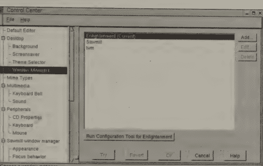

5. 在 `Command` 文本框中，输入运行此窗口管理器所需的实际命令。此命令通常是程序本身名称的小写形式。你可以通过查看窗口管理器的文档找到需要在此处输入的内容。
6. 在 `Configuration Command` 文本框中，输入用于打开窗口管理器配置工具（如果有的话）所需的命令。同样，如果有可用的配置工具，文档中将包含你需要输入的命令。
7. 单击 `OK`。现在，新条目已包含在控制中心窗口管理器列出的窗口管理器中。

### 在命令行中添加 GNOME 的窗口管理器

如果你想尝试为 `GNOME` 的个人账户使用一个新的窗口管理器，并且已经下载了它，请执行以下操作：

1. 登录你要更改窗口管理器的账户。
2. 输入 `vi ~/.xinitrc` 以打开或创建本地 X 配置文件。
3. 输入 `i` 进入 `vi` 的插入模式。
4. 在此处输入窗口管理器的路径。对于 `Enlightenment`，这将是 `/usr/bin/enlightenment`。
5. 按 Esc 键。
6. 输入 `ZZ` 以保存并退出。

### 在命令行中添加 KDE 的窗口管理器

如果你想尝试在 `KDE` 中使用一个新的窗口管理器并且已经下载了它，你实际上必须在命令行中添加它，而不是通过任何 `KDE` 工具：

1. 以 root 身份登录。
2. 输入 `vi /usr/bin/startkde` 以打开 `KDE` 启动脚本。
3. 输入 `/kwm` 并按 Enter 键，以搜索仅显示以下内容的那一行：

```
sleep 2; exec kwm
```

4. 将光标移至文本 `kwm`，并输入 `x` 三次以删除这三个字母。
5. 输入 `i` 进入 `vi` 的插入模式，位置在原来 `kwm` 文本所在的位置。
6. 输入其文档要求的窗口管理器名称。这只是单词命令，而不是完整路径。
7. 按 Esc 键。
8. 输入 `:w /usr/local/kde/bin/start*newname*` 以保存此版本的 `KDE` 启动脚本，并按 Enter 键。
9. 输入 `q` 退出文件。


10. 现在，如果你想在除超级用户账户之外的其他账户中使用此窗口管理器，请注销，然后登录到该账户。

11. 输入 `vi ~/.xinitrc` 以打开你的本地 X 配置文件。

12. 输入 `i` 进入 `vi` 的插入模式。

13. 输入 `/usr/local/kde/bin/start*newname*`，以便运行新的启动脚本。其他用户也可以这样做。

14. 按 `Esc` 键。

15. 输入 `ZZ` 以保存并退出。

### 添加主题

互联网上有许多定制主题。这些主题允许你围绕特定主题、颜色或形状设置桌面的外观和感觉。如果你已经下载了想要安装的主题，请遵循此处适当的说明以使其正常工作。

### 在 GNOME 中添加主题

如果你想尝试一个新的 `GNOME` 主题并且已经下载了它，请执行以下操作：

1. 单击 `Toolbox` 图标以打开 `GNOME` 控制中心。
2. 单击 `Desktop` 树下的 `Theme Selector` 以打开主题选择器对话框，如图 6.2 所示。
3. 单击 `Install New Theme` 按钮以打开选择要安装的主题对话框。
4. 浏览到你放置新主题的位置。
5. 单击新主题以选中它。
6. 单击 `OK`。你的新主题现在已包含在 `Available Themes` 列表框中。

### 在 KDE 中添加主题

如果你想尝试一个新的 `KDE` 主题并且已经下载了它，请执行以下操作：

1. 单击 `KDE Control Center` 图标以打开 `KDE` 控制中心。
2. 单击 `Desktop` 菜单旁的加号以展开它。
3. 单击 `Desktop` 菜单下的 `Theme Manager` 以打开主题管理器对话框，如图 6.3 所示。

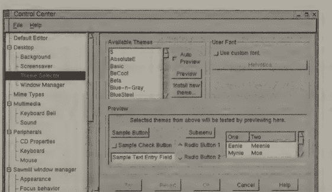

## 图 6.2 GNOME 控制中心主题选择器。

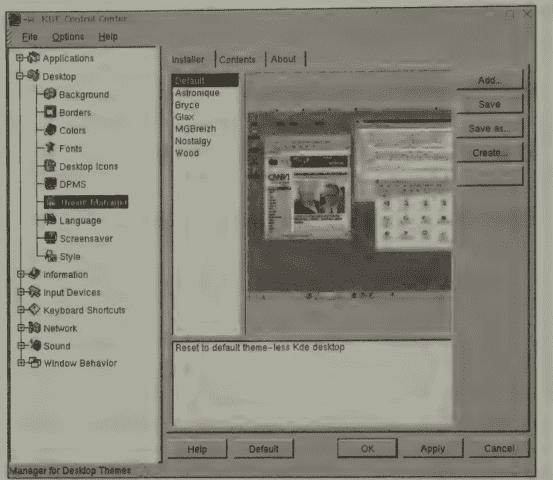

## 图 6.3 KDE 控制中心主题管理器。

4. 单击 `Add` 按钮以打开 `Add Theme` 对话框。
5. 浏览到你放置新主题的位置。
6. 单击新主题以选中它。
7. 单击 `OK`。你的新主题现在已包含在 `Installer` 列表框中。

### 添加所有用户都可以使用的主题

要作为超级用户添加主题，以便所有用户都可以使用，请执行以下操作：

1. 登录或 `su` 到 `root`。

> **注意**：`su` 命令代表超级用户。系统管理员，即 `root` 账户的所有者，是超级用户。这是系统中拥有最高用户权限的人。当你单独输入 `"su"` 时，系统假设你正在尝试获取 `root` 访问权限——并且没有 `root` 密码无法进入。如果你输入 `"su user"`，则假设你想获取对该用户账户的访问权限。然而，使用 `su` 命令与登录不同。你不会获得该用户的环境变量或 `shell` 设置。

2. 主题通常针对特定环境制定。若要为 `KDE` 添加主题，请更改到 `/usr/share/apps/kthememgr/Themes` 目录；若要为 `GNOME` 添加主题，请更改到 `/usr/share/themes` 目录。

3. 建议将任何附加主题保存在单独的目录中，以防你决定（或需要）在稍后删除它们。使用 `mkdir` 命令为新主题添加子目录，或使用类似于 `ls -la > themedir` 的命令对当前列表进行备份快照，以便知道原本在那里的是什么。

4. 将新主题放入新的或当前的主题目录中。

5. 检查目录和主题的权限，确保它们与父目录（在新主题目录的情况下）的权限相同，并且新主题的权限与其他主题的权限相同。

### 更改桌面环境

如果你已经设置为使用 `GNOME` 并想要更改为 `KDE`，或者反之，请执行以下操作：

1. 启动机器。
2. 登录到你想要配置 `GUI` 设置的账户。
3. 如果 `Linux` 主机没有自动进入 `GUI`，则输入 `startx` 以启动它。
4. 打开一个终端窗口，如第 1 章中 `GNOME` 或 `KDE` 的“获取命令行提示符”部分所述。
5. 在命令行提示符处输入 `switchdesk` 以打开桌面切换器对话框。
6. 单击你想要更改到的桌面环境。
7. 单击 `OK` 以接受更改。
8. 在打开的信息对话框中单击 `OK`。

### 重启 X 服务器

如何重启 `X` 服务器取决于你最初是如何启动它的。你可能让系统直接引导到 `GUI`，或者用户可能在使用 `X` 客户端时在命令行上手动启动它们的 `X` 客户端。

如果你通过输入 `startx` 启动 `GUI`，则没有单一命令可以停止服务器。然而，有一个相当快的过程允许你停止 `X` 会话并重新启动它：

1. 在 `GNOME` 中单击 `Footprint` 图标或在 `KDE` 中单击 `K` 图标以打开程序菜单。
2. 单击 `Logout` 或 `Log Out` 菜单选项。
3. 在对话框中选择 `Logout` 或 `Log Out` 选项。
4. 单击 `OK`。`X` 会话关闭。
5. 输入 `startx` 以启动新会话。

### 如果默认启动 X 时重启

如果你的设置默认将机器启动到 `GUI`，你可以通过执行以下操作来重启 `X`：

1. 以 `root` 身份登录。
2. 输入 `init 3` 以关闭 `GUI` 并返回命令行提示符。
3. 一旦进程守护程序停止且进程启动语句停止在屏幕上滚动，按 `Enter` 键一次。
4. 如果你收到登录提示，请登录到之前使用的同一账户。
5. 输入 `init 5` 以重新启动 `X` 和 `GUI`。

> **注意**：如果你不是以 `root` 身份执行此操作，那么 `init 3` 对你无效。相反，按 `Ctrl+Alt+F4`。这将使你退出 `GUI` 并进入命令行登录屏幕。然后你可以以 `root` 身份登录并在那里输入 `init 3`。一旦系统完成更改到运行级别 3，输入 `init 5` 以返回 `GUI` 并登录到你在开始此操作之前正在配置的用户账户。

### 更改默认运行级别

如果你的系统通常启动到 `GUI` 或命令行，并且你想反转此行为，请执行以下操作：

1. 以 `root` 身份登录。
2. 输入 `vi /etc/inittab` 以打开处理系统启动到何种登录环境的系统初始化文件。
3. 寻找类似以下的一行：

```
id:3:initdefault:
```

4. 数字是关键项。使用方向键将光标移动至该数字上方。
5. 输入 `r` 以开始替换字符。
6. 输入 `3` 可将系统修改为在命令行界面启动，或输入 `5` 将其修改为在图形用户界面（`GUI`）启动。
   **提示**：如果您使用的不是 `Red Hat Linux`，请查看本行上方，那里应该有关于您的发行版中可用运行级别（`run levels`）的说明。在此处输入相应的数字或字母即可。
7. 按 `Esc` 键，然后输入 `ZZ` 以保存并关闭文件。下次重启时，这些更改将生效。


## 第 7 章

## 网络配置

| 如果您需要立即解决： | 参见页码： |
|---|---|
| 配置网络 | 186 |
| 获取一组 `IP` 地址 | 187 |
| 注册域名 | 187 |
| 检查域名是否已被占用 | 189 |
| &emsp;使用 `Linux` 检查核心域名是否已被占用 | 189 |
| &emsp;使用任意操作系统下的 `Web` 浏览器检查域名是否已被占用 | 189 |
| 确定 `C` 类网络划分子网的数值 | 189 |
| 将子网数值应用于网络 | 191 |
| 表示地址范围 | 192 |
| 为局域网手动配置基本静态网络 | 192 |
| 使用 `Linuxconf` 为局域网配置基本网络 | 193 |
| 添加虚拟站点 | 196 |
| 在命令行下为接口分配多个 `IP` 地址 | 197 |
| 在 `Linuxconf` 中为接口分配多个 `IP` 地址 | 197 |
| 在命令行下配置第二个网络接口 | 198 |
| 在 `Linuxconf` 中配置第二个网络接口 | 199 |
| 在命令行下设置路由 | 200 |
| 使用 `Linuxconf` 设置路由 | 201 |
| &emsp;配置基本路由 | 201 |
| &emsp;配置您网络之间的路由 | 202 |
| &emsp;配置到远程主机的路由 | 203 |
| &emsp;为并发网络配置路由 | 203 |
| 在 `Linuxconf` 中配置路由守护进程 | 204 |
| 设置 `IP` 伪装（`Masquerading`） | 205 |
| 设置拨出连接 | 206 |
| 配置 `Linuxconf` 进行连接 | 208 |
| 配置 `Minicom` 进行连接 | 209 |
| 配置 `kppp` 进行连接 | 210 |
| 设置 `DHCP` 服务器 | 213 |


| 配置 `pump` 客户端 | 214 |

| 远程管理机器 | 216 |

### 深入探讨

大多数 Linux 系统管理员都会对网络配置非常熟悉。关于如何组织和实施您的网络，您有很多可选方案。关键在于了解这些选项是什么，它们适用于什么情况，以及如何实施它们。本章将介绍设置并运行网络的基础知识。

### Linux 网络简介

Linux 的一个优势是作为网络服务器。Linux 网络天然地说着与互联网相同的“语言”，这使得提供互联网服务以及连接 Linux 局域网（`LAN`）变得相当轻松，因为中间不需要翻译设备。在开始配置 Linux 网络之前，您需要了解一些传输控制协议/互联网协议（`TCP/IP`）的知识，这是计算机在互联网上进行通信所使用的语言。`TCP/IP` 实际上是一组共同协作以实现互联网和 `TCP/IP` 网络之间平滑通信的协议。每个协议都有非常具体的职责。

### TCP/IP 寻址

当网络或一组网络中的所有机器相互通信时，网络协议需要一种方式来确定消息来自哪台机器以及消息发往哪台机器。`TCP/IP` 使用 `IP` 寻址来实现这一目的。

您可能以前见过 `IP` 地址。它的格式为 `xxx.xxx.xxx.xxx`，其中每组三位数字可以是 0（`000`）到 255 之间的任意值。这些地址被分解为网络部分和主机部分。在寻址格式的约束条件下，这些组件的大小是可变的。`TCP/IP` 能够通过第一个三元组（三个数字的组合）来确定哪部分是网络部分。第一个三元组中可能出现的数字范围被划分为不同的类别。这些类别列在表 7.1 中。

`TCP/IP` 确定 `IP` 地址属于哪个地址类别后，它就知道地址的哪一部分用于网络，哪一部分用于主机，如图 7.1 所示。

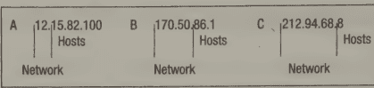

图 7.1 在三大主要 `IP` 类别中，哪部分指代网络，哪部分指代主机。

### 表 7.1 IP 地址类别。

| 类别 | 范围 |

|---|---|

| `A` | `0.0.0.0` 至 `127.255.255.255` |

| `B` | `128.0.0.0` 至 `191.255.255.255` |

| `C` | `192.0.0.0` 至 `223.255.255.255` |

| `D` | `224.0.0.0` 至 `239.255.255.255` |

| `E` | `240.0.0.0` 至 `247.255.255.255` |

由于目前通常只分配 `C` 类及更小的地址，因此本书中的示例均在 `C` 类参数范围内。

还有一个特殊的地址，所有使用 `TCP/IP` 的机器都共享该地址。该地址是 `127.0.0.1`，称为回环地址。`IP` 地址 `127.0.0.1` 始终指向您当前所在的机器。如果您想通过名称指代它，请使用“`localhost`”。

### 协议

正如我前文提到的，`TCP/IP` 是一组协议，它们共同推动互联网及相关网络上的流量传输。作为一种将协议归入相似类型的方法，一系列层次分别指代 `TCP/IP` 体系结构中特定级别的功能。这些层次从下到上通常被称为本地网络层、互联网层、传输层和应用层——名称在不同人之间可能略有差异，但理解每个层的作用有助于消除困惑。

### 本地网络层

在 `TCP/IP` 层次的最底层是本地网络层，这是一切开始的地方。我们指的是那些在您和其他人的局域网（`LAN`）（或他们所使用的任何解决方案）上传输信息的协议。这一层甚至包括运行调制解调器的协议。驻留在该 `TCP/IP` 层中的项目包括网络设备驱动程序，例如以太网卡驱动程序和调制解调器驱动程序。

当流量进入局域网本身时，本地网络层接管控制权，并决定流量何时离开局域网。

### 互联网层

互联网层是 `TCP/IP` 中 `IP` 协议所在的位置。该层负责告知数据如何从一个网络传输到互联网上的另一个网络，或其所处网络内的其他部分。`IP` 理解互联网寻址，将数据分解以便在互联网上旅行，并在数据到达目的主机或网络时重新组装数据，必要时确保其到达正确的子网。

`IP` 数据包被称为`数据报`（`datagrams`）。每个数据报都有一个与之相关的头部，包含以下信息：

- `产生该数据包的互联网协议版本`——在最终迁移到 `IPv6` 之前，这一直是第 4 版。

- `头部有多大`——该头部由称为`字`（`words`）的四字节块组成。头部长度以块的数量给出，因此乘以 4 后即为适当的头部长度。

- `服务类型`——该字段目前未被使用，但考虑到可能会引入数据包优先级机制而包含在内。然而，某些操作系统和协议确实将其用于自身目的。通常，其值为 0。

- `长度`——该数据报有多少字节长。

- `标识符`——一个识别编号，允许接收方定位该数据报在发送的数据包序列中的位置。这对于正确重新组装数据至关重要。

- `标志`——一个或多个设置，决定可以对该数据报执行哪些操作以及不能执行哪些操作。目前有三种可能的选择。第一种表示没有标志。第二种状态该数据报不能被`分片`（`fragmented`），即不能分解成片段。第三种指定它已被分解成片段，且这不是最后一个片段。

- `是哪个片段`——如果数据包被分片，这是该片段在完整数据报中的位置度量。

- `生存时间`（`TTL`）——该数据报在互联网上可以存在多少秒。如果时间耗尽时它仍在尝试前往目的地，该数据报将被删除。

- `协议`——具体指该数据包的数据属于哪个协议。完整列表可在 `www.faqs.org/rfcs/rfc762.html` 中的“Assigned Internet Protocol Numbers”部分找到。


- `报头校验和`—基于报头内容计算得出的数值，在报头首次构建时以及每次变更时都会重新计算。接收方机器会进行相同的计算，并确保其得到的数值与原始数值一致。如果数值不一致，则说明报头已损坏，需要从源端请求数据报的新副本。

- `源 IP 地址`—数据报发出的 `IP` 地址。

- `目的 IP 地址`—数据报要送往的 `IP` 地址。

- `选项`—可以附加在报头上的各种选项。除了建立 `TCP/IP` 连接时，通常很少使用。

- `零`—`IP` 报头的最后一部分是一串零，确保整个报头的大小是 32 的因数。

> **提示**：请访问 [www.faqs.org/rfcs/rfc760.html](https://www.faqs.org/rfcs/rfc760.html) 阅读关于 `IP` 数据报如何组装的官方规范。

## 传输层

传输层实际负责在互联网上移动数据。主要使用两种协议来实现此目的：`TCP`（传输控制协议）和用户数据报协议（`UDP`）——不要将其与前一节讨论的术语 `datagram`（数据报）混淆。

`TCP` 处理需要稳定连接且具备错误检查和恢复机制的服务。其数据以流的形式发送，其中每个部分都按顺序编号，如果未在对端接收，则会重新发送。每个网络都会设置一个称为 `最大传输单元` (`MTU`) 的值，声明该网络处理的最大数据包大小。当数据包的大小超过 `MTU` 时，`TCP` 会将其拆分为`片段`（`fragments`），即数据包的组成部分。每个片段都有自己独立的报头信息，其中包含重新组装数据包所需的所有内容。如果汉普迪·邓普蒂（Humpty Dumpty）也能如此有条理就好了。

另一方面，`UDP` 不进行任何错误检查，甚至不会真正与接收机器建立连接。然而，它仍然有其用途，既适用于非常少量的数据，也适用于非常大的数据。在流式音频或视频之类的场景中，并非每一个字节都必须到达其源（注：原文应为 destination 或接收端，此处按原文直译），等待重传可能会比丢失一些片段带来更糟糕的结果。在具有近乎理想吞吐量的局域网（`LAN`）上，`UDP` 也很有用。事实上，在这种情况下，`UDP` 比 `TCP` 更快，因为没有错误检查的开销。

## 应用层

`TCP/IP` 协议分组的最顶层是应用层，各种利用互联网的程序都位于此处：使用超文本传输协议（`HTTP`）的 Web 浏览器、从服务器获取文件的文件传输协议（`FTP`）客户端、通过简单邮件传输协议（`SMTP`）发送邮件的邮件程序，以及更多。这些协议各有其工作方式，但在某个阶段，每个协议都会向互联网层传递和接收数据。表 7.2 列出了更流行的应用层协议及其使用 `TCP` 还是 `UDP` 的情况。

**表 7.2** 应用层协议及其关联的互联网层协议。

| 应用层协议 | 互联网层协议 |

| :--- | :--- |

| `DNS` | `UDP` |

| `FTP` | `TCP` |

| `HTTP` | `TCP` 和 `UDP` |

| `NFS` | `UDP` |

| `POP3` | `TCP` |

| `SMTP` | `TCP` |

| `Telnet` | `TCP` |

> **注意**：要查看用于哪些互联网服务的应用层协议和互联网层协议的完整列表，请参阅文件 `/etc/services`。

有关于将 `NFS` 迁移到 `TCP` 的讨论。虽然这不是一个立即面临的问题，但这表明用于传输信息的互联网层协议并非一成不变。

## 网络地址组件


局域网（LAN）或其他类型的网络有一系列特殊地址，必须正确分配才能使一切正常工作。其中一些地址是为你选定的，但你需要了解它们，以免尝试将它们分配给工作站。其他地址你可以自行选择，但你会发现传统或必要性会引导你的选择。

### 子网掩码地址

你可能遇到的第一个特殊地址是`netmask`（子网掩码）。默认情况下，`表 7.3` 中的子网掩码用于主要地址类别。

只要讨论的是整个地址类别（无论哪个类别），这些子网掩码都保持不变。然而，当你涉及到`subnetting`（子网划分）——将你的网络划分为一组较小的网络——或者仅拥有被拆分的 C 类地址集中的一部分时，你必须调整子网掩码以反映这一事实。更多信息请参阅“将子网值应用于网络”一节。

**表 7.3** 标准子网掩码。

| 类别 | 子网掩码 |
| :--- | :--- |
| A | 255.0.0.0 |
| B | 255.255.0.0 |
| C | 255.255.255.0 |

### 网络地址

`网络地址`是等式的另一半，它与子网掩码一起告诉 TCP/IP 你的网络有多大。这两个数以二进制格式相加必须等于零。如何实现这一点在“将子网值应用于网络”一节中有所介绍。通常，如果你有一个 C 类网络，那么你的网络地址以 `.0` 结尾。例如，C 类局域网中机器 `192.168.15.12` 的网络地址是 `192.168.15.0`。

### 网关地址

你需要知道另一个项目是`网关地址`。这个实际上相当直接。网关是流量需要穿越以到达另一个网络的接口，无论是局域网的另一部分还是互联网。因此，例如，如果你有一个简单的局域网，其中一台机器有一张管理其互联网连接的以太网卡，那么该以太网卡的 IP 地址就是网关地址。

### 广播地址

`广播地址`通常是你的 IP 地址块中最后一个可用地址。广播地址用于向网络上的所有机器同时发送数据。然后你可以单独配置机器，确定每台机器是否应监听广播信息。

### 虚拟机

`虚拟托管`（Virtual hosting），即拥有不同名称的网站共享同一硬件，这是互联网上日益普遍的问题。此服务并不难以实现，但除了将虚拟站点信息添加到主机数据库外，没有集中的设置方式。更多信息请参阅“添加虚拟站点”一节。

在基本站点信息就位后，配置虚拟网络服务的问题在于正确设置相关服务。每项服务的具体细节将在介绍该服务本身时涵盖。例如，要设置虚拟邮件服务，请参阅介绍电子邮件的第 12 章。

## 扩展你的地址基础

随着 IP 地址紧张状况越来越严重，说服服务商分配超过其内部设定的标准数量的 IP 地址变得越来越困难。虽然子网划分是增加地址基础的一个选项，但如果你至少给其中一个子网一组仅限内部使用的地址（如`表 7.4` 所示），另一个选项被称为 IP 伪装。使用此技术时，你可以将一台机器设置为伪装服务器，让它告诉全世界它是发送所有命令的那个。然后它在双向传递数据，使得位于其后的机器可以假装它们也连接到世界。

**表 7.4**

**保留用于隔离网络的 TCP/IP 地址。**

| 类别 | 地址范围 |
|:----|:----|
| A | 10.0.0.0 到 10.255.255.255 |
| B | 172.16.0.0 到 172.31.255.255 |
| C | 192.168.0.0 到 192.168.255.255 |

有关如何设置此服务的详细信息，请参阅“立即解决方案”部分的“设置 IP 伪装”。实际上，使用伪装有两个不同的原因：刚才描述的那个原因，以及另一个与安全相关的原因（在第 9 章中详细介绍）。

## 路由器

当你有一个以上的网络在通信 TCP/IP 时，你需要至少一台机器负责管理流量去往哪个网络。在单个网络中，这台机器是网关，即向外部世界传递流量并从外部世界接收流量的计算机。然而，你可能拥有多个网络。你可能将局域网或其他网络类型划分为子网络，通常称为子网。这些子网中的每一个都是拥有自己 IP 地址池的独立网络。然而，这种配置带来的问题是，流量通过一个网关进入和离开整个网络。

如果没有某种集中管理，数据不知道该去往哪个子网络。提供此流量控制功能的机器称为路由器。通常，路由器并非专门用于该任务——它还可以作为网关或其他类型的服务器。Linux 机器是非常出色的路由器，尽管你也可以购买专用盒子来满足此需求。

路由器处理多个问题。这些项目中的大多数涉及将地址信息从一种格式转换为另一种格式。其中一个是地址解析协议（ARP）。该工具的功能相当具体：它将 IP 地址与硬件地址匹配。在以太网网络寻址的情况下，硬件通过媒体访问控制（MAC）地址来识别，这是分配给以太网卡的字母数字代码。每张以太网卡都有唯一的 MAC。


## C 类地址片段

如今，除非你有明确的必要证明，否则很难获得一个完整的 C 类地址。你最可能会获得一组来自上游提供商的 C 类地址中的片段。这种情况会导致一个噩梦，即试图仅为 C 类地址的一部分确定子网掩码和其他项目。

新的路由协议被要求简化这一过程。这些协议以全新的视角看待互联网寻址。它们完全摒弃了地址类别的概念，转而使用`无类别路由`。这种类型的数据路由不仅发送 IP 地址，还发送一个掩码，该掩码表明了网络位在哪里结束以及主机位从哪里开始，而不是假设所有以特定数字范围开头的机器都具有相同位置的网络位和主机位。

无类别路由允许一些有趣的技巧。你可以使用它将网络划分为不同大小的子网，而不必使它们都保持相同的大小。它还允许人们创建子子网、子子子网，甚至如果他们有需求的话，创建更深层次的子网。虽然这种网络方式的细节超出了本书的范围，但你可以在 Thomas A. Mauf er 所著的 `IP Fundamentals`（《IP 基础》）中进一步了解相关内容。

## 集中管理的网络

你的网络越大，添加每台新机器就越成负担。向网络中添加新机器需要编辑每个 `/etc/hosts` 文件、在新机器上添加用户账户和密码、让用户更改他们的密码等等。幸运的是，有各种工具可用，使系统管理员的生活更轻松。

## 按需 IP 地址

在大型网络上的每台机器上维护寻址信息列表既耗时又问题重重。如果网络需要重新配置、机器需要经常移动，或者由于初始地址分配后的增长导致机器数量超过可用地址数量，这个问题尤其麻烦。使用动态主机配置协议（DHCP）服务，你可以在机器启动时随机分配 IP 地址，或者为它们分配永久 IP 地址。此外，你还可以分发子网掩码、分配名称，并指定机器应使用的名称服务器地址。Red Hat Linux 中的 `pump` 程序同时处理 DHCP 和旧的自举协议（BOOTP）服务。

> **提示：** 在 IP 地址不足且并非所有人需要同时连接的情况下，DHCP 特别有用。

Red Hat 6.2 附带了互联网软件联盟（ISC）的 DHCP/BOOTP 服务器。第 2 版能够在分发之前测试 IP 地址是否已被使用。如果你出于任何原因想要获取此服务器的源代码，请访问 `www.isc.org/products/dhcp/`。

ISC DHCP/BOOTP 服务器的配置文件是 `/etc/dhcpd.conf`。该文件包含一系列参数、选项和声明，它们共同构成了服务器分配规则和行为的定义。这些项目涉及由 DHCP 服务器分发的`租约`。把 DHCP 想象成一家汽车租赁公司。你请求一辆车，租赁公司将其租赁给你一段时间。DHCP 以类似的方式工作。客户端请求地址分配，服务器向其租赁成为网络一部分所需的 IP 寻址信息。

参数语句紧凑且直观。其中许多列在`表 7.5` 中。你使用以下格式的参数：

```
parameter values;
```

选项也是一行项目。常用选项的列表可在`表 7.6` 中找到。你使用以下格式的选项条目：

```
option option value;
```

### 表 7.5 /etc/dhcpd.conf 中可用的一些参数。

| 参数 | 用途 | 值 |
|:-------------|:--------------------------------------------|:--------------------------|
| `authoritative` | 默认值。意味着服务器对客户端的有效 IP 地址有最终决定权。如果客户端请求一个服务器认为不合适的 IP 地址，服务器会使其请求一个新的地址。 | 无。 |
| `default-lease-time` | 如果客户端未请求特定时长，分配给客户端的租约时长。 | 保持租约的秒数。 |
| `filename` | 客户端所需的启动文件。通常与第 10 章中介绍的 KickStart 工具配合使用。 | 客户端操作系统所需格式的文件路径。 |
| `fixed-address` | 为客户端分配一个或多个特定的 IP 地址。仅在主机声明中使用。 | IP 地址或逗号分隔的列表。 |
| `get-lease-hostnames` | 当 IP 地址分配给机器时，查找分配给该 IP 地址的主机名，并将其作为主机名选项分配。 | 开或关。默认为关。 |


| `max-lease-time` | 服务器愿意允许客户端持有租约的最长时间。 | 以秒为单位的时长。 |

| `next-server` | 如果包含启动文件的服务器与 DHCP 服务器不是同一个，此参数显式声明在哪里查找。 | 启动文件服务器的 IP 地址。 |

| `not authoritative` | 服务器不一定比客户端更了解对客户端有效的 IP 信息。假设客户端的 IP 请求是正确的。 | 无。 |

| `server-name` | 告诉客户端 DHCP 服务器的名称。 | 加引号的服务器名称。 |

| `use-host-decl-names` | 告诉 DHCP 服务器始终将主机声明中使用的名称作为机器的主机名分配。 | 开或关。 |

| `use-lease-addr-for-default-route` | 仅适用于 Windows 95 机器。不要用于 Linux 机器。 | 开或关。 |

### 表 7.6 `/etc/dhcpd.conf` 中可用的大多数选项。

| 选项 | 用途 | 值 |

|:---|:---|:---|

| `all-subnets-local` | 客户端应假设同一网络中的所有子网使用相同的 MTU 大小。 | 1 表示是，0 表示否。 |

| `arp-cache-timeout` | 数据在 ARP 缓存中保留多长时间后被删除。 | 以秒为单位的时间。 |

| `bootfile-name` | 客户端应使用的启动文件。这与 `filename` 参数相同，但某些客户端需要它。 | 文件的完整路径。 |

| `broadcast-address` | 此客户端的子网广播地址。 | 广播 IP 地址。 |

| `default-ip-ttl` | 客户端应分配给所有 IP 包的生命周期值。 | |

| `default-tcp-ttl` | 从客户端发送的 TCP 包的默认生命周期。 | 大于 1 的正整数。 |

| `dhcp-client-identifier` | 为 DHCP 客户端分配唯一的标识符。 | 加引号的标识字符串。 |

| `domain-name` | 此客户端在名称查找目的下所属的域和扩展名。 | 加引号的域和扩展名。 |

| `domain-name-servers` | 这些客户端应使用的域名服务器列表。 | 逗号分隔的 IP 地址列表。 |

| `host-name` | 指定客户端的主机名。 | 加引号的主机名。 |

| `interface-mtu` | 指定此客户端应使用的 MTU。 | 正整数，68 或以上。 |

| `ip-forwarding` | 允许你声明是否计划使用 `ipchains` 在客户端上设置 IP 转发。 | `0` 表示否，`1` 表示是。 |

| `irc-server` | 客户端可用的 IRC 服务器。 | 逗号分隔的 IP 地址列表。 |

| `merit-dump` | 指定发生崩溃时核心文件应存放的位置。有助于自动清理核心文件。 | 包含文件名的路径。 |

| `nis-domain` | 客户端所属的 NIS 域。 | 加引号的域名称。 |

| `nis-servers` | 此客户端可以访问的 NIS 服务器。 | 逗号分隔的 IP 地址列表。 |

| `nisplus-domain` | 客户端所属的 NIS+ 或 NYS 域。 | 加引号的域名称。 |

| `nisplus-servers` | 此客户端可以访问的 NIS+ 或 NYS 服务器。 | 逗号分隔的 IP 地址列表。 |

| `nntp-server` | 此客户端可以访问的 NNTP 服务器。 | 逗号分隔的 IP 地址列表。 |

| `ntp-servers` | 此客户端可以访问的 NTP 服务器。 | 逗号分隔的 IP 地址列表。 |

| `pop-server` | 此客户端可以访问的 POP 服务器。 | 逗号分隔的 IP 地址列表。 |

| `routers` | 此客户端可以访问的路由器。 | 逗号分隔的 IP 地址列表。 |

| `smtp-server` | 此客户端可以访问的 SMTP 服务器。 | 逗号分隔的 IP 地址列表。 |

| `static-routes` | 添加到路由缓存中的路由列表。 | 逗号分隔的对列表——先是目标网络，其次是用于到达该网络的路由器。 |


183

## 第 7 章 网络

**表 7.6 `/etc/dhcpd.conf` 中可用的大部分选项（续）。**

| 选项 | 用途 | 值 |

| :--- | :--- | :--- |

| `subnet-mask` | 客户端的子网掩码。 | IP 地址。 |

| `tcp-keepalive-interval` | 发送用于保持 TCP 连接活跃消息的频率。 | 发送前等待的秒数。0 表示默认不执行此操作。 |

| `time-servers` | 该客户端可访问的时间服务器。 | 以逗号分隔的 IP 地址列表。 |

| `www-server` | 该客户端可访问的 Web 服务器。 | 以逗号分隔的 IP 地址列表。 |

说到声明（declarations），以通用格式给出时，它们看起来有点奇怪：

```
declaration {
   parameter1
   parameter2
   ...
   parametern
   declaration1
   declaration2
   ...
   declarationn
}
```

正如你所见，在构建 `dhcpd.conf` 文件时，你经常会在其他声明内部嵌套声明。可用的声明列表如表 7.7 所示。

**表 7.7 `/etc/dhcpd.conf` 中可用的声明。**

| 声明 | 用途 | 子声明问题 |

| :--- | :--- | :--- |

| `group` | 用于对一系列声明应用相同的参数。 | 不能包含 `range`。 |

| `host` | 用于对特定主机（由其 MAC 地址标识）应用参数。 | 无。 |

| `range` | 定义相关子网中的地址范围。 | 不允许子声明。 |

| `shared-network` | 指定哪些子网共享相同的网络线缆。 | 必须在此语句内部声明子网。 |

| `subnet` | 特定子网的标识信息和设置。 | 无。 |

### 集中式账户管理

有时，管理大型网络最令人沮丧的部分是确保所有机器都具有正确的用户账户信息。你可能并不希望所有用户都在所有机器上拥有账户，但如果你需要进行某种跨平台操作且有很多用户进出，那么跟上账户的管理可能会非常令人沮丧且耗时。许多管理员利用 NIS 或 NIS+ 包来集中管理账户。这些包在第 16 章中有详细介绍。

### 即时解决方案

#### 配置网络

要配置你的网络，请遵循以下一般步骤：

1. 你的起点取决于你正在设置什么类型的连接：

   - 如果你正在设置调制解调器连接，请参阅本章后面部分的“设置拨出连接”。

   - 要为内部局域网（LAN）连接设置基本网络信息，请前往“手动配置局域网的基本静态网络”或“使用 `Linuxconf` 配置局域网的基本网络”。

> **注意：** 如果你需要设置一个 LAN 和一个将 LAN 连接到外部世界的调制解调器连接，请从配置 LAN 内部开始，最后配置 PPP 连接。

2. 测试连接。尝试与外部世界通信。如果你刚刚设置了一个 LAN，请确保机器可以在网络内部和外部进行通信。

3. 在继续之前，加固你的安全性——如第 9 章所述——或者，至少在现阶段完成该区域的一些初步工作。

4. 设置域名解析，如第 11 章所述。

5. 设置其他互联网和网络服务，如电子邮件、Web 等。

6. 完成安全性的加固工作。

**相关解决方案：**

| 相关解决方案 | 所在页码 |

| :--- | :--- |

| 关闭不必要的守护进程和后台进程 | 264 |

| 关闭不必要的非守护进程网络服务 | 267 |

| 使用 `tcp_wrappers` 限制网络访问 | 267 |

| 移除不必要的软件包 | 279 |

| 分析日志 | 281 |

| 为入侵做准备 | 282 |

| 使用 `Crack` 保护密码 | 284 |

| 设置密码规则 | 285 |

| 设置 IP 防火墙 | 287 |

| 设置代理防火墙 | 289 |

| 配置主名称服务器 | 336 |

### 获取一组 IP 地址

如果你打算使用不仅限于内部局域网的网络（内部使用保留网络编号，请参阅本章前面的表 7.4 中的编号列表），那么你需要为你的网络注册一组 IP 号码。要获取这些号码，请执行以下操作：

1. 确定你当前的主机数量以及未来几年内可能添加到 LAN 的主机数量。保留一定的误差余量是好的，但不要过度。互联网面临地址短缺，因此当前 IP 分配的准则是只获取你需要的数量。


### 2. 如今，IP 地址通常由互联网服务提供商（ISP）从其指定的地址块中分配。与你的上游服务代表交谈，以了解他们可以提供哪些范围。

### 注册域名

在你获取了网络的 IP 地址后，如果你想在互联网上使用你的网络，你需要注册一个域名。要查找可用名称并注册它，请执行以下操作：

1. 列出适合你域名的名称类型。暂时只关注名称部分，而不是扩展名。当你拥有至少五个可能性列表后，进入步骤 2。
2. 确定适合你网站的扩展名集合。有两个可用的组。其中一个组基于你所在的国家。完整的可用国家扩展列表可在 `http://metalab.unc.edu/pub/docs/rfc/rfc1394.txt` 上找到。另一个可用组是一组核心扩展，如表 7.8 所示。
3. 现在可能最令人沮丧的部分来了。许多域名已被占用。请参阅下一节“检查域名是否已被占用”，以浏览各种可用的域名和扩展组合。最终决定取决于几个因素：
   - 哪个扩展名最适合你的网站？仔细阅读每个主要扩展名的用途。虽然该系统提供了一些灵活性，但你需要确保网站的完整名称给予正确的印象。这个问题包括网站是用于本地还是国际目的，以及它是否符合某些更受限扩展名设定的规则。金钱也是一个因素。某些扩展名比其他扩展名更昂贵。
   - 在你选择的扩展名下，你的列表上有哪些名称变体可用？在最坏的情况下，你列表上的每一项都已被占用。如果发生这种情况，你需要制作另一个列表。使用更多的变体，甚至考虑一个新的基本名称。选择同义词时，同义词词典会很有用。
   - 确定你要在哪里注册域名。你不再必须使用中央注册机构 `InterNIC`，它现在被称为 `Network Solutions` (`www.networksolutions.com`)。其他公司也处理域名注册。这些公司的列表可在 `www.icann.org/registrars/accredited-list.html` 上找到。
   - 按照你选择的注册表说明注册域名。
   - 等待适当的小时数，让你的名称信息在根服务器之间传播。每个注册表的说明都会告诉你等待多长时间。在此期间，你可以根据第 11 章中的说明配置你的名称信息。

**相关解决方案：**

| 相关解决方案 | 所在页码 |
| :--- | :--- |
| 配置主名称服务器 | 336 |
| 配置从名称服务器 | 338 |

**表 7.8 核心域名扩展名。**

| 扩展名 | 用于 |
| :--- | :--- |
| `.com` | 商业网站 |
| `.edu` | 教育网站 |
| `.gov` | 美国政府网站 |
| `.mil` | 美国军事网站 |
| `.net` | 不一定属于其他区域的大型网络 |
| `.org` | 组织，包括商业和非商业 |

### 检查域名是否已被占用

许多域名已被注册或正在使用。仅仅查看该域名是否有网站是不够的。该域名可能没有网站——毕竟，不是所有人都使用 Web——或者域名投机者可能拥有该名称，但他们没有计划使用这块“房地产”。这些人购买域名只是为了以更高的价格转售。这个令人沮丧的事实困扰着许多试图寻找有用且可用的名称的人。

#### 使用 Linux 检查核心域名是否已被占用

在 Linux 中，要查看核心域名是否已被占用——基本上是 `.com`、`.edu` 或 `.net`——请输入 `whois domain.extension`。

> **注意：** 如果命令在你的机器上不存在，请安装 `whois` RPM。

**相关解决方案：**

| 相关解决方案 | 所在页码 |
| :--- | :--- |
| 安装 RPM | 114 |

#### 使用任何操作系统下的 Web 浏览器查看域名是否已被占用

如果你想查看域名是否已被占用，但你尚未使用 Linux 或当前没有坐在 Linux 机器前，请前往 `www.networksolutions.com/cgi-bin/whois/whois` 并在那里进行搜索。请注意，页面底部提供了指向其他搜索服务的指针。

### 确定 C 类网络子网划分的值

对网络进行子网划分可能是一个快速简单的任务，也可能是一个耗时且令人沮丧的工作。它变成哪种结果——或者是介于两者之间的某种情况——取决于你可用的地址范围以及你需要创建多少个子网及其大小。要将你的可用地址划分为子网，请执行以下操作：

1. 如果你有一个 C 类网络，通过选择正确的子网掩码将其划分为子网。首先，大致决定你希望在每个子网上放置多少台机器。
2. 知道每个子网需要多少台机器后，查看表 7.9 中每个子网可容纳的主机数量列表。

#### 表 7.9：C 类地址空间的子网划分

| 子网数量 | 每个子网的主机数 |
| :--- | :--- |
| 2 | 127 |
| 4 | 63 |
| 8 | 32 |
| 16 | 15 |

> **注意：** 此表提供的是近似值，因为至少会因网络问题损失两个地址。

3. 确定用于子网划分网络的子网掩码。请参见表 7.10，根据您将整个 C 类地址池划分的方式来确定应使用的子网掩码。
4. 确定每个子网段的 IP 地址范围。使用表 7.9 中确定的值来构建这些范围。“每个子网的主机数”列中的数值即为您的边界线。例如，如果您正在创建四个子网，那么每个子网有 63 台主机。这将为您提供以下地址范围集：
   - `.0` 到 `.63`
   - `.64` 到 `.127`
   - `.128` 到 `.191`
   - `.192` 到 `.255`
5. 将每个子网的子网网络地址从可用地址中移除。表 7.11 显示了划分为 2、4、8 和 16 部分的 C 类子网的子网网络地址。
6. 将每个子网的子网广播地址从可用地址中移除。表 7.12 显示了划分为 2、4、8 和 16 部分的 C 类子网的子网广播地址。您现在可能开始看出其中的规律了。

#### 表 7.10：C 类子网划分的子网掩码

| 子网数量 | C 类子网掩码 |
| :--- | :--- |
| 2 | `255.255.255.128` |
| 4 | `255.255.255.192` |
| 8 | `255.255.255.224` |
| 16 | `255.255.255.240` |

#### 表 7.11：C 类网络常用的子网网络地址结尾。

| 子网数量 | 子网网络地址结尾 |
| :--- | :--- |
| 2 | `.0`, `.128` |
| 4 | `.0`, `.64`, `.128`, `.192` |
| 8 | `.0`, `.32`, `.64`, `.96`, `.128`, `.160`, `.192`, `.224` |
| 16 | `.0`, `.16`, `.32`, `.48`, `.64`, `.80`, `.96`, `.112`, `.128`, `.144`, `.160`, `.176`, `.192`, `.208`, `.224`, `.240` |

#### 表 7.12：C 类网络常用的子网广播地址结尾。

| 子网数量 | 子网广播地址结尾 |
| :--- | :--- |
| 2 | `.127`, `.255` |
| 4 | `.63`, `.127`, `.191`, `.255` |
| 8 | `.31`, `.63`, `.95`, `.127`, `.159`, `.191`, `.223`, `.255` |
| 16 | `.15`, `.31`, `.47`, `.63`, `.79`, `.95`, `.111`, `.127`, `.143`, `.159`, `.175`, `.191`, `.207`, `.223`, `.239`, `.255` |

## 将子网值应用于网络

虽然本章并不旨在教授所有网络基础知识，但在部署子网时，您应记住以下几点：

- 跨越两个网络的机器必须各自配置为路由器，以便内核知道应将发往各个网络的数据发送到哪里。
- 跨越两个网络的机器需要为每个网络配备一个不同的接口。因此，例如，如果该机器是连接两个不同以太网子网的路由器，则它必须配备两块网卡，每块网卡对应一根网线。
- 第一个和最后一个子网不能用于主机。第一个子网保留用于子网标识，最后一个保留用于整个网络的广播。
- 子网内的第一个和最后一个地址不能用于主机。第一个是该子网的网络地址，最后一个是广播地址。

## 表示地址范围

若要表达未被网络号划分的 IP 地址范围，请执行以下操作：

1. 确定您要引用的连续地址范围。例如，`192.168.40.0` 到 `192.168.40.20`。
2. 确定该范围所属的 IP 地址类别。在此示例中，`192` 是 C 类地址。
3. 确定该地址类别的子网掩码。C 类地址的子网掩码为 `255.255.255.0`。此基本子网掩码指向整个网络。在这种情况下，最后的 `0` 表示包含从 `0` 到 `255` 的任何数字。
4. 表示此地址范围的格式是 `地址/掩码`，其中地址是范围的起始位置，掩码是反映范围大小的子网掩码。因此，表达式的开头部分是 `192.168.40.0`。要计算第二部分，从 `255.255.255.255` 开始。现在，从子网掩码的最后一部分减去 `20`，使其变为 `255.255.255.235`。您的地址对现在是 `192.168.40.0/255.255.255.235`。

## 为局域网手动配置基本静态网络

要设置基本 TCP/IP 网络，请执行以下操作：

> 注意：如果您正在设置拨号连接，请参见本章稍后的“设置拨号连接”，而不是遵循局域网和其他以太网网络部分。


1. 在命令行中以 `root` 身份登录。

> 注意：您可以在命令行模式下或在 GUI 中的终端窗口内执行此操作。

2. 输入 `vi /etc/hosts` 以打开包含主机到 IP 地址映射信息的文件。

3. 默认情况下，该文件中的第一行看起来类似于以下内容：

```
127.0.0.1 localhost
```

保留此行至关重要。`localhost` 定义允许您回环到本机，意味着您可以连接回本机而不必使用网络接口。

4. 如果您在 `Red Hat` 安装过程中配置了基本网络信息，则可能在 `localhost` 行之后出现另一行。该行的格式如下：

```
IPAddress FullDomain HostNameOrNickname
```

例如，该行可能如下所示：

```
192.168.12.5 cheetah.animals.org cheetah
```

5. 从此处开始，该文件中其余的内容由定义网络中其他主机的行组成。每次添加新主机时，您需要（或应该）为每台机器添加一个 `/etc/hosts` 条目。

6. 填写完 `/etc/hosts` 文件后，按 `Esc` 键，然后输入 `ZZ` 以关闭文件。

7. `Red Hat Linux` 专门使用 `/etc/sysconfig/network` 文件来存储在启动时访问的关键网络信息。输入 `vi /etc/sysconfig/network` 以打开此文件。

8. 查找以变量 `HOSTNAME` 开头的行，或者创建一行。此行必须采用 `HOSTNAME=name` 的格式，其中 `name` 仅为主机名，而不是完整域名。例如：

```
HOSTNAME=cheetah
```

9. 填写完 `/etc/sysconfig/network` 文件后，按 `Esc` 键，然后输入 `ZZ` 以关闭文件。

10. 确定该机器需要使用的子网掩码。

11. 输入 `ifconfig eth0 IPAddress netmask netmask` 以将 IP 地址分配给该特定网卡。

## 使用 Linuxconf 为局域网配置基本网络

要在 `Linuxconf` 中为局域网配置网络，请执行以下操作：

1. 打开 `Linuxconf` 配置工具。

2. 从菜单中选择 `配置 | 网络 | 客户端任务 | 基本主机信息`，以打开“本机基本配置”对话框，如图 7.2 所示。

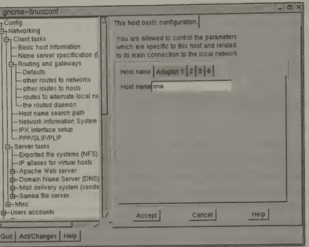

图 7.2 `Linuxconf` 中的“本机基本配置”对话框，“主机名”选项卡。

3. 在“主机名”文本框中输入机器名称——仅输入主机名，不要输入整个域名。

> 注意：如果您在安装过程中配置了此信息或其他信息，其中一些项可能已经填写完毕。

4. 单击“适配器 1”选项卡（如图 7.3 所示）以配置您的网络接口；例如，您的网卡。

5. 确保选中“启用”复选框。这样会激活该接口，意味着 `Linux` 现在将查找网卡（例如）并期望您提供其配置信息。

6. 可以通过以下三种方法之一将寻址信息分配给机器：

   - 手动方式，即由您自己填写信息
   - `DHCP`，这是一种按需设置网络的客户端/服务器服务
   - `BOOTP`，这是一种较旧的客户端/服务器服务，现已被 `DHCP` 取代

如果您不确定当前要使用哪种方法，请选择“手动”。否则，请在适当位置单击 `Dhcp` 或 `Bootp`。

> 提示：如果您想使用 `pump`，请选择 `Dhcp`。

## 7. 网络

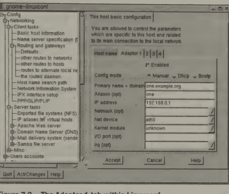

7. 如果您选择了 `Dhcp` 或 `Bootp`，请跳到步骤 14。否则，现在是填写网络信息的时候了。在“主名称 + 域名”文本框中输入完全限定主机名——这意味着您需要包含域名。例如，`cheetah.animals.org`。

8. 如果您想为该机器创建任何别名，请在“别名（可选）”文本框中输入主机名，并以空格分隔。通常，您会将主机名添加到此列表中，以便不必总是输入完全限定域名（`FQDN`）。

9. 在“IP 地址”文本框中输入机器的 IP 地址。

10. 在“子网掩码（可选）”文本框中输入机器的子网掩码值，或者单击下拉列表框并从中选择合适的子网掩码值。

11. 在“网络设备”文本框旁边的下拉列表框中输入 `eth0` 或选择该值。

12. 在“内核模块”下拉列表框中，告知 `Linux` 需要使用的以太网驱动程序类型。此信息应在该网卡的说明书中提供。如果没有，您通常可以在制造商的网站上找到该信息。

> 提示：如果您仍然找不到所需的驱动程序信息，请访问 `www.linuxdoc.org/HOWTO/Ethernet-HOWTO.html` 查看 `Linux` 以太网 `HOWTO`。

13. `Linux` 能够自动检测大多数 `PCI` 卡使用的 `I/O` 端口。但是，如果它找不到你的卡，或者你使用的是较旧的 `ISA` 以太网卡，你可能需要在 `I/O Port (Opt)` 文本框中输入一个 `I/O` 端口。每张卡都有一组它可以使用 `I/O` 端口范围，卡的手册或制造商的 `Web` 页面会列出此信息。这些端口地址的形式为 `0x####`，其中 `#` 是十六进制项。一个常见的例子是 `0x300`。

14. 如果该卡存在 `IRQ` 冲突——或者它工作不正常且你已尝试了其他所有方法——在 `Irq (Opt)` 下拉列表框中手动选择一个 `IRQ`。

15. 点击 `Accept` 按钮关闭对话框。

| 相关解决方案： | 所在页面： |
|---|---|
| 打开 `Linuxconf` | 12 |

## 添加虚拟站点

当你想要托管一个虚拟域名时，需要两个主要步骤来完成设置。第一个主要步骤，确保网络知道在哪里找到这台机器，在本节中描述。第二个主要步骤将在你要设置的具体网络服务中涵盖。要实现设置虚拟站点的第一个主要步骤：

1.  为虚拟站点选择一个 IP 地址。对于许多服务，你可以直接分配内部使用的 IP 地址，如前文表 7.4 中所示。假装整个网络都在那台机器上。

2.  输入 `vi /etc/hosts` 以打开包含接口的机器上的主机管理文件。

3.  将光标放在定义你的 `localhost` 条目的行上。它应该是文件的前几行之一。

4.  输入 `o` 在此条目后创建新行。

5.  在此处添加名称定义。例如，如果你使用虚拟 `C` 类网络 `192.168.3.0` 创建虚拟主机 `hycacinth.flowers.org`，并且决定给这台机器分配主机 IP `192.168.3.10`，那么条目可能看起来像这样：

    ```
    192.168.3.10        hycacinth.flowers.org
    ```

6.  按 `Esc` 键，然后输入 `ZZ` 以关闭文件并保存更改。

7.  现在你需要将 IP 地址分配给接口。为此，请使用 IP 别名。输入 `ifconfig interface:virtualnumber virtualIP`。例如，如果 `hyacinth` 是你添加的第一个虚拟机，则输入 `ifconfig eth0:0 192.168.3.10`。

## 在命令行上为接口分配多个 IP 地址

可以使用一种称为 `IP 别名` 的技术来为同一接口分配多个 IP 地址。请遵循本章前面“添加虚拟站点”中的说明来完成此任务。但是，如果你不想分配名称信息，则不需要添加任何 `/etc/hosts` 条目。

## 在 Linuxconf 中为接口分配多个 IP 地址

可以使用一种称为 `IP 别名` 的技术来为同一接口分配多个 IP 地址。为此，请执行以下操作：

1.  打开 `Linuxconf` 配置工具。

2.  从菜单中选择 `Config|Networking|Server Tasks`。

3.  点击 `IP Aliases For Virtual Hosts` 以打开编辑 IP 别名配置对话框。

4.  点击 `lo` (回环) 设备以打开图 7.4 中所示的 `IP Aliases For Device Lo` 对话框。

5.  对于你想分配给此接口的每个 IP 地址或 IP 地址组，填写以下参数：

    -   如对话框中所述，输入 IP 别名或范围
    -   如有必要，输入此 IP 地址或范围的 `netmask`

6.  完成这些分配后，点击 `Accept` 以关闭 `IP Aliases For Device Lo` 对话框。

7.  点击 `Quit` 以关闭编辑 IP 别名配置对话框。

| 相关解决方案： | 所在页面： |
|---|---|
| 打开 `Linuxconf` | 12 |


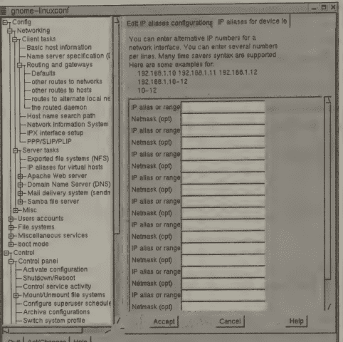

图 7.4 打开到 `IP Aliases For Device lo` 对话框的 `Linuxconf` 工具。

## 在命令行上配置第二个网络接口

要在命令行上设置 `Linux` 以利用两个不同的网络接口——例如，两个以太网卡——请执行以下操作：


1. 第二个以太网卡通常被称为`eth1`。输入`ifconfig eth1 IPAddress netmask netmask`以将此卡的适当 IP 地址分配给它。

2. 输入`vi /etc/hosts`以打开主机配置文件。

3. 将光标移动到你想要添加主机定义的位置。

4. 按`o`在当前行下方打开空白行，并进入插入模式。

5. 输入主机定义。例如：

```
192.168.10.41       cat.animals.org     cat
```

6. 按`Esc`键，然后输入`ZZ`以保存并关闭文件。

7. 要了解如何为此接口添加路由，请参阅即将出现的章节“在命令行上设置路由”和“使用 Linuxconf 设置路由”。

## 在 Linuxconf 中配置第二个网络接口

要在 Linuxconf 中设置 Linux 以利用两个不同网络接口中的第二个——例如，两个以太网卡——请执行以下操作：

1. 打开 Linuxconf 配置工具。

2. 从菜单中选择`Config|Networking|Client Tasks|Basic Host Information`以打开前面图 7.2 中所示的本机基本配置对话框。

3. 点击 `2`选项卡以配置你的第二个网络接口；例如，你的第二个以太网卡。此操作会打开一个类似于前面图 7.3 中所示的选项卡。

4. 确保已选中 `Enabled`复选框。这样做会激活该接口，意味着 Linux 现在会查找以太网卡（例如）并期望你为其提供配置信息。

5. 可以使用以下三种方法之一为机器分配寻址信息：

   - 手动，由你自己填写信息
   - `DHCP`，这是一种即时设置网络的客户机/服务器服务
   - `BOOTP`，这是一种较旧的客户机/服务器服务，已被 `DHCP`取代

   如果你不确定现在想要使用哪种方法，请选择 `Manual`。否则，在适当的地方点击 `Dhcp`或 `Bootp`。

   > 提示：如果你想使用 `pump`，请选择 `Dhcp`。

6. 如果你回答了 `Dhcp`或 `Bootp`，请跳至步骤 13。否则，现在是填写你的网络信息的时候了。在`Primary Name + Domain`文本框中输入完全限定主机名——这意味着你需要包含域名——。例如，`gazelie.animals.org`。

7. 如果你想为此机器创建任何别名，请在`Aliases (Opt)`文本框中添加主机名，并用空格分隔。通常，你将主机名添加到列表中，这样你就不是每次都需要输入 `FQDN`。

8. 在`IP Address`文本框中输入机器的 IP 地址。

9. 在`Netmask (Opt)`文本框中输入机器的 `netmask`值，或者点击下拉列表框并从中选择适当的 `netmask`值。

10. 在`Net Device`文本框旁边的下拉列表框中输入`eth1`或选择此值。

11. 在`Kernel Module`下拉列表框中，告诉 Linux 它需要使用的以太网驱动程序类型。此信息应该在卡的手册中可用。如果没有，通常你可以在制造商的网站上找到该信息。

    > **提示：** 如果你仍然找不到所需的驱动程序信息，请查看`www.linuxdoc.org/HOWTO/Ethernet-HOWTO.html`上的`Linux Ethernet HOWTO`。

12. Linux 能够自动检测大多数 `PCI`卡使用的 `I/O`端口。但是，如果它找不到你的卡，或者你使用的是较旧的 `ISA`以太网卡，你可能需要在`I/O Port (Opt)`文本框中输入一个 `I/O`端口。每张卡都有一组它可以使用 `I/O`端口范围，卡的手册或制造商的 Web 页面会列出此信息。这些端口地址的形式为`0x###`，其中`#`是十六进制项。一个常见的例子是`0x330`。

13. 如果该卡存在`IRQ`冲突——或者它工作不正常且你已尝试了其他所有方法——在`Irq (Opt)`下拉列表框中手动选择一个`IRQ`。

14. 点击`Accept`按钮以关闭对话框。

**相关解决方案：** 打开 Linuxconf **所在页面：** 12

## 在命令行上设置路由

要在 Linux 中设置路由，请执行以下操作：

1. 以 `root`身份登录。

2. 输入`route add -net networkIP netmask netmask dev device`以在此机器上创建路由。

## 使用 Linuxconf 设置路由

设置路由涉及许多细微之处，具体取决于相关机器在网络层级中的位置。本节划分为若干子节，反映 Linuxconf 能够配置的不同路由方面。

### 配置基本路由

要在任何机器上设置基本路由信息，请按照以下步骤从 Linuxconf 的“路由和网关”部分进行操作：

- 1. 打开 Linuxconf 配置工具。
- 2. 选择`Config|Networking|Routing And Gateways`以展开菜单。
- 3. 点击`Set Defaults`以打开默认值对话框，如图 7.5 所示。
- 4. 在`Default Gateway`文本框中，输入该机器为了访问外部世界而通信的接口的 IP 地址。

    > *注意：你可能不希望机器直接尝试与 Internet 通信。如果它处于子网中，并且数据必须经过不同的网关才能到达 Internet 或其他网络，则应输入该接口的 IP 地址。*

- 5. 如果你正在配置的机器需要作为其后方机器的数据包路由器，请勾选`Enable Routing`复选框。
- 6. 点击`Accept`按钮以保存更改。


图 7.5 Linuxconf 默认值路由配置对话框。

### 配置各网络间的路由

如果你设置了子网，从而拥有多个网络，那么你的机器需要知道如何跨网络通信。对于每台需要理解多个网络的机器，请执行以下操作：

- 1. 打开 Linuxconf 配置工具。
- 2. 选择`Config|Networking|Routing And Gateways`以展开菜单。
- 3. 点击`Set Other Routes To Networks`以打开`Route To Other Networks`对话框。
- 4. 点击`Add`按钮以打开`Route Specification`对话框，如图 7.6 所示。
- 5. 在`Gateway`文本框中，输入你所定义路由的网关的 IP 地址。虽然你也可以输入机器名称代替，但这需要查找，会拖慢系统——而且在存在 `DNS`问题时查找会失败。
- 6. 在`Destination`文本框中，输入该网关所指向的网络的地址。如果你只是试图连接 `Internet`，则无需填写此部分；但如果你试图与其他子网通信，则需要在此输入该子网的网络地址。
- 7. 在`Netmask (Opt)`文本框中输入你的子网掩码。
- 8. 点击`Accept`以关闭`Route Specification`对话框。你刚添加的路由将显示在`Route To Other Networks`列表框中。
- 9. 返回步骤 4 以添加另一个网络，或点击`Quit`以关闭`Route To Other Networks`对话框。


图 7.6 Linuxconf 路由规范对话框。

| 相关解决方案： | 所在页码： |
| --- | --- |
| 打开 Linuxconf | 12 |

### 配置到远程主机的路由

如果你有一个广域网（`WAN`），其中单个或一组远程主机必须通过一个并非由网络编号或设置明显指示的特定接口来访问，请执行以下操作以设置数据发送到该设备的路由信息：

- 打开 Linuxconf 配置工具。
- 选择`Config|Networking|Routing And Gateways`以展开菜单。
- 点击`Set Other Routes To Hosts`以打开`Route To Other Hosts`对话框。
- 点击`Add`按钮以打开`Route Specification`对话框，之前已在图 7.6 中展示。
- 在`Gateway`文本框中，输入数据必须通过才能到达远程主机的接口的 IP 地址。
- 在`Destination`文本框中，输入远程主机的 IP 地址。
- 点击`Accept`以关闭`Route Specification`对话框。新的主机路由现在将显示在列表中。
- 如果你还有更多远程主机需要添加，请返回步骤 4。否则，点击`Quit`以关闭`Route To Other Hosts`对话框。

### 配置并发网络的路由

如果你在同一地点有一个以上的局域网（`LAN`）或其他网络，并且这些网络都通过同一组电缆进行通信，则需要设置额外的路由信息。要设置此信息，请执行以下操作：

- 打开 Linuxconf 配置工具。


- 选择 `Config|Networking|Routing And Gateways` 以展开菜单。

- 点击 `Set Routes To Alternate Local Net` 以打开 `Route To Alternate Local Networks` 对话框。

- 点击 `Add` 以打开 `Route Specification` 对话框，其类似于之前图 7.6 中展示的对话框。

- 在 `Interface` 文本框中，输入你所定义网络的数据必须通过的接口。你可以使用名称、IP 地址或设备。右侧的下拉列表框包含可供使用的设备列表。

- 在 `Destination` 文本框中，输入你使用此定义发送数据的网络地址。

- 在 `Netmask` 文本框中输入该网络的子网掩码，或从下拉列表框中选择。

- 点击 `Accept` 以关闭 `Route Specification` 对话框。新的网络路由现在将显示在列表中。

- 如果你还有更多网络需要添加，请返回步骤 4。否则，点击 `Quit` 以关闭 `Route To Alternate Local Networks` 对话框。

### 在 Linuxconf 中配置路由守护进程

要使用 Linuxconf 配置路由守护进程，请执行以下操作：

1. 打开 Linuxconf 配置工具。
2. 选择 `Config|Networking|Routing And Gateways` 以展开菜单。
3. 点击 `Configure The Routed Daemon` 以打开 `Routed Daemon Configuration` 对话框，如图 7.7 所示。
4. 如果机器中有多个以太网卡，请取消勾选 `Does Not Export Any Routes (Silent)` 复选框。
5. 点击 `Accept` 以关闭对话框。


图 7.7 Linuxconf Routed 守护进程配置对话框。

## 设置 IP 伪装

要设置 IP 伪装，请执行以下操作：

1. 登录到作为伪装前端的机器的命令行或终端窗口，用户为 `root`。
2. 参考表 7.4，选择要为进行伪装的机器使用哪种仅限内部使用的 IP 地址类别。通常，人们会选择 C 类。
3. 输入 `vi /etc/rc.d/rc.masq` 以打开你用于存储伪装设置的全新文件。
4. 输入以下命令以构建当前所有内核模块依赖关系列表：

```
/sbin/depmod -a
```

5. 现在你需要决定希望伪装服务器后的用户能够使用哪些服务。这些服务及其模块列在表 7.13 中。
6. 对于你要包含的每个服务，输入一行格式为 `/sbin/modprobe module` 的内容。
7. 输入以下行以将你的默认转发策略设置为拒绝数据，这是一项良好的安全措施：

```
/sbin/iptables -P forward DENY
```

8. 输入类似于以下的一行，以仅转发你选择的仅限本地 C 类 IP 地址的信息：

```
/sbin/iptables -A forward -s privateIPclassC/24 -j MASQ
```

9. 按 `Esc` 键，然后输入 `ZZ` 以保存并关闭文件。
10. 输入 `chmod 700 /etc/rc.d/rc.masq` 以更改此文件的权限。
11. 输入 `vi /etc/sysconfig/network` 以打开网络启动初始化文件。

表 7.13 伪装特定服务所需的模块。

| 服务 | 模块 |
|---|---|
| FTP | `ip_masq_ftp` |
| IRC | `ip_masq_irc` |
| RealAudio | `ip_masq_raudio` |

12. 输入 `FORWARD_IPV4` 并按 `Enter` 键以搜索此变量。
13. 使用箭头键移动到单词 `false`。
14. 每按一次 `x` 键删除一个字符，直到该单词被完全删除。
15. 按 `i` 进入插入模式。
16. 输入 `true`。
17. 按 `Esc` 键，然后输入 `ZZ` 以保存并关闭文件。
18. 输入 `vi /etc/rc.d/rc.local` 以打开最终的启动初始化文件。
19. 输入 `G` 前往文件末尾。
20. 输入 `o` 在光标位置下方打开一个新行。
21. 输入 `/etc/rc.d/rc.masq` 以指示机器在启动时加载你的伪装设置。

## 设置拨出连接

如何设置系统进行拨出取决于你使用什么程序来建立连接。选择适当的章节以设置你的机器建立与你的 ISP 或另一个外部位置的 PPP（点对点协议）、SLIP（串行线路 Internet 协议）或 PLIP（并行线路 Internet 协议）连接。你可以使用：

- Linuxconf 在 GNOME 或 KDE 中
- Minicom 在 GNOME、KDE 或命令行中
- kppp 在 GNOME 或 KDE 中

### 配置 Linuxconf 进行连接

要在 Linuxconf 中设置你的拨出 PPP 连接，请执行以下操作：

1. 以 `root` 身份登录到 GUI。
2. 打开 Linuxconf。
3. 从菜单树中选择 `Config/Networking Branch/Client Tasks`。
4. 点击 `PPP/SLIP/PLIP` 以打开 `PPP/Slip/Plip Configurations` 对话框。
5. 点击 `Add` 按钮以打开 `Type Of Interface` 对话框。
6. 默认选项是 PPP。如果你设置的是 SLIP 或 PLIP 连接，请点击相应的单选按钮。
7. 点击 `Accept` 以打开 `PPP Interface ppp0` 对话框，如图 7.8 所示——假设你设置了一个 PPP 连接。


**图 7.8** Linuxconf PPP 接口 `ppp0` 对话框。

8. 在 `电话号码` 文本框中输入调制解调器需要拨号的电话号码。
9. 在 `调制解调器端口` 对话框中，选择或输入你的调制解调器位置。如果你知道你的调制解调器设备驱动程序已经链接到位置 `/dev/modem`，则保持默认设置。否则，如果调制解调器是第一个串行端口——对应于 Windows 中的 `COM1`——则选择 `/dev/ttyS0`。如果它位于第二个串行端口，即 `COM2`，则选择 `/dev/ttyS1`。
10. 如果 ISP 要求使用密码身份验证协议（PAP），请确保勾选了 `使用 PAP 身份验证` 复选框。
11. 在 `登录名` 和 `密码` 文本框中输入你的用户 ID 和密码。
12. 单击 `定制` 按钮，打开第二个 PPP 接口 `ppp0` 对话框，如图 7.9 所示。
13. 如果本机调制解调器直接连接到另一个调制解调器，请取消选中 `使用硬件流控制和调制解调器线路` 选项。
14. 如果你确定需要，请选中 `转义控制字符` 选项。
15. 如果由于某种原因，你不希望在发生常见错误时关闭连接，请取消选中 `在已知错误时中止连接` 选项。
16. 如果你希望非超级用户账户能够发起此连接或断开连接，请选中 `允许任何用户（反）激活接口`。
17. 如果你的调制解调器速度低于 28.8Kbps，请更改 `线路速度` 下拉列表框中的值。


**图 7.9** 显示硬件选项卡的第二个 Linuxconf PPP 接口 `ppp0` 对话框。

18. 单击 `通信` 选项卡，以打开 PPP 接口 `ppp0` 通信部分。
19. 对于在 `聊天` 部分的操作，你有几个选项：
    - 尝试使用默认设置，看看是否有效。
    - 如果 ISP 告诉你要在聊天脚本中使用什么内容，请在 `期待` 和 `发送` 框中输入该内容。
    - 手动确定服务器所需的参数，也许是通过按照下一节中的说明使用 `minicom`。
20. 如果你必须使用 PAP 身份验证，请单击 `PAP` 选项卡并填写 `用户名` 和 `密钥` 文本框。
21. 单击 `接受` 按钮以保存这些更改并关闭 PPP 接口 `ppp0` 对话框。
22. 单击 `退出` 按钮以关闭 `PPP/Slip/Plip` 配置对话框。

## 配置 Minicom 进行连接

要设置拨出 PPP 连接，请执行以下操作：

- 以 `root` 身份打开一个 X 终端窗口，或登录到终端模式——运行级别 3，系统启动时显示登录提示符而不是 GUI——并以 `root` 身份登录。
- 输入 `rpm -q minicom` 以查看是否安装了 `minicom` 软件包。如果没有，请从 Red Hat CD-ROM 中安装它。
- 输入 `minicom -s` 以启动 Setup 模式。终端中间会出现一个小型文本菜单。


- 按`A`键将光标跳转到“串行设备”项。如果你的调制解调器位于对应于Windows中`COM1`的位置，请输入`/dev/ttyS0`。如果位于`COM2`，请输入`/dev/ttyS1`。然后按`Enter`键。

- 按`E`键以打开通信参数对话框。

- 按`T`键将连接速度更改为最大值，除非你的调制解调器速度慢于`28.8Kbps`。

- 选择适当的“数据/奇偶校验/空间”值。

- 按`Enter`键关闭对话框。

- 按`Enter`键返回配置菜单。

- 选择“退出”以直接前往`minicom`屏幕。

- 按下组合键`Ctrl+A`，然后按`D`键以打开拨号目录。

- 将光标移动到底部菜单的“编辑”选项上，然后按`Enter`键以打开编辑对话框。

- 按`A`键跳转到名称行。

- 为此拨入账户输入一个描述性名称，然后按`Enter`键。

- 按`B`键跳转到号码行。

- 输入调制解调器需要拨号的电话号码，然后按`Enter`键。

- 按`F`键前往用户名行。

- 输入你的登录名，然后按`Enter`键。

- 按`G`键前往密码行。

- 输入你的密码，然后按`Enter`键。

- 更改你知道需要为你的`ISP`更改的其他任何值。

- 按`Enter`键关闭对话框。

- 按`Esc`键关闭拨号目录。

24. 按下组合键`Ctrl+A`，然后按`X`键以退出`minicom`。

25. 在确认对话框中选择“是”，然后按`Enter`键。

| 相关解决方案 | 所在页码 |
| :--- | :--- |
| 向文件系统添加和删除媒体 | 84 |
| 安装`RPM` | 114 |

## 配置 kppp 进行连接

如果你使用`KDE`，你可以选择使用其`kppp`工具来建立互联网连接。进入`KDE`并以`root`身份登录后，请执行以下操作：

1. 单击`K`图标以打开主菜单。

2. 单击`Internet\kppp`以打开`kppp`工具。如果这是你第一次打开此程序，会出现`kppp`最近更改对话框。阅读其内容，如有必要遵循其中的说明，然后单击“确定”继续。

> **注意：** 如果你由于某种原因未安装`ppp`守护进程（`pppd`），`kppp`会通过对话框告知你。你需要先安装该守护进程才能建立连接。

3. 单击“设置”以打开`kppp`配置对话框，如图`7.10`所示。

4. 单击“新建”按钮以打开新建账户对话框，如图`7.11`所示。


**图 7.10** 显示账户选项卡的`kppp`配置对话框。


**图 7.11** 显示拨号选项卡的`kppp`新建账户对话框。

5. 在“连接名称”文本框中输入一个描述性名称。这将在稍后的连接对话框中显示。

6. 在“电话号码”文本框中输入调制解调器需要拨打的电话号码。

7. 在“身份验证”下拉列表框中，选择你的`ISP`所需的登录程序类型。如果没有被要求使用类似`PAP`的东西，请选择“基于脚本”。

8. 如果你不想让`kppp`记住连接密码，请取消选中“存储密码”复选框。

9. 你可以将建立连接或断开连接与运行特定程序绑定在一起。如果需要这样做，请在相应的文本框中填写调用程序所需的完整路径和参数。

10. 如果你需要为`PPP`守护进程`pppd`使用任何特定参数，请单击“参数”按钮。这将打开自定义`pppd`参数对话框。要查看可用参数列表，请输入`man pppd`。

11. 单击`IP`选项卡。

12. 如果你的`ISP`为你分配了永久`IP`信息，请单击“静态`IP`地址”单选按钮。填写`IP`地址和子网掩码文本框。

13. 如果你打算在此机器上使用`GUI`，请务必不要激活“从此`IP`自动配置主机名”选项。要使此功能在`GUI`中正常工作，你需要放宽机器的安全性。

14. 单击`DNS`选项卡。

15. 在“域名”文本框中，输入你的域名或`ISP`的域名——whichever是合适的。

16. 在“`DNS IP`地址”文本框中，输入你的`ISP`提供的域名服务器的`IP`地址。

17. 单击“添加”按钮将此条目添加到`DNS`地址列表。如果你有更多`DNS`服务器要添加，请返回步骤`16`。

18. 如果你需要在连接到`ISP`时禁用本地名称服务器，请勾选“连接期间禁用现有`DNS`服务器”复选框。

19. 单击“网关”选项卡。

20. 如果出于某种原因，你不希望发往本地机器或局域网以外机器的流量通过此`PPP`连接，请单击“静态网关”单选按钮，并填写网关`IP`地址，即流量通常应通过的外界接口的地址。

> **注意：** 如果你不想在此机器上设置默认网关，请取消选中“将此默认路由分配到此网关”复选框。

21. 单击“登录脚本”选项卡，这是你自动化实际登录过程的地方。

22. 你的`ISP`可能已经明确告诉了你登录脚本需要什么内容。如果没有，你可能需要首先使用`minicom`手动连接，然后基于该体验构建登录脚本。构建登录脚本的过程从输入一段文本开始，`kppp`在需要输入第一份信息时会看到这段文本。例如，如果第一个提示符是`Login:`，你可能会在文本框中输入`ogin:`，因为不需要使用完整的单词。

23. 单击“添加”按钮。现在，“期待”一词出现在对话框下部分的左侧，而术语`ogin:`出现在右侧。

24. 在下拉列表框中选择“发送”。

25. 在文本框中，输入脚本需要用来响应提示符的数据。对于`Login:`提示符，你需要发送你的用户名。如果你的账户是`moose`，则会在文本框中输入`moose`。

26. 单击“添加”按钮。现在，“发送”术语和`moose`出现在下方。

27. 继续步骤`22`至`26`的过程，直到你输入了登录脚本所需的所有步骤。

28. 单击“确定”以关闭新建账户对话框。

## 配置 DHCP 服务器

要在启动时设置`DHCP`服务器，以便向网络中的机器分配地址信息，请执行以下操作：

1. 以`root`身份登录。

2. 输入`man dhcpd`以快速检查`DHCP`服务器是否已安装。如果已安装，请跳至步骤`6`。

3. 输入`df`以查看`Red Hat CD-ROM`是否已经是文件系统的的一部分。如果`CD-ROM`尚未挂载，请将光盘插入驱动器并输入`mount /mnt/cdrom`进行挂载。

4. 输入`cd /mnt/cdrom/RedHat/RPMS`以切换到`Red Hat`软件包目录。

5. 输入`rpm -ivh dhcp`，按`Tab`键补全包名，然后按`Enter`键。这将为您安装`DHCP RPM`包。

6. 输入`vi dhcpd.conf`以打开并编辑`DHCP`服务器的配置文件。

7. 首先，您需要输入全局规则。对于网络`192.168.14.0`，其`ISP`在`192.168.87.9`拥有一个备用名称服务器，该部分可能如下所示：

```
max-lease-time 43200;
default-lease-time 14400;
option all-subnets-local 1;
option domain-name-servers 192.168.14.1, 192.168.87.9;
```

8. 接下来是有趣的部分。假设您有一个需要服务的单一网络。为了避免例子过于简单，我还假设该网络被划分为八个子网，其中两个子网通过网络信息通过`DHCP`获取，并共享相同的以太网布线。您的`DHCP`配置文件的其余部分可能如下所示：

```
shared-network ADMIN {
    subnet 192.168.14.96 netmask 255.255.255.224 {
        range 192.168.14.97 192.168.14.127;
    }
    subnet 192.168.14.160 netmask 255.255.255.224 {
        range 192.168.14.161 192.168.14.191;
    }
}
```


> **注意：** 请注意，如果没有缩进，该文件将很难阅读。在编程时，整洁往往非常重要。

9. 按`Esc`键，然后输入`ZZ`以保存并关闭文件。

10. 输入`/etc/rc/init.d/dhcpd restart`以使用新配置重启您的`DHCP`守护进程。

## 配置 pump 客户端

要为`DHCP`或`BOOTP`服务设置`pump`客户端，请执行以下操作：

1. 以`root`身份登录。

2. 输入`vi /etc/pump.conf`以打开`pump`配置文件。

3. 构建配置文件。可用的选项见表`7.14`。

**表 7.14 /etc/pump.conf 文件的选项。**


| 选项 | 用途 | 参数 | 示例 |

| :--- | :--- | :--- | :--- |

| `device` | 允许您设置特定于设备的参数，而不是全局参数。设备通常是网络接口。 | 任何其他参数 | `device eth0 { timeout 10 }` |

| `domainsearch` | 使用以下域名查找顺序： | 默认搜索的域名。 | `domainsearch "blue.colors.org carrot.veggies.org colors.org veggies.org"` |

| `nodns` | 当设置特定设备语句时，您可以使用此选项告诉它不要将此特定设备包含在名称服务查找文件中。 | 无。 | `device ppp0 { nodns }` |

| `retries` | 如果 DHCP 设置过程中的任何阶段失败，重新尝试的次数。 | 非零整数。 | `retry 5` |

| `timeout` | 在放弃 DHCP 设置过程之前等待的秒数。 | 非零秒数。 | `timeout 30` |

在一台只有一个接口的机器上，示例配置文件可能包含以下内容：

```
retries 5
timeout 15
domainsearch "home.net kitchen.home.net"
```

4. 完成创建文件后，按 `Esc` 键，然后输入 `ZZ` 以保存并关闭文件。

5. 确保在启动时调用 `pump` 客户端。放置此语句的一个好位置是 `/etc/rc.d/rc.local`，它是 Red Hat Linux 在启动过程中调用的文件之一。输入 `vi /etc/rc.d/rc.local` 以打开此文件进行编辑。

> **注意：** 其他发行版各自拥有在启动时使用的特定文件集合。如果您使用的是其他 Linux 发行版，请阅读手册以确定最适合添加此信息的文件。

6. 输入 `G` 跳转到文件末尾。

7. 输入 `o` 在所有其他行之后打开一个空白行。

8. 输入 `/sbin/pump -i interface hoursleased`。两个变量如下：

   - `interface`—`pump` 用于联系 DHCP 服务器的网络接口，也是 `pump` 试图分配地址信息的对象——例如，`eth0`。

   - `hoursleased`—该接口可以保留其地址信息的时间长度——例如，`100`。当时间用完时，`pump` 再次联系 DHCP 服务器进行更新。您为此分配选择值取决于您预计移动机器的频率。请记住，如果地址信息已被分配，而您在租约期间移动了机器，该 IP 地址基本上在租约过期前都不可用。

9. 输入此信息后，按 `Esc` 键，然后输入 `ZZ` 以保存并关闭文件。

## 远程管理机器

要远程管理您的机器，您有几个选项：

- 使用 `telnet` 程序登录到您需要处理的机器上的用户账户，然后使用 `su` 程序获得超级用户状态（如果您知道该机器的 `root` 密码）。

- 使用 `vnc` 程序——可从 `www.uk.research.att.com/vnc/` 获得——远程连接到 Linux、Macintosh、Unix 或 Windows 机器。此工具允许您像坐在远程机器的控制台前一样工作，该远程机器也安装了 `vnc`。

| 相关解决方案： | 所在页码： |

|---|---|

| 成为超级用户 | 283 |

| 保护 Telnet | 488 |

# 第 8 章

## 打印

| 如果您需要立即解决： | 参见页码： |

| :--- | :--- |

| 在控制面板中设置本地打印机 | 225 |

| 在命令行中设置本地打印机 | 228 |

| 在控制面板中设置网络打印机 | 231 |

| 在命令行中设置网络打印机 | 233 |

| 设置机器以托管网络打印机 | 233 |

| 设置远程打印机通过网络打印 | 234 |

| 设置流行的打印过滤器 | 235 |

| 测试打印机 | 236 |

| 打印文件 | 236 |

| 查看打印队列 | 237 |

| 取消打印任务 | 237 |

| 检查打印机状态 | 238 |

| 禁用和启用打印队列 | 238 |

## 深入探讨

传统上，在 Linux 下设置打印一直是个麻烦事。基本文本打印不是问题。问题在于如何应付现有的众多文件格式。幸运的是，如今的 Linux 管理员在想要设置打印时，有多种不错的工具可供选择。不过，设置好打印后，工作并没有结束。您仍然需要在用户级别和管理级别上了解如何使用它。

## Linux 打印入门

了解如何与 Linux 打印系统协作意味着了解所有的组成部分及其相互关系。在设置打印时，您首先必须处理打印机的配置文件 `/etc/printcap`，我将在下一节中讨论这一点。之后，我将讨论共同构成 Linux 打印和打印管理部分的命令族。最后，我将带您了解一个简单打印任务的生命周期。

## `/etc/printcap` 文件

打印机配置文件由一系列打印定义组成。理解这些定义的布局是设置彻底、精确的打印机控制文件的关键之一。打印定义的一般格式为：

```
shortname|longname:\n:statement1:\n:statement2:\n...\n:statementn:
```

在命名打印机时，您有很大的自由度。通常，默认打印机语句以短名称条目中的 `lp` 开头，代表 `line printer`（行式打印机）。这是大多数 Unix 打印机都是行式打印机时的遗留惯例，由于用户至少总是知道一个打印机的名称，因此作为命名方案是有用的。如果您已经有一个默认打印机定义，则将此短条目改为另一个双字母项。

长名称应当具有描述性，如果用户不记得短缩写，可能会记住的内容。例如，如果打印机的短名称是 `ij`，那么其长名称可能是 `inkjet`。请记住，您可以拥有一个

## 打印命令族

在 Linux 下管理打印机时，你需要处理许多命令。试图理清这些命令可能会让人困惑，因此我在表 8.2 中为你整理了它们。每个命令在打印作业和打印机管理的整体方案中都有其特定的功能。

**表 8.2 Linux 中与打印相关的命令。**

| 命令 | 用途 |

| :--- | :--- |

| `lpc` | 打印机控制程序 |

| `lpd` | 打印守护进程 |

| `lpq` | 打印假脱机控制程序 |

| `lpr` | 打印假脱机 |

| `lprm` | 打印作业移除 |

| `pac` | 生成打印计费报告 |

### 打印机控制程序

你使用 `lpc` 命令，其格式如下：

```
lpc command value
```

可用的命令列于表 8.3 中。

**表 8.3 可用于 `lpc` 的命令。**

| 命令 | 用途 | 参数值 |

| :--- | :--- | :--- |

| `?` | 打印有关某命令的帮助信息。 | `lpc` command |

| `abort` | 终止管理该打印机假脱机的活动打印守护进程，然后禁用对该打印机的打印。 | 对于所有打印机使用 `all`，或指定特定打印机的名称 |

| `clean` | 从打印机队列中移除任何不可打印的文件。适合清理临时信息。 | 对于所有打印机使用 `all`，或指定特定打印机的名称 |

| `disable` | 关闭打印机队列，使其不再从假脱机中获取任何新作业。 | 对于所有打印机使用 `all`，或指定特定打印机的名称 |

| `down` | 关闭打印机队列，不允许新作业进入假脱机。 | 对于所有打印机使用 `all`，或指定特定打印机的名称；外加一条简短消息解释打印机为何停机 |

| `enable` | 打开打印机队列，使新作业可以进入假脱机。 | 对于所有打印机使用 `all`，或指定特定打印机的名称 |

| `help` | 打印有关某命令的帮助信息。 | `lpc` command |

| `restart` | 关闭当前的 `lpd` 会话并开启一个新会话。 | 对于所有打印机使用 `all`，或指定特定打印机的名称 |

| `start` | 开启打印机的打印功能，并为其假脱机启动打印守护进程。 | 对于所有打印机使用 `all`，或指定特定打印机的名称 |

| `status` | 显示假脱机守护进程和队列的当前状态。 | 对于所有打印机使用 `all`，或指定特定打印机的名称 |

| `stop` | 当假脱机守护进程没有更多作业要处理时，关闭该守护进程并禁用打印。 | 对于所有打印机使用 `all`，或指定特定打印机的名称 |

| `topq` | 将指定作业移动到队列顶部。 | 打印机名称、作业编号，然后是用户 |

| `up` | 打开打印机队列并允许作业进入假脱机。 | 对于所有打印机使用 `all`，或指定特定打印机的名称 |

### 打印守护进程

你使用 `lpd`，其格式如下：

```
lpd flag port
```


信不信由你，`lpd` 只有一个可用的标志。它默认未包含，因为你可能根本不想使用这个标志。该标志是 `-l`，它会将有效的网络作业在到达假脱机时记录下来。如果需要，你还可以让 `lpd` 在一个非标准端口上监听网络打印作业。

### 打印假脱机控制器

你使用 `lpq`，其格式如下：

```
lpq flag job user
```

该命令有两个可用的标志：

- `-l` — 打印每行关于每个作业的信息。

- `-Printer` — 指定你感兴趣的具体打印机。

可以列出多个打印作业，它们之间以空格分隔。

### 打印作业移除器

你使用 `lprm` 命令，其格式如下：

```
lprm flag jobs user
```

同样，该命令只有两个可用的标志：

- `--`（是的，这是一个破折号。）移除该用户的所有作业。

- `-Printer` — 指定你感兴趣的具体打印机。

### 报告生成器

你使用 `pac` 命令，其格式如下：

```
pac flags name
```

`pac` 可用的标志列于表 8.4 中。只有当你想仅为一个用户生成报告时，才包含 `name` 参数值。

该命令的输出进入 `/var/account/` 目录。

**表 8.4 `pac` 命令可用的标志。**

| 标志 | 用途 |
| :--- | :--- |
| `-Printer` | 你想为其生成报告的具体打印机。 |
| `-c` | 按成本而非名称字母顺序对输出进行排序。 |
| `-m` | 将用户的所有费用归组在一起，无论其是从哪台主机打印的。 |
| `-pprice` | 每页的成本（美元）。覆盖 `/etc/printcap` 中的值。 |
| `-r` | 按逆序排序。 |
| `-s` | 包含账户信息的摘要。 |

## Linux 打印流程

在 Unix 系统或 Unix 变体（如 Linux）中，当你尝试打印文件时，该文件会经历特定的处理过程。理解这一过程有助于你配置和管理它。以下是关于在 Linux 下打印文件时发生情况的示例。

假设你有一个文件 `~/picture.jpg`。你知道网络上安装了一台名为 `ij` 的喷墨打印机，因此你输入 `"pr -Pij ~/picture.jpg"` 来打印该文件，此前你已在本章“即时解决方案”部分阅读了“打印文件”的内容。

该图像文件现在被发送到 `/etc/printcap`（打印服务配置文件）中定义的假脱机。在这种情况下，由于打印机并非本地机器所连，其假脱机位于 NFS 挂载 `/share`（有关 NFS 的更多信息请参见第 17 章）中的目录 `/share/printers/spool/ij`。

每当有文件到达打印队列时，系统会通知打印守护进程 `lpd`，如果该守护进程在此作业到达时处于非活动状态，它会派生一个子 `lpd` 来处理队列。由于该图像文件是直接发送到同样在打印服务器上进行 NFS 挂载的队列中，并且由于该机器在其自身的 `printcap` 文件中指向同一个打印假脱机文件，`lpd` 会等待数据到达 `/share/printers/spool/ij`。当你的打印作业进入假脱机时，如果其他作业正在打印或等待，它会在队列中等待轮到；如果没有其他等待项，则直接发送到打印机。

然而，`~/picture.jpg` 不是一个原始 ASCII 文本文件。它是一个图像文件——确切地说，是一个 JPEG（联合图像专家组格式）文件。幸运的是，你具有前瞻性，意识到人们很可能会向彩色打印机打印不仅仅是原始文本的内容。安装了 `APSfilter` 程序——如“即时解决方案”部分中“设置常用打印过滤器”所讨论的那样——你的机器就知道如何打印 JPEG 文件。该图像被转换并作为 PostScript 文件发送到打印机。

## Linux 打印问题

与任何其他操作系统一样，在使用 Linux 时，你在设置打印机和打印时需要考虑以下事项：

- 没有特殊工具，你就无法在 Linux 和另一个操作系统之间传递打印作业。在打印机设置并运行之后，请参见第 18 章了解如何在 Linux 和其他操作系统之间共享打印作业。

- 向本地打印机打印和向网络打印机打印是两个完全不同的配置问题。你需要特别配置网络打印机。

- 打印任何非原始 ASCII 文本文件都需要特殊的过滤器来处理数据并将其转换为 PostScript 格式。PostScript 是由 Adobe 首先开发的打印格式化语言。它更像是一种编程语言而非标记语言——更像 `C` 语言而非 `HTML`。如果你的打印机不支持 PostScript，你可能只能被迫使用 ASCII 文本文档。

- 如果你没有安装打印过滤器来为你执行转换，有一个名为 `GhostScript` 的程序可以处理此事。

## GhostScript 简介

当 Unix 社区需要一个能够处理 PostScript 格式文件的程序时，GNU（Gnu’s Not Unix，位于 `www.gnu.org`）的人们，连同 Aladdin Enterprises（`www.aladdin.com`），提供了 `GhostScript`，它实际上是一套工具。

`GhostScript` 程序（`gs`）是 PostScript 和 PDF（Adobe 的可移植文档格式）解释器。你可以使用此工具来查看或打印内容的 PostScript 文件。幸运的是，如今的打印过滤器使得打印 PostScript 文件的过程比过去要简单得多，因此你通常不需要为了这个问题去学习 `gs` 语法。由于 `GhostScript` 和 PostScript 都是图形化的，你需要在 `GUI` 中查看 `GhostScript` 的输出。随后你必须面对的噩梦是 `gs` 令人望而生畏的选项数量。

幸运的是，还有另外两个程序可用——`gv` 和 `ghostview`——它们为 `GhostScript` 查看器提供了更美观的界面。这两个程序都是 `GUI` 接口，比主程序 `gs` 更容易使用且更友好。

`GhostScript` 的主页位于 `www.ghostscript.com`。如果你打算将 `GhostScript` 用于严肃用途，强烈建议浏览该网站，因为该软件有三种版本。每个版本都有不同的许可限制。`GhostScript` 及其相关工具的文档也可以在该网站上找到，工具本身也是如此。

## 非软件技术问题

一个反复出现的重大问题是在任何操作系统下排查打印故障。本节提供的建议适用于任何操作系统，而不仅仅是 `Linux`。如果你在打印机方面遇到问题，请尝试以下方法：

- 确保打印机线缆在两端都牢固连接：线缆到打印机，以及线缆到计算机。

- 确保打印机已插上电源。

- 确保打印机已开机。

- 如果打印机具有离线状态，请确保打印机处于就绪状态。

- 如果这是网络打印机，并且你在从网络打印时遇到问题，请检查它是否能在本地打印。如果可以，请检查该机的网络连接性。

### 即时解决方案

### 在控制面板中设置本地打印机

要设置直接连接到你所在机器的打印机，请执行以下操作：

1. 以 `root` 身份登录到 `GUI`。

2. 点击 `GNOME` 足迹图标以打开主菜单。如果你使用的是 `KDE`，则点击 `K` 图标，然后点击 `Red Hat` 菜单。

3. 点击 `System`（系统）以打开系统菜单。

4. 点击 `Control Panel`（控制面板）以打开 `Red Hat` 的控制面板，如图 8.1 所示。

**注意：** 大多数 `Linux` 发行版都有自己专用的打印设置工具。然而，命令行方法适用于所有发行版。

5. 点击 `Printer Configuration`（打印机配置）图标以打开 `Red Hat Linux` 打印系统管理器，如图 8.2 所示。


图 8.1 `Red Hat` 的控制面板。


图 8.2 `Red Hat Linux` 打印系统管理器。

6. 点击“`Add`”（添加）按钮以打开“`Add A Printer Entry`”（添加打印机条目）对话框。

7. 点击“`Local Printer`”（本地打印机）单选按钮。

8. 点击“`OK`”（确定）以关闭“`Add A Printer Entry`”对话框并自动检测连接到任何并行端口的打印机。如果没有检测到任何打印机，请不要惊慌。

9. 阅读出现的任何中间对话框，然后点击“`OK`”以打开“`Edit Local Printer Entry`”（编辑本地打印机条目）对话框，如图 8.3 所示。

10. 在“`Names`”（名称）文本框中输入一个简短且有意义的打印机名称。通常，`Linux` 或 `Unix` 系统上的主打印机默认命名为 `"lp"`，以方便用户。

11. 修改 `Spool Directory`（存储目录）以反映该打印机的存储文件应保存的位置。如果你正在设置默认打印机 (`lp`)，请保留默认的存储目录不变。


### 12. 限制打印作业尺寸
如果你想限制打印作业的最大尺寸，请在“File Limit”（文件限制）文本框中输入尺寸（以 K 为单位）。默认条目为 `0`，这意味着对打印作业大小没有限制。这对大多数人来说没问题，但如果你运行大型网络，可能需要设置某种限制。你永远不知道有人可能会意外打印什么。


**图 8.3** Red Hat 的“编辑本地打印机条目”对话框。

**注意：** 熟练的用户如果需要可以绕过此限制。使用 `lpr` 加上 `-s` 标志会创建一个符号链接，以便将文件列入 `打印` 队列，而不是将其复制到打印队列中，从而避免大小限制。如果发生这种情况，你将无法控制暂停或移除打印作业。它必须被允许完成打印。

### 13. 指定打印机设备
如果你想指向特定的打印机设备驱动程序，请在此“Printer Device”（打印机设备）文本框中输入该位置。

### 14. 配置过滤器
强烈建议此时点击“Select”（选择）按钮以打开“Configure Filter”（配置过滤器）对话框，如图 8.4 所示。打印系统管理器的这一部分也是许多人使用此工具设置打印机的主要原因之一。

### 15. 选择打印机类型
在“Printer Type”（打印机类型）列表框中点击你拥有的打印机类型。如果你找不到完全匹配的选项，可能需要访问制造商的网站来查找可比的类型。否则，对于只能处理文本文件的打印机，请选择 `Text-Only`（仅文本）；对于可以处理 `PostScript` 文件的打印机，请选择 `PostScript`。

### 16. 设置分辨率
如果在 `Resolution`（分辨率）部分下列出了选项，请选择你想在该打印机上使用的默认打印分辨率。

### 17. 选择纸张大小
如果在 `Paper Size`（纸张大小）部分下列出了选项，请选择你打算使用的纸张大小。

### 18. 设置颜色深度或单色打印模式
如果在 `Color Depth/Uniprint Mode`（颜色深度/单色打印模式）部分下列出了选项，请选择合适的选项。


**图 8.4** Red Hat 的“配置过滤器”对话框。

### 19. 防止多文件同页打印
如果你想确保多个文件永远不会打印在同一页上，你可能需要选中 `Printing Options`（打印选项）区域中“Send EOF After Job To Eject Page?”（在作业结束后发送 EOF 以弹出页面？旁边的复选框。如果你选中此复选框并且发现每个打印作业末尾都会出现一张空白页，请返回此对话框并取消选中该复选框。空白页表明打印机不需要此额外命令。

### 20. 修复阶梯效应
对于纯文本文件，有时会出现一种称为“阶梯效应”的问题，涉及每行新文本的对齐方式，其中每一行都比前一行缩进一点。如果发生这种情况，请选择 `Fix Stair-Stepping Text?`（修复阶梯文本？）选项。

### 21. 快速文本打印
如果你使用的是无法处理 `PostScript` 的打印机，但由于某种原因没有将其配置为仅文本，请确保选中 `Fast Text Printing (Non-PS Printers Only)?`（快速文本打印（仅限非 PS 打印机）？）选项。此选项确保你的文本直接发送到打印机，而不是通过打印过滤器。

### 22. 多页打印到单张纸
默认情况下，你的打印机配置为每张纸打印一页打印机输出。然而，你可以让它将多页数据发送到一张纸上。如果你想这样做：

- 确保未选中 `Fast Text Printing (Non-PS Printers Only)?`（快速文本打印（仅限非 PS 打印机）？）选项。
- 点击 `2`、`4` 或 `8` 单选按钮，以指定应有多少页打印机输出位于一张纸上。

### 23. 更改边距
如果你认为有必要，更改边距设置。

### 24. 关闭对话框
点击“OK”以关闭对话框。

### 25. 抑制页眉
在“Edit Local Printer Entry”对话框中，确保选中了 `Suppress Headers`（抑制页眉）选项（除非你希望在每个打印作业开头包含标识打印该文件的用户的页眉信息）。

### 26. 完成编辑
点击“OK”以关闭“Edit Local Printer Entry”对话框。

### 27. 退出管理器
选择 `PrintTool$Quit`（打印工具$退出）以关闭 Red Hat Linux 打印系统管理器。


### 在命令行中设置本地打印机

要手动设置当前连接到你的计算机的打印机，请执行以下操作：

1. 在命令行登录 `root` 账户，或作为 `root` 打开一个 `X` 终端。

2. 输入 `vi /etc/printcap` 以打开打印机配置文件。注意开头的非常长的警告，指出你不应该手动编辑此文件。是否继续或使用控制面板方法由你决定。

3. 输入 `G` 跳转到空文件的底部。

4. 输入 `o` 在当前行下方打开一个新行。

5. `/etc/printcap` 条目是一个多行语句，定义该打印机及其属性。从一行开始，为打印机分配名称，格式为 `shortname longname:\`。结尾的冒号和反斜杠组合表示该语句尚未完成。

例如，根据 Unix 传统，主打印机的默认名称是 `lp`（行式打印机）。如果这是你的主打印机，你可能输入以下内容：

`lp|default printer:\`

> 实际上，你可以在此行分配两个以上的名称和别名。如果你想将默认打印机称为 `lp`，同时也因为它是一台激光打印机而称其为 `lj`，那么你可以使用行 `lp|lj|default printer:\`。

6. 下一行通常是指向你想为特定打印机使用的打印机驱动程序的指针，格式为 `:lp=:dev=device:\`。此驱动程序可能链接到一个通用位置，如 `/dev/lp0`，或者更具体。行首的冒号表示这是同一语句的延续，行尾的冒号和反斜杠表示定义继续到下一行。

例如，你的默认打印机可能使用以下驱动程序声明：

`:lp=/dev/lp0:\`

> 你不必将每个新定义都放在新行上；你可以只用冒号在一行中分隔它们。但是，如果你每行使用一个定义，浏览起来会更容易。

7. 另一行必要的定义是存储目录定义。机器需要知道在等待打印时文件应存储在哪里。此行按格式 `:sd=var/spool/lpd/name:\` 输入。通常，`name` 与设备名称相同，以帮助保持条理。因此，对于这个例子，你会输入以下内容：

`:sd=/var/spool/lpd/lp0:\`

8. 为了确保你的打印服务被正确记录，添加一行来设置要使用的日志文件。此行按格式 `:lf=:var/log/name:\` 使用。同样，这里通常使用的 `name` 是设备名称。因此，你可能使用以下条目：

`:lf=/var/log/lp0:\`

9. 与许多设备一样，你需要使用锁文件，以免打印守护进程在打印机忙碌时尝试向打印机发送多个文件。按以下格式添加一行：`:lo=/var/spool/lpd/name/lock/name.lock:\`。在这种情况下，你可以使用以下内容：

```
:lo=/var/spool/lpd/lp0/lock/lp0.lock:
```

10. 这就是为本地打印机必须添加的行。其他语句和参数如表 8.5 所示。请务必以没有 `\` 组件的形式结束此打印定义的最后一行。

> **注意：** 如果你使用的是除 `8.5` 乘 `11` 英寸标准信纸尺寸以外的纸张，则会使用 `pl` 或 `pw` 命令。

11. 按 `Esc` 键，然后输入 `ZZ` 以保存并关闭文件。

12. 如果你打算打印的内容超出 `ASCII` 文本范围，请前往本章后面“设置常用打印过滤器”部分。

13. 现在你需要创建你所使用的目录和文件。对于此示例，这些内容如下：

- `/var/spool/lpd/lp0`——打印暂存目录
- `/var/log/lp0`——错误日志文件
- `/var/spool/lpd/lp0/lock/lp0.lock`——锁文件

> **注意：** 从现在开始，请将目录和文件名更改为你所使用的名称。

14. 输入 `ls /var/spool/lpd` 以查看该目录是否存在。如果出错，请继续执行步骤 15。如果未出错，则跳过此步，直接前往步骤 18。

**表 8.5 用于设置本地打印机的 /etc/printcap 实用语句。**

| 类型 | 用途 | 示例 |
| :--- | :--- | :--- |
| `mx#` | 限制打印作业的大小（以 KB 为单位）。`0` 表示无限制。默认值为 `1000`，即 `1MB`。 | `mx#2000` |
| `pl` | 指定页面垂直方向的长度（行数）。默认值为 `66`。 | `pl=80` |
| `pw` | 指定页面水平方向的宽度（字符数）。默认值为 `132`。 | `pw=150` |
| `sh` | 不打印每个打印作业开头包含打印文件者信息的页眉。 | `sh` |

15. 输入 `mkdir /var/spool/lpd` 以创建包含所有本地暂存目录的目录。

16. 输入 `chown root.daemon /var/spool/lpd` 以更改目录的所有权。

17. 输入 `chmod 775 /var/spool/lpd` 以更改目录的权限。


18. 输入 `mkdir /var/spool/lpd/lp0` 以创建此打印机的暂存目录。

19. 输入 `chown root.daemon /var/spool/lpd/lp0` 以更改暂存目录的所有权。

20. 输入 `chmod 775 /var/spool/lpd/lp0` 以更改暂存目录的权限。

21. 输入 `touch /var/log/lp0 /var/spool/lpd/lp0/lock/lp0.lock` 以创建日志文件和锁文件。

22. 输入 `chown root.daemon /var/log/lp0 /var/spool/lpd/lp0/lock/lp0.lock` 以更改日志文件和锁文件的所有权。

23. 输入 `chmod 664 /var/log/lp0 /var/spool/lpd/lp0/lock/lp0.lock` 以更改日志文件和锁文件的权限。

## 在控制面板中设置网络打印机

若要配置机器以将打印作业发送到连接在你网络中另一台机器上的打印机，请执行以下操作：

1. 以 `root` 身份登录图形用户界面。
2. 单击 GNOME 足迹图标以打开主菜单。如果你使用的是 KDE，则改为单击 K 图标，然后单击 Red Hat 菜单。
3. 单击 `System`（系统）以打开 `System` 菜单。
4. 单击 `Control Panel`（控制面板）以打开 Red Hat 控制面板，如前文图 8.1 所示。
5. 单击 `Printer Configuration`（打印机配置）图标以打开 Red Hat Linux Print System Manager（Red Hat Linux 打印系统管理器），如前文图 8.2 所示。
6. 单击 `Add`（添加）按钮以打开 `Add A Printer Entry`（添加打印机条目）对话框。
7. 单击 `Remote Unix (lpd) Queue`（远程 Unix (lpd) 队列）单选按钮。

> **注意：** 虽然设置 Samba/SMB 打印也属于网络打印的一种，但请参阅第 18 章对 SMB 和 Samba 的详尽讨论，以及你应或不应该使用该选项的原因，之后再探索此选项。除非你试图在多个操作系统之间共享打印机，否则你不需要 SMB。

``

图 8.5 Red Hat 的 `Edit Remote Unix (lpd) Queue Entry`（编辑远程 Unix (lpd) 队列条目）对话框。

8. 单击 `OK`（确定）以打开 `Edit Remote Unix (lpd) Queue Entry` 对话框，如图 8.5 所示。
9. 输入你要为此打印机使用的简短、简单的名称。通常，网络上的默认打印机仅被称为 `lp`。如果本地打印机已配置为 `lp`，则为此打印机设置不同的名称。
10. 编辑 `Spool Directory`（暂存目录）条目以匹配打印机名称。这意味着你需要编辑条目的最后一部分。请记住，此目录是位于本机上的本地暂存区。
11. 如果你想限制人们可以向此打印机提交的打印作业的大小，请在 `File Limit`（文件限制）文本框中输入他们允许发送的最大值（以 KB 为单位）。
12. 在 `Remote Host`（远程主机）文本框中输入托管网络打印机的机器的 IP 地址。
13. 在 `Remote Queue`（远程队列）文本框中输入打印机在该连接机器上的暂存目录路径。
14. 单击 `Select`（选择）以配置特定打印机的相关信息。这将打开 `Configure Filter`（配置过滤器）对话框，如前文图 8.4 所示。
15. 在 `Printer Type`（打印机类型）列表框中选择你的打印机名称，或选择接近的名称，或选择通用名称。
16. 选择默认打印分辨率。
17. 选择你打算使用的纸张尺寸。
18. 选择适当的色深。
19. 如果你想确保绝不在同一页上打印多个文件，请在 `Printing Options`（打印选项）下选择 `Send EOF After Job To Eject Page?`（在作业后发送 EOF 以弹出页面？）。如果你选择此选项，并且随后发现每个打印作业末尾都有一个空白页，请返回此选项并将其关闭。
20. 对于纯文本文件，有时会出现称为“阶梯效应”（stair stepping）的问题，即每行新行上的文本对齐会出现问题，导致每行比上一行多缩进一点。如果这种情况发生在你身上，请选择 `Fix Stair-Stepping Text?`（修复阶梯文本？）选项。
21. 如果你使用的是无法处理 PostScript 的打印机，但由于某种原因你没有将其配置为仅文本模式，请确保选择了 `Fast Text Printing (Non-PS Printers Only)?`（快速文本打印（仅限非 PS 打印机）？）选项。
22. 默认情况下，你的打印机配置为每张纸打印一页打印机输出。但是，你可以让它将多页数据发送到一张纸上。如果你想这样做：
    - 确保未选择 `Fast Text Printing (Non-PS Printers Only)?` 选项。
    - 单击 2、4 或 8 单选按钮，以指定应有多少页打印机输出放置在一张纸上。
23. 如果你觉得有必要，请更改边距设置。
24. 单击 `OK` 以关闭对话框。
25. 如果尚未选择，请选择 `Suppress Headers`（抑制页眉）选项。

> **注意：** 如果你在一个有很多不同人打印文档的网络中，你可能实际上希望确保未选择此选项。

26. 单击 `OK` 以关闭 `Edit Local Printer Entry`（编辑本地打印机条目）对话框。
27. 选择 `PrintTool\Quit`（打印工具\退出）以关闭 Red Hat Linux Print System Manager。

| 相关解决方案： | 发现页码： |
| :--- | :--- |
| 提供 Linux 打印机 | 550 |
| 在 Linux 下使用 Windows 打印机 | 554 |

## 在命令行中设置网络打印机

设置网络打印涉及两个不同的问题。你必须设置远程机器以将作业发送到装有打印机的机器，并且你必须设置装有打印机的机器以接收并接受远程文件。

### 设置托管网络打印机的机器

若要设置一个本地打印机，同时也需要它能够托管网络打印作业，请执行以下操作：

1. 按照本章前面“在命令行中设置本地打印机”部分中的完整说明操作，然后返回此处。
2. 输入 `vi /etc/hosts.lpd` 以打开允许你配置打印作业可以从哪里发送进来的文件。该文件很有可能是空的，或几乎如此。
3. 输入 `i` 以进入插入模式。
4. 输入适合你需求的行。所有允许打印的主机都应在此表示。你的选项如表 8.6 所示。

例如，若要允许域名 `animals.org` 上的任何人向此机器打印，但排除任意机器上的用户 `guest`，请包含以下行：

```
.animals.org
-.animals.org guest
```

5. 按 `Esc` 键，然后输入 `ZZ` 以保存并关闭文件。

### 设置远程打印机以通过网络打印

若要手动在命令行中设置网络打印机，请执行以下操作：

1. 阅读本章前面“在命令行中设置本地打印机”部分，然后返回此处。更好的做法是，你应该已经在其连接的机器上设置了远程 Linux 打印机。
2. 输入 `vi /etc/printcap` 以打开文件进行编辑。
3. 输入 `G` 以转到文件末尾，因为你可以在此处添加新的定义。
4. 输入 `o` 以在光标位置下方打开一个空行并进入插入模式。
5. 以名称分配开始你的打印定义，如本地打印机场景中所做的那样。例如，你可以使用以下内容：

```
la|otter|laser on otter:\
```

**表 8.6 /etc/hosts.lpd 中用于指定哪些机器可以打印的选项。**

| 选项 | 结果 |
| :--- | :--- |
| `.domain.extension` | 允许域上的所有主机。 |
| `host.domain.extension` | 允许域上的特定主机。 |
| `host.domain.extension user` | 允许域上特定主机中的特定用户。 |
| `-option` | 拒绝上述任何一项。 |

6. 在这种情况下，您并不是在本地设备上打印。因此，您的设备赋值行如下所示：

```
:lp=\
```

7. 打印机可能不在这台机器上，但您仍然需要告诉 `/etc/printcap` 文件将等待打印的文件暂存（spool）到哪里。通常，您会使用一个本机主机和远程主机都可以访问的位置。例如，一个挂载在 `/shares/print` 的 NFS 共享目录，使用如下这一行配置：

```
:sd=/shares/print/otter:\
```

8. 对于不在这台机器上的打印机，您需要使用额外的 `/etc/printcap` 设置选项。这些选项中的第一个定义了打印机连接到哪台机器。您以 `rm=host` 的格式设置这一行：例如：

```
:rm=otter:\
```


9. 接下来，您需要指定此定义的打印作业应发送到远程主机上的哪个本地打印机。在此，您使用远程打印机的本地名称，如下所示：`rp=localname`。例如，如果这台打印机是`otter`上的`lp`，且这是打印定义中的最后一行，您可以使用：

```
:rp=lp
```

10. 任何打印过滤都在远程端进行。按`Esc`键，然后输入“ZZ”以保存并退出此文件。

| 相关解决方案： | 所在页码： |
| :--- | :--- |
| 使用 NFS 挂载远程文件系统 | 505 |

## 设置常用打印过滤器

互联网上提供两个常用的打印过滤器：`apsfilter`和`magicfilter`。若要使用这些组件，请执行以下操作：

1.  从`http://metalab.unc.edu/pub/Linux/system/printing/`下载这两个脚本中的任意一个。
2.  将`tar`包解压到您首选的源代码目录——默认为`/usr/src`。
3.  进入为新创建的过滤器源码建立的目录。
4.  执行以下操作以启动自动设置和安装过程：
    - 对于`apsfilter`，输入“/.SETUP”。该程序将引导您完成整个过滤器设置过程。
    - 对于`magicfilter`，输入“/.configure”。现在，您需要编译代码。输入以下命令序列：“`make`”，然后输入“`make install`”。

> 注意：这两个程序都会修改您的`/etc/printcap`文件。请查看一下它做了什么更改。

| 相关解决方案： | 所在页码： |
| :--- | :--- |
| 打开或创建 tar 包 | 110 |

## 测试打印机

要测试您的打印机，即跳过打印守护程序并打印原始文本，请执行以下操作：

1.  选择一个短的原始`ASCII`文本文件，而不是图像或文字处理文档。
2.  确定对应于您想要测试的打印机的设备——它应该是一个本地打印机；不要通过网络执行此测试。
3.  输入`cat_file > /dev/device`。例如，“`cat /root/test.txt > /dev/lp0`”。如果打印机连接正确，文件将被打印出来。如果作业没有打印，请检查“深度解析”部分中“非软件技术故障”一节列出的项目。

## 打印文件

要通过打印守护程序打印文件，请执行以下操作：

1.  确定您想要打印哪个文件。
2.  确定您想要打印到哪个打印机——根据`/etc/passwd`中的某个名称列表——。


> 注意：这里体现了打印设置的美妙之处。您不需要知道打印机是否是本地的；您只需要打印机的名称。

3.  使用`lpr`命令，采用以下两种格式之一：
    - 如果您正在打印到默认打印机`lp`，请使用`lpr file`。例如，`lpr ~/text`。
    - 如果您正在打印到非默认打印机，请使用`lpr -Pprintername file`。例如，`lpr -Pij ~/text`。

## 查看打印队列

要查看队列的内容，请执行以下操作：

1.  确定您想要查看哪个打印机的队列。
2.  如果有的话，确定您想要单独列出哪个用户的文件。
3.  使用`lpq`命令，采用以下格式之一：
    - `lpq`用于查看默认(`lp`)打印队列的完整内容。
    - `lpq -Pprintername`用于查看特定打印机队列的内容。例如，`lpq -Pij`。
    - `lpq user`用于查看特定用户针对默认打印机的打印作业。例如，`lpq paul`。
    - `lpq -Pprintername user`用于查看在列出的特定打印机上为该用户排队的所有作业。例如，`lpq -Pij paul`。

> 提示：如果`lpq`报告没有打印守护程序正在运行，请输入“`lpc restart all`”以重启所有`lpd`，或者输入“`lpc restart printername`”以仅重启该打印机的守护程序。

## 取消打印作业

要取消一个排队中的打印作业，请执行以下操作：

1.  使用前面“查看打印队列”一节中讨论的`lpq`命令，找到由特定用户发起的打印作业。记下作业编号。
2.  使用`lprm`命令，采用以下格式之一：
    - 如果您想删除由特定用户发送到所有队列的所有打印作业，请以`root`身份输入“`lprm -user`”。如您所见，如果不慎，以`root`身份使用此命令是危险的。
    - 要从特定打印机中移除特定的作业编号，请输入“`lprm -P<printername> <job>`”。例如，“`lprm -Pij 103`”。

## 检查打印机状态

要查看打印队列和守护程序的状态，请执行以下操作：

1.  以`root`身份登录到打印机所连接的机器。
2.  输入“`lpc status <printername>`”以检查状态。例如，“`lpc status ij`”。

## 禁用和启用打印队列

要禁用打印队列以便您可以停用打印机进行维护，然后再将其恢复运行，请执行以下操作：

1.  以`root`身份登录。
2.  输入“`lpc disable <printername>`”以关闭打印队列，使其不接受新作业。

> 注意：如果您不确定此维护需要多长时间，还可以输入“`lpc down <printername> <message>`”。例如，要在更换部件前停用打印机`ij`，您可以输入“`lpc down ij Waiting for a new part, use lj instead.`”。然后，到时候恢复队列运行时，输入“`lpc up <printername>`”。

3.  执行您需要完成的维护工作。
4.  输入“`lpc enable <printername>`”以重新开放队列进行业务。

# 第 9 章

## 系统安全基础

如果您需要立即解决以下问题：

- 参见页码：启用和停用影子套件 264
- 关闭不必要的守护程序和后台进程 264
- 关闭不必要的非守护程序网络服务 267
- 使用`tcp_wrappers`限制网络访问 267
- 获取和安装`ssh` 269
- 在服务器上设置`ssh` 270
- 在客户端上设置`ssh` 276
- 删除不必要的包 279
- 创建和使用命名管道 280
- 日志记录 280
- 安装`swatch` 281
- 分析日志 281
- 为入侵做准备 282
- 从入侵中恢复 282
- 成为超级用户 283
- 安装`Crack`密码检查器 283
- 使用`Crack`保护密码 284
- 设置密码规则 285
- 对抗拒绝服务攻击 285
- 获取和安装`PGP` 285
- 设置`IP`防火墙 287
- 设置代理防火墙 289
- 拒绝除`root`之外的所有用户登录访问 290

### 深度解析

系统安全在很多方面都很重要。总体问题是阻止不受欢迎的入侵者进入您的机器。人们试图闯入的理由多种多样：好奇、地位、报复、利润，甚至只是无聊。虽然理由决定了他们进入后做什么，但核心问题依然不变。大多数系统管理员并不是在经营主题公园。他们不希望未经邀请的客人四处游荡于他们的系统中。本章不仅教您如何初步保护您的系统，还提供了长期保持系统安全的策略。

#### 敞开门任其进出

处理系统安全包括两个阶段。第一阶段涉及您在安装系统后立即进行的调整，这是本节的重点。第二阶段更多是一个持续的过程。有关如何处理第二阶段的建议，请参阅后面深度解析部分的“在线安全资源”。

##### 敞开登录大门

许多管理员和用户削弱系统安全的一个基本原因是密码选择不良。密码是您抵御系统入侵的第一道防线。即使是知识最匮乏的潜在入侵者也知道，如果他们坚持尝试足够长的时间，就有可能猜到某人的密码。市面上有专门为此目的而编写的程序。参见“使用 `Crack` 保护密码”一节，了解如何利用其中一个程序来满足您自己的需求。

###### 新密码考量

选择密码时，请考虑以下准则：

- 不要使用字典单词。使用各种密码破解程序可以轻松地通过主单词文件对其进行测试。
- 使用小写和大写字母、数字以及允许符号的组合。许多人为了打字方便自动使用小写字母，或者只将首字母大写。这太可预测了。您在密码中混合得越多，安全性就越高。也就是说，除非您将其变成某种可识别的模式，例如`AbCd123`。在`Linux`中，键盘上的所有符号都允许在密码中使用。

- **切勿使用个人信息。** 我们都曾在电影里见过类似的情节。有人能够入侵系统，是因为他们进行了一些调查，并尝试将账户持有人的所有个人信息作为密码变体。虽然电影中的某些情节有些夸张，但使用生日、宠物名字或其他广为人知的信息作为密码是危险的。这对于那些了解你重要信息、可能出于愤怒或恶作剧目的想要捣乱你账户的人来说尤其适用。或者，他们可能只是告诉了错误的人。


> **注意**：尽管 Linux 在登录过程中不提供密码提示功能，但现在许多计算机服务和产品都具备此功能。你需要对这些提示格外小心！如果你使用显而易见的个人信息作为密码，那么熟悉你并试图入侵的人就会变得非常容易得手。

*   不要在纸上写下密码并“藏”在你的书桌抽屉里。有些人对这一规则的一个变通做法是将密码埋藏在地址或其他虚假信息中。如果不非常谨慎地操作，这种做法仍然存在风险。
*   使用首字母缩略词。创建有效密码的一个好方法是想一句长句，并使用每个单词的一个字母作为密码。但是，请确保生成的密码不会触犯此处列出的其他注意事项。

### 影子密码

另一个问题是密码是如何存储的。为了让系统正常运行，`/etc/passwd` 文件必须对所有用户可读。这是无法避免的。不幸的是，这意味着如果有人入侵了你系统上的任何账户，他们就可以获取 `/etc/passwd` 的副本。一旦有人拥有了主用户和密码文件的副本，他们就拥有所有现有账户的列表以及解密所有密码的访问权限。

对于此问题有一个被广泛采用的解决方案，它甚至已成为大多数 Linux 发行版（包括 Red Hat）的默认设置：影子密码套件（shadow password suite）。如今 Linux 上可用的大多数其他软件包都能与影子密码正常工作。书中在涉及那些不支持影子套件的程序时会特别指出。与几年前相比，这种情况已经有了很大的改善，当时是否使用影子密码是一个严肃的决定。

当你将系统转换为使用影子密码时（请参阅“即时解决方案”部分中的“激活和停用影子套件”，以了解如何操作），`/etc/passwd` 的一个版本将被放置在一个新文件中：`/etc/shadow`。`/etc/passwd` 中的每个密码字段都变为“x”，而密码则存储在 `/etc/shadow` 中。影子密码文件中添加的一行格式如下：

`user:pass:lastchg:allowchg:expire:expirw:disable:count:reserved`

这些字段对应以下内容：

*   `user`——被定义用户的登录名。
*   `pass`——用户的加密密码。
*   `lastchg`——自 1970 年 1 月 1 日以来，该密码上次被更改的天数。
*   `allowchg`——从上次更改起，必须经过多少天后用户的密码才能再次更改。
*   `expire`——用户可以沿用同一密码的天数。此计数从密码更改时开始。
*   `expirw`——在用户必须更改密码之前的多少天开始显示警告。此值从 `expire` 日期向后计算。
*   `disable`——在密码过期后等待多少天再自动禁用账户。此值对于那些很少使用的账户很有用，因为如果入侵者闯入，用户不太可能注意到任何问题。
*   `dcount`——自 1970 年 1 月 1 日以来，该账户被禁用的天数。
*   `reserved`——供程序使用。

尽管影子文件中的密码部分是你最常看到讨论的内容，但你也可以转换使用影子组（shadow groups）。许多人觉得没必要走到这一步，但如果你有任何需要密码访问权限的组，你可能也想实现此功能。在这种情况下，`/etc/groups` 的密码信息将被放置在 `/etc/gshadow` 中。

有关更多信息，请参阅“即时解决方案”部分中的“激活和停用影子套件”。

### 特殊登录选项

熟练（或有时只是懒惰）的用户经常使用一个名为 `rlogin` 的程序来简化其其他 Linux 或 Unix 账户的远程登录过程。在许多方面，这个程序只是一个自动化了登录过程的 `telnet` 版本。正是这种自动化让人——无论是合法用户还是入侵者——喜欢它。

你通过在你希望允许远程访问的账户中创建 `~/.rhosts` 文件来设置 `rlogin`。此文件包含你打算从这些计算机上远程访问该账户的名称。然后，从这些远程计算机之一，你只需输入类似 `rlogin -l account hostname` 的内容，你就可以在不输入密码的情况下远程登录。

也许你已经看到了这里的安全问题。如果有人入侵了一个在其他机器上具有 `rlogin` 权限的账户，那么他们实际上也入侵了你所有其他机器上的账户。没错，他们必须弄清楚哪些主机和哪些账户——或者不需要？通常，人们在网络上的各种机器上使用相同的用户名。此外，如果你在一个方向上设置了 `rlogin`，你很可能在两个方向上都设置了。弄清楚这一点并不需要太长时间。

现在，假设入侵者刚刚使用 `rlogin` 获得了对你三台机器的访问权限。和其他任何用户一样，他们可以获取你的 `/etc/passwd` 文件的副本。你所有的机器上都安装了影子套件吗？你在所有机器上都正确设置了安全吗？正如你所见，一旦有人成功入侵了一个账户，这个单一的程序就可能在你的网络中引发多米诺骨牌效应。一些系统管理员完全禁止使用 `rlogin`，你可以通过删除、重命名或移动 `rlogin` 程序来做到这一点。

## 敞开网络大门

几乎所有 Linux 发行版开箱即存在几个安全漏洞。当你选择简便的安装方式使用通用安装选项，或者在安装期间没有花时间仔细选择应包含和应排除的内容时，这种情况尤其普遍。在这个过程中，你可能会通过提供你不需要服务和包，使你的系统大门敞开着。大多数人，无论是有知识的入侵者还是仅仅遵循指示的人，都能入侵系统管理员未花时间去保护的系统站点。

大多数 Linux 发行版，包括 Red Hat，默认启动许多守护进程（daemons）。经验不足的系统管理员会简单地保留这些守护进程。然而，每个不需要的网络服务——这是许多守护进程处理的内容——都为入侵者提供了一条潜在的入侵途径。由于这个世界并不完美，人们不断测试并试图在寻找新的入口方式的过程中寻找网络服务的漏洞。他们还记录这些漏洞以便日后利用。有关如何降低此风险的信息，请参阅“即时解决方案”部分中的“关闭不必要的守护进程和后台进程”。

在关闭不必要的网络服务方面，有一个守护进程需要特别关注：超级守护进程（superdaemon），`inetd`。虽然一些网络服务运行自己的守护进程，但其他服务确实不需要这样做，这就是超级守护进程的作用所在。它管理那些不需要自己守护进程的服务的连接。有关如何从超级守护进程的控制中移除你不需要服务的说明，请参阅“即时解决方案”部分中的“关闭不必要的非守护进程网络服务”。

另一个担忧是文件 `/etc/issue.net`。每当有人从外部尝试通过 `telnet` 进入你的系统时，此文件——默认情况下——显示有关你系统的信息。它基本上包含 `telnet` 欢迎消息。但是，如果你在 `/etc/issue.net` 文件中保留系统信息，任何潜在的入侵者都会立即查阅其便捷的信息数据库或图表，查找例如 Red Hat Linux 6.2 的标准弱点。如果你没有堵住所有已知的漏洞，那么入侵者很可能能够进入。

解决此问题的方法很简单——从此文件中删除系统信息。使欢迎消息更加通用。

**提示**：对 `/etc/issue` 做同样的事情，因为其内容通常在启动时复制到 `/etc/issue.net`。

## 敞开进程大门

让入侵者事情变得过于简单的另一种方法涉及权限和其他此类进程和文件系统问题的使用不当。第 3 章涉及权限和所有权的文件系统问题。值得做一些实验来弄清权限结构的细微之处。请记住，薄弱或不慎考虑的权限是人们进入他们不应该进入的文件系统区域的最快方式之一。

如第 3 章中稍作讨论的，安全评论人士的一个主要担忧是 SUID（设置用户 ID）的问题。一些程序员和管理员为了方便，喜欢将进程设置为以 SUID root 运行，这意味着进程启动后就像 root 用户一样运行。这种做法有几个担忧：

*   如果以 root 身份运行的脚本或程序中有错误，它具有造成严重系统损害的权限级别。实际上，你不能在 `bash` shell 中设置脚本以 root 身份运行。它不会工作。
*   如果你使用 SUID 和 SGID（设置组 ID）的政策，更容易遗漏由入侵者植入的程序。

**注意**：如果单用户机器未持续连接到 Internet，内部安全担忧对其影响不大。然而，任何连接的机器都有被攻击的风险。

## 在线安全资源

安全细节变化迅速。虽然你可以从相关书籍中学到很多东西——这是我强烈推荐的信息来源——但你也需要利用互联网来掌握最新的安全信息。请记住，那些想要入侵你系统的人也在利用这一资源，甚至可能已经领先一步。你承受不起落后一步以上的风险。

### 发行版修复

安装完发行版后，你首先应该做的是获取自该发行版发布以来所有已发布的安全修复。对于 Red Hat 6.1，这些修复可在 `www.redhat.com/updates.html` 上获取。Red Hat 6.2 的缺陷修复列在 `www.redhat.com/support/errata/rh62-errata-bugfixes.html`，安全修复则列在 `www.redhat.com/rh62-errata-security.html`。你可能在这个网页上首先注意到的是关于注册后，购买特定级别 6.2 版本的用户可获得的优先 FTP 访问权有效天数的说明：


## 注册信息

- `Red Hat Linux 6.2 Standard`——注册产品后，可获得 30 天的优先 `FTP` 服务器访问权限。
- `Red Hat Linux 6.2 Deluxe`——注册后，可获得 90 天的优先 `FTP` 访问权限。
- `Red Hat Linux 6.2 Professional`——注册后，可获得 180 天的优先 `FTP` 访问权限。

注册还会激活 `Update Agent`，你可以使用它自动获取并应用修复。关于使用此功能的优缺点讨论，请参见“深入解析”部分后面提到的“`Red Hat Update Agent`”。

> 提示：要注册，请访问 `www.redhat.com/now`。

尽管所有这些注册功能都很有用，但它们并非必要。除了使用 `Update Agent` 之外，没有它们你也能完成任何你需要做的事情。然而，在 `Agent` 可用之前，人们就已经使用 shell 脚本执行相同的功能，你也可以这样做。有关编写 shell 脚本的更多信息，请参见第 20 章。

## 通知列表

随着时间的推移，任何 `Linux` 发行版中的各种工具中都会发现各种安全漏洞和其他缺陷——或者更广泛地说，任何操作系统都是如此。你可以获取发行版级别的列表、通用 `Linux` 列表，以及针对特定产品的此类漏洞和缺陷列表。你甚至可以提高标准，找到关于互联网安全和计算机安全的通用列表。至少，请订阅发行版警报列表，以便在安全修复可用时立即收到通知。`Red Hat Watch` 列表是一个很好的起点。要订阅此列表或查看最近的文章，请访问 `www.redhat.com/mailing-lists/redhat-watch-list/`。

> 提示：如果你想要一个更通用的列表，以便了解发布到 `Red Hat` 站点的所有软件包更新（包括安全更新），请改访问 `www.redhat.com/mailing-lists/redhat-announce-list/`。加入此列表的说明包含在第 1 章中。

要访问更通用的 `Linux` 安全讨论列表，请访问 `www.redhat.com/mailing-lists/linux-security/`。请记住，讨论列表可能很繁忙。务必保留邮件列表软件发送给你的介绍性邮件，以便你了解如何在必要时将列表更改为摘要模式。

## 安全网站

所有系统管理员都应定期访问某些安全网站。是的，这需要阅读很多内容，但如果你对系统安全认真以待——你应该如此——你需要访问这些站点。在开始时，花时间认真浏览这些站点，然后慢慢地为你想要定期检查的特定章节建立书签列表。这种系统运行良好，直到站点重新组织。幸运的是，这种情况不常发生，因为它会导致太多问题，因为很多人链接到它们。

通用的安全网站如下：

- `www.cert.org` — `CERT` 是一个资深的互联网安全小组，由 `DARPA`（国防高级研究计划局）于 1988 年创立。其初始功能是互联网安全应急响应。如今，它利用其丰富的知识研究最新的互联网安全需求，并帮助壮大互联网安全专家和应急响应团队的队伍。
- `www.ciac.org` — `CIAC`（计算机事件咨询能力）仅比 `CERT` 年轻一年，由能源部于 1989 年建立，以处理互联网安全问题和教育。如今，它仍与 `DOE` 合作，但也向互联网社区提供教育和技术监督。
- `www.rootshell.org` — 一个安全新闻和文档网站。通常，`Rootshell` 列出涉及被破解站点的新闻条目，以及关于如何做到的信息，以便你更好地保护自己的系统。还有一个关于安全问题的文章集合。
- `www.sans.org` — `SANS`（系统管理、网络和安全）是一个安全新闻传播和教育组织。它生产一系列在线摘要、实体书籍和论文，以及安全教育会议。

这些网站中的一些还提供值得查看的新闻邮件和邮件列表。

## 可用工具

有许多工具可以帮助加强你网站的安全性。其中一些工具已经存在于 `Red Hat` 或其他发行版的 `CD-ROM` 上。有些是自动安装但未完全实现的。其他只需在下载后即可使用。总而言之，你并不孤单，因为有许多资源可供你使用。

## 可插拔认证模块

大多数人从未接触过可插拔认证模块（`PAMs`）。你在 `Red Hat` 安装过程中的认证部分会看到该术语，但它从未得到真正解释。`PAM` 是一种系统，通过该系统用户认证被留给操作系统，而不是单个程序。程序只需正确调用 `PAMs` 即可包含用于安全目的的登录或密码提示。

由于此包的文档比平均 `man` 页面大得多，一些参考材料位于 `/usr/doc/pam-0.72` 目录中（版本号可能有变化），其中包含若干子目录，以多种格式提供文档。从文本到 `HTML` 再到 `PostScript` (`ps`) 格式均可用。

## Red Hat 更新代理

如果你购买了 `Red Hat Linux 6.1` 或更高版本，你有权获得 `www.redhat.com/now` 中概述的技术支持和优先 `FTP` 访问。此支持方案的一部分涉及一个名为 `Red Hat Update Agent` 的程序，这是一个自动执行获取程序更新大部分过程的工具。本章提到此功能，因为它是一种保持掌握最新安全缺陷修复的极佳方式，如果你有权访问它的话。

许多管理员中的一个担忧是允许这样的工具随心所欲地获取和安装东西。安全的要点是了解你的系统上发生的一切，而不是让其他东西处理所有事情。幸运的是，`Red Hat` 在编写此工具时考虑到了这一点，因此给你选择下载更新但不自动安装它们的选项。

有关 `Red Hat` 关于设置和使用此工具的指南，请访问 `www.redhat.com/support/manuals/RHL-6.2-Manual/ref-guide/ch-update.html`。

## 安全外壳

`Linux` 中有各种 `shells`——命令行工作环境，在第 20 章中进一步讨论。每个都有其优缺点。然而，在安全领域有一个脱颖而出：`ssh`，安全外壳。由于此外壳涉及加密，基于美国的发行版不能包含它，因为加密出口弹药规则。有关在哪里下载此外壳以及如何安装的信息，请参见“即时解决方案”部分中的“获取和安装 `ssh`”。

这个外壳被认为是安全的——或者至少比其他更安全——因为它使用公钥和私钥代码来确定谁可以或不可以从外部访问它。流行的 `Pretty Good Privacy` (`PGP`) 工具使用相同类型的公钥和私钥方案。在 `ssh` 密钥系统中，每个服务器机器和任何潜在的主机机器都有它们自己的公钥和私钥。服务器机器也被视为主机，因此它实际上有两组密钥。两台机器之间的通信通过使用发送方的私钥和接收方的公钥的组合对数据进行加密来实现。由于 `ssh` 由个人用户而不仅仅是在机器之间使用，因此可能还需要其他形式的认证。

这样的加密方案需要可信赖的密钥。`ssh` 密钥的坚固程度取决于你使用多少位来生成它。`ssh` 涉及三组密钥，每个都在不同的位级别创建。最强的密钥是标识机器或主机的那个。它使用 1,024 位生成，这是当今强大加密的标准。第二强的密钥是由 `ssh` 服务器 `sshd` 生成的那个。此守护进程在启动时创建 768 位密钥，然后定期更改它。

实际上，`ssh` 使用两个半密钥。最后一个“密钥”实际上是客户端生成的 256 位随机数。此数字被加密，在整个客户端/服务器连接中用作密钥，然后在连接关闭时丢弃。

使用这种设置的主要原因是，当你要远程登录到另一台机器时很有用。如果你经常使用 `telnet` 或 `rlogin` 访问其他机器上的账户——尤其是如果你在因特网上使用它们中的任何一个——那么你应该认真考虑实施此外壳。两台机器之间的所有通信都进行加密，因此可以防止你被爱管闲事的人嗅探你的登录或其他信息。你还可以将 `ssh` 用于更花哨的用途，例如封装其他进程。

> 注意：存在两个版本的 `ssh`，这是某些混淆的来源。本章讨论的第一个版本称为 `ssh`。其服务器是 `sshd`。然而，使用 `sshd` 的许可证更为有限。如果你需要符合 `sshd` 的许可证，请务必使用新版本。有关此问题的更多信息，请参见“即时解决方案”部分中的“获取和安装 `ssh`”。

## Kerberos 认证

反复出现的一种认证类型是 `Kerberos`，通常出现在网络安全的环境中，例如在建立拨号连接时。`Kerberos` 具体来说是一种网络认证工具。与 `ssh` 和 `PGP` 类似，`Kerberos` 使用公钥和私钥。在这种情况下，公钥是应为特定连接需求而生成的，随后会被丢弃。它们被称为 `票据`（`tickets`）。

`Kerberos` 有多个版本，这使问题变得有些混乱。`Kerberos v5` 于 1995 年发布，是 `ssh` 等程序所使用的版本，它是 `Kerberos v4` 的继任者。如果你进行任何研究，务必寻找 `MIT` 的 `Kerberos v5`；否则，你可能会获得关于其他版本的数据。

`Kerberos` 是一个客户端/服务器应用程序。有两种不同的 `Kerberos` 服务器：密钥分发中心（`KDC`）和分布式计算环境（`DCE`）。`KDC` 这个术语指代两种不同的服务器：认证服务器（`AS`）和票据授予服务器（`TGS`）。通常，这两个服务器共享一台单独的机器，并且只有 `root` 用户拥有访问权限——否则，任何人都可能篡改其存储的密钥。


当用户需要使用 Kerberos 认证时，其客户端会向 AS 请求一个票据授予票据（TGT）。客户端会在 TGT 有效的期间（通常为八小时左右）保留其 TGT。每当它需要进行 Kerberos 认证时，它都会使用 TGT 直接前往 TGS。在 TGT 过期之前，不需要任何中介。

> **提示：** 关于 Kerberos 基础的优秀指南位于 [www.lsi.edu/gost/brian/security/kerberos.html](www.lsi.edu/gost/brian/security/kerberos.html)。

## 日志记录

你可以使用的其中一个重要工具是由你的守护进程和其他系统进程生成的日志集合。这些日志通过两种不同的方式生成。Linux 系统上的主要日志记录工具是 syslog 守护进程，`syslogd`。它集中管理主要系统服务的日志记录。其他程序，如 Web 服务器，也自带其自身的日志记录设施。

syslog 守护进程的配置文件是 `/etc/syslog.conf`。该文件中的条目分为两列：记录什么，以及将记录在哪里。

### 记录什么

你使用第一列的格式如下：

`what.priority`

`syslog.conf` 条目中的 what 部分指定规则适用的进程类型。你的选项列在表 9.1 中。

**表 9.1** `/etc/syslog.conf` 中可用的进程类型。

| 类型 | 将记录的内容 |
|:------------------------------------|:-------------------------------------------------------------|
| `*` | 所有可能的进程类型 |
| `auth` | 与授权相关的消息 |
| `auth-priv` | 私有的与授权相关的消息 |
| `cron` | 来自 `cron` 和 `at` 守护进程的消息 |
| `daemon` | 来自此文件中未明确列出的系统守护进程的消息 |
| `kern` | 内核消息 |
| `local0 – local7` | 发送到特定虚拟终端的消息 |
| `lpr` | 打印守护进程消息 |
| `mail` | 邮件服务器消息，无论你使用的是哪个服务器 |
| `news` | 新闻服务器消息 |
| `syslog` | 来自 `syslogd` 的消息 |
| `user` | 一般消息 |

在你指定了要记录的项目后，你需要确定要记录该项目的多少信息。请记住，硬盘空间不是无限的。可能需要一些时间才能找到适合你需求的平衡点。表 9.2 列出了你可用的日志记录级别。请记住，除非你明确告诉 `syslog` 不要这样做，否则它会记录所有被认为比你所选级别更严重（更关键）的信息。因此，例如选择 `debug` 会记录所有内容。

**表 9.2** 要记录的信息级别，按从最严重到最不严重的顺序列出。

| 级别 | 将记录的内容 |
|:-------|:-------------------------------------------------------------|
| `none` | 来自此类型项目的无任何内容 |
| `emerg` | 可能涉及故障或崩溃的消息 |
| `alert` | 需要你去查看某些问题的消息 |
| `crit` | 涉及关键问题的消息 |
| `err` | 错误消息 |
| `warning` | 包含警告的消息 |
| `notice` | 包含程序给出的通知的消息 |
| `info` | 包含一般信息的消息 |
| `debug` | 调试消息 |
| `*` | 此类型项目的任何级别 |

一种类型和一个优先级别的基本布局可以稍微扩展。如果你希望将多个项目在同一优先级别记录到同一位置，你可以使用以下格式进行分配：

```
what1,what2,what3.priority
```

你也可以使用以下格式将多条规则组合在一起以发送到同一位置：

```
what1.priority1;what2.priority2
```

Red Hat 和许多其他发行版使用的 `syslogd` 包含一个附加功能，允许你告诉日志记录守护进程仅记录你列出的优先级别，而不是该级别及所有更严重的级别。你通过在优先级前放置等号（=）来实现这一点，如下所示：

```
what.=priority
```

**提示：** 如果你使用的是 Red Hat 以外的其他发行版，请输入`man syslog.conf`以查看你的版本是否包含此功能。

你也可以通过在其前面放置感叹号（!）来明确告诉日志记录守护进程不包含特定的优先级。此功能在如下语句中很有用：

```
what1.priority1;what1.!priority2
```

### 在哪里记录

在你设置了哪些信息从哪些特定服务中记录后，你需要告诉日志记录守护进程将这些信息放在哪里。这就引出了 `/etc/syslog.conf` 文件中的第二列：结果列。通常，你在此列中看到的是日志信息所去向的文件路径。记录信息后，文件随后会被同步。如果大量信息涌入日志文件，持续的同步可能会影响程序或整个系统的性能。如果你希望关闭此特定文件的此功能，请在路径前添加减号（-），如下所示：

```
-/var/log/errorlog
```

**注意：** 信息并不总是立即保存到硬盘。同步操作将数据从缓冲区移动到驱动器上。

你并不总是需要将日志数据发送到文件。Red Hat Linux 和许多其他发行版使用的 `syslogd` 的特定版本也提供了将数据发送到命名管道的可能性。如果你熟悉在命令行下工作，那么你很可能在某个时候使用过通用管道。例如，你可能输入过类似`ps aux | grep mail`的命令，以查看 `sendmail` 守护进程是否正在运行。命名管道略有不同。关于如何设置命名管道的信息，请参阅即时解决方案部分中的“创建和使用命名管道”。为了表明你将日志输出指向命名管道，请在路径语句的开头放置管道符号，例如：

```
|/var/log/logpipe
```

你还可以将日志信息发送到各种其他位置，如下所述：

- 要将其发送到虚拟控制台，请使用其设备指定的路径，例如：

```
/dev/tty3
```

- 你可以通过在远程机器和日志服务器上同时运行 `syslogd` 来在网络上的一台机器上集中管理日志。然后，当你设置日志文件时，将目标段放置为以下格式：

```
@host
```

信息最终落在哪里，取决于该服务的信息在日志服务器的 `/etc/syslog.conf` 中去了哪里。

- 要将信息发送给已登录的用户，请将目标设置为一个或一系列登录名称，例如：

```
user1, user2
```

- 要将信息发送给所有当前已登录的人（对于 `emerg` 级别的消息这可能是必需的），请在目标字段中放置一个星号（*）。例如：

```
*
```

### 使用 swatch 进行日志监控

许多系统管理员花大量时间设置日志文件，然后偶尔查看它们以查看是否有问题。这不是一种安全的策略。在这个计算机自动化世界中，你需要一个自动化的看门狗（watchdog）来监视你的日志文件——这就是 `swatch`（或 System Watcher）工具。

`swatch` Perl 程序（关于 Perl 的更多信息见第 21 章）有一个简单的功能：它持续监视你告诉它要监视的文件。当它遇到

对于你认为可疑的字符串，它会执行你指示的操作。显然，这个工具的应用范围远不止监控日志文件。不过，它确实非常适合这项安全任务。

`swatch` 配置文件 `/etc/swatchrc` 中的每一行都按照以下格式构建：

```
pattern     action    time
```

因此，关键在于构建高效的模式（patterns）。这一策略要求你理解可用的元字符——即指代其他字符的字符。表 9.3 列出了 `swatch` 中可用的元字符。要完全熟练使用某些这些表达式构建工具，通常需要一些实验。在让它们为你执行安全工作之前，请先尝试进行实验。

**表 9.3** `swatch` 以及 Perl 通用中可用的元字符。

| 字符 | 用途 | 示例 | 匹配示例 | 不匹配示例 |
| :--- | :--- | :--- | :--- | :--- |
| `*` | 匹配任意数量的任何类型字符 | `c*t` | `cat, cart, carrot` | `canter` |
| `^` | 匹配行首的字符 | `^Quick` | `Quick Brown Fox` | `The Quick Brown Fox` |
| `.` | 匹配任意单个字符 | `c.t` | `cat, cot` | `cart` |
| `\` | 将后续字符视为普通字符，而非元字符 | `c\t` | `c.t` | `cat` |
| `$` | 匹配行尾的字符 | `$laugh` | `You make me laugh` | `Don't laugh at me` |


| 通配符 | 说明 | 示例 | 匹配 | 不匹配 |
| :--- | :--- | :--- | :--- | :--- |
| `[ ]` | 匹配包含项中的任意一项 | `c[a,u]b` | `cab`, `cub` | `caub` |
| `\|` | 匹配两个模式中的一个 | `c[a,u]b \| m*t` | `cab`, `cub`, `mutt`, `met` | `cub mutt` |
| `+` | 匹配一个或多个模式 | `c[a,u]b + m*t` | `cab`, `cub`, `mutt`, `met`, `cub mutt` | `cart` |
| `?` | 匹配该模式零次或一次 | `c?ct` | `cat` | `cart` |
| `( )` | 将模式分组 | `c(alu + o)t` | `cat`, `cut`, `cot` | `caught` |


构建好模式后，你需要分配操作（`action`），该操作可以是表 9.4 中列出的任意一项。当操作关联有一个值时，你使用 `action=value` 格式。

最后，你可以指定模式必须匹配多少次才会成为关注对象。这是可选的；你不需要在 `/etc/swatchrc` 的任何规则中包含它。但是，如果包含，请使用表 9.5 中列出的格式之一。

# 攻击与入侵

人们攻击你的网络或机器，或者偷偷潜入的方式越来越多。跟上这些技术更新步伐的唯一方法，就是阅读前文“在线安全资源”中列出的安全网站。然而，一些攻击技术是常见的，且即使细节有所变化，某些类型的攻击也遵循相同的模式。本节回顾这些常见技术和模式。

## 网络攻击

让系统管理员生活充满挫折感的一类方法是 `网络攻击`。这种类型的攻击可能涉及调制解调器相关问题或以太网相关问题——即广义上的网络。这两项被滥用的方式有很大的重叠。最常见的网络攻击类型是 `拒绝服务`，由于最近被用于破坏主要互联网服务，因此在媒体上备受瞩目。

拒绝服务攻击可以有多种形式。通常，它是一系列快速连续的服务请求，使系统过载，并阻断真实用户访问服务的机会。如果你只有少量带宽——例如连接到外部世界的 `56.6Kbps` 调制解调器连接——那么这种攻击可能会有效地切断你网络的所有流量。

你不需要拥有一个大型国际知名网站才会遭受拒绝服务或其他类型攻击的侵害。许多人仅仅因为曾在聊天室或新闻组中与别人发生争执，就发现自己无法正常使用连接，从而体验到了这种烦恼。参见“立即解决方案”部分中的“对抗拒绝服务攻击”，了解如何为此做好准备并在发生问题时进行处理。提前做好准备至关重要。除非你有备用账户可以下载工具，否则在攻击期间你可能无法获取这些工具。

## 机器攻击

另一种常见的攻击类型是针对特定机器的。潜在的入侵者首先可能会尝试通过 `telnet` 登录，查看机器是否提供有关你使用的操作系统及版本号的任何信息。前文“让网络大门敞开”一节讨论了如何确保你的机器不会让事情变得如此容易。

一旦入侵者获取了关于操作系统的信息，或者认为他们无法获取这些信息，他们就开始测试端口。哪些服务监听特定端口在互联网上是标准的。如果不速之客知道你的操作系统和版本，如果你没有费心使用任何安全补丁，他们就确切知道你在使用的软件版本。他们会先测试那些已知的弱点。如果他们不知道你的操作系统，过程会花费更长的时间，因为他们必须遍历多个操作系统上可用服务的一系列未知弱点。

除非你做了功课，否则入侵者总会找到进入的方法。即使你做了功课，他们仍然可能成功。“立即解决方案”部分中的“为入侵做准备”解释了你怀疑可能遭遇入侵时，应该随时准备哪些措施。

# 账户攻击

从某种意义上说，账户攻击是最阴险的，因为如果被攻破的账户不常用，并且你没有仔细监控用户活动，它们可能在一段时间内不被察觉。我无法强调拥有严格的密码策略并定期执行其重要性有多大。参见“立即解决方案”部分中涉及密码的章节，以了解可供你选择的选项及其使用方法。

账户攻击通常表现为某人反复尝试密码直到进入系统。他们可能手动猜测，或者运行一个替他们进行猜测的工具。事实上，他们可能会运行本章介绍的同样的 `Crack` 程序。“立即解决方案”部分中的“分析日志”解释了一种监控此类活动的良好方式。

# 防火墙与你

许多计算机领域的人一听到“安全”这个词就会立刻想到防火墙。防火墙是否适合你，取决于你需要多大程度访问外部世界，以及你希望外部世界的人对你的系统拥有多大程度的访问权限。通常，当你构建防火墙规则时，你从拒绝所有访问开始，然后通过允许特定内容的特定规则打出“孔洞”。如果你打出的孔洞太多，使防火墙看起来像瑞士奶酪，那就基本上使其失去了作用。防火墙主要用于存放关键任务数据（这些数据不应被外部世界访问，因此值得限制）的网络段或子网。

可用的防火墙不止一种类型。在 Linux 上，你通常实施 IP 过滤防火墙或代理防火墙。你选择哪一种取决于你希望人们能在你的网络中看到什么，以及你希望阻止多少信息。你还有选择实施基本量的 IP 过滤，这完全不是防火墙。

防火墙与其他形式的安全程序的区别在于位置。防火墙驻留在单台机器上，该机器是它保护的网络段与外部世界之间唯一的接触点，如 9.1 图所示。由于此方案需要两个完全独立的 IP 地址和大量的流量，你需要在防火墙机器中安装两块网卡；一块处理进出外部世界的流量，另一块处理进出内部网络的流量。


图 9.1 在一个开放的网络上，保护子网的防火墙。

# 非防火墙 IP 过滤器

伪防火墙使用了一项名为 `tcp_wrappers` 的功能。该工具并不是一个防火墙，因为你是在单台机器上使用它，而不是在保护网络的中央机器上使用。那些无法使用防火墙的人——要么是因为防火墙限制过多，要么是因为它会对用户所需的应用或服务造成过多的麻烦——可以使用 `tcp_wrappers` 来更好地保护特定机器。

> **注意：** `tcp_wrappers` 工具在定义上是受限的。请记住，如果你只需要为一两台机器提供更严格的安全保护，必要时你仍然可以只为这些机器使用防火墙。你不必将整个网络放在防火墙后面。此外，请记住，防止入侵的最佳保护方法是根本不对机器进行网络连接。

理解与 `tcp_wrappers` 一起使用的文件布局很重要。这些文件——`/etc/hosts.allow` 和 `/etc/hosts.deny`——包含一系列按顺序读取的访问规则，直到找到匹配项为止。每行添加一条规则，除非你在行尾添加反斜杠 (`\`) 字符，以告诉系统该规则延伸到下一行。通常，以井号 (`#`) 开头的行是注释。

这两个文件中任意一行的编写格式如下：

```
daemons : clients : command
```

`command` 项是可选的。构建这些两个或三个部分需要仔细考虑。在“即时解决方案”部分，“使用 `tcp_wrappers` 限制网络访问”解释了如何将所有内容组合在一起。

> **注意：** 如果你使用 `tcp_wrappers`，你需要在想要使用它的每台机器上进行单独设置。

在构建语句时，你可以使用的工具之一是通配符。表 9.6 列出了在设置 `tcp_wrappers` 时你可以使用的通配符。

如果你想创建一个带有例外的规则，请使用 `EXCEPT` 运算符。

> **提示：** 查找与该工具的接受和拒绝文件相关的 man 手册页并不简单。输入 "man 5 hosts_access" 以阅读这些文件的完整规则集。

# 过滤防火墙

`过滤防火墙` 会检查进出你站点的所有流量，并将其与你设置的规则进行对照。任何不符合规则的流量，无论是入站还是出站，都会被阻止。只有符合规则的流量才能通过。至关重要的是，不要让你的规则过于宽松。如果你发现必须打太多漏洞，请考虑其他形式的安全措施。

在 Linux 下使用的 IP 过滤防火墙使用了一项名为 `ipchains` 的功能。此功能实际上已在你的系统中使用。然而，默认情况下，它只是让所有东西通过。当你收紧其规则并将机器放在网络的一部分与外部世界之间时，它就变成了一个防火墙工具。

默认情况下，以下三条链是：

- **Input chain（输入链）**——分析从外部进入接口的所有流量

- **Output chain（输出链）**——在数据从机器发出之前检查所有数据

- **Forward chain（转发链）**——用于需要重定向到其他地方的数据包

虽然你可以创建自己的链，但在设置基本防火墙时不需要这样做。

链规则很复杂，但通常，你使用 `ipchains` 的格式如下：

```
ipchains flag chain statement action
```

你使用的语句类型取决于涉及的标志。表 9.7 列出了可用的标志。

# 表 9.7 与 ipchains 一起使用的标志。

| 标志 | 用途 |
| :--- | :--- |
| `-A` | 在链的末尾添加规则 |
| `-C` | 检查指定数据包是否通过链 |
| `-D` | 从链中删除特定规则 |
| `-F` | 从链中删除所有规则 |
| `-h` | 显示帮助信息 |
| `-I` | 在链中的特定位置添加规则 |
| `-L` | 列出链中的所有规则 |
| `-M` | 指定你要处理伪装（masquerading）信息 |
| `-N` | 创建新链 |
| `-P` | 设置链对数据处理的默认策略 |


`-S` | 更改伪装超时值

`-R` | 替换链中的特定规则

`-X` | 删除指定的用户创建的链

`-Z` | 清空链计数器

我们这里关注的是`-A`标志，它向链中添加规则。与该标志对应的语句反映了一天甚至一小时内通过网络的各种流量。因此，这些语句无法用简单的表格来概括。

# 测试数据包的目的地

对于进入——以及在较小程度上离开——你网络的流量，一个关键的关注点是它最终要去哪里。目的地语句的最复杂版本是：

```
-d ! address/mask ! port1:port2
```

可选项是感叹号、掩码和端口的第二部分。此语句分解为以下几个部分：

- `!`—感叹号翻译成单词 "not"（不）。如果你在第一个位置使用它，意味着匹配此规则的数据包不能来自以下地址。在第二个位置使用意味着匹配规则的数据包不能来自以下端口。

- `address`—此规则引用的 IP 地址，或者如果与掩码值一起使用，则为网络地址。

- `mask`—解释列出的网络中哪些部分适用于该规则的网络掩码。有关如何计算此值的信息，请参见第 7 章。

- `port1`—此规则适用的指定地址的特定目标端口号。

- `port2`—如果你想表示一个端口范围而不是单个端口时使用。如果使用此项，你还必须调整第一个端口。该范围不包括列出的数字，因此如果你列出 4:9，这指的是 5 到 8。

# 测试接口

另一个值得测试的项目是该数据包进入或出去的接口。接口测试的格式如下：

```
-i ! interface
```

在这种情况下，只有感叹号是可选的。`interface`变量是该规则引用的以太网卡。

# 测试协议

通常，你需要或希望知道人们试图在你的网络中访问什么服务。这意味着要观察他们使用的协议和端口。测试数据包协议的格式如下：

通常，感叹号是可选的，并表明只有当所讨论的数据包未关联以下协议时，规则才匹配。通常，协议条目是`icmp`（`ping`数据包）、`udp`或`tcp`。这些条目必须如下所列，以小写形式输入。

> **提示：** 要查看你的网络服务接受的协议完整列表，输入`more /etc/protocols`。

# 测试数据包的来源点

虽然我们通常关注数据包的去向，但有时我们需要关注它最初来自哪里。你按以下格式进行此测试：

```
-s ! address/mask ! port1:port2
```

此格式应该很熟悉。有关此语句各部分含义的解释，请参阅前一部分“测试数据包的目的地”。请记住，你并不是在测试它的去向。你是在测试它的来源。

# 测试 TCP 会话启动

当客户端尝试与 TCP 服务器建立连接时，它会发送一个 `SYN` 数据包。在输入链中阻止这些数据包是允许用户与内部和外部网络中的服务器建立 TCP 会话，同时不允许外部人员与你网络内的机器建立 TCP 连接的一种方式。要测试 `SYN` 数据包，请使用此格式：

```
! -y
```

你需要将此功能与设置为 TCP 协议的`-p`标志结合使用。通常，感叹号是可选的。

# 设置数据包的结果

并非所有`iptables`语句都涉及测试数据。其中一条允许你列示如果数据包匹配测试条件时会发生什么。你按以下格式添加此语句：

```
-j option
```

表 9.8 概述了匹配`iptables`规则的数据包的可用处理结果。有关实施`iptables`的信息，请参阅“即时解决方案”部分中的“设置 IP 防火墙”。

## `lchains`中匹配的数据包选项

| 选项 | 结果 |
|---|---|
| `ACCEPT` | 允许数据包通过至其目标位置。 |
| `DENY` | 拒绝数据包通过；不通知发送方被拒绝的事实。 |
| `MASQ` | 将出站数据包转换，使其看起来像是来自防火墙；将入站数据包转换，使其指向正确的机器。仅适用于转发链或自定义链，不适用于输入链或输出链。 |
| `REDIRECT` | 将数据包重路由到本地 IP 地址和端口。仅适用于输入链或自定义链。 |
| `REJECT` | 拒绝数据包通过，并发送一个 `ICMP` 数据包，让发送方知道数据被拒绝。 |
| `RETURN` | 跳转到下一个链以检查其规则；或者默认执行该链的策略动作。 |

## 代理防火墙

代理防火墙隐藏了其背后网络的结构。所有从内部机器发往外部世界的流量，看起来都像是来自代理本身。这意味着，用户想要访问的任何服务，都必须在终端用户机器上有一个客户端，并在防火墙上有一个代理服务器来发送请求并传递结果。

在撰写本书时，我考虑了两种在 Linux 下免费提供的代理防火墙：

- `SOCKS`——可在 `www.socks.nec.com` 获取

- 防火墙工具包（`FWTK`）——可在 `www.tis.com/research/software` 获取

`FWTK` 是“即时解决方案”部分末尾“设置代理防火墙”中所涵盖的防火墙。另一种流行的选择是 `Gauntlet Firewall`，可在 `www.pgp.com/asp_set/products/tns/gauntlet.asp` 获取。

在设置 `FWTK` 时，你需要处理的主要配置文件之一是`/usr/local/etc/netperm-table`。它包含一系列单行对，遵循以下通用格式：

`application: rule value`

你可以用以下两种格式之一来指定多个应用程序。若要明确列出应用程序，请使用这种格式：

`application1, application2, ...:`

若要指定所有应用程序均符合条件，请使用以下格式：

`*`

同一个应用程序可以出现在多条规则中，因此你不必觉得必须把所有内容都塞在一起。如果存在多条针对相同结果类型的规则，则代理程序将使用它遇到的第一条规则。请确保定期检查该文件，特别是在你向其中添加更多内容时，以确保你没有意外让某些项目忽略了它们自己的规则。

## 独立防火墙

防火墙并不总是以在可能也充当路由器及其他设备的盒子上安装软件的形式出现。有几种专门化的防火墙实际上并不与任何生产机器共享设备。其中一些防火墙是你购买时已预装好，然后直接插入你的网络或受保护区域与外部世界之间的“黑盒子”。另一些则是单独安装在盒子上的程序。

该领域的几种可能解决方案如下：

- `Phoenix`自适应防火墙——可在 [www.progressive-systems.com/products/](https://www.progressive-systems.com/products/) 获取

- `Sinus`防火墙——可在 [www.sinusfirewall.org](https://www.sinusfirewall.org) 获取

- `FirePlug EDGE`项目——可在 [http://edge.fireplug.net](http://edge.fireplug.net) 获取

## 即时解决方案

### 激活和停用影子套件

影子套件有两个主要组件：密码和组。虽然在 `Red Hat` 安装中，影子密码通常默认是激活的，但如果你已将其停用，可以使用命令`pwconv`来启用它们。若要移除它们，请使用命令`pwunconv`。

影子组通常默认未激活。要启用它们，请使用命令`grpconv`。要移除组影子功能，请使用`grpunconv`。

### 关闭不必要的守护进程和后台进程

要阻止不必要的守护进程和其他进程在 `Red Hat Linux` 中自动启动，请执行以下操作：

1. 以 `root` 身份登录。

2. 输入`ps aux | more`以显示所有正在运行的进程列表，防止列表开头从屏幕顶部滚动出去。

3. 查看这些进程。其中一些是你需要的，另一些则是基于“你可能需要它们”的假设而启动的。

   - 提示：*如果你无法确定是否需要某个特定项目，请利用 `man` 系统。输入 "man 进程名" 以了解其功能。*

4. 输入`cd /etc/rc.d`切换到包含所有运行级别启动目录的父目录。`Red Hat`的运行级别布局如表 9.9 所示。

5. 输入`ls rc#.d`，其中 `#` 代表你想要编辑其启动信息的运行级别。

6. 输入`ls S*`并按下 Enter。你在这里看到的所有内容都是进入此运行级别时启动的守护进程。每个 `S` 后面的数字对应该守护进程的启动时间。数字越小，启动得越早。

| 运行级别 | 描述 |
|---|---|
| `0` | 关闭系统 |
| `1` | 单用户模式 |
| `2` | 多用户模式但不具备 `NFS` 功能 |
| `3` | 完整多用户模式；启动到命令行的标准运行级别 |
| `5` | 具备 `GUI` 的完整多用户模式；启动到 `GUI` 的标准运行级别 |
| `6` | 重启机器 |

7. 如果你担心在此时犯错误，请输入`ls -la S > /root/rulisting`。此命令将详细的文件列表保存到文件`/root/rulisting`中，以便在必要时你可以恢复到之前的状态。

8. 删除对应于你不想使用的服务的文件。此目录中的项不是真正的守护进程。它们全都是指向真正守护进程的软链接。因此，只要你备份了文件列表，你稍后可以在必要时恢复这些项目。


9. 现在你已经移除了不需要的守护进程，你可以开始移除其他在启动时运行的程序。如果整理思路有帮助，请输入 `shutdown -r now` 立即重启机器，并在系统恢复后再次查看正在运行的进程。

10. 在 Red Hat Linux 中，输入 `vi /etc/rc.d/rc.local` 以打开最可能包含在启动时运行的非守护进程程序的文件。默认情况下，此文件包含以下内容：

```
#!/bin/sh
#
# This script will be executed *after* all the other init scripts.
# You can put your own initialization stuff in here if you don't
# want to do the full Sys V style init stuff.

if [ -f /etc/redhat-release ]; then
    R=$(cat /etc/redhat-release)

    arch=$(uname -m)
    a="a"
    case "_-$arch" in
        _a*) a="an";;
        _i*) a="an";;
    esac

    NUMPROC=`grep -c \`'acpu\[0-9\]+' /proc/stat`
    if [ "$NUMPROC" -gt "1" ]; then
    SMP="$NUMPROC-processor "
    if [ "$NUMPROC" = "8" -o "$NUMPROC" = "11" ]; then
    a="an"
    else
    a="a"
    fi
    fi

    # This will overwrite /etc/issue at every boot. So, make any
    # changes
    # you want to make to /etc/issue here or you will lose them when
    # you reboot.
    echo "" > /etc/issue
    echo "$R" >> /etc/issue
    echo "Kernel $(uname -r) on $a $SMP$(uname -m)" >> /etc/issue

    cp -f /etc/issue /etc/issue.net
    echo >> /etc/issue
fi
```

11. 在此 `shell` 脚本的默认版本中（有关 `shell` 脚本的更多内容，请参见第 20 章），不会启动任何新程序。请浏览文件，查看你或任何安装例程是否添加了内容。如果有，请在行首加上井号（`#`）将其注释掉。

12. 按下 `Esc` 键，然后输入 `"ZZ"` 以保存并退出文件。新的更改将在启动时显示。

13. 在方便的时候重启系统，以确保它能顺利启动。

> **注意：** 每个 Linux 发行版对启动信息的处理方式略有不同，尤其是运行级别和系统初始化文件。如果你使用的是其他发行版，可能需要遵循不同的步骤。要确定某个发行版的运行级别，请输入 `more /etc/inittab`。运行级别键应位于文件开头附近。

**相关解决方案：**

| | 见第...页： |
|---|---|
| 关闭和重启 | 97 |
| 编写你自己的软件包更新脚本 | 611 |
| 编写你自己的用户创建脚本 | 615 |

## 关闭不必要的非守护进程网络服务

若要停止不需要守护进程的网络服务，请执行以下操作：

1. 以 `root` 身份登录。

2. 输入 `vi /etc/inetd.conf` 以打开超级守护进程的配置文件中。

3. 使用方向键、`Page Up` 和 `Page Down` 键在文件中移动。以井号（`#`）开头的任何行都被注释掉，因此未使用。请仔细考虑每个未注释的行，并决定是否正在使用该项服务。

> **提示：** `man` 系统可用于检查某一项是否需要。输入 `man process` 以了解其功能。

4. 如果决定不需要该服务（常见示例为 `finger` 和 `talk`），请将光标置于其行的开头。

5. 输入 `i` 进入插入模式。

6. 输入井号（`#`）以注释掉该行。

7. 按 `Esc` 键返回命令模式。

8. 编辑完此文件后，输入 `ZZ` 保存并关闭。

9. 输入 `/etc/rc.d/init.d/inet restart` 以停止超级守护进程并使用新配置重新启动。

> **注意：** 无论使用哪个发行版，此过程都同样有效。主要区别可能在于默认开启或关闭的服务，或列表中包含的内容。此外，在另一个发行版中重启 `inetd` 的方式可能不同。一种适用于任何发行版的基本方法是输入 `ps aux | grep inetd` 以获取 `inetd` 正在运行的进程 ID（`PID`），然后输入 `kill -HUP PID` 以重启服务。

## 使用 `tcp_wrappers` 限制网络访问

若要限制特定机器上的网络访问而不使用全功能的防火墙，请执行以下操作：

1. 以 `root` 身份登录。

2. 输入 `vi /etc/hosts.deny` 以打开允许你封锁谁有权访问网络的文件。

3. 此文件已包含一些描述性内容。输入 `G` 将光标移动到最后一行。

4. 输入 `o` 在当前位置下方创建新行，然后进入插入模式。

5. 添加以下行，以告知机器确保入站流量的声明地址与其真实地址匹配：

   ```
   ALL: PARANOID
   ```

6. 从此处添加的内容取决于你想阻止什么。至少，如果你想允许 `sendmail` 服务器通过此系统传输邮件，你需要添加以下内容：

   ```
   ALL EXCEPT sendmail: ALL
   ```

7. 请记住，`tcp_wrappers` 也会查看 `/etc/hosts.allow` 以了解哪些是被明确允许的。任何在 `/etc/hosts.allow` 中不匹配但不是电子邮件的内容将被此设置阻止。如果需要明确开放其他内容，请在此语句中添加额外的 `EXCEPT` 部分。请记住，在守护进程部分需要使用实际的守护进程名称。如果你输入 `ls /usr/sbin/in*`，许多名称都会列出来。例如，如果在特定机器上有 Web 服务器，你可能使用以下内容：

   ```
   ALL EXCEPT sendmail EXCEPT httpd: ALL
   ```

> **注意：** 不要在这个文件中打太多洞！这是安全设置，请记住；先拒绝，然后明确允许。

8. 完成后，按 `Esc` 键，然后输入 `ZZ` 保存并关闭文件。

9. 输入 `vi /etc/hosts.allow` 以打开允许你声明哪些类型的连接应该允许通过的文件。

10. 对于此文件，理解如何引用单独的机器或机器组比理解拒绝文件更为重要。每当打洞时，请尽量使洞尽可能小，以免意外允许入侵者的数据包通过。在许多文件中用作通配符的标准星号之外，你可以将以下字符组合使用作为通配符：反引号、点、反斜杠和前引号。可用的格式如下：

    - `*.domain.extension`，例如 `*.animals.org`
    - `*ip1.ip2.*`，例如 `192.168.170.*`
    - `*ip1.ip2.ip3.ip4/nm1.nm2.nm3.nm4*`，例如 `192.168.170.9/255.255.255.90`

添加允许所需流量进入机器的规则。例如，如果你需要能够从办公室另一区域的机器 `telnet` 到这台机器，请添加如下行：

```
in.telnetd:192.168.170.12
```

11. 完成后，按 `Esc` 键，然后输入 `ZZ` 保存并关闭文件。

> **注意：** 不要一开始就打开太多的洞。有时，与其给安全性打满洞，不如看看你明确需要添加什么。

## 获取和安装 `ssh`

若要获取并安装安全 `shell` 软件（这必须在客户端和服务器机器上都完成），请执行以下操作：

1. 前往 URL `www.ssh.org/download.html`。

2. 阅读此网页。有两种不同版本的 `ssh` 可用，`ssh` 和 `ssh2`。这些说明适用于 `ssh`，因为它具有较宽松的版本许可证。

3. 单击相应镜像站点的 URL 以进入该站点的 `FTP` 文件夹。

4. 单击可用的最新 `ssh` 版本。撰写本文时，要下载的版本是 `ssh-1.2.27.tar.gz`。不要被看起来更新的 `ssh-2` 开头的版本所迷惑。这些文件是 `ssh2`。

> **提示：** 你也可以使用 `FTP` 直接访问镜像站点之一，前提是你已从主 `ssh` 网页获取 URL 地址。

5. 关闭 Web 浏览器或 `FTP` 连接。

6. 将文件移动到你首选的源位置（例如，`mv ssh-1.2.27.tar.gz /usr/src`）。

7. 解压 `gunzip` 文件（例如，`gunzip ssh-1.2.27.tar.gz`）。


8. 使用`tar`解包文件（例如，`tar -xvf ssh-1.2.27.tar`）。

9. 使用`cd`命令更改到源目录（例如，`cd ssh-1.2.27`）。

> **提示：** 如果最新的 1 系列版本高于 1.2.27，请查看`INSTALL`文件以确保安装说明没有变化。

10. 输入`./configure`以运行`ssh`配置脚本。除非你输入完整路径，例如`usr/src/ssh-1.2.27/configure`，否则必须在命令前加上`./`。你需要将此目录包含在你的`path`语句中才能直接输入`configure`。

11. 输入`make`以开始`ssh`编译过程。根据机器的速度和`RAM`，此编译可能需要一分钟或几分钟。

12. 输入`make install`以运行`ssh``Makefile`的安装部分。此过程将`ssh`二进制文件放置在你系统中的正确位置。关于`make`和`Makefile`的更多信息，请参阅第 22 章。安装可能需要几分钟或更长时间，因为需要生成代码密钥。

13. 输入`make clean`通过删除编译过程中创建的中间文件来整理文件系统。

| 相关解决方案 | 所在页码 |
| :--- | :--- |
| 打开`gzipped`文件 | 108 |
| 打开`tar`文件 | 110 |
| 使用`gcc`编译 C 代码 | 647 |

## 在服务器上设置 ssh

若要设置你想提供`ssh`安全访问的机器上的安全 shell，请执行以下操作：

1. 以`root`身份登录。

2. 输入`vi /etc/sshd_config`以打开`ssh`服务器配置文件。

3. `/etc/sshd_config`有许多可用选项。表 9.10 将它们分类以便管理。请确保仔细考虑每个选项，从定义谁允许通过`ssh`访问此机器的定义开始。选择适用于你需求的选项。

> **提示：** 输入所有这些关键字时，你不需要注意大小写。这是 Linux 中少见的几种大小写不敏感的情况之一。

4. 现在，选择适用于你想要的身份验证级别的选项。表 9.11 列出了这些选项及其使用方法。

| 选项 | 目的 | 值 |
| :--- | :--- | :--- |
| `AllowGroups` | 指定允许登录的确切组。此项仅指主要组。它不考虑次要组。 | `group1 group2 group3...` |
| `AllowHosts` | 指定用户可以从哪些主机登录。 | `host1 host2...` |
| `AllowSSHHosts` | 根据以下主机模式对任何远程登录尝试进行双重检查。 | `host1 host2...` |
| `AllowUsers` | 根据以下两种类型的用户模式对任何远程登录尝试进行双重检查，可以混合使用或单独使用。 | `user user@host...` |
| `DenyGroups` | 拒绝允许指定组登录。此项仅指主要组。它不考虑次要组。 | `group1 group2 group3...` |
| `DenyHosts` | 拒绝允许指定主机的任何人登录。 | `host1 host2...` |
| `DenySSHHosts` | 拒绝允许指定主机的任何人登录，即使他们列在设置客户端时创建的适当登录文件（`~/.rhosts` 或 `~/.shosts`）中。 | `host1 host2...` |
| `DenyUsers` | 如果与以下两种类型的用户模式匹配，则拒绝允许任何人登录，可以混合使用或单独使用。 | `user user@host...` |
| `PermitRootLogin` | 允许`root`登录到此机器。允许`root`远程访问始终是一个安全漏洞。 | `yes`（`root`可以登录，无论方法如何），`no`（`root`不能登录，无论方法如何），或`noPWD`（`root`可以登录，但不能仅使用密码身份验证），默认值为`yes`。 |

## 表 9.11

远程机器或用户需要满足哪些条件才能获得`ssh`访问权限。

| 选项 | 用途 | 值 |
| :--- | :--- | :--- |
| `AccountExpireWarningDays` | 指定何时开始打印警告信息，提示账户即将过期。 | 正整数；默认值为 14 天。设为 0 可关闭此功能。 |
| `ForcedEmptyPasswordChange` | 强制用户在密码为空或首次登录时输入密码。默认设置并不安全。 | `yes`或`no`；默认值为`no`。 |
| `ForcedPasswordChange` | 强制用户在密码过期时更改密码。 | `yes`或`no`；默认值为`yes`。 |
| `IgnoreRhosts` | 不接受`~/.rhosts`或`~/.shosts`中的条目作为有效的身份验证依据。 | `yes`或`no`；默认值为`no`。 |
| `IgnoreRootRhosts` | 对于远程`root`登录，不接受`~/.rhosts`或`~/.shosts`中的条目作为有效的身份验证依据。 | `yes`或`no`；默认值为`IgnoreRhosts`当前设置的值。 |
| `KerberosAuthentication` | 指定接受 Kerberos v5 身份验证。 | `yes`或`no`；默认值为`yes`。 |
| `KerberosOrLocalPassword` | 指定 Kerberos 身份验证失败时是否默认回退到常规密码检查。 | `yes`或`no`；默认值为`no`。不建议更改此默认值，因为如果 Kerberos 身份验证失败，意味着用户可能是入侵者。 |
| `KerberosTgtPassing` | 指定是否可以将 Kerberos TGT 传递给`ssh`服务器。 | `yes`或`no`；默认值为`yes`。 |
| `PasswordAuthentication` | 允许密码身份验证。 | `yes`或`no`；默认值为`yes`。 |
| `PasswordExpireWarningDays` | 指定何时开始打印警告信息，提示密码即将过期。 | 正整数；默认值为 14 天。设为 0 可关闭此功能。 |
| `PermitEmptyPasswords` | 指定服务器是否允许登录具有空密码的账户。 | `yes`或`no`；默认值为`yes`。通常建议将此值更改为`no`。 |

**表 9.11（续）**

| 选项 | 用途 | 值 |
| :--- | :--- | :--- |
| `RhostsAuthentication` | 允许标准的`rlogin`。 | `yes`或`no`；默认值为`no`。应保持此设置；否则安装安全外壳（secure shell）就失去了意义。 |
| `RhostsRSAAAuthentication` | 允许结合 RSA 身份验证使用`rlogin`，使用客户端和服务器端生成的密钥。 | `yes`或`no`；默认值为`yes`。 |
| `RSAAuthentication` | 认为 RSA 身份验证足够有效。 | `yes`或`no`；默认值为`yes`。 |
| `TISAAuthentication` | 允许通过 Gauntlet`authsrv`程序进行身份验证。 | `yes`或`no`。 |

5. 另一组选项决定了`ssh`服务器行为的各个方面。请从表 9.12 中选择您想使用的选项。

6. 最后，确定是否希望使用表 9.13 中列出的选项为`ssh`服务器指定任何文件。

## 表 9.12

`ssh`的交互方式和行为。

| 选项 | 用途 | 值 |
| :--- | :--- | :--- |
| `CheckMail` | 确定当您远程连接到接收邮件的机器时，`ssh`是否应告知您有新邮件。 | `yes`或`no`；默认值为`yes`。 |
| `FacistLogging` | 冗余地记录所有`ssh`连接事件。此选项的问题在于它侵犯用户隐私；因此，除非您正在调查可疑活动，或者处于有明确此类日志记录策略的企业环境中，否则不应激活此选项。 | `yes`或`no`；默认值为`no`。 |

**表 9.12（续）**

| 选项 | 用途 | 值 |
| :--- | :--- | :--- |
| `IdleTimeout` | 指定断开空闲连接前的等待时间。 | 后跟表示秒的`s`、分钟的`m`、小时的`h`、天的`d`或周的`w`的正整数；默认单位是秒。 |


| `KeepAlive` | 告知服务器向客户端发送消息，以确保连接仍然打开且有效。如果无法到达客户端，则关闭连接。 | 在服务器和客户端配置文件中均为 `yes` 或 `no`；默认值为 `yes`。 |

| `KeyRegenerationInterval` | 允许服务器定期自动生成新的安全密钥。这防止了长时间保留一个密钥，使他人有机会解密它。 | 正整数；默认值每 3,600 秒一次。使用 0 可关闭此功能。 |

| `ListenAddress` | 标识 `sshd` 正在监听的网络接口。 | 接口的 IP 地址 |

| `LoginGraceTime` | 指定服务器在因任何原因未完全登录的用户上断开连接前的等待时间。 | 以秒为单位的正整数；默认值为 600。使用 0 可关闭此功能。 |

| `Port` | 为 `sshd` 监听设置特定端口。 | 未分配给其他进程的唯一端口；默认值为 22。 |

| `PrintMotd` | 指定在建立连接时是否打印 `/etc/motd` 的内容，系统会在 `telnet` 会话或本地登录期间执行此操作。 | `yes` 或 `no`；默认值为 `yes`。 |

| `QuietMode` | 指定使用最少日志记录。仅记录致命错误。 | `yes` 或 `no`；默认值为 `no`，因为没有日志记录意味着没有安全分析。 |

| `ServerKeyBits` | 指定用于生成服务器安全密钥的位数。 | 512、768 和 1,024 是最常见的选项；默认值为 768。 |

**表 9.12（续）**

| 选项 | 用途 | 值 |
|---|---|---|
| `SilentDeny` | 指定 `sshd` 是否告知用户或日志文件连接被拒绝，或者只是静默拒绝。 | `yes` 或 `no`。 |
| `StrictModes` | 检查主目录和 `~/.rhosts`，确保它们具有安全的权限。 | `yes` 或 `no`；默认值为 `yes`。 |
| `SyslogFacility` | 设置 `syslog` 将 `sshd` 视为何种类型的程序。 | `AUTH, DAEMON, USER, LOCAL0, LOCAL1, LOCAL2, LOCAL3, LOCAL4, LOCAL5, LOCAL6` 或 `LOCAL7`；默认值为 `DAEMON`。 |

## 表 9.13

`ssh` 服务器的文件指定选项。

| 选项 | 用途 | 值 |
|---|---|---|
| `HostKey` | 设置包含机器安全密钥的文件。 | 文件路径；默认值为 `/etc/ssh_host_key`。 |
| `RandomSeed` | 设置包含用于 `sshd` 随机数生成的种子的文件。此文件会定期更新。 | 文件路径；默认值为 `/etc/ssh_random_seed`。 |
| `XauthLocation` | 设置 `xauth` 程序的路径。 | 文件路径。 |

7. 您已准备好将您的选项整合到 `ssh` 服务器配置文件中。`/etc/sshd_config` 中的一行使用以下简单格式：

```
option = value
```

首先列出您想使用的组合选项，以确保它们能正常工作在一起。

> **提示：** 输入 `man sshd` 可打开 `ssh` 服务器的详细 man 页面。

8. 计算出您决定保留的每个选项的值。尽可能精确。

9. 按 `Esc` 键，然后输入 `ZZ` 以关闭并保存文件。

10. 编辑您所选的任何选项所需的文件。

11. 输入 `vi /etc/rc.d/rc.local` 以打开在启动时运行的最后一个初始化文件。

12. 输入 `G` 以转到文件末尾。

13. 输入 `o` 以在当前位置下方打开一个空行并进入插入模式。

14. 输入 `/usr/local/sbin/sshd` 以指示系统在启动时启动此程序。

15. 按 `Esc` 键，然后输入 `:ZZ` 以关闭并保存文件。

16. 转到下一节 `Setting Up ssh On A Client`（在客户端上设置 `ssh`），并完成您的客户端设置。然后返回这里。

17. 输入 `/usr/local/bin/make-ssh-known-hosts domain.extension` 以运行构建 `/etc/ssh_known_hosts` 文件的 Perl 程序。此文件包含您网络上机器及其所有密钥的列表。

> *提示：* 您需要偶尔重新运行此程序，以调整主机列表和客户端密钥的变化。这是 `cron` 的好工作。

| **相关解决方案：** | **所在页码：** |
|---|---|
| 操作用户 `cron` 作业 | 674 |

# 在客户端上设置 ssh

要在您希望访问受 `ssh` 保护机器的机器上设置安全外壳客户端，请执行以下操作：

1. 以 `root` 身份登录。

2. 输入 `vi /etc/ssh_config` 以打开 `ssh` 客户端配置文件。

3. 您需要按照从最具体到最不具体的顺序设置规则。因此，您应该从引用您打算访问的特定主机的部分开始。要为特定主机或一组主机构建规则，您使用 `host` 关键字。主机按以下方式指定：
   - 确切的主机名
   - 星号表示多个未知字符或所有主机
   - 问号表示一个未知字符

想想您想要为其创建连接规则的特定主机，然后输入 `i` 进入插入模式。

4. 按以下格式输入一行：

   ```text
   Host = pattern
   ```

5. 输入该行后，其下方的所有内容仅适用于这台机器或这组机器。您可能想要设置的选项如表 9.14 所示。

> 提示：输入 `man ssh` 以获取完整的选项列表。

以 `option = value` 的格式输入适当的选项。

### 表 9.14 /etc/ssh_config 中常用的选项。

| 选项 | 用途 | 值 |
| :--- | :--- | :--- |
| `Compression` | 指定是否压缩沿 `ssh` 连接传输的数据。 | `yes` 或 `no`。 |
| `CompressionLevel` | 指定压缩数据的紧密程度。输入 `man gzip` 以查看可用的级别。 | 1 到 9 之间的整数；1 最快，压缩率最低，9 压缩率最高，但由于处理时间的原因，实现速度较慢。默认值为 6。 |
| `ConnectionAttempts` | 指定在放弃之前尝试建立连接的次数。 | 正的非零整数。 |
| `GlobalKnownHostsFile` | 指向不同于 `/etc/ssh/known_hosts` 的密钥环文件。 | 文件路径。 |
| `KeepAlive` | 告知客户端向服务器发送消息，以确保连接仍然打开且有效。如果无法联系到服务器，则关闭连接。 | 在服务器和客户端配置文件中均为 `yes` 或 `no`；默认值为 `yes`。 |
| `KerberosAuthentication` | 为此主机使用 Kerberos v5 身份验证。 | `yes` 或 `no`。 |
| `KerberosTgtPassing` | 指定是否可以将 Kerberos TGT 传递给 `ssh` 服务器。 | `yes` 或 `no`；默认值为 `yes`。 |
| `NumberOfPasswordPrompts` | 指定 `ssh` 断开连接前用户拥有的登录尝试次数。 | 1 到 5 之间的整数（包含端点）；默认值为 1。 |
| `PasswordAuthentication` | 允许密码身份验证。 | `yes` 或 `no`；默认值为 `yes`。 |
| `PasswordPromptHost` | 确定密码提示中是否显示远程主机名。 | `yes` 或 `no`。 |
| `PasswordPromptLogin` | 确定是否在密码提示中包含远程用户 ID。 | `yes` 或 `no`。 |
| `Port` | 设置 `ssh` 发送连接请求的具体端口。 | 未分配给其他进程的唯一端口。默认值为 22。 |
| `RhostsAuthentication` | 允许标准的 `rlogin`。 | `yes` 或 `no`；默认值为 `no`。应保持此设置。 |
| `RhostsRSAAAuthentication` | 允许使用客户端和服务器端生成的密钥进行 RSA 身份验证并结合 `rlogin`。 | `yes` 或 `no`；默认值为 `yes`。 |
| `RSAAuthentication` | 认为 RSA 身份验证是充分的。 | `yes` 或 `no`；默认值为 `yes`。 |
| `StrictHostKeyChecking` | 防止 `ssh` 自动将主机密钥添加到 `~/.ssh/known_hosts`，并防止连接到密钥已更改的机器。 | 在 `yes`、`no` 或 `ask` 中选择。 |


| TISAuthentication | 允许通过 `Gauntlet` `authsrv` 程序进行身份验证。 | `yes` 或 `no`。 |

| User | 声明登录到主机时使用的用户名。 | 用户名。 |

| UserKnownHostsFile | 指向替代的用户特定已知主机文件，而不是 `~/ssh/known_hosts`。 | 文件路径。 |

| XauthLocation | 设置 `xauth` 程序的路径。 | 文件路径。 |

6. 完成该特定主机的信息输入后，创建一个新的主机声明。如果该声明引用了另一个特定主机，请返回步骤 3 进行构建。否则，使用以下行开始添加全局参数：

   ```text
   Host = *
   ```

7. 以 `option = value` 的格式输入适当的全局选项。

8. 完成后，按 `Esc` 键，然后输入 `ZZ` 以保存并关闭文件。

## 移除不必要的软件包

要在 Red Hat Linux 系统中查找并移除您不需要的软件包，请执行以下操作：

1. 通过输入 `rpm -qalmore` 利用 RPM 工具列出您已安装的所有 RPM。

2. 要么列出您要移除的软件包，要么在另一个虚拟终端中移除它们。移除 RPM 的命令是 `rpm -e` `package`。

3. 当确信已移除所有不使用的 RPM 后，就该开始寻找其他程序了。您要找的条目类型包括那些未作为 RPM 安装的项目。一个好的起点是 `/usr/src` 或您首选的下载程序位置，查看您编译并安装了哪些软件包。

4. 如果您找到想要移除的源软件包，您需要追踪它们的文件并删除它们。检查 `Makefile`（关于 `Makefile` 的更多信息见第 22 章），查找 `uninstall` make 目标。

5. 如果不存在移除目标，请检查 `Makefile` 以找到 `install` 目标，并使用它来追踪各个文件。

6. 移除 RPM 和编译后的程序后，剩下的是您下载或自己编写的二进制文件和脚本。这些是最难查找和移除的项目，在执行一两次此类操作后，您可能会希望保持一份管理员笔记，记录您安装或更改了什么以及在哪里。

## 创建和使用命名管道

要创建命名管道，请使用 `mkfifo` 命令，格式为 `mkfifo _path/file_`。创建文件后，您可以随意使用它。要在命令行中使用它，请使用重定向——`<` 和 `>` 符号。然而，命名管道通常由程序用于共享信息。

## 日志记录

要正确设置系统日志记录，请执行以下操作：

1. 以 root 身份登录。

2. 输入 `vi /etc/syslog.conf` 以打开处理系统日志记录的守护进程配置文件。

3. 在 Red Hat Linux 6.1 中，该文件默认包含以下代码——少了一些注释：

```text
#kern.*                                /dev/console
*.info;mail.none;authpriv.none         /var/log/messages
authpriv.*                              /var/log/secure
mail.*                                  /var/log/maillog
*.emerg                                 *
uucp,news.crit                          /var/log/spooler
local7.*                                /var/log/boot.log
```

4. 参考本章 “In Depth” 部分中的 “Logging”，调整您希望记录的内容以及记录位置。如果您有网络，可能值得认真考虑设置一个日志服务器，让您的生活轻松一点。

5. 按 `Esc` 键，然后输入 `ZZ` 以保存并关闭文件。

6. 输入 `/etc/rc.d/init.d/syslog restart` 以重启 syslog 守护进程，使其加载新配置。

7. 输入 `ls /var/log/btmp`。

8. 如果文件不存在，请输入 `touch /var/log/btmp`。您需要该文件存在，因为当此文件存在时，您的系统会记录所有失败的登录尝试。

> 提示：如果 `/var/log/btmp` 存在，请使用 `lastb` 命令查看失败尝试的列表。

## 安装 swatch

要安装 `swatch` 日志分析工具，请执行以下操作：

1. 以 root 身份登录。

2. 输入 `man swatch` 以查看 `swatch`（Simple Watcher）程序是否已安装。如果已安装，请跳到 “Analyzing Logs” 部分。

3. 将第一张 Red Hat CD-ROM 放入光驱。

> **注意：** 并非所有发行版都包含 `swatch`。您可以从 `ftp.stanford.edu/general/security-tools/swatch` FTP 下载此工具。

4. 输入 `mount /mnt/cdrom` 以挂载发行版 CD-ROM。

5. 输入 `cd /mnt/cdrom/RedHat/RPMS` 切换到包含 Red Hat 附带 RPM 的目录。

6. 输入 `rpm -ivh swatch` 并按 `Tab` 键，让 `bash` shell 为您补全文件名。

7. 输入 `umount /mnt/cdrom` 以卸载 CD-ROM。现在您可以将其从驱动器中取出。

## 分析日志

要监视日志文件以发现故障迹象，请执行以下操作：

1. 按照前面部分 “Installing swatch” 中的说明，查看该工具是否已安装；如果未安装，请按照说明进行安装。

2. 以 root 身份登录。您需要 root 的特权和文件访问权限来监视所有日志文件。

3. 输入 `vi /etc/swatchrc` 以创建 `swatch` 配置文件。

4. 输入 `i` 以进入插入模式。

5. 确定在每个日志文件中需要注意的文本。不幸的是，目前还没有通用的方法。您必须根据经验来构建规则。

6. 知道了要监视什么之后，使用 “In Depth” 部分 “Log Monitoring With swatch” 中讨论的格式和值来构建您的规则。

7. 完成后，按 `Esc` 键，然后输入 `ZZ` 以保存并退出文件。


### 8. 输入 `vi /etc/rc.d/rc.local` 以打开最后一个系统初始化文件。

### 9. 输入 `G` 以跳转到文件末尾。

### 10. 输入 `o` 以在光标下方打开新行进行编辑。

### 11. 输入 `/usr/bin/swatch -c /etc/swatchrc`。

### 12. 按下 `Esc` 键，然后输入 `ZZ` 以保存并退出文件。下次启动时，`swatch` 工具将自动运行。

## 为入侵做好准备

为了组装你的紧急修复工具包，请执行以下操作：

- 保留一套发行版CD-ROM副本以备使用。

- 定期备份你的文件系统结构，并使用由 `cron` 运行的 shell 脚本来监视重要程序（如 `ls`、`ps`、`top` 和 `find`）大小的变化。

- 对文件系统定期进行冗余备份。

- 制作包含未通过RPM从安装介质安装的、关键系统程序原始副本的软盘。

| 相关解决方案： | 所在页码： |
|:---|:---:|
| 备份文件系统结构 | 80 |
| 备份文件系统 | 81 |
| 修改系统 `cron` 任务 | 672 |

## 从入侵中恢复

在发现系统遭受入侵后，为了修复问题，请执行以下操作：

1. 获取你的紧急修复工具包。你确实制作了一个，对吧？

2. 输入 `rpm -Va` 以验证安装在系统上的所有 RPM。

3. 替换任何已损坏的 RPM。

4. 备份当前的文件系统。

5. 使用 `diff` 工具比较未通过 RPM 安装的项的关键程序大小和创建日期，查看哪些被篡改过。

6. 用原始版本替换任何已更改的程序。

| 相关解决方案： | 所在页码： |
|:---|:---:|
| 验证 RPM 文件 | 115 |

## 成为超级用户

一次又一次，你被告诫，如果没有必要，不要以 root 身份做任何事情。超级用户账户拥有的权限实在太大。在使用该账户时，搞乱事情非常容易。许多管理员用来应对此问题的一种方法是在需要以超级用户身份执行操作时输入 `su`。这种方法允许他们在输入 root 密码后，以 root 权限执行操作，而无需实际登录为 root。

使用 `su` 的缺点在于它不提供完整的登录 shell。如果你 `su` 到超级用户，你将没有超级用户的路径语句或登录时执行的任何其他内容。这就是为什么本书中许多解决方案都指示你登录 root 账户的原因。


当你使用超级用户账户完成工作后，输入`exit`返回到你登录的账户。

> **提示：** 你可以使用`su`变成任何用户。如果你以`root`身份登录，只需输入`su user`。从任何其他账户，你需要该用户的密码。通常，你也不会拥有该用户的完整登录`shell`，因此也没有他们的路径语句。

## 安装`Crack`密码检查器

为了能够测试用户密码的有效性，请在每台机器上执行以下操作：

1. 以`root`身份登录。
2. 使用`Web`浏览器访问`http://rpmfind.net/linux/RPM/contrib/libc5/i386/crack-4.1f-1.i386.html`。
3. 点击标题“`crack-4.1f-1 RPM for i386`”以开始下载过程。该文件将作为一堆看似垃圾的内容在`Web`页面中下载。
4. 点击`File|Save As`（文件|另存为）以打开`Save As`（另存为）对话框。
5. 确保`Format For Saved Document`（保存文档格式）下拉列表框显示为`Source`（源文件）。
6. 浏览查找你想保存此文件的位置，或者在`Selection`（选择）文本框中输入路径。
7. 点击`OK`（确定）以保存`Web`页面的内容。
8. 切换到命令提示符。
9. 使用`cd`命令切换到你保存文件的位置。例如，`cd /usr/src/RPMS`。
10. 输入`rpm -ihv crack`并按`Tab`键补全文件名，然后按`Enter`键安装`RPM`。

| 相关解决方案： | 所在页码： |
|---|---|
| 安装`RPM`s | 114 |
| 使用`GNOME RPM`安装`RPM`s | 117 |
| 使用`Package`安装`RPM`s | 120 |

## 使用`Crack`保护密码

在安装`Crack`后（如前一节所述），你可以开始使用此工具。要测试用户密码的有效性，请在每台机器上执行以下操作：

1. 以`root`身份登录。
2. 输入`/root/crack-4.1f/Scripts/shdmrg > /root/tempmass`以临时合并你的`/etc/shadow`和`/etc/passwd`文件，以便`Crack`检查密码。
3. 从表9.15中选择你希望运行`Crack`的选项。
4. 输入`Crack options /root/tempmass`以运行实用程序。请记住，它是处理器密集型的，因此最好在用户负载较低时使用此程序。

> **提示：** 在你确定此过程能为你的需求正常工作后，构建一个`shell`脚本来定期自动执行，无需你干预。

**表9.15 `Crack`程序选项。**

| 选项 | 目的 |
|---|---|
| `-debug` | 在遍历`Crack`脚本时打印详细消息。 |
| `-f` | 在前台运行`Crack`，而不是在后台。 |
| `-m` | 向被`Crack`猜测出密码的用户发送电子邮件。此电子邮件包含文件`/root/crack-4.1f/Scripts/nastgram`中的任何内容。 |
| `-n#` | 使用`nice`实用工具减慢`Crack`，以免使处理器负载过重。 |

| 相关解决方案： | 所在页码： |
|---|---|
| 更改你的`Bash`登录提示符 | 610 |

## 设置密码规则

为了设置密码维护规则，使你的用户必须使用一些安全程序，你可以使用以下选项：

-   对于当前用户，输入`vi /etc/shadow`以打开`shadow`密码文件，如“In Depth”章节“Shadow Passwords”中所述。然后，编辑你希望限制的那些用户的单个字段。
-   使用`useradd`命令更改默认账户设置的功能。这允许你更改未来添加的所有账户的两个选项。输入`useradd -De date`以设置账户何时到期被禁用。当用户通知你他们要去度假时，这很有用。你还可以输入`useradd -Df`以设置在密码过期后，账户被禁用前可以经过的天数。

> **提示：** 如果你想更改特定一个账户的设置，使用`usermod`命令，格式与`useradd`命令相同。

## 抵御拒绝服务攻击

对于任何系统管理员来说，最让人沮丧的事情之一是拒绝服务攻击。保护自己免受其影响的最佳方法是密切关注最新的安全问题，并保持系统更新。由于新的攻击正在不断开发中，这是应对此类问题的唯一方法。

幸运的是，`Linux`默认已经受到保护，免受某些旧式攻击的影响。有时你唯一的补救措施将是联系你的服务提供商，让他们帮助你阻止恶意数据包。

## 获取和安装`PGP`

`Pretty Good Privacy (PGP)`包曾经不能包含在任何基于美国的`Linux`发行版中，因为加密出口法——来自美国或加拿大以外的人可以购买该发行版。即使现在，随着法律刚刚放宽，加密也仅在缓慢进入主流，因为公司正在测试新规则。幸运的是，你可以从互联网下载`PGP`，而不必等待它直接打包在发行版中。要下载然后安装`PGP`，请执行以下操作：

1. 使用`Web`浏览器访问`http://web.mit.edu/network/pgp-form.html`。
2. 如果你是美国或加拿大公民，阅读页面上的说明。如果不是，由于美国加密法，你需要寻找其他地方下载`PGP`。
3. 填写表格并点击`Submit`按钮。这将带你到免费版本的下载页面。
4. 向下滚动，直到你看到类似“`Linux Red Hat 5.0+ (Package)`”的内容。这是`PGP`的`RPM`版本。
5. 下载此版本，并将其放置在你喜欢的存放`RPM`文件的位置。许多人为此保留一个`~/Downloads`目录。
6. 此文件具有一个长文件名；例如：`PGPcmdln_6.5.2_Lnx_FW.rpm.tar.gz`。请注意，此文件实际上是打包和压缩的。首先，你需要`gunzip`并`untar`该文件。`RPM`本身附带两个文本文件。
7. 输入`rpm -ihv PGPcmdfw_6.5.2_Linux.i386.rpm`以安装`PGP`包。如果你拥有的文件名不同，请对此进行调整。
8. 如果你没有生成自己的密钥，`PGP`安装就不算完整。输入`pgp -kg`以开始此过程。
9. 选择你想使用的加密算法类型。如果你没有偏好，按`Enter`键以使用默认值。
10. 再次按`Enter`键以选择默认任务并生成一个新的`PGP`签名密钥。
11. 如果你出于某种原因想要小于`1024`位的密钥，现在输入你想使用的位数。否则，输入`1`然后按`Enter`键。

**警告！用于生成密钥的位数越少，其安全性越低。**

12. 每个密钥都需要一个用户`ID`。输入你的全名和你的电子邮件地址（放在方括号中），或者你希望被称为的其他名称加上电子邮件地址（放在方括号中），然后按`Enter`键。例如，你可能会使用：

    ```
    Jane Q. Public <jane@public.org>
    ```

13. 如果你希望密钥在特定时间段后过期，则输入它应该有效的天数，然后按`Enter`键。否则，直接按`Enter`键以接受默认值`Forever`（永远）。
14. 你现在已到达生成密钥最重要的部分。从某些方面来说，密钥的好坏取决于你选择的口令（密码）。在这种情况下，你实际上可以使用包含空格和标点符号的完整句子。我强烈建议你这样做！输入你的短语，然后按`Enter`回车。这是你每次想要编码或解码某些内容时都必须键入的命令，因此千万不要忘记。
15. 再次键入相同的短语并按下回车键。
16. 当询问你是否也需要加密密钥时，回答“是”，因为你刚刚安装了`PGP`。
17. 选择你希望生成的密钥位数。如今选择`1024`位仍然是安全的。
18. 如果你希望加密密钥在特定时间段后过期，请输入其有效天数，然后按回车键。否则，按回车键使其永久有效。
19. 现在进入密钥生成过程。`PGP`利用你生成必要的随机数。在键盘上持续输入，直到它发出提示音并告诉“够了，谢谢。”
20. `PGP`生成你的签名密钥。根据计算机的速度不同，这可能需要片刻或几分钟。
21. 按回车键将此密钥设置为默认的`PGP`签名密钥。`PGP`现在生成你的加密密钥。如果你为此密钥选择了更大的位数，则生成过程将花费更长时间。
22. 密钥生成后，`PGP`退出。

| 相关解决方案： | 所在页码： |
| :--- | :--- |
| 打开 `gzip` 压缩文件 | 108 |
| 打开 `tar` 文件 | 110 |

## 设置 `IP` 防火墙

若要设置一个仅进行 `IP` 过滤的防火墙，请执行以下操作：

1. 以 `root` 身份登录。
2. 键入 `iptables -L` 以查看当前是否已存在规则和策略。除非你已经设置了一些规则，否则你应该得到以下内容：

    ```
    Chain input (policy ACCEPT):
    Chain forward (policy ACCEPT):
    Chain output (policy ACCEPT):
    ```

> **提示：** 如果此时你的网络和外部之间存在流量，那么在不确切知道想要实施哪些规则的情况下继续操作，可能会给用户的造成困扰。请拿纸笔或使用文本文件仔细阅读本章节，确切地规划出你想要使用的内容，然后再回来键入所有内容。


- 3. 键入 `ipchains -P input DENY` 为输入链设置总体策略，该策略拒绝任何不匹配特定规则的传入 IP 流量。

- 4. 现在你必须认真思考允许通过防火墙进入网络的是什么类型的流量。你的规则将按照添加顺序读取。虽然你可以在现有规则之间插入项目，但请先在纸上记下并想象它们可能如何流动。最有可能匹配传入数据的规则应排在最前面，依次向下是更具体和聚焦的规则。换句话说，尝试从通用到具体。

- 5. 知道要添加什么之后，就该添加它们了。此时你的语法变得很重要！为了设置 IP 防火墙，你的规则创建语句将以 `ipchains -A input` 或 `ipchains -A output` 开头，具体取决于你是试图监管进入网络的流量还是流出网络的流量。

- 6. 创建规则语句本身需要精确。深入章节“过滤防火墙”涵盖了单独的规则组件。将规则语句组合起来，以制定尽可能精确的规则。

- 7. 确定匹配你规则的分组包的最终目的地，并如表 9.8 之前所述，分配合适的最终选项。为了用例子说明所有这一切，假设我想监控传入的分组包——这意味着以 `ipchains -A input` 开始——以防止它们访问我仅用于内部局域网使用的内部 Web 服务器。来自互联网的流量通过防火墙机器的主接口 `eth0` 到达，而指向隐藏网络的流量通过辅助接口 `eth1` 传输。查看 `/etc/services`，我复习了我的记忆，看到 HTTP 流量默认通过 TCP 和 UDP 流向端口 80。我想隐藏的机器都在私有网络 `192.168.60.0` 上，因此我最终得到的语句如下：

```
ipchains -A input -i eth0 -d 192.168.60/255.255.255.0 80 -j REJECT
```

- 8. 继续添加规则，直到你拥有你感觉需要到位的那些规则。

- 9. 现在，你需要确保这些链在重新启动机器时不会丢失。Linux 不会自动保存它们。键入 `ipchains-save > /root/firewall_chains` 运行保存链的脚本，并将数据发送到 `/root/firewall_chains`。如果你愿意，可以选择其他位置。

> **注意：** 每次你对 `ipchains` 规则进行修改时，都需要执行步骤 9。

- 10. 键入 `vi /etc/rc.d/rc.local` 打开最后一个系统初始化文件。

- 11. 键入 `G` 跳转到文件末尾。

- 12. 键入 `o` 在文件末尾打开新行。

- 13. 键入 `ipchains-restore < /root/firewall_chains` 运行从 `/root/firewall_chains` 提取数据并自动重建防火墙的脚本。

- 14. 按 Esc 键，然后键入 `ZZ` 保存并关闭文件。

## 设置代理防火墙

若要设置代理防火墙，请执行以下操作：

- 1. 以 root 身份登录。

- 2. 阅读 `www.tis.com/research/software/fwtk_readme.html` 上的 FWTk 许可协议。

- 3. 按照说明同意许可协议，如果你愿意同意的话。如果不同意，你可能需要选择另一种工具。

- 4. 你应该收到一封回复电子邮件，告诉你 FTP 到何处获取工具包。你必须使用 FTP 工具——Web 浏览器将无法工作。

- 5. 下载等同于 `fwtk2.1.tar.Z` 的文件。此外，获取仅包含文档的版本，因为如果你需要文档，这是获取文档的唯一方式。主软件包中不包含任何文档。

- 6. 在 `/usr/src`（或你首选的源代码位置）解包并解压该文件。

- 7. 键入 `cd fwtk` 更改到新目录。

- 8. 键入 `mv Makefile.config Makefile.config_original` 重命名原始的 `Makefile` 配置文件。

- 9. 键入 `cp Makefile.config.linux Makefile.config` 使用特定于 Linux 的 `Makefile` 配置文件作为起点。

- 10. 键入 `vi Makefile.config` 打开此配置文件以进行编辑。

- 11. 光标向下移动到类似于以下内容的行：

```
CC=cc
```

- 12. 键入 `i` 进入插入模式。

- 13. 将该行更改为：

```
CC=gcc
```

- 14. 按 Esc 键，然后键入 `ZZ` 保存并关闭文件。

- 15. 键入 `ls /usr/X11`。如果你得到类似于“文件未找到”的消息，则键入 `ln -s /usr/X11R6 /usr/X11` 创建符号链接，以便编译器可以找到它所需的库。

- 16. 键入 `make` 构建防火墙工具包。根据计算机速度不同，这可能需要几分钟。

- 17. 键入 `make install` 放置程序文件。

- 18. 键入 `vi /usr/local/etc/netperm-table` 打开 `netacl` 守护程序的配置文件。幸运的是，此文件包含默认值供你使用。

- 19. 仔细阅读此文件，并在适当的地方进行编辑。

- 20. 完成后，按 Esc 键，然后键入 `ZZ` 保存并关闭文件。

- 21. 键入 `vi /etc/rc.d/rc.local` 打开在启动时最后运行的系统初始化文件。

- 22. 键入 `G` 转到文件末尾。

- 23. 键入 `o` 在文件末尾打开新行以供编辑。

- 24. 对于你决定代理的每个服务，你需要在其默认端口上运行 `netacl`。对于每个服务，键入一系列以下格式的行：

```
/usr/local/etc/netacl -daemon port service service
```

- 25. 完成后，按 Esc 键然后键入 `ZZ` 保存并关闭文件。

- 26. 重新启动机器，并确保服务器按预期工作。

| 相关解决方案： | 所在页码： |
| :--- | :--- |
| 打开 `Z` 压缩文件 | 109 |
| 打开 `tar` 文件 | 110 |

## 拒绝除 Root 外所有用户的登录访问

当你想要阻止用户登录机器时，有一个很酷的 admin 技巧可供使用。你可能有许多理由这样做。也许你正在执行维护，需要很快让机器下线，因此你不想让人们登录并开始做某些事情。或者，也许这台机器出现了用户安全问题，因此你希望确保没有

在您弄清楚问题所在之前，系统可能会允许用户登录。为了防止非 root 用户登录，请执行以下操作：

1. 以 root 身份登录。
2. 输入 `vi /etc/nologin`。
3. 输入 `i` 以进入 vi 插入模式。
4. 输入您希望用户在尝试登录被拒绝时看到的信息。
5. 按 Esc 键，然后输入 `ZZ` 以保存并关闭文件。

> 提示：最终，您可能会希望允许用户重新进入。当到时候时，通过输入 `rm /etc/nologin` 删除该文件即可。只要该文件存在，访问就会受到限制。

## 第 10 章

### KickStart 用于重复安装

如果您需要以下问题的即时解决方案：

| 安装第一台机器 | 306 |
| :--- | :--- |
| 构建初始 KickStart 文件 | 307 |
| KickStart 脚本编写技巧 | 308 |
| 制作 KickStart 启动磁盘 | 308 |
| 直接启动到 KickStart | 309 |
| 设置 NFS 安装导出 | 310 |
| 在 DHCP 服务器中添加 KickStart 数据 | 311 |
| 使用 KickStart 进行安装 | 311 |
| 使用 KickStart 进行升级 | 312 |
| 克隆机器配置 | 313 |

### 深入解析

#### KickStart 用于重复安装

当您拥有一个大型网络，其中所有机器都具有相同的基本用途（例如在最终用户环境中提供工作空间）时，重复执行相同的安装很快就会变得繁琐。Red Hat 提供了 KickStart 工具，帮助您避免这种麻烦。使用 KickStart，您只需按照要求设置好一台机器，调整一些细节，然后让 KickStart 在其他机器上执行安装。遗憾的是，这个工具无法帮您切换磁盘。不过，好消息是，如果您拥有一个功能完整的网络——其含义将在本章中详细说明——甚至可以最大限度地减少这一小问题带来的影响。

#### KickStart 简介

KickStart 是一个用于自动安装相同或几乎相同的 Red Hat Linux 系统的工具。“相同”不仅指软件配置或最终用途，还指硬件。如果您有一大批差异巨大的机器，那么您可能无法使用此工具。但，在彻底放弃之前，请阅读本章的其余部分，看看是否有任何可用选项可以轻松地处理硬件差异。

虽然本章主要侧重于使用 KickStart 进行批量安装，但它还有许多其他用途，例如：


- 如果您经常需要将该机器恢复到其原始状态，但原始状态不属于简单的安装类别默认值，那么创建一个 `KickStart` 安装配置可以让您在无需每次都纠结于软件包选择的情况下完成该任务。

- 您可以创建自己的一组“安装类别”，使用 `KickStart` 克隆机器。如果您购买相同的硬件，请按照“The Test-Edit Cycle”部分中的说明，将一台机器精确设置为应属于您的新类别的状态。如果您想创建多个新类别，请对其他机器执行相同操作，直到所有类别都创建完成。您应该将这些类别存档，以便在需要时使用（务必备份）。

- 一种更复杂的选项涉及设置已运行一段时间的机器的副本。通过使用 `KickStart` 的安装后说明和网络文件系统（`NFS`）安装，您可以包含使机器准备就绪所需的所有软件包。在此，您的 `Shell` 脚本技能和能力将是限制因素——有关 `Shell` 脚本的更多信息，请参见第 20 章。

> 注意：本章非常特定于 `Red Hat`。某些 `Red Hat` 衍生发行版（如 `Mandrake`）可能包含 `KickStart`；您需要检查具体的发行版。其他发行版可能会随着时间推移开发自己的安装自动化工具。

尽管有关于 `KickStart` 需要相同的硬件设置才能有效使用的许多警告，实际上您有一定的回旋余地。`Red Hat 6.1` 及后续版本可以在安装期间自动检测某些项目，并且您可以明确告知 `KickStart` 在安装期间不要设置其他项目。`KickStart` 不要求相同的某些硬件项目包括监视器、显卡、许多 `IDE` 硬盘和许多 `PCI` 卡。

### `KickStart` 脚本的结构

`KickStart` 脚本 `ks.cfg` 分为三个部分：系统信息、软件包和安装后说明。这些部分中的每一部分都服务于完整安装所需数据和阶段的特定功能。这些脚本部分共同作用，使您在启动安装过程后无需再进行干预。您甚至可以选择仅在安装的特定部分接收提示。

第一部分系统信息没有标记开始。其他两部分以百分号（`%`）开始。百分号在 `KickStart` 配置文件中仅出现在以下两行中：

```
%packages
%post
```

这些行通常由多行代码隔开。

### 系统信息

系统信息部分中的项目必须按正确的顺序出现。此顺序与您手动执行安装时使用的 `KickStart` 文件顺序相同。因此，如果您习惯了 `Red Hat` 安装，那么这个文件的内容应该看起来很熟悉。

### 语言设置

首先，您需要告诉 `Red Hat` 您想要使用什么语言。您以 `lang code` 格式执行此操作，其中 `code` 是国际标准化组织（`ISO`）语言代码。例如，如果您想要执行英语安装，它应该如下所示：

```
lang en
```

其他可用语言包括捷克语（`cs`）、法语（`fr`）、德语（`de`）、匈牙利语（`hu`）、冰岛语（`is`）、印度尼西亚语（`in`）、挪威语（`no`）、波兰语（`pl`）、罗马尼亚语（`ro`）、俄语（`ru`）、斯洛伐克语（`sk`）、西班牙语（`es`）和乌克兰语（`uk`）——`ISO` 标准 639 中的两字母语言代码。

### 网络设置

接下来，您指定要使用的网络配置方法。您有两个选项：动态主机配置协议（有关 `DHCP` 的更多信息，请参见第 7 章）和静态。如果您已设置 `DHCP` 服务器向需要它的机器分配寻址信息，那么该行应如下所示：

```
network --bootproto dhcp
```

对于静态网络，您需要提供所有基本的接口识别信息，格式如下：

```
network --bootproto static --ip IPaddress --netmask netmask --gateway gateway --nameserver nameserver
```

> *注意：上述信息必须都在同一行上。不要完全照搬上面的文本。文本不得不分开是为了书籍排版原因。*

### 安装方法

现在，您指定要使用什么方法进行安装。这是另一个简单的选项。您可以选择 `CD-ROM` 或 `NFS`。对于 `CD-ROM` 安装，您只需要以下内容：

```
cdrom
```

然而，对于 `NFS`，您需要使用以下格式：

```
nfs --server host --dir /path
```

有关如何设置 `NFS` 安装服务器以及如何确定此行中路径部分的详细信息，请参见第 17 章。

### 现有设备

系统信息部分的下一部分稍微更自由一些。在此处，您指定系统中的设备。设备行以单词“device”开头。以下三个选择也有助于您确定需要在此部分中定义的内容：

- `cdrom` — 既非 `SCSI` 也非 `IDE` 的旧式 `CD-ROM` 驱动器

- `ethernet` — 非 `PCI` 以太网卡

- `scsi` — `SCSI` 卡

在确定设备类型部分后，语句现在例如为 `device scsi`。在此之后，您需要包含实际的设备名称或其所需的内核模块；有时这两者是同一个东西。不幸的是，您无法从 `/usr/src/linux/Documentation/devices.txt` 获取此名称，因为它必须是特定的硬件设备名称。相反，请查阅 `Linux` 通用硬件兼容性文档（可在 `Linux Documentation Project` 上找到）或您的发行版的文档。对于 `Red Hat Linux 6.1`，请访问 `www.redhat.com/support/hardware/intel/62/rh6.2-hcl-l.id.html`。语句现在可能如下所示：

```
device scsi aic7xxx
```

如果您需要为此设备分配任何启动选项，请添加 `--opts` 标志，紧随其后的是选项，然后将以下值放在引号内。当指定多个同种设备且这些设备不共享相同的内核模块时——例如，来自不同制造商的两张以太网卡——在语句末尾添加 `--continue`，以便系统知道存在多个设备，并且不会跳过同类型的其他声明。

> 注意：您可以拥有所需数量的设备语句。

### 键盘类型

接下来是键盘配置。对于美国键盘，此行如下所示：

```
keyboard us
```

如果您使用的是其他类型的键盘，`Red Hat` 建议从 `/usr/sbin/` 目录中的 `kbdconfig` 程序中获取其类型。

### 设备探测

在此点，配置程序会探测系统中存在的设备。如果您想要禁用此功能并手动指定所有设备，请务必包含以下行：

```
--noprobe
```

### 分区设置

现在，我们开始处理磁盘分区。如果 `KickStart` 正在为您从头开始处理分区，请务必在任何分区开始之前存在以下行：

```
zerombr yes
```

## 清除分区

这将擦除当前分区表中的所有信息。实现此目的的另一方式是使用以下命令：

```
clearpart --all
```

如果你的驱动器已经分区，那么不要使用前面两行代码中的任何一行。如果你不想清除所有分区，请使用以下命令：

```
zerombr no
```

在此之后，如果你只想删除所有 `Linux` 原生和交换分区，请包含以下内容：

```
clearpart --linux
```

此时，你无法使用此方法删除其他类型的分区。当不再需要保留的旧分区被删除后，就该创建新分区了。`KickStart` 使用 `part` 命令来完成此操作，其格式如下：

```
part mountpoint --size MB
```

此外还有两个可选标志：

- `--grow`：如果你希望分区是“可增长”的——即如果在所有分区分配完成后仍有剩余空间，则扩展其大小，请添加此项。

- `--maxsize MB`：如果你将此分区列为“可增长”，可以在之后添加此标志，以限制分区可以达到的最大大小。

因此，要创建一个 16MB 的引导分区，你可以使用：

```
part /boot --size 16
```

对于一个至少需要 200MB 的 `/home` 分区，你可以使用：

```
part /home --size 200 --grow
```

> **注意：** 分区按照它们在 `KickStart` 文件中出现的顺序创建。

## 操作类型

`KickStart` 文件的下一部分告诉安装程序你是想要安装还是升级。假设你正在使用此工具进行原始安装，你需要使用：

```
install
```

在大型网络中，可能包含集中式主目录和用户程序，对许多机器执行干净安装比执行升级可能更有用。请参阅“即时解决方案”章节中的“使用 `KickStart` 升级”，以了解如何最大程度地利用此工具来升级现有的 `Red Hat` 安装。

## 系统配置

现在，是时候进入各种配置语句了。这些语句中的每一个都涉及正常安装过程中设置的一个步骤。第一个配置语句用于鼠标：

```
mouse type
```

可用类型列于表 10.1 中。

| **类型** | **用于** |
| :--- | :--- |
| `none` | 系统没有鼠标 |
| `alpsps/2` | `ALPS GlidePoint PS/2` 鼠标 |
| `ascii` | 串行 `ASCII MietMouse` |
| `asciips/2` | `PS/2 ASCII MietMouse` |
| `atibm` | `ATI` 总线 (`PS/2`) 鼠标 |
| `generic` | 通用双按钮串行鼠标 |


| 驱动名称 | 描述 |
| :--- | :--- |
| `generic3` | 通用三按钮串行鼠标 |
| `genericsps/2` | 通用双按钮 PS/2 鼠标 |
| `generic3ps/2` | 通用三按钮 PS/2 鼠标 |
| `geniusnm` | 串行 Genius Netmouse |
| `geniusnmps/2` | PS/2 Genius Netmouse |
| `geniusnpsps/2` | PS/2 Genius Netmouse Pro |
| `thinking` | 串行 Kensington Thinking Mouse |
| `thinkingps/2` | PS/2 Kensington Thinking Mouse |
| `logitech` | 串行 C7 Logitech 鼠标 |
| `logitechcc` | 串行 CC Logitech 鼠标 |
| `logibm` | Logitech 总线 (PS/2) 鼠标 |
| `logimman` | 串行 Logitech MouseMan/FirstMouse |
| `logimmanps/2` | PS/2 Logitech MouseMan/FirstMouse |
| `logimman+` | 串行 Logitech MouseMan+/FirstMouse+ |
| `logimman+ps/2` | PS/2 Logitech MouseMan+/FirstMouse+ |
| `microsoft` | 兼容 Microsoft 的串行鼠标 |
| `msnew` | Microsoft 串行鼠标 Revision 2.1A 或更高版本 |
| `msintelli` | 串行 Microsoft IntelliMouse |
| `msintellips/2` | PS/2 Microsoft IntelliMouse |
| `msbm` | Microsoft 总线 (PS/2) 鼠标 |
| `mousesytems` | 串行 Mouse Systems 鼠标 |
| `mmseries` | 串行 MM Series 鼠标 |
| `mmhittab` | 串行 MM HitTablet 鼠标 |

鼠标识别之后是时区，通过 `timezone` 项进行设置。根据你所在的国家以及该国是否足够大以跨越多个时区，有许多选项可供选择。一些常用的时区如图 10.1 所示——对于其他时区，请运行 `timeconfig` 命令来找到你的时区。同时，你可以添加 `--utc` 标志来告诉系统使用格林尼治标准时间 (GMT)。在我的 KickStart 文件中，这一行可能看起来像这样：

```
timezone --utc Canada/Pacific
```


视频信息的设置更为复杂；复杂程度取决于你的硬件自动探测的情况如何。无论如何，这种设置仅仅依赖于了解你的硬件并进行研究。X 配置行以 `xconf` 开头。虽然你可以保持原样，但最终你会得到一张自动探测的视频卡（希望如此）和通用的 640x480 视频模式。与 `xconf` 项配套的可用选项如下：

- `--card`：识别你的视频卡的信息。你只需要此选项或 `--server` 选项其中之一，而不是两者都要。
- `--hsync`：你的监视器的水平同步频率。仅当监视器类型不在列表中时才需要此项和 `--vsync`。数字应为逗号分隔的列表或带破折号的范围。
- `--monitor`：识别你的视频显示的信息。如果你有此信息，就不需要 `--vsync` 或 `--hsync`。
- `--server`：安装哪个 X 服务器的说明。你只需要此选项或 `--card` 选项其中之一，而不是两者都要。
- `--vsync`：你的监视器的垂直同步频率。仅当监视器类型不在列表中时才需要此项和 `--hsync`。数字应为逗号分隔的列表或带破折号的范围。

监视器和视频卡太多，无法在此处列出全部。输入以下命令可将所有选项的列表保存到 `/root/xhardware` 文件中：

```
Xconfigurator --help 2> /root/xhardware
```

> **注意：** 你需要包含 `2>`，因为仅 `Xconfigurator --help` 会将信息发送到 STDERR，而不是 STDOUT，因此标准的 `>` 重定向将不起作用。

与这些选项相关的所有值都需要用引号括起来。在最简单的情况下，监视器类型已知且视频卡正确探测，你可以使用以下内容：

```
xconfig --monitor "mag DX700T"
```

现在，你需要设置 `root` 密码。虽然加密和非加密选项都可用，但如果通过网络安装，最好发送加密版本。如果你只是使用软盘和 CD-ROM 在本地安装，则不需要加密。设置此密码的语句是 `rootpw`，它可以以两种方式之一使用。对于非加密密码，输入以下内容：

```
rootpw password
```

如果你希望密码经过加密，首先你需要在另一台机器上的某个账户设置此密码。然后，打开 `/etc/shadow` 或 `/etc/passwd`，并复制密码的加密版本，如下所示：

```
rootpw --iscrypted encryptedpassword
```

遵循同样的主题，下一项涉及机器如何处理身份验证。处理身份验证的基本语句是 `auth`。此语句有三个主要选项：NIS（参见第 16 章）、`shadow` 密码和 `MD5` 密码（参见第 9 章）。如果你希望使用 `shadow` 密码——强烈建议如此，除非你使用的特定工具不支持——请包含标志 `--usesshadow`。若要包含 `MD5`——同样建议——请使用标志 `--enablemd5`。

如果你希望使用 `NIS` 来集中管理网络管理目的的用户，首先添加标志 `--enablisis`。然后，你需要包含标志 `--nismdomain` `domain`，其中 `domain` 是分配给你的 NIS 域的名称。你还需要 `--nisservice` `server`，其中 `server` 是你的 NIS 服务器的主机名。

如果你不使用 NIS，但使用 `shadow` 和 `MD5`，则你的行可能看起来像这样：

```
auth --usesshadow --enablemd5
```

然而，如果你使用 NIS，你可能会拥有：

```
auth --enablemd5 --enablisis --nismdomain hidden.dom --nisservice 192.168.0.14
```

> 注意：通常，上面的代码需要全部在同一行。在这种情况下，为了印刷目的必须将其拆分。

最后，但同样重要的是 `LILO` 配置部分。这行以 `lilo` 开头，事实上，如果你不需要任何选项，可以只保留这一个词。LILO 安装标志是 `--location`，它指的是 LILO 安装的位置。可用选项如下：

- `mbr`：默认位置
- `partition`：具体而言，是根分区
- `none`：不安装 LILO

在此行中，你可能只有 `lilo`，或者你有

```
lilo --location none
```

> **提示：** 如需查看创建此文件的图形化操作指南，请访问 [www.fezbox.com](http://www.fezbox.com)。

## 软件包

本节列出了需要在新机器上安装的所有 `RPM` 软件包。无需指定路径。所有软件包都假定位于同一位置。在 `CD-ROM` 上，此位置为 `/mnt/cdrom/RedHat/RPMS`。关于 `NIS` 配置的详细讨论将在第 16 章中进行。

以下是你的软件包部分开头的一个小片段示例：

```
%packages
filesystem
basesystem
ldconfig
glibc
mktmp
termcap
bash
ncurses
sed
gawk
```

现在请查看 `/mnt/cdrom/RedHat/RPMS` 目录。所有这些名称都是某个 `RPM` 的开头部分。实际上，输入 `rpm -qi sed` 即可获取关于此软件包的信息。`RPM` 安装完成后，版本号及其他扩展文件名信息就不再重要。这里列出的软件包也是如此。

> **提示：** 如果你正在执行 `NIS` 安装，你可以将任何 `RPM` 添加到软件包目录中，并在此处列出以便自动安装。将此选项与制作你自己的 `RPM`（参见第 4 章）结合使用，KickStart 工具会显得功能强大得多。

## 安装后指令

安装后指令部分是 KickStart 文件的最后一部分。通常，此部分在开始时是空白的，你可以选择是否填写。如果你只是想克隆初始安装环境，大多数人无需填写此部分。然而，如果你希望在此之后继续配置，`%post` 部分允许你这样做。


为了充分利用安装后指令的可能性，花些时间熟悉 Shell 脚本编程（在第 20 章中有详细介绍）。根据你的技能水平，你可以利用此部分完成许多操作，从而避免在完成所有机器的安装时重复配置步骤。

# 测试-编辑循环

在本书后续关于 Shell 脚本以及 Perl 和 C 编程的部分中，你会听到很多关于“测试-编辑-编译”循环的内容。这个循环适用于任何你想确保所准备的文件能够指导计算机完全按照你的意愿执行任务的场景。还记得那句老话“垃圾进，垃圾出”吗？有时，我们人类不精确的特性会让计算机感到非常困惑。

`KickStart` 安装自动化文件只有两个步骤：测试和编辑。你不需要在此处编译任何内容。标题中加上“测试-编辑”一词表明，这个过程不是一次性的。你必须重复这一系列过程，直到最终得到你期望的结果。有时这个过程会很快结束，但有时它既令人沮丧又冗长。但是，如果你想让机器正确安装，以便你不必回头修复它们，那么请严格遵循此过程。

在准备自动化安装的情况下，这个循环的各个部分在即时解决方案的不同章节中均有介绍。从“安装第一台机器”章节开始。毕竟，你的 `KickStart` 结果取决于第一台机器是如何处理的。

第一台机器启动并运行后，不要继续执行你通常所做的操作——也就是说，不要开始设置各项配置！将此类批量安装视为多阶段过程。测试-编辑循环只是该过程初始阶段中的一个环节。事实上，你甚至还没有进入这个阶段。接下来，你需要查看“构建初始 `KickStart` 文件”章节，该章节提供了制作自动化其余安装过程的文件所需的指令。准备好此文件后，你就可以开始这个循环了。

正如该循环的名称所示，你首先可能要测试当前的 `KickStart` 脚本。然而，第一次时，建议你直接跳到编辑阶段。有时，文件未完全正确地生成，需要稍加调整。前面的章节“`KickStart` 脚本的结构”在你审查新脚本时应该非常有帮助。确保所有内容正确，然后回到循环的开始处，即测试阶段。

选择一台你打算将其设置为第一台机器克隆的机器，然后查阅即时解决方案章节“使用 `KickStart` 进行安装”，了解如何执行 `KickStart` 安装的说明。完成安装后，检查系统是否满足你的规格要求。

现在回到循环的编辑部分。调整 `KickStart` 文件以修正测试安装中的任何错误。然后，返回测试阶段并再次执行安装，无论是在之前测试过的同一台机器上，还是在另一台机器上。继续这个过程，直到机器能够按预期精确安装。

当机器测试安装没问题后，就该着手处理你的配置了。查阅即时解决方案章节“克隆机器配置”，了解如何完成此任务。通常，分段编写代码、测试然后重试会很有帮助。因此，设置 `%post` 脚本的一个部分，然后在自动安装中测试它。确保它能按你期望的方式工作。添加下一部分，然后测试。继续执行测试-编辑循环，直到拥有一个完美运行的过程。然后，只有在这些条件满足后，才尝试将此过程投入大规模生产，看看其运行效果。

# 10. 用于重复安装的 KickStart

## 即时解决方案

### 安装第一台机器

为了以最简化你的 `KickStart` 构建过程的方式安装初始机器，请执行以下操作：

- 如果可能，使用 NFS 作为文件服务器进行网络安装。未使用 NFS 的人可能需要准备多份 Red Hat 安装 CD-ROM，因为否则你一次只能进行一项安装。
- 选择自定义（Custom）类安装，确保后续需要调整的内容最少。
- 如果你打算使用 DHCP 为这些机器提供网络信息，请在安装原型机之前设置好 DHCP 服务器。
- 在需要选择软件包组时，费点力气选择“选择个别软件包”。这样允许你微观管理放在机器上的确切程序。事后你就不必回头移除在后续安全扫描中不使用的项了。

  **提示：** 不必担心误删满足安装依赖所必需的软件包。安装程序在继续之前会再次检查，并允许你打开安装缺失依赖项的选项。

- 如果你希望为用户提供多种视频模式，请在安装期间自定义 X 配置。

现在，继续查看“克隆机器配置”章节。

**注意：** 如果你打算使用 `%post` 部分向 `KickStart` 文件添加配置项，仍应遵循此流程。

| 相关解决方案： | 见第几页： |
| :--- | :--- |
| 设置 DHCP 服务器 | 213 |
| 设置 NFS 导出 | 505 |

### 构建初始 KickStart 文件

要构建初始 `KickStart` 文件，请执行以下操作：

1. 以 `root` 身份登录到新安装的机器。
2. 如果 CD-ROM 尚未放入驱动器，请将 Red Hat CD-ROM 放入驱动器。

   > **提示：** 使用 `df` 命令查看 CD-ROM 是否已挂载。

3. 输入 `mount /mnt/cdrom` 将 CD-ROM 添加到你的文件系统。
4. 输入 `cd /mnt/cdrom/RedHat/RPMS` 切换到包含 RPM 软件包的目录。
5. 输入 `rpm -ihv mkkick` 并按 `Tab` 键补全其余文件名，然后按 `Enter` 安装 `KickStart` 文件构建器。
6. 输入 `mkkickstart_flags > /path/ks.cfg` 创建 `KickStart` 安装脚本。可用的标志见表 10.2。

**相关解决方案：**

| 相关解决方案： | 见第几页： |
| :--- | :--- |
| 设置 DHCP 服务器 | 213 |
| 设置 NFS 导出 | 505 |

表 10.2 运行 `mkkickstart` 时使用的标志。

| 标志 | 用途 | 值 |
| :--- | :--- | :--- |
| `--dhcp` | 在启动时使用 DHCP 为此机器配置网络。 | 无 |
| `--nfs` | 通过 NFS 挂载进行安装。 | `host:path` |
| `--nonet` | 不克隆网络配置。对于准备用于不同网络环境或具有不同网络硬件的机器，使用此标志是个好主意。 | 无 |
| `--nox` | 不克隆 X 配置。对于没有图形界面或具有不同视频硬件的机器，使用此标志是个好主意。 | 无 |
| `--version` | 显示你拥有的 `mkkickstart` 版本。 | 无 |

### KickStart 脚本编写技巧

在编写用于处理 `KickStart` 安装后信息的脚本时，请牢记以下事项：

- 使用 `echo` 命令打印出每个步骤的说明。这样你可以一目了然地看到安装进程到哪一步了，如果日后需要调试安装后部分，也不必将之前做的步骤再逐一重做一遍。
- 如果你有特别复杂的例程需要执行，让 `KickStart` 脚本调用其他脚本。请记住，如果软盘装得下，就将这些脚本包含在启动盘中，或者将其放在与 `KickStart` 脚本相同的网络目录中。
- 记住，如果你在调试复杂脚本时遇到困难，可以通过在每个行首添加井号（`#`）来注释掉部分代码，从而隔离代码片段进行排查。

### 制作 KickStart 启动软盘

要制作一个同时包含 `KickStart` 安装自动化文件的 Red Hat 启动软盘，请执行以下操作：

1. 以 `root` 用户登录。
2. 使用 `df` 命令检查 Red Hat CD-ROM 是否已挂载。如果没有，请将光盘放入光驱并键入 `mount /mnt/cdrom` 将其添加到文件系统。
3. 将您打算用作自动化安装启动盘的软盘插入软驱。

   > **警告！** *该磁盘上的所有数据都将被擦除。*

4. 键入 `dd if=/mnt/cdrom/images/boot.img of=/dev/fd0` 创建一个新的 Red Hat 安装启动软盘。如果您正在进行 NFS 安装，请使用 `bootnet.img`。

   > **注意：** 不要使用 `mkbootdisk` 命令。该命令会为当前机器创建定制的启动软盘。您需要的是一个能处理安装过程的启动软盘。

5. 待软驱指示灯熄灭后，复制即完成。现在，键入 `mount -t vfat /dev/fd0 /mnt/floppy` 将此软盘添加到您的文件系统。

   > **注意：** *安装软盘是 MS-DOS 格式，而非 ext2 格式。*

6. 键入 `mcopy` 查看该工具是否已安装在您的文件系统上。如果没有，您需要挂载 CD-ROM，切换到 `RPMS` 目录，并键入 `rpm -ivh mtools*` 来安装包含此命令的软件包。
7. 键入 `mcopy /root/ks.cfg /mnt/floppy`。

   > **提示：** 如果您希望始终使用 `KickStart` 配合此启动软盘，请参阅下一节“直接启动到 KickStart”以获取说明。

8. 键入 `umount /mnt/floppy` 以将剩余数据正确写入磁盘。指示灯熄灭后，您可以从驱动器中取出软盘。

#### 直接启动到 KickStart

若要修改 Red Hat 安装启动软盘，使其自动启动 `KickStart` 文件，请执行以下操作：

1. 以 `root` 用户登录。
2. 键入 `vi /root/syslinux.cfg` 创建该文件，它使自动启动成为可能。
3. 输入以下代码以自动进入 CD-ROM `KickStart` 安装：

```
(此处应插入代码内容，但原文未提供具体代码块，故保留结构提示或留空处理，根据规则5，若原文无代码块内容则不强制添加空代码块，但原文有“输入以下代码”，暗示后有代码。观察原文结尾只有“输入以下代码以自动进入 CD-ROM KickStart 安装：”，没有后续代码。为了严谨，如果原文没有代码，就不生成空代码块。但看规则4和5，若有代码需加块。这里原文截断了。我将保持文本原样，不添加空的代码块，因为原文没有提供代码内容。)
```


### 默认 KickStart 配置

```text
default ks
prompt 0
label ks
    kernel vmlinuz
    append ks=floppy initrd=initrd.img
```

> **注意：** 如果您正在进行 NFS 安装，最后一行应仅有 `ks`，而不是 `ks=floppy`。

4. 按下 `Esc` 键，然后键入 `ZZ` 保存并退出文件。

5. 键入 `mount -t vfat /dev/fd0 /mnt/floppy` 将此软盘添加到您的文件系统。

6. 键入 `cd /mnt/floppy` 切换到软盘根目录。

7. 键入 `cp /root/syslinux.cfg /mnt/floppy`。

8. 当询问是否替换原始文件时，按下 `Enter`。如有必要，您可以随时重新创建该软盘的副本。

9. 在取出软盘之前，请通过键入 `umount /mnt/floppy` 并等待驱动器指示灯熄灭，确保所有数据都已正确写入。

### 设置 NFS 安装导出

要为自动化 KickStart 安装专门设置一个用于包含所需数据的 NFS 导出，请执行以下操作：

1. 如有必要，在此机器上安装额外的硬盘，以容纳 Red Hat Linux CD-ROM 的所有数据以及您可能希望默认安装的任何额外软件包。

2. 登录到您选定的用于为自动化安装提供文件的机器，使用 `root` 用户。

3. 使用 `mkdir` 命令创建您想要存放文件的目录。该目录要么是您直接创建安装部分的地方，要么是用于挂载将承载这些材料的驱动器或分区的挂载点。为了举例说明，我将创建挂载点 `/network/kickstart`。

4. 如有必要，通过编辑 `/etc/fstab` 文件设置分区或驱动器，使其在启动时挂载。在您继续之前，必须以某种方式将其挂载。

5. 将 Red Hat Linux CD-ROM 插入光驱。

6. 键入 `mount /mnt/cdrom` 将其添加到您的文件系统。

7. 切换到安装服务器的挂载点。例如，键入 `cd /network/kickstart`。

8. 如果您愿意，可以将 CD-ROM 的全部内容复制到此目录中。您真正需要的是 `RedHat` 目录及其下的所有内容。

9. 将 `ks.cfg` 文件复制到 NFS 导出目录的根目录。对于此示例，我会键入 `cp /root/ks.cfg /network/kickstart`。

10. 现在所有组件都已就位，您需要设置导出。第 17 章详细涵盖了 NFS。这里，我仅举例说明 `/etc/exports` 中的代码配置方式：

```text
/network/kickstart     *.animals.org(ro,root_squash)
```

> **注意：** 这里的关键点在于：您希望安装服务器仅对内部机器开放；使用此导出的用户不需要写入权限；且绝对不需要特殊权限。

| 相关解决方案 | 所在页码 |
| :--- | :--- |
| 创建 Linux 文件系统 | 76 |
| 添加永久媒体 | 88 |
| 设置 NFS 导出 | 505 |

### 在 DHCP 服务器上添加 KickStart 数据

要在 DHCP 服务器配置中添加部分，以便向您的克隆机器提供启动文件信息，请执行以下操作：

1. 以 `root` 用户登录 DHCP 服务器。

2. 键入 `vi /etc/dhcpd.conf` 打开 DHCP 服务器的配置文件。

3. 在此机器的相应部分，找到您想要添加代码的位置。

4. 键入 `o` 在光标位置下方打开新行。

5. 在包含安装导出的 NFS 服务器上，查找包含 KickStart 文件的目录。

6. 添加以下行：

```text
filename "/path_to_export";
```

7. 现在，添加以下行：

```text
next-server NFSinstallserver;
```

> **注意：** 在前一行中，您需要使用 NFS 安装服务器的 IP 地址或机器的完整 `host.domain.extension`。

8. 按下 `Esc` 键，然后键入 `ZZ` 保存并关闭文件。

9. 键入 `/etc/init.d/rc.d/dhcpd restart` 以使用新的配置信息重启您的 DHCP 服务器。

| 相关解决方案 | 所在页码 |
| :--- | :--- |
| 设置 DHCP 服务器 | 213 |
| 设置 NFS 导出 | 505 |

### 使用 KickStart 安装

若要使用 KickStart 脚本安装机器，请执行以下操作：

1. 如果您正在运行网络安装，请确保已按照第 16 章的详细说明设置了 NFS 安装服务器，并且新机器已正确连接到网络。

2. 如果您正在运行网络安装并希望将 KickStart 文件也放在网络上，则需要使用 DHCP 服务器来传递信息。详情请参见上一节“在 DHCP 服务器上添加 KickStart 数据”。

3. 无论您正在进行 CD-ROM 还是 NFS 安装，您都需要先将准备好的 Red Hat 启动软盘插入软驱并开机。如果您尚未制作该软盘，请参阅前面的章节“制作 KickStart 启动软盘”。

4. 当您看到安装启动提示时，请使用以下适用的一项：

    - 如果 KickStart 文件在启动软盘上，使用 `linux ks=floppy`
    - 如果您正在进行 NFS 安装且不希望在启动软盘中包含 KickStart，使用 `linux ks`

5. 按下 `Enter` 键后，只需坐下来观察以下情况：

    - 针对 KickStart 文件中未包含的信息出现的意外提示
    - 带有错误信息的安装失败
    - 其他任何意外行为

    请准备做些其他事情，因为安装可能需要一段时间。当进度达到安装软件包阶段时，您就应该可以转而去关注其他事情了。

6. 检查自动化安装的结果，看看是否是您预期或想要的。如有需要，请继续测试-编辑循环。

| 相关解决方案 | 所在页码 |
| :--- | :--- |
| 设置 DHCP 服务器 | 213 |
| 设置 NFS 导出 | 505 |

### 使用 KickStart 升级

若要升级一台已经使用 KickStart 设置和配置的机器，您需要在普通安装的基础上做以下不同：

- 不要将 KickStart 文件中的一行写为 `install`，而是将其替换为 `upgrade`。

- 你不需要配置所有内容。在 `upgrade` 行之前的所有项目都应填写完整，但你可以通过为此配置生成一个 KickStart 文件轻松完成。

- 只需列出那些你希望用新版本替换的软件包。如果你想升级所有内容，你可以直接保留自动生成的软件包列表，让 KickStart 从光盘或网络获取新版本。不过，一些软件包的名称可能会发生变化。你可以通过将本机生成的 KickStart 列表与使用新光盘挂载的 `/mnt/cdrom/RedHat/RPMS` 目录或《*参考指南*》（纸质版或在线版）中的软件包列表进行比较，从而快速判断是否发生了变更。

### 克隆机器配置

若要克隆机器配置，以便 KickStart 能按需重现该设置，请执行以下操作：

1. 坐到你原本用于构建 KickStart 安装的环境中的原始机器前。在其中一个虚拟终端中打开 KickStart 设置文件的副本——如果你遵循了示例，请输入 `vi /root/ks.cfg`。

2. 思考你需要配置的内容。执行以下任务通常比较基础，并且往往需要在所有机器上完成：

    - 分配 IP 地址
    - 分配主机名
    - 设置特殊的网络信息
    - 创建用户账户
    - 挂载包含中央控制应用程序、主目录等内容的驱动器
    - 修补标准的安全漏洞

3. 决定其中哪些项目将由某种形式的远程服务处理，例如 DHCP、NFS、NIS 或其他网络集中化工具。

4. 逐一设置需要完成的所有内容。不要使用任何无法从命令行运行的花哨工具。在配置每个项目时，请在 KickStart 的 `%post` 部分中镜像记录操作方法。

5. 完成后，在最初测试过的同一台机器（擦除当前设置并重新开始）或其他机器上测试新的 KickStart 文件。

6. 检查自动化安装的产物，查看其是否符合预期。如有需要，继续“测试-编辑”循环。

| 相关解决方案 | 参见页码 |
| :--- | :--- |
| 从命令行创建 Shell 账户 | 31 |
| 设置 DHCP 服务器 | 213 |
| 关闭不必要的守护进程和后台进程 | 264 |
| 关闭不必要的非守护进程网络服务 | 267 |
| 日志记录 | 280 |
| 设置 NFS 导出 | 505 |

## 第 11 章

### 使用 BIND 配置 DNS

| 如果你需要立即解决以下问题 | 参见页码 |
| :--- | :--- |
| 安装名称服务器 | 336 |
| 配置主名称服务器 | 336 |


| 配置从名称服务器 | 338 |
| 配置仅转发服务器 | 340 |
| 创建初始缓存 | 342 |
| 创建反向本地区域文件 | 343 |
| 创建你的域名区域 | 344 |
| 创建你的反向域名区域 | 346 |
| 创建加密密钥 | 347 |
| 安装并运行 `dnswhiz` | 348 |

## 深入解析

计算机和互联网可能愉快地使用数字串进行通信，但人类并不如此。幸运的是，互联网的创始人将这个问题考虑在内。得益于域名系统（DNS），人们只需记住想要交互的网络名称以及该网络上的特定机器即可。域名系统随后会接管工作，将名称转换为 IP 信息，并在到达目的地时通常又将其转换回名称。

### 域名系统

提供域名服务的系统是由计算机组成的广泛网络，这些计算机以分层方式建立。该网络中的每台计算机都有专门的职能，并知晓某一群特定的名称。这一事实防止了随着越来越多的网站涌入互联网，任何单一机器因增加和变更而过载。

在这个层级的顶层是根服务器，如图 11.1 所示。互联网上的每个域名扩展都有一个根服务器——以及一个备用服务器。第 7 章在获取您自己域名名的背景下概述了可用的扩展，因此图 11.1 仅旨在刷新您的记忆。（如果需要，请在继续本章阅读前快速回顾第 7 章。）这些根服务器中的大多数由独立机构维护，每个机构都负责自己的扩展。

> 注意：`域名扩展也称为区域`。

每个根服务器都维护其扩展下域名列表。每个域名在该区域服务器的文件中映射到一个单一的联系人 IP 地址，通常是该机器通向世界的网关。它还包含该域名主要和次要名称服务器的 IP 地址。


非根名称服务器包含关于其管辖下所有机器和域名的信息。并非每个域名都有自己的名称服务器。即使在同一硬件上托管多个域名变得普遍之前，域名也无需拥有自己的名称服务器。然而，每个域名必须至少有至少两个名称服务器可用，这些服务器承载将其所有主机映射到 IP 地址、其主要邮件服务器等信息的数据。这些名称服务器的位置无关紧要；重要的是其管理员同意保持其名称服务器中的信息并保持更新。

一般来说，最佳安排是拥有您自己站点的一个名称服务器和站外的另一个名称服务器，也许就在您的服务提供商的设备上。这是一种常见且高度推荐的设置，因为如果您在自家设备上拥有两个名称服务器，一旦出现问题，您将没有可用的备份。所有试图进入您站点的流量都会丢失，除非数据仍保存在某个人的缓存中。

图 11.2 展示了名称服务请求可能的旅程。

### Linux 下的名称服务

无论操作系统如何，都有多个程序处理统称`名称服务`的任务。这些各种任务通常由名称服务器本身、解析器以及获取站点信息的工具承担。Linux 也不例外。Linux 操作系统几乎总是使用`named`作为名称服务器。然而，这个`named`程序并不总是同一事物。通常，在 Linux 下使用的`named`程序是 Berkeley 互联网名称域（BIND）DNS 工具套件的一部分。

> **注意：**`BIND`是 Red Hat Linux 和许多其他发行版使用的套件，因此这里主要介绍它。Linux 还有其他可用的名称服务工具。

Linux 中——以及大多数其他操作系统中——可用多种类型的名称服务器：

- **主名称服务器**——由您手动设置并输入关于您域名所有信息的服务器。

- **从名称服务器**——您的备用服务器，为第一个提供备份。无论您在 Linux 还是其他操作系统上拥有它，都必须设置其结构，以便在主记录发生变更时下载一份主记录的副本。

- **仅缓存名称服务器**——记录 DNS 查找结果并保留它们，对于未知内容依赖于主名称服务器。您通常会在那些尚未提供主要或次要名称服务的机器上安装仅缓存名称服务器。


**图 11.2** 一个来自并去往 Linux 机器的名称服务请求示例。

名称服务拼图的另一个部分是解析器。这个程序实际上执行图 11.2 中所示查找的繁重工作。最终用户不直接使用解析器。相反，网络应用程序向它发送其名称解析请求。这种设置允许应用程序执行它们最擅长的任务，无论使用什么程序，解析都以相同的方式处理。

最后，工具是指如`dig`、`dnswalk`、`host`和`nslookup`这样的程序，它们都是您名称服务装备中的重要组成部分。

## 介绍 /etc/named.conf

文件`/etc/named.conf`是 BIND 版本的`named`的主要配置文件。该文件分为几个部分，如果您想要一个可用的名称服务，理解如何正确组装它非常重要。第一个部分是您定义希望使用的任何选项的地方。表 11.1 中显示了一些可用选项。此表中的"Options And Zone?"列是指该选项是否可以同时用于文件开头的`options`语句和单独的`zone`语句中。如果不能，则只能在全局选项中或在一个或多个本地区域中使用它。

**表 11.1** `/etc/named.conf` 中可用的选项。

| 选项 | 用途 | 值 | Options And Zone? |
| :------- | :------- | :------- | :------- |
| `allow-transfer` | 指定哪些主机可以接收区域传输。 | 由花括号 ( {}) 包围的主机 IP 地址逗号分隔列表。 | 是 |
| `allow-update` | 指定哪些主机可以提交 DNS 更新。 | 允许的主机 IP 地址列表；默认为无。 | 否 |
| `also-notify` | 指定您希望发送区域更改通知的非名称服务器 IP 地址；与 `notify` 选项配合使用。 | 分号分隔的 IP 地址列表。 | 否 |
| `blackhole` | 指定名称服务器将不响应或用于查询的主机的 IP 地址逗号分隔列表。 | 由花括号 ( {}) 包围的主机 IP 地址列表。 | 否 |
| `cleaning-interval` | 指定清除缓存中过期记录之间的等待时间。 | 等待的分钟数；默认为 60 分钟。0 表示永不。 | 否 |

（续）

## 表 11.1 /etc/named.conf 中可用的选项（续）

| 选项 | 用途 | 值 | 选项和区域？ |
| :--- | :--- | :--- | :--- |
| `coresize` | 指定核心转储文件的最大大小。 | 数字格式为 `#K`、`#M` 或 `#G`，具体取决于您希望文件有多大。 | 否 |
| `datasize` | 指定服务器允许使用的最大内存量。 | 数字格式为 `#K`、`#M` 或 `#G`，具体取决于您希望文件有多大。 | 否 |
| `dialup` | 根据 `heartbeat-interval` 设置同步本地区域维护。用于按需拨号系统。 | `yes` 或 `no`；默认为 `no`。 | 是 |
| `directory` | 指定包含服务器所用配置文件的目录。 | 目录的完整路径。 | 否 |
| `forward` | 将所有名称服务查询指向另一台服务器。必须与 `forwarders` 选项配合使用。 | `only` 或 `first`。如果为 `only`，则此服务器本身不回答任何查询。如果为 `first`，则当指定的服务器无法回答时，它才回答查询。 | 是 |
| `forwarders` | 指定托管用于转发查询的名称服务器的主机。 | 以分号分隔的 IP 地址列表。 | 是 |
| `heartbeat-interval` | 指定标记为 `dialup` 的区域在执行需要网络连接的区域维护项之前应等待多久。 | 等待的分钟数；默认为 60 分钟。如果为 0，则不进行区域维护。 | 否 |
| `max-ncache-ttl` | 指定失败的名称请求信息在服务器缓存中保存的时长。 | 秒数，不得超过七天；默认为三小时。 | 否 |
| `max-transfer-time-in` | 指定服务器等待区域传输完成的最大时长，超时后关闭传输。 | 时间以分钟计；默认为三小时。 | 否 |
| `notify` | 在区域发生变更时通知服务器。 | `yes` 或 `no`。 | 是 |
| `statistics-interval` | 指定将名称服务器统计数据记录到 `/etc/named.stats` 的频率。 | 记录之间的间隔分钟数；默认为每小时一次。`0` 表示关闭此功能。 | 否 |

选项语句以以下格式输入：

```text
options {
    option1 value1;
    option2 value2;
    ...
    optionn valuen;
};
```

> *注意：要查看完整的选项列表，请输入 "man named.conf"。*


第二个部分是定义区域的位置。这些是本地区域，而非根服务器类型的区域，因此它们指的是您提供名称服务的域名。每个站点至少都有四个区域。第一个是您的缓存名称服务。每台机器都应拥有此区域，因为它能极大地加快随时间推移的名称查找速度。第二个是 `localhost` 区域，该区域（如您现在所知）是自我引用的。第三个是域本身的区域文件。第四个是反向区域。

根据所配置的名称服务类型不同，使用不同的区域语句格式。对于主名称服务器，区域语句的格式如下：

```
zone domain {
    type master;
    file path_to_file;
    zone_option1;
    zone_option2;
    ...
    zone_optionn;
};
```

主名称服务器区域语句中允许的本地选项如下：`allow-query`、`allow-transfer`、`allow-update`、`also-notify`、`dialup` 和 `notify`。除了主名称服务器外，您还需要在某个地方拥有一个从名称服务器。这是您的备份服务器，以防主服务器出现问题。从名称服务器的区域格式如下：

```
zone domain {
    type slave;
    masters {MasterIP1}
    zone_option1;
    zone_option2;
    ...
    zone_optionn;
};
```

从服务器可以使用这些选项：`allow-query`、`allow-transfer`、`allow-update`、`also-notify`、`max-transfer-time-in` 和 `notify`。

第三种区域类型是仅用于转发的名称服务器。这类服务器将所有名称服务请求传递给主服务器或从服务器。它们本身不处理任何请求，除非是维护自身的名称解析缓存。这些服务器中区域语句的格式如下：

```
zone domain {
    type forward only;
    zone_option1;
    ...
    zone_optionn;
};
```

由于这种类型的服务器设置简单，因此只接受 `forward` 和 `forwarders` 选项。

仅缓存的名称服务是最后一种形式，拥有所有区域语句中最简单的一种：

```
zone ".." {
    type hint;
    file path_to_cache;
};
```

当您为某个域创建区域时，通常需要做两个。第一个区域是正向区域，您以熟悉的 `domain.extension` 域风格编写。第二种格式往往让人困惑。反向区域涉及以计算机更容易操作的方式编写 IP 地址。通常，IP 地址是从最不重要到最重要依次编写的。例如，`192.168.15.1` 指的是网络 `192.168.15`，主机为 `1`。

然而，当您在 `/etc/named.conf` 文件中定义反向区域时，您使用以下格式代替：`host.backwards-network.in-addr.arpa`。因此，对于上述示例，反向区域将是 `1.15.168.192.in-addr.arpa`。

除了 `option` 和 `zone` 之外，还有其他类型的语句可用。这些类型在表 11.2 中列出。这些语句中的每一个都有自己的语法及其可能包含的项目。

如果您需要在其他某个定义中指定 IP 地址列表，但列表较长且您不喜欢由此产生的杂乱外观，可以使用 `acl` 语句构建指向该列表的别名。该语句使用以下格式：

```
acl alias {
    addresses
};
```

该语句的 `addresses` 部分可以包含变量或以分号分隔的 IP 地址列表。可用的变量有：

- `any` — 所有主机

- `localhost` — 仅名称服务器本身

- `localnets` — 仅名称服务器所在的网络

- `none` — 没有主机

以下是可供您指定 IP 地址或 IP 地址组的语法：

- 完整的 IP 地址；例如，`192.168.0.5`。

- IP 地址范围；例如，通过 `192.168.0.32/27` 指定子网。

- 特定密钥的 ID，如果您想通过密钥而非地址进行匹配。有关此项的更多信息，请参阅对 `key` 语句的讨论。

- 另一个别名。

> **提示：** 要指定“但不包括此项”，请在其前面加一个感叹号。

### 表 11.2 /etc/named.conf 中可用的其他语句类型

| 类型 | 用途 |

| :--- | :--- |

| `acl` | 定义 IP 地址列表。 |

| `controls` | 定义 `ndc` 程序可与名称服务器通信的一系列通道。 |

| `include` | 告知名称服务器在读取 `/etc/named.conf` 时在其当前位置加载列出的文件。 |

| `key` | 定义用于身份验证和授权的密钥信息。 |

| `logging` | 定义名称服务器记录什么以及记录到哪里。在 `/etc/named.conf` 中只能出现一次。 |

| `server` | 设置远程服务器的配置选项。 |

如果您确定需要能够使用 `ndc` 程序向名称服务器发送命令，您需要创建一个供 `ndc` 使用的通道。此通道是一个命名管道——有关命名管道的讨论请参见第 9 章。您使用 `controls` 语句创建此项目，其使用方式如下：

```
controls {
   IPidentifier;
   localidentifier;
};
```

`IPidentifier` 部分用于允许 `ndc` 通过 TCP/IP 发送指令。这对于远程 `named` 是必要的，但许多管理员认为通过安全 Telnet 连接使用 `localidentifier` 这样做更安全。`IPidentifier` 包含零行或多行以下内容：

```
inet 127.0.0.1
port port
allow (alias1; alias2; ...);
```

另一方面，`localidentifier` 使用以下内容：

```
unix path
perm mode
owner UID
group GID;
```

`/etc/named.conf` 中的 `include` 语句并不像许多人希望的那样灵活。您不能在任何其他语句内部使用它。它必须独立存在。然而，如果您希望 `/etc/named.conf` 的某个特定部分位于主文件之外——例如一个定义所有别名的 `acl` 语句，或者一个将信息存储在具有强权限的单独文件中的 `key` 语句，以便任何人都无法读取——您可以按照以下格式操作：

```
include path_to_file;
```

在将密钥用作身份验证机制之前，您必须先定义它并赋予其一个密钥 ID。为此，您按以下方式创建 `key` 语句：

```
key keyID {
    algorithm algoID;
    secret codelist;
};
```

可用的 `algoID` 包括数字签名算法/数字签名标准（DSA/DSS）、哈希方法认证码-消息摘要5（HMAC-MD5）以及RSA（三位发明者姓氏首字母的缩写）。DSA/DSS算法于1994年发布，作为美国政府使用的数字认证标准。它在创建新签名方面速度很快，但在验证签名时速度较慢，这使得它在客户端/服务器环境中并不总是最佳选择。它的近亲RSA则恰恰相反。它生成签名的速度较慢，但验证速度很快。这是通常选择RSA而非DSA/DSS的原因之一。

> **注意：** 欲了解有关DSA/DSS和RSA的更多信息，请访问 `www.rsa.com`。关于HMAC的讨论可见于 `www.faqs.org/rfc` 上可用的各类讨论请求（RFCs）的相关语境中。

有关实现此功能的帮助，请参阅“即时解决方案”部分中的“创建加密密钥”一节。

虽然可以使用 `syslogd` 控制日志记录的某些方面，但最好尽可能利用服务器特定的配置。你可以使用 `named` 的 `logging` 语句来实现这一点。此特定语句非常复杂，包含许多可选部分，因此此处将对其进行分解。它预想中以以下内容开始：

```
logging {
```

`logging` 语句的第一个潜在部分定义了一个或多个通道，信息通过这些通道被传递到特定位置。如果你选择包含 `channel` 语句，它以如下方式开始：

```
channel name {
```

接下来，你需要构建以下三项之一：`file`、`syslog` 或 `null`。`file` 语句声明此通道指向的特定文件，例如：

```
file "path";
```

或者，也许你希望由 `syslogd` 处理日志记录。你可以使用以下内容来实现：

```
syslog who;
severity level;
```


# 使用BIND的DNS


**提示：**回顾第9章关于日志记录的讨论，以刷新你对 `syslogd` 所知晓的实体以及严重级别记忆的回忆。

或者，也许你希望将特定类型的数据发送到伟大的 `/dev/null` 虚空中（发送到此处的任何内容都会被丢弃）。你可以使用以下内容来实现：

```
null;
```

你还可以选择打印哪些内容。为此可用三项：

```
print-category value;
print-severity value;
print-time value;
```

在以上三种情况下，`value` 均为 `yes` 或 `no`。这三者并非都是必需的。根据你的需要选择多少项均可。最后，如果你使用了 `logging` 语句中的 `channel` 部分，则应将其闭合，如下所示：

```
};
```

`logging` 语句中可用的其他子部分为 `category`，你可以将多个不同的通道分组在一起，并指定需要记录日志的信息类别。可用的类别列表如表11.3所示。

**表11.3** `/etc/named.conf`中可用的类别。

| 类别 | 日志内容 |
| :------- | :------------------------------------------------------------- |
| `cname` | 列出指向CNAME值的消息。 |
| `config` | 与配置文件相关的消息。 |
| `db` | 数据库操作。 |
| `default` | 如果未指定类别，则获得此设置。许多人认为此设置已足够，因为它记录 `syslog` 和 `debug` 消息。 |
| `event` | 与定时事件、用户操作引发的事件、其他程序打开的事件等相关的消息。 |
| `insist` | 与内部一致性检查相关的消息。 |
| `lame-servers` | 指出与 `named` 处理的服务器不完全符合最新协议的消息。 |
| `load` | 与区域数据加载相关的消息。 |
| `maintenance` | 与维护例程相关的消息。 |
| `ncache` | 关于查找缓存失败的消息。 |
| `notify` | 与NOTIFY协议相关的消息，该协议用于发送关于连接失败原因的解释。 |
| `os` | 关于操作系统本身问题的消息。 |
| `packet` | 发送和接收的数据包的完整转储。这必须指向一个文件。 |
| `panic` | 服务器恐慌消息。 |
| `parser` | 读取 `/etc/named.conf` 时的问题。 |
| `queries` | 收到的名称服务查询摘要消息。 |
| `response-checks` | 查询响应错误消息。 |
| `security` | 身份验证请求，包括成功和失败的请求。 |
| `statistics` | 名称服务使用统计信息。 |
| `xfer-in` | 入站区域传输信息。 |
| `xfer-out` | 出站区域传输信息。 |
| `update` | 关于动态区域更新的信息。 |

`category` 语句看起来像这样：

```
category catname {
    channelname:
    cat1;
    cat2;
    ...;
    catn;
};
```

现在，最后，你可以闭合你的 `logging` 语句：

```
};
```

`/etc/named.conf`中可用的最后一种语句类型是 `server` 语句，在此处你告诉 `named` 它接受和发送区域文件的服务器。此语句使用以下格式：

```
server serverIP {
    settings;
};
```

可用四种设置。你可以不使用任何一项，或使用它们的任意组合。第一项是 `bogus` 设置。这可防止你的名称服务器相信指定名称服务器告诉它的任何内容。你在以下两种配置之一中使用此项目：

```
bogus yes;
bogus no;
```

接下来，你可以使用 `keys` 设置在一定程度上保护你的区域文件。你必须已在其他地方设置了 `key` 语句。设置完成后，使用以下内容实现基于密钥的身份验证：

```
keys {
keyID1
keyID2
...
keyIDn
};
```

## 区域文件

DNS区域文件是你专门布局哪些IP地址映射到哪些主机以及其他有用信息（例如域的主要邮件服务器）的地方。此文件中的每个条目称为 *资源记录*。记录的类型和数量取决于你正在设置哪个区域文件。此信息在“即时解决方案”部分的任务语境中给出。本节涵盖文件布局背后的理论。值得注意的是，无论使用何种操作系统，区域文件都是相同的。它们必须如此，因为你永远不知道提供备用DNS的组织在其名称服务下运行的是哪种操作系统。

区域文件以权威起始（SOA）记录开始，这是你在深入了解细节之前用于布局区域整体信息的记录。此语句按以下方式布局：

```
@ IN SOA domain.extension. admin.domain.ext. (
serial_number
refresh
retry
expire
minimum )
```

你不修改的部分包括：

- `@` — 区域名称。`@` 是一个自引用通配符——意味着它代表默认域名。
- `IN` — 该域名所属的协议组。`IN` 代表互联网协议组，或互联网命名类别。
- `SOA` — 此文件部分所代表的资源记录类型。`SOA` 代表权威起始资源记录。

在此之后是你需要自定义的部分：

- `domain.extension.` — 此区域代表区域管理员的电子邮件地址。

> 注意：注意扩展名末尾的点——此点必须存在。下一条也是如此。

- `admin.domain.ext.` — 这与 `admin@domain.ext.` 相同。在这种情况下，`admin` 项目不指代主机名。

- `serial_number` — 每次更新区域文件时，此条目必须更改。这就是你的从属服务器及其他获取区域副本的服务器知道已发生更改的方式。序列号必须采用一种可递增且计算机能够识别你已递增的格式。你和计算机都必须能够确定此文件在区域更改序列中的位置。一些管理员通过使用诸如 `YearMMDD#` 的日期格式来实现这一点，这可能看起来像 `200010152`。末尾的额外数字允许同一天内进行多次更改。然而，其他管理员只是从1开始并持续递增。两种方法都是合法的。如果你选择任何复杂的方案，请确保在行末用注释记录它。例如，如果你使用 `YearMMDD#`，行末可能有此注释：

```
200010152 ; YearMMDD#
```

> 注意：无论分号出现在文件中的何处，确保其后的所有内容在 `named` 解析区域文件时被忽略。

- `refresh` — 这表示从属名称服务器在检查主服务器以查看此文件是否已更改之间应等待多长时间。你必须以秒为单位输入，但这并不意味着间隔必须短。这取决于你更改此区域主机信息的频率，以及你愿意等待区域信息传播多久。对于每三小时检查一次的情况，你可以使用：

```
10800 ; 3 hours
```

- `retry` — 这表示如果从属名称服务器尝试检查更改但无法到达主服务器，它们应等待多久重新检查。不要将此时长设置得过长，因为在重新加载新的区域数据时重启主服务器期间才是主要的停机时间。同样，你必须以秒为单位输入此值。例如，如果希望等待5分钟后重试，你可以使用：

```
300 ; 5 minutes
```

- *expire* — 此变量告知任何从属名称服务器在获取新的区域信息副本之前，信任已下载区域信息的时间长度。即使序列号没有变化，从属服务器在此时也需要获取区域文件的新版本。对于这种情况，通常每两个月进行一次就足够了，但仍需以秒为单位输入。假设一个月为30天，该行可能如下所示：

```
5184000 ; 60 days
```

- *minimum* — 这表示缓存名称服务器应存储从此区域文件中获取的任何记录的最短时间。超过此时间跨度后，记录将根据服务器自身的设置被删除。通常，人们使用一天的值，或者：

```
86400 ; 1 day
```

在 SOA 资源记录之后，其余的文件填充了其他类型的资源记录。可用的类型列表见表 11.4。每种记录类型都有自己独特的格式。

A 记录的完整格式为：

```
host            ttl             class         A         IPaddress
```

### 表 11.4 区域文件中的资源记录类型。

| 类型 | 用途 |
| :--- | :--- |
| `A` | 指定分配给主机的 IP 地址。 |
| `CNAME` | 为主机分配别名（规范名称）。 |
| `HINFO` | 指示该主机正在运行的硬件类型。 |
| `MX` | 指定应为此域名投递邮件的位置。 |
| `NS` | 指定为主机名服务提供服务的机器。 |
| `PTR` | 将名称映射到 IP 地址。 |
| `SOA` | 指定定义此区域的初始设置。 |
| `WKS` | 指示哪些知名服务在哪些地址可用。 |


通常，`ttl` 和 `class` 部分不被使用。然而，你需要理解完整的语句，以便做出自己的决定：

- `host`——正在定义的主机名称。通常，这只是主机名。
- `ttl`——此资源记录的生命周期值——任何解析器在刷新该记录并请求新版本之前应在缓存中保留该记录的时间长度。
- `class`——当为 TCP/IP 目的设置名称服务时，此值始终为 `IN`。因为它默认为最后使用的类，而 `IN` 是 SOA 中的类，所以你不需要包含此项。
- `IPaddress`——与此主机条目匹配的 IP 地址。

> 注意：除非另有说明，否则用于定义这些记录的术语在类型之间含义相同。

接下来是 `CNAME` 记录。在此格式中为主机分配规范名称或别名：

```
nickname ttl class CNAME host
```

`nickname` 是你想分配给这台机器的替代名称，而 `host` 是你想为其分配 `CNAME` 的机器名称。

此后是 `HINFO` 记录。是否包含有关主机硬件的信息由你决定。有些人认为这是一种安全风险，而其他人则使用它来跟踪不同种类硬件的大型网络。这种用途的替代方法是使用以分号开头的注释行来标记网络的不同段。`HINFO` 记录以这种格式使用：

```
host ttl class HINFO hardware software
```

`hardware` 和 `software` 条目是数据字符串。如果这些字符串不包含空格，则你不需要将它们放在引号中。否则，它们需要放在双引号中。

常用的一种记录类型是 `MX` 记录，或邮件交换记录。你以以下格式输入：

```
host ttl class MX preference mserver
```

然而，通常你只看到此语句的 `MX`、`preference` 和 `host` 部分。记录的 `host` 部分通常指你正在设置其首选项的机器。如果此行位于 `A` 记录之后，DNS 假定它指的是上面主机列表中提到的同一台机器。`preference` 设置用于设置你希望入站邮件去往哪个邮件主机，因为通常有多个邮件服务器可用。如果只存在一个邮件主机，则此设置无关紧要；但如果存在多个邮件主机，数字越低，优先级越高。最后，`mserver` 告诉系统你希望邮件去往哪个邮件服务器。

`NS` 记录以这种格式使用：

```
domain     ttl    class    NS       nserver
```

你需要为此域的每个 DNS 服务器在此处拥有一个 `NS` 记录。`domain` 条目指的是 `domain.extension`——即此资源记录定义的区，而 `nserver` 项目是提供名称服务的机器的名称。

`CNAME` 记录并不是你可以用来将多台机器名称指向一台机器的唯一资源记录。在某些情况下，`PTR`（指针）记录更为合适。此记录通常用于反向域名文件，而 `CNAME` 用于域名文件。`PTR` 记录以以下格式使用：

```
reverseIP.IN-ADDR.ARPA    ttl    class    PTR    name
```

填写此记录时，你会使用你要为其创建别名的机器的反向 IP，并将实际涉及的机器作为 `name` 条目。

最后，`WKS`，或知名服务，资源记录以以下格式使用：

```
host    ttl    class    WKS    address    protocol    services
```

这些记录对于为提供各种网络服务的机器创建别名非常有用。这样，如果你碰巧改变了托管该服务的机器，你可以快速更改区域文件和几个主机文件，对于互联网的其余部分而言，一旦新信息传播开来，问题也就解决了。此记录中的条目如下：

- `host`——通常，指的是你实际引用的机器。
- `ttl`——生命周期值。如果你预期需要移动此主机，你可能希望将其 `ttl` 设置得比其他的短。
- `class`——如果你决定包含它，此条目仍然始终为 `IN`。
- `address`——你实际引用的机器的 IP 地址。
- `protocol`——引导到此别名的服务所使用的 IP 层协议。
- `services`——引导到此别名的网络服务。

## 名称服务相关程序

有许多用于处理 DNS 各个方面的程序可供系统管理员和其他熟练用户使用。其中一些程序你一年可能只用一次，而其他程序你可能根本不会使用。关键是知道这些程序是可用的，以及它们的用途，以防你碰巧需要它们。

## 从名称服务器获取信息

正如你看到的，`dig`（domain information groper，域名信息抓取器）工具至少对于构建初始缓存文件是有用的。通常，你以以下格式使用它：

```
dig @server domain query-type in
```

`server` 组件告诉 `dig` 查询哪个名称服务器——如果你留空，它假定你正在测试自己的服务器。使用此命令时，请使用主机名格式 `host.domain.extension` 或机器的 IP 地址。对于 `domain` 条目，提供你希望获取信息的 `domain.extension`。这可能只是主机所在的同一域名，或者服务器可能拥有多个不同域名的区域记录。

在此命令字符串的末尾是两个查询项。第一个指查询类型，它是表 11.5 中列出的选项之一。通常会出现类条目，但与许多 DNS 相关项目一样，在我们的情况下，有意义的唯一类是 `in`，即 Internet。

### 表 11.5 `dig` 命令允许的查询类型。

| 类型 | 用途 |
| :--- | :--- |
| `a` | 请求网络地址。这是默认值。 |
| `any` | 请求有关域名的所有可用信息。 |
| `mx` | 请求域名的邮件交换服务器。 |
| `ns` | 请求域名使用的名称服务器。 |
| `soa` | 请求域名 SOA 记录的副本。 |
| `hinfo` | 请求区域文件中可用的主机信息。 |
| `axfr` | 请求区域传输。 |

## 调试您的设置

域管理员可能会在尝试弄清楚为什么包含整个 C 类网络（包括子网、特殊服务等）的大量区域文件无法正常解析时感到非常沮丧。此时可以使用 `dnswalk` 工具。这个程序是一个区域调试器，可在 [www.visi.com/~barr/dnswalk/](http://www.visi.com/~barr/dnswalk/) 获取。这些区域必须先加载到名称服务器中，该工具才能对其进行检查，因此如果您无法让服务器加载这些文件，该工具将无济于事。如果您想尝试使用此工具，请参阅“即时解决方案”部分中的“安装和运行 `dnswalk`”。

> 提示：该命令实际上包含更多内容。输入 `man dig` 以进一步调查。

## 获取有关主机的信息

有时，您需要获取其他域中特定机器的信息，或者您可能想要测试并确保您域中的某些特殊服务机器能正常显示。在这个方面帮助您的是 `host` 命令。您使用此命令的格式如下：

```
host flags machine
```

> 注意：一个名为 `nslookup` 的类似命令基本做同样的事情。

`host` 命令可用的 `flags`（选项）如表 11.6 所示。`machine` 条目可以是本地机器的主机名，也可以是完整的 `host.domain.extension` 值。也就是说，除非您使用 `-l` 标志，在这种情况下您只需要使用 `domain.extension`。

> 提示：有关使用 `-t` 标志可用的类型的更多信息，请参阅 `named` 手册页。

### 表 11.6 `host` 命令可用的标志

| 标志 | 用途 | 值 |
|---|---|---|
| `-a` | 提供指定主机的所有可用信息。 | 无 |
| `-d` | 调试模式。显示所有网络事务。 | 无 |
| `-l` | 提供整个域的信息。本质上执行完整的区域传输。 | 无 |
| `-r` | 仅询问您自己的名称服务器；不将请求发送到其他服务器。 | 无 |
| `-t` | 指定您要查找的信息类型。 | `a`、`ns`、`md`、`mf`、`cname`、`soa`、`mb`、`mg`、`mr`、`null`、`wks`、`ptr`、`hinfo`、`minfo`、`mx`、`uinfo`、`uid`、`gid` 和 `unspec` 中的一项或多项。您也可以使用 `any` 指定所有类型 |
| `-v` | 按区域文件中出现的字面形式打印数据。 | 无 |
| `-w` | 不在一分钟超时。等待答案到达。 | 无 |

## 名称服务器控制程序

在本章中，我提到了 `ndc`，即名称守护进程控制程序。该工具使您可以与 `named` 交互以执行各种任务。它有两种不同的模式。一种是命令行模式，在这种模式下，您输入想要执行的所有操作，然后按 Enter。另一种是提示模式，在这种模式下，您输入一系列命令，直到完成。本讨论侧重于提示模式。要进入该模式，请输入 `ndc`。


提示模式下可用的命令列在表 11.7 中。其中一些在您试图弄清楚名称服务设置出了什么问题时特别有用。

### 表 11.7 ndc 提示模式下可用的命令

| 命令 | 用途 |
| :--- | :--- |
| `/debug` | 开启或关闭 `named` 的 `debugging` 输出。 |
| `/exit` | 关闭 `ndc`。 |
| `/h` | 打印当前帮助信息。 |
| `/quiet` | 开启或关闭 `named` 的提示和结果文本。 |
| `/silent` | 开启或关闭 `named` 的非致命错误公告 |
| `/trace` | 开启或关闭 `named` 的系统以及协议跟踪信息。 |

## 即时解决方案

### 安装名称服务器

要检查名称服务器是否已安装，并在必要时进行安装，请执行以下操作：

1. 登录到您打算用作主名称服务器机器的 `root` 账户。
2. 输入 `rpm -q bind` 以查看您是否已安装名称服务器。如果是，您已完成。
3. 如果未安装，请将 Red Hat CD-ROM 插入 CD-ROM 驱动器。
4. 输入 `mount /mnt/cdrom` 将 CD-ROM 挂载到您的文件系统。
5. 输入 `cd /mnt/cdrom/RedHat/RPMS` 切换到 packages 目录。
6. 输入 `rpm -ivh bind-8*` 并按 Tab 键补全文件名，然后按 Enter 安装名称服务器软件包。

### 配置主名称服务器

安装后，要配置您的名称服务器，请执行以下操作：

1. 登录到您打算用作主名称服务器机器的 `root` 账户。
2. 输入 `vi /etc/named.conf` 以打开主要名称服务器配置文件。
3. 因为您通常是在第一次打开时创建该文件，所以由于文件为空，实际上没有末尾可跳转。输入 `i` 进入插入模式。
4. 确定您要设置哪些全局选项。这些选项之前已在表 11.1 中列出。以下是填写完整的 options 语句示例：

```
options {
	directory "/etc/named/";
	coresize 10M;
	max-transfer-time-in 60;
};
```

5. 除非有具体理由不这样做，否则建议为主名称服务器设置缓存，因为这可以加快名称查找速度。以下是填写完整的缓存服务器语句示例：

```
zone "." {
    type hint;
    file "Master.cache";
};
```

> **注意：** 因为步骤 4 中将目录设置为 `/etc/named`，所以此文件存储在该目录下。

6. 创建您的反向本地区域。如“In Depth”部分中“`/etc/named.conf` 简介”所述，此区域的地址采用反向 IP 格式。对于网络 `192.168.90.0`，反向本地区域语句可能如下所示：

```
zone "0.0.127.in-addr.arpa" {
    type master;
    file "reverse.local";
};
```

> **注意：** 无论您的网络地址如何，您的反向本地区域名称始终为此名称。

7. 创建您的域区域。对于 `animals.org` 域，您可能使用以下内容：

```
zone "animals.org" {
    type master;
    file "animals.org";
    notify yes;
};
```

> **注意：** 在区域中使用选项时，不需要在 options 语句内使用大括号。

8. 创建反向域区域。此区域覆盖整个网络，因此不需要主机号。使用本示例中已给出的数据，反向域区域可能如下所示：

```
zone "90.168.192.in-addr.arpa" {
    type master;
    file "90.168.192";
    notify yes;
};
```

9. 决定是否要添加其他语句。例如，您可能决定包括以下内容：

```
logging {
    channel {
        file "/var/log/named.log";
        severity notice;
    };
    category lame-servers {
        null;
    };
};
```

10. 按 Esc 键，然后输入 `ZZ` 保存并关闭文件。
11. 继续“创建初始缓存”部分，然后返回第 12 步。
12. 继续“创建反向本地区域文件”部分，然后返回第 13 步。
13. 继续“创建您的域区域”部分，然后返回第 14 步。
14. 继续“创建您的反向域区域”部分，然后返回第 15 步。
15. 输入 `/etc/rc.d/init.d/named restart` 以使用新配置重启名称服务器。

### 配置从名称服务器

安装后，要配置您的名称服务器，请执行以下操作：

1. 登录到您打算用作从名称服务器机器的 `root` 账户。
2. 输入 `vi /etc/named.conf` 以打开主要名称服务器配置文件。
3. 因为您通常是在第一次打开时创建该文件，所以由于文件为空，实际上没有末尾可跳转。输入 `i` 进入插入模式。
4. 确定您要设置哪些全局选项。这些选项之前已在表 11.1 中列出。本节可能与您的主名称服务器几乎相同，也可能大不相同。这取决于服务器安装在机器上以及它与主服务器相比需要执行的功能。

以下是一个在从属名称服务器上填写的 options 语句示例：

```
options {
    directory "/etc/named/";
    coresize 5M;
    max-transfer-time-in 90;
    max-ncache-ttl 21600;
};
```

5. 为了降低整体服务器负载，建议在从属名称服务器上创建缓存。不要下载主服务器的缓存，而是让它保留自己的缓存：

```
zone "." {
    type hint;
    file "Slave.cache";
};
```

6. 确定该从属服务器为哪些区域提供备份 DNS 服务。如果你只有一个从属服务器，建议用它为你的所有区域提供备份服务。基于此假设，下一个区域就是反向本地区域。主服务器 IP 为 `192.168.90.9` 时，从属服务器对此区域的条目可能如下所示：

```
zone "0.0.127.in-addr.arpa" {
    type slave;
    masters {
        192.168.90.9
    };
    file "reverse.local";
};
```

7. 创建域名区域，其内容可能类似于以下配置：

```
zone "animals.org" {
    type slave;
    masters {
        192.168.90.9
    };
    file "animals.org";
};
```

8. 创建反向域名区域。其从属服务器条目遵循与其他条目相同的模式：

```
zone "90.168.192.in-addr.arpa" {
    type slave;
    masters {
        192.168.90.9
    };
    file "90.168.192";
};
```

9. 你在此文件中使用的其他语句取决于你多么重视从属服务器。请记住，它是主服务器宕机时的备份，因此必须可靠。至少需要记录一定量的日志。从属服务器的 logging 语句可能如下所示：

```
logging {
    channel {
        file "/var/log/named.log";
        severity warning;
    };
    category lame-servers {
        null;
    };
};
```

10. 按 Esc 键，然后输入 `ZZ` 以保存并关闭文件。
11. 前往“创建初始缓存”章节，然后返回第 12 步。
12. 输入 `/etc/rc.d/init.d/named restart` 以停止名称服务器并使用新配置重启它。

## 配置仅转发服务器

要在安装后配置一个仅转发名称服务器，请执行以下操作：

1. 在客户机上以 `root` 身份登录。
2. 输入 `vi /etc/named.conf` 以打开主名称服务器配置文件。
3. 由于你通常是在首次打开文件时创建它，文件为空，因此没有结尾可供跳转。输入 `i` 进入插入模式。
4. 在这种情况下，options 语句应告知转发名称服务器将请求转发到哪里。操作格式如下：

```
options {
    forwarders 192.168.90.9;
};
```

5. 除非客户机没有足够的硬盘空间，否则客户机应维护其自己的缓存。使用以下语句添加缓存配置：


```
zone "." {
    type hint;
    file "My.cache";
};
```

*   6. 对于所有其他区域，使用转发语句格式。因此，接下来的三个语句可能如下所示：

```
zone "0.0.127.in-addr.arpa" {
    type forward only;
};
zone "animals.org" {
    type forward only;
};
zone "90.168.192.in-addr.arpa" {
    type forward only;
};
```

*   7. 确定你可能想包含的其他类型语句。有些人可能会试图通过名称服务端口攻击机器，因此进行某种形式的日志记录是个好主意：

```
logging {
    channel {
        file "/var/log/named.log";
        severity warning;
    };
    category lame-servers {
        null;
    };
};
```

*   8. 按`Esc`键，然后输入`ZZ`以保存并关闭文件。

*   9. 前往“创建初始缓存”章节，然后返回第 10 步。

*   10. 输入`/etc/rc.d/init.d/named restart`以停止名称服务器并使用新配置重启它。

## 创建初始缓存

要构建名称服务器启动时使用的缓存文件，请执行以下操作：

*   1. 在需要该缓存的机器上以`root`身份登录。

*   2. 如果你需要刷新关于告知名称服务器缓存所在文件及其文件目录的记忆，请输入`more /etc/named.conf`。此处使用“配置主名称服务器”章节中的值，因此缓存文件是`/etc/named/Master.cache`。

*   3. 使用以下命令格式构建你的缓存文件：

```
dig @rs.internic.net . ns > cache_path
```

例如：

```
dig @rs.internic.net . ns > /etc/named/Master.cache
```

*   4. 输入`/etc/rc.d/init.d/named restart`以使用新的缓存文件重启名称服务器。

> 注意：你需要偶尔重新生成此文件。这是一个使用`cron`和`shell`脚本的良好用途。

| 相关解决方案： | 所在页面： |
| :--- | :---: |
| 修改系统`cron`任务 | 672 |
| 操作用户`cron`任务 | 674 |

## 创建反向本地区域文件

当你需要构建反向本地区域文件时，请执行以下操作：

*   1. 在需要创建区域文件的机器上以`root`身份登录。

*   2. 如果你需要刷新关于告知名称服务器其反向本地区域所在文件及其文件目录的记忆，请输入`more /etc/named.conf`。我将使用“配置主名称服务器”章节中的值，因此反向本地区域文件是`/etc/named/reverse.local`。

*   3. 使用`vi`命令创建新文件。例如，`vi /etc/named/reverse.local`。

*   4. 构建你的授权起始记录，如“深入解析”部分的“区域文件”中所述。将该部分示例中的数据整合起来，结果如下：

```
    @   IN    SOA    animals.org.    nsadmin.animals.org. (
                    200010152 ; YearMMDD#
                    10800 ; 3 hours
                    300 ; 5 minutes
                    5184000 ; 60 days
                    86400 ; 1 day )
```

*   5. 添加一条记录，指定域的名称服务位于域本身内，使用以下行：

```
NS    host.domain.extension.
```

*   6. 添加名称服务器自身的名称服务，使用以下行：

```
1    PTR    localhost.
```

*   7. 按`Esc`键，然后输入`ZZ`以保存并关闭文件。

*   8. 输入`/etc/rc.d/init.d/named restart`以使用新的区域文件重启名称服务器。

## 创建你的域名区域

要创建你的域名区域文件，请执行以下操作：

*   1. 在需要创建区域文件的机器上以`root`身份登录。

*   2. 如果你需要刷新关于以下事项的记忆，请输入`more /etc/named.conf`：

  * 你告知名称服务器其域名区域所在文件

  * 该名称服务器的文件所在的目录

  * 你创建其反向本地区域所在的文件

  我将使用“配置主名称服务器”章节中的值，因此反向本地区域文件是`/etc/named/reverse.local`，域名区域文件是`/etc/named/animals.org`。

*   3. 输入`cp /etc/named/reverse.local /etc/named/animals.org`以复制你的授权起始部分。

*   4. 输入`vi /etc/named/animals.org`以打开域名区域文件进行编辑。

> 注意：如果你希望为该区域使用不同的`SOA`值，可以随意编辑它们。此处提供的`SOA`值只是一个快捷方式。

*   5. 使用箭头键将光标移动到包含`PTR`记录的行。

*   6. 输入`dd`以删除此行。

*   7. 将光标移动到包含`NS`记录的行。

*   8. 输入`o`以在光标位置下方打开一个新行进行编辑。

*   9. 为你的辅助名称服务器添加一行。记录的通用格式在“深入解析”部分的“区域文件”中给出，因此我将在此部分使用示例而非通用说明。如果你的从属名称服务器位于机器`ns.mysp.net`上的`192.168.12.5`，则该条目可能如下所示：

```
NS        ns.mysp.net.
```

*   10. 为你的站点主`SMTP`服务器添加一行或一系列行。如果你的主`SMTP`服务器是名为`smtp.animals.org`的`192.168.90.10`，则此行可能如下所示：

```
MX        1       smtp.animals.org.
```

*   11. 现在你需要为各个机器命名。从以下开始：

```
localhost           A       127.0.0.1
```

*   12. 接下来的内容顺序由你决定。我将建议一种布局方式，以便随着区域文件的增大，你能一眼看清内容。许多系统管理员今天都使用这种布局。从具有单一用途的机器开始，例如以下部分：

```
smtp                A       192.168.90.10
www                 A       192.168.90.15
ns                  A       192.168.90.1
```

*   13. 如果其中某些机器有指向它们的别名，你可以在这里创建`CNAME`。你需要先创建初始条目，才能将`CNAME`指向它，因此如果尚未这样做，请等待文件后面的部分。以下是一些`CNAME`定义的示例：

```
pop                 CNAME   smtp.animals.org.
mail                CNAME   smtp.animals.org.
```

*   14. 现在你需要定义网络上的所有主机。你应该成对地输入行，如下所示：

```
hostname            A       IPaddress
                    MX      5       smtp.animals.org.
```

  输入你的第一对，然后输入下一对的`A`记录。你可能会得到类似以下内容：

```
husky               A       192.168.90.40
                    MX      5       smtp.animals.org.
collie              A       192.168.90.41
```

  在最后一个`A`记录下方留一个空白行。

*   15. 按`Esc`键进入命令模式。

*   16. 将光标上移到`MX`记录处。

*   17. 输入`y`以将当前行复制到缓冲区。

*   18. 将光标下移到空白行。

*   19. 输入`p`将缓冲区的内容粘贴到空白行中。

*   20. 输入`o`在当前行下方打开一个新行——新的`MX`记录——并进入插入模式。

*   21. 输入你的下一个主机行及其下方的一个空白行。

*   22. 此时`MX`记录已在缓冲区中。按`Esc`键，光标下移到空行，然后输入`p`将其内容粘贴。

*   23. 输入`o`在当前行下方打开一个新行并进入插入模式。

*   24. 重复步骤 21 到 23，直到添加完所有主机。

*   25. 添加任何剩余的`CNAME`。

*   26. 按`Esc`键返回命令模式，然后输入`ZZ`保存并退出文件。


`"/etc/rc.d/init.d/named restart"` 以使用新的区域文件重启名称服务器。

## 创建反向域区

要创建反向域区文件，请执行以下操作：

1. 以 `root` 身份登录到你需要创建区域文件的主机上。

2. 如果你需要刷新这些项目的记忆，请输入 `more /etc/named.conf`：
   - 你告诉名称服务器其反向域区所在的文件
   - 该名称服务器的文件所在的目录
   - 你创建反向本地区域的文件

   我将使用“配置主名称服务器”部分中的值，因此反向本地区域文件是 `/etc/named/reverse.local`，域区文件是 `/etc/named/90.168.192`。

3. 输入 `cp /etc/named/reverse.local /etc/named/90.168.192` 以复制你的 `SOA` 部分。

4. 输入 `vi /etc/named/90.168.192` 以打开反向域区文件进行编辑。

   > 注意：如果你希望为该区域使用不同的 `SOA` 值，请随意编辑。这里提供的值是一种快捷方式。

5. 使用箭头键将光标包含 `PTR` 记录的那一行。

6. 输入 `dd` 以删除此行。

7. 将光标移动到包含 `NS` 记录的那一行。

8. 输入 `o` 在光标位置下方打开一个新行以进行编辑。

9. 为你的辅助名称服务器添加一行，就像在创建域区文件时所做的那样。如果你的从属名称服务器位于 `ns.mysp.net` 机器上的 `192.168.12.5`，则该条目可能如下所示：

   ```
   NS    ns.mysp.net.
   ```

10. 从这里开始，所有的资源记录都是 `PTR`。此类型记录的格式在“深入理解”部分的“区域文件”中讨论。有些人喜欢将这些分组以便于阅读，特别是镜像这些组之后在域区文件中。以下是你可能在此处拥有的示例：

    ```
    1       PTR    ns.animals.org.
    
    10      PTR    smtp.animals.org.
    
    15      PTR    www.animals.org.
    
    40      PTR    husky.animals.org.
    
    41      PTR    collie.animals.org.
    ```

    请注意，在此上下文中，你只在 `PTR` 记录中使用主机编号来标识机器。你不需要整个反向 IP 地址。

11. 按 `Esc` 键返回命令模式，然后输入 `ZZ` 保存并关闭文件。

12. 输入 `"/etc/rc.d/init.d/named restart"` 以使用新的区域文件重启名称服务器。

## 创建加密密钥

要创建用于身份验证的加密密钥，请执行以下操作：

1. 以 `root` 身份登录到你需要为其创建密钥的名称服务器。

2. 输入 `dnskeygen flags` 以生成密钥。标志及其可能具有的值在表 11.8 中解释。

### 表 11.8 可用的 `dnskeygen` 标志

| 标志 | 用途 | 值 |
| :--- | :--- | :--- |
| `-a` | 表示此密钥对身份验证无效。 | 无 |
| `-c` | 表示此密钥对加密目的无效。 | 无 |
| `-D` | 生成 `DSA/DSS` 密钥。 | 密钥大小，在以下比特大小中：`512`、`576`、`640`、`704`、`768`、`832`、`896`、`960` 和 `1024` |
| `-h` | 将此密钥用于主机或服务。 | 无 |
| `-H` | 生成 `HMAC-MD5` 密钥。 | 密钥大小，为 `128` 或 `504` 位 |
| `-R` | 生成 `RSA` 密钥。 | 密钥大小，为 `512` 或 `4096` 位 |
| `-F` | 在生成 `RSA` 密钥时使用大的基数。这意味着加密将更加安全，但生成密钥将花费更长时间。 | 无 |
| `-n` | 设置密钥的名称，或 `keyID`。 | 区域的完整域名，或密钥的名称 (`keyID`) |
| `-S` | 生成更强的密钥，牺牲速度。 | 正整数；数字越高，密钥越强 |
| `-u` | 将此密钥用于用户进程。 | 无 |
| `-z` | 将此密钥用于区域验证。 | 无 |

你必须使用某些标志，并且它们必须按正确的顺序排列。如果你输入 `dnskeygen` 会给出顺序。例如，我可能会输入以下内容：

```
dnskeygen -R 4096 -z -n animals.org
```

> 提示：私钥存储在文件 `Kname_alg_size.private` 中，公钥在 `Kname_alg_size.key` 中。`dnskeygen` 的作者们好心地将公钥保存在适当的区域文件格式中，以便你可以在必要时将其复制到文件中，或者通过 `include` 语句包含它。

## 安装和运行 dnswalk

要获取并安装 `dnswalk` 工具，请执行以下操作：

1. 以 `root` 身份登录到你想测试其名称服务器的机器。它应该是具有与名称服务器通信权限的机器。如果你不确定，请使用名称服务器本身。
2. 输入 `mkdir /usr/src/dnswalk` 以创建目录，用于下载该文件。
3. 访问 `www.visi.com/~barr/dnswalk/` 并下载 `dnswalk` 的当前版本到 `/usr/src/dnswalk`。当前版本为 `2.0.2`。
4. 输入 `gunzip dnswalk`，然后按 `Tab` 键展开文件名，最后按 `Enter` 键解压文件。
5. 输入 `tar -xvf dnswalk`，然后按 `Tab` 键展开文件名，最后按 `Enter` 键解包文件。它不会为自身创建子目录。
6. 访问 `www.fuhr.org/~mfuhr/perlDNS/` 并下载 `Net::DNS`（一个 `Perl` DNS 模块）的当前版本到 `/usr/src/dnswalk`。当前版本为 `0.12`。
7. 输入 `gunzip Net`，然后按 `Tab` 键展开文件名，最后按 `Enter` 键解压文件。
8. 输入 `tar -xvf Net`，然后按 `Tab` 键展开文件名，最后按 `Enter` 键解压文件。
9. 输入 `cd Net-DNS-0.12` 进入新目录。
10. 输入 `perl Makefile.PL` 运行 `Perl` 程序以生成你的 `Makefile`。
11. 输入 `make` 运行流程以创建你所需的所有文件。
12. 输入 `make test` 运行预安装测试。
13. 输入 `make install` 安装 `Net::DNS`。
14. 输入 `cd ..` 返回 `dnswalk` 目录。
15. 现在，每当你要运行 `dnswalk` 时，请输入 `perl dnswalk *domain.extension*`。请注意扩展名后的句点。它必须存在！

> **注意：** 在你确认其正常运行后，可以随意将 `dnswalk` 压缩文件移动到 `/root/scripts` 或 `/root/perl` 等位置，并将其解压到那里的一个 `dnswalk` 目录中。此程序无需保留在 `/usr/src` 中。

## 第 12 章

## 互联网电子邮件：sendmail + IDA

| 如果你需要立即解决以下问题： | 参见页码： |
| :--- | :--- |
| 安装所有组件 | 370 |
| 在命令行配置你的 `sendmail` 服务器 | 376 |
| 在命令行构建 `sendmail.cf` | 372 |
| 调整你的 `/etc/sendmail.cf` | 372 |
| 添加额外的邮件服务器主机名 | 372 |
| 集中管理你的发件人邮件地址 | 373 |
| 添加配置文件版本信息 | 373 |
| 设置你的日志级别 | 374 |
| 减少服务器负载 | 375 |
| 在 `linuxconf` 中配置你的 `sendmail` 服务器 | 376 |
| 在 `linuxconf` 中进行基本 `sendmail` 配置 | 376 |
| 在 `linuxconf` 中配置邮件路由 | 380 |
| 在 `linuxconf` 中配置电子邮件伪装 | 383 |
| 在 `linuxconf` 中配置电子邮件转传真服务 | 384 |
| 在 `linuxconf` 中配置虚拟电子邮件服务 | 389 |
| 在 `linuxconf` 下配置反垃圾邮件设置 | 391 |
| 手动设置邮件别名 | 393 |
| 保护你自己免受垃圾邮件困扰 | 394 |
| 构建 `CW` 文件 | 397 |
| 构建邮件器表 | 397 |
| 构建虚拟寻址表 | 398 |
| 构建访问数据库 | 398 |
| 在 `linuxconf` 下从队列中移除邮件 | 399 |
| 配置 `procmail` | 400 |

### 深入解析


电子邮件可能是互联网上最受欢迎服务。同时，它也是被滥用最严重的服务之一。理解如何设置邮件服务器使其紧密匹配你的需求，同时避免向那些可能利用它进行大规模垃圾邮件投递的人敞开大门，这一点至关重要。设置和运行电子邮件服务器还有许多其他细微之处，因此请花时间彻底熟悉其内部机制。

### 电子邮件如何到达目的地

一封电子邮件的生命始于用户在邮件客户端中打开一个新邮件文档时。无论使用的是哪种客户端，它都会立即请求两项信息：收件人的电子邮件地址（在因特网上通常格式为 `user@domain.extension`）以及主题，而主题对于电子邮件投递过程来说无关紧要，正如邮件内容一样。然而，某些电子邮件客户端甚至不允许你在没有某种主题的情况下发送电子邮件消息。

### 电子邮件如何传输

用户写完邮件后，点击或按下了必要的内容将其发送到数字世界。客户端将邮件交给本地邮件传输代理（`MTA`）。如果邮件旨在发送给同一台机器上的另一个用户，本地邮件处理程序（在这种情况下是 `procmail`，但通常是 `/bin/mail`）会处理它。然而，如果邮件旨在发送给另一台机器——无论在你的网络上还是因特网的其他地方——邮件会被传递给 `sendmail` 服务器。该服务器首先确定这封电子邮件是否是本地某人的，如果是，则进行投递。

如果邮件旨在发送给因特网上的某人，`sendmail` 会使用你的解析器联系目标域扩展名的区域服务器。该区域服务器告诉你的系统谁在运维护该特定域的名称服务。然后，解析器联系本地名称服务器获取其 `MX` 记录，以查明该域哪台机器是主邮件服务器。`sendmail` 服务器随后使用简单邮件传输协议（`SMTP`）将电子邮件发送到 `MX` 记录中列出的邮件服务器。

收件人的邮件服务器通过 `SMTP` 接收邮件，并通过其自身规则分析报头信息。如果一切正常，邮件将通过收件人网络和操作系统组合所使用的工具投递给收件人。

### 电子邮件报头是如何组成的

附加在电子邮件上的报头在许多步骤中都很重要。作为邮件管理员，如果需要，你可以精细地控制该报头的组成方式。许多人认为没有必要这样做。然而，重要的是要能够阅读邮件报头，并利用这些知识来诊断问题或追踪违规者。邮件服务器在较小的范围内执行此操作，使用你放置在配置文件中的规则来分析报头信息，并就接受、拒绝和投递做出决定。

一个典型的邮件报头可能如下所示：

```
Return-Path: <msmith@spices.com>
Received: from thyme.spices.com (192.168.33.130 [192.168.33.130]) by davinci.inventors.com with SMTP (Microsoft Exchange Internet Mail Service Version 5.5.2650.21)
    id 1F5AKIw9; Wed, 8 Mar 2000 18:57:11 -0800
Received: from cinnamon ([192.168.1.30])
    by thyme.spices.com (8.9.1/8.9.0) with ESMTP id SAA02477
    for <dsmith@inventors.com>; Wed, 8 Mar 2000 18:53:19 -0800 (PST)
Message-Id: <4.2.2.20000308184720.02166ef0@thyme.spices.com>
X-Sender: msmith@thyme.spices.com
X-Mailer: QUALCOMM Windows Eudora Pro Version 4.2.2
Date: Wed, 08 Mar 2000 18:47:34 -0800
To: "Diane Smith" <dsmith@inventors.com>
From: Mary Smith <msmith@spices.com>
Subject: Movies
In-Reply-To: <NDBBLMLPKJLNFAHBBIDEeKJCHAA.dsmith@inventors.com>
Mime-Version: 1.0
Content-Type: text/plain; charset="us-ascii"; format=flowed
```

接下来的讨论将带你了解这些报头信息，从第一行开始：

```
Return-Path: <msmith@spices.com>
```

`Return-Path` 报头是表 12.1 中列出的跟踪信息报头类型之一。该报头为收件人的电子邮件客户端提供信息，确保当收件人回复邮件时，出现的电子邮件地址格式正确。

| 报头 | 用途 |
| :--- | :--- |
| `DL-Expansion-History:` | 提供有关 `MTS` 分发列表扩展的数据。此报头仅在你让 `SMTP` 与 `X.400` 协议通信时使用。 |
| `Path:` (`Usenet` 新闻报头) | 指定帖子经过的新闻服务器。 |
| `Received:` (`SMTP` 邮件报头) | 指定邮件经过的邮件服务器。 |
| `Return-Path:` | 指定对此电子邮件的直接回复应发送到何处。 |

第一行之后是一组 `Received` 报头，它们也是跟踪信息报头类型的一部分：

```
Received: from thyme.spices.com (192.168.33.130 [192.168.33.130]) by
 davinci.inventors.com with SMTP (Microsoft Exchange Internet Mail Service
 Version 5.5.2650.21)
 id 1F5AK1W9; Wed, 8 Mar 2000 18:57:11 -0800
 Received: from cinnamon [192.168.1.301]
 by thyme.spices.com (8.9.1/8.9.0) with ESMTP id SAA02477
 for <dsmith@inventors.com>; Wed, 8 Mar 2000 18:53:19 -0800 (PST)
```

每一封电子邮件都有一个或多个 `Received` 报头，每个报头都是该电子邮件经过的邮件服务器及其时间的记录。你应自下而上阅读这些报头。在这种情况下，邮件起源于 `spices.com` 网络上的机器 `cinnamon`。这台机器使用扩展简单邮件传输协议（`ESMTP`）将邮件传递给其邮件服务器 `thyme`。`thyme.spices.com` 的解析器查看了目标地址和目标域的 `MX` 记录。它在该 `MX` 记录中发现要联系的电子邮件服务器是 `davinci.inventors.com`，因此使用 `SMTP` 将邮件投递到收件人的邮件服务器，然后由该服务器将其投递给收件人。

在这之后是 `Message-Id` 报头，它是消息标识和引用报头字段之一。表 12.2 提供了这些字段的列表。

消息报头中的下一项是分配给这封特定电子邮件的唯一标识值：

```
Message-Id: <4.2.2.20000308184720.02166ef0@thyme.spices.com>
```

在此唯一 `ID` 值之后是这一行：

```
X-Sender: msmith@thyme.spices.com
```

## 表 12.2 标准消息标识与转介（`Message Identification And Referral`）头部字段完整列表。

| 头部 | 用途 |
| --- | --- |
| `Content-Base:` | 标识一个 `URL`，指示你可以在该目录中找到用于某段 `HTML` 电子邮件的 `Web` 页面。 |
| `Content-Id:` | 指定一个特殊标识符，用于为高层用户代理唯一标记 `MIME` 消息内容。 |
| `Content-Location:` | 标识一个精确的 `URL`，指示你可以在该位置找到用于某段 `HTML` 电子邮件的 `Web` 页面。 |
| `In-Reply-To:` | 通常包含此邮件所回复的那封邮件的 `Message-Id` 值。 |
| `Message-Id:` | 标识为此消息生成的唯一 `ID` 值。 |
| `References:` | 指定此邮件引用的 `Message-ID`。 |

通常，这意味着该用户同时使用了邮局协议（`POP`）和 `SMTP` 邮件服务器，并将其主要电子邮件地址设置为 `POP` 地址。然而，你必须使用 `SMTP` 来发送邮件——不能仅使用 `POP`。因此，`X-Sender` 头部项被添加，以告知收件人的邮件客户端在发送回复时应发送到哪个账户。`X-Sender` 是发件人与收件人指示（`Sender And Recipient Indication`）邮件头部选项的一部分，如表 12.3 所示。

在此行之后，是另一个发件人与收件人指示项：

```
X-Mailer: QUALCOMM Windows Eudora Pro Version 4.2.2
```

然后是这一行：

```
Date: Wed, 08 Nov 2000 18:47:34 -0800
```


## 表 12.3 标准发件人与收件人指示头部字段完整列表

| 头部 | 用途 |
| --- | --- |
| `bcc:` | 标识不向他人展示的收件人。 |
| `cc:` | 标识被抄送在此邮件上的次要收件人。 |
| `From:` | 标识电子邮件来源的账户。 |
| `Sender:` | 标识电子邮件来源的账户。通常不用于指代发件人。 |
| `To:` | 标识预期的收件人。 |
| `X-Mailer:` | 包含有关发件人使用的邮件客户端的信息。 |
| `X-Sender:` | 指定一个电子邮件地址，如果 `From:` 地址无法接收回复，你可以使用该地址进行回复。 |


# 第 12 章 Internet 电子邮件：`sendmail` + `lDA`

`Date`（日期）头部属于一个小组，该小组涉及日期和时间信息。它是其组中唯一用于电子邮件的标准头部项。根据该服务器的配置情况，此头部指定邮件编写的时间，或者邮件传递给发件人邮件服务器的时间。

在 `Date` 头部之后，是一对已经在表 12.3 的发件人与收件人指示头部中介绍过的头部：

- `To:` `"Diane Smith"` `<dsmith@inventors.com>`
- `From:` `Mary Smith` `<msmith@spices.com>`

以下是一个杂项头部类型：

- `Subject:` `Movies`

它与同类项一起列在表 12.4 中。

另一个已提及的项目是 `In-Reply-To` 头部，它告诉你是针对哪封电子邮件编写了此特定邮件作为回复：

- `In-Reply-To:` `<NOBB LM LFK LJ PNF AH B B D I E EKJCHAA.dsmith@inventors.com>`

在此之后是另一个头部，它是其类别中唯一用于电子邮件的标准项：

- `MIME-Version:` `1.0`

此头部包含有关消息格式化所遵循的 `MIME` 标准的信息。最后，以下行结束了邮件头部：

- `Content-Type:` `text/plain; charset="us-ascii"; format=flawed`

`Content-Type` 是电子邮件中编码信息类型头部中使用的两个头部之一：

## 表 12.4 杂项邮件头部字段

| 头部 | 用途 |
| --- | --- |
| `Comments:` | 包含有关邮件消息的元信息。应包含在括号中。 |
| `Content-Description:` | 通常包含附件的标签。 |
| `Keywords:` | 包含用于数据库搜索的逗号分隔的词或短语。 |
| `Subject:` | 指定电子邮件的主题。 |

- `Content-Transfer-Encoding:` — `MIME` 消息中使用的编码方法
- `Content-Type:` — 用于查看此邮件内容的格式

## 邮件队列是如何组装的

当你的用户之一发送必须经过 `sendmail` 的电子邮件时，该邮件在某个时刻必须停留在邮件队列中。它停留的时间长短取决于当前的邮件量、你的机器速度、它拥有的 `RAM`、连接速度、邮件大小以及当前可用于通过网络发送邮件的带宽。

你可以在 `/var/spool/mail` 中找到你的邮件队列。任何收件箱中有邮件的用户在此目录中都有一个文件。此文件是一个文本文件，按到达顺序包含用户收件箱中的所有邮件。你的队列是一个文本文件这一事实使得邮件不安全。任何好奇的系统管理员都可能轻松浏览该站点上任何人的邮件队列，任何获得系统 `root` 访问权限的人也可以这样做。

## 关于 `sendmail` 的介绍

正如电子邮件是互联网上最受欢迎的服务之一一样，`sendmail` 也是互联网上最流行的服务器之一。它是一个强大的工具，允许你精细配置站点邮件处理的许多方面。不幸的是，这意味着 `sendmail` 传统上是一个令人望而生畏的服务器，难以配置。`IDA` 对该服务器的添加大大减少了这种担忧。你现在通过使用宏来配置 `sendmail`，这使得你只需提供关键信息即可。宏处理器 `m4` 在为你构建完整的配置文件时会完成其余工作。

## `MC` 文件

配置 `sendmail` + `IDA` 从宏配置文件开始，其扩展名为 `.mc`。你可以从头开始创建此文件，或使用通常随 `sendmail` 代码一起提供的示例文件。这是你开始设置电子邮件服务器时编辑的第一个文件。`Red Hat` 的宏配置文件相对较短，因此我将带你了解它。

> **提示：** 如果你想下载此代码的新版本，请访问 [www.sendmail.org](http://www.sendmail.org)。

宏配置文件中的第一行几乎总是以下内容：

```
divert(-1)
```


此行应出现在任何你不希望包含在最终 `sendmail` 配置文件中的大型注释部分之前。通常，它仅在 `MC` 文件的开头使用。它在此处的存在确保在宏转换过程中，包含给用户的说明不会传输到结果文件中。

接下来是你不希望发送到新文件的部分：说明。每一行可能以两样东西之一开头：井号 (`#`) 或删除至换行符 (`dnl`)。以下代码部分展示了 `dnl` 格式。`dnl` 代码告诉宏处理器忽略从其位置到行末尾的所有内容。

> **注意：** 因为这里使用了 `dnl` 代码而不是井号，所以实际上你可以完全跳过 `divert` 语句。

```
dnl This is the macro config file used to generate the /etc/sendmail.cf

dnl file. If you modify the file you will have to regenerate the
dnl /etc/sendmail.cf by running this macro config through the m4
dnl preprocessor:
dnl
dnl	m4 /etc/sendmail.mc > /etc/sendmail.cf
dnl
dnl You will need to have the sendmail-cf package installed for this to
dnl work.
divert(0)
```

在阅读完说明之后，第一行通常是 `include` 语句。注意第一个引号是反向引号，而结尾的是一个撇号。所有字符串数据必须由这种引号配置包围。接下来是一个 `include` 语句，它告诉宏处理器打开指定文件并将该内容插入该语句的位置。在这种情况下，`include` 如下所示：

```
include(`../m4/cf.m4')
```

你在此包含的文件是以下内容：

```
divert(-1)
#
# Copyright (c) 1998 Sendmail, Inc. All rights reserved.
# Copyright (c) 1983, 1995 Eric P. Allman. All rights reserved.
# Copyright (c) 1988, 1993
# The Regents of the University of California. All rights reserved.
#
```

## 术语与代码示例说明

```text
# By using this file, you agree to the terms and conditions set
# forth in the LICENSE file which can be found at the top level of
# the sendmail distribution.
#
#. This file is included so that multiple includes of cf.m4 will work
#
# figure out where the CF files live
`ifdef(_CF_DIR_, '',
'ifelse(__file__, __file__,
'define(_CF_DIR_, ../)',
'define(_CF_DIR_,
substr(__file__, 0,eval(len(__file__) - 8))))')`

divert(0)dnl
```

宏处理器不会传输包含文件中此点以上的任何内容。然而，处理器并不会忽略文本。位于关闭 `divert` 部分上方的一段代码旨在确保宏处理器知道在转换过程中所需的文件位置。这部分代码确实会被处理。它只是不会向结果文件发送任何输出。

在 `divert` 语句之后是编程代码——请注意，这段代码直接位于 `MC` 文件中，而不是通过 `include` 语句添加的。但是，代码中确实包含了一个 `include` 语句。如果你想完全理解正在发生的事情，查看被包含文件的内容是很重要的，因为它们可能包含大量的额外代码。被包含文件的剩余代码如下：


```text
ifdef('OSTYPE', `dn1',
`include(_CF_DIR_/m4/cfhead.m4)dn1
VERSIONID(`@(#)cf.m4    8.29 (Berkeley) 5/19/1998')`)
```

这段代码乍一看有点奇怪。这里重新组织了顺序，使其在直观上更有意义：

```text
ifdef('OSTYPE',
'dn1',
`include(_CF_DIR_/m4/cfhead.m4)dn1
VERSIONID(`@(#)cf.m4    8.29 (Berkeley) 5/19/1998')
')
```

第一行中的 `ifdef`（如果已定义）语句比之前列出的语句更直接。该语句检查 `OSTYPE` 宏是否已定义。如果已定义，则宏处理器退出 `ifdef` 语句。然而，如果未定义，宏处理器将包含所列文件并按照指示设置 `VERSIONID` 值。

### Redhat.mc 配置定义

回到 `redhat.mc` 文件，下一行如下：

```text
define('confDEF_USER_ID','8:12')
```

`define` 语句创建新宏或为现有宏赋值。第一项是宏的名称，在此实例中为 `confDEF_USER_ID`。第二项是该宏扩展后的内容，如果你希望立即设置该值。在这种情况下，该宏扩展为 `8:12`。包含两个反引号和两个撇号，因为冒号是元字符。双引号使其被字面解释，而不是被特殊解释。

接下来是以下行：

```text
OSTYPE('linux')
```

无论你使用哪个 Linux 发行版，你希望此行看起来都相同。在此行之后是以下内容：

```text
undefine('UUCP_RELAY')
undefine('BITNET_RELAY')
```

`undefine` 语句用于从最终产品中移除现有宏。`m4` 中有很多可用的宏，但这里讨论的是特定于配置 `sendmail` 的宏。`m4` 宏处理器本身是一个非常有用的工具。要了解更多信息，请访问 `www.gnu.org/manual/m4-1.4/m4.html`。

在此阶段移除的两个宏是 `UUCP_RELAY` 和 `BITNET_RELAY`。这些宏在某个时期都相当标准，但现在不常使用。除非你使用 Unix-to-Unix Copy (UUCP) 来递送邮件并使用间歇连接的主机，否则你不需要任何与 UUCP 相关的东西。同样，除非你有特定的需求向 BITNET（Because It's Time Network）发送电子邮件——一个最初用于连接大学、使用与互联网不同寻址结构的网络——移除这个宏也无害。

> **注意：** 有关各种中继宏的更多信息，请访问 `www.sendmail.org/m4/domains.html`。

在此部分之后是一系列宏定义，例如这些：

```text
define('confAUTO_REBUILD')
define('confTO_CONNECT', '1m')
define('confTRY_NULL_MX_LIST',true)
define('confDONT_PROBE_INTERFACES',true)
define('PROCMAIL_MAILER_PATH','/usr/bin/procmail')
```

在这种情况下，你创建了没有值的宏 `confAUTO_REBUILD`，然后分配：

- `confTO_CONNECT` 为 `1m`

- `confTRY_NULL_MX_LIST` 为 `true`

- `confDONT_PROBE_INTERFACES` 为 `true`

- `PROCMAIL_MAILER_PATH` 为 `/usr/bin/procmail`

表 12.5 解释了这些宏中每一个的含义。不幸的是，宏的数量太多，我无法在本章中列举。我将在可能的地方提供特定宏组的指引。例如：

- 完整的配置 (conf) 宏列表，请参见 `www.sendmail.org/m4/tweakingoptions.html`。

- 邮件发送器相关的宏，请参见 `www.sendmail.org/m4/ostype.html`。

### 特征（Features）定义

在定义语句之后是一组 `feature` 语句：

```text
FEATURE('smrsh','/usr/sbin/smrsh')
FEATURE(mailertable)
FEATURE('virtusertable','hash -o /etc/mail/virtusertable')
FEATURE(redirect)
FEATURE(always_add_domain)
FEATURE(use_cw_file)
FEATURE(local_procmail)
```

#### 表 12.5 redhat.mc 文件中定义的宏。

| 宏 | 目的 | 值 |

| :--- | :--- | :--- |

| `confAUTO_REBUILD` | 自动重建邮件别名文件。 | `true` 或 `false`，默认为 `false`。 |

| `confDONT_PROBE_INTERFACES` | 不将本地接口（以太网卡）添加到等效地址的特殊列表中。 | `true` 或 `false`，默认为 `false`。 |

| `PROCMAIL_MAILER_PATH` | `procmail` 邮件处理程序的路径。 | 程序的完整路径。 |

| `confTO_CONNECT` | 缩短 `sendmail` 在超时结束连接尝试前的等待时间。 | 等待的分钟数，格式为 `#m`；0 是默认值，意味着不更改当前值。 |

| `confTRY_NULL_MX_LIST` | 当处理以该服务器为域 MX 记录中首选邮件服务器的主机时，尝试直接连接到该主机以传递电子邮件。 | 无。 |

`FEATURE` 是一个宏，允许你请求激活特定的 `sendmail` 特征，并在必要时为它们设置值。表 12.6 解释了前列表中这些特征。你可以在 `www.sendmail.org/m4/features.html` 获取完整的 `sendmail` 特征列表。

#### 表 12.6 redhat.mc 文件中定义的特征。

| 特征 | 目的 | 值 |

| :--- | :--- | :--- |

| `accept_unresolvable_domains` | 告知 `sendmail` 接受来自无法通过 DNS 系统定位的主机的传入邮件。 | 无。 |

| `access_db` | 包含一个数据库，基于发件人的域名显式接受和拒绝电子邮件。 | 带有数据库文件路径的命令 `hash -o`；默认为 `hash -o /etc/mail/access`。 |

| `always_add_domain` | 始终在发件人地址上附加域扩展，即使邮件是在同一台机器上拥有账户的人之间传递。 | 无。 |

| `blacklist_recipients` | 必须与 `access_db` 特征配合使用。在访问数据库中包含特定用户信息，以便你可以阻止到某些本地收件人的邮件。 | 无。 |

| `local_procmail` | 使用 `procmail` 作为在同一台机器上的人之间传递电子邮件的邮件处理程序。如果使用 `PROCMAIL_MAILER_PATH` 定义语句，则此设置冗余。 | 自身无值。 |

| `mailertable` | 包含用于定义特定域邮件路由的数据库。 | 带有数据库文件路径的命令 `hash -o`；默认为 `hash -o /etc/mailertable`。 |

| `redirect` | 拒绝寻址为 `user:REDIRECT` 的电子邮件，这是一种邮件转发方法，但也可能被滥用。 | 无。 |

| `relay_based_on_MX` | 如果你的邮件服务器在远程站点的区域文件中被列为 MX 记录，则允许从此站点中继。 | 无。 |

| `smrsh` | 让 `sendmail` 在 Sendmail 受限 Shell (`smrsh`) 中运行，而不是 `bash` shell。 | `smrsh` 的路径；默认为 `/usr/libexec/smrsh`。 |

| `use_cw_file` | 读入 `sendmail.cw` 的内容。 | 无；可以使用 `confCW_FILE` 宏设置 `sendmail.cw` 的路径。 |

| `virtualtable` | 读入包含虚拟电子邮件寻址映射的文件。 | 带有虚拟寻址表路径的命令 `hash -o`；默认为 `hash -o /etc/virtualtable`。 |

> **注意：** `hash` 命令用于告知 shell 记忆特定文件的路径。

### Mailer 宏定义

在此代码之后是一组邮件发送器宏：

```text
MAILER(procmail)
MAILER(smtp)
```


这些宏定义了你要使用哪种类型的邮件移动实用工具和协议。`procmail` 设置允许 `sendmail` 将电子邮件传递给 `procmail` MTA。另一方面，`smtp` 设置告知 `sendmail` 假设它使用 SMTP 在邮件服务器之间传递邮件数据。有些人喜欢同时包含 `MAILER(local)`，但无论是否添加，此设置默认都会假定。添加它只是一种形式。有关可用的完整邮件发送器集，请参见 `www.sendmail.org/m4/mailers.html`。

以下是最后一组特征：

```
FEATURE('access_db')
FEATURE('blacklist_recipients')
dnl We strongly recommend to comment this one out if you want to protect
dnl yourself from spam. However, the laptop and users on computers that do
dnl not have 24x7 DNS do need this.
FEATURE('accept_unresolvable_domains')
dnl FEATURE('relay_based_on_MX')
```

## 12.6 附加功能与垃圾邮件警告

这些功能在表 12.6 中进行了说明，同时也包含了之前文件中已有的功能。请注意最后两项前面的警告。这两项功能都会让你面临垃圾邮件（spam）或大量机器生成邮件的问题。更糟糕的是，如果你允许 `relay_based_on_MX` 功能，某人可以通过将其 MX 记录指向你的邮件服务器，利用你的服务器将邮件反弹给其他用户来发送垃圾邮件。当人们认为你的站点上有人向他们发送垃圾邮件时，除了这种场景外，很少有事情会像你收到如此多的愤怒邮件那样糟糕。

有关如何防止这种情况发生的更多信息，请参阅“即时解决方案”章节中的“保护你自己免受垃圾邮件”。

## 12.7 引言：m4

在处理 `sendmail` + IDA 时，你会经常听到 `m4` 程序。该工具是一个宏预处理器，它将你在 MC 文件中看到的格式转换为你在 CF 文件中看到的格式（将在下一节中介绍）。`m4` 不仅用于 `sendmail`，它还是 `GNU Autoconf` 工具的核心，该工具用于创建如今许多源代码包提供的“configure”脚本。

你使用 `m4` 的格式如下：

```
m4 options macrofile > cffile
```

有关如何使用 `m4` 生成 `sendmail` 服务器配置文件的详细信息，请参阅“即时解决方案”章节中的“在命令行构建 `sendmail.cf`”。

## 12.8 CF 文件

如今，`m4` 工具通常用于避免直接编辑 `sendmail` 服务器配置文件 `sendmail.cf`。尽管如此，你仍然应该能够浏览 `sendmail.cf` 文件并进行较小的更改，这对于处理简单问题时避免折腾宏可以节省你一些时间。下面的讨论将带你了解默认 Red Hat `sendmail.cf` 文件的相关部分，并逐一解释每个部分。

文件以一大段版权信息和其他背景细节开头。所有这些行都以井号（#）开头，这意味着所有内容都被注释掉了。你最可能想要更改的部分如下所示：

```
###################
#  local info  #
###################
```

这是应用于邮件服务器本身及其宿主机的信息。注意这个第一项的格式：

```
Cwlocalhost
```

`sendmail.cf` 中的命令按单字母类别分组，通常后面还有一个单字母来指定你要执行的具体操作。在这种情况下，类别是 `C`，代表 class（类）。表 12.7 给出了 `sendmail.cf` 类别的完整列表。`w` 是具体的 `C` 类别命令，它指定你即将列出该主机已知的名称。在这种情况下，仅包含 "localhost"：

> **注意：** 既然你已经学会了如何读取宏文件，这些类别现在应该看起来很熟悉了。

接下来在 `sendmail.cf` 中是以下内容：

```
# file containing names of hosts for which we receive email Fw/etc/sendmail.cw
```

`F` 类别是一个信号，表示你想从文件中导入信息。与该类别一起使用的命令 `w` 基本上与 `C` 中的含义相同——你想导入此主机充当代理的机器名称。我使用“基本上”这个词是因为在配置 MX 记录中列出的邮件服务器时，文件 `/etc/sendmail.cw` 通常包含你网络上机器的列表。

**表 12.7** `/etc/sendmail.cf` 中的命令类别。

| 类别 | 用途 |
| :------- | :------ |
| `C` | 创建组 |
| `D` | 创建新宏 |
| `F` | 从文件或 FIFO 导入组的值 |
| `H` | 定义邮件头信息 |
| `K` | 创建键控数据库 |
| `M` | 定义邮件发送器或邮件发送器的接口 |
| `O` | 设置全局选项 |
| `P` | 创建消息优先级 |
| `R` | 在规则集中创建规则 |
| `S` | 开始构建规则集 |
| `V` | 在配置文件中设置版本信息供您自己参考 |

此外，请注意 `/etc/sendmail.cf` 文件有很好的注释。在用于从 `CW` 文件导入数据的代码之后，是以下内容：

```
# my official domain name
# ... define this only if sendmail cannot
# automatically determine your domain
#Dj$w.Foo.COM
CP.
```

这里需要解释两件事。第一是被注释掉的代码。多年前，你必须填写 `Dj` 项——`D` 代表定义宏，`j` 代表此邮件主机所在的官方域名。第二是另一个 `C` 类项。`P` 命令不是预定义的。通过它，该行创建一个名为 `P` 的新类，内容仅为一个单点。

> **提示：** 宏中的大写命令通常是用户定义的，而不是内部的。

在此之后，出现以下内容：

```
# "Smart" relay host (may be null)
DS
```

`D` 宏定义类别中的 `S` 命令不存在。同样，你正在这里创建一个新宏。`DS` 宏仅在你拥有不属于主网络且否则不知道如何向外部发送邮件的机器时使用。例如，这些机器可能位于防火墙后面。智能中继主机知道网络流量必须经过哪里才能到达外部世界。

接下来是一组三个类定义：

```
# operators that cannot be in local usernames (i.e., network indicators)
CO @ % !

# a class with just a dot (for identifying canonical names)
C.

# a class with just a left bracket (for identifying domain literals)
C[
```

这三个类——`CO`、`C.` 和 `C[`——之前都不存在，所以它们都是全新的宏。第一个定义了假设不是登录名一部分的字符。第二个项在内容上完全等同于类 `CP`，因为它只包含一个单点。（参见第 11 章关于 CNAME 条目的讨论以刷新你对规范名称的记忆。）最后一个类仅包含一个左括号。域字面量（domain literal）是邮件头的一部分，其中包含括号内的 IP 地址。该 IP 地址不是通过 DNS 查找的。相反，它应该被原样使用。

在此之后是一组文件定义。这些都是必须在 `sendmail` 设置过程中的某个时间点创建（或至少填写）的文件。前三个以 `K` 类别开头，因此是键控数据库：

```
# Mailer table (overriding domains)
Kmailertable hash -o /etc/mailertable
```

```
# Virtual user table (maps incoming users)
Kvirtuser hash -o /etc/mail/virtusertable
```

```
# Access list database (for spam stomping)
Kaccess hash -o /etc/mail/access
```

第四个条目如下所示，它是不同的。`F` 是一个类类别，从列出的文件中加载其内容。`R` 是一个用户定义的类。注意内容以 `-o` 开头。这是 `hash -o` 命令的一部分。

```
# Hosts that will permit relaying ($=R)
FR-o /etc/mail/relay-domains
```

接下来是你关于仅是用户名、没有 @domain.extension 附加的电子邮件地址的策略。`R` 宏被定义（`D`）以携带这种情况下的指令。留空假设所有仅以地址为本地域名内的用户名属于本地域名。这是一个合理的假设。

```
# who I send unqualified names to (null means deliver locally)
DR
```


类似地，在`sendmail`确定邮件具有本地目的地之后，它必须知道该邮件要发送到哪里。下一条目确定这一点。“who”参考指的是主机。如果主要邮件服务器不是处理本地邮件的那一个，你需要填写处理该邮件的主机名。

```
# who gets all local email traffic ($R has precedence for unqualified names)
DH
```

在此之后，你有另一个键控数据库。这次是一个去引号数据库。去引号指的是移除之前应用程序需要添加以处理元字符和其他特殊文本的引号。去引号数据库用于防止垃圾邮件。


```
# dequoting map
Kdequote dequote
```

接下来是一组确定`sendmail`如何将发件人姓名和位置写入你的邮件头的类选项。选项是`CE`、`CL`和`CM`。`CE`和`CL`在以下列表的注释文本中进行了描述。然而，`M`类描述引用了变量`$M`，其中包含有关你想使用何种伪装（masquerading）信息的数据。如你所见，默认情况下使用类`E`。这确保了如果每台机器都有特定的管理员——或者机器被分组并由单个管理员负责每组——打算发给该机器超级用户的邮件会直接发往该处。

> **提示：** 使用类`E`允许你设置一个自动转发，将你管理的每台机器的邮件发送到你选择的某个中心位置。这使你能够保持头部信息完整，以免对邮件来自哪台机器产生混淆，同时免去你每天在所有机器上以`root`身份登录的麻烦。

```
# class E: names that should be exposed as from this host,
# even if we masquerade
# class L: names that should be delivered locally, even if we have a relay
# class M: domains that should be converted to $M
#CL root
CE root
```

`CM`列出了在你控制下哪些域名应该转换为单一域名用于邮件目的，而`DM`指定了用于伪装的实际域名。通常，这个术语指的是你的`domain.extension`，伪装是为了使你的所有邮件看起来都来自该域名本身，而不是来自单独的机器。

```
# who I masquerade as (null for no masquerading) (see also $=M)
DM
```

小写宏通常不是用户定义的。`n`宏定义命令指的是打印错误消息时使用的守护进程名称：

```
# my name for error messages
DnMAILER-DAEMON
```

在此之后，类`P`以值`REDIRECT`创建。该术语通常用于创建针对旧用户账户的弹回消息，这些账户包含指向其新电子邮件地址的指针。

```
CPREDIRECT
```

最后，`/etc/sendmail.cf`本地信息部分的最后一项是：

```
# Configuration version number
DZ8.9.3
```

这一行简单地创建了一个名为`Z`的宏，其内容为`8.9.3`。

当然，`/etc/sendmail.cf`的内容远不止于此。如果您打算进行大范围更改，我建议您直接去编辑宏文件，而不要编辑此文件。但是，如果您只需要做一些微小的改动，请参见“即时解决方案”部分中的“微调您的 `/etc/sendmail.cf`”。

> **提示**：`sendmail`自身的文档在（Red Hat 中）位于`/usr/doc/sendmail/doc/op.ps`。这是一个 PostScript 格式的文件。在图形界面中，输入`gv /usr/doc/sendmail/doc/op.ps`即可在 GhostView PostScript 查看器中阅读此文件。

## 邮件列表

电子邮件服务中的一项实用功能是邮件列表，这是一个完全通过电子邮件运行的在线讨论论坛——尽管它可能有其他服务的接口，如 Web 浏览器。当某人向邮件列表发布消息时，该帖子会重新分发给列表上的每个人，通常在发件人字段中显示该消息来自列表本身。

在这里，区分邮件列表和垃圾邮件很重要。垃圾邮件通常是不需要的垃圾邮件。邮件列表由选择加入的人组成。偶尔，其他人可能会出于恶意或玩笑将某人添加到列表中，但作为一般规则，列表中的人希望留在其中。或者，至少在项目团队或其他小组中，他们是必须留在那里的。

Linux 用户可以获取各种邮件列表程序。表 12.8 列出了一些流行的程序。

> **注意**：`Ezmlm`列表服务器需要`qmail`服务器，可从`www.qmail.org`获取。`Smartlist`服务器需要`procmail`。

表 12.8 流行的 Linux 邮件列表软件。

| 软件 | 主页 |
| --- | --- |
| Ezmlm | www.ezmlm.org |
| Listserv | www.lsoft.com |
| Majordomo | www.greatcircle.com/majordomo |
| Smartlist | www.procmail.org |

## 即时解决方案

### 安装所有组件

如果您刚刚安装了系统，或者从未认真坐下来配置过`sendmail`，请执行以下操作：

1. 以`root`身份登录到希望作为您的邮件服务器的机器。
2. 将 Red Hat CD-ROM 放入 CD-ROM 驱动器。
3. 输入`mount /mnt/cdrom`将其挂载到您的文件系统上。
4. 输入`cd /mnt/cdrom/RedHat/RPMS`进入软件包目录。
5. 输入`rpm -q sendmail`查看是否已安装邮件服务器。
6. 如果未安装邮件服务器，输入`rpm -ivh sendmail-8*`并按`Tab`键补全文件名，然后按`Enter`键安装软件包。
7. 输入`rpm -ivh sendmail-cf*`并按`Tab`键补全文件名，然后按`Enter`键安装软件包。

> **注意**：其他发行版有其自身的方法来处理组成完整`sendmail` + IDA 工具的辅助组件。本章各处提供了一些提示，以帮助您找到需要处理的文件。

### 在命令行上配置您的 sendmail 服务器

要从命令行从头开始配置`sendmail`服务器，请执行以下操作：

1. 以`root`身份登录到希望作为您的邮件服务器的机器。
2. 输入`cd /usr/lib/sendmail-cf/`进入包含需要编辑的宏文件的目录。

> **注意**：在某些发行版中，会提供一个`/etc/sendmail.mc`文件供您开始使用。请查找该文件，或尝试使用搜索工具查找以`.mc`结尾的文件。此外，请查阅您的发行版文档，了解您的特定发行版关于设置`sendmail`的说明。本节中的说明通常适用于大多数宏配置文件。

3. 输入`cp redhat.mc redhat-original.mc`以保存默认宏配置文件的原始副本。
4. 输入`vi redhat.mc`打开默认宏配置文件。
5. 该文件的第一行是：

```
divert(-1)
```

但是，它没有关闭`divert`语句。将光标移动到减号上。

6. 输入`xx`删除`-1`。
7. 输入`i`进入插入模式。
8. 输入`0`将`divert`语句更改为关闭语句，以便文件中的所有文本都不被忽略。
9. 按`Esc`键返回命令模式。
10. 输入`/REBUILD`并按`Enter`键跳转至可能想要编辑的`define`宏语句部分。
11. 使用本章前面提供的表 12.6 作为指南，更改其中任何必要的项目。
12. 同样，更改下方`FEATURE`部分中的任何项目。
13. 按`Esc`键确保处于命令模式。
14. 输入`G`跳转到文件末尾。
15. 将光标移动到行的开头：

```
FEATURE('accept_unresolvable_domains')
```

16. 输入`i`进入插入模式。
17. 输入`dnl`以防止使用此功能。除非关闭它会导致部分用户遇到问题，否则应避免使用它。
18. 按`Esc`键，然后输入`ZZ`保存并关闭文件。
19. 如果您选择的功能或宏需要创建特定文件，请转到相应部分。例如，“构建 `CW` 文件”、“构建 `Mailer` 表”、“构建虚拟寻址表”和/或“构建访问数据库”。
20. 重复步骤 19，直到构建完所有必要的文件。
21. 转到“保护您免受垃圾邮件”部分，然后返回步骤 22。
22. 转到“在命令行上构建 `sendmail.cf`”部分。

### 在命令行上构建 sendmail.cf

要创建您的主要`sendmail`配置文件，请执行以下操作：


1. 以 `root` 身份登录到希望作为您的邮件服务器的机器。

2. 按照“在命令行上配置您的 `sendmail` 服务器”部分的说明设置您的 `MC` 文件。

3. 如果您正在使用 `Red Hat` 或 `Red Hat` 衍生发行版，输入 `cd /usr/lib/sendmail-cf/cf` 进入包含需要编辑的宏文件的目录。否则，进入包含 `MC` 文件的目录。

4. 如果您已经使用功能性邮件服务器一段时间并且只是做一些更改，输入 `cp /etc/sendmail.cf /etc/sendmail-old.cf` 以备份当前正常工作的配置。

5. 输入 `m4 .redhat.mc > /etc/sendmail.cf` 创建新的 `sendmail` 服务器配置文件。

6. 输入 `/etc/rc.d/init.d/sendmail restart` 停止并启动邮件服务器，加载新配置。

### 微调您的 /etc/sendmail.cf

尽管许多人试图避免直接操作 `sendmail` 配置文件，但有时这样做是值得的。对于小的编辑，通常处理宏文件和转换过程比直接编辑 `/etc/sendmail.cf` 花费更长的时间。

本节中的一些项目可能在使用宏工具或 `Linuxconf` 进行其他配置阶段时已经完成了。在开始更改之前，请花点时间查看是否确实如此。

### 添加额外的邮件服务器主机名

要为用于邮件服务器机器的其他主机名添加引用，请执行以下操作：

1. 以 `root` 身份登录到邮件服务器。

2. 输入 `/vi /etc/sendmail.cf` 打开 `sendmail` 配置文件。

3. 输入 `/Cw` 并按 `Enter` 键跳转至以以下内容开头的行：

```
Cwlocalhost
```

4. 输入 `$` 跳转到行尾，或按 `End` 键。

5. 添加缺失的主机名。例如：

   `Cwlocalhost mail smtp pop`

6. 按 `Esc` 键，然后输入 `ZZ` 保存并关闭文件。

7. 输入 `/etc/rc.d/init.d/sendmail restart` 以加载新的配置文件。

> **注意**：虽然您可以将此信息放入 `/etc/sendmail.cw` 文件中，但我喜欢将此机器和其他机器的名称分开保存。

### 集中您的出站邮件地址

如果您希望确保您的电子邮件看起来是集中的，而不是在发件人和回复-To 头部中泄露主机信息，请执行以下操作：

1. 以 `root` 身份登录到邮件服务器。

2. 输入 `vi /etc/sendmail.cf` 打开 `sendmail` 配置文件。

3. 输入 `DM` 并按 `Enter` 键跳转以查看是否为伪影宏分配了任何内容。如果没有，您只会看到以下内容：`DM`

4. 如果那里没有内容，添加您的 `domain.extension`。例如：

   `DManimals.org`

5. 按 `Esc` 键，然后输入 `ZZ` 保存并关闭文件。

6. 输入 `/etc/rc.d/init.d/sendmail restart` 以加载新的配置文件。

### 添加配置文件版本信息

跟踪上次编辑 `sendmail` 配置的时间是一个明智的想法。要实现这一点，请执行以下操作：

1. 以 `root` 身份登录到邮件服务器。

2. 如果您尚未打开该文件，请输入 `vi /etc/sendmail.cf` 打开 `sendmail` 配置文件。

3. 每次进行更改时，输入 `DZ` 并按 `Enter` 键跳转至 `/etc/sendmail.cf` 本地信息部分的末尾。它看起来像这样：

   `DZ8.9.3`


4. 增加版本号。如果您愿意，也可以将默认的版本格式更改为更适合您需求的格式。请确保不要留下任何空白。

5. 按 `Esc` 键，然后输入 `ZZ` 以保存并关闭文件。

6. 输入 `/etc/rc.d/init.d/sendmail restart` 以加载新的配置文件。

### 设置日志级别

与大多数服务一样，您可以设置 `sendmail` 记录的**信息量**。为实现此目的，请执行以下操作：

1. 以 `root` 身份登录到邮件服务器。

2. 如果您尚未打开该文件，请输入 `vi /etc/sendmail.cf` 以打开 `sendmail` 配置文件。

3. 输入 `LogLevel` 并按 `Enter` 键，跳转到您可以修改此项的位置。默认情况下，列表看起来像这样：

```
# log level
O LogLevel=9
```

`O` 表示您正在指定一个选项。`LogLevel` 是 `sendmail` 选项之一。表 12.9 列出了 `sendmail` 中可用的日志级别。

> **注意：** 表 12.9 提到了两个 `SMTP` 命令：`VRFY` 和 `EXPND`。`VRFY` 命令用于确保账户存在，并获取电子邮件地址的基本信息。`EXPND` 用于展开邮件列表。不幸的是，这两个命令经常被垃圾邮件发送者滥用，因此现在它们的实现都包含了一些变通措施，以减少它们在大规模收集地址方面的有用性。

表 12.9 `sendmail` 中可用的日志级别。

| 级别 | 日志内容 |
| :--- | :--- |
| 0 | 无 |
| 1 | 系统故障和安全问题 |
| 2 | 网络和协议问题 |
| 3 | 格式错误的地址、临时错误和连接超时 |
| 4 | 不准确的别名数据库和连接拒绝 |
| 5 | 统计数据 |
| 6 | 错误消息输出以及有关 `SMTP VRFY` 和 `EXPND` 命令的信息 |
| 7 | 邮件投递错误 |
| 8 | 邮件投递输出以及有关重建内部使用的 `sendmail` 数据库的信息 |
| 9 | 延迟消息（默认值） |
| 10 | 各种 `sendmail` 数据库文件的扩展 |
| 11 | `NIS` 错误和已完成的任务 |
| 12 | `SMTP` 连接 |
| 13 | 由文件权限问题或无效链接导致的错误 |
| 14 | 被拒绝的连接 |
| 15 | `SMTP` 命令 |

4. 按 `Esc` 键，然后输入 `ZZ` 以保存并关闭文件。

5. 输入 `/etc/rc.d/init.d/sendmail restart` 以加载新的配置文件。

### 降低服务器负载

如果您的邮件服务器持续无法管理通过它的流量，请执行以下操作：

1. 以 `root` 身份登录到邮件服务器。

2. 如果您尚未打开该文件，请输入 `vi /etc/sendmail.cf` 以打开 `sendmail` 配置文件。

3. 输入 `load average` 并按 `Enter` 键，跳转到您想要查看的文本处。它应该看起来类似于以下内容：

```
# load average at which we just queue messages
#0 QueueLA=8

# load average at which we refuse connections
#0 RefuseLA=12

# maximum number of children we allow at one time
#0 MaxDaemonChildren=12

# maximum number of new connections per second
#0 ConnectionRateThrottle=3
```

4. 您可以选择通过删除适当 `O` 前面的井号（hash mark），从而试用一个或多个选项的默认值，使其不再被注释掉。

5. 按 `Esc` 键，然后输入 `ZZ` 以保存并关闭文件。

6. 输入 `/etc/rc.d/init.d/sendmail restart` 以加载新的配置文件。

| 相关解决方案： | 所在页码： |
| --- | --- |
| 编写脚本来监控系统负载 | 623 |

# 在 Linuxconf 中配置您的 sendmail 服务器

`Linuxconf` 工具提供了多个配置工具，使您可以控制您的 `sendmail` 服务器的设置和功能。那些偏好使用基于图形界面（`GUI`）工具的用户会喜欢这样一个事实：在调整完您的设置后，`Linuxconf` 会为您生成新的 `sendmail.cf` 文件。

## 在 Linuxconf 中进行基本 sendmail 配置

要在 `Linuxconf` 中设置基本的 `sendmail` 功能，请执行以下操作：

1. 以 `root` 身份进入 `GNOME`。

2. 点击脚印图标以打开主菜单。

3. 点击 `System\Linuxconf` 以打开 `Linuxconf` 配置工具。

4. 展开 `Config\Networking\Server Tasks\Mail Delivery System (Sendmail)`，然后展开 `Basic` 部分。


5. 点击`Basic Information`以打开`Basic Sendmail Configuration`对话框，如图 12.1 所示。

6. 在`Present Your System As`文本框中，输入您的`domain.extension`（例如，“animals.org”）。这样做可确保您的出站电子邮件不会显示为来自特定主机。更重要的是，它确保当有人回复该邮件时，邮件不会只发送到该主机——否则您将无法看到它，除非您登录到该特定机器上的该账户——而是发送到主邮件服务器。

7. 如果您正在设置中央邮件服务器，请勾选`Accept Email For domain.extension`复选框。

8. 在`Mail Server`文本框中输入中央服务器的主机名，即使这台机器就是中央服务器。

9. 如果您不是在设置中央邮件服务器，而是在配置一台无法直接连接到互联网的主机上的邮件服务——例如，假设您有一个局域网（LAN），而某台机器负责在特定时间连接网络——则在`Mail Gateway`文本框中输入邮件服务器的主机名。有关“CF 文件”深入部分中关于`DS`命令的讨论，请查阅以更好地理解网关。


`图 12.1` Linuxconf `Basic Sendmail Configuration` 对话框，显示了 `Features` 选项卡。

10. 如果您输入了`Mail Gateway`，请在`Mail Gateway Protocol`下拉列表框中选择该客户端机器向网关发送邮件所需的协议。选项的解释见`表 12.10`。

11. 移动到`Features`选项卡。

12. 除非您有特定理由，否则请保持`Match Full User Name`未勾选。

13. 一般规则是，您可能希望在主邮件服务器机器上勾选`Enable Relay Control (Spammers)`复选框。如果您勾选此框，在稍后配置反垃圾邮件措施时要特别小心，以免意外阻止您的用户发送电子邮件。当您设置此类控制措施时，在您开始信任其正常工作之前，您需要关注服务器行为中出现的任何异常。

`表 12.10` 客户端机器邮件传输可用的协议。

| 协议 | 描述 |
| :------- | :---------- |
| `ESMTP` | 扩展 `SMTP`。如果您使用了 `MAILER(Smtp)` 宏，`sendmail` 支持此协议。这基本上是在 `SMTP` 之上增加了更多现代扩展。如果您的系统在其他情况下使用 `sendmail`，您可以为网关选择 `esmtp`。 |
| `ESMTPREM` | 通常被称为“昂贵的 `SMTP`”（Expensive `SMTP`）。如果您在通过网络拨号发送邮件时需要处理昂贵的电话费，您可能希望选择此选项。此协议将邮件排入队列以进行批量发送。 |
| `SMTP` | 简单邮件传输协议。用于在 `TCP/IP` 网络和整个互联网上发送电子邮件消息的协议。 |
| `UUCP` | Unix 到 Unix 复制。不像以前那样常用，当时它常用于让未永久连接到外部世界的机器以批处理任务的形式发送和接收邮件和新闻。它仍然用于电话费用使得永久连接过于昂贵的地区。 |
| `UUCP-DOM` | 保持地址为互联网格式的 `UUCP` 邮件程序。并非与所有 `UUCP` `MTA` 兼容。 |

14. 如果您希望或需要限制用户可发送的电子邮件消息的大小，请勾选`No Limit`旁边的选项并填入您允许通过的最大消息大小。此大小以千字节表示。例如，如果您不希望超过`0.5MB`的内容通过，您可以选择`500`。然而，根据您的用户基础如何使用电子邮件，这可能限制较大。更现实的数值可能是`2,000`（大约`2MB`），以防止过大的项目进入。

15. 如果您因任何原因希望邮件稍后再从这台机器发出，请勾选`Don't Try To Deliver Immediately`复选框。通常，如果该机器未永久连接到网络的其他部分，或者它是主服务器机器且未永久连接到互联网，您会这样做。

16. 如果您在第 15 步中勾选了该框，则在`Process Queue Every (Minutes)`文本框中输入队列中的邮件应发送到本地机器的频率。

17. 勾选`Use Special Shell Smrsh`框，使`sendmail`使用其特殊 shell。这在邮件服务器机器上是推荐的。

18. 如果您想设置自己的`Maximum Recipients Per Msg`，请点击第二个复选框并在文本框中输入一个数字。请记住，有时存在拥有 10、15 个或更多收件人的正当理由。此外，如果您决定托管邮件列表，它们的用户列表可能多达数百人。

19. 在“DNS 特性”下选择适当的项目：

    - 如果机器可以持续访问域名服务器，请单击`等待 DNS`。

    - 如果机器对域名服务器的访问是间歇性的或没有直接访问权限，请单击`不使用 DNS`。

20. 单击`其他`选项卡以访问其内容。

21. 如果你正在使用`UUCP`进行某些邮件处理，请执行以下操作：

    - 如果你希望电子邮件在定时拨号间隔发送而不是立即发送，请取消选中`不批处理 UUCP 邮件`选项。

    - 如果你希望增大或减小消息大小，请更改分配给`UUCP 消息最大大小`的字节数。超过此值的单个消息将不会被下载或上传。你可以通过输入`0`来禁用此限制。

22. `本地投递给用户`文本框中包含了一组用户列表，邮件服务器不会集中处理这些用户的邮件流量。如果你希望除超级用户以外的任何人（例如正在使用机器特定的管理账户）也以这种方式处理，请在此文本框中添加用户名。

23. 除了本地投递外，你还可以选择让收件人明显看出特定用户的电子邮件来自哪个主机。同样，这通常用于超级用户或特定的管理账户。如果你希望此功能对`root`以外的更多用户生效，请在`不伪装发件人用户`文本框中添加额外的电子邮件地址。

24. 只有当你希望某个用户访问你的邮件池和队列时，才将用户名添加到`受信任用户`文本框中。

25. 如果你想对邮件投递应用特殊路由规则，请勾选`特殊路由数据库`复选框。这实质上激活了前文`表 12.6`中讨论的`mailertable`功能。

26. 如果你启用了特殊路由，则需要通过从`特殊路由数据库格式`下拉列表框中选择适当的条目，来告诉`Linuxconf`你正在使用的数据库类型。可用的数据库列在`表 12.11`中。

27. 在`本地代理`下，从下拉列表框中选择`procmail`。

28. 除非你有特定需求，否则不要勾选`支持不良邮件客户端`选项。此功能增加了对发送格式错误问候消息的邮件客户端的支持。

29. 单击`别名`选项卡以访问其内容。

30. 如果你托管任何虚拟域名，请在每个文本框中输入一个`域名.扩展`。单击`添加`可以提供额外的文本框。

31. 单击`接受`按钮保存更改。你将有机会选择现在或稍后生成新的`sendmail.cf`文件。

### 表 12.11 可用于特殊路由的数据库类型。

| 类型 | 描述 |
| :--- | :--- |
| `btree` | 二叉树。查找速度快，但占用更多 `RAM`。对于大型数据库扩展性较差。 |
| `dbm` | 数据库管理器。较旧的数据库格式。如果你需要将路由数据库与其他程序接口，对于向后兼容性问题有用。 |
| `hash` | 默认。使用少量 `RAM`，但查找可能较慢。对于大型数据库扩展性良好。 |
| `NIS` | 如果你在你的系统上使用 `NIS` 服务，请使用此格式。有关网络信息系统 (`NIS`) 的更多信息，请参阅第 16 章。 |

32. 单击`是`以立即生成新的`sendmail`配置文件。如果你希望等到完成服务器配置后再生成，则单击`否`。

> **注意：** 如果这是你第一次使用`Linuxconf`生成新的`sendmail.cf`文件，系统将通知你之前的 `CF` 文件不是由`Linuxconf`生成的。用`Linuxconf`版本替换此文件是安全的。旧配置文件的副本将按照对话框中的说明保存，如有必要你可以恢复到它。

## 在 Linuxconf 中配置邮件路由

`Linuxconf`提供了两种特殊的邮件路由情况，使你能够选择特定实例并使其邮件的投递方式与其他人不同。一种特殊情况允许你配置`sendmail`以不同方式向特定域名投递内容，而另一种情况则侧重于单个用户。

### 在 Linuxconf 中配置特殊域名路由

要在`Linuxconf`中设置特殊情况的邮件路由，请执行以下操作：

1. 以`root`身份进入`GNOME`。

2. 单击脚印图标打开主菜单。

3. 单击`系统`|`Linuxconf`以打开`Linuxconf`配置工具。

4. 展开`配置`|`服务器任务`|`邮件投递系统 (Sendmail)`，然后展开`基本`部分。

5. 单击`特殊（域名）路由`以打开特殊路由对话框。

6. 单击`添加`按钮创建新的路由条目。此操作会打开特殊路由对话框，如图 12.2 所示。

7. 在`目的地`文本框中，输入你要应用特殊路由的`域名.扩展`。


8. 在`*转发器*`文本框中，输入你希望处理该列出的域名邮件的主机名。

## 即时解决方案


图 12.2 Linuxconf 特殊路由对话框。

9. 如果此域名被划分为子域名，并且你希望这些部分的邮件像父域名一样处理，请勾选`*同等管理子域名*`复选框。

10. 在`*邮件代理*`下拉列表框中，选择此邮件应投递到转发器的方式。这些方法在之前的表 12.10 中概述过。

11. 单击`*接受*`返回特殊路由对话框。

12. 单击`*退出*`关闭该对话框。

### 在 Linuxconf 中配置特殊用户路由

如果你需要将特定用户隔离开来，并使其邮件的投递方式与其他人不同，请执行以下操作：

1. 以 `root` 身份进入 `GNOME`。

2. 单击脚印图标打开主菜单。

3. 单击 `*系统*|*Linuxconf*` 以打开 `Linuxconf` 配置工具。

4. 展开 `*配置*|*服务器任务*|*邮件投递系统 (Sendmail)*`，然后展开 `*基本*` 部分。

5. 单击 `*复杂（用户）路由*` 以打开复杂路由对话框。


图 12.3 Linuxconf 新复杂路由对话框。

6. 单击 `*添加*` 以打开新复杂路由对话框，如图 12.3 所示。

7. 确保勾选 `*此规则已激活*` 框，以便使用新规则。此复选框赋予你稍后在不删除此规则的情况下使其非激活的便利功能。

8. 在 `*收件人*` 文本框中输入以下内容之一：

    - 你希望重定向其电子邮件的完整电子邮件地址。例如，`calico@animals.org`。

    - 域名，如果你希望将某个整个域名的电子邮件重定向到一个单一账户。例如，`@animals.org`。

9. 在 `*重写至*` 文本框中输入你要重定向邮件的地址。例如，要将 `calico@animals.org` 重定向到 `cats@animals.org`，你会输入后一个地址。

10. 如果你希望重定向的邮件进入特定的邮件服务器，请在 `*转发至服务器（可选）*` 文本框中输入其 `*主机.域名.扩展*`。然后，在 `*邮件代理*` 下拉列表框中选择你要使用的邮件投递方式。可能的选择在之前的表 12.10 中有说明。

11. 如果你希望包含一个仅供自己使用的说明，请在 `*注释*` 字段中输入。

12. 单击 `*接受*` 关闭新复杂路由对话框。

13. 单击 `*退出*` 关闭复杂路由对话框。系统会询问你是否要生成新的 `sendmail.cf` 文件。如果是，请单击 `*是*`，并仔细阅读 `Linuxconf` 的任何注释。否则，请单击 `*否*`，并记得稍后生成新文件以激活你的更改。

### 在 Linuxconf 中配置电子邮件伪装

要在 `Linuxconf` 下设置 IP 伪装系统上的电子邮件，请执行以下操作：

1. 以 `root` 身份进入 `GNOME`。

2. 单击脚印图标打开主菜单。

3. 单击 `*系统*|*Linuxconf*` 以打开 `Linuxconf` 配置工具。

4. 展开 `*配置*|*服务器任务*|*邮件投递系统 (Sendmail)*`，然后展开 `*基本*` 部分。

5. 单击 `*伪装规则*` 以打开伪装规则对话框。

6. 单击 `*添加*` 以打开新伪装规则对话框，如图 12.4 所示。

7. 确保勾选 `*此规则已激活*` 框，以便新规则能够被使用。此复选框赋予你稍后在不删除此规则的情况下使其非激活的便利功能。

8. 在 `*发件人*` 文本框中输入以下内容之一：

    - 你希望将其电子邮件伪装配自其他地方的完整电子邮件地址。例如，`bonobo@animals.org`。

    - 域名，如果你希望将来自特定域名的所有邮件伪装配成看起来像是来自其他地方。例如，`@animals.org`。


9. 在“新建规则”文本框中输入以下任一选项：

   - 你希望发件人为“发件人”地址的邮件接收方看到的完整电子邮件地址。例如：`monkey@animals.org`。

   - 你希望接收来自“发件人”地址的任何用户邮件时显示的域名。例如：`@apes.org`。

10. 如果你想添加一条仅供自己查看的说明，请在“注释”字段中输入该说明。

11. 单击“接受”按钮，返回到伪装规则对话框。

12. 单击“退出”按钮关闭此对话框。系统将询问你是否要生成一个新的 `sendmail.cf` 文件。如果是，请单击“是”，并仔细阅读来自 `Linuxconf` 的任何注释。否则，请单击“否”，并记住稍后生成新文件，以便使你的更改生效。

## 在 Linuxconf 中配置电子邮件转传真服务

如果你希望允许用户通过发送电子邮件附件来发送传真，`sendmail` 会将其传递给传真程序，你可以按照以下步骤使用 `Linuxconf` 进行设置：

1. 以 `root` 身份进入 `GNOME`。

2. 单击足迹图标以打开主菜单。

3. 单击“系统 | Linuxconf”以打开 `Linuxconf` 配置工具。

4. 展开“配置 | 服务器任务 | 邮件投递系统 (Sendmail)”，然后展开“基本”部分。

5. 单击“电子邮件转传真网关”以打开电子邮件转传真网关配置对话框，如图 12.5 所示。

6. 单击“基本信息”按钮，以打开电子邮件转传真网关配置对话框的基本信息部分，如图 12.6 所示。

7. 单击“电子邮件转传真网关处于活动状态”复选框以启用此功能。

8. 在“池化命令”文本框中，输入用于传真作业池化的脚本或程序的路径。

9. 此对话框中的另外两个功能在随 `Red Hat` 6.1 提供的 `Linuxconf` 中未实现。单击“帮助”按钮可查看有关你的版本是否支持这些功能的当前信息。如果是：

   - 如果你想将所有传真活动记录到特定文件中，请在“日志文件”文本框中输入传真活动应记录的指向该文件的路径。

   - 如果你想运行特定程序，以便在每次发送传真时将日志信息写入某处，请在“日志命令”文本框中输入该程序的路径。


图 12.5 Linuxconf 电子邮件转传真网关配置对话框。


图 12.6 Linuxconf 电子邮件转传真网关配置对话框的基本信息部分。

10. 单击“接受”以返回到主要的电子邮件转传真网关配置对话框。

11. 单击“传真访问规则”按钮以打开传真规则对话框。

12. 单击“添加”按钮以打开单条访问规则对话框，如图 12.7 所示。


图 12.7 Linuxconf 单条访问规则对话框。

13. 在“规则 ID”文本框中输入简短但具有描述性的标签。

14. 在“访问控制”下，选择以下选项之一：

   - **仅接受规则中的用户**——仅允许在此规则中列出的用户使用此方法发送传真。

   - **接受所有传真用户**——允许任何被列为传真用户的人使用此方法发送传真。

   - **仅限本地电子邮件**——允许你所在域内的任何用户使用此方法发送传真。

   - **来自任何地方的电子邮件**——允许任何地方的人使用此方法发送传真。

15. 在“用户身份验证”下，选择是否要求在传真电子邮件上附加 `PGP` 签名。此签名用于验证相关用户确实发送了该传真。

16. 暂时单击“接受”。你稍后会返回添加用户。现在你已返回传真规则对话框。

17. 单击“退出”以返回电子邮件转传真网关配置对话框。

18. 单击“传真用户”按钮以打开传真用户列表对话框。

19. 单击“添加”以打开传真用户对话框，如图 12.8 所示。

20. 在“用户电子邮件地址”文本框中，输入允许通过此网关发送传真的人员的 `user@domain.extension`。


图 12.8 Linuxconf 传真用户对话框。

21. 如果你愿意，请在“用户姓名”文本框中输入该用户的姓名。

22. 如果你希望利用 `PGP` 身份验证来发送传真，请将用户的公钥复制或输入到“PGP 公钥 (可选)”文本框中。

23. 单击“接受”以关闭对话框。

24. 对于你想添加的每个用户，返回步骤 19。

25. 添加完用户后，单击“退出”。

**注意：** 添加用户后，你可以随时返回单条访问规则对话框，从下拉列表框中选择合适的用户作为该规则适用的对象。

26. 单击“传真区域”按钮以打开传真区域对话框。

27. 单击“添加”按钮以打开单个传真区域对话框，如图 12.9 所示。

28. 在“区域 ID”文本框中输入简短、具有描述性的标签。

29. 在“电话区域前缀”文本框中输入拨号前缀——通常是区号。


30. 在“电话号码长度”文本框中，输入该区域内的电话号码应为多少位。例如，如果该区域用于本地通话，且你的电话号码格式通常为 `### ####`，则在该文本框中输入 `7`。如果该区域用于长途通话，且格式为 `1-### ### ####`，则输入 `11`。


图 12.9 Linuxconf 单个传真区域对话框。

31. 在“访问规则”下拉列表框中，选择适用于此区域的规则。

32. 单击“接受”按钮以关闭对话框。

33. 单击“退出”按钮以返回电子邮件转传真网关配置对话框。

34. 单击“传真别名”按钮以打开传真别名列表对话框。

35. 单击“添加”按钮以打开传真别名对话框，如图 12.10 所示。

36. 如果你或你的用户经常向某人发送传真，请在“别名”文本框中输入该人的别名电子邮件地址。例如，如果人们经常需要向 `Jane Smith` 发送传真，则添加 `jane.smith@fax.animals.org`。

37. 在“全名”文本框中输入此人的姓名。例如：`Jane Smith`。此姓名将被添加到传真的“收件人”字段中。

38. 在“电话号码”文本框中输入向此人发送传真时应拨打的电话号码。

39. 在“访问规则”下拉列表框中选择适当的访问规则。

40. 单击“接受”按钮以关闭对话框。

41. 对于每个常用的收件人，返回步骤 35，直到你设置好所有别名。


图 12.10 Linuxconf 传真别名对话框。

42. 单击“退出”按钮以返回电子邮件转传真网关配置对话框。

43. 单击“退出”按钮以关闭此对话框。系统将询问你是否要生成一个新的 `sendmail.cf` 文件。如果是，请单击“是”，并仔细阅读来自 `Linuxconf` 的任何注释。否则，请单击“否”，并记住稍后生成新文件，以便使你的更改生效。

## 在 `Linuxconf` 中配置虚拟电子邮件服务

如果你在你的站点上托管虚拟域或服务，你可以按照以下操作使用 `Linuxconf` 为它们设置电子邮件托管：

1. 以 `root` 身份进入 `GNOME`。

2. 单击足迹图标以打开主菜单。

3. 单击“系统 / Linuxconf”以打开 `Linuxconf` 配置工具。

4. 展开“配置 / 服务器任务 / 邮件投递系统 (Sendmail)”，然后展开“基本”部分。

5. 单击“虚拟电子邮件域”以打开虚拟电子邮件域对话框。

6. 单击“添加”按钮以打开单个 `Vdomain` 定义对话框，如图 12.11 所示。

7. 在“虚拟域 (FQDN)”文本框中输入你要设置的虚拟电子邮件域的 `domain.extension`。


图 12.11 Linuxconf 单个 `Vdomain` 定义对话框。

8. 如果你希望为此域或域内的特定人员设置备用地址，请在“后备目标 (可选)”文本框中输入以下任一选项：

   - `无`——如果你留空该对话框，当收件人不存在时，发送至虚拟域的邮件将被拒绝。

   - `user@domain.extension`——你可以将此虚拟域发送至未知收件人的所有邮件定向到特定位置的特定用户。

   - `*@domain.extension`——如果虚拟域上的所有用户与另一域中的账户具有相同的登录名，则可以将到达该虚拟域的任何未知用户的邮件指向另一域中的该用户。

   - `user`——你可以将此虚拟域发送至未知收件人的所有邮件定向到同一域内的特定用户。

9. 在“分配 UID 起始值”文本框中，输入你希望此虚拟域开始的 `UID` 编号。该数字取决于你预计在其他域中拥有多少用户。如果最终由于超出预算导致 `UID` 混杂在一起，这不会造成严重影响。它只是使管理变得更加麻烦。

10. 如果你想限制虚拟域用户在“收件箱”中可以保留的邮件数量，请更改“限制用户收件箱至 (K)”文本框中的 `0`。输入你希望限制的大小（以字节为单位）。将值保留为 `0` 表示没有限制。

11. `Linuxconf` 会自动创建文件 `/etc/vmail/aliases.domain`，以包含此虚拟域的别名信息。如果您想包含指向另外一两个别名文件的指针，您可以在“替代别名文件（可选）”文本框中进行设置。

12. 如果您希望将其他域指向为此虚拟域创建的同一用户列表，请在“此域的别名”文本框中输入一两个额外的域。

13. 单击“接受”以关闭“单个虚拟域定义”对话框。

14. 单击“退出”按钮以关闭此对话框。系统会询问您是否想要生成一个新的 `sendmail.cf` 文件。如果是，请单击“是”，并仔细阅读来自 `Linuxconf` 的任何注释。否则，请单击“否”，并记得稍后生成新文件，以便您的更改生效。

## 在 `Linuxconf` 下配置您的反垃圾邮件设置

要在 `Linuxconf` 中设置您的垃圾邮件保护方案，请执行以下操作：

1. 以 `root` 身份进入 `GNOME`。

2. 单击脚印图标以打开主菜单。

3. 单击“系统 | Linuxconf”以打开 `Linuxconf` 配置工具。

4. 展开“配置 | 服务器任务 | 邮件交付系统 (Sendmail)”，然后展开“反垃圾邮件过滤器”部分。

5. 单击“被拒发件人”以打开“邮件拒收来源”对话框。

6. 单击“添加”按钮以打开如图 12.12 所示的“拒收消息”对话框。

7. 在“邮件来源”文本框中输入以下其中一项：

   - `user@domain.extension`（完整的违规电子邮件地址）——垃圾邮件发送者会定期更改这些地址，因此对于一般的垃圾邮件防护，这并无太大帮助。

   - `domain.extension`——如果您发现某些虚假域似乎只向您的站点发送垃圾邮件，这是一个不错的选择。但是，垃圾邮件发送者也可以更改这些值。

   - `hostIP`（主机 `IP` 地址）——倾向于产生大量垃圾邮件的主机的完整 `IP` 地址。除非垃圾邮件发送者拥有可用的 `IP` 地址库，否则这是可靠的。

   - `networkIP`（网络 `IP` 地址）——产生大量垃圾邮件的完整网络地址。获取多个网络 `IP` 地址要难得多。然而，其范围如此广泛，以至于可能会筛选掉无辜的发送者。

8. 在“错误消息”文本框中输入解释退回原因的消息。例如：“疑似垃圾邮件。”

## 第 12 章 互联网电子邮件：`sendmail` + `IDA`


9. 单击“接受”以关闭“拒收消息”对话框。

10. 如果需要添加更多拒绝参数，请返回步骤 6。否则，单击“退出”以关闭“邮件拒收来源”对话框。

11. 单击“中继针对”的 `按 IP` 以打开“邮件中继许可”对话框。

12. 单击“添加”以打开“允许此主机/域使用您的服务器 (IP)”对话框。

13. 在 `主机 IP 或网络` 文本框中，输入您希望允许像从自己站点发送一样通过您的邮件服务器中继邮件的主机的 `IP` 地址或机器的网络地址。

14. 单击“接受”以关闭“允许此主机/域使用您的服务器 (IP)”对话框。

15. 单击“退出”以关闭“邮件中继许可”对话框。

16. 单击“中继针对”的 `按名称` 以打开名称焦点的“邮件中继许可”对话框。

17. 单击“添加”以打开“允许此主机/域使用您的服务器”对话框。

18. 在 `输入主机或域名` 文本框中，输入您希望允许通过您的服务器中继邮件的机器的 `host.domain.extension` 或 `domain.extension`。

19. 单击“接受”以关闭“允许此主机/域使用您的服务器”对话框。

20. 单击“退出”以关闭“邮件中继许可”对话框。

21. 单击“中继至主机”以打开“邮件中继目标”对话框。

22. 单击“添加”按钮以打开“中继至此主机/网络”对话框。此选项的主要用途是让您的邮件服务器知道它是为谁充当网关。

23. 输入此 `sendmail` 服务器充当网关的主机名、`IP` 地址或网络地址。

24. 单击“接受”以关闭“中继至此主机/网络”对话框。

25. 单击“退出”以关闭“邮件中继许可”对话框。

## 手动设置邮件别名

邮件别名是处理复杂电子邮件情况的常用工具，无需创建多个不同的账户。要创建新的邮件别名，请执行以下操作：

1. 在您的邮件服务器上以 `root` 身份登录。

2. 输入 `vi /etc/aliases` 以打开您需要编辑的文件。已经有一组默认条目在那里。

3. 输入 `G` 转到文件末尾。

4. 输入 `o` 在最后一行下方打开一个新行以进行编辑。

5. 按 `Enter` 键添加一个空行。

6. 添加一条注释，解释您即将要做什么。例如：

```text
# 由超级用户添加的自定义别名。
```

7. 按以下格式添加别名：


```text
original:     alias
```

例如：

```text
john:     jon
alyce:    alice
rlt:      rich,rtl
```

> 注意：在您开始添加之前，主文件末尾附近可能存在一条已注释掉并指向所有 `root` 邮件去向的行。取消该行的注释，并将默认位置更改为 `root` 的邮件在您的机器上应去向的位置。这将减少您以超级用户身份登录的频率，除非绝对必要。

8. 继续添加，直到您对列表满意为止。您随时可以稍后回来添加更多。

9. 按 `Esc` 键，然后输入“`ZZ`”以保存并关闭文件。

10. 输入“`newaliases`”以将更改加载到 `sendmail` 从 `/etc/aliases` 创建的别名数据库中。

## 保护您免受垃圾邮件困扰

要为您的邮件服务器设置垃圾邮件保护，请执行以下操作：

1. 在您的邮件服务器上以 `root` 身份登录。

2. 在“在命令行配置您的 `sendmail` 服务器”一节中找到您最后一个宏文件。如果您使用的是本章中讨论的宏文件，它是 `/usr/lib/sendmail-cf/cf/redhat.mc`。

3. 在 `vi` 编辑器中打开该文件。

4. 输入“`G`”转到文件末尾。

5. 输入“`o`”在文件末尾以插入模式打开一个新行。

6. 在许多方面，保护自己免受垃圾邮件意味着学会如何打开大门以完成您需要做的事情，同时不让别人在此期间滥用您的系统。有多种功能可供考虑添加，但必须了解每个功能的目的和漏洞。表 12.12 概述了您可能想要实施或避免的功能。其中一些已经包含在默认的 `MC` 文件中。选择您想要实施的功能。

7. 添加您想要实施的功能——如果默认情况下尚未添加——按以下格式：

```text
FEATURE(`feature`)
```

8. 按 `Esc` 键返回命令模式，然后输入“`ZZ`”以保存并关闭文件。

9. 前往“在命令行构建 `sendmail.cf`”以构建您的新配置文件。

表 12.12 使您能够提供电子邮件服务但可能使您面临垃圾邮件风险的功能。

| 功能 | 目的 | 问题 | 考虑理由 |
|---|---|---|---|
| `accept_unresolvable_domains` | 告诉 `sendmail` 接受来自在执行 `DNS` 检查时无法正确解析的域的传入电子邮件。 | 如果垃圾邮件发送者正在使用虚假域，此功能允许他们顺利进入并滥用您的站点。 | 您可能位于防火墙之后，或者存在其他无法可靠访问 `DNS` 的情况。 |
| `accept_unqualified_senders` | 告诉 `sendmail` 接受来自没有 `@domain.extension`、仅有用户名的发件人的传入电子邮件。 | 如果垃圾邮件发送者正在使用身份伪装软件，试图让您的系统认为未限定的邮件来自内部，启用此选项他们将成功。 | 如果您正在处理配置错误的系统上的人员且无法控制其修复，您可能需要启用此功能。然而，很少存在启用此功能的良好理由。 |
| `accessdb` | 告诉 `sendmail` 检查所有传入电子邮件，对照其访问数据库以确定其是否来自不允许向您的站点发送电子邮件的人员或地点。如果邮件确实来自被禁止的来源，`sendmail` 将退回该邮件。 | 如果您不仔细，可能会拒绝无辜者的邮件。 | 这使您可以阻止垃圾邮件发送者进门，即使您已放宽了规则。建议访问数据库。 |
| `blacklist_recipients` | 告诉 `sendmail` 检查所有传入电子邮件，对照其访问数据库以确定其是否发送给不允许接收邮件的收件人。如果邮件是那样定址的，`sendmail` 将退回该邮件。 | 如果您小心选择允许谁拥有电子邮件，很少有顾虑。 | 您可以阻止特定主机和非人员从垃圾邮件发送者处接收邮件，从而避免邮件队列杂乱。 |

（续）


## 12. Internet 电子邮件：`sendmail` + `IDA`

表 12.12 允许你提供电子邮件服务并可能使你的系统易受垃圾邮件攻击的特性（续）。

| 特性 | 目的 | 问题 | 考虑理由 |
|---|---|---|---|
| `rbl` | 指示 `sendmail` 访问 `http://maps.vix.com` 并接入其黑名单数据库，然后将所有这些条目添加到你的 `blacklist_recipients` 中。 | 依赖于外部来源来确定谁是垃圾邮件发送者，谁不是。在此过程中，你可能会封锁无辜的人，这取决于该服务如何筛选其数据库以及在构建规则时有多谨慎。 | 如果该服务拥有可靠的数据库，这种方法可以帮你摆脱许多垃圾邮件的麻烦。 |
| `relay_based_on_MX` | 指示 `sendmail` 检查 `MX` 记录以确定是否中继邮件。如果 `sendmail` 在接收域名的 `MX` 记录中找到了自己的地址，它将会进行中继。 | 垃圾邮件发送者可以随意更改他们的 `MX` 记录。 | 不推荐。存在其他更可靠的方法来允许中继。 |
| `relay_entire_domain` | 指示 `sendmail` 允许从你域名内的任何机器或你管理的域名内的任何机器进行中继。 | 垃圾邮件发送者可以伪造收到的邮件地址。 | 使管理多个域名的电子邮件变得更容易。 |
| `relay_local_from` | 指示 `sendmail` 允许为任何回信地址指向本地机器的邮件进行中继。 | 为垃圾邮件发送者大开方便之门。任何人都可以随意设置他们的回信地址。 | 启用此功能太过危险。 |
| `relay_hosts_only` | 指示 `sendmail` 仅允许为域名的主邮件服务器进行中继，而不允许为该域名内的任何其他主机进行中继。 | 如果垃圾邮件发送者发现了这一机制，他们可能会伪造正确的地址。 | 比 `relay_local_from` 更安全得多。 |

### 构建 `CW` 文件

要构建 `/etc/sendmail.cw` 文件的正确内容，请执行以下操作：

- 在你的邮件服务器上以 `root` 身份登录。

- 输入“`vi /etc/sendmail.cw`”以打开文件进行编辑。

- 输入“`i`”进入插入模式。

- 输入你的主机别名，每行一个名称。例如，对于 `smtp.animals.org`，你可能会使用以下内容：

```text
animals.org
mail.animals.org
pop.animals.org
stork.animals.org
```

- 按 `Esc` 键，然后输入“`ZZ`”以保存并关闭文件。

- 输入“`/etc/rc.d/init.d/sendmail restart`”以重启邮件守护进程。

### 构建邮件转发表

要构建你的邮件转发表数据库，请执行以下操作：

- 在你的邮件服务器上以 `root` 身份登录。

- 输入“`vi /etc/mailertable`”以打开文件进行编辑。如果你使用了不同的文件名，请确保使用正确的文件。

- 输入“`i`”进入插入模式。

- 按照以下格式向表中添加你的条目：

```text
procmail domain
```

域名值可以采用以下其中一种格式：

```text
domain.extension
.domain.extension
subdomain.domain.extension
```

- 完成后，按 `Esc` 键，然后输入“`ZZ`”以保存并关闭文件。

- 输入“`/etc/rc.d/init.d/sendmail restart`”以重启邮件守护进程。

### 构建虚拟地址表

要构建你的虚拟地址表，请执行以下操作：

- 在你的邮件服务器上以 `root` 身份登录。

- 输入“`vi /etc/virtualtable`”以打开文件进行编辑。

- 输入“`i`”进入插入模式。

- 按照此格式向表中添加你的条目：

```text
from:to
```

`from` 项的格式必须是一个电子邮件地址（`user@domain.extension`）或一个带通配符的完整域名（`@domain.extension`）。

- 完成后，按 `Esc` 键，然后输入“`ZZ`”以保存并关闭文件。

- 输入“`/etc/rc.d/init.d/sendmail restart`”以重启邮件守护进程。

### 构建访问数据库

要构建你的访问数据库，请执行以下操作：

- 在你的邮件服务器上以 `root` 身份登录。

- 输入“`vi /etc/mail/access`”以打开文件进行编辑。

- 输入“`i`”进入插入模式。

- 按照此格式添加你的条目：

```text
from      result
```

`from` 部分有两种不同的格式集合：

- 对于 `access_db` 选项，你可以使用 `user@domain.extension`、`domain.extension` 或 IP 地址的网络部分——例如，`192.168.15`。


- 对于 `blacklist_recipients` 选项，你可以使用 `user`、`host.domain.extension` 或 `user@host.domain.extension`。

`result` 部分可以包含表 12.13 中列出的项目。

### 表 12.13 `access.db` 中可用的结果

| 结果 | 目的 |
| :--- | :--- |
| `### 文本` | 以错误响应拒绝。井号指代一个三位数的错误代码，而 `文本` 是你包含的响应。错误代码来自 RFC 821，你可以在 [www.faqs.org/rfcs/rfc821.html](http://www.faqs.org/rfcs/rfc821.html) 上找到它。搜索文本 "4.2.1. REPLY CODES BY FUNCTION GROUPS" 以找到错误代码列表。 |
| `DISCARD` | 丢弃任何匹配此规则的邮件。 |
| `OK` | 接受此邮件。覆盖任何其他可能拒绝它的规则。 |
| `REJECT` | 带有通用错误信息退回该邮件。 |
| `RELAY` | 允许为匹配这些规则的邮件进行中继。 |

- 完成后，按 `Esc` 键，然后输入 `ZZ` 以保存并关闭文件。

- 输入 `/etc/rc.d/init.d/sendmail restart` 以重启邮件守护进程。

### 在 `Linuxconf` 下从队列中移除邮件

若要使用 `Linuxconf` 更改你的邮件队列，请执行以下操作：

- 以 `root` 身份进入 `GNOME`。
- 点击脚印图标以打开主菜单。
- 点击 `System|Linuxconf` 以打开 `Linuxconf` 配置工具。
- 展开 `Config|Server Tasks|Mail Delivery System (Sendmail)`，然后展开 `Basic` 部分。
- 点击 `The Mail Queue` 以打开邮件队列对话框，如图 12.13 所示。
- 点击对话框中的条目以查看其内容。在这里你实际上看不到电子邮件正文。相反，你会看到它的大小、其队列状态、发件人以及发送日期。这是一种查看是否有东西卡在队列中的好方法。
- 要从此队列中删除此条目，请点击该条目对话框中的 `Del` 按钮。否则，点击 `Cancel`。
- 点击 `Quit` 以关闭邮件队列对话框。


图 12.13 `Linuxconf` 邮件队列对话框。

### 配置 `procmail`

要在每台你希望使用 `procmail` 进行本地邮件处理的机器上配置 `procmail` 作为本地邮件转发器，请执行以下操作：

- 以 `root` 身份登录。
- 输入 `` `vi /etc/procmailrc` `` 以创建并打开 `procmail` 配置文件进行编辑。

> **注意：** 这是主 `procmail` 配置文件。用户可以在 `~/.procmailrc` 文件中覆盖其功能以进行自己的配置。

- 输入 `` `i` `` 进入插入模式。

- 虽然你如果想要混合搭配 `procmailrc` 文件中的所有部分，但这个示例使用了一套顺序来保持清晰。有许多可用的环境变量，你可以将其设置为符合你的需求。选择你想要更改的与邮件相关的环境变量，列表如表 12.14 所示。

> **提示：** 要查看任何环境变量的值设置为什么，输入 `` `echo $VARIABLE` ``。

- 选择你想要更改的与日志记录相关的环境变量。这些变量列在表 12.15 中。

### 表 12.14 `/etc/procmailrc` 中可用的与邮件相关的环境变量

| 变量 | 定义 | 默认值 |
|---|---|---|
| `DEFAULT` | 标识接收邮件的默认邮件箱文件。 | `$ORGMAIL` |
| `MAILDIR` | 从 `procmail` 的角度识别基础目录。 | `$HOME/` |
| `MSGPREFIX` | 标识要添加到未放入邮件处理程序文件夹的文件开头的扩展名。 | `msg` |
| `NORESRETRY` | 如果系统过载无法传递消息，指定每隔 `$SUSPEND` 秒尝试的投递重试次数。负数告诉 `procmail` 无限期尝试。 | `4` |
| `ORGMAIL` | 如果 `procmail` 无法正确传递某封邮件，标识要默认的邮件箱。 | `/var/spool/mail/$LOGNAME` |

### 表 12.15 `/etc/procmailrc` 中可用的与日志记录相关的环境变量

| 变量 | 定义 | 默认值 |
|---|---|---|
| `LOG` | 存储可以在需要时插入 `$LOGFILE` 的文本字符串。 | 空 |
| `LOGABSTRACT` | 指定是否为 `procmail` 需要处理的每封消息保存基本的与投递相关的信息。可以是 `no` 或 `all`。 | `no` |
| `LOGFILE` | 指示保存所有诊断消息或错误消息副本的位置。 | 不保存 |

- 选择你想要更改的与锁文件相关的环境变量。这些变量列在表 12.16 中。

- 从不易于分类的其余环境变量中进行选择。这些列在表 12.17 中。

- 按照此格式为每个想要更改的变量输入一行：

```text
VARIABLE=value
```

**提示：** 这些变量中的一些值的值取决于其他变量。请务必按顺序输入，以便这些值可以向下传递到列表中。


### 表 12.16 `/etc/procmailrc` 中可用的与锁定文件相关的变量

| 变量 | 定义 | 默认值 |
|---|---|---|
| `LOCKEXT` | 指定本地锁定文件使用的扩展名。 | `.lock` |
| `LOCKFILE` | 指定一个全局文件，以确保 `procmail` 一次只处理一个项目。推荐使用本地锁定文件代替。 | 无 |
| `LOCKSLEEP` | 指示 `procmail` 在检查锁定文件是否已消失之前等待多少秒，以便可以处理下一个项目。 | `8` |
| `LOCKTIMEOUT` | 指示 `procmail` 让锁定文件存在多少秒后判定其为过期且处于错误状态。此时锁定文件会被删除。值为 `0` 时关闭此功能。 | `1024` |

### 表 12.17 `/etc/procmailrc` 中剩余的环境变量

| 变量 | 定义 | 默认值 |
|---|---|---|
| `HOST` | 指定分配给此主机的主机名。如果主机有多个名称，你可以创建嵌套的 `/etc/procmailrc` 指针。 | 当前主机名 |
| `INCLUDERC` | 指定在 `/etc/procmailrc` 此位置加载的 RC 文件。 | 相对于此 RC 文件目录的文件路径 |
| `SHELLFLAGS` | 指定调用 shell 时使用的标志。 | `-c` |
| `SHELLMETAS` | 标识元字符，这些字符表示 `procmail` 需要将当前行发送给 `$SHELL` 进行处理。 | `&!<>\~;?*\["**` |
| `SUSPEND` | 如果 `procmail` 正在等待某些操作，指示在重试前等待多少秒。 | `16` |
| `TIMEOUT` | 指示在终止可能挂起的 `procmail` 子进程前等待多少秒。值为 `0` 时关闭此功能。 | `960` |
| `UMASK` | 指定 `procmail` 创建文件时使用的 `umask`。 | `077` |
| `VERBOSE` | 产生额外的诊断数据。可能的值为 `yes` 或 `on` 以启用此功能，或 `no` 或 `off` 以禁用它。 | `no` |

9. 现在你需要构建想要使用的投递配方。配方的格式如下：

```text
:# flags
condition1
condition?
...
conditionN
action
```

要开始你的第一个配方，请输入 `:0 `。

10. 从表 12.18 中为此配方选择标志（如果有）。

11. 将标志添加到格式中。例如，如果你决定使用 `D` 标志，那么目前你可能有以下内容：

```text
:0 D
```

12. 你不需要任何条件。为了教学目的，本示例假设你希望在此处进行构建。条件必须以表 12.19 中列出的符号之一开头。选择你想使用的起始符。

### 表 12.18 `procmailrc` 配方中可用的标志

| 标志 | 用途 |
| --- | --- |
| `a` | 指定仅在此配方匹配且其上方最后一个没有 `A` 或 `a` 标志的配方匹配并成功执行时使用此配方。 |


## 配方标志说明

| 标志 | 说明 |
| --- | --- |
| `A` | 指定仅在此配方匹配且其上方最后一个没有 `A` 或 `a` 标志的配方匹配时使用此配方。 |
| `b` | 将正文信息传递给指定的管道、邮件或文件。默认值。 |
| `B` | 对消息正文运行 `egrep` 命令。 |
| `c` | 制作此邮件的碳素副本。用于投递配方。 |
| `D` | 设置 `egrep` 区分大小写。默认情况下不执行此操作。 |
| `e` | 指定仅在前一个配方的动作因错误失败时使用此配方。 |
| `E` | 指定仅在前一个配方不匹配时使用此配方。不要在紧随此配方之后使用带 `E` 标志的配方。 |
| `f` | 将管道视为过滤器。 |
| `h` | 将头部信息传递给指定的管道、邮件或文件。默认值。 |
| `H` | 对消息头部运行 `egrep` 命令。默认值。 |
| `i` | 忽略写入错误。 |
| `w` | 确保分析信息的过滤器或程序无错误地结束。 |
| `W` | 确保分析信息的过滤器或程序无错误地结束，但抑制任何错误消息。 |

## 表 12.19 `procmailrc` 配方中条件行的起始符

| 起始符 | 用途 |
| --- | --- |
| `*` | 使用标准 `egrep` 正则表达式。 |
| `!` | 反转此条件。 |
| `$` | 使用 `bash` shell 命令替换规则来评估条件的其余部分。 |
| `?` | 利用最后运行的程序的退出代码。 |
| `<` | 检查邮件长度是否与其大小分隔符匹配。 |
| `>` | 检查邮件长度是否与其大小分隔符匹配。 |

1. 添加起始符。若要使用标准格式，目前总共你将有以下内容：

```
::0 D
*
```

2. 构建你要处理的正则表达式。如表 12.20 所列，有许多元字符可供你使用。

## 表 12.20 构建 `procmailrc` 配方正则表达式时可用的元字符

| 元字符 | 表示 |
| --- | --- |
| `^` | 行首。也可以匹配换行符。 |
| `$` | 行尾。也可以匹配换行符。 |
| `.` | 除换行符外的所有字符。 |
| `*` | 当添加在字符后面时，表示该字符的零个或多个序列。当添加在括号短语后面时，表示该整个短语的零个或多个序列。 |
| `+` | 当添加在字符后面时，表示该字符的一个或多个序列。 |
| `?` | 当添加在字符后面时，表示该字符的零个或一个序列。 |
| `|` | 当放置在两个字符序列之间时，解释为“或”。 |
| `-` | 当放置在两个字符之间时，包含列出的那些字符之间的所有字符（包括这些字符）。 |
| `[ ]` | 除了括号内的字符之外的任何内容。 |
| `\` | 转义随后的元字符，使其显示为普通字符。 |

例如，要搜索包含域名“spammers.org”的任何头部，作为你唯一的条件语句，你的整个短语可能如下所示：

```
::0 D
    * spammers\.org
```

3. 添加尽可能多的条件语句。

4. 选择你的单个动作行以什么开头。动作行可以以表 12.21 中列出的项之一开头。

要将匹配此规则的邮件投递到特定目录，现在你有以下内容：

```
::0 D
    * spammers\.org
       !
```

5. 填写动作本身。在示例的情况下，我希望邮件去往 `/dev/null`，这意味着它被丢弃：

```
::0 D
    * spammers\.org
      ! /dev/null
```

6. 完成添加剩余的配方。

7. 按 `Esc` 键，输入“ZZ”以保存并关闭文件。

## 表 12.21 `procmailrc` 配方中可用的动作行起始符

| 起始符 | 用途 |
|---|---|
| `!` | 指示将此邮件转发给以下电子邮件地址。 |
| `\|` | 指示启动指定的程序。 |
| `mailbox` | 指定要投递此项目的邮件箱名称。 |

# 第 13 章

# Apache Web 服务器

| 如果您需要立即解决以下问题： | 参见页码： |
| :--- | :--- |
| 安装 `Apache` | 439 |
| 配置 `Apache` | 439 |
| 配置 `Apache` 访问 | 440 |
| 配置 `httpd` | 443 |
| 设置虚拟 Web 服务 | 446 |
| 配置 Web 浏览器看到的内容 | 448 |
| 自定义日志 | 451 |
| 设置 `.htaccess` | 452 |

# 深入探讨

Web 浏览是仅次于电子邮件的第二大 Internet 用途。设置 Web 网站可能实际上是成为系统管理员的首要动机。建立 Web 网站有很多原因，但大多数对停机时间或无法支持所需功能的服务器容忍度很低。这就是 `Apache` Web 服务器如此流行的原因。它不仅免费——这是一个主要的卖点——而且功能丰富且功能齐全。本章介绍如何根据您的需求以及您可能有 Web 托管客户的需求来设置此服务器。

# `Apache` 简介

`Apache` Web 服务器源自国家超级计算应用中心 (NCSA) Web 服务器 `httpd`。在开源程序演进的宏大传统中，一些人决定希望在原始 `httpd` 之上增加更多功能。这些功能最初作为一个补丁，这里一个，那里一个，每个都应用于原始守护进程用于个人使用。一段时间后，这些补丁都被合并在一起。当时的玩笑是这是一个“补丁式”的 Web 服务器。因此，“`Apache`”于 1995 年底诞生。

# `Apache` 功能

`Apache` Web 服务器拥有多种可用功能。此处讨论的功能是随 Red Hat Linux 6.2 安装的 `Apache` 版本附带的功能。有关 `Apache` 的完整最新版本，请访问其位于 `www.apache.org/httpd.html` 的网站。目前可用的功能如下：

- 缓存代理服务器——如果你的域有一部分位于防火墙之后或 IP 伪装的面纱之后，你通常需要使用 Web 代理服务器。`Apache` 包含用于此服务的模块。
- CGI——几乎所有现代 Web 服务器都支持 CGI 脚本。`Apache` 也不例外。
- Cookie——尽管有些人仍在争论 Cookie 是否侵犯隐私，但它们似乎会长期存在。无论如何，此工具肯定有许多合乎伦理的用途。
- DSO——动态共享对象支持允许模块即时加载和卸载，类似于 Linux 内核处理模块的方式。
- FastCGI——FastCGI 模块并不随 `Apache` 服务器附带提供。但可以在 `www.fastcgi.com` 获取。
- Java——如果你有现有的 Java 代码，计划将其包含在网站上，或者你的客户希望使用 Java，那你走运了。Java 用户可能对 Jakarta 感兴趣，这是一个开源的 Java 服务器解决方案项目，位于 `http://jakarta.apache.org`。另外，位于 `http://java.apache.org` 的 Java Apache 项目也值得关注。
- mSQL 身份验证——如果你希望使用 mSQL 进行数据库身份验证，`Apache` 可以支持此功能。
- PHP——`Apache` 支持 PHP 服务器端脚本语言。有关此工具及其功能的更多信息，请参阅 `www.php.net`。
- 密码身份验证——如果你需要为任何网页或网站强制登录，`Apache` 支持此功能。
- Perl——Perl 编程语言（在第 21 章中有介绍）受 `Apache` Web 服务器支持。有关此主题的更多信息，请访问 `http://perl.apache.org`。
- SSI——`Apache` 能够使用服务器端包含（SSI）以及扩展服务器端包含（xSSI）。
- SSL——安全套接字层（SSL）实现是加密应用程序，因此美国和某些其他政府将其视为军火。出于这个原因，SSL 支持不包含在主要的 `Apache` 发行版中。请访问 `www.apache.org/related_projects.html` 查看提供 `Apache` SSL 支持的机构列表，以及指向许多其他基于 `Apache` 的项目的指针。
- URL 重写——如果你需要操纵传入的 URL 并重定向它们，你可以在 `Apache` 中实现这一点。
- 虚拟主机——你可以使用 `Apache` 虚拟托管尽可能多的网站，具体数量取决于你的操作系统能处理多少。幸运的是，Linux 足够健壮，可以处理高 Web 负载。如果你遇到 Web 服务变慢的问题，请考虑为服务器增加更多 RAM。
- XML——一个专门的 `Apache` 项目团队致力于可扩展标记语言（XML）。请访问 `http://xml.apache.org` 了解更多关于 `Apache` XML 解决方案的信息。

### 模块

许多 `Apache` 功能是通过模块实现的。这是现代软件应用的常见特性。模块化程序通常包含一个核心，其中包含运行主程序所需的一切。模块本身各自包含特定功能或一组功能。如果你想使用包含在此模块中的功能，就将其添加到核心程序中。

`Apache` Web 服务器

模块化构建策略解决了程序功能繁多但导致机器变慢的问题，因为软件本身占用了你所有的 RAM。这有时被称为功能蔓延。有关如何将功能模块插入服务器的信息，请参阅“配置 `httpd`”部分。


## 配置文件

曾经使用三个文件来配置 Apache Web 服务器：`access.conf`、`httpd.conf` 和 `srm.conf`。这些文件中的每一个都控制着服务器的特定方面或其功能。`access.conf` 文件提供安全控制。你可以使用此文件来开启或关闭服务器功能，或指定谁被允许访问你的 Web 服务的特定部分。如果你在同一台机器上运行互联网 Web 服务器和内联网 Web 服务器，你需要花一些时间来正确配置此文件。

`httpd.conf` 文件控制 `httpd` 本身。这里是你选择服务器加载的模块——功能片段——的位置，以及它记录什么和 `httpd` 的许多其他方面。最后，`srm.conf` 跟踪服务器所需的所有组件的位置。从服务器组件到 Web 页面位置，都在其中设置。

> 注意：标准 Apache 安装将这些项目放置在 `/usr/local/` 中，但 Red Hat 的安装将它们放置在 `/etc/httpd/conf/` 中。

从 Apache 版本 1.3 开始——作为 Red Hat 6.1 的更新 RPM 提供，并默认包含在 Red Hat 6.2 中——所有配置信息现在都在 `httpd.conf` 中。其他两个文件仍然存在，但只包含指向主文件的指针。每当阅读提及 `access.conf` 或 `srm.conf` 的文档时，你看到的是 Apache 1.2 及更早版本的文档。

Apache 访问文件允许你设置 Web 服务器安全的各个方面。此文件以一组描述性注释开始，然后转到以下内容：

```
ServerType standalone
```

> 注意：我在代码出现的地方删除了大段注释，因为这些描述在文件本身中比显示在这本书中更有用。

`ServerType` 声明设置 Apache 是运行自己的 `httpd` 实例还是让 `inetd` 处理传入请求。使用 `standalone` 会运行一个独立的守护进程，而使用 `inetd` 则通过超级守护程序处理。下一个指令也是与服务器相关的；它告诉 `httpd` 在哪里找到其配置、错误以及有时是日志文件：

`ServerRoot /etc/httpd`

可以将 `ServerRoot` 指令视为指向服务器除 Web 页面本身外所需的大部分信息。在服务器设置之后，紧接着是：

```
LockFile /var/lock/httpd.lock
```

`LockFile` 指令设置锁文件的默认路径，该锁文件用于防止子进程尝试处理已由另一个进程处理的传入请求。在此之后是另一个文件位置设置：

```
PidFile /var/run/httpd.pid
```

Apache 在一个由 `PidFile` 指令设置的特殊文件中跟踪其自身的进程 ID。在这种情况下，设置了文件的具体路径。你也可以使用从 `ServerRoot` 指定位置开始的相对路径。

`ScoreBoardFile` 设置了另一个特殊文件。Linux 操作系统需要一个文件在父服务器和其子进程之间传递信息。在这种情况下，`ScoreBoardFile` 设置为完整路径：

```
ScoreBoardFile /var/run/httpd.scoreboard
```

接下来两条陈述与之前 Apache 版本的配置方法相关：

```
#ResourceConfig conf/srm.conf
#AccessConfig conf/access.conf
```

> **注意：** 每行开头的井号符号导致 Apache 忽略此代码，因此将其注释掉。

`ResourceConfig` 语句指向在服务器解析 `httpd.conf` 之后读取的 Apache 指令。`AccessConfig` 语句包含更多在 `ResourceConfig` 文件之后读取的指令。过去 Apache 就是这样操作的。现在，你开始涉及到不涉及文件的设置，例如：

```
Timeout 300
KeepAlive On
MaxKeepAliveRequests 100
KeepAliveTimeout 15
```

这些与超时相关的指令在表 13.1 中有说明。

表 13.1 **在 `/etc/httpd.conf` 中可用的与超时及其他时间相关的指令。**

| 指令 | 用途 | 值 |
| :--- | :--- | :--- |
| `KeepAlive` | 启用或禁用全连接。 | `On` 或 `Off` |
| `KeepAliveTimeout` | 指定 Apache 在关闭连接前在请求之间等待多少秒。 | 秒数 |
| `MaxKeepAliveRequests` | 指定客户端在保持连接打开时可以发出的最大请求数。 | 请求数；值为 0 表示无限 |
| `Timeout` | 指定 Apache 在关闭连接前等待后续请求到达的秒数。 | 秒数 |

时间相关指令之后是进程相关指令：

```
MinSpareServers 8
MaxSpareServers 20
StartServers 10
MaxClients 150
MaxRequestsPerChild 100
```

此处列出的项目在表 13.2 中有进一步讨论。

接下来两条指令告诉 Apache 在何处监听传入连接：

```
#Listen 3000
#Listen 12.34.56.78:80
```

表 13.2 **在 `/etc/httpd.conf` 中可用的与进程相关的指令。**

| 指令 | 结果 |
| :--- | :--- |
| `MaxClients` | 指定此服务器将接受的同时 HTTP 请求的最大数量 |
| `MaxRequestsPerChild` | 指定子服务器在关闭前应处理的请求数 |
| `MaxSpareServers` | 指定你希望保留以等待额外 HTTP 请求的空闲子服务器的最大数量 |
| `MinSpareServers` | 指定你希望保留以用于额外 HTTP 请求的空闲子服务器的最小数量 |
| `StartServers` | 指定机器或 Apache 首次启动时创建的子服务器数量 |

## Listen（监听）

`Listen` 指令可以引用一个端口（`1000`）、一个 IP 地址（`192.168.10.1`），或特定 IP 地址上的特定端口（`192.168.10.1:1000`）。该指令引用除了已设置的默认值之外，额外的监听位置。它不会取代默认值。

下一项内容对于任何打算进行虚拟主机配置的人都非常重要：

```
#BindAddress *
```

`BindAddress`（绑定地址）指令告知 Apache 在哪里监听连接请求。你可以让它监听以下任何一项：

- `*`—本机接口上分配的所有 IP 地址
- `IPAddress`（IP地址）—单个 IP 地址
- `.domain.extension`（.域名扩展名）—您的域名

`/etc/httpd.conf` 中只能包含一个 `BindAddress` 指令。

接下来是一个包含 Apache 启动时加载的每个模块的说明的长段落。`LoadModule`（加载模块）指令相当直观。它将列出的模块从列出的库中加载到 Web 服务器中。`/etc/httpd.conf` 中模块加载部分的前四行列出如下：

```
#LoadModule mmap_static_module modules/mod_mmap_static.so
LoadModule env_module modules/mod_env.so
LoadModule config_log_module modules/mod_log_config.so
LoadModule agent_log_module modules/mod_log_agent.so
```

列出的某些模块被注释掉了，例如前面片段中的第一行。许多 Web 管理员通常会保持模块原样，除非他们需要向 Web 服务器添加新功能。如果您非常注重安全，且没有很多人正在您的服务器上创建自己的 Web 页面——这通常会扩展您需要加载的模块类型——那么您可能希望精简此列表。

加载模块并不意味着该模块在服务器中已激活。某些模块必须按特定顺序加载，因为某些模块依赖于其他模块。因此，加载和激活是分开进行的。实际上，Apache 有一个默认列表，如果您没有给出具体指令，它会激活该列表。以下行清除该默认列表，以便您可以自行重新填充它：

```
ClearModuleList
```

### 深入解析 13. Apache Web 服务器

在此之后，您打算使用的每个模块都必须按正确顺序激活。这种激活是通过 `AddModule`（添加模块）指令完成的。以下是这些指令的前四个：

```
#AddModule mod_mmap_static.c
AddModule mod_env.c
AddModule mod_log_config.c
AddModule mod_log_agent.c
```

完成模块部分后，您将到达：

```
#ExtendedStatus On
```


`ExtendedStatus`（扩展状态）指令可以是 `On`（开启）或 `Off`（关闭）。如果已激活状态模块，您可以利用此指令随时生成 Web 服务器状态报告，当人们访问特定 URL 时。接下来是 Apache 设置为 `standalone`（独立）时 `httpd` 监听的网口：

```
Port 80
```

接下来，您告知 `httpd` 以哪个登录名和组运行。我强烈建议不要更改此信息！`nobody`（无人）用户和组对于系统安全很重要，因为 `httpd` 运行 SUID。此部分包含以下内容：

```
User nobody
Group nobody
```

在此之后，您设置 Web 服务器管理员的联系方式：

```
ServerAdmin root@localhost
```

设置好 Web 管理员的电子邮件后，您将到达：

```
#ServerName localhost
```

`ServerName`（服务器名称）指令设置 Web 服务器的主机名。当您为服务器机器分配多个名称时，这是一个有用的声明。现在您继续设置服务器查找文件的位置：

```
DocumentRoot /home/httpd/html
```

`DocumentRoot`（文档根目录）指令告知 Apache 在哪里查找 Web 文件。这是 Web 服务器的根目录。访问 `http://www.domain.extension` 的人实际上看到的是 `DocumentRoot` 的内容。接下来，您进入设置文件系统部分参数：

```
<Directory />
Options None
AllowOverride None
</Directory>
```

`<Directory *path*>` 标签用于屏蔽访问配置文件中引用文件系统特定段的一部分。标签内的项目被称为指令（directives）。在这种情况下，因为指定了根目录，所以指令引用的是整个文件系统。

此代码段中的第一个指令是 `Options`（选项）指令。此功能接受表 13.3 中列出的参数。

第二个未知项是 `AllowOverride`（允许覆盖）。此语句可用的选项列在表 13.4 中。

> 注意：如前所述，Apache 提供了许多功能。有关完整列表及说明，请访问 `www.apache.org/docs/mod/core.html`。

### 表 13.3 `Options` 指令可用的功能。

| 功能 | 结果 |
| :--- | :--- |
| `All` | 指定包含此表中列出的除 `None` 和 `MultiViews` 以外的所有功能。默认设置。 |
| `ExecCGI` | 指定从此位置可以运行 CGI 脚本。 |
| `FollowSymLinks` | 指定 Apache 可以在此处跟踪符号链接，除非在 `Location` 设置中。 |
| `Includes` | 指定允许在此处使用 SSI。 |
| `IncludesNOEXEC` | 指定允许在此处使用 SSI，但禁用 `#exec` 和 `#include` CGI 指令。 |
| `Indexes` | 指定当跟踪到没有默认页面的目录 URL 时，Apache 应列出目录内容。 |
| `MultiViews` | 指定激活 `MultiViews` 功能。有关 `MultiViews` 的更多信息，请参阅模块 `mod_negotiation`（`www.apache.org/docs/content-negotiation.html`）。 |
| `None` | 指定不激活任何功能。 |
| `SymLinksIfOwnerMatch` | 指定如果目标由创建链接的 UID 所有，Apache 应跟踪符号链接，除非在 `Location` 指令内。 |

### 表 13.4 `AllowOverride` 指令可用的功能。

| 功能 | 结果 |
|---|---|
| `All` | 包含除 `None` 以外的所有功能。 |
| `AuthConfig` | 允许表 13.5 中列出的授权指令系列。 |
| `FileInfo` | 允许表 13.6 中列出的文档类型指令系列。 |
| `Indexes` | 允许表 13.7 中列出的目录索引指令系列。 |
| `Limit` | 允许主机访问指令：`allow`（允许）、`deny`（拒绝）和 `order`（顺序）。 |
| `Options` | 允许目录功能指令：`Options` 和 `XBitHack`。 |
| `None` | 不允许列出所有功能。 |

### 表 13.5 授权指令系列。

| 指令 | 用途 |
|---|---|
| `AuthDBMGroupFile` | 设置包含组认证数据的 DBM 文件的名称。 |
| `AuthDBMUserFile` | 设置包含用户认证数据的 DBM 文件的名称。 |
| `AuthGroupFile` | 设置包含组认证数据的文本文件的名称。 |
| `AuthName` | 为目录的认证要求设置名称，以便终端用户在登录请求时有上下文。 |
| `AuthType` | 设置此目录所需的用户认证类型。 |
| `AuthUserFile` | 设置包含用户认证数据的文本文件的名称。 |
| `require`（需要） | 设置哪些用户在认证成功后可以访问该目录。 |

### 表 13.6 文档类型指令系列。

| 指令 | 用途 |
|---|---|
| `AddEncoding` | 将某些文件扩展名设置为特定编码类型。 |
| `AddHandler` | 将文件扩展名映射到知道如何处理的内部例程。 |
| `AddLanguage` | 将某些文件扩展名设置为代表特定语言。 |
| `AddType` | 将某些文件扩展名设置为特定内容类型。 |
| `DefaultType` | 指定在没有扩展名时假设的文件类型。 |
| `ErrorDocument` | 指定错误响应。 |
| `LanguagePriority` | 设置语言显示信息的优先级列表，当有多种语言可用且终端用户未做出特定请求时。 |

### 表 13.7 索引指令族。

| 指令 | 目的 |
| :--- | :--- |
| `AddDescription` | 指定一个文本字符串，以在索引列表中随文件名一起包含。 |
| `AddIcon` | 指定一个图标，用于在索引列表中代表文件扩展名。 |
| `AddIconByEncoding` | 指定一个图标，用于代表 MIME 编码。 |
| `AddIconByType` | 指定一个图标，用于代表特定的 MIME 编码类型。 |
| `DefaultIcon` | 指定在没有设置特定图标时使用的图标。 |
| `DirectoryIndex` | 按优先级顺序提供文件列表，当最终用户浏览目录而不是特定文件时，用于查找这些文件。 |
| `HeaderName` | 指定在目录中首先列出的文件。 |
| `IndexIgnore` | 指定在提供目录索引时不列出的文件。 |
| `IndexOptions` | 指定一个命令，允许您定义对此目录接受的索引命令类型。 |
| `ReadmeName` | 指定一个文件，以附加在索引列表的末尾。 |

不更改此代码是很重要的。本节遵循坚固的安全原则，首先切断所有访问，然后逐一决定允许进入的内容。

在第一个 `<Directory>` 标签之后是：

```
<Directory /home/httpd/html>
Options Indexes Includes FollowSymLinks
AllowOverride None
order allow,deny
allow from all
</Directory>
```

> **注意：** 该文件中的此 `<Directory>` 语句中包含大量注释。我已在此处汇总这些内容而不包含注释，以便您可以看到整体流程。

本节中的 `<Directory>` 标签用于定义包含 Web 文件的文件系统部分的行为。默认情况下，这是 `/home/httpd/html`。此部分的默认 `Options` 允许指向 Web 基础目录内其他目录的 URL 显示该目录的内容，允许 SSI，并允许服务器跟随 Web 基础内的符号链接。

设置覆盖信息后，您就到了 `order` 指令。这是本章后面表 13.9 中描述的 `<Limit>` 指令类的一部分。其目的是明确陈述哪些主机被允许访问这组目录。与 `order` 一起可用的值列在表 13.8 中。

### 表 13.8 与 `order` 指令一起可用的值。

| 值 | 结果 |
| :--- | :--- |
| `allow,deny` | 先查看所有 `allow` 指令，然后查看 `deny` 指令。 |
| `deny,allow` | 先查看所有 `deny` 指令，然后查看 `allow` 指令。 |


| `mutual-failure` | 仅允许明确设置为 `allow` 的主机进入，没有覆盖的 `deny` 语句。 |

现在顺序已经设置，访问语句开始了。`allow` 和 `deny` 语句都按以下格式工作：

```
statement from where
```

`statement` 部分是 `allow` 或 `deny`。`where` 部分需要更多思考。它可以是以下格式之一：

- `all`—任何人匹配此语句

- `.domain.extension`—来自此域名的任何人匹配此语句

- `IPaddress`—来自此特定 IP 地址的任何人匹配此语句

- `partialIP`—来自此网络或网络段的任何人匹配此语句

一旦为主 Web 目录设置了参数，您就到了 `UserDir` 指令：

```
UserDir public_html
```

如果您为站点设置了 Web 服务器，您可能为您的用户提供 Web 页面空间。在 Linux 机器上——以及大多数 Unix 版本上——人们通过格式 `http://www.domain.extension/~user` 访问用户的 Web 空间。`UserDir` 指令设置了每个用户目录内的哪个目录是用户自己 Web 空间的基础。前往上述 URL 的请求实际上将前往 `/home/user/public_html`，使用默认的 `UserDir` 设置。此文件系统空间通过以下 `<Directory>` 标签进行配置：

```
#<Directory /home/*/public_html>
#  AllowOverride FileInfo AuthConfig Limit
#  Options MultiViews Indexes SymLinksIfOwnerMatch IncludesNoExec
#  <Limit GET POST OPTIONS PROPFIND>
#      Order allow,deny
#      Allow from all
#  </Limit>
#  <Limit PUT DELETE PATCH PROPPATCH MKCOL COPY MOVE LOCK UNLOCK>
#      Order deny,allow
#    Deny from all
#    </Limit>
#</Directory>
```

此代码集合中的第一个未知项是在上下文中使用 `<Limit>`。如您所见，`<Limit>` 实际上是一个像 `<Directory>` 这样的块状语句。您按以下通用格式创建 `<Limit>` 语句：

```
<Limit method method ... method>
    rule1
    ...
    ruleN
</Limit>
```

表 13.8 向您介绍了在 `<Limit>` 指令内可以拥有的规则。然而，`methods` 指的是 HTTP 发送到 Web 服务器的各种类型的数据。这些方法列在表 13.9 中。

## 表 13.9 <Limit> 语句在 HTTP 中知晓的方法。

| 方法 | 目的 |

| :--- | :--- |

| `CONNECT` | 用于与代理服务器通信。 |

| `COPY` | 用于操作 URL，以便站点及其内容可以表现为来自一个地方而不是另一个地方。 |

| `DELETE` | 用于删除 URL 的内容。 |

| `GET` | 用于加载 URL 的内容。 |

| `LOCK` | 用于防止导致更改的 HTTP 模式在锁释放之前用于 URL。 |

| `MOVE` | `COPY` 方法的剪切和粘贴版本。用于删除原始 URL 的内容并将其放置在新位置。 |

| `MKCOL` | 用于一次性发送多个 HTTP 命令，而不是逐个发送。 |

| `OPTIONS` | 用于请求涉及特定 URL 的可能通信方法列表。 |

| `PATCH` | 用于发送将 URL 内容的旧版本更新为较新版本所需的信息。 |

| `POST` | 用于发送 URL 内应添加到 Web 页面或站点中的信息。 |

| `PROPFIND` | 用于请求特定 URL 的所有属性。 |

| `PROPPATCH` | 用于更新 URL 的属性。 |

| `PUT` | 用于发送要添加到 Web 页面或站点中的信息。信息是附加的，不是嵌入在 URL 中的。 |

| `TRACE` | 类似于 `ping` 使用。向服务器发送请求，该请求到达那里然后返回客户端，所有其传输信息都被存储。用于诊断目的。 |

| `UNLOCK` | 用于移除锁。 |

在此 `<Directory>` 定义之后是：

```
DirectoryIndex index.html index.shtml index.cgi
```

`DirectoryIndex` 指令设置默认目录主页类型列表。当有人以目录而不是文件结束 URL——例如，`http://www.domain.extension`——Apache 会查看 `DirectoryIndex` 的内容，并按顺序查找此目录中的每个列出项。如果找到一个，它会显示该页面。否则，它会返回“文件未找到”错误。

接下来是一些安全信息：

```
AccessFileName .htaccess
```

`AccessFileName` 指令允许您指定哪个文件包含关于谁被允许查看此目录的信息。如果您发现人们希望使用多种文件名和类型，您可以包含多个文件名。Apache 将按照列出的顺序查找每个文件。

在此之后是另一个块状语句：

```
   <Files ~ "^\.ht">
    Order allow,deny
    Deny from all
   </Files>
```

`<Files>` 指令是一种访问控制方法。在此特定代码的情况下，波浪号 (`~`) 用于告知 Apache 您将对文件名使用正则表达式。表达式 `^\.ht` 分解为：

- 脱字符 (`^`) 指代名称的开头。

- 点号本意指代匹配任何字符，但它被斜杠转义，因此被视为字面上的点。迄今为止，表达式指代以点号开头的文件名。

- `ht` 被字面理解。因此，此表达式查找以“.ht”开头的任何文件名。

`<Files>` 指令按以下通用格式使用：

```
   <Files name>
    rule1
    ...
    ruleN
   </Files>
```

## Apache 配置指令详解

### CacheNegotiatedDocs

在 `<Files>` 声明之后是：

```
#CacheNegotiatedDocs
```

`CacheNegotiatedDocs` 指令允许代理服务器缓存由浏览器（而非用户）选择的文档。

### UseCanonicalName

在这之后是：

```
UseCanonicalName on
```

`UseCanonicalName` 指令用于确定服务器使用何种信息来指代自身。当 Apache 需要指代其站点上的其他内容时，如果你希望它在使用 `ServerName` 指令的值来构建这些引用时使用规范名称，则必须启用此项。

### TypesConfig 和 DefaultType

下一条指令启动了一个关于数据类型的部分：

```
TypesConfig /etc/mime.types
```

`TypesConfig` 告诉 Apache 在 `ServerRoot` 层级中哪里可以找到 MIME 类型的主列表。在此之后，你设置当未提供扩展名时假设文档属于哪种 MIME 类型：

```
DefaultType text/plain
```

### IfModule 和 MIMEMagicFile

接下来是一种新的语句类型：

```
<IfModule mod_mime_magic.c>
  <MIMEMagicFile share/magic
</IfModule>
```

`<IfModule>` 指令检查指定的模块是否已编译进 Apache。在此例中，它查找 `mod_mime_magic` 模块，该模块能够检查文件内容并确定文件组成的 MIME 类型。在整个语句中，如果 `mod_mime_magic` 模块已编译进去，则使用 `MIMEMagicFile` 指令来激活该模块。此操作是必要的，因为加载模块并不意味着 Apache 实际正在使用它。

### HostNameLookups

接下来是另一条新指令：

```
HostNameLookups off
```

`HostNameLookups` 指令告诉 Web 服务器是否查找客户端请求来源的主机的名称信息。该指令的可能值列在表 13.10 中。

#### 表 13.10 HostNameLookups 指令可用的值。

| 值 | 结果 |

| :---- | :---- |

| `double` | 查找与 IP 地址关联的名称信息，然后查找注册到该名称的 IP 地址。如果这些地址不匹配，则拒绝访问。 |

| `off` | 不查找名称信息。 |

| `on` | 查找名称信息。 |

### ErrorLog


在此之后是以下行：

`ErrorLog logs/error_log`

`ErrorLog` 指令定义 `httpd` 错误存储的位置。你可以使用完整路径或相对路径，如前面的代码片段所示。相对路径以 `ServerRoot` 设置的位置为起点。

### LogLevel

继续日志相关指令的是以下内容：

`LogLevel warn`

此指令根据第 9 章“In Depth”部分中“什么日志”一节中讨论的标准 `syslog` 级别设置记录多少信息。

### LogFormat

现在我们来到更多的日志设置。在此之前的部分设置了数据记录到的文件以及记录的数据类型，而这一部分利用 `LogFormat` 指令指定要记录的具体项目及其使用的格式：

`LogFormat "%h %l %u %t \"%r\" %>s %b \"%{Referer}i\" \"%{User-Agent}i\"" combined`

`LogFormat "%h %l %u %t \"%r\" %>s %b" common`

`LogFormat "%{Referer}i -> %U" referer`

`LogFormat "%{User-agent}i" agent`

为了理解上述行，你需要了解 `LogFormat` 使用的格式：

`LogFormat *format* *name*`

`LogFormat` 语句中的 `*format*` 部分有许多潜在参数，列在表 13.11 中。

前面 `LogFormat` 语句中的 `*name*` 项指的是你希望此数据进入的自定义日志的名称。如果你将 `CustomLog` 指令保留为以下格式，则使用 `LogFormat` 指令设置为以自定义格式记录的任何内容都会发送到单个日志文件：

```
CustomLog logs/access_log common
#CustomLog logs/referer_log referer
#CustomLog logs/agent_log agent
#CustomLog logs/access_log combined
```

> **注意：** 输入 `man strftime` 以获取可供你使用的长列表时间格式化选项。

#### 表 13.11 LogFormat 指令中可用的输出语句。

| 类型 | 结果 |
| :--- | :--- |
| `%a` | 标识发起请求的 `IP` 地址。 |
| `%A` | 标识请求到达的 `IP` 地址。 |
| `%B` | 标识发送的字节数，不包括 `HTTP` 头。 |
| `%{argument}e` | 标识列出的环境变量的内容。 |
| `%f` | 标识文件名。 |
| `%h` | 标识请求来源主机的名称。 |
| `%H` | 标识请求中使用的协议。 |
| `%I{argument}i` | 标识发送到服务器的指定头行的内容。 |
| `%l` | 标识由 `identd` 提供的远程登录名称（如果提供）。 |
| `%m` | 标识使用的请求方法。 |
| `%I{argument}n` | 标识来自其他模块的指定备注的内容。 |
| `%I{argument}o` | 标识服务器回复中发送的指定头行的内容。 |
| `%p` | 标识响应请求的服务器使用的规范端口。 |
| `%P` | 标识响应请求的子进程的 `PID`。 |
| `%r` | 标识请求的第一行。 |
| `%s` | 标识原始请求的状态（在内部重定向之后）。 |
| `%t` | 指定 `strftime` 格式的时间。 |
| `%T{format}t` | 指定以列出的格式显示的时间。有关更多信息，请参阅“立即解决方案”部分的“自定义你的日志”。 |
| `%T` | 指定处理请求花费了多少秒。 |
| `%u` | 标识远程用户。 |
| `%U` | 标识请求的 `URL`。 |
| `%v` | 标识处理请求的服务器使用的规范服务器名称。 |
| `%V` | 标识由 `UseCanonicalName` 设置的服务器名称。 |

### ServerSignature

在日志部分之后是：

```
ServerSignature On
```

`ServerSignature` 指令告诉 `Apache` 在其提供的所有文件底部放置页脚。

### Alias

接下来是：

```
Alias /doc /usr/doc
```

`Alias` 命令允许你在 `Web` 层级中创建一个别名，指向不在该层级中的文件。在此情况下，当用户尝试访问 `http://www.domain.extension/doc` 时，他们会看到 `/usr/doc` 的内容。

> **注意：** `Alias` 指令位置必须以斜杠开头，且任何目录必须以斜结尾。

### 用于图标的目录

现在，告诉 `Apache` 如何处理其基础图标层级：

```
<Directory "/home/httpd/icons">   
Options Indexes MultiViews
AllowOverride None
Order allow,deny
Allow from all
</Directory>
```

这里没有引入任何新内容。

### ScriptAlias

接下来是 `ScriptAlias` 指令：

```
ScriptAlias /cgi-bin/ /home/httpd/cgi-bin/
```

你以与 `Alias` 指令相同的格式使用它。这两个指令的区别在于，`ScriptAlias` 允许你指定存储特定类型脚本的位置。在此情况下，该指令告诉 `Apache` 去哪里查找其 `CGI` 脚本。

### 用于 CGI 的目录

以下是默认访问文件的下一部分：

```
<Directory /home/httpd/cgi-bin>
AllowOverride None
Options ExecCGI
</Directory>
```

大多数 `Web` 管理员希望控制在其系统上运行哪些 `CGI`。此 `<Directory>` 部分定义了中心 `CGI` 目录基础及其内部允许的内容。在此目录中应用的两条指令应该已经看起来很熟悉了。有关 `AllowOverride` 的更多信息见表 13.4，有关 `Options` 的更多信息见表 13.3，两者均出现在本章的前面部分。

### Redirect

虽然下一个部分作为说明的一部分被注释掉，但它很重要，所以我将其包含在此处：

```
# Format: Redirect fakename url
```

`Redirect` 命令允许你自动告知客户端页面已移动，并使该客户端请求新的 `URL`。我觉得被注释掉的语句令人困惑，所以这是我自己的版本：

```
Redirect *original_url* *new_url*
```

### IndexOptions

现在文件设置 `Apache` 如何处理目录和文件索引：

```
IndexOptions FancyIndexing
```

`IndexOptions` 指令有许多可用选项。这些选项概述在表 13.12 中。

#### 表 13.12 httpd.conf 中 IndexOptions 指令可用的值。

| 选项 | 目的 | 示例 |
| :--- | :--- | :--- |
| `DescriptionWidth` | 指定文件描述列的宽度（以字符计）。要自动调整此列的大小，请使用星号。 | `DescriptionWidth`=`*` |
| `FancyIndexing` | 指定启用索引处理。 | `FancyIndexing` |
| `FoldersFirst` | 指定在索引列表顶部列出目录，然后列出文件。 | `FoldersFirst` |
| `IconHeight` | 指定文件图标的高度（以像素计）。 | `IconHeight`=90 |
| `IconsAreLinks` | 指定用户可以单击类型图标以及文件名来访问文件。必须激活 `FancyIndexing`。 | `IconsAreLinks` |
| `IconWidth` | 指定文件图标的宽度（以像素计）。 | `IconWidth`=100 |
| `NameWidth` | 指定文件名列的宽度（以字节计）。要自动调整此列的大小，请使用星号。 | `NameWidth`=`*` |

## 表 13.12 httpd.conf 中 IndexOptions 指令可用的值（续表）。

| 选项 | 用途 | 示例 |
| :--- | :--- | :--- |
| `ScanHTMLTitles` | 指定从列出的任何 `HTML` 文件中提取 `<TITLE>` 标签的内容，并将其用作文件描述符。必须激活 `FancyIndexing`。 | `ScanHTMLTitles` |
| `SuppressColumnSorting` | 指定不使索引列表中的列头可点击。这将导致无法点击列头以反向排序内容。必须激活 `FancyIndexing`。 | `SuppressColumnSorting` |


| `SuppressDescription` | 指定不显示文件描述。必须激活 `FancyIndexing`。 | `SuppressDescription` |

| `SuppressHTMLPreamble` | 指定在索引列表开始时仅包含 `HeaderName` 文件的内容（如果使用了该文件），而不是同时包含文件的头部信息。 | `SuppressHTMLPreamble` |

| `SuppressLastModified` | 指定不在索引列表中显示文件最后修改的时间。必须激活 `FancyIndexing`。 | `SuppressLastModified` |

| `SuppressSize` | 指定不在索引列表中显示文件大小。 | `SuppressSize` |

接下来我们继续介绍更多的图标语句：

```
AddIconByEncoding (CMP, /icons/compressed.gif) x-compress x-gzip
```

`AddIconByEncoding` 语句以通用形式使用如下：

```
AddIconByEncoding *icon* *MIME-encoding*
```

该指令的 `icon` 部分可以包含两种不同的格式。第一种是直接指向图标的路径，例如 `/icons/compressed.gif`。第二种是刚才演示的格式，通常如下所示：

```
(ALT, /path/icon)
```

在这两种情况下，`path` 都是 URL 路径。这意味着它是相对于 `DocumentRoot` 的，但你必须将其作为绝对 URL 来书写，因此它必须以斜杠开头。格式中的 `ALT` 部分指的是 HTML `ALT` 项，它通常用作 `` 标签中为文本浏览器提供的线索。

## 13. Apache Web 服务器

`MIME-encoding` 部分代表用于对文件进行编码或加密包装的方法。使用这种方法可以使文件传输得更快，同时在接收端机器上仍然完整且可理解。默认列出的两种编码是当今 Web 上通常使用的仅有的两种。

以下是下一个指令集：

```
AddIconByType (TXT,/icons/text.gif) text/*
AddIconByType (IMG,/icons/image2.gif) image/*
AddIconByType (SND,/icons/sound2.gif) audio/*
AddIconByType (VID,/icons/movie.gif) video/*
```

`AddIconByType` 的使用格式与 `AddIconByEncoding` 完全相同。然而，在这种情况下，可用的类型比此处列出的要多得多。所有可用 MIME 媒体类型的当前列表由互联网号码分配机构（IANA）在 `www.isi.edu/in-notes/iana/assignments/media-types/media-types` 提供。

当你按类型添加时，你是在告诉 Apache 猜测文件类型。如果你想明确指定哪种文件类型使用哪种图标，请使用 `AddIcon` 指令。以下显示了前四条 `AddIcon` 行：

```
AddIcon /icons/binary.gif .bin .exe
AddIcon /icons/binhex.gif .hqx
AddIcon /icons/tar.gif .tar
AddIcon /icons/world2.gif .wrl .wrl.gz .vrml .vrm .iv
```

`AddIcon` 指令以这种格式使用：

```
AddIcon icon ext
```

该指令中的 `icon` 部分是你所分配图标的路径——以绝对格式书写，但实际上相对于 `DocumentRoot`。为了告诉 Apache 使用此图标来显示特定类型的文件，请在 `ext` 部分放置一个以空格分隔的扩展名列表。

即使是经验丰富的 Web 管理员也无法预见到用户或客户端可能在其 Web 站点中包含的所有文件扩展名。`DefaultIcon` 指令允许你确保至少为未知文件使用某种图标：

```
DefaultIcon /icons/unknown.gif
```

接下来是更多图标索引信息：

```
#AddDescription "GZIP compressed document" .gz
#AddDescription "tar archive" .tar
#AddDescription "GZIP compressed tar archive" .tgz
```

`AddDescription` 指令将文本字符串分配给描述文件存储的格式。它是 `FancyIndexing` 指令的子选项之一。接下来是不同的索引列表详情对。你可以使用 `HeaderName` 指令来告诉 Apache 在列表顶部插入哪个文件名（如果存在），并使用 `ReadmeName` 来布置在底部显示哪个文件名。默认情况下，这些设置为以下值：

```
ReadmeName README
HeaderName HEADER
```

接下来是：

```
IndexIgnore .??* *~ *# HEADER* README* RCS
```

`IndexIgnore` 指令用于告诉 Apache 在目录中哪些项目不应在文件列表中显示。该指令的一个条目可以是以下格式之一：

- 文件扩展名。例如，`.bak`。
- 带通配符的部分文件名。例如，`Index??`。
- 完整文件名。例如，`personal.txt`。

某些 Web 浏览器实际上可以在加载时解压信息。目前只有某些版本的 Mosaic (`www.ncsa.uiuc.edu/SDG/Software/Mosaic/ NCSAMosaicHome.html`) 支持此功能，但希望未来会有更多浏览器支持。`AddEncoding` 指令会自动压缩发送给能够处理此功能的浏览器的信息。`AddEncoding` 的默认设置如下：

```
AddEncoding x-compress Z
AddEncoding x-gzip gz
```

`AddLanguage` 指令允许你设置在特定语言的文档末尾添加哪些扩展名。此功能对于设置多语言站点的人极有帮助。你使用此指令的格式如下：

```
AddLanguage language_code .extension
```

以下是 Apache 的默认设置：

```
AddLanguage en .en
AddLanguage fr .fr
AddLanguage de .de
AddLanguage da .da
AddLanguage el .el
AddLanguage it .it
```

你还可以设置哪些语言比其他语言更常被请求——按从最流行到最不流行的顺序——使用类似以下的行：

```
LanguagePriority en fr de
```

在此之后是：

```
<IfModule mod_php3.c>
    AddType application/x-httpd-php3 .php3
    AddType application/x-httpd-php3-source .phps
</IfModule>
```

此时你熟悉 `<IfModule>` 语句了。`AddType` 指令在表 13.6 中有简要说明。`AddType` 将 MIME 文件类型分配给特定的文件扩展名。因此，在此语句中，如果加载并激活了 `php3` 模块（你可以嵌入到 HTML 代码中的脚本语言，即超文本预处理器），则为 `.php3` 扩展名和 `.phps`（PHP3 源代码）扩展名定义了 MIME 类型。

你使用 `AddType` 的格式如下：

```
AddType MIME-encoding-type extension
```

下一个与 PHP 相关的语句是：

```
<IfModule mod_php.c>
    AddType application/x-httpd-php .phtml
</IfModule>
```

此模块是较旧的 PHP 实现。如果你加载并激活了它，则分配了一个新的 MIME 类型。Apache 将识别 `.phtml` 文件为 PHP。

在此之后是一系列被注释掉的 `AddType` 和 `AddHandler` 指令，这些指令在之前的表 13.6 中已简要介绍。`AddHandler` 允许你告诉 Apache 在遇到特定扩展名时运行某些程序（处理程序）。该指令的使用格式如下：

```
AddHandler program extension
```

另一个允许你指定在特定时间发生什么的指令是 `Action`。该指令的使用格式如下：

```
Action type script
```

`type` 是处理程序或 MIME 内容类型；`script` 是遇到此类型时要运行的 CGI 脚本。

现在你来到了 `Meta` 类指令。两个被注释掉的 `Meta` 指令如下：


- `MetaDir`——包含你的元文件集合的目录
- `MetaSuffix`——你用于元文件的后缀

接下来是一节专门针对 `ErrorDocument` 指令的被注释项目部分。你使用此指令的格式如下：

```apache
ErrorDocument code message
```

`code` 是你分配的错误编号。对于 `message`，你有多个选项：

- 指向外部错误页的 URL
- 指向内部错误页的 URL
- 前面带双引号的错误消息，但没有结束引号

以下是最后部分：

```apache
BrowserMatch "Mozilla/2" nokeepalive
BrowserMatch "MSIE 4\\.0b2;" nokeepalive downgrade-1.0 force-response-1.0
BrowserMatch "RealPlayer 4\\.0" force-response-1.0
BrowserMatch "Java/1\\.0" force-response-1.0
BrowserMatch "JDK/1\\.0" force-response-1.0
```

`BrowserMatch` 指令的使用格式如下：

```apache
BrowserMatch expression variable
```

`expression`——通常写作为正则表达式，或 `regexp`——尝试匹配特定的浏览器品牌或版本，具体取决于你要查找的内容。然后，出于浏览器兼容性目的，它会激活某些 HTTP 环境变量。另一个元素 `variable` 指的是如果你希望表达式匹配浏览器类型时想要操作的变量名称。有关 `variable` 可用格式，请参见表 13.13。

## 表 13.13 用于 BrowserMatch 变量的格式。

| 格式 | 描述 |
| :--- | :--- |
| 变量 | 要激活的 Apache 变量的名称。 |
| !变量 | 要停用的 Apache 变量的名称。 |
| 变量=值 | 分配给列出的 Apache 变量的值。 |

现在来看另一个模块：

```apache
<IfModule mod_perl.c>
  Alias /perl/ /home/httpd/perl/
  <Location /perl>
    SetHandler perl-script
    PerlHandler Apache::Registry
    Options +ExecCGI
  </Location>
</IfModule>
```

这个 `<IfModule>` 语句用于查找 Perl 模块。如果存在该模块，它首先通过 `Alias` 指令告诉 Apache，当有人请求 `/perl` 目录时，不要查看 `DocumentRoot/perl`，而应查看 `/home/httpd/perl`。然后，使用 `Location` 指令来定义 `perl` 目录及其内容的可接受行为。这里有两条新指令。第一条是 `SetHandler`，它强制将 `perl` 中的所有文件传递给列出的处理器。在这种情况下，该处理器是 `perl-script`。此处理器是 Perl 模块的一部分。

现在 Apache 知道对 `perl` 中文件的请求实际上是对 `/home/httpd/perl` 的请求，并且该目录的内容应被视为 Perl 脚本，Apache 需要知道如何处理 Perl 脚本。这就是 `PerlHandler` 语句发挥作用的地方。每当 Apache 需要运行 Perl 脚本时，它会转到 `Apache::Registry` 模块，该模块包含一个用于解释 Perl CGI 脚本的通用处理器。

现在是时候引入更多模块了：

```apache
#LoadModule put_module      modules/mod_put.so
#AddModule mod_put.c
```

这是另外两条新指令。`LoadModule` 访问文件系统并将模块添加到 Apache 的活动模块列表中。此指令的使用格式如下：

```apache
LoadModule module file
```


另一方面，`AddModule` 将模块添加到 Apache 但不使其处于活动状态。使用方式有所不同：

```apache
AddModule module
```

因此，通常不会同时注释掉这两项。要么加载它，要么添加它。不能两者兼得。`mod_put` 模块可从 [http://pwww.ec-lyon.fr/~/vincent/apache/mod_put.tgz](http://pwww.ec-lyon.fr/~/vincent/apache/mod_put.tgz) 获取，并用于实现表 13.9 中描述的 `HTTP PUT` 和 `DELETE` 方法。

在这些项之后是一个 HTTP 上传区域定义：

```apache
#Alias /upload /tmp
#<Location /upload>
# EnablePut On
# AuthType Basic
# AuthName Temporary
# AuthUserFile /etc/httpd/conf/passwd
# EnableDelete Off
# umask 007
# <Limit PUT>
#	require valid-user
# </Limit>
#</Location>
```

这个被注释掉的段落首先告诉 Apache，每当 HTTP 客户端请求 `DocumentRoot/upload` 中的任何内容时，服务器应转向 `/tmp` 目录的内容。然后，一个 `<Location>` 语句概述了 `DocumentRoot/upload` 允许的内容。

这里定义了几条新指令。第一条是 `EnablePut`。正如您可能猜到的，此指令使表 13.9 中描述的 `PUT` HTTP 方法可用于使用。`AuthType` 虽然不新，但之前未在上下文中定义。`AuthType` 指令设置访问目录所需的用户身份验证级别。这确保此代码段不会让随机人员访问 `DocumentRoot/upload` 目录。`AuthType` 有两个可用值，但目前仅实现了 `Basic`。此值要求客户端登录以使用您的网络空间中的此部分。

此代码段中需要另外三条指令才能完全实现身份验证方案。代码中的下一项 `AuthName` 就是其中之一。它为此特定的授权规则分配一个独特的字符串，因此当用户试图访问受保护的 URL 时，他们会收到将密码请求置于上下文中所需的信息。在这种情况下，文本“Temporary”将出现在身份验证对话框中。这里需要的另一条指令 `AuthUserFile` 设置了包含此文件系统段用户和密码信息的文件路径。使用户身份验证生效的最后一条必要指令是 `require`，它出现在此语句的末尾附近。您可以按以下方式使用 `require`：

- 使用以下语法明确列出可以登录到网站此部分的用户：
  ```apache
  require user user1 user2 ... userN
  ```
- 使用以下语法明确列出可以登录到网站此部分的组：
  ```apache
  require group group1 group2 ... groupN
  ```
- 使用以下语法允许任何有效用户进入该目录：
  ```apache
  require valid-user
  ```

此处提到的所有用户都必须存在于由 `AuthUserFile` 指令指定的文件中。

此语句中的下一条指令是 `EnableDelete`。正如您可能会猜测的，此指令激活表 13.9 中描述的 `DELETE` HTTP 方法。然后是 `umask`，它将此目录中新文件的默认掩码设置为 `------rxw`。最后，使用 `PUT` 将文件添加到上传目录的所有权限仅限于正确登录的人。

> **警告！** 允许人们以这种方式上传文件基本上是一种允许 FTP 访问的方法。请仔细考虑安全影响！

下一个被注释掉的段落是：

```apache
#<Location /server-status>
#SetHandler server-status
#order deny,allow
#deny from all
#allow from .your_domain.com
#</Location>
```

虽然 `<Directory>` 指令根据项目在文件系统中的位置控制访问，但 `<Location>` 指令通过 URL 控制访问。这些是相对 URL，而不是完整路径，因此在默认的 Red Hat 设置中，`/server-status` 将位于 `/home/httpd/html/server-status`。此指令下列出的第一项是 `SetHandler`，它坚持指定的位置指向用于服务的特定 Apache 模块。默认处理器列表见表 13.14。

基本上，如果激活此部分，允许来自您指定的域或网络内的任何人获取 Web 服务器状态更新。下一个 `<Location>` 指令是：


```apache
#<Location /server-info>
#  SetHandler server-info
#  Order deny,allow
#  Deny from all
#  Allow from .your_domain.com
#</Location>
```

当正确配置时，此代码允许您选择的客户端访问 `DocumentRoot/server-info` 以了解您的 Apache 服务器是如何配置的。问题是，如果某人伪装成允许的地址，他们可以了解您的设置情况，然后利用这些信息造成一些损害。

在这组注释之后是：

```apache
Alias /doc /usr/doc
<Location /doc>
    order deny,allow
    deny from all
    allow from localhost
    Options Indexes FollowSymLinks
</Location>
```

## 表 13.14 `SetHandler` 指令的默认处理器。

| 处理器 | 用途 |
| :--- | :--- |
| `cgi-script` | 将此项作为 CGI 脚本运行 |
| `imap-file` | 查阅 `imap` 规则文件以确定如何处理此图像 |
| `send-as-is` | 将此项视为 `.asis` 文件，发送时不带 `HTTP` 头 |
| `server-info` | 显示服务器配置信息 |
| `server-parsed` | 在此文档中查找 `SSI` |
| `server-status` | 获取服务器状态报告 |
| `type-map` | 查阅类型映射以获取有关此文件的编码、语言、长度和其他值的信息 |


此部分将 `DocumentRoot/doc` 设置为实际上指向 `/usr/doc`，并允许 Web 服务器上的人们通过 Web 浏览器查看 `/usr/doc` 的内容。然后是以下部分：

```
#<Location  /cgi-bin/php*>
#deny from all
#ErrorDocument 403 http://php.apache.org/php_abuse_log.cgi
#</Location>
```

这包含另一个 `<Location>` 指令。在这种情况下，它指的是任何试图访问 `DocumentRoot/cgi-bin/php*` 的人。这实际上指的是一个以前存在 bug 的脚本。此部分旨在捕捉任何试图利用此旧 bug 的人，并记录该实例。

现在我们到达代理部分：

```
#<IfModule mod_proxy.c>
#  ProxyRequests On
#  <Directory proxy:*
#    Order deny,allow
#    Deny from all
#    Allow from .your_domain.com
#  </Directory>
```

如果您不想麻烦使用第 14 章中讨论的 `Squid` 缓存代理服务器，您可以在此处激活 Apache 自己的代理模块。`ProxyRequests` 指令指的是 Apache 代理功能是否生效。如果您使用的是代理防火墙，如第 9 章中所述，则必须启用这些功能。除了激活代理外，您可以启用 `Via: HTTP` 头，通过以下方式帮助控制信息如何流经代理：

```
#  ProxyVia On
```

接下来是与缓存相关的指令：

```
#  CacheRoot  /var/cache/httpd
#  CacheSize  5
#  CacheGcInterval  4
#  CacheMaxExpire  24
#  CacheLastModifiedFactor  0.1
#  CacheDefaultExpire  1
#  NoCache  a_domain.com another_domain.edu  joes.garage_sale.com
#</IfModule>
```

这些指令在表 13.15 中进一步解释。

## 表 13.15 与缓存相关的 `/etc/httpd.conf` 指令。

| 指令 | 用途 | 值 |
| :--- | :--- | :--- |
| `CacheDefaultExpire` | 设置项在 Apache 缓存中保留的默认时间，超过该时间后项将过期。 | 小时数 |
| `CacheGcInterval` | 指定检查缓存的频率，以确保其大小不超过指定的限制。 | 小时数，包括以十进制格式表示的小数部分小时 |
| `CacheLastModifiedFactor` | 实现一个公式，根据上次更改的时间计算项应保持缓存的频率。 | 乘以上次更改时间的十进制因子 |
| `CacheMaxExpire` | 指定项在缓存中保留的最大时间，在此期间不需要检查其来源服务器是否有更新版本。 | 小时数 |
| `CacheRoot` | 指定存储 Apache 缓存的位置。 | 缓存路径 |
| `CacheSize` | 指定允许缓存增长的最大大小，超过此大小需要清理。 | 以 K 为单位的尺寸 |
| `NoCache` | 标识不需要缓存的特定项。 | 空格分隔的列表，包含不应包含在缓存中的主机、域名和项中的术语 |

最后，我们来到了虚拟主机部分。首先是：

```
#NameVirtualHost 12.34.56.78:80
#NameVirtualHost 12.34.56.78
```

`NameVirtualHost` 指令通常用于以下格式：

```
NameVirtualHost IPaddress:port
```

此指令用于指定哪些接口和端口包含虚拟 Web 服务器。设置完成后，继续执行以下操作：

```
#<VirtualHost ip.address.of.host.some-domain.com>
# ServerAdmin webmaster@host.some-domain.com
# DocumentRoot /www/docs/host.some_domain.com
# ServerName host.some_domain.com
# ErrorLog logs/host.some-domain.com-error_log
# CustomLog logs/host.some_domain.com-access_log common
#</VirtualHost>
```

`<VirtualHost>` 语句用于更清晰地定义主机及其行为。如果需要，你甚至可以在此语句内构建一长串指令。这里看到的是典型的最低配置。这里使用的元素都不是新的。最后：

```
#<VirtualHost default:*
#</VirtualHost>
```

如果你使用虚拟主机，建议取消注释此部分。这可以确保任何发往非虚拟主机地址的 `HTTP` 请求都被发送到主服务器。

# 其他 Linux Web 服务器

Apache 当然不是 Linux 下唯一的 Web 服务器。现有多种解决方案。有些是开源的，有些是专有的，还有一些拥有自己的许可证，你在决定使用之前应该熟悉这些许可证。有些替代方案是免费的，有些是商业的，或者具有商业功能。如果你不确定是否想要使用 Apache，想要调查其他选项，或者你需要 Apache 无法提供的功能，请参见表 13.16，了解可用选项的列表以及获取更多信息的地方。

**表 13.16 适用于 Linux 的 Web 服务器。**

| 名称 | 主页 |
| :--- | :--- |
| `AOLserver` | `www.aolserver.com` |
| `EmWeb` | `www.agnanat.com/emweb/solutions/` |
| `GoAhead Web Server` | `www.goahead.com/webserver/webserver.htm` |
| `Hawkeye` | `http://hawkeye.net` |
| `iServer` | `www.servertec.com/products/iws/iws.html` |
| `Java Web Server` | `http://java.sun.com` |
| `RapIdControl For Web` | `www.rapidlogic.com/products/rc_web.html` |
| `RomPAGER` | `www.allegrosoft.com/rproduct.html` |
| `Roxen` | `www.roxen.com/products/` |
| `SpyGlass MicroServer` | `www.spyglass.com/solutions/technologies/microserver/` |
| `vqServer` | `www.vqsoft.com` |
| `Xitami` | `www.xitami.com` |
| `Zeus Web Server` | `www.zeustech.net/products/zeus3/` |


还有一些“小 footprint”的 Web 服务器解决方案，这意味着它们占用的 RAM 很少。这些主要对网络设备开发者感兴趣，但你可能会发现它们在某些用途上也有用。

## 即时解决方案

### 安装 Apache

要在 Red Hat Linux 下安装 Apache Web 服务器，请执行以下操作：

1. 在你打算用作 Web 服务器的机器上以 `root` 身份登录。
2. 将 Red Hat CD-ROM 插入 CD-ROM 驱动器。
3. 输入 `mount /mnt/cdrom` 将 CD-ROM 添加到文件系统中。
4. 输入 `cd /mnt/cdrom/RedHat/RPMS` 切换到包目录。
5. 输入 `rpm -ivh apache-1\*` 并按 `Tab` 键补全文件名，然后按 `Enter` 键安装包。

### 配置 Apache

要配置你的 Apache Web 服务器，请执行以下操作：

1. 在你打算用作 Web 服务器的机器上以 `root` 身份登录。
2. 按照下一节“配置 Apache 访问”中的说明设置服务器访问信息。
3. 按照本章稍后“配置 `httpd`”一节中的说明设置服务器本身。
4. 按照本章稍后“配置 Web 浏览器看到的内容”一节中的说明，设置用户浏览你的 Web 目录时可以看到的内容。
5. 输入 `/etc/rc.d/init.d/httpd restart` 以重启 Apache。

> **注意：** 在非 Red Hat 发行版中，你可能需要使用不同的重启方法。

## 配置 Apache 访问

要进行初始访问配置，请执行以下操作：

1. 在你打算用作 Web 服务器的机器上以 `root` 身份登录。
2. 输入 `vi /etc/httpd/conf/httpd.conf`。

> **注意：** 如果你使用的是原始 Red Hat 6.1 发布或更早版本，你可能会发现这些信息位于文件 `access.conf` 中。

3. 输入 `<Directory>` 并按 `Enter`。你会跳转到这一行：

```
<Directory />
```

4. 输入 `/` 并再次按 `Enter` 以重复搜索。这会将你带到下一行：

```
<Directory /home/httpd/html>
```

5. 如果你不打算将 Web 页面存储在 `/home/httpd/html` 中，输入 `i` 进入插入模式，然后编辑目录以指向你打算用作 Web 服务器基础目录的位置。
6. 将光标向下移动到下一行：

```
Options Indexes Includes FollowSymLinks
```

7. 如果你想更改这些 `Options` 且当前不在插入模式下，输入 `i`。表 13.3 概述了这些功能的作用以及你可用的替代方案。
8. 将光标向下移动到下一行：

```
AllowOverride None
```

9. 如果你想更改允许的重写且当前不在插入模式下，输入 `i`。表 13.3 概述了 `None` 功能的替代方案。然而，请考虑你是否真的希望这些配置系列在你的整个 Web 层次结构中被其他人覆盖。
10. 如果你正在使用此服务器设置内联网，且你的互联网 Web 服务器在另一台机器上，将光标向下移动到下一行：

```
order allow,deny
```

然后，将其更改为 `order deny,allow` 或 `order mutual-failure`。
11. 如果你正在使用此服务器设置内联网，且你的互联网 Web 服务器在另一台机器上，将光标向下移动到下一行：

```
allow from all
```

然后，将其更改为反映谁应该拥有访问权限。例如，对于整个 C 类网络 `192.168.22.0`，你可能使用：

```
allow from 192.168.22.
```

12. 将光标向下移动到以下行：

```
<Directory /home/httpd/cgi-bin>
```

13. 如果你计划将此服务器使用的 CGI 保留在另一个位置，输入 `i` 进入插入模式，然后将 `/home/httpd/cgi-bin` 更改为新位置。
14. 如果你不打算允许任何人使用 CGI，请注释掉整个此部分，这意味着将其更改为如下所示：

```
#<Directory /home/httpd/cgi-bin>
#AllowOverride None
#Options ExecCGI
#</Directory>
```

我强烈建议保留此 `AllowOverride` 语句不变。除非你有特定原因，否则不要给予人们关于 CGIs 的自由。如果你想，可以更改 `Options` 语句，但在此处仍需谨慎。表 13.3 列出了替代方案。

15. 将光标向下移动到以下行：

```
#<Location /server-status>
```

16. 如果你想允许人们在任何给定时间查看服务器状态，通过移除前面的井号来取消注释此部分，使其看起来像这样：

```
<Location /server-status>
SetHandler server-status
order deny,allow
deny from all
allow from .your_domain.com
</Location>
```


## 13. Apache Web 服务器

17. 将光标向下移动至以 `allow` 开头的行。
18. 如果你当前不在插入模式（Insert mode）中，请输入 `i`。
19. 将 `*.your_domain.com` 更改为你自己的 `*.domain.extension`。保留前面的点。
20. 如果你愿意，可以更改该部分的其他任何内容。小心不要让外部人员获取有关你 Web 服务器的任何信息。这些信息可能会对你不利。
21. 将光标向下移动到下一个部分，该部分以这一行开头：

```
Alias /doc /usr/doc
```

22. 如果你不需要通过中央 Web 服务器提供对 Linux 文档的访问权限，请注释掉此部分，使其看起来如下所示：

```
#Alias /doc /usr/doc
#<Directory /usr/doc>
#order deny,allow
#deny from all
#allow from localhost
#Options Indexes FollowSymlinks
#</Directory>
```

23. 如果你想保留此部分，请决定是否需要对其进行更改，然后实施这些更改。
24. 现在，向下移动到以这一行开头的部分：

```
#<Location /cgi-bin/php*>
```

25. 如果你认为有人试图入侵你的机器或 Web 服务器，或者你出于好奇想看看他们是否正在尝试这样做，请取消注释此部分，使其看起来像这样：

```
<Location /cgi-bin/php>
deny from all
ErrorDocument 403 http://phf.apache.org/phf_abuse_log.cgi
</Location>
```

26. 添加你可能需要添加的其他任何部分。
27. 按 `Esc` 键，然后输入 `ZZ` 以保存并关闭文件。

### 配置 httpd

为了进行初始访问配置，请执行以下操作：

1. 登录到你要用作 Web 服务器的机器，并拥有 `root` 权限。
2. 输入 `/etc/httpd/conf/httpd.conf`。
3. 输入 `/ServerType` 并按 `Enter` 键，跳转到以下行：

```
ServerType standalone
```

4. 如果你有特定原因要通过超级守护进程（superdaemon）运行此 Web 服务器，则输入 `i` 进入插入模式，然后将该行更改为：

```
ServerType inetd
```

5. 将光标向下移动到以下内容：

```
Port 80
```

6. 如果你将 `ServerType` 设置为 `inetd`，请通过在其前面添加井号来注释掉此行。
7. 如果你有原因将此服务器运行在非标准端口上，请仔细选择一个新的端口号，并将 `80` 更改为新值。查看 `/etc/services` 以获取哪些进程使用哪些端口的列表。
8. 将光标向下移动到以下行：

```
HostNameLookups off
```

9. 如果你想要记录访问你机器的主机的名称信息，请输入 `i` 进入插入模式（如果你尚不在该模式下），并将该行更改为：

```
HostNameLookups on
```

10. 如果你想要记录访问你机器的主机的名称信息，并且在安全性上更加谨慎，请输入 `i` 进入插入模式（如果你尚不在该模式下），并将该行更改为：

```
HostNameLookups double
```

11. 将光标向下移动到以下行：


```
ServerAdmin root@localhost
```

12. 如果你尚不在插入模式中，请输入 `i`，并将 `root@localhost` 更改为你想要用作服务器管理员的联系电子邮件地址。

    人们通常会创建一个邮件别名，类似于 `webadmin`。

13. 现在，向下移动到这一行：

```
ServerRoot /etc/httpd
```

只有当你计划将 `/etc/httpd` 的全部内容移动到其他位置时，才更改此值。

14. 使用光标向下移动到：

```
#BindAddress *
```

15. 如果你打算设置虚拟主机，请考虑取消注释此行的注释。

16. 将光标向下移动到：

```
ErrorLog logs/error_log
```

17. 如果你不想将错误日志保存到 `$ServerRoot/logs/error_log`，请更改此行以反映日志应存放的位置。

18. 向下移动到以下行：

```
LogLevel warn
```

19. 如果你想使用不同的日志级别，请将 `warn` 更改为第 9 章中描述的级别之一。

20. 将光标向下移动到 `LoadModule` 语句开始的部分。

21. 浏览主列表。如果你想移除你不打算使用的功能，请参阅 `www.apache.org/docs/mod/` 作为起点。你还可以将此作为研究区域，用于决定取消注释哪些被注释掉的模块。

22. 确保你所需的所有 Apache 功能都在这里都有体现。如果没有，找到你需要的模块，并在 `LoadModules` 部分的末尾按照以下格式添加语句：

```
#Additional modules I needed to add.
LoadModule module_name directory/library_file.so
```

23. 向下移动到 `AddModule` 命令列表。

24. 如果你取消注释了 `LoadModule` 部分中的任何模块，或者注释掉了任何模块，请确保对模块对应的 `AddModule` 项做相同的操作。

25. 如果你已经在 `LoadModule` 列表末尾添加了模块，请调查它们在层级中需要在何处激活，并按以下格式添加相应的行：

```
AddModule module_name.c
```

26. 参见即将出现的“定制你的日志”章节，了解如何调整你的日志文件。如果你想要对站点访问进行大量的统计分析，这是一个好主意。

27. 向下移动到：

```
#LockFile /var/lock/httpd.lock
```

28. 如果 `ServerRoot` 位于另一台机器上通过 NFS 挂载的分区中，请取消注释此行的注释。你的锁文件必须位于本地文件系统中。

29. 继续向下移动到：

```
#ServerName new.host.name
```

30. 如果你的 Web 服务器的主机名未设置为 `www`，你很可能希望取消注释此行的注释并将其更改为：

```
ServerName www.domain.extension
```

**注意：** 你还需要为你在此处设置的名字设置名称解析。

31. 分析如表 13.1 和 13.2 中所述的时间和相关进程项目，以确保它们符合你的实际情况。如果不符合，请适当更改。

**提示：** 这两种指令类型都有合理的默认值。通常，除非你将来注意到负载问题或响应时间问题，否则最好不要调整它们。如果这种情况发生，请查看与进程相关的值。

32. 将光标向下移动到：

```
#ProxyRequests On
```

33. 如果你正在使用代理防火墙，请取消注释此行的注释。否则，你不需要激活此服务。

34. 确定你是否使用缓存——它保存从其他服务器请求的 Web 页面副本——以加快用户的加载时间。如果是，请取消注释以下每个语句的注释，并调整其设置以适合你的需求：

```
#CacheRoot /var/cache/httpd
#CacheSize 5
#CacheGcInterval 4
#CacheMaxExpire 24
#CacheLastModifiedFactor 0.1
#CacheDefaultExpire 1
#NoCache a_domain.com another_domain.edu joes.garage_sale.com
```

35. 如果你想设置虚拟 Web 托管，请转到下一节“设置虚拟 Web 服务”。

36. 按 `Esc` 键，然后输入 `ZZ` 以保存并关闭文件。

| 相关解决方案： | 所在页码： |
| :--- | :--- |
| 分析日志 | 281 |
| 设置代理防火墙 | 289 |

### 设置虚拟 Web 服务

要在你的 Apache 服务器上设置虚拟 Web 托管，请执行以下操作：

1. 登录到你要用作 Web 服务器的机器，并拥有 `root` 权限（如有必要）。

2. 输入 `/etc/httpd/conf/httpd.conf` 以打开文件（如有必要）。

3. 输入 `/VirtualHost` 以跳转到文件的虚拟托管部分。

4. 使用光标向下移动到以下部分：

```
#<VirtualHost host.some_domain.com>
#ServerAdmin webmaster@host.some_domain.com
#DocumentRoot /www/docs/host.some_domain.com
#ServerName host.some_domain.com
#ErrorLog logs/host.some_domain.com-error_log
#TransferLog logs/host.some_domain.com-access_log
#</VirtualHost>
```

5. 将光标向下移动到该部分最后一行的下方。

6. 输入 `o` 在当前位置下方的插入模式中新建一行。

7. 确保在注释部分的结尾和你将添加内容的位置之间有一个空行。

8. 你需要做的第一件事是为 `localhost` 添加一个条目。此条目以以下内容开头：

```
<VirtualHost 127.0.0.1>
```

9. 接下来，设置人们如需联系 Web 管理员时可写入的电子邮件账户，这可能类似于以下内容：

```
ServerAdmin you@animals.org
```

10. 每个 Web 服务器都应拥有自己的根目录。按以下方式设置：

```
DocumentRoot /home/httpd/html/animals.org
```

11. 现在，你需要定义此虚拟主机指的是什么。对于 `localhost`，将其指向你想使用的默认 Web 服务。这可能意味着类似于以下内容：

```
ServerName www.animals.org
```

12. 设置此虚拟服务器要使用的传输和错误日志，并关闭语句。你可能会使用：

```
#ErrorLog logs/animals.org-error_log
#TransferLog logs/animals.org-access_log
```

13. 现在，进入实际工作。为此虚拟主机创建一个 `<Directory>` 指令。在基本层面上，以下内容可能是合适的：

```
<Directory /home/httpd/html/animals.org>
Options ExecCGI Indexes Includes
</Directory>
```

请记住，如果需要，你可以使 `<VirtualHost>` 指令像主 `/etc/httpd.conf` 文件一样复杂。

14. 最后，用以下内容关闭语句：

```
</VirtualHost>
```

## 配置 Web 浏览器可见的内容

要设置 Web 客户端在查看您的 Web 信息时能看到什么，请执行以下操作：

1. 以 `root` 身份登录到您希望用作 Web 服务器的机器。

2. 输入 `vi /etc/httpd/conf/httpd.conf`。

> **注意：** 如果您使用的是原始 Red Hat 6.1 或更高版本，您可能会发现这些信息实际上位于 `smb.conf` 中。

3. 使用光标向下移动至以下语句：

    ```
    DocumentRoot /home/httpd/html
    ```

4. 如果您希望将 Web 文件保留在其他位置，请键入“i”进入插入模式，并编辑 `/home/httpd/html` 以指示您首选的文档根目录。

5. 将光标移至：

    ```
    UserDir public_html
    ```

6. 如果您希望用户 Web 空间位于用户主目录内的不同目录中，请更改此值。

7. 将光标移至此行：

    ```
    DirectoryIndex index.html .shtml index.cgi
    ```

8. 如果您希望在此列表中添加其他默认主页项目，请按照它们应被查找的顺序添加它们。

9. 向下移动至：

    ```
    FancyIndexing on
    ```


10. 如果您不打算允许任何人查看 Web 目录中的文件，请将其更改为`off`。执行此操作将禁用许多索引功能。

11. 将光标移至三个`AddIcon`部分：`AddIconByEncoding`、`AddIconByType`和`AddIcon`。

12. 如果您希望高度定制 Web 服务器如何图形化显示目录索引列表，请仔细浏览这三个部分，更改其中的内容或更改这些语句指向的默认图标。

13. 向下移动至：

```
DefaultIcon /icons/unknown.gif
```

14. 如果您希望为默认图标使用不同的图标，请将其移动到`DirectoryRoot/icons`目录中并在此处引用它。或者，您可以将原始的`unknown.gif`替换为您的新图像。

15. 使用光标向下移动至：

```
ReadmeName README
```

16. 如果您希望索引列表中的尾随文件不是`README`——也许您默认使用的是`ReadMe`——请相应地更改此行。

17. 下一行是：

```
HeaderName HEADER
```

18. 如果您希望索引列表中的首行文件不是`HEADER`——也许您使用的是`Index`——请相应地更改此行。

19. 继续至：

```
IndexIgnore .?\* \*- \*# HEADER\* README\* RCS
```

20. 如果需要，您可以拥有多个`IndexIgnore`语句。请确保所有您想要隐藏的文件都已涵盖。由于`HeaderName`和`ReadmeName`项无论如何都会被列出，如果您在之前的语句中更改了这些值，请确保在上一行中更改这些值。

21. 向下移动至以下行：

```
AccessFileName .htaccess
```

22. 如果您愿意，可以更改认证文件名。如果您选择使用`.htaccess`文件要求用户认证才能查看目录中的文件，请参阅即将出现的章节“设置`.htaccess`”了解如何操作。

23. 此时，剩余的大多数选项并不是普通 Web 管理员想要更改的内容。本节其余部分跳过您可能要使用的仅那些项目。

24. 键入`_Redirect`跳转至以下行结束的部分：

```
# Format: Redirect fakename url
```

25. 如果需要将任何旧的 URL 重新指向新位置，请按 Esc 键返回命令模式，将光标移至此注释下方的空白行，键入`_o_`在当前位置下方打开一个新行进行编辑，然后输入您的重定向语句。例如，如果管理员将`http://www.animals.org/cats.html`移动到`http://www.animals.org/cats/index.html`，他或她可能会输入以下内容：

```
Redirect /cats.html /cats/index.html
```

> **注意:** 如果您没有使用完整的 URL，Apache 会假设文件是相对于`DocumentRoot`的。

26. 现在向下移动至：

```
Alias /icons/ /home/httpd/icons/
```

27. 如果需要创建更多的别名，请在此处下方进行。例如，如果我想要添加一个允许用户访问主`DocumentRoot`目录中文件`/root/AdminNotes`的别名，我可能会使用以下内容：

```
Alias /AdminNotes /root/AdminNotes
```

28. 向下移动直到找到：

```
#Alias /perl/ /home/httpd/perl/
#<Location /perl>
#SetHandler perl-script
#PerlHandler Apache::Registry
#Options +ExecCGI
#</Location>
```

29. 如果您打算允许 Perl 程序，请取消这段代码的注释，并确保它符合您的设置。

30. 键入`ErrorDoc`跳转至`ErrorDocument`部分。

31. 取消您可能要使用的任何示例的注释。

32. 如果您有一些自定义的错误响应，请添加它们。

33. 完成此文件后，按 Esc 键，然后键入`ZZ`以保存并关闭它。

## 定制日志

要定制您的日志文件输出，请执行以下操作：

1. 以`root`身份登录到您希望用作 Web 服务器的机器（如有必要）。

2. 输入`vi /etc/httpd/conf/httpd.conf`打开该文件（如有必要）。

3. 输入`/LogFormat`并按 Enter 键跳转至您想要处理的部分。

4. 将光标移至最后一个`LogFormat`语句。

5. 键入`o`在当前行下方打开一个新行以进行编辑。

6. 将光标移至该行。

7. 按照以下格式构建您自己的`LogFormat`语句：

   `LogFormat format name`

   参考表 13.11 中的各种`format`选项。例如，我可能会构建以下内容以记录接收者的 IP 地址和姓名以及他们请求的 URL，并将其命名为`mine`：

   `LogFormat “%a %h %U” mine`

8. 现在，您必须告诉 Apache 将您告诉它特别记录的项目放在哪里。使用`CustomLog`指令来执行此操作。使用前面的示例，我可能会编写以下内容以将我的自定义信息保存到`my_log`：

   `CustomLog logs/my_log mine`

9. 继续添加`LogFormat`和`CustomLog`对，直到您的自定义日志构建完成。

10. 完成后，按 Esc 键，然后键入`ZZ`以保存并关闭该文件。

## 设置 .htaccess

要设置谁被允许浏览特定的 Web 目录，请执行以下操作：

1. 如果这是 Web 层级的`DocumentRoot`部分，请以`root`身份登录；如果您想为此个人部分执行此操作，请从您的用户账户登录。

2. 使用`cd`命令更改到您想要限制访问的目录。

3. 在此目录中键入`vi .htaccess`以打开您的新访问控制文件进行编辑。

   > **注意：** 此文件控制此目录及其下方的所有内容。如果您希望层级较低的文件有不同的规则，您需要在那些子目录中设置它们。

4. 键入`I`进入插入模式。

5. 使用表 13.5 中列出的指令构建文件。例如，您可能会使用以下内容来设置`/home/bart/members/`的访问控制：

   ```
   AuthUserFile /home/bart/members/.htpasswd
   AuthGroupFile /dev/null
   AuthName Bart's Members Only Area
   AuthType Basic
   ```

   此部分将`/home/bart/members`的用户密码文件设置为`/home/bart/members/.htpasswd`，并告诉 Apache 不需要组认证文件。它分配名称`Bart's Members Only Area`出现在密码提示中，以便人们知道他们正在访问什么，然后将授权类型设置为`Basic`——唯一的其他类型是`Digest`。

6. 按 Esc 键，然后键入`ZZ`以保存并关闭该文件。

7. 您不会手动创建`.htpasswd`文件。相反，键入`htpasswd -c user`使用`htpasswd`命令创建您的`.htpasswd`文件。例如，`htpasswd -c mary`。

8. 程序要求您为该用户输入两次密码，就像添加登录账户时一样。

9. 对于任何后续新用户，键入`htpasswd user`。之前使用的`-c`标志创建了该文件。您只需要针对该特定文件使用一次该标志。

## 第 14 章

### The Squid Internet 对象缓存

| 如果您需要立即解决以下问题： | 参见页码： |
| :--- | :--- |
| 安装 The Squid | 458 |
| 配置 The Squid | 458 |
| 设置父缓存和同级缓存 | 466 |
| 设置 Web 服务器加速 | 469 |
| 设置组播 | 470 |
| 配置客户端以利用缓存 | 470 |

### 深入解析


有些人喜欢集多种功能于一体的大型工具。另一些人则喜欢那些具有独特功能的较小的专用工具。这两种方法各有其适用的时间和场合。`The Squid` 工具是一个高度专业化的服务器，其功能是为有限数量的服务缓存数据以便快速重用。如果您是专用工具的粉丝，那么这项服务可能非常适合您。即使您不是，也请在做出决定之前花时间了解它所能做的事情。

### Web 缓存简介

您可以让用户以两种不同的方式浏览 Web。第一种方法涉及使用 Web 客户端——在涉及 Linux 时通常是 `Netscape`——直接从远程 Web 服务器请求页面。这是直接方法，也是您可能已经习惯的方式。

另一种方式涉及 Web 缓存。每当用户想查看 Web 页面时，其客户端不会直接连接到远程服务器，而是向缓存服务器请求该页面。服务器随后查看该页面是否已经下载过。如果已下载，该页面将存储在服务器的缓存（即数据仓库）中。服务器会检查是否有更新版本的页面可用——至少在 `Squid` 这样先进的缓存服务器中会发生这种情况——如果没有，则直接将手中持有的版本传递给客户端。

以这种方式提供 Web 服务可以极大地增加页面下载时间。不需要下载的页面只需从您的缓存服务器传输到客户端。那些尚未缓存的页面的下载速度不会减慢，因为它们不需要与您的站点用户经常查看的 Web 页面下载争抢带宽。有关如何设置客户端以查看缓存服务器，请参阅“即时解决方案”部分中的“配置客户端以利用缓存”。

### The Squid 简介

`The Squid` 服务于两个基本目的。其中一个功能是提供代理服务，供那些必须通过某种伪装防火墙传输互联网流量的机器使用。另一个功能是缓存。`Squid` 可以缓存 Web、FTP、Gopher 和 DNS 数据。如果您的用户经常需要访问相同的基础信息库，那么拥有一台专用的缓存服务器可以显著减少您的带宽使用。如果您按互联网往返流量计费，`Squid` 尤其有用。`Squid` 不会重复下载页面，而是快速检查远程服务器上的页面是否比本地持有的版本更新。如果不是，`Squid` 就不必费心去下载它。

> 注意：您不必将 `Squid` 与防火墙配合使用。

### 概念

在您试图理解 `Squid` 如何工作之前，需要理解几个概念。其中一些概念涉及将缓存服务器组合在一起以分担工作的多种方式。其他概念则围绕着用于描述 `Squid` 和其他缓存服务器内部工作机制的术语。请在继续查阅任何“即时解决方案”之前，花一点时间阅读本节。这将为您省去大量的困惑。

#### 服务器配置

缓存服务器可以以几种方式进行配置。第一种是最简单的：在您的网络上设置单个 `Squid` 缓存服务器，并让所有机器——或者只是特定的机器——使用它。该服务器保存您获取的所有 Web、FTP 和 Gopher 数据，甚至包括部分 DNS 数据。当任何配置为查看此服务器的系统尝试访问相同的信息时，`Squid` 会检查该信息自缓存以来是否已更新。如果没有更新，`Squid` 将返回缓存的数据，从而为最终用户节省下载时间。

设置缓存服务器的另一种方法涉及创建层次结构。层次结构顶部的服务器是父服务器；层次结构较低位置的服务器是同级（sibling）服务器。如果同级机器拥有该信息，它会提供给您；而父服务器如果没有该信息，则实际去抓取信息。您可以进一步采取措施，加入更大的缓存服务器层次结构。如果您对采取这种措施感兴趣，请参见网站 `www.ircache.net`。

在讨论缓存层次结构时，您还会读到关于邻居或对等（peer）机器的内容。这些术语仅指您定义为缓存网络一部分的任何机器，无论其在整体层次结构中的位置如何。

#### 协议

`Squid` 使用多种协议，因为对于它可以代理或缓存的每个服务器，它都必须了解相关的协议。`Squid` 理解的协议包括：

- 超文本传输协议（HTTP）——用于 Web 数据传输。

- 互联网缓存协议（ICP）——一种基于 UDP 的协议，`Squid` 和其他缓存服务器使用它通过互联网相互通信。虽然缓存服务器可以使用另一种协议在互联网上进行通信，但使用像 ICP 这样专门且精简的项目更高效。

- 超文本缓存协议（HTCP）——在幕后用于定位、管理和监控现有的 Web 缓存。


#### 其他词汇

一些术语很难简单地归类，例如缓存摘要（cache digest），它包含当前存储在 `Squid` 缓存中的所有 URL 的压缩集合。另一个此类术语是组播（multicasting）。组播是系统管理员在开始使用缓存服务器时通常第一次遇到的概念。组播的其他用途通常涉及多媒体广播。普通站点不需要在其缓存服务器中包含组播功能。如果您想进一步调查此选项，请从 `www.squid-cache.org/Doc/FAQ/FAQ-13.html` 开始。

一般来说，IP 组播允许您将单个 IP 数据包发送给每个正在监听的服务器。这是互联网在概念上最接近当前无线电广播形式的方式。这种类型的 `TCP/IP` 网络数据传输还催生了一系列其他需要定义的术语。

您可以拥有开放或封闭的组播会话。封闭会话与调制解调器广播几乎没有共同点。它由一个私有的组播设置组成，例如在局域网（`LAN`）、广域网（`WAN`）或虚拟专用网（`VPN`）上。然而，开放会话还允许您自己网络外部的机器共同接收数据包。这发生在 `MBone`（组播骨干网）上。

在网络世界中，骨干网是一种高带宽方法，用于将数据从其他较窄带宽的网络连接移动到更快的传输介质，例如光纤。当人们提到互联网的“骨干”时，他们指的是主要电话公司之间的粗大电缆束。需要在互联网上长距离物理传输的数据从最终用户的机器移动到互联网服务提供商（`ISP`），然后——如果目标不是 `ISP` 直接连接到的网络——移动到骨干网。

`MBone` 专门用于组播广播目的。它被划分为通道，每个通道承载特定的编程项目，正如电视和广播电台多年来所做的那样。每个通道由一个 `D` 类网络组成。网络上的所有机器都监听发送到网络中任何机器的 `IP` 数据包。这种方法确保组播是一种自愿加入的广播（opt-in broadcast），意味着它们不会在不受欢迎的地方侵入。

许多 `MBone` 编程实例可通过 `RealNetworks` 在 `www.real.com` 上获得。要查看已在 `MBone` 上的 `ISP` 列表，请访问 `www.ipmulticast.com/isplist.htm`。

### `squid.conf` 文件

`Squid` 的配置文件是 `squid.conf`。在某些发行版中，你可以在 `/etc/squid.conf` 找到此文件，但在 `Red Hat` 中，它位于 `/etc/squid/squid.conf`。这个文件注释非常详尽，因此在此进行详细描述将是冗余的。该文件以长篇解释和已注释掉的命令排列。每个命令默认设置为解释末尾示例中列出的默认值，除非你取消注释并更改其值。

与其对 `squid.conf` 文件进行详细描述，本章接下来的部分将讨论设置 `Squid` 以提供你所需服务的各种方法。

## 14. `Squid` 互联网对象缓存

### 即时解决方案

#### 安装 `Squid`

要安装 `Squid` 服务器，请执行以下操作：

1. 以 `root` 身份登录到你要运行 `Squid` 的机器。

2. 将 `Red Hat` CD-ROM 插入 CD-ROM 驱动器。

3. 输入 `mount /mnt/cdrom` 将 CD-ROM 挂载到文件系统。

4. 输入 `cd /mnt/cdrom/RedHat/RPMS` 切换到包含 CD-ROM 上 RPM 包的目录。

5. 输入 `rpm -ivh squid`，按 Tab 键展开文件名，然后按 Enter 键安装 RPM。

#### 配置 `Squid`

安装后，要配置你的 `Squid` 服务器，请执行以下操作：

1. 以 `root` 身份登录到你安装了 `Squid` 的机器。

2. 输入 `vi /etc/squid/squid.conf` 打开 `Squid` 配置文件进行编辑。

3. 将光标向下移动至：

   ```
   #http_port 3128
   ```

4. 执行以下操作之一：

   - 保留该命令为注释状态。如果你这样做，`Squid` 将保持默认设置，即监听端口 `3128`。

   - 取消注释该命令并在默认值后添加额外的端口。

   - 取消注释该命令并将端口更改为其他完全不同的值。

   > 提示：在将端口号添加到任何服务器的配置文件时，务必检查 `/etc/services` 以确保这些端口未被其他服务所需。另外，注意不要选择 `1024` 以下的端口，因为通常这些端口是保留给其他服务使用的。即使你没有将这些端口用于其标准用途，其他机器也可能在该端口上查询那些标准服务。

5. 将光标向下移动至：

   `#icp_port 3130`

6. 如果你想更改 `Squid` 监听 `ICP` 请求的默认端口，取消注释该行并更改值。

7. 继续向下移动至：

   `#http_port 4827`

8. 如果你想更改 `Squid` 监听 `HTTP` 查询的默认端口，取消注释该行并更改值。

9. 向下移动至：

   `#tcp_incoming_address 0.0.0.0`

   `#tcp_outgoing_address 0.0.0.0`


`#udp_incoming_address 0.0.0.0`

`#udp_outgoing_address 0.0.0.0`

10. 这些每一项都用于特定目的。要更改 `Squid` 用于监听 `HTTP` 或缓存请求的 `IP` 地址或 `host.domain.extension`，取消注释 `tcp_incoming_address` 行并进行编辑。例如：

    `tcp_incoming_address squid.animals.org`

11. 要更改 `Squid` 发送 `HTTP` 或缓存请求所经过的 `IP` 地址或 `host.domain.extension`，取消注释 `tcp_outgoing_address` 行并进行编辑。例如，要使用 `squid.animals.org` 发送出站 `TCP` 数据包，可以使用以下配置：

    `tcp_outgoing_address squid.animals.org`

> **注意：** 你可以为这四个项目使用相同的地址，每个使用不同的地址，或者分散使用。

12. 要更改 `Squid` 监听传入 `ICP` 查询的 `IP` 地址或 `host.domain.extension`，编辑 `udp_incoming_address` 行。例如，要使用地址 `squid.animals.org` 接收传入 `UDP` 数据包，可以使用以下配置：

    `udp_incoming_address squid.animals.org`

13. 要更改 `Squid` 发送 `ICP` 数据包所经过的 `IP` 地址或 `host.domain.extension`，编辑 `udp_outgoing_address` 行。例如，要为出站 `UDP` 数据包使用 `squid.animals.org` 的相同地址，可以使用以下配置：

    `udp_outgoing_address squid.animals.org`

14. 输入 `/icp_query_timeout` 并按 `Enter` 键跳转至以下内容：

    `#icp_query_timeout 0`

15. 如果你想手动设置 `Squid` 在 `ICP` 查询超时之前等待多久，取消注释该行并将 `0` 更改为应等待的毫秒数。例如：

    `icp_query_timeout 4000`

16. 如果你有不希望被缓存的项目，首先输入 `/acl` 跳转至以下两行：

    `#acl QUERY urlpath_regex cgi-bin \`

    `#no_cache deny QUERY`

17. 要为不希望你被缓存的项目创建访问控制列表语句（`acl`），请按照以下格式构建语句：

    `acl name type item`

    其包含以下组成部分：

    - `name`——与此 `ACL` 定义对应的名称。
    - `type`——此定义中包含的项目类型，如表 14.1 中所述。
    - `item`——适用于该 `ACL` 类型的参数。可以列出多个参数。

如果你选择 `time` 类型，你需要知道如何构建正确的时间参数。要设置要监视的星期几，请使用表 14.2 中列出的字母之一。

然而，如果你想设置要监视的时间范围，请使用此格式：

`hour1:minute1-hour2:minute2`

**表 14.1 Squid ACL 语句类型。**

| 类型 | 用途 | 值 |
| :--- | :--- | :--- |
| `browser` | 指定要查找的浏览器 | 选择合适浏览器的正则表达式 |
| `dst` | 指定要查找的远程机器 `IP` 地址、网络地址或地址范围 | `IP` 地址、网络/子网掩码组合或 `IP`/子网掩码组合 |
| `dstdomain` | 指定要监视的远程 `host.domain.extension` 或 `domain.extension` | 一个或多个名称 |
| `ident` | 指定要监视的用户登录 | 用户名 |
| `method` | 指定要监视的请求类型 | `HTTP` 三种动作中的一个或多个：`GET`、`HEAD` 或 `POST` |
| `port` | 指定要监视的端口 | 端口号 |
| `proto` | 指定要监视的协议 | 协议本身，例如 `HTTP` |
| `src` | 指定要查找的本地 `IP` 地址、网络地址或地址范围 | `IP` 地址、网络/子网掩码组合或 `IP`/子网掩码组合 |
| `srcdomain` | 指定要监视的远程 `host.domain.extension` 或 `domain.extension` | 一个或多个名称 |
| `time` | 指定要监视的时间信息 | 以下两个中的一个或两者，按呈现顺序：日期指定（有关如何确定这两个变量的详细信息，请参见本表后的文本） |
| `url_regex` | 指定用于匹配 `URL` 的正则表达式 | 正则表达式 |

**表 14.2 Squid 中的 ACL 星期几设置。**

| 代码 | 星期 |
| :--- | :--- |
| `S` | 星期日 |
| `M` | 星期一 |
| `T` | 星期二 |
| `W` | 星期三 |
| `H` | 星期四 |
| `F` | 星期五 |
| `A` | 星期六 |


18. 如果你构建了一个 `acl` 语句来告诉 `Squid` 不要在此机器上缓存特定信息，你需要在你的 `acl` 语句下方创建一个 `no_cache` 语句。使用以下格式：

```
no_cache deny aclName
```

19. 要定义你愿意为 `Squid` 的一些辅助功能分配的 `RAM` 量，首先向下移动到以下行：

```
#cache_mem 8 MB
```

20. 如果你想更改此值，因为这台机器专门用于缓存或拥有大量 `RAM` 且任务较少，那么取消注释并更改该数字。

21. 向下移动到：

```
#cache_swap_low 90
#cache_swap_high 95
```

22. 如果你想调节 `Squid` 何时开始清除缓存中的文件，取消注释这两行。当缓存达到 `cache_swap_high` 百分比的满容量时，`Squid` 开始删除使用频率最低的项目，直到其降至 `cache_swap_low` 百分比的满容量。如果你想更改这些值，取消注释这些行并编辑这些值。

23. 如果你想设置 `Squid` 不缓存特定大小或更大的文件，取消注释并更改分配给以下内容的值：

```
#maximum_object_size 4096 KB
```

24. 继续向下移动到：

```
#ipcache_size 1024
#ipcache_low 90
#ipcache_high 95
```

25. 如果你想更改 `Squid` 存储的 `IP` 地址解析值数量，取消注释并更改 `ipcache_size` 的值。

26. 如果你想更改导致 `Squid` 开始清除最少使用的 `IP` 地址解析信息的缓存满百分比，取消注释并更改 `ipcache_high` 的值。

27. 如果您想要更改导致 `Squid` 停止清除最少使用的 `IP` 地址解析信息的缓存满载百分比，请取消注释并修改 `ipcache_low` 的值。

28. 如果您想要更改 `Squid` 存储信息的域名数量，请取消注释并修改以下内容的值：

    `#fqdncache_size 1024`

29. 继续向下移动至：

    `#cache_dir /var/spool/squid 100 16 256`

30. 此条目允许您定义缓存的存储位置。请记住，该目录的内容会频繁更改。这是一项服务，其数据值得单独放在一个分区上，原因如下：

    - 缓存可能会占满与其共享其他进程的其余文件系统或分区。
    - 文件系统更改越多，损坏的可能性就越大。将缓存限制在一个分区内可以限制整个文件系统中哪部分会受损。

    如果您不想使用列出的默认值，请取消注释此行并适当修改其值。

31. 如果您想要更改 `HTTP` 和 `ICP` 访问的存储位置，请取消注释并修改以下行：

    `#cache_access_log /var/log/squid/access.log`

32. 如果您想要更改通用缓存信息——即没有特定其他文件归属的信息——的存储位置，请取消注释并修改以下行：

    `#cache_log /var/log/squid/cache.log`

33. 如果您想要更改缓存元数据日志的存储位置，请取消注释并修改以下行以指向要使用的新路径：

    `#cache_swap_log`

34. 移动至：

    `#emulate_httpd_log off`

35. 如果 `Squid` 模拟 `httpd` 日志格式有特定原因，请将 `emulate_httpd_log` 行更改为：

    ```
    emulate_httpd_log on
    ```

36. 继续向下移动至：

    ```
    #log_mime_hdrs off
    ```


### 37. 如果您想要记录 HTTP 传输中使用的所有 MIME 头

将`log_mime_hdrs`行更改为：

```
log_mime_hdrs on
```

### 38. 跳转至

```
#debug_options ALL,1
```

### 39. 更改默认日志级别设置

首先取消注释此行。`ALL`指向日志文件的所有部分。通常，您需要更改`ALL`后面的数字部分。该数字可以是 1 到 9。数字越高，保存到日志文件中的调试信息越多。

### 40. 移动至

```
#log_fqdn off
```

### 41. 记录主机信息

如果您想要记录`host.domain.extension`信息以及相关的 IP 地址，请将该行更改为：

```
log_fqdn on
```

### 42. 移动至

使用光标向下移动至：

```
#dns_nameservers none
```

### 43. 设置名称服务器

如果您想要显式设置 Squid 使用的哪些名称服务器，请取消注释此行并输入服务器的 IP 地址。例如，您可能有以下内容：

```
dns_nameservers 192.168.10.2 192.168.15.1
```

### 44. 跳转至

```
# INSERT YOUR OWN RULE(S) HERE TO ALLOW ACCESS FROM YOUR CLIENTS
#
http_access allow localhost
http_access deny all
```

### 45. 移动到 allow localhost 行

将光标移动到`allow localhost`行。

### 46. 添加自定义规则

如果您想要专门为自己添加规则，请按 Esc 键以确保您处于命令模式，然后输入 `o` 在当前位置下方创建新行并进入插入模式。您添加的任何行都应采用此格式：

```
http_access allow aclname
```

参考第 17 步，了解如何构建`acl`语句以定义您想要使用的`aclname`。

### 47. 跳转至

```
#cache_mgr root
```

### 48. 更改缓存失效邮件接收人

如果希望在缓存失效时邮件发送给`root@localhost`以外的某人，请取消注释此行并更改列出的电子邮件地址。

### 49. 跳转至 append_domain

输入`/append_domain`以跳转至：

```
#append_domain .yourdomain.com
```

### 50. 添加全名

要为任何仅作为主机提到的机器添加全名，请取消注释该行并将其更改为：

```
append_domain .domain.extension
```

### 51. 保存并关闭

按 Esc 键，然后输入 `ZZ` 以保存并关闭文件。

| 相关解决方案 | 所在页码 |
| :--- | :--- |
| 创建 Linux 文件系统 | 76 |
| 添加永久媒体 | 86 |

## 设置父级和同级缓存

若要为缓存层次结构设置 Squid 配置，请执行以下操作：

1. 登录到要设置为同级的机器。
2. 输入 `vi /etc/squid/squid.conf` 以打开 Squid 配置文件进行编辑。
3. 输入 `cache_peer` 并按 Enter 键向下搜索到以下行：

    ```text
    #cache_peer hostname type 3128 3130
    ```

4. 输入 `dd` 以删除该行。
5. 输入 `o` 在当前位置下方创建新行并进入插入模式。
6. 您需要花些时间构建此语句及其后续语句。无论 Squid 缓存服务器在层次结构中的位置如何，它都需要在所有其他服务器的 Squid 配置文件中有一条条目。输入以下内容以开始该行：

    ```text
    cache_peer
    ```

7. `cache_peer`后面是您正在定义的机器的名称，采用`host.domain.extension`格式。例如，到目前为止，您可能会有以下内容：

    ```text
    cache_peer squid.animals.org
    ```

8. 选择该机器在层次结构中的位置：父级或同级。例如，如果您正在设置父级机器，此时您可能会有以下内容：

    ```text
    cache_peer squid.animals.org parent
    ```

9. 指定正在定义的机器在哪个端口上监听传入的代理请求。默认值是 3128，因此您可能有以下内容：

    ```text
    cache_peer squid.animals.org 3128 parent
    ```

10. 指定正在定义的机器使用哪个端口来发送和接收 ICP 流量。这里的默认值是 3130，因此您可能有以下内容：

    ```text
    cache_peer squid.animals.org 3128 3130 parent
    ```

11. 如果您想添加选项，可以。可用的选项列于表 14.3 中。例如，要将此父级设置为高优先级，您可能可以使用以下内容：

    ```
    cache_peer squid.animals.org 3128 3130 weight=10 parent
    ```

12. 为您的层次结构中的所有其他机器构建行。
13. 如果您希望不同的父级专门处理特定域的信息，请继续执行下一步。否则，跳转到第 19 步。
14. 光标向下移动到以下行的第二行：

    `# * There is also a 'cache_peer_access' tag in the ACL section.`

15. 输入 `o` 在此位置下方添加一个空白行并进入插入模式。
16. 通过输入以下内容开始该行：

    `cache_peer_domain`

17. 输入您希望处理特定域的 Squid 父级的`host.domain.extension`。例如：

    `cache_peer_domain squid.animals.org`

表 14.3 可与`cache_peer` Squid 语句一起使用的层次结构选项。

| 选项 | 目的 | 值 |
| :--- | :--- | :--- |
| `closest-only` | 指定如果此父级未在缓存中拥有请求的 URL，则将请求重新发送到具有最快查询响应时间的父级 | 无 |
| `default` | 指定仅在没有其他可用父级时使用正在定义的父级 | 无 |
| `login` | 指定提供代理服务的父级需要登录 | `=login:password` |
| `no-digest` | 指定不从此机器请求摘要 | 无 |
| `no-query` | 指定不向此机器发送 ICP 数据包 | 无 |
| `proxy-only` | 指定不将从远程机器请求的数据存储在其缓存中 | 无 |
| `round-robin` | 指定此机器是用于在查询后按序列使用的父级，继其他轮询父级之后 | 无 |
| `weight` | 指定此父级与其他父级相比的优先级 | 正整数；数字越高，优先级越高 |

18. 指定您希望此机器就哪些域查询定义的父级。您可以使用以下格式之一：`.extension`、`.domain.extension`，或者在任一格式前直接加一个感叹号（`!`）以指定“否”。例如，为了获取所有 `.edu` 站点（除 `generic.edu` 外）的信息以转向指定父级，您可能使用此行：

    ```
    cache_peer_domain squid.animals.org .edu !.generic.edu
    ```

19. 您可以设置 Squid 等待从对等节点收到回应的时长，在此之后确定它们无法正常工作。为此，首先继续向下移动到以下行：

    ```
    #dead_peer_timeout 10 seconds
    ```

20. 如果您想更改第 19 步中默认值 10，请取消注释该行并将 10 更改为适当的值。Squid 仍然向此机器发送数据包；只是它不期望收到回复，直到最终收到回复为止，因此死机可以自行“复活”。
21. 您可能并不总是希望机器查询其他机器的缓存以获取所有数据。若要设置机器使用其自己的缓存处理某些项目，首先向下移动到：

    ```
    #hierarchy_stoplist cgi-bin ?
    ```

22. 如果您有特定的 URL 部分表明请求必须由该特定机器处理，而不是转发到缓存服务器，请取消注释此行并编辑选项后的项目。
23. 返回您到达此部分的前一个部分，并继续设置您的 Squid 服务器。

## 设置 Web 服务器加速

要设置 Web 服务器加速，请执行以下操作：

1. 使用 `root` 身份登录到安装 Squid 的机器。
2. 输入 `vi /etc/squid/squid.conf` 以打开 Squid 配置文件进行编辑。


3. 输入`/http_port`向下搜索到端口设置行。

4. 输入`i`进入插入模式。

5. 更改当前的端口值，使该行变为：

   ```
   http_port 80
   ```

6. 输入`/httpd_accel`并按下回车键，向下搜索到 Squid 配置文件中的 Web 加速部分。

7. 使用 Squid 进行 Web 加速意味着在任何 URL 请求到达 Web 服务器之前，让缓存服务器介入。继续向下找到：

   ```
   #httpd_accel_host hostname
   #httpd_accel_port port
   ```

8. 取消这两行的注释。对于第一行，将`hostname`更改为托管 Web 服务器的机器名称，例如：

   ```
   httpd_accel_host www
   ```

9. 将`port`更改为 Web 服务器监听的端口号。例如：

   ```
   httpd_accel_port 80
   ```

10. 开启加速功能实际上会关闭 Web 代理功能。如果你希望使用 Web 代理功能，请先转到以下行：

    ```
    #httpd_accel_with_proxy off
    ```

11. 将该行更改为以下内容以重新开启 Web 代理功能：

    ```
    httpd_accel_with_proxy on
    ```

12. 执行以下操作之一：

    - 返回你之前所在的章节，并继续执行其说明。

    - 按下`Esc`键进入命令模式，然后输入`ZZ`保存并关闭文件。

## 设置组播

要设置 Web 缓存组播，请执行以下操作：

1. 使用`root`身份登录到安装 Squid 的机器。

2. 输入`vi /etc/squid/squid.conf`以打开 Squid 配置文件进行编辑。

3. 输入`/mcast_groups`并按下回车键，跳转至以下位置：

   ```
   #mcast_groups  239.128.16.128
   ```

4. 如果你希望此机器监听组播广播的提供请求，则取消该行的注释，并输入`i`进入插入模式。将给定的 IP 地址更改为你所连接组的地址。

5. 输入`/mcast_icp`并按下回车键，跳转至以下位置：

   ```
   #mcast_icp_query_timeout 2000
   ```

6. 如果你希望设置 Squid 等待其 ICP 查询响应的时间（以确定谁在监听），请取消该行的注释并更改列出的毫秒数。

7. 返回你之前所在的章节，或者按下`Esc`键进入命令模式，然后输入`ZZ`保存并关闭文件。

## 配置客户端以利用缓存

要配置 Netscape 使其查找缓存服务器而不是直接连接 Apache，请执行以下操作：

1. 登录到你要设置的账户。

   > *提示：* 如果你做好笔记，就可以向每个新用户发送如何自行完成此操作的说明。

2. 进入 GUL（图形用户登录界面）。

3. 点击 Netscape 图标以打开 Netscape 浏览器。如果这是你第一次打开 Netscape，你将看到 Netscape 许可协议。

4. 阅读许可协议并点击“接受”。Netscape Navigator 将会打开，如图 14.1 所示。

   > 提示：可以在`www.netscape.com`获取更新版本的 Netscape，即版本 6。但是，Red Hat 6.2 附带的是 4.72 版本。

5. 转到“编辑”>“偏好设置”，以打开如图 14.2 所示的 Netscape: 偏好设置对话框。

6. 点击“高级”类别旁边的箭头以展开该类别。

7. 点击“代理”类别以打开如图 14.3 所示的代理信息。


图 14.1 打开到默认主页的 Netscape Navigator 4.72。


**图 14.2** 显示“外观”类别的 Netscape: 偏好设置对话框。


**图 14.3** 显示“代理”类别的 Netscape: 偏好设置对话框。

8. 点击`手动代理配置`单选按钮。

9. 点击`查看`按钮以打开如图 14.4 所示的 Netscape: 查看手动代理配置对话框。

10. 在`HTTP 代理`文本框中，输入你希望此机器使用的 Squid 代理服务器的 IP 地址。

11. 在相应的`端口`文本框中，如果 Squid 代理服务器没有使用标准端口，请输入该代理服务器的端口号。

12. 点击`确定`以关闭 Netscape: 查看手动代理配置对话框。

13. 点击`确定`以关闭 Netscape: 偏好设置对话框。


图 14.4 Netscape: 查看手动代理配置对话框。

## 第 15 章

## FTP 和 Telnet

| 如果你需要立即解决以下问题： | 参见页码： |
|---|---|
| | |

### 深入探讨

大多数新系统管理员在设置系统时往往略过的两个简单但重要的服务是文件传输协议（FTP）和 Telnet。虽然这些工具的某些功能在大多数 Linux 发行版中默认正常工作，但你需要了解可用的安全措施，以及允许特定服务存在于你的机器上所承担的风险。本章讨论使用 FTP、匿名 FTP 和 Telnet 所涉及的问题。

### FTP 问题

FTP 服务用于从远程机器上传和下载文件。随着时间的推移，许多发行版（包括 Red Hat）已将此服务分为两部分。第一部分使拥有系统 shell 账户的用户能够访问自己的文件系统空间并上传或下载信息。这种对 FTP 的使用在安全性上通常与 shell 登录提示相当。FTP 的另一种常见用途打开了大量安全关注的大门。这种用途是匿名 FTP，它允许任何人连接到你的文件系统空间的一个部分并上传或下载信息。

对于设置匿名 FTP 的系统管理员来说，顾虑有很多。如果用于公共访问的文件系统空间和 FTP 用户信息没有谨慎地以正确的权限和所有权创建，未知的访客用户可以突破公共空间并进入文件系统的受限部分。另一个问题涉及人们使用你的 FTP 上传空间与其他用户分享非法材料或你的政策禁止的其他项目。

如果你不打算允许任何人使用 FTP 访问特定机器，请确保在`/etc/inetd.conf`中禁用此服务，如第 9 章所述。

### FTP 客户端

Linux 下默认的 FTP 客户端——以及大多数 Unix 变体——是`ftp`。这是一个相对直观的命令命令行工具。但是，对于有`ftp`无法满足的特定需求，或者仅仅是喜欢尝试的用户，还有其他 FTP 客户端可用。这些客户端列在表 15.1 中，范围从设计用于特定情况的免费客户端到具有许多功能可供测试和购买的复杂客户端。

如今有更多可用的 FTP 客户端，而且肯定会有更多出现。表 15.1 代表了一些更有趣项目的横截面。要查找更多 FTP 客户端，请前往你喜欢的搜索引擎并搜索以下三个词："ftp"、"linux" 和 "client"。

**表 15.1 Linux 用户可用的 FTP 客户端。**

| 名称 | 主页 |
|---|---|
| gFTP | http://gftp.seul.org |
| IgllooFTP PRO | www.littleigloo.org/igloo ftp.php3 |
| NFTP | www.ayukov.com/nftp/ |
| psftp | http://nut.dhs.org/code/psftp/ |
| Yafc | www.stacken.kth.se/~mhe/yafc/ |

### FTP 服务器

Red Hat Linux 下的默认 FTP 服务器是`wu-ftpd`。然而，还有其他许多可用。有些针对特定的安全需求，而另一些则为那些不喜欢使用命令行工具的用户提供了更友好的配置界面。表 15.2 概述了今天可用的一些 FTP 服务器。

无论你决定使用哪个 FTP 服务器，请务必花时间确保安全谁被允许访问服务器、他们如何访问以及客户端可以访问文件系统的哪些部分。如果你不打算提供匿名 FTP 访问，而你选择的服务器自动提供此功能，请确保禁用它！匿名 FTP 是一个巨大的安全风险。如果你没有特别打算使用它，就不要启用它。

在安全加固`wu-ftpd`时，你可能会处理多个文件。以下章节将分别介绍这些文件。

### 管理用户访问

你编辑以严格管理 FTP 服务器如何处理用户的文件是`/etc/ftpaccess`。本节将带你了解此文件的默认版本。它以以下行开头：

```
class all real,guest,anonymous *
```


`表 15.2 Linux 管理员可用的 FTP 服务器`

| 名称 | 主页 |
|---|---|
| `ftpd` | `www.gnu.org/software/inetutils/inetutils.html` |
| `glFtpD` | `www.glftpd.org` |
| `ProFTPd` | `www.proftpd.net` |
| `rsync` | `http://rsync.samba.org` |

## `class` 语句

`class` 语句允许您定义一组用户，这些用户都应该以相同的方式处理。其使用格式如下：

```
class classname who
```

`class` 语句中使用的参数列表如下：

- `classname` — 该类用户的名称
- `who` — 一个或多个用于缩小属于该类范围的表达式

> **注意：** 尽管 `class` 语句必须只有一行长，但如果您需要扩展 `who` 部分列表，只需使用相同的 `classname` 将各个部分拆分为多个 `class` 语句即可。

构建表达式——也称为 `glob`——依赖于表 15.3 中列出的属性。这与提及“`globbing`”的其他任何内容相同。

初始 `class` 语句之后是：

```
email root@localhost
```

## `email` 语句

`email` 语句更容易理解。参数是负责维护 FTP 服务器和文件空间的人员的电子邮件地址。接下来是：

```
loginfails 5
```

## `loginfails` 语句

`loginfails` 语句设置了在 FTP 服务器关闭与 FTP 客户端的连接之前，用户可以通过 FTP 尝试登录并输入错误的用户名和密码组合的次数。在此语句之后是一对 `readme` 语句：

```
readme README* login
readme README* cwd=*
```

### 表 15.3 用于 `glob` 表达式的通配符。

| 字符 | 用途 | 示例 |
| :--- | :--- | :--- |
| `?` | 匹配单个未指定字符 | `c?t` 匹配 `cat` 和 `cut`，但不匹配 `cart` |
| `*` | 匹配任意序列的未指定字符 | `c*t` 匹配 `cat`, `cut`, `cart` 和 `can't`，但不匹配 `cute` |
| `[]` | 匹配包含的任意字符 | `c[a-d]t` 匹配 `cat` 但不匹配 `cut` |
| `{}` | 匹配列表中逗号分隔的任意项 | `c{ar,our}t` 匹配 `cart` 和 `court`，但不匹配 `cut` |

## `readme` 语句

使用此类语句来通知特定 `classname` 的用户文件存在，以及/或者自他们上次连接以来发生了变化。完整的 `readme` 语句可能像以下这样复杂：

```
readme path when classname
```

`readme` 使用的参数为：

- `path` — 您希望监控的文件的路径。
- `when` — 此项可以是两种不同选择之一。您可以在此处使用的第一个文本是 `LOGIN`，它告诉 `wu-ftpd` 在符合其规则的人登录时使用此 `readme` 语句。第二个选项是 `CWD=path`。使用此选择告诉 `wu-ftpd` 每当 FTP 用户使用 `cwd`（更改工作目录）命令转到指定位置时处理此 `readme` 语句。
- `classname` — 先前在 `class` 语句中定义的 `classname`。可选。

接下来是以下两行：

```
message /welcome.msg                login
message .message                    cwd=*
```

## `message` 语句

`message` 语句允许您指定在有人登录或进入目录时立即显示的文本。您可以按以下格式使用此语句：

```
message path when classname
```

`message` 的参数与 `readme` 相同。以下是一些所有使用类似格式的语句集合：

```
compress                yes          all
tar                     yes          all
chmod                   no           guest,anonymous
delete                  no           guest,anonymous
overwrite               no           guest,anonymous
rename                  no           guest,anonymous
```

前两行涉及文件扩展名。`compress` 语句指的是 Z 或 GZ 文件，而 `tar` 指的是 TAR 文件。在这两种情况下，这些命令都按以下格式使用：

```
*extension* *command* *active* *who*
```

这里的参数如下：

- `extension` — 为 `compress` 或 `tar`
- `active` — 为 `yes` 或 `no`；决定 `wu-ftpd` 是否知道如何转换此类型的文件
- `who` — 为 `classname`，或指代多个类的 `glob` 版本

## `chmod`, `delete`, `overwrite`, 和 `rename` 语句

在文件格式语句之后是 `chmod`、`delete`、`overwrite` 和 `rename` 语句，它们按以下格式使用：

```
*function* *active* *type*
```

这些语句的参数分解如下：

- `function` — `chmod`、`delete`、`overwrite` 或 `rename` 之一
- `active` — 为 `yes` 或 `no`；开启或关闭此功能
- `type` — 以下一项或多项，用逗号分隔且无空格：`anonymous`、`class=classname`、`guest` 或 `real`

## `log transfers` 语句

文件中的下一行是：

```
log transfers anonymous,real inbound,outbound
```

`log transfers` 语句允许您记录文件传输。其通用格式为：

```
log transfers *transfertype* *from*
```

此语句的参数列示如下：

- `transfertype` — 以下一项或多项，用逗号分隔且无空格：`anonymous`、`class=classname`、`guest` 或 `real`
- `from` — `inbound` 和 `outbound` 中的一者或两者

## `shutdown` 语句

一个有用的语句，用于确保在您关闭 FTP 服务器或整个机器时没有人卡在传输中途：

```
shutdown /etc/shutmsg
```

有关如何充分利用此功能的信息，请参阅“即时解决方案”部分中的“创建 `shutdown` 消息”。

## `passwd-check` 语句

以下是文件中的最后一行：

```
passwd-check rfc822 warn
```

此语句决定了 `wu-ftpd` 使用的密码强制级别。其通用格式为：

```
passwd-check *checktype* *level*
```

此语句的参数为：

- `checktype` — 以下之一：`none`（不费心于密码）、`trivial`（只要密码中存在 `@` 即可）或 `rfc822`（使用常规密码）
- `level` — 以下之一：`warn`（告诉用户他们输入了错误的密码，但允许他们保持连接）或 `enforce`（告诉用户他们输入了错误的密码，并断开连接）

> **注意：** 您还可以使用 `/etc/ftppers` 文件来规定哪些用户可以访问您的 FTP 服务。使用此文件的内容在“即时解决方案”部分的“保护 FTP”中涵盖。

### 阻止主机

您编辑 `/etc/ftphosts` 文件以微调人们可以从哪些主机 FTP 到哪些账户。这里有两种类型的语句可用，`allow` 和 `deny`。两者都使用相同的格式：

```
*allow_or_deny* *user* *where*
```

此格式分解如下：

- `allow_or_deny` — 为 `allow` 指定让人员进入的规则，或为 `deny` 指定将他们拒之门外的规则。
- `user` — 规则适用的登录名。


- `where` — 使用 表 15.3 中讨论的 glob 格式指定的一个或多个主机。此外，您可以使用 `network:netmask` 或 `network/bits` 格式。

### FTP 镜像站点

在 FTP 站点世界中经常出现的问题是*镜像站点*。热门的 FTP 站点很快就会过载。当这种情况发生时，登录该站点几乎是不可能的。即使您能够进入过载站点，观看您的下载缓慢进入也可能像观看冰川推进一样。当这种情况发生时，FTP 管理员通常鼓励人们建立官方镜像站点。这些站点获取原始 FTP 站点的精确副本，并随原始站点的变化不断更新。这样，负载可以分散在许多站点上，每个站点都可访问且具有不错的下载速度。

要获取最新的 Linux FTP 镜像程序版本，请访问 [http://sunsite.org.uk/packages/mirror/](http://sunsite.org.uk/packages/mirror/)，在那里您可以下载软件以及查找文档。

## Telnet 问题

`Telnet` 服务是一个方便的工具，适用于在多台机器上拥有账户的人。`Telnet` 不是移动文件，而是允许您实际远程登录到机器。通过 `Telnet` 会话登录后，您可以在命令行工作，就像直接在机器键盘前一样。

新的 Linux 用户和管理员遇到的主要问题之一是超级用户是否应该能够使用 `Telnet` 远程登录。我的答案——也是许多其他经验丰富的管理员的答案——是坚决的否。如果您允许 `root` 账户在 `Telnet` 提示符处直接登录，您就给了潜在入侵者一次破解超级用户账户的机会。这一行动严重破坏了任何联网机器的安全性。

允许 `root` 直接通过 `Telnet` 登录的替代方案是超级用户登录到其用户账户，然后使用 `su` 命令进入超级用户模式。这样做确保任何潜在入侵者必须遵循两个步骤才能成为 `root`，而不是一个。crackers 必须采取的步骤越多，他们无法猜出密码的可能性越大，或者您在他们进入之前抓住他们的可能性越大。

如果您不打算允许任何人 `Telnet` 到机器，请务必在 `/etc/inetd.conf` 中禁用 `Telnet`，如第 9 章所述。

## 即时解决方案

### 保护 FTP

为了确保使用 `WU-FTP` 的 FTP 服务尽可能安全，请执行以下操作：

1. 以 `root` 身份登录到您想要保护的机器。

    > **注意**：请参阅“安装匿名 FTP”部分中的步骤 1 至 5，以确保您已安装用户 FTP 服务器。

2. 输入 `vi /etc/ftpasscess` 以打开控制 `wu-ftpd` 如何处理用户的文件。

3. 转到以下行：

    ```
    class all real,guest,anonymous *
    ```

4. 此行创建了一个名为 `all` 的用户**类**，其中包含了所有可能的 FTP 用户类型。**真实**（`real`）用户是您在系统上有账户的人。**来宾**（`guest`）以 `"guest"` 登录，而**匿名**（`anonymous`）则以 `"anonymous"` 登录。**来宾**和**匿名**之间的区别在于，**来宾**账户仍然是一个账户。涉及 `/etc/passwd` 条目，并且必须输入真实密码。相反，**匿名**用户以 `"anonymous"` 登录，通常使用他们的电子邮件地址作为密码。

    如果您想添加任何其他类，请按 `"o"` 在当前位置下方打开新行并进入插入模式，然后在新空行上添加新类。

5. 继续向下到以下行：

    ```
    email root@localhost
    ```

6. 如果您当前处于插入模式，请按 `Esc` 键。将光标移动到 `root@localhost`，按 `"x"` 逐个字符删除它。然后，按 `"i"` 进入插入模式并添加一个指向 FTP 管理员的电子邮件地址。例如：

    ```
    email ftpadmin@animals.org
    ```

7. 向下移动到：

    ```
    loginfails 5
    ```

8. 此语句声明，如果有人连接到您的 FTP 服务器，他或她有五次机会正确输入用户名和密码，然后服务器才会挂断。如果您发现有人试图闯入您的系统，那么将此值降低到 `2` 或 `3` 是个好主意。我想不出很多理由来提高这个值，因为合法用户真的应该能够在五次尝试内正确输入他们的用户名和密码。

9. 继续到：

    ```
    readme  README*   login
    readme  README*   cwd=*
    ```

10. 第一行通知所有用户在登录时，带有任意文本结尾的 `README` 文件是可用的。第二行确保，如果您在 `ftp` 会话中使用 `cwd` 命令切换到包含任何以 `README` 开头的文件的目录时，会收到该文件存在的通知。

    如果您希望其他文件以这种方式处理，请在当前语句下方添加适当的 `readme` 语句。此外，如果您使用不同的名称来表示包含此类信息的文档，请编辑现有语句。

    > **提示**：您可以通过在该行前面添加井号（`#`）来注释掉此文件中的任何行。

11. 继续到以下一对行：

    ```
    message /welcome.msg  login
    message .message       cwd=*
    ```

12. 在这种情况下，第一行指定每个用户都会看到文件 `welcome.msg`——存储在 FTP 文件系统空间的基础目录中——作为登录时显示文本的一部分。第二行声明，当用户切换到 FTP 文件系统空间中包含名为 `.message` 文件的任何目录时，`.message` 文件的内容会立即显示。

    如果您希望或需要这样做，请执行以下操作之一：

    - 通过在行首添加井号来注释掉现有的 `message` 语句。

    - 编辑现有的 `message` 语句以适应您的需求。

    - 添加新的 `message` 语句以适应您的需求。

13. 将光标向下移动到以下部分：

    ```
    compress    yes    all
    tar        yes    all
    ```

14. 这两行协同工作。如果 `ftp` 用户请求一组文件或整个目录，启用这两个功能会告诉服务器使用 `tar` 工具将目录打包在一起，然后使用 `compress` 工具使生成的包更小。

    如今，许多管理员关闭这些功能，而是为那些想要这些功能的人提供预打包的文件组。这样做的原因是服务器不断被实时压缩和打包数据所过载。如果您想这样做，请用井号注释掉这两行，然后确保创建人们可能想要的各种组的 `tar` 包。

15. 向下到以下一组行：

    ```
    chmod    no    guest,anonymous
    delete   no    guest,anonymous
    overwrite  no   guest,anonymous
    rename   no    guest,anonymous
    ```

16. 这些行设置 FTP 服务器，使得任何不是**真实** FTP 用户的人都不能更改文件权限、删除或重命名文件，或用另一个文件替换它。如果您想更改其中一行或多行，或注释掉它们，请这样做。

17. 继续到这一行：

    ```
    log transfers anonymous,real inbound,outbound
    ```

18. 此行声明 `wu-ftpd` 应记录所有**真实**和**匿名**用户的传入和传出文件传输。如果您愿意，可以用多种方式更改此语句。如果您的主要关注点是来自匿名用户的传入内容，并且您的文件系统空间有限，那么您可能希望将其更改为以下内容：

    ```
    log transfers anonymous inbound
    ```

19. 将光标向下移动到：

    ```
    shutdown /etc/shutmsg
    ```

20. 如果您不打算使用此功能，请注释掉该行。如果您打算使用它，请参阅即将出现的“创建 `shutdown` 消息”部分，了解如何正确实现。您也可以更改消息应写入的文件，如果您希望这样做的话。

21. 最后，转到：

    ```
    passwd-check rfc822 warn
    ```

22. 除非这台机器只运行匿名 FTP 服务，否则请保留此语句不变。如果是这种情况，请将其更改为：

    ```
    passwd-check trivial enforce
    ```

    此操作确保 `wu-ftpd` 查找它接收的密码中的电子邮件地址——至少是 `@` 符号——如果没有该信息，它将不会连接用户。当您确保收到电子邮件地址作为密码时，您可以更好地跟踪谁进来。

23. 按 `Esc` 键进入命令模式，然后输入 `"ZZ"` 以保存并关闭文件。

24. 输入 `"vi /etc/ftphosts"` 以打开下一个文件。

25. 输入 `"G"` 转到文件末尾，然后输入 `"o"` 在末尾打开新行并进入插入模式。


26. 如果您愿意，请添加 `allow` 语句。这些语句使您能够指定谁可以通过特定的用户名访问您的 FTP 站点。

    > **警告！** 如果您添加任何 `allow` 语句，则假定您只希望定义为准许的主机能够访问您的 FTP 站点。您必须明确允许您要放行的所有内容。

27. 如果您愿意，请添加 `deny` 语句。这些语句使您能够指定人们不能通过 FTP 访问某些登录名称的特定位置。

28. 按 `Esc` 键进入命令模式，然后输入 `ZZ` 以保存并关闭文件。

29. 输入 `vi /etc/ftpusers` 以打开最后一个 FTP 安全文件。

30. 此文件由登录名称列表组成，每行一个。输入 `G` 转到末尾，然后输入 `o` 在列表下方打开新行并进入插入模式。

31. 添加任何不应允许通过 FTP 登录的用户名，每行一个。

32. 按 `Esc` 键进入命令模式。

33. 将光标移动到您想要允许登录但当前被禁止的任何用户名，并输入 `dd` 以擦除它们所在的行。

    > **警告！** 对此要非常小心。默认选择的登录名称是出于安全原因存在的。

34. 输入 `ZZ` 以保存并关闭文件。

35. 输入 `/etc/rc.d/init.d/inet restart` 以重启 `superdaemon`，它处理 FTP 服务。

相关解决方案：打开或创建 Tar 包 | 发现于页码：110

### 安装匿名 FTP

要在 Red Hat Linux 发行版（或基于 Red Hat 的发行版）中安装匿名 FTP 服务，请执行以下操作：

1.  以 `root` 身份登录到您想要保护的机器。
2.  如果您的 CD-ROM 驱动器中没有 Red Hat CD-ROM，请插入它。
3.  输入 `mount /mnt/cdrom` 将 CD-ROM 挂载到文件系统。
4.  输入 `cd /mnt/cdrom/RedHat/RPMS` 更改到包目录。
5.  输入 `rpm -q wu-ftpd` 以查看是否已安装此包。如果没有，请输入 `rpm -ivh wu-ftpd` 并按 `Tab` 键补全文件名，然后按 `Enter` 安装该包。
6.  输入 `rpm -q anon-ftpd` 以查看是否已安装匿名 FTP 服务器。如果已安装，您已完成本节。
7.  如果未安装匿名 FTP 服务器，请输入 `rpm -ivh anon-ftpd` 并按 `Tab` 键补全文件名，然后按 `Enter` 安装它。

## 保护 Telnet 服务

为了安全地配置您的 Telnet 服务，请执行以下操作：

1.  以 `root` 身份登录到您想要保护的主机。
2.  输入 `vi /etc/issue.net`。
3.  从该文件中删除所有关于操作系统及其版本的信息。
4.  如果您愿意，可以用不同的欢迎消息替换您删除的信息。
5.  除了上述步骤外，通过 Telnet 本身能实现的安全措施非常有限。请考虑使用 `tcp_wrappers` 或 `ipchains` 来控制 Telnet 访问。按下 `Esc` 键，然后输入 `ZZ` 以保存并关闭文件。
6.  输入 `/etc/rc.d/init.d/inet restart` 以重启 `superdaemon`，它负责处理 Telnet 服务。

> **注意：** 为了实现最佳的 Telnet 安全性，请安装安全外壳（`ssh`）并使用其 `stelnet` 替代 Telnet。

| 相关解决方案： | 所在页码： |
| :--- | :--- |
| 获取并安装 `ssh` | 267 |
| 使用 `tcp_wrappers` 限制网络访问 | 269 |
| 在服务器上设置 `ssh` | 270 |
| 在客户端设置 `ssh` | 276 |
| 设置 IP 防火墙 | 287 |

## 创建关机消息

如果您即将进行计划内的维护，可以配置一条 `shutdown（关机）` 消息。请执行以下操作：

1.  以 `root` 身份登录到 FTP 服务器主机。
2.  输入 `vi /etc/shutmsg` — 或者如果您使用了不同的名称和路径，请输入相应的名称和路径 — 以打开该文件。
3.  该文件默认是空的。输入 `i` 进入插入模式。
4.  您将在此文件中按以下格式输入您的 `shutdown（关机）` 数据：

```
year month day hour minute whendeny whendisconnect message
```

对于 `year（年）` 部分，请输入四位数的年份。例如，如果您计划在 2001 年停机维护，您应该以以下内容开头：

```
2001
```

5.  `month（月）` 项目不是用 1 到 12 表示的，而是用 0 到 11 表示。接下来请输入月份。例如，为了让 FTP 服务器知道它将在 2001 年 3 月停机，您将拥有以下内容：

```
2001 2
```

6.  `day（日）` 项目遵循相同的模式。请输入 0 到 30 之间的一天，代表您想要的月份中的哪一天。例如，为了告诉 FTP 服务器它将在 2001 年 3 月 5 日关机，您将拥有以下内容：

```
2001 2 4
```

7.  现在，请输入 FTP 服务器将不可用的精确 `hour（小时）` 和 `minute（分钟）`。同样，您从 0 开始，所以小时是 0 到 23，分钟是 0 到 59。为了告诉 FTP 服务器它将在 2001 年 3 月 5 日 20:00 关机，您现在将拥有以下内容：

```
2001 2 4 19 0
```

8.  `when deny（拒绝时间）` 项指的是在 `shutdown（关机）` 之前多长时间，FTP 服务器拒绝接受传入的 `ftp` 连接。请以 `hhmm` 格式输入此时间。如果您想告诉您的 FTP 服务器它将在 2001 年 3 月 5 日 20:00 关机，并且您希望在关机前 3 小时拒绝任何传入连接，因为您的站点上有一些大文件，那么您应该输入以下内容：

```
2001 2 4 19 0 0300
```

9.  `when disconnect（断开连接时间）` 项决定了相对于 `shutdown（关机）` 时间，FTP 服务器何时停止为现有的 `ftp` 连接提供服务。请以与 `when deny` 相同的格式输入此值。为了告诉您的 FTP 服务器它将在 2001 年 3 月 5 日 20:00 关机，它应该在关机前 3 小时拒绝新连接，并在关机前 30 分钟切断当前连接，您应该拥有以下内容：

```
2001 2 4 19 0 0300 0030
```

**表 15.4 创建 FTP 关机文本时可用的变量。**

| 变量 | 用途 |
| :--- | :--- |
| `%d` | 指定何时切断所有现有连接 |
| `%r` | 指定何时拒绝所有新连接 |
| `%s` | 指定系统何时关机 |

10. 最后，输入 `message（消息）`。这是 FTP 服务器将发送的关于主机 `shut-down（关机）` 的简短信息文本。表 15.4 列出了您可以用来在文本中包含额外信息的三个特殊变量。为了在您已经添加的其他信息末尾显示文本 `This server is going down on time for maintenance`（该服务器将在 time 停机维护），您应该用以下内容完成语句：

```
2001 2 4 19 0 0300 0030 This server is going down on %s for maintenance.
```

11. 按下 `Esc` 键，然后输入 `ZZ` 以保存并关闭文件。
12. 输入 `/etc/rc.d/init.d/inet restart` 以重启 `superdaemon`。

| 相关解决方案： | 所在页码： |
| :--- | :--- |
| 关机与重启 | 97 |

# 第 16 章

## NIS 和 NIS+

| 如果您需要以下即时解决方案： | 参见页码： |
| :--- | :--- |
| 安装 NIS 服务器 | 496 |
| 安装 NIS 客户端 | 496 |
| 设置 NIS 服务器 | 497 |
| 设置 NIS 客户端 | 499 |

## 深入解析

随着您的网络规模变得越大，管理每台机器上的各个用户账户就越困难。幸运的是，有一种服务允许您集中管理想要复制的账户。这种服务称为网络信息系统（NIS）。一个更新且略微高级的版本是 NIS+。在实施之前，了解这项服务以及它是否适合您非常重要。否则，它会让您的生活更困难，而不是更简单。

### 简介 NIS 和 NIS+

网络信息系统最初由 Sun 开发，用于在大型网络上提供管理用户群的集中机制。当时，它被称为“Sun Yellow Pages”（孙氏黄页）——这个名称不得不更改，因为英国的 British Telecom 注册了“Yellow Pages”（黄页）这一短语的商标。NIS 的一个更新且安全性意识更强的版本是 NIS+。


不幸的是，每个 Linux 发行版在是否使用 NIS 或 NIS+ 方面采取了不同的方法。由于本书专注于 Red Hat Linux，因此将深入讨论其方法。然而，对于不使用 Red Hat 的用户，书中提供了关于其他发行版实现的信息指针。

### NIS 和 NIS+ 之间的区别

NIS 和 NIS+ 之间存在一些区别。但这仅适用于纯实现，因为各种发行版实际上将 NIS 和 NIS+ 混合在一起使用。NIS 和 NIS+ 之间的主要区别之一是 NIS+ 能够使用影子密码（`shadow passwords`）。经典的 NIS 实现不支持影子密码。移除隐藏主密码文件的能力不是许多系统管理员愿意做的事情。这实际上是许多管理员转向支持影子套件的 NIS+ 的主要原因之一。

然而，Red Hat 的 NIS 服务器实现——以及一些其他发行版——确实支持影子密码。您不需要禁用它们来运行 Red Hat 下的 NIS 服务器，因为 Red Hat 是使用 NIS 和 NIS+ 混合模型的发行版之一。

NIS 和 NIS+ 之间的主要区别之一是在服务器和客户端之间加密数据的能力。如果您想查看 NIS+，请访问`www.suse.de/~kukuk/nisplus/download.html`获取最新的源代码。务必阅读该目录中的`readme`文件。本书不涵盖 NIS+ 的 Linux 实现，因为它仍然是实验性软件，因此从现在到您尝试它时可能会发生很大变化。

## 主服务器配置文件

在 Red Hat 下配置 NIS 时使用的主要文件是`/etc/ypserv.conf`，它设置了`ypserv`（即 NIS 服务器）的工作方式。此文件中使用两种语句类型：选项语句和访问规则。本节不逐步讲解文件本身，而是解释如何使用这两种类型的语句。

选项语句引导`ypserv`的整体行为。此文件中只有三种可能的选项语句。这些语句列在表 16.1 中。

所有选项语句的值都是`yes`或`no`。请以此格式使用它们：

```
option: value
```

在设置好选项语句后，您可以使用以下格式添加任何您想要的访问控制语句：

```
host:map:security:mangle:field
```

此语句中的值分解如下：

- `host` — 表 16.2 中列出的格式之一的 IP 地址。
- `map` — 包含特定信息（如密码或主机）的数据库文件的路径。
- `security` — 表 16.3 中概述的值之一。
- `mangle` — 通过将其中一个项的真实值替换为`x`来隐藏它。可能的值为`yes`和`no`。默认值是修改`map`值。
- `field` — 指定要修改的字段。可选。

**表 16.1 `/etc/ypserv.conf` 中的选项语句。**

| 选项 | 描述 | 默认值 |
| :--- | :--- | :--- |
| `dns` | 当 NIS 服务器无法在其文件中找到主机名时，确定是否联系名称服务器获取主机信息 | `no` |
| `sunos_kludge` | 在此版本（1.3.7）的 `ypserv` 中不再使用 | N/A |
| `xfr_check_port` | 确定 NIS 服务器是否可以在 1024 或更高的端口上运行 | `yes` |

## 表 16.2

`/etc/ypserv.conf` 访问规则中主机部分可用的 IP 地址格式。

| 格式 | 描述 | 示例 |
| --- | --- | --- |
| `###.###.###.###` | 完整的单主机 IP 地址 | `192.168.16.9` |
| `###.###.###.` | 整个 C 类网络的地址 | `192.168.16.` |
| `###.###.` | 整个 B 类网络的地址 | `192.168.` |
| `###.` | 整个 A 类网络的地址 | `192.` |

## 表 16.3

`/etc/ypserv.conf` 访问规则中可用的安全值。

| 级别 | 描述 |
| --- | --- |
| `deny` | 拒绝与此规则匹配的传入请求访问列出的映射。 |
| `none` | 指定始终允许匹配此规则的主机访问。 |
| `port` | 检查 NIS 连接是否小于 1024 的端口。如果是，则允许访问。如果不是，则只有当 `mangle` 值设置为 `yes` 时才允许访问。 |

## 使用 NIS 系统

当您在网络中使用 NIS 时，登录并使用集中管理账户的用户需要意识到，他们有一套单独的命令来处理特定功能。这些命令列于表 16.4 中，它们的功能与其本地等效命令（也列于表中）几乎完全相同。

### 表 16.4

NIS 客户端机器用户可用的命令。

| 命令 | 用途 | 本地等效命令 |
| --- | --- | --- |
| `ypcfn` | 允许您在 NIS 服务器上更改您的全名或其他相关信息 | `chfn` |
| `ypchsh` | 允许您在 NIS 服务器上更改您的登录 Shell | `chsh` |
| `yppasswd` | 允许您在 NIS 服务器上更改您的密码 | `passwd` |
| `ypwhich` | 列出该机器所属的 NIS 服务器 | 无 |

以下两个程序与 NIS 服务器协同工作，以提供完整的 NIS 功能，包括更改密码的能力。在 Red Hat 中，它们随 NIS 服务器 RPM 一起捆绑提供。在其他发行版中，您可能需要单独安装它们：

- `yppasswd` — NIS 密码更新服务器
- `ypserv` — 主要 NIS 服务器

## 即时解决方案

### 安装 NIS 服务器

要在 Red Hat Linux 下安装您的 NIS 服务器软件，请执行以下操作：

1. 以 `root` 身份登录到您想要用作 NIS 服务器的机器。
2. 如果 Red Hat CD-ROM 尚未放入 CD-ROM 驱动器，请将其放入。

> **注意：** 此部分针对 Red Hat 特有。如果您未使用 Red Hat，则可能需要通过搜索文件系统以查找以下术语之一来找到安装所需材料：`"yp"`、`"nis"` 或 `"nis"`。

3. 如果该位置尚未挂载到文件系统，请键入`"mount /mnt/cdrom"`。
4. 键入`"cd /mnt/cdrom/RedHat/RPMS"`切换到软件包目录。
5. 键入`"rpm -ivh ypserver"`，然后按 Tab 键补全文件名，再按 Enter 键安装服务器。
6. 通常，在服务器机器上同时安装客户端也是一个好主意。这种做法允许您在不涉及网络问题的情况下测试服务，因此有利于调试目的。如果您希望完成此任务，请遵循下一节中的说明。

### 安装 NIS 客户端

要在 Red Hat Linux 下安装您的 NIS 客户端软件，请执行以下操作：

1. 以 `root` 身份登录到您想要设置的客户端机器。

> **注意：** 此部分针对 Red Hat 特有。如果您未使用 Red Hat，则可能需要通过搜索文件系统以查找以下术语之一来找到安装所需材料：`"yp"`、`"nis"` 或 `"nis"`。

2. 如果 Red Hat CD-ROM 尚未放入 CD-ROM 驱动器，请将其放入。
3. 如果该位置尚未挂载到文件系统，请键入`"mount /mnt/cdrom"`。
4. 键入`"cd /mnt/cdrom/RedHat/RPMS"`切换到软件包目录。
5. 键入`"rpm -ivh ypbind"`，然后按 Tab 键补全文件名；接着，加一个空格，键入`"yp-tools"`，再次按 Tab。此时您应该得到类似以下内容：

```
rpm -ivh ypbind-3.3-28.1386.rpm yp-tools-2.4-1.1386.rpm
```

6. 按 Enter 键安装这两个客户端部分。

### 设置 NIS 服务器

要在 Red Hat Linux 下设置您的 NIS 服务器，请执行以下操作：

1. 以 `root` 身份登录到您想要用作 NIS 服务器的机器。
2. 键入`"vi /etc/ypserv.conf"`打开主 NIS 服务器配置文件。
3. 跳转到以下行：

```
dns: no
```

4. 如果您想更改此选项或添加其他任何选项，请键入`"i"`进入插入模式，然后进行所需的更改。
5. 继续到以下部分：

```
# *               : passwd.byname   : port    : yes
# *               : passwd.byuid    : port    : yes
```

6. 第一行指示 `ypserv` 参考映射文件`passwd.byname`处理所有传入的 NIS 请求，如果请求进入的端口高于 1023，则映射文件的内容会被`mangle`，使客户端无法查看该文件。第二行基本上做同样的事情，但`mangle`的是`passwd.byuid`的内容。正如`/etc/ypserv.conf`中的注释所述，这种方法使您可以模拟`shadow passwords`。如果您想使用这种方法，请取消代码的注释。您还可以更改映射的名称。


> 注意：如果您想限制哪些主机可以访问您的 NIS 服务本身，请等到第 13 步。此文件中的定义控制映射访问。

7. 向下滚动到以下内容：

```
*               : shadow.byname   : port    : yes
*               : passwd.adjunct.byname : port : yes
```

8. 这是处理您实际 shadow 密码功能的部分。如果您选择使用上一节的方法，请注释掉这一节。否则，请保持原样。

9. 移动到默认配置文件的最后一项：

```
*                    : *                    : none
```

10. 该项声明任何人都不需要安全检查。如果您计划添加任何安全检查，或者以后决定添加，请通过在该行开头放置哈希标记（`#`）来注释掉此行。

11. 添加您所需的其他行。

12. 按 `Esc` 键进入命令模式，然后键入 `"ZZ"` 保存并关闭文件。

13. 键入 `"vi /etc/yp/securenets"` 打开控制哪些主机可以使用此服务器的文件。

> 注意：如果您正在使用 `tcp_wrappers`，请跳过此文件并在 `tcp_wrappers` 文件中设置访问权限。

14. 此文件最初是空的。键入 `"i"` 进入插入模式。

15. 添加以下行，以便您可以从该机器测试服务：

```
host 127.0.0.1
```

16. 文件中的其余条目需要采用以下格式：

```
netmask networkIP
```

使用这两个数字来表达您希望允许访问 NIS 服务器的机器范围。对于整个网络，如 `192.168.10.0`，您将使用：

```
255.255.255.0 192.168.10.0
```

17. 完成输入您需要使用的地址组合后，按 `Esc` 键进入命令模式，然后键入 `"ZZ"` 保存并关闭文件。

18. 键入 `"ls /etc/netgroup"`。如果该文件不存在，请键入 `"touch /etc/netgroup"`。否则，构建过程将失败。

19. 为您的 NIS 域选择一个名称。这个术语极具误导性，因为它不指 DNS 意义上的“真实”域名。NIS 域名仅存在于此 NIS 域中的机器上。这是使外部人员更难访问您的用户信息的一种方式。例如，我可能会选择 `animals.nis` 作为我的 NIS 域，尽管在现实世界情况下，这可能太容易让入侵者猜到。

20. 通过键入 `/bin/domainname nisdomain` 来设置 NIS 域。例如，`/bin/domainname animals.nis`。

21. 键入 `/usr/lib/yp/ypinit -m` 启动构建映射文件的程序。这是一个交互式程序。这是您看到的第一个文本：

```
At this point, we have to construct a list of the hosts
which will run NIS servers. localhost.localdomain is in the
list of NIS server hosts. Please continue to add the names
for the other hosts, one per line. When you are done with
the list, type a <control D>.

next host to add: localhost.localdomain
next host to add:
```

22. 为每台需要访问 NIS 服务器的机器添加完整的 `host.domain.extension`。每个名称之间按 `Enter`，因为程序一次添加一台主机。

23. 输入最后一台主机后，按组合键 `Ctrl+D`。这会结束主机添加过程，并显示您输入的主机列表，询问信息是否输入正确。如果是，请键入 `"y"` 并继续。如果不是，请键入 `"n"` 并重新输入主机。

24. `ypinit` 程序现在创建所有映射文件和 NIS 服务器所需的其他项。

| 相关解决方案： | 所在页面： |
|:------------------|:---------------|
| 使用 `tcp_wrappers` 限制网络访问 | 267 |

## 设置 NIS 客户端

要在 Red Hat Linux 下设置 NIS 客户端，请执行以下操作：

1. 以 root 身份登录到您想要设置的客户端机器。

2. 确保您遵循了“安装 NIS 客户端”部分中的说明，以便已经安装了客户端软件。

3. 键入 `"/etc/yp.conf"` 打开 `ypbind` —— 连接到 NIS 服务器并管理与该服务器通信的程序 —— 的配置文件。

4. 此文件最初只包含几行注释，没有其他内容。在文件开头按 `"O"` 可在光标位置打开新行并进入插入模式。

5. 使用以下三种语句格式之一来告知 `ypbind` 如何运行：

   - 如果您的网络中只有一个 NIS 服务器和一个 NIS 域名称，则使用：

     ```
     ypserver host
     ```

     其中 `host` 是充当 NIS 服务器的机器名称。

   - 如果您有多个 NIS 服务器，且网络上每个服务器都有自己独立的域名称，请使用一系列如下格式的行：

     ```
     domain NISdomainname server host
     ```

     其中 `NISdomainname` 是您正在定义的 NIS 服务器所使用的域，`host` 是该服务器所在的机器。为每个域添加一行。

   - 如果您不想显式指定哪台机器托管 NIS 服务器，请使用以下格式来处理您正在使用的每个域：

     ```
     domain NISdomainname broadcast
     ```

     这会告知 `ypbind` 在网络上广播消息，以寻找托管 `NISdomainname` 服务器的机器。

6. 添加完代码后，按 `Esc` 键返回命令模式，然后输入 `"ZZ"` 保存并关闭文件。

7. 输入 `"/etc/rc.d/init.d/ypbind restart"` 以停止 `ypbind` 并使用新设置重启它。

# 第 17 章：NFS

| 如果您需要立即解决以下问题： | 请参阅页码： |
| :--- | :--- |
| 设置 NFS 导出 | 505 |
| 使用 NFS 挂载远程文件系统 | 505 |
| 创建并挂载中央 /usr 目录 | 506 |
| 创建 /usr 导出 | 506 |
| 挂载 /usr 导出 | 508 |
| 设置 NFS 安装服务器 | 509 |

## 深入解析

网络文件系统（NFS）对于需要在 Linux 网络中使信息可访问的系统管理员来说是一个福音。它允许您将文件系统的部分挂载到网络上的其他机器上，就像挂载软盘或 CD-ROM 一样。在本章中，您将学习如何实现 NFS 以满足您的需求，以及在进行此操作时需要关注的事项。

### NFS 简介

NFS 是一种单一功能的服务，允许您将一台机器的 Linux 分区挂载到另一台或许多其他机器上。虽然 NFS 是一个客户机/服务器程序，但在这种情况下，您处理的不是一台服务器和许多客户机。每台包含您想要共享的文件系统段落的机器都是一个 NFS 服务器。通常，网络上的所有机器都倾向于成为 NFS 客户机。

重要的是要记住，任何新的网络服务都伴随着其自身的安全风险。创建 NFS 导出会将您文件系统的部分对外部访问开放——这种访问的广泛程度取决于您的配置工作。任何敞开的门户都会增加不速之客试图进入的风险。这种担忧不仅包括试图闯入您提供的导出内容的人，还包括那些能够访问导出内容并试图从那里访问您文件系统其余部分的人。

如果您需要启用 NFS 挂载关键业务数据，我建议在防火墙（第 9 章）或 IP 伪装（第 7 章）设置后面执行此操作，以便外部人员无法访问它。

### NFS 配置文件

文件 `/etc/exports` 控制机器的文件系统中哪些部分作为 NFS 导出提供以及谁可以访问它们。此文件由一系列单行语句组成，每个语句定义一项要提供的内容，并指定向谁提供。所有这些语句都遵循以下格式：

```
path        rules
```

`path` 项仅是您想要导出的目录的路径。`rules` 部分是导出定义的核心。规则通常分为两部分：谁可以访问信息，以及该用户、主机或站点需要遵循哪些准则。因此，导出语句在进一步分解后看起来像这样：

```
path who(how)
```

在指定谁有权访问信息时，请使用表 17.1 中列出的格式之一。

表 17.1 中未包含的一个特殊项是 `-public`。你必须以不同于其他设置的方式使用此 who 设置。如果要将一个目录声明为公开可挂载的 NFS 导出，文件中必须包含以下两行：

```
path -public
path (how)
```

此示例还说明了如何设置适用于每个人的规则。如果显示的 how 信息没有关联任何 who 信息，则假设您意味着谁都可以访问此导出，没有任何限制。


在指定导出规则的 `how` 部分时，请使用表 17.2 中列出的选项。

将这些全部组合在一起会形成有趣结构。以下重新回顾了包含所有组件的导出规则通用格式：

```
path who1(how1) who2(how2) ... whoN(howN)
```

任何由多个选项组成的 `how` 项都使用此格式：

```
(option1,option2,....,optionN)
```

表 17.1 可用于指定 `/etc/exports` 中谁允许访问的格式。

表 17.2 可用于指定 `/etc/exports` 中如何允许访问的选项。

| 格式 | 结果 | 示例 |
| :--- | :--- | :--- |
| `all_squash` | 将所有访问指定导出的用户映射为匿名用户 | `all_squash` |
| `anongid` | 将用于匿名访问的 `GID` 设置为特定值 | `anongid=540` |
| `anonuid` | 将用于匿名访问的 `UID` 设置为特定值 | `anonuid=570` |
| `async` | 告知 `NFS` 服务器在方便时将数据写入磁盘 | `async` |
| `insecure` | 允许传入的客户机请求通过任何端口进来 | `insecure` |
| `no_all_squash` | 通过指定方法之一将传入的客户机请求映射到用户 | `no_all_squash` |
| `no_wdelay` | 告知 `NFS` 服务器不要预计其他潜在的写入请求；仅在 `sync` 使用时可用 | `no_wdelay` |
| `no_root_squash` | 允许将 `root` 客户机请求映射到服务器机器上的 `root` | `no_root_squash` |
| `ro` | 将导出设置为只读状态 | `ro` |
| `root_squash` | 将 `root` 客户机请求映射到匿名 `UID` 和 `GID` | `root_squash` |
| `rw` | 将导出设置为读写状态 | `rw` |
| `secure` | 要求客户机请求来自客户机机器上低于 1024 的端口 | `secure` |
| `sync` | 告知 `NFS` 服务器每当数据首次可用时将其写入磁盘 | `sync` |
| `wdelay` | 告知 `NFS` 服务器预计其他潜在的写入请求 | `wdelay` |

## 立即解决方案

### 设置 NFS 导出

要在机器上设置 `NFS` 导出，请执行以下操作：

1. 以 `root` 身份登录到您想要导出文件系统空间的机器。
2. 输入 `rpm -q nfs-utils`。如果此包已安装，请跳至步骤 7。
3. 将 Red Hat CD-ROM 放入 CD-ROM 驱动器中。
4. 输入 `mount /mnt/cdrom` 将 CD-ROM 挂载到文件系统上。
5. 输入 `cd /mnt/cdrom/RedHat/RPMS` 切换到 `RPMS` 目录。
6. 输入 `rpm -ihv nfs-utils` 并按 Tab 键扩展文件名，然后按 Enter 键安装 `RPM`。
7. 输入 `vi /etc/exports` 打开 `NFS` 导出配置文件。
8. 这是一个空文件。输入 `i` 进入插入模式。
9. 逐一构建您的导出语句。例如，也许您想导出用户的 `/home` 目录。您可以使用：

```
/home    *.animals.org (secure,rw,root_squash)
```

10. 完成后，按 Esc 键进入命令模式，然后输入 `ZZ` 保存并关闭文件。
11. 输入 `/etc/rc.d/init.d/nfs restart` 重启 `NFS` 守护进程 `nfssd`。

### 使用 NFS 挂载远程文件系统

要从另一台机器挂载 `NFS` 导出，请执行以下操作：

1. 以 `root` 身份登录到您想要挂载 `NFS` 导出的机器。
2. 确定您是希望永久还是临时挂载此项。
3. 如果您希望临时挂载导出，请使用以下格式的 `mount` 命令，完成后即可结束本节：

```
mount host:/export /mountpoint
```

> **注意：** 正确的技术要求使用 `mount -t nfs`。不过，`mount` 命令将 `host:/export` 格式识别为指代一个 `NFS` 导出。

4. 如果希望永久挂载该导出，请输入 `vi /etc/fstab` 以打开主要的文件系统管理文件。
5. 将光标移动到此文件中你希望添加新语句的位置。
6. 输入 `O` 以在光标位置打开新行并进入插入模式。
7. 按以下格式添加你的行：

`host:export` `mountpoint` `nfs` `options` `dump order`

例如，你可能会使用：

`cat:/home` `/mnt/nfshome` `nfs` `defaults` `0 6`

8. 在添加完所有希望永久挂载的导出后，按 Esc 键进入命令模式，然后输入 `ZZ` 以保存并关闭文件。这些更改在系统重启之前不会生效。

| 相关解决方案： | 所在页面： |
| :--- | :--- |
| 向文件系统添加和移除媒体 | 84 |
| 关闭和重启 | 97 |

## 创建和挂载中央 /usr 目录

`NFS` 的一种常见用途是创建一个单一的 `/usr` 目录，并将其挂载到所有或大部分机器上。这使得跨网络维护各种程序变得更加容易，因为你只需要在一个地方更新它们。

### 创建 /usr 导出

要在服务器上设置此功能，请执行以下操作：

1. 以 `root` 身份登录到你希望设置集中 `/usr` 目录的机器。
2. 输入 `vi /etc/exports` 以打开 `NFS` 导出文件。
3. 输入 `G` 跳转到文件末尾。
4. 输入 `o` 以在当前光标位置下方打开新行并进入插入模式。
5. 打开另一个虚拟终端。

```
[root@localhost /usr]# ls -la
total 144
drwxr-xr-x  21 root  root  4096 Apr  1 02:29 .
drwxr-xr-x  17 root  root  4096 Apr  1 02:11 ..
drwxr-xr-x   8 root  root  4096 Mar  6 08:20 X11R6
drwxr-xr-x   2 root  root 28672 Apr  1 02:45 bin
drwxr-xr-x   2 root  root  4096 Apr  1 02:43 dict
drwxr-xr-x 224 root  root 8192 Apr  1 02:45 doc
drwxr-xr-x   2 root  root  4096 Feb  6  1996 etc
drwxr-xr-x   2 root  root  4096 Apr  1 02:43 games
drwxr-xr-x   4 root  root  4096 Apr  1 02:16 i386-redhat-linux
drwxr-xr-x   3 root  root  4096 Apr  1 02:29 i486-linux-libc5
drwxr-xr-x  57 root  root 8192 Apr  1 02:45 include
drwxr-xr-x   2 root  root 8192 Apr  1 02:23 info
drwxr-xr-x   7 root  root  4096 Apr  1 02:29 kerberos
drwxr-xr-x  55 root  root 16384 Apr  1 02:45 lib
drwxr-xr-x   6 root  root  4096 Apr  1 02:37 libexec
drwxr-xr-x  11 root  root  4096 Apr  1 02:11 local
drwxr-xr-x   2 root  root 16384 Apr  1 02:09 lost+found
drwxr-xr-x  12 root  root  4096 Apr  2 04:02 man
drwxr-xr-x   2 root  root  4096 Apr  1 02:45 sbin
drwxr-xr-x  67 root  root  4096 Apr  1 02:43 share
drwxr-xr-x   4 root  root  4096 Apr  1 02:29 src
lrwxrwxrwx   1 root  root    10 Apr  1 02:11 tmp -> ../var/tmp
[root@localhost /usr]#
```

图 17.1 Red Hat Linux 中 `/usr` 的内容。

6. 在此虚拟终端中，输入 `ls -la /usr`。你应该会得到与图 17.1 中显示类似的结果。
7. 切换回 `exports` 文件。


- 8. 这里的目标是导出整个 `/usr` 目录层次结构，除了 `/usr/local`，因为该目录供单独机器使用。NFS 允许你导出一个目录及其所有子目录，或者不导出任何子目录。不幸的是，没有"排除"功能。因此，你需要为除 `/usr/local` 之外的每个子目录添加一行。最终结果可能类似于以下内容：

```
/usr/bin             *.animals.org(secure,ro)
/usr/dict            *.animals.org(secure,ro)
/usr/doc             *.animals.org(secure,ro)
/usr/etc             *.animals.org(secure,ro)
/usr/games           *.animals.org(secure,ro)
/usr/i386-redhat-linux *.animals.org(secure,ro)
/usr/i486-linux-libc5 *.animals.org(secure,ro)
/usr/include         *.animals.org(secure,ro)
/usr/info            *.animals.org(secure,ro)
/usr/kerberos        *.animals.org(secure,ro)
/usr/lib             *.animals.org(secure,ro)
/usr/libexec         *.animals.org(secure,ro)
/usr/lost+found      *.animals.org(secure,ro)
/usr/man             *.animals.org(secure,ro)
/usr/sbin            *.animals.org(secure,ro)
/usr/share           *.animals.org(secure,ro)
/usr/src             *.animals.org(secure,ro)
/usr/X11R6           *.animals.org(secure,ro)
```

> 注意：我省略了 `/usr/tmp`，因为这是一个指向目录的链接，你可能选择本地使用而不是挂载它。

- 9. 按 `Esc` 键进入命令模式，然后输入`ZZ`以保存并关闭文件。

- 10. 输入`/etc/rc.d/init.d/nfs restart`以重启 NFS 守护进程`nfsd`。

### 挂载 /usr 导出

要设置客户端以挂载外部 `/usr` 导出，请在每个客户端上执行以下操作：

- 1. 在客户端机器上以`root`身份登录。

- 2. 输入`cd /usr`切换到`/usr`目录。

- 3. 输入`vi /etc/fstab`以打开文件系统加载文件。

- 4. 将光标移动到你希望开始输入挂载指令的位置。

- 5. 输入`O`以在当前光标位置打开新行并进入插入模式。

- 6. 你需要为你计划挂载的每个目录添加一行。使用此格式：

```
host:/usr/dir /usr/dir nfs options dump order
```

以下是一些示例行：

```
cat:/usr/bin  /usr/bin  nfs  defaults 0 5
cat:/usr/dict /usr/dict nfs  defaults 0 6
cat:/usr/doc  /usr/doc  nfs  defaults 0 7
```

- 7. 在添加完这些行后，按 `Esc` 键进入命令模式，然后输入`ZZ`以保存并关闭文件。

- 8. 清空你计划挂载的每个目录。例如，要清空 `/usr/bin`，请输入 `cd bin` 进入该目录，然后输入 `rm -rf *` 以清空它。对你要挂载的每个目录重复此步骤。

你可以选择保留这些目录中的文件。但是，当远程 NFS 版本挂载在这些文件之上时，你将无法访问本地文件。如果你保留旧文件，也很难判断挂载是否成功。旧文件会浪费文件系统空间并造成混乱。仅当机器无法承受任何停机时间（以防 NFS 服务器宕机）——或者你可能想将其用作备份 NFS `/usr` 服务器时，才保留本地版本。请记住也要更新这台机器上的程序以及主服务器上的程序。

> 警告！在输入`rm -rf *`之前，务必三重检查你在目录结构中的位置，尤其是作为`root`时。此外，不要删除目录本身。你需要它们作为挂载点。

- 9. 为使更改生效，你有三个选项：

    - 重启机器。

    - 输入 `mountall`。

    - 输入 `mount -a`。

| 相关解决方案： | 所在页面： |
| --- | --- |
| 关闭和重启 | 97 |

## 设置 NFS 安装服务器

如果你需要在网络上的多台机器上安装相同的发行版，在一个包含必要安装数据的服务器上设置 NFS 导出会很有用。要在 Red Hat Linux 中完成此操作，请执行以下操作：

- 1. 以`root`身份登录到你希望设置为 NFS 安装服务器的机器。

- 2. 选择放置安装服务器的位置。由于它需要能被所有新机器挂载，我建议将此数据放在其自己的分区上。作为示例，假设我在 `/Install` 挂载的 `/dev/hdb1` 上有一个分区。

- 3. 将 CD-ROM 放入 CD-ROM 驱动器。

- 4. 输入 `mount /mnt/cdrom` 将 CD-ROM 挂载到文件系统。

- 5. 输入`cd /mnt/cdrom`切换到 CD-ROM 的根目录。

- 6. 输入`cp -rv */Install`以递归地将 `/mnt/cdrom` 的全部内容复制到 `/Install`，并使用详细模式。这会导致大量信息在你的屏幕上滚动，但至少能让你了解进程当前的位置。

- 7. 复制完成后，输入`cd /`以离开文件系统的已挂载部分。

- 8. 输入`umount /mnt/cdrom`将 CD-ROM 从文件系统中移除。

- 9. 如果你有要安装的其他项，在你的文件系统的 `/Install` 等效目录中为它们提供一个位置。对于额外的 RPM，请将其放置在 `/Install/RedHat/RPMS` 的等效位置。

- 10. 输入`vi /etc/exports`以打开主导出管理文件。

- 11. 输入`G`跳转到文件末尾。

- 12. 输入`o`在文件末尾添加新行并进入插入模式。

- 13. 为此部分文件系统创建导出语句。例如，由于实际上不需要任何人登录，你可能会使用类似于以下内容：

```
/Install    *.animals.org(all_squash,ro)
```

- 14. 按 `Esc` 键返回命令模式，然后输入`ZZ`以保存并关闭文件。

- 15. 输入`/etc/rc.d/init.d/nfs restart`以重启 NFS 守护进程`nfsd`。

# 第18章

## Samba

| 如果您需要立即解决以下问题： | 参见页码： |
| :--- | :--- |
| 安装 Samba | 527 |
| 配置 Samba | 527 |
| 提供 Linux 分区 | 537 |
| 构建文件共享声明 | 541 |
| 在 Linux 下挂载 Windows 共享 | 546 |
| 提供 Windows 共享 | 548 |
| 提供 Linux 打印机 | 550 |
| 构建打印共享声明 | 551 |
| 在 Linux 下使用 Windows 打印机 | 554 |
| 在 Samba 中实现加密密码 | 555 |
| 创建用户映射 | 556 |
| 创建主机映射 | 557 |
| 创建登录脚本 | 558 |

## 深入解析

Samba 是一个对任何需要整合运行不同操作系统机器的人都非常有用的工具。虽然当所有操作系统都使用 TCP/IP 作为其网络协议时，在它们之间共享带宽相对简单，但让这些机器真正能够读取彼此的并共享打印机并非易事。除非您使用 Samba！

### Samba 简介

Samba 是服务器消息块 (SMB) 协议在 Linux 上的实现。该协议用于实现跨多操作系统网络的文件系统和打印机交互。简单来说，使用 Samba 您可以执行以下操作：

- 将 Microsoft Windows 文件夹挂载到您的 Linux 机器上

- 将 Linux 文件系统段挂载到您的 Windows 机器上

- 在 Linux 机器和使用 SMB 的任何其他操作系统（如 Macintosh 机器、其他 Unix 变体或另一个 Linux 机器）之间挂载文件系统段

- 从 Linux 机器打印连接到 Windows 机器上的打印机

- 从 Windows 机器打印连接到 Linux 机器上的打印机

- 在说 SMB 语言的操作系统之间使用打印机

### 守护进程及其功能

两个不同的守护进程在 Linux 机器上提供 SMB 服务：`smbd` 和 `nmbd`。这些守护进程中的每一个都有专门的功能，共同提供运行 Samba 所需的一切。


`**smbd**` 守护进程是处理文件和打印共享的服务。它接收客户端请求并根据服务器配置做出反应。当您谈论 Samba 所做的某事时，通常指的是 `smbd`。例外是 `nmbd` 处理的两个特定功能，这些功能有助于 Linux 的 SMB 实现与其他操作系统良好协作。

主要地，`nmbd` 处理网络基本输入/输出系统 (NetBIOS) 名称转换。这是由 IBM 开发但现主要供 Microsoft 使用的机器命名系统，它使应用程序能够通过 NetBIOS 名称识别机器，而不需要知道机器所在网络类型。

NetBIOS 请求以网络控制块 (NCB) 形式发送。这块数据包含发出该 NCB 的机器的 NetBIOS 名称，以及该 NCB 需要到达的目标机器的 NetBIOS 名称。然后 NCB 被交给传输控制协议 (TCP)，TCP 是 TCP/IP 的传输层（在第 7 章中讨论）。`nmbd` 的任务是监视并处理 NCB。

`nmbd` 提供的另一种服务类型是 Windows 互联网命名服务 (WINS)，通常由 Microsoft Windows NT 服务器运行。WINS 是一种地址映射服务。它在许多方面是对域名系统 (DNS) 甚至动态主机配置协议 (DHCP) 服务的补充。如果您正在使用 DHCP 为主机分配地址，并且拥有一组 Windows 机器，那么您很可能正在一台 NT 机器上运行 WINS 服务器。在这种情况下，当 Windows 机器启动时，它从 DHCP 服务器获取 IP 地址，尽管它可能已经配置了静态 NetBIOS 名称。其 WINS 客户端随后会联系 WINS 服务器，告知该机器当前的 IP 地址。此后，当网络 Windows 侧的任何机器需要与另一台机器交换数据包时，它会向 WINS 服务器询问接收方 NetBIOS 名称所分配的地址，数据随之正常流动。

`nmbd` 守护进程使 Linux 机器上的 Samba 能够向其 NT WINS 服务器发出相同类型的 WINS 客户端查询。

### Samba 的关注点

在实施任何网络服务时，您都应考虑使其可用所固有的风险以及如何最大限度地减少这些风险。Samba 的主要风险在于您正在开放对特定机器上文件系统段的访问。如果人们能够以某种方式绕过您配置的安全措施，他们可能会获得权限来复制、更改或删除信息。

`浏览`是一个问题。Samba 服务器可以响应授权机器的请求，提供可用共享列表。提供此列表就像向潜在入侵者提供一张目标清单。请务必小心配置浏览访问。另外，务必阅读所有可用的安全功能说明。特别是仅允许真正需要访问的人员进行访问。

### Samba 配置文件

用于配置 Linux 下提供的 Samba 项的配置文件是 `/etc/smb.conf`。我将引导您了解默认文件并解释其中包含的内容，尽管为了简洁起见，省略了许多被注释掉的文本。请记住，配置不当的网络服务会为入侵者敞开大门，因此请真的花时间理解您在此处理的内容。

## 全局 Samba 设置

`/etc/smb.conf` 文件分为三个部分。第一部分如下引入：

```
#=============================== Global Settings ================================
[global]
```

通常，以井号 (`#`) 开头的行是注释。每个部分都以如前所述的标记行开头，以帮助整理内容。前面列表中的第二行是实际的文件共享定义标记。它告诉 Samba，在其后的非注释或非新共享定义的所有内容均为全局设置，因此适用于其他所有共享。这些全局设置可以在文件后面针对单独共享的分区或打印机进行覆盖。

以下是全局定义部分中的第一条语句：

```
# workgroup = NT-Domain-Name or Workgroup-Name
workgroup = MYGROUP
```

`workgroup` 设置允许您为机器组分配名称。在全局区域使用此项会分配一个默认名称。在此行之后是以下内容：

```
# server string is the equivalent of the NT Description field
server string = Samba Server
```

`server string` 设置分配一个文本字符串以识别此 Samba 服务器。现在到一条被注释掉的语句：

```
;    hosts allow = 192.168.1. 192.168.2. 127.
```

`/etc/smb.conf` 中提供两种类型的注释。您可以使用井号或分号来告诉 Samba 服务器忽略某一行。通常，井号用于表示配置文件中的注释，而分号用于标记您可以选择取消注释的代码。

`hosts allow` 设置提供了对 Samba 服务器的一种访问控制形式。主机可以按照表 18.1 中列出的格式指定。为了增加可能语句的复杂性，您还可以使用 `EXCEPT` 运算符。当您指定允许访问您的 Samba 服务器的主机范围时，可以使用 `EXCEPT` 来挑选出该范围内不应包含的主机。

**表 18.1 在 `/etc/smb.conf` 中指定主机的方法。**

| 格式 | 描述 | 示例 |
| :--- | :--- | :--- |
| `host` | 指定所引用机器的名称 | `blue` |
| `hostIP` | 指定所引用机器的 IP 地址 | `192.168.160.5` |
| `networkIP` | 使用通配符格式指定整个网络的主机 | `192.168.160` |
| `IPrange` | 指定 IP 地址范围 | `192.168.160.0/255.255.255.110` |

在设置允许的主机后，文件具有如下语句：

```
printcap name = /etc/printcap
load printers = yes
```

`printcap name` 语句设置当 Samba 需要访问打印机时查找的文件。另一方面，`load printers` 语句更为基本。如果您在此回答 `yes`，则前一行中指定文件中所有打印机都会加载供 Samba 连接的机器使用。回答 `no` 会拒绝通过 SMB 访问打印机。

处理完基本的打印机问题后，您可以忽略以下行：

```
; printing = bsd
```

`printing` 语句确定 Samba 如何尝试与打印机通信。表 18.2 列出了可能的打印系统类型——无论是特定于某个 Unix 变体还是独立于变体的。虽然表中定义的类型大写，因为通常是缩写词，但它们应与 `printing` 语句一起小写。

在 `printing` 语句之后是更多被注释掉的代码：

```
; guest account = pcguest
```

`guest account` 语句允许您指定如果用户试图访问的服务启用了游客登录，则分配给游客登录的用户名。当此行为注释时，如您所见，游客访问被分配给 `nobody` 账户。在决定游客访问之后，您到达以下内容：

```
log file = /var/log/samba/log.%m
```


## 表 18.2 `/etc/smb.conf` 中可用的打印系统类型。

| 类型 | 操作系统 |
| --- | --- |
| `AIX` | 由 IBM 创建并维护的 Unix 变体 |
| `BSD` | 由加利福尼亚大学伯克利分校的 Berkeley Software Distribution（伯克利软件分发）创建，现由 Berkeley Software Design（伯克利软件设计）维护的 Unix 变体 |
| `HPUX` | 由惠普（Hewlett-Packard）创建并维护的 Unix 变体 |
| `LPRNG` | 基于 BSD 所使用的系统构建的打印假脱机系统；这是许多 Linux 发行版（包括 Red Hat）中使用的打印工具集 |
| `PLP` | 同样用于某些 Linux 发行版（如 SuSE）的打印假脱机系统 |
| `QNX` | 一种 Unix 变体的实时操作系统 |
| `SOFTQ` | 另一种实时 Unix 操作系统 |
| `SYSV` | 由 AT&T 创建并维护的 Unix 变体 |

与大多数网络服务一样，Samba 提供了几种日志记录选项。这些语句非常重要，因为它们使您能够保留关于连接、尝试连接等更多数据的信息。您可以获取的数据越多，发现潜在入侵者的机会就越大。

日志文件语句设置了 Samba 记录信息的文件名称和路径。在文件名末尾添加 `%m` 意味着在该语句指定的路径位置将有一系列日志文件，每个文件名为 `log.NetBIOS`。在 `/etc/smb.conf` 中使用的其他变量列于表 18.3 中。

在设置好日志文件的名称和位置后，您会到达这一行：

```
max log size = 50
```


`max log size` 指令设置了 Samba 允许其日志文件达到多大。相关数值以千字节为单位，使用 `0` 表示日志文件大小没有限制——这是个坏主意，除非您喜欢文件系统被日志文件占满。当文件达到列出的大小时，Samba 会将现有文件重命名为带有 `.old` 扩展名的文件，并使用原始名称开始一个新文件。然后，您可以使用 Shell 脚本——在第 20 章中讨论过——备份并压缩这些文件，以便在需要时保留它们用于分析，而不会占满文件系统。

在日志信息部分完成后，是时候转到安全部分了：

```
security = user
```

`security` 语句决定了客户端如何向服务器进行身份验证。在 Samba 2 中，有四种不同的安全模式可用，如果您使用的是 `Red Hat 6.2` 或更高版本，那就是您正在使用的版本。这些模式是：

### 表 18.3 在 `/etc/smb.conf` 中使用的替换变量。

| 变量 | 值 |
| :--- | :--- |
| `%a` | 远程机器的架构，来自 `WiWg` (Windows for Workgroups)、`Win95`、`WinNT`、`Samba` 或 `UNKNOWN`；不完全可靠 |
| `%d` | Samba 服务器的 PID |
| `%g` | 分配给传入用户的主组 |
| `%G` | 传入用户希望访问的主组 |
| `%h` | 运行 Samba 服务器的主机名称 |
| `%H` | 属于传入用户的家目录 |
| `%I` | 远程机器的 IP 地址 |
| `%L` | 服务器的 NetBIOS 名称 |
| `%m` | 远程机器的 NetBIOS 名称 |
| `%M` | 远程主机的主机名 |
| `%N` | 网络信息系统 (NIS) 服务器的名称 |
| `%p` | NIS 提供的家目录的路径 |
| `%P` | 访问目录的根目录 |
| `%S` | 访问的 Samba 共享名称 |
| `%T` | 当前日期和时间 |
| `%u` | 分配给当前 Samba 访问的用户名 |
| `%U` | 客户端请求的用户名 |
| `%v` | Samba 服务器的版本号 |

- `security=domain` -- 通过 Windows NT 域控制器对传入连接进行身份验证。必须通过 Linux `smbpasswd` 命令将 Linux 机器添加到域控制器中，并且必须将 Samba 的 `encrypt passwords` 语句设置为 `yes`。为了让 NT 用户访问 Linux 机器，他们需要在 Samba 服务器上拥有一个与其 NT 账户名称相同的账户。

- `security=server` -- 借助另一个支持 SMB 的服务器对传入连接进行身份验证。要使用的服务器由 `password server` 语句指定。

- `security=share` -- 不需要任何形式的身份验证。它主要适用于无法确保传入的 Samba 请求来自也存在于服务器机器上的账户的打印服务器。

- `security=user` -- 确保 Samba 客户端必须在登录时进行身份验证，就像其他任何用户必须做的一样。因此，当您无论操作系统如何都一致地分配登录信息时，此设置非常有用。如果您的 Windows 账户与 Linux 账户相同，请选择此安全级别。用户安全性通常也适用于与 `Windows 95`、`98` 和 `NT` 机器的连接。然而，由于共享处理中的缺陷，此设置与 `Windows for Workgroups`（`Windows 3.11`）配合不佳。这是默认设置。

安全指定之后，是一行您可能需要根据所选选项进行配置的代码：

```
; password server = <NT-Server-Name>
```

这一行被注释掉了。`password server` 语句——如前文所暗示的——使您能够将 Samba 指向一个或多个支持 SMB 的服务器。通常，这个服务器是另一个 Linux 或 Unix Samba 服务器，或者是 `Windows NT` 服务器。

继续进入更精细的密码问题，请考虑以下几行：

```
; password level = 8
; username level = 8
```

`password level` 语句在处理密码时区分大小写不正确的情况下是必要的——例如 `Windows for Workgroups` (`Windows 3.11`)。您设置的那个整数级别代表密码中有多少个字符有可能被转换为大写或小写。

`username level` 语句的功能与 `password level` 语句相同。

继续对密码处理进行更精细的调整，您会遇到以下几行：

```
; encrypt passwords = yes
; smb passwd file = /etc/smbpasswd
```

在这两行中，第一个是 `encrypt passwords` 语句，它只有两个可能的值：`yes` 或 `no`。激活时，该语句决定 Samba 服务器是否向客户端请求加密密码。`smb passwd file` 语句指向包含 Samba 服务器可能需要验证的加密密码的文件。更多相关的语句如下：

```
; unix password sync = Yes
; passwd program = /usr/bin/passwd %u
; passwd chat = *New*UNIX*password* %\n *ReType*New*UNIX*password* %\n*passwd:*all*authentication*tokens*updated*successfully*
```

如果 `unix password sync` 语句取消注释并与 `encrypt passwords` 一起使用，它确保每当 SMB 加密密码更改时，用户的登录密码也会更改。为了完成此任务，Samba 调用由 `passwd program` 指定的程序。由 `passwd chat` 语句指定的工具调节 Samba 服务器与 `passwd program` 语句中设置的工具之间的讨论。`passwd chat` 包含回答 `passwd program` 请求所需的信息。在上面的代码中，此交互从 Samba 服务器监视 `*New*UNIX*password*` 开始。星号是通配符，接受任何文本，其目的是忽略这三个关键字周围的任何格式或额外语言。当 Samba 服务器接收到这组单词时，它发送 `%n`（即新密码），然后发送换行符 `\n` 结束。

信息发送后，Samba 服务器等待 `*ReType*new*UNIX*password*`，再次使用通配符以确保它只监视关键字。当它接收到此文本时，它发送新密码并再次发送换行符。代码继续到下一行。当服务器看到 `*password*all*authentication*tokens*updated*successfully*` 时，它知道一切正常，并认为密码已更改。

以下行开始了处理用户名的代码：

```
; username map = /etc/smbusers
```

`username map` 语句指向包含如何将远程机器上的用户名转换为本机用户名数据的文件。有关如何设置这些映射文件之一的说明，请参阅“即时解决方案”部分中的“创建用户映射”。该语句的值是映射文件的路径。

您还可以使用以下内容设置 Samba 以不同方式处理各种机器：

```
; include = /etc/smb.conf.%m
```

`include` 语句使您能够为特定机器插入额外的配置文件。在此语句中，您可以使用任何替换方法，除了 `%u`、`%P` 或 `%S` 以外。

接下来是以下行：

```
socket options = TCP_NODELAY SO_RCVBUF=8192 SO_SNDBUF=8192
```

`socket options` 语句设置了 Samba 服务器与客户端通信所使用的`网络套接字`。`套接字`是网络客户端和服务器进行通信的接口点

发送和接收数据。设置好套接字后，如果 IP 地址与您的相符，您将会看到下面这一行：

```
interfaces = 192.168.12.2/24 192.168.13.2/24
```

`interfaces` 语句允许您明确告知 Samba 在`广播`信息时使用哪些接口——通常是以太网卡。回顾第 7 章，网络或子网地址块中的最后一个地址被称为`广播地址`，用于向网络中的每台机器发送信息。内核通常会告知 Samba 使用此地址进行其自身的广播。然而，您可以使用以下格式之一的 `interfaces` 语句来覆盖此功能：

- 一个接口名称，通常是 `eth0` 或 `eth1`

- 一个通配接口名称，通常是 `eth*`

- 一个 `IPaddress/netmask` 对

- 一个 `IPaddress/netbit` 对，如前一个示例代码所示

在 `interfaces` 配置好或被注释掉后，文件继续包含以下这一行：

```
remote browse sync = 192.168.3.25 192.168.5.255
```


`remote browse sync` 语句用于让 `nmbd` Samba 守护进程从另一台或多台机器上的主 `nmbd` 守护进程更新其 NetBIOS 列表。在此之后是以下内容：

```
remote announce = 192.168.1.255 192.168.2.44
```

这条语句也与 `nmbd` 有关。`remote announce` 语句告知 `nmbd` 将其可用性广播给特定的地址列表，这些地址可以是单个 IP 地址，也可以是网络/子网广播地址。

下一节涉及 SMB 浏览。以下是本节的第一行：

```
local master = no
```

`local master` 语句最初是被注释掉的，因为假设您希望此 `nmbd` 守护进程向想要查看您提供哪些共享的 Samba 客户端提供服务。接下来，您设置此服务器在浏览器选举中的突出程度：

```
os level = 33
```

浏览器选举涉及每个主浏览器向客户端提供其服务。`os level` 语句设置 `nmbd` 服务器在浏览器选举中获胜的可能性。在此之后是下面这一行：

```
domain master = yes
```

每个工作组或子网都需要一个用于浏览目的的主域控制器。`domain master` 语句允许您将一台服务器设置为主域控制器。另一个与主服务器相关的语句显示如下：

```
preferred master = yes
```

该语句强制在服务器上线时发起浏览器选举，并使其在获胜方面具有优势。下一条语句处理 Windows 工作组域服务：

```
domain logons = yes
```

`domain logons` 语句在激活时，告知此服务器向 Windows 95 和 98 机器提供工作组域登录服务。接下来是两条几乎相同的行，供您选择：第一行使用客户端机器的 NetBIOS 名称作为文件名，第二行使用客户端请求的用户名：

```
logon script = %m.bat
logon script = %U.bat
```

这两条 `logon script` 语句允许您告知提供域登录服务的机器在登录到域时下载并运行初始化脚本。接着是另一个与 Windows 相关的设置：

```
logon path = \\%L\Profiles\%U
```

`logon path` 语句允许 Samba 向 Windows 95 和 98 机器分发漫游配置文件。漫游配置文件是一组数据，用于按照用户偏好的格式设置用户桌面。当启用漫游配置文件时，Windows 95 和 98 机器在用户登录时始终会获取配置文件的副本，然后在用户注销时将当前桌面信息保存回 Samba 服务器。

离开浏览选项后，您接下来看到这一行：

```
name resolve order = wins lmhosts bcast
```

`name resolve order` 语句手动设置 Samba 服务器查找何处将主机名映射到 IP 地址。该行被注释掉，因为除非您实施某些特定功能（在“配置 Samba”即时解决方案部分中有讨论），否则不需要此语句。

现在您来到了一个专注于 WINS 的部分。这里的第一个语句如下：

```
wins support = yes
```

`wins support` 语句告知此特定机器上的 `nmbd` 提供 WINS 服务。接下来是此 WINS 配置语句，通常不与前一条语句一起使用：

```
wins server = w.x.y.z
```

您使用 `wins server` 来提供 Samba 在需要 WINS 进行地址解析时应与之通信的 WINS 服务器的 IP 地址。接下来是另一个与 WINS 相关的设置：

```
dns proxy = no
```

当设置为 `yes` 时，`dns proxy` 语句用于以下情况：请求了 WINS 主机名但没有机器响应该名称。活动的 `dns proxy` 语句在此类情况下告知 `nmbd` 将 NetBIOS 名称转换为主机名，或者如果 NetBIOS 名称是以这种形式形成的，则转换为 `host.domain.extension`。然后 Samba 尝试查找该 NetBIOS 名称的 DNS 版本的地址。

下一组语句控制 Samba 如何处理文件名中的大写和小写字母。第一个是 `preserve case` 语句：

```
preserve case = no
```

该语句默认处于活动状态。它设置客户端是否控制 Samba 共享中文件名的大小写，或者是否由服务器更改大小写。另一个数据选项是此语句：

```
short preserve case = no
```

`short preserve case` 语句也默认处于活动状态。它控制如何处理格式为 `ABCDEFGH.ZYX` 的文件名——即八个大写字母后跟三个大写字母的扩展名。接下来是这两条先前语句（如果设置为 `no`）所需的项：

```
default case = lower
```

`default case` 语句设置需要更改的文件名如何被修改。最后，全局部分的最后一项是以下内容：

```
case sensitive = no
```

该语句决定 Samba 是否要求其客户端用户以共享上表示的确切大小写输入文件名，或者 Samba 是否无论共享上使用何种大小写都检查文件是否存在。

## 单个共享设置

`/etc/smb.conf` 文件的第二部分是您设置想要从这台机器提供的每个单独共享的地方。此部分通过以下边框清晰标记：

```
#================== Share Definitions =========================
```

从这里开始设置的所有内容仅适用于特定的共享。在某些情况下，您会遇到被覆盖的全局定义。在设置您自己的文件时，您也可能意识到您倾向于为每个共享设置相同的值，因此可能会决定将其中一些也设为全局，以节省您的输入。如果您决定进行此类广泛更改，请务必查阅 `smb.conf` 手册页，以确定哪些语句允许在全局部分使用，哪些允许在共享部分使用，以及哪些两者都允许。

每个共享都在括号内命名。例如，第一个共享定义如下：

```
[homes]
    comment = Home Directories
    browsable = no
    writable = yes
```

`homes` 共享保留用于 Samba，因此除非您打算提供访问用户主目录，否则不要使用它。在这个定义语句中，引入了三个共享选项。`comment` 选项允许您输入描述性文本，该文本将在客户端浏览查看 Samba 服务器提供什么时显示。在这里，您在向潜在入侵者透露过多信息和为用户提供足够信息以便他们找到需要访问的内容之间走一条细线。

`browsable` 选项允许您阻止或允许特定共享——在此情况下是用户主目录——在用户浏览可用项时显示。


此 Samba 服务器上的共享。另一方面，将 `writable` 选项设置为 `yes` 会将共享配置为可读写。

接下来的共享定义提供了 Windows NT 服务：

```
;[netlogon]
;   comment = Network Logon Service
;   path = /home/netlogon
;   guest ok = yes
;   writable = no
;   share modes = no
```

> 注意：就设置共享的写入能力而言，`writable` 和 `read only` 项是同义的。

`[netlogon]` 共享是另一个保留位置。它不是指向你希望允许其他 Samba 机器访问的文件系统部分，而是 `[netlogon]` 激活了一个网络登录认证服务。许多 Windows 系统管理员使用一种称为 Microsoft LAN Manager 的系统来处理本地域的登录。LAN Manager 不仅处理用户身份验证，还跟踪每台机器上安装的硬件和软件，以及每台机器的当前配置。

LAN Manager 提供的一项服务是 Netlogon。这项特定服务使所有数据库保持最新，以便当 LAN Manager 需要分发配置信息时，它处理的不是过时数据。此处可用的三个新共享选项如下：

- `path` — 你想共享的文件系统部分
- `guest ok` — 允许任何账户在无需询问密码的情况下访问共享
- `share modes` — 模拟 Windows 中使用的文件模式功能

下一个定义也提供了一个 Windows 服务：

```
;[Profiles]
;   path = /home/profiles
;   browseable = no
;   guest ok = yes
```


`[Profiles]` 共享用于存储 Windows 漫游配置文件服务的数据，如之前关于 `logon path` 语句的讨论所述。在此之后是一个处理打印共享而非文件共享的语句：

```
[printers]
    comment = All Printers
    path = /var/spool/samba
    browseable = no
    guest ok = no
    writable = no
    printable = yes
```

另一个保留的共享名称是 `[printers]`。此共享为此 Samba 服务器上配置的所有打印机设置默认值。这里唯一的新选项是 `printable`，它设置 Samba 服务器是否允许客户端发送打印作业。

下一个语句将使你回到文件共享：

```
;[tmp]
;   comment = Temporary file space
;   path = /tmp
;   read only = no
;   public = yes
```

`[tmp]` 共享不是保留的，所以如果你想定义一个全新的包含 `[tmp]` 的部分，这完全没问题。在这里，你了解另外两个共享选项。第一个是 `read only`，它允许你控制人们是否可以向共享写入。第二个是 `public` 选项。这实际上与使用 `guest ok` 相同。

接下来这个示例语句更复杂：

```
;[public]
;   comment = Public Stuff
;   path = /home/samba
;   public = yes
;   writable = yes
;   printable = no
;   write list = @staff
```

再次说明，`[public]` 共享不是保留的，所以如果你愿意，可以使用该名称作为其他用途。此语句中棘手的部分是 `write list` 选项。该参数使你能够确切地设置谁有权访问共享。你可以使用的两种参数类型是用户名和组名。用户名直接输入即可；例如：

```
write list = sally
```

然而，组名前有一个 `@` 符号，如前面的 `[public]` 共享定义所示。

此部分之后是一系列示例共享。这些共享中的每一个都演示了你可以使用 Samba 完成的操作。本章不会详细涵盖这些示例，你应该自己在文件中查看。大多数元素你应该已经熟悉，对于你不熟悉的任何内容，`smb.conf` 的 man 页面中都有说明。

## 即时解决方案

### 安装 Samba

要在 Red Hat Linux 机器上安装 Samba，请执行以下操作：

1. 以 `root` 身份登录到你希望安装一个或多个 Samba 组件的机器。

2. 如果你尚未将 Red Hat CD-ROM 插入 CD-ROM 驱动器，请插入。

3. 如果 CD-ROM 尚未挂载到你的文件系统，请输入 `mount /mnt/cdrom`。

4. 在安装 Samba 客户端或服务器之前，你需要安装两者所需的程序项。输入 `rpm -ivh samba-common`。按 `Tab` 键扩展文件名，然后按 `Enter` 键安装包。

5. 如果你希望此机器作为 Samba 客户端运行，输入 `rpm -ivh samba-client`。按 `Tab` 键扩展文件名，然后按 `Enter` 键安装包。

6. 如果你希望此机器作为 Samba 服务器运行，输入 `rpm -ivh samba-2`。按 `Tab` 键扩展文件名，然后按 `Enter` 键安装包。

### 配置 Samba

在继续设置特定的 Samba 功能之前，你应该查看某些特定项目。要为通用使用设置 Samba，请执行以下操作：

1. 以 `root` 身份登录到你希望设置 Samba 服务的机器。

2. 输入 `vi /etc/smb.conf` 以打开 Samba 配置文件。

3. 光标移动到以下行：

   ```
   workgroup = MYGROUP
   ```

4. 如果你有一个 Windows 工作组，并且你的所有机器都需要成为其成员，则将 `MYGROUP` 更改为工作组的名称。请务必将名称保留为全大写字母。否则，你可以注释掉这一行——通过在开头添加分号——或者将通用的组名称更改为更有趣的内容，例如将 `colors.org` 更改为 `COLORSGROUP`。


5. 继续向下移动到：

   ```
   server string = Samba Server
   ```

6. 如果你的系统上只有一个 Samba 服务器，你可以保留此值不变。否则，你可能希望唯一标识此服务器。如果你打算提供某种类型的公共服务器访问，请不要包含 Samba 服务器的软件版本或关于其运行机器的任何识别信息。例如，`colors.org` 可能会将其 Samba 服务器的指定更改为以下形式：

   ```
   server string = Samba shares at colors.org
   ```

7. 使用光标移动到：

   ```
   ;      hosts allow = 192.168.1. 192.168.2. 127.
   ```

8. 如果你想全局设置谁有权访问你的 Samba 服务器——如果你打算只允许你网络内的人访问此服务，这是一个好主意——首先通过删除分号来取消注释该行，然后更改列出的主机标识符。例如，如果 `colors.org` 使用 C 类网络 `192.168.200.0` 作为其 IP 地址分配需求，但不允许机器 `192.168.200.101` 使用 Samba 服务，因为它位于公共场所，你可以使用以下内容：

   ```
   hosts allow = 192.168.200. EXCEPT 192.168.200.101
   ```

9. 继续到以下语句：

   ```
   printcap name = /etc/printcap
   ```

10. 如果你希望通过 SMB 进来的打印作业使用单独的打印机配置文件，请更改此值。否则，请保持原样。一个示例可能如下：

    ```
    printcap name = /etc/smbprintcap
    ```

    注意：如果你确实指向了不同的打印机配置文件，请小心将其设置得完全像 `/etc/printcap` 那样，包括创建所有必要的文件和目录。

11. 将光标移动到以下行：

    ```
    ; guest account = pcguest
    ```

12. 如果你希望来宾登录进入除了 `nobody` 以外的账户，请通过删除分号来取消注释此行，然后将 `pcguest` 更改为你希望来宾使用的账户名称。

    > 注意：如果来宾账户尚未存在，你需要在来宾访问能够发生之前创建它。

13. 继续到：

    ```
    log file = /var/log/samba/log.%m
    ```

14. 如果你希望 Samba 日志文件以其他名称或存储在其他位置，请编辑前面的语句。根据你如何划分 Samba 共享项，你可能还希望更改用作日志文件扩展名的值。例如，以下语句将为每次访问的根目录位置保留单独的日志：

    ```
    log file = /var/log/samba/log.%P
    ```

15. 前进到以下行：

    ```
    max log size = 50
    ```

16. 如果你想更改 Samba 允许日志文件达到的最大大小，请更改此处的值。以下因素影响此决策：

    - 你的文件系统有多大，特别是包含 `/var/log` 或将日志文件分配到的新位置的分区。
    - 你如何使用 Samba 变量划分日志文件。如果你有很多单独的日志文件，那么与只有一两个文件相比，你需要更谨慎地处理大小问题。
    - 使用模式。当你最初设置 Samba 时，值得花一些时间观察日志文件，看看你有多少以及它们增长的速度。然后，相应地调整 `max log size` 语句和 `log file` 语句。

17. 光标向下移动到：

    ```
    security = user
    ```

18. 选择您想要使用的四个选项之一：共享（`share`）、用户（`user`）、域（`domain`）或服务器（`server`）。如果您主要希望使用来宾连接，请将此行更改为：

    `security = share`

19. 下一项是：

    `; password server = <NT-Server-Name>`

20. 如果您希望指定某台特定机器来处理身份验证，请将其 NetBIOS 名称作为参数提供并取消该行的注释。例如：

    `password server = DOMAINSERVER`

    还请审查 `name resolve order` 参数，以确保 Samba 服务器知道如何解析 NetBIOS 名称，除非该名称与其主机名相同。`password server` 的特殊条件包括：


- 如果之前将 `security` 参数设置为 `domain`，则必须将域控制器（domain controller）引用为 `password server` 的值。

- 您可以对 `password server` 的值使用变量替换。

- 如果以逗号分隔，您可以列出多个服务器。

- 如果您希望 Samba 自行尝试查找密码服务器，请星号（asterisk）作为 `password server` 的值。这将指示服务器在由 `name resolution` 参数设置的文件中查找域控制器。

- 如果之前将 `security` 参数设置为 `server`，且您打算使用 NT 域控制器，则需要设置用户从 Samba 服务器访问该控制器的权限。

21. 继续到以下两行：

```
; password level = 8
; username level = 8
```

22. 如果您的密码或用户名倾向于混合大小写，请取消相应行的注释。考虑大小写可能混合的程度——例如，大写字母可能仅存在于前三个字符中——并根据您的需求更改列出的数字。

23. 继续到以下两行：

```
; encrypt passwords = yes
; smb passwd file = /etc/smbpasswd
```

24. 如果您有许多运行 Windows NT 4（服务包 3 或更高版本）或 Windows 98 的机器，请取消 `encrypt passwords` 语句的注释。有关如何与其他 Linux 机器配合使用加密密码，请参见本章后面“在 Samba 上实现加密密码”一节。

25. 如果您确实取消了 `encrypt passwords` 的注释，请也取消 `smb passwd file` 的注释。

26. 将光标向下移动至：

```
; unix password sync = Yes
; passwd program = /usr/bin/passwd %u
; passwd chat = *NEW*UNIX*password* \n\n *ReType*new*UNIX*password*
%\n *passwd:*all*authentication*tokens*updated*successfully*
```

27. 如果您选择加密密码，并希望确保每次更新 SMB 密码时，用户的登录密码也随之更新，请取消 `unix password sync` 语句的注释。

28. 如果您选择激活 `unix password sync` 语句，您还可以更改 Samba 服务器实际用于修改密码的程序。该程序由 `passwd program` 语句指定。值末尾的 `%u` 确保客户端提供的用户名会被传递给该程序。

29. 如果您激活了 `unix password sync`，您也有机会定制用于更新密码的聊天脚本（chat script）。您可以通过更改 `passwd chat` 值来实现这一点。首先运行 `passwd program` 并记录您看到的信息以及需要发送的内容。您有一些可用的工具来帮助您：

- `passwd chat` 值中允许使用两个变量。您已经熟悉其中一个，`%n`，它包含您想要设置的新密码。另一个是 `%o`，包含旧密码。

- 有四个宏可用。第一个是 `\n`，相当于按下旧的换行键（Linefeed key）——这通常用于换行宏。接下来是 `\r`，用于创建回车。另外两个宏是 `\t`（用于发送制表符 Tab）和 `\s`（用于包含一个空格）。

- 有一个通配符可用。您可以使用星号来表示“任意字符”。

- 可以使用双引号来引用包含空格的字符串，以便 Samba 不会认为它们是独立的实体。

30. 继续到：

```
; username map = /etc/smbusers
```

31. 如果您打算构建用户映射表，如本章后面“创建用户映射表”一节所述，请取消此行的注释，并确保路径与您计划放置映射表文件的位置匹配。

32. 继续到这一行：

```
; include = /etc/smb.conf.%m
```

33. 如果您希望为每台机器提供不同类型的配置文件，请取消此行的注释并调整其值。`include` 语句在您需要为特定一组机器设置特殊的配置选项而不想将其用于其他机器，或者需要设置 Samba 处理运行不同操作系统的机器的方式时特别有用。

34. 将光标移动到：

```
; interfaces = 192.168.12.2/24 192.168.13.2/24
```

35. 如果您需要明确说明 Samba 应该使用哪些接口，以防止其使用其他接口，请取消此行代码的注释，并将 `interfaces` 值更改为您的网络所需的适当值。

36. 继续到以下行：

```
; remote browse sync = 192.168.3.25 192.168.5.255
```

37. 如果您的网络中有多个 Linux 机器上运行着 Samba 服务器，请取消此行代码的注释，并将给出的 IP 地址更改为指向您自己的主 `nmbd` 服务器机器。

> **注意：** 示例中显示两个 IP 地址，因为您可以为不同的工作组拥有独立的主 `nmbd` 守护进程。

38. 继续向下移动到：

```
; remote announce = 192.168.1.255 192.168.2.44
```

39. 如果您需要 Samba 服务器定期向特定网络或子网上的机器，甚至向单台机器广播其存在，请取消前面代码行的注释。然后，输入广播或 IP 地址，以便将公告发送给您希望接收广播的特定机器或网络。

40. 将光标向下移动到：

```
; local master = no
```

41. 如果您不希望此机器作为网络上的主 `nmbd` 浏览服务器之一，请取消此行的注释。

42. 继续到：

```
; os level = 33
```

43. 此服务器在浏览器选举中的表现取决于其浏览器级别——级别越高，选举中的优先级越高。关键级别的细分列在表 18.4 中。如果您希望此服务器的优先级不为零，请取消此行的注释并根据您的需求更改它。

44. 将光标移动到：

```
; domain master = yes
```

45. 如果特定的工作组或子网上没有 Windows NT 机器，您需要另一台机器充当域主（domain master）。如果此机器位于该子网上或是该工作组的成员，且您希望它充当主服务器，请取消此行的注释。

46. 继续到以下行：

```
; preferred master = yes
```

47. 如果您将此机器设置为 `domain master`，请也取消此行的注释。请注意，不要在同一工作组或子网上拥有 Windows NT 或其他 `preferred master` 机器，因为这可能会导致许多不必要的选举。

### 表 18.4 Samba 浏览器选举的关键 `os level` 里程碑

| 级别 | 区别 |
|:----|:----|
| 0 | 允许设置的最低级别。如果网络中存在任何 Windows 机器，此服务器将在浏览器选举中输给它们。这是默认值。 |
| 2 | 在浏览器选举中击败 Windows 3.11 和 Windows 95 机器。 |
| 33 | 在浏览器选举中击败 Windows NT 高级服务器机器。 |
| 255 | 最高级别。 |

48. 向下移动到：

```
; domain logons = yes
```

49. 如果特定的子网或工作组中没有任何 Windows NT 机器，但您希望或需要提供工作组域登录服务，您可以让 Samba 服务器机器为您的 Windows 95 和 98 机器处理此项。如果您希望此特定机器提供此登录服务，请取消 `domain logons` 代码的注释。

50. 将光标向下移动到以下两行：

```
; logon script = %m.bat
; logon script = %U.bat
```

51. 如果您启用了域登录，您可以选择创建脚本，当 Windows 客户端机器与服务器登录时下载并执行这些脚本。有关如何制作在取消 `logon script` 语句注释时使用的脚本的信息，请参见本章后面的“创建登录脚本”一节。

在命名脚本时，您需要考虑两个项目：

- `file extension`——对于不使用 NT 的 Windows 机器，批处理文件使用 `.bat` 扩展名。NT 机器要求命令文件使用 `.cmb` 扩展名。

- `variables`——您可以使用表 18.3 中之前给出的任何替换值，以便 Samba 指向以特定变量命名的文件。

52. 继续到这一行：


`; logon path = \\%L\Profiles\%U`

53. 如果您的域、工作组或子网中有 Windows 95 和 98 机器，但没有 Windows NT 机器来提供漫游配置文件，并且您希望为您的 Windows 用户利用此功能，请取消此行的注释，允许 Samba 为您处理这些配置文件。与 `logon path` 语句相关的值是可以找到这些文件的路径。再次强调，在设置此路径时，您可以使用表 18.3 中列出的变量。

54. 继续到以下语句：

`; name resolve order = wins lmhosts broadcast`

55. 如果你想指定服务器如何解析主机名，请取消注释`名称解析顺序`行并适当设置它。根据需求，按照最有逻辑的顺序使用表 18.5 中列出的选项。你可以使用所有选项，或者仅使用适合你设置的选项。

56. 光标下移：

```
; wins support = yes
```

57. 如果你希望此机器上的 Samba 充当 WINS 服务器，请取消注释此行。

58. 继续到：

```
; wins server = w.x.y.z
```

59. 如果此机器不是 WINS 服务器，但你的网络上可用 WINS 服务，请取消注释此行并将 `w.x.y.z` 替换为托管 WINS 服务器的 IP 地址。

60. 继续到：

```
dns proxy = no
```

61. 如果你在你的网络上使用 WINS，并将 NetBIOS 名称视为 DNS 主机名，那么当 WINS 因某种原因无法正确找到主机时，请将此行更改为以下内容：

```
dns proxy = yes
```

62. 光标下移：

```
; preserve case = no
```

**表 18.5 /etc/smb.conf 中名称解析顺序语句可用的选项。**

| 选项 | 用途 |
| :------- | :------- |
| `bcast` | 指定在之前 `interface` 中列出的所有卡片上发送广播。此广播查找所需的主机，如果成功，主机将返回其 IP 地址。 |
| `host` | 指定查看 `/etc/nsswitch.conf` 文件以确定 Samba 是应查看 `/etc/hosts` 还是使用 NIS 或 DNS 来获取主机的 IP 地址。 |
| `lmhosts` | 指定查看 `/etc/lmhosts` 文件（关于如何设置此文件的详细信息，请参阅本章后面的“创建主机映射”部分）以获取主机的 IP 地址。 |
| `wins` | 请求在 `wins server` 语句中指定的 IP 地址的 WINS 服务器提供主机的 IP 地址。 |

63. 如果你有理由控制由 Samba 客户端输入和添加的文件名的大小写，请取消注释此行。它将根据 `默认大小写` 语句处理文件名。

64. 跳转到此行：

```
; short preserve case = no
```

65. 如果你想将 Samba 客户端发送的 `ABCDEFGH.ZYX` 格式的文件名转换为 `默认大小写` 设置，请取消注释此行。

66. 下移到：

```
; default case = lower
```

67. 如果你激活了任何大小写更改语句，请取消注释此行。你有两种选择来更改文件名的大小写：

- `lower` — 将所有文件名更改为小写
- `upper` — 将所有文件名更改为大写

68. 继续到以下行：

```
; case sensitive = no
```

69. 如果你希望 Samba 要求文件名必须与其在共享中存储的方式完全一致输入，请取消注释此语句并将其值更改为 `yes`。

70. 继续到“提供 Linux 分区”部分，完成后返回这里。

71. 继续到“提供 Linux 打印机”部分，完成后返回这里。

72. 创建任何你还需要创建的文件。

73. 输入 `/etc/rc.d/init.d/smb restart` 以使用新设置重新启动 Samba 服务器。

| 相关解决方案： | 所在页码： |
|---|---|
| 创建 Shell 账户 | 31 |
| 在控制面板中设置本地打印机 | 225 |
| 在命令行设置本地打印机 | 228 |
| 在控制面板中设置网络打印机 | 231 |
| 在命令行设置网络打印机 | 233 |
| 设置远程打印机通过网络打印 | 234 |

### 提供 Linux 分区

要设置 Linux 分区以便通过 SMB 协议与其他机器共享，请执行以下操作：

1. 有关初始配置设置的详细信息，请参阅前一部分“配置 Samba”。

2. 如果你尚未登录，请以 `root` 身份登录到你希望提供其分区的机器。

3. 如果你尚未正在编辑该文件，请输入 `vi /etc/smb.conf` 打开 Samba 配置文件。

4. 下移到以下行开始的部分：

```
#=========================== Share Definitions ===========================
```

5. 查看以下共享定义：

```
[homes]
 comment = Home Directories
 browseable = no
 writable = yes
```

6. 如果你不想批量提供用户主目录用于导出，请通过将其更改为以下内容来注释掉整个语句：

```
; [homes]
 ; comment = Home Directories
 ; browseable = no
 ; writable = yes
```

7. 如果你希望人们在此共享中看到的描述不是 `Home Directories`，请更改分配给 `comment` 选项的值。

8. 如果你希望所有 Samba 客户端在浏览此 Samba 服务器时都能看到的家目录列表，请将 `browseable` 选项更改为 `yes`。

9. 如果你想阻止任何人通过 Samba 写入主目录，请将 `writable` 选项更改为 `no`。虽然通常有意义的是允许 Samba 用户通过挂载为共享来写入其主目录，但一些系统管理员从安全角度发现，仅允许这些用户读取现有文件更为舒适。

10. 继续到：

```
; [netlogon]
; comment = Network Logon Service
; path = /home/netlogon
; guest ok = yes
; writable = no
; share modes = no
```

11. 如果你希望此 Samba 服务器提供 `Netlogon` 数据库管理，请取消注释此定义，使其看起来像这样：

```
[netlogon]
comment = Network Logon Service
path = /home/netlogon
guest ok = yes
writable = no
share modes = no
```

如果你不打算使用此功能，请跳过步骤 15。

12. 如果你希望将 `Netlogon` 数据和在 `logon scripts` 语句中指定的脚本保存在另一个位置，请更改 `path` 选项的值。

13. 如果你希望强制访问 `[netlogon]` 共享的客户端进行身份验证，请将 `guest ok` 的值更改为 `no`。

14. 强烈建议你不要更改 `writable` 选项。如果你允许客户端写入 `[netlogon]` 共享，那里的脚本可能会以破坏性方式被修改，特别是如果你仍然允许来宾访问。然而，如果你在网络上有 Windows 客户端——如果你需要 `Netlogon` 服务，你很可能有它们——建议你将 `share modes` 更改为 `yes`。许多 Windows 客户端需要访问文件共享模式。

15. 光标下移：

```
;[Profiles]
; path = /home/profiles
; browseable = no
; guest ok = yes
```


16. 如果你打算使用漫游配置文件，请取消注释此部分，使其看起来像这样：

```
[Profiles]
path = /home/profiles
browseable = no
guest ok = yes
```

17. 如果你想更改漫游配置文件的存储位置，请更改 `path` 选项的值。

18. 如果你想允许用户在请求可用共享列表时看到此共享，请将 `browseable` 值更改为 `yes`。

19. 如果你想确保人们必须经过身份验证才能访问漫游配置文件，请将 `guest ok` 值更改为 `no`。

20. 下移到以下代码块：

```
;[tmp]
; comment = Temporary file space
; path = /tmp
; read only = no
; public = yes
```


### 21. 临时共享配置

此语句基本上允许任何人连接到托管在 `/tmp` 目录中名为 `[tmp]` 的共享并上传文件（如果愿意）。从某种意义上说，使用此语句类似于提供匿名 FTP 服务。如果你希望允许任何浏览此机器 Samba 共享的人进行此类访问，请取消注释此部分，使其看起来像这样：

```
[tmp]
comment = Temporary file space
path = /tmp
read only = no
public = yes
```

### 22. 更改共享名称

如果你想更改共享名称，请更改括号内 `tmp` 术语。

### 23. 更改共享标签

如果你想更改共享标签，请更改 `comment` 值。

### 24. 更改存储空间路径

如果你想提供共享文件的存储空间，但不希望该空间位于 `/tmp` 目录中，请更改 `path` 语句。出于安全原因，将此类服务的路径指向文件系统的一个隔离部分是个好主意。

### 25. 设置只读访问

如果你希望此共享仅授予只读访问权限，则将 `read only` 更改为 `yes`。不过，这将违背拥有公共上传空间的初衷。

### 26. 限制访问权限

如果你希望只有经过身份验证的用户才能访问此空间，则将 `public` 更改为 `no`。

### 27. 公共共享示例

请继续操作：

```conf
[public]
	comment = Public Stuff
	path = /home/samba
	public = yes
	writable = yes
	printable = no
	write list = @staff
```

### 28. 限制写入权限

如果你希望利用此定义允许公众查看共享上的信息，但只允许特定用户和/或组对其进行写入，请取消注释，使其看起来像以下内容：

```conf
[public]
	comment = Public Stuff
	path = /home/samba
	public = yes
	writable = yes
	printable = no
	write list = @staff
```

### 29. 重命名共享

如果你想重命名此共享，请更改括号内的名称。

### 30. 更改描述性名称

如果你想将标识符更改为更具描述性的名称，例如 `Staff Policy Documents`，请更改分配给 `comment` 选项的值。

### 31. 更改文档存储路径

如果你想将这些文档保存在其他位置，请更改 `path` 语句。

### 32. 禁止写入操作

如果你不希望任何人通过 Samba 挂载导出进行写入，请将 `writable` 值更改为 `no`。其实 `printable` 选项在此处并不必要，因为你并未定义打印共享。

### 33. 配置写入列表

如果你保留 `writable` 设置为 `yes`，请将 `write list` 值更改为由一组用户和组构成的列表——采用 `@group` 格式——这些用户和组被允许通过 SMB 写入此共享。

### 34. 构建共享定义参考

参见以下章节，从零开始构建共享定义。

## 构建文件共享语句

要从零开始构建一个文件共享语句，请执行以下操作：

1. 如果你尚未执行此操作，请以 `root` 身份登录到你要提供分区的主机。

2. 如果你没有正在编辑该文件，请键入 `vi /etc/smb.conf` 以打开 Samba 配置文件。

3. 键入 `G` 以转到文件末尾。

4. 键入 `o` 以在文件末尾打开新的一行，然后进入插入模式。

5. 以共享名称开始。该名称的格式如下：`[sharename]`。名称中不应包含空格或标点符号。除保留共享外，你可以使用任何术语：`[global]`、`[homes]` 和 `[printers]`。

6. 通常，在共享名称后设置的第一个选项是 `comment`。将此行缩进，使其位于共享名称下方，以便一目了然地看出此共享定义的起止位置。注释应具有描述性，但不应向潜在入侵者透露过多信息。例如，到目前为止，你可能拥有以下内容：

```
[ProjectP]
comment = Documents needed by ProjectP staff
```

7. 接下来通常是 `path` 选项。在此，你设置想要共享的文件的文件系统位置。请尽可能隔离此目录，以便人们无法访问他们本不应看到或接触的文件。例如，定义现在可能类似于以下内容：

```
[ProjectP]
comment = Documents needed by ProjectP staff
path = /Projects/P/
```

8. 从这一点开始，"典型"的共享定义不再保持一致性。从这里开始，大多数共享都互不相同，因此你可以稍微自由一些。表 18.6 中列出了你可能想要利用的选项列表。请仔细检查此列表。


**表 18.6 在单独的 Samba 共享定义中常用的选项。**

| 选项 | 用途 | 值 | 示例 |
| :--- | :--- | :--- | :--- |
| `admin users` | 设置一组用户，这些用户以类似超级用户的权限访问此共享。使用此选项会带来强烈的安全影响，因为不仅允许定义的用户拥有清空共享、更改权限等权力，而且如果入侵者使用其中一个账户获得访问权限，该入侵者可以按照自己的意愿修改文件。 | 空格分隔的用户列表 | `admin users = joe barb` |
| `browseable` | 指定是否允许 Samba 客户端在请求可用共享列表时看到此共享。 | `yes` 或 `no` | `browseable = yes` |
| `case sensitive` | 指定 Samba 是否将文件名处理为区分大小写，或完全忽略大小写。 | `yes` 或 `no` | `case sensitive = no` |
| `copy` | 告诉 Samba 从另一个共享复制所有参数，并覆盖此共享中重复的参数。 | 不带括号的共享名称 | `copy = ProjectB` |
| `default case` | 设置客户端创建的文件名的默认大小写。 | `upper` 或 `lower` | `default case = lower` |
| `dont descend` | 明确拒绝允许 Samba 客户端访问特定的子目录。 | 逗号分隔的子目录列表 | `dont descend = /Projects/ProjectB/needs_approval` |
| `follow symlinks` | 告诉 Samba 是否跟随指向共享外部的符号链接。 | `yes` 或 `no` | `follow symlinks = no` |
| `force group` | 将所有访问此共享的用户设置为属于列出的组。 | 组名，或者如果你希望只有已分配到该组的用户才能以该组名称创建文件，则使用 `+group` | `force group = project_staff` |
| `force user` | 在客户端正确认证后，将所有访问此共享的用户设置为此特定用户名。 | 用户名 | `force user = staff` |
| `guest account` | 设置用于来宾登录的用户账户。 | 账户名称；通常，这应该是一个没有正常 shell 访问权限的账户 | `guest account = smbguest` |
| `guest ok` | 允许未经身份验证的登录，并将所有没有有效登录凭据的客户端分配给来宾账户。 | `yes` 或 `no` | `guest ok = yes` |
| `guest only` | 指定如果 `guest ok` 设置为 `yes`，则访问此共享的所有客户端都将通过来宾账户登录。 | `yes` 或 `no` | `guest only = yes` |
| `hide files` | 设置特定文件可访问，但不会出现在文件列表中。 | 斜杠分隔的文件列表，可用通配符 `*` 和 `?`，以及表 18.3 中列出的替换变量 | `hide files = master_data/master*/temp?*` |
| `hosts allow` | 提供访问控制，使你能够微调谁被允许挂载此共享。如果主机被明确允许，即使列在 `hosts deny` 中，也不会被拒绝。 | 逗号、空格或制表符分隔的主机标识符列表，如第 9 章中 `/etc/hosts.allow` 的描述 | `hosts allow = .colors.org` |
| `hosts deny` | 提供访问控制，使你能够微调谁被允许挂载此共享。 | 逗号、空格或制表符分隔的主机标识符列表，如第 9 章中 `/etc/hosts.deny` 的描述 | `hosts deny = ALL` |


| `invalid users` | 指定无法登录此共享的用户。 | `用户名`；`@group` 用于 NIS netgroups 和标准用户组，`+group` 用于标准用户组，`&group` 用于 NIS netgroups | `invalid users = root, wheel, @admin` |

| `locking` | 启用对客户端正在打开编辑的文件设置锁。 | `yes` 或 `no` | `locking = yes` |

| `mangle case` | 设置是否更改与 `default case` 不匹配的文件名。 | `yes` 或 `no` | `mangle case = no` |

| `mangled map` | 稍微修改 SMB 客户端请求和放置的文件名。 | 要更改的项目，允许使用星号通配符；格式为 `(one other)` | `mangled map = (*.html *.htm)` |

| `mangled names` | 设置是否将非 DOS 格式的文件名转换为 DOS 格式。 | `yes` 或 `no` | `mangled names = no` |

| `max connections` | 设置可以连接到此服务的最大客户端数量。 | 客户端数量，或 0 表示无限 | `max connections = 5` |

| `oplocks` | 启用机会性文件锁的使用，以确保在其他人修改文件时，文件不能被修改。 | `True` 或 `False` | `oplocks = True` |

| `postexec` | 设置当客户端断开与此服务的连接时在服务器上运行的命令或脚本。 | 命令路径，使用表 18.3 中列出的标准替换 | `postexec = /root/bin/leave.scr` |

| `preexec` | 设置当客户端连接到此服务时在服务器上运行的命令或脚本。 | 命令路径，使用表 18.3 中列出的标准替换 | `preexec = /bin/fortune` |


## 表 18.6 在单个 Samba 共享定义中常用的选项（续）

| 选项 | 用途 | 值 | 示例 |

| :--- | :--- | :--- | :--- |

| `preserve case` | 设置是否保留文件名的原始大小写，或者将其转换为默认大小写。 | `yes` 或 `no` | `preserve case = no` |

| `read list` | 设置具有此共享只读访问权限的用户列表，即使其他所有人都有写入权限。 | 用户列表（逗号分隔），或 `@group` 格式的组 | `read list = bob sue @temps` |

| `short preserve case` | 设置 `ABCDEFGH.ZYX` 格式的文件是否保持原始大小写，或者是否修改为默认大小写。 | `yes` 或 `no` | `short preserve case = yes` |

| `valid users` | 设置允许访问此共享的用户。 | 用户列表（逗号分隔），或 `@group` 格式的组 | `valid users = @project, supervisor, @staff` |

| `write list` | 设置具有此共享写入权限的用户列表，即使其他所有人只有只读权限。 | 用户列表（逗号分隔），或 `@group` 格式的组 | `write list = admin @project` |

| `writable` | 设置客户端是否可以向此共享写入数据。 | `yes` 或 `no` | `writable = yes` |

9. 检查完列表后，完成您的共享定义。例如，也许您只希望 `ProjectP` 的员工能够向您正在创建的共享写入，但希望其他项目员工能够读取它。最终的共享定义可能看起来像这样：

```ini
[ProjectP]
  comment = Documents needed by ProjectP staff
  path = /Projects/P/
  writable = no
  write list = @projectp
  valid users = @project
```


## 在 Linux 下挂载 Windows 共享

要在 Linux 机器上通过 Samba 挂载 Windows 分区，请执行以下操作：

- 以 `root` 身份登录到 Linux 机器。
- 确保您想要使用的挂载点已经存在。例如，输入 `mkdir /mnt/win` 来为 Windows 共享创建一个通用的挂载点。
- 如果您不确定要在特定主机上挂载哪个共享，您有两个选择：
  - 如果该共享设置为可公开浏览，请使用以下命令获取共享列表：`smbclient -L host`
  - 如果该共享不可公开浏览，您必须在托管该共享的机器的 `/etc/smb.conf` 文件中查看以获取名称。
- 使用以下格式挂载共享：`smbclient //NetBIOS_name/share_name`

此程序类似于 FTP 客户端。输入 `man smbclient` 以获取完整的选项列表。

**相关解决方案：** 向文件系统添加和移除介质 **见第 84 页**

## 提供 Windows 共享

要通过 SMB 使 Windows 文件夹对其他机器可用，请执行以下操作：

- 登录到 Windows 98 机器上您想要配置共享的用户账户。
- 点击“开始”按钮以打开 Windows 开始菜单。
- 转到“设置\控制面板”以打开控制面板工具列表，如图 18.1 所示。
- 双击“网络”图标以打开网络对话框，如图 18.2 所示。


**图 18.1 Windows 98 控制面板。**


**图 18.2 Windows 98 网络控制面板。**


**图 18.3 Windows 98 文件和打印共享对话框。**

- 点击“文件和打印共享”按钮以打开文件和打印共享对话框，如图 18.3 所示。
- 确保在*我希望能够允许其他人访问我的文件*旁边的复选框中有一个勾选标记。
- 点击“确定”以关闭文件和打印共享对话框。
- 点击“访问控制”选项卡。
- 关于如何执行共享安全设置，您有两个选择：
  - *共享级访问控制*——如果您希望使用单个密码供任何访问此共享的人使用，请单击此单选按钮。如果您不希望要求任何密码，请选择此级别的访问权限。
  - *用户级访问控制*——如果您希望确定哪些个人用户和组拥有对此共享的访问权限，请单击此单选按钮。如果您选择此选项，*从...获取用户和组列表*文本框将变为可用。在文本框中输入 Windows 应查找以获取此信息的域服务器的名称。
- 点击“确定”以关闭对话框。如果您更改了任何列出的值，系统可能会要求您插入 Windows 98 CD-ROM。
- 选择“程序\Windows 资源管理器”以打开 Windows 资源管理器文件浏览器，如图 18.4 所示。
- 浏览到您想要作为共享提供的目录，并确保已选中它。
- 右键单击您想要共享的高亮显示的目录，以打开文件操作弹出菜单，如图 18.5 所示。
- 点击“共享”以打开*文件夹属性*对话框，类似于图 18.6 所示的示例。
- 点击“共享为”单选按钮以使此文件夹可共享。之后，之前灰显的对话框大部分将打开，以便您填写。


图 18.4 一个 Windows 资源管理器窗口示例。


图 18.5 Windows 资源管理器中可用的文件操作弹出菜单。

- 在“共享名”文本框中，如果您不想让共享名称保留为文件夹名称，请更改附加到此共享的名称。
- 在“注释”文本框中，添加关于此文件夹包含内容的描述性信息。


图 18.6 一个 Windows 98 共享文件夹的*文件夹属性*对话框示例。

- 在“访问类型”部分，您有三种选项：


- 只读——阻止任何人向共享写入。如果您点击此选项，密码部分的“只读密码”文本框将打开。如果您想要通过密码保护共享，请填写此文本框。

- 完全控制——提供读取和写入共享的能力。如果您点击此选项，密码部分的“完全访问密码”文本框将打开。如果您想要通过密码保护共享，请填写此文本框。

- 取决于密码——提供一定的灵活性，因为您可以给只允许读取共享的人一个密码，给允许读取和写入的人另一个密码。如果您选择此选项，请用不同的密码填写两个密码文本框。

- 点击“确定”以关闭对话框。

## 提供 Linux 打印机

要通过 SMB 协议将 Linux 分区配置为与其他机器共享，请执行以下操作：

- 有关初始配置设置的详细信息，请参阅“配置 Samba”章节。

- 如果您尚未执行此操作，请以 `root` 身份登录到您想要提供其分区的机器。

- 如果您尚未编辑该文件，请输入 `vi /etc/smb.conf` 以打开 Samba 配置文件。

- 输入 `printers` 并按 `Enter` 键跳转到第一个提及打印机的语句，然后输入 `/` 并再次按 `Enter` 键跳转到以下部分：

```ini
[printers]
comment = All Printers
path = /var/spool/samba
browsable = no
guest ok = no
writable = no
printable = yes
```

- 如果您想要使用不同的文本语句来定义此打印共享，例如 `All Printers On Antelope`，请更改 `comment` 选项的值。

- 如果您希望从 Samba 客户端发送的打印作业在本地其他位置暂存，请更改 `path` 选项的值。

- 如果您希望此共享出现在客户端的浏览列表中，请将 `browsable` 值更改为 `yes`。

- 如果您希望允许未认证的用户向您的打印机打印，请将 `guest ok` 值更改为 `yes`。

- 如果您希望客户端能够通过 `cat` 命令（例如）直接将文件发送到打印机，请将 `writable` 值更改为 `yes`。

- 如果您不希望允许人们向此机器通过 SMB 可访问的任何打印机打印，请将 `printable` 值更改为 `no`。

- 有关如何从头开始构建打印共享定义的信息，请参阅以下章节。

## 构建打印共享语句

要从头开始构建打印共享语句，请执行以下操作：

- 如果您尚未执行此操作，请以 `root` 身份登录到您想要提供其分区的机器。

- 如果您尚未编辑该文件，请输入 `vi /etc/smb.conf` 以打开 Samba 配置文件。

- 输入 `G` 以转到文件末尾。

- 输入 `o` 以在文件末尾打开新行，然后进入插入模式。

5.  从共享名称开始。该名称的格式如下：`[sharename]`。

    名称中不应包含空格或标点符号。除了保留共享 `[global]`、`[homes]` 和 `[printers]` 之外，你可以使用任何术语。

6.  通常，在设置打印共享名称后设置的第一个选项是 `comment`。将此行缩进在共享名称下方，以便一眼就能看出此共享定义的起止位置。例如，到目前为止，你可能拥有以下内容：

```text
[laser]
    comment = Main laser printer
```

7.  接下来通常是 `path` 选项。在此处，你设置来自 SMB 客户端的所有打印作业在文件系统中应该被暂存（spool）的位置。例如，定义现在可能类似于以下内容：

```text
[laser]
    comment = Main laser printer
    path = /var/spool/samba/laser
```

8.  与文件共享一样，这是打印共享不再保持一致性的地方。那些设置打印共享的人会对另一组不同于用于配置文件共享的选项感兴趣。打印共享选项列于表 18.7 中。仔细检查此列表。

**表 18.7 在单个 Samba 共享定义中常用的选项。**

| 选项 | 用途 | 值 | 示例 |
| :--- | :--- | :--- | :--- |
| `lppause command` | 设置用于暂停打印或暂停打印作业暂存的命令。 | 要运行的脚本或命令的路径，以及用于引用特定打印机的替换变量 `%p` 和用于引用特定作业编号的 `%j` | `lppause = /usr/bin/lp -l -%p-%j -H hold` |
| `lpq command` | 设置用于显示特定打印机打印队列信息的命令。 | 要运行的脚本或命令的路径，以及用于引用特定打印机的替换变量 `%p` | `lpq command = /usr/bin/lpq %p` |
| `lresume command` | 设置用于恢复之前使用 `lppause command` 暂停的打印作业的打印或暂存的命令。 | 要运行的脚本或命令的路径，以及用于引用特定打印机的替换变量 `%p` 和用于引用特定作业编号的 `%j` | `lresume command = /usr/bin/lp -l %p-%j -H resume` |
| `lprm command` | 设置用于删除打印作业的命令。 | 要运行的脚本或命令的路径，以及用于引用特定打印机的替换变量 `%p` 和用于引用特定作业编号的 `%j` | `lprm command = /usr/bin/lprm -P%p %j` |
| `max connections` | 设置可以连接到此服务的最大客户端数。 | 客户端数量，或 0 表示无限 | `max connections = 5` |
| `max print space` | 设置客户端向服务器暂存打印作业之前，服务器上所需的最大可用磁盘空间，以千字节为单位。 | 以千字节为单位的最大空间 | `max print space = 1000` |
| `print command` | 设置用于在打印暂存区暂存后处理文件的命令或脚本。 | 要运行的脚本或命令的路径，以及用于引用特定打印机的替换变量 `%p`、用于引用特定作业编号的 `%j` 以及用于引用暂存文件的 `%s` | `print command = lpr -r -P%p %s` |
| `printable` | 设置是否可以通过 Samba 向此打印机发送打印作业。 | `yes` 或 `no` | `printable = yes` |
| `printer` | 指定与此定义关联的打印机名称。 | `/etc/printcap` 中的打印机名称 | `printer = laser` |
| `queuepause command` | 设置用于暂停服务器上打印队列的命令或脚本。 | 要运行的脚本或命令的路径，以及用于引用特定打印机的替换变量 `%p` | `queuepause command = lpc -P%p disable` |
| `valid users` | 设置允许访问此共享的用户。 | 逗号分隔的用户列表，或 `@group` 格式的组 | `valid users = @project, supervisor, @staff` |

9.  现在既然你已经了解了可用的选项，请完成你的共享构建。例如，假设这台特定的激光打印机位于某个人的办公室。只有这个人以及通常需要为此人生成文档供其检查和签名的人需要向它打印。最终的共享定义可能如下所示：

```text
[laser]
    comment = Main laser printer
    path = /var/spool/samba/laser
    printable = yes
    valid users = sherry, @officemates
```

## 在 Linux 下使用 Windows 打印机

要设置 Linux 机器以便其可以使用 Samba 向安装在 Windows 98 机器上的打印机发送打印作业，请执行以下操作：

1.  在 Windows 98 机器上设置打印机为共享。

2.  在每台需要能够通过 Samba 打印的机器上，你需要编辑 `/etc/printcap`。输入 `vi /etc/printcap` 以打开该文件。

3.  创建一个本地打印定义，将打印作业传递给输入过滤器 `/usr/bin/smbrprint`。例如：

```text
ij|inkjet:1
:sd=/var/spool/lpd/inkjet:1
:sh:\
:if=/usr/bin/smbrprint:
```

4.  保存并关闭该文件。

5.  切换到暂存目录。

6.  输入 `vi .config` 以创建一个配置文件，告诉 `smbrprint` 该做什么。

7.  输入 `i` 进入插入模式。

8.  配置文件需要采用以下格式：

```text
server = NetBIOS_name
service = printer_service_name
password = "printerpassword"
```

通常，密码条目是空的，因为该服务没有密码。这将输入为：


```
password = " "
```

9. 保存并关闭该文件。

10. 通过输入 `/etc/rc.d/init.d/smb restart` 来重启 Samba 服务器。

| 相关解决方案： | 所在页码： |
| :--- | :--- |
| 在控制面板中设置本地打印机 | 225 |
| 在命令行中设置本地打印机 | 228 |

## 在 Samba 上实现加密密码

如果你想使用加密密码而不是让客户端发送明文密码，请执行以下操作：

1. 以 root 身份登录到你想要设置加密密码的 Samba 服务器机器。

2. 输入 `vi /etc/smb.conf` 以打开 Samba 服务器的配置文件。

3. 输入 `/encrypt p` 并按 Enter 键向下搜索 `encrypt passwords` 语句。未经编辑，该语句看起来像这样：

```
; encrypt passwords = yes
```

4. 确保该行已取消注释——删除分号——并且按照本章前面“配置 Samba”部分中所述的方式进行配置。

5. 如有必要，按 Esc 键返回命令模式，然后输入 `ZZ` 以保存并关闭该文件。如果你进行了任何更改，暂时不要重启 Samba 服务器。

6. 输入以下任一命令以构建文件 `smbpasswd`，该文件将以 Windows 机器通过 Samba 所需的格式包含加密密码：

    - 如果你没有使用 NIS，输入：

      ```
      cat /etc/passwd | /usr/bin/mksmbpasswd.sh > /usr/local/samba/private/smbpasswd
      ```

    - 如果你正在使用 NIS，输入：

      ```
      ypcat /etc/passwd | /usr/bin/mksmbpasswd.sh > /usr/local/samba/private/smbpasswd
      ```

> **注意：** 在这两种情况下，命令都是在一行中输入的。

## 创建用户映射

如果你想设置映射以帮助跟踪不同机器上的用户与服务器机器上的用户之间的对应关系，请执行以下操作：

1. 以 root 身份登录到你想要设置的 Samba 服务器机器。

2. 输入 `vi /etc/smb.conf` 以打开 Samba 服务器的配置文件。

3. 输入 `username m` 并按 Enter 键向下搜索 `username map` 语句。未经编辑，该语句看起来像这样：

   ```
   ; username map = /etc/smbusers
   ```

4. 确保该行已取消注释——删除分号——并且按照本章前面“配置 Samba”部分中所述的方式进行配置。

5. 如有必要，按 Esc 键返回命令模式，然后输入 `ZZ` 以保存并关闭该文件。如果你进行了任何更改，暂时不要重启 Samba 服务器。

### 创建主机映射

如果你想要为你的站点设置主机映射，请执行以下操作：

1. 以 root 身份登录到你要设置的 Samba 服务器机器。

2. 输入 `vi /etc/smb.conf` 以打开 Samba 服务器的配置文件。

3. 输入 `name resolve` 并按 Enter 键搜索 `name resolve order` 语句。如果未编辑过，该语句看起来如下所示：

   ```
   name resolve order = wins lmhostos broadcast
   ```

4. 确保该行未被注释——删除分号——并且它已按照本章前面“配置 Samba”部分中所述的想要的方式进行配置。

5. 如有必要，按 Esc 键返回命令模式，然后输入 `ZZ` 保存并关闭文件。如果你进行了任何更改，暂时不要重启 Samba 服务器。

6. 输入 `vi /etc/lmhosts` 以打开 Samba 主机映射文件。默认情况下，它只包含一行：

   ```
   127.0.0.1 localhost
   ```

7. 输入 `o` 在此第一行下方打开一个新行，并进入插入模式。

8. 按照以下格式为你的网络中的每台机器输入一行：

   ```
   IPAddress NETBIOS_Name
   ```

   例如：

   ```
   192.168.10.5 ADMIN1
   192.168.10.6 ADMIN2
   192.168.10.7 ADMIN3
   192.168.10.19 PUBLIC6
   ```

9. 完成后，按 Esc 键返回命令模式，然后输入 `ZZ` 保存并关闭文件。

10. 通过输入 `/etc/rc.d/init.d/smb restart` 来重启 Samba 服务器。

### 创建登录脚本

如果你想要为 Samba 客户端设置登录脚本，请执行以下操作：

1. 以 root 身份登录到你要为 Windows 机器提供登录脚本的 Samba 服务器。

2. 输入 `vi /etc/smb.conf` 以打开 Samba 服务器的配置文件。

3. 输入 `netlogon` 并按 Enter 键搜索到以下代码：

   ```
   [netlogon]
   comment = Network Logon Service
   path = /home/netlogon
   guest ok = yes
   writable = no
   share modes = no
   ```

4. 通过将光标放在每个分号上并输入 `x` 来取消注释此代码。你应该得到以下结果：

   ```
   [netlogon]
       comment = Network Logon Service
       path = /home/netlogon
       guest ok = yes
       writable = no
       share modes = no
   ```

5. 不要更改共享的名称，因为 `[netlogon]` 是一个保留共享，它告诉 Samba 你要激活 Windows NT Netlogon 服务。但是，更改其他共享定义选项是安全的。如果你想这样做，请现在编辑它们。

6. 按 Esc 键确保你处于命令模式，然后输入 `1G` 跳转到文件开头。

7. 输入 `/logon script` 并按 Enter 键搜索到以下代码：

   ```
   #if you enable domain logons then you may want a per-machine or
   #per user logon script
   #run a specific logon batch file per workstation (machine)
   ; logon script = %m.bat
   #run a specific logon batch file per username
   ; logon script = %U.bat
   ```

8. 最好从一个通用的登录脚本开始并用于测试；然后，当你确定它通常可以工作后，你可以将其拆分为更复杂、更专门的脚本。首先添加以下行：

   ```
   logon script = test.bat
   ```

   > **注意：** `.bat` 扩展名用于 Windows 95 和 98 机器的脚本，而 `.cmd` 用于 Windows NT 机器。

9. 按 Esc 键，然后输入 `ZZ` 保存并关闭文件。暂时不要重启 Samba 服务器，因为文件尚未就位。

10. 如果可以的话，在 Windows 机器上创建你的批处理或命令文件。这避免了 Linux 机器处理 Enter 键等字符的方式与 Windows 机器处理它们的方式之间的任何差异。由于为 Windows 机器编写批处理和命令文件超出了本书的范围，以下是一些寻找资源帮助你在追求过程中获得帮助的建议：

    - Windows 95 和 98 用户应前往他们最喜欢的网络搜索引擎——例如 `www.altavista.com`——并输入一组搜索词，例如：

      ```
      batch file programming
      ```

    - Windows NT 用户应尝试 `www.win32scripting.com`。另外，前往你最喜欢的网络搜索引擎并输入一组搜索词，例如：

      ```
      NT ".cmd"
      ```

11. 一旦你完成了示例脚本，请仔细检查你的 `[netlogon]` 共享定义中的 `path` 选项。Samba 将在此处查找脚本。

12. 将脚本复制到新位置。假设你使用了前面步骤中列出的默认值，文件应位于 `/home/netlogon/test.bat`。

13. 输入 `/etc/rc.d/init.d/smb restart` 以重启 Samba 服务器。

14. 前往你想使用该脚本的 Windows 机器，并配置一台测试机器以从 Netlogon 服务器获取启动脚本。

15. 重新启动机器。如果脚本工作正常，请继续制作越来越复杂和专门的脚本，并在适当时使用表 18.3 中的替换来微调它们的名称。务必在每个阶段进行测试。


## 第 19 章 文本处理工具

### 快速参考

如果你需要立即解决以下问题：参见页码：

- 在 `vi` 中操作 578
- 在 `vi` 中过滤文本 579
- 在 `vi` 中复制和粘贴文本 581
- 在 `vi` 中缩进文本 581
- 使用正则表达式 583
- 运行带有多个命令的 `sed` 584
- 构建 `sed` 脚本文件 586
- 运行带有外部文件脚本的 `sed` 588
- 使用 `cut` 命令 588
- 使用 `join` 命令 589
- 使用 `ispell` 检查拼写 590
- 构建 `ispell` 字典 592
- 减小 `ispell` 字典大小 594
- 使用 `tr` 命令 595

### 深入探讨

你无法避免学习如何在 Linux 下处理文本文档的需要。即使有基于 GUI 的管理工具的出现，你仍然需要花时间处理华丽背景和程序底下的文本文件。本章涵盖了众多可用工具中的两个特定工具。其中一个工具是 Visual 编辑器——更通俗地被称为 `vi`——这是本书其余部分使用的文本编辑器。另一个工具是 `sed`，它允许你搜索文本文件的内容然后更改它们。对于知道如何让这些程序充分发挥作用的系统管理员来说，这两个程序都极其有用。

### vi 编辑器

`vi` 编辑器是人们似乎要么热爱要么痛恨的工具之一。它的大多数命令涉及单个字符，并且一些命令可以用其他单个字符扩展或细化。`vi` 命令结构的优势在于它使这个编辑器极其快速。当然，缺点是必须记住这些命令。当你经常使用 `vi` 时，它们会相对容易掌握。你会很快记住一些你比其他命令使用得更频繁的偏好命令，有时还需要查阅其他命令。

在 Red Hat 和其他 Linux 发行版中，你找到的往往不是经典的 `vi`，而是一个指向 `vim` (vi Improved) 的别名。添加到原始 `vi` 编辑器的功能包括无限撤销更改的能力、GUI (`gvim`) 和命令行 (`vi`) 版本、GUI 模式下基于鼠标的编辑功能，以及当你使用程序编写程序时的颜色突出显示功能。

> **提示：** 如果你不确定你使用的是哪个编辑器，输入 `man vi` 并查看 man 页面说你在用什么。

`vi` 在三个主要模式中运行，每个模式都有特定的目的和与用户交互的特定方法。你必须理解每个模式是什么，你可以在每个模式内做什么，以及如何从一个模式切换到另一个模式。

> **注意：** 当我在这本书中提到 `vi` 时，我实际上指的是 `vim`。

### 命令模式

`vi` 启动时进入的模式称为命令模式，有时也称为普通模式（Normal mode）。在这个领域中，每个按键都有特殊的含义。由于存在多种不同的可能性，本章采用分层的方法进行讲解。本节包含一系列表格，将不同类型的命令分组在一起。然后，在“即时解决方案”部分中，我将带你了解 `vi` 用户常见的一些任务。通过阅读其他章节中需要用到 `vi` 的解决方案，你应该已经熟悉了一些命令，因此本章中的示例比你之前看到的更复杂。

请参阅以下任一表格，其中列出了 `vi` 中可用的许多命令，并按以下类别进行了划分：

- 表 19.1 — 在 `vi` 中移动文档
- 表 19.2 — 在 `vi` 中编辑内容
- 表 19.3 — `vi` 的其他命令
- 表 19.4 — 在 `vi` 中搜索文档

> **注意：** 在许多情况下，你可以在 `vi` 命令前添加一个数字，以指示编辑器执行多次操作。每个表格中的“倍数？”列指示特定命令是否支持倍数操作。

#### 表 19.1 在 vi 中移动文档

| 按键 | 结果 | 倍数？ |
| :--- | :--- | :--- |
| `Ctrl+B` | 向前跳屏一页 | 是 |
| `Ctrl+D` | 向后跳半屏 | 是 |
| `Ctrl+E` | 向前跳半屏 | 是 |
| `$` | 跳到行尾 | 是 |
| `#%` | 跳转到文件的 `#` 百分比位置 | 否 |
| `' '` | 跳回你最后一次跳转的起始行的开头 | 否 |
| `['` | 跳到你最后一次编辑区域第一行的开头 | 否 |
| `]'` | 跳到你最后一次编辑区域最后一行的开头 | 否 |
| `(` | 向前跳一句 | 是 |
| `)` | 向后跳一句 | 是 |
| `+` | 跳到下一行的开头 | 是 |
| `-` | 跳回上一行的开头 | 是 |
| `b` | 向前跳一个单词 | 是 |
| `J` | 将光标跳到屏幕底部 | 是 |
| `L` | 将光标跳到屏幕中间 | 否 |
| `w` | 向后跳一个单词 | 是 |

#### 表 19.2 在 vi 中编辑文档

| 按键 | 结果 | 倍数？ |
| :--- | :--- | :--- |
| `Ctrl+6` | 如果你打开了另一个文件，则切换到该文件视图 | 是 |
| `Ctrl+A` | 跳到当前光标位置后的下一个数字，并将其加 1；该数字必须与光标在同一行 | 是 |
| `Ctrl+R` | 重做你之前使用撤销命令取消的更改 | 否 |
| `Ctrl+X` | 跳到当前光标位置后的下一个数字，并将其减 1；该数字必须与光标在同一行 | 是 |
| `1` | 开始过滤操作 | 是 |
| `&` | 重复上次替换 | 是 |
| `<` | 开始向左缩进内容的操作 | 是 |
| `>` | 开始向右缩进内容的操作 | 是 |
| `a` | 在光标后追加文本 | 是 |
| `A` | 在行尾追加文本 | 是 |
| `C` | 将当前行剪切到缓冲区 | 是 |
| `dd` | 删除当前行 | 是 |
| `i` | 进入插入模式，允许你输入信息 | 是 |
| `J` | 将下一行开头合并到当前行末尾 | 是 |
| `o` | 在光标下方插入新行并进入插入模式 | 是 |
| `O` | 在光标上方插入新行并进入插入模式 | 是 |
| `p` | 将缓冲区内容粘贴到光标位置之后 | 是 |
| `P` | 将缓冲区内容粘贴到光标位置处 | 是 |
| `U` | 撤销最后所做的更改 | 是 |
| `x` | 将当前字符剪切到缓冲区 | 是 |
| `X` | 将光标前的字符剪切到缓冲区 | 是 |
| `Y` | 将当前行复制（`yank`）到缓冲区 | 是 |

#### 表 19.3 vi 的其他命令

| 按键 | 结果 | 倍数？ |
| :--- | :--- | :--- |
| `Ctrl+G` | 显示文件名、总行数以及当前光标位置 | 否 |
| `Ctrl+L` | 刷新屏幕 | 否 |
| `Ctrl+Z` | 与许多其他基于 `Unix` 的程序一样，将此 `vi` 实例置于后台，以释放命令行供其他工作使用 | 否 |
| `m` | 设置一个标记 | 否 |
| `R` | 进入替换模式，允许你覆盖现有文本 | 是 |
| `ZQ` | 退出文件而不保存 | 否 |
| `ZZ` | 保存文件，然后关闭 | 否 |

#### 表 19.4 在 vi 中搜索文档

| 按键 | 结果 | 倍数？ |
| :--- | :--- | :--- |
| `#` | 向后搜索光标当前所在的单词 | 是 |
| `*` | 向前搜索光标当前所在的单词 | 是 |
| `/` | 开始向前搜索操作 | 是 |
| `?` | 开始向后搜索操作 | 是 |
| `?+Enter` | 重复向后搜索操作 | 否 |
| `n` | 重复搜索操作 | 否 |
| `N` | 沿相反方向重复上次搜索操作 | 是 |

### 插入模式

你实际输入文本的模式称为插入模式。一组特定的命令可以带你进入这个模式。表 19.5 列出了带你进入此模式的命令。若要随时退出并返回到命令模式，请按 `Esc` 键。

#### 表 19.5 在 vi 中进入插入模式的命令

| 按键 | 结果 | 倍数？ |
| :--- | :--- | :--- |
| `i` | 直接在光标前进入插入模式 | 是 |
| `I` | 跳到行首并进入插入模式 | 是 |
| `o` | 在光标当前位置下方打开新行并进入插入模式 | 是 |
| `O` | 在光标当前位置上方打开新行并进入插入模式 | 是 |
| `S` | 将当前行剪切到缓冲区，然后进入插入模式 | 是 |

允许在插入命令中使用倍数的概念起初可能看起来毫无意义。此功能作为一个重复器起作用。例如，假设你在一个空白行上键入以下内容：

```
4I
```

这告诉 `vi` 在该行的开头进入插入模式，并记住稍后的 `4`。假设你接着键入以下内容：

```
Happy Birthday!
```

到目前为止，`vi` 似乎忽略了那个 `4`。然而，在你按下 `Esc` 键后，这段文本变为以下内容：

```
Happy Birthday! Happy Birthday! Happy Birthday! Happy Birthday!
```

因此，现在你总共拥有了插入文本的四个实例。

> **提示：** 插入模式实际上有一个“表亲”，名为替换模式。如果你键入“`R`”，就可以覆盖你已输入的内容。

### 行模式


如今许多 `vi` 用户都试图避免使用的一种模式是 `行模式`，有时也称为冒号模式。在行模式中，你可以访问一系列以前用于 `ex` 编辑器（`vi` 的前身）的命令，以及额外的搜索和过滤命令。这个模式的昵称来源于你需要键入冒号（`:`）才能进入该模式这一事实。每当你想离开该模式时，请按 `Esc` 键返回到命令模式。

此模式下可用的许多命令在命令模式中也存在。如今，此模式主要用于设置 `vi` 的行为选项。这些选项中的每一个都使用以下格式进行设置：

```
:set option
```

如果选项存在一个值，则使用此格式：

```
:set option=value
```

你可能想要更改的一些选项列在表 19.6 中。其中许多项目是开关，这意味着你需要激活一次来开启它们，然后再激活一次来关闭它们——或者反之亦然。

> **注意：** 除非每个人都在处理同一个文件，否则很难引导你理解如何操作 `vi`。所有关于 `vi` 的即时解决方案都涉及 CD-ROM 中包含或你在步骤中创建的文本文件。在练习这些练习之后，你应该对如何完成指定任务有更深入的理解。

## 表 19.6 `vi` 的行模式中可用的一些行为选项

| 选项 | 用途 | 值 |
| :--- | :--- | :--- |
| `autoindent` | 如果前一行有缩进，则使后续行以相同的程度缩进 | 无 |
| `autowrite` | 自动保存文件更改 | 无 |
| `backup` | 在保存更改后保留旧版本的备份 | 无 |
| `backupext` | 设置备份文件使用的扩展名 | 该扩展名 |
| `cindent` | 如果你正在编写 C 代码，则按此格式所需的缩进方式对行进行缩进 | 无 |
| `confirm` | 未经用户确认，不保存只读或未保存的文件 | 无 |
| `history` | 指定要记住的上一条命令行命令的数量 | 无，或正整数 |
| `ignorecase` | 进行搜索时不区分大小写 | 无 |
| `insertmode` | 打开文件时立即进入插入模式 | 无 |
| `smartcase` | 除了正则表达式中的大写字母外，忽略大小写 | 无 |

## 模式匹配

对于许多应用程序而言，一项关键技能就是配置正则表达式的能力。这些语句用于建立模式。你使用的工具随后会将该模式与其被指示检查的数据进行比对。有些程序有时使用的模式匹配字符与其他程序略有不同，但总体而言，许多工具共享相同的模式匹配习惯。

构建模式时必须知道的第一件事是你要查找的内容。在缩小你要查找对象的共同特征之后，你就可以从元字符——即代表其他字符信息的字符——工具箱中挖掘，并尽可能准确地表示你所寻找的内容。关键在于，你还必须确保你不想找到的事物不会意外出现。

### 字符

可用的最基础的元字符是那些指代一个或多个独立字符的符号。几乎在所有解析工具中都有两种用于此功能的字符，即句点和星号。你可以使用句点来指定模式中缺少一个未知的单项。例如，假设你要查找一系列文件 `house1`、`house2` 和 `house3` 的权限和所有权。在包含这些文件的目录中输入以下内容即可正确找到它们：

```
ls -la house.
```

星号允许你指定一个或多个字符是未知的。假设除了 `house` 文件外，你还有以下文件：

- `car1`, `car2` 和 `car3`
- `dog1`, `dog2` 和 `dog3`
- `yard1`, `yard2` 和 `yard3`

对于每组 `1`、`2` 和 `3`，你都希望将所有权分配给相应的人员。你可以逐个执行，也可以使用类似以下命令来处理 `3`（稍后也用于 `1` 和 `2`）：

```
chown mary *3
```

> **提示：** 有时，你可能希望字面使用某个元字符。要实现这一点，请在元字符前加上反斜杠 (`\`)。在此上下文中使用反斜杠使其成为转义字符。

### 位置

其他有用的元字符允许你在其他项中查找特定位置的条目。同样，有两条元字符可用于此功能。第一个是插入符 (`^`)，用于指定你在寻找位于行首的内容。也许你正在 `vi` 中打开一个文档，并正在寻找你组装的一个简单的 ASCII 表格。它可能如下所示：

```text
a b c
1 2 3
```

也许你在整个文档中讨论这些数据，因此仅仅搜索单个条目会花费相当长的时间。与其滚动浏览文件，你可以输入 `/` 在命令模式下开始搜索，然后输入模式来自动执行此搜索：

```text
^a
```

如果你想查找位于行尾的内容，请在搜索词末尾使用美元符号。例如，如果你想找到同一个表格，可以尝试以下搜索模式：

```text
c$
```

### 分组

基本正则表达式还允许你包含一组字符以尝试匹配。例如，假设你有以下搜索词：

```text
.at
```

这个搜索词的问题在于，你不希望找到所有以“at”结尾的三个字母单词——你只想返回动物名称，包括 `bat`（蝙蝠）、`cat`（猫）和 `rat`（鼠）。这是一个非常小的例子。跳过正则表达式并直接输入三个术语并不容易。但是，如果你有 10 或 100 个术语需要这种处理怎么办？

方括号 `[ ]` 允许你对字符进行分组。在前面的例子中，以下搜索词将恰好提供你所需的内容：

```text
[bcr]at
```

注意没有逗号或分隔符。如果你希望查找字符范围，则在中间放置一个连字符。也许你有一系列名为 `data1`、`data2` 等格式的数据文件，但你只想检查 3 到 9 的数据文件。在这种情况下，请使用以下术语：

```
data[3-9]
```

最后，你可以在开头放置插入符来否定集合中的项。要表示“除了 3 到 9 以外的任何数字”，你可以使用：

```
data[^3-9]
```

### 特殊字符

某些字符在正则表达式语句中很难表示或根本无法表示。例如，你最后一次按下回车键且系统未将其解释为执行刚输入的命令是什么时候？表 19.7 列出了在处理正则表达式时可能用到的部分特殊字符。

| 元字符 | 代表的字符 |
| :--- | :--- |
| `\|` | Or, in `sed` |
| `\b` | Backspace key |
| `\n` | Line feed; common end to a line in a Unix/Linux text file |
| `\r` | Carriage return, or Enter key; common end to a line in a Windows or MS-DOS text file |
| `\t` | Tab key |

## `sed` 编辑器

本章讨论了两种编辑器。像 `vi` 这样的编辑器是我们传统上想到文本编辑器时会想到的类型。你用它来打开文件，进行编辑，并保存以便后续工作。`sed`（流编辑器）工具不属于这类编辑器。你不使用 `sed` 打开文件。由于此编辑器是一个复杂的程序，本节将带你了解构建查询的过程，而不是试图构建一种复杂的通用格式。

你使用以下命令启动 `sed` 操作：

```
sed flag
```

`sed` 命令可用的标志在表 19.8 中列出。接下来做什么取决于你的语句将多么复杂。

### 表 19.8 `sed` 可用的标志

| 标志 | 目的 | 值 |
| :--- | :--- | :--- |
| `-` | 使用 `STDIN` 作为输入文件 | 无 |
| `-e` | 在标志处理完毕后，将后续命令作为 `sed` 脚本执行 | 命令行上的指令 |
| `-f` | 在标志处理完毕后，利用指定 `sed` 脚本文件中的命令 | 脚本文件路径 |
| `-h` | 打印简短的帮助信息 | 无 |
| `-n` | 编辑时不打印模式信息 | 无 |
| `-V` | 打印程序版本 | 无 |

然而，知道这些标志只是理解 `sed` 的第一步。正如你可能通过注意表格中“`sed` 脚本”这一短语所猜测到的，该工具附带的脚本语言由短命令组成，指示 `sed` 要查找什么以及更改什么。

简单的 `sed` 语句可能会使用 `-n` 标志，但不使用 `-e`（其用法在“使用多个命令运行 `sed`”部分覆盖）或 `-f`（其用法在“使用外部文件脚本运行 `sed`”部分覆盖）。然后你直接进入规则构建。这些规则需要 `sed` 命令。这些命令中更常用的在表 19.9 中列出。

### 表 19.9 常用的 `sed` 命令

| 命令 | 目的 | 格式 |
| :--- | :--- | :--- |
| `=` | 将操作过的行号打印到 `STDOUT` | `=` |
| `a` | 在包含匹配模式的行之后添加文本 | `#a\text` |
| `c` | 替换包含匹配模式的行的内容 | `#c\text` |
| `d` | 删除匹配的文本 | `char\s\d` |
| `D` | 删除直到下一个换行符 | `text\s\d` |
| `g` | 用给定文本替换选定的模式 | `text\s\g` |
| `G` | 在选定模式后添加给定文本 | `text\s\g` |
| `h` | 将模式复制到临时缓冲区 | `h` |
| `H` | 将模式添加到临时缓冲区末尾 | `H` |
| `i` | 在包含匹配模式的行之前插入文本 | `#i\text` |


| `I` | 显示存储的模式 | `I` |

| `I` | 将非打印字符表示为元字符 | `I` |

*(continued)*

## 表 19.9 常用的 `sed` 命令（续）。

| 命令 | 目的 | 格式 |

| :--- | :--- | :--- |

| `N` | 将下一行包含在模式内 | `N` |

| `p` | 将匹配的模式打印到 STDOUT | `charsp` |

| `P` | 将匹配的多行模式的第一行打印到 STDOUT | `P` |

| `q` | 模式找到匹配后退出 | `q` |

| `r` | 加载指定文件的内容作为模式 | `r file` |

| `s` | 搜索指定文本并按陈述进行替换；有关此特定 `sed` 命令可用的标志，参见表 19.10 | `s/original/replacement` |

| `w` | 将模式添加到指定文件末尾 | `w file` |

| `x` | 用临时缓冲区的内容交换模式 | `x` |

## 表 19.10 `sed` 的 `s` 命令可用的标志。

| 标志 | 目的 | 值 |

| :--- | :--- | :--- |

| `g` | 替换所有匹配项 | 无 |

| `I` | 匹配术语时忽略大小写 | 无 |

| `p` | 将替换结果打印到 STDOUT | 无 |

| `w` | 将替换结果写入文件 | 文件路径 |

## 命令分组

你可以通过在一对大括号 `{}` 周围包围 `sed` 命令来对它们进行分组。分组可以出于格式原因在 `sed` 脚本文件中执行，也可以从命令行执行。如果你构建脚本文件，开括号后不能有任何额外的命令。例如，考虑 `sed` 语句的以下开头：

```
sed '/Header/'
```

到目前为止，这只是告诉 `sed` 查找文本 "Header"。现在，你希望对此相同文本应用多个命令。你通过在行末尾添加开括号来实现，如下所示：

```
sed '/Header/{
```

为了更美观地格式化此示例，请改为将命令内容放入脚本中，以以下内容开头：

```
/Header/(
```

现在，您希望对此同一术语应用的每条命令都放在花括号之间。首先，您希望在标题后添加一个 ASCII 文本换行。您有一个名为 `~/dashes` 的文件，其中只有一行短横线：

```
------------------------------------------------------------------------------------------------------------------
```

您可以使用 `read` 命令来添加，如下所示：

```
/Header/( r ~/dashes
```

现在，假设您想在文本换行后添加额外的空格。由于临时缓冲区为空，您可以使用以下内容：

```
/Header/( r ~/dashes H )
```

注意，该语句的右花括号独占一行。这种格式是强制要求的。

> **提示：** 要在命令行中使用花括号，请复习您的 Linux 或 Unix 知识，了解如何在同一行中包含多行代码。您使用分号来完成此任务。上述示例在命令行中看起来如下： `sed '/Header/(r ~/dashes;H)'`。

## 表达位置

如果您无法正确告知 `sed` 要查找哪些模式，那么使用 `sed` 将无法取得多大进展。您可以使用几种选项来实现此目的。第一个选项是单个正整数，它告知 `sed` 要评估的行号。另一个简单的选项允许您仅查看文件中的最后一行。使用美元符号来执行此操作。

您还可以使用波浪号（`~`）来操作行号，格式如下：

```
first~step
```

`first` 条目表示起始行。`step` 项目指递增的行数。因此，如果您使用 `10~5`，`sed` 从第 10 行开始，然后前往第 15、20、25 行，依此类推。

正如您在某些命令演示中已经看到的，您通过用正斜杠包围正则表达式来使用它，例如 `/expression/`。斜杠内的任何内容都作为正则表达式的一部分进行评估。但是，如果您需要在表达式中使用正斜杠，您可以使用格式 `\tregexpt`。该格式实际上有两个变量。`t` 变量表示您用于标记表达式开始和结尾的边界字符。您可以任意使用任何字符，但它必须以反斜杠开头。另一个变量是正则表达式本身。

> **提示：** 如果您希望在两种斜杠格式中的正则表达式中忽略大小写，请在语句末尾添加 `I`。这将使格式变为 `/expression/I` 和 `\tregexptI`，从而使搜索不区分大小写。

您还可以表达 `sed` 应该检查的两个地址之间的范围。要这样做，请在两个项目之间放置一个逗号。它们的格式不匹配也无妨。例如，您可以使用：

```
1, /finished/
```

最后，在任何模式表达式的末尾添加感叹号可告知 `sed` 查找与模式不匹配的项目。

## 额外工具

在 Linux 中还有许多其他简单但有效的文本处理工具。本文介绍了一些这些工具，以帮助完善您的文件操作知识。尽管许多管理员并不想撰写美国伟大的小说或其他此类大型文本文件，但您将来不得不处理许多数据和脚本文件。您的工具带中的工具越多越好。

### cut 文件拼接器

`cut` 命令允许您从文件中提取文本并将其打印到 STDOUT。您使用此命令的格式如下：

```
cut flags file
```

`cut` 命令可用的标志列于表 19.11 中。

如您所见，列出的许多选项都接受列表作为输入。表 19.12 给出了为 `cut` 标志创建列表时您可以使用的格式。

如果您想要检查 STDIN 而不是文件，请使用破折号代替文件名。

**表 19.11 `cut` 可用的标志。**

| 标志 | 用途 | 值 |

| :--- | :--- | :--- |

| `-b` | 识别要输出的特定字节 | 字节列表 |

| `-c` | 识别要输出的特定字符 | 字符列表 |

| `-d` | 使用指定字符代替 Tab 来标记字段变化 | 字符 |

| `-f` | 识别要输出的特定字段 | 字段列表 |

| `--help` | 打印帮助信息 | 无 |

| `-s` | 不输出既不包含 Tab 也不包含 `-d` 指定字符的行 | 无 |

| `--version` | 打印版本信息 | 无 |

**表 19.12 `cut` 中列表的格式。**

| 格式 | 描述 | 示例 |

| :--- | :--- | :--- |

| `#` | 指示单个值 | `P` |

| `#-` | 指示从指定值开始直到行尾 | `3-` |

| `#-#` | 指示从第一个值开始到第二个值 | `2-Y` |

| `-#` | 指示从输入开头开始直到该值 | `-f` |

### join 文件合并器

`join` 命令允许您从两个或多个文件中提取文本并进行合并，将结果发送到 STDOUT。您使用此命令的格式如下：

```
join flags file1 file2
```

`join` 命令可用的标志列于表 19.13 中。

如果您想要检查 STDIN 而不是文件，请使用破折号代替文件名。

**表 19.13 与 `join` 一起使用的标志。**

| 标志 | 用途 | 值 |

| :--- | :--- | :--- |

| `-1` | 在第一个文件的指定字段上实现连接 | 字段 |

| `-2` | 在第二个文件的指定字段上实现连接 | 字段 |

| `-a` | 包含无法从指定文件连接的行 | 文件路径 |

| `-e` | 当字段为空但可以连接时，在其位置输入指定值 | 值 |

| `--help` | 显示帮助信息 | 无 |

| `-i` | 比较字段时忽略大小写 | 无 |

| `-l` | 对数据进行排序 | 无 |

| `-o` | 根据指定格式构建输出 | 逗号或空格分隔的列表，包含两个值之一：`file.field` 或 `0` |

| `-t` | 使用指定字符作为字段分隔符 | 字符 |

| `-v` | 不打印来自指定文件的匹配行 | 文件路径 |

| `--version` | 显示版本信息 | 无 |

### ispell 拼写检查器

许多人依赖拼写检查器来帮助捕捉他们的错误。在 Linux 中，您不需要使用文字处理软件就可以访问这个便捷工具。您可以使用 `ispell` 程序及其相关脚本来拼写检查任何文本文档。具体如何使用此工具取决于上下文。这些问题将在“立即解决方案”章节中的“使用 `ispell` 检查拼写”、“构建 `ispell` 词典”和“减小 `ispell` 词典大小”中解决。

### tr 文本转置器

有时，您需要更改文件或数据流，但方式并不非常复杂。完成这些任务的一个良好工具是 `tr`。您使用此命令的格式如下：

```
tr flags file(s)
```

`tr` 可用的标志列于表 19.14 中。


用于确定匹配的值具有多种形式。这些形式可以在适当的地方混合使用。可用的值类型之一是反斜杠加一个字符形式的元字符集合。这些项目中的每一个代表一个特殊功能，例如行尾——换行符，或 `\n`。表 19.15 列出了 `tr` 可用的元字符。

**表 19.14 tr 命令的标志。**

| 标志 | 用途 |
| :--- | :--- |
| `-c` | 如果二进制格式中的数字为负数，则反转匹配中的所有位，这在数学上称为“一”的补数；这是二进制文件中将负数变为正数的方法 |
| `-d` | 删除匹配的字符 |
| `--help` | 显示帮助信息 |
| `-s` | 将重复的匹配字符减少为单个实例 |
| `-t` | 截断匹配字符的长度直到第二个字符集的长度 |
| `--version` | 显示版本信息 |

**表 19.15 tr 命令的元字符。**

| 元字符 | 代表 |
| :--- | :--- |
| `\###` | 您引用的字符的八进制值 |
| `\\\\` | 字面反斜杠 |
| `\a` | 扬声器铃声 |
| `\b` | 退格键 |
| `\f` | 换页符 |
| `\n` | 换行符 |
| `\r` | 回车符 |
| `\t` | Tab 键 |
| `\v` | 垂直制表符 |

**表 19.16 使用 tr 命令表示单个字符的格式。**

| 格式 | 用途 | 示例 |
| :--- | :--- | :--- |
| `char-char` | 表示字符范围 | `a-e` |
| `[char*]` | 重复添加指定字符，直到第二个文件达到第一个文件的长度 | `[ *+* ]` |
| `[char*times]` | 添加指定字符指定的次数 | `[-*20]` |

使用 `tr` 表示值的另一种方式是直接使用字符。表 19.16 列出了此功能可用的格式。

您还可以访问前面描述的 `sed` 命令的保留表达式。

## 即时解决方案

### 在 vi 中进行操作

为了练习在 `vi` 中进行操作，请执行以下步骤：

1.  将此书的配套 CD-ROM 插入 CD-ROM 驱动器。
2.  挂载 CD-ROM。
3.  输入 `cp /mnt/cdrom/textfiles/aesops_fables.txt ~` 将此文件复制到您正在使用的账户的主目录中。
4.  输入 `cd ~` 进入放置该文件的目录。
5.  输入 `vi aesops_fables.txt` 打开此示例中使用的文件。
6.  输入 `/S FABLES` 并按 Enter 键跳过引言——某些时候值得阅读——并跳转到寓言正文的开头。此时，你应该位于以下行：

```
AESOP'S FABLES
```

7.  首先，由于该文件包含 82 则寓言，你需要选择其中一则进行实验。因此，在这个示例中，将光标向下移动到以下行：

```
The Wolf and the Lamb                    Androcles
```

8.  输入 `0` 跳转到行首。
9.  输入 `^` 跳转到行内的第一个字母 T。
10. 输入 `w` 跳转到 Wolf。再重复三次，先跳到 `and`，然后到 `the`，最后到 `Lamb`。
11. 输入 `+` 向前跳转到下一行的第一个字母 T：

```
The Dog and the Shadow              The Bat, the Birds, and the
Beasts
```

12. 按 `$`（Shift+4）跳转到行末的最后一个字母 s。
13. 按 Ctrl+D 四次。现在你应该已经越过了所有列表，进入了寓言正文。
14. 如果暂时完成，输入 `:ZQ` 关闭文件且不保存。

### 在 vi 中过滤文本

为了练习在 `vi` 中过滤文本——即接受文本作为输入，对其运行处理过程，然后可能以另一种格式输出——请执行以下步骤：

1.  登录到你想练习 `vi` 的账户。
2.  输入 `vi ~/filter_practice` 在主目录中创建并打开新文件 `filter_practice`。
3.  到目前为止，你拥有一个空白文件。输入 “i” 进入插入模式。
4.  输入以下内容：

```
The contents of /var/log are:

ls /var/log
```

5.  按 Esc 键返回命令模式。
6.  输入 “!!” 告诉 `vi` 你想过滤整行。此时，你应该能在屏幕左下角看到：

```
:!
```

7.  此提示正在等待你输入 `vi` 应使用哪个过滤器来处理该行。在 `ls` 的情况下，你想处理 shell 命令。输入 “sh”——用于 `bash` shell——并按 Enter。`/var/log` 目录的所有内容都会显示出来，每行一个项目。该文件的前六行现在（可能）是：

```
The contents of /var/log are:

boot.log
boot.log1
boot.log2
boot.log3
```

8.  使用方向键移动到包含 `boot.log` 的行。
9.  输入 “4!!” 告诉 `vi` 你想过滤此行及其后的三行。再次出现过滤器提示，但这次看起来像这样：

```
:..,+3!
```

10. 输入 “wc” 并按 Enter 以获取这些文件中每个文件的单词计数。在示例中，这将把文件的前六行更改为以下内容：


```
The contents of /var/log are:

4 4 42
cron
cron.1
cron.2
```

11. 输入 "1G" 回到文件开头。

> *提示：* 想知道哪一行是哪一行？输入 " :" 进入行模式，然后输入 "set number"。按 Enter，现在你的所有行都带有编号。

12. 输入 "20!" 从第 1 行到第 20 行进行过滤。

> *注意：* 你只能过滤整行。

13. 在提示符处，输入 "sort -r" 并按 Enter。这会将文件按逆字母顺序重新排列。前六行现在如下所示：

```
netconf.log
messages.3
messages.2
messages.1
messages
maillog.3
```

其他充当过滤器的命令列在表 19.17 中。

**表 19.17 充当过滤器的一些命令。**

| 命令 | 用途 |
| :--- | :--- |
| `awk` | 一种允许操纵文本模式的简单编程语言 |
| `grep` | 定位文本模式的工具 |
| `sed` | 不需要打开文件即可操作的文本编辑器 |
| `sh` | `bash` shell |
| `sort` | 用于排列数据的工具 |
| `tr` | 用于替换或删除字符的工具 |
| `wc` | 用于获取单词、字符和行计数的工具 |

### 在 vi 中复制和粘贴文本

为了练习在 `vi` 中复制和粘贴文本，请执行以下步骤：

1.  如果你尚未安装“Aesop’s Fables”练习文件，请将此书的配套 CD-ROM 插入 CD-ROM 驱动器。如果你已经挂载了它，请跳到步骤 4。
2.  挂载 CD-ROM。
3.  输入 “cp /mnt/cdrom/textfiles/aesops_fables.txt ~” 将此文件复制到您正在使用的账户的主目录中。
4.  如果 Aesop’s Fables 练习文件尚未打开，输入 “cd ~” 进入放置该文件的目录。否则，跳到步骤 6。
5.  输入 “vi aesops_fables.txt” 打开此示例中使用的文件。
6.  如果你不在文件开头，输入 “1G” 跳转到那里。
7.  输入 “/Wolf and the Kid” 并按 Enter 跳转到标题列表中的标题。
8.  输入 “n” 跳转到故事 “The Wolf and the Kid”。
9.  输入 “12Y” 将整则寓言复制到缓冲区。屏幕左下角会出现文本 “12 lines yanked”。
10. 通常，复制或剪切粘贴用于在不同文件之间共享或移动数据。输入 “:e WolfKid” 进入行模式并打开第二个文件。
11. 输入 “p” 粘贴该寓言。现在你同时打开了两个文件。
12. 输入 “:w” 进入行模式并保存 `WolfKid` 的内容。屏幕底部会出现以下文本：

```
"WolfKid" [New] 13L, 411C written
```

13. 你仍然打开了两个文件。输入 “:rew” 并按 Enter。现在，你返回到原始文件。
14. 输入 “:ZQ” 关闭这一对文件。

### 在 vi 中缩进文本

为了练习在 `vi` 中缩进文本，请执行以下步骤：

1.  登录到你想练习 `vi` 的账户。
2.  输入 “vi ~/indent_practice” 创建并打开一个练习文件。
3.  输入 “i” 进入插入模式。
4.  输入：

```
Left justified.
    Indented.
```

5.  按 Esc 键返回命令模式。确保光标仍在第二行文本上。


6. 输入 `>`，然后按右箭头键。现在你的文本看起来像这样：

```
Left justified.
    Indented.
```

7. 输入 `o`，移动到下一行并进入插入模式。

8. 输入：

```
The quick
brown fox
jumped over
the lazy
dog.
```

9. 注意这里的文本完全没有缩进。你没有启用自动缩进选项。按 `Esc` 键返回命令模式。

10. 输入 `:`，进入行模式。

11. 输入 `set autoindent`，并按 `Enter`。

12. 确保光标位于最后一行文本上。

13. 输入 `o`，在末尾开始新行并进入插入模式。

14. 输入：

```
Start of automatic indent.
```

15. 按 `Esc` 键返回命令模式。

16. 输入 `>`，并按右箭头缩进该行。

17. 输入 `o`，开始另一新行并进入插入模式。注意光标直接位于缩进文本的下方。它应该看起来像这样：

```
    Start of automatic indent.
```

18. 输入：

```
The indents should follow
whatever is above them.
But I can change the indent level
```

19. 按 `Esc` 键返回命令模式。

20. 确保光标位于最后一行文本上。输入 `>`，并按右箭头缩进此行。

21. 输入 `o`，开始另一新行并进入插入模式。注意光标现在位于缩进的 `B` 下方。

22. 输入：

```
whenever I want.
```

你现在应该得到以下内容：

```
Left justified.
Indented.
The quick
brown fox
jumped over
the lazy
dog.
Start of automatic indent.
The indents should follow
whatever is above them.
But I can change the indent level
whenever I want.
```

> 提示：要关闭自动缩进，进入命令模式并输入 `:set noautoindent`。

23. 要关闭此文件且不保存，输入 `:q!`。感叹号会覆盖你试图在不保存的情况下退出时通常会得到的警告。

## 使用正则表达式

为了练习使用 `ls` 和正则表达式，请执行以下步骤：

1. 将此书的配套 CD-ROM 插入 CD-ROM 驱动器。如果你已经挂载了它，请跳到步骤 3。

2. 挂载 CD-ROM。

19. 文本处理工具

3. 输入 `cd /mnt/cdrom/regexp`，切换到即将进行以下练习的目录。

4. 输入 `ls`。默认情况下，这会列出目录中的所有文件。

5. 输入 `ls *`。这会产生相同的结果。目录中的每个文件都会被列出。

6. 输入 `ls .`。这同样会列出目录中的每个文件！之所以不仅仅是列出文件名只有一个字符的文件，是因为在文件系统命令中 `.` 代表 `当前目录`。

7. 输入 `ls ?`。你将得到仅包含单字符文件名的文件。由于不能用点来表示 `ls` 中的单个字母，因此使用问号代替。

8. 输入 `ls a?b`。你只能得到以 `a` 开头、以 `b` 结尾的三字母文件名。

9. 输入 `ls a[ac]b`。你只能得到以 `a` 开头、以 `b` 结尾，且中间字母为 `a` 或 `c` 的三字母文件名。

10. 输入 `ls a[d-f]b`。现在你得到了所有以 `a` 开头、以 `b` 结尾，且中间字母为 `d`、`e` 或 `f` 的三字母文件名。

## 使用多个命令运行 sed

要为 `sed` 构建命令组合，请执行以下操作：

1. 如果你尚未挂载 CD-ROM，请将本书附带的 CD-ROM 放入 CD 驱动器。如果你已经挂载了它，请跳至第 3 步。

2. 挂载 CD-ROM。

3. 输入 `cd /mnt/cdrom/textfiles`，切换到用于这些练习的目录。

4. 在同一行中包含多个 `sed` 命令的两种方法如下：

   - 使用分号分隔命令

   - 为每个命令添加 `-e` 标志

通常，你在花括号分组的末尾使用分号，或者试图缩短命令使其适合放在一行上。表 19.18 列出了可能需要将你的 `sed` 命令分成多行的特殊字符。

### 表 19.18 sed 中需要换行的字符。

| 字符 | 用途 | 位置 | 示例 |
| :-------- | :------ | :------- | :------ |
| `:chars` | 为匹配给定模式的行分配最多七个字符的标签 | 行首 | `:a;` |
| `)` | 关闭分组命令语句 | 行首 | `;` |
| `b` | 立即跳到之前分配的标签，如果没有给定标签则跳到末尾 | 行尾 | `ba;` |
| `r` | 加载指定文件的内容 | 行尾 | `r file;` |
| `t` | 如果在此代码行中进行了任何替换，则跳到之前分配的标签，如果没有给定标签则跳到末尾 | 行尾 | `ta;` |
| `w` | 将输出保存到指定文件，如果文件已存在则追加到末尾 | 行尾 | `w file;` |

首先要确定你需要做什么。在这个例子中，你想再次处理文件 `aesops_fables.txt`。这里你要做三件事：

- 找到包含 "wolf" 或 "Wolf" 的每一行
- 将每个 "wolf" 替换为 "canine"，并将每个 "Wolf" 替换为 "Canine"
- 将修改后的文档保存到文件 `canine.txt`

5. 在你了解你想做什么之后，你需要将任务分解为 `sed` 命令。你实际上需要两种不同的命令结构来完成此任务。要将 "wolf" 转换为 "canine"，你需要构建以下命令：

```
s/wolf/canine/g
```

> **提示：** 末尾的 `/g` 告诉 `sed` 替换行中表达式的所有实例，而不仅仅是第一个。

要将 "Wolf" 转换为 "Canine"，你需要以下命令：

```
s/Wolf/Canine/g
```

在这两种情况下，你都想将信息保存到同一个文件中。为此，你可以使用以下命令将 `sed` 的输出从屏幕重定向到文件：

```
>> ~/canine.txt
```


6. 既然你已经有每个需要的命令，请确定最有效或逻辑上合理的方式来组合它们以完成任务。示例提供了多种选择。你可以使用：

```
sed -e s/wolf/canine/g -e s/Wolf/Canine/g aesops_fables.txt > ~/canine.txt
```

或者，更准确地说，你可以使用以下内容来避免元字符问题：

```
sed -e 's/wolf/canine/g' -e 's/Wolf/Canine/g' aesops_fables.txt > ~/canine.txt
```

你也可以使用：

```
sed 's/wolf/canine/g;s/Wolf/Canine/g' aesops_fables.txt > ~/canine.txt
```

## 创建 sed 脚本文件

要练习为 `sed` 创建脚本，请执行以下操作：

1. 登录到你想要操作的账户。

2. 如果你尚未挂载 CD-ROM，请将本书附带的 CD-ROM 放入 CD 驱动器。如果你已经挂载了它，请跳至第 4 步。

3. 挂载 CD-ROM。

4. 输入 `cd /mnt/cdrom/textfiles`，切换到用于这些练习的目录。

5. 输入 `vi ~/sedscript` 以创建并打开文件，你将在此创建练习脚本。

6. 在脚本文件中，将每个单独的命令放在单独的一行上是个好主意。正如在任何你想要使用 `sed` 的情况下一样，你需要做的第一件事是将任务分解为组件。对于这个练习脚本，你需要完成以下事项：

   - 将文本文件中所有的 "n." 更改为 "noun"

   - 将前五个 "v." 更改为 "verb"

   - 将第一个 "adj." 更改为 "adjective"

   - 查找 `MISFORTUNE` 的定义并将其保存到文件 `~/misfortune`

7. 逐一处理你的每个语句。对于第一个语句，你会使用此命令：

```
s/n\. /noun/g
```

注意点前面的反斜杠 (`\`)。点是元字符，因此你必须在它前面放置一个转义字符 (`\`)，以告诉 `sed` 将其视为字面的点。

8. 对于第二个语句，你不想更改所有实例，只想要前五个。虽然存在用于选择一行、所有行或最后一行的运算符，以及用于从某行开始并按编号步骤进行到结束的运算符，但没有用于行范围的运算符。你可能会改用以下内容：


```
s/\\. /verb/1
s/\\. /verb/2
s/\\. /verb/3
s/\\. /verb/4
s/\\. /verb/5
```

9. 对于第三个语句，你只想更改第一个实例：

```
s/adj\\. /adjective/
```

10. 现在，你要查找定义并将其保存到文件。你知道 `MISFORTUNE` 的定义只有一行，因此你可能会使用以下内容：

```
/^MISFORTUNE/w /home/user/misfortune
```

**注意：** 包含尖括号（`*`）以确保匹配位于行首。

11. 现在你只需要按照以下方式将这些项目放入你的脚本中：

```
s/n\. /noun/g
s/\\. /verb/1
s/\\. /verb/2
s/\\. /verb/3
s/\\. /verb/4
s/\\. /verb/5
s/adj\\. /adjective/
/^MISFORTUNE/w /home/user/misfortune
```

12. 务必保存并关闭文件。按 `Esc` 键，然后输入 `"ZZ"` 来完成此操作。

## 使用外部文件脚本运行 `sed`

要使用脚本运行 `sed`，请执行以下操作：

1. 登录到一个有权访问你想要使用的 `sed` 脚本的账户。

2. 输入以下内容以在文件上运行脚本：

```
sed -f script file
```

或者，输入以下内容在 `STDIN` 的输入上运行脚本：

```
process | sed -f script
```

要运行你在上一节中编写的脚本，请输入：

```
sed -f ~/sedscript /mnt/cdrom/textfiles/dev_dict.txt
> /home/user/dev_dict_new.txt
```

## 使用 `cut` 命令

要使用 `cut` 命令，请执行以下操作：

1. 登录到你想要操作的账户。

2. 确定你要处理的文件或数据：

   - 如果你要处理文件，请从以下命令开始：

```
cut
```

   - 如果你要处理来自其他程序的数据，请使用以下格式开始：

```
generate_data | cut
```

3. 确定你要截取的内容。例如，也许你想更改 `ls -la` 格式的文件列表，以便只获取文件的权限。`ls -la` 命令生成的输出格式如下：

```
permissions links owner group size time_last_changed name
```

这些项目中的每一个都是编号字段，从 1 开始。因此，你只想保留字段 1。

4. 确定用于分隔字段的字符。在这种情况下，它是空格。

5. 构建命令。以示例为例，你将得到以下内容：

```
ls -la | cut -d" " -f1
```

# 使用 `join` 命令

要使用 `join` 命令，请执行以下操作：

1. 登录到你要操作的账户。

2. 确定你要操作的第一文件或数据项：

   - 如果你想处理文件，请从以下开始：

```
join
```

   - 如果你想处理来自其他程序的数据，请使用此格式开始：

```
generate_data | join
```

3. 从本章前面的表 19.13 中为你的 `join` 命令选择适当的标志。

4. 确定你要操作的第二个文件或数据项：

   - 如果第一个项是文件且第二个项是文件，请使用此格式：

```
join flags file1 file2
```

   - 如果第一个项是文件且第二个项是数据，请使用此格式：

```
generate_data | join file1 -
```

   - 如果第一个项是数据且第二个项是文件，请使用此格式：

```
generate_data | join - file2
```

> 注意：不能将两个项都设置为数据——其中一项必须是文件。

# 使用 `ispell` 检查拼写

要使用 `ispell` 拼写检查器，请执行以下操作：

1. 登录到你要操作的账户。

2. 找到你要检查的 `ASCII` 文本文件。

3. 通过键入“`ispell`”开始。

4. 从表 19.19 给出的列表中选择你想使用的“常用”标志——一种 `ispell` 指定项。

例如，你可能会选择创建一个备份文件，并允许字符 `$` 成为单词的一部分。到目前为止，你将得到以下内容：

```
ispell -b -w $
```

## 表 19.19 常见的 `ispell` 标志。

| 标志 | 用途 | 值 |
|---|---|---|
| `-b` | 创建原始文件的备份，名称相同但结尾为 `.bak` | 无 |
| `-B` | 将合并在一起的单词计为错误——例如，`thedog` | 无 |
| `-C` | 不将合并在一起的单词计为错误 | 无 |
| `-d` | 使用另一个标准字典文件 | 字典名称，通常是语言名称，如 `english` 或 `deutsch`（德语） |
| `-m` | 提供字典中未正式收录的根词和加合组合 | 无 |
| `-n` | 预期文件处于 `nroff` 或 `troff` 排版格式 | 无 |
| `-P` | 使用个人字典文件 | 字典名称 |
| `-p` | 不提供字典中未收录的根词和加合组合 | 无 |
| `-S` | 根据替代拼写的正确可能性进行排序 | 无 |
| `-t` | 预期文件处于 `TeX` 或 `LaTeX` 排版格式 | 无 |

*(续)*

## 表 19.19 常见的 `ispell` 标志（续）。

| 标志 | 用途 | 值 |
|---|---|---|
| `-T` | 预期文件为指定类型，而不是从文件名获取 | 一种排版类型，如 `nroff`、`troff`、`TeX` 或 `LaTeX` |
| `-w` | 列出通常不是单词一部分但你不想让 `ispell` 抱怨的字符，如 `$` | 相关字符，无分隔符 |
| `-W` | 列出始终合法的单词长度 | 此单词的字符数 |
| `-x` | 不创建备份文件 | 无 |

5. 选择是否要在屏幕底部显示 `ispell` 的菜单。如果是，请添加 `-M` 标志。如果不是，请添加 `-N`。菜单包含以下内容，尽管屏幕上的文本都在同一行：

```
[SP] <number R)ep| A)cept I)nsert L)ookup U)ncap
Q)uit e(X)it or ? for help
```

在示例中，也许你选择了菜单。现在你有：

```
ispell -b -w $ -M
```

6. 确定是否要显示额外的文本来提供上下文给 `ispell` 标记的项目。如果是，请添加标志 `-L` 以及要包含的行数。要在示例中使用四行上下文，你现在将拥有：

```
ispell -b -w $ -M -L4
```

7. 最后，在末尾添加文件名。在示例中，你现在可能拥有：

```
ispell -b -w $ -M -L4 ~/sample.txt
```

8. `ispell` 程序现在会遍历文件并显示所有不符合其规则的单词。虽然菜单显示了一些你可用的命令，但完整列表见表 19.20。

| 命令 | 结果 |
|---|---|
| 空格 | 仅此次接受该单词 |
| `Ctrl+L` | 重绘屏幕 |
| `Ctrl+Z` | 将此进程移至后台，以便你可以将命令行用于其他用途 |
| `#` | 用建议列表中的第 `#` 个单词替换 |
| `!` | 运行在此字符后提示的 `shell` 命令 |
| `?` | 显示帮助信息 |
| `A` | 接受该单词直至文档结束 |
| `I` | 完全接受该单词出现的形式并将其添加到你的私有字典中 |
| `L` | 在主字典中查找该单词 |
| `Q` | 退出而不保存 |
| `R` | 用 `ispell` 现在提示的单词替换错误的单词 |
| `U` | 接受该单词并将其全小写添加到你的私有字典中 |
| `X` | 立即保存并退出 |

### 构建 `ispell` 字典

要构建新的 `ispell` 字典，请执行以下操作：

1. 登录到你要操作的账户。

2. 你将使用 `buildhash` 程序来创建此字典。`ispell` 套件的这一部分构建了一个 `ispell` 可读的单词列表的压缩版本。然而，你必须做的第一件事是提供单词列表。此列表应是一个充满词根的文件，每行一个。以下大写规则适用：

   - 小写单词将匹配任何大小写
   - 大写字母仅匹配其他大写字母
   - 如果单词以大写字母开头（或多个），则匹配仅限其输入的确切大小写，且全大写
   - 全大写单词仅匹配大写

> **注意：** 你可以在字典中为一个单词拥有多个大小写组合。

3. 在此字典中输入基础（根）单词后，你可以指定适用的前缀和后缀。为此，最好同时处理两个文件。保持单词列表打开，同时打开一个包含前缀和后缀的文件。你将制作两个表格。前缀表的格式如下：


```
prefixes : flag*
[^[beg]] [end] > -remove,add
...
[^[beg] [end] > -remove,add
```

这些术语指的是：

- `beg`—要查找的单词开头的字母
- `end`—要查找的单词结尾的字母
- `remove`—要从单词开头（由脱字符 `^` 引导）或结尾移除的字母
- `add`—要添加到单词开头（由脱字符 `^` 引导）或结尾的字母

例如，对于化学名称的字典，你可能会使用以下内容：

```
prefixes : P*
[^[ABCDEFGHIJKLMN] [OPQRSTUVWXYZ] > BI
[^[ABCDEFGHIJKLMN] [OPQRSTUVWXYZ] > TRI
```

前缀往往比后缀具有更自由的规则。

4. 现在，构建你的后缀表。此表的工作原理与前缀表相同。要继续示例，你可能拥有以下内容：

```
suffixes : S*
IDE > -IDE,IC
IDE > -IDE,ITE
```

5. 保存并关闭文件。例如，在 `vi` 中按 `Esc` 键并键入 `"ZZ"` 以保存并关闭。

6. 通过键入以下内容构建 `ispell` 可使用的哈希字典文件：

```
buildhash rootfile affixfile dictfile
```

# 减小 ispell 字典大小

要减小你的个人 `ispell` 字典的大小，请执行以下操作：

1. 登录到你要操作的账户。

2. 你有几种可用工具来使你的个人字典变小。如果你在文件中有许多词根多次出现且带有不同的前缀和后缀，请使用此格式中的 `munchlist` 工具：

   ```
   munchlist flags files
   ```

   可用的标志见表 19.21。

3. 如果你需要定位常用于新字典的常用词缀，请使用以下格式中的 `findaffix` 工具：

   ```
   findaffix flags file
   ```

   可用的标志见表 19.22。

4. 如果你想测试新的前缀或后缀（也称为词缀）在你的字典中的有效性，请使用以下格式的 `tryaffix` 命令：

   ```
   tryaffix flags file affix
   ```

   可用的标志见表 19.23。

5. 最后，你可以使用此格式中的 `icom` 命令去除冗余条目：

   ```
   icombine affixfile
   ```

**表 19.21 munchlist 命令可用的标志。**

| 标志 | 用途 | 值 |
| :--- | :--- | :--- |
| `-C` | 将旧字典转换为最新格式 | 无 |
| `-D` | 除非需要调试，否则不自动删除临时文件 | 无 |
| `-l` | 选择特定的前缀或后缀文件 | 文件名 |
| `-S` | 从你正在操作的列表中移除指定字典中的单词 | 字典名称 |
| `-V` | 将进度输出发送到 `STDERR` | 无 |

## 表 19.22 findaffix 命令可用的标志。

| 标志 | 用途 | 值 |
| :--- | :--- | :--- |
| `-c` | 以人类可读的格式呈现输出 | 无 |
| `-f` | 按前缀或后缀出现的次数排序，而不是按它节省的字节数排序 | 无 |
| `-l` | 更改前缀或后缀需要出现多少次才能被列出的限制；默认为 `10` | 正整数 |
| `-m` | 设置由前缀或后缀生成的最短显示单词长度；默认为三个字符 | 正整数 |
| `-M` | 更改前缀或后缀的最大长度；默认为 `8` | 正整数 |
| `-p` | 检查现有的前缀 | 无 |
| `-s` | 检查现有的后缀 | 无 |
| `-t` | 使用 `Tab` 键分隔字段 | 无 |

## 表 19.23 tryaffix 命令可用的标志。

| 标志 | 用途 | 值 |
| :--- | :--- | :--- |
| `-C` | 不列出所有匹配 `affix` 规则的词根，而是给出统计摘要 | 无 |
| `-e` | 利用通过 `ispell -e` 准备好的扩展字典 | 要使用的文件名 |
| `-P` | 将 `affix` 视为前缀 | 无 |
| `-S` | 将 `affix` 视为后缀 | 无 |

## 使用 tr 命令

要练习使用 `tr` 命令进行简单的文本更改，请执行以下操作：

- 登录到你要操作的账户。

- 为了向你展示 `tr` 有多实用，这个练习将基于之前“使用 cut 命令”一节中介绍的 `cut` 示例进行构建。请记住，这个示例的目标是从 `ls -la` 命令中提取数据。由于 `cut` 的功能有限，它只能获取文件列表的第一部分，即权限集。请记住，`ls -la` 的输出格式如下：

```
permissions links owner group size time_last_changed name
```

这些项目中的每一个都是编号字段，从 `1` 开始。这次，假设你想保留第 `1`、`3`、`5` 和 `9` 个字段——请记住，每个空格都会被算作一个字段，而且 `time_last_changed` 字段中有空格。所以，从以下开始：

```
ls -la |
```

- 在 `cut` 中获取第一个字段以外的其他字段时，你会遇到的问题在于每个字段之间存在多个空格，而 `cut` 会将每个空格都算作一个字段。你想使用 `tr` 将每组空格转换为单个空格，这样 `cut` 更容易处理。你以这种格式使用 `tr` 命令：

```
tr flags char(s)
```

- 选择你想使用的标志。对于这个示例，你想将多个空格压缩为一个，这可以通过 `-s` 标志来实现。现在你得到了以下内容：

```
ls -la | tr -s " "
```

如果你此时直接按 `Enter`，你会看到每个字段之间只有一个空格。

- 现在，为了将输出减少为之前指定的字段，使用 `cut` 命令。由于你已经在“使用 cut 命令”一节中涵盖了构建 `cut` 命令，这里直接给出答案：

```
ls -la | tr -s " " | cut -d" " -f1,3,5,9
```

# 第 20 章

## Shell 脚本

如果你需要立即解决以下问题：

| 主题 | 参见页码 |
| :--- | :--- |
| 更改活动 Shell | `609` |
| 安装公共领域的 Korn Shell | `609` |
| 更改你的 Bash 登录提示 | `610` |
| 编写你自己的软件包更新脚本 | `611` |
| 编写你自己的用户创建脚本 | `615` |
| 编写一个在 RPM 中查找文件的脚本 | `620` |
| 编写一个监控系统负载的脚本 | `623` |

# 深入探讨

系统管理员工具箱中的一个宝贵工具是自动化流程的能力。Shell 脚本使你可以构建文件，以复制你否则需要在命令行上执行的操作。本章向你介绍什么是 Shell、默认的 Linux Shell 以及替代方案，以及如何优化 Shell 和 Shell 脚本。创建脚本时使用的逻辑也在一些有用的示例中进行了说明。

# Shell

`Shell` 指的是你正在工作的环境——不是图形环境，而是在命令行上你可以访问的命令和变量的集合。Linux 的默认 Shell 是 `bash` Shell，也被称为 `Bourne Again` Shell，它是仿照 Unix `sh` Shell（`Bourne Shell`）设计的。Linux 用户可用的其他一些 Shell 将在下面讨论。

# 可用的 Shell

Linux 用户可以使用各种各样的 Shell。本章涵盖了随 Red Hat Linux 提供的 Shell，因为这份 Shell 列表代表了更流行的 Shell 的良好横截面。随 Red Hat 提供的 Shell 概述在表 20.1 中。

## 表 20.1 随 Red Hat Linux 提供的 Shell

| 名称 | 特点 |
| :--- | :--- |
| `ash` | 基于 System V 默认 Shell，是 `sh` 的略微变体。比许多其他 Shell 小。 |
| `bash` | 默认 Linux Shell。原始 Unix Shell（`Bourne shell`, `sh`）的更新版本。在 Linux 下被别名为 `sh`。包含来自 `ksh`（原始 `Korn shell`）和 `csh` 的特性。 |
| `bsh` | 基于 AIX 默认 Shell，是 `sh` 的另一个变体。 |
| `csh` | 第二个 Unix Shell 家族树的父代。其语法基于 C 编程语言。 |
| `pdksb` | `Korn shell` 的公共领域版本，基于原始 `sh`。此 Shell 具有额外的脚本调试功能，深受一些脚本爱好者的喜爱。 |
| `tcsh` | 原始 C shell（`csh`）的更新版本。 |

# 环境变量

每个 Shell 跟踪用于自定义用户体验的变量是*环境变量*。这些变量通常以大写字母书写，以区别于*Shell 变量*，后者用于在程序内部传递信息。环境变量与 Shell 变量之间的区别在于，环境变量会保持其设置直到你离开该 Shell，而 Shell 变量仅在其被设置的程序中持续存在。表 20.2 列出了一些常用的环境变量。

在任何时候，你都可以通过在 `bash` Shell 中输入 `echo $VARIABLE` 来查看环境变量的内容。


> **提示：** 要查看当前为你的账户设置的所有环境变量，请输入 `env`。

设置环境变量的值有两种方法。一种方法将在下一节“Bash Shell 脚本”中介绍。另一种方法是通过编辑文件 `~/.bash_profile` 永久设置值。这样做之后，每次你使用 `bash` Shell 登录到该账户时，此变量就会被激活。按照“即时解决方案”部分中“更改你的 Bash 登录提示”所涵盖的流程，永久设置其他环境变量。

# Bash Shell 脚本

由于 `bash` Shell 是默认的 `root` Shell，也是 Linux 用户中最常用的 Shell，因此我在这里介绍 `bash` Shell 脚本。如果你想了解其他 Shell 的脚本编程，每个 Shell 都有自己的 `man` 手册页。几乎所有的 `bash` Shell 脚本都以以下行开头：

```
#!/bin/bash
```

## 表 20.2 值得注意的环境变量。

| 变量 | 用途 |
|---|---|
| `HOME` | 存储你的主目录 |
| `MAIL` | 存储你的邮件队列路径，即包含你收件箱中邮件的文件 |
| `PATH` | 存储系统在运行程序时查找的目录列表 |
| `PS1` | 存储登录提示 |
| `PWD` | 存储你当前所在的目录 |
| `SHELL` | 存储你当前正在使用的 Shell |
| `USER` | 存储你的登录名 |

**注意：** 这一行也可能是 `#!/bin/sh`，因为在 Linux 下 `bash` 和 `sh` 只是彼此的别名。

这一行告诉 Shell 在运行脚本时使用哪个命令解释器。更好的是，它使你可以从一个 Shell 类型中运行专门为另一种 Shell 类型编写的 Shell 脚本。

在这一行之后，事情变得复杂起来。本章的这一节细分为更小的部分，专注于你可能想在脚本中做的不同事情。这些部分按顺序排列，使得每个部分都建立在你在之前部分学到的技能之上。因此，如果你试图编写脚本，在这个区域直接阅读对你有益。

## 基础 Shell 脚本

Shell 脚本由可以直接在命令行上使用的命令组成。通过在脚本中键入命令来运行它，就像在命令行上一样，尽管明智的做法是更加小心，并包含命令的路径。例如，你可以仅用脚本中的以下行来运行 `ls -la`：

```
ls -la
```

不需要额外的命令或特殊字符。你可能还想设置环境或其他变量。在 `bash` Shell 中，你以这种格式设置 Shell 和环境变量：

```
variable=value
```

变量和等号之间不能有任何空格。这有助于 Shell 知道你是指一个变量而不是一个命令。你实际上通过在这些变量前面加一个美元符号来使用它们的值，例如 `$variable`。例如，你可能在脚本的不同部分有以下几行：

```
count=10
nextcount=$count + 1
```

若要分配一个字符串，则使用以下方法：

```
string="This is my string"
```

你还可以通过将命令放在反向引号中，将变量设置为命令的结果：

```
variable=`command`
```

通常，你可能希望显示变量的值。就像在命令行中一样，你可以使用 `echo` 命令来实现这一目的。然而，你需要明白，实际结果取决于你使用的语法。你可能只需要以下简单的写法：

```bash
echo $count
```

如果你继续之前的示例，此命令将仅显示 "10"。你也可以使用这一行：

```bash
echo "The count is $count\."
```

使用双引号会指示 `echo` 命令评估双引号内出现的变量和元字符的值。如果你希望语句按字面意思打印，则必须使用单引号，例如这样：

```bash
echo 'The count is $count.'
```

或者，你可以结合这两种方法并使用：

```bash
echo 'The count is ' $count '.',
```

你还可以使用井号 (`#`) 添加注释。注释很有用，可以确保当你日后重新检查或尝试修改代码时，能够理解你编写代码时的思路。你不一定要将井号放在行首。如果你想在代码所在的同一行添加注释，可以按此格式操作：

```bash
code # Everything on the line after the hash is commented.
```

## 输入和输出

一些脚本需要与用户或其他程序进行交互。这就要求你理解接收传入信息时可供使用的各种选项。首先要意识的是，在调用脚本时，你可以在命令行中直接包含输入。如果你只是输入 `/script`，那么就没有数据需要记忆。但是，如果你输入诸如

```bash
./script jadams "John Adams" psmith Paulette Smith
```

这样的内容，则每个数据项都会被分配给 `$` 变量。脚本名称之后的命令行上的第一项是 `$1`，因此它是 `jadams`。从那里开始，`"John Adams"` 是 `$2`，`psmith` 是 `$3`，`Paulette` 是 `$4`，而 `Smith` 是 `$5`。表 20.3 列出了其他与命令行相关的条目。

**表 20.3** 引用命令行参数的内置 shell 变量。

| 变量 | 内容 |
| :--- | :--- |
| `$@` | 所有命令行参数的完整列表，带引号 |
| `$#` | 命令行参数的数量 |
| `$*` | 所有命令行参数的完整列表 |

你还可以使用 `read` 命令来接受用户输入的数据。该工具向用户提供提示，并允许其输入最多一行的内容。若要将所有输入放入一个变量中，请使用此格式：

```bash
read variable
```

使用以下格式，也可以将行中每个单独的项目——用空格分隔的值——放入不同的变量中：

```bash
read variable1 variable2 variable3 … variableN
```

另一个有价值的工具是 `getopt`。你在循环中以以下格式使用该工具：

```bash
getopt letters variable
```

语句中的 `letters` 部分包含与输入相对应的单个字母，每个字母代表一个特定项。如果该字母只是一个不带参数的命令，则只需提供该字母——例如 `"a"`。但是，如果它是带有相应参数的命令，则在字母后加上冒号——例如 `"a:"`。`variable` 项是你希望用于循环遍历字母的变量名称。

以下语句期望三个不同的命令：

```bash
getopt a variable
```

然而，此语句期望三个命令和一个参数：

```bash
getopt a: variable
```

第一个语句的输入可能是 `more`，而第二个语句的输入可能是 `more /etc/profile`。

要访问该参数，请使用 `OPTARG` 变量。

> **注意：** `getopts` 命令实际上不是用来允许用户输入信息的。它是用作解析命令行给出的信息的一种方法。

并非所有输入都来自用户。有些输入来自其他程序。基本上，存在两种在程序之间共享数据的方法。第一种称为 重定向。你很可能已在无数示例中见过它，但作为管理员，你真的应该了解如何加以利用。在开始学习如何使用重定向之前，你需要理解一些其他基本的 shell 概念：

- **STDOUT** (标准输出)——当你输入命令时——例如 `ls`——该命令通常将其输出发送到 `STDOUT`。通常，`STDOUT` 就是你的屏幕。
- **STDIN** (标准输入)——每当你在命令行输入信息时，你都在使用 `STDIN`。程序也可以使用此接口。
- **STDERR** (标准错误)——许多程序将其错误消息发送到 `STDERR`。

在处理重定向时，你将原本打算发送到 `STDOUT`、`STDIN` 或 `STDERR` 的数据改变其路径，使其去往你想要的地方。用于执行此操作的运算符列于表 20.4。

> **注意：** Linux 倾向于将所有内容（包括 STD 组合）都视为文件。当你重定向某物时，你是将其发送或从某个文件中读取。

控制程序输出发生的第二种方法是 管道。此功能由竖线 (`|`) 表示。与其处理文件，使用管道可以接收左侧命令的输出，并将其作为右侧命令的输入，如下所示：

```bash
command1 | command2
```

在处理管道时，你可以有两个以上的命令；你甚至可以有这种结构：

```bash
command1 | command2 | command3 | command4 | command5
```

**表 20.4** `bash` 中用于重定向的符号。

| 符号 | 结果 | 示例 |
|---|---|---|
| `>` | 拦截去往 `STDOUT` 的数据并将其发送到指定文件 | `ls -la > listing` |
| `2>` | 拦截去往 `STDERR` 的数据并将其发送到指定文件 | `ls areyouthere 2> errors` |
| `<` | 打开指定文件并将其内容发送到 `STDIN` | `cat < listing` |


| 命令 | 描述 | 示例 |

|---|---|---|
| `>>` | 拦截去往 `STDOUT` 的数据并将其发送到指定文件，如果文件中已有文本，则将当前信息追加到现有内容之后 | `ps aux >> processlist` |

## 条件和循环

当你对编写基本水平的 shell 脚本感到自如——并且可能因无法做更复杂的事情而感到沮丧——时，你就准备好开始探索脚本可以执行的一些更有趣的内容了。现在，你将接触诸如`条件`（仅在项目测试为真时才工作的语句）和`循环`（根据指定标准重复执行的语句）等不同类型的可用 `bash` shell 脚本功能。表 20.5 列出了条件和循环的类型及其用法。

`if` 条件语句是最复杂的。在其最基本的格式中，你如下使用它：

```bash
if condition
   then result
fi
```

此代码导致一种直接的前景：如果条件为真，则从`then`到`fi`之间的所有代码行——可能是一行或多行——将被执行。你可以使此格式变得更加花哨：

```bash
if condition
   then result
   else result
fi
```

**表 20.5** `bash` shell 脚本中可用的循环和条件。

| 开始 | 结束 | 中间部分 | 目的 |
|---|---|---|---|
| `for` | `done` | `do` | 按预定次数运行循环 |
| `if` | `fi` | `then`, `else`, `elif` | 测试给定条件是真还是假；如果为真则继续 |
| `until` | `done` | `do` | 测试给定条件是真还是假；如果为假则继续 |
| `while` | `done` | 无 | 只要给定条件为真就运行循环 |

通过这种结构，你的条件现在有选项了。它测试条件是否为真，如果是，则执行与`then`子句关联的代码行。但是，如果条件为假，则不会完全跳过条件语句，而是执行与`else`子句关联的代码。

最后，以下是最复杂的条件：

```bash
if condition
    then result
elif condition
    result
else result
fi
```

`elif` 子句代表“否则如果”。注意其在语句中的位置。初始`if`条件测试你指定方法中提供的值。真结果会将脚本发送到与`then`子句关联的代码，然后继续跳过整个条件语句。如果条件测试为假，则测试第二个条件。第二个条件为真结果将执行与`elif`子句关联的代码。如果两个条件都为假，则脚本跳转到与`else`子句关联的代码。

所有三种循环类型——`for`、`until` 和 `while`——都使用相同的格式：

```bash
loop_type condition do
    results
done
```

重要任务是确定你需要使用哪种循环类型——每种类型的用途之前已在表 20.5 中描述。有时，这种选择更像是一门艺术而非科学。如果你发现自己很难让循环按启动时的方式工作，请考虑切换到其他类型之一。通常，这将解决你的问题。

## 测试条件

条件和循环都需要你测试数据的某些值或其他数据类型，以便知道如何继续。这些比较是通过`test`命令完成的。根据你是比较项目还是查找特性，存在使用`test`的各种方法。

文件类型是可以测试的特性之一。当试图确保你的程序在处理可能遇到的任何问题（例如需要写入不存在的文件）时具有某种灵巧性时，这些信息可能很重要。这种存在。表 20.6 列出了在此类用法中可用于 `test` 命令的操作符。所有这些操作符都使用以下格式：

```
test operator /path/file
```

另一种可用的测试类型是检查文件的权限。这种测试很有用，可以确保即使你编写脚本后更改了系统的默认权限，脚本创建的文件最终也能正确设置权限。表 20.7 列出了可用的权限测试操作符。这些操作符使用以下格式：

```
test operator /path/file
```

你还可以通过比较来测试关于文件的额外信息。这有助于确保你使用的是文件的最新版本，或者是原始文件而不是链接。表 20.8 提供了完整的列表。在这种情况下，使用操作符的格式各不相同。

## 表 20.6 test 的文件类型操作符。

| 操作符 | 测试为真的条件 |
|---|---|
| `-b` | 块特殊设备——即某种存储介质——存在。 |
| `-c` | 字符特殊设备——即输出设备，如调制解调器或监视器——存在。 |
| `-d` | 目录存在。 |
| `-f` | 文件存在。 |
| `-L` | 符号链接存在。 |
| `-p` | `FIFO`（命名管道）存在。 |
| `-S` | 套接字存在。 |

## 表 20.7 test 的文件权限操作符。

| 操作符 | 测试为真的条件 |
|---|---|
| `-g` | 文件设置了 `SGID`（设置组 ID）。 |
| `-G` | 文件由运行该脚本的 `GID`（组 ID）拥有。 |
| `-k` | 文件设置了粘滞位。 |
| `-O` | 文件由运行该脚本的 `UID`（用户 ID）拥有。 |
| `-r` | 脚本对该文件具有读取权限。 |
| `-u` | 文件设置了 `SUID`（设置用户 ID）。 |
| `-w` | 脚本对该文件具有写入权限。 |
| `-x` | 脚本对该文件具有执行权限。 |

## 表 20.8 test 的附加文件操作符。

| 操作符 | 测试为真的条件 | 格式 |
| :--- | :--- | :--- |
| `-e` | 文件存在。 | `-e file` |
| `-ef` | 两个文件是彼此之间的硬链接。 | `file1 -ef file2` |
| `-nt` | 第一个文件比第二个文件修改时间更近。 | `file1 -nt file2` |
| `-ot` | 第二个文件比第一个文件修改时间更近。 | `file1 -ot file2` |
| `-s` | 文件存在且大小大于 0 字节。 | `-s file` |

并非所有测试操作都是针对文件的执行的。你还可以使用 `test` 来检查字符串。这些操作符对于检查用户输入、文件内容等非常有用。表 20.9 提供了字符串 `test` 操作符的列表。

你也可以比较数字，以及字母和文件。如果你过去进行过任何编程，这种测试方式是你最熟悉的类型。表 20.10 列出了可用于比较数值的操作符。所有这些项目都使用以下格式：

```
test value1 operator value2
```

## 表 20.9 test 的字符串操作符。

| 操作符 | 测试为真的条件 | 格式 |
| :--- | :--- | :--- |
| `=` | 字符串相同。 | `string1 = string2` |
| `!=` | 字符串不相同。 | `string1 != string2` |
| `-n` | 字符串不为空。 | `-n string` |
| `-z` | 字符串为空。 | `-z string` |

## 表 20.10 test 的数学操作符。

| 操作符 | 测试为真的条件 |
| :--- | :--- |
| `-eq` | 两个值相等。 |
| `-ge` | 第一个值大于或等于第二个值。 |
| `-gt` | 第一个值大于第二个值。 |
| `-le` | 第一个值小于或等于第二个值。 |
| `-lt` | 第一个值小于第二个值。 |
| `-ne` | 两个值不相等。 |

最后，一些操作符作用于整体的 `test` 条件。在条件前放置一个感叹号可以告诉 `test` 反转真或假的结果。例如，以下结果为假：

```
! 1 -eq 1
```

如果你想要求两个不同的 `test` 条件都必须为真，请使用以下格式：

```
condition1 -a condition2
```

如果只需要其中一个为真，请将 `-a`（与）替换为 `-o`（或）。

> **提示**：在阅读他人的 shell 脚本后，你会开始注意到他们不使用单词 `test`。相反，他们使用方括号 `[()]` 包含条件，这隐含了 `test` 命令。

## 文本菜单

有时，你可能希望向用户提供多个选项，而不必逐个询问他们想做什么。如今的程序员可能会用一个漂亮的图形菜单来解决这个问题。但显然，这在 shell 脚本中不是一个选项。不过，你可以使用以下格式在 `bash` shell 脚本中构建文本菜单，使用 `case` 命令：

```
case condition in
    value1) action1(s);;
    ...
    valueN) action(s);;
esac
```

这种类型的语句可能会变得非常复杂，因为你需要将所有的说明打印到屏幕上，同时提供菜单选项。请参阅“即时解决方案”部分中的“编写你自己的用户创建脚本”，它是实现 `case` 命令的一个很好的例子。

# 即时解决方案

## 更改活动 Shell

若要更改当前账户的活动 shell，请执行以下操作：

1. 登录到你要设置 shell 的账户。


## 更改你的默认 shell

2. 输入 `chsh -l` 以查看你可用的 shell，包括其完整路径名。使用默认的 Red Hat 安装，你应该可以获得以下内容：
   - `/bin/bash`
   - `/bin/sh`
   - `/bin/ash`
   - `/bin/bash`
   - `/bin/tcsh`
   - `/bin/csh`

3. 输入 `chsh -s /path/shell` 以更改你账户的默认 shell。

> **提示：** 如果你想以 root 身份为其他账户执行此操作，你可以更改 `/etc/passwd` 文件中该账户的 shell 条目，或者输入 `chsh -s /path/shell -u user`。

## 安装公有领域的 Korn Shell

要在 Red Hat Linux 中安装公有领域的 korn shell，请执行以下操作：

1. 以 root 身份登录。
2. 如有必要，将 Red Hat CD-ROM 插入 CD-ROM 驱动器。
3. 如有必要，输入 `mount /mnt/cdrom` 将 CD-ROM 挂载到文件系统上。
4. 输入 `cd /mnt/cdrom/RedHat/RPMS` 以更改到 CD-ROM 上的包目录。
5. 输入 `rpm -ivh pdksh` 并按 Tab 键补全文件名，然后按 Enter 键安装 shell。现在，当你使用 `chsh` 命令时，它将显示出来。

> **提示：** 如果你使用的其他发行版不包含 `pdksh`，请访问 `www.cs.mun.ca/~michael/pdksh/` 并从此处下载 shell。

## 更改你的 Bash 登录提示符

若要永久更改 bash shell 中的登录提示符，请执行以下操作：

1. 登录到你要更改的账户。
2. 输入 `vi ~/.bash_profile` 以打开包含 bash 登录会话环境变量的文件。
3. 查找以下行：
   ```bash
   # User specific environment and startup programs
   ```
4. 将光标移动到标题下定义的最后一行。
5. 输入 `o` 以在当前位置下方创建新行并进入 Insert 模式。
6. 以以下内容开始该行：
   ```bash
   PS1="
   ```
7. 构建提示符需要你了解可用的字符，这些字符在表 20.11 中进行了概述。

### 表 20.11 Bash 提示符构建字符

| 字符 | 用途 |
| :--- | :--- |
| `\!` | 显示即将执行的命令的 `history` 值——它存储在输入命令的历史记录中——在此提示符下执行 |
| `\nnn` | 显示与八进制 `nnn` 匹配的 ASCII 字符 |
| `\\` | 显示一个反斜杠 |
| `\d` | 以“星期 月 日”（例如，2000年9月8日星期五）格式显示日期 |
| `\h` | 显示机器的主机名 |
| `\n` | 添加换行符以制作两行提示符 |
| `\s` | 显示正在使用的 shell |
| `\t` | 以 “`hh:mm:ss`” 格式显示当前时间 |
| `\u` | 显示活动的用户名 |
| `\w` | 显示当前目录的完整路径 |
| `\W` | 仅显示当前目录的最后部分 |

8. 选择你要包含在提示符中的信息。例如，要在提示符中使用用户名和完整路径，请包含 `\u` 和 `\w`。
9. 选择你希望此信息采用的格式。任何没有关联反斜杠的字符都将按字面意思包含。例如，如果你希望提示符以一个美元符号和一个空格结尾，只需将这些项目附加在末尾。你还希望用空格分隔这两个条目。
10. 完成提示符语句。在这个例子中，你将有以下内容：
    ```
    PS1="\u \w$ "
    ```
11. 按 Esc 键返回到 Command 模式，然后输入 `ZZ` 以保存并关闭文件。
12. 从此 shell 实例注销并重新登录。新的提示符现在应该处于活动状态。

> **提示：** 如果你希望通过输入 `/script` 来运行该文件，请为该文件设置可执行权限。

## 编写你自己的包更新脚本

若要了解如何编写你自己的包更新脚本，请执行以下操作：

1. 以 root 身份登录，因为此脚本旨在更新所有包。
2. 输入 `vi ~/bin/update.scr` 以打开脚本文件进行编辑。
3. 输入 `i` 以进入 Insert 模式。
4. 输入以下内容以确保 Linux 知道这是一个 bash shell 脚本：
   ```
   #!/bin/bash
   ```
5. 确定你希望脚本从中获取信息和文件的 FTP 或网站。默认可以是 `ftp.redhat.com`。你可能包含以下行来建立此连接：
   ```
   ftp ftp.redhat.com
   ```
6. 在正确连接之前，脚本无法向服务器发送任何指令，因此你需要选择一个循环使其等待这种情况发生。一个 `until` 循环可以很好地实现此功能，所以从以下内容开始：
   ```
   until [
   ```
7. 你必须能够分析 FTP 连接产生的文本，以确定连接是否完全建立。开始此过程的一种方法是回到第 5 步中添加的那一行，并将其更改为以下内容：
   ```bash
   ftp ftp.redhat.com >> /root/bin/data/ftpsession
   ```
8. 现在，你可以让循环分析此文件的内容，直到适当的字符表明连接已最终确认。了解应关注哪些字符的最佳方法是手动建立连接。以下是连接到 `ftp.redhat.com` 时出现的最终文本：
   ```text
   Data connection opened.
   ```

   > **注意：** 在繁忙时段，`ftp` 连接可能需要多次尝试才能生效。此脚本只尝试一次。

9. 有几种方法可以分析数据文件的内容以查找所需的术语。其中一种方法是使用 `grep` 命令——在第 23 章中有介绍——格式如下：
   ```bash
   grep -ic "Data connection" /root/bin/data/ftpsession
   ```
10. 此命令必须成为 `until` 循环的一部分。你希望循环持续运行，直到 `grep` 命令找到数据，这意味着它将有一个非零结果。因此，`until` 循环的起始部分可能类似于以下内容：
    ```bash
    conn=""
    until [ $conn != "" ] do
        grep -ic "Data connection" /root/bin/data/ftpsession
    ```
11. 你只需要此循环防止脚本在连接建立之前发送任何 `ftp` 命令。因此，只需输入 `done` 即可关闭循环。
12. 现在你已连接到 FTP 服务器。你需要构建一个适用于你的发行版版本的可用更新文件列表。你手动获取的 Red Hat 6.2 文件位于目录 `/pub/redhat/updates/6.2/i386` 中。因此，输入此命令：
    ```bash
    cwd /pub/redhat/updates/6.2/i386
    ```
13. 手动查看此目录时，你会发现已经提供了一个列表文件。要获取文件 `ls-IR.gz`，请使用以下命令：
    ```bash
    get ls-IR.gz /root/bin/data
    ```
14. 目前你从服务器获取的内容就这些，因此输入 `quit` 断开连接。
15. 切换到 `/root/bin/data` 目录，并解压该文件：
    ```bash
    cd /root/bin/data
    gunzip ls-IR.gz
    ```
16. 现在，你的脚本需要确切知道你的机器上安装了哪些软件包。你可以使用 `rpm` 程序来收集通过此工具安装的项目的信息。类似于以下命令可以获取你需要的列表——但此时不要将其放入脚本中，因为你仍在考虑如何实现目标，而不是编写代码：
    ```bash
    rpm -qa
    ```
17. 如果你将此信息保存到文件中，以后就可以利用文件比较命令。因此，向你的脚本中添加类似以下内容的一行：
    ```bash
    rpm -qa > /root/bin/data/loadedrpms
    ```
18. 现在你需要确保这两个文件格式相同。这需要将 `ls-IR` 列表分解为仅包含软件包名称。由于此列表位于文件中，你需要先将其获取到 `STDIN`，然后才能操作数据。以以下命令开始：
    ```bash
    cat ls-IR |
    ```
19. 使用 `tr` 将所有字段之间的空格缩减为单个空格：
    ```bash
    cat ls-IR | tr -s " " |
    ```
20. 使用 `cut` 仅提取文件名：
    ```bash
    cat ls-IR | tr -s " " | cut -d" " -f9
    ```
21. 你现在需要将此数据保存到文件中：
    ```bash
    cat ls-IR | tr -s " " | cut -d" " -f9 > lspkgs
    ```


### 22. 比较文件内容
你需要能够比较这两个文件的内容。它们不够相似，无法使用`diff`命令。相反，你必须直接比较各项术语。由于你感兴趣的是减少可供下载的文件列表，一种很好的方法是加载文件中的每个术语，查看它是否存在于已安装的软件包中，如果不存在，则将其保存到潜在下载列表中。

你可以通过在`for`循环中巧妙使用代码来开始此过程：

```bash
package="empty"
for package in `cat lspkgs` do
```

### 23. 测试软件包安装状态
在循环内，现在你必须测试每个软件包是否已安装。你可以在`if`条件语句中使用简单的`grep`命令来执行此操作，例如：

```bash
loaded=""
loaded=`grep -c $package loadedrpms`
if [ $loaded != "" ]
    then
    echo "$package" >> donthave
fi
```

### 24. 关闭循环
通过输入`done`关闭循环。

### 25. 手动下载建议
不建议自动加载软件包，仅因为它们是可用的。即使是让脚本下载也有嫌疑，因为如果你有计量计费的互联网连接，这可能会浪费大量带宽。相反，让脚本将可用`RPM`的列表通过电子邮件发送给你，然后你可以审查、选择并手动下载。或者，编写一个脚本下载你选择的软件包。为了处理邮件，使用类似以下内容：

```bash
cat donthave | mail -s "The RPM updates not already installed" \
root@localhost
```

**注意：** 将电子邮件地址更改为适合你需求的任何内容。

### 26. 清理临时文件
清理所有临时文件是明智之举。你可能希望在单独的一个脚本中执行此操作，该脚本在此脚本运行前约 30 分钟运行。

### 27. 保存并关闭
按`Esc`键进入命令模式，然后输入`ZZ`以保存并关闭文件。

### 28. 编辑`.netrc`文件
编辑文件`~/.netrc`以分配`FTP`会话的自动登录信息。使用此格式：

```text
default login anonymous password email@address
```

**提示：** 如果你希望输入`/script`来运行此文件，请将其设置为可执行权限。

**相关解决方案：** 使用`grep`查找所需内容

发现于页码：685

## 编写你自己的用户创建脚本

要了解如何编写你自己的用户创建脚本，请执行以下操作：

1. 以`root`身份登录，因为只有`root`才能添加用户。

2. 输入`vi ~/bin/usercreate.scr`打开脚本文件进行编辑。

3. 输入`i`进入插入模式。

4. 输入以下内容以确保`Linux`知道这是一个`bash`shell脚本：

   ```bash
   #!/bin/bash
   ```

5. 确定你在创建用户账户时通常执行的基本步骤。在`Red Hat`中，这可能包括运行`useradd`然后运行`passwd`。

6. 确定你可能希望添加到脚本中的更高级步骤。例如，你可能希望能够设置`/etc/passwd`中的真实姓名字段，或设置用户希望使用的`shell`。你甚至可能希望设置主要组和附加组。

7. 有些人喜欢创建可以接受命令行所有术语的`shell`脚本。如果你记忆力不好，你可能希望你的脚本提示你输入它们所需的信息。然而，你不希望脚本问你数量惊人的问题。菜单可以解决这个问题。首先，在你选择要设置的每个选项之前，你不希望完全退出菜单。将其放在一个`while`循环中会有帮助。如果保存菜单选择的变量名为`choice`，那么你首先需要初始化它：

   ```bash
   choice="empty"
   ```

8. 现在，你必须构建菜单。你可以使用以下代码打印选项：

   ```bash
   echo "Choose one or more of the following options to set\n for your new user account\n"
   echo "[U]sername"
   echo "[P]assword"
   echo "[F]ull name"
   echo "[P]rimary group"
   echo "[A]dditional groups"
   echo "[C]hange shell"
   ```

9. 由于显示了许多值，提供当前所有设置值的列表也很有帮助。首先，将所有变量清零，即将它们设置为默认值，如下所示：

   ```bash
   user="empty"
   pass="empty"
   name="empty"
   group="empty"
   moregroup="empty"
   shell="empty"
   ```

10. 开始循环，并告诉它仅当你在菜单中选择退出时才退出：

    ```bash
    while [$choice != "Q"] do
    ```

11. 打印当前值：

    ```bash
    echo "The current values are: user = $user, name = $name,\n group = $group, additional group = $moregroup, and\n shell = $shell\n"
    ```

12. 注意，这里没有列出密码。你可能不想显示此信息。相反，你可能添加一个测试语句，以查看密码是否已设置：

    ```bash
    if [ $pass = "empty" ]
        then echo "Password is not yet set\n"
    fi
    ```

13. 构建菜单语句的骨架。使用`echo`版本作为模板。在这种情况下，它可能类似于以下内容：

    ```bash
    case $choice in
        U|u) echo "Enter valid username: "
        P|p) echo "Enter secure password: "
        F|f) echo "Enter user's full name: "
        R|r) echo "Enter the group to assign this user to: "
        A|a) echo "Enter another group to add this user to: "
        C|c) echo "Enter the shell you want this user to work within: "
    esac
    ```

    > **注意：** `C|c`格式允许用户输入大写或小写版本，因为两者都被识别为有效输入。你也不需要仅使用单个字母选择。

14. 现在你需要显示菜单。为此使用类似以下的骨架：

    ```bash
    echo "Press U to add the username"
    echo "Press P to add a password"
    echo "Press F to add a user's full name"
    echo "Press R to add this user's primary group"
    echo "Press A to add an additional group for this user"
    echo "Press C to change the user's default shell"
    ```

15. 你必须读取菜单的值以进行测试：

    ```bash
    read choice
    ```

16. 现在，你可以创建菜单如何响应用户选择的逻辑。每个菜单选项下方的空白行都对应着必须填入的更多代码。它们都需要使用相同格式的code：

```
read variable;;
```

填入代码后，该`case`语句看起来将如下所示：


```bash
case $choice in
    U|u) echo "Enter valid username:"
          read user;;
    P|p) echo "Enter secure password: "
          read pass;;
    F|f) echo "Enter user's full name: "
          read name;;
    R|r) echo "Enter the group to assign this user to if you do
              not want them in a group with the same name as
              their username: "
          read group;;
    A|a) echo "Enter another group to add this user to: "
          read moregroup;;
    C|c) echo "Enter the shell you want this user to work within: "
          read shell;;
esac
```

17. 你仍然缺少一个选项，即 `Q`。请在 `esac` 之前添加该选项：

```bash
Q|q)echo "Quitting..";;
```

18. 现在结束 `while` 循环，使用：

```bash
done
```

19. 做到这一切只是为了获取你的信息！从这里开始，你将逐步执行各项任务。第一个任务是创建用户账户。你有多种方式可以做到这一点。一种选项是使用现有的 `useradd` 程序，只需输入以下内容即可：

```bash
useradd $user
```

20. 设置用户账户的下一个强制步骤是使用 `passwd` 来分配用户的密码。这是一个三步过程。首先，你开始执行：

```bash
passwd $user
```

21. 脚本现在必须等待第一个 `passwd` 提示。调整上一行代码为：

```bash
passwd $user >> passwdoutput
```

22. 手动添加密码将产生以下输出：

```text
Changing password for user pferd
New UNIX password:
Retype new UNIX password:
passwd: all authentication tokens updated successfully
```

因此，你首先要观察的可能是“UNIX”这个词。正如本章的其他示例一样，你可以通过输入以下内容创建一个 `until` 循环，等待该单词出现：

```bash
until grep -c "UNIX" passwdoutput do
done
```

23. 为了响应提示，你需要发送密码，然后发送一个回车符。你可以使用：

```bash
echo "$pass\r"
```

24. 对于第二个提示，你应该做类似的事情：

```bash
until grep -c "Retype" passwdoutput do
done
echo "$pass\r"
```

25. 其余的项目对于设置一个有效的用户账户并不是必需的。每一个都应该用 `if` 语句来处理。对于全名，你可以从以下开始：

```bash
if [ $name != "empty" ]
then
    usermod -c $name $user
fi
```

26. 若要更改默认组，请使用：

```bash
if [ $group != "empty" ]
then
    usermod -g $group $user
fi
```

27. 若要将用户同时添加到另一个组，请使用：

```bash
if [ $moregroup != "empty" ]
then
    usermod -G $moregroup $user
fi
```

28. 若要更改用户在登录时进入的 shell，请使用：

```bash
if [ $shell != "empty" ]
then
    chsh -s $shell $user
fi
```

29. 现在，只需删除你创建的临时文件（`passwdoutput`），并添加一些输出来告知超级管理员用户已添加，你就完成了。你可以使用：

```bash
rm -f passwdoutput
echo "$user added."
```

> **提示：** 如果你希望通过输入`./script`来运行它，请将此文件设置为可执行权限。

### 编写一个脚本来在 RPM 中查找文件

要编写一个脚本来挖掘你的 RPM 包以查找特定文件，请执行以下步骤：

1. 如果只有 root 可以挂载 CD-ROM，请以 root 身份登录；如果你将以普通用户身份执行这些搜索，请在用户账户下登录。

2. 输入`vi ~/bin/rpmsearch.scr`以打开脚本文件进行编辑。

3. 输入`i`进入插入模式。

4. 输入以下内容，以确保 Linux 知道这是一个 bash shell 脚本：

```bash
#!/bin/bash
```

5. 你需要挂载 Red Hat CD-ROM 才能使用此脚本。存在多种方法来确保这一点，从懒惰到复杂不等。由于其他示例展示了懒惰的方法，因此这里的方法更复杂。你可以使用 `df` 命令来查看哪些设备已挂载以及挂载在哪里。下一行将以以下内容开始：

```bash
df
```

6. 现在，你希望分析 `df` 命令的实际输出。为此，你可以使用管道将输出传递给 `grep`——这在第 23 章中有介绍。如果你有两个或更多包含 `cdrom` 的挂载点，则必须修改此项，但你应该能够直接使用以下内容：

```bash
df | grep "cdrom"
```

7. 你的脚本需要知道搜索术语是否存在于 `df` 列表中。这需要分析命令的输出。因为你只想在 CD-ROM 未挂载时添加步骤，请考虑使用以下 `if` 语句：

```bash
gcd=`df | grep "cdrom"`
if [ $gcd = "" ]
    then
```

8. 因此，脚本仅在 CD-ROM 未挂载时继续执行到 `then`。首先，提示用户：

```bash
echo "CD-ROM is not mounted. Please place the Red Hat" \
    "CD-ROM into the CD-ROM drive.\n"
echo "When you have the CD-ROM in place, press Enter.\n"
```

9. 脚本现在必须等待用户将 CD-ROM 放入驱动器并按下回车键。你将必须将此按键读取到一个变量中，因此首先初始化该变量：

```bash
keystroke="empty"
```

10. 创建一个循环，等待用户按下回车键。一个简单的 `read` 命令就可以完成此任务：

```bash
read keystroke
```

11. 现在，你可以让脚本自动为用户挂载 CD-ROM：

```bash
mount /mnt/cdrom
```

12. 切换到 CD-ROM 上的 RPM 仓库，然后关闭 `if` 语句：

```bash
cd /mnt/cdrom/RedHat/RPMS
fi
```

13. 现在，你必须构建一个命令来获取 RPM 中文件的列表。以下是该命令的基础：

```bash
rpm -ql package
```

14. 但是，你将使用此脚本来查询未安装的包，以便决定添加哪一个。因此，你需要以下格式：

```bash
rpm -qlp package
```

15. 你需要搜索 CD-ROM 上的每个 RPM。虽然可能很有诱惑力一次性搜索所有包，但这样做不会提供任何有关在哪里找到文件的信息。相反，你需要让脚本遍历包，这可以通过几种方式实现。此示例展示了如何在这种情况下使用 `for` 循环。`for` 命令可以遍历一系列项目，而不仅仅需要数字。利用这一点，以以下内容开始循环：

```bash
for package in /mnt/cdrom/RedHat/RPMS/*
do
```

16. 每次脚本运行此循环时，变量 `package` 包含正在测试的 RPM 包的名称。这提供了所需语句的第一部分，即：

```bash
rpm -qlp $package
```

你还需要一个用于你要查找的文件的标准表达式。该表达式可以从命令行或 `for` 循环之前的提示中获取。在这种情况下，你在命令行输入文件，以便了解如何在脚本中使用此信息。你可以如下将包列表传递给 `grep` 命令：

```bash
rpm -qlp $package | grep $1
```

17. 照原样这是无用的。如果此命令组合确实找到了文件，你将不知道文件在哪个包中。虽然你可以让每个包名在搜索继续时都回显，但这会将大量信息滚动到你的屏幕上。相反，尝试类似以下的内容：


17. 检查变量以确认包已安装：

```
found=`rpm -qlp $package | grep $1`
if [ $found != "" ]
then
echo "$1 found in $package\n"
fi
```

18. 关闭 `for` 循环：

```
done
```

19. 按 `Esc` 键进入命令模式，然后输入 `ZZ` 保存并关闭文件。

> **提示：** 如果你希望通过输入`./script`来运行它，请将此文件设置为可执行权限。

| 相关解决方案： | 发现于页码： |
| --- | --- |
| 使用 `grep` 查找所需内容 | 685 |

### 编写一个脚本来监控系统负载

要了解如何编写一个可以监控系统负载并在出现问题时通知你的脚本，请执行以下步骤：

1. 以 root 身份登录。

2. 输入`vi ~/bin/loadmon.sc`以打开脚本文件进行编辑。

3. 输入`i`进入插入模式。

4. 输入以下内容，以确保 Linux 知道这是一个 bash shell 脚本：

```
#!/bin/bash
```

5. 包含系统负载图的最简单输出形式来自 `uptime` 命令，例如：

```
4:39am up 7 days, 22:19, 5 users, load average: 0.05, 0.01, 0.00
```

6. 你只想从这一行中提取三个平均负载数值。你可以使用各种工具来获取这些数值。立即想到的两个工具是 `cut` 和 `sed`。在进行切割之前，你必须确保各项之间存在相同数量的空格。该命令以

```
uptime | tr -s " " |
```

开头。

7. 现在，你可以提取最后三个条目：

```
uptime | tr -s " " | cut -f11-13 |
```

8. 还包含另一个管道，因为你必须做另一件事——去除逗号：

```
uptime | tr -s " " | cut -d" " -f11-13 | tr -d ","
```

9. 你必须确定如何处理这些数据。你可以将其保存在文件中并存储所有平均负载以观察趋势，或者简单地检查当前的数值。为了本例的目的，该脚本将检查平均负载值，并每当平均负载值超过 3 时向你发送电子邮件。这意味着你必须从步骤 8 的命令中获取这三个数值，并将它们存入三个独立的变量中。首先，你可以使用以下内容将步骤 8 的结果作为字符串保存到变量中：

```
averages=`uptime | tr -s " " | cut -d" " -f11-13 | tr -d ","`
```

10. 接下来，你可以使用 `cut` 命令三次来保存所有三个数值：

```
average1=`echo $averages | cut -d" " -f1`
average2=`echo $averages | cut -d" " -f2`
average3=`echo $averages | cut -d" " -f3`
```

11. 现在可以使用一组 `if` 条件语句来处理警告。首先设置 `warn` 标志，然后编写条件语句：

```
warn=0

if [ $average1 -gt 3 ] then
    warn=$warn + 1
fi
if [ $average2 -gt 3 ] then
    warn=$warn + 1
fi
if [ $average3 -gt 3 ] then
    warn=$warn + 1
fi
```

12. 最后，添加决定是否需要发送电子邮件的条件语句：

```
if [ $warn -gt 0 ] then
    echo "Load averages are $average1 $average2 $average3." \
    | mail -s "Load average warning" root@localhost
fi
```

> **注意：** 根据你的需要更改电子邮件地址。

13. 按下 `Esc` 键进入命令模式，然后输入 `ZZ` 以保存并关闭文件。

> **提示：** 如果你想通过输入`./script`来运行此文件，请为其设置可执行权限。

# 第 21 章

## Perl 脚本

| 如果你需要立即解决以下问题： | 参见页面： |
| :--- | :--- |
| 安装 Perl | 636 |
| 获取和安装 Perl 库模块 | 636 |
| 运行 Perl 程序 | 638 |
| 使用 Perl 编写 CGI 脚本 | 639 |
| 处理 Web 表单 | 639 |

### 深入解析

有时，Shell 脚本不足以满足你自定义编程的需求。你需要一个更强大的工具。尽管如今 Linux 有许多可用的选择，但对于需要编写小型到中规模程序但不想求助于 C 或 C++ 等语言的人来说，Perl 仍然是一个受欢迎的选择。Perl 的一个特别常见的用途是编写 CGI 脚本，即与网页和网站配合使用的程序。本章向你介绍使用 Perl 进行编程的基础知识。

### Perl 简介

Practical Extraction and Report Language（Perl，实用提取和报告语言）是一种解释型编程语言，基于 C 和几种其他语言。遵循开源软件的优良传统，Perl 由 Larry Wall 在 1987 年或之前某时开始开发——在官方 Perl FAQ 中，这个短语是“别问”——并与任何对项目感兴趣并有一些有用贡献的人共同开发。当前主要版本是 5，并随着子版本号（如 5.005）的增加而更新。

你通常会看到 Perl 被称为编程语言和脚本语言。Perl 是模块化的、面向对象的，并且在其他方面类似于 C 和其他高级编程语言，但它也是创建用于 Web 的 CGI 脚本的流行工具。部分混淆源于 Perl 程序确实可以被编译，但传统上是解释执行的这一事实。本章在“程序”和“脚本”之间交替使用。

使 Perl 区别于普通 Shell 脚本的一个方面是 Perl 是模块化的。有大量的专用库模块可用于各种用途。Perl 也相当便携，因为 Perl 程序在大多数现代操作系统上都能运行。这并不意味着为 Linux 上的 Perl 编写的程序可以在 Macintosh 上不做任何更改而运行，但 Perl 肯定比 Shell 脚本更便携。

### Perl 编程

Linux 下所有 Perl 程序的开头对你来说应该都很熟悉。它们必须以类似于以下内容开头：

```
#!/usr/bin/perl
```

> **提示：** 输入`which perl`以找到你机器上的确切路径。如果没有出现任何结果，那么你可能没有安装 Perl。参见“立即解决方案”部分的“安装 Perl”获取安装说明。

从这里开始，当然事情变得复杂得多。以下章节详细介绍了如何使用 Perl 语言和语法的特定方面。

### 开篇部分

在 `#!` 头之后，某些信息通常属于 Perl 脚本的开头。表 21.1 列出了你可能还想在 Perl 代码开头包含的项目。

> **注意：** `require` 语句期望文件具有 `.pm` 扩展名。如果没有，请使用格式`require 'file.extension';`。

### Perl 基础

当你开始编写 Perl 和 Shell 脚本时，你可能会发现自己不得不在这章和前一章之间来回翻阅以复查语法。例如，要在 Perl 中为变量赋值，请使用以下格式：

```
$variable = value;
```

Perl 中的变量前面总是有一个美元符号。对于字符串，你可能使用：

```
$variable = "value";
```

**表 21.1** Perl 脚本的起始部分。

| 代码 | 描述 | 示例 |
| :--- | :--- | :--- |
| `#comments` | 在文档开头解释程序用途是很好的做法。当你试图记住程序应该做什么时，这可以节省大量翻阅代码的时间。 | `#This script calculates a customer's bill.` |
| `require` | 在运行时从指定文件加载代码。 | `require cgifunctions;` |
| `use` | 加载指定模块，使你可以访问其函数和命令。 | `use perl-cgi;` |
| `variable declarations` | 许多人发现将所有变量初始化集中在脚本开头是很有效的。这样，如果你稍后需要回去调整初始设置，你可以将它们全部找到一个地方。 | `$cost = 1.24;` |

> **注意：** 不要使用下划线 `_` 作为变量名的第一个字符。Perl 中保留 `$.` 符号。

注意，在这两种情况下，行末都有一个分号。这对于所有 Perl 命令的结尾都是如此。假设你想在屏幕上显示一行。请使用以下格式的 `print` 命令：

```
print "Message";
```

就像在 Shell 脚本中一样，如果你在引号中包含格式为 `$variable` 的变量，变量的内容将显示在屏幕上。

### 数组


能够访问“真正的”编程语言（与`Shell`脚本的限制相比）的一个好处是，你可以访问一些更高级的功能。这些工具之一是数组，即保存多个信息的单一变量。数组中的每个值都对应一个数字，通常是该项添加到变量中的顺序。`Perl`中的数组通过以下两种格式之一赋值：

```
@array = (value1, value2, ..., valueN);
@array = ("value1", "value2", ..., "valueN");
```

这些数组的值随后表示为：

```
$array[position - 1]
```

例如，前面格式列表中的 `value5` 将是 `$array[4]`，因为数组位置计数从 0 开始。

实际上你可以将一个数组包含在另一个数组中。例如，首先创建两个数组：

```
@colors = ("blue", "green", "orange");
@fruits = ("orange", "apple", "pear");
```

实际上可以使用以下内容将 `@colors` 数组放入 `@fruits` 中：

```
@fruits = ("orange", "apple", "pear", @colors);
```

该短语现在扩展为：

```
@fruits = ("orange", "apple", "pear", "blue", "green", "orange");
```

或者，更贴切地说，在这个例子中，你可以使用下面这行代码创建一个全新的数组：

```
@fruitsNcolors = (@fruits, @colors);
```

然后，要获取数组中元素的数量，请使用以下格式：

```
$#array
```

这返回最后一个值的索引——即该值在数组列表中的位置——因此它给出的数值等于元素总数减去 1，因为——再次强调——数组中的元素是从零开始计数的。

你可以使用一些新命令（如果你不熟悉 `C` 和其他类似的编程语言，这些命令是“新”的）向数组添加和移除数据。要向数组的开头添加元素，请使用 `push`，采用以下格式之一：

```
push(@array, value);
push(@array, "value");
```

例如，考虑以下代码：

```
push(@fruits, "banana");
```

此时，`@fruits` 数组包含 `banana`（香蕉）、`orange`（橙子）、`apple`（苹果）和 `pear`（梨）。要从列表末尾移除一个项目，请使用 `pop`，采用以下格式：

```
$value = pop(@array);
```

`Perl` 还支持另一种类型的数组。这种类型不使用指向列表中项目位置的索引号，而是由程序员称为“哈希”（`hash`）的机制，根据分配的键对术语进行分组。哈希的使用格式如下：

```
$hash{key} = value;
```

例如，假设你有一个哈希 `toys`。这个哈希包含各种类型的玩具；具体来说，包括 `dolls`（娃娃）、`stuffed_animals`（毛绒玩具）和 `vehicles`（车辆）。这三个术语是你的键，且每个键只能对应一个值。如果你想为这里的每个键添加一个值——娃娃是 `betty`，毛绒玩具是 `phred`，车辆是一辆模型卡车——那么你可以使用以下代码：

```
$toy{doll, betty, stuffed_animal, phred, vehicle, 'model truck'};
```

## 测试与正则表达式

如果不理解如何测试值，你就无法使用诸如条件语句和循环等工具。`Perl` 允许你测试字符串和数字。这些测试字符在表 21.2 中列出。

`Perl` 还有其处理正则表达式的独特方式。它在某种程度上类似于 `sed`，即你始终将正则表达式包围在两个斜杠之间（`regexp`）。

## 条件语句与循环

如果没有某种测试和循环机制，编程语言将毫无威力。`Perl` 在这方面表现不俗。例如，条件 `if` 语句的使用格式如下：

```
if ($variable operator value) {
    commands;
}
```

在这种情况下，`if` 语句本身不使用冒号。冒号仅用于内部命令。相反，`if` 语句的全部内容被花括号 `{ }` 包围。你还可以访问 `if-else` 结构，形式如下：

```
if ($variable operator value) {
    commands;
}
else {
    commands;
}
```

**表 21.2 Perl 的测试运算符。**

| 字符 | 若满足此条件则为真 |
| :--- | :--- |
| `!` | 否定测试结果，意味着为假（零或空）的情况测试为真。 |
| `==` | 两个数值相等。 |
| `!=` | 两个数值不相等。 |
| `=~` | 正则表达式匹配。 |
| `!~` | 正则表达式不匹配。 |
| `&&` | 两项均非零且非空。 |
| `\|\|` | 其中一项非零或非空。 |
| `eq` | 两个字符串相等。 |
| `ne` | 两个字符串不相等。 |

还可用 `else if` 术语 `elsif`，你可以根据需要多次使用它——只需确保所有实例都位于 `if` 和 `else` 子句之间，例如在此例中：

```
if ($variable operator value) {
    commands;
}
elsif ($variable operator value) {
    commands;
}
else {
    commands;
}
```

你还能访问与在 `Shell` 脚本中使用的同一组循环机制，但有一些细微差别。首先，有熟悉的 `for` 循环：

```
for (start; condition; increment by) {
    commands;
}
```

还可用另一种 `for` 循环，其工作方式类似于 `Shell` 脚本中的 `for...in` 组合。这种类型的循环是 `foreach`。你按如下方式使用它：

```
foreach $variable (items) {
    commands;
}
```

通常，`items` 条目是一个数组：例如，`@fruits`。`Perl` 中可用的另一种循环类型是 `while`：

```
while ($variable condition value) {
    commands;
}
```

此运算符在 `Shell` 脚本中含义相同。它告诉 `Perl` 在条件测试为真时继续执行循环。相反，当然是 `until` 循环：

```
until ($variable condition value) {
    commands;
}
```

`until` 循环持续执行直到条件不再测试为真。这两种循环类型的技巧在于，你可以在循环的末尾而不是开头运行测试。使用以下格式做到这一点：

```
do {
    commands;
} loopType ($variable condition value);
```

请注意，循环语句的末尾没有分号——只有循环内每个命令的末尾有分号。

> **提示：** 一个名为 `$_` 的特殊变量。在 `Perl` 中被称为默认变量。每当你想简化循环的要求时，可以将要测试的变量赋值为 `$_`。然后，你只需在括号内放入要对比的值即可。

## 文件操作

虽然 `Shell` 脚本允许你像在命令行上一样处理文件——使用各种 `Linux` 命令和重定向工具——但你不能在 `Perl` 等编程语言中这样做。相反，你需要了解该语言如何与文件交互。要用 `Perl` 操纵文件内的信息，你首先需要以下列格式打开它：

```
open(NAME, "/path/file");
```

> **提示：** 许多 `Perl` 程序员更喜欢先将一个变量设置为文件名，例如 `$file = '/path/file';`，然后在 `open` 语句中引用该变量，结果为 `open(FILE, $file)`。

上述代码中遗漏的一个细节是文件意图运算符，它告诉 `Perl` 你打算对该文件做什么。表 21.3 列出了可用的各种运算符。例如，如果你想打开上述代码中的文件以向其写入数据，你使用以下内容：

```
open(NAME, ">/path/file");
```

**表 21.3 Perl 中的文件意图运算符。**

| 运算符 | 结果 |
| :--- | :--- |
| `<` | 从文件读取数据；`open` 命令的默认值 |
| `>` | 向文件发送数据 |
| `\|` | 如果在开头，将输出通过管道传送到指定命令；如果在末尾，从指定命令通过管道接收输入 |
| `<>` | 从 `STDIN` 读取数据 |
| `>` | 向 `STDOUT` 发送数据 |
| `>>` | 将数据追加到该文件的末尾 |

你最终必须在打开文件后**关闭**它。为此，请使用以下格式：

```
close(NAME);
```

当文件处于打开输入状态时，将其视为数组变量，但你始终将其引用为 `$NAME`。因此，如果你有一个打开以接受输入的文件，你可以按以下格式将其内容写入数组：

```
@contents = <NAME>;
```


当文件处于打开输出状态时，使用以下格式向其写入：

```
print $NAME "Message\n";
```

## 深入解析

### Perl 脚本

#### 即时解决方案

##### 安装 Perl

由于 Perl 不是 Linux 的自动组成部分，你需要在安装它之后才能使用它进行编程。如何安装 Perl 取决于你使用的发行版。以下说明特定于 Red Hat：

1. 以 root 身份登录。
2. 确保 Red Hat CD-ROM 在 CD-ROM 驱动器中。
3. 输入 `mount /mnt/cdrom` 来挂载 CD-ROM。
4. 输入 `cd /mnt/cdrom/RedHat/RPMS` 以更改到软件包目录。
5. 输入 `rpm -ihv perl` 并按 Tab 键展开文件名，然后按 Enter 键安装软件包。
6. 输入 `cd /` 以退出挂载点。
7. 输入 `umount /mnt/cdrom` 以从文件系统卸载 CD-ROM。

**注意：** 如果你的发行版没有附带 Perl 或者你想要更新版本，请尝试 `www.perl.com`、`www.perl.org` 或 `www.cpan.org`。你可以在 `www.perl.com/CPAN/latest.tar.gz` 获取最新版本的官方源代码。

##### 获取并安装 Perl 库模块

要安装 Perl 库，请执行以下操作：

1. 以 root 身份登录。
2. 使用 Web 浏览器访问 `www.perl.com/CPAN-local/CPAN.html`。综合 Perl 归档网络 (CPAN) 是获取 Perl 源代码和模块的权威地点之一。
3. 向下滚动到标题为 `PERL MODULES` 的部分。
4. 这就是变得棘手的地方，因为列出了数百个模块。CPAN 使用两种组织工具来帮助你找到所需内容。首先，模块按字母顺序分组。然而，第二个工具才是方便的。模块按子目录排列，对应于它们所服务的工具或功能。表 21.4 列出了部分模块组所代表的含义（现有的模块组数量过多，无法在此全部列出）。

###### 表 21.4

Perl 可用的部分模块组。

| 组 | 模块用途 |
| :--- | :--- |
| `Apache` | 与 Apache Web 服务器接口 |
| `Audio` | 操作声音文件 |
| `Business` | 处理现金交易 |
| `CGI` | 使 Perl 能够作为 CGI 脚本运行 |
| `Chart` | 图形化和绘制数据 |
| `Convert` | 格式转换 |
| `Crypt` | 处理某些常见的加密形式 |
| `Data` | 处理数据结构 |
| `Date` | 处理日历日期 |
| `DBD` | 与数据库格式接口 |
| `DBIx` | 操作数据库内容 |
| `Devel` | 提供 Perl 开发工具 |
| `ExtUtils` | 扩展 Perl，使其能够与其他代码类型协同工作 |
| `File` | 操作文件 |
| `Games` | 使用 Perl 编写游戏 |
| `Gimp` | 为 Gimp 图形程序编写扩展 |
| `HTML` | 将 Perl 与 HTML 代码集成 |
| `Image` | 使 Perl 能够处理图像 |
| `Lingua` | 使 Perl 能够解析和操作各种语言的文档 |
| `Log` | 创建和操作日志文件 |
| `Mail` | 使 Perl 能够解析并与多种邮件和邮件列表格式接口 |
| `Math` | 添加扩展，帮助 Perl 以特定方式处理数字 |
| `Net` | 与各种网络工具接口 |
| `Statistics` | 执行统计分析 |
| `String` | 解析和操作 ASCII 字符串 |
| `Win32` | 与 Windows 95 及更高版本的实用程序交互 |
| `WWW` | 与 Web 服务接口 |
| `XML` | 处理 XML 代码 |

**637**

单击你想检查的组中的任意模块。此操作将打开一个包含该组中所有模块的目录。

5. 每个模块由两个不同的文件表示。第一个是 `.readme` 文件，它讨论模块的功能并提供你可能需要的任何说明，包括关于该模块所依赖的其他模块的信息。务必在尝试使用它之前阅读 `.readme` 文件并获取该模块所依赖的任何其他模块。否则，你稍后必须回来做这件事。第二个文件是模块本身。
6. 选择你想要使用的模块后，单击它们的名称以进行下载。你或许会发现下载 `_readme` 文件也很有用。
7. 每个模块都存储为 tarball（tar 归档包）。请将其解包并解压到你首选的下载目录中。
8. 通常，下一步是键入以下命令序列：

```perl
perl Makefile.PL
make
make install
```

9. 然后要在 Perl 程序中引入此模块，你需要使用以下格式的一行代码：

```perl
use modname;
```

| 相关解决方案： | 位于页码： |
| :--- | :--- |
| 打开或创建 Tarball | 110 |

### 运行 Perl 程序

如果你有一个想要运行的 Perl 程序，请执行以下操作：

1. 要么切换到包含该程序的目录，要么将其添加到你的路径中。
2. 根据你的存储方式，可以通过两种方法之一运行该程序：
    - 如果文件是可执行的，请键入 `./_filename_`。
    - 如果文件是不可执行的，请键入 `perl _filename_`。

### 使用 Perl 编写 CGI 脚本

要在 Perl 中编写 CGI 脚本，请执行以下操作：

1. 确定你的 CGI 脚本必须具有什么文件扩展名，Web 服务器才能识别它。例如，虽然 Perl 程序的文件名通常以 `.pl` 结尾，但许多 Web 服务器不会识别 Perl CGI 程序，除非它以 `.cgi` 结尾。
2. 确定你的 CGI 脚本必须存储在哪里，Web 服务器才能识别它。通常，CGI 脚本必须包含在中央或单独用户的 `cgi-bin` 目录中。这允许系统管理员轻松定位 Web 站点中使用的脚本，以便进行安全控制。
3. 使用你喜欢的文本编辑器在 Web 服务器 CGI 目录或单独的测试目录中创建脚本。
4. 确保你已安装模块 `CGI.pl`。
5. 在脚本开头添加以下行：

```perl
use CGI;
```

6. 编写脚本。
7. 保存并退出文件。
8. 使文件可执行，根据需要放宽或收紧权限。
9. 测试脚本。

### 处理 Web 表单

Perl CGI 脚本最常见的用途之一是处理从 Web 表单传入的数据。以下是此用途的一个示例：

1. 键入 `vi ~/public_html/bin/info_form.cgi` 以创建并打开脚本文件。
2. 通过以下行告诉系统你正在编写一个 Perl 脚本：

```perl
#!/usr/bin/perl
```

3. 通过以下行告诉系统为此脚本包含 CGI 模块（本示例中已安装）：

```perl
use CGI;
```

4. 你需要一个表单来配合此示例。由于这不是一本关于 HTML 的书，我将只在这里给出表单代码：

```html
<FORM METHOD="POST" ACTION="http://www.domain.ext/~user/bin/info_form.cgi">  
<P>Please fill in the following information.</P>  
<P>First Name: <INPUT TYPE="text" NAME="fname" SIZE="20"></P>  
<P>Last Name: <INPUT TYPE="text" NAME="lname" SIZE="20"></P>  
<P>Gender: <INPUT TYPE="radio" VALUE="female" CHECKED NAME="gender">Female  
<INPUT TYPE="radio" NAME="gender" VALUE="male">Male</P>  
<P>Occupation: <SELECT SIZE="1" NAME="occupation">  
<OPTION>Consultant</OPTION>  
<OPTION>Programmer</OPTION>  
<OPTION>Student</OPTION>  
<OPTION>Writer</OPTION>  
</SELECT></P>  
<P><INPUT TYPE="submit" VALUE="Submit" NAME="B1">  
<INPUT TYPE="reset" VALUE="Reset" NAME="B2"></P>  
</FORM>
```

此表单生成图 21.1 中所示的页面。

5. 读取你从 Web 页面收集到的数据。你可以使用数组结合 `&ReadForm` 参数来执行此操作，格式如下：

```perl
&ReadForm(*forminput);
```


- 6. Web 页面的数据现在完全包含在`*forminput*`中。你不需要关心项目顺序。每个变量都以其在表单中分配的名称为键。在本例中，键是`fname`、`lname`、`gender`和`occupation`。因此，你可以使用`$forminput{fname}`、`$forminput{lname}`、`$forminput{gender}`和`$forminput{occupation}`访问此信息。


这里的目标是将收集到的数据写入文件，然后向用户发送一个简单的感谢页面。要将此数据写入文件末尾，你需要首先打开文件：

```perl
open(DATAFILE, ">>~/bindata/inodata");
```

- 7. 现在，使用如下语句将数据写入文件：

```perl
print DATAFILE $forminput{fname} " $forminput{lname}
    " $forminput{gender} " $forminput{occupation}"\n";
```

- 8. 你必须关闭文件以确保数据正确保存：

```perl
close(DATAFILE);
```

- 9. 最后，你需要输出一个新的带有某种致谢文本的 Web 页面。本示例给出简单的文本：“谢谢你填写这些信息。我们只会将其用于内部目的。”为此，告诉 `CGI` 模块——你在程序开头通过语句`use CGI;`添加的模块——你想要创建一个新的`CGI`对象：

```perl
$thankyou = new CGI;
```

> **注意：** 如果你不熟悉面向对象编程，创建一个新对象可能看起来没有多大意义。你在这里做的是为一个代表你要输出的 Web 页面的实体命名。把它想象成打开一个空白文档，你将在其中编写新页面的代码。

- 10. 现在使用此对象（`$thankyou`）来引用需要发送到你的 Web 页面的数据。Web 页面需要一个标题部分。你通过组合使用`header`函数和`start_html`操作符来分配它。本示例不涉及任何复杂的内容，因此`header`部分——它发送客户端 HTTP 头部信息——仅仅是以下内容：

```perl
print $thankyou->header,
```

你通过使用`print`命令发送所有的 HTML 信息。“箭头”（`->`）操作符调用 `CGI` 模块内的特定方法。在这种情况下，它是`header`方法。请注意，你还没有用分号结束`print`语句。

- 11. `print`语句的第二部分是`start_html`函数。这是你为文档创建 HTML 标题的地方。它开始于：

```perl
$thankyou->start_html(
```

- 12. 您拥有几项可用项目，可以在`start_html`语句中提供。这些项目概述在表 21.5 中。本示例简单地使用以下内容设置标题和目标：

```
-title=>'Thank you for participating',
-target=>"_blank'),
```

> **注：** 双箭头（`=>`）实际上是创建哈希对（hash pair）的快捷方式。

- 13. 现在您拥有一个开放的 Web 文档，其 HTML `<HEAD>` 标签已正确放置。您可以填充主体部分，在本示例中为：

```
$thankyou->"Thank you for filling in this information. We will only
use it for internal purposes.",
$thankyou->p;
```

- 14. 您的`print`语句现在已关闭。您只需要关闭 Web 文档。使用`end_html`方法来完成此操作，格式如下：

```
$thankyou->end_html;
```

- 15. 按下 `Esc` 键返回命令模式，然后输入 `ZZ` 以保存并关闭文件。

## 表 21.5

`CGI` Perl 模块的`start_html`语句中可用的组件。

| 组件 | 用途 |
| :--- | :--- |
| `author` | 描述谁创建了此页面；通常这是一个电子邮件地址。 |
| `base` | 如果为`true`，指示 Web 客户端将此 Web 页面的位置设置为调用此当前页面内任何没有前导 `http://` 的页面的基础。否则，此选项显式设置此文档假设的基础。 |
| `bgcolor` | 指示此 Web 页面背景使用的颜色。 |
| `meta` | 提供关于此 Web 页面内容的信息。 |
| `style` | 识别此 Web 页面使用的样式表。 |
| `target` | 指定 HTML 目标标签。 |
| `title` | 提供此 Web 页面的标题信息。 |

# 21. Perl 脚本编程

# 第 22 章

# Linux C 编程

| 如果您需要立即解决以下问题： | 参见页码： |
| :--- | :--- |
| 安装 C 编译器 | 647 |
| 使用 `gcc` 编译 C 代码 | 647 |
| 使用 `gdb` 调试代码 | 653 |
| 使用 `gprof` 查找资源消耗高的部分 | 656 |
| 安装构建管理器 | 658 |

## 深入解析

当今使用最广泛的编程语言之一是 C 语言。虽然许多计算机爱好者可能永远不需要理解该语言或如何操作它，但 Linux 管理员需要对 Linux 如何处理用 C 编写的包有基本的了解。`RPM` 格式减少了人们必须为系统编译的程序数量，但有时您无法避免用 C 进行编译。了解一些 Linux 如何处理 C 代码的知识，在您需要修复无法在系统上正确编译的包时会提供巨大的帮助。

## Linux C 组件

在 Linux 下为 C 程序员提供了多个有用的工具。本章不可能涵盖所有工具，因此这里仅介绍最常见的工具——主要是 GNU 工具——以及最常见的任务。请不要将本章视为 C 编程的任何教程。如果您有兴趣进一步了解此主题，请尝试阅读一本书，例如 Al Kelley 和 Ira Pohl 所著的*A Book On C*，第二版（The Benjamin/Cummings Publishing Company, Inc., 1990）。

## 编译器及辅助工具

C 是一种编译型语言，这意味着您不能直接运行 C 代码本身。相反，您必须通过一个处理程序将您的 C 程序转换为机器语言——原始的位和字节。编译后的软件通常比解释执行的软件运行得更快，因为计算机不需要花费时间将代码转换为其自身的语言。

在 Linux 中使用的 C（以及 C++）编译器通常是`gcc`（GNU C Compiler）。当利用此程序将代码构建为机器可执行格式时，除非您指示其否则，它会遵循特定的任务进展顺序。此进展分解如下：

- 1. *预编译代码。* 此任务涉及查找代码中包含的宏并展开它们。这些宏通常使用`#define`命令声明。
- 2. *编译代码。* 将代码转换为机器语言的实际工作。
- 3. *汇编代码。* C 代码往往分散在一组文件中。此任务将合并的已编译代码合并到一个文件中。
- 4. *链接代码。* 当您的 C 代码中调用了外部*对象文件*（一种包含外部例程代码的库类型）时，在此阶段会向这些文件添加指针。

Linux C 程序员还有几个辅助程序可用。其中一个辅助工具是 GNU 调试器，`gdb`。如果您在让 C 程序（或您下载的程序）正常工作方面遇到困难，请使用此工具逐步通过代码并尝试找到问题。

如果您有一个大型程序，因为它占用大量的 RAM 和 CPU 时间而成为问题，请考虑使用`gprof`工具。（有关此工具的更多信息，参见“立即解决方案”部分中的“使用`gprof`查找资源消耗高的部分”。）

## 库

在涉及 C 编程时，您经常听到*库*一词。库是一组预编译的子例程，您或系统上的用户可以指向这些子例程，而无需为常见应用程序重新发明轮子。您可以在`/usr/lib`层次结构中查找您的总体库。特别是随`egcs`——GNU C 编译器的最新版本——一起提供的库位于`/usr/lib/gcc-lib/i386-redhat-linux/egcs-version/include/`。此目录充满了`.h`（头）文件。如果您深入浏览这些文件，您将看到一系列注释，说明其中每个例程的功能。

## 构建管理器

您最可能必须处理的工具是构建管理器：`make`。每当下载源代码时，几乎总是附带一个`Makefile`。此文件自动化了编译过程，因此您和其他用户无需弄清楚编译程序所需的所有标志和其他必要项目`gcc`。`Makefile`对许多是 Linux 爱好者但不是专业程序员的人特别有用。

`Makefile` 具有特定的结构，可以表示如下：


```text
main target : requirements

instructions

target1 : requirements1

instructions1

...

targetN : requirementsN

instructionsN
```

如您所见，每行对——尽管可能多于一组指令——遵循相同的格式。它从`目标`开始，它是以下之一：

- C 对象文件（`file.o`）。
- 称为`make target`的`make`参数。此类型目标允许您输入某些标准安装说明，例如`make install`，从而自动化整个过程。
- 可执行程序本身。

`需求`指在运行此特定目标的指令之前必须构建的对象文件。这只是一个空格分隔的对象文件列表。最后，`指令`通常是简单的`gcc`命令。一个简短的 Makefile 可能类似于以下内容：

```text
main : main.o sub1.o sub2.o
       gcc -o aill main.o sub1.o sub2.o
main.o : main.c
        gcc -c main.c
sub1.o : sub1.c
        gcc -c sub1.c
sub2.o : sub2.c
        gcc -c sub2.c
```

> **注：** 此处讨论的所有 GNU 工具的手册可在 [www.gnu.org/manual/manual.html](http://www.gnu.org/manual/manual.html) 获取。

## 立即解决方案

### 安装 C 编译器

要安装 C 编译器，请执行以下操作：

1. 以 root 身份登录。
2. 通过输入 `rpm -q egcs` 检查您是否已安装 C 编译器。如果找到此软件包，则无需继续。
3. 将 Red Hat CD-ROM 插入 CD-ROM 驱动器。
4. 通过输入 `mount /mnt/cdrom` 挂载 CD-ROM。
5. 通过输入 `cd /mnt/cdrom/RedHat/RPMS` 切换到 packages 目录。
6. 通过输入 `rpm -ivh egcs-1` 然后按 Tab 键扩展文件名来安装 C 编译器。按 Enter 键。

> **注：** 您可能好奇为什么我之前在章节中说编译器是 `gcc`，但您安装的是软件包 `egcs`。GNU C 编译器官方由 EGCS 维护，作为合并两个独立开发项目的一种方式。有关此项目的最新信息可在 [http://gcc.gnu.org](http://gcc.gnu.org) 获取。

### 使用 gcc 编译 C 代码

要使用 `gcc` 编译 C 代码，请执行以下操作：

1. 登录到拥有您要处理的代码的账户。
2. 使用 `cd` 命令切换到包含代码的目录。
3. 通过在命令行中输入 `gcc` 开始。尚未按 Enter 键。
4. `gcc` 使用的四个步骤中每一步都有其可用的一组命令选项。从表 22.1 中选择您要使用的预处理选项。对于此示例，您要越过预处理点，因此避免使用 `-E` 选项。您还想指定头文件位于 `/bin/cocode/headers`，并保存有助于构建 Makefile 的信息。因此，在此时，您拥有以下内容：

```
gcc -idirafter ~/bin/cocode/headers -MD
```

## 表 22.1 gcc 中常用的预处理器选项

| 选项 | 用途 | 值 | 示例 |
| :--- | :--- | :--- | :--- |
| `-D` | 根据使用情况，定义一个结果为字符串的宏，或者定义一个结果特定为 `1` 的宏 | 宏名称或宏名称及其结果 | `-Done` 或 `-Dtwo='2'` |
| `-dD` | 在相应位置输出所有宏定义 | 无 | `-dD` |
| `-dN` | 以 `#define` 语句的形式输出所有宏 | 无 | `-dN` |
| `-E` | 执行代码预处理然后停止；有关与此选项配合使用的额外选项，请参见表 22.2 | 无 | `-E` |
| `-H` | 打印头文件名称 | 无 | `-H` |
| `-idirafter` | 如果头文件未在预期位置找到，则指定查找头文件的目录 | 查找路径 | `-idirafter ~/ccode/headers` |
| `-imacros` | 在预处理代码之前处理指定文件，但丢弃其输出 | 文件路径 | `-imacros addthis` |
| `-include` | 在预处理代码之前处理指定文件 | 文件路径 | `-include additions` |
| `-iprefix` | 指定 `-iwithprefix` 选项的前缀参数 | 顶层目录 | `-iprefix ~` |
| `-isystem` | 指定额外的系统头文件目录 | 路径 | `-isystem ~/bin/sys` |
| `-iwithprefix` | 指定如果头文件未在预期位置找到时查找头文件的目录，该目录的路径挂接在指定的 `-iprefix` 目录下 | 剩余路径 | `-iwithprefix ccode/headers` |
| `-iwithprefixbefore` | 指定初始查找头文件的目录，该目录的路径挂接在指定的 `-iprefix` 目录下 | 剩余路径 | `-iwithprefixbefore ccode/headers` |
| `-MD` | 输出可用于构建此程序 Makefile 的语句，但将依赖信息保存到 .d 扩展名的文件中，以避免干扰剩余的编译步骤 | 无 | `-MD` |
| `-MMD` | 输出可用于构建此程序 Makefile 的语句，但将依赖信息保存到 .d 扩展名的文件中，以避免干扰剩余的编译步骤；忽略系统头文件 | 无 | `-MMD` |
| `-nostdinc` | 忽略系统头文件目录 | 无 | `-nostdinc` |
| `-trigraphs` | 确保输出标准 C 代码，尽管由于其严格的性质，这通常是不受欢迎的 | 无 | `-trigraphs` |
| `-U` | 取消定义指定的宏 | 宏名称 | `-Uthree` |
| `-undef` | 指定除非在代码中明确定义，否则不应定义任何宏 | 无 | `-undef` |
| `-Wp,` | 将特定选项（或多个选项）传递给预处理器 | 选项，如果多个则用逗号分隔 | `-Wp,-MG` |

## 表 22.2 仅使用 gcc 进行预处理时的选项

| 选项 | 用途 |
| :--- | :--- |
| `-C` | 保留注释 |
| `-dM` | 仅在预处理结束时输出已设置的宏定义 |
| `-M` | 输出可用于构建此程序 Makefile 的语句 |
| `-MG` | 输出可用于构建此程序 Makefile 的语句，假设头文件与源文件位于同一位置 |
| `-MM` | 输出可用于构建此程序 Makefile 的语句，但省略 `#include` 命令 |
| `-P` | 保留 `#line` 命令而不是展开它们 |

5. 预处理器完成后，编译本身开始。编译 C 代码有许多可用选项。任何习惯编译 C 程序的人都知道，有时你会得到大量的警告消息，其中一些应该是可以忽略的，而另一些则很重要。请参见表 22.3 从可用的警告选项中进行选择。对于这个示例，确保在使用前定义项目很有用。现在你应该有如下内容：

```
gcc -idirafter ~/bin/ccode/headers -MD -Wimplicit
```

> 注意：选项 `-Wall` 激活了表 22.3 中列出的许多警告。

## 表 22.3 gcc 在编译阶段常用的警告选项

| 选项 | 用途 |
| :--- | :--- |
| `-fsyntax-only` | 忽略除语法错误以外的一切 |
| `-pedantic` | 对所有非标准 C 内容发出警告；通常不受欢迎，因为标准 C 非常严格 |
| `-pedantic-errors` | 对任何非标准 C 内容产生错误消息而不是警告 |
| `-w` | 关闭所有警告 |
| `-Wchar-subscripts` | 当数组下标被赋值为 `char` 类型时产生警告 |
| `-Wcomment` | 关于嵌套注释发出警告——两个 `/*` 项目未关闭注释——或者如果 `//` 出现在注释中 |
| `-Werror` | 将所有警告更改为错误消息；如果你使用大量警告，通常不建议这样做 |
| `-Werror-implicit-function-declaration` | 当函数在使用前未定义时给出错误 |
| `-Wformat` | 确保需要格式化参数的命令被正确使用 |


| `-Wimplicit` | 同时使用 `-Wimplicit-int` 和 `-Wimplicit-function-declaration` 选项 |
| `:---` | `:---` |
| `-Wimplicit-function-declaration` | 当函数在使用前未定义时发出警告 |
| `-Wimplicit-int` | 当变量声明不包含类型声明时发出警告 |
| `-Wmain` | 如果 `main` 函数被赋予了错误的类型，则发出警告 |
| `-Wmultichar` | 如果有任何多字符常量被赋值则发出警告 |
| `-Wno-import` | 关闭所有与 `import` 语句相关的警告 |
| `-Wparentheses` | 警告潜在的括号遗漏 |
| `-Wunuseed` | 组合了多个选项，警告代码中创建但未在任何地方使用的变量、函数等 |

6. 还提供了几个有用的调试开关。请参见表 22.4 了解可用的调试开关列表，并选择那些合适的。这里的重要问题是确保你的代码是 `gprof` 可读的。因此，你现在有如下内容：

```
gcc -idirafter ~/bin/ccode/headers -MD -Wimplicit -pg
```

### 表 22.4 gcc 在编译阶段常用的调试选项

| 选项 | 用途 | 值 | 示例 |
| :--- | :--- | :--- | :--- |
| `-a` | 为 `gprof` 生成额外的代码分组信息 | 无 | `-a` |
| `-ggdb` | 以 `GDB` 有用的格式输出调试信息 | 无 | `-ggdb` |
| `-pg` | 以 `gprof` 所需的格式生成代码；你通常需要此项 | 无 | `-pg` |
| `-print-file-name=` | 打印在链接阶段将使用的库的完整路径，然后停止 | 库名称 | `-print-file-name=/usr/lib/printlib` |
| `-print-prog-name=` | 打印在链接阶段将使用的程序的完整路径，然后停止 | 程序名称 | `-print-prog-name=cpp` |
| `-print-search-dirs` | 打印 `gcc` 在编译期间将搜索的目录名称 | 无 | `-print-search-dirs` |
| `-Q` | 打印进度信息，如统计数据和函数列表（随着编译过程） | 无 | `-Q` |
| `-save-temps` | 保存所有临时中间文件，以便你可以检查它们 | 无 | `-save-temps` |

7. 如果你要编译的代码将产生一个大型程序，你可能希望利用编译阶段可用的一些优化参数。请参见表 22.5 了解优化参数的简短列表以进行选择。此示例中设置要编译的程序不会非常大。使用最低级别的优化，得到以下内容：

```
gcc -I~/ccode/headers -MD -Wimplicit -pg -O0
```

8. 你可能发现你需要明确告诉 `gcc` 在哪里找到各种类型的文件。表 22.6 概述了你可用的选择。对于这个示例，你不需要这些选项中的任何一个。

9. 你终于完成了编译器选项。我假设你并不是试图在 `C` 代码中插入汇编代码，所以现在直接进入链接阶段。从表 22.7 中选择你想使用的选项。对于这个示例，你不需要这些选项中的任何一个。

### 表 22.5 gcc 在编译阶段常用的优化参数

| 选项 | 用途 | 值 | 示例 |
| :--- | :--- | :--- | :--- |
| `-O` | 花费额外的时间和编译资源来优化代码 | 无 | `-O` |
| `-O0` | 不花费额外的时间和编译资源来优化代码 | 无 | `-O0` |
| `-O2` | 比仅使用 `-O` 时更有效地优化代码 | 无 | `-O2` |
| `-O3` | 使用最高级别的优化 | 无 | `-O3` |
| `-Os` | 针对大小而非速度进行优化 | 无 | `-Os` |

### 表 22.6 gcc 可用的文件位置参数。

| 选项 | 用途 | 值 | 示例 |
| :--- | :--- | :--- | :--- |
| `-B` | 指定 `gcc` 查找编译器组件的起始点 | 起始点路径 | `-B/usr/local/gcc` |
| `-I` | 指定查找头文件的首个目录 | 目录路径 | `-I~/bin/ccode/headers` |
| `-I-` | 不将当前目录视为查找头文件的首选来源 | 无 | `-I-` |
| `-L` | 指定查找库文件的首个目录 | 目录路径 | `-L~/personal_libs` |

### 表 22.7 gcc 可用的链接参数。

| 选项 | 用途 |
| :--- | :--- |
| `-c` | 仅编译和汇编源文件，不进行链接 |
| `-nodefaultlibs` | 链接时不使用标准系统库 |
| `-S` | 仅编译源文件，不进行汇编 |
| `-static` | 不使用共享库 |

10. 现在，只需添加 `.c` 或 `.cpp` 文件扩展名：

```
gcc -idirafter ~/bin/ccode/headers -MD -Wimplicit -pg -O ~/bin/ccode/myprog.c
```

11. 按 Enter 键开始编译。编译可能需要几秒、几分钟甚至几小时，这取决于程序长度、所需的优化程度、CPU 速度、RAM 速度以及当时正在进行的其他操作。

## 使用 gdb 调试代码

若要使用 `gdb` 调试代码，请执行以下操作：

1. 登录到拥有你要处理的代码的账户。
2. 使用 `cd` 命令切换到包含代码的目录。
3. 首先，你需要编译一个用于调试的特殊版本代码。你可以通过使用带有 `-ggdb` 选项的 `gcc` 来实现。例如，你可能会拥有以下内容：
   ```
   gcc -ggdb ~/bin/ccode/myprog.c
   ```
4. 编译完成后，你会得到一个可执行文件。输入 "gdb"，但先不要按 Enter 键。
5. 在命令行中，`gdb` 提供了多个选项。请参见表 22.8 中的列表，并选择适合你需求的选项。在示例中，你不需要这些选项，除了可能的静默模式：
   ```
   gdb -q
   ```
6. 现在，输入程序名称并按 Enter 键开始你的调试会话。例如：
   ```
   gdb -q ~/bin/myprog.exe
   ```
7. 现在，你已进入 `gdb` 会话。此时实际上尚未发生任何事情。从这里开始，你通过一系列命令来指导调试器——每次执行一条命令。常用命令集列于表 22.9。如果你想知道所有可用信息，请参阅在线文档或输入 "help" 以获取帮助。

### 表 22.8 使用 gdb 调试代码时可用的选项。

| 选项 | 用途 | 值 | 示例 |
| :--- | :--- | :--- | :--- |
| `-c` | 检查指定的核心转储 | 文件路径 | `-c ~/bin/ccode/core` |
| `-cd` | 使用指定的目录作为查找文件的基础 | 目录路径 | `-cd ~/bin/ccode` |
| `-d` | 在指定目录中搜索所需的文件 | 目录路径 | `-d ~/bin/ccode` |
| `-e` | 使用指定文件作为可执行数据 | 文件路径 | `-e ~/bin/ccode/exec` |
| `-q` | 抑制版权和介绍信息 | 无 | `-q` |
| `-S` | 从指定文件中读取符号表 | 文件路径 | `-S ~/bin/ccode/symbols` |
| `-se` | 使用选项 `-e` 和 `-S`，并将它们应用于同一文件 | 文件路径 | `-se ~/bin/ccode/symbolexec` |

### 表 22.9 gdb 会话中常用的命令。

| 命令 | 结果 | 值 | 示例 |
| :--- | :--- | :--- | :--- |
| `break` | 指定调试期间停止程序的位置 | 可能性列表参见表 22.10 | `break +10` |
| `clear` | 移除断点 | 列出已设置的断点时显示的参数 | `clear 265` |
| `continue` | 继续运行程序直到退出 | 无 | `continue` |
| `finish` | 运行直到当前函数完成 | 无 | `finish` |
| `info breakpoints` | 列出当前已设置的断点 | 无 | `info breakpoints` |
| `info program` | 显示有关程序的当前状态信息 | 无 | `info program` |
| `next` | 运行源代码中的下一条命令 | 无 | `next` |


| `path` | 通过将目录添加到 `PATH` 环境变量的前端，指定首先查找代码的位置 | 目录路径 | `path ~/bin/ccode` |

| `pwd` | 打印 `gdb` 用于查找代码的当前目录 | 无 | `pwd` |

| `quit` | 退出 `gdb` | 无 | `quit` |

| `run` | 开始单步执行程序 | 无 | `run` |

| `set args` | 分配在 `run` 程序时使用的命令行参数 | 参数 | `set args one two three` |

| `set env` | 指定给定环境变量的值 | 变量和值 | `set env USER = tom` |

| `show args` | 显示测试程序时使用的命令行参数 | 参数 | `show args` |

| `show env` | 列出正在使用的所有环境变量或特定变量 | 无或特定变量 | `show env USER` |

| `show paths` | 列出 `PATH` 环境变量的内容 | 无 | `show paths` |

| `step` | 继续运行程序直到达到下一条命令或指定数量的命令 | 无或命令数量 | `step 15` |

| `unset env` | 移除指定环境变量的值 | 变量和值 | `unset env USER` |

| `until` | 运行直到指定的断点 | 断点，如 `info breakpoint` 输出中列出 | `until 26` |

8. 现在，按 `Enter` 键开始执行命令。根据你使用的 `gdb` 选项，会发生各种情况。

## 使用 `gprof` 查找资源占用过高的部分

如果你希望减少程序使用的资源并且拥有源代码，请执行以下操作：

1. 登录到拥有你要处理的代码的账户。
2. 使用 `cd` 命令切换到包含代码的目录。
3. 首先，你需要编译一个用于性能分析的特殊版本代码。你使用 `gcc` 的 `-pg` 和 `-a` 选项来实现。例如，你可能会使用类似以下内容：

```
gcc -pg -a ~/bin/ccode/myprog.c
```

4. 现在，你可以对数据文件运行 `gprof`。首先输入 "gprof"，但不要按 `Enter` 键。
5. 选择适合你情况的选项。表 22.11 列出了 `gprof` 可用的几个标志。若要保留注释并跳过冗长的解释，你可以从以下开始：

```
gprof -A -b
```

### 表 22.11 在 `gprof` 代码性能分析工具中使用的选项

| 选项 | 用途 | 值 | 示例 |
|---|---|---|---|
| `-A` | 指定保留源代码中的注释 | 无 | `-A` |
| `-b` | 指定不打印出现在输出表格中的数据冗长解释 | 无 | `-b` |
| `-C` | 指定输出一个包含被调用函数及其相关信息的图表 | 无 | `-C` |
| `-C` | 打印函数调用频率的统计 | 无 | `-C` |
| `-i` | 指定显示有关相关代码的摘要信息 | 无 | `-i` |
| `-l` | 指定查找源代码的目录 | 待检查的路径 | `-l ~/bin/ccode` |
| `-J` | 指定不包含注释 | 无 | `-J` |
| `-l` | 指定使用条形图来提供逐行的资源使用数据 | 无 | `-l` |
| `-L` | 指定在源文件名中包含路径 | 无 | `-L` |
| `-S` | 创建文件分析的摘要文件 (`gmon.sum`) | 无 | `-S` |

### 表 22.11 `gprof` 代码性能分析工具中使用的选项（续）

| 选项 | 用途 | 值 | 示例 |
|:---|:---|:---|:---|
| `-v` | 指定显示 `gprof` 版本信息 | 无 | `-v` |
| `-w` | 指定输出宽度 | 输出应为多少字符宽 | `-w 60` |
| `-Z` | 指定不打印函数统计及其调用频率 | 无 | `-Z` |

6. 在命令语句中添加可执行文件并按下回车键。例如：

```text
gprof -A -b ~/bin/myprog.exe
```

## 安装 `Build Manager`

要安装 `make` 构建管理器，请执行以下操作：

1. 以 `root` 身份登录。
2. 通过输入“`rpm -q make`”查看是否已经安装了构建管理器。如果找到了该包，则无需继续操作。
3. 将 Red Hat CD-ROM 放入 CD-ROM 驱动器中。
4. 通过输入“`mount /mnt/cdrom`”挂载 CD-ROM。
5. 通过输入“`cd /mnt/cdrom/RedHat/RPMS`”切换到 `packages` 目录。
6. 通过输入“`rpm -ivh make`”安装 C 编译器，然后按 `Tab` 键扩展文件名。按下回车键。

# 第 23 章

## 额外的系统管理工具

| 如果你需要立即解决以下问题： | 参见页码： |
|:---|:---|
| 安装 `automount` 守护进程的控制器 | 666 |
| 配置自动挂载程序 | 666 |
| 配置基础挂载点 | 667 |
| 配置谁可以使用 `at` | 668 |
| 创建一个 `at` 任务 | 669 |
| 列出现有 `at` 任务 | 671 |
| 删除现有 `at` 任务 | 672 |
| 更改 `batch` 负载平均值 | 672 |
| 修改系统 `cron` 任务 | 672 |
| 操作用户 `cron` 任务 | 674 |
| 使用 `find` | 676 |
| 更改 `locate` 数据库更新时间 | 684 |
| 使用 `locate` 查找文件 | 684 |
| 使用 `which` 查找程序 | 685 |
| 使用 `grep` 查找所需内容 | 685 |

## 深入探索

尽管 *Linux System Administration Black Book* 更多地是一本系统管理指南，而不是通用的 Linux 使用参考书，但每个管理员都应该熟悉一套特定的工具。因此，本章涵盖自动文件系统挂载、定时进程以及搜索工具的设置。这些程序将完善你的系统管理技能基础，并使你的工作变得更加轻松。

## 自动挂载程序

许多 Linux 用户经常抱怨处理文件系统介质的复杂性，直到他们习惯使用 `mount` 命令为止。这些抱怨导致系统管理员要想出各种办法来设置命令别名，并试图让用户的生活更轻松。即使这不是出于善意，也能减少技术支持问题。幸运的是，现在你有自动挂载程序可以在某些情况下提供帮助。本章解释了这个相对较新的工具的功能以及如何配置它以满足你的需求。

运行内核 `2.2.0` 及更高版本的 Linux 发行版在内核中内置了自动挂载功能。使用此工具，你可以将某些分区设置为在需要时动态挂载。起初你可能会 wondering，为什么不在 `/etc/fstab` 中永久挂载该条目。在某些情况下，这确实是更好的做法。然而，这并不适用于所有情况。最著名的例子涉及临时介质或其他系统上不需要始终挂载到这台机器上的目录。通过共享网络驱动器可以最好地说明这个问题。如果这些驱动器中包含仅在 1% 的时间内才需要的软件，则持续挂载它们是对网络资源的巨大浪费。相反，你可以让该驱动器仅在需要时自动挂载。

几个组件协同工作以提供此服务。核心部件是 `automount` 守护进程。`/etc/auto.master` 配置文件（在*立即解决方案*章节中介绍）中的每个定义对应一个守护进程。当用户试图切换到通过此服务配置的目录时，`automount` 守护进程会动态挂载设备或分区。然后它会定期检查设备是否不再被使用。一旦发现设备未被使用，守护进程就会卸载它。

自动挂载拼图的另一个部分是守护进程控制脚本 `autofs`。此项目默认情况下不一定已安装，因此如果你想使用此服务，请参见“安装 `automount` 守护进程的控制器”章节。`autofs` 脚本位于 `/etc/rc.d/init.d`，并接受表 23.1 中列出的命令。

### 定时进程

在整个书中，你可能已经多次想到，你需要一种方法来定期以特定间隔运行脚本或程序，或者确实需要一种在深夜运行一些密集型工具而不必保持清醒的方法。幸运的是，Unix 和 Linux 提供了完成这两项任务所需的工具。有两种不同的自动化工具可用：`at` 和 `cron`。


`at` 程序允许你使用命令行设置单个事件。系统管理员和用户都可以访问此工具，尽管它不像其“表亲”`cron` 那样常用。处理 `at` 时需要理解的一个基本要点是它具有队列层次结构。这些队列中的每一个都指代 `nice` 级别，或者该任务允许占用的机器处理时间。这些级别用单个字符命名，可以是 `a` 到 `z` 或 `A` 到 `Z`。小写队列指定从字母表开头的距离越远，该任务允许占用的处理器时间就越少。如果使用大写字母队列指定，相同的规则适用，此外 `at` 任务被视为批处理任务。批处理任务仅在 CPU 负载平均值低于 `0.8` 时才会运行。

另一方面，`cron` 程序通常用于处理需要多次运行的任务。这是一个比 `at` 复杂得多的工具。如何使用 `cron` 取决于你是谁。作为超级用户为系统本身设置 `cron` 任务时，你通过文件编辑来设置，如“立即解决方案”部分“修改系统 `cron` 任务”中所述。另一方面，用户——包括 `root`——使用命令来执行相同的操作。有关详细信息，请参见“立即解决方案”部分“操作用户 `cron` 任务”。

| 命令 | 描述 |
|:---|:---|
| `reload` | 停止所有 `automount` 守护进程并使用最新设置重启它们 |
| `start` | 启动所有 `automount` 守护进程 |
| `status` | 显示配置信息，并列出当前正在运行的 `automount` 守护进程 |
| `stop` | 停止所有 `automount` 守护进程 |

利用 `cron` 需要理解如何为 `cron` 任务表示时间，这与在 `at` 任务中的表示方式大不相同。`cron` 时间语句分解为以下部分：

`A H D M W`

这些项目每一项都数字表示，因此即使你不打算使用某项，`cron` 也需要占位符。`cron` 时间语句中的条目列表见表 23.2。

从这里开始可能性变得更加复杂。你可以选择使用运算符来表达范围以及其他允许你为 `cron` 任务表达多个时间值的项目。这些运算符在表 23.3 中解释。

> **注意：** 你实际上可以混合匹配连字符和逗号运算符；例如，`1,3,5-10,11,13`

### 搜索工具

很少有人会争辩说现代 `Linux` 是一个大型操作系统。标准工作站安装可能跨越 `850MB`，而服务器安装可能需要 `1.7GB`！`Linux` 及其相关工具、游戏等所需的空间跨越数千个文件以及庞大的目录树。在这一片混乱中寻找任何一个项目都令人抓狂。幸运的是，在 `Unix/Linux` 世界中，你有几种搜索工具可以使用。

在 `Unix` 世界中，最灵活——因此也是最难弄明白的——文件系统搜索工具是 `find`。许多人将此命令作为最后的手段来使用。然而，精通它的人会将其与他们最常使用的系统管理工具一同妥善保存。

`find` 命令搜索当前活跃文件系统的选定部分。此工具的一个替代方案是 `locate`，它与其维护的整个文件系统数据库配合工作。该数据库每天构建一次——具体何时构建由系统 `cron` 任务 `/etc/cron.daily/slocate.cron` 决定。因此，当你使用 `locate` 进行文件系统搜索时，你实际上并没有查看活跃的文件系统。相反，你查看的是上次构建数据库时你拥有的快照。这使得该工具比 `find` 更快。

一个更加专业化的搜索工具是 `which` 命令，它只查看你的 `PATH` 环境变量中的目录。如果目标不在 `PATH` 中，`which` 无法找到它。`which` 工具几乎专门用于查明当你输入某个命令时运行的是什么。如果你发现有两个同名程序，并且想知道当你输入其名称时运行的是哪一个，这很有帮助。

最后一个工具，`grep`，不像其他工具那样是一个直接的文件系统搜索工具。相反，该程序搜索文本。它与许多其他工具配合使用时非常方便。该程序存在三个不同的版本：

- `grep` — 此命令的标准版本。
- `egrep` — 扩展 `grep`。允许使用扩展正则表达式。等效于 `grep -E`。
- `fgrep` — 固定字符串 `grep`。告诉 `grep` 查找指定的某个字符串。等效于 `grep -F`。

## grep 的多种面貌

一个快速的要点列表远不足以传达三个 `grep` 程序之间的区别。许多人只使用主版本。它对于大多数用途来说 certainly 足够灵活，并且接受第 19 章中讨论的正则表达式格式。“即时解决方案”部分专注于主 `grep` 程序，因此为了确保你在读完本章后对另外两个 `grep` 版本也有良好的了解，下面将对它们进行解释。

### 扩展 grep

`grep` 和 `egrep` 程序之间的区别在于你可以使用 `egrep` 配合扩展正则表达式。扩展正则表达式以此格式表示：

```
[expression]
```

括号内的任何内容都是可能的匹配项。例如，如果你想要匹配字母表中前五个小写字母，那么你会使用以下内容：

```
[abcde]
```

此命令最有用的方面是表 23.4 中列出的保留扩展表达式集合。请注意，所有保留表达式都按以下格式书写：

```
[[:expression:]]
```

> **提示：** 你可以通过在前两个括号之间放置一个脱字符来表示“不是指定的字符组”：`[^`。

在扩展正则表达式中还可用一些允许你指定重复次数的字符。这些字符在表 23.5 中有概述。你将它们添加在表达式的末尾。例如，以下代码将匹配单个数字或没有数字的任何内容：

```
[[:digit:]]?
```

**表 23.2** `cron` 时间语句中使用的条目。

| 条目 | 用途 | 值范围 |
|:---|:---|:---|
| `A` | 指定小时后的分钟数 | `0` 到 `59` |
| `H` | 指定小时，采用 `24` 小时制 | `0` 到 `23` |
| `D` | 指定日期，或月份中的天数 | `1` 到 `31` |
| `M` | 指定一年中的月份 | `1` 到 `12`，或月份名称的前三个字母 |
| `W` | 指定星期几 | `0`（星期日）到 `6`（星期六），或星期名称的前三个字母 |

**表 23.3** `cron` 时间语句中可用的运算符。

| 运算符 | 用途 | 示例 |
|:---|:---|:---|
| `*` | 指定所有可能的值 | `*` |
| `-` | 指定连字符两侧之间（包括两侧）的值范围 | `Mon-Fri` |
| `,` | 指定列出的单独值 | `1,3,5` |
| `/` | 指定一组值应遵循的步骤，而不是按 `1` 递增 | `*/4` |

| 表达式 | 匹配项 |
| :--- | :--- |
| `[[:alnum:]]` | 所有数字以及所有大小写字母 |
| `[[:alpha:]]` | 所有大小写字母 |
| `[[:cntrl:]]` | 控制字符 |
| `[[:digit:]]` | 数字 |
| `[[:graph:]]` | 除了空格和控制字符之外的所有可视字符 |
| `[[:lower:]]` | 所有小写字母 |
| `[[:print:]]` | 所有可打印字符；无控制字符 |
| `[[:punct:]]` | 所有用于表示标点的字符 |
| `[[:space:]]` | 所有产生空白空间的字符 |
| `[[:upper:]]` | 所有大写字母 |
| `[[:xdigit:]]` | 十六进制值中使用的字符 |

## 表 23.5 egrep 中的扩展正则表达式重复符。

| 表达式 | 匹配项 |
| :--- | :--- |
| `?` | 前一个项的任意或无单次实例 |
| `\*` | 前一个项的任意数量或无实例 |
| `\+` | 前一个项的任意数量实例 |
| `{\#}` | 前一个项的确切 `\#` 个实例 |
| `{\#,}` | 前一个项的 `\#` 或更多实例 |
| `{\#,\#}` | 前一个项从 `\#` 到 `\#` 的范围（包含两端） |

**注意：** 你可以使用 `\w` 代替 `[[:alnum:]]`，并使用 `\W` 代替 `[^[[:alnum:]]`——后者表示“不是任何数字、小写字母或大写字母”。

### 固定字符串 grep

`grep` 和 `fgrep` 之间的区别在于程序如何接收其搜索参数。你可以构建一个文件，每行包含一个搜索参数。`fgrep` 程序查找此文件并将其视为一个长的“或”语句。它将尝试匹配每个参数，并在出现单个匹配时即可满足。当试图在日志文件中查找一系列不同的错误时，使用此方法非常有效。

**注意：** `fgrep` 程序不包含 `egrep` 的扩展表达式。

## 即时解决方案

### 安装 automount 守护进程的控制程序

要安装 `autofs`，请执行以下操作：

1. 以 `root` 身份登录到你要安装 `automount` 控制程序的机器。
2. 将 Red Hat CD-ROM 放入 CD-ROM 驱动器中。
3. 输入 `mount /mnt/cdrom` 将 CD-ROM 添加到文件系统。


4. 输入 `cd /mnt/cdrom/RedHat/RPMS` 切换到软件包目录。

5. 输入 `rpm -ivh autofs`，按 Tab 键，然后按 Enter 键安装该软件包。

### 配置自动挂载器

要设置自动挂载器的工作方式和位置，请执行以下操作：

1. 以 root 身份登录到你要设置的机器。

2. 输入 `vi /etc/auto.master` 打开主配置文件，你将看到以下文本：

```
# $Id: auto.master,v 1.2 1997/10/06 21:52:03 hpa Exp $
# Sample auto.master file
# Format of this file:
# mountpoint map options
# For details of the format look at autofs(8).
/misc    /etc/auto.misc    --timeout 60
```

3. 现有条目只是一个示例。向下滚动到以 `/misc` 开头的行，输入 `i` 进入插入模式，然后在行首添加一个井号，使其看起来像以下内容：

```
#/misc   /etc/auto.misc   --timeout 60
```

4. 按 Esc 键进入命令模式，然后输入 `o` 在当前位置下方打开一个新行并进入插入模式。

5. 现在你开始构建自己的条目。在此文件中，你使用以下格式：

```
mountbase configfile --timeout time
```

这些值对应于以下内容：

- `mountbase` — 你不需要在 `/etc/auto.master` 中定义每一个挂载点。相反，你定义一个基点，可能有很多不同的挂载点存在于该基点之上。

- `configfile` — 每个挂载基础都有其自己的配置文件。通常，这些文件命名为 `/etc/auto.base`，因此你以后不需要猜测哪个文件对应哪个组。

- `time` — 指定 `automount` 守护进程在检查文件系统是否忙碌之间应等待多少秒。如果设备未在使用，守护进程将卸载它。此值的常见时间为 60 秒，因为如果你将此时间间隔设置得太短，守护进程最终会操之过急，卸载人们尚未使用完的项目。

因此，例如，如果你希望为每个物理设备使用不同的 `automount` 守护进程，你可能会添加以下行：

```
/mnt/cdrom /auto.cdrom --timeout 60
/mnt/floppy /auto.floppy --timeout 60
```

然后，你可能会包含其他条目，例如：

```
/usr /auto_usr --timeout 60
```

6. 添加完这些条目后，按 Esc 键回到命令模式，然后输入 `ZZ` 以保存并关闭文件。

7. 进入下一节。

### 配置基础挂载点

在创建基础挂载点之后（如前所述），要设置基础挂载点，请执行以下操作：

1. 以 root 身份登录到你要设置的机器。

2. 对于您在 `/etc/auto.master` 中配置的每个基本挂载点，请遵循此过程的其余部分。输入 `vi /etc/auto.base` 以创建基本挂载点的文件。

3. 输入 `i` 进入插入模式。

4. 基本挂载点配置文件中的每个条目都使用以下格式：

```
mountpoint options :device
```

所列出的值如下：

- `mountpoint`（挂载点）——自动挂载程序监控的末端目录名称，以帮助其确定要使用哪条规则。

- `options`（选项）——用于此位置的挂载选项。

- `device`（设备）——用于挂载此对象的设备驱动程序。

例如，如果你希望 `automount` 守护进程每次你输入 `cd /mnt/floppy` 时都将软盘添加到文件系统——而不是让你自己输入 `mount` 过程——你可能会输入：

```
floppy -fstype:ext2 :/dev/fd0
floppy -fstype:vfat :/dev/fd0
```

正如你所见，你可以为同一项目定义两次。首先，自动挂载程序会尝试 Linux 文件系统格式，然后是 Windows 98。

5. 完成此 `/etc/auto.base` 中条目的添加后，按下 Esc 键进入命令模式，然后输入 `ZZ` 以保存并关闭文件。

6. 如果您有更多需要配置的 `/etc/auto.base` 文件，请返回步骤 2。

7. 输入 `/etc/rc/init.d/autofs reload` 让 `automount` 守护进程加载新设置。

## 配置谁可以使用 at

若要配置谁可以使用 `at` 工具，请执行以下操作：

1. 以 root 身份登录到您想要配置的机器。

2. 如果您只想允许特定用户访问 `at` 命令，请输入 `vi /etc/at.allow` 以打开允许的访问配置文件。如果您希望允许所有用户使用 `at`，请转到步骤 5。

3. 在文件中添加您希望允许使用此命令的每个用户，每行一个用户名。

> 注意：如果存在 `/etc/at.allow` 文件，则未被明确允许的用户将完全无法进入。

4. 按下 Esc 键返回命令模式，然后输入 `ZZ` 以保存并关闭文件。

5. 如果您想具体拒绝某些用户访问系统，请输入 `vi /etc/at.deny` 以打开拒绝访问的配置文件。如果您不想拒绝特定用户，则本节已完成。

6. 在文件中添加您想要阻止使用此命令的每个用户，每行一个用户名。例如，您可以添加以下内容：

```
guest
nobody
```

7. 按下 Esc 键返回命令模式，然后输入 `ZZ` 以保存并关闭文件。

## 创建 at 任务

要作为系统管理员或用户添加新的 at 任务，请执行以下操作：

1. 登录到你要设置 at 任务的机器和账户。

2. 确定你想在 at 命令中使用的选项。可用选项见表 23.6。

### 表 23.6 at 的可用选项

| 选项 | 目的 |
| :----------------------------------- | :------------------------------------------------------------------------------------------------------------------------------------- |
| `-c` | 将命令的输出连接（cat）到 STDOUT |
| `-d` | `atrm` 命令的别名（见本章稍后的“删除现有的 at 任务”） |
| `-f` | 从指定文件获取输入，而不是从命令行获取 |
| `-l` | `atq` 命令的别名（见本章稍后的“列出现有的 at 任务”） |
| `-m` | 任务完成时向原始用户发送电子邮件 |
| `-q` | 将任务输出分配给特定队列；队列 `w` 指代当前正在运行的任务 |
| `-V` | 显示 `at` 的版本号 |

3. 在适当情况下，选择选项所需的支持数据。例如，也许你想创建一个不允许占用尽可能多 CPU 时间的 `at` 任务。你会从开始

```
at -q c
```

4. 在知道选项及其值之后，你必须确定此任务应在何时运行。`at` 工具提供了一系列复杂的时间格式。参见表 23.7 以获取列表。

因此，也许你想在从现在起两分钟后运行你的任务，仅仅是为了测试这个 `at` 工具。你可能会使用以下内容：

```
at -q c now + 2 minutes
```

### 表 23.7 at 的时间格式

| 通用格式 | 描述 | 示例 |
| --- | --- | --- |
| `h X M` | 在指定时间运行任务——使用 12 小时制；上午使用 `AM`，晚上使用 `PM` | `9 PM` |
| `hh:mm` | 在达到指定的小时——使用 24 小时制——和分钟时运行任务 | `22:30` |
| `month day year` | 在一年中的特定日期运行任务，拼写出月份并使用完整的四位年份；年份部分是可选的，因为 `at` 假设你希望任务在月份和日期再次到来时运行 | `October 11` |
| `mmdyly` | 在给定日期运行任务 | `051106` |
| `mm/dd/yy` | 在给定日期运行任务 | `04/15/02` |
| `mm.dd.yy` | 在给定日期运行任务 | `07.26.01` |
| `time date` | 在指定的时间和日期运行任务，使用本表中描述的任何时间和日期格式 | `5 AM March 10` |
| `time today` | 在今天的给定时间运行任务 | `01:55 today` |
| `time tomorrow` | 在明天的给定时间运行任务 | `noon tomorrow` |
| `midnight` | 在午夜运行任务 | `midnight` |
| `noon` | 在下午 12:00 运行任务 | `noon` |
| `teatime` | 在 16:00 运行任务 | `teatime` |


| `now + # units` | 从当前时间开始计算，使用给定的单位数量——分钟、小时、天或周 | `now + 5 days` |

5. 按 `Enter` 键。此操作将带你进入 `at` 命令行：

```
at>
```

6. 在你关闭 `at` 命令行之前输入的所有内容都被视为任务的一部分。对于测试任务，你可以输入以下内容：

```
at> cat /dee/heythere.txt | mail -s "Hey there!" dee@localhost
at> echo "Mail sent."
```

7. 完成输入你想要执行的命令后，输入 `Ctrl+D` 以将任务放入队列。

## 列出现有的 at 任务

要查看队列中已有哪些 `at` 任务，请执行以下操作：

1. 登录到你要检查的账户和机器。

2. 你使用 `atq` 命令来查看 `at` 任务。确定你想从表 23.8 中使用的选项。

3. 选择你要使用的支持数据（如果有）。例如，要检查你在上一节“创建 `at` 任务”中添加的任务，你会输入：

```
atq -q c
```

4. 按 `Enter` 键查看信息。

| 选项 | 目的 |
| :----- | :----- |
| `-q` | 指定你要检查的队列对应的字母，或者如果要查看当前正在运行的任务，请使用 `=` |
| `-v` | 在列表中包含已启动但未完成的任务，以及已安排的任务及其运行时间 |
| `-V` | 打印版本信息 |

## 删除现有的 at 任务

要从队列中删除现有的 `at` 任务，请执行以下操作：

1. 登录到你要修改其 `at` 任务的账户和机器。

2. 按照前一节的说明找到任务 ID。

3. 使用 `atrm` 命令删除任务，格式如下：

```
atrm jobID1 jobID2 ... jobIDn
```

## 更改 batch 负载平均值

若要更改 `batch` 负载平均值，以便放入大写队列的 `at` 任务以除 0.8 以外的负载平均值运行，请执行以下操作：

1. 以 `root` 身份登录到你要修改其设置的机器。

2. 确定你希望批处理任务保持到何种负载平均值。

3. 按以下格式运行 `at` 守护进程 `atd`：

```
atd -1 ldavg
```

## 修改系统 cron 任务

要为 Linux 机器本身创建 `cron` 任务——而不是为特定用户创建——请执行以下操作：

1. 以 `root` 身份登录到你要设置 `cron` 任务的机器。

2. 输入 `vi /etc/crontab` 以打开系统的 `cron` 层次结构文件。默认情况下，此文件的内容如下：

```
SHELL=/bin/bash
PATH=/sbin:/bin:/usr/sbin:/usr/bin
MAILTO=root
HOME=/

# run-parts
01 * * * * root run-parts /etc/cron.hourly
02 4 * * * root run-parts /etc/cron.daily
```

3. 输入 `i` 进入插入模式。

4. 如果某个在单独的 `cron` 文件中调用的任务不在指定的 `PATH` 中，则在行尾添加必要的路径信息，格式如下：

```
:path
```

5. 更改 `MAILTO` 地址，除非你的 `root` 账户邮件已自动转发到其他位置。尽量避免将 `root` 账户用于不必要的事项，例如阅读邮件。

6. 每小时运行的 `cron` 任务在每个小时的第一分钟执行。如果你想使用不同的时间，请更改 `/etc/cron.hourly` 行中的 `01`。

7. 每日运行的 `cron` 任务在凌晨 4:02 执行。如果你想使用不同的时间，请更改 `/etc/cron.daily` 行中的分钟数 `02` 或小时数 `04`。

8. 每周运行的 `cron` 任务在星期日凌晨 4:22 执行。如果你想使用不同的时间，请更改 `/etc/cron.weekly` 行中的分钟数 `22`、小时数 `04` 或星期几的 `0`。

9. 每月运行的 `cron` 任务在每月 1 日凌晨 4:42 执行。如果你想使用不同的时间，请更改 `/etc/cron.monthly` 行中的分钟数 `42`、小时数 `04` 或每月的日期 `1`。

10. 如果你有系统 `cron` 任务，希望其运行时间表不是标准的每小时、每日、每周或每月组，你可以创建另一个组来包含这些任务。使用此格式：

```
time root run-parts /etc/cron.label
```

> **提示：** 如果你创建了新的分组，还需要创建用于容纳此分组的目录。在命令行中输入 `mkdir /etc/cron.label`。然后，你需要确保文件具有正确的权限和所有权。输入 `chmod 755 /etc/cron.label` 更改权限，输入 `chown root.root /etc/cron.label` 更改所有权。

11. 按 `Esc` 键返回命令模式，然后输入 `ZZ` 保存并关闭文件。

12. 如果要编辑某个系统 `cron` 任务，请通过输入 `cd /etc/cron.label` 切换到与其运行时对应的目录。例如，输入 `cd /etc/cron.daily` 切换到控制每天运行的 `cron` 任务的目录。如果你不想编辑任何系统 `cron` 任务文件，请跳到步骤 14。以下是 Red Hat Linux 6.2 下 `/etc/cron.daily` 目录的默认内容：

```
total 28
drwxr-xr-x   2 root    root         4096 Apr 15 04:49 .
drwxr-xr-x  30 root    root         4096 Apr 29 07:07 ..
-rwxr-xr-x   1 root    root          276 Mar  3 08:41 anacron
-rwxr-xr-x   1 root    root            51 Feb 24 10:15 logrotate
-rwxr-xr-x   1 root    root          402 Feb 29 16:03 makewhatis.cron
-rwxr-xr-x   1 root    root          102 Feb  3 10:29 slocate.cron
-rwxr-xr-x   1 root    root          104 Feb 14 11:57 tmpwatch
```

13. 添加、删除或更改系统 `cron` 任务涉及操作相应目录中的文件。每个文件都包含一个简短的 shell 脚本，该脚本要么调用相关的特定程序，要么直接执行例程。执行以下操作之一：

- 要删除任务，删除该脚本

- 要修改任务，编辑该脚本

- 要添加任务，创建该脚本

14. 完成后，返回步骤 12 以在另一个 `cron` 任务组中进行更改，或者通过输入 `/etc/rc.d/init.d/crond restart` 重启 `cron` 守护进程。

# 操作用户 cron 任务

要以用户身份创建 `cron` 任务——即使对于超级用户，当任务并非针对系统本身时——请执行以下操作：

1. 登录到你想为其创建 `cron` 任务的账户，或者登录为 `root` 以为你的一些用户创建任务，登录到你要在该机器上创建任务的机器。

2. 输入以下内容之一：

   - 要以用户身份添加 `cron` 任务，输入 `crontab -e`

   - 要以 `root` 身份为某用户添加 `cron` 任务，输入 `crontab -u user -e`

   在这两种情况下，都会打开当前的 `crontab` 数据文件。所有用户最初都从一个空白文件开始。

3. 要删除 `cron` 任务，转到包含该任务的行并输入 `dd` 将其删除。

4. 要编辑 `cron` 任务，转到包含该任务的行，输入 `i` 进入插入模式，然后修改条目。

5. 当然，添加 `cron` 任务是最复杂的问题。此类任务按此格式输入：

   ```
   time command
   ```

   首先根据“深入”部分“定时进程”中的说明分配时间。例如，如果你希望此命令在每月三号中午运行，你可以输入 `o` 打开新行并进入插入模式，然后以下列内容开始该行：

   ```
   0 12 3 * *
   ```

6. 命令应该是你为实现所需结果而输入的任何内容。该命令只能有一行长。幸运的是，它可以指向一个 shell 脚本。例如，假设你想让 `cron` 提醒你给花施肥：

   ```
   0 12 3 * * mail -s "Fertilize those flowers!"
   ```

   由于这是你的个人 `crontab`，你不需要指定此邮件的接收者。它将发送给 `crontab` 的所有者。

7. 继续操作文件，直到你完成为止。

8. 按 `Esc` 键，然后输入 `ZZ` 保存并关闭文件。`cron` 守护进程将加载新的值。

# 使用 find

要使用 `find` 定位文件，请执行以下操作：

1. 登录到一个你认为有必要访问权限以查看你要查找的文件的账户，登录到你要定位文件的机器。


### 2. 使用`find`命令的一般格式如下：

```
find where what
```

从`where`开始。如果你不知道该文件在文件系统中的位置，请使用根目录。否则，输入`find`应开始查找的路径树顶部。为了示例方便，我将从根目录开始：

```
find /
```

> **注意：** 你可以提供多个路径。只需使用格式`find path1 path2 ... pathN`。

### 3. `what`部分可能是事情变得复杂的地方。让我们从你想搜索的正则表达式开始。例如：

```
find / *bob*
```

### 4. 如果需要，添加测试标志以缩小搜索参数。可用的测试标志列在表`23.9`中。

例如，也许你想查找所有名称任何位置包含文本`bob`且由用户`webadmin`拥有的文件。到目前为止，你将拥有以下内容：

```
find / -user webadmin *bob*
```

## 表 `23.9` `find`命令可用的测试标志

| 标志 | 目的 | 值 | 示例 |
| :--- | :--- | :--- | :--- |
| `+5` | 查找大于列出数字的任何内容；用于包含数值的标志和选项 | 正整数 | `+5` |
| `-2` | 查找小于列出数字的任何内容；用于包含数值的标志和选项 | 正整数 | `-2` |
| `#` | 查找恰好为列出数字的内容；用于包含数值的标志和选项 | 正整数 | `9` |
| `-amin` | 查找在列出分钟数前访问过的文件 | 三种`#`可能性之一 | `-amin 40` |
| `-anewer` | 查找在列出文件修改后访问过的文件 | 修改过的文件名称 | `-anewer /etc/smb.conf` |
| `-atime` | 查找在过去24小时倍数内访问过的文件 | 要乘以24的数字 | `-atime 3` |
| `-cmin` | 查找状态在`#`分钟前改变的文件 | 分钟数 | `-cmin 30` |
| `-cnewer` | 查找自列出文件修改后状态已改变的文件 | 修改过的文件名称 | `-cnewer /var/log/messages` |
| `-ctime` | 查找状态在过去24小时倍数内改变的文件 | 要乘以24的数字 | `-ctime 6` |
| `-empty` | 查找空文件或目录 | 无 | `-empty` |
| `-fstype` | 查找存储在指定文件系统类型上的文件 | 当前Linux支持的文件系统类型包括`adfs`, `affs`, `autofs`, `coda`, `devpts`, `efs`, `ext2`, `hfs`, `hpfs`, `iso9660`, `minix`, `msdos`, `ncifs`, `nfs`, `ntfs`, `proc`, `qnx4`, `romfs`, `smbfs`, `sysv`, `udf`, `ufs`, `umsdos`, 和 `vfat` | `-fstype nfs` |
| `-gid` | 查找由指定`GID`拥有的文件 | `/etc/group`中的现有`GID` | `-gid 300` |
| `-group` | 查找由指定组或`GID`拥有的文件 | `/etc/group`中的现有组名称或`GID` | `-gid projectB` |

*(续)*

## 表 `23.9` `find`命令可用的测试标志（续）

| 标志 | 用途 | 取值 | 示例 |
| :--- | :--- | :--- | :--- |
| `-i1name` | 查找指向主文件名与给定表达式匹配的文件符号链接 | 一个不区分大小写的正则表达式 | `-i1name *docs*` |
| `-iname` | 查找文件名与给定表达式匹配的文件 | 一个正则表达式，区分大小写 | `-iname *phil*` |
| `-inum` | 查找`inode`编号与给定值匹配的文件 | 指向目标文件的`inode` | `-inum 16463` |
| `-ipath` | 查找与正则表达式匹配的实体，包括将完整路径视为正则表达式进行匹配 | 一个不区分大小写的正则表达式 | `-ipath /home/*/public_html` |
| `-iregex` | 查找与正则表达式匹配的文件，包括将完整路径视为正则表达式进行匹配 | 一个不区分大小写的正则表达式 | `-iregex /home*_html/index2.html` |
| `-links` | 查找具有所列链接数量的文件 | 正整数 | `-links 2` |
| `-lname` | 查找名称与给定表达式匹配的符号链接 | 一个正则表达式，区分大小写 | `-lname *[[D,d]ocs*` |
| `-mmin` | 查找数据最后修改时间在指定分钟数之前的文件 | 分钟数 | `-mmin 30` |
| `-mtime` | 查找数据在过去`factor`的`24`小时内被修改过的文件 | 用于乘以`24`的数字 | `-mtime 2` |
| `-name` | 查找名称与给定正则表达式匹配的文件 | 要查找的正则表达式 | `-name 00????.txt` |
| `-newer` | 查找在指定文件之后被修改过的文件 | 用作基准时间的文件路径 | `-newer /etc/hosts` |
| `-nogroup` | 查找组所有权属于不存在组的文件 | 无 | `-nogroup` |
| `-nouser` | 查找用户所有权属于不存在账户的文件 | 无 | `-nouser` |
| `-path` | 查找与正则表达式匹配的实体，包括将完整路径视为正则表达式进行匹配 | 一个正则表达式，区分大小写 | `-path /etc/rc.d/rc?.d` |
| `-perm` | 查找权限位为特定八进制值的文件，其中所有指定的权限位均开启，或任意一个开启 | 八进制权限集；前缀留空表示精确匹配，负号表示全部匹配，正号表示任意匹配 | `-perm +755` |
| `-regex` | 查找与正则表达式匹配的文件，包括将完整路径视为正则表达式进行匹配 | 一个正则表达式，区分大小写 | `-regex /var*Printers/` |
| `-size` | 查找大小等于给定量的文件 | 大小的数值，后跟以下单位之一：`b`（块）、`c`（字节）、`k`（千字节）或 `w`（`2`字节字） | `-size 50k` |
| `-type` | 查找指定类型的文件 | 可用类型包括 `b`（块特殊文件）、`c`（字符特殊文件）、`d`（目录）、`p`（命名管道）、`f`（普通文件）、`l`（符号链接）和 `s`（套接字） | `-type f` |
| `-uid` | 查找由所列`UID`拥有的文件 | 要查找的`UID` | `-uid 50` |
| `-used` | 查找自状态最后一次更改以来在所列天数内被访问过的文件 | 正整数 | `-used 5` |
| `-user` | 查找由所列用户或`UID`拥有的文件 | 用户名或`UID` | `-user frank` |

## 表 `23.10` `find`命令可用的选项标志

| 标志 | 用途 | 取值 | 示例 |
| :--- | :--- | :--- | :--- |
| `-daystart` | 对于测试标志 `-amin`、`-atime`、`-cmin`、`-ctime`、`-mmin` 和 `-mtime`，从午夜而不是从 `24` 小时前开始计算时间 | 无 | `-daystart -atime 7` |
| `-depth` | 不查看目录及其内容向下钻取，而是先查看内容，最后查看目录 | 无 | `-depth` |
| `-follow` | 遇到符号链接时，查看链接指向的原始文件，而不是链接本身 | 无 | `-follow` |
| `-help` | 显示帮助信息 | 无 | `-help` |
| `-maxdepth` | 在搜索指定路径时，不超出所列的子目录层级数 | 正整数 | `-maxdepth 3` |
| `-mindepth` | 跳过指定的子目录层级，然后开始搜索 | 正整数 | `-mindepth 2` |
| `-mount` | 搜索期间不进入其他文件系统；忽略挂载项 | 无 | `-mount` |
| `-noleaf` | 搜索非 `ext2` 格式的文件系统 | 无 | `-noleaf` |
| `-version` | 显示 `find` 的版本信息 | 无 | `-version` |

### 5. 如果愿意，可以添加选项标志以缩小搜索参数。选项标志列表在表`23.10`中。例如，也许你通常将`Red Hat CD-ROM`放在光驱中，并且不希望`find`浪费时间搜索`CD-ROM`。你可以添加`-mount`标志，从而得到以下命令：

```
find / -user webadmin -mount *bob*
```

### 6. 默认情况下，`find`将符合搜索标准的匹配项显示到`STDOUT`——屏幕上。如果你希望`find`对其输出执行其他操作，请指定相应的操作标志。可用的操作标志列表在表`23.11`中。例如，也许你想将此搜索找到的内容发送到文件中，但不需要任何花哨的格式。此时你可能会得到以下命令：

```
find / -user webadmin -mount *bob* -fprintf ~/boblist
```


## 表 23.11 `find` 命令可用的操作标志。

| 标志 | 用途 | 取值 | 示例 |
| :--- | :--- | :--- | :--- |
| `-exec` | 对符合搜索标准的任何文件运行指定命令 | 要运行的命令 | `-exec more` |
| `-fls` | 在找到符合搜索标准的文件后，将匹配列表以 "ls -dils" 格式保存到文件 | 文件名 | `-fls ~/listing` |
| `-fprint` | 将所有匹配项的完整路径保存到指定文件 | 文件名 | `-fprint ~/filelist` |
| `-fprintf` | 在找到符合搜索标准的文件后，将匹配列表以指定格式保存到文件 | 文件名和列表格式；请参阅表 23.12 获取可用格式代码列表 | `-fprintf ~/files %p %s` |
| `-ls` | 在找到符合搜索标准的文件后，在 `STDOUT` 上以 "ls -dils" 格式显示匹配列表 | 无 | `-ls` |
| `-ok` | 询问用户是否应对每个符合搜索标准的文件运行指定命令 | 要运行的命令 | `-ok less` |
| `-print` | 将符合搜索标准的文件名打印到 `STDOUT` | 无 | `-print` |
| `-printf` | 在 `STDOUT` 上以指定格式打印关于符合搜索标准的文件的信息 | 格式代码；请参阅表 23.12 中的列表 | `-printf %p %a \n` |
| `-prune` | 除非使用 `-depth` 标志，否则仅查看所列的顶层目录 | 无 | `-prune` |

## 表 23.12 `find` 的 `-printf` 和 `-fprintf` 标志中可用的格式代码。

| 代码 | 表示 |
| :--- | :--- |
| `\a` | 发出蜂鸣声 |
| `\b` | 退格一个字符 |
| `\f` | 换页到下一页 |
| `\n` | 换行 |
| `\r` | 回车键 |
| `\t` | 水平制表 |
| `\v` | 垂直制表 |
| `\\` | 打印一个反斜杠 (`\`) |
| `%%%` | 打印一个百分号 |
| `%a` | 打印文件最后访问时间 |
| `%A` | 以指定格式打印文件最后访问时间；请参阅表 23.13 获取可用格式列表 |
| `%b` | 以 512 字节块为单位打印文件大小 |
| `%c` | 打印文件状态最后一次更改的时间 |
| `%C` | 以指定格式打印文件状态最后一次更改的时间；请参阅表 23.13 获取列表 |
| `%d` | 打印文件在目录树中的深度 |
| `%f` | 仅打印文件名，不含路径 |
| `%F` | 打印此文件所在的文件系统类型 |
| `%g` | 打印拥有此文件的组名或 `GID` |
| `%G` | 打印拥有此文件的 `GID` |
| `%h` | 仅打印与文件关联的路径 |
| `%H` | 打印文件所在的直接目录，而非完整路径 |
| `%i` | 打印文件的 `inode` 编号 |
| `%k` | 以 1K 块为单位打印文件大小 |
| `%l` | 打印符号链接指向的主文件 |
| `%m` | 打印文件的数字权限集 |
| `%n` | 打印与此文件关联的硬链接数量 |
| `%p` | 打印文件名 |
| `%P` | 打印文件名和直接目录 |
| `%s` | 以字节为单位打印文件大小 |
| `%t` | 打印此文件最后一次修改的时间 |

## 表 23.12 `find` 的 `-printf` 和 `-fprintf` 标志中可用的格式代码（续）。

| 代码 | 含义 |
|---|---|
| `%T` | 按指定格式打印该文件最后修改时间；有关可用格式的列表，请参阅表 23.13 |
| `%u` | 打印拥有此文件的用户，或其 `UID` |
| `%U` | 打印文件所有者的 `UID` |

## 表 23.13 `find` 的 `-printf` 和 `-fprintf` 标志中可用的时间格式。

| 代码 | 含义 | 示例 | 示例输出 |
|---|---|---|---|
| `@` | 自 1970 年 1 月 1 日 00:00 GMT 以来的秒数 | `%A@` | `946080000` |
| `a` | 星期的前三个字母 | `%Ca` | `Wed` |
| `A` | 星期的全称 | `%TA` | `Monday` |
| `b` | 月份的前三个字母 | `%Cb` | `Dec` |
| `B` | 月份的全称 | `%AB` | `January` |
| `c` | 完整日期和时间 | `%Tc` | `Wed Oct 18 16:47:50 PST 2000` |
| `d` | 月份中的数字日期 | `%Ad` | `5` |
| `D` | 日期 | `%CD` | `09/13/01` |
| `H` | 24 小时制的小时 | `%AH` | `03` |
| `l` | 12 小时制的小时 | `%Tl` | `11` |
| `k` | 24 小时制的小时，不使用前导零以保持两位 | `%Ck` | `2` |
| `j` | 一年中的数字日期 | `%Aj` | `203` |
| `l` | 12 小时制的小时，不使用前导零以保持两位 | `%Al` | `5` |
| `m` | 数字月份 | `%Cm` | `7` |
| `M` | 分钟 | `%TM` | `30` |
| `p` | `A.M.` 或 `P.M.` | `%Ap` | `AM` |
| `r` | 12 小时制的时间 | `%Ar` | `05:20 PM` |
| `T` | 24 小时制的时间 | `%CT` | `16:14` |
| `U` | 这是该年第几个星期日 | `%AU` | `10` |
| `w` | 星期几，0 代表星期日 | `%Tw` | `4` |

## 表 23.13 `find` 的 `-printf` 和 `-fprintf` 标志中可用的时间格式（续）。

| 代码 | 含义 | 示例 | 示例输出 |
| :--- | :--- | :--- | :--- |
| `W` | 这是该年第几个星期一 | `%CW` | `15` |
| `x` | 完整日期 | `%Ax` | `05/15/03` |
| `X` | 完整时间 | `%TX` | `2:45:4` |
| `y` | 年份的后两位 | `%Ty` | `01` |
| `Y` | 完整年份 | `%AY` | `2001` |
| `Z` | 时区 | `%CZ` | `PST` |

相关解决方案：参见页码 583（使用正则表达式）。

## 更改 `locate` 数据库更新时间的操作

若要更改 `locate` 数据库的更新时间，请执行以下操作：

1. 以 `root` 身份登录到您想要更改更新时间的机器。
2. 输入 `vi /etc/crontab` 以打开系统 `cron` 配置文件。
3. 光标向下移动到以下行：
   ```
   02 4 * * * root run-parts /etc/cron.daily
   ```
4. 修改每日 `cron` 任务行的时间部分，因为数据库更新是一个每日任务。
5. 按 `Esc` 键，然后输入 `ZZ` 以保存并关闭文件。
6. 输入 `/etc/rc.d/init.d/crond restart` 以加载新设置。

> **注意：** 如果您希望将数据库更新时间更改为每小时、每周或每月运行，请将文件 `/etc/cron.daily/slocate.cron` 移动到适当的目录。但请记住，此数据库构建过程非常消耗资源。不建议每小时构建。

## 使用 `locate` 查找文件

若要使用 `locate` 工具搜索文件系统，请执行以下操作：

1. 登录到您希望进行搜索的账户以及您希望进行搜索的机器。请确保该账户具有访问您所需位置的权限。
2. 构建查找所需内容所需的正则表达式。
3. 输入 `locate regexp` 以运行搜索。

相关解决方案：参见页码 583（使用正则表达式）。

## 使用 `which` 查找程序

若要利用 `which` 程序通过 `PATH` 进行搜索，请执行以下操作：

1. 登录到您希望进行搜索的账户以及您希望进行搜索的机器。
2. 确定您要查找的程序名称。
3. 输入 `which program` 以运行搜索。

## 使用 `grep` 查找所需内容

若要利用 `grep` 检查输出到 `STDOUT` 的数据或文件内的数据，请执行以下操作：

1. 登录到您希望进行搜索的账户以及您希望进行搜索的机器。
2. 确定是使用 `grep`、`egrep` 还是 `fgrep`——这在章节“`grep` 的多种形态”中有所介绍。本示例使用的是 `grep`。
3. 从表 23.14 中选择您想要用于搜索的选项。这些选项适用于所有 `grep` 版本。


4. 构建搜索词，如有需要请使用正则表达式。对于示例搜索，假设您不记得哪个文档包含您需要引用的数据。假设您知道该文件位于 `doc` 目录中，但不知道它是在主目录还是某个子目录中。此外，如果匹配存在于多个位置，您希望获得一些上下文信息，并且希望获得匹配发生的行号。从 `doc` 目录运行 `grep` 时，最终得到的命令如下：

```
grep -B3 -H -i -n -r “Pricing Breakdown”
```

## 表 23.14 `grep`、`egrep` 和 `fgrep` 中可用的选项

| 选项 | 用途 | 值 |
|---|---|---|
| `-a` | 将二进制文件视为文本文件 | 无 |
| `-A` | 找到匹配项时，打印匹配行后的指定行数 | 正整数 |
| `-b` | 打印匹配数据在文件中的字节位置 | 无 |
| `-B` | 找到匹配项时，打印匹配行前的指定行数 | 正整数 |
| `-c` | 仅打印文件中匹配行的计数，而不是匹配行本身 | 无 |
| `-C` | 在匹配项的两端打印指定行数的输出上下文 | 正整数 |
| `-d` | 如果指定查看目录而不是文件，则执行指定操作 | `read`（将目录视为文件）、`skip`（忽略目录）或 `recurse`（在目录中进行递归搜索） |
| `-h` | 发生匹配时不打印文件名 | 无 |
| `-H` | 发生匹配时打印文件名 | 无 |
| `-i` | 忽略大小写 | 无 |
| `-l` | 打印包含匹配项的文件名 | 无 |
| `-L` | 打印不包含匹配项的文件名 | 无 |
| `-n` | 打印匹配项所在的行号以及匹配项 | 无 |
| `-q` | 在找到第一个匹配项之前不打印任何内容，然后退出搜索 | 无 |
| `-r` | 在所有子目录中递归搜索，同时在主目录中搜索 | 无 |
| `-s` | 不打印错误消息 | 无 |
| `-U` | 假设文件是二进制文件 | 无 |
| `-v` | 反转搜索，仅打印不匹配的行 | 无 |
| `-V` | 打印 `grep` 版本 | 无 |
| `-w` | 仅打印作为完整单词匹配的项 | 无 |
| `-x` | 仅打印与整行匹配的项 | 无 |

# 附录

## GNU 通用公共许可证

我们已包含 GNU 通用公共许可证 (GPL) 供您参考，因为它适用于本书所涉及软件。但是，GPL 不适用于本书的文本。

版本 2，1991 年 6 月

版权所有 (C) 1989, 1991 自由软件基金会，Inc.

59 Temple Place, Suite 330, Boston, MA 02111-1307 美国

任何人均被允许复制和分发本许可文档的逐字副本，但不允许更改它。

### 前言

大多数软件的许可证旨在剥夺您分享和修改该软件的自由。相比之下，GNU 通用公共许可证旨在确保您拥有分享和修改自由软件的自由——确保该软件对其所有用户都是免费的。本通用公共许可证适用于自由软件基金会的大多数软件，以及任何其作者承诺使用它的其他程序。（自由软件基金会的一些其他软件则由 GNU 库通用公共许可证覆盖。）您也可以将其应用于您的程序。

当我们谈论自由软件时，我们指的是自由，而不是价格。我们的通用公共许可证旨在确保您有自由分发自由软件的副本（如果您愿意，您可以为此服务收费），确保您获得源代码或如果您想要它可以获取，确保您可以修改软件或将其部分用于新的自由程序；并且确保您知道您可以做这些事情。

为了保护您的权利，我们需要制定限制，禁止任何人否认您这些权利或要求您放弃这些权利。这些限制转化为如果您分发软件副本或修改软件时您承担的某些责任。

例如，如果你分发此类程序的副本，无论是免费还是收费，你都必须给予接收者你所拥有的所有权利。你必须确保他们也能获得源代码，或者能够获取源代码。你还必须向他们展示这些条款，以便他们了解其权利。

我们采取两步来保护你的权利：(1) 对软件进行版权登记，以及 (2) 向你提供本许可证，授予你复制、分发和/或修改软件的合法许可。

此外，为了每一位作者及我们的保护，我们希望确保每个人都理解，本自由软件不提供任何担保。如果软件被他人修改并继续分发，我们希望其接收者知道他们所持有的并非原版，以便其他他人引入的任何问题都不会反映在原作者的名声上。

最后，任何自由程序都 constantly 受到软件专利的威胁。我们希望避免这样一种危险：自由程序的分发者会单独获得专利许可，从而使该程序实际上变成专有软件。为防止这种情况，我们已明确，任何专利要么必须授权给每个人免费使用，要么完全不予授权。

复制、分发和修改的精确条款和条件如下。

## 复制、分发和修改的条款与条件

本许可证适用于任何包含由版权持有者放置的声明“可根据本通用公共许可证条款分发”的程序或其他作品。下文中的“程序”指任何此类程序或作品，“基于程序的作品”指根据著作权法，指程序本身或任何衍生作品：也就是说，包含程序或其一部分的作品，无论是原样还是经过修改和/或翻译成另一种语言。（在此后文中，翻译包括但不限于“修改”一词。）每位被许可人称述为“你”。

除复制、分发和修改之外的活动不受本许可证约束；它们在其范围之外。运行程序的行为不受限制，程序产生的输出仅在其内容构成基于程序的作品（无论是否通过运行程序产生）时才受覆盖。是否如此取决于程序的执行内容。

1. 你可以复制并原样分发你收到的程序源代码副本，通过任何媒体，前提是你显著且适当地在每个副本上发布适当的版权声明和免责声明；保持所有引用本许可证及无担保声明的通知完整；并随程序向其他接收者提供本许可证的副本。

你可以对物理传输副本的行为收取费用，并且你可以选择在收取费用后提供担保保护。

2. 你可以修改你持有的程序副本或程序的任何部分，从而形成基于程序的作品，并按照上述第 1 节的条款复制和分发此类修改或作品，前提是你还满足所有这些条件：

   - (a) 你必须使修改后的文件携带显著通知，说明你更改了文件以及任何更改的日期。
   - (b) 你必须使任何你分发或发布的，整体或部分包含或衍生自程序或其任何部分的作品，在无需向所有第三方收取费用的情况下，根据本许可证的条款作为整体进行许可。
   - (c) 如果修改后的程序在运行时通常以交互式方式读取命令，你必须使其在这种交互式用途以最普通的方式启动运行时，打印或显示一份公告，其中包括适当的版权声明、无担保声明（或者说，你提供担保）以及用户可以根据这些条件重新分发该程序的通知，并告知用户如何查看本许可证的副本。（例外情况：如果程序本身是交互式的，但通常不打印此类公告，则你基于程序的作品无需打印公告。）

这些要求适用于修改后的作品整体。如果该作品可识别的部分并非衍生自程序，并且可以被合理视为独立的单独作品，则当你将这些部分作为单独作品分发时，本许可证及其条款不适用于这些部分。但当你将这些部分作为基于程序的作品的整体的一部分进行分发时，整个作品的分发必须符合本许可证的条款，本许可证对其他被许可人的许可扩展至整个作品，因此扩展至每一部分，无论由谁编写。

因此，本节无意主张权利或质疑你完全由你编写的作品的权利；相反，其意图是行使控制基于程序的衍生或集体作品分发的权利。

此外，仅仅将未基于程序的其他作品与程序（或基于程序的作品）聚合在存储或分发介质的同一卷上，并不会使其他作品纳入本许可证的范围。


3. 你可以按照上述第 1 节和第 2 节的条款，以目标代码或可执行形式复制和分发程序（或根据第 2 节基于其的作品），前提是你还必须执行以下任一操作：

   - (a) 随附完整的对应机器可读源代码，该源代码必须根据上述第 1 节和第 2 节的条款，在通常用于软件交换的介质上进行分发；或，
   - (b) 随附一份书面要约，有效期至少为三年，向任何第三方提供完整的对应机器可读源代码副本，以换取不超过你物理执行源代码分发成本的费用，该副本将根据上述第 1 节和第 2 节的条款，在通常用于软件交换的介质上进行分发；或，
   - (c) 随附你收到的关于分发对应源代码要约的信息。（此替代方案仅允许非商业分发，且仅在你根据上述 b 小节以目标代码或可执行形式收到程序并附带此类要约时才允许。）

作品的源代码是指用于对作品进行修改的首选形式。对于可执行作品，完整源代码是指其包含的所有模块的所有源代码，加上任何相关的接口定义文件，以及用于控制可执行文件编译和安装的脚本。然而，作为一项特殊例外，分发的源代码无需包含任何通常与可执行文件运行的操作系统的主要组件（编译器、内核等）一起分发的内容（无论以源代码还是二进制形式），除非该组件本身随可执行文件一起分发。

如果通过提供从指定位置复制的访问权来分发可执行文件或目标代码，则提供从同一位置复制源代码的等效访问权即被视为源代码的分发，即使第三方不被强制随目标代码一起复制源代码。

4. 除非本许可证明确规定，否则你不得复制、修改、再许可或分发程序。任何其他尝试复制、修改、再许可或分发程序的行为均无效，并将自动终止你根据本许可证享有的权利。但是，只要这些当事人仍完全遵守本许可证，从你这里获得副本或权利的当事人不会失去其许可证。


- 5. 你无需接受本许可证，因为你尚未签署它。但是，其他任何事物均未授予你修改或分发程序或其衍生作品的许可。如果你不接受本许可证，这些行为在法律上是禁止的。因此，通过修改或分发程序（或任何基于程序的作品），你表明你接受本许可证以这样做，并同意其关于复制、分发或修改程序或基于其作品的所有条款和条件。

- 6. 每次你重新分发程序（或任何基于程序的作品），接收者自动从原始许可人那里获得在符合这些条款和条件的情况下复制、分发或修改程序的许可证。你不得对接收者行使本许可证授予的权利施加任何进一步限制。你不对第三方遵守本许可证负责。

- 7. 如果由于法院判决或专利侵权指控或任何其他原因（不限于专利问题），对你施加了条件（无论是通过法院命令、协议还是其他方式），这些条件与本许可证的条件相矛盾，它们并不能豁免你履行本许可证的条件。如果你无法以同时满足你根据本许可证和其他相关义务的方式进行分发，那么作为结果，你根本不得分发该程序。例如，如果专利许可不允许通过你直接或间接获得副本的所有人免版税地重新分发程序，那么满足它和本许可证的唯一方式就是完全停止分发程序。

如果本节的任何部分在特定情况下被认为无效或不可执行，该节剩余部分旨在适用，且该节整体旨在其他情况下适用。

本节的唯一目的并非诱导你侵犯任何专利或其他财产权主张，或质疑任何此类主张的有效性；本节的唯一目的是保护自由软件分发体系的完整性，该体系通过公共许可证实践来实现。许多人依赖于对该体系的一致适用，对该体系分发的广泛软件范围做出了慷慨贡献；作者/捐赠者是否愿意通过其他系统分发软件由其自行决定，被许可人无法强加该选择。

本节旨在彻底澄清被认为是本许可证其余部分的结果的内容。

- 8. 如果程序的分发和/或使用在某些国家受到专利或版权接口的限制，将程序置于本许可证下的原始版权持有者可以添加明确的

地理分布限制将排除这些国家，因此分发仅被允许在未被排除的境内或国家之间进行。在这种情况下，本许可将此限制视为已写入本许可正文。

### 9.

自由软件基金会可能会不定期发布《通用公共许可证》的修订版和/或新版本。这些新版本在精神上与本版本相似，但可能在细节上有所不同，以解决新的问题或顾虑。

每个版本都有一个区分版本号。如果程序指定了适用于该程序的《通用公共许可证》版本号，并且注明“或任何后续版本”，您有权选择遵循该版本或自由软件基金会发布的任何后续版本的条款和条件。如果程序没有指定《通用公共许可证》的版本号，您可以选择自由软件基金会发布的任何版本。

### 10.

如果您希望将程序的某些部分整合到其他分发条件不同的自由程序中，请写信给作者请求许可。对于由自由软件基金会拥有版权的软件，请写信给自由软件基金会；我们有时会对这种情况做出例外处理。我们的决定将受到两个目标的指导：保留我们自由软件所有衍生版本的自由状态，以及促进软件的一般共享和重用。

## 无保修

### 11.

由于程序是免费许可的，因此在适用法律法规允许的范围内，程序不提供任何保修。除非另有书面说明，版权持有人和/或其他各方按“原样”提供程序，不提供任何形式的明示或默示保修，包括但不限于对适销性和特定用途适用性的默示担保。有关程序质量和性能的全部风险由您承担。如果证明程序存在缺陷，您将承担所有必要服务、修理或更正的费用。

### 12.

在任何情况下，除非适用法律法规要求或双方以书面协议约定，任何版权持有人，或任何根据上述条款可能修改和/或重新分发程序的其他各方，均不对您承担因使用或无法使用程序而引起的任何一般、特殊、附带或后果性损害的责任（包括但不限于数据丢失或数据被渲染不准确，或您或第三方遭受的损失，或程序无法与其他任何程序一起操作），即使该持有人或其他各方已被告知此类损害的可能性。

## 如何将这些条款应用于您的新程序

如果您开发了一个新程序，并希望它对公众有最大的用处，实现这一点的最佳方法是使其成为自由软件，让每个人都能根据这些条款重新分发和修改它。

为此，请将以下通知附加到程序中。将其附加到每个源文件的开头是最安全的，这样最能有效地传达保修免责声明；并且每个文件应至少包含“版权”行以及指向完整通知位置的指针。

```
<one line to give the program's name and a brief idea of what it does.>

Copyright (C) 19yy <name of author>

This program is free software; you can redistribute it and/or modify it under the terms of the GNU General Public License as published by the Free Software Foundation; either version 2 of the License, or (at your option) any later version.

This program is distributed in the hope that it will be useful, but WITHOUT ANY WARRANTY; without even the implied warranty of MERCHANTABILITY or FITNESS FOR A PARTICULAR PURPOSE. See the GNU General Public License for more details.

You should have received a copy of the GNU General Public License along with this program; if not, write to the Free Software Foundation, Inc., 59 Temple Place, Suite 330, Boston, MA 02111-1307 USA
```

还要添加有关如何通过电子邮件和纸质邮件联系您的信息。

如果程序是交互式的，当它进入交互模式时，请使其输出类似以下这样的简短通知：

```
Gnomovision version 69, Copyright (C) 199y name of author Gnomovision comes with ABSOLUTELY NO WARRANTY; for details type 'show w'. This is free software, and you are welcome to redistribute it under certain conditions; type 'show c' for details.
```

假设的命令 `'show w'` 和 `'show c'` 应显示《通用公共许可证》的相关部分。当然，您使用的命令可能不叫 `'show w'` 和 `'show c'`；它们甚至可以是鼠标单击或菜单项——只要适合您的程序即可。

如果有必要，您还应让您的雇主（如果您是一名程序员）或您的学校签署程序的“版权免责声明”。这里是一个示例；请更改名称：

```
Yoyodyne, Inc., hereby disclaims all copyright interest in the program 'Gnomovision' (which makes passes at compilers) written by James Hacker.

<signature of Ty Coon>, 1 April 1989
Ty Coon, President of Vice
```

本《通用公共许可证》不允许将您的程序并入专有程序中。如果您的程序是一个子例程库，您可能认为允许专有应用程序与该库链接会更有用。如果您希望这样做，请使用 `GNU 库通用公共许可证` 代替本许可证。

# 索引

**A**

- `A record`, 330–331

- `accept_unqualified_senders`, 395

- `accept_unresolvable_domains`, 395

- `access.conf`, 410

- `access.db`, 399

- **`AccessConfig`**, 411

- `accessdb`, 395

- **`AccessFileName`**, 420

- `Account attacks`, 256

- `Account creation defaults`, 42–45

- **`acl`**, 323

- **`Action`**, 430

- **`AddDescription`**, 428

- **`AddEncoding`**, 428

- **`AddHandler`**, 429

- **`AddIcon`**, 427

- **`AddIconByEncoding`**, 426–427

- **`AddIconByType`**, 427

- `Adding permanent media`, 86–88

- `Adding temporary media`, 84–85

- **`AddLanguage`**, 428–429

- **`AddModule`**, 414, 432

- `Address Resolution Protocol (ARP)`, 179


- `AddType`, 429

- `AfterStep`, 153

- `Alias`, 424, 431

- `Aliases`, 148

- `allow`, 418

- `AllowOverride`, 416

- Anonymous FTP, 487

- AOL server, 437

- Apache Web server, 407–452
  - configuration file, 410–437. 另见 `/etc/httpd/conf`.
  - configuring Apache, 439
  - configuring `httpd`, 443–446
  - customizing log file output, 451
  - features, 408–409
  - initial access configuration, 440–442
  - installing Apache, 439
  - modules, 409–410
  - reference Web sites, 408, 415
  - setting up `.htaccess`, 452
  - setting up what Web clients can see, 448–451
  - virtual Web service, 446–448

- Application layer, 176–177

- `apsfilter`, 235–236

- Architecture-specific files, 131

- ARP, 179

- Arrays, 630–631

- `ash`, 598

- `at`, 661, 668–672

- `atq`, 671

- `atrm`, 672

- Attacks and intrusions, 254–256. 另见 System security.

- `AuthName`, 432

- `AuthType`, 432

- `AuthUserFile`, 433

- `autofs`, 661, 666

- Automounter, 660–661, 666–668

## B

- Backup, 69–74, 81–83. 另见 Restore.
  - creating a routine, 81–83
  - file system structure, 80–81
  - frequency, 69
  - hardware, 72–74, 82
  - incremental, 70–72
  - portion of file system, 69
  - redundancy, 69–71

- Base mount joint, 667–668

- `bash`, 598

- Bash shell, 598. 另见 Shell scripting.

- `batch load average`, 672

- Berkeley Internet Name Domain (BIND), 317

- Binary files, 111

- BIND, 317

- `BindAddress`, 413

- Blackbox, 153

- `blacklist_recipients`, 395

- `bogus`, 327-328

- `Book on C, Second Edition, A`

- (Kelley/Pohl), 644

- Boot disk, 98, 308

- Bourne Again shell, 598

- Braces (command line), 573

- Broadcast address, 178, 520

- `BrowserMatch`, 430-431

- `bsh`, 598

- Buggy program, 24

## C

- C programming, 643-658
  - Build Manager, 645-646, 658
  - compiler, 644-645
  - compiler code (`gcc`), 647-653
  - debugging code (`gdb`), 653-656
  - installing the compiler, 647
  - libraries, 645
  - resource management (`gprof`), 655-658

- `cache_peer` Squid statement, 466-468

- `CacheNegotiatedDocs`, 421

- Caching. 另见 Squid internet object cache.

- Caching-only name servers, 317

- `case`, 608

- `case sensitive`, 523

- `category`, 327

- `cd`, 84, 95, 111, 112, 145

- CD rewriter, 73, 82

- CD writer, 72, 82

- CGI script, 639-642

- Changing desktops, 167

- Changing ownerships, 79

- `channel`, 325

- Channels, 456

- `chgrp`, 79

- `chmod`, 77-78

- `chown`, 79

- Class C network, 189-191

- Classless routing, 180

- Cloning machines. 另见 KickStart

- Closed multicast session, 456

- `CNAME record`, 331

- Command line (braces), 573

- Command prompt
  - Gnome, 14-15
  - KDE, 19

- Comprehensive Perl Archive Network (CPAN), 636

- `compress`, 102, 108-109

- Compression tools, 102, 108-109

- Conditional statements
  - Perl, 632-634
  - shell scripting, 604-605

- `config` kernel configuration tool, 137-141

- Configuration files, 157

- `controls`, 324

- `core domain`, 188-189

- `cp`, 84

- CPAN, 636

- Crack, 283-284

- `cron`, 661-662, 672-675

- `crontab`, 675

- `csh`, 598

- `Custom boot disk`, 98

- Custom installation class, 5

- `CustomLog`, 423

- `cut`, 574-575, 588

## D

- Daemons, 24, 42

- Datagrams, 175-176

- `.deb` extension, 103

- Debian, 103

- `default case`, 522-523

- Default run level, 168-169

- Defragmenting tools, 68

- Denial of service, 255, 285

- `deny`, 418

- Dequoting, 367

- Desktop environments, 154, 167. 另见 GNOME; KDE.

- `df`, 89, 621

## 附录/索引

### D

- 拨出连接，206–213

- `diff`，112

- `dig`，333–334

- `Digest`，456

- `<Directory>`，415, 417, 418, 424

- `DirectoryIndex`，420

- 磁盘碎片，68

- 磁盘配额，75, 95–97

- 显示管理器，153

- DNS，315–349
  - 配置文件 `/etc/named.conf`，319–328。另见 `/etc/named.conf`。
  - 配置
    - 仅转发服务器，340–342
    - 主名称服务器，336–338
    - 从名称服务器，338–340
  - 调试你的设置（`dnswalk`），334, 348–349
  - 域名扩展，188–189
  - 域名注册，187–188
  - 域名区域文件，344–346
  - 加密密钥，347–348


- 从主机获取信息（`host`），334–335
- 从名称服务器获取信息（`dig`），333
- 初始缓存文件，342
- 安装名称服务器，336
- 名称服务器控制程序（`ndc`），335
- 名称服务，317–319
- 程序，333–335
- 反向域名区域文件，346–347
- 反向本地区域文件，343
- 根服务器，316–317
- 区域文件，328–333, 343–347

- `dns proxy`，522
- `dnskeygen`，347–348
- `dnswalk`，334, 348–349
- 文档文件，130–134
- `DocumentRoot`，414
- 域名扩展，188–189
- 域登录，521
- 域主，521
- 域名系统。另见 `DNS`。
- 域名，187–189
- 域名注册，187–188
- 域名区域文件，344–346
- 下载，104–105
- `dpkg`，103
- `DSA/DSS`，325
- `dump2fs`，64, 77
- DVD 重写机，73, 82
- DVD 刻录机，73, 82

### E

- `echo`，601
- `eces`，645
- `egrep`，664–665, 686
- 电子邮件。另见 `sendmail` + `MDA`。
- 紧急修复工具包，282
- `EmWeb`，437
- `EnableDelete`，433
- `EnablePut`，432
- 加密密码，518
- 加密密钥，347–348
- `Enlightenment`，153
- 环境变量，599
- `ErrorDocument`，430
- `ErrorLog`，422
- `ESMTP`，378
- `ESMTPM`，378
- `/etc/conf.modules`，148
- `/etc/cron.daily/locate.cron`，663
- `/etc/dhcpd.conf`，181–184
- `/etc/exports`，502–504
- `/etc/fstab`，86–88
- `/etc/fnpaccess`，477
- `/etc/fpostats`，481
- `/etc/group`，26–27
- `/etc/httpd.conf`，410–437
  - `AccessConfig`，411
  - `AccessFileName`，420
  - `Action`，430
  - `AddDescription`，428
  - `AddEncoding`，428
  - `AddHandler`，429
  - `AddIcon`，427
  - `AddIconByEncoding`，426–427
  - `AddIconByType`，427
  - `AddLanguage`，428–429
  - `AddModule`，414, 432
  - `AddType`，429
  - `Alias`，424, 431
  - `allow`，418
  - `AllowOverride`，416
  - `AuthName`，432
  - 授权指令族，416
  - `AuthType`，432
  - `AuthUserFile`，433
  - `BindAddress`，413
  - `BrowserMatch`，430–431
  - `CacheNegotiatedDocs`，421
  - 缓存相关指令，435–436
  - `CustomLog`，423
  - `deny`，418
  - `<Directory>`，415, 417, 418, 424
  - `DirectoryIndex`，420
  - 文档类型指令族，416
  - `DocumentRoot`，414
  - `EnableDelete`，433
  - `EnablePut`，432
  - `ErrorDocument`，430
  - `ErrorLog`，422
  - `ExtendedStatus`，414
  - `<Files>`，420
  - `HeaderName`，428
  - `HostNameLookups`，421–422
  - HTTP 上传区域定义，432
  - 图标语句，426–427
  - `<IfModule>`，421, 429, 431, 435
  - `IndexIgnore`，428
  - 索引指令族，417
  - `IndexOptions`，425–426
  - `<Limit>`，419
  - `Listen`，412–413
  - `LoadModule`，413, 431
  - `Location`，431
  - `<Location>`，433–435
  - `LockFile`，411
  - `LogFormat`，422–423
  - `LogLevel`，422
  - `MetaDir`，430
  - `MetaSuffix`，430
  - `NameVirtualHost`，436–437
  - `Options`，415
  - `order`，417–418
  - `PerlHandler`，431
  - `PidFile`，411
  - 进程相关指令，412
  - `ProxyRequests`，435
  - `ReadmeName`，428
  - `Redirect`，425
  - `require`，433
  - `ResourceConfig`，411
  - `ScoreBoardFile`，411
  - `ScriptAlias`，424
  - `ServerName`，414
  - `ServerRoot`，411
  - `ServerSignature`，424
  - `ServerType`，410
  - `SetHandler`，431, 434
  - 超时相关指令，411–412
  - `TypeConfig`，421
  - `UseCanonicalName`，421
  - `UserDir`，418
  - `<VirtualHost>`，437
- `/etc/hosts.allow`，258
- `/etc/hosts.deny`，258
- `/etc/issue.net`，244
- `/etc/named.conf`，319–328
  - `acl`，323
  - 类别，326–327
  - 控制，324
  - `include`，324
  - `key`，324–325
  - 日志记录，325–327
  - 选项，319–321
  - 服务器，327–328
  - 语句类型，323
  - 区域，321–323
- `/etc/passwd`，25
- `/etc/principap`，218
- `/etc/proxymail`，401–405
- `/etc/pump.conf` 文件，214–215
- `/etc/sendmail.cf`，364–369, 372–376
- `/etc/sendmail.cw`，397
- `/etc/sendmail.mc`，357–364
- `/etc/skel`，27
- `/etc/squid/squid.conf`，457
- `/etc/ssh_config`，277–278
- `/etc/smb.conf`，513–526
  - 区分大小写，523
  - 注释，514
  - 默认大小写，522–523
  - `dns-proxy`，522
  - 域登录，521
  - 域主，521
  - 加密密码，518
  - 共享示例，526
  - 全局设置，514–523
  - 来宾账户，515
  - `[homes]`，523–524
  - `hosts allow`，514–515
  - `include`，519
  - 单个共享设置，523–526
  - 接口，520
  - 本地主，520
  - 日志文件，516
  - 登录路径，521
  - 登录脚本，521
  - 最大日志大小，516
  - 名称解析顺序，521–522, 535
  - `[netlogon]`，524
  - 操作系统级别，520–521, 533
  - 密码聊天，518–519
  - 密码级别，518
  - 密码程序，518–519
  - 密码服务器，518
  - 首选主，521
  - 保留大小写，522
  - 打印系统类型，516
  - `printcap` 名称，515
  - `[printers]`，525
  - 打印，515
  - `[Profiles]`，524
  - `[public]`，525–526
  - 远程通告，520
  - 远程浏览同步，520
  - 安全性，516–518
  - 服务器字符串，514
  - 共享定义，523–526
  - 短保留大小写，522
  - `smbpassword` 文件，518
  - 套接字选项，519
  - 替换变量，517
  - `[tmp]`，525
  - `unix` 密码同步，518–519
  - 用户名级别，518
  - 用户名映射，519
  - `wins` 服务器，522


- wins 支持，522
- 工作组，514
- `/etc/swatchrc`，254
- `/etc/syslog.conf`，249–250
- `/etc/ypserv.conf`，493–494
- 实验内核，127–128
- `EXPIN`，374
- `ext2` 文件系统，61–64
- `ExtendedStatus`，414
- `Ezwm`，369

### F

- 传真服务，384–389
- `fdisk`，83
- 功能蔓延，410
- `fgrep`，665, 686
- `FHS`，65–66
- `file`，325
- 文件压缩工具，102, 108–109
- 文件意图操作符，634
- 文件合并器（`join`），575–576, 589
- 文件共享语句，541–545
- 文件拼接器（`cut`），574–575, 588
- 文件系统层级标准（`FHS`），65–66
- 文件系统管理，59–99
  - 添加永久介质，86–88
  - 添加临时介质，84–85
  - 备份，69–74, 81–83。另见 备份。
  - 启动磁盘，98
  - 更改组，79
  - 更改所有权，79
  - 创建文件系统，76–77
  - 磁盘配额，75, 95–97
  - 错误，79–80
  - `ext2` 文件系统，61–64
  - `FHS`，65
  - `GNOME`（`GNU Midnight Commander`），89–93
  - `KDE`（`KFM`），94–95
  - 限制用户存储空间（配额），75, 95–97
  - 列出设置，77
  - 挂载/卸载，84–89
  - 将文件系统部分移至分区，83–84
  - 分区，67–68
  - 权限，66–67, 77–79
  - 重启，97–98
  - 移除永久介质，88–89
  - 移除临时介质，85–86
  - 救援磁盘，98–99
  - 关机，97–98
  - `umask`，79
- 文件系统标准（`FSSTND`），64–65
- 文件传输协议。另见 `FTP`。
- `<File>`，420
- 过滤防火墙，258–262, 287–289
- `find`，663, 676–684
- `FirePlug` `EDGE` 项目，263
- 防火墙工具包（`FWTK`），262
- 防火墙，256–263
  - 过滤，258–262, 287–289
  - 代理，262–263, 289–290
  - 伪防火墙（`tcp_wrappers`），257–258, 267–269
  - 独立，263
- 软盘，72, 82
- `for` 循环
  - `Perl`，633
  - shell 脚本，604–605
- `foreach` 循环，633
- 正向区域，322
- 碎片，176
- `fsck`，79–80
- `FSSTND`，64–65
- `FTP`，475–490
  - 匿名，487
  - 客户端，476–477
  - 阻止主机进入，481
  - 镜像站点，481–482
  - 调节用户访问，477–481
  - 安全加固，483–487
  - 服务器，477
  - 关机消息，488–490
- `ftp`，476
- `ftpd`，477
- 完整用户账户，23
- `FWTK`，262

### G

- 网关，179
- 网关地址，178
- `gcc`，647–653
- `gdb`，653–656
- `gdm`，153
- 通用内核文件，130
- `getopts`，602–603
- `GhostScript`，223–224
- `ghostview`，224
- `GID`，25–26
- `glFtpD`，477
- `Globbing`，478
- `GNOME`，6, 9–15
  - 更改为 `KDE`，167
  - 命令提示符，14–15
  - 配置 `GUI`，10–11
  - 禁用用户，49
  - 文件，157
  - 转发用户邮件，57–58
  - 组，53–56
  - 帮助，13–14
  - 安装，160–161
  - `KDE`，对比，6, 154
  - `Linuxconf`，12–13。另见 `Linuxconf`。
  - `Midnight Commander`，89–93
  - 打开程序，11–12
  - 软件包，161
  - 移除用户，50–52
  - 重命名用户，46–48
  - 受限访问账户，38–40
  - `RPM`，116–119
  - shell 账户，31–34
  - 用户默认值，44
  - 窗口管理器，162–163
- `GNOME` 控制中心，10
- `GNOME` 帮助浏览器，14
- `GNOME` `Linuxconf` 系统配置工具，13
- `GNOME` 主菜单，12
- `GNOME` `RPM`，116–119
- `GNOME` 系统菜单，13
- `GNU Midnight Commander`，89–93
- `GNU` 网络对象模型环境。另见 `GNOME`。
- `GoAhead Web` 服务器，437
- `grof`，656–658
- `grep`，663, 685–686
- 组访问，29
- 组隔离，29–30
- 组存储，29
- 组，29-30，53-56，79
- `grconv`，264
- `grunconv`，264
- `gs`，223
- `guest account`（来宾账户），515
- `GUI` 管理，151-169。另见 `GNOME`；`KDE`。
  - 更改桌面，167
  - 在 `GNOME`/`KDE` 之间选择，6，154
  - 默认运行级别，168-169
  - 桌面环境，154，167
  - 显示管理器，153
  - 在线查找组件，162
  - `GNOME` 文件，157
  - `KDE` 文件，157
  - 重启 `X` 服务器，167-168
  - 系统性能，154-155
  - 主题，164-167
  - 窗口管理器，153，162-164
  - `X` 文件，155-156
  - `X` 服务器，152，158-159，167-168
- `gunzip`，108-109，613
- `gv`，224
- `gvim`，562
- `gzip`，102，108

### H

- `halt`，97
- 硬盘，61
- 硬件特定文件，131-133
- `Hawkeye`，437
- `HeaderName`，428
- 帮助
  - `GNOME`，13-14
  - `KDE`，19
- `HINFO` 记录，331
- `HMAC`，325
- `HOME`，599
- 家目录，27
- `[homes]`，523-524
- 主机映射，557-558
- `host`，334-335
- `HostNameLookups`，421-422
- `hosts allow`（`hosts` 允许），514-515
- `HTML`，640
- `httpd`，408。另见 `Apache Web` 服务器。
- `httpd.conf`，410。另见 `/etc/httpd.conf`。

### I

- `IceWM`，153
- `if` 语句
  - `Perl`，632-633
  - shell 脚本，604-605
- `<IfModule>`，421，429，431，435
- `IglooFTP PRO`，477
- `include`，324，519
- 增量备份，70-72
- `IndexIgnore`，428
- `IndexOptions`，425-426
- `inetd`，244
- `init 0`，97
- `init 6`，97
- `Inode`，62-63
- 安装，2-6
  - 匿名 `FTP`，487
  - `Apache`，439
  - `autofs`，666
  - 二进制文件，111
  - `C` 编译器，647
  - 类别，4-5
  - `Crack` 密码检查器，283-284
  - `GNOME`，160
  - `KDE`，160-161
  - 内核，136-137
  - `NIS` 客户端，496
  - `NIS` 服务器，496
  - 分区，2-3
  - `Perl`，636
  - 公有领域 korn shell，609
  - 重复安装 (`KickStart`)，293-314
  - `RPM`，114-115，117-119，120-121
  - `Samba`，527
  - `sendmail`，370
  - 软件相关，53
  - `Squid` 服务器，458
  - `swatch`，281
  - 升级选项，6
  - `X` 服务器，158-159
- 安装类别，4-5


- **interfaces**，520

互联网电子邮件。*参见* `sendmail` + IDA。

- 互联网层，175

- 入侵，254-256。*另见* 系统安全。

- IP 地址，173

- IP 地址类别，174

- IP 别名，197

- IP 数据报，175-176

- IP 过滤，258-262，287-289

- IP *Fundamentals* (Maufer)，180

- IP 伪装，179，205-206

- `ipchains`，259-262

- iServer，437

- `ispell`，576，590-595

## J

- Java Web 服务器，437

- `join`，575-576，589

## K

- K 桌面环境。*参见* KDE。

- KDE，6，15-19

    - 更改为 GNOME，167

    - 命令提示符，19

    - 配置 GUI，15-16

    - 禁用用户，50

    - 文件，157

    - 转发用户邮件，58

    - GNOME，对比，6，154

    - 组，54-56

    - 帮助，19

    - 安装，160

    - KFM，94-95

    - Kpackage，120-123

    - 打开程序，17

    - 软件包，161

    - 移除用户，52

    - 重命名用户，48

    - 受限访问账户，40-41

    - RPM，120-123

    - shell 账户，35-36

    - 用户默认设置，44-45

    - 窗口管理器，163-164

- KDE 控制中心，17

- KDE 文件管理器 (KFM)，94-95

- KDE 帮助浏览器，20

- KDE 主菜单，18

- `kdm`，153

- Kerberos 身份验证，249

- 内核开发流，129

- 内核文档，130-134

- 内核管理，125-150

    - 别名，148

    - 架构特定文件，131

    - 选择新内核，127-128

    - 配置

        - `config`，137-141

        - `menuconfig`，141-143

        - `xconfig`，143-145

    - 定制，126-127

    - 开发路径，127-129

    - 文档文件，130-134

    - 额外有用文件，133-134

    - 通用内核文件，130

    - 硬件特定文件，131-133

    - 手动插入模块，145-146

    - 安装新内核，136-137

    - 内核组件，126

    - 内核源码，135

    - 内核名称，128

    - 内核版本，135

    - 内核定义，126

    - `/lib/modules/version` 子目录，146

    - LILO，149-150

    - 列出已加载模块，145

    - 杂项文件，134

    - 选项，148-149

    - 参考网站，130

    - 手动移除模块，146-147

    - 设置模块参数，148-149

    - 系统信息，147-148

    - 升级，127

    - 内核版本，135

- `key`，324-325

- `keys`，328

- KFM，94-95

- KickStart，293-314

    - 操作类型，298-299

    - 将 KickStart 数据添加到 DHCP 服务器，311

    - 启动盘，308

    - 直接引导到，309

    - 构建初始 KickStart 文件，807

    - 克隆机器配置，313-314

    - 设备探测，297

    - 现有设备，296-297

    - 相同的硬件设置，295

    - 安装方法，296

    - 安装，311-312

    - 安装第一台机器，306

    - 键盘类型，297

    - 语言设置，295-296

    - 鼠标类型，299-300

    - 网络设置，296

    - 软件包，300

    - 分区设置，297-298

    - 安装后说明，303-304

    - 脚本编写，308

    - 设置 NFS 安装导出，310

    - 系统配置，299-303

    - 系统信息，295-303

    - 测试-编辑循环，304-305

    - 时区，300

    - 升级，312-313

    - 用途，294

- `Kpackage`，120-123

- `kppp`，配置，连接，210-213

## L

- `LILO`，149-150

- `<Limit>`，419

- Linux C 编程。*参见* C 编程。

- Linux 发行版，6-7

- Linux 加载器 (LILO)，149-150

- Linux 软件映射 (LSM)，104

**Linuxconf**

- 为同一接口分配多个 IP 地址，197

- 基本路由，201

- 拨出 PPP 连接，206-208

- IP 别名，197

- LAN 网络配置，193-196

- 打开，12-13

- PPP 连接，206-208

- 网络间路由，202

- 路由守护进程，204

- 并发网络路由，203-204

- 到远程主机的路由，203

- 第二网络接口，199-200

- `sendmail`，376-393。*另见* `Linuxconf-sendmail`。

- `Linuxconf-sendmail`，376-393

    - 基本配置，376-380

    - 电子邮件转传真服务，384-389

    - IP 伪装，383-384

    - 邮件队列，399-400

    - 邮件路由，380-383

    - 垃圾邮件保护，391-393

    - 特殊域路由，380-381

    - 特殊用户路由，381-383

    - 虚拟电子邮件服务，389-391

- `Listen`，412-413

- Listserv，369

- 负载平均值，154-155

- `LoadModule`，413，431

- `Local master`（本地主），520

- 本地网络层，174

- 环回地址，174

- `locate`，663，684-685

- `locate` 数据库更新时间，684

- `Location`，431

- `<Location>`，433-435

- `LockFile`，411

- 日志监控 (`swatch`)，252-254，281-282

- `logfile`，515-516

- `LogFormat`，422-423

- `Logging`（日志记录），249-254，280-282

- 日志记录，325-327

- 登录，240-243，290-291

- `LogLevel`，422

- `logon path`（登录路径），521

- `logon script`（登录脚本），521

- 环回地址，174

- 循环机制

    - Perl，632-634

    - shell 脚本，604-605

- `lpc`，220-221

- `lpd`，221

- `lpa`，221，237

- `lpr`，237

- `lprom`，221-222，237

- `ls`，145，583-584

- LS-120 软盘，72，82

- LSM，104

`.lsm` 扩展名

- `.lsm` 扩展名，104

- `lsmod`，145

## M

- `m4`，364

- MAC，179

- 机器攻击，255-256

- `magicfilter`，235-236

- `MAIL`，599

- 邮件别名，393-394

- 邮件队列，399-400

- 邮件器表，397

- 邮件列表，369

- Majordomo，369

- 创建文件系统，76-77

- `Make` 目标，646

- `make Build Manager`（make 构建管理器），645，658

- `Makefile`，645-646

- `Man`，264

- 掩码，67

- 批量安装。*参见* KickStart。

- 主域名服务器，317

- `max log size`（最大日志大小），516

- 最大传输单元 (MTU)，176

- `M_Bone`，456

- 媒体访问控制 (MAC)，179

- `menuconfig` 内核配置工具，141-143

- 消息识别和转发报头字段，355

- `MetaDir`，430


# M
- `MetaSuffix`，430
- Midnight Commander，89-93
- Minicom，配置，连接，209
- `mkdir`，84
- `mke2fs`，76-77
- `mkfifo`，280
- `mknird`，137
- 挂载设备，84-89。另见`Autounter`。
- 挂载远程文件系统，505-506
- `MTU`，176
- 多播骨干，456
- 多播，456，470
- 同一行多行代码 (命令行)，573

# N
- `mv`，83，137
- `MX 记录`，331-332
- `name` 解析顺序，521-522，535
- 域名服务器，317
- 名称服务，317-319。另见`DNS`。
- `named`，317
- 命名管道，252，280，324
- `NameVirtualHost`，436-437
- `NCB`，513
- `ndc`，324，335
- 邻居机器，455
- `NETBIOS`，512-513
- `[netlogon]`，524
- 网络掩码，177-178，190
- 网络地址，178
- 网络攻击，255，285
- 网络控制块 (`NCB`)，513
- 网络文件系统。参见`NFS`。
- 网络信息系统。参见`NIS`。
- Network Solutions，188
- 网络，171-216
    - 远程管理机器，216
    - 为同一接口分配多个`IP`地址，197
    - 集中式管理，185
    - 集中式管理网络，180-184
    - 检查域名是否已被占用，189
    - 无类别路由，180
    - 配置，186
    - 在命令行配置第二网络接口，198
    - `DHCP`，180-184，213-214
    - 拨出连接，206-213
    - 表达地址范围，192
    - 获取`IP`地址集，187
    - `IP`别名，197
    - `IP`伪装，179，205-206
    - `kppp`，配置，连接，210-213
    - `Linuxconf`。参见`Linuxconf`。
    - `minicom`，配置，连接，209
    - 网络地址组件，177-178
    - 部分地址类别，180

# 索引
`pump` 客户端，214-215
注册域名，187-188
路由器/路由，179, 200-204
设置基本 `TCP/IP` 网络，192-193
子网划分，178-179, 189-191
`TCP/IP`，173-177
虚拟站点，178, 196

## NFS
501-510
- 配置文件，502-504
- `KickStart`，310
- 挂载远程文件系统，505-506
- 设置 `NFS` 导出，505
- 设置 `NFS` 安装服务器，509-510
- `/usr` 目录，506-509

## NETP
477

## NIS
491-500
- 命令，494-495
- 配置文件，493-494
- 安装客户端，496-497
- 安装服务器，496
- 与 `NIS+` 对比，492
- 设置客户端，499-500
- 设置服务器，497-499

## NIS+
492
`nmbd`，512-513
`NS` 记录，332

## Pack
- 压缩工具，102, 108-109
- 依赖性，106-107
- 下载，104-105
- 一般原则，105-107
`gzip`，108
- 位置，106
- `LSM`，104
- 命名，106
- 打包工具，102-103
- `RPM`。参见`RPM`。
- `tar`，109-110
- `tar` 包，110

## 包更新脚本
611-615

## 打包工具
102-103

## PAM 模块
247

## 父缓存/服务器
455, 466-468

## 分区
2-3, 61, 67-68

`密码聊天`，518-519
`密码级别`，518
`密码程序`，518-519
`密码服务器`，518

## 密码
- 选择，240-241
- `Crack`，283-284
- 输入到`/etc/group`，27
- 输入到`/etc/passwd`，25
- `Samba`（加密密码），555-556
- `shadow`，241-242, 264
- 测试可行性，283-284

`PATH`，599

## 模式匹配
568-570

## pdsh
598

## 对等机器
455

## Perl 脚本
627-642
- `$...`，634
- 数组，630-631
- `CGI` 脚本，639-642
- 条件/循环，632-634
- 行尾字符，630
- 文件意图操作符，634
- 文件操作，634-635
- 安装 `Perl`，636
- 安装 `Perl` 库，636-638
- 模块组，637
- 正则表达式，632
- 运行 `Perl` 程序，638
- 起始部件，630
- 测试操作符，632
- 变量，629-630
- `Web` 表单，639-642

## PerlHandler
431

## 永久介质
86-89

## 权限
66-67, 77-79

## PGP
285-287

## PGP 签名的 RPM
116

## Phoenix 自适应防火墙
263

## PidFile
411

## 管道
603

## 可插拔认证模块 (PAM)
247

## PPP 连接
206-208

`首选主服务器`，521
`保留大小写`，522

## 良好隐私 (PGP)
285-287

## 打印过滤器
235-236

## 打印共享语句
551-554

## printcap 名称
515
`[printers]`，525

## 打印
515

## 打印
217-237
- 取消作业，237
- 命令，220-222
- 配置文件 (`/etc/printcap`)，218-219
- 配置选项，219
- 过滤器，235-236
- `GhostScript`，223-224
- 工作流程，222-223
- 简单打印作业的寿命，222-223
- 打印文件，236-237
- 设置本地打印机
    - 在命令行，228-231
    - 在控制面板，225-228
- 设置网络打印机
    - 在命令行，233-235
    - 在控制面板，231-233
- 阶梯式步进，228, 232
- 测试打印机，236
- 需记住事项，223
- 故障排除，224
- 查看打印队列内容，237

## /proc 子目录
147-148

## procmail
400-405

## 生产内核
127-128

`[配置文件]`，524

## ProFTPD
477

## 编程
参见`C`编程；`Perl`脚本；`Shell`脚本。

## 程序
24, 42

## 代理防火墙
262-263, 289-290

## ProxyRequests
435

## PS1
599

## pstfp
477

## PTR 记录
332

`[public]`，525-526

## 公共领域 Korn Shell
609

## pump
180
`pump` 客户端，214-215
`pwconv`，264

## PWD
599
`pwunconv`，264

# Q

## qFTPs
477

## 配额
75, 95-97

# R

## RAID 备份
73-74, 82

## RAID 类型
74

## RapidControl For Web
437

## rbl
396

## read
602

`ReadmeName`，428
`reboot`，97

## 重启
97-98

## Red Hat 公告邮件列表
8

## Red Hat Linux
8

## Red Hat 包管理器
参见`RPM`。

## Red Hat 更新代理
245, 247

## Red Hat 更新
8

## Red Hat 观察列表
246

## redhat.mc
361-363

## 重定向
425

## 重定向
603

## 注册域名
187-188

## 注册
245

## 正则表达式
568-570, 583-584, 632

## relay_based_on_MX
396

`relay_entire_domain`，396
`relay_hosts_only`，396
`relay_local_from`，396
`remote announce`，520
`remote browse sync`，520


## 可拆卸机架硬盘

73, 82

## 移除永久介质

88-89

## 移除临时介质

85-86

## 重复安装

*参见 KickStart。*

`require`，433

## 救援盘

98-99

## 解析器

318

## 资源记录

328-333

`ResourceConfig`，411

## 重启 X 服务器

167-168

## 恢复

- 文件系统结构，80-81

- 文件系统，83

## 受限访问账户

24, 37-41

## 反向域名区域文件

346-347

## 反向本地区域文件

343

## 反向区域

322-323

## 可重写 CD/DVD

73, 82

`rlogin`，242-243

`rn`，84, 112

## 漫游配置文件

521

## RomPager

438

## 路由器/路由

179, 200-204

## Roxen

438

`rpm`，114-116, 279, 613

## RPM

103

- 创建，111-114

- GNOME，116-119

- 安装，114-115, 117-119, 120-121

- KDE，120-123

- 已安装列表，115

- PGP，及相关，116

- 移除，115

- 移除不必要的包，279

- 验证，115-116

- 查看内容，115

## RSA

325

## rsync

477

## 运行级别

168-169, 264-265

## 以 root 身份运行程序

67

# S

## Samba

511-560

- 浏览，513

- 配置文件，513-526。*另见* `/etc/smb.conf`。

- 配置，527-536

- 加密密码，555-556

- 文件共享语句，541-545

- 主机映射，557-558

- 安装，527

- 登录脚本，558-560

- 挂载 Windows 共享，546

- NETBIOS，512-513

- `nmbd`，512-513

- 提供 Linux 分区，537-540

- 提供 Linux 打印机，550-551

- 提供 Windows 共享，546-550

- 打印共享语句，551-554

- 风险，513

- `smbd`，512

- 用户映射，556-557

- 利用 Windows 打印机，554-555

- WINS，513

## Sawmill

153

`ScoreBoardFile`，411

`ScriptAlias`，424

## 脚本

*参见* Perl 脚本；Shell 脚本。

## 搜索工具

662-665

- `egrep`，664-665, 686

- `fgrep`，665, 686

- `find`，663, 676-684

- `grep`，663, 685-686

- `locate`，663, 684-685

- `which`，663, 685

## 第二扩展 (ext2) 文件系统

61-64

## 安全 Shell

248, 269-279

`ssh`

## 安全

*参见* 系统安全。

## 安全修复

245

## 安全网站

246

`security`，516-518

## sed 编辑器

570-574, 584-588

- 需要换行的字符，585

- 命令组合，584-586

- 常用命令，571-572

- 表示位置，573-574

- 标志，571

- 命令分组，572-573

- 使用外部文件脚本运行 sed，588

- 脚本，586-588

## 发件人和收件人指示头字段

355

## sendmail

351-405

- + IDA，351-405

- 访问数据库，398-399

- 添加额外的邮件服务器主机名，372

- 添加配置文件版本信息，373

- 集中管理传出邮件地址，373

- CF 文件，364-369, 372-376

- 在命令行配置服务器，370-371

- 在 Linuxconf 中配置服务器，376-393。*另见* Linuxconf—sendmail。

- CW 文件，397

- 文档，369

- 传真服务，384-389

- 电子邮件如何传输，352

- 安装，370

- IP 伪装，383-384

- 日志级别，374-375

- m4，364

- 邮件别名，393-394

- 邮件引导，353-357

- 邮件队列，357, 399-400

- 邮件表，397

- 邮件列表，369

- MC 文件，357-364

- `procmail`，400-405

- 服务器负载，375-376

- 垃圾邮件防护，391-396

- 虚拟寻址表，398

- 虚拟电子邮件服务，389-391

`server`，327-328

## 服务器安装类

4-5

## 服务器负载

375-376

## 服务器消息块 (SMB) 协议

*参见* Samba。

`ServerName`，414

`ServerRoot`，411

`ServerSignature`，424

`serverstring`，514

`ServerType`，410

`SetHandler`，431, 434

## SGID

67, 78-79

## 影子组

264

## 影子密码

241-242, 264

## 影子套件

264

`SHELL`，599

## Shell

598

## Shell 账户

23, 31-36

## Shell 脚本

597-625

- 可用 Shell，598

- 更改活动 Shell，609

- 更改登录提示，610

- 条件/循环，604-605

- 环境变量，599

- 在 RPM 包中查找文件，620-623

- 输入/输出，601-604

- 监控系统负载，623-625

- 包套件脚本，611-615

- 管道，603

- 提示构建字符，610

- 公共领域 Korn Shell，609

- 重定向，603

- Shell 变量，599

- 测试条件，605-608

- 文本菜单，608

- 用户创建脚本，615-620

## Shell 变量

599

`短保留大小写`，522

`shutdown`，97-98

## 兄弟缓存/服务器

455, 466-468

## Sinus 防火墙

263

## 骨架目录

27, 43

## 从属名称服务器

317

## slp

103

## .slp 扩展名

103

## Smartlist

369

## SMB 协议

*参见* Samba。

`smbd`，512

`smbpassword` 文件，518

## SMTP

378

## SOA 记录

328-330

## Socket

519-520

`socket` 选项，519

## SOCKS

262

## 软件账户

42

## 源 RPM (SRPM)

111

## 垃圾邮件防护

391-396

## S

- 拼写检查器 (ispell)，576, 590-595

- SpyGlass MicroServer，438

- Squid 互联网对象缓存，453-473

    - ACL 星期设置，461

    - ACL 语句类型，461

    - 配置客户端以利用缓存，470-473

    - 配置 Squid，458-465

    - 安装 Squid，458

    - 组播，456, 470

    - 父/兄弟缓存，455, 466-468

    - 协议，455

    - 用途，454

    - 服务器配置，455

    - `squid.conf` 文件，457

    - Web 缓存，454

    - Web 服务器加速，469

- `srm.conf`，410

- SRPM，111

- `ssh`，248, 269-279

- `ssh2`，248

- 阶梯式（Stair stepping），228, 232

- Stampede，103

- 独立防火墙，263

- `start_html` 语句，642

- 授权开始 (SOA 记录)，328-330

- `startz`，155

- `STDERR`，603

- `STDIN`，603

- `STDOUT`，603

- 粘滞位，67, 78-79

- 流编辑器工具。*参见* sed 编辑器。

- `su`，166, 216, 283, 482

- 子网划分，178-179, 189-191

- SUID，67, 78-79, 244

- 超级块，64

- 超级用户，283

- `swatch`，252-254, 281-282

- `syslogd`，249-251, 325

- 系统信息，147-148


### 索引

- 系统负载，154-155, 375, 623-625
- 系统性能，154-155
- 系统安全，239-291
    - 账户攻击，256
    - 拒绝服务，255, 285
    - 发行版修复，245
    - 紧急修复套件，282
    - 防火墙。*参见* 防火墙。
    - `Kerberos` 认证，249
    - 日志监控 (`swatch`)，252-254, 281-282
    - 日志记录，249-254, 280-282
    - 登录，240-243
    - 机器攻击，255-256
    - 邮件列表，245-246
    - 命名管道，252, 280
    - 网络攻击，255, 285
    - 通知列表，245-246
    - 在线资源，245-246
    - `PAMs`，247
    - 密码。*参见* 密码。
    - 权限，66-67, 77-79
    - `PGP`，285-287
    - 从违规中恢复，282
    - 拒绝非 `root` 用户的登录访问，290-291
    - 安全 Shell (`ssh`)，248, 269-279
    - 关闭不必要的进程，243-244, 264-267, 279
    - `SUID`，244
    - 超级用户，283
    - 更新代理，245, 247
    - 网站，246
- 磁带备份，73, 82
- `tar`，72, 83, 103, 109-111
- 压缩包 (Tarballs)，110
- `TCP/IP`，173-177
- `tcp_wrappers`，257-258, 267-269
- `tcsch`，598
- `Telnet`，482, 488
- `telnet`，216
- 临时介质，84-86
- `test`，605-608
- 文本编辑器。*参见* `vi` 编辑器。
- 文本处理，561-596
    - 文件合并器 (`join`)，575-576, 589
    - 文件拼接器 (`cut`)，574-575, 588
    - 模式匹配，568-570
    - 正则表达式，568-570, 583-584
    - `sed` 编辑器。*参见* `sed` 编辑器。
    - 拼写检查器 (`ispell`)，576, 590-595
    - 文本转置器 (`tr`)，576-577, 595-596
    - `vi` 编辑器。参见 `vi` 编辑器。

## T

- 文本转置器 (`tr`)，576-577, 595-596
- 主题，162, 164-167
- 定时进程
    - `at`，661, 668-672
    - `cron`，661-662, 672-675
- `[tmp]`，525
- `Torvalds, Linus`，128
- `touch`，95
- `tr`，576-577, 595-596
- 跟踪信息头部类型，354
- 传输控制协议/互联网协议 (`TCP/IP`)，173-177
- 传输层，176
- `TypesConfig`，421

## U

- `UDP`，176
- `UID`，25-27
- `uname`，135
- Unix 密码同步，518-519
- 解除掩码，67, 79
- `unmask`，79
- 卸载，84-89
- until 循环
    - Perl，633-634
    - Shell 脚本，604-605
- 更新代理，245, 247
- 更新，8
- 升级，6, 127, 312
- 使用配额，75, 95-97
- `UseCanonicalName`，421
- `USER`，599
- 用户创建脚本，615-620
- 用户数据报协议 (`UDP`)，176
- 用户默认值，27, 42-45
- 用户管理，21-58
    - 账户创建默认值，42-45
    - 禁用用户，49-50
    - 转发用户邮件，57-58
    - 组，29-30, 53-56
    - 主目录，27
    - 为用户安装软件，53
    - 程序/守护进程，24, 42
    - 删除用户，50-52
    - 重命名用户，46-48
    - 受限访问账户，24, 37-41
    - Shell 账户，23, 31-36
    - 软件账户，42
    - 用户默认值，27, 42-45
- `useradd`，25-27
- `userdel`，28
- 用户映射，556-557
- `useradd`，25-27, 285
- `userdel`，28
- `UserDir`，418
- `usermod`，285
- 用户名级别，518
- 用户名映射，519
- `/usr` 目录，506-509
- `/usr/local/etc/netperm-table`，262
- `UUCP`，378
- `UUCP-DOM`，378

## V

- `vi` 编辑器，561-567, 579-583
    - 命令模式 (普通模式)，563-565
    - 复制/粘贴，581
    - 编辑命令，564-565
    - 过滤文本，579-580
    - 缩进文本，581-583
    - 插入模式，565-566
    - 行模式，566-567
    - 在文档中移动，563-564, 578
    - 搜索，565
- `vim`，562
- `vim`，562。另参见 `vi` 编辑器。
- 虚拟寻址表，398
- 虚拟电子邮件服务，389-391
- 虚拟站点，178, 196
- 虚拟 Web 服务，446-448
- `<VirtualHost>`，437
- 可视化编辑器。参见 `vi` 编辑器。
- `vnc`，216
- `vqServer`，438
- `VRFY`，374

## W

- `Wall, Larry`，628
- Web 缓存，454。另参见 Squid 互联网对象缓存。
- Web 表单，639-642
- Web 服务器，437-438。另参见 Apache Web 服务器。
- `which`，663, 685
- while 循环
    - Perl，633
    - Shell 脚本，604-605
- `Window Maker`，153
- 窗口管理器，153, 162-164
- 互联网命名服务 (`WINS`)，513
- `WINS`，513
- `wins` 服务器，522
- `wins` 支持，522
- `WKS` 记录，332-333
- 工作组，514
- 工作站安装类，5
- `wu-ftpd`，477

## X

- X 文件，155-156
- X 服务器，152, 158-159, 167-168
- X 窗口系统，152
- `xconfig` 内核配置工具，143-145
- `xdm`，153
- `XFree86`，152
- `Xitami`，438

## Y

- `Yafc`，477
- `ypcfhn`，494
- `ypchsh`，494
- `ypasswd`，494
- `yppasswd`，495
- `ypserv`，495
- `ypwhich`，494

## Z

- Z 压缩文件，108-109
- `zcat`，109
- Zeus Web 服务器，438
- 软盘，72, 82
- 区域文件，328-333, 343-347
- 区域，316, 321-323

# 其他 CORIOLISOPEN™ 出版社图书


# Linux 互联网服务器设置视觉黑皮书

ISBN: 1-57610-569-5

$29.99 美国 • $44.99 加拿大

通过插图以分步方式直观指导你完成具体任务。涵盖 IP 地址、安全问题、设置网络路由器、创建邮件服务器、在 `Windows` 中收发电子邮件，以及自定义 `Web` 服务器、`FTP` 服务器和代理服务器。


# 使用 CVS 进行开源开发

ISBN: 1-57610-490-7

$39.99 美国 • $58.99 加拿大

学习使用 `CVS` 进行开源软件开发的最佳实践——`CVS` 是一个允许多个人同时处理同一文档的工具。书中详细介绍了 `CVS`，以及 GNU 许可证、软件设计与开发、编码风格、文档流程、测试、软件发布和故障排除。


# Apache 服务器解析

ISBN: 1-57610-468-0

$39.99 美国

$58.99 加拿大


作者逐行检查核心代码，以及控制日志记录、目录索引、访问控制、`CGI` 以及运行功能齐全的网站的许多其他方面的标准 `Apache` 模块。流程图说明了如何扩展服务器功能并优化性能。


# 使用 SVGAlib 进行 Linux 图形编程

ISBN: 1-57610-524-5

$49.99 美国 • $74.99 加拿大

教授编程技巧，并涵盖 3D 动画、旋转图像以及创建火焰、景观和天空等效果。展示了如何将图形应用于游戏开发，以及如何编写一个允许使用鼠标在屏幕上绘制图像的绘图程序。


# Perl 核心语言小黑皮书

ISBN: 1-57610-426-5

$24.99 美国 • $36.99 加拿大

掌握完整的 `Perl 5` 语法并编写专业的实际应用 `Perl` 程序。你将学习如何创建基于 `Web` 的访客簿，创建 `Perl` 类和对象，将 `Perl` 连接到 `Tk` 工具包，等等。包含近 400 个可运行的示例和 500 个独立的 `Perl` 主题。


# Windows 版 Apache 服务器小黑皮书

ISBN: 1-57610-391-9

$29.99 美国 • $43.99 加拿大

设置和配置 `Apache`，建立用户账户，构建虚拟网站，处理日志文件，调整服务器以优化性能，并实施 `Apache` 的广泛安全功能。你还将学习如何运行访问数据库并生成动态 `HTML` 网页的 `CGI` 脚本。

## 其他科里奥利开放出版社（CORIOLIS OPEN PRESS）书目


### Linux 编程白皮书

ISBN: 1-57610-473-7

美国售价：24.99 美元 • 加拿大售价：36.99 加元

`Linux` 社区领袖深入探讨了 `Linux` 的主要子系统。书中分享了内核架构的细节，包括文件系统、系统和子系统结构、网络依赖性以及网络接口。图表和流程图阐明了架构组件之间的复杂关系。埃里克·雷蒙德（`Eric Raymond`）作序。


### Samba 黑皮书

ISBN: 1-57610-455-9

美国售价：49.99 美元 • 加拿大售价：74.99 加元

详细阐述了涉及 `Linux` 和 `Windows` 的异构网络平滑运行的方法。书中考察了 `Samba 2.0`，并包含安装、网络管理、文件共享、防火墙与网络安全、网络互联网连接、`FTP` 服务器以及网络文件和打印服务器等方面的信息。还提供了故障排除技巧。


### Linux IP 协议栈评注

ISBN: 1-57610-470-2

美国售价：39.99 美元

加拿大：58.99 加元

包含超过 42,000 行代码及相应的解释。涵盖 `Linux` 网络协议栈和代码，包括通用网络层、核心服务层、网络协议层和设备驱动层。包含广泛的交叉引用和架构流程图。


### Linux 核心内核评注

ISBN: 1-57610-469-9

美国售价：39.99 美元

加拿大：58.99 加元

逐行检查并解释 `Linux` 核心代码。涵盖 `Linux` 内核的以下主要子系统：内存管理器、进程调度器和进程间通信。广泛的交叉引用有助于加深对代码结构的理解。


### Linux 安装与配置小黑皮书

ISBN: 1-57610-489-3

美国售价：24.99 美元 • 加拿大售价：36.99 加元

提供了安装和配置 `Red Hat` 及 `Caldera` 版本 `Linux` 的详细解决方案。详细说明了如何划分硬盘、创建用户账户、操作文件系统、网络配置、`ISP` 连接、`Xwindows` 等。还涵盖了 `Gnome` 和 `Samba` 等新兴热门技术及其与 `Linux` 配置的关系。


### 《Under the Radar》（《低调之下》/《雷达之外》）

ISBN: 1-57610-506-7

美国售价：27.50 美元 • 加拿大售价：37.50 加元

《雷达之外》是一个关于开源软件运动兴起和发展的冒险故事。了解内部交易、争议，以及财富 500 强公司如何注意到并对此作出反应。

## 光盘（CD-ROM）内容

*《Linux 系统管理黑皮书》* 随书光盘包含专门为增强本书实用性而选定的元素，包括：

- `alien` 包格式转换工具，允许你将 `DEB` 文件转换为 `RPM`，反之亦然。

- 文件系统层次结构标准，当您需要提醒自己在标准 `Unix` 版本机器上文件应存放位置时，可以查阅此标准。

- `wvdial` 包，对于需要使用调制解调器连接 `Internet` 的人来说是一个福音。

- `Linux` 文档项目出版物“`Linux` 内核”的 `HTML` 格式文本。

- `Red Hat` 书籍《`Maximum RPM`》的文本。

- 书中项目使用的文本文件。

- 第 20 章“`Shell` 脚本编写”中介绍的脚本。

- 请求评论意见（`RFC`）文档集，这些文档是许多 `Internet` 应用背后运作机制的权威指南。

## 系统要求

### 软件

- 您的操作系统必须是 `Red Hat Linux` 或其他 `Linux` 发行版。这实际上是唯一的要求！

### 硬件

- 最低平台要求是 `Intel`（或同等）`386` 处理器。

- 最低要求 16MB 内存。

- 硬盘空间因情况而异，但建议最低为 900MB。


`www.coriolis.com`


2000 The Coriolis Corp., LLC

`www.coriolis.com`

美国制造


`LINUX`

系统管理

全面的专业...

`CompuStore` 专业...

零件号：`A19-...`

`2033ENV00001`


## 科里奥利开放出版社（CORIOLIS OPEN PRESS）

### 这本黑皮书为您提供了什么：

- `Linux` 系统管理技巧和窍门

- 如何使用系统管理工具的示例

- 有关服务和进程的背景信息，帮助您理解使用它们的上下文

### 本书适用于：

- 正在成为系统管理员的 `Linux` 用户

- 需要参考书来填补知识空白的经验丰富的 `Linux` 系统管理员

- 不熟悉 `Linux` 的系统管理员

### 作者简介：

`Dee-Ann LeBlanc` 是一位专注于 `Linux` 的计算机书籍作者、培训师和课程开发人员。她自 1994 年起参与 `Linux` 领域，并不断对 `Linux` 世界取得的巨大进步感到惊讶。她在科里奥利集团（The Coriolis Group）出版的一些现有书目包括《Linux 安装与配置小黑皮书》和《通用 Linux X 考试准备》。她的网站位于 `www.Dee-AnnLeBlanc.com`。

**用户级别：中级到高级**


ISBN: 1-57610-419-2

49.99 美元

9 781576 104194

## Linux 系统管理黑皮书

## Linux 系统管理员的便捷助手

随着越来越多的人发现自己正在努力让 `Linux` 系统搭建并运行起来，他们往往发现，在系统设置完成后，又面临着一系列新的烦恼。系统管理员必须知道如何完成许多事情。本书旨在确保您在执行任务时不会手足无措。通过本书提供的解决方案，管理用户账户、网络服务器、打印机等。研究 `shell` 脚本和 `Perl` 程序示例，学习如何更好地自动执行任务，并设置它们定期运行，无需手动启动。学习如何正确编译和安装您的 `C` 语言包。操作文本文件并了解如何搜索您的文件系统。包括对 `Red Hat Linux 6.2` 版本的覆盖，内容一应俱全！

### *本书将帮助您：*

- 创建和管理用户及账户


# 学习目标

- 理解`ext2`文件系统的工作机制
- 理解并管理权限
- 从文件系统中添加和移除软盘及`CD-ROM`
- 设置磁盘使用配额
- 正确关闭您的系统
- 安装`gzip`压缩、`tar`归档及`RPM`文件
- 应用基本的系统安全措施
- 设置和分析系统日志
- 使用`KickStart`自动化安装
- 设置您的主`Web`服务器和从`Web`服务器
- 设置和维护`Sendmail`邮件服务器、`Apache`Web服务器、`Squid`缓存服务器等
- 设置`NIS`、`NFS`和`Samba`等网络集成服务
- 编写`shell`脚本和`Perl`脚本，并操作下载的`C`语言程序

**本书附带的光盘装满了您可以立即使用的工具。请参阅封底了解更多详情。**


`www.coriolis.com`

操作系统/`Linux`

`ISBN: 1-57610-419-2`

美国售价：49.99 美元

加拿大：74.99 加元

英国：34.99 英镑


`7 88581 04192 5`
