# Linux 系统管理手册 / CD-ROM


献给 Brenda——

你永远是我书中的第一！

—Mark

献给各地的 Linux 用户，

特别是我亲爱的妻子！

—Cary

# 第 1 章 引言，1

# 第 2 章 Linux 启动与关机，7

# 第 3 章 用户管理，21

# 第 4 章 Shell，29

4.4 总结，37

# 第 5 章 Linux 网络，39

`/etc/inetd.conf`，49

# 第 6 章 打印与共享，77

# 第 7 章 电子邮件，85

# 第 8 章 域名，103

# 第 9 章 Samba，109

# 第 10 章 安装，117

# 第 11 章 设置服务，143

# 第 12 章 Linux 应用程序，153

# 第 13 章 数据库软件，169

# 第 14 章 编程语言，185

# 第 15 章 Web 服务, 199

- 15.4 日志记录, 213
- 15.8 总结, 219

# 第 16 章 X Window系统, 221

- FVWM2-95, 227
- Focus, 228
- 菜单, 228
- 模块, 229
- KDE, 230
- 16.5 用户程序, 231
- 视觉特效 (Eye Candy), 236
- Xsnow, 236
- 半实用工具, 237
- Workman, 237
- Xcthugha, 238
- MpegTV 播放器, 240
- xanim, 240
- SoundStudio, 241
- RealPlayer, 241
- 16.8 娱乐与游戏, 242
- xxat, 242
- Quake/Quake II, 242
- 16.9 使用远程显示, 243
- 16.10 商业 X 产品, 244
- Xservers, 244
- AcceleratedX, 244
- Metro-X, 245

# 第 17 章 加固 Linux, 247

# 第 18 章 内核管理, 259

# 第 19 章 系统监控, 273

# 第 20 章 备份你的数据, 277

# 第 21 章 与外设通信, 285

- 注意事项, 293

# 第 22 章 Linux 发行版, 299

# 第 23 章 连接互联网, 306

# 附录 A, 223

# 附录 C, 237

# 附录 D, 259

## 1 引言

进入 Linux 世界。一种简单的方法。

Linux 可能是世界上增长最快的操作系统之一。它在全球范围内有约500 万用户，而且这个数字每天都在增长。对于一个 1991 年由芬兰的一位大学生提出的想法来说，这已经非常了了。

Linux 现在被应用于任何需要良好、健壮操作系统的领域。公司在 Linux 上运行业务，但许多公司可能并不知道这一点。它被用于电子邮件服务器；WWW 服务器；为微软和苹果机器提供文件和打印机访问；甚至用于其他 UNIX 机器。

本指南旨在向你（读者）提供我们（作者）在多年 Linux 管理经验中积累的尽可能多的知识。管理员必须面对的项目类型多样化，但它们都有一个共同的基础——管理用户、电子邮件、网络、硬件，并确保在尝试进行改进时不会把任何事情搞太砸。

### 噢，不！又一本 Linux 之书

这不仅仅是一本关于 Linux 的书。这就是 Linux 的圣经。任何人都可以写一些关于网络应该如何运行的理论性书籍，但这些作者中有多少人是真正的网络管理员？有多少人正陷在战壕中，在用户抱怨打印输出问题时，阅读那些晦涩的“printcap”菜单页面？我们经历过，我们正在经历，我们未来也将经历。我们享受其中。

这种证明贯穿于全书。当其他人都在使用 IDE 硬盘时，我们从个人和专业角度都认可小型计算机系统接口（SCSI）总线的力量，并在我们的系统中使用。它更昂贵，有时处理起来也很麻烦，但其益处是巨大的。

任何人都可以告诉你如何设置像 `samba` 这样的程序，但在现实世界中，当情况与手册页并不完全相同时会发生什么呢？

### Linux 理论

UNIX 的理论是：“按你的方式来。”但 Linux 不仅仅是一串汉堡。Linux 让你不仅可以选择你的汉堡上想要什么，还可以选择里面有什么、牛是如何养大的、你在混合物中加入什么香料以及烹饪多久。Linux 赋予你与商业 UNIX 软件包（如 Solaris 或 AIX）相同的能力，甚至远不止。

### 它真的是免费的？

既是又不是。GNU 不是 UNIX (GNU) 公共许可证（Linux 的许可方式）规定，你可以对二进制分发收费，但源代码必须包含在内，或者以复制的成本提供。在互联网和 CD-ROM 时代，复制的成本确实非常低。

请注意，这仅涵盖 Linux 内核以及许多发行版中包含的 GNU 工具。这并不能阻止像 Walnut Creek、WorkGroup Solutions 或 RedHat 这样的公司组装所有程序，添加一些特殊功能（例如安装和管理脚本），制作 CD-ROM 并向你收取 30 美元。Linux 内核和源代码在那里。所有其他 GNU 工具的源代码也是可用的，或者存在源代码的指针。

### 1.4 为什么选择 Linux？

因此，这些公司满足了 GNU 许可证的要求。其中许多公司还赞助 Linux 相关活动，或向软件贡献者提供免费的 CD-ROM。

RedHat 等公司有更贵的产品，但他们增加了可能未被 GNU 公共许可证（GPL）涵盖的内容。例如，RedHat 以 30 美元的价格销售三种不同架构的发行版副本。或者你可以专门针对这三种架构中的一种（Alpha、Sparc 和 Intel）获取副本，并以 50 美元获得副本以及商业软件和客户支持——30 美元版本不提供这些支持。Caldera 等公司更进了一步，拥有一个适用于 Intel 的完整 Linux 系统，配有与 NetWare 网络通信的自定义软件，价格约为 100 美元。

### 1.4 为什么选择 Linux？

那么为什么你（或你的公司）想在个人或业务中使用 Linux 呢？答案超越了短视的“反微软”反应。微软为新用户提供了一个合理的产品。苹果也是如此。Linux 给你 Windows 95 只能梦幻的东西：

- 整个内核的源代码。
- 操作系统的完全可配置性。
- 无需重启即可开启或关闭功能。
- 完整的 32 位操作系统。对于 Alpha 来说是 64 位的，当你读到这里时，Sun UltraSpace 可能已经获得支持并是 64 位的。
- 访问构成 UNIX 世界的25 年软件。这包括编译器、Web 服务器、编辑器、游戏和网络工具。

作为一个廉价的 Web 服务器，Linux 在同等硬件上的性能将完完击胜 NT。作为一个网络服务器，隐藏在办公室角落的 Linux 机器可以处理小型小组或大型办公室，且数月不需要重启（通常是为了升级内核或添加新硬件）。随着 Java¹ 作为一种真正可移植语言的出现，像 Core 的 Office For Java 等应用程序将把商业应用带来

> ¹Linux 是最早在内核中处理 Java 应用程序的操作系统之一。

# 第一章 • 引言

Linux 运行与 NT 或 Windows 95 的应用程序一样快。许多商业应用程序（Netscape, Word Perfect, Applix, Motif, Flagship）已经可以在 Linux 上使用，并且会有更多加入。

### 1.5 Linux 是 SYSV 还是 BSD？

这个问题的简单答案是“是的”。Linux 取了 System V（SYSV）的精华（如启动文件）和伯克利系统发行（BSD）的精华（`ps aux, getty`）并将它们结合。缺点是，各者的某些功能缺失了（如 `streams`），你应该意识到 Linux 中包含了各者的哪些功能。

### 1.6 支持

与大众认知不同，Linux 的商业支持是存在的。虽然很少需要，但 RedHat 等公司为他们的 Linux 发行版提供电话和电子邮件支持。Caldera 在他们的 OpenLinux 产品中分发一种“Windows 杀手”。提供支持合同和缩封装软件包。由于机器上安装 Linux 的用户很多，从基于 S3 的显卡到 Mattel PowerGlove 的设备都有驱动程序，以及其间的所有设备。支持通常比其他操作系统要好一些，因为特定驱动程序的作者有时可以通过电子邮件联系，如果你的驱动运行不正常，他们通常会提供帮助。某些硬件驱动在 24 小时内向用户发布了补丁。

### 1.7 你需要的

运行 Linux 需要什么？这很大程度上取决于你想用它做什么。如果你打算用 Linux 拨号上网，一台带有 8 Mb 内存的低端 486 就足够了。如果你想有一个拨号池给旅行中的工程师或销售人员提供访问，一台 100-Mhz 的486 非常棒。如果你想要一个强大的开发系统或用来写书的设备，Pentium 或 K6 就可以了。


那是什么？一台闲得无事的备 `SparcStation` 1？把它变成一个 Linux `samba` 服务器。让运行 `Windows` 3.1、95 或 NT 的人员访问网络文件系统 (NFS) 分区，而无需在 PC 上安装所有杂乱的 NFS。

### 1.7 你需要的

软件。在它做这些的同时，它还可以为同一群人处理 `POP` 电子邮件。

你刚刚买了那台很新的 `Alpha` 机器，但 `NT` 在它上遇到了麻烦？装上 Linux，在你想起 `NT` 代表什么之前它就能运行起来。

以下是运行 Linux 的最低配置建议：

- 386 或更高配置（或 `Sparc` 或 `Alpha` 或 `Macintosh`）

- 8 Mb 内存

- 300 Mb 硬盘空间——集成驱动器 (IDE) 或 `SCSI`

- 工业标准架构 (ISA)、视频电子标准协会 (VESA) 或个人计算机互连 (PCI) 总线（Linux 目前尚不能支持微通道架构 (MCA)）

一旦组装好这些物品，就可以使用 Linux 发行版的说明在你的系统中安装 Linux。请参见附录中关于在系统中安装附带 `CD-ROM` 的说明。

# Linux 启动与关机

当你启动时发生了什么？当你关闭机器时发生了什么？

启动 Linux 并不像 `DOS`，但这些概念有些相似。

当内核进入内存并挂载了根（`/`）分区后，Linux 启动的第一个进程是 `init`。`init` 进程始终是 1 号进程。杀死这个进程的运行与运行 `halt` 或 `shut down` 的效果相同。一旦 `init` 启动，根据你的安装方式，它有几种运行方式。我们更倾向于 `RedHat` 的方法（`SVR4` 方法），因此我们将采用这种设置。`RedHat` 方法的优点是与 `Solaris` 2.x 等其他商业操作系统（OS）相同。

### 2.1 LILO

### 配置 Linux 加载器 (Linux Loader)

`LILO` 程序允许你为系统选择一个启动分区。如果你有多个操作系统（`DOS`、`Windows` 95、Linux 等）都位于不同的分区上，并且想从中选择启动哪一个，`LILO` 可以允许你实现这一点。

此外，`LILO` 允许你在内核启动之前向其发送启动参数，就像 `Sun` 架构允许你向 `Solaris` 发送启动参数一样。例如，你可以指定根驱动器、安装了哪些设备，并向 `init` 命令传递指令。

### 启动提示符 (Boot Prompt)

在安装 Linux 后启动机器时，你可能会看到 `LILO:` 提示符等待你的命令。此时，你可以选择启动之前配置的任何操作系统（例如 Linux 或 `DOS`）。如果你正在启动类似 `DOS` 或 `Windows` 95 的程序，不需要担心担心，只需按照你安装 `LILO` 时配置的方式输入 `"DOS"` 或 `"Win95"` 即可。如果你忘记了，可以按 `TAB` 键查看 `LILO` 所识别的可以启动的操作系统列表。

如果你正在启动 Linux，你可以在启动 Linux 的名称后面使用许多配置参数。在我们的示例中，假设我们将该名称配置为 `"linux"`。

此信号指示 Linux 使用与内核中配置的不同的根分区。当你在一个系统上构建 Linux 时，它会分配当前根分区作为默认值。例如，如果你在一个基于 `SCSI` 的机器上构建 Linux 内核，且根分区是第一个驱动器，Linux 将启动设备分配到 `/dev/sda`。如果你将此内核放在软盘上用它启动基于 `IDE` 的系统，它将无法正常启动，因为没有可以启动的系统。例如，添加 `root=/dev/hda1` 会告诉内核从第一个 `IDE` 驱动器的第一个分区启动。因此，同一个内核可以用于多个系统¹

此信号指示 Linux 以只读模式挂载根文件系统。在只读模式下无法对文件系统进行任何更改。这种方法的优点是启动脚本可以执行文件系统检查 (`fsck`) 以验证文件系统的完整性。如果 `fsck` 成功，根分区将以读写模式挂载并继续正常启动。如果 `fsck` 出现问题，分区将保持在只读模式。

¹ 当然，这假设每个系统所需的全部驱动程序都已安装，且如果问题严重严重，管理员必须进行手动 `fsck` 或从磁带重新加载。只读模式是默认使用的，因此你需要此标志位的情况非常罕见。

此信号指示 Linux 以读写模式挂载根文件系统，而不是只读模式（见上文）。这是危险的，因为无法对根文件系统进行文件系统检查。

某些 `BIOS` 不识别你系统中的 64 MB RAM。由于 Linux 需要告知安装了多少内存，超过 64 MB RAM 的系统将被错误报告。`mem=` 选项告诉 Linux 忽略 `BIOS` 并识别实际内存大小。你可以使用十六进制地址（`mem=0x1000000` 即 16 MB），或使用数字后跟 `k` 或 `M`（`16384k` 或 `16M`）。

注意：如果你在这里撒撒谎，告诉 Linux 你有 128 MB 而你实际上只有 64 MB，它会在某个时刻崩溃。此外，由于分页机制和某些 `BIOS` 设置，你的系统可能无法访问全部内存。请检查你的 `BIOS` 或主板文档以确认使用了多少内存。

内核黑客可能可能在在启动实验性内核时使用此功能。内核消息将发送到屏幕，而不是发送到磁盘或 `syslog` 设施。

`init` 指定了要启动哪个程序作为 `init` 程序。通常，内核会查找 `/sbin/init`，然后是 `/etc/init`，最后放弃并运行 `/bin/sh`。这样，即使 `init` 程序损坏，你仍然可以进入系统。

当你的内核发生（如果？）崩溃（`panic`）时，它通常会等待管理员过来并物理按下电源或重位键。此选项将允许内核在崩溃 2 秒后尝试重启。例如，设置 `panic=60` 将让内核在崩溃 60 秒后尝试重启。

`LILO` 能够将 `VGA` 视频模式从标准的 80x24 更改为模式，如 80x50 或 132x44。设置 `vga=ask` 会提供视频模式列表并允许你在启动时选择。

`SCSI`、`CD-ROM`、以太网和其他控制器——有许多选项可以内核你在非标准 IRQ 或 IO 地址上有一个控制器，或者由于某些原因它没有为你的设备探测正确的 IRQ 或 IO 地址。最常见的情况是 Linux 无法识别 `IDE` `CD-ROM` 驱动器。这可以通过在启动配置中显式添加 `hdb=cdrom` 来解决。第二个 `IDE` 设备是一个 `CD-ROM` 驱动器。其余选项可以在 `LILO` 文档或 `Boot HOWTO` 中找到。

### 配置 LILO

一旦你以想要的方式启动 Linux，有一种方法可以让 `LILO` 在每次启动时添加你的喜好选项。`/etc/lilo.conf` 文件包含了 `LILO` 每次启动时使用的信息。这是配置想要启动的操作系统的地方。这是 `lilo.conf` 示例。

```
### 告诉 LILO 将自身作为主引导器安装在 /dev/hda
boot = /dev/hda
### 要安装的启动镜像；你可能不需要
image = /boot/vmlinuz
### Linux 的启动镜像
root = /dev/sda1
### 根分区
label = linux
### Linux 的标签
vga = ask
### VGA 模式
append = hdb=cdrom
### 参数
```

（自纠：提供的 OCR 文本在 30-32 页存在大量重复和碎片。根据 LILO 配置的逻辑流，这里是重构的文本块，并删除了页面伪迹。）一旦你以想要的方式启动 Linux，有一种方法可以让 `LILO` 在每次启动时添加你的喜好选项。`/etc/lilo.conf` 文件包含了 `LILO` 每次启动时使用的信息。这是配置想要启动的操作系统的地方。（上面的示例块代表了后期页面 OCR 文本的预期结构）。

`rdev /dev/fd0 /dev/hd1`

这将配置 `/dev/fd0`（软磁盘）上的内核文件将其根分区更改为 `/dev/hd1` 而不是默认值。要查看 `rdev` 的其他功能列表，请使用 `rdev -h` 命令查看功能列表。

### 2.2 内核启动

当内核启动时，你会看到系列信息在控制台上快速闪过。你可以捕捉其中一些信息，以应对等待下一个驱动程序初始化期间的延迟。如果你错过了某些内容，`dmesg` 命令将列出自启动及启动期间的所有内核消息。

以下是带有 `SCSI` 的 `AMD K6` 启动情况：


```
Console: 16 point, 400 scans
Console: colour VGA+=80x25, 1 virtual console (max 63)
pcibios_init : BIOS32 Service Directory structure at 0x000f92f0
pcibios_init : BIOS32 Service Directory entry at 0xf0480
pcibios_init : BIOS32 revision 2.10 entry at 0xf04b0
Probing PCI hardware.
Calibrating delay loop., ok - 333.41 BogoMIPS
Memory: 30732/32768 available (592k kernel code, reserved, 696k
data)
Swansea University Computer Society NET3.035 for Linux 2.0
NETI: Unix domain sockets 0.13 for Linux NET3.035.
Swansea University Computer Society TCP/IP for NET3.034
IP Protocols: ICMP, UDP, TCP
VFS: Diskquotas version dquot_5.6.0 initialized
Checking 386/387 coupling... Ok, fpu using exception 16 error reporting.
Checking 'hlt' instruction... Ok.
Linux version 2.0.27 (root@wyayga) (gcc version 2.7.2.1) #4 Sun May 18
02:31:25 EDT 19997
Serial driver version 4.13 with no serial options enabled
tty00 at 0x03fb (irq 4) is 16550a
tty02 at 0x02fb (irq 3) is 16550a
PS/2 auxiliary pointing device detected -- driver installed.
Ramdisk driver relocated: 16 ramdis of 4096K size
md driver 0.35 MAX_MD_DEV=4, MAX_REAL=8
scsi-nrc53c7,8xx : PCI bus 0, device 11, function 0
scsi-nrc53c7,8xx : warning : revision of 18 is greater than 2.
scsi-nrc53c7,8xx : NCR53c810 at memory 0xe6000000, io 0xe000, irq 11
scsi0 : burst length 16
scsi0 : NCR code relocated to 0x0806000 (virt 0x00080600)
scsi0 : test 1 started
scsi0 : NCR53c(7,8)xx (rel 17)
scsi : 1 host.

Started kwapd v 1.4.2.2
scsi0 : target accepting 100ns offset 8 10.00MHz FAST SCI-II
scsi0 : setting target 0 to period 100ns offset 8 10.00MHz FAST SCI-II
Vendor : SEAGATE Model: ST31055N
Rev: 0532
Type : Direct-Access ANSI SCI revision: 02
Detected scsi disk sda at scsi0, channel 0, id 1, lun 0
scsi0 : target 1 accepting 100ns offset 8 10.00MHz FAST SCI-II
scsi0 : setting target 1 to period 100ns offset 8 10.00MHz FAST SCI-II
Vendor : TOSHIBA Model: CD-ROM RM-X5701TA Rev: 0167
Type : CD-ROM ANSI SCI revision: 02
Detected scsi disk CD-ROM sr at scsi0, channel 0, id 1, lun 0
scsi0 : target 2 accepting 100ns offset 8 10.00MHz FAST SCI-II
scsi0 : setting target 2 to period 100ns offset 8 10.00MHz FAST SCI-II
Vendor : SEAGATE Rev: 0913
Type : Direct-Access ANSI SCI revision: 02
Detected scsi disk sdb at scsi0, channel 0, id 2, lun 0
scsi : detected 1 SCSI 2 SCSI disks total.
SCSI device sda: hdwr sector= 512 bytes. Sectors= 2069860 [101 MB] [1.0 GB]
SCSI device sdb: hdwr sector= 512 bytes. Sectors= 2109840 [103 MB] [1.0 GB]

Partition check:
sda: sda2 sda3
sdb: sdb2 sdb3 sdb4
RAMDISK: Compressed image found at block 0
VFS: Mounted root (ext2 filesystem) : at PCI bus 0, device 11, function 0
scsi-nr53c7,8xx : revision of 18 is greater than 2.
scsi-nr53c7,8xx : IO region 0xe000 to 0xe07f is in use
VFS: Mounted root (ext2 filesystem) readonly.
Trying to unmount old root ... okay
Adding Swap: 55992k swap-space
```

程序启动时，这里可能会出现其他消息。例如，`fck` 等输出不会出现在 `dmesg` 中。但会添加到 `dmesg` 的消息是光驱或软磁盘的变化（`VFS` 检测到设备变化）或加载的模块（例如 `PPP` 或并行端口）。

这些消息也存储在 `/var/log/messages` 文件，这是 `syslog` 存储消息的默认位置。

### 2.3 init

`/etc/initab` 文件由 `init` 读取，它告诉内核启动哪种运行级别以及启动哪些进程。这包括像 `getty` 等程序（它在控制台上提供登录提示符）。其他脚本将根据你进入的运行级别来运行。

`/etc/initab` 文件中的项包含四个字段：

```
10:0:wait:/etc/rc.d/rc0
```

字段由冒号分隔。第一个字段是文件中唯一的，仅仅是一个任意的两个字母（或数字）序列。第二个字段告诉 `init` 在哪个运行级别引用此字段。在本例中，它是运行级别 0。第三个字段是关于脚本运行时执行的操作选项。由于我们不希望同时运行多个运行级别更改脚本引起问题，`init` 会等待脚本完成后后再运行其他脚本。其他选项还包括 `respawn`，它会在进程死亡或停止时重新启动（用于 `getty`），以及 `once`，意味着脚本只运行一次。第四个字段列出脚本或进程。

> ³静电是损坏显卡最快的方法之一。在操作机器内部之前，请务必确保自己已接地。

### 2.6 系统关机

- 紧急启动软盘。许多 Linux 安装都需要启动软盘，所以你可能已经有了它。
- 带有 `fsck`、`mkext2fs`、`fdisk`、启动脚本副本、`tar` 或恢复备份的根软盘。这将允许你重新创建分区、格式化分区，并在必要时将最后的备份恢复到硬盘。
- 根分区上已知良好的内核——如果你有的话，就是安装系统时使用的那一个。它可能没有所有的驱动程序，但你仍然可以启动。
- 螺丝刀和接地带。以防你怀疑有硬件问题。

### 2.6 系统关机

关闭 Linux 系统比启动它稍微容易一些，因为你只需要杀死所有可用进程，并告诉内核停止或重启系统。

关闭系统有几种方法，取决于你希望它如何以及何时发生关机。最快的方法如下：

```
sync;sync; /sbin/halt
```


三个 `sync` 命令告诉系统同步硬盘缓存和硬盘本身。任何需要写入硬盘的数据都会在此时完成。为什么要用三个 `sync` 命令？原因有很多，但最简单的解释是当最后一个 `sync` 完成时，缓冲区已经足够清空。另一个想法是三个 `sync` 命令可以确保所有缓冲区都清除，硬盘缓存可能已经变化或可能未完全刷新。

还有其他让机器停止的方法，包括使用 `kill -9 1` 和 `telinit 0`。按照典型的 UNIX 风格，多个命令都可以生效。

如果你选择重启系统，可以将 `halt` 替换为 `reboot 6`。

所有命令都是用于立即关闭系统的。如果你计划关机并想给用户留出完成工作并有序注销的时间，你需要 `shutdown` 命令。

### Shutdown 命令

当运行 `shutdown` 时，有以下选项：

- `r` 关机后重启。
- `-h` 关机后停止。
- `-c` 取消已运行的关机任务。
- `time` 关机时间，可以是 `+分钟` 或绝对时间 `hh:mm`。你也可以使用 `"now"`，它实际上是 `+0`。
- `message` 发送给所有用户的警告信息。

一旦关机开始，只有 `root` 可以登录，直到机器重启或关机被取消。
`Shutdown` 实际上是 `init` 进程的一个很好的前端，因为一旦 `shutdown` 确定了关机时间，它就会向 `init` 发送信号切换到级别 6 或 0。

### CTRL-ALT-DELETE

是的，著名的“三指山”`CTRL-ALT-DELETE`——急急也能关闭 Linux。`init` 进程会监控此操作，如果接收到该信号，将关闭机器。默认设置是立即运行 `reboot` 命令。
如果你在一个常用的实验室区域，不希望别人随心重启机器，可以从 `/etc/init-tab` 中删除该行，这就完成了。遗憾的是，这并防止恶意人员按下电源开关或重置按钮。

### 2.7 保护 PC 免受重启影响

在重启期间，Linux 机器的安全性非常低。如果你试图保持 PC 安全，标准架构让这变得非常困难。首先，PC 可以启动一个可以放在软盘上的操作系统 (DOS)，并且其中包含足够的程序来完全破坏硬盘；病毒可以感染硬盘的主引导记录 (MBR)，这是 Linux 启动所需的；或者用户可以带来自己的 Linux 启动软盘获取 `root` 权限，挂载硬盘并开始编辑 `/etc/passwd` 文件。

### 2.7 保护 PC 免受重启影响

此外，用户按下电源开关或重置按钮带来的乐趣总是一个因素。在公共访问的系统上远程运行任何程序都不是好主意，因为系统随时可能崩溃。以下是保持 X86 公共 Linux 机器安全的几个建议：

1. 保护基本输入输出系统 (BIOS)。这是你需要做的第一件事，因为许多其他保护措施依赖于它。为 BIOS 设置密码。大多数现代 BIOS 都支持此功能。还要确保没有人能打开机箱。许多机箱都有锁。如果你忘记了密码，可以断开板载电池或在主板上进行跳线连接，BIOS 将重置为默认值。
2. 防止从软驱器启动。许多 BIOS 允许你指定仅从硬盘优先启动，强制计算机在启动时不检查软盘而直接进入 Linux 或其他操作系统。这不仅可以防止启动到 DOS，还能防止一两个引导扇病毒感染硬盘。
3. 仅使用 Linux。启动到 DOS 或 Windows 可能会导致问题，特别是当他们意图对计算机造成伤害时。启动 Linux 将此风险降至最低，因为他们无法运行任何 DOS 程序。
4. 除非必要，否则不要使用 LILO。如果接到指令，LILO 可以从另一个设备启动（如果你有 Linux 启动盘）。
5. 将 Linux 内核放在 MBR 上，病毒可以感染硬盘的主引导记录 (MBR)，这是 Linux 启动所需的；用户可以带来自己的 Linux 启动软盘获取 `root` 权限，挂载硬盘并开始编辑 `/etc/passwd` 文件。
6. 将 Linux 内核放在 MBR 上，病毒可以感染硬盘的主引导记录 (MBR)，这是 Linux 启动所需的；用户可以带来自己的 Linux 启动软盘获取 `root` 权限，挂载硬盘并开始编辑 `/etc/passwd` 文件。
7. 将 Linux 内核放在 MBR 上，病毒可以感染硬盘的主引导记录 (MBR)，这是 Linux 启动所需的；用户可以带来自己的 Linux 启动软盘获取 `root` 权限，挂载硬盘并开始编辑 `/etc/passwd` 文件。
8. 将 Linux 内核放在 MBR 上，病毒可以感染硬盘的主引导记录 (MBR)，这是 Linux 启动所需的；用户可以带来自己的 Linux 启动软盘获取 `root` 权限，挂载硬盘并开始编辑 `/etc/passwd` 文件。

> ³静电是损坏显卡最快的方法之一。在操作机器内部之前，请务必确保自己已接地。

### 2.8 总结

在本章中，我们涵盖了以下内容：

- 用户按下电源开关或重置按钮是一个因素。在公共访问的系统上远程运行任何程序都不是好主意，因为系统随时可能崩溃。以下是保持 X86 公共 Linux 机器安全的几个建议。
- 用户按下电源开关或重置按钮是一个因素。在公共访问的系统上远程运行任何程序都不是好主意，因为系统随时可能崩溃。以下是保持 X86 公共 Linux 机器安全的几个建议。
- 用户按下电源开关或重置按钮是一个因素。在公共访问的系统上远程运行任何程序都不是好主意，因为系统随时可能崩溃。以下是保持 X86 公共 Linux 机器安全的几个建议。
- 用户按下电源开关或重置按钮是一个因素。在公共访问的系统上远程运行任何程序都不是好主意，因为系统随时可能崩溃。以下是保持 X86 公共 Linux 机器安全的几个建议。
- 用户按下电源开关或重置按钮是一个因素。在公共访问的系统上远程运行任何程序都不是好主意，因为系统随时可能崩溃。以下是保持 X86 公共 Linux 机器安全的几个建议。

## Groups

- 用户按下电源开关或重置按钮是一个因素。在公共访问的系统上远程运行任何程序都不是好主意，因为系统随时可能崩溃。以下是保持 X86 公共 Linux 机器安全的几个建议。
- 用户按下电源开关或重置按钮是一个因素。在公共访问的系统上远程运行任何程序都不是好主意，因为系统随时可能崩溃。以下是保持 X86 公共 Linux 机器安全的几个建议。
- 用户按下电源开关或重置按钮是一个因素。在公共访问的系统上远程运行任何程序都不是好主意，因为系统随时可能崩溃。以下是保持 X86 公共 Linux 机器安全的几个建议。

## 第3章 用户管理

`passwd` 字段看起来如下：

```
markk:0:500:500:Mark F. Kominski:/home/markk/tcsh
```

你可以看到，有七个由冒号分隔的字段。依次是：用户名、加密密码、用户 ID (UID)、主组 ID (GID)、真实姓名、主目录和登录 shell。

要输入一个新用户，只需添加你的名字。将加密字段替换为其他字符。确保 UID 是唯一的。现在，创建主目录，从 `/etc/skel` 复制文件到主目录，并将主目录中所有文件的所有者更改为新用户。一旦用户存在，使用 `root` 权限为用户设置密码：

```
passwd bob
```

假设 `bob` 是你创建的用户名，这将在 `passwd` 字段中放入一个有效的加密密码，`bob` 用户现在可以登录了。新用户应该做的第一件事是更改他们的密码。

如果这看起来有点复杂，还有另外两种方法可以使用。首先，RedHat 自带了一个 `usercfg`，允许你从系统中创建或删除用户。它会自动完成所有操作。缺点是它是基于的，这对于自动化脚本之类的并不好用。创建用户的第三种选择是 `/usr/sbin/adduser` 命令。程序要求的唯一选项是你想要创建的用户名。程序将随后创建用户、移动文件等。`adduser` 和 `usercfg` 都会根据 500 以上最后一个 UID 创建并分配唯一的 UID。

## Groups

组和 GID 用于将逻辑组的人收集在一起。例如，工程部会有他们想在内部共享的文件，但不一定与销售部共享。会计部会希望相互之间共享文件，但不与公司其他部分共享。Linux 文件的三个访问级别是用户、组和世界。如果你属于 `eng` 组（工程师组）并希望 `eng` 组的其他人读取某个文件，请确保该文件属于 `eng` 组。

### 3.1 添加用户

`chgrp eng README`

然后，对文件设置适当的权限：

```
chmod 660 README
```


此特定的 `chmod` 命令为所有者（你）以及 `eng` 组中的任何其他人提供了读和写权限。没有其他用户可以访问此文件。

`chmod` 命令实际上使用四个八进制数字（0-8）来指定权限：

| 所有权 | 用户 | 组 | 其他人 |
|---|---|---|---|
| 0—不设置 | 0—无权限 | 0—无权限 | 0—无权限 |
| 1—保存文本映像 | 1—执行 | 1—执行 | 1—执行 |
| 2—设置 GID | 2—写入 | 2—写入 | 2—写入 |
| 4—设置 UID | 4—读取 | 4—读取 | 4—读取 |

所有权设置相当特殊，因为它们提供了一些额外功能，但也是安全漏洞。“保存文本映像”意味着一旦程序运行结束，它将内存中的文本部分保存起来，以减少程序以后加载的时间。如果许多程序都有此功能，这会迅速消耗内存，但如果你经常使用程序，这可能会很有帮助。

设置 `GID` 意味着一旦程序运行，用户的组 ID 将与文件的组 ID 一致。如果一个程序位于 `sales` 组并设置了其 `GID` 位，当我运行该程序时，我仅在该程序运行期间处于 `sales` 组中。某些电子邮件程序使用 `set GID` 来锁定 `/var/spool/mail` 目录中的文件。在电子邮件程序运行期间，用户将成为“mail”组的一部分，并可以访问 `/var/mail`。

`setUID` 与 `setGID` 相同，但它是针对用户 ID 起作用的。某些程序（如网络嗅探器）需要使用只有 `root` 用户才能运行的设备或功能。通过将 `ping` 设置为 `UID root`，普通用户就可以运行 `ping` 程序。如果你将一个程序设置为 `set UID`，请小心你的操作。如果一个程序创建了新的 `shell` 进程，它将具有文件所有者的 `UID`。如果该文件的所有者是 `root`，这可能导致普通用户迅速获得 `root` 权限。用户只需要启动一个 `shell`，新的 `shell` 就会以 `root` 身份运行。

### `/etc/skel` 目录

此目录包含一个“骨架”用户。也就是说，它包含了你可以作为其他用户基准的文件。在大多数情况下，它包含了 `X` 的设置文件、`/bin/bash` 配置文件和 `.login`。你可以根据意愿添加或更改这些文件，但记住，现有用户不会考虑这些更改。只有新用户会看到这些更改。如果你想为所有用户设置通用设置，可以使用 `/etc/login`、`/etc/csh.rc` 等。

### 3.2 删除或禁用用户

如果你想禁用一个用户账户（即防止用户再次登录），请将 `/etc/passwd` 文件中的密码替换为 `*` 或其他字符。由于 `*` 不是有效的加密密码，因此没有密码可以让你登录该账户。

要删除一个账户，请从 `/etc/passwd` 文件中删除整整行。该用户将从系统中消失，`root` 也无法 `su` 到该用户。

区别有何？如果你禁用了一个账户，该账户在技术上仍然存在。该用户仍然可以接收邮件，拥有一个主目录（如果权限正确，其他人可以访问），并且拥有任何其他账户的所有权限。该用户只是无法登录。当账户被删除时，系统将退回任何发送到该 `UID` 的邮件，原用户拥有的所有文件现在将由原来的用户所有。此外，任何对主目录的访问（例如 `cd ~bob`）将无法工作。

### 禁用还是删除

如果你禁用了一个账户，该账户在技术上仍然存在。该用户仍然可以接收邮件，拥有一个主目录（如果权限正确，其他人可以访问），并且拥有任何其他账户的所有权限。该用户只是无法登录。当账户被删除时，系统将退回任何发送到该 `UID` 的邮件，原用户拥有的所有文件现在将由原来的用户所有。此外，任何对主目录的访问（例如 `cd ~bob`）将无法工作。

那么，何时禁用账户，何时删除？这取决于信息。如果你是一个互联网服务提供商（ISP）且客户离职了，你可能想要删除账户。如果你在一个公司且员工辞职了，你可能想要禁用账户。

> ²某些用户可以使用 `su` 访问账户。

> ³某些用户可以在 `/etc/passwd` 中输入。

### 3.3 使用影子密码

使用影子密码代替使用 `/etc/passwd` 有几个优势。其是加密密码不再存储在任何人都可以读取的地方。`/etc/shadow` 文件包含了用户的加密密码，并且只有 `root` 可以读取。另一个优势是 `/etc/shadow` 不仅存储密码，还可以存储用户更改密码的时间。为了维持安全性，你应该让用户至少更改一次密码。

影子密码的缺点是许多安装默认并不提供。

### 3.4 与用户交互

这一部分关于人。你与用户交互的方式决定了他们如何与你交互。要记住的第一点是，用户可能没有你懂。他们可能需要解释简单的概念。例如，你可以说 `sendmail` 在思考。或者你可以说“邮件不对”。

某些作者认为你帮助的人并不是真正的客户——他们是你的同事。我们有不同的看法。如果你是一个信息服务经理（MIS）人员，你的首要任务是确保你所帮助的人能够工作。如果他们无法工作，那么你就得去工作了。公平地说，要把你帮助的人视为客户。因此，你必须对他们友好，并准备好放下手头工作来确保他们的工作。

### 3.5 RPM

RedHat 包管理器（RPM）被 RedHat、Caldera 以及其他基于 RedHat 的发行版使用。它允许通过单个文件和单个命令升级或安装整个应用程序。软件包是可以反编译的（或者你也可以自己编译）。有关软件包的所有信息都存储在系统中，易于验证特定包使用的文件并易于将包升级到新版本。软件包可以有依赖关系，如果包 `B` 需要先安装包 `A`，你会收到通知。即使你使用的是不同的发行版，也可以安装 `RPM` 并安装包。

### 使用 RPM

你几乎在所有情况下使用的命令都是 `rpm`。另一个命令是基于 `X` 的 `glint` 应用程序。`Glint` 以级格式显示系统上的所有包，并允许你查看光盘或其他目录中的可用包。

或者许多 Linux FTP 站点。一旦获取了 `.rpm` 文件，你可以使用 `rpm` 的 `-i` 选项进行安装，或者使用升级选项 (`-U`)。

### 3.6 总结

- `/etc/password` 和 `/etc/group` 包含了系统上所有的用户信息
- 文件权限基于用户、组和每个人
- 请友善善待用户！你的用户就是你的客户

## 4 Shell

### 通过 shell 与 Linux 系统进行交互

Linux shell 是与 Linux 内核交互的主要接口。它启动你的应用程序，允许你运行命令，并且本身是一门编程语言。

当你登录 Linux 系统或启动 `xterm` 时，你正在使用 `shell`。当内核启动并运行 `/etc/rc.local` 或 `/etc/rc.d/init.d` 脚本时，它正在运行一个 `shell`。在 DOS 中，`shell` 就是 `command.com` 文件。`shell` 是运行你所用命令的程序。`shell` 可以提供额外功能，如文件名或命令补全、监控你的邮箱，或监控其他用户的登录。

Linux 主要使用两种类型的 `shell`。第一种是 `sh`（普通 shell），它的功能非常简陋，但足够容易创建可以运行的强大程序¹。第二种是 `csh`（C shell），它具有更多用户功能，例如历史记录以及命令和文件名补全，但在构建 `shell` 脚本时稍微复杂一些。

¹ 也称为 shell 脚本。

其他可用的 `shell` 还如 `ksh`、`ash`、`bash`，但它们都是 `sh` 或 `csh` 的变体或扩展。

### 4.1 常见特性

通过更改 `/etc/passwd` 文件中的项目，可以使用两种 `shell` 进行登录。如果你安装了新的 `shell`，修改 `/etc/shells` 文件以添加 `shell` 的名称。如果用户的 `shell` 不在 `/etc/shells` 文件中，该用户将无法登录。另一种更改用户 `shell` 的方法是使用 `csh` 命令。普通用户可以运行此命令来更改自己的默认 `shell`。

通过在 `shell` 脚本的第一行添加 `!/bin/sh` 或 `!/bin/csh` 并设置 `shell` 脚本为可执行（`chmod +x file`），`shell` 脚本的内容通过 `shell` 运行。因此，一个名为 `whom.sh` 且被设置为可执行的文件，其内容为

```
#!/bin/sh

whoami

id
```

如果运行，它将产生以下输出：

```
[markk@wayga ~]$ .whom.sh

markk

uid=500(markk) gid=500(markk) groups=2 (daemon),100 (users),500(markk)

markk@wayga ~]$
```


注意，如果你希望 `whoami` 和 `id` 命令是标准的 UNIX 命令，可以将 `/bin/sh` 替换为 `/bin/csh`。使用某一种或另一种类型的 shell 脚本的唯一地方是在当你进入循环或其他 shell 脚本特有的功能时。

### 通配符

通配符扩展是一种让字符或一小组字符匹配集合中较大组项目的方法。在 `csh` 和 `sh` 中，`*` 字符表示一个或多个字符，而 `?` 表示一个字符。使用此方法，目录中的所有文件都可以简单地用 `*` 列出。所有只有两个字符的文件都可以表示为 `??`（因为每个字符都可以用 `?` 表示）。通配符可以用表示文件名的任何位置。例如，所有以字母 `a` 开头的文件都可以表示为 `*`，所有以 `.txt` 结尾的文件都可以表示为 `*.txt`。

### 历史记录

`bash` 和 `tsh` 程序具有保留你运行过的命令的运行历史的能力。`shell` 可以跨登录存储历史记录，这允许你看到注销之前运行了哪些命令。历史记录是一个“滑动窗口”，因此如果历史大小为 50，且运行了命令，第一条命令就会被遗忘，历史中的第一条目是第二个命令。

### 环境变量

环境变量存储 `shell` 使用的信息（如 `PATH` 变量）或特定应用程序使用的信息。以下是登录时设置的一些常用变量：

- `PATH`—包含应用程序的搜索路径。`shell` 从搜索路径的左侧开始，并搜索路径中列出的每个项目直到到达末尾。
- `HOME`—用户主目录的位置，在 `/etc/passwd` 文件中定义。
- `MANPATH`—用于 `man` 程序搜索手册页（man pages）。通常包含 `/usr/man`，但可能包含手册页所在的目录。
- `TERM`—终端类型，它应该与 `/termcap` 文件中的项目对应。
- `MAIL`—包含用户邮件邮箱池的位置，通常设置为 `/var/mail/user`。
- `DISPLAY`—包含应用程序显示的主机、显示器和 `X` 服务器。参见关于 `DISPLAY` 变量如何工作的章节。
- `EDITOR`—包含作为用户默认编辑器的程序。通常设置为 `/bin/vi`

### 管道与重定向

`shell` 能够重定向一个程序的输出，并将其发送到另一个程序或文件。如果你将一个程序的输出发送到另一个程序，则称为管道（pipe）。如果你将输出发送到文件或从文件获取输入，则称为重定向。为了简化这种工作原理，程序有三种主要的输入输出类型：

- `STDIN`—标准输入，即普通输入（来自键盘或管道）。
- `STDOUT`—标准输出，即程序的正常输出或来自管道或重定向的输出。
- `STDERR`—标准错误，与 `STDOUT` 类似，但在不同的通道上产生，因此不会破坏数据。

你可以检查通过 `set` 命令设置的变量。变量可以包含多个项（例如 `PATH` 或 `MANPATH`），用冒号分隔，如下所示：

```
PATH=/usr/local/bin:/bin:/usr/bin:/usr/X1R6/bin:/home/mark/bin
```

`bash` 程序设置了其他几个你需要关注的环境变量：

- `BASH_VERSION`—包含你正在运行的 `bash` 版本。
- `HISTFILE`—存储退出时历史记录将存在哪个文件中。
- `HISTFILESIZE`—列出存储在历史文件中命令的数量。此值应该小于后面的 `HISTSIZE`。
- `HISTSIZE`—列出存储在历史中的命令数量。

### For 循环 (For Loops)

循环每次启动时都会遍历每个条目并切换到下一个条目。这听起来没 Logic？请看下面这段代码：

```
for i in *.doc
do
  ls -la $i
done
```

此的操作与 `ls -la *.doc` 命令类似，只是速度慢了一点。`for` 循环将变量 `i` 设置为 `*.doc` 匹配的第一个文件，然后对该文件执行 `ls -la`。接着，变量变为 `*.doc` 匹配的下一个文件，并同样对它执行 `ls -la`，以此此类推，直到所有由 `*.doc` 匹配的文件都被列出。

### While 循环 (While Loops)

`while` 循环检查一个测试。如果测试为真，则执行循环体的内容，直到 `while` 循环的条件为假。这通常可以是文件是否存在，或者变量的值。

```
while [ -f /var/spool/mail/markk ]
do
  echo "Mail exists in /var/spool/mail/markk" >> ~/markk/mail.file
  sleep 30
done
```

### 4.3 tcsh

这个小程序检查 `/var/spool/mail/markk` 文件的是否存在。只要文件存在，`~/markk/mail.file` 就会被添加一行，并且程序在重新开始之前睡眠（等待）30 秒。如果下一次运行 `while` 循环时 `/var/spool/mail/markk` 文件不存在，循环将退出。

如果你在 `while` 中看到的 `[ ]` 有疑问，它是 `test` 命令的替代品。`test` 命令可以测试文件的各种条件（存在性、所有权、权限）。在我们的案例中，`-f` 表示检查文件是否存在。`test` 命令的手页将提供关于你可以使用的测试类型的更多信息。这也适用于 `tcsh` 或其他 `shell`。

### 4.3 tcsh

`tcsh` 是 `csh` shell 的 Linux 替代品。启动时，`tcsh` 读取 `/etc/csh.rc` 和 `/etc/csh.login` 文件。完成后，`tcsh` 读取 `~/.tcshrc`，如果找不到，则读取 `~/.cshrc`，两种情况下随后读取 `~/.login`。在非登录交互式 `shell` 中，不会读取 `/etc/csh.login` 和 `~/.login` 文件。

退出时，会执行 `/etc/csh.logout` 和 `~/.logout` 文件。

### 环境变量 (Environment Variables)

`tcsh` 拥有环境变量的概念，以及 `tcsh` 特有的变量，这些变量并不真正属于环境。变量中的多个项用空格分隔并用括号括起来，所以路径看起来像：

```
path (/usr/local/bin /bin /usr/bin /usr/X11R6/bin /home/markk/bin)
```

供其他程序读取的环境变量通过 `setenv` 命令设置。`setenv` 命令与 `bash` 下的环境变量类似，不同之处在于多个项是用列分隔的。设置变量如下：

```
setenv TERM vt100
```

注意这里没有等号。`setenv` 的第一个参数是变量，第二个参数是要设置给变量的值。单独运行 `setenv` 会列出任何已设置的变量及其对应的值。

这里是一些简单的 `tcsh` 设置：

- `autologout`—在空闲了一段时间（自动登出选项）后，注销用户。如果设置中包含第二个数字，终端将在该数字代表的分钟后锁定。
- `history`—包含存储在历史记录中的命令数量。注意这类似于 `bash` 中的 `HISTSIZE`。
- `mail`—包含邮件队列目录（多个）的位置，并打印“You have new mail.”。
- `watch`—包含一组用户/终端对列表，`tcsh` 会监控这些的连接。你可以将用户或终端替换为任意内容以匹配所有用户或所有终端。如果匹配成功，`shell` 会提示你，说明是谁登录了以及他们登录的终端。`set=(any any)` 监控所有终端上的所有用户。

### For 循环 (For Loops)

`csh` 中的 `for` 循环在功能上与 `sh` 相同。循环遍历列表中的所有项，直到列表完成。命令略有不同（称为 `foreach`），语法如下：

```
foreach i (*)
  ls -la $i
end
```

### While 循环 (While Loops)

`while` 循环也与 `sh` 相同。只要起始条件仍为真，`break` 命令将允许你完全跳出循环，而 `continue` 命令将跳出循环但从 `while` 命令处重新开始处理。如果你使用这两个命令中的任何，必须在循环内部使用。

```
while [ -f /var/spool/mail/markk ]
  echo "Mail exists in /var/spool/mail/markk" >> ~/markk/mail.file
  sleep 30
end
```


使用 shell 脚本允许你将 UNIX 应用程序的力量与几乎保证存在于每台 UNIX 机器上的编程语言相结合。这使得 shell 脚本极具可移植性。

### 4.4 总结 (Summary)

- 环境变量存储关于你的信息
- shell 可以交互式使用，也可以作为编程语言

## 5. 与 Linux 网络连接 (Networking with Linux)

让你的 Linux 机器通过 `PPP` 和以太网连接到其他机器。

`Linux` 和 `UNIX` 优点之一是内置的 `TCP/IP` 网络。这种网络为你提供了电子邮件、远程连接和世界维网 (WWW) 访问。

为了将你的机器连接到网络，你需要以太网卡或调制解调器以及 `PPP` 提供商¹。完成后，你必须重新配置 `Linux` 内核以利用网络硬件。`Linux` 中可用的网络选项不仅限于以太网卡和点点协议 (`PPP`)，但这是两种最常见的方法。例如，你可以使用 `PLIP` 或 `ATM`² 这可以是你的互联网服务提供商 (`ISP`)，或大学。

### 5.1 TCP/IP

传输控制协议/网协议 (`TCP/IP`) 是 `UNIX` 机器相互通信的方式。这是连接和使用互联网的主要方式³。为了让我们理解这一点，这些 32 位数字以四字节 `IP` 地址表示，例如 `192.168.1.1`（注：OCR 文本有 `192.33.10`，但上下文暗示 `192.168...`）。为了人类的理智，这些 `IP` 地址可以作为名称 (`ns.net`) 被引用。注意这两个名称并不相同。`Felix` 偏好使用名称，我们也偏好使用名称。折中方案以 `DNS`（域名系统）的形式出现，它将 `IP` 地址映射到域名，反之亦然。

`DNS` 与位于各地的根服务器协同工作。当用户浏览器指向 `google.com` 时，机器询问本地 `DNS` 服务器将其映射为 `IP` 地址。本地 `DNS` 服务器首先查看根服务器。这个根服务器知道 `wayga.net` 域名的服务器是 `208.67.222.222`。`DNS` 服务器连接到 `208.67.222.222` 并请求 `wayga.net` 的 `IP` 地址。`208.67.222.222` 的 `DNS` 服务器回复说 `wayga.net` 的 `IP` 地址是 `208.67.222.222`。本地 `DNS` 服务器将该 `IP` 地址存储在缓存中备后用，然后将其提供给用户应用程序。用户应用程序完成连接并弹出网页。

在应用程序或系统层面，`TCP/IP` 有超过 65000 个可用端口用于连接。这允许 `FTP`、`telnet`、电子邮件、`WWW`、`DNS` 以及数百其他功能同时发生。当 Web 浏览器连接到服务器时，`Linux` 会打开这些用端口中的一个。

²巧合还是阴谋？你决定。

³有几百个 `IP` 地址未被使用，因为它们是广播或保留数字。如果你认为我们消耗 `IP` 地址的速度太快，请不要担心。`IPv6` 是 128 位 `IP` 地址（对于没有计算器的人来说，这是一个 39 位的数字）。

### 5.1 TCP/IP

（建立）与服务器的连接。服务器监控一个特定的端口（`WWW` 使用 `80` 端口），看到连接请求后，在自己的一侧打开一个未使用的端口，然后告诉客户端哪个端口可以用于连接。其他重要的 `TCP/IP` 端口包括 `25` 端口（电子邮件）、`23` 端口（`telnet`）以及 `20` 和 `21` 端口（`FTP`）。已知端口的列表及其用途存储在 `/etc/services` 文件中。请注意，出于安全考虑，`1024` 以下的端口只能由 `root` 用户打开。这就是 Web 服务器必须以 `root` 身份运行的主要原因，但其客户端可以以其他用户运行。

`TCP/IP` 有两种你可能会遇到的主要连接方法：`UDP`（用户数据报协议）和 `TCP`（传输控制协议）。`UDP` 是一种无连接的协议。数据包通常较小，客户端与服务器之间的交互实际上是由多次网络连接的开启和关闭组成的。`UDP` 比 `TCP` 快且消耗资源更少，但它不能保证包的传输。`NFS` 是一个使用 `UDP` 的程序。`TCP` 是基于连接的协议。客户端连接到服务器，打开端口并开始连接。当连接关闭时，通常是因为两个程序都完成了对网络的需求。`TCP` 保证交付，且大多数协议（`Telnet`、`HTTP`、`SMTP` 等）都使用 `TCP`，因为连接持续的时间可能比 `UDP` 连接长。

### 以太网 (Ethernet)

以太网开发于 20 世纪 70 年，是一种广播型网络。在常用的同轴网络中，以太网线运行在一个长电缆中，每端用一个 50 欧姆电阻终止。以太网网络上的每台机器都通过分接器（tap）连接到这根电缆。为了让机器识别自己的身份，每个以太网适配器都由制造商分配了一个唯一地址（媒体访问控制或 `MAC` 地址）。当一个以太网适配器想要与另一个以太网适配器通信时，它会发送一个包含自己的 `MAC` 地址以及接收方 `MAC` 地址的消息到整个以太网电缆。如果接收方 `MAC` 地址在该路线上，当两个以太网适配器尝试同时传输时，就会发生冲突。如果发生这种情况，两个适配器都会停止传输，等待随机的时间，然后重新传输。冲突过多表明网络流量非常大且运行效率低下。冲突数量过高的链路应该拆分成两个或多个独立的以太网线路。

每个以太网数据包都有源和目的以太网地址（见图 5–1），以及源和目的 `IP` 地址，随后是数据和，

| 以太网目的 | 以太网源 | IP 目的 | IP 源 | 数据 | CRC |
| --- | --- | --- | --- | --- | --- |

**图 5–1** 以太网数据包的简单视图。

最后是一些错误检查数据，用于验证数据包是否完整到达。一个典型的以太网数据包最大不能超过 1514 字节。`IPv4` 占用 40 字节，以太网帧占用另外 18 字节，留出最多 1456 字节的数据。

尽管所有其他以太网适配器都看到了该消息，但它们不会回答或响应。所有以太网适配器应该收到的唯一消息是以太网广播。网络监控器利用这一特性提供该特定线路的整体视图。

为了让数据包（例如 `IP` 包）跨越网络到达另一条以太网线路，需要使用路由器。路由器不查看以太网头，，而是查看正在使用的协议。如果路由器知道特定数据包需要转发到另一个网络，它就会转发该数据包。

允许 `Linux`（以及 `TCP/IP`）在以太网地址和 `IP` 地址之间建立连接的是地址解析协议（`ARP`）缓存。当 `Linux` 机器在以太网网络上开始通信时，它开始询问（通过 `ARP`）子网内其他机器的 `MAC` 地址。以下是其工作原理。

`Linux` 首先发送一个以太网广播，请求从 `IP` 地址到 `MAC` 地址的映射。其工作方式如下：

`Linux` 首先发送一个以太网广播，请求子网中其他机器的 `MAC` 地址。（此处此处由于原文在此处中断，翻译至此，，[：此处此处此处的翻译内容，“以太网，“请求子网中其他机器的 `MAC` 地址。）

### 5.1 TCP/IP

与大多数其他程序（包括 `X`）连接。你可以添加以太网接口并赋予 `IP` 地址和子网掩码。不要开启“使用 `BOOTP` 配置接口”，但可以开启“在启动时激活接口”。`BOOTP` 是一种旨在在启动时动态分配 `IP` 地址的协议。接口应该在启动时进行配置，这样机器启动后你就可以使用以太网了。

### PPP

点对点协议（`PPP`）是通过拨号线路连接到互联网或 `TCP/IP` 网络的方法。`PPP` 设计为仅在两台机器之间工作。这使其成为拨号应用的理想选择，甚至甚至是通过租用线路连接远程位置。许多 56-Kb 链路使用 `PPP` 在线路上上传载 `IP` 流量。

`PPP` 依赖于电话线一端的机器运行 `pppd` 服务器，以及在拨号的调制解调器（你的调制解调器）上运行 `pp` 客户端。与以太网不同，你必须根据你是客户端还是服务器来不同地配置软件。

`PPP` 没有以太网的开销，因为没有使用 `MAC` 地址。此外，`IP` 帧中增加了一些压缩，以提高每个数据包可以发送的数据量。

与以太网一样，`PPP` 不仅可以携带 `IP` 流量，还可以在 `PPP` 链路通过 `IP` 路由 `IPX`、`Appletalk` 和 `DECNET`。`Linux` 并没有真正利用这一功能，但并没有人需要它。

### PPP 客户端

设置 `PPP` 客户端需要一个调制解调器、电话线、另一个电话号码处的 `PPP` 服务器，以及编译进内核的 `PPP` 支持。检查 `dmesg` 命令查看是否已编译了 `PPP` 支持。你也可以检查 `/lib/modules/` 目录下的 `ppp.o`，查看它是否被编译为模块。如果支持没有编译在内核中，请重新编译内核并使用新内核重启。

验证 `PPP` 连接是否通的快速方法是执行类似以下的操作：

```
pppd connect -v "*" ATDTPHONE CONNECT "*" login: login word: pass-word: '\'
/dev/cu1 38400 debug crtscts modem defaultroute
```


电话、登录名和密码是由提供 PPP 账户的人分配给你的。同时将 `/dev/cu1` 修改为你调制解调器所在的位置。记得 Linux 下的 `/dev/cu1` 等于 DOS 和 Windows 下的 `COM2`。`chat` 命令用于拨号调制解调器并提供登录和密码信息。一旦返回成功（即一旦建立了成功连接），PPP 将接管线路并开始连接。服务器和客户端会协商如最大传输单元（`MTU`）、压缩等其他设置。这将需要几秒钟，但一旦完成，你就可以使用 `/sbin/ifconfig` 命令检查网络连接。如果你看到列表中有 `ppp0`，说明你准备好了。

如果你想使用 `DNS`，请确保在 `/etc/resolv.conf` 文件中输入可以访问的有效 `DNS` 服务器。确保添加：

```
domain wayga.net
nameserver 192.32.4.10
```

这设置了域名和默认名称服务器。如果你知道名称服务器，可以将它们输入在这里。

所有这些配置可以使用 RedHat 网络配置管理器在脚本中完成。你只需要输入电话号码、线路速度、调制解调器、登录名和密码。其余脚本将由系统为你完成。

### PPP 服务器

为了运行 PPP 服务器软件（巧合，它与 PPP 客户端是同一个软件），你必须开启 `IP` 转发和 `PPP`。这允许 Linux 充当 `ARP` 代理并对以太网地址响应 `ARP` 请求。如果你使用多端口串口卡，也应该在内核中拥有该卡的驱动程序。

完成后，分配一组未使用且未来不会被使用的 `IP` 地址。这些将是用于连接的地址，可用数量至少要和你的电话线一样多。不想让 `IP` 地址耗尽，对吧？

完成后，为每个将通过 `PPP` 连接的用户创建新账户。许多地方会在用户名前前加一个 `P` 字母。如果我的普通拨号登录名是“mark”，那么我的 `PPP` 拨号就是“Pmark”，以表示这是一个 `PPP` 连接。让 `/etc/passwd` 中的用户信息看起来如下：

```
Pmark:#56njvc893h:500:500:PPP user:/home/mark:/usr/local/bin/ppppd
```

### 5.2 INETD

在该用户的家目录下，创建一个 `.ppprc` 文件并添加以下内容：

```
+ -detach
modem
crtsck
lock
192.55.123.100:192.55.123.111
proxyarp
```

这为 PPP 提供了一些初始设置。`-detach` 表示不从控制台分离。`modem` 表示监控 `CD`（载波检测）线路，如果 `CD` 掉落则终止。`lock` 将锁定设备，防止他人使用串口。两个 `IP` 地址是服务器的（等待来电），后面跟着冒号和拨号时分配给客户端的 `IP` 地址。`proxy` 允许服务器将 PPP 客户端放入其 `ARP` 缓存，并对暴露给客户端的数据包做出响应。

### INETD

`inetd` 守护进程用于在特定的 `TCP/IP` 端口收到请求时自动启动程序。`inetd` 需要两个文件：`/etc/services` 和 `/etc/inetd.conf`。

### `/etc/services`

`/etc/services` 文件包含 `TCP/IP` 端口的信息以及该端口的名称，随后在 `/etc/inetd.conf` 中。并不经常需要在这里添加条目，但某些程序可能需要。这里是 `/etc/services` 的部分：

```
chargen      19/tcp          ttytst source
chargen      19/udp          ttytst source
ftp-data      20/tcp
ftp           21/tcp
telnet        23/tcp
smtp          25/tcp          mail
time          37/tcp          timserver
time          37/udp          timserver
lrip           39/udp          resource        # resource
name          42/udp          nameserver       # usually to sri-nic
whois         43/tcp          nickname       # de-nic
domain        53/tcp
domain        53/udp          # deprecated
mtp           57/tcp
bootps        67/udp          # bootp server
bootpc        68/udp          # bootp client
tftp           69/udp
```

第一行条目是服务名称。后面是端口和协议（通常是 `TCP` 或 `UDP`），然后是任何别名。如上面所示，邮件调用位于 `smtp` 端口。它的别名是 `mail`，所以我可以运行命令：

```
[mark@wayga-$] telnet localhost
Trying 127.0.0.1...
Connected to localhost.
Escape character is '^'
220 wayga.ratatosk.org SMTP Sendmail 8.8.5/8.8.5; Mon, 1 Sep 1997
18:54:30
```

### `/etc/inetd.conf`

`/etc/inetd.conf` 文件读取 `/etc/services` 文件中的端口信息，并告诉 `inetd` 应该监控哪些端口。这里是示例 `inetd.conf` 文件的部分内容：

```
# 这些是标准服务。
#
ftp stream tcp nowait root /usr/sbin/tcpd in.ftpd -l -a
telnet stream tcp nowait root /usr/sbin/tcpd in.telnetd
gopher stream tcp nowait root /usr/sbin/tcpd gn
```


# 除非你 `really` 知道自己在做什么，否则不要取消 `smtp` 的注释。

# `smtp` 由 `sendmail` 守护进程处理，而不是 `smtpd`。它 `不会`

# 从这里运行，而是在系统启动时从 `/etc/rc.d/rc` 启动。

### `smtp stream tcp nowait root /usr/bin/smtpd smtpd`

### `nntp stream tcp nowait root /usr/sbin/tcpd in.nntpd`

该文件中的条目如下：

- 来自 `/etc/services` 的条目，指定要监控的端口。
- `stream` 或 `dgram`（`tcp` 是 `stream`，`udp` 是 `dgram`）。
- 协议（`tcp` 或 `udp`）。
- 选项（`wait` 或 `nowait`）。`wait` 表示等待程序结束或返回后再返回监控端口。`nowait` 选项表示不等待，直接返回监控端口。如果选择了 `nowait`，则程序每次只会运行一个实例。
- 运行程序的用户——通常是 `root`。
- 程序的路径。
- 程序名称以及你任何想要添加的选项。

在 `/etc/services` 的示例中，我们建立了到邮件端口的连接，但 `inetd.conf` 的示例显示 `smtp` 并没有被监控。发生了什么？对于某些高吞吐量的程序（`httpd` 和 `sendmail` 是很好的例子），你并不希望程序不断重启——程序的初始启动需要花费大量时间。但是，对于一个已经在运行的程序来派生（`fork`）或产生（`spawn`）一个新进程，其开销要小得多。因此，对于这类程序，让它们持续运行并自行处理连接更好。

像 `telnetd` 和 `ftppd` 这样的程序不需要大量的启动时间，因此 `inetd` 可以根据需要启动新的副本。

### 5.3 网络应用程序

既然网络已经搭建好了，你打算用它做什么呢？大多数标准主题（`Web`、`ftp`、电子邮件）已经涵盖过了，但本章的其余部分将涵盖跨网络运行并造福于人的应用程序。`DNS`（域名服务器）和 `NFS`（网络文件服务器）就是其中的两种应用。

### DNS

名称服务器是将 `IP` 地址（`208.197.103.125`）匹配到主机名（`wayga.net`）的程序。它也提供反向匹配功能，告知你地址为 `208.197.103.125` 的机器被称为 `wayga.net`。由于名称服务器的工作之一是查找并缓存来自客户端的 `DNS` 请求，因此它可以用于慢速链路的一端（也许是在两个办公室之间），并减少跨链路的 `DNS` 流量。它还提供了从一个主机转发邮件到另一个主机的规定，并可以在某个服务器忙时为特定主机提供备份。

在任何连接到 `TCP/IP` 实例中，你都想要使用 `DNS` 进行解析。这通过在 `/etc/resolv.conf` 中放入几行即可轻松完成：

```
domain wayga.net
nameserver 192.33.4.10
```

将 `wayga.net` 修改为你的域名，并将 `IP` 地址更改为你的 `ISP` 提供的名称服务器。如果你不知道本地的名称服务器，这个 `IP` 地址在急时可以帮助你建立连接。你也可以在此处放置多个 `nameserver` 条目，它将按顺序搜索，直到连接到 `DNS` 服务器为止。

如果你计划在本地运行 `named`（`DNS` 服务器），那么你应该将 `IP` 地址更改为 `127.0.0.1`。确保在该处留有几个其他 `IP` 地址，以防 `named` 宕机。如果你正在使用 `NIS`，请注意搜索在收到第一个 `DNS` 服务器的响应后就会停止。如果第一个 `DNS` 回复“未找到主机”，搜索就会在该处停止。

### 5.3 网络应用程序

你应该作为一个 `DNS` 服务器吗？

只有在以下情况下，你才使用 `DNS` 服务器：

1. 你拥有一个域名并想要控制 `DNS`。
2. 你在慢速链路上运行大型网络。
3. 你没有连接互联网。

对于第 1 点，许多 `ISP` 会提议为你提供 `DNS` 服务，但如果你处于机器频繁变化的环境中，自己处理可能比等待 `ISP` 更新他们的表要简单。对于第 2 点，`named` 可以充当缓存存储频繁使用的主机，这将减少一些流量。对于第 3 点，如果你的网络上没有其他 `DNS` 主机，应该有人做这件事。如果你不符合上述任何项，你可能不需要运行 `DNS` 服务器。如果你期望成为外部世界（即互联网）主或备 `DNS` 服务器，你必须确保 `DNS` 主机已在 `InterNIC` 或其他顶级域名组织注册。请参阅关于与互联网机构交互的章节以获取有关设置此项的信息。一旦你准备好开始提供 `DNS` 服务，你就必须配置你的机器来执行服务。

### named.boot

`named.boot` 文件包含了启动 `named` 时所需的配置信息。它告诉了 `named` 三件事：

1. 配置存储在哪个目录。
2. 它提供的 `DNS` 服务。
3. 它提供的反向 `DNS` 服务。

`named` 还有一些功能，但超出了本章范围。一个示例文件如下：

```
directory /var/named
cache named.ca
primary wayga.net named-muse
primary 0.127.in-addr
```

在这种情况下，`named.boot` 执行了所有操作。`directory` 语句告诉 `named` 任何引用都在 `/var/named`。接下来，它表示缓存文件对于所有域名都位于 `named.ca`。`primary` 语句表示它为 `wayga.net` 和 `a-muse` 提供信息，分别存储在 `named.wayga` 和 `named-muse` 中。第三个 `primary` 语句指示对 `127.0.0.0` 网络（也称为环回设备）的操作。

### named.ca

`named.ca` 文件包含了关于根服务器的信息。如果本地 `named` 程序没有主机信息，它将开始在根服务器中查找。这里是 `wayga.net` 文件的一个部分：

```
360000 IN NS A.ROOT-SERVERS.
A.ROOT-SERVERS. 360000 A 198.41.0.4
;
; formerly NS1.ISI.EDU
;
; 360000 NS B.ROOT-SERVERS.
B.ROOT-SERVERS. 360000 A 128.9.0.107
;
; formerly C.PSI.NET
;
; 360000 NS C.ROOT-SERVERS.
C.ROOT-SERVERS. 360000 A 192.33.4.12
;
; formerly TERP.UMD.EDU
;
; 360000 NS D.ROOT-SERVERS.
D.ROOT-SERVERS. 360000 A 128.8.10.90
;
; formerly NS.NASA.GOV
;
```

### 5.3 网络应用程序

### DNS 数据库记录

让我们看看 `named.wayga` 文件。这个文件包含了你文件中可能需要的许多功能示例：

```
@ IN SOA wayga.net. en.wayga.net. (
1
3600
600
360000
10800 )
IN NS 208.197.103.125
IN NS 208.197.103.21
wayga.net. IN A 208.197.103.125
galileo IN A 208.197.103.21
localhost IN A 127.0.0.1
wayga.net. IN MX 0 wayga.net.
www IN MX 10 galileo
mail IN CNAME wayga.net.
ftp IN CNAME wayga.net.
plan9 IN CNAME wayga.net.
```


# 第 5 章 • 与 Linux 的网络连接

- 右括号。
- `NS`（用于指示名称服务器）。
- 名称服务器的主机名（即本地主机）。

一旦 `SOA` 完成，你就可以开始添加主机了。该条目包含四个部分：

1. 域名或主机名。如果名称不以 `.` 结尾，则会追加域名（在我们的例子中为 `wayga.net`）。如果地址以 `.` 结尾，则假设它是一个完全限定域名名 (FQDN)。
2. `IN`—这把主机名与记录的其他部分隔离开。
3. 记录类型。记录类型可以是以下任意一种：
   - `A`—直接将主机名映射到 IP 地址。所有其他记录都指向一个 `A` 记录。
   - `MX`—邮件交换器。列出哪些主机将接收该主机或域的电子邮件。在记录内容之前，你可以指定一个偏好值数字。在 `wayga.net` 的情况下，邮件主机是本身，但如果 `wayga.net` 忙或不可用，则 `galileo` 将接替电子邮件。
   - `CNAME`—也称为别名，如你所见。`Ftp.wayga.net`、`wayga.net` 和 `mail.wayga.net` 都是指向 `wayga.net` 的指针。对这些主机的任何 DNS 请求将接收 `wayga.net` 的 IP 地址。
   - `HINFO`—可能包含主机信息，但它并不常用，因为它会向潜在的破解者提供关于你机器的信息。
4. 记录内容。对于 `A` 记录，它是一个 IP 地址。对于其他记录，它可以是主机名或系统信息。

## 反向 DNS

如果你的机器正在执行反向 DNS，`SOA` 是相同的，但记录本身略有不同。首先，正如从 `named.boot` 中看到的，IP 地址是反转的。不是 `127.0.0.0` 网络，而是变成了 `0.0.127.in-addr.arpa`。反转你正在使用的网络，并将其作为 `/etc/named.boot` 中的域名。由于 `wayga.net` 的网络是 `208.197.103`，域名变为 `103.197.208.in-addr.arpa`。

### 5.3 网络应用程序

如果我们在执行反向 DNS，`wayga.net` 和 `galileo.wayga.net` 的记录将如下所示：

```
21 PTR galileo.wayga.net.

125 PTR wayga.net.
```

如你所示，主机名结尾需要一个 `.`，因为反向 DNS 可以跨越物理 IP 地址。记录类型也不同——`PTR`。IP 地址只需要上述列出的域名中尚未包含的网络部分。

完成后，你就可以启动 `named` 并使用 `nslookup` 验证你的配置。

### 配置伯克利互联网名称守护进程 8.1 (BIND)

如果你决定成为 DNS 服务器，无论是主、从服务器还是两者的混合，你都需要获取（可能需要编译）并配置 `BIND`。很可能 `named` 在安装 Linux 时就已经安装了；如果你无法从官方发行版站点 `ftp://ftp.isc.org/` 或任何 Linux 发行版站点获取它。

从 8.1 版本开始，配置文件的名称和格式发生了变化。由于新版本的 `BIND` 将或已经随每个 Linux 发行版的新版本一起发布，我们将介绍它的配置。

基础的 8.1 风格配置文件名为 `named.conf`，位于 `/etc`。它包含四种语句：一个控制访问，一个描述日志，一个描述更通用的选项，以及一个或多个描述它作为服务器的区域 (`zone`)。文件中的注释可以使用 C 或 C++ 风格的语法界定。

`BIND` 带有详尽的文档，但我们在这里详细介绍其最重要的部分。

`options` 语句描述监听哪些 IP 以及使用哪个端口。防火墙可能会使情况复杂，并可能要求你使用特权端口。`53` 是默认端口，可以在此语句中指定。此处指定的 `named` 工作目录 `/var/named` 被广泛使用。在没有任何路径信息的情况下，各种语句中指定的区域文件和其他其他文件将存储在这里。还有许多可以从这里控制的选项；大多数都有合理的默认值（详情请参见文档）。

> 目前，`wayga.net` 是别人 IP 网络的一部分。这就是为什么我们不进行反向 DNS。如果有人对我们进行反向 DNS 查询，它将报告一个不同的域名。

`logging` 语句简单控制日志的详细程度和消息发送的位置。每个类别都有各种通道来发送输出，每个通道可以使用 `channel` 语句进行自定义。日志可以控制到相当细致的程度（细节请咨询文档）。

控制哪些客户端提供你的答案查询是通过 `acl` 语句完成的。如果你有很多移动用户，你可能需要对服务名称的访问放得宽一些。

最后，配置文件的核心是 `zone` 语句。它们描述服务器所服务的区域，无论是作为主（`master`）还是从（`slave`）（我们忽略 `stub` 类型；请在文档中阅读相关内容）。主服务器只是该域名（区域）信息的主权威。从服务器是区域信息的次级描述符，但它从区域主获取所有区域数据；从服务器不能进行任何更改。在指定根服务器时使用一种特殊类型。它被称为 `hint`（提示），因为 `named.ca` 实际上只是一个服务器列表，其中某些将拥有根服务器的当前。

对于从区域，你必须指定至少一个主服务器，`BIND` 可以从那里传输区域记录。可以指定多个。只有一个将是真正的主；其他的将是其他从服务器，它们拥有更新的区域记录。

下面是一个基础 `/etc/named.conf` 的示例，我们将将其作为某些示例的基础。目前它将回答来自任何客户端的查询。

```
options {

  directory "var/named";

  /* 如果你和你想要通信的名称服务器之间有防火墙，

   * 你可能需要取消下面的 query-source

   * 指令。之前的 BIND 版本总是使用端口 53

   * 提问，但 BIND 8.1 默认使用非特权

   * 端口。

  */

 // query-source address * port 53;

listen-on { 127.0.0.1; 208.197.103.21 };

};
```

```
logging {

category default (default_syslog, default_debug);

/* 取消注释将调试信息发送到自己的文件集中 */

channel this_security_channel {

  file "named_security.log";

  severity info;

}

category security { my_security_channel; default_syslog; };

zone "." {

  type hint;

  file "named.ca";

}

zone "0.0.127.in-addr.arpa" {

  type slave;

  file "named.127";

}

zone "103.197.208.in-addr.arpa" {

  type slave;

  file "named.103";

  masters { 208.197.103.21; };

}

zone "ratatosk.org" {

  type master;

  file "named.ratatosk";

}

zone "wayga.net" {

  type slave;

  file "named.wayga";

  masters { 208.197.103.125; };

}
```

你可能感兴趣的是限制使用你的名称服务器。`named` 为你定义 5 种 ACL：

| ACL | 描述 |
| :--- | :--- |
| `any` | 允许所有主机。 |
| `none` | 拒绝所有主机。 |
| `localhost` | 允许所有接口的 IP 地址。 |
| `localnets` | 允许具有接口网络的任何主机。 |

定义自己的很简单，“`acl name { address list }`”。名称是字母数字字符串，地址列表是 IP、IP 前缀或另一个 ACL 的名称。可以使用 `!` 否定元素。例如，为了排除局域网上的机器，你可以定义此 ACL：

```
acl notlocal { localnets; };
```

记住，匹配是从左到右检查列表的；一旦发现匹配，其余部分将部分忽略。考虑这些 ACL：

```
acl first { 10.10.10/24 ; ! 10.10.10.128 ; }

acl second { 10.10.10.128 ; ! 10.10.10/24 ; };
```

只有第二个按预期工作：拒绝 IP `10.10.10.128` 名称服务。由于 IP 前缀首先测试并匹配了 `10.10.10.128`，被拒绝的 IP 永远不会测试。因此，你想拒绝的主机将能够使用你的 DNS 服务器

### 使用 ACL

现在你已经了解如何定义 ACL，我们将为你展示如何使用它们。

你可能希望限制哪些主机可以获取（传输）你的区域记录，仅限你信任的 DNS 从，其中一个已经在 ACL 语句中指定了。

```
acl trusted_slaves {localnets; 205.157.230.253; };

zone "ratatosk.org" {

  type master;
```


```
  file "named.ratatosk";

  allow-transfer {trusted_slaves; 208.197.103.125; };

};
```

## 5.3 网络应用

### 其他重要选项

`listen-on [port]`

此选项指定了要监听的 IP 地址和/或端口。默认端口为 53。你也可以指定 IP 前缀（IP prefixes）。

`listen-on 7777 { 208.197.103.200 };`

如果没有指定`listen-on`，服务器将监听所有接口上的所有 53 端口。

### include

此语句用于包含含有有效配置信息的其他文件。

### 杂项

我们已经尝试涵盖你最可能用到的选项。然而，还有几个我们尚未涵盖的潜在有用语句。你应该花些时间查看文档，其中还包含了一些将在未来发行版本中实现的特性。

### nslookup

`nslookup` 程序与名称服务器交互，以提供有关主机或域的 IP 信息。该程序还允许你检查诸如 A、MX 或 CNAME 记录等条目。当使用主机名作为选项运行时，`nslookup` 将连接本地 DNS 主机并返回有关该主机的信息：

```
[markk@wayga named]$ nslookup wayga.net

Server: wayga.net

Address: 208.197.103.125

Name: wayga.net

Address: 208.197.103.125

[markk@wayga named]$
```

当不带任何选项运行时，它会进入交互模式，允许你输入主机、设置查询类型、列出域内的主机等。

在交互模式下输入主机名将查找主机并返回结果。`set type=X` 命令告诉 `nslookup` 仅报告特定类型的记录（MX, PTR, A, CNAME, HINFO）。将 `type` 设置为 `ANY` 将搜索所有记录。

```
[mark@wayga named]$nslookup

Default Server: waya.net

Address: 208.197.103.125

> set type=ANY

> wayga.net

Server: wayga.net

Address: 208.197.103.125

wayga.net      nameserver = 208.197.103.125.wayga.net

wayga.net      nameserver = 208.197.103.21.wayga.net

wayga.net      preference = 10, mail exchanger = galileo.wayga.net

wayga.net      preference = 0, mail exchanger = wayga.net

               origin = wayga.net

               mail addr = enry.wayga.net

               serial = 1

               refresh = 3600 (1 hour)

               retry = 600 (10 mins)

               expire = 3600000 (41 days 16 hours)

               minimum ttl = 10800 (3 hours)

wayga.net      internet address = 208.197.103.125

wayga.net      nameserver = 208.197.103.125.wayga.net

gaga.net      nameserver = 208.197.103.21.wayga.net

galileo.wayga.net internet address = 208.197.103.125

wayga.net      internet address = 208.197.103.125
```


如你所见，这比你之前得到的更多。`server`命令允许你从另一台服务器请求信息。这用于调试，因为你现在可以向远程服务器询问你刚刚设置的域的信息，并确保信息正确。最后一个相当重要的命令是`ls DOMAIN`命令，它将列出`DOMAIN`下的所有主机。通过此操作，你刚刚设置的域将验证所有主机都已列出。

### NFS

网络文件系统 (NFS) 允许服务器将目录或整个文件系统导出到其他系统。这不仅可以充分利用硬盘，还可以让用户的家目录存在于网络上的任何地方，就像它存在于本地一样。

设置 NFS 使用非常简单，因为大多数 Linux 安装在启动时都会启动必要的软件。剩下的就是配置 NFS 服务器。

如果 NFS 没有在启动时启动，你只需要在启动时运行`rpc.mountd`和`rpc.nfsd`。这可以在`rc.local`中进行，也可以在`/etc/rc3.d`目录下的脚本中进行。另一个需要的项是`/etc/exports`文件列表，它列出了可以导出到其他机器的目录。

`/etc/exports`文件包含以下设置：

| 目录 | 选项 |
| :--- | :--- |
| (目录路径) | (选项) |

*注：此处表格内容为占位符，因原文未提供具体数据，仅保留格式。*

*注：根据上下文逻辑，`/etc/exports`的内容在原文中被截断，以下根据常见配置翻译的选项部分：*

- `root_squash`（将 `root`用户映射为 `nobody`）
- `all_squash`（将所有用户映射为 `nobody`）
- `root_squash`（将 `root`用户映射为 `nobody`）
- `root_squash`（将 `root`用户映射为 `nobody`）
- `all_squash`（将所有用户映射为 `nobody`）
- `root_squash`（将 `root`用户映射为 `nobody`）
- `all_squash`（将所有用户映射为 `nobody`）
- `ro`（只读）
- `rw`（读写）
- `insecure`（不安全）
- `ro`（只读）
- `rw`（读写）
- `insecure`（不安全）
- `root_squash`（将 `root`用户映射为 `nobody`）
- `all_squash`（将所有用户映射为 `nobody`）
- `root_squash`（将 `root`用户映射为 `nobody`）
- `all_squash`（将所有用户映射为 `nobody`）
- `ro`（只读）
- `rw`（读写）
- `insecure`（不安全）
- `ro`（只读）
- `rw`（读写）
- `insecure`（不安全）
- `root_squash`（将 `root`用户映射为 `nobody`）
- `all_squash`（将所有用户映射为 `nobody`）
- `root_squash`（将 `root`用户映射为 `nobody`）
- `all_squash`（将所有用户映射为 `nobody`）
- `ro`（只读）
- `rw`（读写）
- `insecure`（不安全）
- `ro`（只读）
- `rw`（读写）
- `insecure`（不安全）
- `root_squash`（将 `root`用户映射为 `nobody`）
- `all_squash`（将所有用户映射为 `nobody`）

*注：由于原文表格描述存在重复，此处按通用逻辑进行了翻译。*

### 5.4 AppleTalk

为了完善 Linux 支持的网络/文件共享协议列表，我们转向 AppleTalk。使用 Linux 作为文件服务器有几个优点：

- 无并发用户限制：AppleTalk 限制为十个并发用户。要突破此限制你需要升级到 AppleShare，这是免费的。
- 多功能性：Linux 服务器还可以如前提到的通过 NFS、Samba（用于 Windows 工作组）、IPX（Novell 网络）和 NetBEUI（Windows NT）提供磁盘。
- 此外，你可以利用 Linux 强大的远程访问功能，这是流行的操作系统无法比拟的。
- 由于 Linux 是多任务的且开销较小（即使没有 X 环境），性能通常更好。

一些缺点包括：

- AppleTalk 以及管理文件共享的守护进程需要某些“隐藏”文件（例如以 `-`开头的文件，MacOS 不会看到），这些文件会跳过文件系统。
- AppleTalk 和 MacOS 支持非常宽松的文件命名规范。Linux 对此支持得非常好，考虑到 UNIX 的命名规范是非常严格的。然而，某些字符的转义或编码会导致文件名在从 Linux 侧查看时看起来不同。
- 无法从服务器备份客户端（尽管可以从 Mac 运行客户端备份）。
- 目前无法在 Linux 机器上挂载远程 AppleTalk 卷。人们对实现此功能感兴趣，工作正在进行中。预计在未来某个时间是可能的。除了通过 AppleTalk 提供磁盘卷外，还可以将本地打印机提供给你的 Mac，或者打印到网络 AppleTalk 打印机，让其他非 AppleTalk 机器可以使用。

在 AppleTalk 中，有两种访问级别：客用户和注册用户。客用户基本上就像 UNIX 中的 `nobody`用户：你对服务器的访问权限非常有限，通常只能在可写区域进行写入。

在托管于 Linux 的 AppleShare 上，注册用户使用`/etc/passwd`中的用户名和密码信息进行身份验证，也就是说他们必须在机器上拥有账户。如果你不希望这些用户拥有 shell 权限，可以给他们分配`/bin/false` shell。这与设置仅限 FTP 账户的操作类似。如果你想让用户更改密码，可以给他们分配`/bin/passwd` shell。如果你选择这样做，务必将`/bin/passwd`添加到`/etc/shells`文件中，使其成为一个有效的 shell。

在 `netatalk`的配置文件中，你定义了在两个访问层级上可用的目录，包括注册用户的家目录。对于每个 AppleTalk 守护进程实例，你可以为访客和注册用户指定一组可访问的目录。

`netatalk`的首页为`http://www.umich.edu/-rsug/netatalk/`。Linux 特有的信息可以在`http://thehamptons.com/anders/netatalk`找到。

### 硬件考虑

关于以太网卡有几点硬件注意事项。`netatalk`不在基于 DEC Tulip 芯片的网卡上运行。此外，你的网卡驱动程序必须支持多播；Intel 的 EtherExpress 驱动程序就不支持。

除了这些功能性考虑外，最好的硬件投资是一个良好的、快速的磁盘。花额外的钱购买快速磁盘和/或更快的 SCSI 控制器。

### 典型安装

当前的完整版本（非测试版）是 1.3；目前的测试版是 1.4，它已被证明非常稳定，且性能优于 1.3。建议使用最新的 1.3 beta 而不是 1.3。

`netatalk`编译不需要任何额外的或特殊的软件，在 Linux 下可以轻松编译。你需要在内核中启用 AppleTalk 支持。如果你需要，将其作为模块启用也是安全的。

`netatalk`将它的各种守护进程和工具安装在`/usr/local/atalk`。特别是`etc`子目录包含配置文件：`AppleVolumes.default`、`AppleVolumes.system`、`atalk.conf`和`rc.atalk`。与任何网络服务一样，你还需要在`/etc/services`中添加条目。

### 4.4 AppleTalk

`/etc/services`的条目：

```
rtmp  1/ddp # Routing Table Maintenance Protocol
bp   2/ddp # Name Binding Protocol
echo  4/ddp # AppleTalk Echo Protocol
zip    6/ddp # Zone Information Protocol
```

示例的`rc.attack`：

```
echo -n 'starting appletalk daemons:'
if [ -f /usr/local/atk/etc/atalkd ]; then
    /usr/local/atk/etc/atalkd      echo -n ' atalkd'
fi
```

```
if [ -f /usr/local/atk/bin/nbprstr ]; then
    /usr/local/atk/bin/nbprstr -p 4 'hostname|sed 's/..*//'
  `Workstation`
fi
```

```
if [ -f /usr/local/atk/bin/nbprstr ]; then
    /usr/local/atk/bin/nbprstr -p 4 'hostname|sed 's/..*//'
  `netatalk`                      echo -n ' nbprstr'
fi
```

```
if [ -f /usr/local/atk/etc/papd ]; then
    /usr/local/atk/etc/papd      echo -n ' papd'
fi
```


```bash
if [ -f /usr/local/atk/etc/afpd ]; then
    /usr/local/atk/etc/afpd       echo -n ' afpd'
fi
```

`AppleVolumes.system` 提供了类型映射的文件名。此外，回车符到换行符的映射在该文件中控制。通常只有在更改扩展名时才编辑此文件。

`AppleVolumes.default` 包含要导出为 Appleshares 的目录列表和可选标签。如果存在标签，它将用于在 chooser 中识别卷。此文件中的波浪号 (`~`) 会告诉服务器在导出列表中显示家目录。

示例的 `AppleVolumes.default`：

```text
# 此文件用 "vi" 查看时是空的。事实上，有一个
# '~', 没有 AppleVolumes 文件的用户
# 获取他们的家目录。
```

## 第 5 章 与 Linux 网络

```text
# 匿名 ftp 区域。在 chooser 中显示为 "FTP Area"。
/a/ftp "FTP Area"

# 数据区域。在 chooser 中显示为 "data"。
/usr/local/data
```

`atalkd.conf` 文件正如你想象的，包含了 `atalkd` 的配置信息。文件中的条目格式如下：

```text
interface [ -seed ] [ -phase number ] [ -net-range address ] -zone zonename ]
```

如果你的服务器只有一个 AppleTalk LAN 和一个接口，可以让 `atalkd.conf` 为空，`atalkd` 将使用网络上的 AppleTalk 路由器自配置。

如果你有多个网络，AppleTalk 将其划分为 `zone`。在这种情况下，你需要使用 `atalkd.conf` 告诉你的服务器如何呈现。你还可以配置 `atalkd` 监听多个接口并在它们之间路由 AppleTalk 数据包。

用于多个 `zone` 的最小 `atalkd.conf`：

```text
eth0 -zone "Production"
```

`zone` 基本上是自由的。

除非处于非常大的网络，否则你也可以让 `atalkd` 设置其 AppleTalk 地址。如果不是这样，你必须分配一个（如果你不负责这些地址的分配）。通过网络和节点指定地址：

```text
-addr 45.10
```

在示例中，点之前的 45 是网络，而 10 是该网络上的节点。`-net` 选项用于指定该 `zone` 的地址范围。此选项允许你在服务器启动时自动检测范围。如果你没有 `zone`，此数字是无关的。第一个数字对应范围内的第一个网络地址，可选的数字对应范围内的最后一个地址。

### 5.4 AppleTalk

地址范围应该包含 `netatalk` 的地址设置。例如：

```text
-net 10-110
```

`-zone` 选项设置 `atalkd` 应代表的 `zone` 名称。如前，此选项仅仅是分类。

如果网络上有路由器，使用 `-seed` 选项。一旦设置好配置文件，调用 `rc.atalk` 脚本：

```text
# /etc/rc.atalk
```

这将 `netatalk` 扫描网络、注册自身等。现在，转到你的客户端之一并打开 chooser。选择你的 AppleTalk 服务器，选择要挂载的卷，观察它们的出现（见图 5-2、5-3 和 5-4）。

![img/cd75853abd9406854271c7dd8_88_0]

## 68 页 第 5 章 与 Linux 网络

![img/cd75853abd9406854271c7dd8_89_0]

图 5-3 选择服务器

![img/cd75853abd9406854271c7dd8_89_1]

图 5-4 选择卷。

## AppleTalk

### 共享打印机

为你的 AppleTalk 提供打印机非常简单。`netatalk` 打印进程 `papd` 应该在其他 `atalk` 守护进程启动时自动启动。你需要在 `/usr/local/atalk/etc/papd.conf` 中添加条目：

```text
laserprinter:pr=lp:mx#0:lp=/dev/lpl:if=/var/spool/lpd/filter:sh:
```

取决于你使用的 `netatalk` 版本，可能需要重启打印机才能客户端可见。

### 打印到远程 AppleTalk

也可以从你的 Linux 打印到网络 AppleTalk 打印机。要这样做，请遵循下面的操作。使用 `getzones` 获取你的 AppleTalk `zone`：

```text
/usr/local/atalk/bin/getzones
biology
chemistry
```

如果你不确定哪个是本地 `zone`，使用 `zone` 的 `-m` 选项。接下来，你需要确定打印机的名称。你可以使用 `nbplkup`：

```text
/usr/local/atalk/bin/nbplkup :LaserWriter
galileo:LaserWriter
CANON GP200/215 PS:LaserWriter
LaserWriter 16/600 PS:LaserWriter
```

我们给 `nbplkup` 了参数 "Laserwriter"，因为我们正在寻找那种类型的打印机。如果省略该参数，你将看到 `zone` 中的所有设备。

检查你要打印的打印机状态：

```text
/usr/local/atalk/bin/papstatus -p "LaserWriter 16/600 PS*"
status: idle
```

现在测试一下：

```bash
/usr/local/atalk/bin/pap -p "LaserWriter 16/600 PS":LaserWriter@biology product.ps
```

如果你是向你所在区域的打印机打印，可以不写名称。

假设一切运行正常，文档应该会打印出来。现在你可以继续设置 `/etc/printcap`。这里有一个示例条目：

```text
lp|NetworkWriter|LaserWriter 16/600 PS:\n:sd=/usr/spool/laserwriter:\
:lp=/dev/null:\
:pl#63:\
:pw#85:\
:mx#0:\
:sh:\
:sf:\
:lf=/usr/adm/lpd-errors:\n:if=/usr/local/atalk/etc/filters/ifpap:\n:of=/usr/local/atalk/etc/filters/ofpap:
```

（此处，抱歉）

关于设置远程和本地 AppleTalk 打印机的更多信息，请访问 http://www.giub.unibe.ch/~eugster/appleprint.html。

### 5.5 网络信息服务 (NIS)

网络信息服务 (NIS) 是一组用于从主服务器管理用户各种网络服务的程序。最近，NIS 的增强版本 NIS+ 更安全，在大规模网络中运行更好，但设置起来更复杂。

NIS 最初被称为“黄页”（Yellow Pages）。然而，黄页是英国电信的注册商标，因此更改了名称。原始名称的遗产仍然存在，大多数与 NIS 相关的程序都以 "yp" 开头。

NIS 将信息存储在根于 `/var/yp/` 的目录和 GDBM（GNU 数据库管理）文件中。NIS 将这些文件称为“映射”（maps）。然后通过 RPC（远程过程调用）让 NIS 域内的其他机器（与 DNS 域不同！）可以使用这些映射。NIS 还允许从服务器从主服务器获取映射，并在主服务器缓慢或宕机时回答请求，类似于辅助 DNS 服务器的工作方式。

## 5.5 网络信息服务 NIS

NIS 映射由 `/etc/` 中常见的各种设置文件构建：`passwd`、`group`、`hosts`、`services`、`aliases` 等。没有必要使用每一个映射。只使用密码和组映射，因为大多数其他文件通常很少更改。

NIS 最大的问题之一是广播 NIS 请求带来的安全漏洞——任何人都可以建立一个服务器，该服务器有机会回答这些请求。最近版本的 `ybind` 允许通过 IP 数或名称指定域服务器。

### NIS 客户端设置

你第一次遇到 NIS 很有可能是作为客户端。将你的 Linux 机器设置为 NIS 客户端相当简单。

首先，你需要知道正在通过 NIS 管理哪些信息。我们假设的是一个相当典型的设置，包含密码、组和主机信息。

你需要将 "nis" 添加到你的 `/etc/host.conf` 中。顺序非常重要。如果你实际上大部分的大部分时间都花在与局域网之外的主机进行通信，你可能希望将 NIS 放在搜索顺序的最后。

在下面的示例中，我们假设 `/etc/passwd` 是非常精简的，包含超级用户、各种守护进程等的条目，但没有更多的用户条目。

要将整个 NIS 密码映射附加到本地 `/etc/passwd` 文件，请使用此行：

```text
:+:::::
```


你可以通过添加以 `+` 或 `-` 开头的额外行来自定义访问权限。例如，拒绝用户 `cary` 的访问但允许所有其他用户（至少在他们任何其他 `NIS` 客户端上的权限范围内），添加以下内容：

```
:+:::::

-cary
```

`+:::::` 条目不是强制的。此外，你可以使用 `@` 通过组来控制访问权限。此条目：

```
+cary::::

+rachel::::

+@plan9::::

-paul

-entry
```

## 第 5 章 • 与 Linux 联网

允许 `cary`、`rachel` 和组 `plan.9` 访问。用户 `paul` 和 `entry`（假设他们在上述组中）被拒绝访问。

还可以覆盖 `passwd` 映射中的部分信息，或者添加 `NIS` 中完全不存在的用户。例如，要给 `paul` 分配 shell `/bin/tcsh` 并更改 `rachel` 的家目录（并仅允许他们访问）以及添加用户 `surya`，可以使用如下条目：

```
++:::

+paul::::/bin/tcsh

+rachel::::/local/home/rachel:

+*:/bin/false

surya:UGj6khgT:506:100:/home/surya:/bin/bash
```

最后，你需要设置 `ypclient` 程序并设置 `NIS` 域名。你的发行版可能已经带了 `NIS` 客户端（和服务器）程序。如果没有，你应该能从任何 Linux 发行版网站获取它们。

设置 `NIS` 域名是通过运行 `/bin/domain-name nis` 完成的。你还需要确保 `portmap` 程序正在运行。使用 `rpcinfo` 命令来实现此：

```
[root:/home/cary]# rpcinfo -p localhost

program vers proto port

100000 2 tcp 111 portmapper

100000 2 udp 111 portmapper
```

如果它不在列表中，运行 `/usr/sbin/portmap`，然后运行 `/usr/sbin/ypbind`。`rpcinfo` 应该显示类似：

```
[root:/home/cary]# rpcinfo -p localhost

program vers proto port

100000 2 tcp 111 portmapper

100000 2 udp 111 portmapper

100000 2 tcp 631 ybind

100000 2 udp 631 ybind
```

此时，`NIS` 客户端的设置就完成了。

### nsswitch.conf 文件

`nsswitch.conf` 决定了查找信息的顺序（这与 `/etc/host.conf` 不同）。

### 5.5 网络信息服务 (NIS)

（此处，抱歉）

设置 `NIS` 客户端 `/etc/nsswitch.conf` 示例如下：

```
passwd: files nis

group: files nis

hosts: files nis

shadow: files nis
```

### NIS+

`NIS+` 是 `Sun` 对 `NIS` 的继任者。它更安全并能处理大量的客户端。遗憾的是，Linux 下的 `NIS+` 支持仅限于客户端，并且仍处于开发阶段。除非你有真正的 `NIS+` 需求，否则使用传统的 `NIS`。

如果你需要设置 `NIS+` 客户端，首先需要几件事。首先是 `glibc` 2；其次是 `NIS+` 客户端程序。如果你运行 `Debian` 或 `RedHat` 发行版，你应该已经有了 `glibc` 2。`NIS+` 客户端程序可以在 `http://ftp.kernel.org/pub/linux/net/` 找到。你需要两个文件：`nis-tools-1.4.gz` 和 `pam_keylogin-1.1.gz`。解压并编译它们。

假设你的 `NIS+` 服务器已设置好回答客户端请求（请参考你的 `Solaris` 文档了解如何操作），你需要设置 `NIS+` 域就像 `NIS` 一样，然后运行：

```
nisinit -c server
```

## 设置 NIS 主服务器

再次，你的发行版可能已经带了 `NIS` 服务器程序，或者你可以从 `kernel.org` 或任何 Linux 发行版网站获取。

如果需要，编译 `NIS` 软件。然后编辑 `/var/yp/Makefile` 以添加或删除你将提供的映射。

## 5.6 总结

现在编辑 `/var/yp/securenets` 和 `/etc/ypserv.conf`。它们有详细的注释且相当通俗易懂。如果你需要更多信息，请阅读 `ypserv(8)` 和 `ypserv.conf(5)` 手页。

然后，根据需要启动 `portmapper`，接着启动 `ypserv`。验证它正在运行：

```
[root:/home/cary]# rpcinfo -u localhost ypserv

program 100004 version 1 ready and waiting
```

现在运行 `ypinit` 根据 `/etc` 中的文件在 `/var/yp` 中生成映射：

```
ypinit -m
```

如果你正在设置从服务器，请运行

```
ypinit -s master
```

你就大完成了！

# 5.6 总结

- `TCP/IP` 是 Linux 使用的主要协议
- 以太网和 `PPP` 是使用 `TCP/IP` 的常见方式
- `DNS` 提供名称解析服务
- `NFS` 允许你跨网络共享信息
- `Netatalk` 允许你通过 `Appletalk` 进行通信
- `NIS` 允许你分发登录信息

# 打印与打印共享

在多台机器上充分利用单台打印机的性能。

打印共享允许你设置单台打印机，使网络上的每个人都能访问。

Linux 下的打印设置和共享提供了多种选择。你可以使用 BSD 风格的 `lpr`、`lpr` 的替代品 `LPRng`，或者直接让 Linux 指 `AppleTalk`、`TCP/IP` 或 `SMB` 网络上的远程打印机。也可以在任何这些网络上使用一台电脑并使用连接到你 Linux 工作站的打印机。

## 6.1 连接打印机到 Linux

为了在 Linux 下使用打印机，必须对其进行配置。首先，确保你的内核编译为使用并行端口设备。默认情况下，Linux 内核未设置并行端口¹一旦你的内核具有¹如果你选择使用串口打印机，请跳过此处。

激活的 `lp`（你可以通过启动时看到类似 `lp1 at 0x0378, (polling)` 或通过使用 `dmesg` 命令来判断），你就可以准备打印了。假设你的打印机可以处理纯 `ASCII`（大多数打印机都是如此），你可以使用类似的命令将文本文件发送到打印机：

```
cat /etc/motd > /dev/lp1
```

这应该会将你的 `motd` 文件副本打印到打印机。如果你遇到错误，可能需要查看 `dmesg` 显示的是否是 `lp1` 其他的内容（例如 `lp0` 或 `lp2`）并重试。设置完成后，我们就可以配置打印机。

## 6.2 串口 vs 并行 vs 以太网打印机

使用并行端口是驱动打印机的明显选择，因为不需要担心波特率或 `stty`，而且速度快得多（并行端口运行速度约为 150 Kbps，而串口打印机仅为 38.4 Kb）。但并行端口也有局限性。其中最大的限制是距离。并行端口只能运行约 20 英，否则信号就会严重下降并导致错误。串口打印机可以在 38.4 K 的速度下运行 50 英，如果你选择使用像 `EIA-532`（`RS-422`）这样的电气接口，距离可以更远。此外，串口线在技术上可以通过 `RJ-45`（8针）线传输，或者如果你运气好的话只需三根线。这与并行端口需要的 25 个引脚相比是一个巨大的优势。如今许多低端打印机只有并行端口连接，但许多用于工作组或打印服务器的高端打印机也带有串口连接。或者它们是购买后的可选。

还有到打印机的以太网连接（见下文远程打印机部分）。对于某些打印机来说这是一个不错的主意，因为以太网可以跨越许多建筑。在计算机实验室环境中，以太网已经运行在房间内，而服务器在另一个房间（或楼层），这是一个极佳的主意。但打印机也会占用一些以太网带宽，首先是从打印机客户端到打印服务器，然后是从打印服务器到打印机本身。你占用的带宽并不大，但现在网络上玩《雷神之地》的哥们可能必须从 54 帧掉到 53 帧。如果网络由于某种原因崩溃，你对打印机的控制能力也会变弱。同样，低端打印机没有以太网选项，但许多高端打印机都有这些选项。请确保如果你购买了网络打印机，有驱动程序或其他接口允许 Linux 与之通信。

## 6.3 配置打印机

Linux 使用 BSD 风格的打印。这意味着必须修改 `/etc/printcap` 文件，并且命令有 `lpr`、`lpq`、`lpc`、`lprm` 等。我更倾向于 BSD 方法，因为它让添加打印机和修改打印设置变得非常简单。此外，大多数魔法过滤器（magic filters）都假设你有一个 BSD 风格的 `printcap`。以下是 `RedHat` 4 上连接到并行端口 `HP LaserJet 4L` 的 `printcap` 副本：

```
lp:


```
:sd=/var/spool/lpd/lp:
:mx#0:
:lp=/dev/lp1:
:if=/var/spool/lpd/lp:
:mx:
:if=/var/spool/lpd/lp:
:sh:
```

这是`/var/spool/lpd/lp`的。这是过滤器发送到打印机的地方。这是`/var/spool/lpd/lp`。这是过滤器发送到打印机的地方。这是`/var/spool/lpd/lp`。这是过滤器发送到打印机的地方。这是`/var/spool/lpd/lp`。这是过滤器发送到打印机的地方。这是`/var/spool/lpd/lp`。这是过滤器发送到打印机的地方。这是`/var/spool/lpd/lp`。这是过滤器发送到打印机的地方。这是`/var/spool/lpd/lp`。这是过滤器发送到打印机的地方。这是`/var/spool/lpd/lp`。这是过滤器发送到打印机的地方。这是`/var/spool/lpd/lp`。这是过滤器发送到打印机的地方。这是`/var/spool/lpd/lp`。这是过滤器发送到打印机的地方。这是`/var/spool/lpd/lp`。这是过滤器发送到打印机的地方。这是`/var/spool/lpd/lp`。这是过滤器发送到打印机的地方。这是`/var/spool/lpd/lp`。这是过滤器发送到打印机的地方。这是`/var/spool/lpd/lp`。这是过滤器发送到打印机的地方。这是`/var/spool/lpd/lp`。这是过滤器发送到打印机的地方。这是`/var/spool/lpd/lp`。这是过滤器发送到打印机的地方。这是`/var/spool/lpd/lp`。这是过滤器发送到打印机的地方。这是`/var/spool/lpd/lp`。这是过滤器发送到打印机的地方。这是`/var/spool/lpd/lp`。这是过滤器发送到打印机的地方。这是`/var/spool/lpd/lp`。这是过滤器发送到打印机的地方。这是`/var/spool/lpd/lp`。这是过滤器发送到打印机的地方。这是`/var/spool/lpd/lp`。这是过滤器发送到打印机的地方。这是`/var/spool/lpd/lp`。这是过滤器发送到打印机的地方。这是`/var/spool/lpd/lp`。这是过滤器发送到打印机的地方。这是`/var/spool/lpd/lp`。这是过滤器发送到打印机的地方。这是`/var/spool/lpd/lp`。这是过滤器发送到打印机的地方。这是`/var/spool/lpd/lp`。这是过滤器发送到打印机的地方。这是`/var/spool/lpd/lp`。这是过滤器发送到打印机的地方。这是`/var/spool/lpd/lp`。这是过滤器发送到打印机的地方。这是`/var/spool/lpd/lp`。这是过滤器发送到打印机的地方。这是`/var/spool/lpd/lp`。这是过滤器发送到打印机的地方。

# 第 6 章 打印与打印共享

信息。把这看作传真封面。在小网络中，你不需要突发页（burst pages），但如果你有五个或更多人使用该打印机，`printcap`手页列出了所有选项、它们的用途以及默认设置。如果你使用串口打印机，你将需要添加以下：

- `br`—使用的波特率。任何有效的波特率都可以。
- `ms`—在打开并发送数据后给串口端口的`stty`设置。这通常用于设置硬件控制等内容。一个使用 8 位连接、硬件流控并以 38.4 Kbps 速率运行的示例行是：

```
br#3840:ms=opost,cs8,-parenb,-cb,crtscks
```


### 6.4 打印过滤器

打印过滤器是将多种类型的文件转换为打印机可以理解的格式的程序。大多数情况下，这可能是 `PostScript`（非常简单）或 `PCL`（较难，但差别不大）。`PostScript` 之所以非常易于打印机使用，是因为大多数高端打印机都连接到 UNIX 机器，因此程序被编写为输出 `PostScript`。现在 `PCL` 更多地用于低端打印机（如我的），而且 Linux 随处可见，你可能需要某种转换器。这就是打印过滤器的用武之地。我们有一些关于 `magicfilter` 的经验，这是一个专门为 Linux 设计的过滤器，并且非常成功。其他过滤器，例如 `apsfilter`，它们的工作原理大致相同。在你的机器上，你需要安装许多程序（至少是 `ghostscript`、`netppm`、`jpeg`，可能还有 TeX 和组合 dvi 程序）。在安装过滤器期间，安装脚本会查询你的系统以查看可用程序，并做出最佳猜测以从一种图形格式转换为另一种。例如，为了打印 JPEG 图像，`djpeg` 程序将将其转换为 GIF 格式；然后，如果你打算直接从命令行打印文件（`lpr -Plp wayga.gif`），`gs` 程序将从 GIF 进行转换。如果你没有 RedHat，你可能想考虑安装 `magic-filter` 或 `apsfilter`。

## 6.5 网络上的打印机！

现在让我们把打印机连接到网络。

当设置好 `printcap` 后，你需要重启打印机守护进程（`lpd`），该进程应该已经在运行，并且会在 Linux 启动时自动运行。为了让 Linux 注意到 `/etc/printcap` 文件的更改，你可以向 `lpd` 进程发送一个 `HUP` 信号（Linux 下为 `1`）。这将导致它重新读取 `/etc/printcap` 文件并重启。

### UNIX

一旦 `lpd` 运行，你需要在 `/etc/hosts.lpd`（仅用于打印机访问）中列出希望访问打印机的主机名，或者将它们输入到 `/etc/hosts.equiv` 文件。完成后，你的打印机将立即可以被其他 UNIX 机器访问。对远程主机使用 `rm` 选项，并使用 `rp` 选项为远程打印机命名。唯一还需要其他选项是 `sp` 选项（本地置池目录）。为了增加安全性，如果在打印服务器端设置了 `zs` 选项，它将只接受来自远程机器用户且该用户在服务器机器上拥有账户的打印作业。也就是说，在接受打印作业之前，两台机器上必须存在同名的用户账户。`lpd` 监控 TCP/IP 端口 515(tcp) 来自打印客户端的活动。

> 使用 `hosts.equiv` 可能会存在安全漏洞，特别是当你处于 Linux 或 UNIX 机器网络时。

> 你也可以提供另一台运行 `samba` 的 Linux（或 UNIX）机器，虽然这看起来很傻，但仍然符合“UNIX 方式”。

### SMB (Windows 网络)

让 Windows 网络识别 Linux 打印机的最佳方法是运行 Samba。我们将在另一章节中介绍 Samba，但我们将重点放在设置打印服务上。需要知道的关键点是，Samba 应该配置为使用 Linux 所需的所有配置，为 Windows 工作组、Windows 95 或 Windows NT 机器提供打印服务。用户将可以使用标准的 Windows 打印管理工具（打印队列）查看整个打印机队列，甚至可以在需要时删除自己的作业。请确保为你已安装的打印机类型安装 Windows 驱动程序，因为 Linux 上的打印机过滤器只需要将数据传递给打印机。

从 Linux 打印到 Windows 机器的步骤稍有不同。RedHat 允许你通过服务器消息块 (`SMB`) 进行，并且它会处理其余工作。Windows 机器会找到数据并发送到打印机。在这些情况下，打印队列命令（见下文）可能无法工作，因为 Windows 有自己处理队列的协议。

如你所见，打印机存在于 Linux 服务器上要容易得多、简单得多。

### 6.6 管理打印队列

现在打印机已经连接并工作了，人们将尝试向它发送打印数据。此时，是时候戴上“打印大师”的帽子开始工作了。

打印队列是 FIFO（先进先出）队列，所以排在前面的作业优先访问打印机。如果某个作业卡住，或者打印机没纸了，队列将开始填满，你会被那些拼命寻找打印件的用户所纠扰。别担心。

你需要了解的命令有 `lpc`、`lprm` 和 `lpq`。`lpc` 命令显示队列中的内容并为你提供打印机的当前状态，因为 `lpc` 可以获取这些信息。某些打印机能够告诉 `lpc` 它们已经缺纸或连接断开，这些错误将出现在 `lpq` 中。

`lprm` 命令将从队列中删除作业。只有 root 和提交打印作业的人才能从队列中删除作业。如果一个意外的打印作业大小为 3 Mb 且正占用队列，最好是删除该作业。作为 root，你可以使用命令 `lprm user` 删除特定用户拥有的所有作业。

`lpc` 命令是 “lpc 控制”。用转述 man 手册的话，它可以激活和停用队列及打印机，重新排列队列中的作业，并获取 `/etc/printcap` 中列出的任何打印机的状态。

`lpc` 可以在命令行中运行（`lpc restart lpc`），也可以以交互式方式运行，向各种打印机提交许多命令。这里是一些较重要的 `lpc` 命令列表：

### 6.7 总结

- `disable { all|printer }`—禁用指定的打印机。
- `down { all|printer }`—完全停用指定的打印机。无法添加新作业，且打印停止。
- `enable { all|printer }`—可以向队列中添加新作业（disabled 的反操作）。
- `restart { all|printer }`—尝试重启打印守护进程。`lpd` 进程将终止或卡住，这将尝试启动一个新的守护进程。
- `status { all|printer }`—获取打印机状态。列出队列是否唤醒、是否已启用打印。
- `topq printer [job..]`—打印列出的作业。

直接连接到互联网或局域网（LAN）的机器可以将此更改为十分钟（`-q10m`），因为你更有可能一直连接互联网。如果你对当前队列中的内容感兴趣，可以使用 `mailq` 命令列出 `sendmail`。`mailq` 程序还会列出电子邮件滞留在队列中的原因。如果队列中有大量电子邮件，你可能存在网络或配置问题。

你可以通过连接 TCP 端口 25 来验证 `sendmail` 是否正在运行。

```
[markk@wayga ~]# telnet localhost 25

Trying 127.0.0.1...

Connected to localhost.

Escape character is '^'.
```


```
220 wayga.net SMTP Sendmail 8.7.6/8.7.3; Fri, 18 Apr 1997 00:26:18 -0400
```

如你所见，连接是通通的，我从连接的主机上获取了一些信息：状态码、主机名、`SMTP` 类型（扩展 `SMTP`）、`Sendmail` 程序（而不是 `qmail` 或类似的程序）版本 `8.7.6`，以及我的电脑认为的当前日期和时间。

`sendmail` 的配置选项通常位于`/etc/sendmail.cf`。如果你愿意，可以检查该文件，但除非你确定自己在做什么，否则不要更改任何内容！微小的变化可能会导致你的电子邮件系统失效。一如既往，请备份你想要编辑的文件，以防万一。

你可能需要注意的几个选项：

- `-OA`—可以设置另一个包含别名（`aliases`）的文件。我们将在介绍`majordomo`时讨论这一点。
- `-Mlocal`—指定哪个程序作为邮件投递代理（`MDA`）。这可以是类似`/bin/mail`或`/usr/bin/procmail`的程序（我们之后也会介绍这些！）。
- `-DS`—配置指向智能中继主机的指针。如果你连接互联网的速度非常慢或者没有设置`DNS`，你可以指定一台机器接收你所有的电子邮件并为你投递。对于拨号链路，你只需要发送一次电子邮件，永久连接到互联网的机器就可以将其保存在队列中。
- `-Cw`—如果你有一个具有多个名称的`Internet`主机（例如`wayga.net`和`ratatosk.org`），此选项将生效。此条目允许你指定你希望作为哪个主机接收电子邮件。

### 7.1 使用 m4 文件

许多版本的`sendmail`都有选项自动生成你的`sendmail.cf`文件的。这允许你保留一个较小的文件，其中包含你想使用的大多数选项。在升级`sendmail`时，你只需要重新编译`sendmail.cf`即可让你的文件获得最新更新。`m4`宏语言非常适合于此工作，并且包含了各种类型`sendmail.cf`文件的源文件。

如果你决定使用`m4`文件，请务必下载`sendmail`的源码，因为`RedHat 4.1`发行版默认不包含`m4`文件。`m4`处理器默认安装，并位于`/usr/bin`。

## 7.2 你有新邮件！

电子邮件已到达你的系统，在实际收到新邮件提醒之前，会有几件事发生。首先，`sendmail`检查你的主目录下是否存在`.forward`文件。如果是，`sendmail`将电子邮件转发到`.forward`文件中指定的任何地址。如果你正在使用`procmail`并且有一个`.procmail`文件，`sendmail`将运行`procmail`并遵循其中的规则。之后，`sendmail`将电子邮件附加到名为`/var/spool/mail/<USER>`的文件中，其中`<USER>`是用户名。在创建新用户时，不需要创建该文件。创建别名允许将入站邮件路由到不同的用户或程序，即使系统中没有该名的用户账户。当你管理邮件列表时，这将产生很大影响。现在，你可能想检查`/etc/aliases`文件查看定义了哪些别名。这是一种拥有别名的方法。常见的`/etc/aliases`文件可能包含以下内容：

```
MAILER-DAEMON: postmaster

postmaster: root

# 通用重定向

daemon: root

games: root

nobody: root

uucc: root

# 已知别名

manager: root

operator: root

# 应该获取邮件的人

root: mark

mfk: mark

bren: brenda

bdk: brenda
```


如所示，你看到有很多别名，大多数都指向`root`。在某些情况下（`bin`和`nobody`），这些账户存在，但不应该登录这些账户。在这种情况下，发送到`bin`的电子邮件仅仅被转发到`root`。此外注意`postmaster`被设置为`root`，在大多数情况下，管理邮件的人也管理系统的其余部分。`MAILER-DAEMON`主要是用于邮件错误。稍后，你会看到一些用户别名。这些设置使得任何发送到“`mfk@wayga.net`”的电子邮件会自动进入`mark`账户。没有`mfk`账户，但人们可以发送到“`bren@wayga.net`”或“`bdk@wayga.net`”。小企业可能拥有`mark.komarinski`, `mfk.komarinski`, `markk.komarinski`以及其他名称变体的别名。这是一个经常被忽略但对于联系客户非常重要的事情。一旦邮件投递到正确的账户，`comsat`就会运行；`comsat`实际上告诉`shell`有新邮件。一旦`shell`获取了该信息，它可能会通知你。`biff`会告诉你是否会收到通知，它还允许你开启或关闭它。`y`开启，`n`关闭。

现在你已经收到了电子邮件，你打算如何阅读它？这是`MUA`（邮件用户界面）的工作。这是终端用户与之交互的唯一区域。从低功能（`mail`）到高功能全屏（`elm`, `pine`, `mut`）有几十个程序可用。你使用什么来读取邮件完全取决于你。例如，许多人喜欢用`pine`而不是`elm`，但我发现`pine`进入实际邮件的菜单层太多了。如果你计划拥有许多用户，最好从`/bin/mail`安装几个`MUA`。每个`MUA`都有优点。

> ²为什么命令是`biff`？结果证明那是作者狗的名字。在`UNIX`下，如果你写它，就由你命名。

目前的偏好是`mutt`，因为它具有`elm`的易用性，外加更多的配置性和集成良好的隐私（`PGP`）支持。

### 7.3 MIME

当`SMTP`最初设计时，它只能处理7位（纯`ASCII`）数据。因此，协议名称中有“Simple”（简单）。对于`JPEG`图像、音频文件、应用程序数据和压缩数据，必须有一种方法让这些二进制（8位）数据通过7位流。处理此问题的种方法是通过`uuencode`。该程序会将2字节8位数据转换为3字节7位数据。文件大小变大了，但它现在可以通过`SMTP`提供的7位路径。除了文件大小之外，另一个问题是远程必须解码数据（`undecode`）。这变成了一个繁琐的过程。

在20世纪90年代初开发了多用途互联网邮件扩展（`MIME`）来完成此工作，它现在被用于`Web`确定文件类型。`MIME`对数据进行编码，以便使用标准方法定位和解码文件。一旦检测到文件类型，每个用户都可以拥有一个文件（`.mailcap`），其中列出你了解的文件类型，以及当你发现特定文件类型后要运行的应用程序。例如，如果发送了`JPEG`图像，接收端可能会启动`xv`程序。另一个用户可能将其设置为将图像转换为`PostScript`并直接发送到打印机。³大多数现代邮件程序都有处理`MIME`邮件的能力，作为管理员，你应该很少或完全不需要担心交互，除了为用户安装程序以及偶尔编辑`/etc/mailcap`文件（所有用户的默认`mailcap`文件）以添加你遇到的任何新条目。

### 7.4 .forward 文件

当邮件进入时，会检查`.forward`文件。如果它存在，则会将电子邮件发送到文件中列出的地址。如果你有多个账户，这很有帮助。

> ³这是“UNIX 方式”的一个很好的例子——做任何事情都有不止一种方法。

互联网上的账户可能希望所有电子邮件都发送到同一个位置。`.forward`的展示了`.forward`文件的另一个功能——你可以使用命令而不是电子邮件地址。`vacation`程序（休假程序）在`RedHat`中是不可用的（但在`CD-ROM`上有），它允许你在`.forward`文件中放置一个程序。每当有邮件进入时，该程序就会运行。`vacation`程序会存储该邮件，然后向邮件发送者返回一条自定义消息，通知他们你休假（或出差、不在办公室、脑子不在状态等）。这样发送者就知道邮件已经送达了。

## Procmail

如果`procmail`作为邮件投递代理（`MDA`）安装在你的系统中（检查`sendmail.cf`中的`Mlocal`条目以确认），你就可以立即使用`procmail`过滤你所有的收件邮件。如果没有，你可以在`procmail`中放置对`procforward`的引用，以便在每次有新邮件到达时运行。`procmail`用于在邮件进入时进行处理。这包括将来自“`Plan9 MUSH 顾问委员会`”的所有邮件放入一个邮箱，并与其他所有邮件分开，或者通过将其发送到`/dev/null`来过滤掉来自`billg@microsoft.com`的那些烦人邮件。

`procmail`设置为默认的本地邮件处理器，设置`procmail`使用非常简单。创建一个`.procmail`文件并开始添加供`procmail`过滤的规则。如果`procmail`不是你的本地邮件处理器，你有三个选择：

1. 修改本地邮件处理器（`man`页面给了你可以对`/etc/sendmail.cf`文件所作的修改建议）。如果你使用`m4`配置文件，请在文件中添加`FEATURE(local_procmail)`。
2. 定期运行`procmail`或使用`cron`过滤已存在的邮箱。这允许你使用`.forward`（在休假等情况下），但邮件并不总是被排序的，而且你必须等待。
3. 在`.forward`中放置对`procmail`的引用。注意，这不会让你轻松地转发所有内容。在`.forward`文件中，放入如下的一行：

```
|IFS=' &&exec /usr/local/bin/procmail -f-|exit 75 #YOUR_USERNAME
```

任何发送到`/dev/null`的内容都会被立即丢弃。这被称为“垃圾桶”。得亏`Linux`是一个32位操作系统，它的垃圾桶是最快的系统之一。

## 第 7 章 • 电子邮件

正如你所料的，问题1是最好的，因为它对每个人来说所需的精力最少。⁵ 这里有一个示例`.procmailrc`副本：

```
PATH=/bin:/usr/bin:/bin
MAILDIR=$HOME/Mail  #你最好确保它存在
DEFAULT=$MAILDIR/mbox  #完全可选
LOGFILE=$MAILDIR/from  #推荐
```


### 配方示例与逻辑

```
:0

+   * ^From.*mark

from_me

:0

+   * ^Subject::.*Flame

/dev/null
```

匹配行并对其执行某些操作有三个部分，也称为“配方”（`recipes`）。一个配方以一个以 `:0` 开头的行开始。在 `:0` 之后，你可以包含一些标志（例如 `H` 只扫描标头）。模式匹配针对以 `*` 开头的行进行。行的其余部分将原封不动地发送给 `egrep`⁶。如果所有行都匹配（这些行之间是“与”关系），则执行相应的操作。否则，它将移动到下一个配方。

只能有一个操作行，即不以 `*` 或 `:` 开头的那行。以 `!` 开头的操作将把程序转发给指定的用户。其他任何内容都将被认为是要追加的文件名（如果它尚的话）。

这两个示例显示，所有邮件都有一个 `From` 行，并且以 `mark` 结尾的邮件（这将是我发送给你的电子邮件）将被放入 `~/Mail/from` 邮箱。第二个示例显示，所有以单词“Subject”开头并以“Flame”结尾的电子邮件将将发送到 `/dev/null`（垃圾桶）。

如果你想直接删除邮件，需要知道的是，你必须绝对确定你的逻辑是正确的。因为，如果你删除了所有包含“Flame”一字的邮件，那么你可能会丢失主题诸如“上午 10 点前免费提供焰烤汉堡”的消息。

> ⁵ 除了系统管理员除外，他们必须安装软件并确保 `sendmail` 没有故障。等一下。那是你。删掉那句。

> ⁶ `egrep` -扩展 grep，其语法与普通 grep 不完全相同

### 7.5 邮件列表

好吧，这是一个很糟糕的例子。你可能想将想要删除的邮件保存一段时间，并检查它们，以确保你没有丢失任何重要内容。

邮件列表允许较大的群体通过电子邮件进行通信。在许多情况下，它比使用 `USENET` 好，因为：

- 邮件列表的创建不需要批准。任何连接到互联网的机器都可以创建任何主题的邮件列表。让成员订阅它是完全另一回事了。
- 邮件列表可以控制谁订阅。邮件列表管理员可以设置为任何人都可以订阅，也可以设置为只有管理员可以向邮件列表添加新成员。如果出现问题，管理员还可以移除违规成员。
- 邮件列表可以控制内容。这听起来没有想象中那么糟，因为它是 `USENET` 那种无政府状态的替代方案。管理员可以将列表设为开放的，并提供一个健康的讨论区域（例如为开发某款软件的开发者提供），或者可以将列表设为管理员必须批准进入列表的每封电子邮件（类似于经过审核的 `USENET` 组）。审核列表适用于新闻发布稿、幽默列表或任何讨论量应该较低的列表。

## Majordomo

目前使用的最好的邮件列表程序非 `majordomo` 属。`Majordomo` 具备上述所有功能，以及其他一些功能，例如发送定期摘要或为了以后使用进行存档。我们稍后会回到这个问题。

首先需要设置的是 `majordomo` 本身，如果它还没有安装。它的源码位于 CD-ROM 上。为了使用它，你需要在系统中安装 `perl 5`（以及 `gcc`）。首先，创建一个 `majordomo` 用户。考虑到 `Linux` 的八字符限制，用户名必须缩短为 `major-dom`。你还应该为 `majordomo` 用户创建一个主目录。你可以根据喜欢使用 `/home/major`，或者根据喜好使用 `/usr/local/domomo`，或者任何你有空间的地方。

所以 `majordomo`，将 `majordomo.tar.gz` 文件复制到目录并解压缩。对 `majordomo.cf` 文件进行任何修改；然后只需使用 `make` 命令创建它。安装完成后（应该在 `majordomo` 目录下），你只需要对 `/etc/sendmail.cf` 文件进行一处更改。你应该已经列出了 `OA`（或 `AliasFile`）条目。在下方，放入：

```
OA/home/majordomo.aliases
```

这设置了一个额外的文件来处理别名。这使得 `majordomo` 管理员更容易添加新列表，而该人员不需要 `root` 权限即可修改列表。现在创建列表本身。让我们创建一个名为 `gastro` 的虚拟列表。我们将使用开放列表来共享配方，因此任何人都可以加入，也可以向小组发布留言。

在 `majordomo.aliases` 文件中（以后我称之为别名文件，以防你选择 `/etc/aliases`）添加以下内容：

```
gastro: * /home/majordomo/wrapper resend -l gastro-list*

gastro-list: :include:/home/majordomo/lists/gastro

owner-gastro: mark

gastro-owner: mark

gastro-request: * /home/majordomo/wrapper majordomo -l gastro

gastro-approval: mark
```

这设置了基础。列表本身将是“gastro@host”，者是 `mark`，任何加入请求也将发送到 `majordomo`。通常用户发送 E-mail@host 来订阅，但不同的邮件列表软件工作方式不同。

> 你为 `majordomo` 用户设置密码了对吧？？

> 注意这有一点安全风险，因为 `root` 实际上是唯一可以创建新别名的人。如果你愿意，删掉这个声明并使用 `/etc/aliases` 代替 `majordomo.aliases` 文件。

## 7.6 Qmail: 比 sendmail 更好吗？

```bash
echo "-config gastro gastro.admin" | mail majordomdo
```

列表将包含一些默认配置。如果你选择更改这些默认值（你应该这么做！），请编辑 `~majordomo/lists/astro.config` 文件。该文件包含该特定列表的配置设置。

现在你的邮件列表已经设置好了，你应该能够通过向 "gastro@host" 发送邮件来向列表发送，邮件将发送给 `gastro` 列表的所有订阅者。`majordomo` 还有许多额外功能，你应该查看其网站以获取更多信息并获取最新的更新。

`sendmail` 广为人知的替代品之一是 `qmail`。它受欢迎有两个原因：易于使用和安全性。这并不意味着 `qmail` 对所有人都是最好的，因为要使用 `qmail`，你的系统需要经历一些观念上的转变。在大型安装中，它（目前）还不完美，这也是因为 `sendmail` 和 `qmail` 的实现方式有所不同。`qmail` 的配置比 `sendmail` 简单得多，但它没有提供许多专家期望看到的邮件传输代理（`MTA`）中的“瑞士军刀”。

以下是 `qmail` 和 `sendmail` 在方法上的几个不同之处。

- **邮件文件位置**：`Sendmail` 倾向于使用 `/usr/spool/mail/user` 作为入邮件的位置。`Qmail` 倾向于使用 `~user/Mailbox` 作为存储邮件文件的位置。有两个原因：首先，将邮件放在用户主目录下可以提供更好的配额检查并防止中心位置溢出。其次，由于没有存储文件的中心位置，安全性问题更少。
- **权限**：`Sendmail` 几乎总是以 `root` 或具有 `root` 权限运行，以便写入文件等。`Qmail` 只在需要时以 `root` 身份运行，否则以没有特殊权限的 `qmail` 用户身份运行。
- **邮件列表集成**：`Sendmail` 有外部程序来创建和管理邮件列表（`majordomo` 和 `listproc`）。`Qmail` 支持一种方法，个人用户可以拥有自己的邮件列表并在无需额外账户或权限的情况下自行进行管理。

## 安装 Qmail

- **大小**：`Sendmail` 是一个单体 `MTA`，所有操作都在程序本身中完成。`Qmail` 则有许多较小的程序来处理邮件接收、交付、发送和返回的各个方面。

当你从 `http://www.qmail.org/` 获取 `qmail-1.01.tar.gz` 文件（如果有可用的新版本）后，解包并解压缩该文件。这将创建一个包含源代码的 `qmail-1.01` 目录。请查看 `INSTALL` 文件以了解完整的安装步骤。该程序允许你构建并安装 `qmail`，而不影响你已经安装的 `sendmail`，直到你确认 `qmail` 运行正常为止。`qmail` 驻留在 `/var/qmail` 目录，因此你需要创建该目录并记住这一点，以便监控该目录。接下来，你需要为 `qmail` 创建供使用的用户。由于安全性是 `qmail` 的重要组成部分，这些新用户需要与 `root` 用户和普通用户分开来。

现在是简单部分。输入 `make` 来编译 `qmail`。编译应该在几分钟内完成，然后你就可以准备好安装和测试了。你可能会遇到的最大问题是，你的主目录和 `.qmail` 文件不能是组可写或全员可写的。这将在日志中显示为如下内容：

```
Feb 16:50:00 wayga qmail: 886974600.0328899 delivery 10: deferral:

Uh-oh:._qmail_file_is_writable._(#4.7/0)/
```


在这种情况下，找到它所引用的`.qmail`文件并更改权限。你还需要检查文件系统中是否存在其他残留的`sendmail`程序（例如`/usr/bin/`），并将它们更改为`qmail`版本。在测试期间，记住邮件不再交付到`/usr/spool/mail/user`，而是交付到`~user/Mailbox`。

一旦完成测试和配置（`INSTALL`文件对此描述非常详尽），你就可以告知用户更改并开始使用`qmail`。

如果你考虑更改`MTA`，你应该了解以下几点注意事项。

- **不要把这放在你的主服务器上！** 如果你正在升级或将软件更换你不熟悉的程序，请务必使用测试机。`FAQ`文件中提供了有关如何以最少的麻烦和困难从`sendmail`缓慢升级到`qmail`的说明。此升级路径允许你在迁移到`qmail`之前同时使用`qmail`和`sendmail`，直到解决所有`bug`。

- 你可能不想将其放在经常断开的连接上。`qmail`的功能之一是它会不断尝试交付邮件。如果互联网连接经常断开，可能会出现`qmail`同时尝试交付大量邮件的情况。如果数量足够，它可能会消耗你所有的`CPU`资源。

- 除了`/usr/spool/mail`目录发生变化外，`.forward`文件被忽略，取而代之的是`.qmail`文件。`.qmail`文件具有`.forward`无法的功能，但处理`.forward`的程序将不再能够工作。

一旦配置并正常运行`qmail`，你需要确保可以向每个用户交付邮件（检查他们的邮件文件和`/var/log`中的`syslog`输出，以确保邮件已正确送达）。

安装`qmail`后，你会注意到几点。为了用户的考虑，你应该提前警告他们。

- 如前所述，邮件现在存储在`~user/Mailbox`而不是`/usr/spool/mail/user`。你需要确保更改了`MAIL`环境变量（`/etc/profile`）。使用`/usr/spool/mail`方案交付邮件有两个问题：首先是安全风险；其次，`sendmail`的本地邮件交付在邮件目录挂载在`NFS`上或服务器在写入邮件时宕机的情况下容易丢失邮件。“Mailbox”格式在向邮件程序报告返回之前会写入磁盘。如果在交付消息期间发生锁定问题或机器宕机，它将在机器重启或锁被消除时被送达。

- `Qmail`不会查找`.forward`文件来将邮件转发给其他用户。替代文件`.qmail`处理此问题。`.qmail`文件具有许多`.forward`无法的功能，但操作`.forward`的程序将不再工作。

一旦`qmail`配置好并正常工作，你需要确保可以向每个用户交付邮件。`qmail`不会查找`.forward`文件来将邮件转发给其他用户。替代文件`.qmail`处理此问题。这种方法的好处是允许用户创建自己的邮件列表。例如，如果我想创建一个审核的列表，可以创建一个`.qmail`文件。邮件列表本身包含在`~list`。这种系统不支持自动订阅或取消。这正是`ezmlm`发挥作用的地方（见下一节）。

- `Qmail`完全不使用`/etc/aliases`。它有一种全局设置邮件别名的方法，这更易于使用。

- `root`用户不接收邮件。由于这可能导致许多安全问题，已决定将`root`映射其他人（如机器的管理员）。这使得破解`root`账户变得更加困难。

## Ezmlm

`ezlm`包允许轻松设置邮件列表。它包含了邮件应用程序常用的所有功能：自动订阅/取消、审核列表和摘要创建（由`ezlm-idx`处理）。与许多其他邮件应用程序不同，`ezlm`是基于命令的——邮件列表管理员不再需要编辑文件。

默认情况下，许多`ezlm`程序安装在`/usr/local/bin/ezlm`。安装说明在`INSTALL`文件（位于`ezlm-0.53`目录）中，而且也非常直观。安装并测试后，用户可以使用以下命令创建自己的邮件列表：

```
ezlm-make ~/list ~/.qmail-list user-list host
```

这将创建邮件列表。邮件列表本身包含在`~list`。这种邮件列表不是审核的，任何人都可以订阅和取消。如果你想要一个只有管理员才能添加或删除成员的私有列表，可以添加`-P`选项。一旦创建了邮件列表，只需删除`~list/public`即可创建一个审核列表，只需创建该文件即可创建一个公共列表：

```
ezlm-sub ~/list e-mail
```

这将使`E-mail`订阅到列表。新成员将订阅该列表。

## 7.6 Qmail: 比 sendmail 更好吗？

```
ezmlm-unsub ~/list e-mail
```

这会从列表中取消订阅电子邮件。

```
ezmlm-list ~/list
```


这将列出列表的成员。
一旦创建了列表，就会为用户创建 `user-list-subscribe` 和 `user-list-unsubscribe` 电子邮件地址，供用户订阅和取消订阅。如果邮件列表经过审核的，这些邮件地址将无法工作，管理员必须手动添加新成员。`ezmlm` 的扩展程序（`ezmlm-idx`）提供了更强大的审核和存档功能。

## Ezmlm 文件

一旦创建了邮件列表，你将在目录下发现以下几个文件及其含义。

| 名称 | 描述 |
| :--- | :--- |
| `archive/` | 包含邮件列表的存档。消息从 1 开始编号。如果存在“archived”文件，则消息不会被存档。 |
| `archived` | 如果此文件存在，`ezmlm` 将存档消息。 |
| `headeradd` | 包含将添加到 `ezmlm` 发送的电子邮件中的头部列表。 |
| `header-remove` | 包含将从 `ezmlm` 发出的电子邮件中移除的头部列表。 |
| `key` | 此文件包含一些随机二进制数据，用于防止订阅请求。 |
| `num` | 包含目前为止发送的消息数。 |
| `public` | 如果该文件存在，用户可以在没有管理员帮助的情况下订阅和取消订阅。如果不存在，则只有管理员可以添加或删除用户 |
| `text` | 包含 `ezmlm` 将作为管理消息返回的文件目录。你可以根据需要更改这些文件。 |

### 远程电子邮件 (POP 和 IMAP)

POP（邮局传输协议）和 IMAP（互联网消息访问协议）是从远程机器接收电子邮件的两种标准。远程邮件使用的最佳示例是办公场景：网络上有一台 Linux 服务器，并且还运行着 Windows（或 Mac、其他 UNIX）客户端。客户端可以通过多种方式（Eudora, Netscape, PC-Pipe 等）接收电子邮件，同时仍保持一个中央邮件服务器。

每个协议都有其优缺点以及支持它们的各种邮件用户代理 (MUA)。它们通常都安装在 Linux 环境中并准备好运行。电子邮件身份验证与登录使用相同的用户名/密码方案。POP 或 IMAP 的优点之一是客户端设置非常简单。你通常可以顺利地安装并运行该程序。

## POP

POP (RFC 937 和 RFC 1225) 是从/向远程机器检索和发送电子邮件的早期方法之一。该协议相当简单，命令与标准的 UNIX `/bin/mail` 程序相同。你可以获取、发送、列出和删除邮件。仅此而已。它的优点是你可以从家里获取办公室的电子邮件。POP 的缺点是，一旦发送给给你，服务器上的电子邮件通常会被删除。虽然你可以从家里获取办公室的邮件，否则你将无法从家里发回邮件。Netscape 和大多数基于 PC 的互联网电子邮件程序可以处理这个问题。

## IMAP

IMAP (RFC 2060) 是为了解决 POP 的某些缺陷而设计的。IMAP 设计为“客户端/服务器”架构，服务器会保留邮件直到客户端请求删除为止。IMAP 还允许一种设置，即你可以将电子邮件下载到笔记本电脑上、删除消息、回复消息等，并与服务器同步。这种

> 公平地说，这是使用该协议的应用程序的问题，而不是协议本身的问题。POP 可以设置为将邮件留在服务器上，但这会很快填满服务器。

是为笔记本电脑设计的，笔记本可能并不总是连接到网络。在 POP 中，所有电子邮件都会一次性下载，这对于慢速链路上的大邮件来说是个问题。IMAP 支持一种模式，即仅下载电子邮件的部分（头部）。IMAP 不仅用于电子邮件，因为该协议允许传输其他类型的数据，例如 NetNews 文章。目前只有少数程序（pine 和 Netscape）处理 IMAP，因为该协议比 POP 要新一些。在 IMAP 网站 `http://www.imap.org` 上有大量的可用 IMAP 客户端和服务器列表。

### 7.8 总结

- `Sendmail` 是发送电子邮件的默认方式
- 使用 `qmail` 可能会让你受益
- `MIME` 允许你从一个人向另一个人通过电子邮件发送二进制数据

## 8 互联网机构

如果你使用互联网，你早晚可能需要处理这些小组之一。

尽管互联网看起来像是一个无政府状态，但它也有秩序感。建立了各种机构来为这种表面的混乱带来一些秩序。

即使你通过 ISP 连接，你仍然有需要外部帮助的事情，例如注册你的域名，以及在黑客攻击你的网站时追踪他们。你如何跟进安全问题？

### 8.1 InterNIC

在过去（20 世纪90 年代初），域名是可以免费获取的。如果你填写模板并提交表格，就能获得一个域名。大家都认为这会永远持续，但遗憾……

20 世纪90 年代中期，国家科学基金会 (NSF) 开始停止为互联网提供资金并允许商业机构利用互联网进行销售和广告。结果是域名数量呈爆炸式增长，每年增加数十万。为了对此施加秩序并弥补 NSF 资金的缺失，`InterNIC` (`http://www.internic.net`) 被创建，用于提供顶级域名并在美国范围内的组织注册。这种做法的缺点是增加了费用：前两年 100 美元，之后每年 50 美元。支付费用后，你有权在 InterNIC 数据库中注册域名，你的域名现在会被互联网的其他认可。这并不意味着 InterNIC 会为你提供其他服务，例如 DNS 服务或 InterNIC 链接。你只是让你的域名被注册并指向一个 DNS 服务器。你仍然负责获取互联网服务和 DNS 服务器。

现在是某些说明的时候。InterNIC 只处理美国的域名 `.edu`, `.net`, `.org`, `.gov` 和 `.int`。其他域名（如 `.us` 或其他基于国家的域名）不在 InterNIC 注册，你必须找出谁负责你的区域 DNS 服务以进行注册。其中许多都需要付费，但有些（如 `.us`）是免费的或费用比 InterNIC 低。要注册 `.us` 域名，请访问 `http://www.isi.edu`。`.us` 域名无法提供像 `.com` 那样的通用质量。例如，我可能会获得一个类似 `wayga.wakefield.ma.us` 的地址，但我可以在其下创建一个类似 `ftp.wayga.wakefield.ma.us` 的域名。在某些情况下，这比简单的 `.com` 域名更好，因为它允许你直接指定一个站点 (`ibm.armonk.ny.us`)。外国公司的划分略有不同，取决于位置、组织类型（商业、教育等）或它们的组合。要查找顶级域名的联系方式，请查看 `www.edu/iana/domain-names.html`。关于国家代码需要记住的另外一点是，它们可能不是你认为的那些。例如，`.ch` 是瑞士而不是中国。`.ca` 是加拿大。华盛顿大学位于俄亥俄州而迈阿密位于纽约。

## 注册域名

（此处后续内容为原文中的重复文本，已按要求剔除）

（此处为原文，指向而不是 `linux.org`）。这更像是一种拒绝服务攻击，在 InterNIC 请求验证之前这种攻击很常见。

### whois

`whois` 数据库是直接连接到 InterNIC 主机的钩子，允许你查看域名信息并获取运行该域名的人员信息。

`whois` 数据库不仅能让你看到关于域名的信息，还能看到关于人员的信息。例如，由于我拥有 `"wayga.net"` 域名，我在 whois 数据库中有一条记录 (MK146)。查询这些信息会显示我的名字和电子邮箱地址。在早期，这是寻找某人电子邮件地址的极佳方法。但由于现在互联网上有数百万计的人，whois 数据库中的只有网域管理员。

使用 whois 非常简单。只需输入某些内容即可：

```
whois wayga.net
```

原始版本的 whois 访问的是一个不适当的 whois 数据库（`nic.ddn.mil`，仅供军事使用）。Linux 版本的 whois 应该指向正确的服务器名称，但如果不是，你将需要替换 whois：

```
whois -h rs.internic.net wayga.net
```


### 8.2 `CERT`

`CERT` 协调中心成立于 1988 年，旨在协调互联网上的安全问题。它成立于 20 世纪 80 年代末的大型互联网病毒之后，位于宾夕法尼亚州匹兹堡的卡内基·梅隆大学。如果你对互联网病毒一无所知，我建议读读 `Cliff Stoll` 的《盗用蛋》（`The Cuckoo's Egg`），或者 `Katie Hafner` 和 `John Markoff` 的《赛博朋克：计算机边缘的法外之客》（`Cyberpunk: Outlaws and Hackers on the Computer Frontier`）。两者都是佳作，展示了黑客及其追踪者的真实案例。无论如何，`CERT` 的生存目的是让管理员意识到操作系统或其运行软件的潜在安全漏洞。这些安全警报通常会说明漏洞的类型、如何被利用、影响了哪些版本，以及（如果可用）补丁的位置或防止任何人利用这些漏洞的方法。`comp.linux.announce` 组偶尔会发布来自 `CERT` 的关于 `Linux` 及其运行程序的帖子。奇怪的是，他们发现的一些安全漏洞并不是编译产生的，而是由于特定程序的编译方式，导致该漏洞完全不是 `Linux` 的问题，而是编译该程序的者的错。

如果你有入侵事件需要调查，可以向 `CERT` 发送入侵报告，也许他们可以帮助你找到责任人。他们的网站是 `http://www.cert.org/`。最好在你的网站被入侵之前访问他们的网站，这样你就能跟进他们的最新建议。

### 8.3 `CIAC`

计算机事件咨询能力中心 (`CIAC`) 由美国能源部运营，类似于 `CERT`，但它主要为美国能源部 (`DOE`) 及其承包商提供服务。不过，它确实有一些公告和建议说明，这些信息可能在 `CERT` 中没有。查看他们的网站也是值得的，以便跟进最新的安全问题。

### 8.4 总结

- `InterNIC` 注册域名安全
- `CERT` 和 `CIAC` 提供信息

## 9 `Samba`

如何让你的 `Linux` 为 `Windows` 提供文件和打印机服务。

`Microsoft Windows` 使用一种名为 `SMB` 的协议来完成大部分网络工作。猜怎么着？`Linux` 也可以通过 `SMB` 实现。

实现这一点有两种方法。首先，你可以编译内核来原生处理 `SMB`。这样效率更高，但它只允许你挂载 `Windows` 共享驱动器。你无法进行任何文件或打印服务。

另一个选项是 `Samba`，主要由澳大利亚的一些优秀人士开发。`TCP/IP` 和 `SMB` 配合得非常顺畅。事实上，它们配合得很好，人们可以在 `TCP/IP` 数据包中寄载一个 `SMB` 数据包。`Samba` 正利用这种关系来让 `Windows` 机器与 `Linux` 通信。

> 然而，内核在不断变化和增长。如果它确实添加了支持，希望这些概念与 `Samba` 相同，这样你就不需要抛弃这一章了。

> 而它本身是寄载在以太网、`FDDI`、`ATM` 或 `PPP` 之类的设备上的。

`Samba` 的最新版本可以在 `http://lake.can-berra.edu.au/pub/samba/samba.html` 找到。让我们快速过一下一个小网络。

### 9.1 设置 `MS Windows` 网络

如果你有 `Windows for Workgroups`、`Windows 95` 或 `Windows NT`，这其实很简单。显然也有 `DOS` 客户端。所以从现在起，我们只需说“`Windows`”来指代这三个版本的操作系统，你只需要阅读一些内容来匹配。

#### 设置

如果你有 `Windows for Workgroups`、`Windows 95` 或 `Windows NT`，这其实很简单。显然也有 `DOS` 客户端。所以从现在起，我们只需说“`Windows`”来指代这三个版本的操作系统，你只需要阅读一些内容来匹配。

#### 你需要什么

如果你有 `Windows for Workgroups`、`Windows 95` 或 `Windows NT`，这其实很简单。显然也有 `DOS` 客户端。所以从现在起，我们只需说“`Windows`”来指代这三个版本的操作系统，你只需要阅读一些内容来匹配。

#### 安装 `Samba`

如果你有 `Windows for Workgroups`、`Windows 95` 或 `Windows NT`，这其实很简单。显然也有 `DOS` 客户端。所以从现在起，我们只需说“`Windows`”来指代这三个版本的操作系统，你只需要阅读一些内容来匹配。

*(注：由于原文文本中存在大量重复段落，译文已按要求进行完整翻译)*

```ini
[global]
printing = bsd
printcap name = /etc/printcap
load printers = yes
guest account = nobody
log file = /usr/local/samba/log.%m
admin users=ricks markk
read prediction = yes
dead time = 15
workgroup=AURAGROUP
mangled map=(*.html,*.htm)
lock directory = /usr/local/samba/var/locks
share modes = yes
os level = 33
domain master = yes
```

```ini
[homes]
comment = Home Directories
browseable = no
read only = no
create mode = 0750
read size = 8192
max xmit = 8192
```

```ini
[printers]
comment = All Printers
browseable = no
printable = yes
public = yes
writable = no
create mode = 0700
```

```ini
[pcsoft]
comment = PC Software
path = /vol/repository
public = no
only guest = no
writable = yes
printable = no
create mode = 0666
```

```ini
[accounting]
path = /home/bob/shared
valid users = fred bob
public = no
only guest = no
browseable = no
writable = yes
create mask = 0777
```


## 9.3 在 Windows 上安装 Linux 打印机

与 Windows 系统的 `system.ini` 一样，文件被分为以括号中的单词开头的节；`smb.conf` 文件也是如此。`[global]`、`[printers]` 和 `[homes]` 是三个保留的节头。所有其他节都被假设为可用的共享名称。`[global]` 部分适用于整个程序。例如，`mangled map` 选项表示所有以 `.htm` 结尾的 Samba 文件都应该以 `.html` 格式写入 Linux 服务器。这使得在 Windows 中写入文件并将其发送到 Web 服务器上变得更加容易。

其他值得注意的选项还包括：

- `log file`——当 `smbd` 启动时，它将在这里写入其日志文件。在上面的情况下，日志文件的名为“log.”加上机器名称。这提供了唯一的日志文件。
- `dead time`——在没有活动超过 `<dead time>` 分钟后，SMB 连接将断开。这不仅有助于节省 Linux 服务器上的资源，还能允许 Samba 在 Windows 机器崩溃时恢复。一个好的选择是 15 分钟左右。
- `admin users`——这些用户的权限等同于 `root`。事实上，他们对所有共享都有 `root` 权限。这里应该只有你或管理 Samba 的人员。
- `workgroup`——要连接的工作组。这应该与你早些在 Windows 中设置的名称相同。

这些节将放在用户 Windows 主目录的“浏览网络”部分。用户随后可以点击或挂载该目录，它就是他们在 Linux 上的主目录。

一旦在网络上安装了 Samba，你可以通过启动 `smbd` 和 `nmbd`（它们处理类似于 DNS 的功能）并进行网络浏览来测试。你应该能在机器列表中看到你的 Linux 机器（见图 9–1）。

Samba 足够了解（通过 `printing = bsd` 和 `printcap name = /etc/printcap`），可以加载 `/etc/printcap` 中所有可用打印机并让 SMB 客户端可以使用。Linux 侧不需要任何更改，但你可能需要确保 `/etc/printcap` 文件已成功设置并且你可以打印。Samba 还会处理任何远程打印机

## 第 9 章 • Samba

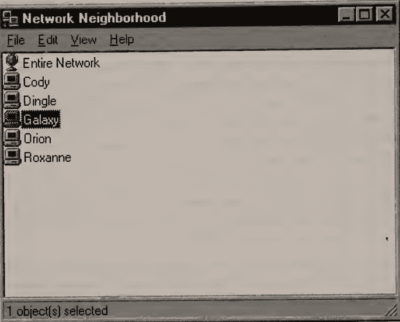

**图 9–1** Dingle 和 Galaxy 是运行 Samba 的 UNIX 服务器

你从 Linux 获取的任何打印机都应该可以通过 Samba 使用（见图 9–2）。

Windows 侧可能会稍微复杂一些。直接与打印机通信的更复杂的打印驱动程序可能会给你带来一些问题。我的第一个建议是获取一个支持 PCL 或 PostScript 的打印机。这样，你至少可以将数据发送到打印机。请注意，现在出的更多打印机可能使用“Windows 打印系统”，它除了 Windows 之外的任何系统无法工作。如果你有一个接受 PCL 或 PostScript 的打印机，你可以在 Windows 中安装通用驱动程序来打印 Samba 打印机。我在使用 Apple LaserWriter 作为 PostScript 打印机以及 HP LaserJet 4 作为 PCL 打印机方面获得过成功。

一旦配置了打印机和共享，你就可以让用户使用了。务必密切关注日志文件，以便在出现问题时进行监控。

> ^4 你的实际情况可能会有所不同。尝试在 Windows 下使用其他打印驱动程序看看它们的效果如何。

### 9.4 总结

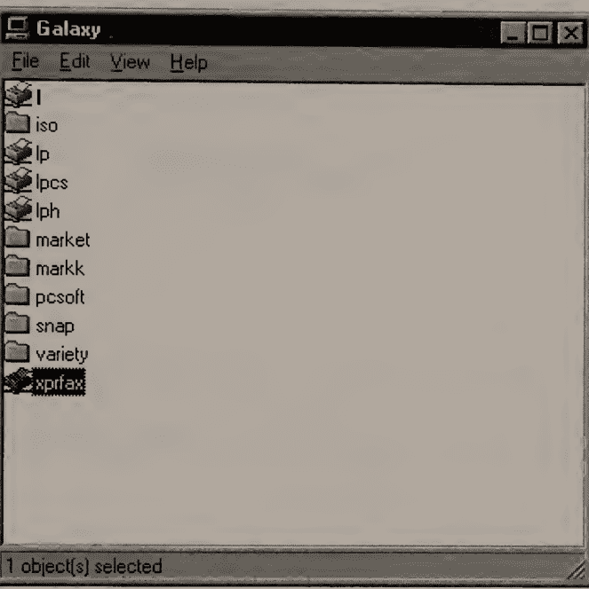

**图 9–2** Galaxy 可用的打印机和共享驱动器列表。

### 9.4 总结

- Samba 是与 Windows、Windows 95 和 NT 机器共享磁盘空间和打印机的简单方法。

# 10 NetNews

## 在你的 Linux 机器上安装 INN 程序

Usenet News 是一个全球分发的讨论系统，支持许多被称为新闻组（`newsgroups`）的不同主题论坛。

几乎所有可以想象的主题都涵盖在 Usenet 范围内，而且每天都会添加新的新闻组以跟上流行需求。Usenet 可用于研究、娱乐或仅仅寻找有共同兴趣的人。有关从用户和历史角度对 Usenet 的更深入的描述，请参考位于以下位置的“什么是 Usenet”FAQ（常见问题解答）：

```
ftp://rtfm.mit.edu/pub/usenet-by-group/news.answers/usenet/what-is/part1
```

以及

```
ftp://rtfm.mit.edu/pub/usenet-by-group/news.answers/usenet/what-is/part2
```


# 第 10 章 · NetNews

Usenet 的历史始于 1979 年，当时两个研究生学生 `Tom Truscott` 和 `Jim Ellis` 考虑使用 `UNIX` 复制软件（`UUCP`）来连接机器，用以便在用户之间进行信息交换。起初，流量由许多 `shell` 脚本处理，但第一个公共软件是 `Anews`。`Anews` 规模很小，设计时每天每个组处理处理超过几篇文章。当读者数量增加时，`Anews` 被重写并于 1982 年作为 `Bnews` 发布，随后在 1987 年再次重写为 `Cnews`。`RFC 850` 和 `1036` 标题为《USENET 消息交换标准》，详细说明了 `USENET` 主机之间进行网络新闻消息交换的格式，定义了新闻消息的格式、传输方法和传播方法。

在 `Cnews` 之前的所有新闻服务器版本主要都以 `UUCP` 网络为目标，尽管它们也可以在不同的协议上使用。

随着 `TCP/IP` 和 `DEC-Net` 等其他网络的日益普及，必须开发更高效的新闻传输方法，因此网络新闻传输协议（`NNTP`）于 1986 年诞生。`NNTP` 被设计为一种“存储和转发”技术，这意味着新闻文章存储在中央数据库中，读者从中拉取单篇文章。关于 `RFC 977`《一种基于流的新闻传输建议标准》的更多技术细节如下。

起初，`NNTP` 仅作为 `Cnews` 的一个附加包可用，但开发了互联网新闻程序，更广为人知的名称是 `ANN`。`ANN` 将 `NNTP` 部分与新闻服务器本身相结合，使得安装和配置比以前更容易。最初，`ANN` 软件由 `Rich Salz` 编写和维护，直到 1993 年年中发布的 `ANN1.4sec`。那时，`Rich` 没有时间维护分发版，`Dave Barr uno` 介入并接管了维护，编写了软件的 `1.4off` 版本。1996 年，`Rich` 将 `ANN` 分发版交给了互联网软件协会（`ISC`），并约定他们将接管未来 `ANN` 版本的维护和开发。`ISC`（主要是 `James Brister`）合并了在非官方 `off` 版本中发生的更改，然后添加了更多功能并修复了错误，产生了 `1.5` 及以上版本。

今天，互联网上的大多数站点使用 `ANN` 作为它们的新闻服务器，但各种新开发的服务器，如 `Cyclone`、`Dnews`、`Diablo` 等。本章主要介绍 `ANN` 软件以及如何在 `Linux` 系统上对其进行安装、配置和故障排除。

## 10.1 INN 安装前的考虑

在实际安装 `INN` 并开始接收新闻之前，有几点需要考虑。`INN` 是一项内存密集型和磁盘密集型软件，特别是当机器接收并存储大量文章时。提前确定所需的内存和磁盘空间，并规划文件系统的布局，可以为将来省去很多麻烦。

### 空间考虑

`Usenet` 会消耗大量的磁盘空间，取决于你运行多少新闻组以及新闻组属于什么层级。提前估计日志、实际新闻存储区域和新闻二进制文件需要多少磁盘空间。目前，完整的新闻流每天产生 3 到 4 GB 的侵入新闻。其中大部分被 `alt.*` 层级占据，其中最大的部分是 `alt.binaries` 层级。

如果你想接收部分新闻但没有太多可用空间，请考虑只获取部分新闻。你可以根据层级或指定组名限制保留的内容。如果你对某些主题感兴趣，接受讨论这些主题的小组。通常，除非运行 `ISP` 或服务，大多数人选择只接受部分新闻，因为有许多你无法理解的语言的组。

对于较大的安装，将日志、二进制文件和配置文件放在不同的分区上通常是一个好主意。新闻二进制文件和配置文件占用的空间基本不变，可以与其他二进制文件放在同一个分区上（通常在 `/usr` 或 `/usr/local`）。剧烈变化的片段是大小和日志文件分区。日志文件分区必须至少是正常使用空间的两倍，因为当 `expire`（清理程序）运行时，`INN` 会创建历史文件的多个副本。池区域必须容纳你希望保留的几天新闻，并能够处理本地机器或上游新闻提供商宕一段时间后发送大量积压新闻的偶发情况。

### 内存考虑

`INN` 不仅占用大量磁盘空间，如果你有大量的群组，它还可能会消耗大量内存。`INN` 将历史数据库保留在内存中，当运行 `expire` 运行时，它会将整个删除列表保留在内存中。如果机器没有足够的内存来及时运行 `expire`，可能会导致新闻严重滞后，因为新闻服务器在运行时不会接受新文章。为了避免出现“无新闻，然后是新新闻涌入”的循环，请确保本地机器能够处理所需的磁盘和内存负载。

### 其他性能考虑

在硬件和软件层面，都有多种方法可以调整你的新闻系统以提高性能。在软件方面，客户端软件可以通过使用 `NOV` 索引方案（概览数据库）来加快读取速度。对于任何大型新闻安装，请将概览数据库放在单独的分区上。桌面客户端和馈源站点对该分区的频繁读写，使其成为一个被高频使用的目录。此外，过期像 `junk` 和 `control` 这样的管理类新闻组可以节省服务器空间，并加快层级结构的读写速度。稍后的 `INN` 配置中将讨论几个软件调优步骤。

在硬件方面，新闻传输的速度受总线速度、网卡性能以及磁盘和磁盘控制器布局的影响很大。为了获得最佳的磁盘性能，请将输入（`I/O`）分布在多个 `PCI` 或 `EISA` 控制器上的若干较小（2 到 4 GB）的高性能 `SCSI` 磁盘上。确保控制器配置为启用了标记队列（`tagged queuing`）的同步 `SCSI`。从 `ftp://sweet-smoke.ufr-info-p7.ibp.fr/public/Linux/` 获取 `md` 工具包，并启用 `md` 驱动以使用 `RAID` 分片用于新闻溢出区（`spool`）和概览数据库分区。将新闻磁盘挂载为 `no_atime`，以消除即使文件内容未更改时也对每次文件访问进行 `inode` 更新。对于 `2.0.29` 之前的 `Linux` 内核，这需要一个 `INN` 补丁，可以从 `Clayton O'Neill` 的 `http://thereisnacal.news.erols.com/patches/ext2_no_atime.diff` 获取。`Clayton` 在他的网站上还有许多其他有 `INN` 补丁。

## 10.2 设置、获取和解压 INN

安装新闻服务器的第一步是格式化并挂载所有将使用的分区。接下来，创建新闻用户和新闻组，或验证它们是否已经存在。为了确保安装安全，新闻用户和新闻组应拥有 `INN` 软件所在的所有目录。新闻用户应该有一个锁定的密码，并且在安装新闻二进制文件的任何地方都应该有主目录。

验证 `PGP` 是否已安装，或者参阅安全章节获取 `PGP` 安装的说明，并为新闻用户创建一个 `PGP` 密钥，以便其进行安全的控制消息身份验证。此外，如果新闻机器上有 `FTP` 守护进程，请确保新闻用户在 `/etc/ftpusers` 文件中，以不允许进行 `FTP` 访问。

设置完成后，确认你正在使用最新版本 `INN` 的源码。`Slack` 新闻包带有 `NNTP` 的参考实现（`Reference Implementation`）以及 `INN`。然而，如果你在安装时选择了“`INN`”，它不会删除 `/etc/inetd.conf` 中的 `NNTP` 条目，`muut` 必须手动将其删除。通常情况下，安装 `Linux` 发行版附带的 `INN` 实现更安全，并从 `ISC` 网站 `http://www.isc.com/inn.html` 获取最新的 `INN` 版本（编写本文时为 `1.6` 版本）。此外，获取任何针对相同版本 `INN` 发布的补丁。一旦分区设置好并下载了 `INN` 分，将所有内容移动到新闻源码目录，例如 `/usr/local/src/inn`。成为新闻用户（`su news`），通过以下操作解压并处理源码包：

```bash
$su news

(确保路径设置正确)

>tar xf inn-1.5sec3.tar.gz

>cd inn-1.5sec3

>ls -a
```


## 10.3 编译和安装 INN

这是 `INN` 发行版的源码树，它包含了多个 `Makefile`、`README` 指令文件以及分为以下主题的目录：

- **frontends（前端）:** 控制中央服务器并将文章馈送到 `innd`（NNTP 服务器本身）的程序
- **backends（后端）:** 将文章传输到其他站点的程序
- **expire:** 清理文章文件和数据库的程序
- **nnpd:** 用于客户端读者的 NNTP 服务器
- **lib:** 库例程
- **include:** 头文件
- **samples:** 原型脚本和配置文件
- **site:** 在复制到实际新闻目录进行实施之前，存储用户可编辑的站点配置文件的地方
- **doc:** 手册页
- **config:** 辅助站点配置的工具

利用此机会对软件应用任何补丁，并在尝试配置和安装 `INN` 之前，务必仔细阅读 `README` 文件、`FAQ`、`Install` 文件和其他相关文档。特别关注 `FAQ` 第 2 部分，其中讨论了 Linux 特有的技巧和问题。

### 环境准备

安装新闻服务器的第一步是格式化并挂载所有将使用的分区。接下来，创建新闻用户和新闻组，或验证它们是否已经存在。为了确保安装安全，新闻用户和新闻组应拥有 `INN` 软件所在的所有目录。新闻用户应该有一个锁定的密码，并且在安装新闻二进制文件的任何地方都应该有主目录。

验证 `PGP` 是否已安装，或者参阅安全章节获取 `PGP` 安装的说明，并为新闻用户创建一个 `PGP` 密钥，以便其进行安全的控制消息身份验证。此外，如果新闻机器上有 `FTP` 守护进程，请确保新闻用户在 `/etc/ftpusers` 文件中，以不允许进行 `FTP` 访问。

设置完成后，确认你正在使用最新版本 `INN` 的源码。Slack 新闻包带有 NNTP 的参考实现以及 `INN`。然而，如果你在安装时选择了“`INN`”，它不会删除 `/etc/inetd.conf` 中的 NNTP 条目，必须手动将其删除。通常情况下，安装 Linux 发行版附带的 `INN` 实现更安全，并从 `ISC` 网站 <http://www.isc.com/inn.html> 获取最新的 `INN` 版本（编写本文时为 1.6 版本）。此外，获取任何针对相同版本 `INN` 发布的补丁。一旦分区设置好并下载了 `INN` 分发，将所有内容移动到新闻源码目录，例如 `/usr/local/src/inn`。成为新闻用户（`su news`），通过以下操作解压并处理源码包：

```bash
$ su news
# 确保路径设置正确
> tar xf inn-1.5sec3.tar.gz
> cd inn-1.5sec3
> ls -a
```

### 配置 INN

与 GNU 工具不同，`INN` 没有自动配置脚本，因此所有设置必须通过编辑 `config.data` 文件来完成。`INN` 的脚本版本位于 `config` 目录。使用脚本版本通常是最简单的，但 C 版本通常更快。要测试程序，执行以下操作：

```bash
$ cd INNSRC/config
$ cp ../sample-configs/config.data-linux-<version> config.data
$ chmod 644 config.data
$ make sh
```

如果在使用脚本时收到错误，请尝试 C 版本。如果一切顺利，现在可以通过编辑全局配置文件 `config.data` 完成配置。Linux 版本的 `config.data` 文件应该提供一个基本准确的编译起点，但有关配置文件中每个部分的详细信息，请参阅 `INN` 安装说明。`config.data` 文件使用 `#` 字符作为注释行，其格式如下：

```
<parameter><value>
```

即使没有 `<value>`，仍然需要 `<parameter>` 以避免语法错误。

#### 日志级别
请确保将正确的日志级别放入 `/etc/syslog.conf` 文件中。配置文件通常分为以下部分：

- **Make config parameters:** 指定 C 编译器的路径，并定义所需的库和命令行开关。
- **Logging levels:** 指定 `innd` 和其他程序应该在哪些日志级别下记录。
- **Ownership and file modes:** 定义文件的所有者和组、掩码（`umask`）以及机器的邮件联系人。
- **C library differences:** 操作系统将使用的库例程，以及某些常用类型和大小的值。
- **C library omissions:** 操作系统可能缺失的库例程。
- **Miscellaneous config data:** 定义包含在 `INNSRC/include/configdata.h` 中的宏。此部分极大决定了新闻服务器的行为，是最大的部分之一。
- **Paths to common programs:** 定义新闻二进制文件和 `sendmail`、`shell` 工具等通用程序的位置。
- **Paths related to the spool directory:** 定义新闻溢出区、入/输出数据库、`tmp` 以及错误文章的位置。
- **Execution paths for innd and news:** 定义 `innd` 使用的一些程序路径。
- **Sockets created by innd or clients:** 定义套接文件的位置。
- **Log and config files:** 定义 `INN` 配置和日志文件的位置。
- **Innwatch configuration:** 定义 `innwatch` 在哪些点对新闻服务器进行限制和解除。
- **Tcl filtering configuration:** 定义是否包含 `tcl` 支持以及 `tcl` 头文件和库文件的位置。
- **PGP control-message verification configuration:** 决定是否使用 `PGP` 身份验证以及 `PGP` 二进制文件的路径。
- **Local configuration:** 定义新闻用户的主目录。
- **Actync configuration:** 定义要同步到哪个主机以及如何同步。
- **Perl 配置：** 定义是否包含 `perl` 支持，以及 `perl` 头文件和库所在的位置。

### 编译与安装

一旦确认 `config.data` 文件对于当前系统是正确的，按照以下步骤以非特权用户身份编译新闻软件：

```bash
> cd INNSRC
> make world > make.log
```

假设一切顺利，通过执行以下命令确认内容将安装在正确的位置：

```bash
> make -n install
```

然后，在确认一切无误后，切换到 `root` 用户并执行以下操作安装包：

```bash
su - root
# mkdir -p <news spool directory>
# chown news.news <news spool directory>
# chmod 775 <news spool directory>
# cd INNSRC
# sh /makersdir.sh
#.BUILD
```


`makersdir.sh` 脚本将创建高级目录并赋予它们正确的权限，而 `BUILD` 脚本将安装所有文件，提供一个小的活动文件并构建相应的历史文件。此初始安装必须以 `root` 身份进行，以确保所有的 `SUID` 脚本和包装器具有正确的所有权和权限。此时应该更改的文件只有 `INSRC/site` 目录下的文件。从现在起，除非修改 `SUID` 文件源，否则你应该能够以新闻用户身份执行所有的 `make`。在将来进行任何更改之前，最好的做法是先执行 `make backup` 以保留原始源文件。此外，在最终设置好馈一时，确保为 `nntpsend` 和 `news.daily` 添加 `cron` 任务。

## 10.4 INN 内部

在尝试启动 `INN` 并获取新闻源之前，你应该对新闻系统的工作原理有相当的了解。`INN` 软件有许多不同的部分，控制新闻处理的不同方面。其中某些程序一直运行，而另一些仅在需要时或手动运行时启动。为了获得整体概念，我们将从开始描述 `INN` 在各种条件下的运行情况。

### `rc.news`

安装 `INN` 后，创建一个脚本来检查上一次 `INN` 关闭的一致性，然后重新启动新闻服务器并执行任何其他需要的清理工作。这通常通过调用 `$INNSRC/samples/rc.news` 提供的脚本（位于 `/etc/rc2.d/` 文件中）或直接从 `/etc/rc2` 运行来实现。`rc.news` 脚本将从 `INN` 配置中读取所有变量，设置将传递给 `instart` 的标记，并检查服务器是否未正常关闭。

它还会确保如果正在运行 `expire`（过期处理），新闻管理员将收到通知或继续删除旧文章，并验证活动文件（`active`）和历史文件（`history`）的存在。在确保一切处于稳定状态后，它会启动服务器和一个名为 `innwatch` 的进程来监控机器。

### `innwatch`

`innwatch` 程序监控负载平均值、磁盘空间使用情况以及用于新闻的分区分区数量。通过修改位于 `$INNSRC/site/` 下的 `innwatch.ctl` 文件，可以针对特定站点自定义 `innwatch` 参数。

### `innd`

如上所述，`rc.news` 启动主进程 `innd`，该进程是实际的监听并处理来自端口 `119` 的所有传入连接的守护进程。

启动时，`innd` 将 `active`、`newsfeeds` 和 `hosts.nnpt` 文件读入内存，然后在端口 `119` 打开套接字，开始将文章记录到历史文件中，并将连接记录到 `/etc/syslog.conf` 文件指定的一组文件中。

### 日志

`INN` 的日志记录位置由几个文件控制：`/etc/syslog.conf`、编译前的 `config.data` 中的设置以及 `control.ctl` 文件。

`config.data` 文件通常告诉 `INN` 默认日志目录在哪里以及以什么级别记录各种类型的消息。`config.data` 文件还定义了应该在哪里记录错误和普通消息（如所有传入的新闻）。`control.ctl` 文件告诉 `INN` 在哪里记录诸如 `newgroup`、`removegroup` 以及其他取消消息类型的内容。更多细节请参见控制消息章节。`syslog.conf` 的条目告诉 `INN` 在哪里记录不同严重程度的消息。`syslog.conf` 的常见条目如下制表符分隔条目：

```
news.crit    /var/log/news/news.crit

news.err      /var/log/news/news.err

news.notice  /var/log/news/news.notice
```


这告诉 `innd` 它应该将相应级别的消息发送到 `/var/log/news` 中对应的日志文件中。

### 活动文件和历史文件

`active` 文件和 `history` 文件是 INN 的主要数据库，用于跟踪机器上存储或之前存储的文章。“活动文件”为每个新闻组占一行，包含新闻组名称、当前存储在服务器上的文章的高水位和低水位，以及新闻组的状态。新闻组的状态在创建时确定，可以是以下之一：

- 允许本地帖子。
- 仅允许远程发帖。
- 这是一个受审核的组，所有帖子必须经过批准。
- 文章仅在接收时才会被转发并归档到垃圾（junk）新闻组。
- 无法向此组发布文章。
- `group.name`——文章在“group.name”组中本地归档，类似于新闻组的符号链接。

与 `active` 文件配合的是 `active.times` 文件，它提供了新闻组创建时间的时间顺序日志。每行包含新闻组名称、创建时间，以及可选的创建组员的电子邮件地址。

同样重要的是存储当前服务器上所有文章以及曾在服务器上但现在已过期的文章记录的文件。“历史文件”为每篇文章包含一行，制表符分隔的字段为唯一标识的 `Message-ID`、接收文章的日期，以及一组标识文章发布到的新闻组的分格分隔条目。如果文章已过期，第三字段为空。

`history` 文件和 `active` 文件始终由 `innd` 进程打开，并在新闻服务器接收新文章或文章过期时随时更新。如果这些文件之一丢失或损坏，则必须从磁盘上的现有数据进行重建。这可能是一个漫而艰辛的过程。

### 10.5 NNRP

`innd` 在端口 119 上接收两种连接：NNTP（网络新闻协议）和 NNRP。NNRP 是其他新闻服务器用于批量传输文章的协议。当接收到此类连接时，`innd` 会检查 `hosts.mntp` 和 `hosts.nttp.nolimit` 文件以获取连接机器的名称。

要允许推送机器访问新闻服务器，请编辑 `$INSRC/site/hosts.nttp` 或 `$INSRC/site/hosts.nttp.nolimit` 文件，并将推送机器的名称单独写一行。注释以井号（#）开头，在解析文件时会忽略空行。冒号分隔的馈源条目的第一个字段是被馈送机器的主机名或 IP 地址。第二个字段是客户端首次连接时必须提供的密码；此字段通常可以留空。可选的第三字段是允许从客户端站点接受的新闻组通配符匹配列表。通常此文件设置为带有客户端主机名和冒号（`news.uu.net`）的条目。

### rnews

`inews` 程序通常读取存储在本地队列中的新闻文章。UUCP 批量文件以井号（#!）开头，表示文件中存储了多篇文章。如果文件开头没有井号，则 `inews` 将整个文件解释为仅一篇文章。

### nnrp.access

`nnrp.access` 文件包含冒号分隔字段的条目，以井号（#）作为注释。条目的第一个字段是主机名或地址。第二个字段是授予客户端的权限。第三个字段是必须使用的用户名。第四个字段（也可以留空）是客户端必须提供的密码。

### inews

如果你的对等新闻服务器通过了验证，新闻服务器将接受所有发送的文章。`innd` 单独处理每篇文章，并将每个记录到编译前在 `config.data` 文件中指定的日志目录下的“news”文件。`innd` 将尝试将新闻组（`newsgroup`）与内存中活动文件中的某个新闻组进行匹配。如果组名匹配，`innd` 将通过检查历史文件中的唯一文章 ID 来验证其是否已经接收过该文章。如果文章是新的并被接受，`innd` 将修改活动文件，增加新闻组和历史文件的高水位标记，并添加新的文章 ID。

### 控制消息

对于具有特殊标头“Control;”的特殊特殊情况，`innd` 将将文本的第一个单词转换为小写并进行解析，以确定对消息应该采取什么操作。如果参数是 `cancel`，`innd` 将取下一个参数作为 `Message-ID` 并将其从新闻池和历史文件中删除。如果第一个参数是其他任何内容，`innd` 将引用 `parse-control` 脚本（该脚本由 `control.ctl` 文件控制）来确定处理的下一步。

`control.ctl` 文件条目包含四个冒号分隔的通配符匹配字段，且井号 (#) 表示命令。第一个字段指示规则集适用于哪种类型的消息。此字段对应于 `Control:` 标头行的第一个参数。常见的消息类型有 `ihave`、`kendine`、`rmgroup`、`newsgroup`、`sendsys`、`senduname` 和 `version`，但也可以自定义。第二个字段指示消息必须来自何。如果控制消息是“`newgroup`”或“`rmgroup`”，则第三个字段指定正在创建或删除的组的模式。如果控制消息是其他类型，则第三个字段被忽略。`control.ctl` 文件的第四个字段是当消息匹配其他标准时应该执行的操作。

`control.ctl` 动作默认包含以下内容，但可以编写其他脚本并将其添加到 `parse-control` 程序中，以便对文章处理进行定制化控制。

- `doit`：执行控制消息请求的操作。
- `doifarg`：如果控制消息有参数，则将其视为 `doit`。
- `action`：如果未提供参数，则将其视为邮件条目。这用于“`sendsys`”条目脚本中，以便站点可以通过发布“`sendsys mysite`”文章来请求自己的新闻馈送条目，而不会向新闻服务器开放 `sensys` 弹攻击。
- `doit-file`：执行操作，但在指定的日志文件中写入日志记录。如果单词是“`mail`”，则将记录发送给新闻管理员。空字符串等同于 `/dev/null`，以斜杠开头的路径被视为绝对文件名作为日志。如果没有前导斜杠，则假设目录为 `config.data` 文件定义的日志目录。
- `drop`：完全忽略消息。
- `log`：向 `config.data` 文件定义的 `erlog` 发送单行通知。
- `log-file`：如上述 `doit-file` 定义所述，向“`log`”写入单行通知。
- `mail`：除了向新闻管理员发送邮件外，不采取任何操作。

## 10.6 Newsfeeds

文章还将被送到 `newsfeeds` 文件，以确定其是否应该发送到站点或通过任何本地通道馈送。我们发送到另一台机器以便用户发布的文章到达外部世界，你必须编辑 `$INSRC/site/newsfeeds` 文件并为馈送机器添加条目。`newsfeeds` 文件引导新闻管理员精调新闻将发送到哪些站点，并且这可能非常复杂，如果对其中一个站点进行了任何特殊操作，请务必阅读 man page。简而言之，`newsfeeds` 文件中的每个条目有四个冒号分隔的字段：其中两个字段可能带有可选的子字段，用斜杠标记。接受多个参数的字段或子字段应用逗号分隔。可以使用多行来定义站点，但除了最后一行外，每行末尾必须有一个“/”续接字符。

每个条目的格式如下：

```
sitename[/exclude, exclude, ...]
:pattern,pattern...[/(distrib,distrib...)]
:flag, flag...
:param
```


第一个字段通常是机器将发送文章的机器名称，也可以仅仅是 `newsfeeds` 文件中唯一的通用标识符。如果 `exclude` 参数中的任何字符串匹配 `Path` 头部中的机器，则文章将不会馈送到该站点。第二个字段中的模式是馈送给客户端机器的文章或层次结构的通配符匹配，`distrib` 模式是 `Distribution` 文章标头的匹配列表。第三个字段是标志集，定义了馈送的类型和各种大小参数。大多数设置为发送本地帖子的新闻馈送使用 `Tf,Wnn` 作为标志。有关可用标志及其每个标志作用的深入讨论，请参见 man page。第四个字段的含义取决于第三字段中定义的馈送类型。在大多数情况下，它可以省略。

## `nntpsend`

要对传出新闻馈送的批量文件进行刷新（flush），你必须在 `INNSRC/site/nntpsend.ctl` 中为馈送机器添加条目。`nntpsend.ctl` 文件由四个冒号分隔的字段组成，定义了每个站点如何以及在哪里对新闻进行批量处理。第一个字段是 `newsfeeds` 文件中指定的馈送名称，应有一个对应的文件名。第二个字段应该是站点的主机名或 IP 地址，如果 `newsfeeds` 文件中使用主机名，这两个字段应该是相同的。第三个字段指定默认的裁剪大小。如果该字段为空，则不会发生裁剪。最后一个字段指定传递给执行批量处理过程的标志，`innxmit`。`nntpsend` 程序通常每 15 分钟通过 `cron` 运行，但可以在发布新文章时手动运行。当 `nntpsend` 为每个主机启动时，它会将批量文件复制到 `outgoing` 目录中的工作文件。如果已经运行着一个 `nntpsend` 进程，则只有在工作文件已刷新或发生错误时才会启动另一个。

## Overview Database

如果 `newsfeeds` 条目是一个通道而不是到其他站点的馈送，文章将传递给本地二进制文件。常见的馈送包括邮件网邮件，但 `newsfeeds` 文件中最常见的馈送条目是 `overview`，如下所示：

```
overview*:Tc, WO:/news/bin/overchan
```

这获取所有文章并将其通过 `overchan` 二进制处理，从每篇文章中提取相关信息并存储在数据库中，供新闻客户端快速加载。概述数据库结构类似于新闻池本身，按组名组织所有项。例如，`comp.os.line` 的概述文件位于

```
/news/overview/comp/os/line/.overview
```

而 `comp.os.line` 的所有文章存储在

```
/news/spool/comp/os/line/<article ID>
```

概述文件的内容由 `overview.fmt` 配置文件控制。默认，概述文件包含以下头部：`Subject`, `From`, `Date`, `Message-ID`, `References`, `Bytes`, `Lines`, `Xref`。`overview.fmt` 文件行的顺序很重要，因为它决定了头部在数据库中出现的顺序。

## `ctlinnd`

INN 发行版中最重要的用户交互式软件之一是 `ctlinnd` 二进制文件。`ctlinnd` 程序是 `innd` 的主要控制机制。它负责创建和删除组、取消文章、服务器状态、重新读取 ind 在内存中保留的配置文件、重命名活动文件等等。出于诊断目的，最常用的 `ctlinnd` 命令之一是 `ctlinnd mode`，它可以验证服务器是否运行、处于何种模式以及是否正在接收新连接。`ctlinnd` 功能的完整列表可以通过向程序传递 `-h` 标志来查看。我们将介绍一些常用的 `ctlinnd` 参数，其余留给 man page 解释。

`ctlinnd` 最常用于任务是在服务器上创建和删除新闻组。如果没有自动的组创建和删除，新闻管理员必须使用以下语法手动添加、删除和更改组：

```
ctlinnd newgroup <group> [flags] [creator]
ctlinnd rmgroup <group>
ctlinnd changegroup <group> [flags] [modified by]
```

在每情况下，`<group>` 标志是待添加、删除或修改的新闻组名称。`newsgroup` 和 `changegroup` 上的标志应与上述描述的活动文件的第四字段匹配。如果该组已存在且对同一组发出了 `newgroup` 命令，则等同于对该组发出了 `changegroup` 命令。`[flags]` 和 `[creator/modified by]` 参数均可省略，该组将默认设置为“y”，允许本地发布，且没有创建者或修改者的电子电子邮件地址列表。

## 添加和移除新闻馈送（Newsfeeds）

在修改 `newsfeeds` 文件以将新站点添加到仅限馈送（only feed）后，运行 `ctlinnd begin <site>` 命令来开始对新站点进行馈送，而不是重新加载整个服务器。此外还需要运行 `ctlinnd checkfile` 以确保对 `newsfeeds` 文件所做的任何更改在语法上都是正确的，INN 在重新加载 `newsfeeds` 文件时会自动执行此操作。发现的所有错误将报告到 `syslog`。

如果站点已从 `newsfeeds` 文件中删除但仍为其存在一个批处理文件，运行 `ctlinnd drop <site>` 将该站点从活动馈送列表中移除并清空批文件。仅运行 `ctlinnd flush <site>` 将清除批文件。如果没有指定站点，则 `flush` 将尝试清除批文件，并将活动文件和历史文件写入磁盘，同时刷新本地服务器。

## 重新加载服务器

在修改以下任何文件后，必须重新加载新闻服务器以使更改生效：`history`、`hosts.ntmp`、`newsfeeds`、`active`、`overview.fmt`。`reload` 命令还接受参数 `all` 来重新加载上述所有文件。如果传递给 `ctlinnd reload` 的参数是 `history`，则关闭并重新打开历史数据库。如果参数是 `hosts.ntmp`，则重新读取 nmtp 文件。如果参数是 `active` 或 `newsfeeds`，则将重新加载 `active` 和 `newsfeeds` 文件。如果参数是 `overview.fmt`，则重新读取概览格式配置文件。

## 第 10 章 • NetNews

在这种情况下，传递给 `ctlinnd` 命令的可选第三个参数是重新加载的原因，它由 `syslog` 记录到相应的文件中。例如，为了添加新的馈送站点而重新加载整个服务器，请执行以下操作：

```
ctlinnd reload all "added a new upstream feeding site"
```


## 停止和启动连接

`ctlimnd` 也用于控制谁可以连接到服务器通过 NNTP 读取、发布和馈送文章。要允许或拒绝客户端读者，使用命令 `ctlimnd readers <flag> <reason>`，其中 `<flag>` 以“n”（用于断开连接）或“y”（用于允许连接）开头，`<reason>` 是客户端尝试连接时发送给客户端的测试反馈信息。要撤回连接，`<reason>` 必须与允许连接时提供的 `<reason>` 匹配或为空字符串。同样，颁发 `ctlimnd reject <reason>` 命令将拒绝任何将交给 `nnrpd` 的连接，并将给定的 `<reason>` 作为解释。在拒绝后允许连接，颁发 `ctlimnd allow <reason>` 命令，其中 `<reason>` 必须与拒绝命令中的匹配或为空字符串。

要暂停服务器以便不接受传入的文章，请颁发 `ctlimnd pause <reason>` 命令并使用 `ctlimnd go <reason>` 命令重新启用连接。在暂停服务器时，现有连接不会关闭，但历史数据库会被关闭并写入磁盘。这仅用于短期锁定或替换历史文件时。执行暂停操作还会向 `readers` 命令发送通知，以便不允许任何新闻连接。

要停止传入的文章并切断所有当前连接，请使用 `ctlimnd throttle <reason>` 命令。这是一种长期的锁定，会关闭历史数据库并向 `readers` 命令发送通知。要重新启用连接，发送 `ctlimnd go <reason>` 命令。服务器节流通常在运行 `expire` 期间或对新闻系统的某些关键部分进行大量工作时进行。

## 过期和报告

如上所述，`expire` 是关闭所有到服务器连接的新闻处理进程之一。`expire` 是每晚由 `news.daily` 脚本执行的清理作业之一。`news.daily` 脚本通常每晚运行一次，但根据需要，可以通过新闻用户的 cron 更频繁或更少运行。

### 10.6 新闻馈送（Newsfeeds）

通常 `news.daily` 从新闻服务器删除旧文章、轮日志并发送报告，但可以对每个进行单独配置。`news.daily` 程序接受几个关键字作为参数，我们将只讨论最常用的标志。

如果 `news.daily` 每天运行超过一次，可以在一个或多个 cron 运行中指定标志 `notdaily`，以便日志处理和旋转只执行一次。`norotate` 参数仅指定不应轮转新闻日志。如果日志不是每次都旋转，你将在随后的报告中看到重复信息。`noexpire` 参数可指定不进行任何旧文章删除，`nomail` 参数指定不向新闻管理员发送报告邮件。

## 文章过期

如果正在进行过期处理，“expire”程序将查询 `expire.ctl` 文件。`expire` 是每晚由 `news.daily` 脚本执行的清理作业之一。`news.daily` 脚本通常每晚运行一次，但根据需要，可以通过新闻用户的 cron 更频繁或更少运行。`expire` 程序在 `expire.ctl` 文件中根据文章的年龄来决定哪些文章应不再被保留。`expire` 程序负责文章的移除，并调用程序更新 `history`、`overview` 和 `active` 文件。`expireirm` 程序是一个调用 `fastrm` 移除文章的脚本。

`expire.ctl` 文件告诉 INN 软件在 `history` 文件中保留多久 MessageID。文章的移除也可以基于组类型，无论是经过审核的（M）、未审核的（U）还是全部（A）。`expire.ctl` 文件中冒号分隔条目的第一个字段是新闻组的通配符。第二个字段是 M、U 或 A。第三字段是如果没有其他说明，文章应保留的时间。第四字段是无过期文章应保留的默认天数，第五字段是清理文章的日期。由于空间问题快速过期所有新闻组，在 `expire.ctl` 中放入以下行：

```
alt.binaries*:A:2:3
```

`news.daily` 的多个参数决定了如何以及何时移除文章。`expireover` 参数告诉 INN 在删除旧文章后更新概览数据库以反映文章的状态。如果使用了 `delayarm` 参数，则要移除的文章名称将写入单独的文件，然后由 `expire` 和 `expireover` 程序进行批量处理。`expireflags='<expire args>'` 参数告诉 `news.daily` 在指定 `expireover` 参数时传递给 expire 的标志。如果指定了 delayarm，`news.daily` 将向 expire 和 expireover 传递 `-z` 标志以告诉它们使用批模式。

## 旋转和报告

在过期过程执行期间，`news.daily` 将所有输出日志文件。过期完成后，`news.daily` 使用 `scanlogs` 程序及其辅助脚本解析过去一天（或自上次日志旋转以来）收集的所有日志文件。接收和传输的文章数量以及发生的任何错误的详细信息将被打印并添加到过期数据中，并发送给新闻管理员。作为最后一步，`news.daily` 程序将旧日志轮转到单独目录，然后节流或取消暂停服务器以再次接受连接。

## 10.7 INN 配置与测试

现在完成了系统安装和 INN 内部的简要概述，你必须配置如何每天处理新闻。这包括从哪里接收新闻并向谁发送新闻、哪些机器拥有服务器的读取和发布权限、文章保留多久、如何创建新组等。日常操作的每个方面通常由单独的文件处理，通常位于 `$INSRC/site/` 目录中。site 目录中的所有内容配置完成后，执行 `make install` 将文件放入新闻等目录。

新闻管理员必须首先决定哪些新闻组以及对新组创建的何种控制。开始时使用整个 Usenet 层次会有很多不足，因为许多组是外语的、大型二进制文件或通常是不受欢迎的话题。

## 10.8 常见错误消息及其含义（摘自 INN 常见问题解答）

如果需要携带的组数量相当大，新闻管理员（newmaster）可以去 `uu.net` 这样的站点获取一个活动文件并进行精简。

## 获取 Usenet 馈送和交换新闻

一旦创建了所需组的活动文件，新闻管理员必须从其他机器获取馈源。新闻馈源通常从服务提供商或朋友处获取。找到馈源后，馈送机器需要访问新新闻服务器的 119 端口以传递新闻，而新新闻服务器也需要访问馈送机器的 119 端口以传回新闻。请确保两台机器之间没有防火墙，然后更改新闻机器的配置文件以允许远程机器访问。

要添加新闻主机，请按上述说明编辑 `newsfeeds`、`hosts.nntp` 和 `nntpsend.ctl` 文件。如果远程机器没有接收到新闻，尝试在 119 端口上对远程机器建立 telnet 会话。如果出现拒绝信息，可能由于远程站点的 `hosts.nntp` 文件中没有包含本地机器。如果新闻无法从远程站点传输到本地站点，请检查本地 `hosts.nntp` 文件以及新闻目录下的所有日志是否有错误。

## 10.8 常见错误消息及其含义（摘自 INN 常见问题解答）

### 当 innd 启动失败时

- `inndstart: inndstart cant bind Address already in use`（地址已占用）

另一个新闻守护进程正在运行或其他程序正在使用 119 端口。尝试在 119 端口建立 telnet 会话，或使用 `netstat` 识别是谁或什么连接了端口。还要检查 `/etc/inetd.conf` 查看是否有条目。

- `SERVER cant dbminist <history> No such file or directory`（没有此类文件或目录）

历史文件从未创建。运行 `BUILD` 脚本或手动运行 `makehistory`。

- `SERVER internal no control and/or junk group`（没有控制组和或垃圾组）

在创建活动文件时，控制组不是一项。要么重新运行 `BUILD` 脚本，要么手动向活动文件中添加以下垃圾组或控制组条目并重启服务器。

```
control 0000000000 0000000000 y
junk 0000000000 0000000000 y
```


## 通信设置失败（绑定失败）

- `Can't set up communication (bind failure)`（绑定失败）

这表明 `_PATH_NEWSCONTROL` 目录的权限设置错误。尝试使用 `BUILD` 脚本重新安装 `INN` 或执行 `make install`。

## 服务器无馈送站点

- `SERVER bad_newsfeeds no feeding sites`（没有馈送站点）

在新闻服务器上线之前，它必须向至少一个站点馈送。如果你正在测试通道馈或本地发布，必须在 `newsfeeds` 文件中添加一个虚拟条目，让 `INN` 认为该机器将发送新闻。

## 无法获取配置值

- `SERVER cant GetConfigValue<argument>`

这表明 `<argument>` 在 `inn.conf` 文件中未定义，但应该是定义的。通过运行 `inncheck` 脚本测试 `inn.conf` 文件也应该打印出解释错误信息的消息。

## PID 文件存在——非正常关闭

- `INND: PID file exists -- unclean shutdown!`（PID 文件存在——非正常关闭！）

当 `INN` 在不正常关闭后重启时，会打印此消息。`rc.news` 脚本将执行上述描述的某些健康检查和清理工作。在 `INN` 清理完毕后，服务器将实际启动。

### 当 Inn 运行后崩溃或限流时

- `SERVER cant fork /some/tool Resource temporarily unavailable`（资源临时不可用）

此错误表示新闻服务器已耗尽进程，导致无法派生（`fork`）请求的进程。如果用户已经拥有无限数量的进程（`unlimit maxproc`），请尝试增加内核中的进程数量。

- `SERVER cant remalloc xx bytes Cannot allocate memory`（无法分配内存）

此错误表示 `innd` 想要将其数据段扩展到超过进程允许的大小。请限制用户可以分配的空间（`unlimit datasize`）或使用更大的最大进程数重新编译内核。

- `Bad file number writing history file -- throttling`（写入历史文件时文件号错误——限流）

此错误通常表示新闻服务器达到了给定文件的空间限制。新闻用户的 `ulimit` 必须为 0（无限），以确保历史文件和活动文件不会变得过大。

- `<article-id> 436 No space`（空间不足）

这表示 `innd` 无法为新新闻组创建目录。这通常表示尝试创建新组的新闻池部分权限和/或所有权错误。

- `File exists writing symlinking article file—throttling`（写入链接文章文件时文件已存在——限流）

此错误发生在 `innd` 写入文章并尝试将交叉发布（crospost）链接到另一个层级，而它尝试使用的文章 ID 已被占用。这通常发生在活动数据库与磁盘上内容不符时，或者使用了旧版本的 Linux MMAP。解决前者，请重建活动数据库。解决后者，请在禁用 MMAP 的情况下重新编译 `INN`。

- `Not a directory writing article file—throttling`（写入文章文件时不是目录——限流）

这表示池中有一个被 `innd` 认为是文件的目录。通常只发生在崩溃和磁盘损坏之后，`fsck` 错误地判断了文件类型。要纠正此，请删除出错的文件。

- `Server throttled No space left on device writing article file`（服务器限流，写入文章文件时设备空间不足）

如果发生此错误，要么是机器磁盘空间不足，要么节点（modes）用尽。要查看可用空间，执行 `df`；要查看 inode 使用情况，执行 `df -i`。如果新闻文件空间不足，可以考虑扩展分区。

## 10.8 常见错误消息及其含义（摘自 INN 常见问题解答）

### INN 运行时的非致命错误

- `The active file and/or history file gets deleted`（活动文件被删除）

- `cant read Connection reset by peer`（连接被重置）

这表示客户端不优雅地关闭了连接。

- `expire had removing articles`（清理删除文章出错）

当 `expire` 尝试删除文章时发生了错误。要找出发生了什么，请查看新闻目录中的 `expire.log`。

- `expire in-disk`（清理磁盘链接）

当 `expire` 没有足够的空间创建历史文件时报告此问题。

- `expire found no articles`（清理未发现文章）

当 `expire` 发现没有文件时报告此错误。

- `Group not matched (removed)?<groupname>—Using expiration`

这仅表示新闻组 `<groupname>` 已从服务器删除，它正在使用过期清理文章。

## 10.8 常见错误消息及其含义（摘自 INN 常见问题解答）

### 其他问题

- `All articles received back to the provider`（所有文章都回传给了提供者）

这通常表示 `newsfeeds` 文件中设置的馈送站点与馈送站点使用的名称不匹配。`INN` 不向 `Path` 头部中的任何主机回传新闻。要纠正此，请修改 `newsfeeds` 文件使名称匹配，或如本章馈送部分所述添加分布匹配。

- `The history file is deleted`（活动文件或活动文件被删除）

丢失历史文件和/或活动文件可能是毁灭性的，特别是当两者同时丢失时。幸运的是，`INN` 在新闻目录中保留了前一个晚上的文件，命名为 `active.old` 和 `history.old`。将损坏的文件移走，并将前一个晚上的文件复制到位置。如果没有备份，则必须从头开始。活动文件特别是一个问题，因为它大部分时间无法获取调优信息。

如果历史文件损坏或丢失，运行 `makehistory -bu` 以拾取自损坏后添加的所有文章。如果活动文件丢失或损坏，它在重启时应该会重新编号。如果不是，执行 `cltimnd reactive` 强制 `INN` 拾取新的低水位。

## 在哪里寻求帮助

如果 FAQ 没有你的机器所遇问题的答案，还有其他地方可以寻求帮助。几个网站、新闻组和邮件列表包含了在 Linux 上使用 `INN` 和设置新闻馈源的信息。

## 网站

```
http://www.isc.org/inn.html
http://www.oceanwave.com/technical-resources/unix-admin/news.html
http://www.cwcis.ohio-state.edu/-barr/INN.html
http://thereisnocabal.news.erols.com/patches/
```

# 新闻组

```
news.admin.technical
news.software.nntp
the comp.os.linux groups
```

# 邮件地址

```
bugs@isc.org
```


### 10.9 总结

对于许多用户来说，通过`NetNews`访问可以获取大量系列主题的信息源。但许多`Linux`配置并没有足够的空闲磁盘空间来处理完整的馈送（`feed`）。在这种情况下，你可能只需要部分馈送，以处理对你的用户最有益的新闻组。在获取馈送之前，请提前规划好维护馈送所需的磁盘空间和时间。

### 11 设置 FTP

虚拟、匿名及更多。

文件传输协议（`FTP`）是互联网上最经常使用的服务之一。设置一个匿名`FTP`服务器非常简单。其他服务，如虚拟`FTP`主机和仅限`FTP`的账户，则设置起来会稍微复杂一些。

在本章中，我们将介绍如何设置所有这些服务，然后谈谈几个客户端程序。

### 11.1 匿名 FTP

这是最常用的服务：机器上的单个匿名`FTP`服务器。大多数`Linux`发行版会自动设置此项。通常，`ftp`根目录为`/home/ftp`。

如果由于某种原因，你的机器没有设置匿名`FTP`，那么设置它非常简单。

#### 设置匿名 FTP

在下面的指令中，`~ftp`是`/etc/passwd`文件指定的匿名`FTP`用户的家目录。

`FTP`守护进程`vsftpd`会识别匿名用户并调整账户的某些属性。访问的根目录设置为`~ftp`。这意味着访问至多被限制在`~ftp`中的目录和文件中。当然，权限可以进一步限制访问。由于文件系统根目录发生了变化，需要设置几个目录和文件以允许最基本的功能。

* `~ftp`应该由`root`所有且仅允许`root`写入。
* `~ftp/bin`也应该由`root`所有且仅允许`root`写入。它应该包含`ls`程序（位于`/bin/ls`）。`~ftp/bin/ls`应由`root`所有并具有模式`---x--x--x`，如果情况不是这样，执行`chmod 111 ~ftp/bin/ls`。
* `~ftp/lib`应该包含`ld-linux.so.1`、`ld.so`和`libc.so.5`。这些可以在`/lib`中找到。

如果你希望列出时将用户和组ID转换为名称，你需要创建`~ftp/etc`。它应该具有模式`755`，并包含`passwd`和`group`文件，将ID与名称关联。加密密码字段不被使用且应为空。必须存在的唯一字段是用户名、`UID`和`GID`。

上传和下载目录`~ftp/pub`应该具有模式`755`并由`~ftp`所有。这将允许其他人向该目录上传并从中读取。你当然可以更改所有权和权限，以允许你所需的访问级别。

用户`~ftp`在`/etc/passwd`中应该有一个如下的条目：

```
ftp*:14:50:FTP User:/home/ftp:
```

`FTP`是由`inetd`控制的服务，因此需要在`/etc/services`中有一条条目。再次，这应该已经设置好了，但如果没有，请添加如下所示的条目：

```
ftp 21/tcp
```

### 11.2 用户账户的 FTP 访问

当有人用匿名（或其别名`ftp`）以外的用户名连接时，必须满足三个条件才能授予访问。用户名和（非空）密码的组合必须是有效的。用户名不能出现在`/etc/ftpsusers`中。用户必须有一个有效的`shell`，即它必须列在`/etc/shells`中。

### 11.3 仅限 FTP 的账户

可以设置只能通过`FTP`访问的用户账户。这些账户的行为与匿名账户几乎相似，并可以与它和平共存。由于匿名账户的行为，你需要设置`bin`、`lib`和`etc`。

要限制特定的仅限`FTP`账户，你需要编辑`/etc/ftpaccess`。

```
# /etc/ftpaccess

class all real,guest

class ftponly pbob *

loginfails 5

readme *

message *

compress yes

tar yes

overwrite yes

delete no

rename no
```

### 11 设置 FTP 服务

`class`行用于设置用户并匹配远程主主机。`*`匹配所有主机。对应的`/etc/passwd`条目如下

```
jane:14:50:FTP User:/home/ftp:

ftob:14:50:FTP User:/home/ftp:
```


这两个用户的 `shell` 都是有效的，将拒绝访问。家目录将是 FTP 会话的根目录。此外，`ftob` 账户将 `chdir()` 进入 `incoming`。

你可能注意到 `ftppd` 还设置了一些其他参数。

`compress` 和 `tar` 条目设置了何时允许（解）压缩或（解）压缩。

`README` 和 `message` 条目设置了连接和进入目录时自动显示的文件的模式。

在上面的示例中，低权限账户（匿名和 `guest`）被禁止删除、更改模式或重命名文件。

`loginfails` 按其预期工作：在指定的登录尝试后断开连接。

### 11.4 虚拟 FTP 主机

虚拟 FTP 经常被 ISP 用于在服务器上为多个域名设置 FTP 服务。标准的 Linux `ftppd` 不支持虚拟主机。你需要使用虚拟托管。

# 11.5 FTP 客户端

FTP 客户端有两种类型：支持基于用户的 FTP 和仅支持匿名 FTP 的。

今天，最常用的访问匿名 FTP 站点的方法是使用 Web 浏览器。这些通常是仅支持匿名 FTP 的客户端。

还有许多其他 FTP 客户端，从简单的命令行 `ftp` 程序到全屏客户端 `NcFTP`，再到图形化客户端 `XFTP`。

# `ftp`

`ftp` 程序是一个基于命令行的程序。它不是特别友好，但在任何 Linux（或 UNIX 系统）上都应该是可用的。

# `NcFTP`

`NcFTP` 是一个全屏（仍 ASCII）FTP 客户端。它有很多功能，包括

- FTP 主机的快捷键列表，包括每个主机的用户名和密码存储（如果需要），见图 11–1）。

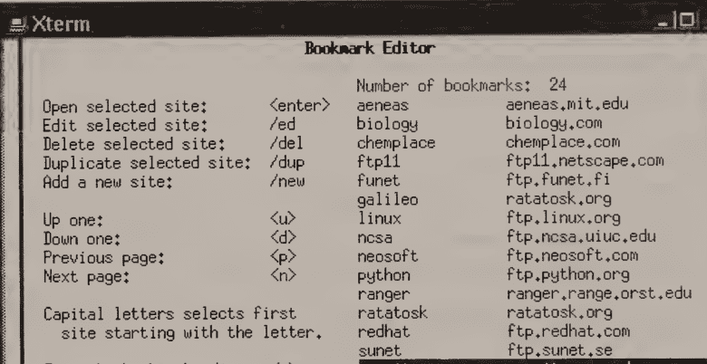

图 11–1 FTP 主机的快捷键列表。

- 自动匿名连接（发送“anonymous”作为用户名并将你提供的字符串作为密码；匿名 FTP 密码存储在家目录下的 `rc` 文件）。
- 屏幕分为命令输入区域和输出区域（见图 11–2）。

### 11.5 FTP 客户端

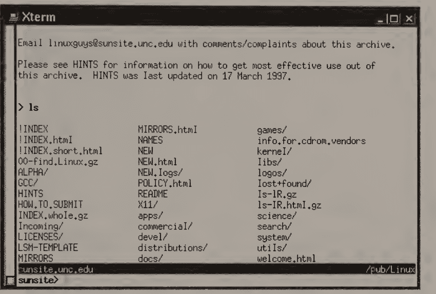

图 11–2 屏幕分为命令区域和输出区域

- 使用 `TAB` 键完成文件名和命令补全。
- 使用类似 `less` 或 `more` 的分页页器查看远程文件。
- 在上传或下载文件时支持通配符表达式。
- 支持 `ftp:` URL，例如，`ftp://www.snerdwump.org/pub/wump-1.2.4.tgz`。
- 批量操作。

## `XFTP`

`XFTP` 是一个基于 `X-Motif` 的 FTP 客户端。它支持许多方便的功能，例如选择一组文件进行上传或下载。它还可以在其他计算机之间移动文件（即这两台电脑都不需要运行 `XFTP`，尽管它们都需要运行某种形式的 `ftppd`）。

可以使用内置的弹出视图或用户指定的查看器（如 `emacs`、`less` 或 `more`）来查看本地和远程文件。此外，您还可以为各种图形格式指定要使用的程序。

最后，该界面允许大量的用户配置。

下一页的图 11-3 显示了 `XFTP` 的截图。

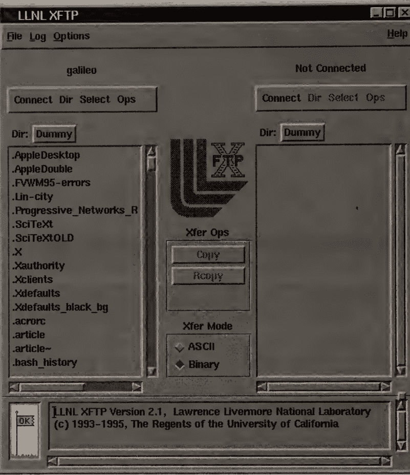

图 11–3 `XFTP`

### 11.6 总结

FTP 是一个非常有用的服务，是少数没有被 Web 取代的服务。（像 `gopher`、`archie` 和 `wais` 等东西现在几乎死掉了，被 Web 的对应品所取代。）

你们最坏的情况下只需要设置一个匿名 FTP 服务器，并可能需要确保用户可以通过 FTP 访问他们的账户。如果您的机器最初就配置为处理 FTP（大多数 Linux 都是如此），这可以轻而易举。您可能需要创建几个文件和目录。

设置起来复杂的是 FTP 专用账户和虚拟 FTP 客户端。希望我们提供的信息足够让您开始。

- 匿名 FTP 位于 `/home/ftp`
- FTP 客户端为 FTP 提供了更好的界面

## 12 Linux 应用

Linux 不仅仅是一个服务器——桌面应用程序正在日益增加。

本章对 Linux 流行的应用程序进行介绍。这些应用程序涵盖了从集成办公套件到符号数学程序，再到运行其他操作系统模拟器。

### 12.1 办公产品、文字处理器和编辑器

这一类别包括办公套件、独立的文字处理器和电子表格软件、编辑器以及出版工具。

### `Applixware`

`Applixware` 由 `Applix, Inc.` (http://www.applicix.com/) 开发，可能是 Linux 上可用的最完整且集成最紧密的办公套件。它是

`Staroffice` 是另一个办公套件，但遗憾的是它需要 `Caldera OpenLinux`，不能在其他发行版上运行。它由 `Star Division` (http://www.stardivision.com/) 开发，是一个功能全面的办公效率套件，包含了 `StarWord`（文字处理器）、`StarCalc`（电子表格）、`StarDraw`（图形和演示包）、`StarImage`（图像处理）、`StarGallery`（多媒体工具）和 `StarChart`（绘图和图表制作工具）。

### `WordPerfect`

`Corel` 的 `WordPerfect 7`（及之前的版本）已由 `Software Development Corporations` (http://www.sdcorp.com/) 移植到 Linux，`WordPerfect 8` 应该很快就会移植。`WordPerfect` 可能是 Linux 上功能最丰富的文字处理器。

使用 `WordPerfect` 的缺点是 `Corel` 的其他办公产品没有随之一起移植，因此它没有一个良好的、集成良好的办公套件可以交互。尽管如此，`Corel` 本身正在将其整个办公套件移植到 `Java`。这门课程将允许任何带有 `Java` 虚拟机的机器运行它。有关 `Java` 版 `Corel Office` 的更多信息，请参见 `http://www.corel.com/javastrast/index.htm`。

图 12-3 是 `WordPerfect 7` 30 天试用版的截图。


图 12–3 - `WordPerfect` 30 天试用版

`Network Extensible Spreadsheet`（网络扩展电子表格）由 `X Engineering Software Systems` (http://www.xess.com/) 开发。`NExS` 是一个功能全面的电子表格，具有近 250 个内置函数，表格大小支持 32,767 行、4,096 列，支持导入和导出制表符数据或其他格式（见 12–5）。

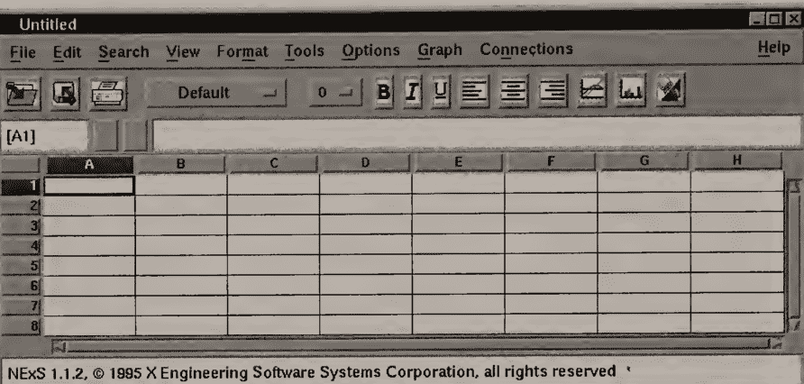

## TeX/LaTeX

### 简介

Linux 操作系统开始受到关注，这将使其普及程度超过过去几年的水平。Web 服务器、互联网服务器、文件和打印机服务器的爆炸式增长和需求，正引导越来越多的管理员去查看与其它解决方案相比成本较低的类 Unix 系统。今天约有百分之十的 Web 以 Linux 为基础。`Red Hat` 发行版 Linux 在 1996 年被 `InfoWorld` 评为“年度产品”，并经常有贡献者发布关于 Linux 最佳实践公告和文章。

技术期刊和杂志正充斥着与 Linux 开发、管理、发行和使用相关的广告和文章。《SysAdmin》杂志最近还专门了一期 Linux 专题。

系统管理员对一本深入浅出的书籍的需求是显而易见的。

### 作者

`Mark P. Komarinski` 自 1989 年起使用 `Unix`，从 1992 年起使用 Linux。他曾是《Linux Journal》的作家，《The Linux Sampler》的特稿作家，并且是《Linux for Users and System Administrators》的作者。他目前在马萨诸塞东部的 `Aurora Technologies` 工作，利用 Linux 技能维护 `Aurora` 的网络。他每年都是 Linux 大会的演讲者。

图 12–2 文档可以在应用程序之间共享，并由不同的程序插入

`TeX` 是原始的排版程序。它不是文字处理器，也没有编辑环境。`TeX` 文件可以使用任何文本编辑器创建。因为 `TeX` 源是纯文本，而且 `TeX` 已经移植到几乎每个平台，用它创建的文档具有迁移性。

当处理 `TeX` 或相关文件时，输出会被 DVI（设备无关）文件。DVI 是一种格式

- `LaTeX`——目前最常见的 `TeX` 扩展。它实际上是一组宏，允许与 `TeX` 进行更高层次的交互。它为文章、书籍和信提供了特定的模式。

- `BibTeX`——参考文献和引用系统。它还允许您从较大的、可能共享的列表中为特定文档构建参考文献。

- `SliTex`——专门为制作幻灯片或大字打印文档设计。

- `MakeIndex`——一个为 `TeX` 文档创建索引的工具。它支持多达三级的索引。

- `HyperTex`——`TeX` 的一个扩展，允许您创建带有超链接的文档。源将超链接信息传递给 `.avi` 文件，该文件随后可以转换为 Acrobat 格式。（Acrobat 本质上是压缩 Postscript 的叠加层，支持超链接。）

- `LaTeX2HTML`——一个将 `LaTeX` 源代码转换为 `HTML` 文件的工具。它会创建一个链接目录，将数学公式转换为嵌入 `GIF`，并正确处理引用和脚注。

`TeX` 有综合 `TeX` 存档网络（CTAN）的支持。可以通过 `http://www.tex.ac.uk/` 访问 CTAN，在那里你可以找到 `LaTeX` 和其他 `TeX` 扩展的信息。

`Xemacs`

`Xemacs`（见图 12–6）是适用于 `GNU emacs` 的增强版。`Xemacs` 是一个功能极其强大的编辑器。它拥有数十种文件的编辑模式，包括 `HTML`、`C`、`Perl`、`Python`、`C++`、`Makefile`、`TeX`、`LaTeX` 和 `FORTRAN`，仅列举几个。

此外，`Xemacs` 支持语音合成和语音控制。结合 `Usenet` 新闻阅读器、Web 浏览器和邮件读取器，使其成为视障用户的显而选择。

`Xemacs` 支持在多帧中编辑多个缓冲区。帧也可以垂直或水平分割成子窗口。

`Xemacs` 还可以以屏幕模式运行。在这种情况下，你将失去一些功能，主要与帧和下拉菜单有关。

# 160 第 12 章 • Linux 应用程序

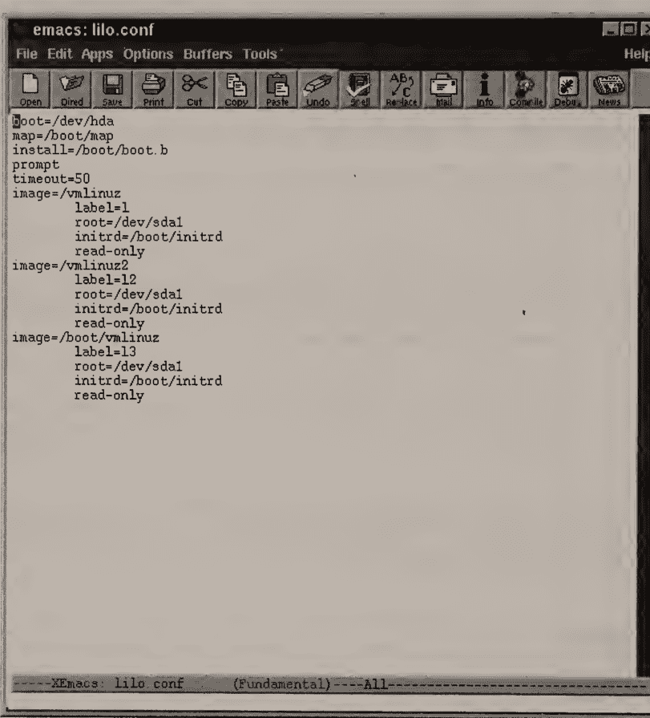

图 12–6 `Xemacs` 主窗口。

## 12.2 绘图、图形以及图像查看与处理

`XV` 是一款共享软件图像查看器和转换器。它支持 `GIF87`、`JPEG`、`TIFF`（压缩和未压缩）、`PostScript`、`PPM`、`PGM`、`PBM`、`Sun Rasterfile`、`TARGA`、`FITS`、`IRIS RGB` 和 `PM`（太棒了）。它可以读取；写入；编辑颜色和伽马校正；处理多种算法（油画、边缘检测、模糊、锐化）以及裁剪。

### Gimp

`GNU 图像处理程序`（http://www.XCF.Berkeley.EDU/~gimp/）是一种图像合成、创作和照片修图工具。它是 Linux 上最接近 `Adobe Photoshop` 这类软件包的软件。

它具有很强的扩展性，并依赖活跃的用户社区编写插件来扩展 `GIMP` 的功能。

### Xfig

`Xfig` 是一款用于 `X` 的免费绘图工具。它支持绘制插值线、各种多形、对象分组、缩放、复制以及使用 `PostScript` 字体嵌入文本。它包含在大多数 Linux 发行版中。

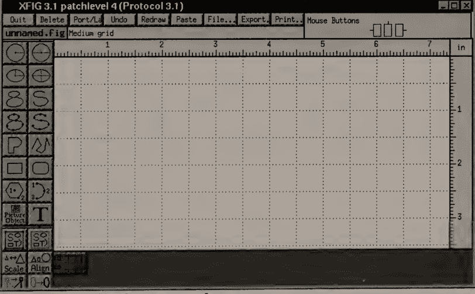

图 12–7 `xfig` 主窗口。

### Xpaint

`Xpaint` 与 `xfig` 类似，但更多倾向于绘画而非绘图。它也是免费的，并包含在大多数 Linux 发行版中。

### XPaint 2.4.4


### Mapedit

`Mapedit` 是 `Boutell.Com, Inc.` 的图像映射编辑程序。它可以创建客户端和服务器端的图像映射。它支持 `GIF`、`JPEG` 和 `PNG` 图像格式。它非常容易使用；即使是 `Windows` 用户也会比 `Windows 3.1` 或 `95` 的类似工具更容易使用。更多信息可以在 `http://www.boutell.com/mapedit` 找到。

图 12–8 `xfig` 主窗口。

### 12.3 科学程序

### Maple

`Maple` 是一个用于执行符号（而非数值）数学运算的程序。最新版本尚未发布 Linux 版。

`Maple` 是一个非常强大的符号和数值计算软件包。它还支持 2D 和 3D 绘和动画。它有一种脚本语言用于创建过程和宏。这些过程可以导出到 `C` 或 `FORTRAN`。

图 12-9 和 12-10 是 `Maple V Release 3` 演示版的几张截图。

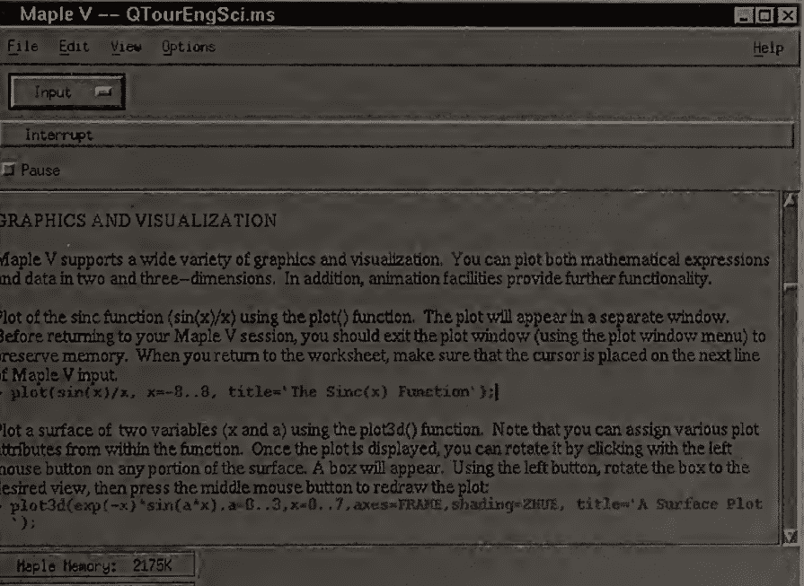

图 12-9 `Maple V Release 3` 演示版的截图。


图 12–10 `Maple V Release` 演示版的另一张截图。

### Mathematica

由 `Wolfram Research`（http://www.wolfram.com/）开发，`Mathematica` 是第二个符号处理软件包。`Mathematica` 的优特性之一是它的内核可以在与前端分离的机器上运行，允许前端在客户端机器上与其他桌面应用独立运行，而内核则在具有大量内存和强力 CPU 的服务器机器上执行。

目前没有提供 `Mathematica` 的演示版或评估版。

### 12.4 模拟器

### Executor

`ARDI`（http://www.ardi.com/）为 Linux 以及许多其他平台制作了 `Macintosh` 模拟器。提供免费但功能受限的演示版。完全及大部分可用软件列表非常长。

还有一个即将推出的 `NEXTSTEP` 仿真版本。最后，学生和教育工作者可以获得折扣。

`Executor` 提供一个相当受限的演示版。它的功能足够让你体验它的可能性的。

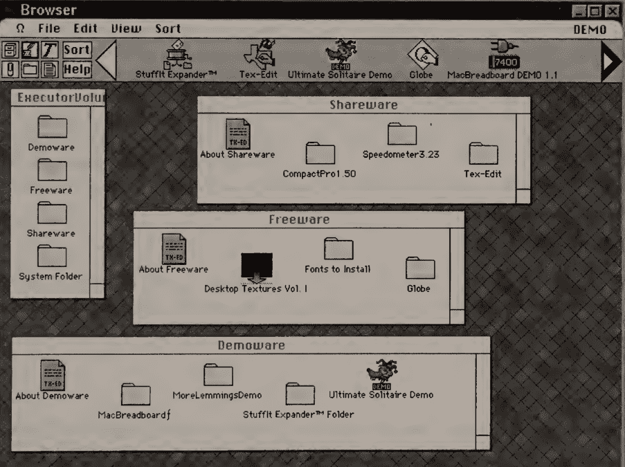

图 12–11 `Executor` 桌面。

### Wabi

`Wabi` 是由 `Sun Microsystems` 开发的商业级 `MS Windows 3.1` 模拟器。它被 `Caldera` 移植到了 Linux。它提供了应用程序间的剪贴、远程显示、用户间应用程序共享、`Winsock` 网络、`OLE`（对象链接与嵌入）、`DDE`（动态数据交换）、访问串口和并行端口以及许多其他功能。

`Wabi` 有一些局限性。它需要 8 位颜色，因此如果你运行的是 24 位颜色的 `X`，你的服务器将需要支持 8 位伪色。不支持 `IPX/SPX` 连接，也不支持虚拟设备驱动程序。更多信息请参见 `http://www.caldera.com/doc/wabi/wabi.html`。

### WINE

`WINE` 是一个免费的 `Windows 3.1` 模拟器。它的主页是 `http://www.qbc.clic.net/~krynos/wine_en.html`。除了运行许多流行的 `Windows` 应用程序外，`WINE` 还提供了一个库，允许你从 `Windows` 源代码构建独立应用程序。

`WINE` 在兼容性道路上没有 `Wabi` 远，但每个新版本都取得了显著进展。

### Dosemu

一个免费的 `DOS` 模拟器。它可以在控制台运行，也可以在 `X` 的独立窗口中运行。获取 `Dosemu` 信息的最佳地方是 HOWTO，可以在任何 Linux 镜像站点找到。

### Acrobat

`Adobe`（http://www.adobe.com/）为 Linux 制作了 `Acrobat Reader`。它是免费提供的，据我们所知，这是 `Adobe` 唯一的 Linux 产品。

### LessTif

`LessTif` 是 `Motif` 的免费克隆版本。它仍处于测试阶段，但大量基于 `Motif` 的程序已经可以使用它进行编译。此外，使用共享库版本的预编译程序将-

### 12.5 总结

- `LessTif`
- `Motif`
- `Netscape`
- `Photoshop`
- `PageMaker`
- `Quark`
- `Illustrator`

### 13.1 MySQL 和 mSQL

你可能认为周密的规划可以尽可能的减少这种不便，但不要自欺欺人。无一例外，某些外部力量——无论是新产品、新营销策略还是简单的疏忽——都会迫使你改变精心规划的数据库模式。

- 它是单线程的，这意味着它一次只能处理一个查询。只要负载不是太重且查询不是太复杂，这不应该是一个问题。具体什么多重、多复杂将取决于你的系统，并且可能需要你进行一些实验。

尽管有这些缺点，`mSQL` 仍然是一个非常有用的数据库服务器。对于存储不是太大的文本数据，它非常合适。还有其他你可能想使用 `mSQL` 的原因：

- 它是轻量级的，运行时仅消耗少量的系统资源（而像 `Oracle` 或 `Sybase` 这样的巨兽，仅仅启动就需要许多 Mb 的内存）。
- 它对非商业用途免费，商业用途共享软件费用为 200 美元。
- 庞大的用户基础和在网络上有广泛的支持。
- 作为其受欢迎的副作用，大多数流行语言都支持 `mSQL`，包括 `C`（原生 API 是为 `C` 提供的）、`Python`、`Java`、`Perl`、`Tcl`、`PHP/I`（一种服务器端解析的脚本语言，可以嵌入 (HTML)）。
- 增强的 `LIKE` 操作符：`RLIKE` 允许你使用正则表达式库，`CLIKE` 则不区分大小写。由于有独立的 `RLIKE` 实现正则，`LIKE` 和 `CLIKE` 不需要实现这一点，因此比大多数其他 `SQL` 操作符快（后者通常只实现正则功能的一个子集）。

## Lite 和 W3-mSQL

这两个额外的软件包是 `mSQL` 标准发行的一部分。
`Lite` 是一种为 `mSQL` 设计的脚本语言。它的语法与 `Perl` 相似。它的变量是动态类型的，数组是动态大小的，变量名以 `$` 开头。它与其他语言相比的主要优势是与 `mSQL` 深度集成。

`W3-mSQL` 是一个嵌入 `HTML` 并由服务器端解析的 Web 界面。包含的还有 `W3-auth`，`W3-mSQL` 的访问控制包。它支持用户和组，提供了比非 Web 访问控制文件更细的访问控制。在某些方面，`W3-mSQL` 与 `PHP` 非常相似，尽管它缺乏对其他数据库的支持，且功能没有那么全。有关 `PHP` 的更多信息，请参阅 Web 服务章节。

## 版本 1 和 2 之间的差异

版本 2 已退出测试阶段，但截至本文编写，仍然存在一些与稳定性相关的错误。如果你对你的 `mSQL 1` 设置满意，可能应该等待几个补丁版本（`2.0.1` 是最新版本）或 `2.1` 版本。

如果你正在使用 `mSQL 1`，有很多理由你可能想要升级。

版本 2 中的连接（`Joins`）效率高得多。版本 2 支持序列（这以前是在客户端处理的），并极大地增强了索引。此外，版本 2 支持比版本 1 更多的数据，最重要的是 `TEXT` 类型，这是一种变长字符字段。

版本 1 支持相当简单的 `WHERE` 规范，版本 2 允许用括号组合多个 `WHERE` 子。最后，新版本允许更灵活的运行时配置（而不是编译时配置），并支持更多的并发客户端连接。

## 其他注意事项

`mSQL` 的作者声称它可以管理高达 4 Gb 的数据，但建议其他系统限制将使得如此大的数据库在 `mSQL` 下是不实际的。目前还不清楚这个数字是如何得出的，或者如果它来自真实案例，对应多少行数据。

需要 Linux 1.3 或更高版本。早期版本没有 `mSQL 2` 需要的 `mmap` 支持。此外，你应该安装内核源码，以确保你拥有所有必要的库和头文件。

有关如何安装 `mSQL` 的示例，请参阅 Web 服务章节。

## MySQL

`MySQL` 是一个日益受欢迎的免费数据库服务器，最初是 `mSQL 1` 的增强免费版。它尝试添加完整的 `ANSI SQL` 规范加上一些增强。今天，它实现了几乎所有的 `ANSI SQL` 和一系列额外功能。

## 3.1 MySQL 和 mSQL

像 `mSQL` 一样，它将正则表达式与 `LIKE` 分开实现以提高性能。它也相当轻量级，尽管没有 `mSQL` 那么轻。

以下是 `MySQL` 支持但 `mSQL` 不支持的一些功能：

- 扩展的 `SQL`，包括 `ALTER TABLE` 子句等（允许在表创建后添加或删除列），以及可以在所有数据类型上运行嵌入函数。
- 更多数据类型，特别是 `BLOB`（二进制大对象），以及现有数据类型的不同尺寸，例如，微型、小型、中型和大型整数类型。
- 独立于 `/etc/passwd` 的用户名和密码。这对于 `CGI` 使用非常友好。不需要允许用户“nobody”对数据库具有读取和可能的写入访问，你可以在表单上要求有效的 `MySQL` 用户名/密码组合。可以在操作级（选择、删除、更新、重新加载或关闭服务器）数据库和主机级上控制用户的访问级别。
- 优化的查询，包括对连接的优化（所有连接都在一次通过中完成）。
- 多线程并并发处理多个请求。这意味着后续查询不需要等待提交给的大型、耗时查询。
- 如果你对 `MySQL` 的限制或许可感到沮丧，你应该去看看 `MySQL`。如果你喜欢的语言没有接口且你懂一点 `C` 语言的话。
- 不如（原文不完整）。

## 第 13 章 • Linux 软件

最后一点需要详细说明。`MySQL` 的 `C API` 与 `mSQL` 的 API 非常相似，后者拥有广泛的支持。因此，将 `mSQL` 迁移到 `MySQL` 相当简单。此外，更流行的语言都有 `MySQL` 接口，包括 `Python`、`Perl`、`Java`。

## 安装 MySQL

`MySQL` 在大多数情况下都是免费的，唯一的例外是如果你想出售它，必须购买许可。获取一个供你使用的合法副本只需通过 FTP 下载发行版即可。源码是可用的，或者如果你愿意，可以获取 Linux 二进制发行版。`Solaris` 和 `SunOS` 也有二进制版本，以及不断增加的其他操作系统（操作系统）。

`MySQL` 的主页是 `http://www.tcx.se/`，有许多

## 编译和安装 MySQL

如果你选择自己编译，你需要一个多线程库。在 Linux 下，你需要 `Threads` 库，它在大多数最新版本的 Linux 发行版（包括 `RedHat`）中。你还需要一个 `C++` 编译器，在 Linux 下通常是 `g++` 和 `lib++`。请注意 `lib++` 是与 `gcc`/`g++`/`obj-c` 分开分发的，就像 `GNU lib` 一样。最后，你需要较版本的 `gcc`（至少 `2.7.2`）、`GNU make`（至少 `3.75`）以及 `libc`（`5.4.12`）或 `glibc`（`2.0.2`）。

使用了 `GNU autoconf`，因此有常见的 `configure`、`make install` 序列。`MySQL configure` 的有用选项有

```


`--prefix=/path/to/mysql/install/base`

安装 MySQL 的位置

`--localstatedir=/path/to/mysql/datafiles`

数据文件的存放位置

`--without-server`

仅编译客户端库和二进制执行文件

`--enable-shared`

构建共享库`libmysqlclient.so`。其他配置选项可以通过`--help`列出。你可能还想在安装之前运行可选的`make check`。

我们不会详细介绍如何处理棘手的编译问题，因为你始终可以退回到二进制发行版。需要注意的是，解压二进制发行版和从编译后的源码发行版进行安装会将文件放置在略有不同的目录。二进制发行版创建一个名为`mysql-<version>`的目录，以及用于库、头文件和程序文件的子目录。从源码安装则会在`/usr/local/lib`和`/usr/local/include`中创建`mysql`子目录。如果你编译依赖 MySQL 的程序或模块，记住这一点非常重要。

除了确保你拥有编译它所需的正确版本的工具外，没什么需要检查的。如果你遇到问题，MySQL 邮件列表是寻求帮助的最佳地点。有关它的信息可以在 MySQL 主页或任何镜像站的 FAQ 中找到。

一旦编译完成，你就可以运行可选的`make check`，然后继续运行`make install`。这将 MySQL 安装在你的安装基的子目录中，如下如下：二进制文件在`bin/`，库文件在`lib/mysql/`，头文件在`include/mysql/`，数据区域在`var/`。

# 从二进制发行版安装

在你想要创建 MySQL 目录的地方解压 tarball 包。它将创建一个名为`mysql-<version>--<platform>`的目录；你可以使用`ln`创建链接，或者直接将其重命名为`mysql`。现在二进制文件将位于`/usr/local/mysql/bin`，库文件位于`/usr/local/mysql/lib`，头文件位于`/usr/local/mysql/include`，而`/usr/local/mysql/data`将是数据文件和子目录的所在地。

# 设置权限数据库和其他数据文件

安装的下一步是设置权限数据库（grants database）。除非你在安装后进行了一些调整，否则你应该可以直接运行它并让它运行。它的作用是为用户访问控制设置表。这些用户不需要是系统用户，也就是说它们不需要`/etc/passwd`中的条目。

权限数据库的名称简单为`mysql`。它有三个表：`db`、`host`和`user`。`db`表列出了用户、数据库以及用户连接的主机组合的访问权限。`host`表控制主机与数据库配对的访问。最后，`user`表结合了主机、用户和密码。

要初始化`mysql`数据库，你需要运行`mysql_install_db`。如果你使用的是二进制发行版，在解压存档时创建的目录中输入：

```
scripts/mysql_install_db
```

如果你是从源码编译的，请在源码树的根目录下运行上述命令。将在本地连接时将`root`设置为“超级用户”，锁定远程用户，并强制其他本地用户在`db`表的数据库级别上授予访问权限，设置`db`允许任何用户访问`test`数据库或任何以 "test_" 开头的数据库。它还会首次启动 MySQL 守护进程`mysqld`。

由于权限数据库可能是使用 MySQL 时最复杂的方面，我们在这里给出几个示例。在操作访问表时，有几点需要记住：

- 密码是以加密形式存储的。
- 表是有排序的，将通配符和 `""` 条目放在列表前面。然后匹配第一个项。`host` 首先排序，然后是 `user`，最后对于 `db` 表，按数据库排序。
- 只有当 `user` 表中的 `host` 字段为 `""` 时，才会查询 `host` 表。`user` 表列出的权限与 `host` 表中的权限进行逻辑与（AND）。
- 上一步的结果与 `user` 表进行逻辑或（OR）（再次从逻辑上说）。
- 如果 `db` 中没有匹配的条目，则 `host` 中的匹配条目与匹配的用户条目进行逻辑与。

要以 root 身份开始操作 `mysql` 数据库，请输入：

```
mysql mysql
```

### 13.1 MySQL 和 mSQL

如果你是从二进制发行版安装的，可能需要指定 mysql 二进制文件的路径。如果你是从源码安装的，二进制文件位于`/usr/local/bin`。

以下条目将锁定所有本地用户，除非他们在`db`表中对特定数据库有其他条目。

```
INSERT INTO user VALUES ('local-host','','','N','N','N','N','N','N','N','N');
```

```
INSERT INTO user VALUES ('myhost','','','N','N','N','N','N','N','N','N');
```

```
INSERT INTO host VALUES ('localhost','%','Y','Y','Y','Y','Y','Y','Y','');
```

```
INSERT INTO host VALUES ('myhost','%','Y','Y','Y','Y','Y','Y','Y','');
```

在上述以及随后的示例中，`myhost` 代表运行 mysql 的计算机名称。

现在，为了授予用户`cary`对`notebooks`数据库的完全访问，我们在`db`表中添加此行：

```
INSERT INTO db VALUES ('%','notebooks','cary','Y','Y','Y','Y','Y','Y','Y');
```

如果我们想让所有其他用户访问`notebooks`中的数据，但不让让他们修改表：

```
INSERT INTO db VALUES ('%','notebooks','','','Y','N','N','N','N','N','N');
```

要授予用户`mark`从任何主机使用密码 "osprey" 的完全权限：

```
INSERT INTO user VALUES ('%','mark','password('osprey'),'Y','Y','Y','Y','Y','Y','Y','Y');
```

要测试你的访问控制，可以使用`mysqlaccess`。其语法非常简单：

```
mysqlaccess [host] [user] [database];
```


还有许多控制输出数量和格式的选项。`--help` 选项列出了它们。

通常情况下，在 `user` 表中赋予用户没有访问权限是最简单的；只需设置他们的用户名和密码。然后在 `db` 表中进行所有控制。当然，超级用户必须在 `user` 表中赋予完全权限。此外，如果你想授予用户关闭或重载权限，也可以仅在 `user` 表中执行。

现在你可能有点担心在局域网甚至更外网络上传传输 MySQL 用户名和密码。这种风险并没有你想象的那么大，MySQL 会加密网络流量，使其难以嗅探用户名和密码。（当然，没有任何可解密的加密方案是 100% 万无一失的。破解加密需要耐心、智慧和大量的 CPU 功率）。

你现在准备好开始填充你的数据库了！最后有几点说明。在 `BLOB` 或 `VARCHAR` 中存储数据时，在有数据之前，MySQL 不会在磁盘上分配空间。与那些在创建行时就分配整个 `VARCHAR` 或 `BLOB`（或 MySQL 中的 `TEXT`）的服务器相比，这可以大幅减少你的数据占用的磁盘空间。

# MySQL 贡献软件

- 一个 Apache 授权模块，如果你有大量用户需要验证，且从扁平密码文件中查找变得太慢时它有用。
- 另一个 Apache 模块，用于将日志存储在 MySQL 数据库中。
- 通过 MySQL 运行 `radius` 认证的模块。
- 西尔语扩展（MySQL 除了英语外已支持德语和瑞典语）。
- 一个 C++ API。
- 一个 NSAPI（Netscape API）认证扩展（在 Apache 认证模块相同的情况下有用）。

# 3.1 MySQL 和 mSQL

`mysqlql`: MySQL 的 GUI

一个基于 X 的 MySQL 客户端界面 `mysqlql` 存在并可以从 MySQL 主页获取。它需要 `xforms uw` 库进行编译。`xforms` 可以在 http://bragg.phys.uwemu.edu/xforms 找到。它允许用户通过指向和点击选择表和列，自动完成大部分查询构建。当然，用户可能需要在 `WHERE` 子句中输入一些内容。

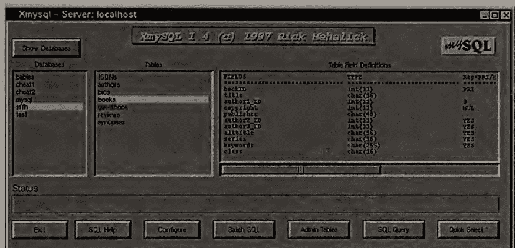

图 13–1 `mysqlql` 的启动界面。

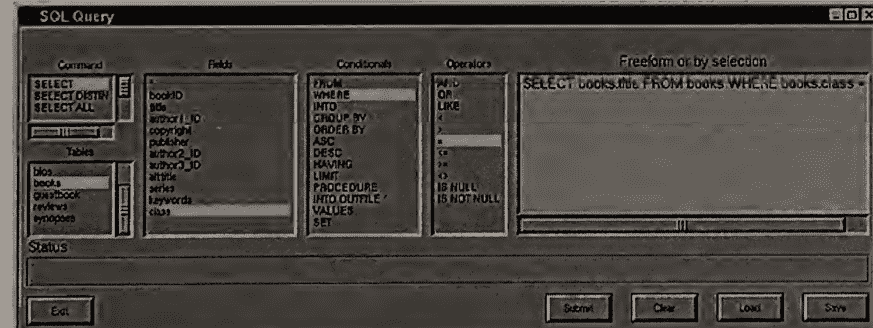

图 13–2 `mysql` SQL 查询窗口。完整的查询文本为 `SELECT books.title FROM books WHERE books.class = 'horror.'`

# 第 13 章 · Linux 数据库软件

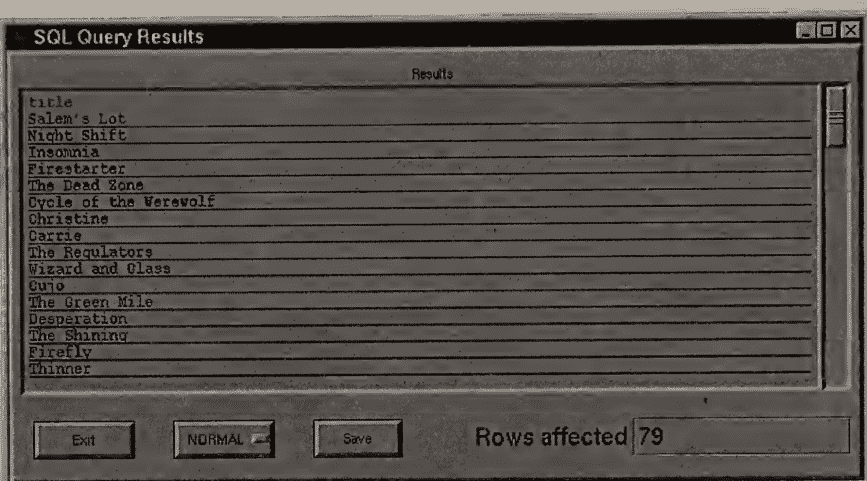

图 13–3 图 13-2 中简单查询的结果。

### 13.2 其他原生 Linux DBMS

### 免费软件

### PostgresSQL

`Postgres` 在 UNIX 世界已经存在很长时间了。它并非纯粹的关系型，其核心包含了一些面向对象的特征。它通常被称为对象关系型数据库。无论如何，在它的最新版本中，它支持几乎所有的 `ANSI SQL` 以及一些扩展，包括嵌入函数。`PostgreSQL` 还有 C 和 Perl 的 API、Apache 模块以及 ODBC 支持。你可以从 PostgreSQL 网站获取更多信息：http://www.postgresql.org/

### 商业软件

### Solid

`Solid Technologies` 为几乎所有的 UNIX 平台销售其 DBMS，包括适用于 x86 和 Alpha 架构的 Linux。`Solid` 支持 Python、Perl、PHP，当然还有 C 语言。

此 SQL 服务器面向高端应用和大型企业。提供免费的评估版。同时也提供非 Linux/UNIX 系统的客户端软件。`Solid` 支持许多对高端服务器预期的功能：

- 在线备份（即服务器保持运行并保存“快照”）
- 崩溃和断电后恢复到上一个检查点
- 细粒度访问控制（与 MySQL 的水平相当）
- 开放数据库连接 (ODBC)
- 自动崩溃恢复
- 对称多处理 (SMP)

`Solid` 的手册以 HTML 格式提供。`Solid` 的设计要求极少量的管理。它易于设置且大部分可以自动运行。系统要求极低：几个 Mb 的磁盘空间和几 Mb 的空闲内存。

Linux 的定价远低于其他系统。截至本文写作时，`Solid Technologies` 为 Linux 免费提供桌面版（单用户，仅限 UNIX 套接连接）。
关于 `Solid` 的信息可以在 http://www.solidtech.com 找到。

### Empress

`Empress` 是 Linux 最早的商业数据库之一。它是一个关系型数据库，类似于 `Sybase` 或 `Oracle`。`Empress` 支持以下功能（不仅限于此）：

- 多媒体支持
- 检查点和回滚
- `BLOB`（二进制大对象）
- 共享库和 C API
- 用于 Tcl/Tk、Perl 以及针对 FORTRAN (!) 的接口
- 一个用于快速构建 Empress 应用程序图形界面的 GUI 构建器
- 两阶段提交
- 用于处理 Empress HTML SQL (EHSQL) 的 CGI 透传。ESQL 嵌入文档中，然后由 CGI 解析并传递给客户端浏览器。

还有适用于 Linux 的个人版 `Empress`。关于 `Empress` 的更多信息可以在此处找到：

```
http://www.empress.com/
```

### Texpress

`KE Software` 是一家加拿大公司，制作面向对象（相对于关系型）的数据库，以及许多支持程序和模块。它支持关系型、自由文本和多媒体数据类型。`Texpress` 还支持：

- 海量数据集
- 包括继承在内的面向对象 (OO) 特性
- 可扩展性。你可以在数据库中的对象上定义方法。方法可以为数据显示、验证、赋值和分支表达式定义。这实际上允许你编写存储过程，然后将其与特定的对象或对象类关联。

`Texpress` 的设计实际上倾向于处理更复杂的查询，其处理速度与简单查询一样，甚至更快。它也能轻松处理海量数据集。随着数据库应用程序变得越来越复杂，这些是需要考虑的重要特性。

`Texpress` 的面向对象设计通常意味着数据可以以更自然的方式存储，并且它比关系型数据库服务器更好地处理非结构化数据。

关于 `Texpress` 的更多信息可以从 http://www.kesoft-software.com/ 获取。

### Essantia

`Essantia` 是另一个结合了一些非传统技术的数据库。它采用了其开发者 `Intersoft` 所称为 `RISE`（精简指令集引擎）。通信接口保持较小且定义明确。它支持关系型和面向对象的数据管理模型。

`Essantia` 还支持这些功能：

- 日志和一致性检查。
- 数据库版本——允许你返回并检查数据库之前的状态。
- 增量备份。
- 影子——要修改的数据被复制到影子中，在清除检查点之前不提交。
- 行级、表级和模式级别的锁定。

关于 `Essantia` 和 `Intersoft` 的更多信息在 http://www.intersoft.com/。

### 13.3 部分支持的其他数据库

### Sybase

虽然没有 Linux 版本的服务器，但 `Sybase` 提供了免费的客户端库。它们有些过时且是 `.out` 格式，但如果你需要它们，它们总比没有好。

### Oracle

虽然 `Oracle` 不支持 Linux，但可以使用 Intel 二进制兼容性规范 (IBCS) 运行 Santa Cruz Operation (SCO) 版本，将其编译为模块或进入内核。然而，`Oracle` 复杂且昂贵。你大量的资金投入可能花在支持 Linux 的数据库上（如 `Solid` 或 `Texpress`）更好。

### 13.4 总结

正如你所注意到的，即使你只是粗读了这一章，Linux 也有一套相当庞大丰富的数据库可用，范围从非常轻量级的 `MySQL` 到像 `Empress`、`Solid` 和 `Texpress` 等大型商业数据库服务器，再到在 `SCO` 模拟中运行的 `Oracle`。

所有这些服务器都有不同的优缺点。如果你发现某个较小的免费或共享软件数据库服务器不能满足你的需求，这里列出的几乎每个商业服务器都提供免费或低成本的个人版，和/或其大型软件包的试用版。

在投入可能的大笔资金之前，请花几周时间真正评估它们。

## 第 14 章 编程语言

语言如此，时间太少。

除了 Linux 做的其他事情外，它还提供了一些卓越的编程语言，让重复性任务或那些看起来不容易修复的任务变得非常容易修复。

现存编程语言的数量相当多。取决于你如何细分牛毛，实际上有几十种，也许是几百种，而且几乎所有流行的语言在 Linux 下至少有一种实现。尝试对所有这些语言给出一个简短的总结将是一本书。在本章中，我们将重点介绍最重要的语言：那些我们用于……的语言。仍然不懂为什么面向对象编程 (OOP) 如此酷炫，以及什么是通用网关接口 (CGI)。

### 14.1 C

```
http://www.fsf.org/software/gcc/gcc.html

http://www.accu.org/
```


我们两个都不是大程序员。我们知道足够的知识来稍微捣弄 C 语言并编写小型程序，但 C 是一门重要的语言，在类 Unix 系统中，它被正确放在首位。内核以及你使用的日常命令都是用 C 写的。如果你现在不懂 C，在编译和安装软件的过程中，你至少会熟悉它。

`GCC` 是 Linux 的“原生”编译器。它支持一个优秀编译器应该支持的一切：优化、调试、`ANSI C` 支持、`POSIX` 合规；比某些商业操作系统自带或提供的编译器要多得多（`SunOS 4` 特别有一个非常糟糕的编译器，但它足以编译 `gcc` 的第一阶段以引导到完整的 `gcc` 编译器）。

C 是高性能通用编程最流行的编译型语言。因为是编译的，所以它通常比 `Perl` 或 `Python` 等解释语言快。C 也是一门相当底层的语言。这种类型导致软件开发时间较长。另一方面，因为是一门底层语言，可以调整代码以实现极高的性能。

由于 C 存在于几乎所有的操作系统平台上，通常可以将 C 程序移植到其他平台。架构或操作系统特定的库（尤其是 GUI 库）显然会使这一过程复杂化，但通常在目标平台上对应的。

根结到底，C 是这里讨论的所有其他语言的编译器和/或解释器的基础（某些编译型语言的编译器是用它们自己编写的），几乎所有这些语言都提供了高级方法或函数来完成各种任务，精通的 C 程序员可以写出与它们一样快的程序。

人们使用高级（通常是解释型）语言的原因是应用程序开发时间通常要短得多，而且对于高级语言通常处理的小型任务，性能权衡是完全接受的。这并不是说较大的

### 14.2 C++

不能用解释型语言编写。`Grail` 是一个用 `Python` 编写的浏览器（使用了其 `Tcl/Tk` 接口和 `tkinter` 模块），其性能是可以接受的。此外，`Hotjava` 是一个用 `Java` 编写的浏览器，`Java` 是一种字节编译语言；它的性能也很好。虽然两者都不像网景浏览器（`Netscape`）那样功能完备（或过于臃肿），但它们都支持 `HTML 3.2` 加上 `frames` 等其他功能。

`http://www.accu.org/`

`C++` 是一种面向对象的编译语言，其根源在于 C 语言（正如其所示）。它不像 C 那么流行，主要是因为它和面向对象编程（`OOP`）都比 C 年轻。`C++` 和 C 结合得非常好。可以很容易从其中任何一种语言链接对象文件并在应用程序中混合使用两种语言。`VRWeb`（一个 `VRML` 场景查看器）和 `MySQL`（一个高速数据库服务器）是实现这一目的的两个应用。

`GNU` 的 `g++` 是所有 Linux 发行版中最常附带的 `C++` 编译器。

为了消除一个常见的误解，学习 `C++` 并不需要掌握 C 语言。虽然在学习 `C++` 之前知道 C 确实很有用，但在学习 `FORTRAN` 之前并没必须知道 `Basic`。它们是独立的语言。

对于更适合或希望使用面向对象语言、且需要编译型语言性能的应用程序，`C++` 是最受欢迎的选择。它越来越多地用于 `GUI`、数据库和其他应用程序，在这些应用中，类和继承是自然存在的，而面向对象的方法是一种更高效的编码方式。

### 14.3 Perl

`http://www.perl.com/`

首先，我的主要工作不是成为一个 `CGI` 程序员。虽然涉及一些 `CGI` 工作，但我有很多要处理的事情，我会描述其中一些，以及 `Perl` 如何帮助我完成每项任务的。

> ¹由 Mark 编写

我的首要工作是技术支持，我们使用一个名为 `Remedy` 的数据库程序来进行通话跟踪。我想添加的一个功能是：让入站或发出的电子邮件自动添加到通话记录中。这涉及几个步骤：

- 确保通话的主题（`Subject:`）行有一个四位数字。这将是号码。
- 提取这四位数字。
- 获取消息正文和发送者并将其添加到通话中。

前两项实际上非常简单，因为 `Perl` 在设计时就具备强大的模式匹配能力。在网上搜索找到了一组人为 `Remedy` 提供了一个 `Perl` 接口。这个接口允许我登录 `Remedy` 服务器，修改数据库以添加新条目，然后注销。该程序总量少于 100 行代码，大部分内容复用了该接口附带的示例程序。

另一个项目是监控电话系统并每天列出入站通话以及每个通话的平均长度。别人写了一个程序来获取信息并将其导出到文件中。我所需要的只是打开文件，读取到当天的记录，然后累加时间。由于 `Perl` 是为了字符串处理而设计的，我可以提取通话的小时、分钟和秒，将其转换为总秒数，并构建当天入站通话的总秒数。然后我可以将总数除以通话次数，再次除以得到小时、分钟和秒，并将其导出到另一个文件中。添加一个 `cron` 进程在每天午夜后执行此操作，程序就大功告成了。

我喜欢 `Perl` 的第三个例子与我们通往互联网的路由器有关。我们目前的连接（56 Kb）并不大，变慢变得越来越频繁。我必须有一种方法发现我一天中占用了多少带宽，而确实有，就是使用 `SNMP` 网络管理工具。当然，我可能可以写一个 C 程序直接与路由器通信并提取信息。但我不喜欢 C，`malloc()` 和 `free()` 的想法就让我感到不安。幸运的是有（你猜得到了）一个针对 `Perl` 的 `SNMP` 接口——一个 20 行的 `Perl` 脚本就可以与路由器通信，每隔几分钟查询一次它传输和接收了多少字节，并除以经过的时间。让它运行几天，使用像 `gnuplot` 这样的绘图工具给我一张图，现在我有了申请 `T3` 线路的理由。嗯，也许不是 `T3`，但总之是更快的东西。

### 14.4 Python

最后，是我的 `CGI` 工作。我们网站的大部分工作都在内部网络上（有些人称之为内域网）。这允许我们拥有一个共同的信息库——电话是如何工作的、哪些驱动器号挂载了 `NFS`，甚至还有列出人们何时不在办公室的时间表。最后一个需要 `CGI` 工作。我有一个名为 `PostgreSQL` 的 SQL 数据库程序（你已经有了！）它有一个 `Perl` 接口。`Perl` 也有 `CGI` 接口，因此我可以将我的表单和 `CGI` 脚本全部构建在一个紧凑的（小于 200 行）文件中。在一种情况下，用户可以输入他们的……

### 14.4 Python

在 `Mac` 上，这些数据通过 `Leads!` 处理（`Leads!` 是 `4D` 的前端，在我开始那份工作之前我从未听说过这个 `Mac DB`）。不庸说，这并不是填充我们客户数据库最稳健的方法。当时，我们有订阅网站，大约有六种订阅类型。

自从我开始现在的工作以来，订阅网站的数量增加了三倍，而奇特的营销交易数量也从零增加到了六个或更多，这取决于是我在数还是营销部门的人在数；不同订阅的数量呈近乎几何级数的增长。最初只是一堆破解的、现成的 `Perl` 脚本，现在已变成了一个超过 1200 行的单体 `CGI` 程序。它可以验证并交叉检查多达 40 个变量；确定续费会员是否添加了站点、用户或两者；在我们的成员数据库中插入/更新多达六张表（目前分在两个 `DBMS` 上，尽管并不会持续多久）；并打印出适合装裱的精美证书。尽管编写这段 `UNIX` 脚本和单机代码的方式非常随意，但它仍然易于阅读和理解——这对于 1000 多行的 `shell` 或 `Perl` 脚本来说是难得的。

尽管我很喜欢 `Python`，但也有我怀念 `Perl` 的几点。其中最突出的是 `Perl` 中的正则表达式实现。它非常棒。幸运的是，`Python` 的下一个版本将扩展正则表达式功能，这应该能与 `Perl` 敌。另一个是缺乏字符串插值。由于 `Python` 不使用 `$` 或其他符号来区分变量名，因此这很难或无法实现。我发现这几天来我非常怀念后者，但我正热切期待 `Python` 模式匹配能力的增强。

人们对为 `Python` 编写编译器有相当大的兴趣，但这并非轻而易举，因为 `Python` 不是一种静态类型语言（即没有变量声明，变量的大小可能不是固定的，更糟糕的是，根据赋值给变量的内容，给定的变量名在程序的不同部分可能代表不同的类型，尽管这并不是特别好的编程风格）。

## Python 与 GUI

对于 `Python` 的各种实现，存在多个窗口工具包。最流行的是 `tkinter`，它为 `Tk/Tk` 提供了一个面向对象（`OO`）的接口。`tkinter` 提供了最广泛的跨平台支持，因为它已经被移植到 `Windows 95/NT` 和 `MacOS`。还有一个扩展用于使用 `Athena` 和/或 `Motif`（如果你有 `Lestif` 则使用它）小部件集。随着 `Tk/Tcl 8` 版本承诺提供更原生的外观和感受，`Tkinter` 可能会成为大多数 `Python` 实现的首选 GUI 工具。

## 其他平台上的 Python

`Windows 95` 和 `NT` (`Pythonwin`) 以及 `MacOS`（分别针对 `PowerPC` 和 `Motorola 68K` 的 `Mac`）都存在 32 位 `Python` 端口。`WPY` 是适用于 `Windows 3.1` 和 `OS/2` 的 16 位 `Python`。此外，还有一个针对 `DOS` 的独立端口。这些部分除了 `DOS`（出于显而易见的原因），都支持各自操作系统的原生窗口类。

### 14.5 Lisp 和 Scheme

`http://www.cs.cmu.edu/Groups/AI/html/cltl/cltl2.html` (Common Lisp)

`http://www-swiss.ai.mit.edu/scheme-home.html` (Scheme)


Lisp 是一门古老的语言；它的起源可以追溯到 20 世纪 50 年代人工智能研究的早期。IBM 704 和 `PDP-1`（是的，不是 one eleven）等机器与它相关。随着计算机技术的发展进步，Lisp 在越来越多的架构上被实现；没有两个实现是完全互操作的，因此 Lisp 及其方言变得碎片化。在 20 世纪 80 年代初期，Common Lisp 规范敲定并通过了 ANSI 标准。

今天，Common Lisp 拥有具有数量参数的函数、大型实用函数库（它已经有四十年历史了！）以及面向对象的编程功能。你可能猜到，由于它是为人工智能开发的，Lisp 也拥有一非常复杂的异常处理系统。

Scheme 是 Lisp 的一种简单多的方言。它有自己独立的规范，约 50 页，描述了一种概念上优雅的语言。有趣的是，Scheme 规范比《Common Lisp: The Language》的索引还要短。

### 14.6 Java

```
http://www.blackdown.org/
```

Sun 的 Java，我们能说什么呢？它非常风靡，而且并非完全没有原因。它的架构中立设计（包括它的 GUI 工具 `AWT`）承诺了无与伦比的可移植性。像 `C++` 一样，它是一种面向对象的语言。它的流行诞生了大量的贡献扩展（类）以及网络上的大量支持。

Java 与这里的其他语言不同之处在于，它旨在完全平台中立。Java 代码被编译成平台无关的字节码文件，这些文件可以在虚拟机上运行。一旦在机器上实现了虚拟机（VM），它（理论上）就可以运行任何“纯”Java 程序或 applet。Sun 有一个程序可以将应用程序认证为“100% 纯 Java”。

Java 支持可以编译到 Linux 内核中，允许进行反编译反编译反编译反编译反编译反编译反编译反编译反编译反编译反编译反编译反编译反编译。等一下，Java 支持可以编译到 Linux 内核中，允许进行反编译反编译反编译反编译反编译反编译反编译反编译反编译反编译反编译反编译反编译。

事实上，Java 支持可以编译到 Linux 内核中，允许进行反编译反编译反编译反编译反编译反编译反编译。

不。

Tcl 本身并不是一种特别好的脚本语言。它的设计目的是“粘合”其他语言和程序。最近，Sun 的实验室和 Tcl/Tk 采纳彼此并以 Sunscript 的名称继续开发（这是该小组的名称）。

由于 Tcl 的流行，它拥有多个数据库（`MySQL`, `mSQL`, `Sybase`）的接口，甚至还有一个插件。此外，Tcl 的 7.6 版本符合 2000 年标准。Sunscript 小组正在开发 Tcl/Tk 编程的各种项目和应用程序，包括一个商业级 GUI 构建器、一个实时编译器以及对 `macOS` 和 `Windows` 的原生移植维护。

新版本 8 承诺为 Tk 提供前所未有的原生外观和感受。这将在构建 GUI 时非常流行。

Tcl 的可扩展性允许对其和 Tk 进行多种扩展。扩展 Tcl (`Tcl`) 提供了额外的功能，理念是创建一个更独立的脚本语言。ObjTcl 正如你猜的那样——一个 Tcl 扩展，允许在 Tcl 中使用面向对象的编程技术。Tis 是一组用 Tk 编写的 Tk 扩展。TkPerl 是 Perl 的 Tk 接口。

Tcl 最实用的扩展之一是 Expect。它是一个与需要用户交互的其他命令行程序交互的工具。因此，它可以自动化许多可能需要更复杂自动化方案的任务。

### 14.8 SQL

结构化查询语言 (SQL) 是用于与关系型数据库通信的语言。实际上，它是一套标准，DBMS 厂商会在其基础上添加自己的扩展。由于 SQL 的实现差异巨大，我们没有包含 SQL 的链接；相反，我们建议你查阅特定 DBMS 变体的文档。

### 14.9 其他语言

通常情况下，SQL 的语法非常简单且符合英语习惯。某些实现功能函数可以嵌入到查询语句中，支持完整的正则表达式，甚至是近乎完备的编程语言。另一些语言除了能够选择、删除、插入和更新之外，支持的功能非常少。

编程语言实际上多数以百计，这显然超过了我们这里能够详细介绍的篇幅。上述描述的语言在 Linux 以及许多其他平台上是最受欢迎的，但也有许多其他语言值得一读。

许多读者可能已经注意到，我们遗漏了一些老牌语言。

## 经典之作

### FORTRAN

```
http://www.fortran.com/fortran/
```

FORTRAN 是一门历史悠久的语言，主要为数值计算设计。它在 Linux 上最常见的形式是 `g77`。最近的规范是 FORTRAN 90，但它不像 FORTRAN 77 那样常见。FORTRAN 90 的编译器很少，且 Linux 上没有免费的 FORTRAN 90 编译器。

### BASIC

```
http://www.Mainz/~ihm/basic.html
```

不像 FORTRAN 那么老，但因其简单而仍然流行；微软的 Visual Basic 在保持其人气方面发挥了巨大作用。它过去和现在一直有许多解释型和编译形态。直到最近，Linux 上才出现了 BASIC 编译器。

### Pascal

```
http://sun011/~klaus/pascal/
```

Pascal 是一门在计算机科学家中一直很流行的语言，既用于教授良好的编程技术，也作为一种通用编程语言。Linux 提供了免费编译器，且大多数发行版都自带了它。

### COBOL

```
http://www.cobol.org/
```

尽管几乎每个人都知道 COBOL，但直到几年前，编写的 COBOL 代码行数超过了任何其他语言。它的使用几乎完全局限于金融相关应用，但也有许多银行、金融公司以及对它感兴趣的人。它并不适用于通用任务，但存在一个免费编译器，并包含在某些发行版中。

### 较新的语言

我们接下来讨论的大多数语言都比之前的要新一些。而且，其中很少有语言被包含在任何 Linux 发行版中。无论如何，这些都是有用且强大的工具，你可能希望考虑用它们代替更常见的语言。

### Smalltalk

```
http://www.uiuc.edu/
```

它是地球上增长最快的语言之一。估计其使用量每年增长约 60%。这是一门非常高级的编程语言，通常意味着更短的开发时间。它的语法更易读，语言本身也容易学习。Smalltalk 是对象对象编程的典范。一切都是对象，导致了处理事务的方法的一致性。Smalltalk 声称它是“以人为本而而的”。

### Icon

```
http://www.arizona.edu/icon/www/index.html
```

事实上，Icon 是另一种高级语言。它的根源源于 SBOL，尽管在目前的形式中，它与 `C` 语言几乎不像，但语义层次要高得多。作为一门高级编译型语言，它确实有用，并用于计算密集型任务。与 Smalltalk 类似，它的高级设计允许快速开发应用程序。顺便提一下，Icon 这个名字并不是缩写，而是在“图标（icons）”一词出现之前为该语言选定的。

### Rexx

```
http://www.rexx.org/
```

根据其创造者的说法，Rexx 是“一种过程化语言，允许以清晰结构化的方式编写程序和算法”。Rexx 的语法并不特别独特或不常。它被设计成一种可以与其他应用程序配合使用的通用语言。当它的解析器遇到一个无法识别的函数时，它会请求应用程序来处理。这样一来，如果 Rexx 被用作多个程序的语言，用户只需要学习一种语言，而每个应用程序的函数预计可以通过正常使用得知。

### Eiffel

```
http://www.eiffel.com/
```

Eiffel 是一门商业性的面向对象（OO）编译型语言，旨在快速开发整洁可重用的软件。它非常强调通过机制和技术来提高可靠性并降低错误率。尽管它是商业性的，但销售商经常为个人、学生或教育用途提供大幅折扣。某些公司提供的 Linux 版本价格低于其他。如果你想在完全面向对象、有商业支持的编译型语言中开发，Eiffel 可能适合你。或者，如果你可以没有商业支持，你可能想看看这个语言列表中的下一项。

### Sather

```
http://www.icsi.berkeley.edu/~sather/
```


Sather 的根源在于 `Eiffel`。它的早期 Beta 版本几乎是 `Eiffel 2.0` 的子集；然而，在之后的重大发布后，这两种语言走向了各自的道路。Sather 在加州大学伯克利分校开发并持续，正如你所预期的，作为一种在教育机构开发的语言，它是免费软件。Sather 具有垃圾回收、多重继承、强类型，并且它的代码可以编译成 `C` 代码。它的公共许可非常宽松，以鼓励用户向其库做出贡献。

### 14.10 总结

我们实际上仅仅略过了（至少）几百种“官方”可用且可以为 `Linux` 编译或轻松移植到 `Linux` 的编程语言。无疑，我们尝试涵盖了最流行的语言以及那些与大多数 `Linux` 发行版自带的语言。很可能，这些语言中的一种或多种将满足你作为程序员的需求。如果没有，在你喜爱的 Web 搜索引擎上搜索，也会找到各种编程语言的链接集供你尝试。

## Web 服务 15

### 适用于 Linux 的 Web 服务器及扩展

如何安装和配置 `Apache` Web 服务器，以及常用的模块和扩展。随着万维网（`WWW`）普及度的惊人增长，每个人都需要一个 Web 页面，无论是发布新闻稿、驱动程序更新、故障排除指南、推销自己或在线销售产品。`Linux` 已证明自己是从 `386` 到 `DEC Alpha` 的强有力、高性能 Web 服务器。尽管如此，对于任何应用程序，都有硬件和软件问题需要考虑。

### 关于其他信息服务的说明

Web 的普及使得许多其他信息服务淡出舞台，在某些情况下变得过时。著名的包括 `Gopher`、`WAIS` 和 `Archie`。因此，我们没有在书中介绍它们，感兴趣的读者可以参考“互联网服务”的相关文本。

### 15.1 Web 服务器软件

`Linux` 上有多种 Web 服务器（`HTTP` 守护进程），既有商业的也有免费的。此外，还有安全服务器与非安全服务器的选择。两者的区别在于使用了 `SSL`（安全层，一种通过网络套字进行数据加密/解密的协议）。通常，非 `SSL` 服务器是免费的，而采用 `SSL` 的服务器需要数百美元。

此外，Web 服务器可以是分式的或非分式的。传统的，`HTTP` 守护进程通过派生子进程来处理的请求。每个子进程通常可以处理一百个请求，但它是串行处理的；这意味着高负载服务器可能需要大量的子进程，每个子进程都会占用额外的内存和 `CPU`。在具有大型二进制文件（特别是安全服务器）的情况下，这会导致问题。替代方案是使用在内部复用连接的服务器。现在内存一直且将保持廉价，`CPU` 性能正在飞速增长，因此人们可能会质疑多线程服务器是否值得投入。然而，目前还没有非分式的服务器在扩展性上等同于最好的分类服务器。尽管如此，似乎很快 `Apache` 等服务器的扩展性与 `Boa` 等服务器的复用将会相结合。

### 加密、Web 与山大叔

直到最近，还没有 Web 浏览器支持强于 `40` 位的加密，这主要是由于美国的出口限制（基于一种相当愚蠢的想法，认为美国境外的人无法制造更强的加密技术）。随着这些限制的逐渐放宽，并且在美国境内外销售的 Web 服务器现在已提供强力（`128` 位）加密，支持更强加密的浏览器也开始出现。在美国境内，可以通过获取 `Netscape` 浏览器的增强版本来使用 `128` 位加密。有关加密和安全的更多信息，请参阅安全相关章节。

以下是部分安全和不安全的 `httpd` 服务器示例。

## 非 SSL 服务器

- `Apache` (`http://www.apache.org/`)——目前最流行的 Web 服务器，下载量巨大。功能丰富，而且速度快、免费且可扩展。

- `Boa` (`http://www.boa.org/`)——一个非常新的、快速且提供源码的 Web 服务器。与 `Apache` 不同，它不会通过派生子进程来处理额外的客户端；而是在内部对所有连接进行复路用。

- `W3C http`（曾称为 `CERN httpd`）(`http://www.w3.org/pub/WWW/Daemon/`)——世界上第一个 Web 服务器。已不再投入生产，但为了完整性将其包含内；

- `NCSA` (`http://hohoo.ncsa.uiuc.edu/`)——`CERN` 的继任者，后来 `Apache` 的基础，`Apache` 已基本取代了它。

- `Ren` (`http://www.roxen.com/`)——一种商业 Web 和 `FTP` 服务器。它还使用一种名为 `RXML` 的 `HTML` 扩展（由 `Roxen` 开发），允许在下载时修改页面。它可以免费使用，也可以购买并获得商业支持。同时也提供源码。此外，`SSL` 版本正在开发中，其测试版本可免费获取。

- `WN` (`http://hof.math.nwu.edu/`)——另一个免费 Web 服务器。虽然没有 `Apache` 那么可扩展，但在提供服务时修改页面方面有一些很用的功能。（也与一个名为 `GN` 的 `Gopher` 服务器配对。更多信息请见 `http://hof.math.nwu.edu/70/`。）

- `Zeus` (`http://www.zeus.co.uk/`)——另一个非派生服务器（类似于 `Boa`）。它是商业性的，价格有些昂贵，但你可以获得一些商业支持。不提供源码。

## SSL 服务器

- `Stronghold` (`http://www.c2.net`)——正如它的别名所示，这是内置了 `SSL` 的 `Apache`。与大多数商业软件不同，它附带了源码，因此没有丢失 `Apache` 的任何扩展性。与 `Apache` 不同，`Stronghold` 并不是同类中最流行的商业 Web 服务器；它是该类中最受欢迎的安全服务器。

- `Apache-SSL` (`http://www.algar.co.uk/apache-SSL/`)——它是带有 `SSL` 支持的免费 `Apache`。由于它使用的 `SSL` 库是从美国非法出口的，因此在美国境内使用它是非法的。从实际代码来看，它与 `Stronghold` 本质相同。它和 `Stronghold` 都支持 `128` 位加密，并已支持了一段时间。

- `Roxen` (`http://www.roxen.com/`)——`Rox` 也有 `SSL` 版本。

- `Zeus` (`http://www.zeus.co.uk`)—与 `Roxen` 类似，`Zeus` 也有安全版本。

### 15.2 硬件问题

如果你使用派生型服务器或大量的解释型 `CGI`，主要的考虑因素之一就是内存。每个服务器显然占据的内存至少等同于可执行文件的大小。每个 `CGI` 脚本都需要加载其相应的解释器。可执行文件的动态链接可以在一定程度上缓解这个问题。除了选择良好的个人电脑接口（`PCI`）主板、内存、`CPU`、硬硬盘和网络之外，你还需要考虑四个子系统。`PCI` 总线的吞吐量为 `133 Mb/s`，比甚至超 `SCSI 3` 适配器还要快几倍，因此完全能够处理快速外设。

然而，`RAM` 没有任何替代品——不是空间（你的硬盘与板载内存相比慢得可怕），不是 `CPU`（如果你在进行磁盘交换，是硬盘拖慢了你的速度），也不是更快的网卡。内存很便宜；多买一点。

在内存之后，下一个重要的子系统是磁盘或 `CPU`，取决于你网站的特殊性。如果你大量使用 `CGI`、`SSI` 或数据库事务，你可能想在系统中增加一点 `CPU`。不要纠结 `MMX` `CPU`。在那种情况下真的没有收益可言；只需以相同的价格买一个更快的 `CPU`，或者把钱花在内存或硬盘上。

### 15.3 Apache 和 SSL/Stronghold

在只需要提供大量静态页面的情况下，一个好的磁盘可能是一项不错的投资。花点钱从快速或超 `SCSI 2` 升级到超 `SCSI 3`。我们假设你有足够的常识，不会在服务器中使用 `IDE`（甚至 `EIDE`）驱动器。

如果你需要更高的吞吐量并且已经达到了带宽上限（即你没有局域网连接问题），那么你可能希望将服务器托管在拥有互联网骨干网 `T3` 的 `ISP`，并考虑从 `10 Mb/s` 以太网迁移到 `100 Mb/s`（快速）以太网。一个配置适当的 `Linux` Web（和/或 `FTP`）服务器可以饱和快速以太网卡和多个 `T3`。

由于其流行性、丰富的功能、扩展性和强大性，我们将专注于 `Apache`，尽管这里的大部分信息适用于任何 Web 服务器。

如上所述，`Apache` 免费提供源码。`Apache` 还提供了一个 `API`。这两个功能允许大量的自定义和扩展。此外，`Apache` 符合 `HTTP 1.1` 标准。`HTTP` 的这一最新修订版本对协议引入了性能增强。遗憾的是，到目前，很少有浏览器支持 `HTTP 1.1`，因此无法利用它。

## 入手

由于 `Apache` 是免费提供的，许多 `Linux` 发行版都自带了它，包括 `RedHat` 和 `Linux Pro`。取决于你的供应商如何配置你的机器，在开始编写 `HTML` 页面并建立网站之前，你只需要准备几个配置细节。

- 1. 服务器的文档根目录在哪里？换句话说，当有人访问你的服务器时，提供服务的目录树根目录所在的目录在哪里？如果除了文件名外没有提供任何路径信息，则将从该目录提供文件（例如，`http://www.ratatosk.org/davinci.html` 与 `http://www.ratatosk.org/surreal/dali.html`）。这通常类似于 `/home/httpd/html` 或 `/home/httpd/docs`（因此上面的第二个 URL 将检索 `/home/httpd/html/artists/sur-real/dali.html`）。

- 2. 配置文件在哪里？通常使用 `/etc/httpd/conf`、`/home/httpd/conf/`、`/usr/local/etc/httpd/conf` 或类似的路径。

- 3. 服务器正在运行吗？取决于安装 `Linux` 时如何配置服务器，`http` 守护进程可能会在启动时自动启动。你可以使用 `ps` 命令检查 `httpd` 是否正在运行：`ps -waux | grep httpd`。如果未运行，你需要以 `root` 身份调用它，并告诉它包含配置文件的目录在哪里。例如，如果你的配置目录是 `/etc/httpd/conf`，你可以输入类似 `httpd -d /etc/httpd` 的命令。如果包含 `httpd` 二进制文件的目录不在你的路径中，你需要使用绝对路径来调用它。通常 `httpd` 位于 `sbin` 目录之一：`/usr/local/sbin`、`/usr/sbin`，或者在极少数情况下位于 `sbin`。

除了可以在编译时用于扩展 `Apache` 的各种模块外，还有许多项可以在运行时配置文件（`httpd.conf` 和 `srm.conf`）中指定。这两个文件控制了目录别名、图标别名、`CGI` 脚本/虚拟主机目录、文档根、当 URL 中未指定其他文件时从目录提供的文件，以及各种访问控制和验证指令。

## <Directory> 和 .htacces

这些工具用于修改目录树的所有类型访问。`<Directory>` 指通常位于 `srm.conf` 或 `httpd.conf` 文件中。它也可以出现在 `<Virtualhost>` 指令中（稍后介绍）。`htacces` 文件位于 `HTML` 文档目录树的某个地方。在这两种情况下，位于目录中的实例对该目录下的所有文件和子目录递归有效。例如，为了对目录及其所有内容强制基本验证，你可以在该目录（假设为 `/home/web`）的 `.htacces` 文件中放入以下内容：

```


## Apache 配置示例

```
AuthType Basic
AuthFile /home/cary/etc/passwd
AuthGroupFile /dev/null
AuthName Realm of the Kazoos
```

## 15.3 Apache 与 ApacheSSL/Stronghold

```
<LIMIT GET POST PUT>
require valid-user
</LIMIT>
```

或者在 `<Directory>` 指令中：

```
<Directory /home/web>
AuthType Basic
AuthUserFile /home/cary/etc/passwd
AuthGroupFile /dev/null
AuthName Realm of the Kazoos
<LIMIT GET POST PUT>
require valid-user
</LIMIT>
</Directory>
```

`<LIMIT>` 指令告诉服务器哪些 HTTP 方法需要有效用户，在此例中，是 `GET`、`POST` 和 `PUT`（`PUT` 用于文件上传）。

## CGI 和 SSI

通用网关接口（`CGI`）和服务器端包含（`SSI`）是执行外部程序的两种最常见方式。`CGI` 设计为既能从服务器接收信息，也能向服务器发送信息。`SSI` 此外，它主要发送信息。`SSI` 的功能不仅仅是调用外部程序，它还可以包含一些简单的系统信息，如本地时间，或者执行 `cgi`。

`Perl` 是 `CGI` 编程的抢占式语言。这在程度上是一把双刃剑。一方面，它有大量用于各种常见 `CGI` 任务的“现成”脚本。它还具有非常强大的字符串处理功能，包括大量的组正则表达式原子和操作符。由于 `CGI` 经常涉及大量的文本处理，这促进了 `Perl` 的流行。另一方面，`Perl` 并不是最容易学习的语言，其语法也不特别易读（甚至有“混淆 `Perl` 比赛”！）。

在 `Perl` 之后，还有几种语言在 `CGI` 中非常流行：`Python`、`Tcl`、`C` 和 `Java`。此外，还有一些语言可以嵌入 `HTML` 并在稍后由 `CGI` 程序解析；`PHP`（下文将讨论）就属于这一类。`PHP` 解析器也可以嵌入到 `Apache` 以及基于此的服务器中。

关于 `CGI` 的出版书籍相当多，绝大多数书籍对该主题的涵盖程度比我们这里需要的要彻底得多。大多数现有文献的一个批评是，它们倾向于几乎完全集中在 `Perl` 上，在很大程度上忽略了 `C`、`Python` 和其他语言。`C` 特别有用，因为作为一种编译语言，用 `C` 编写的 `CGI` 更快、更轻量。当然，用 `C` 的开发时间要长得多。

到目前，所有提到的语言都有或等同的扩展/模块/库来处理 `CGI` 的特殊性，并与从 `TCP/IP` 套接字、操作系统到数据库的一切进行交互。因此，为 `CGI` 选择语言在很大程度上取决于你。以上所有语言在大多数 `Linux` 发行版中自带，并可以从各自作者那里免费获得。

## 为你的用户提供 Web 页面

在你机器上有多个用户的情况下，无论是在 `ISP`（服务提供商）还是出版商那里，他们可能都会感兴趣为自己设置主页。

除非你有大量的主页或非常受欢迎的用户，否则这通常不会消耗你服务器的大量资源。此外，提供静态 `HTML` 除了运行服务器本身的安全考虑之外，不涉及安全问题。尽管如此，几乎会有用户想要使用某些 `CGI`、`SSI` 或其他由服务器解析的内容来为他们的 `Web` 页面添加动态元素。现在，你面临着安全问题。

各种解决方案范围从简单地允许用户访问 `SSI` 和 `CGI` 等工具（在你信任所有用户的情况下），到某种限制的 `SSI/CGI`，一直到完全禁止使用它们。你也可以按用户为单位来允许或禁止使用它们。

在小型企业或可能的公司局域网中，你可能会选择前者路线；而在 `ISP`，由于你个人并不认识这些用户，你可能会选择后期路线之一。

幸运的是，`Apache` 通过 `.htaccess` 文件和 `<Directory>` 指令相当容易地控制对这些和其他工具的访问。

## 限制 CGI 和 SSI 的使用

`<directory>` 指令是你的朋友。它是指定在哪些目录中可以做什么和不能做什么的方法。结合 `Linux` 用户和组权限，你就可以对谁可以在你 `Web` 空间的哪些区域做什么进行非常细致的控制。

通常情况下，除非服务器已经不安全到变得无关紧要，或者你可以信任你的用户不会无意或有意识地编写以某种方式损害你服务器的 `CGI`，否则你不会希望 `CGI` 可以从任意目录执行。当然，如果服务器仅供你和可能有的少数其他人访问，你可以保持相当开放，而无需担心。

此外，你可能希望禁止浏览器在文件系统中漫游，无论是特定用户的系统还是根文件系统。换句话说，如果 `URL` 指向一个不包含索引文件的目录，服务器将返回 `404`（文件未找到）错误，而不是目录列表。

要让整个文件系统对服务器不可用，可以将类似这样的指令放在 `access.conf` 中：

```
<Directory />
AllowOverride None
Order deny,allow
Deny from all
Options None
</Directory>
```

“等一下！我想提供 `Web` 页面！”啊……那么你现在需要告诉 `Apache` 它可以从哪些目录提供页面。像这样的语句

```
<Directory /home/*/*/public_html>
Order allow,deny
Allow from all
AllowOverrides IncludesNOEXEC
</Directory>
```

让我们从用户的 `public_html` 中提供页面（这是提供文件的默认目录）

```
<Directory /httpd/htdocs>
Order deny,allow
Allow from all
AllowOverrides All
</Directory>
```

让我们从通常是服务器文档根目录的地方提供页面，并允许所有覆盖。你可以通过 `<Directory>` 指令或 `.htaccess` 文件来实现。如果你选择后者，请确保 `.htaccess` 文件对用户不可写，除非信任他们不会滥用权限。然而，如果你计划让其他人传递 `CGI`，你可能希望设置一个仅由 `root` 或 `httpd` 可写的目录。无论如何，要在某个目录中开启 `CGI`（假设可以被覆盖），使用 `.htaccess`，你需要：

```
Options ExecCGI
```

这里有许多其他选项可以关闭。

## 15.3 Apache 与 ApacheSSL/Stronghold

听着——如果你想让服务器在额外的端口上监听，请使用此命令。它接受两个参数：别名和目录路径。该路径可以是相对于 `ServerRoot` 的相对路径，也可以是绝对路径。

`ScriptAlias`—通常出于安全考虑，你可能希望将可以执行 `CGI` 程序的目录位于目录树之外。或者，你可能只想为引用包含 `CGI` 程序的目录提供一个快捷方式。

`Alias`—与 `ScriptAlias` 类似，但该目录中只能提供非 `CGI` 文件。

`VirtualHost`—如果你希望对来自不同 `IP`、服务器名称或端口的请求由不同的文档根目录、不同的服务器名称或指向不同目录的别名来处理，那么这个指令就是为你准备的。`DocumentRoot`、`Directory`、`ScriptAlias`、`Alias`、`User`、`Group`、`UserDir` 或 `ServerName` 中的任何一个都可以作为其内部的参数。几个示例可以帮助演示 `VirtualHost` 指令的力量。

一个在 `80` 端口运行的、用于 `http://www.dognails.com` 的服务器，它有自己的 `cgi-bin` 和文档根目录：

```
<VirtualHost www.dognails.com>
ServerName www.dognails.com
DocumentRoot /web/dognails/www
ScriptAlias /cgi-bin/ /web/dognails/cgi-bin/
</VirtualHost>
```

> 为了将端口 `1200` 上的所有请求作为独立的 `DocumentRoot` 进行服务：

```
Listen 1200
<VirtualHost *:1200>
DocumentRoot /usr/local/wwwww1
</VirtualHost>
```


## Apache 扩展

`suEXEC` 是一个较为复杂且设置过程困难的扩展之一，它是一个包装器，允许 `CGI` 程序在与服务器运行不同的 `UID` 下执行。这通常由允许用户管理自己 `CGI` 的 `ISP` 使用；这种方法会强制脚本以该用户的身份执行。这显然鼓励了用户编写良好的、安全的 `CGI` 程序。它对于允许类似于密码文件所允许的访问控制也很有用。

## 第 15 章 • Web 服务

由于 `suEXEC` 可能会打开一些严重的安全漏洞，它的安全模型实施了若干附加限制。目标程序必须位于 `Apache` 的 `/webspace/` 中，因此其路径不能以 `a/` 开头，也不能包含回溯引用 (`...`)。显然，目标用户和组必须高于一个最小值（通常为 100 或 500），这将禁止以 `root` 用户或组身份执行。目标程序不能设置 `uid` 或 `gid`，最后的非显性限制是：包含要执行程序的目录以及程序本身仅允许目标用户写入，并属于目标用户所有。

`suEXEC` 以单独的 C 源文件和附带头文件的形式提供。在编译 `suEXEC` 之前，需要编辑头文件以反映你系统的特殊情况。以下可能需要更改：`HTTP_USER`，通常为 `nobody` 或可能是 `"web"` 或 `"www"` 用户；`LOG_EXEC`，`suEXEC` 事务的日志文件；`DOC_ROOT`，`Apache` Web 空间的根目录；以及用于 `suEXEC` 的 `SAFE_PATH` 环境变量。然后你需要编译 `suEXEC`：`gcc -o suexec suexec.c`，然后将其复制到 `root`，设置 `userID` (`chmod -o suexec`)，并将其复制到最终位置。

为了使用 `suEXEC` 包装器，必须重新编译 `Apache`。在 `src/httpd.h` 文件中，你需要添加或编辑如下行：

```
#define suEXEC_BIN "/usr/sbin/suex"
```

为了反映你安装 `suexec` 的位置，你新的 `httpd` 应该看到此消息：

```
Configuring Apache for use with the suexec wrapper.
```

要禁用 `suEXEC`，你可以删除该二进制文件，将其所有权从 `root` 更改，或者取消 `UID` 位。

`VirtualHost` 指令中的 `User` 和 `Group` 指令可告诉 `suEXEC` 执行 `CGI` 的目标用户和组。另一种方法是目标用户在 `HTTP` 请求中对用户目录的操作。例如，`http://thppt.org/~dwezzle/somescript.cgi` 将以用户 `dwezzle` 的身份执行。如果这两个条件都不存在，脚本将以主用户和主组身份执行。

## PHP/FI

`Apache` 最实用的扩展之一是 `PHP/FI` 程序。`PHP/FI` 实际上可以作为 `CGI`、`FastCGI` 使用，或者编译进 `Apache`（通过静态或动态链接）。采用哪种方案取决于个人喜好和用途。如果你计划轻量级使用，将其作为 `CGI` 或 `FastCGI` 是可以的，但对于更广泛的使用，你可能希望将其编译进 `Apache`，尽管这会显著增加内存占用。

`PHP/FI` 是一种脚本语言，语法类似于 `Perl` 或 C。它嵌入在 `HTML` 中，通过变体注释标签 `<? ..` 分隔。标签内的代码会被解析（由服务器自身或 `CGI` 脚本，取决于你的设置），如果有输出，则替换标签。这与服务器端包含（`server side includes`）的功能非常相似。通常使用特殊扩展名 (`.shtml`) 用于 `PHP` 文件，告诉 `Apache` 在发送文件到客户端之前对其进行解析。如果你计划在大多数或所有文件中使用 `PHP`，你可能希望告诉 `Apache` 解析所有 `HTML` 文件。

`PHP` 拥有许多函数，用于连接并从各种数据库中提取信息，包括 `mSQL` (1 和 2)、`Postgres95`、`MySQL`（另一个比 `mSQL` 更好的免费数据库服务器）、`Solid`、`Sybase` 和 `Oracle`。此外，它对 `Netscape` cookies、文件上传和 `GD` 库有非常强大的支持。`GD` 是创建 `GIF` 的最后一个 C 库。`PHP` 还具有设置属性 `HTTP` 头的额外功能（除了 `sets` 之外）。

## SSL（套接层）

如果你希望来自不同 `IP`、服务器名称或端口的请求由不同的文档根目录、不同的服务器名称或指向不同目录的别名来处理，那么这个指令就是为你准备的。`DocumentRoot`、`Directory`、`ScriptAlias`、`Alias`、`User`、`Group`、`UserDir` 或 `ServerName` 中的任何一个都可以作为其内部的参数。几个示例可以帮助演示 `VirtualHost` 指令的力量。

一个在 80 端口运行的、用于 `http://www.dognails.com` 的服务器，它有自己的 `cgi-bin` 和文档根目录：

```
<VirtualHost www.dognails.com>

ServerName www.dognails.com

DocumentRoot /web/dognails/www

ScriptAlias /cgi-bin/ /web/dognails/cgi-bin/

</VirtualHost>
```

> 为了将端口 1200 上的所有请求作为独立的 `DocumentRoot` 进行服务：

```
Listen 1200

<VirtualHost *:1200>

DocumentRoot /usr/local/wwwww1

</VirtualHost>
```


为了反映你安装`suexec`的位置，你新的`httpd`应该看到此消息：

`Configuring Apache for use with the suexec wrapper.`

要禁用`suEXEC`，你可以删除该二进制文件，将其所有权从`root`更改，或者取消`UID`位。

`VirtualHost`指令中的`User`和`Group`指令可告诉`suEXEC`执行`CGI`的目标用户和组。另一种方法是目标用户在`HTTP`请求中对用户目录的操作。例如，`http://thppt.org/~dwezzle/somescript.cgi-somescript.cgi`将以用户`dwezzle`的身份执行。如果这两个条件都不存在，脚本将以主用户和主组身份执行。

## PHP/FI

`Apache`最实用的扩展之一是`PHP/FI`程序。`PHP/FI`实际上可以作为`CGI`、`FastCGI`使用，或者编译进`Apache`（通过静态或动态链接）。采用哪种方案取决于个人喜好和用途。如果你计划轻量级使用，将其作为`CGI`或`FastCGI`是可以的，但对于更广泛的使用，你可能希望将其编译进`Apache`，尽管这会显著增加内存占用。

`PHP/FI`是一种脚本语言，语法类似于`Perl`或`C`。它嵌入在`HTML`中，通过变体注释标签`<? ..`分隔。标签内的代码会被解析（由服务器自身或`CGI`脚本，取决于你的设置），如果有输出，则替换标签。这与服务器端包含（server side includes）的功能非常相似。通常使用特殊扩展名(`.shtml`)用于`PHP`文件，告诉`Apache`在发送文件到客户端之前对其进行解析。如果你计划在大多数或所有文件中使用`PHP`，你可能希望告诉`Apache`解析所有`HTML`文件。

`PHP`拥有许多函数，用于连接并从各种数据库中提取信息，包括`mSQL` (1 和 2)、`Postgres95`、`MySQL`（另一个比`mSQL`更好的免费数据库服务器）、`Solid`、`Sybase`和`Oracle`。此外，它对`Netscape cookies`、文件上传和`GD`库有非常强大的支持。`GD`是创建`GIF`的最后一个`C`库。`PHP`还具有设置属性`HTTP`头的额外功能（除了`sets`之外）。

## SSL（套接层）

如果你希望来自不同`IP`、服务器名称或端口的请求由不同的文档根目录、不同的服务器名称或指向不同目录的别名来处理，那么这个指令就是为你准备的。`DocumentRoot`、`Directory`、`ScriptAlias`、`Alias`、`User`、`Group`、`UserDir`或`ServerName`中的任何一个都可以作为其内部的参数。几个示例可以帮助演示`VirtualHost`指令的力量。

一个在`80`端口运行的、用于`http://www.dognails.com`的服务器，它有自己的`cgi-bin`和文档根目录：

```
<VirtualHost www.dognails.com>

ServerName www.dognails.com

DocumentRoot /web/dognails/www

ScriptAlias /cgi-bin/ /web/dognails/cgi-bin/

</VirtualHost>
```

> 为了将端口`1200`上的所有请求作为独立的`DocumentRoot`进行服务：

```
Listen 1200

<VirtualHost *:1200>

DocumentRoot /usr/local/wwwww1

</VirtualHost>
```

## Apache 扩展

`suEXEC`是一个较为复杂且设置过程困难的扩展之一，它是一个包装器，允许`CGI`程序在与服务器运行不同的`UID`下执行。这通常由允许用户管理自己`CGI`的`ISP`使用；这种这种方法会强制脚本以该用户的身份执行。这显然鼓励了用户编写良好的、安全的`CGI`程序。它对于允许类似于密码文件所允许的访问控制也很有用。

## 第 15 章 • Web 服务

由于`suEXEC`可能会打开一些严重的安全漏洞，它的安全模型实施了若干附加限制。目标程序必须位于`Apache`的`/webspace/`中，因此其路径不能以`a/`开头，也不能包含回溯引用(...)。显然，目标用户和组必须高于一个最小值（通常为`100`或`500`），这将禁止以`root`用户或组身份执行。目标程序不能设置`uid`或`gid`，最后的非显性限制是：包含要执行程序的目录以及程序本身仅允许目标用户写入，并属于目标用户所有。

`suEXEC`以单独的`C`源文件和附带头文件的形式提供。在编译`suEXEC`之前，需要编辑头文件以反映你系统的特殊情况。以下可能需要更改：`HTTP_USER`，通常为`nobody`或可能是`"web"`或`"www"`用户；`LOG_EXEC`，`suEXEC`事务的日志文件；`DOC_ROOT`，`Apache` Web 空间的根目录；以及用于`suEXEC`的`SAFE_PATH`环境变量。然后你需要编译`suEXEC`：`gcc -o suexec suexec.c`，然后将其复制到`root`，设置`userID` (`chmod -o suexec`)，并将其复制到最终位置。

为了使用`suEXEC`包装器，必须重新编译`Apache`。在`src/httpd.h`文件中，你需要添加或编辑如下行：

```
#define suEXEC_BIN "/usr/sbin/suex"
```

为了反映你安装`suexec`的位置，你新的`httpd`应该看到此消息：

`Configuring Apache for use with the suexec wrapper.`

要禁用`suEXEC`，你可以删除该二进制文件，将其所有权从`root`更改，或者取消`UID`位。

`VirtualHost`指令中的`User`和`Group`指令可告诉`suEXEC`执行`CGI`的目标用户和组。另一种方法是目标用户在`HTTP`请求中对用户目录的操作。例如，`http://thppt.org/~dwezzle/somescript.cgi-somescript.cgi`将以用户`dwezzle`的身份执行。如果这两个条件都不存在，脚本将以主用户和主组身份执行。

## PHP/FI

`Apache`最实用的扩展之一是`PHP/FI`程序。`PHP/FI`实际上可以作为`CGI`、`FastCGI`使用，或者编译进`Apache`（通过静态或动态链接）。采用哪种方案取决于个人喜好和用途。如果你计划轻量级使用，将其作为`CGI`或`FastCGI`是可以的，但对于更广泛的使用，你可能希望将其编译进`Apache`，尽管这会显著增加内存占用。

`PHP/FI`是一种脚本语言，语法类似于`Perl`或`C`。它嵌入在`HTML`中，通过变体注释标签`<? ..`分隔。标签内的代码会被解析（由服务器自身或`CGI`脚本，取决于你的设置），如果有输出，则替换标签。这与服务器端包含（server side includes）的功能非常相似。通常使用特殊扩展名(`.shtml`)用于`PHP`文件，告诉`Apache`在发送文件到客户端之前对其进行解析。如果你计划在大多数或所有文件中使用`PHP`，你可能希望告诉`Apache`解析所有`HTML`文件。

`PHP`拥有许多函数，用于连接并从各种数据库中提取信息，包括`mSQL` (1 和 2)、`Postgres95`、`MySQL`（另一个比`mSQL`更好的免费数据库服务器）、`Solid`、`Sybase`和`Oracle`。此外，它对`Netscape cookies`、文件上传和`GD`库有非常强大的支持。`GD`是创建`GIF`的最后一个`C`库。`PHP`还具有设置属性`HTTP`头的额外功能（除了`sets`之外）。

## SSL（套接层）

如果你希望来自不同`IP`、服务器名称或端口的请求由不同的文档根目录、不同的服务器名称或指向不同目录的别名来处理，那么这个指令就是为你准备的。`DocumentRoot`、`Directory`、`ScriptAlias`、`Alias`、`User`、`Group`、`UserDir`或`ServerName`中的任何一个都可以作为其内部的参数。几个示例可以帮助演示`VirtualHost`指令的力量。

一个在`80`端口运行的、用于`http://www.dognails.com`的服务器，它有自己的`cgi-bin`和文档根目录：

```
<VirtualHost www.dognails.com>

ServerName www.dognails.com

DocumentRoot /web/dognails/www

ScriptAlias /cgi-bin/ /web/dognails/cgi-bin/

</VirtualHost>
```

> 为了将端口`1200`上的所有请求作为独立的`DocumentRoot`进行服务：

```
Listen 1200

<VirtualHost *:1200>

DocumentRoot /usr/local/wwwww1

</VirtualHost>
```


## Apache 扩展

`suEXEC` 是一个较为复杂且设置过程困难的扩展之一，它是一个包装器，允许 CGI 程序在与服务器运行不同的 UID 下执行。这通常由允许用户管理自己 CGI 的 ISP 使用；这种方法会强制脚本以该用户的身份执行。这显然鼓励了用户编写良好的、安全的 CGI 程序。它对于允许类似于密码文件所允许的访问控制也很有用。

## 第 15 章 • Web 服务

由于 `suEXEC` 可能会打开一些严重的安全漏洞，它的安全模型实施了若干附加限制。目标程序必须位于 Apache 的 `/webspace/` 中，因此其路径不能以 `a/` 开头，也不能包含回溯引用 (`...`)。显然，目标用户和组必须高于一个最小值（通常为 100 或 500），这将禁止以 `root` 用户或组身份执行。目标程序不能设置 `uid` 或 `gid`，最后的非显性限制是：包含要执行程序的目录以及程序本身仅允许目标用户写入，并属于目标用户所有。

`suEXEC` 以单独的 C 源文件和附带头文件的形式提供。在编译 `suEXEC` 之前，需要编辑头文件以反映你系统的特殊情况。以下可能需要更改：`HTTP_USER`，通常为 `nobody` 或可能是 `"web"` 或 `"www"` 用户；`LOG_EXEC`，`suEXEC` 事务的日志文件；`DOC_ROOT`，Apache Web 空间的根目录；以及用于 `suEXEC` 的 `SAFE_PATH` 环境变量。然后你需要编译 `suEXEC`：`gcc -o suexec suexec.c`，然后将其复制到 `root`，设置 `userID` (`chmod -o suexec`)，并将其复制到最终位置。

为了使用 `suEXEC` 包装器，必须重新编译 Apache。在 `src/httpd.h` 文件中，你需要添加或编辑如下行：

```
#define suEXEC_BIN "/usr/sbin/suex"
```

为了反映你安装 `suexec` 的位置，你新的 `httpd` 应该看到此消息：

`Configuring Apache for use with the suexec wrapper.`

要禁用 `suEXEC`，你可以删除该二进制文件，将其所有权从 `root` 更改，或者取消 `UID` 位。

`VirtualHost` 指令中的 `User` 和 `Group` 指令可告诉 `suEXEC` 执行 CGI 的目标用户和组。另一种方法是目标用户在 HTTP 请求中对用户目录的操作。例如，`http://thppt.org/~dwezzle/somescript.cgi-somescript.cgi` 将以用户 `dwezzle` 的身份执行。如果这两个条件都不存在，脚本将以主用户和主组身份执行。

## PHP/FI

Apache 最实用的扩展之一是 `PHP/FI` 程序。`PHP/FI` 实际上可以作为 CGI、`FastCGI` 使用，或者编译进 Apache（通过静态或动态链接）。采用哪种方案取决于个人喜好和用途。如果你计划轻量级使用，将其作为 CGI 或 `FastCGI` 是可以的，但对于更广泛的使用，你可能希望将其编译进 Apache，尽管这会显著增加内存占用。

`PHP/FI` 是一种脚本语言，语法类似于 `Perl` 或 `C`。它嵌入在 HTML 中，通过变体注释标签 `<? ..` 分隔。标签内的代码会被解析（由服务器自身或 CGI 脚本，取决于你的设置），如果有输出，则替换标签。这与服务器端包含（server side includes）的功能非常相似。通常使用特殊扩展名 (`.shtml`) 用于 PHP 文件，告诉 Apache 在发送文件到客户端之前对其进行解析。如果你计划在大多数或所有文件中使用 PHP，你可能希望告诉 Apache 解析所有 HTML 文件。

PHP 拥有许多函数，用于连接并从各种数据库中提取信息，包括 `mSQL` (1 和 2)、`Postgres95`、`MySQL`（另一个比 `mSQL` 更好的免费数据库服务器）、`Solid`、`Sybase` 和 `Oracle`。此外，它对 `Netscape` cookies、文件上传和 `GD` 库有非常强大的支持。`GD` 是创建 `GIF` 的最后一个 C 库。PHP 还具有设置属性 HTTP 头的额外功能（除了 `sets` 之外）。

## SSL（套接层）

如果你希望来自不同 `IP`、服务器名称或端口的请求由不同的文档根目录、不同的服务器名称或指向不同目录的别名来处理，那么这个指令就是为你准备的。`DocumentRoot`、`Directory`、`ScriptAlias`、`Alias`、`User`、`Group`、`UserDir` 或 `ServerName` 中的任何一个都可以作为其内部的参数。几个示例可以帮助演示 `VirtualHost` 指令的力量。

一个在 `80` 端口运行的、用于 `http://www.dognails.com` 的服务器，它有自己的 `cgi-bin` 和文档根目录：

```
<VirtualHost www.dognails.com>

ServerName www.dognails.com

DocumentRoot /web/dognails/www

ScriptAlias /cgi-bin/ /web/dognails/cgi-bin/

</VirtualHost>
```

> 为了将端口 `1200` 上的所有请求作为独立的 `DocumentRoot` 进行服务：

```
Listen 1200

<VirtualHost *:1200>

DocumentRoot /usr/local/wwwww1

</VirtualHost>
```

### 15.4 日志

默认情况下，`Stronghold` 和 Apache 支持 `SSLv2` 和 `SSL` 协议版本 `3`。在某些浏览器/机器组合中，这可能会导致浏览器，也可能导致操作系统（取决于其受保护内存的性能）。如果你遇到此类问题，请将此行添加到 `httpd.conf` 的基础层级（不能是 `VirtualHost` 或任何其他指令）中：

```
SSLProtocol SSLv2
```


## 15.4 日志（续）

正如你所预期的那样，Apache 支持通用日志格式 (CLF)。它还可以按照 NCSA 服务器使用的格式写入日志；如果你有专门为 NCSA 开发的自制日志分析工具，这将会非常有用。

用于分析 `http` 访问日志的工具多得令人眼晕。许多是免费的，但也有一些商业工具，尽管很少运行在 `Linux` 上。另一方面，免费工具在 `Linux` 上的运行数量比在 `Mac` 或 `MS` Windows 机器上多。

选择哪一个取决于个人口味。我们将在下面介绍几个，但你只需要尝试一下看看你是否喜欢。

我们发现最实用的日志分析工具是 `http-analyze`。它是免费的，可以在 `http://www.netstore.de/Supply/http-analyze/index.html` 找到相关信息。

有一个特定的工具值得特别注意：`3Dstats`。它将输出格式化为 `VRML`，场景查看器看起来像 `vrweb`。`3Dstats` 的主页是 `http://www.netstore.de/Supply/3Dstats/`，`Vrweb` 的是 `http://www.iicm.edu/vrweb`。

如果你想为你的 `httpd` 日志研究其他分析工具，在 Web 上搜索 `"http log analysis"` 提供的选择将比你有时间尝试的还要多。

## 15.5 数据库与 Web 服务器

随着在展示大量信息时对动态内容的需求，数据库进入 Web 领域是自然趋势。它们是组织和检索数据的最好、最快的方法（尽管不是最节省空间的！）。在用于 `CGI`、`Python`、`Perl` 和 `C` 的流行语言中，都有许多免费和商业数据库的支持。

选择使用哪种数据库取决于许多因素。如果你选择使用其中一种，最重要的因素之一是可以通过 `CGI` 或 `PHP` 进行简单访问。关于 `Linux` 可用的数据库服务器列表，请参阅应用程序章节。

## 15.6 配置一个强大的 Web 服务器

本节将引导你配置一个“完整”的 Web 服务器：编译了 `PHP/FI` 的 `Apache`，并集成了对 `MySQL`（一种大多数用途的免费软件数据库服务器）的支持。虽然这不是典型的配置，但它非常强大，且正变得越来越常见。

在这种配置中，`Apache` 依赖于 `PHP`，而 `PHP` 依赖于 `MySQL`。因此，你需要先安装 `MySQL`。需要注意的是，`PHP` 完全不需要任何数据库支持，但此练习背后的意图是构建一个带有快速 `CGI` 类功能并连接到快速数据库服务器的 Web 服务器。

### MySQL

如果可能，当你预计会有大量的数据库活动时，`MySQL` 应该安装在与 Web 服务器文档根分离的物理磁盘上。`MySQL` 源码可以在 `MySQL` 主页 `http://www.tcx.se/` 获取，也可以从美国的镜像站点获取。如果你愿意，可以获取一个预编译的二进制发行版。`MySQL` 还有一个活跃的邮件列表。关于加入该列表的信息可以在 `MySQL` 主页上找到。同时也提供了相应的文档。

最新版本的 `MySQL` 需要较新版本的 `libc`。如果你没有足够新的 `libc` 或者由于担心而不升级，只需安装二进制版本即可。

如果你安装了二进制发行版，它会创建一个名为 `mysql-<version>` 的目录，其中包含库、头文件和数据文件的子目录。如果你从源码编译并安装，则会在 `/usr/local/lib` 和 `/usr/local/include` 中创建 `mysql` 子目录。数据文件夹和文件将在 `/usr/local/var` 中创建。

注意默认的前缀路径 `/usr/local`，在编译 `PHP` 和稍后编译 `Apache` 时需要它。

`MySQL` 使用 `GNU` autocf。有几个配置选项需要特别注意：

```
--prefix 安装目录前缀（默认是 /usr/local）
--enable-thread-safe-client 制作线程安全的客户端库。
--without-debug    编译时不包含额外的调试代码
--without-server    只编译客户端库和程序
--without-perl      不构建和安装 Perl 接口
--enable-shared     构建共享客户端库
```

配置完成后，你可以运行 `make` 然后运行 `make install`。如果这是你第一次安装 `MySQL`，你还需要安装 `grants` 数据库。第 13 章有关于安装的更多细节。


配置完成后，你可以运行`make`，然后运行`make install`。如果这是你第一次安装 MySQL，你还需要安装`grants`数据库。第 13 章有关于安装的更多细节。

最新版本的 MySQL 要求较新版本的`libc`。如果你没有足够新的`libc`或者对升级有所顾虑，只需安装二进制版本即可。

如果你安装了二进制发行版，它会创建一个名为`mysql-<version>`的目录，其中包含库、头文件和数据文件的子目录。如果你从源码编译并安装，则会在`/usr/local/lib`和`/usr/local/include`中创建`mysql`子目录。数据文件夹和文件将在`/usr/local/var`中创建。

注意默认的前缀路径（`/usr/local`），在编译`PHP`和稍后编译`Apache`时需要它。

MySQL 使用`GNU autoconf`。有几个配置选项需要特别注意：

```
--prefix 安装目录前缀（默认是 /usr/local）

--enable-thread-safe-client 制作线程安全的客户端库。

--without-debug    编译时不包含额外的调试代码

--without-server    只编译客户端库和程序

--without-perl      不构建和安装 Perl 接口

--enable-shared     构建共享客户端库
```

### PHP

`PHP/FI` 是下一个需要编译的。然而，在编译结束时，你需要将`PHP`模块复制到`Apache`源码目录中。`PHP/FI` 的主页是`http://php.net/`；

由于你在编译时只构建了库，所以没有链接步骤，没有链接错误。当你编译`Apache`时，你可以让`PHP`使用`Linux`系统`regex`库，它应该能找到`Linux`自带的`gdbm`库和头文件。在`/usr/lib`和`/usr/include`中查找它们是好的。切换到`src`目录并运行`make`。

### Apache

`Apache`的配置和编译非常直观。进入源码目录并编辑“`Configuration`”文件，并进行`PHP` `make`结束时指示的更改。配置文件加载了各种模块，你可以通过注释或取消注释文件中的行来禁用或启用它们。通常情况下，服务器越精简越好。注释掉你明显不需要的部分。如果你不确定，请保留该模块。如果你仍然无法让服务器链接，寻求帮助的最佳论坛可能是`PHP`和/`MySQL`邮件列表，除非你认为问题与添加这些包无关。

## 15.7 流媒体音频与视频

所有这些内容都是可以修改的。显然，你可以将服务器二进制文件放在你选择的任何位置。配置文件的位置可以在命令行设置，而日志位置和文档根目录可以在配置文件中设置。

要让`Apache`使用嵌入的`PHP`解析器解析`.html`文件，请在你的`srm.conf`中添加如下行：

```
AddType application/x-httpd-php .php
```

启动你的服务器。按照上述设置，你将输入`http -f /etc/httpd/conf/httpd.conf -d /home/http`。在文档根目录下创建或编辑（如果已存在）一个`index.html`。在文档的某处添加类似`<?php phpinfo(); ?>`的行。

`phpinfo`函数应该输出几张`CGI`环境变量和配置信息的截图。如果没有输出，请检查是否已在`srm.conf`或`httpd.conf`中添加了正确的行来告诉`Apache`解析`.php`或`.html`文件，确保你的文件具有正确的扩展名，并且在`Apache`的源配置文件中启用了`mod_php`。

`PHP`文档描述了如何本地或远程连接`MySQL`数据库，以及执行查询、数据库和表管理的各种函数的用法。

你可能还会考虑为服务器添加其他实用功能。如果你使用大量的`Python`或`Perl` `CGI`，可以将它们的解释器作为`srm`嵌入`Apache`中。这些模块分别是`PyApache`和`Mod_Perl`。如果你想增强安全性，可以使用摘要认证（digest authentication）代替基本身份验证。此外，你还可以像本章前面提到的那样添加`SSL`支持。最后，还有一些模块可以使用正则表达式模式匹配和替换进行强大的`URL`重写；纠正拼写错误，以及通过`cookie`在网站上跟踪用户。新模块不断加入，并非所有模块都随源码发布，请查看`Apache`网站获取最新列表。

## 15.7 流媒体音频与视频

流媒体是交付内容的另一种方式。不需要等待整个电影下载完成后再开始，数据在发送时就会显示（多或少，会有一些缓冲）。这当然意味着客户端可以更早地开始显示数据。此外，从流媒体输入（相对于静态文件）发送和输出流非常容易。

随着网络对多媒体内容需求的增长，迟早（可能更早！）你将需要能够从你的`Web`服务器提供流媒体音频和视频。对于`Linux`用户来说的是，`RealNetworks`为`Linux`制作了`RealServer`。

基础版本是免费的，供个人和单站使用（即`ISP`不得使用免费版本）。安装非常简单，解压发行文件、运行设置脚本并回答一些配置问题即可。

`RealServer`将提供直播和点播（存储在文件中）流媒体。服务器的默认端口为`7070`。

`Plus`版本不是免费的，且尚未推出`Linux`，它是一种托管服务。此外，`Plus`版本具有增强的性能、打印版手册、`GUI`，以及正如你预期的那样的，技术和升级支持。

默认安装目录为`/usr/local/pnserver`。安装脚本完成后，切换到安装目录并启动服务器：

```
# bin/pnserver server.cfg
```


系统将提示你注册服务器。如果你愿意，可以跳过此步，这不会影响服务器的功能或性能。在安装服务器的机器上指向 Web 浏览器端口 `7070`。系统将提示你输入设置期间提供的用户名和密码。这将打开一个包含示例链接的页面，这些链接指向 RealNetworks 网站的某些区域。

通过尝试一些示例文件来测试服务器以确保它正在运行。RealMedia 文件可以放置在 `/usr/local/pnserver/content` 中，并通过类似 `http://www.foo.net/ramgen/audio.rm` 的 URL 访问。你可以设置别名或子目录供普通用户放置自己的文件。

## 生成内容文件

存在多种编码器来创建真实的音频和视频。遗憾的是，Linux 上只有一个音频编码器。要编码视频或音频/视频，你需要一台 MS Win32 机器或 Macintosh。

适用于 Linux 的媒体编码器 `rmenc` 是免费的，可以将 `.wav` 和 `.au` 文件转换为 RealMedia 文件。此外，如果你必须使用 OSS 音频驱动，它可以监听你的声卡输出并进行录制。

## 15.8 总结

如果你想从 CD-ROM 录制单独的轨道，可以使用 `cdda2wav` 生成 `.wav` 文件并使用 `rmenc` 对其进行转换。

本章浅要介绍了短短几年内变成一个极其巨大且复杂的主题的冰角。我们讨论了两种服务器，安全的和不安全的，以及实现它们的两种方法：常见的分叉服务器（forking server）和较新的且不常用的复用服务器（multiplexing server）。

由于其流行、扩展性和强大，我们详细讨论了 Apache 及其两个安全衍生版本：Apache-SSL，一个在美国合法性存疑的免费安全服务器；以及 Stronghold，一个在美国境内提供的、商业支持且合法的安全服务器。

我们还讨论了与服务器运行的系统交互的各种方法：CGI 和 SSL，以及 PHP，这是一种设计用于嵌入 HTML 并由作为 CGI 或 FastCGI 运行的 PHP 解释器解析或编译进 Apache 的脚本语言。

检查了流媒体音频视频服务器的设置和配置。此外，还讨论了创建内容文件的工具。

最后，我们检查了流媒体音频视频服务器的编译和配置。此外，还讨论了创建内容文件的工具。

## 16.2 设置 X

接下来是显示器配置部分。在这里，你需要知道水平同步范围。共有九种预定义的显示器可供选择，第十种允许你定义自己的范围。

**警告：** 请确保在此处输入的数字是正确的，因为错误的显示器和显卡配可能会损坏你的显示器、显卡或两者兼有。别说我没警告过你。

接下来是垂直同步。这里你有四种显示器类型可选择，外加一种允许让你定义自己的。一旦设置了垂直同步，你就可以输入有关显示器的信息。这部分不是必须的，因为它允许 `XFree86` 同时使用多个显示器。你可以按回车对每个显示器使用默认设置，或者为显示器输入一个唯一标识符以及供应商名称和型号名称。

完成后，你将设置显卡。选择正确的显卡至关重要，因为来自同一厂商的两个显卡内部硬件结构可能非常不同。选择错误的卡可能会损坏你的显卡或显示器。

现在你可以选择要运行的视频类型。如果你选择的显卡带有 `XFree86` 支持的加速芯片，你将能够选择该 `X` 服务器。

选项如下：

- `1. XF86_Mono` 服务器，分辨率为 `640x480`，仅限黑白两种颜色。这适用于所有 VGA 显卡。如果你怀疑显卡有问题或不确定你拥有的显卡类型，这可能很好的起点。
- `2. XF86_VGA16` 服务器，同样为 `640x480`，但有 `16` 色颜色。这应该适用于所有兼容 VGA 的卡。
- `3. XF86_SVGA` 服务器，提供超 VGA (SVGA) 分辨率和 `256` 色彩。这是一个加速服务器，因此大多数 ISA SVGA 卡可能都能正常工作。
- `4.` 加速服务器，用于加速卡。它为大多数服务器提供超过 `256` 种颜色和更高的分辨率。这些服务器还利用了大多数现代显卡中最快的芯片组。
- `5.` 对应你之前选择的显卡的服务器。

如果你选择 `5`，系统将为你的显卡设置最佳服务器进行安装。现在你必须获取有关显卡的信息。首先，系统会询问显卡上的显存大小。你会得到从 `256K` 到 `4096K` (`4 Mb`) 的五个选项，以及一个允许你输入自定义的第六个选项。

完成后，你将允许为显卡输入描述，类似于上面的显示器描述。你可以通过列表条目输入，也可以手动输入显卡的描述、供应商和型号。

如果你拥有基于 S3- 或 AGX 的显卡，你可能需要知道显卡拥有的随机存储器数字模拟转换器 (RAMDAC) 类型。RAMDAC 用于从服务器获取高色彩（大于 `32K` 色）。如果你有这些显卡并知道 RAMDAC 类型，请输入相应的选项，否则直接按回车。

某些显卡还具有可编程时钟。某些时钟是可编程的，但如果你的也是（某些 Diamond 卡和 S3 卡），请输入你拥有的时钟芯片类型。你应该可以在用户手册或卡本身找到它。如果没有时钟芯片，直接按回车。

此时，`x86config` 程序将尝试通过 `X -probe` 命令查找你的显卡支持的时钟。该命令不会启动 `X` 本身，而是要求显卡返回它已知的时钟。这些时钟对于确定你使用的正确分辨率至关重要。

现在你应该准备好启动 `X` 了。这只需只需进入命令提示符并输入：

```bash
> startx
```

这将以你选择的最低色彩深度和分辨率启动 `X` 服务器。如果你配置了服务器使用 `8` 位色彩（`256` 色）以及 `16` 位色彩（`65K` 色），只需输入 `startx` 就会以 `8` 位模式启动 `X` 服务器。要以 `16` 位模式启动它，请使用以下命令：

```
> startx --bbpp 16
```


为了节省额外内存，你可能想在启动`X`之前注销其他虚拟控制台（VCs），因为你可以在`X`内部启动多个shell（xterms）。在`X`运行时，可以通过按下`CTRL-ALT-Fn`切换到虚拟控制台，其中`n`是 1 到 6 之间的数字。第一个`X`通常使用虚拟控制台 7。你可以在`X`启动时看到在使用哪个`VC`，或者通过切换虚拟控制台来查看。

## 16.3 `xdm`

一旦你输入`startx`命令，你应该能看到文字闪过屏幕。屏幕将变为图形界面和鼠标光标。这里的外观可以根据几点进行更改。

`xdm`程序是一个图形化登录窗口，而不是大多数 UNIX 用户熟悉的常规文本界面登录和密码提示。它对于新用户或实验室环境更好用，因为用户不需要发布任何命令来启动`X`运行。你可以通过更改默认运行级别（runlevel）为 5 并重启，让`xdm`在启动时自动启动。

## 16.4 使用 X 窗口管理器

`xdm`程序是一个图形化登录窗口，而不是大多数 UNIX 用户熟悉的常规文本界面登录和密码提示。它对于新用户或实验室环境更好用，因为用户不需要发布任何命令来启动`X`运行。你可以通过更改默认运行级别为 5 并重启，让`xdm`在启动时自动启动。

（注：原文此处存在大量重复内容，译文已根据要求进行去重处理）

### `MWM`

`Motif`实际上是一组创建了共同外观和体验的组件。`Motif`窗口管理器（`MWM`）是通用桌面环境（`CDE`）背后的程序之一，旨在提供标准界面。`Motif`的缺点是它是商业性的，优点是你不需要购买就可以使用它构建的程序。

### `FVWM`

`FVWM`（现在没人知道 F 代表什么了）虚拟窗口管理器是最流行的窗口管理器之一。该程序本身很小，包含了从虚拟窗口到菜单按钮的许多功能。你也可以设置特定的程序运行在某个虚拟窗口上。

### `FVWM2-95`

`FVWM2-95`程序是`FVWM`的扩展，它具有 Windows 95 的外观和体验。然而，它的界面更具可配置性。你拥有了任务栏和开始菜单等额外功能，例如“鼠标跟随焦点”，即鼠标在哪里，当前窗口就在哪里。这是对于来自 Windows 环境的用户来说非常熟悉的窗口管理器。`fwm2rc`（或`.fwm2rc95`）文件包含了`FVWM`的启动信息。

# 焦点

有三种方法可以确定哪个窗口拥有“焦点”，即哪个窗口将由键盘控制。第一种方法是你最熟悉的方法——点击窗口以使其成为活动窗口。这被称为“点击获取焦点（Click to Focus）”，它通过`.fwwm`文件中的以下内容开启：

```
ClickToFocus
```

另外两种方法——鼠标焦点（Mouse Focus）和松散焦点（Sloppy Focus）非常相似。鼠标焦点意味着鼠标指针所在哪里，该处就获得控制权。松散焦点与鼠标焦点相同，不同在于：如果鼠标指针离开了窗口但没有进入另一个窗口（例如，进入了根窗口），你刚才所处的窗口将继续保持焦点状态。你可以通过以下两个选项之一来运行这种焦点模式：

```
MouseFocus
```

```
SloppyFocus
```

# 菜单

除了具有与 Windows 95 开始菜单相同可配置性的常规开始菜单外，如果你在根窗口上点击左键，也会出现可用菜单。这些菜单也定义在`.fwwm`文件中。这些菜单几乎是自成文档的。“`AddToMenu`”所在行添加了一个名为“`Quit-Verify`”的菜单定义，其标题为“`Really Quit Fvwm`”。

接下来的行定义了该菜单中的项目。行头的`+`符号它是菜单的一部分，后面是菜单中的文本。如果你将名称括在`%`中，则可以在此处包含一个图标。菜单行的最后部分是实际命令。此菜单中的“`Restart`”意味着退出`fwm`并启动命名的程序。这允许你退出`fwm`并启动另一个管理器。如果菜单选项没有文本且操作为“`Nop`”，则它将在菜单中创建一个分隔符。将“`Restart`”替换为“`Exec`”将会在会在不退出`fwm`的情况下启动新程序——但启动多个窗口管理器并不是一个好主意。

```
#n# 此菜单作为子菜单被调用——它允许你退出、
# 重启或切换到另一个 WM。
#
AddToMenu "Quit-Verify" "Really Quit Fvwm" Title
+ "Restart@mini-turn.xpm*" Restart fwwm95-2
+ "Nop* Thiel
```

# 16.4 使用 X 窗口管理器

```
+ "Start twm" Restart /usr/X1R6/bin/twm
+ "Start MWM" Restart /usr/X1R6/bin/mwm
+ "Start olwm&mini-olwm.xpm*" Restart /usr/openwin/bin/olwm
+ "Start olwm&mini-olwm.xpm*" Restart /usr/openwin/bin/olwm
**
+ "Yes, Really Quit&mini-excl.xpm*" Quit
+ "No, Don't Quit&mini-cross.xpm*" Nop
```

# 模块

每个人之所以如此喜欢`fwm2`的原因之一（除了可配置性、廉廉的价格、拥有配置文件的人数、Windows 95 的外观和感受等）是，`fwm`的许多功能都在模块中，这些模块并不总是需要加载到内存中。这使得一个配置拥有非常精简的设置，而另一个设置可能拥有所有的功能特性（字面意义上的）。

模块可以在`.fwmrc`文件中启动，也可以从菜单启动。以下是你在`fwm2`中看到的一些主要模块：

`pager`（分页器）设置虚拟桌面，允许你有多个桌面可以工作。`fwm`也可以配置为在特定的虚拟桌面启动特定的程序，以便使用。

`task bar`（任务栏）——这是`fwm2-95`的关键部分之一。任务栏的作用非常 Windows 95 的任务栏，提供运行中的程序列表、当前时间、任何传入邮件的状态以及广受欢迎的星菜单。

`buttons`（按钮）——如果你查看`fwm2-95`任务栏上方，你会看到一系列按钮、一个时钟和桌面（分页模块）。这是按钮模块，它不仅可以创建启动程序（`Netscape`、`xterm`等）的按钮，还可以在其内部运行某些程序的输出。时钟和`FVWM`分页器就是两个例子。有些用户在按钮中运行 CD 播放器、系统负载程序和其他程序。与大多数`FVWM`功能一样，按钮的尺寸、样式、内容和位置都可以从`fwmrc`文件进行设置。

`audio`（音频）——是的，如果你选择，可以让你`fwm`在你在`fwm`内执行操作时发出声音（打开窗口、启动`fwm`、停止`fwm`等）。

`auto`（自动）——此模块允许你在一段时间后自动“置顶”（带到顶层）窗口。窗口在分配的时间内必须拥有焦点才能被置顶。

# `KDE`

如果你想要获得 Windows 98 应该具备的功能，但又不想带有多余的微软包袱，可以使用`KDE`。我们编写这一节时使用的测试版（Beta3）看起来更稳定，而且对初学者友好。像 Windows 98 一样，桌面的许多功能都是集成的，具有拖放功能，并且对浏览器有很依赖。`KDE`自带了一个 HTML 浏览器，虽然功能没有`Netscape`之类的那么全面，但运行得很好。唯一的缺点是为了让应用程序充分利用`KDE`，它们必须经过集成。

注意，你可以输入一个几何尺寸（geometry）或一个偏移量（offset），但你不能只输入`XOFF`或宽度。几何尺寸和偏移量必须成对输入。也就是说，你不能输入：

```
> xterm -geometry 80
```

或者

```
> xterm -geometry +0
```

但以下命令是有效的：

```
> xterm -geometry 80x25
```

或者

```
> xterm -geometry +0+0
```


还有另一种方法可以为 `X` 程序指定默认设置，那就是通过`.Xdefaults`文件。在启动程序时，可以通过命令行设置的任何内容都可以存储在`.Xdefaults`文件中，你不需要提供所有选项。这些选项被称为资源（resources）。

## 16.6 X RESOURCES

一个 `X` 资源可以由四种类型的项目组成：

`program.widget[..].resource: value`

其中：

- `program`: 程序名称
- `widget`: 一或多个层级的组件（widget），它们是窗口的子部分。组件可以是按钮、菜单、滚动条、选项列表等。
- `resource`: 组件的“最小公约数”。该资源可被多个程序使用。例如，"geometry" 被所有 `X` 程序使用，是一个资源。
- `value`: 资源被设置的值。可以是数字、布尔值（`true` 或 `false`）、颜色或其他值。这取决于资源。

从 `!` 到行尾的任何文本都是注释。

# 第 16 章 • X 窗口系统

为了从最具体的组件（程序）到最不具体的组件（资源），必须对组件进行组合。这些组合可以通过点 `.` 或星号 `*` 来指定。点表示紧密绑定（tight binding），星号（asterisk）表示松散绑定（loose binding）。

在松散绑定中，两个组件之间的链接不需要是直接，它的作用几乎类似于 Gray 中的正则表达式。也就是说，你可以有一个如下条：

```
*geometry: 80x25
```

这意味着所有的 `geometry` 设置都为 `80x25`。虽然对于基于文本的程序这很好，但对于一个设置为 `80x25` 像素的图形应用程序来说确实非常小。如果你有一个特定的程序，可以变得更具体。例如，如果你想让所有使用 `vt100` 组件的程序几何尺寸都为 `80x25`，你可以这样设置：

```
*vt100.geometry: 80x25
```

你还可以设置得更具体。假设你想让你的终端模拟器大小为 `80x25`，而你想让你的 `Seyon` 模拟器大小为 `80x40`。那么你会有两个设置：

```
xterm.vt100.geometry: 80x25
Seyon.vt100.geometry: 80x40
```

这里是紧密绑定。`Seyon` 程序使用 `vt100` 组件，然后设置几何尺寸。对 `Seyon` 使用松散绑定：

```
Seyon*geometry: 80x40
```

这将导致 `Seyon` 创建的所有窗口都变为 `80x40`。由于 `Seyon` 创建了几个基于图形的窗口，这将产生 `80` 像素乘以 `40` 像素的图形窗口。

注意，你可以将紧密绑定替换为松散绑定。以下两个条目具有相同的效果：

```
Seyon.vt100.geometry: 80x40
Seyon*vt100.geometry: 80x40
```

以下是几个适用于 `xterm` 的示例条目：

```
xterm*scrollBar: true    开启左侧的滚动条
```

> ² `Seyon` 是一个终端模拟器。

## 16.7 APPLICATIONS

除了 `xterm` 和 `Seyon`，还有许多其他你可以运行的客户端程序。几乎所有的 `X` 程序都使用 `-display`、`-geometry`、`-background` 命令以及一些额外的选项。注意，虽然这些选项会覆盖 `Xdefaults` 中的设置，但设置的制定实际上取决于窗口管理器（window manager）。这些选项（以及 `Xdefaults` 中的设置）实际上是对窗口管理器的建议。窗口管理器通常允许这些请求，但可能存在窗口管理器执行自己一套的情况。

- `-fg <color>` 或 `-foreground <color>`—前景
- `-font <font>` 或 `-font <font>`—默认字体
- `-iconic`—以图标形式启动程序
- `-title <text>`—为窗口指定标题

- 可用的 `X` 应用程序：

  - `mxh`—电子邮件处理器
  - `bitmap`—位图编辑器
  - `xman`—连接到 `man` 程序的 `X` 界面
  - `clock`—数字或模拟时
  - `xcal`—计算器
  - `skill`—杀死窗口
  - `xwd`—将窗口图像转储到文件

还有其他不属于 `X` 项目但有时随 `Linux` 安装的 `X` 应用程序：

  - `seyon`—通信程序程序
  - `xsysinfo`—系统信息（CPU 空闲、空闲内存等.）
  - `xpaint`—绘画程序
  - `ghostview`—查看 `PostScript` 文件

随着 `Linux` 的普及，“非服务器”应用程序的数量也随之增加。这些程序从无聊的消遣品到通常与 `Windows` 或 `Macintosh` 桌面相关的所谓个人生产力应用不等。

我们到为止讨论的大多数应用程序都是面向服务器的或编程语言的。少数几个例外是办公套件、文字处理器和电子表格。

在这里，我们想谈谈某些应用程序。

# SoundStudio

如其名所示，这是一个功能强大的应用程序，用于录制、混音和编辑音频。它是一款商业软件，但 `Linux` 版本的价格非常低。此外，它使用了 `Motif`，如果你没有 `Motif`，请务必获取静态链接版本（截至本文写作时，它无法免费 `Motif` 克隆版 `LestTif` 上运行）。`SoundStudio` 的主窗口如图 16–10 所示。

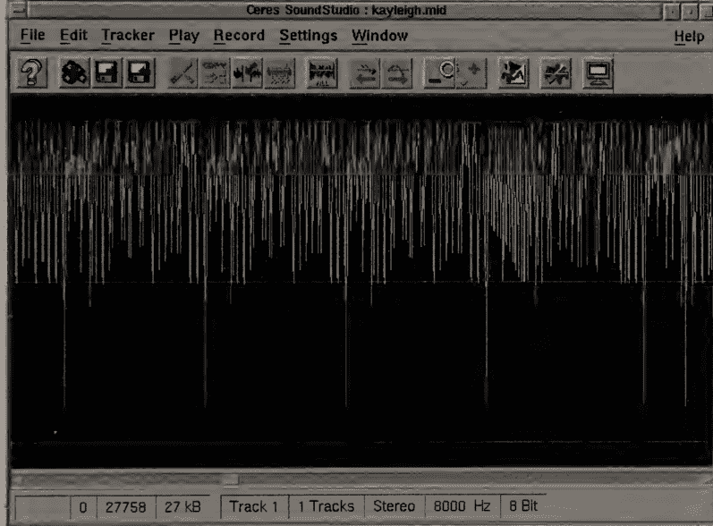

图 16–10 `SoundStudio` 窗口

# RealPlayer

`RealNetworks` 为 `Linux` 提供了其集成 `RealAudio` 和 `RealVideo` 播放器的免费版本。通过 `RealPlayer`，你可以听/或观看来自 `RealNetworks` 流媒体音频视觉服务器的流音频/视频。

`Plus` 版本支持录制并具有增强的性能和预设按钮（类似于汽车收音机），尚未推出 `Linux` 版本。

`RealPlayer` 可以作为独立应用程序运行，也可以作为 `Netscape` 的插件运行。插件版本在 `8` 位色彩显示上无法播放视频，但独立版本可以。

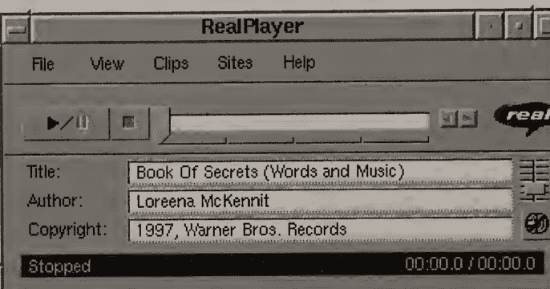

图 16-11 `RealPlayer` 控制面板

## 16.8 娱乐与游戏

### xpat

对于那些想要玩简单游戏的人来说，`xpat` 可能适合你。它是一个纸牌游戏集合（包括在其他操作系统上流行的经典 "solitaire" 和 "freeceelle" 游戏）。

# Quake/Quake II

忽略这些热门游戏（以及它们的前身——`Doom` 和 `Doom II`）并不困难。`Quake` 和 `Quake II` 都有 `Linux` 版本，并提供三种显示类型支持：`X11`、`SVGAlib` 和 `3Dfx`。`X11` 接口在窗口中运行 `Quake`，允许你同时与其他应用程序一起玩。`SVGAlib` 允许全屏游戏，但需要 `root` 权限并独占使用屏幕和键盘。`3Dfx` 版本（`GLquake`）使用 `Mesa GL` 库和基于 `3Dfx` 的 `3D` 卡来提供卓越的纹理映射和图形效果。

## 16.9 使用远程显示

`Mesa` 库和 `3Dfx` 也可以用于 `VRML` 以创建极高质量的图形。请查看 `Id software` 主页（`www.idsoftware.com`）获取更多关于 `Linux Quake` 的信息。

`X` 相比 `Macintosh`、`Windows 95` 甚至标准的 `Windows NT` 的最大优势是，`X` 可以将程序的输出发送到另一个 `X` 服务器。也就是说，我在纽约运行程序，但显示器在我马萨诸塞州的办公室里。或者，程序可以跨办公室运行，让你实际上可以从任何地方控制 `Linux` 机器。

远程显示工作需要满足三个条件。首先，两台机器之间要有 `TCP/IP` 连接。这可以通过以太网、`PPP`、`ATM` 等实现。其次，`X` 服务器（你观看程序的地方）必须知道客户端想要发送显示。这可以通过 `xhost` 程序完成。运行 `xhost +` 将允许从任何地方连接到你的 `X` 服务器。运行 `xhost +host` 会将可以访问你显示器的机器添加到列表中。默认情况下，本地机器可以使用 `xhost -host` 访问你的显示器。请注意，每一台想向你的显示器发送窗口的机器都必须赋予权限。第三点是客户端程序需要知道将显示发送到哪里。这可以使用 `-display display` 参数或设置 `DISPLAY` 环境变量来实现。我倾向于自己设置 `DISPLAY` 变量。

显示通过两个项目设置：要在哪个主机上显示，以及主机上运行用于显示的 `X` 服务器。服务器本身被分为两个部分：服务器编号和显示号。由于 `X` 可以同时处理多个显示器，你需要指定要将客户端程序发送到的宿主机、`X` 服务器和显示器。

幸运的是，对于大多数 `Linux` 安装版来说，这很容易。`X` 服务器和显示器始终从 `0` 开始计数，使得第一个 `X` 服务器为 `0.0`。结合主机名（我们称其为 `wayga`），你将得到如图 16–12 所示的设置。

```
setenv DISPLAY wayga:0.0
```


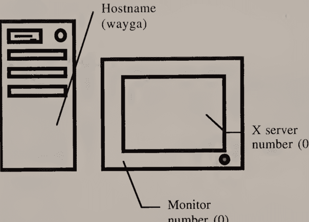

**图 16–12** 你电脑的 Xview。

## 16.10 商业 X 产品

目前有许多与 X11 相关的商业产品。在这里我们尝试为你提供一个相当完整的列表以及每个产品的简短描述。这些软件包中很少适用于 x86 以外的架构，尽管 Alpha 和 Sparc 版本开始出现。

### Xservers

### AcceleratedX

`AcceleratedX` 是 `XFree86` 自带 Xservers 的高性能替代品。它由 XiGraphics（http://www.xinside.com/）生产。

`AcceleratedX` 支持数百种显卡，远多于 `XFree86` 本身支持。此外，它支持比 `XFree86` 更多的显示器、偏移端口和更高的分辨率。通常，它还会从你的显卡和显示器中榨出更好的性能。

然而，这种性能的提升是有代价的，`AcceleratedX` 比 `XFree86` 消耗更多的系统资源。

XiGraphics 还制作多线程 Xserver，允许你同时在三个显示器上运行 X。`Metro-X` 内置了对多四个显示器的支持。

### Metro-X

`Metro-X` 是另一个商业 Xserver。它也支持比 `XFree86` 更多的显卡和显示器，虽然没有 `AcceleratedX` 那么多。它的性能也没有 `AcceleratedX` 好。它的价格更低，消耗资源也更少。

### X Libraries

除了许多额外的免费或共享软件 X 库和工具包外，还有几个 X 的商业工具包。

### Motif

`Motif` 由开放软件基金会（Open Software Foundation）开发。它的规范免费可用，这使得 `LessTif` 项目能够致力于 `Motif` 的克隆。

`Motif` 之流行是因为它提供了许多小部件（widgets），允许构建复杂、强大且美观的 GUI。它相当消耗资源，但大多数开发者认为这是一个公平的交易。

XiGraphics 和 Metrolink 都提供 OSF 认证的 `Motif` 库。Metrolink 提供了 1.2.4 和 2.0.1 版本，后者同时适用于 x86 和 Alpha。XiGraphics 为 x86 提供了 2.0 版本。此外，Redhat（http://www.redhat.com/）提供了 x86、Alpha 和 Sparc 的 `Motif` 2.01。

### OpenGL

`OpenGL` 是由 SGI 开发的三维图形库。它迅速成为每个 3D 开发者工具包的标准部分。Metrolink 为 Linux/x86 提供 `OpenGL` 包。

### CDE

通用桌面环境（`CDE`）是几家商业 UNIX 厂商努力为所有 X 桌面环境提供一个基于 `X/Motif` 的通用环境，从而无论你使用哪种平台都能提供统一的外观感受。

## 16.11 总结

`CDE` 版本由 XiGraphics 和 RedHat 提供。X 几乎是 Linux 和 UNIX 图形显示的标准。你可以根据喜意配置它，提供最适合你的控制和界面，而不是为了适应操作系统而改变你的工作方式。适用于 X 的应用程序可以媲美 Windows95，每天都有新的程序被编写。

# Linux 安全 17

这看起来并不简单，但必须完成。

由于大多数机器通过 Internet 连接，无论你有一百台机器还是一个拨号机器，安全都是大问题。

没有任何系统可以完全免受外部攻击。任何足够坚决的人都有机会破解你的系统。你能做的最好的事情就是准备你自己和你的机器，使其尽可能难以破解，并且能够检测到你正被破解。

## 17.1 物理安全

保持安全的第一个部分是确保硬件不被篡改。计算机系统 C2 安全规范的一部分

¹与流行观点不同，侵入系统的人被称为“破解者”（crackers）而不是“黑客”（hackers）。

安全原则是指，未经授权的人员无法从物理上接触到计算机。也就是说，它不能连接到网络上，而且最初必须放在上锁的房间里。第二章提供了一份良好的指令列表，可以使典型的 PC 免受到外部攻击的安全性。简单来说：

- 锁定 BIOS 并将 BIOS 设置为仅从 C 盘启动。
- 不要使用 `LILO`，或者至少让它直接进入 `Linux`。
- 不要在此机器上安装 `DOS` 或任何其他操作系统。
- 锁定电脑机箱。

你还应该安排人员协助解决问题，并防止任何人获得拆解计算机的机会。

## 17.2 软件安全

这一节比硬件安全部分稍微大一点，这很有道理。由于 `TCP/IP` 有多超过 65,000 个可用端口可以连接到单台机器，这为黑客提供了高达 65,000 种甚至更多进入你系统的途径。

### 监控软件

像 `COPS` 和 `TripWire` 这样的程序允许你定期监控系统，以检测可能的漏洞或某些形式的入侵。你可能这两个程序都准备好并定期使用。像 `SATAN` 这样的程序会监控整个网络并报告可能的漏洞。由于许多黑客可能都拥有该程序的副本，最好的办法可能是比他们快一步，在他们运行之前在你自己的网络上运行它。

### 防止 root 登录

黑客在你的系统上造成真正麻烦的第一种方法获取 `root` 权限。实现这一点有几种方法，我在这里列出所有的，并提供防止此类事件发生的建议。

首先，经常更改 `root` 密码！这样，即使黑客获取了密码，它也不会有效太久。同时还要关注你的 `/etc/security` 文件。该文件列出了 `root` 可以直接登录的位置。要从任何其他位置获取 `root` 权限，你必须先有一个有效的用户账户；然后使用 `su` 命令变为 `root`。默认情况下，`root` 只能在控制台（tty1 到 tty8）登录。

另一个应该执行的项是修改 `su` 程序，使得只有轮组（wheel group）的成员才能 `su` 到 `root`。我们认为这是 `Linux` `su` 程序中的一个大问题。轮组被设计为唯一一个可以 `su` 到 `root` 账户的用户组。这限制了可以通过破解获取 `root` 权限的账户数量。然而，GNU 的人认为这有点专断，他们设计的 `su` 程序允许任何拥有密码的人 `su` 到 `root`。其他操作系统，如 `SunOS` 和 `Solaris`，要求用户在允许 `su` 到 `root` 之前必须在轮组中。

### 安全 Shell (SSH)

你还应该开始使用在网络上传输时加密密码的程序。`SSH`（secure shell）程序在这方面非常出色，因为它不仅加密密码，还加密了整个连接。现在的 `TCP/IP` 在工作时，所有数据都以明文（即未加密）通过网络上传输。网络上任何机器上（或你与目标地之间的任何网络上）拥有网络嗅探器的任何人，都可以读取你输入的密码。这太糟糕了。`SSH` 程序加密了所有内容，并进行一些检查以验证你所在的主机和你要连接的主机。你应该在局域网内以及连接到其他站点时使用该程序。适用于 `Windows` 和其他平台的商业版 `SSH` 允许网络上的所有客户端都拥有安全连接。

`SSH` 程序被设计用于替代 "r-" 命令（`login`, `r`, `rcp`），并可以自行安装以替换那些命令。如果用户设置了 `.hosts` 文件，`SSH` 仍然会使用这些文件。用户不需要过多更改配置，但他们的连接将变得更加安全。

设置 `SSH` 要求你在相互通信的机器上运行 `SSH`。我们把客户端（你的个人机器）称为 `foo`，把服务器（你想连接、进行某些管理工作等的地方）称为 `bar`。

> 由于出口限制和各种专利，`SSH` 无法放在光光盘上。请在大型网络搜索引擎中搜索 `SSH`。仔细阅读许可协议，确保你在编译或拥有软件时没有违反任何专利或美国或当地法律。

`Bar` 将运行 `sshd`（`SSH` 守护进程），它通过 `inetd` 或在启动时以守护模式启动。如果你有许多使用 `SSHd` 的用户，那么运行守护模式可能更好，因为 `SSHd` 随时准备好建立连接。

`configure` 命令为编译做好了准备，然后通过 `make` 进行编译。对于典型的安装，你几乎不需要做其他任何事情。

`SSHd` 程序运行在服务器 (`bar`) 上，并应该由启动程序启动。客户端机器 (`foo`) 然后发出类似于 `login` 的 `SSH` 命令。连接的命令看起来像这样：

```
ssh -l foo bar
```

如果 `bar` 主机对你不熟悉，系统会提示你是否想要将其添加到已知主机列表中。添加主机后，你就可以输入密码登录了。

全局配置文件位于 `/etc`。这些文件分别是 `/etc/ssh/sshd_config`（服务器配置）和 `/etc/ssh/config`（配置）。这些文件的选项列在 `SSH` 和 `SSHd` 的 man 页面中。

可以使用全局方法 `make-sshknownhosts` 向 `SSH` 添加新主机。

`tcpd` 程序按照此模式工作：

```
daemon_list : client_list [ shell_command ]
```


守护进程列表是正在运行的程序名称（`telnetd`, `ftpd` 等）。客户端列表可以是以下任何一种：

- 带有 `.` 的字符串被认为是域的一部分（`.wayga.net` 将是 `wayga.net` 中的任何主机）。
- 以 `.` 结尾的字符串被认为是一个 IP 地址网络或子网（`128.55.213.` 将是以该 IP 地址开头的所有机器）。
- 以 `@` 开头的字符串被认为是一个 NIS 网络组（`@hosts` 将是 NIS 网络组中定义的所有主机）。
- `n.n.n/n.m.m.m` 是一个网络和掩码对。这在匹配 IP 地址方面比上述方法提供了更精细的控制。

还有几个特殊关键字：

- `ALL`——匹配所有内容。
- `LOCAL`——所有主机名中不包含点 (`.`) 的主机，因为本地主机通常不使用完全限定域名 (FQDN)。
- `UNKNOWN`——用户名未知（通过 RFC 931 检查）或主机名或 IP 未知的用户。
- `KNOWN`——unknown 的反反——用户名已知，且名称和地址均已知。
- `PARANOID`——任何反向 DNS 不匹配主机名使用的主机。具有多个域的站点如果反向 DNS 和主机不同步，可能会遇到这个问题。

访问控制还接受 `EXCEPT` 单词，可以给出如下所示的内容：

```
192.55.242. EXCEPT PARANOID
```

这匹配所有 `192.55.242.` 范围内的 IP 地址，但反向 DNS 与主机声称的不符的除外。

`shell` 命令是可选的，并会被发送到 `/bin/sh` 进行处理。应该是一个安全的脚本，用于设置其 `PATH` 和其他环境变量。

为了让一个完全封闭的系统（从 `tcpd` 的角度来看）启动，请在你的 `/etc/hosts.deny` 中包含以下内容：

```
ALL:ALL
```

这将拒绝所有 `tcpd` 服务对所有主机的访问。接下来，你可以通过向 `/etc/hosts.allow` 文件添加内容来开始开放系统：

```
ALL:LOCAL
```

这现在允许所有本地机器访问所有 `tcpd` 服务。随着你添加更多服务（`POP`, `IMAP`, `tftp`），你可以在安装服务时添加 `tcpd` 支持。在 `/etc/inetd.conf` 文件中，让你的行看起来像如下所示：

```
telnet stream tcp socalled root /usr/sbin/tcpd in.telnetd
```

通常运行 `tcpd` 的位置将代之运行，并带上你想要运行的程序参数（在这种情况下为 `inetd`）。不是由 `inetd` 启动的其他程序（如 `sendmail` 和 `httpd`）其程序内部内置了自己的基于主机的访问机制。只需确保在编译黑名单列表（或白名单）时，将它们包含在与 TCP/IP 交互的程序中。

## 17.3 拒绝服务攻击

拒绝服务涉及这样一个事实：用户可能正在进行有效的操作（例如 `ping` 你的主机或发送电子邮件），但其操作方式阻止了你完成工作。例如，一个 `ping` 至少占用 64 字节，并且每秒至少发送一次。如果一个恶意的黑客发送大小为 2K 的 `ping` 包，它将淹没 2.8K 的调制解器链路，使其无法下载数据、接收电子邮件、浏览网页或进行任何操作。整个链路都被响应 `ping` 包所占满。Linux 对此采取了一些保护措施，但任何系统都容易受到这种影响。另一种类似的攻击涉及向主机发送 SYN 数据包。机器打开连接并等待更多数据。随着越来越多的 SYN 包进入，会有越来越多的连接打开，直到最后机器崩溃或变得无法使用。Linux 也有针对此类攻击的保护措施，但由于 SYN 和 `ping` 都是标准协议（且被广泛使用），因此能做的并不多。

另一种类型的攻击涉及发送大量的电子邮件，以使其淹溢邮件分区。Linux 通常将其电子邮件存储在 `/var/spool/` 中，这通常是根分区（`/`）的一部分。`/tmp` 目录也是根分区的一部分。你收到的电子邮件可能导致 root 填满，然后 `/tmp` 无法存储任何临时数据。这可能会导致某些程序（如 `vi`）崩溃，因为它们依赖于访问 `/tmp` 的权限。这可能导致内核崩溃。这里的教训有两个点：将 `/tmp` 设置为挂载目录，并将 `/var` 也设为挂载目录。此外还要频繁监控邮件文件，以确保分区不会迅速填满。某些用户可能需要每几周清理一次电子邮件。我的电子邮件通常每月增长约 4 MB。我会将整个月的内容保存到主目录下的文件中并进行压缩以节省空间。每月 4MB，30 个用户就是 120 MB 的 `/var` 分区，再加上位于 `/var` 的日志文件等文件。

## 17.4 网络安全

对于小型办公室环境，最好是拥有一个与外部世界交互（Web, FTP, `Sendmail` 等）的单一主机。使用数据包过滤器或像 Firewall Toolkit (FWTK) 这样的防火墙包保护网络的其余部分。禁止所有 net 和 finger。监控匿名 FTP 和 WWW 日志以发现入侵情况。你可以通过创建一个名为 `/etc/ftusers` 的文件来禁用 FTP 用户。此文件中列出的任何用户都无法进行 FTP 操作。对于经常出差的用户（销售人员或在家里工作的工程师），要么建立拨号连接，要么使用非常信任的主机进行连接。对于只需要电子邮件的用户，你可以将邮件转发到外部帐户。通过这种方式，外部用户无法尝试进入你的系统。此外要注意谁在休假或离开，并确保他们没有登录。这种方法在安全和便利之间取得了一定的平衡。内部员工可以在不使用代理的情况下访问互联网其余部分。代理处理所有（包括你的）的 HTTP、FTP 和 telnet 流量。使用防火墙的安全环境。这种方法缺乏安全性，但它是这种设置的缺点之一。

对于出差较大的办公室环境，花时间设置 KEY 和 SSH。还要设置一个完整的防火墙，让它处理 Web、FTP 和电子邮件（见图 17–1）。


**图 17–1** 使用防火墙。所有进出流量都通过防火墙。任何想要使用 Web、通过 FTP 下载数据或使用 telnet 的必须使用代理，或者首先连接防火墙。防火墙只转发电子邮件（你可以让防火墙接受）。在所有直接访问互联网的主机上运行类似 tripwire 的程序。这类程序的好处之一是它可以监控某些文件（例如 `/etc/password`），并在这些文件发生变化时发出警报，表明黑客正在进行。一旦用户被防火墙验证，他们就可以访问内部网络、接收电子邮件、与主机连接等。较大的站点留给读者练习，但你可能想参考一些网络安全书籍。

### PGP

免费加密最早的实现之一是 PGP（漂亮隐私）。由于出口管制、军品以及各种专利，我们无法将其包含 CD-ROM 中。在美国和其他许多国家有合法的方法下载此软件。某些国家对加密有严格限制。PGP 的主要依据是允许电子邮件的安全。电子邮件可以被认证为来自你（以防止伪造），也可以为他人完全加密，或者两者兼顾。PGP 创建两个密钥：一个必须由你保管的私钥，以及一个邮件接收者必须能够读取以验证邮件的公钥。在 Linux 上构建 PGP 并不是易事，因为 Linux 自上次发布以来发生了变化。提供了可以在 Linux 下编译 PGP 的补丁。你可以通过搜索引擎找到 PGP。要为 Linux 编译 PGP，获取 `pgp-tar.gz`。将 `pgp-installer.tar.gz` 文件放在同一目录（创建一个 `/usr/src/pgp` 或 `$HOME/pgp`）。现在运行以下命令：

```
tar -zxvf pgp.tar.gz
cd pgp
installer
```


# 17.5 PGP 安装与配置

PGP 2.6.2 版本于 1994 年发布。解压 PGP 源码，修复以适配 Linux，编译并将二进制文件安装在 `$HOME/pgp`。如果你选择将二进制文件安装在其他地方，将 `installer` 替换为 `patch-only`。你可以编辑 `Makefile` 将源码安装在别处。

安装 PGP 后，必须生成一对公私钥。`pgp-kg` 命令允许你生成它。请注意，你可能希望多个电子邮件地址验证同一个密钥（例如，如果你有一个家庭邮箱、一个 Linux 用户组邮箱，可能还有一个学校的校友账号）。PGP 可以处理这种情况，你只需要生成一次密钥。

生成密钥后，`pgp-ke` 命令允许你编辑（以及添加、删除等）与私密钥相关的名称。当询问你的 ID 时，输入你的全名，然后是你的电子邮件地址。我的 PGP ID 看起来如下：

`Mark F. Komarinski <markk@auratek.com>`

接下来会要求输入密码。这个短语可以随你意长，但确保不要忘记，不要让别人获取。系统会提示你在键盘上输入乱码以生成用于密钥的随机数。几分钟后，你的 PGP 密钥存储在 `$HOME/pgp` 中。

接下来你将生成公钥供他人读取和验证你发送的内容。`pgp-kx` 将提取二进制格式的你的公钥。如果你希望密钥是 ASCII 格式（适用于在网页上显示或使用 `finger` 信息），请在组合中添加 ASCII 选项。

许多读者都有权限使用 PGP。`mitt` 等阅读器内置了许多功能，`pine` 等阅读器允许你使用 PGP。其他的则将电子邮件通过管道传给 PGP。

为了自签名，请使用 `pgp-sta <textfile>` 命令。任何拥有你公钥的人都可以验证你编写的内容。

你可以通过将文件传给 `pgp` 或使用 `pgp <textfile>` 来验证传入的邮件。如果你有发送者的公钥，你会收到消息有效或无效的提示。如果你没有公钥，则无法进行验证。

使用 `pgp-ka <file>` 命令找到公钥并将其添加到你的“密钥环”中。`<file>` 包含人的公钥环的 ASCII 或二进制版本。

`pgpdoc1.txt` 和 `pgpdoc2.txt` 中的 `pgp -h` 也会提供可用命令列表。

# 18 内核管理

管理最先进的 Linux 内核。

内核是操作系统的核心和灵魂。它管理内存、CPU 和磁盘；系统中的每一件硬件都需要它才能运行。Linux 内核是存在的最灵活、可定制的内核之一，管理它相当简单，但在某些时候可能会很棘手。

## 18.1 定制你的内核

在几乎每一种 UNIX 变中，都可以某种程度上对内核进行配置。通常这是通过指定一组外部的、可加载的模块并在启动时将其插入内核来完成的。在 Linux 中，你可以做到这一点以及更多。除了可以在启动时手动插入代码模块外，Linux 还可以根据需要加载模块并在以后卸载它们。

此外，由于 Linux 内核代码是免费提供的，你可以编译自己的自定义内核。这包括指定你希望直接编译到内核中的驱动程序和功能，以及你希望作为可加载模块保留的功能。

Linux 开发者一直在努力让这一切尽可能简单，因此这种灵活性并没有像你想象的那样牺牲多少易用性。内核有两个菜单驱动的配置选项：基于 X 的和另一个是基于屏幕的。此外，还有简单的基于行的线性配置。

## 18.2 哪个内核？

如果你熟悉 Linux，你可能已经知道在任何给定时间都有两个当前的内核版本：一个生产版本和一个开发版本（有时称为实验性内核）。实验性内核通常具有实验性的、有时可能带有 bug 或不稳定的特性，但需要注意的是，生产内核或开发内核中真正有 bug 的发布将通过新版本迅速修复。

生产内核的发行号总是偶数，而开发内核的次要版本号是奇数。次要版本号是内核版本号的三个数字中的第二个。例如，`1.3.88` 是开发内核，但 `2.0.30` 是生产内核。生产内核的下一个次要修订是与生产内核一起开发的（例如，`1.2` 和 `1.3` 是同时开发的，就像现在的 `2.0` 和 `2.1` 正在同时开发一样）。

通常，除非你需要只有开发内核中才有的功能，否则最好坚持使用最近的生产内核。随着 `1.3` 版本的疯狂发布（超过一百个！），`2.0` 内核有大量的选项供选择，并支持广泛的硬件。

## 18.3 准备工作

在部署新内核时，你可能需要或想要手头有一些东西。首先是你的外设设备和主板的手册。你至少需要知道外设设备的型号，在某些情况下，还需要某些硬件设置，如中断请求行 (IRQ) 和内存地址。

## 18.4 将内核添加到 LILO

你可能还想为现有内核备份并设置 LILO，这样如果你的新内核出现问题或根本无法启动，你就可以启动。

此外，你可能希望有一个可启动的软盘（你应该已经有了），以防真的出了大乱子。如果你需要制作启动软盘，请参见启动和关机章节。此外，如果你有点偏执，你可能还想备份你的根分区。

如上所述，保留一个旧的、可靠的内核以便在急时启动是一个良好的习惯。LILO（Linux 加载程序）允许你在启动时选择引导哪个内核。通过 LILO，你还能够启动 `386BSD`、`DOS`、`Windows 95`、`UNIXWARE` 以及其他内核。

LILO 使用位于 `/etc` 的配置文件 `lilo.conf`。这里是一个示例：

```
#
# LILO config file: /etc/lilo.conf
#
boot=/dev/sda
map=/boot/map
install=/boot/boot.b
verbose=2
prompt
timeout=100
message=/boot/message
image=/vmlinuz
  label=1
  root=/dev/sda
  initrd=/boot/initrd
  read-only
image=/vmlinuz2
  label=2
  root=/dev/sda
  initrd=/boot/initrd.old
  read-only
image=/vmlinuz.old
  label=old
  root=/dev/sda
  initrd=/boot/initrd.old
  read-only
```


第一行简单地告诉 LILO 哪个分区包含引导区，或者指定了哪个设备（例如 `/dev/sda` 而不是 `/dev/sda1`）即哪个设备包含引导记录。下一个是指定的 map（`/boot/map` 是默认值）；它告诉 LILO 启动操作系统所需的所有文件在哪里。第三是引导加载程序。它被加载到 BIOS 并随后加载选定的内核。接下来是详细程度——数值越高越详细。`"prompt"` 条目告诉 LILO 显示。`"timeout"` 是它等待的秒数。如果没有超时，LILO 将无限等待。`"message"` 条目告诉 LILO 显示消息。该消息即为内核。

## 18.5 模块还是编译内核？

这里需要注意的是，并不是所有驱动在编译进内核时的行为都相同。这种差异从细微到完全无法工作不等。

选择何时将特定功能作为模块可用或进行编译通常很简单。通常情况下，如果它使用频率较低且根据需要使用，你应该将其编译为模块。这通常包括软盘驱动程序（如今）、光驱驱动程序、声卡或使用拨号上网的网络驱动。

如果该功能被频繁或持续使用，那么真的没有必要将其编译为模块，这包括磁盘控制器或 SCSI 控制器、永久联网的网络驱动、文件服务器上的 AppleTalk 驱动等。

在编译版本之间功能存在差异的情况下，通常会在该选项的帮助弹出窗口以及相关文档中。

## 18.6 开始吧！

让我们概述一下你如何为你作为桌面的联网 Linux 机器以及一个 Windows 和 Mac 网络的文件服务器编译内核。你还有一个声卡（它们很便宜，而且你家里有一百张 CD 可以听）。这台机器有一个 SCSI 控制器，连接着光驱和硬盘。

首先，确保你已经安装了内核源码。如果是的话，你可能决定获取较新版本。默认位置在 `/usr/src/linux`，它可能是指向 `linux-x.y.z` 的链接，其中 `x.y.z` 是内核版本。一旦你进入 `x`（强烈建议），输入 `usr/src/linux, type make config`（假设这将完成一些准备工作并弹出一个带有按钮的窗口，带你进入内核配置的各个部分）。

正如你可能猜到的，第一次执行时最好从顶部开始遍历所有菜单。

### 配置内核

每个按钮右侧都有一个帮助按钮，它提供了关于该驱动程序的少量信息以及一些帮助你决定是否启用它的提示。

如果你在 X 环境下，请从 `/usr/src/linux` 运行 `make xconfig`。如果你使用的是字符终端，请运行 `make menuconfig`。如果你使用的是仿真效果差的字符终端，则只能运行 `make config`。

当你使用 `xconfig` 选项进行编译时，会弹出一个漂亮的图形界面，如图 18-1 所示。

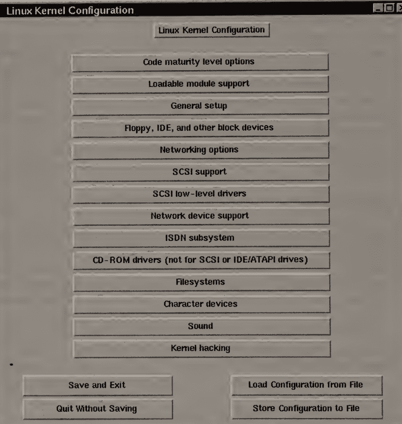

图 18–1 基于 X 的内核配置工具。

### 8.6 深入探索！

一旦你进入了子菜单，就可以获取那里各种选项的帮助。示例参见图 18-2 和 18-3。

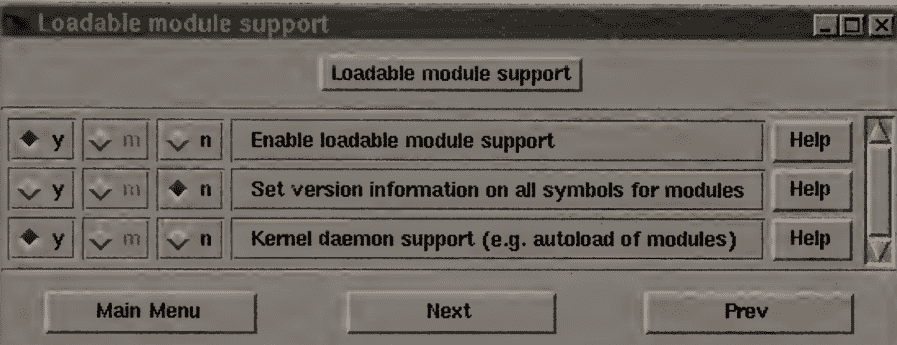

图 18–2 子菜单弹出。

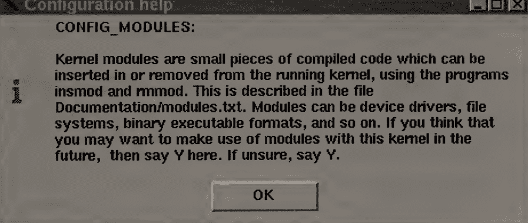

图 18–3 子菜单帮助弹出。

内核模块是编译的小型代码段，可以使用 `insmod` 和 `rmmod` 程序从运行的内核中插入或移除。这在 `Documentation/modules.txt` 文件中描述。模块可以是设备驱动程序、文件系统、二进制可执行格式等。如果你认为以后可能此内核内核的模块，请选 Y。如果不确定，也选 Y。

现在，你准备好开始配置你的新内核了。

#### 成熟度选项

在这里的这个选项回答 yes 不会改变内核。它会在之后为你提供各种实验性或不完整驱动程序的选项。选 yes 吧，这没有任何害。你可以随时对提供的任何实验性驱动说 no。

当前 2.0 内核中可用的一些实验性模块包括 PCI 桥优化、IP 代理支持、IP 多组播路由、以太网桥接、帧中继支持、Amiga FS 支持以及对许多不常用硬件的支持。

#### 可加载模块支持

正如你所猜的，我们强烈建议你启用可加载模块支持和内核守护进程支持。内核守护进程 `kernel` 是管理模块加载和卸载的程序。它与内核发行版分开提供。

#### 通用设置

你绝对想要启用网络支持、System V IPC 以及对 ELF 二进制文件的支持。你应该也启用 `.out`，可能作为模块，因为所有新的 Linux 发行版都是基于 ELF 的。如果你使用的是较新的发行版，还应该以 ELF 格式编译内核。

如果你计划将该机器用于 Java 开发，请启用 Java 二进制文件支持。在这里使用模块是可以的，除非你想能够从从命令行运行 applet。如果你想这样做，将需要将模块编译到内核中。

恰当地设置处理器类型，除非由于某种原因你使用了旧版本的 GCC。在这种情况下，你必须说 386 或 486。

#### 软磁盘、IDE 和其他块设备

启用软磁盘支持，除非你经常使用软磁盘驱动，否则可能作为模块启用。如果你确定不需要 IDE 支持（例如，你只有 SCSI 硬盘和光驱器），请排除 `(E)IDE` 支持。

除非你有较旧的主板，特别是使用英特 Neptune 芯片组的主板，否则各种芯片组支持和错误修复可以关闭。

#### 网络选项

你在这里绝对想要启用的唯一选项是 TCP/IP 网络。启用它。

#### 8.6 深入探索！

其余大多数 IP 和网络相关的选项你可能不需要，除非你的机器充当 TCP/IP 路由器/网关。如果你将要访问 MBONE（位于互联网之上的多组播骨干），你可能需要启用多组播。

在下方你会找到对其他网络协议的支持：IPX、AppleTalk 和 AX.25。根据需要启用这些选项。如果你的机器将作为使用其中一种协议的服务器，你可能也可以将其编译到内核中。它们很可能在任何时候都加载了几乎所有项。

#### SCSI 支持

假设我们已经把这个老话题说得足够充分了，你至少需要 SCSI 支持和 SCSI 磁盘支持。你可能还需要 SCSI 磁带和光驱器支持。如果你有其他 SCSI 设备（如扫描仪），你还需要启用通用 SCSI 支持。除非你拥有具有逻辑单元号（LUN）的设备，否则对于探测所有逻辑单元号（LUNs）的选项你应该说 no。此类设备的示例是 CD 点唱播放机。

如果你在 SCSI 总线上遇到问题，你可能想要启用详细错误报告以帮助跟踪错误。

#### SCSI 低级驱动程序

启用你的 SCSI 适配器的驱动程序。如果你使用的是自带的 Zip 或 Jaz 驱动器，你将需要启用它的驱动。更多信息请参见外设章节。

如果你在并行口上使用 zip 驱动器，你将在此处启用对它的支持。这类驱动器包含一个并行转 SCSI 的转换器，它本质上将端口转换为 SCSI 主机。

#### 网络设备支持

启用网络设备支持（废话）。之后，根据你的需要启用其他选项。这是你想要启用此项唯一情况。

#### ISDN 子系统

如果需要，请启用它。你需要你的声卡的说明书，因为在编译内核时需要许多硬件参数。

#### 光驱驱动程序 (ATAPI)

如果你的光驱连接在 IDE 上，你将想要启用对它的支持。你需要你的声卡的说明书，因为在编译内核时需要许多硬件参数。

#### 文件系统

如果你有一个非常异构的局域网，你可能想为可移动介质（软磁盘、Jaz 驱动器）启用所有这些。

### 编译内核与模块

要正确构建内核，请执行以下命令：

```
# make depend

<vmlinux

<此处大量输出>

# make clean

<此处大量输出>

# make

<此处有大量输出
```

现在，如果你想在根分区上安装压缩内核，输入：

```
# make zlilo

<输出结尾为...>

tools/build bootsect compressed/vmlinux.out > zImage

Root device is (8, 1)

Boot sector 512 bytes.

Setup is 4348 bytes.

System is 368 kb

sync

if [ -f /vmlinuz ]; then mv /vmlinuz.old; fi

if [ -f /System.map ]; then mv /System.map /System.old; fi

cat zImage > /vmlinuz

cp /usr/src/linux/System.map //
```


```
if [ -x /sbin/lilo ]; then /sbin/lilo; else /etc/lilo/install; fi
```

Added 1

Added 12

Added 13

```
make[1]: Leaving directory `/usr/src/linux-2.0.29/arch/i386/boot`
```

此命令安装内核并重新运行 `lilo` 以更新引导映射。如果你想将其安装到软盘上，请执行 `make zImage`（而不是 `zlilo`）并将镜像拷贝到高密度软盘。

```
# cp /usr/src/linux/arch/i386/boot/zImage /dev/fd0
```

使用新内核重启你的机器：

```
# /sbin/reboot
```

如果内核没有启动，你可以再次重启（使用熟悉的 CONTROL-ALT-DELETE 键组合），并在 `LILO:` 提示符告诉它要启动哪个其他内核。如上面的输出所示，安装了三个内核。如果你在 `LILO:` 提示符输入“12”，则将启动 `/etc/lilo.conf` 中标签为“12”的内核。现在，根据你的配置检查硬件及其设置（只需运行 `make xconfig` 即可，它将把你上次的配置加载到 GUI 中）。

### 18.7 总结

希望我们已经消除了一些编译自定义内核过程中的畏难感。另一方面，我们也希望确保你采取一些简单的预防措施，以防制作出的内核无法在你的系统上启动。

如果你对内核的内部机制感兴趣，可以查阅各种 HOWTO，特别是针对 Linux 特定信息的 `Kernel Hacking HOWTO`，或者任何多本关于通用操作系统（OS）理论和设计的书籍。

有关启动和 `LILO` 的更多详细信息，请参阅启动和关机章节。

## 19. 系统监控

使用 `syslog` 监控你的系统。

使用 `syslog` 程序从控制台或远程监控你的 Linux 机器。

`syslog` 程序监控内核和用户事件，并根据你的需求路由消息。这些事件可能是小事，例如 `root` 登录，也可能是严重事件，例如硬盘故障、内核恐慌（`panic`）或重启。

`syslog` 程序在启动时运行并使用 `/etc/syslog.conf` 文件来确定做什么。以下是 RedHat 4.1 的默认文件：

```
# 将所有内核消息记录到控制台。
# 记录太多其他会弄乱屏幕。
kern.* /dev/console
```

```
# 记录任何 info 级或以上的日志（邮件除外）。
# 不要记录私人身份验证消息。
*.info;mail.none;authpriv.none /var/log/messages
```

```
# authpriv 文件有限制访问。
authpriv.*                                     /var/log/secure
```

```
# 将所有邮件消息记录在一个地方。
mail.*                                            /var/log/maillog
```

```
# 所有人都会接收紧急消息，并记录在另一台
# 机器上。
  *.emerg
```

```
# 将 err 级以上的邮件和新闻错误保
# 特殊文件中。
uucp,news.crit                                 /var/log/spooler
```

任何前面带有 `#` 的行都会被忽略并作为注释。每行都是一个条目，由两个字段组成。第一个字段列出要监控的事件。第二个字段列出事件发生后要做什么。

每个事件由两部分组成，用点分隔。第一部分是设施（`facility`），或产生事件的程序类型。第二部分是事件的优先级（`priority`）或严重程度，范围从 `debug` 到 `emerg`。共有二十个可用设施：

- `auth`
- `auth-priv`
- `cron`
- `daemon`
- `kern`
- `lpr`
- `mail`
- `mark`
- `news`
- `syslog`
- `user`
- `uucp`
- `local0` 到 `local1`

共有八个可用优先级：

- `debug`
- `info`
- `notice`
- `warning`
- `err`
- `crit`
- `alert`
- `emerg`

### 19.1 设施与优先级

你列出的设施/优先级组合将报告所有发送到 `syslog` 的该优先级及更高优先级的消息。`debug` 优先级将报告所有消息。`emerg` 优先级将只报告紧急消息。

### 19.2 操作

你列出的设施/优先级组合将报告所有发送到 `syslog` 的该优先级及更高优先级的消息。`debug` 优先级将报告所有消息。`emerg` 优先级将只报告紧急消息。

### 19.3 日志记录程序

如何记录日志取决于你想记录什么。对于初始设置，你可能应该开始记录几乎所有内容。随着系统变得稳定并运行正常，可以继续调试，但将优先级改为 `warn` 或 `err`。

### 19.4 总结

保持系统长时间运行的关键之一是了解系统中正在发生的一切。通过仔细监控你的机器，你可以在问题发生时捕捉潜在的问题或入侵，并在问题失控前将其修复。

## 20. 备份你的数据

> 当一切都失败时……从备份中恢复！

良好的备份通常是从许多事故、灾难或入侵中恢复的唯一方法。Linux 有多种归档数据的方法，从 `tar` 或 `cpio` 工具到 Linux 自带的驱动，再到功能丰富的商业软件包。

备份数据有多种方法，从简单地 `tar` 整个文件系统到磁带上使用 `dump` 并配合良好的备份计划，再到运行高级商业备份恢复程序。

当然，你还有多种备份介质可以选择：软盘（如果你真的绝望了）、磁带驱动（从旧九到 DAT）、一次写多次读（WORM）驱动器、光光（磁写入、光读取）以及 `Zip` 和 `Jaz` 驱动。在这些中，只有较新的磁带选项和 `Jaz` 驱动具有 GB 级容量，而只有 `DAT` 可以处理超过几个 GB。遗憾的是，由于其顺序访问的本质，磁带在许多方面都是最难处理的。

# 278

## 第 20 章 备份你的数据

随着针对 CD-ROM（以及由此产生的 WORM-）文件系统的新拟议标准，这种媒体很快将拥有数 GB 级的容量。尽管它们仍然是一次写入的，但更方便的访问方式（随机而非顺序）可能会让它们在价格下降到可负担的范围内后变得流行。实际上，这项技术已经存在了相当长，但由于现有标准的普及阻止了它被取代。然而近年来，可靠地存储大量数据的需求急剧增长，CD-ROM 在访问便利性和使用寿命（几十年对比几年）方面相比于磁带都是是一项大获胜。

本章的其余部分假设你已经拥有某种形式的大容量介质来备份数据，尽管许多指南与所使用的介质或其容量无关。

通常情况下，你可能希望在活动低峰时段运行备份，原因有两个：首先，在备份运行时让大量文件处于打开或更改状态并不是一个好主意。有些程序会锁定文件，备份程序最好的情况下只能跳过这些文件，最坏的情况下，备份会退出或崩溃。其次，备份系统会消耗大量的系统资源，如果你的服务器负载已经很大，那么当你尝试在“正常”工作时间（无论具体指什么）运行备份时，它可能会导致系统严重缓慢。

### 20.1 tar 和 mt

如你所知，`tar` 代表 Tape Archive（带归档）。在 GNU 最新的版本之前，`tar` 并不真正适合作为备份工具。它没有执行增量备份以及正确处理带有空洞的文件（所谓的稀疏文件）的方法。

在基础层面，你可以创建一个 `cron` 任务，每晚或每隔几天将你所有的文件系统和网络卷压缩到磁带驱动器。这种方法有几个缺点。

通常，即使在一周内，文件系统只有一小部分发生了变化。每隔一天复制一次整个文件系统可能非常耗时。如果能进行增量备份会更好。

你可能拥有的数据超过了你特定磁带和驱动器组合的容量。在这种情况下，你必须拆分备份任务，并在某处更换磁带以完成备份。再次，增量备份可以缓解这个问题。

如果你的备份（或其部分）足够小，你可能想在单条磁带上放置多个备份，并且你可能需要某种方法在以后访问特定的归档。你可以使用 `tar` 的追加功能，但将失去维护不同版本的能力。当解包归档时，追加的文件将覆盖早先提取的同名文件。

由于磁带不支持随机访问，因此在向单条磁带写入多个归档时，需要特别小心。在磁带上移动你可能使用 `mt`。它可以在磁带上从一个归档移动到另一个，也可以回带或快进。它至少接受两个参数：磁带设备和要执行的移动。移动可以是相对于当前位置的，也可以是绝对的（使用带开头作为参考点）。显然，使用绝对移动更安全，如果你赶时间，相对移动会更快。

现在，我们已经详细讨论了一番 `tar`，让我们指出几件 `tar` 擅长的事情。

`tar` 可以归档当前不需要的文件，或者对项目进行快照。如果你的某个用户拥有他们仍需要但一段时间内不会使用的数据，利用这个 `tar` 将其备份到磁带并从服务器中删除。此外，你可能需要保留项目的快照，但并不一定需要让它们在线。

如前所述，`tar` 常用于创建文档、源代码或预编译软件的包或发行版。

它的许多命令行选项允许你控制权限、修改日期的保留以及符号链接的跟踪。这允许你在另一个分区上比 `cp a` 更有控制力地重新创建目录树。一个示例很好地说明了这一点：
```


`# (cd /home ; tar cf caryc) | tar xf`


这将调用`rm`命令在目录`/home/caryc`中重新创建子目录。它会保留文件的权限和所有权，并重新创建（但不跟踪）符号链接（假设链接没有失效）。

通常情况下，除非你知道树中所有链接都指向哪里，否则跟踪符号链接并不是好主意。如果一个链接指向归档内部的目录，你将开始在子目录中递归地重建目录树，并迅速消耗大量的磁盘空间。

### 20.2 `cpio`

在许多方面，`cpio`与`tar`相似。它支持更多格式（包括`tar`使用的格式），还可以处理来自不同字节序机器的归档。它没有等同于`--update`选项的选项。
像`tar`一样，`cpio`可以向网络设备写入或读取，也可以作为本地设备使用。
最后，`cpio`可以用于透传模式（pass-through mode）来复制目录树。

使用`cpio`还是`tar`执行备份在很大程度上取决于喜好。

### 20.3 `dump`和`restore`

`dump`可能是执行备份最好的免费替代方案。它对文件系统进行相当底层的拷贝。由于这一点，任何类型的文件（包括套接字、块设备和字符设备）都可以归档，且具有空块的文件会被正确保存。此外，它可以执行增量备份，且归档可以跨多条磁带。最后一个优点是`dump`对文件或路径的长度没有限制。

增量备份通过为特定备份分配`dump`级别来控制。`dump`级别范围从 0 到 9，当执行特定级别 N 的`dump`时，所有自上次 N-1 或更低级别`dump`以来更改的文件都会发送到磁带。正如你所猜，级别零会备份整个文件系统。

`dump`要求你知道用于备份的介质长度和密度。对于使用数据压缩的设备，设备关联有一个虚拟长度，它仅仅是压缩率乘以实际磁带长度。在这里最好保守为见；压缩率实际上是一个平均值；并非所有文件的压缩率都相等。如果你高估了压缩量，`dump`将会在磁带用尽后尝试写入，导致备份损坏。

`dump`是备份系统最底层的方法之一，但它也是容错性最低的方法之一。除非你非常了解它以及你的备份设备，否则你可能想选择另一种备份系统的方法。

### 20.4 商业备份产品

### `BRU`

备份与恢复工具 (`BRU`) 基于`tar`，但增加了许多功能。它运行一个管理备份计划的守护进程。它提供两个版本，较贵的版本支持备份`NFS`磁盘；较便宜的版本仅在本地磁盘上工作。

`BRU`还提供了`X`和`ASCII`菜单式界面。支持备份级别概念，备份目标可以是任何字符设备。

其他功能包括：

- 跟踪磁带的使用次数，帮助你决定何时丢弃旧磁带。
- 用于从损坏归档恢复数据的强大功能。
- 支持`NIS`（网络信息服务，用于`passwd`、`group`和`host`文件的网络系统）。
- 支持`SMB` (`Samba`) 和`Netware`卷。
- 归档可以跨多个备份设备。

`BRU`适用于`x86`、`Alpha`和`PowerPC`上的`Linux`。更多信息请访问`http://www.estinc.com/`。

### `PerfectBACKUP+`

`PerfectBACKUP+`被广泛誉为最快的备份和恢复程序。它以前作为`FASTBACK PLUS`在`UNIX`上销售，最初起源于`DOS`的`FASTBACK PLUS`的`UNIX`版本。它提供了`ASCII`和`Motif`菜单界面、网络支持、压缩、验证与恢复以及计划功能，并兼容`tar`和`cpio`。它还会备份各种网络驱动器，包括`NFS`、`Windows`、`Network`和`NT`。

其他功能包括：

- 压缩。
- 网络备份设备。

# 第 20 章 备份您的数据

- 多个备份设备——当一个设备满时，它将移动到列表中的下一个设备。
- 在备份期间锁定文件，以便在多用户模式下进行安全的备份。
- 支持所有文件类型，包括套接字、管道等。

有关`PerfectBACKUP+`的更多信息，请访问`http://home.xl.ca/perfectBackup/`。

## `BACKUP/9000`

尽管在本文编写时该程序在`Linux`上仅提供测试版，但它有一个功能促使我们将其包含进来。它专为配合`Oracle`设计，允许对`Oracle`表空间进行在线、安全的备份。如果你正在运行`Oracle`（对于使用`IBSC`模拟器的`SCO`，没有原生的`Linux`版本），你无疑发现这个功能非常有用。此外，`Backup/9000`支持你对商业备份恢复程序所期待的所有功能：

- 友好的用户界面。
- 调度工具。
- 支持本地和网络备份。
- 使用`tar`或`cpio`格式。
- 加密。
- 到多个本地和/或网络磁带的并行备份。
- 除了普通文件外，还支持原始分区和`FIFO`流的备份。
- 一盘磁带上的多次备份。

### 20.5 备份策略

你何时进行何种备份取决于几个因素，包括：

- 你的备份设备的容量和速度，这对于无人值备份尤为重要。
- 你的文件系统的活跃程度。每天或每周更改的文件百分比是多少？很可能这会因分区而异。
- 你是否可以进行在线备份。

### 20.6 `RAID`和磁盘镜像

- 如果你无法进行在线备份，可以接受多少停机时间，以及什么时候最不方便。

通常情况下，如果特定文件系统每天的变化超过百分之几，你应该每隔一天或两天执行一次增量备份，每周执行一次低级备份，每月执行一次全备份。活动水平较低意味着你可以延长间隔时间，尽管实际上没有理由每月不进行一次全备份。

无论你的备份介质是什么，多买一些；这比付给办公室让你重新工作一天的报酬要便宜得多。

对于那些除周日凌晨 3 点外几乎无法离线的极其活跃系统，你应该获取一个商业备份实用程序，至少在低流量时段执行安全的在线备份。这样你可能可以在晚上进行无人值守增量备份，如果系统能装进一盘磁带，则进行全备份。

数据库在在线备份方面通常更有问题。通常，你的备份实用程序无法从数据库的角度创建正确的快照。幸运的是，大多数数据库可以创建自己的快照，并可以将其放入你的归档中。如果失败，则必须在备份之前将数据库离线。

你可能希望将某些备份保存在异地，以防发生灾难（洪水、UFO 撞击你的系统、恐龙肆乱等）。你可能不得不购买新系统，但至少你节省了可能数百甚至数千人小时的工作量。

这些是保护数据完整性的其他技术。`RAID`代表冗余磁盘阵列（Redundant Array of Inexpensive Disks）。这是一个相当新的概念，于 1987 年在加州大学伯尔克利分校引入。

`RAID`的基本思想是，通过使用小磁盘（而不是少数几个大磁盘）以及可能的一些额外的“校验”数据，当其中一个磁盘故障时，你能够重建丢失的数据，而不是丢失几个`GB`（尽管是暂时的，假设你有备份）。

`RAID`有几个级别，从 0 到 5 明确编号。它们的特征如下表所示。`Linux`仅支持级别 1、4 和 5，且仅以软件形式实现（而非硬件层级实现）。

| 级别 | 说明 |
| :--- | :--- |
| 0 | 数据分带——这实际上并没有提供任何防止数据丢失的保护，但可以增强性能。需要支持同步磁盘的控制器；`Linux`尚无此类控制器可用。 |
| 1 | 磁盘镜像——使用第二组磁盘提供数据的完整副本。这是一个昂贵的选项，因为你需要双倍的磁盘。 |
| 2 | 级别 0 加上一个用于存储错误纠正信息的检查磁盘。性能差导致此选项不受欢迎。 |
| 3 | 级别 0 加上一个独立的磁盘用于存储字节级校验信息，以重建丢失的数据。如果校验磁盘丢失，你将失去所有数据完整性。尽管单个校验磁盘存在瓶颈，但同步磁盘有助于提高性能。 |
| 4 | 级别 3 加上存储在独立磁盘上的块级校验信息。性能较好，但仍逊于级别 3。由于没有使用同步磁盘，可以通过软件实现。 |
| 5 | 级别 4 加上分布在各个磁盘上的校验信息。性能更高，因为不再有单独的校验磁盘作为潜在瓶颈。写入性能仍然不如级别 3。 |

要在你的`Linux`机器上实现`RAID`，你需要来自`http://www.linuxhq.com/patch/20-p0632.html`的内核补丁以及`2.0.30`内核。该补丁仍处于测试阶段，并支持`RAID`级别 1、4 和 5。

单独提供的`raidtools-0.3`可用于创建或修复一组`RAID`磁盘。

### 20.7 总结

本文讨论了各种数据备份和恢复工具，从每个`Linux`发行版附带的简单工具，到具有增强功能和界面的商业工具。

通常情况下，对于可以接受短时间停机的站点，内置工具就足够了。对于“热”备份，你可能不得不求助于商业手段。

# 第 21 章 与外围设备通信

不仅仅是硬盘驱动器和显卡！

众所周知，有许多可以共享、提供和管理的资源比应用程序和磁盘卷多得多（尽管我们也会涵盖添加磁盘的内容）。扫描仪、调制解调器、打印机、磁带驱动器以及`Zip`和`Jaz`驱动器都可以局域网内的其他机器。

打印机的设置和共享将在单独章节介绍，因为除了磁盘共享，打印机是最频繁共享的资源。

经常困扰拥有许多外围设备的`PC`的问题是`IRQ`或中断冲突。处理这些问题的方法将在在本章末讨论。

### 21.1 扫描仪

大多数扫描仪可以购买`SCSI`或并行端口形式。目前`Linux`仅支持通过`SCSI`适配器连接的扫描仪。通过`Linux`与扫描仪通信的标准方法是`xv`程序的适配版本，即`xvscan`。`Xscan`是一个商业程序，由`tummy Ltd.`以 50 美元的价格出售（`http://www.tummy.com/xvscan/`）。

通常`SCSI`扫描仪会带有自己的低级`SCSI`卡。除非你的`SCSI ID`耗尽了，否则尝试通过`Linux`使用控制器与扫描仪通信是不值得的（假设存在相应的驱动程序）。

你的内核需要编译该驱动程序或作为模块加载。你需要检查并可能设置设备的`SCSI ID`。随后响应扫描仪的设备将是`/dev/scsi[a-f]`。这里 "a" 是`SCSI ID` 0；"b" 是 1；以此此类推，直到 "f" 为 6。

`xvscan`通过`/dev/scanjet`与扫描仪通信，因此你必须为设备创建链接或其副本。此外，你需要修改设备权限以便访问扫描仪。

假设你的扫描仪`SCSI ID`为 3，其设备条目为：

```


`crw-rw-rw- 1 root sys 21, 3 Aug 28 00:12 /dev/sgd`

```

为 `scanner` 组的用户设置设备副本，请以 `root` 执行以下命令：

```

`# mkmod /dev/scanjet 21 33`

`# chgrp scanner /dev/scanjet`

`# chmod 660 /dev/scanjet`

`# ls -1 /dev/scanjet`

`crw-rw-rw---- 1 root scanner 21, 3 Aug 28 00:15 /dev/scanjet`

```

### 21.2 调制解调器

你可能有许多理由想在机器上连接调制解调器：

- 传真——传入和传出
- 备份（或主！）网络连接
- 用于远程访问拨号

如果你有外部调制解调器，唯一需要担心的问题是串口驱动程序可用。如果你有内部调制解调器，它为你的机器增加了自己的串口，那么你可能会遇到 IRQ 问题。

### 21.3 磁带驱动

此外，如果调制调器具有非标准芯片组，Linux 可能无法识别它。

很有可能，你不需要进行任何操作即可让 Linux 与你的调制调器通信。唯一需要的（串口端口支持）始终存在于内核中，通常是为了鼠标准备。

如果你连接了外部调制调器，它将连接到板载串口口之一，并且应该不会出现 IRQ 冲突问题。如果你将其作为内部安装并遇到了 IRQ 冲突，有几种方法可以解决。

1. 如果你没有同时使用两个内置串口，请在 BIOS 中禁用其中一个。在某些情况下，调制调器卡上的串口将简单地变成它能达到的最小编号串口，然后使用该端口的 IRQ。否则，你可能需要通过显卡上的跳线帽来设置串口。请查阅调制调器随附的文档。

2. 你可以使用 `setserial` 将串口端口分配到不同的 IRQ。如果你的内置串口都被占用，且你又添加了一个内部调制调器，它将作为第三个串口呈现给系统。要更改它使用的 IRQ：

```
% setserial /dev/cua2 irq 5
```

这将分配第三个串口。可以使用 `setserial` 设置许多其他选项。请参阅 `man` 页面获取更多信息。

### 21.3 磁带驱动

磁带驱动的选择非常多且令人困惑。然而，如果你需要在合理的时间内备份大量数据，可以排除掉使用并行端口的驱动器，因为它们的吞吐量较低。同时也存在 IDE 和 EIDE 磁带驱动，至少在 EIDE 的情况下，其吞吐量是可比拟的。

假设你决定使用 SCSI 磁带驱动，你需要在内核中启用 SCSI 磁带支持。与安装任何 SCSI 驱动一样，在安装之前请检查你已为磁带驱动选择了一个唯一的 ID。

磁带驱动设备文件包含字母 "st.."。如果你的磁带是 SCSI ID 6，它将有两个设备文件：`st6` 和 `nst6`。第一个用于设备正在回卷时，第二个用于未回卷时。大多数磁带驱动器是不自动回卷的，因此你需要将它们引用为 `/dev/nstn`，其中 `n` 是设备号。

### 21.4 UPS（不间断电源）

直到几年，很少有人将不间断电源视为外围设备，因为计算机和 UPS 之间不交换信息，也不会根据对方的状态采取行动。但现在情况已发生变化。几年前，带有串口的不间断电源（UPS）开始出现，现在还带有精美的 GUI 前端，可以监控电池和电量，并根据报告的条件设置操作。然而，只有商业操作系统发布了与其 UPS 通信的语言，允许其他人编写自己的程序与之交互。

UPS 可以通过两种方式分类：根据它们提供不间断电源的功能方式，以及它们与所连接的计算机之间的交互程度。第一种有三种类型：备用式（stand-by）、串联式（in-line）和线路交互式（line interactive）。

第一种静立等待电压下降到某个水平，然后通常在几毫秒内切换到通过电池供电。第二种实际上让所有电源通过其自身进行过滤。它可以调节输出的电源，并在电压波动期间进行补偿。这种方法显然减少了一半的电池磨损，从而缩短了其寿命。

有几个程序，其中大多数带有某种 GUI 用于与你的 UPS 通信。与基于 Microsoft Windows 的对应程序相比，大多数程序的功能仍然很匮乏。到为止，Best 是唯一提供可以为 Linux 编译控制软件的供应商。由于其流行，人们已经大力努力提供与之匹配良好控制器软件。大多数其他工具都是通用的，可以以盲模式与 UPS 通信。

```

`checkups.tar`—来自 Best 网站，此程序包将以盲模式和更高级的模式控制他们的 UPS（并非真正的“智能”模式）。它包含了你需要编译的源码。在盲模式下，可以检测到以下报警：环境温度过高、近低电、AC 输出低或用户测试警报。你还可以告诉 `checkups` 在检测到剩余特定电量时启动关机。


### 21.4 UPS 守护进程

`powerd-2.0`—这与 `System V init` 软件包分发的 `powerd` 不同。它的不同之处在于，它可以在主模式或从模式下运行，允许你从单台主机器管理同一 `UPS` 或局域网上其他机器的关机。此外，`powerd-2` 使用配置文件，而原版 `powerd` 在更改配置时需要你编辑代码并重新编译。

`Enhanced_APC_UPSD-v1.4`—支持美国电力转换（`APC`）`UPS` 的智能模式和盲模式。

`apcd-0.5`—另一个 `APC` 控制器。包含对主机和从机的支持。被指定为“主”的机器将在停电或低电情况下向其他机器发送关机信号。

`smupsd`—第三个用于 `APC` `UPS` 的程序。支持“非常智能”模式下的 `APC` `UPS`。使用基于 `Java-awt` 的工具来监控 `UPS`。

`genpower-1.0.1`—一个更通用的 `UPS` 程序包。它带有来自 `Tripp` 和 `APC` `UPS` 的示例配置。可能是目前提到的文档最详尽的程序包。

### 21.5 添加新硬盘

在某处你可能需要添加一个新驱动器。本节解释了如何操作，假设你正在使用 `SCSI`。默认情况下，分区被创建为 `Linux` 类型。如果你需要更改文件系统类型，例如改为添加交换分区，请使用“`t`”命令。

你可能想在 `/etc/fstab` 中添加一个条目，以便启动时自动挂载你的新分区：

```
device mount filesystemtype dump fsckorder
```

### 21.6 Zip 和 Jaz 驱动器

支持可移动介质的硬盘几乎在十年前变得流行，但随后逐渐没落。然而，`Iomega` 最近通过其 `Jaz` 和 `Zip` 驱动器让它们重焕了活力。

其他公司也开始制造类似的产品，但目前还没有一个受到 `Linux` 下的支持。

`Zip` 驱动器的容量为 `100 Mb`，`Jaz` 驱动器为 `1 Gb`。由于其尺寸相对较大，它们比软盘更适合作为备份介质。此外，两者的性能都远优于软盘。对于 `Jaz` 驱动器而言，其性能可以与 `SCSI-I` 硬盘相比。`Zip` 驱动器的寻道时间是 `Jaz` 驱动器的几倍，传输速率大约是 `Jaz` 驱动器的四分之一。

#### 安装 Zip 驱动器

外部 `SCSI` `Zip` 驱动器出带有一个基于 `Adaptec AHA1520` 的独立控制器，`Linux` 支持该控制器。可选情况下，你可以将其连接到现有的控制器上。并行端口版本实际上带有一个并行转 `SCSI` 适配器，这会使 `Zip` 驱动器看起来像是一个 `SCSI` 设备。

如果你拥有并行端口版本的 `Zip` 驱动器，你需要在内核中启用对它的支持（无论是编译进去还是作为模块）。如果你使用的是旧内核内核（`1.3.74` 之前），你必须从 `http://gear.torque.net/pup/pa.c` 获取驱动程序将其编译为模块。如果你只有一个并行端口且有其他需要连接的设备，可以对它们进行链式连接（`daisy-chain`）。然而，`Linux` 不允许端口上同时激活多个驱动程序。解决方案是将所有各种驱动程序（`Zip`、`lp`、`PLIP` 等）编译为模块，然后根据需要加载和卸载它们。

如果你使用的是 `SCSI` 版本，你只需要支持 `SCSI`、`SCSI` 磁盘以及你的控制器即可。因此，如果你计划在已有的控制器上使用该驱动器，除了将驱动器连接到系统外，你什么都不需要做。如果你拥有内部版本且在同一控制器上有其他内部 `SCSI` 设备，请确保禁用总线终端匹配（`bus termination`），否则在重启后你可能无法与某些 `SCSI` 设备通信。

最后一点说明。`Zip` 驱动器的 `SCSI` ID 可以设置为 `5` 或 `6`。这可能会与 `SCSI` 总线上的其他设备发生冲突，因此你可能需要进行一些调整。

#### 安装 Jaz 驱动器

最近提供的并行端口版本 `Jaz` 驱动器尚未被 `Linux` 支持，因此你显然必须使用 `SCSI` 版本。与 `SCSI` `Zip` 驱动器一样，你只需要支持 `SCSI` 磁盘（显然还有 `SCSI`）以及控制器本身。

驱动器带有自己的独立控制器。目前在使用两个版本：一种基于 `Adaptec AHA78xx` 系列，该系列控制器由 `AHA2940` 驱动程序支持；另一种基于 `Advanced Systems` 系列控制器，在 `Linux` 下也受支持。与之前一样，你也可以选择将驱动器放在现有的控制器上。`Jaz` 驱动器可以被分配 `0` 到 `6` 之间的任何 `SCSI` ID。

#### 注意事项

在系统中拥有两个相同的 `SCSI` 控制器通常是很困难不可能的，因为各种设置经常发生冲突。如果你已经有一个与 `Zip` 或 `Jaz` 驱动器相同类型的控制器，你应该直接将设备放在现有的控制器上。这有助于节省系统资源，例如 `IRQ`，这些资源通常非常紧张。

#### 使用驱动器

重启后，你可能需要检查启动信息以获取与驱动器对应的设备。你可以使用 `dmesg` 命令检索启动输出。找到检测到 `Zip` 或 `Jaz` 驱动器的部分，向下扫描几行，以找到报告的对应驱动器的设备。

一旦知道了设备号，你就可以挂载驱动器中的磁盘了。通常，随驱动器附带的磁盘在其第四分区上有一个文件系统。除非你需要与支持该 `fs` 类型的操作系统兼容，否则你可能希望使用 `Linux` 原生的 `ext2fs` 格式化驱动器。（请参见安装新硬盘的章节以获取格式化磁盘的说明。）

现在编辑 `/etc/fstab`，插入类似如下行：

```
/dev/sdX /mnt/zip ext2 auto 0 0
```


### 21.6 Zip 和 Jaz 驱动器

支持可移动介质的硬盘几乎在十年前变得流行，但随后逐渐没落。然而，Iomega 最近通过其 Jaz 和 Zip 驱动器让它们重焕了活力。

其他公司也开始制造类似的产品，但目前还没有一个受到 Linux 下的支持。

Zip 驱动器的容量为 100 Mb，Jaz 驱动器为 1 Gb。由于其尺寸相对较大，它们比软盘更适合作为备份介质。此外，两者的性能都远优于软盘。对于 Jaz 驱动器而言，其性能可以与 `SCSI-I` 硬盘相比。Zip 驱动器的寻道时间是 Jaz 驱动器的几倍，传输速率大约是 Jaz 驱动器的四分之一。

## 安装 Zip 驱动器

外部 `SCSI` Zip 驱动器附带有一个基于 `Adaptec AHA1520` 的独立控制器，`Linux` 支持该控制器。可选情况下，你可以将其连接到现有的控制器上。并行端口版本实际上带有一个并行转 `SCSI` 适配器，这会使 Zip 驱动器看起来像是一个 `SCSI` 设备。

如果你拥有并行端口版本的 Zip 驱动器，你需要在内核中启用对它的支持（无论是编译进去还是作为模块）。如果你使用的是旧内核（`1.3.74` 之前），你必须从 `http://gear.torque.net/pup/pa.c` 获取驱动程序将其编译为模块。如果你只有一个并行端口且有其他需要连接的设备，可以对它们进行链式连接。然而，`Linux` 不允许端口上同时激活多个驱动程序。解决方案是将所有各种驱动程序（Zip、`lp`、`PLIP` 等）编译为模块，然后根据需要加载和卸载它们。

如果你使用的是 `SCSI` 版本，你只需要支持 `SCSI`、`SCSI` 磁盘以及你的控制器即可。因此，如果你计划在已有的控制器上使用该驱动器，除了将驱动器连接到系统外，你什么都不需要做。如果你拥有内部版本且在同一控制器上有其他内部 `SCSI` 设备，请确保禁用总线终端匹配，否则在重启后你可能无法与某些 `SCSI` 设备通信。

最后一点说明。Zip 驱动器的 `SCSI ID` 可以设置为 5 或 6。这可能会与 `SCSI` 总线上的其他设备发生冲突，因此你可能需要进行一些调整。

## 安装 Jaz 驱动器

最近提供的并行端口版本 Jaz 驱动器尚未被 `Linux` 支持，因此你显然必须使用 `SCSI` 版本。与 `SCSI` Zip 驱动器一样，你只需要支持 `SCSI` 磁盘（显然还有 `SCSI`）以及控制器本身。

驱动器带有自己的独立控制器。目前在使用两个版本：一种基于 `Adaptec AHA78xx` 系列，该系列控制器由 `AHA2940` 驱动程序支持；另一种基于 `Advanced Systems` 系列控制器，在 `Linux` 下也受支持。与之前一样，你也可以选择将驱动器放在现有的控制器上。Jaz 驱动器可以被分配 0 到 6 之间的任何 `SCSI ID`。

## 注意事项

在系统中拥有两个相同的 `SCSI` 控制器通常是很困难是不可能的，因为各种设置经常发生冲突。如果你已经有一个与 Zip 或 Jaz 驱动器相同类型的控制器，你应该直接将设备放在现有的控制器上。这有助于节省系统资源，例如 `IRQ`，这些资源通常非常紧张。

## 使用驱动器

重启后，你可能需要检查启动信息以获取与驱动器对应的设备。你可以使用 `dmesg` 命令检索启动输出。找到检测到你的 Zip 或 Jaz 驱动器的部分，向下扫描几行，以找到报告的驱动器的设备。

一旦你知道了设备，你就可以挂载驱动器中的磁盘了。通常，随驱动器附带的磁盘在其第四分区上有一个文件系统。除非你需要与支持该 `fs` 类型的操作系统兼容，你可能希望使用 `Linux` 原生的 `ext2fs` 格式化驱动器。（请参见安装新硬盘的章节以获取格式化磁盘的说明。）

现在编辑 `/etc/fstab`，插入类似如下行：

# 流控制

为了让 `DTE`（数据终端设备）和 `DCE`（数据传输设备）知道何时停止传输，有两种临时停止通信的主要方法。首先是软件（或带内）流控制。这是在数据流中发送一个 `^` 字符。一旦远端看到这个字符，它就会停止发送数据，直到看到另一个 `^` 为止。这种方法的问题在于它在高速传输下会失效。在高于 9600bps 的任何速率下，接收端看到 `^` 到发送端处理该字符并停止发送数据之间，可能会有太多数据进入线路。这可能导致数据丢失。带内流控制的优点是只需要三根导线：`Tx`、`Rx` 和 `GND`。

另一种方法是使用硬件（或带外）流控制。在这种情况下，在数据流之外使用两个引脚（`RTS` 和 `CTS`）来启动和停止数据流。由于这些信号仅用于此目的，处理带外“停止”流控制比带内流控制快得多，因此推荐用于所有大于 9600 bps 的速率。

# UARTs

`UART` 是你 PC 内部实际处理 `RS-232` 通信的芯片。较新 PC 中的大多数芯片都是 16550 或基于 16550 的（这意味着它们会模拟 16550 芯片）。早期的 PC 有 8250 和 16450。这些早期的芯片无法处理大于 38400bps 的速度，这对于今天带有压缩功能的高速调制解调器是不够的。早期芯片只有 1 字节缓冲区，这意味着每当有一个字符进入串口，就会产生一个 CPU 中断。对于每秒 9600 次的中断，由于每一个 CPU 中断都会阻止 CPU 执行其他任务。16550 芯片具有 16 字节缓冲区，这意味着在 9600 bps 下，每秒的中断少于 1000 次¹。这为 CPU 留下了每秒 8600 次中断的净收益用于其他事情，例如运行程序。当速度达到 38400 bps 时，差异更大。大多数“傻瓜”串口板使用 16450 或 16550 芯片进行处理，而“智能”串口卡则使用从 `Intel 80186` 到 `Cirrus CD-2400` 芯片的任何芯片来提供更高的速度和额外功能，每个 `IRQ` 对应多个串口。

> ¹当你有一个较大的缓冲区时，会有一个点（高水位），此时缓冲区接近满载并且应该清空。因此，当发生中断时，缓冲区中并不总是有 16 字节。

### 21.7 串口快速指南

# 调制解调器类型

经常被问的问题之一是：“我应该买哪种调制解调器？”为你的 PC 选择外部或内部调制解调器之间都有选择。内部调制解调器便宜一点，并且内置了自己的 `UART`，这可以防止高速传输下的数据丢失。外部调制解调器不占用机器中宝贵的 `ISA` 插槽（假设你的机器有 `ISA` 插槽的话），而且在下载网页和 `FTP` 文件时，你有漂亮的指示灯可以看。对于 `Linux` 来说，你可以获得的最好的调制解调器是外部调制解调器，特别是如果你有一个良好的基于 16550 的串口卡²，原因如下：

- 1. 你可以看到漂亮的指示灯显示一切一切运行正常。对于内部调制解调器，你必须依赖其他软件来获取调制解调器状态等。
- 2. 你不会意外买到“`WinModem`”。这些调制解调器实际上需要大量的 CPU 时间，并且不受 `Linux` 支持。
- 3. 如果你需要移动调制解调器，这非常容易。
- 4. 你可以放入与串口数量数量的调制解调器，这可能多于你拥有的 `ISA` 插槽数量。
- 5. 兼容所有版本的 `Linux`，无论是 `Sun Linux`、`Alpha Linux`、`PPC Linux` 还是 `i386 Linux`。`RS-232` 是一个跨平台标准。

# 波特 (Baud) 和 BPS

在开始这一节之前，不存在适用于普通旧电话线的 28000 波特调制解调器。如果有的话，我们就有非常快的调制解调器了。在 2400 bps 调制解调器时代之前，波特和 BPS 是同步的。一个波特定义为每秒信号变化的次数。为了获得更高速度的调制解调器，每个波特中编码了更多比特。因此，9600 bps 的调制解调器每个波特有 4 个比特，而 14400 bps 的调制解调器每个波特有 6 个比特。除此之外，使用实际数据的压缩来增加吞吐量，使得某些 28.8 kbps 的调制解调器发送数据速度高达 115.2 kbps。

> ²`Linux` 会报告你的机器中是哪种 `UART`。你也可以查看主板，可能会找到该芯片。

### 21.8 总结

我们尝试在这里讨论了一个相当长的硬件列表，但我们没有办法涵盖 `Linux` 可用的所有硬件。同样，每种硬件都有几十种可能出现问题的方法。我们讨论了如何排除最常见障碍的故障，但较不常见、更深奥的问题确实存在。

获取如何处理问题硬件最佳场所是 `HOWTO`、硬件手册以及制造商。此外，某些硬件类型有它们自己的新闻组或邮件列表。这些可能是解决困难问题的最佳地方。

# Linux 发行版与系统升级

`Linux` 已经或正在移植到每个流行的平台。由 `Intel` 主导的 `x86` 架构仍然是最流行的平台，主要由于其低廉成本。

### 22.1 支持的架构

正如你所知，以下架构支持 `Linux`：

- `DEC Alpha`
- `Sun Sparc`
- `MIPS`
- `OtherIPS`
- `PowerPC`
- `x86` (`AMD`, `Cyrix`)

并不是所有的端口都一样成熟。正如大家所知，`Linux/x86` 是最成熟的。`SPARC`、`Alpha` 和 `PPC` 版本几乎一样；它们都是自托管且具有稳定的 `X86`。

非 Apple `68K` 端口最近被其开发团队宣布稳定。`Amiga` 和 `Atari` 用户可能想要尝试一下。`SGI/Linux` 项目在 `SGI` 平台上也是自托管，但缺乏稳定的 `X86`。如果你不计划使用控制台，你可能想将其用于服务器。

### 22.2 商业 Linux 发行版

`Linux` 是免费的并受 `GNU` 公共许可证保护，这意味着任何人都可以获取、修改并出售，只要他们免费提供源代码。对于我们大多数人来说，拥有发行介质和一些安装支持的便利性值 50 到 100 美元。

自从 `Linux` 的 `CD-ROM` 发布以来，出现了许多商业 `Linux` 发行商。我们将尝试提到所有它们，并对 `RedHat`、`Workgroup Solutions`、`Slackware` 和 `Caldera` 进行详细介绍。重点将放在这些 `x86` 版本上，但本章的大部分内容适用于大多数 `Linux` 端口。

大约 90% 随任何发行版提供的软件都是相同的：它们都包含了 `Linux` 内核；`XFree86`；`C`、`C++`、`Fortran`、`Smalltalk` 和 `Pascal` 的编译器；`Perl`、`Python` 的解释器；`Tc/Tk`；许多额外的 X 小部件集：`Athena`、`Xena`、`Apache`；各种 Shell：`bash`, `tsh`, `ksh`；编辑器：`pico`, `emacs`, `vi`；大量的 X 窗口管理器：`fwm`, `fwm2`, `olwm`；所有标准的 `UNIX` 命令行工具（通常是 `GNU` 版本）；从 CD 播放器到绘图工具的各种桌面应用程序；以及文本处理/布局应用如 `nroff`、`troff`、`TeX` 和 `LaTeX`。

### 22.2 商业 Linux 发行版

可以说，`Linux` 包含了大多数安装在商业级 `UNIX` 机器上的第三方免费软件。`Linux` 用户和其他 `UNIX` 用户需要并使用这些工具，而 `Linux` 也理所当然地配备了其中大部分工具。那些没有随附带的工具可以找到针对 `Linux` 的预编译版本，或者可以在 `Linux` 上轻松地编译（这是符合 `POSIX` 标准的优点之一）。

### Caldera

`Caldera` 的 `OpenLinux` 实际上有几个不同的版本，从“轻量版”到“豪华版”不等。所有级别的 `OpenLinux` 目标的都是商业用户，而非单一终端用户。他们提供了卓越的支持和一系列令人印象深刻的桌面应用程序。

- Lite（轻量版）：一个免费的评估版本，面向希望销售或与其他产品捆绑的公司。
- Base（基础版）：低成本版本，集成了桌面、客户端和服务器应用程序，适用于 Internet 和局域网连接。
- Standard（标准版）：基础版带有 `Netscape` 通信公司的 `FastTrack` Web 服务器，包括对 `Novell NetWare` 网络目录服务（`NDS`）的客户端支持。
- Deluxe（豪华版）：标准版的基础上提供了完整的 `NDS` 客户端和服务器支持。

`Caldera` 提供了卓越的支持，正如你对一家想要提供严肃业务用平台的公司所预期的那样。他们表示，愿意在支持 `OpenLinux` 方面“硬着头皮（take it on the chin）”。

`Caldera` 还提供了一个丰富的桌面环境以及一套桌面应用程序。`Caldera Desktop`（也称为 `Looking Glass`）是一个功能全应用程序启动器和工作空间。它具有诸许多功能，例如通过拖放和通过双击该应用程序产生的数据文件来启动程序（`Mac` 用户对这一点特别熟悉，`Win95` 用户也是如此），以及一个功能完备的文件管理器。

`Looking Glass` 的大多数选项可以通过 `GUI` 配置，但仍有一些选项尚未实现，因此，它并不是 `Linux` 世界在桌面市场中竞争时所需要的那个万能用户界面（`UI`）灵丹妙药，但它是一个极佳的开端。X 的硬核用户可能仍会选择他们自己喜爱的 X 窗口管理器或常用的桌面环境（`CDE`），但对于那些不习惯于编辑 `.fwm2rc` 文件、并想要获得 `MacOS finder` 或 `Windows Explorer` 的某些功能的人来说，这是一个非常受欢迎的产品。

`Caldera` 还销售适用于 `Linux` 的 `Wabi` 移植版，并转售许多基于 X 的桌面应用程序，包括 `StarOffice`、`UNIX` 版 `WordPerfect`、`Z-Mail` 以及各种商业 X 服务器和 `Motif` 版本。

他们还制作并支持 `OpenDOS`（`DOS` 的免费版本）以及 `Netscape` 的 `FastTrack` Web 服务器。

`RedHat` 的包管理器（`RPM`）软件包系统被 `Caldera` 采用，并包含了 `glint`（`RPM` 的 `GUI` 界面）。有关 `RPM` 的更多信息请参见 `RedHat` 部分。

### RedHat

`RedHat Software` 生产了 `Linux` 的第一个“商业”版本。它的商业性体现在他们提供安装支持，并且购买更广泛的支持计划。它迅速成为最流行的 `Linux` 发行版，直到今天仍保持着这一荣誉。

该发行版之所以如此受欢迎的原因之一是它的安装程序。它直观易用，并在安装过程中会进行大量的硬件检测。最近版本的 `RedHat` 包含了 `Metro-X`，这是一种取代 `XFree86` 服务器的商业 X 服务器（但不是 `XFree86` 本）。有关 `XFree86` 和商业 X 服务器的更多信息请参见 X 章节。

`RedHat` 的另一个大卖点是 `RedHat` 包管理器或 `RPM`。它既是一个用于安装、升级或卸载软件的程序，也是一种软件包格式。`Solaris` 用户会发现它类似于 `pkgadd`，但具有额外的功能。`RPM` 程序会检查并验证依赖关系。如果未满足依赖关系，`rpm` 会报告需要安装且已存在的 `RPM` 文件。`RPM` 程序还有各种查询选项，用于查询软件包文件并搜索哪些 `RPM` 包含哪些程序。`RPM` 有两种包：预编译包和源码包。如果你喜欢查看源码并在自己的机器上进行构建，或者某个包有针对机器的选项，它将以源码包的形式分发。在安装软件包时，源代码会被编译并安装。

还有一个用 `Python/tkinter` 编写的 `RPM` GUI 前端，称为 `glint`。`Glint` 会先查询已安装的软件包，如果你将 `RedHat` 发行版 CD 盘置于光驱驱动器中并挂载到 `/mnt/cdrom`，`glint` 也会查询它，并确定光盘上哪些软件包尚未安装。

总而言之，`glint` 是一个非常实用的工具，可以帮助系统管理员管理 `Linux` 服务器上的大部分软件。`RedHat` 还为系统管理员提供了另一个工具。

`Control-panel` 是一个 `Tcl/Tix` 应用程序。它实际上是种“元应用程序（meta-application）”，它会启动 `RedHat` 发行版中包含的所有其他实用系统管理工具。它有图形工具可以管理系统的几乎每一个其他方面：用户/组、本地和网络打印机、网络接口、时间/日期、内核守护进程和模块、本地 `NFS` 文件系统以及其他。

`RedHat` 是唯一销售多种架构 `Linux` 版本的商业发行商。它提供了基于 `Sparc` 和 `Alpha` 的系统版本。

### WGS

`Work Group Solutions` (`WGS`) 发布了一个名为 `Linux Pro` 的“完全调试、稳定、更专业且全面的 `Linux` 版本”。它在稳定性上付出了更多努力，而不是追求前沿。它还附带了 `WGS FlagShip`（一个数据库服务器）的演示版。

`WGS` 的产品更多地面向业务而非工业。他们按年销售订阅以及提供维护合同。尽管 `Linux Pro` 安装版没有使用最新、最强大的软件，但它非常稳定。由于其关注稳定性，`Linux Pro` 通常会落后 `RedHat` 一个大版本。

如果稳定性对你来说至关重要，`Linux Pro` 可能是你想要的发行版。

### Slackware

`Slackware` 是最古老的 `Linux` 发行版，包含了大量的（非必要的）软件。`Slackware` 并不具备升级单个应用程序的正式机制，因此你只能在发布新发行版时升级整个系统，或者在可能的情况下手动升级某些部分。然而，如果你是一个不在打包而倾向于从源码编译的人，`Slackware` 会非常适合你。

### Sparc上的 Linux

我们有机会在 `Sparc SLC` 上安装 `RedHat`。`SLC` 是一台低端机器，可能比 286 还慢。我们使用的系统有 16 Mb 内存和 200 Mb 硬盘。安装过程中令人惊讶的是，它与在 `Intel` 上安装几乎完全相同，甚至将硬盘识别为 `/dev/sda` 和 `/dev/sdb`。启动后，虚拟控制台的引导加载程序被称为 `SILO`（`Sparc Linux Loader`），它提供了与 `LILO` 相同的功能。此外，命令也是相同的。`XFree86` 的配置要限制得多，因为 `Sparc` 可用的显卡很少，而 `SLC` 只有黑白显示。在写作期间，`Linux` 在 `Ultra` 架构上尚未完全工作，但内核可以启动，一些小程序可以运行。`sun4c` 和 `sun4m` 架构运行良好。

### 22.3 更新你的系统

备份你的启动磁盘，并保留你正在升级的任何内容的最后一个版本，以防万一。这些备份稍后会派用用。

### 升级你的发行版和内核

内核定制有专门的章节，因此我们在这里不讨论。关于安装新内核，有几点需要提一下或重复。

通常情况下，除非你需要某些特定功能，否则最好留在生产内核（production kernel）而不是开发内核。`Linux` 总是同时开发两个内核。次要版本号为偶数的内核是“生产”内核，它们更稳定且经过了更彻底的调试。下一个次要版本是实验性内核。随着更新或引入新代码，它会在实验性内核序列中进行完善，一旦足够稳定，就会引入生产内核中。

尽管如此，你仍然可以在生产内核中启用实验性功能。大多数通过这种方式提供的功能都是应热门需求提供的。这些包括透明代理支持、多播路由、帧中中继（frame relay）以及对不常用硬件和文件系统的支持。

所有商业发行版默认都安装生产内核，通常是较新的版本，但很少是最新的版本。这意味着当你升级发行版时，你总是会升级内核。当安装较新的内核时，它可能大内核（将许多驱动程序直接放入内核中），或者它安装了许多可加载模块（并非所有你都是需要的）。升级发行版后，最好的做法是重新编译内核以适应你的特定需求。随着生产内核版本的演进，开发内核的功能会被整合进来。如果你需要或想让某个功能进入生产内核，而你的发行版提供的内核不包含该功能，那么只升级内核是非常简单的；请参阅内核管理章节。

在升级或修改内核时，有两件事你应该注意**不要**做：

- 1. 制作启动磁盘。
- 2. 制作你当前运行的内核的副本，并编辑 `/etc/lilo.conf`，以便当新内核失败时可以启动它。

如果你是自己在机器上安装的 `Linux`，那么你应该有一个从安装过程中获得的启动磁盘。否则，任何为你进行安装的人可能已经给了你或随系统发送了你启动磁盘。如果你没有，请参阅 `Linux` 启动和关机章节以获取制作启动磁盘的说明。

当你升级整个发行版时，你肯定想要至少备份 `/`（根目录）和 `/usr` 文件系统，可能还要备份整台机器。这种情况并不经常发生，但关键库或程序可能没有正确升级，导致你的机器瘫痪。你应该备份 `/etc` 目录和 `/home` 目录。

`RedHat Linux` 及基于它的发行版的升级过程通常是对所有 `RPM` 文件的全面升级。因此，你可以根据需要，通过从它们的 `FTP` 站点或镜像 `FTP` 传输 `RPM` 文件，逐渐执行本质上相同的操作。

### 22.4 总结

随着 `Linux` 更多地进入商业和大众领域，简单升级的需求日益增长并得到了解决。大多数发行版允许你轻松地从之前的版本升级，只需要一到两个小时的停机时间。

通过包管理工具，升级特定程序或程序组也变得简单。当然，你也可以简单地获取源代码并“手动”升级各种程序。

## 23 连接互联网

一个小型企业连接互联网的案例研究。

本章涵盖了许多小公司面临的三个问题——如何以最低成本连接互联网，如何让公司所有人都能使用，以及如何保护它免受黑客攻击。

### 23.1 概述

防火墙主要设计目的是防止网络上的非预期活动，因此其基本功能是阻止从一个网络到另一个网络的连接。在大多数应用中，这将是从互联网到你的本地网络，反之亦然。

有数千种不同的防火墙方法，但我们在本章中的讨论缩小到 `ipfwadm`。假设本地网络是少于 254 台机器的以太网，并通过调制解调器连接互联网。最终结果是一个与互联网有非永久连接的网络，但网络上的用户不需要拨号调制解调器，也不需要在结束时忘记断开。他们在最初连接到外部机器时，会看到瞬间的暂停（15–60 秒之间；取决于你的调制解调器和 `ISP`）。在 33.6 Kbps 的调制解调器上，三四个人同时使用 Web 浏览器是完全足够的（假设不是图形密集型任务，且用户随机点击链接。想法是大多数时间里，两个人不需要全部带宽）。使用 `ISDN` 线路显然会让事情变快，但大多数 `Linux` 用户将拥有 28.8 或 33.6 的调制解调器。

### 23.2 版本

本章中的配置使用 `Linux` 内核 2.0.30、`PPP` 2.2.0f、`dial` 0.16 以及 `ipfwadm`（如果你不计划进行 `IP` 伪装但仍使用 `dial`，那么内核 1.2.X (X > 0) 和 `PPP` 版本 2.2.0x 运行良好）。`Dial` 正在不断发生变化，从多年前发布的版本（0.14）到当前版本，已经进行了许多改进和增强。

内核、`PPP` 和 `ipfwadm` 的当前版本链接可以在 `http://www.linuxhq.com/` 找到。

网页：
- `Diald` `http://www.dna.lth.se/-erics/dial.html`
- `ipfwadm` `http://www.xos.nl/`

### 23.3 网络

本地网络应该是私有网络，并且不应在防火墙之外发布其 `IP` 地址。`RFC #1597`（私有互联网的地址分配）规定了仅供内部使用的地址块。虽然不是必须，但建议使用这些地址块。你也可以使用 `InterNIC` 分配给你的地址类，如果发生了任何错误，并且你其中一个本地网络的 `IP` 最终位于防火墙之外，如果它属于以下地址块之一，世界其他部分将将其视为无效 `IP` 而忽略它：

| 地址范围 | 类型 | 机器数量 |
| :--- | :--- | :--- |
| 10.0.0.0 -> 10.255.255.255 | 单一类 A | 1 x 16777214 |
| 172.16.0.0 -> 172.31.255.255 | 类 B | 65534 |
| 192.168.0.0 -> 192.168.255.255 | 类 C | 254 |

对于小型站点，一个良好的地址块应该是可用的 C 网络之一，允许网络上有 254 台机器。对于本章，我们将使用 192.168.1.0 的 C 网络。192.168.1.0 块中有两个留 IP：网络地址和广播地址，留作网关。

在 `/etc/sysconfig/network/` 中发现一个名为 `ifcfg-eth0` 的文件，它看起来像这样：

```bash


```bash
#!/bin/sh

# Variable declarations:

DEVICE=eth0

IPADDR=192.168.1.1

NETMASK=255.255.255.0

NETWORK=192.168.1.0

BROADCAST=192.168.1.255

GATEWAY=none

ONBOOT=yes
```

网络配置完成后，重启机器并进行以下测试：

`netstat -nr` 的输出应该是：

| Destination | Gateway | Genmask | Flags | Metric | Iface |
| :--- | :--- | :--- | :--- | :--- | :--- |
| 192.168.1.0 | 0.0.0.0 | 255.255.255.0 | U | 0 | 28 eth0 |
| 127.0.0.0 | 0.0.0.0 | 0.0.0.0 | U | 0 | 14 lo |

`ifconfig` 的输出应该是：

```text
lo Link encap:Local Loopback
inet addr:127.0.0.1 Bcast:127.255.255.255 Mask:255.0.0.0
UP BROADCAST LOOPBACK RUNNING MTU:2000 Metric:1
RX packets:0 errors:0 dropped:0 overruns:0
TX packets:42 errors:0 dropped:0 overruns:0
```

```text
eth0 Link encap:100Mbps Ethernet Hwaddr:02:60:BC:49:05:57
inet addr:192.168.1.1 Bcast:192.168.1.255 Mask:255.255.255.0
UP BROADCAST RUNNING MULTICAST MTU:1500 Metric:1
RX packets:0 errors:0 dropped:0 overruns:0
TX packets:26 errors:0 dropped:0 overruns:0
```

# 第 23 章 • 连接到互联网

尝试 `ping`：
- localhost: `ping 127.0.0.1`
- 本地 IP: `ping 192.168.1.1`
- 网络上的其他 IP

如果你无法 `ping 127.0.0.1` 或 `192.168.1.1`，请重新检查你的配置文件。如果本地局域网中的没有任何机器都没有响应，请检查从此机器到网络其他部分的布线。如果你无法 `ping` 局域网上的某些机器，很可能是那些机器本身有问题，而不是防火墙机器。

# NAMESERVICES（域名服务器）

在继续进行 PPP 部分之前，应该检查另外两个文件：

```
/etc/resolv.conf

order hosts,bind

search localdns_server, isfname.net

nameserver <IPForNameserver1>

nameserver <IPForNameserver2>
```

```
/etc/hosts

127.0.0.1 localhost

192.168.1.1 gateway.localether.net

192.168.1.2 bob.localether.net

192.168.1.5 ralph.localether.net
```

我建议保持本地 `hosts` 表的简单——仅包含本地以太网上机器的名称。虽然在 `hosts` 文件中添加一些常用机器的名称确实可以在查找名称时节省一点时间，但如果你在 `hosts` 文件中的某台机器更改了 IP 地址，就会导致问题。

### 23.4 PPP

PPP 连接相当简单，因为需要处理的配置文件很少。用于 PPP 只有两个主要的程序需要使用：`pppd`（守护进程本身）和连接脚本。随它分发并常用的一个程序是名为 `chat` 的程序。它是一个专门设计用于执行“等待此字符串，然后发送此字符串”应用程序的程序。另一个著名的程序是 `expect`，但它的灵活性和功能对于我们的应用来说过头了。随 PPP 分发的默认配置文件可以正常工作，但不建议使用，因为它们存在安全漏洞。我建议执行以下操作。

有三个主要的脚本/配置文件用于 PPP 使用。它们分别是 `/usr/local/bin/ppp-on`、`/usr/local/bin/ppp-off` 和 `/etc/ppp/ppp-chatfile`。出于安全考虑，`ppp-chatfile` 应该由 `root` 拥有，并将文件权限设置为 `0600`。此文件将包含密码和 `UID`。此外，`ppp` 和 `chat` 应该设置为 SUID (`chmod +s`) 以允许它们读取 `ppp-chatfile`。

这种方法也存在安全问题。完全安全的方法是使用一个 C 封装程序来调用 `ppp-on` 和 `ppp-off`。这两个脚本都应该被设置为 `0100` 权限。`ppp-on` 脚本应该检查 `ppp-chatfile` 的所有权和文件类型，并确保锁定目录由 `root` 所有且仅允许 `root` 写入。这将确保 PPP 会话仅使用 `ppp-chatfile` 中设置的标志位启动，并且非 `root` 用户无法创建自己的配置文件进行拨号。

`/usr/local/bin/ppp-on` 应该读取：

```bash
#!/bin/sh

# ppp-on

#

# 设置 PPP 链路

LOCKDIR=/var/lock

DEVICE=modem

OUR_IP_ADDR=111.222.333.444

REMOTE_IP=555.666.777.888

NETMASK=255.255.255.0

CONNECT_SCRIPT="/usr/sbin/chat -v -f /etc/ppp/ppp-chatfile"

if [ -f $LOCKDIR/$DEVICE ]
then
    echo "PPP device is locked"
    exit 1
fi

/usr/sbin/fix-cua $DEVICE

/bin/tty 19200 -topstop

usr/sbin/pppd asyncmap 0 lock netmask $NETMASK defaultroute modem
    crtscts \$OUR_IP_ADDR:$REMOTE_IP /dev/$DEVICE connect
    $CONNECT_SCRIPT"
```

对于大多数应用，只有“OUR_IP_ADDR” 需要更改。如果你有静态 IP，将其放在此处；否则将其更改为 `0.0.0.0` 以获取动态 IP。注意，某些 ISP 会向你提供静态 IP 号，即使你将其留为 `0.0.0.0`。此外，包含在“CONNECT_SCRIPT”中的“-v”选项可以为了调试之目的而被移除。“-v”标志会将你与 ISP 之间的会话记录到 `/var/log/messages`。你可能还需要设置“REMOTE_IP”，有时也称为网关。某些 ISP 在 PPP 协商期间会自动提供它。

```bash
/usr/local/bin/ppp-off

!/bin/sh

# 如果 ppp0 pid 文件存在，则程序正在运行。停止它。

if [ -r /var/run/$DEVICE.pid ]; then
    kill -INT `cat /var/run/$DEVICE.pid`

#

# 如果失败，确保删除了 pid 文件。

if [ "$#" = "0" ]; then
    echo "removing stale $DEVICE pid file."
    rm -f /var/run/$DEVICE.pid
    exit 1
fi
fi

# 成功。以正确的状态退出

#

echo "$DEVICE link terminated"
exit 0
```

链路未激活

```bash
echo "$DEVICE link is not active"
exit 1
```

```text
/etc/ppp/ppp-chatfile

ABORT \nBUSY\r

ABORT \nNO ANSWER\r

ATZ

OK

ATDT5551212

CONNECT

login: <your account>

password: <your password>
```

这是你的 `chat` 脚本的基础，显然你需要更改电话号码、`UID` 和密码。你可能想在“ATZ”之后添加另一行以根据你的应用更改特定的调制解调寄存器。我通常喜欢将 S11 寄存器设置为最低。可以在 `chatfile` 中的号码之前添加该行。

```text
OK

ATS11=55
```


配置 `PPP` 后，使用 `ppp-on` 启动守护进程并进行以下测试：`netstat -nr` 的输出应该是：

| 内核路由表 | | | | | |
| Destination | Gateway | Genmask | Flags | Metric | Use | Iface |
| :--- | :--- | :--- | :--- | :--- | :--- |
| 555.666.777.888.0.0.0 | 255.255.255.255 | UH | 0 | 0 | ppp0 |
| 192.168.1.0 0.0.0 | 255.255.255.0 | U | 0 | 0 | 28 | eth0 |
| 127.0.0.0 0.0.0 | 255.0.0.0 | U | 0 | 14 | | |
| 0.0.0.0 555.666.777.888 | 0.0.0.0 | UG | 0 | 0 | | ppp0 |

`ifconfig` 的输出应该是：

```
lo Link enc:Local Loopback
inet addr:127.0.0.1 Bmask:255.255.255.0
mask:255.255.255.255
broadcast:127.0.0.255
```

```
/etc/rc.d/rc.dial

!/bin/sh

echo -n "Starting auto-dialer: "

/usr/sbin/dial /dev/modem accounting-log "/var/log/dial" -m ppp

defaultroute modem \ crtscts local 111.222.333.444 remote 0.0.0.0

connect /usr/sbin/chat -f /etc/ppp/ppp-chatfile* fifo /etc/dial.fifo

echo "dial"
```

至少 `local` 选项，可能还有 `remote` 选项，必须修改。如果你有一个动态 IP（将 `local` 设为 `0.0.0.0`），这在连接到本地局域网上的机器时可能会遇到困难。在使用 `dial` 或下节提到的 IP 伪装（`masquerading`）时，强烈建议使用静态 IP。此外，如果你知道远程 IP，我建议将其指定。

`FIFO` 参数是可选的。`FIFO` 允许 `dial` 与拨号发行版自带的几个程序通信，以监控拨号活动。如果你发现连接速度缓慢，或者 `ifconfig` 报告 `PPP` 链路上有大量错误，你可能希望移除 `FIFO`。

`accounting-log`（计数日志）算法也是可选的。它将拨号时长信息写入文件。如果你想知道调制解调器活跃了多久，这个功能非常有用。

自定义此文件后，你可以重启系统，也可以直接手动执行该文件。取决于你的 `/etc/services` 文件的更新程度，`dial` 可能会对未知服务报错。我遇到的一种常见错误是 `tcp.www`。如果收到这些错误之一，有两种解决方案。其中一种解决方案是在 `/etc/diald.conf` 中注释掉出错的行，并让位于 `/etc/diald.conf` 底部的 `catchline` 停止并提供服务运行时间。另一种解决方案是更新你的 `/etc/services` 文件以包含适当的信息。理想情况下，你应该更新 `/etc/services`；这将让你对 `dial` 有更大的控制力，因为它允许你缩小调制解调器的使用范围。

如果你在没有 `dial` 连接到 ISP 的情况下检查 `netstat` 和 `ifconfig` 的输出，你应该看到：

来自 `netstat -nr` 的输出应该如下：

| 目标 (Destination) | 网关 (Gateway) | 子网掩码 (Genmask) | 标志 (Flags) | 标量 (Metric) | 参考 (Ref) | 使用 (Use) | 接口 (Iface) |
|---|---|---|---|---|---|---|---|
| 0.0.0.0 | 0.0.0.0 | 255.255.255.255 | UH | 1 | 0 | 0 | s10 |
| 192.168.1.0 | 0.0.0.0 | 255.255.255.0 | U | 0 | 0 | 0 | eth0 |
| 127.0.0.0 | 0.0.0.0 | 255.0.0.0 | U | 0 | 0 | 1 | lo |
| 0.0.0.0 | 0.0.0.0 | 0.0.0.0 | U | 1 | 0 | 0 | s10 |

### 来自 `ifconfig` 的输出应该如下：

```
lo Link encap:Local Loopback
inet addr:127.0.0.1 Bcast:127.255.255.255 Mask:255.0.0.0
UP BROADCAST LOOPBACK RUNNING MTU:3584 Metric:1
RX packets:12 errors:0 dropped:0 overruns:0
TX packets:12 errors:0 dropped:0 overruns:0

eth0 Link encap:10Mbps Ethernet Hwaddr 02:60:8C:49:05:57
 addr:192.168.1.1 Bcast:192.168.1.255 Mask:255.255.255
UP BROADCAST RUNNING MULTICAST MTU:1500 Metric:1
RX packets:0 errors:0 dropped:0 overruns:0
TX packets:0 errors:0 dropped:0 overruns:0
Interrupt:5 Base address:0x300

s10 Link encap:Serial Line IP
inet addr:111.222.333.444 P-T:555.666.777.888 Mask:255.255.250
UP POINTPOINT MTU:1500 Metric:1
RX packets:0 errors:0 dropped:0 overruns:0
TX packets:0 errors:0 dropped:0 overruns:0
```

如果你在拨号连接到 ISP 时检查 `netstat` 和 `ifconfig` 的输出，你应该看到（这可以简单地通过 `telnet <ispname>` 实现）：

### 来自 `netstat -nr` 的输出应该如下：

| 目标 (Destination) | 网关 (Gateway) | 子网掩码 (Genmask) | 标志 (Flags) | 标量 (Metric) | 参考 (Ref) | 使用 (Use) | 接口 (Iface) |
|---|---|---|---|---|---|---|---|
| 0.0.0.0 | 0.0.0.0 | 255.255.255.255 | UH | 1 | 0 | 0 | s10 |
| 192.168.1.0 | 0.0.0.0 | 255.255.255.0 | U | 0 | 0 | 0 | eth0 |
| 127.0.0.0 | 0.0.0.0 | 255.0.0.0 | U | 0 | 0 | 1 | lo |
| 0.0.0.0 | 0.0.0.0 | 0.0.0.0 | U | 1 | 0 | 0 | s10 |

## 23.5 IP 伪装 (MASQUERADING)

3. 设置规则本身，记住规则是顺序处理的，并且在匹配到第一项后不再继续。

- `ipfwadm-[FOIA] -a <accept | deny | reject | masquerade> [-V interface IP | -W interface name] -S <source IP> -D <destination IP>`

`-a` 选项是规则列表的选项，后面应跟一个策略。有效的策略有 `accept`、`deny`、`reject` 和 `masquerade`。注意：这不适用于计费规则（`Accounting rules`）。

`-V` 和 `-W` 选项可选的。它们指定了该规则数据包将在哪个接口上传输或接收。如果没有指定，则假设数据包将在所有接口上被接受。可以使用 `-V`（IP 数字）或 `-W`（接口名称），但不能同时使用。`-S` 和 `-D` 分别指数据包的源（`Source`）和目的（`Destination`）。源 IP 和目的 IP 可以是点分四位数字或主机名。我建议使用 IP，因为这样不需要查找。

接下来的页面包含了简单伪装防火墙的描述，对入侵者提供了轻微的保护。如果需要更深入的信息，请阅读 `ipfwadm` 的 man 页面，或许还有许多专门针对防火墙的书籍。大多数书籍不会专门讨论 `ipfwadm`，但会提供可以应用于你的 Linux 机器的理论。

下面是一个 `/etc/rc.d/rc.firewall` 示例。像拨号（`dial`）一样，你应该在 `rc.local` 中调用它。

```bash
#!/bin/sh
```


`PATH=/sbin/bin:/usr/sbin:/usr/bin`

`/etc/rc.d/rc.firewall` 定义防火墙配置，从 `rc.local` 调用。

```bash
PATH=/sbin/bin:/usr/sbin:/usr/bin

MY_ETH0=192.168.1.1

MY_NET=192.168.1.0

MY_STATIC=111.222.333.444

# 转发规则
# 首先清除内存中的任何旧规则
ipfwadm -F -f

# 然后设置默认策略为拒绝所有
ipfwadm -F -p deny

# 最后，我们想要对来自 MY_NET (eth0) 的 IP 进行伪装
# ppp0 接口（但我们可能需要在 s0 接口停止，如果拨号的话需要启动 ppp 连接！）
ipfwadm -F -a masquerade -W ppp0 -S $MY_NET/24 -D 0.0.0.0/0
ipfwadm -F -a masquerade -W s0 -S $MY_NET/24 -D 0.0.0.0/0
```

`ipfwadm -I -f`

`ipfwadm -I -p deny`

`ipfwadm -I -a accept -W eth0 -S $MY_NET/24 -D 0.0.0.0/0`

`ipfwadm -I -a deny -W ppp0 -S $MY_NET/24 -D 0.0.0.0/0`

`ipfwadm -I -a accept -W ppp0 -S 0.0.0.0/0 -D $MY_STATIC/32`

`ipfwadm -I -a accept -V 127.0.0.1 -S 0.0.0.0/0 -D 0.0.0/0`

`ipfwadm -O -f`

`ipfwadm -O -p deny`

`ipfwadm -O -a accept -W eth0 -S 0.0.0.0/0 -D $MY_NET/24`

`ipfwadm -O -a deny -W ppp0 -S 0.0.0.0/0 -D $MY_NET/24`
`ipfwadm -O -a deny -W ppp0 -S $MY_NET/24 -D 0.0.0/0`
`ipfwadm -O -a deny -W ppp0 -S 0.0.0/0 -D $MY_NET/24`

`ipfwadm -O -a accept -W ppp0 -S $MY_STATIC/32 -D 0.0.0/0`
`ipfwadm -O -a accept -W s0 -S $MY_STATIC/32 -D 0.0.0/0`

`ipfwadm -O -a accept -V 127.0.0.1 -S 0.0.0.0/0 -D 0.0.0/0`

`echo "done"`

下面是 `/etc/rc.d/rc.firewallAccounting` 示例。这个脚本应该保持独立，这样你就可以在重启它时不干扰防火墙的其他部分。另一种方法是将所有计费规则设置为 `0` 字节，但这允许你轻松地从计费列表中删除机器。该脚本期望一个名为 `/FirewallAcctList` 的文件，其中包含你想监控的机器列表。要监控流量，可以创建一个 `cron` 任务通过邮件查看防火墙计费的输出。

```bash
#!/bin/sh

PATH=/sbin/bin:/usr/sbin:/usr/bin

#
# /etc/rc.d/rc.firewall, 定义防火墙配置，
# 从 rc.local 调用。
#
PATH=/sbin/bin:/usr/sbin:/usr/bin

MY_ETH0=192.168.1.1

MY_NET=192.168.1.0

MY_STATIC=111.222.333.444

echo -n "Starting accounting rules:"

# 杀死旧规则
ipfwadm -F -f

# 这些是系统规则！！记录所有流量作为参考
ipfwadm -A in -i -S $MY_NET/24 -D 0.0.0.0/0
ipfwadm -A out -i -S 0.0.0.0/0 -D $MY_NET/24
ipfwadm -A in -i -S $MY_NET/24 -D $MY_ETH0/32
ipfwadm -A out -i -S $MY_ETH0/32 -D $MY_NET/24

# 这些用于记录到名为
# FirewallAcctList 的单独机器...只是一个 IP 列表
for i in $(cat /FirewallAcctList); do
	echo -n "$i"
	ipfwadm -A in -i -S $i/32 -D 0.0.0/0
	ipfwadm -A out -i -S 0.0.0.0/0 -D $i/32
done

echo "done"
```


### 23.6 总结

当以安全的方式将局域网连接到互联网时，有几点需要考虑：首先，选择私有（可路由）网络。其次，通过按需拨号线路将你的防火墙机器连接到互联网。最后，允许局域网某些机器并拒绝访问。

## 附录

以下是书中引用的 URL 列表。这些 URL 包含了章节中使用程序的信息。

### 5. 网络
- `Netalk`: `http://www.umich.edu/~rsug/netalk/` (通用)
- `打印`: `http://www.giubille.ch/~eugster/appleprint.html`
- `BIND`: `ftp://ftp.isc.org/bind`

### 7. 电子邮件
- `IMAP`: `http://www.imap.org`
- `Sendmail` 首页: `http://www.sendmail.org/`
- `Qmail`: `http://www.qmail.org`

### 8. 互联网机构
- `InterNIC`: `http://www.internic.net/`
- `顶级域名`: `http://www.isi.edu/iana/domain-names.html`
- `CERT`: `http://www.cert.org/`

### 9. `Samba`
- `Samba`: `http://lake.canberra.edu.au/pub/samba.html`
- `Microsoft`: `http://www.microsoft.com/`

### 10. 网络新闻
- `补丁`: `http://thereisnocabal.errols.com/`

## 第 15 章 Web 服务

- `Apache`: `http://www.apache.org`
- `Boa`: `http://www.boa.org/`
- `W3C` (`CERN`) `httpd`: `http://www.w3.org/pub/WWW/Daemon/`
- `NCSA` `httpd`: `http://hohoo.ncsa.uiuc.edu/`
- `Roxen`: `http://www.roxen.com/`
- `WN`: `http://hopf.math.nwu.edu/`
- `Zeus`: `http://www.zeus.co.uk/`
- `Stronghold`: `http://www.c2.net/`
- `Apache-SSL`: `http://www.algroup.co.uk/Apache-SSL/`
- `mSQL`: `http://hughes.com.au/`
- `SQL` 教程: `http://w3.one.net/~jhoffman/sqltut.htm`
- `PHP/FI` `httpd`: `http://php.iquest.net/`

## 第 16 章 `X`

- `XiGraphics`: `http://www.xinside.com/`
- `红帽` (`RedHat`): `http://www.redhat.com/`
- `AcceleratedX`, `XiGraphics`: `http://www.xinside.com/`
- `Metro-X`, `Metrolink`: `http://www.metrolink.com/`

## 第 20 章 备份

- `BRU`: `http://www.estinc.com/`
- `PerfectBackup+`: `http://home.xl.ca/PerfectBackup/`
- `RAID` 补丁: `http://www.linuxhq.com/patch/20-p0632.html`

## 第 21 章 周围设备

- `Xvscan`: `http://www.tummy.com/xvscan/`
- `Zip` 驱动器内核程序: `http://gear.torque.net/pup/ppa`

## 第 22 章 发版

- `DEC` `Alpha`: `http://www.azstarnet.com/~axplinux/`
- `Sun` `Sparc` `4m`, `4c`: `http://www.geog.ubc.ca/s/linux.html`
- `SGI` `MIPS`: `http://www.linux.sgi.com/`
- 其他 `MIPS`: `http://www.village.org/villagers/imp/linux-mips-faq.html`
- `罗拉摩托` `68K` (`Motorola` `MVME`, `Atari` 和 `Amiga` `68Ks`): `http://www.clark.net/pub/lawrencec/linux/index.html`
- `Apple` `68Ks`: `http://www.maclinux.org/index.html`
- `PowerPC`: `mkLinux`: `http://www.mklinux.apple.com/`
- `Linux/PPC` (`http://www.linuxppc.org/`)
- `x86` (`AMD`, `Cyrix` 和 `Intel`): `http://www.linux.org/` 或数百个其他网站之一。
- `红帽` (`RedHat`): `http://www.redhat.com/`
- `卡德拉` (`Caldera`): `http://www.caldera.com/`
- `工作组解决方案` (`Workgroup` `Solutions`): `http://www.wgs.com/`

### 第 23 章 连接互联网

- `Linux` 总部: `http://www.linuxhq.org/`

## 其他资源

- `Linux`: `http://www.linux.org/`
- `雅虎搜索` (`Yahoo` `Search`): `http://www.yahoo.com/`

## 附录 B

来自 `Caldera` 的文档

### B.1 `OpenLinux` 简介

欢迎使用 `Caldera` `OpenLinux`™，这是一个为您的组织提供的完整多任务、多用户操作系统。通过 `OpenLinux`，您可以在个人电脑上获得 `UNIX`® 操作系统的强大功能和可靠性。如果您是 `OpenLinux` 的新手，应该阅读本章，以了解 `Caldera` 的产品线和用户权利。本章解释了这些主题：

- `OpenLinux` 产品线
- 获取信息
- 关于版权的说明

### B.2 `OpenLinux` 产品线

`Caldera` `OpenLinux` 产品线是一个多任务、多用户操作系统，它让你在个人电脑上拥有 `UNIX`® 的强大功能和可靠性。`OpenLinux` 是 `Caldera` 对 `Linux` 技术的发行版（`distribution`）。它包含了完整的 `Linux` 操作系统，而此版本包含了 `2.0.29` 内核。`Caldera` 提供了四层级的产品线来满足用户的需求。该产品线包括：

- `OpenLinux` `Lite`。此产品仅包含 `Caldera` 发行版的 `Linux` 操作系统。
- `OpenLinux` `Base`。此产品为新的 `Linux` 和 `UNIX` 用户提供完整的 `Linux` 操作系统，包括商业组件，如 `Netscape` `Navigator`、`CRiSPLiTE` 和图形化桌面。
- `OpenLinux` `Standard`。它提供 互联网和局域网选项，赋予您完整的创作、发布和浏览能力。（详见“标准版包含的组件”。）
- `OpenLinux` `Deluxe`。此产品为需要利用所有系统的工作组和小型办公室环境提供完整的解决方案。

`Caldera` 在其产品线中加入了“`Open`”字（例如 `OpenLinux`），以强调操作系统的源代码是开放的，因此您可以确切地看到操作系统是如何工作的。这样，您就可以配置系统以最高效的方式运行。

#### 标准版包含的组件

除了 `Caldera` 简易安装外，让 `Caldera` `OpenLinux` 技术在 `Linux` 发行版中脱颖而出的是它的许多其他商业组件。这些商业组件赋予您的系统运行业务的能力和功能。以下是随 `OpenLinux` `Standard` 提供的一些组件列表。

- `Netscape` `FastTrack` `Server`™。这个强大的 `Web` 服务器让您能够轻松管理互联网和自有局域网上的信息。`FastTrack` 在易于使用的图形化环境中为您提供行业领先的性能、灵活性和。该 `Web` 服务器支持 `SSL` 加密、访问控制和兼容 `NSAPI` 的插件模块。
- `Novell`（诺威）：这些商业组件赋予您的系统运行业务的能力和功能。以下是随 `OpenLinux` `Standard` 提供的一些组件列表。
- `Netscape` `FastTrack` `Server`™。这个强大的 `Web` 服务器让您能够轻松管理互联网和自有局域网上的信息。`FastTrack` 在易于使用的图形化环境中为您提供行业领先的性能、灵活性和。该 `Web` 服务器支持 `SSL` 加密、访问控制和兼容 `NSAPI` 的插件模块。
- `Novell`（诺威）：这些商业组件赋予您的系统运行业务的能力和功能。以下是随 `OpenLinux` `Standard` 提供的一些组件列表。
（此处省略重复内容以保持翻译逻辑）
- `Netscape` `FastTrack` `Server`™。这个强大的 `Web` 服务器让您能够轻松管理互联网和自有局域网上的信息。`FastTrack` 在易于使用的图形化环境中为您提供行业领先的性能、灵活性和。该 `Web` 服务器支持 `SSL` 加密、访问控制和兼容 `NSAPI` 的插件模块。
（此处省略重复内容以保持翻译逻辑）

### `OpenLinux` 的关键特性
- 图形化桌面 (`Graphical` `desktop`): 图形化桌面允许您通过视觉界面管理您的系统。

### B.4 获取信息

本指南是 `OpenLinux` 文档的一小部分。其余信息在线上。您也可以联系 `Caldera` 获取额外的帮助。

本节解释了如何获取更多信息：

- 使用在线文档。
- 联系 `Caldera`。

## 使用在线文档

要访问在线文档，双击桌面上的 `Caldera_Info` 图标。在线文档包含了本指南的链接，以及您需要的其他信息。信息使用 `Netscape` 浏览器显示。

随 `OpenLinux` `Standard` 提供的在线手册也提供纸质书版本。请咨询当地的电脑书籍零售商或 `Caldera` 以了解供应情况。

### B.4 获取信息

## 联系 `Caldera`

除了书店和互联网上提供的 `Linux` 和 `UNIX` 相关信息源外，`Caldera` 还提供了若干电子资源，帮助您安装和使用 `Caldera` `OpenLinux`。您可以通过以下方式从 `Caldera` 获取信息：

- 电子邮件
- 万维网 (`World` `Wide` `Web`)
- 文件传输协议 (`FTP`)

### 使用电子邮件联系 `Caldera`

如果您想通过电子邮件获取信息，可以向以下地址发送邮件：

| 如果您需要 | 请向此地址发送电子邮件 |
| --- | --- |
| 接收关于 `Caldera` 的通用、非技术信息的自动回复。`Caldera` 工作人员会审核此地址。如果您的问题需要比自动回复更详细的解答，您还将收到来自 `Caldera` 工作人员的电子邮件（通常在 `24` 小时内）。 | `info@caldera.com` |
| 接收常见问题及解答的自动回复 | `faq@caldera.com` |
| 关于安装和使用 `Caldera` 产品技术问题的解答。您的邮件将进入队列中，由支持工程师进行解答。在此期间，您将收到一封关于安装和使用 `Caldera` 产品的技术信息的自动回复。 | `support@caldera.com` |
| 接收关于 `Caldera` 相关邮件列表信息的自动回复 | `majordomo@caldera.com` |
| 接收关于通过传真、电话或电子邮件订购信息的自动回复 | `order@caldera.com` |

### 使用万维网联系 `Caldera`

如果您想通过互联网联系 `Caldera`，请访问此站点：


`http://www.caldera.com`


# 附录 C

该站点为您提供有关 Caldera、Caldera 产品、Linux 以及其他相关信息的信息。

## 使用文件传输协议 (FTP) 联系 Caldera

如果您想使用 FTP 协议联系 Caldera，我们的站点地址是：`ftp.caldera.com`。该站点包含以下信息：

- 常见问题及解答列表
- 发布说明 (Release notes)
- 更新的程序
- 已知 Bug

## 关于版权的说明

Caldera OpenLinux 产品在商业软件中是比较特殊的，因为 Caldera 在免费分发的软件中添加了有价值的组件。Caldera 添加的组件受版权保护。可免费分发的软件根据 GNU 通用公共许可证 (GPL) 和伯克利许可（在“许可声明”中解释）提供。

本节解释以下主题：

- 添加到 OpenLinux 的受版权保护组件
- 免费分发的软件

### 添加到 OpenLinux 的受版权保护组件

以下是 Caldera 添加的一些组件：

- `Netscape FastTrack Server™`
- `Netscape Navigator™`
- `Novell NetWare®` 客户端和管理工具
- `Metro Link` 的 `Metro-X®` 服务器
- `OpenDOST™` 的商业许可
- 图形桌面界面

这些商业组件不是免费分发的。当您购买此版本的 Open-Linux Standard 时，您已获得了使用这些组件的许可。但是，对于每台运行任何此类商业组件的计算机，您都必须拥有单独许可。

### 免费分发的软件

以下是可以免费分发的组件：

- Linux 操作系统内核
- 随 Linux 系统的实用程序

尽管您可以自由更改和重新发行这些程序，但您应该查看许可协议以了解任何排除条款。例如，某些免费软件在没有版权所有者书面许可的情况下不能重新分发。

## 安装 OpenLinux

本章介绍了如何安装您的新 OpenLinux 系统。在安装 OpenLinux 之前，您需要准备好新的硬盘。这样，您就不会丢失当前硬盘上的任何信息，并且可以快速安装系统。
本节解释了如何执行这些任务：

- 准备安装。
- 从现有的 Caldera 或 Linux 系统升级。
- 共享硬盘。
- 安装 OpenLinux。
- 在紧急情况下启动。

### C.1 准备安装

在安装 OpenLinux 之前，您必须获取有关您系统硬件的信息。这样，您就能知道计算机是否与 OpenLinux 兼容，并能够快速安装系统。

本节解释了以下主题：

- 系统要求
- 收集硬件和网络信息

#### 系统要求

为了安装 OpenLinux，您的计算机系统必须满足以下要求。

- 32 位基于 Intel 的个人计算机或兼容设备，例如这些处理器：`386`, `486`, `Pentium`, `Pentium Pro`。此版本不支持其他处理器。
- 至少 8-MB RAM（使用图形组件需要 16-MB RAM）。（根据所选择的安装选项，您需要的更多或更少的磁盘空间。）
- 支持的鼠标和显卡（用于图形组件。）

#### 收集硬件和网络信息

在安装 OpenLinux 之前，您应该收集有关系统硬件和网络的信息。您将在安装新系统时使用这些信息。例如，如果您有 CD-ROM 驱动器，将被要求指定系统的 CD-ROM 类型和型号。

此表列出了快速安装 OpenLinux 所需的信息。

在安装 OpenLinux 之前，请收集表中的信息。标记有星号 (*) 的项目在安装 OpenLinux 时通常会自动检测。

##### C1 准备安装

| 收集此类信息 |在此处填写您的系统信息 |
|--- |--- |
| 2 3-1/2 英制软盘 | IBM 格式 |
| CD-ROM 驱动器，品牌和型号* | Sony, cdu31a |
| 以太网卡，品牌和型号* | 3com, 3c509 |
| 鼠标，制造商（及型号） | Microsoft |
| 鼠标，使用的端口 (ps/2 或串口号) | ps/2 port |
| 显卡，制造商 | Matrox |
| 显卡，型号 | Millennium |
| 显卡，内存大小 (MB) | 2MB |
| 显示器，制造商和型号 | NEC |
| 显示器，最大扫描率 | 76 MHz |
| 调制解调器，制造商和型号 | Hayes |
| 调制解调器，使用的串口 | COM 2 |
| 计算机主机名 | brighton |
| 网络域名 | caldera.com |
| 计算机 IP 地址 | 192.168.12.44 |
| 组织网络地址 | 192.168.12.0 |
| 组织网络子网掩码 | 255.255.255.0 |
| 网络广播地址 | 192.168.12.255 |
| 网关或路由器地址（如果有） | 192.168.12.254 |
| DNS 服务器地址（如果有） | 192.168.12.1 |

### C.2 从现有的 Caldera 或 Linux 系统升级

OpenLinux 是从 Base 和 Caldera Network (CND) 升级而来的。但您可能对这些系统进行了自定义设置（例如启动时自动挂载的文件系统）。如果您需要，可以将这些设置保存到软盘中并将其添加到新系统中。您可能对其他 Linux 发行版也有想要保存的设置。

本节介绍了如果您已经拥有 Caldera Linux 发行版或其他 Linux 发行版，如何准备您的系统。本节介绍了如何执行这些任务：

- 从现有的 Caldera 系统升级。
- 为其他 Linux 发行版添加 Caldera 的商业包。

#### 从现有的 Caldera 系统升级

在升级之前，您可能想将某些文件复制到软盘或网络，因为 Linux 分区将被重新格式化，从而删除该分区上的所有数据。

表 C-1 列出了您可能想要复制的文件：

**表 C-1 安装新系统前可能想要复制的文件**

| 如果想保留此项 | 复制此文件或目录 |
|---|---|
| X Windows 配置 | `/etc/Xaccel.ini` 或 `/etc/X86config` |
| 引导配置参数（例如识别硬件的引导参数） | `/etc/lilo.conf` |
| IP 网络信息（例如 hosts、名称服务器和域名） | `/etc/hosts` 和 `/etc/resolv.conf` |
| 系统中挂载的文件系统 | `/etc/fstab` |
| 系统上所有用户的用户名和密码 | `/etc/passwd` 和 `/etc/group` |
| 系统中用户的任何主目录 | `/home` |
| 您的任何用户设置 | `/usr` |

### C.3 共享硬盘

如果你计划仅在系统上运行 OpenLinux，那么你只需要两个分区：一个至少 266 MB 的默认分区和一个 16 MB 的交换分区（swap partition）。如果你计划在 OpenLinux 之外运行额外的操作系统，则你需要在硬盘上创建更多分区。例如，你可以运行 OpenLinux 或 Windows 95。

注意：如果你已经在硬盘上使用了另一个操作系统，并计划将其与 OpenLinux 共享，你可能也可以考虑为 OpenLinux 使用单独的硬盘。这样，你就不需要备份所有数据并重新划分当前硬盘的分。

本节解释了如何执行这些任务：

- 与 DOS 或 Windows 共享硬盘。
- 与或其他操作系统共享硬盘。

#### 与 OpenLinux 和 DOS/Windows 共享硬盘

如果你已经在系统上使用 DOS 或 Windows，你可以共享硬盘以便无需重新安装它们即可使用 Caldera 系统。为了准备硬盘以使用多个操作系统，你必须对当前数据进行碎片整理并划分分区。本节解释了如果你的硬盘当前有 DOS 或 Windows，如何对硬盘进行碎片整理。

##### C 共享硬盘

1. 电脑进入 DOS 或 Windows。
2. 要将系统上的所有数据移动到一个区域，请对文件系统进行碎片整理。

注意：大多数版本的 DOS 或 Windows 都有硬盘碎片整理程序（例如 `DEFRAG.EXE` 或 `OPTIMIZE.EXE`）。

3. 要缩小文件系统，从 Caldera CD-ROM 运行此文件：`\COLTOOLS\FIPS15\FIPS.EXE`（例如，在 DOS 命令行中输入 `d:\COLTOOLS\FIPS15\FIPS.EXE`）。

`FIPS` 实用程序会将当前的 DOS 分区一分，而不会破坏硬盘上的现有数据。

4. 仔细按照 `FIPS` 实用程序的屏幕操作。

推荐的 OpenLinux 安装至少需要 266 MB 的空磁盘空间。

5. 使用 `FIPS` 通过键盘上的方向键调整硬盘上 DOS 分区的大小，然后按回车设置分区大小。
6. 确认新 DOS 分区减小后的尺寸。`FIPS` 将新分区信息写入你的硬盘。现在你准备好安装 OpenLinux 了。

#### 与 OpenLinux 和其他操作系统共享硬盘

你必须创建两个分区来安装 OpenLinux。如果你计划在硬盘上运行多个操作系统，你将需要创建额外的分区。本节解释了如何为 OpenLinux 准备硬盘并划分硬盘。

注意：如果你计划安装 Windows 95 和 OpenLinux，你应该先安装 Windows 95。这样，你就不需要重新配置 `LILO` 和主引导记录（MBR）。（`LILO` 让你选择想要启动的操作系统。）

1. 如果你的硬盘上已经有了操作系统，在继续之前应该备份数据。大多数操作系统都带有备份系统的实用程序。

2. 使用当前系统上的硬盘实用程序，为这些分区留出足够的空间：

- 根 Linux 文件系统至少需要 266 MB（有关你可以安装的软件包的更多详细信息，请参阅“选择安装选项”。）
- 交换分区（Swap partition）至少需要 16 MB
- 为当前的操作系统留出足够的空间

3. 如果必要，将你当前的操作系统重新安装到你创建的较小的新分区中。现在你准备好安装 OpenLinux 了。

### C.4 安装 OpenLinux

一旦你通过备份数据和为 OpenLinux 准备空间准备好了硬盘，就可以安装你的新系统了。本节解释了如何执行这些任务：

- 创建启动盘和模块盘。
- 开始安装并识别硬件。
- 更改硬盘分区。
- 使用内核模块管理器（Kernel Module Manager）。
- 选择 OpenLinux 的分区。
- 选择安装选项。
- 执行最终配置。

在安装 OpenLinux 时，你可以访问其他控制台。这些控制台允许你在安装 OpenLinux 的同时执行其他程序。使用表 C-2 中的按键访问其他控制台：

#### 表 C-2 列出了安装过程期间访问控制台的方法

| 要执行此操作 | 按住并保持这些键 |
|---|---|
| 查看安装消息（如检测到硬件） | `left-Alt+F8` |
| 返回安装过程 | `left-Alt+F1` |
| 获取附加信息（如硬件参数） | `left-Alt+F2` 或 `F3`，然后以 `help` 或 `root` 身份登录。 |
| 访问某些字段中的帮助 | `F1` |

#### 创建安装盘和模块盘

如果你没有可启动的 CD-ROM，将你需要磁盘盘来安装 OpenLinux。你可以使用 Caldera CD-ROM 创建这些磁盘盘。

1. 插入 Caldera CD-ROM。
2. 要创建安装盘（Install diskette），请使用此表：

##### 表 C-3 创建安装盘

| 从 DOS/Windows 复制文件 | 从 Linux 复制文件 |
|---|---|
| 插入一张空白 3-1/2" 磁盘盘。 | 插入一张空白 3-1/2" 磁盘盘。 |
| 在你的 CD-ROM 上访问此文件：`/COL/LAUNCH/FLOPPY/WRITE3.COM` | 挂载你的 CD-ROM 驱动器。 |
| 输入驱动器号和此文件：`/COL/LAUNCH/FLOPPY/INSTALL.IMG`（例如，`D:/COL/LAUNCH/FLOPPY/INSTALL.img`） | 访问你挂载 CD-ROM 的目录。 |
| 输入磁盘盘的驱动器号。 | 从命令行，输入 `dd if=/col/launch/floppy/install.img of=/dev/fd0`。 |

e. 按回车继续。
f. 关闭 `RAWWRITE3`。

取决于你的系统，你可能不需要创建模块盘（Modules diskette）。

3. 要创建模块盘，请使用此表：

##### 表 C-4 创建模块盘

| 从 DOS/Windows 复制文件 | 从 Linux 复制文件 |
|---|---|
| a. 插入一张空白 3-1/2" 磁盘盘。 | a. 插入一张空白 3-1/2" 磁盘盘。 |
| b. 在你的 CD-ROM 上访问此文件：`/COL/LAUNCH/RAWWRITE3.COM` | b. 挂载你的 CD-ROM 驱动器。 |
| c. 输入驱动器号和此文件：`/COL/LAUNCH/FLOPY/MODULES.IMG`（例如，`D:/COL/LAUNCH/FLOPY/MODULES.IMG`） | c. 如果你不在那里，访问你挂载 CD-ROM 的目录。 |
| d. 输入磁盘盘的驱动器号。 | d. 输入 `dd if=/launch/floppy/modules.img of=/dev/fd0`。 |

e. 按回车继续。
f. 关闭

#### 开始安装并识别硬件

本节解释了如何开始安装过程并让系统识别硬件。

1. 根据你如何安装 OpenLinux，执行以下操作之一。

##### 表 C-5 开始安装过程的步骤

| 从可启动的 CD-ROM 安装 | 使用安装盘安装 |
|---|---|
| a. 插入 CD-ROM。 | a. 插入 CD-ROM 和安装盘。 |
| b. 开启电脑。 | b. 开启电脑。注意：如有必要，查看 `/col/launch` 目录下的 `README` 文件。 |

片刻后，会出现欢迎消息。

2. 如果必要，输入启动参数；否则按回车继续。如果你已经尝试安装 OpenLinux 但系统没有识别你的硬件，你可能想要输入启动参数（见“使用硬件参数”章节）。

3. 如果你的系统有即插即用卡，输入 `pnp` 禁用此功能；否则按回车。即插即用卡可能会与安装冲突。

出现语言列表。

4. 选择一种语言；然后按回车继续。出现键盘映射列表。

5. 选择一个键盘；然后按回车继续。出现系统检测到的硬件列表。

6. 在审阅了系统检测到的硬件后，按回车继续。

7. 根据系统是否检测到所有硬件，请使用此表。

##### 表 C-6 识别您的硬件

| 系统已识别到所有硬件 | 自动探测更多硬件 | 手动选择未识别的硬件 |
| :--- | :--- | :--- |
| a. 选择"Yes"并按回车。 | a. 选择"No"并按回车。 | a. 选择"No"并按回车。 |
| b. 跳到“选择 OpenLinux 分区” | b. 选择"Yes"进行自动探测，然后按回车。 | b. 选择"No"并按回车。系统将提示您使用内核管理器。 |
| | c. 按回车继续。自动探测完成后，将显示硬件列表。 | c. 参见“使用内核模块管理器” |
| | d. 检查硬件后，按回车继续。 | |
| | e. 根据系统是否识别了您的硬件，执行以下操作之一：如果系统识别了所有硬件，选择"Yes"并按回车。然后查看“选择 OpenLinux 分区”。如果系统未识别您的硬件，选择"No"并按回车。然后查看“使用内核模块管理器”。 | |

#### 在硬盘上更改分区

在安装 OpenLinux 的过程中，系统会询问您是否需要更改硬盘上的分区。如果您尚未对硬盘进行分区，应在提示时进行分区。使用 `fdisk` 工具来创建分区。

1. 选择要分区的硬盘设备。系统会显示一条消息，告诉您在继续之前应该熟悉 `fdisk` 工具。
2. 选择"Yes"并按回车。`fdisk` 工具启动并显示一个命令列表。
3. 输入 `p`（打印到屏幕）以查看现有分区列表。
4. 如必要，使用此表删除任何未使用的分区。

##### 表 C-7 删除任何未使用的现有分区

要删除任何现有分区

注意：当您删除一个分区时，您将丢失该分区上的所有数据。

a. 输入 `d`（删除）。
b. 输入您想要删除的分区号。

5. 使用此表为您的交换区域（swap area）创建并标记分区。

##### 表 C-8 创建并标记交换分区

要创建并标记交换分区

a. 输入 `n`（新建）。
b. 输入 `p` 将您正在创建的分区标记为主分区
c. 输入您正在创建的分区号。
d. 输入您希望分区开始的柱面号（通常是括号中显示的第一个）。
e. 输入最后一个柱面号或您希望分区的大小。将此分区的大小设置在 16 MB 到 64 MB 之间。例如，要使分区为 32 MB，请输入：`+32M`
f. 输入 `t`（类型），然后输入您正在更改的分区号。
g. 输入 `82` 将分区标记为类型 82，即 Linux Swap。

6. 使用此表创建并标记 Linux 根分区。

##### 表 C-9 创建并标记主分区

| 要创建并标记主分区 |
| :--- |
| a. 输入 `n`（新建）。 |
| b. 输入 `p` 将您正在创建的分区标记为主分区 |
| c. 输入您正在创建的分区号。 |
| d. 输入您希望分区开始的柱面号（通常是括号中显示的第一个）。 |
| e. 输入最后一个柱面号或您希望分区的大小。根据您计划安装的软件包，请将此分区至少设为 266 MB。例如，要使分区为 266 MB，请输入：`+330`。 |

系统会自动将此分区分配为 Linux 原生分区（类型 83）。

7. 输入 `w`（写入）以保存这些更改并退出工具。若要在不保存这些更改的情况下退出，请输入 `q`。
8. 按回车继续。片刻之后，系统会自动重启。

#### 使用内核模块管理器

如果您的系统没有识别您的硬件，您可以使用内核模块来帮助系统识别硬件。您还可以分析安装程序自动探测的硬件。

1. 选择“加载内核模块”。将出现模块列表。
2. 选择您想要加载的硬件支持类型，然后按回车。将出现一个模块列表。
3. 选择您想要加载的模块，然后按回车。
4. 如有必要，输入正确识别您的硬件所需的任何参数。（如需参数列表，按住 `alt+F2`，然后登录帮助；或查看“使用硬件参数”。）
5. 按回车继续。将显示您的系统硬件列表。
6. 在检查检测到的新硬件列表后，按回车继续。
7. 若要加载其他模块，请重复步骤 2–6；否则，选择“返回上级菜单”并按回车。
8. 选择“完成内核模块管理”并按回车。
系统将提示您在硬盘上设置分区。

要查看您已加载的模块以及它们对安装的影响，请选择“分析内核模块”。

9. 根据您想执行的操作，请使用此表。

| 要更改硬盘上的分区 | 在不更改任何分区的情况下继续 |
| :--- | :--- |
| 选择"Yes"并按回车。将出现 |
| 选择"No"并按回车。查看“更改硬盘分区” |

#### 选择 OpenLinux 分区

在系统检测硬件并分区后，准备好选择 OpenLinux 分区。在此部分，您选择交换区域。

1. 选择安装源。根据系统大小，您选择-
2. 从此处选择安装。

##### 表 C-10 从此处选择安装

| 如果您从...安装 | 执行此操作 |
| :--- | :--- |
| CD-ROM | a. 选择“CD-ROM”并按回车。将出现类型列表。<br>b. 按回车继续。 |
| 网络 (NFS) | a. 选择“Network (NFS)”并按回车。<br>b. 输入主机名。<br>c. 输入网络接口。<br>d. 输入 IP 地址。<br>e. 输入网络掩码。<br>f. 输入广播地址。如果有网关，选择"Yes"并按回车；否则按回车。<br>g. 输入 NFS 服务器地址。<br>h. 输入导出目录。 |

3. 选择 Linux 原生分区（类型 83）安装系统。
4. 选择"Yes"并按回车。系统将检查扇区。
5. 若要检查扇区，选择"Yes"并按回车。系统会将这些更改写入磁盘。根据磁盘大小，此过程可能需要几分钟。

#### 安装 OpenLinux

- 若要在不检查扇区的情况下继续，选择"No"并按回车。

系统格式化您选择的分区后，将提示您选择要安装的软件包。查看下一个任务“选择选项”以安装所需的软件包。

#### 选择选项

在为 OpenLinux 完成分区后，您可以选择要安装的软件。您可以从默认选项或选择特定的软件包。选项如下：

- 最小系统（不带 X11）。安装 OpenLinux 系统但不安装图形系统。需要 45 MB 空闲空间。
- 最小系统（带 X11）。安装 OpenLinux 系统、开发工具、其他工具以及图形系统。需要 71 MB 空闲空间。
- 小型标准系统（常用软件包）。安装常用工具、图形系统和桌面界面。但它不包含某些开发工具、附加工具和互联网服务。需要 104 MB 空闲空间。
- 标准系统。这是 OpenLinux 的默认安装方案。该安装包含图形桌面和其他开发工具等。需要 266 MB 空闲空间。
- 安装软件包。安装 CD-ROM 中的所有内容。需要 732 MB 空闲空间。
- 快速选择。让您选择某些项目组进行安装。此安装选项类似于选择单个软件包，但速度更快，因为相关的软件包（如游戏或文本处理）可以一起选择。
- 个别系列选择。让您选择要安装的软件包。与“快速紧凑”安装不同，您可以从单个软件包中选择。标记为“#”的软件包是操作系统必需。标记为“X”的软件包根据类别进行了预选，但您可以取消选择。

显示了 X 个 X 服务器。

2. 选择一个 X 服务器，然后按回车键。

注意：系统会自动选择最少的 `XFree86` 服务器，且您无法取消选择。

3. 按回车键开始安装。将出现一个窗口显示您的安装进度。

在安装过程中，您可以查看帮助主题列表。要获取帮助主题列表，请按 `左Alt+f2` 并按回车键。选择一个帮助主题，然后选择“Call”（调用）并按回车键。要在帮助屏幕之间移动，请使用屏幕底部列出的命令。要返回安装过程，请按 `Alt+f1`。（请确保在返回安装过程之前已注销。）

安装完成后，系统会提示您输入系统的主机名。（参阅“正在执行最终配置”）

#### 正在执行最终配置

在安装软件包后，您将配置您的 OpenLinux 系统。稍后您可以使用 `LISA` 工具重新查看并更改这些配置选项。

1. 输入此台计算机的主机名（例如：`drift.caldera.com`）。

2. 如果您有网卡，选择"Yes"（是）并按回车键；否则，选择"No"（否）并按回车键。

3. 按回车键使用默认网卡，或输入网卡的设备名称。

4. 输入系统的 IP 地址。

5. 输入子网掩码。

6. 输入广播地址。系统会询问您是否有默认路由器/网关。

7. 如果您有默认路由器和网关，选择"Yes"（是）并按回车键；否则，选择"No"（否）并按回车键。然后跳转到第 9 步。

8. 输入默认路由器/网关的 IP 地址。系统会询问您的网络是否使用 DNS 服务器。

##### C.4 安装 OpenLinux

9. 如果您的网络使用 DNS 服务器，选择"Yes"（是）并按回车键；否则，选择"No"（否）并按回车键，然后跳转到第 11 步。

10. 输入 DNS 服务器的 IP 地址。

11. 要配置 NIS 系统，请使用此表；否则，选择"Do not use NIS"（不使用 NIS）并按回车键。

##### 表 C-11 配置 NIS 服务

| 将主机配置为 NIS 客户端 | 将主机配置为 NIS 客户端和服务器 |
| --- | --- |
| a. 选择"Configure host as NIS client"（将主机配置为 NIS 客户端），然后按回车键。 | a. 选择"Configure host as NIS client and server"（将主机配置为 NIS 客户端和服务器），然后按回车键。 |
| b. 输入您的 NIS 域。 | b. 输入您的 NIS 域。 |
| c. 输入 NIS 服务器的 IP 地址。注意：您可以最多输入三个不同的 NIS 服务器。 | |

12. 为您的系统时选择本地时间（Local Time）或 GMT 时间（GMT Time），按回车键。

如果您计划在 OpenLinux 上使用另一个操作系统，应选择"Local Time"（本地时间）以避免可能出现的系统问题。

13. 选择您的时区，然后按回车键。

14. 选择您的鼠标类型，然后按回车键。此信息决定了要链接到哪个设备。

15. 使用此表设置打印机。

##### 表 C-12 设置打印机

| 设置打印机 |
| --- |
| a. 选择适当的打印机驱动程序。 |
| b. 输入打印机端口。 |
| c. 选择默认分辨率。 |
| d. 选择默认纸张大小。 |

您已准备好为 `root` 用户设置密码。

16. 按回车键继续。系统会提示您输入密码。

17. 输入密码，再次输入密码以确认。这是您的 `root` 密码，当您想管理系统时将使用。

您已准备好为默认用户设置密码。默认用户是您正在安装的系统的初始非 `root` 用户。

18. 按回车键继续。

19. 输入密码，再次输入密码以确认。这是您的默认密码。（要设置其他用户，请参阅“添加用户”）。将显示当前设置列表。

20. 按回车键继续。

21. 选择应安装 `LILO` 引导管理器的分区，然后按回车键。通常您应该为 `LILO` 选择 Linux 分区。

22. 选择您在启动系统时想要启动的引导镜像（操作系统）。除非您在启动时选择镜像，否则将是用于启动的镜像。如果您与多个操作系统共享硬盘，您将输入想要启动的操作系统的名称。

23. 要使用默认引导名称，请按回车键；否则，为引导名称输入一个新名称（不含空格）。

24. 如必要，输入启动参数。（有关启动参数的更多信息，请参阅“使用硬件参数”）。

25. 如必要，重复第 22–24 步以选择其他待引导镜像；否则，选择"No further entries to add to LILO"（没有更多添加的 LILO 项目）并按回车键。将出现 `LILO` 配置文件。

26. 在检查 `LILO` 文件准备好配置后，按回车键继续。

27. 如果 `LILO` 文件准备好配置，选择"Yes"（是）并按回车键，`LILO` 将被安装。

28. 按回车键继续。

29. 选择每次启动系统时应自动启动的所有服务，然后按回车键。（要选择某项，请突出显示，然后按空格键。）

30. 选择要配置的 X 服务器，然后按回车键。

31. 根据您想现在还是稍后配置图形系统，执行以下任一操作：

##### 表 C-13 配置图形系统

| 现在配置图形系统 | 稍后配置图形系统 |
| --- | --- |
| a. 选择"Yes"（是）并按回车键。 | a. 选择"No"（否）并按回车键。系统将提示您启动。 |
| b. 按回车键继续。您将在几刻后配置图形系统。 | b. 按回车键继续。几刻后，系统将重启。 |
| c. 按回车键继续，然后查看“配置 X Windows 系统”。 | |

#### 紧急情况下的启动

如果您在重启系统并返回 Caldera 时遇到困难，

1. 插入磁盘。

2. 重启系统。出现欢迎消息。

3. 在引导提示符处输入 `boot root=`，然后输入 Linux 分区所在（例如：`boot root=/dev/hda2`）。

# 附录 D

## D.1 DOS 安装自说明 \launch\dos

此目录包含从 DOS 启动 OpenLinux 安装所需的文件。这在无法使用软盘的情况下非常有用，例如在只有光驱或软盘驱动器一个笔记本电脑上。

此目录的内容有

- `install.bat`—一个 DOS 批处理文件，利用其余文件从 DOS 启动安装。
- `loadlin.exe`—加载安装程序的 DOS 程序。有关此程序的文档可以在 `..\tools\` 找到。
- `vmlinuz`—安装期间使用的 Linux 内核。
- `initrd.gz`—安装期间使用的文件。

使用这些文件最简单的方法进入 DOS，进入此目录并运行 `install.bat`。

在某些情况下，由于加载程序与已加载驱动程序之间的冲突，您无法直接从光驱运行 `install.bat`。如果观察到此问题，请执行以下操作：

1. 在您的 DOS 硬盘上创建一个目录。

2. 将此目录中的所有文件复制到硬盘上新创建的目录中。

3. 重启进入 DOS，并在 DOS 加载时按住 `<LEFT SHIFT>` 键。

4. 进入您在 (1) 中在硬盘上创建的目录。

5. 运行 `install.bat`。

## D.2 软盘安装说明 \launch\floppy

某些 OpenLinux(TM) 产品包含制好的软盘。在这种情况下，无需按照下文创建软盘。

下述过程与制作制好的软盘的过程相同。

更新的安装磁盘镜像可能位于 Caldera 网站。如果您的系统安装遇到问题，请参考 `http://www.caldera.com` 获取任何相关的更新镜像。

创建 OpenLinux(TM) 安装软盘并启动安装：

- 创建并标记安装软盘：

将安装镜像写入 1.44-MB 软盘。
从 Linux，使用如下命令

```


`dd if=install.img of=/dev/fd0H1440`

```
dd if=install.img of=/dev/fd0H1440
```

或

```
cat install.img >/dev/fd0
```

从 DOS，使用 `RAWWRITE` 命令并按照提示将 `INSTALL.IMG` 传输到软盘。

## D.3 使用超大容量硬盘的问题

-   创建并标记模块磁盘映像：
    将模块磁盘映像写入一个 1.44-MB 的软盘中。
    在 Linux 中，使用如下命令：

```
dd if=modules.img of=/dev/fd0H1440
```

或

```
cat modules.img >/dev/fd0
```

在 DOS 中，使用 `WRITE3` 命令并按照提示将 `MODULE.IMG` 传输到软盘。

-   将安装软盘插入软盘驱动器并重启计算机。

## 使用超大容量硬盘的问题

在 PC 中使用大容量硬盘会导致问题，因为大多数 PC 所基于的 BIOS 和 IDE 标准存在局限性。问题的出现的原因是 BIOS 只能管理最多具有 256 个头、63 个扇区和 1024 个柱道的硬盘，因为 IDE 标准基于一种指定了硬盘柱道、头部和扇区（CHS 模型）的模型，但它只允许最多 16 个头、255 个扇区和 65536 个柱道。这两个限制的最低值结合，导致标准硬盘的最大容量为 504 MB（16 个头，63 个扇区和 1024 个柱道）。

较新的增强型 (`EIDE`) 标准通过未使用 CHS 模型避免了这种限制。相反，它使用逻辑块寻址模型 (`LBA`)。该模型按顺序对磁盘上的所有扇区编号。

较新的 BIOS 版本通过扩展 CHS 模型克服了 504-MB 的限制，将最大头部数扩展到 256。根据增强 IDE 和扩展 CHS 模型，新的容量上限几乎是 7.9 GB。

Linux 不使用 BIOS 访问硬盘，因此 IDE 和 EIDE 硬盘在 Linux 系统上通常不会引起问题。如果发生问题，Linux 可能会从 BIOS 获取错误的磁盘大小参数。要修正这个问题，可以使用启动参数将正确的信息传递给 Linux。参数为 `totopass "hdx=cyl,heads,sect"`，其中 `hdx` 是硬盘设备（`hda`, `hdb`, `hdc`, `hdd`）。下面提供了有关如何使用这些参数创建小于 1024 个柱道数的更多信息。

## SCSI 硬盘

通常情况下，所有 SCSI 硬盘都使用上述 LBA 模式。然而，SCSI 硬盘确实有一个 EIDE 硬盘没有的问题。大于 1 GB 的 SCSI 硬盘在运行 `fdisk` 工具和配置 LILO 引导管理器时必须经过特殊处理。如果你的 SCSI 硬盘受到此问题的影响，当你准备硬盘时，`fdisk` 将显示与该问题相关的消息。可以使用 `fdisk` 的专家模式来修复 SCSI 问题。LILO 问题通过调整 `/etc/diskstab` 文件来解决。这两种修复方法下面都通过示例进行了描述。

## 为什么会产生问题

这些大容量硬盘的问题在于，在任何操作系统激活之前，必须读取分区表。分区表通过 BIOS 访问，而 BIOS 被限制为 256 个头、63 个扇区和 1023 个柱道。由于硬盘控制器尝试将具有超过 1023 个柱道的硬盘真实参数转换（或翻译）为 BIOS 可以接受的值。

分区表本身始终可以在第一个柱道、第一个扇区和第一个头部（这在任何翻译中都是相同的）找到；由于控制器的这种翻译，如果在 1024 个柱道内没有找到启动过程所需的所有数据（如引导加载程序和操作系统内核），BIOS 将无法成功启动系统。

分区可以在 1024 个柱道之上创建，但你无法启动这些分区，因为在系统启动之前，无法访问这些高位分区中的启动数据。这只有当系统有多个操作系统，且用户尝试选择启动哪一个系统时，才会造成麻烦。

一种变通解决方案是在 1023 个柱道下方创建一个较小的 Linux 分区，用于启动 Linux 系统。这个分区可以小到 15 MB，因为只需要包含内核和根文件系统。`usr` 目录和其他信息可以存储在位于 1024 个柱道之上的第二个 Linux 分区中。使用另一个操作系统（如 OS/2）的 `fdisk` 工具创建这些分区。然后在安装期间使用 Linux 的 `fdisk` 将分区标记为类型 `0x83`，即 Linux。

## 使用超大容量硬盘的问题

更好的解决方案是输入硬盘控制器传递给 BIOS 的正确柱道、扇区和头部组合。使用下文描述的 `fdisk` 专家模式。底图显示了硬盘物理值翻译为 LBA 直接块寻址的示例，操作系统最终使用该寻址访问硬盘。

在左侧，你可以看到硬盘的物理布局与报告的逻辑 (`LBA`) 值非常不同。大多数硬盘的头部数远少于外部报告的数量。硬盘报告的逻辑值应符合 IDE 或 BIOS 的限制。在 EIDE 或 SCSI 控制器的情况下，控制器本身会进行另一次翻译。

SCSI 硬盘通常报告为 64 个头和 32 个扇区，产生每个柱道的大小为 `64*32*512 = 1 MB`。EIDE 为 `32*255` 个头。最后的翻译由操作系统完成。Linux 使用逻辑块寻址 (`LBA`) 按顺序从硬盘上的第一个块到最后一个块来引用块。

许多控制器使用不同的模型来提供小于 1024 的柱道数。在大多数情况下，控制器首先尝试将头部数翻倍。如果这没有导致柱道数少于 1024，控制器会将头部和扇区的实际值增加到最大可能。因此，分区之间的重叠被降至最低，因为每个分区都在柱道边界处开始和结束。`Adaptec` 控制器对 4-GB 硬盘的翻译给出了 255 个头、63 个扇区和 522 个柱道的计数。你的任务是找出控制器正在进行的翻译，并将硬盘的值输入到 `fdisk` 的专家模式中。在操作时，请记住硬盘的总尺寸必须保持不变。例如，假设我们有一台配备 4-GB SCSI 硬盘的计算机。这超过了 1024 个柱道，因此 `fdisk` 在安装期间给出警告：此硬盘的柱道数设置为 4095。这大于 1024，并可能导致以下问题：

1. 在启动时运行的软件（例如 LILO）
2. 启动和分区软件（例如 OS）

当你使用 `p` 命令显示分区表时，你会看到一连的错误消息：

| 设备 | 开始 | 结束 | 扇区 | 系统 |
| :--- | :--- | :--- | :--- | :--- |
| `/dev/sda` | 1 | 754 | 77108 | DOS |
| `/dev/sdb` | * | 971 | 122892 | Linux |
| `/dev/s3` | | 1274 | 154080 | swap |
| `/dev/s4` | | 1954 | 237676 | Extended |
| `/dev/s5` | | 2362 | 257008 | Linux |
| `/dev/s6` | | 2394 | 292288 | Linux |
| `/dev/s7` | | 2402 | 312731 | Linux |
| `/dev/s8` | | 2487 | 374698 | Linux |

分区 1 不在柱道边界：`phys=(95, 254, 63)` 应为 `(95, 63, 32)`
分区 2 不在柱道边界：`phys=(248, 254, 63)` 应为 `(248, 63, 32)`
分区 3 不在柱道边界：`phys=(312, 254, 63)` 应为 `(312, 63, 32)`
分区 4 不在柱道边界：`phys=(521, 254, 63)` 应为 `(521, 63, 32)`

为了修正这些错误，必须通过 `fdisk` 输入新值，以匹配硬盘返回的值。在例中，显示的 4-GB 硬盘具有 64 个头、32 个扇区和 4095 个柱道，总容量为 `64*32*4095 = 4095 MB`。

如果你将头部数设置为 255，扇区数设置为 63（上述错误消息提示此值是正确的），分区仍应为 4095 MB。因此，如果 `255*63*柱道 = 4095 MB`，那么柱道数将是 522。

这些新值必须输入 `fdisk`。首先，你必须使用 `x` 命令进入专家模式；然后输入头部、扇区和柱道的新参数。在专家模式下可以使用 `c`（柱道）、`h`（头部）和 `s`（扇区）命令。根据上述计算，这些值应该是 255 个头部和 63 个扇区。

注意：如果你在系统上使用 DOS，永远不要输入 256 个头部。这个值会导致 DOS 崩溃。

当你在 `fdisk` 中输入新值时，屏幕如下：

```
Expert command (m for help): h Number of heads (1-256): 255

Expert command (m for help): s Number of sectors (1-63): 63

Warning: Setting sector offset for DOS compatibility

Expert command (m for help): c Number of cylinders (1-65535): 822
```


## D.3 使用超大硬盘时的问题

在`fdisk`专家模式下输入这些值后，按`r.`返回`fdisk`的普通主菜单。现在使用`p`命令应该显示所有分区，并带有如上方第一个列表所示的警告。

```
Command (m for help): p
Disk /dev/sda: 255 heads, 63 sectors, 522 cylinders
Units = cylinders of 16065 * 512 bytes
```

| Device | Begin | Start | End | Blocks | Id | System |
|---|---|---|---|---|---|---|
| `/dev/sda` | | 1 | 96 | 771088* | 6 | DOS 16-bit>32M |
| `/dev/sda2` * | 97 | 97 | 249 | 128292* | 82 | Linux swap |
| `/dev/sda3` | 250 | 250 | 313 | 514080 | a5 | BSD/386 |
| `/dev/sda4` | 314 | 314 | 522 | 1678792* | 5 | Extended |
| `/dev/sda5` | 314 | 314 | 345 | 257008* | 83 | Linux native |
| `/dev/sda6` | 346 | 346 | 353 | 64228* | 83 | Linux native |
| `/dev/sda7` | 354 | 354 | 438 | 682731 | 6 | DOS 16-bit>32M |
| `/dev/sda8` | 439 | 439 | 522 | 674698* | 6 | DOS 16-bit>32M |

如果错误信息没有消失，说明你没有找到正确的值。尝试使用新值，直到错误信息不再出现。
当你找到正确的值时，请将其记录在系统文档中。每次运行`fdisk`时都必须输入这些值。它们不会被保存。
在专家模式下输入正确的值后，你可以继续正常使用`fdisk`来创建安装在 Linux 上所需要的分区。
如果你想使用 `LILO` 从硬盘启动 Linux，你必须在 `/etc/fstab/` 文件中列出正确的分区。一旦你在专家模式下修正了信息，在`fdisk`主菜单就会显示这些分区。使用`u`命令将`fdisk`的分区显示更改为扇区。显示的扇区值对应于 `LBA` 模式的块值。

```
Command (m for help): u
Changing display/entry units to sectors
```

显示修改后的分区表：

```
Command (m for help): p

/dev/sda: 255 heads, 63 sectors, 522 cylinders
Units = sectors of 1 * 512 bytes
```

| Device | Begin | Start | End | Blocks | Id | System |
|---|---|---|---|---|---|---|
| `/dev/sda` | | 63 | 63 | 1542239 | 771088* | 6 | DOS 16-bit>32M |
| `/dev/sda2` * | 1542240 | 1542240 | 1282972* | 82 | Linux swap |
| `/dev/sda3` | 4000185 | 4000185 | 5028344 | 514080 | a5 | BSD/386 |
| `/dev/sda4` | 5028345 | 5028345 | 8385929 | 1678792* | 5 | Extended |
| `/dev/sda5` | 502408 | 502408 | 554244 | 257008+ | 83 | Linux native |
| `/dev/sda6` | 554288 | 554288 | 5670944 | 64228+ | 83 | Linux native |
| `/dev/sda7` | 5671008 | 5671008 | 7036469 | 682731 | 6 | DOS 16-bit-32M |
| `/dev/sda8` | 7036533 | 7036533 | 8385929 | 674698+ | 6 | DOS 16-bit-32M |

现在分区的起始和结束大小不再以柱道显示，而是以扇区显示（Linux 使用扇区来访问硬盘）。在文件 `etc/disktab` 中输入这些扇区值。该文件的内容例如所示：

| Dev. | BIOS | Secs/ | Heads/ | Cylinders | Part. |
| # num. | code | track | cyl. | ders | offset |
| 0x801 | 0x80 | 63 | 255 | 522 | 63 # `/dev/sda` |
| 0x802 | 0x80 | 63 | 255 | 522 | 154240 # `/dev/sda2` |
| 0x803 | 0x80 | 63 | 255 | 522 | 4000185 # `/dev/sda3` |
| 0x805 | 0x80 | 63 | 255 | 522 | 5028408 # `/dev/sda5` |
| 0x806 | 0x80 | 63 | 255 | 522 | 5542488 # `/dev/sda6` |
| 0x807 | 0x80 | 63 | 255 | 522 | 5671008 # `/dev/sda7` |
| 0x808 | 0x80 | 63 | 255 | 522 | 7036533 # `/dev/sda8` |

这里描述的过程非常困难，我们无法保证在任何特定配置下的成功。然而，主要的步骤和概念是清晰的。如果你遇到困难，请联系 `Caldera` 以获取更多信息。

## D 已分配设备

由 `Peter Anvin` \<`anvin@linux.org`\> 维护。最后访问：1995年5月29日。这是 `Rick Miller Linux` 列表的继承者，该列表已于1993年停止对网络访问的维护。它是分配的主设备数的注册表，以及这些设备的推荐节点。此列表可以通过 `ftp.yggdrasil.com` 目录 `/pub/device-list` 获取；那里的格式有 `ASCII` (`txt`)、`LaTeX` 或 `PostScript`。在存在差异的情况下，`LaTeX` 版本具有优先权。本文通过引用 Linux 文件系统标准 (`FSSTND`) 包含。`FSSTND` 可以通过 `tsx-11.edu` 的 `FTP` 获取，目录位于 `/pub/linux/docs/fssnd/`。如果需要主设备号或在适用情况下的次设备号（例如总线），请联系我。此外，如果你对下方列出的任何设备有额外信息，我希望能够告知。标记为 `(68k)` 的分配适用于 `Linux/68k`。

未命名设备：
- `0` = `/dev/loop0` (回环设备)
- 回环设备 (`NFS` 挂载)
- `0` = `/dev/null` (预留设备)
- `1` = `/dev/mem` (物理内存)
- `2` = `/dev/kmem` (虚拟内存)
- `3` = `/dev/null`
- `4` = `/dev/I/O` port
- `5` = `/dev/zero` (源)
- `6` = `/dev/core` (已被 `/proc/core` 替换)
- `7` = `/dev/full`

要指定格式，请在自动检测数字后添加：
- `0` = `/dev/fd0` 第一块硬盘
- `1` = `/dev/fd1` 第二块硬盘
- `2` = `/dev/fd2` 第三块硬盘
- `3` = `/dev/fd3` 第四块硬盘
- `4` = `/dev/fd4` 第五块硬盘 (`360K`)
- `5` = `/dev/fd5` 第一逻辑分区
- `6` = `/dev/fd6` 第二逻辑分区
- `7` = `/dev/fd7` 第三逻辑分区
- `63` = `/dev/fd63` 第59 逻辑分区

对于分区，在整个硬盘设备后添加：
- `0` = `/dev/hd0` 整个硬盘
- `1` = `/dev/hd1` 第一主分区
- `2` = `/dev/hd2` 第二主分区
- `3` = `/dev/hd3` 第三主分区
- `4` = `/dev/hd4` 第四主分区
- `5` = `/dev/hd5` 第一逻辑分区
- `6` = `/dev/hd6` 第二逻辑分区
- `7` = `/dev/hd7` 第三逻辑分区
- `63` = `/dev/hd63` 第59 逻辑分区

`3` char 留给 `pty` \<`tty@athena.edu`\>

`block` `MFM`, `RL` 和 `IDE` 硬盘/光驱接口

`0` = `/dev/hda` 主硬盘（或光驱）

`64` = `/dev/hdb` 从属硬盘（或光驱）


在下方列出的设备如下：
- `44 = /dev/fd1680 1680` 高密度
- `60 = /dev/fd1722 1722` 高密度
- `76 = /dev/fd1743 1743` 高密度
- `96 = /dev/fd1760 1760` 高密度
- `116 = /dev/fd1840 1840` 高密度
- `100 = /dev/fd1920 1920` 高密度
- `32 = /dev/fd2880 2880` 极密度
- `104 = /dev/fd3200 3200` 极密度
- `108 = /dev/fd3520 3520` 极密度
- `112 = /dev/fd3840 3840` 极密度
- `36 = /dev/fdCompaq Compaq 2880` 驱动器；已

注意：设备名称中的字母 (d, q 或 u) 表示驱动器类型：5.25" 双密度 (`d`)、5.25" 量子密度 (`q`)、5.25" 高密度 (`h`) 或 3.5" (任何型号，`u`)。对于 3.5" 型号使用大写字母 `D`、`H` 和 `E` 已废弃，因为驱动器类型对于这些设备并不重要。

## D 附录

### 4 Linux 分配设备 369

`255 = /dev/ttysf` 第64 个伪终端从设备 (slave)

伪终端（Pseudo-tty）的命名方式如下：
* 主设备为 `"pty"`，从设备为 `"tty"`；
* 第四行是 `p, q, r, s` 之一，表示第 1、2、3、4 组，每组 16 个伪终端；以及
* 第五行是 `0123456789abcdef` 之一，表示在系列组中的位置。

### 5 字符设备 | 备用 TTY 设备 | 当前 TTY 设备 |
| :--- | :--- | :--- |
| `+0` | `/dev/tty` | 与 `ttyS` 对应的呼出设备 (Callout device) |
| `64` | `/dev/cua0` | |
| `...` | | |
| `127` | `/dev/cua63` | 与 `ttyS63` 对应的呼出设备 |

### 6 字符设备 | 并行打印机设备 | 第一台并行打印机 (0x3bc) |
| :--- | :--- | :--- |
| `+0` | `/dev/lp0` | 第二台并行打印机 (`0x378`) |
| `1` | `/dev/lp1` | |
| `2` | `/dev/lp2` | 第三台并行打印机 (`0x278`) |
并非所有电脑都有 `0x3bc` 并行端口，因此“第一台”打印机可能是 `/dev/lp0` 或 `/dev/lp1`。

### 7 字符设备 | 虚拟控制台设备 | 当前文本内容 |
| :--- | :--- | :--- |
| `+0` | `/dev/vcs` | 当前文本内容 |
| `1` | `/dev/vcs1` | 文本内容 |
| `...` | | |
| `+63` | `/dev/vcs63` | `tty63` 文本内容 |
| `128` | `/dev/vcsa` | 当前属性内容 |
| `129` | `/dev/vcsal` | `tty63` 属性内容 |
| `+191` | `/dev/vcs63` | `tty63` 属性内容 |

注意：这些设备允许读写访问。

### 8 块设备 | SCSI 磁盘 | |
| :--- | :--- | :--- |
| `+0` | `/dev/sda` | 第一块 SCSI 磁盘 |
| `16` | `/dev/sdb` | 第二块 SCSI 磁盘 |
| `32` | `/dev/sdc` | 第三块 SCSI 磁盘 |
| `...` | | |
| `+240` | `/dev/sdp` | 第十六块 SCSI 磁盘 |

分区的处理方式与 IDE 磁盘相同（参见主设备 `3`），但逻辑分区限制为 `11`。

### 9 字符设备 | SCSI 磁带 | |
| :--- | :--- | :--- |
| `+0` | `/dev/st0` | 第一条 SCSI 磁带 |
| `1` | `/dev/stl` | 第二条 SCSI 磁带 |

## 370 附录

```
128 = /dev/nst0 第一条 SCSI 磁带，关闭时不回卷
129 = /dev/nst1 第二条 SCSI 磁带，关闭时不回卷
```

### 8 块设备 | 多设备磁盘 | |
```
0 = /dev/md0 第一组多设备
1 = /dev/md1 第二组多设备
```
多设备驱动程序用于跨多个物理磁盘构建文件系统。

### 10 字符设备 | 非串口鼠标、杂项功能 |
```
0 = /dev/logim Logitech 鼠标
1 = /dev/psaux PS/2 风格鼠标端口
2 = /dev/amigkm Import 鼠标
3 = /dev/atibm ATL 鼠标
4 = /dev/jbm J-mouse
4 = /dev/amigamous Amiga 鼠标 (68k)
5 = /dev/starimouse Atari 鼠标 (68k)
128 = /dev/beep 特殊蜂鸣设备
129 = /dev/modreq 内核模块加载请求
```
也使用了后缀 `-mouse` 代替 `-bm` 或 `-aux`。

### 11 块设备 | SCSI CD-ROM 设备 | |
```
0 = /dev/sr0 第一台 SCSI CD-ROM
1 = /dev/srl 第二台 SCSI CD-ROM
```
使用前缀 `/dev/scd` 代替 `/dev/sr` 也是可能的，并且可能更合理。

### 12 字符设备 | QIC-02 磁带 | |
```
2 = /dev/ntqcic11 QIC-11，关闭时不回卷
3 = /dev/tpqic11 QIC-11，关闭时回卷
4 = /dev/ntqcic24 QIC-24，关闭时不回卷
5 = /dev/tpqic24 QIC-24，关闭时不回卷
6 = /dev/ntqcic120 QIC-120，关闭时不回卷
7 = /dev/tpqic120 QIC-120，关闭时回卷
8 = /dev/ntqcic150 QIC-150，关闭时不回卷
9 = /dev/tpqic150 QIC-150，关闭时回卷
```
指定的设备名称是建议性的——如果这些设备有“标准”名称，请告诉我。

### 8 块设备 | MSSCDEX CD-ROM 回调支持 | |
```
0 = /dev/dos_cd0 第一台 MSSCDEX CD-ROM
1 = /dev/dos_cd1 第二台 MSSCDEX CD-ROM
```

## D.4 Linux 分配设备

### 13 字符设备 | PC 扬声器 | |
```
0 = /dev/pcmixer 模拟 /dev/mixer
1 = /dev/pcsp 模拟 /dev/dsp (8位)
4 = /dev/pcaudio 模拟 /dev/audio
5 = /dev/pcsp16 模拟 /dev/dsp (16位)
```

### 8 块设备 | 8位 MFM/RLL/IDE 控制器 | |
```
0 = /dev/vda 第一块 XT 磁盘
64 = /dev/vdb 第二块 XT 磁盘
```
分区的处理方式与 IDE 相同（参见主设备号 `3`）。

### 16 字符设备 | 声卡 | |
```
0 = /dev/mixer 混音器控制
1 = /dev/midi 音频序列器
2 = /dev/midi100 第一个 MIDI 端口
3 = /dev/dsp 数字音频
4 = /dev/audio 兼容 Sun 的数字音频
6 = /dev/sndstat 声卡状态
8 = /dev/sequencer 序列器 - 备用设备
```
（注：此处原文部分已重复）

### 8 块设备 | BIOS 磁盘 | |
```
0 = /dev/sda 第一块 BIOS 磁盘
64 = /dev/sdb 第二块 BIOS 磁盘
128 = /dev/hdc 第三块 BIOS 磁盘
192 = /dev/hdd 第四块 BIOS 磁盘
```
分区的处理方式与 IDE 相同。

### 15 字符设备 | 鼠标 | |
```
0 = /dev/mouse0 第一只鼠标
1 = /dev/mouse1 第二只鼠标
```

### 16 字符设备 | 串口设备 | |
```
0 = /dev/ser0 第一个串口设备
1 = /dev/ser1 第二个串口设备
```

### 17 字符设备 | 磁盘设备 | |
```
0 = /dev/disk0 第一个磁盘设备
1 = /dev/disk1 第二个磁盘设备
```

### 18 字符设备 | 扫描仪设备 | |
```
0 = /dev/scan0 第一个扫描仪设备
1 = /dev/scan1 第二个扫描仪设备
```


## D.4 Linux 分配设备

### 30 字符设备 iBCS-2 兼容设备

```
0 = /dev/socks 套接字访问

1 = /dev/spx SVR3 本地 X 接口

2 = /dev/inet/arp 网络访问

2 = /dev/inet/icmp 网络访问

2 = /dev/ip 网络访问

2 = /dev/inet/udp 网络访问

2 = /dev/inet/tcp 网络访问
```

`iBCS-2` 要求 `/dev/nfsd` 必须指向 `/dev/socks` 的软链接，且 `/dev/XOR` 必须是指向 `/dev/null` 的软链接。

### 块设备 Philips LMS CM-205 CD-ROM

```
0 = /dev/cm205cd Philips LMS CM-205 CD-ROM
```

`/dev/lmscd` 是该设备的旧名称。此驱动程序不支持 `CM-205MS` CD-ROM。

### 31 字符设备 MPU-4011 MIDI

```
0 = /dev/mpu401data MPU-401 数据端口

1 = /dev/mpu401stat MPU-401 状态端口
```

### 块设备 ROM/闪存内存卡

```
0 = /dev/rom0 第一张 ROM 卡 (rw)

7 = /dev/rom7 第八张 ROM 卡 (rw)

8 = /dev/rrom0 第一张 ROM 卡 (ro)

15 = /dev/rrom7 第八张 ROM 卡 (ro)

16 = /dev/flash0 第一张闪存内存卡 (rw)

23 = /dev/flash7 八张闪存内存卡 (rw)

24 = /dev/rflash0 第一张闪存内存卡 (ro)

31 = /dev/rflash7 八张闪存内存卡 (ro)
```

读写 `(rw)` 设备支持在 RAM 中缓存写入的数据，并支持写入闪存 RAM 设备。只读 `(ro)` 设备仅支持读取。

### 32 块设备 Philips LMS CM-206 CD-ROM

```
0 = /dev/cm206cd Philips LMS CM-206 CD-ROM
```

### 33 块设备模块化 RAM 磁盘

```
0 = /dev/ram0 第一个模块化 RAM 磁盘

1 = /dev/ram1 第二个模块化 RAM 磁盘

255 = /dev/ram255 第 256 个模块化 RAM 磁盘
```

## D 附录

### 34-223 未分配

### 224-254 本地使用

本地/实验用途

请注意，`linux/include/linux/major.h` 中的 `MAX_CHRDV` 和 `MAX_BLKDEV` 必须设置为大于最高使用的主设备号的值。对于使用本地/实验设备的内核，最简单的方法可能是将这两个值都设置为 256。使用默认值 64 的内存成本为 3K。

### 255 预留

## D.5 额外的 /dev 目录条目

本节详细列出了 `/dev` 目录中可能存在的额外条目。符号链接使用与此处指示的相同形式（绝对路径或相对路径）。链接根据首选类型分类为“硬链接”或“符号链接”；如果可能，应使用指示的链接类型。

### 强制性链接

这些链接在所有系统中都应该存在：

- `/dev/fd` `/proc/self/fd` 符号文件描述符
- `/dev/stdin` `fd/0` 符号标准输入文件描述符
- `/dev/stdout` `fd/1` 符号标准输出文件描述符
- `/dev/stderr` `fd/2` 符号标准错误文件描述符

### 推荐链接

建议这些链接在所有系统中都存在：

- `/dev/X0R` `null` 符号链接 iBCS-2 使用
- `/dev/nfsd` `socksys` 符号链接 iBCS-2 使用
- `/dev/core` `/proc/kcore` 符号链接 向后兼容
- `/dev/scd?` `/dev/cd?` 硬链接 备用 SCSI CD-ROM 名称

### 本地定义的链接

本地定义的链接可能在本地建立，以符合系统的配置。这仅仅是现有实践的汇总，并不构成建议。然而，如果它们存在，应具有以下用途：

```
/dev/mouse  鼠标端口       符号链接 当前鼠标设备

/dev/tape    磁带设备      符号链接 当前磁带设备

/dev/cdrom   CD-ROM 设备    符号链接 当前 CD-ROM 设备

/dev/modem  调制调器端口   符号链接 当前拨出设备

/dev/root    根设备          符号链接 当前根文件系统

/dev/swap    交换设备       符号链接 当前交换设备
```

`/dev/modem` `swap` 不应用于同时支持拨号入 `(dialin)` 和拨出 `(dialout)` 的调制调器，因为它会导致锁文件问题。如果存在，`/dev/modem` 应指向相应的 `dialout`（备用）设备。

### 套接字和管道

非临时套接字和命名管道可能存在于 `/dev` 中。常见条目有：

```
/dev/printer  socket  lpd 本地接字

/dev/log       socket  syslog 本地接字
```


## 索引

### 符号
`/etc/hosts.equiv` 81  
`/etc/hosts.lpd` 81  
`/etc/inittab` 14  
`/etc/printcap` 81  
`/etc/rc.d/init.d` 15  
`/etc/rc.d/rc.sys` 15, 16, 17

### B
`backup` 16, 17, 25, 87, 105, 277, 280, 281, 282, 283, 292  
`bash` 24, 300  
`BIOS` 12, 19, 248, 262, 269, 287  
`BOOT` 43, 45, 40, 147, 159, 182, 201, 213  
`BSD` 77, 79, 81, 275

### A
`Alpha` 3, 5, 180, 199, 281, 291, 300  
`AMD` 12, 300  
`Amiga` 266, 300  
`AppleTalk` 62, 63, 64, 65, 66, 69, 70, 77, 263, 268  
`atalk` 4, 153, 154  
`ARP` 42, 43, 46  
`ASCII` 78, 79, 90, 147, 148, 256, 281  
`atd` 65, 66, 67

### C
`C` 52, 157, 159, 163, 171, 174, 178, 180, 181, 205, 206, 210, 211, 248, 300  
`C++` 15, 174, 178, 300  
`Caldera` 3, 4, 154, 166, 300, 301, 302  
`CERT` 106, 107  
`CGI` (通用网接口) 173, 174, 182, 202, 204, 205, 206, 207, 209, 210, 211, 213, 215, 219  
`chat` 45, 46, 310, 311, 312  
`chgrp` 23, 286  
`chmod` 23, 122, 144, 145, 210, 286  
`console` 12, 14, 47, 166, 249, 269, 273, 275  
`Core` 3, 154, 156  
`cpio` 277, 280, 281, 282  
`Cyrix` 300  
`Ethernet` 5, 16, 29, 39, 41, 42, 73, 78, 243, 307, 310  
`expire` 53, 60  
`export` 60, 61, 200, 255

### D
`database` 104, 105, 106, 169, 170, 171, 172, 175, 176, 177, 178, 181, 182, 183, 184, 202, 206, 213, 214, 216, 217, 233, 303, 304  
`dbm` 216  
`DBMS` (数据库管理) 170, 180  
`ODBMS` (对象数据库管理) 170  
`RDBMS` (关系型数据库管理) 170  
`firewall` 44, 62, 54, 255, 307, 308, 309, 317, 318, 319  
`fsck` 13, 16, 17, 139, 262  
`FTP` 40, 64, 66, 121, 143, 144, 145, 146, 147, 148, 149, 150, 151, 274, 253, 254  
`fpd` 94, 144, 146, 149, 251  
`fw` 225, 228, 229, 300  
`DEC` 64, 99  
`dial` 308, 314, 315, 316, 319  
`DISPLAY` 232, 243  
`dmesg` 278  
`DNS` (域名服务) 40, 46, 50, 51, 52, 53, 54, 59, 87, 104, 105, 251, 252  
`DOS` 7, 18, 19, 46, 110, 166, 222, 248, 261, 262, 263, 268, 281, 290, 302  
`drivers` 4, 16, 46, 78, 110, 114, 166, 260, 263, 265, 269, 270, 271, 273, 276, 284, 286, 287, 292, 300, 303, 304, 305  
`dump` 277, 280, 291  
`IDE` 203, 287  
`emacs` 149, 159, 300  
`encryption` 181, 182, 183, 178, 200, 202, 255  
`Essentia` 182, 183  
`GNU` (`GNU UNIX`) 2, 159, 161, 172, 214, 278, 300  
`grants` 170, 175, 176  
`groups` 21, 22, 85, 93, 103, 105, 119, 120, 129, 132, 133, 135, 136, 137, 142, 146, 149, 172, 298, 303  
`GUI` 63, 179, 181, 221, 264, 271, 288, 301, 302

### H
`halt` 17  
`home` 22, 24, 25, 47, 61, 64, 65, 88, 94, 113, 146, 148, 253  
`HP` 79, 114  
`HTTP` 41, 200, 203, 205, 208, 210, 211, 254, 317  
`httpd` 49, 201, 203, 204, 207, 208, 210, 212, 213, 216, 217

### I
`I` 2, 5, 203, 266, 268  
`identd` 44, 45, 316  
`IMAP` 85, 91, 100, 252  
`it` 7, 12, 14, 15, 16, 18, 83, 288  
`inittab` 14, 16, 18, 19  
`Intel` 3, 64, 266, 299, 300  
`Internet` 2, 4, 40, 51, 85, 86, 87, 90, 91, 100, 103, 105, 106, 118, 143, 203, 247, 253, 267, 301, 307, 317  
`InterNic` 51, 103, 104, 105, 106, 308  
`Omega` 292  
`IP` (`Internet`协议) 12, 39, 40, 41, 42, 43, 44, 45, 46, 47, 48, 50, 52, 53, 54, 55, 72, 77, 85, 109, 111, 147, 170, 206, 208, 209, 249, 251, 252, 267  
`ipf` 111  
`ipw` 307, 308, 317  
`IRQ` (中断) 285, 286, 287  
`ISP` (`Internet`服务) 24, 50, 51, 103, 119, 146, 203, 206, 209, 308, 312, 314  
`Java` 3, 156, 171, 174, 205, 266, 267, 268, 277, 285, 292  
`az` 267, 268  
`JPEG` 80, 90, 160, 162  
`kernel` 2, 3, 7, 12, 16, 17, 19, 39, 40, 43, 44, 45, 46, 64, 77, 78, 81, 86, 90, 91, 94, 100, 103, 104, 105, 106, 109, 110, 113, 114, 118, 119, 120, 122, 129, 132, 133, 135, 136, 137, 138, 139, 142, 143, 144, 146, 147, 148, 149, 150, 151, 153, 156, 159, 160, 161, 162, 164, 165, 166, 168, 169, 170, 171, 172, 173, 174, 175, 176, 177, 178, 179, 180, 181, 182, 183, 184, 185, 186, 187, 191, 192, 199, 200, 201, 202, 203, 204, 205, 206, 207, 208, 209, 210, 211, 212, 213, 214, 215, 216, 217, 218, 219, 220, 221, 222, 223, 224, 225, 226, 227, 228, 229, 230, 231, 232, 233, 234, 235, 236, 237, 238, 239, 240, 241, 242, 243, 244, 245, 246, 247, 248, 249, 250, 251, 252, 253, 254, 255, 256, 257, 258, 259, 260, 261, 262, 263, 264, 265, 266, 267, 268, 269, 270, 271, 272, 273, 274, 275, 276, 277, 278, 279, 280, 281, 282, 283, 284, 285, 286, 287, 288, 289, 290, 291, 292, 293, 294, 295, 296, 297, 298, 299, 300, 301, 302, 303, 304, 305, 306, 307, 308, 309, 310, 311, 312, 313, 314, 315, 316, 317, 318, 319  
`kill` 15, 17, 22  
`LAN` 63, 66, 87, 203, 206, 249, 285, 309  
`LaserWriter` 70, 114  
`LaTeX` 158, 159, 300  
`LessT` 67  
`LILO` 7  
`LILO` (`Linux`加载器) 7, 19, 248, 261, 262, 270, 271  
`Lite` 171, 301  
`lpd` 69, 70  
`lpr` 77, 79  
`lrm` 79, 82

### M
`MAC` 41, 42, 43, 45  
`Macintosh` 3, 5, 67, 100, 165, 213, 263, 301, 302  
`mailq` 87  
`majordmo` 87  
`make` 1, 16, 17, 19, 21, 22, 25, 26, 40, 42, 47, 51, 60, 62, 63, 64, 77, 86, 91, 92, 93, 94, 104, 105, 110, 113, 150, 159, 170, 172, 174, 175, 177, 178, 181, 200, 201, 202, 206, 207, 211, 212, 215, 216, 217, 247, 248, 250, 252, 253, 255, 260, 261, 263, 264, 270, 271, 276, 284, 286, 287, 292, 300, 303, 304, 305, 278, 282, 283, 287, 291, 292, 300, 302, 304  
`Netscape` 4, 100, 101, 167, 178, 201, 211, 301, 302  
`man` 2, 80, 82, 83, 91, 111, 203, 250, 251, 275, 283, 287, 291  
`netstat` 137, 315, 316  
`NFS` (网络文件系统) 4, 15, 41, 50, 60, 61, 62, 268, 281, 303  
`mapedit` 162  
`NNTP` (网络新闻传输协议) 118, 121, 127, 128, 134, 317  
`MBR` (主引导记录) 18, 19

### O
`Oracle` 171, 181, 183, 211, 282  
`MDA` (邮件传递代理) 87, 91  
`Microsoft` 1, 109, 111, 154  
`OS/2` 290  
`MIME` 90

### P
`Minix` 268  
`parallel` 13, 77, 78, 79, 83, 166, 170, 260, 267, 269, 285, 287, 293  
`mke2fs` 291  
`mklinux` 300  
`modem` 39, 45, 46, 47, 252, 286, 287, 307, 312, 314, 315  
`partition` 7, 15, 16, 17, 61, 253, 261, 262, 270, 279, 282, 290, 291, 293  
`modules` 13, 45, 175, 182, 199, 204, 206, 212, 216, 259, 260, 266, 292, 303  
`Pascal` 300  
`Motif` 4, 149, 157, 166, 226, 281, 302  
`mount` 15, 16, 18, 61, 62, 109, 113, 262, 291, 293  
`passwd` 18, 21, 22, 24, 25, 46, 64, 144, 140, 173, 176, 204, 255, 268, 281  
`MS Windows` 4, 110, 166, 268, 162, 166  
`Windows` 3.1  
`PCL` 79, 80, 114  
`Windows 95` 3, 4, 14, 47, 110, 111, 261, 301  
`Pentium` 4  
`Perl` 124, 159, 171, 174, 180, 181, 205, 206, 211, 213, 300  
`Windows for Workgroups` 63, 81, 110, 111  
`Windows NT` 3, 4, 5, 63, 110, 111, 281  
`PGP` (良好的隐私保护) 90, 121, 123, 129, 255, 256  
`mSQL` 170, 171, 172, 173, 174, 178, 183, 211, 214, 215, 216  
`PHP` 171, 172, 174, 180, 205, 210, 211, 212, 213, 214, 215, 216, 219  
`PHP/FTI` 171, 210, 211, 214  
`mt` 278, 279  
`pine` 89, 101, 256  
`MTA` (邮件传输代理) 86  
`MTU` (最大传输单元) 46  
`MUA` (用户用户代理) 23, 89  
`mutt` 89, 90, 256  
`mwm` 225, 229  
`POP` (邮局协议) 5, 85, 100, 154, 252, 317  
`Postgres` 180  
`postmaster` 88, 89  
`PostScript` 12, 69, 79, 80, 90, 114, 235  
`PowerPC` 251, 300  
`PPC` 300  
`MySQL` 170, 172, 173, 174, 175, 176, 178, 179, 181, 183, 211, 216

### N
`netatak` 64, 65, 67, 69

### 383
`+` 打印机 1, 63, 69, 70, 77, 78, 79, 80, 81, 82, 83, 90, 114, 269  
`+` 见 `Web` 服务器 178, 199, 200, 201, 202, 203, 204, 205, 206, 207, 209, 210, 211, 212, 213, 214, 215, 216, 217, 274, 275, 276  
`+` `sendmail` 25, 49, 85, 86, 87, 88, 94, 123, 256  
`+` `procmail` 87, 88, 91  
`Python` 159, 171, 174, 180, 205, 206, 213, 300  
`+` 串口 12, 16, 47, 53, 60, 78, 79, 166, 266, 286, 287

### R
`+` 壳 145, 146, 300  
`+` `RAID` 283, 284  
`+` `ARP` (反向 `ARP`) 43  
`+` 机 7, 18, 19, 125, 138, 179, 288, 289  
`+` `rc.local` 61, 314, 321  
`RedHat` 2, 3, 4, 7, 15, 22, 44, 46, 62, 79, 80, 82, 88, 91, 174, 203, 273, 302  
`+` 正则 41, 48, 83, 234, 285  
`+` 恢复 16, 17, 277, 280, 281  
`+` `RFC` (请求注释) 85, 100, 251, 308  
`+` `root` 7, 12, 13, 15, 16, 19, 22, 24, 25, 40, 41, 49, 52, 61, 62, 87, 88, 94, 113, 143, 144, 145, 146, 176, 203, 204, 207, 208, 209, 210, 212, 214, 215, 216, 217, 248, 249, 250, 252, 253, 261, 262, 270, 273  
`+` `RPM`  
`+` `SMB` (服务器消息块) 63, 77, 81, 102, 113, 283  
`+` `SMTP` (简单邮件传输协议) 41, 85, 90, 317  
`+` `Solaris` 2, 7, 174, 249, 302  
`Solid` 180, 183, 211  
`+` `SQL` (结构查询语言) 170, 171, 172, 173, 179, 180, 181, 182, 215  
`+` `ssh` (安全外) 249, 250  
`shhd` 250  
`+` `SSI` (服务器端包含) 202, 205, 206, 219  
`+` `SSL` (安全套接层) 200, 201, 202, 211, 212, 213

### S
`+` `Samba` 2, 4, 63, 83, 109, 111, 112, 113, 114, 268, 281  
`smb.conf` 111  
`+` `su` 24, 121, 124, 249  
`subnet` 110, 111, 251  
`+` `samba` 81  
`scanner` 267, 286  
`schema` 171, 183  
`SCSI` 2, 5, 12, 13, 16, 64, 120, 202, 203, 262, 263, 266, 267, 285, 286, 287, 289, 291, 293  
`securetty` 247  
`+` `suEXC` 209, 210  
`SunOS` 174, 249  
`Sybase` 171, 181, 183, 211  
`sync` 17, 100, 223, 270  
`syslog` 13, 123, 125, 133, 234, 274, 275  
`syslogd` 273

### T
`tape drive` 269, 277, 278, 282, 211, 255, 277  
`ar` 17, 94, 145, 146, 211, 255, 277, 278, 290, 281, 282, 288  
`TclTk` 181, 300  
`TCP` 12, 39, 40, 41, 42, 44, 45, 47, 48, 50, 62, 77, 81, 85, 87, 109, 111, 118, 170, 206, 208, 243, 248, 249, 252, 266, 267  
`TCP/IP` 12, 39, 40, 41, 42, 44, 45, 47, 48, 50, 62, 77, 81, 85, 87, 109, 111, 118, 170, 206, 208, 243, 248, 249, 252, 266, 267  
`tcpd` 24, 121, 124, 249  
`telnet` 278, 279  
`tftp` 278, 279  
`UDP` 23, 89

### U
`UID` 23, 89

### V

### W
`vi` 14, 109, 157, 166, 226, 281, 302

### Z
`Zip` 267, 286

## 关于 CD-ROM

随附的 CD-ROM 是 Caldera OpenLinux Base 的副本。Caldera 分发一种商业版 Linux，包含一些优秀特性和自定义程序。该 CD-ROM 包含 Looking Glass Pro、VISIX 以及其他几个程序的 90 天许可。Looking Glass 是 MS Windows 程序管理器的一个强大变体。它结合了拖放操作、声音以及桌面的轻松自定义。

## 快速启动说明

要启动 OpenLinux™ 安装，请切换目录到 `/col/launch`（执行 `cd col` 然后 `cd launch`），并按照该目录 `README` 中的说明进行。

## 系统要求

您的计算机系统必须满足以下要求才能安装 OpenLinux。

- 32 位 Intel 个人电脑或兼容设备，例如这些处理器：386、486、`Pentium`、`Pentium Pro`。此版本不支持其他处理器。
- 至少 8MB `RAM`（使用图形化组件需要 16MB `RAM`）
- 推荐安装需要 266MB 空闲硬盘空间（根据您选择的安装选项，需要的更多或更少的磁盘空间。）
- 支持的鼠标和显卡（用于图形化组件）。

## 技术支持

Prentice Hall 不为此软件提供技术支持。然而，如果介质出现问题，您可以通过电子邮件向我们反馈您的问题：`discexchange@phptr.com`，以获取更换副本。

## 质修限制

在打开软件介质包装之前，请阅读索引及协议及标签。

一旦打开此密封的软件介质包装，您即表示接受并同意下方打印的条款和条件。如果您不同意，请勿打开包装。只需退回密封的包装即可。

软件介质按“原样”分发，不提供任何保证。作者、软件开发者或 Prentice Hall 均不对软件程序、质量、目的或对特定用途的适用性作任何陈述或保证（无论是明示还是暗示的）。因此，作者、软件开发者或 Prentice Hall 对于因介质包含的程序直接或间接引起的责任、损失或损害，均不对您或任何其他个人或实体承担任何责任。这包括但不限于：服务中断、数据丢失、课堂时间损失、咨询费或预期利润损失，或使用这些程序导致的间接性损害。如果介质有缺陷，您可以将其退回进行更换。

# LINUX 系统管理手册

## MARK F. KOMARINSKI • CARY COLLET

- 对每项主要系统管理任务的技术性和实践性解释

越来越多的企业正转向 `Linux`，将其作为内部网络和 `Internet` 连接的成本效益且稳固的解决方案。这是第一本系统教授 `Linux` 系统管理员成功所需实战技能的书籍。《`Linux` 系统管理手册》涵盖了 `Linux` 网络、文件服务、电子邮件、安全、备份、打印共享、`Web`、`FTP`、`NetNews` 等内容。获取关于配置硬件和外设、自定义内核、调优 `Linux` 性能以及在 `Linux` 发行版之间进行选择的实用指导。利用书中丰富的实用脚本和自动化技术极大提升您的生产力吧！

- 安全、硬件配置、文件服务等
- 部署 `Web` 服务、`NetNews`、`FTP`、`X Windows`、`Samba` 等

在这这本全面的指南中没有任何“学术化”的内容！每一页都充满了每天都在使用 `Linux` 的专家系统管理员所提供的实用建议——您会爱它的。所以您也会！

- 管理异构网络环境中的 `Linux`

## CD-ROM 版 CALDERA OPENLINUX LITE

`CalderaLinux Lite` 是一个完整的 `Linux` 操作系统，带有数百兆的免费软件——包括全球第一 `Web` 服务器 `Apache`！您将获得：极速 `TCP/IP` `Internet`

- 用于 `FTP`、`Usenet`、电子邮件、`NFS` & `Perl`、`C++` 以及其他 `CGI` 脚本语言的全功能客户端和服务
- 图形化文本编辑器
- 更多！安装快速、双引导方便——以及从 `Linux 2.0` 内核获得的惊人性能！

## 关于作者

`MARK F. KOMARINSKI` 自 1992 年起使用 `Linux`，曾是《`Linux Journal`》的专栏作家，并维护《`Printing Usage HOW-TO`》。他在马萨诸塞东部的 `Aurora Technologies` 工作。

`CARY COLLET` 是位于 `Massachusetts` 的 `Peregrine Publishers` 的系统管理员和 `Webmaster`。他从 1988 年起使用 `UNIX`，从 1994 年起使用 `Linux`。


39.99 美元  
55.95 加拿大元

`PRENTICE HALL`  
`Upper Saddle Road, NJ 07458`  
`http://www.phptr.com`
