# Linux 系统管理（第二版）

---

谨以此书献给我的父亲，他对我所有的事业都给予了无限的支持。

—Rod Smith

献给我的两个儿子 Geoffrey 和 Jake，感谢他们对我一直以来的信任。

—Vicki Stanfield

---

## 前言

`Craig Hunt Linux` 丛书是一套高度专业的技术书籍，专注于特定的 Linux 系统管理任务。单本书籍对关键的计算机服务进行了深入讲解。该丛书涵盖了 `DNS`、`Samba`、`sendmail`、安全性、`Apache` 以及 `NFS` 等主题。经验丰富的系统管理员可以挑选其中一本书，从而掌握特定服务所需的所有信息。但所有这些专题教材都假设读者已理解基本的 Linux 系统管理知识。如果你需要从头开始掌握基础知识，该从哪里入手？

请从 `Vicki Stanfield` 和 `Roderick W. Smith` 著的《Linux 系统管理（第二版）》开始。本书涵盖了在从事更高级系统管理任务之前必须掌握的基本系统管理技能。

日常系统管理任务是运行任何 Linux 系统的必要组成部分。良好的系统管理的重要性怎么强调都不过分。安全、可靠的计算机系统中最核心的部分是 skilled 系统管理员。如果你需要构建这方面的能力，一本系统管理书籍是一个良好的起点。任何操作系统的内部运行机制，包括 Linux，都没有什么是直观或显而易见的。像《Linux 系统管理（第二版）》这样的好书能帮助你借鉴那些已经面临过许多你所遇挑战之人的经验。

《Linux 系统管理》第一版的重要性和吸引力在《Linux 期刊》2001 年 11 月号发布的读者选择奖（`Readers' Choice Awards`）中得到了明确展示，该书被评为“最不可或缺的 Linux 书籍”类别的获奖书籍之一。第二版更胜一筹，内容扩展且章节组织更加完善。

请将《Linux 系统管理（第二版）》作为你个人 Linux 书库的基础之作。从这里开始搭建你的 Linux 书架，并从 `Craig Hunt Linux` 丛书中添加那些你需掌握的特定主题书籍。

—`Craig Hunt`

2002 年 7 月

## 致谢

作者感谢所有支持本项目的人，包括 `SYBEX` 副出版人 `Neil Edde`、图书采购与开发编辑 `Maureen Adams`、`Cheryl Hauser`、技术编辑 `Sean J. Schluntz` 以及制作编辑 `Kelly Winquist`。我们同时也感谢 `Happenstance Type–O–Rama` 的 `Jeff Wilson` 提供的专业团队协作。

—`Vicki Stanfield` 和 `Rod Smith`

感谢 `Craig Hunt` 的见解。感谢 `Pat` 所有的帮助和支持。感谢我在印第安纳波利斯的家人们一直以来的坚定支持。

—`Vicki Stanfield`

---

## 引言

Linux 作为服务器操作系统已在商业界留下了印记。`IDC` 2000 年的数据显示，Linux 占商业服务器市场的 24% 份额，仅次于微软持有的 38% 市场份额。2002 年，`IDC` 预测到 2005 年 Linux 的市场总份额将达到 41%。此外，随着 `IBM` 等公司在其硬件上预装 Linux 的背书，Linux 在商业安装中的接受度正在加速提升。像 `IBM` 这样的公司提供操作系统支持这一事实，能让最谨慎的 IT 经理感到安心。

即使是来自 `IBM` 的远程支持，对于大多数服务器来说也是不够的。服务器的重要性太高了。关键数据存储在服务器上。桌面系统依赖服务器提供电子邮件和文件存储等虚拟服务。组织依赖它们的服务器，而服务器则依赖具备知识的系统管理员进行现场支持。本书专注于为你提供成为一名 skilled Linux 系统管理员所需的必要知识。

如果你正在阅读这段引言，那么你已经是一名 Linux 系统管理员，或者计划成为一名 Linux 系统管理员。无论哪种情况，你都做出了正确的选择。掌握 Linux 知识是当前和未来的优秀技能。随着 Linux 服务器当前市场份额的持续增长，对 Linux 系统管理员的需求也在增加。

Linux 知识是一项重要的“跨领域”技能，能为你带来更多的就业机会。如果你拥有 `Unix` 背景并转向 Linux，你已经在掌握 Linux 的路上。Linux 使用了与 `Unix` 相同的命令外壳、文件结构和命令行工具。一本好书可能就是你将从 `Unix` 技能转化为 Linux 技能所需的一切，即使你的经验仅限于你曾使用过的系统。

`Windows NT/2000` 管理员可以利用新获得的 Linux 知识作为进入 Linux 和 `Unix` 职位的入口，这些职位的薪资通常高于管理 `Windows` 系统的同等职位。许多组织拥有 `Unix` 和 `Windows` 系统混合的环境。在这些组织中，拥有多种技能的员工极受重视。

## Linux 的优势

Linux 并非一直享有如今作为严肃操作系统那样的认可度。它最初是电脑爱好者的梦想——一个以源代码形式免费提供、甚至鼓励爱好者创建自己操作系统代码的免费操作系统。它最初是通过后门进入企业机房的。系统管理员和程序员知道 Linux 可用于解决计算问题。他们只是无法说服管理层相信这一点，于是他们依然将 Linux 引入了进来。

Linux 的优势之多，足以让人理解为什么系统管理员愿意采取这种方式。这些优势包括：

- **开源代码** `Linux` 是开源代码。没有任何隐藏。整个操作系统都以源代码形式提供，可供内部支持人员或第三方支持人员阅读。拥有源代码意味着支持人员能够比针对专有操作系统时更深入了解系统的运作方式。对于专有系统而言，操作系统的内部机制是商业机密。`Linux` 揭开了这层神秘面纱，让你确切了解事物是如何运作的。

## 可靠性

`Linux` 极其可靠。它根本不会崩溃。`Linux` 内核受保护，不会因应用程序的行为异常而受到影响，且内核本身非常稳定。

## 可用性

例行维护不需要系统离线。软件可以安装、配置、启动、停止和重启，而无需重新启动系统。

## 久经考验的工具

尽管 `Linux` 仅在商业环境中广泛使用了几年，但在 `Linux` 系统上运行的软件工具却是久经考验的。许多工具源自 `Unix`，而 `Unix` 拥有 30 年的历史。例如，提供互联网邮件服务的 `sendmail` 工具已经持续投入生产使用了几十年。用于域名服务的 `BIND` 和用于 Web 服务的 `Apache` 等工具是全球同类软件包中用量最大的。`Linux` 让你可以使用现有最知名、测试最充分的软件工具。`Linux` 的可靠性与其所使用的工具的可靠性相匹配。

所有这些原因以及其他原因促成了 `Linux` 作为服务器操作系统的日益普及。随着越来越多的公司将 `Linux` 纳入其操作系统组合，或将其转换为唯一的操作系统，管理员们发现自己正在寻找一本关于 `Linux` 作为服务器的好参考书。本书正是为了填补这一角色而写的。

# 谁应该购买这本书

本书是为负责 `Linux` 服务器规划、安装和支持的管理员编写的。它并不是为没有经验、正在从 `Windows` 迁移到 `Linux` 的用户编写的。市面上有许多适合 `Linux` 初学者的书籍。本书是为理解操作系统和硬件，并对 `Linux` 或 `Unix` 有一定了解的管理员编写的。

`Unix` 专业人员将从本书介绍的 `Unix` 到 `Linux` 的知识交叉中获得益处。如果您有 `Linux` 经验，本书深入探讨您可能未曾研究的系统管理领域，为您提供服务器操作的指南。重点在于性能和可用性，而非桌面应用程序。

假设读者具备一些 `Linux` 或 `Unix` 的知识。如果您是一位从其他操作系统（如 `Windows NT/2000`）迁移过来的系统管理员，您可能会发现系统管理的理念是相同的，但技术却大相径庭。在深入阅读本书之前，您应该先阅读像《`Mastering Linux, Second Edition`》（`Arman Danesh` 和 `Michael Jang` 著，`Syex`，2001 年出版）这样的入门文本。

# 关于第二版

自 2001 年《`Linux` 系统管理》第一版出版以来，`Linux` 世界既发生了变化又保持了不变。因此，这一第二版既不同于第一版，又与其相同。本书涵盖的许多主题在根本上是相同的，尽管某些细节有所不同。例如，`sendmail` 服务器（在第 14 章中有描述）变化不大——如前所述，它是一个非常成熟的产品，因此对其结构或功能进行根本性变革是没有必要的。尽管如此，各种细节已经改变，例如新的反垃圾邮件技术。本书的所有章节都已更新以反映这些变化，其中一些变化比其他变化更根本。

当我们撰写第一版时，`2.2.x` 内核是当前版本，尽管 `2.4.x` 内核即将发布。如今，所有主要发行版都附带 `2.4.x` 内核，该内核带来了 `USB` 设备支持以及额外文件系统的改进。同样，`KDE` 和 `GNOME` 等用户空间包也经历了积极的开发。本版本在适当之处涵盖了新的和改进的功能。

由于与 `Linux` 系统管理相关的主要主题与 2001 年时相同，本书包含的章节数量与第一版相同，标题也相同。我们重新安排了这些章节，使其形成更连贯的会话单元，如下文所述。对于希望从头到尾阅读本书的读者来说，这一变化应使阅读更加顺畅。


与之前的版本一样，《Linux 系统管理》第二版旨在帮助所有 Linux 发行版的管理员。不过，在需要示例时，我们倾向于以 Red Hat 为模型。在第一版中，这一决定导致我们偶尔会提及 `Linuxconf`，因为它是 Red Hat 传统上使用的 GUI 工具。不过，Red Hat 正在逐步淘汰 `Linuxconf`，现在随附专有工具。而非提及特定的专有工具，我们现在描述的是跨平台 `Webmin` GUI 配置工具，它可以用于任何 Linux 发行版。当然，我们继续强调基于命令行的管理方法和所有发行版通用的文件，这些方法比任何 GUI 配置都更具灵活性。

# 本书的组织方式

本书由十八章组成，展示了 Linux 系统管理的不同方面。这些章节分为四个部分：基础知识；用户、进程和文件管理；通信和网络；以及系统优化和改进。如果您是系统管理的新手，请先阅读第一部分——它涵盖了基础知识。除此之外，您可以按任意顺序阅读章节。每一章都是独立的。例如，如果您对性能调整特别感兴趣，可以直接跳到第 16 章。以下是逐章摘要。

# 第 1 章：系统管理基础

本章描述了系统管理员的目标，并介绍了管理员用于实现这些目标的工具和技术。

## 第 2 章：安装 Linux

在设置服务器时，硬件选择至关重要。本章涵盖了硬件选择中需要考虑的问题以及 Linux 操作系统的实际安装。还涵盖了一些不同发行版之间的差异。

## 第 3 章：启动和关机

在操作系统的启动和关机过程中，会执行许多事务性工作。本章探讨了用于控制启动和关机事件的特定文件。讨论了用于配置启动和关机流程的文件。

## 第 4 章：行业工具

本章涵盖了 Linux 系统上可用的基本命令行工具，以及如何利用这些工具使系统管理员的工作更轻松。还涵盖了命令行界面的概念，包括管道以及输入和输出的重定向。本章还指引读者查阅有关这些工具的更多文档来源。

## 第 5 章：创建和维护用户账户

每个拥有台式电脑的人都会进行一些系统管理。管理多个用户是将专业系统管理员与兼职管理员区分开来的一项任务。本章涵盖了用户账户的管理。还涵盖了组的用途和维护。

## 第 6 章：文件系统和磁盘管理

系统管理员负责管理 Linux 文件系统。本章涵盖了 Linux 使用的本地、外部和网络文件系统。您将学习如何添加新磁盘、替换磁盘以及传输数据。您还将学习如何处理可移动介质。

## 第 7 章：Linux 文件和进程

当 Linux 安装并运行后，系统中会有许多重要的进程在运行，关键文件分布在整个系统中。本章描述了 Linux 上文件结构和布局。它还解释了进程（运行的程序）的操作。

## 第 8 章：软件管理

软件的安装、维护和移除是管理员任务的重要组成部分。本章涵盖了软件管理的细节，从查找和安装软件到保持操作系统更新。

## 第 9 章：备份和恢复

数据备份和恢复是维护可靠系统的关键要素。事情确实会发生且确实会出现错误。当重要数据丢失时，恢复它是管理员的工作。涵盖了备份策略、灾难恢复技术以及用于实施这些计划的 Linux 工具和介质。本章还描述了第三方工具。

## 第 10 章：打印机和批处理子系统

在任何操作系统上，打印机和打印子系统往往会给管理员带来比其份额更多的麻烦。本章解释了打印机、打印批处理系统、打印机安装以及内核对打印机的支持。

# 第 11 章：串行通信、终端和调制解调器

调制解调器、终端和一些打印机依赖于串行通信。调制解调器可能特别复杂，因为它们通常需要自定义脚本。本章涵盖了各种串行设备——包括较旧的 `RS-232` 和较新的 `USB` 类型——并提供了设置串行通信所需的知识。

## 第 12 章：TCP/IP Linux 网络

Linux 网络建立在互联网的 `TCP/IP` 协议之上。本章描述了这些协议以及它们在 Linux 系统上的配置方法。它涵盖了通过网络进行文件共享，包括用于与 Unix 计算机共享文件的 `NFS` 系统，以及用于与 Windows 计算机共享文件的 `Samba` 系统。你还将学习如何通过 `inetd` 和 `systemd` 运行网络应用程序。

# 第 13 章：X 窗口系统

`X` 是 Linux 使用的窗口系统，但 `X` 不仅仅是一个窗口系统；它还是一个网络协议。本章描述了 `X` 的特性。你将学习如何配置 `XFree86` 服务器，以及如何基于 `X` 构建用户桌面环境。

# 第 14 章：配置邮件服务器

电子邮件仍然是所有网络服务中最基本的一项。用户期望它存在，并且期望它能正常工作。在本章中，你将了解电子邮件系统底层的协议，并学习如何在 Linux 服务器上正确配置这些协议。内容涵盖了 `Sendmail` 的配置，以及阻挡垃圾邮件的技术。

## 第 15 章：安全性

良好的安全性就是良好的系统管理。每台服务器都必须得到保护。本章描述了安全威胁以及你必须采取的应对这些威胁的步骤。还将讨论用于保护系统和监控其安全性的工具。

## 第 16 章：性能调优

选择正确的硬件并正确安装软件，只能让你达到最佳性能的一部分。在本章中，你将学习如何调整系统以实现最大性能。从定位瓶颈到调整文件系统和内核，书中对此都进行了探讨。

# 第 17 章：通过脚本简化工作

自动化重复性任务可以大大减轻管理员的工作负担。备份、报告生成和磁盘清理只是任务自动化能够带来解脱的几个领域而已。本章涵盖 `shell` 脚本和 `Perl` 脚本。你将学习如何配置 `cron` 实用程序为你安排任务。此外，你还将学习如何使用 `awk` 和 `sed` 来编写更好且更简单的脚本。

# 第 18 章：排查 Linux 系统故障

故障排查是系统管理员最重要的工作之一。很多时候，系统管理员几乎完全基于这项技能受到评判。本章描述了可以提升你故障排查技能的通用排查技术。本章还介绍了一些最常见的问题，并提供了解决这些问题的方案。

# 本书使用的约定

本书使用特定的排版风格，以帮助你快速识别重要信息，并避免对特定单词含义的混淆。约定如下所示。

- *斜体文本* 表示在章节中首次引入的技术术语。（斜体也用于强调。）
- 等宽字体用于指示配置文件的内容、文本模式 Linux 提示符下显示的消息、文件名以及互联网 URL。此字体也用于代码列表，例如配置文件。
- *斜体等宽文本* 表示变量——即因系统或命令而异的信息，例如客户端计算机的名称或进程 ID 号。
- **粗体等宽文本** 是你需要输入到计算机中的信息，通常在 Linux shell 提示符处。如果该文本斜体化，则指示你应该为你的系统替换一个合适的值。

一些命令单独出现在行上。这些行使用等宽字体，就像用于 shell 字符的字体一样——对于普通用户可能合理使用的命令使用美元符号 (`$`)，对于仅系统管理员可能使用的命令使用井号 (`#`)。在交互过程中，计算机显示的信息使用正常的等宽字体，而你输入的内容使用粗体等宽字体，这使您可以轻松区分您看到的内容和您输入的内容。

除了这些适用于单个单词或整个段落的约定外，还有几个约定用于突出显示文本部分：

> **注意** 注意事项指示有用或有趣但略偏离主要讨论的信息。例如，注意事项可能与少数网络相关，或者提及过时的功能。

> **提示** 提示提供可以节省时间或挫折感的信息，且可能不完全显而易见。提示可能描述如何绕过限制，或如何使用功能来执行不寻常的任务。

> **警告** 警告描述潜在的陷阱或危险。如果你未 heed 警告，你可能会花大量时间从 bug 中恢复，甚至从头开始恢复系统。

### 侧边栏

侧边栏类似于注意事项，但更长。通常，注意事项长度不超过一段，但侧边栏比这更长。侧边栏中的信息是有用的，但不适合放在讨论的主流程中。

### 管理员日志簿

由于记录你对系统所做的所有配置更改的重要性是本书的一个主要主题，我们在各章节中包含了“管理员日志簿”侧边栏，说明你会为手头活动记录的信息类型。

最后，请注意 Linux 命令和输出通常是为比印刷页面更宽的屏幕显示格式化的。为了指示我们不得不将较长命令的“换行”到单独的一行，在续行部分开头使用符号 `↵`。例如：

```
/etc/printcap > $TMP1 && cat $TMP1 > /etc/printcap
↵ && rm -f $TMP1
```

要在初始化脚本中包含此语句（如第 14 章所述），你需要将其作为单行输入，省略换行符和 `↵` 符号。（换句话说，不要在键盘上寻找 `↵` 键！）

# 帮助我们帮助你

事情是变化的。在计算机世界，事情变化迅速。书中描述的事实随时间推移会失效。当这种情况发生时，我们需要你的帮助来定位并纠正它们。此外，一本 600 页的书难免会有排版错误。发现时请告知我们。请将你建议的改进、修复和其他更正发送至 `support@sybex.com`。如需了解即将出版的 Linux 书籍和演讲信息，请联系 Craig Hunt，访问 `http://www.wrotetheebook.com/`。Rod Smith 可以通过 `rodsmith@rodsbooks.com` 联系，并运营一个网页 `http://www.rodsbooks.com/`。Vicki Stanfield 可以通过 `vicki@thepenguin.org` 联系。

# 第一部分：基础

## 章节列表

- 第 1 章：系统管理基础
- 第 2 章：安装 Linux
- 第 3 章：启动和关机
- 第 4 章：职业工具

### 特色内容


- 系统管理员的角色
- 系统管理员的 Linux 工具
- 选择 Linux 发行版
- `Red Hat` Linux 安装示例
- 寻找帮助资源和技术支持
- 使用 `Bash` 命令行
- `LILO` 和 Linux 引导过程
- 初始化和启动脚本
- 关闭系统

# 第 1 章：系统管理基础

## 概述

如果你问系统管理员他们的工作包括什么，你会得到十种不同的答案。Linux 系统管理是一份随着你任职时间而定义自身，并在此之后重新定义自身的工作。简而言之，系统管理员是负责将计算机系统维持在峰值效率的人。维护系统所需的分析使这项工作既具有挑战性又具有回报。用户是使系统管理比简单的系统维护更具不可预测性的变数。变化的用户需求、变化的安全环境以及变化的应用程序，都共同使系统管理员的角色不断变化。尽管其性质在变化，但某些任务在所有 Linux 系统的所有系统管理员面前都会出现。

本章介绍你作为 Linux 系统管理员将被期望执行的一些任务，以及你需要熟悉以成功执行这些任务的一组工具。日志簿是一项关键的、挽救工作命的活动，因此本章讨论维护日志簿涉及的一些问题。通信部分涵盖不同的通信方法，并提供一些关于保持用户信任度的建议。最后，你将了解超级用户权限及相关的安全问题。

本质上，本章概述了系统管理。从这个意义上说，它是本书其余内容内容的地图。当我们描述你作为 Linux 系统管理员将执行的任务或你将使用的工具时，我们会指引你去查看更详细讨论该主题的章节。本书在某种程度上是一个“盒装导师”，使你在开始你的 Linux 系统管理事业时能够受益于我们的经验，包括积极和消极的经验。

## 你作为系统管理员的角色

系统管理员的目标是尽可能对用户保持透明。用户需要联系你的频率是衡量你工作表现好坏的一个好指标。如果你很好地完成了系统管理工作，用户除了招募你加入公司垒球队或当然当他们想要从 Linux 系统获得额外服务时，根本不会想到你。

你的工作量会有很大的变化。你将学会珍惜没有[外部]压力的间歇期，因为它们将使你可以着手改进服务的项目，并且凭借经验你会知道，就在不远处，将发生需要通宵或连续几夜工作的事件。如果你在间歇期评估潜在的安全问题或可以改进性能的领域，你会发现结果将是更多低压力的时段。在查看安全时使用第 15 章“安全性”中的信息，在检查如何提高系统性能时使用第 16 章“性能调优”中的信息。系统管理的动态性是其常态而非例外。

很难估计关键硬件何时可能需要更换，或者操作系统何时可能崩溃，要求你前来重启或排查故障。例如，在作者之一工作的一个网络中，备份脚本被设置为在夜间运行，此时系统使用率最低，并在备份过程完成时向她的寻呼机发送电子邮件。如果没有发送，她就必须找出问题所在并重新开始备份。

这也是工作的一部分。当你遇到问题时，第 18 章“故障排除您的 Linux 系统”包含了许多故障排除技巧；在我们作为系统管理员和 Linux 用户不断进步的过程中，其中一些技巧起到了救星般的作用，而所有技巧都大有裨益。

那么，系统管理究竟是什么？这个术语的范围非常广泛，以至于任何定义都无法涵盖全貌。一个简单的定义是“计算机系统的安装和维护”。然而，计算机系统可能指从一台计算机到包含数百台计算机的网络系统之间的任何事物，而且由于每位雇主期望不同，很少有词汇能严格定义系统管理。真正的定义必须包括系统管理员作为机器与用户之间中介的角色，因为你是决定问题是出于计算机还是用户原因的法官，也是决定应如何处理的陪审团。当然，你必须是一名医生，能够在大“设备”生病时进行治疗，但你也必须是当出现问题时向家属告知坏消息的咨询师。对于你网络的用户来说，你是母亲、父亲、保姆、导师、引路人、机械师、技术员、程序员、英雄，有时甚至是反派。

## 系统管理员的任务

定义系统管理的一个更好方法可能是列出系统管理员执行的任务清单。由于每次我们对工作描述感到舒适时，总会有其他内容被添加，因此这并不是一份全面的清单，但它是一份相当完整的清单，列出了你作为 Linux 系统管理员可以预期执行的任务：

- 配置硬件
- 安装操作系统
- 安装应用软件
- 实施系统安全
- 配置内核
- 创建用户和组
- 更新软件
- 性能调优
- 灾难恢复
- 容量规划
- 网络管理

### 配置硬件

任何使系统启动并运行所需的硬件配置都是系统管理员的职责。这包括确定哪些硬件最能满足企业目标；选择硬件进而要求你考虑当前容量、预期容量、成本、兼容性、资源可用性以及其他许多与工作相关的事项。该硬件的安装和配置是你的工作。如果系统没有准备好运行，你可能需要从零件开始组装它。即使它以组装好的形式到达，你也会发现更换组件或拆解正在淘汰的系统将是你的责任。在 Linux 世界中，与 Microsoft 或 Unix 世界相比，你更有可能进行硬件配置，因为 Linux 是一个需要动手操作的系统——至少公众是这样看待它的。不过别担心；如果你像我们一样，你会热爱它！

### 安装操作系统

在 Unix 和 Microsoft Windows 世界中，计算机通常预装了操作系统，但在 Linux 世界中，系统管理员最常安装操作系统。虽然目前有预装 Linux 操作系统的计算机，但大多数公司更喜欢避免转售者关于 Linux 系统是什么的预设立场所带来的额外成本和限制，因此他们让管理员安装和配置计算机。如果你拥有多个配置相似的 systems，你可能希望进行类似“kickstart”的安装，这允许你脚本化安装过程，并在你执行分配给你的其他任务之一时让它运行。有时你会继承一个混乱的系统，没有从 scratch 安装操作系统的经验，最终系统将需要升级或重新安装，那将是你的责任。第 2 章“安装 Linux”演示了典型的 Red Hat 安装程序，并包含有关 kickstart 安装的信息。

### 安装应用软件

系统管理员的职责是安装应用程序，并向适当的用户开放它们，同时限制未授权用户使用这些程序的访问权限。通常，该软件存在于网络机器上，并通过某种类型的远程登录或 NFS 挂载可用。这些主题将在第 12 章“TCP/IP 网络”中讨论。共享文件还涉及设置权限，我们在第 15 章中讨论。你还将直接参与支持在单台桌面计算机上安装软件。这涉及确定用户在需要时未经你或你的工作人员协助可以安装哪些软件。此外，你可能还负责监控软件许可，因为严厉的惩罚通常惠及那些被发现滥用软件许可证的人。幸运的是，你将在 Linux 机器上使用的大部分软件是非专有的，这将减轻你的负担。

### 系统安全

也许系统管理员最困难的职责是系统安全。这是最容易给你带来麻烦的领域。企业系统可能拥有 24 小时互联网访问，这使得它成为网络罪犯的首要目标，他们认为入侵系统并导致意外行为甚至使整个系统崩溃是合理的。正如你可能想象的那样，管理层在系统维护方面可能没有太多耐心，但是系统安全维护是一项可管理的任务，如果你负责在密码超过其有效期或员工离职时更改密码。这涉及处理难以猜测的密码（或几个密码），在系统上更改它们，并将其分发给需要的人。密码的主题在第 15 章中涵盖。当事情看起来正常时检查系统的安全，并遵循第 15 章中的准则，你就会没事的。

### 配置内核

Linux 操作系统的心脏是一个称为内核的组件。该组件基本上是一个系统硬件和系统应用软件之间的接口。作为系统管理员，你必须执行任何所需的内核配置。这包括限制用户可创建文件的大小或数量，通过添加或删除对必要服务的支持来激活或禁用其内在功能以满足系统需求，为新的硬件或文件系统添加支持，以及配置各种内核控制的参数。我们将在第 4 章“行当工具”和第 8 章“软件管理”中讨论内核以及如何配置它。许多新系统管理员发现这是一项令人望而生畏的任务，但在几次内核编译之后，你会感到舒适，并想知道它为什么看起来那么令人恐惧。

### 创建用户和组

每当有新用户添加到系统时，必须创建并配置账户，使他们能够开展工作而不带来安全风险。你往往很难知道例如一名新会计师真正需要访问哪些资源；因此，与公司管理层密切合作以确定每个职位的适当内容会让你受益匪浅。我们倾向于创建脚本，使我们能够通过为新的用户被分配的部门分配默认值来创建用户。这允许我们通过创建一个典型的会计部门用户并在此基础上调整账户，轻松地为会计部门的新人员创建账户。我们在第 5 章“创建和维护用户账户”中对此进行了更多讨论。至少，必须为每个用户建立邮件 spool，你将负责配置对邮件 spool 和适当的邮件客户端的访问。第 14 章“设置你的邮件服务器”涵盖邮件服务器的配置。

### 软件更新

不可避免地，网络及其客户机需要对其使用的系统软件和应用软件进行更新。在系统软件中，这些更新可能是安全修复，减少网络罪犯利用特定软件包中可能被用于获取系统超级用户访问权限的缺陷的机会。这些更新通常发布在制造商的互联网网站上，你必须养成定期检查这些网站并尽快应用更新的习惯。在应用程序方面，更新可能是由最终用户或管理层请求的——只是为了为软件包添加功能。用户会提醒你这些事项，可能比你希望的要频繁得多。第 8 章“软件管理”更详细地讨论这些以及其他软件管理任务。

### 性能调优


用户对系统管理员最明显的一项管理任务是系统调优得有多好。虽然系统人员可能以内存使用量来衡量效率，但用户通常根据启动 Web 浏览器所需的时间或加载页面所需的时间来判断。如第 16 章“性能调优”所述，你通常可以调整系统以优化这些因素。当然，无论多少优化都不会使一个不适合其工作负载的系统运行良好。用户还根据系统管理员替换或修复故障组件的速度来评判系统管理员。如果用户的鼠标停止工作，解决这个问题是该用户近期最重要的事情。如果你不给予这些问题足够的关注，你很可能发现自己在任务未完成时经常成为替罪羊。

### 灾难恢复

创建和保存系统在不同开发阶段的副本是一项极其重要的任务。在完成系统的所有配置之后，你最后想做的就是从原始媒体重新加载操作系统和应用程序。你可能会选择使用灾难恢复包，或者仅仅决定对你的备份一丝不苟。重新配置系统至少是令人沮丧的。很难重现你之前拥有的确切配置，而这正是用户所期望的。通过选择相对易于处理的备份介质并通过…

获取或创建用于无人值守运行备份的软件。新增功能（例如在备份完成后通过电子邮件通知您的脚本）也能带来一些安心。当系统崩溃时，部分数据并未包含在备份中，此时需要采用其他数据恢复方法。熟悉这些方法将有助于您在困难时期减少挫败感。备份和灾难恢复在第 9 章“备份与恢复”中介绍。

## 容量规划

作为一名 Linux 系统管理员，你需要意识到已安装在系统中的硬件和软件所带来的局限性。你需要监控网络流量，以确定何时因高使用率而需要添加新的硬件/软件。你需要监控磁盘空间使用情况，以确保系统中有足够数量的打印和备份资源来对应系统中的用户数量和类型。我们将在第 6 章“文件系统与磁盘管理”、第 10 章“打印机与调度子系统”以及第 12 章“TCP/IP Linux 网络”中讨论这些要素。

## 网络管理

大多数你任职的公司都有内部网络（内联网），并且希望连接互联网。系统管理员就是负责设置、维护和排除这些网络故障的人员。第 12 章“TCP/IP Linux 网络”涉及网络主题，而第 18 章“故障排除您的 Linux 系统”则包含排查网络问题的技巧。

## 当你有一分钟空闲时……

系统管理员执行的任务非常多，不可能一一列举。我们的职责包括构建网络集群、安装网络、配置路由器、回答用户问题、组装系统赖以运行的桌子，以及几乎你能想到的任何其他事情。一个看起来有空闲时间的系统管理员其实是在玩个游戏。不要介意你正在远程机器上编译内核，同时不小心删除了备份中的文件。用户、经理、销售人员——只要你没有明显在忙，他们都有权打断你并让你开始一项完全出乎意料的任务——有时即使你正在忙也是如此。系统管理员的生活永远不会枯燥。

## Linux 管理员的工具

有许多工具和技术可以让系统管理的工作没那么令人发疯，资深管理员通常都有一套被证明有用的工具组合。其中一些是常用的 `Linux` 命令，而其他一些则是帮助你自动执行任务的脚本工具或方法。无论它们是什么，作为系统管理员，它们都将证明是无价的。有一些互联网网站允许你下载这些软件工具并自行尝试。一个提供多种专用于 `Linux` 的工具的网站可以在 `http://www.linuxapps.com/` 找到。

大多数 `Linux` 发行版都包含一些发行商发现既稳定又实用的工具。不幸的是，每个 `Linux` 发行版都有自己的一套“基本”工具，这使得在发行版之间切换变得更加困难。更糟糕的是，`Red Hat` 和其他一些发行版处于动态变化中，经常开发新的系统管理工具，甚至对现有工具进行开发。我们使用一个名为 `Webmin` 的工具来避免这个问题，我们将在本章后面进行讨论。无论你怎么获取这些工具，你都会发现它们对于愉快的系统管理至关重要。以下是你不应缺少的工具简表。

## 命令

你可以使用数百个命令来执行管理工作。这些命令可能是用 `C` 或其他语言编译的程序，用 `Python` 或 `Perl` 等解释性语言编写的程序，或者是利用 `shell` 固有功能执行某些任务的 `shell` 脚本。无论你在何处输入命令，每个命令都是通过输入该命令及其适用参数在 `Linux` 命令行上执行，或通过点击映射到该命令的图标来执行的。我们将在第 4 章中讨论具体命令。

### Linuxconf

几乎所有 `Unix` 版本都有几个执行单一管理任务的独立工具，但也有一个通用工具，将许多独立功能结合到一个单一界面中。`IBM` 有其实用工具；`Solaris` 使用 `adminintool`。直到最近，`Red Hat Linux` 仍使用 `Linuxconf` 作为其主要系统管理工具。作为 `GNOME` 项目的产物，`Linuxconf` 旨在执行许多管理任务。很少有工具能像 `Linuxconf` 实用工具那样处理如此多类型的配置任务，但不幸的是，`Linuxconf` 从未达到全能工具所需的可靠性状态。由于它仍在使用中，我们将在本书中偶尔提及 `Linuxconf`，但我们认为有一个更好的全能工具。

## Webmin

`Webmin` 是一个由 `Caldera Corporation` 拥有的工具，它允许在任何支持表格、表单和 `Java` 的浏览器内执行任何系统管理任务。可以从 `http://www.webmin.com/` 获取，它受 `BSD` 许可证管理，使其可自由获取和修改用于商业和非商业用途。我们更喜欢使用 `Webmin` 的一致且可靠的界面来管理用户账户、网络和域名服务器配置、`PPP` 设置、邮件服务器和客户端配置、`Samba`、`NFS`、`Apache` 配置以及文件系统工具。`Webmin` 的主屏幕如图 1.1 所示。

| 操作 | 状态 | 描述 |
| :--- | :--- | :--- |
| 访问 | 是 | 运行保留 `cron` 任务或退出 |
| 电池 | 是 | 电池用于监控电池状态并通过电子邮件寻呼你。还可以用于在电池电量低时关闭机器 |
| 命名 | 否 | 重启 `Apache` 守护程序 `[PID 1234]` 的服务 |
| 重启 | 是 | 基于配置文件的时间指定就绪时重启，并在负载超过限制时匹配命令 |
| 注销 | 是 | 自动化按需注销 |
| `cron` | 是 | `cron` 是一个在预定时间运行指定程序的 `Unix` 程序，同时 `cron` 为 `crontab` 文件添加许多功能并允许复杂配置 |
| 创建 | 是 | 提供对动态防火墙的访问 |
| 更新 | 是 | 通过 `Midnight Controller` 更新防火墙规则。此外，它还允许剪切和粘贴操作，并支持一次处理多个规则 |
| 删除 | 是 | 删除防火墙规则 |
| 重启 | 是 | 重启防火墙 |

图 1.1：`Webmin` 主屏幕（`Linux` 路由器）

顾名思义，`Webmin` 是一个基于 `Web` 的系统管理工具，可以配置为从本地主机访问，在局域网（`LAN`）内部访问，或在 `LAN` 外部访问。我们将在本书各章节中展示 `Webmin` 的许多用途。

### 专用 Shell 脚本

许多日常任务，无论简单还是复杂，都是通过专门设计的 `shell` 脚本完成的。`shell` 脚本是一个将命令批量组合在文件中以便按需执行的命令列表。作为 `Linux` 系统管理员，我们编写了许多 `shell` 脚本，你会看到第 17 章“通过脚本使工作更轻松”专门致力于此主题。

### 系统日志簿

为了保持某种程度的理智，你需要整理你的网络——以及你的管理活动。许多系统管理员，至少是那些从过去错误中吸取教训的人，会保存一个日记，记录整体网络配置以及每台计算机的操作系统和软件配置。缺乏这样的准备会使意外的重新安装成为痛苦的经历。如果你需要使用备份磁带重新安装系统，这将是一个关键因素，因为你了解该过程所需的时间。通过确切知道该系统上运行了什么，你可以最小化所需时间。此时你拥有对系统所做的每个更改的日志。你必须像对待备份一样紧密地保存日志，因为正是两者的结合允许你快速高效地重新安装和重新配置。

我们建议你购买几本基本日志簿，专门用于记录日记。英语课上使用的硬皮笔记本特别好用。它们可在大多数杂货店和任何办公用品店买到。为每台计算机，或对于大型网络中的每台电脑类别各准备一本。这些笔记本很便宜，将一个系统的日记与另一个系统的日记分开保存更容易追踪。思考一下在你的系统中什么样的分隔是有意义的。如果你可以将不同类别的笔记保存在

## 日志记录与系统管理

不同颜色有助于快速找到需要引用的条目。例如，红色可能表示系统问题，蓝色可能用于应用程序安装和配置等。将所有日志保存在同一位置，清楚地标记它们，并严格遵循使用规范。

每篇日志开始时，先定义系统本身，特别要注明每个配置细节。系统的初始条目应包括计算机为跟踪目的分配的唯一标识号以及你能记录的所有硬件信息。包括 `CPU` 类型和速度、主板类型及你执行的任何配置、内存大小、驱动器的类型和容量、视频卡类型及其内存容量、系统包含的其他驱动器、它们的配置方式、每个组件的标识号、任何卡片的 `IRQ` 和 `DMA` 设置，以及在安装或升级时可能有用的其他信息。记录这些数据工作量很大，但当你需要评估系统是否能运行最新的虚拟现实软件包时，这些细节是你必须知道的信息。下面是一个示例。

### 管理员日志：初始条目

| 组件 | 详情 |
| :--- | :--- |
| **系统** | `E12345678` |
| **CPU** | `AMD K6-3 400MHz` |
| **主板** | `FIC503+` |


| **芯片组** | Via Apollo MVP3 (1 AGP, 3 PCI, 3 ISA, 2 DIMM) |
| **缓存** | 1MB Pipeline Burst SRAM |
| **存储** | 2 dual-channeled PCI Bus Mastering IDE |
| **机箱** | Baby AT |
| **内存** | 2 Corsair PC-133 128MB 内存条 |
| **显卡** | AGP Matrox Marvel G400 |
| **声卡** | SB16 |
| **光驱** | Sony CRF140S/C |

接下来，你需要为操作系统安装创建一条记录，记录命令行以定义安装过程以及任何特定的配置功能。如果安装过程中出现任何故障，应记录下来以备将来参考。追踪硬件故障通常是一个逐步的过程，诊断是通过查看系统的问题历史而不是单次故障来进行的。包括关于内核配置以及默认初始化过程变化的信息。实际上，你是在描绘系统的画像，因此你需要捕捉尽可能多的细节。初始安装信息至关重要。

### 管理员日志：操作系统安装

**系统：** `E12345678`

`Red Hat 7.3` 默认 `KDE` 工作站安装

| 分区 | 大小 | 设备 |
| :--- | :--- | :--- |
| `SWAP` | 64MB | `/dev/sda1` |
| `/boot` | 16MB | `/dev/hda2` |
| `/` | 8112MB | `/dev/sda3` |

已创建 `Guest` 用户账户。

如果你添加用户账户，列出日期、命令、用户特定数据以及你重现该操作所需的其他任何信息。这需要一点时间才能变成自然反应，但当你遇到系统故障时，你会认为记录日志的时间是值得的。

一些新的系统管理员意识到他们需要日志，但试图在他们控制的某台计算机上保持日志。这暂时没问题，但如果该系统出现问题，可能没有可用的日志。你可能会说你永远不会犯这种错误。如果是这样，恭喜，但我们也听说过许多恐怖故事，其中用于维护日志的计算机恰恰是发生故障的那台。

在本书其余部分，我们将包括针对所讨论话题的可能日志条目示例，以强调日志记录的重要性并说明在该上下文中相关的信息。

## 与用户沟通

我们曾暗示过用户对你工作及所需时间的理解不足。这种理解上的差距通常是由于系统管理员与用户之间缺乏沟通造成的。有时，为了急于解释一个未立即传达给用户的延迟，系统管理员会做出根本不真实的声明。“我被叫去帮老板做点事，所以没能设置你的邮件客户端。我会尽快处理。”当然，有时这是真的，但许多系统管理员经常做出这些声明，以至于他们不再被用户相信或被认真对待。这使得与用户沟通的工作变得更加困难。

我们发现，一旦我们确立了可信度，当告诉用户其任务被评估为比另一项任务优先级低时，用户不会感到恼怒。是的，他们希望尽快完成工作，但大多数人有多项职责，并能理解这一点。通过负责任和积极响应来赢得用户的信任，你的工作就会轻松得多。当承诺的修复或配置出现延迟时，一个快速的电话或电子邮件通常能让你保持用户的信任。许多系统管理员认为他们会在实际工作时解释延迟，但我们发现遵循“己所不欲，勿施于人”的原则更可取。诚然，如果你尊重你的用户，他们也会尊重你，你的工作环境也会因此变得更好。当然，大多数人都是从母亲那里学到的这一点，但不遵循此建议的系统管理员数量之多令人惊讶。

与用户沟通有几种方式。对计算机持保留态度的用户可能对电话反应更好；更精通计算机的用户可能更喜欢电子邮件或即时消息。当你需要向多个用户传达信息或通信内容较长时，电子邮件是必需的，但除非你在电子邮件中使用回执，否则你甚至不知道用户是否检查过他们的电子邮件。即时消息的优势在于可以看到用户是否在线，但由于一些用户保持登录状态长达数天，它也并非完美。我们提到这一点是为了建议你尽可能针对特定用户定制你的沟通方式。

无论你如何沟通，确保为请求的任务提供一个大致的完成时间，哪怕只是为了给用户一些更好地估算他们何时完成自己任务的方式。如果你的估计偏差较大或你被更高优先级的任务打断，你会发现在后续电子邮件会降低用户的挫败感，你也不会每隔几分钟就被打电话或发邮件询问何时能处理他们的任务。

无论哪种沟通方式适合你的目的，沟通都是维持与依赖你的用户之间良好工作关系的关键因素。

## 以 Root 身份工作

`root` 访问权限是系统管理员的力量。有一件 T 恤衫上写着“向我下跪，因为我掌握 `root`”，这并不远离许多系统管理员看待事物的方式。对于新的系统管理员来说，拥有 `root` 密码的访问权限是一件很酷的事情。`root` 访问意味着你不可侵犯。`root` 用户，也被称为超级用户，有权在整个系统的任何地方做任何事情。这种权限可能包括连接到该机器的任何计算机网络上的计算机。你可以做非常重要的事情，但你的新权限中固有的也是犯下非常严重错误的潜力！如果不小心，`root` 访问权限允许你犯错。一般规则是“除非必要，否则不要以 `root` 身份登录”。如果你需要以 `root` 身份登录，执行需要访问权限的任务并立即恢复为普通用户身份。你可以使用 `sudo` 实用工具（稍后将介绍）来减少你或员工需要以 `root` 身份登录执行的命令数量，并记录你执行了哪些操作。

你还可以使用 `/etc/security` 来限制 `root` 可以登录的终端集合。这是登录程序在运行期间读取的 TTY 号码列表，默认范围是从 `vc1` 到 `vc9` 以及 `tty1` 到 `tty11`。默认设置意味着允许 `root` 在任何虚拟终端登录，但不允许远程登录。添加伪名（`ttypn`）将允许 `root` 远程登录。这种方法安全性不高，在某些情况下不应这样做。要完全禁用 `root` 登录并强制使用 `sudo`，请使 `/etc/security` 文件为空。不要删除 `/etc/security` 文件，否则 `root` 将能够远程登录。默认设置非常好，很少需要更改。

**注意** 在 Linux 中，`TTY` 必须连接到虚拟终端，这只是另一个登录会话。还有称为终端的物理设备，不应与工作站混淆。这些电传打字机（`TTY`）设备，仅由键盘和显示器组成，是 1980 年代连接 Unix 大型机和小型机的主要方式，至今仍在使用。第 11 章“通信、终端和调制解调器”展示了如何配置这些终端。

训练自己和获得 `root` 密码访问权限的其他用户，在登录为 `root` 时要非常谨慎，不要滥用你拥有的权限。以 `root` 身份登录时的错误可能会删除系统正常运行所需的文件。我们曾听说一位系统管理员删除了 `/tmp` 目录，导致系统不稳定。另一位系统管理员删除了密码文件。还有一位删除了整个 `/home` 目录，拿走了所有用户文件和功能，直到能从备份磁带中恢复数据，这让他的老板非常生气。诚然，如果你进行定期备份，其中大多数错误是可以恢复的，但它们令人尴尬且耗时。

## 成为 Root 用户

如何成为 `root` 用户？本节概述了最常用的技术。

### `su [username]`

如果你以所有者账户登录到系统，你需要使用 `su` 命令来假设 `root` 的权限。`su` 命令允许你启动一个新的 shell，在该 shell 中，你的用户 ID 和组 ID 会被临时替换为你指定的用户名。需要注意的是，虽然你似乎“成为”了 `root`，但实际上你使用的是有效的用户 ID 和组 ID。你的身份对系统仍然是已知的，因此非常可追溯。该命令

切换到超级用户的操作是：

```
$ su
```

使用 `su` 命令而不指定用户名即默认为 `root`。系统会提示输入 `root` 密码，必须正确完成身份验证才能获得 `root` 访问权限。验证失败将向 `root` 用户发送关于 `su` 尝试失败的消息。

如果你成功通过身份验证，你将保留原用户账户的环境，但允许进入由 `root` 用户拥有的目录，执行正常账户无法运行的二进制文件，在限制为 `root` 的目录中创建文件，以及执行更多其他操作。你的 `PATH` 将保持与正常用户时一致，因此许多危险命令在指定完整路径之前是无法访问的。

### `su – 用户名`

添加 `–` 参数将启动一个 `root` 登录 shell，同时也会继承 `root` 用户的环境。相应的命令如下：

```
$ su –
```

系统会提示输入 `root` 密码，如果验证失败，你将保持为用户状态，并向 `root` 用户发送 `su` 失败的消息。然而，如果成功通过验证，你的工作目录将切换到 `root` 的主目录。从此时起，你实际上已成为 `root`，尽管你的身份仍然被记录。

### 以 Root 身份启动 X 会话

如果你的网络使用 `X Window System` 图形用户界面（详见第 13 章“X Window System”），你可以通过切换到 `root` 用户然后启动 `X` 来以 `root` 身份运行完整的 `X` 会话。在该会话中执行的所有操作都等同于从原始登录提示符以 `root` 身份登录，尽管你的真实身份仍会被记录。你很容易忘记自己已获取超级用户权限，因此应特别谨慎地处理此会话。确保自己未忘记以 `root` 启动 `X` 会话的一种方法是为 `root` 用户与其他用户使用完全不同的 `X` 环境。例如，可以将 `root` 用户的 `X` 会话背景设置为红色或黄色，以标记该会话由超级用户发起。


由于以超级用户身份执行常规工作具有潜在的灾难性风险，最好使用正常用户账户登录并启动 `X` 会话。当 `X` 会话启动并运行后，你可以打开一个终端，使用 `su` 命令在该终端中“变成”`root` 并执行所需任务。完成操作后，立即退出超级用户身份并继续作为正常用户操作。这种方法危险小得多。

## sudo

`sudo`（意为“superuser do”）是一个 `Linux` 命令，系统管理员通常用它来暂时授予用户或用户组“超级用户”或 `root` 权限，以便执行他们原本不被允许执行的操作。

`sudo` 会记录其使用情况，追踪是谁使用了它以及执行了什么操作。如果某人试图调用 `sudo` 但没有必要的访问权限，它还会向超级用户发送电子邮件。验证通过后，`sudo` 每次授予的请求权限有效期为五分钟（此默认值可配置），每条发出的命令都有独立的五分钟计时。命令格式如下：

```
$ sudo shutdown -r now
```

`sudo` 首先通过询问密码来验证用户身份。然后使用 `/etc/sudoers` 文件确定用户是否有权限以指定用户或（若未指定其他用户则以 `root`）执行命令。`/etc/sudoers` 文件的内容示例如下：

```
# sudoers file.
# This file MUST be edited with the 'visudo' command as root.
# See the sudoers man page for the details on how to write a sudoers file.
#

# Host alias specification

# User alias specification

# Cmnd alias specification

# User privilege specification
root ALL=(ALL) ALL
someuser ALL=(ALL) ALL
```

如果用户列在 `/etc/sudoers` 中，系统会发出密码提示。执行引用的操作后会设置一个五分钟计时器。在这五分钟内，已通过验证的用户可以执行 `sudo` 命令而无需重新验证。

`sudo` 是一个关键工具。得益于它，你可以允许特定用户和管理人员执行某些高级任务，而无需实际提供密码。（当然，只有在让该用户处理任务的好处大于潜在风险时，你才会这样做。该用户不仅必须可靠，还必须具备技术能力。）此工具在标准 `Linux` 发行版中可用，并且适用于大多数 `Unix` 变体。如需更详细的 `sudo` 说明，请访问其主页 `http://www.courtesan.com/sudo/man/sudo.html`，并参阅 `Ramon` `Hantonen` 的《Linux Security》（`Sybek`, `2001`）。

## 总结

本章讨论了 `Linux` 系统管理的许多方面，但由于整本书的主题都是管理，因此只是略知皮毛。请利用本章作为后续章节的指引。接下来，我们将使用 `Red` `Hat` `Linux` 作为模型，逐步讲解安装过程。

## 第 2 章：安装 Linux

## 概述

`Linux` 系统管理员经常发现自己处于从其他操作系统过渡到 `Linux` 的转折点。在此过程中，他们需要提出硬件建议，在服务器和工作站上安装 `Linux`，并配置这些系统以供使用。这些系统可能通过 `CD-ROM`、硬盘安装，甚至通过网络（使用 `NFS`、`FTP`、`HTTP` 或其他协议）安装。有时它们是个别安装的，有时则是批量安装的。有时作为管理员，你并非处于过渡阶段，而是在制定基于 `Linux` 的服务器和工作站网络计划并实施该计划。无论哪种情况，本章的信息都会帮助你前行。要实现完美的系统，你既需要优化的操作系统和应用软件，也需要最先进的硬件。在本章中，我们将探讨影响选择的硬件性能问题，以及如何将功能强大的 `Linux` 操作系统安装到服务器和工作站上的初始配置。

### 基准测试

尽管有关于哪些硬件效率最高的诸多说法，但比较不同配置系统的性能非常困难。`Linux` 有许多基准测试工具可用；这些工具提供易于比较的评分，但即使使用这些工具，你也必须确保你比较的系统仅在待比较的项目上存在差异。这种受控的比较并非总是可行，但如果能获得则更优。如果你在白皮书或网站上阅读基准测试结果，请记得考虑信息来源的可靠性与客观性。

这里有一个例子。`Ziff-Davis` `Media` `Inc.` 是评估技术和互联网的主要信息权威机构之一，在 `1999` 年 `1` 月在其网站上发布了一份基准测试摘要，比较了在相同硬件上运行的多个 `Linux` 发行版和 `Windows` `NT`。`Linux` 机器仅运行 `Apache` 和 `Samba`，而 `Windows` `NT` 机器运行的是 `Internet` `Information` `Server` `4.0` 和 `service` `pack` `4`。比较的任何机器上都没有运行不必要的服务。基准测试工具是 `Ziff-Davis` `Media` `Benchmarks`，它是行业标准之一。此测试表明，测试的所有 `Linux` 发行版都明确优于 `Windows` `NT` 机器。请在 `Ziff-Davis` 网站阅读结果：`http://techupdate.zdnet.com/techupdate/filters/sp/`。

现在考虑另一个例子。`1999` 年 `4` 月，一家名为 `Mindcraft` 的公司开发了一套基准测试，比较了 `Microsoft` `NT` `4` 服务器和 `Linux` 服务器，结果 `Windows` `NT` 成为明确且决定性的赢家。`Mindcraft` 承认 `Microsoft` 资助了这些基准测试，但声称其公平。请阅读报告并自行决定相信什么：`http://www.mindcraft.com/whitepapers/first-nts4r1linux.html`。

为了给你一个完整的故事，`Mindcraft` 提出再次运行测试，这次有 `Linux` 人员参与。结果再次有利于 `Microsoft`，但仍存在很大疑问。故事可供参考：`http://www.mindcraft.com/whitepapers/openbench1.html`。

这并非 `Linux` 和 `Windows` 之间唯一的一组相互矛盾的基准测试——远非如此。关键在于，基准测试可以专门设计来支持任何声称。除非你仔细且有系统地自行运行过基准测试，否则切勿仅凭表面价值采信。不要立即相信你自己的基准测试。太多的系统管理员下载基准测试包并运行它们，并依赖其结果。评估系统负载、配置以及软硬件组合对于该任务的适用性。确保系统尽可能达到相同的水平，然后使用基准测试作为指导。

## 选择硬件

有许多因素决定了计算机系统的性能表现。硬件无疑起着很大的作用。较旧或性能较弱的硬件通常会降低系统速度。任何从低端处理器升级到顶级处理器的人都能告诉你升级的重要性。尽管只有一些功能实际上变快了，但一切都显得更快了。现在尝试在最先进的机器上运行配置不当的软件。它比在较差的硬件上运行得更好，但并非处于最佳状态。只要硬件能够处理系统负载，重新配置将带来巨大差异。在低端硬件上运行优化的软件同样令人失望。诀窍是为预期任务在最佳硬件上优化软件。

就像汽车发动机决定了其能跑多快一样，`Linux` 系统中的硬件组件决定了其性能表现。我们将查看 `Linux` 系统的最低可接受硬件以及一些针对不同 `Linux` 系统类型的示例架构。我们还将讨论实现最佳性能时需要考虑的一些问题。

### 最低可接受硬件

关于 `Linux` 众所周知的事实之一是，它可以利用你存放在某处的旧电脑部件。许多高中学生曾拯救一台旧的 `80386` 机器，并将其改造成一个不错的打印服务器或邮件服务器。最初，`Linux` 被设计为可以安装在拥有 `4MB` 内存的 `80386` 计算机上，但随着处理器速度和内存容量的快速变化，设计仅需要 `4MB` 内存的工作变得不再必要。`Red` `Hat` 要求其 `7.3` 版本至少需要 `32MB` 内存（推荐至少 `64MB`）和 `350MB` 硬盘空间（推荐至少 `650MB`，不含 `X` 窗口系统）。其他发行版有不同的推荐需求，但这并不反映相同配置系统需求的差异；相反，它们反映了不同的默认安装和使用假设。

以下是一些关于为 `Linux` 系统选择性能导向型硬件的基本信息。

### CPU 性能

决定计算机性能的最重要因素之一是中央处理单元（`CPU`）。新款 `CPU` 似乎几乎每周都会上市。在 `Intel` 兼容的 `x86` 市场中，基本上有四个主要玩家：`Intel`、`Advanced` `Micro` `Devices`, `Inc.` (`AMD`)、`VIA`（于 `1999` 年收购了 `Cyrix`）以及初创公司 `Transmeta`。微处理器技术市场出现了许多新面孔，但许多都针对除 `x86` 之外的其他架构。`Linux` 已知可以在以下所有列出的处理器上运行：

- `Intel`/`AMD`/`Cyrix` `386SX`/`DX`/`SL`/`SLC`/`SLC`
- `Intel`/`AMD`/`Cyrix` `486SX`/`DX`/`SL`/`SX2`/`DX2`/`DX4`
- `IDT` `WinChip`
- `NexGen` `NX586`
- `Cyrix` `6x86`, `6x86MX`, 和 `M-II`
- `VIA` `Cyrix` `III`
- `AMD` `K5`, `K6`, `K6-2`, `K6-III`
- `AMD` `K7`/`Athlon`（包括 `Duron` 系列）
- `Transmeta` `Crusoe`
- `Intel` `Pentium` 和 `Pentium` `MX`
- `Intel` `Pentium` `Pro`
- `Intel` `Pentium` `II`（包括 `Celeron` 系列）


- `Intel Pentium III`
- `Intel Pentium IV`

请注意`IDT`和`NexGen`分别被`VIA`和`AMD`收购。`Transmeta` `CPU`尚未流行起来，但由于其低功耗需求，它们已准备好在便携式设备中占据一席之地。许多第三方以自己的名义转售`CPU`，通常带有转接板，以使`CPU`能够比最初设计支持更广泛的主板范围。

目前市场领导者是`Intel Pentium IV`和`AMD K7 Athlon`处理器的众多变种，包括`Athlon`、`Athlon MP`、`Athlon XP`以及用于笔记本的`Athlon 4`。有关`Intel`处理器的信息请查看`http://www.intel.com/`；对于`AMD`，其网站是`http://www.amd.com`。两个站点都提供两者之间的比较，独立比较也可以通过您喜欢的搜索引擎找到。历史上，`Intel`一直是市场领导者，`AMD`处于追赶状态，但在一些特定应用（如视频渲染）中，`AMD`的基准测试表现更快。由于`Intel`和`AMD`之间的竞争正在进行，且各自都有其优缺点，最好先查看计算机将被要求执行的功能，并阅读所有关于您所考虑处理器的可用比较信息后再做选择。虽然`Linux`也支持`VIA Cyrix`芯片，但它们并不真正具有与`AMD`和`Intel`同行的竞争力。`VIA Cyrix`处理器在`Linux`中不会给您带来问题，但如果您追求的是性能，请选择`Athlon`或`Intel`处理器。

`Linux`也可以在多种非`x86 CPU`上运行。特别值得注意的是，`Linux`移植到`PowerPC (PPC)`、`Alpha`和`SPARC CPU`的版本都已成熟，并且所有这些`CPU`都受到多个`Linux`发行版的支持。但是，除非您需要这些`CPU`中某个的独特功能（例如异常强大的浮点能力），否则对于`Linux`使用，您最好选择`x86 CPU`，因为`x86`硬件价格低廉，且`Linux`在`x86`系统上的支持仍然最好。不过，如果您已经有一台现有的`Macintosh`或`Alpha`机器，并想在上面运行`Linux`，当然可以这样做。

### 随机存取内存

随机存取内存（`RAM`）主要有两个类别：系统内存和视频内存。尽管视频内存在渲染速度和图形分辨率方面很重要，但系统内存会影响所有软件的性能，无论其是否图形密集型。目前市场上有几种类型的`RAM`。当然，如果您已经选择了主板，您的`RAM`类型将由该主板支持的类型决定。然而，如果您尚未选择，您可能会在如今可用的众多`RAM`子类别中徘徊。在撰写本文时，同步动态随机存取内存（`SDRAM`）和`Rambus`动态随机存取内存（`RDRAM`），以及双数据速率（`DDR`）`Ram`是最常见的系统`RAM`类型，其中`DDR`速度最快。旧系统使用普通动态随机存取内存（`DRAM`）或其变体。

在可能的情况下，您应以能支持您配置的最大容量购买内存模块。例如，如果有四个插槽可以接受多达`256MB`的模块，购买两个`256MB`模块比购买四个`128MB`模块更好，因为前者允许系统扩展而无需您更换现有模块。您可以稍后添加另外两个`256MB`模块，总共达到`1GB`，而不必拔出四个`128MB`模块并添加四个`256MB`模块。在购买计算机部件时，规划最有效的升级路径。

我们刚刚概述了运行`Linux`所需的最低限度硬件。作为系统管理员，您的工作是开发注重性能而非仅仅便宜的，所以您可能需要超过最低限度的配置。下一节将描述特定系统需要执行的任务相关的系统硬件需求。

## 按预期用途选择硬件

既然我们已经看到了任何`Linux`系统所需的最低硬件，我们可以看看三种不同类型的计算机——低端工作站、高端图形工作站和基本服务器——以及有效履行这些角色的最低要求。这些都是基于我们自身经验得出的观点。正如`Linux`用户常说的那样，您的情况可能有所不同。使用我们的经验作为指导，请记住，如果系统负载变得异常高，最低要求可能是不够的。我们已试图为高系统负载留出余地，但在某些点，可能需要更强大的`CPU`、更多内存和/或硬盘空间。始终考虑正在执行的工作以及系统中哪些部分承受的压力最大。请参阅第 16 章了解更多的优化技术以及如何确定当前系统是否过度紧张，并根据需要升级部件。

### 配置 A：基本工作站

我们要查看的第一个配置几乎是您购买的任何系统的最低限度。配置 A 是一个主要用于文字处理的工作站：

- `Pentium II` 或 `AMD K6 CPU`
- `64MB RAM`
- `CD-ROM` 驱动器
- 软驱
- `20GB` 硬盘（`IDE` 或 `SCSI`）
- `SCSI` 磁盘控制器（如适用）
- 至少带有 `8MB` 视频内存的 `SVGA` 显卡
- 以太网卡（`10BaseT` 或适当配置）
- `15` 英寸 `SVGA` 监视器

此配置中的硬件总体价格非常低廉。确实没有理由购买比这更少的配置。我们认为`64MB`内存是最低限度，因为大多数系统默认都配备这么多。有时系统只配备`32MB`内存，但稍加努力，您通常可以从不同的供应商那里找到以几乎相同成本配备`64MB`内存的系统。用于文字处理的系统对`CPU`要求不高。通常没有多个任务等待处理，因此高速`CPU`确实是不必要的。同样，此类系统通常也不需要超过`64MB`的内存。文档通常被分割成足够小的部分，以便在此系统上可管理。软驱和`CD-ROM`驱动器仅用于软件更新和其他一般任务。`20GB`硬盘是当今容易获得的最小容量，对于基本安装来说绰绰有余。当然，应持续监控存储空间，以确定是否以及在何时需要额外空间。您可以使用`SCSI`或`IDE`硬盘，因为在此类系统中速度并不关键。`SVGA`显卡和监视器是最容易获得的最低限度，因为此系统并非面向图形应用。如果您手头有`4MB`视频卡，也可以使用。网络卡只需适合将此系统连接到本地网络。通常是`10BaseT`，尽管`100BaseT`变得越来越常见，并且`100BaseT`显卡的价格通常仅比`10BaseT`网卡略高。如果你有额外的特定需求，例如调制解调器、扫描仪或`CD-ROM`刻录机，你可能需要添加更多组件。

## 配置 B：高端图形工作站

配置 B 是一台用于开发图形或进行桌面出版的工作站：

- `Pentium III` 或 `AMD K6-2` 或 `Athlon` 处理器
- `512MB` 内存
- `CD-ROM` 驱动器
- 软盘驱动器
- `40GB` 硬盘（`IDE` 或 `SCSI`）
- `SCSI` 磁盘控制器（如果适用）
- 配备 `32-64 MB` 显存的 `SVGA` 显卡
- 以太网卡（`10BaseT` 或根据情况而定）
- `17` 英寸或 `21` 英寸 `SVGA` 显示器

由于图形制作和桌面出版都会对处理器施加稍高的负载，配置 B 需要更强大的处理器。内存已增加至`512MB`，以便系统能够处理图形中涉及的大量数据，或将大型文档加载到内存中。由于图形文件通常相当大，尤其是在高分辨率下，因此需要更大的硬盘空间。同样，需要更大的显示器，因为如果在分辨率太低的情况下进行图形编辑和其他涉及出版过程的印刷品编辑，可能会导致眼部疲劳。

## 配置 C：基础服务器

配置 C 是一台运行流行发行版默认启用的基本服务的服务器：

- `Pentium III` 或 `AMD Athlon` 处理器
- `128MB` 内存
- `SCSI CD-ROM` 驱动器
- 软盘驱动器
- `20GB SCSI` 硬盘
- 配备 `4MB` 显存的 `SVGA` 显卡
- 以太网卡（`10BaseT` 或根据情况而定）
- `15` 英寸 `SVGA` 显示器

在配置 C 中，我们选择了`128MB`内存，尽管如果`Web`服务或邮件服务负载特别轻，较小的内存可能也就足够了。由于通过`POP3`从服务器检索到用户工作站的电子邮件将不再存储在服务器上，因此你可以使用比图形工作站更小的硬盘。如果你的具体需求有所不同，例如你使用`IMAP`而不是`POP3`，则可能需要更大的硬盘。对传入邮件大小的限制也削弱了对更多存储空间的需求。当然，一个拥有超过`50`名用户或用于支持链接到数据库的内容的`Web`站点的系统，将从额外的空间中受益。服务器的硬盘使用`SCSI`，因为`SCSI`更好地处理高磁盘访问负载，特别是在多设备配置中。

## 专用硬件性能解决方案

除了前面示例中描述针对特定用途的最小系统外，管理员在规划高性能系统时还应考虑其他项目。这些包括对多处理器和磁盘子系统的支持。在某些特定情况下，这些项目可以带来巨大的性能提升，而在其他情况下则几乎没有提升。

## 对称多处理


向计算机增加计算能力的一种方法是向支持对称多处理（SMP）的母板上添加额外的处理器。`SMP` 允许你将处理器的工作负载分布在单台计算机中的多达 16 个处理器上。实际上，由于 `x86` 架构的限制，实际实施从未超过 8 个处理器。即便如此，这也足以显著加速那些编写为支持 `SMP` 的程序，或运行多个 `CPU` 密集型程序的系统。只有多线程程序才能真正从 `SMP` 中受益。多线程，也简称为线程，是指克隆进程以将程序内的工作负载拆分为独立进程的过程，这些进程可以路由到 `SMP` 系统中的不同处理器。基本上，规则是：进程和内核线程分布在处理器之间；用户空间线程则不如此。如果你注意到由于磁盘驱动器缓慢，你的单个处理器大部分时间都处于空闲状态，那么系统可能不会从额外的处理能力中获益多少。如果你的系统有许多同时执行的进程，并且 `CPU` 负载非常高，那么你在使用 `SMP` 时可能会看到系统性能的提升。由于 `SCSI` 磁盘驱动器可以在不占用 `CPU` 的情况下处理多个命令，因此在使用多处理器时可以看到显著的性能提升。用于编译内核和其他软件包的 `Linux` `make` 命令有一个 `-j` 参数，允许它利用 `SMP` 并显著加快构建内核的过程。语法如下所示：

```
make [modules | zImage | bzImages] MAKE="make -jX"
```

（`X` 是最大进程数。）按照定义，工作负载的分布不是对称的，因为某些特定功能可能被分配给特定处理器，而不是分布在系统内的所有处理器上。尽管如此，当增加多达三个额外处理器时，你可以看到极其显著的性能提升；然而，超过四个处理器后，性能提升就会减弱。增加第二个处理器通常不会使处理速度比单个处理器翻倍。它允许该过程的某些部分或完全独立的过程由第二个处理器处理，从而提供性能提升。然而，如果该过程未设计为在多个处理器之间分配工作负载，则可能根本没有任何提升。

## Linux 集群

集群化是在几个独立的计算机系统之间协调给定项目工作负载的过程，这是我们所讨论的在一台计算机内共享处理器的替代方案。集群化的一个例子是 `Linux` 虚拟服务器（`LVS`）集群，如在 `Linux` 内核中支持并由 `Red Hat` 的 `Piranha` 环境等实现。图 2.1 阐明了 `LVS` 集群背后的基本思想。基本上，`LVS` 路由器（图 2.1 中有两个以避免单点故障）在 `Internet` 和一组配置相同的服务器之间进行接口。例如，图 2.1 中的实际服务器都可以配置为相同的 `Web` 服务器。因此，`LVS` 不再将沉重的 `Web` 服务器运行在一台计算机上，而是将工作分布在多台计算机上。只要 `LVS` 路由器拥有足够快的网络接口，结果就是速度和可靠性的提高。

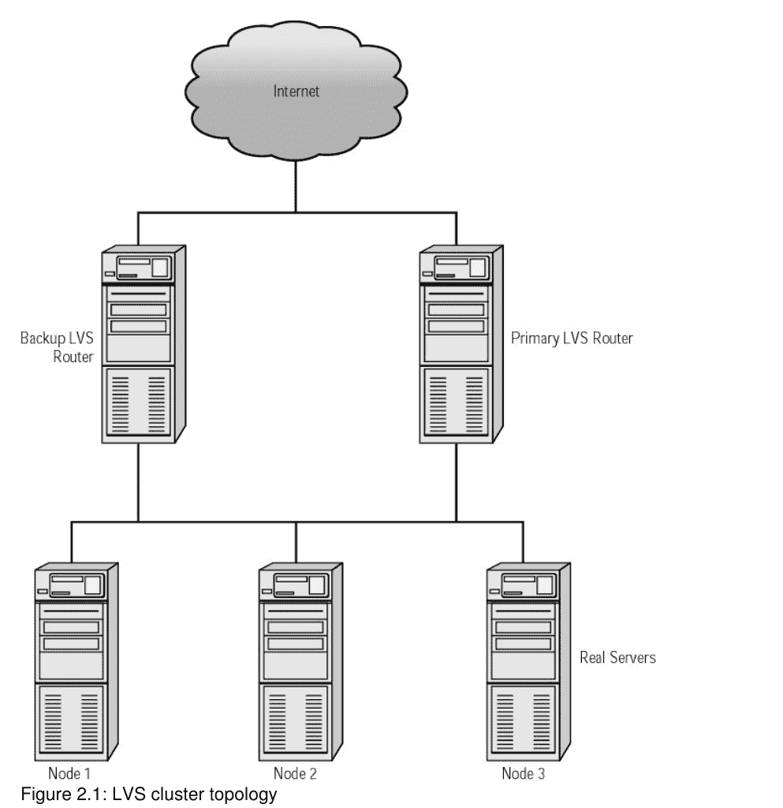

`LVS` 提供浮动服务器 `IP` 地址。`LVS` 路由器对外部世界有一个固定的 `IP` 地址。该 `IP` 地址将被分配给主 `LVS` 路由器或其备用路由器，如果分配给它的机器宕机，该地址将自动转移（这一过程称为 *故障转移*）。在这种情况下，`IP` 地址和路由表由 `lvs` 守护进程从宕机的机器同步，该守护进程负责处理两台机器之间的通信。脉冲守护进程在两个 `LVS` 机器上运行，以允许次要节点确定主节点是否处于活动状态。`ipvsadm` 命令是管理集群中 `LVS` 机器的命令行工具。

集群的其余部分由实际服务器机器组成，`FTP` 或 `HTTP` 服务请求通过 `LVS` 机器的第二张网卡路由到这些机器。`LVS` 路由器机器为每个实际服务器机器上运行的每个 `FTP` 或 `HTTP` 服务器运行一个守护进程。这个 `LVS` 路由器守护进程将连接到实际服务器的端口，以确保系统仍然可用以接受 `FTP` 或 `HTTP` 请求。实际服务器之间的负载均衡可以简单地基于轮到哪个服务器，也可以足够复杂以符合真正的负载均衡。有关此类集群的更多信息，请参考 [http://www.linuxvirtualserver.org/](http://www.linuxvirtualserver.org/) 网站。

## 磁盘子系统

对于需要极高性能的系统来说，磁盘 `I/O` 是另一个潜在的瓶颈。磁盘访问以毫秒衡量，而 `RAM` 以纳秒衡量。使磁盘 `I/O` 更高效的基本技术有两种：`RAID`（廉价磁盘冗余阵列）和磁盘缓存，以下将对两者进行描述。你选择的方法完全取决于你的具体情况。`RAID` 阵列需要大量的硬件投资，它是否给你带来显著提升尚不确定；而最大化磁盘缓存几乎总是有好处的。

### RAID 阵列

`RAID` 有几个不同的级别，它们都使用连接到单台计算机的多块硬盘来提高速度、可靠性或两者兼得。级别 0–5 是最常用的，主要关注可靠性（数据冗余），但在读取操作中也提供性能提升。冗余允许在驱动器上存储相同数据的多个副本，因此如果一块驱动器故障，数据不会丢失。不同级别在读取或写入时间衡量的性能上有所不同：

`RAID0` 该级别专门旨在提高性能，不提供冗余。在 `RAID0` 中，数据在多个磁盘上进行 *条带化*。条带化是一种过程，其中多个驱动器对计算机系统表现为单个驱动器。在这些驱动器上，数据被分布到小分区中，相互交错，使得计算机看到的虚拟驱动器由来自每个驱动器的条带组成。这允许从多个驱动器同时读取，从而可以提供显著的性能提升。

`RAID1` 该级别对数据进行 *镜像*，意味着相同的数据存储在所有驱动器上。读取速度往往比单驱动器快，因为可以同时从两个驱动器读取数据。读取均衡在早期 `Linux` 内核中存在一些问题，尽管这已在 `2.4` 内核中解决。如果你想利用这一点，你应该考虑升级内核。写入速度往往较慢，因为必须写入数据两个副本。`RAID1` 可以在两个本地驱动器之间进行数据镜像，也可以在两个不同主机上的驱动器之间进行。

`RAID2` `Linux` 不支持 `RAID2`，它使用纠错码来弥补没有内置错误检测的驱动器。由于大多数驱动器现在都包括纠错，`RAID2` 很少使用。

`RAID3` `Linux` 不支持 `RAID3`，它在字节级别在所有驱动器上条带化数据。校验信息存储在阵列中一块磁盘上，以保护在单块磁盘故障时防止数据丢失。

`RAID4` 与 `RAID3` 类似，只是数据在块级别条带化。如 `RAID3` 一样，校验维持在一块磁盘上。这导致校验磁盘成为瓶颈。

`RAID5` 与 `RAID4` 类似，只是校验现在分布在阵列中的所有磁盘之间。`RAID5` 阵列可以承受单块磁盘故障。写入性能显著减慢，因为单个写入操作需要从每个磁盘读取旧数据和校验，计算新校验，并将新数据和校验写入阵列中的每个磁盘。然而，通过跨多个主轴条带化带来的读取速度提升在很大程度上抵消了执行写入校验计算的开销。配置良好的 `RAID5` 软件阵列的性能与单个磁盘相当或更好，这并不罕见。

`RAID` 可以通过硬件或软件实现。硬件实现方案极其快速，但成本也极高。另一方面，软件实现方案则相对廉价。截至内核 `2.2.16–22`（这是 `Red Hat 7.0` 的标准配置），可以在内核中配置 `RAID0`、`RAID1` 和 `RAID4/RAID5`。此外，还有一个自动检测 `RAID` 分区的选项，该选项通过检测任何创建时分區 ID 为 `0xfd` 的分区来工作，而通常的 `Linux` 分区类型代码为 `0x83`。（你可以使用 `Linux` 的 `fdisk` 实用程序来检查或更改分区类型代码，具体描述见第 6 章。）

要查看系统中已安装的 `RAID` 支持情况，请查看 `/proc/mdstat` 文件。如果你没有运行 `/lib/modules/kernel_num/block` 中存在的任何 `RAID` 模块，该文件将不存在或包含以下内容：

```
Personalities : []
read_ahead not set
unused devices: <none>
```

如果你有任何 `RAID` 模块正在运行，你会在 `Personalities` 后面的括号中看到列出的 `RAID` 级别。

> 注意 仅因为系统中*存在* `RAID` 支持，并不意味着它正在被*使用*。也有可能只在某些磁盘或分区上使用 `RAID`，而在其他磁盘或分区上不使用。

假设一种情况，你想将数据条带化（`RAID0`）分布在两个分区上，这些分区在你使用 `fdisk` 工具创建时已被标记为 `RAID` 分区。对于大多数 `RAID` 级别，这些分区必须是相同的大小。这里我们使用 `IDE`，但 `SCSI` 也可以使用。现在你需要为你的特定配置设置 `/etc/raidtab` 文件。在标准的 `Red Hat 7.3` 系统中，除非你创建该文件，否则它不存在。有几个示例可以作为参考；请查看 `raidtab` 手册页以获取其中一个示例。列表 2.1 是一个根据我们的场景定制的 `/etc/raidtab` 文件样本。

### 列表 2.1：一个 /etc/raidtab 文件示例


```
raiddev  /dev/md0          /* RAID device name */
raid-level       0        /* RAID Level we use */
nr-raid-disks    2        /* # of RAID disks */
persistent-superblock  1   /* use the pers-sb */
chunk-size       8        /* stripe size bytes */

device           /dev/hda9 /* partition */
raid-disk        0        /* index */
device           /dev/hdb6 /* partition */
raid-disk        1        /* index */
```

`/etc/raidtab` 文件使用 C 风格注释——`/*` 和 `*/` 之间的任何内容都是注释，系统会忽略这些内容。列表 2.1 中的重要元素包括：

-   `raid-level` 如前所述的 RAID 级别。

-   `nr-raid-disks` RAID 阵列中的磁盘数量。

-   `persistent-superblock` 向 RAID 磁盘写入一个特殊的超级块，从而避免在读取文件系统磁盘上的超级块时浪费时间。

-   `chunk-size` 每个条带中包含的字节数。

-   `device` 对于每个磁盘（最多到 `nr-raid-disks` 指定的值），你必须指定一个要在磁盘阵列中使用的 Linux 分区设备文件。这些分区不需要位于物理磁盘上的等效位置——例如，在列表 2.1 中，阵列使用 `/dev/hda9` 和 `/dev/hdb6`。

-   `raid-disk` 对于每个 RAID 设备，你必须指定其在 RAID 阵列中的位置——哪个设备在条带化序列中是第一个，哪个是第二个，等等。这些值从 0 开始编号。

现在我们已设置好 `raidtab` 文件，并创建了将被自动检测的分区。Red Hat 7.3 内核默认配置了自动检测。现在使用 `insmod` 命令按如下方式启动 RAID-0：

```
# insmod raid0
```

最后，你需要运行 `mkraid` 命令来配置你的 RAID-0 阵列并格式化元数据以供使用。

```
# mkraid
# mke2fs -j /dev/md0
```

**警告** 发出 `mkraid` 命令会销毁 `/etc/raidtab` 文件中指定的分区上可能存在的数据。如果你想将现有分区转换为 RAID 配置，你必须先备份它们，然后进行转换并恢复数据。

**说明** 使用 `mke2fs -j` 设备命令会在该设备上创建 ext3 文件系统。该设备随后可以在 ext2 下使用（此时日志文件将被忽略），也可以在 ext3 下使用（此时需要日志文件）。

## 磁盘缓存

磁盘缓存使用系统内存来缓存磁盘 I/O。将磁盘中的数据缓存到 RAM 中会显著提高性能，因为 RAM 访问速度比磁盘访问快得多。磁盘缓存将硬盘中最近使用的数据存储在一个系统启动时分配的内存缓冲区中。当程序发起磁盘读取请求时，磁盘缓存软件会拦截该调用并检查缓存缓冲区是否包含所需数据。如果是，数据将从内存而非磁盘读取。购买访问时间更短的硬盘并在 BIOS 设置中启用磁盘缓存将为你带来显著的性能提升。

缓存的有效性在很大程度上取决于其大小。如果缓存太小，数据往往在重用之前就被刷新了，这使得缓存毫无用处。如果缓存太大，则会占用空闲内存并可能导致系统将数据交换到磁盘，这同样很慢。Linux 将所有空闲 RAM 用作缓冲区缓存，但当应用程序需要额外内存时，该缓存的大小会自动减小。无需进行任何配置。

## 应避免的硬件类型

正如有一些类型的硬件可以使系统更高效或更容易使用，也有一些类型会使系统效率降低或难以使用。一些硬件设备实际上会拖慢系统速度，而其他设备则只是难以提供支持。

## 专有硬件

专有硬件是指制造商直接向购买者提供其自己的驱动程序，而不是向操作系统开发者提供必要信息以创建驱动程序的任何设备。这种方法可能会带来问题，因为公司太频繁地为 Microsoft 产品创建驱动程序，却忽视了为 Linux 等其他操作系统创建驱动程序。Linux 社区有时能够通过逆向工程创建驱动程序，但这需要时间。越来越多的公司正在为其产品创建与 Linux 兼容的驱动程序，但这是一个新趋势，因此专有硬件仍然是一种赌博。直到几年前，创建某些 Diamond 显卡驱动程序所需的信息被认为是专有的，因此不推荐这些显卡。现在 Diamond 提供这些信息，Diamond 显卡已成为受支持的 Linux 硬件。

一些类型的专有硬件（特别是调制解调器和打印机）通常被称为“仅限 Windows”设备，因为驱动程序通常仅对 Windows 可用。然而，这一指定是流动的；今天的“仅限 Windows”设备明天可能就有可用的 Linux 驱动程序。尽管如此，你不应该假设任何特定设备将来都会有可用的 Linux 驱动程序。

一些专有设备使用精简的硬件，需要计算机 CPU 的额外关注。这在廉价的内置调制解调器（通常称为 `WinModems` 或 `软件调制解调器`，尽管前者是 3Com 的商标，因此在技术上仅适用于某些 3Com 产品）、低端激光打印机以及所谓的 AC–97 声音硬件中尤为常见。Linux 驱动程序正在为这些设备中的某些设备出现，但通常最好避免使用它们，即使在驱动程序可用的情况下也是如此，因为它们会消耗 CPU 时间，而这些时间可能更适合花在其他地方。

> **提示** 如果你不得不使用软件调制解调器，请查看 `http://www.linmodems.org/` 获取这些设备的驱动程序信息。Linux 打印支持数据库（`http://www.linuxprinting.org/printer_list.cgi`）托管了打印机驱动程序的信息，包括少数存在 Linux 支持但未随 Linux 发布的专有协议打印机。

## 硬件兼容性

对于其他类型的硬件，如 CD-ROM 驱动器、声卡等，Red Hat 在 `http://www.redhat.com/apps/support` 维护了一份兼容性列表。我们遇到过不受支持的硬件，但其中大部分在后续版本中得到了支持。SuSE 在其 `http://www.suse.com/us/support/` 页面上列出了其支持的硬件。Caldera 在 `http://www.calderasystems.com/support/hardware/` 发布了其硬件兼容性信息。大多数其他发行版依赖位于 `http://www.iiibiblio.org/mdw/HOWTO/Hardware-HOWTO.html` 的 Linux-Hardware-Compatibility HOWTO。

尽管各种发行版有不同的硬件兼容性列表，但硬件兼容性在不同发行版之间实际上变化很小。大多数硬件支持位于内核中，而内核在发行版之间是相同的（除了少数细微调整）。发行版可能附带略有不同的内核版本（例如 2.2.16 与 2.2.17），或者一个发行版可能将其内核整合了实验性驱动程序，而另一个则放弃了这种不确定的好处。不过，如果硬件在一个发行版中工作，几乎可以肯定你可以通过获取更新的内核、可能应用一些补丁并重新编译内核来使其在另一个发行版中工作。（第 8 章讨论内核编译。）少数设备，如显卡、打印机和扫描仪，需要非内核应用程序的支持，但类似的评论也适用于这些设备

## 选择 Linux 发行版

Linux 发行版是一个由选定的内核和支持软件组成的软件包，符合发行商对硬件支持和稳定性的可接受标准。主要的 Linux 发行版通常包括 Red Hat、Mandrake、Caldera、SuSE、Slackware、Debian 和 Corel。这些发行版均可通过 CD-ROM 获得，也可通过 Internet 上的 FTP 获取，其格式旨在写入 CD-ROM，或者在 Slackware 的情况下，写入用于启动网络安装过程的软盘。（分发镜像文件的一个很好的中转站点是 `http://www.linuxiso.org/`。）

如果你向 Linux 支持者提到你打算使用哪个发行版，请做好心理准备，他们可能会解释为什么另一种发行版更好。在任何 Linux 邮件列表中，被称为 `distro wars`（发行版大战）的友好争论经常出现：一位用户提到了他/她的发行版名称，而列表中的其他成员则感觉有义务将该发行版与他们/她们当前正在使用的发行版进行比较。这些通常是电子邮件列表这一事实通常能避免流血冲突。

由于 Linux 内核开发独立于各个发行版的开发，不同的发行版之间有一些共同的元素。以下是关于 Linux 安装的一些更基本的共同事实：

- 所有发行版都需要遵循文件系统层次标准（FHS）或其前身 Linux 文件系统标准（FSTND）。第 7 章将详细讨论 FHS。


除了 Slackware 之外，所有主要发行版都有某种包管理系统，以帮助跟踪已安装了哪些软件包以及这些软件包包含哪些文件。`Red Hat` 包管理器（`RPM`）是最常见的 `Linux` 包管理器。它用于 `Red Hat`、`Mandrake`、`SuSE` 和 `Caldera`。`Debian` 和 `Corel` 可以处理 `RPM` 软件包，尽管这两个系统在使用 `Debian` 软件包时表现最好。`Slackware` 原生使用 `tarballs`（tar 包）——使用 `Linux` `tar` 工具创建的文件编译包。可以从 `RPM` 或 `Debian` 软件包创建 tarball。第 8 章涵盖了 `RPM`、`Debian` 和 tarball 格式软件包的安装。

所有主要 `Linux` 发行版都使用 `Linux` 内核，该内核由 `Linus Torvalds` 的原始代码发展而来。少数发行版，如 `Debian`，旨在独立于内核，意味着该发行版将使用除其他 `Linux` 发行版所使用的内核之外的内核运行。就 `Debian` 而言，`HURD` 项目正在努力开发一个可以代替 `Linux` 内核的内核——尽管 `HURD` 内核可用，但尚不推荐使用。

以下部分将详细讨论这些发行版，以便了解它们的相似之处、目标用户群之间的差异以及每个发行版的基本功能。

**警告** 不要尝试跨发行版比较版本号。例如，`Red Hat Linux` 7.3 并不一定比 `Debian Linux` 2.2 更先进。

### Red Hat Linux

`Red Hat Linux` 目前是美国最流行的发行版，可能也是全球最流行的。它以易于安装和配置而闻名。随着版本 6 的演进，安装过程做出了重大改进。现在是版本 7.3，`Red Hat` 的安装非常顺利。`Red Hat` 的官方网站位于 `http://www.redhat.com/`。

#### 安装功能

以下是 `Red Hat Linux` 最重要的安装功能。新功能一直在不断添加；请定期检查 `Red Hat` 主页以获取更新信息。

#### Kudzu

`Red Hat` 发行版通过引入 `Kudzu` 工具，在硬件检测领域取得了巨大进展。这个工具从版本 6.1 开始包含在内，它会查找新硬件并允许用户配置 `Kudzu` 识别出的任何新硬件。为此，`Kudzu` 维护一个定义当前硬件配置的文件。例如，图 2.2 显示了 `Kudzu` 对于一个未安装鼠标但现在连接了通用鼠标的系统的显示。

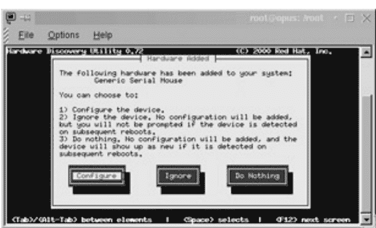

图 2.2：`Kudzu` 工具识别鼠标

每次启动计算机时 `Kudzu` 都会自动运行，或者你也可以在此后任何时候运行它。它探测硬件并检查当前配置，以查看是否有新硬件。如果添加了或移除了硬件，它会询问用户是否现在添加或删除必要的驱动程序，还是等到以后。如果更新被推迟，当然，`Kudzu` 每次运行时都会提出同样的问题。由于 `Kudzu` 移除串行设备（如控制台）的任何尝试都会对系统产生负面影响，因此 `Kudzu` 不会检查串行设备，除非从安装过程中运行。

#### 内核模块

从 6.0 版开始的 `Red Hat Linux` 版本比以前的版本更广泛地使用内核模块。内核模块是硬件、文件系统等的驱动程序，它们与主内核文件分开编译。在 `Linux` 下，只要必要的硬件存在（在卸载模块时，硬件必须未被使用），内核模块就可以在主内核加载后的任何时间加载和卸载。由于最近版本的 `Red Hat` 模块化程度提高，系统在安装时能更好地适应你的计算机，加载你可能需要的更多驱动程序，以及你不需要更少的驱动程序。

这种新的内核灵活性的一个例子是对对称多处理（SMP）支持的处理。`Red Hat` 已经包含了 SMP 支持一段时间，但为了利用它，你必须安装内核源代码文件，设置适当的配置文件，并编译新内核。安装后留在系统上的单体内核默认不包含 SMP 支持。然而，从 `Red Hat` 6.1 开始，安装程序会探测以确定系统包含多少个处理器。如果有多个，安装的内核将自动包含 SMP 支持。如果只有一个处理器，SMP 支持将不会编译进内核。当然，如果你稍后添加了处理器，你可以重新编译内核以添加 SMP 支持。

由于 `Red Hat` 是一家商业公司，它能够为其用户社区提供支持。我们在第 4 章中讨论支持选项，但为了比较的目的，`Red Hat` 提供付费支持、基于 Web 的支持（包括各种 `Red Hat` 邮件列表的存档），以及随盒装发行版提供的 90 天电子邮件支持。

### Mandrake

`Linux Mandrake`（`http://www.linux-mandrake.com/en/`）在出版时版本为 8.2，是 `Red Hat Linux` 的一个衍生版本，因此共享 `Red Hat` 的一些功能，包括 `RPM` 软件包格式和基本的系统启动过程（在第 3 章中讨论）。然而，随着时间推移，`Mandrake` 苹果正逐渐远离 `Red Hat` 树。`Mandrake` 在几个方面与其前身发行版有所不同：

- **服务器选择**：`Mandrake` 包含与 `Red Hat` 略有不同的服务器组合。最值得注意的是，`Mandrake` 8.2 使用 `Postfix` 邮件服务器，而不是 `sendmail`，后者仍然是 `Red Hat` 的标准。

- **软件包优化**：`Mandrake` 使用 `Pentium` CPU 优化编译其大部分软件包。这意味着 `Mandrake` 在 `Pentium` 级 CPU（包括 `AMD` 和 `VIA/Cyrix` 的兼容型号）上运行稍快，但它完全无法在 386 或 486 CPU 上运行。

- **安装细节**：虽然早期的 `Mandrake` 软件包使用了一个与 `Red Hat` 几乎完全相同的系统安装程序，但最新版本略有不同。最值得注意的是，`Mandrake` 包含一个分区工具，允许用户调整现有 `Windows` 分区的大小。

在流行的 `Linux` 发行版中，`Mandrake` 与 `Red Hat` 最为相似——当然，除了 `Red Hat` 本身。这一事实使得 `Mandrake` 与为 `Red Hat` 构建的二进制软件包非常兼容，并使从 `Red Hat` 过渡到 `Mandrake` 变得容易。

### Caldera

`Caldera System` 的 `OpenLinux` 专为商业企业使用而设计。它仅适用于 `Intel` 架构。`Caldera` 是 `Linux` 世界中久经考验的玩家，因此有可能随着时间的推移继续改进其发行版。`OpenLinux` 有 `eServer` 版本和 `eDesktop` 版本，分别针对这些特定用途进行了专门定制。此外，还有 `OpenLinux 64`，它特别为商业界设计。`Caldera` 的 `Linux` 站点是 `http://www.caldera.com/`。在出版时，`Caldera` 的当前版本是 3.1。

#### 安装功能

`OpenLinux` 包含 `LIZARD`（Linux Wizard），一个图形化安装程序，可检测你的基本硬件：鼠标、键盘、视频、声卡、CD-ROM、硬盘、软驱、PCMCIA 和以太网卡。`LIZARD` 然后安装你选择的 `Linux` 软件包并执行基本的配置方式。我们成功地在 `ACER` 笔记本电脑上安装了 `OpenLinux`，而该设备如果不经过一些调整就无法接受 `Red Hat` 的安装。

另一方面，与发行版相比，`Caldera` 的图形启动界面出现速度稍慢。`Lizard` 不会使用其在安装过程中探测到的数据来构建专属于你机器的内核。它保留的内核虽然小巧，但高度模块化。它不包含 SMP（对称多处理）支持，但在你构建自定义内核时可以添加这一支持。`Caldera` 需要 32MB 内存，并且安装至少需要 300MB 空间。

### SuSE Linux

`SuSE`（发音为“SUE-zuh”）`Linux` 最初在德国开发，是欧洲领先的 `Linux` 发行版。它在美国也在迅速增长。由于其易用性和整体感受，`SuSE` 也是我们的另一个最爱发行版。其英文网页位于 `http://www.suse.com/index_us.html`。截稿时，`SuSE` 8.0 是该发行版的最新版本，适用于 `x86`、`IA-64`、`PowerPC` 和 `Sparc` CPU。

#### 安装特点

`Linux Journal` 的读者在 1999 年投票选出 `SuSE` 为最容易安装的发行版，这主要归功于其流畅的图形安装工具 `YaST2`，该工具提供广泛的硬件检测和配置功能。`YaST2` 提供了支持网络、互联网接入、声音支持和打印的基础配置。`SuSE` 和 `Mandrake` 是唯一两个可以通过 `DVD-ROM` 安装的主要发行版。与大多数发行版一样，无论基本安装或升级过程中检测到何种硬件，`SuSE` 在每个安装的系统上保留相同的内核；该内核包含 `SuSE` 认为常见硬件的所有驱动程序。

### Slackware Linux

`Slackware` 于 1992 年 4 月首次发布，是 `Walnut Creek Software` 对当时可用的最“类 Unix”`Linux` 发行版的诠释。如今作为一个独立的实体，`Slackware` 的网页位于 `http://www.slackware.com/`。截稿时的软件最新版本为 8.0。

#### 安装特点


在我们中的许多人，CD-ROM 驱动器尚不普及、不得不将整个发行版下载并拷贝到约 50 张软盘上的年代，都是从 `Slackware` 开始的，然后可以使用这些软盘将系统安装到硬盘上。现在你仍然可以从下载的软盘安装 `Slackware`；它是唯一仍支持软盘安装的主要发行版（尽管现在本质上这已成为一种网络安装方式）。大多数用户更倾向于从 `CD-ROM`、`FTP` 站点或通过 `NFS` 进行安装。`Slackware` 提供的 `GUI` 工具比大多数主要发行版少，但这是出于设计考量；其哲学认为，如果配置文件是手动设置而不是通过 `GUI` 设置工具完成的，用户将对系统有更深入的了解。当你在远程管理系统，并且因防火墙限制而无法启动 `X` 会话时，这种知识尤为重要。`Slackware` 和 `Debian` 是唯一两个安装程序不提供至少最小化 `X` 配置的主要发行版。许多用户倾向于将此项任务推迟到初始系统安装完成之后。

最小化安装仅需 `16MB` 内存和 `80MB` 硬盘空间。

### `Debian`

`Debian` `Linux` 是一个相当独特的发行版，因为它是由志愿者团队而非像 `Red Hat` 或 `Caldera` 这样的公司开发的。在更正式的发行版中，关于安装过程以及发行版包含哪些软件包的决策是由管理公司的董事会做出的，例如 `Red Hat, Inc.` 或 `Caldera Systems`。然而，`Debian` 非常乐意接受来自用户群体的修改。`Debian` 没有单一的的商业支持者。鉴于此，没有商业支持可用，但有邮件列表和 `IRC` 聊天室提供来自用户群体的支持。`Debian` 用户并不认为这是一个明显的缺点，他们为 `Debian` 是由黑客为黑客开发这一事实感到自豪。在我们安装过的其他系统中，默认 `Debian` 系统的安全性更为严格。`Debian` 用户倾向于比其他发行版拥有更多的控制权，以影响其开发。`Debian` 的网页位于 `http://www.debian.org/`。

`Debian` 包含一个名为 `apt` 的软件包，它自动化了软件包的下载和安装过程。只需运行 `apt-get install program`，`apt` 就会下载该程序，下载其所需的任何软件包，按正确顺序安装它们，并询问所需的任何数据。用户对该概念的接受度差异很大。我们中的许多人更喜欢有更直接的参与度。从发行版的网页下载更新并单独安装以观察过程及其可能产生的错误是很容易的。`Debian` 是快速通道的 `Linux` 发行版，我们的意思是它适用于最广泛的硬件平台，甚至包括一些手持设备。

### 安装特点

你可以从软盘、`CD-ROM`、包含安装文件的硬盘分区或通过 `NFS` 安装 `Debian`。`Debian 2.2` 的最小化安装至少需要 `12MB` 内存和 `65MB` 硬盘，尽管为了安装 `X` 和最常用的软件包，你刚好需要不到 `1GB` 空间，并且将受益于内存增加至至少 `16MB`。（如果你的系统配置非常精简，较旧的 `Debian 2.1` 可以安装在仅需 `4MB` `RAM` 和 `35MB` 磁盘空间的系统中。）`Debian` 的安装程序不试图预测你关于最基础决策的选择。它不会选择你想使用哪些磁盘，也不会选择这些磁盘上的哪些分区将用作根分区，甚至不会选择哪些将用作交换分区。`Debian` 从其安装介质安装一个最小的“基础”系统。然后它会重启进入这个基础系统，该系统具备足够的功能来安装你选择的任何其他软件包。基础系统只需支持软盘驱动器和硬盘即可。从那时起，你可以选择在此安装初始阶段加载哪些内核模块。

`Debian` 安装了一个高度模块化的内核，这意味着默认内核提供了大多数模块。自 `Debian 2.2` 起，该内核包含 `SMP` 支持，但仍适用于单 `CPU` 系统。

### 选择权在你

典型 `Linux` 安装的难度是一个有争议的话题。许多 `Microsoft` 支持者认为 `Linux` 对普通人来说太难安装了。反过来，你经常听到 `Linux` 支持者说 `Linux` 安装很简单。根据我们的经验，两者都不完全正确。事实上，你无法泛泛地谈论 `Linux` 安装，因为每个主要发行版都使用不同的安装程序。在过去几年中，各种 `Linux` 安装程序在简化安装过程方面已经走了很长一段路，有些确实比其他的更先进。如你所见，不同的发行版对安装有不同的目标；有些致力于对新的 `Linux` 用户友好，而另一些则面向对 `Linux` 更了解的受众。

因此，一个发行版常常仅凭此标准就被选中。

没有任何书能涵盖所有不同的 `Linux` 安装程序。在下面的章节中，我们将逐步通过一次 `Red Hat` 安装。尽管安装的基本功能始终相同，但安装细节因发行版而异。关于安装的信息，务必依赖随你的发行版提供的文档。

## 安装 `Red Hat` `Linux`

既然我们已经讨论了一些关于主要 `Linux` 发行版的基本知识，现在是时候进行一次实际安装的演练了。我们将使用 `Red Hat` 作为例子，因为它是美国安装最广泛的发行版。我们首先尝试一次基本的服务器安装，然后查看工作站安装会有什么不同。

## 安装准备

在开始安装之前，你应该做几件事来做好准备。首先，你应该获取将用于安装的介质。对于此安装，我们将使用 `Red Hat 7.3` 版本的 `CD` 副本。

接下来，你应该识别计算机系统的组件。写下你的视频卡、调制解调器、网卡、`CD-ROM`、硬盘驱动器、`SCSI` 卡和声卡的制造商、型号、`DMA` 通道和中断号（如适用）。另外记下硬盘驱动器的柱面数、磁头数和总容量。你可能永远不需要这些信息；但如果需要，你就不必关闭系统并拆开它来查找了。系统安装后，你应该将这些信息保留在计算机附近，因为你以后可能需要参考它们。在管理员日志本中添加一条记录，详细说明该安装。

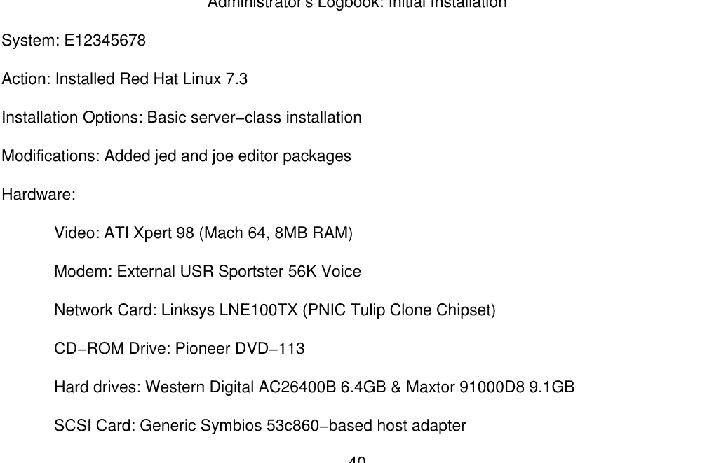

`SCSI` 设备：外置 `Iomega Zip-100` 驱动器

声卡：集成主板 `VIA 82c686a` 声卡芯片组

如果您购买的是红帽官方盒装套装，它将包含创建启动软盘的映像，该软盘支持如我们即将执行的 `CD-ROM` 安装。如果您的计算机支持从 `CD-ROM` 启动，您可以直接从 `Red Hat` `CD-ROM` 启动，而不需要创建启动软盘。如果不能，或者您正在从其他介质安装，您可能需要按照本章后文所述创建自己的启动软盘。

## 选择分区方案

磁盘分区是将硬盘划分为包含操作系统特定组件的逻辑部分。

尽管大多数人会选择结构化的文件系统布局，但 `Red Hat 7.3` 仅需要一个 `Linux` 分区。假设其大小足够，该分区可以包含根分区及其下所有其他目录。这种简单方法的一个优点是，您不必猜测每个文件系统最终会增长到多大。缺点是，您无法为单个目录结构设置配额，也无法将根分区下的任何目录挂载为只读，因为这要求目录位于其自身的分区上。更重要的是，存在于 `/home` 目录中的动态数据与根文件系统共存通常是个坏主意，因为损坏可能导致整个系统不稳定，甚至根本无法启动。

在更结构化的方法中，您可能会发现自己为某个分区预留的空间太少，需要寻找更多空间。添加空间有几种选择：

- 备份并重新安装，扩大相关分区。
- 向系统添加新驱动器，并将某些数据从臃肿的分区移至新驱动器。
- 将某些数据从臃肿的分区移至另一个现有分区。
- 创建符号链接，以便用户能在预期的位置找到数据。

> **注** 正如存在“发行版之争”，也存在分区方案之争。`Linux` 用户长期以来一直在争论最佳方案，且没有任何迹象表明他们会停止。毕竟，`Linux` 的一大首要特性是允许自由持不同意见。

`Red Hat` 通过设置安装类别简化了新用户的情况。这些类别选择适当的分区方案和软件包以适合所选用途。在每种情况下，您都有选项覆盖该类别的标准分区方案和软件包选择。有四种既定安装类别：工作站类、服务器类、笔记本类和自定义类。在这种情况下，我们将执行服务器类安装。其他类别列出如下以求完整。

## 工作站类安装

在最终用户桌面系统上使用工作站类安装。以此方式安装的系统不旨在充当服务器，但它确实设置了 `X` 窗口系统环境。

工作站类安装至少需要 `850MB` 的可用磁盘空间。如果您的硬盘已包含其他类型的分区（如 `Windows`），工作站类安装将保留这些分区，并设置 `Linux` 加载器（`LILO`）或 `GRUB`，允许您启动到任一操作系统。此类别的默认分区是一个交换分区，大小等于 `RAM` 的两倍或 `32MB`（取较大者），一个 `50MB` 的 `/boot` 分区，以及一个使用硬盘剩余空间的根分区；设置为使用分区剩余空间的分区位被称为*可增长*。如果您不清楚根分区或交换分区是什么，我们将在第 7 章研究实际的文件系统布局，并在第 6 章讨论交换和额外分区选项。

## 服务器类安装

服务器类安装默认安装预打包的基于 `Linux` 的服务器。大部分必需配置已包含在内，当然也有 `Red Hat` 无法猜测关于您系统的内容，这些需要您自行设置。服务器类安装在没有图形的情况下最少需要 `1.3GB` 的可用磁盘空间，若包含 `GNOME` 和 `KDE` 等所有内容则需要 `2.1GB`。重要的是要注意，在服务器类安装期间，无论类型如何，之前创建的分区都将被删除。默认情况下，磁盘被分区为两倍 `RAM` 大小的交换分区、`384MB` 的 `/` 分区、可增长的 `/usr` 分区、可增长的 `/home` 分区、`256MB` 的 `/var` 分区和 `50MB` 的 `/boot` 分区。


> **注** 这里描述的分区大小是近似的。由于 x86 BIOS 处理硬盘的方式，分区必须落在柱面边界上。根据磁盘大小以及柱面、磁头和扇区的排列方式，一个柱面可以轻松达到 5–10MB 左右的大小。因此，`Linux` 可能无法创建正好 50MB 大小的 `/boot` 分区，而可能创建一个 56MB 的 `/boot` 分区。

## 笔记本类安装

笔记本类安装与工作站安装类似，但增加了 `PCMCIA` 支持。笔记本类最低要求：若仅支持一种语言且安装 `GNOME` 或 `KDE`，需 1.5GB；若安装 `GNOME` 和 `KDE` 两者且仅支持一种语言，需最低 1.8GB。默认情况下，磁盘被分区为两倍系统 RAM 大小的交换分区、50MB 的 `/boot` 分区和可增长的 `/` 分区。

## 自定义类安装

自定义类安装是三类中最灵活的。不会替您做决定。尽管分区布局从笔记本类安装开始，您可以自由更改。您还必须选择要安装的软件包，以及是否使用启动加载器。当您希望避免覆盖包含您希望保留的数据的分区时，请选择此安装类别。这也允许您挑选软件包。

## 安装服务器

一旦确定使用哪种分区方案（无论是您自己的还是 `Red Hat` 提供的），您需要启动计算机。在大多数现代计算机中，主板 `BIOS` 支持从 `CD-ROM` 启动。这就是我们将在此使用的方法。确保 `BIOS` 选择了正确的启动顺序，将 `CD-ROM` 放入驱动器，然后重启。在较旧的计算机上，您需要使用盒装套装中附带或您制作的启动软盘。无论使用哪种方法，最小化的 `Red Hat` 系统都将加载到 `RAM` 中，安装将在此最小系统上运行。

尽管这里介绍的基本程序假设您是从 `CD-ROM`（或带有 `CD` 光驱中 `CD-ROM` 的启动软盘）安装，但 `Red Hat Linux` 也允许通过网络或从硬盘安装。标准程序使用 `CD-ROM` 上的 `boot.img` 文件。其他方法使用不同的启动映像文件，您必须将其从 `CD-ROM` 的 `images` 目录复制到软盘。您可以使用 `bootnet.img` 文件通过 `NFS`、`FTP` 或 `HTTP` 从网络服务器安装。您也可以使用 `pcmcia.img` 文件从通过 `PCMCIA` 设备访问的 `CD-ROM`、`NFS`、`FTP`、`HTTP` 或硬盘安装。您还可以使用与本地 `CD-ROM` 安装相同的 `boot.img` 映像从硬盘安装。安装顺序基本相同，除了启动软盘之外。如果您希望通过网络服务器或 `PCMCIA` 设备安装，需要创建启动软盘。要将启动映像写入软盘，可以使用下列方法之一。

- 在 `Windows` 系统上，通过启动到 `Microsoft Windows` 并执行 `RAWRITE`，使用位于 `CD-ROM` `dosutils` 目录中的 `RAWRITE` 命令。当询问要复制哪个映像时，指定同一 `CD-ROM` `images` 目录中正确的那个。`Microsoft COPY` 命令无法制作可用的启动软盘。

- 在 `Linux` 或 `Unix` 下使用以下命令创建启动软盘：

```
# dd if=/mnt/cdrom/images/boot.img of=/dev/fd0 bs=1440k
```

`dd` 工具是一个非常实用的工具。简而言之，`if` 代表输入文件，`of` 代表输出文件。因此，您正在使用 1440KB 的块大小（`bs`）将 `boot.img` 写入 `/dev/fd0`。通常可以省略指定块大小来运行此命令。

在 `Linux` 或 `Unix` 下，您也可以将映像 `cat` 到 `/dev/fd0`。尽管通常不推荐，命令如下：

```
cat /mnt/cdrom/images/boot.img > /dev/fd0
```

基本上，一旦找到包含要安装软件包的介质，安装过程都是相同的。

重启几秒后，您将看到一个基于文本的欢迎屏幕，提供安装过程的几个选项：

- 图形模式

- 文本模式

- 低分辨率模式

- 无帧缓冲模式

- 无探测模式

- 介质检查模式

- 救援模式

从 `CD-ROM` 启动时，图形安装是默认的。如果使用了 `Red Hat` 包中随附的启动软盘映像，基于文本的安装是默认的。它基本执行与图形安装相同的功能，因此如果您选择此路径，应该能够遵循此程序。低分辨率模式以 `640 x 480` 分辨率启动安装程序。要禁用帧缓冲，在提示符输入 `no fb` 以进入无帧缓冲模式。如果需要测试安装介质，在提示符输入 `linux mediacheck`。当您需要一种方式启动基本 `Linux` 系统以恢复不良安装（例如，由于您编辑启动文件的方式导致系统无法启动）时，选择救援模式。最后，如果需要驱动程序

该磁盘位于另一块硬盘上，请输入 `dd`。

## 选择安装方法

前两个屏幕要求您选择您使用的语言以及键盘类型。假设您像我们一样从 `IDE CD-ROM` 启动，您看到的下一个屏幕将是鼠标配置屏幕，这将在下一节中讨论。如果您使用的是非 `IDE CD-ROM` 光驱，系统将提供在 `SCSI` 和“其他”之间进行额外选择的机会。如果您选择 `SCSI`，系统将提示您从列表中选择合适的 `SCSI` 适配器。请选择与您系统中的适配器最相似的那个。如果您的适配器无法识别，您可以为驱动程序输入额外选项。这些选项与在启动提示符下指定的选项相同，用于向引导加载程序提供有关未识别 `SCSI` 适配器的信息。这些选项在第三章中进行了讨论。

如果您的 `CD-ROM` 光驱既不是 `SCSI` 也不是 `IDE`，您必须选择“其他”选项。属于此类的光驱通常是由专有声卡驱动的。这类光驱在现代计算机中极其罕见；您可能只能在旧的 `386` 或 `486` 计算机中找到它们。您可能需要指定支持此类卡驱动程序的选项。

如果您忘记将 `CD-ROM` 放入光驱，系统会提示您放入。

## 配置鼠标

安装程序接下来会转到鼠标配置屏幕，该屏幕提供了适用于 `PS/2`、总线式和串行鼠标的多种样式选择。请选择与您鼠标相匹配的品牌和样式。如果没有合适的选项，您可以选择适当的通用选项，应该可以正常工作。选择正确的设备和端口；如果您的系统之前运行过 `Windows`，您的选择应与那里使用的端口相匹配。如果您有一个双键鼠标，您可能想要选择屏幕底部的“模拟 3 键”选项。这将允许您通过同时按下两个按钮来模拟第三个按钮。在 `Linux` 系统中，三个按钮很有用，因为 `X` 是围绕三键鼠标构建的。中间键通常用于在 `X` 应用程序中粘贴选定的文本。

## 划分磁盘

接下来会出现安装选项屏幕。它要求您选择已决定用于划分磁盘的安装类型。

安装选项屏幕上看到的选项分为安装选项和升级选项。安装选项是我们之前讨论的那些：

- 工作站

- 服务器系统

- 笔记本电脑

- 自定义系统

这些提供了前面描述的分区方案。只有一个升级选项。它保留现有的分区方案，仅升级软件。对于这个示例，我们正在使用服务器系统安装，因为作为系统管理员，您很可能正在设置服务器机器。您也可以使用自定义安装来设置服务器，以利用分区和包选择方面的更大灵活性。最终，服务器系统设置更容易、更快地完成，但它可能会产生一个包含大量您从不使用的软件包的臃肿的 `Linux` 安装。自定义系统设置可以产生一个更精简的系统，但需要更多预先投入的时间和关于各个软件包功能的知识。

由于服务器安装将覆盖任何现有安装，随后的自动分区屏幕会警告您即将擦除硬盘上的任何现有分区，并提供手动使用 `Disk Druid` 或 `fdisk` 创建分区的替代方案。您还可以选择退回您的步骤并执行自定义安装。若要自行尝试分区过程，请选择使用 `Disk Druid` 手动分区选项，然后按下“下一步”按钮。图 2.3 显示了 `Disk Druid` 分区屏幕。

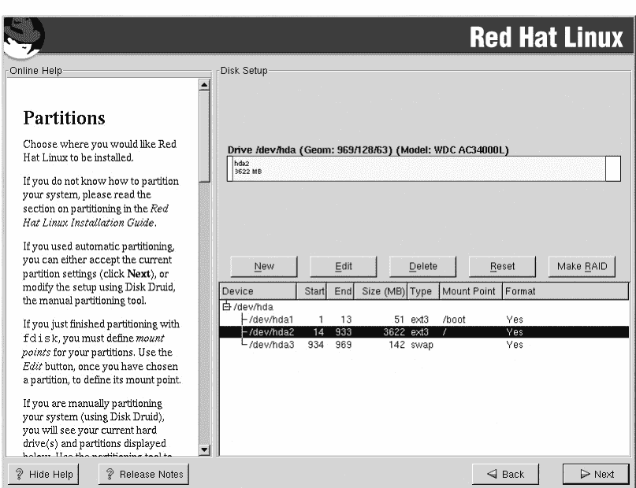

**图 2.3：** `Disk Druid` 分区屏幕

如果系统之前安装了 `Red Hat`，现有分区将显示在分区区域中。否则，您将从服务器级安装的标准分区开始。图 2.3 显示了该分区方案的修改版本。您可以通过突出显示现有分区，然后选择`删除`来删除任何现有分区。该分区将被移除，底部的驱动器摘要将显示可用空间。

**注意：** 如果您已将任何剩余分区设置为“填充到最大允许大小”，驱动器摘要仍将显示已使用 99%。

如果您想保留现有分区，请在 `Disk Druid` 中突出显示每个分区，单击`编辑`按钮，并确保挂载点（稍后描述）和分区类型正确。删除任何您不想要的分区，或单击`添加`按钮以添加额外的分区。单击添加按钮将弹出此对话框：

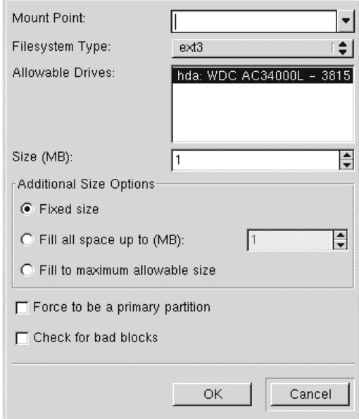

交换分区没有挂载点。一旦您选择交换分区类型，挂载点选项将变灰。其他每个分区必须分配一个挂载点。挂载点的一些例子包括 `/usr` 和 `/var`，如果这些目录位于其自己的独立分区上。一些目录不能与 `/` 分区分离在独立的分区上，因为这些目录中的文件必须在启动过程中可访问，那时独立的分区尚未挂载。这些目录是 `/etc`, `/lib`, `/bin`, `/sbin` 和 `/dev`。

以兆字节为单位指定分区大小。默认值是 1MB，如果您标记分区为“填充到最大允许大小”，这是可以的。如果您想指定大小，则需要更改它。此外，如果系统有多个驱动器，您需要在允许驱动器字段中突出显示适当的驱动器。


如果您有 Windows 分区，它也会显示在分区屏幕上。您应该为其分配一个挂载点，如`/mnt/windows`或`/msdos`。这将使访问变得容易，因为它将在启动时被配置为自动挂载。

在自动分区屏幕上，您可能更容易选择自动分区并移除数据选项，让安装过程设置典型服务器分区方案，如前所述。这当然是更简单的行动方案，但没有灵活性来决定您自己的分区大小或指定不寻常的分区布局。

## 配置网络

在分区配置之后，您将看到引导加载程序配置屏幕。您必须选择是否安装 GRUB 引导加载程序、Linux 引导加载程序（LILO）或不安装引导加载程序。如果您选择安装引导加载程序，您必须选择是将其安装在主引导记录还是磁盘引导分区的第一个扇区。这在第三章的引导加载程序讨论中有所涉及。接下来，输入您需要的任何启动参数，并选择并命名一个默认加载的启动镜像。选择“下一步”将带您进入引导加载程序密码屏幕，如果您选择了安装引导加载程序；或者进入网络配置屏幕，如果您没有选择。

如果您的系统有网卡，Red Hat Linux 会要求您指定您的网络配置，如图 2.4 所示。手动输入必要信息，或者如果您的网络使用 DHCP 服务器分配 IP 地址，请点击使用 DHCP 配置按钮。第十二章更详细地描述了 TCP/IP 网络选项，如果您需要手动设置这些选项且不知道该输入什么。（在这种情况下，您需要咨询您的网络管理员以了解该输入什么。）

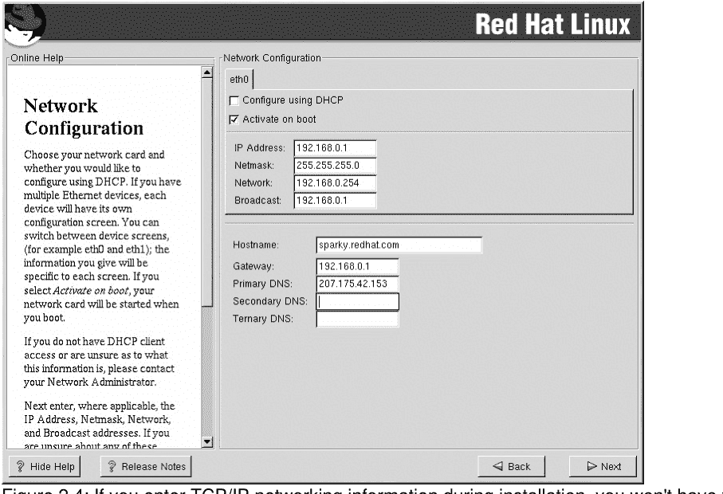

**图 2.4：** 如果您在安装过程中输入了 TCP/IP 网络信息，安装后就不必再输入了。

## 配置防火墙

在网络配置屏幕之后，您将看到防火墙配置屏幕。您的选择是高安全性、中等安全性和无防火墙。您也可以自定义防火墙规则。高安全性防火墙的默认设置建立了一个仅接受 DHCP 连接、DNS 响应以及您明确定义的连接的系统。虽然这是最安全的，但在运行大量服务（如 FTP 或 IRC）的系统中并不实用，因为这些服务会拒绝来自未被明确允许站点的任何连接。您还可以设置一个中等安全性防火墙，允许您定义允许通过的连接类型。您可能还会选择信任来自特定接口的任何数据包。我们将在第 15 章“安全性”中详细讨论这些概念。

## 配置时区

在一个自解释的语言支持选择屏幕之后，安装程序启动时区选择屏幕。时区选项如此之多，以至于这听起来像是比实际更大的一项任务。选择适用于您所在位置的适当区域，或者选择相对于协调世界时（UTC）的偏移量。无论哪种情况，您都必须指定您的系统时钟是否使用 UTC。如果您使用偏移方法，您还必须指定是否需要夏令时。

**注意** 历史上，Unix 系统会根据 UTC 或英格兰格林尼治时间设置时钟，并根据计算机在世界上所处的位置调整本地时间设置。相比之下，x86 PC 历史上一直将时钟设置为本地时间。因此，Linux 需要理解这两种方法。通常，专用 Linux 服务器最好将硬件时钟设置为 UTC，因为这种方法不太可能导致由 Unix 实用程序衍生而来的各种 Linux 实用程序出现问题，或者在需要调整夏令时时出现问题。但是，日志条目也将使用 UTC 时间戳，这可能会造成混淆。对于在 Linux 和 Windows 或其他使用本地时间设置硬件时钟的操作系统之间双启动的系统，最好使用本地时间，以保持操作系统之间的时间同步。

## 配置用户账户

系统重启后，您需要设置一个用于访问的账户；您将在图 2.5 所示的“账户配置”对话框中完成此操作。您必须设置`root`账户。此过程包括指定和验证`root`的密码。然后，您可以点击“下一步”继续，或者添加一个或多个普通用户账户。建议至少设置一个用户账户，以免您被迫以`root`身份登录。为此，请输入账户名（用户名）、该账户的密码、用于验证的相同密码以及用户的全名。此时，您可以继续添加其他用户，或继续前往下一个屏幕“选择软件包组”。系统安装完成后，您有多种选项可以创建新用户。有关创建用户账户的更多信息，请参阅第 6 章。

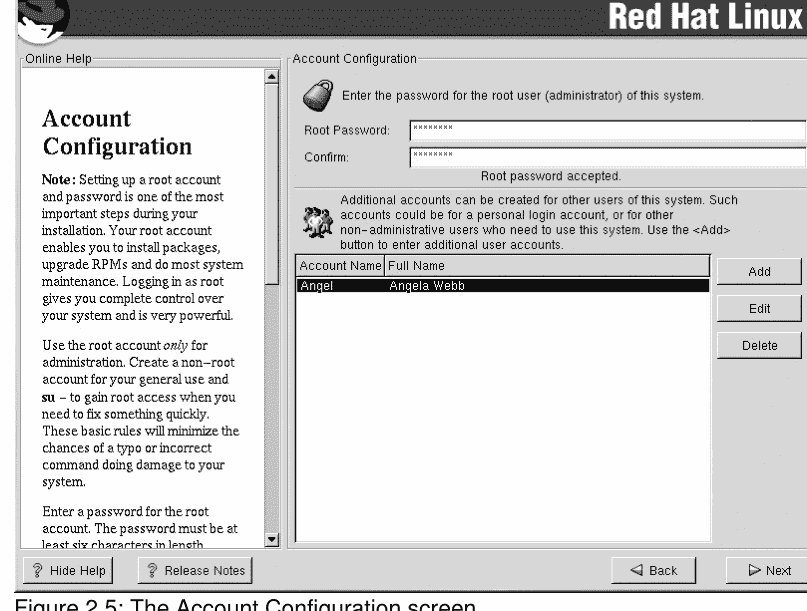

**图 2.5：** 账户配置屏幕

### 选择软件包组

最后，您期待已久的时刻到了：“选择软件包组”屏幕允许您选择要在系统上安装哪些软件包，您可以按预设的服务器组进行选择，也可以单独选择。在服务器类安装中，默认仅选中“经典 X 窗口系统”组。许多系统管理员不会在某些服务器上安装任何 X 窗口系统组件，但该选项确实存在。您还可以选择安装新闻服务器、NFS 服务器、Windows 文件服务器、匿名 FTP 服务器、SQL 数据库服务器、Web 服务器或 DNS 名称服务器。屏幕右下角“后退”和“下一步”按钮上方列出的总安装大小会随每次选择或取消选择而更新。如果您希望直接参与软件包选择，请点击屏幕底部附近的“选择单个软件包”按钮。点击“下一步”按钮后，您将进入图 2.6 所示的“单个软件包”屏幕。

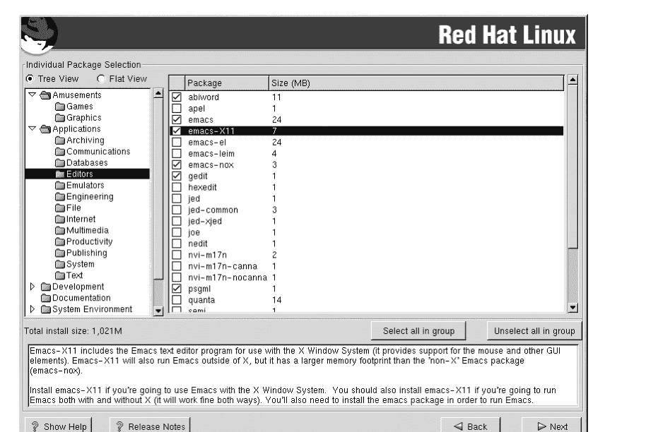

**图 2.6：** “单个软件包选择”屏幕仅在您点击“选择软件包组”屏幕中的“选择单个软件包”时出现。

在这里，您可以双击特定的软件包以查看其包含的内容。右侧将显示文件夹和由方框表示的单个软件包。如果您高亮显示单个软件包，有关该软件包的信息将显示在屏幕底部附近。这些信息包括名称、以千字节为单位的大小以及软件包功能的描述。每个选定用于安装的软件包上都会出现一个红色对勾。如果您对单个软件包的功能不熟悉，最好先保持默认设置，直到您更熟悉这些软件包为止。当然，您可以随时在操作系统安装完成后安装或删除软件包，如第 8 章“软件管理”所述。完成选择后，点击“下一步”按钮。

尽管“软件包”一词暗示它是一个自包含的单位，但有些软件包依赖于其他软件包的支持，在某些情况下，您的选择将不包括支持您已选软件包所需的软件包。这种情况称为未解决的依赖项。“未解决依赖项”屏幕将列出这些项。然后，您必须要么点击“安装软件包以满足依赖项”按钮，让安装程序包含其所需的一切，要么返回并尝试自己修复这些依赖项。完成后，点击“下一步”。

现在，您已经完成了安装的大部分大型交互任务，坐下来观看软件包的安装过程吧。或者像我们大多数人一样，去喝杯可乐之类的。当然，计算机的速度以及您计划安装的软件包数量将决定您能休息多久。

## 创建启动盘

接下来，您将看到“创建启动盘”屏幕。将软盘插入驱动器并点击**下一步**按钮。您可以勾选“跳过创建启动盘”复选框来跳过此步骤，但通常跳过此步骤是个坏主意，因为如果计算机无法启动，启动盘可能会救急。根文件系统的问题无法通过这种方式解决，因为启动盘不包含根文件系统，而是使用计算机上的根文件系统。故障排除在第 18 章中有所介绍。

启动盘的另一个用途是在 MBR 被覆盖时引导系统。某些版本的 Microsoft Windows 如果在 Linux 之后安装，会覆盖 MBR。这使得使用常规方法启动进入 Linux 变得不可能。然而，从启动盘启动允许您重新安装 LILO 或 GRUB。

启动盘创建完成后，您的安装即告完成。弹出启动盘，选择**退出**，并观看系统重启。大量信息将会滚动显示。如果您需要再次查看，请在系统启动并登录后使用`dmesg`命令将其翻页到屏幕上。您也可以使用编辑器查看`/var/log/dmesg`。

## 安装工作站

由于工作站与服务器的比例通常很高，您安装的工作站数量很可能远多于服务器。本节介绍了前面部分所述的服务器安装与工作站安装之间的差异。初始步骤与服务器类安装相同。

### 选择软件包组

当然，当您进入“选择软件包组”屏幕时，之前看到的服务器选项将不再存在。相反，您需要在 GNOME 工作站、KDE 工作站、软件开发工作站或游戏和娱乐工作站之间进行选择。GNOME（GNU 网络对象模型环境）和 KDE（K 桌面环境）是通过提供易于使用的 GUI“桌面”来增强您的 X 体验的桌面环境，类似于 Windows、MacOS 或其他操作系统所使用的桌面。第 13 章介绍了 X，包括桌面环境和基于 X 的程序。

尽管可用的软件包组具体存在差异，工作站安装和服务器安装类似，即如果您在“选择软件包组”屏幕上点击“选择单个软件包”选项，您可以选择软件包组。原则上，通过修改单个软件包选择，您可以从服务器和工作站安装选项开始构建几乎相同的系统。当然，在实践中，从适当的服务器或工作站安装选项开始要快得多。

### 为 X 配置您的显卡和监视器

接下来，您将遇到图 2.7 所示的“X 配置”屏幕。配置 X 窗口系统（第 13 章）基本上意味着告诉安装程序您将使用哪个显卡和监视器来运行该 GUI。您将被要求从列表中选择监视器。除非您使用的是不受支持的显卡，否则`Xconfigurator`程序将检测到它，并显示有关它的信息。监视器信息也将显示。现在，您必须选择在 X 配置领域想要实现的目标。您可以自定义 X 配置、设置系统使用图形登录屏幕代替通常的命令行登录，或跳过 X 配置完全独立。在此示例中，请选择**测试此配置**。如果看到一个询问你是否能读取它的方框，请点击 OK 按钮。

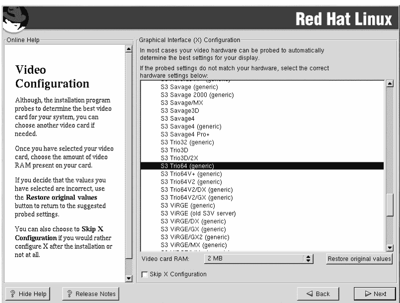

**图 2.7：** X 配置界面

## 善后收尾


接下来，你会收到 `Red Hat` 安装已完成的消息。请取出仍插在驱动器中的软盘或 `CD-ROM`，然后重启系统。请记住，如果你跳过了启动加载器的安装，你必须将启动软盘插入软驱。当电脑完成开机过程后，假设你选择了 `GRUB` 启动加载器，你会看到图形化的启动加载器菜单。选择对应于你想要进入的操作系统的一个启动标签。你的 `Red Hat 7.3` 系统的默认启动标签将是 `Red Hat Linux (2.4.28-3)`。如果你在安装过程中指定了其他启动标签，你可以通过滚动到你想使用的那个标签并按下 `Enter` 键来启动它。如果仅按下 `Enter` 键，将启动默认的启动项。如果你不做任何操作，启动加载器将暂停等待指定的超时时间（默认值为 30 秒），然后启动默认的启动项。当系统启动完成后，你会看到登录提示符。尽享乐趣。

## 总结

在本章中，我们学习了如何使用 `Linux` 实现磁盘缓存、`RAID` 和集群。我们查看了最流行的 `Linux` 发行版及其标志性特性。我们讨论了硬件配置，如果你一直跟随教程操作，现在你已经安装了一台 `Linux` 服务器和一台 `Linux` 工作站。在下一章，我们将深入 `Linux` 操作系统的内部，向你介绍启动和关机过程。

## 第 3 章：启动与关机

## 概述

启动 `Linux` 的过程是多方面的。在系统引导期间发生了很多事情，很容易迷失在实际上执行了哪些步骤中。系统管理的大部分魔力仅仅在于熟悉像引导这样的过程。充分了解这个过程使得配置系统变得相当容易，并在系统出故障时修复它，并向用户解释它。为了理解 `Linux` 的启动过程，我们将在本章中从头到尾逐步讲解。由于存在两种不同的标准来执行启动和关机——`BSD` 风格的启动方法和 `System V` 风格的方法——`Linux` 的启动和关机变得更加复杂。理解这两种方法之间的差异很重要，因为某些 `Linux` 发行版——例如 `Debian` 和 `Slackware`——使用 `BSD` 风格的系统初始化脚本，而其他发行版，如 `Red Hat` 和 `Caldera`，则使用 `System V` 风格的启动脚本。

在本章中，我们讨论启动加载器（`GRUB`、`LOADLIN` 和 `LILO`）——它们是什么以及它们如何工作。我们查看不同的启动方法，包括进入单用户模式启动和从软盘启动。我们详细检查 `Linux` 启动脚本以及相关的用户启动文件（这些文件在用户登录系统时运行）。最后，我们讨论日志文件，这些文件有助于在系统无法正常启动时进行故障排除。

当命令系统关机后，系统会执行一系列类似的步骤。有许多活动进程必须关闭，设备和文件系统必须卸载，以避免对系统造成损坏。这个过程也是分阶段进行的。我们也会逐步讲解这个过程，以全面理解关机是如何工作的以及它做了什么。关机脚本和日志文件也被讨论，以便使整个过程清晰明了。

## `Linux` 启动过程

当你启动一个 `Linux` 系统时，在通电后和收到登录提示符之前，会发生一系列事件。这个序列被称为启动过程。虽然这个序列可能因配置而异，但启动过程的基本步骤可以总结如下：

1. 基本输入/输出系统（`BIOS`）启动并检查硬件设备。`BIOS` 存储在计算机的 `ROM`（只读存储器）中，被称为固件，因为它内置于硬件内存中。当电源施加到计算机上时，`BIOS` 会自动运行。`BIOS` 的目的是找到启动过程所需的硬件设备，加载并启动存储在主引导记录（`MBR`）中的引导程序，然后将控制权移交给该引导程序。对于 `Linux`，`BIOS` 执行其检查后，查看 `MBR`，其中包含第一阶段引导加载器，例如 `GRUB` 或 `LILO`。找到引导加载器后，`BIOS` 启动它。
   *注意：然而，有时 `MBR` 包含另一个引导加载器，该加载器反过来在 `Linux` 分区的第一扇区查找引导加载器。*
2. `BIOS` 将控制权移交给第一阶段引导加载器，然后该加载器读入分区表，并在配置为可引导的分区上查找第二阶段引导加载器。
3. 第一阶段引导加载器运行第二阶段引导加载器，然后该加载器找到内核映像并运行它。
4. 内核映像包含一个小型、未压缩的程序，该程序解压缩内核的压缩部分并运行它。内核扫描系统信息。
5. 内核通过运行 `/sbin/init` 启动 `init` 进程。
6. 如后文“初始化和启动脚本”部分所述，`init` 进程为虚拟控制台和串行终端启动 `Getty` 程序，并根据配置启动其他进程，并监控它们直到关机。

即使在同一个发行版中，这个通用的启动过程也可能受到各种因素的影响。例如，上述步骤假设系统只有一个可引导的内核映像。这可能是你首次安装时的情况，但你也可能安装了另一个操作系统（如 `Windows`）或不同 `Linux` 发行版的可引导扇区。后来，如果你安装并编译了不同版本的内核，你将必须配置你的引导加载器以识别它。正如你在本章稍后将看到的，你可以指定许多参数在启动提示符处，但首先让我们仔细看看主引导记录。

## 主引导记录

主引导记录（`MBR`）在启动过程中起着关键作用。它位于第一个磁盘驱动器上，在 0 磁道 0 磁头的第一个扇区（整个磁道通常保留用于引导程序），它是硬盘上的一块特殊区域，由计算机的 `BIOS` 自动加载。由于 `BIOS` 加载在可电擦除可编程只读存储器（`EEPROM`）芯片中，该芯片通常不在用户/管理员级别重新编程，因此 `MBR` 是配置的引导加载器可以控制启动过程的最早时间点。图 3.1 显示了一个带有其 `MBR` 和五个 `Linux` 分区的硬盘。

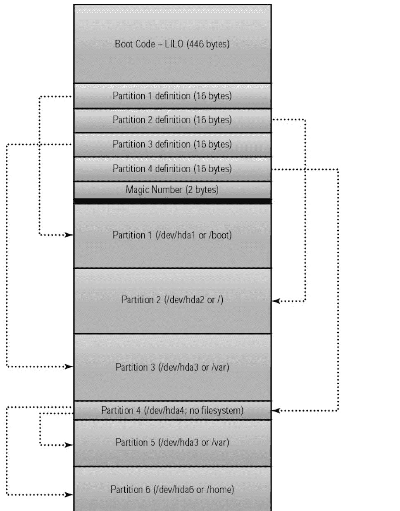

图 3.1：硬盘分区布局

其中三个（`/dev/hda1` 到 `/dev/hda3`）是直接指向的主分区，两个（`/dev/hda5` 和 `/dev/hda6`）是驻留在扩展分区（`/dev/hda4`）内的逻辑分区。这种巴洛克式的布局是早期 `PC` 分区表中分区数量限制的结果，并将在第 6 章“文件系统和磁盘管理”中进一步讨论。`Linux` 使用第三扩展文件系统（`ext3fs`），这也将在第 6 章中详细介绍。基本上，文件系统是强加在每个分区上用于组织文件的结构。它是添加数据的基础框架。

## 引导加载器

有多种引导加载器可供选择。替代方案包括 `System Commander`、`NTLLDR`、`Linux Loader (LILO)` 和 `Grand Unified Bootloader (GRUB)`。`System Commander` 是一种启动管理工具，允许你在启动时从多达 100 个操作系统中进行选择。相关信息可在 `http://www.v-com.com/` 获取。`NTLLDR` 是 `Windows NT` 的启动管理器。有关 `NTLLDR` 的更多信息可在 `http://microsoft.com/` 获取。最有可能的是，你的发行版的默认引导加载器将是 `LILO` 或 `GRUB`，但任何这些引导加载器都可以在初始操作系统安装后安装。无论选择哪一个，这个引导加载器都是启动过程中除 `BIOS` 之外的第一个步骤。

### `GRUB`：定义与配置

从 `Red Hat 7.2` 开始，`Red Hat` 开始使用 `GRUB` 作为默认引导加载器。`GRUB` 相对于 `LILO` 的主要优势在于 `GRUB` 灵活得多。`GRUB` 不需要你在每次更改时运行安装程序。如果你对 `LILO` 进行了更改，比如更新了包含在 `LILO` 配置中的内核映像，并且忘记运行 `LILO` 安装程序，你可能需要启动一个救援磁盘才能回到系统中。使用 `GRUB`，你不会遇到这个问题。此外，你可以使用 `GRUB` 启动提示符查看系统中的一些信息，这是其他引导加载器无法做到的。

`GRUB` 附带了多个不同的预配置文件，用于引导其支持的操作系统：`BSD FFS`、`DOS FAT16` 和 `FAT32`、`Minix fs`、`Linux ext2fs` 和 `ext3fs`、`ReiserFS` 和 `VSTafs`。`GRUB` 比其他引导加载器大得多，但这种大小是由于额外功能提供的灵活性而得到证明的。`GRUB` 访问任何被 `BIOS` 识别的设备上数据的能力是一个我们不想放弃的功能。例如，你可以在系统完全启动之前使用 `GRUB` 提示符下的 `cat` 命令查看 `/etc/fstab` 文件，如下所示：

```
grub> cat /etc/fstab
```

另一个不错的功能是能够解压缩使用 `gzip` 压缩的文件；解压对用户是透明的。`GRUB` 比其他引导加载器更少关注磁盘几何结构。事实上，你可以重新定位内核映像，而 `GRUB` 仍然能找到它。其他引导加载器必须知道映像的块位置。

`GRUB` 配置文件旨在供人类阅读。`grub.conf` 文件对于习惯 `LILO` 的人来说可能有点陌生，但习惯它只需要很少的时间。参见列表 3.1。每个定义可引导内核或非 `Linux` 分区的部分被称为一个 `stanza`（段落/条目）。

列表 3.1：一个示例 `grub.conf` 文件


```text
# grub.conf generated by anaconda
#
# Note that you do not have to rerun grub after making changes to this file
# NOTICE:  You do not have a /boot partition.  This means that
# all kernel and initrd paths are relative to /, eg.
# root (hd0,0)
# kernel /boot/vmlinuz-version ro root=/dev/hda1
# initrd /boot/initrd-version.img
#boot=/dev/hda
default=0
```

```
timeout=10
splashimage=(hd0,0)/boot/grub/splash.xpm.gz
password --md5 $1s$AnFv6$Q567t7hhyN2k74Fizf29e0H70
title Red Hat Linux (2.4.7-10enterprise)
root (hd0,0)
kernel /boot/vmlinuz-2.4.7-10enterprise ro root=/dev/hda1
initrd /boot/initrd-2.4.7-10enterprise.img
title Red Hat Linux-up (2.4.7-10)
root (hd0,0)
kernel /boot/vmlinuz-2.4.7-10 ro root=/dev/hda1
initrd /boot/initrd-2.4.7-10.img
title Red Hat Linux-up (2.4.7-10)
root (hd1,0)
kernel /boot/vmlinuz-2.4.7-10 ro root=/dev/hda1
initrd /boot/initrd-2.4.7-10.img
```

正如你在列表 3.1 中看到的那样，GRUB 的配置文件非常简单。首先，GRUB 从 0 而不是 1 开始计数硬盘和软盘，因此第一个硬盘是 `hd0`。`default=0` 行指定默认启动映像将是列表中第一个硬盘条目，即示例文件中的 “Red Hat Linux (2.4.7-10enterprise)”。

`timeout` 行表示 GRUB 将在继续启动之前等待用户输入 10 秒。

`splashimage`，如你可能猜测的那样，是显示在 GRUB 启动菜单上的图像。

由于 GRUB 功能强大，允许通过其命令行进行重大更改，因此使用 `password` 选项来防止在提供带有 `-p` 选项的密码之前对 GRUB 进行任何交互。如果没有 `--md5` 参数，密码将以明文形式显示，而不是以其 MD5 加密形式显示。接下来的几个部分处理特定的内核映像。第一部分使用第一个硬盘上的第一个分区作为根分区，启动企业内核和 initrd 映像。第二部分启动 `vmlinuz-2.4.7-10` 映像和 initrd 映像，使用相同的根分区。最后一部分启动与第二部分相同的内核映像，但其根分区位于第二个硬盘的第一个分区上，而不是第一个。

### `initrd` 映像

Linux 包含对 RAM 磁盘的支持，这些是磁盘文件系统，它们从软盘或硬盘加载，但在使用期间存储在 RAM 中。RAM 磁盘在系统安装或维护期间可能很有用，因为它们消除了对物理磁盘访问的需要。初始 RAM 磁盘（`initrd`）映像是特定于内核的映像，它允许在根文件系统挂载之前执行一些设置功能。初始 RAM 磁盘使系统启动分两个阶段进行：内核首先以最小的一组驱动程序启动，然后 RAM 磁盘映像根据需要加载额外的模块。这种两阶段过程允许启动过程利用那些通常只有在启动过程完成后才可用的模块所支持的设备。如果你希望加载位于 RAID 阵列上的 Linux 系统，这一点尤为重要，因为对除 RAID-0 以外的任何 RAID 的支持都是模块化的，并且在默认内核中找不到。直到最近，`initrd` 用于从 PCMCIA 或 SCSI 硬盘或 CD-ROM 进行安装。然而，现在 Red Hat 安装程序允许你找到你的 SCSI 或 PCMCIA 驱动的硬盘和 CD-ROM。如果需要创建 `initrd` 映像，请使用 `/sbin/mkinitrd`。该命令具有以下格式：

```
mkinitrd image-name kernel-version
```

因此，对于 2.4.7–10 内核（`kernel-version` 编号必须与 `/lib/modules/` 目录名称匹配），命令看起来将如下所示：

```
# /sbin/mkinitrd initrd-2.4.7-10.img 2.4.7-10
```

### `LILO`：定义与配置

在 Red Hat 7.2 之前，Red Hat 和其他流行的 Linux 发行版默认启动 `LILO` 以完成 Linux 启动过程。在大多数情况下，`LILO` 被复制到 MBR。在其他情况下，`LILO` 安装在 Linux 启动分区的第一扇区。在这种场景中，`LILO` 被称为二级引导加载程序，必须由另一个引导加载程序启动。就我们的目的而言，我们假设 `LILO` 加载在 MBR 中。

如图 3.1 所示，MBR 包含程序代码（`LILO`）、一个标识四个主分区的 64 字节分区表，以及一个用于确定该扇区是否确实是引导扇区的 2 字节魔术数字。由于扇区长度为 512 字节，且 `LILO` 必须共享此空间，因此 `LILO` 的大小限制在 446 字节以内。为了适应这一限制，引导加载程序被分为两个阶段。第一阶段使用 MBR 中的 `LILO` 来定位二级引导加载程序，后者几乎总是位于包含根 Linux 文件系统的驱动器上的 `/boot/boot.b`，或者如果它与根分区分离，则位于 `/boot` 分区上。然后，这个二级引导加载程序被复制到 RAM 中，覆盖一级引导加载程序，以继续启动过程。

`LILO` 非常多功能，允许你启动多个内核映像以及系统上任何其他可引导分区的引导扇区。这个可引导分区可能指向 Windows 95 或 98 分区、Windows NT 分区，或许多其他操作系统中的任意一个，从而允许你启动它们中的任何一个。你必须让 `LILO` 意识到它预期要启动的映像和任何其他操作系统。为此，你需要将每个内核映像或操作系统的信息添加到 `/etc/lilo.conf` 文件中，包括用于引用每个映像的标签。然后，你将按照本节后面描述的运行 `lilo` 程序。`LILO` 将选定的内核映像和相应的 `initrd` 映像（如果有的话）加载到内存中，并将控制权移交给该内核。

`LILO` 使用 `/etc/lilo.conf` 文件进行配置。`LILO` 的基本原理非常简单，但其威力在于如果需要可以传递的众多选项。列表 3.2 中的 `lilo.conf` 文件展示了适用于启动两个不同 Linux 发行版（安装在 `/dev/hdb1` 和 `/dev/hdc1` 上，且两者使用相同内核）的计算机的选项。该计算机具有 Adaptec 152x SCSI 适配器和 SoundBlaster 声卡，两者都需要特定的内核选项（通过 `append` 行设置）才能正常工作。接下来的部分描述 `lilo.conf` 文件的详细信息。

**列表 3.2：示例 `lilo.conf` 文件**

```
#Global Section
boot=/dev/hda
map=/boot/map
install=/boot/boot.b
prompt
timeout=50
message=/boot/message
linear
default=linux
password=password
append="aha152x=0x140,12,7,0 0 sb=240,5,1,5,300"

#Per-Image Section
image=/boot/vmlinuz-2.4.7-10
    label=linux
    read-only
    root=/dev/hdb1

image=/boot/vmlinuz-2.4.7-10-1
    label=debian
    read-only
    root=/dev/hdc1
    initrd=/boot/initrd-2.4.7-10-1.img

image=/boot/vmlinuz-2.4.7-10
    label=orig
    read-only
    root=/dev/hdb1

other=/dev/hda1
    label=msdos
```

### 全局部分

`/etc/lilo.conf` 文件的第一部分全局适用于通过 `LILO` 启动的任何内核。全局部分的第一行表明 `LILO` 将安装在第一个磁盘 `/dev/hda` 的 MBR 中。如果 `LILO` 是二级引导加载程序，此引用将指向 Linux 启动分区，在那里写入 `LILO`。

正在使用的系统映射是 `/boot/map`。该文件是一个符号链接，指向你创建的内核的系统映射。它基本上由该内核的调试信息组成。即使是 Linux 系统管理员通常也不使用该文件，除非他们在从事内核开发工作。


下一行标识引导加载程序代码本身。通常这是 `/boot/boot.b`。此文件包含将驻留在引导扇区中 LILO 空间的代码，以及 LILO 依赖以完成启动过程的额外代码。

LILO 的默认行为是等待 4 秒，看你是否按下了 Shift 键；如果没有，则启动默认内核。`prompt` 指令告诉 LILO 改为提示用户选择要启动的映像。这就是你很可能见过的 `lilo:` 提示的原因。

下一行中的 `timeout` 参数设置等待键盘输入的时间（以十分之一秒为单位）。在此时间段之后，默认内核会自动启动。如果你输入 `timeout` 参数而没有数值，超时时间段将是无限的。如果你处于文本模式，在超时期间按 Tab 键会显示可用内核映像的列表。现在许多发行版使用图形启动屏幕，允许你滚动浏览可用映像列表。为了在 LILO 提示符上向内核传递参数，你需要按 Ctrl+X。

下一行标识包含在启动提示前显示的消息的文件。消息文件限制为 65,535 字节。更改或移除消息文件需要重建映射文件。

如果包含 `linear` 参数，它会强制生成分段线性扇区地址，而不是默认使用的扇区/磁头/柱面地址。如果你配置 BIOS 以线性块寻址（LBA）模式使用任何驱动器，这是必需的。

`default` 参数设置在未提供其他映像标签时要启动的默认内核映像。如果不存在 `default` 参数，LILO 将指定的第一个内核视为默认值。

## 为 LILO 添加密码保护

在 `lilo.conf` 文件的全局选项部分添加一行 `password=密码`（当然，将 `密码` 替换为你实际的密码），可以保护你的系统免受未授权的重新引导。或者，你可以在每个独立的代码块（stanza）中添加一个密码参数，以便以不同的方式保护特定的引导设置。例如，你可以选择对 Debian 设置进行密码保护，而对 Red Hat 设置不进行保护。通常，密码选项是全局的。

`append` 行尤为重要。可以将内核正确引导所需的任何参数附加到该行。通常，该行用于指定未被自动检测到的硬件的参数，如下面的示例所示。代码清单 3.2 中的 `append` 行包含了对 Adaptec 1520B SCSI 接口卡和 SoundBlaster 声卡的信息。注意，两个附加字符串之间没有逗号，因为每个字符串内部都包含逗号。同样，每个单独的附加字符串中没有空格，因为字符串列表是以空格分隔的。这些项目的格式因项目类型而异。硬盘信息通常会被附加，指定方式如下：

```
append="hd=cccc,hhhh,ssss" linear
```

其中 `cccc` 表示驱动器的柱面数，`hhhh` 表示磁头数，`ssss` 表示扇区数。你也可以使用 `append` 行来告知 LILO 未被检测到的内存，或者通过指示比你实际拥有的更少的内存来测试系统在有较少内存时的运行情况。内存量可以以千字节（后缀为 `k`）或兆字节（后缀为 `M`）指定。若要指定内存量，请使用以下 `append` 行：

```
append="mem=128M"
```

## 每个映像部分

代码清单 3.2 中跟随全局部分的代码块定义了两个特定的 Linux 内核映像和一个可引导的 Windows 分区。对于其中每一个，`image=` 行指定了映像或分区的位置。`label=` 行标识了在 LILO 提示符处使用的名称。如果代码块中包含 `read-only`，则根文件系统最初将以只读方式挂载（当它受文件系统检查影响时）；在引导过程的稍后阶段，它会以读写方式重新挂载。`root=` 行告知指定内核的根目录位置。最后，如果需要 `initrd` 映像，其位置指定在以 `initrd=` 开头的行上。

现在让我们看看具体的代码块，以理解它们的区别。第一个代码块，标签为 `linux`，引导位于 `/boot/vmlinuz-2.4.7-10-1` 的内核映像，最初为只读模式。要使用的根分区位于 `/dev/hdb1`，即第二个磁盘第一个分区的引导扇区。

现在，看看第二个标签为 `debian` 的代码块，我们发现它使用相同的内核映像，同样以只读方式引导，但它使用不同的根目录，并包含一个 `initrd` 映像，如上文 GRUB 部分所述。根分区的不同之处在于，该代码块引导了一个不同的 Linux 安装——具体而言，是 Debian Linux 设置，而不是使用 `linux` 代码块引导的 Red Hat 发行版。Debian 发行版的根文件位于第三个 IDE 磁盘的第一个分区 `/dev/hdc1`。由于我们在两处使用相同的内核，我们使用一个 `initrd` 映像来更改模块信息，以适应 Debian 发行版。

第四个代码块指向一个 Windows 98 安装。这个代码块比前三个更简单。它除了包含一个 `other=` 行（指定该操作系统引导扇区的路径）和一个 `label` 行（指定在 LILO 提示符处输入以启动该操作系统的名称）外，不需要包含其他内容。引导 Windows 所需的信息包含在 `/dev/hda1` 的引导扇区中，因为它是一个次级引导加载程序，由主 Linux 加载程序运行。

## 运行 LILO 程序

在按照你的意愿配置好 `lilo.conf` 之后，你必须使用 `lilo` 程序将其安装到主引导记录（Master Boot Record）中。这通常通过以下命令完成：

```
# /sbin/lilo
```

在这里，你可以针对特殊情况在命令行上使用许多选项，但它们并不经常需要。其中常用的一个选项是 `-r`，当你在救援模式或某种包含 `lilo.conf` 文件的驱动器已挂载且不属于活动系统的情况下时使用。`-r` 选项告诉系统 `chroot` 到指定目录并从那里运行命令。例如，假设你已启动到救援模式并将 `/dev/hda1` 挂载为 `/mnt/tmp`。你已修复了错误的 `lilo.conf`，该文件目前实际位于 `/mnt/tmp/etc/lilo.conf`。如果你尝试运行 `/sbin/lilo`，系统将查找 `/etc/lilo.conf` 而不是该文件。你可以使用以下命令告诉系统假装 `/mnt/tmp` 是 `/` 目录，从而强制 LILO 读取 `/mnt/tmp/etc/lilo.conf`，就像读取 `/etc/lilo.conf` 一样。该命令如下所示：

```
# /sbin/lilo -r /mnt/tmp
```

LILO 提供的选项多到在一本通用书籍中列出所有选项是不切实际的。`BootPrompt-HOWTO` 提供了详尽的列表，并在线提供于 `http://www.linuxrx.com/HOWTO/sunsite-sources/BootPrompt-HOWTO.html`。

现在让我们看看引导系统方法的不同方式。

## 创建引导软盘

当你遇到磁盘或系统故障，如引导扇区丢失或磁头崩溃，而你创建的内核无法引导系统且你忘记了为工作内核创建代码块，或者当你使用 LILO 并将新内核覆盖旧内核却忘记重新运行 `lilo` 时，你该怎么做？一种方法是从软盘引导。引导软盘是每台计算机（无论是工作站还是服务器）的基本需求。本节介绍如何创建一个。

有两种类型的软盘引导盘。一种使用引导加载程序，另一种直接从磁盘上的内核引导，而不借助 GRUB 或 LILO 等加载程序的优势。如果你需要在引导期间向内核传递参数，请使用带有引导加载程序的软盘。

### 创建 LILO 引导软盘

假设你想使用 LILO 从软盘引导。你可以更改 `/etc/lilo.conf` 文件的 `boot` 行，告诉它将 LILO 映像写入 `/dev/fd0` 或代表你软盘驱动器的任何指定名称。在该更改后运行 `/sbin/lilo` 将创建一个 LILO 引导软盘，其中包含通常写入 MBR 的信息。

大多数发行版提供了一种更简单的方法，即可执行文件 `mkbootdisk`，通常位于 `/sbin`。使用 `/sbin/mkbootdisk` 创建的任何引导盘将包含内核映像、`initrd.img` 文件、包含二级引导加载程序和系统映射的 `/boot` 目录、包含软盘设备和根文件系统设备的 `/dev` 目录，以及包含 `lilo.conf` 的 `/etc` 目录。当你从该磁盘引导时，你将看到一个 LILO 提示符以及输入 LILO 可能需要的任何额外信息的机会。命令如下所示：

```
# /sbin/mkbootdisk 2.2.16-22
```

### 创建不带引导加载程序的引导软盘

或者，你可以使用 `dd` 命令将内核复制到软盘，从而生成一个独立于引导加载程序的引导盘。如果你的内核是 `vmlinuz-2.4.7-10`，请执行以下操作：

```
# dd if=/boot/vmlinuz-2.4.7-10 of=/dev/fd0
```

然后使用 `rdev` 命令告诉软盘上的内核你的根分区是什么。`rdev` 命令可用于设置映像根设备，如下一个示例所示，或不太常见地设置交换设备、RAM 磁盘大小或视频模式。如果不包含设置信息，将显示当前值。将根分区设置为第二个 IDE 磁盘第一个分区的命令如下（此示例假设你的根分区位于第二个驱动器的第一个分区）：

```
# rdev /dev/fd0 /dev/hdb1
```


无论是否有引导加载程序，软盘的引导方式与系统之前的引导方式大致相同。区别在于，引导程序使用软盘上的引导扇区，而不是第一个磁盘驱动器上的 `MBR`。此外，如果你使用不带引导加载程序的软盘，并且你的 `BIOS` 设置为尝试从软盘引导，你的系统将引导磁盘中包含的内核，而不会提供引导提示符。

## 使用 `LOADLIN`

`LOADLIN` (`Load Linux`) 是一个可以启动 `Linux` 系统引导的 `DOS` 可执行文件。该程序随大多数 `Linux` 发行版一起提供。`Red Hat` 将其放置在第一个安装 `CD-ROM` 的 `dosutils` 目录中。将 `LOADLIN.EXE` 文件复制到 `DOS` 分区或 `DOS` 引导软盘。（你可能想创建一个 `C:\LOADLIN` 目录。）你还需要将一个 `Linux` 内核映像文件（可能位于你的 `Linux` 系统的 `/boot` 中）复制到 `DOS` 分区或软盘。从这里开始，你可以按以下方式引导 `Linux`（假设它位于第二个 `IDE` 驱动器的第一个分区）：

```
> LOADLIN C:\vmlinuz root=/dev/hdb1 ro
```

若使用 `RAM` 磁盘映像引导，请使用此形式的命令：

```
> LOADLIN C:\vmlinuz root=/dev/ram rw initrd=C:\rootdisk.gz
```

若从 `A` 驱动器的根软盘引导，请使用此命令：

```
> LOADLIN C:\image root=/dev/fd0 rw ramdisk=1440
```

如果你的 `Linux` 系统由于 `LILO` 配置问题而无法引导，且你需要重新进入系统以修复 `LILO` 引导信息，有时可以使用 `LOADLIN`；如果你被迫从备份恢复，但没有可启动的系统来开始恢复，它也很有用。这也是我们可以如前所述使用 `Linux` 引导软盘完成的，因此这真的归结为个人偏好。

**提示** 如果你拥有一块在 `Linux` 中使用前需要在 `DOS` 环境下初始化的硬件，`LOADLIN` 特别有用。例如，某些声卡在 `Linux` 中使用前必须被初始化为特殊的 `SoundBlaster` 兼容模式，而执行此操作的程序只能在 `DOS` 下运行。你可以创建一个 `DOS` 分区，从 `CONFIG.SYS` 或 `AUTOEXEC.BAT` 中运行声卡初始化程序，然后启动 `LOADLIN`。其结果是 `Linux` 启动时，硬件已处于 `Linux` 可接受的状态。

**警告** 尽管 `LOADLIN` 可以在 `Windows` 的 `DOS` 提示符下运行，也可以在 `Windows 95` 和 `98` 的 `DOS` 兼容模式下运行，但该模式实际上已从 `Windows Me`/`NT`/`2000`/`XP` 中移除。因此，如果不进行特殊处理，`LOADLIN` 无法从完整的 `Windows Me`/`NT`/`2000`/`XP` 启动中运行，但它可以从 `Windows Me` 紧急软盘或 `Windows 95`/`98` 启动软盘中运行。有关进一步说明，请参阅 [http://www.tldp.org/HOWTO/mini/Loadlin+Win95−98−ME.html](http://www.tldp.org/HOWTO/mini/Loadlin+Win95−98−ME.html) 上的 `HOWTO` 文档。

### 单用户模式

单用户模式是一种维护模式，在这种模式下会启动 `root` shell，且不允许其他用户登录。提示符会变为井号（#），以表明这是一个 `root` shell。可以使用命令 `init 1` 启动此模式，或者在 `LILO` 提示符后的镜像标签后添加单词 `single` 或数字 `1`。如果你正在系统上工作并决定需要进入单用户模式，请输入 `init 1`。如果你使用 `LILO`，并且由于内核恐慌（kernel panic）等原因重启了系统，当 `LILO` 提示符出现时，只需在镜像标签后添加 `1`，例如：

```
LILO: linux single
```

或者

```
LILO: linux 1
```

如果你使用 `GRUB` 并需要进入单用户模式，你必须进入图形化的 `GRUB` 屏幕，选择 `Red Hat` 启动标签。然后按 `E` 键进行编辑。向下移动到 `kernel` 行，按 `E` 键编辑。在提示符处输入单词：`single`。当返回到包含内核信息的 `GRUB` 屏幕时，按 `B` 键将系统启动到单用户模式。

当系统启动到单用户模式时，与多用户环境相关的初始化任务将被跳过，如果通过 `init` 程序切换到单用户模式，所有守护进程（daemon processes）都会停止。`init` 进程接下来会在 `/dev/console` 上以 `root` 用户身份启动一个 `Bourne` shell。根文件系统会被挂载，其他文件系统可供检查或挂载。不会自动运行守护进程，并且由于某些资源的主文件系统未挂载，这些资源可能不可用。

例如，如果 `/usr` 位于单独的分区（即它是独立的文件系统），除非手动挂载 `/usr` 分区，否则 `/usr/bin`、`/usr/sbin` 或 `/usr/X11R6/bin` 中的任何命令都不可用。在提示符处输入 `exit` 将退出单用户 shell，而 `Ctrl+D` 会将系统启动到其正常的多用户模式。

如果启动过程出现问题，你也可能进入系统发起的单用户模式。在这种情况下，你会被放入一个 `root` shell，拥有 `root` 访问权限，可以进行必要的更改以使系统可启动。这种情况最常见于启动期间运行的 `fsck` 过程失败，且系统需要手动检查和修复文件系统时。

单用户模式的一个用途是在密码未知时更改 `root` 密码，例如当员工离开公司但未提供密码时。没有方法可以检索旧密码，但单用户模式提供了 `root` 访问权限，因此你可以使用 `passwd` 命令输入新的 `root` 密码。当你重启到多用户模式时，新密码将像以前一样允许你拥有 `root` 访问权限。

这说明了允许对系统控制台进行无限制访问所带来的安全威胁以及单用户模式的风险。显然，你不希望任何人都能启动你的系统并更改 `root` 密码。为了保护单用户模式，你可以让引导加载程序（boot loader）要求密码，如前面在具体的 `GRUB` 和 `LILO` 章节中所述。

为了获得最佳安全性，你应该对 `BIOS` 进行密码保护，并将其设置为不从软盘启动。这两个操作将计算机配置为：除非用户拥有 `BIOS` 密码，否则无法从软盘启动计算机。如果你不采取这些步骤，拥有物理访问权限的入侵者只需插入一张 `Linux` 启动软盘即可修改磁盘上的系统。尽管有了更多时间，拥有物理访问权限的入侵者可以移除硬盘或使用主板上的恢复跳线来绕过这些预防措施。除非对磁盘上的所有数据进行加密，否则如果入侵者可以打开计算机机箱，你将无法阻止篡改。

## 初始化和启动脚本

在本章前面，我们将初始化确定为启动过程的最后阶段。不同发行版之间的初始化过程略有不同。这些差异包括脚本的位置和名称，以及默认实际运行的内容。我们将首先查看该过程，并在遇到差异时进行讨论。初始化过程从内核启动 `init` 程序时开始。该程序解析 `/etc/inittab` 文件以确定要运行哪些程序的具体内容，以及完成后系统将处于哪个运行级别（run level）。我们将查看一个来自 `Red Hat`（使用 `System V` 风格的脚本）的示例，以及另一个来自 `Debian`（使用 `BSD` 模型）的示例。`Slackware` 和 `SuSE` 的方法与 `Debian` 模型中看到的非常相似。`Slackware` 默认自带一个空的 `rc.local`。

### `Red Hat` 模型

所有发行版都在某种程度上定制其初始化脚本，但大多数 `inittab` 文件都非常相似。列表 3.3 展示了 `Red Hat 7.3` 系统中 `inittab` 文件的一个示例。

**列表 3.3：一个 inittab 文件示例**


# inittab 文件描述

本文件描述了 `INIT` 过程如何在特定运行级别下配置系统。

- **Author**: Miguel van Smoorenburg, <miquels@drinkel.nl.mugnet.org>
- **Modified for RHEL Linux by**: Marc Ewing and Donnie Barnes

## 默认运行级别

Red Hat 使用的运行级别如下：

- `0`: 停止 (Do NOT set `initdefault` to this)
- `1`: 单用户模式
- `2`: 多用户，无 NFS (若无网络功能，则等同于 `3`)
- `3`: 完全多用户模式
- `4`: 未使用
- `5`: `X11`
- `6`: 重启 (Do NOT set `initdefault` to this)

```
id:3:initdefault:
```

## 系统初始化

```
si::sysinit:/etc/rc.d/rc.sysinit
```

## 运行级别脚本映射

```
10:0:wait:/etc/rc.d/rc 0
11:1:wait:/etc/rc.d/rc 1
12:2:wait:/etc/rc.d/rc 2
13:3:wait:/etc/rc.d/rc 3
14:4:wait:/etc/rc.d/rc 4
15:5:wait:/etc/rc.d/rc 5
16:6:wait:/etc/rc.d/rc 6
```

## 所有运行级别通用任务

```
ud:once:/sbin/update
```

## 捕获 CTRL-ALT-DELETE

```
ca:ctrlaltdel:/sbin/shutdown -t3 -r now
```

## UPS 电源管理

当 `UPS` 通知电源故障时，假设还剩几分钟的电力。安排 2 分钟后的关机。
以下行是为 `CyberPower 700 AVR UPS` 添加的（添加日期：9/17/01）。

- `UPS` 信号电源中断。
```
pf:12345:powerfail:/sbin/powstatd.fail
```

- `UPS` 信号在关机启动前恢复电源。
```
pr:12345:powerokwait:/sbin/powstatd.ok
```

- `UPS` 信号电池低电量：紧急关机。
```
pn:12345:powerfailnow:/sbin/powstatd.low
```

## 标准运行级别中的 Gettys

```
1:2345:respawn:/sbin/mingetty tty1
2:2345:respawn:/sbin/mingetty tty2
3:2345:respawn:/sbin/mingetty tty3
4:2345:respawn:/sbin/mingetty tty4
5:2345:respawn:/sbin/mingetty tty5
6:2345:respawn:/sbin/mingetty tty6
```

## 运行级别 5 中的 Xdm

`xdm` 现在是一个独立的服务。

```
x:5:respawn:/etc/X11/prefdm -nodaemon
p:1:respawn:/usr/sbin/moused -Q
```

### 运行级别说明

该文件以一组注释开头，包括 Red Hat 中使用的运行级别摘要；让我们花点时间看看这六个运行级别及其用途：

| 运行级别 | 描述 |
| :--- | :--- |
| `0` | 用于停止系统。为此，系统执行 `INIT 0` 命令并停止。如注释所述，你不应将 `initdefault` 设置为此级别。 |
| `1` | 将系统置于单用户模式。 |
| `2` | 将系统置于多用户模式，但不支持网络。 |
| `3` | 将系统置于标准的完全多用户模式，但不会自动启动 `X`。 |
| `4` | 未使用 |
| `5` | `X11`：将系统置于带有图形（基于 `X` 的）登录的标准多用户模式。 |

#### 表：运行级别 6 的描述

| 项目 | 描述 |
| :--- | :--- |
| `6` | 指示系统重新启动自身。同样，请勿将 `INITDEFAULT` 设置为此值。 |

> **注意**：运行级别 `2` 到 `5` 的含义在某种程度上是任意的。虽然大多数发行版使用此处概述的约定，但并非所有发行版都如此。例如，`SuSE` 使用运行级别 `2` 作为带有网络功能的全多用户模式，并使用运行级别 `3` 而不是 `5` 来启动 `X`。

### 初始运行级别配置

在第一个未注释的行中，`init` 程序被告知重启后应使用哪个运行级别。该行看起来像这样：

```
id:3:initdefault:
```

这行的第一部分，`id`，仅仅表示 `initdefault` 这个词。数字 `3` 表示系统默认应启动到运行级别 `3`。对于使用 `X Window System` 图形环境（在第 13 章中讨论）的系统，你应该改用以下命令：

```
id:5:initdefault:
```

请记住，如果指定初始运行级别为 `5`，当 `X` 出现问题无法启动时，将无法登录。通常，你会看到以下两种情况之一发生：要么屏幕反复清屏，因为系统尝试启动 `X`，失败，再次尝试，如此反复；要么系统尝试启动 `X` 一次，失败后回退到运行级别 `3`。

### 系统初始化脚本

在运行级别行之后，Red Hat `inittab` 文件中的下一个未注释行告诉 `init` 程序要启动哪个脚本：

```
si::sysinit:/etc/rc.d/rc.sysinit
```

在这里，我们选择运行 `rc.sysinit` 脚本，我们稍后会详细查看该脚本。由于第二个冒号分隔字段（即运行级别字段）为空，该脚本将在所有运行级别下的启动时运行。该行的其余部分，`/etc/rc.d/rc.sysinit`，是要运行的确切命令。

### rc.sysinit 脚本功能

`rc.sysinit` 脚本执行许多功能。这些功能包括：

- 设置路径和主机名，并检查网络是否已激活
- 挂载 `/proc` 文件系统
- 设置内核参数
- 设置系统时钟
- 加载键盘布局和字体
- 启动交换分区
- 初始化 `USB` 控制器（如果存在）及其连接的设备
- 如果需要，检查根文件系统
- 设置 `PPP`
- 以读写方式重新挂载根文件系统
- 适当加载模块

### 运行级别目录脚本

在 `rc.sysinit` 文件退出后，`inittab` 将启动 `/etc/rc.d/rc` 脚本，并附带适当的运行级别作为参数。然后，`rc` 脚本执行该运行级别目录中包含的所有符号链接所指向的脚本。例如，如果运行级别是 `3`，则 `/etc/rc.d/rc3.d` 中链接所指向的脚本将被运行。列表 3.4 显示了默认 Red Hat `7.3` 安装中该目录的内容。

**列表 3.4：`/etc/rc.d/rc3.d` 文件包含指向运行级别 `3` 脚本的链接。**

| `K01kdrcroot` | `K20rwhod` | `K74ypxfrd` | `S13portmap` | `S85gpm` |
| :--- | :--- | :--- | :--- | :--- |
| `K05atd` | `K25squit` | `K75netfs` | `S17keytable` | `S90crond` |
| `K10webmin` | `K34ypasswd` | `K86nfslock` | `S20apcupsd` | `S90vmware` |
| `K15httpd` | `K35dhcpd` | `K92ipchains` | `S20random` | `S90xfs` |
| `K15mysqld` | `K35smbd` | `K96pcmcmd` | `S35identd` | `S91poststd` |
| `K15postgresql` | `K44rawdevices` | `S05kudzu` | `S55sshd` | `S95anacron` |
| `K20nfsv` | `K45named` | `S06reconfig` | `S56xinetd` | `S97rhnssd` |
| `K20rstatd` | `K72autofs` | `S08iptables` | `S60lpd` | `S991inuxconf` |
| `K20usersd` | `K74gpmdd` | `S10networl` | `S78mgsqid` | `S991local` |
| `K20rwalld` | `K74ypsserv` | `S12syslog` | `S80sendmail` | `S99webmin` |


## Linux 系统初始化与运行级别

### `/etc/inittab` 配置

你会注意到每个文件都以 `S` 或 `K` 开头。系统首先运行名称以 `K` 开头的脚本，以终止其关联进程（如果正在运行）。接下来，系统运行名称以 `S` 开头的脚本，以启动关联进程。将 `K` 名称改为以 `S` 开头（例如将 `K20nfs` 重命名为 `S20nfs`）会使 Linux 在进入该运行级别时启动该进程而不是终止它；将 `S` 名称改为 `K` 会使 Linux 在进入该运行级别时终止该进程。这就是 Linux 控制要在给定运行级别中启动哪些进程的方式。实际上，这里的文件只是指向存在于 `/etc/rc/init.d` 中的实际脚本的符号链接。

> **注意**：此 Red Hat 7.3 默认安装中运行的服务太多了。请参阅第 15 章“安全”，了解运行大量不必要进程的安全影响信息。

在运行级别 `3` 的进程被终止或启动后，`inittab` 文件中的 `/sbin/update` 命令将被运行。此命令刷新内核缓冲区并将其数据写入硬盘。这是提高内核性能的基本整理工作。

下一行将 `Ctrl+Alt+Delete` 键组合设置为指示系统重启。有时，在容易访问的系统上，这会注释掉，以防止任何人都能重启系统。`-t` 选项表示 `init` 进程在指示其依赖进程自行重启之前等待 `3` 秒。关机过程就像你发起了以下关机命令一样：

```
# /sbin/shutdown -t3 -r now
```

`inittab` 文件中的 `pf` 行设置系统，以便如果连接的不可中断电源（UPS）指示电源故障，则运行另一种类型的关机。此关机计划在该通知后的 `2` 分钟后发生。然而，接下来的 `pr` 行表示，如果 `init` 进程在关机开始之前收到电源已恢复的通知，则取消关机。`pn` 行表示当 UPS 指示电量低时使用的另一种关机类型。

接下来六个未注释的行，标识符为 `1-6`，为虚拟终端运行 `mingetty` 程序。这些程序是必不可少的，因为它们初始化 `ttys`，提供登录并获取用户输入数据，然后为用户启动登录进程。没有这些行，用户无法登录系统。

倒数第二行，标识符为 `x`，通过第二个冒号分隔字段中的 `5` 设置为仅在运行级别 `5` 时运行 X 显示管理器（XDM）进程。`XDM` 允许你直接登录到运行级别 `5`。Red Hat 7.3 使用 `prefdm` 作为其 `XDM` 程序，但使用的程序因发行版而异。如果你选择使用 `KDE` 和 `GNOME`，它们各自拥有自己的显示管理器，分别是 `KDM` 和 `GDM`。

最后，最后一行重新生成点对点隧道服务器守护进程（`pptpd`），它允许建立到 Linux 主机的虚拟专用网络连接。

如果 `/etc/inittab` 包含任何额外指定无运行级别（意味着仅在启动时运行）或运行级别 `3` 的行，它们将被运行。如果你有只需在特定运行级别启动的内容，你可以自行添加此类行。通常，Red Hat 默认的 `inittab` 保持原样即可。

通常，你不会自定义 `rc.sysinit` 文件或运行级别脚本，因为 `rc.local` 文件已包含该功能。它接下来运行。这是你对启动过程进行本地更改的文件。此文件在所有其他初始化文件之后运行，因此可用于覆盖早期初始化步骤中做出的任何设置。默认情况下，此文件创建登录横幅 `/etc/issue` 和 `/etc/issue.net`。这些文件用于设置用户本地登录（`/etc/issue`）或远程登录（`/etc/issue.net`）时出现在登录提示前的显示内容。默认情况下，`/etc/issue` 文件包含类似以下内容：

Red Hat Linux release 7.3 (Valhalla)

许多系统管理员认为，向可能试图破解你的系统的人提供这些信息太多了。最好将 `/etc/issue` 横幅更改为更通用的内容，例如“欢迎来到 localhostdomain”，或者在用户进入你的系统之前提供你认为他们需要的任何信息。如果你直接更改 `/etc/issue` 文件，当再次运行 `/etc/rc.d/rc.local` 文件时，它会被覆盖。你必须在 `/etc/rc.d/rc.local` 中更改此内容才能使更改永久生效。由于此文件是一个大的 `if` 语句，你要添加的任何命令都应添加在最后一个 `fi` 之前。

## Debian 模型

Debian 的 `inittab` 文件与 Red Hat 的版本只有细微差别。列表 3.5 展示了一个 Debian `inittab` 示例。

**列表 3.5：Debian 的 inittab 文件**

```
# /etc/inittab: init(8) configuration.
# $Id: inittab,v 1.8 1998/05/10 10:37:50 miquels Exp $

# The default runlevel.
id:2:initdefault:

# Boot-time system configuration/initialization script.
# This is run first except when booting in emergency (-b) mode.
si::sysinit:/etc/init.d/rcS

# What to do in single-user mode.
~~:S:wait:/sbin/sulogin

# /etc/init.d executes the S and K scripts upon change
# of runlevel.
#
# Runlevel 0 is halt.
# Runlevel 1 is single-user.
# Runlevels 2-5 are multi-user.
# Runlevel 6 is reboot.

10:0:wait:/etc/init.d/rc 0
11:1:wait:/etc/init.d/rc 1
12:2:wait:/etc/init.d/rc 2
13:3:wait:/etc/init.d/rc 3
14:4:wait:/etc/init.d/rc 4
15:5:wait:/etc/init.d/rc 5
```

在 Debian 中，`inittab` 中第一行未注释的代码将默认运行级别设置为级别 `2`。请记住，该级别是一种多用户模式，但不包含网络服务。

```
16:6:wait:/etc/init.d/rc6
# Normally not reached, but fallthrough in case of emergency.
z6:6:respawn:/sbin/sulogin

# What to do when CTRL-ALT-DEL is pressed.
ca:12345:ctrlaltdel:/bin/shutdown -t1 -a -r now

# Action on special keypress (ALT-UpArrow).
kb::kbrequest:/bin/echo "Keyboard Request---edit /etc/inittab to let this work."

# What to do when the power fails/returns.
pf::powerwait:/etc/init.d/powerfail start
pn::powerfailnow:/etc/init.d/powerfail now
po::powerokwait:/etc/init.d/powerfail stop

# /sbin/getty invocations for the runlevels.
#
# The "id" field MUST be the same as the last
# characters of the device (after "tty").
#
# Format:
# <id>:<runlevels>:<action>:<process>
1:2345:respawn:/sbin/getty 38400 tty1
2:23:respawn:/sbin/getty 38400 tty2
3:23:respawn:/sbin/getty 38400 tty3
4:23:respawn:/sbin/getty 38400 tty4
5:23:respawn:/sbin/getty 38400 tty5
6:23:respawn:/sbin/getty 38400 tty6

# Example how to put a getty on a serial line (for a terminal)
#
#T0:23:respawn:/sbin/getty -L ttyS0 9600 vt100
#T1:23:respawn:/sbin/getty -L ttyS1 9600 vt100
#
# Example how to put a getty on a modem line.
#
#T3:23:respawn:/sbin/mgetty -x0 -s 57600 ttyS3
```


`inittab` 中的下一行指示 `init` 进程运行 `/etc/init.d/rcS` 文件，我们稍后将对此进行查看。与其 Red Hat 对应项类似，它执行指定运行级别的 `S` 和 `K` 脚本。它以与 Red Hat 模型略有不同的方式设置 `Ctrl+Alt+Del`，并添加了一个 `Alt+向上箭头` 快捷键来定义键盘请求功能。随后，`rcS` 脚本设置 `UPS` 电源功能，类似于 Red Hat，但增加了一个立即关机功能。`getty` 程序也被配置，尽管 Debian 仅在系统处于运行级别 5 时，才让第一个 `tty` 重新生成 `getty`。Debian 的 `inittab` 的最后部分提供了在串行线路和调制解调器线路上运行 `getty` 程序的示例。列表 3.6 展示了 Debian 的 `rcS` 文件。

## 列表 3.6：Debian rcS 文件

```
#! /bin/sh
#
# rcS       Call all S??* scripts in /etc/rcS.d in
# numerical/alphabetical order.
#
# Version: @(#)etc/init.d/rcS  2.76  19-Apr-1999  miqels@cistron.nl
#
PATH=/sbin:/bin:/usr/sbin:/usr/bin
runlevel=$0
prevlevel=N
umask 022
export PATH runlevel prevlevel

#
# See if system needs to be set up. This is ONLY meant to
# be used for the initial setup after a fresh installation!
#
if [ -x /sbin/unconfigured.sh ]
then
    /sbin/unconfigured.sh
fi

#
# Source defaults.
#
. /etc/default/rcS
export VERBOSE

#
# Trap CTRL-C &c only in this shell so we can interrupt
# subprocesses.
#
trap "": INT QUIT TSTP

#
# Call all parts in order.
#
for i in /etc/rcS.d/S??*
do
    # Ignore dangling symlinks for now.
    [ ! -f "${i}" ] && continue
    case "${i}" in
        *.sh)
            # Source shell script for speed.
            (
                trap - INT QUIT TSTP
                set start
                . ${i}
            );;
        *)
            # No sh extension, so fork subprocess.
            ${i} start
            ;;
    esac
done

#
# For compatibility, run the files in /etc/rc.boot too.
#
[ -d /etc/rc.boot ] && run-parts /etc/rc.boot

#
# Finish setup if needed. The comment above about
# /sbin/unconfigured.sh applies here as well!
#
if [ -x /sbin/setup.sh ]
then
    /sbin/setup.sh
fi
```

`rcS` 文件设置了一些环境变量，包括 `PATH` 变量。如果系统在安装后首次运行，它还会运行一个特殊的配置 shell 脚本。随后，`rcS` 脚本运行其他脚本，这些脚本执行诸如启用虚拟内存、挂载文件系统、清理某些日志目录、初始化即插即用设备、加载内核模块、配置 `PCMCIA` 设备、设置串行端口以及运行 `System V init` 脚本等操作。`rcS` 脚本在释放控制权之前会调用 `/etc/rc.d` 中的某些脚本。这些包括：

- `rc.local`：类似于 Red Hat 的 `rc.local`，它具有相同的功能。
- `rc.modules`：加载内核模块：网卡、`PPP` 支持及其他模块。如果此脚本发现 `rc.netdevice`，它将同时调用该脚本。
- `rc.pcmcia`：探测系统中存在的任何 `PCMCIA` 设备并对其进行配置。这对笔记本电脑用户最有用，他们可能拥有 `PCMCIA` 调制解调器或网卡。
- `rc.serial`：通过运行适当的 `setserial` 命令来配置串行端口。
- `rc.sysvinit`：查找所需运行级别的 `System V init` 脚本（`/etc/rc.d/` 中的符号链接）并运行它们。类似于 Red Hat 版本，此 `rc.sysvinit` 脚本运行由适当子目录中的符号链接指向的脚本。对于运行级别 3，`/etc/rc3.d/` 中的所有链接都将被运行。

同样，这项工作完成后，`init` 程序将启动 `getty` 进程和 `XDM` 进程，后者显示登录提示，然后等待登录尝试或需要关注的其他进程。

现在我们已经完成了系统初始化，让我们看看用户登录时会发生什么。你需要熟悉这个过程，以便能够排除用户登录问题。

## 用户初始化文件

用户登录时会发生另一种类型的初始化。这不是像启动过程那样的系统级初始化。它是针对用户特定的初始化的另一个序列。但与系统初始化文件一样，系统管理员也负责用户初始化文件。下面的示例显示了 `Bash` shell 的序列，这是 Linux 的默认 shell。如果你使用的是其他 shell，序列将类似。

当用户登录时，首先运行系统用户配置文件。这些文件是脚本，它们被引入（sourced）而不是被执行。文件通过“点”命令引入。例如，要引入 `.login` 文件，请使用以下命令：

```
. /home/someuser/.login
```

> **注意** 引入文件会在命令提示符下执行每条命令，就好像它是手动输入的，而不是作为单独的โปรแกรม运行。所引入文件的环境成为运行它的 shell 的一部分。引入的文件不需要具有可执行权限。首先被引入的是 `/etc/profile`。该文件旨在包含系统范围的环境变量定义以及所有用户登录时要启动的程序；例如，它可以包括列出公司活动和其他有用信息的日历程序。它还引入 `/etc/profile.d` 目录中存在的任何文件。创建该目录的原因是，对于 `RPM` 来说，在那里添加脚本文件比在 `/etc/profile` 中添加行更容易。

当 `/etc/profile` 脚本完成后，系统按顺序查找用户主目录中的 `.bash_profile`、`.bash_login` 或 `.profile`。找到其中的第一个将被引入。通常这是 `.bash_profile` 文件。该文件做的第一件事是如果用户主目录中存在 `.bashrc`，则引入 `.bashrc`。之后，它设置一些环境变量。`.bashrc` 文件包含用户特定的别名和函数。`.bashrc` 文件反过来引入 `/etc/bashrc` 文件，该文件包含系统范围的函数和别名，包括系统用户将看到的提示符。

当用户注销 `Bash` shell 时，`.bash_logout` 文件将被引入。它应包含用户注销后清理工作所需的任何命令。这可能包括删除由该用户拥有的临时目录中的任何文件。

## 修改启动过程

作为一般规则，你的计算机上不应运行未使用的服务；你应该关闭那些在启动时自动启动但未使用的服务。相反，那些你希望自动启动但默认未在启动时开启的服务，应配置为在适当的运行级别中启动。例如，一些发行版默认运行 `PCMCIA`；但大多数台式计算机不使用 `PCMCIA`，因此应将其禁用。同样，如果未使用，任何用于远程用户的 `r` 命令服务（`rsh`、`rlogin`、`rexec` 等）都应被禁用。如果你仍在使用它们，请查看 `http://www.openssh.com/` 以寻找更安全的替代方案。`r` 命令常成为外部人员寻找安全漏洞进行利用的目标。保留此类服务运行会提供一个期望输入的端口，该端口可能会被用于访问系统。要禁用服务并关闭端口，请修改在启动时自动启动的服务集合；为此，请使用 `ntsysv` 工具，它是标准 Red Hat 7.3 发行版的一部分。这个基于控制台的工具默认配置当前运行级别，但可以通过传递 `–level` 选项来配置其他级别。图 3.2 说明了 `ntsysv` 工具。`ntsysv` 工具在系统安装时使用，但也可以从命令行运行。你可以通过选中或取消选中服务名称前的复选框来选择或取消选择列出的服务；在这种情况下，当前运行级别下的 `PCMCIA` 已被禁用。

图 3.2：使用 `ntsysv` 实用工具控制哪些服务在启动时自动运行

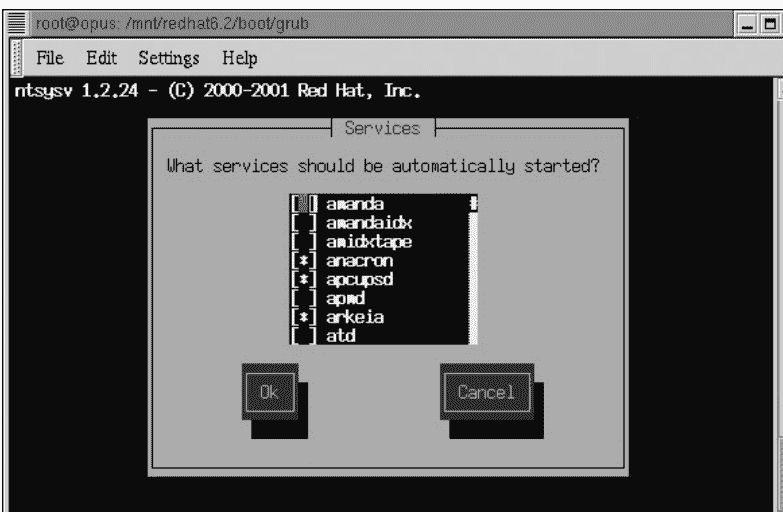


另一个用于添加、删除或在运行级别 2–5 中重新排序服务的工具是 `tksysv` 实用工具，它作为 Red Hat 发行版的一部分提供。该实用工具基于 X 窗口系统，表现相当不错。它展示了在各个运行级别下启动和停止的每个服务的显示界面，并允许你根据需要添加或删除服务。其使用原则基本上与 `ntsysv` 相同。

图 3.3 展示了 `tksysv` 实用工具。

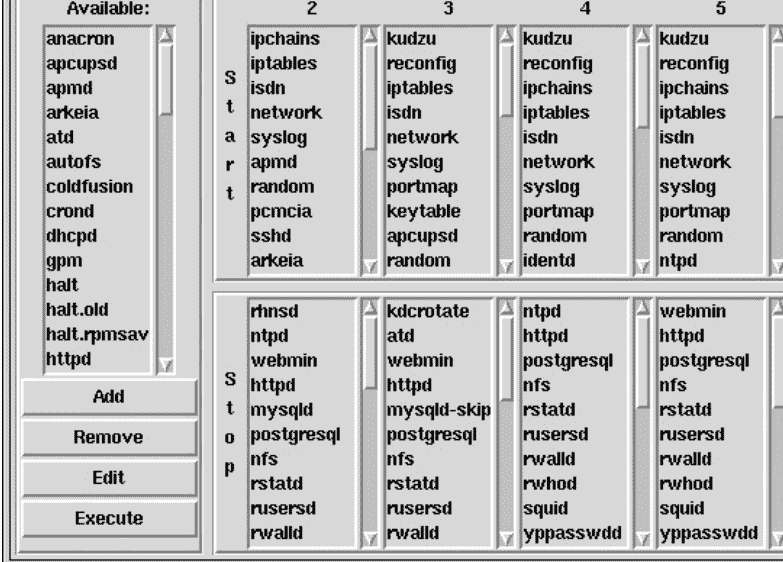

图 3.3：`tksysv` 实用工具

KDE 环境拥有自己的 SysV 脚本图形化管理器 `kysv`。它也相当不错，并具备拖放功能。由于它是 KDE 工具，因此基于 X 窗口系统。在分辨率高于 640×480 时，你需要以完整尺寸显示它，因为较小的默认尺寸会遮挡进程名称。（不过，当鼠标悬停在进程名称上时，该程序确实会提供帮助提示。）图 3.4 说明了 `kysv` 实用工具。

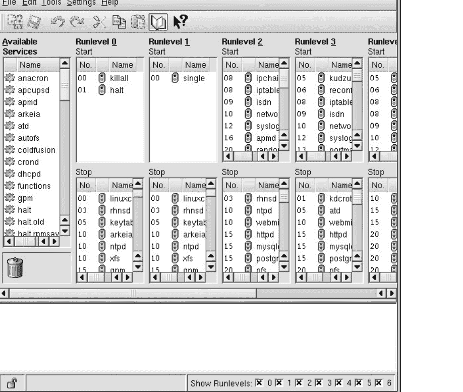

图 3.4：`kysv` 实用工具

还有另一个选择是命令行 `chkconfig` 实用工具，因为它易于使用且不依赖于 X 系统而获得额外加分。这在许多发行版中特别有用，因为许多发行版在服务器安装中不包含 X 系统。如果你向 `chkconfig` 传递 `-list` 开关，它将显示所有 SysV 脚本的列表，以及每个脚本在各个运行级别中是开启还是关闭。列表 3.7 显示了输出结果。`-add` 和 `-del` 开关允许你修改各个运行级别中的进程。

列表 3.7：`chkconfig` 输出示例

```
syslog
        0:off  1:off  2:on  3:on  4:on  5:on  6:off
crond
        0:off  1:off  2:on  3:on  4:on  5:on  6:off
netfs
        0:off  1:off  2:off 3:off 4:off 5:off 6:off
network
        0:off  1:off  2:on  3:on  4:on  5:on  6:off
random
        0:off  1:on  2:on  3:on  4:on  5:on  6:off
rawdevices
        0:off  1:off  2:off 3:off 4:off 5:off 6:off
xfs
        0:off  1:on  2:on  3:on  4:on  5:on  6:off
xinetd
        0:off  1:off  2:on  3:on  4:on  5:on  6:off
reconfig
        0:off  1:off  2:off 3:on  4:on  5:on  6:off
anaclron
        0:off 1:off 2:on 3:on 4:on 5:on 6:off
httpd
        0:off 1:off 2:off 3:off 4:off 5:off 6:off
apmd
        0:off 1:off 2:on 3:off 4:off 5:off 6:off
atd
        0:off 1:off 2:off 3:off 4:off 5:off 6:off
named
        0:off 1:off 2:off 3:off 4:off 5:on 6:off
keytable
        0:off 1:off 2:on 3:on 4:on 5:on 6:off
gpm
        0:off 1:off 2:on 3:on 4:on 5:on 6:off
iphchains
        0:off 1:off 2:on 3:off 4:on 5:on 6:off
pcmcia
        0:off 1:off 2:on 3:off 4:off 5:off 6:off
kdcrotate
        0:off 1:off 2:off 3:off 4:off 5:off 6:off
kudzu
        0:off 1:off 2:off 3:on 4:on 5:on 6:off
linuxconf
        0:off 1:off 2:on 3:on 4:on 5:on 6:off
lpd
        0:off 1:off 2:on 3:on 4:on 5:on 6:off
nfs
        0:off 1:off 2:off 3:off 4:off 5:off 6:off
nfslock
        0:off 1:off 2:off 3:off 4:off 5:off 6:off
sshd
        0:off 1:off 2:on 3:on 4:on 5:on 6:off
identd
        0:off 1:off 2:off 3:on 4:on 5:on 6:off
portmap
        0:off 1:off 2:off 3:on 4:on 5:on 6:off
ypkeyf
        0:off 1:off 2:off 3:off 4:off 5:off 6:off
rstatd
        0:off 1:off 2:off 3:off 4:off 5:off 6:off
rusersd
        0:off 1:off 2:off 3:off 4:off 5:off 6:off
rwalld
        0:off 1:off 2:off 3:off 4:off 5:off 6:off
rwhod
        0:off 1:off 2:off 3:off 4:off 5:off 6:off
smb
        0:off 1:off 2:off 3:off 4:off 5:off 6:off
sendmail
        0:off 1:off 2:on 3:on 4:on 5:on 6:off
rhnsd
        0:off 1:off 2:off 3:on 4:on 5:on 6:off
ypbind
        0:off 1:off 2:off 3:off 4:off 5:off 6:off
yppasswdd
        0:off 1:off 2:off 3:off 4:off 5:off 6:off
ypserver
        0:off 1:off 2:off 3:off 4:on 5:off 6:off
autoofs
        0:off 1:off 2:off 3:off 4:off 5:off 6:off
dhcpd
        0:off 1:off 2:off 3:off 4:off 5:off 6:off
mysqld
        0:off 1:off 2:off 3:on 4:on 5:on 6:off
nscd
        0:off 1:off 2:off 3:off 4:off 5:off 6:off
ntpd
        0:off 1:off 2:off 3:on 4:off 5:on 6:off
squid
        0:off 1:off 2:off 3:on 4:off 5:on 6:off
vmware
        0:off 1:off 2:off 3:on 4:on 5:on 6:off
apcupsd
        0:off 1:off 2:off 3:on 4:off 5:off 6:off
mysqld-skip
        0:off 1:off 2:off 3:off 4:off 5:off 6:off
postgresql
        0:off 1:off 2:off 3:off 4:off 5:off 6:off
iptables
        0:off 1:off 2:on 3:on 4:on 5:on 6:off
isdn
        0:off 1:off 2:on 3:on 4:on 5:on 6:off
webmin
        0:off 1:off 2:on 3:off 4:off 5:on 6:off
arkeia
        0:off 1:off 2:on 3:on 4:on 5:on 6:off
xinetd based services:
amanda: off
amidxtape: off
finger: off
linuxconf-web: off
rexec: off
rlogin: off
rsh: off
auth: on
telnet: on
tftp: off
wu-ftpd: on
talk: off
ntalk: off
pop-3: on
charger: off
charger-udp: off
daytime: off
daytime-udp: off
echo: off
echo-udp: off
time: off
time-udp: off
sgi_fam: on
amandaidx: off
```


你还可以使用 `Webmin` 来配置运行服务。从系统组中选择“启动和关机”选项卡。你将看到服务列表、每个服务是否会在启动时运行的指示以及该服务的简要描述。点击服务名称，你便可以执行典型的启动、停止和状态功能。`Webmin` 是一个出色的工具，它不依赖于特定发行版，学习它所花费的时间是非常值得的。

## 启动日志文件

有时，查看系统启动时的操作是很有帮助的。实现此目的最常见的方法是查看 `/var/log/dmesg` 文件，它是内核环形缓冲区的记录。该文件基本上提供了启动时快速滚动在屏幕上的相同信息。如果你拥有 `root` 权限，可以使用 `vi` 或 `Emacs` 等编辑器查看此文件，或者通过运行 `/bin/dmesg` 二进制文件来查看，系统中的任何人都可以执行此文件：

```
# /bin/dmesg
```

`/var/log/boot.log` 中也包含有用信息。该文件记录了 `/etc/rc.d/init.d` 脚本启动和停止的成功与失败情况。如果启动或停止不成功，此日志可能会指示原因。

另一个有用的日志文件是 `/var/log/messages`。该文件包含由 `klogd`（内核消息记录器）写入的信息。`syslogd` 守护进程记录不属于内核的进程的系统消息，也写入 `/var/log/messages`。管理员应定期检查此文件，以便用户不易立即察觉的问题不会 `unnoticed`（未被注意到）。

像 `/var/log/maillog` 和 `/var/log/messages` 这样的系统日志会由 `logrotate` 脚本定期轮换。该脚本通过 `/etc/logrotate.conf` 文件进行配置。此文件允许你指定如何轮换文件、是否以压缩格式存储、何时从 `/var/log` 中删除文件，以及是否将日志通过邮件发送给某人。

最后，由于 `/proc` 是一个包含当前运行内核相关信息的虚拟文件系统，它提供了很多有用的信息。以下是 `/proc` 中一些更有帮助的文件和目录：

| 文件 | 内容 |
| --- | --- |
| `/proc/interrupts` | 中断（`IRQ`）信息 |
| `/proc/cpuinfo` | `CPU` 信息 |
| `/proc/dma` | 直接内存访问（`DMA`）信息 |
| `/proc/ioports` | 输入/输出（`I/O`）信息 |
| `/proc/meminfo` | 可用、空闲、交换和缓存内存信息 |
| `/proc/loadavg` | 系统平均负载 |
| `/proc/uptime` | 自上次重新启动以来的时间 |
| `/proc/version` | 关于内核版本的信息 |
| `/proc/scsi` | 关于 `SCSI` 设备的信息 |
| `/proc/ide` | 关于 `IDE` 设备的信息 |
| `/proc/net` | 网络信息 |
| `/proc/sys` | 内核配置参数 |

## 关机

`Red Hat` 使用 `BSD` 风格的 `shutdown` 命令。该命令的语法是：

```
shutdown [options] time [message]
```

当系统收到关机信号后，所有登录用户都会收到系统即将关机的通知，使用标准消息或作为 `shutdown` 命令参数指定的消息。然后向所有进程发送 `SIGTERM` 信号，告知它们计算机即将关机。这给了这些进程时间进行干净地关闭。随后，`shutdown` 命令会向 `init` 进程发出信号，如果提供了 `-h` 选项，则将运行级别更改为 `0`（停机）；如果使用了 `-r` 选项，则更改为 `6`（重启）。

`/etc/rc.d/rc` 脚本会根据参数 `0` 或 `6` 运行（视情况而定）。这会将运行级别更改为相应级别，并运行 `/etc/rc.d/rc0.d` 或 `/etc/rc.d/rc6.d` 中由符号链接指向的脚本，具体取决于传递给 `/etc/rc.d/rc` 脚本的参数。

如果用户按下 `Ctrl+Alt+Del` 来启动关机过程，`shutdown` 命令将检查 `/etc/shutdown.allow` 文件。如果该文件存在，则会被读取并用于确定发起关机的用户是否有权限关闭系统。`/etc/shutdown.allow` 文件包含主机名和用户名对的列表。如果尝试关机的系统的主机名列于其中，并且其旁边的用户名是当前已登录的用户，则关机将继续进行。

大多数现代 `Linux` 发行版也在 `XDM` 登录屏幕上提供关机选项。这允许经验不足的用户在注销后关机，方式类似于 `Windows NT` 或 `2000`。

## 警告用户

`shutdown` 命令向系统中的用户发送一条消息，告知他们系统正在关机，是重启还是停机，以及关机何时发生。你可以添加自己的消息，说明原因、系统何时重新上线，或任何其他你希望用户知道的信息。随着关机时间的临近，该消息将被重复。关机时间越近，消息重复的频率越高。

最好不要让关机时间段太短，以至于用户无法完成其应用程序并退出系统。当然，有时必须立即关机；这是无法避免的，但添加一条消息告知用户何时可以再次访问系统可能会有助于缓解冲击。

## 关机日志文件

用于启动过程的一些相同日志文件也用于记录关机。关机过程中发生的任何内核问题都将在 `/var/log/messages` 中标注。`/var/log/boot.log` 将报告由 `init` 程序从 `/etc/rc.d/init.d` 运行的进程相关的任何问题。然而，这两个文件之间的区别并不十分明确，关于同一问题的消息往往同时出现在两者中。例如，如果 `eth0` 设备未被检测到，你在 `/var/log/boot.log` 中可能会看到类似以下内容：

## 第 4 章：职业工具

### 概述

正如机械师必须熟练地使用工具才能保持车辆处于正常工作状态一样，`Linux` 系统管理员也必须能够使用专业工具来维护一个可用的 `Linux` 系统。在这两种情况下，在外行人眼中看似神奇的事物，实际上是通过经验习得技能的体现。成功来自于知道需要做什么、拥有做这些事的资源，并执行你所知道的内容。请记住，每一项任务都是你日后可能需要的一种工具。基于此观点，系统管理员必须将工作的基本要素学习至成为第二本能的程度。只有这样，这些要素才能作为构建模块，用于完成更具挑战性的任务。

在本章中，我们将识别几个这样的构建模块。在讨论如何建立坚实的 `Linux` 系统管理经验基础时，我们将首先介绍 `man` 手册页、`info` 页面和基于 Web 的 `Linux` 支持服务等信息工具，然后探讨一些有用的命令行工具。我们将向你展示一些应存入 `Linux` 工具箱的基本命令，解释如何利用管道和重定向让命令协同工作以解决更大的任务，讨论在系统中定位特定文件的不同方法，并讨论引号的使用、历史记录列表以及各种 `Bash` shell 命令。

### 定位帮助资源

确立自己作为系统管理员地位的最重要要素之一，是证明你知道去哪里寻找那些你并非随口就能答上来的答案。一些非常敏锐的系统管理员会建议你永远不要承认你不知道某事。我们强烈反对这种做法。是的，当答案不是那种你可以不核实信息就给出的答案时，有些人会生气，但这不应改变你保持诚实的政策。通常情况下，只要你能够在合理的时间内带着答案回来，人们听到诚实的回答时会感到宽慰。当被问到你不知道的事情时，请始终给出相同的基本回答：“我有一段时间没处理过这个了，但我知道去哪里获取你需要的信息。我一拿到答案就会立刻回来。”

如果你想不起答案，请采取诚实的态度，忘记那种博学的姿态。博学的姿态使你处于必须（或者至少看起来）无所不知的境地，而我们都不是那样的。我们还发现，那些假装知道所有答案的人往往显得傲慢，而一些客户喜欢证明傲慢的系统管理员是错误的。如果你对能力保持诚实，你就较少成为靶子——只要其中一项能力就是找到答案的能力。

在需要时找到答案，请查看可用的众多信息资源。我们最喜欢 `Linux` 的特点之一是资源的丰富性。在 `Microsoft Windows` 机器上，你不能简单地调出一个关于命令的有用信息页面。`Windows` 有文档和在线帮助功能，但这些工具通常只有在问题符合特定模式时才会给出答案，或者它们几乎接近有用之处然后停止。它们没有提供足够的信息来拼凑出存在于字里行间的答案。在 `Linux` 和其他类 `Unix` 操作系统中，如果你知道自己在找什么，信息通常就在那里。

### Man 手册页

`Man`（"manual" 的缩写）`pages`（手册页）是在线文档，描述命令和文件的格式及功能，以及 `Linux` 系统上可用的其他一些工具。Man 手册页并非旨在全面，而是提供关于用法的一般信息。Man 手册页并不旨在取代源代码文档，而是突出如何引用相关资源。除非系统在安装时未包含它们，否则 `man` 手册页可以从命令行轻松获取。只需输入 `man man` 即可获取关于如何使用 `man` 手册页的 `man` 手册页。该命令的基本格式为：

```
man [options] [section] topic
```

`man` 命令有一个位于 `/etc/man.config` 的配置文件。如果你不想在命令行上指定环境变量，此文件允许你配置 `man` 命令使用的这些变量。选项包括应搜索 `man` 手册页的路径、应搜索手册节的顺序，以及是否以压缩格式存储 `man` 手册页。


Man 手册页按表 4.1 中列出的章节或类别进行分组。如果合适，一个命令可以拥有不同类别的 man 手册页；例如，`umount` 命令在第 2 节有一个页面，描述程序员使用的系统调用，在第 8 节有一个页面，描述其作为系统管理工具的使用。某些软件包，如 `Tcl`，将其页面单独放在不同的节中，而不是包含在列出的类别中。

## 表 4.1：`man` 命令中指定的在线手册章节

| 章节 | 类别 |
| :--- | :--- |
| 1 | 可由任何人启动的用户命令 |
| 2 | 系统调用（内核函数） |
| 3 | 库函数 |
| 4 | 设备 |
| 5 | 文件格式描述 |
| 6 | 游戏 |
| 7 | 杂项 |
| 8 | 仅 `root` 可执行的系统管理工具 |
| 9 | 更多内核例程文档 |
| n | 可能重新分类的新文档 |
| o | 可能很快移除的旧文档 |
| l | 引用此特定系统的文档 |

如果你不记得你想了解的命令的名称，`man` 有一个选项可以在 `WhatIs` 数据库中查找关键词，该数据库包含系统命令的简短描述文件集合。这样，如果你知道你想要命令的目的是添加用户，你可以指定：

```
$ man -k user
```

输出结果将是一个 `man` 手册页主题列表，其中描述包含单词 `user`，并包含每个页面所在的章节以及主题的简单描述。下面列出了输出结果的一部分：

```
access (2) Check user's permissions for a file
chage (1) Change user password expiry information
useradd (8) Create a new user or update default new user information
userdel (8) Delete a user account and related files
```

从中可以看出，你需要的命令是 `useradd`；对该命令运行 `man` 会生成清单 4.1 所示的显示内容。

## 清单 4.1：`useradd` 的 Man 手册页显示

```
USERADD(8)                     USERADD(8)

NAME
       useradd  -  Create a new user or update default new user
                  information

SYNOPSIS
       useradd  [-c comment]  [-d home_dir]
                [-e expire_date]  [-f inactive_time]
                [-g initial_group]  [-G  group[,...]]
                [-m  [-k skeleton_dir]  | -M]  [-p passwd]
                [-s shell]  [-u uid  [ -o]]  [-n]  [-r]  login

       useradd -D  [-g default_group]  [-b  default_home]
                [-f default_inactive]  [-e default_expire_date]
                [-s default_shell]

DESCRIPTION
       Creating New Users
              When invoked without the -D option, the useradd command
              creates a new user account using the values specified on
              the command line and the default values from the system.
              The new user account will be entered into the system files
              as needed, the home directory will be created, and initial
              files copied, depending on the command line options.  The
              version provided with Red Hat Linux will create a group
              for each user added to the system, unless -n option is
              given. The options which apply to the useradd command are

...The OPTIONS section has been omitted for space reasons...

NOTES
       The system administrator is responsible for placing the
       default user files in /etc/skel directory.
       This version of useradd was modified by Red Hat to suit
       Red Hat user/group convention.

CAVEATS
       You may not add a user to an NIS group.  This must be per-formed on the NIS server.

FILES
       /etc/passwd - user account information
       /etc/shadow - secure user account information
       /etc/group  - group information
       /etc/default/useradd - default information
       /etc/skel - directory containing default files

SEE ALSO
       chfn(1),  chsh(1),  crypt(3),  groupadd(8),  groupdel(8),
       groupmod(8),  passwd(1),  userdel(8),  usermod(8)
```

## 手册页（`man` Pages）

`useradd` 的手册页展示是命令手册页的典型代表。在命令名称之后，你会看到其正式语法的概要、用途说明、可能的参数（此处因空间原因省略）、使用注意事项或限制、相关命令的引用，以及作者姓名和电子邮件地址。非命令类的手册页会根据实际情况包含类似的数据集。

默认情况下，手册页使用 `less -is` 命令将信息写入文件供你查看。`less` 命令只是一个过滤器，用于逐页显示文件内容在屏幕上。（我们稍后会有更多介绍。）类似的程序还有 `cat` 和 `more`，你可能之前使用过。你可以通过添加 `-P` 选项后跟希望使用的查看器程序名称来更改 `man` 命令的默认查看器。或者你可以在 `/etc/man.conf` 中配置此更改，或重置 `PAGER` 环境变量。

如果手册页未安装且系统有足够空间，请安装它们。为此，请使用第 8 章中描述的 `rpm` 命令。你将在这些页面中找到极具价值的信息。很多时候，我们需要使用 Linux 命令中一些极少使用的功能，并在手册页中找到该命令的格式。Linux 的一个额外好处是，手册页提供多种语言版本——以防你希望以印尼语获得 `ls` 命令的解释。

## 信息页（Info Pages）

尽管手册页多年来一直作为 Unix 命令信息的标准来源，但 GNU 项目最近引入了信息页的概念，并且 Linux 社区正在向用信息页取代手册页的方向发展。许多命令的手册页不再更新，而是指向相应的信息页以获取信息。

从我们用户的角度来看，信息页与手册页非常相似。它们被归入与手册页相同的类别。推动信息页运动的关键区别在于使用 `Texinfo` 格式的优势。

`Texinfo` 是一个文档系统，使用单个文件同时创建在线显示和打印输出。也就是说，只需维护一个文件即可支持打印文档和信息页。这对程序开发者来说是巨大的时间节省，因为在手册页系统下，他们必须同时创建用于打印的用户手册和用于屏幕查看的手册页。


Texinfo 文件是一个纯 ASCII 文本文件，其中还包含 `@`-命令（以 `@` 开头的命令），这些命令告诉排版和格式化程序文本 intended 的格式化方式。你可以用任何你喜欢的编辑器编辑 Texinfo 文件，但 `GNU Emacs` 编辑器有一个特殊的 Texinfo 模式，提供了与 Texinfo 相关的特殊功能。你可以使用独立的 `Info` 程序或内置于 Emacs 编辑器中的 Info 阅读器来阅读 Info 文件。无论你采用哪种方式，材料之间没有太大差异，尽管 `man` 命令的弃用意味着信息页更可能包含最新的信息。列出 `useradd` 命令信息页的命令是：

```
info useradd
```

输出看起来像列表 4.2。

### 列表 4.2: `useradd` 的信息页显示

```
File: *manpages*, Node: useradd, Up: (dir)

USERADD(8)                        USERADD(8)

NAME
       useradd - Create a new user or update default new user
       information

SYNOPSIS
       useradd [-c comment] [-d home_dir]
              [-e expire_date] [-f inactive_time]
              [-g initial_group] [-G group[, ...]]
              [-m [-k skeleton_dir] | -M] [-p passwd]
              [-s shell] [-u uid [ -o]] [-n] [-r] login

       useradd -D [-g default_group] [-b default_home]
              [-f default_inactive] [-e default_expire_date]
              [-s default_shell]

DESCRIPTION
------Info: (*manpages*)useradd, 184 lines --Top--------------
Welcome to Info version 3.12h. "C-h" for help, "m" for menu item.
```

如你所见，信息页呈现的基本信息与旧的手册页格式相同。信息系统有一个相当于手册页部分中提到的关键词选项。使用以下格式：

```
info --apropos user
```

输出看起来略有不同，但信息本质上与手册页关键词搜索生成的信息相同。请参阅下面的列表 4.3。

### 列表 4.3: 使用 `apropos` (`useradd`) 的信息页摘录

```
"(info-std)Invoking Info" -- remembering user keystrokes
"(texinfo)kbd" -- user input
"(texinfo)Variables Commands" -- User options, marking
"(texinfo)Macros" -- User-defined Texinfo commands
"(bfd)howto manager" -- BFD_RELOC_ALPHA_USER_GPDISP
"(bfd)howto manager" -- BFD_RELOC_ALPHA_USER_GPRELHIGH
"(bfd)howto manager" -- BFD_RELOC_ALPHA_USER_GPREDLOW
"(bfd)howto manager" -- BFD_RELOC_ALPHA_USER_GPREL7
"(bfd)howto manager" -- BFD_RELOC_ALPHA_USER_LITERAL
"(bfd)howto manager" -- BFD_RELOC_ALPHA_USER_LITUSE_BASE
```

我们这些长期使用手册页的人，起初可能会觉得信息页有点不习惯，但它们将长期存在。目前，系统管理员从熟悉两者中获益。

## 技术支持

`Linux` 有着“自己动手”操作系统的声誉，因此许多企业用户并未认真对待它。邮件列表和在线常见问题列表早已存在，但这种非正式支持并未真正让 `Linux` 在商业市场获得认可。原本会使用 `Linux` 的公司却避之不及。企业客户犹豫是否购买支持如此非正式的产品。幸运的是，有一些开明的高管与我们意见一致，认为从用户社区获得技术支持实际上比从商业供应商那里更好，原因有两个。首先，你可以从同行积累的经验中受益。其次，使用商业软件时你面对的是“计划性淘汰”，许多问题的答案往往是“你需要购买升级版本才能做到”。

为了应对 `Linux` 作为无支持操作系统的声誉，几家第三方公司为商务和个人提供收费的技术支持计划。这在过去的几年中是一个大幅发展的领域。企业用户现在可以向其客户和管理层推荐这些新的支持来源。以下是主要在线支持来源的概览，包括商业支持和来自用户社区的支持。

## 配置支持

早期 `Red Hat` 的用户发现该公司提供的支持令人失望地局限于安装问题，且常常响应不及时。`Red Hat` 的网站包含一个先前已回答问题数据库，但搜索引擎的问题常常使该数据库无法搜索。

在 5.1 版本发布后，由于销量大幅增加，`Red Hat` 开始重构其支持计划。他们改进了安装支持并重新设计了在线数据库。除了电子邮件和电话支持外，还提供基于 Web 的支持。截至 `Red Hat` 7.3，这种支持在个人版和专业版中提供。个人版提供 30 天的 Web 或电子邮件安装支持，而专业版提供 60 天。针对安装后问题的支持合同和按事件计费的支持也可用。其他一些发行版有类似的计划。

大多数提供 `Linux` 支持的第三方公司在其网站上都有可搜索的数据库，他们鼓励你将其用作第一级支持。许多同样的公司还提供更正式的支持形式，包括 24/7 电子邮件支持、电话支持和基于 Web 的支持，每种都旨在拥有非常快的响应时间。你可能需要与支持人员交换几封电子邮件才能解决问题，但这可以在几小时内完成。支持网站通常有基于 Web 的表单来收集所有必要数据，然后将其转交给通过电子邮件或电话响应的支持工程师。来电电话支持通常不旨在作为支持的主要渠道。

一些第三方支持网站，如 `http://e.linux-support.net/` 的企业 `Linux` 支持，根据解决特定问题所需时间的长短，提供按小时或按天计费的电话和基于 Web 的支持。基于 Web 的支持通常比电话支持便宜得多。同一家公司在 `http://support.marko.net/` 下以免费 `Linux` 支持的名义提供由志愿工程师提供的支持。工程师的成功情况会被监控，最优秀的工程师会被提供企业 `Linux` 支持的带薪职位。

其他第三方支持网站，以及 `Red Hat` (`http://www.redhat.com/apps/support/`) 和 `Caldera` (`http://www.caldera.com/support/`) 等公司，提供按次付费的支持模式，其中费用是每次问题解决的固定费率，无论解决该问题所需时间长短如何。每次事件（`incident`）的收费标准差异很大。分销商通常在用户购买盒装发行版后的一段时间内免费提供安装支持。

此外，还有传统的支持合同，其内容为在指定时期内以固定金额支持任何问题的处理。这些合同规定了电话支持的时间段以及预期的响应时间。

### 定制化的 `Linux` 开发

1998 年，`LinuxCare`（`http://www.linuxcare.com/`）开始向企业和个人提供与发行版无关的支持服务。`LinuxCare` 的主要业务是为商业客户开发定制的 `Linux` 软件。他们在 `Linux` 内核扩展、系统优化、设备驱动开发以及应用程序移植方面提供协助。他们还提供关于 `Linux` 安全、网络管理以及一般项目管理的咨询服务。

一些小型基于 Web 的公司，如 `Linux Consulting`（`http://www.linux-consulting.com/`），提供基于收费的支持服务，形式包括定制的 `Linux` 服务器和客户机、`Linux` 系统管理工具和脚本、专门的 `Linux` 软件以及 `Linux` 维护。顾问公司的数量正在迅速增长。只需在互联网上简单搜索，就能找到一位可以开发你所需要的任何与 `Linux` 相关的软件的顾问。

### 通用 Web 支持

几乎每个发行版都至少有一个邮件列表可供该发行版的用户或其他拥有特定发行版问题的人员使用。消息被发送到相应的列表，列表处理器会适当地将邮件转发给该列表的其他成员。这是一种获取支持信息的有效方式。你只需将问题邮件发送给该列表；其他人会阅读你的帖子并将他们的回复邮件发送给该列表。有时，列表处理器会创建列表的摘要版本，这意味着你不再单独接收每封邮件，而是在等待消息队列达到特定容量时，接收一个合并的帖子。我们强烈建议加入你的发行版列表的摘要版本！


Red Hat 使用多个邮件列表，如 `http://www.redhat.com/mailing-lists` 所示。最常见的包括 `redhat-announce-list`、`redhat-watch-list` 和 `redhat-list`。正如名称所示，`announce` 列表用于发布影响 Red Hat 社区的事件。`watch` 列表向成员警示安全问题，而 `redhat` 列表则用于讨论一般性问题。`redhat-list` 提供摘要格式。除了这些列表外，还有其他几个列表，例如 `sound-list` 和 `pam-list`，它们处理更具体的问题；每个列表的详细信息都在上述网站上有介绍。

Debian 发行版也有许多列表，包括用于发布事件的 `debian-announce` 列表和用于一般用户问题的 `debian-user` 列表。`debian-user` 列表提供摘要格式。你可以在 `http://www.debian.org/MailingLists/subscribe` 找到关于它们以及如何订阅的信息。

Slackware 有两个基本列表：`slackware-announce` 和 `slackware-security`。每个列表也都提供摘要格式。更多信息可在 `http://www.slackware.com/lists` 找到。

SuSE Linux 也有几个邮件列表，包括用于英语公告的 `suse-announce-e`、用于英语一般讨论的 `suse-linux-e`、`suse-security` 和 `suse-security-announce`。其他列表则专门针对 Motif、Oracle、IMAP、Applixware 和其他主题。有关这些列表的更多信息可在 `http://www.suse.com/support/us/mailinglists/index.html` 获取。

许多网站归档了各种与 Linux 相关的列表。非常有用的是位于 `http://www.google.com/` 的 Google.com 网站。在那里你会发现一个搜索引擎，它会执行各种 Web 搜索，包括群组的搜索，并针对你的查询返回来自归档列表的相关帖子列表。选择与你最感兴趣的内容最相似的一个，你就会看到该帖子的文本。输入错误消息作为查询词特别有用，后面可能跟着“Linux”这个词。对于那些在其他地方似乎没有文档记录错误的情况，这种方法效果很好。

例如，你可以在搜索窗口中输入以下内容：

```
"You don't exist; go away" Linux
```

这会产生大约 1720 个结果；其中几个详细说明了该问题。（如果你好奇的话，这个错误意味着你的 shell 没有 `utmp` 条目，或者你不是你所登录的 `tty/pty` 的所有者。）

## Webmin

有几种可用的管理工具。许多发行版创建了自己定制的工具。为了不必在使用不同发行版的计算机上使用不同的工具，我们推荐在管理任务中使用 `Webmin` 工具。`Webmin` 执行你所需的大多数主要系统管理任务。`Webmin` 通过类似 Netscape 的 Web 浏览器使用。如果你使用 7.2 或更高版本，`Webmin` 默认启用安全套接字层（SSL），因此你必须使用 HTTP 的安全版本：`HTTPS`。

要安装 `Webmin`，请下载最新的 `rpm` 并将其移动到 `/usr/local/packages` 或你选择存储下载和安装软件包的位置。

将目录更改为 `/usr/local/packages` 并使用适当的 `rpm` 命令进行安装。例如，`webmin-0.92-1.i386.rpm` 将通过以下命令安装：

```
# rpm -uhv webmin-0.92-1.i386.rpm
```

**注意** 请记住，如果你使用 `u` 表示更新，而该软件包尚不存在，它将被安装。如果该软件包已经存在，它将被更新。

要测试安装，请在 `localhost` 上使用 SSL 启动浏览器到端口 `10000`。使用 Netscape 时，命令看起来像这样：

```
netscape http://localhost:10000
```

接下来，使用常规的 `root` 密码以 `root` 身份登录。

## 命令行工具

Linux 提供了一些命令行工具来支持你的系统管理职责。本节首先介绍帮助你更有效地使用命令的命令行技术，如管道、重定向、通配符和波浪号。正如你所见，所有这些功能都是由 shell 提供的，默认情况下，大多数 Linux 发行版使用 `Bash` shell。本章的其余部分总结了你每天使用的基本命令行程序——命令。所有这些组成部分共同帮助你完成 Linux 管理员的日常任务。

# Bash Shell

分配给特定用户的 shell 充当该用户会话的命令解释器。命令以特定方式由 shell 输入和解释；相同的命令在不同的 shell 中可能会有不同的解释。也就是说，在 `Bash` shell 会话中输入的命令在 `C` shell 下可能无法按预期工作。用户必须理解其使用的 shell 的细微差别，才能充分利用其功能。Linux 中的默认 shell 是 Bourne Again Shell，即 `Bash`。`Bash` shell 包含来自 Bourne shell、Korn shell 和 `C` shell 的功能。`Bash` 从 `.bash_profile` 和 `.bashrc` 文件中读取其配置，这些文件在第 3 章中作为用户特定的启动脚本进行了进一步讨论。

`Bash` 与其他 Unix shell 一样，具有某些特殊特性，我们将在这里讨论。与其他 shell 一样，`Bash` shell 包含一组内置命令，用于在 shell 环境中使用。其他特殊特性包括 `Bash` 对环境变量的使用、管道和重定向、通配符、引用、波浪号、命令和路径名扩展以及历史记录列表。

# 内置命令

`Bash` shell 的内置命令增加了外部无法实现或不便实现的功能。例如，`cd`、`break`、`continue` 和 `exec` 不能在 shell 外部实现，因为它们的目的是直接操作 shell 本身。其他命令，如 `history`、`kill` 或 `pwd` 内置命令，可以在外部实现，但为了便利而被内置。完整的列表可以在 `Bash` 的 man 或 info 页面中找到。

# 环境变量

环境变量是由 `Bash` shell 或其他程序设置的字符串，它们使数据对其他程序可用。这些字符串被称为“环境”变量，因为它们是全球可访问的，因此是环境的一部分。以下变量在 Red Hat 的 `/etc/profile` 文件中设置：

```
PATH
USER
LOGNAME
MAIL
HOSTNAME
HISTSIZE
HISTFILESIZE
INPUTRC
MYSQL_UNIX_PORT
```

`PATH` 变量在多个层级上重新定义，因为不同的用户需要访问不同的文件和目录。在 `Bash` shell 中设置环境变量有两个步骤：设置值然后导出它。有时你会看到这是两个独立的命令：

```
HISTSIZE=1000
export HISTSIZE
```

只执行以下步骤可能更有效率：

```
export HISTSIZE=1000
```

要显示环境变量的当前值，请使用 `echo` 命令：

```
echo $HISTSIZE
```

你可以在 C 程序中使用 `getenv` 函数访问这些变量。

## 管道与重定向

管道和重定向是极其强大的工具，以至于在某些不处理管道或管道处理不佳的系统上使用时会让人感到沮丧。大多数类 Unix 操作系统对管道和重定向的处理方式相似。

### 管道

当你在 Linux 中执行一条命令时，会有三个流为其打开。第一个是输入流，称为标准输入（`stdin`）。第二个是输出流，称为标准输出（`stdout`）。第三个是错误流，称为标准错误（`stderr`）。

管道是将第一个程序的标准输出（`stdout`）传递给另一个程序的标准输入（`stdin`）的操作。你可以通过先列出第一个命令，后跟管道符（`|`），再列出接收第一个命令输出的目标命令来实现。例如，如果你的任务是备份系统中的某些文件，你可以将 `find` 命令输出的文件列表通过管道传递给 `cpio` 命令的标准输入，提示 `cpio` 仅将列出的文件存储到磁带上：

```
# find /home/user | cpio -ocvB /dev/st0
```

`find` 命令的输出大致如下所示：

```
/home/user
/home/user/calendar
/home/user/linus.au
/home/user/.bash_logout
/home/user/.bash_profile
/home/user/.bashrc
```

当这些输出通过管道传入 `cpio` 命令时，这些文件中的每一个都会被添加到归档中，并写入指定的磁带驱动器 `/dev/st0`（第一个 SCSI 磁带驱动器）。

如果你想排除所有扩展名为 `.au` 的声音文件，你可以将 `find` 命令的输出通过管道传给 `grep` 命令，然后再传给 `cpio` 命令。该命令看起来大致如下：

```
# find /home/user | grep -v ".au" | cpio -ocvB /dev/st0
```


在这种情况下，`find` 命令输出的文件列表会被过滤，排除所有以扩展名 `.au` 结尾的文件，只有剩余的文件会被添加到归档中。

### 重定向

`重定向`是将流的数据源或写入目标进行更改的操作。一个常见的用途是将系统日志重定向到空闲的控制台，并在消息添加时更新它。你可以通过先列出 `tail` 命令，后跟输出重定向字符（`>`），再列出输出发送到的设备来实现。如果你希望命令的输出发送到由 `/dev/tty9` 指定的控制台设备，而不是标准输出（`stdout`），你需要输入：

```
# tail -f /var/log/messages > /dev/tty9
```

当你执行此命令时，`tail` 命令的输出将被重定向到控制台 9，导致系统日志（`/var/log/messages`）显示在那里，并且由于存在 `-f` 参数，新的输出会在写入系统日志时追加显示。

有时你希望从标准输入（`stdin`）以外的地方获取输入。这也是重定向，你可以使用上面说明的相同原理。只需在需要输入的命令后跟输入重定向字符（`<`）和包含待输入数据的文件即可。假设一个文件包含一个需要按特定顺序排序的名称列表。通过更改 `sort` 命令的标准输入，我们可以让它从文件中获取名称，重新排序，并将其写入标准输出。该命令看起来如下：

```
# sort < namelist
```

当你需要从某个文件获取标准输入并将标准输出发送到另一个文件时，可以在同一命令序列中使用这两个重定向运算符。其常见用途是对文件中的行进行排序，并将排序后的行输出到新文件中。使用重定向，它将看起来如下：

```
# sort < namelist > sortedlist
```

重定向的另一个常见用途是将标准输出（`stdout`）和标准错误（`stderr`）都发送到文件，以便保存数据供检查。这是一个非常实用的工具，用于追踪问题。这适用于任何两个 I/O 流，而不仅仅是 `stdout` 和 `stderr`。你需要知道标准输入被视为第一个流并编号为 0；标准输出编号为 1，标准错误编号为 2，因为数字表示法用于重定向。使用 `stdout` 和 `stderr`，命令将如下所示：

```
# backup > backup.log 2>&1
```

**注意** `2>&1` 意味着将标准错误（2）路由到标准输出（1）所去的地方。`&` 通常与内存位置或地址相关。上述重定向会导致 `backup.log` 覆盖之前名为 `backup.log` 的文件。如果你想将命令的输出追加到 `backup.log` 而不是覆盖它，则使用 `>>` 符号。这对于日志记录特别有用。该命令将如下所示：

```
# backup >> backup.log 2>&1
```

## 通配符

Bash 像大多数其他 Unix shell 一样，允许使用称为`通配符`的特殊字符来一次引用多个文件。当然，DOS 和 Windows 也提供通配符，但区别在于在 Linux 中，这些特殊字符是由 Bash shell 扩展的，而不是由程序本身扩展的。也就是说，如果你启动一个在参数字符串中包含特殊字符的程序，该程序不需要知道如何处理它们；它们在传递给应用程序之前由 Bash shell 进行翻译。例如，程序接收到的不是通配符字符，而是一个由空格分隔的匹配通配符模式的所有文件列表。如果通配符字符本意是由程序而非 shell 解释，用户可以限制此功能。Linux 中经常使用三个通配符字符，它们由 Bash shell 以不同方式解释：星号、问号和中括号对。

星号通常被称为“splat”；字符串 `b*.bmp` 可能会被读作“b–splat–dot–bmp”。它的目的是替换序列中任意数量的字符。因此，`b*.bmp` 匹配所有文件名以 `b` 开头且扩展名为 `.bmp` 的文件。文件 `blue.bmp`、`barney.bmp`、`bermuda.bmp` 和 `before_you_go_away.bmp` 都将匹配。

字符串 `*.*` 匹配所有包含句点的文件；使用此字符串时，请务必确保你真的打算对目录中的所有文件进行操作。字符串 `.*` 匹配任何点文件。

许多用户因为将错误的通配符字符串作为 `rm` 命令的参数而删除了重要文件。经常玩的“玩笑”是让新来的人从根目录运行 `rm –rf *`。这是强制删除所有文件和目录。如果你没有备份，这就很糟糕了。

问号代表任意单个字符。字符串 `file_?` 将匹配以下所有内容：`file_1`、`file_2`、`file_A` 或 `file_b`。字符串 `file.???` 将匹配任何名为 `file` 且扩展名为三个字符的文件。

中括号对用于定义要匹配的角色列表或范围。字符串 `file[0–9]` 将匹配 `file0`、`file1`、`file9`。字符串 `[a–zA–Z]` 将匹配任何单个字母字符。字符串 `[a–zA–Z0–9]` 将匹配任何字母或数字字符。

## 引号

如你所见，shell 命令赋予普通字母数字字符特殊的含义，因此当这些字符在字符串中按字面意思使用时，需要有一种方法来防止 shell 解释这些字符。在 Bash shell 中，引号是实现这一目标的基本技术。有三种引号机制：转义字符、单引号和双引号：

- 反斜杠（`\`）是 Bash 的转义字符。它使下一个字符按字面意思处理。

- 单引号保留引号内每个字符的字面值。单引号不能出现在单引号之间，因为被包围的引号会被解释为结束单引号。

- 双引号保护其中包含的所有字符的字面值，但美元符号（`$`）、反引号（`` ` ``）、双引号（`"`）和反斜杠（`\`）除外。如果引用的字符串包含需要扩展的环境变量，双引号允许这种扩展。单引号阻止扩展。

## 波浪号

波浪号每天可以为你节省几次按键。如果路径名/文件组合以波浪号开头，则第一个 `/` 之前的所有内容都被视为可能的登录名。在 `~/user/some_files` 的情况下，`~/user` 将被替换为 `user` 的主目录。在大多数情况下，这将扩展为 `/home/user/some_files`。如果生成的登录名是空字符串，如 `~/myfile`，波浪号将被执行该命令的用户的用户名所替换。

如果波浪号后面跟着加号，`~+` 将被替换为当前工作目录。如果加号 sign 被替换为破折号时，将使用之前的工作目录。

## 命令和路径名扩展

Bash shell 最方便的功能之一是`命令行补全`。利用此功能，你可以输入命令的前几个字母，直到你的字符串变得唯一，然后按下 `Tab` 键，强制 Bash shell 为你补全命令名称。以下是一个示例。如果你输入字母 `lp` 并按下 `Tab` 键，由于有多个命令以 `lp` 开头，因此不会有任何反应。如果你再次按下 `Tab` 键，Bash 将列出你 `PATH` 中所有符合该描述的命令。

如果 `lptest` 是你正在寻找的命令，你只需简单输入即可。或者，如果愿意，你也可以仅输入足以唯一匹配该命令的字母——在这种情况下，输入 `lpt` 然后按下 `Tab` 键。这次，`lptest` 命令将为你自动补全。

这对文件名同样适用。如果你进入主目录并输入 `ls m` 然后按下 `Tab` 键，如果只有一个文件或子目录以字母 `m` 开头，则不会有任何反应。否则，再次按下 `Tab` 键将列出主目录内所有以 `m` 开头的文件或子目录。然后你可以输入完整的文件或目录名称，或者输入足以使其唯一的字母，最后按下 `Tab` 键。

## 历史记录列表

历史记录列表允许你检索之前输入的命令以重复使用，而无需记住并重新输入它们。当命令冗长或经常使用时，此功能非常有用。`.bash_history` 文件是命令列表，如列表 4.4 中所示。

### 列表 4.4：`.bash_history` 文件

```
man lsattr
lsattr
lsattr |more
man find
man ls
pine myfriend@hometown.com
clear
pine
clear
exit
pine
su
pine otherfriend@nothome.com
clear
exit
pine myfriend@hometown.com
su
startx
exit
```

为了创建历史记录列表，shell 将在会话期间执行的所有命令存储在一个默认名为 `.bash_history` 的文件中。（你可以通过将环境变量 `HISTFILE` 设置为新名称来重命名此文件，并且你可以通过设置 `HISTSIZE` 环境变量来确定保留多少条命令。）

从历史记录列表中检索命令的最简单方法是使用箭头键，特别是当命令是最近输入的时候。向上箭头从历史记录列表中检索前一条命令，向下箭头检索下一条命令。如果你愿意，可以以此方式遍历整个历史记录列表，但如果 `HISTSIZE` 很大，这可能会变得繁琐。


从历史记录列表中获取命令的另一种方法是在命令行输入一个感叹号，后跟足以唯一标识你要检索的命令的字母。然后检索并执行该命令最近的一次迭代。在命令行输入`!pine`将检索`.bash_history`文件中最后一个`pine`命令，即`pine myfriend@hometown.com`。如果你知道你最近使用`pine`命令写信给`otherfriend`，你可以提示符处输入`!pine o`，然后`pine otherfriend@nothome.com`命令将被检索。在命令行输入`history`将显示当前`.bash_history`文件中命令的列表。

## 基本命令

虽然有例外情况，但 Linux 基本命令通常采用以下形式之一：

```
command [-option] target
command [-option] source destination
```

Linux 命令名称与文件名一样，对大小写敏感。虽然大多数命令完全是小写的，但某些选项是大写的。上述讨论的手册页在使用不熟悉的命令时非常有价值。即使是管理系统 20 年的人也可以从基本命令的功能中了解新事物。新选项和新命令一直在不断添加。

下面介绍的 Linux 命令是一些最常用的。这些定义旨在为你提供它们用法的总体概念，并不意图全面。虽然我们列出了每个命令的一般语法，但这并不是定义每个命令所有选项的正式命令参考。要查看完整参考，请参见相应的手册页。后续章节将在管理使用的背景下更详细地讨论这些命令中的许多个。

## 用户账户命令

本节的命令允许你操作用户账户。它们包括创建用户、删除用户以及执行其他常见用户功能的命令。有关特定用户任务的更多信息，请参阅第 5 章，“创建和维护用户账户”。

- `adduser`

在 Red Hat 下实际上没有`adduser`命令；为了适应在其它 Unix 变体中使用过此命令的用户，它被符号链接到下面解释的`useradd`命令。

- `finger`

```
finger [options] [username] [@host]
```

`finger`命令用于显示系统用户的信息。由于此命令可以通过提供目标用户的名称作为`username@host`来远程使用，因此通常作为安全措施被禁用。

### groups

```
groups [username]
```

`groups`命令打印指定用户所属的组列表。如果未指定用户，则显示发出命令的用户的组。

### newgrp

```
newgrp [group]
```

`newgrp`命令用于更改用户的组身份。指定的组必须存在于`/etc/groups`文件中，并且如果该组已分配密码，则首先提示用户输入该密码。一旦接受密码，用户保留当前用户名，但获得属于指定组的权限。

### last

```
last [-num] [options] [-f file] [name] [tty]
```

`last`命令搜索`/var/log/wtmp`文件并列出自该文件创建以来所有已登录的用户。`num`选项可用于指定从最近一次登录开始回溯多少条登录记录。`-f`选项允许你指定一个不同的文件进行搜索，而不是`wtmp`文件。`name`和`tty`选项将按用户和/或`tty`过滤输出。

### mesg

```
mesg [y|n]
```

`mesg`命令控制对工作站写入访问。如果允许写入访问，其他用户可以使用`write`命令向终端发送消息。参数`y`打开访问权限，`n`关闭访问权限。如果未提供参数，将显示当前设置。

### passwd

```
passwd [options] [username]
```

`passwd`命令用于更改执行命令的用户的密码。如果你是超级用户，你可以指定另一个`username`来更改该用户的密码。密码安全性在第 15 章中讨论。

### pwd

```
pwd
```

`pwd`（打印工作目录名称）命令用于列出当前目录的路径。如果你需要脚本来使用完整路径但不想输入所有内容，你可以发出`pwd`命令，剪切输出，并将其粘贴到用于创建脚本的编辑器中。

### su

```
su [options] [-] [user] [args]
```

`su`命令以该用户的有效用户 ID 和组 ID 运行`shell`。这通常用于在需要该级别权限的任务中变成`root`用户，但如果系统设置为使用`sudo`，这样会更安全。

### sudo

```
sudo [options]
```

`sudo`命令用于允许用户在其工作站上执行通常仅超级用户可执行的命令。它在第 7 章中有更详细的讨论。

### useradd

```
useradd [options] login_name
```

`useradd`命令在 Red Hat 系统上创建新用户。不同的选项允许你指定诸如密码、`shell`和用户标识号等内容。当使用`-D`选项调用时，该信息用于更新默认新用户信息。

### userdel

```
userdel [-r] login_name
```

`userdel`命令删除用户的系统账户文件，并从`/etc/passwd`中删除用户的条目。除非给出`-r`选项，否则`userdel`命令会保留该用户的主目录和所有用户文件。

### usermod

```
usermod [options] login_name
```

`usermod`命令修改指定用户的账户信息。这些选项允许你更改多个设置，包括主目录、登录名、密码和`shell`。

## 文件处理命令

本节包含旨在用于文件创建和管理的命令。其中大多数是你几乎每天都会使用的基本命令。

### cat

```
cat [options] filename(s)
```

`cat`命令将文件转储到`stdout`。通常，`stdout`然后通过管道重定向到另一个命令或重定向到不同的文件。它常用于连接两个或更多文件，从而创建新文件。执行此操作的命令是：

```
cat file1 file2 file3 >newfile
```

### chmod

```
chmod [options] mode(s) filename(s)
chmod [options] octal_mode(s) filename(s)
```

`chmod`命令用于更改文件的访问模式。只有文件的所有者或超级用户可以更改其访问权限。有两种表达你要分配的访问模式的方法。第一种是符号方法，其中你指定代表模式的字母。这需要

93

你需要指定以下信息。

受影响者：

- `u` | 文件所有者
- `g` | 组（仅限文件所属组的用户）
- `o` | 其他用户
- `a` | 所有用户（默认）

执行的操作：

- `+` | 添加权限
- `–` | 移除权限
- `=` | 设置权限，覆盖旧权限

权限类型：

- `r` | 读取
- `w` | 写入
- `x` | 执行
- `s` | 用户或组 ID 暂时被替换为文件的 ID
- `t` | 设置粘滞位：退出后保持在内存中可执行

例如，`ug+x`会为文件所有者和组成员添加执行权限，而`o+rw`则允许不属于指定组的其他用户读取和写入该文件。

一些管理员更喜欢八进制方法，该方法使用三个数字的顺序来表示用户、组和其他用户的权限。新的权限将完全覆盖之前的设置。计算出的三位数字分别代表用户、组和其他用户。为了计算这些数字，你需要将每个级别希望授予的权限对应的整数相加。结果是一个三位数，其中第一位代表用户权限，第二位代表组权限，第三位代表其他用户权限。每个权限的赋值如下：

- 1 | 执行
- 2 | 写入
- 4 | 读取

因此，读取和写入权限的赋值将是 6 (2+4)。读取、写入和执行权限的赋值将是 7 (1+2+4)。使用这种方法，`755`将授予用户读取、写入和执行权限，而组成员和其他所有用户将拥有读取和执行权限。也可以使用四位数字，第一位表示特殊权限位或粘滞位。有关更多详细信息，请参阅`chmod`的信息页。

### chown

```
chown [options] newowner filename(s)
chown [options] newowner.newgroup filename(s)
```

`chown`命令将指定文件的更改所有者更改为作为参数列出的所有者。此命令还可以用于更改指定文件的所有者和组设置。要做到这一点，请在所有者名称后附加一个点，然后是新的组名。

### chgrp

```
chgrp [options] newgroup filename
```

`chgrp`命令用于仅更改文件的组设置。要使用此命令，你必须是该文件的所有者或超级用户。新组可以通过组名或 ID 指定。

### cp

```
cp [options] source destination
cp [options] source directory
```


`cp`（复制）命令用于将源文件复制到目标位置。如果源和目标都是文件名，副本将放置在当前目录中。它们也可以是完整路径，这意味着源文件或目标文件可能不在当前目录中。或者，第二个参数可以是目录，在这种情况下，源将被复制到新目录中，并保留其旧名称。你可以指定 `-r` 选项，以递归方式将源目录及其文件和子目录复制到目标位置，在新位置复制树结构。

## `dd`

```
dd [options] if=infile of=outfile [bs=blocksize]
```

`dd` 命令对作为 `if=infile` 指定的输入文件进行复制，如果包含则使用给定的块大小，输出到标准输出或作为 `of=outfile` 指定的输出文件。此命令可用于将数据写入原始设备。此命令通常用于将可启动映像写入软盘：

```
# dd if=boot.img of=/dev/fd0
```

## `diff`

```
diff [options] file1 file2
```

`diff`（差异）命令显示作为参数列出的两个文件之间的不同行。当你需要查看对文件所做的确切更改时，这很有用。例如，如果一个程序源文件在进行了多次添加后无法编译，并且你希望逐个回退更改，你可以 `diff` 当前版本和最后编译的版本。

## `file`

```
file [options] [-f namefile] [-m magicfiles] file
```

此命令使用默认魔术文件中的信息或作为参数传递的文件来确定命名文件的文件类型。`file` 命令在第 7 章中讨论。

## `find`

```
find [path] [expression]
```

`find` 命令在本章后面详细讨论。它用于定位符合表达式指定标准的文件。

## `grep`

```
grep [options] string targetfile(s)
```

`grep`（获取正则表达式模式）命令在目标文件或没有给出文件名时 `stdin` 流中搜索指定字符串。`Grep` 经常用于管道命令中，在传递数据之前对其进行过滤，或在脚本中使用。作为字符串参数括在 `([])` 括号内的字符列表匹配列表中的任何字符。例如，字符串 `[Hh]ello` 匹配 `Hello` 或 `hello`。字符串 `[A–Za–z]` 匹配小写或大写形式的任何字母。字符串 `[0–9]` 表示任何一位数字。脱字符 `^` 表示行首，美元符号 `$` 表示行尾。因此，使用字符串 `^[A–Z]` 将匹配以大写字母开头的任何行。选项包括 `–i` 用于忽略字符串和输入文件行之间的大小写差异，`–l` 用于打印包含匹配项的文件名，`–r` 用于尝试在所有子目录中也匹配字符串，以及 `–v` 用于返回所有不匹配的行。

## `head`

```
head [options] filename(s)
```

`head` 命令默认打印指定文件的前十行。可选的 `–n` 参数允许你定义从第 1 行开始要打印的行数。

## `ispell`

```
ispell filename
```

`ispell` 程序检查命名文件中所有单词的拼写，并提示用户接受当前拼写、将其替换为建议的拼写、将其添加到词典中、在词典中查找指定字符串、将大写字母更改为小写字母或退出程序。要了解其他更高级的用法，请参阅 man 页面。

## `less`

```
less [options] filename
```

`less` 命令启动一个文件查看器，允许在查看的文件内上下移动。`less` 命令不需要在启动前读取整个文件，因此它往往比那些需要读取整个文件的命令启动得更快。此命令在命令行中以及在从另一个程序内部调用时都非常常用。

## `ln`

```
ln [options] target linkname
ln [options] target(s) directory
```

`ln`（链接）命令创建一个名为 `linkname` 指向 `target` 的链接。如果在链接名称的位置指定了目录，链接将在该目录中创建，并以目标相同的名称命名。此概念在第 7 章“Linux 文件和进程”中讨论。

## `more`

```
more filename
```

`more` 命令启动一个非常原始但常用的文件查看器。它将一页数据输出到屏幕（或 `stdout`），当用户按下空格键时滚动到新的一页。`more` 命令通常是管道命令的最后部分，允许用户分页浏览输出。

## `mv`

```
mv file1 file2
```

`mv`（移动）命令将文件或目录从 `file1` 指定的位置移动到 `file2` 指定的位置。在 Linux 中，此命令还用于重命名文件。

## `rm`

```
rm [options] filename(s)
```

`rm` 命令删除或解除链接给定的文件。如果给出 `-r` 选项，可能会递归生效；如果给出 `-i` 选项，可能会交互生效。默认情况下，Red Hat 将 `rm` 别名为 `rm -i`，试图通过在实际上解除链接文件之前强制确认来保护用户免于意外删除文件。

## `tail`

```
tail [options] filename(s)
```

`tail` 命令默认打印指定文件的最后 10 行。可选的 `-n` 参数允许你定义从最后一行向前要打印的行数。

## 面向进程的命令

本节中的命令用于控制进程，并且都非常常见。我们将在第 7 章中详细研究进程。

## `ps`

```
ps [options]
```

`ps`（打印状态）命令给出当前进程的状态。可以通过指定相关选项来过滤进程列表或更改输出格式。

## `pstree`

```
pstree [options] [pid/user]
```

`pstree` 命令显示一个进程树，根节点位于指定的 PID 处，如果未指定 PID，则位于 `init` 处。

## `halt`

```
halt [options]
```

`halt` 命令在 `/var/log/wtmp` 文件中注释系统正在重启，然后将其停止。如果系统在非运行级别 0 或 6（导致系统重启的运行级别）时调用 `halt`，则代替发出更温和的 `shutdown` 命令。所有已登录的用户都将收到系统即将关闭的通知，并且不允许其他用户登录。所有进程也会收到通知，从而有时间优雅退出。运行级别在第 3 章中详细讨论。

## `shutdown`

```
shutdown [-t sec] [选项] 时间 [警告信息]
```

`shutdown` 命令以安全的方式关闭系统。该命令会向用户和当前运行的进程发出警告，以便它们在系统关闭前进行清理工作。随后，`shutdown` 命令会向 `init` 进程发送更改运行级别（`run level`）的请求。如果关机目的是停止系统（选项 `-h`），请求的运行级别为 0。如果目的是重新启动系统（选项 `-r`），运行级别为 6。如果目的是将机器置于单用户模式（既非 `-r` 也非 `-h` 选项），运行级别为 1。

## `reboot`

```
reboot [选项]
```

`reboot` 命令与上述描述的 `halt` 命令相同，区别在于在关机过程完成后，系统会返回到默认的运行级别。

## `init`

```
init [运行级别]
```

`init` 命令启动对指定运行级别的变更。`/etc/inittab` 随后调用 `/etc/rc/rcdrc` 脚本，并将指定的运行级别传递给该脚本。`rc` 脚本会启动该运行级别对应的适当进程。例如，要进入运行级别 3，`rc` 脚本会执行位于 `/etc/rc/rc3.d` 目录中符号链接所指向的脚本。`/etc/rc.d` 目录仅存在于使用 SysV 风格初始化脚本的系统中。在那些使用 BSD 风格初始化脚本的 Linux 发行版中，`rc*.d` 目录直接位于 `/etc` 下。SuSE Linux 的处理方式略有不同，它将本在 SysV 系统中位于 `/etc/rc.d/init.d` 的脚本直接放在 `/etc/rc.d` 目录中。`init` 进程将在第 7 章中详细描述，并在第 3 章中也有过介绍。

## `kill`

```
kill [-s 信号] [-p] [-a] PID
kill -l [信号]
```

`kill` 程序向指定 PID 的进程发送给定的信号。默认情况下，这是 `SIGTERM` 信号，该信号请求进程终止。有时进程会忽略 `SIGTERM` 信号，此时必须使用 `kill` 命令的另一种变体：`kill -9 PID`。可以使用数字或信号名称。数字前面只加一个连字符，如 `kill -9` 示例所示；但信号名称前必须加 `-s`。

`kill` 程序配合 `-p` 选项使用时，不会发送信号，仅输出如果发送信号将接收到的进程 PID。要生成信号列表，请使用 `kill -l` 格式，其输出如下所示：

| 信号编号 | 信号名称 | 信号编号 | 信号名称 |
| :--- | :--- | :--- | :--- |
| 1 | `SIGHUP` | 2 | `SIGINT` |
| 3 | `SIGQUIT` | 4 | `SIGILL` |
| 5 | `SIGTRAP` | 6 | `SIGIOT` |


| 7 | `SIGBUS` | 8 | `SIGFPE` |
| 9 | `SIGKILL` | 10 | `SIGUSR1` |
| 11 | `SIGSEGV` | 12 | `SIGUSR2` |
| 13 | `SIGPIPE` | 14 | `SIGALRM` |
| 15 | `SIGTERM` | 17 | `SIGCHLD` |
| 18 | `SIGCONT` | 19 | `SIGSTOP` |
| 20 | `SIGTSTP` | 21 | `SIGTTIN` |
| 22 | `SIGTTOU` | 23 | `SIGURG` |
| 24 | `SIGXCPU` | 25 | `SIGXFSZ` |
| 26 | `SIGVTALRM` | 27 | `SIGPROF` |
| 28 | `SIGWINCH` | 29 | `SIGIO` |
| 30 | `SIGPWR` | | |

## `killall`

```
killall [选项] [-s 信号] 进程名称
```

`killall` 命令通过名称而非 `PID` 来终止进程，这与 `kill` 不同。`killall` 是一个比 `kill` 命令更新得多的命令，因此我们许多人容易忘记它。不过，它更加直观，省去了查找 `PID` 的麻烦。

## `top`

```
top [选项]
```

`top` 命令提供活动进程的连续实时列表，将占用 CPU 最多的进程排在最前面，并包含内存使用情况和运行时间信息。如果系统突然运行缓慢，且你试图追踪原因，这会非常有用。只需运行 `top` 命令即可。

### `nice`

```
nice [选项] [命令 [参数]]
```

`nice` 命令以调整后的调度优先级运行包含的命令。它允许你通过让资源密集型任务以较低优先级运行来“优待”其他用户。优先级范围在 `-20` 到 `20` 之间。优先级 `0` 为平均值；`-20` 表示在系统没有其他需求之前暂停该进程；`20` 表示最高优先级。如果未指定命令，`nice` 将打印当前的调度优先级。

发出命令时，你可以在命令前加上 `nice` 一词，使其以较低优先级运行。例如，以下命令启动一个备份进程，并将其 `nice` 值设置为 `19`，以免其占用过多其他进程的资源。（注意，优先级前必须加连字符，因此正 `nice` 值看起来像负值，而负值则需要两个连字符。）

```
# nice 19 backup
```

## `renice`

```
renice 优先级 [-p] PID [[-g] 组] [[-u] 用户]
```

`renice` 命令将指定 `PID`、进程组名称或用户名的运行中进程的优先级更改为给定的优先级。优先级范围在 `-20` 到 `20` 之间。优先级 `0` 为平均值，`-20` 表示在系统没有其他需求之前暂停该进程，`20` 表示最紧急。用户只能调整自己进程的优先级，但超级用户可以调整任何用户的进程优先级。

由于 `renice` 命令用于已经运行的进程，请使用 `top` 命令来确定哪些进程正在占用系统资源。只需在命令提示符下输入 `top` 即可。如下所示的 `top` 输出包括 `%CPU` 列和 `%MEM` 列，分别指示该进程使用这些资源的百分比。（为了便于解读数据，我们省略了 `SIZE`、`RSS`、`SHARE`、`STAT` 和 `LIB` 列。）

| `PID` | 用户 | 优先级 | `NI` | `%CPU` | `%MEM` | 时间 | 命令 |
| :--- | :--- | :--- | :--- | :--- | :--- | :--- | :--- |
| `3652` | `user` | `1` | `0` | `29.6` | `34.1` | `614:16` | `backup` |
| `1452` | `root` | `1` | `0` | `1.9` | `11.1` | `14:30` | `X` |

可以看出，备份进程占用了系统资源的不成比例份额。如果你希望降低其优先级至 `19`，只需像这样发出 `renice` 命令：

```
# renice 19 -p 3652
```

## 文件系统命令

在第 7 章中，我们将了解 Linux `ext3` 文件系统的某些通用特征。我们在第 3 章中指出，文件系统是强加在每个分区上以组织文件目的的结构，目前这个简单的定义就足够了。本节中的命令允许你执行检查、修复和挂载文件系统等操作。`ext2` 文件系统是继现任当前默认 `ext3` 之前的系统，它比现在标准的日志文件系统需要更多的维护。本节的工具常用于 `ext2` 文件系统。

### `df`

```
df [选项] 文件系统
```

`df`（磁盘文件系统使用情况）命令报告指定设备、挂载点、目录或远程资源上的空闲磁盘块和 `inode` 数量。如果定期检查此信息，你可以知道何时即将超出文件系统的容量。同样，它还可以显示是否有失控的进程在 `/var/log/messages` 文件中生成错误，从而填满 `/var` 分区（如果 `/var` 不是独立分区，则是 `/`）。查看列表 4.5 中的输出示例，你可以看到已使用和可用的块数以及当前正在使用的文件系统百分比。

**列表 4.5：输出示例**

| 文件系统 | `1k` 块 | 已用 | 可用 | 使用% | 挂载于 |
| :--- | :--- | :--- | :--- | :--- | :--- |
| `/dev/hdb1` | `2016016` | `467476` | `1446128` | `24%` | `/` |
| `/dev/hdb6` | `7558368` | `4987292` | `2187128` | `70%` | `/usr` |
| `/dev/hda8` | `6048320` | `2393976` | `3347104` | `42%` | `/home` |

### `fdisk`

```
fdisk [选项] 设备
fdisk [-l] 分区
```

`fdisk`（固定磁盘）命令允许你查看和更改给定设备的分区表信息。使用上面显示的第二种形式可获取指定分区的大小。如果使用第一种形式，会话将变为交互式，并且你可以使用命令菜单。当你想要重新安装或向系统添加新磁盘时，此命令非常有用。

另一个有用的选项是 `-l`，它允许你列出指定设备上的分区，如列表 4.6 所示。

**列表 4.6：`fdisk -l` 命令的输出示例**

```
# fdisk -l /dev/hda

Disk /dev/hda: 255 heads, 63 sectors, 2491 cylinders
Units = cylinders of 16065 * 512 bytes

Device Boot      Start     End  Blocks   Id System
```

## 分区表

| 设备 | 启动 | 起始 | 结束 | 扇区数 | 类型 | 文件系统 |
| :--- | :--- | :--- | :--- | :--- | :--- | :--- |
| `/dev/hda1` | `*` | `1` | `255` | `2048256` | `83` | Linux |
| `/dev/hda2` | | `256` | `2491` | `17960670` | `5` | 扩展分区 |
| `/dev/hda5` | | `256` | `893` | `5124703+` | `83` | Linux |
| `/dev/hda6` | | `894` | `1021` | `1028128+` | `83` | Linux |
| `/dev/hda7` | | `1022` | `1054` | `265041` | `82` | Linux 交换分区 |
| `/dev/hda8` | | `1055` | `1819` | `6144831` | `83` | Linux |

### `fsck`

```
fsck [options] [-t fstype] filesystem
```

`fsck`（文件系统检查）命令用于检查和修复文件系统。该命令在启动时由 `rc.sysinit` 进程使用 `-a` 选项运行，该选项指示它检查 `/etc/fstab` 中列出的每个文件系统，除非 `/etc/fstab` 中该文件系统的第六个字段为零。如果检测到问题，它会报告出现了“意外不一致”。你将可以选择输入 `root` 密码进行维护，或者切换到单用户模式，在该模式下你可以手动运行 `fsck` 并修复问题。手动运行时，`fsck` 会评估并修复问题（尽管很可能会丢失一些数据），并使系统能够再次启动。

### `tune2fs`

```
tune2fs [options] device
```

`tune2fs` 命令用于微调文件系统的特性。你可以修改文件系统在被强制检查之前可能重新挂载的次数、必须进行检查之前允许经过的最大时间、文件系统的错误行为等。尝试调整以读写方式挂载的文件系统的参数会损坏文件系统！有关 `tune2fs` 用法的更多信息请参见第 16 章。

### `mkdir`

```
mkdir [options] director(y/ies)
```

`mkdir`（创建目录）命令创建指定名称的一个或多个目录。如果提供了完全合格的路径，则会在该路径下创建目录；否则，它们将在当前目录中创建。我们将在第 7 章讨论 `mkdir` 命令。下面是一个示例，展示如何使用它在用户主目录下创建一个目录：

```
mkdir /home/user/new_dir
```

### `mke2fs`


```
mke2fs [options] device [blocks-count]
```

`mke2fs` 命令用于在指定设备上创建 Linux 文件系统。`blocks-count` 参数设置设备上的块数，尽管可以省略该参数，允许 `mke2fs` 设置文件系统大小。

## mount

```
mount [options] [mountpoint] [device_node] [-t filesystem_type]
```

`mount` 命令将作为 `device_node` 引用的文件系统挂载到指定为 `mountpoint` 的挂载点上。如果文件系统列在 `/etc/fstab` 文件中，则可以提供 `mountpoint` 或 `device_node` 其中之一。如果文件系统类型与 `/etc/fstab` 中指定的不同，或者文件系统未列在其中，则应指定文件系统类型（尽管有时会自动识别）。以下示例将位于 `/dev/hdc` 的 CD-ROM 挂载到挂载点 `/mnt/cdrom`。

```
# mount /dev/hdc /mnt/cdrom -t ext2
```

## umount

```
umount [options] device|mount_point [-t vfstype]
```

`umount` 命令将列出的文件系统或挂载在指定挂载点上的文件系统从 Linux 目录树中分离。当文件系统包含打开的文件、有用户当前位于其目录树的某个位置、包含正在使用的交换文件，或者在其树中挂载了其他文件系统时，无法卸载文件系统。

## showmount

```
showmount [options] [host]
```

`showmount` 命令查询远程机器上的挂载守护进程，了解其 NFS 服务器的状态。如果未指定选项，`showmount` 命令将返回所有正在从该主机挂载的客户端列表。

## ulimit

```
ulimit [options] [limit]
```

`ulimit` 命令可用于确定 shell 及其启动的进程的资源限制。`ulimit` 的参数包括 `-a` 用于报告所有当前限制，`-c` 用于最大核心文件大小，`-f` 用于最大文件大小，`-n` 用于打开文件数，`-u` 用于每个用户可用的进程数。`ulimit` 还可以通过指定正确的参数并跟随新的数值来调整这些限制。在选项前加上 `H` 设置硬性限制，一旦设置就不能增加。加上 `S` 前缀的软限制可以增加，直到达到硬性限制。如果未提供 `H` 或 `S`，则假定使用软限制。

要确定最大核心文件大小的硬性限制是多少，请使用以下列出的 `ulimit` 命令。返回值的显示结果是在 Red Hat 系统中，核心文件大小没有硬性限制。

```
# ulimit -Hc
unlimited
```

要将最大核心文件大小设置为 1024，请发出以下命令：

```
# ulimit -c 1024
```

现在，通过在没有值的情况下发出 `ulimit -c` 命令来检查你的工作。结果应该是你指定的值。

## mkswap

```
mkswap [options] device [size]
```

`mkswap` 命令在指定设备或文件上创建交换区域。交换区域用于保存从内存写出的页面，从而能够更快速地将它们读回内存。在 Linux 中，通常是系统内存量两倍大小的交换空间就足够了。通常，包含交换空间的设备是磁盘分区，但也可以使用 `dd` 命令创建的文件，如下所示：

```
# dd if=/dev/zero of=/dev/swapfile bs=1024 count=65536
```

使用 `copy` 命令无法创建交换文件。当设备或文件创建后，必须使用 `swapon` 命令来激活交换区域。

通常在首次安装 Linux 系统时会创建交换分区。有关如何创建交换分区作为单独分区的更多信息，请参阅第 2 章。

## swapoff

```
swapoff [-a]
swapoff specialfile(s)
```

`swapoff` 命令禁用指定设备或文件上的交换。如果以 `-a` 选项调用 `swapoff`，则 `/etc/fstab` 中的所有交换条目都将被禁用。

## swapon

```
swapon [-v] [-p priority] specialfile(s)
swapon [-a]
```

`swapon` 命令启用指定设备或文件上的交换，或者如果给出 `-a` 选项，则启用 `/etc/fstab` 中列出的所有设备上的交换。这通常由系统初始化脚本在运行级别更改时执行。

## sync

```
sync [options]
```

`sync` 命令刷新文件系统缓冲区，从而强制将等待写入的数据写入磁盘。当你挂载另一个文件系统并对它进行修改时，此命令是必要的，以确保所有准备写入已挂载文件系统的内容确实已经写入。

## fuser

```
fuser [options] filesystem
```

`fuser`（文件用户）命令确定哪个用户正在使用给定文件系统中的文件，或者当前位于属于给定文件系统的目录中。当你尝试卸载文件系统并被告知它正在忙时，这很重要。如果文件系统已挂载，则必须使用 `-m` 选项。使用 `-u` 选项可提供文件系统的进程和相应用户信息。以下示例中多个进程 ID 后的 `c` 表示这些进程正在从当前目录运行。

```
# fuser -mu /home
/home:
        1456 (user)     4271c (user)    4301    4301c (user)
        4456c (user)    5729 (user)
```

## 网络命令

本节中的命令与网络连接一起工作，并且经常使用。这些命令允许你确定网络接口是否正在运行并检查其效率。第 12 章讨论 TCP/IP 连接，第 15 章讨论与这些连接相关的安全问题。

### ifconfig

```
ifconfig [interface]
ifconfig interface [address_family_type] [options] address
```

`ifconfig` 命令显示当前活动网络接口的状态。如果将接口列为唯一参数，`ifconfig` 将返回该接口的状态。`ifconfig` 命令也可用于配置网络接口，但除了配置脚本外很少这样使用。列表 4.7 显示了此命令的输出。

**列表 4.7：`ifconfig` 命令的示例输出**

```
eth0      Link encap:Ethernet  HWaddr 00:40:05:A0:52:33
          inet addr:192.168.1.1  Bcast:192.168.1.255  Mask:255.255.255.0
          UP BROADCAST RUNNING MULTICAST  MTU:1500  Metric:1
          RX packets:5861 errors:1 dropped:0 overruns:0 frame:1
          TX packets:5051 errors:0 dropped:0 overruns:0 carrier:0
          collisions:1 txqueuelen:100
          Interrupt:9 Base address:0xf600

lo        Link encap:Local Loopback
          inet addr:127.0.0.1  Mask:255.0.0.0
          UP LOOPBACK RUNNING  MTU:3924  Metric:1
          RX packets:4404 errors:0 dropped:0 overruns:0 frame:0
          TX packets:4404 errors:0 dropped:0 overruns:0 carrier:0
          collisions:0 txqueuelen:0

ppp0      Link encap:Point-to-Point Protocol
          inet addr:216.126.175.225  P-t-P:216.126.175.2
          Mask:255.255.255.255
          UP POINTOPOINT RUNNING NOARP MULTICAST  MTU:1500  Metric:1
          RX packets:2191 errors:0 dropped:0 overruns:0 frame:0
          TX packets:2125 errors:0 dropped:0 overruns:0 carrier:0
          collisions:0 txqueuelen:10
```

### netstat

```
netstat [options]
```

`netstat` 命令显示网络连接、路由表、接口统计、伪装连接、`netlink` 消息和组成员身份。`-n` 选项强制输出使用数字 IP 地址而不是主机名。

### ping

```
ping [options] host
```


`ping`命令用于测试网络连接。它向指示的主机发送信号，等待接收响应数据包，并报告是否收到响应。`ping`命令主要用于排查网络连接故障。相关示例请参见第 18 章。

## `route`

```
route
route [options] add [-net|-host] target [options]
route [options] del [-net|-host] target [options]
```

`route`命令用于显示和操纵 IP 路由表。它主要用于设置到主机或网络的静态路由。

## `ftp`

```
ftp [options] host
```

`ftp`命令启动 Internet 文件传输协议（FTP）的接口，允许用户在本地与远程站点之间传输文件。它通常以交互方式运行，但可以通过`-l`选项将其关闭。

## `telnet`

```
telnet [options] [host|port]
```

`telnet`命令使用 Telnet 协议与指定主机通信；如果未指定主机，则进入命令模式。在命令模式中，`telnet`接受诸如`OPEN`（打开一个主机站点）、`CLOSE`（关闭一个主机站点）、`QUIT`（完全退出`telnet`会话）、`STATUS`等少数几个命令。出于安全原因，通常默认不运行`telnet`守护进程。

## `ssh`

```
ssh [-l login_name] hostname | user@hostname [command]
```

`ssh`命令是一个安全的程序，用于登录远程机器或在远程机器上执行命令。`ssh`使用两种安全外壳协议（Secure Shell Protocol）之一来对用户进行身份验证，这比`telnet`执行的简单用户名/密码检查更为可靠。

## `tracroute`

```
tracroute [options] destination_host
```

`tracroute`命令允许您确定数据包通过网络到达目标主机所经过的路径。`tracroute`会显示沿途的每个路由器跳转。当向该主机的传输失败，且怀疑是远程网络中断或路由问题时，这是非常有益的信息。每个中间路由器都会列出其跳转所花费的时间（以毫秒为单位）。列表 4.8 展示了示例输出。

### 列表 4.8：`tracroute` 命令的示例输出

```
tracroute to 216.15.152.66 (216.15.152.66), 30 hops max, 38 byte
packets
  1 lvhun1.popsite.net (216.126.175.4)  107.606 ms  98.544 ms 99.231 ms
  2 bhmi-core1.popsite.net (216.126.175.1)  106.141 ms 109.084 ms
  109.090 ms
  3 atl-core1-s1-3.popsite.net (216.126.168.221)  116.211 ms 108.875 ms
  109.361 ms
  4 h4-0.atlanta1-cr4.bbnplanet.net (4.0.138.245)  176.592 ms 238.687 ms
  209.170 ms
  5 p1-1.atlanta1-nbr1.bbnplanet.net (4.0.5.206) 113.971 ms 108.913 ms
  119.981 ms
  6 p11-0-0.atlanta1-br1.bbnplanet.net (4.0.5.121) 119.803 ms 114.610 ms
  114.952 ms
  7 4.0.2.142 (4.0.2.142) 120.051 ms 2099.758 ms 2069.831 ms
  8 104.ATM7-0.XR1.ATL1.ALTER.NET (146.188.232.58) 169.836 ms 159.737 ms
  159.888 ms
  9 195.at-2-0-0.TR1.ATL5.ALTER.NET (152.63.81.26) 169.878 ms 159.800 ms
  159.851 ms
  10 129.at-6-0-0.TR1.STL3.ALTER.NET (152.63.0.190) 169.855 ms 169.727 ms
  229.888 ms
  11 289.ATM7-0.XR1.STL1.ALTER.NET (152.63.89.157) 2049.869 ms 169.716 ms
  169.912 ms
  12 193.ATM11-0-0.GW1.STL1.ALTER.NET (146.188.224.65) 179.874 ms
  169.756 ms 169.876 ms
  13 cybercon-gw.customer.alter.net (157.130.124.126) 149.941 ms
  149.748 ms 149.872 ms
  14 server.dialup.net.com (216.15.152.66) 159.815 ms 159.665 ms
  4049.903 ms
```

## 打印机管理命令

本节中的命令涉及您网络中的打印机及其如何调度打印作业。第 10 章提供了有关管理打印机的更多详细信息。

- `lpc [ command [ argument ] ]`

  `lpc`（line printer change，行式打印机更改）命令允许您控制已发送到网络中打印机的打印作业。您可以禁用或启用某个打印机或打印队列，从而阻止或允许向该打印机发送额外的作业。您还可以对等待的打印作业进行优先级排序。您也可以检查打印机、打印队列或打印机守护进程的状态。作为系统管理员，您将经常需要执行这些任务。第 10 章详细解释了此命令的具体内容。

- `lpq [ -l ] [ -P printer ] [ job # ] [ user ]`

  `lpq`（line printer queue，行式打印机队列）命令查看指定打印机（或默认打印机）的打印缓存，并报告指定作业的状态；如果未指定作业号，则报告指定用户的所有作业。关于此命令的更详细讨论请参见第 10 章。

- `lpr [ -P printer ] [ -# num ] [ -C class ] [ -J job ] [ -T title ] [ -U user ] [ -i [ numcols ] ] [ -w page width ] [ filetype_options ] [ name ]`

  `lpr`（line printer，行式打印机）命令在资源可用时，将命名文件放入打印队列以供打印。在它的选项中，您可以使用`-P`指定打印机设备，指定要打印的副本数量以及页宽。此命令在第 10 章中有讨论。

## `lp rm`

```
lp rm [-P printer] [-] [job #] [user]
```

`lp rm`（line printer remove，行式打印机删除）命令用于从指定或默认打印机的队列中移除打印作业。如果指定了作业号，则仅移除该作业。如果由超级用户指定了用户名，则将移除该用户的所有作业。如果仅给出一个破折号，则移除发出该命令的用户所拥有的所有作业。如果超级用户使用`-`（破折号）选项执行此命令，则将清空打印机缓存。

## 其他实用命令

一些常用命令并不属于其他任何类别。

## `date`

```
date [options] [+FORMAT]
date [options] [MMDDhhmm[[CC]YY][.ss]]
```

`date`命令用于打印或设置系统的日期和时间。如果未指定任何选项，则当前日期和时间将以以下格式打印到标准输出（`stdout`）：

```
[DAY MON DD hh:mm:ss TIMEZONE YYYY]
```

您可以在命令中添加`+`和格式字符串来更改格式。只要使用手册页中定义的一组符号，格式字符串可以是您喜欢的任何形式。

以下是两个示例：

```
# date +%m/%d/%y
9/1/00
```

当您在参数中指定日期信息，形式为：

```
[MMDDhhmm[[CC]YY][.ss]]
```

系统的日期将更改为给定的日期和时间：

```
# date 0901182600.00
Fri Sep 1 18:26:00 CDT 2000
```

## `hdparm`

```
hdparm [options] device
```

`hdparm`（hard disk parameters，硬盘参数）命令用于检索或设置指定硬盘的指定参数。此命令最初主要是为使用 IDE 硬盘而开发的，但某些参数也适用于 SCSI 硬盘。

## `dmesg`

```
dmesg [-c] [-n message_level] [-s buffersize]
```


`dmesg`（display messages，显示消息）命令显示在系统启动期间滚动显示在屏幕上的消息。假设 `Sam User` 今天正在操作您的一台 Linux 系统，并开始抱怨系统的声卡不再工作了。您知道您的朋友在排查声卡问题方面比您强得多，而且她欠您个人情。运行 `dmesg` 命令，并将输出重定向到一个文件。将该文件通过电子邮件发送给您的朋友，并与她比赛谁先找到答案。

## `free`

```
free [options]
```

`free` 命令用于显示系统中的内存使用情况，让您判断增加内存是否有利。它显示物理内存和交换分区（`swap`）中空闲和已使用的内存量。在 Linux 中，内存的使用非常高效；任何未被进程使用的内存都会用于缓冲，以使系统反应更迅速。因此，`free` 命令的输出可能会令人困惑。列表 4.9 显示了一个示例。

### 列表 4.9：`free` 命令的输出

```
Mem: 127808 124668 3140 105668 3264 65716
-/+ buffers/cache: 55688 72120
Swap: 265032 20504 244528
```

在 `free` 的输出中，您可以看到总内存为 `127,808KB`（`128MB`），但仅列出了 `3140KB` 为空闲。部分内存使用是正常的，但其中大部分是由于 Linux 使用芯片内存作为缓冲区高速缓存所致。`-/+ buffers/cache` 行显示的是已使用和空闲的内存（不包括磁盘高速缓存），换句话说，它反映的是内核、程序和数据使用的内存，而不是缓冲区和磁盘高速缓存使用的内存。判断是否需要更多内存的最佳指标是显示的交换分区使用情况。在此示例中，系统仅使用了可用交换分区 `265,032KB` 中的 `20,504KB`。由于交换操作很少，显然该系统的内存是足够的——至少对于当前的操作水平而言。

## `umask`

```
umask [-S] [mode]
```

`umask` 命令设置由发起创建操作的用户创建的文件所分配的权限模式。如果模式以数字开头，则解释为八进制；如果以字母开头，则解释为符号形式。若要八进制形式打印当前的 `umask`，只需调用不带参数的 `umask` 即可。如果您希望以符号模式输出，`umask` 命令可以仅使用 `-S` 参数运行。

## `uname`

```
uname [options]
```

`uname` 命令打印系统信息，包括硬件类型、主机名、内核名称、发行版、版本号以及处理器类型。

## `uptime`

```
uptime
```

`uptime` 命令告知系统自上次重启以来已运行了多长时间。它列出了当前时间、系统运行时长、当前登录用户数以及系统平均负载。

## 总结

既然我们已经讨论了一些你将要使用的基本工具，现在你就可以尝试本章中的这些工具了；熟悉它们将使你的系统管理任务变得更加轻松。我们将在第 5 章中查看最常见的系统管理任务之一：维护用户账户。了解这一过程的细节将使你能够高效地执行此任务，从而让你腾出时间去做像故障排查和编写脚本这样更有趣的事情。

# 第二部分：管理用户、进程和文件

## 章节列表

- 第 5 章：创建和维护用户账户
- 第 6 章：文件系统和磁盘管理
- 第 7 章：Linux 文件和进程
- 第 8 章：软件管理
- 第 9 章：备份和恢复

### 特色内容

- 创建和维护用户账户
- 创建和使用组
- 授权和身份验证技术
- Linux 对文件系统的支持
- 挂载和卸载文件系统
- 更新和维护文件系统
- 安装二进制软件包
- 编译源代码
- 编译内核
- 保持操作系统更新
- 备份策略和介质
- Linux 及第三方备份和恢复工具
- 灾难恢复技术

## 第 5 章：创建和维护用户账户

## 概述

管理用户和组是你作为系统管理员工作的重要组成部分。用户账户在提供用户访问权限的同时，适当限制其访问范围。用户账户还用于标识各个用户，使你能够跟踪用户的行为。设置用户账户是你最显性的任务之一。学会高效地执行这一任务将在长期内为你节省数小时，而因精通此任务所展现出的自信也会让你与用户保持良好的关系。

Linux 使用两个或三个文件来维护用户和组信息。`/etc/passwd` 文件存储用户账户的信息，`/etc/group` 存储组的信息。Linux 系统还使用一个名为 `/etc/shadow` 的文件来维护密码。在本章稍后，你将会看到这些文件的示例。你还会发现，添加、删除和修改用户及组账户的所有基本管理任务都可以通过三种方式完成：手动编辑 `/etc/passwd` 或 `/etc/group` 中账户的条目，使用将相关信息传递给这些文件的 Linux 命令行实用程序，或使用像 `Webmin` 这样的图形用户界面（`GUI`）工具输入相同的信息。

### 用户账户

不同类型的用户有不同的需求，可能被分配不同类型的账户。选择正确的账户类型可以确保用户拥有所需的访问权限，同时避免不必要的访问权限从而损害安全性。常见的账户类型包括：

- `TCP/IP` 网络访问账户，通过 `TCP/IP` 网络协议将 `PPP` 和 `SLIP` 用户连接到服务器（以及可能的更远地方）
- `UUCP` 网络账户，允许使用较旧的协议进行网络通信
- 普通登录账户（也称为 `Shell 账户`）
- 仅用于邮件检索的邮件账户（`POP`、虚拟 `POP` 或 `IMAP`）
- 仅限 `FTP` 的账户

你最常遇到的两种特殊账户类型是点对点协议（`PPP`）和邮局协议（`POP`）账户。这两种账户类型都免除了用户主目录存在的必要性。`POP` 和 `PPP` 用户从不直接登录到系统上的用户 `Shell`，因此此类用户不需要主目录。当你为不需要 `Shell` 访问权限的人（例如 `POP` 用户）创建账户时，将登录 `Shell` 设置为 `/bin/false`。这样，即使用户试图通过控制台或 `Telnet` 等协议登录，会话也会立即终止，错误退出码为 `1`——换句话说，即使用户提供正确的密码，登录尝试也会失败。

`POP` 用户的邮件用户代理（`MUA`）直接与邮件系统本身进行身份验证。不过，`PPP` 用户确实需要某种登录 `Shell`。登录 `Shell` 实际上是 `PPP` 守护进程本身，身份验证是在创建连接时进行的。为 `PPP` 用户在 `/home/loginname` 处创建一个主目录，其中 `loginname` 是用户的登录名，并将 `PPP` 用户的登录 `Shell` 设置为 `/usr/lib/linuxconf/lib/pplogin`。这就像通过 `Webmin` 创建用户一样。或者，你可以将用户的主目录设置为 `/bin/false`，因为 `PPP` 用户实际上不会登录到 `PPP` 服务器系统上的账户。有些系统在备用位置放置 `pplogin`，因此务必检查适合你系统的路径。

### `/etc/passwd` 文件

关于每个用户的信息都包含在 `/etc/passwd` 文件中。作为系统管理员，清晰地理解这个重要文件至关重要。在清单 5.1 所示的摘录中，你会注意到 `root` 列在第一位。`root` 用户始终被分配用户 ID（`UID`）`0` 和组 ID（`GID`）`0`。与服务器和守护进程相关的其他特殊用户和账户列在 `root` 之后，并且其 `UID` 和 `GID` 值始终小于 `100`；为了安全起见，`Red Hat` 从 `500` 开始分配 `UID`。最后列出的是普通个人用户账户以及特殊账户。

#### 清单 5.1：`/etc/passwd` 文件示例

```
root:x:0:0:root:/root:/bin/bash
bin:x:1:1:bin:/bin:
daemon:x:2:2:daemon:/sbin:
adm:x:3:4:adm:/var/adm:
lp:x:4:7:lp:/var/spool/lpd:
sync:x:5:0:sync:/sbin:/bin/sync
shutdown:x:6:0:shutdown:/sbin:/sbin/shutdown
halt:x:7:0:halt:/sbin:/sbin/halt
mail:x:8:12:mail:/var/spool/mail:
news:x:9:13:news:/var/spool/news:
uucp:x:10:14:uucp:/var/spool/uucp:
operator:x:11:0:operator:/root:
games:x:12:100:games:/usr/games:
gopher:x:13:30:gopher:/usr/lib/gopher-data:
ftp:x:14:50:FTP User:/home/ftp:
nobody:x:99:99:Nobody:/:
xfs:x:43:43:X Font Server:/etc/X11/fs:/bin/false
named:x:25:25:Named:/var/named:/bin/false
marty:x:500:500:Not Feldman:/home/marty:/bin/bash
ermie:x:501:501:Earnest too:/home/ermie:/bin/csh
betty:x:502:502:Ready Betty:/home/betty:/bin/pop
donald:x:503:503:Unka Donald:/home/donald:/bin/bash
```

查看最后一项记录，即 `Donald` 的记录，你可以看到以下列分隔字段：


* **用户名**：Donald 的用户名不是大写的。通常不使用首字母大写，以避免大小写混淆。用户名字段没有默认值。

* **加密密码**：从技术上讲，此字段存储用户的密码；但是，此特定的 Linux 系统使用的是*影子密码*，它们存储在 `/etc/shadow` 中。因此，`/etc/passwd` 文件在第二个字段中包含一个 `x`，以指示登录程序实际密码存储在其他地方。本章稍后将更详细地讨论影子密码。

* **用户 ID**：在整个系统中，由 Donald 拥有或创建的任何文件都将与此数字相关联。实际上，是 UID 与 Donald 的文件相关联，而人类可读的 `donald` 是我们看到的显示结果，例如通过 `ls` 命令。此外，系统中执行的每个进程都与一个 UID 相关联。通常这是启动该进程的用户的 UID。

* **默认 GID**：这是 Donald 的登录组。所有文件都由用户和组共同拥有。当 Donald 创建新文件时，该文件默认会获得他的 GID 值，该值也会与文件相关联。Donald 的 GID 等于其 UID，清单 5.1 中列出的所有其他用户也是如此，这绝非巧合。这是 Red Hat 下的设计，称为**用户私有组**。我们将稍后探讨这种方法。其他 Linux 发行版，例如 SUSE，使用传统方法，其中所有用户默认都是一个大型集体组（通常名为 `users`）的成员。你作为系统管理员的职责之一是决定是使用发行版的默认组分配方案还是使用其他方案。

* **用户描述**：此字段保存关于用户的描述信息（本例中为 `Unka Donald`）。在某些组织中，它包含电话号码、邮箱位置或其他联系信息。其内容包含在 `finger` 实用程序的报告中。

* **用户主目录**：当用户通过身份验证时，登录程序使用此字段来定义用户的 `$HOME` 变量。默认情况下，在所有 Linux 发行版中，用户的主目录将被假定为 `/home/username`。如果无法访问用户的主目录，用户将默认位于根（`/`）目录。登录时“落”在根目录总是表明出了某些问题。

* **用户登录 Shell**：当用户通过身份验证时，登录程序还将用户的 `$SHELL` 变量设置为此字段。默认情况下，在所有 Linux 发行版中，新用户的登录 Shell 将设置为 `/bin/bash`，即再次 Bourne Shell。如果 `/etc/passwd` 中未指定 Shell，系统默认使用 Bourne shell，即 `/bin/sh`。特殊用户账户有时要求将用户的登录 Shell 设置为 Shell 路径以外的内容，如上文创建 PPP 用户账户的示例中所讨论的。

清单 5.1 揭示了除用户账户（在 Red Hat 中 UID 为 500 或更高）外，还有十几个系统账户（UID 小于 100）。其中一些账户，如 `root`、`bin`、`daemon` 和 `halt`，在任何 Linux 系统上几乎是必需的。其他账户，如 `mail`、`news`、`games`、`gopher` 和 `ftp`，与特定的服务器或程序集相关。你的 Linux 系统可以在没有这些账户的情况下运行，但如果你安装了某些程序，它们可能无法正常工作，因为它们假设这些账户存在。其他账户，如 `nobody`，介于这两种情况之间；它们可能被多个不同的软件包使用，但对于基本功能来说并非严格*必需*。

一些程序在安装过程中会向 `/etc/passwd` 添加用户。例如，`qmail` 邮件服务器会为其自身使用添加几个条目。如果你安装了这样的程序但随后删除了其用户，该程序可能无法正确运行，甚至完全无法运行。然而，如果你删除了需要这些账户的软件，你也应该删除相应的账户。

**提示** 最好在系统安装后不久（以及在添加或删除用户之后），备份 `/etc/passwd` 文件（以及存储密码的 `/etc/shadow` 文件和存储组信息的 `/etc/group`）。如果你需要重新安装系统，这将使系统恢复更加容易。它还可以帮助你追查系统入侵，因为黑客经常创建自己的账户。这些账户通常具有 UID 0，即使他们在账户上使用其他用户名，也能赋予他们 `root` 权限。黑客有时还会向正常的系统账户（如 `ftp`）添加密码（在大多数系统中在 `/etc/shadow` 中显示）和登录 Shell。

## 影子密码

当用户选择或被分配密码时，该密码会使用一个随机生成的值进行编码，该值称为*盐值*（`salt`）。使用盐值，任何密码都可以以 4096 种不同的方式存储。该盐值

值与加密后的密码一起存储。当用户登录并提供密码时，系统会首先从存储的加密密码中检索出盐值。然后，提供的密码会使用盐值进行编码，并与存储的密码进行比较。如果匹配，用户即通过身份验证。

由于 `/etc/passwd` 文件用于从系统持有的 UID 和 GID 中获取用户和组名，因此该文件必须对系统中的任何人可读，这使得它容易受到攻击。任何人都可以提取某个用户的加密密码字符串，并将其与使用相同算法加密生成的字典词列表进行比较。试图破解密码的攻击者会使用所有 4096 个盐值加密简单的字典词来生成列表。如果密码字符串与列表中的某一项匹配，则运行测试的人就获取了该用户的密码。为了应对这一安全风险，采用了*影子账户*的概念。

影子账户通过将密码迁移到另一个文件（`/etc/shadow`）来解决此问题。只有 `root` 用户可以读写 `/etc/shadow` 文件。默认情况下，大多数 Linux 发行版使用影子密码。前文提到的列表 5.1 反映了这一事实；其所有密码条目均为 `x`，这表明密码已使用影子机制保护。

请回顾列表 5.1 中的最后一行。`donald` 条目中的密码字段被替换为 `x`。`/etc/shadow` 中的一行包含 Donald 密码的加密版本以及其它一些信息：

```
donald:HcX5zb8cpoxmY:11088:0:99999:7:0::
```

`/etc/shadow` 文件中的字段如下：

**用户名** 这是 Donald 的登录名称，与我们在 `/etc/passwd` 文件中看到的相匹配。

**加密密码** 这是使用密码影子机制的系统实际存储加密密码的位置。

**上次密码更改时间** 这是最后一次密码更改发生的日期，表示为自 1970 年 1 月 1 日以来的天数。

**允许更改密码的天数** 这定义了两次密码更改之间必须经过的天数。这通常设置为 0，允许用户根据需要随时更改密码。

**强制更改密码前允许的保留天数** 这设置了允许用户保持相同密码的最大天数。在指定时间段结束后，用户将被强制更改密码。如果不强制更改密码，此字段设置为 99999。

**密码过期前的警告天数** 此字段用于设置希望在密码过期前多少天通知用户。通常用户会提前一周收到通知，因此此字段设置为 7。

**过期到禁用之间的天数** 这设置了账户过期到账户被禁用之间的天数。如果不打算自动禁用，该字段设置为 −1 或留空。

**账户过期时间** 此字段显示账户将被禁用的日期，表示为自 1970 年 1 月 1 日以来的天数。这对于具有固定毕业日期的学生和临时员工特别有用。如果不使用这种自动禁用功能，该字段设置为 –1 或留空。

**特殊标志** 此字段保留以供将来使用。通常保持为空。

影子密码最早在 SCO Xenix 中使用，但 Shadow Suite 是免费分发的。Red Hat 不使用 Shadow Suite，而是使用 PAM 模块执行相同功能。涉及维护影子密码的工具包括以下内容：

* **`pwconv`** 使用 `/etc/login.defs` 中 `PASS_MIN_DAYS`、`PASS_MAX_DAYS` 和 `PASS_WARN_AGE` 的值向 `/etc/shadow` 文件添加新条目，并移除 `/etc/shadow` 中没有对应 `/etc/passwd` 条目的记录。

> **提示** 由于大多数 Unix 变体使用相同的 `/etc/passwd` 文件格式，可以直接将用户从 Unix 平台迁移到 Linux。如果 Unix 系统使用影子密码，必须首先运行命令以“取消影子化”—— 即接下来列出的 `pwconv`。将其他机器 `passwd` 文件中相应的用户行复制到 Linux 上的 `/etc/passwd` 文件中，并运行 `pwconv` 以重新应用影子机制。

### `pwnconv`

检查 `/etc/passwd` 文件与 `/etc/shadow` 文件，通过将 `/etc/shadow` 的密码字段放入 `/etc/passwd` 中对应的行，使用 `/etc/shadow` 中对应的条目更新 `/etc/passwd` 条目。完成后，`/etc/shadow` 文件将被删除。某些密码老化信息会丢失。这实际上会禁用影子密码。仅当必须使用某些要求查看 `/etc/passwd` 中密码的过时工具，或者希望像从其他系统迁移用户那样将账户作为一个文件进行操作时，才可能需要执行此操作。

### `grpconv`

执行与 `pwconv` 工具相同的功能，但针对的是 `/etc/group` 文件中的组。这在下面的“组”部分有更详细的介绍。

### `grpunconv`

执行与 `pwnconv` 工具相同的功能，但针对的是组。这在下面的“组”部分有更详细的介绍。

日期：2002/01/20

系统：E12345678

操作：使用 `pwnconv` 将密码从影子密码转换为非影子密码，以便集成使用非影子密码的系统 E12248271 中的用户名。


日期：`2002/01/22`

系统：`E12345678`

操作：在成功集成来自系统 `E12248271` 的账户后，使用`pwconv`重新启用影子密码。

## 添加新用户

要向系统中添加新用户，您必须拥有`root`访问权限，并遵循一系列通用步骤。必需的步骤是：

1. 在`/etc/passwd`中为用户创建记录。
2. 设置用户密码。
3. 验证用户的登录`Shell`选择。

还有两个可选步骤。这些步骤有助于配置一个有用的环境，但并非所有账户类型都需要这些步骤。它们是：

4. 为用户创建主目录，并适当设置权限。
5. 用各种有用文件填充用户的主目录。例如，您可能希望为公司特定的`README`文件受益新用户添加一个文件。

您可以将这些作为单独的离散步骤执行，但可以通过使用用户创建脚本（已存在多年）或图形用户界面（较新出现）来自动化流程，从而减轻管理负担。

## 从 Webmin 添加用户

对于最简单的默认账户，许多管理员发现最好从命令行操作，指定`useradd`和`passwd`命令的开关，如下节所述。然而，对于包含某些非默认元素的账户，您可能更喜欢使用`GUI`，例如`Webmin`。特别是，在`GUI`中创建本章前面提到的任何特殊账户，都可以处理该账户特定身份验证序列的特殊性。使用`GUI`工具有助于保持一致性，并为可选字段提供很好的提示。

为了使用`Webmin`创建用户账户，只需将`Web`浏览器指向`901`端口，使用以下格式：

```
http://hostname:901/
```

然后您将被提示登录。有关安装和登录`Webmin`的更多信息，请参见第4章。

一旦`Webmin`界面出现，您需要选择`Users and Groups`。在`Users Listing`下方，选择“`Create a new user`”链接。这样做会弹出`Create User`窗口，如图5.1所示。为新用户设置适当值并单击`Save`按钮。

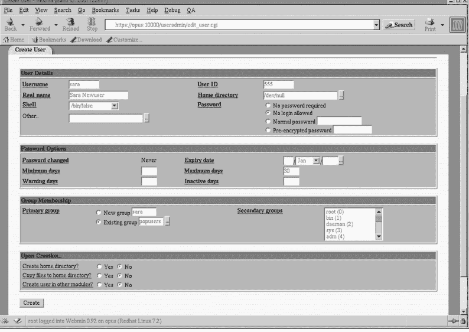

图5.1: `Webmin`的`Create User`界面允许您指定新用户的参数。使用`Webmin`添加用户时，您真正必须输入的唯一信息是用户名和主目录。然而，在`Full Name`字段中输入某些内容也很有用。目前，即使对于`Shell`设置为`/bin/false`的用户，`Webmin`也要求输入主目录，但在末尾附近有一个复选框，您可以用它来指定如果主目录不存在是否创建，从而确保`Webmin`正确运行。如有必要，您可以输入非标准的主目录或组，或为指定用户ID。如果将这些字段留空，`Webmin`将分配默认值。尽管添加新用户很简单，您可能会倾向于利用界面上提供的许多选项，但大多数时候系统默认值是足够的。一旦输入了正确的信息，单击`Save`即可创建账户。`Webmin`会在`/etc/passwd`和`/etc/shadow`中创建必要的条目；密码必须单独设置。

如图5.1所示，有四个主要类别的信息可以添加：

*   **用户详情** 在`/etc/passwd`和`/etc/group`中提供的基本信息。
*   **密码选项** 密码老化策略执行——账户的过期日期、强制更改密码之间的天数等。
*   **组成员资格** 在主组和辅助组中的成员资格。
*   **创建时** 是否创建主目录、将文件复制到主目录，或在其他模块中创建用户。

如果您想更改这些特性中的任何一个，请在单击`Save`创建账户之前完成。或者，您可以通过在`Users and Groups`窗口的`User Listing`中单击用户名，在创建后更改账户设置。这会弹出所选用户的信息，并提供与上述`Create User`屏幕类似的选项。

## 从命令行添加用户

从命令行添加用户也需要执行前面列出的五个步骤。你可以使用`useradd`命令来完成除分配密码以外的所有步骤。`useradd`命令接受`/etc/passwd`文件中各个字段所需的信息作为参数，格式如下：

```
useradd [-D] [-g default_group] [-b default_home] [-s default_shell] username
```

`useradd`命令使用命令行中给定的值创建一个新的用户账户（对于未指定的项目，将提供默认值）。`useradd`将数据写入相应的系统文件。然后，它默认在`/home/username`创建用户的家目录，或者在通过`-b`选项指定的位置创建。`useradd`命令从`/etc/skel`复制示例配置文件。在`Red Hat`中，会创建一个与用户同名的组，并将该用户添加到该组中。（其他发行版对组的处理方式不同，如本章稍后的“组的功能”部分所进一步解释，该部分也详细描述了`Red Hat`的方法。）

接下来，使用`passwd`命令为用户分配密码：

```
# passwd donald
New UNIX password:
Retype new UNIX password:
```

**提示** 使用`-p`选项可以在命令行上传递密码，但你必须首先使用`crypt`命令对密码进行加密。否则，系统假定该字符串已加密，这将导致你的登录无法正常工作。

`/etc/skel`中包含的配置文件旨在为系统中的典型用户设置。此目录中的文件应包括`.Xdefaults`、`.bash_logout`、`.bash_profile`、`.bashrc`、`.kderc`、`.kde/`和`Desktop/`。你可以添加任何例行包含在用户家目录中的文件。

某些用户特性的默认值可以在`/etc/login.defs`文件中设置。邮件目录（通常设置为`/var/spool/mail/username`）通过该文件中的`MAIL_DIR`变量设置。密码老化信息也存储在`login.defs`文件中。`useradd`命令自动选择的最小和最大`UID`及`GID`值也存储在那里。

## 修改用户账户

大多数系统管理员通过编辑相应文件来修改用户账户。对于更改用户`shell`等简单配置细节，使用文本编辑器编辑`passwd`文件通常比启动`GUI`工具或在命令行使用`usermod`更容易。我们将展示这三种方法，你可以自己决定哪种更适合你。

### 手动修改用户账户

修改用户账户信息最直接的方式是编辑`/etc/passwd`中对应的条目。例如，假设你想把我们假设的用户`Donald`的`shell`更改为`C shell`。使用你喜欢的编辑器打开`/etc/passwd`文件。`Donald`的行看起来像这样：

```
donald:x:503:503:Unka Donald:/home/donald:/bin/bash
```

只需将`/bin/bash`更改为`/bin/csh`，然后保存文件。下次`Donald`登录时，他将使用`C shell`。当然，其他信息（包括用户名字符串`Unka Donald`）也可以更改。你可以更改家目录，但你必须创建新目录并将旧目录中的文件移动到新目录，使其可用。除非你非常清楚自己在做什么，否则不要更改`UID`或`GID`。如果你无意中更改了这些字段，`Donald`将失去访问其文件的权限，因为系统在数值上查看所有者和组标识，并使用`/etc/passwd`文件将它们转换为用户可读的格式。

原则上，也可以以类似的方式编辑`/etc/shadow`的内容。但在实践中，该文件的大部分内容形式对人类来说不太容易处理。密码是加密的，因此你不能手动更改它，除非你只是从另一个系统复制密码（这可能是有风险的）。时间信息以自`1970`年以来的天数为单位输入，计算起来很麻烦。总之，最好别动`/etc/shadow`。

### 使用 Webmin 修改用户账户

要修改任何用户的账户，请执行以下步骤：

1. 通过设置浏览器地址启动`Webmin`：

   ```
   http://hostname:901/
   ```

2. 打开**用户和组**。
3. 通过双击用户名选择你想要更改的账户。
4. 此时将显示**创建用户**信息屏幕，类似于图5.1，其中已填入现有值。最大的变化在**保存时**部分，这里会询问你是否要移动家目录或更改所有者/组设置。除了**保存**按钮外，还有查看任何记录的登录信息、阅读电子邮件和删除用户的按钮。图5.2显示了这些选项。

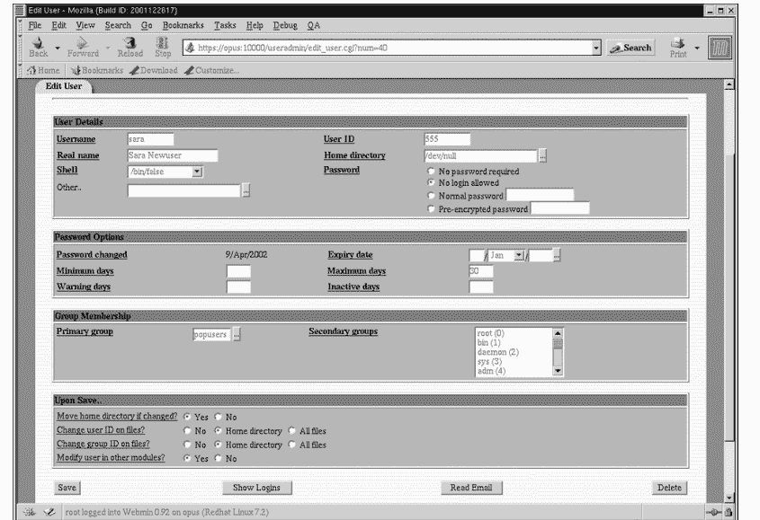

图5.2：编辑用户提供的选项与添加用户时略有不同。

5. 更改相应的字段，并选择**保存**以接受修改后的用户信息。
6. 关闭浏览器。

### 使用 `usermod` 修改用户账户

要从命令行使用`usermod`实用程序修改用户密码记录中的某个字段，请使用以下命令：


```
usermod [-c comment] [-d home_dir [-m]] [-e expire_date]
    [-f inactive_time] [-g initial_group] [-G group[, ]]
    [-l login_name] [-p passwd]
    [-s shell] [-u uid [-o]] [-L|-U] login
```

重要的 `usermod` 选项及其含义如下：

- `-c` `comment`：将替换当前注释的字符串。

- `-d` `home_dir` `[-m]`：新家目录。如果指定了 `-m`，则将旧家目录的内容移动到家目录，如果新家目录尚不存在，则会创建它。

- `-e` `expire_date`：用户账户将被禁用的日期，格式为 `YYYY-MM-DD`。

- `-f` `inactive_time`：密码过期后账户被永久禁用的天数。使用 `-1` 可关闭自动禁用功能，使用 `0` 可在密码过期时立即禁用账户。

- `-g` `initial_group`：用户的新初始登录组。该组必须存在。

- `-G` `group`：用户应归属的其他组。列表以逗号分隔，中间无空格。列出的组必须已存在。如果用户当前是某个未列出组的成员，他或她将从该组中移除。

- `-l` `login_name`：用户名将更改为此登录名。这将导致拥有此用户的文件显示新的登录名作为所有者，因为 UID 将匹配 `/etc/passwd` 文件中的条目。你可能希望将家目录也更改为使用此新的 `login_name`。你不能更改当前已登录用户的 `login_name`。

- `-p` `password`：由 `crypt` 命令加密后的用户新密码。如果你传递纯文本，它将以纯文本形式出现在 `/etc/passwd` 中。如果你随后运行 `pwconv`，`/etc/shadow` 文件将包含纯文本密码。如果用户试图使用相同的文本字符串登录，访问将被拒绝，因为系统会尝试解密从 `/etc/shadow` 获取的文本字符串，然后再将其与输入的密码字符串匹配。要更改密码，通常使用 `passwd` 命令，而不是 `usermod`。

- `-s` `shell`：这是用户在登录时将被分配的 shell。为此选项输入空白会导致系统选择默认 shell，在 Linux 中通常是 `Bash`。

- `-u` `uid`：用户 ID 的数值。此值必须是唯一的，除非你同时也指定了 `-o` 选项。系统账户通常会被分配 0 到 99 之间的 UID。大多数 Linux 系统中的用户账户从 500 开始，留出 100-499 供其他用途使用。使用 `usermod` 更新 UID 时，用户拥有的任何文件以及存在于用户家目录中的文件都会更新为新的 UID，以便 `/etc/passwd` 文件为这些文件分配正确的所有者。用户家目录外的文件将保留旧的 UID 数值，这意味着对这些文件的 `ls -l` 将显示旧 UID 的数字版本，或者如果新用户被分配了旧 UID，则显示不同用户的名字。

- `-L`：在 `/etc/passwd` 文件中用户的密码前放置一个感叹号，这将禁用用户的登录能力。

- `-U`：从 `/etc/passwd` 文件中用户的条目中移除感叹号，重新启用用户密码。

- `login`：用户的登录名。

## 禁用用户账户

如果你需要停用账户但认为该账户将来可能还需要使用，你希望禁用它而不是删除它。对于尝试使用该账户登录的用户来说，已删除的账户和已禁用的账户看起来完全相同，但已禁用的账户不会移除用户的家目录或任何由该用户拥有的文件。

### 手动禁用

禁用账户最简单的方法是确保用户的密码已过期。为此，你可以修改 `/etc/shadow` 中用户的条目。如前所述，该文件中的日期表示自 1970 年 1 月 1 日以来的天数。条目中的第三个字段是密码最后修改的日期，第八个字段是账户到期的日期。因此，你首先需要更改用户的密码；条目中的第三个字段将反映今天的日期。从该数字中减去 1，将新数字直接插入最后一个冒号之前，然后保存文件。

```
donald: HcX5zb8cBoxmY:11088:0:99999:7:0::
```

从 11088 中减去 1 得到 11087，因此你会将条目更改为：

```
donald: HcX5zb8cBoxmY:11088:0:99999:7:0:11087:
```

### 使用 Webmin 禁用账户

要禁用用户的账户，请按照以下步骤操作：

1. 按照前面描述的方法启动 `Webmin`。
2. 打开 **用户和组**。
3. 选择你想要禁用的账户。此时将显示 **用户信息** 屏幕，类似于图 5.2。
4. 将 **密码部分** 中的 **到期日期** 更改为今天的日期。
5. 点击 **保存**。
6. 关闭浏览器。

### 使用 `chage` 禁用账户

没有允许禁用用户账户的 `useradd`/`usermod` 等效命令，但你可以使用 `chage`（更改老化）命令将用户的密码过期日期更新为昨天。`chage` 允许你输入自 1970 年 1 月 1 日以来的天数，或以 `YYYY-MM-DD` 格式如下：

```
# chage -E 2000-8-12 someuser
```

如果日期已过期，账户将被禁用，但之后可以使用相同的方法重新启用。当用户尝试登录时，他或她将会看到以下消息：

Your account has expired; please contact your system administrator

## 删除用户账户

如果你确定将来不再需要某个用户的账户，你可以将其删除。删除账户基本上就是逆转创建该账户所执行的步骤。删除账户的步骤如下：

1. 删除 `/etc/passwd` 中该用户的记录。
2. 备份该用户的文件。
3. 删除该用户的文件。
4. 删除该用户的主目录。

你还需要在系统中搜索由该用户拥有的其他任何文件，并决定是删除它们还是重置其所有权。删除用户账户的所有操作都可以手动完成，也可以像以前那样通过工具来完成。

### 手动删除账户

首先，你需要移除该用户在 `/etc/passwd` 中的条目。当再次运行 `pwconv` 时，`/etc/shadow` 中该用户的条目也会被自动移除。接下来，使用类似以下命令的 `rm` 命令移除主目录及其包含的所有文件：

```
# rm -r /home/donald
```

`rm` 命令将移除 `/home/donald` 目录及其包含的所有文件和子目录。如果你足够自信并且不想被提示确认，你可以在上述命令中添加 `-f` 选项（即 `rm -rf /home/donald`），这将指示 Linux 不要在删除文件时向你询问。这非常危险，因此你可能最好忍受这些提示。

**提示** 在运行 `rm` 命令之前，备份已删除用户的账户是个好主意。你可以通过使用 `tar` 备份工具（在第 9 章中有描述）对文件进行归档，并将文件存储在软盘、大容量可移动磁盘（如 `Iomega Zip` 磁盘）、`CD-R` 光盘或磁带来实现。以这种方式保留已删除用户的文件会很有用，如果你发现删除了错误的账户，或者出于某种原因需要从该前用户的账户中恢复特定文件时。

接下来，你需要在计算机中搜索其他由已删除用户拥有的文件，并确定如何处理这些文件。请使用 `find` 命令来完成此操作，如下所示：

```
# find / -gid 503 -uid 503
```

假设 `Donald` 的用户 ID 是 503，且他的原始组 ID 从未更改过，此命令将生成一个包含完整路径的文件列表，这些文件由 `Donald` 拥有或具有他的组 ID。然后，你需要浏览该文件列表并确定如何处理每个文件。如果你决定保留某个文件但更改其所有权，可以使用 `chown` 命令，如下所示：

```
# chown betty.users /opt/somefile
```

上述命令将 `/opt/somefile` 的所有权更改为 `betty`，并将组所有权更改为 `users` 组。如果你不想更改组，可以省略句点和组名；或者在用户名前添加 `-R` 参数以递归更改目录内的所有文件。例如，以下命令将 `/home/samba/sharefiles` 目录及其所有文件和子目录的所有权更改为 `betty`，但不会更改文件关联的组：

```
# chown -R betty /home/samba/sharefiles
```

## 使用 Webmin 删除账户

你也可以使用 `Webmin` 实用工具删除用户。要做到这一点，请按照以下步骤操作：

1. 如前所述启动 `Webmin`。
2. 打开“`Users and Groups`”。
3. 选择你想要禁用的账户。然后你会看到“`User Information`”屏幕，其样式类似于图 5.2。
4. 按下“`Delete`”按钮。
5. 如果你想保留用户的主目录，请单击“`Delete User`”；如果你想删除用户的主目录，请单击“`Delete User and Home Directory`”。


6. 等待确认屏幕出现。

7. 关闭浏览器。

## 使用 `userdel` 删除账户

`userdel` 实用工具将移除 `/etc/passwd` 文件中的用户条目，并可选择移除该用户的主目录及其包含的所有文件和子目录。该用户在主目录之外拥有的任何文件将保留在系统中，并且在使用 `ls -l` 命令显示时，将显示为该用户 ID 拥有。删除我们假设的 Donald 的 `passwd` 条目和主目录的 `userdel` 命令如下所示：

```
# userdel -r donald
```

你也可以选择删除 Donald 的 `/etc/passwd` 条目，但保留其主目录中的所有文件，方法是省略 `-r`。

使用前面所示的 `find` 命令来定位所有由 Donald 或其组拥有的文件。这些文件必须手动处理。

## 组

你前面在本章中看到，每个用户都有一个默认的组身份，称为登录组，这是在登录系统时所采用的。一旦通过 `/bin/login` 进行身份验证，用户就会采用 `/etc/passwd` 文件中指定的组身份。在 Red Hat 中，用户的默认组 ID 与用户 ID 相同；在某些其他 Linux 发行版中，所有用户默认都放在单个组中，通常称为 `users`。Linux 管理员可以创建新组，将用户关联起来以用于特定目的，例如需要特定用户访问同一组文件的项目。接下来的章节展示了如何添加和移除组，以及用户如何成为不同组的成员。

### 组的功能

组是 Linux 安全性的组成部分。如第 7 章所述，每个文件都有一个关联的权限字符串。该字符串指定了三类用户中每一类用户的读取、写入和执行权限的存在或缺失：文件的所有者、文件的组以及系统中的所有用户（通常称为 `world` 权限）。通过控制文件的组设置并将用户分配到特定的组，你可以增强 Linux 系统的内部安全性。例如，如果你的系统被两组不同的员工使用，每组都在处理一个项目，你可以创建两个组，每组员工一个。通过拒绝世界对用户文件的访问，你可以防止一个组的员工读取另一个组成员创建的文件。如果少数用户属于这两个组，你可以使这些用户成为两个组的成员，以便他们能够读取两个组的文件。

由于每个 Linux 安装都是独特的，Linux 发行版不可能提供适用于所有环境的默认组配置。Red Hat 的打包者无法知道你需要哪些组，就像他们无法知道你需要哪些用户一样。尽管如此，账户创建工具会对你如何分组你的账户做出某些默认假设。不同的发行版以不同的方式处理这个问题。

在 Red Hat 中，每次添加新用户时，都会创建一个与该用户具有相同用户 ID 和数字 ID 的组。假设用户再次是 `donald`。将创建一个名为 `donald` 的用户组，并将用户 `donald` 添加到该 用户私有组 中。`umask`（参见第 4 章）被设置为 002，这意味着 `donald` 创建的任何文件对他（所有者）和 `donald` 组具有读-写权限，对世界只有读权限。这运作得很好，因为我们知道 `donald` 默认拥有该组的成员资格。由于 Donald 是其用户私有组的唯一成员，只有他和超级用户可以访问组设置为 `donald` 的文件。任何人都可以被添加到 `donald` 组中，然后将拥有对 Donald 使用此 `umask` 创建的任何文件的组访问权限。

其他发行版并不总是这样运作。有些创建单个组（通常称为 `users`），并将所有用户放入此组中。因此，默认情况下，`donald` 和 `betty` 账户都属于 `users` 组。通常，`umask` 为 022，因此用户可以读取彼此的文件，但不能写入。这是一种 共享组 方法。

在小工作站上，这两种方法往往都运作良好，因为工作站往往只有一到两个用户，且组成员资格的 implications 后果较小。在最坏的情况下，在用户私有组方法中，你可能需要为彼此添加一两个用户到组中，或者在共享组方法中创建几个新组并更改默认组成员资格。然而，在更大的系统上，你可能需要创建更复杂的配置。例如，在学术环境中，你可能需要为不同的课程创建组；在工作环境中，你可能需要为不同的工作组创建组。用于执行此操作的工具在许多方面与用于创建用户账户的工具类似。

### `/etc/group` 文件

关于每个组的信息包含在 `/etc/group` 文件中。与 `/etc/passwd` 一样，系统管理员清楚地理解这个重要文件至关重要。其结构相当简单。列表 5.2 显示了典型 `/etc/group` 文件的摘录。

#### 列表 5.2: `/etc/group` 文件的一部分

```
root:x:0:root
bin:x:1:root,bin,daemon
daemon:x:2:root,bin,daemon
```

...其他条目省略...

```
slocate:x:21:
project2038:x:1000:ernie,betty
marty:x:500:
erie:x:501:
betty:x:502:
donald:x:503:
```

每个条目声明一个组名、密码、数字组 ID（称为 GID）以及一组组成员列表。通常，组成员列表为空，这意味着只有与组同名的用户才是成员。表 5.1 列出了 Linux 在安装时自动创建的默认组。

### 表 5.1：Linux 默认组

| 组 | GID | 成员 | 描述 |
|---|---|---|---|
| `Root` | 9 | `Root` | 超级用户组 |
| `Bin` | 1 | `root,bin,daemon` | 运行程序 |
| `daemon` | 2 | `root,bin,daemon` | 运行程序 |
| `Sys` | 3 | `root,bin,daemon` | 系统组 |
| `Adm` | 4 | `root,adm,daemon` | 管理组 |
| `Tty` | 5 | | 访问终端 |
| `Disk` | 6 | `root` | 访问磁盘设备文件 |
| `Lp` | 7 | `daemon, lp` | 打印组 |
| `Mem` | 8 | | 内核内存访问 |
| `Kmem` | 9 | | 内核内存访问 |
| `wheel` | 10 | `root` | 具有接近 `root` 权限的用户 |
| `Mail` | 12 | `mail` | 由邮件实用程序使用 |
| `News` | 13 | `news` | 由 Usenet 新闻实用程序使用 |
| `Uucp` | 14 | `uucp` | 用于 UUCP 网络连接 |
| `Man` | 15 | | 用于访问 `man` 页 |
| `games` | 20 | | 用于存储游戏高分的组 |
| `gopher` | 30 | | 由 Gopher 实用程序使用 |
| `Dip` | 40 | | 拨号 IP 组（PPP, SLIP） |
| `ftp` | 50 | | FTP 守护进程组 |
| `nobody` | 99 | | 低安全性组 |
| `users` | 100 | | 许多系统上的默认用户组 |
| `Utmp` | 22 | | 用于 `utmp` 实用程序 |
| `Xfs` | 43 | | 由 X 字体服务器使用 |
| `apache` | 48 | | 由 Apache 守护进程使用 |
| `named` | 25 | | 由 DNS 使用 |
| `floppy` | 19 | | 用于访问低级软盘设备的组 |
| `pppusers` | 44 | | 仅通过 PPP 访问的用户 |
| `popusers` | 45 | | 仅通过 POP 访问的用户 |
| `slipusers` | 46 | | 仅通过 SLIP 访问的用户 |

## 添加新组

正如用户可以手动、通过命令行实用程序或使用 `Webmin` 添加一样，组也可以通过这些方式中的任意一种创建。下面解释了不同的方法，以便您可以选择偏好的方法。（一旦您创建了新组，您肯定希望将用户添加到该组中。此过程稍后将在“更改组归属”中描述。）

### 手动添加组

由于 `/etc/group` 文件的结构相当简单，管理员通常通过直接编辑文件来添加组。要创建一个具有初始组成员集的组，只需将用户名添加到条目末尾由逗号分隔的列表中。例如：

```
cs101:x:101:donald,betty,ernie
```

要检查您的工作，`id` 命令会报告用户所属的所有组。root 用户的输出看起来如下：

```
# id
uid=0 (root) gid=0 (root)
groups=0 (root), 1 (bin), 2 (daemon), 3 (sys), 4 (adm), 6 (disk), 10 (wheel)
```

> **注意** 通常没有必要将 `root` 添加到您创建的组中。`root` 是一个非常特殊的账户，它可以读写计算机上的任何文件或目录，因此不需要成为普通用户组的成员。为了方便处理这些组，`root` 属于几个系统组。

也可以使用 `groups` 命令来获得相同的基本信息：

```
# groups
root bin daemon sys adm disk wheel
```

### 使用 `groupadd` 添加组


要添加新组，请使用 `groupadd` 命令，该命令使用命令行上传递的参数来创建新组，对于您未指定的任何参数，则依赖系统默认值。新组将按需要添加到系统文件中。`groupadd` 命令的语法如下：

```
groupadd [-g GID [-o]] [-r] [-f] group
```

各种 `groupadd` 参数的含义如下：

- `–g GID` 组 ID 的数值。除非给出 `–o` 选项，否则 `GID` 必须唯一。该值不能为负数。在 Red Hat 和其他一些发行版中，默认选择大于 500 且大于任何其他组 ID 的最小剩余 ID。其他一些系统使用大于 100 且大于任何其他组 ID 的值。系统账户在 Red Hat 下使用 0 到 499 之间的值，在某些其他系统上使用 0 到 99 之间的值。

- `–r` 指定添加的组将是系统组。在许多发行版中，除非 `–g` 选项指定了要使用的 `GID`，否则组将被分配 499 以下第一个可用的 `GID`。其他系统使用 99 作为边界。

- `–f` 如果指定名称的组已存在，则强制 `groupadd` 命令让该组保持其在系统上的现有状态，并继续执行而不返回错误消息。（通常，`groupadd` 会对尝试重用组名的行为发出警告。）此外，此选项会更改 Red Hat 中 `–g` 的行为，使得如果在不带 `–o` 的情况下给出 `–g`，组将像未指定 `–g` 或 `–o` 一样，使用最小的可用 `GID` 进行添加。

- `group` 要创建的新组名。

### 使用 Webmin 添加组

您还可以使用 `Webmin` 实用程序添加新组。为此，请遵循以下步骤：

1. 从 `Webmin` 页面选择 `Users and Groups`（用户和组）。

2. 向下滚动到 `Groups`（组）部分。

3. 点击 `Create a new group`（创建新组）按钮。然后您会看到一个如图 5.3 所示的 `User Groups`（用户组）屏幕。

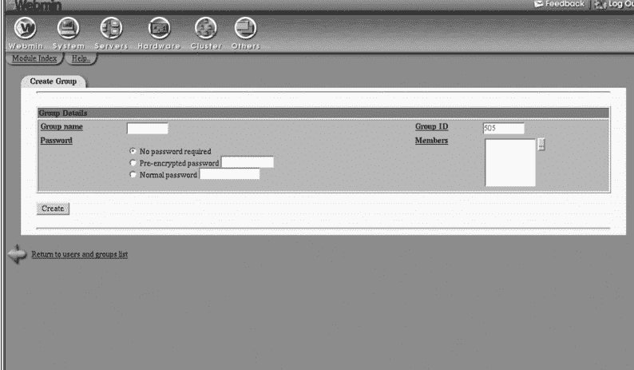

图 5.3：您可以使用 `Create Group`（创建组）屏幕指定用户组信息。

4. 指定组名、密码、组 ID 以及任何替代成员。

5. 点击 `Create`（创建）。

### 更改组归属

用户执行的所有操作都是在特定的用户 ID 和组 ID 下进行的。因此，虽然用户可以属于多个组（通过如前所述将用户名添加到多个 `/etc/group` 条目中），但用户一次只能作为一个组的成员进行操作。通常，这不太重要，但在某些情况下可能会有影响。例如，用户可能需要创建带有特定组归属的文件，以便适当组的其他成员可以读取这些文件。每个用户都有一个主组归属，指定在用户的 `/etc/passwd` 文件条目中。登录时，用户以该组的成员身份进行操作。`newgrp` 命令提供了一种让用户临时更改与其操作相关的组的方法。（命令 `sg` 通常是 `newgrp` 的同义词。）要使用 `newgrp`，请输入该命令、一个连字符（这会导致系统重新初始化用户的环境变量）以及新的组名。例如，要成为 `project1` 组的成员，请输入：

```
$ newgrp - project1
```

如果用户 `donald` 已使用 `newgrp` 加入 `project1` 组，当他创建新文件（例如项目文档）时，在长目录列表（`ls`）中，该文件将显示为由新组拥有：

```
-rw-r--r--    1 donald    project1        10332  Aug 20 16:07  proj_doc
```

**注意** 虽然您需要使用 `newgrp` 命令来创建组归属不是您的主组的文件（或者事后使用 `chown` 或 `chgrp` 更改归属），但对于读取您所属但并非您的主组的文件，这是不必要的。例如，如果 `Donald` 通常是 `donald` 组的成员，但也是 `project1` 组的成员，只要文件具有组读取权限，即使不使用 `newgrp`，他也可以读取 `project1` 文件。

在设计上，管理员可以配置 `newgrp` 要求对组访问进行身份验证，但这在 Red Hat 发行版中似乎无法正常工作，因此我们建议避免为组分配密码。

## 修改组

组的修改可以手动完成，通过命令行的 `groupmod` 工具，或者通过 `Webmin`。您可以修改组名、组 ID 号和组成员。您可能需要在某系统上更改组名或 ID 号，以便将两台或多台计算机的配置保持一致，或者更改您的组布局方案。添加和删除组成员是系统管理的普通部分。

### 手动修改组

要手动修改组信息，请编辑 `/etc/group` 文件。在这里，您可以更改组名、`GID` 和成员。如果您希望更改其他信息，使用 `useradd` 或 `Webmin` 实用程序要容易得多。

例如，考虑以下组定义：

```
project1:x:503:donald,betty
```

假设您希望为该组提供一个更具描述性的名称，并添加一个新用户 `emily`。您可以如下更改定义：

```
moonshot:x:503:donald,betty,emily
```

此后，组 ID 将在程序列表等中显示为 `moonshot`，而不是 `project1`。（即使现有文件也会更改。）切换到该组时，组成员需要指定 `moonshot` 作为组名，用户 `emily` 将能够使用该组的资源。

**警告** 更改 `GID`，就像更改用户 `UID` 一样，会使组拥有的文件成为“孤儿”。恢复过程与之前描述的更改现有文件 `UID` 的过程相同。除非您有充分理由这样做，否则最好不要更改现有组的 `GID`。

## 使用 groupmod 修改组信息

组的特性可以通过 `groupmod` 命令进行修改。所有相关的系统文件都会被更新。`groupmod` 的语法与 `groupadd` 类似：

```
groupmod [-g GID [-o]] [-n group_name] group
```

- `-g GID` 组 ID 的数值。除非指定了 `-o` 参数，否则此值必须是唯一的。与 `groupadd` 命令一样，组 ID 必须为非负数，且除非该组是系统组，否则不应介于 0 到 99 之间。

- `-n group_name` 组的新名称。

- `group` 组的旧名称。

## 使用 Webmin 修改组信息

可以使用 `Webmin` 实用工具来修改组。只需像之前那样导航到“用户和组”选项。当显示组列表时，高亮显示你希望修改的那个组。随后你将看到图 5.4 所示的“编辑组”屏幕，其中已填入现有值。根据需要做出更改，然后点击“保存”按钮。

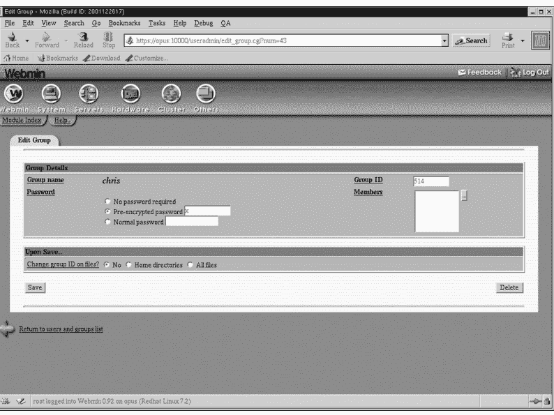

图 5.4：你可以使用“编辑组”屏幕更改用户组信息。

## 删除组

组也可以像其他账户管理任务一样，使用相同的三种方法删除：手动编辑 `/etc/group` 文件、使用命令行（`groupdel` 命令）或使用 `Webmin`。

## 使用 groupdel 删除组

你可以使用 `groupdel` 命令删除组；该命令会删除所有引用指定组的条目：

```
groupdel group
```

然而，`groupdel` 命令不会搜索具有该 `GID` 的文件。这需要单独使用 `find` 命令完成，方法如下：

```
# find / -gid group
```

## 使用 Webmin 删除组

`Webmin` 实用工具也可以用于删除组。只需像之前那样选择“用户和组”选项。当显示组列表时，高亮显示你希望删除的那个组。随后你将看到图 5.4 所示的“编辑组”屏幕，其中已填入现有值。点击“删除”按钮。

## 手动移除组

虽然你可以通过编辑 `/etc/group` 文件并删除对应于你要移除的组的那一行来简单地移除一个组，但这种方法不如其他方法高效。如果你从 `/etc/group` 中移除组的条目，你很可能也应该从 `/etc/gshadow` 文件中移除相应的条目（如果你选择使用组密码，该文件用于存储被影子化的组密码）。如果你不为组使用密码，此文件将不会自动更新。

## 总结

作为多用户操作系统，Linux 依赖用户账户和组来维护安全并确保系统对所有用户可用。多年来，手动方法、基于文本的工具和图形界面工具已被开发出来以管理这些账户和组。然而，无论通过何种方式操作，重要的是你要理解 Linux 如何处理其账户和组——用户名与 `UID` 或组名与 `GID` 之间的关系；密码存储在哪里；以及用户如何被分配到组中。理解这些主题将使你能够有效地管理你的用户基础，无论是只有几个人还是成千上万的人。这些主题对于保护你的系统所使用的文件和进程也至关重要。我们在下一章中讨论文件系统和管理磁盘。

# 第 6 章：文件系统和管理磁盘

## 概述


Linux 作为操作系统的一个优势是它对多种文件系统的支持。Linux 不仅支持其自身的原生文件系统，即第二扩展文件系统（`ext2fs` 或 `ext2`），还支持由其他类 Unix 操作系统、Windows、MacOS 等使用的一大批文件系统。这种支持使 Linux 在多启动环境中特别有效，对于仅使用 Linux 的系统也非常有用。你可以使用 Linux 广泛的文件系统支持来读取可移动介质，甚至其他计算机的硬盘。

**注意** `filesystem`（文件系统）一词有两个含义。在本章中，`filesystem` 指的是用于存储文件的基于磁盘或网络的数据结构。它还可以指磁盘上的目录和文件的层次结构。在后一种意义上，文件系统是一种逻辑结构，你可以使用文件管理器或 `ls` 等 Linux 命令来查看。（第 7 章讨论这种第二种意义上的文件系统。）相比之下，构成第一种含义下的文件系统的底层数据结构对用户或系统管理员来说在很大程度上是不可见的——但它们的影响仍然很重要，如本章中所示。

为了访问这些文件系统，你必须理解 Linux 用于实现此访问的工具。最关键的是，你必须识别 Linux 如何挂载和卸载文件系统——即操作系统如何将可移动磁盘或硬盘分区嫁接到其现有的目录结构上。此外，你应该熟悉可用于帮助你准备文件系统以供使用并保持其顺畅运行的工具。

本章以概述 Linux 的文件系统功能开始，包括它支持的主要文件系统。然后讨论文件系统处理的实际问题——如何挂载和卸载硬磁盘和可移动介质的文件系统。最后，查看如何维护文件系统和添加新文件系统。

### Linux 文件系统支持

Linux 的文件系统支持非常出色，但并非完美。大多数发行版在默认安装中缺乏对至少某些文件系统的支持。要使用这些文件系统，你必须找到适当的驱动程序，并很可能重新编译你的内核。其他文件系统可以工作，但其功能有限。最重要的是，许多文件系统驱动程序只以只读形式提供——它们可用于从外部文件系统读取文件，但不能写入文件系统。还有其他文件系统以完整的读/写模式工作，但其功能集与 Linux 的假设和要求并不完全匹配。基于所有这些原因，你必须理解你正在使用的特定文件系统，以便意识到其限制并在可能时绕过它们。

### 定位文件系统

大多数 Linux 文件系统随 Linux 内核提供，Red Hat Linux 在其默认配置中包含了这些文件系统中的大多数。这些文件系统中的许多作为内核模块提供。你可以通过输入以下命令来了解哪些文件系统模块可用：

```
$ ls /lib/modules/x.y.z/kernel/fs
```

在此命令中，`x.y.z` 是内核版本号，例如 `2.4.18-3`。作为响应，你会看到一组文件系统驱动程序目录，例如 `hfs`，每个目录包含一个或多个内核模块，例如 `hfs.o`。这些模块通常以其实现的文件系统命名。然而，这些驱动程序文件中的某些是支持模块，而不是独立的文件系统。此外，请注意并非所有文件系统都出现在此目录中——有些直接内置于内核文件本身。最重要的是，Linux 引导所依据的文件系统必须内置于内核中。

### 准备使用标准文件系统

如果你想要的文件系统不在你的计算机上，你可以检查 Linux 内核，看看它是否存在于内核源代码树中但未为你的系统编译。为此，你必须检查 Linux 内核“File Systems”和“Network Filesystems”配置菜单中可用的文件系统（图 6.1 显示了内核“File Systems”菜单）。第 8 章更详细地讨论了内核配置菜单和内核配置选项。

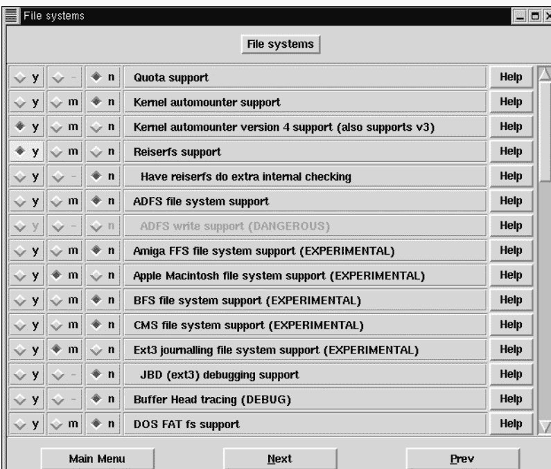

图 6.1：标记为实验性的文件系统仅在你选择在“Code Maturity Level Options”菜单中使实验性功能可用时才会出现。

当你打开适当的内核配置菜单后，你可以浏览可用文件系统列表以找到你想要的那个。如果你不确定给定的内核选项实现了什么文件系统，请点击该文件系统的“Help”按钮以查看简短描述。一旦你选择了所需的文件系统，你必须重新编译你的内核和内核模块，然后按照第 8 章中所述配置你的系统以使用新内核。

### 定位非常规文件系统

少数文件系统不包含在常规 Linux 内核中。这些大多是开发中文件系统——它们太新，尚未添加到内核中。最有趣的是

在这些文件系统中有两个新的日志文件系统，即 `JFS` 和 `XFS`，它们将在稍后的“日志文件系统”部分中描述。（该部分包含了指向这些文件系统在互联网上主页的链接。）另外两个日志文件系统，`ext3fs` 和 `ReiserFS`，自 `2.4.x` 内核系列的早期版本起就已包含在内核中。

如果你在寻找特定的文件系统但在内核中找不到，请尝试在 `Google Groups`（`http://groups.google.com/`）上进行搜索，或使用 `雅虎`（`http://www.yahoo.com/`）或`谷歌`（`http://www.google.com/`）等网络搜索引擎。你很可能会找到一些线索。

大多数非标准文件系统要求你打补丁修改你的 Linux 内核——也就是说，向内核源码树中添加文件。这些补丁通常附带执行此任务的说明，因此你应该遵循这些说明。然后，你可以按照前文“准备使用标准文件系统”中描述的方法选择内核驱动程序，并编译包含必要支持的内核或内核模块。

## Linux 原生文件系统

原生文件系统是指可作为操作系统主要文件系统使用的文件系统。Linux 可以仅使用一个原生文件系统来运行；也就是说，它不需要混合使用两个或多个独立的文件系统。操作系统的原生文件系统通常是为特定操作系统设计的，尽管在某些情况下，操作系统会从先前或相关的操作系统中“继承”或“采用”一个原生文件系统。Linux 继承并采用了文件系统，并且也拥有专门为它设计的 Linux 专属文件系统。这与外部文件系统形成对比，外部文件系统是为其他操作系统设计的。一般而言，外部文件系统与 Linux 的兼容性不如原生文件系统。在某些情况下，这些定义会变得模糊，你很快就会明白这一点。

本讨论将原生文件系统分为两类：传统类型和日志类型。也可以进行其他分类，但就我们的目的而言，这种分类非常有用。“传统”并不意味着不重要或性能差。Linux 的 `ext2` 文件系统属于传统类别，但在大多数方面仍然是表现良好的，在 2002 年非常重要。然而，传统文件系统很可能会在十年中期或更早消失，取而代之的是一个或多个日志文件系统。

### 传统文件系统

传统文件系统源自可追溯至 1970 年代甚至更早的文件系统技术。其中一些在随后的年份中得到了更新，甚至有一些是在 1980 年代和 1990 年代创建的；但这些文件系统共享一些重要特征。最值得注意的是，这些文件系统都存在一个共同问题：如果没有正确关机，就需要执行广泛的文件系统检查。

在传统文件系统中，当计算机向磁盘写入数据时，它是分片进行的。计算机可能会执行一些磁盘读取以定位可用磁盘空间，然后修改磁盘上的指针以分配文件空间，接着将数据写入磁盘，最后更新磁盘上的指针以完成操作。结果是，文件系统整体在任意时刻可能处于不一致状态——一个磁盘结构可能表明某空间已分配给文件，而另一个结构则表明同一空间是空闲的。

当然，一旦所有操作完成，磁盘状态将保持一致。问题出现在磁盘未正确卸载时。如果电源故障或计算机崩溃，磁盘可能会处于不一致状态；由于内存中缺乏待处理操作，Linux 无法知道哪些磁盘结构可能受到影响。因此，Linux 必须对磁盘内容执行长时间的检查以解决不一致性。这就是 Linux 在崩溃后启动时对磁盘运行 `fsck` 时会经历长时间延迟的原因。（Linux 还在正常启动几次后运行 `fsck`，以确保没有因 `bug` 或其他问题导致的不一致性渗透到磁盘上。）比磁盘检查程序漫长的时间更糟糕的是，它有时会揭示严重的损坏。在最坏的情况下，你可能会丢失磁盘上的所有数据。

传统的 Linux 原生文件系统包括：

-   `Minix`：`Minix` 文件系统使用 `minix` 类型代码进行挂载，是 Linux 的第一个文件系统。该文件系统源自 `Minix` 操作系统，因此得名。按当今标准，`Minix` 文件系统相当原始；例如，其最大尺寸仅为 `64MB`。不过，仍有一些人继续使用它在软盘上。

-   `Ext`：扩展文件系统，更常被称为 `ext` 或 `extfs`，在挂载命令中称为 `ext`，拥有独特的设计，大量借鉴了其他 Unix 文件系统。`Extfs` 已被取代，并在 `2.2.x` 内核系列中从标准 Linux 内核中移除。

-   `Ext2`：二次扩展文件系统通常称为 `ext2` 或 `ext2fs`，使用 `ext2` 挂载代码。直到 2001 年，它是 Linux 系统的标准文件系统，但在 2001 年和 2002 年，许多发行版开始转向日志文件系统。`Ext2fs` 基于 `extfs`，但具有显著扩展的功能。`Ext2fs` 是开发某一种日志文件系统的基础，如前所述。

-   `Xia`：`Xia` 文件系统在挂载时称为 `xiafs`，是 `Minix` 文件系统的扩展，并与 `extfs` 和 `ext2fs` 竞争。`Ext2fs` 已在所有重要指标上超越了 `Xiafs`。`Xiafs` 选项已从 `2.2.x` 内核中移除。


- `ISO–9660`：这种文件系统不寻常之处在于其使用仅限于 `CD–ROM` 光盘。从某种意义上说，它并不是真正的原生文件系统；但由于打算在 `Linux` 中使用的 `CD–ROM` 始终使用 `ISO–9660` 文件系统，因此将其列入此列表。普通 `ISO–9660` 在文件名长度方面非常受限，并且缺乏 `Linux` 的所有权和权限。`ISO–9660` 的 `Rock Ridge` 扩展纠正了这些缺点，允许 `CD–ROM` 包含这些重要功能。另一种文件系统 `Joliet`，与至少最小限度的 `ISO–9660` 文件系统配合使用，为 `Windows` 系统提供长文件名。如果内核中编译了适当的支持，`Linux` 也可以读取 `Joliet` `CD–ROM`。这三种变体都使用 `iso9660` 文件系统类型代码。

在 2002 年，最重要的传统 `Linux` 文件系统显然是 `ext2fs`。你只能在博物馆展品中找到 `extfs` 和 `Xiafs`，虽然 `Minix` 文件系统继续在 2.4.x 内核中存活，但其实用性仅限于软盘。`ISO–9660` 及其扩展很重要，但仅用于 `CD–ROM`。

虽然 `ext2fs` 在传统文件系统标准下表现良好，但它也有其局限性。目前最重要的是磁盘检查时长的问题；然而，`ext2fs` 还受限于最大文件系统尺寸为 16 TB（16,384GB）。尽管截至本文撰写时，16TB 磁盘尚未面向台式机可用，但文件系统需要足够的开发时间，因此文件系统开发人员需要在这些磁盘生产之前很久开始规划。

**注意** `Linux` 依赖*虚拟文件系统*（`VFS`）层来实现所有文件系统使用的功能。在 2.2.x 内核中，`VFS` 强加了 4TB 的分区大小限制和 2GB 的文件大小限制。内核开发人员已为 2.4.x 及更高版本的内核重写了负责这些限制的大部分代码，剩余的遗留问题无疑会在 4TB 磁盘可用时得到解决。

## 日志文件系统

对于小硬盘，系统在崩溃或断电后需要执行磁盘检查是一个可以忍受的麻烦。这种磁盘检查通常不超过几分钟，而且因为 `Linux` 很少崩溃，检查通常不是大问题——除非它发现磁盘上有严重的损坏，从而导致文件丢失。然而，对于较大的磁盘，磁盘检查需要更长的时间。在当今非常常见的大型多吉字节磁盘上，磁盘检查可能需要几分钟——甚至几个小时！这种延迟不仅仅是小麻烦，特别是当它施加在必须全天候运行的服务器上时。

解决长时间磁盘检查的一个方法是实施*日志*，这是磁盘上待处理操作的列表。当操作系统调用磁盘更改（如*文件写入*）时，文件系统驱动程序会将有关这些更改的信息写入日志。当操作系统对磁盘结构进行*实际*更改时，它以这种方式更改，使得在完成后磁盘处于一致状态；然后操作系统清除日志。结果是，如果发生断电或系统崩溃，操作系统知道哪些文件和磁盘结构可能受到影响，因为所有待处理的更改都记录在日志中。因此，操作系统可以撤销或重做日志中指示的操作，从而生成一致的文件系统。这大大减少了崩溃后的启动时间。

维护日志存在一些开销，但在实践中，大多数日志文件系统使用的比非日志文件系统更先进的设计。这意味着日志文件系统通常（但不是总是）性能优于传统文件系统。这些文件系统通常还支持比 `ext2fs` 大得多的最大文件系统尺寸。

本文描述的四种日志文件系统中的两种现在已包含在 2.4.x 内核中。这些文件系统不像 `Linux` 久经考验的 `ext2fs` 那样经过充分测试，但所有现用用途至少是可以使用的。以下是下一代 `Linux` 文件系统冠军的四个竞争者：

**第三次扩展** 第三次扩展文件系统（`ext3` 或 `ext3fs`）是 `ext2fs` 的扩展。基本思想是在 `ext2fs` 的基础上添加一个日志。该文件系统的一个巨大优势是，你可以通过运行单个命令将 `ext2` 文件系统转换为 `ext3` 文件系统；你的数据保持完整。它还使用标准的 `ext2fs` 工具来创建、调整和操作文件系统。正如你所料，`ext3fs` 的*类型*代码是 `ext3`。该文件系统包含在 2.4.x 内核中，并且是一些发行版（如 `Red Hat` 7.3）的默认文件系统。

**ReiserFS** 这个文件系统是一种完全新的设计，添加到了 2.4.1 `Linux` 内核中。`ReiserFS` 在稳定性方面赢得了声誉，特别是在分区包含许多小文件时高效使用磁盘空间。使用 `reiserfs` 类型代码访问 `ReiserFS` 分区。`ReiserFS` 的主网站位于 http://www.namesys.com/。`ReiserFS` 是一些发行版（如 `SuSE`）的首选文件系统。

**XFS** `XFS` 是 `Silicon Graphics`（`SGI`）的日志文件系统。它一直用于 `SGI` `Unix` 工作站和服务器（运行 `IRIX` 操作系统），该公司已将其移植到 `Linux` 并基于 `GPL` 发布。该文件系统支持最大文件系统尺寸高达 16,384 PB（PB；1PB 为 1024TB），最大文件尺寸高达 8192PB。（尽管使用 2.4.x 内核，`Linux` 的 `VFS` 强制施加低得多的限制。）`XFS` 在支持高级功能（如访问控制列表 [ACL](https://example.org)）方面处于领先地位，`ACL` 提供了一种替代标准 `Unix` 风格权限的文件访问控制方法。然而，到 2002 年，只有少数程序支持 `ACL`。该文件系统的类型代码为 `xfs`。你可以在 [http://oss.sgi.com/projects/xfs](http://oss.sgi.com/projects/xfs) 了解更多信息。截至 2.4.18 版本，`XFS` 尚未集成到 `Linux` 内核中。

**JFS** `IBM` 的日志文件系统（`JFS`）最初是为 `AIX` 操作系统开发的；不过，`IBM` 已将其高级文件系统以 `GPL` 协议发布，并正积极支持其向 `Linux` 的移植。除了日志功能外，`JFS` 还支持最大 32PB 的文件系统大小和最大 4PB 的文件大小。在挂载 `JFS` 分区时，请使用 `jfs` 文件系统类型代码。更多信息请访问 [http://oss.software.ibm.com/developerworks/opensource/jfs/](http://oss.software.ibm.com/developerworks/opensource/jfs/)。与 `XFS` 类似，截至 2.4.18 版本，`JFS` 尚未包含在标准内核中。

所有这些文件系统相比 `ext2fs` 都有显著改进，其中日志功能减少了系统崩溃或断电后的启动时间。`XFS` 和 `JFS` 中分区和文件大小的增加也是一个很大的优势。所有这些文件系统都支持动态分区调整，尽管在本文撰写时，支持该功能的代码并不总是完全稳定或完整。如果此功能对您很重要，您应该查看其状态。

到 2002 年，所有这些文件系统的可用性都很高，但在可靠性方面有所不同。`ReiserFS` 通常被认为是最可靠的，但 `ext3fs` 和 `XFS` 也都拥有良好的声誉。`JFS` 稍逊于其他文件系统，但在 2002 年，它的性能与一年或两年前的 `ReiserFS` 相当。所有这些文件系统都需要其自身的实用程序来检查文件系统完整性、创建文件系统等等。这些文件系统都附带了用于执行这些任务的适当实用程序，但其中一些包含更多或更复杂的工具。到 2002 年，`XFS` 在这方面异常完整，而 `JFS` 则落后于其他文件系统。

一些发行版附带了对其中两个以上文件系统的兼容支持。例如，`SuSE` 7.3 包含对 `ReiserFS`、`ext3fs` 和 `JFS` 的支持。您也可以修补您的内核以支持这些文件系统中的任意一个。（请阅读文件系统文档以获取详细指示。）除了 `ext3fs` 之外，将现有系统转换为使用日志文件系统需要备份、创建新文件系统并恢复文件。对于 `ext3fs`，您可以通过发出类似以下命令来转换现有分区：

```
# tune2fs -j /dev/hda3
```

此命令向 `/dev/hda3` 分区添加了一个 `ext3fs` 日志。如果在发出此命令时文件系统已挂载，它会创建一个名为 `.journal` 的文件来保存日志。如果文件系统未挂载，则日志文件完全不可见。要使用日志功能，您必须更改挂载选项，以便 `Linux` 以 `ext3` 类型挂载文件系统。如果您未能进行此更改，您将失去对该文件系统的读写访问权限；`ext2fs` 驱动程序拒绝以读写方式挂载 `ext3fs` 分区。

## 外部文件系统

除了其本地文件系统外，`Linux` 还支持广泛的其他操作系统常用的文件系统。在双启动配置中、在操作系统之间交换可移动介质时，以及使用 `Linux` 从原本位于另一台计算机中的硬盘恢复数据时，这种文件系统支持非常重要。在大多数情况下，您不希望使用外部文件系统来存储 `Linux` 的核心文件。这些文件系统通常缺乏对 `Linux` 使用至关重要的功能，例如所有权和权限。在少数情况下，这些文件系统支持这些功能，但 `Linux` 对该文件系统的实现在某一方面较弱。

### 微软文件系统

在双启动环境中使用时，`Linux` 通常必须与某个版本的 `Windows` 共存。此外，可移动介质——软盘、`Zip` 盘、`LS-120` 盘等——通常是在 `Windows` 系统上创建的。因此，`Linux` 支持微软的文件系统至关重要。幸运的是，`Linux` 至少包含了对以下在 `Windows` 及相关操作系统中常用文件系统的最低支持：


`FAT` 文件分配表（`FAT`）是 Windows 9x/Me 文件系统以其命名的数据结构。最初用于 DOS 计算机，`FAT` 在两种方式上进行了扩展：`FAT` 数据结构的大小以及存储长文件名的能力。这些扩展将在下文描述。

`HPFS` 微软开发了高性能文件系统（`HPFS`），用于 OS/2 1.2，当时微软和 IBM 仍是合作伙伴。如今，IBM 在其 OS/2 产品系列中使用 `HPFS`。在 `2.2.x` 内核系列中，Linux 的 `HPFS` 支持是只读的，但 `2.4.x` 内核附带了可读写 `HPFS` 驱动程序。该驱动程序的一个特点是，它使用 `HPFS` 扩展属性（`EA`）来存储 Linux 的所有权、组、权限和其他功能，而 OS/2 使用 `EA` 来存储图标和其他辅助文件数据。`HPFS` 分区的 Linux 文件系统类型代码为 `hpfs`。

`NTFS` 新技术文件系统（`NTFS`）是 Windows NT、2000 和 XP 的首选文件系统。`NTFS` 是一个相当先进的日志文件系统，支持类似于 Linux 用户名的所有权系统。不幸的是，Linux 的 `NTFS` 支持较弱。虽然 `2.2.x` 及更高版本的内核中已有可读写驱动程序，但内核编译脚本中将写支持标记为“危险”。此外，这些驱动程序不支持 `NTFS` 的安全功能。随着 Windows 2000 的发布，微软对 `NTFS` 进行了更改（通常称为 `NTFS 5.0`）。Linux 的 `NTFS` 驱动程序可以处理 `NTFS 5.0` 分区，但建议使用其读写支持在这些分区上是不明智的。Linux 对 `NTFS` 分区的类型代码为 `ntfs`。Red Hat 默认安装中不包含编译好的 `NTFS` 驱动程序，因此如果您想从 Red Hat 访问 `NTFS` 分区，必须找到该驱动程序或重新编译您的内核。

**注意** 由于 Linux 的 `NTFS` 写支持非常危险，必须将其与 Linux 内核中的主要 `NTFS` 支持分开启用。

对于微软文件系统，最有用的和最稳定的 Linux 驱动程序是 `FAT` 驱动程序。此驱动程序极其稳定——与某些外部文件系统不同，向 `FAT` 分区写入数据是相当安全的。`FAT` 文件系统实际上有几种变体，在两个维度上有所不同：

- **位数**：`FAT` 数据结构使用 12、16 或 32 位大小的指针。增加 `FAT` 大小等同于增加最大分区大小。12 位 `FAT` 主要用于软盘；16 位 `FAT` 允许最大 2GB 的分区；32 位 `FAT` 支持最大 2TB 的分区。Linux 的 `FAT` 驱动程序自动检测 `FAT` 大小，这通常表示为文件系统名称的后缀，如 `FAT-16` 和 `FAT-32`。

- **文件名长度**：原始 `FAT` 文件系统（DOS 使用的）仅支持带有可选三位扩展名的八字符文件名（即所谓的 8.3 文件名限制）。随着 Windows 95 的引入，微软推出了对 `FAT` 的扩展，称为 `VFAT`，它支持长文件名。Linux 支持其自身的 `FAT` 扩展，称为 `UMSDOS`，它将 Linux 所有权和权限信息以及长文件名放置在 `FAT` 文件系统上。`VFAT` 和 `UMSDOS` 是不兼容的扩展。

由于 Linux 自动检测 `FAT` 大小，因此不需要为不同的 `FAT` 大小使用单独的 Linux 文件系统类型。然而，Linux 为每个文件名长度选项使用三个类型代码。如果您使用 `msdos` 类型代码挂载文件系统，Linux 将文件名限制在 8.3 以内。如果您使用 `vfat` 类型代码，Linux 使用 `VFAT` 长文件名。如果您使用 `umsdos`，Linux 使用 `UMSDOS` 长文件名。在大多数情况下，`vfat` 是访问 `FAT` 分区最合适的类型代码，因为它允许在 Linux 和 Windows 系统之间交换带有长文件名的文件。

**注意** 一种常见的误解是 `FAT-32` 和 `VFAT` 之间存在某种联系。它们没有。您可以使用 `VFAT` 长文件名访问 `FAT-16` 甚至 `FAT-12` 磁盘；您也可以使用 Linux 的 `msdos` 驱动程序挂载 `FAT-32` 分区，仅使用 8.3 文件名。

`UMSDOS` 很特别，因为它允许 Linux 将 `FAT` 分区视为本地文件系统。您可以完全从一个 `UMSDOS` 分区运行 Linux 系统，实际上，一些发行版支持直接在 `UMSDOS` 分区上安装 Linux。然而，这种配置往往较慢，因为 Linux 的 `FAT` 支持虽然稳定，但不如它对 `ext2fs` 的支持速度快。

### 苹果文件系统

如果您在 Macintosh 上运行 Linux，或需要与 Macintosh 用户交换数据，您可能需要支持 Macintosh 文件系统。到 2002 年，存在四种这样的文件系统，但只有三种常用，且只有两种支持 Linux 驱动程序：

`MFS` 麦金塔文件系统（`MFS`）用于最早的 Macintosh。除了 400KB 软盘（如今极少见）外，几乎从未在其他地方使用。Linux 不包含 `MFS` 支持。

`HFS` 分层文件系统（`HFS`）是 `MFS` 的替代品。在 800KB 及更大软盘以及 1998 年之前的所有 Macintosh 硬盘上使用，`HFS` 在 Macintosh 世界中非常常见。Linux `2.2.x` 及更高版本的内核包含可读写 `HFS` 支持，使用文件系统类型代码 `hfs`。然而，写支持被视为实验性的，偶尔会损坏硬盘。因此，最好将此支持限制在空白软盘上使用。Macintosh CD-ROM 通常使用 `HFS` 而不是 `ISO-9660`。

**注意** 虽然 800KB Macintosh 软盘使用 `HFS`，但即使在使用启用 `HFS` 的内核时，Linux 也无法读取这些磁盘。这些磁盘使用一种不常见的低级磁盘记录技术，标准的 x86 硬件无法处理它。苹果在其 1.44MB 软盘中转向了 PC 风格的低级记录技术，因此 Linux 可以读取 Macintosh 1.44MB 软盘以及其他可移动介质。

## HFS+

`HFS` 的后续版本 `HFS+` 借鉴了许多 Unix 风格文件系统的特性，但并未引入日志功能。新 Macintosh 电脑出厂时磁盘 invariably 都格式化为 `HFS+`，但该文件系统极少用于可移动介质。（MacOS X 安装光盘是一个例外；它使用了 `HFS+`。）Linux 对 `HFS+` 的支持仍处于 alpha 阶段，尚未整合到内核中。Linux `HFS+` 网页地址为 `http://sourceforge.net/projects/linux-hfsplus/`。

## FFS

MacOS X 提供了使用 Unix 快速文件系统（`FFS`）的选项，有关 `FFS` 的描述将在下一节中介绍。不过，许多 MacOS X 系统仍继续使用 `HFS+`。

如果你需要在 Macintosh 和 Linux 系统之间交换可移动介质，这是可行的。`HFS` 是文件系统的最佳选择；如果使用软盘，则必须是 1.44MB 软盘或罕见的 720KB `HFS` 软盘。或者，你可以使用 `FAT`，因为现代 Macintosh 支持 `FAT`。理论上，你可以在运行 MacOS X 的 Macintosh 上使用 `FFS` 进行交换，但这种选项实现起来很繁琐。

如果你在 Macintosh 上运行 Linux，你可能希望创建一个 `HFS` 分区，用于在 Linux 和 MacOS 之间进行数据交换。由于 Linux 无法读取 `HFS+` 分区，当你希望跨操作系统共享文件时，这个数据交换分区就变得非常必要。

# 杂项文件系统

除了 Microsoft 和 Apple 的文件系统外，Linux 还支持各种其他外部文件系统。其中大多数实用性有限且关注度不高。以下是一些亮点：

## BeFS

BeOS 使用自己的日志文件系统，称为 `BeFS`。可以从 `http://hp.vector.co.jp/authors/VA008030/bsf/` 获取该文件系统的只读 Linux 驱动程序。作者声称正在开发读写支持，但目前尚未实现。截至 2002 年年中，该驱动程序尚未在 `2.4.x` 内核上工作。尽管 BeOS 是单用户操作系统，但 `BeFS` 支持类似于 Linux 中使用的文件所有权和权限。理论上，`BeFS` 有可能成为原生日志文件系统的竞争者，但其他系统在 2002 年已处于领先地位。`BeFS` 还缺乏对文件访问时间戳的支持，这可能阻碍其作为 Linux 原生文件系统的功能。`BeFS` 的文件系统类型代码为 `befs`。

> **注意**：`2.4.x` 内核包含对另一种文件系统的支持，称为 `BFS`，它与 `BeFS` 完全无关。`BFS` 用于在 SCO UnixWare 操作系统中存储关键的系统启动文件。

## FFS/UFS

快速文件系统（`FFS`；又称 Unix 文件系统或 `UFS`）是在 Unix 发展早期开发的。它仍被许多 Unix 及其衍生系统使用，包括 FreeBSD 和 Solaris。原则上，`FFS/UFS` 本可以成为 Linux 的原生文件系统，但 Linux 对该文件系统的写支持仍被视为危险的，这与 Linux 对 `NTFS` 的写支持类似。`FFS` 存在时间足够长，已经衍生出几个次要变体，但一个 Linux 驱动程序可以处理所有这些变体。`FFS` 的文件系统类型代码为 `ufs`。

## UDF


通用磁盘格式（UDF）是一种专为可记录 CD、DVD 和可记录 DVD 介质设计的文件系统。Linux 在 2.4.x 内核系列中包含了 UDF 支持，但写支持被标记为“危险”，且在支持的硬件方面非常有限。该文件系统的类型代码为 `udf`。

你可以浏览 Linux 内核配置菜单来了解 Linux 支持的其他文件系统。如果你在寻找对特定文件系统的支持且在菜单中找不到，可以尝试网络搜索。

# 网络文件系统

一些文件系统专为通过网络使用而设计，而不是在硬盘上使用。你可以在 Linux 中像挂载基于磁盘的文件系统一样挂载这些文件系统，并在文件系统上执行正常的文件访问操作。Linux 支持的网络文件系统包括以下类型：

## NFS

Sun 的网络文件系统（NFS）是 Unix 或 Linux 计算机网络中首选的文件共享方式。Linux 内核既包含 NFS 客户端支持（以便 Linux 可以挂载其他系统的 NFS 导出），也包含核心例程以帮助 Linux NFS 服务器，该服务器独立于内核。NFS 的文件系统类型代码为 `nfs`。

## Coda

这是一个高级网络文件系统，支持 NFS 中省略的功能。这些功能包括更好的安全性（包括加密）和改进的缓存。Linux 内核包含 Coda 客户端支持，并需要单独的包来运行 Coda 服务器。Coda 的主页位于 `http://www.coda.cs.cmu.edu/`。Coda 的文件系统类型代码为 `coda`。

## SMB/CIFS

服务器消息块（SMB）协议，已更名为核心互联网文件系统（CIFS），是 Microsoft 操作系统之间网络文件共享的通常手段。Linux 内核包含 SMB/CIFS 客户端支持，因此你可以挂载 SMB/CIFS 共享。你可以使用 Samba 包（`http://www.samba.org/`）将你的 Linux 计算机配置为 SMB/CIFS 服务器。SMB/CIFS 共享的文件系统类型代码为 `smbfs`。

## NCP

NetWare 核心协议（NCP）是 NetWare 的文件共享协议。与 SMB/CIFS 类似，Linux 在内核中包含基本的 NCP 客户端支持，你可以添加单独的服务器包将 Linux 变为 NCP 服务器。NCP 的文件系统类型代码为 `ncifs`。

重要的是要认识到，网络文件系统与服务器和客户端用于磁盘访问的文件系统完全独立。考虑一台运行 Samba 的 Linux 计算机，正在为 Windows 系统共享文件。服务器使用 SMB/CIFS 网络文件系统使文件可用。本地这些文件可以存储在 Linux 支持的任何文件系统中——ext2fs、ISO-9660、ReiserFS、FAT 或其他任何文件系统。除了底层文件系统的限制显现出来外（例如当 Linux 使用其 `msdos` 驱动程序访问 FAT 时的 8.3 文件名限制，或 ISO-9660 或 BeFS 的只读性质），这些文件系统在客户端看来都是相同的。同样，如果 Linux 使用 NFS 挂载远程文件系统，服务器使用的是 ext2fs、FFS、HFS+ 或其他任何东西都无关紧要。这种特性意味着你可以让计算机访问其无法原生理解的文件系统，例如 Linux 通过运行 NFS 服务器的 Macintosh 访问 HFS+，或者 Windows XP 通过 Linux 系统使用 SMB/CIFS 访问 JFS。

第 12 章“TCP/IP Linux 网络”更详细地介绍了网络文件系统配置。

# 文件系统的设计

为了理解文件系统能做什么，了解构成文件系统的某些数据结构是很有帮助的。由于 ext2fs 是最常见的 Linux 文件系统，本节将描述 ext2fs 及其数据结构。其他 Linux 原生文件系统使用类似的结构，尽管某些细节有所不同。（在此分析层面，Ext3fs 与 ext2fs 是相同的。）非 Linux 文件系统在许多细节上往往不同，但许多基本原则仍然适用。

## 物理结构

ext2 文件系统由块组组成，这些块组在物理磁盘上可能是连续的，也可能不是。图 6.2 展示了 ext2 文件系统的物理结构。

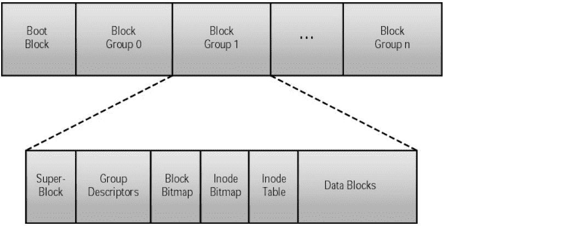

图 6.2：每个块组在很大程度上独立于其他块组，这在数据损坏时有助于恢复。

每个块组都包含文件系统控制数据：超级块和文件系统描述符。它还包含文件系统数据：块位图、inode 位图、inode 表和数据块。inode 将在下一节中解释。通常，这些块的约 5% 被保留，以便超级用户有空间恢复已达到容量极限且普通用户无法使用的文件系统。

> **提示**：Ext2fs 允许你在创建文件系统时选择逻辑块大小，通常为 1024、2048 或 4096 字节。较大的块大小可以加快 I/O 速度，因为每次寻道期间读取的数据更多时，所需的磁盘头寻道次数更少。然而，大块确实会浪费更多的磁盘空间，因为最后一个块几乎从不满。因此，较大的块大小比较小的块大小留下更多未使用的空间。

## inode 和目录

除了名称和目录树中的位置外，关于文件的所有重要信息都存储在一个称为 `inode` 的数据结构中。`inode` 存储：

- 锁定信息
- 访问模式
- 文件类型
- 指向文件的链接数
- 所有者的用户 ID 和组 ID
- 文件以字节为单位的大小
- 访问和修改时间
- `inode` 的最后修改时间
- 文件在磁盘上的块地址

每个文件在创建时都会被分配一个唯一的 `inode`。文件的名称单独存储在目录名缓存项中。目录名缓存中每个条目的 `inode` 号可用于获取对应的 `inode` 缓存项，其中包含该 `inode` 所代表的文件的具体信息。图 6.3 展示了这种结构。（`howdy.wav` 和 `sound.wav` 文件是硬链接——即两个指向同一个 `inode`、从而指向同一文件数据的目录条目。硬链接将在第 7 章“Linux 文件与进程”中进一步描述。）因此，获取目录列表的命令速度很快，因为它无需关心文件中的实际数据，只需关注 `inode` 中包含的信息。

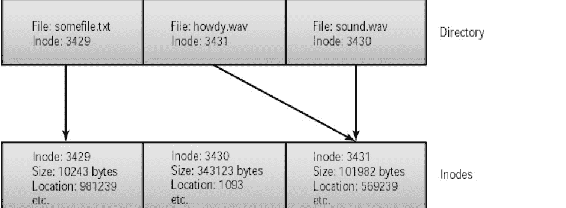

图 6.3：目录条目、`inode` 以及文件在磁盘上的位置并不一定按相同顺序排列。

打开文件时，它会将其条目锁定在 `inode` 缓存中，以表明该文件正在使用中。非活动文件会保留在内存中，其非活动 `inode` 可能仍包含来自之前关联文件的数据页，如果该 `inode` 尚未被文件系统回收。当复用非活动 `inode` 时，其数据页会被刷新，为新数据腾出空间。

## 访问文件系统

上述讨论概述了 2.4.x Linux 内核可用的主要文件系统，以及它们内部如何组织数据。实际使用这些文件系统需要掌握若干 Linux 命令和配置文件的实用知识。在日常操作中，最重要的是用于挂载和卸载文件系统的命令。当涉及到访问诸如软盘、Zip 磁盘和 CD-ROM 光盘等可移动媒体时，还会产生一些额外的特殊性。

### 挂载和卸载文件系统

Linux 提供了两种挂载硬盘文件系统的方法：通过 `mount` 命令进行手动挂载，以及通过 `/etc/fstab` 中的条目在启动时自动挂载。（也可以自动挂载可移动媒体，稍后将在“使用可移动媒体”中介绍。）若要停止使用某个文件系统，必须使用 `umount` 命令将其卸载。（是的，拼写是正确的；`umount` 缺少第一个字母 `n`。）

### 使用 `mount` 命令

Linux 使用 `mount` 命令使文件系统可用。该命令的基本格式如下：

```
mount [-t fstype] [-o options] device dir
```

`fstype` 是文件系统类型，例如 ext2、vfat 或 jfs。通常可以省略 `-t` 参数，Linux 会正确检测文件系统类型。前文中关于 Linux 文件系统的讨论包含了这些类型代码。

`device` 是与文件系统关联的 Linux 设备文件。例如，`/dev/sdb4` 表示第二个 SCSI 磁盘上的第四个分区，而 `/dev/fd0` 表示第一个软盘。

`dir` 是挂载点，应为空目录。（可以使用非空目录，但只要文件系统处于挂载状态，您将无法访问存储在该目录中的文件。）

`options` 是特殊的代码，用于指示 Linux 如何处理文件系统特性。某些选项适用于大多数或所有文件系统，但其他选项是特定于文件系统的。输入 `man mount` 可以查看适用于大多数标准 Linux 文件系统的文件系统选项的讨论，并查阅文件系统的文档以了解更罕见的文件系统选项。表 6.1 总结了最重要的文件系统选项。

表 6.1：`mount` 命令的重要文件系统选项

| 选项 | 支持的文件系统 | 描述 |
| :---- | :---- | :---- |
| default | 所有 | 使用此文件系统的默认选项。主要用在此后的 `/etc/fstab` 文件中，以确保文件中存在一个选项列。 |
| loop | 所有 | 为此挂载使用环回设备。允许将文件挂载为磁盘分区。例如，输入 `mount -t vfat -o loop image.img /mnt/image` 会将文件 `image.img` 挂载为磁盘。 |


| `auto` 或 `noauto` | 所有 | 在启动时或当 `root` 执行 `mount –a` 命令时，挂载或不挂载文件系统。默认为 `auto`，但对于可移动媒体，`noauto` 是合适的。用于 `/etc/fstab` 中。 |

| `user` 或 `nouser` | 所有 | 允许或禁止普通用户挂载文件系统。默认为 `nouser`，但对于可移动媒体，`user` 通常是合适的。用于 `/etc/fstab` 中。在此文件中包含 `user` 时，允许用户输入 `mount /mountpoint`（其中 `/mountpoint` 是指定的挂载点）来挂载磁盘。 |

| `owner` | 所有 | 类似于 `user`，但用户必须拥有设备文件的所有权。某些发行版（如 `Red Hat`）将某些设备文件的所有权（如用于软盘的 `/dev/fd0`）分配给控制台用户，因此这可能是一个有用的选项。 |

| `remount` | 所有 | 在不明确卸载分区的情况下更改一个或多个挂载选项。要使用此选项，请对已挂载的文件系统发出 `mount` 命令，同时带上 `remount` 以及您想要更改的任何选项。此功能可用于启用或禁用对分区的写访问权限。 |

| `ro` | 所有 | 指定文件系统的只读挂载。这是不包括写访问权限的文件系统以及某些写支持特别不可靠的文件系统的默认设置。 |

| `rw` | 所有读写文件系统 | 指定文件系统的读写挂载。这是大多数读写文件系统的默认设置。 |

| `uid=value` | 大多数不支持 Unix 式权限的文件系统，如 `vfat`、`hfs`、`ntfs` 和 `hfs` | 设置所有文件的所有者。例如，`uid=500` 将所有者设置为拥有 Linux 用户 ID `500` 的人。（在 `/etc/passwd` 文件中检查 Linux 用户 ID。） |

| `gid=value` | 大多数不支持 Unix 式权限的文件系统，如 `vfat`、`hfs`、`ntfs` 和 `hfs` | 类似于 `uid=value`，但设置文件系统上所有文件的组。可以在 `/etc/group` 文件中找到组 ID。 |

| `conv=code` | 大多数用于 Microsoft 和 Apple 操作系统的文件系统：`msdos`、`umsdos`、`vfat`、`hfs`、`ntfs`、`hfs` | 如果 `code` 为 `b` 或 `binary`，Linux 不修改文件内容。如果 `code` 为 `t` 或 `text`，Linux 自动在 Linux 风格和 DOS 或 Macintosh 风格的行尾字符之间转换文件。如果 `code` 为 `a` 或 `auto`，除非文件是已知的二进制文件格式，否则 Linux 应用转换。通常最好将其保留为默认值 `binary`，因为文件转换可能会给某些应用程序和文件类型带来严重问题。 |

| `nonumtail` | `vfat` | 通常，Linux 在使用 VFAT 时会像 Windows 一样创建短文件名；例如，`longfilename.txt` 变成 `LONGFI~1.TXT`。使用此参数会在尽可能的时候阻止创建数字尾（`~1`），因此文件变为 `LONGFILE.TXT`。这可以提高在 DOS 中的可读性，但如果您使用 Linux 备份和恢复 Windows 系统，可能会出现问题，因为短文件名可能在完全恢复后发生改变。 |

| `eas=code` | `hfs` | 如果 `code` 为 `no`，Linux 忽略 `OS/2` 的扩展属性（EAs）。如果 `code` 为 `ro`，Linux 读取 EAs 并尝试从中提取 Linux 所有权和权限信息，但不创建新的 EAs。如果 `code` 为 `rw`，Linux 在 EAs 中存储所有权和权限信息，覆盖由 `uid`、`gid` 和 `umask` 选项提供的设置。 |

| `case=code` | `hfs`、`hppfs` | 当 `code` 为 `lower` 时，Linux 将文件名转换为全小写；当 `code` 为 `asis` 时，Linux 保持文件名原样。`2.4.x` 内核中 HFS 和 HPPS 的默认值为 `asis`；对于 `2.2.x` 内核中的只读 HPPS，其值为 `lower`。 |

| `fork=code` | `hfs` | 设置 HFS 驱动器处理 Macintosh 资源分支的方式。选项为 `cap`、`double` 和 `netatalk`。这些对应于 `Columbia AppleTalk Package (CAP)`、`AppleDouble` 和 `Netatalk` 网络系统在 Unix 系统上存储资源分支的方法。如果您使用这些网络包之一并希望导出 Macintosh 文件系统，应使用相应的代码。 |

| `afpd` | `hfs` | 如果您想使用 `Netatalk` 导出文件系统，请使用此参数。此选项使文件系统与 `Netatalk` 完全读写兼容，但会导致某些 Linux 本地命令出现问题。 |

| `norock` | `iso9660` | 禁用 `ISO-9660` CD-ROM 的 Rock Ridge 扩展。 |

| `nojoliet` | `iso9660` | 禁用 `ISO-9660` CD-ROM 的 Joliet 扩展。 |

掌握这些挂载选项后，您应该能够挂载具有所需特征的文件系统。在大多数情况下，Linux 本地文件系统不需要任何特殊的文件系统选项。然而，外部文件系统通常从一个或多个选项中受益。特别地，不支持 Linux 权限的文件系统通常能从 `uid`、`gid` 和 `umask` 选项中受益匪浅。例如，您可能想使用类似以下命令来挂载一个 VFAT 分区：

```
# mount -t vfat -o uid=500, gid=100, umask=002 /dev/hdc8 /dos/drive-e
```

该命令将 VFAT 分区上所有文件的所有权分配给拥有用户 ID `500` 的人（通常是 `Red Hat` 系统上创建的第一个用户），将组所有权分配给组 `100`，并移除其他用户的写访问权限，但保留所有者和组的写访问权限。结果是，用户 `500` 和组 `100` 中的任何人都可以读取和写入分区上的文件，但不属于组 `100` 的用户只能读取分区上的文件。

### 创建 /etc/fstab 条目

当 Linux 启动时，它需要知道要挂载哪些文件系统以及它们位于目录树的什么位置，以产生可用的系统。例如，如果您为 `/usr`、`/home` 和 `/var` 创建了单独的分区，Linux 必须知道要在这些位置挂载相应的分区——将 Linux 挂载用户文件（本应位于 `/home`）到 `/usr`（程序文件通常驻留的位置）对您没有好处。Linux 解决此问题的方案是 `/etc/fstab` 文件，其中包含默认的挂载分配。

该文件由一系列行组成，每个文件系统一行。以井号（`#`）开头的行会被 Linux 忽略。每行是由空白字符分隔的一系列条目，如清单 6.1 所示。

## 列表 6.1：/etc/fstab 文件示例

| #设备 | 挂载点 | 文件系统 | 选项 | 转储 | fsck |
|---|---|---|---|---|---|
| `/dev/hda2` | `/` | `ext2` | `defaults` | `1` | `1` |
| `/dev/hdb7` | `/home` | `jfs` | `defaults` | `0` | `2` |
| `/dev/hda3` | `/dos` | `msdos` | `umask=0` | `0` | `0` |
| `server:/home` | `/server/home` | `nfs` | `ro` | `0` | `0` |
| `/dev/cdrom` | `/mnt/cdrom` | `iso9660` | `noauto,user` | `0` | `0` |
| `/dev/fd0` | `/mnt/floppy` | `auto` | `noauto,user` | `0` | `0` |
| `/dev/hdb8` | `swap` | `swap` | `defaults` | `0` | `0` |

`/etc/fstab` 文件的各列包含以下信息：

`device` 此列列出与磁盘或分区相关的设备文件名。列表 6.1 中的一个设备，`server:/home`，是一个 `NFS` 共享。对于此设备，`server` 是服务器的名称，而 `/home` 是其导出的目录。

`mountpoint` 此列指示文件系统的挂载点。第一个条目通常是 `/`，即根文件系统。Linux 通常从根文件系统读取 `/etc/fstab` 文件，但一旦获取该文件，它会使用此文件中指定的选项重新挂载根文件系统。用作 RAM 扩展的交换分区使用 `swap` 或 `none` 作为挂载点。

`fs` 对于大多数文件系统，你必须指定文件系统类型代码。如果你使用任何非标准文件系统，例如列表 6.1 中 `/home` 分区的 `jfs`，你必须确保你的内核已编译了该支持。同样重要的是，根分区的文件系统必须编译到内核中（而不是作为模块），否则 Linux 将无法读取其启动文件。列表 6.1 中的 `/mnt/floppy` 挂载点指定了文件系统类型代码 `auto`。Linux 可以自动检测许多文件系统类型，这种配置对于可移动介质设备（如软盘驱动器）特别方便。

> 不要将 `/etc/fstab` 中的文件系统类型代码 `auto`（告诉 Linux 自动检测文件系统类型）与 `auto` 挂载选项（告诉 Linux 在启动时挂载文件系统）混淆。


### options
你可以为任何文件系统指定表 6.1 中的选项，以及你发现的其他任何选项。列表 6.1 中用于软盘和 CD-ROM 驱动器的 `noauto, user` 组合对可移动介质设备特别有用，因为它允许普通用户挂载和卸载这些设备。确保挂载选项之间没有空格，只有逗号。

### dump
此列包含 `1` 或 `0`，表示运行 `dump` 实用程序时是否应备份指定分区。此实用程序是特定于文件系统的，且 `JFS` 仍缺乏 `dump` 程序，这就是为什么在列表 6.1 中 `JFS` `/home` 分区被设置为 `0` 的原因。

### fsck
此列指示*文件系统检查*的顺序。当 `Linux` 启动时，它会检查此列中值为非 `0` 的文件系统是否存在损坏，按照此列值指定的顺序进行。通常，根分区的值为 `1`，而其他 `Linux` 原生文件系统的值更高。`XFS` 和 `ext3fs` 分区的值应为 `0`，因为这些文件系统在处理此任务时会自动在挂载时执行。大多数非原生文件系统缺乏 `fsck` 实用程序，因此值也应为 `0`。

安装 `Linux` 时，它会根据你提供给安装程序的关于分区的信息创建一个初始 `/etc/fstab` 文件。你可以修改此配置以添加安装程序无法识别的分区（例如，如果你安装了 `BeOS`，可以添加 `BeFS` 分区）；微调配置（例如为 `FAT` 分区添加额外参数）；以及添加变体，特别是针对可移动介质。在将挂载选项添加到 `/etc/fstab` 之前，先通过 `mount` 命令直接发布它们进行测试是个好主意。（当然，这对于某些选项没有太大意义，例如 `noauto` 和 `user`。）一旦修改了 `/etc/fstab`，你可以通过输入 `mount -a` 来测试其配置。这会导致 `Linux` 重新读取 `/etc/fstab` 并挂载那些未挂载但在 `/etc/fstab` 中列出且没有 `noauto` 选项的任何文件系统。

你也可以使用 `GUI` 配置工具修改 `/etc/fstab`。例如，在 `Webmin` 中，你可以选择在“系统”区域的“磁盘和网络文件系统”项，如图 6.4 所示。此配置页面展示了计算机文件系统信息的摘要。通过点击一个挂载点（在“挂载为”列中），你可以调整挂载选项，如图 6.5 所示。你还可以从此页面挂载和卸载文件系统。

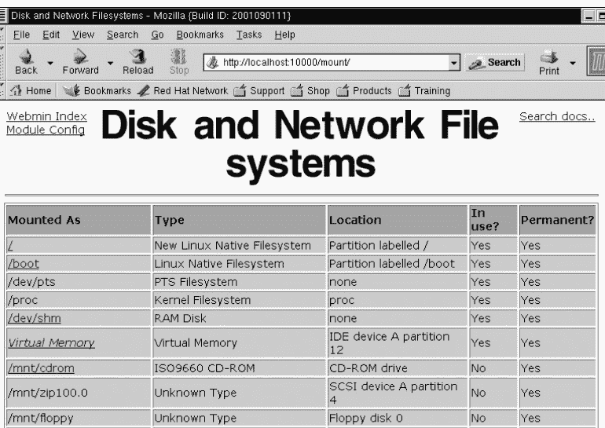

图 6.4：`GUI` 系统配置工具允许你通过点击界面编辑 `/etc/fstab`。

## 使用 `umount` 命令

当你完成使用文件系统后，你可以发布 `umount` 命令来卸载它。此命令的基本语法如下：

```
umount [-a] [-f] [-t fstype] mountpoint | device
```

这些选项的含义如下：

- `-a` 如果指定了此选项，`umount` 将尝试卸载 `/etc/fstab` 中指定的所有分区。在正常操作中，你不应该发布此选项，尽管在将系统恢复到健康状态后的紧急恢复情况下可能会用到。
- `-f` 当指定 `-f` 时，`umount` 强制卸载操作。如果普通 `umount` 命令失败，此选项可能很有用，这种情况通常发生在 `NFS` 服务器崩溃时。
- `-t fstype` 如果使用此参数，`umount` 将卸载指定类型的文件系统。
- `mountpoint` 这是设备所挂载的挂载点，例如 `/mnt/floppy` 或 `/home`。
- `device` 这是文件系统所在的设备，例如 `/dev/fd0` 或 `/dev/hdb8`。

通常，你使用 `umount` 时不带有大多数选项，并且仅指定挂载点或设备，而不是两者都指定。例如，你可以输入 `umount /mnt/floppy` 来卸载软盘。

`umount` 命令应用于可移动介质设备时最有用，因为这些设备通常在 `Linux` 运行期间定期挂载和卸载。大多数安装永久挂载硬盘分区，因此不需要显式卸载。然而，`Linux` 在关闭时会自动卸载这些分区，并且你在执行某些类型的系统维护（如将分区内容移动到新硬盘）时可能需要临时卸载通常挂载的分区。

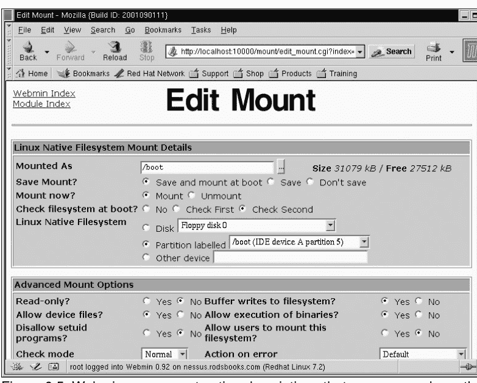

图 6.5：`Webmin` 使用的挂载选项描述比 `/etc/fstab` 中的实际选项更详细。

### 警告
`Linux` 锁定了大多数可移动设备，如 `CD-ROM` 和 `Zip` 驱动器，以便你在挂载时无法弹出磁盘。当你卸载磁盘时，弹出按钮将再次起作用。然而，`x86` 计算机上的软盘驱动器无法锁定。因此，在软盘仍然挂载时弹出它是可能的。由于 `Linux` 缓存其文件系统的写入，这种错误可能会导致严重的文件系统损坏。务必在弹出软盘之前仔细卸载软盘。

## 使用可移动介质

`Linux` 的磁盘世界模型对硬盘和可移动磁盘几乎没有区别。你使用相同的 `mount` 和 `umount` 命令来访问这两种类型的设备，并且你可以为这两种类型的介质创建类似的 `/etc/fstab` 条目。尽管如此，有一些注意事项和特殊功能仅适用于可移动介质。

### 访问软盘

关于软盘最重要的注意事项是关于意外弹出它们，如前文的警告所述。除此之外，你可以像访问非常小的硬盘分区一样访问软盘。访问软盘的通常设备文件是 `/dev/fd0`。如果你的系统有两个软盘驱动器，第二个可以通过 `/dev/fd1` 访问。还有许多专门设备访问文件，例如 `/dev/fd0H1440`，它们提供对特定容量磁盘的强制访问，例如 `/dev/fd0H1440` 为 `1440KB`。（在正常操作中，你可以使用 `/dev/fd0` 访问任何容量的磁盘。）

如果你收到一个未格式化的软盘，你必须对其进行格式化。在 `DOS` 或 `Windows` 中，此过程通过单个命令 `FORMAT` 处理。相比之下，在 `Linux` 中，你执行两个动作。首先，你使用 `fdformat` 命令进行低级格式化，例如 `fdformat /dev/fd0`。（这是容量特定设备文件最有用的地方，因为它们可以强制以指定容量进行格式化。）其次，你在磁盘上创建文件系统，如本章后面的“创建文件系统”中所述。

你在硬盘上使用的大多数文件系统也可以在软盘上使用，除了少数例外。值得注意的是，一些日志文件系统需要比软盘所能容纳更大的日志文件。你可以在软盘上使用 `Linux` 的 `ext2fs`，但 `ext2fs` 有足够的开销，因此不是最佳选择。`Minix` 文件系统因其对 `Linux` 权限和所有权的支持以及在软盘上的流行，且其开销小于 `ext2fs`。`FAT` 文件系统同样在软盘上很流行，即使是在 `Linux` 系统之间传输时。`FAT` 的缺点是，除非你将文件存档到 `tar` 或类似的载体文件中，否则你会失去 `Linux` 的所有权和权限。

### 无文件系统磁盘访问

有可能在不使用文件系统本身的情况下访问软盘。这通常通过直接写入软盘上的 `tar` 文件来完成。假设你想在系统之间传输一个目录，`somedir`。你可以在源系统上发布以下 `tar` 命令来实现：

```
$ tar -cvf /dev/fd0 somedir
```

此命令将 `somedir` 的内容复制到软盘上的 `tar` 文件中。你可以在目标系统上通过发布此命令来反转此过程：

```
$ tar -xvf /dev/fd0
```

当然，你还可以通过挂载带有文件系统的磁盘然后使用磁盘上的适当 `tar` 文件（如 `/mnt/floppy/somedir.tar`）而不是设备文件（`/dev/fd0`）以类似方式传输 `tar` 文件。为什么要使用直接访问？当在不共享适当公共文件系统的 `Unix` 版本之间传输文件时，这是最有用的。你可以确信，在不使用文件系统的情况下写入的 `tar` 文件可以被任何类 `Unix` 操作系统读取，因为 `tar` 非常普遍。对特定文件系统的支持没有那么普遍，尽管 `FAT` 文件系统支持在现代 `Unix` 系统中很常见。

一种访问软驱的不寻常的快捷方式是 `Mtools` 软件包。它是一组程序，允许在未显式挂载的情况下访问 `FAT` 格式的软盘（或原则上其他使用 `FAT` 格式的可移动介质）。`Mtools` 包含一系列以 `DOS` 磁盘访问命令命名的命令。这些命令包括 `mdir`（获取目录列表）、`mcopy`（复制文件）、`mdel`（删除文件）和 `mformat`（在软盘上创建 `FAT` 文件系统）。这些命令使用 `DOS` 风格的盘符来代替 `Linux` 的设备标识符。例如，要将文件复制到软盘，你可以输入 `mcopy 文件名 a:`。`Mtools` 可以是一种非常实用的方法，用于在 `FAT` 软盘之间复制少数文件，但如果你希望程序直接访问软盘上的文件，必须按正常方式挂载它。大多数 `Linux` 发行版都附带 `Mtools`。你可以在 `http://mtools.linux.lu/` 上阅读更多关于它的信息。

有一个类似 `Mtools` 的软件包，称为 `HFS` 实用工具（`http://www.mars.org/home/rob/proj/hfs/`），用于访问 `Macintosh` 软盘。这些实用程序使用 `h` 前缀代替 `DOS` 风格的命令，例如 `hdir` 和 `hformat`。该软件包还包含一个 `GUI` 前端。


> **注意** 如前所述，标准的 x86 PC 硬件无法读取 Apple 为其 400KB 和 800KB 软盘使用的低级数据记录方法。HFS 实用工具包并没有提供一种神奇的方式来绕过这一限制。

## 访问大容量可移动磁盘

随着典型文件大小的增加，Iomega Zip 磁盘、Imation LS-120 磁盘和 Castlewood Orb 驱动器等高容量可移动磁盘正变得越来越流行。作为一般规则，Linux 对这些设备没有问题，但有一些注意事项。

其中最重要的是确保设备接口（ATAPI、SCSI、并口、USB 或其他）与 Linux 兼容。在大多数情况下，这不是问题。然而，一些较罕见的并口或 USB 设备有时会引起问题，特别是在 2.4.x 之前的内核中。请访问 `http://www.linux-usb.org/` 以了解 USB 设备支持的详细信息。

处理高容量可移动设备有两种方式：视为大软盘或视为可移动硬盘。在前一种情况下，你使用主设备文件来访问设备，例如配置为主要 EIDE 链上主驱动器的 EIDE 或 ATAPI 驱动器使用 `/dev/hda`，或者对所有 SCSI 磁盘具有最低 SCSI ID 号的 SCSI 驱动器使用 `/dev/sda`。以这种方式处理可移动磁盘在某些介质（如磁光盘驱动器）中很常见。它的优点是，你不需要担心磁盘分区。

更常见的是，可移动磁盘被当作硬盘来处理。在这种设置中，使用 `fdisk`（稍后在“磁盘分区”中讨论）或类似的磁盘分区工具对磁盘进行分区。然后，在创建和挂载文件系统时，你访问分区。例如，你可能访问 `/dev/hdb1` 或 `/dev/sda4`。这种方法的一个问题是，分区号可能因磁盘而异。Iomega Zip 磁盘通常使用第四个分区，但其他一些磁盘类型和工具使用第一个分区。因此，你可能需要创建多个 `/etc/fstab` 条目来处理所有可能性，特别是如果你与其他几个人交换磁盘的话。

> **注意** Macintosh Zip 磁盘使用 Mac 的分区表进行分区，这与 x86 PC 使用的分区表不同。然而，Linux 的 HFS 驱动程序包含对 Macintosh 分区表的有限支持，因此你可以将 Macintosh Zip 磁盘挂载为大型软盘（使用 `/dev/hdb`、`/dev/sda` 或类似的“无编号”设备文件）。或者，你可以将 Macintosh 分区表支持编译到你的 Linux 内核中，并挂载可移动磁盘上的第四个分区。

你可以在大型可移动磁盘上使用任何可用于硬盘的文件系统。特别是，`ext2fs` 在可移动磁盘上运行良好。`FAT` 和 `HFS` 也是流行的选择，特别是当你想分别与 Windows 或 Macintosh 用户交换数据时。日志文件系统使用的日志文件可能会消耗可移动磁盘容量的很大一部分。例如，`ReiserFS` 创建一个 32MB 大小的日志文件——大约是一个 100MB Zip 磁盘容量的三分之一。

## 读取 CD–ROM 光盘

就 CD–ROM 光盘的挂载和访问方式而言，它们并不十分特别。需要考虑两个因素：

- 只读访问。 CD–ROM 光盘本质上就是只读的。因此，`rw` 选项没有效果，你无法向 CD–ROM 光盘写入数据。

- 文件系统选择。 虽然 Linux 可以挂载使用几乎任何文件系统创建的 CD–ROM，但 `ISO–9660` 在 CD–ROM 文件系统领域中占主导地位。然而，许多为 Macintosh 市场创建的光盘使用 `HFS` 而不是 `ISO–9660`，或者两者并用。为 Linux 或 Unix 创建的光盘通常包含 `Rock Ridge` 扩展，而 `Joliet` 是为 Windows 市场创建的光盘的常见附加项。可以使用 `ISO–9660`、`Rock Ridge`、`Joliet` 和 `HFS` 创建 CD–ROM，指向相同和不同文件的一些组合。

### 注意

就为读取访问挂载光盘而言，CD–R 和 CD–RW 光盘及驱动器与 CD–ROM 光盘及驱动器是一样的。要向这些光盘之一写入数据，你通常使用特殊软件，如 `mkisofs` 和 `cdrecord` 组合（在第 9 章中讨论），或 `X–CD–Roast` 等 GUI 前端。Linux 包含实验性的 `UDF` 支持，用于对 CD–RW 介质进行更直接的读写访问，但这种支持在 2002 年仍有限。

你可以使用 `mount` 命令的 `-t` 参数，连同 `-o` 以及 `norock` 和 `nojoliet` 选项，来指定 Linux 将如何尝试挂载 CD–ROM。表 6.2 总结了这些可能性。

**表 6.2：CD–ROM 的挂载选项**

| 挂载选项 | Linux 的操作 |
| :--- | :--- |
| `-t hfs` | 如果可能，使用 `HFS` 挂载 CD–ROM。 |
| `-t iso9660` | 如果存在 `Rock Ridge`，则使用 `Rock Ridge` 挂载 CD–ROM。如果不存在 `Rock Ridge` 但存在 `Joliet`，且内核包含 `Joliet` 支持，则 Linux 使用 `Joliet`；否则，它使用纯 `ISO–9660`。 |
| `-t iso9660 -o norock` | 如果 CD–ROM 包含 `Joliet` 文件系统且内核包含 `Joliet` 支持，则使用 `Joliet` 挂载文件系统。否则，使用纯 `ISO–9660`。 |
| `-t iso9660 -o nojoliet` | 如果存在 `Rock Ridge`，则使用 `Rock Ridge` 挂载 CD–ROM。如果不存在 `Rock Ridge`，则使用纯 `ISO–9660`。 |
| `-t iso9660 -o nojoliet,norock` | 使用纯 `ISO–9660` 挂载 CD–ROM。 |

## 自动处理可移动介质访问

Microsoft 的操作系统对可移动磁盘的处理方式与 Linux 不同。在 Microsoft 操作系统中，每个可移动磁盘都有一个驱动器字母，例如第一个软盘的 `A:`。没有必要显式挂载可移动磁盘；你只需在文件名前插入驱动器字母即可指定可移动磁盘上的文件，如 `A:\SOMEFILE.TXT`。这种方法对用户很方便，但缺点是可能使磁盘写入缓存不安全，因此性能会受到影响。一些硬件在用户按下弹出按钮时会通知操作系统，允许操作系统在弹出磁盘前完成任何缓存的磁盘访问。在使用此类设备时，可以进行磁盘写入缓存。

这个讨论与 Linux 相关，因为许多新的 Linux 用户习惯 Windows 处理磁盘的方法。这些用户期望能够在不显式挂载磁盘的情况下读写磁盘上的文件，更不用说依赖超级用户来完成这项工作。Linux 为这些用户提供了一些变通方法。具体来说：

- `user` 和 `owner` 挂载选项，通常在 `/etc/fstab` 中使用，允许用户挂载和卸载可移动磁盘。虽然这些选项不能提供真正的自动访问，但对于具有一些 Linux 知识的用户来说可能已经足够了。它们也是某些其他可能性的关键第一步。

- 窗口管理器和文件管理器可以定制，以便在用户单击图标或从弹出菜单中选择项目时运行特定命令。这样的配置可以允许对基于文本的 shell 感到不舒服的用户发出 `mount` 和 `umount` 命令。配置细节因程序而异，因此请参阅相应软件包的文档以获取详细信息。

- `KDE` 和 `GNOME` 桌面环境的默认配置包括对 CD–ROM 和软盘的自动访问，类似于 Windows 中的访问方式。双击相应的桌面图标，系统就会挂载磁盘并打开一个显示磁盘内容的浏览器窗口。你稍后可以从相应图标的上下文菜单中选择卸载选项来卸载磁盘。这些选项依赖于 `/etc/fstab` 中 `user` 或 `owner` 选项的存在。某些配置（包括 `Red Hat` 7.3 中的默认 `GNOME` 设置）会在可移动磁盘插入驱动器时自动挂载。

- 自动挂载器 是一种监控对指定目录的访问尝试的工具，当检测到访问时，在指定位置挂载指定设备。一旦所有打开的文件关闭，自动挂载器会等待指定时间，然后卸载设备。这种配置在挂载方面可能很方便，但由于卸载时的延迟，可能对某些媒体类型造成问题。软盘在这方面可能特别麻烦，因为除了通过发出如 `df` 等命令查看磁盘是否仍被挂载外，你不知道何时弹出软盘是安全的。

在这些选项中，`/etc/fstab` 配置已经描述过了。GUI 配置（包括窗口管理器和桌面环境）因软件包而异，因此你应该查看软件包的文档以获取详细信息。自动挂载器需要最复杂的配置。要使用此工具，请遵循这些步骤：

1. 检查你的内核配置是否包含文件系统区域中的内核自动挂载器支持以及网络文件系统区域中的 `NFS` 文件系统支持。这些选项包含在标准的 `Red Hat` 7.3 内核中。（内核编译在第 8 章中讨论。）

2. 如果尚未安装，安装 `autofs` 软件包。在 `Red Hat` 7.3 中确切的文件名是 `autofs-3.1.7-28.i386.rpm`，但在其他发行版中可能称为其他名称。

## 管理自动挂载器

3. 编辑自动挂载器的配置文件，`/etc/auto.master`。该文件通常包含一行，其中列出了基础自动挂载点（默认为 `/misc`）、该挂载点的配置文件（默认为 `/etc/auto.misc`）以及一个超时值（默认为 60）。根据需要修改这些参数中的任意一个。如果该行被注释掉了，请取消注释以启用它。


4. 编辑`/etc/auto.misc`配置文件。该文件应列出基础自动挂载点（`/misc`）内的特定子目录、文件系统类型代码，以及您希望自动挂载的每个设备的设备文件。例如：

```
floppy	-fstype=auto	:/dev/fd0
maczip	-fstype=hfs	:/dev/sda
```

此示例设置自动挂载器检查`/misc/floppy`以处理软盘访问（使用任意文件系统，类型为`auto`），并检查`/misc/maczip`以处理挂载在 SCSI Zip 驱动器（`/dev/sda`）上的 HFS 文件系统。

5. 通过输入`/etc/rc.d/init.d/autofs start`启动自动挂载器。重启计算机时，它也应自动启动。（如果您没有使用 Red Hat，可能需要使用另一个启动脚本，或者通过输入`automount /misc file /etc/auto.misc`手动启动自动挂载器。）

您*不*需要在`/misc`目录内为每个挂载点创建目录。相反，自动挂载器会检测对不存在的目录的访问尝试，并在挂载设备时动态创建它们。如果您使用文件管理器，这一事实可能会使自动挂载器失效，因为这些程序通常只允许您访问现有的目录。然而，当您使用命令行工具时，自动挂载器非常有用。

**注意** 除了`autofs`之外，还可以用于 Linux 的第二种自动挂载器实现，即自动挂载守护进程（`amd`）。有关`amd`最完整的文档，请参阅 Erez Zadok 撰写的“Linux NFS 和自动挂载器管理”。

## 使用交换空间

有一种磁盘访问对 Linux 至关重要，但本章尚未提及：*交换空间*（`swap space`）。这是被保留下来作为系统内存（`RAM`）辅助的磁盘空间。假设您的计算机有 `256MB` 的 `RAM`，但您想在系统上运行价值 `380MB` 的程序。通过像对待 `RAM` 一样对待磁盘空间，交换空间使您能够完成这一目标。结果是，您可以运行所有这 `380MB` 的节目——尽管在这台 `256MB` 的计算机上比在拥有超过 `380MB RAM` 的机器上运行得更慢。

Linux 通常将一个或多个磁盘分区分配为交换空间。这些分区使用`0x82`（*Linux swap*）类型代码，如“磁盘分区”部分所述。使用普通磁盘文件作为交换空间也是可能的。通常，Linux 在系统安装过程中会设置交换分区，因此此功能会自动处理。不过，您可能希望调整此默认配置。

您可以通过输入`free`来了解当前系统有多少交换空间，这将产生如下输出：

|       | total | used | free | shared | buffers | cached |
|:-----|:-----:|:----:|:----:|:------:|:-------:|:------:|
| Mem: | 127752| 121416| 6336 | 61108  | 26748   | 53316  |
| -/+ buffers/cache: | 41352 | 86400 |     |        |         |        |
| Swap:| 136512| 4928 | 131584|        |         |        |

特别注意标记为 `Swap` 的行。`Total` 列下方是可用的交换空间千字节数。`Used` 和 `Free` 列分别列出该空间的使用量和可用量。如果 `Used` 值开始接近 `Total` 值，您应考虑增加更多的交换空间。

**提示** 预测系统需要多少交换空间是很困难的，因为这取决于计算机的使用方式。一个经验法则是创建相当于系统物理 `RAM` 两倍的交换空间。事实上，如果您使用的是 `2.4.x` 内核，您应该*始终*超过此值，因为在极少数情况下，如果交换空间少于该值，`2.4.x` 内核可能会崩溃。

要增加更多交换空间，请遵循这些步骤：

1. 留出一块适当的磁盘空间。您可以通过以下两种方式之一完成：

    - 为交换空间创建一个新的磁盘分区。这种方法可能比较困难，因为它要求您重新分区硬盘。

    - 在 Linux 本地文件系统上创建一个适当大小的空文件。例如，命令`dd if=/dev/zero of=/swap bs=1024 count=n`会创建一个适当的文件（称为`/swap`），其大小为*n*千字节。

2. 对您创建的新交换空间发出`mkswap`命令。对于分区，您输入的内容类似于`mkswap /dev/sdc5`。对于文件，命令类似于`mkswap /swap`。此命令准备空间以存储交换信息。

3. 使用`swapon`命令添加新的交换空间，例如`swapon /dev/sdc5`或`swapon /swap`。输入另一个`free`命令，您会发现可用的交换空间已增加您新的交换分区或文件的大小。

要使交换空间的使用永久化，您应为交换空间添加一个`/etc/fstab`文件条目。此条目使用 `swap` 的挂载点和文件系统类型代码条目，但其他方面与其他`/etc/fstab`条目相似。例如，以下两行都添加了交换空间：

```
/dev/sdc5     swap      swap      defaults  0 0
/swap          swap      swap      defaults  0 0
```

添加这些条目后，Linux 在重启后使用指定的交换空间。

如果您想停止使用特定的交换分区或文件，可以使用`swapoff`命令，其工作方式与`swapon`命令类似——例如，`swapoff /dev/sdc5`。

## 更新和维护文件系统

在使用文件系统之前，必须准备一个。如果您获得了一块新磁盘，必须将其划分为分区，并在这些分区上创建文件系统。只有这样，您才能挂载文件系统。在添加磁盘和替换磁盘时，这些步骤都是必需的，但这些操作的具体细节有所不同。还有文件系统维护的问题。在某些情况下——特别是在系统崩溃或断电之后——Linux 必须检查其文件系统的完整性。您可能需要监督此过程，因此了解此类检查期间发生了什么很重要。

### 磁盘分区

如果您购买了新磁盘，将其连接到计算机后的第一项任务是将磁盘*分区*。此过程将磁盘切割成较小的块，以便您可以在多个操作系统之间共享磁盘，或者对单个操作系统使用的空间进行细分，以保护某个分区上的文件以防另一个分区出现问题。第 2 章简要讨论了这些问题，并描述了在 Red Hat Linux 安装会话期间对磁盘进行分区的过程。您也可以在安装后使用各种分区工具来更改配置或添加新磁盘。

> **提示**
>
> 如果您想更改现有的分区配置，PowerQuest 的 `PartitionMagic`（http://www.powerquest.com/）是可用的最佳工具之一。这个商业软件包允许您添加、删除、移动、调整大小和复制 `FAT`、`HPFS`、`NTFS`、`ext2fs` 和 `Linux swap` 分区，而不会损坏其内容。开源的 `GNU Parted`（http://gnu.org/software/parted/parted.html）提供了 `PartitionMagic` 的一些功能。`ReiserFS`、`XFS`、`ext2fs` 和 `ext3fs` 都包含自己的分区调整大小实用程序，但它们不像 `PartitionMagic` 那样易于使用或灵活。

### 规划分区布局

在开始使用分区软件之前，设计适当的分区布局非常重要。不幸的是，很难给出简单且完整的规则来执行此操作，因为每个系统的需求都不同。对于高级新闻服务器合适的配置，对于桌面工作站可能完全不适用。以下是一些需要牢记的经验法则：

- **保持简单。** 配置越简单越好。复杂的配置可能难以维护。此外，如果系统有很多分区，其中一个分区用完空间而另一个分区有大量空闲空间的可能性更大。

- **将相关数据放在一起。** 由于访问数据所需的时间随磁盘上两点之间的距离而变化，最好将相关数据放在一个区域。此规则的一个结果是，在多操作系统配置中，您应将每个操作系统的分区保持连续。

- **将最常用的数据放在中心。** 频繁访问的分区应放在分区范围的中间。交换分区通常使用频繁，因此应位于非交换分区之间。

- **将操作系统跨磁盘拆分。** 如果您有两个或更多操作系统，您可能会受诱惑将一个操作系统完全放在一个磁盘上，另一个放在第二个磁盘上。然而，如果您将两个操作系统都跨两个磁盘拆分，由于两组磁盘磁头在两个操作系统中都工作，您将实现略好的性能。

- **隔离关键数据。** 考虑将特别重要或经常使用的数据放在与其他文件不同的分区上。这可以降低在磁盘其他部分发生磁盘错误时这些数据损坏的风险。同样，如果一个 heavily used（重度使用）分区用尽磁盘空间，由此引起的任何问题都可以被隔离。将`/home`以及某些服务器上的`/var`和`/tmp`放在自己的分区上，是此经验法则的典型示例。


- **将 Linux 内核放在磁盘的 1024 柱面标记之下。** 旧 BIOS 和 Linux Loader（`LILO`）版本如果 Linux 内核位于第 1024 柱面以外的区域，则无法引导 Linux 内核。绕过此限制的一种简便方法是在该点之下创建一个小（5–20MB）分区并将其挂载为 `/boot`。最近版本的 `LILO` 和 `GRUB` 不受此问题困扰，但如果您有旧硬件，可能需要使用此变通方法。

> **注意** `1024` 柱面标记是磁盘的第 `1024` 柱面所在的位置，如由 `EIDE` 驱动器或 `SCSI` 主机适配器报告的那样。在现代硬盘上，这一点相当于略少于 `8GB`。

您不应将这些规则视为绝对。事实上，它们有时相互矛盾

另一种。例如，数据隔离规则与保持简单原则相冲突。最终，你需要决定哪些规则最能反映你个人的偏好和需求，并创建一个反映这些因素的分划方案。对于新的 Linux 管理员，我们通常建议创建一个根 (`/`) 分区、一个 `/home` 分区、一个交换 (`swap`) 分区，以及可能需要支持计算机上存在的其他操作系统的其他必要分区。创建更多分区可能会比较困难，因为很难判断应将其设置多大。另一位管理员的经验在这种判断中的作用有限，因为系统的使用方式可能截然不同。一旦你积累了一些经验，或者如果你最初就有充分的理由这样做，你可能希望将 `/var`、`/tmp`、`/usr`、`/usr/local`、`/opt` 及其他目录的分区分离出来。

## Linux 磁盘分区软件

Linux 主要的分区工具被称为 `fdisk`（固定磁盘）。它的名字源自 DOS 的 `FDISK` 实用程序，但工作方式截然不同。要使用 `fdisk`，请输入其名称后跟要修改的设备文件，例如 `/dev/sda` 或 `/dev/hdb`，格式如下：

```
# fdisk /dev/hdb
```

> **警告** 每个 x86 操作系统都有自己独立的磁盘分区软件。Linux 的 `fdisk` 异常灵活，因此可能生成其他操作系统不喜欢的分区。作为一个通用的准则，你应该使用每个操作系统自带的分区工具来创建其自己的分区。或者，你可以使用更具操作系统中立性的工具（例如 `PartitionMagic`）来处理所有操作系统的分区任务。

在现代磁盘上，你可能会被告知柱面数超过 `1024`。你可以安全地忽略此警告。一旦 `fdisk` 开始运行，你只会看到一个提示符，内容为 `Command (m for help):`（输入 `m` 查看帮助）。在这个提示符下，你输入单个字符的命令来完成各种任务。你可以输入 `m` 或 `?` 来查看这些命令是什么。表 6.3 总结了最重要的命令。

表 6.3: 重要的 Linux `fdisk` 命令

| `fdisk` 命令 | 含义 |
| :--- | :--- |
| `d` | 删除一个分区 |
| `l` | 显示已知的分区类型代码列表 |
| `m` 或 `?` | 显示命令摘要 |
| `n` | 创建新分区 |
| `p` | 显示磁盘当前的分区表 |
| `q` | 退出而不保存更改 |
| `t` | 更改分区的 ID 类型代码 |
| `v` | 验证分区表；检查其内部一致性并返回基本信息 |
| `w` | 保存（写入）更改并退出程序 |

通常，在开始任何 `fdisk` 会话时，先使用 `p` 命令显示磁盘的当前内容是是个好主意。这允许你验证你正在修改的是正确的磁盘，并为你提供你可能想要删除的分区的分区号。在规划新分区的位置时，你也需要这些信息。

> **警告** 不要对当前已挂载的分区进行修改。这样做可能会使 Linux 混乱并导致系统崩溃。如果你的意图如此，可以卸载分区然后删除它。要更改分区大小，请使用动态分区调整工具。

或者，你可以备份分区，调整其大小，然后恢复备份。某些 `ext2fs` 分区调整工具要求你先用 `fdisk` 单独调整分区大小，再用分区调整工具调整文件系统大小。如果你使用这些工具，请遵循它们的说明。

一旦你了解了磁盘上已经存在什么（如果有的话），你就可以使用 `fdisk` 的命令继续删除、添加或以其他方式修改分区表。考虑以下 `fdisk` 交互：

```
Command (m for help): p

Disk /dev/hdb: 255 heads, 63 sectors, 1216 cylinders
Units = cylinders of 16065 * 512 bytes

Device    Boot     Start     End    Blocks Id System
/dev/hdl          257     1216   7711200  5 Extended
/dev/hdb2              1      192  1542208+ fb Unknown
/dev/hdb3            193      256    514080 17 Hidden HPFS/NTFS
/dev/hdb5            257      516  2088418+  6 FAT16
/dev/hdb6            517      717   1614501  7 HPFS/NTFS

Command (m for help): n
Command action
   l   logical (5 or over)
   p   primary partition (1-4)
1
First cylinder (718-1216, default 718): 718
Last cylinder or +size or +sizeM or +sizeK (718-1216, default 1216): +400M
```

在这种情况下，初始配置包含五个分区，`n` 命令添加了一个新的。`fdisk` 提供了创建逻辑或主分区的选项。x86 分区方案最初仅提供每个磁盘四个分区，这很快变得不足以满足需求。变通方法是使用原始四个主分区之一作为潜在大量逻辑分区的占位符。这个“占位符”主分区随后被称为扩展分区。在 Linux 中，主分区使用 `1` 到 `4` 的编号；逻辑分区编号为 `5` 及更高。Linux 不关心其分区是主分区还是逻辑分区，因此我们建议主要为 Linux 使用逻辑分区，或仅使用逻辑分区。这为主分区保留了空间，供那些确实需要主分区（如 `DOS`、`Windows` 和 `FreeBSD`）的操作系统使用。

Linux 的 `fdisk` 允许你使用结束柱面号或字节、千字节、兆字节来指定分区大小。前面的示例指定了从柱面 `718` 开始的 `400MB` 分区。

> **提示** 对于磁盘上的最后一个分区，请输入与最大可用空间对应的结束柱面号来指定大小。这种实践可以最大限度地减少未使用的磁盘空间。

默认情况下，`fdisk` 创建使用类型代码 `0x83`（Linux 原生）的分区。这些分区适合存储 Linux 的 `ext2fs` 或任何可用的日志文件系统。但是，如果你想创建一个 Linux 交换分区或要在其他操作系统中使用的分区，你必须更改其类型代码。你使用 `t` 命令执行此操作，它会提示你输入十六进制代码。如果你不知道代码，请在该点输入 `L` 以获取列表。（如果你愿意，可以输入一个不在列表上的代码，但如果你这样做，`fdisk` 将无法识别相关的操作系统。）你可以使用此功能将用其他工具创建的分区转换为供 Linux 使用。

> **注意** Linux 实际上并不使用分区类型代码，除非在安装期间。相反，Linux 依赖 `mount` 的 `–t` 参数或 Linux 的自动检测算法来确定分区类型。然而，许多其他操作系统依赖分区类型代码来确定使用哪些分区。

当你编辑完分区表后，使用 `p` 命令查看它；然后使用 `v` 命令验证一切是否正常。`v` 可能会报告你的磁盘有一些未分配的扇区，这是正常的，反映了通过标准 PC 方法访问磁盘时丢失的扇区。你应该写下分区编号及其预期用途，以免忘记这些细节。一旦你对新的分区方案感到满意，输入 `w` 将更改提交到磁盘并退出。

> **提示** Linux 的 `fdisk` 不会在你输入 `w` 命令之前改变任何磁盘上的结构。如果你创建了一个无法使用的磁盘结构并希望从头开始，你可以输入 `q` 退出不保存更改。当你再次启动 `fdisk` 时，你会看到与最初相同的初始条件。

## 创建文件系统

文件系统并不是完全空白的。为了运行，它们依赖于某些关键组件的存在，即使它们不包含实际文件。这些初始数据结构包括指向根目录的指针、文件系统用于分配空间的数据结构、引导扇区代码，以及操作系统或文件系统可能需要的一些文件或目录（例如，每个 `ext2` 文件系统中出现的 `lost+found` 目录）。将这些核心数据结构写入磁盘的过程有时被称为格式化磁盘。这个术语在微软领域很常见，但有歧义，因为它也可以指磁盘机制用来定位磁盘上单个扇区的新磁道标记。为避免歧义，在 Linux 领域，通常将写入扇区标记的过程称为低级格式化，将布局初始文件系统数据结构的过程称为高级格式化或创建（或制作）文件系统。


对于软盘，DOS 和 Windows 的 `FORMAT` 命令执行低级和高级格式化，尽管如果低级格式化已经执行过，它可能会跳过低级格式化。在 Linux 中，`fdformat` 程序（在“访问软盘”中较早描述）对软盘执行低级格式化。在任何操作系统下，使用特殊实用程序对硬盘和大容量可移动磁盘执行低级格式化。这些实用程序有时集成到 BIOS 中，特别是对于 SCSI 磁盘。你不太可能需要对硬盘执行低级格式化。

在 Linux 中，每个文件系统都有自己创建文件系统的实用程序。这些实用程序通常命名为 `mkfs.fstype`，其中 `fstype` 是文件系统的代码；例如，`mkfs.ext2` 用于创建 ext2 或 ext3 文件系统。这些实用程序通常也有其他名称，例如 `mke2fs`。`mkfs` 实用程序是所有这些特定文件系统创建程序的前端。此命令的语法如下：

```
mkfs [-t fstype] [options] device [size]
```

此命令的选项如下：

- `--t fstype` 使用此选项指定文件系统类型。然后 `mkfs` 调用 `mkfs.fstype`。
- `options` 你可以将特定于文件系统的选项传递给执行实际文件系统创建的程序。具体有哪些可用选项因文件系统而异；请查看 `mkfs.fstype` 的手册页以了解详细信息。常见选项包括以下：
  - `--c` 检查设备中的坏块。

## 更换磁盘

从根本上说，你可以将磁盘移植视为与添加磁盘类似的操作；不同之处在于，你是将一切内容从一个磁盘移动到另一个磁盘。以下是一些需要特别注意的事项：

-   如果你是因为无法再向系统添加更多磁盘而要更换磁盘，那么为了执行更换操作，你需要暂时断开一个设备（例如 Zip 驱动器或 CD-ROM 驱动器）的连接。或者，你可以使用磁带备份设备作为中介存储设备，但这可能会导致过程变慢。
-   > **注意** 你可以使用网络存储设备（例如服务器系统）作为中介存储设备。如果这样做，最好使用 `tar` 将文件备份到网络服务器。直接复制文件可能会导致重要的文件系统特性丢失。
-   “添加磁盘”中第二种方法的步骤 4 指定使用 `tar` 的 `-l` 参数。该参数将传输限制在一个文件系统内，这有助于避免在复制根文件系统时出现的 `/proc` 问题或无尽循环。当移动整个安装环境时，最好一次移动一个文件系统。
-   完成所有文件的复制后，在目标系统上编辑 `/etc/fstab`，以反映移除原始磁盘后分区的分配情况。例如，如果原始磁盘是 `/dev/sda`，新磁盘是 `/dev/sdb`，那么移除 `/dev/sda` 后，所有 `/dev/sdb` 分区都会变为编号等价的 `/dev/sda` 分区。新磁盘的 `/etc/fstab` 应将自身引用为 `/dev/sda`。
-   创建一个 DOS 启动软盘，并在其中放入 Linux 内核的副本以及 Linux 安装光盘中的 `LOADLIN.EXE` 程序。你将使用这个软盘首次启动你的复制系统。如果你手头没有 DOS 副本，FreeDOS (http://www.freedos.org/) 也能很好地完成这一功能。请注意当原始硬盘被移除后，根文件系统将拥有的设备标识符。
-   当你复制完所有内容并移除旧磁盘后，使用 DOS 启动软盘启动。输入 `LOADLIN VMNLINUX root=/device ro`，其中 `VMNLINUX` 是你的 Linux 内核文件名，`/device` 是根分区的设备 ID。此操作应该能启动 Linux。如有必要，你可以随后编辑 `/etc/lilo.conf` 并输入 `lilo` 在新磁盘上安装 LILO，或者编辑 `/etc/grub.conf`。此后，新磁盘应该能够像原始磁盘一样在没有软盘辅助的情况下启动。
-   > **警告** 在你确信所有重要数据都已存在于新磁盘之前，不要删除任何分区或覆盖旧硬盘上的任何数据。如果你遗漏了某个分区或在复制原始磁盘数据时出错，在发现问题时保留原始磁盘一段时间可以为你省去很多麻烦。

## 检查文件系统完整性

每次启动时，Linux 都会检查其文件系统是否已正确关闭。如果没有，Linux 将启动文件系统检查，该检查由名为 `fsck.*fsname*` 的工具执行，其中 `fsname` 是文件系统名称。（与 `mkfs.*fsname*` 类似，这些工具通常也有其他名称，例如 `fsck.ext2` 对应 `e2fsck`。`fsck` 工具是一个前端，它调用相应的特定于文件系统的工具。）文件系统检查过程对 ext2fs 最为重要，因为非正常关机可能会使 ext2fs 处于不一致状态，从而导致文件或数据损坏；文件系统检查可防止这种情况。如前所述，日志文件系统的主要优点之一就是它们在系统崩溃后仅需极少程度的文件系统检查。JFS 依赖 `fsck` 程序来执行此检查，但其他文件系统可以在启动时自动进行检查。Linux 缺乏用于检查大多数外部文件系统的程序；你通常需要使用这些操作系统原生的程序来执行此类检查。（FAT 是这一规则的一个例外；存在一个名为 `fsck.msdos` 的 Linux 程序。）

文件系统检查的操作因文件系统而异。对于 ext2fs，它涉及对文件系统进行的五个独立遍历，其中前两个遍历占了 90% 或以上的

## 总结

Linux 对多种文件系统的兼容性支持异常强大。2002 年，Linux 正在从传统的 ext2 文件系统向日志文件系统过渡，但在这四种日志文件系统竞争者中，究竟哪一种最终会成为最流行的尚不明确。在外置文件系统支持方面，Linux 无与伦比；它至少可以读取，并且通常可以写入来自所有主要 x86 操作系统以及许多非 x86 操作系统的文件系统。

在 Linux 下使用文件系统涉及发出 `mount` 命令，并使用常规 Linux 程序和 shell 命令访问文件。您可以在 `/etc/fstab` 中添加条目，以便计算机在启动时自动挂载文件系统，或允许非 root 用户执行此操作。

文件系统的创建和维护涉及多种工具，包括用于分区创建的 `fdisk` 工具、用于文件系统创建的 `mkfs` 及其辅助程序，以及用于文件系统完整性检查的 `fsck` 及其辅助程序。了解如何使用这些工具对于升级和维护系统至关重要。

## 第 7 章：Linux 文件和进程

## 概述

Linux 系统由各种类型的文件组成；从本质上讲，系统中的所有内容都是文件。这些文件被分层组织到目录中，因为将所有文件放在一个大目录中会过于混乱。由于 Linux 的开发通常是由个人或小组独立完成的，因此早期就显然需要定义一种层级结构，使所有开发人员都能在其中工作，从而确保由一个小组开发的部分能与另一个小组开发的部分相契合。层级结构的基本特征最初在文件系统标准（FSSTND）中定义，这是在一个专门创建的 Linux 邮件列表上经过长期讨论后达成共识的结果。文件系统层级标准（FHS）是 FSSTND 的后续版本，旨在标准化 Linux 和 Unix 之间的文件系统，以实现不同软件包、发行版和网络系统之间的兼容性。

本章讨论了这两个标准的历史及其为 Linux 带来的变化。它解释了文件概念，包括文件类型和文件命名。它审视了随着演进而发展的文件系统层级，并概述了每个顶级目录的预期用途。本章还讨论了共同构成 Linux 文件系统的不同类型文件。最后，您将了解在 Linux 系统上执行实际工作的进程、如何追踪它们以及如何管理它们。作为系统管理员，您必须了解您正在操作的文件系统及其限制和局限性，以便有效地分配系统空间并避免陷阱。正如城市条例一样，您有时可以在不深入了解它们的情况下应付过去，但您可能会发现缺乏知识会给您带来麻烦。

### 文件系统层级标准

文件系统层级标准的历史概括了 Linux 整体的开源发展历程。即使您不是历史爱好者（或开源“真信徒”），了解开发者社区在定义标准时试图解决的问题，也能帮助您更好地理解今天正在使用的系统。

Linus Torvalds 希望 Linux 操作系统能够弥补他在试图使用 Minix 操作系统连接到赫尔辛基大学计算机实验室时遇到的问题。当时计算机实验室过于拥挤，使他难以完成课程作业。在 Linux 的早期阶段，它与 Minix 操作系统并行开发，使 Linus 能够在 Minix 和 Linux 两侧之间共享磁盘。在那个时候，Linux 文件系统实际上是 Minix 文件系统。不久之后，开发了虚拟文件系统（VFS）层，用于处理面向文件的系统调用，并将 I/O 功能传递给物理文件系统代码，从而允许 Linux 支持多种文件系统。Minix 文件系统是作为教学代码开发的，仅支持 14 个字符的文件名，并将支持限制在小于 64 兆字节的文件系统。1992 年 4 月，在将 VFS 集成到内核后，一个新的文件系统——扩展文件系统（extfs）被实现并添加到 Linux 版本 0.96c 中。


虽然 `extfs` 比 `Minix` 文件系统更具可用性，但它仍然缺乏 `Linus` 想要的一些功能。此外，通过链表跟踪空闲块和 `inode` 的做法无法实现最佳性能，因为随着文件系统的使用，列表变得无序，文件系统变得碎片化。1993 年 1 月发布的第二扩展文件系统（`ext2fs`）的 alpha 版本源自修复 `extfs` 问题以及确保专注于卓越性能、健壮性和灵活性的需求，使用户无需重新格式化文件系统即可使用新功能。`ext2fs` 支持长达 255 个字符的文件名和高达 4TB 的文件系统。截至内核 `2.4.15`，添加了日志文件，以防止用户在每次重新启动时等待文件系统检查。此时，`ext2fs` 变成了 `ext3fs`。`Linux` 仍然在使用这个文件系统，尽管如第 6 章所述，有其他几种替代方案。

> **注意** 文件系统一词有两个含义。第 6 章从磁盘上数据的低级布局角度讨论了文件系统。在本章中，单词“文件系统”指的是磁盘上目录结构中文件和目录的放置方式。

从 `extfs` 到 `ext2fs` 的过渡解决了许多技术问题，但程序性问题依然存在；管理员并不总是对如何使用文件系统达成一致。也就是说，管理员和发行版维护者并不总是将相同的文件放在相同的位置，从而导致混乱。1993 年 8 月，一位名叫 `Olaf Kirsh` 的程序员向最重要的 `Linux` 讨论组之一发布了一条消息，讨论了设计通用文件系统布局标准的可能性。事实证明，许多 `Linux` 用户对此话题有话要说，很快专门创建了一个新的邮件列表来容纳这些讨论。目标是就创建一个支持 `Linux` 文件和目录结构需求的标准文件系统层级达成共识。

`Linux` 社区试图解决的一些问题包括：

- 需要定义哪些二进制文件属于 `/bin`，哪些属于 `/usr/bin`
- `/etc` 中同时存在二进制文件和配置文件造成的混乱
- 需要将站点范围的配置文件与本地配置文件分开，以便在适当时共享这些文件
- 需要将可更改的文件移出 `/usr`，以便该分区可以以只读方式挂载

解决这些问题及其他问题的共识被正式确定为特定的 `Linux` 操作系统文件系统层级标准，称为 `FSTND`。`FSTND` 的第一个官方版本于 1994 年 2 月发布，随后在接下来的一年内发布了两个修订版。`FSTND` 定义了 `Linux` 系统的标准文件系统结构，映射了特定类型的文件和目录的归属位置，并阐明了特定系统文件中应包含的内容。`Linux FSTND 1.2` 是该标准的最终版本，阅读起来非常有趣。

由于 `BSD` 支持者需要解决这些相同的问题，1995 年，重点转向了一般的 `Unix` 类系统，文件系统层级标准（`FHS`）由此诞生。

`FHS` 可应用于任何符合以下条件的文件系统布局：

- 符合分层结构
- 一致地处理文件数据
- 包含数据保护机制

`FHS` 首先定义了可共享数据和不可共享数据。可共享数据可以由多个主机在不加修改的情况下使用。不可共享数据是某台主机独有的，如果要在另一台主机上使用，则需要进行调整。例如，跨主机共享文本文档可能是有益的，但共享针对主机特定硬件定制的配置文件则无益。

`FHS` 确保可共享文件与不可共享文件不会混存，以便包含可共享数据的分区可以与其他主机共享，而不会让该主机访问到不可共享的文件。在旧的 `Unix` 标准中，可共享文件和不可共享文件共存于同一个分区。`/usr` 分区就是一个很好的例子。直到 `/var` 系统被创建之前，它还包含不可共享的数据。现在，不可共享的 `/usr` 文件存储在 `/var` 中，并通过链接放入 `/usr` 目录树中，从而使 `/usr` 变得完全可共享。

`FHS` 进一步区分了静态文件和动态文件。静态文件是指需要超级用户权限才能更改的文件。程序文件就是一个完美的例子。动态文件是指那些可以在没有超级用户参与的情况下进行更改的文件，无论是通过某些按预定时间自动运行的进程，还是由没有 `root` 权限的用户手动更改。示例包括用户数据和日志文件。

### 目录布局

`Linux` 目录布局主要由 `FHS` 将相似数据分组且不模糊组间边界的规则所决定。顶层目录旨在包含特定类型的类似数据。此外，每个顶层目录内的子目录中包含的数据既符合顶层目录的约束，又符合额外的约束。因此，每个顶层目录都是根据其所包含的内容来定义的。尽管不同的类 `Unix` 系统之间仍存在差异，但这些差异是次要的；`Red Hat` 系统中的顶层目录提供了一个模型，可用于描述任何 `Linux` 系统。

- **/**（必需）根文件系统是目录层级的基础。虽然大多数 `Linux` 发行版中 `root` 用户的主目录是 `/root`，但如果 `/root` 不存在，则会使用 `/` 作为替代。`/` 文件系统旨在保持整洁，因此，一般规则是你应避免在那里创建新的目录或文件。不幸的是，这条规则经常不被初级系统管理员遵守。
    > **警告** 虽然 `/` 和 `/root` 都读作“root”，但它们是非常不同的目录。前者是 `Linux` 文件系统的基础，后者是超级用户的主目录。
- **/bin**（必需）`/bin` 目录包含在单用户模式下必需的二进制文件，无论其分配的执行权限如何。此目录不打算设置子目录。主要供个人用户运行的命令应放置在 `/usr/bin` 中。
- **/boot**（必需）`/boot` 目录包含启动系统所需的所有文件，但配置文件和映射安装程序除外。该目录存储在内核开始系统初始化之前使用的数据，该初始化过程由 `/etc/inittab` 定义（有关系统启动过程的讨论请参见第 3 章）。`Linux` 内核可以存储在 `/boot` 或 `/` 中，但存储在 `/boot` 中的内核应使用包含完整版本号或设置的文件名，例如 `/boot/vmlinuz-2.4.7-10`，因为那里很可能会存储多个内核映像。
- **/dev**（必需）`/dev` 目录包含块设备和字符设备文件，以及套接字和命名管道。正如你将在本章稍后看到的那样，它是所有设备驻留的目录。如果你需要的设备在 `/dev` 中不存在，可以使用 `mknod` 命令或 `MAKEDEV` 脚本进行创建。
- **/etc**（必需）`/etc` 目录，通常读作“et-see”，包含主机的配置文件。在过去几年里，为了更好组织配置文件，已在 `/etc` 下添加了多个目录。例如，一直存在包含 `X` 配置文件的 `/etc/X11` 目录。最近新增的包括 `/etc/ppp` 和 `/etc/httpd`。这种目录结构使得在 `/etc` 中寻找文件稍微容易一些。
- **/home**（可选）`/home` 目录包含各个用户的主目录。一些系统管理员更喜欢不使用 `/home` 目录的概念，而是将用户目录放置在 `/var/users` 目录或甚至 `/usr/users` 目录中。有时，`/home` 目录实际上是到 `/usr/home` 或 `/usr` 层级中其他某个目录的符号链接；这可能是一个坏主意，因为 `/usr` 目录旨在可挂载为只读，而主目录通常包含动态数据。大多数 `Linux` 系统管理员只是将用户的主目录保留在 `/home` 中，大多数 `Linux` 发行版也遵循这一模式。
- **/lib**（必需）`/lib` 目录包含在系统启动时运行顶层命令（位于 `/bin` 目录中）所需的共享库。支持 `/usr` 中命令的库存储在 `/usr/lib` 中。
- **/mnt**（可选）`/mnt` 目录包含特定于主机的存储设备（如硬盘或软盘）的临时挂载点。每个挂载点实际上是一个目录，一旦设备被挂载，其中将包含该设备的文件系统。例如，对于挂载的 `CD-ROM`，如果它包含 `/etc` 目录以及根目录中的 `file1` 和 `file2`，那么这些文件将可以以 `/mnt/cdrom/etc/`、`/mnt/cdrom/file1` 和 `/mnt/cdrom/file2` 的形式访问。根据标准，该目录至少必须包含 `CD-ROM` 和软盘驱动的挂载点，但每个 `Linux` 发行版决定包含哪些挂载点，通常包含的内容远多于此。一些发行版，如 `SuSE`，将 `CD-ROM` 和软盘驱动的挂载点放在 `/` 目录中，而不是 `/mnt` 中。
- **/opt**（可选）`/opt` 目录旨在包含支持添加到原始系统的软件包所需的所有数据。`/opt` 目录是从 `AT&T SysV Unix` 文件系统层级借用来的功能，在 `Solaris` 领域常用。`SuSE` 发行版中也很常见，但 `Red Hat` 发行版和大多数其他发行版都避免使用 `/opt`。
- **/proc**（可选）`/proc` 目录包含一个虚拟文件系统——即不应对应物理磁盘设备的文件系统。此文件系统包含特定于当前运行内核的进程和内核信息。存储在 `/proc` 中的信息在你试图排查系统问题时非常有用。`/proc` 包含中断、设备、`I/O` 端口的列表以及更多内容。它还为每个当前运行的进程包含一个目录；目录名是进程号。此目录包括启动该进程的命令行以及与该进程相关的其他环境信息。本章最后一部分详细阐述了进程及其在 `Linux` 文件系统中的角色。


- `/root`（可选）`/root`目录包含root用户账户的配置文件。创建此目录是为了防止root用户的配置文件使`/`目录变得杂乱。大多数发行版设置成这样：如果没有`/root`目录，root用户账户默认使用`/`。

- `/sbin`（必需）`/sbin`目录最初仅包含静态二进制文件，但现在包含具有管理性质的二进制文件，且仅限超级用户使用。这些二进制文件也可以在启动过程中由系统使用。在挂载`/usr`分区之前不需要执行的二进制文件存储在`/usr/sbin`中，或者是，如果是特定于主机的，则存储在`/usr/local/sbin`中。

- `/tmp`（必需）每当程序需要写入一个在程序终止时将被删除的文件时，就使用`/tmp`目录。`/tmp`目录通常在重新启动时或由管理员定义的时间间隔进行刷新。如果`/var`位于独立的分区上，`/tmp`通常是到`/var/tmp`的链接；这释放了根分区上的空间。Red Hat发行版使用`tmpwatch`命令自动清理`/tmp`或`/var/tmp`中最近未访问的任何文件。在Red Hat 7.3中，“最近”对于`/tmp`定义为10天（240小时），对于`/var/tmp`定义为30天（720小时），但这很容易改变。`tmpwatch`从`/etc/cron.daily`目录中的脚本运行。有关cron守护进程和脚本的更多信息，请参见第17章。时间间隔可根据你的系统适当调整。脚本中包含的实际命令是：

```
/usr/sbin/tmpwatch -f 240 /tmp
/usr/sbin/tmpwatch -f 720 /var/tmp
```

- `/usr`（必需）`/usr`目录存储可共享的只读数据。由于这个原因，如果将`/usr`制成独立分区，它可以挂载为只读。为此，`/usr`应仅包含静态数据，使用指向`/var`目录中可变数据的链接来保持这一特性。

- `/var`（必需）`/var`目录包含变量数据文件，如日志、锁文件和进程特定数据文件。`/var`目录的存在使得将`/usr`挂载为只读成为可能，因为在系统操作期间写入的文件存储在`/var`中，而不是`/usr`中。由于`/var`包含系统日志`/var/log/messages`，任何发送频繁错误消息的问题都可能填满`/var`目录。因此，`/var`通常在与`/`其余部分不同的独立分区上创建，以避免填满`/`分区而导致无法登录。需要注意的是，`/var`下的所有目录都不是可共享的；`/var/log`就是一个不可共享的例子。

当然，拥有超级用户权限的人可以在`/`目录中创建目录。一般应避免这样做，以防止`/`目录变得杂乱。有关底层目录结构的更多信息，请参阅FSSTND，可以在`http://www.pathname.com/fhs/`找到。

## 文件特征

对于普通用户来说，文件是一序列信息字节，它们一起存储并作为一个集体实体命名。文件可以是可执行程序、文档、数据库、shell脚本或任何其他具有集体含义的字节集合。事实上，Linux中的几乎所有东西在系统中都被视为文件，包括目录和设备。

Linux中的文件名（`ext3`或`reiser`文件系统）最长可达255个字符，并且可能以扩展名结尾，也可能不。文件名区分大小写，就像Linux中几乎其他所有事物一样。这意味着名称`File.txt`、`FILE.txt`、`file.txt`和`FiLe.txt`将指代不同的文件。文件名的区分大小写结合其可变长度，赋予了你极大的灵活性。不仅

167

……还有更多名称可供你使用，但你可以通过使用特定的大写规则来指示某些类型的文件。例如，你可能会以一个大写字母开头来命名目录。

注意在DOS中，文件名始终是一到八个字符，后面跟着一个句点，再跟一个零到三个字符的扩展名。Windows 9x和ME使用的`VFAT`文件系统增加了长文件名，扩展名仍然限制在一到三个字符以内，但同时也保留了短文件名。你可以通过启动DOS外壳并使用`DIR`命令来查看短文件名。后续版本的Windows也会在DOS外壳中显示完整的文件名。

## 确定Linux文件的类型

知道文件的类型可以告诉你很多关于该文件本身的信息。例如，每种不同的图形文件格式都有其独特的内部格式；大多数格式都包含一个头部，其中有关于该图形尺寸和其他属性的特定信息。如果你编写一个转换器来读取给定类型的图形并将其输出为不同文件格式，你需要知道文件的格式，以便正确解析该文件。由于Linux文件并不强制要求有扩展名，有时你必须使用其他方法来确定文件的类型。可以通过多种方式确定文件类型。当然，如果存在文件扩展名，它就能帮你完成这项工作；但当它不存在时，你可以使用`ls`和`file`等命令来确定类型。

## `file`命令

`file`命令是为用户确定文件类型而创建的，也是此目的的最佳工具。`file`命令的格式如下：

```
file [options] [-f namefile] [-m magicfiles] file
```

与`ls`命令不区分各种“普通”文件类型（如下一节所述）不同，`file`命令可以进行区分。`file`命令尝试确定由`file`参数指定的文件的类型。或者，可以使用`-f`选项来标识一个包含待确定类型的文件名称的文件。`file`命令由一个名为`magic`的文件（在大多数发行版中默认为`/usr/share/magic`）提供支持，该文件包含了`file`命令所知道的所有文件类型的信息。你可以在命令行上使用`-m`选项指定不同的magic文件。`file`命令将使用这个magic文件，尽其“所知”来确定你指定的文件类型。`file`命令的输出通常包含以下关键字之一：`text`（文本）、`executable`（可执行文件）或`data`（数据）。清单7.1包含了`file`命令产生数据的两个示例。

### 清单7.1：`file`命令的输出随其检查的文件类型而变化

```
$ file openssh-2.5.lpl.tar.gz
openssh-2.5.lpl.tar.gz: gzip compressed data, deflated, last modified: Mon Feb 19 04:54:46 2001, os Unix

$ file test_table.c
test_table.c: C program text
```

你会注意到，第一个文件被标识为在Unix系统上创建的压缩数据，修改时间为2001年2月19日星期一04:54:46。如果文件是文本文件，`file`命令会尝试确定其计算机语言，如第二个示例所示，其中一些用C语言编写的代码被正确识别。

## `ls`命令

`ls`命令是使用最频繁的Linux命令之一。`ls`提供有关文件的信息，包括其类型。`ls`的名称意为`listing`（列表），因为该命令列出目录中的所有文件。`ls`的语法很简单：

```
ls [options] [file or directory name]
```

不带参数的`ls`命令产生的输出如清单7.2所示。

### 清单7.2：未输入参数时`ls`命令的输出

```
$ ls
sshd  sshd.old  sshd1  sshd1.old  visudo
```

如果没有指定参数，你得到的仅仅是一个文件名列表，默认情况下不包括以点开头的任何文件名。你可以使用参数来进一步定义列表将包含的内容。`-l`选项（代表“长列表”）允许你查看权限字符串、所有者、文件大小、最后修改日期和文件名，如清单7.3所示。

### 清单7.3：`ls -l`命令的输出


```
$ ls -l
lrwxrwxrwx    1 root  root        5  May  3 18:24  sshd -> sshd1
lrwxrwxrwx    1 root  root        5  May  3 18:20  sshd.old -> sshd1
-rwxr-x--x    1 root  root    649246  May  3 18:24  sshd1
-rwxr-x--x    1 root  root    649246  May  3 18:20  sshd1.old
----x--x--x    1 root  root     56712  Sep 21 11:00  visudo
brw-rw----    1 root  disk       41,   0 Mar 23  2001  bcpcd
crw-------    1 root  root       68,   0 Mar 23  2001  cap120
srw-------    1 root  root        0 May  3 17:41  gpmtcl
prw-------    1 root  root        0 May  3 15:34  initctl
drwxr-xr-x    3 root  root      4096 Sep 20  2001  state
```

你将记得，在 Linux 下，目录、符号链接、设备和文本文件都是文件。`ls -l` 输出中第 1 列的权限字符串中的第一个字符表示文件类型。它仅区分普通文件（`-`）、目录（`d`）、链接（`l`）、字符特殊文件（`c`）、块特殊文件（`b`）、管道（`p`）和套接字（`s`）。这些文件类型将在本章后面的“文件类型定义”一节中进一步讨论。

**提示**

虽然清单 7.3 中的示例输出显示了我们提到的每种文件类型，但字符特殊文件和块特殊文件通常不会与其他文件出现在同一目录中。它们主要位于`/dev`目录中，此处包含它们仅用于说明目的。

`ls`命令还有几个其他参数。以下是最常用的：

- `-a`：除了正常的`ls`输出外，还列出以句点（`.`）开头的文件名。这些文件没有什么特别之处，除了它们通常不会显示在`ls`输出和其他目录列表中；开头的句点只是 Linux 隐藏文件的方式，类似于 DOS 或 Windows 计算机上的隐藏位。

- `--color=`*WHEN*：指示是否使用颜色来区分文件类型。*WHEN* 可以是 `never`、`always` 或 `auto`。

- `-d` 或 `--directory`：列出目录名称，而不是其内容。

- `-G` 或 `--no-group`：不显示组信息。

- `-i` 或 `--inode`：打印每个文件的索引号。

- `-n` 或 `--numeric-uid-gid`：列出数字 UID 和 GID，而不是名称。

- `-R` 或 `--recursive`：递归列出子目录。

- `-s` 或 `--size`：以块为单位打印每个文件的大小。

- `-S`：按文件大小排序。

- `-t`：按修改时间排序。

## 文件类型定义

尽管`file`命令通常将文本、可执行文件和数据识别为不同的文件类型，并且扩展名有助于识别生成文件的软件，但按照`ls`命令使用的严格文件类型来思考是有益的。表 7.1 列出了`ls`识别的文件类型。“Symbol”列显示了用于该类型文件权限字符串开头的符号。我们将在第 15 章中更多地讨论权限字符串。最后一列包含了指定类型文件的示例。

**表 7.1：`ls` 识别的文件类型**

| 类型 | 符号 | 示例 |
| :--- | :--- | :--- |
| 普通文件 | 无 | `chapter1.doc`, `myprogram.c` |
| 目录 | `d` | `/usr` |
| 链接 | `l` | `/dev/mouse` |
| 命名管道 | `p` | `/dev/initctl` |
| 套接字 | `s` | `/dev/printer` |
| 块设备文件 | `b` | `/dev/fd0` |
| 字符设备文件 | `c` | `/dev/console` |

### 普通文件

普通文件包括二进制文件、文本文件、Shell 脚本、图像文件，以及通常不属于其他类别的任何文件。你系统中的大多数文件都属于此类。*普通* 一词作为涵盖性术语，用于将这些文件与下面讨论的更具专业性的其他文件类型区分开来。一般来说，最好将普通文件归类为二进制文件或文本文件。

文本文件包含最少格式化或未格式化的文本，仅使用 ASCII（有时是 ANSI）字符集中可用的字符。二进制文件是可能包含 ASCII 和 ANSI 字符集之外的字节值的文件。图像文件、可执行文件、压缩归档文件以及各种其他文件是一些例子。某些应用程序，如文字处理器，可能会生成包含文本和二进制数据的文件。这些文件可能被视为文本文件，也可能被视为二进制文件，具体取决于格式的细节以及用于分类文件的精确标准。由于使用 FTP 的 ASCII 模式传输此类文件时会受到字符集的限制，从而导致文件损坏，因此更安全、更常见的做法是将此类文件视为二进制文件。

## 目录

目录是文件的逻辑容器；它们允许您将文件组织成层次结构，而不是将它们全部存储在根目录中。目录可以包含其他目录以及单个文件。在`ls -l`输出中，可以通过其权限字符串前的`d`来识别目录。

在 Linux 中，目录通过`mkdir`命令创建，通过`ls`命令浏览，并通过`rmdir`命令删除。本章前面已经讨论过`ls`命令。如果支持目录结构已经存在，并且该结构中指定的目录不存在，`mkdir`命令将创建该目录。`mkdir`命令的语法非常简单：

```
mkdir [options] [path] directory_name
```

`mkdir`命令只有三个可能的参数：

- `-m, --mode=MODE` 设置新目录的权限模式（类似于`chmod`）。

- `-p, --parents` 根据需要创建父目录。如果目录已存在，则防止生成错误。

- `-v, --verbose` 为每个创建的目录打印一条消息。

`rmdir`命令在目录为空时删除指定目录。如果目录不为空，则会产生错误。`rmdir`命令的语法与`mkdir`命令类似。

```
rmdir [options] [path] directory_name
```

`rmdir`命令具有以下参数：

- `--ignore-fail-on-non-empty` 默认情况下，目录必须为空才能被删除；此选项告诉 Linux 忽略仅基于目录不为空这一事实而出现的任何失败消息。忽略失败仅为继续执行；非空目录不会被删除。

- `-p, --parents` 在删除指定目录后，删除任何变空的父目录。

- `-v, --verbose` 在每次成功删除目录时提供诊断数据。

将相关文件分组到层次结构中的好处，对于每位系统管理员（实际上也是对于每位用户）来说都应该非常熟悉。首先，通过以合理的方式对数据进行分组，您可以避免需要浏览系统中的每个文件才能找到您想要的那个文件。因此，您可能有一个`Images`（图像）目录、一个`Sound`（声音）目录等。

将文件分隔到目录中的另一个好处是它们更容易备份。如果您将所有可变文件与静态文件放在单独的目录结构中，然后您只需备份自上次备份以来可能发生过变化的文件，而不必连续备份所有从未改变的文件。您可能希望创建一个`Document`（文档）目录，以使用`StarOffice`或其他文字处理软件创建的所有文档。这使得您每周备份系统上的所有内容以及每日备份这些文档文件变得容易。我们将在第 9 章中更多地讨论备份策略。

## 链接

*链接* 是一种允许多个文件名访问同一文件的方式。链接分为两种类型：硬链接和符号链接，后者通常被称为软链接。硬链接是具有不同路径的文件，它们拥有独立的目录条目，每个条目都指向同一个 inode。参考第 6 章关于 inode 的讨论，`howdy.wav`和`sound.wav`是同一文件的硬链接，因为它们共享同一个 inode。

由于 inode 是设备特定的，硬链接对中的两个文件都必须包含在同一个磁盘分区上。删除链接不会移除原始文件，反之亦然。如果一个文件链接到另一个文件，然后删除其中任何一个文件，重新创建一个与旧文件同名的新文件不会重新建立这两个文件之间的链接，因为新文件将具有不同的 inode。硬链接不能用于链接两个目录，因为删除目录的标准命令不会移除链接。

硬链接使用`ln`命令创建。该命令的语法如下：

```
ln [options] target [link_name]
ln [options] targets directory_name
```

下面显示的链接命令创建了指向`/usr/local/netscape/netscape-navigator`文件的硬链接；这个链接名为`netscape`，位于`/usr/local/bin`目录中。

```bash
# ln /usr/local/netscape/netscape-navigator /usr/local/bin/netscape
```


只有当文件和目录权限允许用户这样做时，才会创建链接。如果最后一个参数是链接名称，则具有该名称的链接将被创建。如果最后一个参数是现有目录的名称，则在该目录中将为每个指定的目标创建名为目标名称的链接。需要注意的是，硬链接的权限字符串中没有 `l`；若要判断一个文件是否有多个链接，请查看 `ls -l` 输出中的链接计数。

符号链接基本上是指向另一个文件的指针。在符号链接的情况下，链接的文件被分配一个完全不同的 `inode`。为了创建符号链接以说明这一点，我们再次使用 `ln` 命令，但加上 `-s` 选项。例如：

```bash
ln -s /home/user/example_file /tmp/example
```

现在，通过使用 `ls` 命令的 `-i` 选项，我们可以看到这两个 `inode` 编号是不同的。

```bash
$ ls -i example_file /tmp/example
```

输出：

```
176449 /tmp/example 719925 example_file
```

在符号链接上执行的大多数操作实际上是在其目标文件上执行的。如果编辑命令使用符号链接作为其参数，则编辑实际上发生在符号链接引用的文件中。一些命令，如 `rm`（删除），作用于链接本身，保留目标文件不变。符号链接上的权限字符串不被使用。它始终是 `lwxrwxrwx`。实际权限由引用文件的权限字符串决定。

与硬链接相比，符号链接可用于链接目录。如果您移动或删除被链接的文件，符号链接将保持“悬空”状态，指向什么也不指，这与硬链接不同，硬链接中文件内容仍然存在并可从文件访问。如果您删除符号链接，重新创建具有链接名称的新文件不会自动恢复链接；您必须再次使用 `ln` 命令来重新创建链接。如果您有一个指向文件的符号链接，并且您删除了该文件然后在同一位置重新创建它，符号链接将引用新文件。将符号链接想象成图书馆卡片目录中的一张卡片可能有助于理解。

### 管道

命名管道，也称为 `FIFO`（先进先出），是一种特殊文件类型，允许独立进程彼此通信。第一个进程打开指定文件——即管道——进行写入。该进程或另一个进程打开同一文件进行读取。进程通过该文件进行通信。进程与管道之间的所有通信都是单向的。每次打开该文件时，无论是用于读取还是写入，`open` 函数都会阻止其他进程以相同活动打开同一管道。也就是说，如果管道以只读方式打开，`open` 函数将不会返回，从而阻止任何以只读方式打开该同一管道的请求；尝试以写入方式打开管道会导致只读打开终止。相反，如果管道以写入方式打开，所有以写入方式打开同一管道的尝试都会被阻止，但第一次以读取方式打开它的尝试将被允许。阻塞规则如下：

- 如果您以读写方式打开管道，则 `open` 函数不会执行阻塞。
- 如果您以读取方式打开管道，除非指定了 `O_NONBLOCK`，否则 `open` 函数在另一个进程打开 `FIFO` 进行写入之前不会返回，如果指定了 `O_NONBLOCK`，则 `open` 成功。
- 如果您以写入方式打开，除非指定了 `O_NONBLOCK`，否则 `open` 函数在另一个进程打开 `FIFO` 进行读取之前不会返回，如果指定了 `O_NONBLOCK`，则 `open` 失败。

例如，假设您想将每日运势显示为您的 `.signature` 文件。您可以使用该文件的名称作为来自运势生成程序的管道。现在，每当任何程序尝试从您的 `.signature` 文件读取时，读取程序将暂停，等待您的程序提供一条运势作为您的 `.signature`。

使用命名管道进行读写的具体细节需要编程函数，超出了本书的范围。然而，创建命名管道完全是系统管理员的工作职责之一。有两种方法可以创建命名管道：使用 `mkfifo` 命令，或者在 `mkfifo` 不可用时使用 `mknod` 命令。这两个命令都创建一个名为 `test_fifo` 的命名管道：

```
$ mkfifo test_fifo
$ mknod test_fifo p
```

可以使用 `ls` 命令验证 `FIFO` 是否已创建：

```
$ ls -l test_fifo
prw-rw-r--  1 user    user        0 Jan 29 14:50 test_fifo
```

### 套接字

套接字是两个进程之间的虚拟连接。与命名管道不同，套接字可以是单向或双向的。标准输入/输出库包含一个套接字库函数，称为 `socket()`，它创建一个通信端点并返回一个文件描述符，其中包含本地主机的网络地址以及第二个进程可以连接以……的端口号与第一个进行通信。如果你曾经使用过格式为 `http://12.34.56.78:10/` 的互联网地址，那么你就在连接到特定的套接字。

## 设备

Linux 识别两种类型的设备，它们与 `CPU` 交换数据的方式不同。第一种是随机访问块设备，例如 `SCSI`、软盘或 `IDE` 磁盘驱动器。块设备文件是一个缓冲文件。数据被添加到缓冲区中，直到发生某个预定事件，通常是缓冲区已满。此时，缓冲区的数据被刷新到设备中，数据收集过程重新开始。你的硬盘驱动器是块设备的主要示例。如果数据是按字符逐个保存到硬盘驱动器上的，速度将会非常慢。

第二种设备是字符设备，例如磁带驱动器、调制解调器或串口鼠标。字符设备文件用于非缓冲读取和写入。这意味着数据一收到就会立即发送出去。字符设备 `/dev/console` 就是一个很好的例子。当然，你并不希望系统在你按键后将击键缓冲起来，然后再发送到控制台。你希望看到它们在被输入时的状态。

任何类型的设备在文件系统中都作为设备文件表示，并存储在 `/dev` 目录中，该目录还包括套接字和管道。当你读取或写入设备文件时，数据来自或去往该文件所代表的设备。

## 进程

我们检查过的文件系统只是 Linux 内部机制的一部分。这个文件系统本身是静态的。Linux 系统上的活动表示为进程，它们在文件系统中打开和操作文件。

由计算机 `CPU` 运行的每个程序都被称为一个进程。一个命令可能包含许多进程。在 Linux 系统中，任何时候都有几个进程在运行。作为系统管理员，你将直接负责确保必要的系统进程被运行，并维护它们运行的日程安排。你还负责管理系统，以确保高优先级的进程首先获得 `CPU` 的关注。最后，你必须确保内存空间足以容纳所有必须运行的进程。为了做到这些，你需要了解进程的基本细节以及它是如何工作的。

### 多任务的概念

系统中最有价值的资源是 `CPU`。通常只有一个 `CPU`，因此必须优化其使用。Linux 是一个多进程操作系统，这意味着它的目标之一是在各个进程之间分配 `CPU` 时间。如果进程的数量多于 `CPU` 的数量，其余的进程必须等待 `CPU` 可用。多处理在概念上很简单；进程执行直到某种情况迫使它们停止。通常这是因为所需的系统资源不可用。在多进程操作系统中，同时保留在内存中的几个进程，以便当一个进程被迫停止时，`CPU` 可以由另一个进程使用，而不是闲置。`CPU` 在多个进程（任务）之间共享；因此得名多任务。

174

### 进程的类型

有三种基本类型的进程：交互进程、批处理进程和守护进程。内核管理这些进程，并以升序为每个进程分配唯一的进程 `ID`（`PID`），直到达到定义的最大进程编号；在此点上，它从第一个未使用的编号重新开始。唯一被分配 `PID` 为 `1` 的进程是 `init` 进程，其父 `PID` 为 `0`，以区别于其他进程。我们稍后会更详细地讨论这个重要进程。

进程的所有权方式与文件类似；启动该进程的用户用户 `ID` 被分配为该进程的实际用户 `ID`。同样，用户的组 `ID` 被分配为该进程的实际组 `ID`。但决定进程访问权限以及谁可以启动和停止进程的不是实际用户 `ID` 和组 `ID`。而是使用称为有效 `UID` 和 `GID` 的实体。如果可执行文件设置了 `suid` 权限，那么该进程将表现得好像该文件的属主执行了它，并允许分配给该组的任何人访问。在执行 `suid` 可执行文件期间生效的 `UID` 和 `GID` 被称为有效 `UID` 和 `GID`。如果可执行文件未设置 `suid`，实际 `UID` 和 `GID` 也是有效 `UID` 和 `GID`。

**警告**

使用设置了 `suid` 的二进制文件允许普通用户执行通常需要超级用户权限的任务，这在某种程度上很常见。例如，`mount` 命令设置了 `suid` 位并且由 `root` 拥有，因此普通用户在特定情况下可以挂载分区。然而，这种做法潜在地很危险，因为 `suid root` 程序中的 bug 可能会使本地用户获得系统的超级用户访问权限。因此，以这种方式常规安装的程序会受到特别的安全审查。你不应该随意使用此功能，因为它很容易导致安全漏洞。

### 交互进程

某些进程由用户在终端会话中交互式运行。如果你登录到 Linux 系统并运行一个邮件阅读器，该邮件阅读器进程就是一个交互进程。当你与邮件阅读器交互时，它在前台运行，主动附加到终端进程。在前台运行的进程完全控制终端，直到该进程终止或中断。后台进程被挂起，将终端控制返回给挂起进程的父进程。如果继续工作不需要与终端交互，后台进程可能能够在后台继续其工作。交互进程控制，或通常称为*作业控制*，允许进程在前台和后台之间移动，如果适用，在后台重新启动，或在 foreground 重新启动。


假设你正在使用 `tar` 命令在前台运行一个备份进程，`tar zcf /dev/st0 /`。你观察了输出并确定备份正在正确运行。你可能想在那个终端上做些其他事情，这需要你将 `tar` 进程移到后台。输入 Ctrl+Z。你会看到终端上的消息，指示该进程已停止：

```
[1]+  Stopped		tar zcf /dev/st0 /
```

该进程将被停止，在后台等待。但如果你不确定进程是否实际在运行怎么办？使用 `jobs` 实用程序列出后台进程。

175

```
$ jobs
[1]+ Stopped tar zcf /dev/st0 /
```

正如你所见，停止的进程只是在那里等你。要允许备份进程在后台继续，请在命令行输入 `bg`。再次运行 `jobs` 程序将产生：

```
[1]+ Running tar zcf /dev/st0 /
```

此时，你可以让它在后台运行直到备份完成时终止，或者使用 `fg` 命令将该进程再次带到前台。

如果你想启动一个后台进程，只需在命令后附加一个 `&` 符号。`tar` 命令将如下所示：

```
$ tar zcf /dev/st0 / &
```

然后你会得到一个进程 ID，看起来像这样：

```
[2] 4036
```

然后你可以使用 `fg` 命令将进程带到前台，就像我们之前做的那样，或者让它在后台继续运行。

从技术上讲，X 中的交互进程与文本模式中的工作方式相同；然而，大多数 GUI 环境包含启动程序的默认方法，这实际上等同于在命令行上附加 `&` 符号。在后台运行 X 程序并不会使 X 程序不可访问；它只是打开一个窗口并显示其输出。因此，你的体验是程序似乎并排运行，并使用鼠标点击，或者可能仅仅是鼠标移动，将一个或另一个进程带到前台。所有可见的程序都是活跃并运行的，即使当你不直接与它们交互时它们没有做很多事。然而，如果你从 `xterm` 或其他终端窗口启动 X 程序，除非你在命令中包含 `&` 符号，否则 `xterm` 将无响应。如果你使用 Ctrl+Z 重新获得对 `xterm` 的控制，从 `xterm` 启动的 X 程序将无响应，除非你随后输入 `bg` 以允许两个进程运行。很容易混淆，以为 X 程序已崩溃，而实际上只是在从 `xterm` 启动后被停止。

### 批处理进程

批处理进程从队列提交，并且与终端完全没有关联。批处理进程非常适合在系统使用率低的时候执行重复性任务。要在 Linux 系统上实现这一点，请使用 `batch` 和 `at` 命令。`at` 命令实际上使用起来非常简单。假设你想在明天凌晨 2:00 运行我们在交互进程示例中刚使用的 `tar` 命令。你会像下面所示那样使用 `at` 命令：

```
# at 2:00
at> tar -zcf /dev/st0 /
```

输入此命令后，你必须按 Ctrl+D。系统会响应一条警告，说明该命令将使用 `/bin/sh` 运行，因为某些 shell 脚本只为特定的 shell 编写，然后总结将使用哪个 shell 来运行该进程：

若要安排在特定日期执行某项任务，请像下面这样使用 `at` 命令：

```bash
# at 23:55 12/31/02
at> tar -zcf /dev/st0 /
```

同样地，使用 Ctrl+D 来结束对 `at` 的输入。现在使用 `atq` 命令来检查您的操作，该命令会列出您使用 `at` 命令安排的所有进程。输出类似于以下内容：

| 作业 | 日期       | 时间  | U   |
|------|------------|-------|-----|
| 1    | 2002-09-01 | 02:00 | a   |
| 2    | 2002-12-31 | 23:55 | a   |

现在假设您认为在一年只剩5分钟的时候运行备份风险太大，因此决定取消该作业。请像下面这样使用 `atrm`：

```bash
# atrm 2
```

现在使用 `atq` 命令来检查您的操作：

```bash
# atq
1  2002-09-01  02:00  a
```

如果您希望限制 `at` 命令的使用，可以使用 `/etc/at.deny` 和 `/etc/at.allow` 文件来实现。在大多数发行版中，默认安装会创建一个空的 `/etc/at.deny` 文件，而不创建 `/etc/at.allow`。这意味着任何用户都可以使用 `at` 功能。如果您希望拒绝用户 `steve` 使用 `at` 的权限，只需将他添加到 `/etc/at.deny` 文件中。如果您希望仅允许 `root` 使用 `at`，请创建一个包含单词 `root` 的 `/etc/at.allow` 文件。如果存在 `/etc/at.allow` 文件，则只有其中列出的用户才被允许使用 `at`。如果不存在 `/etc/at.allow` 文件，则任何未列在 `/etc/at.deny` 文件中的用户都可以使用 `at`。

如果您需要在系统负载较低时于后台运行 CPU 密集型进程，请使用 `batch` 命令。`batch` 命令会尝试立即执行命令，但只有在系统负载小于 0.8 时才会被允许执行。您可以通过查看 `/proc/loadavg` 文件或运行 `top` 命令来手动检查系统负载。假设您希望在系统使用率较低时运行我们可靠的备份，请像下面这样使用 `batch` 命令：

```bash
# batch
at> tar -zcf /dev/st0 /
```

再次使用 Ctrl+D 来结束输入。现在，当系统负载降至 0.8 以下时，备份将开始执行。

## 守护进程

守护进程是服务器进程。这些进程在后台持续运行，直到它们所代表的服务被调用为止。例如，`httpd`（Apache 超文本传输协议守护进程）是一个独立的 Web 服务器服务。它通常在系统启动时启动，但大部分时间都在监控分配给 Apache 的端口，等待任务。当数据通过端口 80（Apache 的默认端口）传入时，`httpd` 会接收流量并相应地开始处理。任务完成后，它会返回到监听模式。

存在一个特殊的守护进程，用于监控分配给它的那些其他守护进程的端口。这个守护进程传统上被称为 `inetd`，但在较新的发行版中被 `xinetd` 取代，被称为 TCP/IP 超级服务器。它在系统启动时启动，并监听列在 `/etc/inetd.conf` 文件（对于 `xinetd` 则为 `/etc/xinetd.conf`）中的进程所分配的端口。第12章将更详细地讨论守护进程和超级服务器，而第15章讨论了 `xinetd` 相对于 `inetd` 的安全性方面。

### 父进程及其子进程

当一个进程需要执行多个功能才能完成其任务时，在所有功能完成之前它不能退出。这意味着，如果一个系统需要执行多个数据库查询才能完成任务，它可能在所有查询完成之前都不会更新屏幕。为了防止这种明显的延迟，`父` 进程可以启动 `子` 进程以更高效的方式通过尽可能同时执行这些子任务来完成它们。创建子进程的过程被称为 `forking`。每个子进程都会被分配一个新的 PID，但也会保留其父进程的 ID 作为 PPID。这有助于跟踪哪个进程调用了哪个子进程。子进程是父进程的副本，继承了父进程几乎整个环境，除了其 PID。然后子进程使用 `exec` 命令，用能够执行所需功能的程序二进制代码在内存中替换自身。当替换程序完成任务后，它便会退出。

列表 7.4 显示了由 `ps -ajx` 命令输出的进程表的一个摘录。

#### 列表 7.4：ps 输出示例

| PPID | PID | PGID | SID | TTY | TPGID | STAT | UID | TIME  | COMMAND      |
|------|-----|------|-----|-----|-------|------|-----|-------|--------------|
| 0    | 1   | 0    | 0   | ?   | -1    | S    | 0   | 0:09  | init [3]     |
| 1    | 2   | 1    | 1   | ?   | -1    | SW   | 0   | 0:21  | [kflushd]    |
| 1    | 3   | 1    | 1   | ?   | -1    | SW   | 0   | 0:17  | [kupdated]   |
| 1    | 4   | 1    | 1   | ?   | -1    | SW   | 0   | 0:00  | [kpiod]      |
| 1    | 5   | 1    | 1   | ?   | -1    | SW   | 0   | 0:16  | [kswapd]     |
| 1    | 6   | 6    | 6    | ?   | -1    | SW<  | 0   | 0:00  | [portmap]    |
| 1    | 381 | 381  | 381 | ?   | -1    | SW   | 0   | 0:00  | [apmd]       |


| 1    | 434 | 434  | 434 | ?   | -1    | S    | 0   | 0:00  | syslogd -m 0 |
| 1    | 445 | 445  | 445 | ?   | -1    | S    | 0   | 0:00  | klogd        |
| 1    | 477 | 477  | 477 | ?   | -1    | S    | 0   | 0:00  | crond        |
| 1    | 493 | 493  | 493 | ?   | -1    | S    | 0   | 0:00  | inetd        |
| 1    | 764 | 764  | 764 | tty1| 835   | SW   | 0   | 0:00  | [login]      |
| 1    | 766 | 766  | 766 | tty3| 766   | SW   | 0   | 0:00  | [mingetty]   |
| 1    | 767 | 767  | 767 | tty4| 767   | SW   | 0   | 0:00  | [mingetty]   |
| 1    | 768 | 768  | 768 | tty5| 768   | SW   | 0   | 0:00  | [mingetty]   |
| 1    | 769 | 769  | 769 | tty6| 769   | SW   | 0   | 0:00  | [mingetty]   |
| 764  | 788 | 788  | 788 | tty1| 835   | SW   | 500 | 0:00  | [bash]       |
| 788  | 810 | 810  | 764 | tty1| 835   | SW   | 0   | 0:00  | [su]         |
| 810  | 811 | 811  | 764 | tty1| 835   | SW   | 0   | 0:00  | [bash]       |
| 811  | 835 | 835  | 764 | tty1| 835   | SW   | 0   | 0:00  | [vi]         |

您可以看到，此显示包含大量有用的信息。查看 `PPID` 和 `PID` 字段，您可以跟踪父/子血统。例如，`init` 进程启动了几个进程：`kflushd`、`kupdated`、`kpiod`、`kswapd`、`portmap`、`apmd`、`syslogd`、`klogd`、`crond`、`inetd`、`login` 以及几个 `mingetty` 进程。我们通过查看 `PPID` 字段得出了这一结论，因为进程 1 是 `init` 进程。如果您查看编号为 764 的 `login` 进程，然后查看编号为 788 的 `bash` 进程，您会发现 `bash` 进程是从 `login` 进程分叉出来的。由于 `bash` 是登录 shell，它在登录时启动，因此这是合理的。编号为 810 的 `su` 进程在该 `bash` shell 下运行，因为其 `PPID` 是 `bash` 进程的 `PID`。

查看进程组 ID（`PGID`），我们可以看到 `kflushd`、`kupdated`、`kpiod` 和 `kswapd` 都属于 `init` 组。紧随其后的会话 ID（`SID`）告诉我们，这些进程属于同一个会话。`PGID` 和 `SID` 被设置为调用进程的 `PID`，因此我们知道这些进程是由 `init` 进程调用的。

`TTY` 字段指示进程正在何处运行。作为初始化过程的一部分启动的文件通常在此字段中显示 `?`，因为它们不是特定于 tty 的。特定于 tty 的进程则列出该 tty 的编号（或者，在远程登录的情况下，是一个 `pts` 编号）。

> **提示** tty 是连接到标准输出管道的登录会话；也就是说，它是本地的 CPU 资源。Linux 默认定义了六个终端（ttys）。`pts` 条目表示通过 telnet 或 xterm 进行的登录。`pts/0` 是第一个这样的登录。

`TIME` 列显示了该进程迄今为止使用的系统（CPU）时间总量；这不等于进程启动以来的时钟时间，因为我们在一个多任务系统上。

进程状态代码（`STAT`）可以使用以下直接从 `ps` man 页面获取的信息来解释：

- `D`: 不可中断睡眠（通常是 I/O）
- `R`: 可运行（在运行队列中）
- `S`: 睡眠
- `T`: 被跟踪或停止
- `Z`: 失效（“僵尸”）进程
- `W`: 没有驻留页面
- `<`: 高优先级进程
- `N`: 低优先级任务
- `L`: 页面已锁定在内存中（用于实时和自定义 I/O）

我们几乎没有触及 `ps` 命令的皮毛，但我们稍后在本章讨论进程管理时会重新审视它。首先，我们将检查 Linux 使用的初始化过程。一些细节因发行版而异；本讨论以 Red Hat 的过程为模型，并在适当之处指出其他发行版的差异。

## init 进程

Linux 系统中最重要的进程是 `init`。它是 Linux 系统启动时运行的第一个进程，被分配了 `PID` 1。`init` 进程由 `root` 用户拥有，且 `PPID` 为 0。

内核在启动时做的最后一件事就是启动 `init` 进程。`init` 进程通过检查和挂载文件系统、启动必要的守护进程以及执行其配置的其他任何操作来控制剩余的启动过程。第3章讨论了如何配置 `init` 进程。

当父进程在所有子进程终止之前终止时，剩余的子进程被称为 `孤儿` 进程。这些进程需要一个父进程，因此 `init` 进程会收养这些孤儿进程，直到它们也完成或被杀死。

列表 7.5 说明了用户登录系统时发生的情况。本章前面我们查看了 `ps -axj` 命令的输出。这次我们使用 `ps -aux` 参数集，它显示拥有该进程的用户、进程 ID、该进程消耗的 CPU 百分比、该进程消耗的内存量以及进程启动的时间。

## 列表 7.5：`ps -aux` 命令的部分输出

```
root 4270 0.0 0.8 2212 1120 pts/2 S 20:58 0:00 login - user
user 4271 0.1 0.8 1760 1032 pts/2 S 20:58 0:00 -bash
user 4301 0.1 0.6 1708 848 pts/2 S 21:00 0:00 vi todo
```

正如在列表 7.5 中看到的，为用户 `user` 启动了一个 `PID` 为 4270 的登录进程；登录进程始终由 root 拥有。由于它有一个 `pts` 编号，因此这是一个远程登录。该登录进程分出了一个 `PID` 为 4271 的子进程。这个子进程是由登录进程在用户登录时启动的 `bash` shell。

由于 `user` 是远程登录，因此分配的是一个 `pts` 而不是 `tty` 编号。在旧版本的 Red Hat 中，远程 `tty` 被称为 `tty0`、`tty1` 等。在 Red Hat 6.0 及更高版本中，远程 `tty` 被称为 `pts/0`、`pts/1` 等。只要系统处于活动状态，`init` 进程就会一直运行。没有父级 `init` 进程，其他任何进程都无法运行。我们在第 3 章讨论系统启动和关闭时介绍了 `init` 进程。你还记得，在系统关机期间，`init` 执行其启动过程的逆操作。它终止所有其他正在运行的进程，卸载所有文件系统，并停止处理器，以及它被配置要做的任何其他事情。

## 管理进程

作为系统管理员，你的职责之一就是管理系统的进程，以防止失控的进程（指那些开始消耗远超其应得份额的系统资源的进程）导致系统崩溃。你需要了解如何获取正在运行的进程的信息。我们之前已经通过 `ps` 命令的几个示例来说明了前面的观点。现在我们将更正式地研究 `ps`。`ps`（process status，进程状态）命令是获取当前进程数据最常用的方法。不带参数调用 `ps` 命令将显示从该特定登录运行的所有进程，包括它们的 `PID`、`tty` 信息、CPU 时间以及启动该进程的命令行。如列表 7.6 所示，如果你添加一些参数，`ps` 命令会变得更加有用。

## 列表 7.6：`ps -e` 命令的输出


```
PID TTY TIME CMD
1 ? 00:00:09 init
2 ? 00:00:22 kflushd
3 ? 00:00:17 kupdate
4 ? 00:00:00 kiord
5 ? 00:00:20 kswapd
6 ? 00:00:00 mdrecoveryd
296 ? 00:00:00 ppp-watch
365 ? 00:00:00 portmap
3653 tty2 00:00:00 vmware
3654 tty2 00:00:05 vmware
3655 tty2 00:00:01 vmware
3864 tty2 00:00:41 ld-linux.so.2
3887 tty2 00:00:00 netscape-commun
3946 ttyS1 00:00:00 pppd
4024 tty2 00:00:01 kvt
4025 pts/1 00:00:00 bash
4269 ? .in.rlogind
4270 pts/2 00:00:00 login
4271 pts/2 00:00:00 bash
4301 pts/2 00:00:00 vi
4317 pts/0 00:00:00 man
4318 pts/0 00:00:00 sh
4319 pts/0 00:00:00 sh
4322 pts/0 00:00:00 groff
4323 pts/0 00:00:00 less
4326 pts/0 00:00:00 grotty
4328 pts/1 00:00:00 ps
```

可以看到，`ps -e` 的输出提供了有关所有正在运行的进程的基本信息。输出包括 `PID`、`tty`、时间以及命令本身。当你试图获取要终止或重启的进程的 `PID` 时，这就足够了。

如列表 7.7 所示，`ps -au` 的输出以面向用户的格式（`u`）显示信息，包括该终端上的所有进程，包括其他用户的进程。

## 列表 7.7：`ps -au` 命令的输出

```
USER PID %CPU %MEM VSZ RSS TTY STAT START TIME COMMAND
user 4025 0.0 0.7 1760 988 pts/1 S 18:17 0:00 bash
user 4331 0.0 0.6 2532 884 pts/1 R 21:32 0:00 ps au
```

系统管理员更常使用一种版本的 `ps` 命令，该命令提供此终端上所有进程以及所有守护进程的信息，如列表 7.8 中演示的 `ps -aef` 命令所示。

## 列表 7.8：`ps -aef` 命令的输出

```
UID PID PPID C STIME TTY TIME CMD
root 1 0 0 Sep28 ? 00:00:09 init [3]
root 2 1 0 Sep28 ? 00:00:22 [kflushd]
root 3 1 0 Sep28 ? 00:00:17 [kupdated]
root 4 1 0 Sep28 ? 00:00:00 [kpiod]
root 5 1 0 Sep28 ? 00:00:20 [kswapd]
root 6 1 0 Sep28 ? 00:00:00 [mdrecoveryd]
bin 365 1 0 Sep28 ? 00:00:00 portmap
root 381 1 0 Sep28 ? 00:00:00 [apmd]
root 434 1 0 Sep28 ? 00:00:00 syslogd -m 0
root 445 1 0 Sep28 ? 00:00:00 klogd
daemon 461 1 0 Sep28 ? 00:00:00 /usr/sbin/atd
root 477 1 0 Sep28 ? 00:00:00 crond
root 493 1 0 Sep28 ? 00:00:00 inetd
root 509 1 0 Sep28 ? 00:00:00 [lpd]
```

当你寻找特定守护进程的信息时，这种形式的命令非常有用。只需将命令通过管道传入 `grep` 命令，即可查看相关守护进程是否正在运行。这在脚本中特别有用，因为其他输出会混淆情况。因此，这是系统管理员最常使用的 `ps` 命令版本之一。`ps` 命令的手册页列出了可用的许多选项，以便将输出定制为你所需的样子。

`top` 命令使用 `/proc` 文件系统显示所有活动进程，以及每个进程使用的 CPU 百分比和内存百分比。你也可以使用 `ps` 命令做到这一点，但 `top` 更好，因为它是一个连续列表，会根据 CPU 使用率实时更新排序，并且可以配置。如果你更喜欢视觉体验更好的版本，请尝试 `GTK/Gnome Top`，它存在于大多数 Linux 发行版中，或可以从 `http://www.tucows.com/` 获取。最消耗 CPU 的程序会首先列出，如图 7.1 所示。当你的系统运行缓慢且你想找出哪个进程在主导 CPU 时，这非常有帮助。在图 7.1 的情况下，一个进程（`gnp`）消耗了 91% 的 CPU 时间。这可能是也可能不是故障的迹象，具体取决于该进程是否应该消耗大量 CPU 时间。`top` 命令还列出了诸如正常运行时间、用户数量、进程数量及其状态以及实际内存和交换空间使用情况等具体信息。

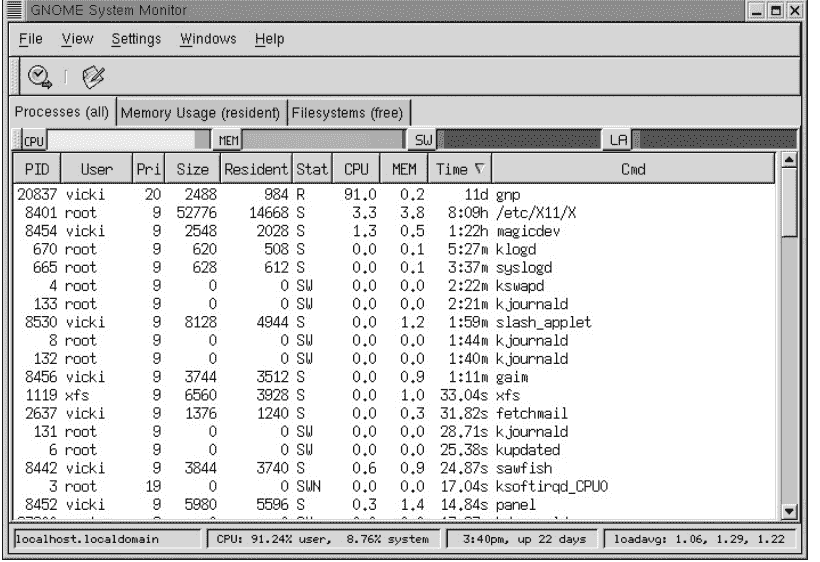

图 7.1：`top` 命令的示例输出

### 使用 `kill` 命令终止/重启

你知道如何查看哪些进程在主导你的 CPU 并拖慢你的系统，但该怎么办呢？要在 Linux 系统（以及大多数其他类 Unix 系统）上终止进程，你使用 `kill` 命令。仅以进程 ID 作为参数发出 `kill` 命令时，它将向进程发送一个信号，告诉它终止。某些进程能够捕获信号，因此不能轻易被终止——那些“约翰·韦恩”式的进程，它们简单粗暴地忽略终止信号。对于这些进程，你必须使用 `-9` 参数，使命令看起来像这样：

```
$ kill -9 234
```

`-9` 无法被捕获，因此指定 `ID` 的进程将终止。通常，建议先尝试不带 `-9` 参数的 `kill` 命令，因为有些程序可以通过这种方式更干净地关闭自己，不会留下临时文件等。

如果你需要重启守护进程，因为它挂起了或者你更改了配置文件，你可以通过在进程 ID 前使用 `-1` 参数输入 `kill` 命令来做到这一点，如下例所示。

```
# kill -1 234
```

不要将此与 `-9` 参数结合使用。使用 `kill -1 234` 会产生相同的效果。你可能会注意到，当与其他系统管理员交谈时，`HUP` 有时被用作动词，基本意思是重启。

> **注意** Linux 支持一个名为 `nohup` 的命令，它以忽略 `HUP` 终止信号的方式启动程序。这允许你运行程序，使其在注销后仍然存活，如果你想要运行一个将运行很长时间但不想占用终端或 `xterm` 窗口的程序，这会很有用。要使用此实用工具，只需将其放在普通命令之前，例如 `nohup number-cruncher`。

## 使用脚本终止/重启进程

在 Red Hat（就像许多 Unix 版本一样），每个守护进程都有一个单独的脚本，允许你终止它、检查其状态或重启它。对这些脚本的处理基于运行级别。运行级别在第 3 章中进行了更详细的讨论。目前你只需要记住，系统有几种可以启动的模式。运行级别的选择允许仅由 `init` 进程启动某些进程。在 Red Hat 系统中，这些脚本存在于 `/etc/rc.d/init.d` 目录中，每个由系统在启动或运行级别更改时启动或关闭的守护进程都有一个脚本。在 `/etc/rc.d/` 目录下，每个可能的运行级别都有一个子目录，其中包含应该为该级别运行的脚本的符号链接。大多数脚本包含启动、停止、状态检查和重启其特定守护进程的功能。

例如，要终止 `sendmail` 守护进程，你使用 `stop` 选项：

```
# /etc/rc.d/init.d/sendmail stop
```

一种替代方法是使用 `service` 命令的简写形式，它用“`service`”一词加上服务名称替换了 `service` 命令的路径，如下所示：

```
# service sendmail stop
```

无论你选择哪种语法，如果守护进程被停止，你都会看到以下消息：

```
Shutting down sendmail: [OK]
```

如果守护进程没有被成功关闭，`[OK]` 将被替换为 `[FAILED]`，如下所示。如果试图终止的守护进程当前并未运行，就可能发生这种情况。

```
Shutting down sendmail: [FAILED]
```

如果你希望启动当前未运行的守护进程，请将对 `stop` 的单词替换为 `start`：

```
# /etc/rc.d/init.d/sendmail start
```

或者

```
# service sendmail start
```

然后系统将尝试启动 `sendmail` 守护进程。将显示确认启动成功的消息。

```
Starting sendmail: [OK]
```


如果你只是想确认某个守护进程是否在运行，而不必翻阅`ps`命令的输出列表，可以使用`/etc/rc.d/init.d`目录下管理该守护进程的脚本，并指定`status`选项，例如：

```
# /etc/rc.d/rc.local/sendmail status
```

或者

```
# service sendmail status
sendmail (pid 4437) is running...
```

最后，你也可以重启一个当前正在运行的守护进程——或者用一些人的说法，你可以对该守护进程执行“HUP”操作。对于`sendmail`，你可以使用

```
# /etc/rc.d/init.d/sendmail restart
```

或者

```
# service sendmail restart
```

之后，如果关闭成功，你会看到如下消息

```
Shutting down sendmail: [OK]
```

如果关闭失败，则会看到

```
Shutting down sendmail: [FAILED]
```

在关闭信息之后，如果`sendmail`守护进程成功启动，你会看到

```
Starting sendmail: [OK]
```

如果启动失败，则会看到

```
Starting sendmail: [FAILED]
```

关闭阶段的失败并不会自动阻止守护进程重启，尽管该守护进程本身的问题可能会导致关闭和启动双双失败。

```
Shutting down sendmail: [FAILED]
Starting sendmail: [FAILED]
```

## 总结

我们探讨了`ext3`文件系统：它的发展过程以及其布局结构。我们还查看了进程以及使用`ps`、`fg`、`bg`和`top`等命令进行进程管理的方法。我们展示了在第三章中介绍的`init`进程在整个体系中的位置。如果启动过程以及`init`进程在其中所扮演的角色尚不清楚，建议你回顾第三章。

现在我们已经讨论了不同类型的进程和文件，接下来我们将讨论这些文件是如何被安装和管理的。

# 第 8 章：软件管理

## 概述

大多数Linux发行版都附带了种类繁多的软件包，其中许多可以在系统安装过程中进行选择。然而，有时你会发现需要安装额外的程序，或升级已安装的软件包。具体可用的选择取决于你使用的Linux发行版，你可能会面对几种不同的`软件包格式`，它们是将软件分发为单个文件的方法，通常还包含关于新程序所需其他程序的信息。例如，大多数Linux程序依赖于`glibc`，而软件包可以指定这种依赖关系。

除了软件包格式的选择外，软件可以以`二进制`或`源代码`形式分发。前者是即开即用的软件。后者由原始程序代码文件组成，必须`编译`成二进制形式。源代码软件包比二进制软件包更具可移植性——例如，你可以在`x86`和`PowerPC`计算机上使用相同的源代码软件包。如果你懂得该程序所使用的编程语言，还可以修改源代码。

更新现有软件包与添加新软件包同样重要。更新可以修复漏洞和安全缺陷，或者添加新程序所需的功能。其中一项特别重要的更新是`内核`的更新，它是Linux系统的核心。（从技术上讲，Linux`就是`内核；Linux发行版中的几乎所有其他内容都可以在其他操作系统上运行，至少重编译后是这样。）更新内核的常用方法是重新编译它。这项任务对于新的Linux管理员来说可能令人望而生畏，但了解如何操作非常重要，因为内核重新编译带来许多好处，并且可能是完成Linux中某些任务的唯一途径。

## 安装二进制软件包

软件安装程序因Linux发行版而异。如今大多数发行版使用`Red Hat Package Manager (RPM)`文件 or `Debian`软件包，但`Slackware`使用`tarball`——由`tar`程序创建的文件，其中不包含`RPM`和`Debian`软件包所支持的那种复杂的依赖信息。少数其他发行版，如`Stampede Linux`，使用它们自己的专有格式。一般来说，如果你获取的是二进制软件包，请获取与你发行版偏好的软件包格式相匹配的那个。如有必要，你可以经常使用`alien`程序将一种格式转换为另一种格式，或者你可以安装`tarball`。（所有Linux发行版都能读取`tarball`。）最干净的做法总是从正确的软件包格式开始。

### 安装 RPM

大多数现代Linux发行版都使用`RPM`格式，尽管有些使用`Debian`软件包。幸运的是，安装`RPM`是一个简单的过程。

**警告** 升级`RPM`软件包有时会清除该软件的配置文件。在`升级`程序之前，备份这些文件（它们可能位于多种位置，但通常在`/etc`目录下）。

**基本 rpm 选项**

在`shell`提示符下使用`rpm`程序来安装或升级软件包。该程序具有如下语法：

```
rpm [operation] [options] [package-files|package-names]
```

表 8.1 总结了最常见的`rpm`操作，表 8.2 总结了最重要的选项。然而请注意，`rpm`是一个非常复杂的工具，因此本章只能浅尝辄止。事实上，有一整本书（`Ed Bailey`的`Maximum RPM`，`Red Hat Press`，1997 年）专门介绍此工具。`rpm`的`man`手册页包含比表 8.1 和 8.2 中列出的更晦涩的操作和选项信息。`rpm`许多较少使用的功能都致力于创建`RPM`软件包。

**表 8.1：常见的 rpm 操作**

| `rpm` 操作 | 描述 |
|---|---|
| `-i` | 安装软件包；系统`不能`包含同名软件包。 |
| `-U` | 安装新的`软件包`或`升级`现有软件包。 |
| `-F` 或 `--fresh` | 仅当较早版本已存在时升级软件包。 |
| `-q` | 查询软件包：查找软件包是否已安装、包含哪些文件等。 |
| `-V` 或 `-y` 或 `--verify` | 验证软件包：检查其文件是否存在且自安装以来未更改。 |
| `-e` | 卸载软件包。 |
| `-b` | 给定源代码和`配置`文件，构建二进制`软件包`。 |
| `--rebuild` | 给定源`RPM`文件，构建二进制`软件包`。 |
| `--rebuilddb` | 重建`RPM`数据库，以修复错误。 |

**表 8.2：常见的 rpm 选项**

| `rpm` 选项 | 用于操作 | 描述 |
|---|---|---|
| `--root dir` | 任意 | 修改位于 `dir` 的`根`目录的 Linux 系统。此选项可用于在操作系统安装或`紧急`维护期间维护一个与其他隔离的 Linux 安装。 |
| `--force` | `-i`, `-U`, `-F` | 强制安装软件包，即使这意味着`覆盖`现有的`文件`或`软件包`。 |
| `-h` 或 `--hash` | `-i`, `-U`, `-F` | 显示一系列井号 (`#`) 以指示操作进度。 |
| `-v` | `-i`, `-U`, `-F` | 与 `-h` 选项配合使用，为`每个` `软件包`生成统一数量的哈希标记。 |
| `--nodeps` | `-i`, `-U`, `-F`, `-e` | 不执行`依赖`性检查。即使软件包依赖于`不` `存在`的`软件包`或`文件`，或者被`不` `卸载`的`软件包`所`需要`，也安装或移除该软件包。 |
| `--test` | `-i`, `-U`, `-F` | 检查依赖项、冲突和其他问题，而不实际安装软件包。 |
| `--prefix path` | `-i`, `-U`, `-F` | 将安装目录设置为 `path`（仅对某些软件包有效）。 |
| `-a` 或 `--all` | `-q`, `-V` | 查询或验证所有软件包。 |
| `-f file` 或 `--file file` | `-q`, `-V` | 查询或验证拥有 `file` 的软件包。 |
| `-p package-file` | `-q` | 查询未安装的 RPM `package-file`。 |
| `-i` | `-q` | 显示软件包信息，包括软件包维护者、简短描述等。 |
| `-R` 或 `--requires` | `-q` | 显示该软件包依赖的软件包和文件。 |
| `-l` 或 `--list` | `-q` | 显示软件包中包含的文件。 |

`rpm`是一个极其有用的工具，因为它维护了一个关于已安装软件包信息的数据库。此数据库包括软件包名称和版本号、与软件包关联的文件、每个文件的校验和，以及软件包所依赖的文件和软件包等信息。该数据库允许基于`RPM`的发行版检测特定新软件包所需的不兼容性或缺失功能。这有助于你避免因尝试安装包含与其他软件包冲突文件的软件包而损坏系统。这也让你避免了一种新程序依赖于你未安装的库所带来的挫败感。提前获知此类问题，你可以最轻松地加以修正。

## 使用基于文本的工具


要使用 `rpm`，你需要将一个操作与一个或多个选项组合起来。在大多数情况下，你还需要包含一个或多个软件包名称或软件包文件名。（`软件包文件名`是完整的文件名，而`软件包名称`是缩短版。例如，软件包文件名可能是`samba-2.2.3a-6.i386.rpm`，而匹配的软件包名称是`samba`。）你可以为每个软件包发出一次`rpm`命令，也可以在命令行上列出多个软件包，以空格分隔。

在安装或升级软件包时，`-U`操作通常是最有用的，因为它允许你在不先卸载旧软件包的情况下安装新软件包。这种单步操作在软件包包含许多依赖项时特别有帮助，因为`rpm`会检测这些依赖项，如果新软件包满足了旧软件包提供的依赖项，它就可以执行该操作。

要使用`rpm`安装或升级软件包，请发出类似以下命令：

```
# rpm -Uvh samba-2.2.3a-6.i386.rpm
```

如果你尚未安装`samba`软件包，你也可以使用`rpm -ihv`替代`rpm -Uvh`。

**警告** 同一个程序可能以不同的名称分发。在这种情况下，升级可能会失败，或者可能会产生重复安装，从而导致特定程序故障。Red Hat 已描述了一种软件包命名系统以避免此类问题，但此类问题偶尔仍会发生。因此，最好使用由提供原始软件包的相同个人或组织提供的后续版本来升级软件包。

你可以使用`rpm -qi`命令来验证软件包是否已安装，该命令会显示诸如软件包的构建时间和构建计算机等信息。列表 8.1 演示了此命令。（`rpm -qi` 还会显示关于该软件包的扩展英文摘要，但在列表 8.1 中已省略。）

# 列表 8.1：RPM 查询输出

```bash
$ rpm -qi samba
Name  : samba Relocations: (not relocatable)
Version : 2.2.3a Vendor: Red Hat, Inc.
Release : 6 Build Date: Wed 10 Apr 2002 07:38:10 PM EDT
Install date: Thu 09 May 2002 07:23:20 AM EDT Build Host: daffy.perf.redhat.com
Group : System Environment/Daemons Source RPM: samba-2.2.3a-6.src.rpm
Size : 6852698 License: GNU GPL Version 2
Package : Red Hat, Inc. <http://bugzilla.redhat.com/bugzilla>
URL : http://www.samba.org
Summary : The Samba SMB server.
```

## 使用 GUI 工具

许多 Linux 发行版都包含 GUI 工具，用于帮助你安装、移除、更新和查询 RPM 软件包。例如，Red Hat 和 Mandrake 都附带了 Gnome RPM（图 8.1）。若要使用 Gnome RPM 添加软件包，请遵循以下步骤：

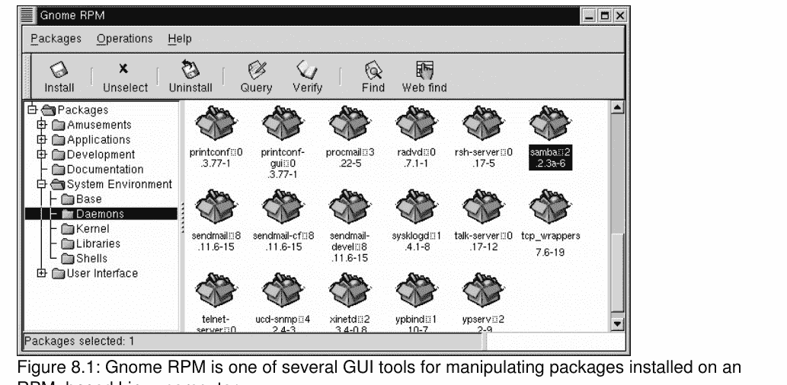

- 以 root 身份在 xterm 窗口中输入 `gnorpm` 来启动 Gnome RPM。

- 在 Gnome RPM 主窗口中，单击 Install 按钮。Gnome RPM 将显示一个安装对话框，你可以在其中选择 RPM。

- 在安装对话框中，单击 Add 按钮。在弹出的文件选择对话框中，定位并选择你要安装的 RPM 文件，每选择一个文件后都单击 Add。当你选择并添加完所有文件后，单击 Cancel。你将再次看到安装对话框，其中会显示你添加的内容。

- 确保所有你要安装的软件包旁边的复选框中都打上了勾，然后单击 Install 按钮。Gnome RPM 将安装这些软件包。

你可以以类似的方式使用 GNOME RPM 来更新、删除或查询 RPM 软件包。其他发行版（如 Caldera 和 SuSE）中的 GUI 配置实用程序在细节上有所不同，但功能类似。

# 安装 Debian 软件包

Debian、Xandros（原 Corel）和 Librlnet Linux 都使用 Debian 软件包而非 RPM。Debian 软件包与 RPM 软件包不兼容，但基本操作原理相同。与 RPM 类似，Debian 软件包包含依赖信息，并且 Debian 软件包工具维护着一个已安装软件包、文件等的数据库。你使用 `dpkg` 命令来安装 Debian 软件包。该命令的语法类似于 `rpm`：

```bash
dpkg [options] [action] [package-files|package-name]
```

动作是要执行的操作；常用动作概述见表 8.3。选项（表 8.4）会改变动作的行为，就像 `rpm` 的选项一样。

### 表 8.3：dpkg 主要动作

| dpkg 动作 | 描述 |
|:--- |:--- |
| `-i` 或 `--install` | 安装软件包。 |
| `--configure` | 重新配置已安装的软件包：运行安装后脚本以设置特定于站点的选项。 |
| `-r` 或 `-P` 或 `--remove` 或 `--purge` | 移除软件包。 |
| `-p` 或 `--print-avail` | 显示关于软件包的信息。 |
| `-l pattern` 或 `--list pattern` | 列出所有名称与 `pattern` 匹配的已安装软件包。 |
| `-L` 或 `--listfiles` | 列出与软件包相关的已安装文件。 |
| `-C` 或 `--audit` | 查找部分安装的软件包并建议如何处理它们。 |

### 表 8.4：用于微调 dpkg 动作的选项

| dpkg 选项 | 配合使用的动作 | 描述 |
|:--- |:--- |:--- |
| `--root=dir` | 所有 | 修改使用位于 `dir` 处的根目录的 Linux 系统。可用于将一个 Linux 安装与另一个安装分离，例如在操作系统安装或紧急维护期间。 |
| `-B` 或 `--auto-deconfigure` | `-r` | 禁用依赖于被移除软件包的软件包。 |
| `--force-things` | 各种 | 强制执行特定操作。有关此选项所做事情的详细信息，请参阅 `dpkg` 手册页。 |
| `--ignore-deends=package` | `-i`、`-r` | 忽略指定软件包的依赖信息。 |
| `--no-act` | `-i`、`-r` | 检查依赖项、冲突和其他问题，但不实际安装软件包。 |
| `--recursive` | `-i` | 安装与指定目录及其所有子目录中的软件包名称通配符匹配的所有软件包。 |
| `-G` | `-i` | 如果已安装相同软件包的较新版本，则不安装该软件包。 |
| `-E` 或 `--skip-same-version` | `-i` | 如果已安装相同版本的软件包，则不安装该软件包。 |

例如，考虑以下命令，它安装 `samba_2.0.7-3.4_i386.deb` 软件包：

```bash
# dpkg -i samba_2.0.7-3.4_i386.deb
```

如果你正在升级软件包，可能需要移除旧软件包。为此，请对 `dpkg` 使用 `-r` 选项，如下所示：

```bash
# dpkg -r samba
```

> **注意** 在同一台计算机上使用 RPM 和 Debian 软件包是可能的，实际上某些发行版（如 Xandros/Corel Linux）明确支持这种配置。同时使用两种软件包格式会削弱两者的优势；这是因为这两种格式可能会引入冲突的软件包，且它们无法共享依赖信息。因此，最好只使用一种软件包格式。

Debian 软件包系统包含一组统称为高级软件包工具（`APT`）的实用程序。该软件包中最重要的程序是 `apt-get`，你可以用它来自动或半自动地维护系统。该工具将在接下来的“更新实用程序”部分中简要描述。

某些基于 Debian 的 Linux 发行版（如 Xandros/Corel Linux）包含 `dpkg` 的 GUI 前端；它们类似于用于基于 RPM 的系统的 Gnome RPM 程序。如果你更习惯使用 GUI 工具而不是命令行工具，你可以像使用 Gnome RPM 那样使用这些 GUI 工具。

# 安装 Tar 包

如果你使用的是 Slackware Linux 或其他使用 tar 包的发行版，你可以使用 Linux `tar` 实用程序来安装软件。如果你想在使用包管理工具的 Linux 发行版上安装 tar 包，也可以使用此方法。然而，只要可能，我们建议使用 RPM 或 Debian 软件包。


> **警告** 在 Slackware Linux 上安装程序以覆盖旧版本时，新文件应覆盖旧文件。然而，如果你在通常使用软件包的系统中安装 `tar` 包，或者你安装的 `tar` 包使用的目录结构与当前系统使用的不同，你可能会发现重复的文件。这可能会导致混淆，因为你在安装新二进制文件后可能会发现自己在用旧的二进制文件。因此，在安装二进制 `tar` 包之前，你应尽可能移除旧软件包。输入 `tar tvfz package.tgz` 以检查 `tar` 包内部的目录结构。此命令显示 `tar` 包中的所有文件，包括其完整路径。

`tar` 包的安装是相当直接的过程。作为 `root`，你发出类似于以下命令的指令，它安装位于 `/root` 目录中的 `samba.tgz` 文件中的文件：

```bash
# cd / 
# tar xvzf /root/samba.tgz
```

请注意，第一条命令（`cd /`）非常重要；如果没有它，你会在当前目录下安装文件，而不是在通常的目录树中。（不过，`tar` 包可能需要安装在 `/` 以外的某个目录下，在这种情况下，你应该遵循随软件包提供的说明。）

**注意** 第 9 章更详细地描述了 `tar` 实用程序。

**管理员日志：二进制 Tar 包安装**

系统：E12345678

操作：从二进制 `tar` 包 `samba.tgz` 安装了 Samba。文件位于 `/opt/samba`。

# 编译源代码

经常需要或有必要从源代码编译程序。你可能希望这样做的情况包括：

- 你找不到该程序的二进制软件包。这在非 x86 系统（如 Macintosh）上运行 Linux 时尤其可能。
- 你找到的二进制软件包依赖于与你拥有的不同的支持库。重新编译通常可以绕过这个问题，尽管有时源代码本身需要与你拥有的不同的库。
- 你想启用可用二进制软件包未使用的选项。这些选项可能会为你的计算机优化软件包或添加功能。
- 你想修改源代码。如果自上次发布二进制软件包以来某个 bug 已被修复，或者你想以某种方式添加功能或修改程序，你几乎没有选择，只能从源代码编译。

在前两种情况下，你通常可以从*源 RPM*编译，这是一种包含源代码的 RPM 文件。只要有适当的控制文件，也可以从源代码创建 Debian 软件包。在后两种情况下，最简单的方法是获取源代码 `tar` 包，进行你的修改，然后直接从编译后的代码安装。对于单台计算机的安装，从修改或优化的源代码创建软件包通常不值得。然而，如果你维护多台 Linux 计算机，你可能想要阅读 `RPM HOWTO` 文档或 Ed Bailey 的 *Maximum RPM*，以了解如何从源代码 `tar` 包生成二进制 RPM。然后你可以在一台系统上编译后，在所有的计算机上安装定制的软件包。

## 从软件包编译

源 RPM 文件通过在文件名中存在 `.src.` 来识别，而不是 `.i386.` 或其他架构标识符。例如，`samba-2.2.3a-6.src.rpm` 是随 Red Hat 7.3 提供的 Samba 软件包的源 RPM；`samba-2.2.3a-6.i386.rpm` 是适用于 x86 计算机的匹配二进制文件。如果你想在 Yellow Dog Linux（针对 Macintosh 和其他基于 PPC 的系统）上编译源 RPM，结果将是 `samba-2.2.3a-6.ppc.rpm`。

**注意** 某些非源 RPM 文件是与架构无关的。这些可以包含文档、字体、脚本等。它们通过文件名组件 `.noarch.` 来识别。这些 RPM 可以安装在任何 CPU 的系统中。

若要编译源 RPM 包，需在 `rpm` 命令中添加 `--rebuild` 操作，具体命令如下：

```
# rpm --rebuild samba-2.2.3a-6.src.rpm
```

如果一切顺利，你将看到一系列编译命令随之运行。这些命令的执行时间从几秒到几小时不等，具体取决于软件包和计算机的速度。在典型的 500MHz Intel 架构计算机上，大多数软件包只需几分钟即可编译完成。

构建软件包要求安装必要的支持库——不仅是最终二进制软件包所需的库，还包括对应的开发库。这些开发库并不总是包含在源 RPM 的依赖信息中，因此因缺少某个库而导致编译失败的情况并不罕见。如果发生这种情况，请检查错误信息，然后查看该程序主页上的需求列表。幸运的是，错误消息通常与软件包主页上列出的某项需求较为相似。随后，你可以找到合适的开发 RPM（其名称中通常包含 `devel`），安装它并再次尝试。

**提示** 你通常可以使用命令 `rpm -qpi packagefile` 来查找程序的主页。软件包维护者通常也有自己的主页。

一旦软件包编译成功，你会在 `/usr/src` 目录树中找到一个或多个匹配的二进制 RPM 文件。大多数发行版都会在此树中创建一个以自身命名的目录，例如 Red Hat 系统中的 `/usr/src/redhat`。该目录包含一个 `RPMs` 目录，其中又有以架构命名的一个或多个子目录，如 `i386` 或 `ppc`。（大多数在 Intel 架构计算机上构建的软件包会将二进制文件放在 `i386` 子目录中，但有些会使用 `i586` 或其他名称。）你在此子目录中找到的 RPM 文件是二进制软件包，可以像其他任何二进制 RPM 一样进行安装。大多数源 RPM 构建时会生成一个二进制 RPM 文件，但有些会生成多个二进制 RPM 文件。

> **管理员日志**：RPM 源文件安装
>
> 系统：E12345678
>
> 操作：从源 RPM 编译了 Samba 2.2.3a 并安装了生成的二进制 RPM。

虽然可以从源代码编译 Debian 软件包，但这一过程稍有不同。你需要找到并使用控制文件，而不是二进制 Debian 软件包，你可以将控制文件与普通源代码 tarball（归档包）配合使用。

## 编译 Tarball

如果你不想或无法创建软件包文件，你可以从原始源代码 tarball 编译源代码并直接安装编译后的软件。但这样一来，你就放弃了使用 RPM 或 Debian 软件包的优势。只要有可能，最好还是使用二进制软件包，或者从源软件包创建自己的二进制软件包，而不是直接从源 tarball 安装。

**注意** 有些管理员更喜欢使用原始源代码 tarball，因为他们知道源代码并未被软件包维护者修改过，而在 RPM（包括源 RPM）文件中这种情况相当常见。

你可以使用类似 `tar xvfz sourcecode.tgz` 的命令解压 tarball。这通常会产生一个包含源代码发行版的子目录。你可以将此 tarball 解压到主目录、`/root` 目录、`/usr/src` 目录或其他方便的位置。不过，编译和安装代码涉及的某些操作可能需要 `root` 权限，因此你可能不希望使用主目录。

不幸的是，不可能为所有源代码 tarball 提供既完整又准确的单一流程。这是因为没有两个源代码软件包是完全相同的；每位开发者在编译和安装程序上都有自己独特的风格和偏好。不过，以下元素通常都会包含在内：

- **文档**：大多数源代码 tarball 包含一个或多个文档文件。有时这些文件出现在名为 `doc` 或 `documentation` 的子目录中。其他时候，可能有一个 `README` 或 `INSTALL` 文件，或者是操作系统特定的文件（例如 `README.linux`）。请阅读适合的那些文档。
- **配置选项**：大多数大型程序足够复杂，需要针对你的操作系统或架构进行预编译配置。这通常通过一个名为 `configure` 的脚本来处理。该脚本检查关键库的存在情况、编译器的特性等，并创建一个名为 `Makefile` 的文件，该文件最终将控制编译过程。少数程序通过其他方式实现相同目标，例如输入 `make config`。有时你必须回答一些问题或向配置脚本传递额外的参数。
- **编译**：要编译软件包，通常必须输入 `make`。对于某些软件包，你需针对每个子组件分别发出 `make` 命令，例如 `make main`。编译过程可能需要从几秒到几小时不等，具体取决于软件包和你的计算机速度。
- **安装**：小型软件包有时依赖用户手动进行安装；你必须将编译好的二进制文件复制到 `/usr/local/bin` 或其他方便的位置。你可能还需要复制 man 页面文件、配置文件等。软件包的文档将包含所需的详细信息。其他软件包则有一个名为 `install` 的脚本或一个 `make` 选项（通常输入 `make install`）来完成此工作。
- **安装后配置**：安装软件后，你可能需要通过编辑配置文件来为你的系统进行配置。这些文件可能位于用户的主目录中、`/etc` 目录下或其他位置。程序的文档应提供相关细节。

本地编译的软件包的传统位置位于 `/usr/local` 目录树中——二进制文件放在 `/usr/local/bin`，man 页面放在 `/usr/local/man`，等等。这种放置方式可以确保从源 tarball 安装程序时不会干扰基于软件包的程序，后者通常位于 `/usr` 树的其他位置。大多数源代码 tarball 包含默认的安装脚本，将其内容放置在 `/usr/local` 中，但少数不遵循此惯例。请查阅程序文档以了解其安装位置。

> **管理员日志**：
>


> 操作：编译并安装了 `Samba` 2.2.3a。位于 `/usr/local/samba`。

# 内核编译

Linux 内核是任何 Linux 系统中特别关键且复杂的组件。因此，在讨论软件安装和维护时，它值得特别关注。虽然你可以安装预编译的更新内核，就像安装其他预编译软件包一样，但自行编译内核具有某些优势，下文将予以描述。

内核编译和安装过程有其特殊性，因此本节详细描述了该过程，从设置编译选项开始，到重启计算机以使用新内核为止。

### 为什么要编译内核？

幸运的是，你的计算机在安装 Linux 后立即启动并运行。这意味着发行版提供的 Linux 内核是可行的。那么，为什么要费事去编译一个新内核呢？自定义内核编译最重要的优势包括：

- **架构优化**：内核包含针对各类 CPU（如 `80386`、`80486` 等）的优化选项。大多数发行版提供的内核是为 `80386` CPU 优化的。通过为你的特定 CPU 型号编译内核，你可以从系统中榨取一点额外的速度。

- **移除不必要的驱动程序**：默认内核包含适用于各种硬件组件的驱动程序。在大多数情况下，这些驱动程序不会造成危害，因为它们被编译为 `模块`（独立的驱动文件），除非必要否则不会加载。然而，少数驱动程序被直接编译进内核本身。这些驱动程序不必要地占用内存，从而略微降低系统性能。

- **添加驱动程序**：你可能需要向系统添加新的或实验性的驱动程序。如果你使用的是非常新的组件，或者存在尚未集成到主内核树中的错误修复，这通常是必要的。此类更改通常要求你 `修补` 内核——即替换一个或多个内核源代码文件。有关如何操作的详细信息，请咨询提供新驱动程序的站点。

- **更改选项**：你可能希望更改与驱动程序相关的选项，以优化性能或提高可靠性。当你查看内核配置过程时，你会看到许多此类选项的例子。

- **升级内核**：你可能希望运行最新版本的内核。有时你可以获得预编译形式的升级包，但偶尔你需要从源代码编译内核。

当然，内核编译也并非没有缺点。配置和编译内核需要时间。而且，你编译的内核可能无法正常工作。务必为自己保留一种使用旧内核启动的方法，否则在升级失败后，你将很难启动系统。（本章介绍了如何使计算机启动到旧内核或新内核。）

总的来说，编译自己的内核是每位 Linux 系统管理员都应该具备的技能，即使你并不在每一台维护的系统上都这样做。使用自定义编译的内核有助于你优化系统并使用最新的驱动程序，从而为你的系统带来优势。在某些情况下，这是使某些功能（例如针对特别新的硬件的驱动程序）正常工作的唯一途径。

## 获取内核

在编译内核之前，你必须先获取一个内核。与其他软件包一样，你获取内核的方式可以是预编译的，也可以是源代码形式；并且可以是 `RPM`、`Debian` 软件包或 `tarball` 形式。我们倾向于从源代码 `tarball` 形式安装内核，因为这能让你确保你是在一个原始的标准基础上进行操作。特别是内核 `RPM` 软件包经常以各种方式被修改。虽然这些修改有时是有用的，但如果需要安装补丁，它们也可能干扰补丁的顺利安装。（另一方面，作为 `RPM` 分发的内核有时 `包含` 你可能想要安装的正是那些补丁，从而简化了问题。）

寻找内核的最佳地点之一是 [http://www.kernel.org/](http://www.kernel.org/)。该网站包含指向“官方”内核源代码 `tarball` 的链接。你还可以在主要的 FTP 站点上找到内核文件，例如 [ftp://ibiblio.org/](ftp://ibiblio.org/)。如果你想使用 `RPM` 或 `Debian` 软件包，请检查你的发行版维护者提供的内核源代码文件。如果你使用 `RPM` 或 `Debian` 内核软件包，你可能需要下载两个文件：一个是内核源代码本身，另一个是内核头文件。`Tarball` 通常在一个单独的 `tarball` 中包含这两组文件。

一个完整的 `2.4.18` 内核 `tarball` 大小为 `29MB`；一个 `2.5.5` 内核 `tarball` 大小为 `33MB`。（内核也可用 `bzip2` 压缩的 `tar` 文件提供，这些文件比传统的 `gzip` 压缩的 `tar` 文件稍小一些。你需要使用 `bzip2` 而不是 `gzip` 来解压缩这些文件。）由于体积较大，下载这些内核文件可能需要相当长的时间。

下载内核 `tarball` 后，你可以在 `/usr/src` 目录中解压它。`Tarball` 会创建或安装到一个名为 `linux` 的目录。

> **警告** 如果 `/usr/src` 已经存在一个名为 `linux` 的目录，你应该将其重命名为其他名称，并为新的源代码包创建一个新的 `linux` 目录。这将防止因在新源代码树上解压旧的源代码树而导致的问题，这些问题可能会引起不一致从而导致编译失败。

你可以像处理其他任何源代码 `tarball` 一样解压内核 `tarball`：

```bash
# tar xvzf ~/linux-2.4.18.tar.gz
```

如果你的源代码 `tarball` 使用 `bzip2` 压缩，你可以使用类似以下的命令来解压它：

```bash
# tar xvf ~/linux-2.4.18.tar.bz2 --use-compress-program bzip2
```

## 内核配置选项

一旦你解压了内核 `tarball`，就可以开始配置它。使用以下三个命令中的任何一个来完成此任务：

- `make config`：此命令运行一个基于文本的配置工具，它会针对每一个配置选项向你提出具体的问题。你不能随意从一个选项跳转到另一个选项，因此这种方法相当笨拙。

- `make menuconfig`：与 `make config` 类似，此选项提供一个基于文本的配置工具。但是，`make menuconfig` 工具使用文本模式菜单，因此你可以从一个选项跳转到另一个选项。如果你使用的是基于文本的控制台登录，这是一种配置内核的好方法。

- `make xconfig`：此命令也使用菜单进行配置，但菜单是基于 X 的，因此你可以在 X 环境中通过鼠标点击来配置内核。

内核配置选项按组排列。如果你使用 `make menuconfig` 或 `make xconfig`，你可以选择一组以查看该组中的项目列表，如图 8.2 所示。组通常有子组，因此你可能需要查看相当多的菜单才能找到特定的驱动程序或选项。

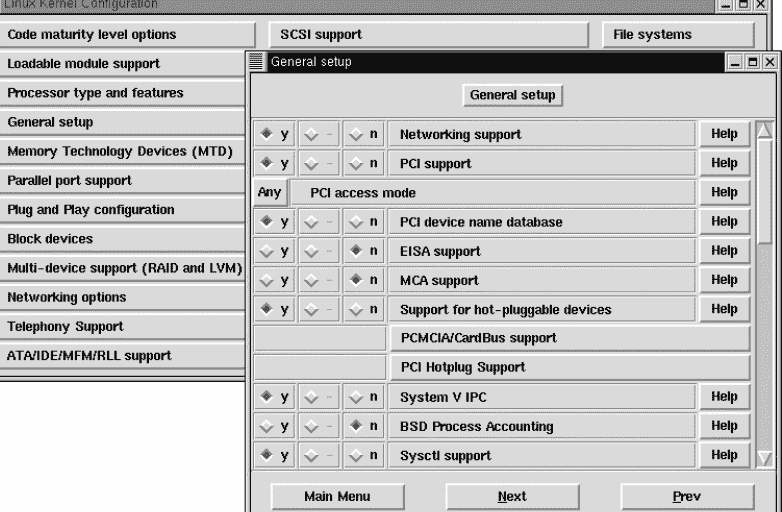

图 8.2：内核编译选项按层次结构排列，每个主菜单选项生成其自己的菜单，当使用 `make xconfig` 时，这些菜单在单独的窗口中显示。

> **注意** 一个新的内核配置工具 `CML2`（[http://tuxedo.org/~esr/cml2/](http://tuxedo.org/~esr/cml2/)）正在开发中，并应作为 `2.5.x` 内核系列的一部分集成到 Linux 内核中。这可能会改变内核配置的许多细节，但基本原则应保持不变。

描述每一个可用的内核配置选项将会非常繁琐，而且不可避免地不完整，因为选项正在不断被添加和更改。因此，表 8.5 仅概述了 `2.4.x` 内核系列中的主要内核标题。在撰写本文时，`2.5.x` 内核系列尚属新近推出，其内容几乎可以肯定会在近期发生变化。

## 内核版本号

每个 Linux 内核都有一个形式为 `x.y.z` 的版本号。

- `x` 号是 `主版本号`，在 2002 年这个数字是 `2`。

- `y` 号表示对内核的重要更改，并具有特殊含义。偶数 `y` 值被视为稳定版——它们不太可能包含重大错误，并且在相邻的小版本发布之间变化不大。奇数 `y` 号表示开发内核，其中包含实验性功能。开发内核可能不稳定，并可能随时间发生实质性变化。除非你迫切需要使用开发内核中引入的某个功能，否则你不应该使用它们。

- `z` 号代表给定稳定内核或开发内核中的次要更改。在稳定内核中，这些代表次要的错误修复，偶尔还有重要新驱动程序（但经过充分测试）的添加。在开发内核中，`z` 号的递增代表主要错误修复、添加的功能、更改以及（实事求是地讲）引入的新错误。

当 `Linus` `Torvalds` 认为一个开发内核正在变得稳定，并且包含了他想要在该内核中的功能时，他会宣布代码冻结，此后只添加错误修复。当内核足够稳定时，将基于系列中的最后一个开发内核制作一个新的稳定版本（在这个新的稳定版本发布之前，可能存在一系列测试版本）。在撰写本文时，当前的稳定内核版本是 `2.4.18`，最新的开发内核是 `2.5.5`。这个开发系列最终将导致发布 `2.6.0` 或 `3.0.0` 内核。

### 表 8.5：Linux 2.4.x 内核配置选项

| 内核配置菜单项 | 涵盖的选项 |
| :--- | :--- |
| 代码成熟度级别选项 | 此菜单提供选项，允许你选择实验性驱动程序和功能。 |
| 可加载模块支持 | 现代内核通常将许多功能包含在可加载模块（单独的驱动程序文件）中。此菜单让你能够启用对这些模块的支持并设置几个相关选项。 |
| 处理器类型和功能 | 你可以配置系统以针对你的特定 CPU 优化内核，并启用与 CPU 相关的选项，例如浮点仿真（现代 CPU 不需要此项）。 |
| 一般设置 | 此菜单包含一系列杂乱无章的选项，这些选项不适合放在其他地方，例如内核支持的二进制程序文件类型和电源管理功能。 |
| 内存技术设备 (MTD) | 此菜单允许你启用对某些类型专用内存存储设备的支持，例如闪存 ROM。工作站或服务器上很可能不需要这种支持。 |


| 并行端口支持 | 在这里你可以添加对并行端口硬件的支持（通常用于打印机，偶尔用于扫描仪、可移动磁盘驱动器和其他设备）。特定设备的支持必须在其他各种菜单中添加。 |
| 即插即用配置 | 2.4.x 内核包含对 ISA 即插即用 (PnP) 卡的支持。以前的内核依赖于外部实用程序 `isapnp` 来配置这些卡。你可以使用内核支持或旧的 `isapnp` 实用程序，视你的偏好而定。 |
| 块设备 | 块设备是指内容按多字节块读取的设备，例如硬盘。此菜单控制软盘、基于并行端口的可移动磁盘以及少数其他块设备。一些块设备，包括大多数硬盘，在其他地方涵盖 |

### 多设备支持

逻辑卷管理（LVM）和独立磁盘冗余阵列（RAID）是高级磁盘管理技术，可以简化分区调整大小、提高磁盘性能或改善磁盘可靠性。这些选项的配置超出了本书的范围，但可以从此内核配置菜单中启用它们。

### 网络选项

您可以从此菜单配置一系列 TCP/IP 网络选项，并启用其他网络协议栈，例如 DDP（用于 AppleTalk 网络）和 IPX（用于 Novell 网络）。网络硬件在另一个菜单中配置。

### 电话支持

此菜单允许您配置用于将互联网作为电话链接手段的专用硬件。

### ATA/IDE/MFM/RLL 支持

如今大多数 x86 计算机都使用 EIDE 硬盘，您可以从此菜单启用这些设备的驱动程序。相关的旧磁盘驱动程序也从此菜单启用，EIDE CD-ROM、磁带驱动器等设备的驱动程序也是如此。

### SCSI 支持

在此处，您启用对 SCSI 主机适配器和特定 SCSI 设备（磁盘、CD-ROM 驱动器等等）的支持。

### Fusion MPT 设备支持

Fusion MPT 设备是 SCSI、IEEE 1394 和以太网硬件的独特混合体。您从此菜单启用对它的支持。

### IEEE 1394（FireWire）支持

此菜单允许您启用对新的 IEEE 1394（又称 FireWire）接口协议的支持，该协议用于某些视频和磁盘设备。

### I2O 设备支持

此菜单允许您使用 I2O 设备。智能输入/输出（I2O）是一种新方案，允许将设备驱动程序分解为操作系统专用部分和设备专用部分。

### 网络设备支持

此菜单包含用于启用对特定网络硬件设备支持的选项。这包括 PPP，它用于拨号互联网连接。

### 业余无线电支持

您可以通过专用无线电设备连接多台计算机，其中一些设备通过此菜单中的驱动程序得到 Linux 的支持。

### IrDA（红外）支持

Linux 支持某些红外通信协议，这些协议常用于笔记本和手持计算机。您可以在此菜单中启用这些协议和硬件。

### ISDN 子系统

综合业务数字网（ISDN）是一种通过电话线以高达 128Kbps 的速度通信的方法。您可以在此菜单中启用对 ISDN 卡的支持。

### 旧式 CD-ROM 驱动程序（非 SCSI，非 IDE）

一些旧式 CD-ROM 设备使用专有接口。Linux 支持这些卡，但您必须使用此菜单中的设置启用适当的支持。如果您使用现代 EIDE 或 SCSI CD-ROM，则无需启用这些选项中的任何一个。

### 输入核心支持

如果您想使用 USB 键盘或鼠标，请在此菜单中启用对这些设备的支持。您还可以在此处设置其他一些输入设备选项。

### 字符设备

与块设备不同，字符设备允许每次输入/输出一个字节（字符）。启用对此类设备的支持。

### 多媒体设备

如果计算机中有视频输入卡或无线电卡，请在此菜单中查找驱动程序。

### 文件系统

此菜单包含用于支持特定文件系统的选项，例如 Linux 原生的 `ext2fs` 或 Windows 的 `FAT`。

### 控制台驱动程序

在此菜单中，您可以设置与 Linux 如何处理其基本文本模式显示相关的选项。

### 声音

您可以在此菜单中配置您的声卡驱动程序。

### USB 支持

如果您的系统使用任何 USB 设备，您可以在此菜单中启用对 USB 以及特定设备的支持。当使用前面描述的输入核心支持键盘或鼠标驱动程序时，您需要从此菜单获得基本的 USB 支持。

### 蓝牙支持

蓝牙是一种短距离无线技术，旨在用于键盘、打印机等。您可以在此菜单中启用对这项技术的支持。

### 内核调试

此菜单提供了一些选项，即使系统崩溃，也能让您对系统进行一定程度的控制。这主要对内核程序员有用。

您应该花一些时间查看内核配置选项。每个选项都有一个相关的帮助项（见图 8.2）。当您选择它时，您可以看到有关当前配置选项的帮助文本——至少通常是这样的（有时文本缺失，特别是对于新功能）。

大多数内核功能有三个编译选项：Y、M 和 N。Y 和 N 分别代表“是”和“否”，指的是将选项直接编译到内核中或根本不编译。M 代表模块。当您选择此选项时，驱动程序被编译为单独的驱动程序文件，您可以随时加载和卸载它。（Linux 通常可以自动加载模块，因此使用模块是透明的。）模块有助于节省内存，因为不需要持续加载这些驱动程序。然而，加载模块需要少量时间，并且有时模块可能无法正确加载。通常，最好将您预期大多数或全部时间使用的功能直接编译到内核中，而将偶尔使用的功能作为模块加载。例如，在网络服务器上，您会将网络卡驱动程序编译到内核中，但可能会将软盘驱动器保留为模块。

配置完内核后，请单击主菜单中的“保存并退出”以保存您的配置。配置程序会显示一条消息，告诉您输入 `make dep` 以继续编译过程；然后退出。

## 编译内核

一旦内核被编译，您需要依次运行几个命令：

```bash
make dep
make bzImage
make modules
```

这些命令中的第一个创建依赖信息，以便编译器知道每个组件的依赖关系，并适当地编译组件。这个过程通常需要一两分钟。

第二个命令 `make bzImage` 编译 Linux 内核本身。运行 `make bzImage` 的结果是一个位于 `/usr/src/linux/arch/i386/boot` 的内核文件（在非 x86 计算机上，`i386` 将是其他名称）。这个文件被称为 `bzImage`。运行 `make bzImage` 通常需要几分钟到一个多小时。

**提示** 如果您使用的是内存较小的计算机，请在编译内核之前尝试关闭大型内存密集型程序，如 Netscape。在特别小的系统上，完全关闭 X 可以加速内核编译。

`make modules` 命令编译内核模块文件。根据您选择编译为模块的项目数量和硬件速度，这个过程可能需要从一两分钟到一个多小时不等。

如果所有这些 `make` 命令执行时没有报告任何错误，您就拥有了一个新内核。然而，它尚未安装在计算机上。这需要几个额外的步骤。

## 安装内核和模块

内核文件本身 `bzImage` 必须放置在适合启动的位置。原则上，它可以是硬盘上的任何位置。大多数 Linux 计算机使用 `Linux Loader (LILO)` 或 `Grand Unified Boot Loader (GRUB)` 来启动内核。配置这些工具的许多步骤都是相同的。

### 1024 柱面边界

21.3 版本之前的 `LILO` 版本存在一个缺点，即如果内核位于 1024 柱面边界之上，它们无法启动 Linux 内核。标准 BIOS 调用无法读取 1024 柱面之后的内容，由于 `LILO` 使用 BIOS，`LILO` 也无法读取该点之后的内容。然而，`LILO` 21.3 及更高版本可以通过使用能够读取 1024 柱面之后内容的扩展 BIOS 调用，在现代 BIOS（大多数是 1998 年以来发布的）上绕过这个问题。`GRUB` 一直能够使用这些扩展 BIOS 调用。

如果您使用的是旧的 BIOS，可以在 1024 柱面以下创建一个小（5–20MB）分区，并将内核放置在该分区中。通常，该分区被挂载为 `/boot`。即使您没有创建这样的分区，Linux 内核通常也位于 `/boot` 目录中。

### 移动内核并安装模块

要将内核文件放置到 `/boot`，您可以发出一个简单的 `cp` 或 `mv` 命令：

```bash
cp /usr/src/linux/arch/i386/boot/bzImage /boot/bzImage-2.4.18
```

此示例将 `bzImage` 内核文件复制为新名称。这是一种确保您可以轻松识别内核版本的好方法，特别是当您尝试不同的内核版本或内核选项时。

内核模块的安装由内核源目录中的另一个 `make` 命令处理：`make modules_install`。此命令将所有编译好的内核模块复制到 `/lib/modules` 中一个以内核版本命名的子目录中——例如 `/lib/modules/2.4.18`。

### 配置 LILO

使用 `LILO` 的系统通常在启动时显示一个提示，内容为 `lilo:`。您输入操作系统或内核标签来启动它。虽然一些 `LILO` 配置使用菜单，但这些菜单可能更难

...仅凭启动时的行为就无法将 `GRUB` 配置与其他配置区分开来。一旦系统启动，尝试检查系统中是否存在名为 `/etc/lilo.conf` 和 `/boot/grub/grub.conf` 的文件；如果只存在其中一个，那么你的系统很可能就使用与其同名的引导加载程序。


如果你的系统使用`LILO`，你可以通过编辑`/etc/lilo.conf`（`LILO`配置文件）来告诉`LILO`你的新内核。此文件应包含一组类似以下内容的行：

```
image=/boot/vmlinuz-2.4.18-3
label=linux
initrd=/boot/initrd-2.4.18-3.img
read-only
root=/dev/hda7
```

这组行识别引导内核（在本例中为`vmlinuz-2.4.18-3`），为内核提供标签（`linux`），并设置其他各种选项。你应该复制这组行，然后编辑其中一组。需要更改两个地方：

- 修改`image=`行，使其指向你已编译并放置在`/boot`目录中的`bzimage`内核文件。
- 修改`label=`条目。例如，你可以将新内核命名为`linux-2418`。

> **警告** 不要直接更改`lilo.conf`中现有的启动描述。如果你这样做，并且你的新内核在某些重要方面存在缺陷——例如，如果它不支持你的启动磁盘或文件系统——你将无法启动`Linux`。复制原始条目并修改其中一个副本，可以确保在必要时你能够启动旧内核。

保存新的`lilo.conf`文件后，键入``lilo``以使用新设置重新安装`LILO`。`lilo`程序应该会响应并显示一系列“已添加”（`Added`）消息，`/etc/lilo.conf`中的每个标签对应一条消息。

## 配置 GRUB

大体上，`GRUB`的配置与`LILO`的配置类似，但许多细节有所不同。`GRUB`配置文件是`/boot/grub/grub.conf`，与`/etc/lilo.conf`一样，它定义`Linux`（或其他操作系统）引导选项的行组。以下是来自`Red Hat 7.3`系统的一个示例：

```
title Red Hat Linux (2.4.18-3)
root (hd0,4)
kernel /vmlinuz-2.4.18-3 ro root=/dev/hda1
initrd /initrd-2.4.18-3.img
```

与`LILO`配置一样，你可以通过复制这些行来添加内核。然后你必须修改两个副本之一：更改`title`行以便为新条目提供唯一的标题，并更改`kernel`行以便让系统指向你的新内核。

修改`/boot/grub/grub.conf`后，不需要像在`LILO`中通过键入``lilo``重新安装引导扇区中的`GRUB`那样去重新安装`GRUB`。你应该能够重新启动系统，并在`GRUB`菜单中看到新选项。

## 测试你的新内核

至此，你已准备好测试你的新内核。为此，请关闭计算机并重启。当系统重启时，根据`LILO`或`GRUB`的配置方式，会发生以下两种情况之一：

- 你将看到一个显示`lilo:`的提示。如果发生这种情况，请输入新内核图像的名称——这是你在`/etc/lilo.conf`的`label=`行中进入的内容。
- 你将看到内核图像和操作系统的列表。你应该能够通过使用键盘方向键并随后按下`Enter`键从该列表中选择新的内核图像。

如果一切顺利，你的新内核将会启动，系统也将正常启动。然后，你应该测试系统中所有硬件设备，以确保内核及其模块运行正常。尝试使用你的`CD-ROM`驱动器、软盘、调制解调器等。如果你在某个设备上遇到问题，请重新检查你的内核配置选项。

**管理员日志：替换内核**

系统：`E12345678`

操作：将内核从`2.4.7`升级到`2.4.18`。

重要选项：在内核文件中包含`Symbios 53c8xx SCSI`和`DEC Tulip`驱动程序；省略了未使用的`IDE`驱动程序。

引导选项：内核文件为`/boot/bzImage-2.4.18`；通过`GRUB`以`2.4.18`内核的`Linux`启动。

## 检查操作系统更新

软件安装的一个特别关键的方面是保持系统更新。如本节所述，操作系统更新对于保持系统安全和无故障至关重要。大多数发行版都维护有网页或`FTP`站点，你可以从中下载操作系统更新，还有其他站点可以检查更新的软件。

## 操作系统更新的重要性

`1999`年底，在`named`（许多`Linux`系统上运行的`DNS`服务器，包含在名为`BIND`的软件包中）中发现了`bug`。这个`bug`允许任何人突破运行`named`的计算机并获取`root`权限。在接下来的几个月里，随着无数系统被“脚本小子”（技术技能低劣的未成年人）利用标准的`BIND`软件包入侵，系统安全状况恶化。然而，在这段时间的大部分时间里，大多数发行版网站上都可以轻松获取到已修复的`named`版本。如果管理员花费五分钟来定位、获取和安装更新后的服务器，他们本可以节省重建受损系统时数小时的挫败感。

当然，如今的`Linux`发行版不再附带该受影响的`named`版本；其软件包已更新以修复该`bug`。关键在于，人们必须防范重要程序中的`bug`，因为这些`bug`可能会在系统安全性上打开漏洞。安全问题可能在明天被发现于你今天运行的服务器中。如果是这样，你的系统可能会遭到破坏。事实上，如果你的系统始终连接到`Internet`，在这些情况下它极有可能遭到破坏。鉴于安全漏洞很常见，保持你的系统服务器和其他程序更新是很重要的。

安全问题并不仅限于服务器。非服务器程序也经常存在缺陷。如果你的系统有多个用户，这些`bug`可能被利用来获取`root`访问权限。入侵源于本地这一事实并不能简化你的任务；你通常需要通过清除所有数据并从备份恢复或重新安装操作系统来清理问题。

除了与安全相关的问题外，`bug`有时会影响系统稳定性或特定软件的可靠性。幸运的是，大多数核心`Linux`程序都经过充分测试，没有明显的稳定性问题。尽管如此，小问题偶尔仍会出现，因此更新你的系统可能非常有价值。

有时，你可能需要升级整个系统。例如，你可能正在运行`Red Hat 7.0`，并希望升级到`Red Hat 7.3`。像这样的大型升级通常是响应新功能而非小`bug`修复而进行的。例如，`Red Hat 7.3`使用`2.4.18`内核和`XFree86 4.2`，而不是`2.2.16`内核和`XFree86 4.0`。如果你需要`2.4.18`内核或`XFree86 4.2`提供的功能，这些变更非常重要。大多数`Linux`发行版都提供升级整个操作系统的方法，通常通过标准的安装例程来实现。这些例程会遍历并替换每个已更新的软件包，然后重启到更新后的操作系统。

**警告** 所有软件包更新，特别是整个操作系统更新，都有引入问题的潜力。更新产生的最常见故障与配置文件有关，因为更新通常会用默认文件替换你精心调整过的配置文件。因此，在更新软件包之前，你始终应该备份软件包的配置文件。对于整个操作系统更新，请备份整个`/etc`目录。你的管理日志文件在让系统重新工作时也很重要，特别是当更新的软件包需要不同的配置文件格式时。关于如何配置某个软件包的良好笔记可以帮助你使其替代品正常工作。

## 查找你的发行版的更新

大多数`Linux`发行商都维护有包含更新软件包信息和链接的网页或`FTP`站点。表 `8.6` 总结了众多常见发行版中这些站点的位置。这些站点中有些非常简陋，只提供少数更新软件包，几乎没有或完全没有关于所修复问题性质的说明。其他站点则提供有关问题严重性的详细信息，以便你可以更好地判断哪些软件包值得更新，哪些不值得。

表 `8.6`：主要`Linux`发行版更新的`URL`

| 发行版 | 更新 URL |
| :--- | :--- |
| `Caldera` | `http://www.calderasystems.com/support/security/` 和 `ftp://ftp.caldera.com/pub/updates` |
| `Debian` | `http://www.debian.org/security/` |
| `Libranet` | `http://www.libranet.com/support.html` |
| `Mandrake` | `http://www.linux-mandrake.com/en/security/` |
| `Red Hat` | `http://www.redhat.com/apps/support/errata/` |
| `Slackware` | `http://www.slackware.com/getslack/` |
| `SuSE` | `http://www.suse.com/us/support/security/` |
| `TurboLinux` | `ftp://ftp.turbolinux.com/pub/turbolinux-updates/` |
| `Xandros/Corel` | `http://www.xandros.com/support.html` |
| `Yellow Dog` | `ftp://ftp.yellowdog-linux.com/pub/yellowdog/updates/` |

你的发行版维护者通常是关键系统组件（如`libc`、`XFree86`和主要服务器）更新的最佳来源。通过使用发行版维护者提供的更新，你可以相对放心地确信该更新不会与随发行版提供的其他软件包发生冲突或导致问题。然而，在以下情况下，你可能需要或想要从其他地方寻找更新。


### 不可用的更新
如果你的发行版维护者更新缓慢，当你知道某个重要软件包存在问题时，你可能别无选择，只能去其他地方寻找。

### 先前自行更新
如果你之前已使用其他来源更新过某个软件包，你可能希望继续使用该来源，而不是回到发行版维护者的软件包。`presumably` 你已经解决了任何兼容性问题，如果恢复到原始供应商，可能需要再次处理这些问题，这会很麻烦。

### 软件包替换
你可能决定用一个提供类似功能但完全不同的程序来替换标准软件包。例如，如果你在 `Red Hat Linux 7.3` 系统上使用 `Postfix` 替换 `sendmail`，你不会在 `Red Hat` 的网站上找到 `Postfix` 的更新。

### 软件包添加
与替换软件包一样，你不会找到原始发行版未附带的程序的更新。例如，你必须向 `Sun` (`http://www.sun.com/`) 寻求 `StarOffice` 的更新。

### 内核更新
如前文“获取内核”中所述，`Linux` 内核可以通过预打包文件进行更新，但自行从源代码编译内核通常更有益。

即使你不打算向第三方或特定程序的官方网站寻求更新，你也应该参考发行版勘误 Web 页面以外的其他来源，以获取有关重要安全漏洞和错误修复的信息。你通常会从这些来源得知关键更新和安全问题。以下是三个值得注意的来源。

### 安全新闻组
`Usenet` 新闻组 `comp.security.unix`、`comp.os.linux.security` 以及其他专门针对特定产品的新建组可以提醒你注意重要的安全问题。如果你每天阅读这些组并根据在那里读到的重要警报采取行动，你可以大大增强系统的安全性。

### 安全 Web 页面
有许多网站专门关注安全问题。一些有用的网站包括 `http://www.linuxsecurity.com/`、`http://www.cert.org/` 和 `http://www.ciac.org/ciac/`。

### 产品 Web 页面
检查重要单个软件包的 Web 页面以了解更新。虽然与安全相关的更新消息应很快出现在其他论坛上，但功能变更和其他更新的报告可能传播得没那么快。尽管如此，其中一些更新对你可能很重要。你需要自己决定哪些软件包重要到需要以这种方式监控，以及监控频率。

维护最新的系统可能需要大量的精力。在大多数情况下，最好将重点放在安全更新和对你特定系统最重要的软件包更新上。偶尔更新整个操作系统也可能有意义，但这是一项相当重大的任务，且通常是不必要的。（即使在 2002 年，`Red Hat 5.2`——一个大约三年的发行版——对于许多用途仍然足够，尽管它需要许多单独的软件包更新才能保证安全。）

## 管理员日志：更新程序

系统：`E1234567`

操作：将 `samba–2.0.3` 更新为 `samba–2.2.3a`，以提供对 `Windows 2000` 客户端的支持。

## 更新实用工具

`Linux` 发行版越来越多地附带旨在帮助你自动或半自动更新软件的工具。这些程序可以帮助你在几乎不费力的情况下保持系统最新，但它们并非没有缺点。示例包括：

### APT
前文提到的 `Debian` `APT` 软件包，它会查阅软件包数据库，并将数据库中的条目与你系统上的软件包进行比较。`APT` 是标准 `Debian` 安装的一部分，但存在针对基于 `RPM` 系统的移植版本——请查看 `http://apt4rpm.sourceforge.net/` 以获取详细信息。

### Red Hat 更新代理
`Red Hat` 附带一个名为 `Update Agent` 的程序，帮助你保持系统最新。这个软件包相当复杂；请查阅 `http://www.redhat.com/docs/manuals/RHNetwork/ref–guide/` 以获取更多信息。

### YaST 和 YaST2
`SuSE` 的文本模式和图形管理工具包括检查 `SuSE` 网站上关于软件包更新信息的能力，并使用最新软件包自动更新你的系统。

由于 `APT` 适用于多种平台，我们在这里对其进行了稍详细的描述。要使用它，请遵循以下步骤：

1. 如果需要，安装 `APT` 软件包。它通常默认安装在 `Debian` 系统上，但对于基于 `RPM` 的系统，你必须获取并安装它。

2. 编辑 `/etc/apt/sources.list` 文件以包含指向适合你发行版的相关 Web 或 FTP 站点的指针。例如，以下行适用于 `Debian` 系统（有关特定基于 `RPM` 的发行版的站点信息，请查阅软件包文档）：

```
deb http://http.us.debian.org/debian stable main contrib non-free
```

3. 输入 `apt-get update` 以使系统获取最新的软件包列表。

4. 输入 `apt-get -s -u upgrade` 以获取有关可用更新软件包的报告。

5. 输入 `apt-get upgrade` 以获取并安装步骤 4 中发现的所有软件包。

**警告** 步骤 5 存在潜在风险，因为它实际上将系统的控制权交给了维护软件包更新数据库的人。更新的软件包偶尔会引入 bug，因此批量更新并非没有风险。你可能更倾向于通过输入 `apt-get upgrade package-name` 来仅升级你想更新的那些软件包，从而逐个升级。

**提示** 你可以将步骤 3 和 4 包含在每日 `cron` 作业中，并将结果发送到你的用户账户，以获取每日软件包更新报告。然后你可以决定要安装哪些。

其他软件包更新工具工作方式类似，并带有类似的注意事项，尽管它们通常以图形界面模式工作，而不是 `APT` 所青睐的命令行模式。无论使用什么工具，其中一个限制是它们仅支持由你的发行版维护者官方认可的升级。你需要使用其他方法来更新第三方软件包。

## 总结

安装、删除和更新程序是任何 `Linux` 系统管理员非常重要的任务。如今大多数 `Linux` 系统使用 `RPM` 或 `Debian` 软件包格式，两者都通过维护软件包及其关联的单独文件的数据库，从而实现轻松软件包管理。必要时，你可以从源代码构建软件包文件，或在不使用 `RPM` 或 `Debian` 软件包的情况下安装软件。这种方法对于 `Linux` 内核本身特别有用，因为它可以从针对每台计算机的定制中比其他程序更多地受益。在所有情况下，确保你的程序都是最新的都需要一些努力，因为除了关注功能添加（你可能希望在你的系统上提供这些功能），你还必须密切关注重要的安全发展。

## 第 9 章：备份与恢复

## 概述

系统管理最重要的任务之一是可以可靠地创建和验证备份。未能做到这一点可能在几周甚至几个月内未被察觉；像备份这样不显眼的任务往往太容易流于形式。然而，当备份列表中的系统首次发生故障且没有备份可供恢复时，你可以数秒，然后你会发现某人受到了非常严厉的责难——甚至可能因此完全失去工作。这似乎有点过分，但如果数据重要到足以被列入备份列表，你可以肯定如果丢失了，有人会为此感到遗憾。

如果你在软件公司或任何在计算机上存储其“产品”工作版本的公司工作，备份就特别关键。如果系统在没有近期备份的情况下发生故障，可能会损失数百或数千小时员工时间。系统管理员预期要防止这种损失，如果无法做到，他可能不会长期保留该头衔。把它想象成你计算机的健康保险。你不会没有健康保险，你的计算机也不应该如此。

### 备份策略

定义备份策略意味着决定你需要备份多少信息，以及频率如何。在一个极端是完全备份，顾名思义，备份所有内容。如果你每晚进行完全备份，你肯定能够将任何东西恢复到前一晚的状态。但这非常耗时，并且比其他方法需要显著更高的介质消耗，因为你每晚都在备份所有内容。另一种替代方法是增量备份，仅包括自上次备份以来已更改（或可能已更改）的文件。大多数管理员试图开发结合这两种方法的备份策略，减少用于备份系统的时间，同时不牺牲恢复大部分丢失数据的能力。

除了计算机或网络的正式备份外，你可能还想归档特定数据。例如，你可能想存储科学实验的数据、你刚完成的项目关联文件，或用户的家目录。这种归档通常按需进行，并且可能在使用整个计算机或网络的备份硬件时效果最好。

### 结合完全和增量备份

在策略中包含增量备份可以节省大量的时间和精力。你系统（无论是网络还是单台计算机）上的许多数据是静态的。如果自上次可靠备份以来数据没有更改，那么花时间去备份它是浪费的。有两种方法确定增量备份中要包含哪些文件。第一种是使用查找比上次完全备份日期新的文件的命令。第二种方法是确定最有可能更改的数据，并将这些数据（无论实际是否更改）包含在增量备份中。

大多数备份策略将完全备份与增量备份（通常称为每日备份）结合，以覆盖更动态的数据。通常，每晚当系统工作负载最低时，会执行其中一种形式的备份。

一种方案，如表 9.1 所示，是在四组磁带之间进行轮换（或者根据你选择的介质；我们将很快讨论备份介质选项）。从第 1 组开始，在周日进行完全备份，因为此时系统使用率通常最低，并在那一周的其余日子每隔一天进行一次增量备份。进入下一周时，切换到第 2 组磁带，并如前所述在周日进行完全备份。随后依次切换到第 3 组和第 4 组磁带。在第四组磁带结束时，将第 4 周周日的磁带作为月度备份存储，并用新磁带替换该磁带。除了月度磁带外，下一个月序列将复用上一个月的磁带。每年一次，将一个月度磁带作为该年的归档存储。

### 表 9.1：包含完全备份和增量备份的备份计划


| | 周日 | 周一 | 周二 | 周三 | 周四 | 周五 | 周六 |

|---|---|---|---|---|---|---|---|

| 第1周 | F | I | I | I | I | I | I |

| 第2周 | F | I | I | I | I | I | I |

| 第3周 | F | I | I | I | I | I | I |

| 第4周 | F | I | I | I | I | I | I |

这种方法有几个优点。由于第 0 级备份磁带的循环周期为四周，将系统恢复到月中特定日期的状态，只需要从最新的完全备份磁带和最新的增量备份中进行转储。通常，缺失或错误的文件会在磁带所覆盖的那个月内被发现。如果没有，则检查月度磁带。有一些孤立的场景可能未被覆盖；在上一晚备份之后发生更改但在下一晚之前被删除的文件将丢失这些更改，但总体而言，这是一个非常稳固的计划。

## 包含差异备份

术语 `differential backup`（差异备份）有时用于指代由自上次任何级别备份以来所有已更改文件组成的备份。这与增量备份不同，增量备份包含自上次完全备份以来所有已更改的内容，因为紧邻的上次备份可能是完全备份、增量备份或另一个差异备份。这种类型的备份在表 9.2 中进行了说明。鉴于与上述完全/增量方案相比节省的时间，它绝对值得考虑。

### 表 9.2：包含完全备份和差异备份的备份计划

| | 周日 | 周一 | 周二 | 周三 | 周四 | 周五 | 周六 |

|---|---|---|---|---|---|---|---|

| 第1周 | F | D | D | D | D | D | D |

| 第2周 | F | D | D | D | D | D | D |

| 第3周 | F | D | D | D | D | D | D |

| 第4周 | F | D | D | D | D | D | D |

将此方法与表 9.1 中所示的方法进行比较，可以看出我们用差异备份替换了增量备份。这样做的问题是，如果系统在周日（完全备份日）以外的任何日子发生故障，为了将系统恢复到先前状态，你必须恢复多个备份。例如，如果系统在周五晚上发生故障，你需要加载前一周周日的完全备份以及从周一到周五的差异备份。虽然备份本身花费的时间更少，但恢复实际上花费的时间要长得多。表 9.3 说明了一种替代策略，结合了所有三种备份方法。

### 表 9.3：包含完全、增量和差异备份的备份计划

| | 周日 | 周一 | 周二 | 周三 | 周四 | 周五 | 周六 |

|---|---|---|---|---|---|---|---|

| 第1周 | F | D | D | I | D | D | D |

| 第2周 | F | D | D | I | D | D | D |

| 第3周 | F | D | D | I | D | D | D |

| 第4周 | F | D | D | I | D | D | D |

这个版本在周三添加了一个增量备份。由于有增量备份可用，如果问题发生在周三备份之后，你可以恢复前一次完全备份和当日的增量备份。否则，你需要恢复最近的完全备份、自完全备份以来创建的最新增量磁带（如果有），以及自增量备份（或如果不存在增量备份则自完全备份）以来创建的任何差异备份。为了澄清，如果系统在备份运行后的周二晚上故障，你需要恢复三盘磁带：周日的完全备份、周一的差异备份和周二的差异备份。如果系统在周五晚上故障，你需要恢复四盘磁带：周日的完全备份、周三的增量备份以及周四和周五的差异备份。

## 数据特定备份

可能还需要数据特定备份，这些备份针对已添加到系统中的数据，并以例行方式（如每月一次或两次）执行。这种技术通常用于特定类型的数据，其长期存储需求可能不同。例如，公司的工资核算数据可能在每月 15 日和最后一天的输入。如果这些数据仅包含在增量备份中，它们将在一个月内被覆盖。归档的月度备份将捕获上个月的月末工资，但完全不会捕获月中工资。公司可能需要保留这两个发薪日的数据，保存数月甚至数年的数据量。这些数据可以在 15 日和每月最后一天的数据被认为稳定后，进行单独的备份，并独立归档。

基本上，备份策略必须适合为其设计的计算机系统。稍作深思熟虑将在长远上节省大量的麻烦。考虑数据类型、数据是静态还是动态，以及系统中已知的波动，并创建一个确保所有顾虑都得到满足的备份计划。

## 备份介质

你应该使用什么介质进行备份？根据你要归档的数据量、是否打算进行无人值守备份、你在新硬件和介质上的预算，以及你手头已有的硬件来选择介质类型。选项几乎无穷无尽，成本也差异巨大。在我们遇到的大多数情况下，手头的硬件就是我们使用的。在进行了一些巨大的技术飞跃后，你可能会说服老板购买新的硬件是合适的。

我们将在以下章节中讨论的选项包括各种磁带格式、`CD-R` 备份、`Floptical` 磁盘、`Bernoulli` 盒及其他可移动驱动器，甚至软盘。你应该根据保护目标系统可用的资源，选择最合理的方案。

### 磁带

在容量和成本方面，磁带通常被认为是最理想的备份介质。此外，随着硬盘尺寸不断增加，磁带是无人值守备份的唯一真正替代方案，因为大多数其他选项都需要更换介质。磁带驱动器可以是内置的或外置的。公司通常购买内置驱动器用于服务器以方便自动备份，并购买外置驱动器在多个工作站之间共享。除了共享外置驱动器外，还可以使用一台计算机作为整个网络的`备份服务器`。此类系统可以使用 `NFS`、`Samba` 或其他工具来备份远程机器。

有许多不同类型的磁带可用。如果你还没有磁带驱动器并决定使用这种备份方法，你将需要考虑希望使用哪种类型的磁带。磁带容量是一个重要因素。确定完全备份所需的空间，并增加至少 50% 以决定哪种类型的磁带最符合你的要求。请记住，有自动加载器允许多盘磁带进行无人值守备份。另一个因素是你打算使用的备份软件包；当然，你选择的软件包支持的设备列表将限制你的选择。以下是一些最常见的选择：

- `8mm` 螺旋扫描

- `4mm` 螺旋扫描 (`DAT`)

- 四分之一英寸卡式线性磁带 (`QIC`)

- `Travan` (一种 `QIC` 衍生产品)

### 螺旋扫描

螺旋扫描磁带使用旋转的头/鼓组件进行读取和写入，如图 9.1 所示。磁头在斜对角线方向而非平行于磁带边缘的方向上写入“扫描道”。


图 9.1：螺旋扫描

这与 `VCR` 磁带使用的方法是相同的。`4mm` 螺旋扫描磁带与数字音频磁带 (`DAT`) 非常相似，但磁带的磁性特性略有不同，因此不能可靠互换。还有一种 `8mm` 版本，类似于 `8mm` 录像带。大多数螺旋扫描驱动器内部进行数据压缩。如果你希望压缩备份，硬件数据压缩可以减少计算机的 `CPU` 负载，而且比某些备份软件包（如 `tar`）使用的压缩更可靠。但是，任何压缩技术都会产生不均匀的压缩量；文本往往压缩效果好，而二进制格式压缩效果不佳，一些预压缩数据（如 `GIF` 图像）如果再次“压缩”实际上可能会增加大小。

**警告** 许多磁带驱动器制造商，无论其产品是否具备硬件压缩功能，都会引用估算的`压缩`容量来描述其驱动器。如果您不使用压缩，或者您的数据可压缩性不如制造商假设的那样高，您将无法从这些驱动器中获得标称容量。

螺旋扫描驱动器的价格通常从约 500 美元起步，最高可达 1,000 美元以上。低容量 `DAT` 磁带的价格不到 10 美元，但高容量磁带的价格则在 30 美元或更高。

## QIC 和 Travan 线性磁带

四分之一英寸盒式线性磁带（`QIC`）由 3M 公司（现更名为 `Imation`）于 1972 年开发。最近，3M 推出了一种名为 `Travan` 的 `QIC` 变体，该变体在 2002 年主导了磁带市场的低端领域。`QIC` 和 `Travan` 磁带与螺旋扫描磁带类似，其外观和工作方式与音频磁带卡带非常相似，内部有两个卷轴，一个用于卷取磁带，另一个用于保持磁带。与螺旋扫描技术的不同之处在于，线性磁带技术将数据写入与磁带长度垂直的平行条带中，而不是以一定角度写入。这种配置简化了磁头设计，从而降低了磁带驱动器的成本。不过，使用这种设计实现高数据密度较为困难。

卷轴由内置于盒式磁带中的皮带驱动。卡盘（一种从驱动电机伸出的金属杆）将磁带压在橡胶驱动轮上。如图 9.2 所示，磁头包含一个写磁头，其两侧各有一个读磁头。写磁头沿纵向写入数据，其中一个读磁头（取决于磁带的运行方向）会尝试验证刚刚写入的数据。如果数据通过读磁头的验证，缓冲区将被刷新并装入来自系统内存的新数据。如果发现错误，该段数据将在磁带下一段位置重写。（非常低端的 `QIC` 和 `Travan` 设备缺乏这种`写后读`功能，因此可靠性较低。）容量通过增加磁道数量来提升。容量从 1980 年代销售的过时设备仅几 `MB`，到现代设备超过 10`GB` 不等。

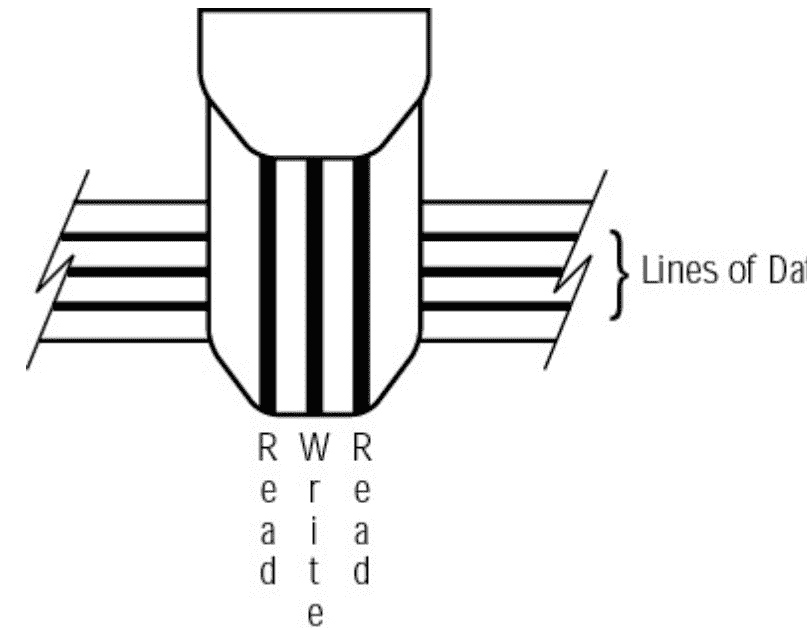

图 9.2：线性磁带的读取和写入


与螺旋扫描驱动器相比，`QIC` 和 `Travan` 驱动器噪音较大。这两种类型在容量或可靠性方面都没有明显的优势（尽管每种类型都有支持者声称其具有可靠性优势）。不过，`QIC` 和 `Travan` 驱动器覆盖的容量和预算范围更广，低端设备的可靠性较低，容量也较低。一般而言，`QIC` 和 `Travan` 驱动器的购买价格比螺旋扫描驱动器便宜，起价在 200 美元或更低。高端设备的成本可能超过 1,000 美元。`QIC` 和 `Travan` 磁带的价格更高，起始价约为 30 美元。如果您预计购买少量磁带，`QIC` 和 `Travan` 是一个不错的选择；但如果您计划购买大量磁带，螺旋扫描驱动器可能更合适。

## 更新的选项

近期的发展为高端系统提供了新型磁带。其中包括单通道或多通道配置的数字线性磁带（`DLT`）、单通道或多通道配置的巨无霸（8mm）驱动器、单通道或多通道配置的高级智能磁带（`AIT`）驱动器，以及无需人工干预即可运行的机器人存储管理系统。这些系统确实很受欢迎，但成本往往高得令人望而却步。

## 数字线性磁带

数字线性磁带驱动器的容量和配置从低端的 10GB 驱动器到较新的自动化 `DLT` 磁带库不等，后者可存储 1.5 太字节的数据（在多达 48 个驱动器中压缩存储）。

`DLT` 驱动器使用 0.5 英寸宽的金属颗粒磁带；这些磁带比 8mm 磁带宽 60%。数据以蛇形图案记录在成对分组的平行磁道上。如图 9.3 所示，磁带通过一个磁头导向组件（`HGA`）运行，该组件由一个飞镖形状的铝板组成，上面排列着六个大型轴承安装导向器呈弧形。磁带由引导条温和引导，并卷绕到收带卷轴上，磁带的记录面永远不会接触滚轮。还有一些机制在磁带通过时不断清洁磁带，以延长磁带寿命。

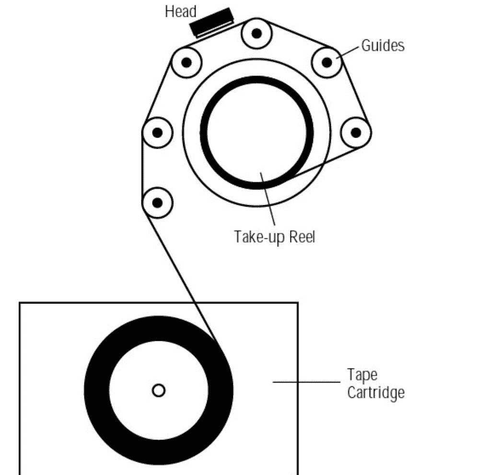

图 9.3：数字线性磁带（`DLT`）驱动器机构

磁道的记录使用磁带的整个长度，然后磁头重新定位，在回程中再铺设另一条全长路径。一些较新的 `DLT` 磁带驱动器使用磁头中的两个读/写元件同时记录两个通道，有效地将特定驱动器速度和记录密度下可能的传输速率加倍。`DLT` 技术使用位于磁带逻辑末尾的文件标记索引来最小化搜索时间。

当我们最近查询价格时，一个 `DLT` 磁带库的成本约为 12,000 美元——对我们大多数人来说都超出了承受范围。单盘 `DLT` 驱动器的价格与 `DAT` 驱动器更为接近，起价略高于 1,000 美元。不过，如果您有高容量、可靠存储的需求，很少有系统能与之匹敌。每 MB 存储数据的成本实际上相当合理。

## 巨无霸（Mammoth）

`Exabyte` 的 `Mammoth` 驱动器是高容量存储的另一种可行选择。5.25 英寸半高 `Mammoth` 驱动器除了可以使用其设计所用的 20/40GB 高容量磁带外，还可以读取几乎所有早期版本的 `Exabyte` 8mm 磁带。`Mammoth` 驱动器也可在磁带库系统中使用，这些系统可以存储太字节级别的数据。`Mammoth` 磁带驱动器在每次加载和卸载时会自动清洁读和写磁头。它具有良好的传输速率，每分钟 180MB，对于备份来说速度足够快。成本仍然相当可观，从 14/28GB 驱动器的约 1,000 美元到 1.2/2.4TB 多驱动器 `Mammoth2` 型号的 11,000 美元或更高不等。

## 高级智能磁带（AIT）

`AIT` 是一个相对的新手，在效率和可靠性方面相比其前代产品具有显著优势。介质更坚固且更薄。新技术使用纯磁化层和类金刚石涂层（`DLC`），两者共同实现了更高的记录密度。驱动器磁头的改变降低了磁带张力，减少了磁带磨损。驱动器磁头的变化也显著降低了驱动器清洁的需求；驱动器现在会在需要清洁时提示用户。`AIT` 甚至向磁带上添加了一个闪存芯片。该芯片存储关于磁带的特定信息，提高了读取速度。

`AIT` 磁带的未压缩容量为 25GB、35GB、50GB 和 100GB。这些磁带的成本从 25GB 版本的约 50 美元开始。驱动器的价格从略高于 400 美元开始。

## 机器人系统

新兴的机器人系统在存储容量和自动化程度上差异很大。低端的是自动装载磁带库，它们大约容纳六盘磁带，并根据脚本指令集将它们送入单个驱动器。这些并不少见，当备份无法容纳在一盘磁带上时，它们使备份工作变得容易得多。在这些之上还有几个复杂程度的层级。最高端的是完全机器人化的系统，日常操作无需人工干预。由于类型繁多，我们将其探索留给读者。

## 磁带接口

磁带机构的基础技术对于评估磁带技术当然很重要，但另一个问题也很重要：磁带如何与计算机进行接口。有五类接口已经被使用或正在使用中：

- `软盘` 软盘接口曾用于许多 20 世纪 90 年代中期及更早的低成本磁带驱动器。这些驱动器的早期版本通常性能不佳，可靠性不高。即使它们能工作，速度也非常慢，经常卷绕磁带导致它们很快磨损，并且在此过程中运行温度很高。`Linux` 通过 `ftape` 实用程序支持软盘磁带。`ftape` 支持符合 `QIC-117` 标准以及 `QIC-80`、`QIC-40`、`QIC-3010` 和 `QIC-3020` 标准之一的驱动器。完整列表可在 `http://www.informatik.uni-siegen.de/softdocs/howto/Ftape-HOWTO-5.html` 找到。很少有软盘接口的磁带驱动器容量超过 1.6GB，这对于现代硬盘大小来说令人沮丧。

- `并口` 许多早期外置磁带驱动器使用了并口。它拥有与软盘接口相同的许多缺点，并因此不再受欢迎。与软盘接口驱动器一样，并口驱动器也由 `ftape` 包提供支持。

- `USB` 通用串行总线（`USB`）开始被一些低端外置磁带驱动器使用。然而，`USB` 速度有限，因此高速驱动器通常不使用它。`Linux` 的 `USB` 支持在 `2.2.x` 内核中相当有限，但在 `2.4.x` 内核中更好。`Linux` 中的 `USB` 磁带驱动器仍然非常新，因此您可能会遇到

### IDE/ATAPI

`IDE` 接口正在低端内置磁带驱动器中变得日益普及。这些设备通常被称为 高级技术附加包接口（`ATAPI`） 驱动器。`ATAPI` 单元不会像软盘、并行端口或 `USB` 设备那样存在速度问题。

### SCSI

小型计算机系统接口（`SCSI`） 端口长期以来一直是中端和高端磁带驱动器的首选。`SCSI` 同时支持内部和外部设备，并且许多高端磁带驱动器仅仅提供 `SCSI` 形式。不幸的是，`SCSI` 驱动器通常比其 `ATAPI` 对应产品更昂贵。

一般来说，最好的接口类型是 `SCSI`，因为它速度最快，并且每个接口支持的设备数量最多——根据接口类型不同，支持 7 个或 15 个设备，而 `IDE/ATAPI` 每个控制器支持 2 个设备。平均来说，计算机主板上配有 2 个控制器，且可以添加 `PCI IDE` 卡。市售的卡有 1、2 和 4 个控制器的配置，分别支持 2、4 和 8 个驱动器。`IDE/ATAPI` 驱动器对于工作站或预算紧张的用户是可以接受的。未来，如果需要便携性，`USB` 驱动器或许会变得可接受，但截至撰写本文时，`USB` 磁带驱动器与 `Linux` 的组合尚处于发展中，对于连续数据流还不够完全可靠。软盘和并行接口驱动器已经过时。如果你恰好有该驱动器，可以用它来备份低容量系统，但对于大多数严重的应用场景，更新的技术更为合适。

## CD-R 和 CD-RW

`CD–ROM` 是一种一次写入/多次读取（`WORM`）存储介质，其中微小的凹坑被刻录在塑料光盘的铝层上以表示数据。一旦刻录完成，由凹坑形成的轨道通过非接触式磁头以光学方式读取，当光盘在磁头下方紧贴旋转时，磁头大致沿径向模式扫描。磁头以恒定线性速度移动，从而确保恒定的数据速率。由于磁头速度是恒定的，当数据轨道从靠近光盘中心的起始位置扫描到靠近光盘外缘的结束位置时，光盘必须以递减的速率旋转。（尽管许多现代 `CD–ROM` 驱动器不使用恒定线性速度，因此从光盘不同部分的数据传输速率是变化的。）

`CD` 写入器（`CD–R` 或 `CD–ROM` 可记录）本质上是一个具有足够强大激光的 `CD` 读取器，能够将 `CD–ROM` 凹坑的光学等效物烧录到涂有光学染料的特殊 `CD–R` 磁盘中。其中一些光盘旨在实现多会话，意味着你可以写入磁盘的一部分，然后在稍后时间填充剩余空间；而另一些光盘一旦写入就不能在之后补充。在 `CD–RW`（`CD–可重写`）上，激光不仅可以写入数据，还可以擦除磁盘，使其表面保持干净，仿佛 `CD–RW` 从未被使用过一样。在上述任何形式中，这些磁盘都非常容易受到划伤和热损伤的影响。

可写 `CD–ROM` 在备份领域也变得越来越流行。`CD–RW` 光盘仅在配备有识别该功能设备的播放器中工作。与 `CD–R` 光盘相比，`CD–RW` 光盘的成本有所增加。带珠宝盒的 50 盘装 `CD–R` 光盘价格从约 19 美元起。带珠宝盒的 50 张 `CD–RW` 光盘价格从约 28 美元起，随着光盘认证写入速度的提高，价格也会上涨。`CD–ROM` 大约可存储 650MB 的数据，因此你可能需要多张光盘才能完成完整备份。

`CD–R` 和 `CD–RW` 是相对低成本的备份选项。由于每张光盘只能存储多达 650MB 的数据，而硬盘容量始终超过这一数值，当一张光盘装满时，你不得不更换光盘，或者除了写入器和介质外，还需购买光盘换盘机。这消除了相对于磁带的任何实际成本节省。我们更倾向于使用磁带或其他高容量选项。

## 其他替代方案


磁带和 CD-R 的替代方案包括光软盘、伯努利盒以及其他可移动驱动器。完美的系统应结合快速随机访问、可靠性和高存储容量。

## 一些老旧设备

随着硬盘容量的不断增加，备份系统需要创新才能跟上步伐。作为系统管理员，你可能会发现你拥有的旧备份设备无法完全胜任工作。你也可能会发现，“免费”这个词压倒了对新备份系统的任何论证，要求你必须熟悉旧的备份系统。以下是一些仍在使用中的传统存储设备。

## 光软驱动器

光软盘驱动器旨在替代标准软盘，使用比标准软盘驱动器磁头精确得多的激光来读写数据。它们使用 3.5 英寸超高密度磁盘，外观像普通的 3.5 英寸软盘，但容量高达 21MB。光软盘驱动器还可以读取旧式的 720KB 和 1.44MB 软盘，使你可以用光软驱动器替代旧的 3.5 英寸软盘驱动器，而无需牺牲额外的驱动器位。另一个卖点是 21MB 的磁盘不需要像大多数可移动存储驱动器那样的专有格式。不幸的是，这些驱动器并没有真正流行起来，且每美元提供的空间不足以真正占领市场。

## 伯努利驱动器

伯努利驱动器使用尺寸与 5.25 英寸软盘相同但厚度超过 0.25 英寸的卡匣。它们具有刚性外壳，使其成为最耐用的可移动存储格式之一。伯努利卡匣可存储 230MB 未压缩数据，这使得它们在技术刚进入市场时优于常见的 120MB QIC 磁带。由于现代磁带驱动器容量的增加，伯努利驱动器已不再生产，因此除非你已经有该驱动器，否则应避免使用。

## 可移动驱动器

如 `Iomega Jaz` 和 `Zip` 驱动器之类的可移动驱动器可用于备份，并在最近硬盘容量使其不再实用之前被广泛以此方式使用。`Jaz` 驱动器的第一个版本容量为 1GB，较新的版本将其加倍。`Jaz 2` 使用 `UltraSCSI` 接口（连接到 `PCI` 总线）、连接 `IDE` 链路的 `ATAPI` 接口、`PCMCIA` 接口或并行端口。由于是 `SCSI` 设备，这些驱动器也可以与 `Mac` 计算机一起工作。`Zip` 驱动器使用 100MB 或 250MB 的磁盘。虽然它适用于在计算机之间传输软盘无法容纳的大文件，但很难被视为可行的备份选项。

## 磁光驱动器

另一种较旧的技术是磁光驱动器。这种可重写驱动器使用激光将磁盘加热到磁铁可以改变该位置极性的点。未被“击中”的磁盘位置代表 0，被击中的位置代表 1。此过程需要驱动器磁头两次通过，且激光和磁铁的组合使得磁头非常沉重。该方法的一项改进，光强调制直接覆写（`LIMDOW`），将磁铁集成到磁盘本身。虽然原始磁光盘的容量上限约为 2.6GB，但 `LIMDOW` 技术可以使容量翻两倍以上，使该技术在创建备份方面具有潜在用途。我们见过的最大容量为 5.2GB，由某些 `Hewlett-Packard` 和 `Sony` 驱动器提供。然而，这些驱动器的价格标签很高，起价约为 1,000 美元。

## 介质存储

介质存储也很重要。磁性介质易受高温、湿气以及电或磁邻近性的影响，并倾向于随时间退化（就像 `VCR` 磁带一样）。另一方面，磁光驱动器是磁性和光学技术的结合。由于它们通过加热激光辅助磁性改变来存储数据，使介质更耐受热或电损坏，因此存储要求不那么严格。纯光学技术（`CD-R` 和 `CD-RW`）最有可能具备档案级质量。`CD-R` 的存储寿命估计为 10 到 100 年，具体取决于染料类型以及估算者。当然，典型潮湿、过度干燥或非常高温的环境会对任何存储介质构成危害，在规划介质存储时应尽量避免这些环境。

## 分层存储管理

在许多情况下，尽管如果建筑物失火或遭受灾难性损坏，计算机和备份都可能被摧毁，但介质仍存储在现场。如果可能，你应该将至少一部分备份存储在另一个位置。一种选择是将每月和增量备份存储在现场，但将年度备份存储在异地。这并不能给你 100% 的可恢复性，但它是朝着正确方向迈出的一步。另一种选择是将第 1 周和第 2 周存储在现场，第 3 周和第 4 周存储在异地，然后每两周轮换一次。当然，另一种选择是制作重复的完整备份，将一套存储在现场以便快速恢复，另一套存储在异地以确保安全。权衡前期投入的时间与重建损失所需员工工时的成本，并明智地决定备份存储的位置。

真正的分层存储管理不仅限于将备份分散在多个存储位置。它还提供了一个自动化流程，使不再使用的文件（静态文件）可以从硬盘移动到磁带或某种光学介质上。这除了满足归档需求外，还能在硬盘上创建可用的空间。

例如，考虑虚构的 `WeAin'tThem` 公司，这是一家创建并销售自己操作系统的软件公司。`WeAin'tThem` 拥有其软件的工作（开发）版本以及用于客户支持的上一个发布版本的副本。它在服务器系统上进行开发工作，该系统持有正在开发的软件版本（2.5）、其所需的编译器和库，以及上一个发布版本（2.4）。随着新模块开发的进行，磁盘空间填满。当正在开发的软件发布时，版本 2.4 被归档到磁带，并开始一个新的开发版本（3.0）。现在系统上有版本 2.5 和 3.0，版本 2.4 被安全地归档起来，以防因硬件不兼容而未升级的客户需要客户支持。

## 备份命令和实用程序

在下一节中，我们将讨论你可用的各种备份命令。我们将查看便于处理硬件本身的实用程序、命令行备份命令以及基于 `GUI` 的备份包。其中大部分包含在主要的 `Linux` 发行版中；其他的可以从互联网站点下载。

## 磁带工具

磁带工具是帮助管理磁带访问和使用的程序。它们实际上并不是备份程序，事实上它们通常根本不会向磁带写入数据；相反，它们执行备份过程所必需的功能，例如在磁带上查找特定位置或重新张紧磁带。

### `mt`

`mt` 工具执行多种磁带操作，例如移动或查找磁带上指定的位置，设置或检查磁带张力，设置或检查磁带压缩，设置或检查块大小或密度，以及擦除磁带。当你需要在写入前将磁带倒带、擦除磁带、在写入前重新定位磁头，或在备份完成后自动弹出磁带时，会使用 `mt` 命令。

如果你使用的是 `QIC` 磁带，在写入之前应始终重新张紧磁带。不知出于什么原因，`QIC` 磁带比其他磁带的对张力的敏感度要高得多。使用非倒带磁带驱动器执行此操作的命令如下：

```
# mt -f /dev/nftape reten
```

**注意** 本讨论使用 `/dev/nftape` 作为磁带设备。你可能需要使用其他设备文件，这将在下文讨论。无论如何，`mt` 通常与非倒带设备文件一起使用，这些设备文件不会在每次访问后自动倒带。相比之下，`倒带` 设备会在每次访问后自动倒带磁带。当你希望在一盘磁带上存储多个备份时，使用前者；当你希望将单个备份写入磁带或仅访问磁带上已存在的第一个备份时，使用后者。

`mt` 工具也用于擦除磁带。通常在格式化过的磁带上使用 `ftpwrite` 之前需要执行此操作，因为 `ftpwrite` 有时不喜欢新磁带上的格式。

```
# mt -f /dev/nftape erase
```

当你要在磁带上向前移动时，`mt` 工具非常有用。以下示例命令将在磁带上向前移动两个文件：

```
# mt -f /dev/nftape fss 2
```

**注意** 对于磁带驱动器，`文件` 指的是单个备份，其中可能包含磁盘上的许多文件。将其视为存储在磁带上的 `tar` 包（事实上它可能就是 `tar` 包）。你可能会在一盘磁带上存储多个备份，特别是在进行增量备份或差异备份时。

要在单盘磁带上放置多个备份，必须使用 `mt` 工具及其 `eof` 关键字。以下命令将磁带移动到刚刚越过已写入数据的末端，以便下一个备份可以开始。发出此命令后，尝试读取磁带的任何操作都会导致错误，但如果你想在不过写现有数据的情况下向磁带写入数据，这是必要的。

```
# mt -f /dev/nftape eof
```

`rmt` 工具由远程 `dump` 和恢复工具使用，以相同的方式操作位于远程备份服务器上的磁带驱动器，就像 `mt` 操作本地磁带驱动器一样。`rmt` 工具接受针对磁带操作的具体请求，执行请求的操作，然后响应状态指示器。`rmt` 通常不是单独启动的，而是与 `rsh` 或 `rcmd` 调用一起使用，这两者都用于在远程服务器上执行命令。

## 磁带设备名称

备份命令总是要求你通过名称来识别磁带设备。磁带设备名称将取决于它连接的接口以及该链上的设备数量。有 `IDE` 磁带设备、`SCSI` 磁带设备和 `ftape` 设备（包括软盘接口和并行接口），`USB` 设备的工作原理类似于 `SCSI` 设备。

### `IDE/ATAPI`

使用 `IDE` 接口的磁带设备通过 `/dev/ht0`（倒带）和 `/dev/nht0`（非倒带）设备文件进行访问。如果你有多个 `IDE/ATAPI` 驱动器，请将 0 更改为 1 或更高，以寻址第二个及后续驱动器。

现代计算机主板通常支持两个 `IDE` 链，尽管它们可能没有都在系统的 `BIOS` 中启用。每个链最多支持两个设备（硬盘、磁带驱动器等）。从历史上看，主板本身不提供 `IDE` 连接，而是依赖于 `IDE` 控制卡的存在。现在很少有系统使用独立的 `IDE` 控制器。虽然可以通过向系统现有的主板 `IDE` 链添加 `IDE` 控制卡来容纳更多的 `IDE` 设备，但由于每个控制器需要唯一的中断，这使得配置变得困难。因此，如果你需要超过四个设备，最好使用 `SCSI`。

### `SCSI`

如果第一个 `SCSI` 磁带驱动器是倒带的，则连接到 `/dev/st0`；如果是非倒带的，则连接到 `/dev/nst0`。要引用后续的驱动器，根据需要增加数字。由于 `SCSI` 主适配器支持 7 或 15 个设备（取决于适配器类型），并且每个适配器使用单个中断，因此 `SCSI` 非常适合拥有大量磁盘和磁带驱动器的系统。


#### `ftape`

`ftape` 设备使用四种访问方法之一，具体取决于软盘磁带驱动器本身。`/dev/rft0`（倒带）和`/dev/nrft0`（非倒带）设备提供对第一个设备的访问；增加数字提供对额外`ftape`驱动驱动器的访问。为了兼容性，`/dev/ftape`和`/dev/nftape`分别是`/dev/rft0`和`/dev/nft0`的符号链接。这些设备文件名适用于通过`ftape`驱动的软盘接口和并行端口接口驱动器。

旧版 3.0x 的`ftape`支持通过`/dev/zqft0`和`/dev/nzqft0`设备文件进行驱动器级压缩。然而，为了提供改进的错误恢复功能，软件 4.0 及更高版本已移除此功能。

## CD-R 和 CD-RW 备份工具

如果你要存储的数据量较小，归档数据到 CD-R 或 CD-RW（下文为简洁起见统称为 CD-R）是一个选项，但在备份整个网络时并不是很有帮助。如果你在一个没有大量大文件更改的系统上进行增量备份，CD-R 可能是一个选择。有时，CD-R 对于本章前面提到的归档备份很有用。实际上，CD-R 介质较长的使用寿命使其成为长期归档存储的良好选择。但对于较大的备份任务，磁带通常更优越。

## CD-R 命令

向 CD-R 写入是一个两步过程：

- 数据（无论是数据文件还是音频文件）必须被累积并组装成映像，其中包括任何所需的格式信息。

- 创建的文件必须写入 CD-R，通常使用`cdrecord`实用程序。

**注意** 稍后在本章中你会看到，一些基于 GUI 的实用程序执行这两个功能，但没有明确地将它们标识为单独的步骤。

CD-R 上的某些自由空间必须保留用于存储 ISO-9660 文件系统（通常只有几兆字节）。这种格式是 CD-ROM 的标准文件系统，存在三个级别。级别 1 使用 8+3 文件命名约定，并要求数据连续。在级别 1 下，目录树嵌套不得超过八层。可以在 Linux 和 DOS 下查看这些磁盘上的文件名。级别 2 允许更长的文件名，因此 DOS 可能无法读取级别 2 磁盘上的所有文件。级别 3 取消了数据必须连续的要求，保留了较宽松的文件命名约定，DOS 再次可能无法读取其所有文件。为了使 ISO-9660 格式在 Unix 世界中更实用，添加了 Rock Ridge 扩展。这些扩展定义了处理混合大小写文件名和符号链接的方法。如果在没有 Rock Ridge 扩展的系统上读取该磁盘，文件名将不会以长格式显示。微软开发了一种不同的在 CD-ROM 和 CD-R 磁盘上存储长文件名的方法，称为 Joliet。你可以从 Linux 创建 Joliet CD-R，但对于存储 Linux 文件，Rock Ridge 更优越，因为 Joliet 不支持 Linux 文件所有权或权限。创建混合 Rock Ridge/Joliet CD-R 是可能的，并在混合操作系统环境中很有用。

## `mkisofs`

`mkisofs` 命令创建要写入 CD 的 ISO-9660 文件系统映像，由`cdrecord`实用程序执行。该映像包括数据文件以及格式信息。然而，`mkisofs` 实用程序不包含任何 CD-R 驱动程序代码，因此不会将映像写入 CD-R。开发者选择这种方法主要是为了允许用户在将映像写入 CD-ROM 之前从硬盘测试映像。从历史上看，在较慢的计算机上在创建过程中写入映像也可能是不可靠的。

要创建 CD-R 映像文件，你必须将要转换为 CD-R 的目录名称、输出文件名称以及大量可选参数之一传递给`mkisofs`。一个相当基本的示例如下：

```
$ mkisofs -r -J -o cd_image.iso /source/directory
```

此示例从`/source/directory`的内容创建一个名为`cd_image.iso`的映像文件。`-r`参数添加 Rock Ridge 扩展（对权限和所有权进行了一些更改以帮助使磁盘可移植），`-J`参数添加 Joliet 文件系统。`mkisofs` 手册页详细讨论了此实用程序可用的许多其他参数。

## Linux CD-R 和备份工具

### 回环验证

您可以使用 Linux 的回环功能来检查由`mkisofs`创建的光盘镜像是否具有与原始文件相匹配的目录结构和权限。回环功能允许您挂载一个文件，就好像它是一个磁盘分区一样。为此，请使用以下命令，并插入创建的光盘镜像的正确名称以及您希望挂载该镜像的正确挂载点路径：

```bash
# mount -t iso9660 -o loop cd_image.iso /mnt/tmp
```

**提示** 我们通常创建一个`/mnt/tmp`文件用于挂载那些不像 CD-ROM 驱动器或软盘驱动器那样永久挂载的分区或文件。您可以使用它来临时挂载任何内容，无论设备类型如何。

将`/mnt/tmp`与您原始文件所在的位置进行比较，直到您确信内容相同。然后使用以下命令卸载您创建的 CD-R 镜像：

```bash
# umount /mnt/tmp
```

### `cdrecord`

在制作并测试了镜像文件后，您将使用`cdrecord`实用工具实际将 CD-ROM 镜像写入空白 CD-R。`cdrecord` 是为 SCSI 或 ATAPI CD 刻录机设计的。它可以写入数据、音频、混合和多会话光盘，并支持大多数可用的 CD 刻录机。`cdrecord` 在命令行下运行，拥有大量选项。man 手册页非常有帮助，但过程并不简单。最简单的情况是，在一个速度足够快的系统上，使用位于 SCSI 目标 ID 6 处的设备作为目标，将一个具有 ISO-9660 文件系统的纯数据镜像复制过去，您可以按以下方式运行命令：

```bash
# cdrrecord -v speed=2 dev=0,6,0 cd_image.iso
```

为了获得更好的可读性，写入器的 SCSI 设置存储在三个环境变量中：`SCSI_BUS`、`SCSI_ID` 和`SCSI_LUN`。

如果您使用`cdrecord`覆盖 CD-RW，必须添加选项`blank=blanktype`以擦除旧内容。该程序可以用几种不同的方式擦除 CD-RW，如表 9.4 所示。

**表 9.4：使用 cdrecord 擦除 CD-RW 光盘的选项**

| `blanktype` 值 | 描述 |
| :--- | :--- |
| `help` | 显示可能的擦除类型列表。 |
| `all` | 完全擦除整个光盘。这可能花费很长时间。 |
| `fast` | 擦除光盘上的关键数据结构；速度快但不完整。 |
| `track` | 擦除单个音轨。 |
| `unreserve` | 取消保留已保留的音轨。 |
| `trail` | 擦除音轨的尾部。 |
| `unclove` | 解除最后一个会话的关联；允许向之前完成的写入会话写入附加信息。 |
| `session` | 擦除最后一个会话。 |

在速度足够快的机器上，可以使用管道将`mkisofs`的输出定向到`cdrecord`。首先，您需要获取镜像大小。为此，使用以下形式的`mkisofs`命令：

```bash
# mkisofs -R -q -print-size cd_image.iso
832
```

接下来，将`mkisofs`命令通过管道传输到`cdrecord`命令，并通过`size`参数将上述命令返回的镜像大小传递给`cdrecord`，如下所示：

```bash
# mkisofs -R -t 832 cd_image.iso | cdrrecord -v fs=6m speed=2 dev=0,6,0 -
```

如果您不确定使用什么设备号，请运行以下命令：

```bash
# cdrrecord -scanbus
```

输出看起来像这样：


```text
Cdrecord 1.10 (i686-pc-linux-gnu) Copyright (C) 1995-2001 Jörg Schilling
Linux sg driver version : 3.1.19
Using libscg version 'schily-0.5'
scsibus0:
cdrecord: Warning: controller returns wrong size for CD capabilities page.
    0,0,0   0) 'ATAPI-CD' 'ROM-DRIVE-50MAX ' '50LT' Removable CD-ROM
    0,1,0   1) *
    0,2,0   2) *
    0,3,0   3) *
    0,4,0   4) *
    0,5,0   5) *
    0,6,0   6) *
    0,7,0   7) *
scsibus1:
    1,0,0   100) *
    1,1,0   101) *
    1,2,0   102) *'HP' 'CL130A' '3540' Processor
    1,3,0   103) *
    1,4,0   104) *'CONNER' 'CTT8000-S' '1.17' Removable Tape
    1,5,0   105) *'SONY' 'CD-R CRX140S' '4.05' Removable
    1,6,0   106) *
    1,7,0   107) *
```

要获取有关特定设备的信息，请使用以下命令：

```text
cdrecord dev=1,5,0 -checkdrive
[root@opus root]# cdrecord dev=1,5,0 -checkdrive
Cdrecord 1.10 (i686-pc-linux-gnu) Copyright (C) 1995-2001 Jörg Schilling
scsidev: '1,5,0'
scsibus: 1 target: 5 lun: 0
Linux sg driver version : 3.1.19
Using libscg version 'schily-0.5'
Device type: Removable CD-ROM
Version: 4
Response Format: 2
Capabilities : SYNC
Vendor_info : 'SONY'
Identification: 'CD-RW CRX140S'
Revision: '1.0e'
Device seems to be: Generic CD-ROM.
```

### X-CD-Roast

X-CD-Roast（如图 9.4 所示）是 `mkisofs`、`ccdparanoia` 和 `cdrrecord` 等 CD 程序的基于 X 的前端。它提供了一个良好的界面，用于运行这些通常由命令行驱动的程序。该程序在 Linux 用户中越来越受欢迎，可从 [http://www.xcdroast.org/](http://www.xcdroast.org/) 获取。

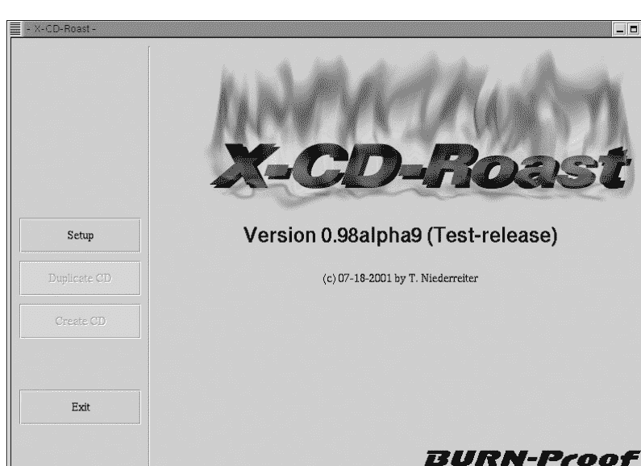

**图 9.4：X-CD-Roast 主屏幕**

### 设备访问

您可能已经注意到，在 `cdrrecord` 的示例中，该命令没有采用传统的设备文件名。相反，此实用工具采用以下形式的 SCSI 设备规范：

*总线, ID, LUN*

其中 *总线* 是 SCSI 总线（在只有一个 SCSI 主机适配器的系统上为 0），*ID* 是 CD-R 驱动器的 SCSI ID 号，*LUN* 是驱动器的逻辑单元（LUN）（几乎总是 0）。这种识别最终引导实用工具使用 *SCSI 通用* 设备（*`/dev/sg`x*，其中 *x* 是 a 到 z 之间的字母）。与用于磁带驱动器、硬盘等的 SCSI 设备不同，SCSI 通用设备旨在允许访问任何类型的 SCSI 设备，这就是为什么 `cdrrecord` 使用它们的原因——这些设备允许向 CD-R 驱动器写入所需的低级访问。您必须确保 SCSI 通用支持已编译到您的内核中（或作为内核模块可用）。此选项在 SCSI 支持内核配置菜单中称为“SCSI 通用支持”。

这对于 SCSI 设备工作良好，但 IDE/ATAPI CD-R 驱动器呢？对于这些，您必须启用一个 Linux 内核功能，允许 IDE 设备伪装成 SCSI 设备。该选项位于块设备内核配置菜单中，称为“SCSI 仿真支持”；将其编译在内核中并运行以下命令：

```bash
modprobe ide-scsi
```

让我们假设在本例中，您的设备是第二个 IDE 链上的第一个设备。您需要让内核知道将此 IDE 设备视为 SCSI；只需将 *hdc=ide-scsi* 添加到您的启动加载器文件中，如果是 LILO，则运行 *lilo* 命令。之后，您的 CD-R 驱动器将显示为 SCSI 通用设备。

**注意** 第 6 章更详细地介绍了内核编译。

大多数 CD-R 驱动器可以作为普通的 CD-ROM 驱动器进行只读访问。对于 SCSI 设备，适当的设备文件名是 /dev/s cd0（或更高的编号），对于 IDE/ATAPI 驱动器，设备文件名是 /dev/hda 到 /dev/hdd 或更高，具体取决于设备所连接的链及其主/从状态。这种只读 CD-ROM 访问无助于制作备份，但可用于从您创建的 CD-R 中恢复数据。

## Linux 备份和恢复工具

Linux 提供了几种您可以用于备份文件的命令行工具：`dump` 和 `rdump`、`restore`、`tar`、`cpio` 和 `afio`。还有几个第三方的 GUI 软件包，我们将很快就会介绍。虽然一些系统管理员更喜欢有一个 GUI，只需点击几个按钮即可启动备份，但许多管理员习惯于在命令行下工作，并发现该方法更快。此外，像 `afio` 这样的命令允许您通过 Telnet 或 SSH 连接到控制备份的计算机，使用 `ps` 命令查看备份进程已运行了多长时间，并使用这些信息确定还需要多长时间。或者，您可以将这些命令集成到一个脚本中，让该脚本在进程完成时向您发送寻呼通知。我们将为您提供这两种选项，您可以自行选择。

### dump

`dump` 实用工具（随大多数 Linux 发行版提供，包括 Red Hat）查看指定的文件系统，并根据指定的转储级别确定需要备份的内容。`dump` 格式是基于 inode 的，不同于 `tar`、`cpio` 和 `afio`。`dump` 格式要求在写入备份中的其他文件之前，必须先写入所有目录。目录按 inode 升序写入，然后文件也按 inode 升序添加。命令必须指定 `dump` 的增量级别和要操作的文件系统子集。

**注意** 由于 `dump` 在比大多数其他备份实用工具更低的文件系统访问级别上运行，因此任何给定的 `dump` 程序都必须明确支持您使用的任何文件系统。标准的 Linux `dump` 实用工具处理 ext2/ext3 文件系统，但不处理 FAT 文件系统或 Reiser 日志文件系统。尝试在这样的文件系统上使用 `dump` 不会导致问题，但它也不会起作用。不过，Linux 的 `dump` 最终可能会升级到支持更多的文件系统。

#### 基本的 dump 操作

`dump` 命令的基本语法如下：

```bash
dump [-level] [-b blocksize] [-B records] [-f file] [-u] directory
```

这些参数的含义如下：

- `-level` 增量级别。

- `-b blocksize` 转储块的大小（以字节为单位）。

- `-B records` 磁带的大小（以转储块为单位）。组合使用 blocksize 和 records 允许 `dump` 处理比要备份数据更小的磁带；如果 `dump`

必须备份超过 *blocksize* × *records* 字节的数据，当达到此限制时它会暂停，并提示你更换磁带。

- –f *file* 应写入备份文件的文件——通常是前面描述的磁带设备文件。

- –u 此参数使 *dump* 在 /etc/dumpdates 中存储关于其备份历史的数据。如果没有此参数，增量备份将无法正常工作。

- *directory* 要备份的目录或文件系统设备文件。

增量转储会备份自上次记录的备份以来发生变化的文件。标准的转储增量方案从 0 级开始，延伸到 9 级，其中 0 级为完全转储，1–9 级为增量转储。每个增量级别都会备份自上一个较低增量级别的备份以来发生变化的所有文件。如果你执行一系列 dump 操作（例如每天一次），并使用相同的非 0 转储级别，结果将是一系列增量备份，正如本章前文所述。如果你每次备份都增加转储级别（例如星期一为 1，星期二为 2，依此类推），结果将是一系列差异备份，正如本章前文所述。

## dump 实战


假设你要实施一种增量备份策略，该策略在周日执行完全备份，并在每周的其余日子每隔一天备份自周日以来发生变化的所有文件。假设你需要将 `/`、`/usr` 和 `/var` 备份到位于 `/dev/nst0` 的 SCSI 磁带驱动器，周日的 `dump` 命令可能如下所示：

```bash
# dump 0uf /dev/nst0 /
# dump 0uf /dev/nst0 /usr
# dump 0uf /dev/nst0 /var
```

每周剩余各天的 `dump` 命令看起来像这样：

```bash
# dump 5uf /dev/nst0 /
# dump 5uf /dev/nst0 /usr
# dump 5uf /dev/nst0 /var
```

你也可以对增量备份使用任何非 `0` 的转储级别。级别 `5` 提供了使用更高级别执行计划外差异备份的灵活性，以便备份某些关键文件。你还可以执行增量备份，以重置常规的增量文件计数，如果你在星期初进行了大量更改且不希望后续再次备份这些更改，就可以这样做。你可以通过在低于 `5` 的级别运行备份来实现这一点，并确保指定 `u` 参数以更新 `/etc/dumpdates`。例如，命令

```bash
# dump 4uf /dev/nst0 /
```

将更新 `/etc/dumpdates`，以便在一周的其他时间运行级别 `5` 的转储时，不会备份级别 `4` 备份中已有的内容。在恢复时，你需要先恢复最近的 `0` 级备份，然后是 `4` 级备份，最后是最近的 `5` 级备份。

当然，如果你偏离了常规的备份计划，你应该仔细标记备份磁带，以防止混淆。

作为一个示例，让我们看看 `/usr/local/bin` 的 `0` 级转储输出，因为一个相对较小的目录可以使输出更容易管理。我们要使用的命令是：

```bash
# dump 0uf /dev/nst0 /usr/local/bin
```

输出看起来像这样：

```text
DUMP: Date of this level 0 dump: Thu Mar 21 08:09:35 2002
DUMP: Date of last level 0 dump: the epoch
DUMP: Dumping /dev/hdb1 (/) to /dev/nst0
DUMP: mapping (Pass I) [regular files]
DUMP: mapping (Pass II) [directories]
DUMP: estimated 120147 tape blocks.
DUMP: Volume 1 started at: Thu Mar 21 08:09:41 2002
DUMP: dumping (Pass III) [directories]
DUMP: dumping (Pass IV) [regular files]
DUMP: DUMP: 230552 tape blocks on 1 volumes(s)
DUMP: finished in 148 seconds, throughput 1557 KBytes/sec
DUMP: Volume 1 completed at: Thu Mar 21 08:12:09 2002
DUMP: Volume 1 took 0:02:28
DUMP: Volume 1 transfer rate: 1557 KB/s
DUMP: level 0 dump on Thu Mar 21 08:09:35 2002
DUMP: DUMP: Date of this level 0 dump: Thu Mar 21 08:09:35 2002
DUMP: DUMP: Date this dump completed: Thu Mar 21 12:09:20 2002
DUMP: DUMP: Average transfer rate: 1557 KB/s
DUMP: Closing /dev/nst0
DUMP: DUMP IS DONE
```

此输出相当直观明了。`dump` 在 148 秒内将 230,552 个块写入了一盘磁带。

## 远程转储

可以通过修改 `dump` 设备文件名的形式，使用 `dump` 指定远程备份服务器。不要简单地使用设备文件，而必须指定备份服务器的名称、一个冒号以及该服务器上的设备文件名，如下所示：

```bash
# dump 0uf buserver:/dev/nst0 /usr
```

然而，在某些网络中，这可能会导致备份速度缓慢。更好的选择可能是通过 `rsh` 管道传输备份：

```bash
# dump 0uf - /usr | rsh buserver dd of=/dev/rmt0
```

这种远程备份的一个问题是，备份服务器必须运行 `rshd`（或 `in.rshd`），即远程 shell 守护进程。此工具作为安全漏洞具有巨大潜力，特别是对于任何连接到互联网的系统。更糟糕的是，你通常必须使用其 `-h` 参数运行 `rshd` 以允许 `root` 访问，这增加了安全问题的可能性。总的来说，最好仅在备份服务器位于防火墙后面且得到良好保护时使用此访问方法。理想情况下，备份服务器不应承担其他网络职责，除了维护所需用户外不应有其他用户，并且不应包含任何破解者可能在最坏情况下用于渗透你网络的软件。

一些系统管理员使用 `ssh` 来避免此问题。只需从服务器到客户端建立 `ssh` 连接，并在连接建立后将 `dump` 命令作为在客户端上执行的命令传递。如果磁带驱动器位于服务器上，请将输出通过管道传输到 `dd` 命令，并将服务器上的磁带驱动器指定为 `outfile`。该命令如下所示：

```bash
# ssh client_system "dump 0uf - /usr" | dd of=/dev/rmt0
```

从历史上看，`dump` 的远程使用是通过单独的 `rdump` 实用程序进行的。在当今大多数 Linux 系统中，`rdump` 是指向普通 `dump` 实用程序的符号链接，该实用程序已获得 `rdump` 的网络功能。

## restore

使用 `restore` 实用程序提取由 `dump` 创建的备份。`restore` 有两种模式：交互模式和非交互模式。交互模式允许你选择要恢复的一个或多个文件，而非交互模式则恢复整个备份。如果你有多个存档，必须使用非卷绕磁带设备。

### 交互式恢复

假设你需要恢复我们之前用 `dump` 创建的备份中的 `/usr/local/bin`。加载适当的备份磁带，更改目录到执行 `dump` 的目录（`/usr`），并运行以下命令：

```bash
# restore -i -f /dev/nst0
```

`-i` 标志告诉 `restore` 启动一个交互式会话。执行此命令时，你将得到 `restore>` 提示符。使用 `ls` 命令查看磁带上的内容。在这里，它表示本地目录结构在磁带上。它不列出 `local` 下的内容，仅列出该目录本身。

```text
restore> ls
 .
 local/
```

由于我们知道包含我们要恢复内容的 `bin` 目录位于 `local` 下，我们可以输入 `add bin` 以将 `bin` 目录添加到要恢复的项目列表中，然后在 `restore` 提示符处输入 `extract`：

```text
restore> add bin
restore> extract
```

如果单盘磁带上存在多个存档，你将使用 `-s` 选项指定要恢复哪一个。例如，从磁带上的第二个存档恢复的命令是：

```bash
# restore -i -s 2 -f /dev/nrst0
```

### 非交互式恢复

要以批量方式恢复文件，首先更改目录到你希望恢复的位置；使用的路径是相对的。如果磁带包含多个存档，你可以使用本章前文描述的 `mt` 命令来查找正确的磁带位置，或者使用 `-s` 选项进行恢复，如交互示例中所示。

你可以使用 `-t` 选项获取磁带上文件的列表。要查找特定文件，请使用：

```bash
# restore -t -f /dev/nst0 local/bin/ntpd
```

响应应该看起来像这样：

```text
Dump   date:  Thu Sep 21 11:38:21 2000
Dumped from: the epoch
/opus:/dev/hdb6 上 /usr 的 0 级转储 (目录 /local/bin)
标签：无
375916 .local/bin/ntpd
```

如果您想列出磁带上的所有文件，请省略最后一个参数，如下所示：

```bash
# restore -t -f /dev/nst0
```

以下是结果的一部分：

```text
转储日期: 2000年9月21日 星期四 11:38:21
转储来源: 纪元 (the epoch)
/opus:/dev/hdb6 上 /usr 的 0 级转储 (目录 /local/bin)
标签: 无
2 .
358337 .local
374625 .local/bin
375916 .local/bin/ntpd
376041 .local/bin/sudo
375917 .local/bin/ntpdate
375918 .local/bin/ntptime
375919 .local/bin/ntpdc
```

您可以使用 `-x` 选项列出要恢复的特定文件，如下所示：


```
# restore -x /usr/local/bin -f /dev/nst0
```

## 远程恢复

与`dump`类似，`restore`可用于从远程备份服务器计算机的磁带设备中恢复文件。备份必须使用基于`inode`的备份工具（如`dump`或`rdump`）完成。设备规范前必须有一个冒号，如下所示：

```
# restore rf bserver:/dev/nst0
```

在历史上，远程恢复是通过单独的`rrstore`命令完成的。在现代`Linux`系统中，该命令是指向普通`restore`命令的符号链接，该命令已具备网络功能。

## `tar`

`tar`是较古老的磁带归档工具之一，但它可能是可移植性最强的。移植到`Linux`的`Solaris tar`以逐文件为基础备份到磁带或文件中，并排除特殊文件（如设备文件）。`GNU tar`（包含在所有`Linux`发行版中）在这方面更好，因为它会备份设备文件。使用`tar`的一个主要问题，尤其是在处理压缩的`tar`归档时，是错误恢复。损坏的`tar`备份通常会在能够“重新同步”并重新开始恢复数据之前丢失数百千字节的数据。如果备份发生损坏，压缩的`tar`归档则完全无法恢复，因为归档是由存档文件的一个大型压缩图像组成的。虽然这比单独压缩每个文件能提供更高的压缩率，但文件的任何损坏都会使整个归档无法使用。

## `tar` 基本功能

`tar`本身没有内置压缩功能，而是使用外部`gzip`或`compress`工具来提供此功能。除了数据恢复问题外，压缩的`tar`归档的另一个缺点是，您无法将文件添加到现有归档中，并且为了从现有归档中提取单个文件，必须解压缩并搜索整个归档。`tar`程序的一个不太关键的缺点是它缺乏任何形式的缓冲。虽然缓冲对于创建系统备份并非绝对必要，但它会显著提高吞吐量并极大地加快处理速度。

如果您查看手册页，就会发现`tar`是一个庞大的软件包，拥有许多选项。这本书可以轻松`devote`一章来解释如何使用`tar`软件包。然而，您要做的大部分工作都可以通过几个常用命令来覆盖。表 9.5 列出了主要的`tar`命令，表 9.6 列出了这些命令的限定词。每当运行`tar`时，您恰好使用一个命令，并且通常至少使用一个限定词。

### 表 9.5: `tar` 命令

| 命令 | 缩写 | 用途 |
| --- | --- | --- |
| `--create` | `c` | 创建归档。 |
| `--concatenate` | `A` | 将`tar`文件附加到归档。 |
| `--append` | `r` | 将文件附加到归档。 |
| `--update` | `u` | 将比归档中文件更新的文件附加到归档。 |
| `--diff` or `--compare` | `d` | 将归档与磁盘上的文件进行比较。 |
| `--list` | `t` | 列出归档内容。 |
| `--extract` or `--get` | `x` | 从归档中提取文件。 |

### 表 9.6: `tar` 限定词

| 限定词 | 缩写 | 用途 |
| --- | --- | --- |
| `--directory dir` | `C` | 在执行操作前更改到目录`dir`。 |
| `--file [host:]file` | `f` | 使用名为`host`的计算机上名为`file`的文件作为归档文件。 |
| `--listed-incremental file` | `g` | 使用`file`作为之前存档文件的列表，执行增量备份或恢复。 |
| `--one-file-system` | `l` | 仅备份或恢复一个文件系统（分区）。 |
| `--multi-volume` | `M` | 创建或提取多磁带归档。 |
| `--tape-length N` | `L` | 在`N`千字节后更换磁带。 |
| `--same-permissions` | `p` | 保留所有保护信息。 |
| `--absolute-paths` | `P` | 保留文件名中的前导`/`。 |
| `--verbose` | `v` | 列出所有读取或提取的文件。 |
| `--verify` | `W` | 在写入后验证归档。 |
| `--exclude file` | *(无)* | 从归档中排除`file`。 |
| `--exclude-from file` | `X` | 排除`file`中列出的文件。 |
| `--gzip` or `--ungzip` | `z` | 通过`gzip`或`gunzip`处理归档。 |

在表 9.5 列出的命令中，最常用的是`--create`、`--extract`和`--list`。表 9.6 中最有用的限定词是`--file`、`--listed-incremental`、`--one-file-system`、`--same-permissions`、`--gzip`和`--verbose`。

**警告** `tar --one-file-system`选项对备份至关重要。通常，`tar`会备份作为输入提供给它目录下的所有内容。如果您提供给`tar`的是一个没有挂载任何内容的目录名称，这运行得很好，但对于某些类型的挂载可能会引起问题。例如，如果您告诉`tar`备份根目录（即`/`），该程序会备份挂载在该目录或任何子目录上的所有内容，包括由其他机器提供的`NFS`或`Samba`共享。更糟糕的是，`tar`还会备份`Linux`的`/proc`文件系统，这是一个表示计算机状态（包括其所有内存）的虚拟文件系统。在恢复时，`tar`试图覆盖`/proc`文件系统的内容，这可能会导致严重问题，甚至可能包括系统崩溃。因此，最好始终使用`--one-file-system`并将要备份的每个分区的名称提供给`tar`。您可能会看到的另一种替代方法是使用`-X`选项或`--exclude`选项传递一个列出要排除的文件（包括`/proc/`）的文件。

`tar`命令将文件备份到`文件`或从`文件`备份。由于`Linux`将硬件设备视为文件，您可以告诉`tar`备份到或从适当的硬件设备文件备份，以便直接使用该设备。（这种方法对于磁带设备效果最佳；对于`CD-R`和`CD-RW`驱动器，有必要将`tar`的输出通过`cdrecord`等`CD-R`控制软件进行管道处理；对于磁盘设备，最好将归档作为常规文件存储在文件系统上，尽管您可以将归档“原始”存储到设备上。）

## 一个 `tar` 操作示例

用于备份计算机的典型`tar`命令如下所示：

```
# tar --create --verbose --gzip --one-file-system --same-permissions --file /dev/st0 / /home /usr/local
```

使用命令缩写，这个命令可以表达得更简洁一些：

```
# tar cvzlpf /dev/st0 / /home /usr/local
```

无论以哪种形式，此`tar`命令都将根(`/`)、`/home`和`/usr/local`文件系统备份到`/dev/st0`（第一个`SCSI`磁带设备）。这里的假设是该计算机有三个`Linux`分区，对应于指定的三个目录。具有不同分区的系统需要指定适当的本地分区。

对于增量或差异备份，您可以添加`--listed-incremental`参数，如下例所示：

```
# tar cvzlpf /dev/st0 --listed-incremental /root/increments / /home /usr/local
```

此命令将增量备份的信息存储在`/root/increments`文件中，并使用该文件的内容来指定要备份哪些文件。要执行一系列增量备份，请按上述方式发出命令。在运行另一个备份之前，请复制`increments`文件。完成备份后，用备份覆盖新的`increments`文件。这样，下次使用此选项时，`tar`将备份相同的文件，外加任何已更改的额外文件。要执行差异备份，请保留`increments`文件不动，并在每次进行备份时引用它。然后，`tar`将修改`increments`文件，并且只备份自上次增量备份以来更改的文件。

如果您想在单个磁带上创建多个归档，必须使用`mt`命令，该命令在...中描述

本章前面已提及，这与一个非倒带磁带设备有关。你可以跳过已存在的归档，以读取或写入第二个、第三个以及后续的归档。

## 归档到本地目录

你可以使用`tar`创建文件的紧凑归档，然后可以将这些归档移动、存储到软盘或类似介质上，并通过网络传输。命令

```
# tar cvzf archive.tgz /usr/local/bin
```

创建了`/usr/local/bin`目录的压缩归档，并将该归档命名为`archive.tgz`。该归档在发出命令的目录中创建。输出看起来像这样：

```
tar: Removing leading '/' from archive names
usr/local/bin/
usr/local/bin/gpg-check
usr/local/bin/gpg-encrypt
usr/local/bin/gpg-sign
usr/local/bin/gpg-sign+encrypt
```


`tar xvfz archive.tgz` 命令会解压归档，并将输出发送到当前目录下的目录中；`tar` 默认使用相对路径名。如果 `/usr/local/bin` 目录在当前工作目录中不存在，它将会被创建在那里。

使用 `tar` 读取归档内容列表的命令遵循相同的格式：`tar tvzf archive.tgz`。输出将包括文件路径以及类似于 `ls -l` 的结果。

如果你希望使用完整路径——即不考虑运行命令的目录，直接写入 `/usr/local/bin`——可以使用 `P` 限定符。相应的命令将是：

```
# tar cvzPf archive.tgz /usr/local/bin

# tar xvfzPf archive.tgz
```

输出将列出完整路径，而不是前面列出的相对路径，并且对于归档和提取命令将是相同的：

```
/usr/local/bin/
/usr/local/bin/gpg-check
/usr/local/bin/gpg-encrypt
/usr/local/bin/gpg-sign
/usr/local/bin/gpg-sign+encrypt
```

如果使用我们之前使用的命令解包此归档，文件将被放入 `/usr/local/bin`，而不是 `当前目录`/`/usr/local/bin`。

有时，你可能希望将文件从磁盘上的一个位置移动到另一个位置。你可以使用 `cp` 来完成此任务，但 `cp` 往往会丢失所有权和其他信息。与其记住绕过这些问题的 `cp` 参数，不如使用 `tar`。你可以使用 Linux 管道来完成任务，将文件打包到一个进程中，然后在另一个位置解包它们，例如：

```
# cd /source-dir
# tar cfp - . | (cd /destination-dir; tar xvpf -)
```

上述两个命令的结果是将 `/source-dir` 的内容复制到 `/destination-dir`，包括所有权、权限、符号链接等。如果你想备份到备用硬盘，这个命令非常有用。如果你的系统发生故障，你可以换入备用硬盘，使用紧急启动软盘启动，并在几分钟内运行备份系统。

请记住，不同版本的 `tar` 行为不同。GNU `tar` 默认会去除路径中的“/”，结果是 tarball 使用相对路径而不是绝对路径。但有些版本不会这样做，因此你必须小心，以免意外写入错误的位置。

## 远程归档到另一台计算机

要将归档写入另一台计算机上的文件，你只需在归档名称前加上计算机名称，后跟一个冒号。此选项与前面描述的远程转储访问类似，使用目标系统上的 `rshd` 或 `in.rshd` 守护进程，因此你可以直接访问远程磁带驱动器。因此，归档命令可能如下：

```
# tar cvzf remote:/dev/st0 /usr/local/bin
# tar xzvrf remote:/dev/st0
```

## 归档到软盘

是的，弗吉尼亚州，确实可以将系统备份到软盘，但这会很痛苦。每张软盘可以存储 1.44MB 的数据。这种技术最适用于使用软盘将单个文件从一个系统复制到另一个系统，或在 Linux 和其他不共享常见文件系统的 Unix 系统之间复制文件。通过将 tarball 直接写入软盘，你可以绕过对文件系统的需求。假设你有一个文件 `/tmp/biggraphic.gif`，大小为 1.88MB。显然，这无法放入标准的 3.5 英寸软盘。你可以使用带有 `-M` 选项的 `tar` 命令，如下所示：

```
# tar -cvMf /dev/fd0 /tmp/biggraphic.gif
```

当备份镜像达到软盘的容量时，系统会提示你放入新的软盘：

```
Prepare volume #2 for /dev/fd0 and hit return:
```

将第二张软盘放入驱动器并按下回车键，`tar` 将继续备份过程。每次超过软盘容量时，你都会收到此相同提示，并带有相应的卷号。

要从软盘中提取文件，请将第一个卷放入驱动器并使用以下命令：

```
# tar -xvMf /dev/fd0
```

你会被提示放入后续的软盘，就像写入归档时一样。不幸的是，`tar` 命令不允许压缩多卷备份。如果你尝试这样做，会得到以下错误：

```
tar: Cannot use multi-volume compressed archives
tar: Error is not recoverable: exiting now
```

虽然使用 `-O` 参数时 `tar` 可以写入标准输出，但它不会从标准输入读取文件列表，这与许多其他归档实用程序不同。许多人认为这是一个主要缺点。

接下来介绍的两个归档实用程序，`cpio` 和 `afio`，具有此功能。

## cpio

`cpio` 实用程序，其名称源自 `cp` 命令和输入/输出（I/O），旨在兼具 `dump` 和 `tar` 的优点，包括备份和恢复特殊文件的能力，以及从 `cpio` 归档中提取单个文件或目录的能力。其主要用途是将文件从一台计算机传输到另一台计算机，而不是归档。然而，由于 `cpio` 从标准输入读取并写入标准输出，它是脚本化备份的绝佳选择。由于输出可以重定向到文件或原始设备，该命令非常灵活，经常用于替代 `tar`。

在 `find` 命令的输出中，添加 `-depth` 选项并将该输出通过管道传入 `cpio`，可以通过在列出其父目录之前列出文件来保存日期/时间戳。结果是，目录连同文件一起使用存储的日期/时间戳创建。所有文件都保留存储的时间戳，但当 `find` 命令将目录名称传递给 `cpio` 时，它会识别该目录已经存在，仅重置目录的日期/时间戳，而文件则保留磁带上的日期/时间戳。随着 `afio` 工具的出现，`cpio` 的使用率有所下降。

## 归档到本地目录

由于 `cpio` 期望要归档的文件列表来自标准输入，因此通常与 `find` 命令一起使用。输入和输出遵循标准重定向规则。`cpio` 使用 `o` 参数创建归档。`i` 参数用于解包归档，`t` 参数用于列出归档内容。

让我们从一个简单的例子开始。要将当前目录中的文件归档到一个名为 `archive.cpio` 的文件中，请使用以下命令：

```
# find . | cpio -o > archive.cpio
```

输出看起来可能像这样：

```
cpio:  .: truncating inode number
cpio:  usr/local/bin: truncating inode number
cpio:  usr/local/bin/gpg-check: truncating inode number
cpio:  usr/local/bin/gpg-encrypt: truncating inode number
cpio:  usr/local/bin/gpg-sign: truncating inode number
cpio:  usr/local/bin/gpg-sign+encrypt: truncating inode number
```

要将归档转储到当前目录，请使用 `i` 参数：

```
# cpio -i  < archive.cpio
```

该命令的输出将是写入的块数。

要获取归档中包含的文件列表，请如下使用 `t` 选项：

```
# cpio -t < archive.cpio
```

该命令将输出如果归档被转储时将要写入的文件列表。输出看起来像这样：

```
cpio:  .
cpio:  usr/local/bin
cpio:  usr/local/bin/gpg-check
cpio:  usr/local/bin/gpg-encrypt
cpio:  usr/local/bin/gpg-sign
cpio:  usr/local/bin/gpg-sign+encrypt
```

## 归档到磁带

与 `tar` 一样，这是你用于常规备份的归档操作。要将归档到磁带而不是同一磁盘驱动器或网络上的文件，请将归档名称替换为磁带驱动器的设备名称。如果磁带驱动器是 SCSI 链上的第一个设备，则设备名称为 `/dev/st0`。写入、检索和列出当前工作目录中包含的文件的命令到该磁带驱动器将如下所示：

```
# find . | cpio -o > /dev/st0
# cpio -i < /dev/st0
# cpio -t < /dev/st0
```

输出与前面的示例基本相同。

## 远程归档到另一台计算机

要使 `cpio` 写入另一台计算机，你可以使用 `-F` 参数指定远程服务器名称以及该服务器上的文件名。此过程使用备份服务器上的 `rshd` 或 `in.rshd` 守护进程。你可以指定备份服务器上的磁带设备文件名以向该设备发送数据。因此，命令可能如下所示：

```
# find . | cpio -o  -F buserver:/dev/st0
```

## 归档到软盘

由于存储容量严重受限，将文件归档到软盘仅适用于复制少量文件，而不适用于备份系统。要写入软盘，只需将磁带设备名称替换为软盘的设备，通常是 `/dev/fd0`。生成的命令看起来像这样：

```
# find . | cpio -o > /dev/fd0
```

要从软盘中提取文件，请使用以下命令：


# cpio -i < /dev/fd0

要列出软盘上的文件，请使用 `-t` 代替 `-i`。

## afio

`afio` 实用程序附带一些（但并非所有）Linux 发行版。它不随 Red Hat 7.3 提供，但它是 Red Hat Power Tools 包的一部分，并且可以从 Linux 存档站点（包括 RPM Find (`http://rpmfind.net/linux/RPM/AB/ABName.html`)）轻松获取。一些管理员认为 `afio` 是最有用的备份程序，这要归功于其压缩算法。与 `tar` 将整个归档作为一个整体进行压缩不同，`afio` 逐文件压缩数据，因此如果发生损坏，最多只会丢失一两个文件。即使经过压缩，归档的其余部分仍可恢复。当你经历了尝试恢复 `tar` 归档并花了 30 分钟后发现归档已损坏的挫折之后，你会真正开始欣赏 `afio`。

`afio` 的另一个值得你欣赏的特性是其双缓冲功能。`afio` 使用内存缓冲区来存储数据，直到独立的写入进程将缓冲区中的数据写入磁带或其他介质。这允许 `afio` 即使在磁带驱动器无法跟上数据流时也能继续工作。由于磁带驱动器几乎总有等待写入的数据，因此因启停造成的磁带驱动器磨损大大降低。

## 归档到本地目录

由于 `afio` 期望待归档的文件列表来自标准输入，因此它通常与 `find` 命令一起使用。`afio` 使用 `-o` 参数来启动备份。就像 `tar` 一样，使用 `-i` 参数来解包归档，使用 `-t` 参数来列出归档的内容。

让我们从一个简单的例子开始。要将当前目录中的文件归档到名为 `archive.afio` 的归档中，请使用以下命令：

```
# find . | afio -o /root/archive.afio
```

> **警告** 如果你在正在备份的同一目录中创建 `afio` 归档，该归档将包含其自身的早期副本，从而增加其大小。因此最好在其他目录中创建归档。

要将归档转储到当前目录，请使用 `-i` 参数：

```
# afio -i /root/archive.afio
```

要获取归档中文件列表，请像下面这样使用 `-t` 选项：

```
# afio -t /root/archive.afio
```

要在其中添加压缩功能，请在 `afio` 命令行中添加 `-Z` 选项。例如，要创建压缩归档，请使用以下命令：

```
# find . | afio -oZ /root/archive.afio.gz
```

## 归档到磁带

为了将归档到磁带而不仅仅是同一磁盘驱动器上的文件，应该用磁带驱动器的设备名称替换归档名称。如果磁带驱动器是 SCSI 链上的第一个设备，那么设备名称将是 `/dev/st0`。生成的命令如下：

```
# find /usr/local/bin | afio -o /dev/st0
# afio -t /dev/st0
# cd /; afio -i /dev/st0
```

## 远程归档到另一台计算机

要将归档写入另一台计算机上的文件，或者读取存储在另一台计算机上的归档，只需在归档名称前加上计算机名称和一个冒号即可。此功能与 `dump`、`tar` 和 `cpio` 的类似功能一样，依赖于备份服务器计算机上的 `rshd` 或 `in.rshd` 守护进程。因此，归档命令类似于：

```
# find /usr/local/bin | afio -o buserver:/dev/st0
# afio -t buserver:/dev/st0
# cd /; afio -i buserver:/dev/st0
```

## 归档到软盘

同样，此操作主要用于备份少数文件，而不是整个系统。如果你记得 `tar` 的例子，每张软盘大约可以容纳 1.44MB 的数据。假设你有相同的文件 `/tmp/biggraphic.gif`，其大小为 1.88MB。如果检测到当前软盘的容量已达到，`afio` 命令将自动创建多个卷。无需传递特殊参数，尽管此示例使用了 `-v` 参数来增加程序消息的详细程度：

```
# ls /tmp/biggraphic.gif | afio -ov /dev/fd0
```

当备份映像达到软盘容量时，你将收到提示以放入新的软盘，如图所示：

```
"/dev/fd0" [offset 1m+421k+0]: No space left on device
afio: Ready for volume 2 on /dev/fd0
afio: "quit" to abort, anything else to proceed. >
```

将下一张软盘放入驱动器并按下回车键，`afio` 将继续备份过程。你会看到类似以下内容以告知你它正在继续：

```
afio: "/dev/fd0" [offset 1m+421k+0]: Continuing
```

每次超过软盘容量时，你都会看到相同的“Ready for volume...”提示，并带有相应的卷号。当归档完全写入时，你将看到以下内容：

```
/tmp/biggraphic.gif -- okay
```

要从软盘中提取文件，请将第一卷放入驱动器并使用以下命令：

```
# afio -iv /dev/fd0
```

你会收到提示，要求放入后续的软盘，使用的命令与写入归档时相同。

## 第三方工具

开发人员和个人都开发了多种备份工具。其中许多工具是免费的，甚至有一些包含源代码。这些备份软件包大多数是基于图形用户界面的，因为 `tar`、`cpio` 和 `afio` 从命令行工作得相当好。其中一些软件包包含在已建立的分发版中，而另一些则不包含。其中一些软件包创建我们在本章前面讨论过的不同级别的备份（完整、差异和增量），通过名称指定每一个，而另一些则留给你手动设置这些。

### AMANDA

高级马里兰自动网络磁盘归档器（Advanced Maryland Automatic Network Disk Archiver），简称 `AMANDA`，是在马里兰大学开发的客户端-服务器备份工具。它允许局域网的管理员将网络中任何主机上的驱动器备份到单个备份服务器。后续版本还可以使用 `samba` 来备份 Windows 主机。`AMANDA` 前端可以使用 `dump` 实用程序或 GNU `tar` 来执行备份/恢复功能。它适用于许多平台，对客户机和服务器必须使用的平台没有限制。但是，如果局域网中甚至有一个系统使用 2.4.0 之前的 `AMANDA` 版本，那么所有系统都必须使用 2.4.0 之前的版本。`AMANDA` 2.4.0 及后续版本与之前的版本不兼容。与大多数备份软件包要求用户确定运行哪种类型的备份以及何时运行不同，`AMANDA` 开发了自己的完整备份和增量备份计划，同时考虑磁带保存以及恢复所需的磁带数量。

`AMANDA` 可以从 `http://www.amanda.org/download.html` 以及许多其他网络站点下载。


### Taper

`Taper` 是一个简单但相当完整的归档工具，如图 9.5 所示。它可以归档到一些并行端口磁带设备、内核支持的 SCSI 磁带驱动器、内核支持的 IDE 磁带驱动器或软盘磁带驱动器。

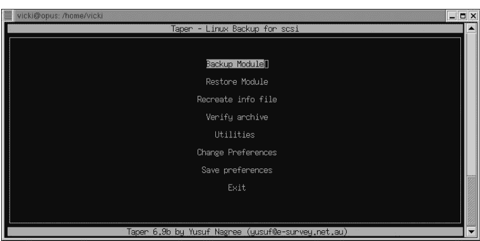

`Taper` 允许你在归档中搜索特定文件，并具有用于损坏归档的恢复模块。它允许无辅助备份，允许你指定备份是完整备份还是增量备份。

`Taper` 包含在大多数 Linux 分发版中。编译 `Taper` 至少需要 `ncurses` 4.1。还需要 `forms` 库。可以从 `http://www.void.jump.org/taper.html` 下载 `Taper`。

## BRU

增强软件技术公司（Enhanced Software Technologies, EST）从 1985 年开始为 Unix 开发其备份产品。第一个针对 Linux 的版本于 1994 年上市。Red Hat 与 EST 合作，自 Red Hat 版本 6.1 起开始在盒装套装中包含的 Linux 应用程序 CD 上提供 `BRU` 备份和恢复的试用版。EST 还与 SuSE Linux 和 Caldera OpenLinux 合作。

`BRU` 既可以作为命令行工具运行，也可以通过 `xbru` 命令作为非常精致的图形产品运行，具有巨大的视觉吸引力。介绍屏幕如图 9.6 所示，彩色版本看起来更好。

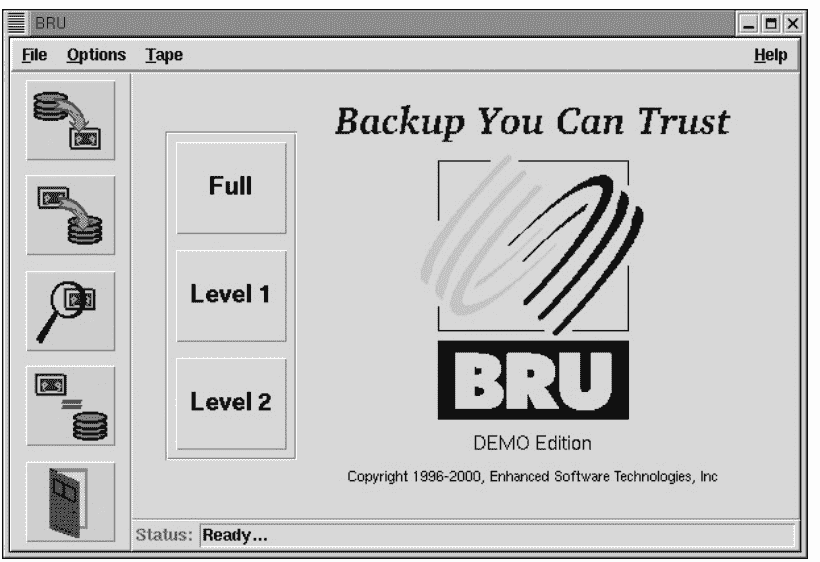

`BRU` 备份和恢复工具获得了很多公众认可，并在 2000 年 LinuxWorld 会议上被投票评为该类别的“最佳展示产品”。它是一个高度可扩展的软件包，在备份单个工作站以及网络客户端/服务器备份策略方面表现良好。

`BRU` 将执行完整备份、Level 1 备份（相当于增量备份）和 Level 2 备份，后者备份自上次 Level 1 备份以来修改的所有文件。


`Amanda`、`Taper` 和 `BRU` 是可用备份软件包中最常见的，但新的选择时刻都在开发。找到你最喜欢的 Linux 应用程序网站，例如 `http://www.linux.org/apps/`，浏览列表。找到几个你感兴趣的，下载并安装它们。在决定日常使用哪个之前，用吸引你的那些进行备份和恢复测试。

## 恢复时的技巧

尽管如果备份做得得当，从备份中恢复文件是相当简单的过程，但确实有一些事情需要记住以避免事故。

- 确保你理解备份软件指定的路径是相对路径还是绝对路径，以便你恢复到预期位置。如果你正在覆盖现有系统进行恢复，你必须确保你在正确的目录中，以免无意中覆盖文件。如果使用相对路径制作的备份，写入错误位置不太可能造成任何伤害，因为它只会将所有内容放在当前工作目录下。然而，如果你使用绝对路径创建了备份，文件将覆盖已经存在的文件。也就是说，`/usr` 的绝对路径备份将覆盖现有的 `/usr` 树。有意覆盖此树当然是可以的，但许多人无意中这样做而感到沮丧。

- 在将磁带放入驱动器之前，先读取磁带标签。不幸的是，很容易拿起一张磁带，把它放在一堆磁带上，然后拿起错误的那张。你可能在过程完成之前不会发现你在提取错误的归档，这会让你在“空闲”时间提取正确的备份。

- 购买质量适中的介质。你不必购买最好的，但一定要选择那些能够承受反复使用的磁带。品牌磁带比通用或小众品牌磁带更有可能在多次使用中保持完好。这一点同样适用于 `CD-R`。对于 `CD-R` 的归档存储，金/金介质（两面都呈金色）和银/蓝介质（上层为银色，下层为蓝色）的寿命通常比金/绿介质更长。对你来说哪种存储介质表现最好，可能取决于你的磁带机或 `CD-R` 驱动器；对于某些驱动器，特定类型的磁带寿命最长，或者特定品牌的 `CD-R` 产生的废品率最低。关注相关趋势，购买驱动器喜欢的那种类型，可以为公司节省一些钱。

- 磁带处于活动状态时切勿将其拉出；请让磁带完成运行并重卷。如果你使用的是无自动重卷功能的设备单元，请让它完成当前进程，然后使用 `mt` 命令将磁带重卷。大多数磁带机在插入磁带时，如果磁带尚未重卷，会自动将其重卷，因此拉出未重卷的磁带从长远来看不会节省任何时间。在活动状态下将磁带从驱动器中拉出是损坏磁带的一种好方法。

- 如果在读取或写入磁带时遇到错误，请尝试使用相应的清洁带清洁驱动器磁头。脏污的磁头通常会导致磁带驱动器错误地报告读取或写入错误。别忘了遵循磁带清洁方面的驱动器制造商说明。

- 如果写入 `CD-ROM` 时遇到错误，请尝试使用更慢的写入速度或更高质量的介质。同时，尝试降低相应数据总线的负载。

- 在使用磁带驱动器进行实际备份之前，请对大量静态数据（例如 `/usr` 目录树的内容）执行测试备份，并使用你的磁带软件的比较功能（例如 `tar` 的 `--diff` 或 `--compare` 命令）。如果软件报告了那些本不该发生变化的文件发生了变化，你应该查明问题的根源。我们其中一人曾经发现，当磁带驱动器和 `Iomega` `Zip` 驱动器连接到同一个 `SCSI` 主机适配器时，两者之间存在一种奇怪的兼容性冲突。该问题导致从磁带驱动器读取数据时出现错误。当两个驱动器连接到另一个主机适配器时，这种不兼容现象消失了。你希望在需要使用驱动器进行实际数据恢复之前发现这类困难。

## 备份操作系统

本章前面的部分讨论了备份工具和命令，但在实践中，有必要知道应该备份什么内容。关于备份有两种理念：最小备份和完整备份。最小备份仅备份系统中独特的文件，例如配置文件和用户数据。完整备份则备份整台计算机。每种方法都有其优缺点。

### 最小备份

最小备份的理念是，在发生硬盘崩溃等灾难时，你可以获取新的硬件（如有必要），从头重新安装 Linux，并从磁带、`CD-R` 或其他介质恢复小型备份，从而恢复一个与你之前使用的系统相同或几乎相同的工作系统。Linux 比较适合这种方法，因为配置文件、用户文件和大多数其他特定系统的文件都集中在特定的目录中，例如 `/etc`、`/home`、`/usr/local` 和 `/var`。

假设你想备份这四个目录，而 Linux 系统的大部分（除了 `/usr/local` 以外都在 `/usr` 中）则通过原始 Linux 安装 `CD-ROM` 的形式进行“备份”。你可以使用如下命令使用 `tar` 和 `SCSI` 磁带驱动器执行此任务：

```
# tar cvpif /dev/st0 /etc /home /usr/local /var
```

最小备份有一些优点，包括速度快、所需磁带较少，以及无需制定复杂的灾难恢复计划即可恢复系统（你会重新安装一个完整的系统，然后使用它来恢复你的特定系统数据）。缺点是，你很容易遗漏重要内容（包括初始系统安装后安装的软件升级），并且为了正常工作，你需要仔细记录在系统安装期间及之后安装的内容，以便创建一个与备份时系统状态匹配的初始恢复后配置。总体而言，除非你没有足够的磁带容量来方便地备份整个系统，否则最好执行完整备份。某些系统可以从混合方法中受益：偶尔使用完整备份，更频繁地使用最小备份。这种方法类似于增量备份，但成败与否更具随机性。

### 完整备份

完整备份备份计算机上的所有内容，除非你知道恢复后不需要的特定文件除外——例如，你可能明确排除 `/tmp` 目录的内容。原则上，你可以通过备份 `/` 目录及其所有子目录来执行完整备份，但如前所述，你希望避免备份 `/proc` 文件系统，因为它根本不是一个基于磁盘的文件系统。此文件系统存储计算机状态的信息，因此备份它充其量是浪费磁带，恢复它甚至可能导致严重问题，甚至可能包括系统崩溃。

与最小备份相比，完整备份需要更多的时间和磁带，并且在灾难后恢复此类备份需要一些准备工作，稍后将会描述。另一方面，一旦你恢复了此类备份，你就无需调整配置或担心遗漏的文件或程序升级——如果正确且完整地执行，恢复后的系统将是其备份前状态的虚拟克隆。

根据你使用的软件不同，你可以通过备份 `/` 并指定要排除的文件或目录，或者独立备份每个文件系统来执行完整备份。例如，若要使用 `tar` 备份 `/` 并排除 `/proc`，你可以发出以下命令：

```
# tar cvpf /dev/st0 / --exclude=proc
```

这个特定的命令省略了 `/proc` 开头的 `/`，因为 `tar` 默认以相对方式存储存档中的文件。如果你在 `/proc` 中包含 `/`，`tar` 将不会排除 `/proc`。这种潜在的混淆可能使得使用 `tar` 的 `-l` 参数并指定你要备份的每个文件系统来更容易获得正确的结果，具体如下：

```
# tar cvlrf /dev/st0 /home / /usr/local /boot
```

此命令备份了四个文件系统（`/home`、`/`、`/usr/local` 和 `/boot`），当然你应该根据你的计算机调整这些文件系统。你可以按任何顺序列出文件系统，但请记住，从你首先列出的文件系统恢复文件会更快。此示例将 `/home` 列在首位，其理论依据是用户可能会意外删除其主目录中的文件并希望恢复它们。

### 灾难恢复技术

定期且系统地备份你的系统在保护系统方面起着重要作用，但仍有一些情况需要采取不同的措施。如果你忘记运行 `LILo` 或无法启动刚制作的内核，你不需要重新安装，但你确实需要某种灾难恢复。灾难恢复方法允许你登录到系统，以便在损坏的设备永久关闭系统之前修复系统或取回重要文件。根据问题以及修复所需的操作，有多种方法可供选择。其中包括以单用户模式引导、从紧急启动盘引导以及以救援模式引导。

#### 单用户模式

单用户模式将计算机启动到运行级别 1。本地文件系统照常挂载，并运行系统的初始化脚本，但没有网络访问权限。你会进入一个系统维护 `shell`，`root` 可以使用控制台，但不允许任何人登录。如果系统启动但未在启动完成后允许你登录，请尝试重新启动，并在 `LILo` 引导提示符处输入 `linux single`：

```
LILo boot: linux single
```

由于此方法使用故障系统自身的初始化脚本，这些脚本中的任何错误可能仍是个问题；然而，在此模式下不会运行任何守护进程，因此由守护进程启动失败引起的问题可能在此模式下可修复。单用户模式还使用系统自身的内核，因此如果内核正在引起恐慌，这也无济于事。如果文件系统存在问题，单用户模式会尝试照常挂载它，并很可能在那时失败。

当你忘记了 `root` 密码时，单用户模式对于访问系统非常有用；它允许你在安装新内核映像后忘记运行 `LILo` 时运行 `LILo`，并修复其他不会阻止系统进入单用户模式的问题。你可以利用没有人可以登录的事实，执行诸如安装软件、创建备份（如果系统可以长时间保持在单用户模式下而不中断）以及其他受益于 `root` 独占操作的标准维护功能。

#### 使用启动软盘

第 2 章关于安装 Linux 的讨论，如在 `Red Hat` 系统上演示的那样，指出创建启动软盘是一个有用的安装选项。在 Linux 早期，打包发行的发行版至少附带一张启动软盘和一张根文件系统软盘。这些软盘是安装所必需的。启动软盘包含通过 `LILo` 引导特定系统所需的所有文件。根文件系统包含在根软盘中。使用这种方法，你可以使用启动软盘并指定安装根分区的位置来启动已安装的系统，或者启动根软盘上的映像。

#### 安装启动盘


现在的启动盘有两种类型。第一种用于引导进入安装过程，通常被称为*安装盘*。如今，大多数 CD-ROM 发行版都提供可启动的 CD-ROM，从而消除了对启动盘的需求。不过，如果你的计算机 BIOS 不允许从 CD-ROM 引导，或者你的 CD-ROM 无法工作，你将需要通过将正确的启动映像复制到软盘来创建启动盘。如果你的发行版没有附带现成的启动盘，你必须使用安装 CD-ROM 上的其中一个启动盘映像来创建一个。有些可启动 CD-ROM 可以直接使用，其方式与紧急软盘非常相似。

由于不同的安装方法要求将不同的功能内置于内核中，因此有三个映像可用于此磁盘。如果你的发行版附带了预制的启动盘，它很可能等价由 `boot.img` 制作的启动盘，因为这是最常使用的启动映像。

还有一个 `bootnet.img` 镜像，用于从非 PCMCIA 网络设备进行安装。还有一个 `pcmcia.img` 镜像，可用于通过 PCMCIA 设备（如某些 CD-ROM 驱动器、以太网适配器或硬盘）进行安装。

由于安装磁盘允许你启动系统并使用虚拟终端，因此有时可以用来修复缺陷，但与单用户模式一样，某些相同的限制也适用于此。启动磁盘仅包含内核镜像，因此所有的初始化都是使用系统自身的文件来完成的。

创建安装软盘有几种方法。如果你有一个可用的 Windows 系统，你可以使用 `RAWRITE.EXE` 来创建磁盘。该二进制文件位于 Red Hat CD-ROM 的 `dosutils` 目录中。要使用它，执行命令并告诉它希望将 `images` 目录中的哪个镜像写入软盘以及写入哪个设备。

如果你幸运地有一台 Linux 或其他 Unix 机器可用，你可以使用 `dd` 和以下命令的变体来创建磁盘：

```bash
# dd if=/mnt/cdrom/images/boot.img of=/dev/fd0
```

在某些系统上，你需要指定块大小。有关更多详细信息，请参阅 `dd` 命令的手册页。你也可以使用 `cat` 命令，如下所示：

```bash
# cat /mnt/cdrom/images/boot.img > /dev/fd0
```

你不得使用 `cp` 命令，因为目的是传输原始镜像而不进行任何格式化，而 `cp` 命令需要格式化的磁盘。

## 紧急启动软盘

第二种启动软盘是一种独立的启动镜像，专门在你的系统安装过程中或通过运行 `/sbin/mkbootdisk` 命令时为你的系统创建。这种磁盘通常被称为紧急启动软盘。它包含根文件系统以及针对其构建来源系统的定制启动数据，而不是随发行版启动软盘提供的通用数据。如果你无法或不想运行 `LILO` 或其他引导管理器，可以使用独立启动软盘来启动你的系统。

重要的是要记住，启动软盘在启动时使用现有系统上的文件。它需要找到二级引导加载程序（通常是 `/boot/boot.b`）、初始化文件以及你正在启动的计算机上的内核镜像。如果你试图修复的问题存在于这些文件之一中，你将无法使用启动软盘进行引导。你需要使用 Red Hat 的救援模式。

## 救援模式

Linux 发行版的 *救援模式* 会启动一个小型但完整的 Linux 系统，完全独立于已安装的 Linux 系统。在此模式下，你可以挂载计算机的设备，编辑配置文件，运行文件系统检查，或者根据问题执行许多其他修复功能。由于单用户模式和启动磁盘都依赖于已安装系统本身的文件，而某些类型的问题无法通过这些方式修复，因此救援模式是解决你将遇到的一些问题的唯一方法。

许多发行版的 CD-ROM 都包含以某种形式进入救援模式的能力。本节重点介绍 Red Hat 的救援模式，但其他发行版的原理是相同的。

如果引导加载程序已被另一个操作系统覆盖，你就无法从硬盘上的内核和初始化文件启动，因为没有办法访问它们；因此你需要使用救援模式。如果硬件问题导致无法使用自己的初始化脚本启动，请使用救援模式，并在驱动器损坏之前挂载该驱动器以尽可能多地检索数据。如果你在 `/etc/fstab` 中犯了一个错误，并为 `/` 分区给出了错误的挂载点，你可以使用救援模式编辑该文件并重新启动。你甚至可以使用救援模式在旧硬盘损坏后，将完整的磁带备份恢复到新硬盘上。

要进入救援模式，你需要从 Red Hat 启动磁盘或包含 PCMCIA 启动镜像或 `bootnet` 镜像的软盘启动。当你到达启动提示符时，只需键入 `linux rescue`。当系统启动时，你将处于救援模式，并拥有一个 Bash `#` 提示符。你将能够运行你的发行版选定的任何基本命令。对于 Red Hat 7.3，这些是可用的：

| `Anaconda` | `gzip` | `mkins.ext2` | `ps` |
| `Badblocks` | `head` | `mknode` | `python` |
| `Bash` | `hwclock` | `mkraid` | `python 1.5` |
| `cat` | `ifconfig` | `mksnap` | `raidstart` |
| `chat` | `init` | `mlabel` | `raidstop` |
| `Chmod` | `insmod` | `mmd` | `rcp` |
| `Chroot` | `less` | `mount` | `regina` |
| `Clock` | `ln` | `move` | `rm` |
| `collapse` | `locale` | `modprobe` | `rmmod` |
| `Cp` | `ls` | `mount` | `route` |
| `Cpio` | `lsattr` | `mpartition` | `rpm` |
| `Dd` | `lsmod` | `mrd` | `rsh` |
| `ddcprobe` | `mattrib` | `mread` | `sed` |
| `depmode` | `mbadblocks` | `mren` | `sh` |
| `Df` | `mcd` | `mshowstat` | `sync` |
| `e2fsck` | `mcopy` | `mt` | `tac` |
| `Fdisk` | `mdel` | `mtools` | `tail` |
| `Fsck` | `mdtree` | `mtype` | `tar` |
| `fsck.ext2` | `mdr` | `mv` | `touch` |
| `fsck.ext3` | `mdu` | `mzip` | `traceroute` |
| `ftp` | `mformat` | `open` | `umount` |
| `gnome-py-helper` | `minfo` | `pico` | `uncopy` |
| `Grep` | `mkdir` | `ping` | `uniq` |
| `Gunzip` | `mke2fs` | `probe` | `zcat` |

如果你的根文件系统没有损坏，你可以挂载它并使用 `chroot` 命令来运行命令，就好像原始根文件系统是你的根目录一样。你可以挂载此根文件系统上的所有分区，并基本上运行你自己的系统。在 Red Hat 6.2 及更高版本中，你需要创建自己的设备，因此在挂载 `/dev/hda1` 之前，你需要使用 `mknod` 命令创建 `/dev/hda`、`/dev/hda1` 和 `/dev/hda2`。

```bash
# mknod /dev/hda b 3 0
# mknod /dev/hda1 b 3 1
# mknod /dev/hda2 b 3 2
# mkdir /mnt/oldroot
```

```bash
# mount /dev/hda1 /mnt/olddisk
# mount /dev/hda2 /mnt/olddisk/usr
# chroot /mnt/olddisk
```

此示例反映了一个作为两个独立分区存在的系统：`/` 和 `/usr`。如果你不知道试图修复的系统的分区方案，你可以使用 `fdisk` 来确定它（也就是说，在你为硬盘创建设备文件之后）。`fdisk` 实用程序将允许你确定分区类型和大小；这通常是足够的信息，可以对正在使用的方案进行良好的猜测。如果你猜错了，不要担心；尝试挂载错误的分区不会损害系统。

## 第三方恢复软件

最近，几家第三方供应商开始销售恢复软件包。过去，许多人认为备份就足够了。由于恢复工具在 Windows 中很常见，从该环境转换过来的用户通常希望看到这些工具在 Linux 中。

### BRU

Enhanced Software Technologies (`EST`) 使用其之前讨论过的 `BRU` 备份和恢复软件包背后的技术作为其一系列数据恢复产品的骨干。

### QuickStart Data Rescue

`QuickStart Data Rescue` 软件包提供了使用单个启动磁盘执行灾难恢复的能力。一旦使用 `QuickStart Data Rescue` 磁盘启动，你的系统将能够检测大多数磁带驱动器。检测到磁带驱动器后，你将能够使用图形界面按照原始捕获时的配置重新安装系统。通常，如果系统崩溃，你需要重新安装操作系统并执行一些配置任务（例如让系统看到你的磁带驱动器），甚至无法开始从磁带上转储所需的元素。使用 `QuickStart Data Rescue`，你只需从磁盘启动并开始恢复你的数据。

### 恢复已删除的文件


很容易意外删除文件。备份目的的一部分就是允许恢复此类文件，但如果文件在意外删除之前没有被备份，备份就没有用了。因此，有可用的未删除工具，并且某些窗口管理器默认使用垃圾桶图标，该图标不会立即删除文件，而是将它们存储在临时状态中然后再删除。`rm`命令实际上并没有从磁盘擦除已删除的文件，而是删除了文件的`inode`或索引指针，将数据保留在原处，直到同一个`inode`被重用。因为数据仍然存在，所以通常可以检索到它。虽然`ext2`文件系统促成了几个未删除软件包/方法的发展，但新的`ext3`系统稳定得多，因此正在开发的工具（例如`GtkRecover`）不再进行开发。其命令行版本`Recover`仍然存在，但目前没有太多的开发活动。

## 总结

备份是一个重要主题，涵盖的内容很多。有效的备份依赖于对硬件的适当选择、合理的备份计划的选择以及良好的备份软件的使用。`Linux`与大多数现代备份硬件配合使用，并提供许多选择备份软件。当然，你的备份计划由你自己制定。

仅备份数据是不够的。在灾难发生时，你必须有一个良好的恢复计划。至少，你应该能够启动某种紧急恢复磁盘，以便从备份中恢复数据。这个相同的或另一个恢复磁盘还应允许你编辑主系统的文件，以防你不小心损坏了像`/etc/fstab`这样的关键文件。还有各种各样的工具可以帮助你恢复数据，即使没有传统的系统备份。所有这些工具和技术在保护系统数据免受意外丢失，甚至防范黑客的破坏方面都起着重要的作用。

休息一下，喝点你喜欢的饮料。当你回来时，你将了解打印机和打印队列子系统。

## 第三部分：通信与网络

## 章节列表

- 第 10 章：打印机与打印队列子系统
- 第 11 章：串行通信、终端和调制解调器
- 第 12 章：`TCP/IP Linux`网络
- 第 13 章：`X`窗口系统
- 第 14 章：设置邮件服务器

### 特色内容

- 理解串行设备
- 配置终端和调制解调器
- 配置串行打印机
- `Linux`中的打印过程及`lpd`打印队列程序
- 在`Red Hat`中创建打印机
- 内核对打印的支持
- 远程打印
- `Bash shell`脚本编写
- 其他语言的管理脚本
- 理解和配置`TCP/IP`网络
- 文件共享
- `Internet`服务器和超级服务器
- 配置`X`窗口系统
- 在`X`之上构建用户界面
- 设置邮件服务器
- 防范垃圾邮件

# 第 10 章：打印机与打印队列子系统

## 概述

打印机对大多数企业来说都是至关重要的工具，这使得能够设置和管理打印成为一个非常重要的系统管理任务。你会发现，你接到的许多紧急呼叫都来自那些无法打印即将召开的会议所需文件的用户。即使打印机出现了一些小故障，对于在特定时间需要使用该打印机的人来说，这也似乎是一场危机。成功的系统管理员必须理解打印过程，并能够成功排查基本的打印问题。

`Linux`下的打印与大多数非`Unix`操作系统的打印方式略有不同。如果一切运行正常，这些差异对您的用户是透明的，但为了设置和排查`Linux`打印队列，你必须了解许多`Linux`打印的细节和特殊性。如果计算机作为其他计算机的打印服务器，你还必须了解这些队列如何与客户端交互。本章概述了当今常用打印机的类型、`Linux`提供用于控制打印机操作的工具，以及基本的安装和配置。

## 打印机基础知识

打印机根据打印方式和连接计算机的方式进行分类。你可能会遇到三种主要类型的打印机和四种类型的打印机接口。熟悉这些打印机基础知识会使你成为一名更胜任的系统管理员，并帮助你的用户相信你知道自己在做什么。简要介绍打印机类型及其与计算机的接口方式将会很有帮助。如果你已经了解这些基础知识，可以跳至“`Linux`中的打印过程”。

### 打印机类型

打印机在纸张上创建图像的方式上存在巨大差异。击打式打印机通过机械方式将字符撞击在墨带上，从而将图像转移到纸张上。在当今的商业世界中，这些打印机的使用受到限制且用途专门化；更常见的是非击打式打印机，它们通过其他方式转移图像。击打式打印机包括行式打印机、菊花轮打印机和针式打印机。非击打式打印机包括激光打印机和喷墨打印机。大型机计算机最早的常见打印机之一是行式打印机——体积大、速度快且噪音大。菊花轮打印机于 1970 年推出，提供了与打字机相同的打印质量。随后，针式打印机有效地取代了菊花轮打印机。激光打印机在 1975 年登场，但价格高昂，因此大多数企业继续使用权式打印机。1976 年，第一台喷墨打印机问世，但同样价格昂贵。1988 年，惠普推出了`DeskJet`喷墨打印机，价格为 1,000 美元。虽然许多用户选择保留他们的针式打印机而不是支付更高的费用以获得更好的性能，但这一系列打印机为家庭用户广泛使用喷墨打印机打开了大门。当时激光打印机仍然过于昂贵，而且不像喷墨打印机那样支持彩色。1992 年，惠普推出了`LaserJet 4`，支持高达 600×600 的分辨率。彩色激光打印机于 1994 年引入。如今市场基本上由喷墨打印机和激光打印机共享。然而，有几种打印机类型在利基市场中很重要，如热升华和热熔蜡转移打印机，它们在图形艺术部门很受欢迎。

### 针式打印机

针式击打式打印机有一排垂直排列的针（通常在 9 到 24 针之间）。打印机将其中一些针刺入带有墨水的打印色带，在纸上留下一系列墨点，从而生成模糊的低质量字符表示。这种模糊性是由于针的机械特性造成的：它们无法做得足够小以掩盖字符由点组成的事实。然而，这种打印机的优势在于，它首先引入了打印图形的可能性，因为它不像之前的菊花轮打印机那样局限于字母。

如今，由于速度慢、噪音大，且打印质量低于竞争的喷墨和激光打印机，针式打印机很罕见。尽管如此，它们在特定应用中仍有一席之地。这些打印机的主要优势在于，由于它们依赖击打技术，因此可以打印多联表单。因此，你会看到一些零售企业使用针式打印机来打印收据和发票。

`Linux`对针式打印机的支持非常好。少量打印机语言，以`Epson`的`ESC/P`为首，长期主导针式打印市场，而`Linux`的`Ghostscript`工具支持这些常见的针式打印机语言。因此，如果你发现自己需要支持针式打印机，你有很大可能可以从`Linux`使其正常工作。

### 喷墨打印机

针式打印机依赖通过墨水色带产生的冲击在纸上创建图像，而喷墨打印机则通过喷嘴将小滴墨水喷射到页面上。与针式打印头的针类似，喷墨喷嘴可以排列成字符或其他图像，但形成的墨点更小，不易被分辨出来。打印机制水平移动，同时纸张缓慢通过打印机。早期型号产生的墨点足够大，打印质量与针式打印机相当，但该技术迅速改进到图像质量可媲美激光打印机的水平。

通常比激光打印机购买成本低，但喷墨打印机维护成本较高。系统包含 1–6 个墨盒，当耗尽时需要更换或重新灌装。（每个墨盒产生 1–6 种颜色；所有现代喷墨打印机都是彩色打印机，尽管最早的型号只打印黑色。）这些墨盒可能相当昂贵，并且可能在需要更换之前只能打印几页，导致每页成本高昂。喷墨打印机最适合使用特殊涂层的纸张，以防止墨水在干燥时扩散。从喷墨打印机中取出打印页时需谨慎，因为除非给予足够的时间干燥，否则墨水会晕染。可以使用普通打印纸，但图像往往会因墨滴渗入纸张的方式而略显模糊。

**注意** 你可以为大多数流行的喷墨打印机型号购买墨水补充包。这些套件可以大幅降低打印成本，但重新灌装过程可能会很`messy`，且并不总是正常工作。打印机制造商不鼓励此过程，如果发现你一直在重新灌装，他们可能会拒绝保修服务，尽管重新灌装制造商声称此类行为违法。据我们所知，这一主张从未在法庭上受到过检验。

### 激光打印机

激光打印机提供最佳的打印质量。1984 年由惠普商业引入，随着其价格相比其他打印机类型下降，它们开始主导办公室市场。激光打印机通过静电方式将整页图像转移到纸上，很像复印机。但复印机通过光学方式从源照片开始复制图像，而激光打印机则从计算机数据开始，打印机内部的处理器将其转换为驱动激光束的指令，从而在圆柱形硒鼓上描绘出图像。图 10.1 展示了这一过程。激光束的精细程度使激光打印机能够在文本和图形方面实现非常高分辨率，范围可达每英寸数百点（`dpi`）。

``

现代激光打印机的速度比平均喷墨打印机快几倍，且适用于需要快速、高质量大量打印的场景。激光打印机对纸张特性的敏感度低于喷墨打印机，因此可以使用更便宜的纸张。激光打印机中用于替代油墨的碳粉（`toner`）也比喷墨打印机用的墨水更便宜，至少就单页成本而言是这样。（虽然碳粉盒通常比墨水盒贵，但碳粉盒能打印的页数要多得多。）2002 年大多数激光打印机只能打印黑色，但彩色型号正逐渐流行起来。对于没有钱购买彩色激光打印机的人来说，幸运的是，中端喷墨打印机在彩色打印质量上仍然优于除最高品质彩色激光打印机外的所有机型。

## 过时且稀有的打印机类型

计算机打印的历史中充斥着那些曾经鼎盛、如今已默默无闻的技术。还有一些打印机类型是在特定利基市场中生产使用的。这些技术包括：

- `菊轮打印机` 菊轮打印机因其打印头的外观看起来像花瓣而得名。每个“花瓣”尖端都有一个凸起的字符图像。这些花瓣像点阵打印机一样撞击带墨的色带。这些设备曾是生产高质量文本的常见手段，但已被激光打印机取代，激光打印机能更快、更安静地产生更优质的文本。


## 打印机类型

- **行式打印机** 行式打印机使用击打技术，与菊轮打印机和点阵打印机类似。这些打印机使用一系列带有字母的轮子。每个轮子独立旋转，因此可以同时组成并打印一行完整的文本，因此得名。Linux 的行式打印机守护进程（`lpd`）程序名称就来源于这种类型的打印机，但它也适用于其他类型的打印机。这些打印机目前仍用于大型主机计算机。

- **热升华打印机** 这些打印机使用染料而非墨水来创建图像。打印机加热染料直到其变为气态，气体随后撞击纸张，产生类似喷墨打印机的彩色点。这些打印机能产生极佳的彩色输出，但价格昂贵且速度较慢。

- **热熔蜡转印** 这项技术使用彩色蜡而非喷墨技术中的彩色墨水。虽然这些打印机的成本介于热升华打印机和喷墨打印机之间，但热熔蜡转印打印机通常比彩色激光打印机产生更好的彩色打印效果。

- **绘图仪** 绘图仪使用由机械臂拖动在纸张上移动的水笔来产生输出。这些设备通常用于制作大幅面的线条艺术，如建筑图纸。

你不太可能会遇到这些类型的打印机，但如果你管理的是用于图形艺术部门或需要专用打印机类型环境的 Linux 打印服务器，则可能会遇到。关于这些打印机，主要需要关注的是与 Linux 的 `Ghostscript` 工具的兼容性。如前所述，用于 Linux 的打印机必须原生支持 PostScript 打印语言，或者必须由 `Ghostscript` 提供支持。不寻常的打印机可能无法满足这两个条件中的任意一个。然而，如果打印机受到支持，你可以像对待任何其他打印机一样对待它。

## 打印机接口

打印机可以通过多种方式对计算机开放访问。在最简单的情况下，打印机可以通过并口、RS–232 串口或通用串行总线（USB）端口直接连接到独立工作站。但在商业环境中，连接更可能是到网络工作站或专用打印服务器。打印服务器是拥有一个或多个打印机接口以及一个网络接口的计算机或专用网络设备。打印服务器接受来自网络中其他计算机的打印任务，并将这些任务引导至打印机。Linux 计算机可以充当打印服务器，可以是专用模式，也可以在执行其他任务的同时运行。在 Linux 中，名为 `printcap` 的文件包含每个打印机的基本配置。一些打印机内置了网络接口卡，也可以通过在 `printcap` 文件中设置相应条目来访问。我们稍后会详细讨论这个文件。

### 并口（Parallel Port）

大多数打印机通过并口连接到计算机。从点阵打印机到现代激光打印机，各种打印机都可以通过这种方式连接。并口打印机使用一种接口，该接口允许多根导线同时传输数据。并口在每根导线上承载一位数据，从而将单根电缆的传输速率乘以导线数量倍增。除了数据之外，该端口还发送控制信号，以指示数据何时准备就绪发送或接收。

现在有增强型高速并口，符合 `IEEE 1284` 标准，它们提供与外部设备（包括打印机）的通信。这些高级端口支持高达 2MBps 的双向传输。但请记住，高速并口旨在运行位于计算机 20 英尺（约 6 米）范围内的设备；短而高质量的电缆对于高吞吐量至关重要。在长于 20 英尺的电缆上发送的信号将随电缆长度按比例衰减。

本章关于 Linux 打印支持和配置的大部分讨论都适用于连接到并口的打印机。通常，如果你使用的是 RS–232、USB 或网络打印机，只需更改几个配置细节即可。

### RS–232 串口

RS–232 串口最初是为终端服务器开发的，但现在支持许多其他设备，如串口鼠标和串口打印机。RS–232 串口比并口慢，因此不常用于打印机，因为打印机通常要求高速接口，特别是在打印图形时。某些打印机可以根据连接方式用作并口或 RS–232 串口。

RS–232 串口可以处理打印机与计算机之间距离较远的情况。串口打印机在大约 50 英尺（约 15 米）距离下可以以 38.4KBps 的速度运行（4.8KBps，比并口的 2MBps 慢大约 500 倍）。电缆长度可以通过 `EIA–530`（又名 `RS–422`）等电气接口延长。

第 11 章“串行通信、终端和调制解调器”展示了如何配置串口打印机连接。

### USB 端口

最新的打印机接口类型是 USB 端口。这是一种改进型串口，支持比旧式 RS–232 串口高得多的速度——高达 1.5MBps，非常接近并口速度。USB 还允许你将多达 127 个设备连接到单个端口，而并口和 RS–232 串口每个端口只能连接一个设备。这些事实使 USB 设备越来越受欢迎，不仅限于打印机——键盘、鼠标、扫描仪、磁带备份设备、调制解调器、数码相机等都有 USB 版本。在打印机中，USB 在低端和中端喷墨打印机中最常见，特别是那些面向 Macintosh 用户市场的型号。（当前的 Macintosh 既没有并口也没有 RS–232 串口。）

从 Linux 的角度来看，USB 的主要缺点是 USB 仍然足够新颖，Linux 对 USB 的支持不成熟。事实上，2.2.x Linux 内核系列中的 USB 支持基本上是不存在的。2.4.x 内核确实包含 USB 支持，但某些早期发行版默认不使用 2.4.x 内核。然而，许多发行版确实将 2.4.x 的 USB 支持回移植到它们的 2.2.x 内核中。最终结果是你可以使用 USB 打印机，但你可能需要更新内核或选择合适的发行版。由于 USB 打印机在 Linux 下相对测试较少，你也可能因为驱动不成熟而遇到问题。

## 网络打印机

网络打印机这一术语指的是通过网络可访问的、连接到计算机的打印机，或者是指内置网卡并拥有独立网络地址的打印机。后者有时被称为以太网打印机。（请注意，并口、RS-232 串口或 USB 打印机只需将其连接到打印服务器即可成为网络打印机。）网络打印机通过相同的 `printcap` 文件进行设置，与其他连接类型相比，它需要的配置更少，因为 Linux 可以向任何支持 LPD 协议的网络打印机发送打印任务（大多数打印机都支持）。你需要在网络上任何需要访问网络打印机的其他计算机上设置 `printcap` 条目。

### Linux 打印过程

Linux 下的打印始于一个称为打印假脱机（print spooling）的过程。打印假脱机程序接受来自应用程序或网络接口的打印任务（即打印特定文档的请求），将它们存储在假脱机队列中，然后逐个将它们发送到打印机。在系统中有第二个或后续打印任务可能在第一个任务完成之前就被发送的情况下，打印假脱机至关重要。打印假脱机程序保存这些任务，并允许管理员管理它们。通常，这种管理包括删除任务、重新排序任务，或重启打印机或其队列。历史上，Linux 最常见的打印假脱机软件包是行式打印机守护进程（line printer daemon）或 `lpd` 软件包，它源自 BSD 的 Net 2 软件包。其他打印假脱机程序包括 `LPRng` 和 `CUPS`。`Red Hat` 和 `Caldera` 是两个默认使用 `LPRng` 的发行版。`Debian` 允许用户在 `lpd` 或 `LPRng` 之间进行选择。许多其他发行版使用 `lpd`。在实践中，这两种系统非常相似，本章重点介绍它们的工作方式。

### 打印行业的工具

无论你使用哪种特定的打印系统，有一些通用的实用程序和配置文件是你应该了解的。这些包括 `/etc/printcap` 文件（或其等效文件）、`Ghostscript` 以及打印机队列的过滤器集。这些软件包的细节及其配置决定了你可以使用哪些打印机，以及计算机上的程序具体如何打印。

### printcap 文件

`lpd` 和 `LPRng` 打印假脱机程序使用一个名为 `/etc/printcap` 的配置文件。这个名称是*打印机功能*（printer capabilities）的缩写，该文件描述的就是这些内容。它包含提供连接到计算机的所有打印机（无论是本地还是通过网络）的配置数据的条目。每个打印机的条目包含诸如打印机的名称、其假脱机目录、其可接受的最大文件大小等信息。假脱机程序每次启动时以及每次被调用时都会读取此文件。

`printcap` 文件的格式复杂，通常由某种配置工具创建和编辑。这些工具使得创建 `printcap` 文件的工作变得容易得多。`Red Hat` 使用 `Printconf` 实用程序，将在本章后面进行讨论。

当我们查看 `lpd` 假脱机程序时，你会看到一个 `Red Hat` 系统上 `printcap` 文件的示例。

`CUPS` 和一些其他打印系统不使用 `printcap` 文件；相反，它们使用其他文件，在 `CUPS` 的情况下，这些文件位于 `/etc/cups` 目录中，例如 `/etc/cups/printers.conf`。这些文件的格式与 `printcap` 文件的格式不同，但它们完成相同的工作。

### Ghostscript

传统上，Unix 程序是基于打印机是以下两种事物之一的假设编写的：一种几乎不理解或完全不解格式的行式打印机，或者一台 PostScript 打印机。PostScript 打印机可以接受可下载字体、位图图形、矢量图形以及许多其他功能。事实上，PostScript 是一种完整的编程语言，在许多方面可与 `C`、`Perl` 等相提并论。然而，PostScript 旨在创建打印输出，因此它在图形处理功能方面非常强大。


由于 Linux 继承了许多 Unix 程序，因此 Linux 也继承了其打印机系统的 PostScript 中心特性。不幸的是，与传统上与非 PostScript 打印机类似但价格更低的打印机相比，PostScript 打印机通常更昂贵，许多 Linux 开发人员无法负担得起 PostScript 打印机。因此，为了创建比原始单间距纯文本输出更复杂的内容，Linux 需要一个辅助应用程序。这个应用程序是 Ghostscript（`http://www.cs.wisc.edu/~ghost/`），它将 PostScript 转换为多种其他格式，包括许多非 PostScript 打印机可以原生理解的格式。

公众已经习惯了支持 PostScript 的打印机，因此如今商业领域中非 PostScript 打印机不太常见。仍然可能存在需要了解打印的非 PostScript 方面的情况。因此，当使用非 PostScript 打印机时，打印过程如下进行：应用程序（WordPerfect、xfig、Netscape 或任何其他应用）生成一个 PostScript 文件。该文件被送入 Linux 打印机队列，队列通过 Ghostscript 处理该文件。然后队列将 Ghostscript 的输出传递给打印机。结果是，即使打印机实际上是一台永远无法理解 PostScript 的低端喷墨打印机，你也可以像配置 PostScript 打印机一样配置应用程序。

所有主要 Linux 发行版都附带 Ghostscript，但不一定附带该程序的最新版本。Ghostscript 在许可方面很独特。最新版本可免费用于非商业分发，但任何有偿分发都需要与版权持有者 Aladdin 协商许可条款。然而，旧版本的 Ghostscript 是在 GNU 通用公共许可证（GPL）下提供的，因此可以在商业 Linux CD-ROM 上分发，而无需处理繁琐的许可问题。在大多数情况下，旧版本的 GNU Ghostscript 就足够了。如果你想要最新的 Ghostscript 功能，请查看 Ghostscript 网站；你可以下载最新版本并使用它，只要你不将其包含在你出售的任何产品中即可。

> **提示** 除非你的打印机原生支持 PostScript，否则你的 Linux 打印大部分或全部都将依赖 Ghostscript 来处理打印机。因此，至关重要的是你的打印机本身是一台 PostScript 打印机或受到 Ghostscript 的支持。Linux 打印支持数据库（`http://www.linuxprinting.org/printer_list.cgi`）是一个交叉引用数据库，列出了打印机型号及其 Ghostscript 驱动程序，包括关于这些驱动程序工作效果的评论。在购买打印机或在 Linux 中让打印机正常工作遇到困难时，请查阅该数据库。

Ghostscript 本身通常需要很少的配置。它包含许多不同打印机的驱动程序，而调用它的程序（如打印队列或 magic 过滤器）会指定使用哪个驱动程序。不过，在某些情况下，你可能希望为 Ghostscript 添加字体，甚至使用不寻常的驱动程序重新编译它。如果你需要为 Ghostscript 添加字体，可以通过编辑 `/usr/share/ghostscript/version/Fontmap` 文件来完成，其中 `version` 是 Ghostscript 版本号（在 Red Hat 7.3 中为 `6.52`）。大多数使用不寻常字体的程序会将其嵌入到输出的 PostScript 文件中，因此无需明确地向 Ghostscript 添加字体。

### Magic 过滤器

打印假脱机软件在 `printcap` 文件中找到的一个关键信息是用于特定打印机的 magic 过滤器，或打印过滤器。`Magic 过滤器`是一种软件，它从标准输入接收文件，根据文件类型执行操作，然后在标准输出上输出结果。

当像 LPRng 这样的打印假脱机程序被调用时，参数为文件名或流，它会检查指定打印机的 `printcap` 条目。如果相应的 `stanza` 指定了打印过滤器，`lpd` 会通过该过滤器发送文档或流，从而以正确的格式生成输出。

如果发送打印机无法理解的文件，打印机将无法正确打印。用于打印的文件格式有很多种：纯文本、PostScript、各种类型的图像文件等。打印过滤器决定如何处理每种文件类型——是直接将其发送到打印机，通过 Ghostscript 处理，还是通过其他程序处理。

例如，对于纯文本文件，magic 过滤器无需做任何事情。然而，如果收到 PostScript 文件，非 PostScript 打印机的 magic 过滤器将调用 Ghostscript 来翻译该文件以便打印。提供这些过滤器的三个软件包是 `rhs-printfilters`（Red Hat 使用）、APSFilter（大多数发行版使用，并将在本章后面讨论）和 Magicfilter。你必须确保过滤器调用的任何程序（如 Ghostscript）也在系统上。如果你坚持使用发行版默认的打印工具，这应该就足够了。但是，如果你调整了打印过滤器配置，则需要仔细阅读其文档，了解它需要哪些其他工具。

### LPRng 打印假脱机程序

LPRng 是旧的 `lpd` 打印系统的现代重新实现。LPRng 包含大多数 `lpd` 工具和实用程序的等效物，尽管某些细节有所不同。这里关于 LPRng 的大多数信息也适用于较旧的 `lpd` 系统。

LPRng 和原始的 `lpd` 系统都围绕行式打印机守护进程 `lpd` 构建。这是监视打印请求并启动适当的子程序以完成预期任务的程序。行式打印机守护进程协议在请求评论（RFC）1179 中定义。

术语 `lpd` 既用于指守护进程本身，也更广泛地指用于执行与打印假脱机相关的各种功能的程序集合。这些包括 `lpd`、`lpr`、`lpq`、`lpc` 和 `lprm` 程序。最重要的是守护进程本身，`lpd`，它提供了假脱机功能。

**注意** 区分原始的 `lpd` 软件包和 `lpd` 程序很重要。前者指的是一套具有特定历史的具体程序。后者指的是具有特定名称的程序，其版本既包含在原始的 `lpd` 软件包中，也包含在较新的 LPRng 中。下面关于 `lpd` 的大多数讨论指的是该程序，而不是特定的软件包；此讨论适用于原始的 `lpd` 软件包和新的 LPRng 软件包。

#### 基本 `lpd` 功能

主行式打印机守护进程持续运行，以跟踪系统中的任何打印假脱机需求。主 `lpd` 在启动时以与其他守护进程相同的方式启动，正如我们在讨论系统初始化时所谈到的那样。Red Hat 在 `/etc/rc.d/init.d` 中有一个 `lpd` 脚本，它在启动时运行。你可以通过发出由 `lpd` 脚本的完整路径、一个空格和以下命令之一组成的命令，在其他时间启动或停止 LPRng：`start`、`stop`、`status` 或 `restart`。当

打印守护进程启动后，会读取前面讨论过的 `/etc/printcap` 文件。列表 10.1 展示了 `printcap` 文件的一个示例。

## 列表 10.1：一个 printcap 文件示例

```text
lp|lp0|lexmark: \
    :sd=/var/spool/lpd/lexmark:\
    :mx#0:\
    :sh:\
    :lp=/dev/lp0:\
    :if=/var/spool/lpd/lexmark/filter:
lpl|hp4000:\
    :sd=/var/spool/lpd/hp4000:\
    :mx#0:\
    :sh:\
    :rm=tennessee:\
    :rp=hp4000:\
    :if=/var/spool/lpd/hp400/filter:
lp2|epson:\
    :sd=/var/spool/lpd/epson:\
    :mx#0:\
    :sh:\
    :if=/var/spool/lpd/epson/filter:\
    :af=/var/spool/lpd/epson/acct:\
    :lp=/dev/null:
```


这个 `printcap` 文件示例包含了一台直接连接的 `Lexmark Optra 40`、一台远程 `HP LaserJet 4000` 以及一台远程 `SMB/Windows Epson Stylus Color 800` 打印机的配置。第一行分配了本地打印机的名称，在本例中为 `lp|lp0|lexmark`。实际上，这是针对三个名称的指定，每个名称之间用竖线（`|`）分隔。在这种情况下，用户可以将该打印机引用为 `lp`、`lp0` 或 `lexmark`，结果相同。`lp` 通常是大多数系统中第一台打印机的默认名称。下一个非注释行将打印机的暂存目录设置为 `/var/spool/lpd/lexmark`。以 `:mx` 开头的行设置最大文件大小（以千字节为单位）；我们示例中的 `0` 将其设置为无限制。下一行设置打印机以抑制页眉，页眉在存在时会提供有关谁执行了打印作业的信息，以便在繁忙的打印环境中更容易对打印作业进行排序。下一行将打印机设备名称设置为 `/dev/lp0`。该设备名称是打印机的硬件设备文件——也是 `LPRng` 最终发送其输出的文件。该名称可能与之前定义的打印暂存名称相似，也可能不相似。以 `:if` 开头的行提供了包含该打印机已定义的任何打印类型筛选器信息的文件的路径。这些选项及其他更多选项在 `printcap` 手册页（man page）中有文档说明。

示例 `printcap` 文件包含另外两台打印机的字面组（stanzas，即部分）。`lpl|hp4000` 条目针对一台位于主机名为 `tennessee` 的机器上的打印机，该机器与本地机器位于同一网络上。此字面组的不同之处在于，它包含一个 `rm` 行而不是 `lp` 行，指定打印机所连接的机器；以及一个 `rp` 行，指定该机器上的队列名称。这个第二个队列也有自己的暂存目录。

`lp2|epson` 条目针对一台 `SMB/Windows 95/NT` 打印机。标准的 `Red Hat` 打印队列格式不会在 `printcap` 文件中放置有关 `SMB` 打印服务器的信息；相反，该信息位于暂存目录中的 `.config` 文件中。对于 `SMB` 打印机，必须包含主机机的用户名和密码。出于安全原因，`Windows` 机器上的用户名和密码**不**应与该用户在 `Linux` 机器上的账户相同。我们将在本章稍后讨论打印到网络 `Windows` 打印机。

在读取 `printcap` 文件并打印队列中剩余的任何内容后，行打印机守护进程进入被动模式，等待打印文件、重新排列队列中的打印作业或显示等待打印作业的请求。它使用系统调用 `listen` 和 `accept` 来确定是否有任何此类请求。

如上所述，行打印机守护进程包包括打印功能所需的其他程序。这些二进制文件执行特定功能，我们接下来将介绍。

## `lpr`

`lpr` 程序是向 `lpd` 发出请求的暂存命令。当需要将新的打印作业放入暂存区时，`lpr` 会与行打印机守护进程联系。其格式基本如下：

```
lpr path-to-file [arguments]
```

当你在 `Linux` 下从应用程序打印时，程序会运行 `lpr`，并指定要读取的数据流。这些数据可以采取多种形式，包括 `PostScript`、原始文本、`JPEG` 图像等。`lpr` 将数据传递给 `lpd`，后者检查 `printcap` 文件中关于打印机的详细信息。如果 `printcap` 条目包含筛选器行，`lpd` 会将数据（文档）通过该筛选器发送，如前所述。文档筛选完成后，`lpd` 将其发送到该打印机 `printcap` 条目中指定的队列。

`lpr` 常用的参数包括：

| 参数 | 描述 |
|---|---|
| `-P queue_name` | 强制输出到特定打印机，而不是默认打印机或由 `PRINTER` 环境变量指定的打印机。`-P` 和队列名称之间不要包含空格。 |
| `-h` | 抑制页眉页的打印。 |
| `-m mail_addr` | 在打印完成后向 `mail_addr` 发送邮件。 |
| `# num` | 打印每个文件 `num` 份副本。 |
| `-T title` | 封面上要打印的标题。 |

## `lpq`

`lpq` 命令控制队列检查程序，该程序列出当前在队列中等待的打印作业。`lpq` 命令返回用户名、作业在队列中的当前位置、构成打印作业的文件、作业的数字标识符以及作业的总大小（以字节为单位）。要检查特定打印机的队列，请像使用 `lpr` 命令那样使用 `-P` 选项。要检查特定用户拥有的作业队列，请输入用户名作为参数。实际运行时，`lpq` 看起来像这样：

```
$ lpq -P hp4000
Printer: lp is lp@localhost
Printer: lp@speaker 'raw'
Queue: 3 printable jobs
Server: pid 12180 active
Unspooler: pid 12181 active
Status: printing 'user@speaker+179', file 1 'yac1-egcs.txt', size
4172, format 'l' at 18:06:54
Rank Owner/ID Class Job Files Size Time
active user@speaker+179 A 179 yacl-egcs.txt 4172 18:06:54
2 user@speaker+182 A 182 tweener.txt 4879 18:07:05
3 user@speaker+186 A 186 kms94.ps 125700 18:07:16
```

注意 如上所示，`LPRng` 的输出格式与原始 `lpd` 的 `lpq` 格式不同。`LPRng` 的列表更完整，但 `lpd` 提供了许多相同的 crucial 信息，包括作业 ID 编号和正在打印的文件名。

## `lpc`

`LPRng` 系统控制程序，或 `lpc`，提供禁用或启用打印队列、重新排列队列中的打印作业以及获取关于打印机、队列或作业的状态信息的能力。这些命令适用于 `/etc/printcap` 文件中指定的任何打印机（通过关联的名称指定），或者适用于所有打印机。

如果未带参数发出，`lpc` 会话将是交互式的，并将返回 `lpc>` 提示符。你还可以将 `lpc` 命令包含在脚本中，使用以下格式：

```
lpc [subcommand]
```

可用的子命令如下：

- `abort`：终止任何正在进行的打印，然后禁用向指定打印机的进一步打印。队列保持完整，因此当下次发出 `start` 命令时，等待的打印作业将被打印。有时，如果打印机出于不明原因停止打印，发出 `abort` 命令后跟 `start` 命令可以使其重新开始运行。

- `disable`：关闭队列，使其不再接受任何新作业，尽管超级用户仍然可以排队打印作业。打印不会停止，因此队列中已存在的或由超级用户添加的任何内容都将打印。当要停用打印机时，应发出 `disable` 命令，后跟 `stop` 命令。

- `down`：关闭指定的打印队列，禁用向该队列的打印，并在打印机状态文件中记录消息。随后尝试运行 `lpc` 命令将指示其已停止并输出状态消息。

- `enable`：启用指定打印机队列的暂存功能，使其接受新作业。

- `exit`：终止交互式 `lpc` 会话。

- `reread`：告知 `lpd` 守护进程重新读取其配置文件。

- `start`：启用打印并启动指定打印机的暂存守护进程。

- `stop`：在当前作业完成后停止 `lpd` 并禁用打印。

- `topq [printer] [jobs]`：将作业放置在指定打印机队列的顶部（在当前正在打印的作业之后）。除非使用 `topq` 重新排序，否则作业将按 FIFO（先进先出）顺序排列。

- `up`：启用指定打印机的队列，并为该队列启动新的打印机守护进程。

举个例子，假设你想重新排列 `lexmark` 打印队列中的作业，使之前 `lpq` 示例中的作业 `186` 在作业 `182` 之前打印。（通常，作业编号根据打印顺序按升序分配。）你可以使用以下命令来实现这一目标

## 替代打印实用程序

`Red Hat 7.3` 自带 `LPRng` 和 `rhs-printfilters` 软件包，分别作为基本的打印系统和打印过滤器集。`CUPS` 已安装，但默认情况下未进行配置。然而，这些并不是唯一的选择。事实上，一些发行版默认使用替代系统，例如较旧的 `lpd`、较新的 `CUPS`，或者替代的 magic 过滤器。通常使用随发行版附带的软件包是最简单的，但在某些情况下，你可能需要考虑替换某个软件包。

### `LPRng` 的替代方案


市场上有多种打印作业调度（spooling）软件包。传统上，`lpd` 是最流行的，但由于各种原因，Linux 发行版开始逐步弃用它。其缺点之一是，原始 `lpd` 软件包中的 `lpr`、`lpc`、`lpq` 和 `lprm` 都是 SGID 命令，且除 `lpc` 外，它们同时也是 SUID 命令。这意味着运行这些二进制文件的任何人都会暂时获得该二进制文件所有者（SUID）或其所属组（GUID）的特权。这使得原本不应由普通用户操作的受保护资源可以被访问。这是一个潜在的安全问题，因为任何找到方法逃离程序或利用程序漏洞的用户都可能利用这些特权——特别是如果该用户或组是 `root` 用户时——从而在系统范围内造成破坏。

此外，打印作业调度程序可以做许多 `lpd` 无法做到的事情。其中包括在不同打印队列之间进行负载均衡，以及更严格的授权约束。尽管如此，在某些发行版中，你仍可能会发现自己在 `lpd` 上运行。如果是这种情况，除了 `lpq` 输出的具体格式等少数细节外，前文关于 LPRng 的讨论同样适用。LPRng 是一个更安全、更简洁的软件包，因此通常比 `lpd` 更受青睐。

LPRng 是 `lpd` 软件包的增强版。它提供了一种开销更小且不需要 SUID `root` 权限的 `lpr`、`lpc` 和 `lprm` 程序实现。它支持打印队列的动态重定向、负载均衡、自动作业保留、非常清晰的诊断信息、安全检查、多打印机间的负载均衡，以及对权限和授权问题的改进处理。为了安全打印，LPRng 支持 `Kerberos 5`、`MIT Kerberos 4` 的 LPR 扩展、`PGP` 以及基于简单 `MD5` 的认证。LPRng 随 `Caldera OpenLinux`、`Red Hat` 和 `Debian` 一起分发。你可以在 `http://lprng.com/` 了解更多关于 LPRng 的信息。

通用 Unix 打印系统（CUPS）是另一个旨在克服 `lpd` 局限性的软件包。不过，CUPS 采取了比 LPRng 更激进的方法，完全摒弃了 `printcap` 文件，并添加了新的网络打印协议。CUPS 确实包含常见的 `lpd` 风格打印程序（如 `lpr`），以便于从一种系统过渡到另一种系统。最重要的是，CUPS 提供了一种机制，使应用程序能够查询打印系统关于打印机的功能，CUPS 从你安装的 PostScript 打印机描述（PPD）文件中提取这些信息。在使用标准的 `lpd` 系统时，要么应用程序必须对打印机的功能做出假设（例如纸张大小），要么你必须单独配置每个应用程序。如果 CUPS 被广泛采用，程序将能够自动获取这些信息，从而减轻管理负担。不过，目前很少有应用程序利用 CUPS 的独特功能，尽管 CUPS 在多个发行版中默认安装。你可以在 `http://www.cups.org/` 了解更多。

如果你想尝试一种替代打印系统，最初至少要在测试系统上进行。有些软件包可能无法很好地配合这些新系统工作，因为它们的 `lpd` 兼容性并不完美。一旦你确定主要应用程序与新系统兼容，你就可以考虑将其安装到主要系统上，这可能包括你维护的任何打印服务器。

### 替代过滤器软件包

`rhs-printfilters` 软件包对于大多数用途来说已足够好。它可以区分原始 ASCII 文本、PostScript、各种图形文件格式以及其他少数几种格式。如果你如前所述将这些过滤器作为 `printcap` 文件的一部分使用，那么过滤器将自动处理这些任何文件类型的打印。这些打印过滤器也是使用标准 `Red Hat` 打印队列向托管在 `Windows` 打印服务器上的打印机打印的关键部分。然而，这个过滤器软件包并不是 Linux 可用的唯一打印过滤器。替代方案包括：

- `APSFilter`：该软件包旨在成为一个平台中立的过滤器软件包。它处理的文件格式比标准的 `Red Hat` `rhs-printfilters` 软件包更多。你可以在 `http://www.apsfilter.org/` 了解更多。

- `Magicfilter`：与 `APSFilter` 类似，`Magicfilter` 是一个功能齐全的过滤器软件包，可以处理比标准 `Red Hat` 过滤器更多的文件格式。该软件包可从 `ftp://sunsite.unc.edu/pub/Linux/system/printing/` 获取。

许多发行版默认附带 `APSFilter` 或 `Magicfilter`，因此你可能在无知的情况下已经在使用其中一种。在大多数情况下，从一个过滤器软件包切换到另一个提供的益处很少，却会带来许多麻烦，因为打印系统是由相当长的程序链构建的。如果链中的一个环节改变了后续环节所依赖的内容，系统将停止工作。除非你调查了你的替代软件包，并发现它能完成你当前正在使用的软件包所不能完成的任务，否则最好坚持使用随发行版提供的内容。

## 使用 Red Hat 的 Printconf 配置打印机

每个 Linux 发行版都包含一种首选工具，用于在 `printcap` 文件中添加条目，并在 `/var/spool/lpd` 下创建打印机的 spool 目录。`Red Hat` 使用一个名为 `Printconf` 的程序；由于 `Red Hat` 过去使用过名为 `Printtool` 的工具，因此通过位于 `/usr/bin/printtool` 的可执行文件访问 `Printconf`。图 10.2 中显示的此 GUI 工具会为 `/etc/printcap` 文件创建条目，并提供指向相应 magic 过滤器的链接。通过在 `xterm` 窗口中键入 `print` 来启动此工具。

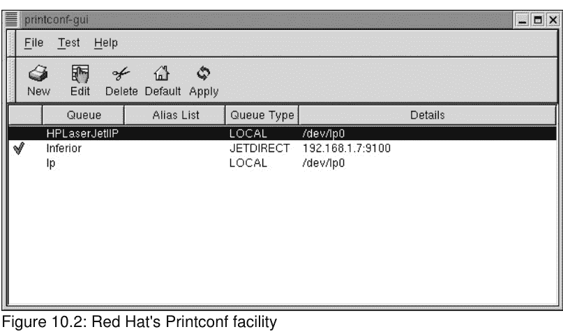

要使用 `Printconf` 添加打印机，请按照以下步骤操作：

1. 启动 `Printconf` 实用程序。你会看到其主屏幕，如图 10.2 所示，虽然你可能看不到任何已定义的打印机。
2. 点击“New”按钮。`Printconf` 会响应并显示“添加新打印队列”对话框，你可以在其中从五种不同的打印机类型中选择（见图 10.3）。

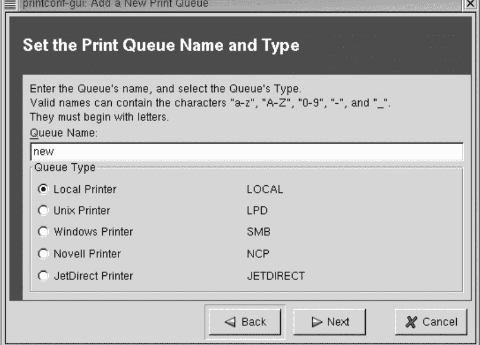

3. 点击要定义的打印机类型，并为此打印机队列输入名称。剩余的步骤假设你选择本地打印机。网络打印机的定义类似，但要求输入打印服务器名称而不是本地打印机端口的信息。
4. 在“设置打印队列名称和类型”对话框中点击“Next”。`Printconf` 会显示它检测到的打印机端口信息。如果有多个端口，你必须选择要与此新添加的打印机关联的端口。（对于网络打印机，将要求输入指定该类型打印机信息的额外信息。）此端口检测并不总能检测到你的所有端口，特别是如果你使用的是 RS-232 串行或 USB 打印机。你可以安全地忽略这些遗漏。
5. 在“配置本地打印机”屏幕上点击“Next”。`Printconf` 会显示图 10.4 中所示的“选择打印驱动程序”对话框。

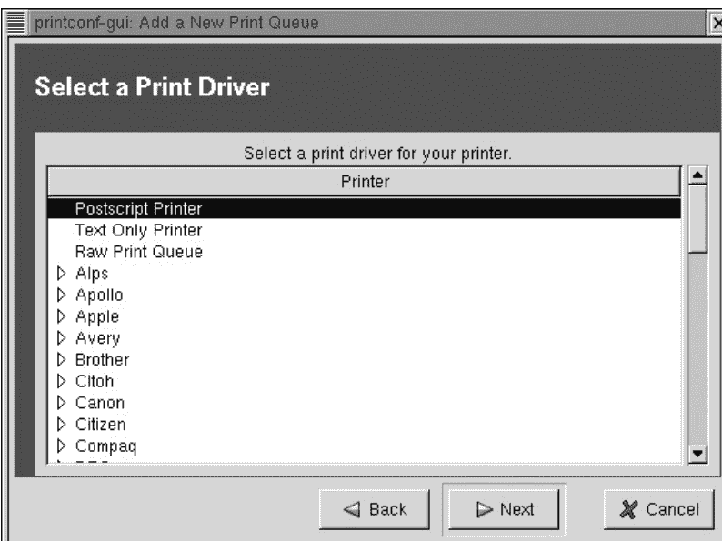

图 10.4：“选择打印驱动程序”对话框允许你选择正在安装的打印机型号。

6. 为正在安装的打印机选择适当的驱动程序。如果驱动程序未显示，请在打印机的文档中查找是否有建议使用的其他类型。尽管 `Printconf` 过去要求你输入大量关于打印机配置的信息，但现在它使用默认值。要更改这些值，你必须通过选择图 10.2 所示主屏幕上的“Edit”来编辑打印机。
7. 验证将要创建的队列信息后，点击“Finish”，“创建新打印队列”对话框将关闭。该队列应该会出现在 `Printconf` 主窗口中（图 10.2）。
8. 在 `Printconf` 窗口的菜单中选择“File → Restart LPD”以重启行打印守护程序（line printer daemon）。

此时，打印机应该已经定义好了。你可以点击 `Printconf` 窗口中的名称，并选择“Test”菜单项下的测试项来测试配置。“Print ASCII Test Page”项会打印纯 ASCII，但还有其他几种可以测试的页面类型；请选择最能代表你打算从新打印机打印内容的类型。这些打印输出中包含了一些关于修复小问题的提示，如果这些问题出现在打印输出中。如果此项目未打印出输出，则可能是在安装打印机时选择了错误的打印机设备文件，或者驱动程序未加载。（问题也可能更平凡，例如未打开打印机。）

为了在非 PostScript 打印机上过滤 PostScript 文件，大多数 Linux 发行版使用 GNU Ghostscript 而非 Aladdin Ghostscript，因为后者支持的打印机比 GNU 版本更多。如果您发现 `Printconf` 不支持您的打印机，可能需要安装 Aladdin Ghostscript。`Printconf` 使用的魔术过滤器（magic filters）取自 `rhs-printfilters` 软件包，该软件包支持 PostScript 及其他常见输入类型。

## 在 Webmin 中配置打印机


由于每个 Linux 发行版似乎都有自己的专有工具来向 `printcap` 文件添加条目并创建打印机的队列目录，您可能选择使用 Webmin 来执行这些任务。Webmin 在所有发行版中均可用，因此如果您的公司使用多个 Linux 发行版，您就不必处理多个不同的工具了。（这在编写软件的公司中很常见，因为在每个不同的发行版上进行测试是有用的。）

- 通过让浏览器指向 `http://localhost:10000/` 来启动 Webmin；如果您已配置 Webmin 以 SSL 模式运行，则指向 `https://localhost:10000/`。
- 选择硬件图标。
- 选择打印机管理图标。
- 选择添加新打印机。
- 根据所使用的打印机接口选择合适的打印目标。
- 为正在添加的打印机型号选择打印机驱动程序。
- 点击创建以完成工作。

## 在其他发行版中打印

其他 Linux 发行版，如 Debian、SuSE 和 Slackware，使用与我们为 Red Hat 描述的本质相同的打印过程，但它们可能使用不同的队列软件或配置工具。Mandrake 用户可以正常使用上文描述的 `Printconf` 实用程序。

### Debian

Debian 在标准 `lpd` 软件包和上文讨论的 LPRng 之间提供选择。配置工具有多种选项。APSFilter 版本 5 是一个不错的选择，因为它增加了对 LPRng 的支持。

另一个非常实用的选项是 Magicfilter 软件包。Magicfilter 会询问有关您打印机的几个问题，然后为您进行配置。如果您没有通过 APSFilter 软件包获得想要的结果，这是一个很好的替代方案。

许多 Debian 用户只是手动编辑 `printcap` 文件。`printcap` 的 man 页面清楚地列出了选项及其含义。只要遵循格式，条目就应该有效。

### SuSE

SuSE Linux 上的打印系统基于 APSFilter，但有一些 SuSE 特有的增强功能。SuSE 的 APSFilter 可以识别所有常见文件格式（包括 HTML，如果安装了 `html2ps`）。在 SuSE 系统上设置打印机有三种方法：

- 一个名为 YaST 的交互式工具可以支持您配置 PostScript、DeskJet 及其他由 Ghostscript 驱动程序支持的打印机。YaST 会为多种类型的打印机（原始、ASCII、自动和彩色）在本地、网络、Samba 或 Novell Netware 配置中创建 `/etc/printcap` 条目。YaST 还会创建适当的队列目录。YaST 将添加 `apsfiltersrc` 文件，允许您微调纸张大小、纸张方向、分辨率、打印机转义序列以及一些 Ghostscript 设置。在命令提示符下输入 `yast` 即可启动 YaST。
- SuSE 的 APSFilter 软件包含一个安装脚本，这是原始 APSFilter 安装脚本的修改版本。要调用它，请运行命令 `lprsetup`。`lprsetup` 程序包含在线帮助以及关于在系统中添加、删除或设置行式打印机的默认答案。它会提示输入数据，并在括号 `[ ]` 中显示默认答案。按 Enter 键接受默认值。回答完所有问题后，`lprsetup` 会创建队列目录，链接输出过滤器，并为打印机创建 `/etc/printcap` 条目。
- 您可以通过在喜爱的编辑器中编辑 `/etc/printcap` 来手动配置打印队列。如果要以这种方式使用 APSFilter，您需要手动配置该软件包。有关详细信息，请查阅 APSFilter 文档。如果您因某种原因不想使用魔术过滤器，例如您只打印 PostScript 文件并拥有 PostScript 打印机，那么此过程最有用。

## Slackware

Slackware 使用 APSFilter 来设置打印。必须安装以下软件包：

```
al/lpr.tgz
apl/apsfilt.tgz
apl/ghostscr.tgz
apl/gsfonts.tgz
```

以 root 身份运行以下命令开始打印机设置：

```
# /usr/lib/apsfilter/SETUP
```

使用 APSFilter 的安装实用程序，设置实际上相当容易。尽管如此，大多数 Slackware 用户喜欢 Slackware 的“原始性”，并且完全不喜欢使用基于图形用户界面的工具。他们与前面提到的 Debian 用户一样，更喜欢手动编辑 `printcap` 文件。

## 内核支持

打印机端口支持主要内置于内核源文件中。并口需要包含几个模块。RS-232 串行打印的处理相对简单，在内核配置时不需要真正的特定打印机适配。USB 打印需要编译支持 USB 和 USB 打印机的 2.4.x 或带 USB 补丁的 2.2.x 内核，如第 11 章所述。远程打印不需要特定的内核选项。

## 并口打印机

如果您不确定内核是否内置了并口打印机支持，请查看 `/var/log/dmesg`，看看是否出现包含 `lp0`、`lp1` 或 `lp2` 的行。连接了 HP DeskJet 690C 打印机的 2.2.16 内核可能会产生以下 `dmesg` 行：

```
parport0: PC–style at 0x378 [SPP]
parport_probe: succeeded
parport0: Printer, HEWLETT-PACKARD DESKJET 690C
lp0: using parport0 (polling).
```

早于 2.1.33 的内核不会提及 `parport`，因为该方法直到后来才引入，但您仍应在输出中看到类似 `lp0` 或 `lp1` 的内容。根据确切的内核选项、正在使用的确切打印机以及系统启动时打印机是否通电，您可能会看到也可能看不到关于连接在并口上的特定打印机型号的提及。另一种检查方法是 `cat /proc/devices` 文件并 `grep` 输出中的 `lp`。如果该文件中包含 `lp`，则正在运行的内核已启用打印。使用此命令：

```
$ cat /proc/devices |grep lp
6 lp
```

如果您的内核将打印机支持编译为模块，这些测试可能不起作用，因为只有在尝试打印时打印机设备才会出现。因此，如果您没有看到任何打印机设备的证据，不必过于担心。尝试打印。如果不起作用，尝试按照刚才描述的检查 `/proc/devices`。如果没有打印机设备的证据，您的内核打印机模块可能由于某些原因未加载。

## lp 设备驱动程序

在早于 2.1.33 的内核下，打印设备取决于打印机连接到哪个并口，可能是 `/dev/lp0`、`/dev/lp1` 或 `/dev/lp2`。这是一种静态连接，因此这些设备中的任何一个在你的系统上都是正确的。如果一个不起作用，请尝试下一个。当 `lp` 驱动程序内置于内核中时，内核将通过 LILO 接受 `lp=` 选项来设置中断和 I/O 地址。

**语法：**

```
lp=port0[,irq0[,port1[,irq1[,port2[,irq2]]]]]
```

**示例：**

```
lp=0x3bc,10,0x278,5,0x378,7
```

此示例将设置三个 PC 式端口，一个位于 `0x3bc`，IRQ 为 10；一个位于 `0x278`，IRQ 为 5；一个位于 `0x378`，使用 IRQ 7。一些系统只以此方式设置一个并口。

## parport 设备

`parport` 设备被添加到 2.1.33 及更新的内核中，以修正旧 `lp` 设备驱动程序中的若干问题。`parport` 设备可以在多个设备驱动程序之间共享端口，并动态将可用的并口分配给设备号，而不是简单地将 I/O 地址等同于特定的端口号：使用 `parport` 时，连接在第一个并口上的打印机可能不会被分配 `/dev/lp0`。`parport` 设备的开发使得能够通过并口运行许多新设备，包括 Zip 驱动器、外接 CD-ROM 和外置硬盘。可以共享单个并口供多个设备使用，所有相应的驱动程序都可以安全地编译进内核。

如果并口兼容 PC（所有 IBM 兼容机和某些 Alpha 机器都有 PC 式并口），则在您的内核配置中必须将 `CONFIG_PARPORT` 和 `CONFIG_PARPORT_PC` 设置为 YES。如果您的打印机不是串口的，则必须在内核配置中将 `CONFIG_PRINTER` 设置为 YES。使用上面列出的相同测试来检查打印支持。

## RS-232 串行设备

连接到标准 RS-232 串行端口的打印机只需要启用该串行端口，并正确设置 `printcap` 条目即可。为了适应调制解调器和其他串行设备，串行支持通常默认内置在内核中，并且这些端口也支持打印功能。第 11 章讨论了 Linux 对 RS-232 串行连接的支持。

## USB 设备


在 Linux 中，USB 打印机需要特别注意，因为需要 USB 补丁版的 2.2.x 或 2.4.x 内核。特别是，您需要基本 USB 支持（包括支持 OHCI 或 EHCI USB 控制器，具体取决于您的 USB 端口使用哪一种）以及 USB 打印机支持。一旦编译好这些支持并安装了相应的设备文件，就可以使用 `/dev/usb/lp*n*` 设备访问 USB 打印机，其中 `*n*` 是从 0 开始的数字。（该文件可能位于 `/dev` 的子目录中，例如 `/dev/usb`。）第 11 章更详细地介绍了 USB 设备。

## 远程打印

在网络上，工作站可以配置为向连接到网络中另一台主机上的打印机打印，或者向带有内置网络接口卡（NIC）的独立打印机打印。在第一种情况下，主机可能是 Linux 或 Unix 机器，也可能是运行某种版本 Microsoft Windows 的机器。在第二种情况下，打印机运行自己的服务器软件，其功能与 Linux/Unix 或 Windows 打印服务器完全相同。

## Linux 到 Linux

对于 Linux 到 Linux 的打印，您需要在服务器（连接打印机的机器）和客户端（提交打印任务的机器）上配置打印。除了基本的网络设置外，整体配置有两个步骤：

1. 配置服务器以向其控制的打印机打印。您应该测试如本章前面所述的本地打印功能。您可以手动执行此配置，也可以通过 `Printconf` 或 `Webmin` 等 GUI 实用工具执行。
2. 配置客户端以向由服务器托管的网络打印机打印，如本章前面所述。您可以手动执行此配置，也可以通过 `Printconf` 或 `Webmin` 等 GUI 实用工具执行。

前面讨论中已经涵盖了这两个步骤。一旦您将打印服务器配置为本地打印，它就自动配置为接受远程打印任务，至少如果您使用的是随 Red Hat 7.3 提供的 `LPRng`。这使得打印机设置非常容易，但这也可能是一个巨大的风险，因为这意味着任何恶作剧者都可以向您的打印机发送大量打印任务。旧的 `lpd` 打印系统默认不那么“开放”。若要使用旧的 `lpd` 接受远程打印任务，您必须在 `/etc/hosts.lpd` 文件中（或在 `/etc/hosts.equiv` 中，但该文件授予使用一系列其他服务的权限，因此在大多数情况下最好不要使用它）输入 `lpd` 将接受任务的计算机的名称或 IP 地址。

要阻止随机互联网系统使用您的 `LPRng` 打印服务器，您应该编辑 `/etc/lpd.perms` 文件。该文件包含一大段描述其配置细节的注释。若要阻止除本地机器以外的所有连接，您可以使用两种形式之一的条目：

```
ACCEPT SERVICE=x REMOTEIP=127.0.0.1/255.0.0.0
```

或者

```
ACCEPT SERVICE=X REMOTEHOST=localhost
REJECT SERVICE=X NOT REMOTEHOST=*, three.com
```

这些示例分别阻止了不源自 192.168.98.0 IP 块或 `three.com` 域的通信连接，同时仍允许来自服务器本身的连接。与旧式 `lpd` 的 `hosts.lpd` 文件相比，`lpd.perms` 文件可以实现更多功能。例如，您可以基于远程用户允许或拒绝访问，并且可以允许或拒绝用户或机器访问特定的 `LPRng` 功能。默认的 `lpd.perms` 文件包含许多被注释掉的示例，因此如果您想微调配置，非常值得仔细查看。

**注意**：虽然 `LPRng` 默认让外部人员可以在您的打印服务器上进行打印，但其更高级的安全功能使得如果您正确配置，它将是一个更安全的打印软件包。

## 当涉及 Windows 时

当本地或目标机器运行某种版本的 Microsoft Windows 时，情况会变得稍微复杂一些。Windows 打印机使用称为服务器消息块（SMB）的协议，后更名为通用互联网文件系统（CIFS），以提供共享打印。试图让 Windows 和 Linux 计算机使用其原生工具共享打印机，就像试图让两个不懂同一种语言的人进行对话一样。幸运的是，Linux 包含一个教 Linux “说” Windows 文件和打印机共享语言 SMB/CIFS 的软件包：`Samba`。

`Samba` 对于混合网络来说是如此重要的工具，以至于它成为 Craig Hunt Linux 系列书籍中的一本配套书 Roderick W. Smith 所著的《Linux Samba 服务器管理》（Sybex, 2001）的主题。本书第 12 章简要介绍了 `Samba`。简而言之，`Samba` 是一个开源软件套件，为可能运行 Windows、OS/2 或若干其他操作系统任何版本的客户端提供 SMB/CIFS 文件和打印服务。`Samba` 运行在 Linux、其他版本的 Unix、VMS 和几种其他操作系统上。有关 `Samba` 的其他信息源包括优秀的 `SMB HOWTO` 文档和多个 `Samba` 邮件列表。`Samba` 的主网页是 `http://www.samba.org/`。

由于本章讨论的是打印，接下来的两个部分展示了如何使用 `Samba` 从 Windows 机器向连接到 Linux 主机的打印机打印，以及如何从 Linux 机器向连接到 Windows 主机的打印机打印。

### 从 Windows 打印到 Linux 打印机

假设您已配置 Linux 计算机以向本地打印机打印，您只需设置一个 `Samba` 共享，以允许 LAN 上的 Windows 计算机向其打印。您将在这在安装 `Samba` 时创建的 `smb.conf` 文件中执行此操作。（在 Red Hat 7.3 中，该文件位于 `/etc/samba`，但在其他发行版中可能位于 `/etc`、`/etc/samba.d` 或其他地方。）按照清单 10.2 所示，将打印配置添加到您的 `smb.conf` 中：

**清单 10.2：允许联网的 Windows 计算机向 Linux 打印机打印的示例 `smb.conf` 文件**

```
[global]
workgroup = ARBORETUM
printing = bsd
encrypt passwords = Yes

load printers = Yes
log_file = /var/log/samba-log.%m
lock_directory = /var/lock/samba

[printers]
comment = All Printers
security = Server
path = /var/spool/samba
browseable = No
printable = Yes
public = Yes
create mode = 0700
```

`Samba` 配置涉及设置适用于所有共享的全局选项（在 `smb.conf` 文件的 `[global]` 部分中）以及特定共享或共享类型的选项。清单 10.2 仅显示一个共享——`[printers]` 共享。这个共享很特别，因为它为 `/etc/printcap` 中定义的每个打印机创建了一个单独的打印机共享。此选项依赖于 `[global]` 部分中的 `load printers = Yes` 参数。（或者，您可以通过为每个打印机单独创建共享定义来共享部分打印机。）另一个至关重要的全局参数是 `workgroup = ARBORETUM`。这将 `Samba` 服务器的 `*NetBIOS 工作组*` 名称设置为类似于域名的值。如果此选项设置不正确，您将无法在 Windows 计算机的网络资源管理器中查看 `Samba` 服务器。在清单 10.2 的情况下，该服务器是 ARBORETUM 工作组的成员。

另一个关键的 `Samba` 配置问题与身份验证有关。与 Linux 到 Linux 的打印不同，SMB/CIFS 打印在机器之间发送密码以授权打印。默认情况下，`Samba` 接受 `*明文*`（未加密）密码，并将其与常规的 Linux 登录密码进行比对。然而，自 Windows 95 OSR2 和 Windows NT 服务包 3 以来，Microsoft 已编程使 Windows 计算机默认发送加密密码。由于 SMB/CIFS 使用的密码编码方法与 Linux 不同，当使用加密密码时，`Samba` 无法依赖常规的 Linux 密码数据库。因此，您必须使用 `Samba` 的 `smbpasswd` 实用程序创建一个新的密码数据库，该程序允许您设置 `Samba` 的加密密码，就像 Linux `passwd` 实用程序允许您设置 Linux 登录密码一样。若要使用此实用程序添加用户，请传入 `-a` 参数和您希望添加的用户名（此用户名必须对应于现有的 Linux 用户）：

```
# smbpasswd -a someone
New SMB password:
Retype new SMB password:
```

当您输入密码时，密码不会回显。如果您以前从未使用该实用程序，它会抱怨无法打开 `smbpasswd` 文件，但尽管有这个错误，它仍会创建一个新的文件。若要使用加密密码，您必须向 `smb.conf` 的 `[global]` 部分添加 `encrypt passwords = Yes` 参数，如清单 10.2 所示。


**警告**：`Windows 9x` 和 `Me` 系统会在本地存储您发送到服务器的密码。这可能是一个重大的安全问题，特别是当用户的 `Samba` 和 `Linux` 登录密码相同时。有许多方法可以减轻 `Windows` 在本地存储密码所带来的风险。其中最简单的一种方法是确保 `Samba` 加密密码与常规的 `Linux` 登录密码不对应。您还可能将 `Samba` 服务器与其他 `Linux` 服务器和工作站隔离，或使用单独的

仅用于 `Linux` 服务器上打印的专用账户（用户需要从 `Windows` 打印时输入此密码，而不是他们的常规 `Linux` 登录密码）。

# 从 Linux 打印到 Windows 打印机

若要通过网络上的 `Linux` 工作站向连接到 `Windows` 机器的打印机进行打印，每台 `Linux` 机器都需要为该打印机创建一个 `printcap` 条目。使用 `Red Hat` 的 `Printconf` 可以轻松创建该条目，它提供了一个用于设置 `SMB/Windows 95/NT` 打印机的选项（见图 10.3）。其他打印后台作业处理软件包也有类似的设置选项。接下来，你必须确保拥有 `/usr/bin/smbrprint` 脚本，大多数 `Samba` 软件包都附带该脚本，包括 `Red Hat 7.3` 附带的那个。`smbrprint` 脚本会拦截常规打印队列的处理过程，通过一个名为 `smbclient` 的工具将打印文件发送出去，该工具可用于与 `SMB/CIFS` 服务器通信。因此，如果从打印队列的过滤器调用 `smbrprint`，它将绕过常规打印机制的一部分，并发起一个 `SMB/CIFS` 打印请求。大多数智能过滤器软件包都知道如何处理此任务。

## 总结

打印的许多复杂性源于可用的选项之多——有各种不同类型的打印机，而且不同型号之间也存在差异；`Linux` 提供了一组打印实用工具；网络打印则带来了众多额外的选项和挑战。理解这些领域及其相互作用可以帮助你创建一个可用的 `Linux` 打印系统。例如，为 `Linux` 购买不受支持的打印机毫无意义。幸运的是，`Linux` 打印拼图的每一部分，从物理连接打印机到将 `Linux` 计算机配置为打印服务器，都是可以理解的。如果你逐步完成这项任务，你可以让 `Linux` 系统正常工作，甚至在此过程中为其他计算机提供打印服务。

# 第 11 章：串行通信、终端和调制解调器

## 概述

在计算机历史的大部分时间里，串行端口一直是非常重要的硬件设备。串行端口允许我们将两台计算机连接在一起，或者将计算机连接到其他设备，如打印机或鼠标。串行端口的通用性使其能够用于各种各样的任务。串行端口的缺点是速度慢。`x86` 计算机上的传统 `RS-232` 串行端口通常最高传输速率为每秒 115,200 位 (`bps`)。一种更新的串行端口类型，即通用串行总线 (`USB`) 更快，达到 12,000,000 `bps` (12 `Mbps`)，而速度更快的版本正在兴起。相比之下，现代以太网设备的速率为 100 `Mbps`。总而言之，`RS-232` 串行端口如今的重要性已不如从前，但 `USB` 端口已成为低速外部设备的重要接口方式。尽管如此，`RS-232` 串行端口仍然适合许多任务。本章涵盖了这些任务，包括将“哑”文本终端连接到 `Linux` 系统，使用调制解调器通过电话线连接到其他系统，以及使用通过串行端口连接的打印机。（虽然鼠标通常通过串行端口连接，但其配置和使用相对简单；这在第 13 章“`X` 窗口系统”中有介绍。大多数打印机通过并行端口连接，其配置在第 10 章“打印机和后台作业处理子系统”中有介绍。）本章还涵盖了 `USB` 配置，这与 `RS-232` 配置大不相同。

## 理解串行设备

在深入介绍如何使用串行端口实现特定目标的细节之前，了解串行端口究竟是什么以及 `Linux` 如何处理低级串行端口硬件是很有帮助的。这些细节决定了在 `Linux` 下使用串行端口能做什么和不能做什么，以及如何与串行硬件通信。

## 标准串行设备

大多数 `x86` 计算机都内置两个 `RS-232` 串行端口。这些设备通常在计算机上使用 9 针公头连接器，如图 11.1 所示，但一些串行端口（特别是旧计算机和非计算机设备上的）使用 25 针连接器。调制解调器、打印机和其他串行设备上的连接器通常是母头。

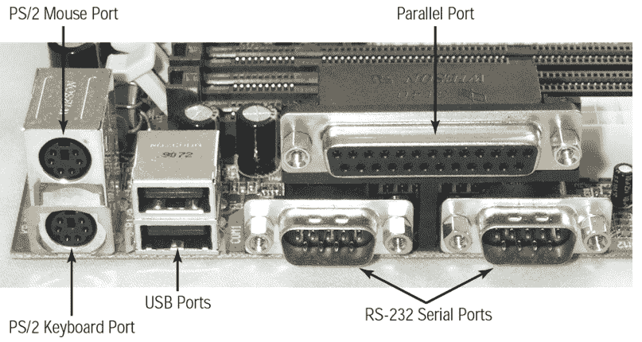

图 11.1：现代 `x86` 主板在标准化位置包含各种各样的连接器。

正如你在图 11.1 中看到的，`USB` 连接器在物理上与 `RS-232` 连接器截然不同。`USB` 端口相对于标准 `RS-232` 串行端口的一些优点是：

- **更高的速度**：标准 `USB` 支持高达 12 `Mbps` 的速度，大约是标准 `RS-232` 的 100 倍。一个新的 `USB` 版本，即 `USB 2.0`，开始在 2002 年普及，速度可达 480 `Mbps`。

- **多设备支持**：`RS-232` 端口每个端口仅支持一个设备。相比之下，`USB` 允许你将多个设备连接到单个 `USB` 连接器，尽管你需要使用集线器来完成这项工作。集线器只是将多个 `USB` 设备链接到一个 `USB` 端口。

- **热插拔设备**：你可以在计算机运行时连接和断开 `USB` 设备。对于 `RS-232` 来说这是有风险的，因为短路可能会损坏设备或计算机。

一般来说，`RS-232` 串行设备在 `Linux` 中得到了良好的支持。`USB` 支持因设备而异，因为 `Linux` 需要特定设备类型的内核驱动程序。一般来说，常见的 `USB` 设备，如鼠标、键盘和打印机，都得到了良好的支持，但你应检查你的内核配置选项，或查阅 `Linux USB` 网站（<http://www.linux-usb.org/>）以获取详细信息。`Linux` 对 `USB 2.0` 的支持仍处于起步阶段，但随着 `USB 2.0` 设备变得更加普遍，它无疑会变得可用。如果你使用的是旧的 `2.2.x` 内核，你需要升级或修补它以获得 `USB` 支持。

### 在内核中启用串行支持

无论你使用 `RS-232` 还是 `USB`，了解使用这些设备所需的内核配置选项都是必要的。你可能不需要明确处理这些选项，因为大多数发行版都启用了适当的内核支持，至少对于常见设备和用途如此。你可以在第 8 章“软件管理”中阅读更多关于内核配置的内容。

对于 `RS-232` 设备，内核配置选项位于字符设备内核配置菜单中（图 11.2）。具体来说，若要使用标准的两个串行端口，你应为 `Standard/Generic (8250/16550 and Compatible UARTs) Serial Support` 选项选择 `Y` 或 `M`。你不需要为特定的 `RS-232` 串行设备（如调制解调器或打印机）选择内核选项。与特定设备通信的细节由合适的用户级程序（如 `pd` 或 `lpd`）处理。

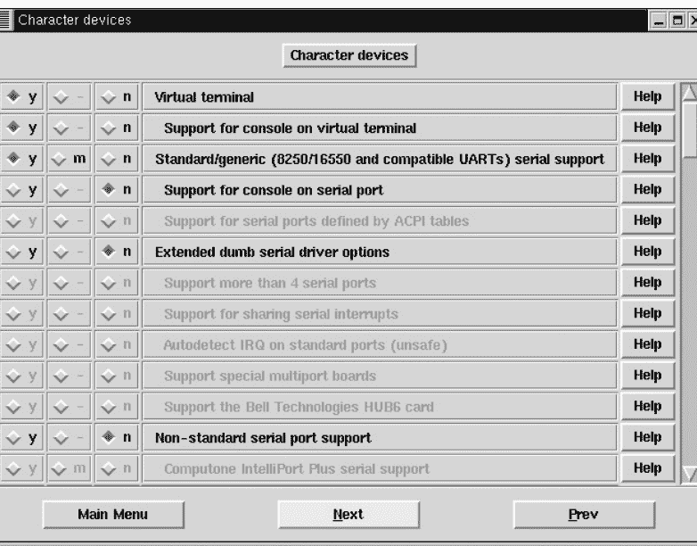

图 11.2：`Linux` 字符设备内核配置菜单包含主要的 `RS-232` 串行设备选项。

配置 `Linux` 的 `USB` 支持稍微复杂一些，因为你需要在 `USB` 支持内核配置菜单中选择几个选项（图 11.3）。具体来说，你需要在以下三个选项类别中各选择一个或多个选项：

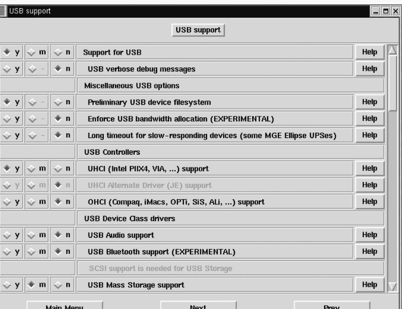

图 11.3：`USB` 支持需要为特定 `USB` 设备选择驱动程序。

- **`USB` 支持**：如果你想使用任何 `USB` 设备，这个顶层选项是必需的。

- **`USB` 控制器支持**：有三类低级 `USB` 控制器。前两个是通用主机控制器接口 (`UHCI`) 和开放式主机控制器接口 (`OHCI`)。第三个增强型主机控制器接口 (`EHCI`) 用于 `USB 2.0`。截至 `2.4.18` 版本，标准内核不包含 `EHCI` 驱动程序，但在 `2.5.x` 开发内核中可用。选择你的主板或插入式 `USB` 卡支持的那一个。如果你不知道你的系统使用哪个，请选择所有选项或检查 `dmesg` 的输出以查看你的系统使用哪个。对于 `UHCI`，你可以选择主驱动程序或备用驱动程序。在大多数情况下，主驱动程序工作良好，但如果你遇到问题，请尝试备用驱动程序。

- **特定设备支持**：你必须为特定类别的 `USB` 设备选择驱动程序，在某些情况下甚至要为特定型号选择。`USB` 支持内核配置菜单的大部分由 `USB` 设备类别组成，因此请浏览以定位你的设备。在某些情况下，你可能还需要在其他内核配置菜单中选择选项。例如，某些 `USB` 摄像机要求你在字符设备菜单中启用 `video for Linux` 支持，并且你必须在输入核心支持菜单中启用 `input core support` 才能使用 `USB` 键盘和鼠标。

# 使用串行设备文件

传统的 `RS-232` 设备使用形式为 `/dev/ttySn` 的设备文件名，其中 `n` 是从 0 开始的数字。要与串行设备通信，你（或你使用的程序）将字符发送到该设备文件。例如，以下命令将字符串 `ATDT555-4321` 发送到连接到 `/dev/ttyS0` 的调制解调器，导致调制解调器拨打 `555-4321`。

```
$ echo "ATDT555-4321" > /dev/ttyS0
```


**注意**：在过去，`/dev/cuan` 设备曾作为访问串行端口的变体方法被使用。然而，如今不推荐使用 `/dev/cuan`，并且对这些设备的支持在未来可能会消失，尽管至少在 2.4.18 内核中它们仍然存在。

由于串行设备解释字符，因此无需对通过 RS-232 串行端口发送的命令进行跨设备标准化；调制解调器接受的命令与打印机不同，而打印机使用的命令又与鼠标不同，依此类推。不过，确实存在一些 Linux 命令会影响串行接口的工作方式。其中特别重要的是 `setserial` 命令，它用于设置 RS-232 端口的参数，例如其速度。该命令的简化语法如下：

`setserial [-ab] device [parameters] ...`

`-a` 和 `-b` 选项使程序显示硬件设置的信息，例如端口使用的中断请求（IRQ）。`-a` 会导致多行显示，而 `-b` 则产生较不完整的单行输出。您可以向程序传递各种各样的参数，以改变它配置端口的方式。以下是最重要的参数：

- **`port portnum`** 此选项将 I/O 端口号设置为 `portnum`。I/O 端口是一个十六进制数，例如 `0x0318`，它指示串行端口的输入和输出在内存中的位置。除非您使用非常不寻常的硬件，否则您可能不需要调整此设置。

- **`irq irqnum`** 您可以使用此参数告诉 Linux 使用不寻常的 IRQ 号。与 `port` 参数一样，您可能不需要使用此选项的可能性较大。

- **`uart uarttype`** RS-232 串行端口由*通用异步收发器*（UART）控制，它们有几种不同的类型。Linux 通常在启动时正确检测 UART 类型，但如果它在此细节上出错，您可以使用 `uart` 参数来纠正问题。（不正确的端口类型可能会导致串行端口工作不可靠。）大多数现代主板使用 16550A UART，因此对于这些主板，`uarttype` 将是 `16550A`。非常旧的硬件可能使用较早的 UART，例如 `16450`；并且一些设备使用较新的，如 `16650`。

- **`baud_base speed`** 此参数设置串行端口的速度。`speed` 的常用值为 `115200`，这是大多数串行端口支持的最快 bps 速度。

这些选项和参数只是 `setserial` 功能的一小部分。阅读其 man 页面以获取有关您可以使用该程序控制的冷门功能的更多信息。当您使用简单的程序和守护程序与串行端口配合时，此工具最为有用。更复杂的程序和守护程序可以自行设置串行端口的速度和其他功能。

与 RS-232 串行端口不同，计算机上的每个 USB 端口并没有单一的 设备文件。相反，Linux 将每个设备映射到其自己的 设备文件。这种安排的原因是简单的：使用集线器，可以在每个 USB 端口上连接多个 USB 设备。假设一个 USB 端口托管了一个打印机、一个鼠标和一个调制解调器。这些设备中的每一个都会在 `/dev` 或 `/dev/usb` 中获得其自己的条目，因此您可以适当寻址每个设备。确切如何处理这些设备因设备和程序而异。例如，您通常会在 XFree86 配置文件中引用 USB 鼠标，如第 13 章所述，而您会在 `/etc/printcap` 中引用打印机的文件，如第 10 章所述。表 11.1 总结了某些更常见的 USB 设备文件，包括它们的*主要*和*次要*号，这些号定义了设备文件与内核驱动程序之间的接口。重要的是要意识到，设备文件名在很大程度上是任意的；只要该文件名标识了一个通过 `mknod` 使用适当的类型、主要号和次号创建的设备文件，您就可以使用任何喜欢的文件名来访问设备。有些 USB 设备，如磁盘设备和扬声器，被视为非 USB 设备，分别类似于 SCSI 磁盘和普通声卡。其他设备使用新的主要和次号，通常还有新的设备文件名。

表 11.1：2.4.x 内核中访问 USB 设备的方法

| 设备 | 设备文件名 | 类型 | 主要号 | 次号 |
| --- | --- | --- | --- | --- |
| 磁盘设备 | `/dev/sd n` | 块 | 8 | 0-240 |
| 调制解调器 | `/dev/usb/acm/n` | 字符 | 166 | 0 及以上 |
| 鼠标 | `/dev/usb/mouse n` 或 `/dev/input/mouse n` | 字符 | 分别为 180 或 13 | 分别为 16 及以上 或 32 及以上 |
| 打印机 | `/dev/usb/lp n` | 字符 | 180 | 0 及以上 |
| 扫描仪 | `/dev/usb/scanner n` | 字符 | 180 | 48-63 |
| 扬声器 | 普通音频设备，如 `/dev/audio` 和 `/dev/mixer` | 字符 | 变化 | 变化 |
| USB 到并口适配器 | `/dev/usb/lp n` | 字符 | 180 | 0 及以上 |
| USB 到 RS-232 适配器 | `/dev/usb/ttyUSB n` | 字符 | 188 | 0 及以上 |

`/dev/usb` 目录通常使用特殊的 USB 设备文件系统来实现，该文件系统试图为受支持的设备动态创建设备文件。如果您的计算机不使用此文件系统，您可能需要创建设备文件以访问 USB 设备。您可以使用 `mknod` 命令这样做，其语法如下：

`mknod filename type major minor`

在此命令中，`filename` 是设备文件名，`type` 是用于块设备的 `b` 或用于字符设备的 `c`，`major` 和 `minor` 是表 11.1 中列出的主要号和次号。这些有时记录在 `/usr/src/linux/Documentation/usb` 目录中的文件中，但关于这一点，在 2002 年文档仍不完善。

## 非寻常串行设备

某些串行设备是 RS-232 端口的稀有且非标准实现。RS-232 串行设备标准实现的问题在于，很难添加除了大多数主板上包含的两个端口之外的更多端口。添加第三和第四个端口只是带来小的困难。大多数附加端口被配置为与第一个两个端口“共享”中断，但有必要重新配置这些板以使用唯一的 IRQ，因为 Linux 通常不适用于这种安排。

**注意**：内部调制解调器传统上除了调制解调器硬件外，还包含串行端口硬件。添加这样的调制解调器就像添加串行端口一样工作。在添加内部调制解调器之前禁用未使用的主板串行端口有时是有用的，以便内部调制解调器可以接管前两个常规端口之一的身份。这通常可以在计算机的 BIOS 设置屏幕中完成。许多现代内部调制解调器没有串行端口硬件。这些设备通常被称为*WinModems、无控制器调制解调器或软件调制解调器*（尽管第一个术语在技术上仅适用于 3Com 产品）。有一些 Linux 驱动程序适用于此类设备--检查 `http://www.linmodems.org/` 获取详细信息。然而，许多在 Linux 下不起作用，因此应避免使用。

为每个串行端口使用唯一 IRQ 的问题在于，x86 架构仅允许 15 个中断，其中一些是其他设备所需的，因此不可能为超过几个串行端口分配唯一的 IRQ。为了解决这个问题，一些公司开发了*多端口串行卡*，它们将几个 RS–232 端口放在一块板和一个 IRQ 上。由于这些设备使用非标准硬件，它们需要自己唯一的驱动程序。如果您需要此类设备，请检查 Linux 内核配置区域中的字符设备（图 11.2）。根据设备类型，您可能需要选择 `Extended Dumb Serial Driver Options` 项或 `Nonstandard Serial Port Support`。在任何情况下，您都必须为您的特定板选择适当的选项。在购买硬件之前应该研究这些选项，以确保您获得 Linux 支持的东西。另一种如果您需要许多 RS–232 串行端口的选择是使用 USB–to–RS–232 适配器，它可以在单个 IRQ 上提供许多 RS–232 端口。

## 配置终端

在多用户系统上，RS–232 串行端口最常见的用途之一是作为*终端*端口。终端是用于控制另一台计算机的设备或计算机。由于大多数 x86 计算机有两个 RS–232 端口加上其正常的键盘和监视器，因此如果两个人通过终端访问计算机，则三个人可以同时使用一台计算机。（当然，如果您愿意，可以添加更多串行端口或使用网络连接来进一步增加该数量。）虽然大多数 Linux 发行版没有预配置为使用终端，但为系统添加此功能并不困难。

**注意**：终端访问几乎总是通过 RS–232 端口执行。然而，您可以使用 USB–to–RS–232 适配器通过计算机的 USB 端口将 RS–232 终端连接到 Linux 计算机。

## 理解终端


为了理解终端，最好回想一下那些 Unix 系统装在与洗碗机一样大甚至更大的箱子里的日子。在那时，数十或数百名用户通过`笨终端`访问 Unix 系统——这些设备在外观上大致像第一代 iMac 计算机，至少肉眼来看是这样。这些笨终端内部有极其简单的电路，没有硬盘，并且只有足够的内存来处理本地显示和几行额外的文本。由于几乎没有处理能力，它们是输入/输出设备，而不是计算机。这些设备可以接收用户在键盘上输入的内容并通过串行端口回声，它们还可以将串行端口接收到的内容显示在屏幕上。当“真正的”计算机花费数百万美元并且必须由许多人使用时，这些功能非常有用。在 1980 年代，这些终端是访问 Unix 系统的主要手段。它们在企业和教育环境中很常见，今天仍在使用。（例如，您当地的图书馆可能使用笨终端让读者访问其在线图书目录。）

**注意** `笨终端`是纯文本设备；它们不能用于运行基于 X 的程序，如`StarOffice`或`GIMP`。然而，还有另一种类型的终端可以与 X 程序一起使用：`X 终端`。`X 终端`通常通过网络端口而不是串行端口进行接口。`NCD X Terminal mini–HOWTO 文档`(`<http://www.tldp.org/HOWTO/mini/NCD-X-Terminal.html>`) 提供了有关这些设备的信息。

由于 Linux 继承了 Unix 的传统，Linux 包含了支持哑终端（dumb terminals）所需的软件；使用它只需要更改一些默认配置即可。完成这些设置后，你可以插入一个哑终端并使用它。为什么要这样做？原因与大组织使用（并且仍在继续使用的）哑终端的原因相同，例如扩展资源以及为更多人提供计算机访问权限。如果你不需要运行 X 程序，哑终端完全可以提供对 Linux 计算机的足够访问权限。

除了哑终端，你还可以使用过时的计算机。例如，如果你有一台落满灰尘的基于 8088 处理器的旧 PC，你可以将其擦拭干净，进行设置，将其连接到一台 Linux 计算机，并使用简单的 DOS 终端程序使其像哑终端一样工作。类似地，专门的设备（如掌上电脑）通常附带终端程序，因此你可以从这些设备访问 Linux 计算机。

**提示：** 在极少数情况下，X 可能会锁定，导致 Linux 无响应。严格来说，Linux 并没有崩溃，通常可以恢复此类问题——前提是你有除系统键盘以外的其他输入方式。这种输入方式通常是远程网络访问；但这并不总是可行的。使用哑终端访问（即使是来自掌上电脑）可以让你终止或重新配置 X，从而在无需使用重置开关的情况下恢复对系统的控制权。

当你将另一台计算机用作终端时，通常必须通过空调制解调器线（null modem cable）连接这两台计算机。这些线缆用于连接一台计算机到另一台计算机，其布线方式与连接计算机和调制解调器的线缆不同。大多数计算机商店都销售空调制解调器线。

如果你想使用一台 Linux 计算机作为另一台计算机的终端，这是可行的，尽管更常见的是使用以太网硬件和`Telnet`或`SSH`程序从一台计算机登录到另一台计算机。通过串口连接两台 Linux 计算机需要你在其中一台计算机上使用 Linux 终端程序，如本章后面“调用远程文本模式系统”一节所述。

**注意：** Linux 使用虚拟终端来提供从其主要键盘和监视器（统称为控制台）到 Linux 系统的文本模式访问。要配置 Linux 使用“真实”终端，你需要扩展此配置以支持串口设备以及控制台，如下文所述。

## 配置 getty 程序

在大多数情况下，使用终端（无论是哑终端硬件还是终端仿真器）的目标是让终端在用户启动终端时显示 Linux 登录：提示符。Linux 通常使用名为`getty`的程序（或其变体，如`mingetty`、`mgetty`或`agetty`）来显示这些提示符。

**注意：** 原始的`getty`程序就叫这个名字。各种替代程序使用相似的名字并执行相似的功能。因此，`getty`一词可以指原始的`getty`程序，也可以指一类基本扮演相同角色的类似程序。在大多数情况下，本章中该词以后者含义使用。

Linux 从`/etc/inittab`文件运行`getty`程序。在 Red Hat 7.3 中，默认的`/etc/inittab`文件包含以下行：

```
# Run gettys in standard runlevels
1:2345:respawn:/sbin/mingetty tty1
2:2345:respawn:/sbin/mingetty tty2
3:2345:respawn:/sbin/mingetty tty3
4:2345:respawn:/sbin/mingetty tty4
5:2345:respawn:/sbin/mingetty tty5
6:2345:respawn:/sbin/mingetty tty6
```

`/etc/inittab`文件中的每一行都包含由冒号分隔的条目，指示系统运行特定类型服务。上述条目告诉 Linux 在运行级别 2 到 5 中为前六个虚拟控制台运行`/sbin/mingetty`程序。这些条目的结果是，你可以通过按`Alt+1`到`Alt+6`（如果你当前正在运行 X，则需配合`Ctrl`键）切换到六个虚拟控制台中的任意一个。你可以登录到其中任何一个来运行程序，甚至可以以不同的用户名运行。

为了扩展默认配置以支持通过串口运行的终端，有必要向`/etc/inittab`添加更多条目。为此，请遵循以下步骤：

- 安装`mggetty`软件包。在 Red Hat 7.3 系统中，软件包名称为`mggetty-1.1.28-3.i386.rpm`，位于第二张 CD-ROM 上。

  > 不同的发行版默认使用不同的`getty`程序。Red Hat 的`mingetty`无法处理串口流量，但某些默认的`getty`程序可以处理串口，因此对于所有发行版而言，这一步可能并非必要。但是，如果你使用`mggetty`以外的程序，下文的一些细节可能会有所不同；请查阅你的`getty`程序的文档以获取详细信息。

- 若要添加对连接到`/dev/ttyS0`的终端的支持，请在现有`mingetty`行之后向`/etc/inittab`添加以下行：

```
S0:2345:respawn:/sbin/mggetty -s 57600 -r /dev/ttyS0
```

- 输入`telinit Q`以通知 Linux 重新检查`/etc/inittab`文件并进行相应更改——即运行`mggetty`。

你可能需要根据具体需求对第 2 步进行调整。具体而言，第 2 步以 57,600 bps 运行终端（`-s 57600`参数）并使用`/dev/ttyS0`。使用更高速率对于某些调制解调器或直连链路可能更有意义，但某些终端仅支持较低速率。`-r`参数表示连接是直接的——即不是通过调制解调器。如前文所述，调制解调器登录需要对此配置进行一些更改。

使用终端登录后，用户可以运行 Linux 文本模式程序，包括基于文本的管理工具（当然，假设用户具有足够的权限）。然而，某些程序依赖于文本定位协议。这些协议最初用于特定型号的哑终端，因此通常以这些终端命名。示例包括`VT-100`和`VT-220`。在许多情况下，`mggetty`可以确定连接的终端类型。在其他情况下，你可能需要手动完成此操作，通过设置`TERM`环境变量来实现。例如，如果你正在使用`VT-100`终端，可以在登录后输入以下内容：

```
$ export TERM=vt100
```

如果你发现显示器出现异常行为，请键入`echo $TERM`查看系统认为的终端类型是什么，并适当进行调整。有些哑终端会仿真其他终端，大多数终端程序会仿真一个或多个流行的哑终端。

系统：`E12345678`

操作：添加了通过`mggetty`从`/dev/ttyS0`登录的支持。使用了 57,600 bps 端口速度和`mggetty`软件包。

修改文件：`/etc/inittab`

## 使用串口控制台

在特定情况下，终端对于访问 Linux 系统非常方便，但它们有一个主要限制：只有在系统完全启动后它们才实用。有时你可能希望在没有监视器的情况下运行计算机，例如当你将服务器放置在偏僻位置时。如果这样做，你将无法看到计算机的启动消息，或者在需要控制台维护时与系统交互（例如`fsck`在崩溃后重启时遇到问题时）。将监视器移动到这种隔离计算机前并蹲在前面进行维护可能很麻烦（有时甚至是字面意义上的痛苦！），因此 Linux 提供了一种解决方案：`串口控制台`。在这种配置中，Linux 使用串口执行所有控制台操作。然后，你可以运行一根空调制解调器线到另一台计算机，并在需要对该隔离系统执行控制台操作时使用该计算机上的终端程序。

为了使用串口控制台，你必须做三件事：

1. 在“字符设备”Linux 内核配置菜单中选择“支持串口控制台”选项（见图 11.2）。

   **注意：** 要选择此选项，你必须通过为“Standard/Generic (8250/16550 and Compatible UARTs) Serial Support”选择`Y`来将 Linux 的标准串口支持编译到内核中。如果你将标准串口支持编译为模块，你将无法添加串口控制台支持。

2. 重新编译启用了此新选项的 Linux 内核。


3. 在启动 Linux 时传递参数 `console=ttyS0`（对你使用的串口进行适当的替换）。例如，在 LILO 系统中，通常的做法是在内核条目中添加一行到 `/etc/lilo.conf`，并输入 `lilo` 重新安装 LILO。该行内容为：

```
console=ttyS0
```

假设新的内核和 `/etc/lilo.conf` 条目是默认的，Linux 将使用指定的串口作为其控制台。因此，你可以将系统放入单用户模式，或在系统崩溃或断电后从哑终端或运行终端程序的另一台计算机恢复——甚至是另一台 Linux 系统。但是，这种访问权限不扩展到允许你使用 LILO 选择要启动的操作系统或修改计算机的 CMOS BIOS 设置；这些设置依赖于 BIOS 而非 Linux 进行输入，因此无法由 Linux 重定向。这样做需要特殊硬件，例如 PC Weasel ([http://www.realweasel.com/](http://www.realweasel.com/))，它从计算机的角度看像视频卡，但将视频数据转换为串行输出。

**警告：** 一些 Linux 发行版，包括 Red Hat，使用特殊格式的文本以彩色显示启动消息。某些终端程序可能会以各种无用的方式错误解释这些代码，例如请求开始文件传输。

## 配置调制解调器

出于此原因，您最好使用一个非常简化的终端程序，或者禁用终端程序的功能，例如服务器请求的文件传输。

RS−232 串行设备中最常见的一种是电话调制解调器（modem）。这个词是调制器-解调器（modulator–demodulator）的缩写，因为调制解调器作为一种将数字数据转换为模拟形式（即调制数据）并逆向执行该过程（解调数据）的方式发挥作用。

大多数电话调制解调器是 RS−232 设备，但这一规则有两个主要例外：

- 内部软调制解调器——这些设备在之前已提及，它们没有串行端口电路。少数设备有可用的 Linux 驱动程序（详情请参见 [http://www.linmodems.org/](http://www.linmodems.org/)），但大多数没有。通常最好避免在 Linux 中使用软调制解调器。

- USB 调制解调器——通过 USB 端口接口的调制解调器正变得越来越流行。如果 USB 调制解调器使用通信设备类抽象控制模型（CDC–ACM）协议，它应该能与标准 USB 支持正常工作。然而，一些廉价的 USB 调制解调器并不使用 CDC–ACM 协议。据传，其中一些设备的驱动程序正在开发中。

**注意**

数字用户线路（DSL）和有线电视系统提供的互联网接入通常也被称为基于调制解调器的。虽然这些设备确实会对数据进行调制和解调，但它们的使用与本节描述的内容非常不同。有线电视和 DSL 调制解调器更类似于以太网路由器和网桥，因此第 12 章“TCP/IP Linux 网络”与配置这些设备相关。一些 DSL 和有线电视调制解调器通过 USB 端口接口。这些设备需要特殊的 Linux 驱动程序，而此类驱动程序大多不存在。请查阅 Linux USB 网站 [http://www.linux-usb.org/](http://www.linux-usb.org/) 以获取最新信息。

一些内部调制解调器——特别是较旧的型号——使用串行端口配合常规调制解调器电路。这些设备的功能与普通外部调制解调器完全相同，后者插入 RS−232 端口。无论设备使用何种接口，你都可以通过多种方式配置调制解调器。配置细节取决于谁发起连接，是你的计算机还是远程计算机。当你的某个用户发起连接时，你必须配置系统以执行拨出访问。为了支持远程用户呼叫你的系统，你必须配置系统以接受某种形式的拨入访问。

## 拨出调制解调器的用途

小型 Linux 系统，如桌面工作站，通常需要拨出访问。此类系统的用户可能需要通过调制解调器联系另一台计算机来检查电子邮件或执行其他简单的基于文本的任务。随着复杂度的增加，调制解调器可用于发起点对点协议（PPP）连接，从而允许浏览网页、FTP 传输等。最后，使用调制解调器从 Linux 计算机发送传真也是可行的。这些功能通常对单用户工作站最有吸引力，但有时在多用户系统上也有帮助。这一点在发送传真方面尤为明显；你可以配置共享打印队列（参见第 10 章和第 12 章）使用传真调制解调器而非打印机，从而为整个计算机网络提供出站传真服务。

## 呼叫远程文本模式系统

最简单的出站调制解调器连接类型之一是与另一台计算机的基于文本的链接。此类链接背后的理念与使用串行端口配合哑终端或运行终端程序的计算机类似。不同之处在于，两台计算机之间有一对调制解调器和电话网络。在这种设置中，拨出计算机通常充当终端；拨入系统运行 `getty` 程序并接收呼叫，如稍后在“接受文本模式登录”中所述。

在 Internet 和 PPP 连接兴起之前，以文本模式使用调制解调器非常常见，但现在这种情况已大大减少。然而，它仍然可以很好地满足简单的访问需求。此外，一些公司仍运营电子公告板系统（BBS），为没有 Internet 接入的用户提供产品信息、文件下载和讨论论坛。

要呼叫基于文本的远程系统，你必须使用一个终端程序。Linux 上两个流行的终端程序是基于文本的 `minicom` 和基于 X 的 `Seyon`（如图 11.4 所示）。使用这些程序的具体细节有所不同，但基本原理相同：

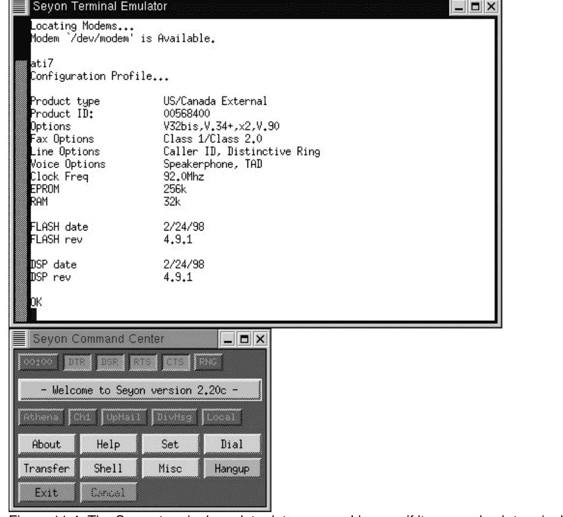

- 在运行程序之前，你可能需要创建一个符号链接，使 `/dev/modem` 指向调制解调器所在的设备文件（例如 `/dev/ttyS0`）。或者，你可以配置程序直接使用所需的设备文件——例如，通过点击 `Seyon` 命令中心窗口中的“设置”，然后点击“端口”，并输入所需的设备文件名。

**注意**

发起连接的用户必须具有读写调制解调器设备文件的权限。通常，这些文件属于一个特殊组，并具有 664 或 660 权限，因此该组的所有成员都可以访问调制解调器。你可以将任何应拥有调制解调器访问权限的用户添加到该组中。对你的系统中的调制解调器设备使用 `ls -l` 命令来了解其配置，并对设备的权限或你的组配置进行必要的更改。

- 运行程序时，你可能需要调整串行端口的参数——最重要的是端口速度。在 `Seyon` 中，你可以通过点击“设置”，然后“波特率”，再点击对应于你所需速度的按钮来执行此操作。当使用现代 56Kbps 调制解调器时，115Kbps 的端口速度是合适的。

- 要拨打号码，输入 `ATDT` 后跟号码，例如输入 `ATDT555–1234` 以拨打 555–1234。`AT` 是标准的调制解调器代码，代表注意（attention），并指示你即将发出命令。`T` 代表拨号（dial），且 `T` 指的是双音多频（touch–tone）拨号。（如果你的电话系统不支持双音多频拨号，请使用 `ATDP` 通过旋转脉冲进行拨号。）

- 如果你经常拨打某个号码，可以将其添加到拨号目录中。在 `Seyon` 中，你可以通过点击“拨号”按钮查看预配置的号码。你可以通过点击拨号目录窗口中的“编辑”来编辑这些条目，这会打开一个简单的文本编辑器显示配置文件。你可以在拨号目录窗口中选择号码并点击“前往”来拨号。此操作会发送适当的 `AT` 命令来拨打该号码。

- 使用完程序后，通过注销远程系统、关闭调制解调器或在程序中选择适当的选项（如 `Seyon` 命令中心窗口中的挂断按钮）来挂断调制解调器。

`Seyon` 将配置信息存储在 `~/.seyon` 目录中，因此每个用户都可能有自定义设置。`minicom` 要求 `root` 使用 `-s` 参数运行以创建名为 `/etc/minirc.dfl` 的配置文件，之后用户可以通过更改 `root` 建立的默认值来创建名为 `~/.minirc.dfl` 的自定义配置。

一旦使用终端程序连接到远程系统，你就可以根据该系统使用的规则使用该系统的任何规则。这些规则因系统而异。例如，如果你连接到一台 Linux 计算机，通常可以使用 Linux 文本模式命令和实用程序；但 BBS 通常使用自定义的基于菜单的环境，你需要输入字母或数字在系统中移动。

## 建立 PPP 连接

如今，建立 PPP 链路是拨出调制解调器最常见的用途。PPP 允许你使用完整的 TCP/IP 网络功能将系统连接到 Internet。通过 PPP 连接的可以浏览网页、通过 FTP 传输文件、收发电子邮件等。由于 PPP 链路通常是短暂的，且按照现代 Internet 标准调制解调器链路速度较慢，因此在通过 PPP 连接的计算机上运行服务器并不常见。一些互联网服务提供商（ISP）确实提供可持续使用的账户；然而，对于始终在线的连接，通过有线电视调制解调器或 DSL 获取更快的服务通常更便宜。

你可以使用基于文本的拨号脚本或图形用户界面（GUI）配置工具来发起 PPP 连接。GUI 工具很流行且易于使用，但在某些情况下，拨号脚本更为合适。例如，你可以将脚本作为自动例程的一部分来调用，以每小时检查一次你的电子邮件。

无论您使用哪种方法，您都必须首先测试调制解调器和调制解调器设备文件是否工作正常。

## 测试基本连接性


通过 PPP 将计算机连接到互联网的第一步是向 ISP 获取一个账户。（如果您想连接两台您自己控制的计算机，例如工作场所的互联网服务器和家庭系统，请查看本章后面“接受 PPP 连接”部分中关于设置系统作为 PPP 服务器的信息。）幸运的是，ISP 非常普遍。您可以在当地的电话簿中找到它们的列表，通常列在“互联网服务”或该类别的某种变体下。如果您通过其他手段（如工作连接，甚至是图书馆或类似场所的公共访问）拥有互联网接入权限，您可以参考`http://www.thelist.com/`以获取 ISP 的指引。

在进一步配置 PPP 访问之前，请按照“调用远程文本模式系统”中的说明，检查调制解调器和设备文件是否工作正常。您可以使用`Seyon`或`minicom`呼叫您的 ISP 拨入号码，以检查调制解调器的基本功能。根据您 ISP 系统的配置情况，连接时您可能会看到登录提示符或乱码。主要测试是看您自己的调制解调器能否拨号；如果这行得通，您就可以确信自己的调制解调器或调制解调器设备文件权限没有问题。

## 通过 PPP 脚本连接

如今，大多数 ISP 使用`PAP`或`CHAP`身份验证协议。这些协议允许您以自动化的方式向 ISP 进行身份识别。在 Linux 中，您必须配置一个名为`/etc/ppp/pap-secrets`或`/etc/ppp/chap-secrets`的文件来支持这些身份验证方法。这两个文件使用相同的格式。每一行包含一个账户的信息，形式如下：

```
client    server    secret    IP_address
```

`提示` 如果您不确定您的 ISP 使用的是哪种系统，您可以创建一个文件，并使用硬链接或符号链接使其在两个名称下都可访问。例如，创建`/etc/ppp/pap-secrets`，然后键入 `ln -s /etc/ppp/pap-secrets /etc/ppp/chap-secrets`。

各元素的含义如下：

- `client`：ISP 系统上的用户名。
- `server`：ISP 服务器的名称。此值通常是`*`，意味着 Linux 接受任何服务器（因为 ISP 可能会在不通知的情况下更改其服务器名称）。
- `secret`：访问 ISP 系统的密码。
- `IP_address`：Linux 将接受的数字 IP 地址或地址。此值通常为空白，意味着系统接受任何 IP 地址。

作为一个示例，可以使用以下文件以用户名`agb`和密码`comehere`登录到 ISP：

```
agb * comehere
```

`警告` PPP 机密文件，无论其名称如何，都极其敏感，因为它以未加密的形式包含您的 ISP 用户名和密码。您应确保该文件仅能被`root`读取。您还应该使用与在其他任何系统上不同的密码访问您的 ISP，以便如果该文件被泄露，不能被用来获取对其他系统的访问权限。

若要使用命令行工具发起 PPP 连接，您必须拥有适当的 PPP 脚本。大多数发行版的 PPP 包中都有示例脚本。在 Red Hat 7.3 中，这些脚本位于`/usr/share/doc/ppp-2.4.1/scripts`目录下。它们的名称分别为`ppp-on`、`ppp-on-dialer`和`ppp-off`。前两个负责发起 PPP 连接，第三个则断开 PPP 链接。您应该将这三个脚本全部复制到`/etc/ppp`或路径上的某个位置，例如`/usr/local/bin`。然后，您必须修改`ppp-on`和`ppp-on-dialer`脚本以适应您的配置。特别是：

- 在`ppp-on`中，找到以`TELEPHONE=`、`ACCOUNT=`和`PASSWORD=`开头的行，并修改它们，使其适合您的 ISP 和账户。（如果您使用`PAP`或`CHAP`，可能不需要`PASSWORD`变量，但在这种情况下应包含一个虚拟变量。）
- 检查`ppp-on`中的`DIALER_SCRIPT`变量是否指向`ppp-on-dialer`的正确位置。默认位置是`/etc/ppp`。
- 检查`ppp-on`最后几行中对`pppd`的调用。（`pppd`是处理 PPP 协商的工具；脚本只是提供它完成工作所需的信息。）该调用的大多数参数都相当晦涩，但至少您应该能够确认它使用了正确的调制解调器设备文件名和速度（在大多数情况下`115200`是合适的，但默认值为`38400`）。
- 检查`ppp-on-dialer`脚本。该脚本包含一个“chat”序列——即程序期望从调制解调器或远程系统看到的一系列字符串位于一列，另一列则是相应的响应。您可能需要使用`Seyon`或`minicom`登录，并将您的`ISP`用于询问用户名和密码的提示符捕获到磁盘上，然后修改脚本的最后两行使其正常工作。或者，如果您的`ISP`使用`PAP`或`CHAP`，您可能需要在最后两行前加上井号(`#`)将其注释掉，并从`CONNECT`行中移除反斜杠(`\`)。

`注意` `chat`程序期望的是单行输入；其在`ppp-on-dialer`中的输入仅按列格式化，这是为了方便人类阅读。以反斜杠结尾的大多数行表示行续行，因此`chat`将多行输入解释为单行。只有最后一行不应包含反斜杠。

完成这些更改后，输入`ppp-on`（如有必要，前面加上完整路径）并以`root`身份测试连接。如果一切顺利，您的系统应该会拨号调制解调器、建立连接并为您提供互联网访问权限。如果未发生这种情况，请使用类似`tail -n 20 /var/log/messages`的命令检查`/var/log/messages`的最后几行。应该会有某种错误信息，这可能有助于您诊断问题。

> `警告` 调试文本模式 PPP 连接有时有点像巫术。问题在于，在`ISP`端和`Linux`端都有许多细微变体的 PPP 实现。某些组合不兼容，或者需要不寻常的`pppd`参数。如果您遇到问题，可以阅读`pppd`的手册页，并在`ppp-on`脚本中尝试`pppd`参数。如果您有其他手段访问 ISP 的网站，也许还能在其网站上找到帮助。

许多`ISP`在 PPP 身份验证期间向客户端发送域名系统（`DNS`）服务器信息。如果您的 ISP 没有发送，您需要将这些信息输入到`/etc/resolv.conf`文件中。此文件应包含一到三行，列出您的`ISP`提供的 DNS 服务器地址。例如：

```
nameserver 192.168.1.1
```

如果您的 PPP 配置没有自动设置此信息，而您也没有手动设置，那么您将能够通过数字 IP 地址（如`216.224.70.176`）访问互联网上的站点，但不能通过名称（如`http://www.sybex.com/`）。您只需要配置一次 DNS 信息，而不是每次连接都配置一次。

### 管理员日志：PPP 拨出脚本

- 系统：`E12345678`
- 操作：为`Bob`和`Sally`的家庭 ISP 添加了 PPP 拨出功能。
- 新增/修改的文件：`ppp-on`、`ppp-on-dialer`、`ppp-off`以及`pap-secrets`，均位于`etc/ppp`中。

### 使用 GUI 工具连接

由于使用脚本建立 PPP 连接存在困难，许多用户更喜欢使用 GUI 前端。这些工具使用与传统脚本相同的底层`pppd`程序，但其点击式界面使输入 ISP 和账户信息变得更加容易。通常，在使用 GUI 工具时可以省去`chat`脚本，这进一步降低了出错的可能性。

所有使用 KDE 的系统都附带一个名为`KPPP`的 GUI 工具（如图 11.5 所示）。即使您不使用 KDE，也可以使用`KPPP`。或者，您也可以使用不与特定环境关联的 GUI 拨号器，例如`X-ISP`（`http://xisp.hellug.gr/`）。大多数 GUI 拨号器的功能基本上相同，尽管某些细节有所不同。要使用`KPPP`，请遵循以下步骤：

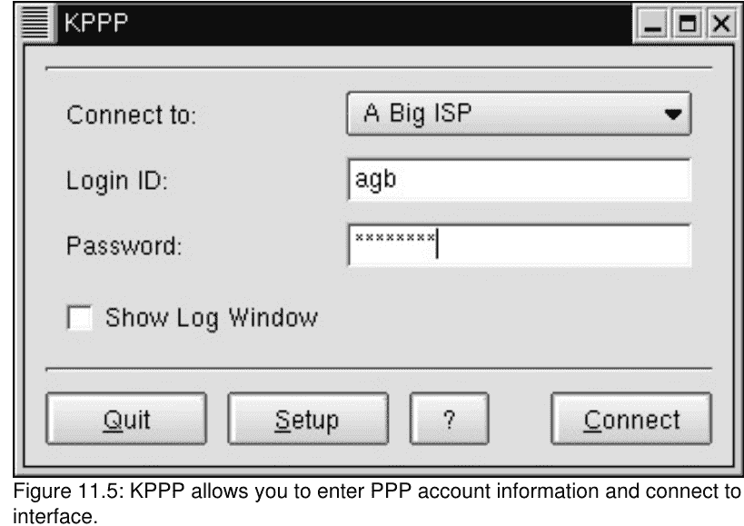

1. 通过在终端窗口中输入`kppp`或从 KDE 的 K 菜单启动（如果您正在运行 KDE），来启动`KPPP`。首次启动该程序时，其 ISP 条目列表将为空。

连接到字段（图 11.5 展示了将`KPPP`配置为使用 ISP 的设置）。

2. 点击`Setup`（设置）以输入 ISP 的信息。结果是如图 11.6 所示的`KPPP`配置对话框，但未定义任何账户。

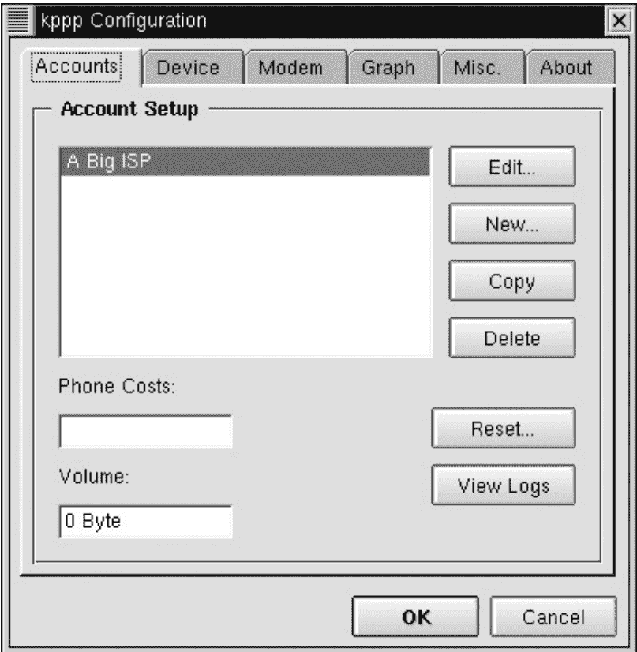

图 11.6：你可以从配置对话框中调整`KPPP`的设置。

3. 点击`New`（新建）创建一个新账户。`KPPP`会询问你希望使用向导还是基于对话框的配置。前者速度更快，但你的国家必须列在程序中。美国没有条目，因此本步骤假设你选择基于对话框的配置。然后`KPPP`将显示如图 11.7 所示的新账户对话框。

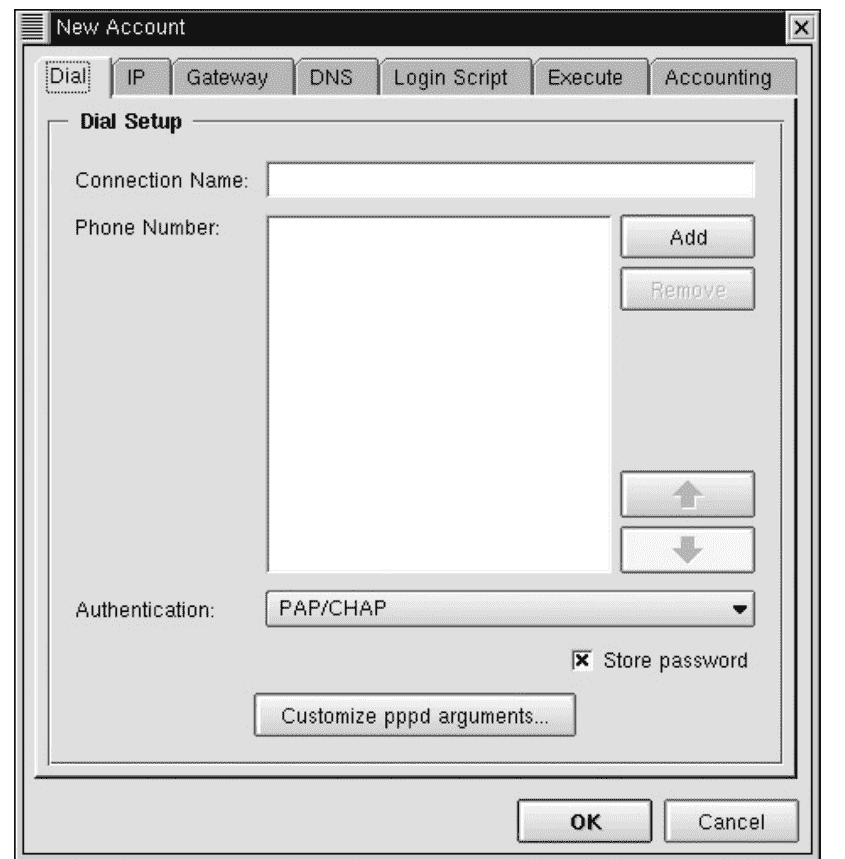


图 11.7：新账户对话框允许你输入 `ISP` 提供的重要信息。

4. 在“`Connection Name`”（连接名称）字段中输入一个名称。你可以使用任何你喜欢的名称；此条目用于帮助你在拥有多个账户时识别某个账户。

5. 点击 `Add`（添加）以添加电话号码。`KPPP` 将显示一个小对话框，你可以在其中输入电话号码。

6. 在新账户对话框中，选择你的 `ISP` 使用的认证方法。在大多数情况下，你可以将其保留为默认值 `PAP`。

7. 依次点击新账户对话框上的其余选项卡，并输入你的 `ISP` 提供的任何信息。最可能需要设置的信息是 `DNS` 服务器信息。选择 `Manual`（手动）选项，在 `DNS IP Address`（`DNS IP` 地址）字段中输入 `IP` 地址，然后点击 `Add`（添加）。如果你的 `ISP` 提供了两个 `DNS` 服务器地址，请重复此过程。在某些情况下，你可能需要创建一个登录脚本，类似于之前描述的基于脚本的 `PPP` 拨号连接。通常不需要配置 `DNS` 地址，因为该信息可能作为 `PPP` 协商的一部分进行传输。

8. 在新账户对话框中点击 `OK`（确定）。

9. 在 `Configuration`（配置）窗口中，点击 `Device`（设备）选项卡。检查 `Modem Device`（调制解调器设备）是否已正确设置，并将 `Connection Speed`（连接速度）设置为 `115,200`。（如果你的调制解调器特别慢，你可能希望使用较低的速度。通常，你应该使用至少是调制解调器官方速度两倍的连接速度，因为调制解调器支持压缩技术，在处理未压缩数据时会提高其有效速度。）

10. 检查配置窗口中的其余选项卡。你可能希望调整某些设置，例如调制解调器的音量。许多其他设置在遇到连接问题，或者如果你对程序、调制解调器或一般的 `PPP` 连接很熟悉并希望启用高级选项时非常有用。

11. 在配置对话框中点击 `OK`（确定）。

12. 在主 `KPPP` 窗口（图 11.5）中，在“`Login ID`”（登录 `ID`）字段中输入你的 `ISP` 用户名，在“`Password`”（密码）字段中输入你的密码。请注意，这些是你在 `ISP` 上的用户名和密码，而不是本地系统的。

13. 在你首次连接或遇到问题时，检查“`Show Log Window`”（显示日志窗口）项通常很有帮助。这将显示一个窗口，展示 `KPPP` 发送到调制解调器的内容以及收到的响应；它在诊断连接问题时非常有用。

14. 点击 `Connect`（连接）以发起连接。如果一切顺利，`KPPP` 将显示一个“`Connecting To`”（正在连接）窗口，显示连接状态。当建立连接时，会出现另一个窗口，显示系统已连接的时间。你可以点击 `Details`（详情）按钮查看连接的各种统计数据，或点击 `Disconnect`（断开）按钮结束连接。

与基于脚本的 `PPP` 连接一样，使用基于图形界面（`GUI`）的 `PPP` 工具时遇到问题也不罕见。特定的 `ISP` 可能需要一组不寻常的 `PPP` 选项，或者它可能使用一种奇怪的 `PPP` 实现，无法与 `Linux` 良好配合。如果你遇到问题，最好的尝试是通过 `KPPP` 菜单尝试其他设置。你还应该尝试使用终端程序登录到 `ISP`，以查看 `ISP` 是否使用任何特殊的登录提示，这可能最好通过 `KPPP` 的脚本功能（第 7 步）来处理。

## 发送传真

所有现代调制解调器都可以作为传真机使用。从计算机发送传真会在接收端产生异常清晰的传真，因为输出是数字生成的，而不是从原件扫描的（当然，除非你使用扫描仪创建数字图像来传真）。`Linux` 上有几种可用的传真软件包，包括 `mgetty+sendfax` (http://alpha.greenie.net/mgetty/) 和 `HylaFAX` (http://www.hylafax.org/)。`mgetty+sendfax` 软件包是之前描述的 `mgetty` 的变体。该程序随大多数 `Linux` 发行版附带。在 `Red Hat 7.3` 中，适当的 `RPM` 软件包名为 `mgetty-sendfax-1.1.28-3.i386.rpm`，位于第二张 `CD-ROM` 上。你应该安装它以及普通的 `mgetty` 软件包，因为 `mgetty+sendfax` 依赖于它。

为了使用 `mgetty+sendfax`，你必须按如下方式配置它：

- 1. 定位并安装 `mgetty+sendfax`。根据发行版不同，它通常被称为 `mgetty+sendfax`、`mgetty-sendfax` 或 `mgetty`。

- 2. 配置 `mgetty+sendfax`。大多数发行版将 `mgetty+sendfax` 的配置文件放在 `/etc/mgetty+sendfax` 中。你应该至少调整四个文件：

    - `fax.allow` 此文件包含允许发送传真的用户列表。在此文件中每行放置一个用户名。

    - `faxheader` 此文件包含发出传真的头部信息。你应该调整它以列出你的传真号码。

    - `sendfax.config` 此文件包含各种传真配置信息。此文件中的大多数项目都有很好的注释。将 `fax-id` 项更改为你的传真号码。`fax-devices` 项也非常关键。它应该列出你的传真设备文件名（不带前导 `/dev/`），例如 `ttyS1` 或 `modem`。

    - `faxrunq.config` 此文件包含其他各种传真配置信息。至少，你应该将 `fax-devices` 项设置为指向你的传真设备文件名，这与你在 `sendfax.conf` 同一行所做的操作相同。

- 3. 启动 `faxrunqd`。这是一个守护进程，监视传真队列目录中是否有传真出现。安装 `mgetty+sendfax` 软件包通常会创建此目录，通常位于 `/var/spool/fax`。为了定期使用系统发送传真，你应该配置系统启动时运行 `faxrunqd`，例如通过将其添加到 `/etc/rc.d/rc.local` 或类似的启动文件中。执行此操作时，务必在启动行中包含一个 ampersand（`&`），因为 `faxrunqd` 通常不会在后台启动。

配置完 `mgetty+sendfax` 后，你可以使用 `faxspool` 命令发送传真。此命令的语法如下：

```
faxspool [options] phone-number file [file…]
```

选项包括 `-n`（设置普通分辨率，而非默认的精细分辨率）、`-C program`（调用指定程序生成封面页）以及 `-t hh:mm`（在指定的小时和分钟发送传真）。电话号码是要发送传真的号码。`faxspool` 识别多种文件类型，包括 `.ps`（`PostScript`）、`.t`（`ASCII` 文本）、`.dvi`（`TeX DVI` 输出）以及 `.g3`（预格式化的传真 `G3` 文件）。该程序使用文件扩展名来识别文件类型，因此文件扩展名必须与 `faxspool` 对该文件类型的预期相匹配。

实现一个通过传真调制解调器发送输出的打印队列是可能的，但有些棘手。一个在这方面可以提供帮助的软件包是 `GFax` (http://www.gnome.org/gnome-office/gfax.shtml)。该程序设置一个打印队列，使用时会显示一个基于 `X` 的对话框，你可以输入目标传真号码。一个允许 `Windows` 计算机通过运行 `Samba` 的 `Linux` 服务器发送传真的实用程序是 `Respond` (http://www.boerde.de/~/horstf/)。此程序的功能与 `GFax` 非常相似，但在 `Windows` 客户端上运行。这两个程序都依赖于底层的传真发送机制，例如 `mgetty+sendfax`。

## 拨入调制解调器的用途

在拨入配置中，你将调制解调器设置为接受来电。通常，调制解调器要么向计算机报告已检测到铃声，然后计算机命令调制解调器接听电话，要么调制解调器自动接听电话，然后向计算机报告已收到电话。在任一情况下，你必须配置 `Linux` 以接受电话，并根据类型的不同，可能以不同方式处理传入数据。

### 接受文本模式登录

最简单的情况之一是文本模式登录。假设你想设置一个系统，以便员工可以从家里拨打电话联系计算机，使用 `pine` 或 `mutt` 等文本模式程序检查电子邮件。此类系统的配置可以与之前描述的终端配置非常相似。在该配置中，需要向 `/etc/inittab` 添加一行，将串行端口链接到 `getty` 程序，以便 `getty` 程序可以处理来自哑终端的输入。那种情况与拨入调制解调器之间唯一的概念区别在于，调制解调器（实际上是一对，但 `Linux` 系统只直接与其中一个打交道）位于终端和 `Linux` 计算机之间。你应该遵循“配置 `getty` 程序”中概述的步骤来设置用于拨入文本模式访问的调制解调器。唯一的区别在于该过程第 2 步中对 `/etc/inittab` 的修改：

```
S0:2345:respawn:/sbin/mgetty -s 57600 /dev/ttyS0
```

288


此行的区别仅在于缺少 `-r` 参数。`mgetty` 程序是为配合调制解调器（因此名称中有 m）设计的，所以 `-r` 参数会禁用部分常规 `mgetty` 功能。具体来说，`mgetty` 通常向调制解调器发送指令码以使其准备好接收呼叫，并通过在串行端口上运行 Linux 登录程序来响应调制解调器的连接消息。从 `/etc/inittab` 行中移除 `-r` 参数后，重新启用调制解调器配置命令的使用。

## 管理员日志：接受远程登录

系统：`E12345678`

操作：配置系统通过 `/dev/ttyS1` 接受远程登录，端口速率为 57,600bps，使用 `mgetty`。

修改文件：`/etc/inittab`

## 接受 PPP 连接

有时需要将 Linux 系统配置为接受 PPP 登录。如此配置后，一台具备互联网功能的 Linux 计算机可以充当远程计算机（运行多种操作系统之一）与互联网之间的网关。如果您在工作场所拥有一台始终在线且带有调制解调器的系统，并希望为自己或员工提供家庭或移动办公时的互联网访问，这种设置非常方便。许多 ISP 使用运行 PPP 服务器的 Linux 系统来处理数十、数百甚至更多用户。

注意 56Kbps 调制解调器的速度存在不对称性——上传速度低于下载速度。这种情况存在的原因是高上传速度要求一个系统（在常规配置中为 ISP 的计算机）拥有到电话网络的特殊连接。除非您获得此类连接，否则您的拨入 PPP 系统将限制在 33.6Kbps 速度，即使双方都使用 56Kbps 调制解调器。

接受 PPP 连接的方法有很多种。这里描述的方法相对简单，但它要求呼叫方系统使用连接脚本或手动输入认证信息。无论您如何操作，都必须设置几个配置特性。本质上，PPP 链路要求 Linux 计算机在拨入系统与网络其余部分之间充当路由器。因此，这些系统需要 Linux 内核中的路由器支持（这在大多数 Linux 发行版中都是标准配置，包括 Red Hat 7.3）。您还必须能够为拨入系统分配 IP 地址。通常，这是根据串行端口以静态方式完成的，您很快就能看到。

要将 Linux 系统配置为 PPP 服务器，请遵循以下步骤：

1. 按照前几节的描述，配置计算机通过 `getty` 程序接受远程登录。

2. 修改 `/etc/ppp/options` 文件，使其包含以下条目（您可能需要根据您的网络修改 `netmask`；该值应与 PPP 服务器的 `netmask` 相同）：

```
asyncmap 0
netmask 255.255.255.0
proxyarp
lock
crtscs
modem
login
```

3. 创建一个名为 `/etc/ppp/options.port` 的文件，其中 `port` 是端口文件，例如第一个串行端口为 `ttyS0`。该文件包含 PPP 服务器的 IP 地址或主机名，后跟冒号 (`:`) 以及 PPP 客户端的 IP 地址或主机名。您应确保 PPP 客户端的主机名在网络中可用。例如：

```
192.168.1.1:192.168.1.200
```

4. 为任何应该能够使用 PPP 链接的用户在 `/etc/ppp/pap-secrets` 文件中创建条目。此条目与拨出 PPP 访问的条目类似，但它列出的是本地用户名和密码。例如，以下内容允许用户 `abell` 使用密码 `watson` 连接到 PPP 服务器：

```
abell * watson
```

5. 检查 `pppd` 文件的权限。如有必要，请通过输入 `chmod u+s /usr/sbin/pppd` 设置其 UID 为 root。完成此操作后，输入 `ls -l /usr/sbin/pppd` 应显示以下权限：

```
-rwsr-xr-x   1 root   root   140656 Mar   7 10:25 /usr/sbin/pppd
```

6. 为了运行 `pppd`，拨入用户通常需要输入一个略显繁琐的命令——按照 Linux 系统管理标准来说并不复杂，但有点麻烦。您可以设置一个全局别名来执行此命令，从而减少麻烦。一旦设置好，用户只需输入 `ppp` 即可在 Linux 上启动 `pppd`。您可以通过在 `/etc/bashrc` 中输入以下行来设置（假设您的用户账户配置为使用 Bash 作为默认 shell）：

```
alias ppp="exec /usr/sbin/pppd -detach"
```

遵循这些步骤后，用户应该能够使用 PPP 连接到计算机及其附加的任何网络。PPP 服务器需要通过标准的 Linux `login:` 提示进行手动登录，之后客户端必须输入 `ppp` 以在 Linux 系统上启动 `pppd`。所有这一切都可以通过登录脚本或某些 PPP 拨号器（如 Microsoft Windows 自带的那个）的手动流程来处理。

## 接收传真

如果您已按照“接受文本模式登录”中的描述，配置系统使用 `mgetty` 接受拨号文本模式登录，那么您的系统将自动配置为接收传真。当调制解调器连接的线路进来电话时，调制解调器会确定该呼叫是数据呼叫还是传真呼叫。如果是数据呼叫，`mgetty` 将串行线的控制权移交给适当的程序以处理数据传输。如果调制解调器检测到传入传真，`mgetty` 将启动传真接收，并将传入传真放置在 `/var/spool/fax/incoming` 目录中。

传入的传真文件使用标准的 G3 传真文件格式。您可以使用多个程序查看这些文件，例如 KDE 的 KFax（如图 11.8 所示）。这类程序通常相当简单；它们允许您查看或打印文件，但不提供其他功能。

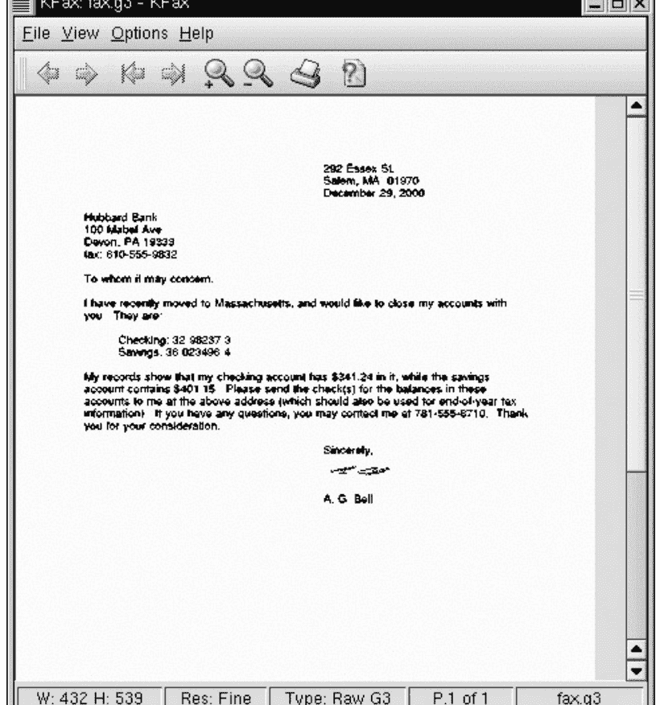

图 11.8: KFax 包含缩放、切换到传真新页或打印传真等选项。提示 `mgetty` 包含选项，可发送配置字符串给调制解调器，使其仅作为数据调制解调器或传真调制解调器工作。这些选项分别是 `-D` 和 `-F`。它们可以添加到 `/etc/inittab` 中的相应行。

## 配置串行打印机

大多数连接到 Linux 计算机的打印机使用并行或 USB 接口，如第 10 章所述。与 RS-232 接口相比，这些接口有一个巨大的优势：速度。现代并行端口的理论传输能力为 16Mbps，而 USB 可达到 12Mbps，相比之下 RS-232 串行端口仅为 115Kbps。这种百倍的速度差异对打印机至关重要——尤其是现代彩色打印机，它们通常接受巨大的位图作为输入。

尽管并行和 USB 端口具有优势，但一些打印机使用 RS-232 串行端口。当打印机理解 PostScript 时，该接口的问题最小，因为大多数能够打印的 Linux 程序都可以创建 PostScript 输出，这比 Ghostscript 创建的位图输出更紧凑。（有关 Ghostscript 及其在 Linux 打印队列中的使用的讨论，请参见第 10 章。）

### 串行打印机的特殊考虑

对于 RS–232 串行打印机，与并行端口配置不同的配置细节位于 `/etc/printcap` 文件中。具体而言：

- 您必须在 `lp=` 行上指定适当的串行端口，例如 `/dev/ttyS1`。

- 您必须使用 `brf` 行设置端口速度。（此选项使用井号代替等号。）为了获得最佳效果，应将速度设置为串行端口和打印机允许的最高速度——理想情况下为 115,200bps (`brf#115200`)。

要使用 USB 打印机，您必须在 `lp=` 行上指定适当的 USB 打印机设备文件——可能是 `/dev/usblp0` 或类似文件，如表 11.1 所述。您不需要像 RS–232 串行打印机那样设置 USB 打印机的端口速度。

对于 RS–232 和 USB 打印机，您必须在 Linux 内核中拥有针对相关端口的适当支持。所有主要的 Linux 发行版都包含这种支持。一些 USB 打印机（特别是也作为扫描仪工作的多功能设备）没有被正确识别为打印机。您应查阅 Linux USB 网站 (`http://www.linux-usb.org/`) 以获取受支持的 USB 打印机的信息。

### 何时使用串行打印机

如果有选择，请在 Linux 中使用并行或 USB 打印机，或者如果您有网络，使用以太网接口的打印机。这些接口提供最好的速度，特别是在打印图形时——Ghostscript 在打印到非 PostScript 打印机时将文本转换为图形，因此除非打印机支持 PostScript，否则大多数 Linux 打印都是图形打印。

RS–232 接口明显缓慢，因此如果可以避免，不要将其用于打印机。包含 RS–232 支持的现代打印机也始终支持并行或 USB 接口，因此通过更强大的接口使用这些打印机应该没有麻烦，至少从打印机一侧来看是这样。有两种情况可能迫您使用 RS–232 端口：

- 计算机端口耗尽：大多数 x86 计算机只有一个并行端口。如果您正将其用于一台打印机，可能需要为第二台打印机使用 RS–232 端口。不过，您可以购买附加并行端口卡和 USB 转并行适配器来应对这种情况，因此，除非您想在一台计算机上连接许多打印机或因某种原因无法添加卡，否则通常可以绕过缺乏并行端口的问题。


- 仅限串行的旧打印机：少数打印机不包含并行、USB 或以太网端口。幸运的是，这类打印机通常是 PostScript 型号，因此与非 PostScript 型号相比，它们受 `RS–232` 速度问题的影响较小。

## 总结

`RS–232` 串行端口是一种低速但非常灵活的计算机设备互连方式。它可以用于将两台计算机连接在一起（直接或通过调制解调器），将哑终端连接到计算机，或将打印机接口到计算机。Linux 对这些功能的支持相当好，但它依赖于许多额外的软件包，例如用于 PPP 的 `pppd`、Getty 用于登录访问以及打印系统用于打印机。理解这些工具对于在 Linux 下使用 `RS–232` 串口至关重要。

USB 是一种较新的串行端口标准，在许多方面（包括速度和灵活性）都超越了旧的 `RS–232` 标准。许多设备提供 USB 接口，范围从鼠标到扫描仪再到磁盘驱动器。Linux 对 USB 的支持良好，但仍然不完整。USB 的设计要求内核包含对通用 USB 设备类别的支持，有时甚至需要支持特定型号，因此并不总是能够使用最新的 USB 设备。不过，对于支持较好的 USB 硬件，USB 可以作为一个良好的接口。

## 第 12 章：TCP/IP Linux 网络

### 概述

或许没有哪种计算机技术比网络更深刻地改变了我们的生活。如今，人们可以在线购物、阅读报纸、获取音乐和软件、进行研究、与同事通信，甚至完全靠在线工作谋生。虽然这种新的计算机用途伴随着一些成本，但整个社会正在迅速拥抱互联网。

当今的网络协议起源于 Unix 系统。互联网（以及大多数局域网）的核心是一种称为**传输控制协议/互联网协议（TCP/IP）**的协议。TCP/IP 最初是在今天标准下显得原始的版本 Unix 上开发的。作为 Unix 的克隆，Linux 拥有一套紧密集成的 TCP/IP 网络工具。事实上，Linux 的许多网络工具与“传统”Unix 系统使用的工具相同。

本章介绍 Linux 中的 TCP/IP 网络。它首先概述 TCP/IP 的设计，然后深入介绍 Linux 中 TCP/IP 配置的细节。TCP/IP 网络的一个非常常见用途是在小型网络上提供文件和打印机共享，使得一个系统的用户可以直接使用另一个系统上的文件和打印机。因此，本章描述了这一用途，尽管只是粗略地概括。TCP/IP 还用于提供许多互联网服务，如 Web 和 FTP 服务器，因此这些主题也略有涉及。本书中的另外两章（第 13 章和第 14 章）涵盖了其他 TCP/IP 主题：X Window 系统和邮件服务器。

### 理解 TCP/IP 网络

你很可能熟悉网络工具是如何工作的，至少是从用户的角度来看。然而，与我们世界的许多方面一样，像电子邮件和远程打印这样的常见网络工具表面之下隐藏着相当大的复杂性。在配置系统以使用这些功能时——尤其是在排查 TCP/IP 问题时——理解 TCP/IP 网络的基本设计可能是无价的。因此，本节概述了 TCP/IP 以及计算机网络一般的关键设计特征。如果你已经熟悉这些概念，请随时从“TCP/IP 配置”一节开始。

#### 网络栈

从高级软件的角度来看，网络化的基本目标是将信息从一台计算机上运行的特定程序传输到另一台计算机上运行的特定程序。例如，当你运行 Web 浏览器（如 Netscape）时，目标是从 `Netscape Navigator` 向远程计算机上的 Web 服务器程序（如 `Apache`）传输对特定文档的请求。`Apache` 通过向 `Navigator` 返回一个或多个文档来响应。这种交换过程可能会重复很多次。

**注意**：术语**服务器**有两个含义。首先，它可以指在计算机上运行的**程序**。例如，`Apache` 是一个 Web 服务器。其次，它可以指运行服务器程序的**计算机**。同样，**客户端**可以指请求服务器程序信息的程序，也可以指请求服务器计算机信息的计算机。当这些术语应用于整台计算机时，由于一台计算机可以同时作为客户端和服务器运行，在某些环境中可能会迅速导致混淆。

在实现程序之间数据交换目标的过程中遇到的一个问题是如何控制对网络的访问。如果允许像 `Netscape` 这样的程序直接控制网络硬件，混乱很快就会发生，因为程序会相互干扰。解决这个问题的核心在于网络栈的概念。这是一组小软件模块，按序列运行，每个模块都与另外两个（或一个另一个以及网络硬件或人类）进行接口。网络应用程序——包括客户端和服务器——位于网络栈的顶部。这些应用程序与它们下面的层通信，依此类推，直到达到底层，此时数据离开计算机并通过网络传输到目标系统。在那一点，过程反过来，数据沿着栈上行到目标应用程序。该应用程序随后可以通过相同的方法发送回复。图 12.1 说明了这一过程。

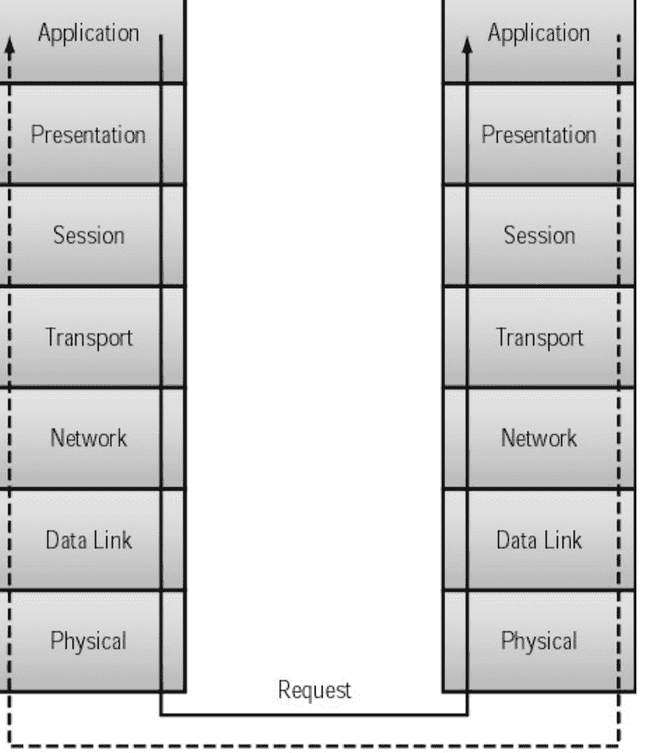

图 12.1：信息在“下行”和“上行”网络栈中传输，在沿途的每一步进行检查、打包或解包。在通过网络栈下行的每个阶段，数据都会接受检查或通过额外信息进行封装。这些“封装”功能类似于通过美国邮政服务发送信件的外信封；它们帮助数据到达最终目的地。然而，与实体信件不同，通过 TCP/IP 发送的数据可能被拆分成多个数据包。TCP/IP 不会一次性发送 2MB 的文件，而是将其分解为许多每个约 1.5KB 的数据包。封装过程的一部分确保了接收计算机能够将这些单独的许多数据包重新组装成原始文件。TCP/IP 被设计为具有容错性，因此如果特定数据包未到达，接收系统可以请求重新发送该数据包。单个数据包从源到目的地的传输路径可能不同，但系统仍能正常工作。

原则上，网络栈的每一层都可以被替换，并用等效组件替换，而不会影响较高层或较低层。例如，图 12.1 中的**物理层**对应网络硬件，如以太网卡。数据链路层由网络硬件的驱动组成。原则上（有时在实际中），你可以用另一张网络卡替换一张，或用一个驱动替换另一个，而无需调整网络栈的任何其他组件。然而，在实践中，如果你更换网络卡，可能需要调整驱动。在应用层，你可以更改应用程序，而无需调整网络硬件或位于两者之间的任何“不可见”软件——例如，你可以使用 `Lynx` 而不是 `Mozilla` 进行 Web 浏览。

图 12.1 展示了网络栈的理想化视图，称为**开放系统互联（OSI）模型**。在实践中，TCP/IP 通常以其自身的模型来描述，该模型包含较少的层。TCP/IP 的模型将硬件单独考虑，因此不延伸到物理层；并且 TCP/IP 将会话层和传输层合并为一层，将应用层和表示层合并为一层。不过，这些差异对我们的讨论并不重要；关键点在于数据在通过网络栈时被打包和解包，并且该栈有助于控制网络访问，包括数据寻址。

TCP/IP 并非唯一存在的网络栈。其他的，如 `AppleTalk` 和 `NetBEUI`，也可以被使用。这些替代的网络栈可以由图 12.1 中描绘的相同 OSI 模型来描述，但每个都有自己的一些怪癖，因此通常不可能用一个栈的一层替换另一个栈的一层。（不过，**物理**层，以及一定程度的**数据链路**和**应用**层是在栈之间共享的。）TCP/IP 是互联网的基础，因此是最常见的网络栈。Linux 还包含对几种不太常见的网络栈的支持，如 `AppleTalk` 和 Novell 的 `IPX`。

#### 网络地址

任何网络协议中一个至关重要组成部分是**寻址**。如果你在一台计算机上，想要使用位于服务器上的资源，你必须有一种方法告诉你的计算机如何到达该服务器。对于人类来说，网络地址最常以**主机名、计算机名称或完全限定域名（FQDN）**的形式出现，例如 `http://www.sybex.com/`。该主机名前面有时会有一个代码，指示你想在远程系统上使用哪种类型的服务器，例如 `http://` 表示 Web 服务器（Web 服务器使用**超文本传输协议，或 HTTP**）。在这种情况下使用时，主机名称为**统一资源定位符（URL）**。

主机名具有层次性，层次中的每一部分都由一个点（`.`）分隔。主机名的最左侧组件（如 `http://www.sybex.com/` 中的 `www`）有时被称为**机器名**。该组件标识单台特定的计算机。主机名的其余部分（如 `sybex.com`）是**域名**。我指的是一个计算机集合。域名本身是按层次排列的。**顶级域名（TLD）**，如 `.com`、`.org` 和 `.us`，包含**域**，如 `sybex.com` 和 `linux.org`，这些可以进一步分解为其自己的子域，或者直接分配计算机给它们。因此，级别的数量层级结构是可变的。一个域可能拥有许多层级（例如 `a.very.deep.domain.structure.in.the.uk`），而另一个域则可能非常浅（例如 `oneroomco.com`，它理论上可以直接指向一台计算机）。


不幸的是，虽然这种形式的主机名对人类来说相对容易理解，但计算机使用数字时效率更高。因此，尽管互联网包含了使用主机名的规定，但其核心依赖于另一种寻址方案：IP 地址。IP 地址是 32 位数字，通常表示为四个用点（.）分隔的十进制数，例如 `192.168.204.98`。IP 地址分为两个部分：网络地址和机器地址。这种划分简化了路由器的任务，路由器是用于在网络之间发送流量的设备，因为这意味着路由器可以按照网络而非单台计算机进行编程。网络掩码（简称 `netmask`）用二进制 1 来标记 IP 地址中的网络地址部分。例如，`255.255.255.0` 在地址的前三个字节中的每一位都放置二进制 1，指示前三个字节是网络地址，而最后一个字节是机器地址。IP 或网络地址可以与网络掩码结合使用，采用一种简写形式，其中网络掩码中前导二进制 1 的数量跟在 IP 地址之后，例如 `192.168.204.0/24`。这等同于网络地址为 `192.168.204.0` 且网络掩码为 `255.255.255.0`（即二进制表示下的 24 个 1）的情况。

> **注意** 在主机名中，最重要的部分（机器名称）位于地址的*最左侧*位置。在 IP 地址中，最重要的部分（机器地址）位于地址的*最右侧*位置。

传统上，可用的 IP 地址范围被划分为不同*类别*的网络，如表 12.1 所示。根据类别的网络掩码，这些类别在大小上有所不同——每个 A 类网络可以包含超过 1600 万台计算机；B 类网络可容纳 65,534 台计算机，而 C 类网络每个仅能容纳 254 台计算机。然而，近年来，为了更有效地利用日益减少的 IP 地址供应，网络已以更传统的方式合并或拆分。三大主要 IP 地址类别均支持一系列*私有* IP 地址（见表 12.1），路由器不会路由这些地址。这些 IP 地址可在内部用于私有网络，而无需获取“官方”IP 地址。此外，还有 D 类和 E 类网络，它们具有特殊含义并保留供将来使用。

### 表 12.1：IP 地址类别与私有地址范围

| 类别名称 | 范围 | 网络掩码 | 私有地址 |
| :--- | :--- | :--- | :--- |
| A 类 | `1.0.0.0–127.255.255.255` | `255.0.0.0` | `10.0.0.0–10.255.255.255` |
| B 类 | `128.0.0.0–191.255.255.255` | `255.255.0.0` | `172.16.0.0–172.31.255.255` |
| C 类 | `192.0.0.0–223.255.255.255` | `255.255.255.0` | `192.168.0.0–192.168.255.255` |

> **注意** 互联网正迅速耗尽 IP 地址。尽管 32 位地址提供了约 40 亿个地址的理论上限，但实际限制略低，而连接互联网的计算机数量正以惊人的速度增长。出于此原因及其他原因，针对 TCP/IP 网络的新寻址方式 `IPv6` 的工作正在进行中。`IPv6` 使用 128 位地址，允许拥有大约 $3.4 \times 10^{38}$ 个地址——相当于地球陆地表面上每平方毫米有 $2.2 \times 10^{18}$ 个地址，这应该能让我们用上相当长一段时间。

从实际操作来看，有必要将 IP 地址与主机名相互关联。这一任务通过域名系统（`DNS`）完成，`DNS` 使用高度分布式的 `DNS` 服务器系统。每个 `DNS` 服务器负责其自己的域或子域。这些服务器按照镜像域名结构的层级方式排列。在此层级的顶端是*根*服务器，它们知道处理顶级域（`TLD`）的服务器地址。每个 `TLD` 服务器知道处理其各域的服务器地址，等等。最终，该层级中的某个服务器对某个域是*权威*的，意味着它有权说明给定的主机名是否存在，如果存在，其 IP 地址是什么。类似的层级允许*反向* `DNS` 查询，因此给定一个 IP 地址，可以找到对应的名称。

通常，组织的 `DNS` 服务器执行两项任务：

-   它处理来自其域内计算机的名称查询。它会查询适当的根服务器，并遵循从该服务器开始的推荐链，以定位请求域的权威服务器。然后，它将此次查询的结果（通常是 IP 地址或表示名称无效的代码）传回给请求客户端。
-   它接受来自外部源关于其域内系统的名称和 IP 地址的查询。

在配置 Linux 系统的网络时，你可能只需要知道一到三个 `DNS` 服务器的 IP 地址。然后你可以让你的 Linux 系统指向这些 `DNS` 服务器，让它们去完成遍历服务器树并将域名解析为 IP 地址这一繁琐工作。Linux 可以充当 `DNS` 服务器，但以这种方式配置 Linux 远远超出了本书的范围。如需相关信息，请参阅 Craig Hunt 的*Linux DNS Server Administration*（Sybex, 2000）等书籍。

最后一种地址类型是网卡的*硬件地址*。网卡使用此地址来判断数据报是否发给它。网络协议栈的工作之一是为任何给定的 IP 地址找到匹配的硬件地址。协议栈通过向本地网络上的所有计算机广播查询来实现这一点。（对于较远的系统，计算机只需将数据报发送给本地路由器，路由器随后可以适当地转发数据。）在大多数情况下，你不需要担心硬件地址，尽管本章后面会提到一个例外。

## 端口

一旦数据报被路由到目标系统，目标计算机需要知道如何处理它。这一信息部分通过多个*端口*的使用来传达。每个 TCP/IP 数据报都指向 65,536 个端口之一，你可以将其视为类似商务电话系统中的分机。按照惯例，特定的服务器软件包在特定端口上监听流量。例如，Web 服务器在端口 80 上监听，邮件服务器在端口 25 上监听。文件 `/etc/services` 列出了常用服务器使用的端口分配。作为用户，你通常不需要担心端口使用，因为客户端程序知道要调用哪些端口。作为系统管理员，你偶尔必须处理端口分配。例如，如果不存在适当的条目，你可能需要向 `/etc/services` 添加一个条目。

> **注意** TCP/IP 端口与硬件端口不同，后者用于将打印机和调制解调器等设备连接到计算机。以太网卡通常只有一个以太网端口，但那个以太网端口支持成千上万个 TCP/IP 端口。

客户端程序也使用端口从系统中*向外*发起调用。Linux 根据需求将出站端口分配给程序，因此你不必担心这个细节。当服务器回复客户端时，它使用客户端所使用的端口进行回复，因此 Linux 知道应将返回的数据报交付给哪个程序。客户端和服务器程序都记录与其交换数据的 IP 地址，以便将来自不同会话的数据报区分开来。

## TCP/IP 配置

既然 TCP/IP 的理论部分已经讲完，是时候进入实用的 Linux TCP/IP 配置了。大多数发行版，包括 Red Hat 7.3，允许你在系统安装时配置 TCP/IP；但这并不总是实用的，因为你可能需要在继续之前安装硬件或查找新的驱动程序。即使你使用安装时的配置选项或独立的图形用户界面，理解底层的文本模式工具也很有帮助。因此，本章重点介绍基于文本的 TCP/IP 配置工具和实用程序。

### 配置网络硬件

TCP/IP 配置的第一步是设置硬件。一个正常工作的网络包括各种各样的网络硬件，如集线器或交换机、路由器、服务器等。事实上，可能性如此广泛，以至于在这里不可能全部涵盖。因此，本章专注于在网络中配置单个 Linux 系统。在此背景下，硬件配置包括查找和安装适当的网络接口卡（NIC），并确保你的系统包含该卡片的适当驱动程序。

> **注意** 许多孤立的 Linux 系统使用*点对点协议*（*PPP*）通过电话调制解调器将系统连接到互联网。第 11 章描述了 PPP；本章更关注通过专用网络硬件进行的网络配置。

Linux 支持各种各样的网络硬件。当今最常见的网络类型是以太网，它有多种变体，包括 10Base2（也称为*细同轴*）、10Base5（又称*粗同轴*）、10BaseT、100BaseT、1000BaseT 以及光纤。名称以*T*结尾的变体在 2002 年最为常见，它们使用*非屏蔽双绞线*（*UTP*）布线，看起来像电话线但接头更宽。较旧的变体运行速度最高为 10Mbps，但 100BaseT 支持 100Mbps 速度，而 1000BaseT 和光纤均支持 1000Mbps（1Gbps）速度。Linux 内核支持大多数现代以太网适配器。要了解你的 Linux 发行版支持哪些设备，请检查内核配置选项中 `Network Device Support → Ethernet (10 or 100Mbit)`（针对 10Mbps 和 100Mbps 变体）或 `Network Device Support → Ethernet (1000Mbit)`（针对 1Gbps 变体）。你也可以咨询设备制造商以确定使用哪些 Linux 驱动程序。一些制造商为其板卡提供 Linux 驱动程序，但这些通常只是来自 Linux 内核的驱动程序。

有些网络不使用以太网，而是使用其他类型的网络硬件，如令牌环。尽管 Linux 对这些较特殊的硬件类型的支持不如以太网那么完整，但你通常可以为大多数网络类型找到至少某些 NIC 的驱动程序。与以太网一样，你应该查阅内核的配置选项和板卡制造商，以了解支持哪些功能。


如果你将驱动程序直接编译到内核中，它将自动加载并检测你的网卡。如果你的驱动程序被编译为模块（这是新安装 Linux 系统的典型情况），然而，你可能需要向 `/etc/modules.conf` 文件（在一些旧发行版中称为 `/etc/conf.modules`）添加一两条条目。具体来说，你可能需要设置 `eth0` 与你的 NIC 驱动程序名称之间的别名。如果你有多个 NIC，你可能需要添加多行以建立这些关联，例如：

```bash
alias eth0 tulip
alias eth1 via-rhine
```

## 使用 DHCP 进行配置

这些行指示 Linux 使用 `tulip` 驱动程序用于 `eth0`（第一个以太网设备），使用 `via-rhine` 驱动程序用于 `eth1`（第二个以太网设备）。当然，要设置这些行，你需要找到适合你主板的相应驱动程序，如前文所述。你可以通过输入 `ls /lib/modules/x.y.z/net` 来查看系统中存在哪些驱动程序，其中 `x.y.z` 是你的内核版本。

> **提示** 在安装 Linux 时配置网络的一个最佳理由，特别是如果你对网络设备不够熟悉的情况下，是因为大多数 Linux 安装工具都包含检测已安装网络硬件类型的工具，因此你不需要亲自弄清楚这些细节。

配置好硬件并重启后，Linux 应在启动时自动检测硬件。当它这样做时，会显示一条简短的消息，例如：

```
eth0: Macronix 98715 PMAC rev 32 at 0xdac00, 00:80:C6:F9:3B:BA, IRQ 9.
eth1: VIA VT3043 Rhine at 0xdac00, 00:80:c8:fa:3b:0a, IRQ 10.
eth1: MII PHY found at address 8, status 0x7824 advertising 50el Link 0000.
```

这些行表明 Linux 已检测到两块网卡：`eth0` 使用的是 Macronix 98715（一个使用 `tulip` 驱动程序的芯片），而 `eth1` 使用的是 VIA VT3043 Rhine 芯片（使用 `via-rhine` 驱动程序）。这些消息还包含以太网设备的硬件地址——即六字节十六进制值，例如 `00:80:C6:F9:3B:BA`。如本章后文所述，在某些网络中，这些值可能非常重要。如果你在启动时没有看到这样的行，你应该重新检查配置，以确保没有拼错设备驱动程序名称，并且正确识别了网卡的硬件。

> **提示** 启动消息滚动得很快，你很可能错过它们。启动完成后，你可以输入 `dmesg` 来查看这些消息的重新播放。此外，你可以通过管道将结果传递给 `grep`，例如 `dmesg | grep eth`，以仅筛选出与以太网相关的消息。

Linux 下网络硬件的一个怪癖是，这些设备在 `/dev` 目录中没有通常的设备文件条目。尽管如此，网络设备是有命名的（如 `eth0` 或 `eth1`）。网络工具直接将这些名称传达给 Linux 内核，而不是通过访问设备文件来传达。

配置大多数计算机网络的最简单方法是使用动态主机配置协议（DHCP）。这是一种网络协议，允许一个系统（DHCP 服务器）维护网络重要特性的信息，并将这些信息提供给其他系统（DHCP 客户端）。网络管理员在 DHCP 服务器上维护信息，而其他所有系统只需要被告知使用 DHCP 客户端程序即可。有关配置 DHCP 服务器的信息，请参阅 Craig Hunt 的《Linux 网络服务器》（Sybex，2002）——本节涵盖 DHCP 客户端程序。客户端程序启动时，会发出广播请求 DHCP 服务器提供帮助，服务器随后会响应所有重要的网络信息。

> **注意** 某些 DHCP 服务器仅响应已注册的客户端。服务器使用网卡的硬件地址来识别客户端。你可能需要向你的网络管理员或 ISP 提供此信息。对于以太网设备，相关的代码是一个六字节十六进制值。如前文所述，Linux 以太网驱动程序会在启动时在屏幕上显示此值。

在 Linux 系统中，有三种常用的 DHCP 客户端：`dhclient`、`dhcpd` 和 `pump`。（Red Hat 7.3 使用 `dhcpd` 或 `pump`，视安装情况而定。）在大多数情况下，你只需在系统上安装相应的软件包即可。当计算机启动时，它使用适当的启动脚本来调用 DHCP 客户端。在 Red Hat 7.3 中，`/etc/sysconfig/network~scripts/ifup` 脚本包含对 DHCP 客户端的调用；但其他一些发行版将 DHCP 客户端脚本放在 `/etc/rc.d` 目录中的某个位置。如果你安装了 DHCP 客户端且不想在重新引导前使用网络，你可以直接调用客户端程序；例如，在 Red Hat 7.3 系统上通过输入 `sbin/dhcpd` 或 `sbin/pump`。

一些依赖图形用户界面（GUI）配置工具的 Linux 发行版可能要求你在此工具中设置一个选项，以便在启动时自动调用 DHCP 客户端。你通常可以通过在诸如 `/etc/rc.d/rc.local` 这样的启动脚本中添加调用来绕过此要求，但检查适当的配置选项可能更简单。在 Webmin 中，可以在硬件 → 网络配置 → 网络接口 → `eth0` 模块中找到它，如图 12.2 所示。最后一个选项位于页面中“启动时激活的接口”部分，如果你配置的不是第一个以太网接口，则选项名称会有所不同。点击 IP 地址的 `From DHCP`（来自 DHCP）选项，并将其他选项留空。

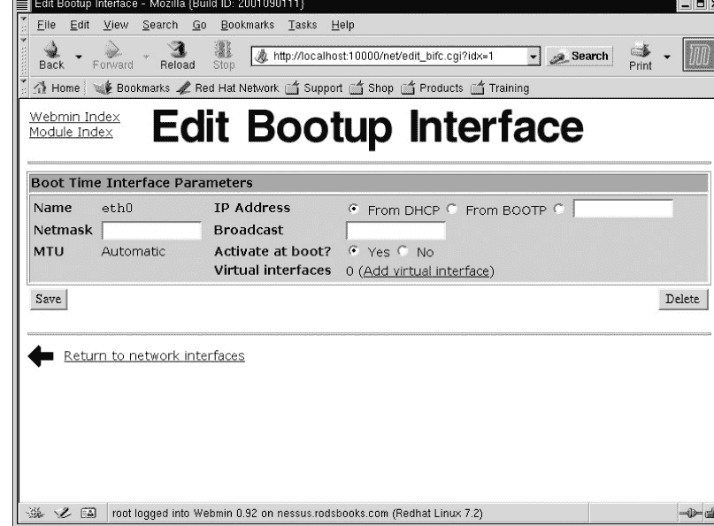

图 12.2：在图形用户界面配置工具中，你可以从单个界面设置许多网络选项。

> **注意** 虽然 Webmin 是基于 Web 的工具，但它仍应在没有正常网络接口的系统上运行，因为你需要使用本地主机（`localhost`）地址从你试图管理的计算机访问它。

不幸的是，虽然 DHCP 旨在简化网络配置，但它并不总是能按预期工作。一类特别的问题与使用多个网络接口的服务器有关，特别是当这些接口中只有一个应该通过 DHCP 配置时。大多数 DHCP 客户端允许你指定要配置的接口。例如，你可以使用 `pump -i eth1` 来告诉 `pump` 配置你的 `eth1` 接口。你可能能够修改启动脚本，以强制 DHCP 客户端仅在所需的接口上工作。

有时，DHCP 客户端的问题可能非常棘手。幸运的是，Linux 有三种 DHCP 客户端这一事实为你提供了一种出路：你可以尝试另一种客户端。但是，在移除原始客户端之前，你应该找到并备份其配置文件。如果需要启动新的客户端，你可能需要恢复并修改此文件，特别是如果你使用来自其他发行版的 DHCP 客户端，因为不同发行版使用略有不同的启动脚本格式。

DHCP 能够设置 Linux 系统网络配置的大多数方面。然而，DHCP 无法安装网络驱动程序。某些 DHCP 配置还会省略一些信息——最常见的是主机名——因此即使你的系统使用 DHCP，你也可能需要进行一些手动调整。（下一节介绍手动 TCP/IP 配置。）

> **注意** 一些数字用户线路（DSL）安装使用一种称为 `PPPoE` 的自动配置协议。此协议使用通常通过电话调制解调器使用的 `PPP` 工具，但将其应用于以太网连接。有几种可用的 Linux `PPPoE` 客户端。大多数发行版都附带 `PPPoE` 实现，通常是流行的 Roaring Penguin（<http://www.roaringpenguin.com/pppoe/>）。如果你的 DSL 安装使用 `PPPoE`，则 DHCP 在该系统上不会工作。

### 手动配置 TCP/IP

如果你的网络不使用 DHCP，你必须手动配置 TCP/IP 设置。这种配置在安装时或使用像 Webmin（图 12.2）这样的图形用户界面配置工具时最容易处理。如果你选择使用这样的工具，根据以下描述，你应该可以毫无困难地找到相应的选项。

#### 设置主机名

对于想要将你的计算机作为服务器进行联系的计算机来说，主机名最为重要。DNS 管理员在 DNS 服务器上存储主机名，希望联系你的远程系统会使用这个主机名。你设置的是你的计算机自我使用的名称。这可能很重要，因为某些协议（如邮件）会在出站消息中嵌入发送者的地址。如果你的主机名在本地设置不正确，接收系统可能会非常困惑，甚至拒绝连接。

你可以使用 `hostname` 命令来设置系统的主机名。不带任何参数输入时，此命令报告系统当前的名称。但是，你可以向命令传递一个名称来设置主机名。例如，以下命令将主机名设置为 `ginkgo.oneroomco.com`：

```bash
# hostname ginkgo.oneroomco.com
```

> **注意** 如果希望实现自动化流程，可以将这里描述用于手动 TCP/IP 配置的命令添加到启动脚本中，例如 `/etc/rc.d/rc.local`。不过，通常使用发行版标准的网络启动脚本来实现此目的更好。


不幸的是，使用此命令一次性设置主机名并不能永久设置它；重启后，Linux 使用存储在配置文件中的值设置其主机名。细节因发行版而异，但你应特别关注 `/etc/HOSTNAME`、`/etc/hostname`、`/etc/sysconfig/network` 和 `/etc/hosts` 文件。前三个是存储 Linux 启动时使用 `hostname` 命令设置的名称的常见位置。`/etc/hosts` 文件略有不同，因为它列出了主机名到 IP 地址的映射——它可以在小网络中代替 DNS 使用，即使在大网络中也可以补充 DNS。如果你在 `/etc/hosts` 中看到你的 IP 地址，请确保它映射到你完整且正确的主机名。

**提示** 如果你找不到系统的 hostname 参考文件，可以尝试输入 `grep -r hostname /etc/*`。此命令应该返回 /etc 目录树中包含 hostname 一词的文件列表。其中几乎可以确定是设置 hostname 的文件。有时该文件使用来自其他文件的定义来设置 hostname，因此你可以通过修改源文件，或者通过直接修改设置名称的文件来绕过另一个文件中的定义。

## 激活接口

要使用网络，你必须激活一个接口。为此，请使用 `ifconfig` 命令，该命令告诉 Linux 开始使用一个设备并将其与特定的 IP 地址关联。该命令的基本语法如下：

```
ifconfig interface [options] [address]
```

每个参数的含义如下：

- **interface** 这是网络接口，例如 `eth0`。

- **options** 你可以为 `ifconfig` 指定几种不同的选项。最重要的是 `up` 和 `down`，它们分别强制系统激活或停用接口。（`up` 是默认值，因此在激活接口时可以省略。）你还可以使用 `netmask mask` 选项来设置 netmask——默认情况下，`ifconfig` 使用基于地址所属网络类别的 netmask，如表 12.1 所示。你可以在 `ifconfig` 手册页中阅读更多选项。

- **address** 这是计算机在该接口上响应的 IP 地址，例如 `192.168.203.7`。如果省略地址，`ifconfig` 将报告接口的状态，而不是配置接口以使用地址。

在最简单的形式下，`ifconfig` 命令可能相当简短：

```
# ifconfig eth0 192.168.203.7
```

你可能需要添加更多选项。特别是，如果你的 IP 地址使用非标准 netmask，你可能需要指定一个，例如：

```
# ifconfig eth0 netmask 255.255.255.128 192.168.203.7
```

在配置完成后检查配置是个好主意。即使在接口激活后很长一段时间，你也可以使用 `ifconfig` 收集有用的调试信息。例如：

```
# ifconfig eth0
eth0      Link encap:Ethernet  HWaddr 00:A0:CC:24:BA:02
          inet addr:192.168.203.7  Bcast:192.168.203.255
          Mask:255.255.255.0
          UP BROADCAST RUNNING  MTU:1500  Metric:1
          RX packets:7173469 errors:6 dropped:0 overruns:0 frame:6
          TX packets:6294646 errors:0 dropped:0 overruns:0 carrier:0
          collisions:66163
```

此输出表明 `eth0` 正在运行，使用硬件地址 `00:A0:CC:24:BA:02` 和 TCP/IP 地址 `192.168.203.7`。进一步的统计数据包括最大传输单元（`MTU`）大小为 1500，接收（`RX`）和传输（`TX`）数据包（包括错误）以及碰撞。在调试连接时，这些信息可能非常有价值。大量的错误或碰撞可能表明你的网络过载或硬件故障，例如。

**注意** 某些错误和碰撞是正常的。前面的例子显示总共有 66,163 次碰撞和 13,468,115 个发送或接收的数据包，碰撞率约为 0.5%。错误率（7,173,469 个接收数据包中有 6 个错误，没有传输错误）也很低。很难指定一个阈值，超过该阈值错误或碰撞就表明存在问题，因为这些值可能因网络而异。当两个系统试图同时传输时，以太网网络上不可避免地会发生碰撞。因此，随着总网络流量的增加，碰撞率也会上升。使用交换机而不是集线器可以减少以太网网络上的碰撞数量。

## 配置路由表

计算机知道应该向哪个网络接口发送数据非常重要。当只有一块网卡时，这似乎是一个微不足道的任务，但在 Linux 中并非如此，因为所有 Linux 系统都支持回环（或本地主机）接口，它将网络流量导回 Linux 系统。该接口在故障排除和一些基本的 Linux 功能（如 X）中非常有用。通常分配地址 `127.0.0.1`，并由默认启动脚本自动配置。因此，你不必担心回环接口，但你必须告诉系统如何路由所有其他网络数据。

此任务通过 `route` 命令完成，其语法如下：

```
route [add | del] [target] [gw gateway]
```

每个参数都有特定的含义：

- **add | del** 如果你想向路由表添加条目，请指定 `add`；如果你想删除一个条目，请指定 `del`。在启动接口时，使用 `add` 参数。

- **target** `target` 是路由适用的 IP 地址或网络地址。网络地址看起来就像 IP 地址，但在 IP 地址的主机部分使用末尾的 0，例如 `192.168.203.0`。一个特殊的 target 是默认路由，即 `0.0.0.0`。如果愿意，你可以使用关键字 `default` 代替 `0.0.0.0`。默认路由是所有未被更具体规则匹配的交通所采用的路由。通常使用默认路由指定网关系统；发往大多数不在本地网络上的地点的交通然后通过网关系统传输。

- **gw gateway** 网关是一个知道如何将数据包发送到另一个网络的系统。`gateway` 和 `router` 这两个术语携带非常相似的含义，并且经常互换使用。你的 ISP 或网络管理员可以为你提供适当网关的 IP 地址。

**注意** 通常没有必要明确指定与路由关联的网卡甚至 IP 地址，因为 `route` 命令可以根据 target 或网关地址识别此信息。如果你的网络异常复杂，你可以使用 `dev device` 参数强制将路由与设备关联。

通常，你为通过 Linux 计算机传输的流量指定两条路由：一条用于发往本地网络的流量，另一条是默认路由，通过网关传输。你可以通过发出两条命令来完成此任务，例如：

```
# route add 192.168.203.0
# route add 0.0.0.0 gw 192.168.203.1
```

这些命令中的第一条为本地流量添加路由——任何寻址到 `192.168.203.0` 网络的流量都通过相应的网卡发出。通常不需要此命令，因为 `ifconfig` 命令通常执行此任务。低层 TCP/IP 协议包含例程，允许计算机找到连接到其本地网络段的任何其他计算机。当数据包旨在发往 `192.168.203.0` 网络（或由显式路由定义的其他任何网络）以外的地址时，第二条命令接管。在这种情况下，系统将数据包引导至 `192.168.203.1`，这应该是一个能够将来数据包传递到适当目的地的路由器。（事实上，它可能会将其传递给另一个路由器，并且在网络上经过相当多的跳转。）

**注意** 如果你正在配置本地网络上不会连接到 Internet 的系统，则无需指定网关路由。

你可以通过不带任何选项发出 `route` 命令（或者，如果你想查看 IP 地址而不是机器名称，可以使用 `–n` 选项）来检查路由表。例如：

```
# route –n
Kernel IP routing table
Destination     Gateway         Genmask         Flags Metric Ref  Use Iface
192.168.203.0   0.0.0.0       255.255.255.0   U     0      0      0     eth0
127.0.0.0       0.0.0.0       255.0.0.0       U     0      0      0     lo
0.0.0.0         192.168.203.1 0.0.0.0         UG    0      0      0     eth0
```

此输出显示三条路由：一条用于 `192.168.203.0` 网络，一条用于本地主机接口（实际上配置为整个网络），以及一条用于默认路由。大多数桌面甚至服务器系统的路由表与此类似。如果计算机有多个网卡，或者其网络在几种方式上异常复杂，路由表可能有额外的条目。


大多数 Linux 系统的启动脚本中都包含对 `route` 的调用。在 `Red Hat 7.3` 中，`/etc/rc.d/init.d/network` 负责启动网络（包括设置路由），但它调用其他几个脚本来完成工作。因此，你可以修改此文件，使用 `Webmin` 来完成工作，或者将 `route` 调用添加到其他启动脚本中，例如 `/etc/rc.d/rc.local`。

## 指定 DNS 服务器

为了将 Internet 上任意系统的主机名解析为 IP 地址，Linux 必须知道至少一个 DNS 服务器的 IP 地址。Linux 将此信息存储在其自身的默认域名信息以及 `/etc/resolv.conf` 文件中。典型的 `/etc/resolv.conf` 文件如下所示：

```
domain room1.threeroomco.com
search room2.threeroomco.com room3.threeroomco.com
nameserver 192.168.203.1
nameserver 192.168.203.20
```

此文件中有三个重要的关键字：

- `domain` 这指定了系统所属的域名。Linux 首先尝试使用指定的域名解析名称。例如，如果你使用机器名称 `ginkgo` 和上面的 `/etc/resolv.conf` 文件，Linux 首先搜索名为 `ginkgo.room1.threeroomco.com` 的计算机。此功能允许你在目标计算机与源机器位于同一域时省略机器名称的域名部分。

### 搜索

`search` 选项的工作原理与 `domain` 选项非常相似，但你可以使用此参数指定多个要搜索的域，这些域之间用空格或制表符分隔。

### 名称服务器

每个 `nameserver` 行指定单个 DNS 服务器的 IP 地址。这必须是一个 IP 地址，而不是机器名称——毕竟，DNS 服务器正是用来进行名称解析的。你可以指定任意数量的 DNS 服务器，每行一个，但 Linux 只使用前三个。通常情况下，只使用第一个；但如果第一个 DNS 服务器无法访问，Linux 会继续尝试下一个。

`警告` 配置系统搜索过多的域或子域可能会增加解析域名所需的时间。如果两台机器拥有相同的机器名称但存在于不同的域中，这也可能导致你在 intended 联系一台机器时却联系到了另一台。

在 `/etc/resolv.conf` 中输入信息后，要使用这些 DNS 服务器不需要执行任何特殊操作。此外，Linux 在重启时会记住这些设置（与某些其他网络配置选项不同），因此你不需要调整任何启动脚本。

`系统`：`E12345678`

`操作`：配置计算机使用 `DHCP` 进行 `eth0` 的网络分配，并将 `eth1` 设置为使用固定配置。

`eth1` 配置：

`IP 地址`：`192.168.203.7`

`子网掩码`：`255.255.255.0`（默认）

`网关`：无（使用 `eth0` 上由 `DHCP` 分配的网关）

`DNS`：无（使用由 `DHCP` 分配的 DNS 服务器）

## 测试设置

如果有运气的话，你现在已经拥有了一个可用的网络配置。你应该执行一些测试以确保其正常工作。如果你不耐烦，可以直接跳到测试 6；但如果你遇到问题，请依次尝试以下测试：

- 1. 通过 `ping localhost` 地址来检查基本的 Linux TCP/IP 栈。输入 `ping 127.0.0.1`。你应该看到一系列类似于以下输出的行，表明 `localhost` 地址正在响应：

```
64 bytes from 127.0.0.1: icmp_seq=1 ttl=255 time=0.3 ms
```

按 `Ctrl+C` 停止此序列。如果此测试不工作，说明你的配置严重损坏。每个 Linux 系统都应该通过此测试，即使是在安装后立即进行。

- 2. Ping 你的网卡的外部地址（例如 `ping 192.168.203.7`）。这测试了通过 `ifconfig` 将地址与网卡关联以及基本的网络驱动程序功能。

- 3. 通过 IP 地址 ping 你本地网络中的一台机器。通常一个好的 ping 对象是你的路由器/网关。如果此测试通过，你可以确信你的网络硬件和驱动程序正在工作。如果失败，请仔细检查你的 `ifconfig` 设置，并调查使用更新版本的网络卡片驱动程序的可能性。

`注意` 可以配置计算机忽略 ping。计算机也可能处于离线状态，或者通往远程计算机的路由可能以各种方式中断。因此，即使你自己的系统配置完美无缺，ping 测试仍可能失败。如果发生这种情况，在宣布测试失败之前，请先尝试另一台系统。

- 4. 通过 IP 地址 ping 你本地网络之外的一台机器，例如 `ping 198.182.196.56`（这 ping 的是 `http://www.linux.org/`，但这个地址将来可能会改变；最好使用 `nslookup` 查找一个地址）。如果此测试通过，说明你的网关配置正确。如果之前的测试成功但此测试失败，请检查你的路由表，特别注意网关。

- 5. 通过机器名称而不是 IP 地址 ping 本地和远程机器，例如 `ping http://www.linux.org/`。如果此测试通过，说明你的 DNS 配置正确。

- 6. 使用更复杂的网络工具，如 Web 浏览器或 Telnet 客户端。当 ping 有效时，这些工具极不可能失败，但最好做到完整。

如果前面的测试全部通过，那么你的网络设置至少是最小限度正确的。当然，你可能会遇到更微妙的问题，例如网络性能缓慢或无法访问特定系统。某些此类问题可能是由本地配置问题引起的，例如路由表不正确。网络调试可能是一项复杂的任务。如果你有特殊的问题，你可能想要向 `comp.os.linux.networking` 新闻组发布一条消息。

## 文件共享

在小网络中，网络最普遍的用途之一是实现`文件共享`。这项技术的理念是允许一台计算机的用户（客户端）访问另一台计算机（服务器）上的文件，就好像服务器的文件存储在与客户端本地的磁盘上一样。这种安排的益处包括：

- 通过将许多客户端需要的文件仅存储在一台系统上，从而节省总磁盘空间。
- 使个人可以从任何计算机工作，同时访问相同的文件。
- 使协作比否则更简单，因为不需要在软盘上移动文件。

像许多网络应用程序一样，文件共享需要使用客户端和服务器软件。在许多操作系统上都有几种可用的文件共享软件包。本章仅讨论两种：`网络文件系统 (NFS)`，由 Linux 和 Unix 系统使用；以及 `Samba`，它是 `服务器消息块 (SMB; 又名公共互联网文件系统，或 CIFS)` 协议在 Linux 中的实现，该协议被 DOS、Windows 和 OS/2 使用。

`注意` NFS 和 SMB/CIFS 都是在 OSI 网络模型的最高层构建的。一些文件共享协议，包括 SMB/CIFS，可以选择使用各种协议栈，但在 Linux 中，这两种都使用 TCP/IP。

### 与 Unix 或 Linux 共享：NFS

NFS 紧密集成在 Linux 和 Unix 系统中，并支持 Linux 和 Unix 系统所依赖的文件系统特性（如所有权和文件权限）。因此，它是在由 Linux 或 Unix 计算机主导的网络中首选的文件共享解决方案。

`注意` 关于 Linux 中 NFS 管理的完整指南，请参阅 Erez Zadok 著的《Linux NFS and Automounter Administration》（Sybex, 2001）。

### 配置 NFS 服务器

要将 Linux 系统配置为 NFS 服务器，请遵循以下步骤：

- 1. 安装一个 NFS 服务器软件包。在 Red Hat 7.3 中，这个软件包被称为 `nfs-utils-0.3.3–5`。
- 2. 编辑 `/etc/exports` 文件以共享特定目录，如下文所述。
- 3. 启动 NFS 服务器。在 Red Hat 系统上，你可以通过输入 `/etc/rc.d/init.d/nfs start` 来实现这一点。（如果 NFS 守护进程已经在运行，你应该在此命令中使用 `restart` 而不是 `start`。你可以通过输入 `ps ax | grep nfsd` 来发现此服务器是否正在运行。如果它在运行，你会看到称为 `nfsd` 的一个或多个进程条目。）

为了确保 NFS 服务器在启动时启动，请检查 `/etc/rc.d/rc3.d` 和 `/etc/rc.d/rc5.d` 目录中是否有名为 `S??nfs` 的文件，其中 `??` 是一个数字。如果这些文件存在，它们应该是 `/etc/rc.d/init.d/nfs`（或某些发行版中其他目录中的 NFS 启动脚本）的链接。如果这些文件不存在，你必须创建它们。在 Red Hat 系统上，以下命令应该能够实现这个目标，但你可能需要调整某些发行版中被链接的文件：

```
# ln -s /etc/rc.d/init.d/nfs /etc/rc[35].d/S60nfs
```


对于 NFS 服务器来说，最关键的是 `/etc/exports` 配置文件。此文件决定了哪些计算机可以挂载导出的目录，以及施加于这些挂载的各种限制。`/etc/exports` 中的每一行定义了一个导出，即共享的目录。该行以目录的路径开始，随后继续列出授权使用该导出的系统列表，包括括号内的特定客户端选项。列表 12.1 展示了一个 `/etc/exports` 文件的示例。

#### 列表 12.1：显示一些常用选项的 `/etc/exports` 文件

```
/home larch(rw) birch(rw) gingko.threeroomco.com(ro)
/home/fred 192.168.34.23 (noaccess)
/mnt *.threeroomco.com(rw)
/opt 192.168.34.0/24(ro)
```

你可以在 `/etc/exports` 中以几种不同的方式列出主机名，如列表 12.1 所示。这些方法包括：

**单独的主机名** 你可以单独列出主机名，如列表 12.1 中 `/home` 导出中的所有系统。如果客户端与服务器属于同一域，你可以省略域名，如示例中 `larch` 和 `birch` 所做的那样。或者，你可以保留完整的主机名。

**单独的 IP 地址** 代替使用主机名，你可以通过指定其 IP 地址将共享导出到系统。使用 IP 地址略微提高了安全性。这是示例中 `/home/fred` 导出所采用的方法。

**域** 你可以使用通配符指定一个域，如 `*.threeroomco.com`，这将目录导出到 `threeroomco.com` 域中的任何计算机。这种方法可能很方便，但如果 DNS 服务器被入侵，它也会增加滥用的可能性。

## IP 地址块

你可以通过指定网络地址和子网掩码的缩写格式，将目录导出到一组 IP 地址块中，例如 `192.168.34.0/24`。

> **警告：** 通过完全省略主机名，你可以将共享导出到任何计算机。这在小型私有网络上可能很方便，但也是非常危险的，特别是如果你的计算机可以被整个互联网访问的话。

对于大多数导出项和客户端，你应该指定一个或多个选项。你通过在客户端名称后的括号中指定选项来做到这一点。列表 12.1 大量使用了 `rw` 和 `ro` 选项，它们分别提供对共享的读写和只读访问。（一些 NFS 服务器默认只读访问，而另一些默认也是只读访问，因此最好在此事上明确说明以避免混淆。）`noaccess` 选项会阻止对目录的所有访问。列表 12.1 使用此选项来防止位于 `192.168.34.23` 的计算机访问 `/home/fred` 目录，即使 `/home` 目录已导出到该计算机。

在某些或所有 NFS 服务器上存在其他各种选项，这些选项可能对高级管理员感兴趣。输入 `man exports` 以了解有关此文件及其选项的更多信息。

关于 NFS 需要牢记的一件事是，它运行在可信主机安全模型上。也就是说，如果你在 `/etc/exports` 中列出了一台计算机，你就将部分安全控制权交给了该系统。NFS 将 Linux 的用户 ID 和权限信息导出到客户端，但如果远程系统的安全在任何方面被破坏，客户端的用户可能会损坏服务器上的文件。因此，通常不建议导出敏感目录，例如 `/etc`，尤其是带有读写权限时。

多年来，出现了几个 Linux NFS 服务器。大多数发行版最新版本使用 Linux 内核中的特殊功能来加速服务器。因此，如果你重新编译内核，必须在内核中包含 NFS 服务器支持。（所有主要发行版都在其默认内核中包含此功能。）不幸的是，这意味着如果你升级内核，NFS 服务器可能会损坏，特别是从 `2.2.x` 升级到 `2.4.x` 内核时。因此，如果你升级内核，可能需要寻找更新版本的 NFS 服务器（或一个不使用内核加速的旧版本）。

> 系统：E12345678

> 操作：配置了 NFS 导出：`/home` 和 `/opt` 到局域网计算机（详见 `/etc/exports`）。

### 挂载远程 NFS 导出

Linux 的内核包含 NFS 客户端支持，所有主要发行版都在其标准内核或作为模块中编译此支持。因此，只要服务器将你的系统识别为有效客户端，你在挂载 NFS 导出时应该没有多大困难。Linux 使用常规的 `mount` 命令来挂载 NFS 导出。语法如下：

```bash
mount [-t nfs] server:/path mountpoint
```

在大多数情况下，`-t nfs` 参数是必需的；Linux 可以判断你指定的是 NFS 导出。`server` 当然是服务器的名称，`/path` 是该服务器上导出目录的路径。`mountpoint` 是本地挂载点。例如，以下命令在客户端上将 `birch` 的 `/home` 共享挂载到 `/shared/homes`：

```bash
# mount birch:/home /shared/homes
```

你通常需要 root 权限才能以这种方式发出 `mount` 命令，但你可以在 `/etc/fstab` 中添加条目来自动化此过程或允许其他用户挂载 NFS 导出。这些条目的样子与挂载本地文件系统的条目（如第 6 章所述）完全相同，只是它们包含 NFS 样式的 `server:path` 规范，而不是本地设备文件。它们还必须指定文件系统类型为 `nfs`。

无论以何种方式操作，一旦 NFS 导出被挂载，你可以像使用本地文件系统一样使用它。假设你的用户在远程系统上具有适当的权限，他们可以读取和写入远程文件。当然，网络文件系统不太可能比纯本地文件系统更快。

## 与 Windows 共享：Samba

通常情况下，NFS 是与其它 Linux 或 Unix 系统共享文件的最佳选择。然而，Windows 及相关操作系统默认不包含 NFS 客户端包，尽管它们可以作为附加组件获得。相反，这些操作系统使用 SMB/CIFS 网络协议来实现相同的目标。虽然 NFS 和 SMB/CIFS 服务于相同的目的，但它们在许多重要细节上有所不同。SMB/CIFS 的设计初衷是面向 DOS 和 Windows，因此它是与这些系统共享文件的最佳协议。幸运的是，所有现代 Linux 发行版都包含用于 SMB/CIFS 的服务器：Samba。

Samba 是一个非常复杂的软件包——它包含比 Linux 的任何 NFS 软件包都更多的选项和功能。这主要是因为 Samba 必须让 Linux 计算机看起来像 Windows 系统，这使文件共享任务变得复杂。Windows 对文件名和文件属性的处理方式与 Linux 不同，因此 Samba 中必须包含变通方法。Windows 网络还包含各种功能，部分替代了常规 TCP/IP 网络的功能，例如替代的命名系统。这些主题远远超出了单个章节的范围，因此如果你需要设置超出基本功能的 Samba 文件服务器，你应该咨询专门介绍该主题的书，例如 Roderick W. Smith 的 Linux Samba Server Administration（Sybex, 2001）。

在 Red Hat 7.3 中，Samba 以三个软件包的形式提供：`samba-common-2.2.3a-6`、`samba-2.2.3a-6` 和 `samba-client-2.2.3a-6`。其中第一个包含核心 Samba 文件，第二个包含 Samba 服务器文件，第三个包含 Samba 客户端文件。

> **注意：** 如果你的任何系统运行 Windows 2000 或 Windows Me，你可能需要确保你运行的是 Samba 2.0.7 或更高版本。虽然早期版本有时可以与这些客户端配合工作，但它们可能会产生细微的问题。当使用 Samba 作为 Windows 服务器的客户端时，这种情况尤其明显。2.0.5a 之前版本的 Samba 根本无法与最新版本的 Windows 配合使用。你可以在 `http://www.samba.org/` 找到更新包。

### Samba 配置选项

Samba 最常见的用途是作为服务器。Samba 的服务器功能通过单个配置文件控制：`smb.conf`。该文件包含几个部分，每个部分都以方括号中的标识名称开始，例如 `[global]` 或 `[some-share]`。这些部分中的大多数标识共享——Samba 使其可用的目录，类似于 NFS 导出。然而，`[global]` 定义分配默认值和重要的全局功能。在每个定义中，你可以通过将值分配给参数来控制 Samba 的功能，如下所示：

```ini
parameter = value
```

Samba 不关心参数和大多数值的大小写（尽管某些值，如 Linux 路径名，是区分大小写的）。Samba 将跟随分号（`;`）或井号（`#`）后的任何字符视为注释；这些字符将被忽略。

在大多数 Linux 系统中，`smb.conf` 文件位于 `/etc/samba` 或 `/usr/lib/samba` 目录中。（Red Hat 7.3 使用 `/etc/samba`。）如果你自己编译 Samba，可以指定 `smb.conf` 文件的位置；默认值是 `/usr/local/samba/lib`。


除了通过直接编辑配置文件来配置 Samba，你还可以使用多种 GUI 工具。例如，`Webmin` 包含 Samba 配置选项，如图 12.3 所示。Samba 还包括一个名为 `Samba Web Administration Tool` 的工具，其功能与 `Webmin` 类似，但它是一个专门针对 Samba 的工具。要使用它，请输入 `http://servername:901` 作为 URL，其中 `servername` 是服务器的名称或 IP 地址。（不过，你必须首先启用 `SWAT`，这通常是通过在 `/etc/inetd.conf` 或 `/etc/xinetd.conf` 中添加条目来完成的，这两者在本章后面都有简要描述。）

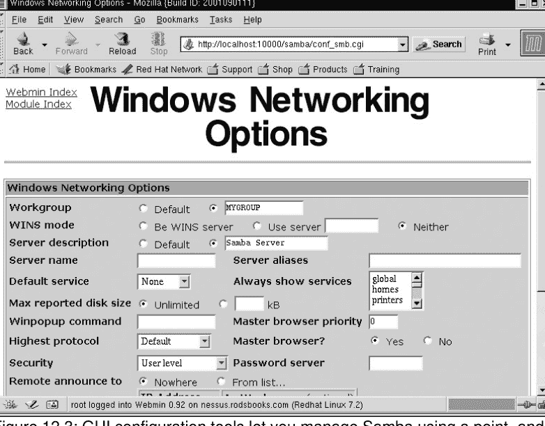

Samba 通常从 `/etc/rc.d` 目录树中的启动脚本运行。如果尚未存在，你应在 `/etc/rc.d/rc3.d` 和 `/etc/rc.d/rc5.d` 目录中创建适当的链接。在 Red Hat 系统上，以下命令应该有效，但你可能需要根据其他发行版调整这些路径名和文件名：

```bash
# ln -s /etc/rc.d/init.d/smb /etc/rc.d/rc[35].d/S91smb
```

如果你刚刚以这种方式配置了 Samba，你需要手动启动它，或者在修改其配置后重启它。分别可以通过输入 `/etc/rc.d/init.d/smb start` 或 `/etc/rc.d/init.d/smb restart` 来实现。

## 设置全局选项

Samba 包含许多全局选项（即出现在 `smb.conf` 文件中 `[global]` 部分的选项）。此处列出了其中一些最重要的选项：

```text
[global]
    workgroup = ARBORETUM
    netbios name = GINKGO
    server string = Big Server
    encrypt passwords = Yes
    os level = 1
    preferred master = No
    domain master = No
    hosts allow = 192.168.34.
```

这些选项的含义如下：

- `workgroup`（工作组）：Windows 网络按工作组组织，工作组是共享相同工作组名称的计算机集合。该名称由 `workgroup` 参数指定。如果你不将此参数设置为匹配你网络的工作组，可能无法访问 Samba 服务器。（许多 Windows 网络使用域而非工作组。域也有名称，同样使用 `workgroup` 参数进行设置。）

- `netbios name`（NetBIOS 名称）：计算机的 NetBIOS 名称是其他计算机识别它的名称，而 `netbios name` 参数用于设置此功能。如果未设置此参数，Samba 将采用计算机机器名的默认值；例如，`ginkgo.threeromco.com` 变为 `GINKGO`。

- `server string`（服务器字符串）：此参数设置了一个注释，当你使用 Windows 网络邻居工具浏览工作组时可以看到该注释。这是 Windows 网络的一个纯外观功能。

- `encrypt passwords`（加密密码）：此参数至关重要，且常常给新的 Samba 管理员带来很多麻烦。默认情况下，Samba 仅接受明文密码，这些密码未经加密传输。这种特性可能存在安全风险；然而，以加密形式传输密码更好，这使得破解截获的密码变得困难或不可能。但是，在 Samba 上使用加密密码需要维护一个单独的仅用于 Samba 的密码列表。（Samba 会将明文密码与 Linux 常规密码数据库进行比对。）早期版本的 Windows 95 和 Windows NT 4.0 使用明文密码，但 Windows 95 OSR 2、Windows 4.0 SP 3 以及所有后续版本的 Windows 均使用加密密码。“设置密码选项”部分更详细地描述了 Samba 的加密密码处理机制。

- `os level`（OS 级别）：`os level` 参数控制 Samba 如何在主浏览器选举中宣告自身。这些选举决定哪台计算机维护本地计算机列表，以方便其他系统。除非你是经验丰富的 Samba 管理员并理解承担主浏览器职责的后果，否则应将此值设置得较低（例如设为 1）。

- `preferred master, domain master`（首选主浏览器、域主浏览器）：这两个参数也影响 Samba 是否承担主浏览器职责。如果设置为 `Yes`，`preferred master` 会使 Samba 尝试承担此角色，如果服务器未配置为赢得选举，这可能非常有害。因此，除非你理解选举过程，否则我们建议将此值设置为 `No`。同样，`domain master` 决定 Samba 是否试图成为域主浏览器（这与本地主浏览器略有不同）。

- `hosts allow`（允许主机）：此参数是一个重要的安全功能。如果使用，它会阻止 Samba 访问除指定计算机以外的所有设备。你可以按主机名（如果与 NetBIOS 名称不同，则不使用 NetBIOS 名称）或 IP 地址列出计算机。如果主机名以句点开头，或者由少于四个元素组成的 IP 地址以句点结尾，则表示整个计算机网络。例如，在前面的示例中，允许 `192.168.34.0/24` 网络上的所有计算机访问。虽然此参数并非必需，但使用它是一个好主意，特别是当服务器连接到整个互联网时。

这些参数中最关键的是 `workgroup` 和 `encrypt passwords`。当你首次安装 Samba 时，它不太可能已配置为在你的工作组中运行，因此你必须设置 `workgroup` 参数才能使用该服务器。同样，除非你使用的是相当旧的客户端，否则你通常必须配置 Samba 使用加密密码，或者重新配置客户端使用明文密码。

## 设置密码选项

如果你设置了 `encrypt passwords = Yes`，必须在 Linux 上设置加密密码文件。为此，你可以使用 `smbpasswd` 程序，该程序向加密密码文件（在 Red Hat 7.3 系统中为 `/etc/samba/smbpasswd`）添加用户名和密码，或编辑这些信息。对于系统上的每个用户，你都应该发出命令 `smbpasswd -a`。该程序会要求你两次输入密码。首次运行此程序时，它可能会通知你找不到 `smbpasswd` 文件，因此正在创建它。

如果你更喜欢使用明文密码和常规 Linux 密码数据库，可以通过更改较新的 Windows 客户端以发送明文密码来实现。在 Red Hat 7.3 系统中，目录 `/usr/share/doc/samba-2.2.3a/docs/Registry` 包含几个 `.reg` 文件，可用于对 Windows 系统进行相应的更改。将文件名与你运行的操作系统版本匹配的文件（例如，对于 Windows 98，使用 `Win98_PlainPassword.reg`）复制到软盘，将该软盘移至目标 Windows 系统，并双击文件以调整客户端配置。在更改生效之前，你需要重启 Windows。

## 配置文件共享

文件共享构成了大多数 `smb.conf` 文件的主要部分，尤其是在拥有许多共享的服务器上。此共享演示了最常见的文件共享选项：

```ini
[bigshare]
    comment = Shared Program Directory
    path = /home/samba/bigshare
    read only = No
    browseable = Yes
    create mask = 0666
    directory mask = 0777
```

此共享参数的含义如下：

- `comment`（注释）：`comment` 参数的作用与 `server string` 参数类似，只是 `comment` 设置的是与特定共享相关联的注释。

- `path`（路径）：`path` 参数设置要共享的目录。这可以是计算机上的任何目录，当然，出于安全原因，共享某些目录（如 `/etc`）是不明智的。

- `read only`（只读）：默认情况下，Samba 不授予写入它所共享目录的权限。你可以通过包含 `read only = No` 参数来允许用户写入 Samba 共享。`writeable` 和 `writable` 是 `read only` 的反义词，因此 `writeable = Yes` 等同于 `read only = No`。

- `browseable`（可浏览）：如果此参数设置为 `Yes`，共享将出现在 Windows 下的网络邻居浏览列表中。通常最好将此参数设置为 `Yes`。


- **`create mask` 和 `directory mask`（创建掩码和目录掩码）**：这些参数设置用户通过 Samba 创建的文件和目录的最大权限。在示例中，这些值被设置为较高值，以便所有用户都可以读写彼此的文件。当然，你可能希望限制权限而不是扩展权限。默认值分别为 `0744` 和 `0755`。

有一个特殊的共享名称值得明确提及：`[homes]`。如果使用此共享，你应该省略 `path` 参数，Samba 将提供与用户主目录对应的共享。例如，如果 `jennie` 登录服务器，该共享在客户端上显示为 `JENNIE` 并显示用户主目录中的文件。此共享在用于存储单个用户文件（而非共享程序文件）的服务器上极其有用且流行。

除了文件共享外，Samba 还支持打印机共享，如第 10 章所述。启用打印机共享的最简单方法是创建一个 `[printers]` 共享，并设置 `print ok = Yes` 参数。这使得 Samba 共享 `/etc/printcap` 中定义的每个打印机队列。由于这些 Linux 打印机队列通常定义为 PostScript 打印机，你应该从 Windows 客户端将它们视为 PostScript 打印机。

**提示**：`Apple LaserWriter` 驱动程序在使用 Linux 上的 `Ghostscript` 进行打印的打印机上通常工作良好。

## 将 Samba 用作客户端

Samba 包含两个客户端程序：`smbclient` 和 `smbmount`。前者允许你以类似于文本模式 `FTP` 客户端程序的方式执行文件传输。相比之下，`smbmount` 允许你将共享挂载到 Linux 目录树上，就像使用 Linux `mount` 命令挂载 `NFS` 共享一样。（实际上，从 Samba 2.0.6 开始，你可以使用 `mount` 代替 `smbmount`。）此外，还有各种图形用户界面前端用于这些软件包，这样你就可以从 Linux 浏览 `SMB/CIFS` 网络，就像从 Windows 浏览一样。

所有 Samba 客户端程序都依赖 `smb.conf` 文件中 `[global]` 部分的设置来控制其操作的某些方面，例如计算机声明的 `NetBIOS` 和工作组名称。因此，在使用 Samba 作为客户端之前，你应确保这些功能设置正确。

要使用 `smbclient`，你启动它并传入要访问的服务器和共享名称，如下所示：

```bash
$ smbclient //server/share
```

输入此命令后，`smbclient` 会提示你输入密码，该密码必须与你在服务器上用户名关联的密码相匹配。（如果你在服务端的用户名与客户端不同，可以使用 `-U username` 参数来指定你在服务器上的用户名。）`smbclient` 中可用的命令与文本模式下的 `ftp` 程序或 Linux shell 中的命令类似——例如，查看可用文件；分别使用 `put` 和 `get` 在共享资源中传输文件；使用 `cd` 移动到新的目录；等等。你可以输入 `?` 或 `help` 来查看命令摘要。

虽然 `smbclient` 可能是快速传输少量文件的好方法，但如果你希望直接修改服务器上的文件，`smbmount` 会更加灵活。例如，你可能会使用此工具调用 Linux 程序来编辑存储在服务器上的文件。要使用 `smbmount`，请以以下形式发出命令：

```bash
$ smbmount //server/share mountpoint
```

**注意** 如果你没有以 `root` 身份发出 `smbmount` 命令，则必须将两个程序设置为 `user ID` (suid) `root` 才能正常工作：`smbmnt`（`smbmount` 的辅助程序）和 `smbmount`（用于卸载 `SMB/CIFS` 共享资源）。你可以发出命令 `chmod a+s /usr/bin/smbmnt /usr/bin/smbmount` 来完成此任务。

与 `smbclient` 类似，`smbmount` 在挂载共享资源之前会要求你输入密码。一旦共享资源被挂载，你就可以像访问本地磁盘上的文件一样访问其中的文件，但需注意某些事项。某些文件系统可能是只读共享的，因此你可能无法向这些共享资源写入文件。`SMB/CIFS` 不支持 Linux 式的拥有权和权限，因此默认情况下，所有文件都属于发出 `smbmount` 命令的该个人。当你用完某个共享资源后，可以使用 `smbmount` 命令卸载它；输入格式如下

```bash
$ smbmount mountpoint
```

如前所述，在 Samba 2.0.6 及更高版本中，你可以使用 `mount` 代替 `smbmount`。这样做时，你调用 `mount` 时使用 `smbfs` 文件系统类型，如下所示：

```bash
# mount -t smbfs //server/share mountpoint
```

除非你创建一个 `/etc/fstab` 条目，允许普通用户发出 `mount` 命令（如第 6 章所述），否则当调用者是 `root` 时，此流程效果最好。在这种情况下，你在发出 `mount` 命令时应省略文件系统类型、服务器名称和共享资源名称（例如 `mount mountpoint`）。

有几种用于 `smbmount` 的 GUI 前端。操作细节因程序而异，但作为一个总体规则，这些工具提供了一个本地网络的 GUI 视图，正如 `LinNeighborhood`（http://www.bnr.o.de/~schmidjo/）所展示的那样，如图 12.4 所示。当你双击一个共享资源以打开它时，一个对话框会询问你的用户名和密码，然后该程序将使用你在配置程序时指定的文件管理器在该共享资源上打开一个窗口。GUI 前端并没有真正为 Linux 的 `SMB/CIFS` 功能增加根本性的新功能，但它们确实使这些网络对不熟悉 Samba 文本模式工具的人来说更容易访问。因此，你可能希望安装 `LinNeighborhood` 或类似的软件包，如 `Kruiser`（http://devel-home.kde.org/~kruiser/）或 `xSMBrowser`（http://www.public.iastate.edu/~chadspen/）。

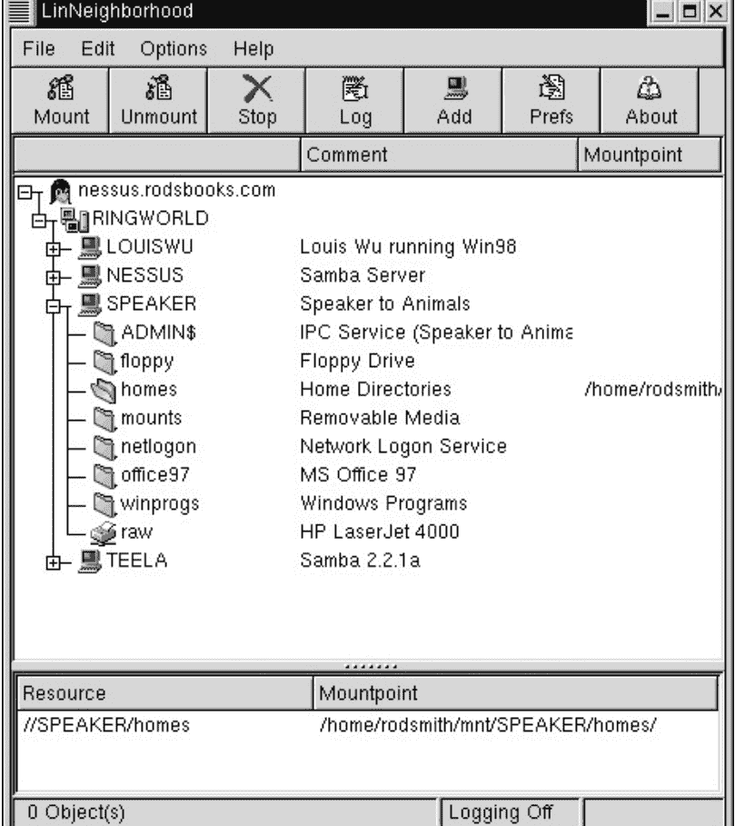

图 12.4：`LinNeighborhood` 和其他 GUI `SMB/CIFS` 浏览器提供类似于 Windows 中网络邻居的用户界面。

## Internet 服务器

如果你希望在你离开计算机时仍能使用它，你必须在该计算机上安装某种类型的服务器。同样，如果你希望其他人能够使用计算机，也需要服务器。然而，合适的服务器取决于你的具体需求。虽然配置服务器有一些共同点，但每种配置都至少有一些独特的方面，因此你应该查阅相应的文档。

## 可用的服务器

Linux 支持各种各样的 Internet 服务器软件包。虽然这些软件包可以单独用于本地网络，但它们更常用于为 Internet 上的各种计算机提供服务。书中其他部分在较大或较小的程度上讨论了一些这些服务器。其中许多足够复杂，以至于整个书都是关于它们的。通常你可以在随服务器提供的文档文件中或专门介绍这些服务器的 Web 页面上找到更多信息。Linux 可用服务器的完整列表太长，无法在此复述；但一些最重要的服务器类型包括：

- **`FTP` 服务器**：*文件传输协议*（*FTP*）是 Internet 上最重要的协议之一，尽管它是不太显眼的。`FTP` 允许个人向 `FTP` 服务器传输文件或从 `FTP` 服务器传输文件。Web 页面上指向程序文件的链接通常是 `FTP` 链接。Linux 有多种可用的 `FTP` 服务器，例如 *华盛顿大学 FTP*（*WU–FTP*；http://www.wu-ftpd.org/）和 *ProFTP*（http://www.proftpd.net/）。Red Hat 随附 *WU–FTP*，但如果你愿意，可以为 Linux 安装任何其他 `FTP` 服务器。

- **邮件服务器**：如果你希望你的计算机直接接收发给它的邮件，你必须运行一个*邮件服务器*——也称为*邮件传输代理*（*MTA*）。（如果你的*ISP* 为你收集和保存邮件，你可能不需要一个 *MTA*；相反，你可以使用使用诸如*邮局协议*（*POP*）等协议的邮件程序来检索邮件。）所有主要的 Linux 发行版都随附一个 *MTA*，通常默认以合理的方式配置用于标准工作站。Red Hat 随附 *sendmail*（http://www.sendmail.org/），但存在各种替代方案，且被其他一些发行版使用。第 14 章涵盖 *sendmail*，但如果你的系统要专门用作邮件服务器，你应该考虑购买一本专门讨论该主题的书，例如 Craig Hunt 的 *Linux SendMail Administration*（Sybex, 2000）。


- **新闻服务器**：*网络新闻传输协议*（`NNTP`）控制`Usenet`新闻的传输——这是一个全球性的讨论论坛，用户在其中发布关于各种主题（从素食烹饪到`Linux`再到国际空间站）的查询、解决方案和其他讨论。新闻服务器通常存在于`ISP`和大型组织（如大学）中。它们相互交换文章，从而实现了`Usenet`新闻的全球范围。你可以自己运行一个新闻服务器，无论你是负责大型组织的新闻服务器，还是希望为一个内部使用或维护你感兴趣的新闻组本地副本的小型新闻服务器。`Red Hat`随附`Internet News`（`INN`），这是更受欢迎的新闻服务器软件包之一。对于一个仅维护少数新闻组的小型新闻服务器，`Leafnode`（http://www.leafnode.org/）可能更合适。请注意，如果你只是想阅读`Usenet`新闻，你不需要新闻服务器。为此，你需要一个新闻阅读器，如`tin`（http://www.tin.org/）、`Knews`（http://www.matematik.su.se/~kij/）或`Netscape`的新闻阅读器组件。你还需要访问一个新闻服务器，例如由你的`ISP`维护的一个。

- **远程登录服务器**：如果你希望远程运行程序，你必须运行某种远程登录服务器。这是一种接受远程位置登录的程序。`Getty`程序（在第 11 章中讨论）是用于拨号连接的登录服务器。对大多数人来说最熟悉的登录服务器是`Telnet`，它接受来自整个`Internet`的登录。（此服务器随所有主要`Linux`发行版一起提供。）不幸的是，`Telnet`以明文发送所有信息（包括密码），因此从安全角度来看并不是很好。在此方面更好的替代方案是安全外壳（`SSH`），它对所有数据进行加密。`SSH`的一个实现是`OpenSSH`（http://www.openssh.com/），它成为`Red Hat`发行版`7.0`版的标准部分。

- **Web 服务器**：最可见的`Internet`服务器类型之一是`Web`服务器，它实现了*超文本传输协议*（`HTTP`）。在`Linux`上，`Apache`（http://www.apache.org/）是迄今为止最流行的`Web`服务器。`Apache`足够复杂，以至于除了基本配置之外，你应该阅读一本关于它的书，例如`Charles Auld`的《Linux Apache 服务器管理》（`Sybex`，`2001`年）。

### X 服务器

`X`服务器是一个用于显示由`X`程序创建窗口的程序。在独立的`Linux`工作站安装环境中，`X`服务器（通常是`XFree86`）与正在运行的`X`程序位于同一台计算机上。然而，你可以通过登录协议（如`Telnet`或`SSH`）连接到远程计算机，并使用本地的`X`服务器从该远程系统运行`X`程序。请注意，与大多数服务器不同，`X`服务器运行在你最近的计算机上；远程系统运行的是客户端程序。从程序的视角来看，这很合理：对于程序而言，服务器（以及你）位于远程位置，服务器提供远程服务（显示和输入设备）。第`13`章介绍了`XFree86`（http://www.xfree86.org/），它是随所有主要`Linux`发行版一起发行的`X`服务器。

### 警告

所有服务器都存在安全风险。服务器中的漏洞、配置错误的服务器以及本地安全方面的缺陷（例如用户选择了弱密码）使得不法分子能够入侵你的计算机。此外，某些服务器还带来了其他滥用的可能性。例如，很容易将邮件服务器配置错误，使其能够中继任何来源到任何目的地的邮件。那些发送未经请求的大量电子邮件（“垃圾邮件”）的人经常寻找开放中继来掩盖其真实位置。由于存在巨大的滥用潜力，你应该在`Linux`计算机上尽可能少地运行服务器。许多`Linux`发行版默认安装了许多服务器，因此你应该检查你的`inetd.conf`或`xinetd.conf`文件（稍后介绍），并禁用任何你未使用的服务。

## 使用超级服务器

服务器面临的一个问题是，当它们运行时，会消耗系统资源——主要是内存，但也有一部分`CPU`时间。如果服务器只是偶尔使用，这些资源可能更适合由其他进程使用。因此，托管许多很少使用的服务器的系统转而使用超级服务器来控制这些服务器。超级服务器是一个查找发往其他几个服务器的传入数据包的程序。当超级服务器检测到此类数据包时，它会启动相应的服务器程序。当不需要单个服务器时，它们就不会运行。如果你希望运行多个服务器，而其中大部分在任何给定时刻都没有被使用，这种方法可以节省大量内存。

使用超级服务器的另一个好处是，通常可以通过这种服务器实现额外的安全功能。实现这一目标的一种方法是使用中间件包，例如`TCP Wrappers`（在第`15`章中有更详细的介绍），来过滤连接请求。`TCP Wrappers`可以检查调用系统的`IP`地址，并根据该地址允许或拒绝访问。如果某些服务器（如`Telnet`或`SSH`服务器）只能从特定计算机访问，这将极其有用。

## 使用 `xinetd`

现代版本的`Red Hat`和`Mandrake Linux`使用`xinetd`（读作“`zi-net-dee`”）超级服务器。即使是其他发行版的管理员也经常会用`xinetd`替换标准的`inetd`，以获得`xinetd`改进的安全功能的好处，这些功能在第`15`章中有更详细的介绍。该程序最大的优势是将`TCP Wrappers`的许多功能整合到了超级服务器本身中。它在具有多个网络卡的系统上特别有用，因为它可以基于网络卡阻止对特定服务器的访问。如果你的发行版不包含`xinetd`，你可以从`http://www.xinetd.org/`获取它。

`xinetd`的配置文件是`/etc/xinetd.conf`。不过，在标准的`Red Hat`或`Mandrake`安装中，此文件仅设置几个默认值，并加载`/etc/xinetd.d`目录中的文件，每个文件包含一个服务器的配置。这种配置允许软件包轻松地添加和删除`xinetd`配置文件。列表`12.2`显示了一个示例`xinetd`服务条目。

### 列表 12.2：一个示例 xinetd 服务条目

```
service ftp
{
    disable         = no
    socket_type     = stream
    protocol        = tcp
    wait            = no
    user            = root
    server          = /usr/sbin/in.ftpd
    server_args     = -l -a
    interface       = 192.168.203.7
}
```

列表`12.2`中显示的条目的含义如下：

- **service**：定义以`service`关键字开头，该标识了此条目控制的服务器。你可以在`/etc/services`文件中找到服务名称，以及与服务关联的端口号。`xinetd`“监听”与服务关联的端口号，当检测到指向该端口的流量时，`xinetd`会启动服务器。`service`行后面是一个左花括号，标志着该服务配置块行的开始。该块以右花括号结束。

- **disable**：`xinetd`允许你通过此行轻松禁用单个服务器；要这样做，请将值设置为`yes`。此示例条目未被禁用，但某些服务器安装时其`xinetd`配置默认是禁用的，作为一种安全预防措施；你必须主动启用服务器才能使用它，从而避免因意外安装服务器而向系统开放其安全漏洞。

  > **提示**：保护`Linux`服务器安全的一个简单首要步骤是从`xinetd.d`中禁用所有不必要的服务器。事实上，该目录中配置的服务器对`Linux`启动都不是必需的。有些服务器听起来可能至关重要，但实际上并非如此。例如，登录服务器（`login server`）是一个安全性很低的远程登录服务器；对于普通的文本模式登录，甚至通过`Telnet`或`SSH`的远程登录，它都不是必需的。

- **socket_type**：每个服务都关联一个套接字类型。常见值有`stream`（流）和`dgram`（数据报）。

- **protocol**：这是`TCP/IP`连接的类型——`tcp`或`udp`。大多数网络服务器使用`TCP`，它建立持久的双向连接；但有些使用`UDP`，它健壮性较差，但开销较少，因为它不建立完整的双向连接。

- **wait**：基于数据报的服务（指定`dgram`套接字类型的那些）要么保持与调用者的连接并在此处指定`yes`，要么是多线程的并分离出一个单独的线程来处理连接。后一种类型指定`no`。此条目对于流式连接没有意义，但按惯例它们指定`no`。

- **user**：`xinetd`使用特定的用户名启动每个服务器。许多服务器必须以`root`身份启动，但有些可以在其他用户名下启动以提高安全性。

- **server**：此项指定当检测到指向服务端口的流量时要启动的服务器。通常，`xinetd`需要程序的完整路径。


* `server_args`：此选项提供应传递给服务器的参数。某些服务器从超级服务器运行时需要特殊参数，或者你希望使用参数启动它们以使它们以某些非标准方式运行（例如增加其调试输出）。

* `interface`：此示例中的最后一个条目是 `xinetd` 监听连接的接口上关联的 IP 地址。`xinetd` 配置条目中经常省略此项，但在具有多个网络接口的系统上它非常有用。在这样的系统上，`xinetd` 不会响应针对未明确启用的接口的访问尝试，这可能是一个非常有用的安全工具。

`xinetd` 是一个极其强大的软件包，因此对于更高级的选项，你应该查阅其文档。第 15 章还介绍了一些 `xinetd` 的安全相关功能。

在对 `xinetd` 配置进行更改后，你必须重启它。你可以使用其 `SysV` 启动脚本来做到这一点，如下所示：

```
# /etc/rc.d/init.d/xinetd restart
```

## 使用 `inetd`

尽管 `xinetd` 近年来日益流行，但大多数 Linux 发行版中最常见的超级服务器仍然是 `inetd`。该服务器通过 `/etc/inetd.conf` 文件进行控制。此文件中的每一行对应一个服务器。一个使用 `TCP Wrappers` 的示例如下：

```
ftp stream tcp nowait root /usr/sbin/tcpd in.ftp -l -a
```

此条目中每个元素的含义与前面在“使用 `xinetd`”中介绍的 `xinetd` 配置中的含义类似。不过，`xinetd` 依赖于单独行上的命名条目，而 `inetd` 依赖于单行上固定顺序的条目。具体来说，使用前面概述的 `xinetd` 名称，顺序为：

```
service socket_type protocol wait user server server_args
```

这些元素中的大多数与 `xinetd` 中的等效项取相同的值。不过，`wait` 字段取值为 `wait` 和 `nowait`，而不是 `yes` 和 `no`。`server` 字段经常指向 `tcpd`，即 `TCP Wrappers` 二进制文件。服务器名称作为第一个参数传递给 `server_args` 字段中的 `TCP Wrappers`。

在默认的 `/etc/inetd.conf` 文件中，你会找到大多数常见服务器的条目。然而，这些条目中的大多数都用井号（`#`）注释掉了。因此，当你添加特定类型的服务器时，可以取消相应条目的注释。相反，如果你移除某个服务器或想要禁用它，如果该活动行存在，你可以注释掉相应的行。你可以使用此功能来相比 `xinetd` 的 `disable` 字段更甚。与 `xinetd` 类似，你应该禁用不必要的 `inetd` 驱动的服务。

修改 `/etc/inetd.conf` 后，必须向该服务器发送 `SIGHUP` 信号，以指示其重新加载配置文件。你可以按以下操作进行：

```
# ps ax | grep inetd
 468 ?        S      0:00 inetd
# kill -SIGHUP 468
```

进程 ID 号（前例中为 `468`）在你的系统中可能不同。如果可能，你应立刻测试你的更改是否已生效。如果添加或移除了某个服务，可以通过尝试连接该服务来进行此测试。

### 超级服务器的通用注意事项

由于超级服务器并不会使真正的服务始终保持加载状态，因此当更新底层服务时，通常不需要重启超级服务器。例如，你可以升级 `Telnet` 服务，超级服务器会立即开始使用新版本。该规则的例外情况是，如果更新后的服务需要以新的方式调用——例如，如果其名称或位置发生了改变。

使用超级服务器的缺点是，启动其“子”服务必然需要一些时间。结果是，服务器计算机不会立即响应请求；系统响应请求的时间可能短至几分之一秒，也可能长达数秒。对于某些服务（如 Web 服务），这可能是主要的缺点。你需要自行判断，使用超级服务器带来的内存使用改善（以及可能的安全性提升）是否值得付出延迟的代价。

某些服务如果通过超级服务器运行，效果会非常差，甚至根本无法运行。例如，大多数安装环境不会通过 `inetd` 或 `xinetd` 运行 `Samba` 或 `sendmail`；尽管可以通过超级服务器运行这些服务，但性能损失过大。因此，不要以为只要清理了 `/etc/inetd.conf`、`/etc/xinetd.conf` 或 `/etc/xinetd.d` 中的多余服务，就关闭了所有不必要的服务。你可能还需要清理 `/etc/init.d` 目录树或其他系统启动文件中的更多部分。

## 总结

`TCP/IP` 网络是当今最流行的网络类型。它是互联网所使用的协议，许多本地网络任务也使用 `TCP/IP`。配置 Linux 进行 `TCP/IP` 网络通信涉及使用多种不同工具来激活网络接口、告知 Linux 如何路由数据包等。大多数发行版允许你在安装操作系统时配置这些选项，或者在之后通过 `GUI` 配置工具或文本编辑器编辑配置文件来完成。

文件共享是小型网络中最受欢迎的网络任务之一。此任务基于基本的 `TCP/IP` 网络功能，允许你将文件存储在单台计算机上供多个系统使用。在许多工作环境中，这可以带来巨大好处，通过允许用户在任意计算机上工作并轻松交换文件来提高生产力。

Linux 支持多种基于 `TCP/IP` 的互联网服务器，这些服务器可以为远程系统提供私有和公共服务。其中许多服务都是整本书的主题。第 13 章和第 14 章介绍了其中两种服务，即 `X` 窗口系统和邮件服务器。

# 第 13 章：`X` 窗口系统

## 概述

图形用户界面（`GUI`）在当今许多计算机用途中是实际必需品。虽然使用文本模式工具也能完成很多事情，但许多用户在 `GUI` 环境中比在文本模式程序中更感到舒适。`GUI` 对某些类型的程序也非常有用，例如图形编辑器。一些操作系统，如 `MacOS`，将其 `GUI` 与整个操作系统极其紧密地集成在一起。然而，Linux 使用的是一种更松散的结构。在 Linux 中，`GUI` 与操作系统核心完全分离。事实上，Linux 有多种不同的 `GUI` 可用，但其中最常见的是被称为 `X` 窗口系统（或简称为 `X`）的界面。

大多数现代 Linux 发行版（包括 `Red Hat`）都在安装时尽一切努力正确配置 `X`，并设置默认值以创建具有吸引力且易于使用的 `GUI` 环境。这种配置可能使新的 Linux 用户认为 Linux 比实际情况更像 `Windows` 或 `MacOS`。事实上，`X` 在许多方面与这些操作系统非常不同，这使得 `X` 相比于其他操作系统的 `GUI` 具有独特的优势和劣势。

本章首先从 `X` 的基本概念（如作为网络协议的 `X`）入手。然后，章节将对 `X` 配置进行概述——幸运的是，这通常在系统安装时会自动处理。接着，讨论了运行 `X` 环境的三个重要组成部分：窗口管理器、小部件集和桌面环境。本章最后探讨了在 Linux 系统上运行基于 `X` 的应用程序所涉及的若干问题。

### `X` 的概念

你可能已经熟悉 `GUI` 环境，无论是通过 `Windows`、`MacOS` 或其他操作系统的使用；还是作为用户（而非系统管理员）在 Linux 或 `Unix` 上使用 `X`。这些经验中的许多知识在使用和管理 `X` 时都是有用的。然而，你应该意识到 `X` 的几个独特方面。其中许多特性使 `X` 比大多数其他 `GUI` 更灵活，但有些可能会限制使用或给新的 `X` 用户造成困惑。

### `X` 作为网络协议

与大多数其他 `GUI` 环境相比，`X` 最与众不同的特性是它是一个非常以网络为导向的工具。`X` 背后的基本思想是：当启动基于 `X` 的程序时，该程序会尝试连接到 `X` 服务器。`X` 服务器提供一个屏幕供程序显示其输出，并提供键盘和鼠标用于输入。

当你将 Linux 计算机配置为工作站时，它默认使用本地 `X` 服务器来执行这些功能。该 `X` 服务器使用计算机的标准键盘、鼠标和显示器。因此，不涉及实际的网络访问。然而，Linux 程序可以轻松地将其 `X` 请求指向另一台计算机上运行的 `X` 服务器。当这种情况发生时，结果是你可以使用一台计算机（运行 `X` 服务器）来运行位于另一台计算机（客户端）上的软件。通常，你使用远程登录客户端（如 `Telnet`，见第 12 章）和本地系统上的 `X` 服务器，以及远程系统上的登录服务器和 `X` 客户端（在程序上）。登录到远程系统后，你发出适当的命令使其 `X` 程序使用你的本地显示器，并在本地启动一个 `X` 服务器。远程系统甚至不需要有显示器或 `X` 服务器。这种安排如图 13.1 所示。

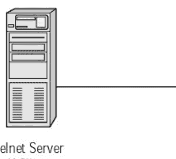

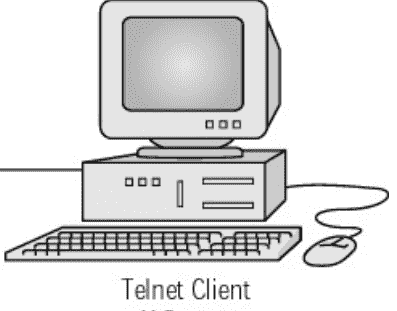

图 13.1：`X` 服务器运行在用户坐着的计算机上；`X` 客户端可能位于离用户数英里之外。

客户端/服务器的术语对大多数 Linux 初学者来说令人困惑，因为大多数人认为服务器运行在强大的远程计算机上。在大多数情况下，是在用户坐着的计算机上运行的是客户端。在 `X` 的情况下，这种关系是颠倒的。为了理解和记住这一点，从应用程序的角度思考会有所帮助。对于 `X` 程序来说，`X` 服务器提供网络服务，就像文件服务器或 Web 服务器一样。`X` 服务器前坐着人类这一事实对程序来说无关紧要。


注意：一种名为虚拟网络计算（VNC）服务器（<http://www.uk.research.att.com/vnc/>）的网络产品，可以像通过 X 一样提供对 Linux 计算机的远程访问。然而，在 VNC 的网络模型中，服务器与 X 程序运行在同一台计算机上；用户运行一个小的客户端程序与 VNC X 服务器通信。实际上，VNC 在通信线路上增加了一层，从而将通常的 X 客户端/服务器关系反转，使其对大多数用户更直观。

即使你仅在单台计算机上本地使用 X，X 的网络中心设计也有重要的影响。这些影响包括：

- X 可以配置为使用字体服务器（稍后描述）来处理字体渲染。一些发行版（包括 Red Hat 7.3）默认使用字体服务器。但是，你可以使用单个字体服务器为你网络上的所有计算机服务，这可以简化字体管理。
- 与所有网络服务器一样，X 使用各种安全措施。在某些发行版（Red Hat 除外），你可能会发现如果使用 `su` 获取 root 权限，则无法运行基于 X 的程序。如果你的 X 安全性较为宽松，其他计算机的用户可能能够窥探你的显示器或在你的屏幕上显示他们自己的程序。
- X 程序依赖于某些环境变量来告知它们使用哪个显示器。这些变量在默认的 Linux 安装中通常设置正确，但这些设置可能会损坏。如果你想使用远程显示器，你也必须更改它们。
- X 通常比其他 GUI 环境慢。即使显示器是本地的，通过网络协议处理显示数据的需求也会导致一些减速。在现代硬件上，这种影响可能相当温和，但你可能在某些应用程序或较旧的硬件上注意到它。

## X 安全性

如果你仅在本地使用 X，那么你的发行版很可能已经以合理的方式配置了 X。不过，在某些发行版上，如果你希望在使用 `su` 获取 root 权限后仍使用 X 程序，可能需要在一定程度上放宽安全性。如果你还想远程运行 X 程序，则需要进行几项调整。

### 设置 X 客户端安全选项

要使用 X 服务器，客户端计算机必须知道哪个 X 服务器应该被使用。这通过 `DISPLAY` 环境变量完成，你可以使用以下命令设置该变量（假设你正在使用 bash shell）：

```bash
$ export DISPLAY=hostname:displaynum
```

在此命令中，`hostname` 是运行服务器的计算机名称（即你当前所在的计算机），`displaynum` 是显示器编号。`displaynum` 通常为主 X 显示器的 `0` 或 `0.0`，但如果计算机运行多个 X 服务器（如稍后在“X 虚拟控制台”中所述），则可能是较高的数字。重要的是要明白，你需要在计划运行 X 程序的计算机上发出此命令，而不是在你的本地计算机上。

### 在 X 服务器上使用 `xhost`

大多数 X 服务器默认配置为拒绝除本地系统之外的所有连接。一些发行版还拒绝除本地登录用户之外的连接。在这种情况下，当你使用 `su` 获取 root 权限后将无法使用 X 程序。有多种方法可以指示 X 在接受的连接上更加宽松。最简单的方法是使用 `xhost` 命令，其语法如下：

```bash
xhost  [+|-] hostname
```

要将客户端添加到允许的主机列表中，使用 `+hostname`；要移除客户端，使用 `-hostname`。如果你省略了 `hostname`，X 服务器将接受或拒绝所有连接，无论客户端是谁。在添加权限时，这可能是一个重大的安全隐患。与 `DISPLAY` 环境变量不同，此命令必须在 X 服务器计算机上发出——即你所在的计算机。

> **提示** 如果你经常从一台 Linux 计算机在多台不同的计算机上运行程序，可以将适当的 `xhost` 命令添加到你的 `.xsession` 或其他启动文件中（本章稍后会有说明），以默认允许这些连接。你可以使用 `localhost` 作为 `hostname`，以确保所有本地用户（包括 root）都可以使用你的显示器，这样你就可以使用 `su` 然后以其他用户身份运行 X 程序。

举个例子，考虑以下情况：你正在 `dino.pangaea.edu` 计算机上，想要运行位于 `latch.threeroomco.com` 上的一个程序。假设两台计算机都是 Linux 或 Unix 系统，你可以按照以下步骤操作：

1. 登录到 `dino.pangaea.edu`。
2. 如果 `dino` 尚未运行 X，输入 `startx` 启动它。
3. 输入命令 `xhost +larch.threeroomco.com`。
4. 使用 Telnet 或 Secure Shell (SSH) 从 `dino.pangaea.edu` 登录到 `larch.threeroomco.com`。
5. 在 `larch` 登录会话中输入 `export DISPLAY=dino.pangaea.edu:0`。
6. 使用 `larch` 登录会话运行你想要运行的任何程序。
7. 完成操作后，在 `dino` 上输入 `xhost -larch.threeroomco.com` 以将 `larch` 从 `dino` 的允许主机列表中移除。

X 服务器适用于各种各样的计算机，不仅限于 Linux 和 Unix 系统（参见本章稍后的侧边栏“XFree86 的替代方案”）。因此，如果 `dino` 运行其他操作系统，你也可以遵循类似的步骤。然而，Windows 和其他操作系统的 X 服务器在安全性方面通常比较宽松，因此你不需要使用 `xhost` 命令；这些 X 服务器一开始就接受来自几乎任何地方的连接。

如果你的计算机（`dino`）位于防火墙后面，特别是使用 IP 伪装的防火墙，你可能无法遵循上述步骤，因为外部客户端无法突破防火墙连接到你的 X 服务器。解决这个问题有两个常见的变通方法：

- **使用 VNC**：前文提到的 VNC 反转了客户端/服务器配置，使服务器位于防火墙之外。假设你的防火墙不阻止出站 VNC 连接，你可以使用本地 VNC 客户端并在远程系统上运行 VNC X 服务器。有关使用详情，请查阅 VNC 文档。
- **使用 SSH**：SSH 可以配置为通过其自身连接隧道传输 X 连接。发生这种情况时，SSH 服务器会查找来自本地程序的 X 连接尝试，并将它们传回运行 SSH 客户端（和 X 服务器）的系统。如果配置得当，这会自动完成，因此你可以跳过上述步骤中的第 3、5 和 7 步。如果最初不起作用，请检查客户端上的 `/etc/ssh/ssh_config` 文件；其 `ForwardX11` 行应设置为 `yes`。服务器的 `/etc/ssh/sshd_config` 文件应包含一行 `X11Forwarding yes`。

### 使用 `xauth` 安全性

使用 `xhost` 使远程计算机访问 X 服务器的一个问题在于，该程序会让远程计算机的所有用户访问你的屏幕。如果远程系统有很多用户，且其中有人在搞小动作，此人可能在你的屏幕上显示程序、捕获你的键盘输入等。幸运的是，X 提供了更安全的身份验证方法：`xauth`。要使用 `xauth`，请遵循以下步骤：

1. 登录到 X 服务器系统（例如 `dino.pangaea.edu`）。
2. 如果 X 服务器计算机尚未运行 X，输入 `startx` 启动 X。
3. 在 X 服务器系统（`dino`）上输入以下命令，以让 `larch.threeroomco.com` 上的程序访问你的本地 X 服务器：

   ```bash
   # xauth list | grep "dino:0" | sed -e 's/^/add /' | ssh \
   larch.threeroomco.com -X xauth
   ```
4. 使用你首选的远程登录协议登录到 X 客户端系统（`larch`）。
5. 运行你想要运行的任何程序。

不幸的是，此流程并非没有缺点。步骤 3 依赖于 X 服务器上存在 SSH 客户端以及 X 客户端上存在 SSH 服务器。你可以修改此命令使用 `rsh` 而不是 `ssh`，但 `rsh` 不是非常安全的协议，因此这种修改是不明智的。此步骤提取 X 服务器用于确定谁可以访问它的身份验证密钥，并将该密钥传输到 X 客户端系统。也可以通过使用交互式模式下的 `xauth` 实用程序并手动传输密钥来完成步骤 3 的任务，但这样做是一个繁琐的过程。

如果你在步骤 4 中使用 SSH，SSH 可能会尝试隧道传输 X 连接。实际上，如前文“在 X 服务器上使用 `xhost`”中所述，这样做就免去了执行此处描述的流程的需要，这也不是使用 `xauth` 的真正缺点。如果两台计算机上都安装了 SSH，通常最好使用 SSH 的 X 隧道功能，因为这提供了加密。如果没有这种加密，作为 X 会话一部分传输的所有数据都可能被恶意人员截获。

一些 X 工具在“幕后”使用 `xauth`。例如，`XDM` 和类似工具（将在接下来的部分“自动启动 X”中描述）使用 `xauth` 授予用户访问 X 服务器的权限。当 SSH 隧道传输连接时也会这样做，尽管在这种情况下，X 在本地使用 `xauth`，并在 X 客户端系统上充当 X 服务器，在 X 服务器系统上充当 X 客户端。

## X 虚拟控制台


# 虚拟控制台

第 6 章描述了虚拟控制台的文本模式登录用法。如果你使用文本模式登录，可以按 `Alt+F1` 到 `Alt+F6` 在不同的屏幕之间切换，每个屏幕都可以显示不同的登录会话。因此，你可以使用一个屏幕以正常用户名登录，另一个屏幕以 `root` 身份登录，等等；或者多次以同一用户登录并轻松地在不同程序之间切换。如果你正在运行 `X`，可以通过按下 `Ctrl+Alt+Fn` 切换到虚拟文本模式控制台，其中 `n` 是控制台编号。

然而，虚拟控制台并不限于文本模式登录。当 `X` 运行时，默认情况下它会接管一个未使用的虚拟控制台（通常是控制台 7）。因此，你可以按 `Alt+F7` 从文本模式控制台切换回 `X`（如果 `X` 正在运行）。更有趣的是，可以在每个自己的虚拟控制台中运行多个 `X` 会话。然后可以通过按下 `Ctrl+Alt+Fn` 在它们之间切换，其中 `n` 是从 7 开始的数字。要启动第二个 `X` 会话，请遵循以下步骤：

1. 如果你已经在 `X` 中运行，请按 `Ctrl+Alt+F1` 到达文本模式登录提示符。登录。
2. 输入 `startx -- :1 vt8` 在虚拟终端 8 上启动 `X`。你应该能看到 `X` 启动。
3. 按 `Ctrl+Alt+F7` 切换回你原来的 `X` 会话，或按 `Ctrl+Alt+F8` 切换到新会话。

为什么要启动新的 `X` 会话？毕竟，大多数窗口管理器支持多个工作区，因此你可以轻松地在不同的屏幕上打开许多窗口。你甚至可以在 `xterm` 内使用 `su` 以不同用户身份启动程序。然而，使用多个 `X` 会话确实有一些优势：

- 你可以在不同的会话中运行不同的窗口管理器。这通常不是运行多个会话的有力理由，但如果你想评估某个窗口管理器，或者需要对某些程序使用一个窗口管理器而对其他程序使用另一个窗口管理器时，它可能很有用。
- 你可以以不同的分辨率启动 `X`。你的正常启动可能是 1280×1024 分辨率，但如果你需要在 800×600 下测试软件，你可以运行一个单独的 800×600。

## 配置 X 服务器

配置 `X` 涉及调整一个主要文件：`XF86Config`。在 Red Hat 系统上，该文件位于 `/etc/X11` 目录中，但某些发行版将此文件放置在 `/etc` 中。你可以直接编辑其 `XF86Config` 文件，或使用 `X` 配置工具来配置 `X`。在大多数情况下，系统在安装期间会合理配置 `X`，但有时安装程序可能会搞砸这项工作。你可能还需要调整配置以更改配置详情，或者如果你更换了视频硬件。

2002 年发布的大多数 Linux 发行版，包括 Red Hat 7.3，都附带两个版本的 `XFree86`：3.3.x 和 4.x 版本。`XFree86` 4.x 代表 `XFree86` 的一项重大变更，尤其是其视频驱动模型。一些旧的 3.3.x 驱动未立即适用于 4.x，且有些存在 bug 或性能问题，特别是在 4.0.x 系列中。因此，尽管 `XFree86` 4.x 提供了额外功能，但 3.3.x 在 2002 年依然很受欢迎。对于普通用户而言，最好将 `X` 配置保留为发行版所选定的版本。不过，在某些情况下，你可能希望升级到 `XFree86` 4.x（或降级到 3.3.x）。请访问主要的 `XFree86` 网站（`http://www.xfree86.org/`）以了解更多关于这两个版本 `XFree86` 之间差异的信息。

要确定你的系统运行的是哪个版本的 `XFree86`，请键入 `X –version`。此命令应返回与 `X` 命令链接的 `X` 服务器版本编号的信息。在某些不寻常的情况下，这可能不是当你启动时运行的服务器。这有时由 `/etc/X11` 中的一个链接决定，通常称为 `X`，因此你也可以检查该链接。如果它指向名为 `XFree86` 的文件，则系统运行 `XFree86` 4.x；如果它指向名为 `XF86-Server` 的文件，其中 `Server` 是服务器名称（如 `SVGA` 或 `S3`），则系统启动 `XFree86` 3.3.x。

**注意：** 某些发行版，如 Red Hat 7.3，会安装两个版本 `XFree86` 的组件。通常，会安装 4.x 版本的字体和支持文件，以及 3.3.x 版本的服务器文件。这种设置可能看起来奇怪，但它是可以工作的。在调整此类系统时，请使用 3.x 的配置说明。由于 4.x 如今更为常见，我们首先介绍它。

### XFree86 4.x

`XFree86` 4.x 随 2002 年发布的所有新的 Linux 发行版一起提供，在大多数情况下是默认的 `X` 服务器。在某些情况下，由于驱动程序更成熟，旧版的 `XFree86` 3.3.x 工作得更好。如果你的系统使用 `XFree86` 3.3.x，请参阅下一节“XFree86 3.3.x”。使用旧版本的 `XFree86` 会让你失去一些功能，包括对多显示器支持（使用多个监视器创建一个更大的虚拟桌面）、支持数据显示通道（DDC）（使 `XFree86` 能够自动确定监视器支持的分辨率），以及对流行的 `TrueType` 字体格式的支持。

官方上，`XFree86` 4.x 通过名为 `XF86Config` 的文件进行控制，该文件存储在 `/etc` 或 `/etc/X11` 中。然而，2002 年的许多 Linux 发行版都附带对 `XFree86` 4.x 和 `XFree86` 3.3.x 的支持，而后者版本使用同名配置文件，但配置文件格式略有不同。因此，`XFree86` 4.x 的配置文件通常被称为 `XF86Config-4`，以便与其早期同名文件区分开来。

`XFree86` 4.x 的配置文件被划分为一系列部分，类似于以下示例：

```
Section "ServerLayout"
  Identifier "Anaconda Configured"
  Screen 0 "Screen0" 0 0
  InputDevice "Mouse0" "CorePointer"
  InputDevice "Keyboard0" "CoreKeyboard"
EndSection
```

每个部分由一个名称标识（在关键字 `Section` 后的引号中），由一系列关键字以及与这些关键字关联的一个或多个值组成，并以关键字 `EndSection` 结束。前面的示例是 `ServerLayout` 部分的典型代表，该部分通过将显示器、键盘和鼠标绑定在一起来配置单个 `X` 服务器。其他部分设置各种细节，例如用于访问鼠标的设备文件以及字体的位置。设置各种选项的部分如下：

- `ServerLayout`：此部分定义了服务器的一些总体功能。具体来说，此部分将输入和输出设备绑定在一起。你很可能不需要从默认值调整此部分。
- `Files`：`Files` 部分包含指向包含重要文件的目录的路径。其中最重要的是 `FontPath` 行，它将 `X` 指向其字体文件和字体服务器，如稍后所述。
- `Module`：此部分指定你希望加载的服务器模块。模块可以提供 `TrueType` 支持和 `DRI` 支持等功能。你通常不需要调整此文件的这部分。
- `InputDevice`：通常，有两个 `InputDevice` 部分——一个用于键盘，一个用于鼠标。除了可能通过 `AutoRepeat` 行进行调整的键盘重复率之外，键盘设置大多是无需调整的事项。你的鼠标设置更可能需要调整。`Option "Protocol"` 行指定你使用的鼠标类型——大多数现代 `PS/2` 接口的鼠标为 `PS/2`，微软串口鼠标为 `Microsoft`，依此类推。（`XF86Config` 手册页包含有关此选项允许值的信息。）你使用 `Option "Device"` 行指定鼠标连接的设备文件。在这两行上的错误是 `X` 问题的常见原因。如果设置不正确，`X` 将无法启动，将启动但不显示任何指针，或者虽然启动但你无法移动鼠标指针。
- `Monitor`：此部分定义了你的监视器的特性。最感兴趣的是 `HorizSync` 和 `VertRefresh` 行，它们定义了你的监视器能够实现的水平和垂直刷新率。你应该在监视器手册中找到此信息。此部分还可以包含 `Modeline` 参数，除非你了解视频硬件如何工作，否则你不应该调整这些参数。（`XFree86` 4.x 的 `XF86Config` 文件缺少 `Modeline` 行并不常见，而是依靠 `DDC` 来获取此信息。）
- `Device`：`XF86Config` 文件包含一个或多个 `Device` 部分，提供有关你视频卡的信息。对于大多数现代视频卡，此部分相当简短。除非你为视频卡增加 `RAM` 或完全更换板卡（在这种情况下，你可能希望运行一个 `X` 配置实用程序来做繁重的工作），否则你不应该调整这些设置。`Driver` 选项指定 `XFree86` 使用的驱动程序，因此如果你升级视频卡，可能需要更改此选项。
- `Screen`：`Screen` 部分通过名称引用 `Monitor` 和 `Device` 部分。你可能希望调整适用于你的监视器/视频卡组合的 `Screen` 部分，将其配置为你首选的屏幕分辨率和位深度。`Screen` 部分中有两个重要选项：
    - `DefaultDepth`：此选项设置 `X` 启动时使用的颜色深度。默认值为 8，这仅产生 256 色的显示。在大多数现代硬件上，值 16 通常是更好的选择。值 24 和 32 在某些系统上工作良好，但偶尔会产生问题。


## Subsection "Display"
`Display` 子部分定义了给定颜色深度的特性。`Depth` 行标识为该子部分编写的颜色深度，`Modes` 行标识 `X` 在此颜色深度下工作的分辨率。你可以使用此功能来定义与不同颜色深度关联的不同分辨率。你的视频卡可能无法在你的最高分辨率下产生 32 位颜色，因此你可以为 32 位显示指定较低的最大分辨率。然后，你可以如前所述启动多个 `X` 服务器，使用颜色深度作为线索来使用不同的分辨率。`XFree86` `4.x` 有时依靠 `DDC` 动态计算此信息。

## DRI
如果你运气好，拥有一张 `XFree86` 支持的具有 3-D 加速功能的视频卡，你可以在此部分定义谁可以访问这些功能。一行简单的代码允许所有用户访问 `DRI` 功能：

```
Mode 0666
```

**提示：** `XFree86` `4.x` 默认使用 `DDC`，但有时会产生不那么理想的结果。例如，一位作者使用 `iiyama` `VisionMaster` `Pro` `450` 监视器，该监视器能够以 `100Hz` 显示 `1280×1024`，但 `DDC` 在此分辨率下仅产生 `85Hz` 显示。这个问题可以通过从 `3.3.x` `XF86Config` 文件复制适当的 `100Hz` `1280×1024` 显示的 `Modeline` 行到 `4.x` `XF86Config` 文件来解决。（这些行在默认的 `3.3.x` `XF86Config` 文件中有清晰标记。）

### XFree86 3.3.x
`XFree86` `3.3.x` 的配置类似于 `XFree86` `4.x`，但较早的版本缺少几个配置文件特性。其中最重要的是 `ServerLayout`、`Module` 和 `DRI` 部分。`XFree86` `3.3.x` 使用名为 `Keyboard` 和 `Pointer` 的部分来设置键盘和鼠标选项，而不是 `InputDevice` 部分。`DefaultDepth` 选项被称为 `DefaultColorDepth`

## 使用 X 配置工具
通常来说，使用 `X` 配置工具创建 `XF86Config` 文件是最简单的方法。手动编辑 `XF86Config` 在更换硬件时可能有用，但从零开始创建一个配置文件是一项艰巨的任务，即使是 `X` 领域的专家也会感到棘手。所有主要的 `Linux` 发行版都包含在系统安装期间运行的 `X` 配置工具。这些工具在安装完成后通常也可用。示例包括：

*   **`XFree86`**：`XFree86` `4.x` 的可执行程序 `XFree86` 可以生成一个初始配置文件。输入 `XFree86 –configure` 可以创建一个名为 `/root/XF86Config.new` 的文件，该文件至少应该是基本可用的。如果需要微调，你可以通过 `xf86cfg`（如下文所述）或手动编辑来修改它。
*   **`xf86cfg`**：该程序是 `XFree86` `4.x` 的标准 GUI `X` 配置工具。如图 13.2 所示。要使用此实用程序配置 `X`，你可以右键点击窗口主部分中某个组件的图标，然后从弹出的菜单中选择“配置”。
    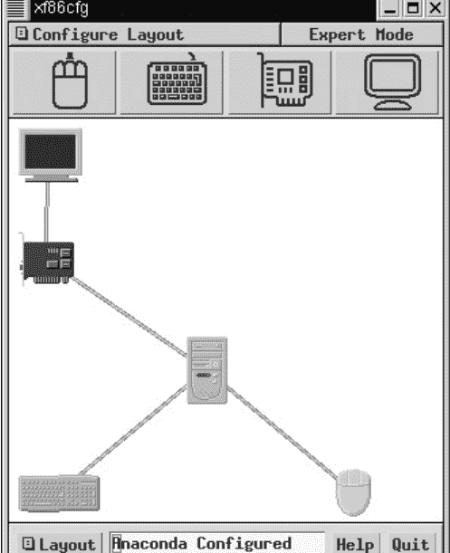
    图 13.2：`xf86cfg` 让你可以以指点式的方式配置 `XFree86` `4.x`。
    > **警告** 某些版本的 `xf86cfg` 假设它们应该在 `/etc/X11/XF86Config` 上工作，而不是 `/etc/X11/XF86Config-4`。因此，你可能需要暂时重命名文件，或者创建一个链接，才能使用此实用程序。例如，这在 `Red` `Hat` `7.0` 中是真实的，但在 `Red` `Hat` `7.3` 中则不是。
*   **`xf86config`**：这是常见的 `XFree86` `3.3.x` 配置工具中最为简陋的一个。它完全在文本模式下运行，并询问有关你的硬件和期望配置的一系列问题。没有机会返回并纠正错误，因此如果你犯了错误，你必须终止程序并重新开始。由于其粗糙的用户界面，`xf86config` 可以在 `X` 未运行或 `X` 严重配置错误的情况下使用。与其他大多数配置工具相比，该程序还提供了对 `XF86Config` 内容更多的控制权，这对于某些不寻常的硬件很有帮助。
*   **`Xconfigurator`**：该程序是另一个文本模式的 `XFree86` `3.3.x` 配置工具。然而，与 `xf86config` 不同，`Xconfigurator` 使用彩色文本和文本模式对话框，而不是简单的文本流。这使得 `Xconfigurator` 更容易使用。
*   **`XF86Setup`**：这是 `XFree86` `3.3.x` 的一个基于 `X` 的配置工具。因此，你可以使用此实用程序重新配置非最优运行的 `X` 服务器，但你不能用它来最初启动 `X`。
    > **注意** 大多数发行版都包含在系统安装期间运行的 GUI `X` 配置工具。这些工具通常以最低公倍数 `VGA` 分辨率启动系统以收集信息。第 2 章包含了关于系统安装期间 `X` 配置的信息，但不同发行版之间的细节差异很大。

在开始配置你的 `X` 服务器之前，你应该手头准备好几项信息。虽然一些配置实用程序可以探测其中的一些信息，但你仍需自己了解其中一些。这些关键特性如下：

*   **鼠标类型**：大多数现代计算机使用 `PS/2` 鼠标，但也有其他几种选择，例如罗技和微软的鼠标协议。
*   **鼠标设备**：大多数发行版会创建一个链接，使你可以将 `/dev/mouse` 作为鼠标访问。你可能需要执行相同的操作，或者直接指定鼠标设备。`/dev/psaux` 通常是 `PS/2` 鼠标的设备文件。串行鼠标通常可以寻址为 `/dev/ttyS0` 或 `/dev/ttyS1`。
*   **显卡信息**：一些 `X` 配置实用程序让你从漫长的型号名称列表中选择一个显卡。其他则要求你知道卡片上使用的芯片组。对于非常旧的显卡，你可能需要知道电路板使用什么 `RAMDAC` 和时钟芯片。对于某些显卡，知道卡片拥有多少 `RAM` 可能是必要的。
*   **显示器功能**：你应该知道显示器的最大水平和垂直刷新率。你可以从显示器手册中获取此信息。如果你的系统使用 `XFree86` `4.x`，并且显示器是 20 世纪 90 年代末或之后制造的，`XFree86` 可以通过 `DDC` 获取此信息。
*   **期望的分辨率**：你将被要求指定要使用的分辨率以及颜色深度。
    > **提示** 笔记本电脑和桌面 `LCD` 显示器在配置 `X` 时可能特别棘手，因为这些显示器对可接受的分辨率和显示刷新率格外挑剔。查看 `http://www.linux–laptop.net/` 获取关于 `Linux` 用户在使用各种笔记本电脑经验链接的集合。其中大多数包含现成的 `XF86Config` 文件，你可以使用它们而不是自己构建一个。

## XFree86 的替代方案
`XFree86` 是 `Linux` 中最常见的 `X` 服务器，但它并不是 `Linux` 唯一可用的，在 `Linux` 之外它也不是最常见的。有两种商业 `X` 服务器可用于 `Linux`：`Xi` `Graphics` 的 `Accelerated` `X` (`http://www.xig.com/`) 和 `MetroLink` 的 `Metro–X` (`http://www.metrolink.com/`)。这两种服务器都提供了一系列在特定情况下很有用的功能，例如多屏幕和触摸屏支持。这些服务器还配备了与 `XFree86` 略有不同的支持硬件列表，因此你可能希望使用商业服务器配合某些视频硬件。`Linux` 上的商业 `X` 服务器使用类似于 `XF86Config` 的配置文件，但细节有所不同。查阅软件文档以了解如何配置。

非 `Linux` 系统经常使用 `XFree86` 以外的 `X` 服务器。商业 `Unix` 系统通常附带自己的 `X` 服务器。`X` 服务器也可用于非 `Unix` 系统，例如 `Windows` 和 `MacOS`。示例包括 `Hummingbird` 的 `eXceed` (`http://www.hcl.com/products/nc/exceed/`)、`StarNet` 的 `X–Win32` (`http://www.starnet.com/`)、`NetSarang` 的 `Xmanager` (`http://www.netsarang.com/`)、`Tenon` 的 `Xtools` (`http://www.tenon.com/products/xtools/`) 和 `PowerLAN` 的 `eXodus` (`http://www.powerlan–usa.com/exodus.html`)。这些程序通常使用 GUI 配置实用程序。那些在宿主操作系统的 GUI 内部运行的（例如所有 `Windows` 和 `Macintosh` 产品）通常不需要特殊的鼠标或视频配置。然而，它们通常需要进行字体配置，并且往往提供在 `Linux` 中毫无意义的功能，例如在单个宿主操作系统窗口内运行 `X` 会话的能力。

如果你运行网络并希望为多个用户提供基于 `X` 的访问，`X` 终端是你可能想要研究的另一种 `X` 选项。`X` 终端是专门用于运行 `X` 的计算机。这种计算机内存很少，没有硬盘，`CPU` 性能较弱。`X` 服务器通常配备大型彩色显示器。`NCD` `X–Terminal` `Mini–HOWTO` 文档涵盖了 `X` 终端配置了许多细节。

## 自动启动 X


安装 `Linux` 时，你可能被问到是否希望以文本模式还是图形模式启动操作系统。如果你选择了前一种选项，你会看到一个基于文本的登录提示，并且只能在登录后才能启动 `X`。如果你选择了后一种选项，并且系统的 `X` 配置正确，那么无论你在哪里启动系统，都应该看到一个基于 `X` 的登录程序来欢迎你。在旧版本的 `Linux` 中，这种基于 `X` 的登录是由一个名为 `X Display Manager` (XDM) 的程序处理的。较新版本的 `Linux` 通常使用与 `KDE` 或 `GNOME` 项目相关的类似实用程序（下文将稍作描述）。这些更新的软件包被称为 `KDE Display Manager` (KDM) 或 `GNOME Display Manager` (GDM)。然而，这三个程序都提供类似的功能：它们允许你登录计算机。为了简单起见，本章其余部分将这些程序统称为 `XDM`。

计算机是启动到文本模式还是图形模式由 `/etc/inittab` 启动脚本处理。在该脚本的开头附近，你应该能找到一行类似于以下内容：

```
id:5:initdefault:
```

这一行的关键组成部分是数字——本例中为 `5`。该数字指示计算机的默认运行级别，如第3章所述。运行级别 `1` 是单用户模式，通常用于紧急维护；运行级别 `6` 强制计算机重新启动；而介于其中的运行级别则由发行版定义。在大多数发行版中，包括 `Red Hat 7.3`，运行级别 `3` 用于文本模式启动，`5` 表示通过 `XDM` 进行完全 `GUI` 启动。（这些数字是任意的；例如，`Slackware Linux` 使用 `3` 和 `4` 而不是 `3` 和 `5`。）

虽然 `Linux` 以 `/etc/inittab` 中指定的运行级别启动，但你可以通过 `telinit` 命令更改正在运行的系统的运行级别，例如使用 `telinit 3` 切换到运行级别 `3`。

**提示** 如果你计划更改 `X` 配置，最好先退出全图形登录模式。使用 `telinit 3` 切换到文本模式登录。然后你可以更改 `X` 配置并键入 `startx` 以启动 `X`。如果配置存在问题，你将返回到可用的文本模式会话。此时你可以检查主目录中的 `.xsession-errors` 文件以查找错误原因。你可以修正该问题，当 `X` 正常工作时，使用 `telinit 5` 返回到完整的图形配置。如果你不按此方式测试就更改 `X` 配置，你将面临创建一个无法启动 `X` 但不断尝试启动的系统风险，从而阻塞你对控制台的使用。

## 配置字体服务器

字体服务器是一种网络服务器，它向请求字体的计算机分发字体位图。字体服务器可以基于字体位图或可缩放轮廓格式字体（如 `PostScript Type 1` 或 `TrueType` 字体）工作。当服务器使用后者时，它会栅格化字体——即服务器将字体转换为客户端请求大小的位图。使用字体服务器的主要好处是，你可以在一台计算机上配置一个包含所有你所需字体的字体服务器，而无需在网络上的其他计算机上安装这些字体。相反，你只需告诉那些计算机访问已按你期望方式配置的字体服务器。某些发行版使用字体服务器，因为 `XFree86 3.3.x` 默认不支持 `TrueType` 字体（尽管 `XFree86 4.x` 支持）。向独立的字体服务器程序添加 `TrueType` 支持比向 `XFree86 3.3.x` 字体处理程序添加支持更容易，因此使用本地字体服务器是在 `Linux` 中提供 `TrueType` 字体支持的好方法。

**警告** 在将任何字体添加到字体服务器之前，请检查该字体的许可条款。在美国，轮廓字体被视为计算机程序，因此可能受版权保护，并受类似其他程序的使用条款约束。这些条款可能禁止在字体服务器上使用字体，或要求按客户端付费。

## 向字体服务器添加字体

某些 `Linux` 发行版默认不使用字体服务器，尽管它们完全具备此功能。其他发行版，包括 `Red Hat`，通常使用字体服务器，尽管它们通常被配置为仅对本地计算机可访问。你可以通过检查 `XF86Config` 或 `XF86Config-4` 文件（位于 `Red Hat` 的 `/etc/X11` 中，但位于某些其他发行版的 `/etc` 中）来检查系统的配置。在此文件的开头，应该有一行或多行以 `FontPath` 开头的行：

```
FontPath     "/usr/X11R6/lib/X11/fonts/Type1"
FontPath     "unix/:7100"
```

这些行中的每一行都指定了一个可以找到字体的位置。此示例的第一行指示 `X` 服务器计算机硬盘上的一个目录，但接下来的两行指定字体服务器。`unix/:7100` 服务器是 `Red Hat 7.3` 的默认服务器，它专用于本地计算机。`tcp:dino:7101` 服务器是一个可通过网络访问的字体服务器，运行在名为 `dino` 的计算机的 `7101` 端口上。（关于端口和主机名的讨论，请参阅第12章。）此行已添加到默认配置中；它*不是*任何发行版配置的标准部分。

默认的 `Red Hat 7.3` 字体服务器由文件 `/etc/X11/fs/config` 控制。此文件包含若干设置，其中最重要的是以下几项：

-   `catalogue`：此设置是一个以逗号分隔的包含字体的目录列表。列表可以跨多行，当目录后不跟逗号时结束。

-   `default-point-size`：你可以设置字体的默认大小，单位为*点*（一种常见的字体大小单位）的十分之一，适用于程序未指定字体大小的情况。`Red Hat` 将此值设置为 `120`，对应 `12` 点。

-   `default-resolutions`：点大小与物理尺寸相关，但计算机显示器在给定尺寸的屏幕上显示的像素数量各不相同。由于计算机图形（包括字体显示）基于像素，点大小可能因监视器尺寸及其运行的分辨率而异。大多数显示器使用 `72` 到 `100` 点/英寸（`dpi`）之间的分辨率。分辨率在水平和垂直方向上可能都不同。例如，你的屏幕可能是 `75×80` `dpi`。你可以使用 `default-resolutions` 设置来设置默认分辨率，该设置列出水平和垂直分辨率，用逗号分隔。你可以在第一个分辨率后指定第二个默认分辨率，用逗号与第一个分隔。

如果你要向系统添加字体，必须指定这些字体的路径，无论是直接在 `XF86Config` 中指定，还是将路径包含在 `/etc/X11/fs/config` 中。你还必须在字体目录*内部*创建一个适当的配置文件，以告知系统你已添加的字体。最好将不同类型的字体放在不同的目录中；例如，`TrueType` 字体放在一个目录中，`Type 1` 字体放在另一个目录中。要为目录创建 `X` 字体信息文件，请执行以下步骤：

1. 使用文本模式登录或打开一个 `xterm` 窗口。

2. 切换到目标字体目录。

3. 如果目录包含 `TrueType` 字体，执行命令 `ttmkfdir . >fonts.scale`。此操作创建 `fonts.scale` 文件，其中包含与每个字体文件关联的字体名称和其他关键信息。

4. 如果目录包含 `PostScript Type 1` 字体，请执行以下操作：

    -   A. 获取并安装 `type1inst` 软件包。（可以从 [http://rpmfind.net/linux/RPM/TbYName.html](http://rpmfind.net/linux/RPM/TbYName.html) 等其他地方获取。）

    -   B. 键入 `type1inst` 为目录中的 `Type 1` 字体创建 `fonts.scale` 文件。

5. 执行命令 `mkfontdir -e /usr/X11R6/lib/X11/fonts/encodings`。这会从 `fonts.scale` 文件或目录中位图字体的字体信息创建一个 `fonts.dir` 文件。

6. 检查 `fonts.dir` 文件。它应以一个数字开头（指示文件中定义的字体数量）。随后每一行应以字体文件名开头，并以 `X` 字体规范结尾，该规范包括字体名称和各种其他信息。

此时，你的配置文件指向新的字体目录，其中应包含一个正确标识新字体的 `fonts.dir` 文件。你可以关闭 `X` 并重启它，或者执行以下命令以开始使用新定义的字体：

```
# killall -USR1 xfs
# xset fp rehash
```

**警告** 如果你的新字体配置存在错误，`X` 的行为可能非常异常或无法启动。如果系统配置为直接启动到 `X`，这可能尤其麻烦，因为 `Linux` 可能会陷入尝试启动 `X`、失败并重试的循环，使系统无法从控制台访问。因此，你应该确保通过其他方式（如哑终端（第6章）或 `Telnet` 登录）访问系统。或者，如果你遇到问题，可以通过紧急启动软盘修改配置。

要检查你的更改是否生效，可以使用 `xfontsel` 程序，如图 13.3 所示。此程序允许你显示运行该程序的 `X` 服务器上可用的所有字体。

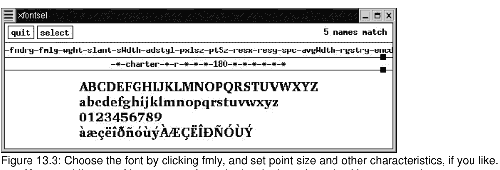

**注意** 与大多数 `X` 程序一样，`xfontsel` 从 `X` 服务器获取字体，而不是从运行该程序的计算机获取。因此，同一程序从同一计算机运行时，如果通过不同计算机上的 `X` 服务器运行，可用的字体可能不同。

## 配置新的字体服务器


如果你想使用字体服务器的网络功能，可以设置一个系统向网络中的其他系统提供字体，从而简化你的管理任务。为此，请执行以下步骤：

1. 创建一个新的字体服务器配置文件。你可以基于 `/etc/X11/fs/config` 文件，但应将其放在其他地方，例如 `/etc/xfsconfig`。
2. 创建包含你要共享的字体文件以及前面所述的 `fonts.scale` 和 `fonts.dir` 配置文件的字体目录。
3. 修改你的新字体服务器配置文件，使其从你在步骤2中创建的目录或现有字体目录提供字体。
4. 在方便的启动脚本（如 `/etc/rc.d/rc.local`）中添加一行，使用此新配置文件启动 `xfs`，使用端口 7101 提供字体（这在一定程度上是用于此目的的标准端口）。此行应类似于以下内容：

## 非常规字体服务器

一些应用程序使用自己的字体服务器，或包含类似于字体服务器的功能。这种做法在文字处理软件中尤为常见，因为 X 的字体处理不包含产生良好印刷输出所需的某些功能。解决这个问题通常有两种方法：

*   在程序包中包含一个唯一的字体服务器。此服务器通常运行在 7102 端口上，提供普通 X 字体服务器的功能，以及文字处理软件所需的功能。`ApplixWare` 和 `WordPerfect Office 2000` 都采用这种方法，事实上两者都使用了 `Bitstream` 的 `FontTastic` 字体服务器。其他应用程序也可以使用这个字体服务器，但你必须修改 Linux 启动脚本，以便在系统启动时自动启动服务器。（通常，应用程序会在用户启动应用程序时启动字体服务器。）
*   在应用程序本身中实现字体渲染代码。`WordPerfect 8` 及更早版本、`TeX` 以及大多数便携式文档格式（`PDF`）文件查看器（如 `Acrobat Reader`）都使用这种方法。在某些方面，这种方法比添加新的字体服务器更简单，但这对其他程序用处较小，因为它们通常无法利用第一个程序的字体处理能力。

这些程序使用的非标准字体处理可能令用户和管理员感到沮丧，因为你可能需要多次安装相同的字体才能将其用于关键程序。你还可能会发现，由于不同的字体渲染能力相同，同一种字体在不同的程序中看起来大相径庭。不幸的是，这些问题没有简单的解决办法。有关特定程序的详细信息，请查阅“Font HOWTO”文档，该文档随大多数发行版提供，或可在 `http://www.linuxdoc.org/` 找到。

## 在 X 之上构建用户界面

X 由多个不同的层组成。在最底层，是 X 服务器本身，它主要是一个视频驱动程序及其编程接口集合。这些接口允许程序员显示窗口，但这些窗口是不完整的。X 的额外层提供了某些关键功能。具体而言，`窗口管理器` 提供边框、调整大小功能以及通常的其他额外功能；`小部件集` 为程序员提供窗口内有用的功能，如滚动条和菜单；而 `桌面环境` 则将许多程序组合成一个连贯的集合。以下各部分将依次描述这些 X 组件。

### 窗口管理器

窗口管理器决定了 X 环境整体外观和感觉的大部分。窗口管理器负责处理围绕窗口的装饰、窗口布局以及启动某些类型的程序。切换到新的窗口管理器通常并不困难，但不同的发行版使用不同的方法来确定使用哪个窗口管理器。

#### 窗口管理器的角色

窗口管理器可能提供的功能包括：

**窗口边框** 窗口*边框*起装饰作用，并清楚地表明窗口在哪里结束。在许多窗口管理器中，它们还提供窗口大小调整功能。

**拖动栏** *拖动栏*是大多数窗口顶部的组件，你可以点击它来拖动窗口。一些窗口管理器允许你双击拖动栏来扩展窗口大小。

**窗口小部件** 窗口*小部件*是大多数窗口拖动栏上或其他位置可见的小图标。这些图标允许你关闭窗口、最大化它、最小化它或执行其他任务。

**窗口放置和大小调整功能** 窗口管理器确定窗口在屏幕上的显示位置。（程序可以请求特定的放置位置，但窗口管理器确定默认的放置策略。）窗口管理器还允许你移动窗口，通常是通过拖动拖动栏。你还可以使用小部件或边框来调整窗口的大小。

**窗口前置操作** 某些操作将窗口带到堆栈的前面或允许你使用窗口。当今大多数窗口管理器使用点击窗口任何位置来执行任一操作；但有些使用其他操作，如仅点击拖动栏。有些允许你在窗口未位于堆栈前面时向其中输入文本。大多数提供多种选项来处理窗口前置操作。

**桌面背景** 大多数窗口管理器都包含修改桌面背景颜色或使用位图作为背景图像的功能。

**程序启动设施** 窗口管理器总是不变地提供某种运行程序的方法。通常，可以通过编辑文本文件来配置窗口管理器。该文件包含窗口管理器可以启动的程序列表。然后你可以通过点击桌面背景或从屏幕顶部或底部提供的菜单中选择程序来启动程序。

#### 虚拟桌面

大多数窗口管理器都包含控制多个*虚拟桌面*的方法。通常，你可以点击小图标来选择几个桌面中的一个，每个桌面都有自己的窗口集合。因此，你可以将其中一个桌面用于一组相关的应用程序，另一个用于另一组，从而减少屏幕上的杂乱。

这些窗口管理器的一些功能——特别是最后几项——可能会被桌面环境复制或取代。不过，如果你不想使用完整的桌面环境，窗口管理器中这些功能的可用性可能会非常有帮助。

大多数窗口管理器提供相似的功能，但细节不同。有些，如 `Enlightenment` (`http://www.enlightenment.org/`)，旨在提供最大的“视觉享受”——它们包含大量改变窗口外观的功能。其他，如 `wm2` (`http://www.all-day-breakfast.com/wm2/`)，在视觉甚至功能上都非常简陋。图 13.4 和 13.5 说明了两个窗口管理器可以看起来多么不同。图 13.4 显示了一个在 `Sawfish`（`GNOME` 的默认窗口管理器）中运行的文本编辑器窗口。（本书中的大多数插图显示的是 `Sawfish` 窗口。）图 13.5 显示相同的文本编辑器在 `wm2` 中运行。

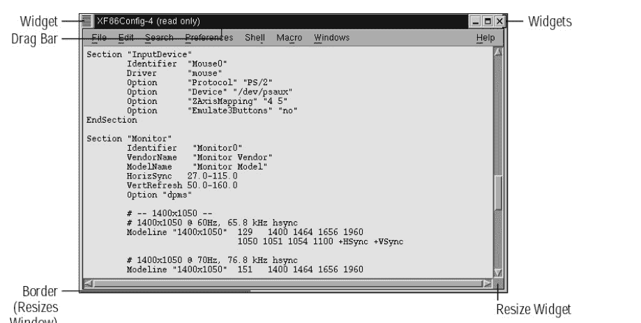

图 13.4：大多数现代窗口管理器，如 `Sawfish`，大致模仿了 `Microsoft Windows` 中窗口的默认外观。


图 13.5：一些窗口管理器拥有独特的外观，并提供不寻常的功能集。

### 设置窗口管理器

窗口管理器的偏好是非常个人化的问题。如果你想尝试，可以尝试几种不同的窗口管理器，看看你更喜欢哪一个。Linux 发行版使用用户主目录中的配置脚本在登录时运行用户希望运行的程序。如果该文件不存在，系统将使用默认脚本。该脚本的名称取决于你的登录偏好，但通常位于 `/etc/X11` 目录树中，经常在 `/etc/X11/xinit` 中。在 `Red Hat 7.3` 上，用户可自定义的配置脚本名为 `.xsession`，并且必须具有执行权限。其他发行版可能会将此脚本称为其他名称，如 `.Xlogin`。当通过 `startx` 从文本模式登录启动 X 时，通常还会使用另一个脚本：`.xinitrc`。若要替换默认的登录操作集，请执行以下步骤：

1. 将主目录中的 `.xsession` 或其他 X 配置文件加载到文本编辑器中（在一个新账户中，该文件不存在，因此你可能需要告诉编辑器创建它）。
2. 输入你希望在登录时自动运行的任何程序的名称，包括你的窗口管理器。如果希望某个程序运行并保持运行，同时其他程序也在运行，请确保在其启动行后加一个 ampersand (`&`)，否则脚本将停止运行，直到你关闭该程序。在大多数情况下，从 `.xinitrc` 启动的最后一个程序应该是你的窗口管理器，并且不应包含 ampersand (`&`)。这样，当你退出窗口管理器时，你将注销该账户。例如，以下文件启动一个 `xterm` 窗口和 `wm2` 窗口管理器：

    ```
    xterm &
    wm2
    ```

3. 保存 `.xsession` 文件并退出文本编辑器。
4. 输入 `chmod 755 ~/.xsession` 以赋予文件执行权限。（如果你不想让别人看到你自动运行哪些程序，可以使用更严格的权限，如 `0700`。）

此后，当你登录时，Linux 将启动你在 `.xsession` 文件中设置的任何程序（包括窗口管理器），当你再次在 X 中登录时。不过，你可能需要在 `XDM` 程序中选择特定的登录选项。例如，如果你使用 `KDM`，通常你需要从“会话类型”下拉列表中选择 Default。如果你不知道在探索窗口管理器时从哪里开始，一个极好的起点是位于 `http://www.plig.org/xwinman/` 的窗口管理器网站。该网站介绍了最常见窗口管理器的描述。

以及 Linux 的桌面环境，其中包含指向这些项目网站的链接。

### 组件集


组件集为程序员提供工具，用于生成菜单、按钮、对话框以及其他组件，这些组件可以嵌入窗口内部，或使用窗口来执行简单任务。（回顾图 `13.4` 和 `13.5`，它们展示了同一程序在不同窗口管理器中运行的情况。请注意，尽管拖动条和窗口管理器组件截然不同，但滚动条和菜单的外观却完全相同。）作为用户，你对使用哪个组件集几乎没有控制权。这是因为组件集是由程序员选择的，而不是由用户选择的。（当然，你可以因为某个程序使用了特定的组件集而选择该程序。）目前常用组件集大约有半打，包括 `GNOME` 工具包（`GTK`）、`Qt`、`Motif` 和 `Athena`。虽然还有其他许多组件集可用，但只有少数被用于多个程序中。

可用的组件集种类繁，这也是 Linux 程序界面不一致的原因之一。每个组件集都有其独特的外观，因此使用不同组件集构建的程序在菜单、对话框等方面差异巨大。然而，自 1998 年左右以来，新程序越来越多地基于 `GTK` 或 `Qt` 构建。就组件集而言，这两者在外观上相当相似，因此如今 Linux 程序的界面变化小于 20 世纪 90 年代中期。

### 桌面环境

桌面环境是一组程序和工具的集合，旨在为 Linux 用户提供友好的用户体验。桌面环境在其所有组件应用程序中使用相同的组件集，并可能包含额外的功能来帮助整合其工具，例如在多个应用程序之间共享的地址簿。

> **注意** Linux 新手常常将窗口管理器与桌面环境混淆。虽然窗口管理器是桌面环境的一个组成部分，但后者是一个全面得多的软件包。将两者进行比较，就好比将一片面包与一顿四道菜的大餐相比。

#### 桌面环境的作用

为什么要运行桌面环境？在某些情况下，你不应该这样做。桌面环境会消耗大量的内存和磁盘空间。如果你正在运行服务器或低内存系统，使用独立的窗口管理器和一些小型实用工具会更好。（正如稍后在“混合桌面环境组件”中所述，即使你不运行整个桌面环境，也可以运行其单独组件。）事实上，如果系统是一个服务器，你可能更倾向于完全不运行 `X`，以为服务器进程节省内存。

然而，如果你打算将计算机用作桌面工作站，桌面环境可以提供许多有用功能。最重要的是，桌面环境提供了一套一致的工具，用于访问 Linux 的许多系统设置。你可以使用单个控制程序调整诸如鼠标追踪速度、各种应用程序使用的默认字体以及窗口管理器外观等功能。这对 Linux 用户，尤其是那些不熟悉 Linux 众多配置文件的用户来说，是一个巨大的福音。

> **注意** 虽然桌面环境的设置与通过 `Webmin` 等图形用户界面配置工具进行的设置之间存在一些重叠，但在大多数情况下，两者是独立的。桌面环境设置的是个人用户可能想要定制的功能，而 `Webmin` 和类似实用工具调整的是影响所有用户的系统级功能。

除了提供设置系统功能的接口外，桌面环境还包括一系列迷你应用程序，如计算器、图像查看器、音频 `CD` 播放器和令人上瘾的纸牌游戏。也许最重要的是，桌面环境提供了一个`文件管理器`，它在一个窗口中显示文件，允许你使用鼠标打开、复制、移动和删除文件。`KDE` 和 `GNOME` 都在致力于生产类似 `Microsoft Office` 的办公套件，但这些产品尚未达到竞争者那样的精致程度。

### 可用的桌面环境

Linux 上最常见的两种桌面环境是`GNU 网络对象模型环境（GNOME）`和`K 桌面环境（KDE）`。还有几种使用较少的桌面环境可供选择。这些环境的简要描述如下：

- `GNOME`：`GNOME` 构建在 `GTK` 组件集之上，该组件集最初是为`GNU 图像处理程序（GIMP）`图形工具开发的。自 `1.2` 版本以来，`GNOME` 一直使用 `Sawtish` 作为默认窗口管理器（截稿时 `GNOME 1.4.0.6` 为最新版本）。无论如何，你可以轻松重新配置 `GNOME` 以与其他窗口管理器配合工作，尽管某些窗口管理器与其他窗口管理器相比与 `GNOME` 的集成度更好。`GNOME` 拥有数量不断增加的迷你应用程序和配置模块。目前，它是 `Red Hat` 和 `Debian` 系统上首选的桌面环境。你可以在 `http://www.gnome.org/` 上了解更多信息。

- `KDE`：与 `GNOME` 不同，`KDE` 与其自己的窗口管理器 `kwm` 紧密绑定。`KDE` 在某种程度上比 `GNOME` 更先进。`KDE 3.0` 于 2002 年 4 月发布。`KDE` 包含大量的迷你应用程序和配置实用工具。如今大多数 Linux 发行版都倾向于将 `KDE` 作为其默认桌面环境。`KDE` 项目的主页位于 `http://www.kde.org/`。

- `Xfce`：与 `GNOME` 或 `KDE` 相比，`Xfce` 是一个轻量级的桌面环境。与 `GNOME` 一样，它围绕 `GTK` 构建。与 `KDE` 一样，它使用自己的窗口管理器（`Xfwm`）。`Xfce` 包含适度的迷你应用程序和配置实用工具。它`部分以商业 CDE 为模型`。你可以在 `http://www.xfce.org/` 上了解更多信息。

- `CDE`：`通用桌面环境（CDE）`是 Linux 上唯一的商业桌面环境。尽管 `CDE` 在许多商业 Unix 版本中很受欢迎，但在 Linux 上相对少见。`CDE` 使用 `Motif` 组件集，这在历史上一直是商业 Unix 和 Linux 应用程序的首选组件集。Linux 版的 `CDE` 可以从 `Xi Graphics`（`http://www.xig.com/`）获得，名为`DeXTop`。

- **自行组装**：你可以组装自己的桌面环境。要做到这一点，从你选择的窗口管理器开始，然后添加配置实用工具、迷你应用程序、文件管理器等。通常，你会配置窗口管理器从其内置菜单启动重要的实用工具，并配置系统在登录时启动窗口管理器、文件管理器以及你希望始终打开的其他工具。结果通常比传统桌面环境得到的集成度低得多，但可能更符合你的喜好。这种方法的内存消耗很可能比传统桌面环境少。

即使你使用的发行版倾向于某一种桌面环境，你也可以使用另一种。在大多数发行版中，这样做只需从发行版的 `CD-ROM` 安装该环境，并在 `XDM` 登录屏幕上从菜单中选择它即可。如果 `XDM` 不提供此功能（如最初的 `XDM` 那样），你可以通过在 `~/.xsession` 或等效文件中放置适当的命令来启动该环境。例如，要启动 `KDE`，命令是 `startkde`；对于 `GNOME`，则是 `gnome-session`。一个系统的用户可以使用一种桌面环境，而另一个用户可以使用另一种桌面环境。

#### 混合桌面环境组件

虽然大多数桌面环境都附带一系列相互集程度不等的工具，但通常没有必要在其父环境中运行这些工具。例如，你可以在 `GNOME` 内运行 `KDE` 的 `kscd` `CD-ROM` 播放器，或者在不运行任何桌面环境的情况下运行。你可以利用这一事实，选择每个环境的最佳部分。缺点是，以这种方式混合组件会降低它们的互操作性。例如，来自两个环境的程序可能无法共享通用的地址簿文件，而两个匹配的程序则可以共享此文件。

以这种方式混合组件，或为方便用户安装两个或更多环境，还有另一个缺点是，磁盘空间需求可能相当大。每个环境可能消耗数百兆字节的磁盘空间，尽管对于非常精简的安装，你可能可以使用更少的空间。如果你只使用少数组件，可能只需几兆字节即可安装它们。

#### X 应用程序

`X` 应用程序使用 `X` 来显示信息并接收用户输入。它们依赖于用户选择的窗口管理器以及程序员选择的组件集。在某些情况下，应用程序可以共享设置或与桌面环境交互。不过，通常 `X` 应用程序并不依赖于桌面环境。

> **注意** 偶尔，你会看到程序被称为“`KDE` 程序”或“`GNOME` 程序”。除了几个属于这些环境核心部分的实用工具外，这`并不`意味着该程序依赖于指定的桌面环境才能运行。这很可能意味着该程序使用了桌面环境的基础组件集，并且可能意味着该程序可以使用桌面环境中其他程序的设置并与其交互。如果你看到一个吸引人的“`KDE` 程序”但运行的是 `GNOME`，不妨尝试一下该程序。很可能它能工作，尽管你可能需要安装库或桌面环境组件才能使用该程序。

在极少数情况下，你可能会发现某个 `X` 应用程序与特定的窗口管理器或你安装的其他组件（如特定的 `X` 服务器）配合不佳。如果应用程序的窗口没有按预期移动或堆叠，你可能希望尝试另一个窗口管理器，至少用于诊断目的。如果问题消失，你可以考虑永久更换窗口管理器；或者寻找该程序或窗口管理器的更新版本；或者联系程序和窗口管理器的作者报告错误。

少数程序（特别是基于 `Motif` 组件集的那些）在使用 `XFree86 3.3.x` 时，在某些视频板上无法在 24 位色深下正确显示图形。其中少数程序在 32 位色深下也存在类似问题。如果你遇到此类问题，可以通过降低到 16 位色深来解决。升级 `X` 服务器也可能有所帮助。

`Accelerated–X` 和 `XFree86 4.x` 都修正了这些问题。

## 总结


X 是在 Linux 中最常使用的图形用户界面（GUI）环境。与 Windows 或 MacOS 中的 GUI 不同，X 由多个组件构建而成，用户（或程序员）可以根据需要互换或更换这些组件。X 还是一个面向网络的 GUI，允许用户在一台计算机上运行程序，但使用另一台计算机作为屏幕、键盘和鼠标。您可以添加一个网络字体服务器，以简化在采用 X 服务器的系统网络中的字体配置任务。这些事实使 X 成为一个极其灵活的 GUI 环境，但也带来了一些缺点：X 比大多数其他 GUI 环境慢，而且 X 提供的选择范围使得应用程序和系统之间的一致性较差。

## 第 14 章：配置您的邮件服务器

### 概述

对于许多组织来说，最重要的网络服务是电子邮件。虽然 Web 服务器和文件服务器传输大量数据，但电子邮件对于外部通信至关重要。您的用户可能通过电子邮件与同事、客户和供应商通信，甚至通过电子邮件附件交换重要的数据文件。因此，您的组织托管至少一个可靠的电子邮件服务器非常重要。幸运的是，Linux 非常适合这项任务，实际上，Linux 拥有各种各样的邮件服务器软件包。

本章首先讨论核心电子邮件协议，包括推送协议和拉取协议之间的区别。接下来，我们将描述如何配置 `sendmail`，这是因特网上最流行的推送邮件程序。如果您的用户从除邮件服务器以外的系统读取邮件，您需要配置一种拉取邮件协议，如 POP 或 IMAP，这些协议将在下文讨论。本章以对电子邮件管理员最大的噩梦——未经请求的大量电子邮件（垃圾邮件）的讨论结束。

**注意** 配置大型邮件服务器是一项重大工程。本章可以帮助您入门，并且足以让您了解如何为工作站或小网络配置邮件服务器。但是，如果您的需求更大，最好咨询额外的文档，例如 Craig Hunt 的《Linux Sendmail 管理》（Sybex，2001 年）。

#### 理解电子邮件协议

要将系统配置为邮件服务器，有必要了解电子邮件是如何投递的。最重要的是理解推送电子邮件协议和拉取电子邮件协议之间的区别。了解当今三种最常用电子邮件协议的功能也很重要：SMTP、POP 和 IMAP。

**注意** 本节概述了电子邮件协议本身。这些协议的服务器配置在本章后续部分中介绍。

#### 推送协议和拉取协议

广义上讲，电子邮件可以通过两种方式之一进行投递：

-   发件人发起传输，通常在电子邮件准备好发送时进行。这种方法使用推送协议。它要求收件人始终运行邮件服务器。发件人可以使用客户端程序与服务器通信，或者一个服务器可以与另一个服务器通信。（在后一种情况下，一个服务器扮演客户端角色，但它可能在作为客户端工作的同时，作为其他连接的服务器运行。）

-   收件人发起传输，通常在用户想要读取电子邮件时进行。这种模型被称为拉取协议。在这种情况下，邮件服务器保存它已接收的邮件（通常通过推送协议）。收件人的系统不需要始终可用，但发送系统必须持续可用——或者至少，在可预测的时间段内可用。

当今因特网上最常见的推送协议是简单邮件传输协议（SMTP）。按照因特网标准，这个协议相当古老，但它服务良好，并且极有可能在无限的未来继续被广泛使用。实现 SMTP 的服务器通常被称为邮件传输代理（MTA）。

两种拉取协议很常用：邮局协议（POP）和互联网消息访问协议（IMAP）。POP 简单得多，在 2002 年稍微更常见，但 IMAP 提供了几个附加功能（稍后描述），并逐渐流行起来。所有这些协议都以各种版本提供。

个人使用称为邮件用户代理（MUA）的电子邮件客户端软件包。这些程序通常可以发起 SMTP 会话，通常也可以发起 POP 或 IMAP 会话。在 Linux 上运行的那些程序通常可以直接从由 MTA 维护的本地 Linux 邮件队列中读取邮件。

计算机之间最简单的电子邮件交换只涉及两台计算机和一个协议（可能是 SMTP）。在这种场景中，一个用户使用命令创建电子邮件消息，使电子邮件软件连接到目标系统并传输消息。收件人计算机然后在本地邮件队列中保存消息，收件人使用收件人计算机上的邮件程序读取消息。

然而，当今因特网上大多数邮件传输更复杂。它们通常涉及几次传输，如图 14.1 所示。这些步骤如下：


图 14.1：电子邮件通常在其来源和目的地之间经过多台计算机。

1.  发件人在一台计算机上使用 MUA 编写消息（让我们称之为 `franklin.example.com`）。根据 MUA，邮件可能立即发送或在本地排队。消息中包含一个收件人地址（让我们假设是 `susan@express.gov`）。
2.  在某个时候，`franklin` 连接到其域名的邮件服务器（让我们称之为 `osgood.example.com`）并发送电子邮件。在此传输中，`franklin` 使用 SMTP，并作为 `osgood` 服务器的客户端。
3.  除非邮件收件人是本地的，`osgood` 使用域名系统（DNS）查找作为收件人域名（`express.gov`）邮件服务器的计算机。这可能是一台同名的计算机，也可能是一台不同的计算机（如 `pony.express.gov`）。
4.  一旦 `osgood` 获得收件人系统的地址，`osgood` 使用 SMTP 连接到该系统并传输电子邮件。在此传输中，与第 2 步不同，`osgood` 是客户端；`pony.express.gov` 是服务器。
5.  `pony` 可能为本地投递排队邮件，或者根据其配置和收件人姓名（`susan`）将邮件传递给另一个系统。为了讨论目的，让我们假设 `pony` 是暂时的中转站，它将邮件传递给 `railroad.express.gov`。此传输也可能使用 SMTP，其中 `pony` 是客户端，`railroad` 是服务器。
6.  消息进入 `railroad` 上与收件人（`susan`）关联的队列。迟早，`susan` 使用另一台计算机（比如 `air.express.gov`）连接到 `railroad` 并检索邮件。此传输很可能使用 POP 或 IMAP。这里，`railroad` 是服务器，`air` 是客户端。
7.  `susan` 使用 MUA 在 `air` 上读取她的电子邮件。如果她想回复，她可以做到，从而启动一系列类似于此处概述的操作。电子邮件可能会或不会经过相同的计算机；组织可以配置不同的系统作为传入和传出邮件服务器。

电子邮件传输的细节可能从简单的单台计算机情况到上述完整步骤集，甚至可能更多。具体涉及的操作因传输而异。然而，一个非常重要的点是，大多数 MTA 首先作为服务器接收邮件，然后作为客户端重新传输邮件。这种操作称为中继邮件，执行此任务的服务器是邮件中继。如本章后面所述，配置邮件服务器仅中继授权邮件是 MTA 配置的一个关键方面。

投递链中倒数第二台计算机（前例中的 `railroad.express.gov`）通常作为 SMTP 和 POP 或 IMAP 的服务器。然而，这不一定是这种情况；如果 `susan` 登录到 `railroad` 并使用本地 MUA 读取她的邮件，则不会涉及拉取传输。

在配置单台计算机作为邮件服务器时，您不需要担心邮件投递的所有可能变体。重要的是您的计算机相对于与其直接通信的那些计算机的角色。例如，如果您配置 `railroad.express.gov`，您需要配置 SMTP 和 POP 或 IMAP 服务器，但不需要特别配置 SMTP 服务器以允许它接受已经从其他系统中继的邮件。

##### SMTP

SMTP 是当今最普遍的电子邮件推送协议。SMTP 服务器通常监听端口 25（有关端口号的讨论，请参见第 12 章）。电子邮件消息的传输实际上涉及一系列文本模式命令。事实上，您可以将 `telnet` 重定向到使用端口 25，并在发送端不使用 MTA 或 MUA 的情况下发送电子邮件，如图 14.1 所示。

**列表 14.1：使用 `telnet` 的 SMTP 交互示例**


```
$ telnet nessus.rodbooks.com 25
Trying 192.168.1.3...
Connected to nessus.rodbooks.com.
Escape character is '^]'.
220 nessus.rodbooks.com ESMTP Sendmail 8.11.6/8.11.6; Wed, 18 Sep 2002
20:33:22 -0400
MAIL FROM:<rodsmith@speaker.rodbooks.com>
250 2.1.0 <rodsmith@speaker.rodbooks.com>... Sender ok
RCPT TO:<rodsmith@nessus.rodbooks.com>
250 2.1.5 <rodsmith@nessus.rodbooks.com>... Recipient ok
DATA
354 Enter mail, end with "." on a line by itself
This is a demonstration message. It contains no useful
information.
.
250 2.0.0 g3UJBQW12951 Message accepted for delivery
QUIT
221 nessus.rodbooks.com closing connection
Connection closed by foreign host.
```

此交换仅使用了四个 SMTP 命令：`MAIL FROM`、`RCPT TO`、`DATA` 和 `QUIT`。还有其他 SMTP 命令，其中某些命令在与特定主机通信时可能是必要的——例如，许多主机要求客户端使用 `HELO` 命令进行自身份标识。不过，列表 14.1 展示了核心 SMTP 协议的简洁性。

**注意**

来自 SMTP 服务器的回复细节因情况而异。关键信息位于以数字开头的行中，例如 `250` 和 `354`。许多这类行后面的英文文本是供人类阅读的，且因邮件传输代理（MTA）而异。因此，如果你尝试类似于列表 14.1 所示的测试，如果你的系统没有使用 `sendmail` 作为 MTA，你可能会看到略有不同的回复。然而，所有 SMTP MTA 都会响应相同的命令，并返回相同的数字回复。

在列表 14.1 中，消息被发送给 MTA 系统上的用户。因此，该消息最终会被排队以便本地投递——MTA 不需要将其转发到另一个系统。然而，在“推送和拉取协议”中概述的流程中，消息的最终接收者在消息经过的大多数 MTA 上都没有账户。在这些情况下，MTA 接受该消息以便中继。一旦 MTA 收到消息，它随即会将其传输到另一个系统。虽然这可能看起来效率低下，但它可能非常有益，因为它允许可靠的系统在网络中断时为拨号用户保留邮件，并允许一个组织指定一台计算机将邮件中继到几个分布式的邮件服务器，从而减轻存储邮件和充当邮件服务器的工作负担。

邮件用户代理（MUA）通常作为 SMTP 客户端运行，因此 MUA 可以通过 SMTP 服务器发送邮件。Linux MUA 可以选择它们使用的 SMTP 服务器：它们可以使用运行在本地计算机上的服务器，或者连接到外部的 SMTP 服务器。第一个选项是 Unix 系统，因而也是 Linux 计算机传统的配置方式。然而，小型 Linux 工作站如果将 MUA 配置为连接到外部 SMTP 服务器，其表现可能会同样好甚至更好。这可以消除配置 MTA 投递 `outgoing` 邮件的需求。

### POP

`POP` 是两种常见的拉取电子邮件协议中较简单的一种。事实上，`POP` 有两个变体：`POP–2` 使用端口 `109`，而 `POP–3` 使用端口 `110`。大多数 POP 邮件服务器支持这两种协议，但如后文“配置 POP 和 IMAP”中所述，可以配置计算机仅响应其中一种。

与 SMTP 类似，可以使用 `telnet` 发起对 POP 服务器的调用（将调用重定向到端口 `109` 或 `110`）。列表 14.2 展示了这样的交换过程。

**列表 14.2：一次 POP 电子邮件检索会话**

```
$ telnet nessus.rodsbooks.com 110
Trying 192.168.1.3...
Connected to nessus.rodsbooks.com.
Escape character is '^]'.
+OK POP3 nessus.rodsbooks.com v2000.78rh server ready
USER rodxmith
+OK User name accepted, password please
PASS password
+OK Mailbox open, 1 messages
RETR 1
+OK 619 octets
Return-Path: <rodxmith@speaker.rodsbooks.com>
Received: from speaker.rodsbooks.com (rodsmith@speaker.rodbooks.com [192.168.1.1])
by nessus.rodsbooks.com (8.11.6/8.11.6) with SMTP id g3UJBQWl2951
for <rodsmith@nessus>; Wed, 18 Sep 2002 20:33:36 -0400
Date: Wed, 18 Sep 2002 20:33:36 -0400
From: rodsmith@speaker.rodsbooks.com
Message-Id: <200029190033.g3UJBQWl2951@nessus.rodsbooks.com>
X-Authentication-Warning: nessus.rodsbooks.com: rodsmith@speaker.rodbooks.com
[192.168.1.1] didn't use HELO protocol
Content-Length: 68
Lines: 2
Status: RO

This is a demonstration message. It contains no useful
information.

.DELE 1
+OK Message deleted
QUIT
+OK Sayonara
Connection closed by foreign host.
```

`POP` 协议使用大约一打命令，其中五个在列表 14.2 中显示：`USER`、`PASS`、`RETR`、`DELE` 和 `QUIT`。除非特别配置，SMTP 不要求使用用户名或密码，因为它旨在向用户传递信息。相比之下，`POP` 确实需要身份验证，因为它可用于检索和删除潜在的敏感电子邮件消息。因此，`POP` 会话以 `USER` 和 `PASS` 命令开始，用于传达此信息。

> **警告** `POP` 以*明文*传输密码，这意味着它们未被加密。如果使用的网络不安全，捣乱者可能会截获密码并用于检索或删除你的电子邮件。如果你在另一台计算机上使用相同的密码，捣乱者可能会做出更糟糕的事。因此，你应该仅在包含你 POP 账户的系统上使用你的 POP 密码，并经常更改密码。

`RETR` 命令检索编号消息；此命令是 SMTP `DATA` 命令的逆操作。然而，检索到的消息包括消息*头*，它显示了消息到达目的地所经过的路径。`POP` 客户端可以可选地发出 `DELE` 命令来删除消息。如果未发出此命令，消息将保留在服务器上。

`POP` 在消息管理工具方面提供的功能很少；其目的是让用户维护本地邮件消息集合，并由用户的本地 MUA 将其组织到文件夹中。`POP` 仅为每个用户提供单一的电子邮件队列。（事实上，是 MTA 维护邮件队列；`POP` 服务器仅访问此队列，就像运行在邮件服务器上的 MUA 一样。）

### IMAP

乍一看，`IMAP` 与 `POP` 的作用相同：它允许从邮件服务器远程拉取电子邮件。然而，`IMAP` 比 `POP` 是一个更复杂的协议。`IMAP` 拥有两打命令，而 `POP` 只有一打。这些命令包括邮件操纵工具，使用户可以在邮件服务器上而不是客户端上组织邮件到文件夹中。这有两个主要优点：

- 查看和操作邮件*而不阅读*其内容更容易。如果你通过缓慢的拨号 PPP 链路使用邮件服务器并收到一封带有巨大附件的电子邮件，这一点可能至关重要。你可以删除该电子邮件、保留它或将其移动到文件夹中，而无需占用你缓慢的 PPP 连接来处理邮件。稍后，当你有更多时间或使用更快的连接时，你可以阅读该邮件及其附件。

- 你可以使用任意数量的客户端无缝访问相同的邮件消息。如果你使用多台计算机或操作系统，这会*极其*有用，因为它消除了将消息归档到邮件程序之外或安排多次检索相同消息（在每个邮件程序中检索一次）的需求。


与 POP 类似，IMAP 也有多个变体，其中最常见的是 IMAP–4，它使用端口 `143`。IMAP 的命令集比 POP 复杂得多。虽然可以从 `Telnet` 连接到端口 `143` 来使用 IMAP，但操作细节往往繁琐，如列表 14.3 所示。客户端必须在每个命令前加上一个以字母 `A` 开头的识别代码，如 `A2` 或 `A0014`。由于 IMAP 在本地邮箱中存储邮件，在执行其他操作之前，必须使用 `SELECT` 命令选择其中一个邮箱。IMAP 允许客户端使用 `FETCH` 命令读取消息，但该命令接受各种参数以获取消息的不同部分，例如文本或特定类型的标题。客户端还可以将消息复制到特定文件夹（如 `A4 COPY 1 demo` 命令，它将消息 `1` 复制到 `demo` 文件夹），以及创建、删除或以其他方式修改文件夹本身。

**列表 14.3：IMAP 使用比 POP 更多且更复杂的命令。**

```text
$ telnet nessus 143
Trying 192.168.1.3...
Connected to nessus.rodsbooks.com.
Escape character is '^]'.
* OK nessus.rodsbooks.com IMAP4rev1 v12.264 server ready
A1 LOGIN rodsmith password
A1 OK LOGIN completed
A2 SELECT mbox
* 1 EXISTS
* NO Trying to get mailbox lock from process 1557
* 0 RECENT
* OK [UIDVALIDITY 969392188] UID validity status
* OK [UIDNEXT 4] Predicted next UID
* FLAGS (\Answered \Flagged \Deleted \Draft \Seen)
* OK [PERMANENTFLAGS (\* \Answered \Flagged \Deleted \Draft \Seen)] Permanent flags
A2 OK [READ-WRITE] SELECT completed
A3 FETCH 1 body[text]
* 1 FETCH (BODY[TEXT] {89}
This is a demonstration message. It contains no useful
information.
)
A3 OK FETCH completed
A4 COPY 1 demos
A4 OK COPY completed
A5 LOGOUT
* BYE nessus.rodsbooks.com IMAP4rev1 server terminating connection
A5 OK LOGOUT completed
Connection closed by foreign host.
```

幸运的是，用户不需要过多关注 IMAP 操作的细节，因为 IMAP 客户端程序——包括大多数现代 `MUA`——会处理这些细节。用户可以利用 `MUA` 的功能集与 IMAP 服务器交互，从而隐藏这些细节。

最终，IMAP 的主要优势——也是其劣势——在于它允许用户将电子邮件消息存储在邮件服务器上。当用户需要从多台不同的计算机访问邮件时，这一点非常有用，但它会增加对邮件服务器磁盘空间的需求。

## 配置 Sendmail

对于大多数邮件服务器而言，`MTA` 的配置至关重要，因为 `MTA` 通常是服务器中最重要的部分。当今最常见的 `MTA` 是 `sendmail`。`Red Hat` 以及许多其他 Linux 发行版都附带 `sendmail`。幸运的是，大多数 Linux 发行版默认使用合理的 `sendmail` 配置，因此，如果你运气好，可能不需要动系统的 `sendmail` 配置。不幸的是，`sendmail` 是一个难以配置的包，因此如果你确实需要更改系统配置，你可能需要花些时间了解 `sendmail`。

### Sendmail 的替代方案

`Sendmail` 是目前使用最广泛的 `MTA`，但它远非唯一的选择。事实上，某些 Linux 发行版甚至默认不使用 `sendmail`；它们安装了其他 `MTA`。`Linux Mandrake` 青睐 `Postfix` (`http://www.postfix.org/`)，而 `Debian` 及其衍生版本使用 `Exim` (`http://www.exim.org/`)。另一种流行的 `MTA` 是 `qmail` (`http://www.qmail.org/`)，尽管在 2002 年它并非任何发行版的默认选择。

你何时应考虑使用 `sendmail` 以外的 `MTA`？使用替代 `MTA` 的一个好理由是你的发行版附带了一个。用 `sendmail` 替换 `Postfix` 或 `Exim` 是可能的，但这需要付出一些努力，并且可能会给那些对计算机邮件配置做出假设的 `MUA` 或其他实用工具带来问题。使用替代 `MTA` 的另一个原因是你不喜欢 `sendmail` 的配置选项。如前所述，`sendmail` 的配置有些繁琐，有些人 simply 不喜欢它。最后，`sendmail` 是一个相当古老的程序，充满了低效之处。替代邮件服务器可能运行得更快或能处理比 `sendmail` 更重的负载——但处理电子邮件通常不会给大多数服务器带来压力，即使运行 `sendmail` 也是如此。

如果你想尝试另一种 `MTA`，应该使用哪一种？如果你首选的发行版附带特定的 `MTA`，那它就是一个很好的候选者。`Postfix` 和 `qmail` 都采用模块化设计，这提高了速度并（理论上）减少了潜在的安全问题。在这两者中，`Postfix` 与 `sendmail` 的命令选项更兼容，因此对于默认附带 `sendmail` 的系统来说，它通常是一个更轻松的替代 `MTA`。

如果你选择使用替代 `MTA`，你需要寻找本章“配置 Sendmail”部分之外的文档，因为其他 `MTA` 使用不同的配置文件和流程。你最好的选择是阅读你所选 `MTA` 在其网页上的文档。

## 配置域

互联网上的每台计算机都有一个名称，例如虚构的 `pony.express.gov`。如果计算机运行 `MTA`，则可以指向该系统的用户地址发送邮件，例如 `susan@pony.express.gov`。通常，企业或其他组织更倾向于使用较短的电子邮件地址。与其使用 `pony.express.gov`，不如希望使用 `express.gov`。这个缩短的地址更容易让个人记住，并且不会将邮件绑定到特定的邮件服务器。麻烦在于可能没有机器与 `express.gov` 名称相关联；这是一个附加机器名称的域名称。为了解决这个问题，域名系统（`DNS`）提供了一种称为邮件交换器（`MX`）记录的功能。

`MX` 记录与一个域相关联，并指向该域内或某个其他域中的特定计算机。如果存在地址的 `MX` 记录，`MTA` 将尝试将邮件投递到与该 `MX` 记录关联的计算机。如果地址没有 `MX` 记录，`MTA` 会尝试寻找与该地址关联的常规计算机。例如，考虑 `express.gov` 域。该域包含（除了其他机器外）邮件服务器 `pony`。`express.gov` 的 `DNS` 配置包括一个指向 `pony` 的 `MX` 记录。因此，当个人将邮件地址设为 `susan@express.gov` 时，发送方 `MTA` 会查找 `express.gov` 的 `MX` 记录并联系 `pony.express.gov` 的 `MTA` 以传输邮件。如果邮件发送者指定的地址是 `susan@pony.express.gov`，发送方 `MTA` 将找不到 `MX` 记录，但会找到 `pony.express.gov` 的常规地址记录，因此将联系该计算机。无论如何，邮件都会送达 `susan`。

除非你的邮件服务器计算机同时充当你域的 `DNS` 服务器，否则你无法从邮件服务器配置 `MX` 记录。如果你正在为一个域设置邮件服务器，你应该与该域的 `DNS` 管理员协调此配置方面。如果你需要自己完成此任务，可以通过向该域的主记录添加一行来处理，该记录由位于 `DNS` 服务器某处的文件控制，可能在 `/var/named` 目录中（此文件的确切名称因系统而异，但很可能以域命名）。相关行看起来像这样：

```
@       IN      MX          5       pony.express.gov.
```

行首的 at 符号（`@`）是一个代码，表示该记录适用于默认域名称。`IN` 代表 `Internet`；对于大多数域，它存在于所有记录中。`MX` 是邮件交换记录指示器，自然如此。`5` 是优先级代码；远程 `MTA` 首先尝试向具有最低优先级代码的邮件服务器投递。（一个域可能有多个邮件服务器，这样即使一个崩溃，邮件仍可以投递。）此行的最后一部分是邮件交换器计算机本身的名称。重要的是，此名称必须以句点（`.`）结尾，否则 `DNS` 会尝试将域名附加到它，从而导致名称中域名部分加倍以及 `MX` 记录损坏。

有关 `DNS` 配置的更多信息，请咨询相关主题的书籍，例如 Craig Hunt 的 `Linux DNS Server Administration`（Sybex, 2000）。

**注意** 如果你想配置系统以接受邮件但不希望系统接受整个域的邮件，你可以省略 `DNS` 配置或创建一个指回相关计算机的 `MX` 记录。（一些管理员更喜欢后一种方法。）如果你希望系统接受直接发往它的邮件，绕过常规组织邮件服务器，你可能会这样做。


## Sendmail 配置文件和流程

`sendmail` 通过`sendmail.cf`配置文件进行控制，该文件通常位于`/etc`或`/etc/sendmail`目录中。在默认的`Red Hat 7.3`安装中，该文件长度为`1496`行（包括注释行）。其中一些行对新手来说尚且可以理解，但其他行则相当晦涩。虽然如果你是专家可以直接调整此文件，但大多数用户最好编辑一个`m4`源文件，并使用`m4`工具将其转换为`sendmail.cf`文件。

在`Red Hat 7.3`中，生成`sendmail.cf`的`m4`源文件称为`/etc/mail/sendmail.mc`，它只有`63`行，长，包括注释。它的大多数选项比它生成的`sendmail.cf`选项更易于理解。其他发行版将它们的`m4`源文件称为其他名称；例如，在`SuSE 7.3`中，文件是`/etc/mail/linux.mc`，长度为`221`行——但其中大多数行是注释。

以下章节描述了最常被更改的`sendmail`配置选项中的一些。在对`m4`源文件进行更改后，你可以将其编译为`sendmail.cf`文件。为此，你必须先安装`sendmail-cf-8.11.6-15`包（在`Red Hat 7.3`中；在其他发行版中，它可能被称为其他名称，或者可能集成到主`sendmail`包中）。安装此包后，你可以发出如下命令：

```
# m4 /etc/mail/sendmail.mc > /etc/sendmail.cf
```

**警告** 在发出此命令之前，通过复制或重命名现有`sendmail.cf`文件来进行备份。备份`sendmail.mc`也是一个好主意。这将确保在你进行可能导致文件不可用的更改时，你至少拥有一项部分可用的配置。

一旦你创建了新的`sendmail.cf`文件，你应该使用以下命令重启`sendmail`（在`Red Hat`以外的发行版中，你可能需要调整此命令）：

```
# /etc/rc.d/init.d/sendmail restart
```

然后，你应该尝试发送或接收邮件，以检查你的更改是否产生了预期的效果。如果更改没有产生预期的效果，请恢复原始的`sendmail.cf`和`sendmail.mc`文件，然后重试。

## 地址伪装

电子邮件配置中最常见的更改之一是启用`地址伪装`。在此配置中，邮件服务器声称拥有与计算机真实主机名不同的名称。这通常出于两个原因之一进行：

-   使传出电子邮件使用`MX`记录的地址，而不是邮件服务器的真实主机名。例如，你可能希望`poly.express.gov`伪装有`express.gov`。此做法有助于确保对传出消息的回复地址为`user@express.gov`，如果你的域有多个邮件服务器或域的活跃邮件服务器偶尔发生变化，这可能是你希望的。

-   使邮件看起来像是来自有效的主机，而不是来自拨号账户或隐藏在`IP`伪装路由器后面的计算机。考虑一个通过`PPP`拨号链接连接到`Internet`的工作站。这台计算机很可能没有配置有效的主机名；或者如果有，该计算机并不总是可访问的。因此，你希望给传出邮件一个合法的地址，例如你的`ISP`邮件服务器的地址。

**注意** 使用拨号`ISP`时，通常最好将`sendmail`配置为使用`ISP`的邮件服务器作为中继。此配置将在下一节“配置中继”中介绍。

地址伪装可能看起来有点不诚实，在某些意义上它确实是。事实上，那些发送垃圾邮件的人经常使用这种技术来试图隐藏他们的真实身份。不过，如果适当使用，地址伪装是一种合法的做法。如果你有任何疑问，请咨询你的网络或`ISP`的邮件管理员。

要执行地址伪装，请在`sendmail.mc`文件中添加或更改以下两行：

当然，你应该将`desired-address.com`更改为你想要用作发件人地址的地址。第一行会使`From:`头更改。大多数邮件客户端（`MUA`）使用此头来确定发件人以及回复应发送到的地址。`FEATURE(masquerade_envelope)`行使`sendmail`进行额外的头部替换，如果某个`MUA`使用非标准头部来确定发件人地址，这可能非常有用。这些选项不会更改`Received:`头，而`Received:`头对于追溯邮件的真实来源具有最大的诊断价值。

**注意** 某些`MUA`可以更改`From:`头。因此，更改你的`sendmail`配置可能是多余的。如果你使用`MUA`设置了一个`From:`地址，该设置将覆盖使用`sendmail`的伪装功能设置的任何内容。

## 配置中继

如前文“推送和拉取协议”中所述，电子邮件在其源和目标之间通常会经过多次中继。你很有可能会以某种方式应对这种情况。在某些情况下，你可能希望或需要使用`出站中继`，即你的计算机将邮件传递给另一个系统，由该系统将邮件递送到其目的地。在其他情况下，你可能需要配置计算机使其`充当`出站中继；其他计算机（例如你所在域上的邮件客户端）连接到你的`Linux`机器以发送邮件。每种配置都需要其自身的选项。

## 使用出站中继

在其他条件相同的情况下，`sendmail`能够向`sendmail`程序可以连接的任何其他`MTA`递送邮件。在大多数情况下，这意味着`sendmail`可以向互联网上运行自己`SMTP`服务器的任何系统递送邮件。配置`Linux`计算机直接递送邮件通常是可取的，因为这有效利用了网络资源并绕过了可能不可靠的邮件中继。`Linux`计算机本身`可能`就是官方邮件服务器。然而，直接发送邮件存在可能出现的问题和限制。这些包括：

-   无法到达的目的地

    如果由于崩溃或网络问题导致目标邮件服务器不可用，`sendmail`必须在本地保留邮件，直到问题解决。它还必须定期重新尝试递送。这些操作会消耗`CPU`时间、磁盘空间和网络资源，尽管可能每样都很少。更重要的是，如果发送邮件的系统具有间歇性互联网连接（例如`PPP`链接），由于该连接可能处于断开状态，后续的发送尝试可能会失败，从而导致邮件完全无法递送，而不仅仅是短暂延迟。

-   拨号反垃圾邮件配置

    `拨号用户列表（DUL）`是与拨号（通常是`PPP`）连接相关的`IP`地址列表。（有关`DUL`的更多信息，请参见`http://www.mail-abuse.org/dul/`）。许多邮件服务器使用`DUL`或他人维护的类似列表来阻止来自这些连接的邮件，因为垃圾邮件发送者有时会滥用拨号线路发送垃圾邮件。如果你的`ISP`已将你的拨号号码列入`DUL`，某些收件人将基于此理由拒绝你的直接邮件。通过`ISP`的官方服务器中继你的邮件可以规避此问题；`DUL`仅`影响`直接从列入名单的地址发送的电子邮件。

-   `ISP`对端口`25`的封锁

    同样为了打击垃圾邮件，一些`ISP`在将出站连接指向远程系统的端口`25`（`SMTP`端口）时，会封锁其拨号地址的出站连接。如果你的`ISP`这样做，你就完全无法直接发送邮件；你`必须`通过`ISP`的邮件服务器中继邮件。

-   远程反垃圾邮件措施

    一些邮件服务器采取了相当极端的反垃圾邮件措施，其中一些可能会阻止你的访问尝试，即使你未受到`DUL`条目的影响，或未受到封锁端口`25`访问尝试的`ISP`的影响。例如，如果你声称的主机名与你的`IP`地址关联的主机名不匹配，远程站点可能会阻止你的电子邮件，使用`PPP`账户时这种情况很可能发生。

鉴于以上所有原因，通常建议将拨号`Linux`计算机配置为通过`ISP`的邮件服务器中继邮件。另一方面，一些`ISP`的邮件服务器本身也以不可靠而闻名，因此你可能更愿意冒直接发送邮件的风险。相比之下，如果你的计算机以更具持久性的方式连接到互联网，中继邮件提供的优势较少——但如果你所在的`ISP`或组织为此目的提供了邮件服务器，通常也几乎没有`劣势`。你可能需要咨询你的`ISP`或网络管理员，以了解你特定网络上的优势和劣势。当然，你也可以加入自己的个人经验——如果你知道你所在组织的邮件服务器不可靠，那么直接发送邮件可能非常可取。

`Red Hat`的默认配置（以及其他发行版的默认配置）直接发送邮件。要更改此配置细节，你必须在`sendmail.mc`或等效的`m4`配置文件中添加以下行：

```
FEATURE(`nolixclient', `mail.example.net')
```

**注意** 通过`sendmail.mc`中的`FEATURE`命令传递的选项通常用单引号括起来。但与其他大多数配置工具不同，`m4`需要不同的开始和结束引号。开始引号是反引号字符，通常位于键盘上数字`1`键左侧的键上。结束引号是通常的单引号字符，在大多数键盘上位于分号（`;`）键右侧的键上。当然，你应该将`mail.example.net`更改为你所在组织或`ISP`的邮件中继系统。当你重建`sendmail.cf`并重启`sendmail`后，结果应该是通过你本地`sendmail`副本发送的所有邮件都通过你指定的邮件中继系统中继。

**提示** 使用`ISP`的邮件中继的一个常见反对意见来自使用多个`ISP`的用户。由于大多数`ISP`会拒绝来自其域之外的邮件中继尝试，这种配置仅在一个`ISP`上有效。规避此问题的一种方法是创建`两个` `sendmail.cf`文件，每个`ISP`一个。将每个文件命名为适当的名称，例如`sendmail.cf.isp1`和`sendmail.cf.isp2`。然后你可以修改你的`PPP`拨号脚本（在第`11`章中描述），将自定义文件复制覆盖常规`sendmail.cf`并重启`sendmail`。结果是`sendmail`将通过适当的`ISP`邮件服务器中继。


## 配置 Sendmail 为域中继

配置 `sendmail` 使用另一个邮件服务器作为中继，在作为工作站的中小型 Linux 系统上很方便。然而，Linux 通常被用作替他人中继的邮件服务器。此配置在 Linux 服务器拥有始终在线的专用互联网连接时效果最佳。默认情况下，所有现代 Linux 发行版都配置为不从其他系统中继邮件。这是一项反垃圾邮件措施，但它阻碍了将 Linux 服务器用作你自己计算机的中继。诀窍是放宽但不移除反中继限制。

**注意** 要使 `sendmail` 作为中继运行，它也必须配置为接收邮件。你可能需要调整你的配置以允许此行为，如“接收邮件”部分所述。

要允许 `sendmail` 从特定类别的计算机中继邮件，你必须向 `sendmail.mc` 或等效文件添加 `FEATURE` 行。此 `FEATURE` 行包含以下选项之一：

-   `promiscuous_relay`

    这个极度危险的选项告诉 `sendmail` 中继所有到达的邮件。不要使用此选项，因为它几乎可以保证垃圾邮件发送者迟早会滥用你的系统。

-   `relay_based_on_MX`

    此选项配置 `sendmail` 接受来自其他计算机的中继，只要这些计算机的域配置显示你的系统为 `MX`。由于这基本上让其他人（控制远程系统 DNS 服务器的人）决定你的系统是否作为中继运行，因此此选项在安全性上相当宽松。

-   `relay_entire_domain`

    如果你设置此选项，`sendmail` 接受来自其所属域内任何主机的邮件。这是快速将 Linux 系统配置为有限邮件中继的便捷方式。

-   `relay_local_from`

    如果发件人使用服务器地址作为自己的地址，此选项告诉 `sendmail` 接受中继。在某些情况下这很方便，但也很容易被滥用。

-   `relay_hosts_only`

    此选项使用访问数据库（稍后描述）允许你列出可接受或不可接受中继的单个主机。

-   `access_db`

    此功能允许你使用访问数据库（稍后描述）列出 `sendmail` 将中继邮件的域。

例如，Red Hat 的默认 `sendmail.mc` 文件包含以下行：

```
FEATURE(`access_db',`hash -o /etc/mail/access.db')dnl
```

如果你的网络适合，你可以修改此行以使用其他中继选项。或者，你可以调整访问数据库文件。在 Red Hat 7.3 中，此文件称为 `/etc/mail/access`，但在某些发行版中可能位于其他地方。该文件由多行组成，每行包含单个域名、机器名称或 IP 地址，后跟一个标签，指示 `sendmail` 如何处理从发件人收到的消息。（以井号 `#` 开头的行是注释，会被忽略。）Red Hat 7.3 的默认配置如下所示：

```
# 默认情况下，我们允许从localhost中继...
localhost.localdomain	RELAY
localhost	RELAY
127.0.0.1	RELAY
```

有效标签如下：

-   **OK** 强制 `sendmail` 接受邮件，即使其他规则会拒绝它。
-   **RELAY** 接受来自或发往指定域的中继邮件。

默认配置接受本地邮件进行中继；从技术上讲，当本地程序通过 `sendmail` 发送邮件时，它正在作为邮件中继服务器运行，因此如果您想要发送邮件，就需要此配置。

### REJECT

拒绝来自或发往指定域名的邮件。`sendmail` 会生成一个 `bounce`（退信）消息，以让发送者知道尝试失败。

### DISCARD

其行为与 `REJECT` 相同，只是 `sendmail` 不生成退信消息。

### nnn text

其行为类似 `REJECT`，但会向发送者返回错误代码 `nnn`，并附带 `text` 作为消息。

您可以按域名（如 `badspammer.net`）或按部分 IP 地址（如 `192.168.98`，这匹配 `192.168.98.0/24` 网络中所有计算机的 IP 地址）来指定域名。配置 `sendmail` 进行中继最安全的方法是按 IP 地址指定网络，因为 IP 地址比域名更难伪造。

假设您希望配置 `sendmail` 以中继来自 `192.168.98.0/24` 网络的邮件。您可以在 `/etc/mail/access` 中添加以下条目：

```
192.168.98 RELAY
```

然而，在使用此条目之前，您必须将文本模式的 `/etc/mail/access` 文件转换为二进制格式，该格式存储在 `/etc/mail/access.db` 中。您可以通过输入以下命令来完成此操作：

```
# makemap hash /etc/mail/access.db < /etc/mail/access
```

**提示** 在 Red Hat 上，您不需要执行 `makemap` 命令，因为 `sendmail` 启动脚本会自动执行此操作。如果您愿意，可以输入此命令以在不重启 `sendmail` 的情况下激活更改。

输入命令后，您可以重启 `sendmail`，届时它将配置为中继来自 `192.168.98.0/24` 网络的邮件。最好通过配置另一台计算机上的 MUA（邮件用户代理）使用您已调整的系统作为 outgoing（发件）邮件服务器来测试您的设置。您还应该从一台不应能使用该系统进行邮件中继的计算机执行相同操作，以检查是否使系统过于宽松。

## 接收邮件

Linux 可以接收通过 `SMTP` 发送的邮件，也可以发送邮件。为此，`sendmail` 必须以 daemon mode（守护进程模式）运行——也就是说，它必须始终处于运行状态，监视端口 `25` 上的连接。`sendmail` 还必须配置为监听其网络接口上的连接。要在守护进程模式下运行 `sendmail`，必须使用 `-bd` 开关启动它，如 `sendmail -bd` 所示。这是 Red Hat 7.3 中 `sendmail` 的默认配置。您可以使用 `ps` 命令检查 `sendmail` 是否以此方式运行：

```
$ ps ax | grep sendmail
2536 ? S 0:00 sendmail: accepting connections
```

`sendmail` 正在“accepting connections”（接受连接）这一陈述表明 `sendmail` 确实以守护进程模式运行。如果不是这样该怎么办？在这种情况下，您必须手动启动 `sendmail` 或修改启动脚本。在 Red Hat 7.3 中，相关脚本是 `/etc/rc.d/init.d/sendmail`，但在其他发行版中，适当的脚本可能具有其他名称。您应该找到启动脚本中对 `sendmail` 的调用，并确保其包含 `-bd` 参数。对于 Red Hat 7.3，启动脚本根据在 `/etc/sysconfig/sendmail` 文件中设置的 `DAEMON` 变量的内容来设置此参数，该文件在 `sendmail` 启动脚本早期被加载。

某些 `sendmail` 配置，例如 Red Hat 7.3 的默认配置，忽略对端口 `25` 的访问尝试，除了来自 `localhost` 地址（`127.0.0.1`）的请求。此配置实际上阻止了传入邮件的接收。Red Hat 使用其 `/etc/mail/sendmail.mc` 文件中的以下行来创建此限制：

```
DAEMON_OPTIONS(`Port=smtp,Addr=127.0.0.1, Name=MTA')
```

要启用服务器从其他计算机接收邮件，请找到此行并通过在行首添加 `dnl` 将其注释掉。然后您可以创建一个新的 `sendmail.cf` 文件并重启服务器。如果您希望 `sendmail` 中继邮件，您可能需要进行更多更改，如上一节“配置 Sendmail 为域中继”中所述。

`sendmail` 接收邮件的另一个要求是，该程序被配置为接受以其已知机器名称为目标的邮件。例如，考虑虚构的邮件服务器 `pony.express.gov`。如果 `express.gov` 的 DNS 记录包含指向 `pony.express.gov` 的 MX 记录，那么尽管机器名称不是 `express.gov`，该机器必须接受发往 `express.gov` 的邮件作为本地邮件。幸运的是，这项任务很容易完成：您只需将计算机的别名添加到 `/etc/mail/local-host-names` 并重启 `sendmail`（在某些发行版中，此文件名为 `/etc/sendmail.cw`）。例如，以下 `/etc/mail/local-host-names` 文件指示系统接受发往 `express.gov` 和 `positif.gov` 的邮件，除了计算机用作其主机名的名称外：

```
express.gov
positif.gov
```


您应该问自己的一个问题是您是否想要您的系统接收 SMTP 邮件。普通工作站不需要此功能，因为另一台计算机作为工作站用户使用的邮件服务器；工作站使用拉取邮件协议从服务器检索邮件。如果您的系统拒绝传入邮件，您仍然可以从本地程序发送邮件，但您需要使用拉取邮件协议接收邮件。如果系统不需要接收 SMTP 邮件，以这种方式进行配置是个好主意。这样做消除了坏人可能通过 `sendmail` 中的漏洞进入系统的可能性，同时也消除了垃圾邮件发送者滥用配置错误的系统中继垃圾邮件的可能性。

## 配置 POP 和 IMAP

幸运的是，设置 POP 和 IMAP 协议并不非常困难。与 `sendmail` 相比，许多 POP 和 IMAP 服务器需要的配置非常少。但是，如果您正在构建部门邮件服务器，您可能需要配置用户帐户，这可能需要进行一些思考。还可以将 Linux 系统用作 POP 或 IMAP 客户端。在许多情况下，您通过 MUA 执行此操作；但是，`fetchmail` 程序允许您获取 POP 或 IMAP 邮件并通过常规 Linux 邮件队列提供服务。

### 运行 POP 和 IMAP 守护进程

运行 POP 或 IMAP 的第一步是安装适当的服务器软件包。在 Red Hat 7.3 中，它被称为 `imap-2001a-10`，它包含 POP 和 IMAP 的服务器。其他发行版提供类似的软件包。

**注意：** 正如 `sendmail` 不是唯一的 SMTP 服务器一样，`imap-2001a-10` 软件包中包含的 POP 和 IMAP 服务器也不是唯一的 POP 和 IMAP 服务器。如果您使用 `qmail` 作为 MTA，您很可能需要寻找替代软件包，因为 `qmail` 将电子邮件存储在与大多数其他 MTA 不同的位置，这会令大多数 POP 和 IMAP 服务器困惑。`qmail` 网站包含指向与 `qmail` 配合使用的替代 POP 和 IMAP 服务器的链接。然而，Exim 和 Postfix 与标准 `imap` 软件包兼容。

POP 和 IMAP 守护进程通常由 super server（超级服务器）运行，如第 12 章所述。Red Hat 7.3 和 Mandrake 8.2 使用 `xinetd` 超级服务器，但 2002 年大多数其他发行版使用 `inetd`。这些程序的配置有所不同。

如果您的发行版使用 `xinetd`，`/etc/xinetd.d` 目录可能包含以 POP 和 IMAP 服务器命名的文件，如 `imap`、`ipop2` 和 `ipop3`。（这些文件随 `imap` 软件包安装，因此您安装 `imap` 之前不会看到它们。）安全变体使用文件名以 s 结尾的文件。第 12 章讨论了 `/etc/xinetd.d` 中文件的格式。默认情况下，这些文件包含如下行：

```
disable = yes
```

此行停用相关服务器。如果您希望运行 POP 或 IMAP 服务器，如果使用 `xinetd`，您需要做两件事来激活它：

- 1. 将 `disable = yes` 行更改为 `disable = no`，或完全删除该行，并保存更改。您可以仅针对一个服务器（例如 POP-3）或多个服务器执行此操作。
- 2. 通过键入 `/etc/rc.d/init.d/xinetd restart` 重启 `xinetd`。

如果您的发行版使用 `inetd` 而不是 `xinetd`，过程略有不同。您必须编辑 `/etc/inetd.conf` 文件以启用从 `inetd` 运行的 POP 或 IMAP 服务器。为此，请遵循以下步骤：

- 1. 在文本编辑器中打开 `/etc/inetd.conf` 文件并找到对应于您要启用的协议的行。它可能以井号和协议名称开头，如下所示：
  `# pop-3 stream tcp nowait root /usr/sbin/tcpd ipop3d`
- 2. 移除井号并保存结果。如果您愿意，可以针对多个协议执行此操作。
- 3. 通过键入 `/etc/rc.d/init.d/inet restart` 重启 `inetd`。

完成后，您的系统应已配置为选定的拉取邮件协议的服务器。您可以通过在另一台计算机上使用适当的 MUA 或使用 Telnet 程序手动测试服务器来测试该服务器，如清单 14.2 和 14.3 所示。

## 设置仅限邮件的帐户

通常，Linux 仅接受拥有服务器帐户的收件人的邮件。例如，如果邮件地址为 `nemo@pony.express.gov`，并且 `pony.express.gov` 没有名为 `nemo` 的用户，服务器将退回邮件——发送者会收到一条包含错误消息的消息，指出 `nemo` 不是有效收件人。因此，通常必须为所有电子邮件收件人创建用户帐户，即使计算机仅用作邮件服务器。

这种规则存在例外情况。例如，可以配置邮件别名，使一个电子邮件地址对应不同的用户名。大多数系统预先配置了某些关键账户的别名，如 `postmaster`（负责邮件服务器配置的用户）。

如果计算机需要作为邮件服务器运行，用户仅通过拉取式邮件协议访问其邮件，并且你不希望用户通过常规命令 shell 获得系统访问权限，那么你应该调整用户的 `/etc/passwd` 条目，使其 shell 指向无用的目标。普通用户的 `/etc/passwd` 条目如下所示：

```
george:x:502:100:George Washington:/home/george:/bin/bash
```

该行的最后一个组件——本例中的 `/bin/bash`——告诉 Linux 当用户通过 Telnet 或 SSH 登录或在控制台登录时运行哪个程序。你可以将此条目更改为不会授予任何有用访问权限的内容，例如 `/dev/null` 或 `/bin/false`。这样，该账户在 shell 访问方面就变得毫无用处，但仍可用于拉取式邮件检索。

**提示** 与其指定一个完全无用的程序作为 shell，你可能更希望指定 `passwd` 程序。这样做允许用户使用 Telnet 或 SSH 程序登录服务器以更改密码。密码一旦更改，用户会立即被注销。

如果使用诸如 `useradd` 这样的实用程序创建账户，你可以一开始就使用这种“哑” shell 来创建它们。在使用 `useradd` 时，使用 `-s` 参数指定 shell，因此你可以添加 `-s /bin/false` 来创建一个从一开始就使用 `/bin/false` 作为其 shell 的账户。如果你更喜欢使用图形用户界面（GUI）配置工具，可能也能实现相同的目标。

# 使用 Fetchmail 从 ISP 获取邮件

想象一下这种场景：你正在为一家小型公司配置邮件服务器。该公司使用低端数字用户线（DSL）连接进行互联网访问，且 ISP 不允许该公司运行自己的邮件服务器。相反，该公司与另一家 ISP 签订合同，在其期望的域名下提供电子邮件账户（让我们称其为 `oneroomco.com`）。可以通过 IMAP 从该 ISP 获取电子邮件，而 DSL ISP 的电子邮件可通过 POP 访问。发出的电子邮件通过 SMTP 直接发送。你的任务是提供单一的统一电子邮件结构，使内部电子邮件保持本地化，而不扰乱 DSL 连接，并且将发给 DSL ISP 的 POP 账户或邮件 ISP 的 IMAP 账户的电子邮件推送到本地邮件队列中。这种安排如图 14.2 所示。


图 14.2：小型企业经常希望提供内部邮件服务，但必须使用拉取式邮件协议来获取其自身的电子邮件。本章已经描述了图 14.2 中 `mail.oneroomco.com` 服务器所需的许多功能。例如，邮件中继和本地 POP 服务器已在之前的章节中介绍过。（图 14.2 显示发出的邮件是直接发送的，但它同样可以通过任一 ISP 的服务器进行中继。）主要的缺失部分是经由 POP 和 IMAP 从 ISP 获取邮件。

配置通过 POP 或 IMAP 进行远程邮件检索的一个极其实用的工具是 `fetchmail`。该工具是一个专用的拉取式邮件客户端程序。它连接到远程 POP 或 IMAP 服务器，从该服务器检索邮件，并将邮件注入本地系统的邮件队列。当 `fetchmail` 与常规 SMTP 服务器配合使用时，结果可以形成一个几乎像直接从发送者那里接收邮件一样的邮件系统。用户可能会注意到的主要区别在于，由于 `fetchmail` 必须主动发起邮件连接，传入的邮件可能会延迟一段时间——通常是几分钟或几小时，具体取决于你配置 `fetchmail` 检查新邮件的频率。

**注意** 即使是在比小型企业邮件服务器更小的系统上，也可以使用 `fetchmail`。许多个人使用 `fetchmail` 来获取他们的邮件，然后可以使用任何 Linux 邮件用户代理（MUA）阅读。如果你使用多个邮件 ISP，或者希望使用高级邮件过滤工具来整理邮件或清除垃圾邮件，这可以极大地简化你的生活。

# 配置 Fetchmail


`fetchmail` 程序支持大量配置选项，因此本章仅能介绍其基础知识。更多详情请查阅 `fetchmail` 的手册页或网站（[http://www.tuxedo.org/~esr/fetchmail/](http://www.tuxedo.org/~esr/fetchmail/)）。在其核心部分，`fetchmail` 由名为`.fetchmailrc`的配置文件控制，该文件位于调用用户的家目录中。典型的`.fetchmailrc`文件如下所示：

```
set postmaster "george"
set bouncemail
set properties ""
set daemon 1800
poll mail.a-dsl-isp.net with proto POP3
    user "oneroomco" there with password "password"
    is sally here options fetchall forcecr
poll mail.mailisp.com with proto IMAP
    user "geor gew" there with password "password"
    is george here user "sallyp" there with
    password "sallyp" is sally here
```

配置文件格式旨在使其解释起来相对容易，但某些特性值得评论：

- `set postmaster`：此选项允许你指定一个本地用户，该用户将接收看似地址错误的邮件以及错误消息。
- `set bouncemail`：此选项指示 `fetchmail` 在发生错误时生成退信消息并将其发送给发件人。
- `set properties`：`fetchmail` 本身不使用此配置行，但它将引号内出现的任何内容传递给其调用的任何脚本。
- `set daemon`：你可以配置 `fetchmail` 在后台运行，并每隔指定的秒数检索邮件。指令`set daemon 1800`告诉 `fetchmail` 每半小时检查一次新邮件。或者，你可以省略此行并从 `cron` 作业调用 `fetchmail`。
- `poll`：每个 `poll` 条目告诉 `fetchmail` 关于单个远程邮件服务器的信息。你必须指定服务器名称、要使用的协议、远程密码、接收邮件的本地用户，以及你要指定的任何额外选项。你可以在一个 `poll` 条目中包含多个用户账户。

**提示** 与其直接编辑`.fetchmailrc`文件，你可能更希望尝试使用 `fetchmailconf`。在 Red Hat 7.3 中，该实用程序与 `fetchmail` 分开安装，是 `fetchmail` 的一个 GUI 配置工具。使用该工具有助于确保你生成可用的`.fetchmailrc`文件。

**警告** 由于`.fetchmailrc`文件包含密码，保护此文件免受未授权访问至关重要。事实上，如果`.fetchmailrc`文件可被除所有者以外的任何人读取，`fetchmail` 将拒绝运行。

# 使用 `Fetchmail`

配置好 `fetchmail` 后，你应该对其进行测试。可以使用以下命令执行此操作：

```
$ fetchmail -d0 -k
```

`-d0` 选项确保 `fetchmail` 不进入守护进程模式；即使`.fetchmailrc`指定了守护进程模式，此调用也将是一次性的。同样，`-k` 告诉 `fetchmail` 将任何检索到的消息保留在邮件服务器上。这确保了如果存在导致邮件在检索和注入到本地邮件队列之间丢失的问题，你不会丢失邮件。

测试你的 `fetchmail` 配置并解决任何问题后，你可以将其设置为常规使用。有几种可能的方法来实现这一点：

- 你可以使用 `fetchmail` 的守护进程模式使其保持活动状态并按固定间隔检查邮件。如果你希望 `fetchmail` 在计算机启动时自动开始运行，你需要在启动文件（如`/etc/rc.d/rc.local`）中添加相应的条目。不幸的是，有些人发现 `fetchmail` 偶尔会崩溃，因此如果你需要最佳可靠性，这种模式可能不是最佳选择。
- 你可以从 `cron` 作业运行 `fetchmail`。例如，要使 `fetchmail` 每小时检索一次邮件，你可以创建一个简单的脚本（见第 17 章）来执行此操作，并将该脚本放在`/etc/cron.hourly`中。如果使用这种方法，请确保不在`.fetchmailrc`文件中指定守护进程模式。
- 你可以作为网络启动脚本的一部分运行 `fetchmail`。这种方法对于使用 `PPP` 拨号账户的用户特别有用，因为你可以配置系统在互联网连接初始化时启动 `fetchmail`，并在连接结束时关闭它。
- 你可以通过在想要检查新邮件时键入`fetchmail`来手动运行 `fetchmail`。

大多数自动化方法默认以 `root` 身份运行 `fetchmail`，因此`.fetchmailrc`文件必须放置在`/root`目录中。你可以创建一个作为普通用户运行的 `cron` 作业，但这比将脚本放在`/etc`的子目录中需要更多的配置工作。有关此主题的更多信息，请查阅 `cron` 手册页。通常，`fetchmail` 以 `root` 身份还是以普通用户身份运行并不重要；无论如何，该程序都会调用 `sendmail` 在本地投递邮件。但是，根据谁应该知道`.fetchmailrc`中包含的密码，你可能需要对 `fetchmail` 运行的用户名保持谨慎。

## 反垃圾措施

在计算机领域，垃圾邮件（`spam`）指的是垃圾电子邮件——可疑生发药广告、非法金字塔计划、你看不懂的语言写成的神秘信息，等等。令人遗憾的是，垃圾邮件是邮件管理员面临的一个主要问题。这个问题有两个方面：防止你的系统被用作垃圾邮件的来源，以及拦截可能会骚扰用户并消耗系统资源的传入垃圾邮件。采取一些措施有助于防止你的系统成为垃圾邮件的来源。拦截传入的垃圾邮件是一个更困难的问题，但你仍然可以采取一些行动，至少减少你的站点收到的垃圾邮件数量。

### 垃圾邮件的问题

对个人用户来说，垃圾邮件通常只是一种烦恼。每天收到十几封垃圾邮件的用户通常要花几秒钟时间来确定某条消息是垃圾邮件并将其删除。（这可能会导致一年中好几个小时都浪费在删除垃圾邮件上！）偶尔，垃圾邮件可能是冒犯性的，例如广告推广成人网站或包含种族歧视言论。如果用户的网络连接速度较慢，垃圾邮件的传输可能需要一些时间——我们曾见过 150KB 大小的垃圾邮件，这肯定不是垃圾邮件大小的世界纪录。

对于邮件管理员来说，垃圾邮件是一个更严重的问题。除了给用户带来烦恼外，垃圾邮件还消耗磁盘空间和网络带宽。对于小型站点来说，这可能不是主要因素，但大型 `ISP` 可能需要增加硬盘容量或购买更多的网络带宽来应对垃圾邮件。更糟糕的是，垃圾邮件会引发投诉。如果你的服务器本身成为垃圾邮件的来源，这种情况尤其严重。如果有人利用你的系统发送成千上万条关于促性力地板蜡的广告，你很可能会收到投诉——这些投诉甚至可能严重扰乱你一天或多天的生活。因此，确保你的邮件服务器不成为垃圾邮件来源至关重要。

> **警告** 即使所有用户都行为良好，绝不会想到发送垃圾邮件，如果你的邮件服务器被配置为中继或被黑客入侵，它仍可能成为垃圾邮件的来源。

要了解本篇幅无法涵盖的更多垃圾邮件预防知识，请查阅 Mail Abuse Prevention System (MAPS) 网站，`http://www.mail-abuse.org/`。

### 防止发出垃圾邮件

你首先要关注的垃圾邮件问题是确保你的服务器不会成为垃圾邮件的来源。你的系统有两种发送垃圾邮件的方式：你的某个用户可能决定发送垃圾邮件，或者某个不是你系统合法用户的人可能劫持它来发送垃圾邮件。每个潜在问题都需要不同的解决方案，尽管有一些共同点。

### 监管你自己的用户

如果你为有限人数运营一个小型邮件服务器，你可以通过与系统用户沟通来控制发出的垃圾邮件。例如，在一个由十几人组成的办公室中，你只需告诉所有人不要发送垃圾邮件。这样做最困难的方面可能是向用户准确传达什么才是真正的垃圾邮件。垃圾邮件具有许多特征。最重要的是，它具有以下特点：

- **未经请求的电子邮件** 读者并未要求接收垃圾邮件。通常，垃圾邮件发送者会从 `Usenet` 新闻组帖子中收集电子邮件地址，或在互联网上释放收集地址的“机器人”。有些垃圾邮件产生于用户自愿将电子邮件地址留在垃圾邮件发送者的网站上。有些公司似乎认为这种行为使得向个人发送广告变得合法，但除非采取谨慎预防措施，否则并非如此。如果你想建立一个广告列表，请确保你的收件人希望在该列表上。`MAPS` 网站包含许多指引，帮助你避免无意中发送垃圾邮件。话虽如此，并非所有未经请求的电子邮件都是垃圾邮件。例如，记者可能会合法地给某人发电子邮件要求采访。但如果电子邮件是未经请求的，仍需仔细审查以确定它是合法的还是垃圾邮件。
- **批量垃圾邮件** 总是以大量形式发送——发给数百或数千名收件人。批量电子邮件有合法的用途（如读者订阅的邮件列表），但如果你批量发送电子邮件，应确保收件人希望在该邮件列表上。一些垃圾邮件发送者试图通过创建个性化的消息主题或以其他方式调整消息来隐藏其垃圾邮件的批量性质。这些改变并不能改变消息整体上发送给了相当多收件人的事实。


-   通常是商业性质的：垃圾邮件通常是商业性质的。但这并非垃圾邮件的必要条件。一条警告新计算机病毒的未经请求的批量电子邮件可能不是商业性质的，但它仍然是垃圾邮件。（在实践中，此类消息通常也是骗局。）商业电子邮件不一定需要是垃圾邮件，但如果你的消息具有商业性质，应确保你的收件人希望接收它。

在小型站点中，一旦你告知用户什么是垃圾邮件以及为什么不应发送它，最大的风险是有人可能会错误地认为规则不适用于某条特定消息，例如关于新病毒的警告或寻找失散儿童的呼吁。虽然此类消息看起来很重要甚至令人心碎，但批量发送它们仍然是发送垃圾邮件。这些消息通常也是骗局。即使不是，也有传播此类信息的适当途径。

如果你管理的是较大的域，你可能会面临更大的问题。作为管理员，你最糟糕的情况是负责 ISP 的邮件服务器。ISP 经常受到垃圾邮件发送者的滥用。垃圾邮件发送者开设一次性账户，发送成千上万条消息，然后消失。ISP 则剩下处理投诉和一般清理烂摊子的任务。

如果你负责大型域的电子邮件服务器，本章无法提供足够的信息——无论是关于垃圾邮件控制还是基本的邮件配置。你应该阅读一两本关于电子邮件的书，阅读你的邮件服务器的所有文档，甚至更多。根据你的域的大小，你可能需要专门雇佣一名管理员来处理电子邮件。

### 阻止不受想要中继

即使是小型站点也可能遭受中继滥用的侵害。垃圾邮件发送者通常会扫描互联网寻找开放中继——配置为从外部域中继邮件的 SMTP 邮件服务器。垃圾邮件发送者使用中继有几个原因：

**转嫁工作** 在 SMTP 会话中（参见 14.1 节），只需发送一次消息正文，就可以列出多个收件人。SMTP 服务器随后联系每个收件人的 MTA 来递送消息。因此，垃圾邮件发送者可以使用慢速拨号链接将一条消息的副本发送给许多收件人，从而减少垃圾邮件发送者自身的在线时间。

**掩盖来源** 使用邮件中继可以掩盖垃圾邮件的来源。消息经过的每个服务器都会添加一个头信息，标识该服务器及接收消息的系统。如果垃圾邮件发送者使用中继，最终收件人可能会认为该消息是由中继发送的，从而转移责任。如果垃圾邮件发送者添加表明虚假来源的假头信息，这种策略可能特别有效。

**避免被 ISP 检测到** 垃圾邮件发送者自己的 ISP 可能具备检测其系统内垃圾邮件的手段。使用另一台计算机作为中继，从而绕过 ISP 的合法中继，可以帮助垃圾邮件发送者避免检测——也许不能持续太久，但足以让付出最小努力变得值得。

配置 Linux 系统完全不中继邮件是最安全的做法。Sendmail 可以配置为以这种精确方式工作，如 Red Hat 7.3 中的默认设置。“配置 Sendmail 为域中继”在本章前面描述了允许 `sendmail` 中继合法电子邮件的几种方法。其中一些方法极其危险，不应使用。`promiscuous_relay` 是其中最差的，其次是 `relay_local` 和 `relay_based_on_MX`。将 `sendmail` 配置为安全中继的最佳方法是在 `/etc/mail/access` 文件中指定 IP 地址，如“配置 Sendmail 为域中继”中所述。如果由于某种原因这不可行，`relay_entire_domain` 可能不太安全，但尚可接受。

如果你对手 `sendmail` 配置进行了大量更改，最好测试你的系统，以确保它不是开放中继。为此，从你要测试的系统发起到 `mail-abuse.org` 的 `telnet` 连接：

```bash
$ telnet mail-abuse.org
```

你应该看到 MAPS 系统试图将你的系统作为中继使用的输出。响应应该是一系列“中继被拒绝”的消息，随后是一条声明系统阻止了所有中继尝试的信息。如果没有，请审查你的配置，以确保你没有包含任何不需要的中继选项。你可能还希望检查你的发行版提供商是否提供了更新版本的 `sendmail`，特别是如果你使用的是旧版本的 `sendmail`——在 8.9.0 版本之前，`sendmail` 的默认配置是中继所有邮件。

### 阻止传入的垃圾邮件

阻止中继和发出的垃圾邮件是成为良好互联网公民的一部分。然而，采取这些步骤不会阻止你的用户被垃圾邮件淹没。为缓解这个问题，你必须采取额外的措施。有两类主要的垃圾邮件过滤器可用：黑洞列表，根据你因某种原因可能想要拒绝的 IP 地址列表来阻止垃圾邮件；以及基于头内容（如消息主题行，甚至消息正文）的过滤器。

> **警告** 没有完美的垃圾邮件检测系统；所有垃圾邮件过滤器都会偶尔产生错误。这些错误分为两类：虚警，即非垃圾邮件消息被错误地阻止；以及漏报，即垃圾邮件通过了过滤器。减少漏报数量通常会增加虚警数量，反之亦然。你必须决定在阻止垃圾邮件时愿意牺牲多少合法电子邮件，并相应地设置你的垃圾邮件过滤器。

366

## 黑洞列表

黑洞列表是通过 DNS 服务器实现的，但这些 DNS 服务器以一种特殊的方式配置：它们对服务维护者确定为已知或潜在垃圾邮件来源的 IP 地址返回合法的查询结果。在最简单的配置中，你可以告诉 `sendmail` 拒收来自此类站点的任何邮件。表 14.1 总结了最常见的黑洞列表。

### 表 14.1：流行的黑洞列表

| 列表名称 | 服务地址 | URL |
| :--- | :--- | :--- |
| MAPS RBL | `blackholes.mail-abuse.org` | `http://www.mail-abuse.org/rbl/` |
| **描述** | MAPS *实时黑洞列表*（*RBL*）可能是最保守的服务。要列入 RBL，站点必须从事过任何形式的垃圾邮件或支持垃圾邮件的活动，并且几乎没有或没有停止这些活动的证据。这意味着 RBL 产生的误报很少，但也让相当数量的垃圾邮件通过。 | |
| MAPS RSS | `relays.mail-abuse.org` | `http://work-rss.mail-abuse.org/rss/` |
| **描述** | MAPS *中继垃圾邮件停止器*（*RSS*）列出了已知为开放中继且至少被垃圾邮件发送者使用过一次的站点。未被垃圾邮件发送者使用的开放中继不在 RSS 列表中。不幸的是，大量合法站点配置不良，其中一些出现在 RSS 中。幸运的是，大多数此类站点会迅速清理其服务器并从 RSS 中移除。因此，RSS 会产生偶尔的误报。 | |
| MAPS DUL | `dialups.mail-abuse.org` | `http://www.mail-abuse.org/dul/` |
| **描述** | MAPS *拨号用户列表*（*DUL*）是与拨号账户相关的 IP 地址列表——主要是与 PPP 线路相关的 IP 块。垃圾邮件发送者经常使用一次性拨号账户的直接连接发送垃圾邮件，因此阻止这些地址可以阻断一条潜在的垃圾邮件途径。不幸的是，这也阻止了至少一些合法电子邮件，来自那些使用这些 ISP 并且偏好不使用 ISP 自身邮件服务器的用户。因此，DUL 会产生较高的误报率，尽管它也捕获了大量垃圾邮件。 | |
| OsiruSoft | `relays.osirusoft.com` | `http://relays.osirusoft.com/` |
| **描述** | 此服务的核心使命与 MAPS RSS 相似。OsiruSoft 系统还运行一些针对从网页收集电子邮件地址的“蜘蛛”的故意陷阱。 | |
| RFC Ignorant | `ipwhois.rfc-ignorant.org` | `http://www.rfc-ignorant.org/` |
| **描述** | 此列表使用不寻常的条目标准：对适当请求评论（RFC）文档中规定的各种互联网标准的被证明的无知或不屑。例如，如果网络缺乏适当的联系信息，它就会被列入。RFC Ignorant 实际上运行几个列表，但大多数是根据主机名而非本章描述的 IP 地址来工作的。 | |

MAPS 运营的黑洞列表仅通过订阅运营；你必须付费才能使用它们。大多数其他黑洞列表对任何希望使用它们的人都是免费的。

Sendmail 8.9.3 只能未经修改地使用 MAPS RBL。如果你想使用另一个黑洞列表并且拥有旧版本的 `sendmail`，请升级到 `sendmail` 8.10 或更高版本，该版本包含支持使用任意黑洞列表的功能。如果你使用 `sendmail` 8.10 或更高版本，使用 MAPS RBL 的 `sendmail.mc` 行看起来像这样：

```
FEATURE(dnsl, `blackholes.mail-abuse.org', `Rejected – see http://www.mail-abuse.org/rbl/')
```

Red Hat 7.3 附带 `sendmail` 8.11.6，因此它可以以此方式使用任何黑洞列表。除了使用标识这是调用黑洞列表的 `dnsbl` 代码外，此命令还包括托管列表的站点名称以及每次退信时返回的错误代码。前者对抗垃圾邮件措施的基本功能至关重要。你可以在上面找到列出的黑洞服务器地址。后者对于基本操作不是必需的，但你应该包含一些描述性文本和网站地址，以便电子邮件错误退信的人可以采取步骤解决问题。上述描述还包含了每个黑洞列表的主要网站地址，因此你可以在退信电子邮件的错误消息中包含该地址。

## 邮件头测试


拒绝垃圾邮件技术的第二类广泛方法是使用电子邮件头的内容来拒绝垃圾邮件。你可以让邮件服务器拒绝具有特定主题行（“快速致富！”）、来自特定发件人（`ads@badspammer.net`）或任何其他你选择的标准点的邮件。其中一些测试至少在潜在上与黑洞列表的功能重叠——理想情况下，一个或多个黑洞列表应该阻止“垃圾邮件避难所”站点，因此从理论上讲，发件人测试是不必要的。不过，你可能会发现添加基于自己的邮件头的发件人阻止很有帮助。这些测试可以比黑洞测试更具体，因为基于邮件头的发件人阻止可以包括发件人的 `用户名`。因此，与其阻止大型站点的所有发件人，你可以阻止垃圾邮件发送者——如果你能找到某种方法识别他们。（垃圾邮件发送者经常更换账户，所以这项任务与西西弗斯的酷刑惊人地相似，后者永远努力将巨石推上山坡，却只见其又滚下来。）你也可以选择使用自己的测试来添加一些站点，而不订阅产生大量误报以消除这些站点的黑洞列表。

实现邮件头测试的一种方法是将在本章前面“配置 Sendmail 以中继域”中描述的测试添加到 `/etc/mail/access` 文件中。不过，而不是使用 `RELAY` 键来启用中继，你将使用 `REJECT` 或 `nnn text` 键来拒绝邮件。例如，你可以使用以下文件来阻止一些有问题的站点：

```
localhost.localdomain RELAY
localhost RELAY
127.0.0.1 RELAY
badspammer.net 550 Spam not accepted
spamguy@somebigisp.net REJECT
```

`550 Spam not accepted` 行导致 `sendmail` 以 `550` 错误代码和错误消息“Spam not accepted”拒绝来自 `badspammer.net` 的邮件。在其他条件相同的情况下，你应该尽力为这些条目包含信息丰富的拒绝消息。`REJECT` 代码导致 `sendmail` 拒绝所有源自 `spamguy@somebigisp.net` 的邮件（但不拒绝 `somebigisp.net` 的其他用户）。

还可以基于电子邮件的主题、用于发送邮件的程序，甚至消息的内容执行邮件头测试，但它们通常由附加程序完成。具体来说，`procmail` 是一个邮件过滤工具，可以作为反垃圾邮件工具使用，也可以用于其他任务，例如对邮件进行排序，使邮件列表电子邮件与个人电子邮件分开。一个特别流行的基于 `procmail` 构建的反垃圾邮件工具是 Spam Bouncer（`http://www.spambouncer.org`）。你可以从 Linux CD-ROM 安装 `procmail`（如果尚未安装），然后从其网站安装 Spam Bouncer，该网站包含完整的说明。一旦完成，可疑的垃圾邮件将被分流到单独的邮件文件夹中，或者如果你选择，直接删除。

**`警告`** 根据我们的经验，Spam Bouncer 的误报率特别高。我们强烈建议，如果你尝试此工具，首先将其配置为保留可疑垃圾邮件以供你审查，以便你可以看到它错误归类为垃圾邮件的消息类型。

一种较新的基于消息内容的反垃圾邮件工具是 Vipul's Razor（`http://razor.sourceforge.net/`）。此工具背后的想法是服务器保存垃圾邮件的 `SHA` 摘要（一种简短的消息“指纹”）目录。你的邮件服务器可以计算其收到的每个消息的 `SHA` 摘要，联系此服务器，如果 `SHA` 摘要匹配，则将邮件作为垃圾邮件拒绝。

## 总结

电子邮件是现代网络的一个极其重要的功能。Linux 可以很好地作为小型甚至大型电子邮件服务器运行，提供推送和拉取电子邮件协议。默认情况下，Red Hat 提供适用于许多网络的电子邮件配置，但你可能需要调整默认设置以处理有限中继、多个域名或域名伪装。如果你想提供拉取电子邮件服务器，你需要安装它们，但与 `sendmail` 配置相比，配置是直接的。如果你运行任何推送电子邮件服务器，你应该关注垃圾邮件，并确保你的服务器没有以垃圾邮件发送者可以利用的方式配置。拒绝传入的垃圾电子邮件可能在短期内似乎更关键，但正确配置它比阻止传出垃圾邮件更困难。

# 第四部分：系统优化与改进

## 章节列表

- 第 15 章：安全性
- 第 16 章：性能调优
- 第 17 章：使用脚本简化工作
- 第 18 章：故障排除你的 Linux 系统

## 主要内容

- 网络安全的常见攻击类型
- 授权和身份验证技术
- 防火墙和其他安全技术
- 基准测试和性能要素
- 性能调优和消除瓶颈
- `Bash` shell 脚本
- 其他语言的管理脚本
- 一般故障排除技术
- 特定问题的故障排除

## 第 15 章：安全性

### 概述

监控任何 Linux 邮件列表一两周，你会看到来自那些系统被非法入侵或因未授权访问而瘫痪的人发布的帖子。从这些消息的语气中，你可以看出这是一种令人沮丧的经历。因此，经验丰富的系统管理员总是时刻关注其安全计划中的漏洞。他们知道，作为系统管理员，必须不断寻找提高安全性的方法，因为外部总有人试图破解其安全；如果系统的安全性长期保持不变，不同的破解技术可能会不断尝试，直到最终成功。如果你的安全措施随时间变化，潜在的入侵者将不得不花费大部分时间尝试回到他们上次到达的阶段，从而保持系统的安全。

随着关于黑客被起诉的新闻报道层出不穷，大多数人知道非法入侵计算机系统是违法的。尽管如此，仍有许多人以这种目标上网。有些人是恶意的，有些人只是出于好奇。世界上大多数人所谓的“黑客”可以分为三类：`crackers`（恶意破解者）、`hackers`（技术型黑客）和 `script-kiddies`（脚本小子）。

`Crackers` 是技术高超的计算机用户，他们故意破解计算机系统的安全性，以造成破坏并展示其卓越的能力。（这个术语大约在 1985 年由黑客创造，用于将自己与具有破坏性的 `crackers` 区分开来。）`Cracker` 是恶意的，非法入侵系统 solely 为了造成破坏并展示其卓越能力。`Crackers` 倾向于窃取信息，利用你的身份发送垃圾邮件，拒绝你访问自己的系统，并总体上在你的系统中肆虐。对许多 `crackers` 来说，这是一场游戏；其他人则认识到他们可以从盗窃中获利。对 `crackers` 来说，破坏无关紧要。他们的入侵可能不明显，因为他们计划再次回来或使用系统中继邮件，从而隐藏其身份。`Crackers` 是你需要每天检查系统日志的原因，并注意本章稍后将讨论的警示信号。

`Hacker` 是一个特别熟练的程序员，喜欢玩弄计算机。这个人喜欢探索和学习新事物，即使是最小的计算机发现也会让他们兴奋不已。世界上有很多这样的人。一个 `hacker` 可能属于 `cracker` 类别，但并非所有 `hackers` 都是 `crackers`。事实上，`crackers` 可能只占很小的比例。大多数 `hackers` 并不破解系统——不是因为他们不能，而是因为他们不怀恶意。`Hackers` 不入侵系统是为了造成破坏，但他们可能会入侵以学习如何操作，或为同事或客户测试安全性。我们知道一些 `hackers` 曾经入侵系统以学习如何保护它们免受入侵。入侵后，他们让系统保持完好无损，并传递有关安全漏洞的信息或创建补丁来修复它。

互联网上有许多网站详细说明了如何利用已知的安全漏洞，并提供旨在这样做的脚本。`Script-kiddie` 是通常用来描述那些不具备单独入侵系统所需技能，而是下载脚本执行任务的人的术语。通常，这些入侵的特点是由轻微损害，因为 `script-kiddies` 通常不熟悉系统，不知道什么会造成损害。他们试图通过留下名片（一个名字引人注目）或更改登录时打印在上方（`/etc/issue`）的横幅为冒犯性内容，让自己被目标系统的管理员知道。`Script-kiddies` 通常力求让他们的入侵众所周知，因为他们没有真正的技能在将来造成进一步的损害。

### 攻击类型

安全攻击的类型太多，无法列举所有变化。我们在此解释一些最常见的，重点在于阐明攻击是如何进行的以及它试图利用什么漏洞。重要的是要指出，对于这些攻击来说，绝对的安全是不存在的。即使存在，某个富进取心的 `cracker` 很快也会找到其他可利用的东西。这不仅适用于 Linux，也适用于所有现有的操作系统：所有 `Unix` 版本、所有 `Microsoft Windows` 版本、`VMS`，以及你能想到的任何其他操作系统。

目标是保持你系统上尽可能高的安全级别，通过跟上新的攻击。关注你的发行版的官方网站，寻找修复安全漏洞的更新，并立即安装。每个主要的 Linux 发行版都有一个安全公告列表，用户和工作人员会在其中发布新的安全漏洞和其他安全相关消息。请务必订阅适当的安全列表，以保持领先于潜在入侵者。

### 特洛伊木马

你可能记得荷马《伊利亚特》中关于特洛伊木马的故事。希腊人送了一个巨大的木马作为礼物，以结束他们与特洛伊十年的战争。当它进入特洛伊城门时，希腊士兵从里面出来并击败了毫无防备的特洛伊人。


在安全性方面，特洛伊木马是隐藏在授权程序中的程序或脚本。这段代码在执行时会导致不良效果。许多这些是针对 `Microsoft` 机器的，目标是它们的邮件客户端。例如，你可能记得 2000 年 5 月的“爱虫”特洛伊木马。它看起来像是一封电子邮件形式的爱情信，但打开时会导致问题，如将其发送给你的电子邮件地址簿中的每个人，删除你的文件，并下载另一个特洛伊木马程序，该程序会窃取你的密码。这个特定的特洛伊木马只影响 `Microsoft Windows` 机器；虽然特洛伊木马在 `Linux` 机器上很少见，但并非闻所未闻。在 1999 年 1 月，在一些网站上在 `util–linux–2.9g.tar.gz` 中发现了特洛伊木马。这种攻击难以防范。因此，`Red Hat` 和许多其他发行版开始为它们提供下载的包添加校验和或 `Pretty Good Privacy (PGP)` 签名。如果这些验证技术可供你使用，请善用它们。

## Pretty Good Privacy (PGP)

`Pretty Good Privacy` 是一个软件包，提供非对称数据加密（通常用于电子邮件）、其他文件的对称加密以及密钥管理。`PGP` 通常用于确保你收到的电子邮件是其作者 intended 的。通过互联网发送的邮件很容易被拦截、更改，或被创建为看似来自其他任何人。使用 `PGP`，你可以对电子邮件进行数字签名，基于你电子邮件的内容生成一个通过你的私钥加密的数学值。如果电子邮件接收者拥有你的公钥，`PGP` 软件会进行相同的计算，从而确定消息未被篡改。由于只有你拥有加密哈希值的私钥，而该哈希值成功使用你的公钥解密，因此只有你能对电子邮件进行数字签名。可供下载的包可以以同样的方式签名。

困难在于以某种方式获取公钥，以确保声称拥有该密钥的人确实是生成它的人。最安全的方式是与该人面对面会面，同时交换身份证和公钥。从网站获取签名的软件包没有这么安全。通常，你从开发者那里获取密钥是...

网站或可能通过电子邮件。尽管如此，这仍是一个正确的方向。有关 `PGP` 的更多信息，请访问其国际主页 `http://www.pgpi.org/`。

有一个 `GNU` 版本的 `PGP` 在 `Linux` 领域越来越受欢迎。`GNUpg`，也称为 `GPG`，与现有的 `PGP` 兼容。有关 `GNUpg` 的更多信息或下载副本试用，请访问 `http://www.gnupg.org/`。

### 校验和

校验和是另一种类型的文件签名，通常用于通过被认为不可靠的方式传输文件时的验证，例如从磁盘传输到磁带。它作为安全检查也很有价值。校验和是根据文件的二进制字节计算的，从而生成某种“指纹”。当文件传输时，会计算一个新的校验和，并与保存的指纹进行比较。此方法并非万无一失。知识渊博的黑客只需填充文件即可获得适当的校验和值。然而，与其他方法一样，它总比什么都没有好。有关创建校验和的更多信息，请参阅 `cksum` 的 `man` 或 `info` 页面。

### 后门

`后门`是添加到程序中，以允许未授权访问主机系统的代码。例如，假设有一个程序被修改，使得每当该程序运行时，都会将有关运行该程序的人员的信息电子邮件到某个电子邮件账户。很少有用户会查看二进制文件的大小以查看程序是否已被更改。更少的人会在大小匹配的情况下进一步检查。更糟糕的是，一些受雇程序员在编写程序时，理所当然地会在其中包含后门。一旦程序员与客户之间发生任何负面互动，程序员就会利用后门进行报复。在这种情况下，发现恶意代码的唯一方法是遍历源代码。通常，如果代码正常工作，直到需要更新时才会被查看，因此程序员有充足的时间扮演间谍。

如果是由为您的公司进行软件开发的人插入的，针对后门几乎没有任何防御措施。如果您认为某位编码人员在产品中插入了后门，您可以让另一位程序员查看代码，但除此之外，您必须依靠常规的安全监控来捕捉他或她进入系统的行为。在使用诸如 `Red Hat Package Manager (RPM)` 或 `Debian` 的包管理系统等包管理器的系统中，您可以运行命令以验证整个包是否未被修改，并输出指示单个文件变更的代码。利用这些信息，您可以确定系统上的文件及其属性是否已更改以及如何更改。

### 受信任主机

`Linux` 中最常被讨论的漏洞之一涉及`受信任主机`文件。受信任主机文件允许用户在登录时不使用密码，因为他们的登录名和主机机器名包含在相应的文件中：`/etc/hosts.equiv` 和 用户主目录中的 `.rhosts`。依赖这些文件的命令被称为 `r-命令`，包括 `rlogin`、`rsh`、`rcp` 和 `rexec`。大多数 `Linux` 系统管理员简单地禁用这些命令，并用 `Secure Shell (SSH)` 取代它们。

`SSH` 是一个客户端/服务器包，它加密来自任一方向的所有传出数据，从而创建加密隧道。客户端向服务器（`ssh`）发送请求，服务器返回一个公共主机密钥和一个公共服务器密钥。客户端试图通过在其客户端的 `/etc/ssh_known_hosts` 文件或用户主目录中的 `.ssh/known_hosts` 文件中定位公共主机密钥来验证公共主机密钥。如果客户端能够验证公共主机密钥，它会生成一个 256 位随机数，使用来自服务器的两个密钥对其进行加密，并将其发送给服务器。然后，服务器和客户端都使用生成的这个数字来推导会话密钥，该密钥用于加密此次会话期间两者之间的进一步通信。如果该过程未能生成会话密钥，则拒绝客户端的访问。这是一个简化的描述，但它说明了基本过程。如需更多信息，请从 `http://www.tigerlair.com/ssh/faq/ssh-faq.html` 上的 `SSH-FAQ` 开始。

`Red Hat 7.3` 包含一个由 `OpenBSD` 项目开发的免费版本的 `SSH`。称为 `OpenSSH`，该包包括以下内容：

- `ssh` 程序，用于替代 `Telnet`、`rsh` 和 `rlogin`；
- `sftp` 和 `scp`，用于替代 `rcp` 和 `ftp`；
- 以及服务器端的 `sshd` 程序及其支持工具。

## 缓冲区溢出

当一个编写用于读取数据的程序未被正确限制在预期的内存区域时，就会发生缓冲区溢出。这类似于你的手机接收到别人的对话。你并不知道你听到的是谁的对话，而且你可能会听到说话者不想向目标受众以外的人透露的内容。缓冲区溢出导致程序读取并非为其打算的数据。即使是熟练的程序员也很难利用这一点，但互联网上有专门为这种目的而编写的程序。通常，容易溢出缓冲区的程序会在您发行版的主要安全列表上进行报告。

## 扫描或嗅探

网络扫描涉及探测 `IP` 地址或其某些端口，以确定该系统上有哪些服务可用。嗅探是指在数据包通过网络发送时被拦截的过程。具体来说，黑客寻找密码等敏感信息。有一些软件包可以帮助您检测系统是否正以这种方式受到攻击，甚至可以欺骗嗅探器。本章后面“用于检测入侵的应用程序”部分将详细介绍其中一些软件包。

## 欺骗

欺骗是伪装成已知用户的过程。这可能是以电子邮件的形式，接收系统认为这些邮件来自已知用户，或者是看起来来自受信任机器的数据包。如何实现这些细节超出了本书的范围，但有一种方法可以将其最小化，甚至可能完全阻止。

`Linux` 内核可以配置为执行源地址验证。如果您的系统有 `/proc/sys/net/ipv4/conf/all/rp_filter` 文件，您只需在配置任何网络接口之前，将一些代码（如清单 15.1 所示）添加到启动脚本之一中。此脚本的作用是为 `/proc/sys/net/ipv4/conf` 目录中列出的每个独立接口启用 `rp` 过滤。

```
Listing 15.1: rp_filter Code
# Turn on spoof protection for all interfaces.
if [ -e /proc/sys/net/ipv4/conf/all/rp_filter ]; then
    echo -n "Setting up IP spoof protection... "
    for interface in /proc/sys/net/ipv4/conf/*/rp_filter; do
        echo 1 > $interface
    done
fi
else
    echo "done."

echo "THERE WERE PROBLEMS. You will be dropped to a shell to"
echo "troubleshoot. You may use CONTROL-D to exit the shell and"
echo " continue system startup."
echo
# Start a single user shell on the console
/sbin/sulogin $CONSOLE
fi
```

## 拒绝服务

在拒绝服务攻击中，攻击者试图使某些资源过于忙碌，无法响应合法的服务请求。近年来，包括 `Amazon.com`、`Yahoo!` 和 `CNN.com` 在内的几家大型公司因拒绝服务攻击而遭受服务中断。


这里是一个例子。坏家伙和他的朋友在`Internet`上有两台计算机。每台都使用扫描技术寻找可以在`Internet`上通过其进行欺骗的计算机。每台都找到了几台他们可以入侵的易受攻击的计算机。在预定时间，坏家伙和他的朋友让所有被入侵的计算机`ping`目标站点，从而增加负载并隐藏他和朋友的身份。目标站点无法处理所有虚假流量及其常规负载，因此一切陷入停滞。这对`HTTP`守护程序特别有效，因为它试图确认任何向其发出请求的系统的地址。因此，`HTTP`守护程序会等待，直到其对欺骗`IP`的请求超时，才“确信”那是一个坏地址。在这种情况下，坏家伙和他的朋友发送了带有欺骗`IP`地址的那么多数据包，导致服务器忙于尝试确认`IP`地址，而无法进行任何`Web`服务。

检测和预防拒绝服务攻击很困难，因为攻击来自多个源。为了最大限度地减少攻击的影响，彻底筛选传入网络数据包，并使用防火墙或路由软件拒绝数据包。您可以编写防火墙规则来限制特定地址在某一时间内的特定类型数据包的数量。这可能无法完全防止服务延迟，但会减少攻击在您的系统上产生的负载，防止除最激烈的攻击外，其他攻击使您的系统瘫痪。

在`Web`或邮件服务器上的准确日志记录可以帮助执法部门抓获黑客；然而，在许多情况下，由于黑客很少从自己的机器发起此类攻击，这变得复杂了。相反，黑客通过`Internet`上的其他被入侵机器发起攻击，从而只牵连被利用机器的所有者。

## 密码破解

`密码破解`是通过任何手段获取有效用户密码的行为。这是对任何系统的真实威胁，尤其是对那些管理员没有教会用户选择难以猜测的密码的重要性，或者没有强制用户`fairly often`（相当频繁地）更改密码的系统。我们将在即将推出的“保护身份验证过程”部分中讨论实际的验证过程。

现在，让我们谈谈如何选择安全的密码。密码不应该是像`misery`或`superscret`这样的标准词典单词。密码应该包含数字、字母和符号的混合，例如`#@%$&`。使用大写字母和小写字母。一个好的密码可能是`R#i34%Ka`。`Linux`使用一种称为`cracklib`的工具来评估密码的安全性。普通用户不能将密码更改为基于`cracklib`词典中单词的任何内容，尽管

超级用户也可以这样做。此限制是通过使用可插拔身份验证模块（`PAM`）来实现的，我们将在后续章节中讨论此内容。

## 社会工程攻击

`社会工程攻击`是由内部人员或通过操纵内部人员实施的。这些攻击形式非常简单，例如，站在正在登录的用户身后，观察其键入密码。在另一种形式的社会工程攻击中，某个人假装是系统管理员，并获取信息——例如用户的`密码`——从而获得未经授权的访问权限。针对这类攻击，最好的应对方法是提高用户的安全意识。教导用户警惕此类情况，并确保尽量让新加入的系统管理人员与尽可能多的用户见面。指示他们绝不在电话或电子邮件中提供密码。同时，要向用户强调不要使用家庭成员姓名或其他容易猜到的单词作为密码的重要性。

## 物理攻击

如果入侵者获得了对系统的物理访问权限，他们可能会尝试破解它、干扰或截获网络流量，甚至直接物理破坏它。特别是`Linux`系统，存在一个需要避免的物理安全漏洞。任何拥有启动盘的人都可以将普通系统引导至单用户模式，并获得`root`权限！显然，这是你不希望发生的事情。该漏洞与操作系统加载器有关，我们在第 2 章中讨论过。你必须更改默认配置以保护系统。

第一步是分配一个密码，当系统重新启动到单用户模式时必须输入该密码。如果没有密码，计算机将不会初始化，因此不可能发生入侵。

### 在 GRUB 下

要在使用`GRUB`的系统上执行此操作，你必须从`/etc/grub.conf`文件中运行`password`命令，并添加以下行：

```
password --md5  ENCRYPTEDPASSWD
```

在使用`md5crypt`命令创建`PASSWORD`后，在`grub`提示符下：

```
grub> md5crypt
PASSWORD:  ********
Encrypted:  ENCRYPTEDPASSWD
```

### 在 LILO 下

要在使用`LILO`的系统上执行此操作，请按照清单 15.2 中的说明在`/etc/lilo.conf`中添加`restricted`和`password`行。

**清单 15.2：保护`lilo.conf`文件**

```
boot=/dev/hda
map=/boot/map
install=/boot/boot.b
prompt
message=/boot/message
linear
default=linux
append="aha152x=0x140,12,7,0,0"
restricted
password=#94hd*1@

image=/boot/vmlinuz-2.2.16-22
    label=linux
    read-only
    root=/dev/hda1
```

密码行不言自明。`restricted`行阻止在每次启动时都要求输入密码，这允许自动重新启动，同时仍要求在从控制台接受内核参数（例如`single`）之前输入密码。这正是你想要的：你希望系统运行默认内核，并且不希望入侵者改变这一点。记住，如果你包含`prompt`行以接受控制台输入，请添加一个`timeout`值，以便系统在崩溃后自动重新启动。省略`timeout`选项将移除无人值守启动计算机的能力。

如果你在使用`LILO`或`GRUB`且未使用`--md5`标志来建立引导加载程序密码，则需要保护配置文件，以防止入侵者查看明文显示的密码。首先使用`chmod`命令设置文件，使只有`root`用户拥有读/写权限。

```
# chmod 600 /etc/lilo.conf
```

或

```
# chmod 600 /etc/grub.conf
```

接下来使用`chattr`命令更改文件属性，使文件的不可变位被设置。这防止文件被修改、链接、删除或重命名，超级用户除外。

```
# chattr +i /etc/lilo.conf
```

或

```
# chattr +i /etc/grub.conf
```

最后，你需要确保机器的`BIOS`设置已防止通过软盘或`CD-ROM`启动，因为存在可启动镜像，入侵者可以利用它们绕过引导加载程序的障碍。最后，对你的`BIOS`设置设置密码保护。现在，如果有人坐下来并重新启动系统，除非他们知道`BIOS`或引导加载程序的密码，否则你都能得到保护。不过，能够打开计算机机箱的入侵者仍然可以窃取硬盘或重置`BIOS`以进入计算机。对此最好的保护措施是将计算机放置在物理安全的区域。

## 安全类型

安全是一项棘手的工作，尤其是由于多个破解者可能会联合起来攻击计算机系统或网络。通常，一个站点只有少数人试图设置安全来阻止他们。当然，计算机的安全需求是相对于其包含数据的重要性而言的。主要用作学习、数据处理和发送电子邮件的家庭计算机所需的安全程度远低于银行系统，后者是破解者重点打击的目标。你的系统的安全需求可能介于两者之间。虽然家庭用户可能不希望采用高安全级别所需的侵入性措施，但一家数据通信公司可能愿意费心去做这些繁琐的工作。安全需要用户以及系统管理员付出大量额外的努力，因此确定你需要多少安全很重要。保护你的系统的工作，称为风险评估，分为两个部分：评估漏洞和评估威胁。

评估漏洞意味着评估如果你的安全被突破，公司将会遭受多大的损失。问问自己你的系统在哪里存在漏洞。哪些信息对小偷来说是有利可图的？哪些信息如果被不满意的员工拿走会产生利润？关键任务数据是否对可能会无意中损坏或删除它的无知用户开放？关键任务数据是对所有员工开放还是仅对需要它的人开放？花费停机时间修复被黑客攻击的系统会给公司带来多少工时、利润损失等成本？这些是在制定安全计划之前需要问的问题。

评估威胁意味着评估那里有多少人真的会试图入侵。请记住，即使你很神经质，也不意味着没有人想针对你，或者在这种情况下，针对你保护的数据。要过于谨慎。如果你在`Internet`上，破解者在寻找目标是一个真实的问题。还要问问自己是否有竞争对手或其他团体可能会通过窃取数据或使系统瘫痪来试图损害你公司的声誉。尝试确定威胁。当然，你永远不能完全忽略上述任何一种可能性，但这些问题的答案可以帮助你集中努力在威胁最大的地方。

一旦安全系统就位，应编写一个审计计划，以确保你设置的安全仍然有效。使用正式的审计检查表比“凭直觉行事”更好，因为安全评估等重复性任务太容易被匆忙处理。检查表强制你保持严谨。我们将在本章稍后讨论如何审计你的安全。

虽然没有任何系统是绝对安全的免受入侵，但仍有方法可以减少被入侵或其他安全漏洞的可能性。为了讨论这个问题，我们将安全分为系统管理员直接控制的领域：

- 基于用户的安全基本上回答两个问题：“这个用户是否是他/她声称是的人？”以及“此时应该向该用户开放哪些资源？”`Linux`使用可插拔身份验证模块 (`PAM`) 来保护系统免受未经授权的用户的入侵。

- 端口安全旨在保护网络端口免受未经授权的主机和网络访问。这种类型的安全主要由内核处理，但也受到`IP`防火墙管理的（通常称为`IP`链或`IP`表）影响。端口安全很重要，因为任何开放的端口都是对破解者的邀请。端口安全还有助于控制来自你系统中用户的传出信息。


- 你还必须限制对系统资源和服务的网络访问，这基于请求主机。很多时候，你知道`www.gooddomain.com`上的用户应该能够访问特定的资源，而`www.baddomain.com`上的用户则不应该。这是基于主机的安全的任务。在Linux下，基于主机的安全通过多种方式处理，包括TCP Wrappers、`xinetd`和单独的守护程序安全选项。

- 你应该限制对系统的物理访问，以防止篡改。此外，使用我们在“物理攻击”部分提到的引导加载程序保护措施。

- 最后一种安全类型是分配权限，以排除某些用户访问特定文件或设备的权限。这是讨论最多的保护系统的方法，也是最被理解的。不幸的是，仅靠它不足以充分保护你的系统。

## 保护身份验证过程

对于大多数用户来说，身份验证过程是个谜。一般来说，只要用户能够访问他们的文件，他们就不会担心身份验证是如何进行的。他们输入登录名和密码组合，然后等待魔法发生。如果他们验证成功，他们会心满意足；如果验证失败，他们会打电话寻求你的帮助。作为系统管理员，你需要了解这个流程是如何工作的。

首先，Linux使用两种不同的系统来验证用户密码：DES（数据加密标准）和MD5（消息摘要算法，第5版）。DES算法可以处理MD5密码，但MD5算法无法理解DES密码。DES密码使用联邦数据加密标准算法进行编码。MD5使用RSA Data Security, Inc.公司的MD5消息摘要算法。在大多数Linux系统的默认设置中，现在使用的是MD5。使用MD5哈希加密的密码比使用DES哈希加密的密码更长，并且以字符`$1$`开头。较短且不以`$`开头的密码通常是DES密码。在异构环境中，为了兼容性，所有系统通常使用相同的方法，通常是DES。

## 密码哈希

在Linux系统中，密码（通常被称为“加密”的）实际上是被编码或哈希化的。这意味着它们以通常无法解密的方式编码。图15.1说明了这个过程。


当用户更改密码时，他们输入的可变长度密码和系统生成的两个字符的盐值会通过修改后的DES算法或MD5算法进行处理，从而生成一个哈希值。虽然哈希值常被称为加密密码，但它实际上是编码的。如第5章所述，盐值是一种破坏器，以4096种方式之一改变哈希值。在Linux中，DES结果是13个字符的单向哈希，这是一个几乎不可能重新生成明文字符串的字符序列。前两个字符代表盐值，剩下的11个字符代表哈希后的密码。对于MD5，密码长度为32个字符，并以`$1$`开头。第二个`$`和第三个`$`之间的字符代表盐值，其余部分是哈希后的密码。

Linux系统在身份验证过程中完全不“解密”存储的密码。相反，用户在登录DES系统时提供的密码和从`/etc/passwd`文件中获取的两个字符的盐值哈希会通过相同的DES算法进行处理，生成一个单向哈希。对于MD5密码，与DES密码一样，盐值被移除，并与登录密码一起传入相应的算法中。结果与存储在`/etc/passwd`文件中的哈希值进行比较。如果它们相同，则认为提供了正确的密码。在传统的Unix中，如果这个加密密码与`/etc/passwd`文件中用户条目的第二个字段相同，则认为该用户已得到身份验证。入侵者伪装成已验证用户的潜在可能性通常被忽略。`/etc/passwd`文件具有以下格式：

```
username:passwd:UID:GID:full_name:directory:shell
```

使用DES算法的密码文件示例如列表15.3所示。使用MD5算法的密码文件示例如图15.4所示。

### 列表 15.3：DES `/etc/passwd` 文件示例

```
root:AB2fdzfgfkqj6f1:0:0:root,,,:/root:/bin/bash
bin:9pskwjeioxjarl:1:1:bin:/bin
daemon:f71sdjenjfk6qjd1:2:2:daemon:/sbin:
adm:DIBU7epid3d4xs:3:4:adm:/var/adm:
lp:5fg63FehD3d5gh:4:7:lp:/var/spool/lp:
sync:dsjlkwwRi4d1rt:5:0:sync:/sbin:/bin/sync
shutdown:5fg63FehD3d5gh:4:7:shutdown:/sbin:/sbin/shutdown
halt:10gw4c34GekSJJ7:7:0:halt:/sbin:/sbin/halt
user:G2sdqwpk75jzxx:500:500:Unknown User:/home/user:/bin/bash
```

### 列表 15.4：MD5 `/etc/passwd` 文件示例

```
root:$1$7t6j9Jk2k$2Jqc7Rxd3E8d6x7,yfi...:0:0:root,,,:/root:/bin/bash
bin:$1$45NWv/np$8dwIrkNbaFc/o eKREY/eC...:1:1:bin:/bin
daemon:$1$Om3cvkvqj$K82frewZPdv3Go7C0SYaN...:2:2:daemon:/sbin:
adm:$1$s...6l4WUD$79JspcUuVomN1/IKo f8mn51...:3:4:adm:/var/adm:
lp:$1$K9QSOPt$7$RlOocPfwLJ3t5MVKofFH1...:4:7:lp:/var/spool/lp:
sync:$1$zjkRCMgA$TLlDMTFcTU9to8QkyLst21...:5:0:sync:/sbin:/bin/sync
shutdown:$1$LPwWN8S2$xqinNTcb...cNhUgfMa0m980:9406:6:10:shutdown:/sbin:/sbin/shutdown
halt:$1$I9FbFu82$4BgcZGnk7$8phbhoAcfvI0:7:0:halt:/sbin:/sbin/halt
user:$1$S8t$d6y...8$IIYPKiLlLM8TNTUNZ7pvbK:500:500:Unknown User:/home/user:/bin/bash
```

Linux系统中的`/etc/passwd`文件必须对所有用户可读，以便需要该信息的程序可以访问存储在此文件中的其他用户信息。不幸的是，这也使得哈希值可被访问。虽然你无法解密哈希值，但可以将生成的哈希列表与`/etc/passwd`中存储的哈希值进行比较以查找匹配项，而这可以被利用。破解者只是使用所有可能的4096个盐值对词典中的单词和常见密码进行编码。然后将`/etc/passwd`文件中的哈希密码与他们列表中的哈希值进行比较。一旦找到匹配项，他们就获得了系统中某个账户的密码。这被称为`字典攻击`，是获取系统未授权访问的最常见方法之一。如果入侵者能够获取`/etc/passwd`文件的副本，攻击将变得容易得多，因为他们只需要使用`/etc/passwd`文件中存在的盐值来编码他们的词典。为了减少这种脆弱性，Linux采用了密码影子化的做法。

## 影子密码

影子化将哈希字符串从`/etc/passwd`文件中移除，并放入`/etc/shadow`中，该文件对所有用户不可读。只有超级用户才具有对`/etc/shadow`文件的读写权限。这使哈希值除了超级用户外不可被任何人访问，从而阻碍了字典攻击。此外，影子工具包（Shadow Suite）允许你根据密码的年龄执行某些功能。它允许你要求用户按照在`/etc/shadow`文件中设置的间隔更改密码，限制用户在指定的间隔内更改密码，在指定间隔后使账户失活，或在设定间隔后使账户过期。可以通过`chage`（更改密码老化信息）命令检索或更改特定用户的此信息。`chage`命令带有`-l`选项时会打印出相关用户的相关数据。

```
# chage -l user

Minimum:		0
Maximum:		99999
Warning:		7
Inactive:		-1
Last Change:		Jun 06, 2000
Password Expires:		Never
Password Inactive:		Never
Account Expires:		Dec 31, 2000
```

如果不在命令和用户名之间包含任何参数，可以交互式地更改此信息。这会为每个要更改的个别项目提供提示。这是你将看到的第一个提示：

```
# chage someuser
Changing the aging information for someuser
Enter the new value, or press return for the default

Minimum Password Age [0]:
```

如果你想单独更改每个项目，请使用以下语法：

```
chage [-m mindays] [-M maxdays] [-d lastday] [-I inactive]
  [-E expiredate] [-W warndays] username
```


要更改在强制更改密码之前`someuser`获得的警告天数，请使用以下命令：

```
# chage -W 10 someuser
```

默认情况下，安装时启用了影子密码。安装后，可以使用`authconfig`命令在影子密码模式和非影子密码模式之间切换。`authconfig`是一个基于文本的工具，允许你启用或禁用影子密码和`MD5`。

如果你使用`authconfig`禁用影子密码，则`/etc/shadow`文件中没有对应`/etc/passwd`条目的条目将被移除，并且相应的条目将转移

将其密码哈希值到`/etc/passwd`文件中。请记住，在`/etc/shadow`中存储的密码老化信息将在此操作中丢失。

如果您使用`authconfig`启用影子密码，它将把哈希值从`/etc/passwd`文件转移到`/etc/shadow`文件，并将`/etc/passwd`中的每个哈希值替换为`X`。这可以通过`pwconv`命令在`authconfig`之外完成，该命令通过将哈希值从`/etc/passwd`文件移动到`/etc/shadow`来转换为影子密码。使用`pwunconv`可以执行相反的操作。

如需更多信息，请阅读`Linux`文档项目（`http://www.tldp.org/HOWTO/Shadow-Password-HOWTO.html`）上可用的《Shadow-Password-HOWTO》。

## 可插拔认证模块（PAM）

起初，大多数权限都是基于密码验证或特定组的成员资格授予的。这是一个不错的开始。然而，很快就显而易见，仅仅因为登录密码正确就认为已知用户身份，并依赖此验证作为确定应授予何种访问权限的唯一手段，这是不足的。新的程序开始包含自己的认证方法，而不是假设登录验证就足够了。每种认证方法都需要重写登录、`FTP`及其他程序以支持该认证方法。

如今，验证变得更加灵活，并由`Linux`下的可插拔认证模块（`PAM`）处理。主要的大型发行版从以下版本开始包含`PAM`：`Red Hat Linux 5.0`、`Debian Linux 2.1`、`Caldera Linux 1.3`和`SuSE Linux 6.2`。

`PAM`是一组灵活的库模块，允许系统管理员为每个独立应用配置其自身的认证机制——即可用库模块的一个定义子集。虽然一些操作系统在`/usr/lib/security`中查找其`PAM`可加载对象文件，但`Red Hat`选择遵循`Linux`文件系统标准，将它们位于`/lib/security`中。该目录的列表包含许多文件，名称类似`pam_access.so`、`pam_console.so`、`pam_cracklib.so`等。这些文件是支持`PAM`各种功能的共享库。

任何使用`PAM`模块而不是某些内部安全方法的程序都称为`PAM`客户端。`PAM`使用四种基本模块来验证用户、管理用户账户、管理密码和管理实际的登录会话。认证模块负责验证用户凭证并允许继续。账户管理模块提供确定当前用户账户是否有效的功能。该模块检查密码或账户过期，并验证登录是否满足任何限制，如访问时间或最大用户数。密码模块提供更改用户认证标记或密码的功能。会话管理模块提供设置和终止登录会话的功能，并执行任何设置任务，如挂载所需目录。这些模块在配置文件中被引用，我们将在下文查看。

为了与`PAM`一起工作，应用程序被开发为独立于任何特定的认证方案。这意味着程序不再关心它将使用哪种认证方案。相反，它将在运行时附加“认证模块”以正常工作。`Linux`管理员可以随时通过编辑`PAM`配置文件来更改`PAM`感知应用的认证方案，而无需重写应用程序代码；该配置文件可以是应用特定的或系统范围使用的。配置文件中引用的模块实现认证方案；因此，要更改方案，请编辑文件以包含不同的模块。如果没有现有模块满足您的安全需求，您可以编写新模块并将其包含在内。新的可插拔模块一直在开发中，因此关注`PAM`模块站点（`http://www.kernel.org/pub/linux/libs/pam/modules.html`）以查看已有哪些模块是值得的。

假设有一个应用程序需要在为用户执行某些服务之前进行用户认证。在旧日，应用程序必须请求并读取密码，然后验证该密码或使用应用程序内置的其他认证方案。现在，`PAM`感知的应用程序不使用其自身集成的认证方案，而是使用`PAM`来执行认证部分。

为了实现这一点，应用程序调用`PAM`，并指定一个配置文件，该文件通常与应用同名。如果每个应用程序都可以拥有自己的方案（如`/etc/pam.d`目录的存在所示），`PAM`会在该目录中查找具有指定名称的配置文件。例如，`Linux`中常用的登录程序有一个名为`/etc/pam.d/login`的配置文件。如果`PAM`已配置为对所有应用应用相同的认证方案，则由`/etc/pam.conf`文件确定该方案。

模块是成败二元的。默认情况下，失败的认证过程会越过失败的模块继续，以防止用户知道失败发生在哪里并利用此信息破坏认证。您可以通过在配置文件中将`required`更改为`requisite`来改变这种行为；如果任何`requisite`模块返回失败，`PAM`将立即失败，而不调用任何其他模块。

`/etc/pam.conf`文件包含服务列表，每个服务都与一个服务模块配对。当请求服务时，其关联模块被调用。每个条目具有以下格式：

```
*service_name* *module_type* *control_flag* *module_path* [options]
```

然后，该服务的`*module_path*`中引用的每个模块将按照其在配置文件中出现的顺序进行处理。`*control_flag*`确定模块的持久性和重要性，可以设置为以下值之一：`requisite`、`required`、`optional`或`sufficient`。如果所有`requisite`和`required`模块成功，则返回成功状态，`optional`或`sufficient`模块中的任何错误都被忽略。如果任何`requisite`或`required`模块失败，则返回第一个失败模块的错误值。如果没有服务模块被指定为`requisite`或`required`，至少有一个`optional`或`sufficient`模块必须成功才能返回成功状态。如果全部失败，则返回第一个失败服务模块的错误值。如果两行或更多行具有相同的`*service_name*`和`*module_type*`对，则该服务被称为`*堆叠*`。这允许您使用不同参数执行增量检查，并将这些检查设置为不同的重要性级别。

最近，增加了一种新的语法，赋予`PAM`甚至更多的灵活性。最初，`PAM`模块严格是成败二元的。虽然由于一个失败模块意味着整个模块失败，这在技术上仍然属实，但现在有空间允许对个别返回代码进行更深入的控制。新语法看起来像这样：

```
[value1=action1 value2=action2 ...]
```

可接受的值标记如下所示：

| 标记 1 | 标记 2 |
| :--- | :--- |
| `success` | `cred_expired` |
| `open_err` | `cred_err` |
| `symbol_err` | `no_module_data` |
| `service_err` | `conv_err` |
| `system_err` | `authtok_err` |
| `buf_err` | `authtok_recover_err` |
| `perm_denied` | `authtok_lock_busy` |
| `auth_err` | `authtok_disable_aging` |
| `cred_insufficient` | `try_again` |
| `authinfo_unavail` | `ignore` |
| `user_unknown` | `abort` |
| `maxtries` | `authtok_expired` |
| `new_authtok_reqd` | `module_unknown` |
| `acct_expired` | `bad_item` |
| `session_err` | `default` |
| `cred_unavail` | |

有六个操作标记：`ignore`、`ok`、`done`、`bad`、`die`、`reset`或某个正整数。整数值表示在采取行动之前跳过的值出现次数。`ignore`操作表示该值不应传回给应用程序；例如，通常会导致用户被拒绝访问的失败可能被`PAM`模块掩盖，从而没有影响。`ok`操作表示返回代码重要到足以影响整个`PAM`栈。如前所述，如果在此值-动作对之前`PAM`栈的返回代码是`PAM_SUCCESS`，则此返回代码将影响栈；然而，如果`PAM`栈已经显示失败，成功的返回代码将不会覆盖之前的栈状态，因为一次失败就足以使栈完全失败。`done`操作与`ok`相同，但`PAM`不通过栈继续，而是终止并返回给应用程序。`bad`操作表示整个`PAM`栈失败，但`PAM`继续通过栈的其余部分。`die`操作类似于`bad`，但`PAM`栈的处理终止，控制权返回给应用程序。`reset`操作清除`PAM`栈状态的内存，并继续到下一个堆叠模块。


最初，如果`/etc/pam.conf`中的任何条目不正确，或者无法打开模块，所有PAM服务都会失败，用户不被允许访问系统。使用新的值-动作对，可以允许不同的行为。例如，您可能允许在模块实际失败之前出现六个`bad item`返回代码。同样，如果系统缺少`/etc/pam.d`中的适当文件，或者`/etc/pam.conf`文件已被删除，由于`login`是依赖PAM的第一个应用程序，没有人能够登录到系统。要修复此问题，系统管理员必须使用单用户模式来纠正错误的文件或完全重新安装PAM。

如果您的系统配置为为每个应用使用不同的认证方案，每个应用都将拥有位于`/etc/pam.d`中的自己的配置文件。`/etc/pam.d`配置文件的一般语法如下：

```
module_type control_flag module_path [arguments]
```

在Red Hat 7.3中，`/etc/pam.d/login`配置文件看起来如清单15.5所示。让我们逐步检查它的工作原理。

### 清单 15.5：Red Hat 的 `/etc/pam.d/login` 配置文件

```
#%PAM-1.0
auth        required    /lib/security/pam_sepermit.so
auth        required    /lib/security/pam_stack.so service=system-auth
auth        required    /lib/security/pam_nologin.so
account     required    /lib/security/pam_stack.so service=system-auth
```

```
password        required    /lib/security/pam_stack.so service=system-auth
session        required    /lib/security/pam_stack.so service=system-auth
session        optional    /lib/security/pam_console.so
```

在这个示例中，`auth`服务引用的第一个库是`pam_security.so`。该库用于防止`root`用户通过网络登录。如果用户试图以`root`身份进行身份验证，该模块会确定尝试来自哪个终端，然后检查`/etc/security`配置文件，查看该终端是否被列出。默认情况下，`/etc/security`文件仅列出物理连接到该机器的那些终端。这是一个必需模块，因此如果此处失败，将导致此应用整个身份验证方案失效。

`auth`序列中的下一个库实际上是一系列库检查堆栈，引用了`/etc/pam.d`目录中的`system-auth`文件。该目录在Red Hat 7.0中引入。在此之前，每个库都在`login`文件中拥有自己的行。因此，`pam_stack.so`这一行实际执行的是清单15.6中所示`system-auth`文件`auth`部分中的功能。

### 清单 15.6: `system-auth` 文件

```
#%PAM-1.0
# This file is auto-generated.
# User changes will be destroyed the next time authconfig is run.
auth    required    /lib/security/pam_env.so
auth    sufficient    /lib/security/pam_unix.so likeauth nullok
auth    sufficient    /lib/security/pam_smb_auth.so use_first_pass
auth    sufficient
    nologin
auth    required    /lib/security/pam_deny.so

account   required    /lib/security/pam_unix.so

password    required    /lib/security/pam_cracklib.so retry=3 type=
password    sufficient    /lib/security/pam_unix.so nullok use_authtok
md5 shadow
password    required    /lib/security/pam_deny.so

session   required    /lib/security/pam_limits.so
session   required    /lib/security/pam_unix.so
```

结果，`auth`服务调用的第一个模块是`pam_env.so`；正如您可能猜测的那样，该模块设置了必要的环境变量。`auth`服务使用的下一个模块是`pam_unix.so`，这是主要的身份验证模块。参数为`likeauth`和`nullok`。`likeauth`参数使得该模块作为凭证设置模块和身份验证模块被调用时返回相同的值。默认情况下，它拒绝空密码，但`nullok`参数会覆盖此行为。我们建议移除`nullok`参数，以防止系统接受空密码。完成这一系列库检查后，控制权返回到`/etc/pam.d/login`，其中`auth`服务的最后一步执行`pam_nologin.so`，以检查`/etc/nologin`文件是否要求拒绝登录。

`/etc/nologin`文件用于阻止任何用户从控制台登录。在关机期间需要此步骤，以便在系统关闭时新用户无法登录。

PAM的库位于`/lib/security/`中。如果您在登录过程中遇到问题，明智的做法是检查`/etc/pam.d/login`文件以确定需要哪些PAM库，并确保它们存在于`/lib/security`目录中。此外，您应该花些时间了解常用的PAM文件。您越了解它们，就越能更好地排查问题。

PAM之美在于其可配置性。PAM的模块化设计使其易于使用且易于更改。任何开发为支持PAM的应用程序都通过不需要用户为每个应用学习单独的密码来简化用户的生活。要了解有关在Linux中实现PAM的更多信息，请参阅《系统管理员指南》，地址为`http://www.us.kernel.org/pub/linux/libs/pam/Linux-PAM-html/pam.html`。

## 文件权限

我们在第5章和第7章中讨论过文件权限，但在安全上下文中重温这一主题很有价值。正如您在第4章关于`chmod`命令的讨论中记得的那样，每个文件都被分配一个权限字符串。该字符串决定了授予文件所有者、文件组成员以及外部其他人访问的文件类型。可授予的访问类型为读取 (`r`)、写入 (`w`) 和执行 (`x`)。这是一个示例权限字符串：

```
-rw-r-x-r-x 1 owner group 240 May 1 11:00 file
```

在Linux下，每个文件都被分配一个所有者和一个组。在此示例中，所有者名为`owner`，组名为`group`。所有权的归属与组成员资格完全独立，也就是说，文件的所有者不必属于该文件的组。权限字符串按以下顺序指定权限：所有者、组和其他人。查看权限字符串，我们看到`file`的所有者对其具有读取、写入和执行权限。组`group`的成员具有读取和执行权限。其他所有人也具有读取和执行权限。

在Red Hat中，当创建用户时，会创建一个同名的组，该组仅包含该命名的用户作为成员。Red Hat将这些称为用户私有组。第5章描述了这一做法。

要为文件或目录设置适当的访问级别，您需要考虑其用途。例如，如果您计划对目录执行`ls`命令，则需要为该目录分配读取权限。显然，需要查看的文件要求读取访问权限。同样，需要修改的文件要求写入访问权限。需要作为可执行文件运行的文件当然需要执行权限。然而，当该文件是目录时，这些要求可能不那么明显。通常，任何您想要搜索或列出其内容的目录都需要读取访问权限。任何要更改其内容的目录都需要写入访问权限。如果您希望将当前目录更改为目标目录，目录必须允许您拥有执行权限。表15.1列出了某些命令和所需的文件/目录权限。

**表 15.1: 常用命令的权限要求**

| 命令 | 文件权限 | 目录权限 |
| :--- | :--- | :--- |
| `ls /home/user` | 无需权限 | 读取 |
| `ls -l /home/user` | 无需权限 | 读取和执行 |
| `cd /home/user` | 无需权限 | 执行 |
| `rm /home/user/file` | 无需权限 | 执行和写入 |
| `cat /home/user/file` | 读取 | 执行 |
| `binary` | 执行 | 执行 |
| `script` | 读取和执行 | 执行 |
| `rm -r /home/user/testdir` | N/A | 读取、写入和执行 |
| `binary > file` | 写入 | 执行 |

*注意：仅适用于已存在的文件*


您可以看到，如果希望某人能够在特定目录中执行 `ls` 命令，必须设置权限字符串，使该用户或其组在该目录中具有读取权限。如果希望用户能够查看文件，该文件必须为用户或用户组设置读取权限，并且目录必须在用户或组级别允许访问权限。同样的原则应应用于其他尝试仅向特定组授予访问权限的情况。在这种情况下，创建一个名为 `project1` 的组。（有关如何执行此操作的说明，请参见第 7 章。）使每个应拥有访问权限的个人成为组 `project1` 的成员。（再次参见第 7 章。）现在将存储要访问的文件所在的目录的权限设置为类似 `drwxrwX---`，从而允许目录所有者和组 `project1` 的成员具有读取、写入和执行权限。在此目录中创建的每个文件也必须允许 `project1` 的成员具有读取、写入和执行权限。

文件权限是一项重要的安全措施，但您真的不希望潜在的入侵者走到那一步。必须采取一些措施来防止任何未经授权的人员进入系统。

## 防止网络入侵

关于安全的最大任务之一是保护网络免受入侵。只要您拥有网络，特别是连接到 Internet 的网络，就存在入侵的可能性。可以采取许多措施来最大限度地减少危险，但没有方法是万无一失的。通常使用多种方法的组合，以最大化捕获或阻止入侵者的机会。这些方法包括防火墙、`TCP Wrappers` 和破坏后的分析（通过从错误中学习）以增强预防能力。

## 防火墙

防火墙的目的是双重的。防火墙阻止潜在的入侵者进入，并阻止本地系统用户离开。如果公司希望保护专有信息，它可以阻止来自公司范围之外的任何 `IP` 地址对系统的访问。通常，这比完全将机器从 Internet 上断开更可取，因为这允许公司内部的远程用户保持访问。如果同一公司希望阻止其用户访问某些外部网站，它可以设置防火墙，限制某些 `IP` 地址能够通过防火墙向 Internet 上的指定站点发送数据包。数据包本身分为两部分：标头和数据。标头包含发送方的 `IP` 地址、预期的接收方、数据包大小以及其他相关信息。因此，防火墙无需在数据包的数据部分上浪费时间，而是检查标头以确定如何处理数据包。

最初的防火墙只是不路由的计算机，配有两个网卡，一个连接到 Internet，另一个连接到局域网。如果您需要 Internet 访问权限，请登录防火墙服务器并从中执行功能，将显示导出到您的本地机器。您在防火墙机器上运行的任何内容都同时具有两个网络的访问权限。如今，这种类型的防火墙实现很少使用，至少不是以这种简单的形式；此配置要求所有需要 Internet 访问权限的人都在防火墙上拥有账户。如果您不确定所有获得此类访问权限的用户都是可靠的，您绝对不想这样做。

相反，当确定需要防火墙时，通常会考虑两种实现方式。第一种是真正的防火墙，称为过滤防火墙或数据包过滤防火墙。过滤防火墙在数据包到达应用层之前，在网络层处理这些数据包。第二种方法实际上使用的是代理服务器，但通常也被称作防火墙。代理本质上是一台代替用户进行网络连接的机器，而不是让用户直接连接。很多时候，这两种方法会同时使用。

## 数据包过滤防火墙

数据包过滤防火墙本质上就是一个路由器；它的工作是检查数据包并将其适当地转发。图 15.2 展示了一种防火墙配置。


如您所见，防火墙同时与互联网和局域网相连，因此拥有两个 `IP` 地址。局域网中的任何机器都可以向防火墙发送发往外部站点的数据包。反过来，也可以通过网络将数据包发送到防火墙，供本地用户使用。无论哪种情况，防火墙都会决定该数据包是否被允许继续传输。

防火墙使用数据包中的特定头部信息来确定是否允许该数据包通过；这些信息包括数据包类型、源地址和端口号、目的地址和端口号、协议，以及针对 `TCP` 或 `IP` 的任何标志或选项。数据包必须遵循某些“规则”才能通过防火墙。在 Linux 中，您使用 `IP Chains` 或 `IP Tables` 软件包来配置这些规则，我们稍后将在下文中进行探讨。

您的防火墙可以设定得您希望的那样严格或开放。也许您只是想要阻止防火墙外部的人员能够 `Telnet` 进入您的系统。您可以通过让防火墙拒绝用于建立此类连接的入站数据包来实现这一点。在另一种场景中，您可能想要过滤来自本地局域网的数据包，以防止任何人访问特定的 `IP` 地址。您的防火墙严格程度取决于您在 `IP chains` 或 `IP tables` 中设置的规则。

数据包过滤防火墙的功能内置于 Linux 内核中，尽管您必须启用某些网络内核选项并重新编译。这在由 `Mark Grennan` 维护的《Firewall HOWTO》中有详细说明。基本上，在选择选项时，您需要包括路由、分片重组、`IP` 伪装（`masquerading`）和多播路由（如果您打算进行多播）。`1.x.x` 时代的较旧内核使用了一个名为 `ipfwdm` 的软件包，该包已不再受支持。`2.2.13` 及以后的内核改用 `IP chains`；我们将在下文的“IP Chains”部分中对此进行讨论。`2.4` 内核使用了一种新的防火墙实用程序，称为 `iptables`。

如果您正在构建防火墙，请阅读《Firewall and Proxy Server HOWTO》！可能也有必要阅读《Linux Networking HOWTO》和《Linux IPCHAINS HOWTO》。大多数 HOWTO 文档可以在 `Red Hat` 的网站上找到，地址为 <http://www.redhat.com/mirrors/LDP/HOWTO/>。关于 `IP tables` 的信息，请在 <http://netfilter.samba.org/> 上查找 `NetFilter` 标题下的信息。

过滤防火墙不需要高端的计算机性能。如果您有一台至少 `16MB` 内存、`300–500MB` 硬盘空间、具备网络连接且性能不逊于 `486DX66` 的旧机器，就足以运行。实际上，更常见的情况是系统至少是 `Pentium` 或 `Pentium II`，配备 `32–64MB` 内存和 `20GB` 硬盘；关键在于，如果系统仅用作过滤防火墙，您不需要配置最高规格，因为过滤数据包的工作不会对系统造成过重负担。如果系统需要极大的 `IP tables` 规则集或需要保存大量的状态信息，那么更多的内存将是有益的。

### IP Chains

`IP Chains` 软件包使管理内核固有的防火墙功能变得更加简单。`IP chain` 是一组规则，当数据包试图通过防火墙时会被考虑在内。默认的 `IP Chains` 配置包括三个永久性链：`input`、`output` 和 `forward`。`input` 链控制入站数据包，`forward` 链管理发往其他主机数据包，而出站数据包则受 `output` 链规则的约束。您可以根据需要添加和编辑其他链。`IP Chains` 的过程相当简单，并在图 15.3 中进行了说明。


在另一种使用环回接口（`loopback interface`）进行调试的场景中，从本地进程发送并 destined 给本地进程的数据包会穿过 `output` 链直接进入 `input` 链。

### 规则与规则集

`IP Chains` 规则可以使用 `--s` 选项指定数据包源，使用 `--p` 选项指定协议，使用 `--d` 选项指定目的地，使用 `--j`（`jump`）选项指定规则匹配时数据包发送到的链，以及指定端口。有两种类型的规则：影响整个链的规则和影响链内规则的规则。

这些选项影响整个链：

- `--N` 创建新链。

- `--X` 删除空链。

- `--P` 更改内置链的策略。

- `--L` 列出链中的规则。

- `--F` 清空链中的规则。

- `--Z` 将链内所有规则的数据包和字节计数器清零。

这些选项影响链内的规则：

| 选项 | 描述 |
| :--- | :--- |
| `-A` | 将新规则添加到链末尾。 |
| `-I` | 在链的某个位置插入新规则。 |
| `-R` | 替换链中某个位置的规则。 |
| `-D` | 如果传入数值，则删除链中某个位置的规则；如果传入要匹配的规则，则删除第一个匹配的规则。 |

现在让我们看几个示例规则。这条规则拒绝来自 `192.168.0.11` 的所有数据包：

```bash
ipchains -A input -s 192.168.0.11 -j DENY
```

这条规则拒绝所有不来自 `192.168.0.11` 的数据包：

```bash
ipchains -A input -s !192.168.0.11 -j DENY
```

这显示了 `input` 链中所有规则的列表：

```bash
ipchains -L input
```

以下两条规则都删除 `input` 链中的第七条规则，第一条是通过匹配规则编号实现的，第二条是通过匹配规则本身实现的：

```bash
ipchains -D input 7
ipchains -D input -s 192.168.1.11 -j DENY
```

最后，这条规则清空 `input` 链：

```bash
ipchains input -F
```


现在，假设我们希望禁止外部世界的 FTP，但在内部网络中允许它。我们通过向 `input` 链添加一条规则来实现这一点，该规则拒绝通过 `eth0` 进入的 FTP 请求，但接受通过 `eth1` 进入的请求。为此，我们必须运行两个单独的 `ipchains` 命令：

```bash
ipchains -A input -p tcp -i eth0 --dport ftp -j REJECT
ipchains -A input -p tcp -i eth1 --dport ftp -j ACCEPT
```

一旦您的 `ipchains` 文件设置正确，您需要在每次启动时使其运行。Red Hat 为此目的提供了 `ipchains-save` 和 `ipchains-restore` 二进制文件。运行 `ipchains-save` 并将其输出重定向到 `/etc/ipchains.conf`，以将您的规则保存到 `/etc/ipchains.conf` 文件中：

```bash
ipchains-save > /etc/ipchains.conf
```

接下来将 `ipchains-restore` 命令添加到 `/etc/rc.d/rc.local`，以便它在启动时自动运行。您同样可以将我们存储在 `/etc/ipchains.conf` 中的 `ipchains` 命令添加到 `/etc/rc.d/rc.local`，但如果预计要对 `ipchains` 配置进行大量更改，第一种方法更加灵活。

列表 15.7 包含一个示例 `ipchains` 文件。该文件设置为对 `192.168.1` 内部网络进行 IP 伪装（IP masquerading）。

### 列表 15.7：一个示例 ipchains 文件

```bash
#!/bin/bash
/bin/echo -n "Setting up IP Chains: ipchains"
/bin/echo ""

#
#
# New ipchains commands for somedomain.com
#
# Define some variables
# Any system anywhere
export ANY="0.0.0.0/0"
# The Internet connection
export INET="-W eth0"
# The local network port
export LETH="-V 192.168.1.1 -W eth1"
# The local network
export LINET="192.168.1.0/255.255.255.0"
# The firewall (this system on the local network)
export FWALL="192.168.1.1/32"
# The firewall's Internet address (if known or determinable)
export INET_IP="225.126.21.1"
# Some ipfwadm flags for the TCP protocol
export OpenNewConn="-y"
export ConnEstablished="-k"

# Flush Old Rules
/sbin/ipchains input -F
/sbin/ipchains output -F

# Load masquerade support modules
/sbin/modprobe ip_masq_ftp
/sbin/modprobe ip_masq_irc
/sbin/modprobe ip_masq_raudio

# Create forwarding chain and set reject as default
/sbin/ipchains -N forward
/sbin/ipchains -A forward -j reject -S # $INET    -d $LNET
/sbin/ipchains -A forward -j reject -S # $INET    -d 10.0.0.0/8
/sbin/ipchains -A forward -j reject -S # $INET    -d 172.16.0.0/12
/sbin/ipchains -A forward -j reject -S # $INET    -d 192.168.0.0/16

# Masquerade these ip's w/ default as all
/sbin/ipchains -A forward -j MASQ -s 192.168.1.1/32  -i eth0 -d $ANY
/sbin/ipchains -A forward -j MASQ -s 192.168.1.2/32  -i eth0 -d $ANY
/sbin/ipchains -A forward -j MASQ -s 192.168.1.3/32  -i eth0 -d $ANY
/sbin/ipchains -A forward -j MASQ -s 192.168.1.4/32  -i eth0 -d $ANY
/sbin/ipchains -A forward -j MASQ -s 192.168.1.5/32  -i eth0 -d $ANY
/sbin/ipchains -A forward -j MASQ -s 192.168.1.6/32  -i eth0 -d $ANY
/sbin/ipchains -A forward -j MASQ -s 192.168.200.206/32  -i eth0 -d $ANY

# Sets telnet and ftp to be instant, and ftp-data to have fast
# throughput
/sbin/ipchains -A output  -P tcp -d 0.0.0.0/0 telnet -t 0x01 0x10
/sbin/ipchains -A output  -P tcp -d 0.0.0.0/0 ftp -t 0x01 0x10
/sbin/ipchains -A output  -P tcp -s 0.0.0.0/0 ftp-data -t 0x01 0x08

# Default policy: allow all traffic unless explicitly blocked
#/sbin/ipchains -N input
#/sbin/ipchains -A input -P accept
#/sbin/ipchains -N output
#/sbin/ipchains -A output -P accept

# Tell the kernel to allow ip forwarding
/bin/echo "1" > /proc/sys/net/ipv4/ip_forward
```

添加以下规则以阻止来自 `192.168.1.23` 的消息流量通过：

```bash
ipchains -A input -s 192.168.1.23 -j DENY
```

添加以下规则以拒绝来自外部世界（`eth0`）的 FTP 请求，但接受内部网络（`eth1`）的 FTP 请求：

```bash
ipchains -A input -p tcp -i eth0 --dport ftp -j REJECT
ipchains -A input -p tcp -i eth1 --dport ftp -j ACCEPT
```

## IP Tables

IP Tables 包，更常被称为 Netfilter，比 IP Chains 稍微复杂一些。IP Chains 建立了一个无状态防火墙，它不关心接收到的数据包的顺序。没有机制来注意到数据包到达顺序错误，或者预期的数据包未被接收。IP Tables 包是一个有状态防火墙，它在状态表中添加了对打开连接的跟踪。有三个默认表：`filter`（过滤）、`nat`（网络地址转换）和 `mangle`（变形）。我们将在此讨论 `filter` 和 `nat` 表。默认的 `filter` 表包含这些永久链：`INPUT`（输入）、`OUTPUT`（输出）和 `FORWARD`（转发）。基于我们对 IP Chains 的解释，这些链的用法相当直观，除了几点不同：虽然所有传入的数据报都被发送到 IP Chains 的 `input` 链，但只有 `destined for localhost`（目的为主机本地）的数据报才被发送到 Netfilter 的 `INPUT` 链；`destined for other hosts`（目的为其他主机）的数据报则被发送到 `FORWARD` 链。另一个关键区别是，IP Chains 的 `output` 链查看所有出站数据包，无论它们源自何处。而 Netfilter 的 `OUTPUT` 链只查看源自 `localhost` 目的地的数据包，忽略那些从不同主机路由过来的数据报。

为了伪装（masquerading），你需要使用 `nat` 表。该表有两个链：`PREROUTING`（预路由）和 `POSTROUTING`（后路由）。使用 `-t nat` 来指定你想要影响 `nat` 表。

你仍然可以根据需要添加和编辑其他链。IP Tables 的过程如图 15.4 所示。


图 15.4：IP Tables 过程

遍历该过程，我们看到数据包进入系统并通过校验和检查以确定其是否损坏。如果损坏，则被拒绝；否则被传递到合理性检查，该检查查看数据包是否正确格式化。如果未通过，则被拒绝。如果数据包通过此测试，它将被评估为本地数据包或外部数据包。本地数据包被发送到`INPUT`链，该链根据`INPUT`链规则集对其进行评估，将其丢弃、拒绝或通过该过程发送到`OUTPUT`链。外部数据包，即 destined for external hosts（目的为外部主机）的数据包，被发送到`FORWARD`链。一旦发送到`FORWARD`链，数据包将根据该链的规则集进行检查，然后被丢弃、拒绝或发送到`OUTPUT`链。与上文讨论的 IP Chains 方法相比，Netfilter 方法相当流畅。为了使用 IP Tables，你需要构建带有 Netfilter 支持的内核（必须是内核 2.3.15 或更高版本）或将其作为模块包含在内。

### 规则和规则集

IP Tables 的规则与 IP Chains 的规则看起来略有不同。首先让我们看看语法：Netfilter 规则可以使用`-s`选项指定数据包源，使用`-p`选项指定协议，使用`-d`选项指定目的地，使用`-j`（jump/跳转）选项指定规则匹配时数据包要发送到的链，以及端口。现在有三种类型的规则：那些影响整个表的，那些影响整个链的，以及那些影响链内规则的。使用`-t`来指定表名。默认表是`filter`表，但你将使用`nat`表来影响伪装。

`nat`表有两个链：`PREROUTING`用于传入接口，`POSTROUTING`用于传出接口。

此选项影响整个表：

| 选项 | 描述 |
| :--- | :--- |
| `-t` | 指定要操作的具体表名称。 |

这些选项影响整个链：

| 选项 | 描述 |
| :--- | :--- |
| `-N` | 创建新链。 |
| `-X` | 删除空链。 |
| `-E` | 重命名链。 |
| `-P` | 更改内置链的策略。 |
| `-L` | 列出链中的规则。 |
| `-F` | 刷新链中的规则。 |
| `-Z` | 将链内所有规则的分组包数和字节计数器清零。 |

这些选项影响链内的规则：

| 选项 | 描述 |
| :--- | :--- |
| `-A` | 将新规则附加到链末尾。 |
| `-I` | 在链内的某个位置插入新规则。 |
| `-R` | 替换链内某个位置处的规则。 |
| `-D` | 如果传递数值，则删除链内某个位置处的规则；如果传递要匹配的规则，则删除第一个匹配的规则。 |

现在让我们看看上述使用的 IP Chains 示例规则，改写为 IP Tables 语法。

此规则丢弃来自 192.168.0.11 的所有数据包：

```
iptables -A INPUT -s 192.168.0.11 -j DROP
```

此规则丢弃所有不是来自 192.168.0.11 的数据包：

```
iptables -A INPUT -s ! 192.168.0.11 -j DROP
```

这显示了输入链的所有规则列表：

```
iptables -L INPUT
```

要列出`nat`表中的规则，请添加`-t`标志而不是链名称。

```
iptables -L -t nat
```

以下两个规则都删除输入链中的第七条规则，第一个通过匹配规则编号，第二个通过匹配规则本身：

```
iptables -D INPUT 7
iptables -D INPUT -s 192.168.1.11 -j DROP
```

最后，此规则刷新输入链：

```
iptables -F INPUT
```

要仅刷新`nat`表的规则：

```
iptables -F -t nat
```

现在，我们可能希望拒绝外部世界的 FTP 访问，但允许内部网络上的 FTP 访问。假设我们有两个网卡，`eth0`和`eth1`，其中`eth0`是连接 Internet 的那个，我们通过向输入链添加一条规则来实现这一点，该规则拒绝通过`eth0`进来的 FTP 请求，但接受通过`eth1`进来的请求。为此，我们必须运行两个单独的`iptables`命令：

```
iptables -A INPUT -p tcp -i eth0 --source-port ftp -j REJECT
iptables -A INPUT -p tcp -i eth1 --source-port ftp -j ACCEPT
```

一旦你的 Netfilter 文件被正确设置，你需要让它在每次启动时运行。Red Hat 为此提供了`iptables-save`和`iptables-restore`二进制文件。运行`iptables-save`并将其输出重定向到`/etc/iptables.conf`，以将你的规则保存到`iptables.conf`文件中：

```
iptables-save > /etc/iptables.conf
```

要从`/etc/iptables.conf`恢复，运行`iptables-restore`并从`/etc/iptables.conf`重定向：

```
iptables-restore < /etc/iptables.conf
```

接下来，将`ipchains-restore`命令添加到`/etc/rc.d/rc.local`，以便在启动时自动运行。你同样可以将我们存储在`/etc/iptables.conf`中的 Netfilter 命令添加到`/etc/rc.d/rc.local`，但如果你期望对配置进行大量更改，第一种方法更灵活。更好的做法是将 IP Tables 脚本添加到`/etc/init.d`或你的发行版放置启动脚本的任何位置。Red Hat 7.3 默认通过 Listing 15.8 中显示的脚本这样做：

**Listing 15.8：一个示例 Netfilter 启动文件**


```sh
#!/bin/sh
#
# 启动脚本用于实现 /etc/sysconfig/iptables 预定义规则。
#
# chkconfig: 2345 08 92
#
# 描述：使用 iptables 自动执行数据包过滤防火墙。
#
# 由 boro@redhat.com 基于 ipchains 脚本编写：
# 脚本作者：Joshua Jensen <joshua@redhat.com>
# -- 由 gafion 在 notting 的帮助下修改
# 由 Anton Altaparmakov <aia21@cam.ac.uk> 修改：
# 由 Nils PhilippSEN <nils@redhat.de> 修改
#
# 配置：/etc/sysconfig/iptables

# 引入函数库
. /etc/init.d/functions

IPTABLES_CONFIG=/etc/sysconfig/iptables

if [ ! -x /sbin/iptables ]; then
    exit 0
fi

KERNELMAJ=`uname -r | sed -e 's/\..*,/\1/' -e 's/\..*$//'`
KERNELMIN=`uname -R | sed -e 's/\..*\.,/\1/' -e 's/\..*$//'`

if [ "$KERNELMAJ" -lt 2 ]; then
    exit 0
fi
if [ "${KERNELMAJ}" -eq 2 -a "${KERNELMIN}" -lt 3 ] ; then
    exit 0
fi

if /sbin/lsmod 2>/dev/null | grep -q ipchains ; then
    # 不要同时执行两者
    exit 0
fi

ihtable () {
    if fgrep -q xs $1 /proc/net/ip_tables_names; then
        iptables -t "$@"
    fi
}

start() {
    # 如果没有配置文件，则不执行任何操作
    if [ -f $IPTABLES_CONFIG ]; then
        # 如果我们不先清除这些，我们可能会在现有规则上添加规则。
        action $"正在刷新所有当前规则和用户定义链："
        iptables -F
        action $"正在清除所有当前规则和用户定义链："
        iptables -X
        chains=`cat /proc/net/ip_tables_names 2>/dev/null`
        for i in $chains; do
            iptables -t $i -F
        done && \
        success $"正在刷新所有当前规则和用户定义链：" || \\
        failure $"正在刷新所有当前规则和用户定义链："

        for i in $chains; do
            iptables -t $i -X
        done && \
        success $"正在清除所有当前规则和用户定义链：" || \\
        failure $"正在清除所有当前规则和用户定义链："

        for i in $chains; do
            iptables -t $i -Z
        done

        echo $"正在应用 iptables 防火墙规则："
        grep -v "^[:space:]*$" $IPTABLES_CONFIG | grep -v
        "^[[:space:]]*$" | /sbin/iptables-restore -c && \
        success $"正在应用 iptables 防火墙规则" || \\
        failure $"正在应用 iptables 防火墙规则"
        echo
        touch /var/lock/subsys/iptables
    fi
}

stop() {
    chains=`cat /proc/net/ip_tables_names 2>/dev/null`
    for i in $chains; do
        iptables -t $i -F
    done && \
    success $"正在刷新所有链：" || \\
    failure $"正在刷新所有链："
    
    for i in $chains; do
        iptables -t $i -X
    done && \
    success $"正在移除用户定义链：" || \\
    failure $"正在移除用户定义链："

    echo -n $"正在将内置链重置为默认 ACCEPT 策略："
    ihtable filter -P INPUT ACCEPT && \
```

# 代理服务器

包过滤防火墙在网络层面处理过滤，而代理服务器则在应用层面工作。包过滤防火墙并不关心是哪个应用程序发送了数据包——它只知道发送该数据包的机器的 IP 地址和目标 IP 地址——但代理服务器会直接从配置好去访问该特定端口的特定代理的应用程序接收数据。例如，`Netscape` 可能被配置为将所有请求发送给一个代理服务器，该代理服务器将获取请求的页面并将其返回给 `Netscape` 应用程序。代理服务器还可以维护最近访问页面的缓存，并在访问互联网获取请求的页面前，先检查该页面是否在该缓存中。

代理服务器可以部署在防火墙机器上（拓扑结构与之前图 15.2 中所示相同），部署在防火墙内部的另一台机器上（如图 15.4 所示），或者在既没有防火墙保护、又连接到互联网和局域网的环境中。通常，最好将尽可能少的组件放置在防火墙之外，因此将代理服务器部署在一台受防火墙保护的不同机器上是个好主意。有时，代理会与防火墙结合在一起，如图 15.5 所示。


在这种配置中，代理服务器会拦截来自防火墙内部客户端的任何 `Web` 请求，并对照访问控制列表进行检查，该列表详细说明了必须拒绝访问的站点。如果请求的 `Web` 页面不在此列表中，请求将正常处理，要么直接通过 `Web` 发出，要么通过防火墙进行进一步处理。如果请求成功通过防火墙上的 `ipchains` 或 `iptables` 过滤，获取的 `Web` 页面将返回给请求方。如果请求的 `Web` 页面在控制列表中，请求机器将收到一条消息，表明该 `URL` 不可访问或无效。许多大型公司都会设置代理服务器，以允许用户访问互联网，同时允许他们监控流量。

与过滤防火墙相比，代理服务器消耗的资源要多得多，因为它会为每个连接它的用户创建一个新进程。如果流量很大，你至少需要一台配备 `64MB` 内存、两块网卡和 `2GB` 或更大硬盘的 `Pentium II` 处理器。这应该能处理大约 `50` 个并发用户。再次强调，这是应使用的最低配置系统。更常见的是配备 `128–264MB` 内存、两块网卡和 `20–30GB` 硬盘的 `Pentium III` 或 `Pentium IV` 代理服务器。

代理服务器很有用，但其用途仅限于可用网络服务的一个小子集。代理服务器主要用于 `HTTP`。`Linux` 系统可以运行各种各样的网络服务，大多数 `Linux` 系统默认运行多个服务。关闭你不打算使用的服务是个好主意；每个服务都是一扇可能被扫描开放端口的黑客打开的门。如果使用 `inetd`（在第 12 章中有介绍），你可以向 `/etc/inetd.conf` 中对应于你想禁用的任何 `inetd` 控制服务的每行开头添加一个井号 (`#`)。对于不在 `inetd` 控制下的服务，请像使用 `chkconfig` 这样的工具。

## `chkconfig`

除了通过 `inetd` 或类似的超级服务器控制的服务外，许多服务直接运行，连接到端口而不使用超级服务器。你通常可以通过调整它们的启动脚本来关闭这些服务，如第 3 章所述。然而，更常见的是使用 `chkconfig` 来关闭它们。`chkconfig` 的语法如下：

```bash
chkconfig --list [name]
chkconfig --add [name]
chkconfig --del [name]
chkconfig [--level [levels]] [name] [on|off|reset]
```

不带参数的 `chkconfig --list` 命令将列出所有服务及其相应的开启或关闭状态。如果不受 `xinetd` 或 `inetd` 管理，服务状态将按运行级别列出。示例见列表 15.10。

### 列表 15.10: `chkconfig` 输出示例

| | 0 | 1 | 2 | 3 | 4 | 5 | 6 |
|---|---|---|---|---|---|---|---|
| `syslog` | `off` | `off` | `on` | `on` | `on` | `on` | `off` |


`crond` | `off` | `off` | `on` | `on` | `on` | `on` | `off`
`netfs` | `off` | `off` | `off` | `off` | `off` | `off` | `off`
`network` | `off` | `off` | `on` | `on` | `on` | `on` | `off`
`random` | `off` | `off` | `on` | `on` | `on` | `on` | `off`
`rawdevices` | `off` | `off` | `off` | `off` | `off` | `off` | `off`
`xfs` | `off` | `on` | `on` | `on` | `on` | `on` | `off`
`xinetd` | `off` | `off` | `off` | `on` | `on` | `on` | `off`
`reconfig` | `off` | `off` | `off` | `on` | `on` | `on` | `off`
`anacron` | `off` | `off` | `on` | `on` | `on` | `on` | `off`
`httpd` | `off` | `off` | `on` | `off` | `off` | `off` | `off`
`apmd` | `off` | `off` | `on` | `off` | `off` | `off` | `off`
`atd` | `off` | `off` | `off` | `off` | `off` | `off` | `off`
`named` | `off` | `off` | `on` | `on` | `off` | `off` | `off`
`keytable` | `off` | `on` | `on` | `on` | `on` | `on` | `off`
`gpm` | `off` | `off` | `on` | `on` | `on` | `on` | `off`
`ipchains` | `off` | `off` | `on` | `on` | `on` | `on` | `off`
`pcmcia` | `off` | `off` | `on` | `off` | `off` | `off` | `off`
`kdump` | `off` | `off` | `on` | `on` | `on` | `on` | `off`
`kudzu` | `off` | `off` | `off` | `on` | `on` | `on` | `off`
`linuxconf` | `off` | `on` | `on` | `on` | `on` | `on` | `off`
`lpd` | `off` | `off` | `on` | `on` | `on` | `on` | `off`
`nfs` | `off` | `off` | `off` | `off` | `off` | `off` | `off`
`nfslock` | `off` | `off` | `off` | `off` | `off` | `off` | `off`
`sshd` | `off` | `on` | `on` | `on` | `on` | `on` | `off`
`identd` | `off` | `off` | `on` | `on` | `on` | `on` | `off`
`portmap` | `off` | `off` | `off` | `on` | `on` | `on` | `off`
`ypsfrd` | `off` | `off` | `off` | `off` | `off` | `off` | `off`
`rstated` | `off` | `off` | `off` | `off` | `off` | `off` | `off`
`rusersd` | `off` | `off` | `off` | `off` | `off` | `off` | `off`
`rwall` | `off` | `off` | `off` | `off` | `off` | `off` | `off`
`rwhod` | `off` | `off` | `off` | `off` | `off` | `off` | `off`
`smb` | `off` | `off` | `off` | `off` | `off` | `off` | `off`
`sendmail` | `off` | `off` | `on` | `on` | `on` | `on` | `off`
`rhnsd` | `off` | `off` | `on` | `on` | `on` | `on` | `off`
`yppbind` | `off` | `off` | `off` | `off` | `off` | `off` | `off`
`yppasswdd` | `off` | `off` | `off` | `off` | `off` | `off` | `off`

```
ypserv               0:off 1:off 2:off 3:off 4:off 5:off 6:off
autofs               0:off 1:off 2:off 3:off 4:off 5:off 6:off
dhcpd                0:off 1:off 2:off 3:off 4:off 5:off 6:off
mysqld               0:off 1:off 2:off 3:on 4:on 5:on 6:off
nscd                 0:off 1:off 2:off 3:off 4:off 5:off 6:off
ntpd                 0:off 1:off 2:off 3:off 4:off 5:off 6:off
squid                0:off 1:off 2:off 3:off 4:off 5:off 6:off
vmware               0:off 1:off 2:off 3:on 4:off 5:off 6:off
apcupsd              0:off 1:off 2:off 3:on 4:off 5:off 6:off
mysqld-skip          0:off 1:off 2:off 3:off 4:off 5:off 6:off
postgresql           0:off 1:off 2:off 3:off 4:off 5:off 6:off
vmware_old.0         0:off 1:off 2:off 3:off 4:off 5:off 6:off
iptables             0:off 1:off 2:on 3:on 4:on 5:on 6:off
isdn                 0:off 1:off 2:off 3:off 4:off 5:off 6:off
webmin               0:off 1:off 2:on 3:on 4:on 5:on 6:off
arkeia               0:off 1:off 2:off 3:off 4:off 5:off 6:off
```

### `xinetd` 基于的服务

*   `amanda`: `off`
*   `amidxtape`: `off`
*   `finger`: `off`
*   `linuxconf-web`: `off`
*   `rexec`: `off`
*   `rlogin`: `off`
*   `rsh`: `off`
*   `auth`: `on`
*   `telnet`: `on`
*   `tftp`: `off`
*   `wu-ftpd`: `on`
*   `talk`: `off`
*   `ntalk`: `off`
*   `pop-3`: `on`
*   `chargen`: `off`
*   `chargen-udp`: `off`
*   `daytime`: `off`
*   `daytime-udp`: `off`
*   `echo`: `off`
*   `echo-udp`: `off`
*   `time`: `off`
*   `time-udp`: `off`
*   `sgi_fam`: `on`
*   `amandaidx`: `off`

从列表 15.10 可以看出，存在许多潜在的服务漏洞。以 `Telnet` 服务为例，该服务绝对不应该处于开启状态。有许多更安全的替代服务可以实现相同的目标；我们使用的是安全 shell（`SSH`）。要关闭 `Telnet` 服务，请执行以下 `chkconfig` 命令：

```
chkconfig telnet off
```

任何您并非绝对需要的服务，都应该被关闭。如果您很少需要某项服务，您可以考虑保持其关闭状态，直到需要时再开启，并在使用后立即关闭。

## `TCP Wrappers`

`TCP Wrappers` 是一种基于主机的安全层，适用于由 `inetd` 守护进程启动的守护进程。`tcpd` 可执行文件是一个包装程序，它通过检查 `/etc/hosts.allow` 和 `/etc/hosts.deny` 文件来确定是否应运行指定的服务。当 `tcpd` 由 `inetd` 启动时，它会读取 `/etc/hosts.allow` 文件，然后是 `/etc/hosts.deny` 文件。它根据这两个文件中的规则授予或拒绝访问权限。


**注意** `Red Hat` 和 `Mandrake` 都已改用 `xinetd` 来取代 `inetd` 和 `TCP Wrappers`。`xinetd` 将在本章稍后以及第 12 章中讨论。

`/etc/hosts.allow` 文件是 `tcpd` 程序的配置文件。该文件包含规则，描述哪些主机被允许访问本机上的哪些服务。其格式如下：

```
service_list: host_list: [optional_command]
```

服务列表是一个逗号分隔的服务名称列表，该规则适用于这些服务。`ftpd`、`telnetd` 和 `httpd` 服务是示例。也可以使用关键字 `ALL` 或 `ALL EXCEPT`。例如，以下条目允许所有用户使用所有本地服务，但 FTP 除外：

```
ALL EXCEPT in.ftpd: ALL
```

主机列表是一个逗号分隔的主机名列表。主机名可以表示为 IP 地址、特定主机名，或使用通配符进行匹配的主机名。如果主机名以点开头，则所有共享该字符后字符串的主机都将匹配此规则。例如，下面这行将匹配任何来自 `somedomain.com` 网络上的计算机尝试通过 Telnet 登录的行为。

```
in.telnetd: somedomain.com
```

如果使用数字 IP，它可以是特定机器的完整 IP 地址，也可以仅由点分隔的数字组成的部分地址组成，这将导致任何以这些数字开头的 IP 都能匹配。主机列表可以包含以下关键字：`ALL`、`LOCAL`、`PARANOID` 和 `EXCEPT`。`ALL` 关键字将导致所有主机匹配。`LOCAL` 关键字导致任何本地登录匹配。`PARANOID` 关键字意味着任何名称被欺骗的主机都会匹配。`EXCEPT` 关键字通常与 `ALL` 一起使用，如下例所示：

```
ALL EXCEPT hostname
```

这将匹配除列出的主机之外的所有主机。这一主题的另一变体允许规则包含如下形式的表达式：

```
12.34.56.0/255.255.254.0
```

这将被解释为 `net/mask` 对，如果 `net` 部分等于地址和 `mask` 部分的按位与结果，则匹配。因此，这将允许 `12.34.56.0` 到 `12.34.57.255` 之间的任何地址访问系统。

`optional_command` 参数标识在规则匹配时每次要运行的命令。例如，这可能用于在特定主机使用 Telnet 服务时向超级用户发送电子邮件。有许多可用的扩展；它们在 `hosts.allow` 手册页中有介绍。表 15.2 展示了 `/etc/hosts.allow` 中的示例条目及其含义。

### 表 15.2：/etc/hosts.allow 条目示例

| 行 | 含义 |
| --- | --- |
| `in.ftpd:ALL EXCEPT 123.45.67.` | 允许所有主机访问 FTP 服务，但 `123.45.67.*` 域名下的主机除外。 |
| `ALL:ALL` | 允许所有主机访问所有服务。 |
| `ALL: 123.45.67.89` | 允许主机 `123.45.67.89` 访问所有服务。 |
| `pop3d:LOCAL` | 允许所有本地账户访问 POP3 服务。 |
| `in.talkd:host.somedomain.com, host2.somedomain.com` | 允许 `somedomain.com` 中的 `host` 和 `host2` 访问 Talk 服务。 |
| `in.telnetd:somedomain.com` | 允许 `somedomain.com` 域中的任何主机访问 Telnet 服务。 |

`/etc/hosts.deny` 文件使用与 `/etc/hosts.allow` 相同的格式，但起到相反的作用。该文件中的行决定了哪些主机将被拒绝访问指定服务。`/etc/hosts.allow` 和 `/etc/hosts.deny` 文件协同工作。如果 `/etc/hosts.allow` 文件列出了允许开放访问所有服务的规则 `ALL:ALL`，但 `/etc/hosts.deny` 文件包含禁止某些主机使用某些服务的行，则 `/etc/hosts.deny` 仅对指定主机和服务覆盖开放访问。拒绝文件是主要文件。开放系统会在 `/etc/hosts.allow` 文件中包含 `ALL:ALL` 条目，并在 `/etc/hosts.deny` 文件中留空，从而向每个人授予访问权限，不向任何人拒绝。完全封闭的系统会在 `/etc/hosts.allow` 中留空，并在 `/etc/hosts.deny` 中包含 `ALL:ALL`，从而向所有人拒绝访问。

`TCP Wrappers` 包包含两个可用于检查 TCP 安全的工具。`tcpdchk` 会检查 `/etc/inetd.conf`、`/etc/hosts.allow` 和 `/etc/hosts.deny` 文件中是否存在明显错误。要显示所有访问规则的列表，请使用以下命令：

```
# tcpdchk -v
```

该命令将返回明确允许或拒绝的访问列表，包括该访问所涉及的守护进程、该访问所涉及的客户端以及实际的访问判定结果。以下是一个示例：

```
>>> Rule /etc/hosts.allow line 18:
daemons:   in.telnetd
clients:   .ntnet.net
access:    granted
```

另一个工具是 `tcpdmatch` 实用程序，它允许您对特定守护进程和客户端进行测试。该命令如下所示：

```
# tcpdmatch in.telnetd www.macroschaft.com
```

如果访问被允许，该命令将返回以下内容：

```
client:  hostname www.macroschaft.com
client:  address 117.4.137.45
server:  process in.telnetd
access:  granted
```

如果主机被拒绝访问，响应将如下所示：

```
client:  hostname www.macroschaft.com
client:  address 117.4.137.45
server:  process in.telnetd
matched: /etc/hosts.deny line 10
access:  denied
```

## xinetd

既然我们已经知道了如何阻止访问系统上的服务，那么让我们看看如何使用 `xinetd` 来高效地处理它们。

你会记得，在第 12 章中提到，互联网服务守护进程（`inetd`）会监视分配给它的所有端口，并启动任何有活动的端口所关联的服务。这免去了每个进程都需要运行守护进程来检查这些端口的需求。从 `Red Hat` 7.0 开始，`inetd` 不再默认安装。取而代之的是更安全的扩展互联网服务守护进程（`xinetd`）。大多数发行版也正在转向使用 `xinetd`。`xinetd` 和 `inetd` 可以在同一系统上并发运行。事实上，`xinetd` 代码的作者建议运行 RPC 服务的管理员通过 `inetd` 来运行。你可以使用 `inetd.conf` 文件为非 RPC 服务创建 `xinetd.conf` 文件。

`xinetd` 比 `inetd` 更安全的主要原因是它整合了类似 `TCP Wrappers` 的机制。在 `xinetd.conf` 文件以及 `/etc/xinetd.d/` 中的单个文件中，可以设置许多标志，允许管理员决定谁可以运行服务以及他们何时可以运行。第 12 章中的列表 12.3 展示了一个示例 `xinetd` 服务条目。你会记得它包含一个 `user` 字段，用于指定启动服务时使用的用户名。有些服务要求由 `root` 用户控制，但其他服务允许不同的用户进行控制。如果有选择，请始终使用非 `root` 用户启动程序，这样即使服务背后的程序存在弱点，也不会导致整个系统不安全。尽管很少有服务默认这样配置，但始终使用 `interface` 标志来指定该特定服务应监听的接口是个好主意。如果有人试图在未被明确列出的接口上利用此服务，`xinetd` 会忽略这些尝试，而不是被其利用。你可以使用 `log-specific` 标志来更改 `xinetd` 运行指定服务时记录的信息。两个对安全很重要的标志是 `no_access`，它列出不应给予访问权限的客户端机器；以及 `only_from`，它列出所有被授权访问该服务的客户端。使用这些标志可以帮助你建立更安全的系统。

在 `Red Hat` 7.3 系统上，`/usr/sbin/inetdconvert` 是一个 Python 脚本，它将你的 `inetd.conf` 文件转换为 `/etc/xinetd.d` 目录中的多个新文件。使用此工具转换尚未转换的所有服务的命令是：

```
# inetdconvert --convertremaining
```

某些其他版本的 `xinetd` 包中包含一个用于将 `inetd.conf` 脚本转换为 `xinetd.conf` 文件的 Perl 脚本，它位于二进制文件的同一目录中。如果该脚本存在于你的系统上，它将在 `/usr/sbin` 目录中，并可以使用以下命令运行（假设可执行文件位于 `/usr/sbin`）：

```
# /usr/sbin/xconv.pl < /etc/inetd.conf > /tmp/xinetd.conf
```


此转换过程会在 `/etc/xinetd.d` 目录内创建几个文件。这些文件包含由 `xinetd` 管理的每个服务的配置选项，因此你需要编辑这些文件以配置 `xinetd`，使其按你希望的方式处理这些服务。

### 检测入侵

入侵者通常会留下入侵迹象，如果不是每次都留下的话。对于某些人来说，被发现就是一场游戏。那些不希望被发现的人只需要在系统中停留足够长的时间来充分掩盖入侵，但要在有人注意到他们在之前退出系统。破坏者可以修改日志文件，使得几乎不可能让人注意到他们曾进入过系统，但这需要大量时间。许多破坏者只是删除能识别他们的日志文件，或者删掉详细记录其活动的部分。这会在日志中留下时间空隙，留下巨大的足迹。尽管如此，你通常只知道有人来过，而不知道是谁。

有时，入侵相当容易检测到。尽管破坏者倾向于掩盖其入侵行为，但总有明显的迹象。在 `Red Hat` 系统中，`/var/log/secure` 文件非常有帮助。此文件记录了对系统上服务的所有访问尝试，以及关于该尝试成功或失败的信息。查看此日志时，有时你可以判断有人正在试图闯入，因为单个 `IP` 或主机名对该系统的多次访问尝试失败了。`Telnet`、`FTP` 或其他服务的登录失败尝试在日志中很容易发现：

```
Jun 20 11:33:01 mydomain in.telnetd[1822]: refused connect from 121.137.226.29
Jun 23 01:23:22 mydomain in.ftpd[19650]: refused connect from 209.151.118.23
```

然后你可以使用 `slookup` 查询 `IP` 以获取有关尝试登录来源的任何信息。然后将此 `IP` 添加到你的 `/etc/hosts.deny` 文件中，让事情变得稍微艰难一点。然而，大多数情况下，该 `IP` 已不再有效，因为破坏者正试图通过拨号账户访问你的系统。如果该 `IP` 可以解析，不要立即假设企图入侵者实际上在该系统中拥有账户；很多时候，破坏者会攻入一个系统，并利用该系统试图访问另一个系统。有时这种链条会延续很长。在这种情况下，该 `IP` 属于破坏者的另一个受害者，而不是破坏者本人。有时破坏者会删除 `/var/log/secure` 和 `/var/log/messages` 文件中显示尝试突破的部分，或者相关日志可能被完全删除。这些迹象往往被忽视。系统管理员必须注意日志中的空白区域或缺失的日志，以及这些相同文件中的异常模式。

为了跟上不断演变的威胁和漏洞集合，系统管理员必须非常认真地对待入侵检测。当一个旧漏洞被修复时，另一个漏洞可能会被引入。入侵者可能是一个完全陌生的人，也可能是老板的儿子。需要集中努力才能保持领先。入侵检测工具是平衡局势的一种方式。

### 检测入侵的应用程序

检测入侵是一项重复性的任务。由于入侵可能随时发生——白天或夜晚，因此很难跟上节奏。因此，最好运行一些入侵检测应用程序，它们会为你监视系统，并通知你可疑的活动或对文件的更改。有几种这样的应用程序可用。这里只列出其中一些。

#### `Tripwire`

Linux 版的 `Tripwire`（当前 Windows 版本为 2.4.2，Linux 版本为 2.3.47）会生成你文件的基线，并在要求时检查现有文件与该基线是否一致。将其设置为每晚运行一次。每天早上查看它，在确定列出的所有更改都是有效后，更新 `Tripwire` 数据库。你需要将基线保存在软盘或其他可移动介质上，以防止入侵者删除或修改它。Linux 版本免费提供，并且由于这种原因，其版本号通常比 Windows 版本低几个版本。若要下载 Linux 版 `Tripwire` 2.3.47 的开源版本或阅读相关介绍，请访问 `http://www.tripwire.org/`。大多数主要的 Linux 发行版都包含了较新版本的 `Tripwire`。

#### `Scanlogd`

`Scanlogd` 检测端口扫描并通过 `syslog` 机制为每次扫描写入一行日志。由于拒绝服务攻击通常向不同端口发送多个数据包，以使系统不堪重负而无法处理合法请求，如果任何外部 `IP` 地址在短时间内向同一台机器的不同端口发送几个数据包，`scanlogd` 会记录此行为。你可以从 `http://www.openwall.com/scanlogd/` 下载或阅读更多关于它的信息。

#### 欺骗工具包

欺骗工具包（`DTK`）是一个非常巧妙的应用程序，它允许你对那些监视你的入侵者进行反向监视。它伪造某些服务，使系统看起来存在多个漏洞，然后捕获任何试图利用这些漏洞的信息。例如，如果破坏者试图获取 `/etc/passwd` 文件，`DTK` 会发送一个虚假的文件。破坏者随后会浪费时间去破解密码，之后才会意识到其中不包含系统的有效密码。作为一种预防措施，端口 365 上的流量表明目标机器正在运行 `DTK`，从而向询问的破坏者发出信号，迫使其重新考虑是否要继续攻击你的系统。请在 `http://www.all.net/dtk/` 阅读更多相关信息。

#### `LogSentry`

`LogSentry` 是由 `Psionic Software`（`http://www.psionic.com/products/`）进行的 `Abacus Project` 的一部分。它检查日志文件以寻找潜在的安全问题或违规行为。然后，它生成一份其认为可疑的列表，并将该列表通过电子邮件发送给系统管理员。它可以在任何站点免费使用。请在 `http://www.psionic.com/products/logsentry.html` 下载。

这份入侵检测应用程序列表并不全面。通常，最好在互联网上搜索推荐此类应用程序的安全网站，因为新的应用程序经常发布。运行其中一个或多个其他应用程序，将增强你阻止企图入侵者攻入你的系统的能力。

## 总结

安全是一个如此宏大的主题，总有更多要说的内容。我们包含我们使用或曾被推荐的具体工具。你应该搜索互联网并与其他系统管理员交谈，以找到满足你所在情况需求的具体产品。测试一切。要非常彻底，并始终关注你的发行版主页上的安全公告和更新包。

现在我们要进入性能调整的话题。了解更多关于如何获得最大性价比的技巧，真的能引起老板的注意。第 16 章将带你入门。

## 第 16 章：性能调优

### 概述

性能调优确实是一门艺术。那些特别擅长于此的人，往往能将一个对于其预期任务而言勉强够用的系统变得表现出色。当计算机反应迟钝时——无论是由于消耗资源的新软件还是其他因素，许多人会立即得出结论，认为下一步就是下达采购订单。诚然，购买新的、高端系统可能会提升速度，但通常有更经济的方式。

本章提供了一些性能调优技巧，允许你在不额外购买硬件的情况下，最大化系统中计算机的性能。使用这些技巧来增强你所管理的计算机，你将享受到性能的提升。

### 性能的要素

测量性能使用了许多要素。将执行任务所花费的时间与另一台计算机或经过不同配置后的同一台计算机执行相同任务所花费的时间进行比较，无疑是有价值的。内存使用量（包括交换内存的使用量）是另一个可用于衡量性能的因素。硬件性能通常以故障次数和基于速度等其他因素的比较来衡量，可用软件也以类似的方式进行比较。

无论你正在测试性能的哪个要素，确保测试能隔离该要素，从而其他领域的变化不会影响最终结果，这一点至关重要。例如，如果你想测试两个不同系统的 `CPU` 速度，你不需要让其中一个拥有显著更多的内存或其他使“赛场”从一开始就不公平的特性。

### 硬件性能

计算机系统硬件对于其性能至关重要，因此，像您这样的系统管理员必须能够判断何时新硬件确实会为相关系统带来可测量的收益。做出这一判断需要测量现有硬件的性能，并确定其是否造成了`瓶颈`，即限制整体系统性能的组件或过程。（瓶颈将在随后详细讨论。）存在几种不同类型的硬件，它们都是潜在的瓶颈来源。

#### `CPU` 性能

计算机的中央处理器（`CPU`）承担了系统大部分或全部的运算负载。正是 `CPU` 执行电子表格计算、为归档而压缩数据、在格式化文档时确定文字位置等。因此，`CPU` 是系统性能的主要贡献者——也是潜在的瓶颈来源。

`CPU` 的重要性因系统而异。在用于非常消耗 `CPU` 的计算机上，例如创建 3D 动画或执行多种类型的科学模拟，`CPU` 极其重要。其他任务，如文件服务，更多受其他子系统影响，如磁盘或内存。

如果你的计算机 `CPU` 不足，最明显的修复方法是升级 `CPU`。粗略地说，一个 `CPU` 周期是 `CPU`“时钟”的单次“滴答”——大多数任务需要固定数量的 `CPU` 周期来完成。因此，进程在具有更高时钟频率的类似 `CPU` 上运行得更快。简而言之，2 GHz 的 `Pentium 4` 比 1 GHz 的 `Pentium 4` 更快地完成给定的进程。

然而，可能有其他选项。一个技巧是让计算机用比其他情况下更少的 `CPU` 周期来执行任务。有时你可以通过使用更高效的编译器选项重新编译程序来减少运行程序所需的 `CPU` 周期数量。最重要的是，大多数 x86 Linux 发行版使用 386 优化，但如果计算机使用 `Pentium` 或更快的 `CPU`，586 甚至 686 优化可能会产生更好的性能。

> **提示** `Mandrake` 和 `Stampede Linux` 发行版在其软件包上使用 586 优化，因此可能比其他发行版略快。另一方面，586 优化意味着这些发行版无法在 386 或 486 计算机上运行。

### 内存


许多程序是内存密集型的——它们消耗大量内存。例子包括高分辨率图形软件包、某些数据库和某些科学模拟。如果你的系统大量使用这种内存密集型程序，那么拥有足够的内存和快速内存就显得很重要。

内存以兆字节（`MB`）为单位测量。你可以使用`free`命令找到你的系统拥有多少内存，以及它大致如何被使用，如下所示：

```
$ free
              total        used        free       shared      buffers       cached
Mem:        95772       86748        9024        54480        5796       36164
-/+ buffers/cache:      44788       50984
Swap:       136512        7000      129512
```

`Mem`行的`total`列显示了`Linux`正在使用的`RAM`总量，通常等于系统拥有的内存量。`used`列显示了已使用的内存量，但这行不是配合该列阅读的最佳选择，因为它包含了`Linux`专用于磁盘缓冲区的内存。在大多数系统上，`used`列应显示一个非常接近`total`列的值。相反，检查`used`列下方的`-/+ buffers/cache`行，以查看正在使用多少内存。如果你的系统内存不足，它会使用大量的交换内存（表现为`Swap`行中`used`列的高数值）。这是像内存一样处理的磁盘空间。由于磁盘性能与内存性能相比很慢，最好将交换空间的使用降到最低。

除了替换或添加内存外，你并不能做太多事情来改进你所拥有内存的性能；然而，有一些步骤可以让`Linux`更有效地使用其现有内存。这些技术将在本章后面介绍。

### 磁盘性能

磁盘子系统——特别是硬盘——是性能的潜在重要决定因素。许多过程，包括文件服务、数据库和软件开发，都依赖于快速的磁盘访问。此外，交换空间位于硬盘上，因此如果你的计算机内存不足，磁盘性能在内存密集型任务中同样重要。

你可以通过替换硬盘或通过另一个硬盘进行补充来改进磁盘性能。一个更经济的选项是以本章后面详细介绍的几种方式之一来优化你的磁盘性能。仔细的分区布局、`Linux`磁盘调优选项等可以大幅提高性能。

### 输入/输出

除了磁盘访问外，各种其他`I/O`过程也相当重要，但普及程度较低。视频硬件对于一些视频密集型任务（如在`X`中显示和移动窗口、玩游戏）极其重要。网络卡`I/O`对于服务器和其他网络密集型任务很重要。即使是低端的串行端口和并行端口也可能对打印等任务很重要。

在大多数情况下，`I/O`速度直接与相关硬件的质量有关。有时，硬件质量与该硬件所编写驱动程序的质量相互作用。例如，从历史上看，最快的视频硬件首先在`Linux`中通过使用未能充分利用显卡功能的驱动程序得到支持。因此，最新的视频卡在`Linux`中通常表现不佳，至少直到`XFree86`开发人员能够产生改进的驱动程序——这是一个可能需要几个月的过程。

偶尔，特殊的驱动程序参数可以提高`I/O`设备的性能。`Linux`通常在启动时设置最佳参数，但你可能希望或需要在某些情况下调整这些设置。第 11 章“串行通信、终端和调制解调器”涵盖了调整串行端口速度，而本章包括对其他一些`I/O`设备的提示。

## 软件性能

测量软件性能的工具通常昂贵，鉴于使用频率低，往往不是一笔合理的开支。通常，软件性能以速度和准确性来衡量。软件速度直接取决于编写该软件的程序员的技术，但由于你无法控制这一点，当软件性能似乎下降时，你只能着眼于硬件和操作系统。通常，用户经常运行的特定程序是他们发现系统运行不佳的线索。

## 测量性能

测量性能的方式如此之多，以至于很难使测量有意义。对于`Linux`系统，最简单的基准之一是在不运行`X`的情况下从命令行编译特定内核所需的时间；这在比较两台相同的计算机或一台重新配置前后计算机时肯定是有用的。由于`Linux`下的内核编译执行了除浮点性能外大多数正常基准测试会执行的功能，因此这种比较产生了非常有用的数据，其额外好处是形式易于比较。为了进一步改善比较，你可以关闭任何外部访问，防止用户负载污染数据。当然，你需要使用相同的内核源代码树和相同的`.config`文件，以确保你是在公平比较。如果你的意图是测试系统的“核心”，这就足够了。

例如，你可能编译一个内核并发现该过程需要 15:03 才能完成。在设置了几项优化后，你可能会发现相同的过程只需要 11:34——这是一个显著的改进。在进行这样的比较时，你必须确保编译本身没有任何变化。你应该从相同的源代码树编译相同的源代码。此外，务必在每次测试编译前执行`make clean`。此命令删除的是由源文件生成的中间目标代码文件。如果没有执行`make clean`，后续的`make bzImage`（参见第8章，“软件管理”）或类似命令只会将内核与之前编译好的目标文件重新链接，这会导致巨大的速度差异，无法反映你性能调优的实际结果。

要测量`X`的性能，请使用`xbench`工具。如其网站（`http://charon.astro.nwu.edu/xbench`）所描述，该工具使用一种称为`xStones`的度量方式，这是几个测试的加权平均值，以旧式`Sun`单色工作站为基准。其主页上提供了测试运行数据库供你查阅。`xbench`使用 13 种低层测试：

| 测试 | 描述 |
| :--- | :--- |
| `line` | 绘制不同长度的垂直和对角线。 |
| `dline` | 绘制虚线。 |
| `wline` | 绘制宽线。 |
| `rects` | 绘制矩形。 |
| `fillrects` | 绘制实心填充矩形。 |
| `tiledrects` | 绘制平铺矩形。 |
| `stippledrects` | 绘制点画矩形。 |
| `inverts` | 在屏幕上反转矩形的颜色。 |
| `arc` | 绘制角度在 5 到 360 度之间不等的圆弧。 |
| `filledarc` | 绘制角度在 5 到 360 度之间不等的填充圆弧。 |
| `filledpoly` | 绘制一个有五个顶点的填充多边形。 |
| `billbt` | 测试项目各异；详情请见网站。 |
| `imagedstring` | 绘制字符串。 |

上述列出的简单测试实际上仅测试图形引擎。此外，`xbench`使用一个复杂测试来测试`X`服务器的整体性能。该测试创建一个窗口，清除一个区域，绘制一些文本，滚动窗口，然后销毁窗口。这是一个非常古老的工具。如果有更新能测量同类活动的工具，我们会使用它。然而，就目前而言，`xbench`是`X`性能的常用基准测试。

## 寻找瓶颈

当你发现某台计算机或整个网络的运行速度比平时慢时，就该扮演侦探的角色来追踪问题了。那个阻止数据流在网络或单台计算机背板上以先前速率流动的瓶颈在哪里？是什么导致了这种迟缓？是硬件、软件、网络，还是操作系统中的某个部分导致了问题？我们使用两种工具来确定问题所在：`top`和`traceroute`。这些工具可以找出普通计算机系统中大部分与硬件无关的瓶颈。如果你找不到瓶颈，问题很可能是正在开始失效或配置错误的硬件。这些问题将在本章后面讨论。

## 使用 top 寻找瓶颈

我们经常使用`top`实用程序来查看特定计算机的负载程度。`top`显示的系统信息包括运行时间、进程数量及这些进程的状态、每个进程占用的`CPU`周期和内存百分比、每个进程花费的时间，以及大量其他信息。这些信息可能特定于列出的进程，也可能是从该进程及其已终止的子进程累积计算得出的。这些系统在故障排查中极具价值。进程按资源消耗从高到低排序，显示大约每 5 秒自我更新一次。`top`从`/etc/toprc`读取全局配置信息，从用户主目录下的`.toprc`文件读取用户配置信息。

标准的`top`实用程序是文本模式的，但也存在图形版本。这些图形版本在`GNOME`和`KDE`界面中可用。`GNOME`版本是`gtop`，或称系统监视器；`KDE`版本是`ktop`，或称任务管理器。如你在前面章节所见，除非`GUI`版本特别适合可视化展示，否则我们通常不选择`GUI`版本的工具。在进程信息表格的案例中，你会发现它确实适合。图 16.1 显示了标准的命令行`top`实用程序。

``

查看示例输出，你会发现系统正在运行一个名为`vmware`的进程，它占用了 27.7% 的`CPU`周期。它还使用了 46.1% 的内存。这是正常的；该产品资源占用相当高，会显著减慢系统速度。然而，有时程序会失控，开始占用大量`CPU`或内存资源并需要被终止。`top`实用程序将帮助你找到这些程序。

注：`VMware`是一个在单台计算机上运行多个操作系统的工具。它是双启动的一种替代方案，在基于`Intel`的计算机上提供虚拟机。这个虚拟机是一台模拟计算机，可以安装并运行替代操作系统，就好像它运行在标准`PC`硬件上，实际上它与宿主机的硬件和操作系统是隔离的。更多信息，请访问`VMware, Inc.`网站`http://www.vmware.com/`。


`top` 提供的其他信息包括进程 ID（`PID`），可用于终止失控程序；正在运行该程序的用户；任务优先级（`PRI`）和 `nice` 值（`NI`），它们决定了 Linux 如何分配 CPU 时间给任务；各种内存使用度量指标（`SIZE`、`RSS` 和 `SHARE`）；任务的状态（`STAT`）——`R` 表示正在运行，`S` 表示正在睡眠，`W` 表示已交换到磁盘，等等；以及消耗的总 CPU 时间（`TIME`）。

`top` 实用程序还有一种交互模式，允许你执行诸如终止进程、更改显示的信息及更新频率、以及重新设置 `nice` 值等操作。（我们将在本章的“系统调优”部分讨论如何重新设置 `nice` 值。）全局 `/etc/toprc` 文件可用于限制非特权用户使用 `top` 的安全模式，该模式禁用了此交互模式。

图 16.2 展示了 GNOME 的 `gtop` 版本实用程序。`gtop` 在色彩上更为出色，但你可以从图中了解其价值。顶部的彩色条形图清晰地显示了用户和系统的 CPU 使用率、内存使用率（`MEM`）、交换内存使用率（`SW`）（在此例中很小），以及负载平均值（`LA`）（在此例中也很小）。然而，你必须能够辨别出多少负载是由运行监控软件本身引起的，否则数据毫无用处。将显示内容与图 16.1 相比，你可以看到 `gtop` 比 `top` 使用多得多的 CPU 周期和内存。


图 16.2：`gtop` 实用程序

图 16.3 显示了 KDE 的图形化替代方案，进程管理器。不仅你可以从顶部的条形图中清楚地看到正在使用的物理内存数量，你还能看到交换内存使用量的图形表示以及 CPU 使用百分比。进程管理器还允许你通过双击任务来查看其套接字信息，或者通过高亮显示进程并从“进程”菜单中选择要发送的信号来向进程发送信号。对于许多管理员来说，这比非图形化 `top` 的交互模式更舒适。再次强调，在分析结果时，你必须要意识到运行图形版本会消耗额外资源。


图 16.3：KDE 进程管理器

**提示** 已用和空闲的物理内存量加起来并不等于系统的 128MB，因为部分内存用于容纳内核和屏蔽 BIOS。

## Linux 内存使用情况

许多新系统管理员误解了 Linux 系统的高内存使用率，当看到如上所述的统计数据时，他们会认为需要添加更多物理内存。实际上，Linux 非常有效地使用物理内存，并且通常会持续使用几乎全部内存。不这样做（即不充分利用空闲内存作为缓存）的操作系统只是在浪费资源。要用 `top` 评估你的内存需求，请看正在使用的交换内存有多少。如果如本例中一样，只有很少的量被使用，你就不需要更多内存。当系统进行大量交换且经常如此时，你需要考虑增加交换空间或物理内存。如果你的交换空间已经是物理内存的两倍左右，请增加物理内存。前文所述的 `free` 实用程序仅显示内存使用信息。

## traceroute

`traceroute` 实用程序将帮助你追踪网络中的问题，或者确定问题实际上位于你的网络之外。`traceroute` 实用程序打印数据包到特定网络主机的路由，以及每一跳的三次毫秒级时间测量值。列表 16.1 展示了 `traceroute` 命令的运行情况。利用这些信息，你可以确定数据在发送方和接收方之间的某网络节点是否存在延迟，从而在排查网络问题时提供有用信息。列表 16.1 显示从第一跳到最后一跳的时间缓慢增加，但在最后一跳有一个跳跃，这表明目标主机过载或位于慢速链接上。在这种情况下，你无法做任何事情来改善网络性能。然而，如果你看到*在*你的网络内部出现了大的跳跃，则重新配置网络或升级其硬件可能改善性能。

### 列表 16.1：traceroute 命令的输出

```bash
$ /usr/sbin/traceroute www.linux.org
traceroute to www.linux.org (198.182.196.56), 30 hops max, 40 byte packets
1  dsl-254-070.dsl1-isp.net (216.254.70.1)   30.599 ms  46.390 ms
  33.701 ms
2  border9.fe4-0.speakeasy-6.nyc.pnap.net  (209.191.175.196)
  25.710 ms  37.445 ms  26.314 ms
3  core2.fe0-0-fenet1.nyc.pnap.net  (209.191.128.66)   26.032 ms
```

25,860 毫秒 25,597 毫秒

`POS-3.GW12.NYC4.ALTER.NET` (157.130.253.217) 26.243 毫秒

38,132 毫秒 25,969 毫秒

`505,ATM2-0.XR1.NYC4.ALTER.NET` (152.63.22.66) 26.275 毫秒 25,030 毫秒 26,302 毫秒

`189,at-1-0-0.TR1.NYC8.ALTER.NET` (152.63.21.90) 27.014 毫秒

27,310 毫秒 26,042 毫秒

`124,at-6-0-0.TR1.DCA6.ALTER.NET` (152.63.2.165) 35.369 毫秒

35,692 毫秒 34,126 毫秒

`187,at-6-0-0.XR1.TCOI.ALTER.NET` (152.63.34.17) 31.948 毫秒

31,754 毫秒 34,152 毫秒

`193,ATM9-0-0.GW1.TCOI.ALTER.NET` (146.188.160.41) 33.437 毫秒

35,940 毫秒 33,455 毫秒

`uu-peer-oc12.core.ai.net` (205.134.160.2) 47.416 毫秒 48,639 毫秒

44,509 毫秒

`border-ai.invlogic.com` (205.134.175.254) 42.543 毫秒 54,816 毫秒

63,588 毫秒

`router.invlogic.com` (198.182.196.1) 58,183 毫秒 58.595 毫秒

73,077 毫秒

`www.linux.org` (198.182.196.56) 117.648 毫秒 153,763 毫秒

111,498 毫秒

## 系统调优

典型操作系统（包括 Linux）中的大多数默认设置都设置得较为保守，以尽可能支持各种安装环境。本节将探讨 Linux 计算机系统的一些方面，您可以将其优化到默认设置之外，以获得更好的性能。其中一些方法可能只会带来微小的提升，但总体效果将是积极的。当然，我们无法普遍地告诉您这些方法中哪一个会给您的系统带来最大的益处，但我们已小心地警告了任何潜在的风险。您可能希望使用不太关键的系统来测试这些优化，尽管如果按照列表执行，它们都是安全的。

### nice 和 renice

在第 4 章“工具篇”中介绍过，这两个命令允许您为进程分配优先级。最高优先级为 −20，最低优先级为 19。

#### nice

`nice` 实用程序允许您以修改后的调度优先级运行指定的程序。如果您没有使用 `nice` 实用程序指定新的优先级，该命令的优先级将增加 10，从而使其让位于其他进程；因此得名 nice（亲切/礼貌）。只有特权用户才能指定负优先级，使进程更紧急。

**提示** 一些 CPU 密集型程序的优先级较低。例如，`SETI@home` 软件（http://setihome.ssl.berkeley.edu/）将深空无线电录音分发到各个系统进行数据处理，以搜索地外智能（SETI）。`SETI@home` 软件有 Linux 版本，可以在后台运行。您的计算机使用可能比 `SETI@home` 软件更重要，因此您可以使用 `nice` 以低优先级运行 `SETI@home` 软件。这样做可确保 `SETI@home` 不会从更重要的进程中抢占 CPU 时间，同时仍允许您参与该项目。您可以使用相同的技术处理任何 CPU 密集型但优先级较低的任务。

**renice**

`renice` 实用程序比 `nice` 稍微更通用一些。它可用于用户（`–u` 参数），以更改该用户拥有的所有进程的调度优先级。当它用于进程组（`–g`）时，进程组中所有进程的调度优先级将被更改。当它用于进程（`–p`）时，该进程的优先级将被更改。如果您在单个命令中组合使用其中两种以上类型，则必须对 `renice` 命令中出现在用户名或进程组名称之后的任何单个进程指定 `–p`。例如，以下命令会将进程 247、123 以及 `root` 拥有的所有进程的调度优先级提高 10 倍。

```bash
# renice +10 247 –u root –p 123
```

## 虚拟内存调优

如果它们存在于您的系统中，您可以使用 `/proc/sys/vm` 中的文件来调整 Linux 计算机上的虚拟内存系统。使用 `cat` 命令查看当前设置，然后使用 `echo` 命令设置新值。相关的 `cat` 命令如下所示：

```bash
# cat /proc/sys/vm/freepages
64   96   128
```


这三个数字是以下变量的当前设置：`min_free_pages`、`free_pages_low` 和 `free_pages_high`。空闲内存通常不会低于 `min_free_pages`。如果空闲页数降至低于 `free_pages_high` 设置，则会启动后台交换。如果降至低于 `free_pages_low` 设置，则会启动 intensive（密集）交换。“页”为 4KB。对于拥有 8MB 或更多内存的系统，`min_free_pages` 的启动默认设置为 $n \times 2$，其中 $n$ 是内存的兆字节数。该机的 `free_pages_low` 设置将是 $n \times 3$，而 `free_pages_high` 将是 $n \times 4$。内存少于 8MB 的机器使用 $n$ 值为 8。

如果出现“内存不足”错误或机器主要用作网络，则将 `min_free_pages` 增加到 64 或更多可能有益。在这种情况下，`free_pages_low` 应设置为 `min_free_pages` 设置的两倍。

在拥有 128MB 内存且用户负载相当低的服务器上，“256 512 768”的设置往往效果良好。如果系统仅限于轻服务器任务并且有相当显著的桌面使用，这些设置可能已经足够。如果服务器负载变得较重且系统似乎停滞，您可以尝试使用上述指南增加设置。

要调整这些设置，只需将所需值 `echo` 并重定向输出到 `/proc/sys/vm/freepages`，如下所示：

```
# echo "256 512 768" > /proc/sys/vm/freepages
```

另一个工具是 `/proc/sys/vm/overcommit`-memory 文件，您可以使用它来允许资源过度承诺。它仅包含一个标志设置（0 为关闭，1 为开启），用于开启或关闭此功能。过度承诺允许您使用比正常更少的资源完成某些任务。我们不建议这样做，因为如果程序尝试使用它们被告知可用的资源，程序或系统可能会崩溃。如果您需要更多内存，请添加更多物理内存。

`/proc/sys/vm/bdflush` 文件决定了 `bdflush` 内核守护进程的行为。此守护进程决定了何时将现有的“脏”缓冲区写入磁盘。“脏”缓冲区是指等待磁盘写入的缓冲区。当内存紧张时，您可以将缓冲区缓存中存在的最大脏缓冲区数量设置得较高，和/或将 `bdflush` 一次可以写入磁盘的最大脏缓冲区数量设置得较高。这会导致 Linux 执行频率较低但持续时间较长的磁盘写入。低值会使磁盘写入在频率和持续时间上更加均匀。其他设置控制空闲缓冲区的分配，这些也可以根据系统需求进行调整。在 `bdflush` 的手册页或 info 页中阅读更多关于 `bdflush` 的信息。

`/proc/sys/vm/kswpbd` 文件包含控制内核交换的设置。您可以控制 `kswapd` 一次试图释放的页数以及 `kswapd` 在一轮（一个 *swap cluster* 交换簇）中写入的页数。您希望将交换簇设置得相对较大，以便 `kswapd` 以大块执行 I/O，磁盘无需频繁寻道，但如果您设置得太高，系统会因非常漫长的交换而变得迟钝。Red Hat 默认使用的设置适用于未大量使用的服务器，但您可以进行实验。

文件 `/proc/sys/vm/pagetable_cache` 包含两个数字，分别代表每个处理器的最小和最大缓存大小。在低内存、单 CPU 系统上，特别是 RAM 少于 16MB 时，您应该将这些值设置为 0，以免浪费内存。在 SMP 系统中，这些设置用于允许系统快速分配页表，而无需获取内核内存锁。Red Hat 7.3 中的默认设置是 25 和 50。

## 串行端口调优

Linux 中的串行端口默认为相当保守的值，因此通过重置这些值，有时可以看到调制解调器吞吐量（以及任何其他评估串行设备性能的指标）的巨大性能提升，可以使用 `setserial` 命令。`setserial` 旨在设置和/或报告指定串行端口的配置信息，包括其 I/O 端口和 IRQ 设置。第 11 章“串行通信、终端和调制解调器”更详细地讨论了 `setserial`。

如果您适当设置了串行端口的速度，但它仍然显得缓慢，您可以尝试根据连接质量调整数据包大小。如果您的电话线特别嘈杂，请选择较小的数据包大小。如果线路质量高且安静，您可能希望尝试较大的数据包大小。您可以使用 `pppd` 实用程序的 `mru` 和 `mtu` 参数来设置这些选项，该实用程序在第 11 章中有描述。

## 文件系统调优

文件系统设置通常设置得非常保守，以避免使用户系统处于风险之中。许多设置可以微调以优化文件系统。由于许多 Linux 发行版使用 ext3 文件系统，我们将着眼于改进 ext3 文件系统内文件系统性能的方法。第 6 章“文件系统和磁盘管理”完全专门用于讨论 Linux 支持的文件系统。本节介绍一些您可以用来提高标准 ext3 文件系统性能的实用程序。

### 分区问题

在调整文件系统之前，理解 *分区位置* 如何影响其性能非常重要。硬盘由圆形薄盘组成，以极高的速度旋转。与所有旋转物体一样，外边缘必须比内边缘移动得更快。这意味着硬盘盘片外边缘的磁道比靠近中间的磁道移动得更快。

## tune2fs

**警告** 切勿使用 `tune2fs` 在已挂载为读写状态的文件系统上更改参数！某些更改可能会破坏您的数据。在进行任何更改之前，请先卸载该分区。

`tune2fs` 实用程序允许你调整 ext3 文件系统的某些方面。首先，你可以使用 `-c` `max-mount-counts` 参数来调整文件系统在被自动执行文件系统检查之前允许挂载的最大次数。由于 Red Hat 7.3 使用日志文件系统，默认值设置为 -1，这意味着文件系统永远不会被标记为脏状态。若要将其设置为 20，请像这样使用 `tune2fs`：

```
# /sbin/tune2fs -c 20 /dev/hdb3
```

相关的参数是 `-i` `interval-between-checks`，它决定了强制执行文件系统检查之间的最大时间长度。Red Hat 7.3 的默认值为 0，因为不强制进行检查，但使用非日志文件系统的发行版可能有类似 15,552,000 秒（6 个月）的设置。若要将其设置为 9 个月，请像这样使用 `tune2fs`：

```
# /sbin/tune2fs -i 23328000 /dev/hdb3
```

如果启用了文件系统检查，你可能会希望增加那些很少写入或以只读方式挂载的文件系统上的这些数值。这将防止你在系统执行不必要的文件系统检查时等待。我们不建议增加大量写入的文件系统上的这些数值，因为你希望尽可能早地发现任何文件系统问题，以避免数据丢失。

`tune2fs` 实用程序还可用于调整文件系统中仅供 root 使用的块数量，以及仅供 root 使用保留的文件系统百分比。Red Hat 7.3 下的默认值为 5%。若要设置块数量，请使用 `-r` `reserved_blocks` 选项并指定具体的块数量：

```
# /sbin/tune2fs -r 50000
```

若要使用百分比设置保留块，请使用 `-m` `reserved_percentage` 选项：

```
# /sbin/tune2fs -m 10
```

当用户填满文件系统时，保留仅供 root 使用的块是救命稻草；它让 root 有机会修复它。它也可以用于允许特定用户和/或组使用这些特别保留的块，但基于上述原因，你会希望谨慎使用。保留块在关键文件系统上最重要，例如 `/` 和；如果它们位于单独的分区，则是 `/var` 和 `/etc`。你可能希望降低像 Iomega Zip 磁盘或软盘这类可移动磁盘上的保留块百分比，也许也可以降低单独的 `/home` 分区上的保留块百分比。

## hdparm

`hdparm` 实用程序检索并可选地设置硬盘参数。它在 1.2.13 及更高版本的内核上可靠工作。某些选项在 2.0.10 之前的内核中不支持使用。

> `hdparm` 实用程序设计用于在 IDE 硬盘上使用；没有必要在 SCSI 硬盘上使用它。SCSI 驱动器由 SCSI 主机适配器处理，其驱动自动使用最佳设置。不过，你可以仍然使用 `hdparm` 来测试你的 SCSI 磁盘性能，如稍后所述。

在经历高 I/O 负载的磁盘上，通过设置 IDE 驱动器使用 *直接内存访问* (DMA) 和 32 位传输，据报道有显著的性能提升。默认的内核设置相当保守，还有一些调整空间。

以下命令指定在第一个 IDE 磁盘上通过 PCI 总线进行 32 位 I/O：

```
# /sbin/hdparm -c 1 /dev/hda
```

某些芯片组需要特殊的同步序列，可以通过将 `-c 1` 替换为 `-c 3` 来执行。值 3 几乎适用于所有 32 位 IDE 芯片组，但开销稍高。若要禁用 32 位传输，请使用 `-c 0`。

若要启用设备 `/dev/hda` 上的 DMA 使用，请使用以下命令：

```
# /sbin/hdparm -d 1 /dev/hda
```


DMA 允许数据直接从硬盘传输到内存，绕过 CPU。为了启用 DMA，必须将你的主板芯片组的支持编译到内核中。若要关闭 DMA，请使用`-d 0`参数。已知少数驱动器的 DMA 实现存在缺陷，会导致文件系统损坏。如果你看到反复出现的问题，请尝试禁用 DMA。

你可以通过以性能测试模式运行`hdparm`来测试你的更改结果。这个测试应该运行两到三次以获得良好的测量值。

```
# /sbin/hdparm -t /dev/hda
```

你的结果看起来可能像下面这样：

```
/dev/hda:
Timing buffered disk reads:   64 MB in  5.81 seconds =   12.36 MB/sec
```

进行调整并重新运行`hdparm`测试命令，直到你找到最佳设置。如果你希望使这些更改永久生效，请使用`hdparm`的`-k`选项，如下所示：

```
# /sbin/hdparm -k 1 /dev/hda
```

通过设置`-m`选项更改每次中断传输的扇区数可能会带来微小的性能提升，但在使用时我们并没有看到真正的变化。

## mke2fs

`mke2fs`命令在磁盘分区或其他设备上创建 ext2 文件系统。如果你的 Linux 机器通常处理非常大的文件，你通过以更大的块大小格式化驱动器可能会获得显著的文件系统性能提升。默认情况下，Linux 文件系统使用 1024 字节的块。如果你要处理大于 1GB 的文件，你可以尝试使用`mk2fs`命令将块大小设置为 4K：

```
# mk2fs -b 4096 /dev/hda3
```

`mk2fs`命令在指定分区上创建一个新的文件系统。此操作会销毁该分区上已有的任何数据，因此请勿在非空分区上使用它。

此命令是从 ext2 文件系统继承下来的。由于文件系统本质上是一样的，ext3 只是增加了一个日志组件，因此要创建 ext3 文件系统，你只需添加一个`-j`来告诉`mk2fs`添加日志。

```
# mk2fs -j -b 4096 /dev/hda3
```

## defrag

当你将文件写入磁盘时，它并不总能写入连续的块。未存储在连续块中的文件被称为碎片化文件。读取碎片化文件需要更长的时间，因为磁盘的读/写头需要移动更多。你希望避免磁盘碎片化，尽管具有预读能力的良好缓冲缓存会使这个问题不那么严重。幸运的是，ext2 文件系统在选择块时非常谨慎，以尽量减少碎片化。

Debian 发行版附带一个名为`defrag`的实用程序，它在 GNU GPL 下发布，可供公众使用。你可以从`ftp://metalab.unc.edu/pub/Linux/system/filesystems`下载它。

## chattr

Linux 跟踪文件最后一次修改的时间并相应地更新时间戳。这个过程涉及使用`find`和`fsck`命令，对于包含大量不断变化的数据的系统（如新闻源或邮件服务器），这可能是资源密集型的。为了节省所涉及的时间和资源，你可能会选择以超级用户身份使用`chattr`命令关闭最后访问时间修改：

```
# chattr +A filename
```

`chattr`命令可以递归使用。跳过`/var/spool/mail`目录上的最后访问时间修改的命令如下所示：

```
# chattr -R +A /var/spool/mail
```

我们通常不使用这种技术，因为我们发现知道文件最后一次访问的时间非常有用。

## 坏块

定期检查硬盘上的坏块是个好主意。为了定位并修复文件系统上的坏块，我们使用三个命令的顺序：`dumpe2fs`、`badblocks`和`e2fsck`。首先，你必须找出你计划检查的设备上有多少个块。为此，你使用`dumpe2fs`命令，它包含在 Red Hat 的`e2fsprogs`包中。`dumpe2fs`命令，顾名思义，从指定设备的超级块和块组中转储文件系统信息。这些信息包括操作系统类型、inode 计数、块计数等基本信息，

最后一次挂载时间、挂载次数、最后一次检查的数据、检查间隔、第一个 inode、inode 数量等等。转储分区`/dev/hda3`数据的命令如下所示：

```
# /sbin/dump2fs /dev/hda3
```

然而，由于我们只需要用于定位坏块的数据块数量，我们应该将此命令通过管道传输到`grep`命令中，如下所示：

```
# /sbin/dump2fs /dev/hda3 | grep "Block count"
dump2fs 1.27 (8-Mar-2002)
Block count: 533736
```

知道了你希望检查坏块的分区上的总数据块数后，就可以使用`badblocks`程序。要检查设备`/dev/hda3`，它总共有 533,736 个块，从第 1 块开始，并将结果输出到名为`badblocks.rpt`的文件，请使用以下命令：

```
# badblocks -o badblocks.rpt /dev/hda3 533736
```

**警告** 切勿在包含真实数据的文件系统上使用`-w`选项，因为该选项指示`badblocks`对设备上的每个块执行写入测试。这当然会覆盖分区上现有的任何数据。`-n`选项执行非破坏性的读/写测试，在向每个块写入测试数据后会恢复原始数据。

既然你已经检查了磁盘本身的坏块，你应该给文件系统一个机会来修复它们。你使用`/sbin/fsck.ext2`（或`/sbin/e2fsck`，它是相同的程序）来做到这一点。当传入标志`-l`后跟`badblocks`输出文件时，`e2fsck`会尝试将包含在可疑块中的数据移动到健康块中。运行时，`e2fsck`会报告其五次遍历文件系统的过程，包括它遇到的任何问题，例如：

```
# e2fsck -f -l badblocks.rpt /dev/hdb1
e2fsck 1.27 (8-Mar-2002)
/boot: recovering journal
Pass 1: Checking inodes, blocks, and sizes
Pass 2: Checking directory structure
Setting filetype for entry 'pump.sock' in /var/run (30156) to 6.
Setting filetype for entry 'fs7100' in /tmp/.font-unix (37489) to 6.
Pass 3: Checking directory connectivity
Pass 4: Checking reference counts
Pass 5: Checking group summary information

/boot: ***** FILE SYSTEM WAS MODIFIED *****
/boot: 40/20080 files (2.5% non-contiguous), 11602/80293 blocks
```

在上面的示例中，`e2fsck`发现`/var/run`和`/tmp/.font-unix`这两个文件存在小问题。该实用程序自动修正了这两个问题。在极少数情况下，`e2fsck`可能需要你的帮助来修复问题。如果发生这种情况，最好的选择是接受每个问题的默认选项，除非你深入了解 ext2/ext3 文件系统。

## 消除不必要的进程

第 15 章“安全性”指出，留在系统上运行的不必要进程构成了重大的安全风险。仅凭这一理由就足以证明有必要更改系统，使得这些进程不会自动启动。如果你需要另一个理由，那就是：机器上运行的任何进程都会使用内存和 CPU 周期。换句话说，它们浪费了本可由必需进程使用的资源。

那么如何确定哪些进程是不必要的？你需要依赖于对系统硬件和软件配置及其应用需求的详细了解。有些进程显然是不必要的。例如，如果你没有声卡，`kwmaudio`将是一个多余的进程，应该被终止。如果你的系统不是名称服务器，`named`将毫无用处。运用常识，消除你打算不使用的进程。你可以使用`ps -x`命令来查找正在运行的进程，如下所示：

```text
# ps -x
PID TTY STAT TIME COMMAND
  1 ? S 0:26 init
  2 ? SW 0:04 [kflushd]
  3 ? SW 0:16 [kupdated]
  4 ? SW 0:00 [kpiod]
  5 ? SW 0:07 [kswapd]
 448 ? S 0:02 syslogd
 451 ? S 0:00 klogd
 460 ? S 0:46 named
 464 ? S 0:00 rpc.portmap
 483 ? SL 0:01 xntpd -p /var/run/xntpd.pid
< output truncated >
```

此输出可能会持续一段时间，因此你应该通过`more`或`less`分页器（如`ps -x | less`）将其传输，或者将输出重定向到文件，以便你可以在文本编辑器中阅读。你可以检查进程列表以找出哪些是不必要的。如果某样东西不需要，但似乎在启动时自动启动，你将不得不定位启动脚本并禁用它，如第 3 章所述。

## 编译以提高效率


大多数编译程序都可以使用特定设置进行编译，使其在你特定的硬件/操作系统组合上运行得更有效率。内核有许多可用于优化的选项。应用程序软件也可能有一些优化可能性。

### 优化内核

通常，运行发行版默认的内核而不是重新编译特定于系统的内核是一个坏主意。库存内核包含大量驱动程序，以便于在许多具有不同配置的不同机器上安装。你很可能不需要其中的许多驱动程序。例如，大多数安装不需要支持如对称多处理（`SMP`）或综合业务数字网（`ISDN`）等特性的功能。这些“额外”功能占用内存，降低系统性能。在安装后尽快重新编译内核，排除你没有的硬件的驱动程序，并消除你不会使用的功能。

重新编译的另一个原因是，较新的内核允许基于处理器进行优化，但大多数发行版提供的内核是针对 `386` 系统优化的。为 `386` 机器开发的内核在功能更强的机器上运行会比为该机器处理器编译的代码更慢。如果内核必须在各种机器之间具有可移植性，你不得不编译为最低机器处理器类型，但除此之外，你应该选择内核将在其上运行的计算机的适当处理器类型。

处理器优化选项的数量正在增加。在 `2.2.5` 内核中，有五种优化方案可供选择。表 16.1 列出了 `2.2.17` 内核中可用的优化方案，表 16.2 列出了 `2.4.18–2` 内核的优化选项。（可以通过应用内核补丁到 `2.2.x` 内核来增加它们提供的优化数量，但这通常不值得努力。）

#### 表 16.1：`2.2.17` 内核中的优化方案

| 优化方案 | 处理器 |
| :--- | :--- |
| `386` | `AMD`/`Cyrix`/`Intel` `386DX`/`DXL`/`SL`/`SLC`/`SX`, `Cyrix`/`Ti` `486DLC`/`DLC2`, 和 `UMC` `486SX–S` |
| `486` | `AMD`/`Cyrix`/`IBM`/`Intel` `DX4` 或 `486DX`/`DX2`/`SL`/`SX`/`SX2`, `AMD`/`Cyrix` `5x86`, `NexGen` `Nx586`, 和 `UMC` `U5D` 或 `U5S` |
| `586/K5/5x86/6x86` | 通用 `Pentium` 级 `CPU`，可能缺少 `TSC` (时间戳计数器) 寄存器 |
| `Pentium/K6/TSC` | `Intel` `Pentium`/`Pentium` `MMX`, `AMD` `K6` 和 `K6–3D` |
| `Ppro` | `Intel` `Pentium` `II`/`Pentium` `Pro`, `Cyrix`/`IBM`/`National` `Semiconductor` `6x86MX`, 和 `MII` |

#### 表 16.2：`2.4.18–3` 内核中的优化方案

| 优化方案 | 处理器 |
| :--- | :--- |
| `386` | 所有 `Intel`、`AMD` 和 `Cyrix` `386` `CPU`，以及 `Cyrix` `486DLC` 系列和 `NexGen` `Nx586` |
| `486` | 所有 `Intel`、`AMD` 和 `Cyrix` `486` `CPU`，以及 `UMC` `U5D` 和 `U5S` |
| `586/K5/5x86/6x86/6x86MX` | 通用 `Pentium` 级 `CPU`，可能缺少 `TSC` 寄存器 |
| `Pentium–Classic` | 原始 `Intel` `Pentium` |
| `Pentium–MMX` | `Intel` `Pentium` `MMX` |
| `Pentium–Pro/Celeron/Pentium–II` | `Intel` `Pentium` `Pro`, `Celeron`, 和 `Pentium–II` |
| `Pentium–III` | `Intel` `Pentium–III` 和 `Intel` `Coppermine` `Celerons` |
| `K6/K6–II/K6–III` | `AMD` `K6`, `K6–2`, 和 `K6–III` |
| `Athlon/K7` | `AMD` `Athlon` (`K7`), `Duron`, 和 `Thunderbird` |
| `Elan` | `AMD` `Elan` `SC400` 和 `SC410` |
| `Crusoe` | `Transmeta` `Crusoe` 系列 |
| `Winchip–C6` | 原始 `IDT` `Winchip` |
| `Winchip–2` | `IDT` `Winchip` 2 |
| `Winchip–2A/Winchip–3` | 具有 `3DNow` 功能的 `IDT` `Winchip` |
| `Cyrix–III` | `VIA` `Cyrix` III 或 `VIA` `C3` |

此外，内存量是编译新内核时的一个因素。`Linux` 现在在基于 `x86` 的系统上可以使用多达 `64` 吉字节的内存。然而，由于 `32` 位基于 `x86` 的机器的实际地址空间只有 `4` 吉字节，如果使用更多内存，则必须进行一些映射。如果你的系统拥有超过 `1` 吉字节的内存，你需要开启高内存支持。你可以通过访问高内存问题并在提示时选择 `4GB` Maximum Physical Memory（最大物理内存 `4GB`）来做到这一点。如果你特别幸运，拥有超过 `4` 吉字节的物理内存，请选择 `64GB` Maximum Physical Memory（最大物理内存 `64GB`）以利用物理地址扩展 (`PAE`) 模式，该模式使用三级分页来访问高内存。如果你的内存少于 `1` 吉字节，默认的关闭设置是合适的。

还有许多其他内核参数可能会提升性能。由于这些参数因 `CPU` 而异，我们将评估它们对您的系统的潜在益处留给您自己决定。第 8 章介绍了其他内核编译选项和流程。

## 优化应用程序

正如内核代码可以被重新编译以优化计算机系统的性能一样，应用程序代码也可以被优化。如果您下载了一个 `tarball`（压缩包），请阅读文档，看看是否有您可以利用的系统特定优化。大多数 `Linux` 软件都附带一个 `INSTALL` 文件，其中包含安装说明。此外，您很可能会发现 `README` 文件，它会告诉您针对您的操作系统和/或硬件需要做的具体事项。

## 调整 X 窗口系统

`X` 窗口系统（第 13 章的主题）是桌面系统的重要组成部分，因为它为用户提供了工作环境中的图形用户界面（`GUI`）环境。用户喜欢图形工具，并且一些 `Linux` 管理功能非常复杂，以至于在不使用图形工具的情况下执行这些功能的能力几乎被遗忘了。例如，网络配置几乎完全是通过诸如 `neat` 或 `kppp` 等图形工具完成的。虽然肯定可以通过编辑脚本来配置网络，但越来越少的使用管理员这样做了。因此，您管理的大多数桌面系统以及可能许多服务器都将配置为运行 `X`，即使某些发行版默认不在服务器上安装 `X`。不过，`X` 的资源开销相当大。因此，任何您能用来调整 `X` 的方法都是有益的。

## 窗口管理器和集成桌面环境

窗口管理器和集成桌面环境（`IDE`）会大量消耗内存和 `CPU` 周期。首先，由于即使是经验丰富的系统管理员也可能对此感到困惑，您需要理解两者之间的区别。`窗口管理器` 是 `X` 和用户之间的界面。它是用户移动、调整大小以及以其他方式操作 `X` 提供的窗口的机制。其中一些窗口管理器具有任务栏、虚拟桌面、文件管理器和主题关联功能；而另一些则没有。集成桌面环境为这个环境带来了一些跨应用程序的一致性和额外的工具。它提供了文件浏览器、用户桌面，以及各种小工具和实用程序，并影响了环境的整体外观和感觉。一个 `IDE` 附带一个特定的窗口管理器，但如果该管理器支持 `IDE`，也可以与其他不同的窗口管理器一起使用。我们在第 13 章中更详细地讨论了 `X` 时已经介绍了具体细节，但关键点是 `IDE` 运行在窗口管理器之上。如果需要减少开销，您可以去除 `IDE`，这将释放大量资源。

如果您这样做后仍未能获得所需的性能（但仍需要 `X` 环境），请尝试更换窗口管理器。如果您追求的是性能而非“美观”，请尝试 `Tab` 窗口管理器（`twm`）。该环境提供标题栏、图标管理、指向和点击以及其他功能，但它使用的是线条艺术，而不是使用高开销的 `3D` 效果或阴影。切换到 `twm` 将为您的性能提升带来一定帮助。

## 从 XF86Config 中移除无效模式

另一个 `X` 性能问题涉及启动过程，虽然比 `Microsoft` `Windows` 快，但仍比理想状态慢得多。什么能使其更快？如果您观看 `startx` 命令的输出（按下 `Shift+Alt+F1` 返回查看），您会看到许多类似于这样的行：

```
(--)
SVGA: NM2160: Removing mode (640x400) that won't display properly on LCD
```

该行代表一种被检查并确定不在您的视频卡/显示器组合能力范围内的视频模式。每次启动 `X` 时，系统都会重新评估这些模式。稍微加快速度的一种方法是从您的 `XF86Config` 文件中移除任何无效的视频模式。模式行将看起来像这样：

```
Modeline  "640x400"  31.50  640  672  736  832  400  401  404  445  -
    hsync  -vsync
```

只需在 `Modeline` 一词前加上 `#` 符号将其注释掉即可。下次启动 `X` 时，这些模式将不会被尝试，从而为您节省少量时间，每删除一个模式都能节省一点时间。然而，这并不会提高 `X` 运行后的性能。如果您追求的是性能而非高质量图形，请记住较低分辨率运行更快。

## 升级

“我什么时候应该升级操作系统？”是困扰许多系统管理员的问题。您仅仅因为新版本发布就升级吗？只要有 `bug` 修复，您就升级单个软件包吗？您是从头重新安装还是执行发行版的升级？


通常最好是对系统进行备份，重新安装，然后将配置文件和用户文件复制到新系统上。起初这可能会让您感到担忧，因为您不确定自己是否记得将所有配置数据放回去；您可能担心会遗漏某些东西。如果您使用安装过程中的升级功能，您可能永远不会遇到此类问题。然而，随着您变得更有信心，您可能会决定不喜欢将旧版本的残留物与新版本混合在一起，因此您会开始备份系统并进行全新安装。

您不应该仅仅因为操作系统的新版本发布就盲目地升级或重新安装一个正在运行且已配置好的系统。发行版的网站将包含关于促成新版本的原因以及哪些部分已升级的详细信息。阅读这些说明并进行成本效益分析。收益值得花费的时间吗？如果不升级是否存在风险，这些风险是否适用于您的环境？如果新版本提供多个重要的安全修复或内核整体理念的重大变更，请执行升级。如果只有少量安全修复，您只需要升级那些软件包，而保持其他部分不变。随着您的进步，您会对哪些需要升级会更加有把握。

## 总结

计算机的性能会受到许多因素的影响，包括硬件和软件。如果您的系统性能不符合您的要求，您可以尝试升级硬件，但花一些时间优化您的计算机可以节省硬件升级的成本。事实上，除非伴随着适当的软件调整，否则某些硬件升级不会带来太大好处。在 IDE 硬盘上启用 32 位 DMA 传输就是一个例子。您还可以通过适当的配置选项来调整计算机对硬盘、内存和 CPU 的使用。一些优化（特别是针对 CPU 的）要求您为系统重新编译软件，或者至少找到以优于 386 的优化编译的软件。

在第 17 章“通过脚本让工作更轻松”中，我们将通过探讨如何自动化一些更琐碎的任务来尝试每天为您节省一些时间。既然您知道该怎么做，您可以花额外的时间微调您的系统以获得最佳性能。

## 第 17 章：通过脚本让工作更轻松

## 概述

在有很多事情要做但人手不足的时候，编写良好的脚本可能是系统管理员最好的朋友。大型、重复性的任务特别容易编写脚本——如果您不这样做，执行起来就特别繁琐。当您习惯于编写脚本时，您会发现它的许多其他用途。您会发现自己即使对较小的任务也编写脚本。

本章以 `Bash shell` 脚本语言开始并主要聚焦于此，但还有几种其他类型的脚本，包括 `Bourne shell` 脚本、`Perl` 语言脚本、`Python` 语言脚本、`awk` 脚本和 `sed` 脚本。还有更多变体在使用，但这些似乎是当今 Linux 系统管理员中最流行的。本章涉及每种脚本类型，还涵盖了系统初始化脚本和按您选择的时间运行的计划脚本。

决定使用哪种类型的脚本是一个复杂的过程。由于脚本的作用是快速高效地执行某些耗时任务，系统管理员通常只是使用他们最熟悉的工具。`Bash shell` 脚本非常常见。`Bourne shell` 脚本也很流行，因为它们与 `Bash shell` 兼容，并且可以与 `Bourne shell` 一起使用。`Perl` 和 `Python` 经常使用，并且是支持网站开发的 CGI 编程的热门选择。然而，这两者并不真正适用于需要实时响应或多线程的任务。然而。两者中，`Python` 的可扩展性更好，并且更容易阅读和理解。如需更多信息，请查看 `http://www.perl.com/` 和 `http://python.org/`。尽管 `awk` 文本处理工具和 `sed` 流编辑器的脚本仍然在使用和维护，但它们的应用非常专业，随着新的脚本工具的开发，似乎正在失宠。（`Java` 和 `Tcl/Tk` 脚本未包含在此讨论中，因为两者在 Linux 世界作为系统管理工具的使用似乎都不显著。）

**注意**

`Shell` 脚本实际上是计算机程序。然而，它们与大多数程序的区别在于，它们是用*解释型*语言编写的——即直接从人类可读形式解释，而不是先通过编译器转换为机器代码的语言。这使得 `shell` 脚本的执行速度慢于其编译后的兄弟语言，但基本适用于所有编程语言的原则相同。由于任何编程语言的复杂性，本章无法完整描述即使是单一的脚本语言，但将提供一个简短的介绍，让您开始编写自己的脚本或修改现有脚本。

### 通用脚本功能

无论使用哪种脚本语言，您都应该理解某些通用功能。这些功能不仅适用于脚本语言，也适用于编译语言。然而，这些功能在不同语言中略有不同的形式。例如，每种语言都有自己的识别变量的规则，等效的命令在不同语言中由不同的单词表示，就像具有相同含义的单词在不同的人类语言中也不同一样。在进一步深入之前，理解编程语言的一些基本功能是重要的。

## 识别脚本

Linux 中所有可执行文件的一个共同特征是它们必须可被识别为可执行文件。这部分工作是通过程序文件上的执行位来处理的。除此之外，Linux 内核还必须知道*如何*执行该文件。例如，尝试将一个 `Bash shell` 脚本作为二进制程序文件来执行是毫无用处的。Linux 通过查看文件的前两个字符来解决这个小问题，这两个字符构成了文件程序类型的代码。解释型脚本由代码序列 `#!` 标识，其后跟随的是能够执行该脚本的程序路径。例如，`Bash shell` 脚本以下列序列开头：

```
#!/bin/bash
```

由于 `#` 符号标识的是*注释*（被解释器忽略的一行或一部分行，从而允许程序员描述代码的意图），因此这行本身会被 `Bash` 解释器忽略。然而，Linux 内核可以利用这些信息来启动 `/bin/bash` 并将其传递 shell 脚本。

> **注意** 其他 Unix 实现使用相同的方法来识别脚本，这是大多数脚本语言能在各种类 Unix 平台上运行的原因之一。

你经常会看到对*shell 脚本*的引用，但没有提及特定的语言。这些脚本以非常通用的方式编写，可以由 `Bash` 或其他命令 shell 脚本语言执行。这些脚本通常不包含 `#!` 行。省略标识脚本类型的行会导致 Linux 尝试使用 `Bash` 来处理该脚本。然而，为了你自己的文档目的以及消除第一行内容可能被 Linux 误解从而导致脚本无法运行的可能性，最好包含这行。

Linux shell 脚本可能包含像 `#!/bin/sh` 这样的行，这表明脚本是为 `Bourne shell` 编写的但与 `Bash` 兼容。在大多数 Linux 系统上，`/bin/sh` 是 `/bin/bash` 的符号链接。尽管可以更改该符号链接，但最好明确将 `Bash` 脚本标识为 `Bash` 脚本。`Perl` 脚本、`Python` 脚本等也应通过引用相应的二进制文件来标识。

### 变量

编程语言建立在操纵数据的基础上。你作为管理员编写的脚本很可能会处理数据文件的内容、文件名等。为了操纵这些数据，编程语言支持*变量*——即你希望操纵的数据的象征性表示。在大多数计算机语言中，变量是一个或多个字母的集合，例如 `x`、`balance_due` 或 `filename`。变量命名规则因语言而异——某些语言对文件名长度有限制，某些语言允许或禁止特定的非字母字符，某些语言要求特定的字符，等等。有一些规则几乎总是适用的。使用唯一的字母序列而不是单个字母作为变量名会更好，因为这样在代码中搜索变量名会更容易。使用描述性的变量名会更好，使你的代码更具可读性。给你的代码添加注释，以便负责维护代码的人能理解其工作原理。这些只是几条建议；随着学习的深入你会学到更多。

`Shell` 脚本经常在变量中操纵文件名和类似的字母数据。例如，一个名为 `filename` 的变量可能（不出所料地）包含一个文件名。某个操作随后可能向该变量加载一个*新的*文件名。脚本中的代码随后可以将这些文件名传递给子过程或其他程序，而你作为程序员无需知道这些文件名是什么。许多脚本语言包含专门的方法将值分配给文件名。例如，`Bash` 允许你将文件名分配给变量，并循环遍历目录中的所有文件名以对它们执行某些操作。

## 控制语句

由于脚本（以及通常的程序）通常执行重复性工作，因此语言必须包含一些指导程序流程的手段。例如，如果你编写一个脚本来搜索目录中所有具有特定特征的每个文件，你需要一种方式来告诉程序对某些文件集合重复搜索。类似地，你可能需要告诉程序跳转到其自身的另一部分——例如，跳过与特定文件不相关的某些指令，因为它不符合某些标准。这些任务由统称为*控制语句*的东西来处理。这些语句控制程序的流程。

控制语句有几种类型，尽管有些比其他更重要，有些语言不建议使用某些语句。主要类型是：

- **条件语句** 条件表达式告诉程序如果满足特定条件则执行一项操作，如果不满足则执行另一项操作。（也有支持两个以上选项的条件语句。）例如，如果你想将所有以 a 开头的文件名复制到另一个目录，你可以使用条件语句。如果你的条件语句执行时文件名以 a 开头，则执行一组操作；否则执行另一组操作。

- **循环** 循环允许程序重复执行相同的任务，尽管通常针对不同的数据。例如，你可以使用循环来检查目录中的所有文件。循环将为每个文件执行一次，然后终止。

- **子过程** 子过程本身不是控制语句，但它是许多编程语言的重要方面。子过程将执行特定任务的一段代码隔离出来。主程序随后可以执行子过程，通常像是执行一个简单的命令一样。例如，你可以编写一个子过程，给定圆的直径来计算其周长，然后在需要此计算时调用它。

- **跳转** 跳转将程序的执行发送到另一个点。跳转可用于实现循环和子过程，但由于它们可能产生一团乱麻的程序代码（通常被称为*意大利面条代码*），在其中很难确定执行顺序，因此当代程序员通常不提倡使用它们。


组合两种或多种这些类型的控制语句来执行任务是可能的——而且通常是必要的。例如，循环可能包含一个或多个条件语句，以便根据循环检查的变量中存储的数据类型采取不同的操作。大多数循环实际上都结合了条件式逻辑来控制终止。也就是说，循环执行直到满足某个条件，例如到达输入集的末尾。

## 命令

`命令`执行具体操作。`命令`可以执行数值计算、打开文件、移动文件、运行程序等。语言在支持多少`命令`方面差异很大。一些支持非常有限的`命令`集；要执行任何有趣的操作，你必须调用预打包的子过程或其他程序。其他则包含巨大的`命令`集，几乎可以做你想做的任何事情。有时很难区分`命令`与预打包的子过程或外部程序。

`Shell`脚本语言将其`命令`集集中在文件操作上。其他脚本语言有不同的优先级。例如，`Perl`专门用于操纵字符串（字母数字字符的集合）。

## Bash Shell 脚本语言

大多数 Linux 发行版为所有用户将 `Bash` shell 设为默认。此 shell 提供了大多数 Linux 用户熟悉的命令行提示符。`Bash` shell 还提供了一种脚本语言，允许用户和管理员自动化重复性任务甚至开发程序。此脚本语言非常适合自动化你通常在命令提示符下执行的重复性任务。它可以调用其他程序实用工具，因此你可以轻松地在 `Bash` 脚本中使用常见的 Linux 实用工具，例如 `grep` 和 `find`。

### 变量

`Bash` 脚本中的大多数变量都是字符串——它们保存诸如单词或文件名等字母数字序列。这些变量通过等号分配，如下例所示：

```
IPCHAINS="/sbin/ipchains"
```

在此示例中，字符串 `/sbin/ipchains` 被分配给变量 `$IPCHAINS`。随后可以使用此变量来调用 `/sbin/ipchains` 程序、将其名称传递给其他程序，或以各种方式对其进行操作。如果打算更改变量的值，以这种方式分配变量非常有用。有时也用于使修改脚本更容易。例如，如果你将 `ipchains` 程序移动到 `/usr/sbin`，你可以更改变量赋值，而不是使用 `$IPCHAINS` 变量的许多调用。

要使用变量，请在其名称前加上美元符号（`$`）。因此，要调用 `/sbin/ipchains`，你可以将字符串 `$IPCHAINS` 单独放在一行上（或后跟此实用工具的适当参数）。唯一不使用 `$` 的情况是将值分配给变量。你可以通过将两个或更多变量分配给第三个变量来组合它们，如下所示：

```
IPCHAINS="/sbin/ipchains"
OPTIONS="-A input -d 255.255.255.255 -j ACCEPT"
COMMAND="$IPCHAINS $OPTIONS"
```

这三行的结果是变量 `COMMAND`，它包含一个完整的 `ipchains` 命令，包括几个选项。你可以使用这种组合变量的能力来提供更大的灵活性。通过根据脚本的输入以不同方式组合变量（使用条件语句和循环来引导过程），你可以极大地扩展脚本的灵活性。

`Bash` 脚本可以从用户的工作环境继承某些变量。因此，这些变量被称为*环境变量*。这些变量可能由用户在登录时自动运行的 `Bash` 脚本设置，通常包含诸如要搜索可执行程序的目录列表（`PATH`）、用户的家庭目录（`HOME`）以及许多其他变量，其中大多数用于特定程序。你可以通过在 `Bash` 命令提示符下输入 `env` 来了解有哪些环境变量可用给你——但要注意，这些变量可以在一个用户与另一个用户之间更改。

另一种变量类型是从调用程序或用户键入的命令传递给脚本的变量。这些变量通过数字进行标识——`0`、`1`、`2`、`3` 等。变量前有 `$` 符号这一事实，将这些变量与字面数字区分开来。这些变量被称为*参数*，它们允许用户向脚本传递信息。`$0` 始终代表正在运行的程序名称。作为一个非常简单的示例，列表 17.1 是一个脚本，它回显在脚本名称后键入的第一个和第三个词。

### 列表 17.1：一个演示参数变量的简单脚本

```bash
#!/bin/bash
echo "$0 $1 $3"
```

如果你将此脚本输入到一个名为 *echo-part* 的文件中，运行 `chmod a+x echo-part`，然后执行它，结果可能如下所示：

```bash
$ ./echo-part the cow jumped over the moon
./echo-part the jumped
```

命令行上键入的其他单词被分配给参数变量，但由于回显行仅指定回显第一个和第三个，因此只有这些变量产生输出。当运行脚本时，你可以通过用引号将两个或多个单词括起来，将它们组合在一起，使它们出现在一个变量中。例如，使用同一个程序，你可以这样做：

```bash
$ ./echo-part "the cow" jumped "over the moon"
./echo-part the cow over the moon
```

## 条件表达式

`Bash` 和其他 shell 包含一种功能，允许评估变量并使用结果来确定如何进行。例如，你可能想在开始脚本 `vicki-script` 之前检查 `$USER` 变量（该变量持有当前用户的登录名），看看它是否等于 `vicki`。如果值相同，脚本就开始；否则，它会将错误消息回显到屏幕上。

这些测试和检查通过包含*条件表达式*的语句来完成。这些条件表达式可用于条件语句或循环中。

脚本经常会在使用给定的文件或变量之前检查其是否存在。这种检查是通过表 17.1 中列出的条件表达式之一完成的。`Bash` 内置的 `test` 命令与其他 shell 或 `/usr/bin/test` 使用的 `test` 略有不同，因此在假设代码可移植之前，请务必检查兼容性。

**表 17.1：条件表达式及其含义**

| 条件表达式 | 含义 |
|---|---|
| `-a file` | 如果文件存在，则为真。 |
| `-b file` | 如果文件存在且为块文件，则为真。 |
| `-c file` | 如果文件存在且为字符文件，则为真。 |
| `-d file` | 如果文件存在且为目录，则为真。 |
| `-e file` | 如果文件存在，则为真。 |
| `-f file` | 如果文件存在且为常规文件，则为真。 |
| `-g file` | 如果文件存在且设置了 `set-group-id`，则为真。 |
| `-h file` | 如果文件存在且为符号链接，则为真。 |
| `-k file` | 如果文件存在且其“粘滞”位已设置，则为真。 |
| `-p file` | 如果文件存在且为命名管道 (FIFO)，则为真。 |
| `-r file` | 如果文件存在且可读，则为真。 |
| `-s file` | 如果文件存在且大小大于零，则为真。 |
| `-t fd` | 如果文件描述符 `fd` 已打开并指向终端，则为真。 |
| `-u file` | 如果文件存在且其 `set-user-id` 位已设置，则为真。 |
| `-w file` | 如果文件存在且可写，则为真。 |
| `-x file` | 如果文件存在且可执行，则为真。 |
| `-O file` | 如果文件存在且由有效用户 ID 拥有，则为真。 |
| `-G file` | 如果文件存在且由有效组 ID 拥有，则为真。 |
| `-L file` | 如果文件存在且为符号链接，则为真。 |
| `-S file` | 如果文件存在且为套接字，则为真。 |
| `-N file` | 如果文件存在且自上次读取后已修改，则为真。 |
| `file1 -nt file2` | 如果 `file1` 的修改日期比 `file2` 新，则为真。 |
| `file1 -ot file2` | 如果 `file1` 的修改日期比 `file2` 旧，则为真。 |
| `file1 -ef file2` | 如果 `file1` 和 `file2` 具有相同的设备和 `inode` 号，则为真。 |
| `-o optname` | 如果 shell 选项 `optname` 已启用，则为真。 |
| `-z string` | 如果字符串 `string` 的长度为零，则为真。 |
| `-n string` | 如果字符串 `string` 的长度不为零，则为真。 |
| `string1 = string2` | 如果字符串相等，则为真。 |
| `string1 != string2` | 如果字符串不相等，则为真。 |
| `string1 < string2` | 如果 `string1` 按字典序排序位于 `string2` 之前，则为真。 |
| `string1 > string2` | 如果 `string1` 按字典序排序位于 `string2` 之后，则为真。 |
| `arg1 -eq arg2` | 如果 `arg1` 等于 `arg2`，则为真。两者都必须是整数。 |
| `arg1 -ne arg2` | 如果 `arg1` 不等于 `arg2`，则为真。 |
| `arg1 -lt arg2` | 如果 `arg1` 小于 `arg2`，则为真。 |
| `arg1 -le arg2` | 如果 `arg1` 小于或等于 `arg2`，则为真。 |
| `arg1 -gt arg2` | 如果 `arg1` 大于 `arg2`，则为真。 |
| `arg1 -ge arg2` | 如果 `arg1` 大于或等于 `arg2`，则为真。 |


条件表达式通常用于形成 `if`、`for` 或 `while` 循环。例如，考虑 `-a` 选项，它简单地测试文件是否存在。如果你想确定登录的用户是否有 `.bash_profile`，并在其存在时执行该配置文件，你可以使用以下 `if` 语句：

```bash
if [ -a /home/$USER/.bash_profile ]
then
    . /home/$USER/.bash_profile
fi
```

## 循环

也许你希望针对一定数量的文件，每次执行一次某个程序。例如，你需要一个简单的脚本来播放给定目录中所有现有的 `.wav` 文件。该脚本将使用列表 17.2 中的 `for` 循环。

### 列表 17.2：一个播放音频文件的简单脚本

```bash
#!/bin/bash
for d in `ls *.wav`; do play $d; done
```

**警告**：在上一个示例中，`ls` 前面的字符和 `*.wav` 后面的字符是反引号，也称为重音符，通常位于键盘上 Tab 键上方的键上，与波浪号 (`~`) 符号在一起。如果你使用普通的单引号字符（位于回车键旁边），上述脚本将无法正常工作。

前面的示例使用了几个功能来实现其目标：

- `ls *.wav` 命令就像在命令提示符下键入时那样工作——它列出当前目录中所有以 `.wav` 结尾的文件。这些有效地作为脚本的输入被扩展。

- 脚本中的 `for d in` 部分使用 `ls *.wav` 的扩展来启动一个循环，该循环针对每个文件执行一次。该循环结构对许多文件操作任务至关重要。变量 `$d` 依次接收每个文件的名称，然后循环的其余部分在该变量被设置的情况下执行。在下一轮中，第二个文件名被分配给 `d`，依此类推，直到所有文件都被遍历完毕。这是一种非常常用的循环，因为它非常整洁地适用于自动化重复性任务。

  **警告**：此循环语法使用空格来分隔文件，因此如果文件名包含空格，你的脚本将无法正确解析文件。例如，如果你有一个名为 `Londo Cats.wav` 的文件，列表 17.2 中的脚本将尝试播放文件 `Londo` 和 `Cats.wav`，但很可能这两个文件都不存在，因此文件不会被播放。这是有经验的 Linux 用户不在其文件名中创建空格的原因之一。

- 分号 (`;`) 分隔一行中的单个命令。每个 `for` 语句影响多个命令。

- `do play $d` 命令调用 Linux `play` 实用工具，并将 `.wav` 文件的名称（存储在 `$d` 变量中）传递给 `play` 实用工具。这会产生所需的效果，一次播放一个文件。

- `done` 命令标志着 `for` 循环的结束。

**注意**：`play` 命令是 Linux Sound Exchange (`sox`) 包的前端，它将任何声音文件播放到默认声音设备。

在业务端，假设任何在帮助台接听客户电话的工作人员都被要求每次通话后都撰写一份文档，详细描述对话以及为该通话所做的任何支持工作。该政策已实施一年，包含这些文件的目录相当大。由于这些文档中包含大量文本，你推断它们可能会很好地被压缩。你想添加扩展名 `.2001` 以显示文件创建的年份。你可能会创建类似列表 17.3 的内容来执行这些任务。

### 列表 17.3：一个重命名并压缩目录中所有文件的脚本

```bash
#!/bin/bash
for d in `ls /usr/local/calldocs/*`
```

434

```
do
mv $d.2001 ;
gzip $d.2001 ;
done
```

有时你需要逐行处理文件，并对匹配特定条件集的每一行执行某些命令。使用 `while` 循环最容易完成此任务。假设你每周为五名用户提供强制性网络培训，直到所有用户都接受过培训为止。为了确定哪些人即将接受培训，你维护 `/etc/training_list` 数据文件。个人的培训级别分为从 `A` 到 `D` 的段落，其中 `D` 表示完全受训的用户。网络培训属于 `C` 级培训（针对 `C` 级用户的培训）。假设 `/etc/training_list` 如清单 17.4 所示。

### 清单 17.4：/etc/training_list 数据文件示例

```
sam|501|34|A
tom|502|23|B
terry|503|43|B
john|504|12|C
mike|505|67|D
sarah|506|45|C
leonard|507|78|B
meg|508|15|D
toml|509|33|B
larry|510|67|C
jeffrey|511|45|D
mark|512|23|C
chris|513|34|D
anne|514|24|A
ellen|515|16|B
jake|516|27|C
pat|517|45|C
```

你可能会创建一个如清单 17.5 所示的脚本来确定哪些员工尚未接受培训。（此脚本使用 `cut` 命令，将在本章后面讨论。）

### 清单 17.5：用于更新培训文件的脚本

```
#!/bin/bash
#remove the old to be trained file if one exists
if [ -e /home/$USER/tobetrained ]; then
    rm /home/$USER/tobetrained
fi

cat /etc/training_list |
while read line
do
    training=`echo $line|cut -d"|" -f4`
    if [ $training = C ];
    then
        name=`echo $line|cut -d"|" -f1`
        echo $name >> /home/$USER/tobetrained
        echo "$name added to user list"
    fi
done
```

清单 17.5 中的培训脚本首先声明其命令解释器为 `/bin/bash` shell。接下来，如果用户目录中存在待培训文件，脚本会将其删除。这是必要的，因为我们是向文件中追加内容，而不是覆盖它。然后，我们逐行读取 `/etc/training_list` 文件，查看第四个字段。我们将第四个字段的字母与 `C` 进行比较，以确定该用户是否属于 `C` 级培训组。如果该字母是 `C`，我们就获取该行的姓名并将其写入待培训文件。在大型公司中，`training_list` 可能是一个 `MySQL` 数据库而不是平面文件，但基本思想是相同的。

## 其他类型的脚本

虽然 `Bash` shell 脚本非常常见并且可以完成许多任务，但 Linux 还有其他类型的脚本语言可用。每种语言都有其优缺点。本节涵盖 `Perl`、`Python`、`awk` 和 `sed` 脚本，但内容仅足以让你了解这些工具所能完成的工作。

### Perl 脚本

当然，本章的意图并不是教你 `Perl` 脚本语言。相反，我们希望为你做好准备工作，以便你能处理在执行 Linux 系统管理职责时可能会遇到的 `Perl` 脚本。为此，我们将简要介绍 `Perl` 基础，以提供你所需的基本熟悉度。

`Perl` 没有太多的结构要求。注释必须以井号 (`#`) 开头，所有代码行都以分号结尾。空格无关紧要，这意味着如果你愿意，整个程序可以写成一行。显然，阅读和维护这样的程序并不容易，因此使用缩进来表示脚本的逻辑流程是个好主意。

`Perl` 变量使用以下形式的语句定义：

```perl
$variable = value;
```

要检查变量的值，请使用两个连续的等号：`==`。这通常在 `if` 语句、`for` 循环或 `while` 循环中进行。`Perl` 使用 `if`、`for` 和 `while` 语句的方式与 `Bash` shell 脚本非常相似：

- `if` 语句将值与变量比较一次，然后继续执行。一个简单的 `if` 语句如下所示：

```perl
if ($variable == 3) {
    print ("The value is 3");
}
```

- `for` 循环遍历一系列值，将它们与变量或常量进行比较。当列表遍历完毕后，循环结束。一个简单的 `for` 循环如下所示：

```perl
#set the maximum length to 0
$maxLength = 0 ;

#cycle through each length and compare it to the maxLength
foreach (keys %in) {
    $maxLength = length if length > $maxLength ;
}

#increment the maxLength variable
$maxLength++ ;
```

- `while` 循环继续执行其中包含的任何功能，直到 `while` 语句不再为真为止。一个简单的 `while` 循环如下所示：

```perl
while ($variable <= 3) {
    change_variable;
}
```

启动 `Perl` 脚本有几种方法。首先，你可以将 `Perl` 解释器与脚本名称作为参数一起调用，如下所示：

```
$ /usr/bin/perl scriptname
```

你也可以将脚本 `cat` 到 `Perl` 解释器中，如下所示：

```
$ cat scriptname | perl
```


不幸的是，这两种启动方法都要求你知道该特定命令是 Perl 脚本，而不是 Python 脚本、Bash shell 脚本或编译的可执行文件。鉴于 Linux 系统中可用的命令数量，使用脚本名称作为程序可执行文件来执行 Perl 脚本要容易得多。如果你已设置权限字符串使脚本可执行，并在脚本的第一行中包含以下格式的解释器行，你的 shell 可以方便地做到这一点：

```
#!/usr/bin/perl [optional arguments]
```

这会使 shell 执行脚本，就好像你在提示符下输入了完整的 Perl 命令行一样，如下所示：

```
$ /usr/bin/perl [optional arguments] scriptname
```

**注意** 使用可选参数 `-w` 会使脚本输出在故障排查时非常有用的警告信息。

清单 17.6 是一个非常基础的 Perl 脚本，旨在提供基于文本的菜单。该脚本提示用户输入，读取输入，并根据该输入执行某些任务。它创建了一个文本菜单，接受输入，并相应地继续处理。我们包含它来说明该语言的一些基本概念。

### 清单 17.6：创建菜单的 Perl 脚本示例

```perl
#!/usr/bin/perl -w
while ($function != 3) {
    print ("Please select the function you'd like to perform:\n");
    print ("Enter 1 for a directory listing.\n");
    print ("Enter 2 for the free program.\n");
    print ("Enter 3 to exit.\n");
    $function = <STDIN>;
    if ($function == 1) {
        system (ls);
    } elsif ($function == 2) {
        system ("free 6");
    } else {
        $function = 3;
    }
}
```

### Python 脚本

Python 是一种相当直观的脚本语言，其格式比 Perl 或 shell 脚本更自然。行不需要以分号结尾，并且花括号和括号更少。

- Python 中的 `if` 语句如下所示：

```python
if variable = 3:
    print "variable = 3."
```

- Python 中的 `for` 循环如下所示：

```python
for i in [1,2,3,4,5]:
    print "This is number", i
```

- Python 中的 `while` 循环如下所示：

```python
variable = 0
while variable <= 3:
    print "variable = ",variable
    variable= variable+1
```

清单 17.7 中的 Python 脚本执行与清单 17.6 中的 Perl 脚本相同的功能。

### 清单 17.7：创建菜单的 Python 脚本示例

```python
#!/usr/bin/python
import os
function = 0
while function != 3:
    print "Enter 1 for a directory listing."
    print "Enter 2 for the free program."
    print "Enter 3 to exit."
    function = input ("Please select the function you'd like to perform: ")

    if function == 1:
        os.system ("ls .")
    elif function == 2:
        os.system ("free 6")
```

### awk 和 sed 脚本

虽然 `awk` 和 `sed` 脚本没有几年前使用得那么频繁，但它们当然仍然有价值。市场上出现了如此多的新脚本工具，以至于 `awk` 和 `sed` 脚本晦涩的语言已被抛在脑后。如果你的目的是逐行修改文件，Python 通常是更好的选择。另一方面，在非 Linux 的 Unix 平台上，你更有可能找到 `awk` 或 `sed` 而不是 Perl 或 Python。这并不是说 Perl 和 Python 很少见，但它们不如 `sed` 和 `awk` 常见。

#### awk

`awk` 是一个文本处理工具，你可以用它轻松地在文档中进行重复的更改或替换。（该程序由 Alfred Aho、Peter Weinberger 和 Brian Kernighan 编写；`awk` 这个名字取自每位作者姓氏的首字母。）

该工具使用类似 C 的语言逐行操作结构化数据。`awk` 命令文件是由一个或多个用花括号括起来的功能块组成的脚本。文件中的每个单独块都可以与一个条件表达式相关联，该表达式用于确定该块是否应该在当前行上执行。你可能已经猜到，如果没有条件表达式，该块将在文件中的每一行上执行。

清单 17.8 中展示的那个非常简单的 `awk` 脚本示例接收一个文件，并按指定增量对其行进行编号。虽然简单，但当你在调试脚本或某些 C 源代码时，这个操作非常有用，因为语法错误消息通常包含行号。在 `BEGIN` 关键字之后，变量被赋了值。下一个块实际上打印了由 `$` 表示的编号和行。下一行将行计数器增加指定的增量。如果有需要在文件关闭前执行的代码，可以在脚本末尾添加一个标记为 `END` 的块。

### 清单 17.8：一个示例 awk 脚本

```awk
BEGIN {
    line = 1;
    increment = 1;
}

{
    # Prints the number and echoes the line.
    printf("%5d %s\n", line, $0);
    line += increment;
}
```

要从文件执行此操作，请将代码保存为扩展名为 `.awk` 的文件，并输入以下命令。（`.awk` 扩展名不是必需的，但包含它可以明确说明你正在调用哪种类型的脚本。）

```bash
$ awk -f file.awk file > newfile
```

每个匹配条件表达式的行前都会加上行号。如果没有匹配条件表达式的行，则文件的每一行都会回显到新文件中，并且不会添加行号。

这里是另一个示例，它实际上将操作添加到命令中，而不是放在文件中：

```bash
$ ls *.zip | awk '{print "mv "$0" "$0".vs"} ' | /bin/bash
```

该命令将列出所有以 `.zip` 后缀结尾的文件，并将列表输入到 `awk` 命令中。`awk` 命令将使用 `mv` 命令将那些以 `.zip` 结尾的文件重命名，使它们现在以 `.zip.vs` 结尾。示例列表如下所示：

| 之前 | 之后 |
| :--- | :--- |
| `/tmp/etc.zip` | `/tmp/etc.zip.vs` |
| `/tmp/tmp.zip` | `/tmp/tmp.zip.vs` |
| `/tmp/var.zip` | `/tmp/var.zip.vs` |

如果你设置系统每周自动删除 `/tmp` 中所有以 `.zip` 结尾的文件，这非常有用。

市面上有几本书展示了 `awk` 的用法。其中一本流行的是 *Sed & Awk*（*Nutshell Handbook*），作者为 Dale Dougherty 和 Arnold Robbins（O’Reilly，1997 年）。`awk` 实用工具，或称为 `GAWK` 的 GNU 版本，包含在大多数 Linux 发行版中，并适用于大多数 Unix 变种。

### sed

`sed` 是一个流编辑器，因此得名。它允许搜索和替换正则表达式以及更多功能——当任务涉及更新文件时，这是一种非常有用的功能。你可以使用 `sed` 通过搜索字符串并按需更改它来自动化文本文件的更新。当你需要在将命令的输出通过管道传输到另一个命令之前更改该输出时，它也非常有用。如果你曾经在编辑器中发出过诸如 `:s/phrase/newphrase/` 的命令来将一个短语替换为另一个短语，那么你就知道如何使用 `sed` 命令了。但是，在使用 `sed` 时，此更改会自动全局应用，因为 `sed` 对文件中的每一行进行操作。

`sed` 可以带有一个命令行参数来执行动作。如果例如一个非常长的文件的输出需要稍微更改以按照老板要求的格式打印到新文件，这样做有时是有益的。下面是一个相当简单的例子：

```bash
$ cat /tmp/calendar | sed -e 's/Jan/uuary/' | sed -e 's/Feb/uuary/' |
$ sed -e 's/Mar/ich/' | sed -e 's/Apr/il/' | sed -e 's/Jun/e/' |
$ sed -e 's/Jul/y/' > newfile
```


在此示例中，一个包含一年前七个月份日期的日历文件需要被修改，以便将缩写月份名称替换为该月份的完整名称。编辑后的日历将写入`newfile`。首先我们使用`cat`将文件输入到我们的一连串`sed`命令中。`-e`告诉`sed`下一个要执行的是`sed`命令。此命令位于单引号内，使其与行的其余部分区分开来。`s`表示我们希望用第二个短语替换第一个短语。因此，这条命令行满足了我们修改文件的需求，当它节省了在拥有例如 1000 行的文件中的许多按键时，其长度是完全合理的。

与`awk`一样，`sed`命令包含在大多数 Linux 发行版中，并适用于大多数 Unix 变种。

## 系统初始化脚本

通常，当你使用一些最近开发的实用工具时，你需要在启动时启动该实用工具，而又不依赖现有的脚本来执行此操作。对于这些情况，你需要编写自己的初始化脚本，并将其添加到我们在第 3 章“启动和关机”中讨论的初始化脚本中。如果你遵循现有脚本的示例，这实际上相当容易做到。这些脚本都是 Bash shell 脚本，并且共享一种通用格式。

### 编写初始化脚本

假设你从一个互联网站点下载了一个`mynewutility`的 tarball。显然，`/etc/rc.d`层级中没有`mynewutility`脚本，因为该实用工具不是标准发行版的一部分。当你完成安装并配置该实用工具后，你可能希望它像`/etc/rc.d`层级中的其他守护程序一样在启动时开始运行。为了实现这一点，你需要编写一个`初始化脚本`来管理新的实用工具。

让我们看一下打印机守护程序的现有脚本，并对其进行调整以用于管理`mynewutility`。Red Hat 7.3 的打印机启动脚本是`/etc/rc.d/init.d/lpd`，如清单 17.9 所示。

### 清单 17.9：用于 lpd 的示例初始化脚本

```sh
#!/bin/sh
#
# lpd This shell script takes care of starting and stopping \
# lpd (printer daemon).
#
# chkconfig: 2345 60 60
# description: lpd is the print daemon required for lpr to work properly. \
# It is basically a server that arbitrates print jobs to printer(s).
# processesname: /usr/sbin/lpd
# config: /etc/printcap

# Source function library.
. /etc/rc.d/init.d/functions

# Source networking configuration and check that networking is up.
if [ -f /etc/sysconfig/network ] ; then
        . /etc/sysconfig/network
        [ $NETWORKING = "no" ] && exit 0
fi

[ -x /usr/sbin/lpd ] || exit 0

prog=lpd
RETVAL=0

start () {
    echo -n $"Starting $prog: "
    # Is this a printconf system?
    if [ --x /usr/sbin/printconf-backend ]] ; then
        # run printconf-backend to rebuild printcap and spools
        if ! /usr/sbin/printconf-backend ; then
            # If the backend fails, we dont start no printers defined
            echo -n $"No Printers Defined"
            echo_success
            echo
            return 0
        fi
    fi
    if ! [ -e /etc/printcap ] ; then
        echo_failure
        echo
        return 1
    fi
    # run checkpo to fix whatever lpd would complain about
    /usr/sbin/checkpc -f
    # start daemon
    daemon /usr/sbin/lpd
    RETVAL=$?
    echo
    [ $RETVAL = 0 ] && touch /var/lock/subsys/lpd
    return $RETVAL
}

stop () {
    # stop daemon
    echo -n $"Stopping $prog: "
    killproc /usr/sbin/lpd
    RETVAL=$?
    echo
    [ $RETVAL = 0 ] && rm -f /var/lock/subsys/lpd
    return $RETVAL
}

restart () {
    stop
    start
    RETVAL=$?
    return $RETVAL
}

# See how we were called.
case "$1" in
    start)
        start
        ;;
    stop)
        stop
        ;;
    status)
        status /usr/sbin/lpd
        RETVAL=$?
        ;;
    restart)
        restart
        ;;
    condrestart)
        # only restart if it is already running
        [ -f /var/lock/subsys/lpd ] && restart || :
        ;;
    reload)
        echo -n "Reloading $prog: "
        killproc /usr/sbin/lpd -HUP
        RETVAL=$?
        echo
        ;;
    *)
        echo "$Usage: $0 {start|stop|restart|condrestart|reload|status}"
        RETVAL=1
        ;;
esac

exit $RETVAL
```

初始化脚本的格式相当统一。标准的 SysV 初始化脚本有一些我们非常喜欢的功能。在脚本的开头有一行`chkconfig`，它告诉系统该脚本是为哪些运行级别设置的，并有一条注释详细说明该脚本的意图。

> **注意** 添加注释来标识脚本成功运行所需的特定系统特征也很有帮助，尽管大多数现有脚本都没有这样做。这可能是一条这样的注释：“为了使`lpd`脚本成功运行，打印机必须已经配置，并且必须存在格式正确的`/etc/printcap`。” 此设置对于脚本的功能并非至关重要，但它简化了新系统管理员深入了解计算机系统的工作。

在注释之后，`/etc/init.d/functions`库脚本会被运行。此脚本设置了在初始化脚本中使用的函数。库脚本中包含对多个初始化脚本有用的函数，否则这些函数不得不在每个脚本中重复编写。

接下来，脚本检查打印机守护进程正常运作所需的某些条件。首先，脚本检查网络是否已启动。如果网络脚本中的网络变量被设置为`no`，则`lpd`脚本会退出，因为`lpr`和`lpd`通过网络设施进行通信。接下来，脚本验证`lpd`存在并且是一个可执行文件。它还验证`/etc/printcap`文件是否存在。

下一部分包含脚本稍后将要调用的函数。在`lpd`脚本的情况下，这些是`start`、`stop`和`restart`。

脚本的下一部分包含菜单功能，允许你指定想要执行哪个脚本函数。这类似于 C 和其他语言中的`case`语句，设置了以下选项：

- 如果脚本以`start`参数调用，则调用`start`函数。
- 如果脚本以`stop`参数调用，则调用`stop`函数。
- 如果脚本以`status`参数调用，则使用`/etc/rc.d/init.d/functions`库中的`status`函数来确定行打印机守护程序是否正在运行。
- 如果`lpd`以`restart`参数调用，则运行`restart`函数。
- 使用`condrestart`参数启动`lpd`会导致系统仅在`lpd`当前正在运行时重启`lpd`。
- 使用`reload`参数运行`lpd`脚本会告诉脚本向行打印机守护进程发送`HUP`信号。

`lpd`脚本的最后一行是`$RETVAL`变量的返回，该变量是由脚本执行的函数生成的。


现在你理解了现有的脚本，为你的`mynewutility`创建自己的初始化脚本将相对容易。假设`mynewutility`需要网络处于活动状态，并且可执行文件位于`/usr/sbin/mynewutilityd`。在这种情况下，我们只需要`start`、`restart`、`stop`和`status`功能。新脚本将类似于清单 17.10 所示。

### 清单 17.10：mynewutility 的初始化脚本

```sh
#!/bin/sh

# mynewutilityd  This shell script takes care of starting
# and stopping mynewutilityd.
#
# chkconfig: 345 96 96
# description: mynewutilityd is a fictitious daemon used
# to illustrate startup script functions.
# processname: /usr/sbin/mynewutilityd

# Source function library.
. /etc/init.d/functions

# Source networking configuration and check that networking is up.
if [ -f /etc/sysconfig/network ] ; then
    . /etc/sysconfig/network
    [ ${NETWORKING} = "no" ] && exit 0
fi

[ -x /usr/sbin/mynewutilityd ] || exit 0

RETVAL=0

start () {
    echo -n "Starting mynewutilityd: "
# start daemon
    daemon /usr/sbin/mynewutilityd
    RETVAL=$?
    echo
[  $RETVAL = 0 ] && touch /var/lock/subsys/mynewutilityd
    return $RETVAL
}

stop () {
# stop daemon
    echo -n "Stopping mynewutilityd: "
    killproc /usr/sbin/mynewutilityd
    RETVAL=$?
    echo
[  $RETVAL = 0 ] && rm -f /var/lock/subsys/mynewutilityd
    return $RETVAL
}

restart () {
    stop
    start
    RETVAL=$?
    return $RETVAL
}

# See how we were called.
case "$1" in
    start)
        start
    ;;
    stop)
        stop
    ;;
    status)
        status /usr/sbin/mynewutilityd
        RETVAL=$?
    ;;
    restart)
        restart
    ;;
    *)
        echo "Usage: mynewutilityd {start|stop|restart}"
        RETVAL=1
esac

exit $RETVAL
```

当然，除非你使用`chkconfig`或`ntsysv`工具将其添加到脚本中指定的运行级别（在脚本注释的`chkconfig`行中指定）的脚本中，否则此脚本将不会运行，方法如下：

```bash
#chkconfig mynewutilityd on
```

## 定制 rc.local 脚本

`rc.local`脚本可能需要你进行编辑，因为它是放置所谓**本地更改**的脚本——这些更改是特定于一台计算机的，并不代表作为包的一部分添加的守护进程。事实上，通过在`rc.local`中添加非普通的守护进程（如上面讨论的虚构的`mynewutility`）来启动它们是很常见的。

让我们看一下 Red Hat 7.3 的`rc.local`默认版本（清单 17.11）。

### 清单 17.11：Red Hat 7.3 的 rc.local 脚本

```sh
#!/bin/sh
#
# This script will be executed *after* all the other init
# scripts.
# You can put your own initialization stuff in here if you
# don’t want to do the full Sys V style init stuff.

if [ -f /etc/redhat-release ]; then
R=$(cat /etc/redhat-release)

arch=$(uname -m)
a="a"
case "_$arch" in
        _a*) a="an";;
        _i*) a="an";;
esac

NUMPROC=`egrep -c "^cpu[0-9]+" /proc/stat`
if [ "$NUMPROC" -gt 1 ]; then
SMP="$NUMPROC-processor "
       if [ "$NUMPROC" = "8" -o "$NUMPROC" = "11" ]; then
        a="an"
       else
        a="a"
       fi
fi

# This will overwrite /etc/issue at every boot. So,
# make any changes you want to make to /etc/issue here
# or you will lose them when you reboot.
echo "" > /etc/issue
echo "$R" > /etc/issue
echo "Kernel $(uname -r) on $a $SMP$(uname -m)" >> /etc/issue

cp -f /etc/issue /etc/issue.net
echo >> /etc/issue
fi
```

默认`rc.local`文件很简单。它仅包含创建`/etc/issue`和`/etc/issue.net`文件的代码。`/etc/issue`文件用于写入登录提示前的文本介绍。使用 Red Hat 7.3 的 x86 计算机的结果如下所示：

```
Red Hat Linux release 7.3 (Valhalla)
Kernel 2.4.18-3 on an i686
```

`rc.local`文件首先声明其解释器，就像我们在本章中查看的所有其他脚本一样。接下来，`rc.local`检查文件`/etc/redhat-release`是否存在且是一个常规文件。如果两者都满足，则变量`R`被设置为文件的内容。

跟随`redhat-release`检查的`case`语句旨在确定即将到来的字符串中正确的词在语法上应该是`a`还是`an`；如果`$arch`的值以元音开头，脚本使用`an`；否则，使用`a`。

接下来，使用`if`语句来确定是否存在多个处理器；其次，如果存在多个处理器，确定处理器数量的单词是否以元音开头，如 8（eight）和 11（eleven）。这种判断仅在系统使用多个处理器时才重要，在这种情况下，`/etc/issue`将看起来像这样：

```
Red Hat Linux release 7.3 (Valhalla)
Kernel 2.4.18-3 on a 2-processor i686
```

脚本的最后几行只是将数据写入`/etc/issue`文件并将其复制到`/etc/issue.net`。

如果你尚未创建`mynewutilityd`脚本，可以通过在`rc.local`文件末尾添加以下行来启动`mynewutilityd`守护进程：

```
daemon mynewutilityd
```

> **管理员日志簿：** 对 Red Hat 7.3 默认 `/etc/rc.d/rc.local` 脚本的更改

> 添加了一行以启动守护进程`mynewutilityd`，它是从`www.mynewutility.org`下载的`mynewutility`包的一部分，用于为我们的网络添加基本的`newutility`功能。VS 02年7月16日

## 更改现有脚本的注意事项

许多系统管理员建议修改和改编现有脚本不是一个好主意。实际上更改系统上现有的脚本有时是必要的，但在更改时肯定要谨慎行事。如果你决定将现有脚本定制以适应你的特定使用，好的做法是首先制作一个副本，并添加诸如`.orig`之类的扩展名以标识它是原始版本。你还需要在定制后的脚本中添加注释，说明具体更改了什么以及原因。建议保留原始脚本的备份，以防意外覆盖。


一般来说，任何使你的系统不同于默认配置的更改都应包含在管理日志条目中。当你在排查问题时，这有助于澄清正常工作的机器和未正常工作的机器之间的差异。有时是更改导致了故障，有时则是缺乏这种更改才是问题所在。

考虑本章中讨论的示例，其中你已在`mynewutility`脚本中添加了一个检查。此检查确定名为`necessary`的进程是否正在运行，并且脚本仅在进程运行时继续。伴随此更改的日志条目可能看起来像本页上“管理员日志簿”示例中的那样，关于“对 Red Hat 7.3 默认`/etc/rc.d/init.d/mynewutilityd`脚本的更改。”

> **管理员日志簿：** 对 Red Hat 7.3 默认`/etc/rc.d/init.d/mynewutilityd`脚本的更改

## 编辑 `/etc/rc.d/init.d/mynewutilityd`

添加一项检查，以确定必要进程当前是否正在运行。如果`necessary`未运行，脚本将尝试运行它。如果成功运行，则继续初始化`mynewutility`守护进程。VS 02 年 8 月 14 日

```bash
# 检查必要进程
if ! pgrep necessary
then
    /usr/bin/necessary
    if ! pgrep necessary
    then
        exit
    fi
fi
```

## 使用 cron 实用程序

`cron`守护进程使得根据需要在特定时间、日期或日期运行周期性任务变得非常简单。`cron`在`/var/spool/cron`中查找`crontab`文件，这些文件以现有的用户账户命名；找到的任何`crontab`都会被加载到内存中。守护程序还会查找`/etc/crontab`以及`/etc/cron.d/`目录中的文件。

`/etc/crontab`文件包含每小时运行`/etc/cron.hourly`中文件、每天运行`/etc/cron.daily`中文件、每周运行`/etc/cron.weekly`中文件以及每月运行`/etc/cron.monthly`中文件的条目。列表 17.12 显示了 Red Hat 7.3 的默认`/etc/crontab`文件。

### 列表 17.12：Red Hat 7.3 默认 /etc/crontab

```bash
SHELL=/bin/bash
PATH=/sbin:/bin:/usr/sbin:/usr/bin
MAILTO=root
HOME=/

# run-parts
01 * * * * root run-parts /etc/cron.hourly
02 4 * * * root run-parts /etc/cron.daily
22 4 * * 0 root run-parts /etc/cron.weekly
42 4 1 * * root run-parts /etc/cron.monthly
0-59/5 * * * * root /usr/bin/mrtg /etc/mrtg/mrtg.cfg
```

在第一行中，将 shell 设置为 Bash shell，并设置了一个路径。`MAILTO`行设置接收这些命令输出（包括错误消息和文件已运行的简单通知）的人员。主目录设置为`/`。

`run-parts`行的前五个字段确立了列出目录中文件的运行时间。`/etc/crontab`中使用的五个字段如下：

| 字段 | 值 |
| :--- | :--- |
| 分钟 | 0–59 |
| 小时 | 0–23（24 小时制） |
| 月中的日 | 1–31 |
| 月份 | 1–12 |
| 星期几 | 0–7（其中 0 和 7 均表示星期日） |

星号代表任意值。因此，在`/etc/cron.hourly`行中，字符串

```text
01 * * * *
```

表示应在每小时的第 01 分钟运行`/etc/cron.hourly`目录中包含的文件。`/etc/cron.daily`行使用

```text
02 4 * * *
```

表示应在每天第 4 小时的第 02 分钟运行其中包含的文件。`/etc/cron.weekly`行

```text
22 4 * * 0
```

指出其包含的文件应在星期日 4:22 运行。`/etc/cron.monthly`目录包含应在每月的第 1 天 4:42 运行的文件，依据字符串：

```text
42 4 1 * *
```

值可以是列表、范围或步长。`列表`是逗号分隔的值，如下所示：

```text
1,3,5,7,9
```

`范围`看起来像这样：

```text
1–5
```

你可以像这样将两者结合：

```text
1–5,7,9
```

步长是跳过特定数字集合的范围。形式为`N/m`，其中`N`通常是一个范围，`m`代表要跳过的数字。因此，小时字段中的以下内容表示该行应每隔一小时运行一次：

```text
0–23/2
```

要表示该字段的每个可能值，可以使用

```text
* / 2
```

`run-parts`行的第六个字段标识应以哪个用户的身份运行命令；在这种情况下，是`root`。第七个字段是命令本身。你可以简单地创建一个可执行脚本并将其放在适当的目录中。

如果 cron 任务仅适用于一个用户，则应通过`crontab`命令将其添加到该用户的个人`crontab`文件中。根据使用的参数，此命令会安装、卸载或列出用户的`crontab`文件`/var/spool/cron/$USER`。`crontab`命令的两种形式如下：

```text
crontab [-u username] file
crontab [-u username] [-l] [-r] [-e]
```

第一种`crontab`语法用于用另一个文件替换用户的`crontab`文件，因此必须在命令行上提供用于替换指定用户现有`crontab`的文件名。如果未指定用户，则使用执行命令的用户名称。

第二种`crontab`语法是更常见的格式。`-l`选项用于显示`crontab`。`-r`选项删除现有的`crontab`，而`-e`开始一个编辑`crontab`的会话。使用默认编辑器（由`VISUAL`或`EDITOR`环境变量指定）。

用户的`crontab`文件的格式排除了用户名，因为该文件旨在仅用于以调用`crontab`命令的用户身份启动程序。`cron`守护进程每分钟唤醒一次并检查`/etc/crontab`中的更改，因此如果更改了默认文件，无需重新启动守护进程。

## 在特定时间运行脚本

`at`命令用于在给定时间运行一次命令。

> **注意**

> `cron`实用程序几乎可以做`at`命令能做的所有事情，因此你可能选择仅使用`cron`。只有一个例外：你可以在`cron`运行期间设置一个`at`任务，但不能使用`cron`来修改`cron`任务。不过，这个功能并不常需要。

`at`命令接受多种时间格式。它接受`HH:MM`形式的时间，在该天的特定小时和分钟运行任务。如果时间已过，则假设是第二天。你可以添加`AM`或`PM`后缀。要指定运行任务的具体日期，请提供`month-name day`形式的日期（可选年份），或提供`MMDDYY`、`MM/DD/YY`或`DD.MM.YY`形式的日期。`at`命令还将接受如`now +time-units`的时间，其中`time-units`可以表示为分钟、小时、天或周。接受时间后，将出现`at->`提示符，你需要输入要在给定时间运行的命令。

这里有几个不同的`at`命令。第一个在 10 月 23 日运行：

```text
$ at 102302
at> who -u > who.log.102302
```

这个在今天中午运行，如果已过中午则在明天运行：

```text
$ at 12:00
at> backup_script &
```

这个从现在起一小时后运行：

```text
$ at now + 1 hour
at> clean_up_script &
```

## 脚本中常用的命令

有几个基本命令经常出现在 shell 脚本中。它们包括`cat`、`cut`、`echo`、`sort`和`xargs`。我们将在此深入讨论它们，并提供说明其在脚本编写中实用性的示例。这些示例很简单，但可以通过将一个命令的输出作为输入管道到另一个命令，或简单地运行一系列命令来使其更有用。这里的示例特意保持简单，以保留定义的清晰度。

### cat

`cat filename`

尽管`cat`命令有可选参数，但在脚本中通常不使用，因此我们不在这里讨论。在脚本中，`cat`通常用于输出文件内容，最常用于管道序列中。

例如，命令`cat /etc/issue`产生以下输出：

```text
Red Hat Linux release 7.3 (Valhalla)
Kernel 2.4.18-3 on an i686
```

### cut

`cut [options] filename(s)`


`cut` 命令经常用于脚本或管道命令中，用于从分隔格式的文件中切割特定的字段或字符。默认分隔符是制表符，但你可以通过 `-d` 选项更改它，以便也可以切割逗号或管道分隔文件中的字段。

考虑一个格式如下的文件：

```text
12	34	54	23	12	34
32	67	85	18	62	10
```

输出制表符分隔文件中每行第 1 和第 5 个字段看起来像这样：

```text
cut -f1,5 filename
12	12
32	62
```

现在，假设一个管道分隔的文件具有以下格式，例如列出负责系统备份的系统管理员名称，对应一周中的每一天。

```text
john|mary|terri|leonard|jacob|geoffrey|eric
tom|jeff|mike|larry|moe|curly|harpo
```

要切割出负责第 1 和第 2 周第四天的人员姓名，你可以使用此命令：

```text
cut -d"|" -f4 filename
leonard
larry
```

`cut` 命令有几个选项，用于提供除按整个字段切割之外的操作。你可以切割特定的字节、字符或字段。你已经看到字段由 `-f` 参数指定。要指定检索字节，使用 `-b`；对于字符，使用 `-c`。要指示包含从第 `n` 个字节、字段或字符到行尾的所有数据，在数字后添加一个连字符（`-`），如下例所示：

```text
cut -d"|" -f4- filename
leonard|jacob|geoffrey|eric
larry|moe|curly|harpo
```

要指示包含从第 `n` 个字节、字段或字符到第 `m` 个字节、字段或字符之间的所有数据，请使用如下所示的 `N`–`M` 格式：

```bash
cut -d"|" -f4-6 filename
leonard|jacob|geoffrey
larry|moe|curly
```

最后，要指示行中所有数据直至并包括第 `n` 个字节、字段或字符，请在数字前加上连字符（`-`），如下所示：

```bash
cut -d"|" -f-4 filename
john|mary|terri|leonard
tom|jeff|mike|larry|moe
```

现在，你已经对如何使用 `cut` 命令有了基本的了解，让我们来看一个特别适用于 Linux 系统管理的示例。例如，假设你需要在脚本中设置一个变量为你的 IP 地址。你可以像这样从 `/sbin/ifconfig` 的输出中提取该值：

```bash
ip_address = /sbin/ifconfig ppp0 | grep inet | cut -d":" -f2 | cut -d " " -f1
```

### echo

```bash
echo [options] string
```

`echo` 命令在脚本和命令行中同样有用。其目的是显示作为参数给出的字符串。这对于显示环境变量的值或将输出发送到管道命令序列非常方便。假设你需要查找 `HISTSIZE` 变量的值。你可以像下面这样 `echo` 出它的值：

```bash
echo $HISTSIZE
1000
```

在本章前面讨论过的 `rc.local` 脚本中，使用了 `echo` 命令向数据文件中 `echo` 一个空白分隔行，如下所示：

```bash
echo >> /etc/issue
```

`echo` 也可以用来向脚本的用户 `echo` 一条消息，如下所示：

```bash
if [ ! -e /bin/executable ];
then
    echo "The file /bin/executable does not exist."
fi
```

### sort

```bash
sort [options] [file(s)]
```

`sort` 命令按照指定选项定义的方式对列出的每个文件进行排序，并将排序后的文件连接到标准输出（`stdout`）。`sort` 的选项包括 `-b`，表示忽略排序行中的前导空格；`-c`，检查文件是否已经排序；`-d`，考虑字母和数字字符；`-f`，忽略大小写，将所有内容视为大写进行求值；`-n`，按数字排序；`-o`，允许你指定备用输出文件；`-r`，反转排序；以及 `-u`，对输出进行排序并删除任何重复项，保留唯一列表。

假设必须对以下数字进行排序：

```
66, 567, 3, 38, 64, and 543
```

标准排序会错误地排列这些数字：

```
3
38
543
567
64
66
```

数字排序（`sort -n`）会正确地排列它们：

```
3
38
64
66
543
567
```

现在让我们尝试对以下名字进行排序：`Fred`, `Tom`, `Abe Lincoln`, and `Constable Bob`。标准排序将返回以下内容：

```
Abe Lincoln
Constable Bob
Fred
Tom
```

### xargs

```bash
xargs [options]
```

`xargs` 命令从标准输入（`stdin`）逐行读取空格分隔的参数，并将尽可能多的参数组装到一条命令行中。

作为一个例子，假设一个使用 `find` 生成输入的命令有时传递了太多参数，导致 Bash 无法处理完整的命令并产生如下的错误：

```bash
$ cat $(/usr/bin/find .)
bash: /bin/cat: Argument list too long
```

这里，`find` 命令生成的输出导致展开的命令超过最大长度。为了绕过这个问题，使用 `xargs` 仅传递允许数量的参数。`xargs` 不通过命令行接收参数，而是通过管道接收，如下所示：

```bash
$ /usr/bin/find . | xargs cat
```

第二条命令将把 `cat` 命令应用于 `find` 命令输出的每个文件名，从而得到预期的结果。

## 使用管道

前面几部分中描述的 `sort`、`echo` 和 `cut` 命令在脚本中特别有用，在这些脚本中，你需要将一个变量设置为命令输出的某一部分，或者你需要在将数据传递给下一个使用它的功能之前改变数据的顺序。Linux 管道在这方面很有用，因为它们允许你将一个程序或命令的输出发送到另一个程序或命令。管道常用于命令行，但也可以在许多脚本语言中使用。

我们之前查看的用于更新训练文件的脚本（`Listing 17.5`）在管道序列中同时使用了 `echo` 命令和 `cut` 命令：

```bash
name=`echo $line|cut -d"|" -f1`
```

并且以下 `cat` 语句生成了 `/etc/training_list` 文件的排序版本。

```bash
$cat /etc/training_list | sort -d > sorted_list
```

## 总结

Linux 处理多种脚本语言的能力对于你的系统管理职责来说可能非常有用。最常用的一种脚本语言是 Bash，它与你可能用于输入文本模式命令的 Bash shell 紧密集成。这种 shell 脚本语言允许你结合使用 Bash 命令、Linux 程序以及变量，利用循环和条件语句等基本编程概念，从而自动化原本枯燥的任务。其他脚本语言包括 `Perl`、`Python`、`sed` 和 `awk`。

你可以使用任何脚本语言与 Linux 在特定时间运行程序的机制 `cron` 和 `at` 配合使用。这些实用程序在调度任务时非常有用，例如你希望在特定时间执行备份，特别是在你可能无法手动启动任务的情况下。

Linux 的启动脚本是用 Bash 编写的，因此理解该脚本语言的细节在你需要修改标准启动脚本或创建新脚本时会有帮助。

你会在 `/etc/init.d` 目录中看到更多脚本示例。我们建议你阅读这些脚本以确保理解。额外的脚本位于各个二进制目录中。脚本功能是 Linux 提供的最有帮助的能力之一。脚本在 Linux 世界中的多功能性是 Linux 的优势之一。

接下来，我们将进入故障排除的讨论。即使是维护得最好的系统也会时不时遇到困难。诊断问题并找到解决方案对于许多人来说是 Linux 系统管理中最引人入胜和最令人愉快的部分。

# 第 18 章：排除你的 Linux 系统故障

## 概述

故障排除是一门艺术，需要天然的分析能力和对 Linux 系统的广泛知识。它也是 Linux 系统管理员工作中最受关注的方面之一。如果某些东西无法正常工作，你可以肯定会有“旁观者”在场观看你解决问题的问题。你对第 7 章中介绍的 Linux 文件系统、第 3 章中介绍的启动和初始化过程以及第 5 章中详述的登录过程越熟悉，你的故障排除体验就越顺利。我们遇到的大多数故障排除涉及无法启动系统、无法登录系统或无法初始化某些服务。


有许多来源提供有关 Linux 中常见困难及其解决方案的信息。这些来源为你提供了一个起点，当你不确定问题是什么或如何追踪它时。你可以在 `http://www.google.com/` 上运行搜索，看看你是否能找到有人遇到过类似问题的帖子。通常，如果这些没有给你完整的答案，它们至少能让你指向正确的方向。如果你有一个错误消息，请输入完整的内容（或者至少是其他系统共有的部分）在括号内，然后是单词 `Linux`。这通常会带来问题的答案；只需按照该示例修复它，你就完成了。

还要查看你的发行版网站，看看是否已经发布了修复补丁。如果修复补丁是一个软件包，请阅读描述以确保它是旨在解决你的问题的。（如果是安全修复，你应该无论如何都要下载并应用它。）

## 通用故障排除技术

我们关于故障排除的基本哲学是深入其中并四处游弋。虽然如果你能够将问题的解决方案空间缩小，那是更好的做法，但新的系统管理员有时在尝试修复问题时过于胆怯。如果你不知道从哪里开始，检查 `/var/log/messages` 文件的最后几行，看看问题是否正在生成错误消息。如果没有，运行一遍启动过程，看看问题在逻辑上是否可能在那里。如果你没有发现什么看似相关的内容，就转向初始化过程。当然，如果你看到指向看似逻辑方向的东西会更好，但对某些人来说，最难的部分是开始。一旦你打开引擎盖（深入系统内部），你很可能会看到某些看起来不对劲的地方，然后你就可以着手处理了。从那时起，以系统的方式处理问题。

记住要思考你预期的结果以及你看到的结果。系统应该启动到哪个运行级别？这可能是一个 `X` 问题吗？有时 `X` 中的问题会让你停留在运行级别 3 的登录提示符上，使问题变得更加令人困惑。如果你应该启动到运行级别 5，但系统停在运行级别 3，请看看你是否可以登录到运行级别 3。如果可以，尝试启动 `X` 服务器。如果它没有启动，很可能会有错误消息帮助你找到问题。

以下是一些基本的故障排除原则：

- **阅读，阅读，再阅读！** 始终阅读你从头安装的包中包含的 `README` 或 `INSTALL` 文本文件。始终阅读你正在配置的任何包的 `HOWTO`（如果有的话）。查看 Linux 文档项目网站，看看是否有

## 诊断与排查建议

- 关于你正在做什么的信息。LDP 可以在 `http://www.tldp.org/` 获取。

- 始终查看 `/var/log/messages` 文件以及专门用于该应用程序的任何日志文件，以确定你正在尝试修复的问题是否在那里发送了任何错误消息。这是发现问题的最简单方法之一，但新的系统管理员往往在查看错误日志之前就会开始挖掘配置文件。

- 某个地方几乎肯定有人之前遇到过同样的问题。参考像 `http://www.google.com/` 这样的站点，它们归档了 Linux 发行版的邮件列表，看看你是否能找到相关引用。

- 保持耐心和有条理。在 12 小时故障排查会话的最后几个小时内找到解决方案的可能性不大。经过这么长时间，你很可能无法再有条理地审视问题了。让大脑和眼睛休息一下，然后再试一次。别忘了吃饭和睡觉！

- 如果昨天还能工作但今天突然不工作了，这通常不是配置问题。再次查看 `/var/log/messages`，看是否有指向问题的消息。检查自上次正常工作以来发生的变化，以确定某些更改是否导致了错误。如果你仍然找不到原因（并且你知道没有人从正常工作状态更改过配置），不要花太多时间重构配置文件；考虑硬件问题。

- 记住，许多服务都有调试开关，允许你传入某些参数和/或增加服务记录到 `/var/log/messages` 的消息数量。此外，只要存在 `verbose`（详细）开关就使用它，以确保你能获得关于该服务正在做什么的最多信息。另外，一些服务具有语法检查器（例如网络使用的 `tcpdchk`），用于确定配置文件是否有错误。`tcpd` 还有一个名为 `tcpdmatch` 的实用工具，它允许你查看你的系统是否会接受你作为参数传入的主机名的连接。

- 记住，许多服务依赖于通过 `nslookup` 从主机名查找 IP 地址的能力，或者甚至通过 `nslookup` 和 IP 地址（反向查找）反向查找主机名。

- 登录问题通常是由于相关的 `PAM` 文件中的错误：

| 服务 | PAM 文件 |
|---|---|
| `login` | `/etc/pam.d/login` |
| `rlogin` | `/etc/pam.d/rlogin` |
| `KDM` | `/etc/pam.d/kdm` |
| `GDM` | `/etc/pam.d/gdm` |
| `XDM` | `/etc/pam.d/xdm` |
| `SSH` | `/etc/pam.d/ssh` |

- 在指定库路径时，确保你正确拼写所有内容且大小写正确。

- 编译器从不说谎，尽管它可能会混淆。如果你有一个看不懂的错误消息，代码中就有问题。不过，编译器可能会将问题的真正根源解释为正常，并在稍后几行报告错误，当时编译器的解释最终崩溃了。编译器消息有时也只是难懂。试着弄清楚错误意味着什么。为了混淆问题，坏的硬件有时会导致编译器给你一个可能会把你引入歧途的错误。

- 简单地重启并不是一个好的解决方案。如果你不知道是什么导致了问题并且重启修复了它，当下次它再次发生时，你仍然不知道原因。找出问题并修复它。你可能需要重启一个服务或守护进程，或者至少如果那样能修复它，它就能引导你进入问题空间，让你找到解决方案。别忘了设置和测试启动脚本；许多小时都浪费在寻找问题，而实际上问题仅仅在于系统被重启后应用程序没有启动。

- 如果你的地区有 Linux 用户组，请加入它。如果没有，就发起一个。接触不同问题会帮助你避免在你的系统上遇到这些问题。

- 在救援模式下进行更改后退出前记得同步（`sync`）。这将缓冲区中任何残留信息写入硬盘。不这样做可能会导致你的“修复”在重启后丢失。

- 不要害怕系统。你做的很少事情会真正弄坏电脑（除了生气把它扔在地板上）。多实验一点。记录每一步，以便你可以撤销你所做的。确保你有一个启动盘或救援盘或 `CD-ROM`。当然，你不希望鲁莽地删除文件，但将某些东西复制到另一个分区然后移除可疑文件以查看是否解决问题是可以的。如果你严重搞砸了，启动进入救援模式，将文件复制回它们所属的位置并重启。

## 本章其余部分

本章其余部分探讨了常见问题及其解决方案。我们关注的是在各个 Linux 列表和新闻组中经常提出的问题，这些问题基本上与发行版无关。有许多常见问题解答（`FAQ`）文档可用，提供关于特定领域的信息。当你第一次准备配置某些东西时，查找 `FAQ`。如果没有 `FAQ`，则依赖可用的 `HOWTO` 文档。

### 启动问题

本节讨论的问题会阻止系统完全启动。启动问题是最令人沮丧的，但由于问题空间相对有限，它们也是最容易排查的。如果你精通启动过程的内部细节，问题的症状往往指向产生确切那些症状的一或两个可能的解决方案。到了那时，排查问题就变得容易了。找到你正在处理的哪种可能问题的指示器，并修复它。

### `FDISK` 不识别 `GNU/Hurd` 分区

为了预见 `GNU Hurd` 文件系统，`FDISK` 工具的开发人员分配了分区代码 `0x63`。此分区类型当前未使用，因此如果你无法让 `FDISK` 识别你属于 `Hurd` 的文件系统，如果文件系统包含 `ext2` 或 `ext3` 文件系统，请使用标准的 `0x83`。不要使用新的 `0x63` 代码。

### 制作一个新的启动软盘以替换丢失的软盘

在你作为系统管理员的职业生涯中，有时你会遇到一个无法正常从 `[磁盘]` 启动的系统，必须使用启动软盘来启动它。这可能是启动记录损坏，或者通常使用的启动软盘丢失。无论如何，如果你没有启动软盘，你就必须制作一个。

### `LILO`

有两种方法可以用新的启动软盘替换丢失或损坏的启动软盘：

- 将一张未使用的软盘插入第一个软盘驱动器，并以 `root` 身份运行 `lilo -b /dev/fd0`。这将在那张软盘上制作你的硬盘引导扇区的精确副本，这样下次什么东西破坏你的启动记录时，只需插入那张软盘并从中启动即可。如果你正在使用 `[软盘启动，因为]` 你的启动记录被意外覆盖，当你再次得到登录提示时，以 `root` 身份登录并输入 `lilo` 以在硬盘上重新创建有效的主引导记录。

- 如果你在 `Red Hat` 系统上，可以运行一个名为 `mkbootdisk` 的实用程序。输入 `mkbootdisk kernel_version` 将为指定的内核创建启动盘。例如，`mkbootdisk 2.4.7-10` 将为 `2.4.7-10` 系统创建启动盘。此实用程序默认使用软盘驱动器，但可以使用 `-device` 参数重定向到任何设备。

### `GRUB`

创建 `GRUB` 启动软盘相当简单。将一张未使用的软盘插入第一个软盘驱动器。更改目录到 `/usr/share/grub/i386-pc`。使用以下命令将 `stage1` 映像写入软盘：

```
dd if=stage1 of=/dev/fd0 bs=512 count=1
```

使用此命令将 `stage2` 映像写入软盘：

```
dd if=stage2 of=/dev/fd0 bs=512 seek=1
```

### `GRUB` 已安装但只是挂起


这通常是位于`/boot/grub/device.map`的设备映射文件的问题。此文件通常相当简单，并且通常由`anaconda`程序生成。在编辑器中打开该文件，查看是否有明显的问题。如果有，修复问题然后运行`grub-install`。如果你没看到问题，你可能选择使用启动软盘完全重新安装GRUB。

### LILO 消息及其含义

第3章简要讨论了在启动时，LILO打印LILO提示符中的一个字母以表示它要执行的每个任务。因此，如果只打印了一两个字母，进程在试图完成的任务处中断了。为了开始排查故障，你只需要弄清是哪个任务。让我们更仔细地看看LILO启动显示的诊断意义。

| 显示 | 诊断 |
|---|---|
| (无) | LILO 尚未加载。它可能没有安装，或者某些 LILO 之前的过程已失败。例如，Linux 分区可能未激活，或者未被早期的引导加载程序选中，或者未被系统 BIOS 识别。 |
| `L <i>error-code</i>` | LILO 的主要部分已加载，但它无法定位二级引导加载程序 `/boot/boot.b`。两位数的 <i>error-code</i> 可以帮助进一步诊断问题，详见 LILO 文档。 |
| `LI` | LILO 的主要部分已加载，它可以定位二级引导加载程序 `/boot/boot.b`；但这个二级加载程序无法运行。这个问题最常由 BIOS 的磁盘几何设置与 Linux 使用的设置之间的不匹配引起。（参见下文对磁盘几何设置的描述。） |
| `LI1010` 等 | 当 LILO 在启动时运行一串 `LI101010…` 时，问题是 LILO 无法定位你的内核映像。这通常由重新编译内核并将新内核覆盖旧内核而未再次运行 LILO 引起。由于 LILO 只读取 `/etc/lilo.conf` 并写入 |

## LILO 故障排除

当运行`lilo`时，LILO会将新的引导扇区写入您的硬盘，而不是在系统启动时写入。因此，每当`/etc/lilo.conf`发生更改时，都必须重新运行以更新该引导扇区。如果您忘记这样做，系统将无法启动。要修复此问题，您可以使用安装/救援软盘启动，将根目录挂载到`/mnt`，然后使用命令`lilo -r /mnt`重新运行LILO。另一种替代方案是使用安装/救援软盘启动，将根目录挂载到`/mnt`，运行命令`chroot /mnt`使系统将`/mnt`视为根目录，然后正常运行LILO。

| 错误 | 描述 |
| :--- | :--- |
| `LIL` | 第二阶段引导加载程序已运行但无法正常工作。这通常表明存在几何配置不匹配或硬盘问题。 |
| `LIL?` | LILO 已将第二阶段引导加载程序加载到错误的地址。这通常是由在未重新运行 `lilo` 的情况下移动 `/boot/boot.b` 引起的。 |
| `LIL\` | LILO 检测到描述符表（`/boot/map`）已损坏。这可能是由磁盘几何配置不匹配或在未重新运行 `lilo` 的情况下移动描述符文件引起的。 |
| `LILO` | 程序已正确加载并运行。后续问题很可能与内核或其他 Linux 启动文件有关。 |

**注意** 硬盘由一个或多个*盘片*组成，每个盘片关联有一个或两个*磁头*。这些磁头在多个不同的*磁道*上移动，在堆叠的盘片上形成*虚拟柱面*。每个*柱面*被划分为多个*扇区*，在大多数硬盘上每个扇区保存 512 字节。早期的硬盘可以通过其使用的*柱面*、*磁头*和*扇区*数量来定义；因此有了*CHS 几何配置*或*磁盘几何配置*这一术语。x86 BIOS 和标准的 x86 分区表使用这种方法来描述磁盘。问题在于，所有现代硬盘都会对其 CHS 几何配置撒谎。此外，磁盘所撒的谎有时会导致问题，因此 BIOS 和操作系统经常将这些谎言更改为其他谎言。随着如此多的虚构行为发生，当两个不同的软件组件对磁盘的几何配置持不同看法时，情况有时会陷入混乱。如果 LILO 使用一种 CHS 几何配置设置，而另一个工具使用另一种设置，这可能是某些 LILO 问题的根源。

## 让系统启动新内核

一旦你拥有了包含所有所需功能内核，你可能希望它成为默认启动的内核。在编译并彻底测试新内核后，编辑引导加载程序的配置文件以更改默认值。

### LILO

要将默认启动内核从`linux`更改为`linux_new`，请编辑`/etc/lilo.conf`文件，将`default=linux`行更改为`default=linux_new`。如果没有看到`default`行，只需添加一行。不久前，LILO只是将列出的第一个内核图像作为默认图像，因此较旧的`lilo.conf`文件不会包含`default`参数。在对`/etc/lilo.conf`文件进行任何更改后，不要忘记重新运行`/sbin/lilo`。

以下是一个`/etc/lilo.conf`文件示例：

```
boot=/dev/hda
map=/boot/map
root=/dev/hda1
install=/boot/boot.b
prompt
timeout=50
message=/boot/message
linear
default=linux
image=/boot/vmlinuz-2.4.7-10
    label=linux
    read-only
image=/boot/vmlinuz-2.4.7-10-new
    label=linux_new
    read-only
```

### GRUB

GRUB 使用 0 到配置的 kernel 图像数量减一之间的数字来表示哪个图像是默认的。如果使用 GRUB 将默认启动内核从`linux`更改为`linux_new`，请编辑`/boot/grub/grub.conf`文件，将`default=0`更改为适当的数字（记住从 0 开始计数条目）。或者，你可以在现有条目的上方添加任何新条目，第一个条目即为默认条目。

以下是一个`/boot/grub/grub.conf`文件示例：

```
# NOTICE:  You have a /boot partition. This means that
#
# all kernel paths are relative to /boot/
default=0
timeout=30
splashimage=(hd0,0)/grub/splash.xpm.gz

title Red Hat Linux (2.4.7-3-jul2001)
    root (hd0,0)
    kernel /vmlinuz-2.4.7-3-jul2001 ro root=/dev/hda3
    initrd /initrd-2.4.7-3-jul2001.img

title Red Hat Linux (2.4.7-3)
    root (hd0,0)
    kernel /vmlinuz-2.4.7-3 ro root=/dev/hda3
    initrd /initrd-2.4.7-3.img
```

## 启动时未检测到硬件

由于各种原因，启动时可能无法检测到硬件。有时，将适当的信息作为选项传递给引导加载程序可以解决问题。

### LILO

如果系统中的硬件在启动时未被识别，可以使用`/etc/lilo.conf`中的`append`行让Linux看到它。假设你的计算机中有多个网络接口卡（NIC），但Linux在启动时未检测到它们。假设问题并非由于你运行的是模块化内核且正确的模块不存在，你可以尝试追加关于该卡片的硬件数据。`append`语句如下所示，但参数将被替换为反映你硬件的值：

```
append="aha152x=0x140,12,7,0,0  sb=240,5,1,5,300"
```

### GRUB

GRUB 的处理方式略有不同。不是添加`append`行，而是将信息追加到`grub.conf`文件中内核行的末尾。例如：

```
title Red Hat Linux (2.4.7-3-jul2001)
    root (hd0,0)
    kernel /vmlinuz-2.4.7-3-jul2001 ro root=/dev/hda3
    initrd /initrd-2.4.7-3-jul2001.img
```

将变为：

```
title Red Hat Linux (2.4.7-3-jul2001)
    root (hd0,0)
    kernel /vmlinuz-2.4.7-3-jul2001 ro root=/dev/hda3 aha152x=0x140,12,7,0,0 sb=240,5,1,5,300
    initrd /initrd-2.4.7-3-jul2001.img
```

注意内核行是连续写在一行上的，没有换行。

## 与 Windows 等其他操作系统双启动

使用两个独立的磁盘来设置系统以双启动 Linux 和另一个操作系统是非常容易的。

### LILO


### LILO 与多系统启动

LILO 非常适合启动多个操作系统。有时，由于 Windows 喜欢位于第一个磁盘上，你应该交换磁盘位置，使 Windows 磁盘成为 `/dev/hda`，Linux 磁盘成为 `/dev/hdb`。在进行此操作时，记得手边准备一张救援盘或 CD-ROM，因为 LILO 将不知道位置在哪里了。进入救援模式并挂载 Linux 磁盘。编辑 `/etc/lilo.conf` 文件以包含 Windows 分区。假设 Windows 位于第一个磁盘（`/dev/hda`），Linux 位于第二个磁盘（`/dev/hdb`），且包含 `/boot` 的分区正确地包含在该磁盘 1024 柱面标记以下，你的 `lilo.conf` 文件应如下所示。

```
boot = /dev/hda
map = /boot/map
install = /boot/boot.b
prompt
timeout = 50
default = linux

image = /boot/vmlinuz-2.4.18-3
    label = linux
    read-only
    root=/dev/hdb1
other = /dev/hda1
    label = msdos
```

运行 `lilo` 以写出 LILO 的新配置，由于处于救援模式请同步磁盘，然后重启。

### GRUB

假设与上述相同的设置，`grub.conf` 文件将包含以下条目：

```
title linux
    root (hd1,0)
    kernel /boot/vmlinuz-2.4.18-3 ro root=/dev/hdb3
    initrd /boot/initrd-2.4.18-3.img
title win2000
    rootnoverify(hd0,0)
    chainloader +1
```

## 无法从主引导记录中移除引导加载程序

有可能你在计算机上安装了 Linux，然后发现你需要回收该计算机以用于 Windows、DOS 或其他操作系统。许多新的 Linux 管理员在这件事上遇到问题，因为即使他们移除了 Linux，引导加载程序仍像信天翁一样挂在计算机的脖子上。幸运的是，有办法解决此问题。如果你的系统仍然安装着使用 LILO 的 Linux，并且你想从 MBR 中移除 LILO，请以 root 身份登录并使用 LILO 卸载命令如下：

```
# lilo -u
```

如果你使用 GRUB，或者由于某种原因已删除系统上的 Linux 并安装了某个版本的 Microsoft Windows，你可以使用 Windows 的 `FDISK` 命令重写主引导记录，然后重启：

```
C:\> FDISK /MBR
```

## 内核无法加载或仅部分加载

这里有两种可能性。要么内核图像以某种方式损坏，要么 LILO 被传入了错误的参数。如果你在 `/etc/lilo.conf` 中添加了错误的 `append` 行，就会看到这种情况。

通常这是错误的 `mem` 行。通常不需要 `mem` 选项，但偶尔你会遇到 LILO 无法识别正确内存量的系统。如果需要帮助 LILO 识别大量内存（例如 256MB），请在 `/etc/lilo.conf` 文件中添加 `mem=256M` 行，然后运行 `lilo`。如果你错误地添加了 `mem=2256M` 或其他过大的数字，你的内核将无法完全加载。如果你使用小写 `m` 错误地添加了 `mem=256m`，那也会阻碍内核完全加载的能力。

当运行 LILO 时，它会捕获 `/etc/lilo.conf` 文件中的某些错误。如果你指定了一个不存在的内核图像，`lilo` 程序将生成错误消息。如果你指定了一个不存在的引导设备，你将看到类似以下消息：

```
Fatal: open /dev/hdb: Device not configured
```

## 登录问题

由于获取系统访问权限非常重要，你必须能够诊断和修复登录问题。逐步了解登录过程是具备这种能力的关键。一旦你从事 Linux 系统管理一段时间后，这些问题对你来说将很容易修复。

## 密码丢失

最令人沮丧的问题之一是，当你拥有一个系统时，似乎没有人记得 root 密码。希望这种情况不会经常发生。然而，有时需要 root 密码但不知其值，并且需要重置它。

### 救援模式方法

如果你丢失了系统的 root 密码并且需要获取 root 访问权限，你可以启动到单用户模式并更改 root 的密码。假设你希望启动标记为 `linux` 的内核，请在启动提示符处输入以下命令：

```
boot: linux single
```

如果你不知道要启动的内核镜像名称，在看到启动提示符时按下 Tab 键，LILO 识别的所有内核镜像将被列出。当系统完成启动后，你将处于单用户模式。要更改 root 的密码，请使用 `passwd` 命令：

```
# passwd root
```

同步磁盘，以确保你的所有更改都写入到磁盘。

```
# sync;sync;sync
```

除非你配置了系统在进入单引导模式前需要密码，否则退出操作将自动重启系统。当然，如果你配置了，你需要输入密码系统才会重启。

```
# exit
```

### init 方法

另一种更改 root 密码的方法是在系统启动时向 LILO 传递不同的 `init` 参数。你需要告诉系统以读写模式挂载根文件系统，以便你在运行 `passwd` 命令时可以写入更改，并且防止初始化脚本运行。在启动提示符处，输入以下内容（再次假设你希望启动标记为 `linux` 的内核）：

```
boot: linux init=/bin/sh rw
```

当系统完成启动后，像以前一样使用 `passwd` 命令并同步磁盘。现在不要重启，而是使用 `init` 命令切换到运行级别 6，这是一个重启级别：

```
# exec /sbin/init 6
```

### 输入用户名后登录错误

如果你在登录提示符输入用户名后没有收到密码提示，而是收到“登录错误”并返回登录提示符，那么你的 `/etc/pam.d/login` 文件中存在错误。

### 系统闪烁快速消息并返回登录提示符

如果你尝试登录系统，看到一条消息快速闪烁后返回登录提示符，你很可能在 `/etc/pam.d/system-auth` 的某个必需会话行中存在错误。闪烁的消息是“模块未知”；这意味着在要访问的 PAM 库的路径或名称中存在拼写错误，导致无法找到该库。如果消息看起来更像“登录错误”，则错误可能在 `/etc/pam.d/system-auth` 认证部分的 `pam_unix.so` 行中。如果你完全没有看到消息，请检查认证部分的第二行。我们建议登录并对 `/etc/pam.d/login` 进行修改，以确定哪些更改会产生结果。请记住保留一个虚拟终端处于登录状态，以免你不得不进入救援模式来修复你篡改过的文件。

如果在 PAM 中没有发现问题，请检查用户的 shell 是否无效或缺失。

### 以 root 身份登录时的登录错误消息

如果你尝试以 root 身份远程登录到 Linux 机器时收到此消息，系统功能正常；问题在于你试图做的事情。你确实不希望能够以 root 身份远程登录。这是一个重大安全隐患。更安全的方式是以其他用户登录，登录后使用 `su` 命令获取超级用户权限。如果你仍然确信你想以 root 身份登录，你可以启用系统允许此操作。`/etc/secure` 文件列出了允许 root 登录的虚拟控制台和终端。由于远程登录是通过伪终端进行的，你需要在 `/etc/secure` 文件中添加一些 `pts/*` 行。需要添加多少伪终端取决于远程连接的数量。记住这样做是个坏主意很重要。除非绝对必要，否则不要这样做。如果你必须这样做来测试某事，添加 `pts` 行，进行测试，然后立即删除 `pts` 行。

## 网络问题

排查明显的网络问题应分阶段进行。查明本地机器能否 ping 通远程主机，以及远程机器能否 ping 通本地机器。如果本地 ping 成功但远程机器的 ping 失败，请在远程机器的配置中查找问题。如果你找不到问题根源，请找一台可以 ping 通本地机器的远程机器，并比较两台远程机器的配置。大多数以太网卡都有链路指示灯，指示该卡是否能够发送数据包。学习排查网络问题的最佳方法就是动手去做。

以下是几个与 Linux 或软件配置相关的网络问题。我们无法涵盖由网络硬件带来的更广泛的问题空间，因为这里的组合和配置太多，无法全部覆盖。

### 未知主机消息

如果你尝试 Telnet 或使用其他各种网络工具时遇到此错误，则无法将主机名解析为 IP 地址。这可能是名称服务器问题、网络问题或拼写错误的结果。尝试 ping IP 地址而不是主机名。如果你可以通过数字 IP ping 通该主机，则问题在于名称服务器配置。否则，请核对你输入的名称是否正确。如果正确，尝试 ping 同一网络中另一台机器（即之前给你造成问题的那台机器所在的网络）。如果可以，问题几乎肯定在于有问题的主机的配置，或者可能是连接到该主机的网线。


另一种可能性，特别是在内部不使用 DNS 的小型局域网中，是 `/etc/hosts` 文件的问题。此文件可作为局域网中 DNS 的替代；它包含主机名到 IP 地址的映射。示例如下所示。

```
127.0.0.1 localhost
192.168.1.1 speaker.rodsbooks.com speaker
```

每行以一个 IP 地址开头，后跟一个或多个主机名。（通常，首先是完整的主机名，随后是一个或多个缺少域名的主机名，或同义词。）如果你的网络使用 `/etc/hosts`，请确保该文件存在且其内容合理。

你可能还需要检查 `/etc/host.conf` 文件。除其他事项外，此文件告诉 Linux 尝试各种主机名解析方法的顺序。它通常包含如下所示的一行：

```
order hosts,bind
```

此行指定 Linux 将先使用 `/etc/hosts`，然后使用 DNS（有时也称为 BIND，即 Berkeley Internet Name Daemon）。此行可能包含其他条目，或按不同顺序排列的条目。如果缺少此处显示的两个条目中的任意一个，则在您的局域网或整个互联网上，名称解析可能会受损，分别如此。

## 网络不可达消息

此消息意味着本地机器没有通往远程系统的网络路由。核对你使用的地址。使用 `netstat -r` 命令确定是否有通往远程主机网络的路由。

# 内核编译

如果你了解流程，编译内核并不困难。尽管如此，邮件列表上仍有一些经常出现的常见错误。

## make menuconfig 产生关于 ncurses.h 的错误

你可能输入 `make menuconfig` 并得到以下错误：

```
make[1]: *** [lxdialog.o] Error 1
make[1]: Leaving directory `/usr/src/linux-2.2.16/scripts/lxdialog'
make: *** [menuconfig] Error 2
```

问题在于你没有安装包含 `ncurses.h` 的软件包。这可能有点令人困惑，因为你可能已经安装了 `ncurses` RPM 但仍然得到此错误。在使用 Red Hat 包管理器（RPM）的系统中，你需要安装 `ncurses-devel` RPM 才能使用 `make menuconfig`。

## 信号 11 错误

有时当用户或系统管理员编译新内核时，`gcc` 返回以下错误：

```
gcc: internal compiler error 11
```

信号 11 是段违规，通常意味着程序试图写入它不拥有的内存。问题通常是由你电脑中的坏内存引起的。如果你立即尝试再次运行 `make` 命令并且它进展得稍远一些，问题几乎肯定是硬件。有一个网站详细介绍了信号 11 错误，位于 http://www.bitwizard.nl/sig11/。

## 每次升级都需要重新配置内核吗？

你可以将从自己之前编译的内核中复制内核配置设置到新的内核中。实现此任务的命令如下：

```
# cd /usr/src/linux
# cp /usr/src/old-kernel/.config ./
# make oldconfig
```

配置内核时，系统会将你的配置选择存储在一个名为 `.config` 的文件中。上述命令序列将 `.config` 文件从旧内核的源目录复制到新内核的目录中，然后指示系统使用旧内核的配置文件。特别是 `make oldconfig` 命令，它强制编译脚本遍历旧配置文件并更新可能需要更新的条目。例如，系统会提示你决定是否编译新的驱动程序。最终结果是，与按照第 8 章中描述的常规 `make xconfig` 或 `make menuconfig` 流程相比，你将更快地获得一个全新的内核配置。

> **警告** 如果你是从 2.2.x 升级到 2.4.x 内核，或类似的重大升级，最好避免使用此流程。这些内核升级包含大量更改，`make oldconfig` 流程很可能会失败。

### Id: unrecognized option -qmagic

此消息表示你应该获取更新的链接器。链接器位于 `binutils` RPM 中，或者可以从 http://sources.redhat.com/binutils 获取 tarball。

## 文件系统问题或疑问

第 6 章详细介绍了文件系统。作为 Linux 系统管理员，你对 `ext3` 文件系统的了解越多越好。你应该熟悉 `inode` 概念和文件系统布局，特别是 `/` 目录下各个目录的预期用途。以下是一些最常见的与文件系统相关的问题。请记住，`ext3` 文件系统只是添加了日志功能的 `ext2` 文件系统。

### 在软盘上创建 Linux 文件系统

要在 3.5 英寸高密度软盘上创建 `ext3` 文件系统，请输入以下命令：

```
# /sbin/mke2fs -j /dev/fd0
```

系统将返回：

```
mke2fs 1.27 (8-Mar 2002)
Filesystem label=OS type: Linux
Block size=1024 (log=0)
Fragment size=1024 (log=0)
184 inodes, 1440 blocks
72 blocks (5.00%) reserved for the super user
First data block=1
1 block group
8192 blocks per group, 8192 fragments per group
184 inodes per group
```

正在写入 `inode` 表：完成

文件系统太小，无法创建日志

正在写入超级块和文件系统会计信息：完成

该文件系统将在每 21 次挂载或 180 天后自动检查，以先到者为准。请使用 `tune2fs -c` 或 `-I` 来覆盖此设置。

### 在软盘上创建 Windows 文件系统

若要格式化 3.5 英寸高密度软盘，可以使用此命令：

```
# /sbin/mkdosfs /dev/fd0
```

在这种情况下，系统提供的信息少得多。输出看起来像这样：

```
/sbin/dosfs 2.8 (28 Feb 2001)
```

许多系统包含的一个替代实用程序是 `mformat`，你可以按如下方式使用它：

```
# mformat a:
```

除非遇到执行命令的问题，否则此程序不会返回任何输出。

### /proc/kcore

许多新的 Linux 系统管理员看到 `/proc/kcore` 文件的大小后，想要删除它以释放空间。然而，`/proc` 文件系统是你系统的虚拟副本，旨在为你提供信息。它不占用任何硬盘空间。`/proc/kcore` 是访问系统 RAM 的一种方法。你可以从此文件读取以访问内存——任何内存。出于此原因，该文件由 `root` 拥有，并具有 `r--------` (`0400`) 权限，以防止未经授权的个人访问它。任何尝试删除此文件或更改其权限的行为都是徒劳的。与 `/proc` 文件系统中的所有文件一样，它不占用实际的磁盘空间。它的大小与你系统的内存量相同这一事实无关紧要，因为它并不占用磁盘空间。

### 哪些中断可用？

`/proc/interrupts` 文件包含中断列表及其对应的内容。当你添加硬件并需要为其设置中断时，可以使用此列表来确定哪些中断可用。例如，以下是该文件的一个示例输出：

```
$ cat /proc/interrupts
           CPU0
0:  387900164  XT-PIC  timer
1:        232  XT-PIC  keyboard
2:          0  XT-PIC  cascade
7:       42467  XT-PIC  MADl6_WSS
9:    124577099  XT-PIC  eth0
10:      1438087  XT-PIC  eth1
11:      24242763  XT-PIC  191u
13:          1  XT-PIC  fpu
NMI:          0
```

这表明中断 0、1、2、7、9、10、11 和 13 都在使用中。其中许多用于无法禁用或更改的设备，例如键盘和级联设备。（中断 2 实际上只是连接到中断 8–15；`x86` 使用两个中断控制器，每个控制器可以处理八个中断。它们通过让第二个控制器在接收到中断时向第一个控制器发送中断而链接在一起。）其他中断，如 7、9 和 10，可能是可配置的，因为它们对应于可以使用多种中断之一的设备（分别是一个声卡和两个以太网卡）。

关于 `/proc/interrupts` 的一个注意事项是，此文件仅在驱动程序加载后才会显示设备。如果你有一个设备其驱动程序是内核模块，但该模块尚未加载，你将不会在 `/proc/interrupts` 中看到该条目。例如，前面的列表不包括通常由软盘使用的中断 6。如果在挂载软盘后检查 `/proc/interrupts`，相应的条目将会出现。


如果你怀疑系统正遭受两个或多个设备之间的中断冲突，请尝试单独使用它们，并检查 `/proc/interrupts` 条目。如果这两个设备被发现使用相同的中断，这可能就是问题所在。另一方面，一些 PCI 设备被设计为共享中断，因此这也可能是正常的。不过，ISA 卡不应共享中断。

## X 窗口系统问题

X 的问题可能很难诊断。有时，已满的 `/home` 或 `/tmp` 文件系统会阻止 X 启动。`/etc/X11/XF86Config` 文件中的错误也可能阻止 X 启动。如果你怀疑是 X 问题，请创建 `XF86Config` 的备份副本，并运行 `Xconfigurator` 或其他 X 配置工具。第 13 章详细介绍了 X 窗口系统。

### 启动进入 X，登录提示在输入任何内容时消失

如果你试图启动到运行级别 5 但 X 无法启动，你可能会到达运行级别 3 的登录屏幕，但输入任何内容都会导致该屏幕变黑，然后再次以空登录重新开始。这可能是 `XF86Config` 文件中指定的字体路径问题，或者是 X 窗口系统字体服务器 `xfs` 的问题。通常通过再次运行 `Xconfigurator` 可以修复此问题。

### 无法分配颜色映射条目

如果你尝试启动应用程序时看到以下消息，你可能没有足够的视频内存供所有正在尝试使用的颜色使用：

```
Warning: Cannot allocate colormap entry for color_code
```

你基本上有两个选择：获取具有更多视频 RAM 的显卡，或者停止使用这么多颜色。`Netscape` 通常是使用颜色映射中过多颜色的应用程序。`Netscape` 和其他一些应用程序可以强制使用自己的颜色映射。为此，使用以下命令启动 `Netscape`：

```
$ netscape -install
```

### 绕过 X

有时管理员会将系统设置为直接启动进入 X（运行级别 5）。如果显卡配置存在问题，系统将在启动时挂起。（实际上，系统一直在尝试启动 X，但反复失败，导致无法使用控制台。）为了绕过 X 并启动到文本模式以便你可以修复 X 配置，请在启动提示处输入标签后添加 3，如下所示：

```
boot: linux 3
```

这将导致系统启动到运行级别 3。然后你可以再次运行 `Xconfigurator` 来修复显卡配置。

解决此问题的另一种方法是使用 `Telnet`、`SSH` 或串行端口登录到系统。然后你可以修复 X 配置问题，`XDM` 登录屏幕将出现。或者，你可以通过编辑 `/etc/inittab` 将运行级别设置为 3，如第 13 章所述。

### 运行 X 或制作内核时系统运行非常缓慢

你可能系统中的内存太少。如果你拥有的 RAM 少于你同时运行的所有程序所需的量，Linux 将交换到硬盘，而交换速度很慢。解决方案是同时运行更少的程序或购买更多内存。你可以通过重新编译内核并包含更少的选项来回收一些内存。

## 杂项

一些解决方案、技巧和技巧不符合前面的任何类别，但它们太有价值而不能不包括在内。

### 你删除了 Red Hat 包管理器且无法重新安装

如果你删除了 `RPM` 二进制文件，没有包管理器你就无法重新安装它。你需要从另一个系统复制一个到软盘上，挂载软盘，然后将其复制回来。它甚至不需要是当前的 `RPM` 版本。一旦你拥有了可用的 `rpm` 二进制文件，请从 `.rpm` 文件重新安装正确版本。

### 远程关机网络上的系统

有时你可能想要一种“快速且简便”的方法来从网络登录关机计算机。你可以按如下方式操作：

-   创建一个名为 `shutdown` 的用户。
-   将该用户的默认 shell 从 `Bash` 更改为 `/sbin/shutdown`。
-   确保设置了账户密码，除非你希望任何人都能关闭机器。

当你使用 `Telnet` 或 `Secure Shell (SSH)` 等远程登录工具以 `shutdown` 用户“登录”时，计算机将通过关机来响应。

**注意** 许多发行版都预定义了 `shutdown` 账户。不过，该账户通常通过在 `/etc/shadow` 中的密码字段使用星号（`*`）来禁用。你可以通过以 `root` 身份输入 `passwd shutdown` 并输入适当的密码来启用该账户。

## 尝试挂载 NFS 时出现权限拒绝

如果您按照 NFS HOWTO 或第 11 章的配置操作，但在尝试连接时看到“权限拒绝”（`Permission Denied`）消息，您可能忘记了在您尝试访问的机器上启用 NFS。要测试这一点，请使用 `chkconfig` 如下所示：

```
$ chkconfig --list nfs
nfs    0:off   1:off   2:off   3:off   4:off   5:off   6:off
```

运行级别 3 和 5 应该处于开启状态。如果没有，请使用 `chkconfig` 命令在这些运行级别上开启 NFS。

```
# chkconfig --level 35 nfs on
```

发出此命令后，再次使用 `chkconfig` 进行检查：

```
$ chkconfig --list nfs
nfs    0:off   1:off   2:off   3:on    4:off   5:on    6:off
```

有些人会自动在运行级别 2、4 和 5 中开启服务，因此如果您的输出显示这些级别处于开启状态，这是没有问题的。这些更改仅在重启时启动守护进程，因此，如果您想测试开启 NFS 守护进程是否解决了您的问题，请像这样运行 NFS 初始化脚本：

```
# /etc/rc.d/init.d/nfs start
```

如果您仍然收到“权限拒绝”错误，请检查挂载机器上的 `/etc/hosts.allow` 文件。应包含以下三行。请根据需要修改 IP 地址。这些行允许 `192.168.1.0` 子网上的任何机器挂载导出。

```
portmap: 192.168.1.0/255.255.255.0
rpc.mountd: 192.168.1.0/255.255.255.0
rpc.nfsd: 192.168.1.0/255.255.255.0
```

## free 命令报告的内存少于机器实际拥有的内存

对于 `free` 命令输出解释，常见的问题有两个。为了理解这些问题，让我们考虑在一个拥有 96MB 物理内存的机器上创建的一些示例输出：

```
$ free

           total      used     free    shared  buffers  cached
Mem:       95772     87968     7804     5148     5572    28008
-/+ buffers/cache:  54388    41384
Swap:      136512    12308    124204
```

`total` 列同时列出了 RAM（在 `Mem` 行）和交换空间（在 `Swap` 行）。如您所见，`95,772kB` 小于 `96MB`（`98,304kB`）。这种差异的大部分是由 Linux 内核本身造成的，它通常消耗约 `2–4MB` 的 RAM。（存储在 `/boot` 中的内核映像通常是压缩的，并且加载后不久其部分就会被丢弃，因此其大小并不是衡量内存中内核大小的良好指标。）您还会因为影子 ROM、I/O 空间以及计算机架构的其他产物而损失一些 RAM。

许多人遇到的第二个问题是，已使用的内存量非常高（或者换句话说，可用内存量非常低），如 `Mem` 行中 `used`（或 `free`）列的条目所报告的那样。然而，这主要是一种错觉，因为 Linux 动态地将内存分配给磁盘缓存任务。这通过暂时将磁盘上的信息存储在 RAM 中来加快磁盘访问速度。如果 RAM 被其他目的需要，Linux 会放弃一部分磁盘缓存。`-/+` `buffers/cache` 行报告了已使用内存量的更准确估计。正如您所见，它显示的内存负载比 `Mem` 行要低得多。您可能还想检查 `Swap` 行，因为如果大量交换空间正在使用，系统的性能因此会下降。

如果您仍然认为 Linux 没有看到您系统的所有内存，最可能的解释是系统有一个与 Linux 内存探测配合不佳的 BIOS。通常，此类系统仅报告 `64MB` 的 RAM，有时甚至只有 `16MB`。修复方法是在 `/etc/lilo.conf` 中使用 `mem=` 附加行，正如本章前面在“内核无法加载或仅部分加载”部分所述。然而，正如那里讨论的那样，设置错误的风险在于系统根本无法启动。因此，明智的做法是创建正常 `/etc/lilo.conf` 条目的一个*副本*，并仅在其中一个包含 `mem=` 设置。这样，如果您的修改阻止正常系统启动，您就有了一个后备方案。

## 确定系统上有哪些软件包

使用 Red Hat 包管理器，使用 `Query All` 选项：

```
# rpm -qa
```

使用 Debian 包管理器，使用 `-l` 选项：

```
# dpkg -l
```

您还可以将输出通过管道传递到 `grep` 命令以查找特定软件包：

```
# rpm -qa |grep binutils
# dpkg -l |grep binutils
```

## `modprobe` 无法定位模块 `module-name`


问题是 `modprobe`、`insmod` 或 `rmmod` 无法找到指定的模块。要停止该消息，请将以下内容添加到 `/etc/modules.conf` 文件。这种情况通常发生在你尝试重新构建内核时，将以前不是模块的内容定义为模块，但没有重新构建模块。输入以下命令来修复问题：

```
alias module-name off
```

确保使用错误消息中列出的确切模块名称。

## “你并不存在。走开”错误消息

这是我们要最爱的错误消息！它意味着您正在使用某个尝试通过检查 `/etc/passwd` 中的 `UID`/登录来验证用户的程序。如果 `/etc/passwd` 损坏，您将会看到此消息。您将不得不从备份中导出 passwd 文件或重新创建它。当然，您需要以某种形式的紧急启动来执行此操作，如前文或第 9 章所述。另一种可能性是 `utmp` 在您登录时未正确注册您的会话。注销并重新登录。

## 屏幕满是乱码

您可能向控制台发送了二进制文件。Linux 有一个 `reset` 命令可以重置您的屏幕：

```
$ reset
Erase is delete.
Kill is control-U (^U).
Interrupt is control-C (^C)
```

## 总结

Linux 问题形式多样，从无法启动计算机到尝试运行程序或执行日常任务时的奇怪行为。学习如何解决这些问题的最好方法是遇到这些问题并加以解决。这种亲身体验比从书中获得的任何问题列表都更有价值。尽管如此，本章提供了提示，指引您朝着解决几种不同类型问题的正确方向前进。您还应牢记本章开头概述的一般问题解决策略，因为即使面对我们无法预见的特殊问题，这些策略也会对您大有裨益。

## 图表列表

- 第 1 章：系统管理基础
  - 图 1.1：Webmin 主屏幕

- 第 2 章：安装 Linux
  - 图 2.1：LVS 集群拓扑
  - 图 2.2：Kudzv 工具识别鼠标
  - 图 2.3：Disk Druid 分区屏幕
  - 图 2.4：如果在安装期间输入 TCP/IP 网络信息，安装完成后就无需再次输入。
  - 图 2.5：账户配置屏幕
  - 图 2.6：单个软件包选择屏幕仅在您在“选择软件包组”屏幕中点击“选择单个软件包”时才会出现。
  - 图 2.7：X 配置屏幕

- 第 3 章：启动和关闭
  - 图 3.1：硬盘分区布局
  - 图 3.2：使用 `ntsysv` 实用工具控制哪些服务在启动时自动启动
  - 图 3.3：`tksysv` 实用工具
  - 图 3.4：`ksysv` 实用工具

- 第 5 章：创建和维护用户账户
  - 图 5.1：Webmin 的“创建用户”屏幕允许您指定新用户的参数。
  - 图 5.2：编辑用户提供的选项与添加用户时略有不同。
  - 图 5.3：您可以使用“创建组”屏幕指定用户组信息。
  - 图 5.4：您可以使用“编辑组”屏幕更改用户组信息。

- 第 6 章：文件系统和磁盘管理
  - 图 6.1：标记为实验性文件系统仅在您选择在“代码成熟度级别选项”菜单中使实验性功能可用时才会出现。
  - 图 6.2：每个块组在很大程度上是相互独立的，这有助于在发生数据损坏时恢复。
  - 图 6.3：目录项、inode 和文件在磁盘上的位置无需按相同顺序排列。
  - 图 6.4：GUI 系统配置工具允许您通过点击接口编辑 `/etc/fstab`。
  - 图 6.5：Webmin 使用的挂载选项描述比 `/etc/fstab` 中的实际选项更详细。

- 第 7 章：Linux 文件和进程
  - 图 7.1：`top` 命令的示例输出

- 第 8 章：软件管理
  - 图 8.1：Gnome RPM 是用于操作基于 RPM 的 Linux 计算机上已安装软件包的多个图形用户界面（GUI）工具之一。
  - 图 8.2：内核编译选项采用层级结构排列，每个主菜单选项都会生成自己的子菜单，当使用 `make xconfig` 时，该菜单会在单独窗口中显示。

- 第 9 章：备份与恢复
  - 图 9.1：螺旋扫描
  - 图 9.2：线性磁带的读写
  - 图 9.3：数字线性磁带（DLT）驱动器机制
  - 图 9.4：X-CD-Roast 主界面
  - 图 9.5：Taper 主界面
  - 图 9.6：BRU 主界面

- 第 10 章：打印机与打印后台子系统
  - 图 10.1：激光打印
  - 图 10.2：Red Hat 的 `Printconf` 实用工具
  - 图 10.3：您可以选择定义本地打印机或四种不同类型网络打印机中的一种。
  - 图 10.4：“选择打印驱动程序”对话框允许您选择正在安装的打印机型号。

- 第 11 章：串行通信、终端与调制解调器
  - 图 11.1：现代 x86 主板在标准化的位置中包含各种各样的连接器。
  - 图 11.2：Linux 字符设备内核配置菜单包含主要的 RS-232 串行设备选项。
  - 图 11.3：USB 支持需要选择针对特定 USB 设备的驱动程序。
  - 图 11.4：Seyer 终端模拟器让您可以使用 Linux，就好像它是一个哑终端一样。
  - 图 11.5：KPPP 允许您输入 PPP 账户信息，并通过图形用户界面连接到 ISP。
  - 图 11.6：您可以从“配置”对话框中调整 KPPP 的设置。
  - 图 11.7：“新账户”对话框允许您输入由您的 ISP 提供的关键信息。
  - 图 11.8：KFax 包含缩放进出、更改传真新页面或打印传真等选项。

- 第 12 章：TCP/IP Linux 网络
  - 图 12.1：信息在网络栈中“向下”和“向上”传输，在每一步中进行检查、打包或解包。
  - 图 12.2：在图形配置工具中，您可以从单一界面设置许多网络选项。
  - 图 12.3：图形配置工具允许您使用点击界面管理 Samba。
  - 图 12.4：LinNeighborhood 和其他图形 SMB/CIFS 浏览器提供了与 Windows 中“网上邻居”相似的界面。

- 第 13 章：X 窗口系统
  - 图 13.1：X 服务器运行在用户所在的计算机上；X 客户端可能位于离用户数英里远的地方。
  - 图 13.2：`xfs&cfcfg` 允许您以点击方式配置 XFree86 4.x。
  - 图 13.3：通过点击 fmly 来选择字体，并设置点大小和其他特性（如果愿意）。
  - 图 13.4：大多数现代窗口管理器，如 Sawfish，大致模仿 Microsoft Windows 中窗口的默认外观。
  - 图 13.5：一些窗口管理器拥有独特的外观并提供不寻常的功能集。

- 第 14 章：设置邮件服务器
  - 图 14.1：电子邮件在其源和目的地之间通常会经过几台计算机。
  - 图 14.2：小型企业通常希望提供内部邮件服务，但必须使用拉取式邮件协议检索其自身的电子邮件。

- 第 15 章：安全性
  - 图 15.1：Linux 密码的哈希方式
  - 图 15.2：一个简单的 NAT 防火墙配置
  - 图 15.3：IP Chains 进程
  - 图 15.4：IP Tables 进程
  - 图 15.5：组合代理/防火墙实现

- 第 16 章：性能调优
  - 图 16.1：`top` 实用工具
  - 图 16.2：`gtop` 实用工具
  - 图 16.3：KDE 进程管理器

## 表格列表

- 第 4 章：行业工具
  - 表 4.1：`man` 命令中指定的在线手册部分

- 第 5 章：创建和维护用户账户
  - 表 5.1：默认 Linux 组

- 第 6 章：文件系统与磁盘管理
  - 表 6.1：`mount` 命令的重要文件系统选项
  - 表 6.2：CD-ROM 挂载选项
  - 表 6.3：重要的 Linux `fdisk` 命令

- 第 7 章：Linux 文件与进程
  - 表 7.1：`ls` 识别的文件类型

- 第 8 章：软件管理
  - 表 8.1：常用 `rpm` 操作
  - 表 8.2：常用 `rpm` 选项
  - 表 8.3：`dpkg` 主要操作
  - 表 8.4：微调 `dpkg` 操作的选项
  - 表 8.5：Linux 2.4.x 内核配置选项
  - 表 8.6：主要 Linux 发行版更新的 URLs

- 第 9 章：备份与恢复
  - 表 9.1：具有完全备份和增量备份的备份计划
  - 表 9.2：具有完全备份和差异备份的备份计划
  - 表 9.3：具有完全备份、增量备份和差异备份的备份计划
  - 表 9.4：使用 `cdrecord` 对 CD-RW 光盘进行清空的选项
  - 表 9.5：`tar` 命令
  - 表 9.6：`tar` 限定符

- 第 11 章：串行通信、终端与调制解调器
  - 表 11.1：2.4.x 内核中访问 USB 设备的方法

- 第 12 章：TCP/IP Linux 网络
  - 表 12.1：IP 地址类别和私有地址范围

- 第 14 章：设置邮件服务器


### 表 14.1

流行的黑洞列表

## 第 15 章：安全性

### 表 15.1

常用命令的权限要求

### 表 15.2

`/etc/hosts.allow` 条目示例

## 第 16 章：性能调优

### 表 16.1

`2.2.17` 内核中的优化方案

### 表 16.2

`2.4.18-3` 内核中的优化方案

## 第 17 章：使用脚本简化工作

### 表 17.1

条件表达式及其含义

# 列表代码段列表

## 第 2 章：安装 Linux

### 代码段 2.1

`/etc/raidtab` 文件示例

## 第 3 章：启动与关机

### 代码段 3.1

`grub.conf` 文件示例

### 代码段 3.2

`lilo.conf` 文件示例

### 代码段 3.3

`inittab` 文件示例

### 代码段 3.4

`/etc/rc.d/rc3.d` 文件包含指向运行级别 3 脚本的链接。

### 代码段 3.5

Debian 的 `inittab` 文件

### 代码段 3.6

Debian 的 `rcS` 文件

### 代码段 3.7

`chkconfig` 输出示例

## 第 4 章：行业工具

### 代码段 4.1

`useradd` 的手册页显示

### 代码段 4.2

`useradd` 的信息页显示

### 代码段 4.3

使用 `apropos(useradd)` 的信息页摘录

### 代码段 4.4

`.bash_history` 文件

### 代码段 4.5

`df` 输出示例

### 代码段 4.6

`fdisk -l` 命令的输出示例

### 代码段 4.7

`ifconfig` 命令的输出示例

### 代码段 4.8

`traceroute` 命令的输出示例

### 代码段 4.9

`free` 命令的输出

## 第 5 章：创建和维护用户账户

### 代码段 5.1

`/etc/passwd` 文件示例

### 代码段 5.2

`/etc/group` 文件的一部分

## 第 6 章：文件系统与磁盘管理

### 代码段 6.1

`/etc/fstab` 文件示例

## 第 7 章：Linux 文件与进程

### 代码段 7.1

`file` 命令的输出随其检查的文件类型而变化

### 代码段 7.2

未带参数输入的 `ls` 命令的输出

### 代码段 7.3

`ls -l` 命令的输出

### 代码段 7.4

`ps` 输出示例

### 代码段 7.5

`ps -aux` 命令的部分输出

### 代码段 7.6

`ps -e` 命令的输出

### 代码段 7.7

`ps -au` 命令的输出

### 代码段 7.8

`ps -aef` 命令的输出

## 第 8 章：软件管理

### 代码段 8.1

`RPM` 查询输出

## 第 10 章：打印机与打印后台子系统

### 代码段 10.1

`printcap` 文件示例

### 代码段 10.2

允许网络 `Windows` 计算机打印到 `Linux` 打印机的 `smb.conf` 文件示例

## 第 12 章：TCP/IP Linux 网络

### 代码段 12.1

显示一些常见选项的 `/etc/exports` 文件

### 代码段 12.2

`inetd` 服务条目示例

## 第 14 章：设置邮件服务器

### 代码段 14.1

使用 `telnet` 的 `SMTP` 交换示例

### 代码段 14.2

`POP` 电子邮件检索会话

### 代码段 14.3

`IMAP` 使用比 `POP` 更多且更复杂的命令。

## 第 15 章：安全性

### 代码段 15.1

`rp_filter` 代码

### 代码段 15.2

保护 `lilo.conf` 文件

### 代码段 15.3

`DES` `/etc/passwd` 文件示例

### 代码段 15.4

`MD5` `/etc/passwd` 文件示例

### 代码段 15.5

`Red Hat` 的 `/etc/pam.d/login` 配置文件

### 代码段 15.6

`system-auth` 文件

### 代码段 15.7

`ipchains` 文件示例

### 代码段 15.8

`Netfilter` 启动文件示例

### 代码段 15.9

使用 `iptables-save` 保存的 `iptables.conf` 文件示例

### 代码段 15.10

`chkconfig` 输出示例

## 第 16 章：性能调优

### 代码段 16.1

`traceroute` 命令的输出

## 第 17 章：使用脚本简化工作

### 代码段 17.1

演示参数变量的简单脚本

### 代码段 17.2

播放音频文件的简单脚本

### 代码段 17.3

重命名并压缩目录中所有文件的脚本

### 代码段 17.4

`/etc/training_list` 数据文件示例

### 代码段 17.5

更新培训文件的脚本

### 代码段 17.6

创建菜单的 `Perl` 脚本示例

### 代码段 17.7

创建菜单的 `Python` 脚本示例

### 代码段 17.8

`awk` 脚本示例

### 代码段 17.9

`lpd` 的初始化脚本示例

### 代码段 17.10

`mynewutility` 的初始化脚本

### 代码段 17.11

`Red Hat 7.3` 的 `rc.local` 脚本

### 代码段 17.12

默认的 `Red Hat 7.3 /etc/crontab`

## 侧边栏列表

- 引言

- 侧边栏

  - 管理员日志簿

- 第 1 章：系统管理基础

  - 管理员日志簿：初始条目

  - 管理员日志簿：操作系统安装

- 第 2 章：安装 Linux

  - 管理员日志簿：初始安装

  - 其他安装介质

- 第 3 章：启动和关机

  - `initrd` 映像

- 第 5 章：创建和维护用户账户

  - 管理员日志簿：密码转换

- 第 6 章：文件系统与磁盘管理

  - 管理员日志簿：内核修补

  - 无文件系统时的磁盘访问

- 第 8 章：软件管理

  - 管理员日志簿：二进制软件包安装

  - 管理员日志簿：RPM 源文件安装

  - 管理员日志簿：源代码包安装

  - 内核版本号

  - 管理员日志簿：替换内核

  - 管理员日志簿：更新程序

- 第 11 章：串行通信、终端和调制解调器

  - 管理员日志簿：启用串行端口登录

  - 管理员日志簿：PPP 拨出脚本

  - 管理员日志簿：接受远程登录

- 第 12 章：TCP/IP Linux 网络

  - 管理员日志簿：基本 TCP/IP 配置

  - 管理员日志簿：通过 NFS 导出目录

- 第 13 章：X 窗口系统

  - `XFree86` 的替代方案

- 第 14 章：设置邮件服务器

  - `Sendmail` 的替代方案

- 第 15 章：安全性

  - 管理员日志簿：IP 链

- 第 16 章：性能调优

  - `Linux` 内存使用

- 第 17 章：使用脚本让工作更轻松

  - 管理员日志簿：对 `Red Hat 7.3` 默认 `/etc/rc.d/rc.local` 脚本的修改

  - 管理员日志簿：对 `Red Hat 7.3` 默认 `/etc/rc.d/init.d/mynewutilityd` 脚本的修改
