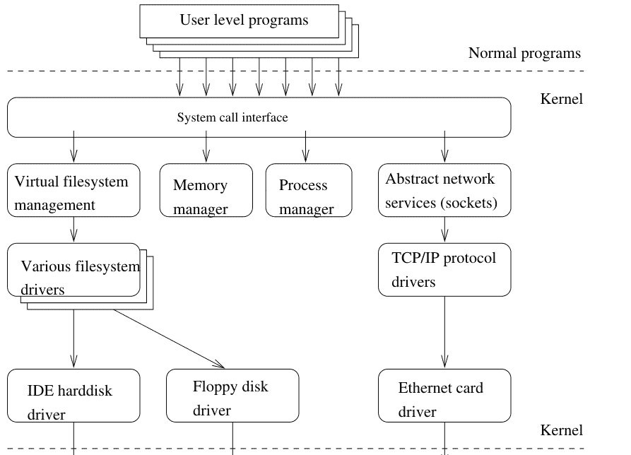
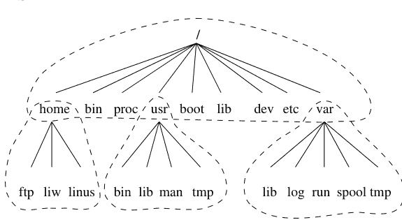
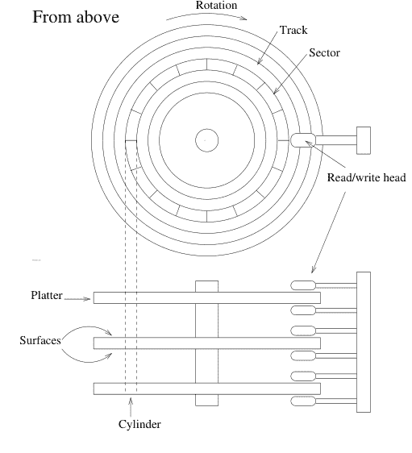
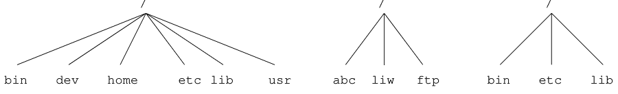
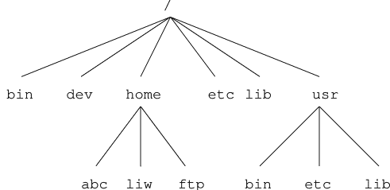
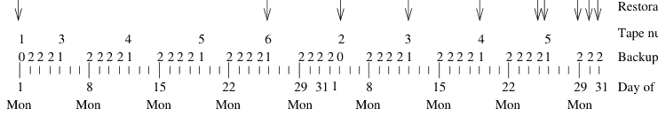

# Linux系统管理员指南


本页为未来的献词预留。在此期间……希望认识他的人告知特里·普拉切特，他使用脚注的方式相当有启发性。

## 第1章
## 引言
> *起初，文件无形无状，空无一物；空无覆盖在比特的表面。著者的手指拂过键盘表面。著者说，要有文字，便有了文字。*
本手册《Linux系统管理员指南》介绍了Linux使用中的系统管理相关内容。本书面向对系统管理几乎一无所知（比如连“系统管理是什么”都不清楚），但已经掌握基本日常使用操作的人群。
本手册不涉及Linux安装相关内容，这部分内容在《安装与入门》文档中说明。更多Linux手册的相关信息请参阅下方内容。
系统管理是指为使计算机系统保持可用状态所需进行的所有工作。其内容包括备份文件（必要时恢复文件）、安装新程序、为用户创建账号（不再需要时删除账号）、确保文件系统未损坏等等。如果把计算机比作房屋，系统管理就相当于房屋维护，包括打扫卫生、修补破损窗户这类工作。
系统管理不叫维护，因为这名字太简单了。¹
本手册的结构设计使得多数章节可独立阅读，因此如果你需要了解备份相关内容，只需阅读对应章节即可。²
¹确实有人这么叫，不过那是因为他们从来没读过这本手册，真可怜。
²前提是你读到的是包含备份章节的版本。


 这使得我们可以在需要时只阅读其中一小部分，而不必通读全文。不过，这份手册首先是一本教程，能作为参考手册只是意外之喜。本手册并不打算完全独立使用。其余大量Linux文档对系统管理员而言同样重要。毕竟，系统管理员只是拥有特殊权限和职责的用户而已。手册页是非常重要的一类资源，当你不熟悉某个命令时，应当始终查阅手册页。虽然本手册面向Linux系统编写，但有一项通用原则是：它同样适用于其他基于UNIX的操作系统。不幸的是，由于不同版本的UNIX之间普遍存在巨大差异，系统管理方面的差异尤其突出，因此覆盖所有变体的可能性微乎其微。而由于Linux的开发特性，要覆盖其所有可能性同样困难。由于没有官方统一的Linux发行版，不同用户有不同的配置，很多用户甚至使用自己搭建的配置。尽管我几乎只使用Debian GNU/Linux系统，但本书并不针对任何特定发行版。只要有可能，我都会尽量指出差异并说明几种替代方案。我尝试讲解事物的运作原理，而非仅仅为每个任务罗列“五步简易教程”。这意味着本书包含大量并非所有人都需要的信息，相关部分都已标注，如果你使用的是预配置系统，可以跳过这些内容。当然，通读全书能够提升你对系统的理解，让系统的使用和管理更得心应手。

和其他所有Linux相关开发工作一样，这份手册是志愿者无偿制作的：我之所以完成它，是觉得这件事很有趣，而且我认为它应当被完成。不过，和所有志愿者工作一样，我能投入的精力、掌握的知识和经验都有限。这意味着本手册的质量未必能达到最高水平：如果聘请专家执笔，花数年时间精雕细琢，成品会更好。我自然觉得它相当不错，但还是提醒各位读者注意。我在其中一个方面有所简化：许多在其他免费手册中已有完善记载的内容，我没有在本书中详细覆盖。这一点尤其适用于程序专属文档，比如`mkfs`的所有使用细节。我仅在本书中介绍该程序的用途，以及为本手册目的所必需的使用方法。若要了解进一步信息，恳请读者参阅其他相关手册。通常，所有提及的文档都属于完整Linux文档集的一部分。

尽管我一直在努力让本手册尽可能完善，但如果你有任何改进建议，我非常乐意倾听。无论是语言错误、事实谬误、新增内容的建议、重写章节的建议，还是不同UNIX版本实现方式的相关信息，我都非常感兴趣。我的联系方式可通过万维网获取：http://www.iki.fi/liw/mail-to-lasu.html。你需要访问该网页以绕过我的垃圾邮件过滤器。

许多人直接或间接地帮助我完成了这本书，我想特别感谢以下人士：马特·韦尔什（Matt Welsh）给予的启发以及对LDP的领导工作；安迪·奥拉姆（Andy Oram）通过宝贵的反馈让我重新投入工作；奥拉夫·基尔希（Olaf Kirch）向我证明了这件事是可行的；Yggdrasil公司的亚当·里希特（Adam Richter）以及其他人则向我证明了其他人也会觉得这项工作有意义。斯蒂芬·特威迪（Stephen Tweedie）、H. 彼得·安文（H. Peter Anvin）、雷米·卡德（Rémy Card）、西奥多·曹（Theodore Ts'o）和斯蒂芬·特威迪允许我借用他们的成果$^3$（这让本书看起来更厚实、也更具吸引力）。我对此深表感激，同时也对早期版本中偶尔出现的未正确标注来源的情况致歉。此外，我还要感谢马克·科马林斯基（Mark Komarinski）在1993年寄来的资料，以及《Linux Journal》上的大量系统管理专栏文章，这些内容都信息丰富、极富启发性。许多人发来了有益的建议，我那个像微型黑洞一样的存档库让我没法找到所有人的名字，但以下是部分贡献者，按字母顺序排列：Paul Caprioli、Ales Cepek、Marie-France Declerfayt、Dave Dobson、Olaf Flebbe、Helmut Geyer、Larry Greenfield和他的父亲、Stephen Harris、Jyrki Havia、Jim Haynes、York Lam、Timothy Andrew Lister、Jim Lynch、Michael J. Micek、Jacob Navia、Dan Poirier、Daniel Quinlan、Jouni K Seppänen、Philippe Steindl、G.B. Stotte。被我遗忘的各位，在此一并致歉。

$^3$ ext2与ext3文件系统的对比、设备列表以及ext2文件系统描述，这些内容已不再属于本书组成部分。

## 排版约定
- **粗体**：用于标注新概念、**警告**以及语言中的关键词。
- *斜体*：用于正文中的*强调*，偶尔也用于章节开头的引言或引语。

### **斜体**
用于标注正文中的**元变量**，尤其是在命令行表示中。例如：
``` ls -l foo ```
其中**foo**代表一个文件名，例如`/bin/cp`。

### **等宽字体**
用于表示屏幕交互内容，示例如下：
``` $ ls -l /bin/cp
-rwxr-xr-x 1 root wheel 12104 Sep 25 15:53 /bin/cp ```
也用于代码示例，无论是C代码、shell脚本还是其他内容，以及配置文件等通用文件的展示。为便于理解，必要时这些示例或图示会被置于细线边框内。

### **按键**
代表需要按下的按键。你通常会看到这样的表述：按下Return键继续。

# Linux文档项目
Linux文档项目（简称LDP）是一个松散的写作者、校对者和编辑团队，共同为Linux操作系统提供完整的文档。该项目的总体协调人是格雷格·汉金斯（Greg Hankins）。本手册是LDP发行的系列手册之一，该系列还包括《Linux用户指南》《系统管理员指南》《网络管理员指南》和《内核黑客指南》。这些手册均提供LaTeX源码格式、.dvi格式和PostScript输出格式，可通过匿名FTP从`sunsite.unc.edu`的`/pub/Linux/docs/LDP`目录获取。我们欢迎所有喜爱写作或编辑的人加入我们，共同完善Linux文档。如果你有互联网电子邮件接入，可以通过`gregh@sunsite.unc.edu`联系格雷格·汉金斯。

# LDP韵文⁴
> 著书立说，何等美妙神奇，
> 我想歌唱，为此付出的汗水、血泪与艰辛。
> 一切始于1992年，那时用户哀怨：“我们什么都做不了！”
> 他们想知道问题出在哪里，又该如何解决（而且要昨天就搞定）。
> 我们把答案写进Linux常见问题解答，盼着再也不用费劲写作。
> “这太长了，难搜索，我们反正不会看！”
> 于是我们几人（当然是通过线上）聚到一起，
> 创立了LDP。
> 我们开始撰写——至少是规划——多本图书，满足各类需求。
> 起初充满乐趣，大家畅所欲言，定下大纲，然后一堆计划出炉。
> 接着喧嚣散去，工作正式开始，有人写得少，有人写得多。
> 面对空白屏幕，哦太可怕了，它就坐在那里，对着你嗤笑。
> 我们仍在等待完工的那一天，等到一切大功告成。
> 在那之前，我们所有的成果只是草稿，供你提出意见。

⁴作者希望保持匿名。该作品由马特·韦尔什发布在LDP邮件列表中。

# 第2章
## Linux系统概述
> 神看着一切所造的都甚好。创世记1:31

本章将对Linux系统进行概览。首先会描述操作系统提供的核心服务，随后会介绍实现这些服务的程序，但不会涉及太多细节。本章的目的是帮助读者整体理解系统，因此各部分的详细内容会在其他章节介绍。

## 2.1 操作系统的各个组成部分
UNIX操作系统由**内核**、一些**系统程序**以及用于执行工作的**应用程序**共同构成。内核是操作系统的核心$^1$。它负责跟踪磁盘上的文件、启动程序并让它们并发运行、为各个进程分配内存和其他资源、接收和发送网络数据包，等等。内核本身几乎不处理具体的业务工作，但它提供了构建所有服务的工具。同时，内核会阻止任何人直接访问硬件，强制所有用户使用它提供的工具。通过这种方式，内核为用户之间提供了一定程度的隔离保护。内核提供的工具通过**系统调用**使用；更多相关信息请参阅手册页第2节。

$^1$事实上，内核经常被误认为是操作系统本身，但它并不是。操作系统提供的服务远比单纯的内核多。


系统程序使用内核提供的工具来实现操作系统所需的各种服务。系统程序及所有其他程序都运行在内核之上，也就是所谓的**用户模式**。系统程序与应用程序的区别在于设计目标：应用程序旨在完成有用的事务（如果是游戏则是为了娱乐），而系统程序是保障系统正常运行所必需的。文字处理器属于应用程序，**远程登录**属于系统程序。不过这种区别通常比较模糊，只有对分类有执念的人才会在意。操作系统也可以包含编译器及其对应的类库（尤其是Linux系统下的GCC和C标准库），但并非所有编程语言都需要作为操作系统的一部分。文档，有时甚至游戏，也可以成为操作系统的组成部分。传统上，操作系统由安装磁带或光盘的内容来界定；而Linux没有这么明确的边界，因为它分布在世界各地的FTP站点上。

## 2.2 内核的重要组成部分
Linux内核包含多个重要组成部分：进程管理、内存管理、硬件设备驱动、文件系统驱动、网络管理以及其他各类细碎组件。图2.1展示了其中部分组件。

图2.1：Linux内核的部分重要组件。
内核中最重要的组成部分（其他所有组件都离不开它们）当属内存管理和进程管理。内存管理负责为进程、内核各模块以及缓冲区缓存分配内存区域和交换空间区域。进程管理负责创建进程，并通过切换处理器上的活跃进程实现多任务运行。最底层层面，内核为每一种支持的硬件都提供了对应的硬件设备驱动。由于世上的硬件种类繁多，硬件设备驱动的数量也非常庞大。很多硬件本身特性相似，但软件控制方式存在差异。这些相似性使得我们可以将支持类似操作的驱动归为通用类别：类别中的每个成员与内核其余部分的接口一致，但实现这些操作的具体逻辑有所不同。例如，所有磁盘驱动在内核其余部分看来都是相同的，也就是说它们都具备“初始化驱动器”“读取N号扇区”“写入N号扇区”这类操作。内核自身提供的一些软件服务也有类似特性，因此也可以被抽象为类别。例如，各类网络协议已被抽象为统一的编程接口，即BSD套接字库。另一个例子是**虚拟文件系统**（VFS）层，它将文件系统操作与具体实现解耦。每种文件系统类型都会实现所有文件系统操作。当某个实体尝试使用文件系统时，请求会经由VFS转发到对应的文件系统驱动。

## 2.3 UNIX系统的主要服务
本节将介绍UNIX系统中部分重要服务，但不会展开过多细节，相关内容会在后续章节中详细阐述。

### 2.3.1 init
UNIX系统中最重要的服务由**init初始进程**提供。每个UNIX系统启动时，内核执行的最后一步操作就是启动**init初始进程**，它是系统的第一个进程。**init初始进程**启动后，会通过执行各类启动任务（检查并挂载文件系统、启动守护进程等）继续完成引导流程。**init初始进程**执行的具体操作列表取决于它的实现版本，目前有多个版本可供选择。**init初始进程**通常提供**单用户模式**的概念：该模式下无人可登录，**root用户**会在控制台使用shell；常用的模式被称为**多用户模式**。部分实现版本将其泛化为**运行级别**：单用户模式和多用户模式被视为两个运行级别，此外还可以设置更多级别，例如用于在控制台运行X系统的级别。正常运行状态下，**init初始进程**会确保**getty登录程序**正常工作（以允许用户登录），并收养孤儿进程（即父进程已终止的进程；在UNIX中，*所有*进程*必须*属于同一棵进程树，因此孤儿进程必须被收养）。系统关闭时，由**init初始进程**负责终止所有其他进程、卸载所有文件系统、停止处理器，以及执行其他任何已配置的关闭任务。

### 2.3.2 终端登录
通过串行线路的终端登录，以及未运行X系统时的控制台登录，均由**getty登录程序**提供。**init初始进程**会为每一个允许登录的终端启动一个独立的**getty登录程序**实例。**getty登录程序**会读取用户名，并启动**登录验证程序**读取密码。如果用户名和密码正确，**登录验证程序**会启动shell。当shell终止（即用户登出），或**登录验证程序**因用户名密码不匹配而终止时，**init初始进程**会感知到该情况，并启动新的**getty登录程序**实例。内核并不具备登录相关的逻辑，所有登录功能均由系统程序处理。

### 2.3.3 系统日志（Syslog）
内核和许多系统程序会产生错误、警告及其他消息。这些消息通常需要能够在后续甚至很久之后被查看，因此需要被写入文件。执行该操作的程序是**系统日志服务（syslog）**。它可以被配置为根据消息来源或重要程度，将消息分类存储到不同文件中。例如，内核消息通常会被单独存储到一个文件中，因为内核消息往往更重要，需要定期查看以排查问题。

### 2.3.4 周期性命令执行：cron与at
用户和系统管理员都经常需要周期性执行命令。例如，系统管理员可能需要执行命令清理临时文件目录（/tmp和/var/tmp）中的旧文件，避免磁盘被占满，因为并非所有程序都会在运行结束后正确清理自身产生的临时文件。cron服务就是为此设计的。每个用户都有一个crontab（定时任务列表），可以在其中列出要执行的命令以及对应的执行时间。cron守护进程会在指定时间自动启动对应的命令。at服务与cron类似，但仅执行一次：命令会在指定时间运行，不会重复执行。

### 2.3.5 图形用户界面
UNIX和Linux并未将用户界面集成到内核中，而是由用户级程序实现。这一点同时适用于文本模式和图形环境。这种架构让系统更加灵活，但也有一个缺点：每个程序都可以轻松实现不同的用户界面，导致系统的学习成本更高。Linux系统主要使用的图形环境被称为X Window System（简称X）。X系统本身也不实现用户界面，仅提供窗口系统，也就是用于实现图形用户界面的工具集。基于X实现的最流行的三种用户界面风格是Athena、Motif和Open Look。

### 2.3.6 网络功能
网络功能指将两台或更多计算机连接起来，使其可以相互通信的行为。实际的连接和通信方法稍显复杂，但最终实现的效果非常有用。UNIX操作系统拥有丰富的网络功能。大多数基础服务——文件系统、打印、备份等——都可以通过网络实现。这让系统管理变得更加轻松，因为支持集中式管理的同时，还能享受到微计算和分布式计算带来的优势，例如更低的成本、更高的容错性。不过本书仅会简要介绍网络相关内容，更多信息（包括网络运行的基础原理）可以参考《Linux网络管理员指南》。

### 2.3.7 网络登录
网络登录的工作原理和普通登录略有不同。每个可登录的终端都有独立的物理串行线路。每个通过网络登录的用户都有独立的虚拟网络连接，这类连接的数量没有上限²。因此，无法为每一个可能的虚拟连接运行独立的`getty`程序。网络登录有多个不同的方式，TCP/IP网络中最主要的两种是`telnet`和`rlogin`。网络登录不会部署大量`getty`程序，而是为每种登录方式运行一个独立的守护进程（`telnet`和`rlogin`使用不同的守护进程），用于监听所有传入的登录请求。当监听到登录请求时，它会启动一个新的自身实例来处理该次请求，原有实例会继续监听其他请求。新实例的工作方式和`getty`类似。

### 2.3.8 网络文件系统
网络服务最有用的应用之一就是通过**网络文件系统**共享文件。常用的网络文件系统是由Sun公司开发的网络文件系统（Network File System，简称NFS）。使用网络文件系统时，一台机器上的程序执行的所有文件操作都会被发送到网络中的另一台计算机上。这会欺骗程序，让它认为另一台计算机上的所有文件实际存在于运行该程序的计算机上。由于无需修改程序，信息共享变得极其简单。

> ²当然，这种连接的数量实际上可以有很多。但由于网络带宽仍然是稀缺资源，因此单个网络连接上的并发登录数量仍存在实际的上限。


### 2.3.9 邮件
电子邮件通常是通过计算机通信最重要的方式。一封电子信件会以特殊格式存储在文件中，专门的邮件程序用于发送和阅读这些信件。每个用户都有一个**收件邮箱**（一种特殊格式的文件），所有新邮件都会存储在这里。当有人发送邮件时，邮件程序会定位收件人的邮箱，并将信件追加到邮箱文件中。如果收件人的邮箱在另一台设备上，这封信就会被发送到那台设备，由该设备自行决定将其投递到对应邮箱。
邮件系统由许多程序组成。向本地或远程邮箱投递邮件的任务由单个程序完成（即**邮件传输代理**或**MTA**，例如`sendmail`或`smail`），而用户使用的程序则多种多样（即**邮件用户代理**或**MUA**，例如`pine`或`elm`）。邮箱通常存储在`/var/spool/mail`中。

### 2.3.10 打印
同一时间只有一个人可以使用打印机，但不在用户间共享打印机是很不经济的。因此打印机由实现**打印队列**功能的软件管理：所有打印任务都会被放入队列，每当打印机完成一个任务，下一个任务会自动发送到打印机。这免去了用户自行管理打印队列、争抢打印机控制的麻烦。³ 取而代之的是，用户*在打印机旁*形成新的队列等待自己的打印成品——毕竟似乎没人能让队列软件精准判断任何人的打印任务何时真正完成。这大大改善了办公室内部的人际关系。
打印队列软件还会将打印内容**假脱机**存储到磁盘中，即任务在队列中时，文本会被保存在文件里。这能让应用程序快速向打印队列软件提交打印任务，不用等到任务实际打印完成就能继续运行，非常方便。这意味着你可以打印一版内容，不用等这版打印完就能输出完全修订的新版本。

## 2.4 文件系统布局
文件系统被划分为多个部分：通常包含根文件系统（其中有`/bin`、`/lib`、`/etc`、`/dev`及少数其他目录）、存放程序和不变数据的`/usr`文件系统、存放变化数据（如日志文件）的`/var`文件系统，以及存放所有用户个人文件的`/home`文件系统。根据硬件配置和系统管理员的决策，划分方式可能有所不同，甚至可以将所有内容放在同一个文件系统中。第3章会详细描述文件系统布局，《Linux文件系统标准》对此也有更详细的说明。

# 第3章 目录树概览
> 两天后，小熊维尼坐在自己的树枝上，晃着腿，身旁放着四罐蜂蜜……（A.A. 米尔恩）
本章基于FSSTND文件系统标准，描述标准Linux目录树的重要组成部分。它会概述将目录树按不同用途拆分为独立文件系统的常规方式，并说明这种拆分方式的依据。本章也会描述一些其他替代拆分方案。

## 3.1 背景
本章大致基于Linux文件系统标准FSSTND 1.2版本（见参考文献[Qui95]），该标准旨在为Linux系统的目录树组织方式设定规范。该标准的优势在于，由于所有内容都会放在惯常位置，因此为Linux编写或移植软件、管理Linux设备都会更加轻松。该标准没有强制所有人遵守的权威约束，但获得了几乎所有Linux发行版的支持。如果没有非常充分的理由，最好不要违背FSSTND规范。
FSSTND试图遵循Unix传统和当前趋势，让熟悉其他Unix系统的用户能够快速适应Linux系统，反之亦然。本章内容不如FSSTND详细，系统管理员若要完全理解相关内容，也应阅读FSSTND。本章不会详细解释所有文件，目的并非描述每一个文件，而是从文件系统角度概述整个系统。关于每个文件的更多信息可在本手册其他部分或手册页中找到。
完整的目录树可以被拆分为更小的部分，每个部分放在独立的磁盘或分区中，以适应磁盘容量限制，简化备份和其他系统管理工作。主要部分为根文件系统、`/usr`、`/var`和`/home`文件系统（见图3.1）。每个部分有不同的用途。目录树的设计使其能在Linux设备网络中良好运行，这些设备可以通过只读设备（如CD-ROM）或通过网络NFS共享文件系统的部分内容。

图3.1：Unix目录树的部分组成。虚线表示分区边界。

- 根文件系统对每台设备来说是唯一的（通常存储在本地磁盘中，当然也可以是内存盘或网络驱动器），包含启动系统、将系统提升到可挂载其他文件系统状态所必需的文件。因此根文件系统的内容足以支持单用户模式运行。它还会包含修复故障系统、从备份中恢复丢失文件的工具。
- `/usr`文件系统包含正常运行所需的所有命令、库、手册页及其他不变文件。`/usr`中的任何文件都不应对特定设备专用，也不应在正常使用中被修改。这允许文件通过网络共享，具有成本效益，因为可以节省磁盘空间（`/usr`中的内容可能轻易达到数百MB），还能简化管理工作（更新应用程序时只需修改主`/usr`，无需单独修改每台设备）。即使文件系统在本地磁盘上，也可以挂载为只读，以降低系统崩溃时文件系统损坏的概率。
- `/var`文件系统包含会发生变化的内容，如假脱机目录（用于邮件、新闻、打印机等）、日志文件、格式化后的手册页和临时文件。传统上`/var`中的所有内容都位于`/usr`下的某处，但这导致`/usr`无法挂载为只读。
- `/home`文件系统包含用户的主目录，即系统上的所有真实数据。将主目录拆分到独立的目录树或文件系统中可以简化备份工作，其他部分通常不需要备份，或至少不必频繁备份（它们很少发生变化）。较大的`/home`可能需要在多个文件系统中拆分，这需要在`/home`下新增一个命名层级，例如`/home/students`和`/home/staff`。

尽管上文将这些部分称为文件系统，但并不要求它们实际位于独立的文件系统中。如果是小型单用户系统，且用户希望保持简单，可以轻松将它们放在同一个文件系统中。目录树的拆分方式也可能因磁盘大小、不同用途的空间分配而有所不同。不过重要的是，所有标准*名称*都能正常使用；例如，即使`/var`和`/usr`实际位于同一分区，`/usr/lib/libc.a`和`/var/adm/messages`这样的路径也必须能正常访问，实现方式例如将`/var`下的文件移动到`/usr/var`下，并将`/var`设置为指向`/usr/var`的符号链接。
Unix文件系统结构按照用途对文件进行分组，即所有命令放在一处，所有数据文件放在另一处，文档放在第三处，以此类推。另一种方式是按照文件所属程序进行分组，即所有Emacs相关文件放在一个目录，所有TEX相关文件放在另一个目录，以此类推。后一种方式的问题在于，这会使得文件共享变得困难（程序目录通常同时包含静态可共享文件和变化不可共享文件），有时候甚至很难找到文件（例如手册页散落在大量不同位置，让手册页程序找到所有手册页简直是维护噩梦）。


## 3.2 根文件系统
根文件系统通常应该设置得较小，因为它包含非常关键的文件，而体积小、修改频率低的文件系统更不容易损坏。损坏的根文件系统通常意味着系统无法启动，除非采取特殊措施（例如从软盘启动），所以不能在这方面冒险。根目录通常不包含任何文件，仅可能存放系统的标准启动镜像，一般命名为`/vmlinux`。根文件系统中的所有其他文件都存放在其子目录下：
- **`/bin`**：启动过程中需要的、普通用户也可能在启动后使用的命令。
- **`/sbin`**：与`/bin`类似，但其中的命令并非面向普通用户设计，不过用户在必要时且被允许的情况下也可以使用。
- **`/etc`**：特定于当前机器的配置文件。
- **`/root`**：root用户的主目录。
- **`/lib`**：根文件系统中程序所需的共享库。
- **`/lib/modules`**：可加载的内核模块，尤其是系统从灾难中恢复启动时所需的模块（例如网络和文件系统驱动）。
- **`/dev`**：设备文件。
- **`/tmp`**：临时文件。启动后运行的程序应该使用`/var/tmp`，而非`/tmp`，因为前者所在的磁盘通常有更大的存储空间。
- **`/boot`**：引导加载程序使用的文件，例如LILO。内核镜像通常会存放在这里而非根目录。如果存在多个内核镜像，该目录很容易变得较大，将其放到独立文件系统中会更好。另一个原因是为了确保内核镜像位于IDE磁盘的前1024个柱面内。
- **`/mnt`**：系统管理员临时挂载的挂载点。程序不应该自动向`/mnt`执行挂载操作。`/mnt`可能会划分为子目录（例如`/mnt/dosa`可能是使用MS-DOS文件系统的软盘驱动器，而`/mnt/exta`则是使用ext2文件系统的同类型设备）。
`/proc`、`/usr`、`/var`、`/home`：其余文件系统的挂载点。

### 3.2.1 /etc目录
`/etc`目录包含大量文件，其中部分会在下文介绍，其余文件你可以通过判断其所属程序、阅读对应程序的手册页来了解。许多网络配置文件也存放在`/etc`中，《网络管理员指南》里有相关说明。
- `/etc/rc`或`/etc/rc.d`或`/etc/rc?.d`：启动或切换运行级别时运行的脚本或脚本目录。更多信息请查看关于`init`的章节。
- `/etc/passwd`：用户数据库，包含用户名、真实姓名、主目录、加密密码以及每位用户的其他信息字段，其格式在*passwd*手册页中有说明。
- `/etc/fdprm`：软盘参数表，描述不同软盘格式的规格，供`setfdprm`使用。更多信息请查看*setfdprm*手册页。
- `/etc/fstab`：列出了`/etc/rc`或等效启动文件中`mount -a`命令在启动时自动挂载的文件系统。在Linux系统中，该文件还包含`swapon -a`命令自动使用的交换区信息。更多信息请查看4.8.5节和*mount*手册页。
- `/etc/group`：与`/etc/passwd`类似，但描述的是用户组而非用户。更多信息请查看*group*手册页。
- `/etc/inittab`：`init`的配置文件。
- `/etc/issue`：`getty`在登录提示前输出的内容，通常包含系统的简短说明或欢迎语，内容由系统管理员自行决定。
- `/etc/magic`：`file`命令的配置文件，包含各类文件格式的描述，`file`命令会根据这些描述判断文件类型。更多信息请查看*magic*和*file*手册页。
- `/etc/motd`：每日消息，在成功登录后自动输出，内容由系统管理员自行决定，通常用于向所有用户传递信息，例如计划内停机的警告。
- `/etc/mtab`：当前已挂载的文件系统列表，最初由脚本生成，后续由`mount`命令自动更新。需要已挂载文件系统列表的场景（例如`df`命令执行时）会使用该文件。
- `/etc/shadow`：已安装影子密码软件的系统中的影子密码文件。影子密码会将加密后的密码从`/etc/passwd`移至`/etc/shadow`，后者只有`root`用户可以读取，这增加了密码被破解的难度。
- `/etc/login.defs`：`login`命令的配置文件。
- `/etc/printcap`：与`/etc/termcap`类似，但面向打印机设计，语法不同。
- `/etc/profile`、`/etc/csh.login`、`/etc/csh.cshrc`：Bourne shell或`C` shell在登录或启动时执行的文件，允许系统管理员为所有用户设置全局默认配置。更多信息请查看对应shell的手册页。
- `/etc/securety`：标识安全终端，即允许`root`用户登录的终端。通常仅列出虚拟控制台，因此通过网络或调制解调器侵入系统来获取超级用户权限会变得不可能（或至少难度大增）。
- `/etc/shells`：列出可信shell列表，`chsh`命令仅允许用户将登录shell更改为该文件中列出的shell。为机器提供FTP服务的服务器进程`ftpd`会检查用户的shell是否在`/etc/shells`中，若不在则不允许用户登录。
- `/etc/termcap`：终端能力数据库，描述了各类终端可响应的“转义序列”。程序编写时会通过查询`/etc/termcap`获取执行操作所需的正确序列，而非直接输出仅适用于特定品牌终端的转义序列，因此大多数程序可以适配绝大多数终端。更多信息请查看`termcap`、`curs_termcap`和`terminfo`手册页。

### 3.2.2 /dev目录
`/dev`目录包含所有设备的特殊设备文件。设备文件采用特定的命名约定，相关内容在设备列表中有说明（参见[1]）。设备文件在安装时创建，后续可通过`/dev/MAKEDEV`脚本创建。`/dev/MAKEDEV.local`是系统管理员编写的脚本，用于创建仅本地使用的设备文件或链接（即不属于标准MAKEDEV的部分，比如部分非标准设备驱动的设备文件）。

## 3.3 /usr文件系统
`/usr`文件系统通常体积较大，因为所有程序都安装在该目录下。`/usr`中的所有文件通常来自Linux发行版，本地安装的程序和其他内容会放在`/usr/local`下。这样就可以从新版本的发行版甚至全新的发行版更新系统，无需重新安装所有程序。
`/usr`的部分子目录如下（部分重要性较低的目录已被省略，更多信息请查看FSSTND）：
- `/usr/X11R6`：X Window系统的全部文件。为了简化X的开发和安装，X的文件未与系统其余部分整合，`/usr/X11R6`下的目录结构与`/usr`本身的目录结构类似。
- `/usr/X386`：与`/usr/X11R6`类似，但适用于X11 Release 5。
- `/usr/bin`：几乎所有用户命令，部分命令存放在`/bin`或`/usr/local/bin`中。
- `/usr/sbin`：不需要在根文件系统中运行的系统管理命令，例如大多数服务器程序。
- `/usr/man`、`/usr/info`、`/usr/doc`：分别存放手册页、GNU Info文档以及其他杂项文档文件。
- `/usr/include`：C编程语言的头文件，按照一致性要求本应放在`/usr/lib`下，但传统命名习惯已经广受认可，因此保留现有名称。
- `/usr/lib`：程序与子系统的不变数据文件，包括部分全站范围配置文件。“lib”这一名称来自“library（库）”，原本

最后，编程子例程的库会存储在`/usr/lib`中。
- `/usr/local`：用于存放本地安装的软件及其他文件的位置。
## 3.4 /var文件系统
- `/var/catman`：按需格式化的手册页缓存。手册页的源文件通常存储在`/usr/man/man*`中；部分手册页可能附带预格式化版本，存储在`/usr/man/cat*`中。其余手册页在首次查看时需进行格式化，格式化后的版本会被存入`/var/catman`，这样后续查看同一页面的用户无需等待格式化完成。（`/var/catman`的清理方式与临时目录的清理规则一致。）
- `/var/lib`：系统正常运行过程中会发生变更的文件。
- `/var/local`：安装在`/usr/local`中的程序的可变数据（即由系统管理员安装的程序）。注意：即便是本地安装的程序，在适用情况下也应使用其他`/var`目录，例如`/var/lock`。
- `/var/lock`：锁文件。多数程序遵循约定，在`/var/lock`中创建锁文件，以表明自身正在使用特定设备或文件。其他程序检测到锁文件后，便不会尝试使用该设备或文件。
- `/var/log`：来自各类程序的日志文件，其中主要是`login`（对应路径`/var/log/wtmp`，记录所有登录、登出系统的操作）和`syslog`（对应路径`/var/log/messages`，通常存储所有内核与系统程序的消息）。`/var/log`中的文件通常可无限增长，可能需要定期清理。
- `/var/run`：存储系统相关信息的文件，这些信息在系统下次启动前均有效。例如，`/var/run/utmp`中存储了当前登录用户的信息。
- `/var/spool`：用于存放邮件、新闻、打印队列及其他排队任务的目录。每个不同的假脱机任务在`/var/spool`下都有独立的子目录，例如用户邮箱就位于`/var/spool/mail`中。
- `/var/tmp`：用于存储体积较大、或需留存时长超过`/tmp`允许上限的临时文件。（尽管系统管理员通常也不会允许`/var/tmp`中存放过于陈旧的文件。）
## 3.5 /proc文件系统
`/proc`文件系统是一个虚拟文件系统。它并不存储于磁盘中，而是由内核在内存中创建。它用于提供系统相关信息（最早用于提供进程相关信息，因此得名）。下面会介绍其中部分较为重要的文件和目录。`/proc`文件系统的更多详细信息可以参考`proc`手册页。
- **`/proc/1`**：进程号为1的进程对应的目录，存储了该进程的相关信息。每个进程在`/proc`下都有以其进程识别号命名的独立目录。
- **`/proc/cpuinfo`**：处理器相关信息，包含类型、制造商、型号、性能等内容。
- **`/proc/devices`**：当前运行内核已配置的设备驱动列表。
- **`/proc/dma`**：显示当前正在使用的DMA通道。
- **`/proc/filesystems`**：内核已配置的文件系统。
- **`/proc/interrupts`**：显示当前正在使用的中断，以及每种中断被触发的次数。
- **`/proc/ioports`**：显示当前正在使用的I/O端口。
- **`/proc/kcore`**：系统物理内存的映像文件。其大小与物理内存完全一致，但实际不会占用太多内存；程序访问时会动态生成。（注意：除非将其复制到其他位置，否则`/proc`下的所有内容都不会占用任何磁盘空间。）
- **`/proc/kmsg`**：内核输出的消息，这些消息同时也会被路由到`syslog`。
- **`/proc/ksyms`**：内核的符号表。
- **`/proc/loadavg`**：系统的平均负载；是三个反映系统当前工作负载的关键指标。
- **`/proc/meminfo`**：内存使用信息，包含物理内存与交换空间的相关数据。
- **`/proc/modules`**：当前已加载的内核模块。
- **`/proc/net`**：网络协议的状态信息。
- **`/proc/self`**：一个指向正在查看`/proc`的程序的进程目录的符号链接。当两个进程同时查看`/proc`时，二者会获得不同的链接。该设计主要是为了方便程序获取自身的进程目录。
- **`/proc/stat`**：系统的各项统计信息，例如系统启动以来的缺页次数。
- **`/proc/uptime`**：系统的运行时长。
- **`/proc/version`**：内核版本。
> 注意，上述文件通常都是易读的文本文件，但有时其格式可能难以理解。有不少命令的功能就是读取上述文件并将其格式化为更易理解的形式。例如，`free`程序会读取`/proc/meminfo`，将其中以字节为单位的数据转换为千字节为单位（同时还会补充一些额外信息）。
# 第4章 使用磁盘及其他存储设备
> 在完好的磁盘上，你可以永远寻道。
当你安装或升级系统时，需要在磁盘上完成诸多操作。你需要先在磁盘上创建文件系统，才能存储文件并为系统的不同部分预留空间。本章将介绍所有这些初始操作。通常，系统设置完成后，除非使用软盘，否则你无需再次执行这些操作。如果添加了新磁盘，或是想要优化磁盘使用，可以重新查阅本章。
磁盘管理的基本任务包括：
- 格式化磁盘。这一步会执行多项准备工作，例如检查坏扇区。（如今大多数硬盘无需进行格式化。）
- 如果需要将硬盘用于多个互不干扰的任务，可对硬盘进行分区。分区的原因包括：一是在同一块硬盘上安装不同的操作系统；二是将用户文件与系统文件分离，这样既可以简化备份操作，也有助于保护系统文件免受损坏。
- 在每个磁盘或分区上创建（合适类型的）文件系统。在创建文件系统之前，Linux 无法识别磁盘；创建完成后，就可以在磁盘上创建和访问文件了。
- 将不同的文件系统挂载到统一的目录树结构中，既可以选择自动挂载，也可以根据需求手动挂载。（手动挂载的文件系统通常也需要手动卸载。）
第5章包含虚拟内存和磁盘缓存的相关内容，使用磁盘时也需要了解这些知识。本章将介绍硬盘、软盘、CD-ROM和磁带驱动器相关的必备知识。
## 4.1 两种设备类型
UNIX（以及由此衍生出的Linux）识别两种不同类型的设备：随机访问块设备（如磁盘）和字符设备（如磁带、串行线路），其中部分字符设备是串行传输的，部分支持随机访问。每个受支持的设备在文件系统中都对应一个**设备文件**。读写设备文件时，数据会在设备文件对应的设备与系统之间传入传出。这样一来，访问设备无需特殊程序（也无需特殊的应用程序编程方式，例如捕获中断或轮询串行端口）；例如，要向打印机发送文件，只需执行以下命令：
```shell
$ cat filename > /dev/lp1
```
文件内容就会被打印出来（当然，文件必须是打印机可识别格式）。但多个人同时向打印机输出文件并非明智之举，因此通常会使用专用程序来发送待打印的文件（一般是**lpr**）。该程序会确保同一时间只打印一个文件，处理完当前文件后会自动将下一个待打印文件发送到打印机。绝大多数设备都需要类似的机制。实际上，用户几乎不需要操心设备文件的问题。由于设备在文件系统中以文件形式存在（位于`/dev`目录下），因此使用`ls`或其他合适的命令就能轻松查看当前存在哪些设备文件。在`ls -l`的输出中，第一列包含文件类型与权限信息。例如，在我的系统上查看串行设备会得到如下输出：
```shell
$ ls -l /dev/cua0
crw-rw-rw- 1 root uucp 5, 64 Nov 30 1993 /dev/cua0
```


## 4.2 硬盘
第一列的第一个字符，即上方`crw-rw-rw-`里的'c'，会告知了解相关知识的用户该文件的类型，此处为字符设备。普通文件的首字符为'-'，目录是'd'，块设备是'b'；更多信息可查阅`ls`命令的man手册页。
注意，通常即使设备本身并未安装，对应的设备文件也会存在。因此，只要存在`/dev/sda`文件，不代表你真的装有SCSI硬盘。预置所有设备文件能让安装程序更简单，也便于新增硬件（无需为设备查找正确参数，也无需手动创建设备文件）。
本小节将介绍硬盘相关的术语。如果你已经了解这些术语和概念，可以跳过本小节。图4.1是硬盘核心部件的示意图。
硬盘由一块或多块圆形的**盘片**[^1]构成，单片或双面盘片表面都涂有用于记录数据的磁性物质。每面盘片都配有**读写磁头**，用于读取或修改已记录的数据。盘片围绕同一轴心旋转，普通硬盘的典型转速为每分钟3600转，高性能硬盘的转速会更高。磁头会沿着盘片半径方向移动，磁头的移动加上盘片的旋转，足以让磁头访问盘片表面的所有区域。
处理器（CPU）与硬盘通过**磁盘控制器**通信。这样其余计算机部件无需了解硬盘的使用方法，因为不同类型的磁盘控制器都可以对接计算机其他部分使用统一的接口。因此，计算机只需发送“喂硬盘，把我需要的数据给我”的指令即可，无需输出一长串复杂电信号来控制磁头移动到正确位置、等待目标区域转到磁头下方，以及完成其他所有必要的繁琐操作。（实际上，控制器的接口仍然复杂，但复杂度远低于没有控制器的情况。）控制器还能执行其他功能，比如缓存读写数据、自动替换坏扇区。
以上内容通常是理解硬盘硬件所需的全部信息。还有其他一些组件，比如驱动盘片旋转、移动磁头的电机，以及控制机械部件运转的电路，但这些对理解硬盘工作原理大多没有关系。
[^1]：盘片由硬质材料（比如铝）制成，这也是“硬盘”（hard disk）名称的由来。盘片表面通常会被划分为多个同心圆环，称为**磁道**，磁道又会进一步划分为**扇区**。这种划分被用于指定硬盘上的位置、为文件分配磁盘空间。要定位硬盘上的某个位置，可以表述为“第3面、第5磁道、第7扇区”。通常所有磁道的扇区数量是相同的，但部分硬盘会在外圈磁道上放置更多扇区（所有扇区的物理大小相同，因此更长的外圈磁道能容纳更多扇区）。通常单个扇区可存储512字节数据，硬盘本身无法处理小于一个扇区容量的数据。

图4.1：硬盘示意图。每面盘片都会以相同的方式划分为磁道（和扇区）。这意味着当某一面盘片的磁头位于某条磁道时，其他盘片面的磁头也会位于对应的磁道上。所有对应磁道合起来称为**柱面**。将磁头从一条磁道（柱面）移动到另一条需要一定时间，因此如果将经常一起访问的数据（比如一个文件）存放在同一个柱面内，就无需移动磁头即可读取全部数据，这能提升性能。但这种情况并不总能实现，存储在磁盘多个位置的文件被称为**碎片化文件**。
盘片数（或磁头数，二者是相同的）、柱面数和扇区数的差异很大，这三类数值的规格被称为硬盘的**几何参数**。几何参数通常存储在名为**CMOS RAM**的特殊电池供电存储器中，操作系统可在启动或驱动初始化时从中读取。
不幸的是，BIOS[^2]存在设计限制，导致无法在CMOS RAM中指定超过1024的磁道号，这个数值对大容量硬盘来说太小了。为绕过该限制，硬盘控制器会虚报自身的几何参数，并将计算机给出的**地址转换为符合实际硬盘规格的地址**。举个例子，某块硬盘可能有8个磁头、2048条磁道、每条磁道35个扇区[^3]。它的控制器可以欺骗计算机，声称自己有16个磁头、1024条磁道、每条磁道35个扇区，从而不超出磁道号的限制；之后会将计算机传来的地址的磁头编号减半、磁道号加倍，转换为实际地址。实际场景中的计算逻辑会更复杂，因为现实中的数值不会像示例里这么整（但同样，细节对理解原理没有影响）。这种地址转换会扭曲操作系统对磁盘组织结构的认知，因此“将所有数据放在一个柱面以提升性能”的方法基本不可行。该问题仅存在于IDE硬盘：SCSI硬盘使用顺序扇区编号（即控制器会将顺序扇区编号转换为磁头+柱面+扇区的三元组），并且CPU与控制器通讯的方式也完全不同，因此不受该问题影响。但要注意的是，计算机也可能无法获取SCSI硬盘的真实几何参数。由于Linux通常也无法获知硬盘的真实几何参数，其文件系统甚至不会尝试将文件存放在单个柱面内，而是尝试为文件分配顺序编号的扇区，这种方式几乎能达到相当的性能。控制器自带的缓存，以及控制器执行的自动预读操作，会让这个问题进一步复杂化。
[^2]：BIOS是存储在ROM芯片中的内置软件，主要负责处理启动的初始阶段等任务。
[^3]：示例中的数值均为虚构。
其他类型的硬盘也有类似的命名规范，更多信息可查阅*[Anv]*。
每个硬盘都由独立的设备文件表示。通常最多只有2或4个IDE硬盘，分别对应`/dev/hda`、`/dev/hdb`、`/dev/hdc`和`/dev/hdd`。SCSI硬盘则对应`/dev/sda`、`/dev/sdb`等。其他类型的硬盘也有类似的命名规范，更多信息可查阅*[Anv]*。注意硬盘的设备文件会直接访问整个磁盘，不考虑分区（分区相关内容将在后续介绍），如果不小心操作，很容易损坏分区或分区内的数据。硬盘的设备文件通常仅用于访问主引导记录（相关内容也将在后续介绍）。
## 4.3 软盘
软盘由柔性基材构成，单面或双面涂有与硬盘类似的磁性物质。软盘本身没有读写磁头，磁头集成在软驱中。
软盘对应硬盘的一块盘片，但可以拆卸，一个软驱可以读取不同的软盘；而硬盘是不可拆分的一体化单元。
和硬盘类似，软盘也会被划分为磁道和扇区（软盘正反两面对应的磁道会组成一个柱面），但磁道和扇区的数量远少于硬盘。
软驱通常支持多种不同类型的软盘；例如$3\frac{1}{2}$英寸软驱既可以读取720kB容量的软盘，也可以读取1.44MB容量的软盘。
由于不同软盘需要软驱以略有差异的方式运行，且操作系统需要知道磁盘的容量，因此软驱有多个对应的设备文件，每个设备文件对应一种软驱和软盘的组合。因此`/dev/fd0H1440`指代第一个软驱（`fd0`），该软驱必须是$3\frac{1}{2}$英寸规格，读取的是$3\frac{1}{2}$英寸高密度（`H`）软盘，容量为1440kB（`1440`），也就是普通的$3\frac{1}{2}$英寸HD软盘。更多有关软盘设备命名规范的信息可查阅[Anv]。
但软驱的命名比较复杂，因此Linux提供了特殊的软盘设备类型，可以自动检测软驱中插入的磁盘类型。它的工作原理是：尝试用不同类型的软盘参数读取新插入软盘的第一个扇区，直到找到匹配的类型。这自然要求软盘必须先被格式化。这类自动识别的设备被称为`/dev/fd0`、`/dev/fd1`等。
自动识别设备访问磁盘所用的参数也可以通过`setfdprm`程序设置。如果你需要使用不符合常见软盘规格的磁盘（比如扇区数量异常），或者自动检测因某种原因失败、找不到对应的设备文件，这个功能就会派上用场。
除了所有标准软盘格式外，Linux还支持多种非标准软盘格式，其中部分需要专用格式化程序才能使用。我们暂时不会介绍这些磁盘类型，但你可以先查看`/etc/fdprm`文件，该文件列出了`setfdprm`程序可识别的所有参数设置。
操作系统必须知道软驱中的磁盘何时被更换，比如为了避免使用上一张磁盘的缓存数据。不幸的是，用于检测磁盘更换的信号线有时会出现故障，更糟的是，该问题无法

在 MS-DOS 下使用该驱动器时，这个问题会非常明显。如果你在使用软盘时遇到奇怪的故障，很可能就是这个原因导致的。修复该问题的唯一方法是检修软盘驱动器。
## 4.4 CD-ROM 驱动器
CD-ROM 驱动器使用的是可通过光学方式读取的、涂有塑料层的圆盘。信息以沿从盘心到盘缘的螺旋线排列的微小“凹坑”的形式记录在盘片表面。^4 驱动器会沿着螺旋线发射激光束来读取盘片。激光照射到凹坑时反射方式与照射到光滑表面时的反射方式不同，由此可以轻松对比特乃至信息进行编码，其余部分只是简单的机械结构而已。
^4 即盘片内部、塑料涂层下的金属盘片表面。
和硬盘相比，CD-ROM 驱动器速度较慢。普通硬盘的平均寻道时间不足15毫秒，而高速 CD-ROM 驱动器的寻道时间可达十分之一秒。其实际数据传输率倒是不低，能达到数百KB每秒。速度较慢意味着用 CD-ROM 替代硬盘的体验没那么好（部分 Linux 发行版提供了 CD-ROM 上的“ live ”文件系统，无需将文件复制到硬盘即可安装，既简化了安装流程又节省了大量硬盘空间），但这种方式依然可行。
对于安装新软件来说，CD-ROM 非常适用，因为安装过程中并不要求其达到最高速度。

CD-ROM 上的数据有多种组织方式，其中最主流的一种由国际标准 ISO 9660 规定。该标准定义的是一种极简文件系统，甚至比 MS-DOS 使用的文件系统还要简陋。但正因它足够极简，所有操作系统都应该能将其映射到自身的原生系统上。
对于常规的 UNIX 使用场景来说，ISO 9660 文件系统并不适用，因此人们开发了名为 Rock Ridge 扩展的标准扩展。Rock Ridge 支持更长的文件名、符号链接以及大量其他实用特性，能让 CD-ROM 看起来和当代的 UNIX 文件系统几乎没有区别。
更棒的是，Rock Ridge 文件系统依然符合 ISO 9660 文件系统规范，因此非 UNIX 系统也能使用。Linux 同时支持 ISO 9660 标准和 Rock Ridge 扩展，这些扩展会被自动识别并启用。

不过文件系统的问题只是其中一半。大多数 CD-ROM 中的数据都需要借助专用程序才能访问，而这些程序大多无法在 Linux 下运行（只有个例外，那就是在 Linux 的 MS-DOS 模拟器 dosemu 下可能可以运行）。CD-ROM 驱动器通过对应的设备文件访问，连接到计算机的方式有几种：SCSI、声卡或 EIDE。这些连接的硬件操作超出了本书的讨论范围，但连接方式决定了对应的设备文件。更多内容可参考[Anv]。
## 4.5 磁带驱动器
磁带驱动器使用的磁带和音乐磁带类似。^5 磁带本质上是串行存储介质，这意味着要访问磁带上的任意位置，必须先经过它前面的所有内容。而硬盘是随机访问的，也就是说你可以直接跳转到硬盘上的任意位置。串行访问的特性导致磁带速度很慢。但另一方面，磁带的生产成本相对较低，因为它不需要高速度。磁带也很容易做到很长，因此可以存储大量数据。这使得磁带非常适用于归档、备份这类对速度要求不高，但追求低成本和大容量的场景。
^5 当然，二者完全是不同的东西。
## 4.6 格式化
格式化是指向存储介质写入标记、划分磁道和扇区的过程。磁盘格式化前，其磁性表面充满了杂乱的磁信号。格式化过程相当于在混乱中画出磁道的走向以及扇区的划分边界，让原本无序的磁表面变得有序。实际的细节和这个过程并不完全一致，但这并不重要。重要的是，磁盘只有完成格式化后才能使用。
这里的术语有点容易混淆：在 MS-DOS 中，“格式化”这个词也涵盖创建文件系统的过程（下文会讨论）。在 MS-DOS 里，这两个过程通常是合并执行的，尤其是对软盘而言。如果需要明确区分，真正的格式化过程被称为**低级格式化**，而创建文件系统的过程被称为**高级格式化**。
在 UNIX 领域，这两个过程分别被称为格式化和创建文件系统，本书也采用这种叫法。IDE 和部分 SCSI 硬盘的格式化工作实际上是在工厂完成的，无需重复执行，因此大多数人很少需要操心这个问题。
实际上，格式化硬盘可能导致其运行效果下降，比如某些硬盘需要按照非常特殊的方式格式化，才能启用自动坏扇区替换功能。需要或可以进行格式化的硬盘通常都需要借助专用程序，因为不同硬盘内置的格式化逻辑接口并不相同。格式化程序通常存放在控制器 BIOS 中，或是作为 MS-DOS 程序提供，这两种程序都不容易在 Linux 下使用。
格式化过程中可能会遇到磁盘上的损坏区域，被称为**坏块**或**坏扇区**。部分硬盘会自行处理这些问题，但即便如此，如果坏块数量持续增加，还是需要采取措施避免使用这些磁盘区域。处理这类问题的逻辑内嵌在文件系统中，如何将这些信息添加到文件系统中会在下文说明。
另一种方案是创建一个仅覆盖磁盘损坏区域的小分区，如果损坏区域面积很大，这个方法会很实用，因为文件系统有时很难处理大面积的坏块区域。

软盘可以通过`fdformat`命令格式化，使用时需要把对应的软盘设备文件作为参数传入。例如，下面的命令可以对第一个软盘驱动器中的高密度3.5英寸软盘进行格式化：
``` $ fdformat /dev/fd0H1440 Double-sided, 80 tracks, 18 sec/track. Total capacity 1440 kB. Formatting ... done Verifying ... done $ ```
注意如果你想使用自动检测设备（例如`/dev/fd0`），*必须*先使用`setfdprm`命令设置该设备的参数。要实现和上文相同的效果，需要执行以下操作：
``` $ setfdprm /dev/fd0 1440/1440 $ fdformat /dev/fd0 Double-sided, 80 tracks, 18 sec/track. Total capacity 1440 kB. Formatting ... done Verifying ... done $ ```
通常来说，选择与软盘类型匹配的正确设备文件会更方便。注意将软盘格式化为超过其设计容量的容量是不明智的。
`fdformat`还会验证软盘，即检查软盘是否存在坏块。遇到坏块时，它会多次尝试读取（你通常能听到相关声音，驱动器的噪音会发生明显变化）。如果软盘只是轻微损坏（比如磁头脏污导致的部分错误是假信号），`fdformat`不会报错，但遇到真实错误会终止验证流程。
内核会为每个发现的 I/O 错误打印日志信息，这些信息会输出到控制台，如果使用了`syslog`，则会输出到`/usr/adm/messages`文件中。`fdformat`本身不会指出错误位置（通常大家也不关心，软盘很便宜，损坏了直接丢弃即可）。
``` $ fdformat /dev/fd0H1440 Double-sided, 80 tracks, 18 sec/track. Total capacity 1440 kB. Formatting ... done Verifying ... read: Unknown error $ ```
`badblocks`命令可用于扫描任意磁盘或分区上的坏块（包括软盘）。它不会格式化磁盘，因此甚至可以用于检查已有文件系统。下面的示例演示了如何扫描一张存在两个坏块的3.5英寸软盘：
``` $ badblocks /dev/fd0H1440 1440 718 719 $ ```
`badblocks`会输出它找到的坏块编号。大多数文件系统都可以规避这类坏块，它们会维护一份已知坏块的列表，该列表会在创建文件系统时初始化，之后也可以修改。初始的坏块扫描可以通过`mkfs`命令（用于初始化文件系统）完成，但后续检查应该用`badblocks`完成，新发现的坏块需要通过`fsck`添加到列表中。我们会在后文介绍`mkfs`和`fsck`命令。
许多现代硬盘会自动检测坏块，并通过调用预留的完好块替代坏块来尝试修复，这个过程对操作系统不可见。如果你好奇自己的硬盘是否有这个功能，可以查看硬盘的说明书。即便这类硬盘，如果坏块数量增长过多也会失效，不过大概率到那时硬盘已经老化到无法使用了。


## 4.7 分区
一块硬盘可以被分成几个**分区**（partitions）。每个分区功能上就像是一块独立的硬盘。这样设计的想法是，如果你只有一块硬盘，而想要在上面安装两个（比如）操作系统，你可以把硬盘分成两个分区。每个操作系统都可以按需使用它的分区，而不会触碰另一个的分区。这样两个操作系统就能在同一块硬盘上和平共存。没有分区的话，你就得为每个操作系统买一块硬盘。软盘（Floppies）不进行分区。技术上没有理由禁止这样做，但由于它们太小，分区几乎没什么用。CD-ROM通常也不进行分区，因为把它们当作一块大磁盘来用更简单，而且很少需要在一张CD上安装多个操作系统。
### 4.7.1 MBR、引导扇区和分区表
关于硬盘如何被分区的信息存储在其第一个扇区（即第一道第一面上的第一个扇区）。第一个扇区是硬盘的**主引导记录**（MBR）；这是BIOS在机器首次启动时读取并执行的扇区。主引导记录包含一个小程序，它读取分区表，检查哪个分区是活动的（即标记为可引导的），并读取该分区的第一个扇区，即该分区的**引导扇区**（MBR本身也是一个引导扇区，但它有特殊地位，因此有特殊名称）。这个引导扇区包含另一个小程序，它读取存储在该分区上的操作系统的第一部分（假设它是可引导的），然后启动它。
分区方案不是内置于硬件或BIOS中的。它只是许多操作系统遵循的一种约定。并非所有操作系统都遵循它，但那些不遵循的属于例外。有些操作系统支持分区，但它们只占用硬盘上的一个分区，并在该分区内使用它们自己的内部分区方法。后一种类型可以与其他操作系统（包括**Linux**）和平共存，不需要任何特殊措施，但不支持分区的操作系统无法与任何其他操作系统在同一磁盘上共存。
作为安全预防措施，最好将分区表写在一张纸上，这样如果它损坏了，你不必丢失所有文件。（糟糕的分区表可以用`fdisk`修复）。相关信息由`fdisk -l`命令给出：
```bash
$ fdisk -l /dev/hda
Disk /dev/hda: 15 heads, 57 sectors, 790 cylinders
Units = cylinders of 855 * 512 bytes
Device Boot Begin Start End Blocks Id System
/dev/hda1 1 1 24 10231+ 82 Linux swap
/dev/hda2 25 25 48 10260 83 Linux native
/dev/hda3 49 49 408 153900 83 Linux native
/dev/hda4 409 409 790 163305 5 Extended
/dev/hda5 409 409 744 143611+ 83 Linux native
/dev/hda6 745 745 790 19636+ 83 Linux native
$
```
### 4.7.2 扩展和逻辑分区
PC硬盘的原始分区方案只允许最多四个分区。这在实际使用中很快就显得太少了，部分原因是有些人想要超过四个操作系统（Linux、MS-DOS、OS/2、Minix、FreeBSD、NetBSD或Windows/NT等），但主要原因是有时在一个操作系统中使用多个分区是个好主意。例如，出于速度原因，交换空间通常最好放在它自己的分区中，而不是放在Linux主分区中（见下文）。
为了克服这个设计问题，发明了**扩展分区**。这个技巧允许将一个**主分区**划分为子分区。这样被细分的那个主分区就是扩展分区；这些子分区就是**逻辑分区**。它们的行为像主分区，但创建方式不同。它们之间没有速度差异。
硬盘的分区结构可能像图4.2那样。硬盘被分成三个主分区，其中第二个又被分成两个逻辑分区。硬盘的一部分根本没有被分区。整个硬盘和每个主分区都有一个引导扇区。 [6] 不合逻辑？
### 4.7.3 分区类型
分区表（MBR中的那个以及扩展分区的那些）每个分区包含一个字节来标识该分区的类型。这试图识别使用该分区的操作系统，或者它用它来做什么。目的是为了避免两个操作系统意外地使用同一个分区。然而实际上，操作系统并不真正关心分区类型字节；例如，Linux完全不在乎它是什么。更糟的是，有些操作系统使用不正确；例如，至少有某些版本的DR-DOS忽略该字节的最高有效位，而其他版本则不然。
没有标准机构来指定每个字节值的含义，但表4.1中包含了一些常用的值。同样的列表在Linux的`fdisk`程序中也可以找到。
表4.1：分区类型（来自Linux的`fdisk`程序）
| | | | | | | |
|---|---|---|---|---|---|---|
| 0 | 空 | 40 | Venix 80286 | 94 | Amoeba BBT |
| 1 | DOS 16位FAT | 51 | Novell？ | a5 | BSD/386 |
| 2 | XENIX根分区 | 52 | Microport | b7 | BSDI文件系统 |
| 3 | XENIX用户分区 | 63 | GNU HURD | b8 | BSDI交换分区 |
| 4 | DOS 16位（小于32M） | 64 | Novell | c7 | Syrinx |
| 5 | 扩展分区 | 75 | PC/IX | db | CP/M |
| 6 | DOS 16位（≥32M） | 80 | 旧版MINIX | e1 | DOS访问分区 |
| 7 | OS/2 HPFS | 81 | Linux/MINIX | e3 | DOS只读分区 |
| 8 | AIX | 82 | Linux交换分区 | f2 | DOS辅助分区 |
| 9 | 可引导AIX | 83 | Linux原生分区 | ff | BBT |
| a | OS/2启动管理器 | 93 | Amoeba | | |
### 4.7.4 分区硬盘
有很多程序用于创建和删除分区。大多数操作系统都有自己的程序，使用每个操作系统自己的程序是个好主意，以防它做了其他程序无法处理的特殊操作。许多程序被称为`fdisk`，包括Linux的，或者其他变体。使用Linux `fdisk`的详细信息请参阅其man页面。`cfdisk`命令类似于`fdisk`，但有更好的（全屏）用户界面。
使用IDE硬盘时，引导分区（包含可引导内核镜像文件的分区）必须完全位于前1024个柱面内。这是因为在引导时磁盘通过BIOS使用（在系统进入保护模式之前），而BIOS不能处理超过1024个柱面。有时可以使用部分位于前1024个柱面内的引导分区。只要通过BIOS读取的所有文件都在前1024个柱面内，这就能工作。由于这很难安排，这样做是个**非常糟糕的主意**；你永远不知道什么时候内核更新或磁盘碎片整理会导致系统无法引导。因此，确保你的引导分区完全位于前1024个柱面内。
一些较新版本的BIOS和IDE硬盘事实上可以处理超过1024个柱面的磁盘。如果你有这样的系统，你可以忘记这个问题；如果你不太确定，把它放在前1024个柱面内。
每个分区应该有偶数个扇区，因为Linux文件系统使用1 kB的块大小，即两个扇区。奇数个扇区会导致最后一个扇区未被使用。这不会导致任何问题，但看起来很丑，而且某些版本的`fdisk`会对此发出警告。
改变分区大小通常需要先备份你希望从该分区保存的所有内容（最好是备份整个磁盘，以防万一），删除分区，创建新分区，然后将所有内容恢复到新分区。如果分区在扩大，你可能还需要调整相邻分区的大小（以及备份和恢复）。由于改变分区大小很痛苦，最好一次性把分区规划正确，或者拥有一个有效且易于使用的备份系统。
如果你从几乎不需要人工干预的介质安装（比如从CD-ROM，

（与软盘相比）刚开始尝试不同的配置通常很容易。由于你还没有需要备份的数据，多次调整分区大小也不会太麻烦。MS-DOS 上有一个名为 `fips` 的程序，它可以在不备份和恢复数据的情况下调整 MS-DOS 分区的大小，但对于其他文件系统而言，仍然需要执行备份恢复操作。
### 4.7.5 设备文件与分区
每个分区和扩展分区都有对应的设备文件。这些文件的命名规则是，将分区编号附加在整个磁盘名称的末尾，其中 1–4 为主分区（无论存在多少个主分区），5–8 为逻辑分区（无论它们位于哪个主分区内）。例如，`/dev/hda1` 是第一块 IDE 硬盘的第一个主分区，`/dev/sdb7` 是第二块 SCSI 硬盘的第三个扩展分区。参考文献 [1] 中的设备列表提供了更多信息。
## 4.8 文件系统
### 4.8.1 什么是文件系统？
**文件系统**是操作系统用来跟踪磁盘或分区上文件的方法和数据结构，也就是文件在磁盘上的组织方式。这个词也可以指用来存储文件的分区或磁盘，或是文件系统的类型。因此，人们说“我有两个文件系统”可能是指有两个用来存储文件的分区，也可能是指正在使用“扩展文件系统”，即文件系统的类型。磁盘或分区与其中包含的文件系统之间的区别非常重要。部分程序（包括自然包括创建文件系统的程序）会直接操作磁盘或分区的原始扇区；如果其中已有现有文件系统，它将被破坏或严重损坏。大多数程序都基于文件系统运行，因此无法在没有文件系统（或包含错误类型文件系统）的分区上工作。分区或磁盘在用作文件系统之前需要进行初始化，并将簿记数据结构写入磁盘。这个过程被称为**创建文件系统**。
大多数 UNIX 文件系统类型都有相似的整体结构，尽管具体细节差异较大。核心概念包括**超级块**、**索引节点**、**数据块**、**目录块**和**间接块**。超级块包含整个文件系统的信息，例如文件系统大小（此处具体信息取决于文件系统类型）。索引节点包含文件的所有信息，唯独不包含文件名。文件名与对应的索引节点编号一同存储在目录中。一条目录项由文件名和代表该文件的索引节点编号组成。索引节点中包含多个数据块的编号，用于存储文件的数据。不过索引节点中只能存放少量数据块编号，如果需要更多编号，会动态分配更多用于指向数据块的空间。这些动态分配的块就是间接块；这个名字的含义是，要找到对应的数据块，需要先从间接块中查询其编号。UNIX 文件系统通常允许在文件中创建**洞**（这一操作通过 `lseek` 实现，具体可查看手册页），这意味着文件系统会假装文件的特定位置存在零字节，但不会为该位置预留实际的磁盘扇区（也就是说该文件占用的磁盘空间会略少一些）。这种情况在小体积二进制文件、Linux 共享库、部分数据库以及其他一些特殊场景中尤为常见。（洞的实现方式是在间接块或索引节点中存储一个特殊值作为数据块的地址，这个特殊地址意味着该部分文件没有分配数据块，因此文件中存在洞。）洞的实用性适中。在作者使用的系统上，一次简单测量显示，在使用总计约 200 MB 的磁盘空间中，通过洞可以节省约 4 MB 的空间。不过该系统安装的程序较少，也没有数据库文件。测量工具的说明见附录 A。
### 4.8.2 多种文件系统
Linux 支持多种类型的文件系统。截至本文撰写时，最重要的类型如下：
- **minix**：最古老的文件系统，被认为最可靠，但功能非常有限（缺少部分时间戳，文件名最多 30 个字符），容量也受限（每个文件系统最大 64 MB）。
- **xia**：minix 文件系统的修改版，取消了文件名和文件系统大小的限制，但没有引入其他新功能。它并不普及，但据报告运行非常稳定。
- **ext2**：Linux 原生文件系统中功能最丰富的，也是目前最流行的文件系统。它被设计为易于向上兼容，因此新版本的文件系统代码无需重新创建现有文件系统。
- **ext**：`ext2` 的旧版本，不具备向上兼容性。现在已经很少在新安装中使用，大多数用户都已迁移到 `ext2`。
此外，系统还支持多种外来文件系统，以便与其他操作系统交换文件。这些外来文件系统的工作原理与原生文件系统相同，只是可能缺少部分常规 UNIX 功能，或存在一些奇怪的限制与其他异常。
- **msdos**：兼容 MS-DOS（以及 OS/2 和 Windows NT）的 FAT 文件系统。
- **umsdos**：扩展了 Linux 下的 `msdos` 文件系统驱动，支持长文件名、所有者、权限、链接和设备文件。这允许普通的 `msdos` 文件系统像 Linux 文件系统一样使用，从而无需单独划分 Linux 分区。
- **iso9660**：标准的 CD-ROM 文件系统；流行的 Rock Ridge CD-ROM 标准扩展（支持更长文件名）会被自动支持。
- **nfs**：网络文件系统，支持在多个计算机间共享文件系统，方便所有计算机访问其中的文件。
- **hpfs**：OS/2 的文件系统。
- **sysv**：SystemV/386、Coherent 和 Xenix 的文件系统。
文件系统的选择取决于具体场景。如果兼容性或其他原因要求使用非原生文件系统，那么就必须选用对应的类型。如果可以自由选择，那么使用 `ext2` 可能是最明智的，因为它具备所有功能，且不存在性能不足的问题。此外还有 `proc` 文件系统，通常可以通过 `/proc` 目录访问，尽管它看起来像文件系统，但实际上并非真正的文件系统。`proc` 文件系统可以方便地访问某些内核数据结构，例如进程列表（这也是其名称的由来）。它让这些数据结构看起来像文件系统，且可以使用所有常规文件工具来操作该文件系统。例如，要列出所有进程，可以使用以下命令：
```
$ ls -l /proc total 0 dr-xr-xr-x 4 root root 0 Jan 31 20:37 1 dr-xr-xr-x 4 liw users 0 Jan 31 20:37 63 dr-xr-xr-x 4 liw users 0 Jan 31 20:37 94 dr-xr-xr-x 4 liw users 0 Jan 31 20:37 95 dr-xr-xr-x 4 root root 0 Jan 31 20:37 98 dr-xr-xr-x 4 liw users 0 Jan 31 20:37 99 -r--r--r-- 1 root root 0 Jan 31 20:37 devices -r--r--r-- 1 root root 0 Jan 31 20:37 dma -r--r--r-- 1 root root 0 Jan 31 20:37 filesystems -r--r--r-- 1 root root 0 Jan 31 20:37 interrupts -r-------- 1 root root 8654848 Jan 31 20:37 kcore -r--r--r-- 1 root root 0 Jan 31 11:50 kmsg -r--r--r-- 1 root root 0 Jan 31 20:37 ksysm -r--r--r-- 1 root root 0 Jan 31 11:51 loadavg -r--r--r-- 1 root root 0 Jan 31 20:37 meminfo -r--r--r-- 1 root root 0 Jan 31 20:37 modules dr-xr-xr-x 2 root root 0 Jan 31 20:37 net dr-xr-xr-x 4 liw users 0 Jan 31 20:37 self -r--r--r-- 1 root root 0 Jan 31 20:37 stat -r--r--r-- 1 root root 0 Jan 31 20:37 uptime -r--r--r-- 1 root root 0 Jan 31 20:37 version
```
（不过会有一些额外的文件不对应任何进程，上述示例已经做了简化。）
注意，尽管它被称为文件系统，但 *proc* 文件系统的任何部分都不会访问磁盘。它只存在于内核的“想象”中。每当有人尝试查看 *proc* 文件系统的任何部分时，内核都会让这部分看起来像是真实存在于某处，尽管实际上并不存在。因此，尽管存在数兆字节的 */proc/kcore* 文件，它也不会占用任何磁盘空间。


## 4.8 文件系统
### 4.8.3 应该使用哪种文件系统？
通常使用多种不同文件系统没什么意义。目前ext2fs是最流行的，也大概是最明智的选择。根据簿记结构开销、速度、（感知的）可靠性、兼容性以及其他各种原因，使用其他文件系统可能更合适。这需要逐案决定。
### 4.8.4 创建文件系统
文件系统通过`mkfs`命令创建（即初始化）。实际上每种文件系统类型都有对应的独立程序，`mkfs`只是一个前端，会根据所需的文件系统类型调用相应的程序。可通过`-t fstype`选项指定文件系统类型。`mkfs`调用的程序的命令行接口略有不同，下面对共有的、最重要的选项进行总结；更多信息请参阅手册页。
- `-t fstype` 选择文件系统类型。
- `-c` 搜索坏块并相应初始化坏块列表。
- `-l filename` 从文件`filename`中读取初始坏块列表。
要在软盘上创建ext2文件系统，需执行以下命令：
```
$ fdformat -n /dev/fd0H1440
Double-sided, 80 tracks, 18 sec/track.
Total capacity 1440 kB.
Formatting ... done
$ badblocks /dev/fd0H1440 1440 > bad-blocks
$ mkfs -t ext2 -l bad-blocks /dev/fd0H1440
mke2fs 0.5a, 5-Apr-94 for EXT2 FS 0.5, 94/03/10
360 inodes, 1440 blocks
72 blocks (5.00%) reserved for the super user
First data block=1
Block size=1024 (log=0)
Fragment size=1024 (log=0)
1 block group
8192 blocks per group, 8192 fragments per group
360 inodes per group
Writing inode tables: done
Writing superblocks and filesystem accounting information: done
$
```
首先对软盘进行了格式化（`-n`选项禁止验证，即坏块检查）。然后使用`badblocks`搜索坏块，输出重定向到文件`bad-blocks`中。最后创建文件系统，坏块列表由`badblocks`的查找结果初始化。也可以使用`mkfs`的`-c`选项，而无需单独使用`badblocks`和文件，下面的例子就是这么做的：
```
$ mkfs -t ext2 -c /dev/fd0H1440
mke2fs 0.5a, 5-Apr-94 for EXT2 FS 0.5, 94/03/10
360 inodes, 1440 blocks
72 blocks (5.00%) reserved for the super user
First data block=1
Block size=1024 (log=0)
Fragment size=1024 (log=0)
1 block group
8192 blocks per group, 8192 fragments per group
360 inodes per group
Checking for bad blocks (read-only test): done
Writing inode tables: done
Writing superblocks and filesystem accounting information: done
$
```
`-c`比单独使用`badblocks`更方便，但`badblocks`在文件系统创建后进行坏块检查是必需的。在硬盘或分区上准备文件系统的过程与软盘相同，只是不需要格式化。
### 4.8.5 挂载与卸载
使用文件系统前，必须先将其**挂载**。操作系统随后会执行各种簿记操作以确保一切正常运行。由于UNIX中所有文件都位于单一的目录树中，挂载操作会使新文件系统的内容看起来像是某个已挂载文件系统中现有子目录的内容。例如，图4.3展示了三个独立的文件系统，每个都有自己的根目录。当最后两个文件系统分别挂载到第一个文件系统的`/home`和`/usr`目录下时，我们就可以得到单一的目录树，如图4.4所示。

图4.3：三个独立的文件系统。

图4.4：`/home`和`/usr`已被挂载。
挂载操作可以如以下示例般执行：
```
$ mount /dev/hda2 /home
$ mount /dev/hda3 /usr
$
```
`mount`命令接受两个参数，第一个是包含文件系统的磁盘或分区对应的设备文件，第二个是挂载点目录。执行这些命令后，两个文件系统的内容会分别看起来像`/home`和`/usr`目录的内容。此时我们会说“`/dev/hda2`挂载在`/home`上”，`/usr`同理。要查看任一文件系统，只需查看其挂载点目录的内容即可，和其他任意目录没有区别。注意设备文件（`/dev/hda2`）和挂载目录（`/home`）的区别：设备文件提供对磁盘原始内容的访问，挂载目录提供对磁盘上文件的访问。挂载目录被称为**挂载点**。
Linux支持多种文件系统类型。`mount`会尝试猜测文件系统类型，你也可以使用`-t` *文件系统类型*选项直接指定类型；有时这是必要的，因为`mount`使用的启发式方法并不总是有效。例如，要挂载MS-DOS软盘，可以使用以下命令：
```
$ mount -t msdos /dev/fd0 /floppy
$
```
挂载点不必为空，但必须存在。不过，挂载期间其中的任何文件都无法通过名称访问（已经打开的文件仍然可以访问，通过其他目录拥有的硬链接也可以访问这些文件）。这样做没有坏处，甚至可能很有用。例如，有些人喜欢让`/tmp`和`/var/tmp`同义，将`/tmp`设置为`/var/tmp`的符号链接。系统启动时，在`/usr`文件系统挂载前，会使用位于根文件系统上的`/var/tmp`目录；`/usr`挂载后，根文件系统上的`/var/tmp`目录将无法访问。如果根文件系统上没有`/var/tmp`目录，那么在挂载`/var`之前将无法使用临时文件。
如果你不打算向文件系统写入任何内容，可以使用`mount`的`-r`开关执行**只读挂载**。这将使内核停止任何向文件系统写入的尝试，同时也会阻止内核更新inode中的文件访问时间。只读挂载对于不可写入的介质是必需的，例如CD-ROM。
细心的读者已经发现了一个小小的逻辑问题：第一个文件系统（称为**根文件系统**，因为它包含根目录）要如何挂载呢？毕竟它显然不能挂载在其他文件系统上？答案是靠特殊机制。⁷
> ⁷更多信息请参阅内核源代码或《内核黑客指南》。
根文件系统会在启动时以特殊方式挂载，可以确定它始终会被挂载——如果根文件系统无法挂载，系统将无法启动。作为根文件系统被特殊挂载的文件系统名称要么被编译进内核，要么通过LILO或`rdev`设置。根文件系统通常先以只读方式挂载，启动脚本随后会运行`fsck`验证其有效性，如果没有问题，就会**重新挂载**它以允许写入。
`fsck`不能在已挂载的文件系统上运行，因为`fsck`运行时*任何*对文件系统的更改都会导致问题。由于根文件系统在检查时以只读方式挂载，`fsck`可以放心修复任何问题，因为重新挂载操作会刷新文件系统保留在内存中的所有元数据。
许多系统上还有其他需要在启动时自动挂载的文件系统，这些在`/etc/fstab`文件中指定；有关格式的详细信息请参阅`fstab`手册页。额外文件系统的具体挂载时间取决于许多因素，如有需要可由各管理员自行配置。当引导章节编写完成后，你可以在那里阅读所有相关内容。
当文件系统不再需要挂载时，可以使用`umount`⁸卸载。`umount`接受一个参数：设备文件或挂载点。例如，要卸载之前示例中的目录，可以使用以下命令：
```
$ umount /dev/hda2
$ umount /usr
$
```
有关该命令的更多使用说明，请参阅手册页。必须始终卸载已挂载的软盘，*不要直接把软盘从驱动器中弹出！* 由于磁盘缓存的存在，在你卸载之前数据不一定已经写入软盘，因此太早从驱动器中取出软盘可能导致内容乱码。如果只读取软盘，这种情况不太可能发生，但如果写入（即使是意外写入），结果可能是灾难性的。
挂载和卸载需要超级用户权限，即只有root用户可以执行。原因是如果任何用户都可以在任何目录挂载软盘，那么很容易创建一张带有伪装成`/bin/sh`或其他常用程序的木马的软盘。不过，通常有必要允许用户使用软盘，有几种方法可以实现：
- 给用户root密码。这显然安全性很差，但也是最简单的解决方案。如果没有安全需求的话效果很好，许多非网络的个人系统就是这种情况。
- 使用诸如`sudo`之类的程序允许用户使用`mount`。这仍然安全性很差，但不会直接给所有用户超级用户权限。⁹
- 让用户使用`mtools`，这是一个无需挂载即可操作MS-DOS文件系统的软件包。如果只需要使用MS-DOS软盘，这个方案效果很好，否则相当麻烦。
> ⁸当然它应该是`unmount`，但那个n在70年代神秘消失了，至今未再出现。如果你找到它，请将其归还给新泽西州的贝尔实验室。
> ⁹这需要用户经过几秒钟的深入思考。


 - 列出软盘设备、其允许的挂载点，以及在`/etc/fstab`中配置所需的合适选项。最后一个配置方法可以通过在`/etc/fstab`文件中添加如下行实现：
```
/dev/fd0 /floppy msdos user,noauto 0 0
```
上述配置的各列含义分别为：需要挂载的设备文件、挂载目标目录、文件系统类型、挂载选项、备份频率（由`dump`工具使用）、`fsck`检查序号（用于指定系统启动时文件系统的检查顺序；值为0表示不执行检查）。
`noauto`选项会阻止系统启动时自动执行该挂载操作，即阻止`mount -a`命令挂载此设备。
`user`选项允许任意用户挂载该文件系统；出于安全考虑，该选项会禁止从已挂载的文件系统中执行程序（包括普通程序和setuid程序），也禁止解析其中的设备文件。
完成上述配置后，任意用户都可以通过以下命令挂载采用`msdos`文件系统的软盘：
```
$ mount /floppy
$
```
软盘可以使用对应的`umount`命令卸载，这一步也是必须的。
如果需要支持多种类型软盘的访问，你需要配置多个挂载点，每个挂载点的配置可以互不相同。例如，若要同时支持MS-DOS和ext2格式的软盘，你可以在`/etc/fstab`中添加如下两行配置：
```
/dev/fd0 /dosfloppy msdos user,noauto 0 0
/dev/fd0 /ext2floppy ext2 user,noauto 0 0
```
对于MS-DOS文件系统（不仅限于软盘），通常建议使用`mount`手册页中详细描述的`uid`、`gid`和`umask`文件系统选项来限制访问权限。如果你操作不当，挂载MS-DOS文件系统会让所有用户至少拥有对其中文件的读取权限，这显然不是合理的安全设置。

### 4.8.6 使用fsck检查文件系统完整性
文件系统结构非常复杂，因此很容易出现错误。可以使用`fsck`命令检查文件系统的正确性和有效性。该命令可以修复发现的小问题，如果遇到无法修复的问题则会向用户发出告警。
幸运的是，文件系统的实现代码经过了非常充分的调试，几乎不会出现故障，问题通常由断电、硬件故障或操作失误导致；例如未正确关机。大多数系统都配置为在启动时自动运行`fsck`，这样就能在系统投入使用前检测到错误（并尽可能修正）。
使用已损坏的文件系统往往会加剧问题：如果数据结构已经损坏，继续使用该文件系统很可能导致问题进一步恶化，造成更多数据丢失。不过，`fsck`在大型文件系统上运行可能需要较长时间，而如果系统已经正确关机，几乎不会出现文件系统错误，因此通常会使用一些技巧来避免在这些情况下执行检查。
第一种技巧是：如果系统中存在`/etc/fastboot`文件，则启动时不会执行任何文件系统检查。
第二种技巧是：ext2文件系统的超级块中有一个特殊标记，用于标识自上次挂载后文件系统是否被正确卸载。该标记使得`e2fsck`（适用于ext2文件系统的`fsck`版本）可以在标记显示文件系统已被正确卸载的情况下跳过检查（设计该特性的前提是：正确卸载的文件系统不存在问题）。
`/etc/fastboot`这个技巧是否在你的系统上生效取决于启动脚本的配置，但ext2的这项特性在你使用`e2fsck`时始终有效——如果需要跳过该检查，必须显式传入`e2fsck`的对应选项来绕过。（具体操作方式请参阅`e2fsck`手册页。）
自动检查仅对启动时自动挂载的文件系统生效。如果需要检查其他文件系统（例如软盘），需要手动运行`fsck`。
如果`fsck`检测到无法修复的问题，你需要么掌握文件系统通用原理以及对应损坏文件系统类型的深度专业知识，要么拥有可靠的备份。后者很容易实现（尽管有时比较繁琐），如果你自身不具备相关知识，前者可以通过朋友、Linux新闻组、邮件列表或其他支持渠道获得。我本想在此进一步介绍相关内容，但自身在这方面的知识储备不足，难以展开。
Theodore T'so开发的`debugfs`程序对此会很有帮助。
`fsck`只能在未挂载的文件系统上运行，绝不能用于已挂载的文件系统（启动时的只读根文件系统除外）。这是因为`fsck`会直接访问原始磁盘，可能在操作系统不知情的情况下修改文件系统。如果操作系统状态出现混乱，*必然*会出现问题。

### 4.8.7 使用badblocks检查磁盘错误
定期检查磁盘坏块是个不错的选择。该操作通过`badblocks`命令完成，它会输出所有能检测到的坏块编号列表。该列表可以提供给`fsck`，记录到文件系统的数据结构中，这样操作系统就不会尝试将坏块用于存储数据。下面的示例会演示具体的操作流程：
```
$ badblocks /dev/fd0H1440 1440 > bad-blocks
$ fsck -t ext2 -l bad-blocks /dev/fd0H1440
Parallelizing fsck version 0.5a (5-Apr-94)
e2fsck 0.5a, 5-Apr-94 for EXT2 FS 0.5, 94/03/10
Pass 1: Checking inodes, blocks, and sizes
Pass 2: Checking directory structure
Pass 3: Checking directory connectivity
Pass 4: Check reference counts.
Pass 5: Checking group summary information.
/dev/fd0H1440: ***** FILE SYSTEM WAS MODIFIED *****
/dev/fd0H1440: 11/360 files, 63/1440 blocks
$
```
如果`badblocks`检测到某个已被使用的块，`e2fsck`会尝试将该块移动到其他位置。如果该块确实是物理损坏（而不仅仅是性能不佳），对应文件的内容可能会损坏。

### 4.8.8 解决文件碎片问题
文件写入磁盘时，不一定能连续写入。未存储在连续块中的文件就是**碎片化文件**。读取碎片化文件需要更长时间，因为磁盘的读写头需要移动更多次。尽管在配备良好预读缓冲缓存的文件系统中，碎片问题并不突出，但避免碎片化仍然是可取的。
ext2文件系统会尽量将同一文件的所有块存储在一起，即使无法存储在连续的扇区中，以此将碎片化程度降到最低。ext2实际上总是分配离文件中其他块最近的空闲块，因此几乎不需要担心ext2的碎片问题。
目前有专门的ext2文件系统碎片整理程序，具体可参见参考文献中的[TV]。市面上有很多MS-DOS碎片整理程序，可以通过移动文件系统中的块来消除碎片。对于其他文件系统，碎片整理需要先备份文件系统、重新创建文件系统，再从备份中恢复文件才能完成。对于所有文件系统而言，碎片整理前备份文件系统都是个好习惯，因为碎片整理过程中可能出现很多问题。

### 4.8.9 适用于所有文件系统的其他工具
还有一些其他工具对于管理文件系统也很有用。`df`可以显示一个或多个文件系统的剩余磁盘空间；`du`可以显示某个目录及其所有文件占用的磁盘空间大小。这两个工具可以用来排查磁盘空间占用过高的原因。
`sync`命令会强制将缓冲区缓存（参见5.6节）中所有未写入磁盘的块写入磁盘。通常不需要手动执行该操作，守护进程`update`会自动完成这个工作。该命令在紧急情况下很有用，例如`update`或其辅助进程`bdflush`停止响应，或者你必须`now`关机、无法等待`update`执行完成时。

### 4.8.10 适用于ext2文件系统的其他工具
除了可直接调用或通过独立于文件系统类型的前端工具访问的文件系统创建工具（`mke2fs`）和检查工具（`e2fsck`）外，ext2文件系统还有一些其他实用的辅助工具。
`tune2fs`用于调整文件系统参数，其中一些比较重要的参数如下：
- 最大挂载次数限制。即使设置了干净标记，当文件系统挂载次数超过该限制时，`e2fsck`也会强制执行检查。对于用于开发或测试的系统，降低该限制是个不错的选择。
- 最大检查间隔时间。即使设置了干净标记、且文件系统挂载次数不多，`e2fsck`也可以强制执行两次检查之间的最大间隔时间限制。不过该功能可以禁用。
- 为`root`用户保留的块数量。Ext2会预留部分块给`root`用户，这样即使文件系统被占满，仍然可以进行系统管理操作而无需删除任何内容。默认预留比例为5%，在大多数磁盘上这个比例不会造成浪费。但对于软盘而言，预留块没有任何意义。


## 4.8 文件系统
``` dumpe2fs 0.5b, 11-Mar-95 for EXT2 FS 0.5a, 94/10/23
Filesystem magic number: 0xEF53
Filesystem state: clean
Errors behavior: Continue
Inode count: 360
Block count: 1440
Reserved block count: 72
Free blocks: 1133
Free inodes: 326
First block: 1
Block size: 1024
Fragment size: 1024
Blocks per group: 8192
Fragments per group: 8192
Inodes per group: 360
Last mount time: Tue Aug 8 01:52:52 1995
Last write time: Tue Aug 8 01:53:28 1995
Mount count: 3
Maximum mount count: 20
Last checked: Tue Aug 8 01:06:31 1995
Check interval: 0
Reserved blocks uid: 0 (user root)
Reserved blocks gid: 0 (group root)
Group 0: Block bitmap at 3, Inode bitmap at 4, Inode table at 5
1133 free blocks, 326 free inodes, 2 directories
Free blocks: 307-1439
Free inodes: 35-360
```
> 图4.5：dumpe2fs的示例输出
更多信息请参阅*tune2fs*手册页。
dumpe2fs用于显示ext2文件系统的相关信息，主要来自超级块。图4.5展示了其示例输出。输出中的部分信息较为专业，需要了解文件系统的工作原理才能看懂（见附录??），但大部分内容即便是入门管理员也能轻松理解。

debugfs是文件系统调试工具。它可以直接访问存储在磁盘上的文件系统数据结构，因此可用于修复损坏严重、无法通过fsck自动修复的磁盘。它也可用于恢复已删除的文件。但使用debugfs的前提是你必须清楚自己的操作，操作失误可能会清空所有数据。

dump和restore可用于备份ext2文件系统。它们是传统UNIX备份工具的ext2专属版本。备份相关内容详见第10章。

## 4.9 无文件系统的磁盘
并非所有磁盘或分区都用作文件系统。例如交换分区就不会带有文件系统。许多软盘会以模拟磁带驱动的方式使用，此时tar文件或其他文件会直接写入原始磁盘，无需文件系统。Linux启动软盘不包含文件系统，仅存放原始内核。

不使用文件系统的优势在于可让更多磁盘空间可用，因为文件系统始终存在一定的管理开销。同时这种方式也让磁盘更容易兼容其他系统：例如tar文件格式在所有系统中都是一致的，但大多数系统的文件系统互不相同。如果需要使用无文件系统的磁盘，你会很快适应。

可启动的Linux软盘也并非必须带有文件系统，当然这也是可行的。使用原始磁盘的原因之一是制作磁盘镜像副本。例如，如果磁盘带有部分损坏的文件系统，最好在尝试修复前制作一份精确副本，万一修复操作导致情况恶化，你可以重新开始。

制作镜像的一种方式是使用dd：
``` $ dd if=/dev/fd0H1440 of=floppy-image
2880+0 records in
2880+0 records out
$ dd if=floppy-image of=/dev/fd0H1440
2880+0 records in
2880+0 records out
$ ```
（用户大概率会在执行第二条命令前更换软盘，否则这一组命令基本没有实际作用。）

## 4.10 磁盘空间分配
### 4.10.1 分区方案
以最优方式对磁盘分区并不容易。更麻烦的是，不存在通用的正确分区方式，其中涉及太多影响因素。

传统做法是设置一个（相对）较小的根文件系统，其中包含`/bin`、`/etc`、`/dev`、`/lib`、`/tmp`以及系统启动运行所需的其他内容。如此一来，只要根文件系统（位于独立分区或独立磁盘上）就足以启动整个系统。这样做的理由是：如果根文件系统体积小且使用频率低，系统崩溃时它更不容易损坏，因此你也能更轻松地修复崩溃引发的问题。

之后你可以为`/usr`下的目录树、用户主目录（通常位于`/home`下）以及交换空间设置独立分区或使用独立磁盘。将存放用户文件的主目录单独放在一个分区里会让备份更简单，因为通常不需要备份位于`/usr`下的程序文件。在网络环境中，还可以在多台机器间共享`/usr`目录（例如通过NFS实现），从而将总磁盘空间需求减少数十到数百MB乘以机器数量的量级。

设置过多分区的弊端在于，会将总可用磁盘空间分割成许多小块。如今，磁盘和（希望如此）操作系统都更加可靠，许多人更倾向于只设置一个分区存放所有文件。但从另一方面来说，备份（和恢复）小分区会更省心。

对于小型硬盘（假设不做内核开发），最佳方案可能是只设置一个分区。对于大型硬盘，最好设置几个大容量分区，以防万一出现问题。（注意此处的“小”“大”是相对概念，阈值由你的磁盘空间需求决定。）如果你有多块磁盘，可以将根文件系统（包含`/usr`）放在一块磁盘上，用户主目录放在另一块磁盘上。

建议你做好准备尝试不同的分区方案（随着时间推移逐步调整，而非仅在初次安装系统时设置）。这需要花费一些精力，因为本质上需要你多次全新安装系统，但这是确保分区设置正确的唯一方法。

### 4.10.2 空间需求
你所安装的Linux发行版会给出不同配置所需的磁盘空间的大致参考。单独安装的程序通常也会给出相关参考。这些信息会帮助你规划磁盘空间使用，但你仍要为未来预留一些额外空间，用于存放后续发现的必需内容。

用户文件所需的存储空间取决于用户的使用需求。大多数人都希望尽可能拥有更多的文件存储空间，但能满足他们使用需求的空间量差异极大。有些人仅进行轻量文本处理，几MB空间就绰绰有余，有些人则需要处理大量图像，需要GB级的存储空间。

另外，在对比以KB/MB为单位的文件大小和以MB为单位的磁盘空间时，需要注意这两种单位可能存在差异。部分磁盘厂商喜欢将1KB定义为1000字节、1MB定义为1000KB，而整个计算行业都使用1024作为换算系数。因此，我标称345 MB的硬盘实际容量只有330 MB。$^{10}$

交换空间分配相关内容详见5.5节。

### 4.10.3 硬盘分配示例
我过去曾使用一块109 MB的硬盘，现在用的是330 MB的硬盘。下面我会介绍这两块硬盘的分区方式和原因。

随着需求和所用操作系统的变化，我对这块109 MB的硬盘尝试过多种分区方式，下面介绍两种典型场景。第一种场景：我过去曾同时使用MS-DOS和Linux。当时我用了约20 MB的硬盘空间，刚好足够安装MS-DOS、C编译器、编辑器、其他几个实用工具、我正在开发的程序，以及足够的空闲空间避免捉襟见肘。Linux部分我划分了10 MB的交换分区，剩余的79 MB作为单一分区，存放所有Linux下的文件。

我曾尝试过设置独立的根分区、`/usr`分区和`/home`分区，但从来没有足够大的连续空闲空间来存放太多有价值的内容。当我不再需要MS-DOS后，我重新对磁盘进行了分区，设置了12 MB的交换分区，剩余部分依然作为单一文件系统。

这块330 MB的硬盘被划分为多个分区，具体如下：
> $^{10}$世界如圆盘般流转


## 5.3. 使用交换空间
``` $ swapon /extra-swap $ ```
通过在`/etc/fstab`文件中列出交换空间，即可让系统自动启用它们。
| 设备 | 挂载点 | 类型 | 选项 | 转储 | 优先级 |
|------------|-------|-------|---------|------|------|
| /dev/hda8 | 无 | swap | sw | 0 | 0 |
| /swapfile | 无 | swap | sw | 0 | 0 |
系统启动脚本会运行`swapon -a`命令，该命令会启用`/etc/fstab`中列出的所有交换空间。因此，通常只有在需要额外交换空间时，才会使用`swapon`命令。
你可以使用`free`命令监控交换空间的使用情况，它会显示已使用的交换空间总量。
``` $ free total used free shared buffers Mem: 15152 14896 256 12404 2528 -/+ buffers: 12368 2784 Swap: 32452 6684 25768 $ ```
输出的第一行（`Mem:`）显示物理内存信息。`total`（总计）列不会显示内核占用的物理内存，这部分内存通常约为1MB。`used`（已用）列显示已使用的内存总量（第二行不会计入缓冲区内存）。`free`（可用）列显示完全未被使用的内存。`shared`（共享）列显示多个进程共享的内存大小；这部分内存越多越好。`buffers`（缓冲区）列显示磁盘缓冲区缓存当前的大小。最后一行（`Swap:`）显示交换空间的类似信息。如果这一行全部为0，说明你的交换空间未启用。
你也可以通过`top`命令，或读取`/proc/meminfo`中的`proc`文件系统来获取相同的信息。目前还很难获取特定交换空间的使用信息。可以使用`swapoff`命令停用某个交换空间。除了临时交换空间外，通常没有必要执行该操作。交换空间中正在使用的页面会先被换入物理内存；如果没有足够的物理内存容纳这些页面，它们随后会被换出（到其他某个交换空间）。如果没有足够的虚拟内存容纳所有页面，Linux会开始出现频繁的页面换入换出（颠簸）现象；等待一段时间后系统应当会恢复正常，


但同时系统会处于不可用状态。你应该在使用`free`命令等方式检查内存是否充足后，再停用交换空间。所有通过`swapon -a`自动启用的交换空间，都可以通过`swapoff -a`停用；该命令会读取`/etc/fstab`文件来确定需要停用的交换空间。手动启用的交换空间会保持启用状态。有时即使有大量空闲物理内存，仍可能有大量交换空间被占用。比如，某个时刻需要用到交换空间，但之后占用大量物理内存的大进程终止并释放内存时，就可能出现这种情况。换出数据只有在被需要时才会自动换入，因此物理内存可能会长时间处于空闲状态。你无需为这种情况担忧，但了解背后的原理会让人更安心。

## 5.4 与其他操作系统共享交换空间
许多操作系统都内置了虚拟内存功能。由于各系统仅在自身运行时才需要用到虚拟内存，也就是永远不会同时需要，因此除当前正在运行的系统外，其余系统的交换空间都被浪费了。如果它们能共用同一块交换空间，效率会高得多。这是可以实现的，但可能需要做一些定制化修改。《Tips-HOWTO》文档中包含了一些实现方案的相关建议。

## 5.5 分配交换空间
有人会告诉你，交换空间的容量应该设置为物理内存的两倍，但这完全是谬论。正确的设置方法如下：
1. 估算总内存需求。即你同一时间可能需要的最大内存量，等于你打算同时运行的所有程序的内存需求总和。你可以通过同时运行所有有可能同时启动的程序来完成估算。例如，如果你要运行X窗口系统，需要为其预留约8MB内存；gcc需要几MB内存（部分文件需要的内存异常大，最高可达几十MB，但通常预留4MB左右就足够了），以此类推。内核本身会占用约1MB内存，常用的Shell和其他小型工具大约共占用几百KB（合计约1MB）。无需追求精确估算，大致估算即可，但建议估算结果偏向保守一些。记住，如果系统同时被多人使用，每个人都会消耗内存。不过，如果两个人同时运行同一个程序，总内存消耗通常不会是两倍，因为代码页和共享库只会加载一次。`free`和`ps`命令是估算内存需求的好帮手。
2. 给第一步的估算结果增加一些安全余量。因为程序大小的估算很可能是错误的，你可能会遗漏一些打算运行的程序，同时也要确保有额外的空间以备不时之需。多预留几MB空间就足够了。（交换空间宁多勿少，但也没必要分配整个磁盘的空间，因为未使用的交换空间属于浪费空间；后续会介绍如何扩容交换空间。）另外，为了方便计算，你可以将数值向上取整到最近的完整MB。
3. 根据上述计算，你已经知道了所需的总内存量。因此，要分配交换空间，只需用总内存需求减去物理内存的大小，就能得到你需要的交换空间容量。（部分UNIX版本还需要为物理内存镜像分配空间，因此这种情况下你只需要使用第二步计算出的数值，无需做减法。）
4. 如果计算出的交换空间容量远大于物理内存（超过物理内存的数倍），你最好加装更多物理内存，否则系统性能会过低。就算计算结果显示你不需要交换空间，也建议至少分配少量交换空间。Linux对交换空间的使用比较激进，会尽可能多地保留空闲物理内存。即使内存暂时没有其他用途，Linux也会将未使用的内存页换出，这样在需要交换时就不用等待——可以在磁盘空闲的提前完成换出操作，避免需要时才进行交换。交换空间可以分布在多个磁盘上。根据磁盘的相对速度和访问模式不同，这种方式有时能提升性能。你可以尝试几种不同的分配方案，但要注意，要正确完成测试相当困难。不要相信任何一种方案一定优于其他方案的宣传，因为这种说法并不总是成立。

## 5.6 缓冲缓存
与访问（真实）内存相比，从磁盘³读取数据的速度非常慢。³RAM磁盘除外，原因显而易见。此外，在相对较短的时间段内多次读取同一块磁盘区域是很常见的场景。例如，用户可能会先读取一封电子邮件，回复时再将邮件内容读入编辑器，之后把邮件复制到文件夹时，邮件程序又会再次读取该内容。再比如，在多用户系统中，`ls`命令的运行频率非常高。如果只从磁盘读取一次数据，然后将其保存在内存中直到不再需要，除了第一次读取外，后续所有读取操作的速度都会得到提升。这种技术被称为**磁盘缓冲**，用于该目的的内存称为**缓冲缓存**。遗憾的是，内存是一种有限、甚至是稀缺的资源，因此缓冲缓存通常不可能做到足够大（它无法存放用户想用到的所有数据）。当缓存被占满时，最久未被使用的数据会被丢弃，腾出的内存会用于存放新数据。

磁盘缓冲也适用于写操作。一方面，写入的数据通常很快就会被再次读取（例如源代码文件保存后，会被编译器读取），因此将写入的数据放入缓存是个不错的选择。另一方面，仅将数据写入缓存而不立即写入磁盘，会让写入程序运行得更快，后续的写入操作可以在后台完成，不会拖慢其他程序的运行。大多数操作系统都有缓冲缓存（可能叫法不同），但并非所有操作系统都按照上述原理工作。部分系统采用**直写**策略：数据会立即写入磁盘（当然也会同时保存在缓存中）。如果写入操作在稍后时间完成，这种缓存被称为**回写**策略。回写比直写效率更高，但也更容易出现错误：如果机器崩溃、在错误时刻断电，或者软盘中的数据还没被写入磁盘时就将其从软驱中取出，缓存中的变更通常会丢失。极端情况下甚至可能导致文件系统（如果存在的话）无法正常工作，可能是因为未写入的数据包含对记账信息的重要修改。因此，你永远不要在不执行正规关机流程的情况下直接断电（相关内容见第6章），也不要将软盘从软驱中取出，除非它已经被卸载（如果之前挂载过），或者使用它的程序已经提示运行结束且软驱指示灯不再亮起。`sync`命令可以**刷新**缓冲，即强制将所有未写入磁盘的数据写入磁盘，当你需要确保所有数据都已安全写入时，可以使用该命令。在传统UNIX系统中，有一个名为`update`的后台程序会每30秒执行一次`sync`，因此通常不需要手动使用`sync`。Linux有一个额外的守护进程`bdflush`，它会更频繁地执行不那么彻底的同步操作，以避免`sync`有时会引发的磁盘I/O过载导致的突然卡顿。在Linux系统中，`bdflush`由`update`启动。通常你不需要担心它，但如果`bdflush`由于某种原因意外终止，内核会发出警告，此时你需要手动启动它（路径为`/sbin/update`）。

缓存实际上缓冲的不是文件，而是块，块是磁盘I/O的最小单位（在Linux系统中，块的大小通常为1KB）。这种方式下，目录、超级块、其他文件系统的记账数据，以及非文件系统磁盘也会被缓存。缓存的有效性主要由其大小决定。过小的缓存几乎没有用处：它能存放的数据太少，导致所有缓存数据在被重复使用前就会被清出缓存。缓存的关键尺寸取决于数据的读写量，以及同一数据被访问的频率。唯一能确定合适尺寸的方法就是实际测试。如果缓存是固定大小的，也不宜设置得过大，因为这会导致空闲内存不足，引发交换（交换过程同样很慢）。为了最高效地利用实际内存，Linux会自动将所有空闲RAM用于缓冲缓存，同时当程序需要更多内存时，也会自动缩小缓存的大小。在Linux系统中，你不需要做任何操作来使用缓存，这个过程是完全自动的。除了遵守正规的关机和软盘移除流程外，你无需为此担忧。
³RAM磁盘除外，原因显而易见。


# 第6章 启动与关机
> 启动吧
> 啊…你要…你必须
> 永不，永不，永不停止
> 启动它
> 啊…启动它，永不，永不，永不
> 你让大男人都掉眼泪，你让大男人都掉眼泪
> （滚石乐队）
本节将介绍Linux系统启动与关闭过程中的运行机制，以及正确的操作方式。若未遵循规范流程，可能会导致文件损坏或丢失。
## 6.1 启动与关机概述
打开计算机系统并加载其操作系统的行为<sup>1</sup>被称为**启动**。这个名字源于计算机通过自举启动的意象，不过实际过程比这个意象更具体。在自举过程中，计算机首先加载一小段称为**引导加载程序**的代码，这段代码会进一步加载并启动操作系统。引导加载程序通常存储在硬盘或软盘的固定位置。
之所以采用这种两步流程，是因为操作系统体积庞大且复杂，而计算机加载的第一段代码必须非常小（仅几百字节），以避免让固件变得不必要地复杂。
不同计算机的自举流程各不相同。对于个人电脑而言，计算机（其BIOS）会读取软盘或硬盘的第一个扇区（称为**引导扇区**），引导加载程序就存储在这个扇区内，它会从磁盘的其他位置（或其他存储介质）加载操作系统。
Linux加载完成后，会初始化硬件和设备驱动，然后运行`init`程序。`init`会启动其他进程，让用户能够登录并执行各类操作。这部分的具体内容将在后续章节介绍。
要关闭Linux系统，首先需要通知所有进程终止（这样它们会关闭所有打开的文件，并执行其他必要的整理操作），然后卸载所有文件系统和交换分区，最后在控制台输出提示，告知用户可以关闭电源。如果未遵循正确流程，很可能会出现严重问题；最重要的是，文件系统缓冲区缓存可能无法被刷新，这意味着其中的所有数据都会丢失，磁盘上的文件系统会处于不一致状态，甚至可能无法使用。
<sup>1</sup>在早期计算机上，仅打开计算机是不够的，还需要手动加载操作系统。这些新式小装置已经可以自动完成全部流程。
## 6.2 启动流程详解
你可以通过软盘或硬盘启动Linux。《安装与入门指南》（[Wel]）中的安装章节会告诉你如何安装Linux，以实现你想要的启动方式。
当个人电脑启动时，BIOS会执行多项检测，确认所有组件运行正常<sup>2</sup>，随后才会开始实际启动流程。
<sup>2</sup>这一过程称为**开机自检**，简称**POST**。计算机会选择一款磁盘驱动器（如果插入了软盘，通常是第一个软驱；否则如果计算机安装了硬盘，就是第一块硬盘；但读取顺序通常可以配置），然后读取该磁盘的第一个扇区。
这个扇区称为**引导扇区**；对于硬盘而言，它也被称为**主引导记录**，因为硬盘可以包含多个分区，每个分区都有自己的引导扇区。
引导扇区包含一个小程序（体积小到可以存入一个扇区），它的职责是从磁盘读取真正的操作系统并启动它。
从软盘启动Linux时，引导扇区中的代码仅将前几百个数据块（当然具体数量取决于内核的实际大小）读取到内存的预设位置。Linux启动软盘上没有文件系统，内核直接存储在连续的扇区中，以此简化启动流程。不过，也可以使用LILO（Linux引导加载器）从带文件系统的软盘启动。
从硬盘启动时，主引导记录中的代码会检查分区表（同样存储在主引导记录中），找出活动分区（标记为可启动的分区），读取该分区的引导扇区，然后执行该引导扇区中的代码。分区引导扇区中的代码功能和软盘引导扇区一致：它会从分区中读取内核并启动。不过具体细节有所不同，因为通常不会为了只存放内核镜像而单独设置一个分区，所以分区引导扇区中的代码不能按顺序读取磁盘，而需要找到文件系统存储内核的对应扇区。
有多种方法可以解决这一问题，但最常用的方式是使用LILO。（不过具体实现方式已超出本文讨论范围，更多信息请参阅LILO官方文档，内容非常详尽。）
使用LILO启动时，它通常会直接读取并启动默认内核。你也可以配置LILO，使其支持从多个内核，甚至非Linux的其他操作系统中选择启动，用户还可以在启动时选择要启动的内核或操作系统。可以配置LILO，使其在启动时（LILO加载完成后）如果用户按住`alt`、`shift`或`ctrl`键，就会询问要启动的系统，而不会直接启动默认选项。另外也可以配置LILO使其始终询问启动选项，同时设置可选超时，超时后会自动启动默认内核。使用LILO时，还可以在内核或操作系统名称后添加**内核命令行参数**。
**元信息：**除了LILO之外还有其他引导加载器，相关介绍将在未来版本中添加。loadlin。
从软盘和硬盘启动各有优势，但通常从硬盘启动更便捷，因为无需频繁更换软盘，速度也更快。不过将系统配置为从硬盘启动的安装过程会更繁琐，因此许多人会先从软盘启动，待系统安装完成且运行正常后，再安装LILO并切换为从硬盘启动。
Linux内核被读入内存（无论通过何种方式）并正式启动后，大致会发生以下流程：
- Linux内核以压缩形式存储，因此启动后会先自行解压。内核镜像的开头包含一个负责解压的小程序。
- 如果你安装了Linux可识别的超级VGA显卡，且该显卡支持特殊的文本模式（例如100列×40行），Linux会询问你想要使用的模式。在编译内核时可以预设显示模式，这样就不会弹出询问。也可以通过LILO或`rdev`完成这一设置。
- 此后，内核会检测其他硬件（硬盘、软盘、网卡等），并适当配置对应的设备驱动；检测过程中会输出相关提示信息。例如，我启动时的输出内容如下：
```
LILO boot: Loading linux.
Console: colour EGA+ 80x25, 8 virtual consoles
Serial driver version 3.94 with no serial options enabled
tty00 at 0x03f8 (irq = 4) is a 16450
tty01 at 0x02f8 (irq = 3) is a 16450
lp_init: lp1 exists (0), using polling driver
Memory: 7332k/8192k available (300k kernel code, 384k reserved, 176k data)
Floppy drive(s): fd0 is 1.44M, fd1 is 1.2M
Loopback device init
Warning WD8013 board not found at i/o = 280.
Math coprocessor using irq13 error reporting.
Partition check: hda: hda1 hda2 hda3
VFS: Mounted root (ext filesystem).
Linux version 0.99.pl9-1 (root@haven) 05/01/93 14:12:20
```
不同系统上的输出内容会有所差异，具体取决于使用的硬件、Linux版本以及系统配置。
- 随后内核会尝试挂载根文件系统。挂载位置可以在编译内核时配置，也可以随时通过`rdev`或LILO修改。文件系统类型会被自动识别。如果根文件系统挂载失败（例如你忘记在内核中编译对应的文件系统驱动），内核会触发panic并停止系统（毕竟它也没有其他更好的处理方式）。根文件系统通常会以只读模式挂载（挂载位置的配置方式相同），这样可以在文件系统挂载状态下进行检测；对处于读写挂载状态的文件系统执行检测并不是个好主意。
- 此后，内核会在后台启动`init`程序（存储路径为`/sbin/init`，该程序永远会是进程号为1的进程）。`init`会执行各类

启动任务。它执行的具体操作取决于配置方式，更多信息请参阅第7章（尚未编写）。它至少会启动一些必要的后台守护进程。
- 随后`init`切换至多用户模式，并为虚拟控制台和串行线路启动getty。getty是允许用户通过虚拟控制台和串行终端登录的程序。
- 随后，`init`可能还会启动其他一些程序，具体同样取决于其配置。
- 完成上述步骤后，启动流程就结束了，系统会正常运行并处于可用状态。

## 6.3 关机的更多说明
正确关闭Linux系统非常重要。如果操作不当，你的文件系统很可能会损坏，文件也可能变得混乱。这是因为Linux拥有磁盘缓存，它不会立即将数据写入磁盘，而是会间隔写入。这样做大幅提升了性能，但也意味着如果你随心所欲直接断电，缓存中可能存有大量数据，而磁盘上的内容可能并非完全可用的文件系统（因为只有部分数据被写入了磁盘）。另一个不建议直接拨动电源开关的原因是，在多任务系统中，后台可能运行着大量进程，直接断电可能会造成非常严重的后果。通过执行正确的关机流程，你可以确保所有后台进程都能保存自身数据。
正确关闭Linux系统的命令是`shutdown`。它通常有两种使用方式。如果你使用的系统是单人使用的，那么使用`shutdown`的常规方式是：关闭所有正在运行的程序，退出所有虚拟控制台的登录，在其中一台虚拟控制台上以root身份登录（如果你已经是root身份则保持不变，但你应该切换到root目录，以避免卸载时出现问题），然后执行`shutdown -h now`命令（如果你想延时关机，可以将now替换为“+加对应分钟数”，不过单人系统通常不需要延时）。另外，如果你的系统有多个用户，请使用`shutdown -h +时间 提示信息`命令，其中“时间”是系统停止运行前的分钟数，“提示信息”是系统关机原因的简短说明。
```shell
# shutdown -h +10 'We will install a new disk. System should be back on-line in three hours.'
```
这会在所有有用户登录的终端上向所有人发出警告，提示系统将在10分钟后关机，用户最好尽快退出避免数据丢失。警告会发送到所有有用户登录的终端，包括所有xterm终端：
```shell
Broadcast message from root (ttyp0) Wed Aug 2 01:03:25 1995...
We will install a new disk. System should be back on-line in three hours.
The system is going DOWN for system halt in 10 minutes !!
```
关机前，这个警告会自动重复播报几次，间隔会随着时间临近逐渐缩短。当延时阶段结束、正式关机开始后，所有文件系统（根文件系统除外）会被卸载，用户进程（如果仍有用户登录）会被终止，守护进程会被关闭，所有文件系统会被卸载，所有进程都会正常退出。完成这些操作后，`init`会输出一条提示，告知你可以关闭机器电源。此时，也只有此时，你才可以伸手去按电源开关。
有时候，尽管在正常的优质系统上很少出现，会存在无法正常关机的情况。例如，如果内核出现panic、崩溃、损毁或其他异常行为，你可能完全无法输入任何新命令，此时正常关机是相当困难的，你几乎只能指望系统没有受到太严重的损坏，然后直接关闭电源。如果问题没那么严重（比如有人用斧头砸了你的键盘），但内核和更新程序仍然正常运行，那么最好等待几分钟，让更新程序有机会清空缓冲区缓存，之后再关闭电源。
有些人喜欢使用`sync`命令[^3]来关机，等待磁盘I/O停止后再关闭电源。如果没有正在运行的程序，这种方式和使用`shutdown`命令的效果几乎相同。但是，这种方式不会卸载任何文件系统，可能会导致ext2fs的“干净文件系统”标志出现问题。三重sync方法不推荐使用。（如果你好奇的话：需要执行三次sync的原因是，在UNIX早期，这些命令需要分别输入，通常这段时间足够让大部分磁盘I/O完成。）
[^3]：`sync`命令用于清空缓冲区缓存。

## 6.4 重启
重启是指再次启动系统。完成重启可以先完全关闭系统、切断电源，再重新通电。更简单的方式是让`shutdown`命令重启系统，而不仅仅是停止运行。这可以通过给`shutdown`命令添加`-r`参数实现，例如执行`shutdown -r now`命令。大多数Linux系统会在用户按下键盘上的Ctrl+Alt+Del组合键时执行`shutdown -r now`命令实现重启。不过，Ctrl+Alt+Del组合键的触发动作是可配置的，在多用户机器上，最好设置重启前的延时。如果系统可以被任何人物理接触，甚至可以配置为按下Ctrl+Alt+Del组合键时不执行任何操作。

## 6.5 单用户模式
`shutdown`命令还可以用于将系统切换至单用户模式，该模式下无人可以登录，但`root`用户可以通过控制台操作系统。该模式适用于无法在系统正常运行状态下执行的系统管理任务。单用户模式的更多详细内容会在第`??`章讨论。

## 6.6 紧急启动软盘
并非所有情况下都能从硬盘启动计算机。例如，如果你在配置`LILO`时出错，可能会导致系统无法启动。针对这种情况，你需要一种无论如何都能工作的备用启动方式（只要硬件正常运行即可）。对于普通的PC而言，这意味着从软驱启动。大多数Linux发行版允许用户在安装过程中创建**紧急启动软盘**，建议你完成这一步操作。不过，部分此类启动盘仅包含内核，默认你会使用发行版安装盘中的程序来解决遇到的问题。有时这些程序不足以解决问题，例如，你可能需要从备份中恢复一些文件，而这些备份是用安装盘上没有的软件制作的。因此，可能还需要创建自定义的根文件系统软盘。Graham Chapman所著的*《启动磁盘HOWTO》*（[Cha]）包含了相关操作说明。当然，你必须记得定期更新你的紧急启动软盘和根文件系统软盘。你不能把用来挂载根文件系统软盘的软驱用于其他用途。如果你只有一台软驱，这会很不方便。不过，如果你的内存足够，你可以将启动软盘配置为将根磁盘加载到内存磁盘（ramdisk）中（这需要启动软盘的内核进行特殊配置）。一旦根软盘被加载到ramdisk中，软驱就可以空闲出来挂载其他磁盘了。

# 第7章
## init *Uuno on numero yks*
本章描述`init`进程，它是内核启动的第一个用户级进程。`init`承担许多重要职责，例如启动`getty`（使用户能够登录）、实现运行级别，以及处理孤儿进程。本章将解释`init`的配置方式，以及如何利用不同的运行级别。

## 7.1 init 是首个进程
`init`是Linux系统运行绝对不可或缺的程序之一，但你通常可以忽略它的存在。优秀的Linux发行版会自带适用于大多数系统的`init`配置，在这些系统上，你不需要对`init`做任何额外配置。通常，只有在你连接串行终端、配置仅支持入站（而非出站）的拨号调制解调器，或者想要更改默认运行级别时，才需要关注`init`。
当内核完成自启动（已被加载到内存、开始运行，并初始化完所有设备驱动、数据结构等）后，会通过启动用户级程序`init`来完成自身阶段的启动流程。因此，`init`始终是第一个进程（其进程号始终为1）。内核会在几个历史上常用于放置它的位置查找`init`，但在Linux系统上，它的正确位置是`/sbin/init`。如果内核找不到`init`，会尝试运行`/bin/sh`，如果这个也失败，系统的启动就


失败。当`init`启动时，它会通过执行一系列管理任务完成启动流程，例如检查文件系统、清理`/tmp`目录、启动各类服务，以及为每个用户可登录的终端和虚拟控制台启动`getty`（见第8章）。系统完全启动后，每当有用户登出终端，`init`就会为该终端重启`getty`（以便下一个用户登录）。`init`还会收养孤儿进程：若一个进程启动了子进程，但在子进程结束前自身就终止了，该子进程会立刻成为`init`的子进程。这一点因多种技术原因非常重要，了解它能让你更轻松地理解进程列表和进程树图表。¹
> ¹ `init`本身不允许终止。即便使用SIGKILL信号也无法杀死`init`。

目前有多个`init`变体可供选择。大多数Linux发行版使用基于System V `init`设计的`sysvinit`（由Miquel van Smoorenburg开发）。Unix的BSD版本则使用不同的`init`。二者的核心区别在于运行级别：System V支持运行级别，而BSD（至少传统版本）不支持。这一差异并不关键，我们仅会介绍`sysvinit`。

## 7.2 配置init以启动getty：/etc/inittab文件
`init`启动时会读取`/etc/inittab`配置文件。系统运行期间，若收到HUP信号，`init`会重新读取该文件；²此特性使得修改`init`配置时无需重启系统即可生效。
> ² 例如，以root身份执行`kill -HUP 1`命令即可发送该信号。

`/etc/inittab`文件相对复杂，我们从配置`getty`行的简单场景入手。`/etc/inittab`中的每行由四个冒号分隔的字段组成：
``` id:runlevels:action:process ```
各字段说明如下。此外，`/etc/inittab`可包含空行，以及以#号（'#'）开头的行，这些内容都会被忽略。
| 字段 | 说明 |
|-------|-------------|
| id | 用于标识文件中的行。对于`getty`行，它指定`getty`运行的终端（即设备文件名中`/dev/tty`后的字符）。对于其他行，该字段的值不影响功能（仅受长度限制），但需保持唯一。 |
| runlevels | 该行配置对应的运行级别。运行级别以单个数字表示，无分隔符。（运行级别将在下一节介绍。） |
| action | 该行需要执行的操作，例如**respawn**表示命令退出后重新执行下一字段的命令，**once**表示仅执行一次。 |
| process | 需要执行的命令。 |

若要在第一虚拟终端（**/dev/tty1**）的所有常规多用户运行级别（2-5）下启动**getty**，需写入以下行：
``` 1:2345:respawn:/sbin/getty 9600 tty1 ```
第一个字段表示该行对应**/dev/tty1**；第二个字段表示该配置适用于运行级别2、3、4、5；第三个字段表示命令退出后需重新执行（以便用户登录、登出后可再次登录）；最后一个字段是在第一虚拟终端运行**getty**的命令。³
> ³ 不同版本的**getty**运行方式不同，请查阅对应手册页——并确认你查阅的是正确的手册页。

若需为系统添加终端或拨号调制解调器线路，需要在**/etc/inittab**中添加更多行，每个终端或拨号线路对应一行。更多详情可参阅手册页*init*(8)、*inittab*(5)和*getty*(8)。

若命令启动时失败，且`init`被配置为自动重启该命令，就会大量占用系统资源：`init`启动它、它失败、`init`再次启动、又失败，如此循环往复无穷无尽。为避免此问题，`init`会记录重启命令的频率，若频率过高，会等待5分钟后再重启。

## 7.3 运行级别
**运行级别**是`init`和整个系统的状态，用于定义当前运行的系统服务。运行级别以数字标识，详见表7.1。对于用户自定义的运行级别（2到5），目前没有统一的使用规范。部分系统管理员用运行级别定义各子系统的运行状态，例如X服务是否启动、网络是否可用等；也有管理员会让所有子系统始终运行，或单独启停各子系统，不通过切换运行级别控制，因为运行级别对于系统控制而言过于粗粒度。

表7.1：运行级别编号
| 运行级别 | 说明 |
|-----------|-------------|
| 0 | 停止系统。 |
| 1 | 单用户模式（用于特殊管理操作）。 |
| 2-5 | 正常操作（用户自定义）。 |
| 6 | 重启系统。 |

运行级别通过`/etc/inittab`中的如下行配置：
``` 12:2:wait:/etc/init.d/rc 2 ```
第一个字段是任意标签，第二个字段表示该配置适用于运行级别2。第三个字段表示进入该运行级别时，`init`需执行一次第四个字段的命令，并等待该命令执行完成。`/etc/init.d/rc`命令会执行所有必要的启停服务操作，以进入运行级别2。第四个字段的命令负责完成运行级别设置的所有核心工作：启动未运行的服务，停止在新运行级别中无需运行的服务。具体命令内容及运行级别的配置方式因Linux发行版而异。

`init`启动时，会在`/etc/inittab`中查找指定默认运行级别的行：
``` id:2:initdefault: ```
你可以在内核启动参数中添加`single`或`emergency`参数，让`init`在启动时进入非默认运行级别。⁴此方法可用于选择第7.5节介绍的单用户模式（运行级别1）。
> ⁴ 例如，可通过LILO传递内核命令行参数，详见第7.5节。

系统运行期间，可通过`telinit`命令切换运行级别。运行级别变更时，`init`会执行`/etc/inittab`中对应的命令。

## 7.4 /etc/inittab中的特殊配置
`/etc/inittab`有一些特殊功能，可使`init`对特定场景作出响应，这些特殊功能由第三个字段的特定关键字标记，示例如下：
- **powerwait**：断电时允许**init**关闭系统。该功能需搭配使用UPS，以及监控UPS并向**init**告知断电状态的软件。
- **ctrlaltdel**：用户在控制台键盘按下`control-alt-del`时，允许**init**重启系统。注意若系统位于公共场所，系统管理员可将`C-A-D`的响应配置为其他操作（例如忽略）。⁵
> ^5 也可配置为启动`nethack`。
- **sysinit**：系统启动时执行的命令，通常用于清理`/tmp`等目录。

上述列表并不完整，所有可能的配置及上述功能的使用细节，请参阅*inittab*(5)手册页。

## 7.5 启动至单用户模式
**单用户模式**（运行级别1）是一个重要的运行级别，该模式下仅系统管理员可使用机器，且会尽可能少地运行系统服务（包括登录服务）。部分管理任务⁶必须在此模式下执行，例如对`/usr`分区运行**fsck**——该操作要求分区处于卸载状态，而除非几乎所有系统服务都被终止，否则无法实现卸载。
> ^6 该模式大概率不应用于游玩`nethack`。

运行中的系统可通过**telinit**命令请求进入运行级别1，从而切换到单用户模式。启动时，可在内核命令行中输入`single`或`emergency`进入该模式：内核会将该命令行参数传递给`init`，`init`会依据该参数判断不使用默认运行级别。（内核命令行的输入方式随系统启动方式不同而有所差异。）

有时需要启动至单用户模式，以便在任何进程挂载或操作损坏的`/usr`分区前手动运行**fsck**（对损坏的文件系统进行任何操作都可能加剧其损坏，因此应尽快运行**fsck**）。若启动时的自动**fsck**执行失败，`init`运行的启动脚本会自动进入单用户模式。这是为了防止系统继续使用


## 7.5 单用户模式启动
如果文件系统损坏严重到`fsck`无法自动修复的程度，就需要进入单用户模式。这种损坏情况相对少见，通常和硬盘损坏或实验版内核发布有关，但提前了解应对方法总是好的。作为一种安全措施，配置正确的系统会在单用户模式启动shell之前要求输入`root`密码。否则，只要在LILO中输入合适的参数就能直接以`root`身份登录，非常简单。（当然，如果文件系统问题导致`/etc/passwd`损坏，这个方法就会失效，这种情况下最好准备一张启动软盘。）
# 第8章 登录与退出
> *本章需要一段引言。各位有什么建议吗？*
本节介绍用户登录和退出时的相关流程，会详细描述后台进程、日志文件、配置文件等的各种交互机制。
## 8.1 通过终端登录
图8.1展示了通过终端登录的流程。首先，`init`进程会确保终端连接（或控制台）存在对应的`getty`程序。`getty`会在终端监听，等待用户发出准备登录的提示（通常用户需要输入内容才会触发）。当检测到用户操作时，`getty`会输出存储在`/etc/issue`中的欢迎信息，提示输入用户名，最后运行`login`程序。`login`程序将用户名作为参数，提示用户输入密码。如果两者匹配，`login`会启动为用户配置的shell；否则直接退出并终止进程（可能会给用户再次输入用户名和密码的机会）。`init`会检测到该进程终止，并为终端启动一个新的`getty`进程。注意，这里唯一的新进程是由`init`通过`fork`系统调用创建的进程；`getty`和`login`只是通过`exec`系统调用替换了进程中运行的程序。由于检测终端激活状态的流程较为复杂（传统上也是如此），串行线路需要单独的程序来检测用户操作。`getty`还会适配连接的速度和其他设置，这对于拨号连接尤为重要，因为这些参数每次拨号都可能发生变化。目前有多个版本的`getty`和`init`在使用，它们各有优缺点。建议了解自己系统上使用的版本，以及其他版本的相关信息（你可以通过Linux软件地图搜索这些内容）。如果没有拨号连接需求，你可能不需要担心`getty`，但`init`仍然非常重要。
## 8.2 通过网络登录
同一网络中的两台计算机通常通过单根物理线缆连接。当它们通过网络通信时，参与通信的每台计算机上的程序通过**虚拟连接**相连，可以理解为一种虚拟的线缆。对于虚拟连接两端的程序来说，它们独占这条虚拟线缆的使用权。但由于线缆并非真实存在的，而是虚拟的，因此两台计算机的操作系统可以让多条虚拟连接共享同一根物理线缆。这样一来，仅用一根物理线缆，多个程序就能同时通信，无需知道或关心其他通信的存在。甚至可以让多台计算机共用同一根线缆；虚拟连接仅存在于两台计算机之间，其他计算机会忽略自己不参与的连接。以上是对网络现实的简化且过度抽象的描述。不过，这足以帮助你理解网络登录和普通登录有所不同的核心原因。虚拟连接会在两台不同计算机上的程序需要通信时建立。由于原则上可以从网络中的任意一台计算机登录到另一台任意计算机，因此可能存在的虚拟通信数量极多。基于此，为每一个可能的登录都启动一个`getty`进程是不现实的。有一个单独的`inetd`进程（对应`getty`的功能），负责处理*所有*网络登录。当它检测到传入的网络登录请求（即检测到与其他计算机建立了新的虚拟连接）时，会启动一个新进程来处理该次登录。原始进程会保留并继续监听新的登录请求。让情况更复杂的是，网络登录存在多种通信协议。其中最重要的两种是`telnet`和`rlogin`。除了登录功能外，还有很多其他类型的虚拟连接可供建立（用于FTP、Gopher、HTTP及其他网络服务）。如果为每种特定类型的连接都设置单独的监听进程，效率会很低，因此只有一种通用的监听器，它可以识别连接类型，并启动对应类型的程序来提供服务。这个单一的监听器就是`inetd`，更多相关信息可以参考《Linux网络管理员指南》。
## 8.3 登录程序的功能
`login`程序负责用户身份认证（确认用户名和密码匹配），并通过设置串行线路权限、启动shell来为用户配置初始运行环境。初始配置流程的一部分是输出`/etc/motd`文件的内容（motd是message of the day的缩写，意为每日通知），并检查是否有电子邮件。在用户的主目录下创建一个名为`.hushlogin`的文件可以禁用这两项功能。如果`/etc/nologin`文件存在，登录功能会被禁用。该文件通常由`shutdown`及相关命令创建。`login`程序会检查该文件，如果存在就会拒绝登录请求。如果该文件存在，`login`会在退出前将其内容输出到终端。`login`会将所有失败的登录尝试记录到系统日志文件中（通过`syslog`实现）。它还会记录*所有*`root`用户的登录记录。这两类记录在追踪入侵者时都很有用。当前登录的用户信息会记录在`/var/run/utmp`文件中。该文件仅在系统下次重启或关机前有效，系统启动时会被清空。它会列出每个用户及其使用的终端（或网络连接），还有一些其他有用信息。`who`、`w`及其他类似命令会查看`utmp`文件来获取已登录用户的信息。所有成功的登录记录会被写入`/var/log/wtmp`文件。该文件会无限增长，因此需要定期清理，例如设置每周运行的`cron`任务来清空它。¹
¹ 主流Linux发行版默认会完成这项配置。
## 8.4 X与xdm
**META：** X通过xdm实现登录；另外：xterm -ls
## 8.5 访问控制
用户数据库传统上存储在`/etc/passwd`文件中。部分系统使用**影子密码**机制，将密码迁移到`/etc/shadow`文件中。多台计算机共享账户的站点会使用NIS或其他方法存储用户数据库；也可能将数据库从中央位置自动复制到所有其他计算机。用户数据库不仅包含密码，还包含用户的额外信息，例如真实姓名、主目录和登录shell。这些其他信息需要公开，以便所有人可读，因此密码是加密存储的。但这有一个缺点：任何能获取到加密密码的人都可以通过各种密码学方法猜解密码，无需实际登录计算机。影子密码机制通过将密码转移到仅`root`可读的另一个文件中来解决这个问题（密码仍然以加密形式存储）。不过，在原本不支持影子密码的系统中后期安装该机制可能会比较困难。无论是否使用影子密码，确保系统中所有密码足够安全（即不易被猜解）都非常重要。`crack`程序可以用来破解密码；任何能被该程序破解的密码显然都不够安全。虽然`crack`可能被入侵者使用，但系统管理员也可以用它来避免设置弱密码。还可以通过`passwd`程序强制要求使用强密码；这种方式实际上更高效，因为破解密码需要大量计算资源。用户组数据库存储在`/etc/group`文件中；对于使用影子密码的系统，可能存在`/etc/shadow.group`文件。`root`通常无法通过大多数终端或网络登录，只能在`/etc/securetty`文件中列出的终端上登录。这要求必须物理接触到这些终端之一才能以`root`身份登录。不过，可以通过任意终端以其他用户身份登录，再使用`su`命令切换到`root`用户。
## 8.6 Shell启动流程
当交互式登录shell启动时，会自动执行一个或多个预定义文件。不同shell执行的文件不同，更多信息请参考对应shell的文档。


# 8.6. Shell 启动
大多数 Shell 会首先运行某些全局配置文件，例如，Bourne Shell（`/bin/sh`）及其衍生版本会执行 `/etc/profile`；此外，它们还会执行用户主目录下的 `.profile` 文件。`/etc/profile` 允许系统管理员配置通用的用户环境，尤其是通过设置 `PATH` 变量，在默认系统命令目录之外添加本地命令目录。而 `.profile` 则允许用户根据自身需求自定义环境，必要时可以覆盖默认环境配置。

图 8.1：通过终端登录：init、getty、login 和 Shell 的交互流程
- 启动
- init：fork + exec(`/sbin/getty`)
- getty：等待用户输入
- getty：读取用户名，执行(`/bin/login`)
- login：读取密码
- 凭据不匹配：login 退出
- 凭据匹配：login 执行(`/bin/sh`)
- sh：读取并执行命令
- sh：退出

# 第 9 章 管理用户账户
> 系统管理员和毒贩的相似之处：两者都用“K”作为计量单位，而且都有自己的“用户”。
> *(老掉牙的计算机笑话。)*

本章将介绍如何创建新用户账户、如何修改账户属性以及如何删除账户。不同 Linux 系统用于完成这些操作的工具各不相同。

## 9.1 什么是账户？
当一台计算机被多人使用时，通常需要区分不同用户，例如确保用户的私人文件不会被他人访问。这一点即便在多数微型计算机这种一次仅能供单人使用的设备上也很重要。¹ 因此，每个用户都会被分配一个唯一的用户名，该用户名用于登录。但用户的内涵远不止一个名字这么简单。**账户**是指属于单个用户的所有文件、资源和信息的集合。这一术语借鉴自银行，在商用系统中，每个账户通常都关联一定金额的存款，而存款的消耗速度取决于用户对系统的“压力”程度。例如，磁盘空间可能按每兆字节每天计价，处理时间可能按每秒计价。
¹ 如果我妹妹能读到我的情书，那可就太尴尬了。

## 9.2 创建用户
Linux 内核本身将用户视为纯数字标识。每个用户都由一个唯一的整数，即用户 ID（**uid**）来标识，因为相比文本名称，数字更便于计算机快速处理。内核之外的一个独立数据库会将文本名称，即**用户名**，分配给每个用户 ID，该数据库还存储了其他附加信息。

要创建用户，你需要将用户信息添加到用户数据库中，并为该用户创建主目录。此外可能还需要对用户进行引导，为其配置合适的初始环境。大多数 Linux 发行版都自带用于创建账户的程序，目前也有多种同类工具可供选择。两个命令行工具替代选项是 `adduser` 和 `useradd`，部分系统还提供了图形界面工具。无论使用哪种程序，最终结果都几乎不需要手动操作。尽管细节繁多且复杂，但这些工具会让所有操作看起来非常简单。不过 9.2.4 节会介绍如何手动完成这些操作。

### 9.2.1 /etc/passwd 文件与其他信息文件
Unix 系统的基础用户数据库是文本文件 `/etc/passwd`（也称为密码文件），其中列出了所有有效用户名及其关联信息。该文件每行对应一个用户名，共分为 7 个以冒号分隔的字段：
1. 用户名
2. 经加密的密码
3. 数字型用户 ID
4. 数字型组 ID
5. 用户全名或其他账户描述信息
6. 主目录
7. 登录 Shell（登录时运行的程序）
该格式的详细说明可参考 *passwd*(5)。

系统上的任意用户都可以读取密码文件，例如可以借此获取其他用户的名称。这意味着密码（第二字段）也会对所有人可见。密码文件会对密码进行加密，理论上不存在安全问题。但该加密方式是可破解的，尤其是当密码强度较低时（例如密码过短，或属于词典中的常见词汇），因此将密码直接存储在密码文件中并非明智之举。

许多 Linux 系统采用**影子密码**机制。这是一种替代的密码存储方式：加密后的密码存储在独立的 `/etc/shadow` 文件中，仅 `root` 用户可读取。`/etc/passwd` 文件的第二字段仅存储特殊标记。所有需要验证用户身份的程序都被设置为 setuid 权限，因此可以访问影子密码文件；而仅使用密码文件其他字段的普通程序无法获取密码内容。²

### 9.2.2 选择数字型用户 ID 与组 ID
在多数系统中，数字型用户 ID 和组 ID 的具体数值并不重要，但如果你使用网络文件系统（NFS），就需要在所有系统上保持 uid 和 gid 一致。这是因为 NFS 同样通过数字型 uid 标识用户。如果不使用 NFS，你可以让账户创建工具自动分配这些 ID。如果使用 NFS，你就需要设计一套账户信息同步机制，NIS 系统就是可选的方案之一（参见 [Kir]）。
> **元信息：** 放这里是不是不合适？

不过，你应该尽量避免重复使用数字型 uid（以及文本型用户名），因为 uid（或用户名）的新所有者可能会获取到旧所有者的文件（或邮件、其他各类资源）。

### 9.2.3 初始环境：`/etc/skel`
新用户的主目录创建完成后，会使用 `/etc/skel` 目录中的文件进行初始化。系统管理员可以在 `/etc/skel` 中创建文件，为用户提供友好的默认环境。例如，可以创建 `/etc/skel/.profile` 文件，将 EDITOR 环境变量设置为适合新用户的编辑器。不过，通常最好尽量减小 `/etc/skel` 的体积，因为几乎不可能批量更新现有用户的文件。例如，如果友好编辑器的名称发生变更，所有现有用户都需要手动修改各自的 `.profile` 文件。系统管理员可以尝试用脚本自动完成这一操作，但几乎肯定会破坏某个用户的配置文件。
> ²没错，这意味着密码文件中包含了用户的所有信息，*唯独没有密码*。发展的奇妙之处就在于此。

### 9.2.4 手动创建用户
只要条件允许，最好将全局配置写入全局文件（例如 `/etc/profile`），这样可以在不破坏用户个人配置的前提下更新配置。要手动创建新账户，请按照以下步骤操作：
1. 使用 `vipw(8)` 编辑 `/etc/passwd` 文件，为新账户添加一行。请注意语法格式，*切勿直接使用普通编辑器编辑！* `vipw` 会锁定文件，避免其他命令同时尝试修改该文件。需要将密码字段设置为 `*`，确保该账户无法登录。
2. 如果需要同时创建新组，类似地使用 `vigr` 编辑 `/etc/group` 文件。
3. 使用 `mkdir` 创建用户的主目录。
4. 将 `/etc/skel` 中的文件复制到新主目录中。
5. 使用 `chown` 和 `chmod` 修正文件的所有权和权限，`-R` 参数最常用。正确的权限设置因站点而异，但通常执行以下命令即可达到预期效果：
```bash
cd /home/newusername
chown -R username:group .
chmod -R go=u,go-w .
chmod go= .
```
6. 使用 `passwd(1)` 设置账户密码。完成最后一步密码设置后，账户即可正常使用。请确保在所有其他操作完成后再设置密码，否则你在复制文件的过程中，用户可能无意中登录系统。

有时可能需要创建无人使用的虚拟账户³。例如，搭建匿名 FTP 服务器（允许任何人无需提前申请账户即可下载文件）时，需要创建名为 `ftp` 的账户。这种情况通常不需要设置密码（即上述最后一步），实际上最好不要设置，这样除非先获取 `root` 权限，否则任何人都无法使用该账户，因为 `root` 用户可以切换为任意用户。
> ³没错，这意味着密码文件中包含了用户的所有信息，*唯独没有密码*。发展的奇妙之处就在于此。


## 9.3 修改用户属性
有几个命令可用于修改账户的各类属性（即`/etc/passwd`中的对应字段）：
- `chfn`：更改全名字段。
- `chsh`：更改登录 shell。
- `passwd`：更改密码。
超级用户可以使用这些命令修改任意账户的属性，普通用户只能修改自身账户的属性。在普通用户较多的环境中，有时需要禁用这些命令（通过`chmod`实现）。其他任务需要手动完成：例如修改用户名时，需要直接编辑`/etc/passwd`（记得使用`vipw`命令）；同理，要将用户添加至更多用户组或移出用户组时，需要编辑`/etc/group`（使用`vigr`）。不过这类任务通常较少遇到，且操作时需格外谨慎：比如如果修改了用户名，除非同时创建对应的邮件别名，否则邮件将无法送达该用户。⁴
⁴例如用户可能因结婚更改姓名，希望用户名能对应自己的新名字。

## 9.4 删除用户
要删除用户，首先需要移除该用户的所有文件、邮箱、邮件别名、打印任务、`cron`和`at`任务，以及所有与该用户相关的其他引用。之后需要从`/etc/passwd`和`/etc/group`中删除对应的行（记得将该用户从所有已加入的用户组中移除）。开始清理操作前，建议先禁用该账户（见下文），防止删除过程中用户仍在使用账户。需要注意用户的家目录之外可能还存在文件，可使用`find`命令查找：
```bash
find / -user username
```
不过需注意，如果硬盘容量较大，上述命令会花费*很长*时间。如果挂载了网络磁盘（见2.3.8节），操作时需格外小心，避免损坏网络或服务器。部分Linux发行版自带专门的用户删除命令，可以查找`deluser`或`userdel`。不过手动操作同样简单，且这些自带命令可能无法完成所有操作。

## 9.5 临时禁用用户
有时需要临时禁用账户（无需删除），例如用户未缴纳费用，或系统管理员怀疑某账户密码被黑客窃取。禁用账户的最佳方式是将其登录shell替换为仅输出提示信息的专用程序，这样任何尝试登录该账户的人都会登录失败，同时知晓失败原因。提示信息可以引导用户联系系统管理员，以便解决相关问题。当然也可以修改用户名或密码，但用户会不知道发生了什么，困惑的用户会增加额外的工作量。^5
^5不过如果你是BOFH（地狱恶霸运维），遇到这种情况说不定还挺*有意思*的。
创建这类专用程序的简单方法是编写“tail脚本”：
```bash
#!/usr/bin/tail +2
 This account has been closed due to a security breach.
 Please call 555-1234 and wait for the men in black to arrive.
```
开头的两个字符（`#!`）会告知内核，该行剩余部分是用于解释执行此文件的命令。本例中的`tail`命令会输出除第一行之外的所有内容到标准输出。如果怀疑`billg`账户存在安全漏洞，系统管理员会执行如下操作：
```bash
 # chsh -s /usr/local/lib/no-login/security billg
 # su - tester
 This account has been closed due to a security breach.
 Please call 555-1234 and wait for the men in black to arrive.
 #
```
其中的`su`命令当然是为了验证修改是否生效。这类tail脚本应当存放在单独的目录中，避免其名称与普通用户命令冲突。

## 第10章 ## 备份
> 硬件的可靠性是概率性的。
> 软件的不可靠性是必然的。
> 人的不可靠性是概率性的。
> 自然规律的可靠性是必然的。
本章将解释为什么要做备份、如何做备份、何时做备份，以及如何从备份中恢复数据。

## 10.1 备份的重要性
你的数据非常珍贵。重新创建这些数据需要花费时间与精力，这些成本要么折合成金钱，要么至少会带来个人烦恼与损失；有些数据甚至无法重新创建，比如某些实验的结果。既然数据是资产，你应当保护它，采取措施避免数据丢失。你可能会丢失数据的原因基本有四种：硬件故障、软件缺陷、人为操作、自然灾害。¹
¹第五种原因是“其他情况”。
虽然现代硬件通常非常可靠，但依然可能出现看似自发的故障。存储数据最关键的硬件是硬盘，它依赖微小磁场在充满电磁噪声的环境中保持完整。现代软件甚至通常不可靠，“坚如磐石”的程序是例外，而非常态。人非常不可靠，要么会犯错误，要么会出于恶意故意销毁数据。自然或许本无意作恶，但哪怕出于善意，也可能会造成严重破坏。总而言之，所有系统能正常运行本身就已经是个小奇迹了。
备份是保护数据资产的方式。只要拥有多份数据副本，哪怕其中一份被破坏，影响也不会太大（成本仅是从备份中恢复丢失数据的费用）。正确执行备份非常重要。和所有和物理世界相关的事物一样，备份迟早会出问题。做好备份的一部分是确保备份可用；你肯定不想发现自己的备份根本不起作用。$^2$
$^2$别笑，这种情况已经发生在不少人身上了。
更糟糕的是，你备份时可能刚好遭遇严重系统崩溃；如果你只有一份备份介质，它也可能一并被损坏，最后你只能面对辛勤工作化为灰烬的结果。$^3$
$^3$这种事儿我也经历过……
或者你在恢复数据时才发现忘了备份重要的内容，比如拥有15000个用户的网站的用户数据库。更糟的是，你的备份可能都完好无损，但唯一能读取你所用磁带类型的磁带驱动器现在已经被泡得满满一桶水了。说到备份，偏执本来就是这份工作的必备属性。

## 10.2 选择备份介质
关于备份最重要的决定是选择备份介质。你需要考虑成本、可靠性、速度、可用性、易用性几个因素。
成本很重要，因为备份存储容量最好是所需数据容量的数倍，因此廉价介质通常是必选项。可靠性极其重要，因为损坏的备份足以让一个成年人崩溃。备份介质必须能够多年无损坏地保存数据。介质的使用方式会影响其作为备份介质的可靠性：硬盘通常非常可靠，但如果和要备份的硬盘处于同一台电脑中，作为备份介质时可靠性并不高。
如果备份无需人工干预即可完成，速度通常不是很重要。备份耗时两小时也没关系，只要不需要人盯着就行。反过来，如果备份无法在电脑空闲时运行，速度就是一个问题。
可用性显然是必要条件，因为不存在的介质根本无法用来做备份。不那么显而易见的是，介质需要在未来、在你自己的电脑之外的设备上也能可用，否则灾难发生后你可能无法从备份中恢复数据。
易用性是影响备份频率的*重要*因素，备份越容易做，效果越好。备份介质不应当难用或者枯燥乏味。
常见的备选介质是软盘和磁带。软盘非常廉价、相当可靠、速度不快、极易获取，但不适合存储大量数据。磁带价格从廉价到适中、相当可靠、速度中等、极易获取，且（取决于磁带容量）相当方便。
还有其他备选方案，它们的可用性通常不高，但如果可用性不是问题，在其他方面可能更有优势。比如磁光盘可以同时具备软盘（随机访问，单文件恢复速度快）和磁带（存储容量大）的优点。

## 10.3 选择备份工具
有很多工具可以用来做备份。UNIX系统传统的备份工具是`tar`、`cpio`和`dump`。此外还有大量第三方工具包（包括免费软件和商业软件）可供选择。备份介质的选择会影响工具的选择。
`tar`和`cpio`功能类似，从备份角度来看基本等价。两者都支持将文件存储到磁带、从磁带读取文件。两者都支持几乎所有介质，因为内核设备驱动会处理底层设备操作，这些设备在用户级程序看来几乎都是一样的。部分UNIX版本的`tar`和`cpio`可能无法处理特殊文件（符号链接、设备文件、路径名非常长的文件等），但Linux版本应当可以正确处理所有文件。
`dump`的不同之处在于它直接读取文件系统，而非通过文件系统读取。它也是专门为备份设计的；`tar`和`cpio`实际上用于文件归档，虽然也可以用于备份。直接读取文件系统有一些优势：它可以在不影响文件时间戳的情况下备份文件；而对于`tar`和`cpio`，你需要先将文件系统挂载为只读模式。如果需要备份所有内容，直接读取文件系统也更高效，因为它所需的硬盘磁头移动更少。主要缺点是它会让备份程序专属于某种文件系统类型；Linux版的`dump`程序仅支持ext2文件系统。


dump工具直接支持备份级别（我们将在下文讨论这一功能）；而tar和cpio则需要借助其他工具来实现该功能。本书不涉及第三方备份工具的对比，Linux软件地图收录了大量免费工具。
## 10.4 简单备份
简单备份方案是先将所有内容备份一次，之后每次仅备份自上次备份以来修改过的内容。首次备份称为**完全备份**，后续的备份称为**增量备份**。
由于需要写入磁带的数据量更大，且完全备份可能无法存入一盘磁带（或软盘），因此完全备份通常比增量备份更耗费精力。从增量备份恢复数据所需的工作量可能是完全备份的数倍。可以优化恢复流程：每次备份均包含自上次完全备份以来的所有变更内容；这种方式下备份工作量稍大，但恢复时最多仅需一个完全备份和一个增量备份即可，无需更多数据。
如果你想每日备份并拥有6盘磁带，可将1号磁带用于首次完全备份（例如周五），2至5号磁带用于增量备份（周一至周四）。之后在6号磁带上制作新的完全备份（第二个周五），并再次使用2至5号磁带进行增量备份。在完成新的完全备份前，请勿覆盖1号磁带，以免在制作完全备份时发生意外。
将完全备份存入6号磁带后，需将1号磁带存放于其他地点，这样若其他备份磁带因火灾损毁，你至少还有一份备份留存。制作下一次完全备份时，取出1号磁带，将6号磁带留在原位。如果你的磁带数量超过6盘，可将多余的磁带用于完全备份。每次制作完全备份时，均使用最旧的磁带。如此一来，你可以留存过去数周的完全备份，当你需要找回已被删除的旧文件，或文件的旧版本时，这会非常有用。
### 10.4.1 使用tar制作备份
可使用tar轻松制作完全备份：
``` shell
# tar -create -file /dev/ftape /usr/src
tar: Removing leading / from absolute path names in the archive
```
上述示例使用的是GNU版本的`tar`及其长选项名称。传统版本的`tar`仅支持单字符选项。GNU版本还支持无法存入单盘磁带或软盘的备份，以及超长路径；并非所有传统版本都支持这些功能。（Linux仅使用GNU `tar`。）
如果你的备份无法存入单盘磁带，需要使用`-multi-volume`（`-M`）选项：
``` shell
# tar -cMf /dev/fd0H1440 /usr/src
tar: Removing leading / from absolute path names in the archive
Prepare volume #2 for /dev/fd0H1440 and hit return: #
```
注意，开始备份前应先格式化软盘，或在`tar`提示插入新软盘时，通过其他窗口或虚拟终端完成格式化操作。
完成备份后，应使用`-compare`（`-d`）选项检查备份是否正常：
``` shell
# tar -compare -verbose -f /dev/ftape usr/src/
usr/src/linux
usr/src/linux-1.2.10-includes/
....
#
```
如果不检查备份，只有在原始数据丢失后，你才会发现备份已损坏。
可使用`tar`的`-newer`（`-N`）选项制作增量备份：
``` shell
# tar -create -newer '8 Sep 1995' -file /dev/ftape /usr/src -verbose
tar: Removing leading / from absolute path names in the archive
usr/src/
usr/src/linux-1.2.10-includes/
usr/src/linux-1.2.10-includes/include/
usr/src/linux-1.2.10-includes/include/linux/
usr/src/linux-1.2.10-includes/include/linux/modules/
usr/src/linux-1.2.10-includes/include/asm-generic/
usr/src/linux-1.2.10-includes/include/asm-i386/
usr/src/linux-1.2.10-includes/include/asm-mips/
usr/src/linux-1.2.10-includes/include/asm-alpha/
usr/src/linux-1.2.10-includes/include/asm-m68k/
usr/src/linux-1.2.10-includes/include/asm-sparc/
usr/src/patch-1.2.11.gz
#
```
遗憾的是，`tar`无法感知文件的索引节点信息变更，例如权限位修改、文件名变更等。可以通过`find`命令，将当前文件系统状态与已备份的文件列表对比来解决这一问题。用于实现该功能的脚本和程序可以在Linux FTP站点找到。
### 10.4.2 使用tar恢复文件
`tar`的**-extract（-x）**选项用于提取文件：
``` shell
# tar -extract -same-permissions -verbose -file /dev/fd0H1440 usr/src/
usr/src/linux
usr/src/linux-1.2.10-includes/
usr/src/linux-1.2.10-includes/include/
usr/src/linux-1.2.10-includes/include/linux/
usr/src/linux-1.2.10-includes/include/linux/hdreg.h
usr/src/linux-1.2.10-includes/include/linux/kernel.h
...
#
```
你也可以通过在命令行中指定文件或目录的名称，仅提取特定文件或目录（包含其下的所有文件和子目录）：
``` shell
# tar xpvf /dev/fd0H1440 usr/src/linux-1.2.10-includes/include/linux/hdreg.h
usr/src/linux-1.2.10-includes/include/linux/hdreg.h
#
```
如果仅需查看备份卷中的文件，可使用**-list（-t）**选项：
``` shell
# tar -list -file /dev/fd0H1440 usr/src/
usr/src/linux
usr/src/linux-1.2.10-includes/
usr/src/linux-1.2.10-includes/include/
usr/src/linux-1.2.10-includes/include/linux/
usr/src/linux-1.2.10-includes/include/linux/hdreg.h
usr/src/linux-1.2.10-includes/include/linux/kernel.h
...
#
```
注意，`tar`总是按顺序读取备份卷，因此对于大容量备份卷来说速度较慢。此外，使用磁带机或其他顺序存储介质时，无法采用随机访问数据库技术。`tar`无法正确处理已删除的文件。如果你需要从完全备份和增量备份恢复文件系统，且两次备份之间删除了某个文件，那么恢复后该文件会重新出现。如果该文件包含不应再被访问的敏感数据，这将会是个大问题。
## 10.5 多级备份
上一节介绍的简单备份方法通常足以满足个人使用或小型站点的需求。对于更高负载的使用场景，多级备份更为合适。简单备份方法包含两个备份级别：完全备份和增量备份。这一概念可以推广到任意数量的级别：完全备份为0级，不同层级的增量备份为1、2、3……级。每个层级的增量备份会备份自同一或更低层级的上次备份以来所有变更的内容。这么做的目的是以较低成本延长**备份历史**的保留时长。
上一节的示例中，备份历史仅回溯到上次完全备份。虽然可以通过增加磁带数量延长备份历史，但每新增一盘磁带仅能多保留一周的备份，成本可能过高。更长的备份历史非常有用，因为删除或损坏的文件往往很长时间才会被发现。即便是稍旧的文件版本，也远比没有文件要好。通过多级备份，可以以更低成本延长备份历史的保留时长。
例如，如果我们购买10盘磁带，可将1和2号磁带用于每月备份（每月第一个周五），3至6号磁带用于每周备份（其他周五；注意单月最多可能有5个周五，因此需要4盘额外的磁带），7至10号磁带用于每日备份（周一至周四）。仅需额外4盘磁带，我们就能将备份历史从2周（所有每日磁带用完后）延长至2个月。虽然在这2个月内我们无法恢复每个文件的所有版本，但通常可恢复的版本已经足够使用。

图10.1：多级备份表示例。
备份级别还可用于将文件系统恢复时间降至最低。如果你有大量备份级别数字单调递增的增量备份，那么重建整个文件系统时需要恢复所有这些备份。反之，你可以使用非单调的备份级别数字，减少需要恢复的备份数量。为尽量减少恢复所需的磁带数量，可以为每盘增量磁带使用更低的备份级别。不过这会导致备份制作时间增加（每次备份都会复制自上次完全备份以来的所有内容）。`dump`手册页提出了更优的方案，该方案如表10.2所示。请使用以下备份顺序：3、2、5、4、7、6、9、8、9……这种方式可使备份和恢复时间都保持较短。最多仅需备份两天的工作量。恢复所需的磁带数量取决于完全备份的间隔时长，但少于简单备份方案。复杂的方案可以减少所需工作量，但也意味着需要跟踪更多的内容。你需要判断它是否值得。
`dump`内置支持备份级别功能；而`tar`和`cpio`则需要通过shell脚本实现该功能。


| 磁带 | 级别 | 备份（天） | 恢复磁带 |
|------|-------|----------------|----------------|
| 1 | 0 | n/a | 1 |
| 2 | 3 | 1 | 1, 2 |
| 3 | 2 | 2 | 1, 3 |
| 4 | 5 | 1 | 1, 2, 4 |
| 5 | 4 | 2 | 1, 2, 5 |
| 6 | 7 | 1 | 1, 2, 5, 6 |
| 7 | 6 | 2 | 1, 2, 5, 7 |
| 8 | 9 | 1 | 1, 2, 5, 7, 8 |
| 9 | 8 | 2 | 1, 2, 5, 7, 9 |
| 10 | 9 | 1 | 1, 2, 5, 7, 9, 10 |
| 11 | 9 | 1 | 1, 2, 5, 7, 9, 10, 11 |
| … | 9 | 1 | 1, 2, 5, 7, 9, 10, 11, … |
## 10.6 需要备份的内容
你希望尽可能多地备份。主要例外是可以轻松重新安装的软件，⁴但即使这些软件也可能有配置文件，备份这些文件非常重要，否则你需要重新做所有配置工作。
⁴ 由你决定什么是“轻松”。有些人认为从数十张软盘安装很轻松。
另一个主要例外是`/proc`文件系统；因为该文件系统仅包含内核始终自动生成的数据，所以备份它*永远*不是一个好主意。特别是`/proc/kcore`文件没有必要备份，因为它只是当前物理内存的镜像；而且体积还相当大。灰色地带包括新闻池、日志文件以及`/var`中的许多其他内容。你必须决定哪些内容对你而言重要。需要备份的显而易见的内容是用户文件（`/home`）和系统配置文件（`/etc`，但也可能是散布在文件系统其他位置的其他内容）。
## 10.7 压缩备份
备份会占用大量存储空间，可能产生相当高的成本。为了减少所需空间，可以对备份进行压缩。现有多种实现方式：部分程序内置了压缩功能，例如GNU `tar`的`-gzip`（`-z`）选项会在将备份写入存储介质前，通过`gzip`压缩程序对整个备份做管道处理。
不幸的是，压缩备份可能引发问题。受压缩原理限制，如果单个比特位出错，压缩数据的其余部分都将无法使用。部分备份程序内置了纠错功能，但没有任何方法能处理大量错误。这意味着如果备份采用GNU `tar`的压缩方式（将整个输出作为一个单元整体压缩），单个错误就会导致所有备份数据丢失。备份必须保证可靠性，因此这种压缩方式并不推荐。
另一种方案是分别压缩每个文件。这种方式仅会丢失单个损坏的文件，其余文件均不受影响。而丢失的文件本身已经损坏，因此这种情况和不使用压缩相比并没有明显 worse。`afio`程序（`cpio`的变体）支持该压缩方式。
压缩需要消耗一定时间，可能导致备份程序无法以足够快的速度向磁带驱动器写入数据。⁵ 这个问题可以通过缓冲输出来规避（若备份程序足够智能，可在内部实现缓冲，或借助其他程序做缓冲），但即便如此效果也可能不佳。该问题通常仅会出现在运行速度较慢的电脑上。
⁵ 如果磁带驱动器写入数据的速度不够快，就会被迫暂停；这不仅会进一步拖慢备份速度，还可能损伤磁带和驱动器本身。
# 第11章 维护时间
> 时间是一种幻觉。午餐时间的幻觉更是加倍。
> （道格拉斯·亚当斯）
本章讲解Linux系统如何维护时间，以及你需要做什么来避免引发问题。通常情况下你无需对时间做额外操作，但了解相关原理是有益的。
## 11.1 时区
时间测量主要基于相当规律的自然现象，比如行星旋转导致的昼夜交替。连续两个周期的总时长是恒定的，但昼夜的长度会发生变化。一个简单的恒定参考是正午：正午是一天中太阳处于最高位置的时间。由于地球是球形的，¹正午在不同地点发生的时间各不相同。
¹ 根据近期研究。
这引出了**本地时间**的概念。人类用多种单位衡量时间，其中大多数都与正午这类自然现象相关联。只要你停留在同一地点，本地时间的差异就无关紧要。一旦你需要与远距离地点通信，你就会意识到需要统一的时间标准。在现代，世界上绝大多数地区都与全球其他地区有通信往来，因此已经定义了全球通用的时间测量标准，即**通用时间**（UT或UTC，旧称格林尼治标准时间GMT，因它 early 是英国格林尼治的本地时间）。当不同本地时间的人群需要通信时，可以用通用时间标注时间，避免对事件发生时间产生误解。每个本地时间被称为一个时区。
虽然从地理角度看，所有正午同时发生的地点可以使用相同时区，但政治因素使其难以实现。出于各类原因，许多国家采用**夏令时**制度：即在工作期间调快时钟以获得更多自然光照，冬季再调回时钟。部分国家则不实行该制度。即便在实行夏令时的国家内部，对时钟调整时间的规则也并未达成一致，且每年都会修改规则，这使得时区转换绝非易事。
时区的最佳命名方式是直接使用地理位置名称，或标注本地时间与通用时间的差值。在美国和其他部分国家，本地时区有名称和三字母缩写两类标识，但缩写并不唯一，除非同时标注所属国家，否则不应使用。例如提到“东欧时间”的准确性不如“赫尔辛基的本地时间”，因为并非所有东欧国家都遵循统一的时区规则。
Linux内置了时区软件包，收录了所有现存的时区信息，可在规则变更时轻松更新。系统管理员仅需选择对应的时区即可。此外，每个用户都可以设置自己的私有时区——这点非常重要，因为许多用户会在互联网上与不同国家的用户协作使用计算机。当本地时区的夏令时规则发生变更时，请确保你至少升级了Linux系统的对应部分。除设置系统时区、升级时区数据文件外，你几乎不需要为时间问题额外操心。
## 11.2 硬件时钟与软件时钟
个人电脑配备有电池供电的硬件时钟，电池可确保即使计算机其他部分断电，时钟也能持续运行。硬件时钟可以通过BIOS设置界面、或当前运行的操作系统进行设置。
Linux内核独立于硬件时钟跟踪时间。系统启动时，Linux会将自身时钟的时间与硬件时钟同步，此后两个时钟独立运行。Linux维护自身时钟的原因是：读取硬件时钟的速度慢、流程复杂。内核时钟始终显示通用时间，这样内核完全不需要了解时区信息——这种简洁性提升了可靠性，也使得时区信息的更新更加便捷。每个进程自行处理时区转换（使用时区包中的标准工具即可）。
硬件时钟可设置为本地时间或通用时间。通常设置为通用时间更优，因为这样在夏令时开始或结束时无需修改硬件时钟（UTC不实行夏令时）。不幸的是，部分PC操作系统——包括MS-DOS、Windows、OS/2——都默认硬件时钟显示的是本地时间。Linux可兼容这两种设置，但如果硬件时钟显示的是本地时间，那么在夏令时开始或结束时必须修改硬件时钟（否则显示的时间将不再是本地时间）。
## 11.3 显示与设置时间
在Debian系统中，系统时区由符号链接`/etc/localtime`决定，该链接指向描述本地时区的时区数据文件，时区数据文件存储在`/usr/lib/zoneinfo`目录下。其他Linux发行版可能有不同的实现方式。
用户可通过设置TZ环境变量修改自己的私有时区，若TZ未设置则默认使用系统时区。TZ变量的语法在*tzset*(3)手册页中有详细说明。`date`命令可显示当前日期和时间。² 例如：
``` $ date Sun Jul 14 21:53:41 EET DST 1996 ```
该时间为1996年7月14日周日，时区为“EET DST”（即东欧夏令时）的晚上9点53分左右。`date`命令也可显示通用时间：
``` $ date -u Sun Jul 14 18:53:42 UTC 1996 ```
> <u>date也可用于设置内核的软件时钟：</u>
² 注意**time**命令，它*不会*显示当前时间。


## 11.4 时钟不准时
Linux软件时钟并非一直准确。它由PC硬件产生的周期性**定时器中断**驱动运行。如果系统运行进程过多，处理定时器中断耗时过长，软件时钟就会开始走慢。硬件时钟独立运行，通常更加精准。如果你经常重启电脑（多数非服务器系统都是如此），它通常能保持相当准确的时间。
如果需要调整硬件时钟，最简单的方式通常是重启电脑，进入BIOS设置界面进行操作。这样可以避免更改系统时间可能引发的各类问题。如果无法通过BIOS调整，就按顺序使用`date`和`clock`命令设置新时间，但如果系统某些部分出现异常，请做好重启的准备。
联网的电脑（哪怕只是通过调制解调器联网）可以通过与其他电脑的时间对比，自动校准自身时钟。如果已知另一台电脑的时间非常精准，那么两台电脑都能保持准确的时间。可以使用rdate和netdate命令实现这一功能。这两个命令都会检查远程电脑的时间，并将本地电脑的时间设置为与之相同（netdate支持同时检查多台远程电脑的时间）。定期运行其中任意一个命令，你的电脑就能和远程电脑保持同样精准的时间。
**元说明：** 补充关于NTP的有价值的技术说明

# 附录A
## 测量空洞
本附录包含用于测量文件系统中空洞分布的程序的核心部分。本书的源码发行版包含完整源代码（路径为sag/measure-holes/measure-holes.c）。
```c
int process(FILE *f, char *filename) {
    static char *buf = NULL;
    static long prev_block_size = -1;
    long zeroes;
    char *p;
    if (buf == NULL || prev_block_size != block_size) {
        free(buf);
        buf = xmalloc(block_size + 1);
        buf[block_size] = 1;
        prev_block_size = block_size;
    }
    zeroes = 0;
    while (fread(buf, block_size, 1, f) == 1) {
        for (p = buf; *p == '\0'; )
            ++p;
        if (p == buf+block_size) zeroes += block_size;
    }
    if (zeroes > 0) printf("%ld %s\n", zeroes, filename);
    if (ferror(f)) {
        errormsg(0, -1, "read failed for '%s'", filename);
        return -1;
    }
    return 0;
}
```

# 附录B
## 术语表（草稿）
> 隐形大学的图书管理员单方面决定制作人/猩猩词典以帮助理解。这项工作他已经进行了三个月，难度不小。目前进度只到了「Oook」。（*特里·普拉切特*，《卫兵》）
本列表是Linux与系统管理相关概念的部分词条定义，标注的页码为该词汇首次出现或最常被使用的章节位置。
**ambition** 雄心：编写有趣的句子，希望能被收录进Linux幸运饼干文件的行为。
**application program**（第6页）应用软件：能完成实际有用功能的软件。使用应用软件的成果就是购置计算机的目的。参见系统程序、操作系统。
**daemon** 守护进程：常驻后台的进程，通常不会被注意到，直到被特定事件触发才会运行。例如，`update`守护进程大约每30秒醒来一次，刷新缓冲缓存；`sendmail`守护进程则会在有人发送邮件时被触发。
**file system**（第38页）文件系统：操作系统用来追踪磁盘或分区上文件所采用的方法和数据结构，也指文件在磁盘上的组织方式。该词也可指用于存储文件的分区或磁盘，或文件系统的类型。
**glossary** 术语表：列有词汇及其解释的列表。注意不要和词典混淆，词典同样是列有词汇及解释的列表。
**kernel**（第6页）内核：操作系统中负责实现硬件交互与资源分配的部分。参见系统程序。
**operating system**（第6页）操作系统：在用户及其运行的应用软件之间共享计算机系统资源（处理器、内存、磁盘空间、网络带宽等）的软件，控制系统访问权限以提供安全保障。参见内核、系统程序、应用软件。
**system call**（第6页）系统调用：内核为应用软件提供的服务，以及调用这些服务的方式。参见手册页第2节。
**system program**（第6页）系统程序：实现操作系统高级功能的程序，即不直接依赖硬件的功能。这类程序有时需要特殊权限才能运行（例如发送电子邮件时），但通常也被默认为系统的一部分（例如编译器）。参见应用软件、内核、操作系统。

# 参考文献
- [Anv] 彼得·安文。Linux设备列表。Linux设备的主、次设备号列表，现已纳入内核源码。
- [Cha] 格雷厄姆·查普曼。启动盘HOWTO。可与其他Linux HOWTO文档一同获取。
- [Kir] 奥拉夫·基希。Linux网络管理员指南。
- [Qui95] 丹尼尔·昆兰。《Linux文件系统结构1.2版》，1995年3月。该文档描述了标准Linux目录树结构，并提出了相关规范，旨在通过将文件统一放置在标准位置，简化软件打包和Linux系统管理工作。该规范基本遵循传统Unix实践，已获得大多数Linux发行版的支持。可通过FTP从`ftp.funet.fi`的`/pub/Linux/doc/fsstnd`目录获取。
- [TV] 斯蒂芬·特威迪、阿列克谢·沃文科。Linux文件系统碎片整理工具。可通过电子方式从`ftp://sunsite.unc.edu/pub/Linux/system/Filesystems/defrag-0.6.tar.gz`获取。
- [Wel] 马特·威尔什。安装与入门指南。

# 索引
- .hushlogin 登录静默文件，80
- .profile 用户配置文件，82、86
- /bin 用户命令目录，12、17、20、53
- /bin/sh 默认Shell，46、72、82
- /boot 启动分区，17
- /dev 设备文件目录，12、17、20、25、53
- /dev/MAKEDEV 设备创建脚本，20
- /dev/MAKEDEV.local 本地设备创建脚本，20
- /dev/fd0 首个软盘驱动器，29、32
- /dev/fd0H1440 1.44MB软盘设备，29
- /dev/fd1 第二个软盘驱动器，29
- /dev/hda 主IDE硬盘，28
- /dev/hda1 主IDE硬盘第一分区，38
- /dev/hda2 主IDE硬盘第二分区，44
- /dev/hdb 从属IDE硬盘1，28
- /dev/hdc 从属IDE硬盘2，28
- /dev/hdd 从属IDE硬盘3，28
- /dev/sda 主SCSI硬盘，26、28
- /dev/sdb 从属SCSI硬盘1，28
- /dev/sdb7 从属SCSI硬盘1第七分区，38
- /dev/tty 终端设备，73
- /dev/tty1 第一个虚拟终端，74
- /etc 系统配置目录，12、17、18、53、98
- /etc/csh.cshrc C Shell配置文件，19
- /etc/csh.login C Shell登录配置，19
- /etc/fastboot 快速启动标志文件，48
- /etc/fdprm 软盘参数配置，18、29
- /etc/fstab 文件系统挂载表，18、46、47、55、59、60
- /etc/group 用户组配置文件，18、81、87、88
- /etc/init.d/rc 初始化运行级脚本，75
- /etc/inittab 初始化配置文件，18、73–75
- /etc/issue 登录前提示信息，18、78
- /etc/localtime 本地时区配置，102
- /etc/login.defs 登录默认配置，19
- /etc/magic 文件类型识别配置，18
- /etc/motd 每日消息文件，19、80
- /etc/mtab 已挂载文件系统列表，19
- /etc/nologin 禁止登录标志文件，80
- /etc/passwd 用户账户配置文件，18、19、77、81、85–88
- /etc/printcap 打印机配置，19
- /etc/profile 全局登录配置，19、82、87
- /etc/rc 系统启动脚本，18
- /etc/rc.d 系统启动脚本目录，18
- /etc/rc?.d 按运行级别分类的启动脚本目录，18
- /etc/securetty 安全终端配置，19、81
- /etc/shadow 用户密码影子文件，19、81、86
- /etc/shadow.group 用户组影子文件，81
- /etc/shells 可用Shell列表，19
- /etc/skel 用户骨架目录，86、87
- /etc/skel/.profile 用户骨架默认配置，86
- /etc/termcap 终端能力配置，19
- /extra-swap 额外交换空间，58
- /home 用户主目录，12、15、16、18、44、53–55、98
- /home/staff 教职工主目录，16
- /home/students 学生主目录，16
- /lib 共享库目录，12、17、53
- /lib/modules 内核模块目录，17
- /mnt 临时挂载目录，17
- /mnt/dosa DOS分区挂载点，17
- /mnt/exta 扩展分区挂载点，18
- /proc 进程信息伪文件系统，18、22、23、40、98
- /proc/1 1号进程信息目录，22
- /proc/cpuinfo CPU信息，22
- /proc/devices 设备列表，22
- /proc/dma DMA通道信息，22
- /proc/filesystems 支持的文件系统列表，22
- /proc/interrupts 中断信息，22
- /proc/ioports I/O端口信息，22
- /proc/kcore 内核核心内存映像，22、41、98
- /proc/kmsg 内核消息缓冲，23
- /proc/ksyms 内核符号表，23
- /proc/loadavg 系统平均负载，23
- /proc/meminfo 内存信息，23、59
- /proc/modules 已加载内核模块列表，23
- /proc/net 网络协议信息，23
- /proc/self 当前进程自身镜像目录，23
- /proc/stat 系统状态统计，23
- /proc/uptime 系统运行时间，23
- /proc/version 内核版本信息，23
- /root root用户主目录，17
- /sbin 系统管理员命令目录，17
- /sbin/getty 终端登录程序，9
- /sbin/init 系统初始化程序，9、67、72
- /sbin/update 缓冲刷新守护进程，63
- /tmp 临时文件目录，10、17、22、45、53、73、76
- /usr 系统共享资源目录，12、15、16、18、20、44、45、53–55、76
- /usr/X11R6 X Window System目录，20
- /usr/X386 X386版X Window System目录，20
- /usr/adm/messages 旧版系统日志文件，33
- /usr/bin 用户命令目录，20
- /usr/doc 文档目录，20
- /usr/include 头文件目录，20
- /usr/info GNU信息文档目录，20
- /usr/lib 库文件目录，20、21
- /usr/lib/libc.a C静态库文件，16
- /usr/lib/zoneinfo 时区数据目录，102
- /usr/local 本地软件安装目录，20、21
- /usr/local/bin 本地安装命令目录，20
- /usr/man 手册页目录，20
- /usr/man/cat\* 预格式化手册页，21
- /usr/man/man\* 原始手册页，21
- /usr/sbin 系统管理员专用命令目录，20
- /usr/var 本地变量目录，16
- /var 变量文件目录，12、15、16、18、21、45、98
- /var/adm/messages 旧版系统日志路径，16
- /var/catman 格式化手册页缓存，21
- /var/lib 状态数据目录，21
- /var/local 本地变量目录，21
- /var/lock 锁文件目录，21
- /var/log 日志目录，21
- /var/log/messages 系统主日志文件，21
- /var/log/wtmp 登录历史记录文件，21、80
- /var/man 手册页缓存目录，21
- /var/run 运行时变量目录，21
- /var/run/utmp 当前登录用户信息文件，21、80
- /var/spool 队列目录，22
- /var/spool/mail 用户邮箱目录，12、22
- /var/tmp 持久临时文件目录，10、17、22、45
- /vmlinuz 内核镜像文件，17
- active partition 活动分区，66
- adduser 添加用户命令，85
- afio 归档备份工具，99
- application program 应用软件，6
- at 定时任务命令，10、88
- Athena 雅典娜项目，10
- axe 磁盘安全擦除工具，69
- background processes 后台进程
  - 与关机相关，68
- backups 备份，70
- badblocks 坏块检测工具，33、43、49
- bdflush 缓冲刷新守护进程，50、63
- BIOS 基本输入输出系统，65
- boot process 启动过程，9
- boot record 启动记录
  - 主引导记录，见MBR
  - 分区引导记录，见分区引导记录


- 引导扇区，65
- 引导，64
  - 从应急软盘引导，70
  - 从软盘引导，66
  - 从硬盘引导，66
  - 引导信息，67
- 引导加载程序，65
- BSD，8
- 缓冲缓存，7、65、68、69
- C编译器，7
- 缓存，68
- 集中式计算，11
- cfdisk，36
- 检查文件系统，67
- chfn，88
- chmod，87、88
- chown，87
- chsh，19、88
- 清理临时文件，10
- 时钟，103
- 通信，12
- 内核压缩，67
- 控制台，68
- cpio，92、93、97、99
- 破解，81
- 崩溃，69
- cron，10、80、88、103
- crontab，10
- 启动失败蜂鸣，64
- ctrl-alt-del，70
- curs_termcap，19
- 守护进程
  - at，参见at
  - cron，参见cron
  - init，参见/sbin/init
  - rlogin，参见rlogin
  - 启动，68
  - telnet，参见telnet
- 数据丢失，65
- date，102、103
- dd，52
- debugfs，48、51
- deluser，89
- 设备驱动，7
- 设备驱动配置，67
- df，19、50
- 磁盘缓存，68
- 分布式计算，11
- 文档，7
- 双重压缩，55
- du，50
- dump，47、51、92、93、97
- dumpe2fs，51
- 电子邮件，参见electronic mail
- e2fsck，48–50
- 电子邮件，12
- elm，12
- 应急软盘
  - 制作，71
  - 使用，70
- 应急关机，参见shutdown, emergency
- 错误信息，10
- exec，78
- 容错，11
- fdformat，32、33
- fdisk，34、36、37
- fdisk -l，34
- 文件，18
- 文件系统驱动，7
- 文件系统标准，参见FSSTND
- 文件系统
  - 根文件系统，67
- find，88、95
- fips，38
- 软盘
  - 从软盘引导，参见引导
  - 软盘驱动器，70
  - 软盘镜像，52
- fork，78
- free，23、59–61
- fsck，33、45、47–49、51、67、76、77
- FSSTND，13
- fstab，46
- ftpd，19
- 游戏，7
- GCC，7
- getty，9、11、18、68、72–74、78、79、83
- 图形用户界面，10
- 用户组，18
- gzexe，55
- gzip，55、99
- 硬盘
  - 从硬盘引导，参见引导
  - 硬件配置，67
  - 非正常关机，参见shutdown, emergency
- 收件箱，12
- inetd，80
- init，9、18、65、67–69、72，参见/sbin/init，73–76、78、79、83
  - 与ctrl-alt-del，70
  - 单用户模式，9、70
- inittab，74、76
- 安装盘，70
- 内核，6
- 内核压缩，67
- 内核配置，67
- 内核恐慌，67
- kill -HUP 1，73
- 终止进程，9
- last，80
- 邮件，参见electronic mail
- LILO，66、67
- Linux文件系统标准，参见FSSTND
- 日志文件，10
- 登录，9
- 登出，9
- login，9、19、21、78、80、83
- lpr，25
- ls，25、26、62
- ls -l，25
- lseek，39
- 幻数，18
- 电子邮件，参见electronic mail
- 邮箱，12
- MAKEDEV，20
- 主引导记录，65
- MBR，65
- 内存管理，7
- mkdir，87
- mke2fs，50
- mkfs，2
- mkswap，57、58
- Motif，10
- mount，18、19、44、45、47
- mount -a，47
- 挂载
  - 根文件系统，67
- 挂载文件系统，9
- mtools，46
- 多任务，7
- 多用户模式，9
- netdate，104
- nethack，76
- 网络文件系统，参见NFS
- 网络文件系统，11
- 网络管理，7
- NFS，11
- 立即，50
- Open Look，10
- 操作系统，6
- 恐慌，67
- 分区引导记录，65
- 分区表，66
- passwd，18、81、85、87、88
- 周期性命令执行，参见cron和at
- pine，12
- 打印队列，12
- proc，22
- 进程管理，7
- 编程语言，7
- ps，61
- 内存盘，71
- rdate，104
- rdev，45、67
- 只读根文件系统，67
- 重启，70
- restore，51
- rlogin，11、79
- root用户，9、46
- 根文件系统，67
- 运行级别，9
- sendmail，12、106
- 串行终端，68
- setfdprm，18、29、32
- 共享打印机，12
- 关机，68–70、80
  - 操作，69
  - 应急，69
  - 区域三重同步，69
  - 使用，68
- 关机信息，69
- 关机，68
- smail，12
- 社交关系，12
- socket，8
- 假脱机，12
- 启动计算机，64
- 启动信息，67
- 停止处理器，9
- su，81、89
- sudo，46
- 交换空间，7
- swapoff，59
- swapon，58、59
- sync，50、62、63、69
- syslog，9、21、23、33、80
- 系统调用，6
- 系统崩溃，69
- 系统程序，6
- sysvinit，73
- tail，89
- tar，52、92–97、99
- telinit，75、76
- telnet，7、11、79
- 临时文件，10
- termcap，19
- 终端，68
- terminfo，19
- 文本模式，67
- time，102
- top，59
- tune2fs，50、51
- tzset，102
- umask，47
# 索引
- umount，46、47
- 卸载，46
- 卸载文件系统，9
- update，50、63、69、106
- 用户认证，9
- 用户模式，7
- useradd，85
- userdel，89
- utmp，80
- 显卡，67
- 显示模式，67
- vigr，87、88
- vipw，87、88
- 虚拟控制台，68
- 虚拟文件系统，8
- w，80
- 警告信息，10
- who，80
- Windows 95，参见启动失败蜂鸣
- wtmp，80
- X Window系统，9、10
- xterm，69
- zip，55
