# Linux 系统管理员生存指南

## 致谢

与第一版一样，本书的更新也是一项独立完成的工作，这意味着我大量的时间是从与家人和朋友相处等愉快的事情中抽出的。感谢我的父母和朋友，感谢你们理解我为什么无法离开办公室。一如既往地感谢 Yvonne，她理解我为什么要在白天、晚上和周末坐在电脑前（有一天我能休息几天）。

感谢 Sams 的编辑和营销团队，他们认为对本书第一版进行更新是有意义的。感谢校对 Angela Kozlowski、技术评审人员以及参与本版制作的每一个人。我对这本书的第一版感到无比自豪，并预计对这个第二个发行版会有同样的感觉。

最后，感谢所有购买了本书第一版的读者。正是因为有了你们的支持，我才能更新内容以反映过去五年 Linux 的变化。Linux 增长得非常惊人，市场上有很多书籍来支持这种增长。Linux Unleashed 系列取得了巨大的成功，虽然系统管理书籍的市场较小，但我希望这本书也能走上同样的成功道路！

## 关于作者

**Tim Parker** 是一位著名作家，在许多不同的杂志上发表了 1,200 多篇专题文章和评论。此外，帕克博士还撰写或贡献了四十多本书。他目前担任《SCO World》杂志的技术编辑、《Canadian Computer Reseller》杂志的特约编辑，并且是《UNIX Review》、《Windows NT Systems》以及包括《Linux Journal》在内的其他六本杂志的长期撰稿人。帕克博士是 TPCI 的总裁，该公司总部位于安大略省的里士满德。TPCI 为许多大型公司、军事设施和执法机构提供技术写作、培训、调查和咨询服务。

在不忙于写书或写文章时，帕克博士通常出现在户外。他是一位半专业摄影师、白水皮划艇运动员和徒步者。他还是一名潜水教练和持证飞行员。

## 告诉我们您的想法！

作为本书的读者，您是我们最重要的批评家和评论员。我们重视您的意见，并想知道我们做得好的地方、哪些可以做得更好、您希望我们出版哪些领域，以及您愿意提供给我们的任何建议。

我欢迎您的评论。您可以通过电话、传真、电子邮件或直接写信给我，告诉我您对这本书喜欢或不喜欢的地方——以及我们可以做什么让我们的书籍更强大。

请注意，我无法帮助您解决与本书主题相关的技术问题，而且由于收到的邮件量很大，我可能无法回复每一条信息。

在写信时，请务必包含本书的书名和作者，以及您的姓名和电话或传真号码。我会仔细审查您的评论，并将其与参与本书的作者和编辑分享。

## 引言

当 Linux 的第一个版本被归因于对微软的偏见时，其使用人数不足 100,000 人。五年后，Linux 的用户已超过了 7000 万人。Linux 的增长让我们中的许多人感到惊讶，尽管我们都感到意外。最初的黑客天堂已经变成了一个稳定、才华横溢的操作系统。你不再需要成为硬件和软件魔法师才能安装 Linux；你只需要一个 CD-ROM 驱动器。你不需要知道如何编写设备驱动程序；只需通过 Web 连接驱动程序数据库即可。你不必担心缺少应用程序；现在有成千上万的选择可用。简而言之，Linux 已经成熟，并吸引了从新手到老兵每个人的注意力。

Linux 的某些成功可能是某些用户的技能，但大多数人使用 Linux 的原因很简单：它比你能为典型 PC 获得的任何其他操作系统都要强大得多。Linux 提供了一个几乎免费的 UNIX 环境，它极其稳定，并利用了 UNIX 的所有优势用于桌面机器。你需要 Web 或电子邮件服务器吗？Linux 完美胜任这项任务。一个快速的应用开发环境？大多数开发者发现 Linux 和 UNIX 在这项任务上比 Windows 好得多。你使用的是旧 CPU 吗？Linux 可以让旧处理器的性能像快得多的型号。

本书的第一版针对的是略懂 Linux 或 UNIX 并想要理解操作系统隐含的系统管理和配置任务的人士。第一版销量良好，因为它用清晰、易于理解的术语讨论了系统管理主题。虽然第一版的大部分内容仍适用于 Linux 版本，但五年间发生了许多变化。硬件经历了几次完整的迭代。Linux 也遵循了同样的道路。Linux 应用程序随处可见，新设备不断涌现。因此，我们决定更新第一版，以反映如今的 Linux 环境。书中内容有很大变化，但基本基调和方法保持不变。

系统管理过去是多年来通过观察他人、尝试许多事物以及搜寻晦涩的杂志文章、难懂的手册页和他人的电子邮件中学的技能。简而言之，没有任何参考资料解释了系统管理员扮演的角色和功能。特别是 UNIX，是一个很难正确管理的系统。幸运的是，时间改变了这些状况，由于脚本和工具的可用，系统管理变得更容易了。

市场上有很多 Linux 书籍，但很少涉及 Linux 系统管理。少数书籍涵盖了任务的特定方面，例如网络或设备驱动程序，但只有少数书籍涵盖了整个领域。这就是本书第一版诞生时我给自己设的任务：为读者提供足够的信息，帮助他们的 Linux 系统顺利运行。如何将 20 年的 UNIX 系统管理经验浓缩成一本书的问题在第一版推出后迎刃而解。本版的许多章节都需要更新，你会注意到两本书之间有很多变化。

请记住，本书是为初级系统管理员编写的，尽管这些材料无疑适用于（并且我希望是有趣的）任何掌握了 Linux 基础的用户。我在本书中讨论了系统管理的几乎每一个方面。在处理像安全这样有整本书著作的主题时，我只涵盖了基础知识。

## 第1章 Linux 简介

### 什么是 Linux?

Linux 是一种免费分发的、多任务、多用户操作系统，其行为类似于 UNIX。Linux 专为 PC 设计，利用 PC 的架构，提供了相当于几年前 UNIX 工作站的性能。Linux 并不是像 DOS（即使是在其最新版本中）那样的小型、简单的操作系统。UNIX 有许多历史，导致了文件和目录的混杂，这一切都出于兼容性和编程原因被带到了 Linux 中。

### Linux 包含什么？

Linux 包含了许多操作系统本身的文件（称为内核）、大量的实用型程序、文档文件、针对其他操作系统的附加仿真器等等内容。接下来的章节将解释在系统上安装 Linux 后你将获得什么。后续章节将扩展这些主题。

### Linux 内核

Linux 是一个完善的多任务、多用户操作系统，在内核行为和外设支持方面的表现与 UNIX 操作系统相似。Linux 拥有 UNIX 的所有功能，外加上增加了 Linux 多功能性的几项最新扩展。Linux 及其实用程序的所有源代码都是免费提供的。

Linux 内核最初是为了多任务处理而设计的（尽管当时大多数 CPU 用于单任务 DOS），并且是针对英特尔 80386 CPU 的保护模式设计的。Linux 充分利用了 CPU 指令集中内置的高级功能。当然，凭借今天快速的奔腾（包括 II 和 III 系列），Linux 运行得更快。它在任何 80486、Pentium、Celeron 以及来自 AMD 等竞争对手的许多芯片上都能良好运行。

Linux 允许共享可执行文件，这样当加载了特定程序的多个副本（无论是一个用户运行多个任务，还是多个用户运行同一任务）时，所有任务都可以共享相同的内存。这种过程——`copy-on-write pages`（写时复制页），使得 RAM 的使用更加高效。

Linux 内核还支持按需分页，这意味着只有程序中必要的部分会被读入 RAM。为了进一步优化内存使用，Linux 使用了统一内存池。这允许系统上的空闲内存作为磁盘缓存，加速对频繁使用的程序和数据的访问。当内存使用增加时，缓存量会自动调整。

为了在物理 RAM 较小时支持大内存需求，Linux 支持交换空间（`swap space`）。交换空间允许将内存页写入磁盘的预留区域并检索。通过在交换空间和 RAM 之间来回移动，Linux 可以有效地表现得像比实际拥有更多的物理 RAM，尽管由于硬盘访问速度较慢，这会牺牲一些速度。

Linux 广泛使用动态共享库。动态共享库为许多不同的应用程序使用通用的库段，从而有效地减小了每个应用程序的体积。Linux 也允许完全链接（称为静态链接库），以便迁移到可能没有动态库的机器上。

### 文件系统

为了让 Linux 被广泛接受，它支持许多不同的文件系统，包括与 DOS 和 OS/2 兼容的文件系统。Linux 自己的主文件系统称为 `ext2fs`，设计用于磁盘的最优利用。

### 开发工具

Linux 非常适合应用程序开发和新语言的实验。发行软件自带了多种不同的编译器，包括 C、C++、FORTRAN、Pascal、Modula-2、LISP、Ada、BASIC 和 Smalltalk。许多编译器、工具、调试器和编辑器都来自自由软件基金会的 GNU 项目。

#### GNU 软件

GNU（`GNU's Not UNIX` 的递归缩写）由自由软件基金会（FSF）开发，旨在为程序员和开发者提供免版税的软件。自从创建以来，已经开发了许多程序包和工具包并分配给 FSF 分发。大多数 GNU 软件镜像了（并通常改进了）市售的软件。

Linux 包含了许多 GNU 实用程序，包括前面提到的语言、调试器和编译器工具。文本处理器、打印单元和其他 GNU 工具也包含在大多数 Linux 发行版中。随着更多来自 FSF 的软件可用，它们可以在 Linux 下进行移植和编译，因为 Linux 的行为类似于标准的 UNIX 操作系统。

#### X Window System

X（有时被准确地称为 X Windows）是一种在 MIT 设计的图形用户界面（GUI），旨在为不同平台提供 GUI 应用程序。Linux 提供的 X 版本是 XFree86，它是标准 X11R5 系统到 80386 架构的直接移植（也可以更新到最新版本的 X，称为 X11R6）。XFree86 已经扩展以提供与其他 GUI（包括 Open Look）的兼容性。

XFree86 支持多种分辨率下的几种不同显卡，提供高分辨率的图形界面。任何应用程序都可以重新编译以在 Linux 下正常运行，许多游戏、工具和插件已作为 X 系统的一部分开发并提供。XFree86 系统还包括应用程序开发库、工具和实用程序。凭借这些功能，程序员可以专门为 X 编写应用程序，无需投资昂贵的软件开发包或库。

### DOS 接口

由于 Linux 是为 PC 设计的，与微软 MS-DOS 和微软 Windows 的兼容自然是操作系统的一部分。Linux 提供了仿真器，允许作为发行系统的一部分在 Linux 内部直接运行许多 DOS 和 Windows 应用程序。但不要期望应用程序具有完全移植性，因为某些应用程序是用 Linux 无法处理的方式访问外设或磁盘驱动程序编写的。尽管 Linux 可以仿真 DOS 和 Windows，但仿真功能并非旨在支持完全使用。它为偶尔使用的用户提供了在 Linux 下运行应用程序的能力。对于频繁使用，您的系统应该在单独的分区设置 DOS、Windows 和 Linux，允许您在启动时进入任何一个。您将在下一章中看到如何设置。

如果配置允许，Linux 允许通过直接访问硬盘上的 FAT 分区，在 Linux 文件系统和 DOS/Windows 之间无缝传输文件。这种能力使得在两个操作系统之间来回移动文件和应用程序变得简单。

### TCP/IP 网络

TCP/IP（传输控制协议/网络协议）是一套用于联网的协议族。TCP/IP 协议族可以被描述为四层分层模型：

- **网络访问层**：最低层，负责在介质上进行数据的物理传输。
- **网络层**：此层负责跨网络的路由和寻址。
- **传输层**：此层提供端到端通信和错误恢复。
- **应用层**：最高层，网络服务和应用程序位于此处。

TCP/IP 是互联网的标准协议族。它允许不同类型的网络无论底层硬件或软件如何都能相互通信。TCP/IP 协议族中的常用协议包括 IP（网络协议）、TCP（传输控制协议）和 UDP（用户数据报协议）。TCP 用于可靠的、面向连接的通信，而 UDP 用于可靠性不那么关键的快速、无连接的通信。

### 版权与许可

Linux 遵循 GNU 通用公共许可证（GPL）的性质。GPL 协议允许你将 Linux 软件以及完整的源代码分发给任何想要它的人。然而，组件的原始所有者保留软件的版权。

Linux 不提供任何类型的保证。即使你从某人处购买 Linux 软件并支付了维护费用，你不能追究 Linux 程序员。他们不对功能做出任何声明。如果 Linux 破坏了你的会计或数据库数据，那是你倒霉。风险由你自担。尽管如此，Linux 已证明了自己非常稳定，没有发生过因其编程导致的严重数据损坏事件。然而，如果出现问题的概率对你的业务来说风险过大，那么购买带有保修的商业 UNIX 系统可能更合适。

根据 GNU GPL，你可以出售 Linux。你可以修改任何代码并按照你的意愿重新包装。然而，你并不拥有该软件，即使你修改了源代码，也无法声称拥有版权。GNU GPL 还对 Linux 的销售施加了一个条件——如果你为了利润出售它，必须随系统一起提供所有源代码，以便他人也能进一步修改和销售。

Linux 的作者和开发者不收取任何特许费或共享软件费用。在大多数情况下，他们向终端用户提供软件是因为对编程的纯粹热爱，并与其他欣赏这些代码的程序员分享代码。

### 帮助来源

Linux 没有电话支持热线，除非你从 Caldera 这样的公司购买发行版，该公司会作为软件包的一部分提供支持。在某种意义上，当你安装 Linux 时，你是自力更生的。另一方面，成千上万的 Linux 用户愿意帮助从新手到资深程序员的每一个人。你只需要知道去哪里寻找帮助。两个帮助来源是记录良好的文档和用户社区。

#### 文档

大多数人首次接触 Linux 是通过 Linux INFO-SHEET（信息表），这是一份较短的 ASCII 文档，可以通过 Usenet、网站、BBS（公告板系统）和许多用户组获取。INFO-SHEET 是 Linux 的快速摘要。它定期发布在 Usenet 的 Linux 组组中。

随着 Linux 的发展，几位程序员开始编写关于他们影响的领域以及操作系统更广泛领域的简要指南。这些文档虽然通常很简练且读起来很别扭，但确实为其他人提供了足够的信息来继续他们对 Linux 使用。在短时间内，Linux 的文档增长迅速，需要一个中央组织机构来保持其轨道并避免不必要的重复。

Linux 文档项目（LDP）的创建是为了为 Linux 提供一套完整的公有领域文档。从几年前的几个粗略笔记开始，文档已扩展到近一千页，其中一些非常好，有些则不然。以下主要文档目前可用或即将发布：

- *Linux 安装指南* 解释了如何安装和配置 Linux。
- *Linux 用户指南* 针对初次使用的用户。
- *Linux 系统管理员指南* 是关于系统管理各个方面的指南。
- *Linux 网络管理指南* 解释了如何设置和使用网络。
- *Linux 内核黑客指南* 是关于修改 Linux 内核的指南。

除了这些主要文档外，还有大约十个针对 Linux 特定或冷门方面的较小指南。这些较小的指南被称为 *HOWTO*（通常译为 *HOWTO 指南*）。它们共同构成了一个不断增长的文档库，涵盖了 Linux 的几乎每一个方面。这些文档在软件的许多发行版中都提供。并非所有文档都是最新的，因为自文档首次编写以来，操作系统发生了变化。几位不同的人编写了 Linux 文档，因此风格和布局并不一致。

通过 Usenet 上的 Linux 新闻组、发行集的一部分以及许多面向 Linux 的网站，可以获取许多常见问题解答（FAQ）文件。FAQ 倾向于快速解决问题的项目，旨在让你免于翻阅多页在线文档。一个名为 META-FAQ 的 FAQ 提供了关于 Linux 的基本信息、从哪里获取它，以及配套的文档。它定期发布在新闻组和网站上。

名为 Linux 软件地图（LSM）的文件包含 Linux 中许多组件的列表。遗憾的是，LSM 是不完整的，缺少了大量数据块。然而，如果你想查看 Linux 包含了什么，它是一个很好的起点。LSM 定期更新，可以从 Usenet、Linux FTP 站点或随发行集获得。


最后，所有可以访问互联网的人都可以使用 Linux 邮件列表。关于 Linux 邮件列表的信息（其实很少）可以从 Usenet 新闻组和 BBS 获取。有关新闻组、BBS 和 FTP 站点的更多信息请参阅本书书的附录。

## Usenet 新闻组

Usenet 是互联网用户可以使用讨论组（称为*新闻组*）的集合。超过 50,000 个新闻组每天产生超过 1GB 的流量。在所有这些新闻组（涵盖各种可以想象的主题）中，有几十个专门用于 Linux。这些新闻组是获取 Linux 信息和解答相关问题的有用论坛。你可以通过新闻阅读软件阅读 Usenet 新闻组，该软件访问互联网或提供 Usenet 服务的本地站点（称为新闻馈送）。

Usenet 新闻组分为三类：所有用户均可使用的主要新闻组、分发范围有限的本地新闻组（通常基于地理位置），以及由于其礼仪规则较松而可能不会被所有新闻服务器处理的备用新闻组。对 Linux 感兴趣的主要新闻组如下：

- Linux 系统的支持者可以在 `comp.os.linux.advocacy` 找到他们。
- `comp.os.linux.announce` 新闻组包含对 Linux 重要的公告。这是一个审核新闻组，这意味着在你看到这些内容之前有人对其进行了审核。
- `comp.os.linux.answers` 新闻组包含关于 Linux 问题的疑问与解答。
- Linux 正在开发工作在 `comp.os.linux.development.apps` 中讨论。
- Linux 操作系统正在开发工作在 `comp.os.linux.development.system` 中讨论。
- `comp.os.linux.hardware` 新闻组处理有关 Linux 和硬件支持的问题。
- 其他组未涵盖的 Linux 特定主题在 `comp.os.linux.misc` 中讨论。
- Linux 网络问题在 `comp.os.linux.networking` 中讨论。
- `comp.os.linux.setup` 新闻组处理 Linux 设置和安装问题。

这些主要新闻组应该在所有 Usenet 站点可用，除非由于某些原因被系统过滤掉。其他 Linux 新闻组往往频繁变化，主要是因为它们是区域性的，或者由观点强烈的用户组成。alt（备用）新闻组最可能包含此类用户。本文编写时运行的一个 alt 新闻组是 `alt.uu.comp.os.linux.questions`。

要找到不同的 Linux 新闻组，请使用你的新闻阅读软件搜索标题中包含 linux 字样的新闻组。如果你可以访问 Usenet，定期扫描新闻组的添加和删除，以检查是否有新的 Linux 新闻组或已关闭的组。有关新闻组更改的通知通常发布在所有现有组，但偶尔会有一个在不引起骚动的情况下通过。大多数 Linux 新闻组都与人们在安装、配置、管理或使用操作系统时遇到的问题和争议有关。大量有价值的信息通过新闻组流过，因此要定期检查。针对特定主题（称为线程/thread）的最有趣的消息通常会被收集并存储为存档，以便通过 FTP 站点访问。

## 世界维网网站

出乎意料的是，Linux 在万维网（WWW）上非常活跃。有几个网站提供 Linux 信息，还有几个首页专门用于 Linux 业务。最流行的 Linux Web 网站之一可以通过 `http://www.ssc.com/linux/linux.html` 访问。它拥有丰富的信息以及指向其他 Linux 资源的超链接。首页如图 1.1 所示。从主页，你可以点击相应的图标选择你想要的信息类型。

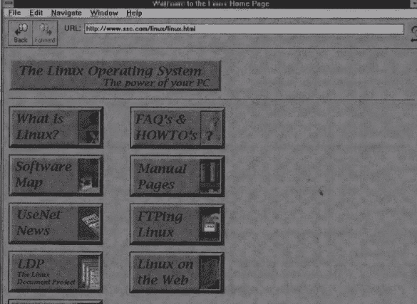

图 1.1

www.ssc.com 的 Linux 主页提供了许多关于 Linux 最频繁的信息。

从 www.ssc.com 的 Linux 主页，你可以链接到其他 Linux 网站，包括 Linux 产品的商业供应商网站。

## Linux 简介

### 第一章

Linux 发行版和信息的主要网站是 `http://www.linux.org`。其首页如图 1.2 所示。该网站拥有大量信息，以及指向许多供应商和应用程序网站的链接。

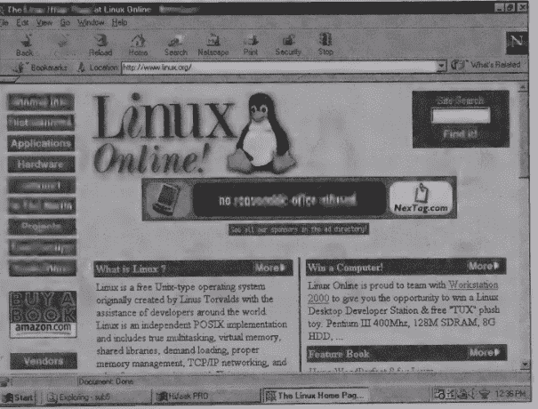

图 1.2

Linux.org 网站是获取 Linux 信息的良好起点。

www.ssc.com 和 www.linux.org 首页提供的关键工具之一是访问 Linux 软件地图（LSM），它是 Linux 软件的完整索引，你可以在任何地方找到。LSM 包含了专门为 Linux 开发的所有软件包，以及已移植到 Linux 的工具和应用程序。LSM 首页如图 1.3 所示。LSM 窗口允许你在在线文档和索引中搜索关键词，然后显示结果，提供了一种快速、方便的方法来寻找软件和文档。

在本节早些，提到了 Linux 文档项目（Linux Documentation Project）。它也在网络上，如图 1.4 所示。

# 安装与配置

### 第一部分

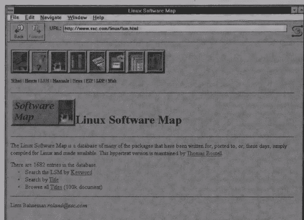

Linux 软件地图是一个数据库，包含了许多为 Linux 编写、移植，或在如今简单为 Linux 编译并提供的包。这个超文本版本由 Thomas Rosell 维护。

数据库中有 1822 条条目：

- 按关键词搜索
- 按类型搜索
- 按标题浏览（100%文档）

Lars Rahman.veland@linux.org

图 1.3

可以通过几个网页获取 Linux 软件地图。

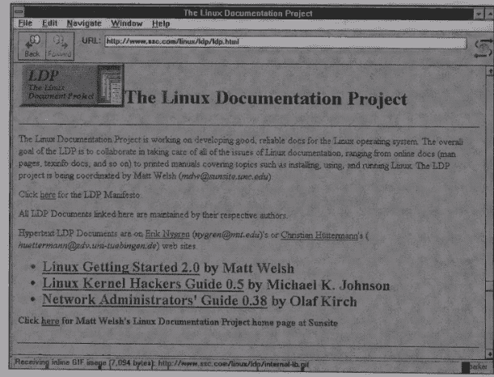

Linux 文档项目正在努力开发 go-ld，即 Linux 操作系统的可靠文档。LDP 的总目标是协作处理 Linux 文档的所有问题，范围从在线文档（man 页面）、涵盖安装、使用和运行 Linux 等主题的书籍和文章。LDP 项目由 Matt Welsh (welsh@gnu.org) 协调。

点击此处查看 LDP 流形目录。

所有 LDP 文档由各自的作者维护：

超文本 LDP 文档位于 Rob Hyyer (hyyer@bent.edu) 或 Christian Hickson (hickson@linux-suggester.org) 的网站上。

- Matt Welsh 的《Linux Starting 2.0》
- Michael K. Johnson 的《Linux Kernel Hackers Guide 0.5》
- Olaf Kirck 的《Network Administrators' Guide 0.38》

点击此处访问 Matt Welsh 在 Sunite 的 Linux 文档项目首页。

图 1.4

Linux 文档项目首页提供了新的 Linux 文档。

## Linux 杂志

Linux Journal 是一本专注于 Linux 的商业出版物。它涵盖了 Linux 的各个主题，从适合操作系统新手的材料到非常复杂的编程。Linux Journal 有一个首页 `http://www.linuxjournal.com`，如图 1.5 所示。


图 1.5

Linux Journal 是一本面向 Linux 用户、开发者和所有兴趣者的杂志。

> 如果你想获取更多关于 Linux Journal 的信息，请向 `subs@ssc.com` 发送电子邮件。或者，你可以写信给出版商：PO Box 55549, Seattle, WA 98155，或致电 (206) 782-7733。在美国订阅费用为 22 美元。

## 近期 Linux 发行版

有多个版本的 Linux 可，取决于你访问哪个 CD-ROM 或 FTP 站点。本书并不在乎你使用哪个版本，因为它适用于几乎每一个编写的版本。可用的 Linux 发行版部分列表包括

- Caldera OpenLinux
- Debian Linux
- FreeBSD
- Linux Pro
- Mandrake
- Red Hat
- SuSE Linux
- TurboLinux
- Walnut Creek Slackware

有这么多版本的 Linux 可，你应该选择哪一个？这里是每个版本主要特征和问题的简要概述。当然，它们中的每一个本身都是一个完整的 Linux 系统，你选择时不会错太大。

## 总结

现在你已经理解了 Linux 的本质，准备好应对 Linux 安装的基础知识以及那个被误解的 LILO 工具了。接下来的三个章节将完成本书的介绍性内容。之后，你就可以准备好深入真正的系统管理内容了。

# 第 2 章 硬件

### 本章内容

- 最低系统要求 22
- 从哪里获取 Linux 28
- Linux 版本与磁盘光盘 35

# 安装与配置

Linux 系统之所以吸引人，是因为它提供了一个即使在旧旧 PC 上也能运行的 UNIX 工作站环境。除非你想进行应用开发和广泛使用 GUI，否则对硬件的要求并不苛刻。本章将介绍 Linux 安装的各种必要条件。书中讨论了最低要求，以及对大多数外围设备的支持。使用新硬件扩展你的系统将在本书后后部分介绍。

## 最低系统要求

由于 Linux 大多由 PC 用户开发，因此操作系统内置的硬件支持对于 PC 来说非常典型。少数冷门设备拥有 Linux 驱动程序，这主要是因为某个程序员花时间为自己写了一个并将其发布到了 Linux 社区。越来越多的第三方供应商提供了硬件配件（如多端口卡，随着 Linux 的普及，这个数字正在不断增长）。毕竟，数百万 Linux 用户是一个巨大的社区！

Linux 的现实最低系统要求是：带有 80386SX 处理器或更高型号的主板、2MB 或更多的 RAM、一个软磁盘驱动器、一个 40MB 或更大的硬盘以及显卡和显示器。大多数用户的系统都超过了这些要求，而这些要求实际上只适用于字符界面安装。如果你想使用 X 或 Motif 等 GUI，正如你很快将看到的，你需要在主板上更高的性能和更多的内存。接下来的章节将更详细地 Linux 系统的硬件要求。

## 主板

设置 Linux 系统所需的硬件与 PC 安装类似。它从主板开始，主板应为 Intel 8386 或更高型号（或 AMD 或 Cyrix 的同类产品）。值得注意的是，Linux 甚至可以运行在缓慢的 8386SX 上，尽管运行速度缓慢。然而，对于应用开发，由于编译器对 CPU 的占用率很高，建议配备 FPU（浮点运算单元）。Linux X 用户也是如此，因为 X 是臭名的 CPU 消耗户。你可以在 80386 上编译 Linux 应用，也可以在上面运行 X，但性能会下降到令人恼火的程度。如果你有一台已经更换为更新、更快机器的旧 PC，请尝试 84DX（至少 50MHz）或 200MHz 或更快的 Pentium。如果你有浮点运算单元或 FPU（也称为数学协处理器），Linux 可以利用其功能。FPU 内置在 84DX 和 Pentium 序列芯片中，而 8386SX 则没有。如果没有安装 FPU，Linux 将提供合理的基于内存的性能，尽管已经有报告过一些问题。

Linux 支持较旧的 ISA（工业标准架构）和 EISA（扩展工业标准架构）主板，以及 PCI 主板。某些版本的 Linux 支持 MCA（IBM 的微通道架构）和 VESA 局地总线主板，尽管这些并不常见。较新的设计（包括带有 USB 端口的 IDE 主板）都受到最新版本 Linux 支持。

RAM 的要求取决于你想要运行的 Linux 系统的规模。最低的字符界面系统使用 2MB 内存运行得相当好，尽管涉及大量的交换（swapping）。对于字符界面系统，4MB RAM 是一个有效的最低值，更多的内存会带来更快的性能。对于开发工作和 X 用户，8MB 是一个工作最低值（尽管 X 可以在 4MB 下运行，但会有很多交换）。要让 X 和当的编译器真正获得良好的性能，你需要 16MB 或更多内存。

拥有多个用户的 Linux 系统应该增加 RAM 的数量。内存的使用情况决定了所需的 RAM 数量。例如，8MB 可以支持两个用户，即使他们都在运行 X。对于每个用户，16MB RAM 是一个很好的选择，尽管用户在该配置下无法运行 X。对于 X 用户来说，一个很好的经验准则是每个用户至少 4MB，除非该 Linux 机器可以将处理任务卸载到客户端/服务器布局（这目前不在 Linux 的能力范围内，但正在开发中）。当然，越多越好，通常 X 运行得也越快，因为减少了必要的磁盘交换。

Linux 使用你机器中的全部 RAM。它不会像 DOS、Windows 以及其他操作系统那样对内存施加任何架构限制。如果任何可用内存被完全使用，为了扩展系统上的 RAM，Linux 交换分区创建一个交换空间（swap space）。推荐的交换空间用作实际内存的较慢扩展，数据可以在物理 RAM 之间交换。即使是内存密集型系统也应该有一个交换空间。交换空间的大小取决于系统的 RAM 数量、用户数量以及典型使用情况。

表 2.1 显示了确定系统应具备 RAM 数量的通用指南。首先使用第一列确定你的系统中可能存在哪些条件（例如运行 X、运行较大的应用程序或添加用户），然后移动到“最低”、“推荐”和“最佳性能”列。当提到大型应用程序时，请考虑任何使用大量 RAM 的程序，例如处理器（不是像 vi 那样的行编辑器）、数据库、电子表格程序或桌面出版系统。此类类别中还包括视频播放器、声音编辑器和类似的多媒体应用。如果你计划进行大量的编程工作（包括 X 应用开发），则适用“开发”这一项。

当你确定了所有将遇到的条件后，在列中相加每个条件的 RAM 要求。例如，如果你要运行一个频繁使用编译器（大型应用）、X 以及 Internet 服务器的系统，对于最低系统，你需要 6MB RAM。

# 安装与配置

最低系统可以运行，但速度很慢，会有大量的磁盘交换。具有推荐内存 的系统在内存使用和性能之间取得了平衡，而“最佳性能”列则尽可能减少了交换。记住，这些数字仅供参考！内存永远不嫌。

表 2.1 确定所需的 RAM 数量

| 条件 | 最低 | 推荐 | 最佳性能 |
| :--- | :--- | :--- | :--- |
| 内核与基础操作 | 2MB | 4MB | 4MB |
| 大型应用与编译器 | 1MB | 2MB | 2MB |
| X | 2MB | 4MB | 4MB |
| 额外的字符界面用户（每个用户） | 0.5MB | 0.5MB | 1MB |
| 额外的 X 用户 | 2MB | 4MB | 4MB |
| 开发系统 | 2MB | 2MB | 4MB |
| Internet 服务器 (FTP, WWW, WAIS 或 Gopher) | 1MB | 2MB | 4MB |

## 硬盘

虽然 Linux 可以完全从软磁盘运行而不使用硬盘，但没有人那样运行 Linux。Linux 主要是为硬盘使用设计的，支持所有常见的硬盘控制器系统，包括 IDE（集成驱动器电子）、EIDE（扩展集成驱动器电子）、ESDI（增强型设备接口）、RLL（运行长度限制）、SCSI（小型计算机系统接口）以及所有新版本的 IDE 如 Ultra-DMA、ATA 和 ATAPI。

Linux 不选择硬盘类型。通常，如果 DOS 或 Windows 可以处理该硬盘，Linux 也可以。这适用于所有非 SCSI 硬盘， SCSI 需要特殊处理。

在旧机器（80386 或 80486 主板）上，Linux 仍然受到 PC BIOS 版本对扇区、磁头和柱数限制的影响。对于某些旧版本的 Linux，硬盘存在有效的 1024MB 大小限制，甚至更小的硬盘也无法被 Linux 或 DOS 正确处理。较新版本的操作系统可以克服这些限制。

## 硬件

### 第二章

...主板。早期 PC 中的 BIOS 仍然对 SCSI 驱动器施加大小限制，因此 2GB 的驱动器对 Linux 和 DOS 只有 1GB 可用。UNIX 系统（如 SCO UNIX）可以使用硬盘的剩余部分。后期的 Linux 版本（主要是任何 1.1 版本及以上的内核）可以在 SCSI 驱动器上使用超过 1GB 的磁盘空间。

Linux 所需磁盘空间取决于安装操作系统的哪些部分。最少量的有效字符系统为 20MB，这为基础工具留了足够的空间，但无法运行 X。若要使用整个基础系统（包括开发工具和 X），请为文件提供至少 1,250MB 空间。然后根据您的个人文件和 Linux 临时存储需要添加相应的空间。一个经验法则是将空间需求翻倍。除了用户空间外，请记住为交换空间（swap space）留出空间。虽然交换空间的大小取决于系统的用途，但根据系统中物理 RAM 的数量和您的使用需求，16MB 或 32MB 是一个不错的数值。

你可以在 Linux PC 中使用多个硬盘，尽管你应该将可启动的根分区放在第一个硬盘上。支持的驱动器数量取决于驱动器控制器和 BIOS。IDE 系统通常限于两个驱动器，但 EIDE 系统可以处理四个驱动器（每个控制器两个）。ESDI 和 RLL 控制器通常限于两个驱动器。SCSI 控制器每个控制器可以处理多达 15 个驱动器，单个系统可以包含多个控制器。SCSI 是最全能（也是最贵）的系统。

由于现在硬盘非常廉价，获取大容量驱动器相对容易。如果你计划加载 Windows 和 Linux，Linux 可以与最多三个其他操作系统共享磁盘（通过一些技巧可以更多），例如，为这两个操作系统分配足够的磁盘空间。

## 视频系统

Linux 可以使用几乎任何在 DOS 和 Windows 下无需特殊驱动即可运行的显卡，包括 CGA、EGA、VGA、Super VGA 和 Hercules 卡。支持所有常用的总线插。Linux 还支持一些特殊的增强分辨率显卡，但在购买特殊显卡之前，你应该通过 Linux 网站或制造商检查驱动支持情况。由于大多数显卡默认支持 VGA 和 SVGA 模式，即使为你的显卡没有专用的 Linux 驱动程序，你也可以在大多数情况下使用这些模式。


# X 可以利用高分辨率显卡的位图功能

X 可以利用高分辨率显卡的位图功能，尽管 X 也可以运行在 VGA 或 SVGA 系统上。如果你使用为 Windows 设计的特殊显卡，请确保 Linux 有可用的视频驱动程序，否则你将不得不退回到 VGA 或 SVGA 模式。幸运的是，现在市场上几乎每种显卡都有驱动程序，包括为 Windows 游戏设计的 3D 卡。

## 鼠标

Linux 在字符会话中不使用鼠标（尽管某些编辑器允许使用鼠标进行定位和剪切粘贴活动），但 X 鼠标是必需的。Linux 可以处理几乎所有类型带有 Windows 驱动的鼠标和轨迹球，包括微软、罗技和 Mouse Systems。Linux 同时支持总线鼠标和串口鼠标。

Linux 还支持其他指针设备，包括用于光标移动的摇杆和笔系统。有些设备使用可以使用手指拖动的触控板，只要它们有模拟鼠标的驱动程序（大多数都是如此），就能在 Linux 上工作。最后，一些触摸屏也能兼容 Linux，尽管它们比标准的移动设备稀有得多。

## 磁带机

你的 Linux 系统可以使用任何被 Linux 识别控制器的 SCSI (ATAPI) 或并行端口磁带机。其他磁带机使用需要专用硬件卡的私有接口。在大多数情况下，只要可以将 IRQ、DMA 和内存地址配置到 Linux 中，磁带机就可以访问。这使得一些旧的 UNIX 风格磁带机（如 Wangtek 和 Archive 制造的）可以在 Linux 下使用，尽管它们有用于控制的私有板。

较小的 QIC（四分之一英寸卡带）驱动器在 Windows 中变得越来越流行，由软盘控制器卡或并行端口驱动。Linux 提供了其中一些磁带驱动器的驱动程序，尽管并非所有都得到了支持。由于许多此类较小的 QIC 驱动器依赖私有压缩方案来提高磁带上的数据密度，你可能无法向这些驱动器写入超过原始卡带容量的数据。

## CD-ROM

由于大多数 CD-ROM 使用 IDE 或 SCSI 接口，你可能需要一个 SCSI 控制器卡或主板上的接口。只要其 SCSI 控制器卡被识别，Linux 就能识别并支持基于 SCSI 的 CD-ROM。如果 SCSI 端口在板上，可能需要特殊的驱动程序。此外，后期的 Linux 版本还支持某些私有的 CD-ROM 驱动程序，例如 Sound Blaster 板上的驱动。请检查支持的硬件列表，以获取每个内核版本支持的所有 CD-ROM 驱动器的完整目录。通常情况下，内核版本越高，支持 CD-ROM 的可能性就越大。

Linux 可以读取所有格式。目前它主要处理 ISO-9660 文件系统。虽然并不是所有的 CD-ROM 都使用它写入，因此如果发现 DOS 或 Macintosh CD-ROM 无法正常挂载，请不要惊讶。一些 UNIX CD-ROM 使用私有格式写入，这些格式通常不符合 Linux 的要求。Linux 支持 Rock Ridge 扩展以提供完整的文件名。

## 移动介质

Linux 对移动介质的支持取决于介质使用的接口类型。大多数基于 SCSI 的系统都可以使用，尽管 Iomega 的系统很少支持在文件系统加载时更换介质。Iomega Bernoulli、Jaz 和 ZIP 系统以及 LaserSafe 磁光系统可以在无需特殊驱动的情况下与 Linux 使用，只要卡带是在 DOS 或 Windows 下格式化的即可。其他一些磁光和移动介质系统也能正常运行。

某些移动介质，特别是那些不使用 SCSI 而依赖专用硬件卡的，需要特殊的驱动程序。为自己使用编写驱动程序并将其投入公有领域的程序员主要在 Linux 中为这些设备提供有限的支持。目前只有少数商业移动介质供应商提供 Linux 专用驱动程序，尽管随着 Linux 越来越普及，这种情况可能会发生变化。

## 打印机

并行和串口打印机作为 `dumpppinter` 设备受到支持。许多打印机（如惠普 LaserJet 和 DeskJets）都有可用驱动程序，某些打印机还没有驱动程序。如果你的打印机没有驱动程序，它将作为仅 ASCII 设备或以支持的打印机的兼容模式运行。

## 调制调制器

Linux 支持大多数异步调制调制器，以及一些同步调制调制器。也支持 ISDN 调制调制器。通常情况下，Linux 可以使用任何 DOS 或 Windows 可以使用的调制调制器。在安装某些驱动程序后，Linux 支持所有波特率，包括新的压缩方案。系统支持多个调制调制器。事实上，你可以根据串口的数量在 Linux 系统上挂载多个调制调制器。

## 终端

Linux 支持通过串口或多端口卡连接的字符终端。你可以使用大多数现有的字符终端，也可以添加任何你拥有控制代码的终端。Unix 意义上的图形终端使用简单的 ASCII 图形，不具备 X 功能。

某些 Linux 版本支持 X 终端，尽管并非所有的 X 终端都能正常工作。X 终端通常需要极高速的连接来正确显示图形（通过串口或网络）。运行 X 客户端软件的 PC 可以很好地作为 X 终端工作。

## 多端口卡

某些基于 UNIX 的多端口卡可以在 Linux 下运行，因为厂商或用户已经发布了驱动程序。在购买多端口卡之前，请在 Linux 网站或制造商网站检查驱动程序的可用性。某些多端口卡还提供扩展并行端口和串口，这些也需要驱动程序。

目前的型号多端口卡被设计为网络设备。它们位于局域网（LAN）中并通过 TCP/IP 访问。Linux 几乎可以与所有这些设备配合，因为它们在网络上表现为简单的 TCP 协议。然而，会出现一些特殊情况，导致无法充分利用连接的终端。

你可以通过 SCSI 控制器卡来连接某些多端口卡，而不是制作插入扩展槽的专用卡。即使是 SCSI 扩展卡，也需要驱动程序才能让 Linux 正常使用。

## 网卡

由于 Linux 是一个 UNIX 系统，其主要的网络协议是 TCP/IP。Linux 也可以使用其他协议，但 TCP/IP 是最广泛使用的，因为它包含在每个 Linux 软件包中，并且是默认网络协议。TCP/IP 作为互联网协议的角色也使其非常受欢迎。

TCP/IP 通常在以太网网络上使用，因此大多数 Linux 网络系统都是围绕以太网设计的。有许多以太网网络接口卡（NIC，也称为网络适配器）。来自 3Com、Novell、西部数据、惠普和 Intel 的热门以太网卡都能与 Linux 完美兼容。其他供应商的许多兼容 NIC 卡也能正常运行。

## 如何获取 Linux

只要知道去哪里寻找，Linux 是免费获取的。由于 Linux 的分发没有中央组织控制（与商业版 UNIX 不同），因此没有单一实体负责确保 Linux 方便易快捷地获取。你必须找到一个来源，并确保你收到的版本包含所有组件、足够新且相对稳定。大多数发行源提供的版本是相同的。

你可以通过多种方式获取 Linux 副本；取决于你的优先级，选择最方便或最经济的方法。获取整套 Linux 二进制文件和工具的最常见方法是通过 CD-ROM。这些可以在商店、互联网或通过邮购公司购买。替代方案包括 FTP 站点和 BBS（电子公告板系统）。你还可以通过电子邮件接收副本。获取发行版最流行的方法是通过网络。如 `http://www.linux.org` 等网站是许多版本 Linux 的分发中心。许多特定的发行版也有自己的网站。

# 硬件

## 第 2 章

你获取 Linux 的方法在某种程度上决定了发行版的完整程度，即磁盘上是否拥有每个基础 Linux 软件。相比之下，某些网站和 FTP 站点仅提供一个小发行版，足以安装并作为基本系统使用。例如，小型系统可能不包含语言编译器和 X 软件。

## CD-ROM

有近十种基于 CD-ROM 的 Linux 发行版。它们不同在于磁盘中包含的版本、组织形式以及拥有的增值功能，例如新的安装文档和工具，以及支持的打印手册。当然，你的机器上还需要一台与 Linux 兼容的 CD-ROM 驱动器。不要假设任何非 SCSI 的 CD-ROM 驱动器都能工作——许多都是不行的！

你获取的版本具有最新发布的 Linux 软件（比较不同 CD-ROM 之间的版本号），以及一套完整的配套工具。从某些 CD-ROM 集合封面上的标识可能很难识别内容，或者你可能会发现自己无意中购买了过时的材料。幸运的是，CD-ROM 通常很便宜。很少有供应商通过额外的工具或启动盘来美化他们的 Linux 集合，这会让安装变得简单得多。预编译的游戏、应用程序和用户工具的加入使得这些 CD-ROM 更有吸引力。某些 CD-ROM 还附带了手册。在大多数情况下，这些手册仅仅是 CD-ROM 文件的打印版本，尽管某些供应商花时间为 Linux 编写了非常易读的说明。如果你是 Linux 初学者，这类文档会非常有用。

## FTP 站点

文件传输协议 (FTP) 是一种广泛使用的互联网协议（TCP/IP 家族的一部分），允许你从远程机器传输文件。若干匿名 FTP 站点分发 Linux 软件。（注：此处原文中存在大量重复的 OCR 错误，翻译时已去重）。

# 硬件

## 第 2 章

名称必须与大小写完全匹配。请使用所示的“引号”。

要获取目录，输入 `DIR`。要切换目录，输入：`CD "Dir.Name"`

要读取一个短文本文件，输入：`GET "File.Name"`

需要更多信息，输入 `HELP` 或在 gopher 中查看 FAQ。

要退出，输入 `exit` `Ctrl-Z`。

- 230- 如果您向 `info@sunsite.unc` 发送电子邮件，您将收到帮助信息。
- 230- 关于如何使用 sunsite 提供的不同服务信息。
- 230- 我们使用 `Wearchave` 实验性 `ftppd`。如果您获取 `"<directory>.tar.Z"`
- 230- 或 `"<file>.Z"`，它将进行压缩和/或实时压缩。使用 `".gz"`
- 230- 代替
- 230- `"z"` 将改用 GNU zip (`/pub/gnu/gzip*`)，这是一种更优的
- 230- 压缩方法。

一旦进入远程系统，您可以使用 UNIX 命令来显示文件内容并在目录间移动。要显示目录内容，使用 `ls` 命令或 DOS 对应的 `dir`。要切换到子目录，使用 `cd <dir>` 命令。要返回父目录（当前目录的目录），使用 `cd ..` 命令。与 Linux 不同，FTP 不允许使用快捷键，因此您必须完整（且正确）地输入文件或目录的名称。

当您遍历目录并找到想要传回系统的文件时，请使用 FTP `get` 命令，如下代码所示：

```
get "file1.txt"
```

虽然对于大多数版本的 FTP 来说，文件名周围引号是可选的，但它们为远程版本提供了特定字符，从而防止 shell 扩展。使用引号可以防止意外传输多个文件而非仅一个文件，或者产生 FTP 错误消息。

`get`（下载）和 `put`（上传）命令是相对于您的本地机器，而不是远程机器。当您发布 `get` 命令时，您是在告诉您的系统 FTP 软件从远程机器获取文件。`put` 命令使用 FTP 将文件从您的本地机器放置到远程机器上。记住哪个命令是在哪个方向移动的，否则您可能会意外覆盖文件。

当您发布 `get` 命令时，远程系统会将数据传输到您的本地机器并在完成后显示状态消息。在大文件传输期间，没有进度指示，因此请耐心等待。以下是 `get` 命令的示例转录：

```
FTP> get "file1.txt"
200 PORT command successful.
150 BINARY data connection for FILE1.TXT (27534 bytes)
226 BINARY Transfer complete.
27534 bytes received in 2.35 seconds (12 Kbytes/s).
```

FTP 提供了两种文件传输模式：ASCII（七位字符）和二进制（八位字符）。某些系统会自动在两者之间切换，尽管手动设置模式是一个好主意，可以确保您不会浪费时间。您可以以二进制模式下载所有 Linux 发行版文件。要将 FTP 设置为二进制传输模式（对于任何可执行文件），请输入命令 `binary`。可以使用命令 `ASCII` 切换到 ASCII 模式。如果您在 ASCII 模式下传输二进制文件将无法执行。在二进制模式下传输 ASCII 文件不会影响文件内容，因此二进制是一个很好的传输模式。

请记住，Linux 存档非常详尽，即使是传输一个小型发行版也需要一段时间。如果您使用慢调制调制器（9600 波或以下），您可能需要考虑替代方法，因为某些远程站点限制了您的连接时间。若要在本地机器上终止 FTP，请输入命令 `quit` 或 `exit`。

# 定位存档站点

存档站点列表变化缓慢；本节列出的站点在编写时均有效。这些站点中的许多是镜像站点，提供完全相同的内容。您可以通过查看站点末尾的国家标识符来找到最近的站点（uk=英国，fr=法国等）。如果没有使用国家标识符，该站点很可能位于美国。对于大多数 FTP，您可以使用站点名称或 IP 地址，但如果您的本地 Internet 网关无法解析站点，IP 地址是最佳方法。Linux 存档的主要站点（也称为主站）是 `tsx.mit.edu`、`sunsite.unc.edu` 和 `http://nic.funet.fi`。主站是大多数新软件加载的地方。如果您在连接站点时遇到困难，请尝试另一个。如果困难仍然存在，可能是您的互联网访问存在问题。

| 站点名称 | IP 地址 | 目录 |
| :--- | :--- | :--- |
| tsx.mit.edu | 128.86.0.44 | /pub/linux |
| sunsite.unc.edu | 152.225.254.81 | /pub/linux |
| http://nic.funet.fi (芬兰) | 128.214.248.6 | /pub/linux |
| ftp.ox.ac.uk (英国) | 130.88.203.12 | /pub/linux |
| ftp.de.rwth-aachen.de (丹麦) | 137.226.411.11 | /pub/linux |
| ftp.informatik.rwth-aachen.de (丹麦) | 137.226.116.98 | /pub/linux |

# Web 站点

| 站点名称 | IP 地址 | 目录 |
| :--- | :--- | :--- |
| ftp.uu.net | 192.48.96.9 | /systems/unix |
| wuarchive.wust.edu | 128.252.135.4 | /systems/linux |
| ftp.win.tue.nl | 131.155.70.189 | /pub/linux |
| ftp.ibr.cs.tu-bs.de | 134.169.34.135 | /pub/linux |
| ftp.os.de | 268.199.62 | /pub/linux |

如果您无法访问 Linux 发行版站点来通过 FTP 获取软件，只要您的电子邮件系统可以连接 Linux 站点，您仍然可以让文件传输给您。这种方法适用于允许 Internet 电子邮件但不允许直接访问 FTP 的在线系统，以及某些不允许直接拨号访问 FTP 站点的企业系统。

要从 FTP 站点通过电子邮件获取 Linux，请使用该站点的 `ftpmail` 工具。之前提到的所有 Linux FTP 站点都支持 `ftpmail`。要获取有关使用 `ftpmail` 的完整说明，请向一个站点的 `ftpmail` 发送电子邮件（例如，将邮件地址设为 `ftpmail@sunite.unc.edu`）。邮件正文应仅包含 `help` 一词。任何其他注释都可能导致 `ftpmail` 工具错误处理您的请求。出于此考虑，您可能希望抑制自动添加到电子邮件中的签名文件。

收到您的请求后，`ftpmail` 将向您发送使用该服务的说明。在大多数情况下，您在邮件正文中嵌入想要在远程站点执行的 FTP 命令。例如，要获取 Linux 目录列表，请发送正文如下的邮件：

```
open sunite.unc.edu
cd /pub/Linux
ls
quit
```


# 硬件

远程站点的 `ftpmail` 工具处理命令的方式就像直接输入 FTP 中一样。若要通过电子邮件将文件传输给自己，你可以发送以下邮件消息：

- opensite.unc.edu
- cd /pub/Linux
- binary
- get README
- quit

此消息将通过邮件传回 README 文件。`ftpmail` 系统比 FTP 慢，因为你必须等待邮件到达目标机器、被远程系统的 `ftpmail` 工具处理、格式化回复，并将回执消息发送给你。尽管如此，`ftpmail` 为那些没有 FTP 连接的用户提供了一种实用的访问方法，并提供了一种在无需登录的情况下检查几台机器上 Linux 目录内容的简便方法。当你想要定期检查软件更新时，这非常有用。


## 注意

你想要传输的文件可能超过了系统的最大文件大小限制。某些系统会将文件拆分成较小的块，并在你接收到时允许你重新组装，但其他邮件系统对邮件有较小的尺寸限制，使得使用 `ftpmail` 获取完整的 Linux 软件发行版大文件是不行的。

## Linux 发布版与磁盘集

发布版（Release）是足以安装和运行整个操作系统的 Linux 软件集合。发布版由若干称为磁盘集（disk set）的软件集合组成（尽管它们可能并不存储在磁盘上）。大多数 Linux 系统在你获取发行版集时都包含了多个磁盘集。

虽然大多数 CD-ROM 和 Web FTP 站点的软件相同，但有几个磁盘集的标记方式有所不同。为了说明 Linux 可用的磁盘集，以下列表详细列出了 Slack 发行版中（Linux 最受欢迎的 CD-ROM 版本之一）当前提供的磁盘集组：

- 磁盘集 A 是基础系统。它包含内核和一组基本实用程序，包括 shell、编辑器和用户实用程序。磁盘集 A 是唯一能放入单张高密度软盘上的磁盘集，这意味着你可以用它从软盘上安装并运行 Linux。
- 磁盘集 P 包含 Linux 应用，包括许多不同的编辑器、所有的标准 UNIX 命令列表、手册页（man pages）以及如 GhostScript 等 GNU 扩展。
- 磁盘集 D 包含程序开发软件。该磁盘集包含了 GNU 语言、开发实用程序、库和编译器工具。还有许多用于自定义 Linux 内核的库源码。
- 磁盘集 E 是 GNU emacs 编辑器。
- 磁盘集 F 包含 FAQ（常见问题）文件和其他 Linux 帮助文件。
- 磁盘集 I 包含 GNU 软件的文档文件。
- 磁盘集 IV 包含 Interactive 库、头文件和文档。Interactive 是一个 C++ GUI 开发包。
- 磁盘集 N 是网络软件。该磁盘集包含了 TCP/IP 协议族、UUCP、邮件和其他实用程序以及新闻系统。
- 磁盘集 OI 包含 ParPlace Object Builder 和 Object Interface Library。这些商业开发包是由 ParPlace 为 Linux 开发者提供的。
- 磁盘集 OOP 包含面向对象编程 (OOP) 工具、GNU Smalltalk 编译器以及 Smalltalk 的 X 接口 (STX)。
- 磁盘集 Q 包含 Linux 内核源文件和启动镜像。
- 磁盘集 T 包含 TeX 和 LaTeX 测试格式系统。TeX 被广泛用于排版。
- 磁盘集 TCL 是 Tcl 语言集，包括 Tcl、TclX 和实用程序。
- 磁盘集 Y 是游戏集合。
- 磁盘集 X 是 Xfree86，包含了 X 系统和几个窗口管理器。
- 磁盘集 XAP 包含用于 X 的应用程序、文件管理器、GhostView、库、游戏和实用程序。
- 磁盘集 XD 是 X 开发工具包，包括 X 库、服务器链接工具包和 PEX 支持。如果你正在开发基于 X 的应用程序，必须拥有这个磁盘集。
- 磁盘集 XV 是 X 的窗口管理器。该磁盘集包含了 XView 库和 Open 窗口管理器。你可以使用这些窗口管理器代替磁盘集 X 中的窗口管理器。

尽管磁盘集 A 可以让你从软盘上安装 Linux 系统，但为了进行完整安装（基于硬盘并带有标准实用程序），你应该拥有磁盘集 A、P、D 和 F。这套集合将为你提供一个基于字符的 Linux 系统。如果你想运行 X，还需要磁盘集 X 和 XAP。程序员需要加载开发磁盘集（对于 X 应用程序为 D 和 XD）。

## 总结

本章审视了构成 Linux 系统的软件和硬件。在安装之前，你应该拥有足够运行 Linux 的硬件；否则你将看到各种错误信息（如果系统能够安装的话）。一旦你准备好硬件并知道要从发行版集中安装哪些软件，就是时候将 Linux 安装到硬盘上了。下一章将介绍物理安装过程。第 4 章将介绍引导加载 LILO。

# 安装与升级
## 第 3 章

### 本章内容

- 安装 Linux
- 创建启动磁盘和根磁盘
- 分区硬盘
- 安装 Linux 分区
- 安装 Linux 软件
- 设置启动过程
- 查看已安装的软件文件
- 其他发行版使用包管理器
- 故障排除

# 安装与配置
## 第一部分

某种 Linux 的实现。两张软盘上的系统内容已经足够用来玩 Linux 了，尽管缺少了许多工具。

在大多数情况下，启动软盘和根目录软盘是从名为 `images`（镜像）的现有文件复制而来的。镜像是软盘上系统的一个预编译版本，它消除了从零开始的必要性。CD-ROM 和 FTP 分发版包含了几个用于启动根目录镜像的目录，具体取决于你系统中的硬件。你必须尽可能选择与你的硬件相匹配的镜像，将它们拷贝到软盘上，并使用软盘启动系统。你可以在 DOS 或 Windows 下的 DOS 窗口中完成这些大部分步骤，尽管你不能使用 DOS 拷贝命令来创建启动和根目录软盘。你必须使用一个忽略 DOS 格式化的实用程序来创建软盘。该工具通常称为 `RAWWRITE.EXE`，包含在大多数 Linux 发行版中。

### 选择启动内核和根目录镜像

CD-ROM 下在根目录下通常有名为 `bootdsks.144` 和 `rootdsks.144`（用于 3.5 英寸 1.44M 软盘）以及 `rootdsks.12`（用于 5.25 英寸 1.2M 软盘）的目录，分别包含启动镜像和根镜像。要找到这些目录，请从 CD-ROM 或硬盘上的分区运行程序以检查 CD-ROM。典型 Linux 发行版的 1.44M 软盘的启动和根目录如图 3.1 所示。如果你从 Web 或 FTP 站点拷贝文件，你可以在连接到远程 FTP 机器或 Web 站点下载区域时选择所需的启动和根镜像，并仅将需要的镜像传输到本地机器。

| 文件 | 编辑 | 断开连接 | 设置 | 网络 | 帮助 |
| :--- | :--- | :--- | :--- | :--- | :--- |
| merlin/odrom/slakint12 | MIRROR3.TXT | UPGRADE.TXT | contrib/ | | |
| BOOTING MIRROR.2 | boot12/ | kernels/ | | | |
| COPYING INSTALL_TXT | README.2 | boot160/ | | | |
| Changelog | LBCERT.TXT | SLWAKE.FRQ | contents/ | root0/ | |
| merlin/odrom/slakint/boot144 | root144/ | | | | |
| merlin/odrom/slakint/boot148 | root148/ | | | | |
| README.TXT | astech 0260bd | | | | |
| WTCH.EXE | md iddia rosnet2 | | | | |
| ahandrow mitsui soxi | | | | | |
| had.image.lg -0637 osinel1 | | | | | |
| merlin/odrom/slakint/root144 | | | | | |
| merlin/odrom/slakint/root148 | | | | | |
| README.APK | misguide ttiy44 | | | | |
| README.UMS | 044cs tape44 usds44 | | | | |
| merlin/odrom/slakint/root168 | | | | | |

**图 3.1** 1.44M 软盘镜像的启动和根目录，用于创建启动和根目录软盘以安装 Linux。

### 可用的启动内核镜像

通常可用的启动内核类型在内核镜像目录下的文件（通常为 README、READ.ME 或 WHICH.）中描述。启动内核镜像的命名反映了其在内核中安装了驱动程序的硬件。例如，`scsi` 内核镜像具有 SCSI 系统的驱动程序；如果你在一台配有 SCSI 控制器、硬盘和 CD-ROM 的 PC 上，这就是你想要拷贝到软盘的镜像。可用的启动镜像数量相当大。这些是 CD-ROM 和 FTP 站点提供的主要镜像，以及它们旨在处理的：

- `aztech`：IDE 和 SCSI 硬盘驱动程序以及 Aztech 非 IDE CD-ROM 支持，包括 Aztech、Okana、Orchid 和 Wearnas 非 IDE CD-ROM 驱动器。
- `bare`：仅限 IDE 硬盘驱动程序（不支持 CD-ROM）。
- `cdu31a`：IDE 和 SCSI 硬盘驱动程序，带有 Sony CDU31 或 Sony CDU33a CD-ROM 驱动器。
- `cdu535`：IDE 和 SCSI 硬盘驱动程序，带有 Sony 535 或 Sony 531 CD-ROM 驱动器。
- `idecd`：IDE 和 SCSI 硬盘驱动程序，带有 IDE 或 ATAPI CD-ROM 驱动器。
- `mitsumi`：IDE 和 SCSI 硬盘驱动程序，带有 Mitsumi CD-ROM 驱动器。
- `net`：IDE 硬盘驱动程序和以太网网络驱动程序。
- `sbcd`：IDE 和 SCSI 硬盘驱动程序，带有 Sound Blaster Pro 或 Panasonic CD-ROM 驱动程序。此镜像用于由 Sound Blaster 卡运行的 CD-ROM 驱动器（如许多 Sound Blaster 多媒体套装所示）。
- `scsi`：IDE 和 SCSI 硬盘驱动程序，带有 SCSI 外设（CD-ROM 驱动器）。
- `scsinet`：IDE 和 SCSI 硬盘驱动程序、SCSI CD-ROM 驱动程序和用于网络的以太网驱动程序。SCSI 驱动程序支持 Adaptec 152X、1542、1740、274x 和 284x 适配器、Busologic 适配器、EATA-DMA 适配器（如 DPT、NEC 和 AT&T 卡）、Seagate ST-02 适配器。

### 将镜像写入软盘

将镜像拷贝到软盘中，你需要知道操作系统中软驱器的设备名称。对于大多数系统，第一块软驱器是 `/dev/fd0`，第二个软驱器是 `/dev/fd1`。（某些系统将软驱器视为原始设备，名称为 `/dev/rfd0` 和 `/dev/rfd1`。）使用以下命令将镜像文件拷贝到软盘：

```
dd if=bootimage of=/dev/fd0
```


`dd if=<filename> of=/dev/fd0 obs=18k`

其中 `filename` 是解压后的镜像名称。`dd` 命令用于转换文件格式。命令中的 `if` 和 `of` 指定输入和输出设备的文件名。命令中的 `obs` 指定输出块大小（在此例中为 18K）。

例如，要将 `scsi` 和 `color144` 镜像拷贝到第一块软盘（3.5英寸 1.44M），请执行以下命令：

```
dd if=scsi of=/dev/fd0 obs=18k
dd if=color144 of=/dev/fd0 obs=18k
```

Linux 在显示进度时特别地“固执”，因此你不会看到很多信息。当 `dd` 开始拷贝时，它会告诉你它将移动多少块数据，完成后它会直接返回 shell 提示符，而不显示任何信息（除非过程失败）。图 3.2 显示了将根内核 `scsi` 拷贝到软盘的命令。一旦你拷贝了根分区和根内核，安装就完成了。这两块软盘现在已经准备好为你启动一个最小的 Linux 系统。

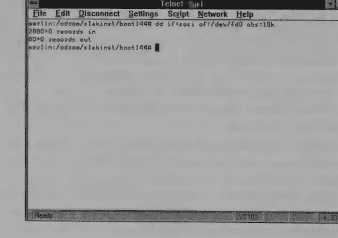

图 3.2
可以使用 `dd` 命令从任何 Linux 或 UNIX 系统将启动镜像和根镜像拷贝到软盘。

# 安装与升级

## 第三章 硬盘分区

硬盘被划分为分区，分区是专门为操作系统保留的区域。一个硬盘最多可以有四个主分区，某些分区会被操作系统软件进一步划分为更多的逻辑驱动器。关于分区的更完整讨论请参阅第 4 章“LILO”（某些系统支持多达 16 个分区，尽管它们并不全是主分区）。

如果你是从 DOS 分区运行 Linux，则无需担心重新划分驱动器分区。你现有的分区将被使用。然而，由于与 Linux 文件系统相比，UMDSOS 是一个糟糕的文件系统，你可能想要创建自己的 Linux 分区。请查看“UMDSOS”部分有关设置 UMSDOS 的信息。

Linux 实际上倾向于两种类型的分区：一个用于 Linux 交换空间，另一个用于 Linux 文件系统本身。（Linux 文件系统可以分布在整个硬盘驱动器的许多不同分区中，但为了起见，我们将将其视为单个分区来讨论。）交换空间是机器 RAM 的扩展，可以很小。从技术上讲，你需要交换分区，特别是当你有大量 RAM 时，创建一个交换分区是非常好的主意，尽管当 RAM 耗尽时你的系统可能会突然停滞。Linux 文件系统通常很大，它必须包含所有的 Linux 工具程序、应用程序和用户文件，但必须有一个分区被指定为启动分区（内核和主要工具所在的位置）。

如果你使用的磁盘已经安装了操作系统，你将不得不重新划分硬盘分区以为 Linux 腾出空间。此过程将破坏硬盘上的任何现有内容，因此请对你想保留的任何现有数据进行备份！某些像 PowerQuest 的 PartitionMagic 这样的第三方工具允许你通过备份-恢复循环动态调整分区大小，但即使是这样的工具也偶尔会出现问题，所以无论如何做备份都是明智的。

你使用 `fdisk` 工具对硬盘进行分区。Linux 版本的 `fdisk` 执行与 DOS 中的 `FDISK` 相同的任务，尽管菜单完全不同（且复杂得多）。基于 PC 的 UNIX 系统也使用 `fdisk` 对你的硬盘进行分区。

> **注意**
>
> 某些 Linux 发行版提供了 `fdisk` 的替代方案，尽管大多数版本也包含了 `fdisk`。例如，某些发行版使用名为 Disk Druid 的程序，而另一些则使用 `cfdisk`。不同的程序执行相同的功能，但比 `fdisk` 更灵活、更友好。然而，如果你在 DOS 和 Windows 系统中使用 `fdisk`，它在设置 Linux 分区时会完美工作。

在开始之前，你必须决定为不同的分区分配空间；以后改变主意意味着破坏你已保存到磁盘上的所有数据。Linux 交换分区的大小取决于系统中 RAM 的数量、你预期的用户数量以及你将进行的开发类型。

如果你打算在同一块磁盘上维护 DOS 或 Windows 分区，你必须平衡操作系统的磁盘空间需求与你的总磁盘容量。最小的 Linux 文件系统分区约为 40M，尽管更接近 150M。

### 确定交换空间的大小

交换分区应该多大？通常，你的 RAM 越多，需要的交换空间就越小。交换空间是机器 RAM 的扩展，可以很小。从技术上讲，你需要交换分区，特别是当你有大量 RAM 时，创建一个交换分区是非常好的主意，尽管当 RAM 耗尽时你的系统可能会突然停滞。Linux 文件系统通常很大，它必须包含所有的 Linux 工具程序、应用程序和用户文件，但必须有一个分区被指定为启动分区（内核和主要工具所在的位置）。如果你在同一块磁盘上维护 DOS 或 Windows 分区，你必须平衡操作系统的磁盘空间需求与你的总磁盘容量。最小的 Linux 文件系统分区约为 40M，尽管更接近 150M。Linux 交换分区的大小取决于系统中 RAM 的数量、你预期的用户数量以及你将进行的开发类型。如果你使用的磁盘已经安装了操作系统，你将不得不重新划分硬盘分区以为 Linux 腾出空间。此过程将破坏硬盘上的任何现有内容，因此请对你想保留的任何现有数据进行备份！某些像 PowerQuest 的 PartitionMagic 这样的第三方工具允许你通过备份-恢复循环动态调整分区大小，但即使是这样的工具也偶尔会出现问题，所以无论如何做备份都是明智的。

> **注意**
>
> 最近 Linux 发行版允许交换空间超过 16MB 的限制。例如，你可以设置 64MB 的交换空间，尽管你可能不需要。一个好的建议是创建一个最大为 16MB 的交换空间。除非你的硬盘容量非常小，否则这种大小的交换空间不会消耗过多资源，为 Linux 提供了充足的空间。如果你不想分配这些空间，一个好的建议是拥有 16MB 的 RAM（交换空间加物理内存）。即使你有大量 RAM，也不要完全消除交换空间。至少设置 4M 交换空间。内存耗尽会导致 Linux 死机或崩溃。

一旦创建了交换分区，它就像硬盘上的任何其他分区一样。如果你想更改其大小，必须删除现有分区并创建一个新的，尽管空间在硬盘上必须是连续的（如果你将所有空间都留给了其他分区，这可能很难）。

### 设置分区

你使用 `fdisk` 工具对硬盘进行分区。记住，`fdisk` 将破坏磁盘上的现有数据！你可以从 DOS 或在 Linux 内部设置 Linux 磁盘分区。无论使用哪种方法都可以，尽管 DOS 的 FDISK 比 Linux 的稍微简单。如果你在使用 DOS FDISK 重新划分驱动器上的 DOS 区域，也是为了设置 Linux 交换空间和文件系统分区。

要为 Linux 设置分区，请删除任何现有分区（除非你想保留它们的原样）。如果你打算在同一系统上同时使用 Linux，DOS 应该是磁盘上的第一个分区以便其启动。（你可以使用 LILO——Linux 加载程序——来绕过这个限制，但将 DOS 留为第一个分区仍然是一个好的建议。）如果你要在硬盘上保留现有的 DOS 分区，如果可能将第一个分区留给 DOS。

创建一个 DOS 启动盘，该磁盘可以重新格式化并将 DOS 内核传输到硬盘上，无论你是要离开现有的 DOS 分区还是创建一个新分区。要创建启动盘，请使用 DOS `format a: /s` 命令（假设 A: 是包含该命令的驱动器）。`/s` 选项会传输操作系统内核。接下来，将 FDISK、FORMAT、SYS 和 CHKDSK 工具拷贝到启动盘中。你还应该拷贝一个编辑器，例如 EDIT（它还需要 QBASIC 文件），以及你现有的 CONFIG.SYS 和 AUTOEXEC.BAT 文件（尽管你可以对它们进行重命名）。此磁盘将使你能够格式化任何新的 DOS 分区。或者，如果你正从新的 DOS 分区从零开始，你可以在准备好格式化 DOS 分区时，从原始软盘重新加载 DOS。

如果你正在删除现有的 DOS 分区并重建一个较小的分区（就像在 Linux 进入你的生活之前你的整个磁盘都是 DOS 那样），请按照以下步骤操作（在备份你的 DOS 数据之后）：

1. 删除现有的 DOS 分区。
2. 创建一个新的主 DOS 分区作为第一个分区。
3. 将 DOS 分区设为活动。
4. 从你的启动盘（或 DOS 软盘）重启系统。
5. 格式化 DOS 分区并传输 DOS 内核（COMMAND.COM）。
6. 将你的备份文件还原到 DOS 分区。（你可以在任何步骤执行此操作。）

接下来，通过创建一个大小适当的分区来设置 Linux 交换空间分区。你既可以在 DOS 中进行，也可以在从启动盘和根软盘启动 Linux 后进行。本节的其余部分假设你正在从 DOS 设置分区，尽管两种方法的过程都是相同的。

大多数版本的 FDISK 允许你以兆字节为单位输入分区大小，由该工具计算相应的扇区数。将 Linux 交换空间的大小设置为你决定的大小，最大为 16M。不要将该分区设为活动或对其进行格式化！你可以在扩展分区中设置交换空间分区，但如果你的磁盘支持，主分区是更好的选择。

最后，按你需要的任何创建 Linux 文件系统分区，或者如果它是磁盘唯一缺失的分区，则使用磁盘剩余空间。同样，不要激活或格式化该分区。当你运行 Linux 安装程序时，将正确地识别并格式化交换空间和文件系统分区。

## 使用 UMSDOS

UMSDOS 允许你使用现有的 DOS 分区来存放你的 Linux 系统。然而，由于你将强制 Linux 使用 DOS 磁盘布局，与创建专用 Linux 分区相比，你将面临一些性能限制。另一方面，UMSDOS 让你能够保持磁盘原样，避免了重新分区和重新格式化磁盘的麻烦。如果你只想在安装完整系统之前实验一段时间，UMSDOS 也是一种安装 Linux 的快速且简便的方法。

> **注意**
>
> 最新的 Linux 版本已停止提供对 UMSDOS 的支持，因为它存在许多问题且性能缓慢。然而，如果你想在不创建新分区的情况下尝试 Linux，你仍然可以找到许多支持 UMSDOS 的旧版 Linux 发行版。

注意，UMSDOS 不会同时运行 DOS 和 Linux。UMSDOS（MS-DOS 中的 UNIX）仅在 DOS 格式化的分区下创建 Linux 文件系统，尽管该分区已过修改以允许长文件名、文件权限等更多功能。当你启动系统时，你仍然需要选择启动 Linux 或 DOS 作为操作系统。如果你启动了 DOS，就无法使用扩展 Linux 文件名，尽管你可以窥探这些目录。然而，由于从 Linux 长文件名缩减为 DOS 兼容的文件名，文件名可能没有太大意义。

UMSDOS 的唯一局限性是 DOS 文件系统（仅支持 FAT16：UMSDOS 不支持 FAT32）的设计没有 Linux 文件系统那样良好，因此你会获得性能下降。这并不是一个大问题，因为除非你正在以 X 模式运行文件密集型应用程序或编译程序，否则大多数人不会察觉到差异。你始终可以从 UMSDOS 开始；然后如果你决定使用 Linux，请备份 Linux 数据并重新划分磁盘以创建一个真正的 Linux 文件系统。

如果你想使用 UMSDOS，在设置磁盘时你必须执行几个额外的步骤。你仍然必须创建启动盘和根磁盘，尽管你需要一个支持 UMSDOS 的根镜像（大多数发行版都提供了此类目的的 `umds144` 和 `umds112` 根镜像）。当启动 Linux 且它询问使用哪个分区作为文件系统时，请选择 DOS 分区。UMSDOS 会为你初始化文件系统。之后，安装 Linux 其余部分的步骤与使用专用 Linux 分区的相同。


# 安装 Linux 分区

当你从启动软盘启动系统时，Linux 安装过程开始。在内核加载后，系统将提示你移除启动软盘并插入根软盘。当根文件系统被读取后，你将被直接发送到安装脚本或显示登录提示符。以 root 身份登录。不需要密码，因为你尚未向系统添加密码。

第一步是使用 `fdisk` 设置磁盘分区（如果你还没有这样做的话）。如果你有多个硬盘，可以将 Linux 分区放在任何一个硬盘上。如果你计划保留一个 FAT 分区，可以将 Linux 分区放在任何一个硬盘上。如果你想保留一个 FAT 分区，请确保该分区是第一个分区。如果你还没有设置磁盘分区，请使用 `fdisk` 设置磁盘分区。

## 使用 Linux 的 fdisk

Linux 的 `fdisk` 与 DOS 不同，请查看菜单以确定正确的命令。如果不指定磁盘，`fdisk` 假设为第一个。否则，你可以通过命令行指定指定要分区的磁盘，例如：

```
fdisk /dev/hdb
```


这会为第二个磁盘启动 `fdisk`。如果你的系统具有 IDE、ESDI 或 RLL 磁盘，第一个磁盘是 `/dev/hda`，第二个是 `/dev/hdb`。SCSI 磁盘是 `/dev/sda`、`/dev/sdb` 等以此类推。由于单个控制器可以支持七个磁盘，你可能拥有 `/dev/hdg`。（另一个控制器可以支持更多！）

> **注意** 不要使用 Linux 的 `fdisk` 工具为 Linux 以外的操作系统创建分区。例如，如果你想在磁盘上创建一个 DOS 分区，请使用 DOS 的 `FDISK`。Linux 无法为其他系统写入分区表。

正如提到的，Linux 的 `fdisk` 命令与 DOS 的 `FDISK` 不同。以下列表解释了运行 Linux `fdisk` 时需要的命令：

| 命令 | 操作 |
|---|---|
| `d` | 删除现有分区 |
| `l` | 列出所有已知分区类型 |
| `n` | 创建新分区 |
| `p` | 显示当前分区表 |
| `q` | 不保存更改退出 `fdisk` |
| `t` | 修改分区类型代码 |
| `v` | 验证分区表 |
| `w` | 将当前分区表写入磁盘并退出 |

实际上，Linux `fdisk` 还提供了许多更多命令，如图 3.3 所示。这是 Linux `fdisk` 帮助 (`m`) 命令的输出。注意屏幕顶部的警告。当你的硬盘超过 1024 磁道时，就会发出此警告，早期 Linux 版本（1.0 之前的内核）无法支持这一点。后期的 Linux 版本都支持更大的硬盘，这是旧系统的遗留，应该予以考虑。

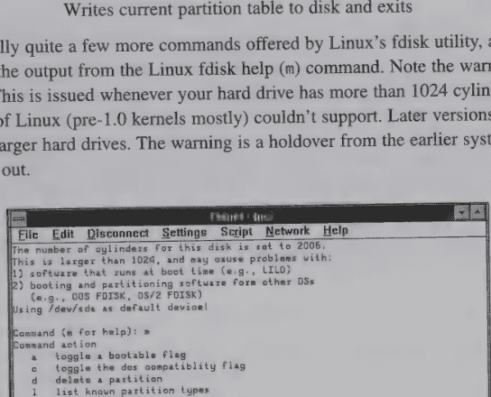

图 3.3
Linux `fdisk` 工具提供了这些命令。可以通过输入 `m` 命令随时显示此列表。

设置分区的步骤是首先检查分区表以确保任何现有分区都是正确的。如果你磁盘上有一个 DOS 分区，它应该显示在分区表中。如果你在 DOS 的 `FDISK` 中创建了 Linux 交换和文件系统分区，它们也应该出现在分区表中，尽管分区的类型是错误的。

# 设置 Linux 分区

要创建 Linux 交换分区，使用 `n` 命令并提供起始扇区数。通常，这个数字会紧随在任何现有 DOS 分区（或其他你安装的操作系统）之后。Linux 的 `fdisk` 允许通过提供结束扇区数或指定兆字节（MB）大小来指定分区大小（记住交换分区的大小实际最大限制为 16M）。如果你提供以兆字节为单位，格式通常为 `+XXM`，其中 XX 是兆字节数（例如 `+16M`）。你也可以指定内核字节（KB），但不需要创建一个小于 1M 的交换分区。

某些旧的 PC BIOS 无法处理磁盘驱动器上超过 1024 个磁道。你可能无法创建第 1023 个磁道的 DOS 或 Linux 分区或文件系统（编号从 0 开始）。某些其他操作系统（如 SCO UNIX）允许你使用 1024 限制之外任何内容。Linux 可以使用超过 1024 限制的分区，但无法从这些分区启动。如果你有一个硬盘具有超过 1023 个磁道，请确保你的主分区在 1023 之前结束。你可以在该磁道之后创建额外分区并将其挂载为第二个文件系统。或者，你可以创建一个扩展到第 1023 个磁道之外的大型 Linux 文件系统，并使用 LILO 启动软盘。

`fdisk` 程序会询问你想要创建主分区还是扩展分区。如果你正在创建主分区，程序要求输入编号（一到四——记住，启动时必须有一个 DOS 分区）。在大多数情况下，你应该只创建主分区，除非你有一个大硬盘。你可以使用扩展分区在分区内部添加逻辑驱动器，这类似于 DOS 创建逻辑驱动器的方式。在 Linux 中，扩展分区不等同于扩展文件系统！

某些 Linux 发行版会发出信息 `Warning: Linux can't currently use sectors of this partition.`。此警告出现在 Linux 早期版本中，当时无法处理大于 64K 的文件系统，可以忽略。

在创建 Linux 分区后，为它分配一个类型。某些 `fdisk` 版本会立即提示此信息，另一些版本则让你从 `fdisk` 菜单中选择分配文件系统类型的选项，字母 `l` 将显示所有文件系统类型。选择代表 Linux 交换空间的类型 (82)，并检查分区表。图 3.4 显示了 Slack Linux 支持的文件系统类型。如你所示，允许许多文件系统类型，尽管大多数用户只会使用 DOS、Linux 和 Linux 数据类型。

图 3.4
Linux 支持的文件系统类型，通过类型和描述进行标识。

当你使用 `p` 命令显示分区表时，你的 Linux 交换分区应该具有正确的大小分区类型。虽然 Linux 不关心分区类型编号，但某些其他操作系统关心，因此正确标记它们是一个良好的习惯，可以防止未来出现问题。这种做法有助于你保持分区表的整洁。

接下来，以相同的方法创建你的主 Linux 文件系统分区。如果你想为该分区创建磁盘的剩余部分，可以输入驱动器的结束扇区数（Linux 的 `fdisk` 会告诉你你可以使用的范围）。如果你的驱动器上有 DOS、Linux 交换空间和 Linux 文件系统分区，这个数字将是通常默认值。在创建 Linux 文件系统分区后，识别其文件类型为 83，这是 Linux 原生类型。你可以随时在 `fdisk` 内使用 `p` 命令显示分区表。图 3.5 显示 2.4G SCSI 硬盘 (`/dev/sda`) 的分区表，其中包含 DOS (`/dev/sda1`)、一个 16M 的 Linux 交换分区 (`/dev/sda2`) 以及用于数据的剩余磁盘 (`/dev/sda3`)。

| 设备 | 启动 | 结束 | 块 | 类型 |
|---|---|---|---|---|
| `/dev/sda1` | 0 | 500 | 511984 | 0 DOS >32M |
| `/dev/sda2` | 501 | 517 | 17408 | 82 Linux swap |
| `/dev/sda3` | 518 | 2005 | 124736 | 83 Linux native |

图 3.5
显示 2.4G SCSI 硬盘 (`/dev/sda`) 的分区表，其中包含 DOS (`/dev/sda1`)、一个 16M 的 Linux 交换分区 (`/dev/sda2`) 以及用于数据的剩余磁盘 (`/dev/sda3`)。

## 启用交换空间

# 安装与配置

> **注意**
>
> 如果你已经开启了交换空间，但在尝试安装 Linux 时仍然收到错误信息，那么你需要更多的物理内存或更大的交换空间。在安装 Linux 之前增加交换空间要比以后再重做要好。要增大交换空间分区的大小，你可能需要删除现有的 Linux 分区并使用 `fdisk` 重新创建。

## 创建 Linux 文件系统分区

一旦你配置并运行了交换空间，就可以设置 Linux 文件系统了。某些安装脚本会自动完成这一步，但你可能需要手动执行它。无论何种情况，本节都将解释其中的工作原理。

你已经分配了分区表以支持 Linux 文件系统。现在，你可以使用 `mkfs`（创建文件系统）命令创建文件系统。命令的精确格式取决于你正在设置的文件系统类型。最流行的文件系统（出于速度和灵活性的考虑）被称为二级扩展文件系统（Second Extended file system，它与硬盘上的扩展分区无关）。要创建一个名为 `ext2` 的二级扩展文件系统，请执行命令：

```
mk2fs -c <partition> <size>
```

其中 `partition` 是设备名称，`size` 是分区的块大小（从 `fdisk` 的分区显示中获取）。例如，要在 `/dev/hda3` 中创建一个大小为 162,344 块的文件，命令为：

```
mk2fs -c /dev/hda3 162344
```


> **注意**
>
> 在指定分区大小时，请确保使用块（blocks）而不是扇区（sectors）或磁道（cylinders）。使用错误的值会导致错误或只有分区的一部分被使用。

`mk2fs` 工具会检查分区的坏块（使用 `-c` 选项），然后在该分区中正确设置文件系统。如果你正在设置一个大分区，磁盘检查可能需要几分钟，除非你确定磁盘是良好的，否则不应跳过。

Linux 可用的其他文件系统还有 Xia 文件系统、扩展文件系统（Extended file system）和 Minix 文件系统。Xia 文件系统很好，但没有二级扩展文件系统流行。扩展文件系统是二级扩展系统的旧版本，而 Minix 文件系统与旧的 Minix 操作系统兼容（Linux 的编写就是为了取代它）。你可以使用以下命令创建这些文件系统：

| 文件系统 | 命令 |
| :--- | :--- |
| Extended | `mkfs` or `mkfs.exe` |
| Minix | `mkfs` |
| Xia | `mkfs` |

这三个命令采用的参数与二级扩展文件系统命令相同。Minix 文件系统限制为 64M。`mkfs` 命令并不格式化文件系统；它们只是进行设置。在安装过程中，系统会提示你进行文件系统格式。

# 安装 Linux 软件

创建并格式化分区以及创建文件系统后，就可以安装 Linux 软件了。这取决于你的 Linux 发行版包含的安装程序，可能是自动化的。大多数 Linux 版本包含一个名为 `setup` 的工具来为你安装软件。在 Linux 提示符下，输入命令：

```
setup
```

> **注意**
>
> Linux 提供的各种设置程序都可以为你执行软件包的自动安装。随附带的文档将说明要使用的设置程序。

如果你运行的是彩色根镜像（color root image），安装过程将获得图形化、全屏窗口。Slack Linux 提供的设置工具如图 3.7 所示。其他根镜像则使用基于字符的安装信息。许多安装 Linux 的用户经常避开彩色根镜像，因为回答脚本提出的所有问题可能花费长时间，而且某些输入错误很难纠正。无论你选择哪种根镜像，请仔细阅读每个屏幕。

Linux 在安装期间为你提供了许多选择。虽然默认选择对大多数人来说是正确的，但请检查默认设置是否是你想要的。你有权让 Linux 安装所有内容（除非磁盘集发生变化除外），但只有在你确切知道磁盘发生了什么时才应使用此选项。如果你是第一次安装 Linux，或者想通过检查每个软件包的描述来选择要安装的软件，请使用详细选项（verbose options）显示所有消息，并让你控制过程。

## 选择源和磁盘集

安装脚本编辑器会询问或让你设置几项信息。首先，你需要指定软件源。这通常在 `setup` 开始自动安装过程时完成，或者通过从设置菜单中选择 Source（源）来完成。如果你有 CD-ROM，如果驱动程序对你的硬件正确，它应该在启动过程中已被激活。选择 CD-ROM 选项。你可能会被要求缩小系统中 CD-ROM 的类型。选择准确的类型（或最接近的类型）并等待结果。如果你从另一个磁盘分区安装（例如另一个 Linux 分区或 DOS 分区），请提供完整的设备和路径名称。图 3.8 显示了 `setup` 菜单中提供的 Source 选项。在这里，你可以选择 CD-ROM。如果 Linux 在启动时没有识别你的 CD-ROM，可能会显示另一个屏幕，并要求选择你的系统拥有什么类型的 CD-ROM 驱动器。

安装程序随后询问安装目标。目标是你安装软件的地方。新创建的 Linux 分区可能是你想要的位置，因此输入分区名称。你可能会被问是否要格式化该分区；回答是。（运行 `mkfs` 或其变体不会为你格式化分区。）

接下来，Linux 显示你可以安装的磁盘集列表。你可以通过安装过程进入此屏幕，也可以从设置菜单中选择 Disk Sets（磁盘集）。选择你需要的。磁盘集列表通常是一个滚动窗口，如图 3.9 所示。确保滚动完整个列表并标记你需要的磁盘集。

某些设置程序在磁盘集安装后会让你进一步精炼工具列表。作为最后一步，验证信息并让 Linux 自动安装。如果这没有自动启动，从设置菜单中选择 Install（安装）选项。Linux 可能会向你再次确认是否安装所选的磁盘集。屏幕消息将与图 3.10 所示类似。当你告诉 Linux 继续安装软件后，留意消息和提示，并遵循任何屏幕上的说明。如果你是从软盘安装，系统会间隔提示你更换磁盘集中的下一张磁盘。

## 创建启动盘

在安装程序结束时，你可能会被询问是否想要创建一个启动盘。图 3.14 显示了此屏幕。启动盘让你能够随时访问系统，特别是当正常启动过程失败时。创建启动盘是一个好主意。此磁盘与你为了启动安装而制作的启动软盘不同（后者仅在从头开始重新安装时有用）。

当你选择创建启动盘时，Linux 将会提示你插入一张软盘（如图 3.15 所示），然后继续将启动盘信息拷贝到软盘中。当 Linux 创建软盘时，它会向你显示类似图 3.16 所示的消息。

## 配置细节

在安装磁盘集并创建启动盘后，设置程序可能会提供一个选择：通过配置系统来继续安装过程，或者将配置留到稍后。一步到位完成整个过程是一个好主意，因为回溯有时可能会困难。虽然提示顺序和呈现给你的选项会根据你正在安装的 Linux 系统版本而有所不同，但通常你会被要求先设置调制解调器，如图 3.17 所示。

如果你的系统中已经安装了调制解调器，请选择 Yes 以现在配置端口和调制解调器。或者，如果你不确定想使用哪个端口，或者想稍后添加调制解调器，请选择 No。如果你选择 Yes 安装调制解调器，会被要求提供它所连接的设备，如图 3.18 所示。设备以 Linux 格式命名，`/dev/cuS0` 等同于 COM1；`/dev/cua1` 等同于 COM2，以此类推。选择正确的设备。例如，如果调制解调器被 DOS 的 COM2 端口使用，请滚动到 `/dev/cua1` 并选择 OK。如果你不确定使用哪个端口，尝试 `/dev/cua1`，因为大多数端口都是 COM1 (`/dev/cua0`)。你以后可以随时重新配置系统。

接下来，你会被要求设置鼠标，如图 3.19 所示。如果你在此时选择配置鼠标，你将必须选择你正在使用的鼠标类型。图 3.20 显示了当前支持的鼠标类型。大多数鼠标外设是串口的，因此请选择与你的设备匹配的串口鼠标。如果有疑问，选择 Microsoft Serial。

## 设置启动过程

安装过程的最后一步是设置启动设备。一个名为 LILO（Linux加载器）的工具通常启动 Linux。LILO 可以以多种方式启动系统，取决于你是否希望与其他操作系统一起使用系统。LILO 的屏幕解释了大部分选项，但 LILO 有一些特殊。第 4 章专门介绍 LILO 的功能以及如何使其正常运行。例如，如果你很急，按照默认设置操作，但不要让 LILO 覆盖你的硬盘。要在启动 DOS 时，这样做可能会麻烦。不过，你可以让 LILO 向你的 Linux 分区写入引导扇，然后对 DOS 或 Linux 进行 fdisk。如果你不确定对 LILO 做什么，先忽略它。你有一个可以让你机器变化的软盘。当你更好地理解它时，就可以按照想要的方式设置。

## 查看已安装软件文件

当 Linux 运行时，你可能想要安装或删除磁盘集和其他软件。你还可以检查磁盘集的组件是否已正确安装。此任务可以使用不同的工具，但常用的是 `pkgtool`。当你在 shell 提示符输入 `pkgtool` 命令名称时，会出现一个允许你安装新软件、删除现有软件或查看包中已安装文件的菜单。该菜单如图 3.22 所示。

要查看包的内容，请从 `pkgtool` 主菜单中选择 View，然后从列表中选择包名称。图 3.23 显示了包列表。列表应该包含你安装的所有磁盘集工具，以及在首次安装之后安装的额外软件。选择工具名称会发送 `pkgtool` 去检查该软件应包含的所有文件并报告其状态。有时包软件列表可能需要一段时间才会出现。请耐心等待！

该工具的描述以及安装程序所有文件的列表。图 3.24 显示了基础软件包的条目。

当文件列表显示时，你可以使用空格键进行浏览。要离开文件列表，请选择屏幕底部的 Exit（退出）选项。

# 使用包管理器进行其他发行版

Linux 最流行的包管理器是红帽的 RPM（红帽包管理器）。该包管理器包含在所有红帽 Linux 发布版以及少数其他发行版中。不过，RPM 并不限于红帽 Linux，你几乎可以在市面上的每一个 Linux 版本上安装 RPM。其操作过程非常简单。例如，我们将在 Slackware 系统上安装 RPM。

首先获取 RPM 系统的最新版本。这可以从许多 Web 和 FTP 站点（例如 `ftp.rpm.org/pub/rpm/dist/latest`）或从红帽 CD-ROM 发行版下载。确保你获取的是 RPM 的 Intel 版本（使用 i386）；否则它将无法工作。

要安装 RPM，你必须以 root 身份登录。你可以使用任何原生 Linux 安装包（如 `installpkg`）来完成 RPM 的安装。在我们示例 Slackware 系统上，安装下载的 RPM 包的命令为：

```
installpkg /home/rpm/rpm-2.4.12-1.i386.tar.gz
```

其中 `/home/rpm` 是我们放置 RPM 包的目录。版本号在你的系统上可能会不同。

如果你不想安装 `installpkg` 或任何其他安装工具，也并非无计可用。只需在目标目录中对包进行解压，如下所示：

```
tar zxvpf /home/rpm/rpm-2.4.12-1.i386.tar.gz
```

将发行版安装到目录后（我们使用了 `/home/rpm`，但任何目录都可以，包括 `/tmp`），你需要创建目录 `/var/lib/rpm`，因为这是 RPM 的默认路径：

```
mkdir /var/lib/rpm
```

> **注意**
>
> 某些版本的 RPM 在编写时存在一个 bug，它会将重要目录的权限更改为 700 (drwx--))。检查 `/usr`、`/bin` 和 `/etc` 目录。如果它们的权限为 700，则说明你的 RPM 版本存在该 bug，你需要手动重置所有受影响目录和文件的权限。

最后，使用命令初始化 RPM 数据库：

```
rpm --initdb
```

（注意双横线。）执行此命令后，RPM 应该可以管理并安装系统上的任何 RPM 包。你可以通过使用任何 RPM 格式的文件并执行以下命令来验证 RPM 工具是否正常：

```
rpm -Uvh filename.rpm
```


来安装它（当然，将 `filename` 替换为你的 RPM 文件）。

# 故障排除

在启动 Linux 时可能会遇到很多问题，启动信息会解释这些问题。接下来的章节将列出这些常见问题。

# 软件安装

在安装 Linux 时你可能会遇到一些错误。如果你遇到“file not found”（未找到文件）的消息，说明你可能需要重新创建分区或重新安装驱动。诸如“read error”（读取错误）之类的错误通常意味着介质有问题。如果两个磁盘之间存在冲突，在大多数情况下，它们在 Linux 下无法正常启动。

# 硬盘与磁盘控制器问题

当 Linux 启动时，会显示一些信息，最重要的是如下的分区检查：

```text
hda: hda1 hda2
hdb: hdb1 db2
```

在这个例子中，第一个磁盘有三个分区，第二个磁盘有两个。你的系统输出可能不同，如果你没有看到分区信息，可能是磁盘控制器未被识别。检查以下可能的情况：

- 检查电脑内部的电缆。硬盘电缆应连接到接口上（电缆上的红色条位于引脚 1）。
- 检查电源连接是否连接到磁盘。如果没有电源，磁盘不会旋转，Linux 无法访问它。
- 检查分区表，确保你正确创建了 Linux 分区。

如果硬盘在 Linux 下仍然无法正常工作，但在 DOS 下运行正常，可能是内核驱动的问题。尝试使用不同的内核镜像看看问题是否得到解决。使用随 SCSI 适配器提供的工具强制检查硬盘。它们可能是 SCSI ID 设置错误。

# 设备冲突

常见问题之一是硬件无法被正确识别。这种问题可能发生在 CD-ROM、网卡甚至硬盘上。大多数情况下，IRQ（中断请求）、DMA（直接内存访问）或 I/O 地址设置的冲突会导致此类问题。当两个设备在这三个特性之一上具有相同的设置时，Linux 和 BIOS 可能无法与该设备进行正常通信。

# 安装与升级
## 第3章

## 注意事项

你可能在设备列表中注意到串口端口被称为 `/dev/tty0`、`/dev/ttyS1` 等。然而，当我们配置调制解调器时，它们被称为 `/dev/cua0`、`/dev/cua1` 等。它们实际上是相同的（`/dev/tty0` 等同于 `/dev/cua0`），区别在于 Linux 处理设备的方式。不要被这些设备驱动名称和潜在冲突过于困扰。只需记住 `/dev/cua` 指的是调制解调器端口。

网卡、SCSI适配器、声卡、显卡和其他设备必须具有唯一的 IRQ、DMA 和 I/O 地址，这在一个全负载的系统中可能很难安排。有关可用值的更多信息，请查阅你的设备或显卡安装手册以获取推荐值和潜在冲突。

## SCSI 问题

SCSI 是功能最强大的接口之一，这种多功能性也带来了许多潜在问题。Linux 通常擅长报告 SCSI 设备的问题，尽管错误信息可能会让你对问题的真实原因感到困惑。

以下列表解释了许多常见的 SCSI 错误及其可能的原因。找到与 Linux 显示的错误信息最匹配的消息，以确定你的纠正步骤。

- 在所有可能的 ID 上都有 SCSI 设备
- 一个或多个设备与控制器的具有相同的 SCSI ID。检查并更改设备 ID。控制器应为 ID 7。
- 感应错误（Sense errors）
- 此错误可能由终止不当引起。检查 SCSI 链的两端是否已终止。如果不是该问题，可能是电缆故障。
- 超时错误
- 此错误通常由 DMA、IRQ 或 I/O 地址冲突引起。请参考前一节获取更多信息。
- 未检测到 SCSI 适配器
- BIOS 已禁用或内核无法识别 SCSI 适配器。检查驱动程序。

# 安装与配置
## 第一部分

### 超过 1024 的柱面

你的磁盘超过 1024 个柱面，PC BIOS 无法处理。Linux 可以使用超过 1024 个柱面，但它无法从跨越该柱面边界的分区启动。

### 未识别 CD-ROM 驱动器

某些 CD-ROM 驱动器需要插入光盘才能被正确识别。插入光盘并重启。

## 启动 Linux 遇到问题

如果你已经安装了 Linux 但系统无法从硬盘正常启动，可能是 LILO 或分区的问题。如果你创建了启动软盘，请从该软盘启动。如果它在没有进行分区检查的情况下启动，请通过执行 `fdisk` 检查分区表。确保 Linux 分区是激活的（active）。如果是激活状态但你仍然无法从硬盘启动，请从软盘启动并重新运行 LILO 以配置引导扇区。有关 LILO 的更多信息请参阅第 4 章。

当 Linux 无法找到主分区时有时会发生问题。从软盘启动并按住 Shift 或 Ctrl 键。这将产生一个菜单，允许你显式地指定启动设备。此问题通常可以通过 LILO 修复。

## 总结

如果你以前安装过 Linux，本章的大部分内容对你来说可能很熟悉，尽管某些用户并自动化安装脚本执行过程中发生了什么。了解过程并掌握它有助于防止 Linux 安装过程中出现问题。下一步是使用 LILO 正确配置启动系统，这是一个经常被误解的过程。下一章介绍 LILO。

### 本章内容

- 安装 LILO 76
- Linux 与硬盘布局 79
- 理解引导扇区 80
- 修改启动过程 82
- 映射安装器（Map Installer） 93
- 使用启动镜像 97
- 读取磁盘参数表 98
- 移除或禁用 LILO 99
- LILO 故障排除 100

# LILO
## 第 4 章

每当你听到 Linux，你也会听到 Linux Loader（LILO）。LILO 是 Linux 用于加载操作系统内核的引导加载器。每当你更改或移动 Linux 内核时，必须调用 LILO 重新构建内核位置映射。LILO 是多功能的——它可以从任何类型的文件系统（包括软盘）以及其他操作系统中启动内核。本章涵盖了 LILO、Linux 下硬盘的布局方式、启动过程、最常见的启动过程以及 LILO 与这些内容的交互。这些信息将帮助你有效地安装和使用 LILO。

有多个版本的 LILO 可用。大多数版本支持两种不同的目录结构之一。更传统的（较旧的）结构位于 `/etc/lilo` 目录。新的结构将文件分散在多个目录中，包括 `/etc`、`/sbin` 和 `/boot`。由于旧的 `/etc/lilo` 结构最常见，因此在本章的示例中使用它。如果你在使用新结构（检查 `/etc/lilo` 是否存在），请根据需要替换新的路径名。

让我们在本章开始时告诉你，你可能不需要阅读这里的其他任何内容！许多 Linux 发行版在你最初加载 LILO 时，会自动为你处理安装和配置 LILO 的细节。如果你的系统能够正常启动到 Linux 以及你安装的任何其他操作系统，你根本就不需要修改 LILO 了。

### 安装 LILO

大多数系统已经安装了 LILO。如果你想安装它，请遵循以下步骤：

- 检查 `Makefile` 以获取准确信息。

### 编译 LILO

如果你想使用旧的 `/etc/lilo` 目录，执行第一条命令：

```bash
make -f Makefile.old
```

如果你想使用新结构，执行第二条命令：

```bash
make -f Makefile.new
```

- 使用以下命令将 LILO 文件复制到目标目录：

```bash
make -f Makefile.old install
make -f Makefile.new install
```

- 检查目录。你应该看到以下文件：`any_d.b`、`boot.b`、`chain.b`、`disktab`、`lilo`、`os2_d.b`。如果文件不存在或过程中产生错误，请重新安装。

在使用之前编译 LILO 之前，你必须通过运行 `make config` 来配置内核。所有的内核头文件必须位于 `/usr/include/linux` 目录以便 LILO 编译。LILO 的安装和编译过程应在 Bourne shell 或兼容版本的 Shell 中运行，因此请使用 `/bin/sh` 或 `/bin/bash`。

### 处理磁盘问题

某些系统可能难以读取磁盘参数（头数、每磁道扇数和柱面数）。如果你遇到有关几何结构的错误信息或 LILO 安装因磁盘错误失败，磁盘参数可能是问题所在，特别是当你处理 SCSI 磁盘和容量大于 1GB 的硬盘时。然而，大多数当前版本的 LILO 都能轻松处理更大的驱动器。硬盘无法被正确识别的问题通常由于 BIOS 版本旧或控制器卡旧。

如果你遇到磁盘几何错误，你必须在 `disktab` 文件中手动输入磁盘参数。本章后面的“磁盘参数表”将详细讨论这一点。按照说明编辑 `disktab` 文件以包含磁盘参数。然后通过将配置复制到软盘并从其启动来测试 LILO 配置。遵循以下步骤：

- 进入 LILO 目录（通常为 `/etc/lilo`）。
- 执行以下命令将 LILO 配置复制到软盘。在参数后替换内核镜像名称。

```bash
echo image=kernel_name | .lilo -C -b /dev/fd0 -v -v
```

- 从软盘重启你的系统。

如果配置正确，LILO 将读取软盘以获取加载器，然后从硬盘加载内核。如果一切启动正常且你可以在文件系统之间进行移动，则说明磁盘参数是正确的。如果你无法访问硬盘文件系统，则参数是错误的，应该重新输入。

## 使用 LILO Makefile

随 LILO 安装文件附带 LILO Makefile 适用于大多数安装，尽管你应该仔细检查所有条目。LILO 使用 Makefile（其中包含了 C 编译器从源代码编译成二进制文件的所有指令）或另一个名为 `/etc/lilo/config/config.defines` 的文件。如果 `config.defines` 文件存在，则会忽略 Makefile。对于大多数用途来说，直接编辑 Makefile 就足够了，但如果你计划频繁使用 LILO，那么 `config.defines` 文件是一个更好的替代方案，因为它在版本更新时不会被新版本的 LILO 覆盖。

Makefile 中使用了几个参数来控制编译过程。根据你的系统需求，你可能需要更改某些值。请检查 Makefile 中的以下参数，并确保它们的值设置为你预期的值：

- `IGNORECASE` 使镜像名称不区分大小写。此参数默认激活（应保持原样）。
- `NOISTDIAG` 当在加载器中遇到读取错误时不生成诊断信息。此参数默认禁用。除非你关心的错误信息，否则最好保持其禁用状态。
- `NOINSTDEF` 告诉你如果在命令行中省略了 `install` 选项，则不安装新的引导区，而是修改旧引导区。此参数默认禁用。
- `ONE_SHOT` 如果按下任何键，则禁用命令行超时。此参数默认禁用。
- `READONLY` 防止覆盖映射文件中的默认命令行扇区。此参数默认禁用。

# 更新 LILO

如果你想用新版本的 LILO 更新现有的版本，其过程与首次安装相同，不同的是现有的配置文件会被重命名为 `.old` 扩展。例如，`chain.b` 会被重命名为 `chain.old`。如果新版本的 LILO 运行正常，你可以删除这些 `.old` 文件。每当你更新 LILO 时，都必须更新引导区以添加新的位置和映射文件格式。要更新引导区，只需运行 LILO 即可。

# Linux 和硬盘布局

为了理解 LILO 是如何工作的，你必须了解硬盘的布局。你可能已经知道硬盘本质上是一组从磁盘盘面中心放射出的同心磁道。每个磁道被划分为若干扇区。

硬盘通过盘片数量（或更准确地说是磁头数量；盘片数可能大于磁头数，因为一个或多个表面——通常是顶部和底部——可能不用于数据存储）、每英寸磁盘盘片的磁道数（沿径向测量）以及每个磁道的扇区数来标识。每个扇区的容量决定了磁盘的总容量；将每个磁道的扇区数乘以磁道数，再乘以带有磁头的盘片数。

在本章中，你会看到对 DOS 硬盘的引用。这并不是因为这本书过时了！DOS 格式驱动器被许多版本的 Windows 使用，包括旧版本的 Windows 3.x、Windows 95 和 Windows 98。DOS 一词也指的是旧的 FAT16 文件系统，所有当前的 Windows 版本都支持它。FAT32 是 Windows 95 第二版引入的更新版本，并被 Windows 98 和 Windows 2000 支持，它不兼容，意味着旧的 DOS 引导盘无法读取该分区。由于大多数 Linux 系统仍使用 FAT16 分区，我们将在本章中统一使用 DOS 和 FAT16 术语。

Linux 与 DOS 和 Windows 的集成程度相同，因此查看 DOS 和 Windows 使用硬盘的方式是有用的。单一用途（单 DOS 或 Windows）硬盘（例如，软盘磁盘）有一个引导扇区，随后是映射文件。硬盘操作系统（例如，Linux）拥有引导区。引导扇区通常位于磁盘的起始位置。引导扇区包含引导程序以加载操作系统。在磁盘，硬盘的引导扇区是引导程序。引导扇区包含了分区信息信息（由于 FAT16 分区）。

由于大多数 Linux 系统仍使用 FAT16 分区，我们将在本章统一使用 DOS 和 FAT16 术语。

当配置正确时，LILO 将读取软盘以获取加载器，然后从硬盘加载内核。如果你想在硬盘上支持多个操作系统（例如，DOS 或 Windows），逻辑分区非常有用。在硬盘上最多可以创建四个主分区（FAT16 文件系统）。

> **注意**
> 在某些操作系统（包括 Linux）中，如果你在硬盘上使用 DOS 或旧版本的 Windows，不要创建超过四个主分区。这样做会导致 DOS 或 Windows 无法读取 FAT16 分区。DOS 的 `fdisk` 无法处理四个以上的分区。如果你需要四个以上的驱动器，可以使用扩展分区。扩展分区是被细分的主分区。

包含磁盘分区详情的分区表写入每个硬盘的第一个扇区（引导扇区）。该区域有时被称为主引导记录或 MBR。虽然引导扇区和 MBR 术语通常通用，但 MBR 与引导扇区的区别在于其包含分区信息。换句话说，你可以将硬盘的引导扇称为 MBR，但软盘的引导扇区不是 MBR。扩展分区在其起始扇区也有分区表。一个名为 `part` 的程序创建 Linux 扇区。

当硬盘有多个分区时，Linux 通过设备编号来引用它们，例如 `/dev/sda1`、`/dev/sda2` 等。在这种情况下，`/dev/hda` 是第一个硬盘（`/dev/hdb` 是第二个，`/dev/hdc` 是第三个，依此类推）。在第一个硬盘内部，分区命名为 `/dev/hda1`、`/dev/hda2` 等。第二个硬盘 `/dev/hdb` 将拥有分区 `/dev/hdb1`、`/dev/hdb2` 等。磁盘名称中的字母取决于硬盘的类型及其适配器。例如，硬盘可能被称为 `/dev/sda` 而不是 `/dev/hda`。扩展分区将被编号为 `/dev/hda5`、`/dev/hda6` 等（因为只允许四个主分区，即 `/dev/hda4`）。

为了理解 Linux 启动过程，必须查看 FAT16 引导扇区。图 4.1 显示了 FAT16 引导扇区的布局。程序代码是引导操作系统的引导。磁盘参数包括文件分配表（FAT）。

### 图 4.1：FAT16 引导扇区布局

| 地址 | 描述 |
| :--- | :--- |
| 000 | 跳转到程序代码的指令 |
| 003 | 磁盘参数 |
| 02C/03E | 程序代码 |
| 1FE | 魔数 (Magic Number) |

DOS LILO 引导扇与 FAT16 引导扇相似，不同之处未使用磁盘参数部分，且代码扇区之间的边界不同。如果将 Linux LILO 引导扇写入磁盘的主引导记录（MBR），这两个引导扇之间的差异会导致 DOS 或 Windows 出现问题，因为 DOS 或 Windows 将无法正常加载。图 4.2 显示了 Linux 引导扇布局。本节及前一个引导扇布局中提到的魔数是一个两个字节数字，某些操作系统用于验证读取的扇区确实是引导区。

### 图 4.2：Linux LILO 引导扇区布局

| 偏移量 | 描述 |
| :--- | :--- |
| 000 | 程序代码 |
| 1BE | 分区表 |
| 1FE | 魔数 (Magic Number) |

理论上讲，你可以使用 Linux LILO 引导扇来引导 DOS 或 Windows，因为引导记录的分区表区域可以包含 DOS 的 FAT16。但在实践中，引导过程通常会失败。使用写入 FAT16 分区的引导扇要好得多。

> **注意**
> 由于 DOS 或 Windows 与 Linux LILO 的引导扇有所不同，你应该在安装 Linux 之前安装 DOS 或 Windows。这样做可以确保 FAT16 引导扇被写入硬盘。如果你先安装 Linux 且 Linux LILO 引导扇被写入硬盘，DOS 或 Windows 将无法引导。

你可以将 LILO 引导扇保存在软盘上、硬盘的主引导记录中、Linux 分区的引导扇中，或者扩展分区的引导扇中。你不能将其存储在任何非 Linux 分区或除第一个以外的任何硬盘上。请注意，尽管 DOS 无法处理扩展分区中的引导扇，但 Linux 可以通过 fdisk 的扩展或名为 `activate` 的实用程序进行管理。

> **注意**
> LILO 的一个常见问题是它会非常高兴地将 LILO 引导扇写入任何地方，甚至是操作系统无法访问的位置。请确保你将 LILO 引导扇写入有效位置。如果你已经安装了 Linux 并且正在进行更改，请随身准备一张引导软盘。

## 修改引导过程

在引导过程中，会读取引导扇以获取操作系统的引导程序。在 DOS 和 Windows 的情况下，会读取主引导记录或引导扇，然后加载 `COMMAND.COM`。`COMMAND.COM` 是 DOS 的内核。

虽然遵循 Linux 安装过程时通常会设置引导系统，但你可能想要更改 Linux 的引导系统。根据你的需求和硬盘配置，你可以采取几种方法之一。以下章节将介绍几个典型的配置示例，以展示如何修改引导过程。这些章节首先解释了手动安装 LILO 的步骤，尽管在安装 Linux 软件时你通常可以执行某些自动化过程之一。我们将在本节稍后的部分查看自动化过程及其选项。但目前，每种替代方案的细节应该帮助你决定如何在你的系统上安装 LILO。

### 安装专用的 Linux 硬盘

即使硬盘上还有其他操作系统，通过专用安装 Linux，LILO 引导扇也可以替换主引导记录。这样 LILO 将从主引导记录引导 Linux，而不触碰分区扇。但在某些情况下，你可能必须显式指定引导扇。换句话说，如果默认值不起作用，可能需要在引导提示处指定 `boot=/dev/hda`（取决于持有主引导记录的设备）。

> **注意**
> 如果你用 LILO 替换了主引导记录作为专用 Linux 系统，随后删除了 Linux，你必须格式化硬盘或恢复旧的 MBR，DOS 或 Windows 等其他操作系统才能引导。要将 LILO 安装为专用 Linux，请遵循以下步骤：

1. 正常启动 Linux。准备好软盘以防万一。
2. 将现有的主引导记录复制到软盘。从主驱动（`/dev/hda`）将 MBR 复制到软盘的命令（使用 512 字节块）是：
```bash
dd if=/dev/hda of=/dev/fd0 bs=512 count=1
```


dd if=/dev/hda of=... bs=512

```
3. 使用安装程序将 LILO 复制到引导扇，将其设置为主引导记录。
4. 从主引导记录重启电脑。

你的电脑应该会自动加载 Linux。如果 Linux 没有引导，请使用你的引导软盘启动 Linux 并重复该过程，或者使用命令从软盘恢复原始主引导记录：
```

dd if=... of=/dev/hda bs=446

# 使用 BOOTACT

对引导过程的一种轻微修改是将普通 MBR 替换为名为 `BOOTACT` 的实用程序，它会提示从哪个分区引导。该实用程序需要写入一个与 FAT16 兼容的引导扇，因此只有当 Linux 是主操作系统且 LILO 不引导其他操作系统时才使用它。主引导记录持有 `BOOTACT` 的副本。引导时，`BOOTACT` 允许你选择要引导的操作系统。然后它可以从分区读取引导扇。当 MBR 持有 `BOOTACT` 时，你无法像通常使用 DOS 或 OS/2 那样使用 MBR。但如果你愿意，可以将 `BOOTACT` 替换为普通 MBR。

要安装 `BOOTACT`，请遵循以下步骤：

1. 正常启动 Linux。准备好软盘以防万一。
2. 将现有的主引导记录复制到软盘。从主驱动（`/dev/hda`）将 MBR 复制到软盘的命令（使用 512 字节块，默认值）是：
3. 使用安装程序将 LILO 复制到 Linux 分区的引导扇（而不是主引导记录）。
4. 将 `BOOTACT` 安装主引导记录。`BOOTACT` 实用程序通常是 `bootactv.bin`，当你用以下命令将其安装到 MBR 时，它应该位于当前目录：

dd if=... of=... bs=512

5. 重启电脑从主引导记录引导 `BOOTACT`：

dd if=bootactv.bin of=/dev/hda bs=446

你的电脑应该加载 `BOOTACT` 并允许你引导分区上的任何操作系统。如果 Linux 或另一个操作系统没有引导，请使用你的引导软盘启动 Linux。如果只有 Linux 没有，说明 Linux 分区的 LILO 引导扇无法工作，可以使用配置工具进行重写。如果没有任何分区引导，请使用命令替换旧的主引导记录以移除 `BOOTACT`：

dd if=... of=/dev/hda bs=446

如果你有 DOS 引导软盘，也可以从 DOS 安装主引导记录。在 DOS 中，发出命令：

fdisk /mbr

> **提示**
> 如果你不想更改主引导记录但有多个分区用于 Linux，你可以在其中一个分区引导扇上安装 `BOOTACT` 并使用 fdisk 实用程序切换分区。然而，如果重新划分了硬盘或更改了文件系统的大小，则必须重写引导扇。例如，将 `BOOTACT` 写入第四主硬盘分区，将现有 MBR 复制到分区引导扇，然后使用以下命令安装 `BOOTACT`：

dd if=/dev/hda of=/dev/hda4 bs=512 count=1

dd if=bootactv.bin of=/dev/hda4 bs=446 count=1

# 安装 DOS 或 Windows 和 Linux

大多数 Linux 安装与 DOS 或 Windows 共存并使用 FAT16 主引导记录。在这种情况下，读取 MBR 并自动引导活动分区。这种安装方法是最安全的，因为没有对 MBR 进行更改。

> **注意**
> 后版本的 DOS (6.00) 和 Windows 95/98 在 Linux 之后安装时会覆盖现有的 MBR。如果发生这种情况，你将无法从 MBR 引导 Linux，但 DOS 和 Windows 可以。你可以通过重新运行 LILO 或使 Linux 分区变为活动来解决此问题。

你可以随时使用 fdisk 实用程序或 Linux 实用程序 `activate` 更改活动分区。Linux 内的设置程序通常也可以更改。硬盘上一次只能有一个分区处于活动状态。包括 Linux 在内的某些操作系统允许你在读取活动分区后，对要引导哪种操作系统的决定改变主意，前提是引导过程中内置了延迟。例如，Linux 可以显示引导提示并等待回复或超时，然后再启动 Linux。

要对 Linux 使用此类方法，请将 LILO 安装到 Linux 分区的引导扇中。

# 安装与配置

## 第一部分

- 2. 将 Linux 内核的副本放置在你的 DOS 分区中，可以通过 DOS 或使用 Linux Mtools 之一来实现。你只需要将内核文件复制到 DOS 或 Windows 分区的家目录（或任何子目录）即可。你甚至可以通过软盘完成此操作。
- 3. 使用与拷贝 Linux 内核相同的过程，将 `BOOT.SYS` 和 `BOOTLIN.SYS` 拷贝到 DOS 或 Windows 分区。
- 4. 将 `BOOT.SYS` 和 `BOOTLIN.SYS` 文件都添加到你的 `CONFIG.SYS` 文件中。
- 5. 确保 DOS 或 Windows 是活动分区，并重启机器。

当 DOS 或 Windows 启动时，启动设备驱动程序将为你提供启动 DOS、Windows（取决于磁盘上是哪种操作系统）或 Linux 的选项。如果你遇到问题，从 `CONFIG.SYS` 文件中删除 `BOOT.SYS` 和 `BOOTLIN.SYS` 文件，即可恢复正常。

使用 `BOOT.SYS` 程序有一个实用的优势，即它不需要修改任何引导区来支持多个操作系统。因此，从硬盘上加载和移除操作系统变得更加简单。你可以同时使用带有活动分区的主引导记录（MBR）和 `BOOT.SYS` 方法，这样硬盘会开始启动任何带有活动标志的操作系统，然后暂停并等待用户的确认（或超时）。在这种情况下，不需要对主引导记录进行任何更改。

# 自动创建 LILO

大多数最新版本的 Linux 允许你管理 LILO，它是一个菜单驱动的程序，通常通过 `setup` 启动。通常，当你对安装进行任何更改（如添加新软件）时，`setup` 程序的最后一个组件会提示你是否要处理 LILO。此屏幕如图 4.3 所示。

从图 4.3 所示的菜单驱动系统中，你应该选择“Boot Option”（启动选项）。通常，第一个程序会询问 Linux 启动时需要指定的启动时指令，如图 4.4 所示。通常情况下没有启动时指令，但如果你在 LILO 安装过程中必须输入任何参数，则应在此处指定相同的选项。

如图 4.5 所示的下一个提示询问你希望将 LILO 指令写入到何处。我们之前讨论过主要选项。此版本的 LILO 允许你选择主引导记录（MBR）、主分区的主扇区（在此称为超级块 superblock）或软盘。你选择的方法取决于你希望 LILO 如何启动，以及它是否与另一个操作系统共存。为了对你的系统影响最小，请选择软盘选项。这要求你在启动机器时将软盘放入驱动器，但随后将干净地启动到 Linux。如果软盘不在驱动器中，则启动任何其他活动分区（如 DOS、Windows 或 OS/2）。通过这种方法，LILO 指令仅写入软盘，这意味着对现有的 MBR 或分区扇区没有更改。这使得移除 Linux 变得非常容易（并防止硬盘上存在的其他操作系统出现问题）。


# LILO

## 第四章

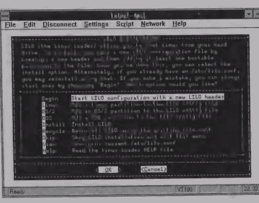

## LILO 4.3

每当通过设置程序对 Linux 进行任何更改时，它都会询问你是否需要使用 LILO。

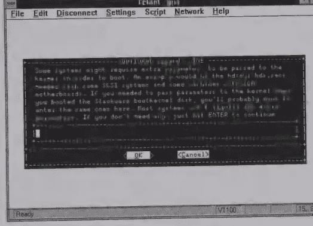

## LILO 4.4

LILO 安装过程从询问你是否需要任何特殊的启动时指令开始。通常没有必要的。

## 4

## 安装与配置

### 第一部分

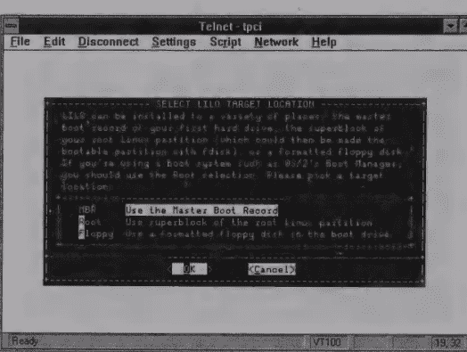

图 4.5

你被询问想在何处安装 LILO。如果你运行的是仅 Linux Linux 系统，主引导记录（MBR）是一个很好的选项。如果你希望影响最小，请选择软盘选项。

或者，如果你只安装 Linux，或者计划极少地使用现有的 DOS、Windows 或 OS/2 分区，请使用分区引导扇区的主引导记录。这种方法的唯一缺点是，如果你以后想移除 Linux，必须再次对硬盘进行低级格式化。Linux MBR 与 DOS 不兼容。

折中方案是使用分区引导扇区（超级块）。超级块让你在分区处于活动时直接启动到 Linux，或使用 fdisk 更改任何其他分区。通过重新格式化分区并安装新的操作系统可以轻松移除，尽管它比软盘启动选项的影响更大。

> **注意**
> 如果你是为了实验而安装 Linux，并且不确定是否会将其留在硬盘上，请使用软盘。这将为你以后退出 Linux 提供最不省心的方法。你可以随时运行 LILO，并按照启动指令将其引导到 MBR 或超级块。

LILO 系统将询问你是否想在 LILO 开始启动之前设置一个延迟，如图 4.6 所示。你可以决定不暂停，或者等待 5 秒或 30 秒，或者等待显式指示 LILO 启动。如果你的硬盘上有两个操作系统，最后一个选项是有用的，因为可以避免你费力使用 fdisk 修改活动分区。一个很好的折中方案是等待 5 秒或 30 秒。

# LILO

## 第四章

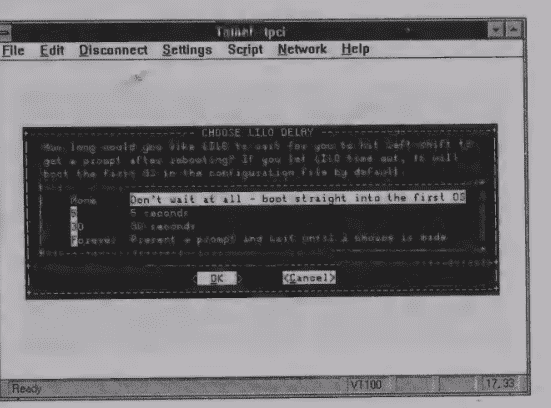

图 4.6
LILO 让你在启动 Linux 之前设置一个延迟。这让你决定启动另一个操作系统

图 4.7 所示示例显示了硬盘上的单个 Linux 数据分区，名为 `/dev/sda`。Linux 交换分区出现在这些列表中（除非它们在安装时被错误识别）。输入用于引导分区的 Linux 分区名称（在示例中，在字段中输入 `/dev/sda`）。图 4.8 所示的下一个屏幕询问分区的名称。这是在启动时识别分区的名称。对于 Linux 分区，只需输入 Linux 单词即可。这为分区提供了一个明确的名称。

输入分区名称后，你回到了 LILO 主菜单。现在，添加任何其他操作系统，如 DOS、Windows 或 OS/2。由于示例中的硬盘与 DOS 或 Windows 共享空间，我们将安装一个 FAT16 分区。从菜单中选择 DOS 或 Windows。这将显示一个与选择 Linux 分区非常类似的屏幕，如图 4.9 所示。输入 FAT16 分区的名称（在此情况下为 `/dev/sda1`）。


## 90 安装与配置

### 第一部分

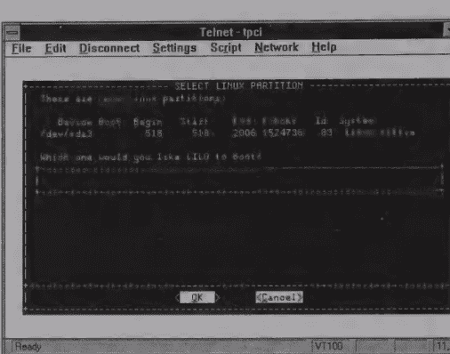

图 4.5
你被询问想在何处安装 LILO。如果你运行的是仅 Linux 系统，主引导记录（MBR）是一个很好的选项。如果你希望影响最小，请选择软盘选项。

或者，如果你只安装 Linux，或者计划极少地使用现有的 DOS、Windows 或 OS/2 分区，请使用分区引导扇区的主引导记录。这种方法的唯一缺点是，如果你以后想移除 Linux，必须再次对硬盘进行低级格式化。Linux MBR 与 DOS 不兼容。

折中方案是使用分区引导扇区（超级块）。超级块让你在分区处于活动时直接启动到 Linux，或使用 fdisk 更改任何其他分区。通过重新格式化分区并安装新的操作系统可以轻松移除，尽管它比软盘启动选项的影响更大。

> **注意**
> 如果你是为了实验而安装 Linux，并且不确定是否会将其留在硬盘上，请使用软盘。这将为你以后退出 Linux 提供最不省心的方法。你可以随时运行 LILO，并按照启动指令将其引导到 MBR 或超级块。

LILO 系统将询问你是否想在 LILO 开始启动之前设置一个延迟，如图 4.6 所示。你可以决定不暂停，或者等待 5 秒或 30 秒，或者等待显式指示 LILO 启动。如果你的硬盘上有两个操作系统，最后一个选项是有用的，因为可以避免你费力使用 fdisk 修改活动分区。一个很好的折中方案是等待 5 秒或 30 秒。

# LILO

## 第四章


图 4.6
LILO 让你在启动 Linux 之前设置一个延迟。这让你决定启动另一个操作系统

图 4.7 图 4.7 所示示例显示了硬盘上的单个 Linux 数据分区，名为 `/dev/sda`。Linux 交换分区出现在这些列表中（除非它们在安装时被错误识别）。输入用于引导分区的 Linux 分区名称（在示例中，在字段中输入 `/dev/sda`）。图 4.8 所示的下一个屏幕询问分区的名称。这是在启动时识别分区的名称。对于 Linux 分区，只需输入 Linux 单词即可。这为分区提供了一个明确的名称。

输入分区名称后，你回到了 LILO 主菜单。现在，添加任何其他操作系统，如 DOS、Windows 或 OS/2。由于示例中的硬盘与 DOS 或 Windows 共享空间，我们将安装一个 FAT16 分区。从菜单中选择 DOS 或 Windows。这将显示一个与选择 Linux 分区非常类似的屏幕，如图 4.9 所示。输入 FAT16 分区的名称（在此情况下为 `/dev/sda1`）。

图 4.10
你被询问想在何处安装 LILO。如果你运行的是仅 Linux 系统，主引导记录（MBR）是一个很好的选项。如果你希望影响最小，请选择软盘选项。

# LILO

## 第 4 章

- 硬盘根据设备类型分配数字。对于大多数硬盘，这些数字从 301 开始（不是 300，因为没有 `/dev/hhd`）；`/dev/hda1` 是 301，`/dev/hda2` 是 302，依此类推。当使用第二块硬盘时，数字会跳跃到 340：`/dev/hdb1` 是 341，`/dev/hdb2` 是 342，依此类推。
- 对于 `/dev/sda` 设备，编号从 801 开始：`/dev/sda1`、`/dev/sda2` 是 802，依此类推。第二块硬盘从 811 开始：`/dev/sdb1` 是 811，`/dev/sdb2` 是 812，依此类推。

由于软磁盘和硬盘驱动器通常是唯一作为启动设备的设备，因此除了可移动介质外，这些数字应该足够用于所有情况。

你可以通过空格分隔参数来组合它们。例如，在启动提示符处，`image5 root=/dev/hda2 single ro` 将启动位于 `/dev/hda2` 上的内核镜像 image5。文件系统将作为只读设备挂载，并将调用单用户模式。

## 映射安装器 (Map Installer)

映射安装器是更新引导区并创建映射文件的程序。映射安装器通常是文件 `/etc/lilo/lilo`。每当映射安装器运行时，它都会检查引导区是否存在错误。如果检测到错误，则不会向引导区写入任何更改，且安装程序将终止。

当通过映射安装器成功更新引导区时，旧的引导区内容会被复制到 `/etc/lilo/lilo` 目录下并命名为 `boot.hex_num`，其中 `hex_num` 是被重写分区的十六进制设备号。当映射安装器写入分区的引导区时，旧的引导区副本将存储在名为 `part.hex_num` 的文件中。同样，`hex_num` 是设备号。

你可以通过在调用安装器时提供命令行参数，或通过在配置文件 `/etc/lilo/config` 中创建条目来修改映射安装器的行为。在 Linux 较后版本中（即随本书附带的光盘提供的版本），文件为 `/etc/lilo.conf`。一个示例如下：

```
# LILO 配置文件

## 由 'liloloconfig' 生成

#

## 开始 LILO 全局部分

boot = /dev/fd0

#compact

  # 速度更快，但在所有系统上都不可用。

delay = 50

vga = normal\# force sane state

ramdisk = 0  # 谨慎设置

#结束 LILO 全局部分
```

# 安装与配置

## 第一部分

```
# Linux 启动分区配置开始

image = /vmlinuz

root = /dev/sda3

label = Linux

read-only = Non-UMDSOS 文件系统应以只读模式挂载以便检查

# Linux 启动分区配置结束

# DOS 启动分区配置开始

other = /dev/sda1

label = DOS

table = /dev/sda

# DOS 启动分区配置结束
```


如你所见，此 LILO 配置使用启动软盘来持有 LILO 镜像 (`/dev/fd`)，并避免覆盖分区的 MBR 或超级块。Linux 分区是 `/dev/sda3`，名为 Linux。硬盘上还存在一个名为 DOS 的 DOS 分区 `/dev/sda`。你可以使用 LILO 命令行或配置文件中的许多可用选项。接下来的章节将讨论配置选项。

## 映射安装器命令行选项

LILO 映射安装器工具接受命令行上的多个选项。许多命令行选项在配置变量中有对应项，将在下一节中讨论。以下列表描述了这些命令行选项：

- `-b dev` 选项将 `dev` 作为启动设备。如果未指定值，则使用启动配置变量提供的默认设备。
- `-c` 选项开启紧凑模式（`compact`），将相邻扇区的读取请求合并为一个请求，以缩短加载时间。此选项通常用于启动软盘。你也可以使用 `compact` 配置变量来指定此选项。
- `-C file` 选项使用指定的文件作为配置文件。如果没有指定文件，则使用 `/etc/lilo/config` 作为默认值。
- `-d secs` 选项指定在启动第一个镜像之前等待的十分之一秒数。你也可以在配置变量 `delay` 中指定此数字。
- `-f file` 选项使用指定的文件作为磁盘参数表（称为 disk）。如果省略了文件名，则使用 `/etc/lilo/disktab`。
- `-i sector` 选项将内核安装为新的引导区。用于此选项的参数可以从 `install` 配置变量中读取。
- `-I name` 选项显示指定名称内核镜像文件的路径。如果没有找到匹配的名称，则会生成错误。你可以在名称后添加 `v` 选项以验证镜像文件是否存在。此选项使用 `BOOT_IMAGE` 环境变量。
- `-l` 选项生成线性扇区地址，而不是默认的扇区/磁柱体地址。你也可以通过配置变量 `linear` 指定此选项。

# 安装与配置

你可以将以下选项放入映射安装器配置文件 `/etc/lilo/config` 或 `/etc/lilo.conf` 中：

- `alias=name` 选项在名称及其文件名后附加字符串。
- `append=string` 选项在传递给命令行的命令行后附加字符串。
- `backup=file` 选项将旧引导区复制到 `/etc/lilo/` 并重命名为 `backup.file`，其中 `file` 是指定的设备号。
- `delay=secs` 选项指定启动第一个镜像之前等待的十分之一秒数。你也可以在配置变量 `delay` 中指定此数字。
- `disk=file` 选项使用指定的文件作为磁盘参数表（称为 disk）。如果省略了文件名，则使用 `/etc/lilo/disktab`。
- `fix-table` 选项允许内核调整引导区。
- `root=dev` 选项指定作为根文件系统的设备。如果没有给出值，则使用 `/etc/lilo/boot`。
- `install=sector` 选项将内核安装为新的引导区。用于此选项的参数可以从 `install` 配置变量中读取。
- `label=name` 选项为镜像指定一个名称（标签）。
- `linear` 选项生成线性扇区地址，而不是默认的扇区/磁柱体地址。你也可以通过配置变量 `linear` 指定此选项。
- `map=file` 选项使用指定的文件作为映射文件。如果没有给出值，则使用 `/etc/lilo/map`。
- `message=file` 选项使用文件内容作为启动提示符前的消息。消息不能超过 64K。
- `optional` 选项使镜像变为可选。如果找不到镜像，则会产生错误。
- `password=password` 选项为所有镜像设置密码。如果存在 `restricted` 选项，则需要密码。
- `prompt` 选项在不检查按键的情况下强制显示提示符。用于测试。
- `ramdisk=size` 选项设置内存磁盘的大小。设置为 0 则禁用内存磁盘。
- `read-only` 选项将根系统以只读模式挂载。
- `read-write` 选项将根系统以读写模式挂载。
- `restricted` 选项限制密码保护。
- `root-dev` 选项指定作为根文件系统的设备。如果使用 `current`，则使用当前挂载根系统的设备（除非使用 `-r` 命令行更改）。
- `serial=parms` 选项设置串口用于控制，并接受其输入（以及控制台）。参数格式为端口、波特率、校验、数据位。
- `timeout=secs` 选项指定系统在加载镜像前等待键盘的十分之一秒数。此选项也用于指定密码超时。
- `verbose=level` 选项显示进度消息。级别越高，显示的消息越多。如果包含了 `-v` 命令行选项，则使用两者指定的最高级别。
- `vga=mode` 选项设置启动期间的 VGA 文本模式。有效值包括 `normal`（80x25 文本模式）、`extended` 或 `ext`（80x50 文本模式）以及启动时提示模式。要获取可用模式列表，使用 `root vga=ask` 启动并在提示时输入。`vga` 选项的值的大小不敏感。

## 使用启动镜像

LILO 可以从多个位置启动内核，例如根文件系统或其他任何挂载的文件系统上的文件、软磁盘等块设备、或其他分区或磁盘的引导区。启动类型由配置文件中的条目决定。配置文件可以包含多个变量，这些变量在前面的章节都已提到。有效的配置变量包括 `alias`、`optional`、`password`、`ramdisk`、`read-only`、`read-write`、`restricted`、`root` 和 `vga`。

### 从文件启动内核

要从文件启动内核，在配置文件中唯一的是镜像的名称。例如，下面这一行：

```
image=/linux_main
```

### 从设备启动镜像

从另一个设备启动镜像时，必须指定在该设备上需要读取的扇区。有多种方法可以提供扇区信息。必须提供起始扇区，然后你可以指定要读取的扇区数量（起始+长度）或结束扇区号（起始-结束）。如果只提供了一个数字（起始扇区），则只读取该扇区。

例如，此配置文件的内容：

```
image=/dev/fd0
range=1+512
```

将从软磁盘启动内核，从扇区 1 开始，并读取接下来的 512 个扇区。

### 为一个镜像指定多个配置

你可以为一个镜像指定多个配置，因为 LILO 将值存储在镜像描述符文件中，而不是镜像本身。例如，一个配置文件可以包含以下条目：

```
image=/linux_main
label=/linux-hda1
root=/dev/hda1

image=/linux_main
label=/linux-hda3
root=/dev/hda3

image=/linux_main
label=/linux-flop
root=/dev/fd0
```

这段代码对同一个 Linux 内核 (`linux_main`) 有三种配置，但它也有三个不同备用名称的根设备。该镜像的启动设备分别为 `/dev/hda1`、`/dev/hda3` 和 `/dev/fd0`。配置文件中的空格会被忽略，缩进仅为了方便阅读。

## 读取磁盘参数表

LILO 通常能够通过读取内核获取有关系统上硬盘和软磁盘的信息。但在某些系统上（特别是某些 SCSI 适配器以及不表现为 IDE 或 SCSI 正常设备的适配器），这是不可能的。当 LILO 无法获取磁盘参数信息时，它会生成关于“坏几何结构”的错误消息。

LILO 可以从文件 `/etc/lilo/disktab` 物理读取磁盘参数，该文件仅在某些版本的 LILO 中存在。当 `disktab` 存在时，它的优先级高于任何未检测到的值。`disktab` 包含设备号（十六进制）、其 BIOS 代码和磁盘几何结构。一个示例 `disktab` 文件可能包含以下条目：

```
# LILO
# 第 4 章

## /etc/lilo/disktab - LILO 磁盘参数表
#
| Dev. num | BIOS code | Secs/track | Heads/cyl | Cyl | Part. Offset |
| :--- | :--- | :--- | :--- | :--- | :--- |
| 0x800 | 0x80 | 32 | 64 | 1714 | 0 |
| 0x801 | 0x80 | 32 | 64 | 1714 | 1001 |
```

此示例显示了一个有两个分区的 SCSI 磁盘。第一个分区 (`/dev/sda1`) 的设备号为 800，第二个分区 (`/dev/sda2`) 的设备号为 801。两个分区的 BIOS 代码均为 80。设备号和 BIOS 代码都以十六进制格式给出，带有 `0x`。磁盘每道有 32 个扇区，每个磁道有 64 个头，1714 个磁道。由于两个分区在同一块磁盘上，这些参数是通用的。

分区偏移量是一个可选字段。第一个分区从偏移量 0 开始，第二个分区从偏移量 1001 开始（从磁盘开始计算的扇区数）。只有当内核无法获取该信息时，才需要显式给出分区偏移。大多数硬盘（包括可移动磁盘和光盘）不需要分区偏移，但 CD-ROM 有时需要。

在填写 `/etc/lilo/disktab` 文件时，你不需要让细节完全准确。大多数系统会将磁盘分区放宽为 32 个扇区和 64 个头，无论这些数字是否正确。（这是 BIOS 的行为）。磁道数必须等于或高于实际磁道数，以避免操作系统识别的磁盘空间被截断。

某些 BIOS 版本不允许磁盘超过某些值。这个问题通常出现在为带有较小（<16GB）磁盘驱动器的旧 BIOS 的 DOS 系统设计的 IDE 和 SCSI 控制器上。设备驱动程序允许某些大容量驱动器，尽管某些系统在访问超过 1G 限制的字段会出现问题。

## 移除或禁用 LILO

为了防止 LILO 启动系统，你必须禁用启动扇区（通过使用 `fdisk` 更改活动分区）或将其完全移除。大多数版本的 LILO 可以使用命令快速禁用：

```
/etc/lilo/lilo -u
```

如果你使用的是较新的目录结构，请根据需要替换路径。较后版本的 LILO 使用菜单驱动的设置程序而不是 `lilo` 二进制文件。在大多数情况下，有一个名为 `/etc/lilo/install` 的文件可以完成相同的步骤。

当从磁盘的主引导记录 (MBR) 中移除 LILO 启动扇区时，你必须用另一个记录替换 MBR。如果你想从已启动的 DOS 软磁盘将 MBR 替换为 DOS MBR，输入命令：

```
fdisk /mbr
```

因为每当创建启动扇区时都会创建备份副本，你可以将启动扇区恢复到原位（假设它们可用），执行命令：

```
dd if=/etc/lilo/boot of=/dev/sda bs=446 count=1
```


## LILO 故障排除

当 LILO 无法正常工作时会显示错误消息。这些错误消息足以识别问题。常见的错误消息见表 4.1。

### 表 4.1 常见 LILO 错误

| 消息 | 解决方案 |
| :--- | :--- |
| 无法在逻辑分区上放置启动扇 | LILO 尝试在逻辑分区上放置启动扇。MBR 只能启动主分区。使用 `-b` 选项和分区值。 |
| 坏几何结构 | 磁盘控制器（主要是 SCSI）不支持自动几何。使用文件 `/etc/lilo/disktab` 提供它们。 |
| 分区表无效，项 X | 分区的扇区/头/磁道线性地址不匹配。尝试 `fix-table` 选项。 |
| 起始扇没有签名 | 设备起始扇似乎无效。检查设备名称或重新运行 LILO 安装启动扇。 |
| 磁道数过大 | 文件位于 1024 磁道之外，由于限制 LILO 无法访问。大多数情况下，额外的磁盘空间将丢失。 |
| XXX 没有有效的 LILO 签名 | 找到了 XXX 但它不是有效的 LILO 项。如果 XXX 是启动扇，使用 `-i` 选项或 `install` 来安装启动扇。 |
| XXX 有无效阶段代码 | XXX 损坏。重新运行 LILO。 |
| 内核 XXX 太大 | 内核大于 512K，LILO 无法处理。移除一些未使用的驱动程序并重新编译内核。 |
| 未找到分区项 | 分区不在分区表中。使用 `fdisk` 在分区表中输入分区号。 |
| 错误，不知道如何处理设备 XXX | LILO 无法确定磁盘参数。使用文件 `/etc/lilo/diskstab` 指定它们。 |

本章应该为你提供安装和使用 LILO 为 Linux 创建启动扇所需的所有信息。LILO 非常多功能，可以轻松处理多种不同的配置。它允许你定制安装以最适合你需求的方式启动。

## 安装 XFree86

## 第 5 章

### 本章内容
- 理解 XFree86 104
- 安装 XFree86 软件 106
- 配置 XFree86 110
- 详细检查 Xconfig 和 XF86Config 文件 127
- 测试 XFree86 配置 138
- 使用 `.xinitrc` 文件 138

# 安装与配置
第一部分

X 是图形用户界面（GUI）。大多数 Linux 软件包提供的 X 版本是 `XFree86`，它是由 MIT 开发的 X Window 系统的实现。`XFree86` 适用于多种不同的 PC UNIX 版本，包括 Linux，并且已经比传统的 X 系统进行了扩展，包含了 PC 机器中使用的各种硬件。

> **注意**
> 该 GUI 的官方名称为 X。它通常也被称为 X Window System 或 X Windows，尽管非常不建议使用这些表述。（后者听起来有微软 Windows 产品的味道。）在大多数情况下，你可以交替使用 X、X11（来自 X 版本11）、`XFree86` 和 X Window System 等术语，但请避免使用 X Windows——这绝对是激怒老练 UNIX 用户的方法！

Linux 提供了几个主要的 `XFree86` 发布版本。大多数发行版都拥有 2.X 版本，尽管少数发行版提供了最新发布版本（3.X 版本）。本章将讨论这两个版本的安装和初步配置，尽管大多数示例使用的是较新的 `XFree86` 3.X 版本。

> **警告**
> 在安装软件之前，理解完整的 `XFree86` 安装过程是非常重要的。在某些情况下，如果你选择了不合适的驱动程序，可能会对硬件和已安装的 Linux 软件造成损坏。

## 理解 XFree86

`XFree86` 是 MIT 开发的 X11 窗口系统的公共领域版本，目前版权归 MIT 财团所有。为了 Linux 开发者不希望操作系统中包含任何需要许可的版权代码的愿望，`XFree86` 是专门为 PC 架构开发的。`XFree86` 适用于许多基于 PC 的 UNIX 系统，包括 Linux。

有多个版本的 `XFree86` 可供选择，它们都基于不同的 X 版本。最常用的 Linux 版 `XFree86` 是发布版 2.X，它基于 X11 Release 5（缩写为 X11R5）。`XFree86` 的最新版本是发布版 3.X，它们基于 X11 Release 6 (X11R6)，这是 X Window 系统的最新版本。

工具程序的错误修复和细微更改通常以增量版本号的形式提供。你可以将这些增量版本加载到相同数字的发布版之上。例如，如果你加载了 `XFree86` 2.1 版本并获得了修复发布版 2.1.1，你必须将其加载到 2.1 之上，而不是单独加载。错误修复发布版不包含完整的系统，仅包含更新内容。

> **警告**
> 不要使用 `XFree86` 2.0 版本！它有几个严重的漏洞。相反，请至少使用 2.1 或 2.1.1 版本。更早的版本（1.X 系列）在性能、稳定性和能力方面远无法与 2.X 和 3.X 系列相比，因此也请避免使用最早的版本。

在 `XFree86` 开发早期出现了一些问题，主要是因为缺乏来自原始 X 财团（该机构控制 X 标准）的信息。为了解决这个问题，成立了 `XFree86` 项目有限公司，并成为 X 财团的成员，从而获得了在向公众发布之前获取新版本发布信息的权限。`XFree86` 现在是 `XFree86` 项目有限公司的商标。

许多 Linux 版本的 `XFree86` 包含指向名为 `X386` 产品的目录和引用。`X386` 是 PC 架构上 X11R5 的早期版本，`XFree86` 保留了许多 `X386` 的目录和文件命名习惯。然而，`X386` 和 `XFree86` 是不同的产品，它们之间没有联系（命名习惯除外）。

最新版本的 `XFree86` 要求机器实际至少有 8MB RAM 才能运行，并至少有 16MB 的虚拟内存。对于配备 8MB RAM 的机器，你需要至少 8MB 的交换空间，尽管强烈建议更多。(`XFree86` 可以在 4MB 下运行，但速度慢得令人恼火。)如果你有 16MB RAM，则不需要交换空间；但为了安全起见，应该使用它，特别是如果你计划运行内存密集型应用程序。如果你计划使用大量内存，请设置系统具有 32MB 的虚拟内存以获得最佳性能（最好是至少 16MB RAM，其余为交换空间）。

> **注意**
> 调整 `XFree86` 2.X 版本在 4MB RAM 中运行是可能的，尽管这是一个缓慢的过程（包括调优和运行过程），因此不建议这样做。`XFree86` 3.X 版本无法在 4MB 下正常运行（费很大劲可以强行挤进去——但那样运行慢到毫无用）。`XFree86` v3.X 可以在 8MB RAM 中运行，尽管 16MB 更好。再次，建议总共至少 16MB 虚拟内存，32MB 更好。

## 安装 XFree86 软件

大多数 `XFree86` 发行版作为 CD-ROM 或软盘上软件的一部分提供。它们包含指向名为 `X386` 产品的目录和引用。`X386` 是 PC 架构上 X11R5 的早期版本，`XFree86` 保留了许多 `X386` 的目录和文件命名习惯。然而，`X386` 和 `XFree86` 是不同的产品，它们之间没有联系（命名习惯除外）。

要更改 `XFree86` 使用的服务器名称，请修改 `XFree86` `bin` 目录下的符号链接文件（例如 `/usr/X386/bin/X` 或 `/usr/X11R6/bin/X`）。你可以通过创建一个指向所需服务器文件的新链接随时更改服务器。例如，当你的系统已为 VGA 服务器正确配置好，但你想使用 SVGA 服务器时，请使用以下命令：

```bash
ln -sf /usr/X11R6/bin/XF86_SVGA /usr/X11R6/bin/X
```


`ln -s /usr/X11R6/bin/X86_SVGA /usr/X11R6/bin/X`

第一行删除了当前的链接，第二行在 `X86_SVGA` 和 `X` 之间建立了新链接。XFree86 基础目录的名称可能会根据你运行的 XFree86 版本而变化（尽管如果它们链接在一起，那么修改哪一个都不重要）。

## 手动安装 XFree86

正如本节前面提到的，你可以在不使用安装脚本的情况下安装 XFree86。如果你跨目录执行安装，或者将文件放置在默认值以外的目录中，你可能希望以此方式安装 XFree86。某些用户喜欢手动安装 XFree86，以便了解每一步的发生情况。手动安装 XFree86 是学习 X 操作系统复杂之处的极佳方法（尽管这可能是一个长时间的操作）。

要手动安装 XFree86 发行软件，你必须使用 `zip` 命令将文件提取到正确的目录中。通用流程如下：

1. 以 `root` 身份登录。你必须以超级用户身份安装 XFree86。
2. 创建目录 `/usr/X386`。你的系统上可能已经存在此目录，因为某些 Linux 安装脚本会创建它。
3. 到 `/usr/X386` 目录。
4. 对于发行集中的每个文件，使用 `zip` 工具提取并安装内容。命令的通用格式为：
   `gzip -dc | tar xvof -`
5. 对 XFree86 产品集中的每个文件重复此过程。你必须手动切换到每个发行目录（例如在光盘或不同的软盘上），并对目录中的每个存档文件使用 `gzip`。

命令行中显示的 `tar` 工具标志显示，文件的原始所有权被保留，并且输出显示在屏幕上。一旦所有 XFree86 文件都安装到正确的目录，你就可以继续配置过程。

## 使用脚本安装 XFree86

大多数用户都希望自动化安装过程。这种安装方法更快，与用户的交互更少，而且不容易出错。由于由于原因，XFree86 发行版要么提供一个安装脚本，要么使用 Linux 设置程序。

当使用 Linux 发行版提供的设置脚本（或类似的实用程序）时，系统通常会提示你是否想在初始 Linux 安装期间安装 XFree86。如果你对这个问题回答了肯定的，那么 XFree86 的二进制文件已经安装好了。如果你没有被提示安装 XFree86，它可能已经自动安装了。检查 `/usr/X386/bin` 和 `/usr/X116/bin` 目录下的文件。如果你的目录中存在大量文件，说明 XFree86 已经为你安装好了。

仅仅因为 XFree86 从发行介质自动安装，通常并不意味着你可以可以使用它。你仍然应该经过配置过程，可以通过使用 `ConfigXFree86`、`Xconfig` 或 `x8config` 工具，或者手动编辑 `Xconfig` 或 `xFree86config` 文件（取决于 XFree86 版本）。大多数自动安装将包含默认的 VGA 或 SVGA 预配置文件，但在尝试运行 XFree86 之前，检查 `Xconfig` 或 `xFree86config` 的内容仍然是一个好主意。

## 使用 PATH 环境变量

通过环境变量 `PATH` 或 `path`（取决于 shell）将 XFree86 二进制目录放入你的路径中。变量定义的位置取决于你正在使用的 shell 类型以及你运行 XFree86 时使用的登录用户。通常情况下，你应该将 `/usr/X386/bin`（XFree86 2.X 版本）或 `/usr/X116/bin`（XFree86 3.X 版本）添加到路径定义语句中。

例如，如果你使用 `bash` (Bourne Again Shell)，在登录时会读取 `.profile` 文件来设置环境变量。如果你以 `root` 以外的用户身份登录，`.profile` 文件保存在你的家目录中。如果你使用 `root` 登录，`.profile` 可能保存在根目录中，或者你可能正在使用保存在 `/etc/.profile` 中的默认系统 `.profile`。（注意，当文件在 `/etc` 时没有点号。此约定用于表示它是全局可用的 (.profile)）。

如果 XFree86 二进制文件不在路径中，请将其添加到路径或 `PATH` 变量定义中。对于 `bash` 的 `.profile` 文件可能包含以下添加 XFree86 目录的行：

```bash
PATH=" /sbin:/usr/bin:/bin:/usr/X11/bin:/usr/openwin/bin"
```

对于 `root` 以外的 C 用户（包括 `csh`），语法略有不同。启动文件 `.login` 或 `csh.login` 包含一行定义路径。添加 XFree86 目录只需将其附加到定义末尾：

```bash
set path = ( /sbin /usr/bin /bin /usr/X11/bin /usr/openwin/bin )
```

## 配置 XFree86

在运行 XFree86 之前，你仍然需要进行配置过程。你可以通过使用 `ConfigXFree86`、`Xconfig` 或 `x8config` 工具，或者手动编辑 `Xconfig` 或 `xFree86config` 文件（取决于 XFree86 版本）。大多数自动安装将包含默认的 VGA 或 SVGA 预配置文件，但在尝试运行 XFree86 之前，检查 `Xconfig` 或 `xFree86config` 的内容仍然是一个好主意。

## 使用 Xconfig

许多 Linux 发行版提供一个名为 `Xconfig` 的实用程序，可以帮助你 XFree86，但前提是你有 HOWTO 文件。如果你没有 HOWTO 文件，可以从 FTP 或 Web 地点获取。确保文件版本与你运行的 Linux 版本对应。（在某些情况下，你可以提供足够的安装信息。）

如果你没有 HOWTO 文件，或者你的显卡未列出，且你不想使用通用驱动，你必须手动配置 XFree86。即使你使用 Xconfigurator 安装 XFree86，你可能仍对你的安装进行手动修改。XFree86 2.X 版本的大多数配置细节包含在一个名为 `xconfig` 的文件中；XFree86 3.X 版本使用 `xf86config` 或 `config`，取决于版本。

## 使用 x8config

许多 Linux 发行版提供一个名为 `x8config` 的实用程序，可以帮助你 XFree86，但前提是你有 HOWTO 文件。如果你没有 HOWTO 文件，可以从 FTP 或 Web 地点获取。确保文件版本与你运行的 Linux 版本对应。（在某些情况下，你可以提供足够的安装信息。）

## 手动配置 XFree86

如果你不使用 `Xconfigurator` 的实用程序来设置 XFree86，你就必须手动执行步骤。这部分会让 XFree86 新手感到畏畏，因为正确配置配置文件以让 XFree86 运行是一个复杂的过程。本节的逐步说明将简化这一过程。像 `Xconfigurator` 这样的实用程序在许多 Linux 发行版中提供，并简化了 XFree86 的安装，但前提是你有 HOWTO 文件。要启动该实用程序，请在命令行输入：

```bash
Xconfig
```

# 安装与配置

## 第一部分

- 您的视频显示器品牌名称、型号以及显示器尺寸。
- 了解最大水平和垂直扫描频率会有帮助；这些信息通常可以从显示器的文档中获得。
- 您将使用的键盘类型，如果不是美国通用类型。大多数用户使用的是美式类型，尽管某些国家拥有定制化键盘，这些键盘需要不同的按键映射。

如果您不知道某些信息且没有方便的方法查找（例如实用程序），请检查 XFree86 附带的目录，例如 `/usr/X11/lib/X11/doc`（通常链接到 `/usr/X86/lib/X11/doc` 或 `/usr/X11/lib/X11/doc`），该目录包含许多文件，描述了 XFree86 支持的显卡和显示器以及基本的配置信息（例如显示器扫描率，这通常很难确定——你总是记不住把手册放在哪儿了）。

图 5.1 显示了 `/usr/X11/lib/X11/doc/Monitors` 文件的摘。该条目显示了配备 CrystalScan 显示器的 Gateway 2000 系统所需的参数。Monitors 文件包含了大多数流行显示器型号的条目。大多数 CD-ROM 发行版中包含的另一个文件是 AccelCards，它列出了流行的显卡及其参数。图 5.2 显示该文件的摘，显示了 S3 系列显卡。使用这些文件以及 doc 目录中的任何其他文件来识别您将使用的硬件。

```
File Edit Connect Settings Script Network Help

From: Alan Huiza alanh8@hailite.deason.co.uk

Date: Mon, 25 Sep 1994 21:04:34 +0000 (GMT)

"Gateway 2000"

Identifier: Gateway 2000 CrystalScan 177LE

Device: Gateway 2000

Model: CrystalScan 177LE

Bandwidth: 110

HHorizSync: 30

Refresh: 72-80-120

Mode: 640x480 25 640 660 750 800 840 880 928 960

Mode: 640x768 64 640 668 800 900 1040 1100 637 643 +hsync +vsync

Mode: 1024x768 64 1024 1068 1180 1240 1256 1268 777 785 817

Mode: 1024x800 64 1024 1068 1180 1296 1338 1392 775 800 +hsync +vsync

Mode: 1280x1024 80 1280 1024 1296 1512 1528 1568 1024 1037 1115 1163

Mode: 1280x1024 80 1280 1024 1296 1428 1520 1614 1024 1036 1065

EndSection

From: David Keyes (dave@XFree86.org)

Date: Fri, 16 Sep 1994 12:40:18 +0000 (E3)

# 629 - Changed default from 25 to 25.2

Section: "Monitor"

Identifier: "Generic Monitors"

VT100 NUM 24.14
```


## 图 5.1
X11 doc 目录下的 `Monitors` 文件提供了许多流行显示器型号的信息。

## 安装 XFree86

| 文件 | 编辑 | 断开 | 设置 | 脚本 | 网络 | 帮助 |
|---|---|---|---|---|---|---|
| 显卡厂商 | | S33, Innosproart | | | | |
| 显卡型号 | | VGA-S3091 | | | | |
| 显卡总线 (ISA/EISA/VLB) | | ISA | | | | |
| 芯片组 | | 924 | | | | |
| 显存 | | | | | | |
| 内存类型 (DRAM/SRAM) | | SRAM | | | | |
| 内存空间 | | | | | | |
| 时钟频率 | | | | | | |
| 可编程 (V/H) | | AU914-S6M20 | | | | |
| 时钟数量 | | 16 | | | | |
| 时钟频率 (计数) | | 25.2 28.3 39.7 04.0 69.6 76.7 35.7 130.2 119.5 | | | | |
| 时钟频率 (单位) | | 79.3 31.2 110.0 65.2 74.9 71.3 | | | | |
| 选项页 | | 11487CH | | | | |
| Hubmitter | | C.E. Hawkins@uas.com | | | | |
| 最后编辑日期 | | Oct 4, 1993 | | | | |
| 显卡厂商 | | S3GB | | | | |
| 显卡型号 | | ZB924 | | | | |
| 显卡总线 (ISA/EISA/VLB) | | ISA | | | | |
| 芯片组 | | 924 | | | | |
| 显存 | | 102k | | | | |

## 图 5.2
`AccelCards` 文件列出了许多流行的显卡及其所需的配置信息。

当你记录了所有信息后，就可以准备开始。XFree86 的配置从 `Xconfig` 或 `X86Config` 文件开始。

## 放置 Xconfig 或 X86Config 的位置

你可以将 `Xconfig` 或 `X86Config` 放在 Linux 文件系统的几个位置。通常它位于 `/usr/X86/lib/X11` 目录，那里经常也能找到示例 `Xconfig` 或 `X86Config` 文件。正式地，文件引用自 `/usr/X86/lib/X11` 或 `/etc`，因为这两个目录指向同一个地方。文档可能引用 `/usr/X86/lib/X11` 目录，但只要 `/usr/X86/lib/X11` 目录存在，你就可以使用 `Xconfig` 或 `X86Config`。

> **注意**
> 除非你手动安装配置，否则不必担心使用 `Xconfig` 还是 `X86Config`。自动化脚本将使用正确的文件。对于 XFree86 2.X 版本使用 `Xconfig`，对于 XFree86 3.X 版本使用 `X86Config`。如果你（可能是只读的或在远程服务器上）不想使用自定义版本的 `Xconfig` 文件，你也可以将其放在 `/etc` 目录或你的家目录。如果 `Xconfig` 文件在你的家目录，它仅适用于当前会话；任何配置信息对其他用户无效。`/etc` 位置的 `Xconfig` 文件意味着配置适用于所有用户。Linux 对 `Xconfig` 文件的习惯是将其放在 `/etc` 目录。由于这不是 XFree86 安装的常规位置，你必须使用命令 `ln -s /usr/X86/lib/X11 /etc/Xconfig` 创建链接。`-s` 选项创建一个符号链接（与硬链接相比），见第 1 章“文件系统”。

## 使用 SuperProbe

`SuperProbe` 是一个尝试确定 PC 系统中显卡类型（以及显卡上安装的内存）的工具。它在 ISA、EISA 和 VLB（本地总线）架构上运行，但在 MCA 或 PCI 架构（尽管在你读这本书时，这些系统的 `SuperProbe` 版本可能可用）上不运行。如果你已经知道自己使用的是哪种显卡，`SuperProbe` 对你来说意义不大。

> **工具名称** `SuperProbe` 是大小混合写的，带有大字母 S 和 P。这种格式对于 Linux 系统来说很异常，经验 UNIX 和 Linux 用户可能需要一点时间适应。

`SuperProbe` 通过探测它已知的每块显卡的某些寄存器来识别显卡。这个过程有一个缺点——`SuperProbe` 执行的某些指令会导致你的机器死机。虽然不太可能因为 `SuperProbe` 发生损坏，但如果必须重启机器，则需要清理文件。出于此原因，请确保你是机器上的唯一用户。建议对你的系统进行备份。

# 注意

单独运行 `SuperProbe` 几乎肯定会让任何机器死机。请谨慎使用并遵循本节中的说明。`SuperProbe` 通常作为 CD-ROM 上 XFree86 发行版的一部分包含；你也可以从提供 Linux 软件的 FTP 和网站获取。`SuperProbe` 并不是 Linux 特有的；它可以在其他 PC UNIX 系统下运行。`SuperProbe` 有帮助页。

`SuperProbe` 使用许多命令行选项来指定其行为。具体的选项随软件每个新版本的发布而变化，感兴趣的基本选项仅限于几个：

- `-bios` 指定显卡 BIOS 地址，通常设置为 `C0000`。如果你将 BIOS 地址设置为其他值，则应通过此选项进行指定。
- `-info` 显示 `SuperProbe` 知道的所有显卡列表以及 `SuperProbe` 识别的显卡名称。
- `-no_16` 禁用 16 位测试。此选项仅用于 8 位显卡。
- `-no_bios` 禁用显卡 BIOS 测试，并假设显卡是 EGA、VGA、SVGA 或更高类型。如果你的显卡是新的，此选项有助于防止许多由 BIOS 引起的系统冻结。
- `-no_dac` 测试 RAMDAC 类型。你可以在 VGA 和 SVGA 显卡上使用此选项以防止潜在冻结。
- `-no_mem` 跳过对显卡上安装的内存大小的测试。
- `-order` 指定测试芯片组的顺序。如果你知道芯片组的类型但想要确认，此选项非常有用。
- `-verbose` 在屏幕上显示关于 `SuperProbe` 操作和结果的信息。你应该在所有情况下都使用此选项来显示进度和潜在问题。

要采取的第一步是显示 `SuperProbe` 知晓的所有显卡列表。执行命令：

```
SuperProbe -info
```

你将看到一个列表，显示 `SuperProbe` 可以识别的显卡、芯片组和 RAMDAC。

如果你使用的是较旧的 8 位显卡，可以使用以下命令确定芯片组：

```
SuperProbe -no16 -verbose
```

如果你有一张 16 位（或更高）显卡，并且怀疑它是 S3、Cirrus Logic 或 Tseng 芯片组（例如），你可以使用 `-order` 选项来简化测试（并防止潜在问题），如下所示：

```
SuperProbe -order s3,Cirrus,Tseng -verbose
```


在 `-order` 选项之后指定的芯片组之间没有空格。`-verbose` 选项可以让你看到当前的运行情况。通过这种方式缩小芯片组的搜索范围可以防止死锁。即使你确切知道系统中的哪种显卡，也不要假设 `SuperProbe` 会正常运行。`SuperProbe` 有一个恼人的习惯，会因为与其他显卡或设备的冲突导致系统挂起。请谨慎使用。

## 使用 ConfigXF86 和 xf86config

`ConfigXF86` 和 `xf86config` 使用简单的接口来配置支持的显卡和视频显示器。（`ConfigXF86` 由 Stephen Zwąka 编写）。如果你的显卡受 `ConfigXF86` 或 `xf86config` 工具的支持（检查 Hardware HOWTO 和 XFree86 README 文件），你可以使用 `ConfigXF86` 或 `xf86config` 安装程序来简化正常的配置过程。如果你的 XFree86 发行版提供了 `ConfigXF86` 或 `xf86config`，它们位于 `/usr/X386/bin` 目录下。

`ConfigXF86` 和 `xf86config` 的文档通常与可执行文件一起存放在 `/usr/X386/bin`。某些版本的 Linux 和 XFree86 不提供文档。文档通常以多种格式提供：如名为 `ConfigXF86.txt` 的 ASCII 版本和名为 `ConfigxF86.ps` 的 PostScript 版本（或 `xf86config` 版本）。

当全运行 `xf86config` 或 `xf86config` 的引导界面时，屏幕上会显示一些通用信息。`xf86config` 的引导界面（在本节中将一直使用）如图 5.3 所示。在此之后，你可能会收到一条状态消息，告知你关于现有的 X 文件和发行版本的信息。在某些基于 CD-ROM 的安装中，系统会告诉你你已经有了早期版本的 X，如图 5.4 所示。你可以忽略这些消息并继续配置，尽管你应该阅读关于路径的消息。

### 安装 XFree86

此程序将在 `/usr/lib/X11` 或 `/etc` 中创建一个基础的 XFree86 配置文件。XFree86 自带了一个示例 XFree86 配置文件；它是为标准显卡和 640x480 分辨率配置的。此程序将要求你提供一个准备好写入文件的路径。

你可以以示例 XFree86 配置为基础并根据你的配置进行编辑，或者让此程序为你的配置生成一个基础 XFree86 配置文件并进行微调。请参阅 `/usr/lib/X11/doc/README` 以获取配置过程的详细概述。

对于加速服务器（包括 DDR 服务器中的加速驱动程序），请参见加速选项和设置。此程序并不了解这些设置。在某些配置中，必须指定这些设置。请参阅手册或特定特定的 README。

在继续运行此程序之前，请确保你知道显卡的芯片组和型号。`SuperProbe` 可以提供帮助。如果你知道想要运行哪个服务器，也会很有帮助。按回车继续，或按 `ctrl-x` 终止。

图 5.3 `xf86config` 的引导界面解释了程序将做什么以及你需要提供什么。

`/usr/local/bin/` 目录存在。你可能在该目录下安装了旧版本的 XFree86（XFree86 3.1 安装在 `/usr/local/bin/` 而不是此处）。确保 `/usr/local/bin/` 目录位于你的搜索路径中是关键的。在你安装了非基础 XFree86 发行版的二进制文件“之前”，只要旧目录排在新目录之前，你就可以在路径中保留旧目录。你的 PATH 目前设置如下：

```
/usr/local/bin:/bin:/usr/local/sbin:/sbin:/usr/bin:/usr/lib:/usr/local/lib/
```

注意，路径中的二进制目录可能是指向新二进制文件的符号链接。在继续之前，确保路径正确。

图 5.4 在大多数情况下，大多数版本的 `xf86config` 都会告诉你驱动器上已经安装了较早版本的 X（由 setup 安装的）。

### 安装与配置

系统会提示你输入早些在系统中收集的信息。在某些情况下，会向你显示支持的值列表并要求你选择一个。按顺序遵循这些选择将为工具提供构建配置文件的正确信息。例如，`xf86config` 工具会询问你的鼠标类型，如图 5.5 所示。从列表中选择你正在使用的鼠标。不要假设你在安装 Linux 时已经配置了鼠标，X 会选取正确的类型。

选择你的鼠标协议，如下：
1. 兼容（2键协议）
2. 鼠标系统（3键协议）
3. Bug 鼠标
4. PS/2 鼠标
5. Logitech 鼠标（旧类型协议）
6. Logitech 鼠标（兼容）
7. 鼠标
8. 平板鼠标

如果你有一个双键鼠标，它很可能是类型 1，如果你有一个三键鼠标，它可能同时支持协议 I 和 Z。后者的类型有两种变体，带有选择协议的开关，并且默认为 1 并在启动时需要按住按钮以通过串口发送特殊序列来执行 2（参见 `ClearSTR`/`ClearRTS` 选项）。

输入协议编号：
就绪 VT100 2,6

图 5.5 你选择了鼠标类型。由于 X 取决于鼠标，将询问你将使用的鼠标类型。

取决于你选择的鼠标类型，可能会询问有关特殊鼠标的功能。图 5.6 显示了在选择 Logitech 鼠标后的提示（大多数工作站鼠标都有三个按钮）。此选项允许你使用这三个按钮执行相应的功能。接下来，将询问鼠标的端口。如果你已经安装了鼠标（例如通过 setup），可能已经提供了设备 `/dev/mouse`。否则，请给出端口名称。

#### 安装 XFree86

如果你有一个双键鼠标，它很可能是类型 1，如果你有一个三键鼠标，它可能同时支持协议 I 和 Z。后者的类型有两种变体，带有选择协议的开关，并且可能由于 1 并在启动时需要按住按钮以通过串口发送特殊序列来执行 2（参见 `ClearSTR`/`ClearTS` 选项）。

由于 X：6

你已选择了鼠标类型。你可能想启用 ChordMode，以便第三键生效。

请用 'y' 或 'n' 回答以下问题：
你想启用 ChordMode 吗？

图 5.6 某些型号支持特殊功能。如果上一个屏幕中选择的鼠标类型支持选项，将询问你是否想要启用它们。

给出鼠标连接的完整设备名称，例如 `/dev/tty0`。按回车将使用默认值 `/dev/mouse`。

图 7

### 安装与配置

某些版本的配置程序会询问你是否想在键盘上启用特殊字符绑定，如图 5.8 所示。此选项通常用于非英语字符。

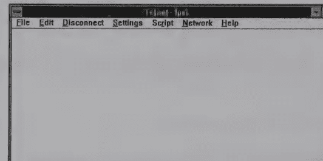

**图 5.8**
X 通过扩展键盘绑定提供对非英语字符的支持。此屏幕询问你是否要启用这些绑定。对于大多数用户来说，答案是“否”。

现在到了更具挑战性的部分。你必须提供之前确定的显示器和显卡信息。第一个屏幕如图 5.9 所示，它询问你的显示器所使用的水平同步频率。如果你不确定，请使用通用（VGA 或 SVGA）设置。选择错误的设置可能会损坏你的显示器！

接下来，必须设置垂直同步率。同样，应以更常见的频率为准。屏幕如图 5.10 所示。如果你不确定，请选择最小数字。大多数流行显示器的水平和垂直同步频率在前文中提到的 doc 目录下的 `Monitors` 文件中给出。你会被要求输入显示器的名称，用于在配置文件中标识它。此屏幕如图 5.11 所示；你可以输入实际型号名称或任何任意字符串。它不需要与实际显示器名称匹配，因为该字符串除了标识外没有用途。

#### 安装 XFree86

你必须指定显示器的水平同步范围。你可以选择下方与行业标准显示器对应的预定义范围之一，或者提供一个特定范围：

非常重要的是，你必须指定一个水平同步范围符合你显示器能力的显示器类型。如果不确定，请选择保守的设置。

- 当你清楚时，指定具有特性的类型
- 1 31.5: 标准 VGA, 800x600 @ 60 Hz
- 2 31-35.5: Super VGA, 800x600 @ 87 Hz 隔行（无 800x600）
- 3 31.5, 35.15-35.5: 兼容型, 1024x768 @ 87 Hz 隔行, 800x600 @ 56 Hz
- 4 31.5-35.5: Super VGA, 1024x768 @ 87 Hz 隔行, 800x600 @ 75 Hz
- 5 31.5-37.5: 扩展同步, 1024x768 @ 60 Hz, 640x480 @ 72 Hz
- 6 31.5-48.5: 非隔行 VGA, 1024x768 @ 60 Hz, 800x600 @ 72 Hz
- 7 31.5-57.0: 高频同步, 1024x768 @ 70 Hz
- 8 31.5-64.2: 可支持 1280x1024 @ 60 Hz 的显示器
- 9 31.5-79.0: 可支持 1280x1024 @ 74 Hz 的显示器

输入你的选择 (-1-10):


图 5.9
你必须从此屏幕为你的显示器选择正确的水平同步频率。

| 文件 | 编辑 | 断开连接 | 设置 | 网络 | 帮助 |
|---|---|---|---|---|---|
| 2 | 31.5: Super VGA, 800x600 @ 55 Hz | |
| 3 | 31.5, 35.15: 兼容型, 1024x768 @ 87 Hz 隔行（无 800x600） | |
| 4 | 31.5, 35.15-35.5: Super VGA, 1024x768 @ 87 Hz 隔行, 800x600 @ 56 Hz | |
| 5 | 31.5-37.5: 扩展同步, 1024x768 @ 60 Hz, 640x480 @ 72 Hz | |
| 6 | 31.5-48.5: 非隔行 VGA, 1024x768 @ 60 Hz, 800x600 @ 72 Hz | |
| 7 | 31.5-57.0: 高频同步, 1024x768 @ 70 Hz | |
| 8 | 31.5-64.2: 可支持 1280x1024 @ 60 Hz 的显示器 | |
| 9 | 31.5-79.0: 可支持 1280x1024 @ 74 Hz 的显示器 | |
| 10 | 输入你的水平同步范围 | |

输入你的选择 (-1-10):

你必须指示显示器的垂直同步范围。你可以选择下方与行业标准显示器对应的预定义范围之一，或者提供一个特定范围。对于隔行模式，以较大的数字为准（例如，87 Hz 而非 43 Hz）。

- 5-70
- 50-90
- 60-100
- 4-150

输入你的垂直同步范围


图 10
你还需要设置垂直同步频率。同样，注意你的设置。

### 安装与配置

| 文件 | 编辑 | 断开连接 | 设置 | 脚本 | 帮助 |
|---|---|---|---|---|---|
| 输入你的选择 (1-10): 2 | 你必须指示显示器的垂直同步范围。你可以选择下方与行业标准显示器对应的预定义范围之一，或者提供一个特定范围。对于隔行类型，以较大的数字为准（例如，87 Hz 而非 43 Hz）。 | | | | | |
| 5-70 | | | | | |
| 50-90 | | | | | |
| 50-100 | | | | | |
| 40-180 | | | | | |
| 5 输入垂直同步范围 | | | | | |
| 输入选择: 你现在必须输入一些标识符/描述字符串，即标识符、版本名称和型号名称。只需填充默认名称。允许使用空格。 | | | | | |
| 显示器的标识符: 通用 | | | | | |
| 显示器的版本名称: 通用 | | | | | |
| 显示器的型号名称: 通用 | | | | | |

设置显示器使用的频率后，你要为它命名！现在你必须配置显卡。配置程序可能会询问你是否想查看显卡数据库。如果你手头没有显卡的参数，请利用此选项。屏幕如图 5.12 所示。你可以翻阅显卡列表，直到找到与你匹配的卡。选择左列的数字显示如图 5.13 所示的卡信息。（有时信息很简短。）你可能以后想复制部分这些信息。

我们如何配置显卡设置。在此处，你可以从显卡定义中进行选择。由于相同类型的显卡之间分辨率和时钟发生器存在差异，盲目复制设置是不可能的（例如）；在此之后，你仍需要根据所选数据库条目选择参数。如果你在数据库中找不到你的卡，则不需要担心。你想查看显卡数据库吗？

配置程序可能会提供查找显卡的选项。现在执行。

| 文件 | 编辑 | 断开连接 | 设置 | 脚本 | 网络 | 帮助 |
|---|---|---|---|---|---|---|
| 18 | Vortex | | | | | AGX |
| 19 | Challenger (Pro) | | | | | ET4000/W32(i/p) |
| 20 | Cobra | | | | | ET4000/W32(i/p) |
| 21 | Cirrus Logic G0542 | | | | | CL-05420/2/4/6/8/9 |
| 22 | Cirrus Logic G0542 | | | | | CL-05420 |
| 23 | Cirrus Logic G062x (laptop) | | | | | CL-05209/15/25/35 |
| 24 | Cirrus Logic G062x (laptop) | | | | | CL-05420/2/4/6/8/9 |
| 25 | DFS-HD100 | | | | | ET4000/W32(i/p) |
| 26 | DFT-W0500 | | | | | W90C33 |
| 27 | DFT-W0500 | | | | | 33-801/805 |
| 28 | Dell 33-86 | | | | | ET4000 |
| 29 | Diamond Speedster (Plus) | | | | | W90C31 |
| 30 | Diamond Speedster 24X | | | | | CL-054234 |
| 31 | Diamond Speedster 64 | | | | | CL-05426/28 |
| 32 | Diamond Speedster Pro (not SE) (CL-05430/5434) | | | | | CL-05430/5434 |
| 33 | Diamond Stealth 26 | | | | | 33-801/805 |
| 34 | Diamond Stealth 32 (not fully supported) | | | | | ET4000/W32(i/p) |

输入数字选择排序定义。
按回车进入下一页，按 q 继续配置。

图 5.13
显卡数据库列出了多页卡。翻阅列表直到找到你的卡，然后输入它的数字。

| 文件 | 编辑 | 断开连接 | 设置 | 脚本 | 网络 | 帮助 |
|---|---|---|---|---|---|---|
| 26 | DFT-W0500 | | | | | ET4000/W32(i/p) |
| 27 | DFT-W0500 | | | | | W90C33 |
| 28 | Dell 33-805 | | | | | 33-801/805 |
| 29 | Diamond Speedster 24X | | | | | ET4000 |
| 30 | Diamond Speedster 64 | | | | | W90C31 |
| 31 | Diamond Speedster Pro (not SE) (CL-05430/5434) | | | | | CL-054234 |
| 32 | Diamond Stealth 26 | | | | | CL-05426/28 |
| 33 | Diamond Stealth 24 | | | | | CL-05430/5434 |
| 34 | Diamond Stealth 32 (not fully supported) | | | | | ET4000/W32(i/p) |

你选择的卡定义：
标识符: Cirrus Logic G0542
芯片组: CL-05420/2/4/6/8/9
服务器: XF86_SUGH
不要单独探测或使用内部时钟。

按回车继续，或按 ctrl 终止。

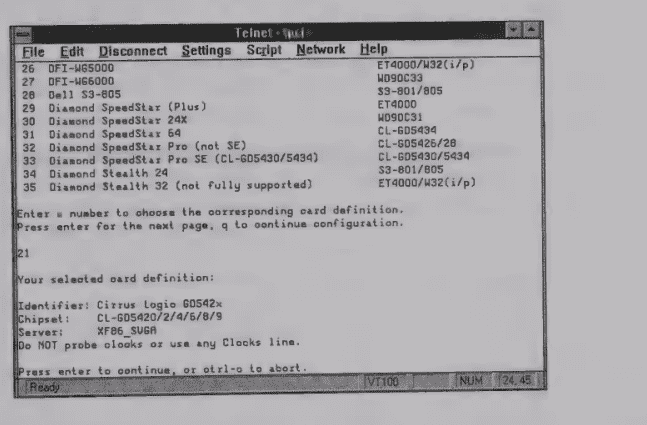

图 5.14
当你从列表中选择正确的数字时，显卡数据库会显示关于你卡的 X 配置信息。记录这些信息以备后用。

### 安装与配置

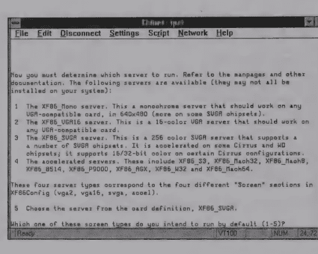

#### 图 5.15

使用此屏幕指定你想要运行的 X 服务器类型。如果你不确定选择哪一个，请使用通用的 VGA 或 SVGA 服务器。

根据你的安装情况，配置程序可能会要求为你设置一些链接，如图 5.16 所示。除非这些链接会与目录命名冲突，否则不设置这些链接也没有处。

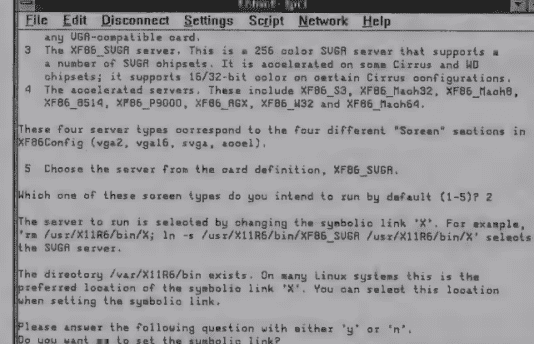

#### 图 5.16

在某些系统中，配置运行时将提议为你设置指向 X 目录的链接。通常，你应该让它这样做。

#### 安装 XFree86

下一步是告诉 X 你的显卡有多少内存，如图 5.17 所示。显卡的内存（RAM）越大，X 的运行速度越快。如果你不确定显卡有多少内存，请选择一个较小的数字。过去一两年销售的大多数显卡至少有 1MB 的显存 RAM，但你应该在文档中验证你显卡的 RAM 容量。

| 文件 | 编辑 | 断开 | 设置 | 网络 | 帮助 |
|---|---|---|---|---|---|
| 你必须提供关于你显卡的信息。这将用于 XF86Config 中你显卡的“设备（Device）”部分。 | 你必须指示你拥有多少显存。使用与你打算使用的服务器检测到的近似数量可能是一个好主意。如果你的显存不支持你拥有的内存量（例如 ATI Mach64 在 SWR 驱动程序下限制为 1024KB），请指定服务器支持的最大量。 | 你的显卡上有多少内存：<br>1 256K<br>2 512K<br>3 1024K<br>4 2048K<br>5 4096K<br>6 其他<br>输入你的选择：<br>就绪 VT100 NUM 24x20 | |

图 5.17
选择显卡上的 RAM 数量。这允许显卡处理一些进程，让 X 运行得快一点。

显卡配置的最后一步，你被要求为显卡命名。与显示器名称一样，这些字符串仅用于标识，可以设置为你想要的的内容。

某些显卡可以处理特殊处理。如图 5.18 所示的屏幕会询问你想要启用的选项。如果你不确定或你正在配置通用系统，请不要启用任何选项。只需按回车（Return）忽略这些选项。

图 5.19 所示的屏幕位于特殊处理屏幕之后，并询问时钟（Clock）功能。某些显卡不支持此功能，如果尝试使用将会挂起。正如你在屏幕底部看到的，配置工具已识别出此配置中的显卡不支持此功能，因此不应运行 `SuperProbe` 系统。如果有疑问，请不要使用它！

#### 5
安装 XFree86

### 安装与配置

| 文件 | 编辑 | 断开 | 设置 | 脚本 | 网络 | 帮助 |
|---|---|---|---|---|---|---|
| 特别对于加速服务器，在设备（Device）区域可能需要 Randao、Dapeed 和 ClockChip 设置或特殊选项。 | | | | | | |
| 设备区域中的时钟线（Clock line）允许检测带有时钟的可编程时钟；任何需要的时钟都可以无需探测时钟或时钟线进行编程。从以下列表中选择： | | | | | | |
| - 8391（写本文时不确定） | 8391 | | | | | |
| - IC202618 及其兼容型号（IC39618, IC252824） | IC202618 | | | | | |
| - IC252824 | IC252824 | | | | | |
| - IC50342（与 DMC 类似，但不完全兼容） | IC50342 | | | | | |
| - 53 Gnd (86708) 和 IC53300（未检测到） | x3gandao | | | | | |
| - x3dean | x3dean | | | | | |
| - Ivera SC11412 | SC11412 | | | | | |
| - T-3025 | T3025 | | | | | |

#### 图 5.18

某些显卡具有可以通过此屏幕启用的特殊功能。在选择这些选项时，请确保你自己在做什么，因为如果使用不当可能会导致你的系统挂起。

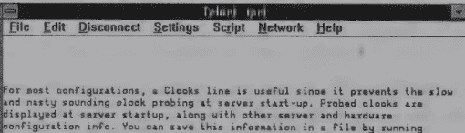

| 文件 | 编辑 | 断开 | 设置 | 脚本 | 网络 | 帮助 |
|---|---|---|---|---|---|---|
| 对于大多数配置，时钟线是有用的，因为它可以防止启动时进行缓慢且几乎产生响声的时钟探测。探测到的时钟会在其他服务器和硬件配置运行时显示。你可以发现配置工具识别了显卡。 | | | | | |
| 图 5.19 所示的屏幕位于特殊处理屏幕之后，并询问关于 | | | | | | |
| 你必须拥有 root 权限才能运行。 | | | | | | |

#### 图 5.19

某些显卡可以处理特殊处理。如图 5.18 所示的屏幕会询问你想要启用的选项。如果你不确定或你正在配置通用系统，请不要启用任何选项。只需按回车（Return）忽略这些选项。

#### 安装 XFree86

# 允许使用多个 FontPath 项（它们将拼接在一起），
# 也可以在一条 FontPath 命令中指定多个用逗号分隔的项
# （或这两种方法的结合）

```


# XFree86 配置指南

## 字体路径配置

```text
FontPath "usr/X11R/lib/X11/fonts/mics/"
FontPath "usr/X11R/lib/X11/fonts/Type1/"
FontPath "usr/X11R/lib/X11/fonts/Speedo/"
FontPath "usr/X11R/lib/X11/fonts/75dpi/"
FontPath "usr/X11R/lib/X11/fonts/100dpi/"
```

上述代码定义了屏幕字体和 RGB 数据库的路径。如果你将 XFree86 安装在默认目录下，或者让安装程序使用默认值继续，那么你就不需要更改这里的任何内容。

请注意，此 `XF86Config` 文件中引用的目录遵循 X 的正式命名规范，使用 `/usr/X11R`。因为在大多数安装中，该目录链接到 `/usr/X11`、`/usr/X386` 以及可能的其他目录，所以可以通过链接跟踪到目标文件。通过逐一更改目录并检查文件，验证这些目录是否指向屏幕字体。如果目录不存在或为空，XFree86 将无法正确加载字体，并会导致崩溃或生成错误消息。如果你向 XFree86 安装中添加了新字体，它们应该放在 `XF86Config` 文件中指定的某个字体目录中。

## 键盘设置

在大多数安装中，键盘设置默认为美式 101 键键盘，带有标准的按键映射。此设置适用于大多数计算机系统。不过，调整此设置将有助于简化你的生活，因此不要完全忽略键盘部分。以下代码显示了 `XF86Config` 文件中的键盘部分：

```text
Section "Keyboard"
    Protocol "Standard"
    # 当使用 XQUEUE 时，注释掉上述行，并取消
    # 下一行的注释
    # Protocol "Xqueue"
    AutoRepeat 500 5
    # 让服务器处理 NumLock 处理。这通常在在使用
    # R6 客户端时才需要
    # ServerNumLock
    # 安装与配置
    # 第一部分
    # 指定哪些键盘 LED 由用户控制（例如，使用 xset(1)）
    # Xleds 1 2 3
    # 将 LeftAlt 设置为 Meta，RightAlt 键设置为 ModeShift，
    # RightCtrl 键设置为 Compose，ScrollLock 键设置为 ModeLock：
    # LeftAlt Meta
    # RightAlt ModeShift
    # RightCtrl Compose
    # ScrollLock ModeLock
EndSection
```

保持 `Protocol` 为标准模式。`Xqueue` 行被注释了，除非你为 XFree86 实现了 `Xqueue`，否则应保持注释状态。`AutoRepeat` 设置告诉 XFree86 在按住按键时，等待多久之前生成多次按键输入。`ServerNumLock` 控制当 XFree86 启动时 Num 键是开启还是关闭。如果大多数示例配置文件默认注释了 `ServerNumLock`，而你正在运行 XFree86 2.X 版本（或更早版本），那么取消该行的注释是一个好主意。这样做有助于调整你的键盘以便在 XFree86 下获得更好的运行。对于 XFree86 3.X 版本，你可以保持其注释状态，因为服务器将处理 Num Lock 行为。

理论上，你可以使用 `Xleds` 设置来允许对大多数键盘上的 LED 按钮（针对 Num Lock、Caps Lock 和 Scroll Lock）进行控制。保持其注释状态；LED 用于大量的用户反馈。

该部分的其余部分控制 `Alt`、`Ctrl` 和 `Shift` 键的行为。某些 UNIX 应用程序期望称为“meta”键的特殊按键，这些键由一个按住的按键和其他按下的按键组成（例如 DOS 或 UNIX 中的 `Ctrl+C`）。这些输入允许你控制哪些按键被解释为 `Alt`、`Meta`、`Control` 和 `ModelLock`。大多数安装如果所有这些行都被注释掉将会出现问题，因为需要特殊按键的 Linux 应用程序很少（且这些在发行版中是的）。

你可以使用 XFree86 自动将按键转换为国际字符。在大多数情况下，XFree86 从内核中读取键盘布局，尽管你可以覆盖此设置。X11 标准仅允许修改四个按键，比 Linux 的要少得多。

## 鼠标定义

XFree86 广泛使用鼠标，你必须指定系统上的鼠标类型及其连接方式。XFree86 支持流行的鼠标类型，任何不直接支持的类型通常可以模拟较流行的类型之一，例如微软或罗技。`XF86Config` 文件中的鼠标部分标记为 `Pointer`（来自指针设备），如下所示：

```text
Section "Pointer"
    Protocol "Microsoft"
    Device "/dev/mouse"
    # 当使用 XQUEUE 时，检查上述两行，并取消
    # 下一行的注释。
    # Protocol "Xqueue"
    # Baudrate 和 SampleRate 仅用于某些罗技鼠标
    # Baudrate 9600
    # SampleRate 150
    # Emulate3Buttons 是针对 2 键微软鼠标的选项
    # Emulate3Buttons
    # ChordMiddle 是某些 3 键罗技鼠标的选项
    # ChordMiddle
EndSection
```

`Protocol` 部分是要使用的鼠标名称或仿真名称。支持的鼠标类型名称列在 `Xconfig` 或 `XF86Config` 的 man 页面中。

## 显示器配置

```text
Section "Monitor"
    Identifier "Generic Monitor"
    VendorName "Unknown"
    ModelName "Unknown"
EndSection
```

此节条目仅为文本字符串，对 XFree86 没有实际的配置值。它们唯一的用途是在 XFree86 启动时将文本字符串回显给你，或者由实用程序显示配置信息。你可以为这些项目输入正确的值，让 XFree86 的操作变得更加友好。

下一个子节处理显示器的水平带宽。此部分非常重要，你应该尝试找到你显示器的实际值。XFree86 随附的文档中列出了某些品牌的设置，特别是 `Monitors` 和 `VideoModes` 文档中。检查你的发行版目录中的任何规格文档文件。如果你找不到这些设置的具体值，请使用最低设置作为默认，除非你确定显示器支持更高的值。带宽设置如下：

```text
# 带宽单位为 MHz，除非另有说明
Bandwidth 25.2
# HorizSync 单位为 kHz，除非另指定
# HorizSync 可以是逗号分隔的离散值列表，或
# 逗号分隔的值范围列表。
# 注意：此处的数值仅为示例，请参考你的显示器
# 用户手册获取正确的数字。
HorizSync 31.5 # 单频固定同步显示器的典型值
# HorizSync 30-64
# HorizSync 31.5, 35.2
# HorizSync 15.25, 30-50
# 多个固定同步频率
# 多个同步频率范围
```

带宽设置旁边有良好的注释。如果你正在安装一个多同步显示器，可以注释掉 `31.5kHz` 行并取消 `30-64kHz` 行的注释。

垂直刷新率在另一个子节中设置，对于显示器的健康运行与带宽部分同样重要。同样，请检查文档获取更多信息。垂直刷新部分的代码如下：

```text
# VertRefresh 单位为 Hz，除非另指定。
# VertRefresh 可以是逗号分隔的离散值列表，或
# 逗号分隔的值范围列表。
# 注意：此处的数值仅为示例。请参考你的显示器
# 用户手册获取正确的数字。
VertRefresh 60 # 单频固定同步显示器的典型值
# VertRefresh 50-100 # 多同步
# VertRefresh 60, 65 # 多个固定同步频率
# VertRefresh 40-50, 80-100 # 多个同步频率范围
```

文件中的注释再次提供了帮助，向你展示最常用的设置。你可以将这些设置作为指南，但请检查你的文档获取详情。

正确设置视频模式也非常重要，视频分辨率过高可能会导致雪花、白屏或系统崩溃。之前讨论过的 `SuperProbe` 实用程序可以帮助确定支持的视频模式，尽管 XFree86 `Monitors` 文件在文档中也列出了许多流行的显示器及其模式。设置视频模式的子节如下：

```text
# 模式可以用两种格式指定。紧凑的单行格式，或
# 多行格式。
# 通用的 VGA 640x480 模式 (hsync = 31.5kHz, refresh = 60Hz)
# 这两种是等效的
ModeLine "640x480" 25.175 640 664 760 800 480 491 493 525

Mode "640x480"
    DotClock 25.175
    Htimings 640 664 760 800
    Vtimings 480 491 493 525
EndMode

# 这两个是等效的
# ModeLine "1024x768i" 45 1024 1048 1208 1264 768 776 784 817 Interlace
Mode "1024x768i"
    DotClock 45
    Htimings 1024 1048 1208 1264
    Vtimings 768 776 784 817
    Flags "Interlace"
EndMode
```

前面的示例显示了标准的 VGA (640x480) 分辨率和高 (1024x768) 分辨率。你可以修改这些条目以匹配你特定的分辨率需求。如前面的代码所示，你需要知道显示器和显卡的点时钟（dot clock）、水平和垂直计时。注意，你可以在单行指定模式的所有细节，但更详细的列表更容易阅读和操作。

## 显卡配置

`XF86Config` 文件的下一个子节详细介绍了你系统使用的显卡。你可以定义多个具有不同分辨率的显卡，或者只输入使用最频繁的一个。例如，以下子节定义了 VGA 和 SVGA 驱动：

```text
Section "Device"
    Identifier "Generic VGA"
    Vendor "Unknown"
    BoardName "Unknown"
    Chipset "generic"
    VideoRam 256
    Clocks 25.2 28
EndSection

Section "Device"
    Identifier "Generic SVGA"
    Vendor "Unknown"
    BoardName "Unknown"
    Chipset "SVGA auto-detected"
    VideoRam 1024
    Clocks 25 28 38 36 40 45 50 56 65 72 75 77 80 90 100 110 126
EndSection
```

`Identifier`、`Vendor`、`BoardName` 和可选的 `Chipset` 条目仅用于标识字符串。显卡上的 `VideoRam`（显存大小）和 `Clocks` 条目用于指定显卡的任何行为。仔细检查这些条目，因为非法条目可能会损坏某些显卡。

如果你具有特殊功能的显卡，可以为该显卡创建一个 `Device` 条目。例如，以下是 TVGA 的条目：

```text
Section "Device"
    Identifier "Any TVGA 9000"
    Vendor "Trident"
    BoardName "TVGA 9000"
    Chipset "tvga9000"
    VideoRam 512
    Clocks 25 28 45 36 57 65 50 40 25 28 0 45 72 77 80 75
EndSection
```

`VideoRam` 和 `Clocks` 行中的信息来自随附 XFree86 的文档。某些显卡需要 `Devices` 子节提供的更多详细信息。例如，以下是带有 2MB 显存 Actix GE32+ 显卡的代码：

```text
Section "Device"
    Identifier "Actix GE32+ 2MB"
    VendorName "Actix"
    BoardName "GE32+"
    Ramdac "ATT2049"
    Dacspeed 11
    Option "dac_8_bit"
    Clocks 25.0 28.0 40.0 0.0 50.0 77.0 36.0 45.0 130.0 120.0 80.0 31.0 110.0 65.0 75.0 94.0
EndSection
```

`Ramdac` 和 `Dacspeed` 选项以及 `Option` 行。条目随 XFree86 的每个版本而变化，如果你想充分利用显卡，请查看帮助页或文档文件获取详情。

## XFree86 服务器配置

前面的章节显示了如何为你的服务器选择 XFree86 服务。`Xconfig` 或 `XF86Config` 文件的 `server` 部分是服务器规范所在的地方。`XF86Config` 文件的 `Screen` 子节如下：

```text
Section "Screen"
    Driver "svga"
    Device "Generic SVGA"
    Monitor "Generic Monitor"
    Subsection "Display"
        Depth 8
        Modes "640x480"
        ViewPort 0 0
        Virtual 800 600
    EndSubsection
EndSection
```

前面的部分显示了通用 SVGA 驱动。该卡支持 VGA 640×480 和 SVGA 800×600 分辨率。如果你有更强大的显卡和显示器组合，可以使用特定的服务器文件（如果存在），例如带有 2MB 显存的 Actix GE32+ 卡驱动。以下代码设置为用于 Actix 卡的加速服务器文件，支持高达 1280×1024 的分辨率：

```text
Section "Screen"
    Driver "accel"
    Device "Actix GE32+ 2MB"
    Monitor "Generic Monitor"
    Subsection "Display"
        Depth 8
        Modes "640x480"
        ViewPort 0 0
        Virtual 1280 1024
    EndSubsection
    SubSection "Display"
        Depth 16
        Weight 565
        Modes "640x480"
        ViewPort 0 0
        Virtual 1024 768
    EndSubsection
EndSection
```

此子节中的选项并不适用于所有显卡，但你可以在其中设置它们的值。最重要（通常常用的）选项如下：

- **Depth** 选项设置色彩平面数（每个像素的位数）。深度通常为 8，尽管 16 位服务器深度为 4，且单色显示器的深度为 1。加速显卡可以具有 16、24、32 甚至 64 位的深度，这通常作为型号名称的一部分标出（例如，Diamond Stealth 卡的像素深度为 24）。然而，在假设显卡名称中的数字真的是深度之前，你应该进行检查。
- **Modes** 选项显示在 `Monitor` 部分的 `ModeLine` 选项中定义的视频模式名称列表。此选项显示了卡支持的所有模式以及你想使用的模式。列表中的第一个模式是 XFree86 启动时的默认值。你可以在 XFree86 运行时在其他模式之间切换。
- **Virtual** 选项指定虚拟桌面大小。通过显卡上的额外内存，你可以拥有比屏幕更大的虚拟桌面，然后可以使用鼠标在虚拟桌面上滚动。例如，你可以拥有 1024x768 的虚拟桌面，但只显示 800x600 (SVGA)。对不同桌面大小的支持取决于显卡内存的大小以及和你使用的深度。例如，显卡上的 1MB 内存可以在深度为 16 时支持相同的大小，也可以在深度为 8 时支持 1280x1024 的桌面。要使用虚拟桌面，请使用窗口管理器（通常默认）。
- **ViewPort** 选项配合虚拟桌面使用，定义 XFree86 启动时虚拟桌面左上角的坐标。

检查服务器列表，查看是否有专门为你的视频卡设计的服务器。如果你不确定使用的是哪种视频卡，请使用通用驱动程序。

## 测试 XFree86 配置

完成 `Xconfig` 或 `XF86Config` 文件后，是时候尝试启动 XFree86 了。使用以下命令：

```bash
startx
```


X 启动脚本应该加载所有必要的驱动程序和守护进程，清除屏幕，然后显示基础 X 窗口会话。如果 XFree86 无法加载，通常会在终止过程中显示错误消息。检查这些消息以查看是否有任何关于问题的提示。通常，XFree86 会遇到受支持的视频模式问题。（对于在其他 UNIX 系统上使用 X 的用户，`startx` 是 `xinit` 的前端工具，后者通常用于启动 X）

如果你无法让 XFree86 运行，最简单的调试方法是将所有配置设置为最低限度，即简单的 VGA 系统。如果运行正常，你可以逐个调整设置以更复杂的分辨率和配置。这个过程通常有助于隔离问题原因。如果通用 VGA 驱动程序不起，通常是配置问题引起的。请仔细检查配置文件。

## 使用 .xinitrc 文件

`.xinitrc` 文件是 X 的启动文件（类似于 shell 的 `.profile` 或 `.cshrc` 启动文件）。它包含了对 `Xconfig` 或 `XF86Config` 文件中定义配置的本地修改，以及在 XFree86 启动时启动特定应用程序或窗口管理器的指令。如果你使用 `startx` 或 `runx` 命令启动 XFree86，`.xinitrc` 会重命名为去掉开点的形式。

系统的 `xinitrc` 文件通常保留在 `/usr/lib/X11/xinit/xinitrc` 或 `/etc/X11/xinit/xinitrc` 中。后者在 XFree86 和 Linux 中更常见，而前者用于 X（Linux 将文件放置在 `/etc/X11` 目录而不是 `/usr/lib`，因为 Linux 安装倾向于将 `/etc` 目录设为只读，有时是因为它们位于光盘-ROM 上）。

如果你想自定义 XFree86 会话的行为，可以将系统默认的 `.xinitrc` 文件复制到你的主目录，并使用任何编辑器对其进行编辑。当 XFree86 启动时，它会首先检查主目录下的 `.xinitrc` 文件，如果没有找到，则读取默认启动文件。`startx` 和 `xinit` 的 man 页面解释了启动文件的一些细节。

下面的代码是一个简单 XFree86 安装的 `.xinitrc` 文件示例。该文件被分成较小的部分，以便更详细地检查每个子部分。第一个子部分处理路径设置：

```
userresources=$HOME/.resources
usmodmap=$HOME/.xmodmap
sysresources=/usr/X11R/lib/X11/xinit/
sysmodmap=/usr/X11R/lib/X11/xinit/.xmodmap
```

这些路径通常由 XFree86 软件设置，但你应该检查它们以确保有效。记住遵循指向其他目录的链接。这些变量是 XFree86 需要的所有内容。

下一个子部分检查某些系统资源是否存在并根据检查结果执行操作。除非你对 X 会话有非常特殊的要求，否则这些检查大部分都不需要修改：

```
# 合并默认值和键映射
if [ -f $sysresources ]; then
    xrdb -merge $sysresources
fi

if [ -f $sysmodmap ]; then
    xmodmap $sysmodmap
fi

if [ -f $userresources ]; then
    xrdb -merge $userresources
fi

if [ -f $usermodmap ]; then
    xmodmap $usermodmap
fi
```

`.xinitrc` 文件中的最后一个子部分运行 `setroot` 程序（如果存在），以设置背景颜色（在此例中为钢蓝色）。最后，`fwwm` 窗口管理器启动了你的会话：

```
# 启动一些不错的程序
xsetroot -solid SteelBlue
fwwm
```

如果你想使用另一个窗口管理器，例如 Motif 的 `mwm` 管理，请更改此子部分的最后一行。确保窗口管理器文件在搜索路径中，以便启动程序可以找到它。

如果你想在 `.xinitrc` 文件内部创建一个 xterm 会话（你需要 xterm 或其他工具在 XFree86 内部启动其他任务），请添加该行：

```
xterm -e /bin/bash
```

在这种情况下，bash shell 在 xterm 会话中被调用。当然，你可以使用任何想要的 shell。

如果你为自己创建创建 `.xinitrc` 文件，请将它们放置在主目录中。你可以使用如下 `.xinitrc` 文件：

```
#!/bin/sh
xterm -fn 7x3bold -geometry 80x32+10+10 &
xterm -fn 7x3bold -geometry 80x32+30+50 &
clock -geometry 70x7-7+7 &
xsetroot -solid SteelBlue &
exec fwm
```

此文件启动两个 xterm 会话和时钟，并将它们放置在桌面上，设置背景颜色，执行 fwm。（注：由于原文后续存在大量重复内容，译文已按要求进行清理）。

# 设备与设备驱动程序
第 6 章

设备驱动程序接收击键并将其传递给 shell（外壳），同时过滤掉内核不知道如何处理的特殊代码，并将它们转换为内核可以执行的内容。

你可以使用单个设备驱动程序来指示 Linux 与许多不同的设备进行通信，只要这些设备使用相同的 `set` 指令。例如，如果你在 Linux 系统上连接了四个终端，但它们都使用相同的串口通信，那么链接到内核的单个设备驱动程序就可以处理所有四个终端。将新的设备驱动程序链接到内核的操作将在第 25 章“修改内核”中介绍。

使用设备驱动程序是 UNIX 操作系统的真正优势之一（因此 Linux 也是如此），因为它提供了一种持续的方法，可以使用相同的内核来扩展系统，并在新设备开发时使现有系统适应新设备。当开发出一个新的硬件设备时，可以通过编写设备驱动程序使其与 Linux 使用，对于经验丰富的程序员来说，这通常不是一项困难的任务。设备驱动程序可以存储在文件系统的任何位置，尽管通常会有默认位置，具体取决于你运行的 Linux 版本。由于你不太可能编写自己的驱动程序，对大多数用户来说，实际位置并不重要。

## 设备文件

Linux 使用特殊的设备文件来跟踪系统上的设备和设备驱动程序。设备文件包含有关设备权限、设备类型的信息以及两个用于内核识别设备的数字。

根据默认和惯例，Linux 将所有设备文件保存在 `/dev` 目录。以下列表显示了典型的 Linux `/dev` 设备列表的部分：

```
brw-rw----  sysinfo            1, 31 Apr 25 1995 hd03
brw-rw----  sysinfo            1, 39 Apr 25 1995 hd04
brw-rw----  sysinfo            1, 47 Apr 25 1995 hd0a
crw-rw-rw- root               40, 38 Mar 10 20:36 icmp
crw-rw-rw- root               40, 38 Mar 10 20:36 igmp
crw-rw-rw- root               67, 07 Mar 10 20:36 incfig
drxr-xr-x- root               512 02 Mar 10 20:36 inet
brw-rw----  bin                2, 64 Nov 23 1996 install
crw-rw-rw-  bin                40, 36 Mar 10 20:36 ip
cr--r--r-- root               4, 01 Apr 25 1995 kmem
crw-rw-rw- root               40, 44 Mar 10 20:36 llcloop
crw-rw-rw- sys               78, 00 Mar 10 20:36 lockd
crw-rw-rw- root               40, 41 Mar 10 20:36 log
prw-w--w-  bin                bin               0 May 14 19:40 loggife
crw-rw----  bin                2, 64 May 17 1996 lone-tar
crw-rw---- root               bin               6, 08 Sep 1997 lp
```

## 扩展系统
第二部分

`/dev` 目录中存储了大量的设备文件：Slackware Linux 系统包含了 500 多个设备驱动程序及其文件。许多只是基本设备驱动程序（如硬盘）的副本，具有不同的设备号，但每个文件都是独立的。

你可以将设备文件保存在 Linux 系统的任何位置，但将它们都放在 `/dev` 中可以明显看出它们是设备文件。如果你检查 `/dev` 目录，发现许多文件实际上是其他文件的链接。这些链接允许你更清晰地命名设备。例如，你可以访问 CD-ROM 驱动器 `/dev/cdrom` 而不是 `/dev/sdb2`。同样，鼠标设备链接到 `/dev/mouse`。这些链接是对用户的一种便利，对于 Linux 来说并不重要。

图 6.1 显示了一些设备文件的列表。你可以看到 cdrom 链接到 `/dev/sd0`。第 18 章“文件系统”讨论了它们。你将在本章中看到长目录列表中的两个数字（例如 cua 的 5 和 64）被称为“主设备和次设备”。

| 文件 | 类型 | 所有者 | 组 | 大小 | 月 日 年 | 链接 | 名称 |
|---|---|---|---|---|---|---|---|
| t-rwx------ | root | root | | 0 | Oct 13 12:29 | -> /dev/sda | |
| brw-rw---- | root | root | | disk | 24 | Oct 13 1984 | | du55 |
| brw-rw---- | root | root | | tty | 4 | Oct 13 12:36 | | |
| t-rwx------ | root | root | | 0 | Nov 15 1995 | -> /proc/kcore | | |
| brw-rw---- | root | root | | uep | 5 | 64 Jul 1974 | ual9 |
| brw-rw---- | root | root | | uep | 5 | 65 Jul 1974 | ual10 |
| brw-rw---- | root | root | | uep | 5 | 76 Jul 1974 | ual11 |
| brw-rw---- | root | root | | uep | 5 | 77 Jul 1974 | ual12 |
| brw-rw---- | root | root | | uep | 5 | 78 Jul 1974 | ual13 |
| brw-rw---- | root | root | | uep | 5 | 79 Jul 1974 | ual14 |
| brw-rw---- | root | root | | uep | 5 | 80 Jul 1974 | ual15 |
| brw-rw---- | root | root | | uep | 5 | 81 Jul 1974 | ual16 |
| brw-rw---- | root | root | | uep | 5 | 82 Jul 1974 | ual17 |
| brw-rw---- | root | root | | uep | 5 | 83 Jul 1974 | ual18 |
| brw-rw---- | root | root | | uep | 5 | 84 Jul 1974 | ual19 |
| brw-rw---- | root | root | | uep | 5 | 85 Jul 1974 | ual20 |
| brw-rw---- | root | root | | uep | 5 | 86 Jul 1974 | ual21 |
| brw-rw---- | root | root | | uep | 5 | 87 Jul 1974 | ual22 |
| brw-rw---- | root | root | | uep | 5 | 88 Jul 1974 | ual23 |
| brw-rw---- | root | root | | uep | 5 | 89 Jul 1974 | ual24 |
| brw-rw---- | root | root | | uep | 5 | 89 Jul 1974 | ual25 |

**图 6.1** /dev 目录列表显示某些文件链接到其他文件。

## 字符设备和块设备

连接到计算机的一切设备都与 Linux 通信。设备分为两种：块设备和字符设备。打印机、终端和异步调制解调器是字符设备；它们一次发送一个字符并在另一端回显。

另一方面，硬盘大多数磁带使用数据块，这是发送大量数据最快的方法。块设备通常是处理大量数据的设备，而字符设备（相对而言）要慢得多。例如，大多数调制解调器是字符设备，而高速 ISDN 和 T1 调制解调器是块设备。块设备在相同时间内可以携带多多的数据。

某些设备既是字符设备也是块设备，但不是同时进行。例如，某些磁带可以处理字符模式和块模式，这意味着此类设备有两个驱动程序。使用哪个驱动程序取决于用户如何与设备读取或写入数据。为了最快的吞吐量，检索单个文件时使用块设备，而备份单个目录时，字符设备驱动更好。

区别方法是设备的缓冲处理方式。字符设备希望自行缓冲。块设备通常以 512 或 1024 字节（有时更大）为块通信，由内核执行缓冲。这种缓冲对用户是透明的。

设备驱动程序和设备文件包含了设备是字符设备还是块设备的所有细节。要确定外设设备是哪种类型，请查看设备文件的权限块。如果权限块的第一个字符是 `b`，则该设备是块设备。权限块中的 `c` 字符表示字符模式设备。在下面的 `/dev` 目录列表中，你可以从权限块的第一个字符看到设备类型：

```
crw-rw---- 1 root uucp 5, Jul 17 1994 cua10
crw-rw---- 1 root uucp 5, Jul 15 1994 cua11
brw-rw---- 1 root floppy 2, 0 Jul 17 1994 fd0
brw-rw---- 1 root floppy 2, 1 Jul 17 1994 fdi1
brw-rw---- 1 root disk 3, 0 Jul 17 1994 hda
brw-rw---- 1 root disk 3, 1 Jul 17 1994 hda1
brw-rw---- 1 root disk 8, 1 Jul 17 1994 sda1
brw-rw---- 1 root disk 8, 10 Jul 17 1994 sda10
brw-rw---- 1 root disk 8, 11 Jul 17 1994 sda11
crw--rw---- 1 root root 4, 0 Jul 17 1994 tty0
crw--rw---- 1 root root 4, 1 Jul 7 18:16 tty1
```


# 扩展你的系统

| crw-rw-rw- | 1 root root | 4, | 2 Jul 7 17:58 tty2 |
| crw-rw-rw- | 1 root tty | 4, | 64 Jul 17 1994 ttyS0 |
| crw-rw-rw- | 1 root tty | 4, | 65 Jul 7 18:00 ttyS1 |

你可能会注意到此列表在通常属于文件大小的地方有两个数字。这些数字是主设备号和次设备号。下一节将解释这些数字。

设备驱动程序通常以指示它们设备类型来命名。例如，大多数终端都有设备驱动程序名称，后面跟着一个或多个字母或数字，例如 `tty1`、`tty1A` 和 `tty0`。字母 `tty` 识别终端（`tty` 代表电传打字机），数字和字母识别特定的终端。与目录名 `/dev` 结合后，设备名称就变成了 `/dev/tty0`。正如你在前面的章节中看到的，硬盘的名称如 `/dev/hda` 和 `/dev/sda`（用于 IDE 和 SCSI 设备）。

许多用户将 `/dev/sda` 等条目称为设备驱动程序，但实际上它是设备文件。驱动程序是告诉 Linux 如何与设备通信的指令集。设备文件告知主设备号和次设备号，以及其他信息，例如谁有权访问该设备。设备驱动程序（用于与设备通信的实际代码）并不存储在 `/dev` 中，通常存储在与其他 Linux 内核源码相同的目录中。

## 主设备号和次设备号

系统可能有多个同种类型的设备。例如，你的 Linux 系统可能有一个多口卡（多个串口端口），上面挂载了 10 个 Qume 终端。Linux 可以为每个终端使用同一种设备驱动程序，因为它们都是同种类型的设备。系统概念也适用于多个打印机，例如，你可以为连接到两个并行端口的两个惠尔惠激光打印机使用相同的设备驱动程序。一个常见的例子是系统中的两个硬盘：在大多数情况下，两个硬盘可以使用相同的设备驱动程序。

然而，操作系统必须有一种区分这 10 个终端、两台打印机或两个硬盘的方法。设备号就是这种方法。每个设备由一个主号识别，主号识别要使用的设备驱动程序，由一个次号识别，次号识别设备号。例如，10 个 Qume 终端可能都使用具有相同主号的设备驱动程序（这实际上指向设备驱动程序），但每个终端都有一个不同的次号，用于向操作系统唯一标识该 Qume 终端。在接后的列表中，你可以看到所有 `ttyX`（控制台及相关屏幕）的设备驱动程序的主设备号均为 4，但次号从 0 变到 9：

| crw-rw-rw- | 1 root tty | 4, | 0 Jul 17 1994 tty0 |
| crw-rw-rw- | 1 root root | 4, | 1 Oct 13 13:48 tty1 |
| crw-rw-rw- | 1 root root | 4, | 2 Oct 13 13:26 tty2 |
| crw--rw-- | 1 root root | 4, | 3 Oct 13 13:26 tty3 |
| crw--rw-- | 1 root root | 4, | 4 Oct 13 13:26 tty4 |
| crw--rw-- | 1 root root | 4, | 5 Oct 13 13:26 tty5 |
| crw--rw-- | 1 root root | 4, | 6 Oct 13 13:26 tty6 |
| crw-rw-rw- | 1 root tty | 4, | 7 Jul 17 1994 tty7 |
| crw-rw-rw- | 1 root tty | 4, | 8 Jul 17 1994 tty8 |
| crw-rw-rw- | 1 root tty | 4, | 9 Jul 18 1994 tty9 |

在目录中，主设备号始终显示在第一个，后面是次设备号。系统上的每个设备都分配了主设备号和次设备号，分配方式确保了它们是唯一的（除非设备链接到另一个设备文件，在这种情况下有时只显示一个数字）。如果两个设备分配了相同的名称，Linux 将无法与它们进行正常通信。

你不能在设备驱动程序内部创建设备号，但在 Linux 中可以使用 `mknod`（创建节点）命令创建设备号，并使用 `rm`（删除）命令删除它们。每当你要在系统上配置新设备时，都必须使用 `mknod`（许多安装程序会自动为你完成此操作）。

> 设备使用主设备号和次设备号的方式特殊。例如，某些磁带驱动使用次号来识别磁带设备，以便调整其输出容量。幸运的是，这类异常情况很少见，且在大多数 Linux 系统上不会发生。此外，你不需要创建这些设备号，因为安装脚本会处理设备驱动程序及其编号的设置。（如果脚本没有处理，你就必须手动操作了。）

## mknod 命令

`mknod`（创建节点）命令用于多种用途。最常用的用途是创建 FIFO（先入先出）设备、字符设备或块设备。`mknod` 的格式如下：

```
mknod [options] device pathname
```


你可以对该命令使用以下选项：

- `--help` 显示帮助信息并退出。
- `-m`（或 `--mode`）设置文件的模式，而不是默认的 066（符号表示）。
- `--version` 显示版本信息并退出。

# 扩展你的系统
## 第二部分

- `-p` 选项允许设置权限。
- `--version` 显示版本信息并退出。

设备或路径后的参数指定文件是块设备、字符设备、FIFO 设备 (`p`) 还是非缓冲字符设备 (`u`)。命令行上必须存在这些参数之一，以便正确分配设备号。文件类型参数后面是两个数字。你必须提供这些数字；`mknod` 不会为你生成。Unix 系统上的每个设备都有一个主号（用于识别设备类型）以及一个次号（用于识别设备本身）。对于任何新的块、字符或非缓冲设备，你必须指定主号和次号。对于 `p` 设备，你不需要指定设备号。设备主号和次号可以任意指定，只要它们不与其他任何设备冲突，但在实践中，设备都有通用的命名约定。

# 设备权限与链接

当你使用 `mknod` 创建新设备时，它会被赋予与符号值 666 相关的权限。你可以通过 `mknod` 命令行（使用 `-p` 选项）或之后使用 `chmod`（字符模式）覆盖此设置。

设备文件权限很重要，因为它们可以控制对设备的访问。例如，光驱驱动器是只读设备，更改权限可以防止用户在尝试写入光驱时出现写入错误。权限对于创建只读分区也有用，例如你不希望被修改的数据库或工具目录。第 17 章“系统名称与访问权限”将更详细地介绍 `chmod` 命令和文件权限。

作为常规，默认权限适用于大多数设备，除非你想限制某些用户或登录访问。Linux 在初始安装过程中安装重要的设备文件时，会为所有系统设备（如 `/dev/mem`，物理内存）设置正确的权限。你不应该更改它们的默认值。

## 总结

本章介绍了设备驱动程序和设备号，当你为系统添加新硬件时，这些都是非常重要的。接下来的几章将介绍用于扩展你的 Linux 系统的不同硬件以及如何配置这些硬件。当你配置 Linux 接受新设备时，本章的信息将同样重要。

# SCSI 设备
## 第 7 章

# 本章

- SCSI 链与设备
- SCSI 设备驱动程序
- 排除 SCSI 设备故障

# 扩展你的系统
## 第二部分

SCSI（小型计算机系统接口，互连）是 UNIX 系统中连接设备最广泛的方法。它也被用于高端 PC 机器，因为它比价格廉价的 IDE 具有更智能的设备处理能力和更快的传输速度。SCSI 设备和适配器卡通常比 IDE 驱动器和卡贵得多，这阻碍了许多 PC 用户使用 SCSI。然而，如果你对速度和灵活性有较高要求，那么 SCSI 可能是最佳选择。（你也可以混合使用 IDE 和 SCSI 以兼顾两者的优点。）

与 IDE 和其他接口的操作相比，在 Linux 系统中添加 SCSI 相对容易。接下来的几章将介绍如何使用 IDE 和专有系统等接口添加 CD-ROM 驱动器、磁带驱动器和其他设备。本章专门介绍 SCSI。在本章中，你将学习如何将 SCSI 设备连接到 Linux，如何配置它们，以及如何解决 SCSI 问题。

## SCSI 链与设备

### SCSI ID 编号

每个 SCSI 适配器都有从零到七的编号（允许在系统中存在八个适配器）。第一个 SCSI 适配器几乎总是编号为零的 SCSI 适配器。随着新适配器的添加，它们将占用下一个可用的较高数字。某些 SCSI 适配器在一个适配卡上具有多个通道，每个通道都是一个独立的 SCSI 适配器。

来自 Adaptec、DPT 等其他公司的卡在卡上提供两个或三个通道，因此它们可以从每个通道支持独立的链。这对于负载较重或高性能的系统有一个简单的优势：快速设备可以放在一个通道上，较慢的设备放在另一个通道上。由于链通常必须以连接到该链上的最慢设备的速度运行，让硬盘驱动器和其他高速设备以其最大能力运行，而让磁带驱动器、Zip 和 Jaz 驱动器以及较慢的设备在单独通道上以它们所需的任何速度运行。自然地，多通道 SCSI 控制器的成本比单通道设备高。

### SCSI 设备

链上的每个 SCSI 设备都有一个从零到十五的 SCSI ID 编号。按照惯例，控制器卡被设置为使用数字 7，而可启动的 SCSI 硬盘（如果使用一个）被设置为 SCSI ID 0（尽管 UNIX 工作站系统坚持主驱动器不能为 ID 0，仅仅是为了示区别）。零到十五之间的数字可用于任何其他 SCSI 设备，每个 ID 在每个链上只能被设备使用。

如果两个设备具有相同的 SCSI ID 编号，当操作系统尝试与设备通信时就会出现问题。如果有两个具有相同 SCSI ID 的设备，在大多数情况下系统仍然启动，但在访问相同的 SCSI ID 时可能会发生并行信息流或 SCSI 链的完全故障。每条 SCSI 链都有从零到七的编号，每个设备都将有一个链号和一个 SCSI ID 编号，用于向操作系统唯一标识该设备。

一些旧的 SCSI 系统不允许在链上使用 15 个设备。相反，它们仅支持八个设备，加上控制器卡。这些设备的编号从零（通常是可启动的硬盘）到六，ID 则由控制器卡使用。

SCSI ID 在决定链上设备访问顺序方面实际上起着重要作用。SCSI ID 的优先级是 7, 6, 5, 4, 3, 2, 1, 0, 15, 14, 13, 12, 11, 10, 9, 8。这使得 SCSI 控制器具有最高优先级（ID 7），这将始终如此，因为卡控制着整个 SCSI 链。

你已经知道可启动的硬盘通常是 SCSI ID 0，但你可能奇怪为什么它不是最高优先级。答案与链上 SCSI 设备的相对速度有关。硬盘通常是链上快的设备，响应数据的速度比磁带驱动器和 CD-ROM 等较慢设备快。由于原因，较慢的设备被赋予更高的优先级，而最快的设备处于较低的优先级。

硬盘通常被赋予从零到二或三的 ID，取决于硬盘的数量（几乎总是按顺序分配的）。CD-ROM 通常是 SCSI ID 5 或 6（如果有多个，UNIX 版本坚持 CD-ROM ID 为 5），而磁带驱动器通常是 SCSI ID 3 或 4。SCSI ID 8 到 15 是在原始 SCSI 规范之后引入的，它们的优先级比低 ID 低。

这些优先级是指南，而非规则。如果你想将 CD-ROM 设置为 SCSI ID 2，没有任何可以阻止你这样做，系统也不会在乎。唯一重要的设置是控制器卡设置为 7，并且通常将可启动硬盘的值设置为 0（尽管你可以通过更改控制器卡 BIOS 中的设置从其他 SCSI 设备启动）。

### SCSI 设备的安装与终止

大多数 SCSI 设备都带有控制其所需的全部电子设备，这使得设备无需在操作系统中使用花哨的驱动程序就能相互通信。内置电子设备也是 SCSI 设备比 IDE 系统更贵的原因，后者依赖操作系统或控制器卡来提供与设备通信的设备。

SCSI 系统的一个主要优势（特别是在 Linux 或 UNIX 系统的背景下）是，当你添加新的 SCSI 设备时，不需要进行任何特殊操作来配置系统。一旦你向系统添加了新的 SCSI 设备并确保它在链上具有唯一的 SCSI ID，SCSI 控制器会自动识别该设备（当系统启动时，设备板载电子设备向卡识别设备类型）。操作系统可能仍然需要特殊的驱动程序来与某些设备通信（如硬盘、磁带单元、CD-ROM）。你只需要通过将驱动程序添加到内核来启用它。

SCSI 设备必须在链的末端进行终止，以确保链上的电信号被正确处理。SCSI 终端器通常是被式的，由一组电阻组成，提供链在此处的电指示。某些链使用活动终止电阻，这是一种供电的电阻，可以确保执行正确的终止。活动终止在 PC 系统中很少遇到，除非是许多 SCSI 链的大型装置。如果没有正确的终止，链上的电信号可能无法传输，导致数据丢失。

如果你的 SCSI 链似乎没有终止器，不要惊慌。在许多设备中，可以使用跳线设置来为设备添加终止电阻。链在该点。阅读随 SCSI 设备的说明书以查看如何启用和禁用终止电源。某些设备足够聪明，可以感觉到它们是链上的最后一个设备并在无需你干预的情况下终止。只有链末端的设备必须终止。如果链中间的设备被终止，控制器将无法识别后续设备。

每条 SCSI 链应该只有两个终止器，位于两端。大多数 SCSI 控制器卡有一组开关或可拔式电阻块作为终止。控制器卡往往会检测它们是否位于链末端，如果是则应用电源。你可以通过修改控制器 BIOS 来覆盖默认设置。

### SCSI 标准

在之前的章节中，你了解到 SCSI 链可以拥有七个或十五个设备。区别是什么？另外，为什么许多 SCSI 连接器看起来互不同？答案是有许多类型的 SCSI，每种都遵循不同的标准。随着计算机技术的发展，原始的 SCSI 标准（称为 SCSI-I）被发现对于现代设备来说太慢且局限性，现在已经采用了更快速、功能更丰富的 SCSI 标准。

SCSI-I 是最老的标准，仅允许七个设备（SCSI ID 为 0 到 6，加上控制器的 ID 7）。SCSI-I 接口看起来像旧式的 Centronics 打印机接口：它们是 D 型形状的，中间有一个刀片，刀片两侧嵌入了引脚。SCSI-I 链的吞吐量为 10 Mbps。

SCSI-II 是 SCSI-I 的增强，根据 SCSI-II 版本的不同，使用了几种不同形状的接口。（为了增加困惑性，市场上至少有三个版本的 SCSI-II。你经常会听到 Fast SCSI、Fast-and-Wide SCSI 和 Wide SCSI；它们都是 SCSI-II 的变体。）

通常，SCSI-II 接口是 D 型形状的，有 50 或 68 个引脚，取决于具体版本。内部 SCSI-II 设备具有母头 D 型接口，且与外部接口不兼容。SCSI-II 链中的终端电阻低于 SCSI-I，且链上强制进行奇偶检查。Wide SCSI 是 SCSI-II 的变体，它在标准 SCSI-II 的 8 位路径上使用 16 位数据路径。标准 SCSI-II 链的吞吐量为 10Mbps，在使用 Wide 和 Fast-Wide SCSI-II 时会增加到 20Mbps。（困惑吗？）大多数 SCSI-II 设备是互换的，并且工作效果也很好，因为你有针对不同形状接口的适配器。

SCSI-III 是 SCSI 的最新版本，支持 UltraSCSI 设备。UltraSCSI 是正常使用下最快的 SCSI 版本，在长度可达 100 英利的电缆上吞吐量为 40Mbps。SCSI-III 价格昂贵，支持新的高速技术，例如光纤（FDD）电缆，吞吐量高达 100Mbps。在 PC 应用中，SCSI-III 设备很少见，因为 SCSI-II 对于目前的 CPU 来说已经足够。

为了再次增加困惑，与 SCSI 相关，你还会听到另外两个术语：分差（differential）和单端（single-ended），定义如下：

分差 SCSI 和单端 SCSI 不能在同一条链上混合。分差设备和单端设备的接口通常看起来相同，但分差设备无法在单端设备上工作。如果你正在购买 SCSI 设备，确保你购买的是单端的，除非你有一个分差控制器卡。（在编写此书时，只有硬盘提供分差 SCSI。在这些类 PC 中必须使用两个控制器——一个用于硬盘的分差控制器和一个用于 CD-ROM 和其他 SCSI 设备的单端控制器。）


# 扩展你的系统
## 第二部分

## 支持的 SCSI 设备

有很多可用的 SCSI 设备，范围从传统设备（硬盘、磁带驱动器、扫描仪、绘图仪、打印机）到一些更冷门的设备（望远镜电机驱动控制器、控制器、摄像机、光影系统）。你不能因为 Linux 支持，就假设任何 SCSI 设备都能正常工作（尽管在 Web 和 FTP 网站上提供了许多最新设备的驱动程序）。然而，所有的传统 SCSI 设备都是受支持的，如果你精通 C 语言并拥有技术规范，你可以为那些尚未提供驱动程序的设备编写设备驱动程序。

大多数 Linux 操作系统发行版中都包含一个硬件兼容性文件，列出了所有经过测试且已知可与 SCSI 系统正常工作的设备。当你购买新的 SCSI 设备时，请仔细检查此兼容性文件。某些 SCSI 控制器卡不受 Linux 支持，尽管所有主流品牌都支持。再次，兼容性文件可以帮助你确定哪些适配器卡受支持。如果你正将现有的 PC 端 SCSI 系统转换为 Linux，请在开始安装之前根据兼容性列表检查每个设备，以防挫败感。

> 虽然硬件兼容性文件是获取支持的 SCSI 设备信息的良好来源，但它往往会很快过时。某些 Linux 发布版本直接采用旧版本的兼容性文件，而不验证信息是否是新的。如果你的设备没有列在硬件兼容性文件中，先不要放弃。检查许多 Web 和 FTP 网站，看看是否有人发布了设备驱动程序。如果你还没有运气，检查 Linux Usenet 新闻组获取信息，并发布你的新查询。你可能不是唯一对该设备好奇的人。

一些不常见的 SCSI 设备（如绘图仪）随附带有适用于 DOS、OS/2 和 UNIX 的内核补丁。现在少数设备提供了 Linux 驱动程序。当提供 Linux 驱动程序时，请确保补丁与你正在使用的 Linux 内核版本对应。如果它们与你的 Linux 版本兼容，请将驱动程序链接到内核中，然后在设备可用之前重新构建内核。如果 SCSI 设备没有 Linux 内核补丁且未作为基础发行集的一部分支持，请咨询设备制造商或 Linux 发行版网站及用户组获取合适的驱动程序或替代方案。

# 注意

外部 SCSI 设备的一个常见问题是它们并非每次 Linux 启动时都可用。有时它们可用，有时 Linux 并不知道它们。根据一般规则，启动 Linux 时外部 SCSI 设备应该是开启状态。这使得设备驱动程序能够查询设备以确保其可用，如果是这样，设备驱动程序就会加载。如果设备似乎未连接，某些驱动程序会自动从内存中卸载。系统启动后，你通常可以关闭 SCSI 设备并在需要时再次打开。此外，如果你使用带有移动媒体的设备（如 Zip 驱动器或磁光硬盘），并且遇到每次重启设备都无法识别的问题，这通常是由于驱动程序的问题。

# 设备驱动程序

正如你在第 6 章所看到的，Linux 系统上的所有设备都必须有设备驱动程序，以便内核与设备通信。SCSI 设备是不同的。对于大多数 SCSI 设备（硬盘、光驱和磁带驱动器），你需要的驱动程序通常包含在 Linux 发行版中。某些设备在编写 Linux 版本时尚未上市，因此没有内置驱动程序。在这种情况下，检查 FTP 和 Web 网站获取驱动。

## 硬盘

SCSI 磁盘驱动器始终是块设备，按照约定始终使用主号 8。Linux 分配 16 个次设备号给每个 SCSI 设备，其中设备号 0 代表整个硬盘，设备号 1 到 4 代表主分区，设备号 5 到 15 代表任何扩展分区。


在 Linux 中，SCSI 磁盘设备号是动态分配的，从最低 SCSI ID 开始。图 7.1 显示了 `/dev` 目录的列表。你可以看到，SCSI 硬盘的主号设为 8，次设备号从 0 到 15。整个磁盘 `/dev/sda` 有主号 8 和次设备号 0。四个分区的次设备号为 1 到 4（`/dev/sda1` 到 `/dev/sda4`）。任何扩展分区的编号为 5 到 15（`/dev/sda5`、`/dev/sda6` 等）。

| 文件 | 编辑 | 断开设置 | 脚本 | 网络 | 帮助 |
|---|---|---|---|---|---|
| /dev/sda | 1 -sd | | 0 Mar 29 06:53 | sda0 |
| /dev/sda1 | brw-rw- | 1 root disk | | 1 Mar 29 06:53 | sda1 |
| /dev/sda2 | brw-rw- | 1 root disk | | 8 Mar 29 06:53 | sda2 |
| /dev/sda3 | brw-rw- | 1 root disk | | 11 Mar 29 06:53 | sda3 |
| /dev/sda4 | brw-rw- | 1 root disk | | 12 Mar 29 06:53 | sda4 |
| /dev/sda5 | brw-rw- | 1 root disk | | 13 Mar 29 06:53 | sda5 |
| /dev/sda6 | brw-rw- | 1 root disk | | 14 Mar 29 06:53 | sda6 |
| /dev/sda7 | brw-rw- | 1 root disk | | 15 Mar 29 06:53 | sda7 |
| /dev/sda8 | brw-rw- | 1 root disk | | 2 Mar 29 06:53 | sda8 |
| /dev/sda9 | brw-rw- | 1 root disk | | 3 Mar 29 06:53 | sda9 |
| /dev/sda10 | brw-rw- | 1 root disk | | 4 Mar 29 06:53 | sda10 |
| /dev/sda11 | brw-rw- | 1 root disk | | 5 Mar 29 06:53 | sda11 |
| /dev/sda12 | brw-rw- | 1 root disk | | 6 Mar 29 06:53 | sda12 |
| /dev/sda13 | brw-rw- | 1 root disk | | 7 Mar 29 06:53 | sda13 |
| /dev/sda14 | brw-rw- | 1 root disk | | 8 Mar 29 06:53 | sda14 |
| /dev/sda15 | brw-rw- | 1 root disk | | 8 Mar 29 06:53 | sda15 |
| /dev/sda16 | brw-rw- | 1 root disk | | 16 Mar 29 06:53 | sda16 |
| /dev/sda17 | brw-rw- | 1 root disk | | 17 Mar 29 06:53 | sda17 |

> 图 7.1
SCSI 硬盘的主号为 8，每个磁盘的次设备号为 0 到 15。

因为 Linux 直接与 SCSI 接口通信，Linux 在分区磁盘时会出现一些问题。每个设备都以 SCSI 主机看到的方式呈现，块号从 0 到最大块号。所有块都被假设没有错误。因此，没有简单的方法获取磁盘几何结构。相比之下，DOS 需要头磁道映射，这种方式效率较低，但允许对设备进行直接操作。

要对设备进行分区，你必须将整个硬盘用于 Linux（在这种情况下安装程序处理分区），要么使用 DOS 或 Linux 的 `fdisk` 类似工具为其他操作系统创建分区。对于同时支持 SCSI 和 IDE 硬盘的系统，你可能需要重新配置系统 BIOS 将 SCSI 硬盘识别为主（启动）设备，假设那是你想要启动的驱动器。

## 光驱设备

块大小为 512 或 2048 字节的 SCSI 光驱（这涵盖了几乎所有消费者需求）可以在 PC 上工作并与 Linux 配合，但任何其他块大小都无法与大多数 Linux 发行版提供的驱动程序配合。大多数光驱和 CD-ROM 光盘具有 512 或 2048 字节的块，这种限制不应引起问题。Linux CD-ROM 驱动器还必须支持 ISO 9660 格式的磁盘布局，尽管实际上几乎每个品牌的 PC CD-ROM 驱动器都支持这种格式。

SCSI CD-ROM 使用主设备号 11。次设备号是动态分配，第一个 CD-ROM 驱动器的次设备号为 0，第二个为 1，依此类推。Linux 使用的命名规范为 `/dev/sr(数字)`，例如安装的第一、第二个 CD-ROM 驱动器分别为 `/dev/sr0` 和 `/dev/sr1`。图 7.2 显示了大多数 Linux 系统附带的 CD-ROM 设备。由于 PC 很少连接两个以上的 CD-ROM 驱动器，因此通常只包含两个设备。如图中所示，`/dev/cdrom` 设备已链接到 `/dev/sr0`（即第一个 SCSI CD-ROM 驱动器）。

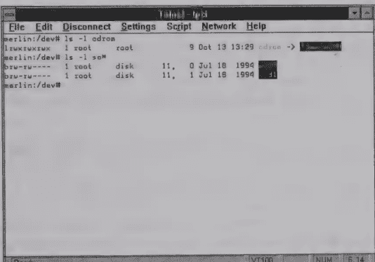

> 图 7.2
SCSI CD-ROM 驱动器命名为 `/dev/sr0`、`/dev/sr1` 等。

某些用户可能想在 Linux 系统上使用 CD-ROM 自动库机（jukeboxes）。这些设备提供多个 CD-ROM 驱动器，或者具有存储许多磁盘但只有一个或两个读取器的能力，取决于库机的类型。如果你有一个多存储 CD-ROM 驱动器（例如 NEC 的，允许你向驱动器中放入七张 CD 但一次只访问一张），标准的 Linux SCSI CD-ROM 驱动程序可以正常工作。

另一种自动库机具有多个 CD-ROM 驱动器，例如四、八、十二或更多，全部在一个子系统中堆叠。通常情况下，这些用于访问 CD-ROM 数据库材料，并且通常每个驱动器都需要一个独立的设备号。由于 Linux 只为 CD-ROM 提供了两个设备名称，你必须使用 `mknod` 命令创建新设备。（某些 CD-ROM 自动库机提供了特殊的 Linux 驱动程序。你应该检查制造商及其 Web 页面，以及通用的 Linux Web 和 FTP 站点以获取详情。）

# 扩展你的系统
## 第二部分

在正确设置 CD-ROM SCSI 后（系统在 SCSI 命令启动时应能识别该设备），你必须挂载 CD-ROM 设备。我们将在第 18 章“文件系统”中更详细地讨论挂载。你可以手动执行挂载，或将正确的命令嵌入启动序列中，以便驱动器始终可用。挂载 CD-ROM 设备的通用命令是：


/dev/sr0 /mount_point

其中 `mount_point` 是一个可以使用的目录。你必须在工作之前创建该目录，且该目录应该是空的。为了方便起见，你应该创建一个名为 `/cdrom` 的目录，作为你 CD-ROM 驱动器的固定挂载点。（大多数 Linux 版本在使用 CD-ROM 安装软件时会自动创建此目录。）

如果你的 CD-ROM 无法通过此命令正确挂载，这有可能是因为磁盘类型的原因。挂载 ISO 9660 CD-ROM（也称为 High-Sierra 文件系统）的正确语法是：

```
iso9660 /dev/sr0 /mount_point
```

为了使此命令正常工作，你必须将内核设置为支持 ISO 9660 文件系统。如果你还没有这样做，请带有此选项重新编译内核。（参见第 25 章“修改内核”。）

Linux 在挂载磁盘时会尝试锁定 CD-ROM 驱动器门，以防止介质设备导致系统损坏。并不是所有 CD-ROM 驱动器都支持门锁，但如果你发现无法弹出 CD-ROM，可能是因为磁盘已挂载（通常通过卸载文件系统来弹出，尽管某些早期的 Linux 版本会在设备上发生死锁，需要重启）。第 9 章“CD-ROM 驱动器”将更详细地讨论。

CD-ROM 刻录机允许你刻制自己的 CD。直到最近，刻录机几乎完全为 Windows 或独立的子系统设计。刻录机的价格下降使得大多数用户都能使用，令人惊讶的是，Linux 支持几种版本的 CD-ROM 刻录机。在购买设备之前，你应该检查是否有 Linux 驱动程序，并注意可能施加在设备上的任何限制。像惠普（Hewlett-Packard）等这样的流行的驱动器可以在 Linux 下工作。

## DVD 驱动器

DVD（多功能磁盘，取决于上下文）驱动器通常销售并已成为流行的格式。DVD 对于数据存储非常出色，因为它的容量比 CD-ROM 多。典型的单面 DVD 为 4GB，而 CD-ROM 仅为 700MB。多层和多面 DVD 可以存储更多，超过 16GB。

由于容量更高，DVD 将最终取代 CD-ROM。需要多个 CD 的系统都可以位于单个 DVD 上。几个制造商提供廉价的 DVD 播放器（最流行的是 Creative），读取 DVD 和 CD-ROM。Linux 可以与这些播放器工作，因为设备驱动程序与 CD-ROM 非常相似。你应该意识到市场上有几种竞争性的 DVD 版本，它们通常互不兼容。为了安全起见，在购买 DVD 驱动器之前。市场上上有 DVD 刻录机，但它们非常贵，且通常在 NT 或 UNIX 下运行。Linux 驱动程序将随着设备的价格变得合理而可用，但这可能需要一段时间。


## 磁带驱动器

Linux 支持多种类型的 SCSI 磁带驱动器。在购买之前检查硬件配置以确保兼容性。最流行的 SCSI 磁带模型——包括 Archive QIC 驱动器、Exabyte 8mm 驱动器以及 Wantek DLT——都是已知的。新的磁带如 DLT（数字线性磁带）、AIT（高级智能磁带）和 Travan 驱动器在某种程度上都支持；这些设备之间的区别主要是容量和访问速度。在购买贵的磁带驱动器（有些超过 5000 美元）之前，检查是否有 Linux 驱动程序。

SCSI 磁带驱动器使用主号 9，次设备号动态分配。通常，环绕磁带设备从 0 开始编号，因此第一个磁带驱动器是 `/dev/rst0`（字符模式，主号 9，次号 0），第二个设备是 `/dev/rst1`（字符模式，主号 9，次号 1），依此类推。非环绕磁带设备在次号中设置高位，因此第一个非环绕磁带设备是 `/dev/nst0`（字符模式，主号 9，次号 11）。

SCSI 磁带驱动器的标准命名规范为：非环绕设备为 `/dev/nst数字`（例如 `/dev/nst0`、`/dev/nst1`），环绕设备为 `/dev/rst数字`（例如 `/dev/rst0` 和 `/dev/rst1`）。

通常，Linux 支持使用固定或变量块长度的磁带驱动器，只要块长度小于缓冲区（大多数 Linux 发行版中设置为 32KB，但可以通过重新配置内核来更改）。磁带驱动器参数如块大小、缓冲和密度在需要时由 `mt` 命令设置。

SCSI 磁带驱动器的一个常见问题发生在尝试从其他系统读取磁带时（另一个系统无法读取在 Linux 中制作的磁带）。这个问题是因为磁带系统使用的块大小以及命名规范。

## 扩展你的系统

## 第二部分

使用固定块大小的 SCSI 磁带设备必须设置磁带驱动器的块大小以匹配写入磁带时使用的硬件块大小（或变量大小）。你可以使用 `mt` 命令更改此设置：

```
mt setblk size
```

将 `size` 替换为块大小，例如 20。如果你想要变量块长度，将 `size` 设置为 0。某些 Linux 版本没有允许更改块大小的 `mt` 版本（通常是 GNU 版本）。如果是那样，获取支持此特性的 BSD 版本 `mt`。`mt` 程序可以许多 Linux Web 和 FTP 站点获取。

## 其他设备

有很多 SCSI 设备可用，如扫描仪、打印机、可移动卡盒驱动器等。Linux SCSI 设备驱动程序通常处理这些设备。通用 SCSI 设备驱动程序为向所有 SCSI 设备发送命令提供了接口。

SCSI 通用设备使用字符模式和主号 21。次号从 0 开始动态分配。通用设备的名称为 `/dev/sg0`、`/dev/sg1`、`/dev/sg2` 等。

某些 SCSI 设备无法与通用 SCSI 驱动器正常工作。对于这些设备，你需要下载专用设备驱动程序。制造商开始为许多新硬件提供 Linux 驱动程序，因此请检查制造商网站的支持信息。

## 排除 SCSI 设备故障

SCSI 设备的常见问题很容易解决。找到问题所在通常是最困难的一步，读取操作系统在启动或尝试使用 SCSI 设备时显示的诊断消息可以很容易帮助这一步。表 7.1 列出了 SCSI 设备的最常见问题、可能的原因和可能的解决方案。

### 表 7.1 常见 SCSI 问题

| 问题 | 原因 | 解决方案 |
|---|---|---|
| SCSI 设备显示所有可能的 SCSI ID。 | 你配置的设备与控制器具有相同的 SCSI 地址（控制器通常位于 SCSI ID 7）。 | 更改跳线设置为另一个 SCSI ID。 |
| 一个 SCSI 设备报告使用所有可能的 LUN。 | 该设备可能有固件问题。 | `drivers/scsi/scsi.c` 文件包含一个坏设备列表。尝试将该设备添加到此列表中，看看是否会影响行为。如果没有，联系设备制造商。 |

## SCSI 设备

## 第7 章

| 问题 | 原因 | 解决方案 |
| :--- | :--- | :--- |
| 您的 SCSI 系统超时。 | 向设备发送信号的延迟。 | 确保控制卡的中断已正确启用，并确保与系统中与其他板之间没有 IRQ、DMA 或地址冲突。 |
| 您从无错误的设备上获得感知错误（sense errors）。 | 电缆损坏或链路终端接线不当。 | 确保 SCSI 链在两端都使用外部或板载终端器进行终止。不要在链的中间进行终止；这也会导致问题。您可能可以使用被动式终止。对于带有多个设备的长链，尝试使用主动式终止以获得更好的性能。 |
| 启动时无法识别带驱动器。 | 可能是 SCSI 未识别到带驱动器，或者设备未安装。 | 尝试在驱动器中放入带的情况下启动。 |
| 网络内核无法与 SCSI 设备工作。 | 许多网络驱动程序的自动保护（autoprote）程序不是被动型的，可能会干扰某些 SCSI 设备。 | 尝试禁用网络部分以识别出故障设备，然后对其进行重新配置。 |
| 检测到 SCSI 设备但系统无法访问。 | 您可能没有该设备的设备驱动程序。 | 设备驱动程序应位于 `/dev` 目录，并配置有正确的类型（块或字符设备）以及唯一的主设备号和次设备号。为设备执行 `mkdev`。 |
| 当内存映射 I/O 时，SCSI 控制卡失效。 | 此问题在 Trantor T128 和 Seagate 板上很常见，是由于内存映射 I/O 端口被错误缓存引起的。 | 您应该在 XMOS 设置中将板卡的地址空间标记为不可缓存。如果无法标记为不可缓存，请禁用缓存并查看板是否运行正常。 |
| 您的系统找不到 SCSI 设备，并在启动时收到类似 `scsi: hosts` 或 `scsiid:` 的消息。 | 控制卡上的自动保护程序依赖系统 BIOS 自动保护，无法正常启动。这个问题在下列表 SCSI 适配器中尤为常见：Adaptec 152x, Adaptec 151x, Adaptec AIC-6260, Adaptec AIC-6360, Future 1680, Future | 检查您的 BIOS 已启用且未与任何外设 BIOS（如适配器卡上的）冲突。如果 BIOS 已正确启用，通过运行 `DEBUG` 命令查找板卡签名以查看板卡是否报告。例如，使用 `DEBUG` 命令 `d=c800:0` 查看板卡是否响应（假设您已将控制卡设置为使用地址 `0xc8000`；如果不是，请用正确的地址替换 `DEBUG` 命令）。 |

## 扩展您的系统

## 第二部分

| 表 7.1 续 |
| 问题 | 原因 | 解决方案 |
| :--- | :--- | :--- |
| | Domain TMC-950, Future Domain TMC-8xx, Trantor T128, Trantor T128F, Trantor T228F, Seagate ST01, Seagate ST02, Western Digital 7000。 | 如果显卡没有响应，请检查地址设置。 |
| 有时 SCSI 系统会完全锁死。 | 存在许多可能的原因，包括主机适配器存在问题。 | 使用任何针对板卡的诊断程序检查主机适配器。尝试不同的 SCSI 电缆看看是否是问题所在。如果锁死似乎在多个设备同时运行时发生，您可能遇到了固件问题，请查看是否有可用的升级可以修复此问题。最后，检查磁盘驱动器以确保没有可能影响设备驱动程序文件、缓冲区或交换文件的坏块。 |

## 总结

关于某些特定 SCSI 设备的更多信息请见后续章节，但总体而言，SCSI 是一种方便可靠的接口，值得投资。添加 SCSI 设备比添加任何其他类型的设备都要简单。由于由于原因，尽管存在额外成本，SCSI 在 UNIX 用户中非常流行，现在 Linux PC 用户中也是如此。接下来的几章将详细介绍一些通用硬件设备。当您通过添加新外设来扩展系统时，这些信息是必要的。

- 购买新硬盘 166
- 新硬盘的格式化和分区 168

## 扩展系统

## 第二部分

您的系统中可能已经有一个硬盘。当您安装 Linux 时，您已经处理了查找、识别并让操作系统为您加载驱动器的工作。现在您需要更多空间，或者想在硬盘上为 Linux 腾出其他区域。这正是本章派上用场的地方。本章将向您展示如何向系统添加另一个硬盘，以及如何进行基础格式化。您在书本书前面的安装章节中已经看到过如何为 Linux 设置第一个硬盘了，因此本章假设您已经了解 `fdisk` 类似的实用程序。

在您的 Linux 系统中添加硬盘并不困难。Linux 在此任务上非常配合，允许在新硬盘的类型、速度、容量和分区方面具有极大的灵活性。本章将介绍如何添加新硬盘并使其在 Linux 中正常运行。如果您正在为 Linux 系统添加硬盘，您可能还想阅读第 18 章“文件系统”，该章节将更详细地解释如何访问新硬盘的区域。请注意，某些驱动器是不兼容的。

### 购买新硬盘

在购买新硬盘之前，请检查您的机器是否有空间安装它；并非所有机器都有空槽。小尺寸的桌面式 PC 通常只有一个硬盘位，对于这类类型的机器，您唯一的选择是用现有硬盘替换为容量更大的硬盘，并丢弃或卖掉旧硬盘。

假设您有空间放置新硬盘，安装它并不困难，但第一次操作可能会令人紧张。许多供应商会为您安装新硬盘，通常是免费的。大多数硬盘都附有良好的说明书和您所需的所有零件，所以，如果您有冒险精神，可以自己动手安装。通常，此过程涉及用螺丝将新硬盘固定在可用的硬盘位中，连接电源连接器，然后连接一根来自接口卡的电缆，该电缆还会通过您的其他驱动器（有时还有光驱或带驱动器）。取决于您目前使用的系统类型，可以使用现有的硬盘电缆（如果有空闲插头），或者可能需要购买一根新电缆。

一旦硬盘安装好，您需要让 PC 感知到它的存在。

## 扩展你的系统

第二部分

大多数现代 BIOS 系统可以自动检测你添加的硬盘类型及其参数。较旧的 BIOS 则要求你手动提供这些信息。对于这些旧版系统，你需要指定新硬盘的磁道数、磁头数以及每个磁道的扇区数。对于大多数硬盘，BIOS 硬盘配置界面上请求的其他信息可以忽略。如果你在 BIOS 安装方面遇到任何问题，请检查硬盘随附的文档或联系你的销售商。

IDE、EIDE、ATAPI 和 ATA 硬盘都带有跳线帽，用于标识磁盘驱动是作为主盘（master，可启动盘或连接器上的第一个硬盘）还是从盘（slave，链条上的第二个硬盘且不可启动）。你的硬盘随附的说明书将教你如何正确地设置此跳线帽。如果你没有将第二个硬盘的跳线设置为从盘，在访问两块硬盘时可能会导致问题。

### 对新硬盘进行格式化和分区

要设置新硬盘的分区，你需要使用 `fdisk` 或类似的分区工具，就像你设置第一块硬盘时做的那样（见第 3 章“安装与升级”）。如果你打算在新硬盘上创建一个 DOS 分区，大多数系统管理员倾向于从 DOS 软盘或第一块硬盘的 DOS 分区启动，然后使用 DOS 版 `fdisk` 来设置新硬盘。（DOS 磁盘程序比 Linux 版本更易使用。）

在 `fdisk` 或类似的工具中时，切换到第二块硬盘。如果你在磁盘菜单上没有看到更改硬盘的选项，说明新硬盘未被 BIOS 或 SCSI 控制器识别，在这种情况下，你应该重新检查配置。进入第二块硬盘后，你可以在设置 Linux 分区之前对任何 DOS 区域进行分区。设置 DOS 分区后，你可以使用 DOS `FORMAT` 命令对其进行格式化。

> 注意

对于较新的大容量硬盘，DOS 磁盘程序无法访问磁盘上的所有区域。许多制造商现在提供一个用于 `fdisk` 的实用磁盘，允许你访问整个硬盘、对其进行格式化并更新分区表。如果有选择，请使用此实用程序代替标准的 `fdisk`。大多数新的大容量 IDE、EIDE、ATAPI 和 ATA 硬盘还会包含某些版本 DOS 用于访问整个磁盘区域的设备驱动程序。最近版本的 Linux 不应与这些硬盘冲突。

当你准备好设置 Linux 分区时，启动你的机器进入 Linux 并进入 `fdisk` 程序或任何你喜欢的其他分区软件。现在你应该能够从分区菜单访问第二块硬盘了。如果你创建了 DOS 分区，它应该会出现在分区表中。按照你处理第一块硬盘时使用的流程，添加任何所需的 Linux 分区。你可以添加更多的交换分区（swap partitions）来补充第一块硬盘上的交换分区，或者在不设置交换空间的情况下为硬盘设置一个或多个 Linux 文件系统。记住在 `fdisk` 中指定文件系统类型。

> 注意

最好在你添加到系统中的每块新硬盘上都创建一个交换空间。这为你机器中的总交换空间提供了充足的空间，而且通过将它分散到多块硬盘上，你可能会获得性能提升。更好的是，如果你有快速硬盘，可以禁用主硬盘上的交换空间，并依靠第二块硬盘的交换时间。这使得硬盘在执行读写任务时更快，从而缩短了总磁盘时间。如果你没有快速接口或快速硬盘，性能差异可能并不明显。

要格式化任何新的交换分区，请使用命令

```
mkswap -c partition size
```

其中，`partition` 是分区的名称，`size` 是分区的分块大小（显示在分区表中）。`-c` 选项告诉 `mkswap` 检查分区中的坏块。要为 Linux 格式化 `/dev/hdb2` 分区，执行命令

```
mkswap -c /dev/hdb2 15404
```

其中 15404 是磁盘的分块大小，取自 Linux `fdisk` 显示的分区表。

在交换分区后，你可以使用 `swapon` 命令加上分区名称来启用 Linux 交换空间分区，例如：

```
swapon /dev/hdb2
```

一旦执行了 `swapon` 命令，Linux 将使用新的交换空间。

要设置 Linux 文件系统分区，使用 `mkfs`（创建文件系统）命令创建文件系统。`mkfs` 命令的格式取决于你正在设置的文件系统类型，但大多数用户将希望使用二级扩展（ext2）文件系统。要创建二级扩展文件系统，请执行命令

```
mk2fs -c <partition> <size>
```


其中 `partition` 是分区名称，`size` 是分区的分块大小（取自 `fdisk` 中的分区显示）。

> **注意**
>
> 某些版本的 Linux 不需要你指定分区大小，因为 `mke2fs` 工具会自动确定数量。通常，任何晚于 0.5 版本都能为你完成此计算。

`mke2fs` 命令会检查分区的坏块（由 `-c` 选项启动）并在该分区中建立文件系统。你可以使用 Linux 支持的其他文件系统，尽管大多数都比二级扩展文件系统慢。创建分区后，你可以挂载它们使用。有关添加新文件过程的信息，请参阅第 18 章。

或者，你可以使用随备份设备自带的一些实用软件。另一种替代方案是光驱器。

# CD-ROM 驱动器

## 总结

- 理解不同的 CD-ROM 类型
- 安装 CD-ROM 驱动器
- 使用 `/etc/fstab`
- 播放 CD-ROM
- 在 Linux 中使用
- 排除 CD-ROM 驱动器故障

## 扩展你的系统

几年前，CD-ROM 驱动器价格昂贵，仅出现在服务器上。现在，CD-ROM 驱动器已成为标准组件，而且 CD-ROM 驱动器的价格已经下降，特别是对用户而言。在未来几年，市场可能会看到 CD-ROM 驱动器被 DVD 广泛取代。由于两者设计非常相似，仅容量不同，Linux 可以轻松处理它们。

## 理解不同的 CD-ROM 类型

CD-ROM 在方便的大小内存储大量数据（约 650MB）。CD-ROM 是易变的——它们在磁场影响下不会丢失数据，但很难管理。然而，与任何新技术一样，CD-ROM 需要一段时间才能变得常见，而且在技术演进期间出现了几种不同的竞争格式。大多数格式互不兼容，或者针对特定硬件类型。单一 CD-ROM 标准的采用有助于 CD-ROM 在 UNIX 社区的传播，现在你购买的大多数 CD-ROM 在你的驱动器上运行良好。

### 内部、外部和交换式 CD-ROM 驱动器

你可以购买内部和外部的 CD-ROM 驱动器。你必须将内部 CD-ROM 驱动器连接到计算机内部的驱动器和控制器卡（你可能已经有了）。内部 CD-ROM 驱动器从连接 PC 电源的连接器获取电源。在购买内部 CD-ROM 驱动器之前，请确保你有一个可用的驱动器位和一个空闲的电源连接器。

> **注意**
>
> 在添加内部 CD-ROM 驱动器之前，请检查您的电源是否有足够的功率为该驱动器以及机器内的所有其他设备供电。较新的机器通常有充足的功率，但一些旧的 PC 单元功率不足，其电源仅能带动软驱和硬盘驱动。如果您有任何疑问，请检查电源的额定功率，或咨询您的经销商。CD-ROM 驱动器不需要大量功率，但 CD-ROM 驱动器的电流浪涌可能会对系统中的其他设备产生不利影响。如果您的电源超过 200 瓦，且您运行的是带有单个硬盘和软驱的正常系统，那么为内部 CD-ROM 单元供电就不会有问题。

在大多数情况下，外部 CD-ROM 驱动器更容易连接，因为它们带有外部电源，并连接到您扩展槽之一的板卡外部边缘。某些接口类型（如 IDE）并不支持外部驱动器，因为 IDE 控制器卡没有外部连接器。在选择外部 CD-ROM 驱动器之前，请检查接口和线缆。由于额外的成本和电源，外部 CD-ROM 驱动器往往比内部驱动器更贵。您可以在运行 Linux 的 PC 中无缝地混合 IDE 和 SCSI 设备，但如果您的硬盘是 IDE，您将需要安装并配置 SCSI 卡。

大多数 CD-ROM 驱动器只能容纳一张 CD，要么像许多 CD 播放器那样位于抽式托盘中，要么位于光盒（caddy）中（光盒是一个您手持并将 CD 插入的容器）。然后您将光盒放入 CD-ROM 驱动器内部。光盒系统和无盒系统效果同样良好，一些用户倾向于无盒，而另一些用户则喜欢前者。几年前，高档 CD-ROM 驱动器使用光盒，但如今的驱动器中已罕见。

还有 CD 换碟机。这些 CD-ROM 驱动器可以同时容纳四或更多张 CD。大多数 CD-ROM 换碟机使用容纳六张 CD 的盒，该系统类似于音频 CD 播放器使用的系统。少数换碟机可以容纳 18 张或更多 CD。这些换碟机允许您向单元加载常用的光盘，然后通过软件加载您想要的那一张。CD-ROM 驱动器机构一次只加载一张光盘，其余为了方便存储在内部。换句话说，您无法在多盘换碟机中同时使用两张 CD，因为只有一个可以供存储的 CD-ROM 切换的机构。

并不是所有的操作系统都支持换碟机，因为加载和卸载 CD 换碟机的命令实现起来可能非常复杂，特别是在像 Linux 这样的实时操作系统中。Linux 处理像普通 CD-ROM 驱动器一样的 CD-ROM 换碟机，尽管更换 CD-ROM 光盘可以通过卸载当前加载的磁盘、切换到另一块磁盘，然后重新挂载来实现。流行的换碟机开始出现新的驱动程序，可以自动执行此过程，尽管 Linux 尚未提供此类驱动程序。

### ISO 9660 和 CD-ROM 磁盘格式

CD 可以以几种不同的方式格式化，取决于其设计的机器信息类型。例如，为 PC 设计的 CD-ROM 在 Macintosh 上并不一定是可读。由于这个原因，为 CD-ROM 开发了一种标准化的格式，称为 ISO 9660。ISO 9660 格式在被 ISO 采用之前被称为 High Sierra 格式，这两个术语现在仍经常使用。

ISO 9660 格式规定了严格的 DOS 格式文件名（八字符文件名和三字符的文件类型）。这种格式对于基于 DOS 的机器和操作系统很好，但对于 UNIX 来说非常有限制，因为 UNIX 允许长文件名且不强制文件类型。为了绕过 DOS 格式限制，开发了一种名为 Rock Ridge Extensions（岩脊扩展）的系统。Rock Ridge Extensions 系统允许利用 ISO 9660 数据格式中未使用的字段提供更长的文件名，以及 UNIX 信息（如链接、权限等）。Rock Ridge Extensions 系统广泛用于大多数 UNIX 和 Linux ISO 9660 磁盘，尽管这些磁盘可以使用基础的 ISO 9660 格式使用。

几年前，柯达（Kodak）开发了一种名为 PhotoCD 的图形文件格式。PhotoCD 允许将照片和其他视觉图像作为数字数据存储在 CD-ROM 上。然后 CD-ROM 驱动器可以快速调回这些数字数据并将其组装成它所代表的图像。Linux 通过允许显示 PhotoCD 文件的实用程序支持 PhotoCD 格式。

大多数 CD-ROM 驱动器还通过提供屏幕控制允许用户播放标准音乐 CD，该控制界面可以切换曲目并处理暂停、快进等操作。纯音频 CD-ROM 没有图像信息，且无法被 Linux 解码为声源。Linux 包含了支持播放纯音频 CD 盘的实用程序，例如 Workman（提供字符版和 X 版本）。

### CD-ROM 速度和接口

CD-ROM 驱动器有多种速度可选，这决定了 CD-ROM 与计算机之间数据的传输率。第一代驱动器是单速的，可以按每秒 150K 的速度传输信息。双速 CD-ROM 驱动器顾名思义，实际上将传输率提高到每秒 300K 以上。四倍速和六倍速驱动器进一步提高了传输率。但驱动器上标记的速度是一个误名。正如之前提到的，48x 驱动器也是一个误名。

#### SCSI CD-ROM 驱动器

SCSI 是一种标准总线，将链中的所有外设连接起来。您可以在链的任何位置插入 CD-ROM 驱动器。每个 SCSI 驱动器都将电子设备和通信功能内置在驱动器中（这导致了驱动器价格较高）。这些内置组件意味着任何 SCSI CD-ROM 驱动器都可以插入 SCSI 系统。只要是 SCSI，它就能在 Linux 上运行（Linux 还需要 CD-ROM 驱动器的块大小为 512 或 2048 字节，但大多数 CD-ROM 驱动器都支持这些大小。工作站和小型机制造商使用的专用 CD-ROM 驱动器并不符合这些大小）。

SCSI 还允许系统上同时存在多个 CD-ROM 驱动器。您可以轻松地连接并同时使用两个、三个、四个或更多 CD-ROM 驱动器。相比之下，CD-ROM 换碟机一次在盒中存放几张 CD-ROM 光盘，但只有一张 CD 盘是被加载并激活的。

某些基于 SCSI 的 CD-ROM 接口卡并非全功能，而是为了支持 CD-ROM 驱动器设计的精简版。这些卡符合 SCSI 标准，可以与 Linux 工作，但您无法向它们添加驱动器或其他 SCSI 设备。请检查 CD-ROM 驱动器的文档，以确定随 CD-ROM 提供的接口卡（如果有）是提供完整支持还是部分支持。

#### IDE CD-ROM 驱动器

真正的 IDE CD-ROM 驱动器插入到大多数 PC 系统中处理驱动器的 IDE 控制器上。旧的 IDE 系统只能处理两个设备，这意味着您只能有一个硬盘和一个您的 CD-ROM 驱动器。新的 EIDE（扩展 IDE）驱动器可以处理四个设备。IDE CD-ROM 驱动器使用硬盘标准的修改版本，称为 ATAPI。IDE CD-ROM 驱动器通常很廉价（因为 IDE 接口卡或主板控制器芯片处理所有的电子设备，而不是大多数驱动器本身）。

> **注意事项**
>
> 不要将 IDE CD-ROM 光驱与私有 CD-ROM 光驱混淆。私有 ROM 驱动器和 IDE 一样使用 PC 总线，其标签可能具有误导性。请仔细检查描述。IDE CD-ROM 光驱连接到 IDE 控制器卡上，绝不是连接到声卡。幸运的是，声卡（以及其他私有的）CD-ROM 系统现在非常罕见，尽管你可能在旧电脑中遇到它们。
>
> 私有 CD-ROM 光驱是另一个问题，因为许多不同的 CD-ROM 光驱具有不同的通信方法。私有驱动程序通常作为独立的 CD-ROM 软件包，或者与声卡组合成多媒体系统。在所有这些私有系统中，CD-ROM 都会插入接口卡上的特殊连接器中。大多数私有 CD-ROM 光驱都是内置型号。这些私有 CD-ROM 光驱不能互换，且通常每个型号都需要不同的驱动程序。某些私有 CD-ROM 接口卡允许一个控制器连接多达四个 CD-ROM 光驱，并允许同时存在多达四个控制器。例如，松下/光寿（Matsushita/Kotobuki）驱动器都支持这种扩展。
>
> 最常用的私有 CD-ROM 光驱是由松下及其合作伙伴制造的，以许多贸易名称销售（包括 Creative Labs、松下等）。Linux 支持几种索尼 Sony CD-ROM 光驱和一些飞利浦 Philips 光驱。所有支持的 CD-ROM 光驱列表随 Linux 发行版提供，并随每个新版本进行更新。在购买 CD-ROM 光驱之前，如果可能，请检查你使用的 Linux 版本提供的列表以及你考虑购买的光驱动器制造商。
>
> 请注意，许多公司会将这些驱动器重命名为自己的品牌名称，因此通过外盒可能很难确定驱动器的制造商和型号。如果你无法判断谁制造了该 CD-ROM 光驱，且它不是主流品牌（如 Creative Labs），请推迟购买，直到获得有关它的更多信息。大多数包装盒都有供应商的电话号码，请记下来并给他们打电话或查看他们的网站。（小心那些告诉你“当然能用”的销售员，他们大多数根本不知道 Linux 是什么！）如果需要为你的私有 CD-ROM 提供支持，可以检查 FTP 和 BBS 站点获取新驱动程序。不过，主要的私有模型是受到支持的。
>
> CD-ROM 光驱的另一个区别是设备提供的 RAM 数量。这种差异在 SCSI 驱动器中很常见。大多数驱动器有 256K RAM，另一些有 1M 或更多。Plextor 驱动器（如 Plextor 4plex 和 Gplex）通常提供 1M 版本，是 Linux 和 DOS/Windows 上最快的 CD-ROM 光驱。板载 RAM 越多，驱动器能执行的缓冲和缓存就越多。因为 Linux 有自己的缓存系统，板载 RAM 的重要性通常不如访问速度，尽管更多的 RAM 会略微提高速度。

### 可刻录 CD-ROM

CD-ROM 光驱的一种细微变体是新的 CD-R（可刻录光盘）或 CD 刻录机，它本质上是一个可以向 CD 写入数据的 CD-ROM 光驱。光盘只能写入一次（除非是昂贵的可重写驱动器和光盘），这些设备通常限于特殊应用程序。大多数 CD-R 驱动器为 DOS/Windows 设计，尽管少数具有通用的 UNIX 和 Linux 驱动程序。

你可以为 Linux 系统添加 CD-R 刻录机，尽管只有少数驱动程序可以实际向 CD-R 写入数据。如果你想向 CD 写入数据，必须找到一个兼容 Linux 的应用程序，例如 X-CDRoast。检查 FTP 或网站以获取该领域的最新进展。

## 安装 CD-ROM 光驱

如果你已经购买了 CD-ROM 光驱，或要将现有驱动器添加到你的 Linux 系统，你必须遵循一系列步骤来正确安装和配置驱动器。本节假设你已经检查并确认 Linux 支持该驱动器，并且设备驱动程序可用（在 Linux 发行版软件中或单独的磁盘/文件中）。

尽管向 Linux 系统添加 CD-ROM 光驱可能是一项艰巨的任务，但其实非常简单。按照以下过程操作可以用最少的精力获得一个工作的 CD-ROM，即使你不熟悉 Linux 驱动器。

1. 物理安装驱动器。
2. 配置并重新编译 Linux 内核。
3. 创建设备文件。
4. 挂载并测试 CD-ROM 光驱。

以下章节将详细描述这些每个步骤。

### 物理安装驱动器

Linux 对 CD-ROM 光驱的物理安装没有特殊要求。请遵循制造商的说明。安装 CD-ROM 光驱的说明书应随驱动器本身提供。

对于内置驱动器，基本步骤如下：

1. 将驱动器放在未使用的驱动器位中。
2. 用螺丝固定驱动器。
3. 插入电源连接器并将接口线连接到 CD-ROM 光驱。（如果你有 SCSI CD-ROM 光驱，将 CD-ROM 插入未使用的 SCSI 连接器。）
4. 将接口板插入 PC 插槽，并连接来自 CD-ROM 光驱的电缆。
5. 某些 CD-ROM 光驱具有特殊的数字音频线，连接在 CD-ROM 和声卡之间。如果你的驱动器有连接器，请连接它。


外部驱动器更容易安装，因为你只需要将接口板插入主板的空槽（假设你需要新的接口板）并连接来自 CD-ROM 光驱的电缆。

例如，将 SCSI CD-ROM 光驱添加到控制器卡背面的可用 SCSI 链中。在添加 CD-ROM 时，确保你使用了正确的 SCSI ID（见第 7 章的更多信息）。SCSI ID 通常通过内置 CD-ROM 光驱上的跳线帽设置，尽管某些驱动器使用拨码开关。外部 SCSI CD-ROM 光驱使用各种方法更改 SCSI ID，这是最常见的。

### 配置并重新编译内核

你必须为内核添加 ISO 9660 文件系统支持和 CD-ROM 设备驱动程序，以支持 CD-ROM 光驱。Linux 要求 CD-ROM 具有 ISO 9660（High Sierra）格式，因此在使用 CD-ROM 之前，你的 Linux 系统必须具备 ISO 9660 文件系统支持。ISO 9660 驱动程序包含对 Rock Ridge 扩展的支持。ISO9660 驱动程序作为发行版的一部分提供。大多数 Linux 内核在从 CD-ROM 安装 Linux 时包含了这些驱动程序。你可以通过以下命令显示启动消息来验证驱动程序已加载：

```
dmesg | more
```

并查看输出的底部。如图 9.1 所示，如果你的内核包含了 ISO 9660 驱动程序，你将看到类似下面的一行：

```
ISO9660 Extensions: ARIP_1991A
```


# CD-ROM 驱动器
## 第9章

如果你没有看到任何关于 ISO 9660 驱动程序的程序，可以选择 Linux 设置程序或安装脚本中的配置选项。或者，在某些 Linux 系统上，你可以切换到 Linux 源目录（通常为 `/usr/src/linux`），执行 `make config` 命令并从列表中选择正确的驱动。在添加 ISO 9660 文件系统支持后，必须重新链接并重建内核。请参考第 25 章“修改内核”获取更多信息。

与 Linux 系统上的所有物理设备一样，CD-ROM 需要设备驱动程序。在开始安装过程之前，该设备驱动程序必须可用。大多数流行的 IDE 和私有 CD-ROM 光驱都有 Linux 发行版提供的驱动程序。对于某些 CD-ROM 光驱，你可能需要从 FTP 或 BBS 站点获取驱动程序，甚至自己编写。无论使用哪种方法，请确保设备驱动程序文件对 Linux 可供此步骤使用。

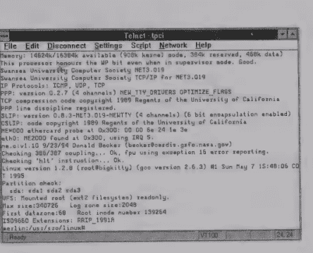

**图 9.1** 如果你的 Linux 内核已经加载了 ISO 9660 驱动，你在启动期间将看到显示扩展名名称的消息。

SCSI CD-ROM 驱动器是最容易添加到 Linux 系统的。如果你正在添加 SCSI CD-ROM 驱动器，内核配置程序可能会询问你是否要添加 SCSI 支持。回答 yes，随后取决于你运行的 Linux 版本，可能会出现一个关于 SCSI CD-ROM 支持的问题。同样，对此问题回答 yes。某些带有脚本菜单的 Linux 版本允许你从列表中选择 CD-ROM 驱动器，如图 9.2 所示。当你从 CD-ROM 安装 Linux 时，驱动程序会自动链接。选择 SCSI 选项并继续配置过程。

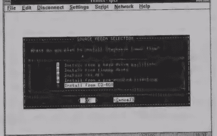

**图 9.2** Linux 安装程序允许你添加对 CD-ROM 的支持。

对于 IDE 和专用 CD-ROM 驱动器，请使用 Linux 提供的设置或安装程序。Linux 会询问你想要添加的 CD-ROM 驱动器类型。选择与你的驱动器匹配的驱动器类型（假设它在列表中）。例如，如果你使用的是连接到 Creative Labs 声卡之一的 Creative Labs CD-ROM 驱动器，你应该选择 Matsushita/Panasonic 或 Mitsumi 驱动器，取决于你的软件包中提供的 CD-ROM 驱动器类型。

如果你的 CD-ROM 驱动器不在安装或设置脚本列出的列表中（专用 CD-ROM 驱动器有时会出现这种情况），你必须手动为驱动器应用补丁。如果你需要手动修补内核，必须使用第 25 章说明的过程重新编译内核。

如果你正在使用由声卡驱动的 CD-ROM 驱动器，你可以在配置 CD-ROM 接口的同时配置声卡。Linux 不支持某些声卡，但你的 CD-ROM 接口可能会支持。请查看在线文档和网站获取有关你声卡的特定信息。

## 创建设备文件

对于最常用的 CD-ROM 驱动器，设备文件可能已经安装在你的系统中，特别是如果你使用了安装或设置脚本来添加 CD-ROM 驱动器。对于其他 CD-ROM 驱动器，你必须手动执行此步骤。即使设备文件已为你创建好，你仍应该手动检查目录以确保它们已正确安装。

要创建设备文件，你需要运行根据你安装的 CD-ROM 驱动器类型而不同的命令。使用 `mknod` (make node) 命令创建适当的主设备号和次设备号（设备号更多信息请参考第 6 章“设备与设备驱动程序”）。例如，你可以使用命令 `mknod /dev/scd0 b 11 0` 创建 SCSI CD-ROM 驱动器文件。

设备名称 `/dev/scd0` 指向找到的 SCSI CD-ROM 驱动器。第二个驱动器为 `/dev/scd1`，第三个为 `/dev/scd2`，依此类推。大多数 Linux 系统对 SCSI CD-ROM 驱动器使用这种命名约定。命令行显示 CD-ROM 驱动器是一个块设备，主设备号为 11，次设备号为 0。第二个 SCSI CD-ROM 驱动器的次设备号为 1；你可以通过命令 `mknod /dev/scd1 b 11 1` 添加它。

图 9.3 显示了用于 SCSI CD-ROM 的 `/dev/cdrom` 设备。Linux 通常将 `/dev/cdrom` 别名为主 CD 设备（在这种情况下为 `/dev/scd0`），正如你从符号链接中看到的。

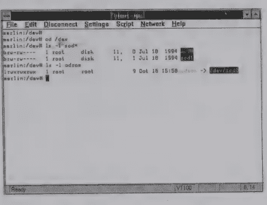

**图 9.3** Linux 系统中存在两个 CD-ROM 设备驱动程序。为了方便起见，设备 `/dev/cdrom` 通常链接到第一个 CD-ROM 设备。

为 Matsushita 驱动器（常见于 Creative Labs 以及其他多媒体扩展 CD-ROM 驱动器）创建 CD-ROM 设备文件，请使用命令：
`mknod /dev/sbpcd b 25 0`

或
`mknod /dev/sbpc0 b 25 0`

此命令使用设备驱动程序 `/dev/sbpcd` 或 `/dev/sbpc0`（`sb` 部分指 Sound Blaster 驱动卡）。设备主号为 25，次设备号为 0。如果你有相同类型的第二个设备，通过命令 `mknod /dev/sbpcd1 b 25 1` 将其添加为 `/dev/sbpcd1`。

你可以添加更多相同类型的 CD-ROM 驱动器，每次增加设备号和次设备号，直到达到控制器上四个 CD-ROM 驱动器的限制。图 9.4 显示了典型 Linux 安装创建的四个 Sound Blaster 类型 CD-ROM 驱动器的驱动。

如果你对这些类型的 CD-ROM 驱动器使用多个控制器，你必须为每个控制器创建一个新的主设备号（26、27 等等）。很少有 Linux 安装会有多一个 CD-ROM 驱动器，更不用说多个控制器了。如果你好奇，以下是创建一个带有两个相同类型 CD-ROM 驱动器的第二个控制器的命令：
`mknod /dev/sbpcd b 26 0`
`mknod /dev/sbpcd1 b 26 1`

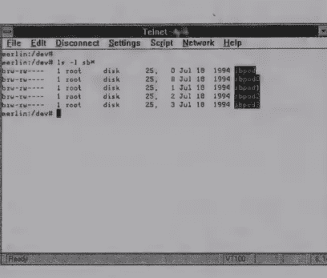

**图 9.4** 默认情况下，大多数 Linux 版本包含了 Sound Blaster 类型 CD-ROM 设备驱动。

## 挂载并测试 CD-ROM 驱动器

现在内核已重新编译且设备文件已正确设置，就可以测试 CD-ROM 驱动器了。重启 Linux 系统并观察启动时的消息。根据你添加的 CD-ROM 驱动器类型，你应该看到某些表示 CD-ROM 驱动器已识别且通信正常的消息。

对于大多数 IDE 和专用 CD-ROM 驱动器，你会看到类似 `Trying to detect a Panasonic CD-ROM drive at...` 的消息，后面跟着一个地址。这告诉你内核正在搜索它认为位于特定地址的 Panasonic ROM 设备。你在为驱动器配置内核时提供了有关 CD-ROM 驱动器类型及其地址的信息。如果正确找到了 CD-ROM，将显示类似 `I Panasonic CD-ROM...` 的消息。否则，你会看到提示找不到驱动器的错误消息。

SCSI CD-ROM 有时显示状态消息，但并非总是如此。典型的 SCSI CD-ROM 消息是：


```
Vendor: TOSHIBA Model: CD-ROM-3401TA Rev: 1094
Type: CD-ROM ANSI SCSI revision: 0
Detected SCSI CD-ROM sr0 at scsi0, 3, lun 0
```

在这种情况下显示 CD-ROM 配置为 SCSI ID 3。内核从板载 SCSI 电子设备获取了驱动器的名称和型号号。

如果你在启动 Linux 时，因为屏幕滚动速度太快而无法阅读关于 CD-ROM 驱动器的信息，你可以使用 `dmesg` 命令恢复所有的启动信息。

`dmesg` 命令会向内核环形缓冲区显示启动时的消息。此种实用程序提供了一种方便的方法来帮助处理疑难设备（而不仅仅是 CD-ROM 驱动器），通过将输出发送到文件，然后将其发送给技术支持人员。如果你需要，可以将 `dmesg` 的输出通过管道传递给分页工具，如 `less` 或 `more`：

```
dmesg | less
```

此分页工具将让你向前或向后滚动启动信息，直到找到你正在寻找的内容。

如果你是使用脚本或安装工具安装的 CD-ROM 驱动器，由于启动命令的更改，CD-ROM 可能会自动挂载。如果没有进行这些更改，或者你是手动安装的 CD-ROM 驱动器，你将不得不手动将 CD-ROM 挂载到你的文件系统中。（你可以通过尝试读取 CD-ROM 目录来判断是否没有自动挂载。）你应该在超级用户（root）登录时挂载和卸载 CD-ROM 驱动器。

当你挂载 CD-ROM 驱动器（或任何其他设备）时，它会被挂载到 Linux 文件系统树的子目录下。为了方便起见，将 CD-ROM 驱动器挂载在一个名为 `/cdrom` 的子目录下是有用的（你必须在挂载之前创建该目录）。这样你就可以快速更改 CD-ROM 的内容。要将 ISO 9660 CD-ROM 挂载到 `/cdrom` 目录，请执行命令：

```
mount -t iso9660 -r /dev/cdrom /cdrom
```

`mount` 命令的 `-t` 选项指示文件系统的类型。`-r` 选项将 CD-ROM 挂载为只读设备，因为你无法对其写入。此选项并不是必须的，但如果你不小心尝试写入 CD-ROM 光盘，它可以防止许多错误信息。设备名称 `/dev/cdrom` 指的是设备；如果你没有提前链接到此名称，请使用实际设备文件。最后，`/cdrom` 是挂载点。你可以将 CD-ROM 光盘挂载到任何地方。

当你尝试执行 `mount` 命令时收到错误信息，可能是因为设备文件不存在或 CD-ROM 驱动器在启动期间未被识别。检查之前提到的所有安装信息并重启系统。如果你尝试将 CD-ROM 挂载到 Linux 无法访问的挂载点（可能是因为目录不存在），请检查挂载点并在必要创建它。挂载 CD-ROM 的目录必须是空的。

## 测试挂载

要测试挂载，请尝试切换到 CD-ROM 挂载点并执行目录列表操作。例如，如果你将 CD-ROM 挂载在 `/cdrom`，请执行以下命令：

```
cd /cdrom
```

如果你在此时收到错误信息，要么是 CD-ROM 中没有磁盘（或插入不当），要么文件系统类型错误。错误信息应该会为你提供问题的线索。如果你在执行 `ls` 命令时没有看到任何内容，可能是磁盘未正常旋转、插入不正确或文件系统类型错误。如果你确实得到了目录列表，说明一切正常，你可以像操作普通文件系统一样在 CD-ROM 光盘上移动（对于 Linux 来说它确实是如此）。

## 注意事项

> **注意**：如果你想使用 CD-ROM 驱动器播放音频 CD，则不应挂载该驱动器。如果它是默认挂载的，请在播放音频 CD 之前卸载它。

要移除 CD-ROM 驱动器或取消对其访问，你必须卸载 CD-ROM 驱动器。你无法挂载正在使用或被访问的驱动器。此外，CD-ROM 驱动器不能调用任何进程。要卸载 CD-ROM 驱动器，请使用 `umount` 命令配合挂载点的名称（而不是 CD-ROM 设备名称）：

```
umount /cdrom
```

此命令将卸载 CD-ROM 驱动器并清空它所挂所在的目录。

> **警告**：不要在不卸载驱动器的情况下更换 CD！当你想要更换磁盘时，请卸载 CD-ROM 驱动器，更换磁盘，然后重新挂载驱动器。如果你不遵循此流程，整个 Linux 文件系统可能会损坏！

某些 CD-ROM 驱动器要求你使用 `eject` 命令弹出光驱盒。此命令有助于从内存中清除文件系统表。大多数 Linux 版本默认不支持 `eject` 命令，尽管某些 CD-ROM 驱动程序可以添加它。

## 使用 /etc/fstab 文件

`/etc/fstab` 文件用于在 Linux 启动时控制设备的挂载。如果你希望每次启动 Linux 时都挂载 CD-ROM（如果尚未实现这一点），请修改 `/etc/fstab` 以包含该挂载。对于挂载两个文件系统和一个 SCSI CD-ROM 的系统，`fstab` 条目的格式如下：

```
/dev/sda3 / ext2 defaults 1 1
/dev/sda1 /dos msdos defaults 1 1
/dev/scd0 /cdrom iso9660 ro 1 1
```


# 使用 `/etc/fstab` 文件

`/etc/fstab` 文件用于在 Linux 启动时控制设备的挂载。如果你希望每次启动 Linux 时都挂载 CD-ROM（如果尚未实现这一点），请修改 `/etc/fstab` 以包含该挂载。对于一个挂载两个文件系统和一个 SCSI CD-ROM 的系统，`fstab` 命令的格式如下：

```
/dev/sda3 / ext2 defaults 1 1
/dev/sda1 /dos msdos defaults 1 1
/dev/scd0 /cdrom iso9660 ro 1 1
```

`/etc/fstab` 中的每一行引用不同的文件系统。每行之间必须用空格（制表符或空格）分隔。`/etc/fstab` 文件中文件系统的顺序很重要，因为在文件系统挂载或卸载时会按照该顺序执行。

## 排除 CD-ROM 驱动器的故障

如果你已经安装了 CD-ROM 驱动器并进行了正确配置，但仍然无法从磁盘读取数据，有许多可能的解决方案。有时问题很简单——你忘记了挂载驱动器或拼写错了它的名称。除非你明确知道问题所在，否则请按照呈现的顺序尝试这些解决方案，以隔离问题的根源。

## 检查内核

检查内核是否已添加新的 CD-ROM 设备驱动程序后重新链接并重新构建。你可以使用以下命令检查内核的编译日期：

```bash
uname -a
```

如果日期与你链接和重建的日期不符，说明编译未完成，且缺少 CD-ROM 驱动程序。请重新编译内核。

或者，你可以通过查看 `/proc/devices` 文件来查看编译进内核的驱动程序列表。该文件列出了所有设备，如下所示：

字符设备：
- 1 mem
- 4 tty
- 5 cua
- 6 lp
- 7 vcs
- 10 mouse

块设备：
- 2 fd
- 8 sd
- 11 sr

在此示例中，设备号 11 指的是 SCSI CD-ROM 驱动器。如果你链接的是适用于松下（Matsushita）CD-ROM 的内核，文件中将出现类似下面的行：

```
25 sbpcd
```

第一列的数字是主设备号（major device numbers）；第二列是设备驱动程序的缩写。检查你创建的设备号并与此文件进行比较。如果没有列出主设备号，说明 CD-ROM 驱动程序未链接到内核。请重新编译内核。

## 检查设备

如果驱动程序已链接到内核且 CD-ROM 设备已挂载，但你仍然看不到磁盘上的任何内容，请尝试以下命令并观察 CD-ROM 面板上指示驱动活动的灯：

```bash
dd if=/dev/cdrom of=/dev/null bs=2048
```

如果没有链接到 `/dev/cdrom`，请替换 CD-ROM 设备的名称。此命令尝试将 CD-ROM 的内容复制到 `/dev/null`。执行命令后，按下 `Ctrl+C` 中断它，因为该命令实际上并不会做任何操作。如果驱动器指示灯闪烁或持续亮了一段时间，但你仍然无法从磁盘读取任何内容，可能驱动器中的磁盘不是 ISO 9660 文件系统格式，或者它是 ISO 9660 格式，但你忘记链接 ISO 9660 驱动程序。

通过检查 `/proc/filesystems` 文件的内容验证 ISO 9660 驱动程序是否激活。你应该在 `nodev` 节下看到这一行：

```
iso9660
```

如果文件中没有出现这一行，则 ISO 9660 设备驱动程序未链接到内核。请使用此选项重新链接内核。

如果 ISO 9660 驱动程序已链接并出现在 `/proc/filesystems` 文件中，请检查挂载 CD-ROM 驱动器时在命令行上指定了选项：

```bash
-t iso9660
```

如果你指定了 ISO 9660 驱动程序且它已链接到内核，那么很可能是磁盘不是 ISO 9660 格式。尝试另一盘磁盘并期待更好的结果。

## 检查驱动器设置

如果你在使用专有的 CD-ROM 驱动器时遇到问题，很可能是接口设置不正确。设置通常定义在以设备命名的文件中，例如松下驱动器的 `sbpccd.h`。文件位置各异，因此使用通配符程序来查找它：

```bash
find / -name sbpccd* -print
```

当你找到该文件（通常具有 `.h` 扩展名，如 `sbpccd.h`）时，检查其内容以确保 I/O 地址、DMA 和 IRQ（如果适用）与你的卡设置匹配。如果你找不到配置文件，请手动检查卡的设置。I/O 地址、DMA 或 IRQ 可能与系统上的另一个设备存在冲突。

## 解读设备忙错误

如果你遇到设备忙错误，且正在运行 SCSI 系统，你可能将 CD-ROM 设备分配了与另一个设备相同的 SCSI ID。检查 SCSI ID。

当你在尝试卸载 CD-ROM 驱动器时收到设备忙消息，说明有一个进程正在使用该驱动器并阻止了 CD-ROM 驱动器的成功卸载。确保你在尝试卸载时没有处于 CD-ROM 目录结构中。如果你找不到可疑进程，使用命令：

```bash
fuser -v /cdrom
```


显示当前正在使用该设备的进程（如有必要，更改挂载点名称以匹配你的系统）。

## 总结

尽管本章提供了大量信息，但向你的系统添加 CD-ROM 驱动器并进行正确配置可能花费不到 15 分钟。遗憾的是，专有 CD-ROM 驱动器的种类很多，这意味着总会有一些 Linux 文档中未提到的、需要不同程度额外工作才能正确配置设备。如果可以，请坚持使用你已知支持的主要品牌之一。CD-ROM 通过提供大量的实用程序和发行软件，让 Linux 用户的生活变得简单得多，CD-ROM 驱动器对于大多数系统来说绝对值得添加。

# 声卡

# 第 10 章

## 本章内容

- 检查声卡支持
- 使用 `sndconfig` 配置声卡
- 手动配置声卡
- 使用电脑扬声器
- Linux 声学应用
- 排除声卡故障

## 扩展你的系统

第二部分

UNIX 设计时并未考虑到声卡（在 UNIX 开发时声卡尚未被发明）。然而，随着声卡在 DOS 和 Windows 下流行，使用声卡的应用程序数量激增（当然，游戏是其中的主力）。当 Linux 开发时，声卡已变得常见，因此我们支持最受欢迎的声卡是自然的。由于这个原因，Sound Blaster（以及某种程度上的 Adlib）声卡在 Linux 下运行良好。Linux 还允许你加载特殊驱动程序让电脑扬声器发出偶尔的哔哔声，这在没有声卡时非常有用。然而，声卡现在是 PC 的常见配件，特别是为多媒体设计的电脑。让你的声卡在 Linux 下工作并不困难，只要你知道声卡的制造商和型号。大多数型号的软件驱动包含在 Linux 发行包中，其他一些可以通过 FTP 网站获取。本章将介绍如何为你的声卡安装驱动程序并确保它们在 Linux 下运行。

Linux 最初开发时，不支持许多 DOS 格式（如 WAV 和 MID），并依赖源自太阳工作站的声音文件和命令。太阳音频文件是 Linux 的通用格式，通常带有 `.au` 后缀。随着 Linux 的最新发布，你在 UNIX、Windows 和 DOS 下遇到的大多数音频格式都得到了支持。太阳工作站设备驱动被用作 Linux 声卡驱动程序的模型，尽管这些驱动程序的设计是用于标准的 PC 声卡。

Linux 系统可以支持两块声卡，尽管大多数安装只涉及一块。两块声卡不能具有相同的配置（必须具有不同的 I/O 地址、IRQ 和 DMA）。如果你有一块用于 MIDI 接口的专用卡，你可能想使用两块卡。例如，你的电脑配备了一块 Sound Blaster 卡用于通常的游戏效果，以及另一块 Roland MIDI 卡用于专业音频。Linux 可以同时支持这两种设备。但你不能使用两块都支持 Sound Blaster 的卡（即使是仿真），因为除非禁用其中一块，否则驱动将发生冲突。

> **注意**
> 与声卡驱动程序相关的驱动程序和软件更新频繁，因此检查最新版本并查看随附的任何文档。它们可能会取代本章的信息。许多 Linux 版本现在都包含了声卡的自动安装脚本（例如 `sndconfig`，在本章稍后讨论）或支持 `mkdev sound` 命令。在手动安装声卡之前，请检查安装脚本。

## 检查声卡支持

Linux 支持的声卡列表包含了大多数流行型号，许多其他型号也可以模拟这些受支持的模型之一，并可以在仿真模式下无问题运行。最受欢迎的支持声卡型号包括：

- Creative Lab 的 Sound Blaster、Sound Blaster Pro、Sound Blaster 16 和 Sound Blaster AWE（以及大多数与 Sound Blaster 兼容的系统，包括 ATI 的 Stereo F/X、Thunderbolt 等）
- Adlib 的 Adlib 系列及其兼容卡
- ProAudioSpectrum 16 和 Logitech 的 SoundMan 16
- Gravis 的 Advanced UltraSound 和 UltraSound ACE
- Logitech 的 SoundMan 系列
- Microsoft 的 Windows 声学系统
- Roland MPU 401 MIDI 接口和声卡
- Turtle Beach Tropez 和 Maui
- 基于 Yamaha FM 合成器的声卡

受支持的声卡完整列表通常随 Linux 发行版软件提供。由于描述声学支持的文件位置差异很大，请使用 `find` 命令搜索任何用于处理音频的文件。你可以通过 CD-ROM 发行包轻松地进行此搜索。挂载 CD-ROM（更多信息请参阅第 9 章“CD-ROM 驱动器”），并以 `sound` 字符串作为起点执行 `find` 命令：

```bash
find / -name sound* -print
```

此搜索将引导你找到包含声卡信息、驱动程序以及驱动 C 源代码的目录。声驱动通常存储在 `/usr/src/linux-1.2.8/drivers/sound`。在 Slack Linux 上运行 `find` 的输出如图 10.1 所示。在示例中，`find` 命令报告了 DOS 文件系统中的匹配项，因为它被挂载为 `/dos`。你可能希望在执行此命令之前卸载 CD-ROM 驱动器以节省时间。如果你的发行介质手头没有完整的 Linux 发行版，请检查软件附带的 README 文件查找可能的驱动位置。

```bash
mlin:~$ 
marlin:# find / -name sound* -print
/dev/windows/system/sound.drv
/dev/windows/soundree.exe
/dev/windows/soundmax.exe
/dev/mesa/gsound.drv
/dev/nevin/sndconfig.exe
/dev/mesa/sounder.h
/usr/lib/linux-1.2.8/drivers/sound.h
/usr/src/linux-1.2.8/drivers/sound
/usr/src/linux-1.2.8/drivers/sound/sound_alix.h
/usr/src/linux-1.2.8/drivers/sound/sound_config.h
/usr/src/linux-1.2.8/drivers/sound/sound_switch.c
/include/soundcard.h
marlin:~$
```

图 10.1：你可以通过执行 `find` 命令搜索声驱动程序。

## 使用 `sndconfig` 配置你的声卡

许多版本的 Linux 都包含一个名为 `sndconfig` 的实用程序。与遵循下一节总结的逐步过程相比，`sndconfig` 程序可以帮助你通过菜单驱动的界面更轻松地配置声卡。

首先，如有必要请安装声卡。此过程通常不涉及比将卡插入主板上的可用插槽更复杂的操作。由于 Linux 使用自己的驱动程序，因此安装基于 DOS 的软件对 Linux 下的声卡没有影响。`sndconfig` 实用程序可以独立启动，在许多情况下，可以通过你最初用于安装操作系统的 Linux 设置启动。

`sndconfig` 实用程序启动时列出它已知的所有声卡列表。此列表通常有点过时，所以如果你有一个刚发布的新型声卡，它可能不在 `sndconfig` 显示的支持声卡列表中。相反，你可以手动安装声卡，或从 `sndconfig` 列表中选择一个兼容的声卡。

从 `sndconfig` 菜单中选择声卡后，会出现一个新窗口，要求你提供声卡的配置信息。你需要提供的信息根据声卡的不同略有差异，但通常你将提供 IRQ 和端口地址。提供这些信息后，`sndconfig` 会播放示例音频文件（在大多数 Linux 发行版中存储在 `/usr/share/sndconfig/sample.au`）。如果你听到了音频采样（实际上是 Linus Torvald 在说“Linux”），则你的声卡已正确配置，你可以继续其他主题。

## 手动配置你的声卡

一旦你确定你的声卡型号受支持——并且你确定无法使用 `sndconfig` 来配置它——就可以开始手动过程让它被 Linux 使用。如前节所述，你必须首先安装声卡。

在安装声卡时，注意基本配置信息，例如卡的 DMA、IRQ 和 I/O 地址。某些声卡具有更多配置信息，包括 8 位和 16 位 DMA、MIDI 地址。Linux 支持即插即用声卡，但你必须检查你所用软件版本的支持情况以及大多数声卡的默认设置。大多数声卡在不带参数的情况下使用默认值。

如果文件存在，则将其删除，然后使用 `mknod` 创建新的设备文件。当然，你也可以手动执行这些步骤。

要编译声卡驱动程序，请按照一系列步骤，将所需文件放置在特定位置（在编译脚本或 Makefile 中定义），然后调用编译过程。步骤如下：

1. 将 `soundcard.h` 文件从当前所在的目录拷贝到 `/usr/include/linux`。
2. 将声卡的 `.h` 文件（如 `sb.h`）拷贝到 `/usr/include/sys`。
3. 使用命令 `ln -s /usr/include/linux/soundcard.h /usr/include/sys/soundcard.h` 在 `/usr/include/linux` 和 `/usr/include/sys` 版本的 `soundcard.h` 之间创建符号链接。
4. 使用 Makefile 编译声卡设备驱动。如果你已经编译了设备（如某些 Linux 发行版），可以跳过此步。
5. 运行 `soundinstall` 脚本创建声卡设备，或手动创建它们。

`soundinstall` 脚本使用 `mknod` 命令在 `/dev` 目录下创建设备驱动。如果你想手动执行这些步骤，需要这些基础 `mknod` 命令：

```bash
mknod -m 666 /dev/mixer c 14 0
mknod -m 666 /dev/sequencer c 14 1
mknod -m 666 /dev/patmgr0 c 14 17
mknod -m 666 /dev/midi00 c 14 2
mknod -m 666 /dev/dsp c 14 3
mknod -m 666 /dev/audio c 14 4
mknod -m 666 /dev/sndstat c 14 6
```

如果你的声卡不支持 MIDI 接口或序列器功能，则不需要这些命令中的某些。前面的步骤适用于第一块声卡。如果你正在安装两块声卡，则必须使用第二个设备名称重复命令。`soundinstall` 脚本会自动处理这一步。

### 提供配置信息

在安装过程运行期间（无论是通过如 `setup` 或 `install` 等安装脚本，还是通过编译声卡驱动程序），你会被要求输入若干配置参数。这些参数用于生成名为 `local.h` 的文件，该文件定义了声卡的配置信息。系统会提示声卡类型、IRQ、DMA 和 I/O 地址，以及与每个类型驱动程序的其他信息。


如果没有这类信息，你必须手动编辑 `local.h` 文件（如果存在）。名为 `sound_config.h` 的文件包含通用配置信息。你可以编辑此文件以完成任何配置程序未提示的配置参数。`sound_config.h` 文件的大部分部分都有明确的用途标记。

安装过程应该以 Linux 内核的重新编译、重链接并将新内核设置为启动镜像而结束，这样在启动 Linux 时驱动程序才会生效。如果没有这一步，你所做的所有更改都不会生效。

### 测试声卡驱动程序

在嵌入声卡驱动程序重新编译内核后，重启机器以测试声卡。仔细观察启动信息以查看初始化消息。如果你错过了信息，可以使用命令调回：

```bash
dmesg
```

如果声卡驱动程序已正确安装在内核中，Linux 会尝试连接声卡并对其进行初始化。在启动信息中，你将看到类似下面的一行：

```
<SoundBlaster Pro> at 0x220 irq 5 drq 1
```

在这种情况下，它显示 Sound Blaster Pro（或兼容设备）的驱动程序已加载，其 I/O 地址设置为 220H，IRQ 为 5，DMA 为 1。如果声卡的这些参数中有任何值与显示的内容不同，显卡初始化可能会失败。

如果你在安装新驱动程序后首次启动 Linux，可能会显示某些诊断、警告或错误消息。这些消息在第一次重启时可能不会每次重启都重复。由于某些原因，你应该在重链接并使用带声卡的内核重启内核后，使用 `dmesg` 命令检查这些消息。

假设驱动程序已正确链接，设备驱动程序将初始化卡以及你使用的 Linux 寄存器。你现在需要做的是使用尝试访问该卡的应用程序来测试声卡。任何音频文件都可以。声卡驱动程序通常包含几个示例，或者你也可以从 FTP 或网站或可能的 Linux 发行版磁盘获取音频文件。

要测试声卡，使用 `cat` 命令将测试文件发送到声设备。例如，如果你有一个名为 `parrot_sketch.au` 的音频文件（许多音频文件以 `.au` 作为扩展名，尽管这并非惯例），并且你的声卡名为 `/dev/audio`，你可以通过以下将文件发送到声卡：

```bash
cat parrot_sketch.au > /dev/audio
```

## 排除声卡故障

许多用户在数值发生更改后仍假设其为默认值。有时声卡上使用的是默认值，但在配置信息中的输入却有误。

如果启动信息中没有某一行引用声卡驱动程序，则该驱动程序处于未激活状态或未链接到当前启动内核。请确保你已将驱动程序链接到当前启动内核。某些 Linux 系统在配置信息正确时不会显示启动信息，而另一些系统会生成消息提示信息是正确的。

请使用声卡的说明书确定默认设置，并将其与板卡进行对比。物理上拆下声卡，检查跳线、DIP 开关或任何用于设置配置的方法。由于板卡使用软件配置，因此你应该在 DOS 中启动机器，并使用声卡自带的诊断工具来检查和设置板卡。记录下所有设置，然后检查驱动程序配置文件以确保它们匹配。

检查设置的良好方法是运行一个使用声卡的 DOS 应用程序。如果设置在 DOS 中有效，它们在 Linux 中也能工作。然而，如果 DOS 应用程序无法正常访问声卡，则说明存在配置问题（或声卡有故障）。如果设置不正确，请重新输入设备驱动配置信息中，重新编译并链接内核，然后重启机器并再次测试声卡。

### 检查文件 `/dev/sndstat`

`/dev/sndstat` 文件应该包含关于声卡及其初始化的某些基本信息。并非所有 Linux 版本都提供此文件，因此如果它不存在请不要惊讶。在这种情况下，跳过此步骤。如果 `/dev/sndstat` 文件存在，其内容应显示已配置卡的名称及其参数，以及任何额外安装的设备。例如，文件可能包含以下行：

```
Sound Driver 3.1

HW config:

Type 1: SoundBlaster Pro at 0x220 irq 5 drq 1

PCM devices:

0: SoundBlaster Pro 3.2

Synth devices:

0: Yamaha OPL-3

Midi devices:

0: SoundBlaster

Mixer(s) installed
```

此示例文件显示了为典型的 Sound Blaster Pro 卡安装的驱动程序和组件。其他驱动程序或错误状况可能会出现额外的消息。检查文件中的任何有用信息，并根据你的声卡文档核实配置参数。

如果你找不到 `/dev/sndstat` 文件或该文件为空，要么你的 Linux 版本不支持该文件，要么声卡在启动期间未被识别。通常，即使没有找到声卡，`HW config` 部分也会被填充。

### 无此类文件或设备错误

如果声卡似乎已加载但你无法对其进行测试，或者当声卡尝试初始化或运行运行声卡的程序时收到错误消息 `No such file or directory`（无此类文件或目录），问题出在设备驱动文件上。通常，这些问题意味着设备驱动文件不存在或文件不在正确的位置。

检查并确保设备驱动文件已链接到内核并位于 `/dev` 目录中。检查本章前面的“理解声卡设备文件”章节，获取你应该拥有的声卡设备驱动文件列表。如果设备驱动文件存在，请检查主设备号和次设备号是否与任何其他设备冲突。

当应用程序尝试使用声卡时收到错误消息 `No such device`（无此类设备），意味着设备驱动程序在内核启动过程中未加载。检查确保你已重新链接内核，并已使用新镜像启动了系统。

当应用程序运行并尝试与声卡通信时，收到消息 `device busy`（设备忙），意味着有多个进程同时使用声卡。Linux 仅允许一个进程访问声卡。你可以使用 `fuser` 命令确定哪些进程正在使用声卡。例如，如果问题出在 `/dev/audio` 设备文件，执行命令：

```bash
fuser -v /dev/audio
```


并检查输出以查看哪些进程正在使用该设备。如果 `/dev/dsp` 设备持续存在，请重复命令；否则 `/dev/audio` 设备没有冲突。

如果“忙”错误消息持续存在，很可能是 DMA 错误。确保你没有为声卡使用 DMA 0。某些声卡允许选择此 DMA 通道，但 Linux 将 DMA 0 作为 DRAM 的特殊刷新通道。更改为 DMA 通道，重新配置内核、重新链接、重新构建、重启，然后再次测试声卡。

## 音文件播放不完整

如果你只听到音频文件的一小部分然后播放突然停止，或者在文件开始播放后收到错误消息，问题可能是 IRQ 或 DMA 设置不正确。你可能会看到 IRQ 或 DMA 超时的消息。

要修正这个问题，请检查声卡及配置文件中的 DMA 和 IRQ 值。如果值匹配，检查是否与 PC 中的其他设备存在冲突。IRQ 或 DMA 可能与另一个设备共享（网卡是常见的元凶）。在最容易操作的卡上更改设置（如果你的网络已经运行，就改声卡，如果允许的话）。

## 播放时声音停止和开始

声音在播放时停止和开始是因为声卡、电脑和硬盘之间无法保持同步。解决此问题的最简单方法是……（注：原文此处为碎片化/重复内容）。

# 终端与术语
第 11 章

多端口卡有两种基本类型。第一种本质上是快速的、具有一定智能性的串口服务器。这些卡价格低廉，因为制造简单。然而，由于它们没有任何板载处理或内存，每个连接到多端口卡的设备都会给 Linux 系统的 CPU 和 RAM 带来负担。

## 11 终端术

另一种类型的多端口是智能控制器。这些卡的价格要贵得多，但它们拥有板载 CPU 以减轻 Linux 系统的 CPU 负载。板载 CPU 可以处理所有通信请求，在某些情况下，它足够智能可以提供终端命令。这些卡使用安装在板上的 RAM，提供缓存系统以提高访问速度。通常情况下，这些智能板在支持四个或更多终端及其他设备方面远优于同类产品，但如果你连接的设备少于此，你可能在不需要的功能上花费了资金。

每块多端口卡可以提供 2 到 32 个额外的串口，你还可以通过添加多个多端口卡来增加容量，尽管这在 Linux 安装中非常罕见。一些制造商甚至提供了可以以集群方式支持 256 个终端的系统。某些多端口卡包括用于打印机的并行端口，少数高端板则设计用于使用 SCSI 设备。

多端口卡上的每个端口都经过智能布，适用于任何串口设备，如终端、调制调器、打印机、扫描仪等。然而，少数为简单终端用途设计的卡仅支持串口端口中的几根线芯。这些卡不支持调制调器、打印机和类似的复杂设备。不同的卡制造商支持不同的系统，如果你决定为系统选择多端口卡，请务必仔细检查规格。

多端口卡上的连接器类型也不同。大多数使用 DB25 25针连接器或 DB9 9针连接器，与 PC 串口口相同。某些卡使用 RJ45 连接器，它看起来像一个宽的模块化终端式插座。适配器可以将 RJ11 连接器连接到标准串口线。再次，如果你决定使用多端口卡，请检查连接器类型，并确保连接器的接线与你的串口设备一致，或者方便获取转换器和适配器。

如果你要在 Linux 系统上使用多端口卡，请确保使用带有为 Linux 设计的软件设备驱动程序。在不修改的情况下，你无法为其他版本的 UNIX 使用任何多端口卡驱动程序。因为驱动程序通常已经编译，你无法自行修改它们。多个多端口卡可以通过 FTP 和网页网站获取。随着 Linux 变得越来越流行，越来越多的多端口卡供应商正在为你的产品开发优化驱动程序以便与 Linux 集成。

多端口卡附有完整的说明，用于安装多端口卡的设备驱动程序以及配置终端和其他设备。由于配置细节取决于多端口卡的制造商而有所不同，你应该咨询随卡附带的文档以获取更多信息。

## 连接串口终端

如果你有空闲端口，可以使用 PC 的串口口来添加终端。在大多数情况下，连接终端只需要在终端和串口口之间运行一根电缆，并确保使用正确的连接器。然后你更新 Linux 配置文件，告诉操作系统为终端提供服务。完成此步骤后，远程终端应该是激活状态的。

你可以选择任何串口口作为终端，尽管该端口不应与其他设备（如调制调器）共享，除非你愿意在需要终端时禁用其他设备。如果你需要在一个串口口上运行多个设备，可以获取一个切换器盒来连接这些设备。这些盒子前面通常有一个旋钮开关，用于将内部布线路由到正确的端口。

串口终端受限于 PC 中使用的 UART 速度，尽管大多数新的 PC 机器具有更快的 16550 UART，能够进行高速通信。即使是较旧的机器也可用于图形应用以外的所有场景，因为大多数字符终端不需要高于 38,400 的速度（事实上，对于大多数字符应用程序，9600 就足够了，尽管 19,200 更好）。

## 串口线布线

终端和 Linux PC 之间电的布线取决于两端连接器的类型。当你使用串口或多端口卡时通常会发生相同的问题。在大多数情况下，你使用的线是 DCE-DTE（数据终端设备）类型。某些终端和 PC 串口需要 DCE（数据通信链路）。通常情况下，终端和远程计算机使用 DTE，而调制调器使用 DCE。DTE 和 DCE 布线的区别在于线芯从每个连接器运行的方式；DCE 在两端都会交叉几根线芯。

某些电缆专门为终端设计，并作为连接器设计的一部分交叉内部线芯，而另一些电缆是为调制调器设计的，线芯是直通的。如果你在遵循了本章讨论的所有配置说明后终端仍然无法工作，那么你的电缆接线不正确。空调制调器适配器（强制线芯交叉）是最简单的解决方案，你可以将其添加到从终端到 Linux PC 链条中的任何位置。

典型的 DCE 线（例如用于调制调器的线）使用直通布线，这意味着 PC 端的 1 号针对应调制调器端的 1 号针，2 号针对应 2 号，依此类推。这被称为直连线或调制调器线。

DTE 通过交叉线芯来允许发送和接收信号，例如连接器中的 2 号针始终用于发送， 3 号针始终用于接收。通过交叉两端的 2 号和 3 号针，一个连接器的引脚变成另一个连接器的引脚。连接终端时，某些引脚必须允许信号正常通过。这些电缆的布线（通常称为空线）需要若干此类交叉才能使连接有效。

在购买或制作电缆时，电缆两端连接器的性别也同样重要。仔细注意两端的连接器是公头（凸出的）还是母头（无针）。通常，PC 有公头串口连接器（需要电缆的一端为母头），终端有母口（需要电缆的一端为公头），但如果你连接的是远程 PC，则在两端都需要母头。多端口卡的性别和连接器类型差异很大，因此在购买电缆前请检查。

PC 上的串口连接器是 DB9（9针）或 DB25（25针）D 型连接器。9针或 25针中的并非所有线芯都是需要的。你可以用仅三个引脚（发送、接收和地）制作一个简单的终端线，尽管 Linux 也喜欢使用载波检测线来告知何时终端已连接并处于状态。表 11.1 显示了 25 针 DTE 连接器线的重要引脚及其含义。引脚编号在 9 针连接器上会变化，但彼此之间的交叉关系是相同的。

### 表 11.1 25 针连接器的 DTE 线

| 终端引脚 | 计算机引脚 | 含义 |
|---|---|---|
| 1 | 1 | 地 |
| 2 | 3 | 发送数据 / 接收数据 |
| 3 | 2 | 接收数据 / 发送数据 |
| 4 | 4 | 准备发送 |
| 5 | 5 | 清除发送 |
| 6 | 20 | 数据准备就绪 / 终端就绪 |
| 7 | 7 | 地 |
| 8 | 20 | 载波检测 / 终端就绪 |
| 20 | 6,8 | 终端就绪 / 数据准备就绪，载波检测 |

> 注意

如果电缆的布线没有明确指示且你的终端完全无法工作，你可能需要购买一个空调制调器设备。空调制调器设备是一个内部引脚交叉的连接器，可以有效地将直通线转换为空调制调器线，反之亦然。

## 理解登录过程

管理 Linux 系统需要你了解内核和设备通信中涉及的许多微小过程。对于用户来说，最重要的过程之一是在屏幕上观察登录提示并成功登录系统。许多用户并不清楚 Linux 提供登录提示时所经历的步骤，因此本节将对该过程进行分析。理解登录过程对于学习如何在你的系统上配置新终端也是必要的，因为必须修改几个文件才能支持新设备。

## init 和 inittab 文件

当在 Linux 系统启动期间执行 `/etc/init` 守护进程（有时也存储在 `/sbin/init` 中）时，登录过程开始。init 进程从 `/etc/inittab` 文件读取指令并按顺序执行它们。通常情况下，init 守护进程负责为连接到系统的每个终端运行一个 `/etc/getty` 程序的副本。如果没有 getty 进程，终端和内核将无法通信。

init 守护进程知道终端是否已连接，这是由于 `/etc/ttys` 和 `/etc/inittab` 文件中的条目决定的，这些文件列出了系统上的所有进程以及所连接的终端类型。`/etc/inittab` 文件包含了所有终端及其参数的完整列表。接下来的“/etc/ttys 和 /etc/inittab”章节将详细检查这些文件。

当 `/etc/ttys` 和 `/etc/inittab` 文件指示终端已连接并激活时，init 守护进程会为该终端运行 `/etc/getty` 程序。getty 程序为终端设置通信参数并在屏幕上显示登录提示。当用户登录终端时，getty 进程会执行 login 程序以请求密码。login 程序根据 `/etc/passwd` 文件中的条目验证用户名和密码。

如果登录通过了验证，login 程序将显示“今日格言”（存储在 `/etc/motd` 文件中），并执行用户应作为启动程序运行的任何程序（通常是 shell）。最后一步，login 设置 `TERM` 环境变量，然后退出。

## /etc/ttys 和 /etc/inittab 文件

终端配置信息存储在 `/etc/ttys` 和 `/etc/inittab` 文件中。这些文件是 ASCII 格式，可以使用任何编辑器修改，但你应该注意保持正确的格式，不要破坏现有的条目。在修改终端配置文件之前，请创建一个副本，以防修改无效且文件无法恢复到原始状态。

如果你不想手动编辑这些文件，可以使用一些菜单驱动程序，它们会根据你回答的一系列问题为你完成文件的更改。这些管理实用工具通常比手动编辑文件慢一点，但它们能确保条目格式是正确的。

`/etc/tty` 文件由由空白字符分隔的两列组成。第一列保存假设已连接的终端类型，用于设置 `TERM` 环境变量。第二列保存设备名称，不包含 `/dev` 分区。一个新安装的 Linux 系统的典型 `/etc/tty` 文件看起来如下：

```
console tty1
console tty2
console tty3
console tty4
console tty5
console tty6
vt100 ttyp0
vt100 tty1
vt100 tty2
vt100 ttyp3
```

你使用 `/etc/inittab` 文件来设置每个终端的行为。`/etc/inittab` 文件的格式遵循以下模式：

`ID:runlevel:action:process`

ID 是一个一个或两个字符的字符串，用于唯一标识该条目。对于终端，此字符串对应设备名称，例如对应 tty1 的 `i`。runlevel 表示终端的能力，以及 Linux 操作系统可以处于的各种状态。运行级别从 0 到 6 不等。如果没有提供条目，则终端支持所有运行级别。你可以在字段中设置多个运行级别。

action 表示系统启动以及进程在终端上终止时终端设备的行为。action 的几个有效条目适用于终端：

- `once` 启动一次进程
- `ondemand` 保持进程始终运行（与 respawn 相同）
- `respawn` 保持进程始终运行

一个显示终端启动命令的简单 `/etc/inittab` 文件（为了清晰，取自旧版本的 Linux；最新版本稍微完善了这些行）如下：

```
# initab for Linux
S1:1:respawn:/etc/getty 9600 ttyS0
S2:1:respawn:/etc/getty 9600 ttyS1
```

## 扩展你的系统

这些行表示应该为 tty0（第一个串口）和 tty1（第二个串口）以 9600 波特率启动 getty 进程，并在 getty 进程终止时重新启动（respawn）。当你向串口添加终端时，可以使用类似这样的行。多端口板通常使用不同文件中的命令来启动 getty 进程。

## /etc/getty 和 /etc/gettydefs 文件

在处理终端时，经常提到 `/etc/getty` 程序。基本上，`/etc/getty` 是一个设置 Linux 和终端之间通信参数的程序，包括速度、协议和对电缆的任何特殊处理。

`/etc/getty` 程序在系统启动或进程终止时由 `/etc/init` 调用。当调用时，`/etc/getty` 打开串口或其他连接。

（注：原文文本在后半部分存在大量重复和乱码，以上内容已根据提供的逻辑片段进行了清理。）

# /etc/termcap 文件

`/etc/termcap` 文件包含了 Linux 内核指令以及与不同终端通信的指令。Linux 操作系统支持的大多数终端在该文件中都有一个条目，因此该文件可能很大。如果你打算进行修改，请先将该版本复制到安全的文件名中。

termcap 文件中的每个条目都有一个名称或标签，用于识别其所指的终端，该名称有多种变体，随后是一组针对不同终端特征的代码和值。由于终端对不同操作使用许多不同的代码，某些功能较强大的终端会使用许多代码。

termcap 文件的一个片段显示了两个相当简单的终端 Wyse 30 和 Wyse 85 的定义：

```
wo|wy30-vb|wyse30-vb|wyse 30 Visible bell:
:tc=E\8|\072E 9:
:tc=wy30:
:wy85_wy85Wyse 85 in 80 column mode, vt100 emulation:
:is=E[61|p=E[71|E[131|E=E[73|E[77h|E[161|E[25W:
:co=#80|l24;am=C|E;H|E2J;bs=cm=E%&;dH=2|E[C:cup=2|E[:
:ce=E[K|d=E[B:so=2|E[7m:se=2|E[4m:mus=ue=2|E[m:
:ku=E[A:kd=E[C:kl=E[D]:
:kh=E[H:xn:
:im=CO=E[255H:cf=E[251:lc=E[10:dc=E[1al
```

每组代码的含义对于大多数用户和系统管理员并不重要。只有当你添加不存在的终端类型时，才需要开始更改或重写终端条目。

大多数终端提供多种仿真。如果你在 termcap 文件中找不到所需的终端类型，请寻找支持的仿真（通常是 Qume、VT 或 Wyse 类型）。仿真一个不同的终端比为新类型编写 termcap 要容易得多。

`/etc/tty` 文件使用了 `/etc/termcap` 文件中的终端特征。tty 文件的第一列提供了用于设置 `TERM` 环境变量的默认终端类型。启动程序使用模式匹配工具在 termcap 文件中查找匹配的行，然后读取随后的代码以进行所有通信。

# 添加终端

终端添加到 Linux 的方式与其他设备非常相似，即通过 `mknod`（创建节点）命令来实现。要添加终端，你必须知道连接到终端的端口名称。Linux 将 PC 上的串口称为 `/dev/tty0`（对应 COM1）、`/dev/tty1`（对应 COM2）以此类推。

大多数 PC 系统有一个或两个串口，尽管一台 PC 最可以容纳四个串口（`/dev/tty8` 到 `/dev/tty3`）。Linux 根据 BIOS 中的地址使用串口。串口的常用地址如下：

| tty0 (COM1) | 0x03f |
| :--- | :--- |
| tty1 (COM2) | 0x02f |
| tty2 (COM3) | 0x03e |
| tty3 (COM4) | 0x02e |

如果你不确定哪个串口是哪个，你可能需要使用基于 DOS 的诊断工具（如 MS-DOS 的 MSD.EXE 或商业软件包如 Norton Utilities 或 Central Point Tools），或者从最低地址开始逐个向上测试，测试终端响应时间。如果 PC 只有一个端口，它几乎总是被配置为 COM1（`/dev/tty8`）。两个 PC 串口通常由 Linux 安装脚本配置，因此你可能只需要为连接到串口的终端设置速度和参数。如果你使用多端口板卡，你可能需要安装驱动程序。

要创建一个新设备，你必须运行 `mknod` 命令创建设备驱动文件，然后更改该文件的权限以允许 root 或由 root 启动的守护进程运行它。创建一个新设备的典型命令是：

```
mknod -m 660 /dev/tty0 c 4 64
```

其中 `mknod -m 660 /dev/tty0` 指定了机器上的第一个串口（COM1），它表示终端是字符模式设备（除了极高速的高端型号外，几乎所有终端都是字符模式设备），并且主设备号和次设备号分别设置为 4 和 64。对于 PC 上的其他串口（COM2 到 COM4），命令为：

```
mknod -m 660 /dev/tty1 c 4 65
mknod -m 660 /dev/tty2 c 4 66
mknod -m 660 /dev/tty3 c 4 67
```

不需要更改 tty 中的内容，因为终端类型是由环境变量设置的。如果你需要更改终端类型，可以使用带有设备号的 `stty` 命令。

# 扩展你的系统 第二部分

`mknod` 命令已经执行。要设置终端，你可以：

```
stty -F /dev/tty0
```

要设置终端，你可以：

```
stty -F /dev/tty1
```

要设置终端，你可以：

```
stty -F /dev/tty2
```

要设置终端，你可以：

```
stty -F /dev/tty3
```


# 使用 stty 设置行为

`stty` 命令用于设置终端类型。如果你需要更改终端类型，可以使用带有设备号的 `stty` 命令。

# 重置异常终端

偶尔，通过串口连接的终端会变得异常，要么不显示提示符要么产生乱码。有两种快速方法尝试重置终端。如果无效，你应该关闭并重启终端（你可能需要杀死正在运行的进程）。

这种方法是在异常终端上发送一组 Ctrl+J 字符，然后输入 `stty sane`；后续的另一个 Ctrl+J 将终端特征恢复为正常（从配置文件读取终端特征）。

你可能看不到自己输入的字符，所以务必小心输入。如果出错，通过几个 Ctrl+J 重新开始过程。如果此时终端仍然不正常，输入 `reset` 并按回车或 Ctrl-J。

# 使用 term 程序

由 Michael O'Reilly 开发的 `term` 程序包含在许多 Linux 版本中，并可以在 FTP 和 Web 网站上轻松获取。`term` 程序允许你对串口线进行多路复用，本质上支持在条线路上连接多个设备。例如，你可以使用同一个串口同时控制一个终端（包括 X 终端）和一个调制解调器。使用 `term` 的通用过程是：先正常登录到远程机器，然后在远程机器上启动 `term` 程序，然后运行 `term`。一旦两个 `term` 进程正常通信，你就可以在同一条路上同时使用终端会话和调制解调器会话，在继续远程文件系统中移动的同时传输文件。

虽然 `term` 共享了如 PPP 和 SLIP 等复杂的 TCP/IP 协议的许多特性，但它的独特之处在于它需要内核驱动程序。`term` 的功能本质上是将你的串口转换为一个服务端口，就像 SLIP 和 PPP 所做的那样。该程序管理进入串口的连接请求，并通过该 `term` 维护多个进程。基于串口的机器被称为*服务器*，它通过实现的串口协议与其他机器或外设设备（*客户端*）通信。

# 安装 term

大多数 Linux 发行版都包含了编译好的 `term` 工具版本，因此你不需要编译该程序。如果你只有源代码，将需要使用 `make` 实用进行编译。每个发行版都提供了编译 `term` 的说明。目前可用有多个版本的 `term`，每个版本的编译过程和要求略有不同，因此在开始编译之前请仔细检查文档。

`term` 系统需要设置若干环境变量。由于 `term` 可以由任何系统用户运行，因此这些变量应该在每个用户的启动文件中定义。如果 root 登录用户想要使用 `term`，则必须在 root 的启动文件中定义这些环境变量。对 `term` 重要的环境变量如下：

-   `TERMDIR`：定义 `term` 使用的家主目录（通常是你的家目录）。
-   `TERMSHARE`：定义在共享模式下使用的目录（通常与 `TERMDIR` 相同）。
-   `TERMODE`：指示 `term` 应在私有模式还是共享模式运行。

> 注意：对于 1.16 之前的版本的 `term`，只需要 `TERMDIR` 环境变量，因为那些版本不支持私有模式和共享模式。

# 终端与 term 第 11 章

设置环境变量的命令取决于你使用的 shell。`TERMDIR` 变量通常设置为你的家目录，因此其定义方式如下：

```bash
setenv TERMDIR $HOME
```

对于 C shell 或兼容 shell（包括 tsch），定义在 `.cshrc` 或 `.login` 文件中。对于 Bourne 和 Korn shell（以及它们的兼容 shell），在 `.profile` 文件中使用以下命令定义：

```bash
TERMDIR=$HOME
export TERMDIR
```

如果你愿意，可以显式地定义目录，例如：

```bash
setenv TERMDIR /usr/tparker/termdir
```

如果你运行的是高于 1.15 的版本，`term` shell 支持私有使用。`TERMMODE` 变量必须在与 `TERMDIR` 命令相同的启动位置定义。对于 C shell 及其兼容 shell，如果你想在私有模式下运行，请使用该行：

```bash
setenv TERMMODE 0
```

对于 Bourne 和 Korn shell（兼容版本），可以使用以下行将 `term` 设置为在私有模式运行：

```bash
TERMMODE=0
export TERMMODE
```

如果你想在共享模式下运行，将 `TERMMODE` 变量设置为值 1，并且必须定义 `TERMSHARE` 变量以显示共享目录的位置，如下所示 C shell 的示例：

```bash
setenv TERMDIR /usr/tparker/term
setenv TERMMODE 1
setenv TERMSHARE $TERMDIR
```

或适用于 Bourne 和 Korn shell 的命令：

```bash
TERMDIR=/usr/tparker/term
TERMMODE=1
TERMSHARE=$TERMDIR
export TERMDIR TERMMODE
```

高于 2.0.0 版本的 `term` 还有一个名为 `TERMSERVER` 的环境变量，当有多个调制解调器且可以同时使用时，必须定义该变量。该变量告知哪个连接名称使用哪条调制解调器线路。变量通过连接名称定义。要为 C shell 设置三个调制解调器和三个连接（称为 Conn1、Conn2 和 Conn3），需要在启动文件中添加以下行，以指示使用 Conn1 作为你的连接：

```bash
setenv TERMSERVER Conn1
```

# 扩展你的系统 第二部分

对于 Bourne 和 Korn shell，命令如下：

```bash
TERMSERVER=Conn1
export TERMSERVER
```

在这些情况下启动 `term` 命令时，也必须指定连接名称。例如，根据之前的配置信息，你将以下命令启动 `term`：

```bash
nohup term -v /dev/modem1 Conn &
```

稍后我们将查看如何启动 `term`，所以如果现在看起来很不寻常也不要担心。此命令行仅适用于那些使用 `term` 进行多个调制解调器连接的系统。

# 测试 term

一旦 `term` 环境变量添加到启动文件中（并且你已注销并重新登录以更改生效），就可以测试 `term` 守护进程和配置。`term` 程序使用运行在用户内存空间中的守护进程来管理对串口的并发请求。

大多数版本的 `term` 都包含一个测试程序。如果该工具未被编译且你有源代码，你将需要使用 `make` 工具进行编译。

## 运行 term

`term` 工具在远程系统和本地都会启动（这显然意味着你必须在本地和远程都正确地配置了它的副本）。由于你可能需要使用 `term` 传输文件，最好在 8 位模式下运行它。启动你的通信软件，并确保串口设置为 8 字符模式。

登录到远程系统并启动 `term`。启动 `term` 的一个实用命令语法如下：

```bash
exec -l $HOME/termlog -s 38400 -c off -w 10 -t 150
```

尽管这看起来有很多内容，但该命令包含了最实用的 `term` 选项。你可以将其放在脚本文件中或设为别名（对于允许别名的 shell），以便让启动 `term` 进程变得更容易。

`exec` 命令的作用是替换远程上当前正在运行的 shell 版本。这并非必须的，但如果不使用它，你的 `shell` 将会继续运行在远程机器上，本质上是白白浪费内存和时间。如果你正在调试 `term` 连接，或者想在会话期间某个时刻终止 `term`，请不要在 `term` 前面使用 `exec` 命令。

`-l` 选项指定错误日志文件。在这种情况下，所有错误消息都保存在 `term` 日志的家目录下。如果你的 `term` 会话运行正常，可以关闭此选项，仅在遇到问题后再切换到它。

`-s` 选项指定连接的速度。此速度应与调制调器的速度以及任何实时压缩系统匹配。例如，在带有压缩功能的 14.4Kbps 调制调器上通常可以达到 38400 波特。如果速度太快，可能会丢失字符。如有必要，请降低连接速度。注意，大多数 PC 在速度高于 9600 的情况下需要 16550 UART。

`-c` 选项关闭 `term` 内置的压缩。由于此命令代表的是一个带有内置压缩的 14.4Kbps 调制调器，因此关闭 `term` 压缩以防止双重压缩（这对性能没有帮助）。如果你的调制调器速度为 9600 波特或更慢且没有内置压缩，请使用 `-c` 选项激活 `term` 压缩算法。压缩必须在连接的两端匹配。

`-w` 和 `-t` 选项用于优化通过 14.4Kbps（或更快速）调制调器的快速链路。它们设置了传输滑动窗口和超时参数。通常情况下，这些设置是足够的，不需要更改。

一旦建立了远程 `term` 会话，从你的通信软件逃回到本地会话，并在本地机器上通过以下命令启动 `term`：

```bash
term -r -l $HOME/logfile -c off -s 38400 -w 10 -t 150 < /dev/modem > /dev/modem &
```

## 终端与 term 第 11 章

这些选项的含义与远程进程时相同。在连接的一端需要 `-r` 选项；否则 `term` 将立即挂掉。它本质上是将一端设置为服务器，另一端设置为客户端。整个命令（最好保存在脚本或别名中）可以在后台运行，如上一个示例所示，这允许你使用终端窗口做其他事情。`term` 程序在后台执行时没有任何问题。

现在 `term` 运行正常。如果你遇到问题，请检查日志文件或运行 `test` 和 `linecheck` 工具来隔离问题。如果连接速度非常慢，检查日志文件查看是否有超时消息。如果是，请双击配置，因为那是最可能的问题来源。

如果连接看起来有些跳动（字符成簇出现），特别是在开启压缩的情况下。对于大多数用途而言，`term` 会话比普通登录到远程要慢得多。`term` 的真正优势在于，你可以在可以在远程系统上移动的同时传输文件。

要终止 `term`，你可以通过杀死两端的进程来强制快速销毁连接。一种更好的方法（可以妥善关闭连接）是执行命令：

```bash
echo '00000' > /dev/modem
```

只要字符串中包含 零，连接就会正常关闭。

某些版本的 `term` 包含了 `shutdown` 命令，它可以为你关闭 `term` 会话。请检查你的分发软件。如果你的 `term` 版本是 1.14 或更高，`shutdown` 应该可以工作。

# term 与 X

`term` 工具可以从 X 终端使用。X（或带有大多数 Linux 版本的 XFree86）允许你专门打开一个窗口来运行 `term`。大部分 X 连接处理是由一个名为 `txconn` 的工具完成的。`txconn` 进程必须在远程机器上执行（通过网络连接，因为 X 在调制调器上无法以合理的速度工作），并作为守护进程放在后台。当 `txconn` 进入后台时，它会返回一个带有显示器数字的消息，用于标识该进程：

```text
Xconn bound to screen 11
```

当你从 X 窗口连接到远程 `txconn` 守护进程时，你使用这个数字来识别屏幕。它被分配给 `DISPLAY` 环境变量。如果如上一条消息所示绑定到屏幕 11，你可以这样设置变量（对于 C shell）：

```bash
setenv DISPLAY remotename:11
```

其中 `remotename` 是远程机器的。对于 Bourne 或 Korn shell，我们通过这些命令实现相同的环境变量设置：

```bash
DISPLAY=remotename:11
export DISPLAY
```


# term 和 X

`term` 工具可以从 X 终端使用。X（或带有大多数 Linux 版本的 XFree86）允许你专门打开一个窗口来运行 `term`。大部分的 X 连接处理是由一个名为 `txconn` 的工具完成的。`txconn` 进程必须在远程机器上执行（通过网络连接，因为 X 在调制调器上无法以合理的速度工作），并作为守护进程放在后台。当 `txconn` 进入后台时，它会返回一个带有显示器数字的消息，用于标识该进程：

```
Xconn bound to screen 11
```

当你从 X 窗口连接到远程 `txconn` 守护进程时，你使用这个数字来识别屏幕。这被分配给 `DISPLAY` 环境变量。如果绑定到屏幕 11，如上一条消息所示，你会这样设置变量（对于 C shell）：

```bash
setenv DISPLAY remotename:11
```

其中 `remotename` 是远程机器的名称。对于 Bourne 或 Korn shell，我们通过这些命令实现相同的环境变量设置：

```bash
DISPLAY=remotename:11
export DISPLAY
```


# 扩展你的系统
## 第二部分

# 运行 term

`term` 工具在远程系统和本地都会启动（这显然意味着你必须在本地和远程都正确地配置了它的副本）。由于你可能需要使用 `term` 传输文件，最好在 8 位模式下运行它。启动你的通信软件，并确保你的串口设置为 8 字符模式。

登录到远程系统并启动 `term`。启动 `term` 的一个实用命令语法如下：

```bash
exec -l $HOME/termlog -s 38400 -c off -w 10 -t 150
```

尽管这看起来有很多内容，但该命令包含了最实用的 `term` 选项。你可以将其放在脚本文件中或设为别名（对于允许别名的 shell），以便让启动 `term` 进程变得更容易。

`exec` 命令的作用是替换远程上当前正在运行的 shell 版本。这并非必须的，但如果不使用它，你的 shell 将继续运行在远程机器上，本质上是白白浪费内存和时间。如果你正在调试 `term` 连接，或者想在会话期间某个时刻终止 `term`，请不要在 `term` 前面使用 `exec` 命令。

`-l` 选项指定错误日志文件。在这种情况下，所有错误消息都保存在 `term` 日志的家目录下。如果你的 `term` 会话运行正常，可以关闭此选项，仅在遇到问题后再切换到它。

`-s` 选项指定连接的速度。此速度应与调制调器的速度以及任何实时压缩系统匹配。例如，在带有压缩功能的 14.4Kbps 调制调器上通常可以达到 38400 波特。如果速度太快，可能会丢失字符。如有必要，请降低连接速度。注意，大多数 PC 在速度高于 9600 的情况下需要 16550 UART。

`-c` 选项关闭 `term` 内置的压缩。由于此命令代表的是一个带有内置压缩的 14.4Kbps 调制调器，因此关闭 `term` 压缩以防止双重压缩（这对性能没有帮助）。如果你的调制调器速度为 9600 波特或更慢且没有内置压缩，请使用 `-c` 选项激活 `term` 压缩算法。压缩必须在连接的两端匹配。

`-w` 和 `-t` 选项用于优化通过 14.4Kbps（或更快速）调制调器的快速链路。它们设置了传输滑动窗口和超时参数。通常情况下，这些设置是足够的，不需要更改。

一旦建立了远程 `term` 会话，从你的通信软件逃回到本地会话，并在本地机器上通过以下命令启动 `term`：

```bash
term -r -l $HOME/logfile -c off -s 38400 -w 10 -t 150 < /dev/modem > /dev/modem &
```

# 终端与 term
## 第 11 章

这些选项的含义与远程进程时相同。在连接的一端需要 `-r` 选项；否则 `term` 将立即挂掉。它本质上是将一端设置为服务器，另一端设置为客户端。整个命令（最好保存在脚本或别名中）可以在后台运行，如上一个示例所示，这允许你使用终端窗口做其他事情。`term` 程序在后台执行时没有任何问题。

现在 `term` 运行正常。如果你遇到问题，请检查日志文件或运行 `test` 和 `linecheck` 工具来隔离问题。如果连接速度非常慢，检查日志文件查看是否有超时消息。如果是，请检查配置，因为那是最可能的问题来源。

如果连接看起来有些跳动（字符成簇出现），特别是在开启压缩的情况下。对于大多数用途而言，`term` 会话比普通登录到远程要慢得多。`term` 的真正优势在于，你可以在远程系统上移动的同时传输文件。

要终止 `term`，你可以通过杀死两端的进程来强制快速销毁连接。一种更好的方法（可以妥善关闭连接）是执行命令：

```bash
echo '00000' > /dev/modem
```

只要字符串中包含 `0`，连接就会正常关闭。

某些版本的 `term` 包含了 `shutdown` 命令，它可以为你关闭 `term` 会话。请检查你的分发软件。如果你的 `term` 版本是 1.14 或更高，`shutdown` 应该可以工作。

# term 与 X

`term` 工具可以从 X 终端使用。X（或带有大多数 Linux 版本的 XFree86）允许你专门打开一个窗口来运行 `term`。大部分的 X 连接处理是由一个名为 `txconn` 的工具完成的。`txconn` 进程必须在远程机器上执行（通过网络连接，因为 X 在调制调器上无法以合理的速度工作），并作为守护进程放在后台。当 `txconn` 进入后台时，它会返回一个带有显示器数字的消息，用于标识该进程：

```text
Xconn bound to screen 11
```

当远程客户端在 X 窗口中启动时，我们使用这个数字来识别屏幕。这被分配给 `DISPLAY` 环境变量。如果绑定到屏幕 11，如上一条消息所示，你会这样设置变量（对于 C shell）：

```bash
setenv DISPLAY remotename:11
```

其中 `remotename` 是远程机器的名称。对于 Bourne 或 Korn shell，我们通过这些命令实现相同的环境变量设置：

```bash
DISPLAY=remotename:11
export DISPLAY
```

# 扩展你的系统

现在，你已经重定向了 Telnet 会话，但在正常情况下这有什么用呢？实际上，当你想要将输出重定向到机器以读取电子邮件、新闻或数据库，访问互联网等时，它是非常有用的。例如，假设你有一个公司电子邮件服务器。你可以使用 `redir` 建立到服务器 Telnet 端口的直接链接，然后从本地机器直接访问该机器，无需担心协议、窗口等问题。

使用 `tedir` 的一种巧妙方法是从本地机器在远程机器上打开 X 窗口。这基于 X 使用一组端口进行协议通信的这一事实。X 服务的软件包会在一个由以下公式给出的端口号上等待指令：

```text
port = 6000 + display_number
```

其中 `display_number` 是 X 会话中窗口的编号。例如，X 窗口 8 监听端口 6008 上的指令。

如果你想从本地 X 会话在远程 X 节点上打开一个 X 窗口，你可以使用这些端口号和 `tedir`。该过程涉及将本地窗口映射到服务器上一个未使用的窗口上。例如，命令

```bash
tedir 6008 brutus:6004
```

将在由端口 6008 标识的本地窗口（位于本地机器上）与端口 6004 指定的远程 X 窗口（在此例中远程机器的名为 brutus）之间建立重定向。你不应该使用 6000 作为端口号，因为它是所有 X 会话的根控制台。相反，请选择一个较大的数字。

一旦发布了 `tedir` 命令，你就必须建立 `DISPLAY` 变量以指向本地机器上重映射的端口：

```bash
setenv DISPLAY localname:8
```

此 shell 命令将你的显示默认值设置为本地机器的窗口编号 8（通过 `tedir` 进行重映射）。当然，你应该在命令中输入你机器的名称。

最后，当你在本地机器上执行 `xterm` 命令时，它应该在远程机器上为你打开一个窗口。如果这不起作用，那是因为远程机器的限制（以 root 身份登录时运行 `xhost +` 命令来解决问题，或使用 `xauth` 将你的机器授权为允许打开窗口的）。

最后，Linux FTP 站点中提供了一些对终端友好的实用程序，包括 FTP、Telnet 和 Mosaic 的版本。你应该检查本地发行版软件集以及 FTP 和 BBS 站点，以找出哪些工具经过修改以适用于你计划作为主要工具使用的 `term`。

# 总结

虽然很少系统会挂载终端，但从一台 PC 上运行多个终端是共享系统资源的一种极佳方法。当两个或更多人想要访问时（特别是玩游戏时！）非常方便！

`term` 软件包是一个强大且易于使用的工具，当你访问同样运行 `term` 的远程 Linux 机器时，它可以让你简化许多文件传输和远程会话操作。一旦你设置了 `term` 需要的环境变量，它运行得快速且方便。你应该偶尔检查 `term` 软件包的新发布版本，因为作者和其他程序员总是在添加新功能和软件工具。

本章向你展示了使用 Linux 系统处理终端的基础知识。所提供的信息适用于大多数 Linux 版本，尽管随着不同工具的增强或简化，选项和参数可能会发生细微变化。如果你想了解本章中提到的任何命令的更多信息，请参考 Linux 自带的帮助页（man pages）和其他文档。

# 磁带驱动器
## 第 12 章

### 本章内容

- SCSI 磁带驱动器
- ftape 程序
- 使用磁带驱动器

磁带驱动器是你拥有的最重要的设备之一，因为它为你提供了一种备份工作的简单方法。磁带驱动器的价格已经到了任何计算机用户都能负担得起的程度，特别是日益流行的软盘磁带驱动单元。有很多不同类型的磁带驱动器，价格跨度惊人（从每个 100 美元以下到 10,000 美元）。大多数在 Linux 下运行良好。

安装磁带驱动器通常并不困难，但你需要它的设备驱动。许多磁带驱动器制造商在驱动程序方面并不考虑 Linux (UNIX)，而是专注于利润丰厚的 Windows NT 市场。DOS 和 Windows 驱动程序无法与 Linux 使用。

相反，如果你打算将磁带单元用于 Linux，应该在购买前仔细检查该单元。通常情况下，SCSI 磁带设备是被支持的，大多数使用软盘接口的磁带驱动器也是如此。本章介绍了你的 Linux 系统可以使用磁带驱动器类型，以及最流行的 QIC（分之一英寸盒）磁带单元控制软件 `clear tape`。

## SCSI 磁带驱动器

除了使用特殊磁带编码的 SCSI 驱动器外，几乎所有 SCSI 磁带驱动器（任何尺寸和容量的磁带）都兼容 Linux。这一规则适用于传统的 QIC 驱动器以及新的 Travan、AIT（高级智能磁带）和 DLT（数字线性磁带）驱动器。

安装 SCSI 磁带驱动器与安装任何其他 SCSI 设备相同；你必须为驱动器设置唯一的 SCSI ID 并驱动器插入 SCSI 链。Linux 提供了多个 SCSI 磁带设备驱动程序，它们的目标机器或市场略有不同。从你的发行版媒体中选择一个驱动器。

SCSI 磁带驱动程序通常的主号为 9，次号为 0。设备通常称为 `/dev/nrst0`（非回绕）和 `/dev/rst0`（回绕）。检查 `/dev` 目录查看这些设备是否已创建。命令

```bash
ls /dev/*st*
```

列出所有磁带设备。如果没有设备，你必须手动创建：

```bash
mknod -m 666 /dev/nrst0 9 9
mknod -m 666 /dev/rst0 9 0
```

一旦创建了设备驱动程序，就可以使用磁带驱动器了。特定的磁带参数（如块长度）通常使用 `mt` 命令设置。Linux 分发两个版本的 `mt` 命令，它们的用法不同。检查你的帮助页或在线文档以查找设置块的正确语法。例如，你通常可以使用命令设置磁带驱动器的块大小：

```bash
mt setblk 20
```

这会将块大小设置为 20。如果你想在磁带驱动器上使用可变块（确保驱动器支持），请使用命令

```bash
mt setblk
```

如果你在使用 Linux 系统带的 `mt` 时遇到错误信息，那么它可能是 GNU 版本。该版本不允许设置此类参数，因此你应该获取 BSD 的 `mt` 版本。

> 如果 Linux 启动时没有识别 SCSI 磁带驱动器（且磁带设备已正确配置），请在放入磁带的情况下重启机器。磁带张紧活动通常会让 Linux 知道磁带设备位于 SCSI 链上。

你可以通过检查 `dmesg` 命令重放启动消息来验证 Linux 内核已找到你的 SCSI 磁带驱动器。如果 SCSI 磁带驱动器被识别，你会看到类似下面的行：

```text
aha24x: target 4 no synchronous at 4.4Mb/s
Vendor: TANDBERG TDC 3800 Rev: =05=
Type: Sequential-Access ANSI SCSI revision: 02
Detected scsi tape st0 scsi0, id 4, lun 0
scsi : detected 1 SCSI tape 1 SCSI cdomr 1 SCSI disk total.
```

磁带驱动器的电子设备为 Linux 提供磁带驱动器的名称和类型，大多数 SCSI 设备也是如此。

## ftape 程序

`ftape` 程序是 QIC-117、QIC-40 和 QIC-80 驱动器的磁带设备接口。QIC-40 和 QIC-80 磁带驱动器都通过软盘驱动器电缆连接，因此如果你的磁带驱动器没有通过软盘驱动器电缆连接，你可能无法使用 `ftape`。（有时软带线会连接到安装在 PC 扩展槽上的另一个硬件板，然后连接到磁带驱动器。这些驱动器中，一些支持 `ftape`，另一些不支持。）通常情况下，你不能使用连接到并行口的 `ftape` 驱动器。你也无法使用来自 SCSI 或 QIC-02 带驱动程序或某些较新的基于压缩器的小卡带驱动器的 `ftape` 程序。如果不确定 `ftape` 程序是否能与你的磁带驱动器配合，请尝试。你付出的只是时间。

当前版本 `ftape` 的一个警告是，你无法在 Linux 下格式化磁带。相反，你必须购买预先格式化的磁带，或者启动到 DOS（即使是从软盘启动）并运行实用程序（通常使用磁带驱动器）来格式化磁带。

如果你是从 CD-ROM 上的安装程序安装的 Linux，你可能在当时被给过安装 `ftape` 的选项。内核可能已经为你链接好了。如果你使用的是 Linux 版本 0.99p114t 或更高版本，`ftape` 通常已经链接。你可以通过检查系统启动信息（使用 `dmesg` 显示信息）查找类似如下的行来验证 `ftape` 是否在系统中激活：

```text
ftape: allocated 3 buffers aligned at: 00220000
```

即使你从发行介质提取文件或从 FTP 或网站获取最新版本的 `ftape`，在较晚的内核中你也会看到此消息。如果你只得到了 `ftape` 程序的源代码，你还需要一个编译器。`ftape` 的软件分发包应该包含一个你可以遵循的完整安装文件。本节将详细介绍安装 `ftape` 的通用过程。

`ftape` 设备驱动程序必须安装在 `/dev` 目录中并链接到 Linux 内核才能生效。在获得完整的 `ftape` 分发软件后，将文件复制到 `ftape` 的子目录。使用以下命令检查 `/dev` 目录中是否存在 `ftape` 设备：

```bash
ls /dev/*rft*
```

该命令会列出所有原始软带磁带设备。如果列出了多个设备，会有四个非回绕软带磁带设备，分别为 `/dev/nrft0`、`/dev/nrft1`、`/dev/nrft2` 和 `/dev/nrft3`，以及四个回绕设备，分别为 `/dev/rft0`、`/dev/rft1`、`/dev/rft2` 和 `/dev/rft3`。

如果当前没有安装任何 `ftape` 设备，你必须使用以下命令创建它们：

```bash
mknod -m 666 /dev/nrft0 c 27 4
mknod -m 666 /dev/nrft1 c 27 5
mknod -m 666 /dev/nrft2 c 27 6
mknod -m 666 /dev/nrft3 c 27 7
mknod -m 666 /dev/rft0 c 27 0
mknod -m 666 /dev/rft1 c 27 1
mknod -m 666 /dev/rft2 c 27 2
mknod -m 666 /dev/rft3 c 27 3
```

`mknod` 命令创建正确的设备驱动文件（参见第 6 章，设备与设备驱动程序）。该命令创建所有八个字符模式设备（四个回绕和四个非回绕），文件权限为 666（参见第 17 章），主设备号为 27，次设备号范围从 0 到 3。

如果你想使用符号链接到设备 `/dev/ftape`，请使用命令：

```bash
ln -s /dev/rft0 /dev/ftape
```

使用符号链接允许你使用设备名 `/dev/ftape` 来访问磁带驱动器，而无需输入实际需要的任何磁带驱动器名称（换句话说，你将其别命名为正确的驱动程序）。你也可以使用命令将非回绕设备链接到 `/dev/nftape`：

```bash
ln -s /dev/nrft0 /dev/nftape
```

要将设备驱动程序安装到内核，你必须切换到 Linux 内核源码目录（通常为 `/usr/src/Linux`）并执行 `make` 命令重新构建内核：

```bash
cd /usr/src/Linux
make config
```

在 `make` 过程中某处，系统会询问你是否包含 QIC-117 磁带支持。回答 `yes`，当 `make` 过程询问 `NR_FTAPE_BUFFERS` 的值时，回答 `3`。使用 `ftape` 不需要安装 QIC-02 支持，因此对该问题回答 `no`（如果被问到）。

最后，为了正确重新构建内核，请执行以下三个命令：

```bash
make dep
make clean
make zImage
```


# 磁带驱动器

一旦内核重建完成，将其复制到存放你启动内核的启动目录中（对它进行备份）。如果你只得到了 `ftape` 程序的源代码，你还需要一个编译器。`ftape` 的软件分发包应该包含一个你可以遵循的完整安装文件。本节将详细介绍安装 `ftape` 的通用过程。

`ftape` 设备驱动程序必须安装在 `/dev` 目录中并链接到 Linux 内核才能生效。在获得完整的 `ftape` 分发软件后，将文件复制到 `ftape` 的子目录。使用以下命令检查 `/dev` 目录中是否存在 `ftape` 设备：

`/dev/*rft*`

该命令列出所有原始软带磁带设备，如图 12.1 所示。如果列出了多个设备，会有四个非回回软带磁带设备，分别为 `/dev/nrft0`、`/dev/nrft1`、`/dev/nrft2` 和 `/dev/nrft3`，以及四个回回设备，分别为 `/dev/rft0`、`/dev/rft1`、`/dev/rft2` 和 `/dev/rft3`。

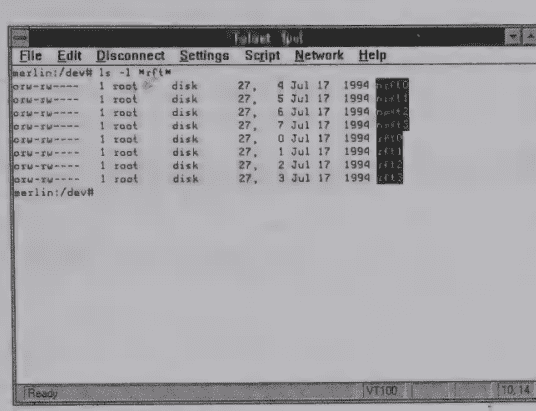

**图 12.1** QIC 磁带驱动器（以及其他几种非 SCSI 磁带驱动器）具有以 `rst` 和 `nst` 开头的设备驱动。

如果当前没有安装任何 `ftape` 设备，你必须使用以下命令创建它们：

```
mknod -m 666 /dev/nrft0 c 27 4
mknod -m 666 /dev/nrft1 c 27 5
mknod -m 666 /dev/nrft2 c 27 6
mknod -m 666 /dev/nrft3 c 27 7
mknod -m 666 /dev/rft0 c 27 0
mknod -m 666 /dev/rft1 c 27 1
mknod -m 666 /dev/rft2 c 27 2
mknod -m 666 /dev/rft3 c 27 3
```

`mknod` 命令创建正确的设备驱动文件（参见第 6 章，设备与设备驱动程序）。该命令创建所有八字符模式设备（四个回回和四个非回回），文件权限为 666（参见第 17 章），主设备号为 27，次设备号范围从 0 到 3。

如果你想使用符号链接到设备 `/dev/ftape`，使用命令：

```
ln /dev/rft0 /dev/ftape
```

使用符号链接允许你使用设备名 `/dev/ftape` 来访问磁带驱动器，而无需输入实际需要的任何磁带驱动器名称（换句话说，你将其别命名为正确的驱动程序）。你也可以使用命令将非回回设备链接到 `/dev/nft0 /dev/nftape`：

```
ln /dev/nft0 /dev/nftape
```

要将设备驱动程序安装到内核，你必须切换到 Linux 内核源码目录（通常为 `/usr/src/Linux`）并执行 `make` 命令重新构建内核：

```
cd /usr/src/Linux
make config
```

在 `make` 过程中某处，系统会询问你是否包含 QIC-117 磁带支持。回答 `yes`，当 `make` 过程询问 `NR_FTAPE_BUFFERS` 的值时，回答 `3`。使用 `ftape` 不需要安装 QIC-02 支持，因此对该问题回答 `no`（如果被问到）。

最后，为了正确重新构建内核，请执行以下三个命令：

```
make dep
make clean
make
```

一旦内核重建完成，将其复制到存放你启动内核的启动目录中（对它进行备份）。如果你只得到了 `ftape` 程序的源代码，你还需要一个编译器。`ftape` 的软件分发包应该包含一个你可以遵循的完整安装文件。本节将详细介绍安装 `ftape` 的通用过程。

`ftape` 设备驱动程序必须安装在 `/dev` 目录中并链接到 Linux 内核才能生效。在获得完整的 `ftape` 分发软件后，将文件复制到 `ftape` 的子目录。使用以下命令检查 `/dev` 目录中是否存在 `ftape` 设备：

`/dev/*rft*`

这列出所有原始软带磁带设备，如图 12.1 所示。如果列出了多个设备，会有四个非回回软带磁带设备，分别为 `/dev/nrft0`、`/dev/nrft1`、`/dev/nrft2` 和 `/dev/nrft3`，以及四个回回设备，分别为 `/dev/rft0`、`/dev/rft1`、`/dev/rft2` 和 `/dev/rft3`。

如果当前没有安装任何 `ftape` 设备，你必须使用以下命令创建它们：

```
mknod -m 666 /dev/nrft0 c 27 4
mknod -m 666 /dev/nrft1 c 27 5
mknod -m 666 /dev/nrft2 c 27 6
mknod -m 666 /dev/nrft3 c 27 7
mknod -m 666 /dev/rft0 c 27 0
mknod -m 666 /dev/rft1 c 27 1
mknod -m 666 /dev/rft2 c 27 2
mknod -m 666 /dev/rft3 c 27 3
```

# 使用磁带驱动器

要创建整个系统的备份，请使用命令：

```
tar cvf /dev/ftape
```

对于 SCSI 设备，或者

```
tar cvf /dev/rst0
```

对于 SCSI 设备。这些命令假设设备已链接到内核。`c` 选项创建存档；`v` 选项让 `tar` 输出所有信息；`f` 选项指定设备。由于使用了详细 (`v`) 选项，每个在磁带上的文件都会显示在屏幕上。

要从磁带恢复整个存档（例如整个文件系统），请使用命令：

```
tar xvf /dev/ftape
```


或者使用（对于 SCSI 设备）。在这种情况下，`x` 选项告诉 `tar` 提取介质的内容，`v` 选项让 `tar` 向屏幕输出所有信息，`f` 选项指定 `tar` 设备（此处为 `/dev/ftape`）。由于没有指定特定的文件或目录，`tar` 会提取磁带的所有内容并放在当前目录中。

你可以使用命令显示 `tar` 存档的内容：

```
tar tf /dev/ftape
```

（对于 SCSI 磁带驱动器使用类似），其中 `t` 告诉 `tar` 显示内容，`v` 用于完整显示，`f` 是设备指示符。`tar` 有许多更多选项和功能，请参见第 22 章获取更多信息。

## 总结

越来越多的磁带设备被添加到 Linux 支持的产品列表中，包括并行口板驱动的磁带驱动器。如果你已经拥有这些产品之一，请关注特定的内核驱动程序。如果你计划购买磁带驱动器，请先检查 Linux 驱动程序。

当你有了磁带驱动器，就可以自觉地制作磁带备份，从而保护你的文件和数据。丢失重要文件是非常恼人的，尤其是当你只需要花几分钟就能保存这些信息时。磁带驱动器是制作可靠备份的最简单、最便宜的方法之一。每个系统都应该有一个！

# 第 13 章

## 本章内容
- 选择调制解调器
- 安装调制解调器
- 配置调制解调器
- 设置快速调制解调速度

## 扩展你的系统
第二部分

如果你想与外部世界通信（例如朋友的计算机、另一个网络、互联网或 BBS），或者你想让别人与你的 Linux 系统通信，你需要一个调制解调器。调制解调器曾是昂贵且复杂的设备，需要大量的 UNIX 专业知识才能进行正确的安装和配置。现在，使用今天最快的调制解调器只需插上它并修改一两个文件那么简单。本章将介绍调制解调器的安装要求。

### 选择调制解调器

Linux 兼容任何调制解调器，只要它能某种方式接入系统并拥有设备驱动程序。选择调制解调器变成了使用 PC 上现有的调制解调器或专门为 Linux 购买。

调制解调器市场竞争激烈。公司之间为了最亮眼的广告、最全的功能以及最好的内置软件的竞争导致了价格更低和更划算的交易。大多数调制解调器自带的软件是用于 DOS 或 Windows 的，但你不需要担心任何类型的 Linux 软件。如果你打算在 Windows 分区上运行调制解调器，请仅考虑该方面的软件。

> 许多今天为 Windows 95 和 Windows 98 设计的即插即用内部调制解调器无法在 Linux 下运行。这是因为调制解调器在安装到 Windows 即插即用系统中是通过软件配置的，而 Linux 尚不支持即插即用。由于这个原因，许多当前的 Windows 兼容调制解调器无法与 Linux 工作。几乎所有的外部调制解调器都能与 Linux 完美工作，任何带有跳线或软件实用程序来设置配置参数的内部调制解调器也可以工作。

选择如今的调制解调器的一个常见问题是针对不同型号推销的过量缩写、速度和功能。随着更好的电话电路（包括光纤）和更高效的数据压缩算法的发展，现代标准在过去几年中变得非常疯狂。压缩算法是目前的市场热点。它们利用复杂的数学系统在一条线上每秒封装尽可能多出五倍的数据。因此，每个人都想在调制解调器中使用数据压缩，但大多数用户并没有意识到，压缩方案在线路两端是相同的，或者默认速度是调制解调器能达到的最佳速度。

### 调制解调器考虑因素

目前的顶级调制解调器使用 V.90，速度为 56,000bps（单向）。V.90 调制解调器通常配合数据压缩方案使用，将有效吞吐量提高到高达 115Kbps（每秒比特）。V.90 标准已正式采用，取代了两个竞争的 56Kbps 系统：k56flex 和 x2。这种情况并不适用于某些压缩算法——它们是事实标准，而非实际标准。这一点可能没有意义，因为这些调制解调器标准背后的公司力量足以推动它们被采用。

为了帮助你跟上使用的不同调制解调器速度，下表列出了通信速度（每秒比特）及其名称：

| 调制解调器名称 | 速度/压缩率 |
| :--- | :--- |
| V.90 | 57,600bps |
| V.FC (V.Fast Class) | 28,800bps |
| V.34 (V.Fast) | 28,800bps |
| V.32terbo | 19,200bps |
| V.32bis | 14,400bps |
| V.32 | 9,600bps |
| V.22bis | 2,400bps |
| 212A | 300bps |
| V.21 | 300bps |
| 103 | 300bps |

**数据压缩系统**

| 标准 | 描述 |
| :--- | :--- |
| V.42bis | 在 28,800bps 线上进行 4:1 压缩至 115,200bps |
| MNP5 | 旧式调制解调器使用的 2:1 压缩算法 |

**传真标准**

| 标准 | 速度 |
| :--- | :--- |
| V.17 | 144,000bps, 12,000bps, 9,600bps, 和 7,200bps |
| V.29 | 9,600bps 和 7,200bps |
| V.27ter | 4,800bps 和 2,400bps |
| V.21 Channel 2 | 300bps |

V.90 调制解调器看起来最快达到 56Kbps，但这个高数字具有误导性，正如你在后续“56Kbps 调制解调器”节中看到的。

许多 Windows 系统使用增强串口设备，这些设备对于维持现代快速调制解调器可以达到的高波特率是必要的。这些设备大部分被操作系统识别为标准串口，因此可以在 Linux 下工作。任何加速设备都需要特殊的驱动程序，除非你将驱动程序移植到 Linux（这不是一项轻松的任务），否则无法工作。如果你打算以高于 9,600 波的速度运行调制解调器，你的标准串口至少应该是 16550 UART（而不是较旧的 16450 UART）。如果你有一台旧 PC，请咨询你的供应商关于升级串口的情况。升级通常很便宜，并且对快速速度下的调制解调器性能有巨大影响。

16550 UART 具有 16 字节缓冲区，但 16450 只有 1 字节缓冲区。通常，16450 UART 只能用于 9,600 波。任何更高的吞吐量速度都需要 16550 UART。

Linux 不关心你的调制解调器是内部模型还是外部模型，只要它有一个可以寻址的串口标记即可。最近，内部和外部模型的选择变得单向了。五年前，内部调制解调器成为首选。现在大多数品牌调制解调器都是外部的，可能是因为更容易升级。大多数制造商都提供两种类型的调制解调器。注意，内部调制解调器节省了机器背面的一个串口（并且几乎使用 16550 或更快的 UART）。

许多新型号需要考虑的一点是其软件的可升级性。

## 56Kbps 调制解调器

尽管如此，56Kbps 调制解调器市场在最初的几年里并非没有问题。市场上存在两种不同类型的 56Kbps 调制解调器，它们之间互不兼容。主要的调制解调器制造商分为两个不同的阵营，给用户造成了困惑。Hayes（通常被认为是消费级调制解调器的祖父）和 Multitech（其他流行的调制解调器制造商）采用了 Lucent 和 Rockwell 开发的 K56flex 技术。许多其他调制解调器供应商也支持 K56flex 系统。USRobotics（称为 x2）开发了自己的 56Kbps 技术并对其大力推销。这些技术是完全不兼容的。这给服务提供商带来了许多麻烦，他们需要购买两种品牌的 56Kbps 调制解调器服务器；最终，他们达成了一个标准：V.90。V.90 统一了这两个阵营。

如果你相信这些的话，新一代的 V.90 调制解调器不仅能提供 56Kbps，通过 V.42 bis（一种相当常用的压缩技术）等压缩技术，速度可以达到 115.2Kbps。这就像是模拟线路上的绑接 ISDN 连接！虽然这些数字在理论上是可能的，但实际速度要慢得多。典型系统中 V.90 调制解调器提供的服务器到客户端的峰值吞吐量为 45Kbps，平均吞吐量为 38Kbps，客户端到服务器的吞吐量为 29.9Kbps。

## 安装调制解调器

如果你购买的调制解调器是内置的，你必须打开机器并将其添加到空闲插槽中。确保将通信端口参数设置为未使用的值。大多数内置调制解调器默认设置为 DOS COM3 或 COM4。这些值也适用于 Linux，只要你可以将串口设备驱动程序拷贝到这些值。（COM3 和 COM4 设置可能会导致 PC 架构问题，因为 COM3 与 COM1 共享相同的 IRQ，而 COM4 与 COM2 共享。由于这个原因，尽量不要同时使用两个共享 IRQ 的 COM 口。换句话说，如果你同时使用 COM2 和 COM4 作为调制解调器，你将会遇到问题。）

外置调制解调器插在主背板或扩展板上的空闲串口上。无论采用何种方式，线缆必须是 DCE（数据通信设备）类型，并使用调制解调器线（引脚直通）。有关串口设备布线的更多信息，请参阅第 11 章“终端与术语”。

你可以在一个系统上支持多个调制解调器，因为 Linux 将它们视为设备且不会导入它们。如果你有两个串口，就可以使用两个调制解调器。如果你的系统连接了一个 32 端口的多端口板卡，你可以根据意愿将所有端口都用于调制解调器。但请记住，调制解调器通常被专门用作拨入或拨出设备，而不是两者兼顾（这是旧 UNIX 惯例的遗留），尽管 Linux 允许你轻松切换模式。

## 配置调制解调器

配置调制解调器与 Linux 工作的最简单方法是使用 Linux 软件系统附带的设置或配置工具。在大多数情况下，setup 工具在安装过程中会询问你是否正在使用调制解调器、它位于哪个端口以及要设置的最大速度是多少。如果你在安装 Linux 之后添加调制解调器，可以通过重新运行设置或配置程序访问这些例程。使用这些自动化系统之一可以避免你手动修改文件。

> **注意**
> 当你将调制解调器分配给串口时，记住 Linux 从 0 开始计数。DOS 的 COM1 是 Linux 的 `/dev/cua0`，COM2 是 `/dev/cua1`，以此类推。

在自动化安装过程中，系统会要求提供调制解调器的最大速度。如果在看到的列表中没有请求该速度，请选择下一个快的速度。例如，如果你的调制解调器声称能达到 28,800bps，而该速度不在配置菜单中，请选择下一个快的速度，可能是 38,400bps。调制解调器会独立于 Linux 进行调整。

如果你必须手动配置调制解调器（要么你没有自动化例程，要么你只是想这样做），你需要一个用于机器上某一个可用串口的驱动程序。通常，每个串口有两个驱动程序，一个用于拨出，另一个用于拨入（Linux 无法同时处理这两个功能）。设备驱动程序通过主设备号进行区分（从设备号相同，通常为串口设备设置为 64）。用于拨号的调制解调器主设备号设置为 4，拨出调制解调器的主设备号设置为 5。设备驱动程序的名称也不同。拨出调制解调器的设备名称如 `tty0`、`tty1` 等。拨入调制解调器的设备名称如 `cua0`、`cua1` 等。

通过列出 `/dev/ttyS*` 文件（用于拨入驱动程序）和 `/dev/cua*` 文件（用于拨出驱动程序）来检查你的串口是否有驱动程序。列表应在第五列和第六列显示设备号。以下列表：

- COM1 拨入 (`/dev/tty0`)：主号 4，从号 64
- COM2 拨入 (`/dev/tty1`)：主号 4，从号 65
- COM3 拨入 (`/dev/tty2`)：主号 4，从号 66
- COM4 拨入 (`/dev/tty3`)：主号 4，从号 67

## 设置快速调制解调器速度

串口通常被 Linux 限制为 38,400 波。（运行 Setup 时，你被要求提供调制解调器支持的最大速度，列表中最大的数字是 38,400。）为了运行更快的调制解调器，你必须使用 `setserial` 命令。`setserial` 命令允许将 38,400 波的端口设为 57,600 波，命令如下：

```
setserial /dev/cua2 spd_hi
```

其中 `/dev/cua2` 应该替换为你正在配置的调制解调器名称。（如果你之前已将其链接到调制设备，也可以使用 `/dev/modem` 设备名称。）

为了获得更高的性能，让你的调制解调器运行在 115,200 波，请使用 `spd_vhi` 选项，命令如下：

```
setserial /dev/modem spd_vhi
```

两个 `spd_hi` 和 `spd_vhi` 选项都可以由非 root 用户指定，因此普通 Linux 用户可以在需要时定制调制解调器端口。你可以通过此命令将调制解调器端口恢复到正常的 38,400 波：

```
setserial /dev/modem spd_normal
```


# 其他设备
## 第 14 章

### 本章内容
- 不间断电源 (UPS)
- 可拆卸卡式驱动器
- 扫描仪、光学阅读器及类似设备
- 文件迁移

## 扩展你的系统
### 第二部分

本书这一部分之前的章节涵盖了 Linux 用户添加到系统中最常见的设备，但仍然有一些可用的外设设备你可能想要添加到系统中。这些包括不间断电源 (UPS)、扫描仪以及难以归类为任何类别的设备，例如高容量磁光驱动器和 DAT 磁带库机。本章将介绍你可能想要添加的几种常用外设设备。

## 不间断电源

几年前，只有大型工作站或网络服务器所有者才会购买 UPS（不间断电源）。像磁带设备一样，UPS 现在被认为是一个重要的外设设备。如果你无人值守或一直运行 Linux 系统，你应该在系统中包含一个 UPS，即使以牺牲另一个组件（如额外的硬盘或高速调制解调器）为代价；UPS 能够保护你的系统免受问题影响。

带有浪涌滤波器的电源插线板曾满足许多用户的需求。浪涌滤波器确实是有作用的；无论是否需要浪涌滤波器，大多数浪涌滤波器都是个好主意。然而，市场上的某些浪涌滤波器在受到足够强度的浪涌冲击时会因为电路烧毁而产生比解决的问题更多的问题。浪涌会传递给所有插在电源上的设备。

北美电力系统是世界上最好的系统之一，但电压浪涌和欠压现象很常见。停电确实会发生，而且是经常发生。根据你所在的位置，平均每月发生一次故障。所有这些线路攻击都能轻易损坏敏感的电子设备，导致从文件系统损坏到机械灾难性故障，有时还会引发火灾等次生影响。

随着 UPS 价格的下降和公用事业公司电源的恶化，UPS 正迅速成为一个必要的组件。通过保护连接 UPS 的计算机设备，UPS 提供电池电源，以便在断电时能够干净地关闭 Linux 系统，防止文件系统损坏。最近，开始出现与 Linux 整合的软件，使得你的系统在出现问题时可以完全自动关闭。

UPS 有不同的配置，但典型的单元由一个在市电良好时充电的电池组成。某些 UPS 从电池输出提供所有功率，确保平稳、受控的电能。这样，就可以提供无波动的保证 120 伏电压。UPS 使用调节电源来抑制接入的浪涌和过电压，并补充 UPS 电池的低电压。UPS 具有一个快速动作的分流器，在主电故障时将输出切换到电池。

某些 UPS 单元缺少电池部分，直接调节电源。电池备份可能在链路的更下游，或者完全不使用（这会导致系统暴露在停电风险中）。对于有长期问题的站点（特别是工业建筑或偏远地区），这种调节可能是必要的，以确保计算机设备的长久寿命。

更常见的是插电电池式 UPS 单元。通常这些单元在价格和功能上差异很大。电池容量和内部电路的过滤量在可用型号之间也不同。大多数制造商根据电压和瓦数容量提供单元。选择容量过大的单元会导致过度支出，而功率不足的单元可能会因无法为连接其所有设备提供足够功率而导致问题。

## UPS 类型

UPS 背后的技术正在不断进步，提高了 UPS 应对电压变化的能力、向连接的设备提供恒定且稳定滤波电压的能力，以及在故障时使用电池电源的能力。大多数人认为 UPS 只有两种：`后备式`（仅在断电时用电池供电）和`在线式`（始终通过电池运行）。这种观念是过于简化；UPS 设计中使用了六或七种不同的拓扑结构。

最常见的 UPS 类型是`后备式 UPS`，通常用于小型家用机器。切换开关在滤波后的交流电 (AC) 和电池之间进行选择，当交流电完全故障时切换到电池。电池和逆变器电路（提供交流电所必需）在断电时工作，这就是该系统被称为后备式的原因。从外部交流电切换到内部电池的速度至关重要，因为必须足够快，以防止任何连接的设备出现问题。后备式 UPS 受欢迎主要是因为它们廉价、通常很小且效率高。很少需要维护。

`在线互动式 UPS` 用于较大的系统，如服务器。在这种设计中，电池逆变器始终激活状态，为连接到 UPS AC 插座的组件供电。接入的交流电用于为电池充电。由于逆变器始终运行（无论是电池还是接入的交流电），输出是经过调节和控制的，允许具有较少瞬态的一致输出。当发生欠压情况时，电池可以补充功率以提高电压。互动式 UPS 单元高效且可靠，通常并不昂贵，尽管它们比后备式单元贵。通常这些单元最大可用 5kVA（千伏安）。

`后备混合式 UPS` 可用于 10kVA，行为与后备式 UPS 类似，但由于电路设计，切换到电池时没有转换时间。这种设计往往昂贵且效率低下，因此没有广泛使用。


较大的单元通常采用与较小单元不同的设计。在 10kVA 以上，`在线 UPS` 几乎是标准。电路看起来像后备式 UPS，但逆变器作为主电源而非接入电路。你可能会认为这在断电时没有转换时间，但实际上这些单元存在延迟。这种设计允许组件进行滤波和稳定输出。尽管由于设计和高额定，这种设计往往运行发热，因此寿命较短。

`转换式 UPS` 是针对高容量单元的较新设计。它类似于由逆变器供应输出的转换设计，但转换电路也对输出做出贡献。使用转换式设计的优势是效率更高且电能质量更好。这种设计拥有专利，因此仅由少数供应商提供。

## UPS 术语：了解你的 VA

当你去购买 UPS 时，你会在包装和产品介绍中看到大量的术语。虽然大多数 UPS 制造商在术语的使用上保持一致，但有些公司利用模糊或误导性的术语和炒作来说服你它们是最好的。在购买 UPS 之前，你应该熟悉你会遇到的术语。

如果你在学校学过任何电子学或电学，你会知道电压和电流。UPS 通常以 VA（伏安）为单位额定。伏安是设备使用的视功率，与实际功率（瓦）相反。这种差异是因为功率因数，大多数计算机使用电容器开关电源，其功率因数为 .60，这意味着计算机消耗的瓦特数约为 VA 额值的 60%。

为了理解 UPS 的额值以及哪个适合你，你需要了解功率因数。在交流电路中，会感应出某些无功或谐波电流，导致视功率高于电压乘以电流（正常的功率公式）。视功率（V×A）与实际功率之间的差异导致了功率因子。视功率以 VA 额定给出，必须乘以功率因数才能得到实际功率。这种影响可能是相当大的：测试显示视功率比实际功率高出 50%，这意味着当你需要 300VA 时，你实际上需要 450VA。

`浪涌因子`（Surge factor）是 UPS（不间断电源）的瞬时过载能力。它衡量了 UPS 处理短时间过载状态的能力，通常是设备启动电压的需求。例如，大多数磁盘驱动器对浪涌因子有很高要求，任何带有电机的设备也是如此。典型的浪涌因子大约比稳态额定值高 50%，或者说一个 1kVA 的 UPS 应该能够在极短的时间内处理 1.5kVA。

## 选择合适的 UPS

当你尝试寻找适合你需求的 UPS 时，会看到很多数字。要确定所需的尺寸，你必须相加所有由 UPS 供电设备的功耗。不要使用你添加的任何设备的功率（power）或瓦数（watt）额定。相反，请使用 VA 额定。（功率和瓦数测量不包括无功或谐波效应。）

当你为系统添加所需的 UPS 输出量时，确保 UPS 的 VA 额定高于 VA 需求。这似乎是显而易见的，但有些人是基于“这两个者不会同时运行”的原则，结果导致 UPS 过载。计算所有连接设备的总和，假设它们在同一时间通电。还要考虑计划中的购买项目：外部设备都需要从 UPS 提取电源，而不是来自服务器或工作站的内部电源。

一旦你确定了所需的 UPS 输出总量，建议的做法是向上一个功率等级。这为 UPS 本身以及你未来可能进行的任何更改提供了安全缓冲。例如，如果你打算买一个 600VA 的设备，请升级到 1kVA。

购买 UPS 时一个常见的陷阱是混淆了瓦数和 VA，以及没有考虑到功率因数。例如，假设你有一台额定为 500W 和 500VA 的文件服务器。一个 600VA 的 UPS 可以很好地处理 500VA 的额定。然而，0.6 的功率因数导致 UPS 的额定功率为 360W (600x0.6)，因此 UPS 无法为服务器供电。

某些 UPS 制造商有一个坏习惯，不在其 UPS 包装或规格书中同时包含 VA 和瓦数额定。相反，他们只包含瓦数额定，这导致大多数购买者因为功率因数而购买了太小的设备。如果 VA 额定不明确，就很难确定它实际上能提供多少功率。最好的建议是避免任何没有明确标明 VA 额定的设备。没有瓦数额定的设备同样糟糕。最好的建议是避开并寻找一个同时具有这两个额定的设备。或者，你通常可以通过假设功率因数为 0.6 来计算瓦数，这意味着瓦数将是 UPS VA 额定的 60%。

记住不要将激光打印机插在 UPS 上；典型激光打印机的功耗超过了 UPS 的浪涌因子，并可能导致故障或损坏电路。对于激光打印机，通常只需要一个浪涌保护器，尽管某些 UPS 设计具有足够高的额定值来处理激光打印机。喷墨打印机往往不会像激光打印机那样糟糕，但最好的建议仍然是将打印机放在浪涌保护电路上，而不是电池供电电路路上。某些 UPS 在背面标有用于浪涌抑制的插座，这些可以用于打印机。

一台典型的台式家用电脑和显示器至少需要 400VA，除非它们的设备非常少（如一个软盘和一个硬盘）。工作站和服务器可能需要更多，通常在 600VA 以上。在选择 UPS 时，请记住所有连接设备的总和，假设它们在同一时间通电。此外还要考虑计划中的购买：外部设备都需要电源。某些 UPS 在背面标有用于浪涌抑制的插座，这些可以用于打印机。

## UPS 软件与监控

UPS 通过串行端口连接到你的机器，操作系统中的 UPS 驱动程序会监控 UPS、电池和市电电压的状态。许多 UPS 软件包提供屏幕上的 X 图或基于字符的诊断显示，向你展示系统的当前状态。少数 UPS 软件包允许你通过网络驱动程序或插拔 SNMP 模块从一个位置管理多个 UPS。虽然这些对于办公环境是理想的，但单个用户可能不需要此类功能。

少数软件包允许无人值守重启（在你不在场的情况下重启机器），但这些通常出现在昂贵的 UPS 单元中。如果你的 UPS 没有可用软件，如果你是一个精通编程的程序员，可以自己开发这些程序。UPS 会通过串口引脚信号问题，你的软件只需要监控该信号然后执行关机过程。

## 与 UPS 共存

使用 UPS 的全部重点是保护你的系统，无论它是开启还是关闭。确保你所有敏感的电脑设备（激光打印机除外）直接插入 UPS，或插入连接到 UPS 的电源插板上。这样，它们就得到了保护。某些 UPS 具有浪涌过滤插座，你可以将激光打印机插入其中，这些插座没有电池备份，但 UPS 内部的保护电路有助于防止浪涌电流到达打印机。

记住，UPS 是一个带有电池的电子设备。电池应始终保持充电状态，并定期检查以确保它可以储存电。电池介入为你的设备供电的次数越多，其寿命就越短。

你的 UPS 应该用多久？一个 1kVA 范围的典型单元可以轻松提供五年的服务，如果电池需要频繁介入，使用寿命将会缩短。许多 UPS 供应商建议在更换电池之前使用三到五年的寿命。

许多 UPS 使用用户可更换的电池，因此你不需要将 UPS 寄回厂家。然而，电池成本占了 UPS 价格的大部分，当需要更换电池时，更换整个 UPS 往往更有利，并且可以利用 UPS 硬件和软件领域的进展。

## 可拆卸卡式驱动器

目前有多种可拆卸卡式驱动器。有些采用传统的磁盘片技术，另一些使用磁光技术。对于所有这些驱动器，它们与 Linux 的集成程度取决于使其运行所需的驱动程序。

SCSI 系统是最简单的。Linux SCSI 接口识别大多数基于 SCSI 的驱动器，你可以将卡带格式化为文件系统，就像处理任何其他辅助驱动器一样。每当你更换卡带时，卸载卡带的文件系统，插入新带，并挂载新的文件系统。整个过程完全不需要 Linux 接口。可拆卸卡式驱动器唯一的问题是卡带的格式化，有时必须在 DOS 下进行。可拆卸卡带上的拆分分区也支持到 Linux 的限制。（更多信息请参阅第 18 章“文件系统”。）

典型的可拆卸卡式系统包括 Iomega Zip 和 JAZ 驱动器（在下一节中介绍）、SyQuest 系列可拆卸卡式驱动器、Iomega LaserSafe Pro 系列磁光驱动器，以及来自索尼和富士更多的磁光驱动器。磁光带有多种格式，总存储容量从 250MB 到 1GB 不等。由于这些设备大部分是 SCSI，它们在 Linux 下使用普通 SCSI 驱动器时需要表现良好。Linux 有一些专用的驱动程序，你应该检查制造商网站或 Linux 的 Web 和 FTP 站点。

非 SCSI 驱动器除非为该驱动器开发了设备驱动程序，否则通常无法在 Linux 上运行。如果你考虑添加新的存储设备，请检查 Linux FTP 和 BBS 站点以确保有相应的设备驱动程序。许多基于 DOS 和 Windows 的设备的流行意味着程序员最终可能会将它们移植到 Linux，这只是等待驱动程序出现的问题。

## Iomega Zip 和 JAZ 驱动器

虽然市场上有很多种可拆卸驱动器，但最受欢迎的无疑是 Iomega 的 Zip 和 JAZ 驱动器。Zip 驱动器在廉价卡带上提供 100MB 或 250MB 的存储，取决于型号。JAZ 驱动器使用更大的卡带，并提供 1GB 和 2GB 版本。两种驱动器适用于多种特定的接口，包括 SCSI、IDE (ATAPI) 和并行口。Jaz 和 Zip 驱动器都可以在 Linux 下使用。下文将介绍这两个驱动器的安装和配置。


## 安装 Zip 驱动器

在你的 Linux 系统上安装 Zip 驱动器的步骤取决于你购买的接口类型。无论什么类型的接口，你都需要在内核中启用 SCSI 支持。如果你的系统还没有使用 SCSI 控制器，你需要重新配置内核。这通常在 `/usr/src/linux` 完成。当询问是否想要 SCSI 支持时，回答 Y。

如果你已经有一个 SCSI 控制器，就不需要重新配置内核。如果你购买的是并行口版本，将需要使用 `IMM` 模块。


scsi: 1 host.

Vendor: IOMEGA Model: ZIP 100 Plus Rev: J.66

Type: Direct-Access ANSI SCSI revision: 02

Detected scsi removable disk sda at scsi0, channel 0, id 6, lun 0

```
如果你看到类似这些信息，说明 Zip Plus 驱动器已就绪。

## 安装 JAZ 驱动器

JAZ 驱动器通常基于 SCSI。

JAZ SCSI 适配器设计用于单独驱动 JAZ 驱动器，不支持硬盘以及许多其他 SCSI 外围设备。市场上有两种版本的 Jet 卡，一个使用 Adaptec 芯片，另一个使用 Advanced Systems (Advansys) 芯片。如果你检查 Jet 卡上的芯片，你会在主控器芯片上看到这些名称之一。基于 Adaptec 的 Jet 卡可以使用大多数发行版中包含的 Adaptec `aic7xxx` 驱动程序进行驱动。要使用 Advansys 控制器版本，需要重新编译内核，并在询问是否在内核中包含 `CONFIG_SCSI_ADVANSYS` 驱动时回答是。重启后，Jet 卡每次都应该可供系统使用。

如果你在使用 Linux 系统中已准备好的任何其他 SCSI 控制器，则不需要为 JAZ 驱动器安装特殊驱动程序。普通的 SCSI 控制器驱动程序将识别 JAZ 驱动器并使其可用。JAZ 驱动器需要在 Linux 启动时在线以便被内核驱动程序识别。JAZ 驱动器的内部版本一直开启，但外部版本无论你是否打算使用它，都需要上电。当你启动 Linux 时，你将看到驱动程序检测到 JAZ 驱动器后显示的其 SCSI ID 的信息。以下是基于 Adaptec 的 Jet 卡在 SCSI ID 3 处找到 JAZ 驱动器的输出示例：

```
aic7xxx: Downloading sequencer...done.

aic7xxx: Resetting the SCSI bus...done.

scsi0: Adaptec AHA274x/284x/294x (EISA/VLB/PCI-Fast SCSI) 3.2/1.3/0

scsi1: 1 host.

aic7xxx: Scanning Channel A for devices.

aic7xxx: Target 3, channel A, now synchronous at 10.0MHz, offset (0xf).

Vendor: iomega Model: jaz 1GB Rev: G.70

Type: Direct-access ANSI SCSI revision: 02

Detected scsi removable disk sda at scsi0, channel 0, id 3, lun 0

scsi1: detected 1 SCSI disk total
```

## 其他设备
第 14 章

在这种情况下（取自 Slackware 系统），JAZ 驱动器被访问为 `/dev/sda`。以 `scsi0` 开头的行表示已找到 Jet 卡。如果你的输出中没有这样的一行，则说明 SCSI 驱动程序未加载，JAZ 驱动器将无法访问。

## 分区 JAZ 驱动器

你可以像处理 Linux 下的任何硬盘一样对 JAZ 磁带进行分区。最常用的方法是使用 `fdisk` 在磁带上设置分区表，然后使用 `mk2fs` 创建 Linux 格式的分区。在分区时，JAZ 磁带被视为硬盘，并且单个磁带上可以有多个分区和操作系统。

在驱动器格式化后，你可以使用通常 `mount` 命令挂载磁带。

```
mount /dev/sda /jaz
```

将 `/dev/sda` 中的 JAZ 磁带挂载到文件系统中的 `/jaz` 目录。挂载点（在此情况下为 `/jaz`）必须为空才能挂载成功。大多数管理员会发现有一个像 `/jaz` 这样的挂载点非常方便，这样在拷贝文件时很清楚该目录指的是什么。如果磁带上有多个分区，则你需要在 `mount` 命令中指定分区号。

```
mount /dev/sda2 /jaz
```

将 JAZ 磁带上的第二个分区挂载为 Linux 文件系统。

要挂载 DOS 格式的 JAZ 磁带（包括在 Windows 下格式化的磁带），你需要在 `mount` 命令中指定文件系统，如下：

```
mount -r msdos /dev/sda4 /jaz
```

你需要为 DOS 格式的磁带指定第四个分区，因为这是 Iomega 的默认设置（它源于 Macintosh 系统）。

只要 JAZ 磁带处于挂载状态，你就无法弹出它。你永远不要在已挂载的文件系统上强制弹出磁带，因为这可能会导致整个文件系统损坏。相反，请使用此命令卸载 JAZ 驱动器：

```
umount /jaz
```

每次你想更换磁带时都必须卸载驱动器。

如果你想控制 JAZ 驱动器上的软件写保护功能，你需要获取 Iomega 工具的 Linux 版本。Linux 下一个相同功能的工具称为 `jaztool`。

## 其他设备

## 扫描仪、光驱及类似设备

大多数扫描仪和类似设备没有 Linux 设备驱动程序，尽管某些公司开始发布选型号的驱动程序。再次，SCSI 设备最易与 Linux 配合，因为 SCSI 接口处理了该设备的所有通信。问题在于提供一个可以与设备通信的应用程序。

例如，对于扫描仪，你需要一个用户应用程序来接收从扫描头通过 SCSI 流传来的数据，并将其处理成可展示的图像。虽然有一些特定的扫描仪工具可用，但对于大多数设备，你必须使用通用工具。

## 启动、使用 init 和关机
第 15 章

它们的配置信息包含在 LILO 信息中。在创建 LILO 配置文件时，提供这些信息只需识别分区设备名称和操作系统的名称即可。第 4 章涵盖了这些步骤。

由于 LILO 将数据写入其他操作系统无法读取的磁盘驱动器，因此如果您频繁地从硬盘上安装和删除操作系统，那么它并不是最佳解决方案。每当您对 Linux 系统或硬盘上的其他分区进行配置更改时，请通过重新运行 LILO 来更新 LILO 信息。

## 使用启动软盘

如果你不想依赖 LILO（它会修改磁盘扇区，并且在在使用多个操作系统或频繁更换操作系统时可能会导致问题），你可以使用启动软盘来启动 Linux。启动软盘是一个单面软盘，其中包含了 Linux 内核的完整副本以及访问硬盘上根分区的指令。启动软盘必须是正确的格式，才能运行在系统的第一个磁盘驱动器上（DOS 术语中称为 A 盘）。Linux 无法从第二个软盘驱动器（B 盘）启动。

在许多方面，启动软盘是启动 Linux 最简单且多功能的方法。例如，如果你的硬盘被分区为 DOS 和 Linux，且以 DOS 为正常启动分区，只需顺畅地开启 PC 的 DOS 即可。如果你想让 Linux 启动，请插入启动软盘并启动机器。Linux 从软盘启动，然后像从硬盘启动一样访问硬盘。

如果你正在使用启动软盘启动 Linux，每当你进行涉及重新编译内核的系统更改时，请务必更新软盘上的内核镜像。请记住，几乎每当你添加设备或设备驱动程序时，都需要重新编译内核。使用以下段落概述的步骤更新你现有的软盘，或者更好，创建一个新的启动软盘，并将当前的软盘保存以备不时之需。如果你在更改内核时没有被提示创建新软盘，你必须记住执行这一步。

## 创建启动软盘

要创建启动软盘，请使用一张空白、已格式化的高密度软盘（1.44MB 或 1.2MB，取决于你系统的 A 盘类型）。使用 DOS 格式化软盘，以便供 Linux 读取的扇区和轨道信息。某些较小的内核可以放进低密度软盘上，但由于高密度驱动器是标准配置，你的系统最可能会使用高密度驱动器。高密度软盘上除了 Linux 内核外还可以存储信息，但请确保你有足够的磁盘空间存放内核镜像。

某些 Linux 版本（如 Slackware）会在常规设置程序过程中创建启动软盘。如果你使用的是带有设置程序的发行版，请在菜单上选择 Configure（配置）选项，按照提示操作，并查看最后是否会提示创建启动软盘。或者，某些发行版有一个独立的菜单选项用于创建启动软盘。


## 管理你的 Linux 系统
第三部分

如果你想手动创建启动软盘，请在系统中找到 Linux 内核内核镜像。通常它位于根目录下；某些 Linux 版本将内核镜像存储在 `/etc` 目录。内核名称随 Linux 版本而变化，但通常被称为 Image、vmlinux 或 vmlinuz（压缩后的 vmlinux）。你可以通过观察系统启动时的启动信息并记录内核名称，然后使用 `find` 或 `where` 来定位它，从而很容易找到内核。然而，切换到根目录并寻找名为 Image 或 vmlinuz 的大文件要简单得多。在许多 Linux 发行版中，该文件由 root 所有，且只有读取权限。

例如，当你执行列表命令（如 `ls -l`）时，你会看到如下条目：

```
-r------ 1 root root 457700 Aug 10 13:52 vmlinuz
```

此条目显示了一个半兆字节的压缩内核镜像。内核的日期时间与你上次重新编译内核的时间或安装 Linux 的日期相同。

某些 Linux 版本还以压缩格式存储内核。许多压缩后的内核以 z 结尾，例如 vmlinuz 或 vmlinuz.z。压缩后的内核在硬盘或软盘上占的空间较小，并在启动时解压缩。

## 创建和使用维护盘

每个系统都应该有一个维护盘（也称为紧急磁盘），以便在发生任何故障时可以使用。维护盘是一个启动 Linux 的组合启动盘。要创建维护盘，你需要在软盘上创建一个根系统，将基本工具复制其中，安装 LILO 并使磁盘可启动。每当你对系统进行更改时，都要执行此过程，以确保你的维护盘具有相同的。你已经在安装 Linux 时使用的那对软盘中拥有了一套维护盘。虽然这些磁盘没有针对你的系统进行配置，但你可以使用它们加载 Linux 并挂载你的硬盘。许多 Linux 设置程序都有内置的程序来创建启动软盘。你可以使用该程序创建维护盘。如果由于任何原因你需要从维护盘启动，请挂载现有的硬盘与。如果你从软盘启动并想挂载分区 `/dev/sda2`（例如由于某些原因无法启动 Linux），执行命令 `mount -t ext2 /dev/sda2 /mnt`。

在执行此操作之前，目录必须存在，且应该是空的。`-t` 指定了文件类型。如果你的文件系统不是扩展文件系统，请更改类型。

# 管理你的 Linux 系统
第三部分

在掉电的瞬间写入 i 节点表或任何其他信息，写入过程会被中断，并可能导致磁头损坏或坏道信息。同样的原理也适用于任何正在运行的进程。例如，如果你在切电源时正在运行数据库重索引，索引和数据库可能会损坏。正常地关闭 Linux 系统可以确保所有进程都写入并关闭所有文件，并干净地终止。

关闭 Linux 系统有两种简易的方法。最简单的方法是使用 `Ctrl+Alt+Del` 序列。在许多 Linux 版本中，此键盘组合键会触发关机命令，关闭所有进程并重启机器。Linux 本质上捕获了 `Ctrl+Alt+Del` 序列并利用它来关闭机器。然而，并不是所有的 Linux 版本都支持此序列，因此请仔细检查你的文档。

> 如果你的系统没有捕获 Ctrl+Alt+Del，且在没有正常关闭 Linux 的情况下执行该操作时重启了机器，其效果与直接断电相同。在使用此命令之前，请确保你的 Linux 版本支持此命令！

关闭 Linux 的另一种方法是使用 UNIX 命令 `shutdown`。

当你执行 `shutdown` 命令时，Linux 开始终止所有进程，然后关闭内核。`shutdown` 命令会显示几条不同的消息，取决于 Linux 的版本，但所有消息都会告知你进度或确认你是否真的要关闭系统。

`shutdown` 命令允许你指定关机之前的时间，以及一个要显示给所有登录用户的可选警告消息。命令的格式为：

`shutdown time message`

例如，命令

`shutdown -15 'Backup Time!'`

将在 15 分钟后关闭系统，并向系统上的所有用户显示消息“Backup Time!”，提示他们注销。当你强制执行在特定间隔时间关机的策略（无论是为了维护还是备份）时，这个命令非常合用。

在大多数 Linux 版本中，`shutdown` 命令接受 `-r` 选项。此选项会导致 PC 在关机发生后重启。你可以使用此选项重启到另一个操作系统，或者在修改内核或设备后重启 Linux。如果你愿意，可以将 `-r` 选项与时间或消息一起使用。命令

```
shutdown -r 5
```

将在五分钟后重启系统。

在大多数情况下，使用 `Ctrl+Alt+Del` 或 `shutdown` 命令会在主控制台上显示若干条状态消息。当 Linux 正在关闭系统时，你会看到消息：

"The system is halted"

当此消息出现在屏幕上时，可以安全地关闭电源或重启机器。虽然遵循这些额外步骤看起来可能有点奇怪，但你会发现像 UNIX（甚至包括 NT 和 Windows 95）这样的高端操作系统需要你遵循特定的关机程序以防止信息丢失。养成这个习惯！

# 理解 init 守护进程

init 守护进程通常作为 Linux 内核引导的最后一步被调用。init 守护进程是最重要的 Linux 守护进程之一，因为它为系统的其余部分创建进程。init 守护进程在 Linux 启动时执行，并保持活动直到 Linux 关闭。理解 `init`（及其关联的工具 `telinit`）的作用以及它如何控制操作系统的，对于更好地管理 Linux 系统至关重要。

`init` 和 `telinit` 都使用多个配置文件来执行任务，因此接下来的章节也将详细查看这些文件。这些文件与终端和控制会话的启动与停止密切。`init` 程序通常保留在 `/bin` 目录，尽管某些 Linux 版本将其保存在 `/sbin` 中。`telinit` 工具也适用于相同的目录。不过，配置文件始终保留在 `/etc` 中。

# 运行级别

当 `init` 守护进程执行时，它会从 `/etc/inittab` 文件读取指令，该文件主要用于启动终端的 `getty` 进程以及 Linux 所需的进程。在检查 `/etc/inittab` 文件时，它会搜索标记为 `default` 的项，该项设置系统的默认运行级别。如果 `/etc/inittab` 中没有定义 `initdefault` 级别，系统会提示输入级别。

运行级别（run level）是一组特定的进程，从仅用于系统管理的极简配置运行到所有配置设备的完全运行。运行级别由零到六的数字定义。对于大多数 Linux 版本，运行级别具有以下机制：

- 0-停止系统
- 1-单用户（维护）模式
- 2-不带 NFS 的多用户模式
- 3-带网络的多用户模式
- 4-未使用
- 5-多用户模式
- 6-重启系统

运行级别 2 和 3 的区别仅在于对 NFS 的网络支持（在运行级别 2 下网络是激活的，但不支持 NFS）。如果你在 Linux 上没有运行网络软件，运行级别 2 和 3 是相同的。如果你没有将 NFS 作为 Linux 系统的一部分加载，则运行级别 3 是默认值。如果你加载了 NFS，那么运行级别 5 就是默认值。

```
telinit 2

telinit s
```


# 启动、使用 init 和关机

当切换到超级用户级别时，你可以使用大写或小写的 `s`。`telinit` 和 `init` 工具都可以处理这两种情况。你可以通过 `-t` 选项指定更改所需的延迟时间（单位为秒）。命令 `telinit -t5` 在五秒后将运行级别更改为级别 3。如果没有指定时间，Linux 使用 20 秒的默认值。当你更改运行级别时，`init` 会向所有不符合当前运行级别的进程发送 `SIGTERM` 信号。在发送 `SIGTERM` 信号后，`init` 等待指定的秒数（或默认的 20 秒），然后终止它们。

```
telinit 2
telinit s
```

## /etc/inittab 文件

`init` 守护进程执行时，它从 `/etc/inittab` 文件读取指令，这主要用于启动终端的 `getty` 进程以及 Linux 所需的其他进程。在检查 `/etc/inittab` 文件时，它会搜索标记为 `default` 的项，该项设置系统的默认运行级别。如果 `/etc/inittab` 中没有定义 `initdefault` 级别，系统会提示级别。

运行级别是一组特定的进程，从仅用于系统管理的极简运行到所有配置设备的完全运行。运行级别由零到六的数字定义。对于大多数 Linux 版本，运行级别具有以下机制：

- 0 - 停止系统
- 1 - 单用户（维护）模式
- 2 - 不带 NFS 的多用户模式
- 3 - 带网络的多用户模式
- 4 - 未使用
- 5 - 多用户模式
- 6 - 重启系统

运行级别 2 和 3 的区别仅在于对 NFS 的网络支持（在运行级别 2 下网络是激活的，但不支持 NFS）。如果你在 Linux 上没有运行网络软件，运行级别 2 和 3 是相同的。如果你没有将 NFS 作为 Linux 系统的一部分加载，则运行级别 3 是默认值。如果你加载了 NFS，那么运行级别 5 就是默认值。

在大多数情况下，使用 `Ctrl+Alt+Del` 或 `shutdown` 命令会在主控制台上显示若干条状态消息。当 Linux 正在关闭系统时，你会看到消息：

> The system is halted

当此消息出现在屏幕上时，可以安全地关闭电源或重启机器。虽然遵循这些额外步骤看起来可能有点奇怪，但你会发现像 UNIX（甚至包括 NT 和 Windows 95）这样的高端操作系统需要你遵循特定的关机程序以防止信息丢失。养成这个习惯！

## 使用 shutdown 命令关机

关闭 Linux 的另一种方法是使用 UNIX 命令 `shutdown`。

当你执行 `shutdown` 命令时，Linux 开始终止所有进程，然后关闭内核。`shutdown` 命令会显示几条不同的消息，取决于 Linux 的版本，但所有消息都会告知你进度或确认你是否真的要关闭系统。

`shutdown` 命令允许你指定关机之前的时间，以及一个要显示给所有登录用户的可选警告消息。命令的格式为：

`shutdown time message`

例如，命令：

`shutdown -15 'Backup Time!'`

将在 15 分钟后关闭系统，并向系统上的所有用户显示消息“Backup Time!”，提示他们注销。当你强制执行在特定间隔时间关机的策略（无论是为了维护还是备份）时，这个命令非常合用。

在大多数 Linux 版本中，`shutdown` 命令接受 `-r` 选项。此选项会导致 PC 在关机发生后重启。你可以使用此选项重启到另一个操作系统，或者在修改内核或设备后重启 Linux。如果你愿意，可以将 `-r` 选项与时间或消息一起使用。命令：

```
shutdown -r 5
```

将在五分钟后重启系统。

## /etc/inittab 动作详解

- `default` 动作设置初始运行级别（run level）。
- `off` 动作如果进程正在运行，则终止它。
- `once` 动作启动进程一次。
- `demand` 动作始终保持进程运行（与 `respawn` 相同）。
- `powerfail` 动作在 `init` 接收到断电信号时执行。
- `powerwait` 动作在 `init` 接收到断电信号时执行。
- `sysinit` 动作在访问控制台之前执行。
- `respawn` 动作始终保持进程运行。
- `wait` 动作启动进程一次。

如果 `init` 探测到断电（powerfail）条件（例如由不间断电源 UPS 发出的 PC 断电信号），且系统处于多用户模式下，则在重启时会执行某些特殊条件。这些条件通常会检查文件系统是否存在问题，以恢复系统运行。`/etc/inittab` 文件可以包含针对这些条件的特定指令，如下代码所示：

```
# 掉电时做什么（关机到单用户模式）
pf::powerfail:/sbin/shutdown -f +5 'THE POWER IS FAILING'
```

```
# 如果在关机前电源恢复，取消正在运行的关机
pg:012345:powerwait:/sbin/shutdown -c 'THE POWER IS BACK'
```

# 如果在单用户模式下电源恢复，返回多用户模式。

所有这些断电条件都假设某个设备成功向 `init` 进程发送了断电信号。与 UPS 接口的特殊设备通常会这样做。

守护进程在读取完 `/etc/inittab` 后不会终止。它会保持激活状态，并监控系统以更改运行级别的特定指令（通过 `telinit` 命令）。它还负责监控它启动的所有进程，包括终端的 `getty` 进程。当一个 `init` 进程（称为子进程，`init` 为父进程）因任何原因被终止时，它会将该事件和终止原因（如果可以识别的话）记录在 `/etc/utmp` 和 `/etc/wtmp` 文件中。

当 `init` 探测到子进程终止、断电信号或运行级别变化时，你可以在系统运行时（使用任何 ASCII 编辑器）对 `/etc/inittab` 文件进行更改，这些更改在系统重启或发生其中一次重读之前将不会生效。另一种方法是使用 `q` 参数让 `init` 重新检查 `/etc/inittab` 文件。要强制重新读取 `/etc/inittab` 文件，请执行命令：

```
init q
```

`init` 进程会检查它需要重启（respawn）进程多少次。如果一个进程在两分钟内重启超过 10 次，它将假设 `/etc/inittab` 中关于该进程的命令行存在错误，并在系统控制台上生成错误消息。随后，`init` 进程将在五分钟内拒绝再次重启，直到被超级用户强制重启为止。这一步非常有用，因为它可以防止在 `/etc/inittab` 文件中出现拼写错误时浪费系统的 CPU 周期。

## 启动脚本

所有的 Linux 版本（就像 UNIX 一样）在系统启动时都会经历许多不同动作的过程。执行的步骤取决于系统正在进入的运行级别，并在某种程度上取决于你正在运行的 Linux 版本。例如，RedHat Linux 的启动过程由一个名为 `sysinit` 的脚本控制，该脚本随后调用执行有序启动所需的所有脚本和工具。

为了向你展示启动期间执行的步骤，这里是 RedHat 6 的 `sysinit` 脚本中遵循的序列：

- 为脚本设置初始 `PATH` 值。
- 设置虚拟内存。
- 启动网络守护进程。
- 设置系统主机名。
- 检查根文件系统的完整性。
- 检查根文件系统配额（如果使用）。
- 配额系统（如果使用）。
- 挂载根文件系统进行读写操作。
- 清空挂载的文件表（`/etc/mtstab`）。
- 将根文件系统添加到 `/etc/mtstab`。
- 查找模块依赖并加载它们。
- 检查其他文件系统的完整性。
- 检查其他文件系统配额（如果使用）。
- 挂载其他文件系统。
- 更新已挂载的其他文件系统的 `/etc/mtstab`。
- 检查日志文件并清理 `/etc/` 文件。
- 删除任何 UUCP 锁。
- 删除子系统中的任何过期文件。
- 设置系统时钟。
- 激活交换空间（swapping）。
- 初始化串口。

在遵循了所有基础知识之后，将根据 `/etc` 目录执行每个运行级别对应的命令。你的 Linux 版本在每个步骤的顺序上可能不相同，但启动过程的整体效果是相同的。你可以使用 `dmesg` 命令从启动提示符查看所有命令输出和任何错误消息。由于即使是简单的系统启动也会产生大量输出，请将输出重定向到：

`dmesg | more`

扫描 `dmesg` 命令的输出可以帮助你识别启动过程中发生的问题，例如驱动加载失败或发现磁盘问题。

## 使用 rdev 系列命令

`rdev` 命令是一个仅用于识别根设备（root device）的工具，如本章前面所示（它用于创建启动软盘），但也可以用于获取有关你 Linux 系统的各种信息并进行某些配置更改。`rdev` 工具使用起来可能很麻烦，许多管理员完全忽略它及其辅助工具。然而，有时必须使用 `rdev` 来执行某些管理任务。

> 如果你使用 LILO 启动 Linux，你可以忽略所有 `rdev` 命令，因为这些参数在 LILO 配置中设置了。

当单独运行时，`rdev` 显示当前定义的根设备：

```
$ rdev
/dev/sda3
```

在此示例中，`/dev/sda3`（第一个硬盘上的第三个分区）是根分区。你可以使用 `rdev` 通过提供两个参数更改内核镜像：

```
rdev /dev/sda3
```

该命令用于内核镜像。你通常在创建应急软盘时执行此命令。

`rdev` 命令有多个选项来更改其行为方式，如下所示：

- `h` 显示帮助
- `r` 让 `rdev` 像 `ramsize` 命令（见下文）
- `R` 让 `rdev` 像 `rootflags` 命令（见下文）
- `s` 让 `rdev` 像 `swapdev` 命令（见下文）
- `v` 让 `rdev` 像 `vidmode` 命令（见下文）

尽管你可以使用这些选项修改 `rdev`，你也可以使用以下命令：

- `ramsize` 命令以 KB 指定内存磁盘的大小。
- `rootflags` 命令允许你将根目录挂载为只读。
- `swapdev` 命令识别交换设备。
- `vidmode` 命令指定视频模式。

为了更改许多参数，你必须根据以下规则计算偏移量：

| 偏移 | 描述 |
| :--- | :--- |
| 498 | 根标志 |
| 504 | 内存磁盘大小 |
| 506 | VGA 模式 |
| 508 | 根设备 |

`vidmode` 命令（或 `rdev -v`）允许你更改视频模式。如果你在某些 Linux 版本中单独执行 `vidmode` 命令，它会显示当前设置，而更多版本（包括此光盘上的版本）会显示屏幕：

```
$ vidmode
usage: rdev [-v] [ - OFFSET ] [ IMAGE ] [ VALUE [ OFFSET ] ]
rdev /fd0 (或 rdev /linux, 等) 显示当前的根设备
rdev /fd0 /dev/hda2 设置根为 /dev/hda2
rdev -R /fd0 /fd1 设置根标志（只读状态）
rdev -s /fd0 /dev/hda2 设置交换设备
rdev -r /fd0 627 设置内存磁盘大小
rdev -v /fd0 /fd1 设置启动视频模式
```

```
rdev -o N ... 使用字节偏移量 N
rootflags ... 等于 rdev -R
swapdev ... 等于 rdev -s
ramsize ... 等于 rdev -r
vidmode ... 等于 rdev -v
注意：视频模式为：-3=询问, -2=扩展, -1=普通Vga, 1=key1, 2=key2,
```


使用 `-R 1` 以只读方式挂载根目录，`-R 0` 用于读写。

vidmode 的合法值如下：

- `-3` 提示 (Prompt)
- `-2` 扩展 VGA (Extended VGA)
- `-1` 普通 VGA (Normal VGA)
- `0` 等于在提示符处按下 0
- `1` 等于在提示符处按下 1
- `2` 等于在提示符处按下 2
- `n` 等于在提示符处按下 n

你可以通过命令行使用这些值之一来更改视频模式，或者使用数字或字母来模拟在提示符处输入值。

## 总结

本章探讨了启动和停止 Linux 系统的正确程序。正如你所看到的，正确地关闭系统至关重要。本章还研究了 `init` 进程，这是 Linux 系统的一个重要方面。现在这些基本程序已经处理完毕，你已经准备好查看系统管理的一些重要方面了。

# 用户与登录

# 第 16 章

## 本章内容

- 理解超级用户账户
- 建立用户账户
- 理解默认系统用户名
- 添加用户
- 删除用户
- 使用用户组

## 管理你的 Linux 系统

对 Linux 系统的所有访问都是通过用户账户实现的。每个用户账户必须由系统管理员设置，`root` 账户和某些很少使用的系统账户除外。尽管许多 Linux 系统只有一个用户，但该用户不应使用 `root` 账户进行日常访问。大多数系统允许多个用户获取访问权限，通过主控制台上的多个用户、通过调制解调器或网络，或者通过硬线终端。了解如何设置和管理用户账户及其关联目录是 Linux 系统管理的重要方面。

本章介绍了 `root` 登录，这是存在的最强大的用户账户。从这里开始，本章将检查在你的 Linux 系统上创建新用户账户的几个方面。本章还介绍了用户组以及它们在 Linux 系统中的作用。

## 理解超级用户账户

当你安装 Linux 软件时，会自动创建一个主登录账户。这个登录账户被称为 `root`，被称为超级用户，因为没有什么是该账户无法访问或执行的。尽管 Linux 系统上的大多数用户账户都被设置为防止用户意外破坏所有系统文件，例如，`root` 登录可以通过一个简单的命令就摧毁整个 Linux 操作系统。`root` 登录没有任何限制。

`root` 登录的威力可能会让人成瘾。当你以 `root` 身份登录时，你不需要担心文件权限、访问权限或软件设置。你可以在任何时间做任何事情。这种力量对于操作系统的初学者来说非常有吸引力，他们倾向于在以 `root` 身份登录时做所有事情。只有在系统被损坏后，`root` 登录的问题才会变得明显——它没有任何保护措施。原则上，你只应该将 `root` 登录用于系统维护功能。不要将超级用户账户用于日常使用！

`root` 登录应该只用于那些确实需要它的目的。`root` 账户的登录提示符应该清楚地显示你正以 `root` 身份登录，在使用该登录账户时，请仔细考虑你发出的命令。如果你在一个独立系统上并摧毁了整个文件系统，只有你一个人感到不便。如果你在一个多用户系统上坚持使用 `root` 进行普通访问，当你损坏了操作系统时，你将会有几个非常糟糕的用户。

所以，在所有这些严厉的警告之后，你在新系统上应该做的第一件事是为你的日常使用创建一个登录账户。将密码设置为系统其他部分（如果有的话）不容易被猜到的东西，并频繁更改密码以防止窥探。

你还可以为不需要完全开放访问的系统管理任务创建特殊登录，例如磁带备份。你可以设置一个登录账户赋予对整个文件系统的只读访问，以减少潜在的损坏。此登录账户让系统正常运行，但能防止你意外删除内核。类似的特殊登录账户也可以为电子邮件访问、互联网网关等进行设置。仔细考虑每个任务所需的权限，并为该任务创建一个特殊的登录账户；你的系统将更加安全，意外损坏的几率也会更小。

## 用户与登录

### 第 16 章

需要注意的最重要的是，超级用户账户不必称为 `root`，尽管该账户在 Linux 安装时会自动以 `root` 身份创建。理论上讲，这个账户可以有任何名称，但几乎总是使用 `root` 账户。超级用户账户始终定义为用户 ID 数字为零的账户。用户 ID 定义在 `/etc/passwd` 文件中。

## 建立用户账户

如果你是你 Linux 系统上的唯一用户，你应该了解用户账户和用户管理。你需要知道如何建立用户账户，因为你应该有一个自己的账户（`root` 以外的账户）来处理日常任务。如果你的系统允许其他人直接或通过调制解调器访问操作系统，你应该为每个想要访问的人创建用户账户。你可能还想为偶尔访问的朋友提供一个更通用的访客账户。

每个使用你 Linux 系统的用户都应该有自己唯一的用户名和密码。唯一的例外是访客账户，或者可能是访问访客账户的账户。

一些用户喜欢创建反映其爱好、昵称、宠物、生活方式或性格的隐晦用户名。你可能会发现诸如 `vader`、`grumpy`、`wizard` 和 `hosts` 这样的用户名。这种命名方式在只有一两个人使用的小型系统上没有问题，但在较大的系统上很快就会变得尴尬，因为其他用户可能不知道他们同事的用户名。总的来说，如果有超过几个朋友使用你的系统，请不要鼓励使用此类用户名。

### 密码

系统将用户的加密密码存储在密码字段中。该字段对更改非常敏感，除非系统管理员执行密码更改，否则对该字段的任何修改都可能导致登录失效。只有系统管理员或用户本人可以使用 `passwd` 命令来更改密码。

> **注意**
>
> 由于潜在的安全问题，某些 UNIX 版本不将密码保存在 `/etc/passwd` 字段中。如果你系统上的所有密码字段都设置为 `x`，则正在使用另一个密码字段（称为影子密码文件）。然而，目前所有可用的 Linux 版本都使用该字段，且通常是默认开启的。
>
> 运行 Yellow Pages 或 NIS（网络信息服务）的系统（两者都依赖用户名和密码的中央文件）不使用密码字段。然而，使用 YP 或 NIS 的 Linux 系统很少见，因此你暂时可以忽略这种区别。

当用户登录时，登录程序在逻辑上将用户输入的密码与一组全零进行比较，然后将结果与密码字段中的条目进行比较。如果它们匹配，用户将获得访问权限。任何偏差都会导致登录被拒绝。

你可以使用此字段来限制对系统的访问。如果你想防止系统登录（如 `lp` 或 `sync`）被用于访问，可以在密码字段的两个列之间放置一个星号 `*`。此星号会限制所有访问。正如前文显示的示例 `/etc/passwd` 文件所示，系统登录的密码为星号 `*`，从而有效地阻止了访问。

你也可以通过留空该字段来允许无限制的访问。如果没有输入密码（该字段为空），任何使用该用户名的人将立即获得访问权限，无需请求密码。除非你是为了个人消遣而使用 Linux 系统，且对文件系统没有价值要求，否则不要保持密码开放。

不要使用编辑器直接在密码字段中输入密码。你无法创建加密方法，最终会导致用户账户被锁定。届那时只有系统管理员才能更改密码并允许访问。

### 用户 ID

每个用户都有一个关联的唯一用户 ID。Linux 使用用户 ID（也称为 UID）来识别与用户相关的所有内容。用户 ID 比用户名更好，因为数字比名称中的字符更容易处理，且占用的空间更小。Linux 跟踪用户启动的所有进程，例如，是通过用户 ID 而不是用户名来跟踪。某些工具会将用户 ID 转换以显示用户名，但工具通常会检查 `/etc/passwd` 文件来将 UID 与名称相匹配。

用户 ID 数字通常分配在特定范围内。例如，大多数 UNIX 系统将 0 到 99 的数字分配给特定的系统登录账户，将 100 及以上的数字分配给用户 ID。这种模型将使你的系统与其他系统保持一致。在前文显示的示例 `/etc/passwd` 文件中，你可以看到 `root` 的 UID 为 0，其他系统创建的登录账户具有较大的数字。登录 ID 是用于 NFS（网络文件系统）的特殊登录 ID，其 UID 为 -1，这是一个无效数字。当你分配用户 ID 时，请按顺序分配，使得第一个是 100，第二个是 101，依此类推。

### 组 ID

组 ID (GID) 用于跟踪用户的启动组（换句话说，就是用户登录时所属组的 ID）。组用于组织目的，以设置文件权限，尽管许多组织并不在意使用组。组 ID 从零开始增加。大多数 UNIX 系统拥有数字从 0 到 49 的系统组（某些操作系统版本仅使用 0 到 9 作为系统数字）和从 50 开始的用户组。默认组称为 `group`，被分配数字为 50。

系统在跟踪文件权限、访问以及文件创建和修改规范时使用 GID。如果你的系统只有一个用户组，你就不需要担心 GID 了。如果你与多个组一起工作（这在大型系统上可能被实现），你需要检查 `/etc/group` 文件（在本章的稍后部分将讨论）。

### 注释

系统管理员使用注释字段来添加任何必要的信息，以使该条目更具解释性。通常，此区域用于输入用户的全名，尽管系统管理员为了方便，喜欢添加部门或分机名称。（此字段有时被称为 GECOS 字段，以第一个使用它的操作系统命名。）

某些工具使用注释字段显示有关用户的信息，确保你不要在其中放置任何敏感信息。例如，电子邮件系统可以访问此字段来显示是谁在发送邮件。虽然你不必使用该字段，但当大型系统上的管理员和其他用户能够发现用户名背后的真实身份时，它可以让他们的工作变得容易得多。

### 主目录

主目录字段指示登录过程在用户登录时将其放置在何处。这个地方通常是用户的家目录。系统上的每个用户都应该有一个专用的主目录，用户的启动文件会将环境变量 `HOME` 初始化为此值。该字段中指定的目录仅是用户的初始工作目录，并且不对用户产生任何限制（除非文件权限限制了移动）。

在大多数情况下，主目录位于公共区域。Linux 倾向于使用 `/home`，因此你会发现像 `/home/tarker`、`/home/ychow` 等主目录。

### 登录命令

登录结束时执行的命令。大多数情况下，它是一个启动 C shell 或 Bourne shell 的 shell 命令，为用户提供 shell 环境。在某些情况下，它可能是单个应用程序或前端系统，限制用户可以做什么。例如，`uucp` 登录（用于电子邮件和其他网络任务）只执行自身。如果登录命令字段留空，操作系统通常默认使用 Bourne shell（尽管这取决于操作系统的设置方式）。

许多 Linux 版本允许用户使用 `chsh` 或 `passwd` 命令更改其登录 shell。当你使用这些命令时，Linux 会搜索 `/etc/shells` 文件以进行匹配。只有 `/etc/shells` 文件中的命令才被允许作为用户更改的启动 shell，这有助于你保持系统更严密的安全性。（你可以使用任何编辑器在 `/etc/shells` 文件中添加或删除行）。超级用户对此字段（或任何其他用户的字段）没有限制。如果你使用了 `/etc/shells` 文件，请确保它的文件权限和所有者与 `/etc/passwd` 文件相同，否则用户可以通过修改其登录的启动命令来绕过系统安全。

## 理解默认系统用户名

在“建立用户账户”中显示的 `/etc/passwd` 文件摘录列出了十多个依赖于系统的用户名。这些名称在 Linux 系统上有特殊用途。其中一些值得注意，因为它们对系统和系统管理员有特定的用途：

- `root` 登录是超级用户账户（UID 0），具有无限制的访问权限。它拥有许多系统文件。
- `daemon`（守护进程）登录用于系统进程。此登录仅用于拥有进程并妥当地设置它们的权限。
- `bin` 登录拥有通常由用户运行的可执行文件。
- `sys` 登录拥有可执行文件并通常指向系统文件。
- `admin` 登录拥有会计文件和日志文件。
- `uucp` 登录用于 UUCP 通信轴线和文件。

其他系统登录账户用于特定目的（例如用于邮件的 `postmaster` 等），这些目的通常是显而易见的。你不应该更改任何系统登录账户。在大多数情况下，这些账户的密码字段中都有一个星号（`*`），以防止其用于交互登录。

## 添加用户

你可以通过手动编辑 `/etc/passwd` 文件或使用自动化脚本向系统添加用户。自动化脚本会提示你输入新用户的详细信息，并为你向 `/etc/passwd` 文件写入新的一行。对于对编辑 `/etc/passwd` 文件感到不安的新手系统管理员，或者在需要添加多个用户且错误风险增加的情况下，这种自动化方法非常方便。只有当你以 `root` 身份登录时，才能修改 `/etc/passwd` 文件。

> **警告**
>
> 在更改 `/etc/passwd` 文件之前，请对其进行备份！如果你损坏了 `/etc/passwd` 文件且没有备份，你将无法登录（即使是 `root` 也不行），你的系统除了系统管理模式外将实际上毫无用处。请在你的应急软盘或启动软盘上保留 `/etc/passwd` 文件的副本，以防万一。

要在 `/etc/passwd` 文件中添加条目，请使用任何以 ASCII 格式保存信息的编辑器。将新用户添加到文件末尾，每个用户单独占一行。确保为每个用户使用唯一的用户名和 UID。例如，要向系统添加一个名为 `bill` 的用户，UID 为 103（记住保持 UID 连续性以方便管理），GID 为 50（默认组），主目录为 `/home/bill`，启动 shell 为 Bourne shell，请向 `/etc/passwd` 文件中添加以下行：

```
bill::103:50:Bill Smallwood:/home/bill:/bin/sh
```

注意，密码字段是空的，因为你无法自己手动输入加密后的密码。一旦你保存了 `/etc/passwd` 的更改，请通过运行以下命令为此账户设置密码：

```
passwd bill
```

此命令提示符会要求你输入初始密码。将密码设置为 Bill 可以使用的内容，并要求他在第一次登录系统时更改密码。许多系统管理员会将初始密码设置为一个通用字符串（如 `password` 或登录名），然后强制新用户在第一次登录时更改密码。如果用户登录很快，使用通用字符串是普遍接受的，但不要让带有通用字符串的账户闲置太久；否则其他人可能会使用它们。

在你向 `/etc/passwd` 文件添加了必要的行后，请创建用户的家目录。一旦创建了目录，你必须设置所有权使该用户拥有该目录。对于之前的示例，你将执行以下命令：

```
mkdir /home/bill
chown bill /home/bill
```

所有用户必须属于一个组。如果你的系统只定义了一个组，请将用户的用户名添加到代表该组的 `/etc/group` 文件中。如果新用户属于多个组，请将每个用户名添加到 `/etc/group` 文件中。`/etc/group` 文件和通用的组将在后续节中讨论。

最后，将用户 shell 的配置文件复制到用户的家目录中，并设置所有权允许用户访问进行自定义。例如，如果你从另一个用户 `yvonne` 处拷贝了 Bourne 的 `.profile` 文件，你将执行以下命令：

```
cp /home/yvonne/.profile /home/bill/.profile
chown bill /home/bill/.profile
```

此外，手动检查配置文件，以确保用户登录时没有错误地设置环境变量。例如，可能会有一行定义 `HOME` 环境变量或打印机和邮件的溢存目录。使用任何 ASCII 编辑器检查配置文件。如果你使用的是 Korn 或 C shell，还有其他需要复制和编辑的配置文件。Bourne shell 只需要 `.profile`，但 C shell 兼容版本需要 `.cshrc`。Korn shell 兼容版本需要一个 `.profile` 文件，通常还需要另一个嵌入了环境变量的文件。

总的来说，手动向你的系统添加新用户的流程如下：

1. 在 `/etc/passwd` 文件中为用户添加条目。
2. 创建用户的家目录并设置其所有权。
3. 复制 shell 启动文件并编辑它们的设置和所有权。

Linux 系统拥有来自伯克利 UNIX 版本的 `vipw` 命令。`vipw` 命令调用编辑器（或系统设置的默认编辑器）并编辑 `/etc/passwd` 文件的临时副本。使用临时文件和锁文件充当防止两个不同用户同时编辑该文件的机制。当文件保存时，`vipw` 会对更改的文件进行简单的一致性检查，如果一切正常，则更新 `/etc/passwd` 文件。

Linux 的自动化脚本通常命名为 `useradd` 或 `adduser`。当你运行时，它们会提示你输入 `/etc/passwd` 文件中所需的所有信息。两个版本都要求输入初始密码，你可以设置它或留空。自动化脚本的一个优点是它们会自动拷贝用户的配置文件，并在某些情况下为你处理环境变量更改。这些脚本可以极大地简化添加用户的过程。

关于密码的说明：它们对你系统的安全至关重要。除非你在独立机器上，否则每个账户应该都有密码。使用 `passwd` 命令分配和更改密码。超级用户可以更改任何密码，用户只能更改自己的。第 24 章“安全”涉及密码。

## 删除用户

与添加用户类似，你可以使用自动化脚本删除用户，也可以手动删除。自动化脚本 `deluser` 和 `userdel` 会询问你想删除哪个用户，并将其条目从 `/etc/passwd` 文件中删除。某些脚本还会清理家目录文件，如果你需要的话。你必须以 `root` 登录才能对 `/etc/passwd` 进行任何删除。

要手动删除用户，请从 `/etc/passwd` 文件中删除条目。然后你可以清理用户的目录以释放磁盘空间。可以使用命令完全删除用户的文件及其家目录：

```
rm -r /home/userdir
```

其中 `/home/userdir` 是用户家目录的完整路径。在删除所有内容之前，确保该目录下没有你想保留的文件！

接下来，删除用户的邮件文件，它通常位于 `/usr/spool/mail/username`。例如，要移除 `walter` 的邮件，执行命令：

```
rm /usr/spool/mail/walter
```


溢存文件是一个文件，因此此命令可以正确清理。为了完成邮件清理，请检查用户在邮件别名文件（通常为 `/usr/lib/aliases`）中没有条目，或者你将该用户的所有邮件强制转到另一个登录用户（root），并在别名文件中要有记录。最后，检查用户的 `cron` 文件和文件中没有系统将继续执行的条目。你可以使用 `crontab` 命令（在第 23 章“通过脚本自动化任务”中解释）显示你的 crontab 文件。

如果你由于某些原因需要保留用户（例如所有权或会计目的），可以在 `/etc/passwd` 密码字段中放置星号来完全禁用登录。当密码字段中有星号时，该登录无法使用。要重新激活账户，请运行 `passwd` 命令。

# 用户与登录
## 第 16 章

手动删除用户（或使用不清理目录和文件的自动脚本）的流程如下：

1. 从 `/etc/passwd` 和 `/etc/group` 文件中删除用户的条目。
2. 删除用户的邮件文件任何邮件别名。
3. 删除任何 `cron` 任务或 `at` 任务。
4. 如果你不想在主目录中保留任何文件，请删除主目录。

有时，你可能想要临时禁用用户的账户，例如当用户长期休假或度假时。如果你想临时禁用登录，但在以后任何时候都能恢复它，请在加密单词（`encrypted-word`）的第一个字符处添加星号 `*`。不要修改现有密码中的任何字符，只需在开头添加星号。当你想要重新激活账户时，删除该星号。密码将恢复到你修改之前的状态。

## 使用组

UNIX 和 Linux 系统上的每个用户都属于一个组。组是由于某些原因而聚集在一起的个体集合。组中的用户可能都在同一个部门，需要访问某个特定的程序工具，或者可能都能访问某种特殊设备，如扫描仪或彩色打印机。组可以出于任何原因建立，用户可以属于任意数量的组。然而，一个用户在一次只能作为一个组的成员，因为组用于确定文件权限，而 Linux 在任何时间点只允许每个用户有一个组 ID（GID）。

可以设置组的权限，使得该组的成员可以访问设备、文件、文件系统或整台机器，而不属于该组的其他用户可能会被限制访问。当你有一个会计部门时，组权限可能非常有用，例如该部门的成员需要访问公司的账户。但是，你不希望非会计部门的人窥探财务报表，因此，创建一个可以访问财务系统的特殊组是有意义的。

许多 Linux 系统只有一个组，即默认组，因为这是管理系统最简单的方法。在这些情况下，每个用户对设备和文件的访问是由设备或文件的权限控制的，而不是通过组。当你想要将几个用户进行逻辑分组时，这种做法是很有意义的。你甚至可以使用组来控制你的朋友或孩子对你的本地 Linux 系统某些区域的访问。

组信息维护在 `/etc/group` 文件中，其布局与 `/etc/passwd` 文件相似。新安装的 Linux 系统的默认 `/etc/group` 文件看起来如下：

```
root:0:root

bin::1:root, bin, daemon

daemon::2:root, bin, daemon

sys::3:root,bin,adm

adm::4:root,adm,daemon

tty::5:

disk::6:root,adm

lp::7:lp

mem::8:

mem::9:

kmem::10:root

wheel::11:root

floppy::12:mail

mail::12:news

news::13:news

uucp::14:uucp

man::15:man

users::100:games

group:-:
```

## 管理你的 Linux 系统
## 第三部分

文件中的每一行都有四个由冒号分隔的字段。两个冒号意味着该字段为空且没有指定值。文件中的每行行都遵循以下格式：

`group:name password:group ID:users`

每个组在文件中都有单独的一行。`/etc/group` 文件中的字段（从左到右）如下：

- 组名是一个唯一的名称，通常为八个字符或少。
- 组密码通常留为星号或留空，可以分配一个密码供用户输入以加入组。并不是所有版本的 Linux 或 UNIX 都使用此字段，为了向后兼容，它保留在文件中。
- 组 ID (GID) 是每个组的唯一数字。它由操作系统使用。
- 用户字段包含所有属于该组的用户 ID 列表。

每个 Linux 系统都有若干个属于操作系统的默认组；这些组被称为 `bin`、`mail`、`uucp`、`sys` 等。你可以在之前显示的默认 `/etc/group` 文件中看到依赖于系统的组。在文件中，最后两个都是系统组。永远不要让用户属于这些组之一，因为这会赋予他与 `root` 相同的访问权限。只有系统登录账户应该访问这些操作系统组。

## 了解默认系统组

你可能已经注意到之前显示的启动时 `/etc/group` 文件，其中定义了很多组。这些组用于设置许多实用程序的文件权限和访问权限。快速查看一些最重要的一些组及其功能是值得的：

- `root`/`wheel`/`system` 组通常用于允许用户利用系统获取 `root` 权限。该组拥有大多数系统文件。
- `daemon` 组拥有溢出目录（邮件、打印机等）。
- `kmem` 组用于需要直接访问内核内存的程序（包括 `ps`）。
- `sys` 组拥有某些系统文件。在某些系统上，该组的行为类似于 `kmem`。
- `tty` 组拥有所有处理终端的特殊文件。
- 之前显示的 Slackware Linux 版本 `/etc/group` 文件的默认组称为 `users`，可以使用 GID 100。许多系统都有默认组。

## 用户与登录
## 第 16 章（续）

## 添加组

要向 `/etc/group` 文件添加组，首先对该文件进行备份。使用编辑器添加新组，如下所示：

```
accounts::51:bill

scanner::52:yvonne

rming:53:walter

cad:54:john

scanner:55:john
```

每行的用户名不需要任何顺序。Linux 将搜索你想要的用户名。要向 `/etc/group` 文件添加一个用户，你可以使用 `newgrp` 命令更改他所属的组。检查 `/etc/passwd` 文件查看是否有用户的起始 GID 为该组，并将其更改为另一个组。用户登录时所属的起始组由 `/etc/passwd` 文件中的 GID 字段给出。你可以检查 `/etc/passwd` 文件查看更改。

## 删除组

如果你决定不再需要某个组存在，请从 `/etc/group` 文件中删除组名。检查 `/etc/passwd` 文件查看是否有用户的起始 GID 为该组，并将其更改为另一个组。如果不进行此更改，用户将无法登录。你还应该扫描整个文件系统，找到属于该组的文件和目录并将其另一个组。某些 Linux 版本有脚本可以为你从 `/etc/group` 文件中删除组。该工具通常被称为 `dgroup` 或 `groupdel`。大多数 Linux 版本并不使用此工具。

## 使用 `su` 命令

有时你可能想要以另一个身份执行命令。如果你以超级用户登录并想创建具有 `bill` 的权限和所有权的文件，以 `bill` 的身份登录比重置所有参数简单得多。同样，如果你以用户登录但需要一段时间作为超级用户，你需要注销并重新登录来完成更改。替代方案是 `su`（superuser）命令。

`su` 命令更改你的有效用户名并授予该用户名拥有的权限。`su` 命令接受要更改的用户名作为参数。例如，如果你以普通用户登录并想变成 `root`，你可以发出命令

`su root`

Linux 系统将提示你输入 `root` 密码。如果你提供了正确的密码，你将在 `root` 状态下，直到按下 `Ctrl+D` 注销该账户并回到起点。同样，如果你以 `root` 登录并想变成某个用户，你可以带上用户名 发出命令，例如

`su tparker`

当你从 `root` 切换到另一个用户时，系统不会提示输入密码，因为你拥有超级用户权限。当你按下 `Ctrl+D` 时，你就变回了 `root`。某些 shell 允许你输入 `exit` 而不是使用 `Ctrl+D`。但是，如果你以普通用户的身份登录并想切换到另一个非 `root` 登录，则必须提供密码。

## 总结

本章介绍了了 `/etc/passwd` 和 `/etc/group` 文件的基础知识，这两个文件与 Linux 的用户访问相关。正如你所看到的，系统管理员可以随时修改这些简单文件来添加用户和用户组。务必记住，这些是至关重要的文件，编辑时必须小心，并在每次编辑后都要检查它们的权限。

## 系统名称与访问权限
## 第 17 章

### 本章内容

- 设置系统名称 295
- 使用文件和目录权限 299

## 管理你的 Linux 系统
第三部分

与其将你的 Linux 系统称为“它”或“那个东西”，你也可以给它一个在某种程度上可识别的名称。当你处理电子邮件或网络时，这个名称尤为重要，因为他人必须有一种方法从网络上的所有机器中识别出你的机器。本章首先介绍如何为你的机器命名，以及你必须遵循哪些规则以确保其他机器可以使用你新命名的名称进行工作。

本章的其余部分介绍了访问权限，对于许多系统管理员来说这是一个困惑的子集。权限块通常被完全误解，附加在文件和目录上的权限经常被设置错误，导致需要权限的用户无法访问——更糟糕的是允许对敏感信息进行开放访问。在解释权限之后，本章还解释了如何更改和设置权限以及所有权。

## 设置系统名称

由于 Linux 在设计时考虑了网络，因此它允许你通过唯一的名称来标识每台机器。你可以为系统命名任何你喜欢的。在某些情况下，为你安装 Linux 的设置或安装脚本可能要求你输入一个系统名称。你可以保留之前输入的名称，也可以输入一个新的。

标识你的 Linux 系统的名称称为 `hostname`（主机名）。如所述，它有助于网络及相关服务（如电子邮件）。它还为你的系统增添了一点个性。你可以使用 `hostname` 命令显示当前 Linux 系统的主机名：

```
$ hostname

artemis
```

这段代码显示系统的主机名是 `artemis`。如果你没有定义系统主机名，Linux 默认没有名称或使用系统默认名称。名称信息是从 Linux 系统的启动文件中读取的。

如果你的系统没有连接网络，你可以随意为系统命名，但记住你必须与它共处！要设置系统名称，请运行带有 `-S` 选项的 `hostname` 命令，如示例所示：

```
hostname -S 超
```

此示例代码将你的系统主机设置为“超”。在生成输出时，这个名称会被标记在你所有的电子邮件和某些系统工具中。某些版本的 Linux 将主机名限制为若干字符（通常为 14 个字符），但请尝试你想要的任何名称。如果 Linux 不允许，你将收到错误消息或名称的截断版本。

## 系统名称与访问权限
## 第 17 章

## 创建网络系统名称

如果你在网络上运行，主机名非常重要。在网络上，每台机器必须有一个唯一的名称，否则网络无法识别重复名称中的网络信息属于哪一个。如果你正在创建一个未连接到互联网或没有正式网络名称的局域网，你可以挑选任何你喜欢的网络名称。你的机器名和网络名称结合构成了完整的机器名。例如，命令

```
-S superduck.quackers
```

由名为 `superduck` 的机器名和名为 `quackers` 的网络名组成。只要网络上的其他具有相同的网络名称，你的机器就可以正常通信。你的机器通过机器名和网络名的组合被唯一标识。

如果你的系统访问互联网，你的网络可能已经由互联网网络信息中心（NIC）分配了一个名称，该中心根据严格的命名规范分配网络名称和域名。每个域名都有一个唯一的名称部分和一个扩展名，用于识别网络所属的组织类型。例如，Quacks-R-Us 公司拥有域名 `quack.com`。目前使用的七种域名扩展名如下：

- `.arpa` 政府网络标识符
- `.com` 商业公司
- `.edu` 教育机构
- `.gov` 政府机构
- `.mil` 军方
- `.net` 联网网络（通常指由互联网管理的）
- `.org` 不属于上述任何类别的任何内容

这些标识符通常用于位于美国的网络。其他国家有基于国家名称的唯一标识符。例如，如果 Quacks-R-Us 位于英国，域名将是 `quacks.uk`。每个国家都有一个两个字母的标记来向互联网标识自己。某些公司即使位于美国境外，也拥有美式的扩展名。这些公司通常由一家美国公司注册，或者已经在互联网上存在了很久。

由 NIC 分配的域名和扩展名的组合对于每个网络来说都是唯一的。当它与网络上的主机名结合时，结果就是你机器的唯一名称。例如，如果你的局域网域名是 `quack.com`，并且你想将机器命名为 `superduck`，你可以使用此命令设置机器名称，该命令结合了机器和网络名：

```
-S superduck.quack.com
```

## 管理你的 Linux 系统
第三部分

第四部分“网络”中的章节将更详细地讨论机器名称和网络名称。你可能还想查看良好的 TCP/IP 书籍以获取更多信息。《Sams Teach Yourself TCP/IP in 14 Days》是一个很好的起点。

## 存储主机名

Linux 在 `/etc/hosts` 文件存储主机名。如果你刚刚安装了 Linux 而还没有配置机器名称，`/etc/hosts` 文件包含许多注释和一行代码：

```
127.0.0.1    localhost
```

某些 Linux 版本将主机名存储在 `/etc/rc` 或 `/etc.local` 文件中，或者在 `/etc/rc.d` 目录下，尽管这种做法在大多数版本中缺失。

`/etc/hosts` 文件由两列组成——第一列是 IP 地址，第二列是机器名称。这四个数字（以点分隔的形式写入）是 IP 地址。IP 代表网协议，是互联网和大多数局域网上使用的 TCP/IP 网络协议的核心组成部分。连接到互联网的机器 IP 地址由信息中心分配，就像域名一样。（IP 地址和域名也相互映射，以便网络可以使用它们而不是名称，这是一种高效得多的系统。）如果你没有连接到互联网，你的 IP 地址可以是任何值，只要每个数字都在 0 到 255 的范围内即可。

IP 地址由网络标识符和机器标识符组成。IP 地址的四个部分在这两个标识符之间。如果你连接到现有的 TCP/IP 网络，你的网络管理员会给你应该使用的 IP 地址。IP 地址 `127.0.0.1` 是一个特殊地址，被称为回环地址（`loopback address`）。该地址告诉网络上的 TCP/IP 连接到自身。每台机器都有回环驱动程序，它通过 `/etc/hosts` 文件中的 `127.0.0.1` 条目和 `localhost` 名称来标识。

如果你通过主机名别名来标识你的机器，它不在 `/etc/hosts` 文件中。例如，本节之前提到的名为 `superduck` 的独立机器与 `localhost` 条目在同一行：

```
127.0.0.1    superduck localhost
```

这一行告诉你 `localhost` 被称为 `superduck`，并使用该名称作为系统标识符。

## 系统名称与访问权限
### 第 17 章

当你处于网络环境中时，这个命名过程会变得复杂一些，因为网络上的每台机器都有唯一的 IP 地址。如果你的网络没有连接到互联网，你可以为网络设置任意 IP 地址。如果你连接到互联网，你的网络 IP 地址是经过分配的。网络管理员可以给你机器的 IP，或者你可以选择一个未被使用的地址。

假设你正在连接互联网，你的 IP 地址是 `47.123.23.37`，域名后缀为 `quacks.com`。你的 `/etc/hosts` 文件看起来如下：

```
127.0.0.1       localhost

47.123.23.37     superduck.quacks.com
```


名称 `superduck` 也可能出现在 `localhost` 这一行，尽管这不是必须的。当你连接到一个经常移动的大型网络时，`/etc/hosts` 可能会有其他行。尽管如此，当你连接到网络时至少这两行应该是存在的。

## 使用文件和目录权限

Linux 通过权限块（permission block）处理对文件系统中所有文件和目录的访问。权限块是每个文件和目录 i-node 表条目的一部分。你可以通过长格式目录列表（long directory listing）来显示文件或目录的权限块。

长格式目录列表的第一列是权限块。它始终由 10 个字符组成。Linux 系统上的每个文件和目录，无论其类型如何，都有一个关联的权限块。权限块由两种不同类型的信息组成。第一个字符是文件类型指示符，接九个字符是访问权限本身。后续章节将详细介绍这两种类型的信息。

## 理解文件类型

Linux 使用权限块中的第一个字符来指示 i-node 表所包含的类型。因为 Linux 在 i-node 表中不区分文件和目录，这是操作系统判断该条目是指普通文件还是目录的唯一方法。目录在 Linux 系统中并不是物理实体；它是为了方便用户而设计的组织方案的一部分。文件和目录的 i-node 表条目看起来非常相似。

Linux 支持多种有效的文件类型，每种类型都有一个字符值，用于权限块的第一个字符。Linux 使用的最常见文件类型字符是：

- `-` 普通文件 (ordinary file)
- `b` 块模式设备 (block mode device)
- `c` 字符模式设备 (character mode device)
- `d` 目录 (directory)
- `e` 链接 (link)

某些版本的 Linux 和 UNIX 支持其他文件类型（例如表示特殊的 `s`），但这些类型很少遇到，而且在权限方面没有真正的研究价值。

Linux 系统上的大多数文件都是普通文件。普通文件可以是数据、应用程序、文本文件或任何包含信息的文件（无论用户是否可读）。普通文件由文件类型块中的连字符 `-` 标识。用户创建的任何文件都是普通文件。

第 6 章“设备与设备驱动程序”查看了块设备和字符模式设备的区别，它们分别由 `b` 或 `c` 文件类型指示。这些文件由让 Linux 与外设通信的指令组成。按照惯例，大多数设备文件存储在 `/dev` 目录，尽管它们可以存在于文件系统的任何地方。当 Linux 遇到具有这两种类型之一的文件时，它知道如何读取该文件进行输入和输出控制。

文件类型指示 i-node 表中的条目是指目录而不是文件。对于 Linux 来说，所有目录实际上都是空文件，但它们可以根据 i-node 表在逻辑上组成通常的目录结构。

链接有时在文件类型字符中被标识为 `1`，尽管并非所有操作系统版本都支持该字符。如果你的 Linux 版本没有使用 `1` 文件类型来指示链接，你将依赖长格式目录列表输出的第二列，它显示了条目拥有的链接数量。

## 理解访问权限

所有 UNIX 系统（包括 Linux）都使用从权限块读取的权限来控制对文件和目录的访问。对文件或目录的访问可以是三个可能值之一。这些值由单个字符给出，如下列表所示：

- `r` 读取 (read)
- `w` 写入 (write)
- `x` 执行 (execute)

如果你对一个文件有读取权限，你可以显示文件内容（使用 `cat` 或 `more` 等任何工具）或将文件读取到应用程序中（如文字处理器或数据库）。如果你对文件有写入权限，你可以修改内容并将更改覆盖旧文件。如果你有执行权限，你可以执行该文件（假设它是一个二进制文件或 shell 脚本）。如果文件是 ASCII 格式且你执行它，除了几条错误消息外，什么都不会发生。

这些权限值按照 `rwx` 的顺序组合成一个三字符块，分别代表读、写、执。如果某个权限不可用，则使用连字符 `-` 代替显示缺失。换句话之，权限块 `r-x` 表示该文件具有读取和执行权限，但没有写入权限。同样，权限块 `---` 表示该文件没有任何权限，无法读取、写入或执行。

这些权限也用于目录，尽管它们的含义略有不同。目录的读取权限意味着你可以显示目录列表（例如使用 `ls`）。目录的写入权限意味着你可以向目录中添加文件（注：此处原文使用 `cd` 可能是笔误，通常添加文件使用创建类命令）。

## 使用默认权限

当你保存文件或创建新目录时，它会被分配一组默认权限。这些权限根据每个用户的创建掩码进行设置，该掩码在 UNIX 中称为 `umask`。系统上的每个用户都有一个 umask 设置，要么是在他们的启动文件中设置的，要么是系统的默认 umask 设置。

你可以在任何 shell 提示符下输入 `umask` 命令来显示当前 umask 设置的值：

```bash
$ umask
022
```

`umask` 命令返回的三位数是当前的 umask 设置。（某些系统返回四位数块，第一个数字始终为零。在这种情况下，后三个数字具有重要。）这三个数字是文件权限块中读-写-执权限的八进制表示。这些数字具有以下含义：

- `0` 读取和写入（目录可执行）
- `1` 读取和写入（目录不可执行）
- `2` 读取（目录可执行）
- `3` 读取
- `4` 写入（目录可执行）
- `5` 写入
- `6` 执行
- `7` 无权限

通过此列表，你可以看到 `022` 的 umask 设置意味着用户对自己的文件具有读取和写入权限（`0`），组具有读取权限（第一个 `2`），系统上的其他人也具有读取权限（第二个 `2`）。每当用户使用此 umask 设置创建文件时，权限块看起来如下：

```
rw-r--r--
```

## 系统名称与访问权限
第 17 章

如果你想临时更改 umask 设置，请在 shell 提示符处输入 umask 命令和新设置。新值将一直生效，直到你再次更改它们。如果你想永久更改 umask 设置，请将类似上文的行添加到 shell 的启动文件（`.profile`、`.bashrc` 等）中。

## 更改权限

你可能想要更改关联文件或目录的权限。你可以使用 `chmod` 命令更改权限，该命令可以在符号模式或绝对模式下运行。符号模式最容易学习和使用，但绝对模式提供了更好的控制。在符号模式下，你使用字母来表示你想对现有权限进行的修改。绝对模式则使用八进制数来识别要设置的精确权限。

## 使用符号模式

在符号模式下使用 `chmod` 需要遵循严格的语法。一旦你理解了该语法，就可以以任何组合和顺序进行更改。符号模式让你立即理解你正在对权限所做的更改。符号模式下 `chmod` 命令的一般语法是：

```bash
chmod who-change-perms files
```

其中 *who* 表示你希望将更改应用于谁。有效的值为 u（用户）、g（组）和 o（其他），可以以任何组合和顺序出现。*change* 表示你想撤销权限 (-)、添加权限 (+) 还是显式设置权限 (=)。在每个 `chmod` 命令中只能使用一个符号，*perms* 表示你想要更改读 (r)、写 (w) 或执行 (x) 权限。命令的这三个部分（who、change 和 perms）组合在一起运行，中间没有空格。*占位符*表示要进行这些更改的文件名。几个示例可能会让这个概念更清晰。

```bash
chmod urwx bigfile
```

将 bigfile 的权限更改为用户的读、写和执行。如果 bigfile 上已经存在这三个权限中的任何一个，则保持不变；但如果在执行命令之前不存在，则在执行命令时将它们添加。组和其他用户的权限不受影响，因为此命令专门处理用户的权限。另一方面，命令

```bash
chmod go-x bigfile
```

剥夺组和其他权限的执行权限，而不会更改组和其它用户的读或写权限（它们将保持原样），也不会更改用户的权限（因为命令中没有包含 u）。你也可以在 `chmod` 命令中使用通配符，例如命令

```bash
chmod uo+w*
```

为任何以 * 开头的文件添加用户和其他的写权限。

## 管理你的 Linux 系统

如果你不指定命令是适用于用户、组还是其他，则三者都会受到影响，因此命令

```bash
chmod +rwx
```

将用户、组和其他的权限更改为读、写和执行。

你也可以使用 `chmod` 的符号模式来显式设置权限。正如你所看到的，如果你在命令行上没有指定参数，那么它就不会被更改。换句话说，如果你发布命令

```bash
chmod u+r bigfile
```

只会更改用户的读权限，而写和执行权限保持原样。

你也可以对目录执行类似的命令来设置权限，但要记住它们在进入目录、向目录添加内容和列出目录的语境下的含义。例如，命令

```bash
chmod go+rx mydir
```

允许组用户和其他用户列出 mydir 的内容并进入 mydir，但他们不能向此目录添加文件。

有时你想要显式地将权限设置为某个值，这时可以使用等号。例如，命令

```bash
chmod u=rx bigfile
```

为用户开启读和执行权限，但关闭权限（无论命令执行前是开启还是关闭）。然而，组和其他的权限块不受影响。如果你想同时更改所有三个块（用户、组和其他），你必须使用接下来将讨论的 `chmod` 绝对模式。

## 使用绝对模式

`chmod` 命令的绝对模式使用数字来指定权限。有三个数字，分别代表用户、组和其他权限。所有三个数字必须在命令行上指定。每个数字都是代表读、写和执行权限的值之和。列表显示了这些值：

| 数值 | 权限 |
| :--- | :--- |
| 000 | 无权限 |
| 001 | 其他，执行 |
| 002 | 其他，写 |
| 004 | 其他，读 |
| 010 | 组，执行 |
| 020 | 组，写 |
| 040 | 组，读 |
| 100 | 用户，执行 |
| 200 | 用户，写 |
| 400 | 用户，读 |

你可以看到数字分三列。从左到右，它们分别代表用户、组和其他权限。要使用这些名称，将 1（执行）、2（写）和 4（读）的值相加形成你需要的组合。例如，如果你想设置读和执行权限，你指定的数字是 5。设置所有权限得到 7，而值 0 表示无权限。然后你在 `chmod` 命令行上使用这些数字。例如，命令

```bash
chmod 644 bigfile
```

将权限设置为读 (6)，组权限设置为读 (4)，其他权限设置为读 (4)。未被替换的权限将保持原样，导致如下的权限块：

```
rw-r--r--
```

## 更改所有者和组

Linux 系统上的每个文件和目录都有所有者和组，这两者都可以在长列表中看到。文件的所有者是创建它的用户名，而组是该用户所属的组。你在共享文件时可能想要更改所有者和组。要这样做，请使用 `chown`（更改所有者）和 `chgrp`（更改组）命令。

要更改文件或目录的所有者，请使用 `chown` 命令配合新所有者的名称。例如，命令

```bash
chown bill datafile
```

将 datafile 的所有者改为 bill。当发布命令时，它会检查 `/etc/passwd` 以确保所有者是有效的，并且你拥有该文件。只有文件所有者或超级用户可以更改所有。你可以使用通配符一次更改许多文件或目录。例如，命令

```bash
chown yvonne chapter*
```

将所有以 chapter 开头的文件的所有者改为 yvonne。

要更改文件或目录的组，请使用 `chgrp` 命令（不要与更改用户组的 newgrp 混淆）。例如，命令

```bash
chgrp accounts bill
```

将组改为 accounts。再次，Linux 会检查该组是否存在于 `/etc/group`，并且该组的人是该文件的组。同样，你可以使用通配符一次更改许多文件和目录。

> 注意 更改所有权时要小心。很容易更改所有者或组，然后发现你把自己锁在这些文件之外了！

## 总结

本章解释了如何为系统命名并分配访问权限。当你连接到网络时，系统命名非常重要，但在运行独立系统时，这更多像是一个个性化问题。尽管如此，将你的机器称为“thing”或默认的 Darkstar 名称还是要好一些。

文件权限是 UNIX 中最被误解和误用的概念之一，但管理起来异常简单。使用本章解释的命令应该让你能够轻松根据需要更改文件权限和所有权。

# 文件系统

# 第 18 章

### 本章内容

- 挂载与卸载文件系统 308
- 磁盘空间管理 314
- 理解链接 321

# 管理你的 Linux 系统

第三部分

系统管理员最重要的任务之一就是管理 Linux 系统的硬盘和文件系统。保持两者的良好状态有助于 Linux 操作系统以最佳性能运行。这项任务涉及定期执行一系列操作。本章将描述为了保持 Linux 文件系统及其所在的硬盘处于顶峰状态而涉及的操作。（本章将不涉及向你的 Linux 系统添加新硬盘的步骤；这部分将在第 8 章“硬盘”中介绍。）

为了确保文件系统运行顺畅，系统管理员必须执行的常规操作如下：

- 检查文件系统是否存在损坏扇区
- 检查文件系统的完整性和索引节点（i-node）表
- 检查文件权限和所有权以确保访问正常
- 根据需要为用户提供文件系统（本地和远程）的服务
- 管理 Linux 系统的磁盘空间
- 为了数据安全进行定期备份

虽然这些操作中的某些在每次 Linux 启动时都会自动执行（例如检查文件系统损坏），但你应该知道如何手动强制执行这些过程，并了解它们的作用以及如何修复可能出现的问题。除了为了数据安全的备份（在第 22 章“备份，再备份！”中介绍）和检查文件权限（在第 17 章“系统名称与访问权限”中介绍）之外，本章涵盖了所有的操作。

# 挂载与卸载文件系统

要理解为什么文件系统必须挂载，你必须知道 Linux 如何组织组成整个目录结构的磁盘和文件系统。无论涉及多少个磁盘和分区，Linux 都使用单一的目录结构。每个分区的文件系统必须是较大目录结构的一部分。整个目录树只有一个根目录，其他文件系统挂载在较低层级。

为了直观地说明这一点，想象一个标准的 Linux 系统，根分区（/）位于顶部；所有其他分区都从根分区分支出来。根分区位于第一块硬盘的一个分区上。通常，该硬盘上还有其他目录，如 `/dev`、`/lib`、`/etc` 等。本质上讲，启动 Linux 操作系统所需的所有目录都必须位于主分区上。

然而，假设你有一个非常大的 `/usr` 文件系统，打算其中存储许多拥有大型数据文件的用户。你的主磁盘分区可能无法包含所有你想保存的文件，因此你可以使用另一个分区（同一块或不同的硬盘）并将其格式化为 Linux 文件系统，然后将其在 `/usr` 目录点挂载到根文件系统。每，当用户从 `/bin` 目录（在第一个分区上）移动到 `/usr/parker` 时，用户移动到了任何分区或磁盘。这种跨分区的移动对用户来说是完全透明的，因为两个分区看起来就像一个目录树。我们说 `/usr` 目录是挂载在根目录上的。

更准确地说，持有 `/usr` 文件系统的分区被挂载在 `/usr` 位置的根系统上。它本可以很容易地挂载在 `/home` 位置。Linux 并不关心你将文件系统挂载在哪里，只要你将其挂载到根文件系统中存在的目录上（因此取决于取决于挂载的位置，`/usr` 或 `/home` 将是根文件系统上的一个空目录），且目录名称之间没有冲突即可。如果分区挂载在 `/home`，用户访问将是 `/home/parker` 而不是 `/usr/parker`。

你可以进一步扩展这个概念。假设一个用户（例如 `/usr/parker`）在 CD-ROM 驱动器上存储了一个非常大的图片库。你可以将 CD-ROM 上的文件系统挂载到现有的文件系统 `/usr/parker/cd_rom`，例如，让操作系统知道当用户访问目录时移动文件系统 `/dos/usr/dos`。再次，这种转换对用户来说是透明的。这表明你可以将一个文件系统挂载到另一个已挂载的系统中。

Linux 允许你从任何源挂载分区，只要它们符合整体文件系统结构。你唯一无法挂载文件系统的地方是根目录位置，因为它只存在于根文件系统中。Linux 还允许你将其他操作系统的文件系统（例如 DOS 或 OS/2 文件系统）挂载到你的 Linux 文件系统上。本质上，你只需要知道访问文件系统（`/dos`、`/usr/dos` 或其他目录名）并告诉 Linux 文件系统的类型，它就会让你像操作任何 Linux 文件 一样穿过该文件系统的目录和文件。你一次只能在一个位置挂载文件系统；你不能将同一个文件系统（任何类型）同时挂载为 `/usr` 和 `/home`，例如。

所有这些文件系统挂载选项让 Linux 变得非常多功能。如果你的朋友有一个装满了你想访问的数据的硬盘，且这些数据是 Linux 可以理解的文件，你的朋友可以把硬盘带到你的机器上并将其连接到你的控制器，然后你可以在你现有文件系统的任何可用位置挂载你朋友的文件系统。你可以挂载任何可以存放文件系统的设备，包括 CD-ROM、软盘、磁光驱动器、可拆卸盒等。

要挂载文件系统，你使用 `mount` 命令。`mount` 命令的通用语法是 `mount device_name mount_point`，其中 `device_name` 是设备（分区、硬盘、CD-ROM 等）的名称，`mount_point` 是你想挂载的目录名称。例如，要将分区 `/sda4`（第一块硬盘上的第四分区）挂载到 `/usr`，执行以下命令：

```bash
mount /sda4 /usr
```

# 管理 Linux 系统

第三部分

要将 CD-ROM 文件系统（例如 `/dev/cdrom`）挂载到目录 `/cdrom`（假设目录存在），使用以下命令：

```bash
mount /dev/cdrom /cdrom
```

或者，你可以使用以下命令挂载 CD-ROM 文件系统，因为你可以挂载到任何地方：

```bash
mount /dev/cdrom /usr/parker/data/pictures/cd-rom
```

> 注意 root 账户可以挂载文件系统。虽然可以启用用户挂载文件系统，但这种做法会导致安全问题，因此通常不建议。请以超级用户身份挂载或卸载文件系统。

你可以将文件系统挂载为只读，这样任何写入文件系统的尝试都会产生错误信息。此功能对于防止用户写入已挂载的 CD-ROM 文件系统非常有用，或者例如，如果你想确保没人写入另一个分区上的文件系统（可能包含你不不想损坏的数据）。要以只读方式挂载文件系统，使用 -r 选项：

```bash
mount -r /dev/cdrom /cdrom
```


# 使用 /etc/fstab 文件自动挂载文件系统

某些旧版本的 UNIX 和 Linux 允许将 `-r` 放在命令行末尾：

```bash
mount /dev/cdrom /cdrom -r
```

当一个已挂载的文件系统断开时（因此用户无法访问目录），任何挂载的文件系统都可以卸载，根文件系统始终激活。要卸载文件系统，使用 `umount` 命令。

系统管理员最常见的错误之一是将此命令误写为 `unmount` 而不是 `umount`。`umount` 命令接受设备或挂载点的名称。要卸载上例中挂载的 CD-ROM，你可以使用任一命令：

```bash
umount /dev/cdrom
umount /cdrom
```

你不需要在关机之前手动卸载所有文件系统；Linux 会在关机过程中处理卸载工作。

之前挂载的文件系统在系统重启时并不一定会自动挂载（根目录除外，根目录在系统启动时总是自动挂载）。当 Linux 启动时，它必须知道在哪里找到要挂载的文件系统。Linux 使用 `/etc/rc` 初始化文件（在 Linux 启动时运行）来执行命令：

```bash
mount -av
```

当 Linux 执行此命令时，它会读取 `/etc/fstab` 文件，以查找哪些文件系统需要挂载以及它们应该挂载在何处。

> 你也可以使用以下命令挂载 `/etc/fstab` 文件中的所有文件系统：
> `mount -a`

所有版本的 Linux 都支持 `mountall` 命令，但并非都支持 `mount` 行。

`/etc/fstab` 文件中的每行都遵循以下格式：

| device_location | mount_point | file_system_type | options | dump_frequency | pass_number |
|---|---|---|---|---|---|
| /dev/sda1 | / | ext2 | defaults | 1 | 1 |
| /dev/sda2 | /usr | ext2 | defaults | 1 | 1 |
| /dev/sda3 | /usr/data | ext2 | defaults | 1 | 1 |
| /dev/cdrom | /cdrom | iso9660 | ro | 1 | 1 |
| /dev/sda4 | /dos | msdos | defaults | 1 | 1 |
| /dev/sdb1 | /data | ext2 | defaults | 1 | 1 |

本节将详细介绍这些参数中的几个，并提供有效值。在实践中，`/etc/fstab` 是一个由几列组成的 ASCII 文件。

这个看起来复杂的表格其实很容易理解。第一列给出设备名称、挂载点、文件系统类型以及关于如何处理该文件系统的说明。例如，表中的根文件系统 `/dev/sda1` 是一个典型的 ext2 Linux 系统。CD-ROM 设备挂载为 `/cdrom`；它是一个 ISO 9660 (CD-ROM) 文件系统，并以只读方式挂载。DOS 文件系统被挂载为 `/dos`。

Linux 按照它们在 `/etc/fstab` 中给出的顺序挂载文件系统。注意前面的示例文件，挂载 `/usr/data` 的条目在挂载 `/usr` 的条目之后。如果 `/usr/data` 条目在 `/usr` 条目之前，挂载将无法进行，因为 `/usr` 目录不存在。如果一个挂载失败，Linux 会忽略它以及其余的条目。

如果某个后续使用的目录挂载由于某些原因失败，那么依赖它的挂载也会失败。例如，如果 `/usr` 的挂载由于某些原因失败，`/usr/data` 的挂载也会失败，因为 `/usr` 不存在。

`/etc/fstab` 每行的两个数字显示备份频率（dump frequency）和检查序号（pass number）。在某些版本的 Linux 中，这两个数字没有意义，因此请检查 `fstab` 帮助页以获取更多信息。Linux 备份频率指示了文件系统应该如何备份。一 (1) 表示应该每天备份，二 (2) 表示应该每隔一天备份一次，依此类推。此数字用于可以解析 `/etc/fstab` 文件获取此类信息的自动备份程序。

检查序号表示 `fsck` 工具检查文件系统的顺序。一 (1) 表示应该首先检查文件系统，二 (2) 表示应该第二个检查，依此类推。如果有多个一个条目的检查序号为一，则按照它们在 `/etc/fstab` 文件中出现的顺序检查文件系统。根文件系统的值必须为一，惯例是将其他分区设为更高的值。然而，大多数 Linux 版本并不使用检查序号，所有文件系统通常将此数字设置为 1。

如果你的 Linux 版本确实使用此数字，并且你的 Linux 文件系统上有多个磁盘驱动器，请按磁盘顺序设置每个磁盘的数字（1, 2, 3 等，以匹配挂载顺序），然后对每个额外的磁盘驱动器使用并行方案。这样，`fsck` 就会并行检查每个磁盘上的系统。

你也可以在 `/etc/fstab` 中包含交换分区（swap partitions）。将这些分区列为类型为 `swap`，将挂载目录设置为 `none`，并将备份频率和检查序号设置为零 (0)，如示例所示：

| /dev/sda2 | none | swap | sw | 0 | 0 |

当你在 `/etc/fstab` 中包含交换分区时，可以使用 `swapon` 命令激活它。当你执行命令时：

```bash
swapon -a
```

Linux 读取 `/etc/fstab` 文件并激活所有交换分区。此命令通常嵌入在 `/etc/rc` 文件中（因此在 Linux 启动时自动执行），尽管它也可以同样地从命令行运行。

# 文件系统类型

Linux 支持的文件系统类型各异，取决于你正在使用的 Linux 版本。尽管如此，大多数版本支持以下文件系统类型。你可以在 `/etc/fstab` 文件中使用它们：

- **ext2**: 这种类型是第二扩展文件系统，是最常见的 Linux 分区类型。
- **ext**: 这种类型是原始的 Linux 扩展文件系统，已被 ext2 替换。
- **minix**: 这种类型是原始的 Minix 文件系统，很少使用但仍然在使用。
- **xia**: 这种类型是原始的 Xia 文件系统，很少使用但仍然在使用。
- **umsdos**: 这种类型是 UMSDOS 文件系统，很少使用但仍然在使用。
- **proc**: 这种类型是 proc 文件系统，很少使用但仍然在使用。
- **iso9660**: 这种类型是 ISO 9660 文件系统，很少使用但仍然在使用。
- **xenix**: 这种类型是 Xenix 文件系统，很少使用但仍然在使用。
- **sysv**: 这种类型是 System V 文件系统，很少使用但仍然在使用。
- **coherent**: 这种类型是 Coherent 文件系统，很少使用但仍然在使用。
- **msdos**: 这种类型是 MS-DOS 文件系统，很少使用但仍然在使用。
- **hpfs**: 这种类型是 HPFS 文件系统，很少使用但仍然在使用。

某些版本的 Linux 不支持其中包含的所有文件系统，特别是 `coherent` 和 `minix`。如果文件类型是 `nfs`，则支持更多选项。对于典型的文件系统，默认选项通常是最佳选择。

# 选项值

`/etc/fstab` 中的选项可以有多个值，取决于版本。对于大多数 Linux 版本，你可以使用以下内容来描述文件系统：

- `rw`: 读写
- `ro`: 只读
- `suid`: 允许 SUID 模式访问
- `nosuid`: 不允许 SUID 模式访问
- `quota`: 可能存在配额
- `noquota`: 可能不存在配额

# fsck 实用程序

`fsck` 实用程序执行若干任务。在操作过程中，它会扫描整个文件系统，检查是否存在以下任何问题：

- 多个文件共享的块（交叉链接）
- 已使用但标记为闲的块
- 文件与 i-node 表之间的条目不一致
- 链接计数错误
- i-node 表中的非法条目
- i-node 表大小值与文件使用的磁盘空间之间不一致
- 文件中的非法值
- 未出现在 i-node 表中的丢失文件

整个过程运行非常快，因此没有理由不定期运行 `fsck`。如果 `fsck` 报告了错误，请将系统切换到超级用户模式（superuser mode）并重新运行 `fsck`。问题可能是由用户应用程序引起的；此步骤可以识别该类型的问题。如果磁盘存在问题，你可以在超级用户模式下进行修复。

在大多数情况下，`fsck` 只在未挂载的文件系统上运行（根目录除外）。如果你想检查一个文件系统，请先卸载它，然后运行 `fsck`。要检查根目录，请将系统切换到单用户模式，然后运行 `fsck`。虽然某些 Linux 版本不需要这些步骤，但它们是防止意外更改磁盘或 i-node 表的良好安全措施。

`fsck` 命令接受你想要检查的文件系统的设备名称或挂载点。例如，以下两条命令行都能正确地调用 `fsck`：

```bash
fsck /dev/sda1
fsck /usr
```

如果 `fsck` 正在多个磁盘驱动器上工作（由于挂载），它会尽可能尝试并行工作，以缩短磁盘检查所需的时间。

`fsck` 或其针对特定文件系统的版本具有许多实用的选项。系统管理员常用的大多数 Linux 系统支持的选项如下：

- `-a`: 此选项会自动修复文件系统而无需提示（请谨慎使用此选项）。
- `-r`: 此选项会以交互方式修复文件系统（系统会提示你提供指令）。仅在检查单个文件时使用它。
- `-t <type>`: 此选项指定要检查的文件系统类型。如果 type 前没有 no，则只检查其他类型的文件系统。系统将使用 `/etc/fstab` 文件中的文件系统类型。
- `-v`: 此选项提供详细输出（verbose output）。

`fsck` 及其版本（如 `e2fsck`）支持许多其他选项，但系统管理员很少（如果需要的话）会需要这些其他选项。`fsck` 手页为你总结了所有可用选项。

养成偶尔运行 `fsck` 的习惯，只需检查文件系统的完整性。如果你重启系统，自动的 `fsck` 会为你检查文件系统。但如果你收到了错误消息，`fsck` 是你首要考虑的地方。

## 显示文件系统统计数据

常用两个命令来检查文件系统统计数据（如使用、可用空间等），分别是 `df`（文件系统）和 `du`（磁盘使用）。这两个命令包含在几乎所有的 Linux 版本中。

`df` 命令是最广泛使用的文件系统统计生成器。它显示系统上所有文件系统的信息、总容量、每个文件系统的可用闲空间以及当前的挂载位置。以下是 `df` 命令的输出示例：

```bash
merlin$ df
File system      1024-blocks Available Capacity Mounted on
/dev/sda3       477892 94598 359465 21% /
/dev/sda1       511712 44288 467424 9% /
/dev/scd0        663516 663516 0 100% /cdrom
```

该系统有一个带有分区的 SCSI 硬盘。此命令通过添加列，向你显示系统上所有 Linux 分区的容量及其使用空间，这使其成为一个实用的 shell 语言工具。一些系统管理员喜欢每天在后台运行此类总结命令，并在他们登录时通过邮件或广播将信息发送给自己。

> **注意**
> 你偶尔可能会看到磁盘容量超过 100% 的情况。这是由于 Linux 预留了 10% 的磁盘供超级用户独占，这意味着显示容量的约 110% 可供 root 用户使用。每当容量接近 100% 时，是时候清理磁盘了！

`df` 命令的一个实用选项可以显示关于 i-node 表的类似信息：

| File system | Inodes | IUsed | IFree | %IUsed | Mounted on |
| :--- | :--- | :--- | :--- | :--- | :--- |
| /dev/sda3 | 123952 | 0 | 115728 | 7% | / |
| /dev/sda1 | 0 | 0 | 0 | 0% | /dos |
| /dev/sdc0 | 0 | 0 | 0 | 0% | /cdrom |

此显示来自与 `df` 输出相同的系统，显示了可用 i-node 的数量、已用数量、剩余可用数量以及使用百分比。磁盘空间的使用与 i-node 表的使用之间没有相关性，因此你应该同时显示这两组信息。每当使用文件时，就会使用一个 i-node。

`df` 命令提供了许多命令行选项，大多数选项在所有 Linux 版本中都可用。`df` 的可用选项如下：

- `-a`, `-all`: 此选项包含所有块为 0 文件系统（通常是特殊系统）。
- `-help`: 此选项显示帮助信息。
- `-i`, `-inode`: 此选项显示 i-node 信息。
- `-k`, `-kilobyte`: 此选项以 1K 为增显示磁盘空间。（此选项用于覆盖设置为 512 字节的环境变量；见前述注意。）
- `-p`: 此选项使用 POSIX 格式在一行内显示文件系统的所有信息，且不换行。如果文件名超过 20 个字符，此选项将强制对齐列。
- `-T`: 此选项在显示磁盘使用情况外还显示文件系统类型。
- `-t <type>`: 此选项仅显示匹配你指定的类型的文件系统。
- `-v`: 此选项显示版本号。
- `-x <type>`: 此选项显示所有你列出的类型的文件系统。

你可以根据需要组合使用大多数这些选项。你可以将最常用的命令嵌入 shell 脚本中，以便随时运行。

`du` 命令也显示实用的磁盘使用统计数据。单独运行时，`du` 命令会显示任何指定目录（若未指定则为当前目录）下所有文件和子目录占用的磁盘空间。

`du` 的输出第一列显示每个目录的磁盘占用情况（以块），第二列显示目录名称。你通常可以将第一列的块直接转换为千字节，因为 Linux 文件系统使用 1K 块。（与 `df` 类似，除非你在系统设置文件中设置了环境变量 `POSIXLY_CORRECT`，否则该实用程序将以 1K 块显示磁盘空间。）

如果你在一个大型目录树上运行 `du`，输出可能会非常长（读起来很无聊）。你可以使用 `-s`（汇总）选项来总结信息：

```bash
merlin$ du -s /usr/ychow
3315    /usr/ychow
```

使用此选项的输出包含所有子目录和正在报告的目录。该输出对于确定系统中每个用户使用的磁盘空间非常有用。

> **注意**：你可以轻松地将 `du` 命令与其他命令结合，生成按目录划分的磁盘占用列表。例如，按大小顺序列出所有目录，请执行命令 `du | sort -rn`

`du` 命令有几个实用的选项。大多数 Linux 版本都支持以下选项：

- `-a`, `-all`: 此选项显示所有文件和目录的总数。
- `-b`, `-bytes`: 此选项以字节为单位显示大小。
- `-c`, `-total`: 此选项显示总量。
- `-k`: 此选项以千字节为单位显示大小，覆盖任何设置为 512 字节的环境变量。
- `-l`: 此选项显示所有文件（包括目录）的大小。
- `-s`: 此选项仅显示总量。
- `-V`: 此选项显示版本信息。
- `-x`: 此选项忽略另一个文件系统的目录（当然，是指挂载到当前文件系统上的）。

如果有大量条目需要处理，`du` 命令可能需要一段时间才能生成输出，特别是当在负载较重的系统上从根文件系统运行时。`du` 命令的最好用法是在系统负载不高时运行的脚本或定时任务（cronjobs）中。

# 充分利用你的磁盘空间

当磁盘空间耗尽时，最简单的解决方案是购买另一个磁盘、创建另一个 Linux 分区或为你的系统添加远程磁盘。推测，如果你可以执行这些解决方案中的任何一个，你就会这样做；但有时扩展总磁盘空间并不实际或符合愿意。相反，解决方案是管理你已有的资源。

作为一个一般规则，当系统达到容量的 90% 或更多时，磁盘性能开始下降。这种下降主要是由于磁盘碎片以及磁头必须移动得更远来访问和保存文件。许多系统管理员将容量的约 75% 作为采取磁盘空间采取行动的警告。你会形成自己的准则，但要尽量避免磁盘空间耗尽；否则你可能会发现自己处于非常尴尬的境地。

减少磁盘空间使用的第一步是检查系统上加载的所有应用程序和软件，并移除你不使用的那些。例如，如果你在安装 Linux 时没有使用 C 语言编译器，可以将其移除并释放超过 50M 的磁盘空间。

另一个良好的做法是扫描用户区域的大磁盘占用情况。告诉那些用户通过删除或归档不需要或需要的材料来清理他们的区域。在很多情况下，用户会保留文件的多个副本以防万一。删除旧文件！删掉自动备份文件，并清理日志文件。仅清理系统日志就能为你的系统释放 30M 空间。你应该查看的主要日志文件是：

```bash
/usr/spool/lp/log      打印日志
/usr/lib/cron.log      cron 日志文件
/usr/spool/uucp/LOGFILE UUCP 日志文件
```

这三个文件可能会增长到惊人的大小。还有所有打印机、许多通信包、系统、编译器和其他实用程序的日志文件。检查你的文件系统是否存在异常变大的文件。还要检查邮箱，它们可能会收集错误信息（例如来自错误的 cron 任务）并增长到数兆字节。

如果你想保留日志文件中的某些行而不是全部删除它们，请使用 `tail` 命令并指定你想保留的行数。例如，以下系列命令将保留日志文件的后 100 行并删除其余部分：

```bash
cd /usr/spool/lp
tail -100 log > tmp
mv tmp log
```

接下来，养成定期备份你不需要的材料（作为归档材料）的习惯。使用软盘、磁带或其他归档材料并将数据存储在那里，而不是硬盘上。通过定期检查系统并清理文件，你可以节省大量空间。如果你确实需要将它们保留在硬盘上，请使用 `compress` 或 `gzip` 来显著缩小文件大小。要找到在若干天内未被访问（读取或写入）的文件，请使用 `find` 命令。该命令搜索所有超过 120 天的文件并显示在屏幕上：

```bash
find -atime +120 -print
```


当你有了旧文件列表后，可以考虑将它们归档。

你可以编写一个脚本来搜索并删除不需要的文件，例如核心文件（`core files`）、`.bak`（以及编辑器和文字处理器的类似备份）、`.log` 文件、`.error` 文件等。你可以创建一个想要从系统中定期移除的文件列表，将它们嵌入如下的 `find` 命令中，并执行该命令来清理磁盘空间。

# 文件系统

# 第 18 章

# 理解链接

硬链接和符号链接之间的区别不仅仅是节点（i-node）项。你可以为尚未存在的文件创建符号链接，而硬链接则无法这样做。你可以跟踪符号链接以找到它们指向哪里，这对于硬链接来说几乎是不可能的任务。内核以不同的方式处理这两种链接。

# 打印机与打印后台处理程序

# 第 19 章

### 本章内容

* 添加打印机
* `printtool` 工具
* 理解 `lpd` 打印守护进程
* 使用 `lpc` 管理打印机
* 使用 `lpq` 和 `lprm` 管理打印队列
* 打印过滤器和实用程序

# 管理你的 Linux 系统
第三部分

打印机不会给系统管理员带来太大的麻烦，因为在 Linux 下的打印机配置和处理与 DOS 或 OS/2 有显著不同。打印机命令不直观的特性也增加了打印机和打印系统管理的复杂性。尽管有这些细微之处，但只要你对 Linux、设备驱动程序以及正在使用的打印机略有了解，配置打印机就会非常简单。管理打印队列也相对容易，但在 Linux 中，许多事情你必须掌握一些技巧才能让系统为你高效工作。

Linux 的打印功能并不像大多数商用 UNIX 那样强大或易于使用。Linux 基于 BSD UNIX，而在打印机管理方面，BSD 并不是最出色的版本。坦率地说，在典型的并行端口或串口端口安装中，很少用户需要访问一个或两个打印机，因此管理要求被极大简化了。然而，当你在大型网络打印机环境中工作时，Linux 在这方面的局限性就更加明显了。提醒一下：Linux 的打印机管理程序以行为怪异而闻名，例如无缘无故突然停止打印后台处理！

# 添加打印机

Linux 支持并行打印机、串口打印机以及网络打印机（可以通过局域网内的另一台机器访问）。大多数并行和串口打印机是字符模式设备，尽管少数高速打印机是块模式设备（尽管块模式打印机对于小型 Linux 系统来说通常太贵了）。

遗憾的是，Linux 没有像许多 UNIX 版本那样简单易用的打印机安装和配置工具，因此你必须手动创建打印机设备和文件。一些打印机安装和配置脚本开始出现，尽管它们尚未广泛使用。

并行打印机被称为设备 `/dev/lp0`、`/dev/lp1` 或 `/dev/lp2`，取决于它们使用的并行端口号。大多数连接到 PC 并行端口的打印机都连接到 `/dev/lp0`，即第一个并行设备。DOS 并行端口在 Linux 中的对应物为：

| 并行端口设备 | I/O 地址 | DOS 对应物 |
| :--- | :--- | :--- |
| `/dev/lp0` | `0x0bc` | LPT1 |
| `/dev/lp1` | `0x038` | LPT2 |
| `/dev/lp2` | `0x028` | LPT3 |

```bash
mknod -m 620 /dev/lp0 c 6 0
mknod -m 620 /dev/lp1 c 6 1
mknod -m 620 /dev/lp2 c 6 2
```

在这些示例中，设备号已递增以对应端口号。虽然这种方式对设备编号并不一定准确，但当你想要知道连接了哪个端口设备时，它有助于进行识别。

在使用 `mknod` 和 `chown` 命令后，检查并确保所有权设置正确。你还应该为打印机创建一个 spool 目录（缓存目录）。spool 目录的权限和所有权要求非常严格，将在本章后面的“/etc/printcap 文件”部分进行讨论。

> **注意**
>
> 对于带有红外（IR）端口的机器，Linux 支持红外打印机。你需要下载 Linux/IR 补丁（更多信息请查看 `http://www.cs.uit.no/linux-irda`）并将 IR 支持作为模块编译进内核。应用补丁后，你可以创建机器的 IR 端口并像使用其他端口一样使用它。

# printtool 工具

某些 Linux 发行版带有一个名为 `printtool` 的工具，它提供了一个基于 X 的菜单驱动界面，用于向系统添加打印机。RedHat Linux 将 `printtool` 作为基础发行版的一部分提供，可以在许多 Web 和 FTP 站点找到 `printtool` 的版本。由于 `printtool` 是基于 X 的，你必须运行 X 来运行它（在 RedHat Linux 中，`printtool` 位于控制面板）。要向系统添加打印机，只需选择“Add”按钮。对话框会询问你是想添加本地打印机还是远程打印机。

设置本地打印机只需告诉 `printtool` 打印机在什么端口、在什么类型的打印机上，以及用于在该设备上打印请求的任何过滤器。你也可以对接受的打印请求设置大小限制。

Linux 支持远程打印，但你必须加载 SMB（服务器消息块）才能为连接到 Windows 机器的打印机使用此功能。如果你正在添加远程打印机（在另一台机器上），你需要知道打印机连接的机器的主机名或 IP 地址（或打印机本身的 IP 地址），以及你使用的打印队列名称，且该台 Windows 机器必须启用共享。你可能需要提供登录和密码来访问远程计算机。`printtool` 工具为 Linux 用户增加了其他功能，例如对分辨率的控制（针对允许更改分辨率的打印机）和打印测试页。`printtool` 利用的功能取决于打印驱动程序从打印机获取完整功能集的能力。

# 理解 lpd 守护进程

打印服务由守护进程 `lpd`（行打印机守护进程）处理。`lpd` 守护进程通常在系统进入多用户模式时在 `/etc/rc` 启动过程中启动。守护进程启动程序的重要部分之一是读取配置文件 `/etc/printcap`。

`/etc/printcap` 文件用于识别与打印机通信的指令，正如 `/termcap` 包含终端定义。一旦启动，`lpd` 会启动两个名为 `listen` 和 `accept` 的守护进程来处理任何请求。

要启动 `lpd` 守护进程，可以使用以下语法：

```bash
lpd [-l] [port]
```

`-l` 选项启动一个日志进程，每次处理打印请求时都会在日志文件中记录。虽然 `-l` 选项在调试打印机安装或配置时很有用，但不要让它运行太久——日志文件往往变得很大。如果你确实开启日志，请使用 `cron` 进程定期清理日志文件。

`lpd` 命令的 `port` 选项允许你在忽略系统默认信息的情况下指定 Internet 端口号。当你通过网络（或本地）接收打印请求时，`lpd` 守护进程会执行一个简单的验证程序，以检查发送请求的用户是否允许使用打印机。该程序使用 `/etc/hosts.equiv` 和 `/etc/hosts.lpd` 文件。如果发送者的名称不在这两个文件中，打印请求将被拒绝。你的本地机器始终是 `hosts.equiv`（localhost），因此网络上的所有用户都可以获得打印许可。

如果你必须终止 `lpd` 守护进程，请使用 `ps` 命令获取其进程 ID 数字，并使用该进程号执行 `kill` 命令。第 20 章“进程”将更详细地解释这些步骤。当 `lpd` 守护进程终止时，不再接受任何打印请求。

# 后台处理程序

当打印请求（通常称为打印作业）被 `lpd`（或其关联的 `listen` 和 `accept` 进程）接收时，要打印的页面将被复制到文件系统的另一个区域，称为打印 spool 区域。此操作在你发出打印请求时释放了控制台，并允许你在文件发送到守护进程后，继续对想要打印的文件进行修改。

# 管理您的 Linux 系统
第三部分

在大多数情况下，打印缓存区域位于 `/usr/spool/lp` 目录。在此空池目录下，每个已安装的打印机都有一个专用目录，该目录通常由打印机安装过程中指定的打印机名称命名。例如，一个名为 `hlaser` 的打印机使用空池目录 `/usr/spool/hlaser`。每个打印机的所有打印请求都存储在对应的目录中，每个请求都被分配了一个唯一的文件名和一个请求标识符。该打印机的守护进程会将打印请求编号添加到队列中，并通知你该编号是多少。然后你可以使用打印请求标识符来检查打印请求的状态，或从队列中删除该请求。

某些版本的 Linux 允许你通过空池目录中 `minfree` 文件的条目来设置打印缓存区域的大小。`minfree` 文件规定了为缓存请求预留的磁盘块数（通常一个块为 1KB）。你可以使用任何 ASCII 编辑器修改 `minfree`。如果你有大量的磁盘空间，就不需要担心这个值，因为空池会根据需要使用可用空间。如果你的磁盘空间紧张，你可能想为打印服务预留一些不能用于其他目的的空间。为打印服务预留的磁盘空间量取决于用户数量和打印量。一个好的经验是，正常情况下每用户预留约 100KB。

每个打印机的空池目录可能包含两个名为 `status` 和 `lock` 的文件。每个文件只有一行，可以使用 ASCII 编辑器进行修改。这些文件包含打印机当前状态的描述。`lpd` 守护进程创建并管理这些文件，多个打印机命令用于向用户显示状态信息。

## 打印过程

本节将遵循打印请求在打印系统中的典型流程，以便你看到打印机守护进程是如何工作的以及 Linux 如何处理请求的每个阶段。当你使用打印命令（如 `lpr`）发出打印请求时，`lpr` 程序会生成供打印机打印的内容。该命令将该输出拷贝到你请求的打印机的空池目录队列中。

你可以在打印命令行上指定打印目标，或者通过环境变量设置默认打印机名称，以便系统始终知道应该使用哪个打印机。在确定目标打印机名称后，`lpr` 会检查 `/etc/printcap` 文件以获取打印机的配置信息（包括空池目录名称）。

> **注意**
>
> `lpr` 程序是 Linux 系统中唯一可以为打印文件排队的程序。任何其他提供打印功能的程序（包括大多数编辑器和文字处理器）都是通过调用 `lpr` 来执行打印请求。

## 打印机与打印空池
第 19 章

作为空池任务的一部分，`lpr` 会检查有关如何打印文件的任何特殊指令。这些指令可能引用字体、纸张尺寸、处理语言或任何打印机配置。指令来自命令行（以你随打印命令提供的参数形式）、来自环境变量（由 shell 启动文件或你设置）或来自系统默认值。

当打印请求被拷贝到空池目录时，`lpr` 会创建两个文件。一个文件以字母 `cf`（控制文件）开头，后跟 `lp` ID 编号。这个 `cf` 文件包含打印作业信息，包括所有名称和特殊打印指令（如行间距或解析器选择）。另一个文件以字母 `df`（数据文件）开头，持有要打印文件的内容。在 `lpr` 创建 `df` 文件后，它会向 `lpd` 守护进程发送一个信号，指示空池目录中有一个打印作业在等待。只要有需要打印的内容，`lpd` 守护进程就会启动守护进程来处理打印机队列。当打印队列为空时，`lpd` 守护进程终止。

`lpd` 从 `lpr` 获取打印作业后，它会检查 `/etc/printcap` 以查看打印机是本地打印机还是远程打印机。对于远程打印机（连接到网络上另一台机器的打印机），`lpd` 会启动到远程机器的网络连接，将控制文件和数据文件传输到远程的空池目录，并通知打印请求已入队。要结束远程打印请求进程，`lpd` 会删除本地的 `cf` 和 `df` 文件。对于本地打印请求，`lpd` 会检查打印机是否存在并已启用，然后将请求发送给运行该打印机的守护进程。文件打印完成后，它们将从空池目录中删除。

## /etc/printcap 文件

正如你在本节中看到的，`/etc/printcap` 文件被打印命令（如 `lpr`）和 `lpd` 守护进程共同使用。`/etc/printcap` 文件包含了从 Linux 机器访问的所有打印机信息，包括在本地机器上配置的所有远程打印机。从 `/etc/printcap` 文件提取的惠普 LaserJet 4M 激光打印机信息显示了该文件的直观格式：

```text
# HP LaserJet
lp=|hpplj|hpplaser-tparker|HP LaserJet 4M to the water fountain:
:lp=/dev/lp0:
:sd=/usr/spool/lp0:
:lf=/usr/spool/lp0/errorlog:
:mx#0:
:of=/usr/spool/lp0/hpplj
```


井号（也称为哈希标记）用于标识第一列信息中任何位置的注释。每个打印机条目的第一个字段是用户可以用来引用打印机的所有名称列表。这些名称可以用于环境变量，也可以作为 `lpr` 命令行上的选项。有效的打印机名称用竖线 `|` 分隔。通常每个名称至少有三个：一个四个字符或更少的短名称（如 `hplj`）；一个更完整的名称（如 `hplaser`）；以及一个带有识别打印机的任何必要信息的完整描述名称（如 `LaserJet 4M next to the water fountain`）。

> 注意
> 如果提交打印作业时没有目标名称，且无法从环境变量确定，则作业将路由到 Linux 系统默认名称 `lp`。因此，其中一个打印机（通常是系统默认打印机）的标识名称中也应包含 `lp`，以防止错误消息。

在打印机名称之后是一组用于定义打印机配置信息的双字符参数和值。这些条目的格式遵循以下模型之一：

- `NN` 布尔值
- `NN=string` 设置为字符串
- `NN#number` 设置为不等于数字

`/etc/printcap` 文件中的大多数赋值都显示用冒号开头和结束每个定义，以增强可读性（并使打印工具更容易解析该文件）。允许空值；你可以通过将两个冒号放在一起且不留空格来创建它们。

当你使用布尔值（无赋值值的双字符标识符）时，默认值设置为 `True`。如果你想让该值为 `False`，请不要在描述中包含该双字符标识符。使用布尔值指定简单信息，例如打印机控制语言的支持。

就像 `/etc/termcap` 文件中的终端定义一样，`/etc/printcap` 文件允许多种代码。其中一些重要且常见的参数值得提一下，因为它们对管理目的很有用：

- `sd` 空池目录
- `lf` 错误日志目录
- `af` 计费日志文件
- `mx` 可以打印的文件类型
- `of` 打印时使用的输出过滤器程序

# 打印机与打印溢池
第 19 章

`sd` 参数指定打印机的溢池目录（spool directory）。如前所述，所有打印机都应该有自己的溢池目录。溢池目录通常是通过获取打印机名称，并在 `/usr/spool` 目录下创建同名目录，例如 `/usr/spool/lp/hplj` 和 `/usr/spool/lp/epson`。对于远程和本地打印机，溢池目录都是必需的。

> 注意
> 当你向系统添加新打印机时

`lf` 参数指定错误消息的日志目录。你可以将打印机错误日志文件放在系统的任何位置，尽管大多数 Linux 系统将其存放在 `/usr/spool/lp` 目录下以便于访问。所有打印机都可以记录错误日志，因为每条日志条目都包含打印机的名称。将所有错误消息放在一个目录中便于定期清理日志文件。

打印机计数日志文件（由 `af` 参数指定）用于记录在按打印收费的系统中用户发送的打印次数。当使用计数文件时，打印作业完成后会在计数日志文件中写入一个条目。系统并不使用计数记录（大多数 Linux 系统也不使用），你可以忽略 `/etc/printcap` 文件中的计数日志条目，尽管你可能出于统计目的而希望计数文件处于激活。

> 注意
> 你可以使用 Linux `pac` 命令显示账户信息。使用 `man pac` 命令显示帮助页，以获取有关 `pac` 的更多信息。

`mx` 参数允许你标识要打印的文件类型。例如，你可能希望限制某些单页成本较高的激光打印机或喷墨打印机的打印类型，或者防止带有彩色指令的页面在单色激光打印机上被以灰度模式打印。通常情况下，此参数被设置为 `mx#0`，意味着对可打印文件的类型没有限制。


# 管理你的 Linux 系统
第三部分

你使用输出过滤器（由 `of` 参数指定）来修改发送打印机的输出打印文件格式。例如，一种常见的输出过滤器会更改每页行数。许多激光打印机无法处理每页 66 行，因此输出过滤器会将输出重新分页为每页 60 行（或设置的任何每页行数）。有时会添加特殊代码来强制换行、更改字体和选择纸张。所有这些项目都是输出过滤器的一部分。虽然还有其他类型的过滤器，但输出过滤器是最常见的，除非你遇到不寻常的打印机配置，否则你可能不需要其他的。

# 使用 lpc 管理打印机

Linux 系统通过名为 `lpc` 的实用程序控制打印机。`lpc` 程序允许你执行若干涉及你 Linux 系统上打印机的重要功能：

- 显示打印机状态信息
- 启用或禁用打印机
- 启用或禁用打印队列
- 从打印队列中移除所有打印请求
- 将特定的打印请求提升到队列顶部
- 对 `lpd` 守护进程进行更改

你无法将 `lpc` 程序用于远程打印机：它只影响直接连接到本地机器上的打印机。如果你必须管理远程打印机，请以 root 身份登录远程机器，并通过该登录进行更改。

> `lpc` 实用程序是 Linux 操作系统包含的最不可预测且最不可靠的程序之一。它可能会无故原因地挂起，并可能显示错误的状态消息。

当在命令行执行时不带任何参数时，`lpc` 会提示你输入命令。以下列表总结了所有有效的 `lpc` 命令及其参数（垂直线 `|` 表示参数可选）：

- `abort printer_name | all`: 此命令类似于 `stop` 命令，区别在于它不会允许正在打印的作业在停止打印机之前完成。当你配合 `all` 参数使用它时，所有打印机都会停止。任何被 `abort` 命令终止的作业在打印机重启时都会重新入队。

# 打印机与打印溢池
第 19 章

- `clean printer_name | all`: 此命令移除所有在队列中的打印作业，包括任何正在运行的打印作业。（在许多情况下，正在打印的作业会正常继续，因为它们已经传递给了打印守护进程或打印机的 RAM 缓冲区，无法通过 `lpc` 停止。）如果你使用 `all` 参数，所有打印机的打印队列都将被移除。
- `disable printer_name | all`: 此命令禁用向打印机（或所有打印机，取决于参数）溢池打印请求的操作。任何已入队列的作业不受影响。任何尝试向禁用的打印机发送作业的用户都会收到指示打印机已禁用的消息，且打印作业被拒绝。通过更改溢池目录中的锁文件来启用打印机。
- `down printer_name message`: 此命令用于将打印机下线（通常是长时间的）。任何长度的此消息也会放置在溢池目录中的状态文件中，并显示给尝试使用打印机的用户。当打印机出现严重问题且必须从系统中移除时，请使用 `down` 命令。
- `enable printer_name | all`: 此命令在停止后启用向打印机（或所有打印机）溢池打印请求。
- `exit`: 此命令退出 `lpc`（与 `quit` 相同）。
- `help` 或 `?`: 此命令显示 `lpc` 命令的简短列表。如果你在 `help` 命令后输入 `lpc` 命令，系统将显示你输入命令的单行描述。
- `quit`: 此命令退出 `lpc`（与 `exit` 相同）。
- `restart printer_name | all`: 此命令重启打印机或所有打印机。
- `start printer_name`: 此命令启动打印机。
- `status printer_name | all`: 此命令显示打印机状态。
- `stop printer_name | all`: 此命令停止打印机。

# 打印机与打印作业缓存
第 19 章 335

`lprm` 移除执行命令的用户在打印机 `lpj` 上排队的所有打印作业；如果命令是由 root 执行的，则移除该打印机的所有作业。如果提供作业 ID 或用户名作为参数，`lprm` 将移除指定的作业或该用户提交的所有作业。如果没有提供任何参数，将删除该用户提交的当前活动作业。

> 注意
> 当你以 root 身份登录并使用 `lprm` 命令时，很容易意外删除打印机的所有打印作业。请务必使用正确的语法。

当 `lprm` 从队列中移除文件时，它会在显示器回显一条消息。如果没有文件需要删除，则不会回显任何内容（你可能会疑惑发生了什么，或者是否发生了任何事情）。

> 注意
> 由于用户无法访问 Linux 打印作业缓存目录，他们只能通过 `lprm` 命令删除队列中的打印作业。如果你是系统管理员，你可能想让所有系统用户了解如何使用此命令，以防止不需要的作业被打印出来。

如果你对正在打印的作业使用 `lprm`，如果文件已经位于打印机缓冲区中，它可能无法被正常终止。在某些情况下，终止正在打印的作业可能会导致打印机锁定，因为某些输出格式文件无法处理终止指令，并且当缓存目录中的锁文件发生变化时冻结。在这种情况下，你必须使用 `ps` 命令找到输出过滤器的进程 ID，然后杀掉该过滤器。

> 提示
> 当你使用 `lpc` 工具遇到打印机锁定问题且无法自动解决时，请尝试杀死 `lpd` 守护进程并重启它。如果不起作用，你可能需要重启整个系统。

# 打印过滤器与工具

为了支持不同的打印机功能，开发人员引入了许多实用程序和过滤器。这些工具许多可以从 Web 和 FTP 站点获取。大多数工具特定于某种类型的打印机，但少数是通用的。最易获取的过滤器和工具包括：

- APSfilter：提供了 PostScript 支持，并带有一些出色的插件，例如以横向模式或并排打印页的能力。
- Bubbletools：为佳能、IBM 和 Epson 的许多喷墨打印机提供了打印驱动程序。
- HPTools：为大多数惠普打印机设计，允许控制许多功能。
- PRR：一种为 PostScript 打印设计的打印作业缓存；同时也支持 AppleTalk。

还有几十种其他工具，但这些是最受欢迎的（按下载频率衡量）。查看 Linux Web 和 FTP 站点以获取适用于你特定打印机的更多工具和驱动程序。

## 总结

在 Linux 系统上处理打印机并不困难，只要你了解执行日常任务所需的命令和进程即可。安装打印机非常简单，尽管你必须小心地设置权限和所有权。一旦安装，打印机往往要么没有故障，要么很有麻烦。你所做的就是希望前者！

# 进程
第 20 章

### 本章内容

- 理解进程 338
- 使用 `ps` 命令 338
- 使用 `kill` 命令 342
- 使用 `top` 命令 344

# 管理你的 Linux 系统
第三部分

在 Linux 系统上运行的所有内容都是进程。了解如何管理运行在你的 Linux 系统上的进程是系统管理的关键方面。本章将告诉你如何发现系统上运行了哪些进程以及它们是什么。然后你可以使用这些信息按需要管理进程。

在讨论进程的过程中，本章不会去解释进程分配背后的机制，或者 Linux 内核如何通过时间片管理所有进程以运行多任务操作系统。相反，本章将关注你为了保持系统平稳运行所需的进程控制的核心细节。

# 理解进程

在谈论操作系统时，你可能会听到“进程”（process）和“作业”（job）这两个词。进程的正式定义是：它是运行在自己的虚拟地址空间中的单个程序。据此定义，在 Linux 下运行的所有内容都是进程。另一方面，作业可能涉及多个串行执行的命令。同样，在 shell 提示符下输入的单条命令可能涉及多个进程，特别是当涉及到管道或重定向指令时。

Linux 操作系统涉及几种类型的进程。每种进程都有自己的特性和属性：

- 交互式进程：从 shell 启动并由其控制的进程。交互式进程可能处于前台或后台。
- 批处理进程：不与终端关联但提交到队列按顺序执行的进程。
- 守护进程（daemon）：在后台运行直到需要它时的进程。这种进程通常在 Linux 启动时初始化。

# 使用 `ps` 命令

发现系统上运行了哪些进程的最简单方法是使用 `ps`（进程状态）命令。`ps` 命令对所有系统用户以及 root 都可用，尽管根据你执行命令时是否以 root 身份登录，输出会略有不同。当你以普通用户（而非 root）身份登录并单独执行 `ps` 命令时，它会显示你运行的每个进程的信息。以下是你可能看到的示例：

```
$ ps

PID TTY STAT COMMAND

41 v01 S 0:00 -bash

134 v01 R 0:00 ps
```

# 进程
第 20 章 339

`ps` 命令的输出始终按列组织。第一列标记为 PID，代表进程标识符（process identification）。PID 是 Linux 分配给每个进程的数字。PID 从零开始，每个进程递增。当 Linux 达到最大数字时，会从零开始。通常，编号最小的进程是系统内核和守护进程，它们在 Linux 启动时运行。

`ps` 输出中的 TTY 列显示进程所在的终端。如果你以用户登录，此列列出你的终端或控制窗口。如果你运行多个控制窗口，你将看到所有的进程。

`ps` 输出中的 STAT 列显示进程的当前状态。STAT 输出中最常见的条目是 S（睡眠）和 R（运行）。睡眠进程是不活跃的进程。运行进程是正在 CPU 上执行的进程。进程每秒会在睡眠和运行之间切换。

TIME 列显示进程到目前为止使用的系统（CPU）时间。对于大多数进程来说，这些数字通常很小，因为它们只需要很短就能完成。TIME 列下的数字是 CPU 时间的总和，而不是进程生存的时间。

最后，COMMAND 列包含你运行的进程的名称。该名称通常是你输入的命令，尽管某些命令会启动其他进程。由命令启动的进程被称为子进程，它们在 `ps` 输出中出现就像是你作为命令输入了它们一样。

作为一个通用约定，登录 shell 的名称前有一个连字符（例如前述输出中的 -bash），帮助区分启动 shell 和你可能启动的 shell。输出中的其他 shell 名称前没有连字符，如下例示例所示：

```
$ ps

PID TTY STAT  TIME COMMAND

46 v01 S      00:01 -bash

75 v0 S      00:00 bash

96 v0 R       00:00 bash

123 v0 R      00:00 ps
```

这个示例显示用户的启动 shell 是 bash（PID 46），用户随后启动了 Korn shell（dksh, PID 75）或另一个 Bourne shell（bash, PID 96）。同样注意，进程状态 ps 出现在此输出（以及上一个输出）中，因为在你执行命令时它是正在运行的。`ps` 命令总是出现在输出中。

# 以超级用户运行 ps

当普通用户执行 `ps` 命令时，他们只能看到自己的进程。如果你以 root 身份登录并执行 `ps` 命令，你会看到系统上所有的进程，因为 root 登录开启了所有权限。由于此命令可能会产生非常长的输出，特别是在有多个用户的系统上，你可能希望将 `ps` 命令的输出通过管道传给分页过滤器（如 `more`），或将输出保存到文件中以便进一步检查。以下代码显示了这两个命令：

```
ps | more

ps > /tmp/ps_file
```

`ps` 命令有许多选项和参数，尽管大多数系统管理员只使用常用的命令行格式。检查用户进程的一个有用选项是 `-u`，它会为 `ps` 命令添加几列。以下输出来自一个用户（非 root）：

```
$ ps -u

USER PID %CPU %MEM SIZE RSS TTY START TIME COMMAND

bill 41 0.1 6.8 364 472 v01 S 23:19 0:01 -bash

bill 138 0.0 3.3 72 228 v01 R 23:34 0:00 -u
```

输出中最重要的新增是 `USER` 列，它显示了是谁启动并拥有该进程。`USER` 列下的名称是用户的登录名，可以在 `/etc/passwd` 文件中找到（`ps` 在 `/etc/passwd` 文件中执行查找程序，将标识符转换为正确的用户名）。

此选项还增加了 `%CPU` 列，显示了进程到目前为止使用的 CPU 时间百分比。`%MEM` 列显示了进程当前占用的系统内存百分比。这些数字对于找到消耗过多 CPU 或内存的进程非常有用。如果你看到一个使用率极高的进程，请检查它是一个有效进程，而不是一个持续耗尽系统资源的失控进程。

# 有用的 ps 选项

当你以 root 身份登录并执行 `ps` 命令时，你会看到系统上运行的所有进程。同时，考虑对输出进行分页以提高其可读性。你还可以使用 `-u` 选项通过添加相应的用户名来指定特定用户的进程。例如，如果你以 root 登录并只想查看 yvonne 的进程，请执行以下命令：

```
ps -u yvonne
```

大多数用户也可以用此命令来检查其他用户的进程。此命令让他们发现是谁在独占所有的 CPU 时间！`-u` 还让超级用户能够看到正在运行的进程，而无需翻阅所有的系统进程。

# 进程
第 20 章

最后，结合用户名使用 `-u` 选项在用户进程挂起或开始失控时终止它们非常方便。

用户可以通过 `-a` 选项看到系统上运行的所有进程（而不仅仅是他们启动的进程）。由于超级用户无论如何看到系统上的所有进程，root 登录不需要使用此选项，尽管使用它仍然是有效的。此输出不计入。当由用户（非 root）使用时，`-a` 选项会产生以下结果：

```
$ ps -a

PID TTY TIME COMMAND

1 ps S 0:00 init

6 ps S 0:00 update (sync)

23 ps S 0:00 /usr/sbin/crond -l110

29 ps S 0:00 /usr/sbin/syslogd

31 ps S 0:00 /usr/sbin/klogd

33 ps S 0:00 /usr/sbin/lpd

40 ps S 0:00 selection -tm

42 v02 S 0:01 -bash

43 v03 S 0:00 /usr/sbin/agety 38400 tty3

44 v04 S 0:00 /usr/sbin/agety 38400 tty4

45 v05 S 0:00 /usr/sbin/agety 38400 tty5

46 v06 S 0:00 /usr/sbin/agety 38400 tty6

41 v01 S 0:01 -bash

140 v01 R 0:00 ps -a
```


# 管理你的 Linux 系统 第三部分

此命令产生一个与 `-u` 选项列相同的列表，但它显示系统上运行的所有进程。选项的顺序并不重要，所以 `-au` 和 `-ua` 样的。几个命令行选项偶尔有用。`-l` 选项增加了关于哪个进程启动每个进程的信息（特别是你想识别子进程时）：

```
$ ps -l
UID PID PPID NI SIZE RSS WCHAN STAT TTY COMMAND
0 1 0 15 364 472 S 0:00 -bash
0 25 1 29 64 208 R
```

`PPID`（父进程 ID）列显示哪个进程启动了特定进程。前面的提取显示 `ps` 命令是由 `bash` 进程启动的，因为 shell 是所有进程的父进程。登录 shell 的 `PPID` 为 1，它是操作系统的 `init` 进程。思考如果 `init` 终止，所有进程都会死亡。最广泛使用的 Linux 版本 `ps` 命令有一些特殊之处。选项前的连字符并不是严格必要的，所以 `u` 的效果和 `-u` 一样。然而，由于 UNIX 规范（大多数 UNIX 版本）要求连字符，你应该使用它。

大多数系统管理员以 root 登录时使用 `ps` 版本。要显示整个系统的信息，以下命令行显示了几乎的所有信息：

```
ps -ef
ps -le
```

这两个命令输出中主要列的含义之前已经提到。其余列要么从短形式中显而易见，要么并不重要。完整信息请参 `ps` 页面。

# 使用 kill 命令

锁定终端或没有任何反应的进程通常被称为挂起进程（hung process）。有时用户拥有一个没有正常终止的进程（特别是程序员）。这种进程被称为失控进程（runaway process）。在这两种情况下，消除进程并恢复系统正常的唯一方法是通过执行 `kill` 命令将其终止。

# 进程
第 20 章

要杀死进程，你必须访问另一个可以执行命令的窗口或控制台。如果你的终端完全锁定，你必须找到另一个可以登录的地方。作为用户，你只能杀死自己的进程；你无法影响任何其他用户或运行系统。作为 root，你可以用 `kill` 命令终止任何进程。

为了使用 `kill` 命令，你需要被终止进程的进程标识符 (PID)。使用上一节解释的 `ps` 命令来查找此信息。接下来，使用 PID 作为参数使用 `kill` 命令。例如，下面的终端会显示了一个由 walter 启动的名为 `bad_prog` 的挂起并需要杀死的进程。通过显示 的 的进程获取 PID：

```
$ ps -u walter
```

| USER | PID | %CPU | %MEM | RSS | TTY | STAT | TIME | COMMAND |
| :--- | :--- | :--- | :--- | :--- | :--- | :--- | :--- | :--- |
| walter | 561 | 0.1 | 364 | 472 | v01 | S | 13:19 |  |
| walter | 598 | 9.3 | 4.1 | 2736 | 472 | R | 15:26 | 2:01 | bad_prog |

当你使用 `kill` 命令时，如果工作正常，没有任何返回消息。验证进程已正确终止的唯一方法是使用另一个 `ps` 命令并查找 PID 或进程名。

由于某些进程会产生具有不同 PID 的子进程，你必须确保检查所有子进程也被终止。此此最佳方法是观察执行进程名称几分钟，以确保子进程不是休眠或稍后返回。这个问题通常发生在父进程生成子进程期间。检查 `PPID` 列（使用 `ps -l` 选项）查看哪个进程是父进程，并终止该进程。

# 注意

当你以 root 登录杀死进程时，请确保输入正确的 PID，否则你可能会无意中终止另一个进程。彻底检查 PID！除非你知道它们的作用以及为什么需要终止它们，否则不要杀死任何系统进程。

如果进程通过 `kill` 命令没有正常终止，你需要采取严厉的措施。`kill` 命令有几种操作级别。在除了 PID 外没有其他参数的情况下，`kill` 命令尝试优雅地终止进程（这意味着任何打开的文件都会关闭，且 kill 对进程是礼貌的）。如果此命令无效，使用 `-9` 选项，它在尝试终止进程时要强制一些。本质上，该命令尝试在不考虑打开的文件或子进程的情况下终止进程。

## 管理你的 Linux 系统

进程，虽然你很少需要担心这类终止方式产生的问题；Linux 会处理一切。例如，要强制终止 PID 为 726 的进程，请执行以下命令：

```bash
kill -9 726
```

如果进程仍然没有终止，那么是时候采取果断手段并使用 -15 选项了，这是 kill 命令中最强力的形式。只有当其他形式的 kill 命令不起作用时才使用此选项，因为此选项不会尝试对进程或任何打开的文件保持友好。要在同一个示例进程上使用此选项，请执行命令：

```bash
kill -15 726
```

如果这不起作用，该进程可能是不可杀的。这种情况在 Linux 中经常发生，唯一的解决方案是关闭并重启机器。

为了帮助防止用户杀死另一个用户的进程，`ps` 在你执行时会检查所有者。如果一个用户尝试杀死另一个用户的进程，将显示如下所示的消息：

- Not owner（不是所有者）

超级用户（superuser）不会收到此消息，因为超级用户登录可以杀死系统进程（如 init）之外的所有内容。

## 使用 top 命令

有时你可能想观察系统行为以发现问题、监控系统负载或检查失控的进程。与其定期运行 `ps` 命令，Linux 提供了 `top` 命令作为替代方案。当你执行 `top` 命令时，屏幕上会显示系统的持续快照，每五秒捕获一次（除非你指定了不同的时间间隔）。默认情况下，`top` 以全屏显示系统上 CPU 密集型任务的任务。

`top` 命令的语法允许你从命令行更改该工具的大部分行为，尽管这些更改在 `top` 内部也可用：

```bash
top [-d delay] [-q] [-S] [-s] [-i]
```

`top` 支持的命令行选项如下：

- `-d` 屏幕更新之间的延迟（可以在 top 内部使用 `s` 命令进行更改）
- `-q` 强制 top 在不延迟的情况下刷新
- `-s` 使用累积模式（每个进程列出的 CPU 时间包含了其产生的任何子进程的时间）
- `-S` 在安全模式下运行 top（禁用交互式命令）
- `-i` 忽略 id 进程或僵尸进程

## 进程

当我们调优系统性能或想查看在多个用户或进程参与时系统的使用情况时，`top` 命令非常有用。许多系统管理员每天以慢延迟（例如每 60 秒一次）在终端或控制台窗口中运行 `top`，以便快速评估系统性能和负载。如果你长时间运行 `top`，请使用 `s` 选项切换到全屏模式。这将禁用许多交互式命令，防止任何可以访问 top 屏幕的用户操纵进程。

`top` 命令的输出在屏幕顶部显示几行摘要信息，随后是 CPU 密集型进程列表：

```
1:58m up 59 min, 2 users, load average: 0.13, 0.34, 0.98
26 processes: 25 sleeping, 1 zombie, 0 stopped
CPU states: 0.9% user, 6.4% system, 0.0% nice, 92.7% idle
Mem: 14620K av, 64800K used, 8212K free, 46362K shird, 2328K buff
Swap: 0K av, 0K used, 0K free
```

| PID | USER | PRI | NI | RES | SHRD | STAT | %U | %MEM | TIME | COMMAND |
| :--- | :--- | :--- | :--- | :--- | :--- | :--- | :--- | :--- | :--- | :--- |
| 236 | root | 19 | 0 | 316 | 344 | R | 7.3 | 2.1 | 0:00 | top |
| 1 | 0 | 0 | 48 | 232 | S | 0.0 | 1.5 | 0:00 | in |
| 63 | root | 2 | 0 | 388 | 556 | Ste | 0.0 | 3.8 | 0:00 | -bash |
| 200 | root | 1 | 0 | 92 | 350 | S | 0.0 | 2.1 | 0:00 | in.telnet |
| 24 | root | 1 | 0 | 60 | 228 | 296 | S | 0.0 | 1.5 | 0:00 | /usr/sbin/cbin/brond -L10k |
| 6 | root | 1 | 0 | 36 | 134 | 336 | S | 0.0 | 1.1 | 0:00 | bdflush (daemon) |
| 7 | root | 1 | 0 | 168 | 340 | S | 0.0 | 1.1 | 0:00 | update (bdflush) |
| 40 | root | 1 | 0 | 44 | 240 | 322 | S | 0.0 | 1.9 | 0:00 | /usr/sbin/syslogd |
| 38 | root | 1 | 0 | 73 | 280 | 332 | S | 0.0 | 1.6 | 0:00 | /usr/sbin/klogd |
| 42 | bin | 1 | 0 | 84 | 240 | 320 | S | 0.0 | 1.6 | 0:00 | /usr/sbin/rpc.portmap |
| 44 | root | 1 | 0 | 76 | 292 | 320 | S | 0.0 | 1.9 | 0:00 | /usr/sbin/inetd |
| 46 | root | 1 | 0 | 68 | 212 | 304 | S | 0.0 | 1.4 | 0:00 | /usr/sbin/lpd |
| 51 | root | 1 | 0 | 116 | 280 | 376 | S | 0.0 | 1.9 | 0:00 | /usr/sbin/rpfc.nfsd |

`top` 在屏幕前几行显示了多条有用信息。运行时间显示（uptime display）位于第一行，显示系统自（上次重启以来）已运行的时间。运行时间之后是三个不断更新的负载平均值。负载平均值显示了过去一分钟、五分钟和十五分钟内运行的进程数量。

第二行显示了快照生成时运行的进程总数，表现为总数以及当前正在运行、睡眠（未执行）的进程数量。

## 何时使用配额

并不是所有的文件系统都需要配额。如果你有几块硬盘划分为多个文件系统，你可以对其中一些进行无限制存储；而另一些接近容量限制的磁盘则可能需要配额。哪些文件系统需要配额由你来决定。

大多数遵循 BSD 标准的 Linux 版本都需要修改 `/etc/fstab` 文件，以指示该文件系统使用配额。`quota` 关键字必须放在该文件的第四列，如下例所示：

```
/dev/sda3 /usr rw quota 1 3
```

该条目表示 `/usr` 文件系统已启用了配额。如果该条目中的关键字是 `noquota`，你可以将其更改为 `quota`。

## 设置用户配额

系统管理员在应用配额的文件系统根目录下的一个名为 `.user` 的文件中设置用户配额。同样，组配额（如果使用）被设置在同一文件系统根目录下的 `quota.group` 文件中。你需要手动创建配额文件，可以使用 `cat` 保存一个空文件，或者使用 `touch`。以下命令显示了如何在 `/usr` 文件系统上设置配额：

```
cd /usr
touch quota.user
chmod 600 quota.user
touch quota.group
chmod 600 quota.group
```

`chmod` 命令使文件仅对 root 可写。你使用 `edquota` 命令设置配额限制，该命令仅供 root 使用。在 `edquota` 之后输入你想要设置配额的用户（或多个用户）或组名，如下例所示：

```
/usr/etc/edquota tparker ychow bsmallwood
```

如果 `edquota` 命令在系统的默认搜索路径中，你可能不需要指定路径。此命令会启动编辑器（默认是 `vi`）。如果你提供了一个组名，一个临时文件会存储该组用户的信息，然后将这些信息写入 `quota.group` 文件中。

你可以通过多个选项控制 `edquota` 的行为。这些选项通常被 Linux 版本的 `edquota` 支持：

- `-g` 编辑组的配额
- `-p` 将一个用户的配额复制给其他用户
- `-t` 编辑软时间限制（在施加硬限制之前）
- `-u` 编辑用户的配额（默认操作）

## 管理你的 Linux 系统
第三部分

如果你想为多个用户使用相同的配额条目，只需要编辑一个，然后使用 `-p` 选项复制这些条目。例如，命令

```
edquota -p tparker ychow bsmallwood
```

将使用 `tparker` 用户的条目用于 `ychow` 和 `bsmallwood`。

在文件系统在使用所需的配额后，你必须使用 `quotaon` 命令开启配额系统。你可以使用以下命令为单个文件系统开启配额：

```
quotaon /dev/sda
```

这将为分区 `/dev/sda` 开启配额检查。若要为所有分区开启配额检查，请使用以下命令：

```
quotaon -a
```

意所其知，`quotaoff` 命令通过相同的参数执行相反的操作。

## 使用 quota 命令

`quota` 命令的语法如下：

```
quota [options] [user] [group]
```

`quota` 命令的有效选项有：

- `-g` 显示用户所属组的配额
- `-q` 仅显示使用超过配额的文件系统
- `-u` 显示用户的配额（默认操作）
- `-v` 显示未分配存储空间的文件系统的配额

你可以组合这些选项。例如，如果你同时使用 `-g` 和 `-u`，则会显示用户和组配额。系统管理员可以使用 `-u` 选项跟随用户名显示所有用户的配额，如下所示：

```
quota -u tparker
```


以 root 身份登录时可以使用此选项运行 `quota` 命令。如果非 root 用户执行 `quota` 命令，他只能显示自己的用户配额和组配额。

## 使用 quotacheck 命令

配额启用并运行时，你可以随时使用 `quotacheck` 命令扫描文件系统的当前磁盘使用情况。扫描结果将写入文件系统根目录下的 `quota.user` 和 `quota.group` 文件中。

设置 `quotacheck` 命令在每次系统启动时运行，以便自动更新配额文件。完成此任务的最佳是将是将 `quotacheck` 命令放在 `rc` 启动文件中。由于检查文件系统可能需要一些时间，请主要将此命令用于频繁使用的多用户系统。否则，养成定期或在挂载文件系统发生错误时运行 `quotacheck` 的习惯。

`quotacheck` 命令接受多个选项来显示不同的信息：

- `-a` 检查所有文件系统（并非所有版本的 Linux 配额都支持此选项）
- `-d` 显示检查期间的调试信息（会显著降低检查速度）
- `-g` 后接组 ID，仅检查该组
- `-u` 后接用户 ID，仅检查该用户（如果未指定用户，则检查所有用户，这是默认值）
- `-v` 提供详细输出，显示 `quotacheck` 正在执行

定期使用 `quotacheck` 有助于确保文件系统配额得到遵守。

## 总结

配额系统允许你限制用户占用磁盘空间量，以防止在超出容量时出现潜在问题。当你与朋友共享系统但不希望他们把你的系统理所当然地当作仓库时，使用配额也是很有意义的。

# 备份，备份，再备份！
第 22 章

磁场（包括电话、调制解调器、电视机、扬声器等）。对于用于娱乐之外的系统，考虑将备份放在主主机之外，最好离开同一个物理位置。离线备份类型可以让你在灾难（如火灾摧毁你的系统和备份介质库）时进行恢复。

## 选择备份介质

最常用的备份介质是磁带，尤其是磁带拷贝。磁带受到青睐是因为它成本低、存储要求相对简单、容量较高且速度合理。在磁带上写入和读取数据的过程是可靠的，而且磁带通常可以在机器之间于携带。市场上有多种类型的磁带，其中一些非常贵。传统的 QIC（四分之一英寸磁带）已经被容量得多的磁带取代，例如 Travan、AIT（高级智能磁带）、DAT（数字音频磁带）和 DLT（数字线性磁带）。当然，你只需要一个磁带驱动。如果你没有磁带驱动，将需要寻找其他介质进行备份。

可能的替代介质包括许多不同类型的可拆卸式硬盘，例如 Iomega Bernoulli、Jaz 或 zip 驱动器。如果你在 Linux 系统上使用 Iomega zip 或 Jaz 驱动器遇到困难，请参阅第 14 章“设备”获取安装和配置信息。这些可拆卸驱动器使用与普通硬盘相同的头部技术。你可以将这些带有保护卡盒的盘片系统从主系统中取出并存储在其他处。然后你可以像使用磁带一样循环使用这几个磁盘。在某些情况下，可拆卸驱动器的价格与磁带相比具有竞争力，尽管某些高容量的可拆卸卡盒成本更高（但也提供了更大的存储空间）。可拆卸驱动器的成本取决于容量、制造商和技术，但在许多情况下，它与磁带驱动器同样具有竞争优势。

适用于 Windows 和 UNIX 的几种磁光卡带系统也支持 Linux。这些通常是 3.5 英制卡带系统，装入小型驱动器单元中。一个 230MB 到 640MB 的磁光卡带和驱动器成本可能比磁带驱动器低，这种设置提供了一种更安全的备份介质，因为磁光系统不受磁场影响。它们的寿命也可能更长。目前已有接近 2.4GB 的大容量磁光系统，尽管它们的成本可能与一台新电脑相当。

另一种可能性是硬盘。随着硬盘类型的不断增加，你可以专门添加另一块硬盘仅用于备份（或任何通过网络连接的其它系统），并将其用作全量备份。如果你空间不足，请购买一个更大的硬盘，并使用现有的硬盘对文件系统的重要部分进行备份。

可写光 CD-ROM 和 DVD 驱动器的普及也使这成为可能，但你必须记住，这种介质只能写入一次（磁盘无法重复使用），除非你购买更昂贵的重复擦写磁盘。向磁盘写入数据仅在归档目的方面具有优势，在这些情况下，你可能需要确保某些文件的日期是准确的。CD 磁盘也适用于永久存储重要文件，如会计记录、个人信件和遗嘱等文档，以及你想要存储在 CD-ROM 上的二进制文件。CD-ROM 磁盘可以存储 750MB 的数据，尽管大多数消费级磁盘是为 650MB 设计的。DVD 可以存储 2.4GB 到 6GB 以上的的数据，取决于刻录机可以处理的层数和面面。

考虑软盘驱动器作为大文件系统的最后备份设备，尽管它对于备份小文件非常有用。高容量软盘驱动器现在开始出现，但由于缺乏 Linux 驱动程序，它们在大多数备份情况下无法使用。

## 高容量磁带驱动器

可用的磁带驱动器格式数量剧增，你可能必须选择许多不同格式之一并坚持使用。较旧的 QIC 格式容量限制约为 2GB，它已逐渐被更新的技术取代，例如高达 20GB 的 Travan；DAT（数字音频磁带）高达 24GB；AIT（高级智能磁带）高达 50GB；以及 DLT（数字线性磁带）高达 70GB。大多数这些驱动器的制造商都提供了 UNIX 驱动程序，如果未包含 Linux 特定驱动程序，SCO UNIX 或 SCO XENIX 驱动有时可以在 Linux 下运行。

这些磁带技术之间的区别在于速度和容量。大多数磁带驱动器是 SCSI 接口，尽管你可以获得 IDE 和并行口模型的 Travan 驱动器。这些驱动器的价格差异很大，从一个 Travan 单元的几百美元到 AIT 和 DLT 驱动器的几千（有时是数万）不等。这些单元的卡带通常也很贵，通常每个卡带在 40 到 100 美元之间（取决于类型和容量）。

对于 Linux 用户，Travan 磁带驱动器因其低成本和高容量将成为首选。Travan 磁带备份系统已变得更容易获得，具有 10GB 原生和 20GB 压缩存储，且都采用在价格合理的卡带磁带上。（20GB 压缩存储是平均值；实际存储取决于数据的性质。）大多数 Travan 系统通过使用 `tar` 工具和 Cheyenne 的 ARCServer 等第三方工具支持几乎每个 UNIX 版本。Travan 驱动器与 DLT 比较如何？AIT 的容量是多少？磁带驱动器的成本是多少？

## 设置备份计划

制作备份最重要的方面之一就是执行备份。对于有许多用户的系统，定期性要重要得多。如果你的 Linux 系统仅供自己使用，你可以根据需要进行备份。对于大多数拥有多个用户的系统，每日备份计划是重要的。

当 DOS 或 Windows 用户迁移到 UNIX 时，他们有时会有坏习惯，即保留一个磁带（或其他介质）并在每次备份时不断循环使用它。只保留一个系统的备份副本是愚蠢的，因为这阻止了你恢复到之前的备份。理想情况下，你应该将备份副本保留几天，甚至几周，再重新使用它们。

# 管理你的 Linux 系统
第三部分

用于备份的介质。通过压缩算法，某些备份系统可以大幅降低需求，但压缩并不总是可用的。此外，取决于备份单元的容量，你可能需要几卷介质才能完成完整备份。如果你的磁带驱动器每个磁带只能存储 800M，而你必须备份 150M，那么单次备份将需要顺序使用两张磁带。由于 Linux 系统的 `cron` 实用程序无法更换磁带，跨越多个介质的完整备份需要操作员的参与。显然，在低容量介质（如软盘）上进行完整备份是一项繁琐的过程，因为必须切换许多卷介质。

增量备份（有时称为差异备份）备份自上次备份以来发生更改或创建的文件。与 DOS 不同，Linux 没有显示哪些文件已备份的文件指示器。然而，你可以使用修改日期来有效地有效地充当备份指示器。

除非限制在文件系统中可能发生变化的特定区域，否则在 Linux 上进行增量备份有时很困难。例如，如果你的用户都在 `/usr` 目录下，你可以只备份整个文件系统中的该区域。这种备份通常被称为部分备份，因为只保存了文件系统的一部分。在任何操作系统下都可以通过后台进程创建增量备份，该进程将所有文件的更改记录在主列表中，然后使用主列表创建备份。尽管如此，创建这样的方案是值得的。

你应该多久备份一次系统？通常的规则是，当你无法承受信息丢失时就进行备份。对于许多人来说，这意味着每天备份。想象一下你正在写一个文档或程序，结果丢失了自上次备份以来的所有工作。重写需要多久（如果可能的话）？如果重写的麻烦比执行备份所需的时间还要，就做备份吧！

假设你想定期保存内容，如何有效地为你的系统安排备份？假设你的系统有多个用户（包括使用该系统的家庭成员拨入电话的朋友），并且有合理的更改量（例如电子邮件、报纸、文字处理文件、数据库或你正在编写的应用），请考虑每天备份。对于中等容量的系统，最常见的备份计划需要 10 到 14 卷磁带，取决于周末是否执行备份。（本系统的其余部分使用磁带作为备份介质，但你可以用任何你拥有的其他设备来代替。）

为所有备份磁带贴上反映其用途的标签。例如，将磁带标记为 `Daily 1`、`Daily 2` 等，直到每天使用的磁带总数，例如 `Daily 10`。循环使用这些磁带，在使用完所有磁带后重启循环（以便 `Daily 1` 跟随 `Daily 10`）。如果有足够的磁带，你就有两周的备份（在这种情况下不考虑周末备份），使你能够恢复两周前的任何内容。如果你有更多磁带，可以使用它们来延长备份周期。

# 备份，备份，备份！
第 22 章

备份是完整的还是部分的，取决于你的需求。一种良好的做法是每四或五次部分备份进行一次完整备份。例如，你可以在周一对整个系统进行完整备份；在周的其他其他时间只备份 `/usr` 目录。此过程的例外情况是你对 Linux 配置进行了更改，或者你通过备份日志在备份中捕获了更改（这将在下一节中介绍）。

许多管理员（包括作者）更青睐的方案扩展方案是每日和每周备份循环。该系统将磁带数量分为每日和每周，例如，如果你有 14 卷磁带，如前所述，使用 10 卷进行每日循环。你仍然可以将这些磁带标记为 `Daily 1` 到 `Daily 10`。使用另外四卷磁带进行双周循环，并将其命名为 `Week 1`、`Week 2`、`Week 3` 和 `Week 4`。

要使用此系统，按照上述方法执行每日备份，但在每日循环结束时使用下一个周的磁带。然后再次循环每日磁带，随后是下周的磁带。（你的备份循环是 `Daily 1` 到 `Daily 10`、`Week 1`、`Daily 1` 到 `Daily 10`、`Week 2` 等此类推。）

这种循环相比简单的每日循环有一个主要优势。当整个循环进行时，有 10 次每日备份，涵盖了两周的时间。双周磁带跨越了四个完整的每日循环，即八周。你可以恢复两个月前的文件系统文件或磁带组，而不仅仅是两周前。这种备份方法为恢复那些未立即发现丢失或损坏的信息提供了更大的灵活性。如果有更多磁带，你可以延长每日或双周循环，或者添加每月备份。

# 备份日志

许多系统管理员从职业生涯初就开始进行定期备份，他们本该这样做。然而，当他们需要从备份磁带中恢复文件时，他们不知道哪些磁带包含该文件，或者哪些磁带是在哪天使用的。一些系统管理员通过在每卷磁带上贴一张纸或便签并写上日期和内容来解决这个问题。这种解决方案意味着你翻遍磁带来找到你想要的那一个，当你有很多磁带时，这很麻烦。因此，你应该保留备份日志。（对于其他操作系统的备份也是一个好主意。）每当你进行备份时，都应该更新备份日志。备份日志不需要任何复杂或详细。你可以使用带有几列垂直的笔记本，或者在电脑本身上（当然，你应该定期打印出来），或者使用带有几个打印页的活页夹。一个典型的备份日志需要以下信息：

- 备份日期
- 备份磁带名称（例如 `Daily 1`）
- 正在备份的文件系统
- 执行的是完整还是部分备份，如果是部分备份，备份了哪些目录

# 管理你的 Linux 系统
第三部分

你可以在几秒钟内记录这四项信息。对于较大的系统，你可以添加其他信息以创建完整的备份记录：

- 谁执行了备份
- 备份是自动的 (`cron`) 还是手动的
- 磁带的存储位置

备份日期帮助你跟踪上次备份执行的时间，并作为文件恢复的索引。如果你的系统用户之一知道他在上周不小心删除了一个文件，你可以根据备份日志日期确定恢复该文件的适当备份磁带。

为了方便起见，请将备份日志放在系统附近。一些管理员倾向于将日志与备份介质放在相同的位置。一些系统管理员还会在另一个地方保留备份日志副本，以防发生灾难。根据你的系统进行操作。

# 使用 tar 进行备份

`tar`（带归档器）是你用于将文件和目录保存到存档介质并在以后恢复它们的命令，尽管有些人倾向于使用 `cpio` 或商业备份工具。`tar` 命令通过创建一个归文件工作，这是一个包含许多文件的单个大实体。`tar` 命令仅适用于它创建的归文件。

命令的格式有些笨拙且需要习惯，但幸运的是大多数用户只需要命令的几种变体。`tar` 命令的格式如下：

```
tar switch modifiers files
```

命令的文件部分指示你想要存档或恢复的文件或目录。你可能想要存档整个文件系统，例如 `/usr`。在恢复的情况下，你可能想要单个文件，例如 `/usr/tparker/big_file`。

`switch` 控制 `tar` 读取或写入备份介质的方式。`tar` 只能使用一个 switch。有效的 switch 值如下：

- `c` 创建新归文件
- `r` 写入现有归文件的末
- `t` 列出归文件中的文件名
- `u` 添加未修改或未存档的文件
- `x` 从归文件中提取
- `w` 查看

你可以为 `tar` 命令添加许多修饰符来控制归档以及 `tar` 使用它们的方式。有效的修饰符包括：

- `A` 抑制绝对文件名
- `b` 提供块大小因子（1–20）
- `B` 防止文件跨卷拆分
- `f` 指定归档介质设备名称
- `F` 指定用于 `tar` 参数的文件名
- `k` 显示归档卷的大小（以千字节为单位）
- `l` 如果链接未解析则显示错误信息
- `m` 不恢复修改时间
- `N` 表明归档不是磁带
- `p` 以原始权限提取文件
- `v` 提供详细输出（在控制台上列出文件）
- `w` 显示归档操作并等待用户确认

除非你指定了 `A` 修饰符，否则 `tar` 命令在大多数操作中都使用绝对名称。

几个示例可能有助于 `tar` 命令以及如何使用 `tar` 切换（switches）。如果你正在使用一个名为 `/dev/tape` 的磁带，并且整个文件系统的归档大小小于磁带容量，你可以使用以下命令创建磁带归档：

```
tar cf /dev/tape /
```

`f` 选项允许你指定设备名称，在此例中为 `/dev/tape`。整个根文件系统被归档到一个新的归档文件中（由 `c` 表示）。当创建新归档时，磁带上的任何现有内容将被自动覆盖。（如果你确定不会删除磁带上的现有内容，请确保你正在覆盖的是不需要需要的材料。）如果你在命令中包含 `v` 选项，`tar` 将在归档时将文件名及其大小回显到控制台。

如果你需要从上一个示例中使用的磁带中恢复整个文件系统，请执行命令：

```
tar xf /dev/tape
```

此命令会恢复磁带上的所有文件；在未指定文件或目录的情况下，默认值是整个磁带归档。如果你想从磁带中恢复单个文件，请使用命令：

```
tar xf /dev/tape /usr/tparker/big_file
```

该命令仅恢复 `/usr/tparker/big_file` 文件。

有时，你可能想要获取磁带归档上所有文件的列表。你可以使用以下命令实现：

```
tar tvf /dev/tape
```

此命令使用 `v` 选项显示 `tar` 的结果。如果列表很长，你可能希望将命令重定向到一个文件。

大多数磁带在创建归档时需要块大小因子，但在读取磁带时你不需要指定块大小因子，因为 `tar` 可以自动识别它。块大小因子告诉 `tar` 在磁带的一个块中写入多少数据。在归档到磁带时，你通过 `b` 修饰符指定块大小因子。例如，命令：

```
tar cvfb /dev/tape 20 /usr
```

在 `/dev/tape` 上创建了一个新归档，其块大小因子为 20，并包含 `/usr` 中的所有文件。大多数磁带使用 20 的块大小因子，你可以将其视为默认值，除非你的磁带驱动器明确无法使用此值。只有在软磁盘和其他硬盘卷上，块大小因子才会改变。请注意，修饰符后的参数与修饰符的顺序相同。`f` 位于 `b` 修饰符之前，因此参数在修饰符之前设备。参数必须与修饰符的顺序一致；这有时会引起一点困惑。

另一个常见问题是磁带可能不足以容纳整个归档，在这种情况下将需要多个磁带。要指示每盘磁带的大小，你需要 `k` 选项。该选项使用的参数是以千字节为单位的容量。例如，命令：

```
tar cvbfk 20 /dev/tape 122880 /usr
```

告诉 `tar` 对设备 `/dev/tape` 使用 20 的块大小因子。磁带容量为 122880 千字节（约 120MB）。再次注意，参数的顺序与修饰符的顺序匹配。

软磁盘给 `tar` 带来了另一个问题，因为块大小因子通常不同。当你使用软磁盘时，归档通常需要多个磁盘。使用 `k` 选项指定归档卷的容量。例如，备份 `/usr/tparker` 目录的命令将是：

```
tar cnfk /dev/fd0 1200 /usr/tparker
```


其中 `/dev/fd0` 是软驱器的设备名称，1200 是磁盘以千字节为单位的大小。`n` 修饰符告诉 `tar` 这不是磁带。结果是 `tar` 的运行效率比省略该修饰符要高一点。

# 使用 Lone-Tar 商业备份包

在 UNIX 备份软件领域，存在一个健康的市场正在缓慢迁移到 Linux。长期以来，公司为 UNIX 和 Windows NT 系统管理员提供昂贵的备份工具，假设（非常正确地）管理员愿意花费几千美元来自动化某任务并拥有一个华丽的 GUI，而不是在字符界面提示符下汗流浃背。Linux 尚未看到最大的备份包版本，但预计它们将随着市场的扩大而到来。不过，Linux 已经有一些第三方备份包可用，其中最受欢迎的之一是 Lone-Tar。Lone-Tar 的评估版可以在许多 FTP 和网站上，以及许多 Linux 光盘中找到。

Lone-Tar 可以被视为 `tar` 的超级版本。它提供了 `tar` 的所有功能，同时添加了一些 `tar` 缺乏的功能。为了安全起见，Lone-Tar 兼容 UNIX 和非 UNIX 平台。Lone-Tar 是一个商业产品，你可以使用免费版本进行试用。

# 使用 Lone-Tar 界面

Lone-Tar 有两种界面：菜单式和命令行。为了兼容性，命令行界面与 `tar` 的语法非常相似。这样，多年使用 `tar` 并迁移到 Lone-Tar 的用户不需要学习一套全新的命令集。正如你现在可能发现的，`tar` 的命令集相当枯燥、笨拙且难以掌握。由于这个原因，Lone Star Software 设计了一个友好的菜单式界面。每个主菜单选项都会引导进入另一个菜单，每个选择都有助记性的启动命令。

# 备份、备份、备份！
## 第 22 章

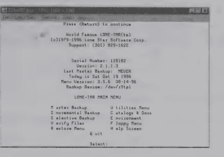

```
按 (Return) 继续

World Falcon (ONE-10)

(1993-1996) Lone Star Software Corp.

支持: IDLL 825-025

会已: 11:57

版本: 2.1.3

上次登录: 1996年1月15日 周一

今天 1996年10月19日 周六 00:45

备份设备: /dev/rfd0

LONE-TAR 主菜单

全备份              实用菜单

增量备份          更改并退出

选择备份          环境

紧急文件            映像菜单

恢复备份          帮助？屏幕

选择:
```

### 图 22.2
Lone-Tar 的菜单式界面比命令行界面友好得多且更容易使用。

你使用哪种界面完全取决于你，当然，如果你不熟悉 `tar` 繁琐的语法，应该坚持使用菜单式界面。UNIX 老兵可能想继续使用命令行，但菜单式系统操作起来简单得多，并且消除了输入错误的可能。在本章的大部分内容中，我们将使用菜单式界面。

# 安装 Lone-Tar

Lone-Tar 的安装过程非常简单。你需要以 root 身份登录，然后切换到 `/tmp` 目录。完成后，使用 `tar` 命令从光盘或软盘（如果你在软盘上有 Lone-Tar 软件）中提取所有文件。例如，如果你已将 Lone-Tar 文件复制到 A 盘的软驱中；以 root 身份登录系统并执行以下命令：

```
cd /tmp
tar xvf /dev/rfd0
```

`tar` 命令告诉 Linux 从第一个软驱器（`/dev/rfd0`）提取所有文件并将它们存储在当前目录中。

> **注意**
> 某些 Linux 系统不将第一个软盘标识为 `/dev/rfd0`，而是倾向于使用 `/dev/fd0`。如果你在使用上述命令行时遇到“设备未知”的消息，请改用 `/dev/fd0` 作为软盘设备名称。

# 管理你的 Linux 系统
## 第三部分

如果你是从光盘安装，可以使用 `cp` 直接将文件复制到 `/tmp` 目录。例如，如果文件存储在光盘的 `/lone-tar` 目录下，且光盘已挂载到你 Linux 系统的 `/cdrom` 目录，你将执行这些命令：

```
cd /tmp
cp /cdrom/lone-tar/*
```

你使用的确切命令行将取决于 Lone-Tar 文件在光盘上的位置以及在你系统上的挂载位置。

一旦所有文件安全地存放在 `/tmp` 目录，就可以执行此命令开始安装过程：

```
./init.ltar
```

此程序由 Lone Star Software 编写，用于正确安装 Lone-Tar 的所有组件。你会被问许多关于磁带或备份驱动器、容量以及你是否想要打印在线手册的问题。如果你不想在安装过程中打印手册，可以随时从 Lone-Tar 菜单打印它们。

要以菜单式模式启动 Lone-Tar 系统，请执行命令：

```
ltmenu
```

你应该会看到一个类似于图 22.3 所示的屏幕。按 Return 将带你进入图 22.2 所示的主菜单。如果你想在命令行模式下使用 Lone-Tar 系统，请使用命令：

```
lone-tar
```

后跟任何选项，或单独使用以显示图 22.1 所示的帮助屏幕。

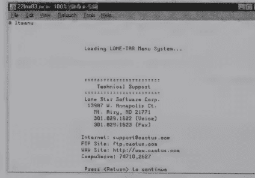

### 图 22.3
如果 Lone-Tar 安装正确，启动菜单时应该看到此欢迎屏幕。

# 使用 Lone-Tar 进行备份

备份是任何 Linux 系统的关键部分，无论你是将其用于正式工作还是仅仅为了玩。原因很简单：重新加载你的 Linux 系统、将其配置为原来的样子并重新加载所有应用程序可能花费很长时间，有时会导致错误。从备份磁带或其他备份设备恢复只需要几分钟，但对你的端口干预极少。如果你在 Linux 系统上存储了足够的重要信息，那么为了安全起见，你真的应该定期进行备份，因为重建丢失的数据往往是不可能的。

## 注意

> 如果你被迫使用软盘进行备份，你应该使用主 Lone-Tar 菜单中的 Floppy（软盘）选项。此选项将进入软盘菜单，允许你备份和恢复软盘而不是磁带驱动器。

Lone-Tar 提供两种备份：全备份（Masters）和增量备份（Incremental）。全备份是对系统的完整备份，系统上的每个文件都被安全地备份。增量备份在两次全备份之间进行，保存自上次全备份以来的系统更改。增量模式让备份速度快得多，因为不需要备份所有内容。

> **注意**
> 确保在磁带或其他介质上标记备份的日期和类型。字迹要清晰！你永远不知道什么时候需要查出哪盘磁带是什么时候制作的。

要进行增量备份，您遵循相同的流程。由于大多数增量备份的文件要比主备份小得多，它们的备份速度也会快得多。你应该养成习惯，要么在每天使用 Linux 系统时进行增量备份，要么在保存了你无法承受损失的内容时备份。花 10 分钟做备份总比花 4 小时去重新创建你最新书籍的章节要好得多！

使用 Lone-Tar 菜单中的选项 5 开始选择性备份，可以让你只备份系统的特定区域。系统会询问你要包含或排除哪些文件或目录，然后正常进行备份。

## 验证文件

Lone-Tar 提供的“验证文件”选项是一项安全预防措施，你应该在每次备份时都执行它。“验证文件”选项会扫描备份并与原始文件进行比较。这可以确保任何备份错误在演变成严重问题之前被捕获。

在每次备份完成后都进行验证是一个好习惯。当你制作了新的主备份时，这一点尤为重要。

请记住，在备份时间和验证之间，系统上的某些文件可能会发生变化，这取决于这两个时间内系统是否被使用。某些自动化程序（如邮件、日志、新闻和自动后台任务）会在备份或验证期间修改文件。Lone-Tar 会发现文件不一致并向你报告错误。你应该仔细阅读验证过程的报告，以便知道哪些错误是重要的，哪些是因为这些系统更改引起的。

## 恢复文件

当你需要恢复文件、目录或整个文件系统时，请找到合适的备份。如果你一直使用主备份和增量程序，你将需要最后一个主备份以及该主备份之后的所有增量备份。或者，如果你只是在找不小心删除的几个文件，你可能知道它们在某盘磁带或驱动器上，只需使用它们即可。

要启动恢复过程，请从 Lone-Tar 主菜单中选择选项 8。这将弹出恢复菜单。恢复菜单上的大多数选项都是自解释的。例如，若要恢复整盘磁带，你应该使用“恢复整盘磁带到硬盘”选项。

# 备份、备份、备份！
## 第 22 章

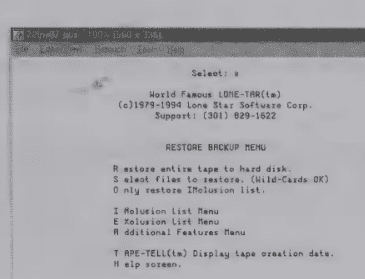

### 图 22.7
Lone-Tar 恢复菜单。

恢复菜单上的其他一些选项允许你根据精确名称或通配符恢复特定的目录或文件。你还可以建立一个文件或目录列表并一次性恢复所有内容。或者，你可以决定哪些文件或目录不需要恢复，为其创建一个排除列表，然后恢复其他所有内容。

一旦你决定了恢复哪些文件或目录，Lone-Tar 会要求你插入磁带然后开始恢复过程。与备份一样，Lone-Tar 会在屏幕上显示它所执行的操作，因此你可以看到它正在做什么。

> **注意**
> 在执行少数文件或目录的恢复时，Lone-Tar 必须搜索磁带或介质以寻找这些文件。这是一个可能缓慢的过程，取决于备份设备的速度，所以如果几分钟内没有看到任何变化，请不要担心。你应该能看到备份设备上的状态灯闪烁，表示设备正在被 Lone-Tar 使用。

如果备份涉及多个磁带或其他设备，Lone-Tar 将提示你插入下一卷。它将一直持续，直到恢复过程完成。

如果你是从主备份和增量备份的组合中恢复，你需要对每盘磁带重复恢复过程。例如，如果你不小心删除了整个目录，可以使用最后一个主备份来获取主文件，然后处理自主备份创建以来的所有增量备份以获取任何更改。你必须使用恢复菜单手动执行更新。

恢复完成后，Lone-Tar 将返回主菜单。你应该检查备份是否存储到了正确的位置，并确保一切看起来正常。

> **注意**
> Tape-Tell 是 Lone-Tar 的一个特殊功能，它可以告诉你关于磁带使用时间的简单信息。这依赖于可以放在介质开头的 Lone-Tar 文件。我们在之前关于使用 Lone-Tar 进行备份的章节中讨论过这个文件。

## 工具与环境：调整 Lone-Tar

如图 22.8 所示的 Lone-Tar 工具菜单包含许多实用的命令和功能。这些选项大部分都是一目了然的，但对用户来说非常方便。检查上次主备份的日期很有帮助，可以提醒你何时开始考虑新的主备份。

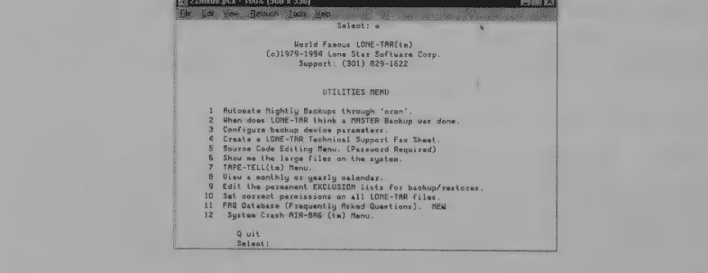

### 图 22.8
通过 cron 自动化 Lone-Tar 是一个巧妙的功能，它让你的系统在无需你操作的情况下进行备份。正如你在书中前面的章节中所知，`cron` 允许你调度命令在特定时间或间隔运行，因此你可以轻松设置 Lone-Tar 由 `cron` 运行，每晚上、每周两次或任何你需要的时间创建增量备份。

工具还允许你更改备份类型和细节，如果你有多个备份系统，可以在它们之间切换。这对于你想在一个设备制作主备份并在另一个设备制作增量备份非常有用。

# 备份、备份、备份！
## 第 22 章

如图 22.9 所示，环境菜单包含了 Lone-Tar 使用的所有设置。这些设置大部分在安装时已经设置好，但如果你有需要，可以修改它们。

| 1 | 验证 | 50 | Tapetail: Y |
| :--- | :--- | :--- | :--- |
| 2 | 默认 | 51 | Cron: N |
| 3 | 保存到 | 52 | Remain Command: OFF |
| 4 | 打印机 | 53 | Create ID: Y |
| 5 | 块大小 | 54 | Display source: "ENU" |
| 6 | 压缩 | 55 | Display: "ENU" |
| 7 | 备份前 | 56 | 选择 |
| 8 | 备份后 | 57 | Fail Command: - |
| 9 | 打印标记 | 58 | 禁止登录: N |
| 10 | | 59 | 弹出磁带: OFF |
| 11 | | 60 | BmM 分区: OFF |
| 12 | | | |
| 13 | 保存日志文件 | | |
| 14 | 多卷磁带 | | |
| 15 | 可视化文件 | | |

### 图 22.9
环境菜单允许你更改工具的行为。

## 总结

本章介绍了备份的基本知识。你应该维护备份日志并定期进行备份以保护你的工作。虽然 `tar` 起初使用起来有点笨拙，但很快就会变成习惯。你可以将 `tar` 命令与 `compress` 等压缩工具结合使用。或者，你可以使用像 `gzip` 和 `gunzip` 这样的工具，它们将两个工具合为一。虽然它们更方便，但 `tar` 仍然是最广泛使用的归档工具，值得学习。如果你负担得起购买 Lone-Tar 等商业备份工具，你会发现管理备份变得容易得多。然而，你仍然应该了解 `tar`，因为你可以在 Linux 系统的许多地方运行它。

# 管理你的 Linux 系统
## 第三部分

自动化任务是保持系统顺畅运行的最佳方法之一。如果你将所有需要定期运行的重复性系统管理命令并让它们在后台运行而无需你的干预，系统管理将变得不再繁琐和烦人。`cron` 和 `at` 工具是为了让你的工作变得更容易而开发的。它们都允许你在指定的时间自动执行命令。

## 使用 cron 程序

`cron`（`chronograph` 的缩写）工具旨在允许命令在特定时间执行而无需手动启动它们。Linux 在系统启动时会将 `cron` 作为时钟守护进程加载。（`cron` 工具通常从一个初始化文件运行；你可以通过注释掉启动 `cron` 的行来禁用它。）运行时，`cron` 会从一个名为 `crontab` 的文件中读取它应该执行任务的日期和时间。

当 `crontab` 文件中的任何日期时间条目与系统日期时间匹配时，守护进程就会执行这些命令。`cron` 工具并不只执行一次任务；只要指定的日期时间匹配系统日期，任务就会再次运行，直到你终止 `cron` 工具或修改 `crontab` 文件。任务的自动执行意味着 `cron` 并不适用于调节系统管理任务，例如磁带备份、数据库重组和常规文件清理（如清空日志文件和队列）。

在大多数系统中，对 `cron` 的访问被限于系统管理员，尽管你可以轻松地为系统上的某些或所有用户激活它。系统通过两个不同的文件控制谁可以发送进程由 `cron` 执行，由于这些文件通常被称为 `/usr/lib/cron/cron.allow` 或 `/usr/lib/cron/cron.deny`。许多 Linux 系统使用 `/etc/cron.allow` 和 `/etc/cron.d/cron.deny` 命名。这两个文件每行有一个用户名（与 `/etc/passwd` 中的条目匹配）。

`/usr/lib/cron/cron.allow`（或 `/etc/cron.d/cron.allow`）文件可以包含允许使用 `cron` 的用户名列表。例如，该文件：

- tparker
- yvonne
- bill

仅允许登录用户 `tparker`、`yvonne` 和 `bill`（以及超级用户）向 `cron` 提交任何内容。

`/usr/lib/cron/cron.deny` 文件可以包含不允许使用 `cron` 的用户名列表。例如，该文件：

- walter
- anne

允许除登录用户 `walter` 和 `anne` 之外的所有人员使用 `cron`。

## 使用脚本自动化任务

通过使用这些可选文件之一，系统管理员可以控制 `cron` 的使用。如果 `cron.allow` 和 `cron.deny` 文件都不存在，只有超级用户（root）可以向 `cron` 提交进程。要允许所有用户使用 `cron`，请创建一个空的 `cron.deny` 文件。

## 创建 crontab

要指示 `cron` 在特定日期和时间处理命令，你需要使用一个名为 `crontab` 的工具。`crontab` 程序读取一个包含你想要 `cron` 执行的细节的文件并对其排队。此外，`crontab` 还执行几项管理任务，例如显示你当前的 `cron` 任务列表、删除列表以及向列表添加新任务。

`cron` 读取的文件通常命名为 `crontab` 以便于起见，尽管你可以称它为任何名字。`crontab` 工具有一个命令选项，允许你指定想要使用的文件名。如果你不使用此选项，`crontab` 将读取默认文件名 `crontab`。

`crontab` 指令文件具有简单的结构。该文件每个要提交的进程占一行，指定了何时运行该进程以及执行什么命令。每行的格式如下：

分钟 小时 日期 月份 星期 命令

```
20 1 * * * /usr/bin/calendar
0 2 * * * /bin/organize_data
```


# crontab 文件格式

`crontab` 文件中的每行有六列，用空白（空格或制表符）分隔。从左到右的列如下：

- 小时的分钟（0–59）
- 一天的小时（0–23）
- 一个月的日期（1–31）
- 月份（1–12）
- 星期（日=0, 一=1, ... 六=6）
- 在指定的日期时间执行的程序

这种（初看之下）很奇怪的格式对于让你能够完全指定进程何时运行是必要的。如果没有这五类不同的日期时间类别，你就无法唯一地指定任何每月发生一次或多次的事件。这些列很容易填写。

最后一列包含要执行的命令或脚本文件名。要执行的脚本可以有很多行并调用其他脚本，也可以只有单行。当 `crontab` 文件匹配日期时间时，启动第一个进程。为命令提供绝对路径是非常重要的（即使它在你的 `PATH` 中），因为 `cron` 作业不会继承你的环境变量，因此不知道去哪里查找命令。

此外，你必须对该工具或脚本具有执行权限。如果你以用户（而非超级用户）身份提交 `crontab` 文件，你必须设置文件权限或所有权以允许你正常访问，因为 `cron` 执行进程时就像你拥有它们一样。

`crontab` 文件中的每个时间和日期列可以包含有效数字范围内的单个数字、两个用连字符分隔的数字表示范围、多个用逗号分隔的数字表示列表，或者用星号 `*` 表示所有值。例如：

```
20 1 * * * /usr/bin/calendar

0 2 * * * /bin/organize_data
```

`crontab` 指令文件具有简单的结构。文件每个要提交的进程占一行，指定了何时运行该进程以及执行什么命令。每行的格式如下：

分钟 小时 日期 月份 星期 命令

```
20 1 * * * /usr/bin/calendar

0 2 * * * /bin/organize_data
```

（注：OCR 文本在列表部分存在严重损坏；我根据标准的 `crontab` 语法和文档上下文恢复了结构。）

# 管理您的 Linux 系统：第三部分

在系统上，系统管理员可以通过修改 `/etc/default/cron` 文件中的条目来记录所有的 cron 使用情况。文件中有一行应该包含 `CRONLOG` 变量。如果你将该值设置为 `YES`，cron 会把其执行的每个事件记录到 `/usr/lib/cron/cron.log` 文件中。所有版本的 Linux 都允许 cron 日志。如果你启用了 cron 日志，请频繁检查日志文件，因为它可能会迅速增大。

# 使用复杂的 cron 命令

crontab 文件可以包含任何类型的命令或 shell 脚本，只要该行是有效的（也就是说，它可以从 shell 提示符执行）。许多 shell 命令的一个常见问题是产生输出，特别是错误消息，这些信息会通过邮件发送，并迅速堵满您的信箱。因此，如果你预计会有错误消息输出（来自编译器），你可以将输出重定向到 `/dev/null`。例如，命令

```
0 * * * date > /tmp/test1 2>/dev/null
```

会每小时将 `date` 命令的输出发送到名为 `/tmp/test1` 的文件，并将错误消息发送到 `/dev/null`（本质上是丢弃这些消息）。如果你愿意，也可以对标准输出执行操作，或将其重定向到其他地方。例如，cron 命令

```
3 1 * * * cat /usr/tparker/chap > /usr/tparker/archive/backup
```

会将 `/usr/tparker` 中所有以 `chap` 开头的文件合并成一个名为 `/usr/tparker/archive/backup` 的大文件。再次，你可以重定向标准输出。

你也可以通过管道符输入 crontab 文件。例如，如果你在 `/tmp/userlist` 文件中有一份白天登录系统的用户列表，你可以编写如下所示的 cron 条目：

```
0 * * * sort -u /tmp/userlist | mail -s"users for today" root
```

此行对 `/tmp/userlist` 的输出进行排序，使得每个用户只有一个条目（使用 `--unique-option`），并将其发送给 root。

关于 cron 需要记住的一个重要点是，所有命令默认都在 Bourne（或如果你的系统上是 sh 的等价物则是 bash）环境中执行。如果你使用 C 命令，cron 任务将失败。

# 使用 at 程序

at 程序与 cron 非常相似，不同之处 cron 是持续执行命令，而 at 只在指定的时间执行一次。at 命令的格式如下：

```
at time date < file
```

# 使用脚本自动化任务：第 23 章

你可以通过几种不同的方式指定大多数 at 命令参数，这使得 at 命令变得非常灵活。例如，你可以将时间指定为绝对时间（18:40 或 22:00），或者指定为代表小时的数字（因此 10 意味着早上 10:00，因为默认使用 24 小时制）。你可以在时间加上 am 或 pm 以明确时间段，这样 10pm 就明确表示在晚上。

at 命令处理几个特殊单词而不是具体指定。该命令识别 `noon`、`midnight`、`now`、`next` 以及用于 GMT 的 `zulu`（格林威治标准时间，现在称为协调世界时或 UTC，即使缩写与展开含义不匹配也是如此。如果你尝试执行一个时间设置为 `now` 的命令，某些版本会生成错误消息。）

日期是一个可选字段，当时间不具体时使用。如果你不提供日期，at 将在下一个指定时间执行命令。如果你指定了日期，at 将等到该日期再执行命令。你可以以月份名称加日期数字（May 10）或星期（全拼或缩写为三个字母）给出日期。你也可以指定年份，但这种指定很少必要。同样，at 命令识别两个与日期相关的特殊单词：`today` 和 `tomorrow`（尽管 `today` 一词是多余的，因为如果时间设置正确，命令默认就在今天执行）。

作为 at 命令的输入文件，可以是任何包含命令的文件。或者，你可以直接输入命令并在完成后按 `Ctrl+D`，但由于极易出错，不建议使用这种方法。

假设你有一个文件 `reorg.data` 文件，其中包含以下命令：

```
/usr/tparker/setperms

/usr/tparker/sort_database

/usr/tparker/index_database

/usr/tparker/clean_up
```

如果你想在晚上 8:30 执行此文件，请执行以下任一命令：

```
at 20:30 < reorg.data

at 8:30 pm < reorg.data

at 20:30 today < reorg.data
```

还有更多变体，但你可以使用这种语法。如果你想在周五执行命令，请按以下格式之一执行：

```
at 8:30 pm Friday < reorg.data

at 20:30 Fri < reorg.data
```

某些版本的 at 甚至很智能，处理特殊单词。例如，此命令

```
at 0900 Monday next week < reorg.data
```

# 管理您的 Linux 系统

本章介绍了维护系统安全的基础知识。它快速介绍了为了保护您免受通过电话线路（调制解调器）和网络（如 Internet 连接）的未经授权访问所需的防御措施，以及局域网连接的某些方面。此外，它还解释了如何保护您的文件并确保密码的完整性。

本章没有涉及难以实施的复杂解决方案，因为那些需要大量的知识，且仅适用于特定的配置。相反，它关注的是基础安全方法，其中大多数方法都简单且有效。

# 保持安全更新

修复您现有 Linux 系统中所有已知的安全漏洞并不意味着您就是安全的。新问题正在不断被发现。在这个方面，保持领先于黑客的最好方法是监控专门用于安全的 Usenet 组，并访问计算机应急响应小组（CERT）的网站：http://www.cert.org。

CERT 维护着一个包含 Windows、Unix、Linux 以及其他操作系统的安全漏洞的完整列表。如果您愿意，可以通过电子邮件向您发送警报。图 24.1 显示了 CERT 的主页，展示了每日收到的警报。存档保留了较旧的警报。其中一些警报直接影响 Linux，例如图 24.2 所示的 Xfree86 问题的报告。

在设置 Linux 系统时（特别是连接到 Internet 的系统），您应该阅读许多此类旧的警报，并采取 CERT 团队的建议以防止问题的发生。确保您定期检查 CERT 页面。

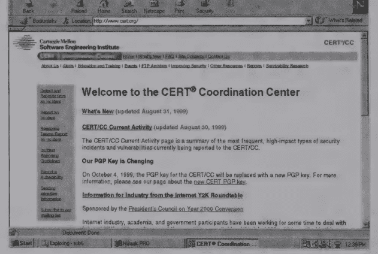

图 24.1
CERT 主页显示当前的安全警报。该页面定期更新。

# 安全：第 24 章

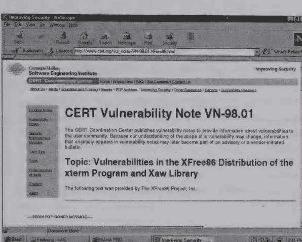

**图 24.2**
应该检查 Arch CERT 通知，例如这个关于 XFree86 问题的通知。

# 改进密码

入侵系统的最常用方法（无论是通过网络、通过调制解调器连接，还是坐在终端前）都是弱密码。弱密码（意味着容易猜）非常常见。当系统用户使用弱密码时，即使是最好的安全系统也无法防止入侵。

如果您正在管理一个具有多个用户的系统，请实施一项策略，要求用户定期更改密码（通常六到八周是一个好主意），并使用非英语单词。这些密码是字典中不存在的字母和数字组合。然而，有时即使有针对弱密码的策略也是不够的。您可能希望考虑使用公有领域或商业软件来检查潜在密码的易破解性，从而强制使用更强的密码。这些软件包通常以源代码的形式提供，因此您可以无问题地为 Linux 编译它们。

什么是强密码（难以破解的密码）？这里有一些许多系统管理员遵循的通用准则：

- 避免使用用户真实名字的任何部分以及用户家庭或宠物的任何名称（这些密码最容易猜）。
- 避免使用任何变体的重要日期（出生日期、结婚日等）。
- 避免使用具有特殊意义的数字或数字与字母组合（车牌号、电话号码、特殊日期等）。
- 避免使用任何可能被用户轻易识别的地名或物品（电视角色、爱好等）。
- 避免使用任何出现在字典中的单词（不要使用真实的单词）。

制作强密码并没有那么困难。让用户养成随机混合字母、数字和字符的习惯。假设一个用户想用 `lion` 作为密码。鼓励他们修改为 `lionking1_lonking`、`lion5king` 或类似的变体。密码正常模式中即使是微小的变化，也能让尝试猜密码的人变得非常困难。记住，并不是所有的 ASCII 字符都可以用于密码字符串。支持的精确字符在某种程度上取决于所使用的密码工具的版本。

> 经常更改 root 密码，并使其变得难以猜测。一旦有人有了 root 密码，您的系统就完全被攻陷了。

定期检查 `/etc/passwd` 文件，查看是否有您不认识的条目可能被添加为您系统的路径。还要确保每个账户都有密码。删除任何您不需要的账户。

# 保护您的文件

安全始于文件权限级别。无论您是想保护文件免受未经授权的入侵者或其他用户的窥探，都要仔细地设置您的掩码（文件创建掩码），以使您的文件具有最高安全性。您应该需要有意识地去共享文件。

当然，如果您在系统上有多个用户，或者要考虑向他人隐藏信息，这种预防措施实际上非常重要。如果您处于一个具有多个用户的系统上，请为所有人考虑 `umask` 设置，仅为用户设置读写权限，而不给其他人任何权限。这种程序是您在文件安全方面能做的最好的。

考虑使用简单的工具对敏感文件（如会计或员工信息）进行加密。有很多此类程序。大多数程序只需要密码即可触发加密或解密过程。

# 控制调制解调器访问

对于大多数 Linux 用户来说，保护系统免受 Internet 网关访问并不重要，因为很少有用户直接连接到他们的 Linux 机器。相反，主要的关注点应该是防止通过最易访问的方法——调制解调器来保护自己。

调制解调器是每个 Linux 系统最常用的接口（除非您运行的是单机或封闭网络）。调制解调器用于远程访问，也用于网络和 Internet 访问。保护系统的调制解调器线路免受入侵是简单且有效的，可以阻止随机浏览者。

## 回拨调制

防止通过调制解调器未经授权访问的最安全技术是使用回拨调制。回拨调制允许用户像往常一样连接系统，然后挂断，查询有效用户及其电话号码列表，然后回拨用户以建立连接。回拨调制相当贵，所以这种解决方案对许多系统并不实用。回拨调制也有一些问题，特别是用户经常更换位置时。此外，由于现代电话交换机的转发功能，回拨调制容易被滥用。

## 调制解调器线路问题

如果典型的调制解调器在会话结束后没有正常挂断，它可能会成为问题的根源。大多数问题源于接线或配置设置。

接线问题听起来可能很小，但许多带有硬线调制解调器电缆的系统无法正确控制引脚；系统可能会处于会话未关闭且注销未完成的状态。任何人拨该调制都可以从上一个用户结束的地方继续。为了防止这种问题，请确保连接调制解调器和 Linux 机器的电缆是完整的。替换您不确定是否制作良好的手制电缆。此外，在几次会话完成后观察调制解调器，以确保线路正常挂断。

# 管理你的 Linux 系统：第三部分

防止入侵的一种方法是在不需要时将调制解调器从电路中拔掉。由于入侵者通常尝试在正常工作时间内访问系统，你可以使用 `cron` 来更改调制解调器连接的串口端口的状态，或者在下班后完全禁用这些端口。如果需要在深夜访问，可以池中保留一或两个调制解调器激活状态。一些较大的系统会为下班后的调制解调器线路保留专用号码，这与正常的调制线路号码完全不同。

## 调制解调器如何处理来电

用户要通过调制解调器线路访问 Linux，系统必须使用 `getty` 进程。`getty` 进程本身由 `init` 进程为每个串口启动。`getty` 程序负责获取用户名、设置通信参数（例如波特率和终端模式）并控制超时。在 Linux 中，`/etc/tty` 文件控制串口和多端口卡。

某些 Linux 系统实现了一种拨号密码系统。这种系统会强制通过调制解调器拨入的用户输入第二个密码，以验证通过调制解调器的访问。如果你的系统支持此功能，通常是通过一个名为 `/etc/dialups` 的文件来实现的。Linux 系统使用 `/etc/dialups` 文件提供拨号密码的端口列表；另一个文件（如 `/etc/d_passwd`）则包含调制线路的密码。访问权限取决于用户所使用的 shell 类型。你也可以将相同的步骤应用于 UUCP 访问。

## 使用 UUCP

UUCP（UNIX to Unix CoPy）程序允许两个 Linux 系统来回发送文件和电子邮件（参见第 27 章“UUCP”），它在设计时考虑了良好的安全性。然而，它是很多年前设计的，从那以后，安全需求已经发生了巨大变化。多年来，UUCP 发现了许多安全问题，其中许多问题已经通过对系统的更改和补丁得到了解决。UUCP 需要一些系统管理方面的关注，以确保其运行正常且安全。

UUCP 在系统文件 `/etc/passwd` 中有自己的密码条目。通过 UUCP 拨入的远程系统通过提供 UUCP 登录名和密码来登录本地系统。如果你没有为系统中的 UUCP 登录设置密码，任何人都可以访问系统。你应该做的第一件事之一是以 root 身份登录并执行命令：

```
passwd uucp
```


来设置 UUCP 密码。如果你想让远程系统通过 UUCP 连接，你必须向它们提供你的密码，因此确保它与其他密码不同（并且难以猜到）。向远程系统管理员提供密码的这种轻微麻烦比一个完全开放的系统要好得多。

或者，如果你不使用 UUCP，请从 `/etc/password` 文件中完全删除 `uucp` 用户，或者提供一个无法被猜到的强密码（在 `/etc/passwd` 的 Password 字段第一位放置星号可以有效禁用登录）。从 `/etc/passwd` 文件中删除 uucp 不会影响 Linux 系统的其他部分。

将权限设置为与所有 UUCP 目录一样严格（通常为 `/usr/lib/uucp`、`/usr/spool/uucp` 和 `/usr/spool/uucppublic`）。大多数系统中这些目录的权限很松，因此请使用 `chmod`、`chown` 和 `chgrp` 将访问限制为 `uucp` 登录。也为所有 UUCP 访问设置组和用户名。定期检查文件权限。

UUCP 根据允许访问的用户来保护几个文件。这些文件（例如 `/usr/lib/uucp/Systems` 和 `/usr/lib/uucp/Permissions`）应该仅由 uucp 登录所有并访问。这防止了通过另一个登录名进行修改。

`/usr/spool/uucpublic` 目录可能是入侵的常见目标，因为它要求所有访问它的具有读写权限。为了保护这一点，创建两个子目录：一个用于接收文件，另一个用于发送。如果你这样做，可以为用户列表上的每个系统创建更多的子目录。

保护 UUCP 的巧妙技巧是更改 UUCP 程序的登录名，这样随机访问 uucp 登录将完全不起作用。新名称可以是任何名称，由于远程系统在连接的两端必须都有配置文件，你可以轻松地让远程系统管理员知道新的登录名。这样就没有人可以使用 uucp 登录进行访问。

# 控制局域网访问

局域网（LAN）通常不被认为安全问题，但它往往是进入系统最简单的路径之一。如果网络上的任何一台机器具有弱的访问点，则可以通过该机器的网络服务访问网络上的所有机器。PC 和 Macintosh 通常安全性很低，特别是通过拨号调制调制解调器时，因此它们可以以类似的方式访问网络服务。关于局域网的一个基本规则是：在与非安全机器相同的网络上是不存在安全机器的。因此，任何针对机器的解决方案必须在网络上的所有机器上实施。

理想的安全系统强制对任何连接进行适当验证，包括机器名和用户名。一些软件问题可能会导致验证困难。Linux 中实现的配置信任主机（trusted host）允许机器在无障碍的情况下连接，前提是它的名称位于（Linux）机器上的一个文件中。在大多数情况下不需要密码！入侵者只需要确定信任主机的名称，然后用该名称连接。仔细检查 `/etc/hosts.equiv`、`/etc/hosts` 和 `.hosts`。

# 管理你的 Linux 系统

## 第三部分

网络认证解决方案现在广泛用于 Kerberos，这是一种最初在 MIT 开发的方法。Kerberos 使用一个非常安全的主机作为认证服务器。由于网络的性质，大多数 Linux 系统容易受到入侵者的攻击。在消息中使用加密来防止入侵者。即使是从 CD-ROM 安装，也有许多事情可以在你的系统上做以确保安全。这些项目在阅读后思考后都是逻辑，但很少有管理员在为时已晚才采取行动。现在花几分钟在你的系统上执行你尚未执行的操作。

首先，禁用所有不需要的服务。如果你不使用 FTP，就禁用它。对于你从未听过的所有 TCP/IP 服务也是如此！例如，你可能永远用不到 map，它默认开启一个端口，并且可以被黑进以获得 root 权限。finger 工具是另一个很好的要用服务，因为它具有被黑进的潜力。检查 `/etc/inetd.conf` 文件，并确保你的机器需要的服务已启动。如果不需要，请从文件中删除或注释掉。（大多数系统将只需要 FTP 和 Telnet 守护进程：`ftppd` 和 `telnet`。除非你运行 Web 服务器，否则其他通常都可以删除。）

# 跟踪入侵者

许多入侵者对你的系统好奇，但不想造成破坏。他们可能会定期进入你的系统，到处逛逛，玩几个游戏，然后在不改变任何东西的情况下离开。这种活动让你很难知道自己被入侵了，如果入侵者决定造成破坏或利用你的系统跳到其他地方，你将任其摆布。

你可以通过调用审计来轻松地跟踪系统用户，审计会记录每个用户连接和断开系统。审计还可以告诉你用户在系统上做了什么，尽管这种审计会稍微减慢系统速度并产生巨大的日志文件。并不是所有的 Linux 版本都支持审计，请咨询你的手册页和系统文档以获取更多信息。

如果你依赖审计，请经常扫描日志。编写一个快速摘要程序汇总每个用户在系统上的总时间可能是值得的，这样你可以观察异常情况和和你对用户连接时间的认知不符的数字。你可以编写一个简单的 shell 脚本使用 `gawk` 分析日志。你也可以使用公共领域提供的任何审计报告系统。

# 为最坏的情况做准备

如果有人入侵了你的系统，你能做什么？显然，系统备份非常有帮助，因为它们可以让你恢复任何损坏或被删除的文件。但除此之外，你还应该做什么呢？

首先，找出入侵者是如何进入的，以及哪种访问方法无法再次使用。如果你不确定访问方法，请关闭所有调制解调器和终端，并仔细检查所有配置设置文件是否存在漏洞。还要检查密码和用户列表是否存在薄弱或过时的信息。

如果你是反复攻击的受害者，考虑启用审计系统，以跟踪入侵者是如何进入的以及他们做了什么。如果你担心遭受损害，一旦发现他们登录，立即强制将其踢出去。

最后，如果入侵持续，请向当地当局报警。在大多数国家，入侵计算机系统（无论是大公司还是你自己的家庭系统）都是违法的，当局通常知道如何将入侵者追溯到他们的接入点。他正在入侵你的系统，不应该让他逃之法法！

## 总结

对于大多数 Linux 系统来说，安全性不是问题，因为你是唯一使用这台机器的人。然而，如果你与其他人共享机器，或者让网络上的（或互联网上的）任何人都可以在线访问，请不要低估有人尝试入侵的概率；他们一定会这么做。让你的系统尽可能安全。常识会有很大帮助，但不要忘记黑客是一群狡猾、勤奋且执着的人。

# 修改内核

## 第 25 章

### 本章内容

- 内核版本号
- 升级和安装新内核软件
- 从源码编译内核
- 向内核添加驱动程序
- 升级库
- 使用 Linux 的 C 编译器

# 管理你的 Linux 系统

## 第三部分

通常情况下你会希望让 Linux 内核保持原样，除非要进行重大升级、安装新的网络组件（如 NFS 或 NIS）或安装具有特殊内核要求的新设备驱动程序。安装内核驱动程序过程的细节通常随软件提供。由于情况并不总是如此，本章应该让你对处理内核的通用的流程有一个良好的了解。

## 注意事项

不要在不知道自己在做什么的情况下修改内核。如果你损坏了源代码或配置信息，你的内核可能变得无法使用，在最坏的情况下，你的文件系统可能会受到影响。请务必小心并仔细遵循指令。记住，本章仅涵盖内核操作的基础知识。

常用的几个 Linux 版本存在一些不一致之处。由于某些原因，后续章节中提供的具体指令可能不适用于你的 Linux 版本。然而，通用方法是相同的，只是目录或工具的名称可能不同。大多数 Linux 版本都提供文档，列出重新编译的过程以及源码和编译程序的位置。

> **注意**
>
> 在对内核或工具进行任何操作之前，请确保你拥有一套良好的应急启动盘，并在磁带、可移动介质或软盘上有一个完整的备份。虽然修改内核并不困难，但它会偶尔引发问题，导致你在没有可用系统的情况下陷入困境。启动盘是恢复最好的方法，所以请至少多制作一套。

由于内核是用作为 Linux 部分提供的 C 编译器编译的，本章的后半部分将介绍 C 编译器及其标志，以及你如何利用它。当然，这些信息并不是对 C 系统的完整参考，但对于你在修改内核（或任何其他由 C 编译的源代码）时可能需要的某些基本操作来说是有用的。

# 修改内核

## 第 25 章

> **注意**
>
> 不要将你的 Linux 发行版发布号与内核发布号混淆——它们是两个不同的数字。例如，Red Hat Linux 5.2 版本包含了内核版本 2.0.35。许多其他 Linux 发行版也包含相同的内核版本。检查内核发布号的一种简单方法是观察启动过程（或使用 `dmesg` 命令打印出来）并检查那里显示的数字。

### 内核版本号

与 Linux 的发行号一样，内核使用主-次-修订的编号系统。内核发布号始终有三个数字，例如 2.0.35。该数字的三个部分是：

- 主版本号
- 次版本号
- 修订号

主版本号（示例中的 2）仅在内核发生剧烈变化时才会改变。我们已经使用内核版本 2 多多年，可能在一段时间内不会移动到版本 3（尽管有人讨论尽早增加到版本 3 以反映 Linux 经历的所有变化）。

次版本号（示例中的 0）每当内核的变化需要发布新版本时就会增加。Linux 的次版本号使用一种惯例，这种惯例并不适用于其他软件：奇数次版本号是开发版内核，偶数次版本号是生产版内核。区别在于，偶数被认为是稳定的，适用于商业应用程序和非开发环境，但由于这些版本中包含实验性代码，开发内核可能会出现崩溃和其他问题。内核通常在通过一个奇数版本发布后，代码才会稳定并作为生产（偶数数字）版本发布。

> **注意**
>
> 如果你不习惯可能崩溃或以其他方式变得不稳定的系统，请远离奇数版本。另一方面，如果你是一个开发者，或者你想看到 Linux 的未来，请尝试开发版内核。

修订号（示例中的 35）显示了内核的补丁级别。每发布一次补丁，修订号增加 1。根据内核的添加和更改，每月可能会发布多次补丁。当内核发生重大变化（例如添加新驱动程序）时，通常产生一个新的修订。每当次版本号增加时，修订号重置为零。

Linux 是一个动态操作系统。内核以及可以链接内核的操作系统部分会定期发布给用户。你是否升级到新版本取决于新版本提供的功能或错误修复。当你需要新软件时，你可能需要重新链接内核，除非该软件作为工具或设备驱动加载。

避免随着每个新版本都升级系统，原因有两个。不断升级最常见的问题是，你可能会陷入一个与现有系统产生后向兼容性问题或存在重大问题的新软件包。大多数软件的新版本会删除现有的配置信息，因此你必须对安装的包进行重新配置。此外，新版本的发布频率之高，可能会让你花更多时间在加载和重新编译内核及工具上。仔细阅读发布说明，以确保该版本值得投入时间和麻烦。记住，很少有安装是顺利的！

### 从源码编译内核

升级、替换或向内核中添加新代码通常是一个简单的过程。你获取内核源码，进行任何配置更改，对其进行编译，然后将其放置在文件系统中的正确位置，以便系统正常运行。Shell 脚本或安装程序会自动为你完成这一过程，而某些升级是完全自动化的，除了启动升级工具外，无需进行任何其他操作。

#### 在何处找到内核源码

Linux 新版本的内核源码可以从光盘 ROM 发行版、Web 和 FTP 站点、用户组以及许多其他地方获取。大多数内核源码站点同时维护多个版本，因此请检查源码目录以获取最新版本的内核。

如果你需要源代码或最新版本的内核，这些网站之一将为你提供你所需的一切：

- `http://www.linux.org`
- `http://www.redhat.com`
- `http://www.kernel.org`
- `http://www.unsite.unc.edu/pub/Linux/kernel`
- `http://ftp.cdrom.com/pub/Linux/sunsite/kernel`

你通常会在名为类似 `Linux-2.0.35.tar.gz` 的单个大文件中找到源码（当然，数字会随着内核发布而变化）。

补丁发布的编号有时不同，且安装时不需要整个内核源码。在大多数情况下，补丁会覆盖现有源码的一个部分，你只需要编译内核即可安装补丁。补丁发布非常频繁。

大多数内核源码程序以压缩的 tar 文件形式维护。将文件解压到 `/usr/src` 的子目录中，那里是 Linux 大多数源码的存放地。某些版本的 Linux 为内核源码保留了其他目录，因此你可能需要检查系统提供的任何文档，或者在 `/usr/src` 目录中查找 `README` 文件以获取更多说明。

> **注意**
>
> 如果你以前从未编译过内核，请确保阅读了内核中包含的任何 `README` 文件，以及 `/usr/src/linux/README` 文件。`/usr/src/linux/README` 文件通常包含有关你正在使用的内核版本的所有说明，以及编译和错误相关的说明。

#### 使用 xconfig

如果你正在运行 X，`xconfig` 程序可以自动化你需要执行的许多内核配置过程。从 X-term 提示符中输入：

```bash
xconfig
```

并按照菜单操作。`xconfig` 工具可能没有为你编译，在这种情况下，你需要调用它的 makefile：

```bash
make xconfig
```

在生成一些文本后，你将看到一个菜单，其中包含对内核许多不同更新的选项。此菜单上的大多数选项都是自学自懂的，你可以逐个通过它们并修改你感兴趣的任何内容。之后，可以保存更改。

#### 使用内核源码

通常，在 `/usr/src` 中解压压缩 tar 文件会创建一个名为 `/usr/linux` 的子目录，这可能会覆盖你上版本的内核源码。在开始解压过程之前，请重命名或复制任何现有 `/usr/src/linux` 文件（或新内核使用的任何名称），以便在出现问题时你有一个备份版本。

解压内核后，你需要为 `/usr/include` 目录创建两个符号链接（如果它们尚未被创建或未由安装程序设置）。通常，链接命令如下：

```bash
ln -sf /usr/src/linux/include/linux /usr/include/linux
ln -sf /usr/src/linux/include/asm /usr/include/asm
```

如果目录名称与你运行的 Linux 版本不同，请用它们替换 `/usr/src/linux`。没有这些链接，新内核的升级或安装将无法进行。

在解压源码并建立链接后，你可以开始编译过程。你必须拥有一个版本的 `gcc` 或 `g++`（GNU C 和 C++ 编译器）或其他兼容的编译器以供编译。你可能需要检查源码文档，以确保你拥有正确版本的编译器；偶尔内核会添加一些旧版本 `gcc` 或 `g++` 不支持的新内核特性。

检查文件 `/usr/src/linux/makefile`（或 `myfile` 所在于你源码发行版中的任何路径）。该文件有一行定义了 `ROOT_DEV`，即 Linux 启动时用作根文件系统的设备。通常，该行看起来如下：

```
ROOT_DEV = =
```

如果你有任何其他值，请确保它对于你的文件系统配置是正确的。如果 `myfile` 没有值，请按上一行所示进行设置。

编译过程始于你切换到 `/usr/src/linux` 目录并发出命令：

```bash
make config
```

这会调用用于 C 编译器的 `make` 工具。对于某些 Linux 版本，过程可能会略有不同，请检查随源码提供的任何发布或安装说明。

`config` 程序会发布一系列问题并提示你回答，以指示编译开始之前需要完成的任何配置问题。这些问题可能关于你正在使用的磁盘类型、CPU、任何分区或其他 CD-ROM 等设备。尽所能回答这些问题。如果你不确定，选择默认值或最合理的值。最坏的情况是，如果系统运行不正常，你将不得不重新执行该过程。（你准备好了应急启动盘，对吧？）

接下来，你设置了所有源码依赖项。这一步通常会被跳过，如果没有对每个软件执行此操作，可能会导致很多问题。执行以下命令：

```bash
make dep
```

如果未对每个软件执行此操作，可能会导致很多问题。此外，如果你要安装的软件没有 `dep` 文件，请检查发行说明以确保依赖项已正确处理。

现在你终于可以编译内核了。启动该过程的命令是：

```bash
make Image
```

这会编译源码并将新内核留存在当前目录（通常是 `/usr/src`）。如果你想创建一个压缩内核镜像，可以使用以下命令：

```bash
make zImage
```

并不是所有的内核发布或升级都支持镜像编译。

过程的最后一步是将新内核镜像拷贝到启动设备或软盘上。要将内核放在软盘上，使用以下命令：

```bash
cp Image /dev/fd0
```


# 管理你的 Linux 系统（第三部分）

使用不同的驱动将内核放在硬盘上的其他位置。或者，如果你计划使用 LILO 启动操作系统，可以通过运行设置程序或 `/usr/lilo/lilo` 安装新内核。如果新内核无法启动，你可能需要使用旧的启动盘重启系统。

## 向内核添加驱动程序

你可能希望将驱动程序或特殊软件链接到内核，而不通过内核自身的升级。当你需要在启动过程中加载新设备（例如多端口板或光驱）时，这种程序通常是必要的。或者，你可能正在将特殊软件链接到内核。

内核内软件通常提供安装说明，但通用过程是在内核编译过程可以找到源码（例如 `/usr/src`）。指示 `make` 工具向内核添加新代码可能需要修改 `Makefile`。你或安装脚本可以进行这些修改。

然后，重新编译内核，加载新软件。过程与前面的章节相同，通常，整个过程大约需要 10 分钟，并且非常顺畅，除非内核修改的供应商做得很粗。确保提供的修改源码与你的 Linux 内核版本兼容。

## 升级库

Linux 系统上的大多数软件都设置为使用共享库（许多程序使用的一组子程序）。当你升级系统并尝试执行实用程序时，如果屏幕上出现“不兼容的库版本”，这意味着库已经更新，并需要重新编译。大多数库都是向后兼容的，因此在库升级后，现有软件应该正常工作。

库升级的频率低于内核升级，并且可以在相同的地方找到。通常会有文档引导你找到最新版本的库，或者可能有一个文件解释新版本的操作系统内核需要哪些库。

## 修改内核

大多数库的升级都是压缩 tar 包，其解包过程与内核源码相同，但目标目录通常是 `/lib`、`/usr/lib` 和 `/usr/include`。通常，任何扩展名为 `.a` 或 `.aa` 的文件都存放在 `/usr/lib` 目录。格式为 `.so.version` 的共享库镜像文件被安装到 `/lib` 中。

你可能需要更改文件系统中的符号链接，以指向库的最新版本。例如，如果你正在运行库 `libc.so.4.4.1` 并将其升级到 `libc.so.4.4.2`，你必须修改该文件中设置的符号链接。命令为：

```bash
ln -sf /lib/libc.so.4.4.2 /lib/libc.so.4
```

其中链接命令中的最后一个名称是 `/lib` 中当前库文件的名称。你的库名称可能不同，因此请先检查目录、发行说明或安装说明。

你还需要以相同的方式更改 `lib.so.version` 文件的符号链接。不要删除符号链接；如果你删除了，所有操作共享库的程序（包括 `ls`）都将无法运行。

## Linux 的 C 编译器

Linux 在每次编译内核（以及大多数实用程序）时都会使用 C 编译器。所有 Linux 版本可用的 C 编译器是 GNU C 编译器，简称为 `gcc`。该编译器是在自由软件基金会的编程许可下创建的，因此可以免费分发。随 Slackware 发行版一起的 GNU C 编译器是一个功能完全的 ANSI C 编译器。如果你熟悉其他操作系统或硬件平台上的 C 编译器，你将非常快速地学会 `gcc`。

通过传递多个选项和一个或多个文件名来调用 GCC 编译器。`gcc` 的基本语法如下：

```bash
gcc [options] [filenames]
```

命令行选项所指定的操作将在命令行上的每个文件上执行。可以传递给 `gcc` 的编译器选项有 100 多个。你可能永远不会使用这些选项中的大部分，但你会经常使用其中的一些。

### 编译器选项

许多 `gcc` 选项包含多个字符。由于原因，你必须为每个选项指定其自身的连字符（`-`）。你不能像大多数 Linux 命令那样在单个连字符后分组选项。例如，以下两个命令是不相同的：

```bash
gcc -p test.c
gcc -pg test.c
```

第一个命令告诉 `gcc` 带有分析文件信息（`-p`）编译 `test.c`，并将调试信息存储在可执行文件中（`-g`）。第二个命令仅告诉 `gcc` 带有用于 `gprof` 命令的分析文件信息编译 `test.c`。

当你在不带任何命令行选项的情况下使用 `gcc` 编译程序时，它会创建一个可执行文件（假设编译成功）并将其命名为 `a.out`。要为可执行文件指定除 `a.out` 以外的名称，你使用 `-o` 编译器选项。例如，将名为 `count.c` 的文件编译为名为 `count` 的可执行文件，请使用以下命令：

```bash
gcc -o count count.c
```

如前面的示例所示，可执行文件名称必须紧跟在命令行 `-o` 之后。

其他编译器选项允许你指定编译进展的程度。`-c` 选项告诉 `gcc` 将代码编译为目标代码，并跳过编译的汇编和链接阶段。此选项经常使用，因为它让多个 C 程序的编译更快且更容易管理。由 `gcc` 创建的对象代码文件默认具有 `.o` 扩展名。

`-S` 选项告诉 `gcc` 在生成 C 代码的汇编文件后停止编译。`gcc` 生成的汇编文件默认具有 `.s` 扩展名。`-E` 选项指示编译器仅对输入文件执行预处理阶段。当使用此选项时，预处理器的输出将发送到标准输出，而不是存储在文件中。

当你用 `gcc` 编译 C 代码时，它会尝试用最短的时间编译代码，并尝试创建易于调试的编译代码。代码易于调试意味着编译代码的顺序与源代码的顺序一致，并且没有代码在编译时被优化掉。你可以使用许多选项告诉 `gcc` 以编译时间和易于调试为代价创建更小、更快的可执行文件。在这些选项中，你使用频率最高的两个是 `-O` 和 `-O2` 选项。

`-O` 选项告诉 `gcc` 对源代码进行基础优化。这些优化在大多数情况下会让运行更快。`-O2` 选项告诉 `gcc` 让代码尽可能快且尽可能小。`-O2` 选项会导致编译速度比使用 `-O` 选项时慢，但它通常会产生执行速度更快的代码。

除了 `-O` 和 `-O2` 优化选项外，你还可以使用一些底层选项来让代码更快。这些选项非常具体，只有在你完全理解这些选项对编译代码的影响时才应该使用。有关这些选项的详细说明，请参考 `gcc` 的 man 页。

### 调试和分析选项

`gcc` 编译器支持多个调试和分析选项。在这些选项中，你最可能用的是 `-g` 选项和 `-pg` 选项。

`-g` 选项告诉 `gcc` 生成调试信息，GNU 调试器 (`gdb`) 可以利用它帮助你调试程序。`gdb` 调试器提供了许多其他编译器不具备的功能。通过 `gcc`，你可以将 `-g` 选项与 `-O` 选项（生成优化代码）结合使用。如果你正在调试尽可能接近产品的代码，此功能非常有用。当你结合使用这些选项时，请注意 `gcc` 可能会改变你的某些代码。

`-pg` 选项告诉 `gcc` 在程序中添加额外的代码，执行时生成 `gprof` 用于显示程序计时的信息。

### 使用 gdb 调试程序

Linux 包含名为 `gdb` 的 GNU 调试程序。你可以使用 `gdb` 调试器调试 C 和 C++ 程序。它允许你查看程序执行时使用的内部结构或内存。这个调试程序允许你执行以下操作：

- 监控程序包含变量的值
- 在特定行设置断点停止程序
- 逐行执行代码

当你启动 `gdb` 时，可以在命令行上指定多个选项。你可能经常使用此命令运行 `gdb`：

```bash
gdb <filename>
```

当你以这种方式调用 `gdb` 时，你正在指定要调试的可执行文件。你还可以让 `gdb` 检查由执行文件创建的核心文件，或将 `gdb` 附加到当前运行的进程。要获取这些其他选项的列表和简要描述，请参考 `gdb` man 页或在命令行输入 `gdb -h`。

为了让 `gdb` 正常工作，你必须编译程序以便编译器生成调试信息。生成的调试信息包含程序中每个变量的类型，以及可执行程序中的地址与源代码行号之间的映射。`gdb` 调试器使用这些信息将可执行代码与源代码联系起来。要在开启调试信息编译程序，请使用 `-g` 编译器选项。

## 总结

只要你懂，重新编译内核源码和为内核添加新功能就能顺利进行。不要让这个过程吓到你，但务要随身携带启动盘。尽可能遵循可用的说明，因为大多数新软件在链接到内核或替换现有系统方面有特殊要求。

# Shell 编程

## 第 26 章

### 本章内容

- 创建和运行 Shell 程序
- 使用变量
- 使用引号
- 使用 `test` 命令
- 使用条件语句
- 使用迭代语句
- 使用函数

Shell 编程是掌握系统管理员所拥有的最实用工具之一。编写一个短程序来完成原本耗时的任务，这比详细了解每一种 Linux 管理工具要强大得多。Shell 编程可以让系统管理员的生活变得如此轻松，以至于它本该是一项必修的技能。

如果你觉得这些话听起来好得有些不切实际，那么请考虑一下系统管理员每天面对的、涉及多个文件或目录的许多任务。每当你处理大量文件时，Shell 编程都能让你的工作变得轻松。本章无法向你展示超出基础知识的内容，但这足以帮助你完成日常工作了。市场上有很多关于 Shell 编程的优秀书籍，请务必备一本。

### 创建和运行 Shell 程序

在最简单的层次上，Shell 程序只是包含一个或多个 Shell 命令的文件。你可以使用这些程序来简化重复性任务，用一个命令代替总是一起执行的两个或多个命令，自动化其他程序的安装，以及编写简单的交互式应用程序。

要创建一个 Shell 程序，你必须使用文本编辑器创建一个文件，并将你想要执行的 Shell 或 Linux 命令放入该文件中。假设你的 Linux 系统上挂载了一个 CD-ROM 驱动器。该 CD-ROM 设备在系统启动时已挂载。如果你之后更改了驱动器中的 CD，你必须强制 Linux 读取新的目录内容。实现这一目标的方法之一是将新 CD 放入驱动器，使用 `unmount` 命令卸载 CD-ROM 驱动器，然后使用 `mount` 命令重新挂载驱动器。以下显示了这一序列：

```bash
umount /dev/cdrom
mount /dev/cdrom /cdrom
```

与其每次更改 CD 时都输入这两个命令，不如创建一个可以为你执行这两个命令的 Shell 程序。要创建这个 Shell 程序，将这两个命令放入一个文件中，并将该文件命名为 `remount`（或你喜欢的任何名称）。

有几种方法可以执行 `remount` 文件中的命令。一种方法是通过输入以下命令使该文件具有可执行性：

```bash
chmod +x remount
```

此命令更改了文件的权限使其变为可执行。要运行你的新 Shell 程序，请在命令行中输入 `remount`。

> **注意**
> `remount` Shell 程序必须位于你搜索路径中的目录中，否则 Shell 将无法找到要执行的程序。如果你因为找不到命令而无法运行它，请指定路径。
> 此外，如果你使用 `tcsh` 编写程序，Shell 程序的第一行必须以 `#` 开头，以便 `tcsh` 能够将其识别为 `tcsh` 程序文件。事实上，最安全的方法是确保每个 Shell 程序的第一行都是 `#!/bin/sh`，这样 Shell 程序就会作为 Bourne shell 进程执行。这可以防止 C Shell 在尝试解释 Bourne shell 语法时出现许多问题。

执行 Shell 程序的另一种方法是运行编写该程序的 shell，并将程序作为参数传递给该 shell。对于 `tcsh` 程序，你输入以下命令：

```bash
tcsh remount
```

此命令启动了一个新的 shell，并告诉它执行 `remount` 文件中的命令。

执行 Shell 程序文件中命令的第三种方法是使用 `.`（点）命令（在 `pdksh` 和 `bash` shell 中均有效）或 `tcsh` shell 中的 `source` 命令。这些命令告诉 shell 执行作为参数传递的文件。例如，你可以使用以下命令告诉 `bash` 或 `pdksh` 执行 `remount` 文件中的命令：

```bash
. remount
```

在 `tcsh` 中执行相同的操作，请使用以下命令：

```bash
source remount
```

下面的示例显示了另一个简单的 Shell 程序可以节省大量时间的情况。假设你每天在一个目录中处理三个不同的文件，并且你希望在每天结束时将这三个文件备份到软磁盘上。要做到这一点，请输入系列命令：

```bash
mount -t msdos /dev/fd0 /a
cp file1 /dev/fd0
cp file2 /dev/fd0
cp file3 /dev/fd0
```

备份文件的方法之一是挂载软磁盘，然后为每个想要拷贝的文件输入三个拷贝命令。更简单的方法是将四个命令放入一个名为 `backup` 的文件中，并在你想将这三个文件拷贝到软磁盘驱动器时执行 `backup` 命令。

> **注意**
> 在运行命令之前，你仍然必须确保 Shell 程序是可执行的，并且位于你路径中的目录中。此外，注意不要使用与命令相同的文件名。例如，如果在 shell 读取当前目录之前，其搜索路径中存在一个名为 `backup` 的程序，那么将执行该程序而不是 Shell 命令文件。出于这个原因，在使用你的 Shell 脚本文件名时，不要与 Linux 命令太接近。

### 使用变量

与几乎任何语言一样，变量在 Shell 程序中非常重要。当然，你之前已经见过几种类型的变量。变量的一些示例包括 `PATH` 变量和 `TERM` 变量。

#### 给变量赋值

在 Bourne、Korn 和 C shell 中，你都可以通过输入变量名、等号以及想要的值来赋值。例如，在 `bash` 中将 5 赋值给变量 `count`，输入以下命令：

```bash
count=5
```

在 `tcsh` 中，输入以下命令：

```bash
set count = 5
```

> **注意**
> 在 `bash` 中设置变量时，确保等号两边没有空格。在 `tcsh` 中，空格无关。

当你将值存储在变量后，如何获取该值？在变量名前面加一个美元符号 (`$`)。要将存储在 `count` 中的值打印到屏幕，输入以下命令：

```bash
echo $count
```

如果你在前面的命令中省略了 `$`，`echo` 命令将显示单词 count。

#### 理解位置参数和其他内置变量

当你运行一个需要或支持选项的 Shell 程序时，每个选项都存储在位置参数。第一个参数存储在变量 `$1` 中，第二个参数存储在变量 `$2` 中，依此类推。shell 保留了这些变量名，因此你不能将它们作为定义的变量。要访问存储在这些变量中的值，你必须在变量名前面加一个美元符号 (`$`)，就像处理定义的变量一样。

下面的 Shell 程序预期接收两个参数。该程序获取这两个参数，并打印命令行输入的第二个参数，然后打印命令行输入的第一个参数：

```bash
# program reverse，反序打印命令行参数
echo $2
echo $1
```

如果你通过输入命令 `reverse hello there` 来调用此程序，将返回输出：

```text
there
hello
```

当你进行大量的 Shell 编程时，了解许多其他内置 shell 变量是非常重要的。表 26.1 列出了这些变量并对每个的用途进行了简要描述。

#### 表 26.1 内置 shell 变量

| 变量 | 用途 |
| --- | --- |
| `$#` | 存储传递给 Shell 程序的参数数量 |
| `$?` | 存储最后执行命令的退出状态 |
| `$0` | 存储输入的第一个单词，即 Shell 程序的名称 |
| `$*` | 存储命令行输入的所有参数（`$1 $2 ...`） |
| `"$@"` | 存储命令行输入的所有参数，每个单独加了引号（`$1` `$2` ...） |

### 使用引号

在 shell 编程中，不同类型引号的使用非常重要。shell 同时使用两种引号和反斜杠字符来执行不同的功能。双引号（`""`）、单引号（`''`）和反斜杠（`\`）都用于向 shell 隐藏特殊字符。反引号（`` ` ``）对 shell 来说具有特殊含义，不应用于封装字符串。这些方法中的每种都能向 shell 隐藏不同程度的特殊字符。

#### 双引号

双引号是这三种方法中功能最弱的。当你用双引号包围字符时，空白字符会从 shell 中被隐藏，但所有其他特殊字符仍然会被解释。当你将包含多个单词的字符串赋值给变量时，这种类型的引号引用最为有用。例如，若要将字符串 `hello there` 赋值给名为 `greeting` 的变量，请输入以下命令（第一个用于 `pdksh`，第二个用于 `tcsh`）：

```bash
greeting="hello there"
set greeting="hello there"
```

此命令将整个字符串作为一个单词存入 `greeting` 变量中。如果你在不使用引号的情况下输入此命令，`bash` 和 `pdksh` 将无法理解该命令并返回错误信息，而 `tcsh` 则会将值 `hello` 赋值给 `greeting` 变量并忽略命令行的其余部分。

#### 单引号

单引号是引用最强大的形式。它们会向 shell 隐藏所有特殊字符。如果你输入的命令是为 shell 以外的程序准备，那么这种类型的引用非常有用。例如，你可以使用单引号来编写 `hello there` 变量赋值，但在某些情况下你无法使用这种方法。如果赋值给变量的字符串包含另一个变量，例如，你必须使用双引号。假设你想在 `greeting` 中包含用户名。你将输入以下命令（第一个用于 `pdksh` 和 `bash`，第二个用于 `tcsh`）：

```bash
greeting="hello there $LOGNAME"
set greeting="hello there $LOGNAME"
```


> 注意
> `LOGAME` 变量是一个 shell 变量，它包含登录到系统的 Linux 用户名。

如果你是以 root 身份登录 Linux 的，这些命令将把值 `hello there` 存储在 `greeting` 变量中。如果你尝试使用单引号编写此命令，单引号会向 shell 隐藏美元符号，导致 shell 不知道应该执行变量替换。结果是，`greeting` 变量被赋值为 `hello there $LOGAME`。

## 反斜杠

反斜杠是向 shell 隐藏特殊字符的第三种方法。与单引号方法类似，反斜杠向 shell 隐藏所有特殊字符，但它一次只能隐藏一个字符，而不是一组字符。你可以使用以下命令用反斜杠代替双引号来重写 greeting 示例（第一个用于 pdksh 和 bash，第二个用于 tsh）：

```
greeting=hello\ there

set greeting=hello\ there
```

在这条命令中，反斜杠向 shell 隐藏了空格字符，字符串 `hello there` 被赋值给 `greeting` 变量。

反斜杠引用通常用于只想向 shell 隐藏单个字符的情况。这发生在你想要在字符串中包含特殊字符时。例如，若要将一盒电脑磁盘的价格存储到名为 `disk_price` 的变量中，你应该使用以下命令（第一个用于 pdksh 和 bash，第二个用于 tsh）：

```
disk_price=\$5.00

set disk_price = \$5.00
```

此示例中的反斜杠隐藏了美元符号 `$5`。如果没有反斜杠，shell 将尝试寻找名为 `5` 的变量并对该变量进行变量替换。如果没有定义名为 `5` 的变量，shell 将把值 `.00` 赋值给 `disk_price` 变量（这将为 `$5` 变量替换空值）。你也可以使用单引号向 shell 隐藏美元符号。

## 引引号

反引号（`` ` ``）执行不同的功能。当你想要在另一个命令中使用某个命令的结果时，就会使用它们。例如，若要将 `contents` 变量的值设置为当前目录下的文件列表，请输入以下命令（第一个用于 pdksh 和 bash，第二个用于 tsh）：

```
contents=`ls`

set contents = `ls`
```

此命令执行 `ls` 命令并将结果存储在 `contents` 变量中。正如本章后部分“使用迭代语句”节所示，当你想要编写一个对另一个命令的结果执行某些操作的 shell 程序时，此功能可以非常有用。

## 使用 test 命令

在 bash 和 pdsh 中，`test` 命令用于评估条件表达式。你通常使用 `test` 命令来评估条件语句中的条件，或者评估迭代语句的入口或退出标准。`test` 命令具有以下语法：

```
test expression
```

或

```
[ expression ]
```

你可以在 `test` 命令中使用多个内置运算符。这些运算符分为四不同的组：字符串运算符、整数运算符、文件运算符和逻辑运算符。

你使用字符串运算符来评估字符串表达式。表 26.2 列出了这三种 shell 编程语言支持的字符串运算符。

### 表 26.2 test 命令的字符串运算符

| 运算符 | 含义 |
|---|---|
| str1 = str2 | 如果 str1 等于 str2，则返回真 |
| str1 != str2 | 如果 str1 不等于 str2，则返回真 |
| str | 如果 str 为空，则返回真 |
| -n str | 如果 str 的长度大于零，则返回真 |
| -z str | 如果 str 的长度为零，则返回真 |

整数运算符的操作类似于字符串运算符。表 26.3 列出了整数运算符。

### 表 26.3 test 命令的整数运算符

| 运算符 | 含义 |
|---|---|
| int1 -eq int2 | 如果 int1 等于 int2，则返回真 |
| int1 -ge int2 | 如果 int1 大于等于 int2，则返回真 |
| int1 -gt int2 | 如果 int1 大于 int2，则返回真 |
| int1 -le int2 | 如果 int1 小于等于 int2，则返回真 |
| int1 -lt int2 | 如果 int1 小于 int2，则返回真 |
| int1 -ne int2 | 如果 int1 不等于 int2，则返回真 |

你使用 `test` 命令的文件运算符来执行诸如检查文件是否存在以及文件类型的操作。表 26.4 列出了 `test` 命令的文件运算符。

### 表 26.4 test 命令的文件运算符

| 运算符 | 含义 |
|---|---|
| d file | 如果指定文件是目录，则返回真 |
| f file | 如果指定文件是普通文件，则返回真 |
| r file | 如果指定文件可读，则返回真 |
| s file | 如果指定文件长度为零，则返回真 |
| w file | 如果文件可写，则返回真 |
| x file | 如果指定文件可执行，则返回真 |

你使用 `test` 命令的逻辑运算符来组合整数、字符串或文件运算符，或者对单个整数、字符串或文件运算符取反。表 26.5 列出了 `test` 命令的逻辑运算符。

### 表 26.5 test 命令的逻辑运算符

| 命令 | 含义 |
|---|---|
| ! expr | 如果 expr 为假，则返回真 |
| expr1 -a expr2 | 如果 expr1 和 expr2 都为真，则返回真 |
| expr1 -o expr2 | 如果 expr1 或 expr2 为真，则返回真 |

tsch shell 没有 `test` 命令，但 tsch 表达式执行相同的功能。tsch 支持的支持运算符与 C 语言支持的运算符几乎相同。你主要在 `if` 和 `while` 命令中使用这些表达式。在本章后面，“使用条件语句”和“使用迭代语句”节将介绍这些命令。与 bash 和 pdksh 的 `test` 命令一样，tsch 表达式支持整数、字符串、文件和逻辑运算符。表 26.6 列出了 tsch 支持的整数运算符。

### 表 26.6 tsch 表达式的整数运算符

| 运算符 | 含义 |
|---|---|
| int1 <= int2 | 如果 int1 小于等于 int2，则返回真 |
| int1 >= int2 | 如果 int1 大于等于 int2，则返回真 |
| int1 < int2 | 如果 int1 小于 int2，则返回真 |
| int1 > int2 | 如果 int1 大于 int2，则返回真 |

表 26.7 列出了 tsch 表达式支持的字符串运算符。

### 表 26.7 tcsh 表达式的字符串运算符

| 运算符 | 含义 |
| --- | --- |
| str1 == str2 | 如果 str1 等于 str2，则返回真 |
| str1 != str2 | 如果 str1 不等于 str2，则返回真 |

表 26.8 列出了 tcsh 表达式支持的文件操作符。

### 表 26.8 tcsh 表达式的文件操作符

| 运算符 | 含义 |
| --- | --- |
| -r file | 如果文件可读，返回真 |
| -w file | 如果文件可写，返回真 |
| -x file | 如果文件可执行，返回真 |
| -e file | 如果文件存在，返回真 |
| -o file | 如果文件由当前用户所有，返回真 |
| -z file | 如果文件大小为零，返回真 |
| -f file | 如果文件是普通文件，返回真 |
| -d file | 如果文件是目录文件，返回真 |

表 26.9 列出了 tcsh 表达式支持的逻辑运算符。

### 表 26.9 tcsh 表达式的逻辑运算符

| 运算符 | 含义 |
| --- | --- |
| exp1 \|\| exp2 | 如果 exp1 为真或 exp2 为真，则返回真 |
| exp1 && exp2 | 如果 exp1 和 exp2 都为真，则返回真 |
| ! exp | 如果 exp 不为真，则返回真 |

# 管理你的 Linux 系统

第三部分

# Shell 编程

第 26 章

# 使用条件语句

bash、pdksh 和 tcsh 每个 shell 都有两种不同形式的条件语句：if 语句和 case 语句。你使用这些语句来执行 shell 程序的不同部分，以控制某些条件是否成立。对于大多数语句，这些 shell 之间的语法 略有不同。

## if 语句

所有 shell 都支持嵌套的 if-then 语句。这些语句为你提供了一种在 shell 程序中执行复杂的条件测试的方法。bash 和 pdksh 中 if 语句的语法相同：

```bash
if [ expression ]
then
  commands
elif [ expression2 ]
then
  commands
else
  commands
fi
```

注意，bash 和 pdksh 在其大多数复杂语句中使用语句名的反序来表示语句的结束。在前面的语句中，使用 `fi` 关键字来表示 if 语句的结束。

`elif` 和 `else` 子句都是 if 语句的可选部分。`elif` 语句是 `else if` 的缩写。如果与 if 语句相关的任何表达式或之前的任何 `elif` 语句都不为真，则执行该语句。与 `else` 语句相关的命令只有在与 if 语句相关的任何表达式或任何 `elif` 语句都不为真时才会执行。

在 tsch 中，if 语句有两种不同的形式。第一种形式提供了与 bash 和 pdksh 语句相同的功能。这种形式的 if 语句具有以下语法：

```tcsh
if (expression1) then
  commands
else if (expression2) then
  commands
else
  commands
endif
```

再次，if 语句的 `else if` 和 `else` 部分是可选的。这也可以用 `elif`。如果上面的代码是整个 tsch 程序，它应该以以下行开头：

```bash
#!/bin/sh
```

以确保它正常运行。

tsch 提供的第二形式 if 语句是第一个语句的简单版本。这种形式的 if 语句只评估单个表达式。如果表达式为真，则执行单条命令。如果表达式为假，则什么都不发生。这种形式的 if 语句的语法如下：

```tcsh
if (expression) command
```

以下是 bash 或 pdksh if 语句的示例。该语句检查当前目录下是否存在 `.profile` 文件：

```bash
if [ -f .profile ]
then
  echo "There is a .profile file in the current directory."
else
  echo "Could not find the .profile file."
fi
```

使用 tcsh 语法编写相同语句如下：

```tcsh
#
if { -f .profile } then
  echo "There is a .profile file in the current directory."
else
  echo "Could not find the .profile file."
endif
```

注意在 tcsh 示例中，第一行以 `#` 开头。需要这个符号以便 tcsh 识别包含命令的文件为 tcsh 脚本文件。

## case 语句

case 语句允许你将模式与许多其他模式进行比较，如果找到匹配则执行代码块。shell case 语句比 Pascal 中的 case 语句或 C 中的 `switch` 语句要强大得多。在 shell case 语句中，你可以比较带有通配符的字符串；而在 Pascal 和 C 的等效语句中，你只能比较枚举类型或整数值。

bash 和 pdksh 中 case 语句的语法如下：

```bash
case string1 in
  str1) commands;;
  str2) commands;;
  *) commands;;
esac
```

`string1` 与 `str1` 和 `str2` 进行比较。如果这些字符串中的一个匹配 `string1`，则执行直到双分号（`;;`）之前的命令。如果 `str1` 和 `str2` 都不匹配 `string1`，则执行与星号相关的命令。这些命令是默认情况条件，因为星号匹配所有字符串。

tcsh 中 bash 和 pdksh case 语句的等效语句称为 switch 语句。该语句紧随 C 语句。switch 语句的语法如下：

```tcsh
switch (string1)
  case str1
    commands
  case str2
    commands
  default
    commands
end
```

# 使用迭代语句

shell 语言还提供了几种迭代和循环语句。最常用 for 语句。当你需要重复操作时，这些迭代语句非常有用，例如在处理文件列表时。

## for 语句

for 语句执行其包含的命令次数。for 语句在 bash 和 pdksh 中有两种变体。bash 和 pdksh 支持的第一种形式语句具有以下语法：

```bash
for var in list
do
  commands
done
```

在这种形式下，for 语句对列表中的每个项执行一次。此列表可以是包含多个由空格分隔的单词的变量，也可以是直接输入语句的值列表。在每次循环中，变量 `var` 被赋值为列表中的当前项，直到达到最后一个。

第二种形式 for 语句的语法如下：

```bash
for var
do
  statements
done
```

在这种形式下，for 语句对变量 `var` 中的每个项执行一次。当你使用这种 for 语句语法时，shell 程序假设 `var` 包含了命令行传递给 shell 程序的所有位置参数。通常，这种形式的 for 语句等于编写以下 for 语句：

```bash
for var in "$@"
do
  statements
done
```

tcsh 中 for 语句的等效语句称为 foreach 语句。它的行为与 bash 和 pdksh 语句相同。foreach 语句的语法如下：

```tcsh
foreach name (list)
  commands
end
```

以下是一个 bash 或 pdksh 风格的 for 语句示例。此示例接受任意数量文本文件作为命令行选项。程序读取这些文件中的每一个，将所有字母转换为大写，然后将结果存储在同名但扩展名为 `.caps` 的文件中。

```bash
for file
do
  tr a-z A-Z < $file > $file.caps
done
```

以下是用 tcsh 语言编写的相同示例：

```tcsh
#
foreach file ($*)
  tr a-z A-Z < $file > $file.caps
end
```

## while 语句

Shell 语言提供的另一种迭代语句是 while 语句，它在提供的条件表达式为真时执行一个代码块。bash 和 pdksh 中 while 语句的语法如下：

```bash
while expression
do
  statements
done
```

tcsh 中 while 语句的语法如下：

```tcsh
while (expression)
  statements
end
```

以下是一个 bash 或 pdksh 风格的 while 语句示例。该程序列出传递给程序的参数以及对应的参数编号。

```bash
count=1
while [ -n "$*" ]
do
  echo "This is parameter number $count $1"
  shift
  count=`expr $count + 1`
done
```

`shift` 命令将命令行参数向左移动一位（更多信息请参见“shift 命令”小节）。以下是用 tcsh 语言编写的相同程序：

```tcsh
#
set count = 1
while ( "$*" != "" )
  echo "This is parameter number $count $1"
  shift
  set count = `expr $count + 1`
end
```

## until 语句

until 语句在语法和功能上与 while 语句非常相似。两者之间唯一的区别是，until 语句在条件表达式为假时执行其代码块，而 while 语句在条件表达式为真时执行代码块。bash 和 pdksh 中 until 语句的语法如下：

```bash
until expression
do
  commands
done
```

要让用于 while 语句的示例在 until 语句工作，你只需要对条件进行取反，如下代码所示：

```bash
count=1
until [ -z "$*" ]
do
  echo "This is parameter number $count $1"
  shift
  count=`expr $count + 1`
done
```

## shift 命令

bash、pdksh 和 tcsh shell 支持一个名为 `shift` 的命令。`shift` 命令将当前存储在位置参数中的值向左移动一位。例如，如果当前位置参数的值为：

```
$1 = -r $2 = file1 $3 = file2
```

并执行 `shift` 命令：

```
shift
```

结果的位置参数将是：

```
$1 = file1 $2 = file2
```

你也可以通过为 `shift` 命令指定一个数字来将位置参数移动多个位置。以下命令将位置参数向左移动两位：

```bash
shift 2
```


当你有一个需要解析命令行选项的 shell 程序时，`shift` 命令非常有用。选项通常是以连字符和一个指示该选项用途的字母开头的。由于选项通常在某种循环中处理，因此一旦你确定了下一个应该是哪个选项，你通常会想要跳到下一个位置参数。例如，下面的 shell 程序期望两个命令行选项——一个指定输入文件，另一个指定输出文件。程序读取输入文件，将输入文件中的所有字符转换为大写，然后将结果存储在指定的输出文件中：

```bash
while [ "$1" ]
do
  if [ "$1" = "-i" ]; then
    infile="$2"
    shift 2
  elif [ "$1" = "-o" ]; then
    outfile="$2"
    shift 2
  else
    echo "Program $0 does not recognize option $1"
  fi
done

tr a-z A-Z < $infile > "$outfile"
```

# select 语句

pdksh shell 提供了一种迭代语句。它与其他迭代语句大不同，因为它不会在条件为真或假时重复执行一个 shell 代码块。`select` 语句确实允许你自动生成简单的文本菜单。`select` 语句的语法如下：

```bash
select menuitem [in list_of_items]
do
  commands
done
```

当你执行 `select` 语句时，pdksh 会为 `list_of_items` 中包含多个元素的每个元素创建一个编号的菜单项。这个 `list_of_items` 可以是一个包含多个选择项（如 `choice1 choice2`）的变量，也可以是命令中输入的选项列表，如下例所示：

```bash
select menuitem in choice1 choice2 choice3
```

如果没有提供 `list_of_items`，`select` 语句将像 `for` 语句一样使用位置参数。

当包含 `select` 语句的程序用户通过输入与其相关的数字来选择菜单项时，`select` 语句会将所选项的值存储在菜单变量中。`do` 块中的语句对该菜单项执行操作。

以下是如何使用 `select` 语句的示例。此示例显示了三个菜单项。当用户选择一个项时，程序会询问他们是否要选择。

```bash
select menuitem in choice1 choice2 choice3
do
  echo "Are you sure you want to $menuitem?"
  read res
  if [ $res = "y" ] || [ $res = "Y" ]; then
    break
  fi
done
```

# repeat 语句

tcsh shell 拥有一种 pdksh 或 bash 中没有对应的迭代语句。该语句是 `repeat` 语句。`repeat` 语句按指定的次数执行单个命令。`repeat` 的语法为：

```bash
repeat count command
```

以下 `repeat` 语句示例接受一组数字作为选项，并在屏幕上打印相应数量的点。该程序作为一个简单的图形程序。

```bash
foreach num ($*)
  repeat $num echo -n "."
  echo
end
```

# 使用函数

Shell 语言允许你定义函数。这些函数的行为与你在 C 或其他语言中定义的函数非常相似。使用函数而不是内联代码的主要优点是为了组织。使用函数编写的代码通常更易阅读和维护，而且更小，因为你可以将常用代码分组函数，而不是在每个需要的地方重复编写。

bash 和 pdksh 中创建函数的语法如下：

```bash
fname () {
  shell commands
}
```

除了上述语法外，pdksh 还允许以下语法：

```bash
function fname {
  shell commands
}
```

这两种形式的行为相同。

当你使用上述形式之一定义了函数后，可以通过输入以下命令调用它：

```bash
fname [param1 par2 param3 ...]
```

注意，你可以向函数传递任意数量的参数。当你向函数传递参数时，它会将这些参数视为位置参数，就像你在命令行向 shell 程序传递参数时看到的一样。例如，下面的 shell 程序包含了几个函数，每个函数都负责执行与其中一个命令行选项关联的任务。此示例说明了本章涵盖的许多概念。

```bash
upper () {
  shift
  for i
  do
    tr a-z A-Z <$1 >$1.out
    rm $1
    mv $1.out $1
    shift
  done
}

lower () {
  shift
  for i
  do
    tr A-Z a-z <$1 >$1.out
    rm $1
    mv $1.out $1
    shift
  done
}

print () {
  shift
  for i
  do
    lpr $1
    shift
  done
}

usage_error () {
  echo "$1 syntax is <option> <input files>"
  echo ""
  echo where option option is one of the following
  echo "-p -- to print frame files"
  echo "-u -- to save as uppercase"
  echo "-l -- to save as lowercase"
}

case $1
in
  p|-p) print $0;;
  u|-u) upper $0;;
  l|-l) lower $0;;
esac

usage_error $0
```

tsch shell 不支持函数。

## 总结

在本章中，你已经了解了 bash、pdksh 和 tcsh 编程语言的许多特性。随着你对 Linux 的熟悉，你会发现自己越来越多地使用 shell 编程语言。尽管 shell 语言非常强大且易于学习，但你可能会遇到 shell 程序不适用于你正在解决的问题的情况。在这些情况下，你可能想要考虑使用 Linux 下提供的其他语言的可能性。

# UUCP

## 第 27 章

### 本章内容

- 配置 UUCP
- 一个 UUCP 连接
- UUCP 安全
- 使用 UUCP

UUCP (UNIX to UNIX Copy) 的开发是为了为 UNIX 系统提供一种简单的拨号网络协议。今天它通常被用作电子邮件传输系统，允许非网络化的机器通过调制解调器连接轻松地传输电子邮件。你也可以用它访问 Usenet 新闻以及不需要专用连接的类似的服务。

UUCP 是你的 Linux 机器与另一台运行 UUCP 的机器之间的双机连接。你不能将 UUCP 作为远程访问系统（如 FTP 或 Telnet），也不能将其作为标准登录，因为这些协议不支持这种交互行为。我们在安全章节中简要提到了 UUCP 固有的某些安全问题，如果你容易受到未经授权的访问，在设置 UUCP 系统时应该阅读该章节的该部分。

你可能会想，在如今这个 POP 和 SMTP 邮箱的时代，为什么要费力使用 UUCP。确实，很多系统不会使用 UUCP，因为系统所需的所有功能可以通过电子邮件或 FTP 协议满足。然而，在某些情况下，UUCP 是将不同位置的两台机器连接到网络的理想解决方案，而不需要专用连接、互联网和 ISP（运营商）。

Linux 可以运行多个不同版本的 UUCP，其中大多数版本在合理范围内是相互兼容的（涉及配置和实现步骤时除外）。许多 Linux 版本为你提供了 Taylor UUCP 版本和 HDB (HoneyDanBer) UUCP 版本之间的选择。你可以使用与 Linux 软件附带的任何版本，或者如果你两个都有，可以在它们之间进行选择（或根据喜好使用两个版本）。

许多 Linux 用户偏好 Taylor UUCP 实现。经常在 UNIX 系统上工作的用户通常更倾向于 HDB，因为它更新更新，并且在文件处理和配置上更符合逻辑。如果你有选择，可能应该使用 HDB。

本章将介绍这两种版本。本章的第一部分涉及配置 UUCP，其余部分将解释如何使用它。

## 配置 UUCP

配置 UUCP 需要的大部分工作都在 `/usr/lib/uucp` 目录下完成。UUCP 使用几个文件，其中大多数文件需要管理员直接修改才能正确设置。对于从未做过此操作的人来说，配置过程看起来可能复杂，但只需要更改几个文件，每个文件只有一或两个条目。

Taylor UUCP 和 HDB UUCP 的配置过程完全不同，本节将分别介绍它们。然而，你不必担心连接端运行的是哪种版本的 UUCP，只要配置文件设置得当，这两个版本就可以相互通信（至少通常是这样）。

某些版本的 Linux 有半自动的 UUCP 配置脚本。这些脚本在 HDB UUCP 中比 Taylor UUCP 更常见，但后者也提供了一些实用的脚本。如果你有这些脚本之一，请使用它，但稍后要手动检查文件。

原始的 OCR 文本包含一些错误，例如将 "fried" 应该是 "touched"，将 "tr" 应该是 "readers"。此处已根据上下文进行了修正。

### 注意

> 并非所有远程站点在通过 UUCP 进入时都需要密码。例如，某些公共归档允许你使用带有密码的 uucp 登录并检索文件。其他站点则使用随处可用的密码，如 uucp。

### 端口与调制解调器

在 `/usr/lib/uucp/sys` 条目中使用的端口名称不需要与 Linux 设备上的设备名称匹配，因为 `/usr/lib/uucp/port` 文件用于将该条目与物理设备匹配。该文件需要一个针对 9600 波调制解调器的条目：

```text
# com1 port
port com1
type modem
device /dev/cua0
speed 9600
dialer Hayes
```

在 `/usr/lib/uucp/port` 文件中，`/usr/lib/uucp/sys` 文件中使用的端口名称在第一行被标识。要使用的连接类型（通常是调制解调器）在第二行。对应端口的 Linux 设备被命名为设备驱动程序（对于许多 Linux 系统，这可以是 `/dev/modem`，它链接到串口设备驱动程序）。

调制解调器速度紧随其后，它显示调制解调器的最大速度。最后，输入拨号器的名称。该参数是那个调制解调器无法通过另一个设备（称为拨号器）自行拨号建立连接的时代的遗留。`/usr/lib/uucp/port` 文件中的拨号器条目与 `/usr/lib/uucp/dial` 文件中的条目匹配，该文件告诉调制解调器如何拨打电话。这是一个示例条目：

```text
# Hayes modem
dialer Hayes
chat ** OK ATDT\T CONNECT
```

此条目显示了系统用于与 Hayes 调制解调器通信的脚本。在这种情况下，命令行中的 `\T` 被替换为要拨打的电话号码。某些 Linux 系统将 `/usr/lib/uucp/port` 和 `/usr/lib/uucp/dial` 合并为 `/usr/lib/uucp/sys` 文件中的单个条目，直接生成调制解调器名称。

连接的远端（在本例中为系统作者）必须有对应 merlin 的条目。这些是类似的，包含一个名称、电话号码以及（可能的）设备名称和 chat 脚本设置。在两端正确配置之前，你无法在两台机器之间建立连接。某些带有 Taylor UUCP 的 Linux 系统有一个名为 `uuchk` 的实用工具，它可以验证 UUCP 配置文件中的语法并打印摘要信息。如果你没有 `uuchk` 工具，可以从许多 FTP 和 Web 网站下载。

### 访问权限

默认情况下，Taylor UUCP 允许远程系统在登录你的系统时仅执行有限数量的命令。通常，远程系统只允许执行 `rmail` 和 `rnews`，分别传输邮件和新闻。如果你想允许执行额外的程序，请向 `/usr/lib/uucp/sys` 文件添加一行，其中包含远程系统可以执行的所有命令。例如，该条目：

```text
system merlin
commands rmail rnews rstp rdataupdate
```

指定系统可以执行 `commands` 关键字之后给出的四个命令中的一个。注意，所有四个命令必须位于 UUCP 工具（实际上是 `uuxqt`）使用的常规搜索路径中。

如果你打算在两台机器之间传输文件，你还必须修改配置文件。当远程系统向你的机器发送文件时，文件通常应该存储在 `/usr/spool/uucppublic` 目录中（某些系统使用 `/var/spool/uucppublic`）以作为安全措施。你不希望允许远程系统向你文件系统的任何地方写入文件，否则它可能会覆盖关键系统文件。大多数 UUCP 系统的惯例是 `/usr/spool/uucppublic` 作为传输目录。

你可以在 `/usr/lib/uucp/sys` 文件中指定传输和接收目录。例如，以下针对远程系统的条目经过修改，包含了文件传输的特定目录：

```text
system merlin
local-send ~/send
local-receive ~/receive
```

在此配置中，你本地机器上的用户可以发送 UUCP 目录下 `/send` 目录中的任何文件（`~/send` 意味着发送到远程系统的任何文件必须先传输）；从远程系统传入的任何文件都存储在 UUCP 目录下的 `/receive` 目录中。对于任何用户的主目录，如果你想允许从 `/usr` 目录作为起点进行传输。多个条目之间用空格分隔，因此该条目：

```text
local-send ~/send /usr
```

允许从 UUCP 目录下的 `/send` 目录或从 `/usr` 下的任何目录进行传输。

上述两行仅处理从你的机器发起的请求或发送的传输。如果你想启用来自远程机器的传输请求，你需要再添加两行：

```text
remote-send /usr/spool/uucppublic
remote-request /usr/spool/uucppublic
```

这些行强制远程机器请求文件并仅将其发送到 `/usr/spool/uucppublic` 目录。再次，如果你愿意，可以提供几个选择，只要它们之间用空格分隔即可。

最后，UUCP 允许机器通过其他机器转发数据，这个过程被称为“跳跃”（hopping）。换句话说，如果你想向某个系统发送邮件，但只能通过另一台到达，你必须指示 UUCP 你的本地系统可以通过该机器通过。通过在 UUCP 目录下添加以下条目，你可以告诉 UUCP：

```text
system merlin
forward
```

## HDB 配置

UUCP 允许机器通过其他机器转发数据，这个过程被称为“跳跃”。换句话说，如果你想向某个系统发送邮件，但只能通过另一台到达，你必须指示 UUCP 你的本地系统可以通过该机器通过。通过在 UUCP 目录下添加以下条目，你可以告诉 UUCP：

```text
system merlin
forward
```

## HDB 调制解调器

UUCP 允许机器通过其他机器转发数据，这个过程被称为“跳跃”。换句话说，如果你想向某个系统发送邮件，但只能通过另一台到达，你必须指示 UUCP 你的本地系统可以通过该机器通过。通过在 UUCP 目录下添加以下条目，你可以告诉 UUCP：

```text
system merlin
forward
```

（注：此处部分文本原文存在重复或逻辑跳跃，已根据要求按原文翻译并保留核心技术逻辑）


## HDB 调制解调器

## HDB 权限

访问权限在 HDB UUCP 中对于 Taylor UUCP 来说要复杂得多。

## UUCP 网络

## 设置部分 IV

最后，UUCP 允许机器通过其他机器转发数据，这个过程被称为“跳跃”。

文件 `/usr/lib/uucp/Permissions` 处理远程系统访问和文件传输的权限。
该文件中条目的通用格式如下：

```
MACHINE=remename LOGNAME=uucp \
COMMANDS=rmail:news:uucp \
READ=/usr/spool/uucpublic:/usr/tmp \
WRITE=/usr/spool/uucpublic:/usr/tmp \
SENDFILES=yes REQUEST=no
```

其中，`MACHINE` 标识远程机器名称，`LOGNAME` 是远程用户登录时使用的用户名（或你登录该系统时使用的用户名），`COMMANDS` 是远程用户可以在你的本地系统上执行的命令，`READ` 是他可以从中读取文件的目录列表，`WRITE` 是他可以写入文件的目录列表，`SENDFILES` 表示他是否可以发送文件（yes 或 no）。注意前四行末尾的斜杠。这些斜杠是典型的 UUCP 连接，表示为了可读性，这段代码是一行长代码。

远程向导 `wizard` 的完整条目显示它允许同时发送和接收文件，但仅限于 `/usr/spool/uucpublic` 目录，并且只能执行 mail 和 uucp 命令（后者传输文件）：

```
MACHINE=wizard LOGNAME=uucp \
COMMANDS=rmail:uucp \
READ=/usr/spool/uucpublic:\
WRITE=/usr/spool/uucpublic:\
SENDFILES=yes REQUEST=yes
```

要防止远程系统发送文件，请将 `SENDFILES` 改为 `no`。要防止远程系统请求文件，请将 `REQUEST` 改为 `no`。

# UUCP 连接

当 UUCP 连接到远程机器时，它遵循一系列特定的步骤。通过跟踪一个典型的会话，你可以更好地理解 UUCP 使用的配置文件以及涉及的过程。UUCP 使用 `uuico`（UUCP 呼入/呼出）来处理连接和发送信息的进程。你可以通过 `uucp` 命令后跟系统名来启动 UUCP 连接：

```
uuico -s arthur
```

当 `uuico` 启动时，它会检查 `/usr/lib/uucp/sys` 文件（Taylor UUCP）或 `/usr/lib/uucp/sys` 文件（HDB UUCP）。当它发现正确的系统名时，`uucp` 读取该系统的其余条目，包括要使用的端口。从那里开始，`uuico` 使用 `/usr/lib/uucp/port` 和 `/usr/lib/uucp/dial`（Taylor UUCP）或 `/usr/lib/uucp/devices` 和 `/usr/lib/uucp/dialers`（HDB UUCP）来启动调制调器连接（它是用于建立会话的）。当调制调器在使用时，`uuico` 会对其创建一个锁，其他应用程序无法使用它（该锁是以 `LCK..` 开头的文件，后跟设备名称，例如 `LCK..`）。

# 网络
第四部分

在执行完设置和拨号调制调器的 chat 脚本并连接到远程系统后，`uuico` 使用 `/usr/lib/uucp/sys` 文件或 `/usr/lib/uucp/sys` 文件中的 chat 脚本来登录远程系统。在本地系统登录远程系统后，远程机器启动其 `uucico`，两个 `uuico` 进程建立握手。握手建立后，`uuico` 继续处理任何队列中的传输。会话结束后，本地机器检查远程端没有更多要发送的内容，然后断开连接。最后，`uuico` 终止。

# 直接连接

如果两台机器通过串口设备文件直接连接（连接中不涉及调制调器），你可以将 UUCP 作为文件传输的网络协议。对前述提到的配置文件的唯一更改是端口规范。你不再使用调制调器设备，而是指定直接连接。例如，在 `/usr/lib/uucp/sys` 文件（Taylor UUCP）中，你将会有如下条目：

```
port         direct1
```

`/usr/lib/uucp/port` 文件中匹配的条目看起来如下：

```
port         direct1
type         direct
speed        38400
device       /dev/cua1
```

这些条目指定了使用直接连接的端口和连接速度。HDB UUCP 版本的条目类似，使用了 `/usr/lib/uucp/systems` 和 `/usr/lib/uucp/devices` 文件。

# 登录脚本

作为 `/usr/lib/uucp/sys` 或 `/usr/lib/uucp/systems` 文件一部分的登录脚本可能是 UUCP 连接中最难正确设置的部分。如果你登录的机器是典型的 UNIX 系统，你通常只需要担心登录和密码提示。其他系统可能需要特殊处理才能获得访问。因此，登录脚本值得快速查看。

通常，登录脚本的布局是“模式-动作”对，其中模式来自远程机器，动作来自本地机器。简单的登录脚本早先作为示例如下：

```
login: password: merlin secret1
```

在这种情况下，本地系统等待直到看到来自远程系统的 `login:` 字符串，发送 `merlin`，等待 `password:`；然后发送 `secret!`。你可以通过删掉远程系统额外的字母来简化脚本，因为你真正需要的只是最后几个字符和冒号。你可以这样写脚本：

```
login: merlin:
```

# UUCP
第 27 章 441

通过本地访问文件的权限，仔细控制远程系统可以在你的本地机器上执行的命令。仔细监控这些字段，以防止滥用和未经授权的访问。同样，如果你允许通过你的系统转发文件，请控制谁被允许转发文件以及文件被转发到何处。

最重要的是确保任何定期访问你系统的人是你希望他们访问的。如果你让你的系统完全开放供任何人进入，你将会招来灾难。请密切关注登录情况，并确保文件权限和所有权始终设置恰当。

## 使用 UUCP

一旦配置了 UUCP，你就可以用它来传输文件和电子邮件。为了使用 UUCP，你必须了解地址语法，它与互联网地址语法不同。UUCP 地址语法为：

```
machine!target
```

其中 machine 是远程机器名称，target 是你尝试获取的用户名或文件名。例如，要向向 arthur 机器上的用户 yvonne 发送邮件，你将使用带有用户名目的地的 mail 命令：

```
mail arthur!yvonne
```

UUCP 允许你跨越多个网络到达目标。此功能可以帮助节省电话费，或通过极少数的连接为你提供更广泛的网络。假设你想向系统 warlock 上的一个名为 bill 的用户发送邮件，该系统虽然不在你的配置文件中，但可以通过 arthur 连接。如果你有权限通过系统 arthur（称为一个“跳数”）发送邮件，你可以使用此命令发送邮件：

```
mail arthur!warlock!bill
```

当 UUCP 解码此地址时，它读取第一个系统名称（arthur）并将其发送到那里。arthur 上的 UUCP 进程检查地址的其他部分，并意识到邮件要发送到 warlock。arthur 上的 UUCP 会为你发送邮件到 warlock。你可以在地址中包含多个跳数，只要你连接的每个系统都允许通过并能够连接到列表中的下一台机器。例如，地址

```
arthur!warlock!chatton!vader
```

会将数据通过 arthur、warlock、chatton 和 vader 发送，然后到达用户 alex。你必须按照正确的跳数顺序指定地址，否则地址将失效。如果许多朋友与其它机器有本地连接，这种多跳寻将非常有用，允许你建立一个复杂的网络。困难的部分通常是跟踪涉及的系统名称。

# 网络
第四部分

# 注意
地址中的感叹号被称为 "bang"，因此前面的地址读作或写作 "arthur-bang-warlock-bang-chatton-bang-bang-vader-bang-bang-alex."。像 C shell 这样的 shell 使用感叹号来调用之前的命令，因此你必须用反斜杠转义 bang 字符以防止 shell 对其进行解释。地址随后变为 `arthur\!chatton\!yvonne`。这看起来很奇怪，但你得学会使用它。

取决于你如何设置 UUCP 系统，当有内容被缓存到系统时，它可能会拨打地址中的其他系统；或者，如果拨号时间有限，数据可能会一直缓存，直到允许拨号。你已经看到如何在 `/usr/lib/uuc/sys` 和 `/usr/lib/uuc/Systems` 文件中设置拨号时间。

对于依赖 UUCP 传递信息的快速警告：如果使用的系统没有设置为在队列产生内容时立即拨号，你的数据可能需要很长时间才能到达目的地。例如，如果地址中的某个跳数每天只拨打一次地址中的下一台机器，你的交付可能会延迟 24 小时。这种延迟会因为网络中的每台机器而放大。

此外，不要依赖通过 UUCP 传输的数据内容的机密性。一旦你的数据位于远程系统，任何具有队列访问权限的用户都可以嗅探你的数据。理想情况下，文件权限将防止超级用户以外的任何人访问数据，但并非所有系统都保持着严格的安全。如果你必须发送敏感数据，请对其进行加密，并通过另一种格式让接收者知道解密钥（不要在邮件正文中提供）。

UUCP 将所有传输视为“作业”，这是你在处理 UUCP 及其文档时经常遇到的一个术语。作业是在要在远程系统上执行的命令、要从或向远程系统传输的文件，或者你希望在两个系统之间执行的任何其他任务。

## 使用 UUCP 发送电子邮件

由于大多数实用程序（如邮件包）都理解 UUCP 地址，你不需要担心邮件无法到达正确的目的地。通常你不需要对运行在 Linux 下的应用程序进行任何更改即可让它们理解 UUCP 地址格式。在上一节中，你已经看到如何将邮件包与 UUCP 地址配合。

你可以使用任何常用的邮件命令选项来修改软件包的行为。例如，要通过系统 arthur 将文件 data_1 的内容发送到系统 chatton 上的 yvonne 并标记邮件主题，执行命令：

```
mail -s "Data file" arthur!chatton!yvonne < data_1
```

# UUCP
第 27 章

大多数邮件包（如邮件包）都理解 UUCP 地址，你不需要担心邮件无法到达正确的目的地。通常你不需要对运行在 Linux 下的应用程序进行任何更改即可让它们理解 UUCP 地址格式。在上一节中，你已经看到如何将邮件包与 UUCP 地址配合。

## 使用 UUCP 传输文件

UUCP 最常用的用法是从一台机器向另一台机器传输文件。使用 UUCP 传输文件的命令语法为：

```
uucp [options] source destination
```


uucp 支持的选项略有不同，取决于版本：

- `-c`：告诉程序不拷贝。
- `-f`：告诉程序不创建。
- `-m`：告诉程序发送。
- `-n`：告诉程序发送。
- `-u`：告诉程序发送。
- `-x`：告诉程序发送。

你可以取消自己的作业，除非你以超级用户身份登录，在这种情况下你可以取消任何作业。

## 总结

只要遵循规则，UUCP 的设置就非常简单。一旦正确设置好，UUCP 就可以向其他系统传输电子邮件、新闻和文件。使用 UUCP 传输邮件和文件就像常用的 `mail` 和 `cp` 命令一样简单。尽管由于局域网的狂热，UUCP 现在不再那么流行，但对于那些只需要连接几台机器的人来说，它提供了一个简单且极低成本的网络。它对于将你的机器连接到朋友的机器也非常棒，允许邮件往来，并让你的 Linux 系统看起来像一个连接良好的工作站。

# TCP/IP 与网络

# 第 28 章

### 本章内容

- 网络术语
- 什么是 TCP/IP?
- IP 地址
- 域名系统
- 网络基础

## 网络

当你处理 Linux 或任何 UNIX 系统的网络问题时，你不可避免会处理传输控制协议/互联网协议（TCP/IP）。TCP/IP 这个术语已成为许多事物的统称，其中大多数实际上并不适用于网络协议。为了在 Linux 机器上安装 TCP/IP 网络，严格来说理解 TCP/IP 并不是必须的，但它会有帮助。本章从查看网络术语开始。然后定义了什么是 TCP/IP，以及 IP 地址和域名是什么。最后以介绍网络基础知识作为结束。

如果你打算在不连接到其他机器或互联网的情况下运行你的 Linux 系统，那么这些内容并不真正适用于你。然而，很少有 Linux 系统是独立机器存在的。通常会通过 ISP（互联网服务提供商）连接互联网，如果你在家里或办公室有其他机器，将它们连接在一起的网络化诱惑可能是巨大的。大多数人抵制建立小型网络，因为他们认为整个过程既困难又昂贵。这是一个常见的误解。你花不到 100 美元就可以将两台机器连接在一起，整个过程花费不到一小时。

## 网络术语

遗憾的是，除非很好理解所使用的术语，否则谈论网络是很困难的，因为常用中的许多术语根据上下文的不同可能有不同的含义。为了避免混淆，最好从基本定义开始。每个术语都有正式、严谨的定义，通常位于某些标准文档中。标准通常不是用易懂的语言编写的，因此我们尝试稍微简化这些术语并尽可能使用概括性描述。

## 服务器

服务器是任何可以为你提供文件、资源或服务的机器。任何你向其请求文件的机器都是服务器。事实上，这就是客户端/服务器系统的精髓，其中一台机器（客户端）向另一台机器（服务器）请求东西。一台机器既可以是客户端也可以是服务器。

服务器更常见的定义与局域网直接相关，在局域网中，服务器是持有所有文件和大型应用程序的强大机器。网络上的其他机器连接到服务器以访问文件。在此类网络中，通常一台机器充当服务器（所有机器都是客户端）。

基于服务器的大型网络可能有用于特殊目的的服务器。例如，一台服务器可能处理网络文件（文件服务器），另一台服务器可能处理所有的打印请求（打印服务器），还有一台可能处理通过调制解调器与外部世界的连接（通信服务器），依此类推。这些功能中的一个或多个可以是网络上的任何单独机器，或者你可能在一个大型网络上有几台机器充当特定类型的服务器。例如，你可能有两个文件服务器。

出于我们在本部分的考虑，我们需要使用服务器的中心定义和客户端/服务器定义，取决于我们正在处理的局域网和网络服务的类型。简单来说，服务器就是你的机器向其请求东西的机器。

## 客户端

正如你从服务器的定义中推理出的，客户端是任何向服务器请求东西的机器。在更常见的客户端定义中，服务器为连接它的较小机器提供文件，有时提供处理能力。每台机器都是客户端。因此，一个典型的 10 台 PC 局域网可能有一台大型服务器，上面有所有主要文件和数据库，所有其他机器都作为客户端连接。

在客户端/服务器的世界观中，客户端是向服务器发起请求的实体。这种术语在 TCP/IP 网络中很常见，其中并非某一台机器都必须是中央存储库。在某些网络上（例如对等网络，我们稍后会看到），完全可能每台机器都根据其正在做什么同时充当客户端和服务器。

## 节点

由一台服务器和若干连接到服务器的 PC 或 Macintosh 组成的小型网络很常见。网络上的每台 PC 或 Macintosh 都称为节点。节点本质上是指任何连接到网络的设备（无论网络大小如何）。由于每台机器都有唯一的名称或数字（网络的其余部分可以识别它），你会经常听到“节点名称”或“节点编号”这些术语。将每台机器描述为客户端更准确，尽管这并不常见。在涉及数千个工作站和打印机的较大网络中，每个设备仍被称为节点。如果该设备在网络上有地址，它就是一个节点。

## 本地和远程资源

本地资源是连接到你机器的任何设备，例如打印机、调制解调器或硬盘。由于机器不需要访问网络，因此它是本地资源。

遵循同样的逻辑，任何必须通过网络到达的设备都是远程资源。高速彩色打印机、扫描仪或位于一台机器上但可供其他机器访问的光驱器是远程资源。例如，Linux 是远程资源。

## 网络操作系统

网络操作系统（通常称为 `NOS`）控制网络上所有机器之间的交互。`NOS` 负责在多台机器同时尝试发送信息时对信息进行封装。`NOS` 还可以处理共享外设，如打印机、扫描仪或位于一台机器上但可供其他机器访问的光驱器。

对于拥有服务器和许多挂在上面的客户端的局域网，`NOS` 位于服务器上。这是 Novell NetWare 的工作方式。`NOS` 的大部分位于服务器上，而较小的软件包加载到每个客户端。

对于不使用单一服务器的大型网络（例如运行 TCP/IP 的 Linux 网络），`NOS` 可能是每台机器软件的一部分。例如，TCP/IP 的网络代码构建在内核中，因此始终可用。连接到 TCP/IP 网络的 PC 必须安装处理 TCP/IP 协议的软件包。

Microsoft Windows 工作组和 Artisoft 的 LANastic 等网络不使用主服务器（尽管可以使用）。相反，每台机器都作为自己的服务器，包含与网络上任何其他机器通信所需的所有组件。

## 网络协议

网络协议是网络机器交互的通信系统的名称。例如，在 UNIX 系统上，TCP/IP（传输控制协议/互联网协议）是最常用的网络协议。TCP/IP 是整个协议族，但我们稍后会讨论。Novell NetWare 通常使用称为 IPX（数据包交换）的网络协议。

不同的协议大多使用相同的通信方法：它们将信息组装成数据包并通过网络发送。然而，数据包的制作方式以及控制路由的信息类型在每种 `NOS` 中都是不同的。

## 网桥、路由器与网关

你可能会听到网桥（`bridge`）和路由器（`router`）这些术语。它们是连接两个或多个网络的机器。网桥和路由器的区别在于网桥连接运行相同网络操作系统的局域网（它作为两个较小局域网之间的桥梁，主要用于减少较大网络的流量），而路由器则连接可能运行不同操作系统的局域网。路由器可能具有特殊的软件，可以将一个操作系统（`NOS`）的数据包连接到另一个操作系统的数据包。

路由器比网桥复杂得多，因为它能够决定何时以及如何将信息数据包发送到目的地（即进行路由，因此得名路由器）。网关（`gateway`）是一种较新的设备，结合了网桥和路由器的功能（因此得名网关）。

在常用术语中，网关（`gateway`）是一种充当小型网络与大型网络之间接口的机器，例如连接到互联网的局域网。网关也用于大型企业，例如将小型的办公室局域网连接到较大的企业框架网络。通常，网关连接到称为骨干网（`backbone`）的高速网络电缆或介质。更正式地说，网关可以在两个网络之间执行协议转换。

## 什么是 TCP/IP？

简单来说，TCP/IP 是一个网络协议族的名称。协议是所有公司和软件产品都必须遵守的一系列规则，以便使它们的产品相互兼容。协议定义了软件之间如何通信。协议还定义了整个包中的每个部分如何管理信息的传输。

本质上，协议是一组指南，定义了两个应用程序或机器如何相互通信，且两者都符合相同的标准。TCP/IP 并不限于互联网。它是世界上使用最广泛的网络协议，用于大型、多地的企业局域网以及 3 台或 4 台电脑的局域网。

TCP/IP 代表传输控制协议（Transmission Control Protocol）/互联网协议（Internet Protocol），这实际上是两个独立的协议。尽管许多人认为如此，但 TCP/IP 术语指的是整个相关协议族，它们设计用于跨网络传输信息。TCP/IP 被设计为网络的软件组件。TCP/IP 协议族的各个部分都有专门的任务，例如发送电子邮件、传输文件、提供远程登录服务、路由消息或处理网络崩溃。

TCP/IP 中涉及的不同服务及其功能可以根据目的分组。传输协议控制两台机器之间的数据移动，包括以下内容：

- **TCP（传输控制协议）**：一种基于连接的服务，意味着发送和接收机器始终连接并相互通信。
- **UDP（用户数据报协议）**：一种无连接的服务，意味着数据在发送和接收机器互不接触的情况下发送。这就像发送带地址的挂号（普通邮政），但不知道邮件是否会被送达。

路由协议处理数据的寻址并确定到达目的地的最佳方法。它们还可以处理大型消息在目的地拆分和重组的方式：

- **IP（互联网协议）**：处理数据的实际传输。
- **ICMP（互联网控制消息协议）**：处理 IP 的状态消息，例如错误以及影响路由的网络硬件变化。
- **RIP（路由信息协议）**：决定交付消息最佳路由方法的几种协议之一。
- **OSPF（开放最短路径优先）**：一种确定路由的替代协议。

网络地址通过唯一数字和名称处理机器的寻址：

- **ARP（地址解析协议）**：确定网络上机器的唯一数字地址。
- **DNS（域名系统）**：从机器名称确定数字地址。
- **RARP（反向地址解析协议）**：确定网络上机器的地址，但方式与 ARP 相反。

用户服务是用户（或机器）可以使用应用程序：

- **BOOT（启动协议）**：通过从服务器读取启动信息来启动网络机器。
- **FTP（文件传输协议）**：从一台机器传输文件到另一台机器。
- **Telnet**：允许远程登录，这意味着一台机器上的用户可以连接到另一台机器，就像坐在远程机器的键盘前一样。

网关协议帮助网络通信路由和状态信息，并处理局域网的数据：

- **EGP（外部网关协议）**：传输外部网络的路由信息。
- **GGP（网关网关协议）**：在网关之间传输路由信息。
- **IGP（内部网关协议）**：传输内部网络的路由信息。

以下协议不属于上述类别，但它们在网络上提供了重要服务：

- **NFS（网络文件系统）**：允许将一台机器上的目录挂载到另一台机器上，并让用户像在本地机器上一样访问它们。
- **NIS（网络信息服务）**：维护跨网络的用户账户，简化了登录和密码维护。
- **RPC（远程过程调用）**：允许远程应用程序以简单、高效的方式相互通信。
- **SMTP（简单邮件传输协议）**：一种用于在机器之间传输电子邮件的专用协议。
- **SNMP（简单网络管理协议）**：管理员服务，用于发送有关网络及其所连接设备的状态消息。

TCP/IP 内部的不同协议由互联网组织的一部分权威标准机构维护。当开发出新功能或执行旧指令的新方法时，协议会发生变化，但这种情况很少见，并且通常会包含对旧版本的向后兼容。

## TCP/IP、互联网与分层架构

互联网不是单一网络，而是通过 TCP/IP 通信的许多网络集合。TCP/IP 与互联网交织得紧密，以至于 TCP/IP 架构通常被称为互联网架构。从互联网作为 ARPANET 的开始，几乎现有协议无法处理网络必须承载的巨大流量，因此着手开发新的通信协议。

TCP/IP 协议最早于 1973 年提出，并在 1982 年形成了标准版本。网络软件的研究站点之一是加州大学伯克利分校（UCB）。多年来 UCB 是 UNIX 开发的中心；在那里的研究完善了 TCP/IP。1983 年，UCB 发布了将 TCP/IP 作为操作系统不可或缺组成部分的 UNIX 版本。由于 UNIX 被广泛使用，特别是随着更多站点连接不断发展的 ARPANET，TCP/IP 变得非常流行。

在设计 TCP/IP 时，考虑了必须提供的所有服务。实现所有服务的最佳方法是将不同的服务分类，例如端到端用户服务（文件传输和远程登录）、传输服务（数据往返的方式，用户不可见）和网络（数据为传输打包的方式）。开发出了一种分层架构，将每组服务与其他隔离开。

采用分层方法设计软件最初需要更多工作，但有许多优点。首先，由于每个层与其他层之间相互独立，某个服务的变化不会引起其他服务的问题。随着新服务的开发，可以添加它们，在不改变软件系统任何其他部分的情况下。最重要的是，分层使得为特定任务开发一组小型、高效的程序成为可能，且每个程序之间都是相互独立的。

使分层架构正常工作的一个必要条件是，每一层都知道来自上层或下层的内容是什么。该层可能不关心消息的实际内容，但它必须知道该如何处理它。例如，如果你正在发送一封电子邮件，你编写了消息，并指示应用层将其传输到目的地。应用层将消息向下传递，直到另一层将其通过网络电缆发送出去。每一层都处理这封邮件，但对消息的实际内容并不感兴趣。

为了简化这项任务，每一层都在消息的头部和尾部添加数据块，指示涉及了哪些层，以及其他层和接收机器正确处理消息所需的所有其他位信息。消息内部的数据被称为“封装”（`encapsulation`），因为每一层都会在原始数据周围添加一个信息包。每一层都执行自己的封装，为来自上层的消息添加头部（`header`）和尾部（`trailer`）块。这导致消息在到达网络时已经包含了若干组头部和尾部。

## IP 地址

任何连接到基于 TCP/IP 的机器都必须通过某种方式进行唯一标识。如果没有唯一标识符，网络就不知道如何将消息发送到你的机器。如果有多个机器具有相同的标识符，网络就不知道应该向哪一台机器发送消息。为了理解唯一标识每台机器的 IP 地址，将互联网的识别方法联系起来是有用的，不仅识别巨大互联网上的每台机器，还识别每个组织。

互联网通过为网上的每家公司或组织分配一个互联网地址（更准确地说是 IP 地址）来识别网络。IP 地址长度均为 32 位，分为四个 8 位的部分。每个部分的数字范围从 0 到 255。这四个部分通过一种称为“点十进制”（`dotted-quad`）的表示法组合，这意味着每个 8 位值用句号分隔。例如，`255.255.255.255` 和 `147.20.3.28` 都是点十进制 IP 地址。当有人询问你的网络地址时，他们通常是指你的 IP 地址。

分配 IP 地址并不是简单的从数字 1 开始向上计数。每台可以连接到互联网的机器（称为主机）都需要进行编号。即使是点十进制 32 位编号方案也无法仅通过计数来处理所有机器。相反，IP 地址的工作原理是先识别一个网络，然后识别该网络上的机器。

IP 地址实际上由两部分组成：网络号和该网络内的主机号。通过对 IP 地址使用两个部分，不同网络上的机器可以具有相同的主机号仍然被唯一标识，因为网络号是不同的。如果没有这种方案，编号将变得极其困难。

IP 地址是根据公司或组织的规模进行分配的。如果公司较小，则不需要在网络内有许多机器标识符。相反，大型公司可能有数千个主机。为了提供最大的灵活性，根据用户的大小，IP 地址被划分为 A 类、B 类或 C 类。D 类和 E 类有特殊用途，不被用作 IP 地址编号的一部分。

这三个类别允许根据公司规模分配 IP 地址数。由于 32 位是允许的总尺寸，这些类别根据具体类型将 8 位部分划分为网络部分和标识部分。在 32 位 IP 地址的开头保留了一位或多位用于标识类别类型（因此，其他分析 IP 地址的机器应如何解码这些数字）。这三个类别的划分如下：

- A 类：网络 7 位；主机 24 位
- B 类：网络 14 位；主机 16 位
- C 类：网络 21 位；主机 8 位

A 类地址网络只有 7 位网络地址，但主机地址有 24 位。这允许产生超过 1600 万个不同的主机地址，足够最大的组织使用。当然，A 类地址最多只有 128 个。

B 类网络有 14 位网络和 16 位主机，允许有更多的 B 类网络，但主机更少。尽管如此，16 位仍允许超过 65,000 个主机。最后，C 类地址最多有 254 个主机（因为数字 0 和 255 预留给了 IP 地址的每个部分），并且有大量的网络 ID。大多数网络是 B 类和 C 类。

可以通过 IP 地址的第一个数字判断属于哪家公司。前 8 位数字的规则是：

- A 类地址在 0 到 127 之间
- B 类地址在 128 到 191 之间
- C 类地址在 192 到 223 之间

所以，如果你的机器的 IP 地址是 `147.14.87.23`，你知道你的机器在一个 B 类网络上，网络标识符是 `147.14`，你的唯一标识符是 `87.23`。

许多公司选择使用另一家公司，称为服务提供商，因为这减少了设备、管理和成本。如果公司或组织想直接连接（有时在使用服务提供商时），它可能希望为自己拥有一个唯一标识。例如，ABC 公司可能希望通过互联网拥有 `abc.com` 的电子邮箱。

为了获得这些被称为域名的标识符，公司或组织向控制互联网访问的机构发送请求：网络信息中心（或 `NIC`）。如果 `NIC` 批准了公司的名称，它就会被添加到数据库中。域名必须是唯一的，以防混淆。在写这本书时，所有新域名的请求都通过一家名为 Network Solutions（`http://internic.net` 或 `http://www.networksolutions.com`）的公司，尽管当你读到这里时，这项任务已分配给许多公司。

名称的最后部分（如 `.com`）是域标识符。这些是由 `NIC` 建立的域名：

- `.arpa`：ARPANet-互联网标识
- `.com`：商业公司
- `.edu`：教育机构
- `.gov`：政府机构
- `.mil`：军事
- `.net`：网络服务提供商
- `.org`：不属于其他类别的任何机构

`NIC` 还允许使用特殊字母识别公司或所在的国家。全球国家的标识，例如代表加拿大的 `.ca` 和代表英国的 `.uk`。

并不是所有美国外的公司都有国家标识。在某种程度上，注册日期可能会影响国家标识的使用；在互联网仍然相对拥挤之前加入互联网的公司可能会获得标准标识符。此外，非美国公司使用美国公司为他们注册，使他们可以选择使用或不使用国家标识。

域名系统（`DNS`）是 TCP/IP 协议框架提供的一项服务，有助于消息的地址查找。当你向 `bozo@clowns_r_us.com` 发邮件时，`DNS` 通过在数据库中查找域名将此符号名称转换为 IP 地址。`DNS` 让我们忘记那些 IP 地址，允许使用更简单的名称：向互联网上的用户发送消息的通常语法是 `用户名@域名`，正如 "bozo" 示例所示。（`DNS` 并不运行在 TCP/IP 上，但对于 Linux 系统，它...）

如果一家公司决定不获取自己的域名，而是使用在线服务（例如 CompuServe 或 America Online），则就不需要唯一的名称。相反，服务提供者的域名是地址的一部分。用户通过服务提供者的名称或数字来识别，例如 `12345.123@compuserve.com`。

在实践中，当你向 `DNS` 发送一个符号名称时，它并不会检查用户的实际主机；否则数据库中将会有数以百万计的 IP 地址。相反，`DNS` 只关心地址的网络部分，它将其转换为网络 IP 地址并通过网络发送出去。当接收网络的 Internet 机器接收到消息时，它会使用自己的内部数据库来查找用户主机，并处理该旅程的剩余部分。

## 网络基础

### 网络拓扑

网络拓扑是指布线的布局方式。这指的不是物理布局（电缆如何穿过墙壁和地板），而是指在简化图中看到的逻辑布局。你可能会听到关于你所使用的网络类型的许多名称：环形、总线型、星型等。它们都指代网络的形状。

### 总线型网络

最广泛使用的网络拓扑之一（也是中大型局域网中最常用的）是总线型网络。总线型网络使用一根电缆，所有网络设备直接或通过某种接线盒连接在该缆上。用于连接所有设备的主缆被称为主干（`backbone`）。每个设备使用一个收发器连接到主干。连接方法取决于总线型网络的类型、使用的协议以及网络速度。主干（也称为总线）的每个末端都用电阻块或电气设备终止。大多数使用 Linux 的大型 TCP/IP 网络都是总线型拓扑。

总线型网络拓扑的一种流行变体出现在许多小型局域网（`LAN`）中。它由一段长度从机器到机器穿梭的电缆组成。与总线型网络不同，网络上没有收发器。相反，每个设备通过网络接口卡上的 T 型连接器或一个称为 BNC 的连接器直接连接到总线上。该连接器通过两根电缆将机器连接到两个邻居节点，每根电缆分别连接到其中一个邻居。在网络末端，在 T 型连接器的一侧增加了一个简单的电阻以对网络进行电气终止。

这种机器到机器的网络无法维持基于主干的总线型网络的高速度，主要因为网络电缆的介质限制。例如，主干网络可以使用光纤，配合从接线盒到设备的某些同轴电缆或双绞线。机器到机器的网络通常使用双绞线或同轴电缆构建。（在以太网中，这些分别称为 `10BASE-T` 和 `10BASE-2`。）直到最近，这些网络的吞吐量还限于每秒约 10 兆比特（`Mbps`）。最近开发的两种略有不同的协议——`100VG AnyLan` 和以太网——允许这种网络达到 `100Mbps`。然而，大多数小型 Linux 网络使用这种拓扑，因为它廉价、易于布线且管理相对简单。

这种类型的总线型网络（涉及主干电缆和 PC 之间的 T 型连接器）的问题在于，如果一个连接器从网络电缆上取下或网络接口卡发生故障，主干就会中断，必须用某种跳线器重新连接。这可能导致网络行为异常或所有网络流量的完全失败。为了帮助避免这个问题，可以使用另一种连接网络的形式。它采用一个带有多个连接器的箱子（通常类似于电话插座但更宽）。将 PC 从箱子上断开不会损害网络的完整性，因为箱子仍在正确处理主干。`10BASE-T` 以太网系统使用了这种方法。

### 环形网络

另一种网络拓扑是环形网络。虽然大多数人认为网络电缆被制成连接大圆形的物理环，但在最常见的环形网络形式——令牌环（`token ring`）中并非如此。环形的名称源于中心网络设备的设计，该设备内部有一个环，网络上的所有设备接头都连接在上。

在令牌环网络中，中央控制单元被称为介质访问单元（`MAU`）。`MAU` 内部是所有设备连接的电缆环，它类似于总线型网络中的主干。IBM 的令牌环网络（`Token-Ring Network`）是使用环形拓扑结构最常见的网络系统。Linux 网络可以配置为使用令牌环，但数量很少。

### 星型网络

星型网络排列成一个像星形一样的结构，从其引出分支。正如你很快将看到的，这是双绞线对等网络的常用布局。星形结构的中心点被称为集中器（`concentrator`），所有来自单个机器的电缆都插入其中。网络上的一个机器通常充当中央控制器或网络服务器。

星型网络与总线型和环形网络相比有一个主要优势：当机器从集中器上断开时，网络的其余部分继续不受影响地运行。Linux 很少使用真正的星型网络，尽管在许多终端或 PC 客户端中心放置单个 Linux 服务器确实算是一种星型网络。在某些使用带有连接器箱子的网络中（例如 `10BASE-T` 双绞线），网络被排列为星型拓扑。

### 集线器网络

我们关注的最后一种拓扑是集线器网络（`hub network`）。它与总线型网络类似，因为它使用了一组连接器。主干被称为集线器（`hub`）。每个设备通过电缆连接到集线器，这允许高速度。集线器网络常见于需要大量设备的机构，因此它们可以支持数千个设备。然而，集线器网络的成本很高。

## 网络介质

网络中使用的电缆类型被称为介质。今天，网络使用多种类型的电缆，尽管只有几种是常见的。某些非常奇特的电缆类型非常贵。电缆的类型会对网络速度产生影响，尽管对于大多数本地网络来说这并不显著。

### 双绞布线

双绞线布线是最常用的介质之一，因为它廉价且易于操作。非屏蔽双绞线（通常称为 `UTP`）看起来就像连接电话到墙壁插座的电缆。正如其名，双绞对有两根缠绕在一起的线以减少干扰。网络电缆中可以有组、四组或更多绞对。

双绞线通常使用类似于电话模块插座的插座连接到网络设备（支持八根线）。最常用的插座是 `RJ-11` 和 `RJ-45`，取决于连接器的尺寸（以及线数）。`RJ-11` 连接器与家用电话插座相同，有四根线。`RJ-45` 比 `RJ-11` 大，有八根线。

非屏蔽双绞线的一种变体是屏蔽双绞线，通常称为 `STP`。屏蔽对与其非屏蔽版本的基本结构相同，但整条电缆外面包裹了一层绝缘层以防止干扰，就像连接音响系统的电缆一样。两种形式的双绞线都使用相同类型的连接器。

双绞线有一个主要的局限性。它们只支持一个数据通道。这被称为基带或单通道布线。其他类型的电缆可以支持许多数据通道，尽管有时只使用一个通道。这被称为宽带或多通道布线。你可以毫无问题地使用双绞布线构建小型 Linux 网络，但更简单且更经济的系统是使用同轴电缆。

### 同轴电缆

同轴电缆的设计包含两个导体：一个位于中心（通常是多股交织的线芯），周围包裹着一层内绝缘层；第二个是位于绝缘层外部的网状或箔状导体。网层外面是一层外绝缘层。由于电气阻抗较低，同轴的传输速度比双绞线更快。同轴也是宽带的，可以在同一根电缆上支持多个网络通道。

同轴电缆有两种类型：粗和细。粗同轴是一种沉重的（通常为黄色）电缆，用作总线网络的骨干。这种电缆的正式称为以太网 PVC 同轴电缆，通常被称为 `10BASE-5`。由于粗同轴非常重且硬，难以操作且价格昂贵。连接到大型商业网络的 Linux 系统可能需要使用同轴电缆，但这种情况非常罕见。

细同轴是 Linux 以太网网络中最常用的类型。它有多个名称，包括细以太网（`thin ethernet`）、细同轴（`thinnet`）、`10BASE-2`，以及某种贬义的廉价网（`cheaper-net`）。正式上，细同轴被称为 `RG-58`。细同轴与你的电视电缆相同。内部连接器可以是单根实心铜线制成，也可以由编织线丝制成。细同轴也用于 ARCNet 等其他网络，但其规格被称为 `RG-62`。

细同轴非常灵活且阻抗低，因此能够实现快速的吞吐率。它的布线并不难，因为它非常灵活，而且在两端构造带有合适连接器的电缆也很容易。细同轴是宽带的，尽管大多数网络只使用单个通道。

## 网络硬件

建立 Linux TCP/IP 网络需要两个硬件组件：网络接口卡（`NIC`）和网络介质。就像生活中的大多数事情一样，你可以选择廉价的卡和介质，也可以花费大量资金购买功能齐全的物品。随着投入的增加，获得的功能和收益越多，尽管边际效益会递减。

在决定使用什么类型的网络接口卡之前（除非你已经有了一些），你应该决定网络将使用的电缆线类型，以便网络接口卡上的连接器与之匹配。`10BASE-2` 和 `10BASE-T` 是你真正需要考虑的电缆。其他方案要贵得多，或者需要特殊的硬件。在本节中，每当我们提到 `10BASE-2` 和 `10BASE-T` 时，同样适用于 `100BASE-2` 和 `100BASE-T`。后者是运行速度最高为 `100Mbps` 的以太网，尽管在普通网络中，你能获得其三分之一的有效吞吐量就很幸运了。为了简单起见，我们将省略重复的 `100BASE` 前缀。所有关于 `10BASE` 的注释也适用于 `100BASE`。

最常见的选择是 `10BASE-2`（细以太网）。`10BASE-2` 网络接口卡在背面伸出一个公插头，上面连接着一个 T 型连接器。T 型连接器的两端都连接到通往两台相邻机器的同轴电缆。如果机器恰好位于链条的末端，则连接一个终端匹配电阻插头（以终止电缆）。

一旦你决定了电缆线类型，就可以选择带有合适连接器的网络接口卡。（你可以在 `10BASE-2` 网络中使用 `RJ-45` 连接器，反之亦然，尽管你必须购买比新接口卡还贵的特殊适配器。）不要忘记检查总线架构（本地机器架构，而非网络架构），因为同一制造商可能在相同的包装中提供 `ISA`、`EISA` 和 `MCA` 版本。检查每个 Linux 版本附带的硬件兼容列表是一个好主意，以确保你正在考虑的网卡已经过测试并能在 Linux 上正常工作。

许多网络接口卡在卡的背板上提供多个连接器。在单块卡上同时拥有 `10BASE-2 BNC` 和 `10BASE-5 AUI`（粗以太网，用于更大型的网络）连接器并不罕见，两者可任其一使用。`RJ-45` 和 `10BASE-5 AUI` 连接器也是如此。少数卡在提供 `10BASE-5 AUI` 连接器的同时，还提供了 `10BASE-2 BNC` 和 `10BASE-T RJ-45` 连接器。这些为用户提供了极大的灵活性，允许你随着网络的扩大或缩小将网络从一种格式更改为另一种格式。

你可以在市场上找到许多不同制造商的网络接口卡，包括 Novell、Artisoft、Intel、SMC 和 Hewlett-Packard 等品牌供应商；原始设备制造商（`OEM`）；以及一些不太熟悉的品牌，后者通常便宜。大多数网络接口卡都清晰地标记了连接器类型（`RJ-45` 或 `BNC`）以及它支持的网络。

某些网络接口卡要求你通过更改卡上的跳线帽手动选择卡的参数，例如中断（`IRQ`）和接口地址。对于初学者来说这可能是令人生畏的，如果你不确定某个设置是否与系统中的另一块卡冲突，也会这样做。观察 Linux 的启动信息以查看可能存在的冲突，使用基于 DOS 的工具，或者简单地实验！更改设置对 Linux 没有坏处，尽管你可能会导致机器死机并需要重启和清理。

## 总结

本章涵盖了大量内容，从 TCP/IP 到网络布线。然而，既然基础知识已经介绍，下一步是配置硬件和 Linux。

# 配置你的系统

# 第 29 章

## 本章

- 配置内核
- 设置 PLIP
- 设置 PPP 和串口

## 网络

为了让你的 Linux 机器联网，你需要将其连接到其他机器。上一章向你展示了网络基础以及你可以使用的不同拓扑。下一步是配置硬件和 Linux。

## 配置内核

几乎所有的 Linux 版本都内置了许多默认配置。当你选择启动内核时，你选择了一个已安装网络驱动的内核。如果你预先知道要使用网络并选择了这些内核，那么完成配置的工作很少。

如果你在最初安装 Linux 时没有选择网络内核（因为你不知道需要或者如果没有配置），不要担心。幸运的是，你不需要重新安装整个系统。相反，你可以链接网络驱动并重新编译内核。（如果你增加了任何外设或保存了任何想要的文件，重新安装可能是最快的方法。）

为了配置网络硬件（可能是以太网卡），你需要在机器中安装已知 `IRQ`、`DMA` 和 `I/O` 地址值的板。这些地址通常在网卡通过 `DIP` 开关或跳线帽设置，或者在较新的板上通过软件（通常仅在 DOS 或 Windows 中的 DOS 模拟运行）设置。

> 如果不知道哪些设置可用，请观察 Linux 的启动信息或使用 Norton Utilities 工具检查硬件。如果这些方法不能帮助你确定可用设置，请进行合理的猜测并尝试。请注意，某些网卡使用的 `DMA` 通道与流行的 `SCSI` 控制器相同。如果你的网卡是其中之一且你没有更改 `DMA`，网卡的指令可能会覆盖你硬盘上的数据。

网卡具有默认值，除非你的系统安装了许多额外的卡。例如，许多以太网卡的默认值为 `IRQ` 为 15，`I/O` 地址为 `300H`。声卡、视频采集卡、`CD-ROM` 驱动和 `SCSI` 卡通常不使用这些值。`IRQ` 设置通常是最容易选择的，因为典型的 PC 仅预分配了几个 `IRQ` 值，大多数位于 1 到 7 的低值范围内。基础 AT 类机器（与较旧的 XT 类相比）的常用 `IRQ` 分配如下：

- `IRQ 3`：`COM2`（第二个串口）
- `IRQ 4`：`COM1`（第一个串口）
- `IRQ 5`：`LPT2`（第二个并行端口）
- `IRQ 6`：软盘控制器
- `IRQ 7`：`LPT1`（第一个并行端口）

由于大多数机器将有两个串口和至少一个并行端口，因此你可能没有可用的 `IRQ` 值供你使用。如果你的系统中没有安装第二个端口，总线鼠标控制器板通常会使用 `IRQ 5`。`SCSI` 控制器板通常默认为 `IRQ 11`，而 16 位声卡则经常使用 `IRQ 10` 作为默认值。对于网卡，最可用的 `IRQ` 是 `IRQ 15`，这通常是该板卡的默认值。

网卡的 `I/O` 地址通常限制在几个设置中，你必须选择一个不与其他设备冲突的设置。最常见的设置是 `300–31FH`（十六进制的 `300` 到 `31F`），尽管在声卡上会有偏移。PC 机器上唯一的保留 `I/O` 地址是 `360–37FH`，它由第二个并行端口 `LPT2` 使用。如果你在 `300H` 处安装了声卡，你应该将网卡切换到备用地址 `320–35FH` 或 `340–35FH`。除非你安装了 8 位硬件，否则这两个地址在 PC 上都是可用的。

许多现代网卡允许你选择 8 位和 16 位模式。16 位模式最快且功能最全，因此是大多数网卡的默认设置。如果你为网卡只有一个 8 位插槽，请将你的板卡设置为仅使用 8 位（许多板卡会自动检测到变化）。

许多 Linux 内核驱动程序使用自动探测（`autoprobe`），它可以在启动时检测网卡设置。自动探测使用一组针对网卡地址的检查。如果它成功找到你的网卡，你将在启动阶段看到有关该驱动程序的消息。你可以随时使用 `dmesg` 命令重新读取这些消息。有时自动探测可能不起作用或导致问题。在这种情况下，请准备好在配置文件中手动输入 `IRQ`、`DMA` 和 `I/O` 地址。（请参见本章稍后的“强制识别网卡”部分以获取更多信息。）

## 理解网络驱动程序

Linux 内核通过驱动程序访问网络连接（无论是以太网卡还是调制解调器），驱动程序充当网络服务的接口。由于内核可以定义许多此类接口，包括每个设备驱动程序定义多个接口，使用“接口”而不是“设备”这一术语有助于保持概念清晰。

每个接口对应于 `/dev` 目录下的设备驱动程序文件。`SLIP` 设备驱动程序是一个例外，它们是动态分配的，没有专用的设备文件。以太网设备驱动程序通常称为 `/dev/eth0`、`/dev/eth1` 等。每个设备驱动程序可以对应不同类型的设备，因此 `/dev/eth0` 可能是 Intel 以太网板的设备，`/dev/eth1` 可能是 Novell 以太网板的设备，以此类推。或者，如果两个或多个板卡是同一种类型，且典型系统只有一个以太网板，且设备驱动程序是为该板卡设计的，它们就可以共享同一个设备驱动程序。

在使用 Linux 时，你可能会遇到多个设备驱动程序名称。了解这些名称有助于你理解它们与网络协议的关系。Linux 中常见的设备驱动程序名称如下：

- `D-Link DE-600` 口袋适配器（一种连接到并行端口的以太网设备）
- `eth`：以太网卡
- `loopback`：回环驱动（主要用于测试以及在网络未激活时维护网络守护进程）
- `ipx`：接口（用于兼容 Novell NetWare）
- `plip`：接口（`SLIP` 的并行端口版本）
- `ppp`：接口
- `slip`：接口

所有这些设备名称后面都跟着一个数字，例如 `/dev/ppp0`、`/dev/ppp1` 等，以指示它是该类型的第一个、第二个或第几个设备驱动程序。对于 `ISDN`、`X.25` 和类似的快速协议，还出现了一些其他设备驱动程序，尽管它们尚未成为大多数 Linux 发行版的一部分。你可以轻松地从 FTP 或 Web 网站获取最新的驱动程序。

## 向内核中添加网络支持

如果你因为内核没有这些驱动程序或自动探测程序无效而需要添加或配置网络驱动程序，请重新运行内核构建程序。（如果你不熟悉内核构建过程，请检查随你的 Linux 系统自带的文档。）切换到存储 Linux 源文件的目录（通常是 `/usr/src/Linux`），然后使用命令启动内核构建过程：


# make config

在构建过程中（对于从 1.0 版本开始的所有 Linux 内核），您将会被问是否要包含 TCP/IP 网络支持。对此问题回答 yes，否则内核将无法构建。配置程序会提出更多问题。具体问题取决于您所使用的 Linux 版本。通常，您会被问是否想要支持不同类型的网络，包括 TCP/IP 网络支持（如果您使用网卡，请回答 yes）、SLIP 支持（如果您使用 SLIP，请回答 yes）、PPP 支持（如果您计划使用 PPP，请回答 yes）以及 PLIP（PLIP 是 SLIP 的并行端口版本）。大多数情况下，使用配置程序提供的默认答案是安全的，除非您特别想覆盖某些设置。如果您指示系统正在使用网络适配器板，将问您更多关于板卡所需支持类型的问题。大多数 Linux 版本会列出一系列流行的网卡并询问您想要哪一个。选择与您匹配的网卡，或者选择一个支持模拟的网卡。

# 强制识别网卡

如果 Linux 内核的自动探测程序无法识别您的网卡，您必须明确告诉它网卡的配置。您可以通过向启动过程添加信息或在启动信息中嵌入配置来实现。

要向启动过程添加网卡信息，请使用 LILO。`lilo.conf` 例（参见第 4 章“LILO”）允许您发布一个 append 指令，随后您可以输入一行提供设备参数的内容。添加以太网卡的指令格式如下：

```
ether=IRQ, ADDRESS, PARM1, PARM2, NAME
```

在这段代码中，`IRQ` 是指 IRQ 设置，`ADDRESS` 是网卡的基准 I/O 地址，`PARM1` 和 `PARM2` 是某些网卡使用的可选参数，`NAME` 是设备名称。通常，网卡使用这些可选参数来设置共享内存板的起始地址和结束地址（如果支持的话），尽管某些网卡将它们用于设置调试级别。有关这些参数可用值的更多信息，请参阅 Linux 发行版附带的网卡列表，或检查网站、FTP 站点或 Usenet 上的 Linux 新组。

这种命令格式非常易用。例如，在 `lilo.conf` 中发出 append 指令，你可以指定以下行：
`ether=5,0x220,0,0eth`

此行设置了 IRQ 为 5、基地址为 220H 的设备 `/dev/eth`。参数中的零表示对于大多数网卡来说没有该值。如果你想让 LILO 调用内核的自动路由（autoproute），请将 IRQ 和 I/O 地址的启动值设为 0。

若要在内核使用的启动信息中嵌入配置信息，请编辑内核源码目录中的 `drivers/net/Space.c` 文件。（某些 Linux 版本使用不同的路径，但应该存在一个 `Space.c` 文件）。仅在你熟悉网卡及其设置时才使用此方法。LILO 的方法要优得多。

当你配置好 Linux 内核以处理网卡后，可以重启机器并等待启动信息。显示已成功找到网卡的消息（如果信息滚动太快导致你无法阅读，请使用 `dmesg` 命令从 shell 提示符调回它们）。例如，系统启动期间会显示以下提示，以识别出 Novell NE2000 以太网卡：

```
NE*0000 ethcard probe at 0x300: 00 00 66 24 1e 3e

eth0: NE2000 found at 0x300, using IRQ 15.
```

这表示发现 NE2000 卡的 IRQ 为 15，I/O 地址为 300H。

## 设置 PLIP

PLIP（并行线 IP）是一种通过并行端口将两台机器连接在一起的方法。PLIP 使用一种特殊的电缆，允许高达 20Kbps 的持续传输。所需的电缆是某些引脚交叉的空打印机线。某些 PC 到 PC 软件软件包（如 LapLink）的并行端口版本的电缆也可以用。

如果你想制作自己的 PLIP 电缆，请在两端使用以下引脚设置：

| 连接器 1 引脚 | 连接器 2 引脚 |
|---|---|
| 2 | 15 |
| 3 | 13 |
| 4 | 12 |
| 5 | 10 |
| 6 | 11 |
| 10 | 5 |
| 11 | 6 |
| 12 | 4 |
| 13 | 3 |
| 15 | 2 |
| 25 | 25 |

所有其他引脚均未连接。同时也断开一端的屏蔽。

如果你在内核配置中选择了 PLIP 选项，PLIP 的设备驱动程序将设置为 `/dev/plip0` (IRQ 7, I/O 3BC), `/dev/plip1` (IRQ 7, I/O 378) 和 `/dev/plip2` (IRQ 5, I/O 278)。IRQ 和 I/O 地址设置已经是 PC 上正常的并行端口 IRQ 和地址，除非你修改了 Linux 内核中的并行端口设置，否则不应更改。当你将你的机器连接到另一台机器时，你机器的 `/dev/plip0` 会连接到另一台机器上的 `/dev/plip1`，而另一台机器的 `/dev/plip0` 连接到你机器的 `/dev/plip1`。

## 设置 SLIP 和 PPP 串口

SLIP 和 PPP 都使用 Linux 系统上已经配置好的串口，因此不需要硬件配置。然而在运行 SLIP 或 PPP 之前，你应该检查串口是否配置正确。PC 上的串口在驱动鼠标时被识别为 `/dev/cua`，因此你可以进行快速目录检查以查看它们是否已经为你配置好。使用命令

```
ls -1 /dev/cua*
```

显示所有串口调制解调器设备。你应该看到配置了四个设备，其设备看起来如下：

| crw-rw-rw- 1 root root 5, 64 Mar 14 12:26 /dev/cua0 |
| crw-rw-rw- 1 root root 5, 65 Mar 14 12:26 /dev/cua1 |
| crw-rw-rw- 1 root root 5, 66 Mar 14 12:26 /dev/cua2 |
| crw-rw-rw- 1 root root 5, 67 Mar 14 12:26 /dev/cua3 |

日期和创建时间可能不同，但设备的主号和次号应该是相同的。

# 配置 TCP/IP

当被问及是否支持 procs（`/proc` 文件系统）时，请回答 y。如果你没有被问及是否支持 `/proc` 文件系统，且你的文件系统上没有创建 `/proc` 目录，那么你需要升级内核以支持网络功能。

在配置 TCP/IP 之前，你必须采取的另一个步骤是设置主机名。我们在第 17 章“系统名称与访问权限”中检查过这一过程。要设置主机名，请使用命令：

```
hostname name
```

其中 `name` 是你想要为本地机器设置的系统名称。如果你的网络和机器已经分配了完整的域名，你可以使用该名称作为你的系统名称。例如，如果你的 Linux 机器连接到域名 `star.com` 且你的机器名称为 `dark`，你可以使用以下命令设置完整域名：

```
hostname dark.star.com
```

如果你没有完全限定域名（即由互联网网络信息中心批准的域名），只要你没有以任何方式连接到互联网，你就可以自己创建一个域名。这种域名在你的局域网之外没有任何意义。或者，你也可以不需要为你的机器分配域名，只需输入短名称：

```
hostname dark
```

当你使用 `hostname` 命令设置本地机器名称时，通常会在 `/etc/hosts` 文件中生成一个条目。你应该验证你的机器名称是否出现在该文件中。

你还应该知道分配给你机器的 IP 地址。我们在第 28 章“TCP/IP 与网络”中查看过 IP 地址。你的本地机器应该有一个唯一的 IP 地址。

如果你需要指向许多网络中的直接信息，`/etc/networks` 文件可能非常有用。该文件包含了一份网络名称及其 IP 地址的列表。你机器上的应用程序可以使用此文件根据名称确定目标网络。该列表包含两列：第一列是远程网络的符号名称，第二列是网络的 IP 地址（不包括任何主机标识符）。

大多数 `/etc/networks` 文件至少包含一个回环驱动器（loopback driver）的条目。`/etc/networks` 文件的提取如下：

| loopback | 127.0.0.0 |
| merlin-net | 147.154.12.0 |
| BNA | 47.0.0.0 |

该文件中有两个带有其网络 IP 地址的条目。这些条目主要在网络启动时使用，也可以用于其他目的，包括建立路由。

## 建立基础

在 Linux 机器上使用 TCP/IP 的第一步是让网络接口可访问。这是通过 `ifconfig` 命令实现的。运行 `ifconfig` 本质上是通过给接口分配 IP 地址，然后发布命令使接口激活，从而让内核的网络层与网络接口协同。当接口处于激活状态时，内核可以通过该接口发送和接收数据。

你需要为你的机器设置几个接口，包括回环驱动器和以太网接口（或你正在使用的任何其他网络接口）。对每个接口依次使用 `ifconfig` 命令。`ifconfig` 命令的一般格式为：

```
ifconfig interface_type IP_Address
```

其中 `interface_type` 是接口设备名称，例如用于回环的 `lo`，用于 PPP 的 `ppp`，以及用于以太网的 `eth`。（接口名称请参阅第 29 章“为你的系统配置网络”）。`IP_Address` 是该接口使用的地址。

一旦运行了 `ifconfig` 命令且接口处于激活状态，你就必须使用 `route` 命令在内核的路由表中添加或删除路由。这一步骤是为了允许本地机器找到其他机器。`route` 命令的一般格式为：

```
route add|del IP_Address
```

其中指定 `add` 或 `del` 用于从内核路由表中添加或删除路由，`IP_Address` 是受影响的远程路由。

你可以随时通过在命令行中单独输入 `route` 命令来显示内核路由表的当前内容。例如，如果你的系统只设置了回环驱动器，你将看到如下输出：

```bash
$ route
Kernel Routing Table
Destination Gateway Genmask Flags MSS Window Use Iface
loopback 255.0.0.0 U 1936 0 16 lo
```

重要的列是目标名称（Destination），它显示了所配置的目标名称（在本例中仅为 loopback）；要使用的掩码（Genmask）；以及接口（Iface，在本例中为 `/dev/lo`）。你可以使用 `-n` 选项强制 `route` 显示 IP 地址而不是符号名称：

```bash
$ route -n
Kernel Routing Table
Destination Gateway Genmask Flags MSS Window Use Iface
127.0.0.1 255.0.0.0 U 1936 0 16 lo
```

一个典型的 Linux 配置将包含几个接口。回环接口应该存在于每个机器上。网络接口（无论是以太网或其他设备）也存在（除非你只需要回环驱动器）。本章假设你想为系统设置一个回环接口和一个以太网卡，这需要分别完成。

## 设置回环接口

回环接口应该存在于每台联网的机器上（同样，对于独立机器也是如此）。回环接口始终具有 IP 地址 `127.0.0.1`，因此 `/etc/hosts` 文件应该有一个该接口的条目。回环驱动器可能是内核在软件安装期间创建的，因此请检查 `/etc/hosts` 文件是否有类似下面的一行：

```
127.0.0.1    localhost
```

如果该行存在，则回环驱动器已就绪。确保该行前面没有井号（#）导致其被注释掉。如果 `/etc/hosts` 文件中不存在该行，请使用 ASCII 编辑器添加它。

如果 `/etc/hosts` 文件中没有回环接口，你还需要使用 `ifconfig` 命令创建该接口。发布命令：

```
ifconfig lo 127.0.0.1
```

以完成回环驱动器的添加。如果你不确定配置，可以使用 `ifconfig` 命令显示它所关于回环驱动器的所有信息。使用以下命令：

```bash
ifconfig lo
```

你应该能看到像这样的几行信息：

```
merlin:~# ifconfig lo
lo           encap:Local Loopback
      inet:127.0.0.1
      netmask:255.0.0.0
      broadcast:255.255.255.255
      UP,LOOPBACK,MTU:16384
      scope:Global
```

（注意：下方输出的 OCR 文本是乱码；我根据上下文恢复了标准的 `ifconfig` 输出）。

# 配置 TCP/IP (续)

因为它将根据输入的 IP 地址推断出正确的值。如果你想显式地提供网络掩码值，可以使用关键字 `netmask` 将其添加到命令行中：

```
ifconfig eth0 147.123.20.1 netmask 255.255.255.0
```

此命令显式地将网络掩码设置为 `255.255.255.0`。然后你可以使用接口名称通过 `ifconfig` 命令检查该接口：

```
$ ifconfig eth0
Link encap 100Mps: Ethernet Hwaddr
inet 147.123.20.1 Bcast 147.123.1.255 Mask 255.255.255.0
UP BROADCAST RUNNING MTU 1500 Metric 1
RX packets:0 errors:0 dropped:0 overruns:0
TX packets:0 errors:0 dropped:0 overruns:0
```

你可能在输出中注意到，广播地址是根据本地机器的 IP 地址设置的。这就是为什么你尝试通过 TCP/IP 同时访问本地局域网上的所有机器。数据传输单元（MTU）通常设置为最大值 1500（对于以太网网络）。

接下来，你需要向内核路由表添加一个条目，让内核知道本地机器的网络地址。此项信息允许它将数据发送到同一网络上的其他机器。在使用 `route` 命令时带的 IP 地址不是你本地机器的 IP 地址，而是整个网络的一个本地标识符。要一次性设置整个局域网，可以使用 `route` 命令的 `-net` 选项。在之前所示的 IP 地址情况下，命令为：

```
route add -net 147.123.20.0
```

此命令将由网络地址 `147.123.20.0` 识别的网络上的所有机器都添加到内核的可访问机器列表中。如果不这样做，你就必须手动输入网络上每台机器的 IP 地址。另一种方法是使用 `/etc/networks` 文件，该文件可以包含网络名称及其 IP 地址的列表。如果你在 `/etc/networks` 文件中有一个名为 `foobar_net` 的网络条目，你可以使用以下命令将该条目添加到路由表：

```
route add foobar_net
```

一旦路由已添加到内核路由表中，你就可以尝试以太网接口了。当然，这一步假设你已经连接到其他机器，并且知道其中一台机器的 IP 地址。如果你的网络尚未安装，或者你没有连接到另一台运行 TCP/IP 的机器，你就无法尝试此操作。要 ping 另一台机器，你需要它的 IP 地址或它的本地名称。假设你知道 IP 地址并想 ping 机器 `142.12.130.12`。该命令和输出如下所示：

```
64 bytes from 142.12.130.12: icmp_seq=2, time=10 ms
64 bytes from 142.12.130.12: icmp_seq=3, time=20 ms
64 bytes from 142.12.130.12: icmp_seq=4, time=10 ms
64 bytes from 142.12.130.12: icmp_seq=5, time=10 ms
```


# 配置 TCP/IP

因为它将根据输入的 IP 地址推断出正确的值。如果你想显式地提供网络掩码值，可以使用关键字 `netmask` 将其添加到命令行中：

```
ifconfig eth0 147.123.20.1 netmask 255.255.255.0
```

此命令显式地将网络掩码设置为 255.255.255.0。然后你可以使用接口名称通过 `ifconfig` 命令检查该接口：

```
$ ifconfig eth0
Link encap 100Mps: Ethernet Hwaddr
inet 147.123.20.1 Bcast 147.123.1.255 Mask 255.255.255.0
UP BROADCAST RUNNING MTU 1500 Metric 1
RX packets:0 errors:0 dropped:0 overruns:0
TX packets:0 errors:0 dropped:0 overruns:0
```

你可能在输出中注意到，广播地址是根据本地机器的 IP 地址设置的。这就是为什么你尝试通过 TCP/IP 同时访问本地局域网上的所有机器。数据传输单元（MTU）通常设置为最大值 1500（对于以太网网络）。

接下来，你需要向内核路由表添加一个条目，让内核知道本地机器的网络地址。此项信息允许它将数据发送到同一网络上的其他机器。在使用 `route` 命令时带的 IP 地址不是你本地机器的 IP 地址，而是整个网络的一个本地标识符。要一次性设置整个局域网，可以使用 `route` 命令的 `-net` 选项。在之前所示的 IP 地址情况下，命令为：

```
route add -net 147.123.20.0
```

此命令将由网络地址 147.123.20.0 识别的网络上的所有机器都添加到内核的可访问机器列表中。如果不这样做，你就必须手动输入网络上每台机器的 IP 地址。另一种方法是使用 `/etc/networks` 文件，该文件可以包含网络名称及其 IP 地址的列表。如果你在 `/etc/networks` 文件中有一个名为 `foobar_net` 的网络条目，你可以使用以下命令将该条目添加到路由表：

```
route add foobar_net
```

一旦路由已添加到内核路由表中，你就可以尝试以太网接口了。当然，这一步假设你已经连接到其他机器，并且知道其中一台机器的 IP 地址。如果你的网络尚未安装，或者你没有连接到另一台运行 TCP/IP 的机器，你就无法尝试此操作。要 ping 另一台机器，你需要它的 IP 地址或它的本地名称。假设你知道 IP 地址并想 ping 机器 142.12.130.12。该命令和输出如下所示：

```
64 bytes from 142.12.130.12: icmp_seq=2, time=10 ms
64 bytes from 142.12.130.12: icmp_seq=3, time=20 ms
64 bytes from 142.12.130.12: icmp_seq=4, time=10 ms
64 bytes from 142.12.130.12: icmp_seq=5, time=10 ms
64 bytes from 142.12.130.12: icmp_seq=6, time=10 ms
^C
-- 142.12.130.12 PING Statistics ---
7 packets transmitted, 7 packets received, 0% packet
round-trip (ms) min/avg/max = 10/12/20
```

再次，路由在七次尝试后中断。当 `ping` 向远程机器发送请求并等待回复时，你可以看到诊断信息和摘要。

如果你没有从远程机器收到任何回复，请验证该机器是否已连接以及你使用的是否正确的 IP 地址。如果那边一切正常，请检查 `ifconfig` 和 `route` 命令。如果检查通过，尝试 ping 另一台机器。如果失败，你可以求 `netstat` 工具，该工具将在第 32 章中详细讨论。

# 配置 PLIP

PLIP（并行端口 IP）接口仅用于通过其并行端口连接两台机器。（第 29 节简要查看了 PLIP）。配置 PLIP 与配置 TCP/IP 不同，特别是该接口不是标准的 TCP/IP 接口，且仅涉及两台机器。

假设你的本地 Linux 机器名为 `darkstar`，你兄弟的机器名为 `x-wing`，之间有一个简单的 PLIP 接口。它们通过一根空并行线连接（接线规范请参见前一章）。两台机器都只有一个用于 PLIP 的并行端口。当按照第 29 节所示方式配置 PLIP 时，两台机器上的设备均被设置为 `/dev/plip0`。

要配置两台机器之间的 PLIP 接口，使用 `ifconfig` 命令，尽管它使用了一个名为 `pointoint` 的特殊关键字（point-to-point 的缩写，用于描述网络类型）。连接所需的 `ifconfig` 命令为：

```
ifconfig plip0 x-wing pointoint
```

注意设备为 `/dev/plip0`，远程机器是 `x-wing`。一旦路由已添加到内核路由表中，你就可以尝试以太网接口了。

# SLIP 与 PPP

## 第 31 章

### 本章内容

- 设置虚拟接口 482
- 设置 SLIP 483
- 设置 PPP 486
- 为 SLIP 和 PPP 使用 DNS 493

## 网络
第四部分

本章将介绍在你的 Linux 系统上使用 SLIP（串行链路协议）或 PPP（点对点协议）时所需的配置和设置。这紧接在上一章中执行的通用 TCP/IP 配置之后。SLIP 和 PPP 均通过拨号调制调制器工作，本质上是先与远程系统建立一个标准的调制调制器链路，然后调用 SLIP 或 PPP 协议。在许多方面，SLIP 和 PPP 类似于 PLIP 接口；尽管 SLIP 和 PPP 使用串行调制调制器端口，但它们实际上是涉及两台机器的点对点接口。的是，SLIP 和 PPP 的配置比 PLIP 更复杂。

你可以在配置通用 TCP/IP 文件时进行 SLIP 和 PPP 配置，也可以等到需要为 SLIP 或 PPP 访问设置它们时进行。由于并非所有安装都需要 SLIP 或 PPP，你可以很轻松地等待。然而，大多数互联网服务提供商倾向于从小型系统使用 SLIP 或 PPP，因为它们提供了快速高效的传输。

## 设置虚拟接口

什么是虚拟接口（dummy interface）？这是一种技巧，让你的机器在仅使用 SLIP 和 PPP 接口时也能有一个 IP 地址可以工作。虚拟接口解决了独立机器（没有网卡连接到其他机器）的问题，这种机器唯一可以发送数据的有效 IP 地址是环回驱动程序（127.0.0.1）。虽然 SLIP 和 PPP 可能用于将你的机器连接到外部，但当接口未激活时，你没有应用程序可以使用的内部 IP 地址。

问题出现在某些需要有效 IP 地址才能运行的应用程序上。例如，某些处理器和桌面布局工具要求 TCP/IP 系统运行，并为目标机器提供一个 IP 地址。虚拟接口本质上为你的本地机器设置了一个 IP 地址，该地址从 TCP/IP 的角度来看是有效的，但除了欺骗应用程序外，不会被实际使用。

使用环回驱动程序创建虚拟接口非常简单。如果你的机器已经在 `/etc/hosts` 文件中为其分配了 IP 地址，你只需要设置接口并创建路由即可。需要以下两条命令：

```
ifconfig 127.0.0.1
route add 127.0.0.1
```

`ifconfig` 的 `lo` 部分表示该行指的是环回驱动程序。这将创建一个到 IP 地址 127.0.0.1 的链接。如果你在 `/etc/hosts` 文件中尚未为 localhost 设置 IP 地址，你应该在创建虚拟接口之前添加一个。要创建环回接口，编辑 `/etc/hosts` 文件，使其包含如下行：

```
127.0.0.1       localhost
```

这使得你的本地机器使用 IP 地址 127.0.0.1 作为 localhost 接口。在使用 `ifconfig` 命令后，你可以通过带有接口名称的 `ifconfig` 命令显示统计信息来验证环回接口是否正常：

```
merlin $ ifconfig lo
Link encap:Local Loopback inet addr:127.0.0.1 Bcast:127.255.255.255 Mask:255.0.0.0
UP BROADCAST LOOPBACK RUNNING MTU:2000 Metric:1
RX packets: errors:0 dropped:overruns:0
TX packets: errors:0 dropped:overruns:0
```

这显示环回接口正在运行，并已分配了 IP 127.0.0.1 和广播掩码 255.0.0.0。

在使用 `route` 命令将环回驱动程序添加到路由表后，你可以使用 `ping` 命令检查接口是否正常响应：

```
merlin $ ping localhost
PING localhost (127.0.0.1): 56 data bytes
64 bytes from 127.0.0.1: icmp_seq=0 ttl=255 time=0.8 ms
64 bytes from 127.0.0.1: icmp_seq=1 ttl=255 time=0.7 ms
64 bytes from 127.0.0.1: icmp_seq=2 ttl=255 time=0.7 ms
64 bytes from 127.0.0.1: icmp_seq=3 ttl=255 time=0.7 ms
64 bytes from 127.0.0.1: icmp_seq=4 ttl=255 time=0.7 ms
-- localhost ping 统计 ---
5 packets transmitted, 5 packets received, 0% packet loss
round-trip min/avg/max = 0.7/0.7/0.8 ms
```

你必须通过 `Ctrl+C` 中断 `ping` 命令来停止它。输出显示用于 localhost 机器的数据包已正确送达，且回复几乎立即。如果你收到任何这样的输出，说明你的接口设置正确。如果你收到未知主机（unknown host）消息，说明你的主机名未被识别。检查 `/etc/hosts` 文件。

## 设置 SLIP

专用 SLIP 最简单的方法是使用 `slattach` 程序。它将串口端口的设备名称作为参数。例如，为了专用串口端口（`/dev/cua1`），你会执行此命令：

```
slattach /dev/cua1 &
```

一旦连接成功，端口将设置为第一个 SLIP 设备 `/dev/s0`。如果你使用多个串口端口，需要为每条线路执行命令。后续的 SLIP 设备（`/dev/s1`、`/dev/s2` 等）将由 `slattach` 分配。大多数 Linux 版本支持八条 SLIP 线路。

默认情况下，Linux 系统将端口设置为 `csplip`。如果你想覆盖设置，使用 `-p` 选项和 slip 名称：

```
slattach -p slip /dev/cua1 &
```

你可以使用 `slip` 和 `csplip` 以外的模式遵循 `-p` 选项（SLIP 的 slip 版本）和 adaptive（用于适应另一端的自适应 SLIP）。

你必须确保连接的两端使用相同的 SLIP 形式。例如，你不能将你的设备设置为 `csplip` 并与运行 SLIP 的机器通信。如果 SLIP 版本不匹配，如 `ping` 等命令将失败。

## 配置 SLIP

一旦串口端口已设置为 SLIP 使用，你可以使用与普通网络连接相同的步骤（包括虚拟接口）来配置接口。例如，如果你的机器名为 merlin 而你正在连接 arthur，执行以下命令：

```
ifconfig s0 merlin-slip pointpoint arthur
route add arthur
```

上面的 `ifconfig` 命令将接口 `merlin-slip`（SLIP 接口的本地地址）配置为到 arthur 的点对点连接。`route` 命令将远程机器 arthur 添加到路由表中。你还可以执行另一个命令将默认路由设置为 gateway arthur：

```
route add default gw arthur
```

如果你想使用 SLIP 端口访问互联网，它必须有一个 IP 地址并且在 `/etc/hosts` 文件中有条目。这使得 SLIP 系统在互联网上有一个有效的条目。更好的方法是使用 DNS，但配置更为复杂。

一旦执行了 `ifconfig` 和 `route` 命令，你就可以测试并使用你的 SLIP 网络了。如果你将来决定移除 SLIP 接口，你必须移除 SLIP 条目，使用 `ifconfig` 禁用 SLIP 接口，然后杀死 `slattach` 进程。前两个步骤通过这些命令完成：

```
route del arthur
ifconfig slip0 down
```


# SLIP 与 PPP

## 第 31 章

### 使用 `dip`

许多 Linux 版本都包含一个名为 `dip`（拨号 IP）的实用程序，它可以帮助自动化前面的步骤，并为 SLIP 线路提供一种解释性语言。目前有多个版本的 `dip`，它们可能具有不同的功能。本节不会对 `dip` 进行详尽介绍，因为大多数用户不会使用它的大部分功能。本节将查看一个配置文件，其余部分留给 `dip` 自带的文档。

`dip` 系统使用脚本来控制其行为。以下是一个连接远程机器的示例 `dip` 脚本，并带有以 `#` 号开头的命令来解释每个操作的作用：

```
# 连接到远程机器 darkstar 的 dip 脚本

# 首先设置本地接口名称和地址
get $local merlin-slip

# 现在设置远程名称和地址

# 现在设置参数
port cua # 用于 SLIP 的串口端口 /dev/cua
speed 38400 # 使用 38,400 作为调制解调器速度
modem HAYES # 设置调制解调器的命令集类型

# 初始化调制解调器
reset # 重置调制解调器和端口
flush # 移除任何调制解调器的响应

# 拨号 darkstar 并登录
dial 5551234 # 拨打
wait CONNECT # 等待 CONNECT 消息
send \||| # 发几个 CR/LF
wait again: # 等待登录提示
send merlin\n
wait word: # 等待密码提示
send secret!\n
print Connected to the remote

# 现在清理
# 将此链接设置为默认
def mode SLIP # 进入 SLIP 模式
```

脚本可以通过如下命令进行调用和执行：

```
dip script_file
```

其中 `script_file` 是包含脚本的文件名。你可以在脚本中添加许多额外步骤，包括多级错误检查。然而，由于大多数人发现 SLIP 已经相当易用了，`dip` 实用程序实际上是为想要执行额外自动化步骤的人准备的。

### 设置 PPP

PPP 是一种比 SLIP 更高级的协议，适用于大多数场景。然而，它的配置比 SLIP 复杂一些。Linux 将 PPP 功能分为两部分：一部分用于高级数据链路控制 (HLDC) 协议，它定义了在两台机器之间发送 PPP 数据报文的规则；另一部分用于 PPP 守护进程，称为 `pppd`，它处理 HLDC 系统已建立的通信参数。此外，Linux 使用一个名为 `chat` 的程序来处理远程系统。

与 SLIP 一样，PPP 在两台机器之间建立一个现代链路，并将线路控制权交给 PPP。你作为用户，永远看不到 shell 提示符或登录界面，因为 PPP 会为你处理一切。HLDC 和 `pppd` 都是复杂的实用程序，具有许多选项可以微调它们的行为。由于你将使用这些选项中的大部分，我们可以安全地忽略所有使 PPP 连接建立并正常运行所需的最重要方面。

在建立 PPP 链路之前，你必须已建立一个环回驱动程序（参见第 30 章“配置 TCP/IP”）。你还应该有一个运行中的名称解析系统，即使是 `/etc/hosts` 文件或简单的仅 DNS 缓存名称服务器（参见本文后后部分“为 SLIP 和 PPP 使用 DNS”）。

### 设置 PPP 账户

如果你担心系统安全，最好使用一个特殊用户账户（例如名为 `p` 的账户）来运行 PPP，以获得良好的保护。如果你使用标准用户登录，可能会导致系统利用权限漏洞访问你不触碰的系统部分。为 PPP 使用专用登录并非绝对必须，你可以从任何用户账户使用 PPP，但为了操作安全，你应该考虑创建一个 `p` 用户。这个过程非常简单：首先，你需要在 `/etc/passwd` 文件中添加新用户。你可以使用系统通常使用的任何脚本来添加新用户，或者手动编辑 `/etc/passwd` 文件。（参见第 16 章“用户与登录”获取更多关于用户和 `/etc/passwd` 的信息）。

一个 `p` 账户的示例 `/etc/passwd` 条目（UID 设置为 201，GID 设置为 51）如下：

```
ppp:201:1:PPP account:/tmp:/etc/ppp/pppscript
```

在这种情况下，该账户未设置密码（因此没有人可以登录该账户），主目录为 `/tmp`（因为没有创建文件）。启动程序设置为 `/etc/ppp/pppscript`，这是你创建一个包含配置信息的文件（当然，可以使用任何文件名）。`pppscript` 文件的示例内容如下：

```
#!/bin/sh

msg n

st -echo

exec pppd -echo
```

（注：提供的 OCR 文本在后半部分存在重复或损坏，已根据提供的片段进行了逻辑重构。）

### 配置 `pppd` 选项

如果你想强制本地或远程 IP 地址设置为机器默认值以外的其他值，可以向 `pppd` 添加带有选项地址。通用格式是指定本地 IP 地址、一个冒号，然后是远程 IP 地址。例如，将此选项 `147.23.43.1:36.23.1.34` 添加到 `pppd` 命令行中，会将本地 IP 地址设置为 `147.23.43.1`，远程 IP 地址设置为 `36.23.1.34`，无论本地原有值是什么。如果你只想修改一个 IP 地址，请将另一部分留空。命令 `147.23.43.1:` 仅会设置本地 IP 地址，并接受由机器发送的任何远程 IP 地址。

由于你首先需要建立连接，如果你愿意，可以将 `chat` 命令作为 `pppd` 命令的一部分嵌入其中。这在从文件中读取 `chat` 脚本内容时（使用 `-f` 选项）效果最好。例如，你可以发布此 `pppd` 命令：

```
pppd connect "chat -f chat_file" /dev/cuS3400 -detach crtsout modem defaultroute
```

你会发现除了添加引号内的 `chat` 命令外，`pppd` 命令还有几处修改。`connect` 命令指定了 `pppd` 启动的拨号脚本，而 `-detach` 命令告诉 `pppd` 不要从控制台脱离且不要移动到后台。`modem` 关键字告诉 `pppd` 监控调制调器端口（以防线路过早掉线），并在线路结束挂断。

`pppd` 守护进程通过交换 IP 地址与远程端建立启动连接参数，然后根据传输的信息设置通信值。一旦完成，`pppd` 将通过将接口设置为 `/dev/ppp` 来设置你的 Linux 内核的网络层以使用 PPP 链路（如果这是机器上第一个激活的 PPP 链路）。最后，`pppd` 会建立一个路由表条目，指向 PPP 链路另一端的调制调器。

如果你想更改 `pppd` 守护进程的默认行为，可以通过命令行选项或控制文件来实现。如果你想更改使用 PPP 建立的每个连接的参数，那么使用文件是更好的方法。

在完成命令行之前，`pppd` 会扫描多个可能的选项文件。常用的文件是 `/etc/ppp/options`，它通常用于设置全局默认值。`/etc/ppp/options` 文件的示例如下：

```
# /etc/ppp/options: global pp definitions

domain merlin.com

# force authentication
auth # use local hostname for authentication
usehostname # use file locking UUCP-style
lock
```

域名是通过 `domain` 关键字后跟完整域名（不包含机器名）来建立的。上面的两行（`auth` `usehostname`）处理 PPP 链路的认证，以防止未经授权的使用和访问。我们将在本节稍后介绍身份验证。`lock` 关键字告诉 `pppd` 使用 UUCP 风格的文件锁定来防止设备冲突。所有 PPP 系统都应该使用锁定以防止出现问题。

### 检查问题

`pppd` 守护进程会将所有警告和错误消息回显到 `syslog`。如果你在 `chat` 脚本中使用 `-v` 选项，消息也会发送到 `syslog`。如果你的 PPP 连接遇到问题，可以检查 `syslog` 以获取详细信息并隔离问题。`syslog` 会丢弃传入的错误和警告消息，除非 `/etc/syslog.conf` 文件中的条目将其重定向到另一个文件。要保存来自 `pppd` 和 `chat` 的消息，请向 `/etc/syslog.conf` 文件添加此行：

```
daemon.* /tmp/ppp-log
```

此条目告诉 `syslog` 保存来自 `/tmp/ppp-log` 的任何输入消息。你可以使用任何文件名代替 `/tmp/ppp-log`。许多 Linux 版本的 `syslog.conf` 文件坚持使用制表符分隔列而不是空格。一旦脚本运行，请删除此行，否则日志文件会变得很大！

如果你想观察 `pppd` 的运行情况，可以使用 `kdebug` 命令后跟数字来调用调试选项。调试的三个值为：

- `1` 通用调试消息
- `2` 显示传入的 HDLC 数据
- `3` 显示输出的 HDLC 数据

将这些数字相加得到你所需的调试级别。例如，命令 `debug 5` 将显示所有通用调试消息和所有输出的 HDLC 数据。值 `7` 会显示所有内容（这会非常长）。你可以将输出发送到文件或控制台。

### PPP 认证

PPP 是一种基于调制调器的通信极佳协议，但它有一个主要问题：它的安全漏洞大到可以让一辆巴士通过。如果 PPP 配置即使略有错误，任何人都可以使用 PPP 链路访问你的机器，或通过 PPP 链路访问其他系统。为了防止这种情况，通常会使用认证。身份验证本质上是确保连接的每一端都是其声称的允许使用链路的用户。

PPP 使用两种认证方案：密码认证协议 (PAP) 和握手认证协议 (CHAP)。PAP 非常类似于登录过程。当一方向另一方发送用户名和密码时，虽然简单，但 PAP 有一个问题，即任何人都可以接入线路并监控密码。

CHAP 解决了这个问题，因此是 PPP 链路最受推崇的认证形式。CHAP 允许一台机器向另一台发送一个随机字符串以及其主机名。另一端使用主机名查找正确的密钥，将其与字符串结合并加密，然后重新发送。如果回复匹配，认证即完成。CHAP 不仅在开始时认证，在连接期间还会定期进行认证，这增加了它的功能。

当机器连接时，除非明确指示，否则它们不会使用认证（参见 `/etc/ppp/options` 中的条目）。当认证激活时，将首先尝试 CHAP。如果由于对方端不支持 CHAP 而失败，则使用 PAP。如果对方端不支持任何认证，连接将终止。如果你打算对所有连接使用认证，请在 `/etc/ppp/options` 中放置 `auth` 条目。如果并非所有连接都支持认证，那么指定认证后这些连接将失败。

CHAP 和 PAP 需要的信息分别保存在两个文件中：`/etc/chap-secrets` 和 `/etc/pap-secrets`。认证激活时，将检查文件并首先尝试 CHAP。如果你打算对所有连接使用认证（这是一个好主意），你可以构建 `chap-secrets` 和 `pap-secrets` 文件。如果你配置了 `chap-secrets` 并在 `/etc/ppp/options` 中指定了 `auth`，未认证的主机就可以连接到你的机器。

#### `chap-secrets` 文件

`/etc/chap-secrets` 文件由四列组成：客户端名称、服务器名称、密钥以及可选 IP 地址列表。系统的行为取决于本地机器是在接受挑战还是向远程端发出挑战。当本地机器检查 `/etc/chap-secrets` 查找一个客户端字段匹配本地主机名且服务器字段等于远程主机名的条目时，它将使用该字符串构建认证消息。`/etc/chap-secrets` 文件中的此类条目所示：

```
# client server string addresses
merlin.tpci.com big-guy.big_net.com "I have DOS"
```

此条目将由 `big-guy.big_net.com` 使用字符串 `"I have DOS"` 构建认证消息。引号在文件中包围字符串是必要的。

当你的机器发送挑战时，过程是相反的。`pppd` 守护进程允许在客户端字段中使用远程主机名，在服务器字段中使用本地主机名，并使用该字符串与远程端返回的字符串对加密结果进行比较。为此目的，`/etc/ppp/chap-secrets` 文件条目格式如下：

```
# client               server               string               addresses
big_guy.big_net.com  merlin.tpci.com      "Size isn't everything"
```

同样，对于任何可能需要身份验证的远程机器，你都会有记录。你可以看到，对于你连接的机器，你最终会在客户端和服务器字段拥有镜像条目（任何端都可能随时需要身份验证）。一个简单的 `/etc/ppp/chap-secrets` 文件看起来如下：

```
# client               server               string               addresses
merlin.tpci.com      big_guy.big_net.com "I hate DOS"
big_guy.big_net.com  merlin.tpci.com      "Size isn't everything"
merlin.tpci.com      chatton.cats.com     "Meow, Meow"
chatton.cats.com    merlin.tpci.com      "Here, Kitty, Kitty"
merlin.tpci.com      roy.sailing.ca       "Hoist the spinnaker"
roy.sailing.ca       merlin.tpci.com      "Man overboard"
```

文件大小可能会变得很大，因此 CHAP 允许你使用通配符匹配，但仅针对你的本地机器。例如，在下面的 `/etc/ppp/chap-secrets` 文件中：

```
# client               server               string               addresses
merlin.tpci.com      big_guy.big_net.com "I hate DOS"
big_guy.big_net.com  merlin.tpci.com      "Size isn't everything"
merlin.tpci.com      chatton.cats.com     "Meow, Meow"
chatton.cats.com    merlin.tpci.com      "Here, Kitty, Kitty"
merlin.tpci.com      roy.sailing.ca       "Hoist the spinnaker"
merlin.tpci.com      merlin.tpci.com      "Man overboard"
*
```

最后一条条目允许任何其他连接到本地并需要身份验证的机器使用相同的字符串。当然，远程端在它的 `chap-secrets` 文件中必须有相同的字符串。这比为每个远程端设置专用密钥安全性稍低一点，但在极少使用多台机器时非常方便。

`addresses` 字段（在上面的示例中未使用）允许你为客户端列出符号地址或 IP 地址。如果远程端想要使用除其正常地址以外的 IP 地址，这是必要的，否则会导致验证失败。如果该字段为空（如所有示例所示），则允许任何 IP 地址。该字段中的连字符 `-` 则禁止该客户端的所有 IP 地址。

#### `pap-secrets` 文件

`/etc/ppp/pap-secrets` 文件与 `chap-secrets` 文件非常相似。`pap-secrets` 文件中的字段包括 `client`（在 `pap-secrets` 格式中称为 `user`）和 `server` 名称、一个秘密字符串以及有效的地址 `addresses`。然而，该文件的外观有所不同，因为客户端和服务器名称不是完整的域名，且秘密字符串是一段连续的文本。一个示例 `pap-secrets` 文件如下：

```
# /etc/ppp/pap-secrets
# user server addresses
merlin darkstar yGG55SJ29 darkstar.big_net
darkstar merlin 5Srg7s tpci.com
merlin chatton Meowleon chatton.cats.com
chatton merlin tpci.com
```

在这个示例中，前两行显示了与 `darkstar` 机器的连接。第一行显示我们如何验证来自 `darkstar` 的请求，第二行显示我们如何向他们验证请求。第一列中的用户名是发送给远程端的名称，而 `server` 字段是他们对我们的标识。这产生了一个问题：`ppp` 守护进程无法知道远程主机的名称，因为它只收到了 IP 地址。你可以将 IP 地址放在文件的 `addresses` 列中，也可以在 `ppp` 命令的末尾指定远程主机名。


pppd .... remotename chatton user merlin

这显示远程端是 chatton，而我们的本地主机是 merlin。最后部分提供的本地主机名如果被指定了，则会覆盖默认值。

# 在 SLIP 和 PPP 中使用 DNS

如果你使用 SLIP 或 PPP 连接互联网执行的不仅仅是简单任务（例如下载邮件和新闻），你可能想要使用 DNS。关于 DNS 和 BIND 的基本配置在第 30 章中讨论过。

为 SLIP 和 PPP 连接使用 DNS 的简单方法是在 `/etc/resolv.conf` 文件中放置你可以访问的名称服务器的 IP 地址。例如，如果你可以访问名称服务器 157.40.40.12，你会在 `/etc/resolv.conf` 中添加如下：

```
# /etc/resolv.conf
domain merlin
nameserver 157.40.40.12
```

以下是 `resolv.conf` 的一个示例：

```
+   # network host addresses
127.0.0.1         localhost
157.40.40.12       artemis
```

# 网络工具

Linux 的 TCP/IP 有几个实用程序提供状态和统计。本章将检查基本工具。从查看配置文件开始。并不是所有的工具都包含在每个 Linux 版本中。检查你的软件包以查看哪些工具是可用。

- 配置文件
- 回环驱动
- ifconfig
- inetd 守护进程
- netstat
- ping
- traceroute
- rpcinfo

# 配置文件

多个文件涉及 TCP/IP 地址的完整规范。Linux 允许在这些文件中添加注释，只要以井号 (`#`) 开头。许多 Linux 系统将拥有默认空文件，其中的条目被注释掉，直到系统管理员移除。

## 符号机器名称：/etc/hosts

符号名称是使用 IP 地址的替代方案。例如，调用相邻机器 daystar 比调用 147.23.13.32 要得多。当应用程序使用符号名称作为地址时，TCP/IP 软件必须能够将该名称解析为网络地址（TCP/IP 只使用 IP 地址）。通常采用 ASCII 文件 `/etc/hosts`，用符号名称匹配网络地址。注意，当黄页 (YP)、网络信息服务 (NIS) 或域名服务器 (DNS) 系统时，`/etc/hosts` 文件不再适用。这些服务使用自己的配置文件。

Linux 使用 `/etc/hosts` 来存储网络地址和符号名称，还有一个被称为 loopback 的连接。回环连接地址通常列为机器名称 loopback 或 localhost。

`/etc/hosts` 文件由一列网络地址和另一列符号名称组成。虽然网络地址可以以十进制、八进制或十六进制格式指定，但十进制是最常用的形式。你可以通过空白字符（空格或制表符）分隔在同一行指定多个符号名称。以下是示例 Linux `/etc/hosts` 文件：

```
+   # network host addresses
127.0.0.1         localhost merlin_server
157.40.40.12       artemis
```

- 157.40.40.2 darkstar
- 143.10.12.62 big_bob
- 153.21.63.1 tpci_sver tpci_main tpci
- 191.13.123.4 kitty_cat

当用户或应用程序指定符号名称时，Linux 会在 `/etc/hosts` 文件中搜索匹配的名称，并从同一行读取相应的地址。你可以随时更改 `/etc/hosts` 文件的内容，更改本质上会立即生效。

## 网络名称：/etc/networks

第 30 章“配置 TCP/IP”提到了 `/etc/networks` 文件。该文件允许网络通过符号名称（就像机器一样）而不是 IP 地址进行寻址。要解析网络名称，使用 `/etc/networks` 文件来指定符号网络名称。该文件的格式提供了符号名称、其网络地址以及可能使用的任何别名。下面是一个 `/etc/networks` 示例：

```
+ # 本地网络名称
tpci 146.1 tpci_network tpci_local
bnr 47.80 BNR bnr.ca
big_net 123.2.21
unique 89.123.23 UNIQUE
loopback 127 localhost
```

文件的最后条目给出回环名称。第一个条目指定了本地机器名称、其网络地址以及应用程序可能使用的任何变体。

## 网络协议：/etc/protocols

TCP/IP 使用一个特殊的数字（协议号）来识别 Linux 系统接收的特定传输协议。这使得 TCP/IP 软件能够正确解码传入的信息。配置文件 `/etc/protocols` 标识 Linux 上所有可用的协议及其相应的协议号。所有系统都有此文件，尽管某些条目可能被注释以防止意外的入侵或滥用。

通常，管理员不会修改 `/etc/protocols` 文件。相反，该文件由网络软件维护，并在安装过程中自动更新。该文件包含协议名称以及可能用于协议的任何别名。下面是一个 `/etc/protocols` 示例：

```
+ # protocols
ip 0 IP      # 互联网协议，伪协议号
icmp 1 ICMP   # 互联网控制消息协议
igmp 2 IGMP   # 互联网组组播协议
ggp 3 GGP     # 网关协议
tcp 6 TCP     # 传输控制协议
pup 12 PUP *  # PARC 通用数据包协议
```

```
udp    17 UDP    # 用户数据报协议
idp    22 UDP    # WhatsThis?
raw     255 RAW   # RAW IP 接口
```

你系统中 `/etc/protocols` 文件的具体内容与上述文件略有不同，但协议号和名称可能非常相似。取决于 Linux 版本和网络软件，可能会列出额外的协议。

## 网络服务：/etc/services

大多数 Linux 系统上使用的最后一个 TCP/IP 配置文件标识网络服务。该文件称为 `/etc/services`。与 `/etc/protocols` 文件一样，该文件并不一定由管理员修改，而是在安装或配置时由软件维护。例外是 `/etc/services` 文件缺少了软件未自动添加的服务。此外，系统管理员可以修剪 `/etc/services` 文件以增强安全性，例如在设置局域网防火墙时。

`/etc/services` 文件采用 ASCII 格式，由服务名、端口号和协议类型组成，用斜杠分隔。之后是任何可选的服务别名。以下是示例 `/etc/services` 文件的节选（该文件通常很长）：

```
# 网络服务
echo      7/tcp
echo      7/udp
discard   9/tcp sink null
discard   9/udp sink null
ftp       21/tcp
telnet    23/tcp
smtp     25/tcp mailx
tftp      69/udp
# 特定服务
login     513/tcp
who       513/udp quod
```

大多数 `/etc/services` 文件会有多得行，因为大多数版本的 Linux 都支持大量的 TCP/IP 服务。大多数 Linux 系统不作为连接到互联网或局域网的防火墙使用，因此大多数 Linux 机器的管理员永远不需要担心此文件的内容。另一方面，如果你的机器将作为防火墙，或者你非常担心安全，你可能希望手动修改 `/etc/services` 文件。

## 回环驱动程序

回环驱动程序是系统管理员可用的最基础且常用的诊断工具之一。回环驱动程序的作用就像一个离开并返回机器的虚拟电路。所有发出的信息都会立即重新路由回输入。你可以使用回环驱动程序测试机器的电路，通过消除任何外部影响（包括网卡、网络本身、网关或远程机器）。通过回环驱动程序，你可以确保本地机器运行正常，并且任何问题都来自网络更远端。回环驱动程序作为 Linux 操作系统内核嵌入。由于 TCP/IP 需要目标 IP 地址来发送数据，因此回环驱动程序以 IP 地址 127.0.0.1 作为特殊网络地址启动。回环驱动程序的条目始终在 `/etc/hosts` 中创建。

文件的最后条目给出回环名称。第一个条目指定本地机器名称、其网络地址以及应用程序可能使用的任何变体。

```
loopback 127 localhost
```

## ifconfig 命令

在使用 `ifconfig` 命令时，你可以使用这些参数中的大多数，尽管对于一个配置良好的网络来说，大多数参数并不是必须的。

## inetd 守护进程

当一台联网 Linux 机器启动时，它会激活 TCP/IP 并立即接受其端口上的连接，为每个连接产生一个进程。为了控制这些进程，开发了性能更好的 `inetd` 程序来由自己处理端口连接，从而将该任务从服务器上卸载。主要的区别在于，`inetd` 为每个建立的连接创建一个进程，而服务器是为每个端口创建一个进程（这导致了许多未使用的进程）。在许多系统中，某些测试程序和状态信息是通过 `inetd` 运行的。

`inetd` 程序使用 `/etc/inetd.conf`。以下代码是示例 `/etc/inetd.conf` 的提取部分（对应于 `/etc/services` 等文件中的条目），包含了套字类型（stream、raw 或 datagram）、协议名称、`inetd` 是否可以立即接受该端口的后续连接（nowait）或等待服务完成（wait）、拥有服务的登录用户、服务器程序名称以及服务器程序所需的任何可选参数。

### inetd.conf

| 服务 | 类型 | 协议 | 等待模式 | 用户 | 服务器程序 | 参数 |
| :--- | :--- | :--- | :--- | :--- | :--- | :--- |
| ftp | tcp | nowait | NOLUID | /etc/ftpd | ftpd |
| telnet | stream | nowait | NOLUID | /etc/telnetd | telnetd |
| shell | stream | nowait | NOLUID | /etc/rshd | rshd |
| login | stream | nowait | NOLUID | /etc/logind | rlogind |
| exec | stream | nowait | NOLUID | /etc/rexec | rexecd |
| finger | stream | nowait | nouser | /etc/fingerd | fingered |
| comsat | datagram | wait | root | /etc/comsat | comsat |
| ntalk | datagram | wait | root | /etc/talkd | talkd |
| echo | stream | nowait | root | internal | |
| discard | stream | nowait | root | internal | |
| charger | stream | nowait | root | internal | |
| daytime | stream | nowait | root | internal | |
| time | stream | nowait | root | internal | |
| echo | udp | wait | root | internal | |
| discard | udp | wait | root | internal | |
| charger | datagram | wait | root | internal | |
| daytime | udp | wait | root | internal | |
| time | datagram | wait | root | internal | |

实际的 `/etc/inetd.conf` 文件可能会长得多，但上面的提取部分显示了文件的通用格式。`/etc/inetd.conf` 文件在服务器启动以及每次接收到应用程序的挂断信号（hangup signal）时会被读取。这允许对文件进行动态更改，因为任何修改将在下次读取文件时注册并重启。

## netstat 命令

`netstat` 程序提供了关于本地系统及其 TCP/IP 系统的全面信息。管理员经常使用此程序快速诊断 TCP/IP 问题。虽然 `netstat` 的格式和特定信息随 Linux 版本而异，但 `netstat` 通常会提供以下重要的摘要，每个摘要在稍后都会进行详细介绍：

- 通信端点
- 网络接口统计数据
- 路由表信息
- 协议统计数据

在较后的版本中，关于进程间通信和其他协议栈的信息也可能被添加。要显示的信息通常可以通过命令行选项进行切换。以下是大多数版本 `netstat` 的有效选项：

- `-a` 显示所有接口的信息
- `-c` 持续显示，每几秒更新一次
- `-i` 显示接口信息
- `-n` 显示 IP 地址而不是符号名
- `-o` 显示有关定时器状态、过期时间和退避时间的附加信息
- `-r` 显示内核路由表信息
- `-t` 仅显示 TCP 套接字的信息
- `-u` 仅显示 UDP 套接字的信息
- `-v` 显示版本信息
- `-w` 仅显示原始套接字的信息
- `-x` 显示套接字信息

使用 `netstat` 命令的典型 Linux 安装输出将在接下来的章节中显示，我们将详细讨论 `netstat` 及其输出。正如前面提到的，输出和含义在其他版本中可能不同，但该诊断工具的用途保持不变。

### 通信端点

不带选项的 `netstat` 命令提供所有活动通信端点的信息。要显示特定类型端点的信息，请使用以下列表中的类型字母：

- `-a` 所有连接
- `-t` 仅 TCP 连接
- `-u` 仅 UDP 连接
- `-w` 仅 RAW 连接
- `-X` 仅套接字连接

输出被格式化为列，显示协议（Proto）、接收和发送队列中的数据量（Recv-Q 和 Send-Q）、本地和远程地址以及连接状态。以下是一个截断的示例：

```
$ netstat -ta
Active Internet connections (including servers)

Proto Recv-Q Send-Q Local Address      Foreign Address      (state)
ip      0       *               *                     *
tcp      0 2124  tpci.login           merlin.1034         ESTABL.
tcp      0       *               tpci.1034           prudie.login         ESTABL.
tcp      0       *               tpci.1035           treijs.1036          ESTABL.
11212    0       *               *
```

在输出中，`ESTABL.` 表示连接已建立，`LISTEN` 表示正在监听连接，`TIME_WAIT` 表示连接处于时间等待状态，`CLOSE` 表示连接已关闭。`*` 表示该地址或端口对所有开放。


# 网络实用程序
## 第 32 章

在使用 `ifconfig` 命令时，你可以使用这些参数中的大多数，尽管对于一个配置良好的网络来说，大多数参数并不是必须的。

## inetd 守护进程

当一台联网 Linux 机器启动时，它会激活 TCP/IP 并立即接受其端口上的连接，为每个连接产生一个进程。为了控制这些进程，开发了性能更好的 `inetd` 程序来由自己处理端口连接，从而将该任务从服务器上卸载。主要的区别在于，`inetd` 为每个建立的连接创建一个进程，而服务器是为每个端口创建一个进程（这导致了许多未使用的进程）。在许多系统中，某些测试程序和状态信息是通过 `inetd` 运行的。

`inetd` 程序使用配置文件 `/etc/inetd.conf`。以下代码是示例 `/etc/inetd.conf` 的提取部分（对应于 `/etc/services` 等文件中的条目），包含了套字类型（stream、raw 或 datagram）、协议名称、`inetd` 是否可以立即接受该端口的后续连接（nowait）或等待服务完成（wait）、拥有服务的登录用户、服务器程序名称以及服务器程序所需的任何可选参数。

### inetd.conf

| 服务 | 类型 | 协议 | 等待模式 | 用户 | 服务器程序 | 参数 |
| :--- | :--- | :--- | :--- | :--- | :--- | :--- |
| ftp | tcp | nowait | NOLUID | /etc/ftpd | ftpd |
| telnet | stream | nowait | NOLUID | /etc/telnetd | telnetd |
| shell | stream | nowait | NOLUID | /etc/rshd | rshd |
| login | stream | nowait | NOLUID | /etc/logind | rlogind |
| exec | stream | nowait | NOLUID | /etc/rexec | rexecd |
| finger | stream | nowait | nouser | /etc/fingerd | fingered |
| comsat | datagram | wait | root | /etc/comsat | comsat |
| ntalk | datagram | wait | root | /etc/talkd | talkd |
| echo | stream | nowait | root | internal | |
| discard | stream | nowait | root | internal | |
| charger | stream | nowait | root | internal | |
| daytime | stream | nowait | root | internal | |
| time | stream | nowait | root | internal | |
| echo | udp | wait | root | internal | |
| discard | udp | wait | root | internal | |
| charger | datagram | wait | root | internal | |
| daytime | udp | wait | root | internal | |
| time | datagram | wait | root | internal | |

实际的 `/etc/inetd.conf` 文件可能会长得多，但上面的提取部分显示了文件的通用格式。`/etc/inetd.conf` 文件在服务器启动以及每次接收到应用程序的挂断信号时会被读取。这允许对文件进行动态更改，因为任何修改将在下次读取文件时注册并重启。

## netstat 命令

`netstat` 程序提供了关于本地系统及其 TCP/IP 系统的全面信息。管理员经常使用此程序快速诊断 TCP/IP 问题。虽然 `netstat` 的格式和特定信息随 Linux 版本而异，但 `netstat` 通常会提供以下重要的摘要，每个摘要在稍后都会进行详细介绍：

- 通信端点
- 网络接口统计数据
- 路由表信息
- 协议统计数据

在较后的版本中，关于进程间通信和其他协议栈的信息也可能被添加。要显示的信息通常可以通过命令行选项进行切换。以下是大多数版本 `netstat` 的有效选项：

- `-a` 显示所有接口的信息
- `-c` 持续显示，每几秒更新一次
- `-i` 显示接口信息
- `-n` 显示 IP 地址而不是符号名
- `-o` 显示有关定时器状态、过期时间和退避时间的附加信息
- `-r` 显示内核路由表信息
- `-t` 仅显示 TCP 套接字的信息
- `-u` 仅显示 UDP 套接字的信息
- `-v` 显示版本信息
- `-w` 仅显示原始套接字的信息
- `-x` 显示套接字信息

使用 `netstat` 命令的典型 Linux 安装输出将在接下来的章节中显示，我们将详细讨论 `netstat` 及其输出。正如前面提到的，输出和含义在其他版本中可能不同，但该诊断工具的用途保持不变。

## 通信端点

不带选项的 `netstat` 命令提供所有活动通信端点的信息。要显示特定类型端点的信息，请使用以下列表中的类型字母：

- `-a` 所有连接
- `-t` 仅 TCP 连接
- `-u` 仅 UDP 连接
- `-w` 仅 RAW 连接
- `-X` 仅套接字连接

输出被格式化为列，显示协议（Proto）、接收和发送队列中的数据量（Recv-Q 和 Send-Q）、本地和远程地址以及连接状态。以下是一个截断的示例：

```
$ netstat -ta
Active Internet connections (including servers)

Proto Recv-Q Send-Q Local Address      Foreign Address      (state)
ip      0       *               *                     *
tcp      0 2124  tpci.login           merlin.1034         ESTABL.
tcp      0       *               tpci.1034           prudie.login         ESTABL.
tcp      0       *               tpci.1035           treijs.1036          ESTABL.
11212    0       *               *
```

在输出中，`ESTABL.` 表示连接已建立，`LISTEN` 表示正在监听连接，`TIME_WAIT` 表示连接处于时间等待状态，`CLOSE` 表示连接已关闭。`*` 表示该地址或端口对所有开放。

## 网络接口统计数据

(RX-ERR) 接收但丢弃 (RX-DRP)，以及由于溢出导致接收丢失 (RX-OVR)。发送的数据包具有相似的列。最后一列包含接口的标志列表。以下是 `netstat -i` 的示例输出：

```
$ netstat -i
Kernel Interface table
Iface MTU Met RX-OK RX-ERR RX-DRP RX-OVR TX-OK TX-ERR TX-DRP TX-OVR Flags
eth0 2000 231 0 0 0 231 0 0 BLU
1500 1230 2 9 12 1421 3 2 1 BRU
```

你可以使用 `-i` 选项配合设备名称和以秒为单位的时间间隔来获取特定接口的特定信息，例如 `netstat -i eth0 30`，用于获取 eth0（以太网）接口在过去 30 秒内的行为特定信息。例如，下面的输出显示了接口在过去 30 秒内的活动情况：

```
$ netstat -i eth0 30
Kernel Interface table
Iface MTU Met RX-OK RX-ERR RX-DRP RX-OVR TX-OK TX-ERR TX-DRP TX-OVR Flags
eth0 1500 2341 3 5 112 2111 5 8 8
```

`netstat` 输出中的 Flags（标志）与通过 `ifconfig` 命令看到的标志类型匹配。标志的含义如下所示：

- `B`：已设置广播地址。
- `L`：回环驱动程序。
- `M`：混杂模式。避免了尾部跟踪。
- `O`：ARP 已关闭。
- `P`：点对点连接。
- `R`：运行中。
- `U`：接口已启动（up）。

正如你从之前命令的提取内容中看到的，几个标志可以组合成一个块。

## 数据缓冲区

基于 System UNIX（而非 BSD UNIX）的 `netstat` 版本允许显示缓冲区统计数据。可以通过 `netstat -s` 选项获取有关 TCP/IP 数据缓冲区的信息。监控缓冲区的行为非常重要，因为它们直接影响 TCP/IP 的性能。`netstat -m` 命令的输出与所使用的 Linux 网络软件版本不同，反映了 TCP/IP 代码的不同实现方式。

`netstat -m` 命令的输出所示。在此版本中，提供了流、队列、消息描述符表 (dblks)、数据描述符表 (dblks) 以及不同类别的数据描述符表。列显示当前分配的块数 (alloc)、空闲块数 (free)、总块数 (total)、一次使用的最大块数 (max) 以及块不可用的次数 (fail)。

```
$ netstat -m
streams allocation:
```

| config | alloc | free | total | max | fail |
| :--- | :--- | :--- | :--- | :--- | :--- |
| streams | 292 | 79 | 213 | 233 | 80 | 0 |
| queues | 1424 | 362 | 1062 | 516 | 368 | 0 |
| mblks | 5867 | 196 | 3871 | 3957 | 206 | 0 |
| dblks | 4054 | 196 | 3858 | 3957 | 206 | 0 |
| class 0, 4 bytes | 652 | 50 | 602 | 489 | 53 |
| class 1, 16 bytes | 652 | 2 | 650 | 408 | 4 |
| class 2, 64 bytes | 768 | 6 | 2720 | 14 | |
| class 3, 128 bytes | 872 | 105 | 767 | 226 | 10 |
| class 4, 256 bytes | 548 | 21 | 527 | 36 | 22 |
| class 5, 512 bytes | 324 | 12 | 312 | 32 | 13 |
| class 6, 1024 bytes | 107 | 0 | 107 | 1 | 1 |
| class 7, 2048 bytes | 90 | 0 | 90 | 7 | 1 |
| class 8, 4096 bytes | 41 | 0 | 41 | 38 | 1 |

total configured streams memory: 1166.73KB
streams in use: 44.78KB
maximum streams memory used: 58.57KB

`fail` 列很重要，始终显示为 0。如果那里出现较大的数字，意味着相关资源已过度，分配给该资源的块数应当增加（需要重新编译内核并重启系统）。

## 路由表信息

路由表不断更新以反映与其它机器的连接。要获取路由表信息，使用 `netstat -r` 和 `-rs` 选项（后者生成关于路由表的信息）。

`netstat -r` 和 `netstat -rs` 的输出所示。列显示了目标机器、使用的网关地址（星号 `*` 表示使用网关）、子网掩码 (Genmask)，它指定了路由的通用性（哪些 IP 地址可以匹配它）、一组标志、度量值 (metric)、计数器 (ref)，它指定了可以同时路由多少活动连接、通过路由发送的数据包数量 (use) 以及接口名称。

```
$ netstat -r
Kernel routing table
```

| Destination | Gateway | Genmask | Flags | Metric | Use | Iface |
| :--- | :--- | :--- | :--- | :--- | :--- | :--- |
| loopback | * | 255.0.0.0 | U | 0 | 0 | 21 lo |
| big_system | | 123.23.1.0 | UGN | 1 | 0 | 321 |
| eth0 | | | | | | |
| small_system | * | 165.213.14 | UGN | 1 | 0 | 22 |
| eth0 | | | | | | |

## ping 命令

第 30 章向你展示了如何使用 `ping` 命令检查接口是否工作正常。使用 `ping`（数据包控制报文分组器）工具查询任何系统以确保连接仍然活动。

`ping` 程序通过发送互联网控制消息协议（ICMP）回显请求来工作。如果目的地的 IP 软件接收到 ICMP 请求，它将立即发出回复。发送机将继续发送回显序列，直到 `ping` 程序通过中断序列终止（在 UNIX 中为 `Ctrl+C` 或 `DEL`）。终止后，`ping` 程序显示一组统计数据。以下是一个 `ping` 会话示例：

```
$ ping merlin
PING merlin: 64 bytes data
64 bytes from 142.12.130.132: icmp_seq=0, time=20.0 ms
64 bytes from 142.12.130.132: icmp_seq=1, time=10.0 ms
64 bytes from 142.12.130.132: icmp_seq=2, time=10.0 ms
64 bytes from 142.12.130.132: icmp_seq=3, time=20.0 ms
64 bytes from 142.12.130.132: icmp_seq=4, time=10.0 ms
64 bytes from 142.12.130.132: icmp_seq=5, time=10.0 ms
64 bytes from 142.12.130.132: icmp_seq=6, time=10.0 ms
--- merlin Ping Statistics
7 packets transmitted, 7 packets received, 0% packet loss
round-trip (ms) min/avg/max = 10/12/20
```

`ping` 的另一种方法是提供你想要查询远程节点的次数。此外，你还可以提供数据包长度作为测试。以下命令指示 `ping` 使用 256 字节数据包并尝试 5 次：

```
$ ping merlin 256
PING merlin: 256 data bytes
256 bytes from 142.12.130.132: icmp_seq=0, time=20.0 ms
```


256 bytes from 142.12.130.132: icmp_seq=1, time=10.0 ms

256 bytes from 142.12.130.132: icmp_seq=2, time=10.0 ms

256 bytes from 142.12.130.132: icmp_seq=3, time=20.0 ms

256 bytes from 142.12.130.132: icmp_seq=4, time=10.0 ms

--- merlin Ping Statistics

5 packets transmitted, 5 packets received, 0% packet loss

round-trip (ms) min/avg/max = 10/13/20

使用 `ping` 发送大包是确定网络对大包大小行为的方法之一，特别是在发生分片时。`ping` 也用于通过观察发送到网络负载（或机器负载）的数据包的回复时间的变化来监控网络响应时间。这些信息在 TCP/IP 优化中非常有用。某些 `ping` 实现仅简单地回复一条表示另一端系统存活的消息（消息“X is alive”）。要获取之前你使用的详细消息，请使用 `-s` 选项。

`ping` 对诊断很有用，因为它可以告诉你 TCP/IP 服务是否运行正常、本地网络设备是否可以被访问（验证其地址），以及远程机器是否可以访问（再次验证地址并测试路由）。它还可以验证远程机器上的软件。

## arp 命令

`arp` 程序管理系统地址解析协议（ARP）表中的条目。ARP 提供了 IP 地址与底层物理地址之间的链接。通过 `arp`，你可以在 ARP 表中创建、修改或删除条目。通常，每当机器的网络地址发生变化时（因为网络硬件的变化或物理移动），都必须执行此操作。

要使用 `arp`，你需要遵循以下格式之一：

- `arp [v] [-t] -a [hostname]`
- `arp [v] [-t] -s hostname hwaddress`
- `arp [v] -d hostname [hostname ...]`

当指定主机名时，你可以使用符号名或 IP 地址。
要显示主机或 IP 地址的条目，请使用上面所示的第一格式。如果你不提供主机名，则显示所有主机。例如，检查远程机器 `darkstar` 的 ARP 条目，执行以下命令：

```
$ arp - darkstar

IP address HW type HW address

147.12.32.1 10Mbps Ethernet 00:00:C0:5A:F3:C2
```

此命令显示机器 `darkstar` 的 IP 地址为 147.12.32.1，并通过 10Mbps 以太网连接访问。你可以通过带有特定类型接口的 `-t` 选项来稍微更改输出。有效值为 `ax25` (AMPR AX25)、`ether` (10Mbps) 和 `ring` (802)。例如，要仅显示 ether，执行以下命令：

```
$ arp -t ether
```

要向 ARP 表添加条目，使用第二种格式。例如，为远程机器添加条目，执行以下命令：

```
$ arp -s darkstar 147.12.32.1
```

要从 ARP 表删除条目，使用最后的格式：

```
$ arp -d darkstar
```

## traceroute 命令

大多数 Linux 系统都有名为 `traceroute` 的工具，它向目标发送一系列 UDP 数据包。数据包的生存时间（TTL）设置为 1，这意味着第一个路由器将丢弃数据包并返回 ICMP “超时”消息。随后 `traceroute` 程序会发送 TTL 为 2 的包，依此类推，直到到达目标机器。`traceroute` 的示例输出如下：

```
$ traceroute black.com

1  192.168.1.1 (192.168.1.1)  0.532  0.410  0.455  

2  10.0.0.1 (10.0.0.1)  1.210  1.150  1.180  

3  172.16.0.1 (172.16.0.1)  2.450  2.310  2.380  

4  black.com (233.184.216.34)  3.120  3.050  3.090
```

此输出显示了通往目的地的每一跳及其往返时间。Traceroute 对于识别网络瓶颈或连接故障位置非常有用。

## rpcinfo 命令

对于 RPC（远程过程）调用，有一个名为 `rpcinfo` 的工具可以确定本地机器或任何支持的远程系统上当前活动的 RPC 服务。`rpcinfo` 支持的取决于实现，但都允许使用标志来决定检查的服务类型。

例如，`-p` 选项显示 portmapper。下面的示例显示了 Slack 版本 `rpcinfo` 支持的内容，以及 portmapper 的输出：

```
merlin:-# rpcinfo

Usage: rpcinfo [ -n nostrum ] -u host nostrum [ versum ]

rpcinfo [ -n nostrum ] -t host nostrum [ versum ]

rpcinfo -p [ host ]

rpcinfo -b nostrum versnum

rpcinfo -d nostrum versnum

merlin:-# rpcinfo -p

program vers proto port

100000 2 tcp 111 portmapper

100000 2 udp 111 portmapper

100005 1 udp 650 mountd

100005 1 tcp 652 mountd

100003 2 udp 2049 nfs

100003 2 tcp 2049 nfs
```

## 总结

本章向你展示了与 TCP/IP 使用的基本管理程序，以及正确使用 TCP/IP 所需的配置文件。了解可用工具和可以产生的诊断类型有助于对 TCP/IP 有更好的理解。当你遇到问题时，这些知识将非常有用。

# NFS、NIS 和 DNS
## 第 33 章

### 本章内容
- 什么是 NFS？
- 什么是 NIS 和 YP？
- NFS 管理
- DNS

## 网络
第四部分

网络文件系统（NFS）一直以难以设置和安装而闻名。事实是，NFS 在 Linux 系统上的实现其实非常简单，如果你的机器是局域网（LAN）上几台 Linux 系统之一，NFS 可以为你提供巨大的灵活性。

本章解释了 NFS 的用处，以及你如何设置系统，使其同时作为局域网内其他机器的客户端和服务器。如果你作为独立的 Linux 机器运行，那么 NFS 对你来说没有价值（学术意义外），但如果你属于局域网（由 PC、Mac、UNIX 或 Linux 机器组成——无所谓），你至少应该了解 NFS 能提供什么。

本章的第二部分介绍了网络信息服务（NIS），其早期版本被称为黄页（Yellow Pages），以及它如何在网络上工作。除非你处于大型网络中，否则你可能不需要 NIS，但你可以了解该系统的工作原理。这还涉及了一些用于管理 NFS、NIS 和 RPC（远程过程调用）的系统管理工具。

本章的最后一部分检查了 DNS（域名服务器），它允许 IP 地址到符号名的映射。正确配置 DNS 需要花费一些精力，但在较大的网络中，这些工作在用户便利性方面的回报将大于投入。

## 什么是 NFS？

NFS 的开发是为了解决基于 UNIX 网络中的一个常见问题。随着分布式处理和客户端/服务器网络趋势的发展，许多用户拥有了与服务器通信的小型强大机器。用户的应用程序通常位于桌面机器以外的地方，通过某种方法访问远程文件。尽管 Telnet 等工具允许用户使用远程机器，但它们没有利用桌面机器的 CPU，而是将负载转移到了远程端。转向分布式计算的另一个重要方面是外设共享以及为许多用户提供某些设备访问的需求。为了帮助工作站集成到局域网中并简化文件访问和外设共享，Sun 引入了网络文件系统。NFS 使用了一种名为 RPC（远程过程调用）的系统。

NFS 的设计是为了让不同制造商的机器能够不受操作系统协同工作。通过发布 NFS 规范，Sun 允许其他供应商通过 NFS 修改其系统，从而实现完全同质的网络。NFS 是 UNIX 环境中的事实标准，在其他操作系统中也有强力支持。

NFS 实际上指的是两个不同的东西：产品和一种协议。NFS 产品是一组用于不同任务的协议集。NFS 协议是 NFS 产品中处理文件访问的单一协议。NFS 现在与 UNIX 和 TCP/IP 紧密结合。对于其他操作系统（如 Novell NetWare），NFS 是由系统管理员添加的扩展。Linux（以及大多数 UNIX 版本）使用 `processfs` 来管理 NFS 访问。

NFS 允许应用程序在 NFS 服务器上读写文件。对 NFS 服务器的访问对应用程序和用户是透明的。通过在逻辑上将 NFS 服务器挂载到客户端，实现了对另一台机器文件结构的透明访问。你可以完整或部分地挂载 NFS 服务器的文件系统。挂载的处理方式与任何其他文件系统的挂载相同（请参见第 18 章“文件系统”有关 `mount` 命令的信息），尽管命令中添加了一个特殊的关键字以显示正在使用 NFS。例如，要将远程机器上的 `/usr/database/data` 目录挂载到你的目录 `/usr/data` 上，你需要执行以下命令：

```
mount -t nfs wizard:/usr/database/data /usr/data
```

当执行命令时，本地机器连接到远程机器获取访问目录的权限。如果一切正常，远程机器将发送一个文件句柄，用于将该目录的所有请求重定向到你请求的 NFS 挂载目录，一个名为 nfs 的守护进程处理传输。

NFS 使用“客户端”一词来代表从另一台机器（即服务器）请求文件的任何机器。多任务操作系统可以同时作为客户端和服务器。通常，出于安全和速度的考虑，会对可以共享的文件或文件系统部分施加限制。

典型的 NFS 安装使用个人电脑或无盘工作站作为客户端，访问强大的服务器系统。（由于 DOS 等个人操作系统是单任务的，因此 PC 仅作为客户端运行，除非它们运行了如 Windows NT、Windows 95 或 OS/2 等多任务操作系统。）对于基于 Linux 的网络，你可以让多个 Linux 系统与网络上的其他机器共享其驱动器。一个整个多任务计算机网络相互共享驱动器是可能的，尽管它在小规模网络中运行良好。

由于需要使用 NFS 快速传输文件，网络速度变得非常重要。在设计时，NFS 挂载文件系统的原始目标是提供等于本地挂载硬盘预期性能的 80%。该目标将性能重点放在了 NFS 磁盘驱动器和网络上。通常，专用服务器上的 NFS 磁盘驱动器是可用中最快的之一，以减少驱动器端的瓶颈。对于大多数网络，NFS 系统使用标准设备，这在小型网络内共享少量目录并不是问题。

通常，对于小型网络，NFS 提供了一些实用的益处。主要，它允许数据和大型应用程序保留在网络上的单个驱动器上，所有其他机器都可以访问（而独立的副本将需要大量的磁盘空间）。对于系统管理员来说，NFS 提供了将应用程序保留在一个位置（甚至将所有目录放在一台机器上）的选项，以便更新、备份和管理。

## 安装 NFS

在你的 Linux 系统上安装 NFS 的第一步是确保 NFS 支持已编译到内核中。大多数后续版本默认包含此项，如果你运行的是早期版本，你应该验证 NFS 代码。1.1 之后的 Linux 版本可以通过检查 `/proc/filesystem` 文件来确认支持。该文件中的条目应显示 `nfs` 并带有 `node`。`/proc/filesystem` 文件的提取如下：

```
minix

ext2

umsdos

msds

nodev proc

v nfs

iso960
```

倒数第二行显示 NFS 代码已包含在内核中。如果没有包含 NFS 代码，你需要重新编译内核，包括 NFS 驱动程序。1.1 之前的 Linux 版本更难检查 NFS 代码。检查代码的最佳方法是挂载 NFS 目录。如果失败，可能是缺少 NFS 代码（当然，假设挂载命令正确）。为了快速检查，你可以将本地目录挂载到自己的机器上（这在所有版本的 NFS 中都是合法的，尽管有时会令人困惑）。要执行此操作，创建一个子目录并对空目录 `/tmp/nfestest` 执行挂载命令：

```
mkdir /tmp/nfestest

mount localhost:/usr /tmp/nfestest
```

如果挂载命令成功（你可以进入 `/tmp/nfestest` 目录并检查与 `/usr` 的文件列表），你的内核嵌入了 NFS 代码。如果你收到类似下面的错误信息

fs type not supported

则缺少 NFS 代码，你应该重新编译内核并添加 NFS 驱动程序。

## 注意事项

当你执行此 NFS 代码检查时，可能会看到许多错误信息。唯一重要的消息是“nfs not supported”（不支持 NFS）。其他信息都与缺少 NFS 配置有关。

你需要在系统上设置 NFS 守护进程（daemons）。如果你打算作为 NFS 服务器（允许你的目录被挂载），你必须安装 `nfsd` 和 `mount` 守护进程。这些守护进程会在机器启动时通过读取 `rc` 文件启动。这两个守护进程都需要 `rpc.portmap` 程序才能运行，因为它们会向 `portmapper` 实用注册自己。

守护进程的启动命令通常位于 `/etc/rc.d/rc.inet2` 文件中（或你安装 rc 文件的任何地方）。大多数较新版本的 Linux 已经在 `/etc/rc.d/rc.inet2` 文件或某个其他子目录中包含了正确的部分（取决于 Linux 的版本）。例如，处理 NFS 的部分看起来如下：

```bash
# 启动各种 RPC 服务器。

if [ -f $(NET)/rpc.portmap ]; then

    # 启动 NFS 服务器守护进程。

    if [ -f $(NET)/rpc.mounted ]; then

        echo -n " mounted"

        ${NET}/rpc.mounted

    fi

    if [ -f $(NET)/rpc.nfsd ]; then

        echo -n " nfsd"

        ${NET}/rpc.nfsd

    fi

    # 启动 PC-NFS 守护进程。

    if [ -f $(NET)/rpc.pcnfsd ]; then

        echo -n " pcnfsd"

        ${NET}/rpc.pcnfsd ${LPSPOOL}

    fi

    if [ -f $(NET)/rpc.bwnfsd ]; then

        echo -n " bwnfsd"

        ${NET}/rpc.bwnfsd ${LPSPOOL}

    fi

fi # 启动各种 RPC 服务器完成。
```

如果你的 `inet2` 文件没有任何类似这些行，请在 `rpc.portmapper` 启动命令下方找到位置。portmapper 启动部分看起来如下：

```bash
# 启动 SUN RPC Portmapper.

if [ -f $(NET)/rpc.portmap ]; then

    echo -n " portmapper"

    ${NET}/rpc.portmap

fi
```

在这些行下方，输入以下命令来启动 `rpcd` 和 `mountd` 守护进程：

```bash
if [ -x /usr/sbin/rpc.mountd ]; then

    echo -n "mountd"

    /usr/sbin/rpc.mountd

fi

if [ -x /usr/sbin/rpc.nfsd ]; then

    echo -n "nfsd"

    /usr/sbin/rpc.nfsd

fi
```

如果 `rpc.nfsd` 和 `rpc.mountd` 守护进程不在 `/usr` 中，请使用正确的路径名。守护进程的路径应该是显式的。这些行没有使用之前定义的路径。

为你的系统配置 NFS 服务器职能的下一步是设置一个文件，列出所有可以连接到你的系统并挂载目录的客户端。这是通过 `/etc/exports` 文件完成的。每当守护进程接收挂载目录的请求时，都会读取 `/etc/exports` 文件。该文件包含你允许挂载的目录列表，远程系统可以挂载它们，随后是权限指示。

解释 `/etc/exports` 文件的最佳方法是查看示例。以下文件显示了在本地机器上挂载目录的几个示例：

```text
# /etc/exports for merlin

/usr/database/data chatton(rw) big_roy (rw) wizard (rw)

/usr/book chatton(rw) wizard (ro)

/usr/bin/bigapp big_roy(rw) wizard (rw)

/usr/ftp (ro)
```

该文件显示 `chatton`、`big_roy` 和 `wizard` 三台机器都可以以读写模式挂载本地目录 `/usr/database/data`（这意味着它们可以修改内容）。`/usr/book` 目录可以被远程机器 `chatton` 以读写方式挂载，并被 `wizard` 以只读（不允许写入）。`/usr/ftp` 目录可以被任何想要机器以只读方式挂载。

在 `/etc/exports` 文件中指定机器名时，你可以使用显式名称或使用星号和问号通配符的组合来匹配多个机器。例如，

```text
/usr/tim/book big_*(rw)
```


允许任何以 `big_` 开头的机器以读写方式挂载该目录。当未提供主机名时（如上例中的 `/usr/ftp` 目录），任何机器都可以挂载该目录。

`/etc/exports` 文件允许远程机器挂载本地目录的长权限列表。虽然大多数系统只使用 `rw` 和 `ro`（分别代表读写和只读），但你有时可能需要更多权限。以下是有效的权限：

- `insecure`: 允许指定机器进行非身份验证访问（跳过认证要求）
- `kerberos`: 强制从远程进行 Kerberos 认证（Linux NFS 尚未实现）
- `link_absolute`: 保持符号链接原样
- `link_relative`: 通过在需要时开头加上 `../` 将绝对符号链接转换为相对链接
- `root_squash`: 拒绝远程机器上的 root 用户访问本地机器的 root 权限
- `secure-rpc`: 强制从远程进行 RPC 认证

`rpc.nfsd` 和 `rpc.mountd` 守护进程不在 `/usr` 中，请使用正确的路径名。守护进程的路径应该是显式的。这些行没有使用之前定义的路径。

为你的系统配置 NFS 服务器职能的下一步是设置一个文件，列出所有可以连接到你的系统并挂载目录的客户端。这是通过 `/etc/exports` 文件完成的。每当守护进程接收挂载目录的请求时，都会读取 `/etc/exports` 文件。该文件包含你允许挂载的目录列表，远程系统可以挂载它们，随后是权限指示。

解释 `/etc/exports` 文件的最佳方法是查看示例。以下文件显示了在本地机器上挂载目录的几个示例：

```
# /etc/exports for merlin

/usr/database/data chatton(rw) big_roy (rw) wizard (rw)

/usr/book chatton(rw) wizard (ro)

/usr/bin/bigapp big_roy(rw) wizard (rw)

/usr/ftp (ro)
```

该文件显示 `chatton`、`big_roy` 和 `wizard` 三台机器都可以以读写模式挂载本地目录 `/usr/database/data`（这意味着它们可以修改内容）。`/usr/book` 目录可以被远程机器 `chatton` 以读写方式挂载，并被 `wizard` 以只读（不允许写入）。`/usr/ftp` 目录可以被任何想要机器以只读方式挂载。

在 `/etc/exports` 文件中指定机器名时，你可以使用显式名称或使用星号和问号通配符的组合来匹配多个机器。例如，

```
/usr/tim/book big_*(rw)
```

允许任何以 `big_` 开头的机器以读写方式挂载该目录。当未提供主机名时（如上例中的 `/usr/ftp` 目录），任何机器都可以挂载该目录。

## 什么是 NIS 和 YP？

黄页（Yellow Pages，简称 YP）协议是一种提供目录服务的 RPC 应用服务（类似于 NFS）。由于版权要求，网络信息服务（Network Information Service，简称 NIS）被命名为 Yellow Pages，尽管这两个术语都在共同使用，且含义大不相同。YP 的开发出于几个原因，但对用户影响最大的是访问权限。

如果你处于一个大型网络并连接到其他机器（例如，通过 Telnet 或 FTP），你必须在每个连接并可能想要访问的每台机器上维护账户。在大量机器上维护密码是非常麻烦的，因为你必须登录每一台机器才能更改密码。开发黄页的目的是允许在网络上共享一个中央密码文件。

NIS 是一个分布式访问系统，这意味着网络上的每台机器都通过 NIS 访问一个称为 NIS 主服务器（NIS master 或 ypmaster）的中央服务器来获取访问权限。在较大的网络中，可以将若干其他机器指定为从机（slaves 或 ypslaves），维护最新信息。如果主服务器发生故障，从机将接管验证功能。

### 注意

通常有两个版本的 YP 或 NIS 在使用。第一个版本（版本 1）在某些情况下存在严重问题，因此很快发布了版本 2。然而，某些系统仍在使用旧版本。

YP 或 NIS 协议（两个名称均有效，如果有选择，应使用 NIS）有一组程序，允许主服务器操作、用户文件访问和系统管理功能。另一个程序是传输主访问文件的副本。在 NIS 中，许多机器被分组在一个名为“领域”（domain）的 NIS 子网络中（不要与 Internet 域名 domain 混淆）。每个领域都有自己的从机机器。

NIS 将访问信息存储在一组映射（maps）中，每个映射对应于网络的一个特定区域或领域。这允许多个组使用同一个 NIS 主服务器，但拥有不同的访问权限。NIS 映射不对应于 DNS 域名名，这使得配置更具灵活性。映射由一组 ASCII 格式的记录组成，每条记录都有一个用于快速查找的索引（索引通常是用户名）。为了兼容性和简单起见，记录的结构与普通的 `/etc/passwd` 文件相同。

## 网络

### 注意

使用 NIS 并不意味着每台机器上都需要一套完整的访问文件，因为 NIS 或 YP 是在机器启动后加载的。独立文件至少应允许系统管理员访问，尽管良好的做法是将最频繁使用的用户也包含在内，以防网络崩溃导致无法访问 NIS 目录。

该协议涉及几个 YP/NIS 特定的命令，尽管大多数系统管理员会设置别名以尽可能的减少对用户的影响。对于大多数用户来说，通常只需要只需要一个命令：`yppassword`，用于更改密码。这通常被别名为 `passwd`，即普通的更改密码命令。

Linux 的某些 NIS 实现优于其他实现。正在发布一个新版本，称为 NYS，它提供了最大的灵活性。NYS（或 Linux 版本的早期版本）包含在大多数 Linux CD-ROM 发行版中。

## 安装 NIS

NIS 有两个组件：服务器和客户端。如果你的网络上已经有一个 NIS 服务器，你只需要安装客户端部分。然而，要建立 Linux 服务器系统，你需要两者。

你可以在目前用于 Linux 通用分发的两种 NIS 服务器产品之间进行选择：`ypserv` 和 `yps`。使用哪种服务器并不重要，因为它们都提供完整的服务。如果可以说，`ypserv` 系统比 `yps` 具有更好的安全系统。你可以从 Linux 的 FTP 和网站上获取 NIS 软件。

要安装每个服务器程序，请将其复制到 `/usr/sbin`（或其他常用的二进制文件存放位置）。接下来，创建一个专门的目录来存放你领域的映射文件（记住，是一个 NIS 领域，而不是 Internet 领域）。通常，映射文件存放在如 `/var/yp/tpci` 的目录中（路径的最后一部分是你的领域名称）。

你的 NIS 服务器可以支持多个映射文件。通常情况下，这些文件是 Linux 文件的镜像，但其命名反映了它们是通过名称还是某些标准（如 IP 地址或用户名）访问的。例如， NIS 维护了两份 `/etc/passwd` 文件的副本：`passwd.byname` 和 `passwd.byuid`。NIS 处理以下文件及其相应的映射：

| 文件 | 映射 |
| :--- | :--- |
| `/etc/group` | `group.byname`, `group.bygid` |
| `/etc/hosts` | `hosts.byname`, `hosts.byaddr` |
| `/etc/networks` | `networks.byname`, `networks.byaddr` |
| `/etc/passwd` | `passwd.byname`, `passwd.byuid` |
| `/etc/protocols` | `protocols.byname`, `protocols.byumber` |
| `/etc/rpc` | `rpc.byname`, `rpc.byumber` |
| `/etc/services` | `services.byname`, `services.byumber` |

所有映射文件都存储在一种名为 DBM（一个简单的数据库程序）的格式中。Linux 系统通常包含一个名为 gdbm 的 GNU 版本 版本。

如果你正在使用 `ypserver`，请使用 `ypmakefile` 工具构建 NIS 的数据库文件。将文件复制到包含映射文件的目录，将其重命名为 `Makefile`，并编辑它以显示你想在你领域上的映射。这由前几行之一处理，如下所示：

```
all: hosts networks rpc services passwd group
```

移除你不需要映射文件的条目。如果你选择使用 `yps` 服务器，你必须使用 `madedbm` 程序从映射文件中构建索引。

要设置客户端，你必须通过 `yp.conf` 指令让系统连接 NIS。首先在 `/etc/yp.conf` 中设置主服务器名称，如下所示：

```
domain: server
```

该行告诉本地机器去哪里寻找服务器（某些版本在 `yp.conf` 中使用 `server` 一词）。

| 关键字 | 说明 |
| :--- | :--- |
| `domainname` |  |
| `server` |  |

然后通过 `ypcat` 命令测试 NIS 安装：

```
ypcat passwd.byname
```

该命令应该列出 `passwd.byname`。如果看到错误消息，可能是因为本地机器没有正确连接到服务器。使用 `ping` 命令验证网络连接是否正常。

## NFS 管理

NFS（以及它依赖的 RPC）有两个主要的管理工具，用于提供状态更新和故障指示。仅运行任何一个工具通常不足以隔离问题。有时，一个工具报告端口出现问题，但在仔细检查后，你发现端口是正常的，而是另一端的进程已崩溃。因此，这些工具的设计旨在互补，直到得出准确的诊断。

## rpcinfo 程序

`rpcinfo` 程序监控运行机器的端口映射器，并通过服务器的端口映射器进行监控。由于端口映射器是控制 RPC 的程序，这类信息对于跟踪问题非常重要。`rpcinfo` 程序可以显示映射表的内容，显示每个连接的端口和程序号，并能够激活远程服务器进行测试。`rpcinfo` 的典型输出所示：

```
$ rpcinfo -p

program vers proto port

100000 2 tcp 111 portmapper

100000 2 udp 111 portmapper

100000 1 udp 1026 walld

150001 1 udp 1027 pcnfsd

150001 2 udp 1027 pcnfsd

100002 1 udp 1028 rusersd

100002 2 udp 1028 rusersd

100024 1 udp 1029 status

100024 1 tcp 1024 status

100020 1 udp 1034 lockmgr

100020 1 tcp 1025 lockmgr

100021 2 tcp 1026 nlockmgr

100021 1 tcp 1038 nlockmgr

100021 1 udp 1028 nlockmgr

100021 3 udp 1039 nlockmgr
```

如果在连接 portmapper 时出现问题，rpcinfo 会返回一个错误消息。在这种情况下，程序未能正常运行，并且可能无法与其他机器建立连接。可以使用 `ping` 命令来验证这一点。这类致命错误消息的示例如下：

```
$ rpcinfo -p

rpcinfo: can't contact port mapper:

RFC: Remote system error -125
```

可以使用 rpcinfo 通过指定机器名和进程名来测试特定的连接，如下例所示：

```
$ rpcinfo -u merlin walld

program 100000 version 1 is ready and waiting
```


注意，`-u` 选项用于 UDP 连接，而 `-t` 必须与 TCP 连接配合使用。在此示例中，客户端 `rpcinfo` 向指定的程序发送了请求并等待回复。成功的结果将返回上述所示的消息。如果在计时器超时之前没有收到回复，则会显示错误消息。

在示例输出中，有一个名为 `pcnfsd` 的进程，它是为基于 DOS 的机器开发的 RPC 服务器。它处理 DOS 端的访问和打印服务，简化了 DOS 机器访问 NFS 服务的流程。

# nfsstat 程序

`nfsstat` 程序顾如其名，它提供了关于所发出的 RPC 请求数量和类型的统计数据。虽然此命令通常在不带选项的情况下调用，但存在多个选项（取决于实现和版本），可以显示特定的统计数据或样本。

## Server rpc

| calls | badcalls | nullrecv | badlen | xdrcall |
| :--- | :--- | :--- | :--- | :--- |
| 10465 | 0 | 0 | 1 | 0 |

## Server nfs

| calls | badcalls | | | | | |
| :--- | :--- | :--- | :--- | :--- | :--- | :--- |
| 10432 | 0 | | | | | |
| null | getattr | setattr | root | lookup | readlink | read |
| 1% | 24% | 1% | 0% | 10123 | 0% | 5% |
| wrcache | | create | remove | rename | link | symlink |
| 0% | 2% | 0% | 1% | 0% | | | |

## Client rpc

| calls | badcalls | retrans | badxid | timeout | wait | ncrewd |
| :--- | :--- | :--- | :--- | :--- | :--- | :--- |
| 8273 | 2 | | | 0 | 0 | 0 |

## Client nfs

| calls | badcalls | | | | | | | |
| :--- | :--- | :--- | :--- | :--- | :--- | :--- | :--- | :--- |
| 8263 | 0 | | | | | | | |
| null | getattr | setattr | root | lookup | readlink | read |
| 1% | 24% | 1% | 0% | 10123 | 0% | 5% |
| wrcache | | create | remove | rename | link | symlink |
| 0% | 2% | 0% | 1% | 0% | | | |

`nfsstat` 的输出对于排查连接问题非常有用。显示为 `bcalls` 的数字表示系统处理的缺陷 RPC 消息的数量。`nullrecv` 和 `badlen` 数字表示空或不完整消息的数量。`xdrcall` 数字表示理解消息时的错误次数。

对于客户端而言，`badxid` 显示了与请求（基于标识符）不匹配的接收消息数。`timeout` 和 `retrans` 数字显示了消息重发的次数。如果这些数字很高，通常意味着连接太慢或 UDP 存在故障。`wait` 数字显示了由于缺少可用端口导致进程延迟的次数。

这类统计数据对于正确配置 RPC 非常有用。系统管理员可以调整（优化） NFS 系统的值，并监控其对性能的影响。

# DNS

与其麻烦地记住网络上提供服务的主机的 IP 地址，你可以使用如 DNS（域名服务器）之类的工具输入主机名。如果分配得当，主机名很容易被记忆和使用。

每台 Linux 机器上都有简单的命名服务，它依赖于名为 `/etc/hosts` 的文件。由于维护和传播 `/etc/hosts` 的开销，这种形式的命名服务对于几十台机器以上的规模是不够的。这种简单的命名方法无法满足更大型网络的需求。`/etc/hosts` 文件作为每个工作站或网络的记录表，包含 IP 地址和主机名。一个示例的 `/etc/hosts` 文件看起来如下：

- 127.0.0.1 localhost
- 205.150.89.1 example.com
- 205.150.89.2 myscom
- 205.150.89.50 google.com

使用 `/etc/hosts` 的主要问题是它必须在每台机器上维护。为了解决这个问题，开发了一种名为 DNS 的系统。

# DNS 结构

除了这些顶级域名，还有针对每个国家的顶级域名。这些通常以国家名的简写标识，例如加拿大的 `.ca` 和英国的 `.uk`。

- arpa
- com
- edu
- gov
- mil
- net
- org

# 名称服务器

每个 DNS 服务器管理一个特定的区域（如果网络较小，则是整个域名）。由名称服务器管理的集合称为区域。一个名称服务器可以管理多个区域。每个区域内几乎总有一个备用名称服务器，主备两个名称服务器持有相同的信息。区域内的名称服务器通过区域传输进行通信。

DNS 的运行机制基于嵌套区域。每个名称服务器与其上方的服务器通信（如果有，也与其下方的服务器通信）。每个区域至少有一个名称服务器负责该区域内每个机器的地址信息。每个名称服务器也知道另一个名称服务器的地址。

当用户应用程序需要将符号名解析为网络地址时，应用程序向解析进程发送查询，由解析进程向名称服务器发送查询。名称服务器检查其表并返回对应符号名的网络地址。如果名称服务器没有所需的信息，它可以向另一个名称服务器发送请求。名称服务器和解析器都使用数据库表和缓存来维护本地区域的信息以及最近请求的外部信息。

当名称服务器接收解析器的查询时，名称服务器可以执行多种操作。名称解析操作分为两类：非递归和递归。

递归操作是指名称服务器必须访问另一个名称服务器获取信息。名称服务器执行的非递归操作包括对解析器请求的完整回答、对另一个名称服务器的引用（解析器必须向其发送查询）或错误消息。当需要递归操作时，名称服务器向另一个名称服务器发送解析器的请求。远程名称服务器将回复一个网络地址或指示失败的否定消息。DNS 规则禁止远程名称服务器发送指向另一个名称服务器的引用。

# 资源记录

解析符号名称所需的信息由名称服务器在一组资源记录中维护，这些记录是条目（通常缩写为 RR），包含 ASCII 格式的信息。由于使用了 ASCII，因此更新这些记录非常容易。资源记录的格式如图 33.1 所示。

| 标识（可变长度） |
| :--- |
| 类型（16 位） |
| 类（16 位） |
| TTL（32 位） |
| 数据长度（16 位） |
| 数据（可变长度） |

图 33.1 资源格式。

Name（标识）字段是该资源记录所指的机器的域名。如果没有指定名称，则将替换为之前使用的名称。

Type（类型）字段标识资源记录的类型。资源记录被用于多种不同的目的，例如将名称映射到地址以及定义区域。资源记录的类型通过助记代码或数字来标识。这些代码及其含义如表 33.1 所示。某些资源记录类型现在已过时（3 和 4），而另一些类型目前被认为是实验性的（13 和 17–21）。

## 表 33.1 资源记录类型

| 数字 | 代码 | 描述 |
| :--- | :--- | :--- |
| 1 | A | 网络地址 |
| 2 | NS | 权威名称服务器 |
| 3 | MD | 邮件目标；现在由 MX 替换。 |
| 4 | MF | 邮件转发器；现在由 MX 替换。 |
| 5 | CNAME | 规范别名 |
| 6 | SOA | 区域授权起始 |
| 7 | MB | 邮箱域名 |
| 8 | MG | 邮箱成员 |
| 9 | MR | 邮件重命名域名 |
| 10 | NULL | 空资源记录 |
| 11 | WKS | 众所周知的服务 |
| 12 | PTR | 指向域名的指针 |
| 13 | HINFO | 主机信息 |
| 14 | MINFO | 邮箱信息 |
| 15 | MX | 邮件交换 |
| 16 | TXT | 文本字符串 |
| 17 | RP | 负责人 |
| 18 | AFDSB | AFS  own服务 |
| 19 | X.25 | X.25 地址 |
| 20 | ISDN | ISDN 地址 |
| 21 | RT | 路由通过 |

资源记录布局中的 Class（类）字段包含记录类的值。如果没有指定，则替换为上一个类。互联网名称服务器通常具有代码 `IN`。

生存时间（TTL）字段指定资源记录在缓存中有效时间（以秒为单位）。如果使用值为 0，则不应将记录添加到缓存中。如果省略了 TTL 字段，则使用默认值。通常，此字段告诉名称服务器在请求更新之前该条目有效多久。

资源记录的数据部分包含两个部分，由记录的长度和数据本身组成。Data Length（数据长度）字段指定数据部分的长度。数据是一个可变长度字段（需要长度值），以某种方式描述该条目。该字段的使用取决于不同类型的资源记录。

某些资源记录类型在数据区域中只有一条信息（例如地址），或者最多三条信息。唯一的例外是区域授权起始（SOA）资源记录。资源记录数据区域的内容（SOA 除外）如表 33.2 所示。

## 表 33.2 资源记录数据区域的内容

| RR 类型 | 数据区域中的字段 | 目的 |
| :--- | :--- | :--- |
| A | ADDRESS | 网络地址 |
| NS | NSDNAME | 主机域名 |
| MG | MGNAME | 邮箱的域名 |
| CNAME | CNAME | 机器的别名 |
| HINFO | CPU | 标识 CPU 类型的字符串 |
| | OS | 标识操作系统的字符串 |
| MINFO | RMAILBOX | 用于邮件列表的邮箱 |
| | EMAILBOX | 用于错误消息的邮箱 |
| MB | MADNAME | 已过时 |
| MR | NEWENAME | 重命名特定投递的地址 |
| MX | PREFERENCE | 指定投递的优先级 |
| | EXCHANGE | 当邮件交换的主机域名 |
| NULL | | 数据字段可以放置任何内容 |
| PTR | PTRNAME | 作为位置指针的域名 |
| TXT | TXTDATA | 任何描述性文本 |
| WKS | ADDRESS | 网络地址 |
| | PROTOCOL | 使用的协议 |
| | BITMAP | 用于标识端口和协议 |

区域授权起始（SOA）资源记录格式用于标识区域内的机器。每个区域只有一个 SOA 记录。SOA 资源记录中的字段用于名称服务器的管理和维护。

MNAME 字段是区域数据源的域名。RNAME（负责人名称）字段是该区域管理员邮箱的域名。Serial（序列号）字段包含区域的版本号。当区域发生变化时，该值会递增；否则，对于所有消息都保持相同的值。

Refresh Time（刷新时间）是数据刷新之间的秒数。Retry Time（重试时间）是刷新失败后的等待秒数。Expiry Time（过期时间）是记录不再生效的秒数。Minimum Time（最小时间）是名称服务器在请求更新之前可以等待的秒数。

# 网络

当名称服务器无法解析名称时，它可能会向解析器发回一条消息，并在消息的 Authority（权威）字段中包含另一个名称服务器的地址。此时解析器必须向该名称服务器发送消息，以期望解析该名称。解析器可以通过设置消息中的 RD（递归）位来要求名称服务器由其执行查询。名称服务器可以拒绝或接受该请求。

解析器在查询过程中同时使用 UDP 和 TCP，尽管由于速度快，UDP 是最常用的。然而，迭代查询或大量信息的传输可能由于其具有更高的可靠性而诉诸使用 TCP。

在 Linux 操作系统下，有几种不同的名称解析器实现。BSD 版本的 UNIX 提供的解析器限制特殊，既不提供缓存功能也不提供迭代查询功能。为了解决这些局限性，增加了伯克利互联网域名（BIND）服务器。BIND 以三种不同的模式同时提供缓存和迭代能力：作为主服务器、作为从服务器或作为仅缓存服务器（它本身没有自己的数据库，只有一个缓存）。使用 BSD 系统允许通过另一个进程来接管名称解析的工作负载，该进程可能完全在另一台机器上。

# 配置 DNS 服务器

配置 DNS 服务器需要修改或创建多个文件和数据库。这个过程非常耗时，但幸运的是，每台服务器只需要执行一次。大多数 DNS 设置中涉及的文件及其用途如下：

- `named.boot`——定义具有主机名到 IP 映射的域名
- `named.rev`——使用 IN-ADDR-ARPA 进行 IP 到主机名的映射
- `named.local`——用于解析回环目录
- `named.ca`——列出根域名服务器
- `named.boot` 或 `named.conf`——设置文件和数据库的位置

这些文件名是按照惯例使用的，但可以根据你的个人需求进行更改。列表中的主文件是 `named.boot`，它在系统启动时被读取并定义了该组中的其他文件。因此，任何文件名的更改都会反映在 `named.boot` 中。为了简单起见，我们将在本中使用惯例的文件名。上述列出的每个文件都是一个以资源记录（RR）形式存储条目的数据库。

# 输入资源记录

对于我们的服务器配置，我们将使用标准名称和网络布局。DNS 可以让配置变得非常复杂，但通过简单的布局可以更容易看出文件和资源记录的作用。

# NFS, NIS, DNS

一个 SOA 资源记录被放置在 `named.hosts` 文件中。记录中的分号用于注释。此资源记录格式化为每行一个字段，以便条目清晰，尽管这并非必须的。此资源记录定义了 `tpci.domain` 的上限，其中 `server.tpci.com` 是该域名的主名称服务器，`root.merlin.tpci.com` 是负责该域的人员邮箱，其余条目通过注释标识：

```
tpci.com IN SOA server.tpci.com
root.merlin.tpci.com (
2 ; Serial number
7200 ; Refresh (2 hrs)
3600 ; Retry (1 hr)
151200 ; Expire (1 week)
8600 ; min TTL
)
```

注意，从序列号到 TTL 字段的信息被包含在括号中。这是命令语法的一部分，必须包含以指示参数顺序。

除了 SOA RR 之外，`named.hosts` 文件还包含地址（A）记录。这些记录用于主机名到其 IP 地址的实际映射。几个地址资源记录显示如下形式：

```
artemis IN A 143.23.25.77
merlin IN A 143.23.25.9
pepper IN A 143.23.25.72
```

主机名没有给出完全限定域名（FQDN），因为服务器可以推导出全名。如果你想使用全域名，必须在名称后紧跟一个点。上述示例中的机器将如下所示使用完全限定域名给出：

```
artemis.tpci.com. IN A 143.23.25.7
merlin.tpci.com. IN A 143.23.25.9
pepper.tpci.com. IN A 143.23.25.72
```

指针（PTR）资源记录用于使用 IN-ADDR-ARPA 将 IP 地址映射到名称。单个 PTR RR 有助于使这一点清晰。记录记录

```
7.0.120.147.in-addr.arpa IN merlin
```

表示名为 `merlin` 的机器的 IP 地址为 147.120.0.7。

名称服务器资源记录指向对特定区域具有权威性的名称服务器。当一个大型网络有多个带有自己名称服务器的子网时，使用名称服务器（NS）记录。一个条目如下：

```
tpci.com IN NS merlin.tpci.com
```

此记录表示 `tpci.com` 域的 DNS 服务器是 `merlin.tpci.com`。如果 `tpci.com` 有多个子网，将会有自己的名称服务器。

# 完成 DNS 文件

如你所知，DNS 使用多个文件来存储条目。第一个文件是 `named.hosts`，它包含 SOA 和 A 记录。这是一个 `named.hosts` 示例：

```
; named.hosts
; Start Of Authority
tpci.com IN SOA server.tpci.com
root.merlin.tpci.com (
2 ; Serial number
7200 ; Refresh (2 hrs)
3600 ; Retry (1 hr)
151200 ; Expire (1 week)
8600 ; min TTL
)
; Name Service
tpci.com IN NS merlin.tpci.com
; Address records
artemis IN A 143.23.25.7
merlin IN A 143.23.25.9
pepper IN A 143.23.25.72
```

`named.hosts` 的第一部分设置 SOA、Refresh、Expire 和 min TTL。第二部分定义 `tpci.com` 域的名称服务器。第三部分包含每个子网的 A 记录。

网络上的每个区域或子域名必须有一个单独的 `.rev` 文件。这些文件可以不同的名称或放在不同的目录中。如果你只有一个区域，只需要 `named.rev` 文件。

`named.rev` 文件提供反向到名称的映射。`named.rev` 如下：

```
; named.rev
; Start Of Authority
0.0.127.in-addr.arpa IN SOA server.tpci.com
root.merlin.tpci.com (
2 ; Serial number
7200 ; Refresh (2 hrs)
3600 ; Retry (1 hr)
151200 ; Expire (1 week)
8600 ); min TTL
)
; Name Service
0.0.127.in-addr.arpa IN NS merlin.tpci.com
; Address records
77.25.23.143.in-addr.arpa PTR artemis
9.25.23.143.in-addr.arpa PTR merlin
72.25.23.143.in-addr.arpa PTR pepper
```


## named.local 文件

`named.local` 文件包含回环驱动器的条目（其 IP 地址始终为 `127.0.0.1`）。此文件必须包含回环驱动器的 IN-ADDR-ARPA 映射，以及再次一个域名（因为 `named.rev` 文件没有覆盖 127 子网）。`named.local` 文件如下：

```
; named.local

; Start Of Authority

0.0.127.in-addr.arpa IN SOA server.tpci.com

root.merlin.tpci.com (

2 ; Serial number

7200 ; Refresh (2 hrs)

3600 ; Retry (1 hr)

151200 ; Expire (1 week)

8600 ); min TTL

)

; Name Service

0.0.127.in-addr.arpa IN NS merlin.tpci.com

; Address records

1.0.127.in-addr.arpa PTR localhost
```

## 网络

### `named.ca` 文件

`named.ca` 文件用于指定系统可以求助的名称服务器。`named.ca` 文件中指定的机器应该是稳定的，且不会发生快速变化。示例 `named.ca` 文件所示：

```
; named.ca

; servers for the root domain

;

99999999 IN NS ns.nic.ddn.mil.

99999999 IN NS ns.nasa.gov.

99999999 IN NS ns.internic.net

; servers by address

;

s.nic.ddn.mil 99999999 IN A 192.112.36.4

ns.nasa.gov 99999999 IN A 192.52.195.10

ns.internic.net 99999999 IN A 198.41.0.4
```

在该文件中，指定了三个 DNS 服务器。正常的 `named.ca` 可能包含几十个或更多名称服务器，取决于它们与系统的距离。`named.ca` 文件通过两种条目进行标识：一个给出根域名（点），后跟名称服务器名称；另一个是名称服务器的 IP 地址。生存时间（Time-to-Live）非常高，因为这些服务器预计是可用可用。

### `named.boot` 文件

`named.boot` 文件用于触发 DNS 守护进程的加载，并指定网络上的主备名称服务器。示例 `named.boot` 文件所示：

```
; named.boot

directory /usr/lib/named

primary tpci.com named.hosts

primary 255.143-in-addr.arpa named.rev

primary 0.0.127-in-addr.arpa named.local

cache named.ca
```

`named.boot` 文件的第一行包含关键字 `directory`，后面跟的是 DNS 配置文件的目录。随后的每一行带有关键字的行都会告诉 DNS 它应该使用哪些文件作为配置信息。例如，第一行将 `named.hosts` 设置为查找 `tpci.com` 主服务器的文件。IN-ADDR-ARPA 信息保留在名为 `named.rev` 的文件中，用于 143.25 子网。本地主机信息在 `named.ca` 中，最后，服务器和名称缓存信息在 `named.ca` 中。

备名称服务器的配置与主服务器略有不同。区别在于 `named.boot` 文件，它指向主服务器。

### 启动 DNS 守护进程

DNS 配置的最后一步是确保在系统启动时加载名为 `named` 的 DNS 守护进程。这通常通过 rc 启动脚本完成。大多数 Linux 版本已经在启动脚本中输入了路由，通常的形式为对 `named.boot` 文件的检查。如果 `named.boot` 存在，则启动 DNS 守护进程。

代码通常如下：

```bash
# 如果 named.boot 存在则运行 DNS 服务器

if [ -f /etc/inet/named.boot -a -x /usr/sbin/in.named ]
then
    /usr/sbin/in.named
fi
```

具体的目录路径和选项在你的脚本中可能不同，但命令应该检查 `named.boot` 文件，如果存在则启动名称。

### 配置客户端

配置 Linux 使用主 DNS 服务器进行解析是一个快速的过程。首先，修改 `/etc/resolv.conf` 文件以包含主服务器的地址。例如，`resolv.conf` 文件可能如下：

```
domain tpci.com

nameserver 143.25.0.1

nameserver 143.25.0.2
```

第一行建立域名，后面是名称服务器的 IP 地址。该文件指向 143.25 子网上的两个名称服务器。

## 总结

正如你所看到的，NFS 在局域网上的实现非常简单。如果你有两或多台连接的网络设备，它在机器之间共享文件特别方便。在大多数情况下，没有理由不在局域网中使用 NFS，特别是由于代码是链接到远程服务器的。NFS 还提供了一种跨操作系统的传输文件的灵活方法，前提是你能为其他操作系统（如 DOS 或 Windows）找到 TCP/IP NFS 实现。

NIS 在大型网络中通常很有用，但对于小型 Linux 系统很少必要，除非你经常在局域网中移动。然而，NFS 非常容易安装和使用，因此它仍然是大型网络的一个选项。

我们还查看了 DNS，它在大型网络中被广泛使用。虽然你可能没有将 Linux 连接到互联网，但你可能需要与某些启用了 DNS 的网络接口。在小型网络上也没有理由不使用 DNS，你可以在由几台 Linux 机器组成的网络上有效使用它。当然，在那种规模的网络中，DNS 并没有真正的优势，但与更大的网络互连的能力可能让这种练习变得意义。

## 电子邮件

### 本章内容

- Linux 邮件软件
- 电子邮件结构
- 邮件阅读器

### Linux 邮件软件

电子邮件系统有两个组件：邮件用户代理（MUA），它是接口；以及邮件传输代理（MTA），它处理路由。邮件消息到目的地的路由是 MTA 软件的一个重要方面，取决于使用的是 UUCP 寻址（在指定完整路径时）还是域名命名（在必须推断路由时）。对于基于 TCP 的寻址（通常使用域名），默认操作是 MTA 根据 IP 地址将消息递送到目的地，将此工作交给 IP 软件。

随着网络规模的扩大，该规范对于小型区域网络以外的所有网络变得不再实用。UUCP 映射项目开发了所有官方 UUCP 站点名称及其邻居的列表，允许基于 UUCP 的传输通过查询地图找到通往目标机器的路由。这些地图被称为 Usenet 地图，并通过互联网发送出去以更新主机。

### 电子邮件结构

要理解邮件系统如何工作，你应该了解邮件的样貌。一封邮件由消息文本（称为正文）和消息开头的段信息（称为头部）组成，头部包含关于谁发送了邮件、邮件发往何处等信息。通常，邮件的头部和正文之间用空行隔开。许多邮件在消息末尾还包含一段数据，称为签名。签名是发送者写入每条消息中的一小段 ASCII 数据；它通常提供有关发送者的信息，并可能包含一句简明扼要的格言。

头部由两部分组成。第一部分包含有关发送者和接收者的信息，包括他们的地址。这部分通常被称为“信封”（envelope）。头部的第二部分包含处理邮件所需的特定信息，包括主题、发送消息使用的传输方式、副本列表中的接收者、日期以及类似的信息。

邮件头部由若干行用换行符分隔的行组成。每行都有一个字段名，后跟着一个冒号和字段内容。以下是头部文件的摘录：

```
From brutal!bignet.com Thu Sep 21 17:40:32 1999

Received: from bignet.com by tpci.tpci.com id aa00184; 21 Sep 959 17:39 EDT

Received: from mailserv.bignet.com [147.77.1.1] by bignet.com

SMTP id <250079-4>; Thu, 21 Sep 1999 20:48:04 -0400

Received: by bignet.com (4.1/SMI-4)

id AA00266; Thu, 21 Sep 99 17:39:03 PDT

Date: Thu, 21 Sep 99 20:39:03 -0400

From: Yvonne <yvonne@chatton.bignet.com>

Message-ID: <950922033.AA0266@yvonne@chatton.bignet.com>

To: tparker@tpci.com

Subject: Important stuff

Cc: prudie@bignet.com
```


头部的前几行显示了谁发送了消息以及它是如何到达目的地的。头部的其余部分显示日期、消息 ID（每条消息都有一个唯一的标识码）、主题行以及抄送该消息的任何用户。每行都采用“字段:值”的格式，尽管每行的具体布局会根据换行符而变化。邮件中通常可以找到以下字段：

- 有两个字段。第一个显示哪台机器最后将邮件传输到你的系统，第二个（在头部的靠下）是发送者的电子邮件地址（有时是来自 `/etc/passwd` 文件的发送者姓名）。该字段可以有许多不同的格式，包括 UUCP 风格的符号地址（bang addressing）和完整域名格式。
- 消息经过的每台机器都会在 `Received` 字段中添加一行，说明消息接收的位置和时间。这些信息允许你将消息追溯到源。
- `Date` 字段显示发送电子邮件的日期（基于本地机器的时间和日期）。
- `Message-Id` 字段列出了消息的唯一标识码。
- `To` 字段显示邮件发给谁。
- 发送者在 `Subject` 字段中提供信息来描述邮件的内容。
- `Cc` 字段提供了抄送该消息的其他任何人的 ID。

根据邮件系统的使用，某些消息头部还包含以下字段：
- `Reply-To` 字段显示发送者希望回复发送到的地址。当你有多个用户账户，并且将回复发送到发送账户以外的账户时，通常会使用此字段。
- `Organization` 字段提供你正在使用的机器所属公司的名称。对于非企业机器，此可选字段通常留空或设置为私有。
- 带有标识标记的头部（header by identifying tags）用于为基础消息格式添加功能。连接的两端必须能够处理此功能。

几乎所有带有 Linux 的系统都采用基于名为 RFC 822 的正式规范的通用布局。RFC 822 仅仅是一个基础集，许多产品在此基础上构建了扩展，以包含多媒体、特殊字符集、加密等。为了让消息被正确读取，邮件路径的两端（发送者和接收者）都必须能够相同的方式处理扩展。

## 邮件阅读器

市场上有很多面向终端用户的邮件包。两种传统的字符邮件包是 `pine` 和 `elm`，我们将在第 37 章查看它们。许多 Linux 用户仍然依赖基于字符的邮件包，它们速度快，可以在任何终端上运行，且不需要 X 或 Motif 即可工作。

如果你喜欢 GUI 环境，有很多邮件阅读器可用。有些内置在其他工具中，例如 Netscape 的 Navigator 就包含一个邮件阅读器。其他是独立工具，大多是免费软件，可以从 Linux 站点获取。

## 网络

流行的邮件包之一是 `sendmail`，包括原始分发者的站点 http://www.sendmail.com。sendmail 原本是一个商业软件包，但已根据 GNU 许可证免费发布。图 34.1 显示了 X 下的 sendmail 主窗口。软件的所有方面都是可配置的，包括屏幕顶部的按钮。图 34.2 显示了 sendmail 主窗口。

| 文件 | 文件夹 | 消息 | 选项 | 帮助 |
| :--- | :--- | :--- | :--- | :--- |
| 打开文件夹: | | | | |
| samples (15 条消息，已保存) | (cyrus.andrew.edu)/INBOX | | | |
| inbox | | | Subject | |
| - | Christina.Prouding@gmail.com | Sendmail: Is Dec for PTP site? | Tue | | |
| - | Jean-Christine Rodriguez | Sendmail Request | Fri. | |
| - | laurent@scernia.ch | Support for MIME-types | Mon. | |
| - | Maria Vasquez | Re: [Color] | Thu. | |
| columns | Roberto Matroni | Re: Building AIX and Segments | Mon. | |
| body | Joe Fitzgerald | | Fri. | |
| | Laura Smith | Possible edition for FAQ | Sat. | |
| | Gregory Hill | Reformatting question (Wed) | Mon. | |
| | Jim Hughes | Reset and ascending Headers | Fri. | |
| | Stefan Mantel | Re(2) MH headers | Tue. | |
| | Marcel van Oerstronden | | Tue. | |
| | Marek Rzadowski | license | Wed. | |

sendmail 是 Linux 上流行的基于 X 的邮件界面。sendmail 的主邮件窗口。

## 总结

sendmail 是 Linux 上流行的基于 X 的邮件界面。sendmail 主邮件窗口。邮件有其复杂的格式和传输系统，但大多数细节对用户是隐藏的。一旦配置好系统，管理员的工作就结束了，除了清理日志文件。

现在你已经了解了邮件的基础，可以转向特定的 MTA（邮件传输代理）。Linux 中常用的两种将在各自的章节中介绍。之后，你可以查看典型的邮件阅读器（MUA）。

（注：此处原文似乎存在部分重复内容，已按要求进行翻译处理）

## 使用 sendmail

本章内容：
- 配置 sendmail
- 使用 sendmail v8

最常用的邮件程序是 sendmail，它通常随 Linux 提供。sendmail 系统非常强大且灵活，但由于这些属性，有时可能难以配置和管理。对于除了最复杂的系统外，本章提供了足够的信息。

在开始之前，请注意本章显示了如何设置 sendmail。由于 sendmail 本身非常复杂（最好的参考手册接近 800 页），它通常与名为 IDA 的工具结合，被称为 sendmail+IDA。IDA 使 sendmail 在 Linux 上变得非常容易。

如果你的系统仅提供 8 版本之前的 sendmail，请考虑从 FTP 或 站点获取 sendmail+IDA。由于它现在随大多数 SlackWare Linux CD-ROM 提供（包括本书提供的），本章也涵盖了 sendmail v8（不带 IDA）。检查 FTP 或 站点获取有关 sendmail+IDA 用于此版本及后续版本的信息。

# 注意

sendmail 程序已经存在很长时间并出现过许多漏洞。这些漏洞在最新版本中大多已修复，但 sendmail 仍经常出现安全问题。（这主要是因为 sendmail 在大多数情况下以 root 权限运行。）为了跟进这些安全问题并修复以无人黑入你的系统，请检查 sendmail 新闻组、Linux 站点以及计算机应急响应小组站点 (http://www.cert.org)。还可以检查 Usenet 中的 comp.security 新闻组关于 sendmail 漏洞的公告。

## 配置 sendmail

sendmail 系统本身（不带 IDA）通过通常存储为 `/etc/sendmail.cf` 的文件进行配置（尽管某些系统将文件放在 `/usr/lib/sendmail.cf` 或其他位置）。sendmail.cf 中使用的语言与其他配置文件完全不同且非常复杂。为了亲身体验，请查看 sendmail.cf 并尝试理解它。

sendmail.cf 文件处理 sendmail 系统的默认操作。配置中还涉及其他几个文件：

- `decnettable` 将通用地址转换为 DECnet 地址
- `genericfrom` 将内部地址转换为通用地址
- `mailertable` 为远程主机和网域定义任何特殊处理方式
- `pathtable` 定义通往远程机器和网域的 UUCP 路径
- `uucptable` 强制从 DNS 地址投送 UUCP 邮件
- `uuocprelays` 允许通往远程主机的快捷方式
- `xaliases` 将通用地址转换为内部地址

这些表将在本章的稍后部分进行详细介绍。如前所述，所有的 sendmail 配置文件都很难手动编辑。使用 sendmail+IDA 由于其表驱动的选项，使得配置变得简单得多。每个表的语法都比 sendmail.cf 文件简单得多。

sendmail+IDA 系统使用 m4 或 dbm 等预处理器，在你指定了许多参数的值后生成适当的配置文件。通过预处理器，系统使用 Makefile 创建最终的配置文件。

较新版本的 Linux（如红帽 Red Hat 6.0 及更高版本）允许你通过 GUI 驱动工具（linuxconf）配置 sendmail，这使得配置邮件系统变得简单得多。如果你使用的是允许这种类型设置的发行版，请务必使用它，因为它大大简化了过程。

## sendmail.cf 文件

当你使用 sendmail+IDA 时，并不直接编辑 sendmail.cf 文件。相反，由一个配置过程生成更改。配置程序由一个名为 sendmail.m4 的文件驱动，该文件提供了有关你的系统名称、系统使用的路径以及默认邮件投递用户的基本信息。虽然 sendmail.m4 文件可能会很长，但对于大多数使用 UUCP 或 SMTP 进行邮件传输的 Linux 安装来说，它只需要基本信息。

> 许多系统管理员喜欢将 sendmail.m4 重命名为与系统名称匹配的名字（例如 tcp.m4），以防止文件被意外覆盖，并清楚地看出该文件指的是哪台机器。如果你选择重命名文件，请修改本章中对 sendmail.m4 的所有引用，以反映你的新文件名。

## 网络 第四部分

sendmail.m4 文件最重要的部分之一是定义目录的区域。该区域以一条定义 LIBMAIL 的行开始：

```
dnl #define(LIBIDIR, /usr/local/lib/mail)
```

LIBMAIL 目录被保持原样，因为 sendmail+IDA 使用它存储配置文件和路由表。通常此行保持不变，因为默认路径是所有 Linux 邮件系统的通用位置。如果 sendmail.m4 文件中显示的路径正确，请不要修改它。该路径硬编码在 sendmail 二进制文件中，不需要被 sendmail.m4 文件（或其生成的 sendmail.cf 文件）覆盖。如果你需要更改此路径，必须删除行开头的 dnl（这本质上使该行变为注释），添加正确的路径并重新构建 sendmail.cf。

sendmail 使用的本地邮件定义在包含 LOCAL_MAILER_DEF 变量的行中：

```
define(LOCAL_MAILER_DEF, mailers.linux)dnl
```

这一行是必要的，因为 sendmail 不处理邮件投递。另一个程序会负责这一步。默认情况下，本地邮件（几乎总是投递）的值包含在一个名为 mailers.linux 的文件中。该文件在 sendmail.m4 文件的 LOCAL_MAILER_DEF 条目被引用，这意味着你需要检查同一子目录（/usr/local/lib/mail/mailers.linux）中的 mailers.linux 文件，以确保投递程序（或使用的任何投递代理）已正确输入。典型的 mailers.linux 文件如下：

```
# mailers.linux

MLocal, P=/usr/bin/delivery, F=SsmFDMMP, S=10, R=25/10, A=deliver $u

Mprog, P=/bin/sh, S=10, A=-c -c $u
```

名为 delivery 的邮件投递代理也在 sendmail.mc 中指定，该文件用于构建 sendmail.cf。如果你的投递代理名称不是 deliver，请检查 Sendmail.mc 文件以确保你的邮件投递代理已正确指定。（如果你正在使用 delivery，则不必担心此文件。）Sendmail.mc 文件很重要，在处理 sendmail.m4 时必须读取它。通常 sendmail.m4 中的某一行会确保此操作的发生。该行位于 sendmail.m4 文件的顶部，如下所示：

```
include(Sendmail.mc)dnl
```

你可能需要在 PSEUDOMDAINS 变量中指定一些条目。该变量用于处理可以正确扩展为网域的系统，即通用 UUCP 网络。PSEUDOMDAINS 字段中的条目使得 sendmail+IDA 对这些网络不使用 DNS（这会导致失败）。通常，PSEUDOMDAINS 变量被设置为以下值：

```
define(PSEUDOMDAINS, BITNET UUCP)dnl
```

你可以使用 PSEUDONYMS 变量来帮助你从外部创建机器名。例如，另一个网络上的接收者只会看到另一个 tpci.com，无论邮件是从 merlin.tpci.com 还是 chaton.tpci.com 发送的。当你使用 PSEUDONYMS 变量时，sendmail 会接受来自 PSEUDONYMS 字段中标识的所有机器的邮件。PSEUDONYMS 字段通常如下行所示：

```
define(PSEUDONYMS, tpci.com)dnl
```

此条目允许任何网络类型为 tpci.com 的机器通过 sendmail 发送邮件。要定义本地机器的名称，请使用 DEFAULT_HOST 变量。如果你不在（网络）上，该变量定义为与你的邮件服务器（或你的基础机器名称）相同的名称。例如，你可以使用以下条目设置默认邮件服务器的名称：

```
define(DEFAULT_HOST, merlin.tpci.com)dnl
```

如果你没有为 DEFAULT_HOST 变量设置有效名称，邮件将无法正确返回到你的系统。如果你的系统不是互联网的网关（或其他从你的 LAN 访问的网络），你可以通过设置 sendmail.mc 中的 RELAY_HOST 和 RELAY_MAILER 变量，让 Linux 系统将邮件发送到另一台机器处理。这些变量设置了所有邮件应该发送到的邮件服务器名称。

## 使用 sendmail 第 35 章

（注：此行似乎是原始 OCR 文本中的标题或重复）

## UUCP 特定的修改

sendmail.m4 文件有几行如下：

```
define(UUCPNAME, local)dnl

def(UUCPNODES, all)dnl

def(IMPLIESUUCP)dnl

def(BANONGLYUUCP)dnl
```

RELAY_HOST 和 RELAY_MAILER 变量设置了所有邮件应该发送到的邮件服务器名称。

```
define(RELAY_HOST, wizard)dnl

def(RELAY_MAILER, delivery)
```

domainable 文件的格式总是正确的网域后跟错误的或简短的网域。

## 配置表的位置

sendmail.m4 文件中的几行定义了配置表。大部分情况下，这些配置表位于 LIBDIR 下。sendmail.m4 文件的这部分有几行：

```
define(ALIASES, LIBDIR/aliases)

nl

define(DOMINTABLE, LIBDIR/domaintable)
```

总共有七个配置定义。如果你需要，可以更改这些值，但请将文件本身移动到指定的位置。总体来说，最好保持文件的默认位置。

## 如何配置 decnettable

decnettable 文件用于将网域转换为 DECnet 名称。该文件是早期版本的遗留，对于 Linux 用户可能永远不需要（除非你的 Linux 机器在 DECnet 上）。

## 如何配置 domainable

domainable 文件强制 sendmail 使用 DNS 执行特定的指令。该文件在 Linux 系统上几乎不使用，它允许对简写名称进行扩展。假设你经常向主机 reallylongname.reallybignet.com 发送邮件，但你不想每次都那样输入。你可以在 domainable 文件中放置以下条目：

```
reallylongname.reallybignet.com big.com
```

那么每当你向 bill@big.com 发送邮件时，sendmail 就会将地址扩展为 bill@reallylongname.reallybignet.com。你也可以使用 domainable 文件修正常见的拼写错误。例如，如果许多用户误将邮件发送到 abcde.com 而不是 abcdef.com，你可以在 domainable 文件中添加一行来修正网域：

```
abcde.com abcdef.com
```


## 如何配置 genericform

`genericform` 通过将本地用户名转换为与用户名没有明显联系的通用 ID，来隐藏本地用户名和机器地址。Linux 系统很少使用此表，因为通用惯例是在邮件和类似数据中使用真实名称。

配套文件 `xaliases` 在邮件从外部世界回传时执行通用到真实的转换。

## 如何配置 mailtable

`mailtable` 定义了对主机或域名的特殊处理方式。大多数情况下，`mailtable` 指定了如何访问某些域名或主机，以及针对这些域名和主机使用何种协议。如果你的系统仅使用 UUCP，则不需要修改此文件，但如果你使用 SMTP 或 DNS，应该验证其内容。

`mailtable` 文件从第一行开始向下读取，`sendmail` 根据文件中的每一行来处理邮件。因此，请将最具体的规则放在文件顶部，随后是更具通用性的规则。`sendmail` 首先给出连接方法，然后列出远程系统或域名：

```
mailer delimiter relayname remote
```

在此语法中，`mailer` 是要使用的传输方式，`delimiter` 是一个特殊字符，`relayname` 是传递邮件的中间系统名称，而 `remote` 是远程主机或域名名。`mailer` 可以是以下值之一：

- `TCP-A`：使用互联网风格地址的 TCP
- `TCP-U`：使用 UUCP 风格地址的 TCP
- `UUCP-A`：使用互联网风格地址的 UUCP

分隔符（`delimiter`）具有特殊含义，且必须是以下字符之一：

- `@`：在转发之前从地址中剥离主机名
- `空`：不对地址进行任何修改
- `#`：仅当指定了中间主机时才移除主机名

当你将邮件转发到远程邮件服务器时，可以很容易地构建 `mailtable` 规则。例如，要让 `sendmail` 通过名为 `wizard` 的远程邮件服务器使用 UUCP 连接到远程系统 `roy.sailing.org`，请在 `mailtable` 中添加如下规则：

```
UUCP-A,wizard roy.sailing.org
```

在更通用的层面上，像这样的规则：

```
TCP-A,wizard chatton.com
```

会将任何发往远程网络 `chatton.com` 的邮件通过 TCP 转发到本地邮件服务器 `wizard`。

## 如何配置 pattable

`pattable` 定义了到远程主机和网络的显式路由。`pattable` 文件中每一行的格式使用了类似于 UUCP 路径别名的语法，条目在文件中按字母顺序排列。`pattable` 很少被使用，因为大多数 Linux 系统都可以在没有显式指令的情况下处理路由。

## 如何配置 uucprelays

当存在更优路径时，`uucprelays` 文件可以简化到远程站点的 UUCP 路径。例如，如果你经常使用 `wizard!bignet!merlin!tcpci` 路径，并且创建了指向 `tcpci` 的直接链接，则可以使用 `uucprelays` 文件来重定向邮件。

## 如何配置 uucptstable

当邮件传递必须使用 UUCP 风格地址时使用 `uucptstable` 文件。该文件提供了将 DNS 格式地址转换为 UUCP 格式地址的指令。如果你使用的是当前机器以外的邮件服务器，或者由于可靠性因素想使用 UUCP 连接到特定机器，这是必要的。

此文件包含条目，列出 UUCP 风格名称后跟域名，格式如下：

```
chatton chatton.com
```

此条目告诉 `sendmail`，任何发往 `chatton.com` 的邮件都应该通过 UUCP 重定向到 `chatton`（UUCP 风格地址映射）。这将强制将邮件地址 `yvonne@chatton.com` 重写为 `chatton@yvonne`，这是一个 UUCP 可以处理的地址。

## 如何从 sendmail.m4 编译 sendmail.cf

现在，由于你已经配置了 `sendmail.m4` 文件及其依赖文件，可以使用 `m4` 处理器来生成 `sendmail.cf` 文件。当 `sendmail.m4` 文件准备好进行处理时，执行此命令：

```bash
make sendmail.cf
```

或者，如果你重命名了 `sendmail.m4` 文件以反映你的站点名称，请替换你的站点名称。（换句话说，如果你创建名为 `tcpci.m4` 的文件，请在命令中指定 `tcpci.cf`。）

文件处理完毕后，将其复制到 `/etc` 目录（邮件通常所在之处），并使用此命令启动 `sendmail`：

```bash
/usr/lib/sendmail -bd -qith
```

你也可以重启机器（因为 `sendmail` 通常从 `rc` 启动文件中启动）。

## 使用 sendmail v8

大多数 Linux 系统提供的最新版本 `sendmail` 是第 8 版。如果你没有看到第 6 版或第 7 版，不要担心；它们确实没有。`sendmail` 系统从发布 5.x 版本直接跳到了 8 版本。截至出版之日，`sendmail 8+IDA` 尚未在通用发行中，但在你读到这里时它应该已经可用了。`sendmail` 第 8 版本存在多个发布，纯是为了让生活变得更复杂。在安装和配置方面，它们几乎是完全相同的。

大多数 Linux CD-ROM 已经将 `sendmail` 第 8 版本的源代码编译成二进制文件。如果你没有二进制文件，请切换到源代码目录并使用 `make` 命令。Slack CD-ROM 包含了预编译的二进制文件。

`sendmail` 第 8 版本的每个发行都包含一份安装指南。在随本书的 Slack CD-ROM 中，安装指南位于 `/usr/doc/sendmail/op` 目录下的 `op.me` 文件。为了在屏幕上正确格式化并显示此文件，请使用此命令：

```bash
nroff -me op.me | more
```

如果你想将输出发送到打印机，请将 `more` 命令替换为 `lp`，或者将输出保存到文件并直接打印该文件。

大多数情况下，`sendmail` 第 8 版在配置细节上与 `sendmail` 的其他版本相似。一个变化是包含了四种不同的 UUCP 邮件例程。选择其中之一：

- `UUCP-old`（由 `m4` 提供）是经典的，允许多个标头。仅在需要这些功能时才使用此版本。
- `UUCP-new`（由 `m4` 提供）允许多个接收者。此版本适用于某些系统。
- `UUCP-domain`（由 `m4` 提供）使用域名样式。此版本是一种改进。
- `UUCP-same`（由 `m4` 提供）结合了两者并提供了事实上的标准。

## 配置 sendmail 版本 8

正如本章前面提到的，`sendmail` 配置文件非常令人生畏。为了方便管理员，提供了许多覆盖大多数情况的模板。其中一个被复制为配置文件，并修改了与系统相关的少数参数，但文件的大部分可以保持不变。使用这些模板极大简化了安装过程。

## 网络（第四部分）

`sendmail` 系统使用多个目录来存放所需的文件，包括配置文件。这些文件大部分由宏语言 `m4` 处理。目录如下：

- `cf`：提供 `sendmail` 使用的主机描述。原始文件以 `.mc` 结尾并作为输入，输出以 `.cf` 结尾的文件。
- `hack`：包含用于 `m4` 宏的修复或额外规格列表。应尽可能避免使用这些；它们提供的信息在主文件中已提供。
- `m4`：包含适用于所有配置文件的信息（站点无关）。
- `mailer`：包含定义 `m4` 使用的邮件的文件的文件通常提供本地、UUCP、Usenet、传真软件和类似类型的信息。
- `otype`：包含描述操作系统及其环境的文件。
- `sh`：包含 `m4` 使用的 shell。
- `siteconfig`：包含站点信息。

许多文件对 `sendmail` 的安装和配置至关重要。这些文件、所有权和权限设置（适用）及其用途如下：

- `/usr/sbin/sendmail`：`sendmail` 二进制文件。（位置可能会变化，例如变为 `/usr/lib/sendmail`，取决于你的安装设置。）该文件应归 `root` 所有，权限设置为 `553`。
- `/etc/sendmail.cf`：`sendmail` 使用的配置文件。此文件有时安装为 `/usr/lib/sendmail.cf`。
- `/usr/bin/newaliases`：指向 `sendmail` 二进制文件的符号链接。如果尚未安装该链接，请执行 `ln -s /usr/bin/sendmail /usr/bin/newaliases`。
- `/var/spool/mqueue`：用于存放邮件队列的目录。你应该创建此目录并归 `root` 所有，权限设置为 `700`。某些安装可能于目录 `/usr/spool/mqueue`。
- `/etc/aliases`：系统别名。此文件应包含 `sendmail` 发行目录下 `lib/aliases` 文件提供的别名。

# 使用 sendmail
第 35 章

为了在 Linux 系统启动时自动启动 `sendmail`，你应该修改 `/etc/rc` 文件以包含以下行（如果它们尚不存在）：

```bash
if [ -f /usr/sbin/sendmail -a -f /etc/sendmail.cf ]; then
  (cd /var/spool/queue; rm -f [ln]*)
  /usr/sbin/sendmail -bd -q30m &
  echo -n 'sendmail' >/dev/console
fi
```

当然，目录路径应该反映你系统上使用的路径。此脚本中的 `rm` 命令会删除系统上次关机后留下的任何锁文件。

# 使用 sendmail 模板

随本书附的 Slackware Linux 发行版以及大多数其他 Linux 版本都提供了版本 8 的 `sendmail`，它提供了几个设置了大部分所需参数的模板。随书附 Linux CD-ROM 的模板有：

- `cf/linux.smtp.mc`：用于直接连接互联网的系统（默认配置）
- `cf/linux.nodns-smtp.mc`：与之前的配置类似，但适用于没有名称服务器的系统（例如大多数小型局域网）
- `cf/linux.uucp.mc`：用于基于 UUCP 的连接

如果你选择使用一个模板文件，请仔细检查它以确保目录和系统名称对你的系统是正确的。直接在文件中进行任何更改。要安装这些配置文件之一（或你发现任何其他符合需要的文件），执行此命令：

```bash
m4 config_file.mc > /etc/sendmail.cf
```

在这里，`config_file.mc` 是你想要安装的配置文件。它会执行宏语言处理器并将生成的文件复制到标准的 `sendmail` 配置文件。

## 总结

本章检查了 `sendmail+IMAP` 的配置过程，这是 Linux 上常用的 `sendmail` 类型。如果你计划使用 `smail`，请阅读第 36 章“使用 smail”。

# 使用 smail
第 36 章

### 本章内容

- smail 如何处理邮件 564
- 设置 smail 565
- 修改 smail 的行为 571

# 网络
第四部分

`smail` 系统在大多数操作上与 `sendmail` 系统相似，尽管配置过程有所不同。在某些方面，使用 `sendmail` 处理邮件更容易，它可以作为较小系统的良好选择。如果你选择使用 `smail` 作为你的邮件系统，你必须对配置文件进行一些手动修改，因为很少有自动化或脚本化的程序可用。

`smail` 系统有许多选项和配置细节，其中大多数从未被使用过。本章查看了大多数 Linux 用户可能需要的选控制参数，基本上忽略了那些在实际情况下极少使用（如果用的话）的部分。有关本章未涵盖的选项和配置控制的更多信息，请参见 man 页或小型文档。基本上，本章向你展示如何让 `smail` 快速运行，以处理大多数 Linux 系统所处的情况。

# smail 如何处理邮件

`smail` 系统由一个在系统进入运行模式时启动的守护进程控制。从那时起，`smail` 监听传入连接（通常是 TCP 或 UUCP），并在接收到任何传入邮件。由于 `smail` 作为守护进程运行，这允许快速处理和递送传入邮件，无需定期启动邮件程序。当通过 UUCP 连接接收邮件时，通常调用邮件程序来处理邮件投递。

`smail` 系统设计用于立即处理传入邮件并将其路由到接收者。你可以在主配置文件中覆盖此设置，通常称为 `/usr/lib/smail/config`，这在高流量情况下或机器负载过重时可能是必要的。在需要时，`inet` 守护进程可以处理传入邮件流量并在特定间隔生成 `smail` 来处理递送。然而，将 `smail` 作为守护进程通常比每次发送邮件时都生成一个更少的开销和系统资源，因此建议使用守护进程方法。

`smail` 系统通过与用户邮件连接来处理传出邮件。例如，如果你从 Linux 邮件代理（如 Elm 或 mail）发送消息，该应用程序会将邮件和收件者名称发送到 `mail`（通常是 `/usr/bin/mail`）程序进行递送。`smail` 代理将传出邮件发送到 `smail` 程序而不是 `mail`，这也必须考虑到。正如你将在下一节看到的，传入和传出的邮件都是通过在 `smail`、`mail` 和 `sendmail` 之间建立链接来处理的。

邮件处理程序分为三个不同的独立部分：路由器（`router`）、主管（`director`）和传输（`transport`）。路由器处理地址解析和机器之间发送消息的方式。主管处理消息中可能使用的转发和别名。传输处理消息的实际传输。这三个组件中的每一个都可以单独使用名为 `routers`、`directors` 和 `transports` 的小文件进行配置（通常位于 `/usr/lib/smail` 目录，与配置文件一起）。你将在本章查看修改每个组件的默认行为。

大多数 Linux 系统 `smail` 程序位于 `/usr/local/bin` 目录，其他几个位置也很常见。你需要知道 `smail` 的准确目录路径以正确配置系统，因此请找到可执行文件。可以使用以下命令找到其路径：

```bash
find -name smail -print
```


# 使用 sendmail
## 第 35 章

为了在 Linux 系统启动时自动启动 `sendmail`，你应该修改 `/etc/rc` 文件以包含以下行（如果它们尚不存在）：

```bash
if [ -f /usr/sbin/sendmail -a -f /etc/sendmail.cf ]; then
  (cd /var/spool/queue; rm -f [ln]*)
  /usr/sbin/sendmail -bd -q30m &
  echo -n 'sendmail' >/dev/console
fi
```

当然，目录路径应该反映你系统上使用的路径。此脚本中的 `rm` 命令会删除系统上次关机后留下的任何锁文件。

## 使用 sendmail 模板

随本书的 Slackware Linux 发行版以及大多数其他 Linux 版本提供了版本 8 的 `sendmail`，它提供了几个设置了大部分所需参数的模板。随书附 Linux CD-ROM 的模板有：

- `cf/linux.smtp.mc`：用于直接连接互联网的系统（默认配置）
- `cf/linux.nodns-smtp.mc`：与之前的配置类似，但适用于没有名称服务器的系统（例如大多数小型局域网）
- `cf/linux.uucp.mc`：用于基于 UUCP 的连接

如果你选择使用一个模板文件，请仔细检查它以确保目录和系统名称对你的系统是正确的。直接在文件中进行任何更改。要安装这些配置文件之一（或你发现任何其他符合需要的文件），执行此命令：

```bash
m4 config_file.mc > /etc/sendmail.cf
```

在这里，`config_file.mc` 是你想要安装的配置文件。它会执行宏语言处理器并将生成的文件复制到标准的 `sendmail` 配置文件。

## 总结

本章检查了 `sendmail`+`IMAP` 的配置过程，这是 Linux 上常用的 `sendmail` 类型。如果你计划使用 `smail`，请阅读第 36 章“使用 smail”。

# 使用 smail
## 第 36 章

### 本章内容

- smail 如何处理邮件
- 设置 smail
- 修改 smail 的行为

# 网络
## 第四部分

`smail` 系统在大多数操作上与 `sendmail` 系统相似，尽管配置过程有所不同。在某些方面，使用 `sendmail` 处理邮件更容易，它可以作为较小系统的良好选择。如果你选择使用 `smail` 作为你的邮件系统，你必须对配置文件进行一些手动修改，因为很少有自动化或脚本化的程序可用。

`smail` 系统有许多选项和配置细节，其中大多数从未被使用过。本章查看了大多数 Linux 用户可能需要的控制参数，基本上忽略了那些在实际情况下极少使用（如果用的话）的部分。有关本章未涵盖的选项和配置控制的更多信息，请参见 man 页或 `smail` 文档。基本上，本章向你展示如何让 `smail` 快速运行，以处理大多数 Linux 系统所处的情况。

## smail 如何处理邮件

`smail` 系统由一个在系统进入运行模式时启动的守护进程控制。从那时起，`smail` 监听传入连接（通常是 TCP 或 UUCP），并在接收到任何传入邮件时处理。由于 `smail` 作为守护进程运行，这允许快速处理和递送传入邮件，无需定期启动邮件程序。当通过 UUCP 连接接收邮件时，通常调用邮件程序来处理邮件投递。

`smail` 系统设计用于立即处理传入邮件并将其路由到接收者。你可以在主配置文件中覆盖此设置，通常称为 `/usr/lib/smail/config`，在高流量情况下或机器负载过重时可能是必要的。在需要时，`inet` 守护进程可以处理传入邮件流量并在特定间隔生成 `smail` 来处理递送。然而，将 `smail` 作为守护进程通常比每次发送邮件时都生成一个更少的开销和系统资源，因此建议使用守护进程方法。

`smail` 系统通过与用户邮件连接来处理传出邮件。例如，如果你从一个 Linux 邮件代理（如 Elm 或 mail）发送消息，该应用程序会将邮件和收件者名称发送到 `mail`（通常是 `/usr/bin/mail`）程序进行递送。`smail` 代理将传出邮件发送到 `smail` 程序而不是 `mail`，这也必须考虑到。正如你将在下一节看到的，传入和传出的邮件都是通过在 `smail`、`mail` 和 `sendmail` 之间建立链接来处理的。

邮件处理程序分为三个不同的独立部分：路由器（`router`）、主管（`director`）和传输（`transport`）。路由器处理地址解析和机器之间发送消息的方式。主管处理消息中可能使用的转发和别名。传输处理消息的实际传输。这三个组件中的每一个都可以单独使用名为 `routers`、`directors` 和 `transports` 的小文件进行配置（通常位于 `/usr/lib/smail` 目录，与配置文件一起）。你将在本章查看修改每个组件的默认行为。

大多数 Linux 系统 `smail` 程序位于 `/usr/local/bin` 目录，其他几个位置也很常见。你需要知道 `smail` 的准确目录路径以正确配置系统，因此找到可执行文件。可以使用以下命令找到其路径：

```bash
find -name smail -print
```

注意输出。

## 设置 smail

`smail` 系统需要存在几个链接，以便 `smail` 能够正常执行。最重要的两个链接是文件 `/usr/bin/rmail` 和 `mail`（通常指向 `/usr/sbin/sendmail`，取决于系统）。


# 使用 sendmail
第 35 章

为了在 Linux 系统启动时自动启动 sendmail，你应该修改 `/etc/rc` 文件以包含以下行（如果它们尚不存在）：

```bash
if [ -f /usr/sbin/sendmail -a -f /etc/sendmail.cf ]; then
  (cd /var/spool/queue; rm -f [ln]*)
  /usr/sbin/sendmail -bd -q30m &
  echo -n 'sendmail' >/dev/console
fi
```

当然，目录路径应该反映你系统上使用的路径。此脚本中的 `rm` 命令会删除系统上次关机后留下的任何锁文件。

# 使用 sendmail 模板

随本书的 Slackware Linux 发行版以及大多数其他 Linux 版本提供了版本 8 的 sendmail，它提供了几个设置了大部分所需参数的模板。随书附 Linux CD-ROM 的模板有：

- cf/linux.smtp.mc: 用于直接连接互联网的系统（默认配置）
- cf/linux.nodns-smtp.mc: 与之前的配置类似，但适用于没有名称服务器的系统（例如大多数小型局域网）
- cf/linux.uucp.mc: 用于基于 UUCP 的连接

如果你选择使用一个模板文件，请仔细检查它以确保目录和系统名称对你的系统是正确的。直接在文件中进行任何更改。要安装这些配置文件之一（或你发现任何其他符合需要的文件），执行此命令：

```bash
m4 config_file.mc > /etc/sendmail.cf
```

在这里，`config_file.mc` 是你想要安装的配置文件。它会执行宏语言处理器并将生成的文件复制到标准的 sendmail 配置文件。

## 总结

本章检查了 sendmail+IMAP 的配置过程，这是 Linux 上常用的 sendmail 类型。如果你计划使用 smail，请阅读第 36 章“使用 smail”。

# 使用 smail
第 36 章

### 本章内容

- smail 如何处理邮件 564
- 设置 smail 565
- 修改 smail 的行为 571

# 网络
第四部分

smail 系统在大多数操作上与 sendmail 系统相似，尽管配置过程有所不同。在某些方面，使用 sendmail 处理邮件更容易，它可以作为较小系统的良好选择。如果你选择使用 smail 作为你的邮件系统，你必须对配置文件进行一些手动修改，因为很少有自动化或脚本化的程序可用。

smail 系统有许多选项和配置细节，其中大多数从未被使用过。本章查看了大多数 Linux 用户可能需要的控制参数，基本上忽略了那些在实际情况下极少使用（如果用的话）的部分。有关本章未涵盖的选项和配置控制的更多信息，请参见 man 页或 smail 文档。基本上，本章向你展示如何让 smail 快速运行，以处理大多数 Linux 系统所处的情况。

# smail 如何处理邮件

smail 系统由一个在系统进入运行模式时启动的守护进程控制。从那时起，smail 监听传入连接（通常是 TCP 或 UUCP），并在接收到任何传入邮件时处理。由于 smail 作为守护进程运行，这允许快速处理和递送传入邮件，无需定期启动邮件程序。当通过 UUCP 连接接收邮件时，通常调用邮件程序来处理邮件投递。

smail 系统设计用于立即处理传入邮件并将其路由到接收者。你可以在主配置文件中覆盖此设置，通常称为 `/usr/lib/smail/config`，在高流量情况下或机器负载过重时可能是必要的。在需要时，inet 守护进程可以处理传入邮件流量并在特定间隔生成 smail 来处理递送。然而，将 smail 作为守护进程通常比每次发送邮件时都生成一个更少的开销和系统资源，因此建议使用守护进程方法。

smail 系统通过与用户邮件连接来处理传出邮件。例如，如果你从一个 Linux 邮件代理（如 Elm 或 mail）发送消息，该应用程序会将邮件和收件者名称发送到 mail（通常是 `/usr/bin/mail`）程序进行递送。smail 代理将传出邮件发送到 smail 程序而不是 mail，这也必须考虑到。正如你将在下一节看到的，传入和传出的邮件都是通过在 smail、mail 和 sendmail 之间建立链接来处理的。

邮件处理程序分为三个不同的独立部分：路由器（router）、主管（director）和传输（transport）。路由器处理地址解析和机器之间发送消息的方式。主管处理消息中可能使用的转发和别名。传输处理消息的实际传输。这三个组件中的每一个都可以单独使用名为 routers、directors 和 transports 的小文件进行配置（通常位于 `/usr/lib/smail` 目录，与配置文件一起）。你将在本章查看修改每个组件的默认行为。

大多数 Linux 系统 smail 程序位于 `/usr/local/bin` 目录，其他几个位置也很常见。你需要知道 smail 的准确目录路径以正确配置系统，因此找到可执行文件。可以使用以下命令找到其路径：

```bash
find -name smail -print
```

注意输出。

# 设置 smail

smail 系统需要存在几个链接，以便 smail 能够正常执行。最重要的两个链接是文件 `/usr/bin/rmail` 和 `/usr/bin/mail`。

`/usr/lib/smail/config` 文件中的每个参数都使用相同的“变量-值”格式。任何行中的等号两边都不应该有空格。文件中的注释以井号符号开头。

## 设置本地域名

首先设置本地机器的域名。在 `/usr/lib/smail/config` 文件中找到定义 `visible_domain` 变量的行，它通常看起来像所示：

```
# Our domain name
visible_domain=tpci
```

`visible_domain` 变量设置了你站点所属的域名，它将是完全限定域名以及任何可能生效的别名。该字段用于 smail 查找邮件的收件者是否为本地用户。smail 系统会获取并提取收件人地址，将其与本地机器名（来自 `hostname` 命令）以及 `visible_domain` 变量中指定的所有值进行比较。如果与这些名称中的任何一个匹配，则该消息是给本地收件者的。如果没有匹配，则消息将路由到外部。

如果本地域存在多个有效值，这些值之间用冒号分隔，如下所示：

```
visible_domain=tpci:tpci:tpci.UUUCP
```

如果你的站点在 UUCP 映射表中注册，请将域名 `uucp` 也添加到有效值列表中。在本例中，你属于 `tpci` 域（来自完整域名 `tpci.com`）和 `uucp`：

```
visible_domain=tpci:tpci.com:uucp
```

## 设置出邮件的本地域名

当消息需要路由到本地机器外部时，smail 系统会将本地机器的完全域名作为路由信息的一部分。完全本地机器名定义在 `/usr/lib/smail/config` 中处理 `visible_name` 变量的行中。该行看起来如下：

```
# Our domain name for outgoing mail
visible_name=tpci.com
```

根据一般规则，`visible_name` 的值必须是主机名和 `visible_domain` 变量给出的域的组合。否则，smail 系统可能会将作为你站点邮件回复的入站邮件识别为无法识别并退回。

`visible_name` 值通常是你的完全限定域名（如果有的话）或存在于其他路由表中的域名。

## 使用备用 UUCP 名称

`/usr/lib/smail/config` 文件包含一个名为 `uucp_name` 的变量条目。只要 `visible_domain` 和 `visible_name` 变量填充正确，该变量通常是可选的。当 `hostname` 返回的系统名称与 UUCP 映射表中注册的名称不同时，就会使用 `uucp_name` 变量。例如，你的 UUCP 映射名称可能是 `darker`，但你可能出于各种原因将机器名称更改为 `vader`。你可以使用 `uucp_name` 变量来修正此问题，而无需更新 UUCP 映射表。

为 `uucp_name` 变量设置一个值，查找（如果没有则创建）定义该变量的行。通常这些行如下：

```
# UUCP mapping name
uucp_name=tpci
```

如果你的名称已按照 `visible_name` 变量设置的那样正确注册，你可以直接重复 `uucp_name` 变量中的值，而不会产生不良影响。如果你的站点名称已发生更改，请输入正确的值。

## 设置 UUCP 智能主机

某些系统使用另一台机器作为智能主机来处理发往其他网络的邮件路由。如果你正在使用智能主机，应将其名称放在 `/usr/lib/smail/config` 文件中 `smart_host` 变量旁边。在文件中查找类似于这些行的条目：

```
# Smart host
smart_host=merlin
```

在这种情况下，任何针对其他网络的邮件将由 smail 转发到机器 `merlin`（根据 `smart_host` 和 `visible_name` 变量，完全解析后的域名为 `merlin.tpci.com`）。该机器可以处理离开网络后的路由。`smart_host` 字段中给出的任何机器名称都应该是 UUCP 可达的，这意味着需要相应的 UUCP 配置条目。（参见第 27 章，“UUCP”）。

## 配置 smail 使用 TCP

如果你将使用网络连接来传输邮件，你需要修改 `/usr/lib/smail/config` 文件，以指定连接类型和主机名。为网络配置邮件系统有几种不同的方法。这些方法包括使用所有机器共享的网络文件系统 (NFS) 配置、使用邮局协议 (POP) 或交互式邮件访问协议 (IMAP) 在中心站点处理邮件，以及将每台机器配置为独立的邮件处理程序。所有方法的配置过程都是相同的。区别在于配置文件是位于网络中的每台机器上，还是位于其他机器通过 NFS 或 SMTP 访问的单一机器上。

# 使用 smail
第 36 章

通过变量 `visible_domain` 和 `visible_name` 建立本地域名的过程。这些变量在配置 smail 用于 UUCP 的节中详细讨论过，因此解释将限于显示这两个变量的最终示例。这些变量定义的示例如下：

```
# Our domain name
visible_domain=tpci

# Our domain name for outgoing mail
visible_name=tpci
```

此代码设置了本地域和域名解析名。`visible_domain` 条目用于 smail 查找邮件的收件者是否为本地用户。smail 系统会获取并提取收件人地址，将其与本地机器名（来自 `hostname` 命令）以及 `visible_domain` 变量中指定的所有值进行比较。如果与这些名称中的任何一个匹配，则该消息是给本地收件者的。如果没有匹配，则消息将路由到外部。

如果本地域存在多个有效值，这些值之间用冒号分隔，如下所示：

```
visible_domain=tpci:tpci:tpci.UUUCP
```

如果你的站点在 UUCP 映射表中注册，请将域名 `uucp` 也添加到有效值列表中。在本例中，你属于 `tpci` 域（来自完整域名 `tpci.com`）和 `uucp`：

```
visible_domain=tpci:tpci.com:uucp
```

## 设置出邮件的本地域名

当消息需要路由到本地机器外部时，smail 系统会将本地机器的完全域名作为路由信息的一部分。完全本地机器名定义在 `/usr/lib/smail/config` 中处理 `visible_name` 变量的行中。该行看起来如下：

```
# Our domain name for outgoing mail
visible_name=tpci.com
```


根据一般规则，`visible_domain` 的值必须是主机名和 `visible_domains` 变量给出的域的组合。否则，smail 系统可能会将作为你站点邮件回复的入站邮件识别为无法识别并退回。

`visible_name` 值通常是你的完全限定域名（如果有的话）或存在于其他路由表中的域名。

## 使用备用 UUCP 名称

`/usr/lib/smail/config` 文件包含一个名为 `uucp_name` 的变量条目。只要 `visible_domain` 和 `visible_name` 变量填充正确，该变量通常是可选的。当 `hostname` 返回的系统名称与 UUCP 映射表中注册的名称不同时，就会使用 `uucp_name` 变量。例如，你的 UUCP 映射名称可能是 `darker`，但你可能出于各种原因将机器名称更改为 `vader`。你可以使用 `uucp_name` 变量来修正此问题，而无需更新 UUCP 映射表。

为 `uucp_name` 变量设置一个值，查找（如果没有则创建）定义该变量的行。通常这些行如下：

```
# UUCP mapping name
uucp_name=tpci
```

如果你的名称已按照 `visible_name` 变量设置的那样正确注册，你可以直接重复 `uucp_name` 变量中的值，而不会产生不良影响。如果你的站点名称已发生更改，请输入正确的值。

## 设置 UUCP 智能主机

某些系统使用另一台机器作为智能主机来处理发往其他网络的邮件。如果你正在使用智能主机，应将其名称放在 `/usr/lib/smail/config` 文件中 `smart_host` 变量旁边。在文件中查找类似于这些行的条目：

```
# Smart host
smart_host=merlin
```

在这种情况下，任何针对其他网络的邮件将由 smail 转发到机器 `merlin`（根据 `smart_host` 和 `visible_name` 变量，完全解析后的域名为 `merlin.tpci.com`）。该机器可以处理离开网络后的路由。`smart_host` 字段中给出的任何机器名称都应该是 UUCP 可达的，这意味着需要相应的 UUCP 配置条目。（参见第 27 章，“UUCP”）。

## 配置 smail 使用 TCP

如果你将使用网络连接来传输邮件，你需要修改 `/usr/lib/smail/config` 文件，以指定连接类型和主机名。为网络配置邮件系统有几种不同的方法。这些方法包括使用所有机器共享的网络文件系统 (NFS) 配置、使用邮局协议 (POP) 或交互式邮件访问协议 (IMAP) 在中心站点处理邮件，以及将每台机器配置为独立的邮件处理程序。所有方法的配置过程都是相同的。区别在于配置文件是位于网络中的每台机器上，还是位于其他机器通过 NFS 或 SMTP 访问的单一机器上。

# 使用 smail
## 第 36 章

使用变量 `visible_domain` 和 `visible_name` 建立本地域名的过程。这些变量在配置 smail 用于 UUCP 的节中详细讨论过，因此解释将限于显示这两个变量的最终示例。这些变量定义的示例如下：

```
# Our domain name
visible_domain=tpci

# Our domain name for outgoing mail
visible_name=tpci
```

此代码设置了本地域和域名解析名。`visible_domain` 条目用于 smail 查找邮件的收件者是否为本地用户。smail 系统会获取并提取收件人地址，将其与本地机器名（来自 `hostname` 命令）以及 `visible_domain` 变量中指定的所有值进行比较。如果与这些名称中的任何一个匹配，则该消息是给本地收件者的。如果没有匹配，则消息将路由到外部。

如果本地域存在多个有效值，这些值之间用冒号分隔，如下所示：

```
visible_domain=tpci:tpci:tpci.UUCP
```

如果你的站点在 UUCP 映射表中注册，请将域名 `uucp` 也添加到有效值列表中。在本例中，你属于 `tpci` 域（来自完整域名 `tpci.com`）和 `uucp`：

```
visible_domain=tpci:tpci.com:uucp
```

## 设置出站邮件的本地域名

当消息需要路由到本地机器外部时，smail 系统会将本地机器的完全域名作为路由信息的一部分。完全本地机器名定义在 `/usr/lib/smail/config` 中处理 `visible_domain` 变量的行中。该行看起来如下：

```
# Our domain name for outgoing mail
visible_name=tpci.com
```

根据一般规则，`visible_domain` 的值必须是主机名和 `visible_domains` 变量给出的域的组合。否则，smail 系统可能会将作为你站点邮件回复的入站邮件识别为无法识别并退回。

`visible_name` 值通常是你的完全限定域名（如果有的话）或存在于其他路由表中的域名。

## 使用备用 UUCP 名称

`/usr/lib/smail/config` 文件包含一个名为 `uucp_name` 的变量条目。只要 `visible_domain` 和 `visible_name` 变量填充正确，该变量通常是可选的。`uucp_name` 变量用于当 `hostname` 返回的系统名称与 UUCP 映射表中注册的名称不时。例如，你的 UUCP 映射名称可能是 `darker`，但你可能出于各种原因将机器名称更改为 `vader`。你可以使用 `uucp_name` 变量来修正此问题，而无需更新 UUCP 映射表。

为 `uucp_name` 变量设置一个值，查找（如果没有则创建）定义该变量的行。通常这些行如下：

```
# UUCP mapping name
uucp_name=tpci
```

如果你的名称已按照 `visible_name` 变量设置的那样正确注册，你可以直接重复 `uucp_name` 变量中的值，而不会产生不良影响。如果你的站点名称已发生更改，请输入正确的值。

## 设置 UUCP 智能主机

某些系统使用另一台机器作为智能主机来处理发往其他网络的邮件。如果你正在使用智能主机，应将其名称放在 `/usr/lib/smail/config` 文件中 `smart_host` 变量旁边。在文件中查找类似于这些行的条目：

```
# Smart host
smart_host=merlin
```

在这种情况下，任何针对其他网络的邮件将由 smail 转发到机器 `merlin`（根据 `smart_host` 和 `visible_name` 变量，完全解析后的域名为 `merlin.tpci.com`）。该机器可以处理离开网络后的路由。`smart_host` 字段中给出的任何机器名称都应该是 UUCP 可达的，这意味着需要相应的 UUCP 配置条目。（参见第 27 章，“UUCP”）。

## 配置 smail 使用 TCP

如果你将使用网络连接来传输邮件，你需要修改 `/usr/lib/smail/config` 文件，以指定连接类型和主机名。为网络配置邮件系统有几种不同的方法。这些方法包括使用所有机器共享的网络文件系统 (NFS) 配置、使用邮局协议 (POP) 或交互式邮件访问协议 (IMAP) 在中心站点处理邮件，以及将每台机器配置为独立的邮件处理程序。所有方法的配置过程都是相同的。区别在于配置文件是位于网络中的每台机器上，还是位于其他机器通过 NFS 或 SMTP 访问的单一机器上。

# 网络
## 第四部分

要在 `/usr/lib/smail/config` 文件中设置权威名称，请检查（或添加）这些行：

```
# auth domain
auth_domains=tpci
```

此代码限制了本地网络中循环的邮件为 `tpci.com` 域内的任何有效主机。如果名称在本地网络中无法被识别，则将其返回给发送者。

# 使用 smail
## 第 36 章

此命令将所有发送给邮件管理员（postmaster）的消息路由到用户 `tp`。如果你想更改 `root` 的默认设置，则仅需要在 `/usr/lib/smail/config` 文件中指定此选项。

你可以配置 postmaster 接收所有因配置错误产生的错误消息。日志中的每个条目反映了一个完整的事务，并包含指向 `/usr/lib/smail/config` 的布尔变量：

```
+error_copy_postmaster
```

如果该条目没有以加号开头，消息将不会复制给 postmaster。

# 调试 smail

在正常运行中，smail 使用两个日志文件来记录操作。大多数事务记录在 `/var/spool/smail/log/logfile` 文件（你的路径可能根据 Linux 版本而异）。每个条目包含消息标识码、发送者、接收者、时间、大小和路由信息。你可以利用日志文件的内容检查 smail 系统的运行状态。

错误和其他问题记录在 `paniclog` 文件中（通常为 `/var/spool/smail/paniclog`）。该文件中的每个条目显示了消息的基本信息以及消息无法发送的原因。例如，常见的错误是无法通过 SMTP 路由消息，这会产生如下日志摘要：

```
(ERR_14B) transport smtp: Connection refused
```

如果你在 paniclog 中看到这些错误消息，通常意味着 SMTP 失败、由于主机宕机导致连接无响应，或者未启用 TCP 服务（`/etc/services`）。

如果 paniclog 中的条目未能定位问题，你可以通过在启动命令中添加选项 `-d`（后跟一个数字）来启用 smail 的调试模式。该数字反映了生成并显示在屏幕上的调试信息量。最好是杀死 smail 守护进程（如果正在使用），并在 shell 提示符下重启它，而不是在 rc 文件中嵌入调试选项。

如果你没有收到任何转发到你邮箱的邮件，请检查邮箱文件的路径。通常，邮箱存储在 `/var/spool/mail/username` 中，其中 `username` 是每个用户的邮箱。某些版本的 Linux 使用 `/var/spool/mail`，而某些邮件应用程序可能期待特定的邮箱地址。如果你不确定邮箱位置是否正确，可以尝试在 `/usr/spool/mail/username` 和 `/var/spool/mail/username` 之间建立链接。

# 修改 smail 的行为

之前提到的配置文件和进程适用于大多数 Linux 系统，许多系统不需要已涵盖范围之外的额外操作。然而，本章前面提到，smail 的三个组件（路由器 router、调度器 director 和传输器 transport）可以...

在大多数情况下，每个 smail 组件的行为由一个基于 smail 配置目录（通常为 `/usr/lib/smail`）的一个文件（或多个文件）处理。Linux 发行版 CD-ROM 和 FTP 站点提供了许多示例配置文件，展示了不同的配置。获取其中一个示例文件并针对你的主机特定细节进行修改，比从头构建文件要简单得多。选项的数量和细节会随着 smail 的发布而变化，因此请检查你拥有的是完整版本。

smail 的路由器组件负责处理目标地址的解析、路由到下一个邮件主机进行转发，以及确定应该使用哪种传输器发送消息。路由器组件执行多项任务，首先判断消息是发送给本地还是远程机器（使用 `/usr/lib/smail/config` 中定义的变量值）。如果消息是给本地机器的，则将消息交给调度器。

如果消息是给远程机器的，则将消息地址交给路由器驱动程序以确定应该转发到哪个主机。路由器驱动程序在 `routers` 文件中指定（通常为 `/usr/lib/smail/routers`）。该文件包含路由器驱动程序的名称，每个程序（按 `routers` 文件中的呈现顺序）提供消息地址，以确保它们拥有发送消息所需的特定路由信息。

在大多数情况下，你不需要指定默认配置之外的任何路由器。默认设置使用以下内容：

# 配置 Pine 和 Elm
## 第 37 章

### 本章内容

- 配置 Elm 第 576 页
- 配置 Pine 第 578 页

# 网络
## 第四部分

既然你已经费力设置了 sendmail 或 smail，现在是发送和接收邮件了。这时就需要用户代理（user agents），也称为邮件阅读器（mail readers）。邮件阅读器显示你的邮件，允许你管理邮箱，并向他人发送新邮件。UNIX 和 Linux 有几十种邮件阅读器可用，但其中最流行的是 Elm。

Elm 和 Pine 几乎包含在每一个 Linux 发行版中，尽管目前 Elm 的得最广泛，因此我们首先检查邮件阅读器章节。

## 总结

本章查看了 Linux 的 smail 配置以及基于 TCP 的连接。在任何情况下，配置过程通常只是修改单个文件。这种配置的简单性使得 smail 深受用户的喜爱。

# 配置 Elm

Elm 是 Linux 邮件系统的全屏用户界面，如图 37.1 所示。它非常强大，并在你遇到困难时提供了非常有用的帮助系统。只要邮件系统运行正常，Elm 可以在大多数系统上运行而无需特殊配置。不过，一些选项有助于系统运行得更好。

> 图 37.1
> Elm 提供了一个全屏邮件界面，非常容易配置和使用。

## 配置 Pine 和 Elm
## 第 37 章

Elm 的配置信息存储在名为 `/usr/lib/elm/elm.rc` 的文件（有时只是 `/usr/lib/elm.rc`）以及每个用户家目录下的 `.elm/elm.rc` 文件中，这两个文件都在 Elm 首次启动时自动创建。用户家目录下的文件用户无法编辑，但当用户发出保存配置命令时，它会被修改。

对 `/usr/lib/elm/elm.rc` 文件进行的主要更改与你的机器名称和域名有关。你需要在 `/usr/lib/elm/elm.rc` 文件中填写一组项目。编辑文件并更新主机（hostname）和域名（domain）选项，如下所示：

```
# 本地主机名
hostname = merlin

# 域名
hostdomain = .tpci.com

# 完全限定域名
hostname = merlin.tpci.com
```

每个设置包含关键字、一个空格、一个等号、一个空格，然后是值。注意域名名前需要有一个点，以便能够正确地附加到机器名上。Elm 不使用这些设置，但它们偶尔很有用。

如果你需要更改系统使用的默认字符集（普通字符集称为 ISO-8859-1），你也需要在 Elm 的配置文件中进行更改。此更改仅影响 Elm 显示信息的方式，并且应该与你系统上 Linux 使用的字符集对应。默认情况下，Elm 使用 ASCII 字符集，除非它识别出某些无法用该字符集处理的代码；在这种情况下，它会切换到备用字符来显示这些代码。

为了确保 Elm 能够处理 Linux 使用的标准字符集（并避免调用 metamail 系统，这会减慢邮件读取器的处理速度），请向 `/usr/lib/elm/elm.rc` 文件添加此行（如果还没有）：

```
displaycharset = iso-8859-1
```

Elm 仍然无法正确处理 ISO-8859-1 字符集中的某些特殊字符，因此可以在文件中添加以下两行：

```
charset = iso-8859-1
textencoding = 8bit
```

后一个命令将系统设置为 8 位，而不是剥离最后一位（默认操作）来产生 7 位字符。

## 配置 Pine

大多数邮件读取器都有一个类似于 Elm 的配置文件，用于控制邮件读取器的访问和行为。最常用的是 Pine（Pine 不再是 Elm），它也是一个全屏邮件读取器，如图 37.2 所示。Pine 在很大程度上可以使用系统变量，也可以由用户自定义。

> 图 37.2
> Pine 是 Elm 的替代品，提供了不同的外观和多种功能。

Pine 将其配置文件存储在用户家目录下的 `.pinerc` 中。这是一个大型 ASCII 文件，带有注释列表来解释其内容。配置 Pine 需要检查的区域涉及系统名称和用户标识。`.pinerc` 文件的顶部是用户信息：

```
personal-name=
```


如果你想覆盖从登录名获取的默认设置，可以在此处输入一个名称。对于大多数用户来说，你可能希望将其留空。（如果不存在 `.pinerc` 文件，运行 Pine，它会自动创建该文件。）

域名和地址必须使用此类行进行设置：

- 设置发件邮件中 From: 和本地地址的域名。
  `user-domain=`
- 发送邮件的 SMTP 服务器列表。如果留空：Unix Pine 使用 sendmail。
  `smtp-server=`
- 用于发布新闻的 NNTP 服务器。也设置了用于阅读新闻的新集。
  `nntp-server=`
- （本地或远程）收件箱（INBOX）的路径，例如={mail.somewhere.edu}inbox
- 默认是本地收件箱（通常为 `/usr/spool/mail/$USER`）。
  `path=`

再次，空项用于指示 Pine 应该使用系统默认值。如果你想自定义任何条目，请在等号后添加值。如代码所示，注释足够详细，可以弄清楚每个变量的作用。

`.pinerc` 文件的很大一部分用于提供关于 Pine 使用的信箱的信息。除非你想更改邮件系统的行为，否则对大多数系统保持默认值。属于此区域的变量是：

- INBOX 之外的接收邮件列表，例如 {host2}inbox,{host3}inbox
  语法：optnl-label {optnl-imap-host-name}folder-path
  `incoming-folders=`
- 保存的消息文件夹可能所在的目录列表。第一个是保存（Saves）的默认值。示例：Main {host1}mail[[], Desktop mail[]
  语法：optnl-label {optnl-imap-hostname}optnl-directory-path[]nfolder-collections=`
- 列表，只有当 ntpp 服务器不存在，或者新闻位于用于 NTTP 发布的不同主机时才需要。示例：News *[] 或 News {host3}

## Usenet
## 第 38 章

### 本章内容
- 什么是 Usenet？ 584
- Usenet 简史 586
- Usenet 新闻是如何处理的 587

## 网络
第四部分

如果你有一个 Internet 连接，最终你终将会想要访问 Usenet 及其新闻组（newsgroups）。Usenet 是互联网上最具活力（且往往充满争议）的方面之一。通过连接 Internet，你可以设置、访问并处理各种新闻组，但大多数 Linux 用户会对专门使用 Usenet 特别感兴趣。本章将介绍 Usenet 的背景，特别是针对 UNIX 的新闻服务，以及 Linux 新闻程序是如何处理新闻的。

### 什么是 Usenet？

Usenet 是互联网最被误解的方面之一。同时，它也是最流行、使用最频繁的方面之一（电子邮件或 Web 可能除外）。

Usenet 最初开发是为了方便讨论组（在 Usenet 术语中称为“新闻组”）。新闻组允许任何访问系统的用户与其他人进行公共对话。Usenet 在数百个国家的数百万个网络中得到支持，覆盖了数亿用户。到 1999 年，完整下载 Usenet 的数据已经超出了大多数人的连接能力。它每天将达到 1GB 的信息。你需要非常快的 Internet 连接才能在 24 小时内获取所有数据！至于新闻组，1999 年有超过 40,000 个。你一年的时间根本不够读完这些组每天发布的所有帖子。

尽管大多数人认为的那样，Usenet 并不是一个正式的网络或实体。相反，它是许多相互互连的机器，它们交换带有针对特定兴趣领域（新闻组）的预定义主题标头的电子邮件（文章）。文章由网络机器作为电子邮件进行处理；而只有发送和接收消息的新闻阅读器（newsreaders）应用程序才会将文章视为信息。

任何能够通过网关或转发服务（如在线服务提供商）直接连接到 Internet 的机器都可以成为 Usenet 的一部分。使用 Usenet 只需要下载和上传新闻组邮件的软件，以及一个允许用户读写文章的阅读器包。

实现将 Usenet 消息通过局域网从一台机器传递到另一台机器的软件是网络新闻传输协议（NNTP）。使用 NNTP，你的 Linux 机器可以与任何处理新闻的其他机器进行交互。NNTP 软件是 Linux 版本的不可组成部分，因此你不需要购买或寻找额外的软件。事实上，许多人建立 Linux 机器是为了访问 Internet 服务，如 Usenet 和世界性网。

访问 Usenet 有许多方法。大多数新闻组读者根本不下载他们的新闻组，而 ISP 的新闻推送上阅读。另一些人在工作场所或大学阅读提取的新闻组。有很多工具可以阅读新闻组，包括如 `tn` 和 `rn` 等基于字符的新闻阅读器，以及在 X 和 Windows 下运行的许多图形界面。Web 浏览器也经常用于访问新闻组。图 38.1 显示了一个 Netscape Communicator 窗口，仅列出了与 Linux 有关的一部分新闻组。有一百多个专门该操作系统的！图 38.2 显示了 Linux 网络新闻组的视图，并在 Web 浏览器中显示了一篇文章。这种界面让阅读新闻变得非常容易！

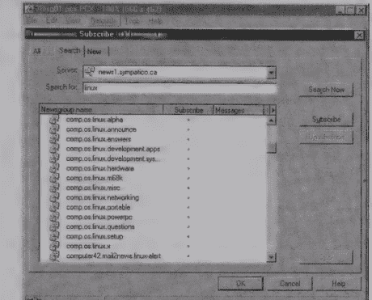

### 图 38.1
正如这个 Netscape 窗口所示，许多新闻组都致力于 Linux。

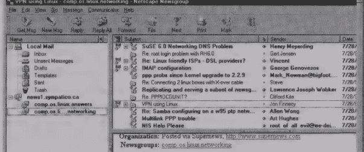
由论坛组织：http://www.newsgroups.com/

我目前正在使用 Linux 防火墙在两个主机之间建立 VPN。我希望能够使用这个新设置与各种客户端（笔记本电脑等）建立 VPN。这些客户端通过本地拨号并使用 `ipsec`（内核 2.0）通过我的防火墙连接到我的 VPN，我想将其升级到当前版本。我可以这样做吗？通过 LAN-IP 链路将会有 1.1M SSL 连接（两端各有 1.1M 上行和下行）。我不认为这是任何

### 图 38.2
使用 Netscape Communicator 阅读新闻组时，文章出现在右上角，消息正文出现在右下角。

### Usenet 简史

Usenet 源于名为 UNIX V7 的 UNIX 版本，该版本首次实现了 UUCP（UNIX 到 UNIX 复制）。UUCP 在机器间的通信中变得流行，它通过程序扩展和补充程序得以扩展。Usenet 起于北卡罗来纳大学，Steve Bellovin 在那里使用 shell 脚本编写了第一个版本新闻软件。UNC 和杜克大学使用该软件在两所大学之间传递消息和评论。当 1980 年在 Usenet 会议上决定 UNIX 系统时，对新闻软件的兴趣开始传播。Steve Daniel 首次用 C 编程语言实现了新闻软件。这个版本最终变成了第一个通用发布的。

# 588 网络
第四部分

使用 `ihave/sendme` 协议，一台机器会发送当前所有消息 ID 数字的列表，并等待另一台机器识别出它想要的那个。这些数字会在响应 `sendme` 消息时一个接一个地传输。然后该过程可以反过来以更新另一台机器。这种协议运行良好，但在通信过程中涉及大量的开销。由于这个原因（加上 UUCP 调制解调器链路通常速度较慢），在必须定期进行非常大的新闻组传输时，`ihave/sendme` 协议并不经常使用。例如，你可能不想使用 `ihave/sendme` 每天传输 100MB 的文章。

大批量传输的替代方法是文章批处理。在这种方法中，一台机器将所有内容发送到另一台机器。接收机器对到达的文章进行检查，看它是否已经拥有这些文章。通过查看消息 ID 数字，机器可以丢弃重复项。这种方法传输通常更快，尽管接收机器在处理新到达的批文章时会有更多的处理开销。

对于基于网络的访问，有三种方法从另一台机器获取文章。使用 NNTP，你的机器可以使用一种称为“推送新闻”（pushing）的技术下载你需要的文章，这与 `ihave/sendme` 协议类似。你的机器还可以根据到达日期从远程基础请求特定的新闻组或文章，这被称为“拉取新闻”（pulling）。或者，你可以与远程端逐篇文章进行交互，而永远不将文章下载到你的本地机器。这个过程被称为交互式新闻阅读，只有当你有一个可以登录的新闻源（newsfeed）时它才有效（这在现在很常见）。

## 总结

本章介绍了 Usenet 和新闻的基础。这些信息为接下来的两章提供了基础，后两章将介绍 NNTP（用于基于网络的访问访问）和 C News（用于 UUCP 和网络访问新闻）。关于 Usenet 及其使用的协议有整本书介绍。如果你需要关于该主题的更多信息，请查看其中一本。

# NetNews 和 INN

# 第 39 章

### 本章内容

- NNTP 如何处理新闻 590
- 如何安装 NNTP 服务器程序 591
- 如何配置 nntpd 592
- 如何使用 INN 593

# 网络
第四部分

网络新闻传输协议（NNTP）通常用于基于 TCP 的新闻源。换句话说，如果你正在使用网络连接到新闻源，你可以使用 NNTP 而不是 UUOC 来下载你的新闻组。虽然 UUOC 用户可以使用 NNTP，但 C News 软件包在新闻传输方面更流行且更容易操作（详见第 40 章“C News”），因为它减轻了 NNTP 增加的复杂性。基于 NNTP 的新闻源的主要优势是可以实现的高吞吐量。UUOC 局限于调制解调器速度，但 NNTP 可以在局域网上以每秒数兆比特的速度运行。这种能力允许在相同的时间范围内进行更大的下载，如果你接收到很多新闻组，这可能非常重要。NNTP 不是一个独立包；它需要另一个服务器系统在运行。NNTP 同时兼容旧的 B News（很少用于 Linux）和更好的 C News（在下一章中讨论）。

本章介绍了你如何为局域网（LAN）系统实现 NNTP。虽然本章没有涵盖所有的 NNTP 选项和功能，但这里提供的信息应该足够让 NNTP 源正常工作。本章末尾处介绍了互联网新闻（INN），这是一个处理新闻的替代包。INN 是一个复杂的包，能够支持非常复杂的网络和新闻需求，但对于小型 Linux 系统来说大材小用了。

### NNTP 如何处理新闻

NNTP 以两种模式运行：主动和被动。主动模式通常被称为“推送”（pushing），与 C News 的 `ihave/send` 协议相同，发送者（服务器）提供特定的文章并等待接收者（客户端）接受或拒绝该文章。推送有高开销（对服务器的缺点），因为每篇文章都必须经过检查。

在被动模式“拉取”（pulling）中，接收机器请求特定新闻组中自指定日期以来到达的所有列表。该请求通过新闻命令通道发送。当接收机器拥有所有文章后，它使用文章命令丢弃任何重复或不需要的文章。这对于发送机器来说要容易得多，因为它只需要发送大量文章，但为了安全起见，服务器必须确保发送的是允许传递给接收者的信息。

NNTP 在 Linux 系统上的实现使用了由 Stan Barber 和 Phil Lanssey 开发的 NNTP 守护进程。这个守护进程几乎被公认为是参考实现。通常，名为 `nntpd` 的 NNTP 守护进程源代码会随 Linux 发行版一起提供，因为二进制文件中链接了若干与特定站点相关的细节。`nntpd` 系统由一个服务器程序两个不同的客户端程序（一个用于推送，一个用于拉取）组成。此外，大多数 NNTP 系统使用 `inews` 程序的替代品。

`nntpd` 的一种替代方案是由 Rich Salz 开发的互联网新闻（INN）包。该包由许多 Linux 发行版提供。INN 支持 UUOC 和基于网络的新闻源，但它实际上是为大型机器设计的。如果你预计会有大量的新闻组访问，INN 可能是比 `nntpd` 更好的选择，尽管 `nntpd` 几乎也能很好处理处理新闻源。

当 NNTP 从远程机器接收文章时，它会将其传递给必须存在的子系统之一。通常，这个子系统是新闻。（你也可以使用 NNTP 进行批处理，如第 40 章所述。）NNTP 使用 `/usr/lib/news/history` 文件来正确执行传输，因此该文件必须经过配置。

### 如何安装 NNTP 服务器程序

NNTP 服务器名为 `in.nntpd`，通常以源代码形式提供，如前所述。在大多数情况下，你必须在机器上进行编译以包含机器特定信息。要配置 `nntpd`，你使用位于 `/usr/lib/news/common/conf.h` 的程序。你可以使用以下命令搜索文件：

```bash
find -name conf.h -print
```

运行该程序（包含许多宏），并回答你的所有问题。

通过为 nntpd 创建一个目录来开始 NNTP 安装过程。你应该在 `/usr/spool/news/.tmp`（或 `/var/spool/news/.tmp`）创建此目录。将目录的所有权设置为 inews。执行这些步骤的命令如下：

```bash
mkdir /usr/spool/news/.tmp
chown news.news /usr/spool/news/.tmp
```

你可以通过两种模式配置 NNTP 服务器。第一种模式是独立守护进程，它在 Linux 系统启动时通过启动文件（使用 rc.inet2）启动。或者，你可以让 nntpd 由 inetd 管理而不是一直运行。

如果你正在配置 `nntpd` 作为独立守护进程运行，请确保 `/etc/inetd.conf` 文件中没有行调用该守护进程。相反，如果你在某种情况下启动了 nntpd 守护进程，请检查 `/etc/inetd.conf` 的潜在冲突。

为了让 `nntpd` 通过 inetd 运行（这可以在处理新闻时减少系统的整体负载），需要在 inetd 配置文件中添加一个条目。该文件通常存储为 `/etc/inetd.conf`。使用 ASCII 编辑器在该文件中添加以下行：

```
nntpd stream tcp nowait news /usr/etc/in.nntpd nntpd
```

`inetd.conf` 文件可能已经有一这样被注释掉的行。在这种情况下，验证该行与前面的行相同，并移除注释符号。

# 网络
第四部分

无论你是将 nntpd 配置为作为独立守护进程运行，还是由 inetd 启动，你都需要验证 TCP 的 `/etc/services` 文件中有一行针对 nntp 服务的配置，其格式类似于如下：

```
nntp 119/tcp readnews untp
```

在安装大多数 Linux 发行版时，这一行是被注释掉的，因此请移除注释符号。

### 如何配置 nntpd

当通过运行 `conf.h` 文件创建 nntpd 二进制文件后，你可以配置 `/usr/lib/news/nntp_access` 文件来控制哪些远程机器可以使用你系统上的 NNTP。该文件由一系列行组成，每个远程对应一个行，使用如下格式：

| sitename | read | xfer | both | no | post | no | except |
| --- | --- | --- | --- | --- | --- | --- | --- |

这里，sitename 是远程机器的名称，可以通过其站点名、完全限定域名（FQDN）或 IP 地址来识别。NNTP 允许对域名和 IP 地址进行部分匹配。如果远程机器的名称或 IP 地址与站点名完全匹配，则只读取该行（忽略文件的其余部分）。如果仅部分匹配，则读取该行，并检查文件的其余部分以寻找进一步的匹配。如果你想匹配所有远程机器，可以使用站点名 `default`。

站点的访问权限定义在第二个字段中。共有四种合法值，其含义如下：

| read | 远程可以检索文章（拉取）。 |
| xfer | 远程可以发送文章（推送）。 |
| both | 远程可以同时发送和接收文章。 |
| no | 远程机器对文章没有访问权限。 |

第三个字段指示远程站点是否可以发布文章。如果使用关键字 `post`，远程机器可以发送文章，并由本地 NNTP 系统完成头部信息。如果在第二个或第三个字段中出现关键字 `no`，则远程机器无法发布文章。

最后一个字段标识了远程机器被禁止访问的任何新闻组。新闻组之间用逗号分隔，并且在字段字段前有一个感叹号（你会在 C News 中经常看到这种格式）。例如，示例中的：

```
chatton.bignet.com both post alt,local
```

允许远程机器 `chatton.bignet.com` 发送和接收所有文章，但 alt 和 local 新闻组层级中的除外。远程机器也可以发布文章。

通常，你会设置 `/usr/lib/news/nntp_access` 为所有机器设置默认值，然后为你想要操作的机器添加特定条目。查看以下示例 `/usr/lib/news/nntp_access` 文件：

```
# 默认条目
default xfer no

# 允许 chatton 完全访问权限
chatton.bignet.com both post

# 允许 brutus 读取但不发布
brutus.bignet.com read no
```


# 网络
## 第四部分

此文件允许除明确指定的机器以外的任何机器向你的机器传输文章，但不能发布文章。名为 `chatton` 的机器可以读取和发布文章，但 `brutus` 只能读取文章。

某些版本的 NNTP 实现了授权系统，以确保你的机器不会被欺骗认为另一机器位于连接的另一端。授权系统在大多数版本的 `nntpd` 中尚未正常工作，目前最好置之忽略。检查未来的 `nntpd` 发布版本以获取更多关于授权的信息。

## 如何使用 INN

互联网新闻（INN）包是 NNTP 的替代方案。INN 设计用于处理比 NNTP 更大、更复杂的新闻系统，因此在 Linux 中没有那么常用。然而，没有理由让你不能在 Linux 系统上使用 INN 代替 NNTP。大多数 Linux 发行版都包含一个 INN 版本。如果你必须支持复杂的邮件系统，INN 的配置过程可能会变得复杂。但对于简单的局域网和独立系统，INN 可以很容易地配置典型用法。

INN 的行为围绕服务器守护进程 `innd` 展开。`innd` 守护进程的功能比 `nntpd` 进程更多，因为它允许同时处理多个流。新闻阅读器服务由另一个名为 `immer` 的守护进程处理，并为每个新闻阅读器客户端创建一个专用副本。

## 安装 INN 软件

大多数 Linux 发行版（包括随本书的 Slack CD-ROM）都包含了预编译的 INN 二进制文件，因此你不需要担心从源码生成二进制文件。如果你必须生成二进制文件，应该使用构建应用程序的 `Makefile`。如果你必须编译代码，应该检查 `Makefile` 和相关的源文件文档以获取编译说明。

当你准备好 INN 二进制文件后，可以遵循一个简单的程序将软件安装到正确的位置，并赋予正确的权限和所有者。你需要遵循的步骤如下：

1. 如果 `/etc/passwd` 中不存在，则创建一个名为 `news` 的用户。如果 `/etc/group` 文件中不存在，则应创建一个名为 `news` 的组。用户 `news` 默认属于 `news` 组。
2. 如果不存在，请在别名文件（通常为 `/usr/lib/aliases`）中为用户名 `usenet` 创建到 `root`、`postmaster` 或或其他定期使用的用户名的邮件别名。（此别名必须存在，因为某些 INN 脚本会向用户 `unset` 发邮件，该用户可以通过别名条目进行重定向）。如果你必须添加别名，将使用 `newaliases` 命令重新构建别名数据库。
3. 检查系统启动文件，查看是否有远程站点的条目。如果使用关键字 `post`，远程机器可以发送文章，由本地 NNTP 系统完成头信息。如果在第二个或第三个字段中出现关键字 `no`，则远程机器无法发布文章。
4. 最后一个字段标识远程机器被禁止访问的任何新闻组。新闻组之间用逗号分隔，并且在字段前有一个感叹号（你会在 C News 中经常看到这种格式）。例如：

```
chatton.bignet.com both post alt,local
```

允许远程机器 `chatton.bignet.com` 发送和接收所有文章，但 alt 和 local 新闻组层级除外。远程机器也可以发布文章。

通常，你会设置 `/usr/lib/news/nntp_access` 为所有机器设置默认值，然后为你想要操作的机器添加特定条目。查看以下示例 `/usr/lib/news/nntp_access` 文件：

```
# 默认条目
default xfer no

# 允许 chatton 完全访问权限
chatton.bignet.com both post

# 允许 brutus 读取但不发布
brutus.bignet.com read no
```

此文件允许除明确指定的机器以外的任何机器向你的机器传输文章，但不能发布文章。名为 `chatton` 的机器可以读取和发布文章，但 `brutus` 只能读取文章。

某些版本的 NNTP 实现了授权系统，以确保你的机器不会被欺骗认为另一机器位于连接的另一端。授权系统在大多数版本的 `nntpd` 中尚未正常工作，目前最好置之忽略。检查未来的 `nntpd` 发布版本以获取更多关于授权的信息。

## 配置 INN

站点的访问权限定义在第二个字段中。共有四种合法值，其含义如下：

- `read` | 远程可以检索文章（拉取）。
- `xfer` | 远程可以发送文章（推送）。
- `both` | 远程可以同时发送和接收文章。
- `no` | 远程对文章没有访问权限。

第三个字段指示远程站点是否可以发布文章。如果使用关键字 `post`，远程机器可以发送文章，由本地 NNTP 系统完成头信息。如果在第二个或第三个字段中出现关键字 `no`，则远程机器无法发布文章。

最后一个字段标识远程机器被禁止访问的任何新闻组。新闻组之间用逗号分隔，并且在字段前有一个感叹号（你会在 C News 中经常看到这种格式）。例如：

```
chatton.bignet.com both post alt,local
```

允许远程机器 `chatton.bignet.com` 发送和接收所有文章，但 alt 和 local 新闻组层级除外。远程机器也可以发布文章。

通常，你会设置 `/usr/lib/news/nntp_access` 为所有机器设置默认值，然后为你想要操作的机器添加特定条目。查看以下示例 `/usr/lib/news/nntp_access` 文件：

```
# 默认条目
default xfer no

# 允许 chatton 完全访问权限
chatton.bignet.com both post

# 允许 brutus 读取但不发布
brutus.bignet.com read no
```

此文件允许除明确指定的机器以外的任何机器向你的机器传输文章，但不能发布文章。名为 `chatton` 的机器可以读取和发布文章，但 `brutus` 只能读取文章。

某些版本的 NNTP 实现了授权系统，以确保你的机器不会被欺骗认为另一机器位于连接的另一端。授权系统在大多数版本的 `nntpd` 中尚未正常工作，目前最好置之忽略。检查未来的 `nntpd` 发布版本以获取更多关于授权的信息。


允许远程机器 `chatton.bignet.com` 发送和接收所有文章，但 alt 和 local 新闻组层级除外。远程机器也可以发布文章。

使用此行，任何人都可以阅读和发布。除非你知道谁可以连接到你的新闻系统，否则不应使用此行。如果客户端系统要向 INN 发布新闻，它必须使用 `inews` 程序。

INN 可能会出现很多问题，但错误信息通常有助于定位问题。通常，名为 `faq-inn-1`、`faq-inn-2` 和 `faq-inn-3` 的这三个文件描述了 INN 系统的大部分方面，包括安装、配置、调试和特殊设置。如果你的 INN 系统遇到任何问题，应该查阅这些文件（INN 的复杂之处太多，无法在本书中详细阐述）。

## 总结

当你完成 NNTP 系统的编译和配置后，可以继续配置底层的新闻子系统（通常是 C News）。完成之后，你应该能够使用 NNTP 从你的新闻源传输文章。

# C News

## 第 40 章

### 本章内容

- C News 如何处理新闻 598
- 如何配置 C News 598
- C News 工具程序 606

## C News 如何处理新闻

当新闻从新闻源传输时，新闻程序会接收并将其存储在溢存目录（通常为 `/usr/spool/news/in.coming` 或 `/var/spool/news/in.coming`）。从溢存目录中，新闻消息会被 `news` 程序获取并处理。发出的新闻（例如来自本地用户）通常从用户的新闻阅读器发送到 `inews` 程序，该程序完成所有头部细节并将其存储在 `/usr/spool/news/out.going`（或 `/var/spool/news/out.going`）目录中等待传输。

传入和发出的消息都会通过 `inews` 程序，该程序负责检查消息在本地站点是否已经过。为了做到这一点，`relaynews` 会根据历史文件（包含所有已处理消息的列表）检查消息 ID。如果消息已经在本地站点被接受，则会被丢弃。

如果消息是新的，`relaynews` 会检查消息的 `Newsgroups` 头部，以验证本地站点是否接受该新闻组的文章。如果不支持该新闻组，`relaynews` 将消息移动到新闻组溢存目录。如果新闻组未在活动文件（active）中列出，`relaynews` 将文章移动到杂项组（通常称为垃圾邮件）。

`relaynews` 程序还会检查消息的头部信息以验证它们不是过期的。如果发现过期的文章，则会被丢弃。如果消息由于任何其他原因（如头部不完整、日期不正确等）未被处理，它会被移动到 `/usr/spool/news/in.coming/bad` 目录并记录错误消息。在完成所有检查后，消息 ID 将记录在历史文件中。

要通过新闻网络发送的消息将检查头部中的 `Path` 字段，以确保机器尚未收到该文章。如果还没有收到则可以使用 UUCP 转发消息（在较少的情况下，使用 NNTP）。

如果正在对新闻文章进行批处理，传入和新文章不会立即转发到 UUCP 网络中的其他新闻机器，而是一直保留直到批次作为一个整体传输。这通常通过 `crontab` 条目控制。

## 如何配置 C News

配置 C News 系统只需验证确保 C News 可以访问必要的目录，并且配置文件中具有有效值。最后，必须检查所有文件的所有者和权限。配置最好分步骤进行。

### C News 配置文件

要开始 C News 的配置过程，请从你的新闻源获取 `active` 和 `newsgroup` 文件的副本。你通常可以通过 UUCP 命令或向该站的主邮管理员发送电子邮件来获取这些文件。将 `active` 和 `newsgroup` 文件放置在新闻目录（通常为 `/usr/lib/news/`），并将所有更改更改用户 `news`。接下来，将文件权限更改为模式 644。你可以通过以下命令完成这两个步骤：

```bash
chown news:news /usr/lib/news/active /usr/lib/news/newsgroup
chmod 644 /usr/lib/news/active /usr/lib/news/newsgroup
```

### 编辑 active 文件

`/usr/lib/news/active` 文件列出了你站点已知（且需要）的所有组，以及当前系统中的文章编号。使用任何 ASCII 编辑器编辑 `active` 文件。删除文件中任何包含 `to-*` 的行。添加两行来添加你的机器名称和新闻源站点，这样你就有了如下行：

```
to.merlin
to.brutus
```

这些行假设你的本地站点名为 `merlin`，你的源站点名为 `brutus`。条目的顺序并不重要。这些条目用于 `news ihave/sendme` 消息系统，即使你没有使用 `ihave/sendme` 系统，它们也应该存在于 `active` 文件中。

接下来，向 `/usr/lib/news/active` 文件中添加以下行：

```
junk
control
```

这些行用于处理非预期的新闻。

在此格式中，`newsgroup` 是新闻组的名称，`high` 和 `low` 是系统中的最高和最低文章编号，C News 不更新此字段。要更新此字段（许多新闻阅读器需要），你必须运行大多数 C News 版本的更新程序。当数字错误（high 低于 low），默认是将 `high` 设置为 `low`。

`permission` 字段提供了用户对组的访问权限。权限是以下值之一：

- `=`：此值将新闻组标记为别名，后跟别名名称。例如，`=naughty_stuff` 将发送到该新闻组的文章发送到名为 `naughty_stuff` 的本地组。
- `m`：此值表示这是一个审核新闻组。发布到审核新闻组的文章将发送给审核员。审核员地址位于 `/usr/lib/news/moderators` 文件中。
- `n`：使用此值，用户不允许向组发布，但可以阅读文章。
- `x`：此值意味着该组已禁用（不允许读取），尽管文章仍可以转发到其他机器。
- `y`：此值意味着用户可以向新闻组发布。

最后，你必须在 `/usr/lib/news/active` 文件的第二和第三字段中汇总所有文章编号 0（起始文章编号）和 1（结束文章编号），以便你正确接收所有文章。此过程需要大量的手动编辑，或者你可以通过一个命令完成整个过程（最好在原始 active 副本上执行）：

```bash
cp active.original active
```

手动检查新的 `active` 文件以确保文件格式正确。整个第二列应该是零，第三列应该是数字 1。

### 更新 newsgroups 文件

`newsgroups` 是所有新闻组的列表，并带有其用途的行描述。描述用于许多新闻阅读应用程序显示用户订阅的组。你可以偶尔更新此文件以确保其准确性，特别是因为新闻组经常变化。对于初始配置，你可以保留从新闻源发送的文件。

### 编辑其他配置文件

许多配置文件维护在 C News 目录中，通常为 `/usr/lib/news`。列表中列出的每个文件都需要检查是否有适用于你站点的正确条目。你可以使用任何 ASCII 编辑器编辑每个文件。

检查并修改以下 C News 配置文件：

- `explist`：此文件指定了某些新闻组的过期时间。
- `mailname`：此文件是你的机器名称，在发出的邮件中应显示此处，通常是你的完整域名名（例如 `tpci.com`）。
- `organization`：此文件是你的组织名称，用于识别来源的新闻媒体。
- `sys`：对于大多数安装，请修改 ME 行以包含 `all/all`。`sys` 文件将在本章稍后的“sys 文件”部分进行更详细的讨论。
- `whoami`：此文件是你的 UUCP 格式的机器名称（例如 `tpci`）。

### C News 目录

在完成这些配置更改后，你应该检查必要的 C News 目录是否存在，如果不存在则应该创建它们。在存储目录（spool directory）下方应该存在 `/in.coming` 和 `/out.going` 目录，根据你的目录结构，可能是 `/usr/spool` 或 `/var/spool`。要创建这两个目录，请使用以下命令（假设 `/usr/spool` 是存储目录）：

```bash
mkdir /usr/spool/news/in.coming /usr/spool/news/out.going
```

如果在执行这些命令时 `/usr/spool/news` 目录不存在，你可能需要先创建它。最新版本的 C News 还需要一个名为 `/usr/spool/news/out.master` 的目录（或相应的 `/var` 下的目录）。你不需要为打算接收的每个新闻组创建单独的存储目录，因为 C News 会自动创建。

在创建这些目录或检查其存在性后，你还应该检查它们的所有权。出于安全考虑，所有目录都应由用户 `news` 组 `news` 拥有。文件权限应设置为 755 模式。你可以通过这些命令设置所有权权限：

```bash
cd /usr/spool
chown -R news:news news
chmod -R 755 news
```


这些命令假设你的 `chown` 和 `chmod` 版本接受 `-R` 选项（大多数 Linux 版本都支持）。如果不支持，请对之前提到的每个目录执行 `chown` 和 `chmod` 命令。

# sys 文件

如前所述，`/usr/lib/news/sys` 文件是需要为你的系统定制的配置文件之一。由于 sys 文件具有几个重要方面，本节将更详细地查看该文件。sys 文件根据配置控制下载到你的站点并转发到其他站点的**组层级结构**。

# 网络

sys 文件由针对你转发新闻的每个站点的一组条目组成。它还列出了将从其他站点接受的新闻组。sys 文件对每个条目使用特定的格式，遵循以下通用语法：

`site/exclusions:groups/distribution_list:flags:cmds`

除了站点名称外，条目的所有参数都是可选的，但冒号必须保留。各个参数的含义如下：

- `site` 参数是站点名称（通常是其 UUCP 名称）。你为你连接的每个远程站点都需要一个条目，同时也包括你的站点（由特殊名称 `ME` 指定）。
- `exclusions` 参数定义了不返回远程站点的新闻组（因为你可能是从该站点下载的它们）。此字段是可选的。如果你是叶节点（只向新闻服务器下载和上传），则此条目可以设置为 `all`。
- `groups` 参数是要下载或上传的新闻组和层级列表。多个条目之间用逗号分隔。
- `distribution_list` 参数指定要转发的新闻组。这是 `groups` 条目的可选附加部分，用斜杠隔开。你可以使用此字段防止某些新闻组发送到另一个站点。
- `flags` 参数设置控制传输参数的可选标志。`flags` 的有效值在本节稍后列出。
- `cmds` 参数是一个命令，如果没有通过标志或命令行参数启用处理，则会对每篇文章执行该命令。请参见本节稍后关于该字段使用的描述。

在 sys 条目的 `site` 字段中指定远程机器名称时，请确保考虑到文章 `Path` 头部中可能的变化。这通常意味着要提供站点的 UUCP 格式和全名格式，以及可能使用的任何别名。用斜杠分隔站点规范中的多个条目。例如，你为名为 `brutus` 的机器定义的条目看起来如下：

`brutus/brutus.bignet.com`

你自己机器的 sys 文件非常重要。`ME` 名称旁边的任何新闻组都被视为你特别想要跟踪的新闻组，而所有其他组都会发送到垃圾新闻组。

你必须为每个连接到你的机器以获取新闻源的站点添加一行（如果有的话）。如果你位于新闻源的末端，可以输入你的新闻源的名称（所有本地生成的文章都只会发送回该机器）。

要在与远程站点之间传输的新闻组在 `Groups` 字段中指定。你可以通过逗号分隔多个新闻组，将其设置为传输几个特定的新闻组。例如，以下条目仅传输了指定的三个新闻组：

`rec.audio.high-end,rec.video.lasisk,rec.bicycles.tech`

`cmds` 参数是一个命令，如果没有通过标志或命令行参数启用处理，则会对每篇文章执行该命令。请参见本节稍后关于该字段使用的描述。

在 sys 条目的 `site` 字段中指定远程机器名称时，请确保考虑到文章 `Path` 头部中可能的变化。这通常意味着要提供站点的 UUCP 格式和全名格式，以及可能使用的任何别名。用斜杠分隔站点规范中的多个条目。例如，你为名为 `brutus` 的机器定义的条目看起来如下：

`brutus/brutus.bignet.com`

你自己机器的 sys 文件非常重要。`ME` 名称旁边的任何新闻组都被视为你特别想要跟踪的新闻组，而所有其他组都会发送到垃圾新闻组。

你必须为每个连接到你的机器以获取新闻源的站点添加一行（如果有的话）。如果你位于新闻源的末端，可以输入你的新闻源的名称（所有本地生成的文章都只会发送回该机器）。

如果你想传输 

- `m` 仅处理已审核新闻组的文章
- `n` 为新闻源创建批文件
- `u` 仅处理未审核新闻组的文章

标志 `F`、`I` 和 `n` 是互斥的，这意味着在单个条目中只能使用其中一个。

# 如何实现批处理

如果你想在新闻系统上使用批处理（batching），除了 sys 文件中的批处理指示外，你必须对配置文件进行一些额外的更改。新闻批次中的每篇文章都有一行标识文件大小，例如：

```
# rnews 3634
```

当使用压缩时，该行之前会有另一行，用以反映提取文章时使用的压缩类型。最常用的两种方案是 UNIX 压缩工具和 GNU gzip 工具（大多数版本的 C News 都不支持后者）。它们的头行分别如下所示：

```
#icbatch
#izbatch
```

偶尔，文章会有一个如下的标题，指示该批次使用了 c7 编码，该编码会移除数据中的第8位：

```
#ic7unbatch
```

C News 通过执行程序 `/usr/lib/news/bin/batch/sendbatches` 来处理批次。该程序使用从 `/usr/lib/news/site/togo` 待发送的文章，并将它们打包成一个或多个新闻批次。批次的大小由 `/usr/lib/news/batchparams` 文件中的变量决定。该文件还提供了在不需要默认压缩设置时使用的压缩程序，以及连接到远程站点的传输类型。

`batchparams` 文件中每行的格式如下：

```
sitename size max batch compunch muncher transport
```

在此格式中，`sitename` 是远程站点的名称，`size` 是压缩前的批次最大大小（除非单篇文章更大，在这种情况下文章将本身作为一个批次处理），`max` 是在忽略该站点之前可以存储的最大批次数（防止批次在不存在的站点累积）。此外，`batch_program` 是用于生成批次的命令（通常使用 batch 的默认值最佳），`muncher` 是压缩系统（comp 的默认值使用 `compress`），而 `transport` 是连接方法（对于 UUCP，通常是 `vianaux`）。`batchparams` 文件中的示例条目如下：

```
brutus 10000 20 batch compunch vianaux
```

你可以通过在斜杠中嵌入默认值，为所有特定提及的站点之外的所有站点设置默认值：

```
/default/ 100000 20 batch compunch vianaux
```

此默认行应该放在其他站点行之前。请为大小替换为你需要的任何值。

通常，C News 应该通过 `crontab` 定期启动批处理文件传输（取决于向新闻组发布的频率）。你可以通过此命令指示 C News 在任何时间处理批次：

```
news /usr/lib/news/bin/batch/sendbatches sitename
```

在该命令中，`sitename` 是你想要连接的站点名称。如果你没有指定远程站点名称，将处理所有站点。请以 root 执行此命令，或在命令时使用 `su`。

# 最后步骤

当你处理完所有这些配置问题后，就可以准备接收新闻了。你的系统应该会汇聚新闻站点并等待结果。发生的最常见问题是配置文件信息中的错误，这通常可以通过逐一验证每个文件来发现。

如果阅读器在下载后没有找到任何文章，很可能是阅读器遵循了错误的路径。Linux 系统使用 `/var/local/news` 和 `/usr/local/news`，因此你的阅读器可能在错误的位置。使用以下命令在两个目录之间建立符号链接：

```
ln -s /usr/local/news /var/local/news
```

查看解决问题。

新闻组的池目录（spool directories）往往会变得非常大，特别是那些你没有显式订阅的新闻组，以及垃圾新闻组（等价）。你应该定期进入池目录并清理不需要的新闻组条目。你可以使用 `rm` 的 `-r` 选项删除整个目录及其内容（尽管你应该小心这个危险的命令；你可能会意外删除整个文件系统）。

# C News 工具

在大多数 Linux 发行版中，C News 系统包含许多存储在 `/usr/lib/news/bin/maint` 目录下的实用程序。超级用户可以使用这些程序来控制 C News 系统的行为。其中一些工具和它们操作的文件已经提到过。与 C News 一起找到的常用工具如下：

- `addgroup` 工具向活动文件添加新闻组，并使用相同的格式。例如，若要添加一个名为 `local.stuff` 且所有用户都可以阅读的新闻组，请执行以下命令：
```
addgroup local.stuff y
```
- `delgroup` 工具从活动文件中删除新闻组。执行命令后跟上新闻组名称。
- `newsboot` 工具删除由异常终止程序创建的锁文件。
- 运行 `newsdaily` 来清理日志、检查过期和批次等。生成的任何消息都会邮件给新闻管理员（newsmaster）。
- `newsrunning` 工具接受 `on` 或 `off` 作为参数，并相应地控制传入新闻的解批处理。
- `newswatch` 工具检查新闻文件是否存在不一致和错误。生成的消息将邮件给新闻管理员。

大多数工具都是偶尔使用的，`newsdaily` 除外，你可以将 `newsdaily` 放在 `crontab` 文件中。为了确保新闻文件的额外安全，请将 `newswatch` 程序也添加到 `crontab` 文件中。

## 总结

本章向你展示了如何在大多数安装环境中让 C News 运行起来。这些信息配合常用阅读器的文档，将帮助你设置 Linux 系统。虽然本章没有查看所有可用阅读器，但它可以向你展示常用阅读器的配置要求。由于大多数 Linux 系统配备了 trn 和 tin（都是线程阅读器），它们是本章的重点。如果你想获取更多关于 C News 的信息，请查阅阅读器的文档。

# 阅读器

阅读器是 NNTP 或 C News 存储的新闻组的用户界面。阅读器允许用户对新闻组进行读取、打印、保存等许多操作，包括回复文章。在新闻组级别，阅读器让用户查看列表、订阅或取消。

阅读器差异很大，从简单到复杂，从字符界面到图形。目前 Linux 发行版自带许多阅读器，随着程序员将他们喜爱的 UNIX 或 DOS 阅读器转换为 Linux 版，更多的阅读器正在出现。

# 配置阅读器

如果你想在 X 或 Motif 下工作，有许多优秀的阅读器。某些图形阅读器集成在较大的工具中，例如办公套件或 Netscape Navigator。也有专用的 X 阅读器，例如 Hawkeye。Hawkeye 是一个完整的互联网站点，内置了邮件、新闻、Web 和聊天功能。它是免费的，这很棒。

trn 和 tin 都是字符界面阅读器，尽管有一些 X 端口。它们是本章的重点。

# 配置 trn

trn 阅读器被 UNIX 用户广泛使用。它基于经典的阅读器 `m`（读取新闻）。trn 相比 `m` 的主要优势是它处理线程（主题相关的文章）的能力。大多数系统都可以运行 trn 而无需对文件进行修改，除非你想使用线程。

要启用线程，trn 需要能够构建线程数据库。trn 阅读器依赖于一个名为 `mthreads` 的程序（通常存储在 `/usr/local/bin/rn/mthreads`）来帮助它创建该数据库。`mthreads` 工具最好放在 `crontab` 文件中定期运行（通常与你下载全量数据的频率相同）。你可以不使用线程运行 trn，但这样你就无法跟踪线程。

在不带任何参数的情况下，`mthreads` 只为所有新闻组的新文章生成线程数据库索引文件。要从头开始索引所有新闻组，请执行此命令：

```
mthreads all
```


## 配置新闻阅读器 trn 和 tin
### 第 41 章

如果你只想索引少数几个新闻组，可以在 crontab 文件或 shell 提示符中提供新闻组名称作为参数。例如，命令

`threads rec.auto.antique`

会重新索引 `rec.auto.antique` 线程数据库。你可以通过逗号分隔名称来一次重新索引多个新闻组。你也可以通过仅指定层级名称来强制对整个层次进行重新索引。例如，命令

`threads alt`

会重新索引所有的 `alt` 新闻组。要排除某些新闻组，请在它们前面加一个感叹号。例如，此命令

`threads rec.auto.audio,!rec.audio.tech`

会重新索引所有的 `rec.auto` 新闻组，以及 `rec.audio.tech` 之外的 `rec.audio` 新闻组。

如果你的站点新闻流量很大，你可以以守护模式运行 `mthreads`。在守护模式下，`mthreads` 不需要定期启动，而是会立即处理文章。然而，由于这会消耗系统资源。要将 `mthreads` 设置为守护模式，请使用 `-d` 选项。默认情况下，`mthreads` 每 10 分钟检查一次新闻组。如果你愿意，可以将此命令放在 rc 启动文件中。

### 配置 tin

与 `trn` 不同，`tin` 新闻阅读器不需要被告知定期重新索引线程数据库。`tin` 新闻阅读器会在用户每次进入新闻组时生成线程索引。重新索引的速度非常快，除非新闻组的文章超过 500 篇左右。

当 `tin` 重新索引新闻组时，它会将索引文件存储在用户的家目录下，路径为 `.tin/index/newsgroup_name`。如果用户阅读大量新闻组，或者系统上有许多用户，所有索引文件可能会变得非常大。防止索引文件增长的简单方法是强制 `tin` 在一个位置保留一个所有用户都可以访问的单一索引。要设置单一索引，请使用以下命令设置 `tin` 的所有者（当然，前提是你正处于 `tin` 目录）：

```
chown news:news.tin
```

这样，`tin` 将将索引文件存储在 `/usr/spool/news/.index`（或 `/var/spool/news/.index`）。

你可以安装一个名为 `tind` 的守护进程，它可以保持索引文件的不断更新。某些 Linux 版本使用了 `tin` 守护进程源码，但很少有编译好的版本。你需要一个编译器和 `make` 实用工具为你的系统构建一个版本。

### 总结

大多数较新的新闻阅读器都有简单的配置要求，这些要求在附的 README 文件中说明，尽管并不是所有的 Linux 发行版都提供 `tin` 和 `trn` 以外的新闻阅读器。少数版本增加了 `nn`，它也是一个线程新闻阅读器。基于 X 的新闻阅读器在质量和要求上各不相同，尽管少数发行版提供了 `xrn` 版本（一种基于 X 的 `tn` 新闻阅读器）。在大多数情况下，除了监控日志文件的过度膨胀外，新闻阅读器很少需要系统管理员进行交互。

## Samba
### 第 42 章

#### 本章内容

- 安装 Samba
- 配置 Samba
- 使用 `smbclient`

会话消息块 (SMB) 或 Samba 协议允许 Linux 与 Windows 操作系统共享文件系统和文件。使用 Samba，Windows 95、Windows 98 或 Windows NT 机器可以跨网络查看 Linux 文件系统，就像其是原生格式一样，并可以使用普通的剪切粘贴程序传输文件。这种文件传输以前需要 FTP，但 Samba 现在让混合环境网络变得更加友好且易用。

Samba 用于允许在网络上共享打印机和文件。通过在 Linux 机器上设置 Samba 驱动程序，Linux 也获得了这些能力，尽管该操作系统和文件系统与 Windows 非常不同。本章展示了如何在你的 Linux 机器上设置和配置 Samba。该过程执行起来异常地简单，让你没有理由不使用这项功能。

> Samba 最初于 1987 年开发 SMB，很快被移植到 UNIX 并最终移植到 Linux。微软最近开发了一种名为通用互联网文件系统 (CIFS) 的新文件共享系统。CIFS 与 SMB 不兼容。在本书编写时，没有可用的 Linux CIFS 驱动，但由于 CIFS 尚未广泛实施，所以这不是问题。当 CIFS 被广泛使用时，Linux 驱动程序将紧随其后。

### 安装 Samba

Linux 的 Samba 软件包包含了几个组件。核心是 Samba 守护进程 `smbd`，它为任何客户端（通常是 Windows 机器）提供文件和打印服务。`samba` 守护进程的所有配置信息包含在名为 `/etc/smb.conf` 的文件中。Samba 软件包中的一个名为 `testparm` 的实用工具可以对配置文件进行测试，以确保文件被正确解析。要检查打印机，包含一个名为 `testprns` 的实用工具。另一个名为 `smbstatus` 的实用工具允许你识别当前网络上的任何 SMB 用户。

另一个名为 `nmbd` 的守护进程为 Windows 机器提供 NetBIOS 名称支持。（NetBIOS 和 NetBEUI 是微软开发的两种网络协议，用于其 Windows 3.11 工作组版产品，并且仍被 Windows 95/98 用于网络功能。）`nmbd` 守护进程可以设置为一直运行，以便为 DNS 等其他名称服务守护进程提供交互式查询。

Samba 的最后一个组件是客户端本身，它类似于 FTP。通过 Samba 客户端，你可以从你的 Linux 系统检查 Windows 目录，并在两个操作系统之间跨网络移动文件。

Samba 软件包通常包含在最近的发行版中，或者可以从任何 FTP 站点加载。如果你的系统使用包管理器，通常提供一个软件包来简化安装。如果你正在使用包管理器，可以像这样安装 Samba：

```
rpm -ivh samba-2.0.5.rpm
```

将名称替换为你的发行版附带的任何发布号（编写本文时，2.0.5 是最新版本）。如果你没有使用包管理器，通常提供一个 tar 文件（通常经过 gzip 压缩），可以将其提取到临时目录。然后安装脚本会将文件放在正确的位置。大多数 Samba 下载包都会包含一个 README 文件，说明该过程以及你如何对其进行自定义。

一个典型的 Samba 发行版将包含两个守护进程的二进制文件（`smbd` 和 `nmbd`）、`smb.conf` 配置文件以及两个实用工具。根据 Samba 的版本，可能会添加额外的文档文件或支持文件。

### 配置 Samba

Samba 的配置过程需要你使用任何 ASCII 编辑器编辑 `/etc/smb.conf` 文件。`smb.conf` 文件分为若干部分，因此逐个涵盖每个部分并在过程中进行配置是最容易的。每个部分包含方括号括中的名称（例如 `[global]`、`[homes]` 和 `[printers]`）；每个部分内部是若干带有参数和值的行，如下：

```
path = /usr/bin/shared
```

为了正确配置 Samba，你必须遍历整个文件并确保所有设置与你的网络和系统匹配。

你可以在系统运行时随时更新 `/etc/smb.conf` 文件。`smbd` 守护进程本应定期重新读取 `/etc/smb.conf` 文件，但如果你想强制执行 `smbd`，只需停止现有的 `smbd` 进程，如下：

```
/etc/rc.d/init.d/smbd stop
```

然后使用命令重启它：

```
/etc/rc.d/init.d/smbd restart
```

在许多 Linux 版本中，你可以用一个命令完成这两个步骤：

```
/etc/rc.d/init.d/smbd restart
```

#### `/etc/smb.conf` 文件

`/etc/smb.conf` 文件包含三个主要部分，每个部分都负责一组特定的参数：

- `[global]`，用于控制 `smbd` 守护进程和本地机器设置
- `[homes]`，用于为用户设置家目录和权限
- `[printers]`，用于设置共享打印机

文件中还可能包含用于特定目的的其他自定义部分。接下来的内容将按顺序介绍每个部分并设置相关参数。

每个部分内部通常包含一堆注释，所有注释都以分号（`;`）开头。注释通常位于每行参数之前，并解释该行应该包含的内容。

#### `[global]` 部分

`[global]` 部分控制 `smbd` 守护进程的行为，并为本地机器设置参数。该部分还会告知 Samba 关于 `/etc/smb.conf` 文件中其他部分的信息。你为本地机器设置的参数列在此处，其顺序与它们在 `/etc/smb.conf` 文件中出现的顺序一致：

`[global]` 部分中的其余参数通常被注释掉，在任何 Linux 配置中都不是需要的。这些参数允许你微调 `smbd` 的运行方式，但默认行为是为了在 Linux 下获得最佳性能。

#### `[homes]` 部分

`[homes]` 部分用于指定使用 Samba 的客户端到家目录的网络连接。当客户端尝试从 Windows 系统连接到你的 Linux 机器时，`smbd` 守护进程会搜索 `/etc/smb.conf` 文件，查找是否存在该客户端的章节以说明哪些操作是允许的。如果没有针对该客户端的特定章节，将使用 `[homes]` 部分。

`[homes]` 部分的默认行为是用客户端的登录名来搜索 `/etc/passwd`。如果找到匹配项，将从文件中提取出客户端的家目录并通过网络连接进行共享。如果你以 `bane` 的身份登录 Windows 98 机器并需要使用 Samba 从 Linux 机器传输文件，`smbd` 会拦截 `bane` 的登录，在 `/etc/passwd` 文件中进行匹配，然后将家目录（例如 `/user/bane`）共享给 Windows 98 机器。如果没有找到登录名的匹配项，你可以控制 Samba 共享文件的方式，包括不进行任何共享。

`[homes]` 部分中指定的参数按其出现顺序列举如下：

- `comment`：此描述将显示给客户端，用于告知哪些共享是可用的。
- `browseable`：如果设置为 `yes`，则共享不会出现在网络浏览器（如“网络邻域”）中。
- `read only`：如果设置为 `yes`，则目录中的文件无法修改、删除或添加；如果设置为 `no`，客户端可以更改、删除并向目录添加文件。
- `preserve case`：如果设置为 `yes`，则命名时对大小写敏感。
- `short preserve`：如果设置为 `yes`，则在使用 DOS (8.3) 短格式命名时对大小写敏感。
- `create mode`：它指定了在共享目录中创建的所有文件的权限。

`[homes]` 部分中的 `preserve case` 和 `short preserve` 设置都应该设置为 `yes`。这是因为大小写对 Windows 来说不重要（尽管会被记录），但对 Linux 来说很重要；你不希望出现这样的情况：从 Linux 传输文件到 Windows 然后再传回来，结果却得到了两个大小写不同的文件。

#### `[printers]` 部分

`[printers]` 部分告诉 `smbd` 如何使用连接到 Linux 机器和其他 SMB 客户端的打印机。如果 `/etc/smb.conf` 文件中没有关于每个打印机的特定指令，则会读取此部分。如果你没有需要通过 Samba 共享的打印机，则不需要 `[printers]` 部分。

`[printers]` 部分的条目按在 `/etc/smb.conf` 文件中的出现顺序列在这里：

- `comment`：此描述通过网络发送以解释设备。
- `path`：该路径用于打印打印作业（通常为 `/var/spool/samba`）。
- `browseable`：如果设置为 `no`，则打印机不会出现在网络浏览中。如果设置为 `yes`，则打印机会出现在网络浏览中。
- `printable`：如果设置为 `yes`，共享可以使用该打印机。
- `public`：如果设置为 `yes`，客账户（如果已激活）可以使用打印机。为了安全，除非你计划允许客账户，否则应将其设置为 `no`。
- `writable`：如果设置为 `no`，共享无法直接向打印机执行写入；这是该参数的最佳设置。
- `create mode`：这些是在提交作业时关联的权限（通常为 `0750`）。

在设置好 `[global]`、`[printers]` 和 `[homes]` 部分后，`/etc/smb.conf` 文件就可以准备就绪。除非你想为目录或打印机创建特定的指令，否则你可以开始在网络上使用 Samba 服务。

#### 创建特定共享

`/etc/smb.conf` 中的 `[homes]` 和 `[printers]` 部分为未指定目录或打印机行为的情况提供了通用指令。然而，Samba 的优势之一是你可以为目录和打印机创建特定的指令，以覆盖通用设置。这允许你创建具有具有特定权限和访问限制的许多不同共享。

`/etc/smb.conf` 中特定部分的布局与 `[homes]` 和 `[printers]` 镜像，但部分名称是显式的。例如，这里有一个名为 `[timdirectory]` 的部分，它共享了 `/usr/tparker` 目录：

```
[timdirectory]
comment = Tim's directory
path = /usr/tparker
valid users = tparker
browseable = yes
public = no
writable = yes
create mode = 0750
```

`[homes]` 部分中的 `preserve case` 和 `short preserve` 设置都应该设置为 `yes`。这是因为大小写对 Windows 来说不重要（尽管会被记录），但对 Linux 来说很重要；你不希望出现这样的情况：从 Linux 传输文件到 Windows 然后再传回来，结果却得到了两个大小写不同的文件。

### 使用 `testparm` 检查 `/etc/smb.conf`

对 `/etc/smb.conf` 文件进行所有更改后，可以使用 Samba 自带的 `testparm` 工具来验证文件，虽然这不是绝对可靠的检查，但它可以捕捉常见错误。运行 `testparm` 的命令：

```
testparm
```

在这里，`filename` 是要检查的文件。如果没有指定文件名，`testparm` 会假设为 `/etc/smb.conf`。当 `testparm` 运行时，它会显示状态信息以及任何错误。成功运行的结果如下：

```
Load smb config files from smb.conf
Processing section [homes]
Processing section [printers]
Loaded services OK
```

通过添加主机名和 IP 地址使用 `testparm` 与其他机器的连接。例如，如果在 `/etc/smb.conf` 中指定了机器 `brutus`（IP 地址为 `205.150.89.133`），你应该执行此命令：

```
testparm brutus 205.150.89.133
```

再次，`filename` 是你想检查的文件，如果不提供备用文件，则默认为 `/etc/smb.conf`。在验证其他机器的服务时，你需要在同一行提供名称和 IP 地址。这强制 `testparm` 确保 `/etc/smb.conf` 中的服务可以正常访问。

### 使用 `testprns` 测试打印机

要测试 `/etc/smb.conf` 中配置的打印机，可以使用 `testprns` 命令。`testprns` 命令接收打印机名称作为参数并验证打印机是否正常。你应该指定要测试打印机使用的 `printcap` 文件名，以便打印机能够正常打印。例如，使用常规 `printcap` 文件测试名为 `hplj` 的打印机，命令如下：

```
testprns hplj /etc/printcap
```

`testprns` 工具的输出类似于：

```
Looking for printer hplj in printcap file /etc/printcap
Printer name hplj is valid.
```

`testprns` 工具并不复杂，但它确保了你的打印机可以被正常访问和共享。

### 使用 `smbstatus` 生成状态报告

`smbstatus` 命令可用于获取 Samba 当前状态以及任何正在使用的共享的报告。`smbstatus` 命令可以任意组合使用以下三个参数：

- `-d` 提供详细输出
- `-p` 列出所有 Samba 进程
- `-s` 指定配置文件（默认认为 `/etc/smb.conf`）

你可以直接单独运行 `smbstatus` 命令（不带任何参数），此时你将获得任何已用共享的摘要。

### 使用 `smbclient`

`nmbd` 守护进程从你的 Linux 机器为网络用户提供 SMB 服务。那么如何从同一网络上的 Windows 机器获取网络资源呢？这通过名为 `smbclient` 的 SMB 客户端来实现。使用 `smbclient`，你可以访问网络上任何 Windows 机器的共享，以及任何运行 SMB 的其他 Linux 或 UNIX 机器。

`smbclient` 工具的工作原理类似于 FTP：它允许你在网络上传输文件，而无需担心 FTP 的语法和会话。你还可以使用 `smbclient` 中查询其他机器的共享情况。

> 在本书编写时，市面上已经有一些商用的基于 X 和 Motif 的 SMB 客户端，并且一些共享软件正在开发中。X 工具允许你使用类似 Windows 资源管理器的界面查看网络上的其他机器。如果你运行 X 或 Motif，可能想检查 Linux Web 和 FTP 网站获取有关这些客户端的信息。

`smbclient` 工具是一个基于字符的实用程序，但可以在 X 下 X 终端窗口中使用。

你通常只用 `smbclient` 几件事：查找其他机器上可用的共享、传输文件以及共享打印机资源。要查找特定机器上哪些共享对可用，你需要指定该机器的完全限定域名。例如，要显示 `tpci.com` 域内该机器上的所有共享，命令为：

```
smbclient -L -I brutus.tpci.com
```

`-L` 参数允许 `smbclient` 请求共享列表，而 `-I` 参数将机器名指定为 DNS 格式名称，而不是 NetBIOS 格式名称。

如果你在网络机器上发现了想要传输的文件，你需要像使用 FTP 一样连接到该机器。连接该机器的命令仅为：


# smclient 命令使用指南

## 命令语法

```bash
smclient '\\TPCI\\PUBLIC' -U brutus.tpci.com -U tparker
```

同样，`-I` 参数指定了机器，`\\BRUTUS\\PUBLIC` 选项（在这种情况下，这是一个名为 PUBLIC 的公共目录），而 `-U` 告诉 `smclient` 在远程机器上使用哪个登录名。连接的资源将是一个目录或打印机，使用 NetBIOS 命名格式，其中先指定工作组或机器名，然后是资源名称。

如果登录远程机器需要密码，`smclient` 会提示你输入并显示如下提示符：

```bash
smb: \
```

这里，`\` 是远程机器上的当前工作目录（与根目录不同）。

`smclient` 命令行等待你指定执行不同操作的命令。这些命令许多与 FTP 的命令相似。支持的 `smclient` 命令列表如下：

| 命令 | 说明 |
| :--- | :--- |
| `!` | 显示帮助信息 |
| `!` | 执行 shell 命令 |
| `cd` | 更改远程机器上的目录 |
| `del` | 删除远程机器上的文件 |
| `dir` | 列出文件 |
| `exit` | 退出 `smclient` |
| `get` | 从远程机器传输文件到本地机器 |
| `help` | 显示帮助信息 |
| `lcd` | 更改本地机器上的目录 |
| `ls` | 列出文件 |
| `md` | 在远程机器上创建目录 |
| `mkdir` | 在远程机器上创建目录 |
| `mget` | 使用通配符从远程机器传输多个文件到本地机器 |
| `mput` | 使用通配符从本地机器传输多个文件到远程机器 |
| `print` | 打印远程机器上的文件 |
| `put` | 将文件从本地机器传输到远程机器 |
| `queue` | 列出远程机器上的所有打印作业 |
| `quit` | 退出 `smbclient` |
| `rd` | 移除远程机器上的目录 |
| `rmdir` | 移除远程机器上的目录 |

## 网络

在 `smb` 提示符下使用这些命令中的任何一个来传输文件，就像使用 FTP 一样。例如，此会话登录到远程 brutus（登录不需要密码）并双向传输文件：

```bash
smbclient '\\TPCI\PUBLIC' -I brutus.tpci -U tparker

smb: get foobar

smb: put bigfile

smb: quit
```


在这种情况下，既然可以使用 FTP，为什么还要费劲使用 Samba 呢？两者都能完成相同的任务，但 Samba 允许更方便地使用在 Windows 中设置的共享。此外，除非运行了 FTP 服务器，否则 Windows 通常不接受 FTP 请求，而共享资源始终对网络是可用的。

## 总结

正如你所看到的，只要你正确配置了 `/etc/smb.conf` 中的信息，Samba 的设置就非常简单。当 Samba 顺畅运行后，你会发现非常容易通过“网络邻域”从网络上的 Windows 机器访问 Linux 系统资源。从 Linux 到 Windows 机器移动文件和访问资源稍微没那么友好一些，但 Samba 客户端很快就会改变这一点。

# 互联网
第五部分

## 本部分内容

- 43 设置站点站点 625
- 44 设置 FTP 站点 635
- 45 配置 WAIS 站点 651
- 45 设置 Gopher 站点 667
- 47 使用 WWW 685

# 设置互联网站点
第 43 章

- 选择连接方法 626
- 决定所需的服务 627
- 通过网关连接 627
- 通过另一个网关连接 628
- 使用互联网服务提供商 (ISP) 628
- 连接类型 629

Linux 非常适合连接并提供许多服务。本章介绍了连接互联网的许多方法。另一方面，与他人共享你的系统，无论是在局域网、小圈子还是全球互联网社区，都是最有趣的部分。

如果你只想使用 Linux 系统来访问服务器，但不想提供互联网接入，那么你就不需要连接互联网。不过，你仍然需要设置服务器。

## 选择连接方法

你可以通过多种方式连接到互联网。你的选择主要取决于你的使用习惯和想要访问的服务。虽然似乎有很多提供互联网接入服务的公司，但实际上连接互联网的方法只有四种：

- **直接连接互联网**：这种方法使用专用机器（网关）连接到互联网骨干网。这种方法让你完全访问所有服务，但设置和维护成本很高。直接连接不通过互联网服务提供商 (`ISP`)，通常供大型公司和组织使用。
- **通过别人的网关连接**：这种方法涉及获得许可使用他人的机器访问所有互联网服务，通常免费。这种类型访问的最常见形式是通过大学、学院或工作网络。
- **使用互联网服务提供商 (`ISP`)**：这种方法使用 `ISP` 的网关提供互联网服务。所有这些公司都充当互联网的网关；它们与 `ComputeServe` 或 `America Online` 等在线服务不同。
- **使用间接服务提供商**：这种方法通过在线公司（如 `Delphi` 或 `ComputeServe`）访问互联网的部分或全部服务。这种方法通常适用于低流量使用，并且没有充分利用 Linux。

很难找到一个可以供你使用的互联网直接网关，除非你愿意分担网关费用。大多数拥有网关的公司都不愿意让外部人员使用其系统。

# 设置互联网站点

如果你是公司的一员或正与多个朋友分担费用，像 `AOL` 或 `CompuServe` 这样的在线服务供应商很少能提供你对网页浏览、电子邮件、FTP 以及其他互联网服务支持所需的性能水平。此外，大多数在线服务并不允许你拥有自己的域名。

## 决定你需要哪些服务

在决定使用何种方法访问互联网时，需要考虑的重要事项之一是你希望从互联网获得的服务类型。如果你只需要电子邮件，任何接入方式都能提供，但对于你所获得的内容来说，价格可能贵得离谱。作为一个起点，请决定以下服务哪些是必要的，哪些不那么重要：

- 世界维网 (`WWW`)：网页是除电子邮件之外互联网最受欢迎的用途，你很可能希望能够浏览网页。
- 电子邮件 (`email`)：这允许你向其他互联网用户发送和接收邮件。
- `Telnet`：这允许你远程登录到互联网上的其他机器。
- `FTP`：这允许机器之间传输文件。
- `Usenet` 新闻组 (`Usenet newsgroups`)：这组公告板提供了对许多不同主题的讨论。
- `Gopher`：这是一个信息搜索和检索系统。
- `WAIS`：它提供了一个文档搜索和检索系统。
- `Archie`：它提供了一种寻找要传输文件的方法。
- 互联网相对聊天 (`IRC`)：这种对话方式非常像 CB 无电台。

任何通过网关（你自己的网关、借用的网关或大多数 `ISP`）直接连接到互联网的系统都可以完全访问列出的所有服务。某些直接服务支持所有服务，但速度比网关慢。对于严重依赖图形的万维网来说，较慢可能会是一个限制。某些服务供应商限制了对电子邮件和新闻组的访问，因此必须进行一些研究。

## 通过网关直接连接

直接连接（通常称为专用连接）是指通过专用机器网关或 `IP` 路由器连接到互联网骨干网。该连接通过一条能够高速传输的专用电话线进行（通常通常为 `T1` 速率的 `1.44Mbps`，也可以使用 `ISDN` 线路）。网关成为互联网架构的一部分，必须始终保持在线。然后，你可以使用网关网络上的任何其他计算机来访问互联网服务。

# 互联网

通常，专用连接意味着大量的流量。个人或小公司不太可能拥有直接网关接入，主要是因为安装成本和维护要求很高。连接到互联网骨干网的网关机器必须具备处理能力，这超出了运行 Linux 的典型 `PC` 的能力。

要创建一个直接接入系统，你必须与网络信息中心 (`NIC`) 合作，为你的域名在互联网骨干网上设置适当的网关。这种系统的资本支出很高，无论是初始硬件和软件，还是持续支持都是如此。具有高速数据传输能力的专用电话线也可能涉及高成本。

## 通过另一个网关连接

连接互联网的另一种方法是依靠使用友好的机器或网络。在这样的系统中，拥有互联网网关的机构或教育机构可能允许你通过他们的系统访问互联网。由于这种接入方式让你在他们的网络上获得自由，许多组织现在拒绝这种“搭便车”式的接入。

如果你足够幸运找到允许你使用他们网络的公司或学校，只需拨入网络或网关上的通信端口，然后通过网关路由到互联网。在许多方面，你就像是提供商网络上的机器一样。通常，你对互联网服务有无限访问权限，尽管某些公司设置了限制。

## 使用互联网服务提供商

互联网服务提供商 (`ISP`) 是拥有共享互联网网关的公司，尽管网关对用户来说通常是透明的。这种连接通常被称为拨号，或使用串行接口协议 (`SLIP`) 或点对点协议 (`PPP`)。某些服务供应商提供用于电子邮件的 `UUCP` 连接。`ISP` 通常向其互联网网关提供专用连接线路，尽管这些专用线路可能很贵。

大多数 `ISP` 通常对设定的连接小时数收取每月固定费用（尽管有些是无限使用的），并根据时间或超过基础额度传输的字符数增加额外费用。加入这些服务之一非常简单。你也可以通过许多服务提供商注册域名，这让你即使在使用提供商服务也能使用自己的域名。

使用 `ISP` 的主要优势是你实际上是直接连接到互联网。你的机器与服务提供商网关之间的通信隐藏在你的操作系统的设置中。这种方法的缺点是，你不能总是安排对互联网的完全访问。例如，某些服务不允许你通过他们的网关通过 `FTP` 访问到另一个互联网站点。

# 设置互联网站点

如果你正在考虑使用 `ISP`，请询问当地的提供商他们提供的服务、是否需要特殊的硬件或软件、费用是多少、以及是基于固定月费还是按用量计费，以及在你遇到问题时提供什么种技术支持。市场上有很多 `ISP` 在运营，有些是本地的，有些是国家或国际性的，它们都在竞争你的资金。多加比较，获得最优惠的交易。

## 连接类型

大多数 Linux 用户将使用标准模拟调制调器连接到互联网。然而，还有若干种更快、更贵的方法可以连接到 `ISP`。成本是否合理取决于你计划如何使用互联网以及速度对你有多重要。

存在许多连接替代方案来取代普通的模拟调制调器，后者被限于 `56Kbps`（使用压缩后略高）。用于高速访问的传统连接方法有专用的 `T1` (`1.44Mbps`) 和 `T3` (`4Mbps`) 数字线路，但这些线路每月可能花费数千美元。过去几年出现了一些价格合理的替代方案，如电缆调制调器、`ADSL` 和 `DSL` 以及卫星服务。旧的 `ISDN` 和帧继也可以用。最后，对于无法获得任何新型数字服务的人来说，并没有完全没路：有方法可以将多条 `56ps` 线路组合成更快的连接。下面的章节将描述哪些选项适合你。

### MPPP 和 模拟线路

如果你住在农村或离电话交换中心太远，你可能无法获得任何新的电话交换服务，如 `ADSL`、`DSL` 或 `ISDN`。许多旧的交换中心根本没有升级到新技术，因为升级成本高且缺乏需求。在这种情况下，你只剩下几种选择：专用线路如 `T1` 或 `T3`（非常贵）、帧继（贵；见后面的“帧继”章节）、卫星服务 `DirePC`（见“DirePC”章节）或一种称为多路点对点协议 (`MPPP`) 技术。`MPPP` 是提供多个 `PPP` 连接协同工作的方法。

并不是所有的 `ISP` 都支持 `MPPP`，但如果你找到了支持它的，它比单个 `56Kbps` 调制调器的电话连接快得多。`MPPP` 最简单的设置是使用两条电话线路（都是模拟线路）和两个调制调器。这两种方法共同工作，有效地提供了双倍于单调制器的吞吐量。如果你有三条线路，就有三倍吞吐量，以此类推。显然，你需要线路来支持你使用的调制调器；当这些线路连接到 `ISP` 时，它们不能用于其他用途，如语音或传真。

你可以配置 Linux 通过许多个内部或外部调制解调器提供 `MPPP` 支持，但更好的方法是使用带有内置调制解调器的路由器。这样做有几个优点：最重要的是，路由器作为一个网关，提供了整个网络范围的访问。它能提供更强的安全性来防止入侵者（当你接入互联网时，任何人都可以访问你的机器）。最后，由于有一个单一的自包含式设备，在配置和设置 `MPPP` 连接时几乎没有什么需要担心的。

此类连接最流行的路由器是 `Netopia R2121`。这台路由器具有两个内部 `56Kbps` 调制解调器和一个内置的八口以太网集线器。你将两个电话插座连接到路由器的背面，通过局域网 (`LAN`) 或串口将你的 Linux 机器连接到路由器，并通过 `telnet` 访问的菜单式界面来配置路由器。你可以指定各种参数，例如何时连接以及如何处理传入的请求，以及连接到 `ISP` 的拨号号码和你的登录密码。你需要一个支持 `MPPP` 的 `ISDN`；在程序化拨号号码和登录密码组合后，网络上的任何人都可以通过路由器以约 `115Kbps`（即 `ISDN` 速度）的速度接入互联网。

`Netopia R2121` 路由器（`http://www.netopia.com`）购买费用约为 700 美元（许多 `ISP` 也提供租赁），但请记住它是防火墙和网关，能为你提供更好的网络安全。支持 `MPPP` 的 `ISP` 通常会对连接收取每月 25 到 50 美元的费用，且在大多数情况下吞吐量不受限制。你唯一的其他成本就是电话线。

`MPPP` 为无法安装数字连接（由于地理位置或成本）的用户提供了一种获取快速互联网连接的极好方法。

## 帧中继 (`Frame Relay`)

帧中继是一种快速分组交换协议，用于速率高达 `2Mbps` 的传输。最近，已经开发出速率高达 `6Mbps` 的帧中继传输。这专门用于数据传输，不支持语音或视频。相比于高速专用线，大多数用户更感兴趣的是帧中继在标准电话线上运行的能力。在标准线上，帧中继通常能提供约 `56Kbps` 的吞吐量，比标准的模拟调制解调器快。

帧中继的问题在于安装和维护服务的费用通常昂贵。一个典型的 `56Kbps` 连接的安装费用可能花费千美元或更多，一台帧中继路由器可能又要花费千美元，而连接的每月支持费用约为 500 美元。出于这个原因，帧中继没有 `MPPP` 或 `DirePc` 那样有吸引力。对于寻找廉价、快速互联网连接的 Linux 用户来说，它真的不是一个好的选择。

## ISDN

随着过去几年互联网和万维网的狂热，电话公司和 `ISP` 对 `ISDN` 的需求迅速增长。你可能听过 `ISDN`，听过它是如何提供快速网络接入的，以及电话公司如何通过特别促销来推这项技术。但 `ISDN` 是什么，你又如何将其整合到你的设备中？

很多人认为 `ISDN` 与计算机网络有关，但事实并非如此。`ISDN` 是集成业务数字网络（`Integrated Services Digital Network`），是一种电话网络。正如其名所示，`ISDN` 是一种允许任何类型数据高质量传输的数字系统，包括计算机网络数据包、视频信号、音频、语音或传真。`ISDN` 不仅用于计算机网络，它还可以处理任何需要高速、高质量数字连接的服务。

`ISDN` 变得流行是因为现有的电话线存在问题，行业称之为 `POTS`（普通电话服务）。这些线路是模拟的，通过调制信号传输信息。`POTS` 线路存在各种噪声、干扰、串扰和辐射效应，对于正常的语音传输而言，大多数影响是可以忽略不计的。但在传输数据时，这些影响变得至关重要，因为一个被误读的位就会导致整个信息流失效。调制解调器的设计目的是通过称为“调制”的过程将数字信号转换为模拟色调。计算机数据版本通过标准电话线进行传输，然后在另一端解调为数字信号。（`Modem` 是调制-解调器的缩写。）

随着速度的增加，将更短持续时间的更多色调挤入 `POTS` 模拟线路的需求将问题直接推向了噪声边缘。即使是短时间（小于 1 毫秒）的噪声在转换为模拟信号时也会损坏整个数据包，这就是今天模拟线路的局限性。`POTS` 系统的物理限制意味着 `28,800Kbps` 大约是最可能的速度，而且旧的电话电路通常无法在不损坏的情况下处理该速度。

`ISDN` 线路与任何其他电话线完全相同，只不过它们传输的不是模拟信号，而是数字信号。特别是对于计算机网络，这非常有意义，因为它们从一开始就是数字的，以数字方式传输，并由数字系统接收。为了处理模拟信号，`ISDN` 使用两种数字化方法之一——脉冲编码调制（`PCM`）或时分复用（`TDM`），将模拟转换为数字并反之（类似于 `CD` 唱片以数字方式存储模拟音乐信号）。

为了提供 `ISDN` 服务，家庭或办公室不需要特殊的布线。任何现有的电话线都可以提供数字信号传输。电话公司需要配置特定的线路来处理数字信号，但这是在本地交换局完成的。它使用的是数字交换机，而不是模拟交换机。

如果你想用 `ISDN`，计算机设备又是怎样的？`ISDN` 调制解调器的外观和行为类似于模拟调制解调器。`ISDN` 调制解调器通常比最快的调制解调器贵，但它们提供了可靠性。


# 互联网

`ISDN` 由三个通道组成：`B`（接入）、`D`（数据）和 `S`（信号）。

- `B` 信道：每个速率 `64Kbps`，用于数据。
- `D` 信道：用于控制信息，通常为 `16Kbps`。
- `S` 信道：用于信令。

在北美，基本速率接口（`BRI`）用于提供两个 `B` 信道和一个 `D` 信道。另一种使用的方案是初级速率接口（`PRI`），它由 23 个 `B` 信道和一个 `64Kbps` 信道组成。欧洲使用 `30B+D` 系统，它拥有 30 个 `B` 信道和一个 `D` 信道。

通过 `BRI`，两个 `B` 信道可以合并，提供 `128Kbps` 服务。`D` 信道用于其他用途。`ISDN` 线路的一个巧妙之处在于能够提供模拟和数字的组合。例如，如果你安装了 `2B+D` 服务，你可以在一个 `B` 信道上接电话，另一个 `B` 信道用于数字。当模拟线路空闲时，你可以将其切换到数字以双倍带宽。如果你在一个绑定的 `B` 信道连接上且有传入的传真，它可以流畅地处理而无需退出数字。由于 `ISDN` 是数字的，它可以在接收和发送端处理多任务，允许用户同时与多个计算机通信。

`ISDN` 还有很多细节，关键在于理解它是另一种电话服务，尽管它使用数字传输而非模拟。`ISDN` 速度快、易于理解，并且运行非常出色。网络用户特别发现 `ISDN` 是优于标准模拟线的选择，因为成本并不高。

## 电缆调制解调器

电缆公司一直想进入互联网服务市场，而电缆调制解调器是利用合理价格平衡他们的意愿与你的需求的好方法。电缆调制解调器连接电缆电视的方式与电视相同。显然，这意味着你所在的地区有电缆业务。

电缆调制解调器通过端口或卡连接到你的 `PC`（某些使用网络连接）；它连接到你家中的电缆。电缆调制解调器（倾向于租赁而非购买）。电缆调制解调器的优势是它可以提供非常快的连接。在典型的安装中，你可以实现超过 `1Mbps` 的突发传输，典型行为约为其的一半。电缆调制解调器的问题在于由于你和周围的每个人其他使用电缆调制调器的是共享同一根电缆，同时使用调制调器的人越多，连接速度和吞吐量就越慢。

电缆调制调器的全功能互联网访问费用大约每月 50 美元，如果你经常使用互联网，这个价格是非常合理的。这种连接比大多数其他方法都快，除非你住在一个调制调器密集的地区。

## ADSL 和 DSL

数字用户线路（`DSL`）和不对称数字用户线路（`ADSL`）是电信公司为提供互联网接入服务而引入的较新产品。你会看到 `ADSL`、`DSL` 以及许多以 `DSL` 结尾的术语，这取决于你住在国家的哪个位置以及电信公司对交换机进行了改进。

这些新技术的支持在全国范围内仍然不均衡，而且在欧洲几乎不存在。随着需求的增长，将会有更多的电话公司将提供这种能力，因此，如果你感兴趣，请咨询你当地的电话公司。

## DirePC

当 `ISDN` 和其他数字技术对你来说不够快，或者在你所在的地区无法使用且你无法获得 `MPPP` 时，该怎么办？看看 `DirePC`，这是一种正在全国范围内流行的基于卫星的互联网接入系统。要使用 `DirePC`，你需要一个 `ISP`（服务提供商）、到 `ISP` 的标准模拟连接以及 `DirePC` 软件包。

`DirePC` 系统由一个宽约 21 英寸、高 12 英寸的椭圆形碟组成，安装在墙壁、屋顶、烟囱或其他坚固的位置。基于 `DSS TV` 的天线是圆形的，所以 `DirePC` 天线的椭圆形形状看起来很奇怪。天线的对准取决于你所在的地理位置，不同地区可能使用不同的卫星。从天线开始，标准的 `RG6` 同轴电缆连接到 `PC` 中的接口卡。大多数天线随附的软件仅适用于 `Windows`，但在网上有适用于 `UNIX`、`Linux` 和 `OS/2` 的驱动程序。由于网卡一次只能位于一台机器上，如果你需要连接到网络，你可以增加额外的网卡，或者使用全网访问系统。

`DirePC` 卫星系统是单向的。你需要通过调制调器使用标准的 `ISP` 连接来向服务发送指令，但所有下载都通过卫星完成。大多数基于 `Web` 的活动是密集型的，这并不是一个糟糕的安排，但如果你想上传几兆的文件，就必须使用较慢的调制调器。传输连接可以使用任何 `ISP`，多加比较以找到包含时长最多的便宜费率。

# 互联网
第五部分

速度是 `DirePC` 的主要吸引力。该系统的标称吞吐量为 `400Kbps`，但通过压缩可以远高于这个数字。在某些情况下，你可以在 10 秒内下载一个 `8MB` 的文件！虽然大多数活动较慢，但对于某些任务——例如 `FTP` 和文件下载——吞吐量接近或超过 `400Kbps`。加载网页稍微慢一点，但限制因素通常是服务器到互联网的连接。例如，连接到使用 `ISDN` 的服务器，其加载时间比使用 `T1` 或 `T3` 线的服务器要慢。

使用 `DirePC` 系统非常简单，但配置它可能会很痛苦。强烈建议对天线和网卡进行专业安装，因为安装天线几乎是一门“黑艺术”。`DirePC` 软件包随附的编写良好的用户指南尽力为自助动手实践者提供帮助，但大多数人会想节省精力和麻烦，让经验丰富的安装人员来处理对准。配置软件也有些运气成分，知识丰富的用户可以使用手册来完成。单条命令即可启动系统，在 10 秒内（很大程度上取决于你的 `ISP` 速度），你就可以畅游互联网了。

考虑到 `ISDN` 和类似的高速系统的成本，`DirePC` 的费用是非常合理的。天线售价约为 500 美元，但专业安装可能会在该数字基础上增加数百美元。先是一笔一次性的激活费（目前为 49.95 美元），然后你可以根据想要使用互联网的时间选择若干种不同的服务计划。如果你大多数的互联网访问都在晚上进行，`Moon Surfer` 计划可以在工作日的晚上 6 点到第二天早晨 6 点以及整个周末访问（价格约为 39.99 美元）。`Sun Surfer` 计划提供周一至周五早上 6 点到下午 6 点的访问，价格为 129.95 美元。如果你想按时间在线，几个计划可以让你选择连接小时或下载的 `MB` 数。（对于想看 `DireTV` 节目的人，同一个天线也可以提供这些服务。当然，使用此功能会产生额外费用。）

`DirePC` 的成本与 `ISDN` 连接相当。它提供的下载速度是其四倍，而且你不会从 `ISP` 产生巨额的连接费用。虽然 Linux 不是 `DirePC` 的主要界面（它实际上在 `Windows` 机器上运行得最好），但使用辅助软件允许浏览器通过网络访问 `DirePC`，使得 Linux 用户能够利用这一系统。

## 总结

选择以什么方式连接到互联网取决于你，但大多数人发现 `ISP` 在成本和功能之间取得了最好的平衡。当你连接到互联网后，可以像接下来的章节所解释的那样设置你的服务器。

# 建立 FTP 站点

## 第 44 章

### 本章内容

- 什么是 FTP？ 636
- 使用 FTP 636
- 配置 FTP 642
- 使用 FTP 提高安全性 647

# 互联网
第五部分

本书的早期章节提到了 `FTP`，大多数面向用户的书籍都详细讨论了 `FTP`。如果你想使用 `FTP` 连接到另一台机器并传输文件，那么你只需要做就是在你的系统上启用 `FTP` 服务。这是本章的重点：在你的机器上设置 `FTP` 站点。本章将首先介绍使用 `FTP` 及其工作原理。

你可能会疑惑，既然 `Web` 可以实现同样的目的，为什么还要费力设置 `FTP` 服务器？答案是，`FTP` 灵活得多，并且可以避免你不断更新页面，所以最好为你的机器同时配置 `FTP` 和 `Web` 访问，并确保 `FTP` 配置的安全。

### 什么是 FTP？

文件传输协议（`FTP`）是 `TCP/IP` 族中的一种协议，用于在运行 `TCP/IP` 的机器之间传输文件（其他协议也有类似的 `FTP` 程序）。文件传输协议允许你通过传输文件来管理目录。`FTP` 设计并不是让你访问另一台机器执行程序，但它是操作文件的最佳工具。要使用 `FTP`，连接的两端必须运行提供 `FTP` 服务的程序。启动连接的一端（客户端）调用另一端（服务器），并通过一组握手指令建立 `FTP` 协议。

通常，当你通过 `FTP` 连接到远程系统时，你需要登录。你必须拥有该远程机器的有效用户名和密码。因为无法为想要访问允许访问机器的人提供登录，许多系统使用匿名 `FTP`。匿名 `FTP` 允许任何人使用 `ftp`、`guest` 或 `anonymous` 作为登录名登录系统，无需密码或使用本地系统的登录名。

# 设置 FTP 站点
第 44 章节

此命令指示您的 `FTP` 软件尝试连接到远程机器 `chatton.com` 并建立 `FTP` 会话。

当连接完成（且假设远程系统允许 `FTP` 登录）时，远程系统会提示输入 `userID`。如果系统支持匿名 `FTP`，一条消息会准确地告诉您这一点。以下是登录 Linux `FTP` 归档站点 `sunsite.unc.edu` 的登录示例：

```
```


# FTP 使用指南

## 登录 FTP 服务器

```text
ftp sunsite.unc.edu

331! Guest login ok, send your complete e-mail address as password.

Enter username (default: anonymous) anonymous

Enter password [tparker@tpci.com]:

!FTP! Open

230-      WELCOME to UNC and SUN's anonymous ftp server

230-      University of North Carolina

230-      Office FOR Information Technology

230-      SunSITE.unc.edu

230 Guest login ok, access restrictions apply.

FTP>
```

登录过程完成后，你将看到 `FTP>` 提示符，这表示远程系统已准备好接受命令。

当你登录到某些系统时，你可能会看到一条短消息，其中可能包含下载文件的指令、你作为匿名 FTP 用户所面临的任何限制，或有关有用文件位置的信息。例如，你可能会看到如下消息（来自 Linux FTP 站点）：

- 要获取二进制文件，输入：`BINARY` 然后输入：`GET "File.Name" filename`
- 要获取文本文件，输入：`ASCII` 然后输入：`GET "File.Name" filename`
  文件名**必须**精确匹配大小写。使用如所示的单引号。
- 要获取目录，输入：`DIR`。要更改目录，输入：`CD "Dir.Name"`
- 要读取短文本，输入：`GET "File.Name" TT`
- 如需更多信息，在 gopher 中输入 `HELP` 或 `EQ FAQ`。

- 230- 如果向 info@sunsite.unc.edu 发送邮件，你将获得帮助信息。
- 230- 关于如何使用提供的不同服务。
- 230- 我们使用 Workhorse 实验性 ftp，如果你得到 `<directory>.tar.Z`
- 230- 或 `<file>.Z`，它将使用 ".gz" 对文件进行压缩和/或解压缩
- 230- 而不是 "Z"，将使用 GNU zip (/pub/gnu/gzip*)，一种更优的
- 230- 压缩方法。

当你位于远程系统上时，可以使用 Linux 命令显示文件内容并在目录间移动。例如，要显示目录内容，请使用 `ls` 命令（某些系统支持等同于 DOS 的 `DIR`）。要更改子目录，使用 `cd` 命令。要返回父目录（当前目录的上一级），使用命令 `cd ...`。如你所见，这些命令和你本地机器上使用的命令相同，区别在于你现在正在导航远程系统。要在本地机器上更改目录，你可以使用 `lcd` 命令。

> **注意**：FTP 没有键盘快捷键（例如按 Tab 键自动填充匹配的名称）。你必须完整地（并且正确地）输入文件或目录名称。如果你拼错了文件或目录名称，将收到错误信息并必须重试。如果你通过 X 窗口执行 FTP 会话，可以从会话之前的行中剪切并粘贴。gm 的某些版本可以从基于字符的屏幕进行剪粘贴。某些 FTP 版本（如 NcFTP）允许回溯和书签，如果你计划进行大量的 FTP 操作，你可能想要寻找具有这些额外功能的工具。

## 传输文件

传输文件是 FTP 的核心目的，因此你需要知道如何从远程系统检索文件，以及如何向其放置新文件。当你浏览了远程系统的目录并找到想要传回本地系统的文件时，请使用 `get` 命令。在命令后放置文件名，例如：

`get "soundcard_driver"`

此命令将文件 `soundcard_driver` 从远程传输到你本地机器的当前目录。当你使用该命令时，远程系统会将数据传输到你的本地机器并在完成后显示状态消息。在传输大文件时，没有进度指示，因此请格外耐心。许多 FTP 版本支持一个名为 `hash` 的命令，它会在每传输 1024 字节后显示一个井号。这可以为你提供传输进度的视觉化指示。

```text
get "file1.txt"

200 PORT command connection for FILE1.TXT (27534 bytes)

226 BINARY Transfer complete.

27534 bytes received in 2.35 seconds (12 Kbytes/s).
```

如果你想反向传输文件（从你的机器到远程机器，假设你被允许写入远程机器的文件系统），请以相同的方式使用 `put` 命令。以下命令将你本地机器当前目录下的文件 `comments`（你可以指定完整路径）传输到远程机器的当前目录（除非你更改了路径）。

`put "comments"`

`get`（下载）和 `put`（上传）命令始终相对于你的主机。你是在告诉你的系统从远程获取文件并将其放在本地机器上，或者将本地机器上的文件存到远程机器上。（此过程与 Telnet 正好相反，在 Telnet 中，一切都相对于远程机器。记住哪个命令向哪个方向移动至关重要，否则可能会意外覆盖文件。）

在获取示例中，文件名周围的双引号对于大多数版本来说是可选的。`get` 和 `put` 命令始终相对于你的主机。你是在告诉你的系统从远程获取文件并将其放在本地机器上，或者将本地机器上的文件存到远程机器上。（对于大多数版本，引号是不需要的，但使用它们是一个好习惯。）`get` 命令支持通配符，但 `put` 命令支持。例如，要传输所有 `.doc` 扩展的文件，你可以执行以下命令：

```text
*.doc
```

你必须尝试 `mget` 和 `mput` 命令以查看它们在你的 FTP 版本中是否有效。

### 传输不同格式

FTP 允许以多种格式传输文件，这些通常取决于系统。大多数系统（包括 Linux 系统）只有两种模式：ASCII 和二进制。ASCII 模式包含有效的 ASCII 字符，不包含二进制中的控制序列。以二进制模式传输 ASCII 文件不会影响内容，极少数例外。在两个 Linux（或 UNIX）系统之间传输文件时，二进制模式可以正确处理所有类型，但 Linux 与非 UNIX 机器之间的传输会导致某些类型的文件出现问题。ASCII 模式适用于纯文本文件。二进制和 ASCII 模式的区别在于 ASCII 包含回车和换行符。二进制模式比文本快，并且允许传输可执行文件。大多数 FTP 版本以 ASCII 模式启动，少数以二进制启动。要将 FTP 设置为二进制模式，输入：

```text
binary
```

## 退出 FTP

要退出 FTP，请输入命令 `quit` 或 `exit` 命令。两者都会关闭你在远程机器上的会话，然后终止本地机器上的 FTP。用户在所有 FTP 版本中都有许多可用命令，其中最常用的是：

- `ascii` 切换到 ASCII 传输模式
- `binary` 切换到二进制模式
- `cd` 更改服务器上的目录
- `close` 终止连接
- `del` 删除服务器上的文件
- `dir` 显示服务器目录
- `get` 从服务器获取文件
- `hash` 每传输一个数据块显示一个井字符
- `help` 显示帮助
- `lcd` 更改客户端上的目录
- `mget` 从服务器获取多个文件
- `mput` 向服务器发送多个文件
- `open` 连接到服务器
- `put` 向服务器发送文件
- `pwd` 显示当前服务器目录
- `quote` 直接提供 FTP 命令
- `quit` 退出 FTP 会话

对于大多数版本来说，FTP 命令是大小写敏感的。如果你输入大写字母命令，FTP 将显示错误信息。某些版本会为你进行翻译，因此使用哪种大小写并不重要。由于 Linux 在其他所有地方都使用小写作为主要字符集，因此你可能应该在所有版本的 FTP 中也使用小写。

## FTP 如何使用 TCP

文件传输协议（FTP）使用两个 TCP 通道：TCP 端口 20 用于数据传输，端口 21 用于命令。为了实现功能，这两个通道必须在你的 Linux 系统上启用。双通道的使用使得 FTP 与大多数其他文件传输程序不同。通过通道，TCP 允许 FTP 命令和数据的同时传输。FTP 在前台运行，不使用溢出打印器或对等节点。

FTP 使用一个持续运行的服务器守护进程和一个在客户端上执行的独立程序。在 Linux 系统上，服务器守护进程称为 `ftpd`。客户端程序是 `ftp`。

在客户端和服务器建立连接期间，每当用户向 FTP 发出命令时，两台机器就会传输一系列命令。这些命令是 FTP 专有的，被称为内部协议。FTP 的内部协议命令是以回车换行符结束的四字符 ASCII 序列，其中某些命令需要参数。使用 ASCII 字符作为命令的一个主要优势是用户可以观察并轻松理解命令流，这有助于调试过程。此外，精通此的用户可以直接使用 ASCII 命令与 FTP 服务器进行通信，而无需调用客户端部分（换句话说，就是不使用本地机器上的 `ftp` 直接与 `ftpd` 通信）。然而，这种操作很少执行，除非是在调试（或炫技）。

使用 FTP 登录远程机器后，你实际上并不在远程机器上。你逻辑上仍然位于客户端，因此所有关于文件传输和目录移动的指令必须针对你的本地机器，而不是远程机器。FTP 在建立连接时遵循的过程如下：

1. 登录（Log in）：此步验证用户 ID 和密码。
2. 定义目录（Define directory）：此步识别起始目录。
3. 定义文件传输模式：此步定义传输类型。
4. 开始数据传输：遵循用户命令。
5. 停止数据传输：此步关闭连接。

通过在 FTP 命令行中添加 `-d` 参数可以使用调试选项。该选项显示命令通道的指令。来自客户端的指令以箭头 `>` 作为第一个字符显示；来自服务器的指令前面有三位数字。命令行中的 `PORT` 表示客户端等待服务器回复的数据通道地址。如果未指定 `PORT`，则使用通道 20（默认值）。遗憾的是，在调试模式下无法跟踪数据传输的进度。以下是启用调试选项的示例会话：

```text
$ ftp -d tpci_hpws4

Connected to tpci_hpws4

220 tpci_hpws4 server (Version 1.7.109.2 Tue Jul 28 23:32:34 GMT 1992)
```

## 互联网

```text
ready.

Name (tpci_hpws4:tparker):

--> USER tparker

331 Password required for tparker.

Password:

--> PASS qwerty5

230 User tparker logged in.

--> SYST

215 UNIX Type: L8

Remote system type is UNIX.

--> Type I

200 Type set to I.

Using binary mode to transfer files.

ftp: -ls

--> PORT 47,80,10,28,4,175

200 PORT command successful.

--> TYPE A

200 Type set to A.

--> LIST

150 Opening ASCII data connection for /bin/ls.

total 4

-rw-r---- 1 tparker tpci 2803 Apr 29 10:46 file1

-rw-r--r-- 1 tparker tpci 1286 Apr 14 10:46 file5_draft

-rwxrwx 2 tparker tpci 15635 Mar 14 23:23 test_comp_1

-rw-r---- 1 tparker tpci 52 Apr 22 12:19 xyyzy

Transfer complete.

--> TYPE I

ftp> <Ctrl-d>

$
```

你可能已经注意到上述代码模式如何从二进制切换到 ASCII 以发送目录列表，然后切换回二进制（系统默认值）。

## 配置 FTP

无论你决定提供匿名 FTP 站点还是用户登录的 FTP 系统，你都需要执行一些基本配置步骤来使 FTP 守护进程激活，并正确设置目录系统和文件权限，以防止用户破坏文件或访问他们不应访问的文件。过程可以从选择 FTP 站点名称开始。你并不真的需要站点名称，尽管如果你有一个名称，其他人访问你的机器（尤其是匿名访问）可能会更容易。FTP 站点名称的格式如下：

```text
ftp.domain_name.domain_type
```

## 设置 FTP 站点

在此语法中，`domain_name` 是 FTP 服务器域的域名（或别名），`domain_type` 是常用的 DNS 扩展。例如，你可以拥有如下所示的 FTP 站点名称：

`ftp.tpci.com`

此名称显示这是为任何访问 tpci.com 域的用户提供的匿名 FTP 访问。使用特定的机器名称为你的 FTP 站点命名通常是一个坏主意，例如：

`ftp.merlin.tpci.com`

此名称使得未来将 FTP 服务器移动到另一台机器变得变得困难。相反，请使用别名指向 FTP 服务器所在的实际机器。如果你是连接到该的单台机器，则这不是问题。


## 设置目录

正如你将在下一节“设置权限”中看到的，你可以尝试让整个 FTP 子目录结构自成为一个独立的文件系统，且不允许匿名用户访问 `/usr/ftp`（或你用于匿名访问的任何目录）以外的任何地方。出于此原因，你需要为匿名 FTP 访问创建一个小型文件系统，其中包含任何登录用户所需的常规目录名称和基本文件。该程序的一部分总结在本章末尾的清单中。

设置匿名 FTP 登录所需目录的过程非常简单；它要求你创建若干目录并将文件复制到其中。以下是基本步骤：

1. 创建 `bin` 目录（例如 `/usr/ftp/bin`），并复制用户查看目录和文件详情所需的列目录命令（`ls`、`-1` 等）。如果你需要，也可以复制一些实用程序，如 `more`。
2. 创建 `etc` 目录（例如 `/usr/ftp/etc`），并将你的密码文件 `/etc/passwd` 和组文件 `/etc/group` 复制到其中。你稍后将要编辑这些文件。
3. 创建 `lib` 目录（例如 `/usr/ftp/lib`），并复制文件 `/lib/rld` 和 `/lib/libc.so`。这些供 `ls` 使用。仅当你的 `ls` 命令需要这些文件时才执行操作；并非所有 Linux 版本都有此依赖，因此请先检查以防止不必要的工作。
4. 创建 `pub` 目录（例如 `/usr/ftp/pub`）来存放你可以访问的文件。稍后我们将详细地查看此目录。
5. 创建 `dev` 目录（例如 `/usr/ftp/dev`），并使用 `mknod` 命令将 `/dev/zero` 文件复制到 `/dev`。此设备驱动程序被 `rld`（以及 `ls`）使用。仅当 `ls` 需要上述 `/lib` 目录的文件时执行操作。

将 `/etc/passwd` 和 `/etc/group` 文件的拷贝到 `/ftp/etc` 目录，以绕过 `/etc` 中的实际文件。编辑这些文件以删除所有密码，并将其替换为星号（*），防止通过匿名 FTP 访问这些账户。删除 `/etc/passwd` 和 `/etc/group` 中所有被使用的用户名或组（换言之，被系统上的有效用户或组使用的），以及除匿名 FTP 登录（通常为 `anonymous` 和 `bin`）使用之外的其他条目。

你可以使用 `/ftp/pub` 目录结构来存储你允许匿名用户访问的文件。将它们复制到此处。你可以根据需要创建子目录以供组织目的。在 `/ftp/pub` 目录结构的某处创建一个具有写权限的上传目录可能是很有用的，这样用户就可以将文件上传到这个特定的上传区域。

## 设置权限

你可以使用 `chroot` 命令来帮助保护你的系统。`chroot` 命令让根目录看起来是 `/` 文件系统之外的内容。例如，当为匿名 FTP 登录设置了 `chroot` 后，每当匿名用户输入 `cd` 命令时，它始终相对于该用户的家目录。换句话说，当用户输入 `cd /bin` 时，如果根目录已设置为 `/usr/ftp`，这实际上会更改为 `/user/ftp/bin`。这有助于防止访问 FTP 目录结构之外的文件系统的任何其他区域。更改仅对运行 `chroot` 命令的用户 ID 有效。

如果你创建了上传区域，你可能希望将权限设置为执行和写入，但不可读（以防止另一个用户下载他人已上传的文件）。

要为匿名 FTP 用户使用的文件和目录设置权限，你应该遵循以下步骤。如果目录或文件不存在，请按如下方式复制或创建它们：

1. 设置 `/ftp` 目录的所有者为 `root`，访问权限为 555。
2. 设置 `/ftp/bin` 目录的所有者为 `root`，访问权限为 555。
3. 设置文件 `/ftp/bin/ls` 的所有者为 `root`，访问权限为 111。
4. 设置 `/ftp/etc` 目录的所有者为 `root`，访问权限为 555。
5. 设置 `/ftp/etc/password` 和 `/ftp/etc/group` 文件所有者为 `root`，访问权限为 444。
6. 如果使用了，设置 `/ftp/lib` 目录的所有者为 `root`，访问权限为 555。
7. 如果使用了，设置文件 `/ftp/lib/rld` 和 `/ftp/lib/libc.so.1` 的所有者为 `root`，访问权限为 444。
8. 如果使用了，设置 `/ftp/dev` 目录的所有者为 `root`，访问权限为 555。
9. 如果需要，使用 `mknod` 命令创建 `/ftp/dev/zero`，使其具有与 `/dev/zero` 相同的主、次设备号。

通常，你应该设置你的 FTP 目录，使得 `/ftp` 下所有目录的权限都防止用户、组和其他和其他的写访问。确保 `/ftp` 下的目录和文件被设置为允许匿名用户读取它们。（目录需要执行权限以允许匿名用户进入它们并获取目录列表。）这组权限提供了相当不错的安全性。

你可以使用 `chown` 命令设置文件和目录的所有权，例如所示：

```
chroot /ftp/dev
```

上一行设置了 `/ftp/dev` 的所有者。`/ftp` 目录结构中的所有目录都应该使用 `chmod` 命令设置权限，例如所示：

```
chmod 555 dir_name
```

## 设置 FTP 站点

## 测试系统

在让任何人进入你的 Linux 服务器之前，先测试匿名 FTP。此命令设置了目录的读执行权限。此规则的例外是上传目录，它可以具有写权限，如前面所述。

为 FTP 管理员设置一个邮箱（mailbox）是一个很好的主意。如果不这样做，其他人将发现漏洞并利用它们。

## 保护匿名 FTP 系统

这里你可以遵循的以保护匿名 FTP 系统的检查清单：

1. 创建名为 `ftp` 的用户账户。手动编辑 `/etc/passwd` 文件，并将密码字段替换为星号。这防止了通过 ftp 账户访问。
2. 如果创建账户时没有创建家目录，请为该用户设置家目录（例如 `/usr/ftp`）。
3. 设置 ftp 家目录使 `ftp` 用户成为所有者：
   ```
   own ftp /usr/ftp
   ```
4. 使用命令使 ftp 家目录对任何人不可写：
   ```
   chmod -w /usr/ftp
   ```
5. 在 ftp 家目录下创建一个 `bin` 目录：
   ```
   mdir /ftp/bin
   ```
6. 将 `/ftp/bin` 目录的所有者设为 `root` 并对其他人不可写：
   ```
   own root /ftp/bin
   chmod ugo-w /ftp/bin
   ```
7. 将列目录命令（以及你想要匿名用户使用的其他命令）的拷贝放入 `bin` 目录：
   ```
   cp /bin/l /ftp/bin
   cp /bin/lc /ftp/bin
   cp /bin/ls /ftp/bin
   ```
8. 在 ftp 家目录下创建一个 `etc` 目录，将其所有者设为 `root` 且不可写：
   ```
   mdir /ftp/etc
   own root /ftp/etc
   chmod ugo-w /ftp/etc
   ```
9. 将 `/etc/passwd` 和 `/etc/group` 文件复制到 `/ftp/etc` 目录。编辑两个文件以删除除 ftp（以及 ftp 组）以外的用户。（至少通过在密码字段放置星号来删除其他账户的所有密码。）
10. 创建 `/ftp/pub` 目录，将其所有者设为 `ftp`。然后，使该目录对任何人可写：
    ```
    mdir /ftp/pub
    own ftp /ftp/pub
    chmod ugo+w /ftp/pub
    ```
11. 将任何想要通过匿名 FTP 访问的文件放入 `/ftp/pub` 目录。通过匿名 FTP 登录的用户可以将这些文件传输出去。允许用户向该目录写入文件可能不是您所希望的，因此请更改权限或频繁检查文件。
12. 编辑 ftp 登录的启动文件（根据情况选择 `.profile`、`.cshrc` 或 `.kshrc`），使路径仅包含 `~/ftp/bin` 目录，可能还包括 `/ftp/pub`。

## 总结

本章中的信息使您能够将系统配置为全匿名 FTP 站点，或仅供您想要授予访问权限的用户使用。过程非常简单，尽管您必须小心确保文件权限设置正确。当您的 FTP 站点启动后，您可以让 Internet 上或您的局域网上的其他用户知道您正在运行该站点，以及您在系统中存储的材料类型。然后坐下来享受分享吧！

# 配置 WAIS 站点

## 第 45 章

### 本章内容

- 编译并安装 freeWAIS
- 设置 freeWAIS
- 启动 freeWAIS
- 构建您的 WAIS 索引

## Internet

广域信息服务（WAIS）是一种工具，使用户能够在系统上的可用文档数据库中搜索关键词，然后显示结果。如果您是 Internet 的新手，并且习惯于仅进行 Web 浏览，您可能还没有听说过 WAIS。在某些方面，WAIS 是 Web 提供的某些功能的先驱，但现今大多数人并不广泛使用它。然而，目前可以使用一些优秀的 WAIS 站点，如果您有一批文档想要公开，WAIS 是实现这一目的的极佳方法。

WAIS 由 Thinking Machines 开发，但由于它变得非常流行，随后被拆分出了一家名为 WAIS Inc. 的独立公司。WAIS 的免费版本被提供给网络信息发现与检索清理中心（CNIDR），称为 freeWAIS，这是 Linux 系统上最常见的版本。freeWAIS 版本对所有人都是基于字符的，但由于后端设计为独立于访问它的工具，WAIS 可以被 Web 浏览器、Telnet 会话和像 Lynx 这样的字符驱动工具使用。

WAIS 允许用户输入一些关键词或短语，然后它会在数据库中搜索这些术语。典型的 WAIS 搜索界面如图 45.1 所示。（显示了一个基于 Windows 的 Web 浏览器访问 http://www.pcdocs.com 的主 WAIS 服务器（该 URL 曾是 http://www.wais.com，但已更改以反映 WAIS 软件的托管者）。此示例是查看如何使用 WAIS 示例的好地方。）此示例显示了对关键词 hubble 的搜索（WAIS 忽略大小写）。您可以在 WAIS 搜索行上输入长而复杂或相对简单的搜索标准。在搜索所有数据库索引后，它会显示结果，如图 45.2 所示。此屏幕显示了基于关键词 hubble 和 magnitude 的搜索结果。

**图 45.1**  
来自 WAIS 站点的屏幕，允许您搜索整个站点的文档。

**图 45.2**  
进行搜索后，WAIS 会显示结果，并用分数显示系统中的每个文档与搜索标准的匹配程度。

WAIS 生成的显示通常在 WWW 浏览器或 WAIS 浏览器中显示（如图所示），每个匹配得分从 0 到 1000，取决于关键词与索引匹配的方式（数字越大匹配度越高）。用户随后可以精炼列表、扩展列表或检查列出的文档。在图 45.3 中，搜索结果列出的文档之一显示在 WWW 浏览器窗口中。WAIS 可以处理许多文件格式，包括文本和文档、音频、JPEG 和 GIF 文件以及二进制文件。

**图 45.3**  
选择 WAIS 搜索结果上的任何条目可以让您查看文档、视频或图形文件，或者听音频（如果您的系统可以处理多媒体输出）。

## Internet 第五部分

如前所述，WAIS 的 Linux 版本被称为 freeWAIS。本章将介绍您如何在您的 Linux 机器上设置 freeWAIS 服务器。WAIS 是一个非常有用的工具，可以为您提供大量想要向公众开放的信息，无论是在您的局域网内还是在整个 Internet 上。

freeWAIS 软件包包含三个部分：一个索引器、一个 WAIS 服务和一个客户端。索引器处理数据库分发并生成包含关键词和指示单词出现次数表格的索引。服务组件负责用户请求与索引文件之间的匹配。客户端是用户访问 WAIS 的工具，通常是 WAIS 或 WWW 浏览器。WWW 浏览器通常比 WAIS 浏览器更有优势，因为它可以显示 HTML 文档。

## 编译并安装 freeWAIS

freeWAIS 软件通常包含在完整的 Linux 发行版 CD-ROM 中，并在许多 FTP 和 Web 站点轻松获取。freeWAIS 系统位于目录 `/pub/NDIR.tools/freewais/freeWAIS-X.X.tar.z`，其中 `X X` 是最新的版本号。CNIDR 站点有许多针对不同机器的二进制文件，以及可以为许多不同系统定制的源码。

发行软件之一（应放在目标目录中）是用于创建程序的 `Makefile`。如果您自己编译 freeWAIS 源码，请检查 `Makefile` 以确保变量设置正确。大多数默认都是正确的。您可能需要调优的异常如下：

- `CC`：您使用的 C 编译器名称（通常为 `cc` 或 `gcc`）。
- `CURSELIB`：此变量应设置为系统中 curses 库的路径。
- `RESOLVER`：除非您使用解析器，否则将此变量留空。
- `TOP`：此变量指定 WAIS 源码的完整路径。

`CFLAGS` 选项允许在编译源码时指定编译器标志。大多数是索引器标志：

- `DBIO`：此标志用于文档索引。只有当您的站点处理生物信息时才使用。
- `DBOANS`：此标志允许您使用 AND 和 NOT。
- `DBLEANS`：标志处理逻辑搜索。例如，如果您搜索关键词 green leaf，WAIS 默认独立搜索这两个词。设置 `DBLEANS` 标志后，您可以使用 AND 连接这两个词，以便匹配必须包含两个词。

其他几个标志对 freeWAIS 站点可能有用：

- `DBGGINDER`：当有大量（数千）文档时设置此标志。
- `DLITERAL`：此标志允许对字符串进行字面搜索，而不是部分匹配。
- `DPARTWORD`：此标志使用星号搜索（例如 `auto*`）。
- `DREAVE_FEEDBACK`：当标志设置为 ON 时，允许使用之前的结果作为新搜索的标准。

发行软件中包含了许多目录，大部分是显而易见的。freeWAIS 在默认配置中使用的目录列如下：

| 目录 | 说明 |
| :--- | :--- |
| Binaries |  |
| config.c | 配置的 C 源码 |
| doc | 文档、帮助文件和常见 |
| include | 编译器使用的头文件 |
| lib | 库文件 |
| man | 手册页 |
| src | freeWAIS 源码 |
| wais-sources | Internet 服务器目录 |
| wais-test | 示例索引器和测试脚本 |

在调优了配置文件信息后，可以使用 `make` 命令编译 freeWAIS 源码：

```
make default
```

默认情况下，`make` 会编译两个客户端 `swais` 和 `waisq`。如果您想编译 X 版本的 WAIS（称为 `xwais`，如果想允许从 X 终端或控制台访问则很有用），请取消 Makefile 中以 `maked` 结尾的行。

## 设置 freeWAIS

当您正确编译、安装并配置了 freeWAIS 组件后，就可以开始设置 WAIS 索引文件指向系统上的可用文档。从创建一个默认名为 `swindex` 的索引目录开始。该目录通常位于文件系统的根目录 (`/wsindex`)，但许多管理员喜欢将其保留在 WAIS 软件的预留区域（例如 `/usr/wais/wsindex`）。如果索引文件难以定位，用户在尝试查找它们时就会产生问题。

当你安装 freeWAIS 时，`wais-test` 目录包含一个名为 `test.waisindex` 的脚本，它可以自动为你创建 4 个 WAIS 索引文件。你可以使用这些文件来测试 WAIS 安装的功能是否正常。它还可以向你展示如何使用 freeWAIS 的不同搜索和索引功能。以下是四个索引文件：

- `test-Bool` 文件是三个示例文档的索引，这些文档使用了布尔功能和同义词。
- `test-Comp` 文件是一个演示压缩源文件处理的索引。
- `test-Docs` 文件是 `/doc` 目录下文件的索引，显示了递归目录搜索。
- `test-Multi` 文件是 GIF 图像的索引，演示了多文档能力。

只有基于图形界面的浏览器（通常是基于 X 的）才能处理多文档格式，尽管任何种类型的浏览器都能处理其他三种索引格式。

当你验证索引系统工作正常且所有 freeWAIS 组件都已正确安装后，你需要为系统上的可用文档构建索引文件。你可以使用 `waisindex` 命令完成。`waisindex` 命令允许你通过两种方式对文件索引，使用 `-t` 选项后跟以下关键字之一：

- `one_line` 关键字索引文档的每一行，这样匹配项就可以显示匹配发生的确切行。
- `text` 关键字索引整个文档，这样匹配将显示整个文档，而没有指示匹配发生的确切行。此选项是默认选项。

`waisindex` 命令接收目标文件名的参数（`-d` 后接文件名）以及要索引的目录或文件。例如，为了将名为 `/usr/sales/sales_lit` 的目录索引到名为 `one_line` 的目标索引文件中（使用 one_line 索引方法），你将执行以下命令：

```
waisindex -d one_line /usr/sales/sales_lit
```

由于在此示例中没有为 sales 索引文件提供路径，它将被存储在当前目录中。

当你启动 WAIS 服务器软件后（参见本章稍后的“启动 freeWAIS”部分），你可以测试新创建的索引。要测试索引，使用 `waissearch` 命令。例如，要在索引文件中查找单词 WAIS，请执行以下命令：

```
waissearch -p 210 -d index_file WAIS
```

在本示例中，`-p` 给出端口号（默认值为 210），`-d` 是指向索引文件的路径。如果搜索成功且你有匹配的内容，你将看到有关返回记录数量和每个匹配项评分的消息。如果你看到错误信息或无输出，请检查配置信息和索引文件。

如果你想让互联网用户能够访问你的 freeWAIS 系统，你可以采取的最后一个步骤是执行以下命令：

```
waisindex -export Filenames
```


在此示例中，`Filenames` 是索引的名称。该名称在 cnidr.org 的服务器目录中注册，通过 `-register` 选项会自动到达这些地址。只有当你希望所有互联网用户访问你的 WAIS 服务时，才执行此步骤。本章稍后将提供更多关于 `waisindex` 命令的信息。

如果你想允许客户端使用 WWW 浏览器（如 Mosaic 或 Netscape）连接到你的 freeWAIS 系统并通过 WAIS 访问系统上的 HTML 源代码，你必须执行以下命令：

```
waisindex -d WWW -T HTML -contents -export /usr/resources/
```

此行允许 WAIS 客户端对 HTML 文档执行关键词搜索。

如果你愿意，可以设置 WAIS 只允许某些域连接到它。你可以在 `ir.h` 文件中进行操作，该文件有一行：

```
define SERVSECURITYFILE "SERV_SEC"
```

该行默认是被注释掉的。移除注释符号。你必须将现有的 SERV_SEC 文件的副本或你创建的文件放置在与 WAIS 索引文件相同的目录下。如果 WAIS 无法访问 SERV_SEC 文件，则允许所有域访问（你可以更改文件名，只要 ir.h 中的条目与带引号的文件名匹配即可）。

`SERV_SEC` 文件中的每个 ASCII 条目都遵循定义授予 WAIS 访问权限的严格格式。每行的格式如下：

```
domain [IP address]
```

每行都有你想要授予访问权限的主机域名，以及其可选的 IP 地址附加。如果域名和 IP 地址不匹配，也没关系，因为 WAIS 允许匹配名称或地址的任一者。一个示例 SERV_SEC 文件如下：

```
chatton.org
roy.sailing.org
bignost.bignet.com
```

这三个域名中的每一个都可以访问 WAIS，但任何来自没有这些域名的主机的连接都将被拒绝。

SERV_SEC 文件应该由 root 拥有并可读。任何 1023 以上的端口都可以由普通用户处理。如果你打算使用端口 210，你不需要在命令行中指定该数字，但你仍然必须使用 `-p` 选项。

如果你想让 inetd 处理 waisser 的启动，你需要确保 /etc/services 文件包含 WAIS 的条目。/etc/services 中的行看起来如下：

```
z3950 210/tcp #WAIS
-/usr/local/bin/waisser/waisser.d -u username -d /usr/wais/wais_index
```

在此示例中，210 是 WAIS 使用的端口，tcp 是协议。在修改或验证 /etc/services 中的条目后，你必须在 inetd.conf 中添加 WAIS 条目，以便在端口 210 上接收到请求时启动 waisser。

## 启动 freeWAIS

当你启动 WAIS 服务器软件后（参见本章稍后的“启动 freeWAIS”部分），你可以测试新创建的索引。要测试索引，使用 `waissearch` 命令。例如，要在索引文件中查找单词 WAIS，请执行以下命令：

```
waissearch -p 210 -d index_file WAIS
```

## 构建你的 WAIS 索引

当你的 freeWAIS 服务器准备就绪且一切运行正常时，是时候为你的 WAIS 系统提供内容了。通常，文档是主要的一些关于 WAIS 的信息，尽管你可以索引任何类型的文件。提供 WAIS 服务的关键步骤是使用 `waisindex` 命令构建 WAIS 索引。`waisindex` 命令有时可能有些晦涩，但通过一些练习和尝试错误，将帮助你掌握它略显笨拙的行为。

`waisindex` 程序通过检查你想要创建索引的文件中的所有数据来工作。根据检查结果，`waisindex` 通常生成七个不同的索引文件（取决于内容和你的命令）。每个文件都包含文档中唯一单词的列表。然后，这些不同的索引文件被合并为一个大型数据库，通常称为源（或 WAIS 源）。每当客户端 WAIS 软件包提交搜索请求时，搜索字符串将与源进行比较，并准确地显示结果。

使用 `waisindex` 意味着客户端搜索可以运行得快得多，因为数据文件中的关键词已经提取出来。然而，索引文件中的数据量可能很大，因此请为 WAIS 服务器的运行留出足够的磁盘空间。（大硬盘驱动的用户不需要太担心；几个 GB 级文档的索引可能只有几 MB 大）。

## WAIS 索引文件

系统用户通常无法读取 freeWAIS 索引文件（尽管一两个文件可以被成功读取）。通常，`waisindex` 会创建七个索引文件，但数量可能会根据需求变化。索引文件具有特定的文件扩展名以显示其用途，基于一个根名称（在 `waisindex` 命令行指定，或默认为 `index`）。索引文件及其用途描述如下列表：

- `index.doc` 文件包含一个表格，其中有文件名、文件中的标题（标题）、条目第一个字符和最后一个字符的位置、文档长度、文档的行数以及文档创建的时间和日期。
- `index.det` 目录文件包含每个唯一单词的列表，并与倒排文件进行交叉索引。
- `index.fn` 文件名文件包含一个表格，列出了文件名、在索引中创建的日期以及文件类型。
- `index.hl` 标题文件包含所有标题（标题）的表格。当发生匹配时，搜索输出将显示标题。
- `index.inv` 倒排文件包含一个表格，将每个唯一单词与指向文件本身的指针以及单词的重要性关联起来（重要性根据单词距离文件开的远近、单词在文档中出现的次数以及单词在文档中出现的百分比决定）。
- `index.src` 描述文件包含被索引信息的描述，包括主机名和 IP 地址、WAIS 监听的端口、源文件名、服务的任何费用信息、服务的标题、源描述以及管理员的电子邮件地址。ASCII 编辑器可以编辑源描述文件。稍后我们将详细查看此文件。
- `index.status` 状态文件包含用户定义的信息。

源描述文件是一个标准的 ASCII 文件，`waisindex` 定读取它以检查信息是否发生。如果变化显著，`waisindex` 将更新其内部信息。典型的源文件如下：

```
:source
:version 2
:ip-address "147.120.0.10"
:ip-name "wizard.tpci.com"
:tcp-port 210
:database-name "Linux stuff"
:cost 0.00
:cost-unit: free
:maintainer wais_helptci.com to know about Linux
:subjects "Everything you need to know about Linux"
:description "If you need to know something about Linux, it's here."
```

当你设置 freeWAIS 时，需要编辑此文件，因为默认描述相当简陋且无用。

## 配置 WAIS 站点

`waisindex` 命令提供了许多选项，其中一些你在本章前面已经看到过。大多数用户感兴趣的主要 `waisindex` 选项如下：

- `-a` 选项将数据附加到现有索引文件中（用于更新索引文件，而不是在每次添加新文档时重新生成）。
- `-contents` 选项索引文件内容（默认操作）。
- `-d` 选项为索引文件提供文件名根（例如，`-d /wais/wais/foo.xxx` 将所有索引文件命名为 `/wais/wais/foo.log`）。
- `-e` 选项提供错误信息文件的名称（默认是 `stderr`，通常是控制台，尽管你可以指定 `-s` 为 `/dev/null`）。
- `-export` 选项向描述添加主机名和 TCP 端口以便于访问。
- `-l` 选项给出日志消息的级别。有效值为：0 表示不记录日志；1 表示仅记录高优先级错误和警告；5 表示记录中优先级错误和警告以及索引文件名信息；10 表示记录每个事件。
- `-M` 选项链接多个类型的文件。
- `-mem` 选项限制索引期间的内存使用（越高越快）。
- `memory` 选项限制索引期间内存的使用。
- `nocents` 选项防止文档被索引。
- `nopairs` 选项确定文档的文件名。
- `nopos` 选项确定文档的位置。
- `pairs` 选项将文件作为单个条目进行索引。
- `pos` 选项告诉 `windex` 根据关键词的接近程度评分。
- `-r` 选项激活递归索引。
- `-register` 选项将你的条目注册到 WAIS。
- `-stdin` 选项使用键盘代替命令行。
- `-stop` 选项告诉 `windex` 包含什么类型。
- `-t` 选项告诉 `waisindex` 文件类型。
- `-T` 选项设置数据类型。

要告诉 `waisindex` 要检查的文件类型，请使用 `-t` 选项并接正确的类型。例如，要索引标准的 ASCII 文本，可以使用此命令：

```
waisindex -t text -r /usr/waisdata/*
```

该命令递归索引 `/usr/waisdata/` 中的所有文件，假设它们是 ASCII 文件。

虽然 freeWAIS 支持许多类型，但只有少数类型在实际中使用。freeWAIS 支持的最常见类型有：

- 第一行类型（first line）。
- `first_line` 类型与 `text` 相同，只是文件的第一行是标题。

你可以通过多种方式为你的 free WAIS 服务用户提供额外功能。虽然本节并不详尽，但它将向你展示两个让 WAIS 站点更有吸引力的易于实现的功能。

首先，假设你想要针对特定主题发布视频、图形或音频。例如，想象你的网站是关于乐器的，而你拥有大量关于小提琴的文档。你可能想提供一段小提琴正在奏响的音频片段、一段制作小提琴琴身的视频，或者一张斯特拉瓦里小提琴的构图图像。为了提供这些额外文件，你应该让所有文件具有相同的文件名但不同的扩展名。例如，如果你关于小提琴的主文档名为 `violins.txt`，那么在 WAIS 目录中可能会有以下文件：

| violins.TEXT | 描述小提琴的文档 |
| :--- | :--- |
| violins.TIFF | 斯特拉瓦里小提琴图像 |
| violins.MPEG | 制作小提琴琴身的视频 |
| violins.MIDI | 小提琴演奏的 MIDI 文件 |

所有这些文件应具有相同的根名称（violins），但类型不同（由 waisindex 识别）。然后，你需要将多媒体文件与文档文件关联。你可以使用以下命令完成此操作：

```
waisindex -d violin -M TEXT,TIFF,MPEG,MIDI -export /usr/waisdata/violin/*
```

此命令告诉 waisindex 所有四种类型的文件都需要被处理。当用户搜索关键词 `violin` 时，所有四种类型的文件都将被匹配到，浏览器可能会让他们播放、查看或听这些非文本组件。

另一个常见功能是使用同义词来适应不同的主题指定方法。例如，科学家可能会使用关键词 `feline`（猫科动物），但不是科学家的用户可能会使用 `cat`（猫）。你希望将这两个词匹配到同一个事物。你可以通过一个名为 `SOURCE.syn` 的文件来实现这一点，搜索引擎在工作时会自动读取该文件。`SOURCE.syn` 文件的格式如下：

```
word synonym [synonym ...]
```

这里 `word` 是用于搜索数据库的单词，`synonym` 是应该匹配它的单词。例如，如果你在 WAIS 网站中处理家养，你可以在 `SOURCE.syn` 文件中有以下条目：

- cat feline
- dog canine hound pooch
- bird parrot budgie

当人们使用不同术语指代同一事物时，同义词文件会非常有用。检查是否需要同义词的一种简单方法是为 `waisindex` 开启日志选项一段时间，看看人们在你的网站上使用了哪些词。不要持续太久，因为即使流量很小，日志文件也会变得非常巨大。

## 总结

现在 WAIS 已经在你的服务器上运行了，你可以开始构建索引文件的过程，并让其他人访问你的服务器。WAIS 非常容易管理，它提供了一种让其他用户访问你系统文档的好方法。基于文本的系统的替代方案是 Gopher，你将在下一章中研究它。

# 设置 Gopher 站点

## 第 46 章

### 本章内容

- Gopher 与 Linux 668
- 配置 Gopher 670
- 设置你的 Gopher 目录 679
- 启动 Gopher 682
- 让世界知道 684

在 Web（万维网）广泛兴起之前，Gopher 是可用的最用的互联网服务之一，被新手和老手广泛使用。Web 并没有把 Gopher 推开，只是大多数人并没有意识到 Gopher 存在且可用。Gopher 是一种基于菜单的文件定位系统，它引导你通过一系列层次化的菜单找到你需要的特定文件。设置 Gopher 站点实际上只需要配置 Gopher 服务器软件，并创建若干个带有 Gopher 格式索引文件的逻辑目录结构。

要使用 Gopher，由用户启动的客户端程序将连接到 Gopher 服务器，并检索有关互联网上可用文件（或本地区域，如果 Gopher 服务器仅限于该区域）的信息。在 1998 年底，互联网上已经存在了 16,000 多个 Gopher 服务器，所有服务器都可以由任何拥有 Gopher 客户端的人访问。这些服务器包含了关于超过 1,000 万个项目的信息，范围范围从文本文件到电影、声音、图像，以及许多类型的应用程序二进制文件。Gopher 允许你显示和操作文件列表，并寻找你感兴趣的项目。

如果你或你的 Linux 系统的用户想要连接到另一个 Gopher 服务器，你需要一个 Gopher 客户端。Linux 发行版、FTP 和 Web 网站以及通过其他几个来源都提供了多个客户端。如果你不想允许用户（或你自己）启动 Gopher 客户端，可以使用 Telnet 连接到被称为公共 Gopher 客户端的站点。这些站点允许你以匿名用户的身份登录并访问 Gopher 系统。大多数 Gopher 客户端包不仅提供 Gopher。典型的 Gopher 客户端允许你访问 WAIS 索引、使用 FTP，并在某种程度上与万维网协作。

本章将介绍你如何设置 Gopher 服务器，允许其他人访问你机器的 Gopher 列表。本章将不会详细介绍你应该如何组织你的 Gopher 服务，你将看到如何配置你的软件。

## Gopher 与 Linux

目前，Linux 系统提供两个版本的 Gopher：Gopher 和 Gopher+（Gopher Plus）。Gopher 是免费提供的，但 Gopher+ 是一个商业产品。两者之间的区别在于功能。如果 Gopher+ 的额外功能对你和你的 Gopher 站点很重要，你可能需要购买该产品。本质上，Gopher 增加了以下功能：

- 扩展文件信息
- 文件描述
- 同时检索多个版本（例如 ASCII 和 PostScript）
- 根据用户标准的文件检索

Gopher+ 与 Gopher 兼容，但 Gopher 无法使用 Gopher+ 的高级功能。它在图形浏览器中也能运行良好。Gopher+ 的许可费用通常为 100 美元或 500 美元，取决于站点的情况。

Linux 提供的 Gopher 版本来自两个来源：明尼苏达大学 Gopher 或 GN 许可 G。大学 Gopher 的最后一个版本是 1.3（2.13 版本对教育机构免费），但该大学不再开发免费 Gopher，而是专注于商业化的 Gopher+ 产品。GN 许可 G 包含 WWW 服务。

Gopher 使用 TCP/IP 族协议，即 Gopher 协议。这是一个相当简单的请求-响应协议，用于服务。当 Gopher 传输关于已知文件的信息（称为 Gopher 文件）时，它遵循固定格式。Gopher 使用的格式所示：

```
<type><display_name><selector string><hostname><port>
```


Gopher 文件的字段具有以下含义：

- **type**: 该字段是项目的单字符描述（见下文有效代码列表）。
- **display_name**: 该字段给出菜单或显示名称，后跟一个制表符。
- **selector string**: 该字段是每个服务器上文件的唯一标识符（通常基于文件名）。选择字符串后跟一个制表符。
- **hostname**: 该字段指定文件所在的主机，后跟一个制表符。
- **port**: 该字段指定访问主机的端口，后跟一个回车/换行符（通常为 70 端口）。

Gopher+ 版本的系统为每行增加了一些新属性，包括负责服务的系统管理员名称、文档类型的简单描述（例如文本）、文件编写的语言、文件的最后更新日期以及字节大小。

当通过 Gopher 系统检索文件时，主机名和端口用于创建到远程的连接，而选择字符串可用于识别要下载的文件。

Gopher 支持多种类型的文件，所有类型都分配了一个唯一的单字符类型代码。有效代码如下：

- `0` 纯文本文件
- `1` Gopher 目录
- `2` CSO 电话簿服务器（主机名为要连接的机器；选择器字符串为空）
- `3` 错误
- `4` BinHex Macintosh 文件
- `5` 二进制 DOS 归档文件
- `6` UNIX Uucode 编码文件
- `7` 索引搜索服务器
- `8` 指向文本的 Telnet 会话的指针（主机为要连接的机器，选择器字符串为登录的用户名）
- `9` 二进制文件
- `g` GIF 文件
- `h` HTML 文档
- `I` 图形图像
- `I` 不可选择的内联文本
- `M` MIME 封装邮件文档
- `P` Adobe PDF 文件
- `s` 声音
- `T` 指向 3270 Telnet 会话的指针（主机为要连接的机器，选择器字符串为登录名）

为了让 Gopher 运行，你的 Linux 系统中必须具备以下文件：

- 使用 `tn3270` 或类似的 3270 模拟器用于 Telnet 3270 连接。
- 你需要 `kerm` 或 `zmodem` 通信程序来下载文件。二进制文件通常称为 `kerm`、`sz`、`sb` 和 `sx`。
- 如果你允许显示图形，你需要一个如 `xv` 之类的图形工具。

如果你有私有站点（例如用于局域网），可以修改这些要求。如果你提供开放访问，则应该拥有所有组件。

## 配置 Gopher

安装和配置 Gopher（以及 Gopher+）是在编译系统软件之前设置若干配置选项（该软件通常不会为你预编译）并配置一些标准文件的问题。Gopher+ 的安装方法相同，尽管带有一些额外的参数。由于 Gopher 比 Gopher+ 更可能出现在 Linux 站点，因此本章重点介绍 Gopher。

## 设置 Gopher 站点

本节使用不带完整路径扩展的文件名，因为在何处安装 Gopher 并不重要，只要目录路径设置正确即可。目录位置没有定义的标准配置，请随意选择最适合你的。

### gopherd.conf 文件

Gopher（以及 Gopher+）的配置参数位于名为 `gopherd.conf` 的文件中，该文件由 Gopher 守护进程读取，通常需要进行一些修改，尽管许多更改仅仅是将注释行改为取消注释行，反之亦然。

第一步是在你的机器上为 Gopher 服务创建一个别名（alias）。你可以通过定义主机别名的行来实现此点。文件中应该有一行如下所示的内容：

```
hostalias: alias tpci
```

别名用于在你的系统上查找 Gopher 服务器，它不应该直接绑定到真实的机器，这样你就可以随心所欲地进行更改。最好的方法是创建一个别名并通过 DNS 将其绑定到物理机器。如果你运行的是单机，可以使用指向你名字的别名，也可以使用你的机器名目录。

你可以控制同时允许的 Gopher 连接数。这有时是必要的，以防止系统因用户负载过大而变得卡缓慢。允许的最大连接数在一个文件中给出，通常在 `PIDS_Directory` 中。`gopherd.conf` 文件中的某行通常有一个变量被注释掉了，因为早期版本没有正确实现它，或者它不稳定。如果你想启用此功能，请删除注释符号，并确保指向的目录包含你的 Gopher 版本所需的文件。该行通常看起来如下：

```
#PIDS_Directory:/pids
```

处理系统负载的更好方法是使用 `MaxConnections` 关键字，它设置了你支持的并发客户端数量。你必须通过实验来确定系统负载和用户服务之间的最佳平衡。对于快速 Linux 系统（80486 或 Pentium CPU），一个良好的起点是 15 到 25。该变量的设置如下：

```
MaxConnections: 15
```

你可以为你的系统设置一些文件解码器（decoders）。当用户从 Gopher 请求文件并添加扩展名（如 `.Z`、`.gz` 或 `.zip`）作为压缩或归档工具时，就会使用。解码器会识别用户提供的扩展，并调用相应的程序以该格式发送文件。`gopherd.conf` 设置中已经包含了以下解码器行：

```
decoder: .Z /usr/ucb/zcat
decoder: .gz /usr/gnu/bin/zcat
#decoder: .adpcm /usr/openwin/bin/adpcm_dec
#decoder: .z /usr/bin/bin/zcat
```

这两个解码器被注释掉了，如果你想通过 Gopher 提供这些程序，可以取消注释。你也可以通过添加带有二进制文件名（及其完整路径）的新行来添加其他扩展名，如 `.zip`、`.tar` 等。

应该设置缓存文件有效的时间。这由使用 `Cachetime` 关键字的行控制。将此值设置为一个合理的值，例如 180 秒。在 `gopher.conf` 文件中应该有一行如下所示的内容：

```
Cachetime: 180
```

你可以使用 `gopher.conf` 文件中的 `ignore` 关键字来限制对系统上某些文件的访问。通常，`gopher.conf` 文件有若干定义的忽略项，如下：

- `ignore: lib`
- `ignore: bin`
- `ignore: etc`
- `ignore: dev`

任何带有此类扩展的文件都会被忽略。如果你有想要保护的文件扩展名，将其添加到列表中。例如，如果你想阻止对访问文件的访问，可以添加：

```
ignore: acct
```

注意这些语句对扩展名有效。为了创建更广泛的搜索，可以使用通配符和 `ignore_patt` 关键字。例如，以下行将忽略任何带有 `usr` 的文件：

```
ignore_patt: usr
```

### gopherlocal.conf 文件

在 `gopherlocal.conf` 中，你必须进行一些小的更改来识别管理员。否则，你的系统会产生很多垃圾信息。`Admin` 字段通常包含管理员的名字，有时还有电话号码。例如，文件可以这样填写：

```
Admin: Yvonne Chow, 555-1212
AdminEmail: ychow@ton.com
```

你在 `gopherlocal.conf` 中提供的另一个设置是 `Abstract`，它是对你服务的简要描述。如果不更改默认值，用户就会收到消息。`Abstract` 中的多行后面跟着一个反斜杠。示例 `Abstract` 如下：

```
Abstract: 此服务器提供了管理员最近访问 \
外蒙古时收集的声音和图形
```

关于你站点的通用信息由一组通用设置提供，包括站点名称、运行站点的组织、地理位置（经纬度）和一个时区设置。你可以留空，但提供信息会让 Gopher 站点更完整。示例 `gopher.conf` 设置如下：

- `Site: Explore_Mongolia`
- `Org: Mongolia Tourist Bureau`
- `Loc: North Bay, Ontario, Canada`
- `TZ: EDT`

`Geog` 设置留空将导致没有值。显然，位置未知。

你可以设置一个语言选项，Gopher 客户端用此选项显示你站点上大部分文档使用的语言。例如，对于美国英语，你这样设置选项：

```
Language: En_US
```

`Bummer` 用于向超过你最大并发用户数的用户显示简短的文本字符串，或者在访问系统时产生错误。默认值如下：

```
BummerMsg: 抱歉，我们不允许从外部访问此服务器
```

你可以将其更改为任何想要的消息。尽量不要粗鲁或无礼，因为你知道谁会收到这条消息。

修改 `gopherlocal.conf` 文件的最后一步是为登录到你的 Gopher 服务器的用户设置访问程序。通过使用带有 `access` 关键字的条目，你可以限制访问你服务器的用户。`access` 行的通用格式如下：

```
access: hostname permissions num_users
```

在此示例中，`hostname` 是连接到你服务器的主机名或 IP 地址，`permissions` 是这些用户的权限集，`num_users` 是并发连接到服务的最大用户数。

权限可以使用以下四个单词的任意组合来设置，可以原样使用，也可以在单词前加感叹号以表示“不允许”。权限关键字如下：

- `browse` 关键字意味着用户可以查看目录内容。如果你禁止了此权限，用户将可以访问条目，但无法获取目录内容。
- `ftp` 关键字允许服务器充当 FTP 服务的网关。
- `read` 关键字意味着用户可以访问文件。如果你不给予此权限，用户在请求文件时将获得 `BummerMsg` 错误信息。
- `search` 关键字意味着用户可以访问索引（七类项目）。该关键字主要用于 Gopher。

例如，要设置访问权限以允许来自 `chatton` 网络的最多 10 个用户以全权限访问你的 Gopher 服务器，你需要添加类似如下的一行代码：

```
access: chatton.com browse ftp read search 10
```

每个条目之间必须存在一个空格，即使在权限之间也是如此。看这个访问条目：

```
access: bignet.org !browse !ftp read search 3
```

此条目允许来自 `bignet.org` 的三个并发用户访问 Gopher 服务器并读取和搜索，但不能使用 FTP 网关或浏览目录列表。

如果你使用 IP 地址，可以使用 IP 地址的子集来表示整个网络。例如，如果 `bignet.com` 的网络地址是 `147.12`，你可以使用如下行来指示整个网络：

```
access: 147.12. browse !ftp read search 3
```

此条目允许该网络中的三个并发用户访问 Gopher 服务器并读取和搜索，但不能使用 FTP 网关或浏览目录列表。

你必须在 IP 地址指定的最后一组数字后紧跟一个点；否则 `147.128` 到 `147.129` 将具有相同的权限（因为它们匹配指定的数字）。

如果你想启用来自特定机器的访问，也可以这样做。例如，为了让你朋友的 Darkstar 机器以全权限访问你的 Gopher 服务器，你会添加如下的一行：

```
access: darkstar.domain.name browse ftp search 1
```

大多数 Gopher 服务器倾向于允许任何人连接，因此使用默认条目来引用未显式定义的任何访问。默认设置通常如下：

```
access: default !browse !ftp read search 1
```

此设置允许任何人读取和搜索 Gopher 目录，但不移动它们或将你的机器作为 FTP 网关。

### 设置 Makefile

你需要修改两个文件以便编译顺利进行：`Makefile.config` 和 `conf.h`。在许多 Gopher 版本中，这些文件的参数已经设置好了，但你应该仔细检查这些值以防止意外更改。`Makefile.config` 文件（Makefile 用于构建可执行文件）是一个很长的文件，所以你应该小心处理它。重要的区域是目录定义和服务器设置。这些是单独处理的。

一个设置可能需要更改调试实用，它在许多系统中是启用的。这可以帮助你正常运行。当操作正确，你应该移除调试功能使过程更快、体积更小。要移除调试，请注释掉 `DEBUGGING` 行：

```
#DEBUGGING = -D
```

目录定义通常在五定义的块中。一个典型的目录定义块如下：

```
PREFIX = /usr/local
CLIENTDIR = $(PREFIX)/bin
CLIENTLIB = $(PREFIX)/lib
SERVERDIR = $(PREFIX)/etc
MAN1DIR = $(PREFIX)/man/man1
MAN5DIR = $(PREFIX)/man/man5
MAN8DIR = $(PREFIX)/man/man8
```

修改 `Makefile.config` 文件将用于设置 Gopher 的基本目录。默认值通常是 `/usr/local`，你可以将其更改为任何内容（如 `/gopher`）。其余变量定义了主 Gopher 目录下的子目录，它们通常是可以接受的。根据需要，你可以将所有文件放在一个目录。每个变量的含义如下：

- `CLIENTDIR` Gopher 客户端软件
- `CLIENTLIB` 帮助文件 (gopher.help)
- `MAN1DIR` Gopher 客户端帮助页
- `MAN8DIR` Gopher 服务器帮助页
- `SERVERDIR` Gopher 服务器 (gopher) 和配置文件 (gopher.conf)

为了让 Gopher 客户端在你的系统中正常运行，你必须修改 `Makefile.config` 文件中的 `CLIENTOPTS` 行。控制 `CLIENTOPTS` 行行为的两个选项如下：

- `-DNOMAIN` 选项禁止远程用户发送文件。
- `-DAUTOEXITONU` 允许 Gopher 客户端通过 `u` 命令以及 `q` 命令退出。

要使用其中一个或两个选项，将它们添加到 `CLIENTOPTS` 行，如下：

```
CLIENTOPTS = -DNOMAIN -DAUTOEXITONU
```

你需要设置四个与 Gopher 服务器相关的变量。这些变量指定域名、Gopher 用于监听连接的端口、数据的位置以及选项标志。

域名通过 `DOMAIN` 变量设置。它应该有一个前缀，例如：

```
DOMAIN = .gopher.com
```

Gopher 用于监听连接的端口由 `SERVERPORT` 变量指定。通常设置为 70，如下：

```
SERVERPORT = 70
```

数据的位置由 `SERVERDATA` 变量指定。如果你想更改它，可以修改值：

```
SERVERDATA = /gopher-data
```

选项标志由 `SERVEROPTS` 变量指定。默认设置通常足够了。这些行如下：

```
SERVEROPTS = -DY -DBIO -DDL
```

- `-DDATE_AND_TIME` 关键字为标题添加日期和时间。
- `-DBIO` 关键字仅用于 WAIS 版本。
- `-DD` 关键字提供数据库支持。
- `-DCAP` 关键字提供对目录的兼容。
- `-DLOADRICT` 关键字根据并发用户限制访问。
- `-DSETTITLE` 关键字设置名称。

如果你想使用 `DLOADRICT`，你还需要包含 `conf.h` 文件（见下文），并确保 `Makefile.config` 文件具有如下：

```
LOADBIBS = -lkvm
```

大多数 Gopher 配置版本将此行注释掉了。移除 Gopher 符号。

`conf.h` 文件在编译期间用于设置关于 Gopher 服务的其他参数。对于设置 Gopher 服务来说，重要的设置是与查询数量和超时变量相关的。这些通常出现在 `conf.h` 的末尾。

`WAISMAXHITS` 变量定义了 WAIS 数据库的最大命中数，通常设置为 40。该变量定义如下：

```
#define WAISMAXHITS 40
```

注意井号不是注释符号，因为这里是用 C 语言编写的。井号是处理器指令的重要部分，应该保留。定义中也没有等号。

如果在 `Makefile.config` 的 `SERVEROPTS` 变量中使用了 `-DLOADRICT` 关键字，则使用 `MAXLOAD` 变量。`MAXLOAD` 定义了拒绝服务之前可以处理的最大负载（可以在命令行覆盖此值）。通常的定义如下：

```
#define MAXLOAD 10.0
```

`READTIMEOUT` 和 `WRITEMEOUT` 变量设置了服务在超时之前等待读取或写入操作的时间。默认设置通常足够。这些行如下：

```
#define READEOUT (1*60)
#define WRITEMEOUT (3*60)
```

## Gopher 客户端配置

Gopher 客户端配置非常简单。首先通过 `CLIENT1_HOST` 和 `CLIENT2_HOST` 条目定义本地机器要连接的 Gopher 服务器。Gopher 客户端在启动时会从两个（如果都定义了）中选择一个。条目格式如下：

```
#define CLIENT1_HOST "gopher_serv.tpci.com"
```


#define CLIENT2_HOST "other_gopher_serv.tpci.com"

用于连接到主机的端口通过这些选项定义：

```
#define CLIENT1_PORT 70
#define CLIENT2_PORT 70
```

如果你有一个本地服务器且不想使用 70 端口（例如，为了防止来自互联网的访问），请设置正确的端口值。如果只使用一个 Gopher 服务器，将第二个值设为 0。

Gopher 客户端使用的语言通过从多个选项中选择一个来定义。默认值是美式英语，通过此命令设置：

```
#define DEFAULT_LANG "En-US"
```

其他语言定义在上方设置下方被注释掉了。如果你想更改默认语言，请注释掉美式英语设置并取消你想要设置的注释。

完成所有配置更改后，可以使用以下命令调用客户端和服务器的编译过程：

```
make client
make server
```

或者，你也可以通过不带参数的 `make` 命令同时处理客户端和服务器系统。安装程序也使用以下命令编译：

```
make install
```

之后，运行安装脚本并按照提示安装 Gopher。

# WAIS 与 Gopher

Gopher 客户端具有使用 WAIS 索引搜索文档的能力，但必须对其进行配置以允许此操作。你在上一章中查看了 WAIS，为了给 Gopher 提供 WAIS 索引访问，本节假设你已经正确安装了 WAIS，并为 Gopher 准备好了 WAIS 索引。

为了通过 Gopher 提供 WAIS 服务，你可能需要修改 WAIS 源代码。检查 WAIS 源码查找类似于下面的一行：

```
if (gLastAnd) printf(`search_word: boolean 'and' scored:%d/n`,);
```

为了提供 Gopher 服务，应该注释掉这一行。如果还没有，请在该行前后添加 C 注释符号，如下：

```
/* if (gLastAnd) printf(`search_word: boolean 'and' scored:%d/n`,); */
```

# 设置 Gopher 站点

如果该行已经被注释（或不存在），接下来，检查 Gopher 的 `Makefile.config` 文件并查找 `WAISTYPE` 变量。它在像这样的行中未定义：

```
WAISTYPE = #-FREREWAUS_0_4
```

然后，你必须链接 Gopher 和 WAIS 服务。假设你的 Gopher 源码目录是 `/usr/gopher/source`，WAIS 源码目录是 `/usr/wais/source`。你可以通过输入以下命令链接这些服务：

```
cd /usr/gopher/source
ln -s /usr/wais/source/include /ir
ln -s /usr/wais/source/client /ui
ln -s /usr/wais/source/bin
```

当重新编译 Gopher 时，它将建立 Gopher 和 freeWAIS 之间的链接并允许两个服务协同工作。

# 设置你的 Gopher 目录

Gopher 目录和文件的设置非常简单，并且在大多数情况下遵循标准的命名规范。在开始之前，你应该知道哪些文档和文件将通过 Gopher 提供给他人，并且你应该为每个文件编写简短的描述。（如果你不知道文件的内容，请阅读它或让作者为你总结该文件。）首先，假设你只使用一个目录来存放所有的 Gopher 文档。

首先切换到你用于 Gopher 目录的顶级目录（如果你还没有创建，可能需要创建它）。为了方便，此目录不应存放 Gopher 源码和配置文件。只需选择一个实用的名称并创建目录。例如，要创建 Gopher 目录 `/usr/gopher/data`，请执行标准的 `mkdir` 命令：

```
mkdir /usr/gopher/data
```

进入你的 Gopher 目录并将想要的文件复制进去。完成后，你可以为每个文件创建一个描述性的文件名，而不是使用那些晦涩的、长达 80 个字符的文件名。例如，如果你有一个文件 `q1.sales`，你可能想将其重命名为 `Gopher_Sales_1999_01` 以帮助用户更容易地识别内容。

# 设置 Gopher 文件名

提供更好文件名的流程是首先在你的 Gopher 主目录下创建一个 `.cap` 目录（例如 `/usr/gopher/data/.cap`）。对于主目录中的每个文件，你要在 `.cap` 目录中创建一个同名文件，但带有名称和数字。例如，假设你在 `/usr/gopher/data` 中有一个名为 `q1.sales` 的文件。在 `/usr/gopher/data/.cap` 中，你创建一个同名为 `q1.sales` 的文件，其内容如下：

```
Name=Gopher_Sales_1999_01
Num=1
```

（注：此处原文逻辑在描述文件创建时略显混乱，已根据上下文优化翻译）

这种方式通过在 `.cap` 目录中创建映射来实现。

`Name` 条目可以包含空格或其他特殊符号，这取决于它中的其他内容。`Num` 条目是 Gopher 菜单中的位置。假设你有三个文件，通过 `cat` 显示它们的内容：

```
$ cat q1.sales
Name=Gopher_Sales_1999_01
Num=1
```

```
$ cat q2.sales
Name=Gopher_Sales_1999_02
Num=2
```

```
$ cat q3.sales
Name=Gopher_Sales_1999_03
Num=3
```

当这些条目在 Gopher 菜单中显示时，它们看起来像：

- 1. Gopher_Sales_1999_01
- 2. Gopher_Sales_1999_02
- 3. Gopher_Sales_1999_03

# 使用主文件

使用 cap 目录方法（允许轻松添加新文件）的替代方案是为你提供的每个文档使用一个单一的主文件。该文件放在你的 Gopher 目录下并命名为 `.names`。以下是三个文件的 `.names` 文件：

```
$ cd /usr/gopher/data
$ cat .names
# My Gopher main
Path=/q1.sales
Name=Sales for the First Quarter
Num=1999
Path=./q2.sales
Name=Sales for the Second Quarter
Num=2999
Path=./q3.sales
Name=Sales for the Third Quarter
Num=3999
```

如你所见，这种格式包含了相同的信息，但增加了文件名（这是 cap 方法需要的）。使用 `.names` 文件的一个优点是你可以很容易地重新排列菜单项，因为只需要处理一个文件。此外，`.names` 文件允许你添加描述文件的摘要。例如，你可以在 `.names` 文件中包含以下条目：

```
Path=/gopher
Name=How to Set up a Gopher Service
Num=16
Abstract=This document shows the steps you need to take to set up a Gopher service.
```

# 使用链接

你可以让 Gopher 变得更高级，让菜单项指向另一个菜单或完全另一台机器。你可以通过链接来实现，链接由以 `.link` 结尾的文件控制。`.link` 文件包含五项信息，格式如示例所示：

```
Name=More Sales Info
Type=1
Port=70
Path=/usr/gopher/data/more_sales
Host=wizard.tpci.com
```

`Name` 条目是用户在 Gopher 菜单上看到的内容，无论链接文件中还有其他内容，它可以是任何类型的描述。`Type` 字段有一个数字显示文件链接的文档类型。有效数字如下：

| 类型 | 说明 |
| :--- | :--- |
| 0 | Text |
| 1 | Directory |
| 2 | CSO name server |
| 7 | Full text index |
| 8 | Telnet session |
| 9 | Binary |
| h | HTML file |
| I | Image file |
| M | MIME file |
| s | Sound file |

这些类型与本章之前列出的 Gopher 支持的文件类型相同，尽管稍微短一些。

`Port`（端口）字段是连接到远程系统的端口（如果链接指向该处的话），而 `Path`（路径）字段是文件在本地或远程服务器上的位置。不意外的是，`Host`（主机）字段是文件所在的主机名称。如果你正在通过 FTP 或 WAIS 设置指向另一台机器的链接，你需要指定路径以包含服务名和任何参数。例如，如果你的 Gopher 菜单通过 FTP 引导到另一台机器上的一个文件，你的链接文件可能像这样：

```
Name=More Sales Info
Type=1
Port=+
Path=ftp://chatton@bigcat.com/usr/gopher/cats
Host+
```

在 `Port` 和 `Host` 字段使用的加号 (+) 指示远程机器上的 FTP 服务使用默认端口（如 FTP 的 TCP 端口 21）将结果返回给此机器。对于 WAIS 目录链接，格式如下：

```
Name=More Sales Info
Type=7
Port=+
Path=wais:/usr/wais/data
Host+
```

最后，你可能希望一个菜单项执行一个程序。你可以通过让 `Path` 字段使用 `exec` 命令来实现：

```
Path=exec: "args" : do_this
```

在此示例中，`do_this` 是你想要执行的程序，`'args'` 是传递给 `do_this` 的任何参数。如果你没有参数要传递，请留空引号。这种格式有点笨拙，但它确实有效。

# 启动 Gopher

Gopher 服务器可以从 rc 启动文件、命令行或 `inetd` 守护进程启动。从命令行或 rc 文件中，你将拥有一个类似于所示的命令行：

```
/usr/local/etc/gopher /usr/gopher/gopher-data 70
```

此行代码在启动 Gopher 菜单所在的目录中启动守护进程并端口连接。

`gopher` 命令行接受许多可选标志来控制其行为，尽管大多数标志与配置文件中的条目相对应。以下是有效的标志：

- `-C` 禁用目录缓存
- `-c` 在没有 chroot 限制的情况下运行
- `-D` 启用调试
- `-I` 使用 inetd 调用 gopher
- `-L` 后接数值时，指定最大平均负载
- `-l` 指定记录连接的日志文件（文件名跟在选项之后）
- `-o` 指定来自 `gopher.conf` 的备用配置文件（文件名跟在选项之后）
- `-u` 设置运行 gopher 的所有者名称（有效的用户名必须跟在选项之后）

为了确保你的系统安全，请使用 `chroot` 为 gopher 区域创建一个单独的文件系统结构（就像你对 FTP 做的那样；参见第 44 章，“设置 FTP 站点”）。`-c` 选项不如在激活 chroot 的情况下运行 gopher 安全。`-u` 选项应用于让 gopher 作为标准用户进程运行，而不是作为 root 运行。这可以防止黑客利用守护进程中的漏洞。

如果你想在 `inetd` 下运行 Gopher（当服务请求到达时启动），请修改 `/etc/services` 和 `/etc/inetd.conf` 文件以包含 Gopher 的行。通常情况下，`/etc/services` 中的条目看起来如下：

```
gopher 70/tcp
```

`/etc/inetd.conf` 中的条目看起来如下：

```
gopher stream tcp nowait root /usr/local/etc/gopher gopher -I -u username
```

在此条目中，`username` 是运行 gopher 的用户名称（你可以在 `/etc/passwd` 中为 gopher 设置具有标准权限的特定账户）。

当 Gopher 服务器进程启动运行后，你就可以测试你的 Gopher 安装了。你需要一个 Gopher 客户端来这样做。使用 Gopher 客户端连接到你的 Gopher 服务器（使用你的主机名），你应该能看到你的 Gopher 资源的顶层目录。另一种测试方法是使用 Telnet。使用 Telnet 连接到 Gopher 端口，如下：

```
telnet gopher 70
```

如果连接正确建立，你将在屏幕上看到你的 Gopher 系统。

测试你系统的另一种替代方法是使用 `gopherls` 程序，它需要你的 Gopher 源码所在的目录名称。要启动 `gopherls`，你发出命令：

```
gopherls /usr/wais/gopher/data
```

此命令指定了你的 Gopher 数据目录。你可以使用这种技术在开发新的 Gopher 目录时测试它们。

# 让世界知道

你花费了大量时间设置你的 Gopher 服务，所以你会希望让 Internet 上的其他人知道它。（当然，你应该只在 Gopher 服务准备就绪并且你也想允许普通访问时才这样做。如果你只授予少数人或你的局域网访问，请不要遵循这些步骤。）

要让你的 Gopher 服务列在主 Gopher 服务目录列表中，请向此地址发送电子邮件：`gopher@boombox.micro.umn.edu`

邮件中应包含你在主菜单上显示的 Gopher 服务全名、你的主机的名称和 IP 地址、Gopher 使用的端口号（对于普通 Internet 访问应该是 TCP 端口 70）、Gopher 管理员的电子邮件账户以及一段描述你服务的简短介绍。你也可以提供一个给出路径的字符串。

## 总结

当你完成这些后，你的 Gopher 服务应该就准备好使用了。尽管配置过程可能需要一些时间，但 Gopher 系统通常运行得很好。关于更多 Gopher 目录和文件的信息，请参阅一本良好的 Gopher 书。

# 使用 WWW

### 本章内容

- Web 服务器软件
- NCSA Web 服务器
- 如何设置 Apache
- 如何设置你的 Web 站点

几乎世界上每个人都知道广义网（WWW）。它是 Internet 最受讨论的方面。随着 WWW 的流行，越来越多的用户正在通过建立自己的 WWW 服务器和主页进入。复杂的软件包作为许多操作系统的 Web 服务器，虽然 UNIX 用户是从头开始。基于 UNIX 的 Linux 提供了 Web 服务器所需的软件。

你不需要复杂的软件来设置 Web 站点，只需要一些时间和正确的信息。这就是本章的主题。本章介绍了如何在你的 Linux 系统上设置 Web 服务器，无论是为了你的 Linux，还是为了整个 Internet。

广义网有两个方面：服务器和客户端。客户端软件是广为人知的，包括示例 NCSA Mosaic 和 Netscape Navigator，除了这两个，还有许多不同的 Web 客户端包，有些专门用于 X 或 Linux。

# Web 服务器软件

许多版本的 Web 服务器都可以在 Linux 下运行。最流行的软件包来自 Wu*、Apache、NCSA、CERN 和 Plexus。最容易获取的系统来自 NCSA，它也提供了 Mosaic，因为它包含在大多数 Linux 发行版中。大多数系统最流行的 Web 服务器产品是 Apache，它包含在大多数 Linux CD 发行版中，或从 Apache 基金会网站获取。

NCSA 的 Web 服务器速度快且相当小，可以作为独立守护进程在 inetd 下运行，并提供了不错的安全性。本章展示了如何使用 NCSA 的 Web 软件或 Apache 服务器，尽管你可以轻松地使用 Linux 可用的任何其他软件包。

## NCSA Web 服务器


# NCSA Web 软件安装与配置

NCSA Web 软件以编译后的版本和源码形式适用于 Linux 系统。使用编译后的版本要简单得多，因为你不需要为 Linux 平台配置和编译源码。二进制文件通常以压缩和 tar 格式提供，因此你将需要进行解压并提取 tar 库。或者，任何 CD-ROM 提供的软件都是即插即用的。如果你使用的是压缩格式的 Web 服务器软件，请遵循安装或 readme 文件，将 Web 软件放置在适当的位置。

## 解包 Web 文件

如果你从任何 FTP 或网站获取了源代码库或二进制文件，你可能需要先对它们进行解tar 和解压。（在执行此操作之前检查 README 文件，如果有；否则你可能在做无用功。）通常，操作步骤是为 Web 软件创建一个目录，然后进入该目录并使用如下命令扩展库：

```bash
zcat httpd_X_X_XXX.tar.Z | tar xvf -
```

软件通常以发布版本和目标平台命名，例如 `httpd_1.5_linux.tar.Z`。请使用上一行中 tar 文件的实际名称。安装说明位于一个单独的 tar 文件（如 `Install.tar.z`），你需要获取并使用以下命令进行解压：

```bash
zcat install.txt
```

不过，在执行上述命令时，请确保你处于目标目录，否则你将不得不移动文件。你可以将文件放置在任何地方，尽管为 Web 软件创建一个特殊区域通常是个好主意，其权限可以设置为 `/usr/web`、`/var/web` 或类似的名称。

当你提取了 Web 服务器分发的内容并确定库文件位于正确的目录后，可以查看自动创建的内容。你应该拥有以下子目录：

- `cgi-bin`：通用网关接口二进制文件和脚本
- `conf`：配置文件
- `icons`：首页图标
- `src`：源代码和（有时包含）可执行文件
- `support`：支持应用程序

## 编译 NCSA 服务器

如果你不需要修改源码并在 Linux 下重新编译它，则可以跳过本节其余部分提到的配置细节。另一方面，你可能仍然想知道源码中发生了什么，因为这能让你更好地理解 Linux 是如何与 Web 服务器代码协作的。如果你获取的是通用的、未定制的 NCSA Web 服务器版本，则需要对软件进行配置。

首先编辑 `src/Makefile` 文件以指定你的平台。你必须检查几个变量以获取正确信息：

- `AUX_CFLAGS`：取消 Linux 条目的注释（通过注释行和符号识别）

最后，查找 `CFLAGS` 变量。`CFLAGS` 的某些值可能已经设置。`CFLAGS` 的有效值如下：

- `D_LOGS`：防止脚本干扰服务器软件写入的任何日志文件
- `DMAXIMUM_DNS`：以性能为代价提供更安全的解析系统
- `DMINIMAL_DNS`：不允许反向域名解析，但可以提高性能
- `DNO_PASS`：防止产生多个子进程
- `DPEM_AUTH`：启用 PEM/PGP 身份认证方案
- `DXBITHACK`：对 HTML 文件的执行位进行服务检查
- `O2`：这是一个优化标志

你可能不需要更改 `CFLAGS` 部分的任何标志，但至少你现在知道它们的作用了。当你在检查完 `src/Makefile` 的内容后，就可以编译服务器软件了。进入 `src` 目录并执行命令：

```bash
make
```

如果你看到错误信息，请仔细检查配置文件。最常见的问题是在文件中选择了错误的平台（或多个平台）。

Web 服务器编译完成后，你也必须编译支持应用程序。进入 `support` 目录并检查 Makefile。在无误后，再次执行 `make` 命令。然后，切换到 `cgi-src` 目录并重复该过程。

> **注意**
>
> 某些版本的 NCSA Web 服务器软件（特别是 1.4 或更高版本的发布）允许你在 Web 目录下使用 `make sgi` 命令编译所有三组源码。

## 配置 NCSA 服务器

当软件位于正确的目录并已为你的平台编译完成后，就是时候配置系统了。从 `httpd.conf-dist` 文件开始。该文件处理 `httpd` 服务器守护进程。在编辑该文件之前，你必须决定是将 Web 服务器软件安装作为守护进程运行，还是由 `inetd` 启动。如果你预计会频繁使用，请作为守护进程运行软件。对于偶尔使用，两种方式均可。

`httpd.conf-dist` 中的几个变量需要检查或输入其值。配置文件中的所有变量都遵循此语法：

`variable value`

注意，变量名与其赋值的值之间没有等号或特殊符号。例如，几行内容看起来像这样：

```
FancyIndexing on
HeaderName Header
Readme README
```

如果提供了路径或文件名，除非明确声明为完整路径，否则它们通常相对于 Web 服务器目录。你在 `httpd.conf-dist` 中需要提供的变量如下：

- `AccessConfig`：`access.conf` 配置文件的所在位置。默认值为 `access.conf`。
- `AgentLog`：记录事务详情的文件。默认值为 `agent_log`。
- `ErrorLog`：记录错误的文件名。默认值为 `error_log`。
- `Group`：运行的组 ID（仅当作为守护进程运行时）。它可以是名称或数字，如果是数字则必须前加 `#`。默认值为 `-1`。
- `IdentityCheck`：用于验证远程用户已登录。许多系统支持此变量。默认值为 `Off`。
- `MaxServers`：允许的最大进程数。
- `PidFile`：记录 `httpd` 进程 ID 文件。默认值为 `httpd.pid`。
- `Port`：`httpd` 监听客户端的端口号。默认值为 `80`。
- `ResourceConfig`：`srm.conf` 文件的路径，通常为 `conf/srm.conf`。
- `ServerAdmin`：管理员的邮箱地址。
- `ServerName`：服务器的域名。
- `ServerRoot`：用户无法移动的路径（通常是 Web 服务器根目录）。
- `ServerType`：可以是 `standalone`（进程）或 `inetd`。
- `StartServers`：可以并发运行的服务器进程（即客户端数量）。
- `Timeout`：等待客户端请求的秒数，超时后断开（默认值为 1800，应该减小）。
- `TransferLog`：日志所在路径。默认值为 `access_log`。
- `TypesConfig`：MIME 配置文件的路径。默认值为 `conf/mime.conf`。
- `User`：定义了运行的用户 ID（仅当作为守护进程运行时）。

### 互联网

下一个检查的配置文件是 `srm.conf`，它用于处理服务器资源。`srm.conf` 文件中必须检查或设置的变量如下：

- `AccessFileName`：赋予访问权限的文件（默认为 `.htaccess`）。
- `AddDescription`：为文件类型提供描述。例如，一个条目可以是 `AddDescription "Postscript file" *`。允许多个条目。
- `AddEncoding`：指示具有特定扩展名的文件名以某种方式编码，例如 `AddEncoding compress Z`。允许多个条目。
- `AddIcon`：为每个文件类型指定显示的图标名称。
- `AddIconEncoding`：类似于 `AddIcon`，但增加了编码信息。
- `AddIconType`：使用 MIME 类型来确定使用的图标。
- `AddType`：覆盖扩展名的 MIME 定义。

### 使用 WWW

### 第 47 章

- `Alias`：将一个路径替换为另一个路径，例如 `Alias data /usr/www/data`。
- `DefaultType`：默认的 MIME 类型，通常为 `text/html`。
- `DefaultIcon`：开启 `FancyIndexing` 时使用的默认图标（默认值为 `/icons/unknown.xbm`）。
- `Directory`：当 URL 指向你的服务时所返回的文件名。默认值为 `index.html`。
- `DocumentRoot`：`httpd` 文档目录的绝对路径。默认值为 `/usr/local/etc/httpdocs`。
- `FancyIndexing`：为用于索引的文件列表添加图标和文件名信息。（此选项是为了兼容 HTTP 的第一个版本）。
- `HeaderName`：用于已索引文件列表顶部的的文件名。默认值为 `HEADER`。
- `IndexOptions`：指定了索引参数（包括 `FancyIndexing`、`IconsAreLinks`、`ScanHTMLTitles`、`SuppressLastModified`、`SuppressSize` 和 `SuppressDescription`）。
- `OldAlias`：与 `Alias` 相同。包含它是为了兼容 HTTP 1.0。
- `ReadName`：附加到目录索引的底部文件。默认值为 `README`。
- `Redirect`：将路径映射到新的 URL。
- `ScriptAlias`：与 `Alias` 类似，但用于脚本。默认值为 `/usr/local/etc/httpd/cgi-bin`。
- `UserDir`：用户可以用于 `httpd` 访问的目录。默认值为 `public.html`。此变量通常设置为用户的主页目录，或者你可以将其设置为 `DISABLED`。

第一个要检查并修改的文件是 `access.conf-dist`，它定义了 WWW 浏览器可用的服务。通常情况下，浏览器可以访问所有内容，但你可能需要修改该文件以增强安全性或禁用你的 Web 网站不支持的某些服务。

`conf-dist` 文件的格式与你之前看到的两个配置文件不同。它使用一组由角括号分隔的分段指令。一个条目的通用格式在此所示：

```
<Directory>
...
</Directory>
```

在起始和结束分隔符（分别为 `<Directory>` 和 `</Directory>`）之间的任何项目都是指令。这并不容易，因为文件中可能存在多种变体。自定义 `access.conf-dist` 文件的最佳方法是按照典型的 Web 服务器安装遵循以下步骤操作：

1. 找到 `Options` 指令并移除 `Indexes` 选项。此步骤防止用户浏览 `httpd` 目录。稍后将讨论有效的 `Options` 条目。
2. 找到第一个 `Directory` 指令并检查 `cgi-bin` 目录的路径。默认路径为 `/usr/local/etc/httpd/cgi-bin`。
3. 找到 `sym.conf` 文件的第二个 `Directory` 指令并验证路径。默认值为 `/usr/local/etc/httpd/htdocs`。
4. 找到 `AllowOverride` 变量并设置为 `None`（此设置防止他人更改设置）。默认值为 `All`。稍后将讨论 `AllowOverride` 变量的有效值。
5. 找到 `Limit` 指令并将其设置为（见下一个列表）。

`Limit` 指令控制对你服务器的访问。`Limit` 指令的有效值列在此：

- `allow`：允许 `allow` 关键字之后的特定主机名访问该服务
- `deny`：拒绝 `deny` 关键字之后的特定主机名访问该服务
- `order`：指定 `allow` 和 `deny` 指令的评估顺序（通常设置为 `deny,allow`，但也可以设置为 `allow,deny`）
- `require`：要求通过 `AuthUserFile` 条目中指定的用户文件进行身份验证

`Options` 指令可以有多个条目，所有条目的目的不同。`Options` 的默认条目为：

`Options Indexes FollowSymLinks`

作者在自定义过程的第一步中从 `Options` 指令中移除了 `Indexes` 条目。这些条目都适用于 `Options` 字段所在的目录。`Options` 指令的有效条目如下：

- `All`：启用所有功能
- `ExecCGI`：指定在该目录下可以执行 CGI 脚本
- `FollowSymLinks`：允许 `httpd` 跟随符号链接
- `Includes`：为服务器启用文件
- `IncludesNoExec`：为服务器启用文件，但禁用 `exec` 选项
- `Indexes`：允许用户检索索引（不影响预编译索引）
- `None`：不启用任何功能
- `SymLinksIfOwnerMatch`：仅当使用 ID 匹配器时才跟随符号链接

`AllowOverride` 变量默认设置为 `All`，你应该更改此设置。`AllowOverride` 有多个有效值，但 Linux 系统的推荐设置为 `None`。`AllowOverride` 的有效值如下：

- `All`：意味着不受限制访问。
- `AuthConfig`：启用某些验证程序。有效值为 `AuthName`（设置目录的授权名称）、`AuthType`（设置目录的授权类型，尽管只有一个合法值：Basic）、`UserFile`（指定包含用户名和密码的文件）以及 `AuthGroupFile`（指定包含组名的文件）。
- `FileInfo`：启用 `AddType` 和 `AddEncoding` 指令。
- `Limit`：启用 `Limit` 指令。
- `None`：意味着不允许访问文件。
- `Options`：启用 `Options` 指令。

完成所有操作后，你的配置文件应该已妥善设置。虽然语法有点混乱，但你的配置已经完成，现在是时候尝试 Web 服务器了。

## 启动 NCSA 服务器

- `-d`：指定 `httpd` 二进制文件的绝对路径（仅在默认值无效时使用）
- `-f`：如果与默认 `httpd` 不同，列出要读取的配置文件
- `-v`：显示版本号

如果你使用 `inetd` 启动你的 Web 软件，你需要修改 `/services` 文件以启用该服务。在 `/services` 文件中添加如下行：

`http port/tcp`

在此行中，`port` 是服务器软件使用的端口号（通常为 80）。

接下来，修改 `inetd.conf` 文件以包含 Web 服务器的启动命令：`stream tcp nobody /usr/web/httpd`

最后一个项目是 `httpd` 二进制文件的路径。完成后，通过杀死 `inetd` 进程或重启系统来重启 `inetd`。该服务可以通过你在 `/services` 中指定的任何端口可用。

如果你作为守护进程运行服务器，可以随时从命令行通过以下命令启动它：

```
httpd
```

更好的办法是将启动命令添加到正确的 rc 启动文件中。条目通常如下：

```
# start httpd
if [ -x /usr/web/httpd ]
then
/usr/web/httpd
fi
```

当然，你应该替换 `httpd` 二进制文件的正确路径。重启你的机器应该会在默认端口启动 Web 服务器软件。

要测试 Web 服务器软件，使用任何 Web 浏览器并在 URL 字段中输入如下命令：

`http://machename`

将 `machin` 替换为你的 Web 服务器名称。如果你看到了根 Web 目录的内容或 `index.html` 文件，一切正常。否则，检查日志文件和配置文件以查找问题。

如果你还没有加载 Web 浏览器，仍然可以通过 Telnet 检查 Web 服务器是否运行。执行如下命令：

```
telnet www.wizard.tpci.com 80
```

# 使用万维网

第47章 695

请替换你的服务器名称（如果 Web 端口号不同于 20）。如果 Web 服务器响应正常，你应该收到类似下面的消息：

```
Connected to wizard.tpci.com
Escape character is '^'.
HEAD/HTTP/1.0
HTTP/1.0 200 OK
```

你还应该得到更多行显示日期和内容的详细信息。你可能无法访问任何内容，但这表明 Web 软件正在正常响应。

# 如何设置 Apache

出于多种原因，Apache Web 服务器软件包已成为 Linux 上最广泛、最受欢迎的服务器。最重要的原因在于：Apache 稳定、易于配置，且运行良好。安全性也很好。许多 Linux 光盘现在都包含了 Apache 二进制文件作为分发版的一部分，或者你可以找到专门用于 Apache 的独立光盘（通常还会附带其他互联网工具）。Apache 软件基金会网站 `http://www.apache.org` 也免费提供最新版本的服务器。


## 安装 Apache

Apache 服务器通常以 tar 包或归档文件分发，并可以直接从这些文件进行安装。使用包管理器（如 Red Hat）的 Linux 发行版可以直接利用 Apache RPM 包。要使用 RPM 安装 Apache 文件，请执行此命令：

```bash
rpm -i apache.1.3.6.rpm
```

你拥版本号可能与此处不同（本书打印时发布了 Apache 1.3.9）。你也可以通过使用 `-u`（升级）选项代替 `-i`（安装）选项来升级到 Apache 的最新版本。

> **注意**
>
> 在升级现有的 Apache 安装时，新的配置文件不会覆盖旧的文件。相反，新文件的副本将带有新的扩展名存放在默认目录中。如果你正在提取归档库或使用 `make`，情况则并非如此：这些方法会直接用新文件覆盖现有的配置文件。

# 互联网

## 第五部分

如果你没有使用包管理器，将 tar 包或归档文件拷贝到临时位置，并使用相应的命令解压文件。

安装 Apache 后，它会将文件复制到几个不同的目录。默认情况下，接收 Apache 文件的目录是：

- `/etc/httpd/conf`：配置文件存此处，包括 `access.conf`、`httpd.conf` 和 `srm.conf`。
- `/etc/rc.d`：Web 服务器的启动脚本存此处。


- `/home/httpd` 在某些发行版中，默认服务器图标和 CGI 脚本存此处。
- `/usr/doc` Readme 和一些文档文件存此处。
- `/usr/man` 服务器的帮助页（Man pages）存此处。
- `/usr/sbin` 可执行文件存此处。

安装 Apache 文件后，你可以根据自己的需求配置系统。

# 配置 Apache

每当早期版本的 Apache 启动时，都会读取三个配置文件。这些文件主要位于 `/etc/httpd/conf` 目录。这三个文件是 `access.conf`、`httpd.conf` 和 `srm.conf`。维护这三个文件是为了与早期的 Web 服务器向后兼容，并保持命名约定。后期的版本的 Apache 使用不同的配置文件，但它们与早期的约定（源自 NCSA Web 服务器软件）向后兼容。

> 注意
>
> Apache 使用的三个配置文件与之前讨论的 NCSA 服务器使用的相同。本节不再重复所有细节，而是查看配置文件的重要变化。欲了解更多信息，请查看本章前面关于配置 NCSA 服务器的描述。

Apache 的配置是通过配置指令完成的，这些指令仅仅是设置服务器软件中选项的命令。配置指令嵌入在 Apache 使用的某个配置文件中，每行一个指令。通常，配置指令的语法如下：

```
directive option ...
```

配置文件的每行只能指定一个配置指令。某些指令只有一个选项，而另一些指令有许多选项并都指定在行内。

# 使用万维网

## 第47章

某些特殊指令（称为选项）看起来像 HTML 标签，并且是对 Web 服务器结构下特定目录的配置。

要配置 Apache 文件，你需要逐一通过配置文件，修改文件中的配置指令。指令不需要按照此处显示的顺序，但这种顺序可以正常工作并确保没有冲突。

你可以从 `httpd.conf` 文件开始。用你喜欢的 ASCII 编辑器打开它。`httpd.conf` 中的大多数默认设置可以保持不变，尽管你确实需要设置这些反映你安装情况的指令：

- `ServerAdmin` 将设置为 Web 管理员电子邮件地址（例如 `webmaster@yourdomain.com` 或你自己的邮箱地址）。当发生错误时，此地址将显示给用户。
- `ServerName` 这将主机设置为完全限定域名，通常格式为 `www.yourdomain.com`。
- `ServerRoot` 这是指向存放配置文件和资源信息的服务器目录的绝对路径（它通常设置为 `/etc/httpd`，但如果你有需要，可以移动它）。
- `User` 这设置服务器处理请求的用户 ID (UID)。默认是 `nobody`（安装时通常在 `/etc/passwd` 文件中的登录用户）。注意不要赋予此登录用户过高的权限，否则用户将可以在你的系统中随意活动。
- `Group` 这设置服务器进程使用的组 ID (GID)。默认设置为 `nogroup`，这再次应该在 `/etc/groups` 中存在。关于 `User` 指令的警告同样适用。


接下来是 `srm.conf` 文件。这是资源配置文件，用于告诉 Apache 服务器目录、在哪里找到文件和 CGI 脚本以及其他需要定位的资源信息。除非使用默认指令，否则几乎所有指令都应使用默认值。你在 `srm.conf` 中需要检查的重要指令是：

- `DocumentRoot` 指向服务器文档树的绝对路径。这通常是 `/home/html`，但只要更新所有指令，你就可以移动它。
- `UserDir` 用户通过 URL 引用放置公共 HTML 文档的目录。这通常被称为 `public_html`，允许用户创建名为 `public_html` 的目录。

# 互联网

## 第五部分

最后编辑 `access.conf` 文件。用你喜欢的编辑器打开它。`access.conf` 中的默认设置对于大多数网站来说都是完美的。如果你想为目录定制访问权限，你需要了解 `access.conf` 的通用格式。通常，`access.conf` 列出目录及其设置如下：

```
<Directory /home/html>
Options Indexes Follow
...
</Directory>
```

与设置 NCSA 服务器守护进程一样，Apache `httpd` 可以被设置为以独立模式运行或从 `inetd` 启动。独立模式让 Web 服务器一直运行，随时准备接受并处理任何传入的请求。当从它运行时，每次有请求时必须启动 Web 服务器。显然，独立模式速度快得多且消耗资源更少。守护进程的配置与本章上一节讨论的 NCSA 服务器完全相同。

# 使用 WWW

## 第 47 章

编写 HTML 文档并不困难。这种语言使用一组标签来指示如何处理文本（例如标题、正文、插图等）。HTML 的难点在于如何将标签放置在正确的位置，同时避免在某行中出现多余的内容。HTML 的语法非常严格，因此必须避免出现错误。

在 Web 早期，所有文档都是用简单的文本编辑器编写的。随着 Web 的扩展，理解 HTML 和标签使用的专用 Web 编辑器开始出现。它们的普及驱动了开发者产出几十种编辑器、过滤器和实用工具，所有这些都是为了让 Web 文档的制作变得更加容易（并确保正确使用 HTML 语言）。许多操作系统都提供了 HTML 编辑器。

### HTML 编写工具

你可以通过多种方式编写 HTML 文档：你可以使用 ASCII 编辑器、文字处理器或专门的 HTML 工具。你的选择取决于个人偏好、你对 HTML 编码的信心，以及你能找到哪些工具。由于 HTML 专用工具具有检查程序或过滤器，可以验证文档的布局和格式是否正确，因此也非常吸引人。它们通常比非 HTML 编辑器友好得多。另一方面，如果你是一个资深程序员或作家，你可能想坚持使用你喜欢的编辑器，并在之后使用过滤器或语法检查器。

> 注意
>
> Linux 提供了许多“所见即所得”（WYSIWYG）HTML 编辑器。你也可以使用其他操作系统下的任何可用工具，例如微软的 `FrontPage 2000`，并将 HTML 代码迁移到 Linux（HTML 代码是与机器无关的）。

### ASCII 编辑器

你可以使用任何 ASCII 编辑器来编写 HTML 页面，包括基于 `vi` 或 `Emacs` 的简单行导向编辑器。它们都允许你在文本页面中输入标签，但这些标签被视为没有特殊含义的单词。简单编辑器不会进行任何有效性检查，因为它们并不理解 HTML。`Emacs` 和类似的全屏编辑器有一些扩展插件，可以提供简单的模板，但它们在强制执行 HTML 样式方面并不严谨。

如果你想使用纯文本编辑器，应该仔细检查文档中标签的使用是否有效。检查文档最简单的方法之一将其导入到具有强大类型检查功能的 HTML 编辑器中。另一种简单的方法是直接在 Web 浏览器中调用文档，并仔细研究它的外观。

### 文字处理器

使用专用编辑器处理 HTML 文档的替代方案是增强现有的 WYSIWYG 文字处理器以正确处理 HTML。这些扩展程序最常用的文字处理器是 Windows 版 Word、WordPerfect 和 Word for DOS。目前有多种扩展产品，复杂程度各不相同。大多数在 Windows 下运行，尽管少数几个已移植到 Linux。办公工具（如 Microsoft Office 2000 和 Corel WordPerfect 2000）的最新版本允许保存为原生 HTML 文件，这使得从现有文档生成 HTML 很容易。

### tkWWW

在 Linux 用户中，受欢迎的系统是 `tkWWW`。作为一个 Tcl 语言及其 X 扩展的工具，`tkWWW` 是 Web 浏览器和近 WYSIWYG HTML 编辑器的结合。虽然最初是基于 UNIX，但 `tkWWW` 已移植到包括 Windows 和 Macintosh 在内的其他几个平台。

> 可以通过匿名 FTP 访问 `ftp.smi.com` 的 `/pub/tcl` 目录获取 `tkWWW`。根据所需的平台，可以在多个站点找到 Tcl 和 Tk 的副本，尽管大多数 Linux 版本的发行版中都已包含 Tcl 和 Tk。

当你在编辑器模式下使用 `tkWWW` 创建 Web 页面时，可以切换到浏览器模式来查看格式化后的相同页面。在编辑器模式下，大部分格式化都是正确的，但标签保持可见。这使得 Web 页面的开发非常快速。

遗憾的是，`tkWWW` 的窗口依赖于 Tcl，这在普通处理器上往往会变慢。尽管 `tkWWW` 的浏览器在使用标准 Tcl 框架方面并不理想，但作为一种原型工具，`tkWWW` 非常吸引人，特别是如果你熟悉 Tcl 语言。

### HTML 过滤器

另一种选择是使用 HTML 过滤器，这种工具可以将由任何类型编辑器（包括 ASCII 文本编辑器）生成的文档转换为 HTML。当你使用像 Word 或 noroff 这种具有私有格式的编辑器工作时，过滤器非常有用。

如果你想继续在喜欢的编辑器中工作，并且只需要一个实用工具将带有标签的文档转换为 HTML，那么过滤器会吸引力。过滤器通常很快且易于操作，因为它们以文件名作为输入并生成 HTML 输出文件。错误检查和报告的程度取决于具体的工具。

### 使用 WWW

## 第 47 章

大多数类型的文档都有过滤器，其中有些直接适用于 Linux，或者作为可以在 Linux 下无需修改即可重新编译的源代码。Windows 版 Word 和 Word for DOS 文档可以使用前面提到的 `CU_HTML` 扩展转换为 HTML。少量的独立转换工具也开始出现。`WPTOHTML` 工具可以将 Word 文档转换为 HTML。`WPTOHTML` 是针对 WordPerfect 5.1、5.2 和 6.0 的一组宏。WordPerfect 过滤器也可以用于 WordPerfect 可以导入的其他文字处理器格式。

FrameMaker 和 FrameBuilder 文档可以使用 `FM2HTML` 工具转换为 HTML 格式。`FM2HTML` 是一组将 Frame 文档转换为 HTML 的脚本。


## 总结

在本章中，你学习了如何使用 NCSA 服务器和 Apache 服务器设置你的 WWW 服务器。当你的服务器启动并运行后，你就可以创建 Web 首页了。设置首页需要你使用 HTML 编写工具，或直接在编辑器中编写 HTML 代码。HTML 语言超出了本书的范围，但你可以在书店找到几本关于 HTML 的优秀指南。HTML 相当容易学习。通过本章提供的信息，你应该能够设置你的 Web 网站，让互联网上的任何人都能连接到你。尽情享受 Web 世界吧！

# 符号

- `"`（双引号），shell编程, 412
- `'`（单引号），shell 编程, 412-413
- `` ` ``（反引号），shell 编程, 413
- `.`(点）命令, 409
- `\`（反斜杠），shell 编程, 413
- 10BASE-2 网络接口卡, 461
- 25 针 (DB25) 连接器, 209
- 56Kbps 调制解调器, 240-242
- 9 针 (DB9) 连接器, 209

# A

- `+ @` (`quotacheck` 命令), 351
- 终止命令（打印机）, 332
- 绝对模式 (`chmod` 命令), 304-305
- Abstract 设置 (`gopher-local.conf` 文件), 672
- 访问权限, 300-301
- HDB UUCP 配置, 436-437
- Taylor UUCP 配置, 434-435
- 访问时间 (UUCP 连接), 439-440
- `access.conf-dist` 文件 (NCSA Web 服务器配置), 691-693
- 账户信息，显示, 331
- 审计日志目录（打印机），指定, 331
- action 字段, 272
- 激活文件 (C News)
- 激活文件 (C News), 编辑, 599-600
- 激活模式 (NNTP), 590
- 地址解析协议 (ARP), 452
- 地址解析协议 (ARP) 表, 511-512
- 地址系统 (电子邮件), 545
- 地址，并行端口, 325
- 寻址 (UOCP), 441-442
- Admin 设置 (`gopher-local.conf` 文件), 672
- 管理工具, NFS (网络文件系统), 526-528
- ADSL (异步数字用户线路), 633
- 高级技术接口 (ATA) 驱动器, 167
- 高级技术包接口 (ATAPI) 驱动器, 167
- af 表 (`etc/print-cap` 文件), 331
- AllowOverdir LILO (NCSA 服务器配置), 693
- 匿名 FTP 传输（安全）, 648-649
- Apache 基金会网站, 636
- Apache Web 服务器, 695-698
- APSfilter, 336
- 参数, `ifconfig` 命令, 500-501
- ARP (地址解析协议), 452
- `arp` 命令, 511-512
- ASCII 编辑器, 699
- ASCII 模式 (FTP 传输), 639-640
- 星号（用户密码）, 289
- 异步数字用户线路 (ADSL), 633
- `at` 程序, 380-382
- ATA (高级技术接口) 驱动器, 167
- ATAPI (高级技术接口包接口) 驱动器, 167
- 音频 CD-ROM, 174
- 播放, 187
- 审计, 392
- `aumix` 工具, 200
- 身份验证 (PPP 认证), 490-493
- 权威域名（配置小型系统）, 569-570
- 自动化的，创建, 86-89, 92
- 自动挂载文件系统, 311-312
- 任务自动化
- `at` 程序, 388-382
- `cron` 程序, 376-380
- 命令, 380
- `crontab` 文件, 377-380
- 反引号（shell 编程）, 413
- 骨干（网关）, 451
- 备份文件（磁带驱动器）, 234-235
- 反斜杠（shell 编程）, 413
- 备份, 354-373
- 备份日志, 359-360
- 备份计划，设置, 357-359
- 全量备份, 365
- 增量备份, 358
- Lone-tar 接口, 363-373
- 命令界面, 365-366
- 环境菜单, 373
- 增量备份, 370
- 主备份, 366
- 安装, 365-369
- 驱动器驱动接口, 363-365
- 恢复文件, 370-372
- 磁带文件特性, 372
- 工具菜单, 372
- 验证文件选项, 373-355
- 部分备份, 358
- `tar` (磁带归档) 命令, 360-362
- 修饰符, 361
- 开关值, 360

# CD-R 驱动器

- bang (UUCP 寻址), 442
- 专用 Linux 硬盘，安装, 83
- BummerMsg 设置 (`gopher-local.conf` 文件), 673
- 基带布线, 459
- 基本速率接口 (BRI), 632
- DOS, 安装, 85
- Windows, 安装, 85
- 设置, 67
- 总线网络, 457-458
- 购买硬盘, 166-168
- 批处理, 338
- 批处理文章
- 启动协议 (BOOTP), 452
- C News, 598-607
- C News, 605-606
- Usenet, 588
- 启动脚本, 274-275
- 引导扇, 79-80
- 配置, 598-606
- 电池 (UPSS), 248, 254
- 二进制模式 (FTP 传输), 639-640
- FAT160 启动, 88
- ILO 引导扇, 80-82
- 激活文件，编辑, 599-606
- BOOTACTV, 安装, 83-84
- 启动
- 批, 605-606
- 配置文件，编辑, 599-601
- 绑定 (ISDN), 632
- 布尔值 (`etc/print-cap`), 330
- Linux, 故障排除, 74
- Linux 系统, 264-266
- `sysinit` 脚本, 274
- 带有软盘, 265-266
- 目录, 601
- 新闻组文件，编辑, 600
- `sys` 文件, 601-604
- 启动磁盘，创建, 39-44
- 内核，设置, 40-42
- 带有 LILO, 264-266
- `relaynews` 程序, 598
- 工具程序, 606-607
- 线缆模块, 632
- 线缆, 208-209,
- `gunzip` 工具, 43
- Linux 安装, 62-63
- BOOTLIN, 安装, 85-86
- BOOTP (基本协议), 459-460
- Cache 关键字 (`gopher-local.conf` 文件), 672
- 回拨调制解调器, 152-153
- 引导, 79
- 反命令, 488
- BRI (基本速率接口), 632
- 桥, 451
- 宽带布线, 459
- 启动软盘, 265-266
- 启动镜像, 97-98
- 内核，设置, 40-42
- 启动参数，设置, 92-93
- 启动过程, 82-99
- 启动参数，设置, 86-89, 92
- 启动挂载文件系统, 311-312
- 自动化的
- `at` 程序, 388-382
- `cron` 程序, 376-380
- 命令, 380
- `crontab` 文件, 377-380
- 部分, 358
- `tar` (磁带归档) 命令, 360-362
- 修饰符, 361
- 开关值, 360
- CD-R 驱动器, 177

# CD-ROM 驱动器

- 音频 CD-ROM, 播放, 187
- CD-ROM 驱动器, 172-190
- CD-ROM 格式, 174
- CD-ROM 切换器, 173
- 外部 CD-ROM 驱动器, 178-180
- 内部 CD-ROM 驱动器, 177
- 私有 CD-ROM 驱动器, 176
- CD-ROM 驱动器, 158-160


# 索引

- SCSI CD-ROM 驱动器, 152-155
- 可写 CD-ROM 驱动器, 355
- 音频 CD-ROM, 播放, 187
- CD-ROM 驱动器, 172-190
- CD-ROM 格式, 174
- CD-ROM 切换器, 173
- 外部 CD-ROM 驱动器, 178-180
- 内部 CD-ROM 驱动器, 177
- 私有 CD-ROM 驱动器, 176
- CD-ROM 驱动器, 158-160
- SCSI CD-ROM 驱动器, 152-155
- 可写 CD-ROM 驱动器, 355

# 互联网文件系统 (CFIS)

- 注释字段（用户账户）, 284
- Common互联网文件系统 (CFIS), 614

## 通信端点 (netstat 命令)

kernel

## 配置端点 (netstat 命令), 502-504 Communicator (Netscape), 编译 585

配置文件, 编辑 599-601 目录, 601 新闻组文件, 编辑 600 sys 文件, 601-604

网卡识别, 467-468 Linux 软件, 64, 作为网关的本地机器, 479-480 本地打印机, 326 调制解调器, 243-244 NCSA Web 服务器, 689-693

- freeWAIS, 634-655
- kernel GNU C 编译器, 403-405 源码, 399-402 xconfig 程序, 400 NCSA Web 服务器, 687-688
- DNS 客户端, 541 DNS 服务器, 536-540 DNS 文件, 538-540 资源记录, 536-538 Elm (电子邮件), 576-577 FTP (文件传输协议), 642-647
- access.conf-dist 文件, 691-693 http.conf-dist 文件, 689-690 srm.conf 文件, 690-691 nntpd, 592-593 并行端口, 325-326 Pine, 578-581

## 计算机响应小组 (CERT), 386-387 Web 服务器, 552 条件语句 (shell 编程), 416-419

- 目录, 设置, 645
- ftppd 守护进程, 设置, 643-644 登录, 644 权限, 设置, 646-647 测试 FTP 系统, 647
- PLIP, 478-498
- Samba, 610-625 etc/smb.conf 文件, 616-618 共享, 创建, 618 smstatus 命令, 620
- case statement, 418-419
- if statement, 416-418

## 配置方向 (Apache), 696-697 配置文件

- 网关, 479 Gopher, 670-679 gopherd.conf 文件, 671-672 gopherdoc.conf 文件, 672-674 Makefile, 设置, 675-678 WAIS 服务, 678-679
- testpmap 实用, 619 testprns 命令, 619 sendmail 程序, 552-558
- C News, 599-601 TCP/IP, 496-498 配置参数, 故障排除声音, 200-201
- 内核, 464-468 编译例程, 466-467
- 从 sendmail.m4 构建 email.cf, 558 配置表, 556 decnetxtable 文件, 556 domitable 文件, 556 genericfrom 表, 557 mailtable路径, 557 sendmail.cf 文件, 553-555

## 配置表 (sendmail), 配置

- Apache Web 服务器, 696-698
- C News, 598-606
- active file, 编辑, 599-600
- 批处理, 605-606
- CD-ROM 驱动器安装, 178-180
- 设备驱动, 465-466
- 网卡, 464-465
- UUCP 特有修改, 555
- uucrelays 文件, 558
- uucptfile, 558
- 版本 8, 559-561
- SLIP, 484-485
- 小型系统, 565-571
- 权威域名, 569-570
- 交付模式, 570
- 主管理员, 570-571
- 符号链接, 565-566
- 用于 TCP, 568-569
- 用于 UUCP, 568-569
- 配置参数, 197
- 设备文件, 195-196
- 驱动程序, 195
- 手动配置, 195-199
- sndconfig 实用, 194
- 声卡驱动程序, 编译, 197
- 声卡文件, 链接, 196-197
- 测试声卡驱动, 198-199
- XFree86, 110-127
- ConfigX86 实用, 111, 116-127
- 手动配置, 111-127
- SuperProbe 实用, 114-116
- 测试配置, 138
- XXconfig 文件, 111-114, 127-137
- Xconfigconfig, 110
- XFree86Config 文件, 111-124, 137
- Xfb86config 实用, 111, 116-127
- 终端, 206-209
- 多端口卡, 206-207
- 串口终端, 208
- 串行电缆, 208-209
- UUCP, 437-440
- 访问时间, 439-440
- 直接连接, 438-439
- 写时复制, 7
- 版权, 10-11
- cores 文件, 321
- cp 命令, 266
- cron 程序, 376-380
- crontab 文件, 111, 116-127
- 连接到远程站点 (FTP), 638-636
- 连接到互联网, 626-634
- 连接方法, 626-629
- ADSL (异步数字线路), 633
- 调制解调器, 632
- DSL (用户线路), 633
- 帧中继, 630
- ISDN (集成业务), 630-632
- PPP (点对点协议), 629-630
- 网关, 627-628
- 互联网服务供应商 (ISPs), 628-629
- 服务, 627
- TCP/IP, 以太网接口, 476-478
- 回环接口, 475-476
- 网络可访问性, 474
- 准备, 472-473
- 路由, 474
- 终端登录进程, 210-214
- 内部读取器, 610-611
- UUCP 配置, 431-435
- UUCP 命令, 380
- 创建, 377-378
- 提交和管理, 378-380
- d option (quotacheck 命令), 351
- 守护进程, 233
- DNS, , 540-541
- fptd, 设置, 643-644
- init, 210, 269-274
- etc/initab 文件, 271-274
- 运行级别, 269-271
- lpd, 327
- 挂载, 519-520
- NFS, 设置, 519-520
- nfsd, 519-520
- nmbd, 614
- NNTP (参考实现), 590
- pppd, 488-490
- 打印机, 重启, 333
- rcpd, 520
- smbd, 614
- tind, 61
- 默认系统组, 570
- 默认系统用户名, 285-286
- 声卡设备文件, 152-156
- 设备, 195-196
- 块模式设备, 146-148
- 字符模式设备, 146-148
- 数据区域 (DNS 记录), 522-533
- 数据缓冲区统计 (netstat 命令), 505-506
- 打印队列文件, 334-335
- 组, 292
- 打印路由 (内核路由表), 474
- 用户帐户, 288-289
- chmod 命令, 150-156
- 主设备设备号, 148-149
- 设备设备号, 148-149
- 数据终端设备 (DTE), 228-232
- 25 针连接器, 209
- 交付模式 (配置小型系统), delta
- 复合 UPS, 250
- 请求分页, 7
- dev 目录 (设备文件), 145-146
- mkmod 命令, 149-150
- 权限, 150
- SCSI 设备, 155-156
- 差分 SCSI, 155-157
- 安装, 153
- DATA_SEC (freeWAIS), 658
- 声卡设备文件, 195-196
- SCSI ID 号, 152-153
- SCSI 标准, 154-155
- DB25 (25 针) 连接器, 209
- dev/sndstat 文件, 设备
- 设备错误, 202
- 设备冲突, 故障排除, 71-73
- 设备驱动程序, 144-145
- 支持的 SCSI 设备, 155-156
- 添加到内核, 402
- 内核配置, 465-466
- 链接到操作系统内核, 144
- 终止, 73-74, 162-164

## 守护进程 711

- 配置参数, 197
- 设备文件, 195-196
- 驱动程序, 195
- 手动配置, 195-199
- sndconfig 实用, 194
- 声卡驱动程序, 编译, 197
- 声卡文件, 链接, 196-197
- 测试声卡驱动, 198-199
- XFree86, 110-127
- ConfigX86 实用, 111, 116-127
- 手动配置, 111-127
- SuperProbe 实用, 114-116
- 测试配置, 138
- XXconfig 文件, 111-114, 127-137
- Xconfigconfig, 110
- XFree86Config 文件, 111-124, 137
- Xfb86config 实用, 111, 116-127
- 终端, 206-209
- 多端口卡, 206-207
- 串口终端, 208
- 串行电缆, 208-209
- UUCP, 437-440
- 访问时间, 439-440
- 直接连接, 438-439
- 写时复制, 7
- 版权, 10-11
- cores 文件, 321
- cp 命令, 266
- cron 程序, 376-380
- crontab 文件, 111, 116-127
- 连接到远程站点 (FTP), 638-636
- 连接到互联网, 626-634
- 连接方法, 626-629
- ADSL (异步数字线路), 633
- 调制解调器, 632
- DSL (用户线路), 633
- 帧中继, 630
- ISDN (集成业务), 630-632
- PPP (点对点协议), 629-630
- 网关, 627-628
- 互联网服务供应商 (ISPs), 628-629
- 服务, 627
- TCP/IP, 以太网接口, 476-478
- 回环接口, 475-476
- 网络可访问性, 474
- 准备, 472-473
- 路由, 474
- 终端登录进程, 210-214
- 内部读取器, 610-611
- UUCP 配置, 431-435
- UUCP 命令, 380
- 创建, 377-378
- 提交和管理, 378-380
- d option (quotacheck 命令), 351
- 守护进程, 233
- DNS, , 540-541
- fptd, 设置, 643-644
- init, 210, 269-274
- etc/initab 文件, 271-274
- 运行级别, 269-271
- lpd, 327
- 挂载, 519-520
- NFS, 设置, 519-520
- nfsd, 519-520
- nmbd, 614
- NNTP (参考实现), 590
- pppd, 488-490
- 打印机, 重启, 333
- rcpd, 520
- smbd, 614
- tind, 61
- 默认系统组, 570
- 默认系统用户名, 285-286
- 声卡设备文件, 152-156
- 设备, 195-196
- 块模式设备, 146-148
- 字符模式设备, 146-148
- 数据区域 (DNS 记录), 522-533
- 数据缓冲区统计 (netstat 命令), 505-506
- 打印队列文件, 334-335
- 组, 292
- 打印路由 (内核路由表), 474
- 用户帐户, 288-289
- chmod 命令, 150-156
- 主设备设备号, 148-149
- 设备设备号, 148-149
- 数据终端设备 (DTE), 228-232
- 25 针连接器, 209
- 交付模式 (配置小型系统), delta
- 复合 UPS, 250
- 请求分页, 7
- dev 目录 (设备文件), 145-146
- mkmod 命令, 149-150
- 权限, 150
- SCSI 设备, 155-156
- 差分 SCSI, 155-157
- 安装, 153
- DATA_SEC (freeWAIS), 658
- 声卡设备文件, 195-196
- SCSI ID 号, 152-153
- SCSI 标准, 154-155
- DB25 (25 针) 连接器, 209
- dev/sndstat 文件, 设备
- 设备错误, 202
- 设备冲突, 故障排除, 71-73
- 设备驱动程序, 144-145
- 支持的 SCSI 设备, 155-156
- 添加到内核, 402
- 内核配置, 465-466
- 链接到操作系统内核, 144
- 终止, 73-74, 162-164

# 714 DNS (域名系统系统)

- PPP, 493-494
- 资源记录, 531-534
- 数据区域, 523-533
- 服务器配置, 536-540
    - DNS 文件, 538-540
    - 资源记录, 536-538
    - SLIP, 493-494
- 顶级域, 529-530
- DNS 文件，配置文档, 538-540
    - 帮助资源, 11-12
- XFree86 配置信息, 112-113
- 域名名, 456
- 为 UUCP 配置小型系统, 567
- 配置域, 297
    - NIS 协议, 523
    - 顶级域, 529-530
- 可域化文件（配置 sendmail）, 556
- DOS
    - 硬盘, 79
    - 接口, 8
    - Linux 安装, 85
    - 分区文件系统, 313
- 点 (), 494
- 点四表示法 (dotted-quad), 298, 454
- 双重转换, UPS, 250
    - 双引号（shell 编程）, 412
- down 命令（打印错误）, 333
- 从 FTP 站点下载 Linux, 30-32
- 驱动程序
    - 添加到内核, 402
    - 设备驱动
    - 内核配置, 465-466
    - 串口端口, 243-244
    - CD-ROM 驱动器故障排除, 189
    - IMM 驱动程序, 257
    - ISO 9660, 178
    - SCSI 设备驱动, 157-162
        - CD-ROM 驱动器, 158-160
        - DVD 驱动器, 160
        - 硬盘, 157-158
        - 磁带驱动, 162
    - 声卡驱动程序, 195
    - 编译, 193
    - 测试, 198-199
    - 音频驱动, PC 内部扬声器
    - 驱动器
        - ATA, 167
        - ATAPI, 167
        - CD-ROM 驱动器, 172-190
        - 音频 CD-ROM, 播放, 187
        - CD-R 驱动器, 177
        - CD-ROM 换碟器, 173
        - CD-ROM 格式, 174
        - etc/stab 文件, 186-187
        - 外部驱动器, 173
        - 安装, 177-183
        - 接口, 175
        - 内部驱动器, 172
        - 挂载, 160, 183-185
        - 私有驱动器, 176
        - RAM, 176
        - SCSI 设备驱动, 158-160
            - 速度, 174-175
            - 测试, 183-185
            - 故障排除, 188-190
            - 可写 CD-ROM 驱动器, 335
    - DVD 驱动器
        - SCSI 设备驱动, 160
        - 可写驱动器, 355
        - EIDE, 166
        - ESDI, 167
    - 硬盘
        - DOS 硬盘, 79
        - SCSI 设备驱动, 157-158
            - IDE, 166
            - 主盘, 168
            - 可卸式盒驱动器, 255-259
            - Jaz 驱动器, 258-259
            - Zip 驱动器, 256-257


# 索引

## 硬件设备

### 存储设备
- **Zip Plus 驱动器**, 257-258
- **从盘**, 168
- **磁带驱动**, 230-235
  - 备份文件, 234-235
  - `ftape` 程序, 231-234
  - 高容量磁带驱动, 356
- **Linux 安装要求**, 256
- **恢复驱动器**, 235
- **SCSI 设备驱动**, 161-162
- **SCSI 磁带驱动**, 230-231
  - `tar` 命令, 234-235

### 网络连接
- **DSL (数字用户线路)**, 633
- **DTE (数据终端设备) 电缆**, 25 针连接器电缆, 209

### 磁盘管理
- `du` (磁盘使用情况) 命令, 318-319
- 虚拟接口，设置, 482-483
- `dump` 命令, 186
- 复制配额, 349

### 光驱设备
- **DVD**
  - SCSI DVD 驱动程序, 160
  - 可写 DVD 驱动器, 355

### 系统库
- 动态共享库, 7

## 系统管理

### 编辑与配置
- **编辑**
  - 激活文件, 599-600
  - 配置文件, 599-601
  - 新闻组文件, 600
  - 配额, 349
- `edquota` 命令（配额）, 349

### 网络协议
- **EGP (外部网关协议)**, 452
- **EIDE (增强 IDE) 驱动器**, 166
- **EIDE (增强 IDE) 接口**, 166
- `eject` 命令, 185

### 电子邮件系统
- **Elm (电子邮箱)，配置**, 576-577
- **电子邮件**
  - 地址系统, 545
  - Elm (电子邮箱), 配置, 576-577
  - 邮件包, 548
  - Linux 发行版，获取, 34-35
  - 邮件传输代理 (MTA), 544-445
  - 邮件用户代理 (MUA), 544-545
  - 消息结构, 546-547
  - MX (邮件交换器) 记录, 545
  - **Pine，配置**, 578-581
  - **sendmail 程序**, 552-558
    - 来自 554 的 `sendmail.cf`
    - 可域化文件, 556
    - 通用文件, 556
    - `deertable` 文件, 557
    - 路径文件, 557
    - `uucpt` 文件, 558
    - UUCP 特有修改, 555
    - 版本 8, 558-561
    - 调试, 571
    - 小型系统, 564-571
    - 路由器, 571-573
  - 发送邮件, 442-446
  - 打印请求, 333
  - 遵循, 610
  - 交换分区, 169
  - 终端程序, 218-219
  - 环境 (`tar`), 373
  - 错误目录 (打印机), 109-110
  - 错误消息 (打印机), 202
  - 错误消息, 101
  - 错误 (磁盘), 77-78
  - **ESDI (增强设备接口)**, 167
  - 模拟器, 260
  - `enable` 命令, 480
  - `exit` 命令, 222, 682
  - 导出文件 (NFS 安装), 520-521
  - 导出 (shell 编程), 415-416
  - 扩展文件系统, 56, 313
  - 外部 CD-ROM 驱动器, 173
  - 媒体类型, 355-356
  - 部分备份, 358
  - `tar` (归档器) 命令, 360-362

## 常见问题与文件系统

### FAQs
- FAQs (常见问题), 12

### 文件系统
- **FAT 引导区**, 80
- **FAT 文件系统**, 79
- `fdisk` 工具, 45-51, 85
  - 命令, 50-51
  - Linux 分区, 54
- `fet` 工具, 224
- 字段
- **文件系统**, 308-322
  - CD-ROM 文件系统, 310
  - 检查 (`fs`) 工具, 314-316
  - 扩展文件系统, 56
  - 链接, 321-322
  - Minix 文件系统, 56
  - 挂载, 308-310
  - action 字段, 272
  - 电子邮件消息, 546-547
  - 文件名 (FTP), 618
- **文件操作符**
  - `test` 命令, 414-415

### 文件备份
- **文件备份**, 354-373
  - 备份日志, 359-360
  - 备份计划, 357-359
  - 全备份, 357
  - 增量备份, 358-379
  - **tar 包**, 363-373
    - 命令行接口, 363-365
    - 环境菜单, 373
    - 增量备份, 370
    - 主备份, 367
    - 菜单驱动接口, 363-365
    - 恢复文件, 370
    - Tell 功能, 372
    - 工具菜单, 372
    - Verify 选项, 370
  - 第二版, 311-312
  - 分区，配置, 56-57
  - 类型, 52, 319
  - 系统, 316

### 文件传输协议
- **文件传输协议 (FTP)**, 652, 638-649
  - 系统, 648-649
  - 配置, 640
  - 权限, 645-647
  - 连接到远程站点, 636-637
  - 调试, 641
  - 目录名, 638
  - 退出, 640

## 文件与目录管理

### 文件访问与配置
- 访问文件, 299
- 备份 (磁带驱动器), 234-235
- `chap-sec`, 329
- 配置文件, 599-600
- 配置文件, 599-601
- 核心文件, 321
- `crontab` 文件, 491-492
- 从打印机删除, 334-335
- 设备文件, 145-146
- DNS 文件 (配置), 538-540
- 可配置声卡设备文件, 195-196
- `etc/fstab` 文件, 186-187
- `etc/group` 文件, 289-292
- `etc/hosts`, 496-497, 529
  - 回环接口，添加, 475
- `etc/hosts.equiv` 文件, 327
- `etc/hosts.lpd` 文件, 327
- `etc/inittab` 文件, 271-274
- `etc/filofile.zip`, 93-94
- `etc/networks` 文件, 473-497
- `etc/passwd` 文件, 281-282
  - 用户，添加/删除, 286-289
- `etc/printcap` 文件, 332
  - 布尔值, 330
  - 空值, 330
  - 参数, 330-332
- `etc/protocols` 文件, 497-498
- `etc/services` 文件, 498
- `etc/smb.conf` 文件 (Samba), 616-618
  - 使用 `testperm` 工具检查, 619
  - `[global]` 节, 616
  - `[homes]` 节, 617
  - `[printers]` 节, 617-618
- 导出文件 (NFS 安装), 520-521
- `gettydefs` 文件, 212-213
- Gopher 文件, 669-670
- Gopher 菜单, 669-670
- `gopherd.conf` 文件, 671-672
- `gopherd.conf` 文件, 672-674
- 识别待打印内容, 331
- 索引文件 (freeWAIS), 656, 660-661
- `init` 文件, 210-212
- `inittab` 文件 (Gopher), 681-682
- 锁，打印队列目录, 328
- 日志文件, 320
- `Makefile.config` 文件, 675-678
- 映射文件 (NIS), 524-525
- 主文件 (Gopher 目录), 680-681
- `minfree`, 打印队列目录, 329
- `pap-sec` 文件 (PPP), 493

### Gopher 目录文件名
- 权限, 299-306
  - 访问权限, 300-301
  - `chmod` 命令, 303-005
  - 默认权限, 302-303
  - 文件类型, 299-300
  - 组所有者，更改, 306
  - 所有者，更改, 305
- `pinterc`, 578-581
- 端口迁移, 260
- `proc/devices` 文件, 188
- `quote.group`, 349
- `quote.user`, 349
- README (kernel), 400
- 恢复 Lone-Tar, 370-372
- 磁带驱动器, 235
- 安全, 388
- sendmail 版本 8, 560
- `sendmailcf` 文件, 553-555
- 从 `sendmail.4` 编译, 558
- SERV_SEC (freeWAIS), 657-658
- shadow 密码文件, 283
- 软件文件，查看已安装软件, 67-69
- 声卡文件，链接, 196-197
- `srcMakefile` 文件 (NCSA Web 服务器), 688
- `srm.conf` 文件 (NCSA Web 服务器配置), 690-691
- 状态，打印池化目录, 328
- `termcap` 文件, 214
- 传输 (FTP), 638-640
- 文件格式, 639-640
- 使用 UUCP, 443-494
- `ttys` 文件, 210-212
- `ucreplays` 文件 (配置 sendmail), 558
- `uucacptable` 文件 (配置 sendmail), 558
- `Xconfig` 文件, 111, 127-138
  - 键盘部分, 129-130
  - 显示器部分, 132-136
  - 鼠标部分, 130-132
  - 路径名部分, 128-129
  - 放置于目录, 113-114
  - 服务器部分, 136-138
  - 视频卡部分, 135-136
- `XF86Config` 文件, 111, 127-138
  - 键盘部分, 129-130
  - 显示器部分, 132-134
  - 鼠标部分, 130-132
  - 路径名部分, 128-129
  - 放置于目录, 113-114
  - 服务器部分, 136-138
  - 视频卡部分, 135-136
- `xintrc` 文件, 138-140

## 过滤器与查找工具

### 过滤器
- **APsfilter**, 336
- 打印机, 336
- 输出, 332

### 查找工具
- `find` 命令, 193, 321
- 查找 Linux 副本, 28-35
  - CD-ROMs, 29
  - 电子邮件, 34-35
  - FTP 站点, 29-33
  - 网站, 399
  - IPS 工具, 46

### 标志与协议
- 标志
- **freeWAIS**, 655-654
- `gopher` 命令行, 682-683
- 泛洪, 587
- `for` 语句 (shell 编程), 420-421
- 硬盘格式化, 169-170
- 帧中中继 (Frame Relay), 630

### freeWAIS
- **freeWAIS**, 652-664
  - 编译, 654
  - 目录, 655
  - 文件类型, 662-663
  - 标志, 654-655
  - Gopher 配置, 678-679
  - 索引文件, 655, 660-661
  - 索引键, 659-664
  - 安装, 654-655
  - `Makefile`, 654
  - `imedia` 文件, 664
  - 设置, 655-668
  - DATA_SEC 文件, 658
  - SERV_SEC 文件, 657-658
  - 启动, 659
  - 同义词搜索, 664
  - `waindex` 命令, 656, 661-663

### 常见问题
- 常见问题 (FAQs), 12

### 文件系统检查
- `fsk` (文件系统检查) 工具, 312-316
- `fsck` 命令, 186
- `stab` 命令, 186
- 磁带程序, 231-234

### FTP (文件传输协议)
- **FTP (文件传输协议)**, 452, 636-649
  - 匿名 FTP 系统，安全, 648-649
  - 命令, 640
  - 配置, 642-647
  - 目录，设置, 645
  - `fpfd` 进程，设置, 643-644
  - 登录, 644
  - 权限，设置, 646-647
  - 测试 FTP, 647
  - 连接到远程站点, 636-637
  - 调试选项, 641-642
  - 目录名, 638
  - 文件名, 638
  - 传输, 640
  - TCP 命令, 641-642
  - 传输文件, 638-640
  - FTP, 647-648
  - `ftp` (gopher-conf 文件), 674
  - FTP 站点 (Linux 发行版), 29-33
    - 下载 Linux, 30-32
    - FTP 存档站点, 32-33
  - `ftpd` 进程，设置, 643-644
  - `tpmail` 工具, 34-35

### 备份与函数
- 全量备份, 357
- 函数 (shell 编程), 425-426
- `fuser` 命令, 202

## 系统配置与网络服务

### Gopher 服务
- `Makefile`，设置, 675-678
- WAIS 服务, 678-679
- 目录, 679-682
- 文件名，设置, 680
- 主文件, 680-681
- 文件, 669-670
- Gopher 菜单, 669
- Gopher 服务目录, 684
- 测试 Gopher 安装, 684-685
- 版本, 668-669
- Gopher 协议, 669
- Gopher+, 668-669
- `gopher` 命令行 (Gopher), 标志, 671-672
- `gopher.conf` 文件, 671-672
- `gopher-local.conf` 文件, 672-674

### 组与压缩
-  (IDs), 284
- 组所有者 (文件/目录), 306
- 组, 289-292
- `gzip` 工具, 43
- `gzip` 命令, 108

### 网络协议与硬件
- 握手协议, 244
- **硬盘**
  - 引导扇区, 79-80
  - 布局, 79-80
  - 分区, 45-49, 80
  - 设置分区, 46-47
  - 盘片, 79
  - 可移动硬盘, 355
  - Linux 安装, 24-25
- `homes` (`etc/smbc.conf` 文件), 617
- `hostname` 命令, 296
- hostname字段 (Gopher 菜单文件), 669
- hostnames, 296
  - 设置, 473
  - 存储, 298
- `if` 语句 (shell 编程), 416-418
- `ifconfig` 命令, 482-485, 499-501
  - 参数, 500-501
  - 网络接口配置, 476
  - 回环接口配置, 475

### 硬盘详细
- **硬盘**
  - 购买, 166-168
  - 格式化, 169-170
  - 安装, 167-168
  - SCSI 硬盘，驱动程序, 157-158
- `hpdccomp` 工具, 187
- HPFS 文件系统, 313
- HPtools, 336

### Web 与网络
- HTML 工具, 699-701
- HTML 文档，写入, 698-702
- HTML 文件, 700-701
- HTML_YZER, 702
- `http-conf.dist` 文件 (NCSA)
- 网络接口访问, 474
- PLIP 配置, 478
- 交换空间，创建, 169
- **IGP (内部网关协议)**, 452
- 硬限制 (配额), 548
- 硬链接, 321
- HDB UUCP 配置, 435-437
- 头部 (电子邮件消息), 546
- 枢纽网络, 459
- `hylinks`, 686
- **IMM 驱动程序**, 257
- **IN-ADD-ARPA (DNS)**, 534-535
- 增量备份, 358
- Line-Tar, 370
- 索引文件 (freeWAIS), 656, 660-661
- 索引文件 (freeWAIS), 659-669
- i-node 表, 317
- 索引 (新闻组), 610
- 红外打印机支持, 326
- I/O 地址，设备冲突, 71-73
- **ICMP (互联网控制消息协议)**, 452
- ID 号 (SCSI ID 号), 152-153
- IDA 工具, 552
- **IDE 接口**, 166
- 文件类型, 662-663
- 多媒体文件, 664
- 同义词搜索, 664
- `inetd` 进程, 501
- 整数操作符, 415
  - `test` 命令, 414
- `init` 进程, 210-212
- 配置 INN 软件, 593-594
- 已安装软件, 593-594
- 文件系统分区, 56-57
- `de-amon`, 210-212
- `init` 文件, 210-212
- 运行级别, 269-271
- 网络配置, 476
- 回环接口配置, 475
- 网络接口访问, 474
- PLIP 配置, 478
- 交换空间，创建, 169
- **IGP (内部网关协议)**, 452
- Web 服务器配置, 689-690
- `hylinks`, 686
- **IMM 驱动程序**, 257
- **IN-ADD-ARPA (DNS)**, 534-535
- 增量备份, 358
- Line-Tar, 370
- 索引文件 (freeWAIS), 656, 660-661
- 索引文件 (freeWAIS), 659-669
- i-node 表, 317
- 索引 (新闻组), 610
- 红外打印机支持, 326
- I/O 地址，设备冲突, 71-73
- **ICMP (互联网控制消息协议)**, 452
- ID 号 (SCSI ID 号), 152-153
- IDA 工具, 552
- **IDE 接口**, 166
- 文件类型, 662-663
- 多媒体文件, 664
- 同义词搜索, 664
- `inetd` 进程, 501
- 整数操作符, 415
  - `test` 命令, 414


# 索引

## 初始化与系统启动
- `init` 进程, 210-212
- `de-amon`, 210-212
- `init` 文件, 210-212
- 运行级别, 269-271
- `LILO` (Linux 加载器), 76-89, 92-101
- 引导扇区, 79-80
- `MBR` (主引导记录), 80
- 启动镜像, 97-98
- 启动过程, 82-89, 93
- 自动化 `LILO`, 86-89, 92
- 启动参数，设置, 92-93
- 配置文件 `etc.conf` 文件, 93-94
- 命令行选项, 95-97
- 删除 `LILO`, 99-100
- `BOOTACT`, 安装, 83-84
- `BOOTLIN`, 安装, 85-86
- 引导扇, 80-82

## 软件安装与配置
- Linux 软件，安装, 57-64, 67
  - 启动磁盘，创建, 62-63
  - 配置, 64, 67
  - 磁盘集，选择, 59-60, 62
  - 源，选择, 58
- 已安装软件, 593-594
- 配置 `INN` 软件, 593-594
- `INN` (InternetNet News) 包, 590, 593-696
- 软件，升级与安装, 398
- 库，升级, 402-403
- `make` 命令, 655, 678
- `Makefile.config` 文件, 675-677
- `Gopher`，设置, 675-678
- `HTML` 工具, 699-701
- `HTML` 文档，写入, 698-702
- `HTML` 文件, 700-701
- `HTML_YZER`, 702
- `http-conf.dist` 文件 (`NCSA`)
- `Web` 服务器配置, 689-690
- `Limit` 指令 (`NCSA Web` 服务器配置), 692

## 硬件与驱动
### 硬盘
- 文件系统分区, 56-57
- 硬盘布局, 79-80
- 分区, 45-49, 80
- 设置分区, 46-47
- 盘片, 79
- 可移动硬盘, 355
- 专用 Linux 硬盘, 883
- 硬盘要求, 24-25
- 购买, 166-168
- 格式化, 169-170
- 安装, 167-168
- `SCSI` 硬盘，驱动程序, 157-158
- `IDE` 接口, 166
- 主驱动程序, 168
- `IDA` 工具, 552

### 接口
- 以太网, 476-478
- `IDE`, 166
- 回环, 475-476
- `PLIP`, 478-479
- 内部网关协议 (`IGP`), 452
- 内部 `CD-ROM` 驱动器, 172
- 安装, 177

### 其他硬件
- 内部扬声器 (`PC`), 199
- 显卡要求, 28
- 网卡要求, 28
- 调制解调器要求, 27
- 主板要求, 22
- 鼠标要求, 26
- 打印机要求, 27
- `RAM` 要求, 23-24
- 可移动媒体要求, 27
- 磁带驱动器要求, 26
- 终端要求, 27
- 视频系统要求, 25
- 多功能卡要求, 28
- `SCSI ID` 号, 152-153
- `I/O` 地址，设备冲突, 71-73
- `IMM` 驱动程序, 257
- `hpdccomp` 工具, 187
- `HPFS` 文件系统, 313
- `HPtools`, 336
- 红外打印机支持, 326
- `Linux/IR Patch` 网站, 326

## 网络与通信
- 网络配置, 476
- 回环接口配置, 475
- 网络接口访问, 474
- `PLIP` 配置, 478
- 交换空间，创建, 169
- `IGP` (内部网关协议), 452
- `ICMP` (互联网控制消息协议), 452
- `IN-ADD-ARPA` (`DNS`), 534-535
- 互联网，连接, 626-634
  - `ADSL` (异步数字用户线路), 633
  - 拨号调调制解调器, 632
  - 连接方法，选择, 626-627
  - 专用连接
  - `DirecPC`, 633-634
  - `DSL` (数字用户线路), 633
  - 帧中继协议, 630
  - `ISDN` (集成数字网络), 630-632
  - `MPPP` (多语言点对点), 629-630
  - 服务，选择, 627
  - 互联网服务提供商, 629-634
- 局域网 (`LANs`), 479-480
  - 安全, 391-392
  - 本地机器网关, 479-480
- `TCP/IP`, 分层架构, `LBX`, 224
- 邮件交换器 (`MX`) 记录, 545
- 邮件传输代理 (`MTA`), 544-555
- 邮件用户代理 (`MUA`), 544-555
- 邮件，自发送, 557
- 邮件名称 (`C News`), 601
- 登录脚本 (`UPC` 连接), 438-439
- `HDB UUCP` 配置, 435-437
- 枢纽网络, 459
- `inetd` 进程, 501

## 文件系统与存储
- 文件系统, 321-322
- `Minix` 文件系统, 56
- `HPFS` 文件系统, 313
- `i-node` 表, 317
- 硬链接, 321
- 符号链接（小型系统), 565-566
- 超级链接, 686
- `hylinks`, 686
- 文件类型, 662-663
- 多媒体文件, 664
- 同义词搜索, 664
- 索引文件 (`freeWAS`), 656, 660-661
- 索引文件 (`freeWAS`), 659-669
- 索引 (`新闻组`), 610
- `Gopher` 目录, 681-682
- 链接文件 (`Gopher`), 681-682
- `mapper` (`Gopher` 目录), 680-681
- `Maxconnections` 关键字 (`gopher.config` 文件), 671
- `hostname` 字段 (`Gopher` 菜单文件), 669
- `homes` (`etc/smbc.conf` 文件), 617
- 日志文件 (文件池目录), 328
- `free` 文件 (打印池目录), 128
- 头部 (电子邮件消息), 546
- `Makefile.config` 关键字, 676-677
- `XFree86Config` 文件, 111-114, 127-138
- `XXconfig` 文件, 111-114, 127-138
- `ConfigX86` 实用, 111, 116-127
- `SuperProbe` 实用, 114-116
- 手动安装，`XFree86`, 108
- 手动配置
  - 编译声卡驱动程序, 197-199
  - 配置参数, 197
  - 设备文件, 195-196
  - 驱动程序, 195
  - 声卡文件，链接, 196-197
  - 测试声卡驱动程序, 198-198
- `XFree86`, 110-127
- 关键字，启用特殊绑定 (`XFree86` 配置), 120
- 链接 - 键盘部分 (`XF86Config` 文件/`Xconfignfile`), 129-130

## 备份与恢复
- 增量备份, 358, 370-366
- `Line-Tar`, 370
- `Lone-Tar` 备份包, 363-373
  - 命令行界面, 363-365
  - 驱动接口, 363-365
  - 恢复文件, 370-372
  - `elf` 特性, 372
  - 实用菜单, 370
  - `Verify` 选项, 298
- 主备份 (`Lone-ter`), 367-365
- 日志，锁备份包, 359-360
- 维护磁盘, 267

## 系统管理与命令
- `hostname` 命令, 296
- `hostnames`, 296
  - 设置, 473
  - 存储, 298
- `kill` 命令, 342-344
- 终止 `lpd` 守护进程, 327
- `lp` 命令, 332-334
- `lp` 程序, 332-334
- `lpd` 守护进程, 327
- `lpq` 命令 (打印机队列), 334
- `lpr` 程序, 328-329
- `lpm` 命令 (打印机队列), 334-335
- `lis` 命令, 637
- `get` 命令, 639
- `pac` 命令, 331
- `In` 命令, 322
- `mknod` (make 节点), 215-216
- `test` 命令, 414, 415
- 整数操作符, 415
- 逻辑操作符, 373
- `tcsh` 表达式, 416
- 环境, 373
- 登录
  - `FTP` (文件传输协议), 644
  - `root` 登录, 280-281
- 登录过程, 210-214
  - `getty` 文件, 212
  - `defs` 文件, 213
  - `init` 文件, 210
  - `tercap` 文件, 214
  - `sys` 文件, 212
- 关闭, 267-269
- 启动，脚本, 274
- 带有软盘磁盘, 265-266
- 回环地址, 298
- 回环驱动程序, 498-499
- 回环接口, 475-476
- 本地打印机，配置, 326
- 本地资源, 449
- 限制 (配额), 348-349
- 硬限制 (配额), 548
- 主设备号, 148-149
- 主编号 (内核发布号), 397
- 读取设备到, 144
- 链接 - 设备驱动程序到内核, 144
- `map` 安装器, 93
- 命令行选项, 94-95
- 配置文件选项, 95-97
- `et/etc/config` 文件, 93
- `fdisk` 实用, 50-51
- 文件系统分区，创建, 56-57
- `Linux` 分区，设置, 52-54
- 交换空间，启用, 54-55
- 启动和根磁盘，创建, 39-44
- `CD-ROM` 要求, 26
- `If` 参数 (`etc/tprnc` 文件), 331
- 磁盘参数表，读取, 98-99
- 禁用, 99-100
- 错误消息, 100-101
- 故障排除, 100-101, 74
- `Linux` 启动，故障排除, 74

## 发行版与资源
- `Linux` 版权, 10-11
- `Linux` 发行光盘集, 35-336
- `Linux` 发行版, 18-19
- `Linux` 接口, 8
- `Linux` 历史, 9-10
- `Linux` 安装, 38-39, 24-25
- `Linux` 文档, 11-12
- `Linux Journal`, 17
- `Usenet` 新闻组, 12-13
- 网站, 14-15
- `linux.org` 网站, 15
- `Linux Online!` 网站, 399
- `Linux Kernel Archives` 网站, 399
- `LinuxPro` 3.6, 18
- `Lone Star Software`, 363
- `LSM` (`Linux` 软件地图), 12, 15
- `GNU` 软件, 8
- 帮助资源, 11-17
- 获取副本, 28-35
  - `FTP` 站点, 29-33
  - `Web` 站点, 33
  - 版本, 35
- 最小系统要求 (`Linux` 安装), 22-28
  - `CD-ROMs`, 26
  - 硬盘, 24-25
  - 调制解调器, 27
  - 主板, 22
  - 鼠标, 26
  - 多功能卡, 28
  - 网卡, 28
  - 打印机, 27
  - `RAM`, 23-24
  - 可移动媒体, 27
  - 磁带驱动器, 26
  - 终端, 27
  - 视频系统, 25
- `DOS` 文件类型, 72
- `DOS`, 安装, 85
- `Windows`, 安装, 85

## 杂项
- 交互式 `UPS`, 249
- 逐行打印机 (`lpd`) 守护进程, 327
- `linecheck` 实用 (终端程序), 221


## 索引

- `mapper` (Gopher 目录), 680-681
- `Maxconnections` 关键字 (`gopher.config` 文件), 671
- `MBR` (主引导记录), 80
- 内存 `RAM`，Linux 安装要求, 23-24
- 读取设备到, 144
- 驱动接口 (Lone-Tar), 363-365
- `get` 命令, 639
- `free` 文件 (打印池目录), 128

### 最小系统要求 (Linux 安装), 22-28

- `CD-ROMs`, 26
- 硬盘, 24-25
- 调制解调器, 27
- 主板, 22
- 鼠标, 26
- 多功能卡, 28
- 网卡, 28
- 打印机, 27
- `RAM`, 23-24
- 可移动媒体, 27
- 磁带驱动器, 26
- 终端, 27
- 视频系统, 25

- `Minix` 文件系统, 56
- 主设备号, 148-149
- 主编号 (内核发布号), 397
- `make` 节点 (`mknod`), 215-216
- `make` 命令, 655, 678
- `Gopher`，设置, 675-678
- `LILO`, 78
- `Makefile.config` 文件, 675-677
- `pac` 命令, 331

### 手动配置

- 编译声卡驱动程序, 197-199
- 配置参数, 197
- 设备文件, 195-196
- 驱动程序, 195
- 声卡文件，链接, 196-197
- 测试声卡驱动程序, 198-198

- `XFree86`, 110-127
- `ConfigX86` 实用, 111, 116-127
- `XXconfig` 文件, 111-114, 127-138
- `XFree86Config` 文件, 111-114, 127-138
- 手动安装，`XFree86`, 108

- `map` 安装器, 93
- 命令行选项, 94-95
- 配置文件选项, 95-97
- `et/etc/config` 文件, 93
- `SuperProbe` 实用, 114-116

- 主备份 (Lone-ter), 367-365
- 主驱动程序, 168


# 索引

## A

- **主备份 (Lone-Tar)**, 367-365
- **主驱动程序**, 168
- **mapper (Gopher 目录)**, 680-681
- **Maxconnections 关键字 (gopher.config 文件)**, 671
- **MBR (主引导记录)**, 80
- **内存 RAM，Linux 安装要求**, 23-24
- **读取设备到**, 144
- **驱动接口 (Lone-Tar)**, 363-365
- **get 命令**, 639
- **free 文件 (打印池目录)**, 128

## B

- **最小系统要求 (Linux 安装)**, 22-28
  - CD-ROMs, 26
  - 硬盘, 24-25
  - 调制解调器, 27
  - 主板, 22
  - 鼠标, 26
  - 多功能卡, 28
  - 网卡, 28
  - 打印机, 27
  - RAM, 23-24
  - 可移动媒体, 27
  - 磁带驱动器, 26
  - 终端, 27
  - 视频系统, 25

## C

- **Minix 文件系统**, 56
- **主设备号**, 148-149
- **主编号 (内核发布号)**, 397
- **make 节点 (mknod)**, 215-216
- **make 命令**, 655, 678
- **Gopher，设置**, 675-678
- **LILO**, 78
- **Makefile.config 文件**, 675-677
- **pac 命令**, 331

## D

- **手动配置**
  - 编译声卡驱动程序, 197-199
  - 配置参数, 197
  - 设备文件, 195-196
  - 驱动程序, 195
  - 声卡文件，链接, 196-197
  - 测试声卡驱动程序, 198-198

## E

- **XFree86**, 110-127
- **ConfigX86 实用**, 111, 116-127
- **XXconfig 文件**, 111-114, 127-138
- **XFree86Config 文件**, 111-114, 127-138
- **手动安装，XFree86**, 108

## F

- **map 安装器**, 93
- **命令行选项**, 94-95
- **配置文件选项**, 95-97
- **et/etc/config 文件**, 93
- **SuperProbe 实用**, 114-116

## G

# 网络新闻传输协议 (NNTP), 584, 590-593

- 激活模式, 590
- ntpd, 590-593
- 配置, 592-593
- 安装, 591-592
- 被动模式, 590

## H

- **网络**, 448-451
- **桥接**, 451
- **浏览器**, 451
- **总线网络**, 457-458
- **客户端**, 449
- **配置文件**, 496-498
- **网关**, 451, 479-480
- **集线网络**, 459
- **内核配置**, 464-468
- **引用**, 590
- **网络操作系统 (NNOS)**, 449-450
- **网络协议**, 450
- **network Solutions 网站**, 456
- **网络系统名称**, 267-298
- **网络拓扑**, 457-459
- **网络实用程序**
  - arp 命令, 511-512
  - ifconfig 命令, 499-501
  - inetd 程序, 501
  - 回环驱动程序, 498-499
  - netstat 命令, 502-509
    - 通信端点, 502-504
    - 数据缓冲区统计, 505-506
    - 网络接口统计, 504-505
    - 选项, 502
    - 协议统计, 507-509
    - 路由表信息, 506-507
  - ping 命令, 510-511
  - rpcinfo 命令, 512-513
  - traceroute 命令, 512
- **索引**, 610-611
- **互联网新闻 (INN) 包**, 593-596
- **网络新闻传输协议 (NNTP)**, 590-593
  - 激活模式, 590
  - ntpd, 590-593
  - 被动模式, 590
- **Usenet**, 584-588
  - 访问, 584
  - 批量处理文章, 588
  - 泛洪, 587
  - 历史, 586
  - 交互式新闻阅读器, 588
  - 新闻源, 587
  - 新闻阅读器, 587
  - 拉新闻, 588
  - 推送新闻, 588
  - 传输软件, 587
- **gnewsgroups 文件 (C News), 编辑**, 600
- **新闻阅读器**, 587, 610-611
- **Nfile**, 423

## I

- **NFS (网络文件系统)**, 313, 516-522
  - 管理工具, 526-528
  - 客户端, 517
  - 目录，挂载, 521-522
  - 安装, 518-522
  - 服务器, 517
  - nfsd 守护进程, 519-520
  - nfsstat 程序 (NFS 管理工具), 527-528

## J

- **NICs (网络接口卡)**, 450, 460-461
  - 构建例程, 466-467
  - 设备驱动程序, 465-466
  - 网络板, 464-465
  - 网络识别, 467-468

## K

- **局域网**, 391-392
  - 本地资源, 449
  - 网络接口卡 (NICs), 450, 460-461
  - 网络操作系统, 440-449
  - 网络协议, 450
  - 节点, 449
  - PLIP (并行线路 IP), 468-469
  - 远程资源, 449
  - 环形网络, 458
  - 路由器, 451
  - 星型网络, 458
  - 拓扑, 457-459
  - 新闻源, 12, 587
  - 新组, 12-13
  - C News, 598-607
  - 配置, 598-606
  - 继发程序, 598
  - 实用程序, 606-607

## L

# NIS (网络信息服务)

- **NIS (网络信息服务) 协议**, 523-526
  - 操作系统内核，链接, 144
  - pac 命令 (账户信息), 331
  - 域, 523
  - 安装, 524-526
  - 图, 532
  - 软件包管理器, RPM, 69-70
  - 指令, 696
  - edquota 命令, 349
  - nmbd 守护进程, 614
  - lpd 守护进程, 332
  - 数据包 (ping) 实用程序, 510-551
  - pap-secrets 文件 (PPP), 493
  - NNTP (网络传输协议), 584, 590-593
  - 激活模式, 590
  - ntpd, 590-593
  - 被动模式, 590
  - 配置选项, 94-95
  - 引导参数, 92-93
  - 引用实现, 590
  - 并行线路 IP (PLIP), 468-469, 478-69
  - 并行端口, 324-326
  - 并行打印机, 342
  - nntpd, 590-593
  - 配置, 592-593
  - 安装, 591-592
  - NNTP 守护进程 (引用实现), 590
  - ps 命令, 340-342
  - quota 命令, 350
  - quote 命令, 350-351
  - 配置参数, 197, 200
  - top 命令, 344
  - etc/print 命令, 330-332
  - Options (NCSA) 服务器配置, 692-693
  - shift 命令 (C News), 422-423
  - NOS (网络操作系统), 449-450
  - 组织 (C News), 601
  - OSPF (最短路径优先), 452
  - 输出过滤器 (打印机), 332
  - 所有者 (文件/目录),更改, 305
  - 检查坏块, 56-67, 196
  - 文件系统分区，创建, 56-67
  - 设置分区, 46-47
  - p 命令, 53
  - eduquota 命令, 349
  - lpq 命令, 334
  - lpr 命令, 334
  - UMDOS, 49
  - 硬盘, 168-170
  - jaz 驱动器, 259
  - Linux 分区，设置, 52-54
  - 交换分区 (etc/fstab 文件), 312
  - 交换空间, 54-55, 169
  - (etc/printcap 文件), 332
  - 离线打印机, 333
  - 最短路径优先 (OSPF), 452

## M

# 打印机 729

- 被动模式 (NNTP), 590
- passwd 命令, 283
- 密码认证协议 (PAP), 491
- 密码, 377-388
- shadow 文件, 283
- 用户账户, 283
- 普通电话业务 (POTS), 631
- 盘片 (硬盘), 79
- play 程序, 200
- PLIP (并行线路 IP), 468-469,478-69
- 掉电条件, 273
- PPP (点对点传输协议), 486-493
  - 账户，设置, 486-487
  - 认证, 289
  - PATH 环境变量，安装 XFree86, 109-110
  - 路径段 (XF86Config 文件/Xconfig 文件), 128-129)
- 即插用调制调器, 238
- 点对点传输协议，参见 PPP
- 挑战握手认证协议 (CHAP), 491
- chap-file, 491-492
- pathtable 表 (配置发送), 551
- PC 内部扬声器, 199
- 权限关键字 (gopherlocal.conf 文件), 674
- port 字段 (Gopher 菜单), 669
- port 选项 (IPD 守护进程), 327
- port 文件, 260
- pap-secrets 文件, 493
- 密码认证协议 (PAP), 491
  - 权限, 299-302
  - 访问权限, 300-301
  - chmod 命令, 303-305
  - 默认权限, 302-303
  - 设备, 150
  - 文件类型, 299-300
  - 并行, 324-326
  - 串口端口
  - chat 程序, 487-488
  - 域名 (DNS), 493-494
  - PPP 串口端口, 469-470
  - pppd 守护进程, 488-490

## N

- FTP (文件传输协议), 664-647
  - 所有者, 305-306
  - photocd 实用程序, 178, 174
  - PhotoCD, 578-581
  - pinerc 文件, 578-581
  - ping 命令, 483, 510-511
  - 设备检查, 243-244
  - 握手协议, 244
  - 调制调器, 240
  - PPP 串口端口, 469-470
  - 设置，快速速度, 245
  - SLIP 串口端口, 469-470
  - 终端，添加, 215-216
  - syslog 检查, 490


- `pppd` 守护进程, 488-490
- `PRI` (主速率接口), 632
- 接口测试, 477
- 回环接口, 476
- `pkgtool` 实用程序, 67-69
- 位置参数 (shell 编程), 411
- `shift` 命令, 422-423
- `postmaster` (配置系统), 570-571
- `PostScript` 打印, 336
- `OTS` (普通电话业务), 631
- 功率因子 (UPS), 250
- 删除队列, 333
- 禁用溢打印, 333
- 启用溢打印, 333
- 移动, 334
- 打印过程, 328-329
- 停止, 332
- 存储, 328-330

# 打印机 730

- 错误目录，指定, 331
- 过滤器, 336
- 红外支持, 326
- 安装, 324-326
- `printool` 实用程序, 326
- `lpd` 守护进程, 327
- 名字，显示, 333
- 离线, 333
- 并行, 324
- 队列守护进程，启动, 333
- 激活, 333
- 远程，安装, 326
- 重启, 333
- 溢写目录, 328
- 指定, 331
- 停止, 333
- 使用实用程序测试, 339

# 进程, 338

- 批处理进程, 338
- 子进程, 339
- 守护进程进程, 338
- 交互命令, 338
- `kill` 命令, 342-344
- `ps` (进程状态) 命令, 338-342
- 以超级用户运行, 340
- 选项, 340-332
- 输出, 338-339
- `top` 命令, 344-346
- 交互, 346
- `chat` 程序, 487-488
- 域名体系 (`DNS`), 493-494
- `pppd` 守护进程, 488-490
- `syslog` 检查问题, 490
- `SLIP`, 483-486
  - 配置, 484-485
- `dip` (拨号连接 IP) 实用程序, 485-486
- 域名系统 (`DNS`), 493-494
- 虚拟接口，设置, 482-483
- `TCP/IP`, 451-454
- 网关协议, 452
- 分层架构, 453
- 网络协议, 452

# 打印机部分 (/etc/conf.conf), 617-618

- `printproc`, 328-329
- `printool` 实用程序，安装, 326
- `proc` 文件系统, 313, 472
- `/proc/devices` 文件, 188
- 进程状态 (`ps`) 命令, 338-342
- 以超级用户运行, 340
- 选项, 340-342
- 输出, 339

# 性能分析选项 (GNU C 编译器), 405

- `lpc`, 332-339
- `lpr`, 328-329
- `mthreads`, 610

# 私有光驱驱动器, 176

- 协议号 (`TCP/IP`), 497
- 协议统计 (`netstat` 命令), 507-509
- `protoc`, 451
  - `Gopher` 协议, 669
- 握手协议, 244
- 网络协议, 450
- `NIS` (网络信息服务) 协议, 523-526
  - 域, 523
  - 安装, 524-526
  - 映射文件, 524-525
  - 图, 323
- `PPP`, 486-493
  - 账户，设置, 486-487
  - 认证, 490-493
- 路由协议, 452
- 传输协议, 451

# `PRR`, 336

- `ps` (进程状态) 命令, 338-342
- 以超级用户运行, 340
- `lpd` 守护进程进程 号, 327
- 选项, 340-339

# `put` 命令, 31, 638-639

# 路由器 731

# Q

- `RAWRITE` 实用, 43
- `rdev` 命令, 266, 275-277
- `read` 关键字 (`gopherld.file`), 674
- 将设备驱动程序读取内存, 144
- 读取磁盘参数表, 98-99
- `repeat` 语句 (shell 编程), 424
- 重置终端, 217
- 解析器 (`DNS`), 529, 535-536
- `q` 选项 (`quota` 命令), 350
- `QIC` 磁带驱动 (`ftrape` 程序), 231-234
- 队列守护进程 (打印机), 启动, 333
- 队列 (打印机), 334-335
- `quit` 命令 (`lpc` 程序), 333
- 退出
- `resource` (`DNS`), 531-534
  - 数据区域, 532-533
  - 服务器配置, 536-538
- `FTP` (文件传输协议), 640
- `term` 程序, 223
- `quota` 命令, 350
- `quotroup.file`, 349
- `quotauser.file`, 349
- `quotecheck` 命令, 350-351
- `quotation` 命令, 350
- 配额, 348
- `restart` 命令 (打印机), 333
- 重启 `pra deams`, 333
- 打印机, 343
- `README` 文件 (内核), 编译内核, 446-467
- `Lone-Tar` 恢复文件, 370-372
- 磁带驱动器, 235
- `CD-ROM` 驱动器安装, 178-180
- `Red Hat 6.0`, 69-70
- `Red Hat` 包管理器 (`RPM`), 1974-590
- `redhat.com` Web, 399
- 引用实现 (`NTPKI`), 590
- `nelways` 程序, 533
- 租号 (内核), 397-398
- 反向地址解析协议 (`RARP`), 452
- 版本号 (内核发布版本), 398
- 环形网络, 458
  - 检查, 351
  - 硬限制, 348
  - 限制, 348
  - 需求, 349
  - 软限制, 348
  - 开启, 350
  - 用户，设置, 349-350
- 引号 (shell 编程), 412-413
- `RIP` (路由信息协议), 452
- 根磁盘, 创建, 39-44
- 启动内核, 选择, 40-92
- 发布版本, 350
- 远程打印机, 安装, 326
- 远程过程调用 (`RPC`), 516
- 远程资源, 449
- 远程系统 `gzip` 实用, 43
- `RAWRITE` 实用, 43
- 根镜像, 选择, 40-42
- `SCSI` 配置, 435-436
- `Taylor UUOC` 配置, 432
- `root` 登录, 280-281
- `root.daemon` (所有权), 325

# R

- 可卸式卡盒驱动器, 255-259
- `az` 驱动器, 258-259
- `Zip` 驱动器, 257-256
- `Zip Plus` 驱动器, 257-258
- 可卸式硬盘, 355
- 可卸式介质, Linux 安装要求, 27
- `rootflags` 命令, 276
- `route` 命令, 474, 484-485
- 路由器, 451
- `Netopia R2121`, 630
- 小型系统, 564, 571-573

# RAM

- `CD-ROM` 驱动器, 176
- Linux 安装要求, 23-24
- `ramsize` 命令, 276
- `RARP` (反向地址解析协议), 452

# routes

- `TCP/IP` 配置, 473
- 测试以太网接口, 477
- 回环接口, 476
- 路由协议, 452
- 路由表信息 (`netstat` 命令), 506-507
- `RPC` (远程过程调用), 516
- `rpcd` 守护进程, 520
- `rcpinfo` 命令, 512-513
- `rcpinfo` 程序 (管理工具), 526-527
- (`Red Hat` 包管理器), 安装, 69-70
- 运行级别, 269-271
- 正在运行中的 `term` 程序, 222-223

# S

- `Samba`, 614
  - 配置, 615-620
  - `/etc/smb.conf` 文件, 616-618
  - 共享, 创建, 618
  - `smbstatus` 命令, 620
  - `testpalm` 实用, 619
  - `testrms` 命令, 619
  - 安装, 614-615
  - `smbclient`, 620-622
  - `anners`, 260
  - 备份, 357-359
  - `SCO Xenix` 系统, 313
  - 脚本
    - 启动脚本, 274-275
    - 安装脚本, 196-197
  - `stallingFree86`, 109
    - `SCSI` 适配器, 152-153
    - `SCSI` 链, 155-162
    - `SCSI` 控制器, 167
    - `SCSI` 设备, 157-162
    - 差分 `SCSI`, 155
    - 驱动程序, 157-162
    - `CD-ROM` 驱动器, 158-160
    - `DVD` 驱动器, 160
    - 硬盘, 157-158
    - 磁带驱动器, 161-162
    - 安装, 153
    - `SCSI` 编号, 152-153
    - `SCSI` 标准, 154-155
    - 单端 `SCSI`, 155
    - 支持的 `SCSI` 设备, 156
    - 终止, 73-74, 162-164
    - `SCSI` 接口 (`CD-ROM` 驱动器), 175
    - `SCSI` 磁带驱动器, 230-231
    - `SCSI-I` 标准, 155
    - `SCSI-II` 标准, 155
    - `SCSI-III` 标准, 155
  - `sd` 参数 (`/etc/print-local` 文件), 331
  - `search` (`gopher-local.conf` 文件), 674
  - 搜索内核源, 399
  - 声卡驱动程序, 193
  - 第二次扩展系统, 56, 312
    - 创建, 169
    - 安全, 386-393
    - 应急响应小组 (`CERT`), 386-387
    - 文件系统, 局域网 (`LANs`), 391-392
    - 准备接入, 393
    - 匿名 `FTP` 系统, 648-649
    - `WU FPT`, 647
    - `select` 语句 (shell 编程), 423-424
    - `selector` 字段 (`gopher menu` 文件), E9
    - 发送 (`UUCP`), 442-443
    - `sendmail` 程序, 552-558
      - 从 `sendmail.m4` 构建 `sendmail.cf`, 558
        - 配置表, 556
        - 域文件, 556
        - 通用表, 556
        - 可邮件表, 557
      - `sendmail.cf`, 553-555
      - `UUCP` 特有修改, 555
      - `uucrelays` 文件, 558
      - `uucptable` 文件, 558
      - `IDAI` 实用, 安全问题, 552
      - 版本 8, 558-561
        - 配置, 559-561
        - 文件, 560
        - 安装指南, 559
        - 自动启动, 561
      - `UUCP` 邮件程序, 555
      - `sendmail.cf`, 555
        - 从 `sendmail.m4` 构建 `sendmail.cf`, 558
      - 串行网协议, `SLIP`
      - 串行电缆 (终端连接), 208-209
      - 串口端口连接器, 209
      - 串口端口终端, 连接, 208
      - 串口端口驱动程序, 检查, 243-244
      - 握手协议, 244
      - `ems`, 240
      - `PPP` 串口端口, 469-470
      - 设置快速调制解调速度, 245
      - `SLIP` 串口端口, 469-470
      - 终端, 添加, 215-216
      - 串口打印机, 324
      - 服务器部分 (`XFB86Config` 文件/`Xconfig` 文件), 136-138
      - 服务器, 448-449, 517
      - `DNS` 服务器, 配置, 536-540
      - `XFree8` 安装选择, 107-108
      - Web 服务器
        - `Apache` Web 服务器, 695-698
        - `NCA` 服务器, 687-695
      - 服务提供商, 456
      - `SER_SEC` 文件 (`freeWAIS`), 657-658
      - 会话消息块 (`SMB`) 协议, `Samba`
      - 设置用户 ID (`SUID`), 314
      - 超类命令, 245
      - 设置实用, 57
      - `SGID` (组 ID), 314
      - `shadow` 密码文件, 616
      - 香农定律, 241
      - 共享 (`Samba`), 创建, 616
      - shell 编程, 408-426
        - 反斜杠, 413
        - 命令执行, 408-409
        - 条件语句, 416-419
        - `case` 语句, 418-419
        - `if` 语句, 416-418
        - 迭代语句, 420-424
        - `for` 语句, 420-421
        - `repeat` 语句, 420-421
        - `select` 语句, 423-424
        - `unil` 语句, 422
        - `while` 语句, 422
- 引号 (shell 编程), 412-413
- `shift` 命令 (`gopher-local.conf` 文件), 674
- 搜索内核源, 399
- 声卡驱动程序, 193
- 第二次扩展系统, 56, 312
  - 创建, 169
  - 安全, 386-393
  - 应急响应小组 (`CERT`), 386-387
  - 文件系统, 局域网 (`LANs`), 391-392
  - 准备接入, 393
  - 匿名 `FTP` 系统, 648-649
  - `WU FPT`, 647
  - `select` 语句 (shell 编程), 423-424
  - `selector` 字段 (`gopher menu` 文件), E9
  - 发送 (`UUCP`), 442-443
  - `sendmail` 程序, 552-558
    - 从 `sendmail.m4` 构建 `sendmail.cf`, 558
      - 配置表, 556
      - 域文件, 556
      - 通用表, 556
      - 可邮件表, 557
    - `sendmail.cf`, 553-555
    - `UUCP` 特有修改, 555
    - `uucrelays` 文件, 558
    - `uucptable` 文件, 558
    - `IDAI` 实用, 安全问题, 552
    - 版本 8, 558-561
      - 配置, 559-561
      - 文件, 560
      - 安装指南, 559
      - 自动启动, 561
    - `UUCP` 邮件程序, 555
    - `sendmail.cf`, 555
      - 从 `sendmail.m4` 构建 `sendmail.cf`, 558
    - 串行网协议, `SLIP`
    - 串行电缆 (终端连接), 208-209
    - 串口端口连接器, 209
    - 串口端口终端, 连接, 208
    - 串口端口驱动程序, 检查, 243-244
    - 握手协议, 244
    - `ems`, 240
    - `PPP` 串口端口, 469-470
    - 设置快速调制解调速度, 245
    - `SLIP` 串口端口, 469-470
    - 终端, 添加, 215-216


- 串口打印机, 324
- 服务器部分 (`XFB86Config` 文件/`Xconfig` 文件), 136-138
- 服务器, 448-449, 517
- DNS 服务器, 配置, 536-540
- XFree8 安装选择, 107-108
- Web 服务器
  - Apache Web 服务器, 695-698
  - NCA 服务器, 687-695
- 服务提供商, 456
- `SER_SEC` 文件 (freeWAIS), 657-658
- 会话消息块 (SMB) 协议, Samba
- 设置用户 ID (SUID), 314
- 超类命令, 245
- 设置实用, 57
- SGID (组 ID), 314
- `shadow` 密码文件, 616
- 香农定律, 241
- 共享 (Samba), 创建, 616
- shell 编程, 408-426
  - 反斜杠, 413
  - 命令执行, 408-409
  - 条件语句, 416-419
  - `case` 语句, 418-419
  - `if` 语句, 416-418
  - 迭代语句, 420-424
  - `for` 语句, 420-421
  - `repeat` 语句, 420-421
  - `select` 语句, 423-424
  - `unil` 语句, 422
  - `while` 语句, 422
- 引号 (shell 编程), 412-413
- `shift` 命令 (`gopher-local.conf` 文件), 674
- 搜索内核源, 399
- 声卡驱动程序, 193
- 第二次扩展系统, 56, 312
  - 创建, 169
  - 安全, 386-393
  - 应急响应小组 (CERT), 386-387
  - 文件系统, 局域网 (LANs), 391-392
  - 准备接入, 393
  - 匿名 FTP 系统, 648-649
  - WU FPT, 647
  - `select` 语句 (shell 编程), 423-424
  - `selector` 字段 (`gopher menu` 文件), E9
  - 发送 (UUCP), 442-443
  - `sendmail` 程序, 552-558
    - 从 `sendmail.m4` 构建 `sendmail.cf`, 558
      - 配置表, 556
      - 域文件, 556
      - 通用表, 556
      - 可邮件表, 557
    - `sendmail.cf`, 553-555
    - UUCP 特有修改, 555
    - `uucrelays` 文件, 558
    - `uucptable` 文件, 558
    - IDAI 实用, 安全问题, 552
    - 版本 8, 558-561
      - 配置, 559-561
      - 文件, 560
      - 安装指南, 559
      - 自动启动, 561
    - UUCP 邮件程序, 555
    - `sendmail.cf`, 555
      - 从 `sendmail.m4` 构建 `sendmail.cf`, 558
    - 串行网协议, SLIP
    - 串行电缆 (终端连接), 208-209
    - 串口端口连接器, 209
    - 串口端口终端, 连接, 208
    - 串口端口驱动程序, 检查, 243-244
    - 握手协议, 244
    - ems, 240
    - PPP 串口端口, 469-470
    - 设置快速调制解调速度, 245
    - SLIP 串口端口, 469-470
    - 终端, 添加, 215-216
    - 串口打印机, 324
    - 服务器部分 (`XFB86Config` 文件/`Xconfig` 文件), 136-138
    - 服务器, 448-449, 517
    - DNS 服务器, 配置, 536-540
    - XFree8 安装选择, 107-108
    - Web 服务器
      - Apache Web 服务器, 695-698
      - NCA 服务器, 687-695
    - 服务提供商, 456
    - `SER_SEC` 文件 (freeWAIS), 657-658
    - 会话消息块 (SMB) 协议, Samba
    - 设置用户 ID (SUID), 314
    - 超类命令, 245
    - 设置实用, 57
    - SGID (组 ID), 314
    - `shadow` 密码文件, 616
    - 香农定律, 241
    - 共享 (Samba), 创建, 616
    - shell 编程, 408-426
      - 反斜杠, 413
      - 命令执行, 408-409
      - 条件语句, 416-419
      - `case` 语句, 418-419
      - `if` 语句, 416-418
      - 迭代语句, 420-424
      - `for` 语句, 420-421
      - `repeat` 语句, 420-421
      - `select` 语句, 423-424
      - `unil` 语句, 422
      - `while` 语句, 422

# tar 命令

# 735

- 存储主机名（系统名）, 298
- 直线, 208
- 字符串操作符
- `sxpc` 单元, 224
- 符号链接, 322

# T

- `tcsh` 表达式, 415
- `test` 命令, 414
- `stty` 命令, 216
- `sttyown` 命令, 217
- `su` 命令, 292
- `smail` 系统, 565-566
- 符号模式 (`chmod` 命令), 303-304
- 符号名称, 496-497
- `sys` 文件 (C), 601-604
- 标记, 602-603
- `t` 选项 (`edquota` 命令), 349
- 表格
- SUID (设置用户 ID), 314
- `SuperProbe` 实用
  - 命令选项, 115-116
- 配置表 (`send-mail`), 556
- 磁盘参数表，读取, 98-99
- 通用表 (`configuring-small`), 556
- 节点表, 317
- 配置 FreeBSD, 114-116
- 超用户, 280-281
- `ps` 命令，发布, 340
- `su` 命令, 292-293
- `yscript` 脚本, 274
- `syslog` (UUCP), 检查问题, 490
- 系统名, 296-299
- 饥饿, 298
- 链接, 271
- 可主的 (`configuring-small`), 557
- 可路径的表 (`configuring-small`), 557
- 支持的 SCSI 设备, 156
- 浪涌因子 (UPSS), 251
- SuSe 6.1, 19
- 交换分区 (`etc/stab` 文件), 312
- `tar` 命令, 522
- `tarchiver` (`tar`) 命令, 360-362
- 交换空间, 7, 23
  - 创建, 169
  - 为安装启用, 54-55
  - 分区
    - 创建, 169
    - 确定大小, 46-47
- 磁带驱动, 230-235, 355
  - 备份文件, 234-231
  - 高容量磁带驱动, 356
- `swapdev` 命令, 276
- `swapon` 命令, 169, 312
- `switch` 语句 (`tcsh`), 418
- `switch` 值 (`tar` 命令), 360
- Linux 安装要求, 26
- 恢复文件, 235
- SCSI 磁带驱动, 230-231
- 驱动程序, 161-162
- `tar` 命令, 234-235
- Taylor 配置, 431
- 系统要求 (Linux 安装), 22-28
  - CD-ROM, 26
  - 硬盘, 24-25
  - 调制解器, 27
  - 主板, 22
  - 多端口卡, 28
  - 网卡, 28
  - 打印机, 27
  - RAM, 23-24
  - 可移动介质, 27
  - 磁带驱动, 26
  - 终端, 27
  - 视频系统, 25
- 磁带镜像 (根 软盘), 42
- `Tape-Tell` 功能 (`Lone-Tar`), 372
- `tar` (磁带归档) 命令, 360-362
- `tar` 命令, 231, 234-235

# 736

- 任务，自动化
- Taylor UI 配置, 431-435
  - 访问权限, 434-435
  - 调制解器, 433
  - 端口, 433
  - 远程系统, 432
  - 系统名, 431
  - audacity, 433
- TCP, 小规模配置, 568-568
- TCP 通道 (FTP), 641-662
- TCP/IP (传输控制协议/互联网协议), 9, 451-454
- `arp` 命令, 511-512
- 配置文件, 496-498
- 配置网络接口, 476-478
- 回环接口, 475-476
- 网络接口
  - 可访问性, 474
  - 准备, 472-473
  - 路由, 474
- 域名系统 (DNS), 455-457
-  own关协议, 452
- `ifconfig` 命令, 499-501
- `inet` 程序, 501
- IP 地址, 454-455
- 分层架构, 453
- 回环驱动程序, 498-499
- `at` 程序, 380-382
- `cron` 程序, 376-380
- `netstat` 命令, 502-509
  - 通信端点, 502-504
  - 数据缓冲区统计, 505-506
  - 网络接口统计-tix, 504-505
  - 选项
  - `termcap` 文件, 214
  - `TERMDIR` 环境变量, 218-219
  - 终端
    - 协议统计, 507-509
    - 路由信息, 506-507
    - 网络地址 `ping` 命令, 510-511
    - 协议号, 497
  - 路由协议, 452
- `rcpinfo`, 512-513
- `traceroute` 命令, 512
- 传输协议, 451
- 用户服务
  - shell 表达式 (shell 编程), 415-416
  - 添加, 215
  - 配置登录过程, 210-214
  - 多部分卡, 206-207
  - 串口终端, 208-209
  - 线线电缆, 208-209
  - Linux 安装要求, 27
  - 重置, 217
  - 设置终端行为, 216-217
  - 终止 shell 程序, 409
  - `type` (tty), 149
  - Telnet, 452
  - `telnet` 命令, 225
  - 模板 (`sendmail` 版本), 561
  - `term` 命令, 220
  - `term` 程序, 218-226
  - 环境变量, 218-219
  - 安装, 218-220
  - 退出, 222-223
  - 运行, 222-223
  - 测试, 220-221
  - 实用工具, 224-226
  - X 终端窗口, 223-224
  - `lpd` 守护进程, 327
  - SCSI 设备, 153-154
  - `TERMODE` 环境变量, 218-219
  - `TERMSHA` 环境变量, 218-219
  - `test` 命令 (shell 编程), 414-415
  - `test` 实用 (`term` 程序), 220
  - 测试 CD-ROM 驱动器, 183-185
  - 网络接口, 476
  - Gopher 安装, 683-684
  - 声卡驱动程序, 198-199

# 762

- Usenet, 737
- `term` 程序, 220-221
- XFree6 配置, 138
- LILO (Linux Loader), 100-101
- 无人重启, 254
- 不间断电源，见 UPSS
- UNIX, 9-10
- `testpar` 实用, 619
- `testp` 命令, 619
- 线程跟随, 510
- 线程索引, 610-611
- 线程 (newgroups), 13
- 新闻器，配置, 611
- 时间守护进程, 611
- `tmon` 实用, 225
- `top` 命令, 344
- 顶级域名 (DNS), 529-530
- Linux 安装, 70-74
  - 设备配置, 71-73
  - 磁盘控制器问题, 71
  - 硬盘问题, 71
  - SCSI 命令, 73-374
  - 软件安装问题, 70
  - SCSIs, 62-164
  - 声卡, 200-200
- UNIX 系统文件, 313
- UNIX to UNIX Copy，见 UUCP
- `umount` 命令, 310
- 卸载文件系统, 310
- `until` 语句 (shell 编程), 422
- `up` 命令 (打印机), 334
- 更新 LILO (Linux Loader), 78
- 升级库, 402-403
- `top` 命令 (打印机), 334
- `traceoute` 命令, 512
- 传输文件 (FTP) (UUCP), 638-640
  - 文件格式, 639-640
- 使用 UUCP, 443-444
- 传输，检查, 444-445
- `trsh` 实用, 225
- `tset` 命令, 216-241
- `shutdown` 命令, 223
- `ty tee` (字母类型), 148
- 根 软盘镜像, 462
- `tffys` 文件, 210-212
- `upload` 实用, 225
- TurboLinux, 36.9
- 启动调试, 354
- 双绞对布线, 459
- `txconn` 实用, 223-224
- `type` 字段 (`Gopher` 菜单文件), 669
- 传输控制协议/互联网协议，见 TCP/IP
- 传输 (小型系统), 544
- 传输协议, 451
- `travan dave`, 356
- `trdate` 实用, 225
- `outdated` 实用, 225
- `tdir` 命令, 224
- `tred` 实用, 229
- `TrippLite PowerAlert`, 253
- `trn` 新闻器，配置, 610-611
- 故障排除
  - 启动 Linux, 74
  - CD-ROM 编辑器, 188-190
  - 不间断电源 (UPss), 248
  - 电池, 248, 251
  - 选择, 251-253
  - delta 转换 UPS, 250
  - 双倍转换 UPS, 250
  - Line UPS, 249
  - 电源因子, 250
  - 软件, 253-254
  - 浪涌因子, 248
  - 备用, 249
  - 备用ferro UPS, 250
  - 浪涌因子, 251
  - VAs (伏-Alts), 250
  - Usenet, 588-584
    - 添加, 584
    - 泛洪, 587
    - 读取, 588
    - 推送, 588
    - 软件, 587
  - `u` 命令, 349
  - `quote` 命令, 350
  - `umask` 命令, 302-303
  - `umount` 命令, 185
  - `umds` 系统, 313
  - `umdsos` 镜像 (根 软盘), 42

# 763

- Usenet, 738
- `newgroups`, 12-13
- 新闻器, 587
- 拉取新闻, 588
- 推送软件, 587
- `Bubbletools`, 336
- `XFB86` 实用, 111, 116-127
- 磁盘分区, 170
- 打印, 326
- 打印机, 336
- UUCP mail (`send-mail`), 559
- UUCP 特有修改 (`send-mail`), 555
- `uuctable` 文件 (配置 `sendmail`), 58
- `ucptable` 文件 (配置 `sendmail`), 58
- 用户帐户, 281-285
  - 备用, 286-288
  - 注释字段, 284
  - 删除, 288-292
  - 组 ID (GIDs), 284


# 索引

## N
- ngroups, 289-292
- 默认系统组, 290-291
- 删除, 292
- etc/group 文件, 289-290
- 用户, 291-292

## D
- 目录字段, 285
- 登录命令, 285
- 密码, 283

## S
- SuperProbe 实用, 114-116
- 实用菜单 (Lone-Tar), 372
- 实用程序 (C News), 606-607

## U
- UUCP (Unix-to-Unix Copy), 435
- ocimo 命令, 437
- quota 命令, 350
- quoteack 命令, 351
- 值，分配给变量 (shell 编程), 410-411

## V
- 变量
  - 星号, 289
  - 主管, 281
  - su 命令, 292-293
  - 用户 ID, 284
  - 用户名, 282-286
  - 默认系统用户名, 285-286
  - 路由, 441-442
  - 检查传输, 444-445
  - 配置, 430-437
  - HDB UUCP 配置, 435-437
  - Taylor UUCP 配置, 431-435
  - 连接, 437-440
  - http://conf-dist 文件 (NCSA Web 服务器), 689-690
  - Makefile.config 文件, 675-678
  - src/Makefile 文件 (NCSA Web 服务器), 688
- 用户数据协议 (UDP), 452
  - 用户 ID, 284
  - 用户配额，设置, 349-350
- 用户服务 (TCP/IP), 452
  - 用户名, 282-286
  - 访问时间, 439-440
  - 直接命令, 438-439
  - 登录脚本, 438-439
  - 邮件, 545
  - 跳数, 441
  - 任务, 442
  - srm.conf 文件 (NCSA Web 服务器), 690-691
  - shell 编程, 410-411
- VAs (伏安), 250
- 验证文件 (Option-Tar), 370
- 视频卡部分
  - 默认系统用户名, 285-286
  - 用户 ID, 284
  - usr/lp 目录, 328
  - 安全, 390-391, 440-441
  - 发送邮件, 442-443
  - 配置，用于 unix, 566-568
  - 智能主机，设置, 568
  - 传输文件, 444-444

## X
- (XF86Config 文件/Xconfig 文件), 135-136
- 显卡
  - ConfigXF86 工具, 116-127
  - SuperProbe 工具, 114-116
  - config 工具, 116-127
  - 视频系统，安装要求, 25
  - vidmod 命令, 276
  - 查看已安装软件, 67-69
  - vip 命令, 287
  - 伏安 (VAs), 250
  - vrec 应用程序, 200
  - Linux 发行版, 获取, 33
  - Linux Journal, 17
  - Linux 内核存档, 399
  - Linux Online!, 399
  - linux.org, 15
  - Linux/IR 补丁, 326
  - Lone Star Software, 363
  - Netopia, 630
  - Network Solutions, 456
  - redhat.com, 399
  - 编写 HTML 文档, 698-702
  - WWW 安全 FAQ 网站, 697

## X (续)
- X, 104
- xnitrc 文件, 138-140
- X 图形用户界面, 8
- X 终端窗口 (term 程序), 223-224
- X386, 105
- auxth 命令, 224
- Xconfig 文件, 111, 127-138
  - 键盘部分, 129-130
  - 监器部分, 130-132
  - 路径名部分, 128-129

## W
- WAIS (广域信息服务), 参见 freeWAIS
- wavplay 应用程序, 200
- Web 服务器软件, 686
- Web 服务器
- WWW 安全 FAQ, 697
- while 语句 (shell 编程), 421
- whoami 文件 (C 新闻), 801
- 广域信息部分 (WAIS), 参见 freeWAIS
- Windows, Linux 安装, #
- 串行线接线 (终端连接), 208-209
- 文字处理, 700
- Workman, 178
- 可写 CD-ROM 驱动器, 355
- 可写 DVD 驱动器, 355
- 编写 HTML 文档, 698-702
- 服务器部分, 136-138
- 显卡部分, 135
- xconfig, 400
- Xconfigurator, 110
- nix 文件系统, 313
- XF86Config 文件, 111, 127-138
- Apache Web 服务器, 695-698
  - 配置, 696-698
  - 安装, 695-696
- NCSA 服务器, 687-695
  - 编译, 687-698
  - 配置, 689-693
  - 启动, 693-695
  - Web 文件, 687
  - 放置于目录, 113-114
  - 服务器部分, 136-138
  - 显卡部分, 135-136
- Apache 基金会, 686
- 计算机应急响应小组 (CERT), 386-387, 552
- 帮助资源, 14-15
- Ishmail, 548
- HTML 制作工具, 699-701
- 维护工具, 701-702
- WU FTP, 647-648
- xf86config 工具, 111
- 配置 XFree86, 116-127
- XFree86, 8, 104-105
  - 修复版本, 105
  - 配置, 110-127
  - ConfigXFree86 工具, 111, 116-127
  - SuperProbe 工具, 114-116
  - 测试配置, 138
  - Xconfig 文件, 参见 Xconfig 文件
  - Xconfigurator, 110
  - XF86Config 文件, 参见 XF86Config 文件
  - xf86config 工具, 111, 116-127
  - 文档, 112-113
  - 安装, 106-110
    - 手动安装, 108
    - PATH 环境变量, 109-110
    - 使用脚本, 109
  - 服务器, 选择, 107-108
  - hinitrc 文件, 138-140
- XFree86 项目公司, 105
- xhost 命令, 224
- Xia 文件系统, 56, 313
- xinitrc 文件, 138-140
- mix 工具, 200
- xpcd 工具, 187
- YP (黄页) 协议, 523-526
- ypcat 命令, 525
- yps 服务器程序 (NIS), 524-525
- ypserv 服务器程序 (NIS), 524-525
- Zip 驱动器, 256-257
- Zip Plus 驱动器, 257-258
- 区域 (DNS 服务器), 530

---

# 你需要的 IT 信息...

## 在这里！


InformIT 是为 IT 专业人士、学生和企业用户提供信息、技术、参考和意见的在线库。

## 在这里！

www.informit.com

InformIT 是 Macmillan 的商标。版权所有 1999 Macmillan。

---

# Linux 管理指南

## 第二版

## 权威解决方案

学习概念并构建

从专家 Tim Parker 那里学习最佳技巧。将这些真实的解决方案和项目应用于你的程序中，成为更高效的 Linux 管理员。

- 设置自己的 Linux 服务器以访问网络
- 通过调制解调器或网络连接互联网
- 安装并配置 X 系统
- 配置 Web 页面和 FTP 的 Linux 服务器
- 管理用户、组和网络以实现最大性能和安全性
- 配置 TCP/IP、PPP 和 SLIP 用于网络
- 防止你的系统受到黑客攻击
- 通过学习脚本语言创建程序
- 使用 cron 工具实现备份
- 妥善管理你的系统以实现最大性能

《Linux 管理指南》第二版为管理员编写，提供了一种面向解决方案的系统管理方法。

**Tim Parker 博士**是一位国际认可的作家、程序员、培训师和系统分析师，在各种计算机杂志上发表了 1500 多篇文章。他是《Linux Unleashed》系列的主要作者之一。他编写了 60 多本书。


| 类别 | 操作系统 |
|---|---|
| 范围 | Linux |
| 用户级别 | 专业级 |
| ISBN | 0-6723-31793-1 |
| 价格 | 美国49.99 / 加拿大74.45 / 英国净36.50 (不含增值税) |


54999

9 780672-317934

www.sampspublishing.com
