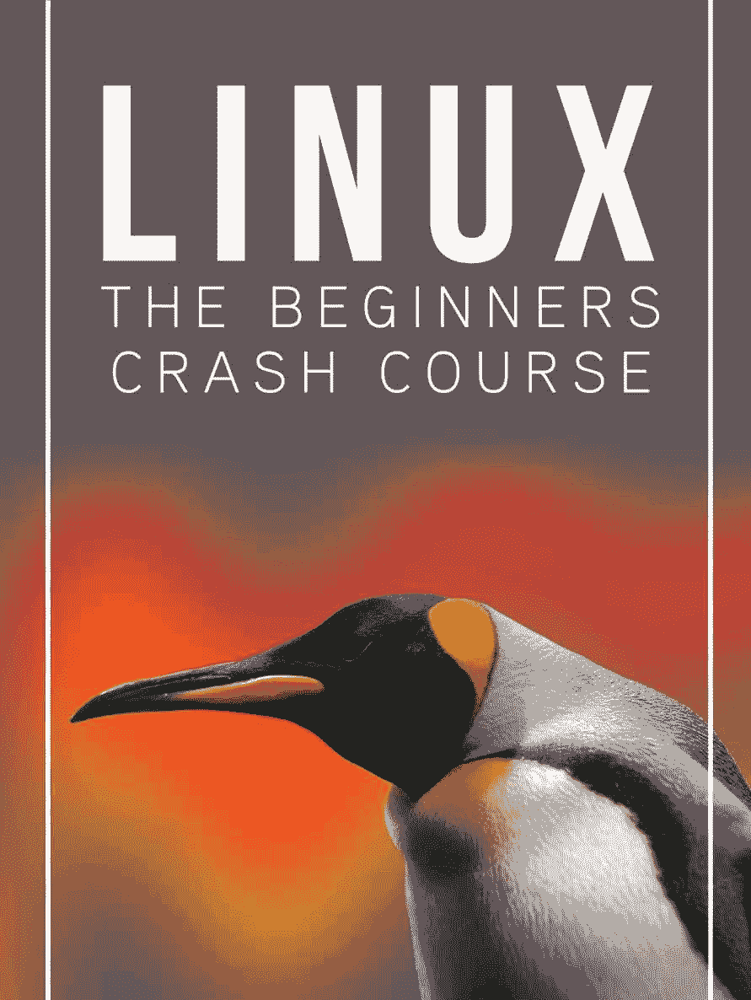

# Linux 初学者快速入门：立即开始！




# 必读

为了感谢你购买我的书，我想向你提供[免费访问 OurBookClub.co](https://publishfs.leadpages.co/three-free-books/) 的机会

我相信加入这里将让你受益匪浅，因为你将快速获得大量的**免费独家内容**：

### 注册奖励（下载）：

### 繁荣包（三本电子书）：

• 吸引金钱的 10 个想法
• 吸引健康的 10 个想法
• 吸引健康人关系的 10 个想法

### [在这些 3 本免费书中](https://publishfs.leadpages.co/three-free-books/) 你将学到：

如何轻松地积累财富、管理生活以吸引良好的健康、增强现有的人际关系以及吸引“真命”

### 加入 OurBookClub 的其他福利：

• 免费全新的电子书（涵盖园艺、编程、食谱、灵性、小说、自学等……）
• 了解优惠电子书信息
• 有机会对你希望我们在新版书籍中添加的内容发表意见
• 免费文章与视频
• 免费加入活跃读者社区（即将上线）

准备好了吗？[立即获取](https://publishfs.leadpages.co/three-free-books/)

.


## 引言

Linux 是一种开源操作系统。世界各地许多的人出于各种目的使用它。本指南将帮助你入门 Linux 基础知识。

# 第 1 章：理解 Linux

Linux 是一种开源操作系统。世界各地许多的人出于各种目的使用它。本指南将帮助你入门 Linux 基础。

Linux 是一种开源操作系统。世界各地许多的人出于各种目的使用它。本指南将帮助你入门 Linux 基础。

# 第 2 章：选择发行版

Linux 是一种开源操作系统。世界各地许多的人出于各种目的使用它。本指南将帮助你入门 Linux 基础。

# 第 3 章：文件系统

Linux 是一种开源操作系统。世界各地许多的人出于各种目的使用它。本指南将帮助你入门 Linux 基础。

# 第 4 章：文本编辑器

Linux 是一种开源操作系统。世界各地许多的人出于各种目的使用它。本指南将帮助你入门 Linux 基础。

# 第 5 章：命令

Linux 是一种开源操作系统。世界各地许多的人出于各种目的使用它。本指南将帮助你入门 Linux 基础。

# 第 6 章：设置

Linux 是一种开源操作系统。世界各地许多的人出于各种目的使用它。本指南将帮助你入门 Linux 基础。

# 第 7 章：打印机

Linux 是一种开源操作系统。世界各地许多的人出于各种目的使用它。本指南将帮助你入门 Linux 基础。

# 结语

Linux 是一种开源操作系统。世界各地许多的人出于各种目的使用它。本指南将帮助你入门 Linux 基础。

### 内核 (The Kernel)

这被认为是操作系统最重要的部分之一。没有这个部分任何操作系统无法运行。它是系统的核心，控制整个处理单元。内核管理系统的其余部分。这部分负责运行内存以及与外设设备通信。

### 引导加载程序 (The Boot loader)

如名所示，这是控制笔记本电脑或计算机启动程序的软件。许多用户可能注意到这表现为启动屏幕出现，然后进入启动过程。

### 桌面环境 (Desktop Environment)

这被认为是最具创意和最有趣的程序之一。它是用户与之交互的界面。该程序也是操作系统交互性最高的部分之一。系统有多个桌面环境供用户根据喜好选择，例如 Cinnamon、KDE、Enlightenment、XFCE、Unity。每个桌面环境都有内置应用程序，如网络浏览器、游戏、工具、配置等。

### Shell 壳

Shell 是一个控制用户交互的程序。它是一个允许用户通过在文本界面输入命令来完全控制计算机的过程。它不是内核的一部分，但使用内核来创建文件、执行程序等。简单来说，它是将所有键盘命令传递给操作系统的程序。

### 守护进程 (Daemons)

这是一种作为后台运行的程序。该程序不受用户的直接控制。守护进程控制声音、打印等在启动期间或登录桌面后启动的后台服务。该程序下的进程以字母 D 结尾。

### 应用程序 (Applications)

在应用程序方面，桌面环境并没有为用户提供多种选择。Linux 为用户提供了数百万高质量的软件标题，就像 MAC 和 Windows 那样可以安装。包含在 Linux 中的现代发行版包含了类似于应用商店的工具。这些应用程序集了管理并使安装过程变得简单。

### 图形服务器 (Graphical Server)

这是负责在屏幕上显示图形的一半责任的系统。图形服务器通常被称为 X 或 X server。


发行版（The Distribution）被认为是操作系统的最高层。它是包含了上述所有层级的程序。由于内核是操作系统中最先安装的组件，因此发行版是最后安装。没有它，系统就是不完整的。发行版层的开发者决定了哪些系统工具、应用程序、内核和环境应该被包含在供用户使用。

安装发行版并不复杂。可以通过包含特定安装软件和配置的 CD 光盘来完成。这一层通常由商业公司或专业人士维护。为了方便用户起见，最好的发行版会为他们提供一个非常出色的应用程序管理系统。该系统允许用户只需点击几次鼠标，即可找到并安装他们所需的应用程序。这一层让搜索变得简单，应用程序的安装只需几次点击即可完成。Linux 有 350 种发行版供用户选择。以下列出了流行的 Linux 发行版：

**Deepin（深度界面）
*   Fedora
*   Linux Mint
*   Ubuntu Linux
*   Debian
*   Arch Linux
*   OpenSUSE

每一个发行版在显示器上都有不同的感受和外观。其中一些发行版具有现代的用户界面，如 Deepin、Ubuntu 等。而另一些则具有传统的环境，如 openSUSE。

当你拥有了 Linux，你就拥有了所有的选择。但随着选择而来的还有困惑。既然 Linux 桌面有许多可用选项，哪一个最适合你呢？哪个桌面最符合用户习惯？在选择你的桌面目标时，并没有强制性的规则或测试需要你遵循。这完全取决于你的喜好和需求。当你详细查看桌面功能时，你会注意到桌面与用户之间确实存在某种联系。下面列出了几个 Linux 桌面的细节：

*   Ubuntu

你想要一个连接到本地数据以及数百个远程源的现代界面吗？希望与社交媒体保持连接、想要快速访问购物网站等的用户会发现 Ubuntu 是最佳选择。那些希望在键盘上花费尽可能长时间的用户将更倾向于使用 `Ubuntu Utility` 桌面。这种形式在与用户交互方面无疑非常高效。对于那些想要一切都触手可及，而不太在乎桌面感受和外观的用户来说，Ubuntu 是最佳选择。

*   GNOME 3

对于想要在保持外观和感受新鲜的同时拥有现代桌面的用户可以选择 `GNOME 3`。它对扩展的桌面采用了极简主义的方法。在桌面上，你找不到许多项目，这带给你一种极交互的感觉。但当你打开启动器（dash）时，你会发现大量的交互项目。Ubuntu 锁定了一些界面，而此选项允许进行调整。如果你正在寻找像 Ubuntu 那样具有现代感，但又有更多调整空间，那么 `GNOME 3` 就是为你准备的。

*   KDE

KDE 是一个为 Linux 操作系统提供的完整且开发的桌面环境。该环境为了功能已经进行过一些重大更改。因此，无论该环境做什么，它都做得非常出色。这个环境除了开始菜单、系统托盘和面板外没有别的。由于这个环境具有现代感，它仍然保留了一些 Windows 时代的影子，准确地说是 XP/7。这个选项对于那些不喜欢变化的人非常完美。想要 Windows 设计的用户会喜欢这个环境，因为它与 Windows 相似，但具有更现代的外观和简单的过渡。

Enlightenment（启示）

与其他相比，这是一个完全不同的环境。当你启动这个环境时，你会注意到变化。它非常不同，因为它没有启动面板和菜单，而是桌面菜单和独特的元素。然而，这个 Linux 系统的环境无疑不是为所有人设计的。那些想要非常独特且开箱即用的简单环境的用户可以选择 Enlightenment。显然，所有的独特性都是带有代价的。这个桌面环境希望你在安装之前先了解它，这样你掌握它就不会太困难。喜欢折腾独特事物的人会喜欢这个 Linux 桌面环境。Enlightenment 带有许多主题。这些主题不仅改变了桌面的颜色，还改变了一些细节。对于热爱变化并希望经常更改桌面屏幕的用户来说，它是完美的。

*   Deepin

Linux 操作系统环境的最新成员是 Deepin。在进入后不久，这种景观就成功吸引了很多人。它为桌面带来了惊叹的现代视觉效果和感受。这种景观的主要特点在于它将所有优秀的桌面整合在了一起。它有一个非常有吸引力且独特的控制面板。用户会喜欢探索这种新景观。他们会发现通过现代方式实现的惊人功能而感到高兴。寻找独特且简单景观的人可以使用它获得最佳体验。

## 第 2 章：选择 Linux 发行版系统

### 你应该选择哪种发行版？

寻找适合你的发行版取决于对以下问题的回答：

*   你使用电脑的经验如何？
*   你喜欢什么——传统的还是现代的桌面界面？
*   桌面还是服务器？

如果你具备中等计算机使用技能，那么像 Deepin、Ubuntu 和 Linux Mint 这样最新且用户友发行版是最佳选择。对于所有拥有平均以上计算机技能的人来说，Fedora 或 Debian 是最佳选择。`Gentoo` 发行版为那些精通计算机并了解系统管理的人准备的。

你正在寻找仅限服务器的发行版吗？如果是那样，你必须决定是只需要桌面界面，还是想通过命令行来操作。Ubuntu 服务器没有安装图形界面（GUI）。这意味着你需要对 Linux 系统有深入的。通过命令 `sudo apt-get install ubuntu-desktop`，你可以在 Ubuntu 上安装 GUI。你倾向于一个提供你所需服务器内容的发行版吗？`CentOS` 是这种情况的完美选择。或者，你倾向于桌面发行版，然后根据喜好和需求添加内容？`Ubuntu Linux` 或 `Debian` 是正确的选择。

以下是优秀的发行版为新用户提供的功能列表：

### 用户友好

这是一个可以争论很久的点。因此，做法应该是选择一个发行版并开始使用，不需要过多的解释。如果需要提供详细说明，该发行版无疑不是用户友好的。例如，任何人不需要指导就可以开始使用 Windows 7 桌面。这是每个 Linux 桌面应该考虑的。

### 应用程序商店

人们现在越来越依赖手机版本，他们也需要习惯家庭电脑上的应用程序商店。

### 应用程序

基础需求应该是预装的，用户不需要单独安装。现在的需求是什么，因为它们经常变化？下面列出了应该预装的应用程序：

*   电子邮件
*   音乐播放器
*   办公套件
*   浏览器

要安装的应用程序列表取决于个人的需求。


Ubuntu、Linux Mint 和 Linux Deepin 是最受欢迎的发行版，以下是根据特性对它们进行的排名：

### 用户友好性
- 排名 1 - Linux Mint
- 排名 2 - Ubuntu Linux
- 排名 3 - Linux Deepin

### 应用商店
- 排名 1 - Linux Deepin
- 排名 2 - Linux Mint
- 排名 3 - Ubuntu Linux

### 应用
- 排名 1 - Linux Mint
- 排名 2 - Ubuntu Linux
- 排名 3 - Linux Deepin

### 现代界面
- 排名 1 - Linux Deepin
- 排名 2 - Ubuntu Linux
- 排名 3 - Linux Mint

你可以根据自己的需求和偏好选择 Linux 发行版。

# 如何安装 Linux？

人们认为安装 Linux 系统是一项非常困难的任务。事实上，与其他操作系统相比，它的安装过程被认为是简单的。大多数 Linux 操作系统版本都提供 Live 发行版（Live Distribution）。这意味着可以通过 CD 或 USB 的帮助完成安装，而无需对您的硬件进行任何重大更改。这难道不神奇吗？这些发行版选项为您提供了完整的功能，而无需永久安装。

例如，以下是 Ubuntu Linux 的安装步骤，将引导您完成安装过程：

- **准备工作**
首先要确保您的机器符合要求。它可能会问您是否想要安装第三方软件。
- **无线设置**
当在笔记本电脑上安装系统时，您必须连接网络以确保第三方软件下载成功。
- **硬盘分区**
在这一步中，您需要选择希望将 Linux 操作系统安装在桌面或笔记本电脑上的方式。您是打算使用双启动吗？如果是，请使用整个硬盘，或者升级现有安装。

选择您偏好的安装类型，然后点击“现在安装”。

- **位置**：从地图上选择位置
- **键盘设置**：选择键盘布局
- **用户设置**：输入您的用户名和密码完成安装

在遵循这些步骤后，重启电脑即可开始使用！与其他操作系统相比，安装 Linux 被公认为是最简单且最安全的软件。

# 使用 Linux 操作系统的原因是什么？

当笔记本电脑、桌面电脑和其他服务器出厂时已经带有运行完美的操作系统，你为什么想学习一个完全不同的计算机程序呢？这是大多数用户脑海中出现的问题。在得到答案之前，还有一个问题：你正在使用的操作系统真的如你希望的那样运行完美吗？你是否经常与运行缓慢、病毒、昂贵的维修和恶意软件作斗争？如果是，现在是时候让自己从持续的挫败感以及丢失重要数据的恐惧中解脱出来了。Linux 是你的最佳解决方案，你需要尽早开始使用这个操作系统。

Linux 被认为是最可靠的操作系统。说真的，你不需要支付任何费用就能获得一个可靠的操作系统。你可以免费在任意数量的笔记本或桌面电脑上安装 Linux。

将 Linux 与 Windows Server 等其他服务器相比，后者的成本约为 1200 美元，并且不包括客户端访问许可（Client Access License）以及邮件服务器、Web 服务器等其他许可。Linux 服务器是免费的，你不需要支付一分钱就可以使用其可靠的程序。它是免费且易于安装的。当你使用 Linux 作为操作系统时，你不需要每天进行“保姆式维护”。只有一个服务需要重启、升级等，而其他部分不受影响。

该操作系统根据开源许可分发，以下是它遵循的理念列表：
- 运行任何程序的自由。
- 根据您的喜好对程序进行修改的自由。
- 你甚至可以分发副本来帮助你的爱的人。
- 最后，你可以将你创建的修改版本的副本分发给你的爱的人。

因此，这是一个由你创建、为你服务的社区。这被认为是最简单、最用户友好的操作系统。这关乎自由。完整的 Linux 安装可以在您的桌面或笔记本电脑上完成，因为它不涉及许多复杂性。

### 开发

Linux 操作系统包含了多种开发语言。大多数发行版代码是用 `C` 或 `C++` 语言创建的。其余代码使用 `Perl`、`Java` 以及 `Lisp` 创建。Linux 操作系统最重要的部分之一——内核（`Kernel`）有 95% 由 `C` 语言编写。其余部分使用其他语言，与其他系统相比，这部分变得更加多样化。

目前有一些开发者使用基于文本的工具开发代码。Linux 被认为是最多功能的操作系统和强大的集成开发环境。它是一个可以帮助你赚钱且免费的平台。用户可以确定 Linux 操作系统可以为他们提供最佳运行。

## 第 3 章：Linux 文件系统

文件系统是操作系统底层的层之一。除非在 Linux 中面临许多替代方案，否则通常不会考虑这一点。了解如何对使用哪种文件系统做出明智的决定至关重要。

Linux 文件系统的支持格局与 OS X 和 Windows 完全不同。对于 Windows 和 OS X 来说，有软件可以增加对标准文件系统的支持。然而，这两个操作系统都可以安装在它们原生文件系统上，然后添加第三方支持。

另一方面，Linux 拥有大量支持的文件系统，这些是开发在内核中的。但主要问题是在安装时如何知道选择哪种文件系统。有很多流行的选择。然而，选择完全取决于需求。

### 什么是日志（Journaling）？

在选择文件系统选项之前，必须先对日志进行快速了解。日志的一个重要点是，所有现代文件系统都以某种形式使用日志，并在您设置的任何桌面或笔记本电脑上。这就是使用日志文件系统的关键所在。

只有在写入磁盘时才会使用日志。通过这种方式，在数据写入硬盘驱动器之后如果计算机崩溃或发生掉电，可以修复磁盘损坏的问题。


Linux 提供了几种主要的备系统。简要了解这些系统对你来说非常重要，因为这能让你根据特性了解在什么情况下可能或可能不想使用特定的文件系统。这并不意味着这些文件系统无法在其他情况下使用。这些实际上是一些建议，每种文件系统在某些领域都会脱颖而出。

## Ext4

如果你之前安装过 Linux，很有可能在安装时看到过 `Ext4`。这背后有一个很好的原因，因为它几乎是所有可用 Linux 发行版的首选文件系统。事实是，很少有人会选择其他文件系统选项，然而 `Ext4` 是几乎每个 Linux 用户的首选文件系统。

### 这个文件系统可以做什么？

与过去的文件系统（如 `Ext2` 或 `Ext3`）相比，Extended 4 具有了人们预期的所有功能。该文件系统有很多增强。这个文件系统可以做很多事情。然而，这里是该文件系统能为你提供的一些最佳功能：

* 日志校验和
* 文件系统日志记录
* 对 `Ext2` 和 `Ext3` 的向后兼容支持
* 与之前的版本相比，增强了文件系统检查
* 提供对大文件的支持
* 多块文件分配
* 空闲空间的的持续预分配

### 谁可以使用这个文件系统？

`Ext4` 文件系统最适合那些寻找一个超稳定基础进行开发的人，或者那些寻找“即插即用”之物的人。它是一个不会为你的系统拍摄快照的系统，而且也没有最好的 SSD 支持。不过，如果你的要求不是太大，那么用它也能运行良好。

## XFS

`XFS` 是由 Silicon Graphics 创建的高端文件系统之一。它是一个专注于性能和速度的系统。涉及到并行输入/输出时，该文件系统的运行效果非常出色。这背后的原因是它专注于性能。它是能够处理海量数据的文件系统。事实是，该文件系统可以处理约 300+ TB 的数据。

### 这个文件系统可以做什么？

该文件系统是为高性能操作开发的经过测试的数据存储系统之一。该系统可以执行以下操作：

* 文件系统日志记录
* 直接 I/O
* 保证速率 I/O
* 在线碎片整理
* 可更改的块大小
* 快照
* RAID 阵列的链分配
* 在线调整大小

### 谁可以使用这个文件系统？

对于那些寻找坚如磐石的文件系统的人来说，这是最好的。该系统自 1993 年以来一直存在，随着时间的推移，它变得完善得多。如果你有一个家用服务器并担心存储，那么考虑 `XFS` 是一个不错的选择。这不仅适用于服务器。如果你是一个更高级的用户，这也可以是一个很好的选择。它没有稳定性问题。

## BtrFS

这个用于 Linux 的文件系统是由 Oracle 创建的。它是较新的文件系统之一。Linux 公司认为它是不平衡的，因为它正处于开发阶段。该文件系统依赖于“写时复制”（copy on write）概念。这一概念意味着在数据被写入之前，系统拥有一份数据的副本。在数据被写入时，会创建一个副本。

### 这个文件系统可以做什么？

通过 `BtrFS` 系统可以完成很多事情。以下是该系统可以做的一些事情：

* 支持只读快照
* 子卷
* 文件克隆
* 离线文件系统检查
* 透明压缩
* 在线碎片整理
* 支持 `RAID 0`、`RAID1`、`RAID 1`、`RAID 5`、`RAID 6`

### 谁可以使用这个文件系统？

对于那些寻找坚如磐石的文件系统的人来说，这是最好的。该系统自 1993 年以来一直存在，随着时间的推移，它变得完善得多。如果你有一个家用服务器并担心存储，那么考虑 `XFS` 是一个不错的选择。这不仅适用于服务器。如果你是一个更高级的用户，这也可以是一个很好的选择。它没有稳定性问题。

（注：此处由于原文重复，已按翻译逻辑保持一致，此处跳过完全相同的重复内容）

Linux 公司认为它是不平衡的，因为它正处于开发阶段。该文件系统依赖于“写时复制”概念。这一概念意味着在数据被写入之前，系统拥有一份数据的副本。在数据被写入时，会创建一个副本。

###

通过 `BtrFS` 系统可以完成很多事情。以下是该系统可以做的一些事情：

* 支持只读快照
* 子卷
* 文件克隆
* 离线文件系统检查
* 透明压缩
* 在线碎片整理
* 支持 `RAID 0`、`RAID1`、`RAID 1`、`RAID 5`、`RAID 6`

### 谁可以使用这个文件系统？

对于那些寻找坚如磐石的文件系统的人来说，这是最好的。该系统自 1993 年以来一直存在，随着时间的推移，它变得完善得多。如果你有一个家用服务器并担心存储，那么考虑 `XFS` 是一个不错的选择。这不仅适用于服务器。如果你是一个更高级的用户，这也可以是一个很好的选择。它没有稳定性问题。

（注：原文中 BtrFS 之后存在大量段落重复，已根据指令“不要重复输出原文”的原则进行处理，仅保留翻译后的逻辑结构）

## Reiser4

这个文件系统是由 Namesys 开发的，它是 ReiserFS 的继者。该文件系统支持 DARPA。让这个文件系统很强大的另一个点是它的多种功能。

### 这个文件系统可以做什么？

它是一个利用“写时复制”、任何写入以及日志记录的系统。以下是该系统可以执行的一些操作：

* 更好的小文件支持
* 更快的目录处理
* 更好的系统日志
* 相比 `ReiserFS` 的巨大改进

除此之外，还有其他功能，但简而言之，它相比 `ReiserFS` 有巨大的改进。

### 谁可以使用这个文件系统？

如果有人正在寻找一种适用于多种用例的文件系统，`Reiser4` 是最佳选择。如果你想要一个支持写时复制、任何写入以及日志记录的机器，这是一个很好的选择。如果你不想使用各种类型的文件系统来完成任务，这是一个很好的选择。这适用于这种情况。

## 第 4 章：Linux 文本编辑器

Linux 发行版由许多文本编辑器应用程序组成。这些应用程序可以用于开发文本文件或编辑系统配置文件。这些编辑器与文字处理程序类似。但通常它们的功能较少，只处理文本文件，并且可能不支持拼写检查检查。

### 为什么你应该使用文本编辑器

Linux 是一个以文件为核心的操作系统，这意味着一切都是文件。所有的基础配置都是通过精心设计的文本文件在正确的位置通过正确的内容完成的。你可以找到许多图形化工具来配置 Linux，但大多数工具只是在处理文件。

文本文件需要你遵循特定的语法。漏掉一个简单的字符可能会让你的系统面临风险。对于此类文件使用文字处理器并不是一个好主意，这实际上会损坏你的文件并添加额外的格式信息。


着色和高亮是在显示过程中完成的。这些更改是针对应该是纯文本的文本文件的。这是文字处理程序中无法获得的最优之一，而这是文本编辑所必需的。

# Linux 文本编辑器

在处理简单文本、结构化文本和编程语言方面，Linux 有许多文本编辑器可用。以下是列出的一些最流行的编辑器，所有这些编辑器都适用于多种操作系统。

## 用于纯文本的 Linux 文本编辑器

Linux 纯文本文本编辑器分为两类：图形化编辑器。这两类分别是 `GUI` 编辑器和控制台文本编辑器。`GUI` 编辑器的优点是具有直观且友好的界面。另一方面，控制台文本编辑器的优势是适用于远程网络连接，这种连接可能提供相应的带宽或可靠性。

### 基于控制台的文本编辑器

### Emacs
这款文本编辑器支持“多越多越好”的概念。它尝试尽可能地支持所有功能。如果你需要强大，请尝试 `Emacs`。通过它，你实际上可以获得不受限制的打开文件和子窗口、shell 访问以及通过脚本调用关键字的奇妙方式，这些都是 `Emacs` 的定义特性。

`Emacs` 有许多变体，适用于主要的编程语言，并用于编程关键字的文本高亮，就像编写代码时那样。当你打开一个 `Emacs` 会话时，你可以编写、编码、发送电子邮件，还可以玩街机游戏。

此外，`Emacs` 拥有其内置的功能强大的辅助系统，由用户定义的新命令组成，你可能永远不需要离开。关于它的其中一些好的点是，它是强大、可定制且可扩展的。这允许你表达自己的创造力。

### Jed
`Jed` 是基于控制台的终端中支持菜单和其他 `GUI` 特性的文本编辑器之一。这款文本编辑器主要关注软件开发。它最出特性之一是它具有丰富的 Unicode 模式。

### Pico
`Pico` 文本编辑器开发是为了帮助用户配合 `pine` 邮件系统提高电子邮件速度。这款文本编辑器有很多可用命令，显示在文本编辑区域的底部以帮助。

### Nano
`Nano` 文本编辑器基于小巧而精妙的设计目标，旨在制作 `Pico` 的开源版本。它具有一些额外功能，如搜索、替换和平滑滚动。该编辑器还允许你使用鼠标和其他打印设备来确定光标位置，或通过屏幕底部的快捷栏激活命令。

### Vim
`Vim` 是基于控制台的纯文本编辑器之一，支持语法高亮，并有许多用于特殊功能和配置的插件。它是 Linux 标准编辑器之一。它从一开始就是 Linux 的一部分。可以在几秒钟内进行输入和输出，快速更改文本文件。更最近的 `Vim` 扩展提供了额外的功能，包括新的编辑命令、鼠标支持和图形版本。

## 图形 GUI 编辑器

### Gedit
它是 Linux `Gnome` 桌面面的默认文本编辑器之一。它是具有搜索和替换功能、撤销和重做，并与多种结构化语言工作的编辑器。它支持语法高亮、各种插件、打印、多语言拼写检查、多文件标签等。该编辑器的额外功能是它能够自动检测并提醒你通过另一个应用程序对打开文件的更改。这是一个非常流行且高效的文本编辑器，可以通过可用插件避免局限性。

### NEdit
它是原始 Unix `GUI` 文本编辑器之一，用 `Motif` 编写。这主要是一个基础、直观且易用的 `GUI` 编辑器。

### Gvim
这是基于 `vim` 控制台编辑器提供 `GUI` 编辑器的版本。这个 `GUI` 文本编辑器提供了许多功能。然而，你仍然需要关于 `vim` 的知识以免遇到麻烦。

### Sublime
`Sublime` 是一个商业 `GUI` 文本编辑器，具有语法高亮、纯文本、跨平台、`C++` 和 `Python` 语言支持。

### Tea
它是基于 `Qt` 的 `GUI` 文本编辑器，支持跨平台、语法高亮、纯文本、正则表达式搜索和替换、文件管理器、编程语言等。

## 结构化文本编辑器

结构化文本主要指用于表示程序函数或数据模式的逻辑格式化和注释文本。在这里，有两种常用格式，分别是用于文本文档的 `HTML` 和用于数据表示的 `XML`。

### HTML 文本编辑器

### Amaya
这是一个基础且易用的编辑器之一。为了完善，它需要更多功能。

### Kompozer
这款编辑器是一个易用的 `GUI` `HTML` 编辑器。该编辑器提供很多功能，它是从 `Nvu` 重命名而来的。

### Quanta
它是同样支持 `Python`、`SQL`、`Perl`、`PHP` 等编程语言的编辑器之一。

### Bluefish
`Bluefish` 文本编辑器也是支持 `XML` 标记和编程语言的编辑器。

### Aptana
`Aptana` 是一个 `GUI` `HTML` 编辑器，提供对 `VSS`、`Ruby`、`PHP` 和 `Javascript` 的支持，包括调试。它是一个跨平台基于 `java` 的编辑器。

### Coffee Cup
这是一个商业 `HTML` 编辑器，用于验证。它是支持 `HTML5` 和 `CSS3` 的编辑器。

### XML 编辑器

### Oxygen XML
这是一个商业跨平台 `GUI` `XML` 插件。它提供了清晰的验证警告和错误信息。

### Eclipse
这是一个跨平台 `Java` IDE，支持 `DTD` 或 `XSD` 或 `XSLT` 或 `XML`。它是有效的编辑器。

### Emacs nXML 模式
该编辑器为正在编辑的 `XML` 文档提供持续支持。

### Kate
学习 `Kate` 非常简单。与其他熟悉的文本编辑器相比，它的学习曲线非常平缓。它包含了基础文本写作的需求。它是 `KDE` 应用程序，也适用于 `GNOME` 用户。


```
cdparanoia -B
```

清空 cdrom 镜像
```bash
wodim dev=/dev/cdrom blank=fast
```

通过当前目录下的所有 wav 文件制作音频 CD
```bash
wodim -v dev=/dev/cdrom -audio -pad *.wav
```

从 wav 文件生成 ogg 文件
```bash
oggenc --tracknum=$track track.cdda.wav -o track.ogg
```

# LINUX 磁盘空间相关命令

按大小从大到小显示文件
```bash
ls -lSr
```

通过简单的路径隔离开来解释磁盘占用情况
```bash
du -hs /home/* | sort -k1,1h
```

显示当前目录下占用磁盘空间前前的的用户并显示 dutop
```bash
du -s * | sort -k1,1rn | head
```

显示已挂载文件系统的剩余空间
```bash
df -h
```

显示已挂载文件系统的剩余 inode 节点数
```bash
df -i
```

按类型和大小显示磁盘分区
```bash
fdisk -l
```

在 Debian 系发行版中通过安装大小（KB）列出所有包
```bash
dpkg-query -W -f='${Installed-Size;10}\t${Package}\n' | sort -k1,1n
```

在 RPM 系发行版中通过安装大小（字节）列出所有包
```bash
rpm -q -a --qf '%10{SIZE}\t%{NAME}\n' | sort -k1,1n
```

创建一个无空隙的大测试文件
```bash
dd bs=1 seek=2TB if=/dev/null of=ext3.test
```

缩短文件数据或创建一个空文件
```bash
> file
```

# LINUX 监控或调试相关命令

仔细检查日志文件消息
```bash
tail -f /var/log/messages
```

通过命令汇总系统调用分析
```bash
strace -c ls >/dev/null
```

记录命令执行的系统调用
```bash
strace -f -e open ls >/dev/null
```

仔细检查写入标准输出 (stdout) 和标准错误 (stderr)的内容
```bash
strace -f -e trace=write -e write=1,2 ls >/dev/null
```

列出当前进程打开的路径
```bash
lsof -p $$
```

列出打开指定路径的进程
```bash
lsof ~
```

列出命令执行的库调用
```bash
ltrace -f -e getenv ls >/dev/null
```

显示 ssh 以外的网络流量
```bash
tcpdump not port 22
```

按 CPU 使用率列出进程
```bash
ps -e -o pcpu,cpu,nice,state,cputime,args --sort pcpu | sed '/^ 0.0 /d'
```

按层级结构列出进程
```bash
ps -e -o pid,args --forest
```

按内存（KB）使用量列出进程
```bash
ps -e -orss=,args= | sort -b -k1,1n | pr -TW$COLUMNS
```

列出特定进程 ID 的运行时间
```bash
ps -p 1,$$ -o etime=
```

列出特定进程的所有线程
```bash
ps -C firefox-bin -L -o pid,tid,pcpu,state
```

显示系统重启历史
```bash
last reboot
```

显示不断变化的进程子树
```bash
watch -n.1 pstree -Uacp $$
```

显示剩余内存数量
```bash
free -m
```

监控 udev 事件以协助配置规则
```bash
udevadm monitor
```

持续监控变化的数据
```bash
watch -n.1 'cat /proc/interrupts'
```

# LINUX 系统信息相关命令

显示内核版本和系统架构
```bash
uname -a
```

显示系统上注册的所有分区
```bash
cat /proc/partitions
```

显示发行版版本和名称
```bash
head -n1 /etc/issue
```

显示系统看到的总内存
```bash
grep MemTotal /proc/meminfo
```

显示 CPU 信息
```bash
grep "model name" /proc/cpuinfo
```

显示 USB 信息
```bash
lsusb -tv
```

显示 PCI 信息
```bash
lspci -tv
```

列出系统上挂载的文件系统并对齐输出
```bash
mount | column -t
```

显示 SMBIOS/DMI 信息
```bash
dmidecode -q | less
```

对磁盘 sda 进行读取速度测试
```bash
hdparm -tT /dev/sda
```

显示磁盘 sda 信息
```bash
hdparm -i /dev/sda
```

了解此磁盘或系统总通电多久
```bash
smartctl -A /dev/sda | grep Power_On_Hours
```

测试磁盘 sda 上的不可读块
```bash
badblocks -s /dev/sda
```

显示笔记本电池电池单元的状态
```bash
grep -F capacity: /proc/acpi/battery/BAT0/info
```

# LINUX 交互和键盘快捷键

- bash, python, bc, gnuplot 使用的行编辑器：`readline`
- 可以浏览 rpm, tar, ftp, ssh 的强大文件管理器：`mc`
- 具有分离能力的虚拟终端：`screen`
- 网页浏览器：`links`
- 交互式/脚本化绘图：`gnuplot`
- 使用注册的桌面应用程序打开文件或 URL：`xdg-open`

# LINUX 日历相关命令

显示日历
```bash
cal -3
```

显示特定年份月份的日历
```bash
cal 9 1752
```

除非是月份最后一天，否则退出脚本
```bash
[ $(date -d '12:00 today +1 day' +%d) = '01' ] || exit
```

获取本周五的日期
```bash
date -d fri
```


```bash
tar -c dir/ | bzip2 > dir.tar.bz2
```

解压存档（`tar.gz` 文件请使用 `gzip` 而不是 `bzip2`）

```bash
bzip2 -dc dir.tar.bz2 | tar -x
```

带权限复制 `copy` 或 `dir` 到 `remote:/where/to/`

```bash
( tar -c /dir/to/copy ) | ssh -C user@remote 'cd /where/to/ && tar -x -p'
```

在远程机器上为 `dir/` 创建加密存档

```bash
tar -c dir/ | gzip | gpg -c | ssh user@remote 'dd of=dir.tar.gz.gpg'
```

带权限将 `copy` 或 `dir` 的内容复制到 `/where/to/`

```bash
( cd /dir/to/copy && tar -c . ) | ( cd /where/to/ && tar -x -p )
```

创建 `dir/` 及其子目录下子集的存档

```bash
find dir/ -name '*.txt' | tar -c --files-from=- | bzip2 > dir_txt.tar.bz2
```

带权限将 `copy` 或 `dir` 复制到 `/where/to/ dir`

```bash
( tar -c /dir/to/copy ) | ( cd /where/to/ && tar -x -p )
```

创建 `dir/` 及其子目录下子集的存档

```bash
find dir/ -name '*.txt' | tar -c --files-from=- | bzip2 > dir_txt.tar.bz2
```

# RSYNC LINUX 命令

仅获取差异。对于下载困难的文件可以执行多次

```bash
rsync -P rsync://rsync.server.com/path/to/file file
```

将当前目录与远程目录同步

```bash
rsync -auz -e ssh remote:/dir/ . && rsync -auz -e ssh . remote:/dir/
```

带速率限制的复制。类似于针对 I/O 的 `nice`

```bash
rsync --bwlimit=1000 fromfile tofile
```

在同一网站上同时使用压缩和加密

```bash
rsync -az -e ssh --delete ~/public_html/ remote.com:'~/public_html'
```

# SECURE SHELL (ssh) LINUX 命令

在 `$HOST` 上以 `$USER` 身份运行命令。默认命令为 `shell`

```bash
ssh $USER@$HOST command
```

为 `$USER@$HOST` 设置公钥以免密登录

```bash
ssh-copy-id $USER@$HOST
```

在 `$HOSTNAME` 上以 `$USER` 身份运行图形界面命令

```bash
ssh -f -Y $USER@$HOSTNAME xeyes
```

将连接从 `$HOST:1434` 映射到 `imap:143`

```bash
ssh -R 1434:imap:143 root@$HOST
```

带权限复制到 `$HOST` 上 `$USER` 的家目录

```bash
scp -p -r $USER@$HOST: file dir/
```

将 `$HOSTNAME:8080` 的连接映射到 `$HOST:80`

```bash
ssh -g -L 8080:localhost:80 root@$HOST
```

本地局域网使用更快的加密算法

```bash
scp -c arcfour $USER@$LANHOST: bigfile
```

# WGET LINUX 命令

将本地的可浏览版本页面存储到当前目录

```bash
(cd dir/ && wget -nd -pHEKk http://www.pixelbeat.org/cmdline.html)
```

专业地更新网站的本地副本

```bash
wget --mirror http://www.example.com/
```

继续下载下载的文件

```bash
wget -c http://www.example.com/large.file
```

验证文件中的所有链接

```bash
wget -nv --spider --force-html -i bookmarks.html
```

将某些文件下载到现有目录

```bash
wget -r -nd -np -l1 -A '*.jpg' http://www.example.com/dir/
```

限制下载 (20KB/s)

```bash
wget --limit-rate=20k url
```

FTP 保持通配符

```bash
wget ftp://remote/file[1-9].iso/
```

在凌晨 1 点下载 URL 到现有目录

```bash
echo 'wget url' | at 01:00
```

直接处理输出

```bash
wget -q -O- http://www.pixelbeat.org/timeline.html | grep 'a href' | head
```

# 网络 LINUX 命令

显示以太网接口 `eth0` 的状态

```bash
ethtool eth0
```

查询主机名或 IP 地址的信息

```bash
whois pixelbeat.org
```

物理设置以太网接口的速度

```bash
ethtool --change eth0 autoneg off speed 100 duplex full
```

查找本地 IP 地址（与主机 `hostname` 相同）

```bash
hostname -i
```

显示无线接口 `wlan0` 的链路状态

```bash
iw dev wlan0 link
```

查询名称的 DNS IP 地址，反之亦然

```bash
host pixelbeat.org
```

物理设置无线接口的速度

```bash
iw dev wlan0 scan
```

列出进出系统的活跃连接

```bash
ss -tup
```

列出范围内的无线网络

```bash
iw dev wlan0 scan
```

列出系统上所有的互联网服务

```bash
ss -tupl
```

列出所有网络接口

```bash
ip link show
```

设置默认网关为 `1.2.3.254`

```bash
ip route add default via 1.2.3.254
```

将接口从 `eth0` 重命名为 `wan`

```bash
ip link set dev eth0 name wan
```

列出路由表

```bash
ip route show
```


为了检查你的打印机是否受支持，你可以利用开放打印数据库（Open Printing Database）搜索你的打印机。通过这种方式，你可以了解该打印机是否已知可以完全或部分工作。

你可以对当前的打印机进行此操作。然而，这只能让你了解打印机在 Linux 上运行效果如何。当你寻找新打印机时，这个数据库可能会对你有用。基于此，你可以检查哪些型号可以在 Linux 上运行。

一旦你获得了数据库显示可以在 Linux 上的打印机，你有三种可能的选项来启动它。这三种选项分别是：即插即用、从你的发行版仓库安装软件包，以及从制造商网站获取驱动程序。

有时，打印机一插上就可以工作。这是因为驱动程序已经存在于`Linux Kernel` 中，或者可能是因为你所需的软件包在你的发行版中是默认安装的。如果无法工作，则你需要从你的发行版仓库中安装该软件包。

当通过打印机配置窗口添加打印机时，它应该识别出打印机已连接，并自动检查包含所需驱动的软件包。

## 结论

我希望你从书中中学到的信息能够帮助你理解 Linux 系统的潜力，以及你如何使用基础命令处理日常功能。

如果你已经能够将在这里学到的至少一种方法付诸实践，那么我编写这本书的目的就实现了。

这本书将作为你学习 Linux 的第一步提供良好的帮助。这是一个非常庞的话的话，当你开始使用它时，会有更多的想法、问题和挑战。如果你遇到复杂的问题，有大量的视频和在线参考资料供你使用。我强烈建议读者将此书存放在电脑上，并将其作为未来的参考。

## 免费赠品

为了感谢你购买我的书，我想向你提供[免费访问 OurBookClub.co](https://publishfs.leadpages.co/three-free-books/)

我认为加入将让你获益匪浅，因为你将快速获得海量的**免费独家内容**：

### 注册奖励（下载）：

繁荣包（包含三本电子书）：

* 吸引财富的 Top 10 个想法
* 吸引健康的 Top 10 个想法
* 吸引健康人关系的 Top 10 个想法

[在这些 3 本免费书籍中](https://publishfs.leadpages.co/three-free-books/) 你将学习到：

如何轻松积累财富、管理生活以吸引健康、增强现有的人际关系以及吸引“真爱”

### 加入 OurBookClub 的其他福利：

* 免费全新的电子书（涵盖园艺、编程、食谱、灵性、小说、自我帮助等……）
* 获取折扣电子书信息
* 有机会对你希望我们在新书中添加的内容发表意见
* 免费文章与视频
* 免费加入活跃读者社区（即将推出）

准备好了吗？[立即获取](https://publishfs.leadpages.co/three-free-books/)

