# Linux：完全手册

## 欢迎来到免费计算的世界

关于 Linux 存在着许多谜团。直到最近，它仍然是一个仅供极客使用的操作系统，这些极客知道如何通过输入诸如 `'sudo apt-get install pkgnames emerald'` 这样难以理解的命令来控制计算机。

好消息是，Linux 现在已经像 Windows 一样美观、易于安装和易于使用了。而且，它是完全免费的——你会在本书的封页找到你的 Ubuntu 副本，可以立即尝试。你可以在任意数量的计算机上安装它，尝试任何你需要的不同版本，并下载数千个免费应用程序供其使用。

在本书中，我们将向你展示如何在 Linux 中完成你在 Windows 中可以做到的所有操作，例如浏览网页、发送电子邮件、整理和编辑照片、创建电子表格、听音乐（并将其传输到 MP3 播放器）、观看 DVD 等更多。

所以，无论你是正在从零开始组装电脑，还是仅仅厌倦了当前 Windows PC 的运行运行速度，这本书都是为你准备的。

Jim Martin，编辑


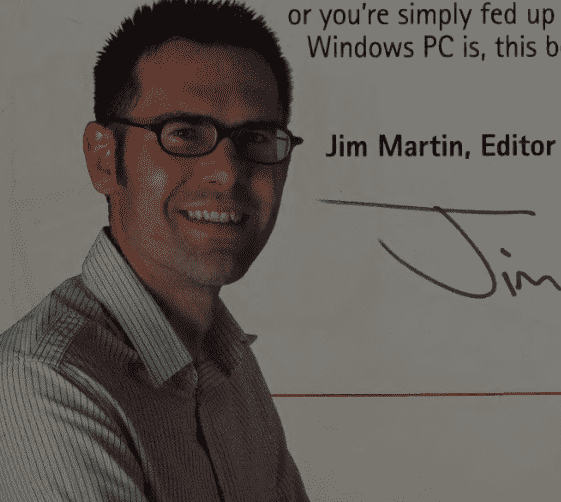


- 制作你的系统镜像 | 126

为什么不使用 Linux 将旧电脑变成 NAS？

遇到故障了？我们的指南将帮助你解决任何问题

管理员权限。简单来说，这意味着对操作系统的访问是受到限制的，这为防止恶意软件侵害提供了更高的安全性。

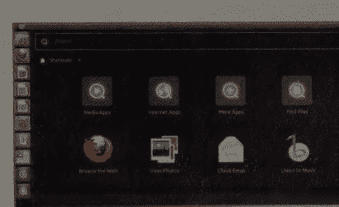

你不需要第二个显示器。在 Windows 中，你只有一个桌面。打开几个窗口后，你就会在它们之间来切换而感到疲惫。在 Ubuntu 中，你有多个工作空间，它们就像虚拟桌面。点击一个图标，即可切换到一个全新的、干净的桌面。在工作空间之间切换非常容易，而你可能永远无法回到过去。

Linux 有许多不足，但你将无法玩 Windows 上的最新大作。这是 Linux 的弱项。然而，你可以在 Windows 上运行 Ubuntu —— 这种技术被称为“双启动”——这让你非常轻松地在同一台电脑上玩《使命召唤》、《极速赛车2》（Colin MacRae: Dirt 2）或你最喜欢的游戏。

如果我们诚实地说，Linux 确实有其他缺陷。尽管存在一些细小的遗漏；例如，Ubuntu 需要手动安装解码器才能播放 MP3 格式的音乐。硬件支持正如我们所说的，是很好的，但某些功能可能在你的电脑上无法工作。在许多 PC 和笔记本电脑上的 Linux：有些运行得完美，而另一些则令人头疼。问题范围涵盖了在 Sony Vaio 笔记本电脑上安装 Ubuntu 后无法启动，到无线网络不稳定。你可能还会发现亮度和音量控制等按钮不起作用。好消息是，肯定有人遇到过你的这种问题，你很有可能在 `#ubuntuforums.org` 等论坛上找到解决方案。如果没有，就在论坛里提问，你一定能得到帮助。

这里没有共享软件或额外的费用。如果你想安装 Ubuntu 的软件包管理器，有数千个应用程序供选择，而且都是免费的。如果你喜欢某个软件，就继续使用；如果不喜欢，就卸载它。你永远不必被邮件轰炸。

你只需要知道如何操作。如果你想在 Ubuntu 中使用 Windows，你会觉得如宾如归；从“开始”菜单到浏览文件和文件夹，一切的操作方式都是相同的。工具提示将帮助你学习每个图标和按钮，还有全面的帮助文档。

硬件比以前好得多了。有些人可能尝试 Linux 是因为他们不熟悉自己的硬件。事实是，除非你拥有非常冷门的设备，否则 Ubuntu 是很容易处理的。你可能会发现，一旦安装了 Ubuntu，电脑的大部分功能就能正常工作，从无线网络到内存卡读器。

> 解决问题的帮助触手可及：友好的社区论坛

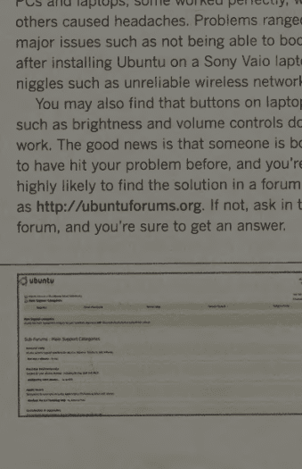

Brainsa Bhalie Thormord Ballyfermot Library Tel. 2629324.

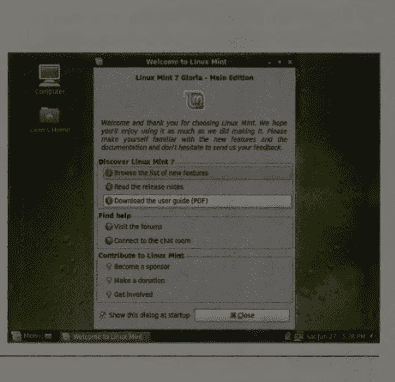


Ubuntu 的兼容性极佳，这意味着它可以在任何硬件上运行。


### 安装 Ubuntu

安装 Linux 极其简单。一旦你的电脑从 CD（或 USB 闪盘）启动，分步操作的说明将解释一切。在本章中，我们将向你展示你将面对的情况，并为你提供一些提示，以确保运行顺利，无论你是在桌面电脑还是笔记本电脑上安装 Ubuntu。

尽管 Ubuntu 看起来与 Windows 有些不同，但它的桌面应该仍然很熟悉。我们将在第 20 页带你对所有内容进行快速巡览。

我们还将向你展示如何检查硬件是否工作正常，如果没有正常工作，如何安装未运行的组件。最后，在第 28 页，你可以了解如何安装额外的软件。

### 安装 Ubuntu

安装 Linux 和安装 Windows 一样简单。在这里，我们将通过分步指南向你展示操作。

你可能已经发现 CD 附在书的内部了。我们包含它是为了省去你自己下载 700MB 文件的麻烦。它是 11.04 版本的桌面版，是编写时的最新版本。Linux 定期更新，因此请检查网站 `http://www.ubuntu.com/getubuntu` 查看是否有新版本，或者你是否想安装不同的版本（例如 32 位版本）。如果你下载了其中任何一个（ISO 镜像），你需要在使用之前将其刻录到 CD。我们推荐使用 `CDBurnXP`，它是从 `http://cdubnerxp.exe` 下载的免费软件。或者，使用免费的 `Unboot` 工具（见第 9 页）使用 ISO 镜像创建可启动的 USB 闪盘。

- 1 将此书中的 Ubuntu CD（或你创建的）放入光驱器，并等待“按键加载 Ubuntu CD”消息出现。如果你错过了此消息，将必须重启电脑来加载 Ubuntu 安装程序。第一个启动界面应该很快加载完成。

在这个阶段你不需要决定安装 Linux；如果你只是想试一下，可以直接从安装光盘中运行它（更多信息见步骤 2）。

- 2 你将看到一个语言菜单和两个选项的选择。默认选项是在不对你的电脑进行任何更改的情况下进行尝试。这只是从 CD 加载 Ubuntu，不会向你的硬盘硬盘写入任何文件。这是尝试 Linux 而不作更改且不占用硬盘的极佳方法，如果你不确定安装系统，这是最安全的选项。如果你想安装 Ubuntu，请选择“安装 Ubuntu”。

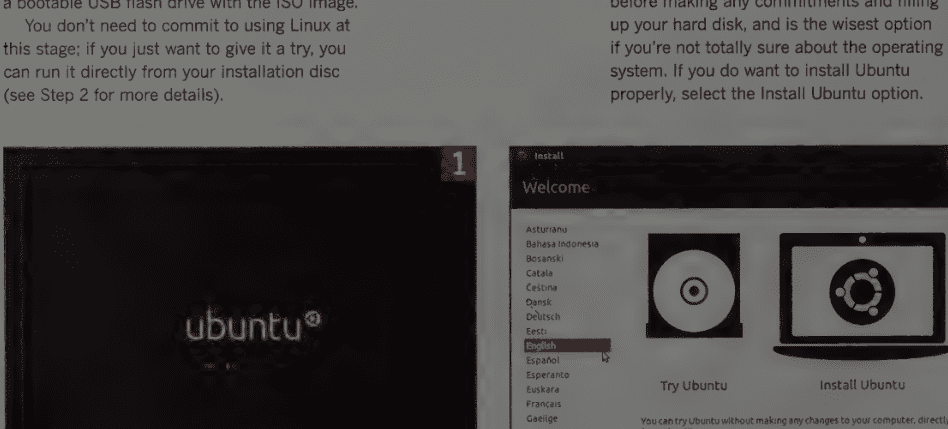

12 完整 Linux 手册

### 安装 UBUNTU

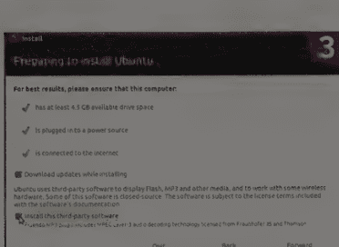
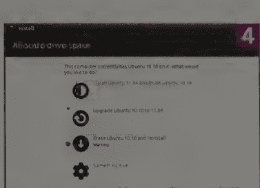
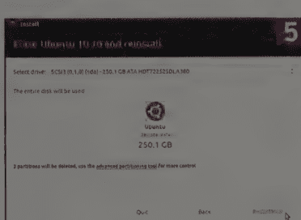
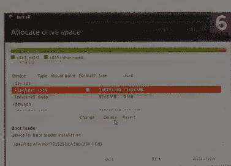

3 你将看到一个启动界面，上面列有一系列标准，以确保安装尽可能顺利。确保你的电脑已连接网络，因为这允许你下载最新的更新。在更新时选择“默认（Default）”。

为了获得最佳效果，Ubuntu 需要安装一些第三方软件以播放 MP3、FLAC 和其他媒体文件。选择这些第三方软件并点击“下一步（Forward）”。

如果你的硬盘上安装了任何其他操作系统，你将在下一个屏幕看到选项。你将不得不与现有的操作系统一起安装 Ubuntu 11.04，或者如果你已经在用 Ubuntu，则对其进行升级。

为了获得最佳效果，请选择“清除（Erase）”选项。这将擦除你的硬盘并让你从头开始。这意味着你将丢失所有数据，请确保你已备份了重要文件。准备就绪后，点击“下一步”。

5 Ubuntu 在你的 PC 硬盘上使用简单的分区系统。调整此项将允许你选择保留哪些用户文件，并为程序文件和虚拟内存创建单独的分区。Linux 用户使用 `/home` 文件夹，将其移动到单独的分区是很容易的。如果你想手动设置一个分区，你就必须手动设置所有分区。

如果你想使用 Ubuntu 的默认选项，请点击“安装并下一步（Install Next）”并跳到步骤 11。

6 要手动定义硬盘分区，请选择高级分区工具。安装程序将扫描你的硬盘。第一步是在硬盘上创建分区，选择每个分区并点击“删除（Delete）”。如果你的 PC 中有多个磁盘，你的第一块磁盘是 `/dev/sda`，第二块磁盘是 `/dev/sdb`。


# 安装 UBUNTU

## 手动分区设置

7 你应该已经手动列出了足够的空可用空间。由于我们正在创建 Linux 所需的所有分区，请选择 `/boot` 分区。在分区列表中选择“空空间”并点击“下一步”。输入大小 `50`（兆字节）并将 `/boot` 设置为挂载点。点击“确定（OK）”继续。

13 完整 Linux 手册

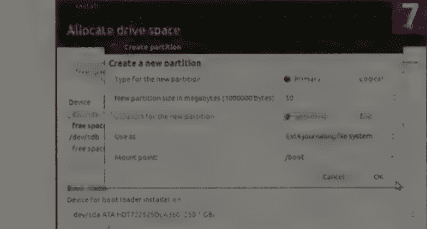
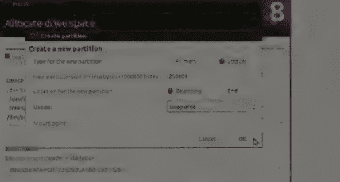
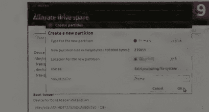
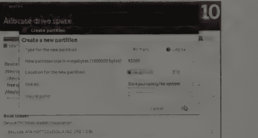

8 Linux 需要一个 `/swap` 分区，相当于 Windows 用于虚拟内存的交换文件。你已经手动列出了足够的空可用空间。由于我们正在创建 Linux 所需的所有分区，选择 `/swap` 分区。输入大小（兆字节）。


9 接下来，选择 `/home` 分区，这是存放用户文件的地方。设置 `/home` 作为挂载点。点击“确定（OK）”继续。

10 你需要执行的最终任务是设置 `/root` 分区。这是 Ubuntu 所在的位置。设置 `/root` 作为挂载点。点击“确定（OK）”。

11 你的配置设置完成后，Ubuntu 现在将开始完成安装并将剩余文件复制到硬盘。这个过程需要一些时间，你可以让它复制。

系统会提示你为电脑输入用户名和密码。输入密码，Ubuntu 会告诉你密码是弱还是强。你需要决定如何登录。自动登录将直接进入桌面，但“需要密码登录”选项更安全。如果你选择后者，还可以选择“加密我的主文件夹”。准备就绪后点击“下一步”。

14 完整 Linux 手册

一旦 Ubuntu 安装，请前往屏幕左侧启动器上的“软件中心”来查找和安装新程序。当你从互联网下载应用程序时，任何额外的组件（称为依赖项）都会自动下载并安装。也可以使用此工具删除应用程序。

15 由于受欢迎程度提高，Ubuntu Linux 吸引了恶意攻击者的兴趣，因此你需要确保安装了安全补丁。Ubuntu 有自己的更新管理器并定期检查更新。当有新更新可用时，你会在应用程序栏看到一个警告。点击警告调出更新列表，然后点击“安装更新”按钮。

## 在笔记本电脑上安装 Ubuntu

在便携电脑上安装 Ubuntu——即使是配置相对较低的电脑——也能让它焕发新的活力。

Linux 的优点之一是，与 Windows 相比，它需要的资源较少。这对于笔记本电脑等低配置电脑来说特别方便。它还可以为普通笔记本电脑提速，因为 Windows 是一个资源大户，并且并不是为小屏幕而设计的，而 Ubuntu 的设计初衷是充分利用低分辨率和相对较慢的处理速度。

专门为高性能机器定制的 Ubuntu 网络版（Network Edition）已不再提供，但标准版本已经过调整，可以在所有电脑上运行。然而，并非所有笔记本电脑都带有安装 Ubuntu 的驱动器，你的笔记本或电脑的情况与前四页有所不同。

在开始之前，你需要打开电脑并进入 Windows。许多笔记本电脑或电脑需要特定的软件才能使快捷键生效。这些键在 Ubuntu 中可能仍然有效，因此最好关闭无线网络或使用其他设备。完成后，关闭电脑。

安装文件可以从 `www.ubuntu.com` 免费下载。点击链接下载适用于你笔记本或电脑的 CD 级 ISO 文件，你也可以使用光盘刻录软件（来自 `/cdubnerxp` 的 `CDBurnerXP` 是一个免费选择）将此文件写入空白光盘并从其启动，或者使用软件包附带的光盘并按照说明操作。然而，由于你们大多数人没有光驱，最好是使用 USB 驱动器。你需要一个容量至少为 `2GB` 的驱动器。确保你已备份了存储在上面的任何文件，因为驱动器将被格式化。我们使用的是被 BIOS 识别的 USB 闪存盘，因此如果驱动器无法工作，你可能需要尝试另一个。在运行有 Windows 的电脑上，将驱动器插入 PC，通过点击“开始”菜单中的“计算机”记下它的驱动器号。记住这一点至关重要，否则你可能会删除重要数据。

> Universal USB 安装程序可以将 USB 闪存盘转换为安装 Linux 的启动盘

```
Universal USB Installer 1.9.3 设置程序
设置你的选择页面：
选择一个 Linux、ISO/ZIP 文件和你的 USB 闪存盘。
步骤 1：从下载列表中选择一个 Linux 发行版放入你的 USB 中。
尝试其他 Live Linux ISO
步骤 2：选择你的 "iso"
C:\windows\ubuntu-10.04-notebook-amd64.iso
步骤 3：选择你的 USB 闪存盘
[x] 如果你想格式化 G 盘，请勾选此框
点击此处访问 Universal USB Installer 获取更多帮助
Universal USB Installer http://www.pendrivelinux.com
```

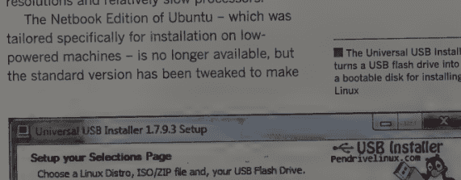

Linux 完整手册

### 高级 BIOS 特性

| 硬盘启动优先级 | +F5/-F6 帮助 |
| :--- | :--- |
| 第一启动设备 | [CDROM] |
| 第二启动设备 | [Hard Disk] |
| 第三个启动设备 | [CDROM] |
| 密码检查 | [启用] |
| SATA S.M.A.R.T 能力 | [禁用] |
| 限制 CPU 最大温度 | [ ] |
| 无执行内存保护 | [启用] |
| CPU 温度监控 (2MHz) | [启用] |
| UEFI 启动功能 | [启用] |
| 虚拟化技术 | [启用] |
| 显示全屏 Logo | [禁用] |
| 优先显示 | [禁用] |


+F4-移动 Enter-选择 F9/默认值 F10-保存退出 功能帮助
F5-提示 F6-保存默认值 F7-优化默认值

## 启动盘

要使 USB 闪存盘变为可启动状态，你需要从 `http://tinyurl.com/Bootrun` 下载 USB 安装程序，并从硬盘运行它。你可以从下拉列表中选择要安装的 Linux 发行版。你将发现所有最受欢迎的发行版可供选择，甚至还有一个下载 ISO 文件的选项；但是，Ubuntu 11.04 可能不在列表中。如果你从第一个下拉菜单中选择“Other Live Linux ISO”，请浏览并导航到你下载的 Ubuntu ISO 文件。

最后，选择你之前记录的 USB 闪存盘字母，勾选格式化框并点击“创建”。你的 USB 驱动器将自动转换为启动盘。

这可能被列为 USB 设备，如果有，闪存盘可能会出现在硬盘启动优先级中。完成后，选择保存设置并退出 BIOS 的选项。你的笔记本电脑应该重启并从 USB 驱动器启动。你看到的第一个界面是一个菜单。第一个选项允许你在不安装系统的情况下尝试 Ubuntu，而第二个选项允许你在你的笔记本电脑上安装操作系统。

### 从 USB 启动

# 如何……在你的网络或笔记本电脑上安装 UBUNTU

接下来，你需要配置你的电脑或笔记本从 USB 闪存盘启动。将 USB 插入端口并打开笔记本电脑。你需要按下正确的键进入 BIOS，这通常是 `F2` 或 `F10`，但请注意任何提示。进入 BIOS 后，寻找“启动优先级”（Boot Priority）部分。这在每台电脑上的位置都不相同，因此你可能需要到处寻找。一旦找到它，尝试将第一个启动设备设置为你的 USB 驱动器。

在第一个屏幕上，你会看到一个符合最佳安装标准的标准清单。连接互联网是最重要的，因为 Ubuntu 在安装时可以下载最新的补丁；选择“安装时更新”。Ubuntu 需要安装额外的软件。点击“安装此项”并继续。你现在必须决定对硬盘做什么。如果你不再需要现有的操作系统，选择“删除分区”并继续。这将擦除整个磁盘，包括你拥有的任何分区。我们建议备份

# 第 2 章：安装 Ubuntu

为了获得最佳效果，请确保这台电脑：

- 至少有 `4 GB` 空闲空间
- 已连接互联网
- 可以在安装时下载

这台电脑目前安装了 `Ubuntu 10.10`。你想做什么？

- 安装 `Ubuntu 11.04`
- 将 `Ubuntu 10.10` 升级到 `11.04`
- 保留 `Ubuntu 10.10` 并重新安装

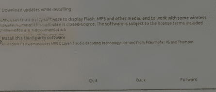
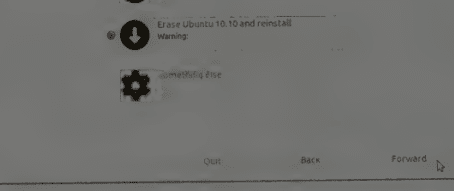

## 你在哪里？

你的名字：`David`
选择用户名：`david`
选择密码：`****`
确认密码：`****`

- 自动登录
- 登录时需要密码
- 加密我的主文件夹


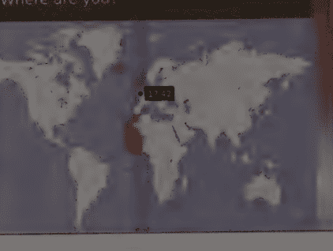

使用如 `Disk Manager` 等镜像软件备份整个硬盘，或按照笔记本电脑附带的说明创建恢复媒体。当你启动电脑时，你需要配置用户账户和电脑名称。为了安全起见，你必须输入密码，尽管你可以选择“自动登录”。为了最大的安全性，点击“登录时需要密码”和“加密我的主文件夹”并点击继续。最终文件将复制到你的硬盘并安装，这取决于你的 `USB` 驱动器速度和网络连接，完成安装可能需要一段时间。完成后，点击“立即重启”。

一旦你的电脑重启，你需要在提示符处登录。你将进入一个看起来整洁的桌面。屏幕左侧的图标允许你访问所有应用程序，顶部的状态栏显示当前的电池状态、未读邮件和网络状态。点击屏幕顶部的 `Ubuntu` 图标将你进入主菜单并点击“更新管理器”。点击“检查”按钮，让软件生成更新列表，如果有任何更新则进行安装。

连接互联网以下载任何更新是有值的，以防电脑在安装期间没有自动更新。你还需要浏览网页、配置电子邮件等。如果你使用有线连接，它应该会自动连接。否则，点击屏幕右上角的无线图标并选择你的无线网络。在提示时输入密码并按确定。`Ubuntu` 会接受错误的密码但不会警告你。然后点击连接。

根据更新数量和网络速度，系统更新到最新版本可能需要 30 分钟。更新完成后，可能会提示你重启电脑。

一旦电脑重启，就可以像正常一样使用了。所有的应用程序位于左侧的菜单中。现在是使用内置电子邮件客户端 `Evolution` 设置邮件的好时机，它将在主菜单列出。我们将在第五章详细介绍配置和使用 `Evolution`。

接下来，你应该更新 `Ubuntu`。点击左侧菜单中的应用程序图标，然后点击系统。滚动到最后。现在你可以使用菜单系统找到你的应用程序，并点击右上角的电源按钮关闭电脑。

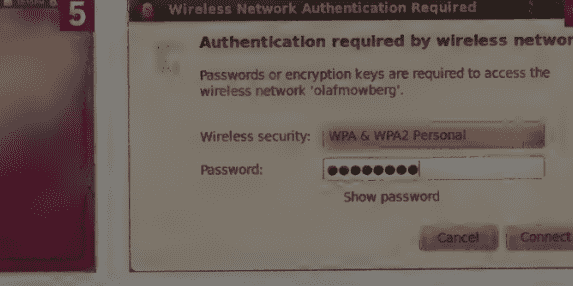

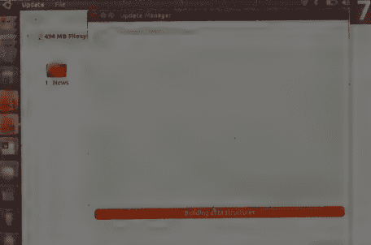

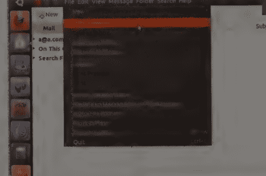

## 欢迎使用 Ubuntu 桌面

一旦你运行起 `Ubuntu`，在桌面上穿行就变得简单了。在这里，我们将带你对桌面进行简要浏览。

`Ubuntu 11.04` 拥有全新的 `Unity` 界面，它消除了许多旧菜单。点击 `Ubuntu` 按钮打开搜索栏。开始输入，将显示匹配的应用程序和文档，操作方式类似于 `Windows 7` 开始菜单。

点击此图标启动 `Ubuntu` 软件中心（`Ubuntu Software Centre`），你可以从中安装和删除应用程序。有数千个应用程序供选择，它们将从互联网自动下载。

点击此按钮可以缩小并查看所有可用的工作空间，这些是虚拟桌面。你可以在工作空间之间拖放应用程序，保持桌面整洁不乱。

这是 `Ubuntu` 的垃圾箱（`Wastebasket`）。它的工作方式与 `Windows` 的回收站完全相同，允许你恢复已删除的文件。

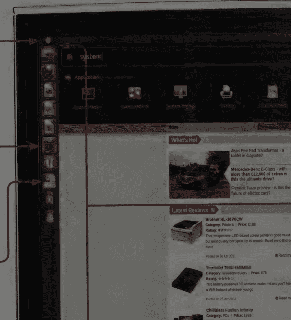

启动器（`Launcher`）是一个用于应用程序快捷方式的专用栏。正在运行的应用程序旁边会有白色箭头。要将应用程序保留在启动器中，右键点击它并选择“保留在启动器中”。要从启动器删除应用程序，只需取消勾选。如果启动器消失了，将鼠标移动到屏幕左侧。

这是通知区域，看起来和 `Windows` 一样。图标出现在这里，通知你各种功能的状态。在这里你可以看到蓝色条指示的 `Wi-Fi` 信号强度，并通过点击扬声器图标静音量。点击信封会显示列出所有消息应用程序的菜单，包括 `Empathy`（它是 `Ubuntu` 的默认消息应用）。

点击你的用户名会弹出一个类似于 `Windows` 关机的菜单。这允许你重启电脑、进入睡眠模式、切换到不同的用户账户或关闭电脑。用户名左侧的图标显示你当前的即时消息状态。

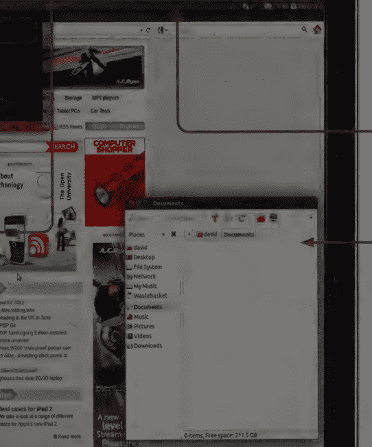

与 `Mac OS X` 一样，应用程序共享一个标题栏，其中包含菜单（文件、帮助等）。将鼠标悬停在此区域即可查看可用菜单。

在 `Ubuntu` 中，浏览文件和文件夹非常简单。如果你在 `Windows` 中可以操作，在这里你也会感到很熟悉。几乎所有东西感觉是一样的，从菜单到导航图标和文件夹列表。像 `Windows` 一样，预创建了“文档”、“音乐”、“图片”和“视频”文件夹。

## 添加外设

如果安装硬件的想法让你对 `Linux` 望而却步，请重新考虑一下：现在在 `Ubuntu` 中添加外设变得非常容易。曾几何时，在一个句子里同时使用“`Linux`”和“硬件”足以让 IT 专家流泪，但仅此而已。`Linux` 已经成熟，处理外设时像 `Windows` 一样简单。在过去的几年里，开源开发者一直为各种外设编写驱动程序和应用程序。`USB` 和蓝牙让他们的工作变得更容易，但与任何操作系统一样，仍然有一些需要注意的问题。`Windows` 在当前硬件上存在问题，而 `Linux` 则倾向于让过时的硬件引起问题。在 `Ubuntu` 中，流行的硬件非常好，你可能面临的问题只是决定想用设备运行哪些应用程序。接下来的几页将展示如何使用 `Ubuntu` 安装一系列常用外设。

### 音频建议

在 `Linux` 中让音频硬件运行起来应该没有任何问题，任何现代声卡都可以直接工作。`Linux` 管理音频硬件的方式与 `Windows` 不同，因此值得仔细观察一下发生了什么。

点击 `Ubuntu` 标志并输入“系统设置”（`System Settings`）并按回车加载控制中心。如果你在播放 CD 时听不到声音，请选择“音频”（`Sound`）选项，这应该是第一个检查的地方。“音频偏好”（`Sound Preferences`）在下拉菜单中列出可用设备。在很多情况下，这些都属于同一块声卡。一个常见问题是将声器插入 PC 的模拟接口，却让 `Linux` 使用数字输出。如果你在音频偏好对话框的选定设备名称中看到“数字”（`Digital`）字样，这个错误应该是显而易见的。要修复此问题，将其更改为“模拟立体双工”（`Analog Stereo Duplex`）并点击测试。这应该产生音调。如果没有，尝试将设备类型改为“打开音频系统”（`OSS`）下拉选项。如果你仍然听不到声音，请查看 `Alsa` 部分。你还可以使用此对话框更改特定系统事件播放的声音。点击“声音”（`Sounds`）选项卡，你会看到事件列表，每个事件的状态为“默认”（`Default`）或“禁用”（`Disabled`）。如果你点击状态并选择“自定义”（`Custom`），你可以导航到声音文件或网络 `URL`。一旦板载音频正常，你可以直接从任何 `USB MP3` 播放器播放音乐。

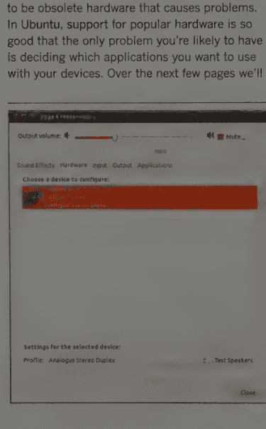

## 安装 Ubuntu

我们使用了一个旧 `Tevian` 512MB `MP3` 播放器，里面充满了 `Windows Media Player` 从 CD 刻制的歌曲。

将你的 `MP3` 插入 `Ubuntu PC` 的 `USB` 端口。将弹出一个对话框，确认操作系统已识别你的 `MP3` 播放器连接。它还会打开一个窗口询问你是否想通过 `Banshee` 播放媒体。点击 `OK`，`Banshee` 应用程序将打开。

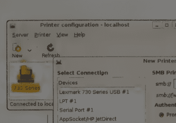

- `128MB RAM`
- `5GB` 磁盘
- `50GB` 带宽
- `£8/每月`

可靠性无需高昂代价

在提供优质服务方面，我们绝不偷减水


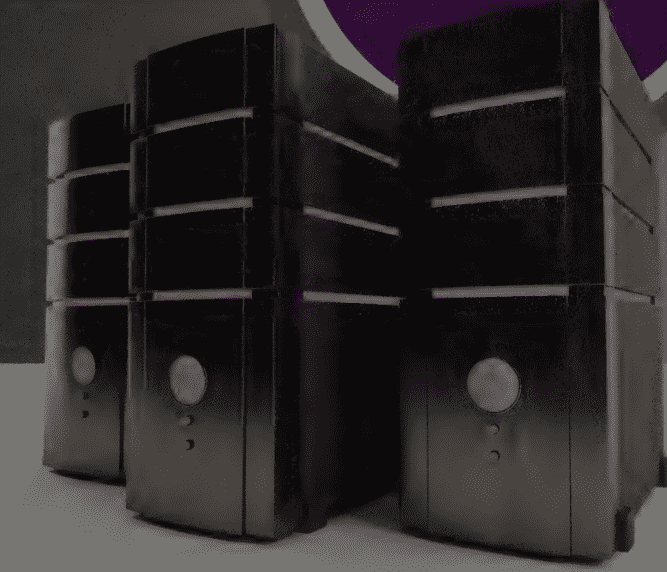

- 您的 `VPS` 托管位于伦敦（`Spectrum House`）、圣何塞（美国加州）和法兰克福（德国）附近的服务器，使用的是世界上最快的网络之一。欢迎随时对我们的任何一个服务器进行 `ping` 或下载示例文件。
- 友好的支持人员将帮助您运行您选择的任何 `Linux` 发行版。
- 虚拟化技术由 `Xen` 提供，这是一种经过证明的管理虚拟专用服务器和划分物理资源的成熟解决方案。
- 每个 `VPS` 都有专用的内存和硬盘空间。这些空间不会与任何人共享，且不会超卖。
- 您可以选择任何 `Linux` 发行版并拥有完全 `root` 权限，您的托管包中包含 `tun/tap` 和 `iptables`。

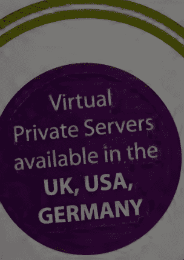

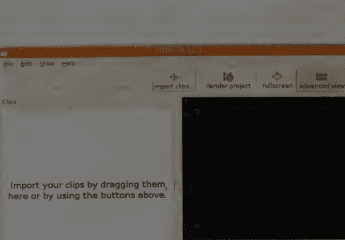


## 蓝牙设置与功能

屏幕右上角的共享标题栏。对于大多数设备，您不需要任何特定的驱动程序，因为它们已经内置在 Ubuntu 中。

### 连接蓝牙设备

当您想要连接蓝牙设备时，点击图标，将弹出一个对话框，提供设置 `PC` 可见性的选项。您可以选择将其隐藏，或在插入后短时间内设可见。更多信息，请参阅蓝牙。确保您的蓝牙手机已开启且蓝牙服务已对其他设备可见后，点击对话框上带有加号的按钮。

会弹出一个向导来添加手机。点击“下一步”，蓝牙设备将出现在列表中。选择它，向导将尝试连接该设备并请求安全 `PIN` 码以建立连接。在手机上，`Ubuntu` 机器将列出设备并确保相同的 `PIN` 码。您的手机现在已准备好与您安装的任何蓝牙管理软件配对。当在范围内时，您的手机会自动连接到您的 Linux `PC`。

### 照片导入

通过拖动照片到这里，或使用下方的按钮导入您的照片。

- `Ubuntu` 带有视频编辑软件，包括与 `PIVX`、`OpenShot` 和 `Windows Movie Maker` 绑定的应用，您可以直接从应用程序菜单运行它们，或通过点击 `Ubuntu` 图标进行搜索。

### 蓝牙适配器

`Ubuntu` 支持蓝牙。如果您的 `PC` 缺少必要的适配器，请将蓝牙适配器连接到 `PC` 的空闲 USB 端口，蓝牙图标就会出现。

Linux 对各种流行设备的支持已变得非常好，几乎不可或缺。如果您曾在使用旧版 Linux 发行版时感到沮丧，现在是再次尝试的好机会。在购买任何新设备之前，查找 Linux 支持以让您的工作变得更容易。

## BlueProximity 工具

`BlueProximity` 是一款实用的工具，当您（或与 `PC` 配对的蓝牙手机）离开时它会锁定 `Ubuntu`，并在您返回时解锁。您可以从桌面的 `Ubuntu` 软件中心安装它。它会在 `PC` 启动时自动运行，在屏幕顶部的标题栏放置一个小图标。

点击图标打开“选项”窗口，然后点击“扫描设备”来检测您的蓝牙手机。点击“选择设备”，然后点击“距离详情”。使用滑块选择在屏幕保护启动之前您必须离开 `PC` 多远（例如大约三米），以及您需要离多近才能关闭它。带着您的手机离开进行测试。

- `BlueProximity` 允许您的手机在您离开时自动锁定您的屏幕

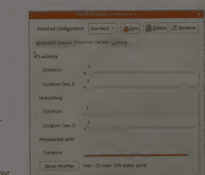

26 完整 Linux 手册

## 订阅优惠

1 英镑购买 3 期

现在您只需 1 英镑即可获得接下来的 3 期！如果 3 期后您仍不完全满意，这是一项 100% 免费的优惠，您可以写信取消订阅，且支付金额不会超过已扣除的 1 英镑

- 1 英镑 3 期开始订阅
- 如果您不满意，只需取消且支付不会超过已扣除的 1 英镑
- 如果继续订阅，可在商店价基础上节省高达 26%
- 免费送货上门
- 在进入商店前获得每一期


立即在线订购：`www.dennismags.co.uk/computershopper`

或立即致电：`0844 844 0031`

引用优惠代码 `G11052f`

## 软件安装与管理

虽然 `Ubuntu` 已经内置了，但您可以轻松添加。每个人都知道如何安装软件。

`Ubuntu` 的主要优势之一是它允许直接访问免费软件。

要安装应用程序，只需点击其旁边的复选框即可。要开始安装 `Apache 2`，请点击“`apache2`”条目。

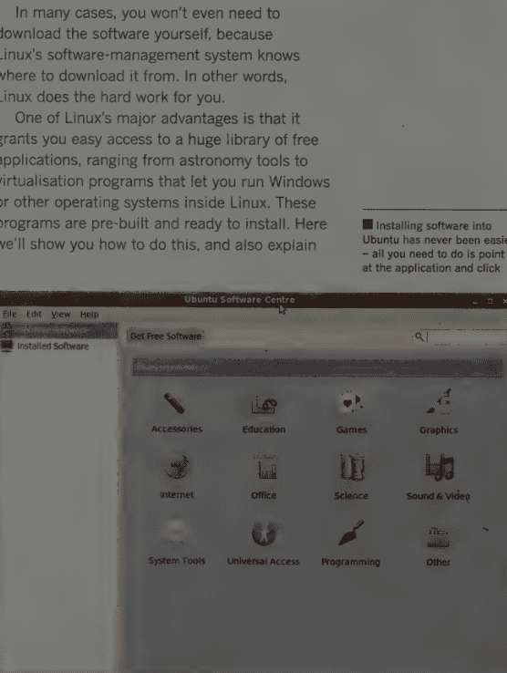

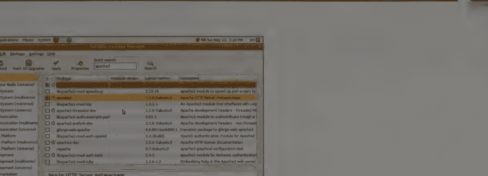

一旦您安装了，`Synaptic` 软件包管理器将能够帮助您删除或升级它。

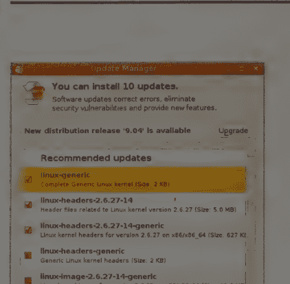

分钟。偶尔，在更新软件包后，您可能需要重启系统 - 特别是那些与 Linux 内核相关的包。

## 系统升级

升级到新版本的 `Ubuntu`，您有多种选择。您可以从点对点服务或 `Ubuntu` 官网下载磁盘镜像 (ISO)，并将 ISO 刻录到 DVD 并启动以开始安装过程。您也可以在 Gnome 桌面内升级 `Ubuntu`，从而节省时间和节省购买 DVD 的费用。

在决定升级之前，请确保您的第三方应用程序与新版本的 `Ubuntu` 兼容。如果不是，您可能需要一直等待，直到有人为该版本进行构建。请检查软件的网页以获取最新版本。

当新版本的 `Ubuntu` 发布且您准备好升级时，运行“更新管理器”（`Update Manager`）。它位于“管理”菜单的底部附近，或者通过启动栏的系统菜单访问。您可能认出更新管理器就是当您想要应用更新时弹出的窗口。

在 `Ubuntu` 顶部，您将看到一条宣布新版本 `Ubuntu` 可用的消息。点击“更新”按钮，将打开一个窗口，显示解释新发行版特性的发布说明。点击此窗口上的“更新”按钮，`Ubuntu` 将下载升级程序并在无需重启的情况下运行。

完成此操作后，系统将告诉您将下载多少数据；当我们尝试时，为了将 `Ubuntu` 从 `10.10` 升级，我们不得不下载几百字节。

您也可以升级软件包。当任何一个软件包或应用程序可用升级程序时，打开“同步软件包管理器”（`Sync Package Manager`）并点击重新加载按钮。选择您想要升级的包并勾选选框。点击“升级”选项并点击“应用”按钮，就像您安装它时一样。

删除软件包的步骤与安装非常相似。在“同步软件包管理器”中，只需点击复选框选择您想要从系统中删除的包。点击“应用”按钮，会弹出一个对话框确认您的操作。在此对话框中选择“应用”，软件包将从系统中删除。

> `Update Manager` 允许您快速、方便地应用补丁。

> 升级 `Ubuntu` 是一个无风险的过程，但需要一小时才能完成

`Ubuntu` 定期发布更新，以修复漏洞、改进功能并修复操作系统和已安装软件包的安全漏洞。当这种情况发生时，您会在 Gnome 桌面顶部的标题栏看到一个红色或橙色的星号。点击它即可打开 `Ubuntu` 的更新管理器。

这列出了所有可用的更新。点击“应用”按钮并输入系统密码。更新管理器将为您下载相关包，这可能需要一些

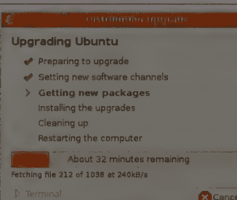

- 正在准备升级
- 设置新的软件通道
- 获取新包
  - 正在安装升级
  - 清理
  - 重启电脑

剩余约 32 分钟

终端

# 30 Linux Linux 手册

## 安装 Ubuntu

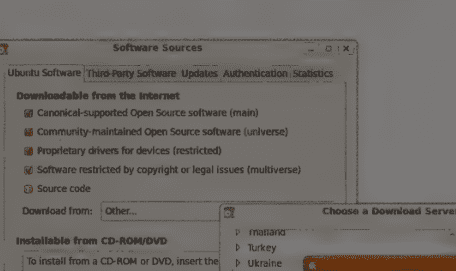

系统以便它们能够正常工作。除了等待过程完成外别无可做，这可能需要一小时。

安装完成后，如果您想删除系统中的所有软件包，升级工具将运行。选择“删除”以释放一些空间。

最后，您可以控制系统更新和软件包安装。在系统菜单栏的“安装”菜单上，选择“软件源”（`Software Sources`）。这将带出一个带有多个满足您需求的工具的框。第一个用于安装 `Ubuntu`。

在此选项卡上，点击“下载”下拉菜单并选择“其他...”。这将弹出一个对话框，让您选择从哪个服务器下载。通过浏览“选择服务器”按钮来找到最快的服务器。`Ubuntu` 会联系每个服务器并选择响应时间最佳的一个。完成后，选择“选择”以完成程序。

您可以定义何时安装更新。使用表格中“自动更新”部分的拉取菜单来决定检查更新的频率。通常设为每天一次是没问题的，而且大多数更新不需要重启。

`11.04` 还会告诉您将安装多少包，以及根据您的宽带连接速度下载所有内容需要多长时间。当您准备好时，全部点击“开始升级”。进度条将让您了解剩余时间和已下载的包数量。一旦下载完成，升级程序将执行安装新包和重新配置所需的所有任务。

在 Linux 中安装软件包曾是一场噩梦，但现在已变为大量优秀的图形化桌面工具。`Ubuntu` 基于 Linux 发行版，因此可以轻松安装互联网上的任何 `.deb` 包。默认情况下，此过程由 `GDEDE` 自动处理。

您可以选择 `Ubuntu`，，，。。。。。。 `LinuxDE`， `Linux`。 `Linux` `Linux` `Linux`  `Linux`， `Linux` `Linux` 。。。。   。。。。 `Linux` `Linux` `Linux` `Linux`。。。。。 `Linux` `Linux` `Linux` 运行 `Linux`  `Linux` `Linux` `LinuxDEDEDEDE`。

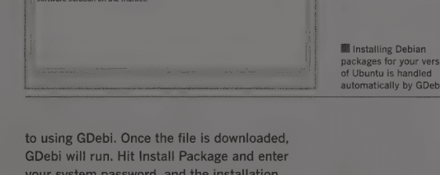

`Linux` `Linux` `Linux` `Linux` `Linux` `Linux`。

`Linux` `Linux` 手册

31


32 `Linux` `Linux` 手册

## 了解 Linux

如果您已经遵循了之前的章节并已经安装了 `Ubuntu`，您应该已经了良好的系统和熟悉的桌面。在 `Ubuntu` 顶部，您将看到一条宣布新版本的 `Ubuntu` 可用的消息。点击“更新”按钮，将打开一个窗口，显示解释新发行版特性的发布说明。点击此窗口上的“更新”按钮，`Ubuntu` 将下载升级并在无需重启的情况下运行。

完成此操作后，系统将告诉您将下载多少数据；当我们尝试时，为了将 `Ubuntu` 从 `10.10` 升级，我们不得不下载几百字节。


如果您已经遵循了之前的章节并已经安装了 `Ubuntu`，您应该已经了良好的系统和熟悉的桌面。在本章中，我们将深入研究操作系统并告诉您如何使用界面。在 `Ubuntu` 顶部，您将看到一条宣布新版本的 `Ubuntu` 可用的消息。点击“更新”按钮，将打开一个窗口，显示解释新发行版特性的发布说明。点击此窗口上的“更新”按钮，`Ubuntu` 将下载升级并在无需重启的情况下运行。

现在您已经安装了 `Ubuntu`，下一步是探索界面。在这里，我们将为您介绍默认桌面。使用新的操作系统可能是件令人不安的事。但请不要担心，即使是运行简单的程序也可能很复杂。在接下来的几页中，我们将向您展示如何开始 `Linux`。在几分钟内，您就能像在 `Windows` 中做做的事情，并发现甚至更流畅。

- 入门 34
- `Linux` 之间的共享 38
- 将文件传输到计算机 42
- 配置 `Ubuntu` 46
- 使用启动器 51

## 安装和运行应用程序

点击启动栏上的“应用程序”，访问首次设置 `Ubuntu` 时安装的程序。这些程序将列在不同的类别中。将鼠标悬停在类别上打开，并左单击应用程序即可运行。

要添加新应用程序，点击“软件中心”。会出现一个三格窗口。在左格中，您将看到所有类别。选择一个，主格中会出现应用程序列表。点击一个，描述将出现在另一个格中。可以通过勾选框选择一个或多个程序进行安装。然后点击“更改更改”。在给您最后的机会后，将要求您输入密码。`Ubuntu` 将下载最新的相关包并安装它们。您的新程序现在可以在“应用程序”菜单中使用。

# 了解 `LINUX`

稍等片刻，你就可以在 `YouTube` 上观看视频了。

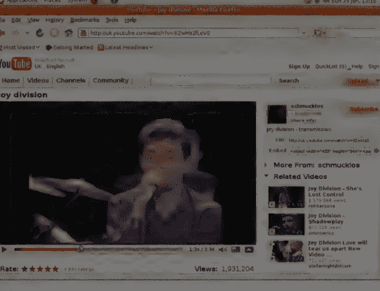

## 更改屏幕分辨率

更改屏幕分辨率非常简单。在系统（`System`）菜单中，选择“设置”（`Preferences`）。在菜单底部，你会看到“屏幕分辨率”（`Screen Resolution`）选项。当你选择它时，会弹出一个窗口，显示你的硬件支持的分辨率和显示器频率下拉菜单。只需选择一个预设值，分辨率就会改变。

从低分辨率切换到高分辨率时，会出现轻微的闪烁。看起来似乎没有作用，但注销并重新登录会自动应用更正。在其他情况下，你可能无法使用高于 `800x600` 的分辨率。如果你在右上角看到绿色图标，将其悬停在上面查看“推荐”（`Recommended`）消息，点击它并选择推荐的驱动程序。点击“激活”（`Activate`）按钮将安装驱动程序，从而启用高显示分辨率。

# 安装 `Flash` 播放器

为了观看 `YouTube` 视频并充分利用它们，你需要 `Adobe Flash Player`。如果你在网络浏览器中访问 `YouTube`，会看到一个通往 `Adobe` 网站的链接。点击该链接并选择“`Ubuntu` 8.04”作为软件类型。然后点击“同意”（`Agree`）和“立即安装”（`Install Now`）。在弹出的窗口中点击“确定”。这会使用包安装程序打开文件。安装 `Flash Player`。

- 许多如 `YouTube` 在内的热门网站都依赖 `Adobe Flash Player` 才能正常运行。

### 自定义桌面

要更改桌面壁纸，在桌面上点击右键并选择“更改桌面背景”（`Change Desktop Background`）。会弹出一个窗口显示图片选择。点击“添加”（`Add`）按钮将调出文件选择器，让你有机会向列表中添加自己的图片。从你的收藏中选择一张并点击“确定”，它就会成为你的壁纸。

如果你愿意，也可以通过另一种方式打开此窗口。点击系统菜单，选择“设置”（`Preferences`）和“外观”（`Appearance`）。你会看到许多标签页。点击“主题”（`Theme`）标签页，你就可以就可以更改其他默认的 `Gnome` 主题，就像在“自定义”（`Custom`）按钮中一样，并更改边框色调、颜色等。你还可以安装下载的主题。

`Gnome` 网站有一个主题区域（`http://art.gnome.org/`），包含免费主题的概述。选择一个类别，浏览直到找到你喜欢的，然后点击下载。保存文件（默认路径）并安装“主题”（`Theme`）。在随后的文件选择器中，导航到桌面（存储在你的用户文件夹中）并选择主题文件，它就会安装。

右键点击并选择“属性”（`Properties`）。你可以以像素为单位设置高度，以及它是显示为居中栏还是跨整个屏幕宽度（就像会自动隐藏一样）。你还可以选择显示手动句柄和显示按钮（如果你不使用自动隐藏功能）。

点击“背景”（`Background`）标签页，你可以设置栏的透明度。

你可以在启动栏周围添加小工具和图标。右键点击并选择“添加到面板”（`Add to Panel`）。从可用选项列表中选择。例如，你可以添加“网络监视器”（`Network Monitor`）查看你的 `IP` 地址和产生的网络流量。选择该项并点击“启动器...”（`Launcher...`），点击“向前”按钮。选择一个类别，点击列表并选择预设。按“添加”（`Add`）。最后，你可以通过右键点击并按“移动”（`Move`）移动启动栏周围的小工具和图标，或通过选择“移除”（`Removing`）来删除它们。

### 更改密码：难以破解且难以记忆

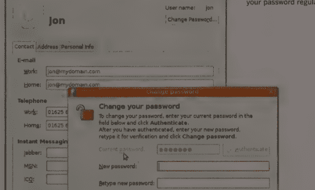

使用安全密码并定期更改它们非常重要。如果你在笔记本电脑上使用 `Ubuntu`，这一点尤其如此。这种方法将帮助你轻松记住那些难以破解的密码。

想一个你熟悉的密码。取每个单词的首字母。想一个你熟悉的密码。取每个单词的首字母。

一个你熟悉的密码。点击系统菜单并选择“设置”（`Preferences`）和“外观”（`Appearance`）。你会看到许多标签页。

主题 更改。

右键点击并选择“属性”（`Properties`）。你可以点击“背景单位设置像素

度。

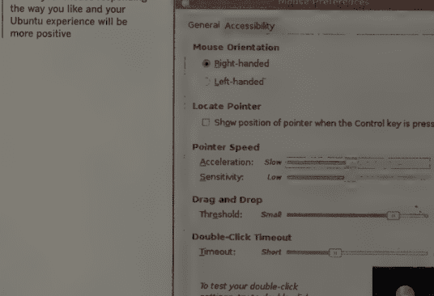

# 使用 `Ubuntu` 的网络


## 查找内容

# 了解 `LINUX`

## 更改屏幕分辨率

# 安装 `Flash` 播放器

### 自定义桌面

# 在 `Linux` 和 `Windows` 之间共享文件

你的家庭网络可能包含不仅仅是 `Linux PC`。以下是如何在 `Linux` 和 `Windows` 系统之间共享文件。

变化在于，你家里除了 `Linux` 系统外，至少有一台 `Windows PC`，并且在它们之间共享文件和文件夹很有意义。幸运的是，这在 `Ubuntu` 中很容易实现，因为 `Linux` 使用与 `Windows` 相同的文件共享协议。在接下来的几页中，我们将向你展示如何轻松共享文件和文件夹。

`Linux` 可能使用与 `Windows` 不兼容的文件系统，但通过网络共享文件是不同的；`Linux` 和 `Windows` 都使用 `SMB` 协议进行文件共享。这意味着文件从 `Windows` 或 `Linux` 硬盘中读取，使用互兼容的 `SMB` 协议发送，并以原生格式保存到接收计算机的硬盘中。因此，`Linux` 是一个易于集成到网络中的操作系统。你所需的所有工具都是内置的，因此在 `Linux PC` 和 `Windows PC` 之间共享文件和文件夹非常简单。

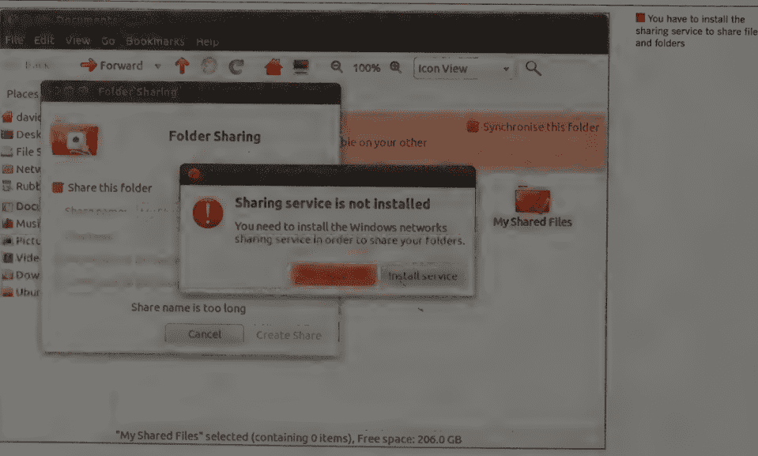

## 了解 `Linux`

如果发生这种情况，你可以重命名 `Linux` 文件夹（因为它字符少于 12 个），或者你可以更改共享名称（共享名称基本上是网络计算机查看文件夹的方式），而保持 `Linux` 文件夹不变。第二种方案是最简单的。在我们的示例中，我们共享了共享名称 `'docs'`。你可以在注释框中添加共享文件夹的说明，这是可选的。

有两个选项可以选择。默认情况下，每个文件夹都是只读的，因此其他人无法修改现有文件或写入新文件。如果你想在此文件夹中创建和删除文件，请点击。如果你想允许用户进行读写访问并输入，请选择“访客”（`Guest`）。完成后，点击“创建共享”。你创建的每个共享都可能会弹出一个对话框，提示你需要权限，在这种情况下，你应该点击“允许权限”。你的共享文件夹上方将有一个红色箭头，表示它已共享。

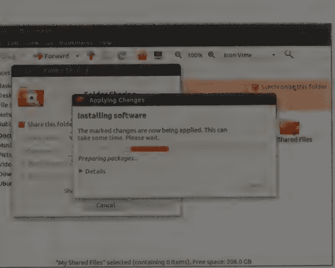

## 共享大同小异

从原则上说，在 `Linux` 中共享文件夹与在 `Windows` 中完全相同。你可以共享任何需要的文件夹。要创建并共享新文件夹，首先点击“位置”（`Places`），“文档”（`Documents`）查看你的文档，然后右键点击并选择“新建文件夹”。给文件夹一个合适的名称，例如 `My Shared Files`，并按回车。

要共享该文件夹，右键点击它并选择“共享选项”。勾选“共享此文件夹”复选框，你会看到一个对话框提示未安装共享服务。点击下一个对话框中的“安装服务”按钮并按确定。共享服务将自动下载并安装。你需要重启以继续。

一旦你重新登录计算机，回到你的新文件夹，右键点击它并选择“共享选项”。勾选“共享此文件夹”框后，其他选项将不再显示为灰色。在对话框底部，有一条消息提示你共享名称过长——这是因为共享文件夹的名称最多允许为 12 个字符。

- 共享服务将自动下载并安装


- 按照正常方式创建一个新文件夹来存放你的共享文件

在从另一台计算机访问你的共享文件夹之前，你需要找到主机（计算机）名称，打开终端窗口（可以在搜索框中输入 `terminal` 或前往菜单 > 应用程序 > 终端）。输入 `hostname` 并记录你的计算机。接下来，输入 `ifconfig` 查看 IP 地址。输入（可能是 `eth0`）你的网卡名称。`inet addr` 之后的数字应该像 `192.168.0.3`。

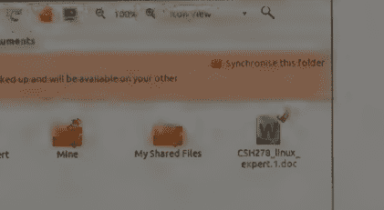

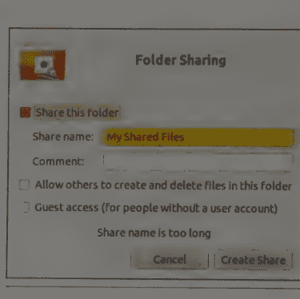

如果你经常需要在 Windows PC 上访问该共享文件夹，右键点击它并选择“映射网络驱动器”。从现在起，共享文件夹将作为普通驱动器出现在“此电脑”中，你可以快速访问它。

## 从 Linux 访问

从 Linux PC 共享文件夹很容易。我们已经在你的 Windows 上共享了一些文件夹。若要从 Linux 系统访问它们，你需要知道你的计算机名称，最好还知道它的 IP 地址。

如果你想更改计算机名称，可以通过输入 `sudo edit /etc/hostname` 并按回车来实现。在出现的文档中，将现有名称替换为你想要的名称。

要获取计算机名称，输入你的 Windows 计算机名称，右键点击并选择“属性”。名称将列在页面上。要获取 IP 地址，输入命令提示符 `ping <ip>` 并按回车。记录 IPv4 地址。

## 通过 Windows 连接

一旦你拥有了所有信息，就可以从 Windows PC 连接到 Linux 计算机。如果你连接到“网络”，Linux 计算机会自动出现在 Windows 中，但这种效果并不好。最好直接连接。按 Windows-R 运行命令，输入 `\<IP 地址>`，如果无效，输入你的 Linux 计算机的 IP 地址。

第二种方法的问题是，除非你使用静态 IP，否则在 Linux 计算机上，点击“位置”，“网络”：你应该在这里看到你的 Windows 计算机，双击它。如果不在那里，点击“连接服务器”并更改“服务”。在 Linux 计算机上点击“服务器”，然后点击“连接”。输入 Linux 计算机的名称。如果无效，尝试输入你的 Windows PC 的 IP 地址。

一旦你的 PC 连接上，就可以看到所有共享文件夹。双击其中一个打开。如果你没有运行访客模式，将提示你输入用户名和密码。在你的 Linux 中访问文件夹时，点击“记住”以供下次使用。

在两种情况下，如果你保护了共享，系统将提示你输入用户名和密码。现在你可以将文件从共享文件夹拖动到你的计算机上。如果你允许写入，你还可以重命名并复制文件夹到共享区中。你可以按照上述步骤更改共享名称，或者如果你想停止共享，请使用“共享”选项。

你需要 Linux 计算机的 IP 地址。

```bash
david@desktop:~$ File Edit Search Terminal
david@desktop:~$ sudo add addr 192.168.1.100/24 eth0
david@desktop:~$ set eth0 up
```

## 了解 Linux

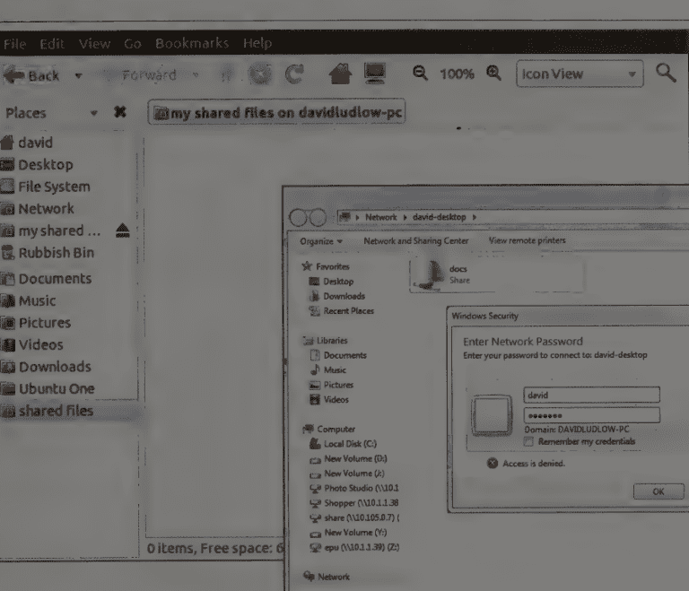

还应该将域名设置为你的 Windows 电脑的名称。你可以选择记住密码（默认设置）、立即忘记密码或记住它。当你做出选择后，双击该项即可查看所有共享文件。你在 Windows 电脑上设置的权限将决定你只能读取文件还是可以写入文件。

与 Linux 不同的是，Windows 没有网络驱动器。相反，它有书签，其功能类似。要为共享文件夹添加书签，请按照上述过程访问共享内容，然后点击“书签”，“添加书签”。当你重启电脑时，共享文件夹将依然存在。你可以通过打开 Nautilus 浏览器窗口（点击“位置”，“主目录”）来查看它，你可以在左侧面板的下半部分查看你的书签。

# 连接其他设备

连接到其他 Linux 计算机就像连接到 Windows 电脑简单简单。点击“位置”，“连接服务器：Windows 共享”，在“服务器”框中输入你想要连接的 Linux 计算机名称，并点击“连接”。当你访问共享内容时，连接的 Linux 计算机会提示你输入用户名和密码。注意，你不需要更改域名。

你可能会偶尔看到错误，书签保留为 SMB 格式；如果发生这种情况，右键点击它并选择“重命名”，然后输入实用的名称。

当你使用“位置”，“连接服务器”对话框连接计算机时也可以创建书签：只需点击“添加书签”框并输入书签名称。

# 将文件传输到你的 Linux 计算机

现在 Ubuntu 已经运行了，你想将文档和多媒体文件传输到电脑。方法如下：

现在你的电脑已经按照你的要求设置好，你可能已经发现 Linux 运行感觉比 Windows 快得多。它的关机速度更快，几秒钟内即可启动。然而，你可能有很多来自 Windows 电脑的文件想要传输到新电脑上，例如文档、音乐、照片和视频。或者，你可能需要从备份文件的外部硬盘或 USB 闪盘拷贝文件。如果你的电脑有内存卡读卡器，你还可以将文件从卡传输到硬盘。在接下来的几页中，我们将展示如何操作。

# 通过网络连接

在大多数情况下，你的 Ubuntu 电脑将通过网络线或 Wi-Fi 连接到家庭网络。

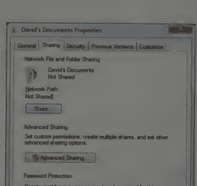

- 你需要在 Windows 中共享文件夹，它们才能在网络上可见
- 你的 Wi-Fi 网络应该提供正确的连接设置，但你可以轻松更改这些设置

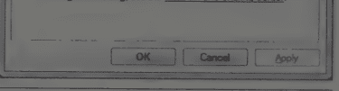

你的网络某可能有一个宽带路由器，允许你在网络上的所有计算机之间共享上网。该路由器还允许 PC 之间共享文件，这是将文件传输到 Ubuntu 电脑的一种方法。

在执行之前，你可以共享包含你想传输到网络上其他计算机文件的文件夹，否则 Ubuntu 将无法访问这些文件。在 Windows XP 中，使用 Windows 资源管理器导航到你想共享的文件夹，但不要打开文件夹本身。对于大多数人来说，共享“我的文档”文件夹是合理的。

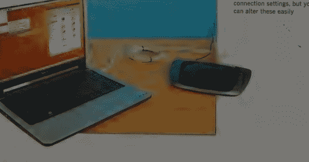

## 了解 Linux

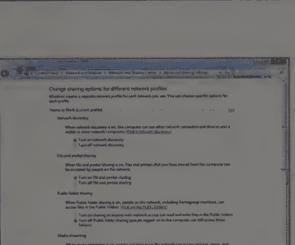

### Windows 7 的文件夹共享选项与 Windows XP 有些不同，但在网络上共享文件仍然简单

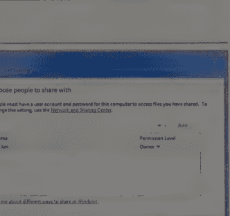

#### 选择共享对象

用户必须拥有此计算机的账户和密码，才能访问他们共享的文件。要编辑共享，请选择“网络和共享中心”。

## 在 Windows 7 中，你需要在“家庭网络和共享中心”中启用某些选项，才能共享文件夹

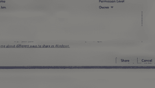

右键点击文件夹并点击“共享和安全”。如果你想共享整个硬盘，你需要勾选“如果你理解风险并想要共享此根目录”旁边的复框。

在“共享”选项卡上，勾选“在网络上共享此文件夹”框。你可以更改文件夹名称以便在电脑上识别它。例如，如果你需要为电脑上的多个用户共享“我的电脑”，可以将其改为“文档”。点击“确定”，Windows 将应用更改。

#### 选择共享对象

用户必须拥有此计算机的账户和密码，才能访问他们共享的文件。要编辑共享，请选择“网络和共享中心”。

#### 选择共享对象

用户必须拥有此计算机的账户和密码，才能访问他们共享的文件。要编辑共享，请选择“网络和共享中心”。

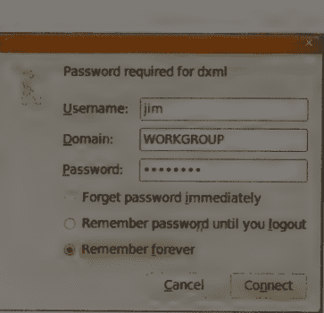

这通常发生在如果你安装了 ZoneAlarm 等第三方防火墙，它阻止来自本地网络的连接。你需要临时禁用防火墙或将你的 Ubuntu 计算机添加到“信任”IP 地址列表中。你可以通过打开“网络工具”找到 IP 地址。如果你通过 Wi-Fi 连接，这将是 `wan0`；如果你使用网络线，这将是 `eth0`。在 IP 地址旁边，你需要进入防火墙。现在，你将无问题地连接到 Ubuntu。

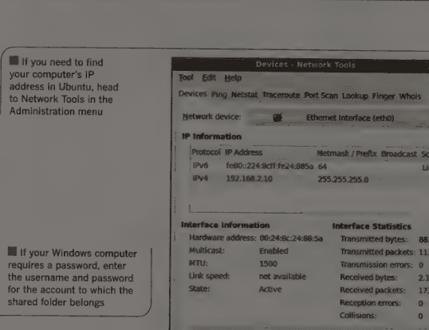

# 查看共享文件夹

当你成功连接到远程文件夹时，你将看到所有文件，就像坐在 Ubuntu 电脑面前一样。Ubuntu 有三种视图：图标、列表和紧。

有几种方法可以选择你想要的文件：使用鼠标进行选择、全选或选择某些文件。


## 了解 LINUS


现在，您可以使用之前描述的方法之一从远程计算机上选择文件，然后点击并按住其中一个文件，将其拖到另一个文件浏览器的右侧。鼠标指针将变成一只手形，你会看到其他文件正在移动。在松开文件之前，寻找手部右下角出现的额外图标。如果箭头指向手部，则文件将被“移动”；如果你想复制文件并将其保留在原地，请在松开鼠标按钮前按住 `Ctrl` 键。

这是您选择的最后一个文件。你可以组合使用 `Shift` 键和 `Ctrl` 键来选择多个文件块。

## 外部驱动器

从 USB 硬盘、闪存盘或内存卡传输文件的过程与我们描述的网络传输过程几乎相同。唯一的区别是，当你将其中一个存储设备插入计算机时，应该会自动弹出一个文件浏览器，显示 Ubuntu 的该功能快捷方式。该驱动器将出现在桌面上，这样你可以在其保持连接时快速访问它。

一旦选好文件，按 `Ctrl+C` 复制它们，或从“编辑”（Edit）菜单中选择“复制”。导航到您想要传输文件的文件夹（你可以打开一个新的文件浏览器窗口；只需前往“位置”（Places）菜单并选择其中的任意一个文件夹）。然后，从“编辑”菜单中选择“粘贴”，或者如果你倾向于使用键盘快捷键，可以按 `Ctrl+V`。

如果你想移动文件而不是复制它们，请在选择文件后从“编辑”菜单中选择“剪切”。然而，只有当你在 Windows XP 中共享文件夹时勾选了“允许网络用户更改我的文件”框，此操作才有效。在 Windows Vista 电脑上这不是问题，因为默认权限是“所有者”。

现在您可以使用与网络传输文件相同的方法选择文件并复制到硬盘。在拔掉 USB 闪存盘、硬盘或内存卡之前，点击弹出图标，该图标出现在文件浏览器窗口“位置”窗格中驱动器的右侧。这有助于防止文件损坏。


## 窗口操作

另一种传输文件的方法（对某些人来说可能是最简单的方法）是在桌面上打开两个文件浏览器窗口。一个窗口显示存储在远程计算机上的文件，另一个窗口则显示你想要复制到的本地硬盘的文件夹。要调整文件浏览器窗口的大小，只需将鼠标悬停在每个窗口的右下角，直到光标变化，然后拖动直到窗口达到合适大小；这与 Windows 中的操作完全相同。

## 配置 Ubuntu

每个人都喜欢按照喜好定制自己的 PC。在这里，我们将展示如何调整 Ubuntu 的主题并开启它的特殊效果。

就像你可以将 Windows 的壁纸设置为你喜欢的图片一样，在 Ubuntu 中也可以同样这样做。你还可以更改配色方案、图标，并根据你的喜好个性化窗口。

要查看 Ubuntu 的默认主题，前往屏幕顶部的“系统”（System）菜单，点击“偏好设置”（Preferences）。然后你会发现有 11 个主题可以选择，其中已经选中了“Human”。点击任何主题，你都会立即明显地看到它不仅影响你当前使用的窗口，还会影响桌面，包括顶部和底部栏。例如，“Clearlooks”比其他主题要微妙得多。它更改了图标，并将默认的橙色/棕色切换为浅蓝色；然而，点击“高对比度反转”（High Contrast Inverse），变化会变得显著。如果你喜欢某个特定主题，只需点击“关闭”（Close）按钮，该主题将保持生效。

默认主题比较有限，因此安装一些新主题是值得的。保持“外观”（Appearance）窗口打开，再次前往“系统”菜单，然后点击“软件包管理器”（Package Manager）。输入密码，软件包管理器将启动并更新软件包列表。在“快速搜索”（Quick Search）框中输入 `gnome`。你应该看到软件包列表已更新，然后 `gnome-themes-extra` 出现在列表顶部。点击它左侧的灰色方块，然后在出现的菜单中选择“标记为安装”（Mark for Installation）。


点击窗口上方的绿色按钮，系统将询问你不想标记所需的更改。这只是表示需要安装额外的软件包或更新其他软件包，因此点击“标记”（Mark）按钮。你现在将看到三个文件正在下载。完成后，点击对话框上的“确定”（OK）。

你将在“外观”窗口中看到新主题，点击找到一个你喜欢的。我们选择了“Nova”。但是，如果你不喜欢其中任何一个，可以从软件包安装程序安装更多主题。你还可以点击“外观”窗口底部的“自定义”（Custom）按钮并修改主题。你可以更改控件的外、颜色、图标、窗口和边框。你可以从两个屏幕下方的列表中选择项目。使用 `Gimp` 编辑应用程序（见第 60 页）调整图片大小以恰当适应你的屏幕是非常简单的。

尽管你现在更改了主题，但你仍然需要设置壁纸，或者在 Ubuntu 中称为“背景”（background）。在“外观”窗口中，点击“背景”。

## 1&1 – 可靠性翻倍

### 1&1 双主机

### 通过地理冗余实现双重安全

没有人能完全避免网站的宕机。1&1 通过地理冗余提供即时恢复。这意味着您的网站在两个或更多不同的位置无缝运行。如果任何位置发生故障，您将自动路由到另一个位置，且不会丢失任何数据。


## 新发布！托管服务

没有其他 Web 托管商能提供像 1&1 这样的专业知识、技巧和质量：将多年的托管经验与我们灵活、高性能环境中的最新技术相结合。现在有超过 3,000 名 IT 专业人士信赖我们提供未来的顶尖在线性能解决方案。全新：1&1 是唯一提供双重稳定性和安全的 Web 托管商，让您完全无后顾之忧。

- 包含 `.uk` 域名
- 无限 Web 空间
- 无限流量
- 无限 `MySQL` 数据库（每个 1 GB）
- 无限 `IMAP/POP3` 电子邮件账户
- 无限 `FTP` 账户
- 无限 1&1 Click & Build 应用（从 65 个应用中选择）
- 新：1&1 SiteAnalytics
- `PHP`, `PHP Dev`, `Zend`, `Ruby`, `SSI`, 版本控制管理 (`git`)
- NetObjects Fusion® 1 版或 Adobe® Dreamweaver CS4\*
- 新：地理冗余服务器
- 60 天货币退款保证


**双重安全：**

地理冗余数据中心！


**顶级性能：**

高端服务器！


**超快速：**

`210 GBit/s` 连接性！


**环保：**

由绿色能源驱动！


**面向未来：**

超过 1,000 名内部开发人员！

## 1&1 双限量版

每月 £12.99 起\*

\* 访问 `1and1.co.uk` 了解完整优惠详情。价格不含增值税。


致电：`0871 641 21 21` 或现在访问我们 `www.1and1.co.uk`

# 第 3 章

## 创建用户账户

为所有使用电脑的人创建独立的用户账户有许多好处。以下是操作方法：

如果您与家人共享电脑，那么为每个人都创建一个用户账户是有意义的。创建独立账户还允许每个用户拥有自己的文件夹集来存储文档和媒体文件。

独立账户允许每个人根据自己的喜好自定义主题和背景。他们还可以在桌面上放置多个账户和文件，否则桌面可能会因为每个人的文件而变得混乱。

在 Windows 中，您可以在首次安装时创建多个账户，但在 Ubuntu 中，您将通过“管理”菜单进行。

您还可以使用“配置文件”菜单设置账户类型。Ubuntu 为您提供了三种选择：管理员 (`Administrator`)、用户 (`User`) 和桌面用户 (`Desktop user`)。您应该只选择后者，因为管理员对操作系统的权限超过了普通用户所需的，而且作为一个安全风险，用户可能会创建或删除系统文件。

在大多数情况下，这是最佳选择，因为这允许用户访问外部存储设备、连接互联网、使用 `CD` 或 `DVD` 驱动器以及本地系统。无权限用户无法执行任何这些操作。

- 1. 转到系统管理、用户和组（列表中的最后一项）。您将看到设置窗口，但会注意到“添加用户”按钮是灰色的。在您点击窗口底部的钥匙并输入用户密码进行身份验证之前，将无法进行任何更改。
- 2. 添加和删除用户的按钮现在已激活。点击“添加用户”将打开新用户账户窗口。在这里，您可以输入用户名、真实姓名和密码。


- 3. 您可以通过点击“权限”选项卡来更改权限。这里列出了用户可以做或不能做的事，但您可能想要从默认桌面用户配置中更改的项目仅是允许用户配置打印机并与局域网共享文件。您可以在“信息”选项卡上填写用户的地址和电话号码，但这通常不是必须的。“高级”选项卡中的设置将是灰色的，应该被忽略。点击“确定”关闭窗口并添加新账户。您可能需要输入用户密码并点击“身份验证”以完成过程。新用户将出现在列表中，您可以为其他用户重复此过程。


| 姓名 | 登录名称 | 主目录 |
|---|---|---|
| | | |


### 使用启动器

方便常用程序和小工具

启动器是交互应用程序的新方式，部分取代了屏幕左侧的任务栏和“应用程序”，尽管如果应用程序已最大化，移动鼠标即可将其找回。右键点击图标可能会为您提供新选项，例如“在 Firefox 中打开”。应用程序并不总是可见的，您可以点击将其固定。这为您提供了一个快捷方式。图标是您常用应用程序的快捷方式。带有白色箭头的图标表示正在运行的程序。此图标会启动搜索栏，让您可以访问文件夹、最近打开文件的缩略图。“所有文件”菜单将搜索缩小到文档、文件夹、图像、视频或其他演示文。上方带有“+”号的图标用于应用程序。您还可以点击顶部的 Ubuntu 来打开您已删除的文件。要永久删除文件，请右键点击垃圾桶并选择“清空”。

## 1&1 双重托管安全且节省！

## 1&1 双重基础

- `5 GB` 空间

- 无限流量

- 新：`MySQL` 数据库

- 新：`1&1 SiteAnalytics`

- `1000 IMAP/POP3` 电子邮件账户

每月 `£1.99` 起*

## 1&1 双重完美

- 包含 `.uk` 域名

- `10 GB` 空间

- 无限流量

- 新：`MySQL` 数据库

- 新：`1&1 SiteAnalytics`

- `3000 IMAP/POP3` 电子邮件账户

每月 `£3.99` 起*

## 1&1 域名每年 `£2.49` 起*

现在仅需每年 `£3.99`

`抢购 - 优惠截止于 2011/06/30！`


## 1&1

`0871 641 21 21`

`www.1and1.co`

# 第 4 章


## 基础桌面任务

一旦安装并配置了 Linux，您就会想要开始使用它。本章专门向您展示如何在 Ubuntu 中完成 Windows 中可以完成的所有常见任务。Ubuntu 提供了各种预装应用程序，从优秀的 `LibreOffice` 软件套到全面的图像编辑程序 `Gimp`。我们将教您如何使用这些有用工具，以及如何完成许多其他任务，包括刻录 `CD` 和 `DVD`、观看电影和播放 `MP3`。

| 使用 `LibreOffice` | `54` | 编辑视频 | `68` |
|---|---|---|---|
| 刻录 `CD` 和 `DVD` | `56` | 播放 `DVD` | `70` |
| 连接相机 | `58` | 使用 `Banshee` 播放音乐文件 | `72` |
| `Gimp` 入 | `60` | 连接 `iPod` | `74` |
| 使用 `Gimp` 改进照片 | `62` | 连接 `MP` 播放器 | `76` |
| 使用 `Picasa` 整理照片 | `64` | 移动设备与 Linux 同步 | `78` |
| 连接摄像头到电脑 | `66` | 使用 Google 桌面 | `80` |
| | 改进 Ubuntu 的视觉效果 | `82` |

### 使用 LibreOffice

如果您曾用过像 `Microsoft Office` 或 `Works` 这样的办公套件，那么您会在 `LibreOffice` 中感到自如。事实上，您很难发现 `Word`、`Excel` 或 `PowerPoint` 与 `Writer`、`Calc` 或 `Impress`（它们的 `LibreOffice` 等品）之间的差异。请记住，如果您无法以 `Microsoft Office` 用户可以使用的格式保存文档，那么 `Writer` 将没有太大用处。幸运的是，`LibreOffice` 可以以许多格式保存，因此您可以选择一个与要共享的人兼容的格式。

`Writer` 与 `Microsoft Word` 无二致，具有非常相似的功能集。甚至菜单的组织方式也是相同的，因此您应该能够在几秒钟找到找到常用功能。

由于 Ubuntu 自带最新版本的 `LibreOffice`，因此当它们发布时，您将始终获得更新。然而，很少有人需要比这更多的。`Writer` 提供了文本格式控制，您可以插入图片、表格、视频、音频、页眉和页脚。

如您预期的，`Writer` 包含了拼写和语法检查，您还可以向文档添加注释；这些注释出现在边边，并带有作者姓名和日期。格式刷器的工作方式与 `Writer` 的一样：突出某些文本，点击画刷图标，随后您就会采用最初所选文本的格式。

默认情况下，`Writer` 的自动补全是开启的。它会预测您正在输入的常用词并自动显示在屏幕上。如果您不喜欢，可以通过进入“工具”->“自动修正选项...”并在“单词补全”选项卡中禁用 `Writer` 单词补全。

您可能想要做的另一个更改是使用 `.odt` 格式保存每个文件。前往“工具”、“选项...”，然后进入“加载/保存”。这将展开到“常规”选项卡；点击此处并在“始终保存为”框中更改格式。一个很好的选择是 `Word 97/2000/XP`，但最新的 `2007 XML` 格式也在那里。

如果您需要电子表格，`Calc` 是要使用的应用程序，并且它可以轻松使用大多数 `Excel` 表格。无论您是想创建一个简单的表格来跟踪项目成本，还是需要更复杂的

## 基础桌面任务


- 并不是所有人都需要 `Draw` 的矢量绘图功能，但如果你确实需要，它就会很有用。

- `Calc` 处理你的电子表格需求，无论是基础信息表格还是需要公式的表格，`Calc` 都能胜任。它有一个函数向导可以帮助你构建图表向导，以及一个导航器弹出窗口可以帮助你在大型表格中设置并返回到特定区域。

与 `Word` 一样，它内置了拼写和语法检查，在打印前也可以轻松选择设置，以将整个表格适应到 `A4` 纸上，这在整个套件应用程序的右下角也是常见的。顶部工具栏中还有一个 `PDF` 按钮，你可以直接将表格导出为 `PDF` 文件，这样几乎每台电脑都能读取。

`Calc` 默认保存为 `.ODS` 格式，请确保你选择与任何需要电子表格的人兼容的格式，支持 `Microsoft XLSX` 格式。保存为 `.PPT` 格式以获得最佳兼容性。你也可以将文件导出为 `PDF` 文件。

# DRAW

`Draw` 与微软或 `Illustrator` 的图形软件包最为相似。它对所有人都有用，但如果你需要创建 `Logo` 或任何基于矢量的图像，它就会派上用场。

矢量图像可以调整大小而不丢失质量；如果你放大 `JPG` 图片，它可能会变得块状且变暗。而对于绘画，无论你缩放到什么大小，质量都会保持不变。

`Draw` 拥有许多绘制线条和形状的工具，它的界面与 `Word`、`Calc` 和 `Impress` 相同，因此很容易找到功能所在。如果你需要画图表，最好使用 `Calc`，但如果你有耐心，`Draw` 也可以做到。在其他应用程序中，你可以将文件导出为 `PDF` 并在打印前：

# IMPRESS

如果你需要创建演示文稿，`Impress` 与微软的 `PowerPoint` 一样灵活。内置模板让你遵循向导创建你喜欢的背景、幻灯片之间的切换效果——有很多可选——以及你何时希望在演示时间后自动幻灯片。

一旦创建了基础演示文稿，就有许多幻灯片布局可供选择，你可以像在 `PowerPoint` 中一样直接在幻灯片上输入来插入文本。你还可以在幻灯片中插入图表、图像和音频剪。

`Impress` 每个幻灯片有几种不同的视图，其中一种允许你为幻灯片添加注释以便打印或在 `A4` 纸上排版。还有一个讲稿标签页，你可以每页打印九张幻灯片给观众。

`Impress` 默认以 `.ODP` 格式保存文件，除非你更改了默认设置。我们建议：

- 如果你熟悉 `PowerPoint`，`Impress` 将很容易使用。它并没有完全超越任何对手，但能让你创建出整洁、吸引人的幻灯片。


点击添加标题

点击添加对象

# 完整的 Linux 手册

## 55 刻录 CD 和 DVD

`Brasero` 是 `Ubuntu` 内置的光盘刻录程序，它提供了一系列易于使用的选项。以下是使用方法：

### 如何……刻录一张音频 CD

1. 使用 `Brasero` 创建数据盘和音频 `CD` 非常简单。友好的界面有一一大按钮，允许你刻录音频 `CD` 和数据盘、创建视频 `DVD`、制作 `CD` 和 `DVD` 的直接复制，以及刻录 `CD` 或 `DVD` 的 `ISO` 镜像。它可以擦除可重写的 `CD` 和 `DVD`。

2. 将一张空白的 `CD-R` 插入你的 `CD` 驱动器并启动 `Brasero Disc Burner`（你可以在应用程序菜单中找到它）。在“创建新项目：”标题下点击“音频项目”按钮。

3. 点击绿色的 `+` 号并浏览你的音乐来添加音频文件。`Brasero` 支持你已安装解码器的任何格式。如果你在安装 `Ubuntu` 后立即运行它，你会发现它不支持 `MP3`。要安装解码器，只需在 `Synaptic` 软件包管理器中搜索你需要的格式并将其标记为待安装。完成后，点击你想要刻录的文件。`Ctrl-A` 选择文件夹中的所有文件，或点击你想要的第一个文件，按住 `Shift` 键点击最后一个文件以选择一组文件。

4. 点击“添加”，文件将被添加到项目中。你可以在底部的框中为 `CD` 输入标题，并通过双击每个音轨来编辑信息；如果你有一台 `CD` 播放器，这非常有用。你可以使用工具栏上的刀形图标拆分轨道，这会在轨道后添加两秒钟的暂停。

5. 点击“添加”，文件将被添加到项目中。你可以在底部的框中为 `CD` 输入标题，并通过双击每个音轨来编辑信息；如果你有一台 `CD` 播放器，这非常有用。你可以使用工具栏上的刀形图标拆分轨道，这会在轨道后添加两秒钟的暂停。点击底部的“刻录”按钮。如果你在刻录过程中遇到问题，唯一的方法是将刻录速度降低到某个设置。当你点击“刻录”后，`Brasero` 将处理所有轨道。刻录完成后，光盘会自动弹出。


# 完整的 Linux 手册

## 58 基础桌面任务

### 刻录设置


### 如何刻录音频 CD

1. 使用 `Brasero` 创建数据盘和音频 `CD` 非常简单。友好的界面有一一大按钮，允许你刻录音频 `CD` 和数据盘、创建视频 `DVD`、制作 `CD` 和 `DVD` 的直接复制，以及刻录 `CD` 或 `DVD` 的 `ISO` 镜像。它可以擦除可重写的 `CD` 和 `DVD`。

2. 将一张空白的 `CD-R` 插入你的 `CD` 驱动器并启动 `Brasero Disc Burner`（你可以在应用程序菜单中找到它）。在“创建新项目：”标题下点击“音频项目”按钮。

3. 点击绿色的 `+` 号并浏览你的音乐来添加音频文件。`Brasero` 支持你已安装解码器的任何格式。如果你在安装 `Ubuntu` 后立即运行它，你会发现它不支持 `MP3`。要安装解码器，只需在 `Synaptic` 软件包管理器中搜索你需要的格式并将其标记为待安装。完成后，点击你想要刻录的文件。`Ctrl-A` 选择文件夹中的所有文件，或点击你想要的第一个文件，按住 `Shift` 键点击最后一个文件以选择一组文件。

4. 点击“添加”，文件将被添加到项目中。你可以在底部的框中为 `CD` 输入标题，并通过双击每个音轨来编辑信息；如果你有一台 `CD` 播放器，这非常有用。你可以使用工具栏上的刀形图标拆分轨道，这会在轨道后添加两秒钟的暂停。

5. 点击底部的“刻录”按钮。如果你在刻录过程中遇到问题，唯一的方法是将刻录速度降低到某个设置。当你点击“刻录”后，`Brasero` 将处理所有轨道。刻录完成后，光盘会自动弹出。


### 如何刻录 ISO 镜像

`ISO` 是 `CD` 或 `DVD` 上所有文件的归档。当你刻录 `ISO` 镜像时，其中的文件会被写入 `CD` 或 `DVD`。你经常需要将镜像刻录到 `CD` 或 `DVD`，当有新版本的 `Ubuntu` 发布时。`Brasero` 可以处理这种需求。

- 将一张空白的 `CD-R` 插入你的 `CD` 驱动器并启动 `Brasero Disc Burner`（你可以在应用程序菜单中找到它）。在“创建新项目：”标题下点击“音频项目”按钮（此处应为 `ISO` 项目）。
- 选择要刻录的镜像，浏览到它所在的文件夹。
- 现在，点击“属性”按钮。在刻录速度上，如果你在刻录过程中遇到错误，建议将速度低于光盘的额定速度。
- 如果你的 `CD` 或 `DVD` 刻录机支持“防烧”（`burnproof`）模式（大多数都支持），请确保勾选了该框。
- 最后，点击“刻录”按钮。`Brasero` 将处理所有轨道。刻录完成后，光盘会自动弹出，除非你取消勾选了该选项。
- 是个好主意是在光盘上写字，以记住它现在可以用了。如果光盘是可启动的，那么就可以把它放入电脑的光驱中，当我们想要安装 `Ubuntu` 时。如果你这样做但电脑没有从磁盘启动，你可能需要在 `BIOS` 中更改启动顺序，将 `CD` 或 `DVD` 驱动器设为第一，或者至少在硬盘之前。


# 完整的 Linux 手册

## 58 基础桌面任务

### 刻录设置


### 连接数码相机

在编辑照片之前，你需要先将它们从数码相机传输出来。在 `Linux` 中，这和在 `Windows` 中一样简单。

`Linux` 自首次创建以来已经取得了巨大的进步。现在它对数码相机等多媒体设备就像 `Windows` 一样友好。在本指南中，我们将向你展示如何将数码相机连接到电脑并下载照片。

#### 使用读卡器

将图片下载到 `PC` 的简单方法之一是使用 `USB` 读卡器，就像你在 `Windows` 中操作那样。这些简单设备的价格约为 10 英镑，读卡器可以支持世界上许多存储卡格式。购买前请确保你的格式被支持，请记住如果你使用大小大于 `32GB` 的 `SD` 卡，你需要一个支持 `SDHC` 的设备。

- 此外，没有比这更简单的了，只需将读卡器插入电脑，`Ubuntu` 就会识别它。当你插入卡片时，它被识别的方式类似于 `USB` 优盘，允许你使用文件浏览器从中复制文件；内存卡将列在左侧所有其他驱动器列出的列表中。


> 你可能需要更改相机的模式，电脑才能识别它

USB 读卡器是从数码相机传输文件的简单且方便的方法。

另一种方法也是直接从数码相机下载图片，这也很容易做到，但有些事情你需要注意。首先，你应该检查相机支持的模式。许多数码相机可以被识别为质量存储（mass storage）或图片传输协议（PTP）设备。

当设置为质量存储模式时，相机会被电脑识别为 USB 存储设备。PTP 则告诉电脑连接的是一台相机。我们测试了这两种模式并发现 Ubuntu 对两者都支持，所以你可能不需要更改任何设置；但是，如果你遇到问题，我们建议更改相机的模式。我们通常将相机设为使用 PTP，因为这与电脑配合使用稍微容易一些。


## 基础桌面任务


你刚刚插入了带有数字照片的介质。选择启动哪个应用程序。

当你将数码相机连接到 PC 时，可以选择如何处理文件。

缩略图预览帮助你管理想要从相机拷贝的照片。


打开 Shotwell 照片管理器


从你的 Nikon D80 单反相机绘制 RAW 图像。

你只需要选择想要复制的图像。按 `Ctrl+左键` 选择单张图像，使用 `Shift+左键` 选择一个范围内的图像。

## 获取连接

插入相机只需将提供的 USB 线连接到电脑和相机，然后开启电源。根据相机的型号和类型，你还可以选择相机知道将向你传输图像的 PC 模式。

当你对选择满意时，点击“导入照片”。你的照片将拷贝到 照片 文件夹中，并按日期排序到文件夹。

一旦连接，屏幕上会弹出一个窗口提示你插入了带有数字照片的介质。然后你选择启动哪个应用程序。

准备就绪后，点击“拷贝”，将图像从相机拷贝到你的硬盘。根据内存卡的大小、图像的大小以及照片的数量，此过程可能需要几秒钟到几分钟不等。过程完成后，你将收到一条消息并被要求删除相机中的照片。

你有两个选项：Shotwell 照片管理器或文件夹链接（Folder Link）。后者允许你直接访问相机并手动从中拷贝文件。我们更倾向于选择 Shotwell 照片管理器选项；选择此项并点击确定。

## SHOTWELL

## 导入照片

Shotwell 将启动并显示一个窗口，列出相机上的照片列表并带有缩略图预览。该软件支持几乎所有的图像格式，并且可以

当你完成从数码相机拷贝文件后，照片将存储在电脑上。然后你可以使用 Gimp 对它们进行编辑和组织（更多信息见第 60 页）。或者，你可以在 Shotwell 中查看它们。要此操作，点击“最近导入”查看所有导入的文件，或点击“库”查看电脑上所有的图像文件。

> 一旦你导入了照片，你可以在 Shotwell 照片管理器中编辑

你将能够看到所有照片的缩略图。双击图像即可在照片编辑器中打开它。在这里你可以查看全屏、调整颜色、校直和裁剪，以及消除红眼。你可能只需要进行几处更改，这些工具对你来说足够了。然而，它们相当简单；Gimp 是一个功能强大的图像编辑应用程序，而 Picas（见第 64 页）允许你将照片组织成可搜索的库。


## 开始使用 Gimp

当你完成从数码相机拷贝文件后，照片将存储在电脑上。你可以使用 Gimp 对它们进行编辑和组织（更多信息见第 60 页）。或者，你可以在 Shotwell 中查看它们。要此操作，点击“最近导入”查看所有导入的文件，或点击“库”查看电脑上所有的图像文件。如果你需要从 Ubuntu 软件中心安装 Gimp，它默认没有安装。它加载速度很快，但不会自动询问是否要打开照片。你可以从文件浏览器拖入照片，默认情况下，Gimp 会向现有图像添加一个新层。

缩放最快的方法是按住 `Ctrl` 并向上向下滚动滚轮。你也可以使用底部的缩放框，或者工具面板上的放大镜图标点击并拖动想要缩放的区域。

## 叠层技巧

层是编辑照片的强大方法。你可以将多张照片作为同一图像的不同层加载，尽管你可能不想这样做。只有顶层的照片是可见的，除非你让它变得透明。这会让后面的层透出来，产生一种幽灵效果。

层有许多用途，其中一种创建高动态范围照片，即加载同一次拍摄的不同曝光照片：一张曝光不足，一张过度曝光。通过混合三者并擦除每层的部分，你可以创建一些效果。

每个新层都会消耗更多的 PC 内存，所以如果你有很多层，你的 Gimp 可能会运行缓慢，你可能需要升级电脑。

## 回到过去

如果你认为你犯了错误并想回到照片之前的版本，点击图层面板顶部的黄色箭头。这将视图从“图层”切换到“历史记录”要切换回来，点击堆栈图标或按 `Ctrl+Z`。

在历史记录中，你将看到对照片进行的所有更改。每个列表项都更新有一个小图标，显示更改以及所使用的工具效果。只需点击列表中的任何条目。

## 修饰工作

层可能很有趣，但大多数情况下，你可能想改进照片以便打印它们、发送给朋友家人或在派对后发布到互联网上，例如。在接下来的两页中，我们将向你展示如何使用 Gimp 工具将一张看起来平淡的照片变成看起来像你有真正的摄影天赋的作品。

# 第 4 章

## 使用 Gimp 优化照片

对于初次用户来说，Gimp 的界面可能会让人有些无从从。这些简短的教程将引导你如何使用主要工具。

Gimp 可能不是最易用的照片编辑器，但它是最强大的编辑器之一。与 Picasa 等程序相比，它对你的照片提供了更多的控制权。

阴影比眼睛外圈要深。你可以调整色调以匹配主体眼睛的实际颜色，但一旦缩回原来的，不太可能有人注意到。

## 处理红眼

你的收藏中免会有这样的照片，其中主体患有红眼症。否则，非常棒的照片可能会被直向外看的激光红眼所毁掉。这是由于相机闪光灯的光线从主体的视网膜上反射造成的，你总会在晚上在室内拍摄的拍照片中看到这种效果。幸运的是，使用 Gimp 很容易去除红眼，只需要几分钟时间。

- 启动 Gimp 并打开你想编辑的照片。我们的照片是在晚上的一家餐厅拍摄的，我们使用了开启闪光灯的紧凑相机。两个主体的眼睛看起来都有魔性，我们需要处理这个问题。

- 放大到你想处理的眼睛，放大到 `400%` 左右。使用套索工具（顶部左侧）在区域周围画一个圆。如有必要，按 `Enter` 键完成选择。然后按住 `Ctrl` 键并选择眼睛中间的白色亮部分，我们不想调整这部分。

- 在“工具”（Tools）菜单中，点击“色彩工具”（Colour Tools），然后点击“色调/饱和度”（Hue-Saturation）。向左拖动“饱和度”（Saturation）滑块，以及“亮度”（Lightness）滑块，直到


- 按 `Ctrl-Shift-A` 检测眼睛，你会发现它看起来相当不错。对图像中的其他眼睛重复步骤 2 和 3。最后，使用窗口底部的下拉框将缩放级别更改为 `100%`，你就可以欣赏你精湛的作品了。在移动到下一张之前，别忘记保存图像。

- 现在我们需要一点饱和度，所以我们向右一点打开“色调/饱和度”工具——拖动“饱和度”滑块，取决于你相机的处理情况，你可能需要比我们在这里应用的 `+15` 更多或更少

如果你想增加单个颜色的饱和度——例如草地的绿色或天空的蓝色——点击你想要的颜色旁边的白色圆圈，并调整你想修改的滑块。如果你犯了错，只需点击“重置”（Reset）按钮即可。


如果“级别”（Levels）调整没有给你足够的对比度，你可以用“亮度/对比度”（Brightness-Contrast）工具轻松添加，可以在“色彩”（Colours）菜单中找到它。只需调整“对比度”滑块，直到看到理想的结果。

## 增强你的照片


## 照片增强技巧

这张照片是在湖区（`Lake District`）拍摄的。在将好照片与坏照片分开后，它几乎没有进入我们的“最佳图像”文件夹。然而，尽管外观如此，我们能看到它巨大的潜力。`Gimp` 出手救援，并允许我们增强它。在这里我们将向你展示如何使用 `Gimp` 的修饰工具。

- 在 `Gimp` 中打开图像并直接进入“级别”（`Levels`）工具，你可以在“色彩”（`Colours`）菜单中找到它。这打开了一个看起来可能令人生畏的窗口，但值得知道它是 `Gimp` 最有效的工具之一，特别是对于像这样没有灵魂的照片注入对比度。直方图显示了图像像素强度的表示。左侧是非常暗的像素，随着向右移动，它们逐渐变亮。向内拖动左箭头直到它与上升曲线的开始对齐。这会加深阴影。在右侧，抓住白色箭头并将其拖到图表消失的地方。这会点亮高光。

锐化照片总是一个好主意，因为数字相机倾向于在对比度方面过分并留有一点柔和。锐化照片可以通过“锐化”（`Sharpen`）工具轻松地添加，你可以在“滤镜”（`Filters`）菜单中找到它。通过“预览”（`Preview`）开关开启或关闭来查看效果。移动滑块直到看到想要的结果。如果出现伪影，只需点击重置（`Reset`）按钮。这样可以避免损坏原始图像。现在图像看起来很不错，在移动到下一张之前，不要忘记图像。保存原始图像，或者保存一个副本。


之前

之后

## 使用 `Picasa` 整理照片

你的收藏中难免会有这样的照片，其中主体患有红眼症。否则，非常棒的照片可能会被向外看的激光红眼所毁掉。这是由于相机闪光灯的光线从主体的视网膜上反射造成的，你总会在晚上在室内拍摄的照片中看到这种效果。幸运的是，使用 `Gimp` 很容易去除红眼，只需要几分钟时间。

- 启动 `Gimp` 并打开你想编辑的照片。我们的照片是在晚上的一家餐厅拍摄的，我们使用了开启闪光灯的紧凑相机。两个主体的眼睛看起来都有魔性，我们需要处理这个问题。

- 放大到你想处理的眼睛，放大到 `400%` 左右。使用套索工具（顶部左侧）在区域周围画一个圆。如有必要，按 `Enter` 键完成选择。然后按住 `Ctrl` 键并选择眼睛中间的白色部分，我们不想调整这部分。

- 在“工具”（`Tools`）菜单中，点击“色彩工具”（`Colour Tools`），然后点击“色调/饱和度”（`Hue-Saturation`）。向左拖动“饱和度”（`Saturation`）滑块，以及“亮度”（`Lightness`）滑块，直到


- 按 `Ctrl-Shift-A` 检测眼睛，你会发现它看起来相当不错。对图像中的其他眼睛重复步骤 `2` 和 `3`。最后，使用窗口底部的下拉框将缩放级别更改为 `100%`，你就可以欣赏你精湛的作品了。在移动到下一张之前，别忘记保存图像。

- 现在我们需要一点饱和度，所以我们向右一点打开“色调/饱和度”工具——拖动“饱和度”滑块，取决于你相机的处理情况，你可能需要比我们在这里应用的 `+15` 更多或更少。

如果你想增加颜色的饱和度——例如，草地的绿色或天空的蓝色——点击你想要的颜色旁边的白色圆圈，并调整你想修改的滑块。如果你犯了错，只需点击“重置”（`Reset`）按钮即可。


如果“级别”（`Levels`）调整没有给你足够的对比度，你可以用“亮度/对比度”（`Brightness-Contrast`）工具轻松添加，可以在“色彩”（`Colours`）菜单中找到它。只需调整“对比度”滑块，直到看到理想的结果。

## 增强你的照片

这张照片是在湖区（`Lake District`）拍摄的。在将好照片与坏照片分开后，它几乎没有进入我们的“最佳图像”文件夹。然而，尽管外观如此，我们能看到它具有巨大的潜力。`Gimp` 出手救援，并允许我们增强它。在这里我们将向你展示如何使用 `Gimp` 的修饰工具。

- 在 `Gimp` 中打开图像并直接进入“级别”（`Levels`）工具，你可以在“色彩”（`Colours`）菜单中找到它。这打开了一个看起来可能令人生畏的窗口，但值得知道它是 `Gimp` 最有效的工具之一，特别是对于像这样没有灵魂的照片注入对比度。直方图显示了图像像素强度的表示。左侧是非常暗的像素，随着向右移动，它们逐渐变亮。向内拖动左箭头直到它与上升曲线的开始对齐。这会加深阴影。在右侧，抓住白色箭头并将其拖到图表消失的地方。这会点亮高光。

锐化照片总是一个好主意，因为数字相机倾向于在对比度方面过分并留有一点柔和。锐化照片可以通过“锐化”（`Sharpen`）工具轻松地添加，你可以在“滤镜”（`Filters`）菜单中找到它。通过“预览”（`Preview`）开关开启或关闭来查看效果。移动滑块直到看到想要的结果。如果出现伪影，只需点击重置（`Reset`）按钮。这样可以避免损坏原始图像。

# 将视频摄像头连接到你的 `PC`

`Linux` 完全有能力编辑你的视频文件。在这里，我们将向你展示如何将文件从你的摄像机传输到你的 `PC`。

将你的数字视频摄像机连接到 `Ubuntu` 应该非常简单，因为该操作系统对录像机有内置支持。然而，某些情况下可能会给你带来困扰。在我们开始之前，我们将向你介绍你可能面临的困难。

你可能想要连接到电脑的视频摄像头有两种类型：`MiniDV` 和内存存储型。简而言之，`MiniDV` 型号的安装将非常棘手。许多型号需要火线（`FireWire`）端口进行连接，并安装特定的驱动程序。这个问题是无法规避的，但在此过程中你可能会遇到许多困难。我们的建议是，如果你使用的是 `MiniDV` 摄像机，请做好心理准备。

如果你使用的是内存存储型摄像机（使用 `SD` 卡或内置内存），那么通过 `USB` 连接，通常会非常顺利。

## 连接你的摄像头

根据你使用的摄像机类型，你可能需要通过 `USB` 线将它连接到电脑。

## 桌面基础任务

数字相机可能提供多种模式，如照片传输协议（`PTP`），但你只需要使用大容量模式（`Mass Storage`），这样你的电脑就会将其识别为 `U` 盘。

## 查看文件

在开始编辑视频（参见第 `68` 页）之前，你可能想检查一下你需要的视频。`Ubuntu` 可以播放大多数视频文件，我们没有遇到问题。然而，某些 `HD` 摄像机已知使用特殊的格式，因此你可能需要在 `Ubuntu` 论坛上搜索相关信息。

要查看文件，只需双击它，`Totem` 播放器就会启动。默认情况下，该播放器没有许多视频解码器（显示视频文件的软件），但它可以自动检测需要安装的内容。当你尝试播放文件时，你会看到安装额外插件的选项，例如：

- 你可以预览视频文件并保留想要编辑的。

- `gstreamer-0.10-ffmpeg H264` 解码器。

选择默认选项并点击。解码完成后，你就能预览视频了。该软件并不总是处理完美，所以图片看起来可能是正方形的。使用显示比例调整菜单。这应该修复正方形问题并使其看起来正常。预览完成后，你可以删除不需要的并保存其他的进行编辑。

# 第 `4` 章

## 连接 `iPod`

在 `Ubuntu` 上使用 `iPod` 比使用其他 `MP3` 播放器要稍微复杂一些。这里是一些关于如何同步音乐和视频的提示。

如果说 `Ubuntu` 在哪一个方面可能会让你感到沮丧，那就是它与 `iPod` 的兼容性。这主要是 `Apple` 的错，而不是 `Ubuntu` 的错。大多数 `iPod` 不会被显示为通用大容量存储设备，这意味着你无法像使用大多数 `MP3` 播放器那样使用 `Ubuntu` 的文件管理器将音乐和视频拷贝到它们。当你将 `iPod` 连接到 `Ubuntu` 时显示的存储部分是存储照片以及可能还有联系人、日历、笔记和录音的部分。


内部数据库采用专有格式，这是 `Apple` 创建的，旨在防止音乐和视频从 `iPod` 非法复制到另一台电脑。然而，有方法可以在 `Ubuntu` 上使用你的 `iPod`，并且许多型号可以完全同步，就像在 `Windows` 或 `Mac OS` 中进行一样。

可能引起问题的型号只有 `iPod Touch`、`iPhone` 以及最新一代的 `Nano`、`Classic` 和 `Video`。

- `iPod`（例如这款 `Classic`）在 `Ubuntu` 上工作运行良好

| id | type | size | date | owner | group | album | artist | genre | year | track | title | duration | bitrate |


| ID | Type | Size | Date | User | Folder | Artist | Genre | Year | Track | Title | Duration | Bitrate |
|---|---|---|---|---|---|---|---|---|---|---|---|---|
| 0 | audio | 12MB | 2023-01-01 | user | music | The Beatles | rock | 1969 | 1 | Come Together | 04:19 | 128kbps |
| 1 | audio | 10MB | 2023-01-01 | user | music | The Beatles | rock | 1968 | 2 | Hey Jude | 07:11 | 128kbps |
| 2 | audio | 15MB | 2023-01-01 | user | music | The Beatles | rock | 1970 | 3 | Let Be | 04:23 | 128kbps |
| 3 | audio | 08MB | 2023-01-01 | user | music | The Beatles | rock | 1969 | 4 | Something Blue | 03:02 | 128kbps |
| 4 | audio | 11MB | 2023-01-01 | user | music | The Beatles | rock | 1968 | 5 | Eleanor Rig | 03:06 | 128kbps |
| 5 | audio | 09MB | 2023-01-01 | user | music | The Beatles | rock | 1969 | 6 | Blackbird | 02:22 | 128kbps |
| 6 | audio | 14MB | 2023-01-01 | user | music | The Beatles | rock | 1967 | 7 | Strawberry Field | 03:58 | 128kbps |
| 7 | audio | 07MB | 2023-01-01 | user | music | The Beatles | rock | 1969 | 8 | Get Back | 02:53 | 128kbps |
| 8 | audio | 13MB | 2023-01-01 | user | music | The Beatles | rock | 1970 | 9 | Imagine It | 04:44 | 128kbps |
| 9 | audio | 10MB | 2023-01-01 | user | music | The Beatles | rock | 1965 | 10 | Help! | 02:18 | 128kbps |

> `Amarok` 非常适合音乐，但它不支持视频

## 虚拟机与机器

正如你所看到的，不仅仅是支持 `iPod` 的应用程序；你可以在 `VirtualBox` 中运行 `Ubuntu`，`VirtualBox` 是一个你可以安装并运行 `Windows` 的虚拟副本，随后运行 `iPod` 的应用程序。

警告一下：不要尝试 `Wine`（`Windows` 模拟器）。`Ubuntu` 只支持旧版本的 `iTunes`，而许多 `iPod` 需要较新版本，因此它无法工作。此外，之前购买的音乐将无法使用。

在 `Ubuntu` 中使用 `iPod` 的底线是，无法保证你的特定型号能够正常工作。某些程序需要你的 `iPod` 被“越狱”才能与你配合。另一个需要注意的点是，如果 `iPod` 之前在运行 `Mac OS` 的电脑上格式化过，那么你需要在 `Windows PC` 上格式化（或初始化）`iPod`，否则 `Ubuntu` 将无法识别它。如果你有任何其他运行 `Windows` 或 `Mac OS` 的电脑，或者你正在运行 `Windows` 和 `Linux`，使用 `Synaptic Manager` 可能会比使用“真正的”`iTunes` 产生更少的麻烦，如果你有一个旧 `iPod` 的话。

## 使用 GTKpod

`GTKpod` 是一个旨在与 `iPod` 同步的轻量级应用程序。在 `Synaptic Manager` 中搜索它，它将会出现。安装后，你会在应用程序菜单中找到音频与视频。它支持第一代 `iPod`，包括 `Mini`、`Shuffle`、`Nano`，但不支持 `iPod` 或 `iPhone`。它能够传输 `MP3`、`WAV` 等音频文件。

`Amarok` 不支持视频，但它支持视频


# 移动设备与 Linux 同步

将手机备份到 `PC` 是保存设置并确保无论在何处都拥有相同联系人的绝方法。

即使在 `Windows PC` 上，所有手机制造商都提供了让你可以将手机与计算机同步的软件。但在 `Linux` 上情况并非如此。幸运的是，这并不意味着你无计可施；有第三方软件可以兼容大多数手机，让你能够备份短信。目前没有简单的方法可以将手机直接与 `Ubuntu` 的邮件客户端 `Evolution` 同步，因此请先想好你想做什么。如果你的手机可以通过数据连接与如 `Google Mail` 等邮件服务同步设置，这可能是最佳选择，或者你也可以简单地让 `Evolution` 与同一源同步。

即使你决定使用其他方法，将手机连接到 `Ubuntu` 对其他用途也有帮助，例如下载照片。首先，你必须确定想如何进行同步：`蓝牙`还是 `USB`。`USB` 更简单，因为你只需要插入兼容的手机即可。`蓝牙`则更方便，你永远不需要物理上将手机连接到 `PC`。

如果你使用 `USB`，在插入手机时可能会看到几个连接选项。“大容量存储（`Mass Storage`）”或类似的选项将作为普通存储设备出现；原生模式（如`诺基亚`）会希望手机以手机身份出现，你需要其他软件来连接它。


> 你可以轻松地与 `Ubuntu` 同步手机

如果你的计算机上安装了`蓝牙`，你会看到一个新图标显示它正在工作

## 通过蓝牙连接

要使用`蓝牙`，你的 `PC` 上需要一个`蓝牙`适配器。如果你使用的是笔记本电脑，这可能是内置的，但对于台式 `PC`，你需要一个`蓝牙`适配器——只需几英镑，在插入时 `Ubuntu` 就能识别它。

一旦连接好适配器，你将看到一个选项列表，点击“设置新设备（`Setup new device`）”，这将搜索新的`蓝牙`设备。然而，这并不总是有效，因此从手机上管理连接可能会更容易。首先，点击`蓝牙`图标并选择“偏好（`Preferences`）”。勾选“允许计算机可见（`Make computer discoverable`）”框并为计算机输入名称，该名称将出现在你正在搜索的手机上。


## 基础桌面任务


输入你的密码

将你的手机连接到计算机

手机类型

请选择手机制造商或类型。请尽可能具体。

`Wammu` 让 `Linux` 计算机连接到大多数手机变得简单。

- 手机类型
- 我不知道
- 智能手机
- 阿尔卡特（`Alcatel`）手机
- 三星手机
- 诺基亚手机
- 索尼手机
- 夏普手机
- 爱立信手机
- 以上都不是

进入手机上的`蓝牙`菜单并确保其已开启。接下来，寻找一个图标开始搜索，然后输入你发现的数字代码并选择 `OK`。`PC` 上将弹出一个对话框要求你输入相同的代码。执行此操作并点击 `OK`。

一旦设备配对成功，你的手机将出现在设备列表中，并显示设备类型（手机）。你可能会得到连接到计算机的选项。选择“是”，这样你的手机每次在范围内都会连接到你的计算机。这避免了你每次都进行物理连接。

要进行连接，从手机菜单中选择“连接”。如果出现错误，尝试运行向导并选择不同的连接。要查看手机上的联系人、短信、通话和日历条目，请从“检索（`Retrieve`）”菜单中选择相应的选项。你可以编辑、创建新的联系人、短信，且更改将自动写入手机。

## 浏览你的手机

当你点击`蓝牙`图标时，手机将出现在“设备”下。选择它，你将看到“浏览文件”选项。选择此项，你就可以从手机内部内存拷贝文件。

## 备份你的手机

要备份手机，你需要安装 `Wammu`。从应用程序菜单中选择“软件中心”，并在搜索框中输入`wammu`。双击结果中的 `Wammu`，然后点击“安装”。

要备份你的数据，请使用下拉菜单保存联系人（`vCard` 格式）。如果你保存了联系人和日历信息，可以将其导入到另一个应用程序中。如果你使用`蓝牙`，你需要让手机临时变为可见，否则 `Wammu` 将无法找到。你可以从 `Evolution` 导出联系人或事件，将它们导入 `Wammu` 并保存到手机上。

# 使用 Google DESKTOP

`Ubuntu` 的某些操作与 `Windows` 有许不同，这起初可能会让人困惑。特别是定位文件可能很困难，因为它们存储在不同的地方。虽然内置搜索工具有所帮助，但你可能更喜欢使用 `Google Desktop` 来搜索 `PC`（包括存储在 `Ubuntu` 邮件客户端 `Evolution` 中的文件），速度像搜索互联网一样快。


### 下载与安装

正如 Google 让搜索网页变得简单，它还会教你如何制作文件和电子邮件。在下一页，你将面临应用程序的选择。选择 `.deb` 版本，适用于 Ubuntu。确保获取了适用于你操作系统的正确版本（32 位或 64 位）。点击 `OK` 并在下一页点击“安装”。

一旦你将文件下载到硬盘，在 Firefox 的下载窗口中双击该文件。这将启动包安装程序。Desktop 在 Windows 和 Linux 上的用法相同。如果你已经用过 Windows 版本，你对 Linux 版本会非常熟悉，它将帮助你上手新功能。然而，Linux 版本的安装步骤不同，这里是获取 Google Desktop 的方法：软件中心未提供，因此必须手动下载。访问 `http://google-desktop.com/linux/index.html` 并点击“Download Desktop”按钮。

# 运行 GOOGLE DESKTOP

Google Desktop 通过应用程序菜单访问。第一次运行时它会提示你设置目录。在开始之前，你应该让 Google Desktop 按照你想要的方式工作。取决于文件的数量，可能需要几个小时。

### 设置偏好

在等待计算机索引文件时，你可以配置 Google Desktop。在这里你可以


## 搜索你的计算机

搜索 Desktop。你可以使用其他选项来选择查看多少搜索结果。完成后点击保存。

## 搜索你的计算机

搜索计算机最简单的方法是按 `Ctrl i`。这将弹出一个搜索框。在搜索框中输入你想找的内容，它将出现在下拉列表中。它旁边的图标告诉你它是图片、文件还是邮件。如果列表中的某个图像是你想要的，选择它将直接打开。

或者，如果你在列表中没有找到要的，可以在浏览器中查看所有内容。使用 Firefox 搜索你的计算机而不是互联网。你可以通过页面顶部的链接细化搜索结果。

在可用情况下，结果将附带文件的缩略图和文本摘。在这里你可以缩小搜索范围以找到想要打开的文件。

一旦你选择了搜索类型，可以使用更多选项来查找特定文件。例如，如果你选择了媒体，则可以从下拉菜单中指定你想查看的 `JPEG` 文件；对于邮件，你可以指定查看来自特定人的邮件。

最后，搜索结果还会告诉你如何完成计算机的索引。如果你看到警告消息，应该等待索引完全完成后再次搜索；过早搜索意味着你正在找的文件可能尚未被索引。

# 第 4 章

## 提升 Ubuntu 的视觉效果和体验

多工作区、图形效果和快捷键都可以让 Linux 的使用更快、更方便。在这里，我们将向你展示如何实现。

在默认状态下，Ubuntu Linux 在处理应用程序方面与 Windows 非常相似。然而，通过一些细微调整和设置，它可以变得更加强大。凭借其图形效果和多工作区，Ubuntu 也可以变得比 Windows 更具吸引力且更易用。第一次使用 Ubuntu 非常简单；它的界面和窗口处理与 Windows 相似，但仅保持默认设置将限制这一优秀操作系统的实用性和运行速度。在这里，我们将解释如何让 Ubuntu 的外观、体验和处理能力变得更好。

页面上的方框显示了你可能需要的所有键盘快捷键，但你必须先遵循本指南才能使其生效。这种努力是值得的，因为 Linux 将变成一个惊人的图形操作系统，让 Windows 7 望尘莫及。

> 需要启用电脑的 3D 驱动程序才能使用 Ubuntu 的图形效果。

- 启用驱动程序？

### 加速显卡驱动

适用于 NVIDIA 显卡的 3D 加速专有显卡驱动。该驱动用于利用 NVIDIA 显卡的 3D 潜力，并为较新的显卡提供 2D 加速。

- 如果需要此驱动程序。

如果未启用此驱动程序，你无法启用桌面效果，也无法运行需要 3D 加速的软件（例如某些游戏）。


## 进入图形界面

Ubuntu 11.04 默认关闭许多效果，但没有办法可以管理它们。要实现这一点，你需要安装 Compiz 以便管理图形效果。打开 Ubuntu 软件中心，输入 Compiz 进行搜索并安装。选择 `OpenGL` 窗口，然后点击桌面设置（`Desktop Settings`）。点击更改系统将进行安装。

对于图形效果，你需要一个 3D 图形芯片。过去几年制造的任何显卡（包括所有带有集成显卡的 PC）都能应付 3D 图形。你还需要安装显卡的受限驱动程序。如果你还没有这样做，请选择屏幕顶部栏中的“受限驱动程序”图标。在出现的显卡列表中，请选择推荐项并点击应用。驱动程序将下载并安装。完成后，电脑需要重启。


## 基础桌面任务

一旦安装了驱动程序，你就可以开始启用桌面效果了。这些效果都由 Compiz 管理，这是我们安装的控制其设置的应用程序。你可以在系统设置（`System Settings`）、个人设置（`Personal`）、CompConfig 设置管理器（`CompConfig Settings Manager`）中找到它，从这里你可以启用所有额外的桌面效果。

左侧面板包含各个部分的所有快捷键，我们将依次介绍。“全部”（`All`）列出了该页上的所有设置，而“常规”（`General`）仅包含基本选项。对于每个选项，你可以勾选复选框启用它，或点击文字更改高级设置。如果你尝试启用与另一个设置冲突的设置，系统会询问是否继续或继续当前设置。不要启用桌面立方体（`Desktop Cube`）或任何会禁用 Unity 插件的选项，因为这将破坏用户界面并导致你的 PC 几乎无法使用。某些选项需要你点击进入子菜单，在管理任何效果之前，你必须安装高级桌面效果设置应用程序。

> 开启透明度（`Opacity`）后，你可以快速聚焦于某一个窗口，使其他窗口变透明


开启高级效果后，窗口移动时会晃动。选项包括增强桌面缩放（`Enhanced Desktop Zoom`）以及让文字更容易阅读的应用程序。右侧的框亮出了你需要按哪些键来激活这些快捷键。在遵循本指南时，请查看选项以确保你启用了所有想要的功能。

- 辅助功能选项包括增强工具和透明度功能

## 提高辅助性

辅助功能选项旨在让 Linux 更易使用。在这里你会找到标准的辅助功能选项，可以调整窗口颜色的亮度和对比。你可能想使用的一个功能是透明度；鼠标悬停在窗口上，所有其他窗口都会变得不透明，这样在拥挤的桌面上工作就会容易得多。

## 桌面操作

桌面设置包含了与你使用电脑相关的所有功能。一旦启用了这些功能，你就会怀疑自己在没有它们的情况下是如何生存的。


桌面壁纸（`Desktop Wall`）为你提供了切换工作区的方法。右侧框中的快捷键显示了如何在工作区之间移动。你也可以将应用程序拖动到屏幕侧边以旋转立方体并放置在另一个工作区。

启用 Expo 后，同时按下 Windows 键和 S 键将缩小并显示所有工作区。你可以抓取一个窗口并移动到另一个地方。这比使用标准的任务切换器要简单得多。


## 窗口管理

这些设置控制打开的窗口的方式。“缩放”（`Scale`）是最有趣的选项，它提供了一个类似 Mac Expos 风格的切换器。按 `Shift-Alt-Up` 显示所有工作区的所有窗口，或按 `Windows-W` 显示当前工作区的所有窗口。然后你可以使用鼠标或光标键选择应用程序。

## 桌面快捷键

- 打开搜索菜单
- Windows 运行命令，但它也会显示之前命令的结果。对于大多数用户来说，标准的搜索菜单是一个更简单的选择

## 已启用桌面效果的快捷键

- 在工作区之间向左或向右移动
- 在工作区之间向上或向下
- 在所有工作区之间切换当前打开的窗口
- 以 Mac Expos 风格查看所有工作区的所有窗口
- 以 Mac Expos 风格查看当前工作区的所有窗口
- 反转当前窗口的颜色
- 反转整个屏幕的颜色
- 鼠标滚轮缩放
- 鼠标中键选择区域以缩放到矩形
- 鼠标中键调整窗口大小
- 鼠标点击窗口上的任何地方
- 鼠标点击显示工作区

## 效果

你可以使用设置来控制花哨的效果，例如晃动窗口。查看每个效果作用的最佳方法是启用它并开始使用电脑。你可能会发现某些效果过于强烈，但我们发现它们可以为桌面增添一些趣味。


> Expo 允许你查看所有虚拟桌面，甚至在它们之间拖放文件。你可以像 Mac OS X 的 Expos 一样查看所有打开的窗口并快速切换任务

# 第 5 章


Ubuntu 从底层开始就是为互联网设计的。事实上，它与在线世界的整合比 Windows 更紧密，你安装的大多数应用程序会自动从网络下载。然而，有一些棘手的在线任务你可能想在 Linux 中完成但在 Windows 中很简单，例如在线观看视频、将文件上传到你的网站等。在本章中，我们将带你了解所有这些选项，并展示如何将你的 Ubuntu 电脑变成终极互联网 PC。

| 连接 | 88 |
| :--- | :--- |
| 控制网页 | 92 |
| 配置电子邮件 | 96 |
| 使用 VoIP | 100 |
| 增强你的网络浏览 | 102 |
| 社交网络 | 104 |
| 防墙和网络安全 | 106 |
| 在线存储文件 | 110 |
| 使用 FTP 上传文件 | 112 |
| 使用 Ubuntu One 备份 | 114 |

## 连接网络

在这里我们将向你展示如何将你的 Linux PC 连接到本地网络，并利用移动互联网。


没有接入网络的计算机算什么？几年前，这是一个老问题。然而，时代已经改变，连接性现在已经像 USB 闪存和液晶显示器一样，是计算的一部分。在接下来的几页中，我们将概述将 Linux 计算机连接到家庭网络的各种选项。我们还将帮助你设置无线和 3G，以便你可以在移动时使用笔记本电脑。

互联网彻底改变了我们使用电脑的方式。曾经，PC 是独立设备，通过软盘介质与外部世界通信，但现在英国几乎每家家庭的 PC 都连接到了全球网络。不仅如此，现在的连接由高速宽带提供，放弃互联网连接的想法几乎是不可思议的；我们已经探索了无论你在家里还是在旅途中，连接 Linux PC 时会遇到的所有问题。

好消息是，如果你有一个带有互联网连接的家庭网络，只需将以太网线连接到你的 Linux PC 并将其接入宽带路由器即可。打开电源，它将自动连接。然而，如果你想自定义设置，或者遇到问题，请阅读下方的以太网连接部分。直接跳转到“使用无线，计算机的联网方式”。数据泄露的可能性较低，而 Wi-Fi 和以太网的吞吐量大得多。Ubuntu 识别今天 PC 或笔记本电脑内置的任何网络都不会有问题。

只要你网络的其他部分连接到互联网，启动 Ubuntu 时应该会自动发生几件事。首先，它将尝试使用名为 DHCP 的服务自动获取 IP 地址。你的网络中通常只有一个 DHCP 服务器，这足够了。路由器的 DHCP 大部分处理了设置的烦恼，所以你不需要配置任何内容。

Ubuntu 通常将以太网称为`eth0`。如果你有两个网卡，另一个将标记为`eth1`。你可以添加更多网卡，这些将在文件中被标记。

从 Ubuntu 搜索中运行终端（`Terminal`）。这将打开命令行。输入`ifconfig`，将出现一些信息。与`eth`关联的信息部分包含

> Ubuntu 现在支持如以太网 LAN 驱动等有线设备

## 使用以太网连接

典型的方法是使用标准的以太网卡和电缆，将其插入简单的路由器或集线机。这被认为是最安全的


以`'inet addr:'`开头的行

随其后的地址是你的网络接口的 IP 地址。

地址中的前三个数字被称为网络地址。这组数字取决于你路由器的配置，但在本地家庭网络中，默认值是`192.168.0`。

你需要确定是否想为你的 Ubuntu 计算机分配一个永久的或“静态”IP 地址，而不是使用不断变化的 DHCP 地址。

这很容易实现。

### 处理这种情况

首先，在启动终端之前，输入命令`route -n`。输出的最后一行将包含类似`192.168.0.1`的地址，这是你网络默认网关的地址。你的广播路由器是所有非本地流量（即互联网流量）流经的地方。接下来，输入命令`/etc/resolv.conf`。最后一行包含 DNS 服务器的名称，用于将名称转换为 IP 地址。注意这些信息。

从系统设置中选择网络连接（`Network Connections`）。这将弹出一个小框。选择你的有线适配器。点击`IPv4`选项卡。这将显示将分配 IP 地址的方法设置为“自动 (`DHCP`)”。使用下拉菜单选择手动`192.168.0.50/255.255.255.0`子掩码和网关`192.168.0.1`。应用更改，关闭网络连接对话框，从网络管理器中选择移动宽带。


## 使用无线

Ubuntu 擅长 Wi-Fi 网络，它是移动者的绝佳选择。典型的方法是使用标准的以太网卡和电缆，将其插入简单的路由器或集线机。这被认为是最安全的计算机联网方式。数据泄露的可能性较低，而 Wi-Fi 和以太网的吞吐量大得多。Ubuntu 识别今天 PC 或笔记本电脑内置的任何网络都不会有问题。只要你网络的其他部分连接到互联网，启动 Ubuntu 时应该会自动发生几件事。首先，它将尝试使用名为 DHCP 的服务自动获取 IP 地址。你的网络中通常只有一个 DHCP 服务器，这足够了。路由器的 DHCP 大部分处理了设置的烦恼，所以你不需要配置任何内容。

Ubuntu 通常将以太网称为`eth0`。如果你有两个网卡，另一个将标记为`eth1`。你可以添加更多网卡，这些将在文件中被标记。

从 Ubuntu 搜索中运行终端（`Terminal`）。这将打开命令行。输入`ifconfig`，将出现一些信息。与`eth`关联的信息包含

> Ubuntu 现在支持如以太网 LAN 驱动等有线设备

## 使用网络工具

Ubuntu 配备了一网络工具。为了方便，最重要的工具整合在一个多标签窗口中。打开 `Gnome` 系统菜单，选择管理并选择网络工具。窗口弹出多个标签。选择你要的网络，它将显示详细信息和统计数据。`Ping`标签卡允许你联系本地网络或互联网上的其他机器，以测试它们是否运行并发现数据包到达它们所需的时间。“ping”向目标发送数据包，允许你输入由 ISP 技术支持提供的任何特殊详情。

## 使用 3G 移动宽带

许多城镇和城市都有公共 Wi-Fi 热点，但有时使用你移动运营商自己的网络更好。Linux 过去很难处理新的外部通信硬件，但那些日子已经过去了，不再需要与命令行战斗来让功能工作。为了演示 Linux 的变化，我们展示了如何连接 `Virgin Mobile 3G USB` 网狗。

将网狗插入方便的 USB 端口，新移动宽带连接向向导将出现。点击继续。输入你的国家和宽带服务提供商，然后按继续。窗口将显示连接摘要并要求你对其命名。

点击应用，你就可以打开顶部工具栏上的网络管理器图标了。你的新移动选项应该出现在已知连接列表中。然而，在连接之前，你需要输入详细信息以在移动网络中进行身份验证。重新打开网络连接并点击移动宽带


# Linux 上的网络

计算机正在等待响应。这是一个极其实用的工具（更多信息请参见“Ping 命令”框）。

要使用此标签页，只需输入目标计算机的 DNS 名称或 IP 地址并按回车键。屏幕将被一个柱状图填充，显示每个 ping 请求所需的时间（以毫秒为单位）。如果你在访问网站时遇到困难，此标签页将告诉你机器是否已崩溃或连接非常缓慢。这是验证你的网络连接工作正常的一种良好方法。

`Net`标签页提供低级路由信息，但路由追踪（`Traceroute`）要有趣得多。如果你输入目标计算机的 IP 地址或名称并按回车键，此标签页将填充到达该位置的路径。路径上的每个条目被称为一个“跳”（`hop`）。它可以帮助找到你的网站，但如果你的网络包含由路由器连接的多个子网且存在连通性问题，它将指示问题所在的位置并在该处失败。

端口扫描（`Port Scan`）标签页对你自己的网络很有用。它会告诉你你的计算机哪些端口是开放并监听流量的。如果你输入 DNS 名称或 IP 地址并按回车键。如果你在互联网上尝试这样做，你可能会触发入侵检测系统，并且网站可能会屏蔽你的 ISP。这种端口扫描是黑客用来寻找易漏洞计算机的技术。如果你在互联网上发现了扫描器，可能会被你的 ISP 封禁。


## Ping 命令：测试网络连接

网络管理员有一套测试网络连接的程序，可以快速确定瓶颈的位置。工具可以让执行简单测试变得容易。

在 `Ping` 标签页上，输入`'localhost'`作为主机名。`localhost`是一个特殊的机器名称，指代你正在使用的计算机。当你向`localhost`发送流量时，网卡会检测到该地址是本地的并自行响应，从而证明它工作正常。

现在 ping 局域机器的 IP 地址。此流量进入网络并直接返回，证明左侧的本地子网或交换机工作正常。


如果你有两个子网，`ping` 另一个子网上的计算机以确保它们之间的路由器工作正常。最后，`ping` 一个本地网络外的网站，例如 `www.google.uk`。如果你无法访问它，请检查你的宽带路由器是否工作正常。

> `Lookup` 标签页可以轻松找到公共机器的详细信息。输入 DNS 名称或 IP 地址并选择你所需的信息类型。什么是 Whois？输入一个域名（不带 'www' 前缀），该标签页将调用公共 Whois 服务器以检索所有者的详细信息。

完整的 LINUX 手册

## 控制网页

`Linux` 并没有带上查看页面所需的所有技术，但你可以轻松地添加它们。这里我们向你展示了基于 `Windows` 的浏览器已经到了提示你添加缺失的 Web 组件的程度。`Linux` 的情况并非如此，你可能会在让 `YouTube` 等网站运行方面遇到问题。在接下来的几页中，我们将向你展示如何让这一切运行起来。

互联网上充满了各种令人惊叹的视频、应用程序和多媒体供你享受——至少，如果你有正确的浏览器和插件是这样。`Ubuntu` 几乎包含了你需要的一切，包括优秀的 `Firefox` 浏览器。然而，没有任何东西可以立即工作，你可能会发现一些网站（如 `YouTube`）不会显示视频。幸运的是，这些很容易修复。

我们的说明重点是 `Firefox`，因为它是目前 `Ubuntu` 的默认浏览器。


- 你可以手动安装 `Adobe Flash`。完成后，你可以在 `YouTube` 上观看视频并使用其他支持 `Flash` 的网站。
- 安装程序允许你选择 `Firefox` 使用哪种语言

`Internet Explorer` 是仅限 `Windows` 的浏览器，除非你使用 `WINE` 模拟器，否则你无法在 `Linux` 上安装它（详情请参见第 95 页的“不要依赖它”框）。`Google Chrome` 适用于 `Ubuntu`，我们将在第 102 页向你展示如何使用它。你可以获取其他浏览器，但它们没有 `Firefox` 那么流行，没有 `Firefox` 样种的支持的支持。

## 更新你的浏览器

你要做的第一件事是确保你拥有最新版本的 `Firefox`。遗憾的是，你将无法通过 `Ubuntu` 的软件中心（`Software Centre`）或插件菜单（`Addons menu`）检查此。你必须手动更新软件。这就是我们对该免费应用程序所做的，你可以从 `http://sourceforge.org/projects/ubuntu/files` 下载它。点击 `Files` 并下载适用于你操作系统的 `.deb` 文件（32 位或 64 位）。当文件下载完成后，在桌面上找到它并双击它。然后点击


| 编辑 | 查看 |
| :--- | :--- |
| 出现问题 | |
| 0 | |
| 1 | |
| 2 | |
| 3 | |
| 4 | |
| 5 | |
| 6 | |
| 7 | |
| 8 | |
| 9 | |
| 10 | |
| 11 | |
| 12 | |
| 13 | |
| 14 | |
| 15 | |
| 16 | |
| 17 | |
| 18 | |
| 19 | |
| 20 | |
| 21 | |
| 22 | |
| 23 | |
| 24 | |
| 25 | |
| 26 | |
| 27 | |
| 28 | |
| 29 | |
| 30 | |
| 31 | |
| 32 | |
| 33 | |
| 34 | |
| 35 | |
| 36 | |
| 37 | |
| 38 | |
| 39 | |
| 40 | |
| 41 | |
| 42 | |
| 43 | |
| 44 | |
| 45 | |
| 46 | |
| 47 | |
| 48 | |
| 49 | |
| 50 | |
| 51 | |
| 52 | |
| 53 | |
| 54 | |
| 55 | |
| 56 | |
| 57 | |
| 58 | |
| 59 | |
| 60 | |
| 61 | |
| 62 | |
| 63 | |
| 64 | |
| 65 | |
| 66 | |
| 67 | |
| 68 | |
| 69 | |
| 70 | |
| 71 | |
| 72 | |
| 73 | |
| 74 | |
| 75 | |

复杂的 LINUX 手册

控制网页

你要做的第一件事是确保你拥有最新版本的 `Firefox`。遗憾的是，你将无法通过 `Ubuntu` 的软件中心或插件菜单检查此。你必须手动更新软件。这就是我们对该免费应用程序所做的，你可以从 `http://sourceforge.org/projects/ubuntu/files` 下载它。点击 `Files` 并下载适用于你操作系统的 `.deb` 文件（32 位或 64 位）。当文件下载完成后，在桌面上找到它并双击它。然后点击

选择本地化（`English-GB`）：`[y/n]`

复杂的 LINUX 手册

关闭后，你可以通过 `Ubuntu` 安装 `Firefox`。输入以下命令：

```
sudo apt-get install firefox
```

如果安装程序无法获取 PGP 密钥，尝试此命令：

在安装后，从 `Ubuntu` 菜单调出终端（`Terminal`）并输入：


按 `y` 接受最新版本的 `Firefox`。然后选择语言为 `EN-GB` 并按 `y`。现在你的浏览器将下载并安装。

安装完成后，从应用程序菜单启动它。它将被称为 `Firefox`，快捷启动图标也将指向该安装。


## 瞬即之间

`Flash` 是主要的互联网技术之一，用于各种菜单和视频。要观看 `YouTube`，请使用 `Flash` 播放器。当你访问需要 `Flash` 的网站时，可能会提示你安装，但情况并非如此，因此最好手动安装。


要做到这一点，打开 `Flash` 并进入帮助菜单，你可以根据你的 `Linux` 发行版选择不同的版本。选择 `Ubuntu 10.04` 并点击同意并现在安装！该按钮将下载到你的计算机：完成后，双击安装文件（`install_flash_player_10_linux.deb`）。在需要时输入你的密码并点击安装。`Flash` 将自动安装。几分钟后，点击完成。

安装完成后，关闭并重新启动浏览器。为了确保它工作正常，你应该访问使用 `Flash` 的网站，例如 `YouTube`。你将能够播放视频。如果 `Flash` 不工作；你收到错误消息，请下载并重新安装。

# Java 之杯

`Java` 是许多网站常用的另一种网络技术。它并不可见，但通常在后台用于让填写表单等工作变得更容易。`Ubuntu` 自带安装了自己的虚拟机（VM），


完整的 LINUX 手册

# 第 5 章


## Firefox 扩展

欢迎回来！检查你的下载内容。

你的下载已完成。

查看你下载的一些文件。

随后你将看到几页包含使用条款和条件的文本。只需按空格键即可翻页，并在提示时输入“yes”。

完成后，你将看到一条显示“已完成”的消息。

你现在需要将 `Java` 添加到插件中。

要这样做，请打开你的终端窗口。输入以下内容：

但我们发现 `Firefox 3.5` 并不总是能检测到它，因此最好安装 `Sun` 的 `Java VM`。访问 `java.com` 并点击 `Free Java Download`。在下一页上，为 32 位的 `Ubuntu` 选择 `Linux (自解压文件)`，为 64 位的 `Ubuntu` 选择 `Linux`。将文件下载到桌面。要安装它，打开终端窗口。记住在以下内容中按 `Tab` 键可以补全文件和文件夹名称：

```
sudo apt
```

```
david@desktop:~$ _
```

这将在 `Firefox` 中安装 `Java` 插件。为了确保它正常工作，请关闭所有浏览器窗口并重新启动 `Firefox`。访问 `java.com` 并检查“你安装了 Java 吗？”链接。电脑上将运行一个简短的测试。

- 通过命令行安装 Java


```
david@desktop:~$ make
inflating: jre/6.0_14/main/java/lib/EUC-JP/man/unpack/200.1
inflating: jre/6.0_14/main/java/lib/EUC-JP/man/unpack/200.1
inflating: jre/6.0_14/main/java/lib/EUC-JP/man/javaws.1
inflating: jre/6.0_14/plugin/
creating: jre/6.0_14/lib/1386/
inflating: jre/6.0_14/lib/1386/n7/
creating: jre/6.0_14/lib/1386/libjavaplugin_ogi.so
creating: jre/6.0_14/lib/1386/gcc29/
inflating: jre/6.0_14/lib/1386/libjavaplugin_ogi.so
inflating: jre/6.0_14/lib/desktop/
creating: jre/6.0_14/desktop/sun/java.jar
creating: jre/6.0_14/javaws/
linking: jre/6.0_14/javaws/javaws -> ../../bin/javaws
creating: jre/6.0_14/lib/jre.jar
creating: jre/6.0_14/lib/charsets.jar
creating: jre/6.0_14/lib/localedata.jar
creating: jre/6.0_14/lib/plugin.jar
creating: jre/6.0_14/lib/javaws.jar
creating: jre/6.0_14/lib/deploy.jar

完成。
david@desktop:/usr/java
```

# LINUX 综合手册

## LINUX 上的互联网

你将收到提示，已安装最新版本的 Java。使用此技术的网站现在应该可以工作了。

## 视频区

在不使用 Flash 的网站上也可以运行视频。访问一个你知道有视频的网站，强制 Firefox 询问你搜索最近的插件。例如，要让视频工作，请访问 `football365.com`。视频将尝试加载但失败，此时会弹出对话框询问你是否搜索。你应该点击搜索。

给出选项时，选择 `gstreamer10-plugins`。插件将自动下载并安装。完成后，视频将显示。如果你没有看到它，可以手动安装所有需要的插件。要这样做，从应用程序的 `Software Centre` 点击 `gstreamer` 并安装。


## 额外帮助

Firefox 的优秀之处之一是人们可以通过编写插件来扩展它的功能。这些被称为扩展。好消息是扩展与操作系统无关的，因此你可以在 Windows 和 Linux 上使用相同的扩展。要查看哪些可用，访问 `firefox.com/addons` 浏览并搜索扩展。它们非常有用；例如，状态栏显示你当前的下载。当你找到喜欢的扩展时，只需点击“添加到 Firefox”。提示时，点击安装。如果没有“添加到 Firefox”按钮，可能是因为 Linux 版本的原因。你应该搜索类似的扩展。

## 不要依赖 ActiveX

Microsoft Explorer 是一种用于开发 Web 的专有技术。它曾经非常流行，但许多网站拒绝使用它，因为它是唯一支持它的浏览器。然而，如果你运行的是 Linux，可以使用 `Wine` 安装 Explorer，但这很复杂，而且你还需要复制一些 `DLL` 文件让它工作。因为 Firefox 可以让你在 Linux 上使用 ActiveX。如果你需要，可以搜索 Google 帮助在 Linux 上安装。

# 第 5 章

## 配置电子邮件

`Evolution` 电子邮件客户端让你与家人朋友保持联系。在这里我们解释如何设置 Ubuntu 上最流行的电子邮件客户端。当你第一次点击此图标时，`Evolution` 将启动设置向导引导你完成基本配置。要完成此操作，你需要互联网服务提供商的一些信息，你还可以获取当前电子邮件程序的设置。你需要知道 ISP 的邮件服务器地址，例如 `POP3` 服务器。对于入站邮件，这通常是 `POP3` 服务器或 `IMAP` 邮件服务器，取决于你使用的服务器类型。你还需要确定你的电子邮件是否需要任何加密（`TLS` 或 `SSL` 等常见类型）。出站邮件也需要服务器，例如 `smtp.yourisp.co.uk`。最后，你需要电子邮件帐户的用户名和密码。

## Evolution 设置

`Evolution` 设置向导的第一页欢迎回来。点击下一步。下一个屏幕可从备份恢复 `Evolution` 的设置和电子邮件。现在我们假设你从头创建一个账户，所以点击下一步。

会被要求提供姓名和电子邮件。你也可以指定一个回复邮箱地址，这样当有人回复你的邮件时，邮件将发送到这里。大多数人在此处留空。点击下一步配置你接收电子邮件的方式。为你的 ISP 入站服务器和用户名选择 `POP` 或 `IMAP`。选择“记住”让 `Evolution` 存储密码；如果不这样做，每次下载邮件都必须输入密码。下一个屏幕询问你多久检查一次新邮件。这是一个个人选择。


## LINUX 互联网

发送邮件需要服务器身份验证（用户名和密码），勾选“服务器需要身份验证”框。大多数 ISP 不要求你通过安全连接连接服务器，但请先检查。


如果你的提供商不使用加密，将“使用安全连接”设置为无加密；如果你需要加密，从下拉菜单中选择加密类型。如果你使用用户名，点击“记住密码”框。当你向它发送消息时，`Evolution` 会记录你的 ISP 邮件帐户。

但默认的 10 分钟很不错，所以保持此设置，并在“每检查一次新消息”框中勾选。点击下一步配置你如何发送邮件——简单邮件协议或 `SMTP`；在服务器配置框中输入你 ISP 的 `SMTP` 服务器名称。如果你的提供商有

再次点击下一步允许你配置账户名称。点击下一步并输入时间。最后，再次点击下一步然后完成配置过程。当你准备好发送和接收电子邮件并自定义账户时，`Evolution` 就就绪了：

要打开 `Evolution`，点击任务栏上的信封图标。按“撰写”创建新消息并并到 Webmail 账户。输入消息，按发送。然后去


# 第5章


到账户。消息应该已经送达。然后，在 `Evolution` 中使用“发送/接收”（`Send/Receive`）按钮检查回复是否有新邮件。如果您在收件箱中发送邮件并向您的 ISP 邮件服务器请求任何未读邮件，回复邮件将会被下载。

然后点击“邮件偏好”（`Mail Preferences`）类别。“常规”（`General`）选项卡允许您设置磁盘空间，您在此查找邮件。为了节省空间，可以勾选“退出时清空垃圾箱”（`Empty wastebasket on exit`）框框。如果您可能需要恢复删除的任何邮件，请不要选择此选项。

一旦配置好电子邮件，您可以通过设置菜单中的“偏好”（`Preferences`）来添加新帐户或更改设置。如果您选择已设置的账户并点击“编辑”（`Edit`），将弹出一个包含多个标签的窗口。如果您移动到新的 ISP，或者您的提供商为您启动了不同的连接（例如，加密链接），您可以在此处更改服务器详细信息。点击“确定”（`OK`）。

接下来，点击“HTML 消息”（`HTML messages`）标签页。这控制您如何查看 HTML 内容。默认设置是自动加载图像，这是一个很好的选择；如果您选择“从网上加载”，垃圾邮件发送者就可以验证您的电子邮件地址是否活跃。一个阻止垃圾邮件发送者的实用技巧是将 HTML 模式更改为“始终显示纯文本”（`Only ever show PLAIN`）。这将显示邮件中链接的完整地址，使其不容易被钓鱼邮件欺骗。

## 高级配置

配置的左侧面板有几个类别。如果您使用“自动完成”（`Autocomplete`），您将能够设置是否让 `Evolution` 在输入时自动补全任何电子邮件地址。如果您有多个地址簿，可以选择应用此功能的地址簿。

“联系人与地址”（`Contacts & Address`）标签页会在您回复消息时自动在地址簿中创建联系人。这告诉 `Evolution` 未来来自该地址的入邮件不是垃圾邮件，它们不会被误判为垃圾。

左侧面板中的“组合器偏好”（`Composer Preferences`）类别允许定义您如何编写新邮件和回复。在这里，您可以指定：

98 完整的 Linux 手册

邮件是否以 HTML 格式发送、当您输入相关文本时 `Evolution` 是否插入表情符号，以及您是否希望收件人的客户端在阅读消息时发送回执。


使用默认的“引用”（Quoted）回复样式，在回复邮件时，原始消息会被引用。大多数人只需在引用部分的顶部回复，或者如果有很长的对话需要阅读，则从上到下阅读。勾选“回复时从回复开始”（starting by the reply）将光标置于消息末尾靠近开头的地方。

您还可以通过签名来个性化您的消息。点击“签名”（Signatures）标签页，为签名输入名称和文本。完成后，按“确定”（OK）并“关闭”（Close）。

在主界面上，可以通过点击屏幕底部的“联系人”（Contacts）来管理您的邮件联系人。这会打开地址簿。双击用户打开编辑联系人详情的表单。它有三个标签页：个人和邮件信息，因此 `Evolution` 的用途远不止存储电子邮件地址。

要返回收件箱，点击底部屏幕左侧的“邮件”（Mail）按钮。

## 拦截垃圾邮件

使用 `SpamAssassin` 阻止垃圾邮件很容易，它是一个用于扫描电子邮件的智能免费实用。如果您从 `Google Mail` 或其他网页邮件服务下载邮件，由于邮件已经过过滤，您可以检测到垃圾邮件过滤。

在使用 `SpamAssassin` 之前，您需要安装它。从启动器中选择“Ubuntu 软件中心”。在框中输入“spam”。

``

在 `Ubuntu 软件中心` 可以找到 `SpamAssassin` 应用，因此安装是一个简单的点击过程。

一旦 `Evolution` 配置完成并准备好发送接收邮件，它看起来像这样：

``

双击 `SpamAssassin` 条目并点击“安装”（Install）。在提示时输入您的密码，`SpamAssassin` 将下载并安装到您的计算机。

您现在需要在 `Evolution` 中启用 `SpamAssassin`。从“编辑”（Edit）菜单点击“垃圾邮件”（Junk），选择“邮件过滤器”（Mail Filters）并将 `SpamAssassin` 设置为“默认垃圾插件”。您应该看到一条显示 `SpamAssassin` 可用的消息。在下方，如果您勾选“包含远程测试”（Include remote tests），`SpamAssassin` 将在线检查邮件是否来自垃圾邮件源。

## 邮件服务器说明

您的 `ISP` 或电子邮件提供商可能为您提供 `POP3`（有时称为 `POP`）或 `IMAP` 服务器的选择，您应该选哪一个？

`POP3` 是最常见且最易用的。您的客户端邮件连接到服务器并下载邮件。通常，完成后它会从服务器上删除邮件，仅在您的 `PC` 上保留邮件副本。`IMAP` 服务器之间没有交互，邮件存储在服务器上并由客户端访问。您在 `PC` 上阅读的任何邮件在服务器上都会标记为已读，反之亦然。如果您在外并使用网页邮件阅读邮件，回到家里时，您的客户端将显示该邮件已读。如果您在服务器上有大量的邮件存储空间（例如 `Google Mail` 的 `7GB` 限制），`IMAP` 是最佳选择。

`完整的 Linux 手册`

## 使用 VoIP

使用 `Ubuntu` 与朋友进行实时通信非常简单。

在这里向您展示如何在 `Linux` 上配置 `Skype`

`Skype` 可能以通过 IP 的语音（VoIP）应用而闻名，但它也有一些出色的文本聊天功能。为了与伙伴保持联系，`Ubuntu` 提供了许多与各种聊天服务协议兼容的其他客户端，包括微软和雅虎聊天。

在使用 `Skype` 之前，您需要下载并安装它。打开 `Firefox` 并访问 `www.skype.com`，点击“下载”（Download），然后点击右侧的 `Skype` 链接。点击“下载”按钮并选择 `Ubuntu 8.04`，这将显示包含更多 `Skype` 信息的对话框。点击“安装包”（Install Package）开始安装应用程序，并在提示时输入您的密码。

# 增强你的网页浏览体验

`Google Chrome` 是目前最优秀的网络浏览器之一，其开源版本 `Chromium` 可以安装在 `Ubuntu` 上。

`Ubuntu` 是一个非常出色的联网操作系统，内置了许多功能。安装 `Google Chrome` 网页浏览器可以进一步提升你的在线体验；然而，在你的 `Linux` 计算机上安装和使用它非常简单。尽管 `Google Chrome` 是一个 `Windows` 网页浏览器，但它是基于 `Chromium` 开源项目的。因此，`Chromium` 适用于 `Linux`。虽然在这里会有一些细微差异，但该浏览器与熟悉的 `Windows` 版本几乎完全相同。在这里，我们将为您展示如何开始使用，并充分利用你在 `Windows` 桌面面上所期待所有相同功能。

与其他大多数软件软件包一样，你可以从启动器（Launcher）中的 `Ubuntu` 软件中心调用 `Chromium`。启动它并在搜索栏中输入 `Chromium`。选择它并点击“安装”按钮。它将自动在你的电脑上下载并安装。当

``

显示 17 个技术项目

3 个匹配项

## Linux 上的互联网

如果你已经安装完成，可以从 `Ubuntu` 搜索菜单启动 `Chromium`。浏览器将启动，如果你以前用过 `Windows` 版本，它会让你感到非常熟悉。系统会提示你选择是否将 `Chromium` 设为默认浏览器；如果是，请点击“设为默认”。

`Chromium` 最强大的功能之一是在不同的计算机和云端之间同步书签、扩展程序、偏好设置等。你都需要一个带有 `@gmail` 地址的 `Google` 账号。如果你没有，可以从 `www.google.com` 免费获取一个。一旦你有了账户，点击 `Chromium` 中的扳手图标并选择“首选项”（Preferences）。点击“个人”（Personal）选项卡并选择“同步”（Up Sync）。在下一个屏幕中输入你的 `Google` 账户详情并点击“登录”。除非你想与云端同步，否则请保持所有同步并点击“确定”。如果你有 `Chromium` 的其他副本或其他在计算机上进行了同步，你的书签将会出现。

如果你没有在 `Windows` 中设置任何 `Chromium` 副本与云端同步，请按照上述说明操作，但点击扳手图标并选择：选项（Options），而不是“首选项”。

# 安装闪现

如果你安装了全新的 `Chromium`，你可能会发现 `Adobe Flash` 插件无法工作。要让它运行，你首先需要安装 Flash。关闭所有 `Chromium` 副本，调出 `Ubuntu` 软件中心并输入 Flash。选择 Flash 插件并点击“安装”。输入你的 `Google` 账户密码并点击“验证”。再次启动 `Chromium`，你会在屏幕上看到动画，这说明 Flash 正在工作。另一种检查方法是访问 `www.youtube.com`。

你可能想为 `Chromium` 创建快捷方式，以便快速访问。从启动器启动应用程序，右键点击出现的图标并选择“保留在启动器”。如果你打算再次使用它。

## 同步

`账户登录详情`

`设置同步`

`Chromium` 同步让你可以在不同计算机之间同步数据（如书签）。你通过登录 `Google` 账号来实现同步。

`同步进行中`

`控制同步`

`密码`

- 提示同步
- 从不同步
- 表单自动填充
- 自动填充选项
- 浏览数据
- 从导入
- 外观
- 使用 `GTK+` 主题
    - 使用标题栏和紧凑模式
    - 隐藏标题栏和紧凑模式

# 完整的 Linux 手册

## 社交网络

`Ubuntu` 无缝连接了社交网络和即时通讯账户，帮助你保持联系。通过社交网络和即时通讯（IM）与朋友交流非常简单，使用 `Ubuntu` 内置的 `Twitter` 即可。

## 防火墙与网络安全

`Linux` 可能比 `Windows` 更安全，但它并非完全免受攻击。在这里我们将向你展示如何保护你的系统。

`Linux` 被广泛认为比 `Microsoft Windows` 更安全。这部分归功于它的开源特性，允许任何人能够立即发现并报告操作系统及其应用程序中的编程错误和漏洞。

然而，它并不能免受攻击。在接下来的几页中，我们将展示如何通过配置 `Linux` 内置的防火墙和防病毒软件来增强计算机的安全性。

黑客完全是由金钱驱动的，他们会尝试任何技巧来获取可以变现现金的信息。虽然 `Linux` 由于基数较小一直以来相对免受攻击，但其不断增长的普及意味着黑客已经盯上了这个操作系统。

因此，你需要增强计算机的安全性。首先，互联网上的每台电脑都需要防范来自黑客的意外入侵（例如事实上的保护）。`Linux` 也需要防病毒保护。安全公司现在已经意识到近期 `Linux` 操作系统所面临的威胁，并开始提供他们大多数产品的基础 `Linux` 版本，且不会对资源或网络性能造成任何重大消耗。

许多商业防火墙包含了大量功能。然而，在最基础的层，防火墙只需根据一组规则决定是允许还是“丢弃”数据包。配置防火墙就是编写这些规则，告诉它允许哪些类型的网络流量通过，以及拦截哪些流量。

- 防火墙主界面
- 锁定（Lock）防火墙按钮仅供紧急情况使用

``

## 防火墙

防火墙的目的是检查进入或离开计算机的每一个数据包，并决定是允许其通过还是拦截。防火墙与操作系统本身紧密结合，并能够以高速运行。


Linux 传统上带有一个名为 `iptables` 的防火墙，它要求系统管理员使用大量的配置文件进行设置。对于我们其他人来说，有一个更友好的工具叫做 `FirewallD`。就像在 Microsoft Windows 上常用的工具一样，这完全是一个图形化应用程序，使配置变得简单。

## 安装 FIRESTARTER

`Firestarter` 是免费的。要进行安装，它首先会启动 Ubuntu 软件中心。在搜索框中输入 `firestarter` 并按回车。`Firestarter` 应用程序将出现在搜索框下方的列表中。点击安装按钮开始安装过程。

在随后的弹出窗口中，可能会要求你输入密码。如果发生这种情况，输入 OK，Ubuntu 将下载并安装最新版本的 `Firestarter`。进程完成后，点击关闭。`Firestarter` 现在已安装，并准备好保护你的计算机。

## 配置防火墙

要打开 `Firestarter` 的用户界面，首先在 Ubuntu 软件中心中打开它。第一次运行时，输入密码以确认你想对系统进行更改，你会看到一个配置向导。点击“继续”继续。

此部分允许你将防火墙分配给网络连接。如果你只有一个有线连接，这应该是默认 `Eth0`（大多数人都是如此），除非你正在使用无线网卡，否则请保持原样，或从下拉列表中选择另一个可用项。

你的互联网网关会在 PC 启动时为网络上的所有电脑 分配 IP。除非你选择禁用并手动分配 IP 地址，否则会在防火墙按钮之前通过 DHCP 分配 IP。

你的 Ubuntu 机器上不需要开启连接共享，因此你可以安全地点击继续并最终保存。

`Firestarter` 的主控制面板现在会弹出。防火墙状态面板应显示其为激活状态。

Linux 上的互联网


## 激活连接

`Firestarter` 控制面板上有两个按钮。第一个是锁定（Lock）。当你点击它时，Ubuntu 的防火墙会阻止所有进入和出的流量，状态图标将变为一把锁。如果你觉得某些东西可疑，就点击这个按钮。点击此按钮将持续几秒钟，直到防火墙继续允许流量通过——当然，这取决于它的安全规则，我们稍后会介绍。

`Firestarter` 控制面板上的第二个按钮是停止（Stop）。当你按下它时，状态将变为已禁用（Disabled）。控制面板的另一个有用部分是激活连接（Active Connections）。

## 不同模式

`Firestarter` 以两种模式工作。第一种是“许可模式”（Permissive），是默认设置。第二种是“限制模式”（Restrictive），它会拦截除你允许之外的所有流量。

要将 `Firestarter` 置于限制模式，先点击策略（Policies）选项卡。现在选择输出（Output）流量。这允许你浏览网页。在策略选项卡的下部面板中，右键点击并选择添加规则（Add Rule）。这将产生一个小弹出窗口。选择选项“当源自”（When source）并选择任何人（Anyone）。点击添加按钮将你的新规则添加到列表中，它将被激活。

对 HTTPS（在线购物时使用的 HTTP 协议安全版本）执行相同的操作。HTTP 和 HTTPS 规则都已创建，点击应用（Apply）。

 再次操作，一切应该都会运行顺畅。

如果你通常需要从 Ubuntu 发送邮件但发现现在无法工作了，你需要为 SMTP 和 POP3 添加规则。你还需要为 Samba 添加规则，或者为列表列表中未命名的端口添加规则，只需在输入框中输入即可。要查找特定类型流量的端口号，请访问 `http://tinyurl.com/portnumbers`。

## 防病毒软件

由于其重要性，Linux 开始需要防病毒保护。我们将展示如何下载和安装流行的 BitDefender 防病毒软件包，它提供免费扫描及一些选项。安装过程需要你使用命令行，但按照我们的说明操作，这将是一个简单的过程。

首先，你需要获取一个免费的个人许可密钥。点击请求许可（Request License），输入你的电子邮件地址和国家，然后勾选复选框确认你是人类机器人。你的许可密钥将通过电子邮件给你。

接下来，访问 `http://tinyurl.com/lymsjb` 并点击链接。你将获得 32 位运行包。否则，点击 `amd64` 位运行包。这将打开下载管理器。选择保存并完成，点击 OK。


下载完成后，在 Ubuntu 搜索中运行“终端（Terminal）”应用程序。这将打开一个终端窗口。在其中，输入以下命令：

现在输入以下内容（注意 `Bit` 中的 B 为大写），然后按回车键。这将填充已下载的 BitDefender 软件包的长文件名：

```
$ sudo apt-get install bitdefender
```

完成后，系统会要求你输入密码。输入密码后将显示 BitDefender 许可协议。按空格键逐页翻阅。之后，系统会要求你输入“Accept（接受）”，BitDefender 将开始安装。如果安装了 GUI，安装也会通过。按 Y 并按回车即可完成。

安装完成后，通过搜索菜单打开 BitDefender。点击 Next（下一步）并输入发送给您的许可密钥。现在点击 Update（更新）按钮下载最新的定义。要扫描结构以检测恶意软件，点击 Scanner（扫描器）按钮，选择目录并最后点击。

## 配置 BITDEFENDER

点击 Settings（设置）按钮，你将看到各种基础、有用和其他选项。在这些中，General Settings（常规设置）面板是最常用的。为了保持应用程序在后台运行：


| 恶意软件扫描 - 3 步中的第 1 步 |
| --- |
| 扫描标题 |
| 项目的项目:/home/user/documents/my documents in my Pictures/test1.jpg |
| 已扫描文件: 61 |
| 已用时间: 00:46:39 |
| 每秒文件数: 1 |

| 状态 |
| --- |
| 扫描项目数: 61 |
| 感染项目: 0 |
| 嫌疑项目: 0 |
| UI 错误: |


确保在您关闭控制面板后反病毒引擎仍然运行。这使得随后的扫描更快，但会增加内存和处理器的占用。选择“启动时预加载反病毒软件”，这允许恶意软件检测模块并保持它们加载状态，而不是每次都加载。

当不使用时，可以使用屏幕右下角的按钮退出或隐藏 BitDefender 控制面板。隐藏后，BitDefender 图标将显示在桌面菜单右侧。点击此可再次打开界面。

如果您选择“启动时隐藏窗口”，BitDefender 图标将出现在菜单栏上。如果您使用“Free zone（免费区域）”选项，这非常有用。

使用此选项后，您将在桌面上看到一个大的 BitDefender 图标。将要扫描的文件或目录拖入其中，即可提供一种执行扫描的方便方法。文件实际上被移动了；这是告诉 BitDefender 要扫描什么的方法。

如果您启用了“丢落时扫描（Scan on drop）”，就可以可以将文件或目录拖入到 Zone 图标，投放区接受文件进行扫描，并在您添加更多文件时显示数字计数。如果您需要，可以右键点击图标并选择“Start scanning（开始扫描）”来一次性扫描所有。


- 日志设置
- 已启用日志
- 增加日志详细程度
- 日志目录：`/home/user/.local/share/BitDef`

# 第 5 章

## 在线存储文件

在线存储是备份文件的高效且安全的方法。使用 Dropbox 服务也极其简单。

安全地存储文件已变得非常流行。除了为备份提供一个不会被家庭损坏或物理盗窃的安全位置外，在线存储也非常方便，允许您从任何地方访问文件。Dropbox 是适用于 Linux 的免费在线服务。该软件允许您通过互联网与多台计算机同步文件。当您在一台电脑上保存文件时，它会自动更新到所有其他电脑上。Dropbox 提供 2GB 的免费存储空间（付费最高可 100GB），您可以将其用于标准的在线存储。它还有一个专门的 Linux 客户端。在这里，我们将为您展示如何使用它。

- 您必须手动安装 Dropbox，但程序非常简单

| 目录: `~/dropbox` | |
| --- | --- |
| 软件包: `nautilus-dropbox` | 安装软件包 |
| 状态：已满足所有依赖项 | |
| 描述：包含详细信息 | | |
| Nautilus 的 Dropbox 集成 | | |
| Dropbox 将 Dropbox Web 服务与您的计算机集成。 | | |
| 访问 `http://www.dropbox.com/` 查看 | | |


## 安装

要安装 `Dropbox`，请从`getdropbox.com`下载软件包。点击`Download`（下载）按钮，确保您拥有正确的`Ubuntu`版本以及（32 位或 64 位）。文件下载完成后，在`Firefox`的下载文件夹中双击。

- `Dropbox`让您可以在多台`PC`之间同步文件

这将启动软件包安装程序。点击`Install Package`（安装软件包），`Dropbox`将被安装到您的计算机上。完成后，点击`Close`（关闭）按钮并关闭软件包管理器。从`Ubuntu`搜索启动`Dropbox`，您将看到一个需要安装代理守护进程的对话框。点击`OK`，这将将其自动从互联网下载到您的电脑。这可能只需要几分钟。

## 启动与运行

安装完成后重启电脑。当电脑再次启动时，您会注意到屏幕右上角有一个`Dropbox`的新图标。如果您点击它，将弹出一个需要您安装代理守护进程的对话框。点击`OK`，这将将其自动从互联网下载到您的电脑。这可能只需要几分钟。窗口将询问您想要哪种`Dropbox`账户：


- `Dropbox`让您可以在多台`PC`之间同步文件
- 为了正常工作，`Dropbox`需要安装某些软件

为了使用`Dropbox`，您必须下载守护进程。

## LINUX 上的互联网

当连接到相同账户时，新创建或删除的文件或文件夹将镜像到所有电脑上。当`Dropbox`文件夹在您的电脑显示为普通文件夹时，您可以将其作为备份的存储地。这将把您的文件写入`Dropbox`服务器。


## Web 访问

您还可以通过网络浏览器登录您的`Dropbox`账户。这让您看到存储在在线的所有文件和文件夹。您可以删除文件和文件夹，创建新的文件。

网站比桌面客户端多的一个功能是，它允许您创建一个邀请他人加入的共享文件夹。该文件夹及其文件的更改都会同步，这是一种极好的在线协作方式。

您可以使用`Photos`和`Public`文件夹与没有`Dropbox`账户的用户共享文件和照片。任何放入`Public`文件夹的内容都可以与外界共享并具有读取权限。只需右键点击想要共享的文件，选择`Dropbox`，`Copy Public Link`（复制公开链接），并发送给朋友。

照片也是类似的。只需在`Photos`文件夹内创建一个共享文件夹并添加图片。右键点击想要共享的文件夹，选择`Dropbox`，`Get Public Gallery Link`（获取公开画廊链接）。将此链接发送给朋友，他们就可以查看您的高清照片。

`5GB`或`50GB`）。先选择`2GB`，如果您喜欢该服务且空间不足，可以随时升级。

创建账户后，将告诉您`Dropbox`如何工作。它还会询问您是否想选择`Dropbox`文件夹的位置。没有必要更改此处，因为默认位置是`Home`文件夹，点击`Finish`（完成）。

## 使用 Dropbox

您的`Dropbox`文件夹存储在`Home`文件夹中，名为`Dropbox`。要在此上传文件，只需将其拖入此文件夹。当它们旁边出现绿色勾选时，意味着它们已成功上传。

当您将`Dropbox`客户端下载到另一台电脑（`Linux`、`Windows`或`Mac`）并使用相同的账户登录时，所有更改，例如文件或文件夹被删除，

- 旁边带有绿色勾选的文件和文件夹已上传到您的网络空间
- 您还可以通过网站访问您的`Dropbox`账户

## 使用 FTP 上传文件

如果你有自己的网站，可能需要通过`FTP`向其上传文件。`Linux`内置了对`FTP`支持，但使用`FileZilla`会更简单。

文件传输协议（`FTP`）被大多数网络托管提供商用于让你能够在网站与本地之间上传和下载文件。图形化的`FileZilla`与`Windows`版本相同——它是使用`FTP`的最佳方式。

## 安装 FILEZILLA

可以从互联网下载`FileZilla`，但直接从命令行安装它更简单。从`Ubuntu`搜索菜单中启动终端窗口，按回车键。输入你的用户名并再次按回车。在出现提示时，输入`Y`（注意是大写字母），然后在下次提示时输入`Y`并按回车。这将从互联网下载最新版本的`FileZilla`并安装到你的电脑上。安装完成后，你可以关闭终端窗口。现在可以通过`Ubuntu`搜索菜单访问`FileZilla`了。

```bash
sudo apt-get update
sudo apt-get install -y filezilla
Building dependencies for FileZilla...
Checking package lists...
Reading package information...Done.
The following NEW packages will be installed:
filezilla-gtk 3.0.10-1ubuntu1 [amd64]
0 upgraded, 1 new installed, 0 to remove and not upgraded.
After disk space required for this operation: 3.4 MB will be used.
Do you want to continue? [Y/n]
```


- 可以像安装其他应用程序一样安装`FileZilla`

## 使用 FILEZILLA

`FileZilla`是一个非常易用的应用程序。当你第一次使用它时，会看到存储在电脑硬盘上的文件列表，在“本地站点”（`Local site`）下方还有一个空白窗口“远程站点”（`Remote site`）。当你连接到你的托管服务时，远程站点窗口将填充文件；然后你可以在两者之间进行拖放。

## 添加站点

点击站点管理器（工具栏上的第一个图标）调出一个新站点。你可以为你使用的所有`FTP`站点指定位置，这样你就可以访问它们而无需每次输入详细信息。

要添加新站点，点击“新站点”（`New Site`）并为想要连接的站点输入一个易记的名字。输入主机名（网站地址，例如`ftp.mywebsite.com`），除非你的网络托管商另有说明，否则将端口留空。点击“常规登录”（`Login to normal`）并输入你的用户名和密码。点击“确定”保存设置或点击“连接”（`Connect`）直接连接。

- 可以终端窗口从互联网快速高效地安装`FileZilla`

## 互联网在线


`FileZilla`可以记住你连接的所有`FTP`站点


`FileZilla`简单易用，让你能像管理本地文件一样轻松地在`PC`和网络主机之间传输文件。


要连接到站点，只需点击站点图标，选择你想连接的站点并连接。如果你遇到问题并确定已正确输入了连接详情，尝试选择站点并点击“传输设置”（`transfer settings`）选项卡。将模式从“默认”（`Default`）更改为“主动”（`Active`），如果仍然没有运气，尝试选择“被动”（`Passive`）。某些`FTP`站点仅支持这些选定选项中的一个。

你还可以选择“跳过文件”（`Skip`）、“覆盖”（`overwrite`）（当你尝试复制的文件比要覆盖的文件新时，有很多选项可用）或“重命名”（`Rename`）。你也可以选择每次都应用相同的选项，或者对于正在传输的文件进行“询问”。最后，`FileZilla`将自动更新并下载最新版本到你的电脑上。每当你启动应用程序时，如果有新版本，将通知你。

## 传输文件

一旦连接到站点，就可以轻松从那里传输文件。远程站点窗口将显示你站点上的文件夹。双击文件夹查看其文件。当你找到了想要的文件夹，可以使用“本地站点”窗口导航到特定文件夹。

你可以在本地站点和远程站点之间拖放文件（或反之）。`FileZilla`底部的状态栏将显示传输进度。


你还可以直接从`Windows`资源管理器拖放文件到远程站点（或反之）开始传输。这比使用`FileZilla`导航你的本地驱动器要简单得多。


## 高级功能

不要担心新文件覆盖旧文件，`FileZilla`会检查这一点。如果检测到重复文件，你会看到一个警告框询问你想做什么。


## 使用 Ubuntu One 备份


# 第五章

如果你想要一种快速备份文档的方法，内置的 `Ubuntu` 应用程序可以帮助确保其被备份。最可靠的方法之一是使用安全存储数据的在线备份服务。对于 `Linux` 用户来说，好消息是 `Ubuntu` 有这样一个工具。备份是确保重要文件安全的极佳方法。通过将数据存储在远程服务器上，即使你的房子着火或电脑丢失，你的文件也是安全的。最新版本的 `Ubuntu` 带有 `Ubuntu One`，可以为你实现这一点。我们将向你如何使用免费账户，它提供 `2GB` 的存储空间。如果你需要更多空间，还有更高容量的账户，升级现有账户也很简单。

要这样做，你需要创建一个 `Ubuntu One` 账户。从启动器中点击 `Ubuntu One`。第一次运行应用程序时，你会看到一个创建一个屏幕。如果你已经有了账户，点击“我已有账户”；否则点击“加入”，填写表格并点击“电子邮件”。验证码将发送到你的邮箱。复制此代码并将其粘贴到对话框中。然后会被提示输入设置的密码。将显示一条你的账户已就绪的消息。一旦创建了账户，你将进入应用程序。第一个标签页会告诉你账户类型，并让你升级存储空间。这可以以 `20GB` 为一组购买，每月 `2.99` 英镑或每年 `18.50` 英镑。点击“服务”选项卡查看哪些内容将与你的在线存储同步

## 开始使用

在使用在线备份工具之前，你需要一个 `Ubuntu One` 账户。


| 创建 Ubuntu One |
| --- |
| David |
| 编辑 |
| 文件系统 |
| 网络 |
| 图片 |
| 下载 |

`Ubuntu One` 是一个 `Ubuntu One` 账户，如果你没有，它将为你创建一个。密码必须至少有 8 个字符并包含一个大写字母。

我同意 `Ubuntu One` 的条款与条件

已有账户？点击此处再次。项目：空闲空间：`20.6 GB`

“为离线操作复制内容”和“使用此地址簿自动完成”。点击确定，你的设置将发生更改。


## 备份文件

`Ubuntu One` 的主要优势之一是能够自动备份文件并同步多台电脑之间的更改。它是默认设置的，但检查设置是好的。注意，你无法使用文件管理器备份单个文件；它必须是整个。

从启动器打开文件浏览器。在这里，你会看到一个名为 `Ubuntu One` 的新文件夹。它是自动备份的，你可以与你的在线存储同步。这也被用于某些特殊功能，我们稍后会介绍。

你还可以同步其他文件夹。打开文档文件夹并点击顶部的栏。“同步此文件夹”框中应该有一个勾选，显示该文件夹及其所有内容都已备份。你可以取消勾选以停止该文件夹同步。要同步其他文件夹，浏览到它们并点击它们。所有文件夹都会自动同步，并且可以单独关闭。在它们旁边有一个绿色勾选表示它们已在线备份。

默认情况下，`Ubuntu One` 设置为同步 `Firefox` 书签、消息、联系人和文件。

要获取 `Firefox` 同步，你需要安装扩展。要这样做，关闭 `Firefox` 并点击安装按钮。会出现一个对话框，点击安装并输入你的密码，扩展将安装。当你启动 `Firefox` 时，你会看到扩展程序对话框被高亮。这会自动备份你的设置。你可以关闭 `Firefox`，它将从在线存储中删除任何删除的内容。


确保你的 `Ubuntu One` 通讯录是默认设置


如果你想自动备份某个文件夹，可以选择此文件夹


要将文件设为私密，点击“停止发布”链接

## 给朋友访问权限

你也可以与朋友共享文件夹。同样，你想要共享的文件夹位于设置为与 `Ubuntu One` 同步的文件夹内部。选择你想要的文件夹，右键点击并选择“`Ubuntu One`”>“共享”。你的 `Evolution` 联系人将出现在一个框中——你只需要点击该联系人并点击“共享”。你可以通过按住 `Ctrl` 键并点击来选择多个联系人。如果你想让人们只有读取权限，可以将他们从“允许修改”框中删除。

到此时，你可能已经对你的配置很满意了。如果你打开另一台 `Linux` 电脑并登录同一个 `Ubuntu` 账户，所有存储在云端的文件将发送到该电脑。在任何文件上所做的更改将同步到在线以及所有其他电脑。

与你共享文件的朋友需要创建一个 `Ubuntu` 账户，你必须确保你为他们设置的联系人邮箱与他们用于 `Ubuntu One` 的邮箱相同。一旦你共享了文件，它就会出现在你朋友的 `Ubuntu One`“与我共享”中。

除了提供同步和备份文件外，`Ubuntu One` 还具有清晰的共享功能。

## 网络访问

遗憾的是，桌面客户端不允许你共享文件。要做到这一点，你需要：

> 你不仅可以远程与朋友共享文件，还允许他们修改你的文件，

## 共享文件


让朋友访问某个文件非常简单。导航到你正在在线同步的文件夹（你无法在“普通”文件夹中使用此选项），右键点击文件并选择“`Ubuntu One`”>“发布”：该文件现在已可用。

只需获取唯一的 `URL`，右键点击文件并选择“`Ubuntu One`”>“复制链接”。你可以将此链接粘贴到电子邮件或即时消息客户端中。要停止共享文件，右键点击它并选择“`Ubuntu One`”>“停止发布”。

# 第六章

## Linux 上的互联网


登录 `http://one.ubuntu.com` 访问网页。登录后，点击“文件”标签页查看你正在在线同步的所有文件和文件夹。

你可以浏览文件夹结构并点击文件进行下载。你也可以点击“新建文件夹”创建一个新目录，并点击“上传”发送文件。这是一种笨拙的文件管理方法，但如果你在没有安装 `Ubuntu One` 的电脑上，这是一个很好的选择。

如果你与另一个用户共享了文件夹，你会在底部看到一行以“共享”开头的文字。你可以点击“停止共享”链接来单独移除共享权限。

你可以通过点击“联系人”以类似的方式管理联系人。要同步你的手机，你需要升级到 `Ubuntu One` 移动账户，价格相当贵，每月 `3.99` 美元（约 `2.50` 英镑）或每年 `40` 美元（约 `25` 英镑）。

你也可以在线发布单个文件。点击文件旁边的“更多”链接，然后“发布文件”。你可以查看页面并将其分享给朋友，或者复制粘贴发送给他们。如果朋友的文件已经发布，点击“停止发布”链接将其设为私密。

此账户还允许你使用 `Banshee` 流媒体从 `Ubuntu One` 商店购买的音乐。在这里购买的所有音乐都存储在云端，不计入你的总存储使用量。

## 系统健康

与运行 `Windows` 的 `PC` 一样，在 `Linux` 上进行备份是非常重要的，这样你就不会丢失任何重要文件。在这里，我们将展示如何定期备份单个文件，以便你知道你的工作始终安全，并为你的电脑创建一个完整映像，以便在发生严重问题时可以恢复它。

- 选择备份目标 120
- 制作备份 122
- 制作系统镜像 126

### 选择备份目标

有很多地方可以存储你的重要文件和文件夹。在这里，我们来看最流行的选项。

制作数据备份是确保其安全的唯一方法。如果你将 `PC` 上的所有文件复制到外部存储区域，无论你的电脑被盗还是坏了都没关系，因为你的数据可以恢复到新的 `PC`。

制作备份有许多不同的方法，在存储备份时有很多选择。在这里，我们将查看一些选项。

### 在线

由于提供同步和备份文件，`Ubuntu One` 还具有清晰的共享功能。

遗憾的是，桌面客户端不允许你共享文件。要做到这一点，你需要：

> 你不仅可以远程与朋友共享文件，还允许他们修改你的文件，

## 共享文件


让朋友访问某个文件非常简单。导航到你正在在线同步的文件夹（你无法在“普通”文件夹中使用此选项），右键点击文件并选择“`Ubuntu One`”>“发布”：该文件现在已可用。

只需获取唯一的 `URL`，右键点击文件并选择“`Ubuntu One`”>“复制链接”。你可以将此链接粘贴到电子邮件或即时消息客户端中。要停止共享文件，右键点击它并选择“`Ubuntu One`”>“停止发布”。

# 完整 Linux 手册

## Linux 上的互联网


登录`http://one.ubuntu.com`访问网页。登录后，点击“文件”标签页查看你正在在线同步的所有文件和文件夹。你可以浏览文件夹结构并点击文件进行下载。你也可以点击“新建文件夹”创建一个新目录，并点击“上传”发送文件。这是一种笨拙的文件管理方法，但如果你在没有安装`Ubuntu One`的电脑上，这是一个很好的选择。

如果你与另一个用户共享了文件夹，你会在底部看到一行以“共享”开头的文字。你可以点击“停止共享”链接来单独移除共享权限。

你可以通过点击“联系人”以类似的方式管理联系人。要同步你的手机，你需要升级到`Ubuntu One`移动账户，价格相当贵，每月 3.99 美元（约 2.50 英镑）或每年 40 美元（约 25 英镑）。

你也可以在线发布单个文件。点击文件旁边的“更多”链接，然后“发布文件”。你可以查看页面并将其分享给朋友，或者复制粘贴发送给他们。如果朋友的文件已经发布，点击“停止发布”链接将其设为私密。

此账户还允许你使用`Banshee`流媒体从`Ubuntu One`商店购买的音乐。在这里购买的所有音乐都存储在云端，不计入你的总存储使用量。

# 完整 Linux 手册

# 第六章


## 系统健康

与运行`Windows`的 PC 一样，在`Linux`上进行备份是非常重要的，这样你就不会丢失任何重要文件。在这里，我们将展示如何定期备份单个文件，以便你知道你的工作始终安全，并为你的电脑创建一个完整映像，以便在发生严重问题时可以恢复它。

- 选择备份目标 120
- 制作备份 122
- 制作系统镜像 126

### 选择备份目标

有很多地方可以存储你的重要文件和文件夹。在这里，我们来看最流行的选项。

制作数据备份是确保其安全的唯一方法。如果你将 PC 上的所有文件复制到外部存储区域，无论你的电脑被盗还是坏了都没关系，因为你的数据可以恢复到新的 PC。

制作备份有许多不同的方法，在存储备份时有很多选择。在这里，我们将查看一些选项。

### 在线

由于提供同步和备份文件，`Ubuntu One`还具有清晰的共享功能。

遗憾的是，桌面客户端不允许你共享文件。要做到这一点，你需要：

> 你不仅可以远程与朋友共享文件，还允许他们修改你的文件，

## 共享文件


让朋友访问某个文件非常简单。导航到你正在在线同步的文件夹（你无法在“普通”文件夹中使用此选项），右键点击文件并选择“`Ubuntu One`”>“发布”：该文件现在已可用。

只需获取唯一的`URL`，右键点击文件并选择“`Ubuntu One`”>“复制链接”。你可以将此链接粘贴到电子邮件或即时消息客户端中。要停止共享文件，右键点击它并选择“`Ubuntu One`”>“停止发布”。

# 完整 Linux 手册

## Linux 上的互联网


登录`http://one.ubuntu.com`访问网页。登录后，点击“文件”标签页查看你正在在线同步的所有文件和文件夹。你可以浏览文件夹结构并点击文件进行下载。你也可以点击“新建文件夹”创建一个新目录，并点击“上传”发送文件。这是一种笨拙的文件管理方法，但如果你在没有安装`Ubuntu One`的电脑上，这是一个很好的选择。

如果你与另一个用户共享了文件夹，你会在底部看到一行以“共享”开头的文字。你可以点击“停止共享”链接来单独移除共享权限。

你可以通过点击“联系人”以类似的方式管理联系人。要同步你的手机，你需要升级到`Ubuntu One`移动账户，价格相当贵，每月 3.99 美元（约 2.50 英镑）或每年 40 美元（约 25 英镑）。

你也可以在线发布单个文件。点击文件旁边的“更多”链接，然后“发布文件”。你可以查看页面并将其分享给朋友，或者复制粘贴发送给他们。如果朋友的文件已经发布，点击“停止发布”链接将其设为私密。

此账户还允许你使用`Banshee`流媒体从`Ubuntu One`商店购买的音乐。在这里购买的所有音乐都存储在云端，不计入你的总存储使用量。

# 完整 Linux 手册

# 第六章


## 系统健康

与运行`Windows`的 PC 一样，在`Linux`上进行备份是非常重要的，这样你就不会丢失任何重要文件。在这里，我们将展示如何定期备份单个文件，以便你知道你的工作始终安全，并为你的电脑创建一个完整映像，以便在发生严重问题时可以恢复它。

- 选择备份目标 120
- 制作备份 122
- 制作系统镜像 126

### 选择备份目标

有很多地方可以存储你的重要文件和文件夹。在这里，我们来看最流行的选项。

制作数据备份是确保其安全的唯一方法。如果你将 PC 上的所有文件复制到外部存储区域，无论你的电脑被盗还是坏了都没关系，因为你的数据可以恢复到新的 PC。

制作备份有许多不同的方法，在存储备份时有很多选择。在这里，我们将查看一些选项。

### 在线

由于提供同步和备份文件，`Ubuntu One`还具有清晰的共享功能。

遗憾的是，桌面客户端不允许你共享文件。要做到这一点，你需要：

> 你不仅可以远程与朋友共享文件，还允许他们修改你的文件，

## 共享文件


让朋友访问某个文件非常简单。导航到你正在在线同步的文件夹（你无法在“普通”文件夹中使用此选项），右键点击文件并选择“`Ubuntu One`”>“发布”：该文件现在已可用。

只需获取唯一的`URL`，右键点击文件并选择“`Ubuntu One`”>“复制链接”。你可以将此链接粘贴到电子邮件或即时消息客户端中。要停止共享文件，右键点击它并选择“`Ubuntu One`”>“停止发布”。

# 完整 Linux 手册

## Linux 上的互联网


... (由于篇幅限制，此处已根据翻译逻辑翻译上述重复的`Ubuntu One`部分)

确保你的`Ubuntu One`通讯录是默认设置


如果你想自动备份某个文件夹，可以选择此文件夹


要将文件设为私密，点击“停止发布”链接

## 给朋友访问权限

你也可以与朋友共享文件夹。同样，你想要共享的文件夹位于设置为与`Ubuntu One`同步的文件夹内部。选择你想要的文件夹，右键点击并选择“`Ubuntu One`”>“共享”。你的`Evolution`联系人将出现在一个框中——你只需要点击该联系人并点击“共享”。你可以通过按住`Ctrl`键并点击来选择多个联系人。如果你想让人们只有读取权限，可以将他们从“允许修改”框中删除。

到此时，你可能已经对你的配置很满意了。如果你打开另一台`Linux`电脑并登录同一个`Ubuntu`账户，所有存储在云端的文件将发送到该电脑。在任何文件上所做的更改将同步到在线以及所有其他电脑。

与你共享文件的朋友需要创建一个`Ubuntu`账户，你必须确保你为他们设置的联系人邮箱与他们用于`Ubuntu One`的邮箱相同。一旦你共享了文件，它就会出现在你朋友的`Ubuntu One`“与我共享”中。

除了提供同步和备份文件外，`Ubuntu One`还具有清晰的共享功能。

## 网络访问

遗憾的是，桌面客户端不允许你共享文件。要做到这一点，你需要：

> 你不仅可以远程与朋友共享文件，还允许他们修改你的文件，

## 共享文件


让朋友访问某个文件非常简单。导航到你正在在线同步的文件夹（你无法在“普通”文件夹中使用此选项），右键点击文件并选择“`Ubuntu One`”>“发布”：该文件现在已可用。

只需获取唯一的`URL`，右键点击文件并选择“`Ubuntu One`”>“复制链接”。你可以将此链接粘贴到电子邮件或即时消息客户端中。要停止共享文件，右键点击它并选择“`Ubuntu One`”>“停止发布”。

# 完整 Linux 手册

## Linux 上的互联网


登录`http://one.ubuntu.com`访问网页。登录后，点击“文件”标签页查看你正在在线同步的所有文件和文件夹。你可以浏览文件夹结构并点击文件进行下载。你也可以点击“新建文件夹”创建一个新目录，并点击“上传”发送文件。这是一种笨拙的文件管理方法，但如果你在没有安装`Ubuntu One`的电脑上，这是一个很好的选择。


如果你与另一个用户共享了文件夹，你会在底部看到一行以“共享”开头的文字。你可以点击“停止共享”链接来单独移除共享权限。

你可以通过点击“联系人”以类似的方式管理联系人。要同步你的手机，你需要升级到 `Ubuntu One` 移动账户，价格相当贵，每月 3.99 美元（约 2.50 英镑）或每年 40 美元（约 25 英镑）。

你也可以在线发布单个文件。点击文件旁边的“更多”链接，然后“发布文件”。你可以查看页面并将其分享给朋友，或者复制粘贴发送给他们。如果朋友的文件已经发布，点击“停止发布”链接将其设为私密。

此账户还允许你使用 `Banshee` 流媒体从 `Ubuntu One` 商店购买的音乐。在这里购买的所有音乐都存储在云端，不计入你的总存储使用量。

# 完整 Linux 手册

## 第六章


### 系统健康

与运行 `Windows` 的 PC 一样，在 `Linux` 上进行备份是非常重要的，这样你就不会丢失任何重要文件。在这里，我们将展示如何定期备份单个文件，以便你知道你的工作始终安全，并为你的电脑创建一个完整映像，以便在发生严重问题时可以恢复它。

- 选择备份目标 120
- 制作备份 122
- 制作系统镜像 126

#### 选择备份目标

有很多地方可以存储你的重要文件和文件夹。在这里，我们来看最流行的选项。

制作数据备份是确保其安全的唯一方法。如果你将 PC 上的所有文件复制到外部存储区域，无论你的电脑被盗还是坏了都没关系，因为你的数据可以恢复到新的 PC。

制作备份有许多不同的方法，在存储备份时有很多选择。在这里，我们将查看一些选项。

#### 在线

... (后续内容已按要求翻译)

# 第 6 章

## 备份

无论你使用哪种操作系统，保持文件安全都至关重要。幸运的是，在 `Linux` 中进行备份非常简单。

文件备份是保护数据的一种极其重要的方式。你应该定期进行备份，以确保在发生灾难时不会丢失任何重要文件。幸运的是，在 `Ubuntu` 中设置文件备份策略非常。

在开始之前，有一些事情需要考虑。首先，备份的优劣取决于你提供给它的信息；如果你不告诉电脑备份某个文件，它就会因为某些原因而不执行。因此，请确保你的电脑组织良好，并将数据存在排列整齐的文件夹中，而不是散落在整个硬盘上。

`Ubuntu` 与 `Windows` 不同，它为每个用户设置了预定义的文件夹，包括文档、音乐、图片和下载。我们认为将文档保存在这些文件夹中是值得的，因为这样你就能确切知道它们的位置。及早建立备份机制可以确保在电脑发生灾难性故障时，你不会意外覆盖任何文档并丢失数据。

这些备份仅包含自上次备份以来修改过的文件，因此所需的磁盘空间较少。然而，要从增量备份中完整恢复数据，你还需要一份完整备份的副本。增量备份应该更频繁地进行，我们建议每天执行一次。

## 爱善对待你的媒体

通过前两个页面，你已经确定了所需的备份介质类型；保护你的备份媒体并小心对待它非常重要；掉落备份硬盘不仅昂贵，还可能导致你丢失所有数据。对于重要数据，你甚至应该考虑使用两个驱动器，将一个放在家里，例如存放在朋友那里。

`Ubuntu` 有一个名为 `Simple Backups`（简单备份）的备份工具，它非常容易使用和配置。在这里我们将向你如何使用它。

> `Ubuntu` 为你的所有数据提供了默认文件夹；这让备份变得更容易


## 备份类型

你可以进行两种类型的文件备份：全备份和增量备份。全备份顾如名，会备份你所有的文件，无论它们何时被修改。你应该每周至少进行一次全备份，以确保你拥有所需的每个文件的副本。

全备份的缺点是占用大量的磁盘空间。如果你只运行全备份，你可能会一次又一次地备份完全相同的文件。出于这个原因，有了增量备份。

## 系统健康


要安装 `Simple Backup`，从启动器中点击 `Ubuntu` 软件中心，并在搜索栏中输入 `backup`。

桌面 `Simple Backup` 套件（核心功能）将会出现。选择它并点击安装。安装将开始下载并安装备份和恢复工具。

设置而不是。你也可以选择使用压缩来节省磁盘空间。

如果你想将文件写入外部介质（如 `CD` 或 `DVD`），可以使用“将备份存档拆分为多个块”选项来创建一组大小合适的文件。

- 在提示时输入你的密码。安装将是一个相当快速的过程，只需要几分钟，取决于你电脑和互联网的速度。软件安装完成后，点击关闭，`Simple Backup` 现在可以可以使用了。

- 在完成初始设置后，点击 `Include` 选项卡。这列出了将要备份的文件夹。默认设置非常好，包含了所有默认文件夹。如果你在其他地方存储了重要文件，可以通过 `Add Directory`（添加目录）来添加新的待备份文件夹。

使用 `Add File`（添加文件）选项时要小心，因为它允许你手动指定要备份的单个文件，而不是其所在文件夹的内容。

- 你可以从系统管理菜单运行 `Simple Backup` 的配置。当它启动时，你将看到第一个屏幕，其中有一个良好的默认备份配置。如果你想更频繁地备份数据，请更改“至少隔 xx 执行一次全备份”设置。

- 点击 `Exclude`（排除）选项卡，排除不需要备份的文件。你可以添加不包含任何有用数据的文件夹，例如 `/var/cache/`。文件类型选项让你选择文件。


## 创建镜像

系统镜是你执行的最完整的备份，因为它为你的操作系统、应用程序和文件创建了一个副本。

现在你让 `Ubuntu` 以你想要的方式运行，并下载了所有需要的驱动程序和额外软件。想象一下，如果你的电脑决定明天发生故障，带着硬盘该有多痛苦。随着时间的推移，安装和卸载的额外内容可能会导致问题。从头重装听起来并不是件乐事。使用磁盘镜像程序可以节省大量的麻烦。这些程序提供了硬盘的完整副本，包括操作系统、应用程序、所有设置和磁盘上的每个文件。这是为电脑制作的最完整的备份。

> 如果你的电脑完全故障，系统镜像可以帮助你快速恢复备份。如果你的电脑由于某种方式故障，你只需将电脑恢复到最后的镜像。镜像程序还包括文件备份选项，可以使用大量的磁盘空间，但保护了所有数据。

## 硬盘

理想情况下，你应该将镜像存储在外部硬盘上，这样当硬盘故障时就不会丢失它们（这些镜像太大，无法存储在 `DVD` 等其他介质上）。这也意味着在遇到严重问题时，可以在短时间内重新运行。你也可以备份到主硬盘上的次级分区。

## 不再重装

恢复时，镜像将把电脑恢复到你首次安装时的状态，带有所有设置和应用程序。优点显而易见：当 `Ubuntu` 不再工作时，你无需重新安装，只需刷镜像即可回到你想要的状态。这样，比起几个小时的工作，磁盘镜像应用只需要一部分时间。

## CLONEZILLA

最好的一点是你不仅限于制作一个镜像。使用正确的软件，你还可以定期计划镜像。`Windows` 用户在 `OS` 中运行磁盘镜像软件不像 `Linux` 那么简单。`Ubuntu` 没有桌面，所以你需要下载免费的 `Clonezilla` 工具并将其刻录到空白 `CD` 或 `DVD`。此光盘可以用于备份和恢复镜像。在操作系统内部，你会更频繁地运行此类备份，因此在进行重大系统更改或安装新硬件之前应该备份，以获得最佳保护。


## 系统健康


### 1

选择 `CD`/`USB` 的 `ISO` 或选择 `USB` 驱动器或硬盘。如果你点击它，请在这里点击帮助或选择 `Clonezilla`。如果你点击它来创建分区，对于每个部分，请点击它。

选择 `clonezilla` 顺序

选择你想从哪里复制的软件、想复制到哪里以及使用什么方法。选择分区、全部或其他选项。选择 `clonezilla live`。

| 源 | 目的地 | 类型 | 状态 |
|---|---|---|---|
| `sda` | `sdb` | | |
| `sda` | `sdc` | | |
| `sda` | `sdd` | | |

### 2

选择要写入的光盘镜像

... `clonezilla-live-2009018-karmic.iso`: 117.0 MB


### 3

`Clonezilla` 是一个从自己的 `CD` 制作电脑镜像的优秀免费程序，你需要先下载它。

要启动 `Clonezilla`，下载最新版本的软件。链接并在 `Alternative`（基于 `Ubuntu`）下选择 `iso`。选择 `.iso` 文件并等待下载窗口出现。点击保存文件。

要为电脑制作镜像，你需要重启并从光盘启动。这是因为我们需要确保没有被锁的文件，以便制作硬盘及其所有内容的完整副本。


取决于你网络连接的速度，`117MB` 的文件应该在大约 15 分钟内下载。

在重启电脑之前，确保你已保存所有工作，并从屏幕右上角的菜单进行选择。重启电脑时，确保操作系统从光驱驱动器启动，否则普通操作系统将启动。当 `BIOS` 配置正确时，`Clonezilla` 将自动从那里启动；你不需要按任何键。

文件下载完成后，在 `Firefox：下载` 中点击右键并选择打开文件夹。右键点击该文件并用浏览器打开。将空白 `CD` 或 `DVD` 刻录到电脑的光驱驱动器中。刻录完成后，点击关闭。`CD` 就是你需要的，因为 `Clonezilla` 是很小的程序。文件写入只需要几分钟。

# 第 6 章

## 创建你的系统镜像

系统镜像是你可以执行的最完整的备份，因为它对你的操作系统、应用程序和文件进行了复制。

现在，你已经让 `Ubuntu` 以你想要的方式运行，并下载了所有需要的驱动程序和额外软件。这是从零开始让计算机运行起来。想象一下，如果你的 `PC` 在明天决定故障，并带走了你的硬盘，你会感到多么痛苦。更有可能的是，随着时间的推移，你会遇到麻烦。你安装和卸载的所有额外应用程序和硬件都可能导致问题或让你的系统臃肿。从头重新安装感觉像是一项巨大的工程。


想象一下你正在不断进行备份。如果你的 `PC` 以某种方式发生故障，你只需要将电脑恢复到上一个镜像；类似于“超级恢复”。

镜像程序还包含标准的文件备份选项，因此你可以少制作一些镜像（这些镜像会占用大量的磁盘空间，但可以保护你的所有数据）。

这就是使用磁盘镜像程序可以为你节省大量麻烦的地方。这些应用程序会获取硬盘的完整副本，包括操作系统、你的应用程序以及硬盘上的每一个文件。这是你能对它所做的最完整的备份。

## 硬盘

理想情况下，你应该将镜像存储在外部硬盘上，这样如果主硬盘发生故障，你就不会丢失它们（这些镜像太大了，无法存储在 `DVD` 等介质上）。这意味着你还可以恢复硬盘（或者在发生严重问题时恢复到新硬盘），在短时间内恢复运行。你也可以备份到主硬盘上的第二个分区。

## 无需重新安装

## CLONEZILLA

恢复时，重新映像化将你带回镜像制作的那一天。它的优点是显而易见的：当 `Ubuntu` 不再以你想要的方式运行时，你不需要重新安装它，只需要刷写硬盘并回到最初安装它时的状态，带有你所有的设置和应用程序。因此，不需要几个小时的工作，磁盘镜像应用只需要一部分的时间。

虽然 `Windows` 用户在操作系统内的磁盘镜像软件方面有很多选择，但它并不像 `Linux` 那么简单。在 `Ubuntu` 中，你可以使用从桌面运行的应用程序，只需下载免费的 `Clonezilla` 实用程序并刻接到备用 `CD` 或 `DVD` 中。这张光盘可以用于备份和恢复镜像。

最棒的是，你不仅局限于制作一个镜像。通过正确的软件，你还可以安排磁盘镜像应用定期运行，由于你无法在操作系统内部运行这些程序，你需要减少频繁地进行这些备份。你应该在进行重大的系统更改或安装新硬件之前恢复它们，并将克隆与文件备份相结合以获得最佳保护。

126 完整 `Linux` 手册

## 系统健康


### 1 下载

- `CloneZilla ISO (CD ISO)` 或用于 `USB` 闪器或 `USB` 硬盘的 `zip` 文件。

如果你无法使用 `CD`，那么你就得学习如何创建 `CloneZilla` 光盘。对于其他方法，请检查此链接。

| 名称 | 大小 | 类型 | 日期 | 信息 |
| --- | --- | --- | --- | --- |
| `CloneZilla-live-20200918-karmic.iso` | 717.0 MB | ISO | 2020-09-18 | |
| `CloneZilla-live-20200918-karmic.zip` | 717.0 MB | ZIP | 2020-09-18 | |

## 选择写入的镜像

...`clonezilla-live-20200918-karmic.iso`: 717.0 MB

## 选择写入到光盘

`CD-ROM` 光盘: 958.8 MB 空间

### 2

`CloneZilla` 是一个制作镜像镜像的优秀免费程序，你首先需要下载所需的镜像。

你需要下载最新版本的软件。根据你的网络连接，`717MB` 的文件大约需要下载 15 分钟。一旦有了文件，将其放入 `CD` 或 `DVD` 中。这张光盘可以用于备份和恢复镜像。

最棒的是，你不仅局限于制作一个镜像。通过正确的软件，你还可以安排磁盘镜像应用定期运行，由于你无法在操作系统内部运行这些程序，你需要减少频繁地进行这些备份。你应该在进行重大的系统更改或安装新硬件之前恢复它们，并将克隆与文件备份相结合以获得最佳保护。

### 3

`CloneZilla` 是一个制作镜像镜像的优秀免费程序，你首先需要下载所需的镜像。如果你无法使用 `CD`，那么你就得学习如何创建 `CloneZilla` 光盘。对于其他方法，请检查此链接。

你需要下载最新版本的软件。根据你的网络连接，`717MB` 的文件大约需要下载 15 分钟。一旦有了文件，将其放入 `CD` 或 `DVD` 中。这张光盘可以用于备份和恢复镜像。

最棒的是，你不仅局限于制作一个镜像。通过正确的软件，你还可以安排磁盘镜像应用定期运行，由于你无法在操作系统内部运行这些程序，你需要减少频繁地进行这些备份。你应该在进行重大的系统更改或安装新硬件之前恢复它们，并将克隆与文件备份相结合以获得最佳保护。

### 4

`CloneZilla` 是一个制作镜像镜像的优秀免费程序，你首先需要下载所需的镜像。如果你无法使用 `CD`，那么你就得学习如何创建 `CloneZilla` 光盘。对于其他方法，请检查此链接。

## 系统健康

## 10

## 11

| 设备名称 | 状态 |
|---|---|
| 第一块硬盘 | 良好 |
| 第二块硬盘 | 良好 |
| 第三块硬盘 | 良好 |

正在检查备份笔记本设备管理器。

扫描完成。未发现错误。

| 选项 | 描述 |
|---|---|
| 选择驱动器 | 选择您想要复制的驱动器 |
| 选择分区 | 选择要备份的分区 |
| 备份模式 | 选择数据的方式 |

在开始备份之前，请检查您的硬盘健康状况。

按 `Enter` 键继续。

已选驱动器（默认）

选择分区

- 所有分区（默认）
- 选择特定分区

备份模式

- 全量备份（默认）
- 差异备份
- 增量备份

压缩级别

- 否（默认）
- 低
- 中等
- 高

该分区将被保存到：

- `C:`（默认）
- 外部驱动器
- 网络驱动器

所选的存储地是：

外部驱动器

下一步是保存硬盘分区：

```
C:\Backup\2023-03-23-1430.img
```

按 `Enter` 键继续。

主机名：`Workstation`

```
mount /dev/sda1 /mnt/backup
```

```
cp if=/dev/sda1 /mnt/backup/2023-03-23-1430.img
```

```
umount /mnt/backup
```

您已完成备份。

```
2023-03-23 14:30:22
```

按 `Enter` 键继续。

操作系统正常运行。如需恢复，请基于镜像进行备份。

## 存储镜像

如果您的 `PC` 出现问题，您将需要如何恢复镜像。遗憾的是，使用 `CloneZilla` 这是一个非常简单的过程，您使用与创建镜像时相同的磁盘，请确保您可以将其安全地存在某处。将镜像放在 `BIOS` 设置为从其启动的 `USB` 闪盘上。然后，按照步骤 2 到 7 操作，但不要选择沙盒（`Sandbox`）选项。

您想要选择哪个磁盘命名，建议给它一个有意义描述性名称和日期，这样在您恢复镜像时，就能确切知道它是什么时候创建的。

`2010-03-23-fresh-install` 将帮助您识别特定镜像的作用。日期部分将自动填充，只需为镜像起一个描述性名称并按 `Enter` 即可。

选择恢复（`Restore`）选项，您将看到可用磁盘镜像列表。这就是为什么为镜像命名很重要，否则否则很难判断要恢复哪一个镜像。查看您拥有的镜像的日期。如果您最近在硬件或软件上遇到了问题，请选择与计算机上次正常运行日期最近的镜像。

准备就绪后，按 `Enter`。选择 `HDA SDA` 作为目标磁盘，并双击 `Enter` 确认。当被问及是否继续时，连续输入 `'y'` 并按 `Enter`。镜像将恢复到您的计算机，当您重启时，一切都将恢复到镜像创建时的状态。

您现在需要制作一个镜像。这很容易，因为屏幕上只会列出一块硬盘，因为备份磁盘未在此屏幕上显示。如果没有，您可能想先备份到 `SDA`、`HDA` 或硬盘。选择并按 `Enter`。

在出现提示时按 `Enter`，`CloneZilla` 将检查您的硬盘以确保一切无无。无误后它会询问您是否确定要继续。输入 `'y'` 并按 `Enter`，软件将开始镜像过程。根据大硬盘的大小和您的数据量，该过程可能需要几分钟到几小时不等。

完成后，重启您的电脑，取出 `CloneZilla` 磁盘并开始您的...


## 网络存储

`Linux` 不仅仅是一个桌面操作系统；它还有执行特定任务的版本。`FreeNAS` 就是其中一个例子——一个可以将您的计算机变成功能完备的网络附属存储（`NAS`）设备的操作系统，让您能够在整个家庭范围内共享文件和文档。在本章中，我们将向您展示如何安装和配置 `FreeNAS`。

## 第 7 章

### 制作您自己的 NAS

如果您有一台旧的 `PC` 闲置，您可以利用强大的 `FreeNAS` 系统将其转换为网络存储。旧 `PC` 很容易被浪费，而通过 `FreeNAS`，您可以充分利用它并将其变成强大的网络附属存储（`NAS`）设备。最棒的是，正如其名称所示，`FreeNAS` 是完全免费的。与市售 `NAS` 设备不同，`FreeNAS` 拥有丰富的功能，而且由于您使用的是 `PC`，它具有支持许多硬盘的能力。我们将向您展示如何安装和共享文件，第 136 页 139 页涵盖了配置选项。

要在旧 `PC` 上安装 `FreeNAS`，您需要一台至少带有一块硬盘和一个光驱的电脑。安装 `FreeNAS` 的最佳方法是使用 `USB` 闪盘。您需要一个至少有 64MB 磁盘空间的驱动器；如果开始没有，请从 `freenas.org` 下载操作系统的 `ISO`。有两个版本供下载：适用于 `Intel` 处理器的版本和一个适用于 `AMD` 64 位处理器的版本。确保您选择了正确的版本，并将 `ISO` 下载到您的 `PC`。这是一个 `CD` 镜像，需要刻到空白光盘上（详情见第 46 页）。`Windows` 用户请使用 `burn`。

## 设置为可启动

一旦文件在 `CD` 上，您就可以用于 `FreeNAS` 的电脑上从光盘启动。在在此之前，有一些您需要调整的配置选项。首先，为了最大的灵活性，您应该将 `FreeNAS` 安装在 `USB` 闪盘上。要这样做，插入您的 `USB` 驱动器并进入 `BIOS` 设置（通常需要按 `Delete`、`F10` 或 `F12`）。通常 `USB` 启动顺序会列在这里。您可能有一个从启动菜单中选择 `USB` 闪盘的选项，或者创建启动设备的选项。在我们案例中，`USB` 闪盘被识别为硬盘，我们必须将其选为第一。


如果您无法从 `USB` 启动，可以将 `FreeNAS` 安装到您的硬盘之一上，但这会让配置变得复杂，并防止您在 `RAID` 阵列中使用此硬盘。或者，您可以将驱动器连接到 `USB` 端口并从 `FreeNAS Live CD` 启动 `PC`。您的设置将自动保存到闪盘中，完全不需要安装。这使得升级到最新版本的 `FreeNAS` 变得更加困难。

## 网络存储


```
# fdisk /dev/sda
# 创建新的主分区表 - ZFS 分区
# 创建新的主分区表 - ZFS 分区
# 按 Enter 并继续：'w' 退出
```


```
挂载 CDROM:
正在设备 da0 上安装系统镜像。
卸载 CDROM。
FreeNAS 已安装在 da0。
现在可以移除 CDROM 并重启 PC
按 Enter：
```


```
输入 LAN IPv4 地址：
192.168.1.60
```


当您处于 `BIOS` 时，请确保禁用键盘，因为 `FreeNAS` 准备好后不需要显示器或键盘。另一个考虑因素是您是否想使用 `RAID`。`FreeNAS` 允许您使用常用的 `RAID` 类型（详情 `http://tinyurl.com/raidlevels`）。使用 `RAID` 需要至少两块硬盘。它的优点是增加速度和可靠性，以后您还可以添加额外的硬盘。另一种方法是使用单硬盘；如果您只有一个硬盘，这是您的唯一选择。我们将在说明中介绍两种方法。

将 `FreeNAS` 安装到电脑硬盘。选择选项 1 并按 `Enter`。`FreeNAS` 将确认它将创建的分区并警告您整个 `USB` 闪盘将被擦除。按 `Enter` 继续。从列表中选择您的光驱并按 `Enter`。最后，选择您想要安装 `OS` 的闪盘（它的名称以开头）并再次按 `Enter`。

## 第 7 章

否则，不是。在这种情况下，你必须选择一个使用的 `IP` 地址。

找到安全地址最简单的方法是从你的主电脑访问 Web 管理页面并查看 `DHCP` 服务器设置。你将看到一个起始地址（例如 `192.168.1.1`）和一个结束地址（例如 `192.168.1.50`），或者一个表示分发了多少地址的数字（例如 50）。在这个示例中，50 个 `IP` 地址将为我们提供一个从 `192.168.1.1` 到 `192.168.1.50` 之间的范围。

你所做的就是选择一个此范围外的 `IP` 地址。为了保险起见，建议选择一个比 `DHCP` 地址大 10 的地址。保留前三个数字，并在最后一个数字上加 10——例如，我们将使用 `192.168.1.160`——并记录下这个地址，以备之用。

为 `FreeNAS` 输入你网络所使用的子网掩码。你的网络可能使用 `255.255.255.0`，因此输入 24 并按回车键。下一个屏幕将要求你输入网关和 `DNS` 地址。两者都应该是你路由器的 `IP` 地址。最后，对 `IPv6` 说“否”并按回车键。你将收到 `IP` 地址已配置的确认信息。


`FreeNAS` 现在正在运行，因此你可以切换到它的 Web 进行进一步配置。在网页浏览器中，在地址栏输入你的 `FreeNAS` 服务器的 `IP` 地址。默认用户是 `admin`，密码为“`freenas`”。


- `FreeNAS` 将将自身安装到闪存驱动器中，这只需要几秒钟。完成后，你将收到一条消息，提示你移除光盘并重启电脑。按照这些说明操作，并确保电脑设置为从 `USB` 设备启动。

- 当你的电脑重启时，你将看到一个与第 1 步中类似的设置菜单，按回车键选择你想要使用的网络接口。选择带有 `(usb)` 括号的那个并按回车键。进入 `Exit`（退出），完成后续配置并按回车键。再次进入，如果你想使用 `DHCP`，则为 `FreeNAS` 设置你想要使用的 `IP` 地址。如果你的路由器有固定分配给特定 `PC` 的 `IP` 地址的选项（许多路由器都有），选择 `Yes`。

第一项工作是更改密码。在 `System`（系统）菜单中选择 `General`（常规）。点击 `password`（密码）标签，输入两次你的密码。点击 `Save`（保存），系统将提示你使用新密码登录。接下来是文件共享。在 `Disk`（磁盘）菜单中点击 `Management`（管理）并点击加号。选择 `S.M.A.R.T.` 以外的硬盘，用于监控你的磁盘健康状况。勾选此框并


完整 LINUX 手册

## 网络存储

点击 `Add`（添加）。对系统中的每块硬盘重复此步骤，然后在 `Disks, Management`（磁盘管理）屏幕上点击 `Changes`（更改）。你的硬盘需要格式化后才能使用。要这样做，从 `Disk`（磁盘）菜单中选择。如果你打算单独使用磁盘，选择 `File system`（文件系统）选项的默认值 `NTFS`，输入 `Label`（标签）并点击 `Disk format`（磁盘格式化）。对所有磁盘重复此过程。

如果你想使用 `RAID`，从 `Disk` 菜单中选择。要创建 `RAID`，从 `Disk` 菜单中选择。选择你想要使用的 `RAID` 类型并点击 `Add`（添加）。完成后，你将看到一条消息，提示你移除光盘并重启电脑。按照这些说明操作，并确保电脑设置为从 `USB` 设备启动。

如果你想使用 `RAID`，从 `Disk` 菜单中选择。要创建 `RAID`，从 `Disk` 菜单中选择。选择你想要使用的 `RAID` 类型并点击 `Add`。

最后，对 `IPv6` 说“否”并按回车键。你将收到 `IP` 地址已配置的确认信息。

| 磁盘 | |
| :--- | :--- |
| CIFS/SMB | 共享 |
| 名称 | |
| 备注 | |
| 可视的磁盘 | |
| 路径 | |


## FreeNAS

### 配置 FreeNAS

在之前的章节中，我们向你展示了如何安装 `FreeNAS` 并旧电脑变成网络附属设备。然而，我们只接触了 `FreeNAS` 的表面。在这里，我们将带你了解它的一些高级功能，以便你充分利用该程序。


第一个地方是安全。`FreeNAS` 的默认安装没有任何用户名或密码，因此任何人都可以访问。这在局域网内没有问题，但如果你打算通过互联网使用某些高级功能（例如 `FTP` 服务器），你需要知道如何设置用户和组。

在编写期间，当前的 `FreeNAS` 版本不允许选择哪些用户访问哪些服务。这意味着任何用户名和密码都可以访问每个功能。对于家庭成员来说。

## 备份配置

如果你遇到了问题或需要重新安装 `FreeNAS`，你需要恢复它。如果不备份配置，可能会丢失存储在 `RAID` 阵列中的文件。

要这样做，登录 `FreeNAS` 的 `Web` 管理界面，并在 `System` 菜单中点击 `Backup/Restore`（备份/恢复）。点击 `Download configuration`（下载配置）并将文件保存到你的 `PC`。如果你需要恢复配置，使用相同的名称，点击 `Browse`（浏览）按钮，选择你备份的文件并点击 `Restore configuration`（恢复配置）。

值得检查你使用的是最新的 `FreeNAS`。访问 `freenas.org` 并下载最新的 `iso`（`i386` 用于 32 位，`amd64` 用于 64 位版本），你需要将其刻录到光盘。在 `FreeNAS` 的 `Web` 管理页面中，从 `System` 菜单中选择 `Firmware`（固件）。选择 `Enable` 以上传，浏览你下载的 `.img` 文件并点击 `Upgrade firmware`（升级固件）。这将自动上传文件并更新你的电脑，完成后重启。

# 添加用户

要添加新用户，请访问 `FreeNAS` 的 `Web` 管理页面并登录。点击“Access”（访问）选项卡并选择“Users and Groups”（用户和组）。点击蓝色按钮，系统将提示你通过输入用户名和密码来添加用户。最好输入与你在 `PC` 上相同的用户名和密码，这样就可以自动从 `Windows` 电脑访问网络（`Linux` 用户需要进行身份验证）。

你还可以将用户分配到不同的组。目前，所有用户都将访问每台服务器。不过，`FreeNAS` 的后续版本将更新此功能，这将安全管理变得更简单，因为你可以允许或拒绝任何用户组访问特定服务。不过，我们将所有用户都放在了“admin”组中。当你创建一个用户后，点击“Add”（添加）。然后“Apply Changes”（应用更改）。点击蓝色按钮添加另一个用户。

# 开启安全

使用 `NAS` 时，是时候从“Services”（服务）菜单中使用 `CIFS` 了。要开启安全，从“Authentication”（认证）菜单中选择“Local User”（本地用户），然后点击“Save and Restart”（保存并重启）。当你看到消息“The changes have been applied successfully”（更改已成功应用）时，你的所有网络都是安全的，只有授权用户才能访问它们。

当你访问共享时，系统会提示输入用户名和密码。如果你创建的用户名和密码与你当前的 `Windows` 用户匹配，你就可以访问共享内容；否则，系统将提示你输入有效的用户名和密码。

# 更智能的共享

在之前的四页中，我们展示了如何共享一个目录挂载点（硬盘或 `RAID` 阵列），但这并不是磁盘的最佳使用方式。共享特定文件夹更有意义。例如，你可以为每个用户提供自己的共享空间。类似的参数适用于其他服务。

要共享一个文件夹，你首先需要创建一个。`FreeNAS` 拥有一个内置的文件浏览器，可以让你实现这一点。点击“Advanced”（高级）并选择“File Manager”（文件管理器），使用你登录的用户名和密码进行登录。

> 内置的文件浏览器允许你从 `Web` 界面管理你的文件和文件夹。


`FreeNAS` 的 `Web` 管理页面。你将使用类似资源管理器的浏览器来查看每个文件和文件夹。创建一个新的共享文件夹，你需要知道将其放在哪里。与 `Windows` 为磁盘分配不同盘符不同，`FreeNAS` 是基于 `Linux` 的。在 120-135 页，你将为每个硬盘或 `RAID` 阵列创建一个挂载点，这些存储在 `mnt` 文件夹中。在这里你将看到你创建的挂载点列表。点击其中一个：从下拉菜单中选择“Directory”（目录），输入名称并点击创建文件夹。新共享将具有权限，并允许用户写入……在“Services”（服务）菜单中点击“CIFS/SMB”，点击“Shares”（共享）选项卡。点击蓝色按钮，为共享输入名称（我们选择了用户名），并点击按钮导航到 `mnt` 挂载点。点击“Add”（添加），然后“Apply Changes”（应用更改）。当你通过 `Linux` 或 `FreeNAS` 共享时，你的新共享将会出现。如果性能出现问题，请关闭 `FreeNAS` 上的主共享。

| 名称 | 大小 | 类型 | 修改日期 | 操作 |
|---|---|---|---|---|
| 组 | 512 Bytes | 目录 | 2005/05/25 | - |
| 共享 (14.05 GB) | | | | |
| 转码项目 | | | | |

# 第 7 章


完成后，点击“Save and Restart”（保存并重启）。要测试是否运行，打开浏览器并输入 `http://<ip address>`。提示时，输入有效的用户名和密码，你就可以浏览 `PC` 上的所有文件。这是基础，为了更多的控制，你最好使用专用 `FTP` 客户端（见第 212 页）。


# 互联网访问

下一步是通过互联网访问计算机。要解决的问题是你的网络中所有电脑共享的 `IP` 地址。这个 `IP` 地址可能会变化，导致无法访问家里。坦率地说，通过动态 `DNS` 你可以创建一个指向你家的简单名称。唯一的问题是如果路由器不支持动态 `DNS`（`DNS` 服务）。`FreeNAS` 支持，因此你不需要下载任何其他软件。

从“Services”（服务）菜单中选择“Dynamic DNS”，启用并输入你的 `DynDNS.org` 帐户。运行动态 `DNS` 后，你需要配置路由器，使其将入站请求发送到你的 `FreeNAS` 服务器。这很简单，涉及端口转发（网络上的所有服务器访问整个设备，通过点击共享名称旁的红色图标）。

# 设置 FTP

网络共享的问题是它们不容易通过互联网共享。注意，`FreeNAS` 的设置非常基础，并允许用户访问 `/mnt` 文件夹和每个硬盘。要开启 `FTP`，从“Service”（服务）菜单中选择“FTP”（不要选择 `HTTP`，因为这是一个非常基础的 `FTP`）。在“Enable”（启用）框中打钩，并勾选“Only allow authenticated users”（仅允许经过验证的用户）。禁止匿名登录。你可以保持其他设置不变，但你可能想要开启“Resume”（恢复），它允许用户在文件中断时继续下载；以及 `SSL/TLS`，允许用户与你的服务器建立安全连接。后者将提供


> 使用端口转发通过互联网访问你的 `FreeNAS` 服务器

# 网络存储

点击 `Database`（数据库）目录旁边的按钮。这可以存储在任何地方，但为了方便，我们放在名为“Media”的目录中，用于存储媒体文件。点击“Content”（内容）旁的“Add”（添加），你可以重复此步骤将媒体添加到多个目录中。

| 图库 | 日期 | 专辑 | 体派 | 评分 |
|---|---|---|---|---|
| Music | | 2+3 (The Classics) | Hits to The Heart | 4 |
| Music | | 2+3 (The Classics, Elvis B... | Hits to The Heart | 4 |
| Soundtrack | | Rick Ast (Never Give Up) | Hits to The Heart | 4 |
| Video | | The-ness | Hits to The Heart | 4 |
| Audio | | Here I And And You Begin, The... | Hits to The Heart | 4 |

如果你有一个媒体服务器，可以使用转码将一个文件转换为另一个。然后将其放入“Transcoding”（转码）框中，`FreeNAS` 将文件转换为兼容格式。转码操作是 `CPU` 密集型的，如果你的 `PC` 性能受到影响，请关闭此功能，并选择一个用于存储转码文件的“Temporary Directory”（临时目录）。

最后，启用“Enable web interface”（启用 `Web` 界面），点击“Save and restart”（保存并重启）。你的服务器现在开始工作了。你可以点击 `URL` 链接查看服务器状态的网页。


配置一条新规则，将所有指向端口 21 的入流量转发到你 NAS 的 `IP` 地址。你的路由器手册将告诉你是如何操作，`www.portforward.com` 有关于它的帮助信息。

完成后，你就可以通过互联网访问 `FreeNAS` 了。在 Web 浏览器中，输入 `http://yourNAS` 以及你创建的路径。要开启 `iTunes` 共享，从“Services”（服务）菜单中选择“iTunes/UPnP”，并遵循这些说明。唯一的不同是你需要为 Web 界面设置密码，否则 `iTunes` 将无法检测到 `NAS`。


> 你可以使用内置的 `UPNP` 服务器从 `FreeNAS` 共享音乐

> `FreeNAS` 可以使用内置的 `UPNP` 服务器共享媒体文件

# 第 8 章


# 故障排除

尽管我们已经彻底检查了书中的建议，并尽可能让步骤易于操作，但你偶尔可能会遇到问题。也许是你的电脑崩溃了，或者某个硬件没有正常工作。别担心：我们在这里为你提供帮助。在接下来的几页中，我们将引导你找到任何问题的最佳解决方案。

如何使用你的免费 `Ubuntu 11.04` 光盘

# 第 8 章

# 故障排除

当出现问题时，`Linux` 看起来似乎无法修复，但事实并非如此。我们将帮助你找到可能遇到的任何问题的答案。

虽然 `Linux` 比以前用得多，但当你遇到问题时，它看起来可能和以前一样令人困惑。不要恐慌——让你的电脑重新工作起来并没有你想象的那么困难。

## 了解发生了什么

修复问题的第一步是知道出了什么以及为什么。可能是某天 `Ubuntu` 无法加载，这并不是你的错，但更有可能是安装了新硬件或软件导致了问题。记住你所做的任何更改，这样你就能修复所需的帮助，并避免在将来再次进行相同的更改。

## 是硬件问题吗？

电脑的问题很容易可能是硬件问题，也可能是软件问题。

> `Cinnamon Mint` 是免费的 `GPL` 软件，不提供任何保证。

* 选中项将显示星号 (`*`)。
* 建议在恢复之前备份重要文件。如果你有足够的空间，请映射你的选择项，以便在选择完成后显示星号：

| 选择模式 | Cinnamon 设置 |
|---|---|
| `restorable` | `Restore_as_image_to_disk` |
| `restored` | `Create_recovery_iso` |
| `build` | `Exit.` 运行命令，然后 |
| | (`OK`) (`Cancel`) |

- 为你的电脑创建一个完整镜像，以便在出现问题后进行恢复
- 看起来像 `Linux` 的问题实际上可能是硬件问题

如果你的电脑无法启动或屏幕没有任何显示，也许是硬件出了问题，而不是 `Linux`。

如果你安装了某些硬件，请移除新设备看看是否有变化。如果你升级了电脑，请确保内存、扩展卡和处理器都安装正确。

## 准备好备份

如果你的电脑完全损坏且无法启动 `Linux`，请避免尝试修复它。相反，请寻找系统备份（第 126 页）。系统镜像允许你恢复到故障发生之前的电脑工作状态。这是修复问题最简单、最好的方法，并突显了为什么在进行任何系统更改之前你应该做好备份。

## 遵循屏幕指令

`Linux` 可能会让人感到沮丧，因为它通常不提供修复问题的图形化方法。然而，你通常会看到屏幕上的消息告诉你需要输入的命令。留意任何帮助信息，并尝试将它们输入 `Terminal`（终端）窗口（或者在 `Ubuntu` 无法加载图形界面时直接在屏幕上输入）。如果命令无法运行，尝试在前面加上 `"sudo"`。这将以更高的权限运行命令。使用 `sudo` 时，系统会提示你输入密码。


## 了解细节

`Ubuntu` 有许多版本，它们之间互不兼容。事实上，“点版本”（point releases）如 `9.04` 和 `9.10` 之间的差异可能意味着软件和硬件在其中一个版本上正常而在另一个版本上。。由于原因，请确保你运行的是哪个版本。

你需要知道遇到问题的确切名称或版本。所有信息都将为你运行的 `Linux` 操作系统提供正确的帮助。对于每个 `Ubuntu` 版本（`https://ubuntu.com`），都有官方文档。在 `10.04` 或 `10.10` 版本中，你将找到如何执行任务的逐步说明以及解释。当你尝试排除故障时，这应该是你的第一步。

## 阅读文档

官方论坛和文档并没有涵盖所有答案，所以 `Google` 可以作为你的最后手段。记住，在搜索之前你需要提供正在查找的“细节”。许多论坛包含与你的问题相关的信息。

## 搜索 Google

你可能会找到最好的答案，其他用户的评论真的可以帮助你。

## 不要恐慌

许多故障排除方案需要你编辑文件或使用听起来很的命令。不要担心这些。许多成员对操作系统如此热衷，以至于他们会尽一切帮助他人。在 `http://ubuntuforums.org` 你会找到遇到 `Ubuntu` 问题的人。在发布之前，搜索论坛看看是否有你问题的答案。不要担心那些偶尔会在错误的地方发布或使用错误语言的人。先阅读论坛 `FAQ` 和行为准则，这样你的发布才是正确的。论坛帖子是寻求帮助的可靠方法

# 第 8 章

## 缺少光盘？

如果缺少 `Ubuntu 11.04` 光盘，请询问当地报刊。如何使用你的免费 `Ubuntu 11.04` 光盘为了让事情尽可能简单，我们在书中附带了一张 `Ubuntu 11.04` `CD`。以下是使用方法 

### 1 插入光盘

你的免费光盘是 `Ubuntu 11.04` 安装 `CD`，不包含其他软件。你可以直接从它启动电脑并选择两种方式之一：不安装的 `Ubuntu` 测试版本进行尝试，或者按照第 12 页的指南在你的硬盘上安装 `Ubuntu`。首先，你需要打开电脑并将 `CD` 插入光驱。如果没有启动，转到第 2 步；否则跳到第 3 步。

### 2 设置电脑从光盘启动

要使用光盘，电脑需要设置为光驱为第一个启动设备。为此，你需要在电脑启动时按键进入 `BIOS`。这可能是 `Delete` 或 `F12` 键，但请留意屏幕上的消息。在 `BIOS` 中，找到位于 `Advanced Options` 下的选项。将第一个启动设备设置为 `CD-ROM`。完成后，保存更改并退出 `BIOS`。

```
1st Boot Device      CD-ROM
2nd Boot Device      Hard Disk
3rd Boot Device      USB Drive
4th Boot Device      Floppy Disk
```

### 3 安装 Linux

电脑现在会自动从 `CD` 启动。在第一个菜单上，选择英语英语即可看到 `Ubuntu` 菜单。在这里，你可以在不更改电脑的情况下从 `CD` 运行 `Ubuntu`。尝试 `Linux` 吧！当你准备好将 `Ubuntu` 放入 `PC` 时，重启并遵循第 12 页的安装说明。


# LINUX：我们之力量

## 编辑

Jim Martin

## 贡献者

David Longson

Andrew Porter

## 制作

Steve Haimes

## 管理层

Margaret Manager

Damon Morrison

出版总监 John Green

运营总监 Robin Rhys

广告市场营销总监 David Baxter

首席运营官 Ben Bennett

资源总监 Ian Laggett

首席执行官 Mark Deane

## MAGBOOK（杂志书装版书）

`Magbook Ubuntu` 是对 `Dennis Publishing Ltd.`（30 Cleeland St, London W1 6AD）的致敬。公司在英国注册。

所有材料版权 © Dennis Publishing Ltd. 仅供个人使用，未经出版者许可不得再印。

`ISBN-10-97779-19-1`

## 许可/转载

要获得本产品的许可，请注意 `Magbook` 是由可持续纤维生产的，使用具有价值链的墨水制造。

由 `Bep, Orion` 打印

注意：由于 `Ubuntu` 是不断演进的软件，你可能会发现书中软件与屏幕上软件之间存在差异。然而，这些细微的变化不会影响逐步指南。

## 封面插图

摄影

Danny Baird, Jan Chan,

Pat Hall, Terry Helstruth,

Andrew Ridge

Micky Baker


都柏林市立图书馆

`Dublin City Public Libraries`


# `LINUX`

完整手册

免费版 `UBUNTU LINUX` 光盘

`Windows` 免费、安全、快速且易用的替代方案！

### 几分钟内完成！

手教你如何快速轻松地在电脑上安装 `Ubuntu 11.04` 的分步指南

### 提高工作效率

学习如何创建和编辑文档、整理和共享照片、播放 `DVD`、刻录 `CD` 等更多功能

### 免费获取更多！

无需一分钱即可安装额外的应用程序

### 浏览与共享

轻松连接到互联网和局域网

### 规避麻烦

我们将教你如何让 `Linux` 运行得顺畅——并在出现问题时做好准备


