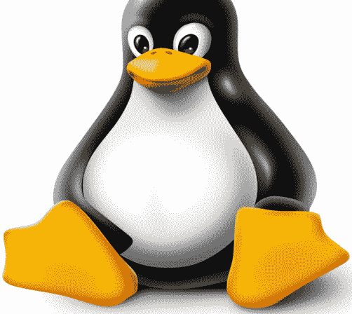

# Linux：Linux 操作系统分步初学者指南，Linux 内核与 Linux 命令行！（Linux 系列，初学者 Linux，Linux 操作系统）



奥斯汀·斯宾塞 (AUSTIN SPENCER)

点击下方链接免费获取您的赠书籍《亚马逊书籍合集：5款亚马逊产品完整指南》。

`>>>点击此处下载<<<`

（或访问：`https://freebookpromo.leadpages.co/amazon-book-bundle/`）

人类发展过去的多年都被标记为提高人类文明生活水平的追求。尽管进步是每个领域和每个领域的一部分，但没有什么与科学技术领域的巨大进步相提。

在信息技术领域，软件开发领域是最进步的领域，每一分钟的流逝都标志着软件开发领域的进步。在这个领域，程序员和研究人员的贡献巨大，使得普通大众能够从这种快速发展中受益匪浅。这种严谨研究的一个结果就是名为 `Linux` 的编程软件。

`Linux` 是一个类似于 `Unix` 且通常符合 `POSIX` 标准的操作系统，通过开源和免费软件分发及开发的模型收集而。。`Linux` 的显著特征是著名的 `Linux` 内核，这是一个重要的操作系统，首次于1991年9月17日发布。

这由林纳斯·托瓦兹（Linus Torvalds）引入。最初，`Linux` 作为一种免费操作系统被引入的，以便在具有 `Intel x86` 架构的个人电脑上使用。由于 `Android` 在智能手机上占据主导地位，`Linux` 似乎是操作系统主要的安装基础。

## 第一章 – Linux操作系统简介

与 `windows 7`、`windows 8`、`windows 10` 和 `Mac OS X` 以及不同的操作系统一样，`Linux` 同样是最灵活的工作框架。工作被用于运行框架，就像你的 `windows 7` 或 8 运行你的便携式电脑或桌面一样。

-   图形化服务器（Graphical Server）：它是在屏幕上显示内容的子框架。它通常被表示为 `X` 服务器或简称“`X`”。

常见的发行版：

`Linux` 根据客户的需求呈现出不同的形式。从业爱好者到设计者，你会有各种类型的 `Linux` 来满足你的需求。

这些 `Linux` 操作系统的版本被称为“发行版”，或者称为“`distros`（发行版）”。任何这种工作框架的传播版本都可以轻松而地免费下载、刻在光盘或 `USB` 闪器上，并根据你的意愿安装在不同的机器上。

知名的 `Linux` 发行版有 `Linux Mint`、`Ubuntu Linux`、`Arch Linux`、`Fedora`、`Deepin`、`Debian`、`openSUSE`。每种传输对桌面都有不同的影响。一些用户选择非常图形化的 `UI`，他们选择了 `Deepin` 桌面和 `Ubuntu` 的 `Unity`，而另一些用户则不需要图形化桌面，因此他们使用 `openSUSE` 的 `KDE`。

### 第 2 章 – Linux：Linux 操作系统的内核

`Linux` 内核类似于 `UNIX` 的 `PC` 操作系统。`Linux` 操作系统依赖内核，并被应用于安装框架以及自定义的 `PC` 框架（例如服务器和 `PC`），通常以 `Linux` 发行版的形式存在。用于手机、平板电脑和手表的 `Android` 操作系统同样基于 `Linux` 内核。

`Linux` 内核由 `Linus Torvalds` 在 20 世纪 90 年代创建。他为自己的 `PC` 创建部分并没有跨平台的预期，但已扩展到庞大的 `PC` 结构，比其他操作系统或组件更多。

`Linux` 迅速吸引了从其他编程项目中调整代码以用于新操作系统的设计师和用户。`Linux` 内核收到了来自 12,000 多名开发者的贡献，来自大多数最大的硬件和软件供应商。

`Linux` 位 `API`（应用程序编程接口）是客户端程序与内核交互的通道，旨在非常稳定且不会破坏用户空间程序。内核的功能由许多设备驱动程序控制硬件；主流的设备驱动程序也非常稳定。

然而，可加载内核模块之间的接口与不同的操作系统部分完全不同，在设计上并不要求非常稳定，但在许多用户中，由于其具有许多元素（如速度、内存、执行、对各种任务的适应性等），它是稳定的。

#### 知名度：

运行 `Linux` 内核的 `Android` 操作系统名声巨大增长，使得内核成为手机设计者的首要决策，看起来像其他操作系统的引入基础。随着过去几年的发展，不同机构估计售出了 30 亿部 `Android` 手机。

一些开关相对使用了 `Linux` 内核，这适用于许多不同的设备，例如智能电视、服务器和其他嵌入式框架。然而，该部分在传统桌面 `Linux` 分行版中的应用仍然少于许多其他操作系统。

#### 特殊元素

#### 编程语言：

`C` 语言由 `GCC` 支持，部分是用该语言编写的。对标准 `C` 语言引入了大量的修改。除了 `C` 语言外，低级计算结构也可以用于编写 `Linux` 内核，汇编语言支持 `GCC`。过去，`GCC` 是适用于编译 `Linux` 内核的主要编译器。

#### 编译器兼容性：

`GCC` 是 `Linux` 内核的内置编译器。`GCC` 是内核最快且最可靠的编译器。它可以在短时间内作为许多复杂项目的收集过程的一部分。

#### 接口：

如果仅使用其他工具进行限制性的客户端编程，指标或符合性将是设备无法被 `Linux` 内核识别。

#### 抢式

`Linux` 内核在某些条件下允许抢式调度。在 `2.4` 版本中，用户改进是非常抢占式的，也就是说，除了关闭用户方法中的策略执行时间外，如果在任务运行状态中产生需要的形式，则会被中断。

转向 `2.6` 版本的成功，该部分允许任务执行部分代码执行，尽管部分代码的任何单元不能被有效地处理。该部分涵盖了不同的调度器类。`Linux` 内核自然使用调度器系统，被称为完全公平调度器（`CFS`），它是以 `Linux` 位（`2.6.23`）的形式创建的。

#### 可移植性

尽管如此，该位并不想要是可移植的。`Linux` 现在是完全移植的操作系统，运行在从 `ARM` 开发到 `IBM` 的不同范围的硬件上。

在 `Linux` 构思的 `386` 开发之外，重要的部分是 `68000 Motorola` 平台，但为了实现这一点，他们替换了你部分的真实分区，为了 `Torvalds` 使其分支和 `Linux` 相同的操作系统。`Torvalds` 运行了位的首次重建，以便随后的移植工作。

### 现场修复

利用名为热补丁（`live patching`）的技术对部分进行调整。某些热补丁技术包括 `kpatch`、`kGraft` 和 `Ksplice`。修复设施在 2015 年 4 月 12 日发布的特定版本 `4.0` 中整合到 `Linux` 内核。

这些设施被称为现场修复，取决于部分的最优功能，形成一个可以辅助热修复的聚合中心；对于 `kGraft` 和 `kpatch`，都通过为 `Linux` 位单元提供一个 `API` 来封装热补丁和用于用户空间管理设备的 `ABIs`（应用程序二进制接口）。

此外，包含在 `4.0` 版本中的中心仅支持 `x86` 类型，并且没有提供任何确认能力级稳定的程序。

#### 安全性：

部分操作系统中可能存在大量的漏洞；它会导致某些安全故障。在多年以后，各种缺陷被引入并修复在内核中。新的安全变量经常执行以改变部分的安全性。

### 第 3 章 – 初学者 Linux 命令行 shell

本节的目的是提供简单实用的演示和 `Linux` `shell` 及其基本功能。`Shell` 是一个允许用户编写和执行命令的程序。它允许用户通过在终端物理输入命令来执行命令，此外在被称为 `shell` 脚本的项目中。

#### Bash：

`Bash` 被称为 `Bourne Again Shell`。`Bash` 是一个用于 `UNIX` 框架的标准 `Shell`（`/bin/sh`）的替代品。

它获得了 `Bourne Shell` 的大部分主要元素，此外，它使得编写和使用命令行变得容易得多。由于它是免费软件，因此被认为存在于许多 `Linux` 框架中。

`BASH` 与 `DOS` 不同。

以下是区分 `BASH` 和 `DOS` 的一些元素。

#### 大写敏感：

在 `Linux` 中，文件名和命令是大写敏感的，这意味着写 `EXIT` 而不是 `exit` 是错误。框架会对此类小错误给出指示。

#### 文件名：

对于文件名传统，“八位三”意味着 `DOS` 的每个记录采用了相同的排列，允许文件名最多八个字符，后面跟着一个点，然后是另一个扩展名，长度最多三个字符，例如 `ANYFILE.TXT`。

在 `Linux` 和 `UNIX` 中，没有这样的扩展名传统。文件名中的任何位置，扩展名都可以被项目不同地识别。

#### 特殊字符：

在学习 `Linux` 命令行之前，客户端首先应该意识到，有一些图像和字符在 `shell` 中以不规则的方式运行。

这意味着这些特殊字符在特定情况下没有被使用的能力，它们可能被用于极其不寻常的操作，或者如果客户端需要以标准方式使用它们，则应该将其“避开”。

#### 执行命令：

命令路径 (`PATH`)：

命令设置在你的 `shell` 的“路径”（`Way`）中，这意味着你完全可以直接输入要执行的程序名称。例如，输入 `ls` 将运行 `ls` 命令。`shell` 的“路径”因素包含了最广为人认可的程序区域，例如：

```
/usr/bin:/bin:/usr/sbin:/sbin
```

等。要运行不在当前 `PATH` 中的命令，需要先输入调用的完整路径。例如：`/home/john/myprogram`


- `/program`（这将允许你在当前工作索引中运行特定的程序）
- `~/bin/program`（这将允许你沿着用户目录运行特定的程序）

### 命令语法

命令可以自然地执行，客户端也可以传递额外的参数来完成一些特殊操作。命令语言的结构是：调用 `[-参数]` `[- 另一个参数]` `[文件名]`。一些示例如下：

- `ls` 列出当前目录下的文档
- `ls -l` 以长格式列出每一份文档
- `cat filename` 将显示文件的内容
- `cat -n filename` 将显示文件的内容以及行号

### 入门

当客户端遇到困难并需要 `Linux` 命令行行提供一些帮助时，他/她可以轻松地从中获得帮助。

许多 `Linux` 命令的帮助通常直接包含在命令本身，通过在线帮助或案例信息页和基础页面打开。

### 使用命令的内置帮助

大多数命令都有基础帮助选项，可以使用特殊的横杠调用。这些命令通常看起来像 `help` 或 `-h`。

例如：`grep --help`

### 主页面-在线手册

某些命令的最佳数据源可以在在线页面有效找到，简称为 `man pages`（帮助页）。配合特定目标排序 `man` 以浏览不同命令的 `man` 页。例如，输入 `man ls` 将显示与 `ls` 命令关联的手册，输入 `man manual` 将出现帮助手册。

要在 `man` 页中搜索特定单词，输入 `/word` 并离开帮助页，你只需按下 'Q 键'。偶尔，客户端可能会忘记他必须搜索的命令名称，因此，请参考以下插图：

假设你调整了文件的权限但忘记了命令，考虑到，使用你正要执行的任务识别的单词进行排序，例如，输入 `man -k consent`。输出将展示记录的 `consent` 命令如下：

```
chmod (1) – 将更改文件的访问权限
```

现在客户端意识到他正在寻找的命令是 `chmod`。输入 `man chmod` 将显示 `chmod` 命令的手册帮助页。

### 用于导航 Linux 框架的命令

表格下方的命令将让你知道你处于何处，你还可以去哪里，以及那里有什么。其中一些非常简单，例如，`cd`（切换目录），`ls`（列出文档）等等。

## 第 4 章 – 使用 Linux 的优势与围绕 Linux 的神话

如今，`Linux` 的声誉处于巅峰，在软件工程师以及全球普通 PC 客户端中非常流行。在本节中，将讨论 `Linux` 中一些感兴趣的点，以及 `Linux` 自问世以来所面临的神话。

### Linux 的优点

- **成本**：

使用 `Linux` 的一个显著优势观点是它是免费的。`Linux` 发行版可以引入到任何数量的框架中而无需付费。

此外，`Linux` 的不同用途也是免费开放的。事实上，即使是普通用户也可以通过几个命令下载此应用程序程序。

- **安全性**：

尽管可以免费使用，`Linux` 的安全特性仍然非常稳固。它不需要任何额外的信息安全虚拟产品。用户不需要花费巨款购买防杀病毒软件。

- **开源**：

`Linux` 操作系统是开源的，如果今天发布了全球 `Linux` 病毒，明天就会有多个补丁发布，甚至由使用该操作系统的普通人或相关维护人员发布。

- **选择（自由）**：

选择的力量是 `Linux` 最大的优势之一。通过 `Linux`，客户端有能力控制其操作系统的每个部分。

- **硬件**：

`Linux` 操作系统对于几乎没有任何处理能力的旧 PC 是理想的，然而如今它们正被工程师用作组装新设备的一部分，例如手机、汽车，甚至在冰箱等许多设备中。

- **速度**：

`Linux` 在系统中提供了高内存（`RAM`）；这就是系统速度远优于其他操作系统的原因。自创建以来，多程序设计对于 `Linux` 来说是一项简单的任务。

- **支持**：

关于 `Linux` 极其重要的一点是它有自己的产品仓库，任何用户都可以通过在终端或 `Shell` 中发布单个命令下载并引入许多应用程序。`Linux` 操作系统运行运行 应用程序。

- **Live CD/USB**：

几乎每个 `Linux` 发行版都有 `Live USB` 或 `CD`，通过它们客户端可以在不安装的情况下运行或尝试操作系统。

- **图形用户界面 (GUI)**：

更多人认为 `Linux` 是一个命令行操作系统，在某种程度上这是正确的，基本上 `Linux` 有许多软件包可以轻松引入以制作整个操作系统的界面。

在这些有利的情况下，关于 `Linux` 有许多神话，例如：

- **安装困难的神话**：

某些客户端在引入操作系统可能会遇到挑战。

`Linux` “发行版”实际上有一个存档说明引入发行版的程序、构建编译器和寻找结果，并且在某种程度上，如果文档没有更新，可能会困难且危险。

- **无支持的神话**：

过去，事实情况是 `Linux` 没有商业支持，但在现在世界，普通客户端可以从主要的程序发行商获取 `Linux` 发行版，例如 `RedHat` 或 `Novell` 连同支持。

客户端也可以使用免费下载的 `Linux` 应用程序并从提供支持的组织获得协议。

# 第5章 – Linux vs Mac vs Windows

在本节中，为了对比 `Windows`、`Linux` 和 `Mac OS` 的关联，我们将列出这三个值得关注的工作框架的优缺点：`Linux`、`Mac` 以及通常被称为“PC”的 `Windows`。

除了这些，还有许多其他工作框架，但由于市场份额很小，它们并不为人知。以下是对 `Linux`、`Macintosh` 和 `Windows` 三个领域的划分，目标是根据它们的优势和缺点对它们进行对比。

## Windows

从最主流的工作框架 `Windows` 开始，没有人能忽视这个工作框架，因为它占据了整个工作框架市场近 90% 的份额。它存在企业、机械办公、移动设备以及家用 PC 中。

`Windows` 出于 1985 年；从那以后，`Windows` 推出了许多变体，如 `XP`、`NT`、`Windows 98`、`2000`、`Windows Vista`、`Windows 7`、`8`、`8.1` 以及在 2015 年推出的 `Windows 10`。除了这种快速的迭代周期外，它也存在一些缺陷；`Windows` 的优缺点如下：

### 优点

- **兼容性**：

几乎每个应用程序或编程工具、驱动程序、游戏都能在 `Windows` 上高效运行。

- **技术支持**：

除了拥有海量的客户外，如果发生任何需要帮助的情况，你可以轻松地找到在线或线下的人来毫不费力地帮助解决 `Windows` 问题。

- **强大的功能**：

当你非常熟悉 `Windows` 后，你会发现 `Windows` 中有许多功能可以让你以非常简单的方式完成任何事情。

### 缺点

- **病毒**：

每位客户都需要购买防病毒软件，以保护他们的框架免受不断产生的病毒侵害。尽管对感染有抵抗，但由于感染数量巨大，无疑需要非常专业的防病毒措施。

- **运行速度慢**：

某些 `Windows`（特别是 `Vista` 和 `7`）需要大量的 PC 资源，例如内存、处理器空间，因此它们通常运行得较慢。综合考虑，该框架的效率会下降。

- **价格**：

`Windows` 非常昂贵。它们的成本通常在几百美元不等。

## Macintosh 工作框架

工作框架世界的另一个大巨头是 `Macintosh`。苹果的 `Macintosh OS` 比 `Windows` 更成熟。

它是首个基于 `Unix` 的框架，比微软的推出早了一年。`Macintosh OS X` 是一件精密的杰作，它为专业人士提供了 PC 通常无法提供的设备。其用户体验和 `UI`（用户界面）经过了精简，每个图标、动画和关联都经过了明确的更改以达到特定目的。优缺点如下：

### 优点

- **病毒**：

苹果 `Mac` 几乎不会受到感染。没有必要购买和安装防病毒软件。

- **可靠性**：

`Macintosh` 仅在苹果 PC 上运行，因此不易发生软件和硬件崩溃。

- **外观**：

大多数情况下，`Mac` 的外观优于任何 `Windows`。它拥有易于理解的界面窗口，由于其图形图像和动画，看起来比任何 `Windows` 和 `Linux` 都高级。

### 缺点

- **昂贵**：

`Macintosh` 贵得多，明显高于 `Windows`。对于一些工程师来说，为了工作购买它通常是不现实的。

- **仅在苹果 PC 上可用**：

如果你有一台 PC，你无法在上面安装 `Mac OS`，除非它是苹果电脑。否则后果很严重，你需要购买另一台 PC。

- **兼容性**：

只有极少数项目可以在 `Mac` 上运行，或者用户可能需要购买每一个程序才能在上面运行。

## Linux

`Linux` 规模较小，但正在迅速发展。`Linux` 是 `GNU` 对 `Windows` 和 `Mac` 的响应，这意味着 `Linux` 是“免费”的。所谓免费，是指你可以下载、修改和分发该操作系统而无需花费一分钱。`Linux` 是工作框架领域一个年轻的玩家，但遗憾的是，它的障碍很少。

### 优点

- **成本**：

`Linux` 是免费的。你只需要在终端输入几行代码，就可以引入、下载、使用和调整它。你完全可以免费从中引入大量的程序。

- **多样性**：

`Linux` 仅仅是一部分。要使用这一部分……

- **病毒**：

尽管由于是开源的比 `Mac` 更容易受到感染，但 `Linux` 仍然面临很大程度的感染。

### 缺点

- **复杂性**：

某些功能非常容易使用，但大部分功能需要一定的 PC 学习知识才能让它们运行。

- **兼容性**


与 Mac 类似，仅占整个行业市场的百分之几，`Linux` 工作框架没有像 `Windows` 那样大量的项目和分区。

- 供应商：

主要问题是，你找不到许多提供 `Linux` PC 的商家。通常，你只会找到一台 `Windows` PC，然后只需格式化硬盘，自己手动安装 `Linux`。

最后，没有哪种工作框架是真正最好的；取决于用户。如果用户是玩家，那么他/她必须在有限的选项中选择，选择 `Windows`。软件工程师通常倾向于 `Linux`，而设计或视频制作人通常会倾向于 `Mac OS`。
