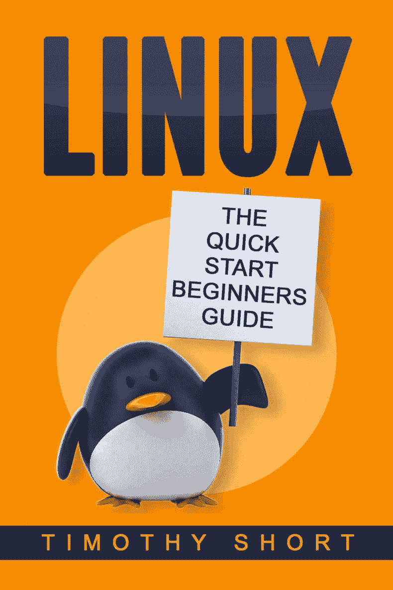

# Linux：快速启动初学者指南：（Linux 初学者指南、Linux 命令行、Linux 操作系统、学习 Linux）（Linux 初学者书籍第 1 册）





## 目录：
- 介绍
- Linux vs Windows
- 背景
- 选择 Linux 发行版
- 安装 Linux
- Linux 如何工作
- 玩转 Linux
- Linux 高级概念
- 结论

## 介绍

### 什么是 Linux？
Linux 是一个免费且开源的操作系统内核，在全球范围内用于许多用途。内核通过为软件提供一种与设备硬件交互的方式，促进了完整的免费开源操作系统的产生。Linux 在计算世界既广泛又盛行——很有可能你现在摸摸口袋，就会发现自己正拿着一台运行 Linux 的设备（智能手机！）。使用 Linux 的操作系统运行在世界上大多数超级计算机上，而且 Linux 甚至被许多政府机构使用。从纽约证券交易所到索尼 PlayStation，Linux 无处不在。

这是否意味着 Linux 仅供大人物和昂贵的超级计算机使用？绝对不是，因为 Linux 可以轻松地用于编写论文、浏览互联网、观看 YouTube 或检查电子邮件。Linux 操作系统是免费的，因此它们是昂贵的 Windows 和 Apple 操作系统的极佳替代方案。Linux 有许多不同的发行版本，通常被称为“distros”（发行版），它们为了满足不同的需求而设计。本书将介绍 Linux 的部分历史、各种发行版以及基于 Linux 的操作系统的用途。总的来说，强烈建议每个人至少学习一点 Linux，因为它被应用于许多领域。

## Linux vs. Windows
操作系统（OS）是计算机的骨干，没有它，计算机几乎毫无用处。通常，计算机会运行如 Windows 等操作系统，但计算机用户可以自由安装任何可以在其硬件上运行的操作系统。虽然我们都熟悉 Windows 计算机是如何运作的，但尝试安装 Linux 具有许多益处。除了免费之外，Linux 更安全、更可靠、更开放。

Windows 机器深受病毒的困扰。杀毒软件价格昂贵，而且会减慢即使是最强大的 Windows 电脑。Linux 是一个非常安全的操作系统，感染病毒极其困难。财富 500 强企业选择运行 Linux 计算机是因为其增强的安全性和无与伦比的可靠性。任何遭受病毒和恶意软件困扰的人都应该考虑尝试 Linux。

Linux 运行很快，即使在最旧的计算机上也是如此。运行 Windows XP 的旧设备现在可能已经没用了，但安装 Linux 可以为这些即将死亡的技术注入新的生命。某些发行版专门设计为轻量化和快速响应而设计，这可以将计算机的使用寿命延长多年。

Linux 操作系统自带的内核和软件是免费开源的，FOSS（自由开源软件）应用程序提供的功能与其昂贵的对应品几乎相同。例如，Adobe Photoshop 的费用超过 500 美元，而 Linux 的免费替代品“GIMP”是免费的。即使 Microsoft Windows 10 大约花费 120 美元，但最流行的 Linux 发行版 Ubuntu 完全不需要费用。Windows PC 的每一个付费组件都有一个免费的 Linux 等效品。甚至下载新程序的方法在 Linux 中也得到了改进。在 Windows PC 上，用户必须浏览网站并可能通过下载木马病毒来获取新软件，但在 Linux 上，有安全的存储库可以轻松地下载软件。

Linux 系统的兼容性仍然很高，因为你可以在各种设备上安装 Linux。无论是全新的电脑、旧古董，还是笔记本电脑和平板，Linux 都是兼容的。相比之下，Apple 的 OSX 只能在 iMac 上运行，而 Windows 10 只能在较新的电脑上运行。一些极客甚至成功在汽车和联网咖啡壶上安装了 Linux！这意味着你永远不需要担心你的设备是否兼容，或者是否需要购买新电脑。只要设备还能启动，Linux 就很大可能在其上面运行。

许多人为了深度定制选择 Android 而不是 iOS。选择 Linux 而不是 Windows 也是如此，因为 Linux 提供了完全的软件自由——许多发行版是为折腾者和定制者设计的。在 Windows 中，你可以更改壁纸和配色方案，但个性化仅此此。除了颜色和位置，Linux 还允许用户随心地添加和删除组件，创建一个独特的环境。根结底，Linux 在几乎每一个类别上都优于 Windows。Linux 是免费、安全、开放、可定制且稳定的。虽然不是每个计算机用户都习惯基于 Linux 的操作系统，但他们从离开 Windows 的切换中一定会受益。砖掉的设备、缓慢且过时的计算机以及被病毒入侵的机器都可以通过安装 Linux 来挽救。如果全新计算体验的可能性激发了你的兴趣，请继续阅读以了解 Linux 的工作原理以及如何在你的计算机上安装副本。

## 背景
关于 Linux、它的创建以及贡献者，有大量信息。此外，Linux 还有一些部分非常有趣且独特。本章将讨论 Linux 的根源以及它如何成为事实上的操作系统。

### Linux 的历史
1991 年 8 月 25 日，在芬兰的赫尔辛基，Linux 诞生了。当时 20 岁的芬兰学生林纳斯·本尼迪克·托瓦尔斯（Linus Benedict Torvalds）在 Usenet 新组 `comp.os.minix` 上公开宣布了 Linux 内核的创建。Minix 是 Linux 所基于的当时存在的内核，两者的血缘都可以追溯到一种名为 UNIX 的旧操作系统。该帖子将托瓦尔斯的项目描述为一种爱好和小型规模的尝试，在计算世界中不会很有分量，而且可能不兼容所有的计算机。

这种谦逊且相对安静的开端是 Linux 成为行业巨头的先驱。内核在短时间内从一个爱好项目变成了可用产品，1993 年一个由 100 名志愿者组成的团队对项目做出了贡献。后来，Linux 与理查德·斯托曼（Richard Stallman）的 GNU 核心库融合，创建了完整的内核 1.0 版本。Linus Torvalds 最初本想将他的项目命名为 `Freax`，但他在赫尔辛基大学的一位同事偷偷将名字改成了 Linux，林纳斯后来同意了这一点。从 1.0 版本开始，Linux 变得作为操作系统可以使用。


在 1995 年全年里，内核得到了扩展并移植到许多平台，扩大了 Linus 及其内核的影响力。1996 年引入了额外的改进，例如多处理器支持，这加强了 Linux 在企业和大学环境中的应用。21 世纪初的标志是 Linux 的快速改进以及可用发行版数量的剧增。戴尔（Dell）和惠普（HP）等大公司与发行版合作，为消费者在购买电脑时提供操作系统的选择。在此期间，Linux 通过为服务器和客户端提供一种替代操作系统，并关注性能和稳定性而非功能和美学，成为了一项行业支柱。如今，Linux 以其在智能手机、桌面电脑和服务器中的广泛应用而闻名，而这一点的实现得益于 Linus Torvalds 以及为项目做出贡献的无数志愿者的投入工作。

## 自由开源软件

Linux 是开源和自由软件的优秀典范。它也被称为 `FOSS`，自由开源软件是指表现出某些伦理开发特征和哲学的程序。自由软件确实意味着金钱上的免费，在这种情况下，它也意味着程序拥有“自由”。“自由”程序是指可以自由运行、分发、更改和复制且不产生后果的应用。与之相反的是如 `Photoshop` 类的付费程序；复制 `Photoshop` 并送给朋友会有严重的后果。开源软件指的是程序代码的透明度。如果源代码可以查看，那么该程序就是开源的。隐藏且不可访问的源代码是闭源的。开源代码促进诚实和信任，而闭源代码则是隐藏和阴暗做法的类比。`FOSS` 结合了自由软件和开源编码的理念，以提供真正自由且透明化开发的应用程序。即使是本文档的文本“Liberation Serif”，也是 `FOSS` Linux 应用中常用的免费字体。

由于 Linux 开发的社区驱动的本质，Linux 仍然是一个特别出色的 `FOSS` 范例。任何时候的任何人都可以查看 Linux 的源代码并提出更改。存在多种不同的操作系统发行版，是因为任何个人都可以将 Linux 代码作为他们自己操作系统的核心。这种哲学在其整个开发过程中都提供了帮助。

## GNU

`GNU` 既是一个操作系统的名称，也是其大量 `FOSS` 集合的名称。有趣的是，“GNU” 的意思是“GNU 不是 UNIX”，这解释了 `GNU` 是一个不包含 UNIX 代码的类 UNIX 操作系统。计算机大师 Richard Stallman 在 20 世纪 80 年代中期创建了 `GNU`，远在 Linux 被构想为 UNIX 的“自由”替代方案之前。在 Linus Torvalds 将 `GNU` 的核心工具融合到 Linux 内核之前，`GNU` 一直是一个小众产品。老地说，基于 Linux 的操作系统大部分实际上是 `GNU` 代码，但 Richard Stallman 很少获得对其贡献的认可。正因如此，内核有时被写成 `GNU/Linux` 而不仅仅是 `Linux`。Torvalds 承认 `GNU` 在他的内核中扮演了巨大角色，但也认为如果没有内核，`GNU` 将毫无用。这两位行业巨头 Torvalds 和 Stallman 冲突的性格导致了几次激烈的争论，但最终他们都创建了相互协作运行的产品，以促进计算机操作系统的发展。读作 `Linux` 还是 `GNU/Linux` 取决于用户，但每个操作系统通常按发行版的名称命名！

## 企鹅 Tux

`Tux` 是 Linux 内核的吉祥物。他的名字与 `Linux` 同义，这两个概念经常一起出现。`Tux` 由 Larry Ewing 在 1996 年创建，旨在赢得 Linux 标志的位置。然而，这只企鹅并没有获胜；相反，它受欢迎，以至于从未真正离开过，因此 `Tux` 从标志变成了吉祥物。`FOSS` 在 `Tux` 中也占有一席，因为他是使用流行的 `FOSS` 图像软件 `GIMP` 绘制的。

Linus 提到企鹅角色的起源于他去澳大利亚的一次旅行，那次旅行以企鹅为独特标记。这显然是一个笑话，Larry Ewing 将这个故事编成了一个广受欢迎的内部梗。

`Tux` 也曾在其他媒介中客串过，但吉祥物大部分时候被看到破坏 Windows 电脑或嘲讽闭源和专有软件。

## 谁在使用 Linux？

因此，在读了关于 Linux 从何而来以及它将走向何方之后，人们可能会好奇典型的 Linux 用户是什么样的。各种类型的人都喜欢基于 Linux 的操作系统，每个人都有选择它的自己的理由。无论你是一个喜欢自定义的极客、一个希望节省计算机成本的板主，还是一个寻找新服务器操作系统的系统管理员，Linux 都是一个灵活且易塑的操作系统。内核本身简单且稳定，海量的发行版保证了每种需求都有特殊的体验。请阅读下一章，了解发行版以及它们如何满足你的需求。

## 选择 Linux 发行版

发行版是采用 Linux 内核并提供预装应用程序和服务的以构建全方位计算环境的操作系统。发行版的数量之大令人震惊，但每个发行版都能提供独特且定制的体验。找到一个适合你需求的发行版可能会促使你安装并在你的电脑上尝试。以下是最著名的。

`Ubuntu` 可能是最著名的基于 Linux 的操作系统。基于 `Debian`，`Ubuntu` 被描述为“面向人类的 Linux”。`Ubuntu` 的流行源于易用性，因为它比 `Debian` 直观得多。`Ubuntu` 这个词字面意思是“人性”，源于一种同名的南非哲学。`Ubuntu` 由 `Canonical` 开发，这是一家由 Mark Shuttleworth 拥有的英国公司。Canonical 通过通过销售 `Ubuntu` 以及其他项目的技术支持来维持财务状况。尽管由一家专有公司开发，`Ubuntu` 仍然是自由且开源的。从 2004 年首次发布开始，`Ubuntu` 每六个月更新一次。每两年有一个 `Ubuntu LTS`（长期支持版），这是由 `Canonical` 提供的长期支持的更新。`Ubuntu` 默认包含 `LibreOffice`、`Firefox` 和 `Transmission` 等软件。新软件可以通过 `Ubuntu Software Center` 安装，这是一个专门为在 `Ubuntu` 上安装额外软件而设计的程序。这对于 Linux 新手非常有利，因为它非常简单。像 `Debian` 一样，`Ubuntu` 及其软件使用符合 FOSS 的 GNU 许可证发布，因此它的默认软件都是自由开源的。`Debian` 和 `Ubuntu` 还共享 `deb` 软件包格式，因此可以使用相同的软件。最终，`Ubuntu` 是 Linux 初学者的完美操作系统，因此从 `Ubuntu` 开始是一个明智的选择。


有多种 Ubuntu “变体”，它们保留了 Ubuntu 的核心软件和功能，但添加了独特的特化功能，使其变得非常实用。例如，Lubuntu 是“轻量级 Ubuntu”，它保留了 Ubuntu 对初友的软件，但去除了额外的视觉效果，以便在较慢的硬件上运行。Xubuntu 是另一个“轻量级 Ubuntu”，但 X 更关注实用功能，而不是将速度作为唯一首要任务。Ubuntu Studio 是为内容创作者设计的变体，因为该系统预装了音频和视频编辑工具。Ubuntu 旨在成为一种为教育设计的变变体。Kubuntu 采用了流行的 KDE 界面，创造出友好且高度可定制的体验。Mythbuntu 是为媒体流和电视直播构建的。互联网上有大量的 Ubuntu 变体，它们对于 Linux 新手来说是尝试“第二 Linux 系统”极极选择，因为它们结合了 Linux 的定制与实验性以及 Ubuntu 的相对“安全”和“熟悉”。

Slackware 是由 Patrick Vokerding 在 1993 年基于 Softlanding Linux System 创建的 Linux 发行版。Slackware 的目标是设计成稳定、简单且最“类 Unix”的 Linux 发行版。Slackware 没有图形化安装方法，也没有软件包的自动依赖关系。它不带有图形化用户界面，而是启动到纯文本的命令行界面——正因如此，Slackware 最适合经验丰富的 Linux 用户。正如其名称暗示的那样，Slackware 最初作为一个没有严肃承诺的私人侧项目启动的。然而，在该操作系统流行后，该名称被保留了下来。该操作系统是 Linux 老兵以及那些想要体验 Linux 根源的人的好选择。

Fedora 是一个由红帽企业赞助、基于 Linux 内核的社区开发操作系统。Linux 社区此前还开发并维护过 Fedora 项目。Linus Torvalds 经常使用 Fedora，主要是因为它的“尖端”特性以及它非常良好的可开发性。Fedora 项目的目标是让 Fedora 成为最尖端的操作系统，所以除非你想要为 Linux 开发或喜欢接受挑战，否则不要尝试安装它。

Debian 是一个完全由自由开源软件（FOSS）组成的发行版，大部分遵循 GNU 通用公共许可证。1993 年，其创始人 Ian Murdock 发布了第一个版本的 Debian。Debian 由志愿者网络团体 Debian 项目负责维护和分发。它是以与 GNU 项目相同的精神开发的，并在 1994 年 11 月至 1995 年 11 月期间获得了自由软件基金的支持。在自由软件基金会赞助结束后，Debian 项目创建了名为“公共利益软件”的非营利组织，帮助其他机构分发和创建自由开源硬件软件。Debian 的闻名在于稳定性，因为它已经存在了很长时间，可以提供几乎没有错误和崩溃的计算体验。该操作系统曾作为其他操作系统（如 Ubuntu 和 Knoppix）的基础和起点。Debian 有三个版本：Testing（测试版）、Unstable（不稳定）和 Stable（稳定）。Debian Testing 和 Debian Unstable 是滚动更新，意味着它们持续更新。新软件包被加载到 Debian Unstable，并在 Debian Testing 中进行测试。当这些软件包足够稳定时，Debian Testing 就会变成新的 Debian Stable。Debian 软件仓库包含超过 50,000 个软件包。官方仓库仅包含自由和开源软件，也可以下载非自由软件。自由软件基金会创始人 Richard Stallman 曾批评 Debian 项目也使用非自由仓库，但在 2004 年，Debian 项目通过多数投票决定继续托管非自由仓库。由于视频和音频编码器的专有性质，Debian 项目的自由开源精神为多媒体支持带来了挑战。总的来说，Debian 提供了典型的 Linux 体验——稳定、快速、开源且可靠。如果你感兴趣，可以考虑尝试 Debian。

一个拥有忠实支持者的非常流行的发行版被称为 Gentoo。与二进制软件包发行系统不同，Gentoo 的软件必须针对用户的设备进行特定的编译。编译软件是一个漫长而困难的过程，但针对设备的特定编译为高级用户带来了 Gentoo 无与伦比的速度和稳定性。操作系统速度的显著提升是指 Gentoo 企鹅——已知游泳最快的企鹅。Gentoo Linux 对那些想要完全控制所运行软件并获得定制体验的 Linux 用户非常有力，因此在选择想要尝试的操作系统时请考虑这一点。使用 Gentoo 陡峭的学习曲线往往会阻挡学者，留下了最聪明的 Linux 用户。

Android 是 Google 为便携设备开发的移动操作系统。这个流行的手机操作系统最初由一个独立团队开发，但在 2005 年被 Google 收购。Android 在手机市场上拥有巨大的市场份额，因为现在大多数人口袋里要么有 Android 要有 iPhone。Android 具有极好的 ARM（一种处理器）支持，并可以运行来自“Play Store”的数百万应用程序。虽然你可能不会在桌面电脑上安装 Android，但它在资源有限的小型计算机和旧设备上有许多用途。

Tiny Core Linux 是一个基于极简 Linux 内核的操作系统。它有有限（或几乎没有）预装程序，但可以作为最旧、最慢电脑的 Linux 安装系统。整个操作系统在十一到十六兆字节之间，因此在优 盘或 SD 卡上安装它是完全可能的。该操作系统最适合希望从零开始创建一个轻量化系统的中级 Linux 用户。

Chrome OS 是 Google 开发的操作系统，与 Android 类似，基于 Linux 内核。该项目由 Google 于 2009 年 7 月宣布。它旨在让用户数据和应用程序在“云端”而不是计算机内存中运行。第一台 Chrome OS 笔记本电脑被称为 Chromebook，于 2011 年 5 月发布。Chrome OS 设计用于连接网络以仅运行简单的应用程序和网页浏览。尽管存在集成媒体播放器和集成文件管理器等功能，但大多数应用程序实际上只是 Google 的网站。这使得低配置计算机可以非常廉价地制造用于 Chrome OS，使其适用于低规格设备。Chrome OS 在大学生、非技术型买家和预算计算机之间非常流行，是一个非常流行的操作系统。你可能实际上无法在计算机上安装 Chrome OS，但你完全可以安装开源等效物 – Chromium OS。Chromium OS 推荐用于仅用于网页浏览和其他常见互联网任务的低配置笔记本电脑。


Arch Linux 是一种基于 `IA-32` 和 `x86/64` 架构的 Linux 内核计算机操作系统。它主要由自由和开源软件组成，Arch 以其能够提供的极大的定制性而闻名。Arch Linux 社区的支持，这使其相对容易获得支持。Arch Linux 的设计遵循 KISS 原则，即 `Keep It Simple Stupid`（保持简单愚蠢）。虽然其代码设计本质上是简单的，但实际上使用该操作系统相当困难。Arch 不带任何图形化用户界面，也没有任何特定的应用程序。用户需要按照自己的喜好逐步“构建”整个系统。通过学习安装什么以及如何安装，用户最终会对发行版和 Linux 本身有深入的理解，这就是为什么 Arch 推荐给想要学习更多 Linux 的用户。虽然不建议将其作为第一个发行版，但每个对 Linux 感兴趣的人都应该在某个时候构建自己独特的 Arch 版本，以加深知识。

CrunchBang (#!) Linux 是一种基于 Debian 的 Linux 内核计算机操作系统。开发者 Phillip Newborough 设计 CrunchBang Linux 是使用比 Debian 少得多的系统资源，使其更加轻量和灵活。CrunchBang Linux 有有自己的软件仓库，但其大部分软件包来自 Debian 仓库。2013 年，Jim Lynch（一位著名的评论员）描述 CrunchBang 功能完备、高效，并且能够在旧硬件和新机器上有效运行。事实是，CrunchBang 通过优先考虑可用性和速度避免了卡顿体验，这使其成为追求不务实的干练感的中级 Linux 用户极具吸引力的发行版选择。

Damn Small Linux (DSL) 是一种以极极简主义设计理念开发的 Linux 内核计算机操作系统。Damn Small Linux 是免费开源的，遵循 `GNU GPL` 许可。DSL 最初由开发者 John Andrews 构思并维护，旨在确定 50mb 空间内能装下多少内容。实际上，DSL 开箱即用且非常实用，最适合需要快速访问 Linux 工具的用户。正因为如此，DSL 最好放在可以从任何电脑启动的 USB 驱动器上。

红星（Red Star OS）是 Linux 世界中一个有趣的案例。它是该共产国家居民使用的操作系统。红星操作系统的开发于 1998 年在韩国计算机中心开始。在红星出现之前，朝鲜的电脑通常运行 Ubuntu。由于朝鲜希望保持对互联网资源和公民访问的控制，只有极少数政府官员和重要游客被允许访问互联网。这些人将使用红星操作系统，政府对操作系统的控制赋予了他们对公民的额外控制。该操作系统实际上是闭源且专有的，这违背了最基本的 Linux 和 FOSS（自由开源软件）哲学。Linux 爱好者喜欢研究并惊叹红星，因为其具有极其小众的用户群和功能。显然，不建议阅读此书的大多数人安装它，但它作为一种新颖的概念和有趣的读物而存在。

## 安装 Linux

在阅读了这么多关于 Linux 发行版后，你一定已经准备好尝试一个，你可以通过多种方法安装 Linux 操作系统。通常，尝试 Linux 发行版的过程涉及获取操作系统的 `.iso` 副本并将其刻录到可移动介质（CD、USB 等）上，最后让你的 PC 从该介质启动。在我们本书的扩展示例中，我们将下载并安装 Ubuntu。当然，你可以在示例中替换任何其他 Linux 发行版，但此处的细节仍将引用 Canonical 的这款易于使用的新手操作系统。

基于 Linux 的操作系统可以从 USB 闪盘、CD 或 DVD 甚至软磁盘进行安装和启动。安装 Linux 的第一步是获取一个可以容纳操作系统的可写介质。一个 4GB 的闪盘通常足够（我们将继续使用它进行演示），但对于较大的镜像，你可能需要一个 8GB 的。

其次，我们需要获取操作系统的副本。通过网站 `http://www.ubuntu.com/`，你可以导航到“桌面版”页面，然后点击“下载 Ubuntu”。默认情况下，该页面将显示 Ubuntu 的最新版本以及几项系统要求。留点时间确保你的电脑可以胜任。此外，打印本指南的接下来几页也是个好主意，因为一旦你开始使用 Linux，可能就没有机会翻回这本书。点击“下载”按钮继续。Ubuntu 是免费的；为了避免向 Canonical 捐款，请在所有框中输入 `$0` 并点击底部的“下载”按钮。镜像将开始下载。

第三，我们需要一个应用程序将操作系统“写入”到介质中。写入镜像最流行的工具是 `UNetbootin` (`https://unetbootin.github.io/`)，但免费工具 `Rufus` (`https://rufus.akeo.ie/`) 使用起来要简单得多。获取一份 `Rufus` 副本并等待所有下载完成。

第四，将可移动介质插入 USB 端口并启动 `Rufus`。你的 USB 驱动器应该出现在顶部的下拉列表中。通过向驱动器写入 Ubuntu 镜像，你将删除其所有内容，因此如果需要，请现在备份。`Rufus` 的默认设置可以满足我们的需求，但我们需要确保勾选了“使用创建启动盘（Create a bootable disk using）”，并且下拉菜单显示“ISO Image”。更改该设置并点击旁边的光盘按钮打开文件管理器。导航到我们下载的 Ubuntu 镜像并双击它。我们现在可以按“开始”按钮开始将 Ubuntu 写入驱动器。执行此操作。过程完成后关闭电脑。

第五，启动 PC 在 Windows 加载之前进入 BIOS。执行此操作的键取决于主板制造商，但通常是键盘最顶部的 `F` 键之一。每个主板制造商都有自己的 BIOS 布局，因此此处的解释是通用且模糊的。找到“启动（boot）”标签或类似的选项，你可以在那里查看 PC 的“启动顺序”。启动顺序告诉电脑去哪里寻找操作系统镜像，通常 BIOS 会首先查找内部硬盘。更改顺序，将 USB 或外部硬盘置于首位。保存并退出 BIOS。

最后一次启动电脑将开始我们的最后一步：BIOS 将首先搜索外部 USB 并找到 Ubuntu 镜像。如果加载 Windows 而不是 Ubuntu，请重复第 5 步，否则你将进入你的第一个 Linux 系统。恭喜你！

出现的操作系统是完全可操作且可用的，但仍然有一个小问题——它仍在从 USB 驱动器运行，因此尚未完成自安装。Ubuntu 变体在桌面上有一个应用程序，你可以双击它来为你启动安装过程。如果你已经测试完 Linux 并准备好删除 Windows，请点击此选项。提问你，如果你选择了某些选项，你将擦除整个电脑，因此请仔细阅读说明。你可以选择与当前操作系统进行“双启动”，也可以选择完全清空电脑并从头开始。建议起初选择双启动，以防你由于某些应用程序或功能需要返回 Windows。不过，作为应急措施，在尝试任何安装之前，务必完整备份你的电脑。


如果安装成功且你选择了双系统，那么每次启动电脑时你都会看到 `GRUB`，即通用统一引导加载程序。`GRUB` 会询问你想启动哪个操作系统，因此每次在计算时，你都可以在 Linux 和 Windows 之间进行选择。

## 使用 Ubuntu

对于那些只用过 Windows 类型界面的用户来说，Ubuntu 并不完全陌生。它仍然有“桌面”和“开始菜单”，但物品的布局略有不同。你可以像通常一样启动应用程序：点击启动栏上的图标或在点击开始按钮后进行搜索。如果你在桌面上，通常已经连接了网络，但如果你使用的是笔记本电脑，可能需要通过右上角连接 Wi-Fi。总的来说，Ubuntu 的易用性很高，你应该能够很快上手。浏览网页并尝试默认应用程序，以直观地感受 Linux 操作系统的工作和运行。

## 终端

Linux 与 Windows 的区别在于它提供了一个类似于旧 DOS 计算机的额外文本界面。通过终端，可以运行对 PC 执行操作的。启动终端在每个发行版中有所不同，但 `ctrl+alt+T` 是一个常用的快捷键。进入终端后，你可以浏览文件系统，并通常以与图形用户界面相同的控制级别使用计算机。用户首先输入命令并按回车执行。以下是几个基本命令。在阅读本书时，任何*斜体*文本均指它是一个终端命令。

| 命令 | 别名 | 用途 | 示例 |
| :--- | :--- | :--- | :--- |
| `cd` | 切换目录 | 输入更改当前文件夹 | `cd desktop` |
| `pwd` | 显示工作目录 | 显示当前文件夹名称 | `pwd` |
| `shutdown` | 关机 | 关闭当前系统 | `shutdown –h now` |
| `ls` | 列 | 列出当前文件夹下的所有文件 | `ls` |
| `cp` | 复制 | 复制指定的文件并可选指定新名称 | `cp picture.png dog.png` |
| `mkdir` | 创建目录 | 创建一个指定名称的新文件夹 | `mkdir Documents` |
| `rm` | 删除 | 删除指定的文件 | `rm dog.png` |
| `rmdir` | 删除目录 | 删除指定的文件夹 | `rmdir Documents` |
| `apt-get` | 高级软件包工具 - 获取 | 在 Ubuntu 类型系统中运行的安装新软件的命令 | `apt-get install minecraft` |
| `.` | 运行 | 点用于运行文件，例如脚本。 | `./a.out` |

如果你用过 DOS，上述内容可能看起来很熟悉。这里有一个旨在掌握终端的练习。

1. 启动终端。使用 `ctrl+shift+T` 或在程序菜单中找到它。
2. 输入 `pwd` 找到我们现在所在的位置。
3. 输入 `cd Desktop` 进入桌面文件夹。
4. 输入 `mkdir Notes` 创建一个名为 `Notes` 的新文件夹。
5. 输入 `cd Notes` 进入该文件夹。
6. 使用 `nano secretfile.txt`，我们将在内置文本编辑器 `Nano` 中开始编辑一个新文件。
7. 输入一些秘密！按 `ctrl+x` 保存并退出程序。
8. 输入 `ls` 列出当前目录的内容。你应该能在那里看到 `secretfile.txt`。
9. 使用 `cp secretfile.txt totallynormalfile.txt`，我们复制该文件并创建一个新文件。

此时，你应该最小化终端，并在桌面上看到你刚刚创建的文件夹和文件。遵循上面的指令可能比你平时创建文件夹和文件要花费更长的时间，但通过练习，你可以通过终端以快速速度操作 Linux 系统。此外，掌握终端是非常困难的，但它对你的发行版提供了 GUI 可能无法提供的深层控制。总的来说，绝对建议 Linux 用户学会会如何熟练地使用终端。

## Linux 软件

你可能会惊讶地发现，当你“转投”到 Linux 时，可能不需要改变你的软件储备。技术偏向型用户可能已经熟悉 Linux 上可用的某些软件，例如 Mozilla Firefox、`Google Chrome`、`Opera`、`Adobe Reader`、`Mozilla Thunderbird` 和 `VLC`。

如果机器上没有安装某个软件，获取它将轻而易举。Ubuntu 包含了“Ubuntu 软件中心”应用程序，它充当 Linux 程序的的“应用商店”。通过友好的界面，你可以搜索并一键下载许多程序——其中许多列在下方。不过，较冷门的程序可能不会列在软件中心中，因此你必须通过终端安装它们。在终端窗口中输入以下内容：

```bash
sudo apt-get install vlc
```

`sudo` 是一个终端前缀，指示系统以可能的最高权限运行。运行 `sudo` 时需要密码。`Apt-get` 是 Ubuntu 应用程序；通过指定 `install`，我们表达了意图。`Vlc` 是我们想要的程序名称（`VLC` 播放器）。因此，通过终端中的这一行，我们就下载并安装了整个应用程序。将 `vlc` 替换为任何应用程序名称，Ubuntu 就会下载它。以下是每个类别中最流行的应用程序。

| 浏览器

| Mozilla Firefox |
| :--- |
| 熟悉、高度可定制且是开源软件 (FOSS)。`Firefox` 在 Windows 上广泛使用。 |

| Google Chrome |
| :--- |
| 快速、稳定且兼容。`Google Chrome` 在 Windows 上广泛使用。 |

| Opera |
| :--- |
| 轻量且基于 Chrome 运行。`Opera` 在 Windows 上广泛使用。 |

| Midori |
| :--- |
| 简单。`Midori` 是 Elementary OS 的默认浏览器。 |

| Dillo |
| :--- |
| 小、稳定且快速。 |

| Lynx |
| :--- |
| 文本浏览器。`Lynx` 是一个文本浏览器。 |

| W3M |
| :--- |
| 另一个文本浏览器。 |

### 媒体播放器

| VLC |
| :--- |
| 在 Windows 上同样可用。一个非常兼容且实用的媒体播放器，可以处理音乐、视频、播客或直播频道的任何内容。 |

| Miro |
| :--- |
| 独特之处在于它能够从 Crackle、Hulu 和 Yahoo Screen 等源连接并下载视频。 |

| mplayer |
| :--- |
| 支持广泛的解码器和文件格式。非常小且可定制。Linux 老兵的首选媒体播放器。 |

### 纯音频播放器

| DeaBeef |
| :--- |
| 极简主义且可定制。这款音频播放器最引起 Windows `Foobar2000`粉丝的共鸣。你可以更改 `DeaBeef` 的布局和设置来实现自己的音频播放器。 |

| Clementine |
| :--- |
| 跨平台、免费开源。支持大型音乐库。Android 和 iPhone 用户可以高兴了，因为 `clementine` 支持向移动库添加音乐。`iTunes` 的绝佳替代品。 |

| Cmus |
| :--- |
| 最轻级的音乐播放器，因为它运行在终端界面上。 |

| Aqualung |
| :--- |
| 出色的无缝播放。Jethro Tull 粉丝的最佳选择。 |

### 图像编辑器

| GIMP |
| :--- |
| 开源图像编辑的首选和最佳选择。Windows 同样可用，`GIMP` 免费提供了 `Photoshop` 的许多功能。高级编辑器通常在各种发行版中预装，但对于任何进行图像编辑的人来说，它都是必备的。 |

| Pinta |
| :--- |
| `Pinta` 是 Linux 版 `MS-Paint`。对于简单的图像编辑，选择 `Pinta` 不会出错。 |

### 文件管理器（Windows 资源器的 Linux 版本）

| GNOME Commander |
| :--- |
| 一个优雅但运行缓慢的文件管理器，是 Gnome 桌面环境的默认管理器。这个管理器非常适合动画和图标，你可以通过这个应用程序创建一个精美的桌面。 |

| PCManFM |
| :--- |
| `LXDE` 的默认文件管理器。非常适合轻量且简单的图形用户界面。 |


| Thunar | `thunar` 是 XFCE 的一部分，是另一种优雅且简单的文件交互方式。 |
| Midnight Commander | 纯文本文件浏览器。对于仅使用终端的硬核 Linux 用户来说，`midnight commander` 可以轻松显示文件。 |
| 办公生产力 | |
| LibreOffice Suite | 功能上与 Microsoft Office 相当。`LibreOffice` 包含了“Word”、“PowerPoint”、“Excel”等替代品。它是免费开源的，开发活跃中，并支持 Windows `.docx` 文件。由于这两个应用程序之间具有较好的兼容性，它仍然是与其他 Windows 电脑进行协作时的最佳办公软件。 |
| Abiword | 更加简单且功能较少的文档编辑器。`Abiword` 提供了整洁的界面和功能，使用户可以专注于文档写作。 |
| Evince 文档查看 | 最适合查看 PDF 的开源软件 (FOSS) 应用。 |
| Emacs | 一个“操作系统中的操作系统”，`Emacs` 是一个包含许多组件巨型文本编辑器。`Emacs` 具有极高的可定制性，对 Linux 用户非常有用。 |
| Vi | 另一个被广泛使用且可定制的“仅限 Linux”文本编辑器。`Vi` 专注于键盘快捷键和快速编辑，完全无需使用鼠标。`Vi` 和 `Emacs` 用户经常为了谁的文本编辑器更好而争论不休。 |
| Nano | Linux 下最简单的文本编辑器。只需输入 `nano` 即可在终端中启动它。非常适合进行简单的编辑。 |
| 其他优秀的 Linux 应用 | |
| Code::Blocks | 一种编程集成开发环境 (IDE)，`Code::Blocks` 可使用多种语言编写应用程序。Linux 被誉为优秀的程序员操作系统，而 `Code::Blocks` 足够自定义且灵活，可以满足许多需求。 |
| Audacity | `Audacity` 是一个开源音频录制程序。虽然远不如它的付费对手（如 `Ableton`、`FL Studio`），但 `Audacity` 具备了严肃音乐制作的功能。 |
| Telegram | 一种加密即时通讯应用，`telegram` 甚至可以向手机发送消息。该应用对于对即时通讯和安全感兴趣的人非常有用。 |
| Thunderbird 邮件 | 办公人员和拥有多个邮箱地址的人会对 `Microsoft Outlook` 的节省时间功能非常熟悉。`Thunderbird Mail` 是 Linux 上的对应品，可以作为你所有邮箱地址的邮箱。 |
| qBittorrent | 从互联网下载大文件是一项令人沮丧的活动。直接下载服务器通常很慢，任何损坏的数据包都会破坏整个下载。Torrent 客户端通过提供一种从“种子”文件的“对等节点”分小块下载文件的方法解决了这个问题。Torrent 客户端基于点对点机制运行，这意味着你从不是从服务器下载，而是从其他用户那里下载。速度上的优势是惊人的，每当通过直接下载提供 torrent 文件时，经验丰富的 Linux 用户都应该使用 `qBittorent` 来下载。尽管，由于通过 `Pirate Bay` 和 `Kickass Torrents` 等公共追踪器发生了大量盗版行为，Torrent 最近带有一种负面标签。但正如我们所学到的，分享和下载开源软件实际上是被鼓励的，因此使用 `qBittorent` 实际上推动了 Linux 的事业。 |
| KeePass | 正如我们之后将看到的，Linux 的安全性是顶级的，但仍然容易受到常见的黑客攻击手段。强大的密码安全性有助于确保我们的在线账户安全。记住复杂的密码是一项艰巨的任务，但 `KeePass` 是一个很棒的管理器，可以帮助记住你在哪个网站使用了哪个密码。 |
| Kupfer | 启动器是一类旨在提高启动应用程序速度的程序。Windows 在启动应用程序方面具有优势，因为运行程序的方式非常简单——打开开始菜单并输入名称。在 Linux 中，我们可以使用像 `Kupfer` 这样的程序来实现相同的功能——按下热键并输入程序名称。如果你想提高效率，一定要尝试 `Kupfer`。 |
| Dropbox | 当文件系统介入时，在 Linux 和 Windows 电脑之间共享文件会迅速变得混乱。使用像 `Dropbox` 这样的应用可以完全避免这种困扰。通过 `dropbox`，会创建一个跨电脑同步的新文件夹，即使它们运行的是不同的操作系统。共享文件只需将文件拖放到文件夹中，非常简单。对于任何拥有多台电脑和多个操作系统的用户来说，这是必备的。 |

# Linux 如何工作

Linux 能够通过一套复杂的交互系统运行，允许内核和各种软件部分控制你电脑上的硬件。主要，Linux 仍然包含了我们已经习惯的基础文件、文件夹和程序。然而，差异出现在讨论 Windows 中无法更改的自定义部分。最重要的部分将在下面进行详细的技术讨论。

# 桌面环境

桌面环境是你实际使用图形化操作系统时在显示器上看到的内容。对于用户来说，通过操作和点击桌面环境来启动和运行软件，通常比在纯文本界面中输入命令要容易。桌面环境通常由图标、窗口、文件夹、壁纸、小部件和拖放功能组成。这些熟悉的功能在几乎所有的操作系统中都是标准配置。就像 Windows 有文件夹、窗口、图标和鼠标指针一样，Linux 也通过桌面环境 (DE) 拥有这些功能。有许多可用的桌面环境，如 `Cinnamon`、`Enlightenment`、`GNOME`、`MATE`、`Xfce`、`LXDE` 等。每个不同的发行版都有一个偏好的 DE，这些 DE 通常是预装的，并赋予这些操作系统独特的颜色和外观。当你阅读关于不同 DE 时，请考虑你可以在任何发行版上安装任何 DE。某些 DE 可能会因为其功能而更吸引你，不要害怕切换。

## GNOME
`GNOME` 是一种图形化桌面环境，被描述为“使用电脑的简单且优雅的方式”。在第三代迭代中，`GNOME` 是 `Ubuntu` 的默认选择。它的格式设计得既简单又时尚——`GNOME` 唯一的缺点是系统要求中等，以及在旧电脑上可能会导致卡顿。如果你直接从 Windows 转过来，`GNOME` 是通其他桌面环境的好跳板。

## Cinnamon
`Cinnamon` 是一种流行的桌面环境，它利用了许多 `GNOME` 使用的应用程序——只是了一种更有响应且不那么花哨的方式。如果你尝试过 `GNOME` 但觉得它太“重”且太大，那么 `Cinnamon` 可能会解决你的问题。不过，你仍然需要中等的系统要求，因为运行 `Cinnamon` 需要相当计算能力。

## Mate
`Mate` 是轻量版的 `Cinnamon`。`GNOME` 和 `Cinnamon` 的重要功能都存在，但去除了额外功能以创建一个可以在较慢电脑上运行的 DE。基本上，如果你喜欢 `GNOME` 风格桌面的工作方式，你可以在三个资源密集等级之间选择，`Mate` 处于最低级。

## LXDE
`LXDE` 是“轻量 X11 桌面环境”的缩写。它对资源的要求很低，使其成为低端和旧电脑的良好桌面环境。1GB 内存的电脑运行带有 `LXDE` 的 Linux 非常容易，非常适合复活旧电脑。它的界面同样简单轻量。`Lubuntu` 是一个运行 `LXDE` 的 `Ubuntu` 变体，如果你正在寻找一种具有 Windows 易用性的快速操作系统，`LXDE` 可以实现这一点。


Xfce 是一个快速、低资源占用且美观的桌面环境。它经常与 LXDE 竞争成为最轻量级的桌面环境（DE），但 LXDE 更加关注速度，而 Xfce 则兼顾了功能性和速度，创造了一个全能的轻量级 DE。Xfce 的布局对用户友好且响应迅速，并且具有可定制性。

KDE 是一个为高性能电脑设计的桌面环境。默认包含 KDE 的发行版以功能丰富和可定制而闻名，尽管运行起来有些缓慢和卡顿。KDE 的组件会引起任何喜欢 Windows Vista 用户的共鸣，而华丽的过渡效果对于喜欢享受计算体验的人来说充满了乐趣。它的定制化程度之高，以至于两个用户同时运行 KDE 时，彼此甚至不知道对方也在运行同一个 DE。

总而言之，每个发行版都会预装一个桌面环境。DE 控制着桌面屏幕的外观和交互，它们与窗口系统和窗口管理器（下文将解释）共同工作，提供您的体验。

# 窗口系统

基于 Linux 的操作系统使用某些技术为用户提供设备界面。图形用户界面（GUI）通常遵循一种被称为窗口系统的方案。窗口系统是 GUI 的一种类型，它以一种现代用户非常熟悉的方式实现了窗口、图标、菜单和指针。基于 Linux 的操作系统主要提供两种窗口系统——X 窗口系统（X Window System）和 Wayland。了解这些系统如何工作是至关重要的，因为它们通常是我们与 Linux 计算机交互的方式。

X 窗口系统为图形用户界面环境提供了基础框架，并通过允许用户与鼠标和键盘交互，控制应用程序窗口的绘制和移动。X 窗口系统并不强制规定图形用户界面，因此应用程序可以拥有任意数量的视觉样式。应用程序的外观和感受由应用程序本身处理，X 窗口系统仅负责将其绘制到屏幕上。

Wayland 是 X 的一种替代方案，作为自由开源软件存在。Wayland 旨在用更现代、更简单的屏幕绘制方式取代 X 窗口系统。与 X 窗口系统一样，Wayland 在 MIT 许可证下发布（另一种受自由开源软件启发的许可证）。Wayland 背后的团体还为 Wayland 开发了一个名为 `Weston` 的显示合成器（合合成器是另一组用于方便将窗口绘制到屏幕上的复杂工具）。在 Wayland 的常见问题解答中，有人问过“X 有什么问题吗？”，Wayland 项目的回答通常很直接：X 存在功能膨胀问题，并包含了早已过时的功能的遗迹。由于代码仍然留在 X 中，为了万一有人在系统中使用它们，这些功能在 X 的所有发布版本中必须都支持。Wayland 自豪于将这些过时且废弃的代码变为完全可选，同时保持必要的“核心”脚本处于良好状态。

基本上，Wayland 想要在推进 X 背后的技术的同时，抛弃陈旧的设计和功能。一个很好的对比是微软的 Internet Explorer 和它们较新的 Edge 浏览器。Edge 的创建是为了改进 IE 的概念，但抛弃旧的设计和遗留兼容性问题。不过，除非你从零构建 Linux 操作系统，否则大多数发行版都已安装了窗口系统。

# Init

在 Linux 中，`init` 是初始化（initialization）的缩写，它是计算机系统启动过程中启动的进程。`init` 是一个守护进程，系统将一直运行它直到关机时刻。`init` 由内核使用静态文件名启动——如果内核无法启动 `init`，系统将发生“内核恐”（kernel panic），导致致命的系统错误。自 2015 年 3 月以来，大多数基于 Linux 内核的操作系统已采用 `systemd` 作为默认 init，尽管由于其单体性质引起了巨大争议。`systemd` 的使用争议之大导致 Debian 项目的成员退出并分支创建了名为 Devaun 的自己的操作系统。`systemd` 和 init 非常重要且备受讨论，因为它们可以控制内核、应用程序和用户如何交互。像 `systemd` 这样一个全能且编写糟糕的 init 破坏了 Linux 提倡的自由和开放的哲学原则。

# 更多终端

最终，终端将为你的 Linux 计算机提供最多的功能。在学习了 Linux 基础知识后，你可以真正开始通过文本界面与 PC 交互。例如，Linux 优于 Windows 的地方在于软件更新简单。在普通的 Windows 安装中，每次更新你都必须卸载程序并安装最新版本，而 Linux 允许你通过简单的命令同时更新系统上的所有程序。在终端（在我们的 Ubuntu 系统上）输入以下命令：

```
sudo apt-get update
```

观察丰富的用户会记得 `apt-get` 也是我们安装新程序的方法。然而，对于安装，我们输入 `apt-get install`；对于更新，我们输入 `apt-get update`。

你可能尝试过通过终端安装程序，却被告知该应用程序不存在。这句话的意思是程序在已安装的仓库中不存在。仓库是包含应用程序链接的数据仓库。默认情况下，Ubuntu 只有几个仓库，但 Linux 用户可以自由安装更多。方法如下：

```
sudo add-apt-repository "repository here"
```

仓库开启了许多新软件可供尝试，因此请务必在网上找到最佳仓库列表并进行尝试。从终端启动程序是另一项易任务，只需输入程序名称即可。例如，要启动 GIMP 软件只需输入 `gimp`。你还可以在命令中指定参数，例如要打开哪个文件。通过 `gimp dog.png`，我们可以仅用一个命令打开 gimp 和 dog.png。

解释每一个终端命令及其用法几乎需要永远的时间，因此下面是一个包含常用中间命令的图表。

| 命令 | 别名 | 用途 | 示例 |
| :--- | :--- | :--- | :--- |
| `ifconfig` | IF/IP 配置 | 显示各种网络信息。 | `ifconfig` |
| `df` | 磁盘空间 | 提供计算机中磁盘驱动器及其剩余可用空间的信息。 | `df` |
| `uname` | Unix 名称 | 提供有关你所用计算机的信息。 | `uname -a` |
| `passwd` | 密码 | 仅输入命令即可允许更改用户密码。在没有密码的新系统上务必这样做。 | `passwd` |
| `chmod` | 修改文件模式位 | Linux 文件具有权限以确保安全。文件对于读取、写入和执行可以有不同的访问级别。`chmod` 修改所有权限的级别。 | `chmod 777 dog.png` |
| `wget` | 网络下载 | 通过终端从指定的网站下载文件。这对于在不打开整个浏览器的情况下下载东西非常有用。 | `wget http://crouton.net/crouton.png` |


| 命令 | 说明 | 示例 |
| :--- | :--- | :--- |
| `lpr/lpq` | Linux 打印 / Linux 打印队列 | `lpr` 将指定文件打印到默认打印机，而 `lpq` 将显示打印队列和作业状态。 | `lpr test.txt` |
| `grep` | 全局搜索正则表达式并打印 | 在指定文件中搜索特定文本。 | `grep test.txt Linux` |
| `\|` | 管道 | 直线字符 `|` 本身并不是一个命令，但它将两个终端命令连接在一起。第一个命令的输出被“管道”到下一个命令的输入中。 | `hostname -i | awk '{print $3}'` |

最后，学习终端可能会证明是费力的——有时 Linux 似乎只想让你记住所有的命令。不要害怕，除了 `man` 命令之外，没有哪个命令需要内化的。`man` 是 manual（手册）的缩写，通过这条命令 `man`，你可以学习系统上的任何其他命令。`man cp` 会调出复制命令的手册页，而 `man grep` 会提醒你该命令的用途。这些页面很长且详细，充满了示例，一定能在你下次忘记 `tar` 到底如何工作时为你提供帮助。

# 在 Linux 上保持安全

计算机病毒主要是影响 Windows 机器的瘟疫。这是由于 Windows 拥有巨大的市场份额。如果 Windows 安装在 80% 的电脑上，那么 80% 的病毒和恶意软件就会为 Windows 制作，这是合理的。事实确实如此，这就是为什么 Apple 和 Linux 电脑很少需要担心病毒。然而，Linux 内部仍然存在风险。病毒是有可能的，请使用以下技巧来保持安全。

*   不要随意下载任何程序。默认仓库显然是安全的，但如果你正在遵循互联网上的教程来安装程序，它们可能会引导你走向危险的道路。仅从受信任的源安装。
*   Linux 中有很多可以毁坏你系统的“笑话”。因为 Linux 为用户提供了完全控制权，它经常给他们破坏电脑的机会。Windows 中盛行的笑话是“删除 system32”（显然千万不要尝试！），而 Linux 对应的操作是执行 `sudo rm –rf /`。该命令会删除系统上的**每一个**文件，所以永远不要运行它，即使被要求这么做也不行。
*   网络安全仍然存在，所以仅仅因为你在运行 Linux，并不意味着你的在线密码和账户就更受保护。
*   经常更新你的系统。更新应用程序和整个发行版可以消除让黑客进入你 PC 的漏洞和错误。
*   也要经常备份你的数据。Linux 拥有最安全、最可靠的操作系统，但仍然存在 Linux 故障或其文件损坏的可能性。定期备份可以降低风险。
*   谨慎使用 `sudo`。Linux 之所以保持如此安全，是因为每一条严重的命令都需要 root 权限才能造成实际伤害，只要你不给它机会，恶意程序永远无法获得机会。Windows 仍然很脆弱，是因为大多数家庭用户使用管理员配置作为他们的日常账户。恶意软件和病毒可以利用管理员增强的权限来大作可为，但由于你在 Linux 中永远不是管理员，这种风险要小得多。

结论，普通的 Linux 用户已经比普通的 Windows 用户安全得多了。尽管如此，无论使用什么操作系统，仍然有每位电脑用户应该遵循的一些最佳实践。

# 玩转 Linux

在你的 Linux 机器上，你可以玩许多免费游戏和其他奇玩意，即使你运行的仅仅是命令行界面。其中大部分内容需要通过终端安装（记住使用 `sudo apt-get install programname`）。BSD Games 是一个示例包，包含许多你可以从命令行运行的游戏，例如：`tetris-bsd`（俄罗斯俄罗斯克隆版）、`worm`（类似于老诺基亚游戏“吃蛇”）、`atc`（一种航空交通控制游戏）等等。

Liquid War 可能是 Linux 上可用的最独特的游戏之一。在游戏中，你控制一个跟随像素化液体簇的光标，并试图同化其他玩家的液体。计时器结束或玩家同化所有其他玩家的液体时，液体最多的玩家获胜。Liquid War 在 2002 年获得了 Linux Game Tome 出的“最原创 Linux 游戏奖”，并在 2003 年入选了 Les Trophées du Libre。

`Cowsay` 也许利用 Linux 机器消磨时间的巅峰。通过这个程序，你可以让一只 ASCII 艺术牛通过气泡说出一行文本。例如，在终端模拟器或命令行界面中输入 `cowsay hello world` 将得到以下结果。

```
_____________
< hello world >
-------------
         \  ^__^
         \  (oo)\_______
              (__)\      )\/\
               ||----w |
               ||      ||
```

你可以通过将另一个名为 `Figlet` 的命令“管道”到这里来让它更具创意。Figlet 是一个可以生成“花哨”文本的程序。你可以通过在终端模拟器中输入 `figlet hello world | cowsay -n` 来实现。

```
_____________________________________________________
/  _           _ _                           _     _  \
| | |__   ___| | | ___  __      _____  _ __| | __| | |
| | | '_ \ / _ \ | |/ _ \  \ \ /\ / _ \ \| | | __ | | |
| | | '_ \ / _ \ | |/ _ \  \ \ \ / / \ \ | | | _` | | |
| | | | |    | | | | | |  | | | | | | | | | | | | | | |
| |_| |\___|_|_|\___/           \_/\_/ \___|_| \____|||||/
-------------------------------------
         \  ^__^
         \  (oo)\_______
              (__)\      )\/\
               ||----w |
               ||      ||
```

希望上面的 ascii 艺术通过你的阅读媒介正确渲染。如果没有，很抱歉显示错乱的行了！

你还可以做很多关于 `Cowsay` 的其他趣事，例如将 `Fortune` 或 `Date` 传给它，让牛给你讲一些智慧或告诉你时间。

从历史角度来看，这些简单的开源游戏一直是 Linux 系统上游戏的亮点，但在未来，这似乎会发生变化。现在 Linux 也有一些商业游戏可用，未来这个数量还将增加。`Minecraft` 是 Linux 系统上一个极其流行的专有游戏，因为该游戏是用 `Java` 语言编写的，因此是跨平台的。数字分发平台 `Steam` 今天也已适用于 Linux。负责 `Steam` 的公司 `Valve` 的负责人 Gabe Newell 将微软的 Windows 8 描述为“PC 领域所有人的灾难”，因此正在让 Linux 成为未来 PC 游戏一个更易获取的平台。

`Half Life 2`、`Portal`、`Dota 2`、`Limbo`、`Psychonauts`、`Saints Row IV`、`Tomb Raider` 和 `Danganrompa 2: Goodbye Despair` 是通过 `Steam` 在 Linux 上提供的的一些主流游戏示例。


有很多免费供 Linux 使用的家用游戏主机模拟器，例如 `PCSX2`、`ePSXe`、`Dolphin`、`FCEUX` 等。`FCEUX` 是免费开源的任天堂娱乐系统（NES）模拟器。它还能模拟日本的红白机光（Family Computer Disk System）。`FCEUX` 由 Anthony Giorgio 和 Mark Doliner 从废弃的 `FCE` 和 `FCE Ultra` 中复兴的。`FCEUX` 包含了调试、游戏视频录制和 ROM 破解工具等功能。模拟器 `ePSXe` 是一个 Sony Playstation 模拟器。它的意思是“增强型 PSX 模拟器”。`ePSXe` 第一版本发布于 2000 年 10 月 14 日。该模拟器后来于 2012 年 8 月 30 日发布了 Android 移动操作系统。当 `ePSXe` `1.6.0` 发布时，很快就出现了关于该模拟器开发已停止的传言。这些传言声称由于硬盘故障导致原始源代码丢失，开发已经停止。2008 年 4 月 5 日，模拟器 `ePSXe` 的开发者发布了公共声明，透露开发将继续。2008 年 5 月 24 日，`ePSXe` `1.7.0` 版本发布。`ePSXe` 的独特之处在于能够控制和替换它使用的插件。图形处理单元插件可以与 `OpenGL` 或 `Glide API` 运行。音频处理单元插件模拟游戏的音和音乐。它还有一个 CD-ROM 插件和一个输入插件。*Retro Gamer* 称 `ePSXe` 是“最佳的免费 PlayStation 模拟器”。

`PCSX2` 是一个 Sony PlayStation 2 模拟器。它是基于 GNU 通用公共许可证许可的免费开源软件。与 `ePSXe` 类似，`PCSX2` 的架构支持插件。该模拟器的开发始于 2001 年，由名为 `Linuzappz` 和 `Shadow` 的程序员领导。据报道，它兼容 2586 款经过测试的 Sony PlayStation 2 视频游戏中的 94.9%。由于模拟像 PlayStation 2 这样复杂的硬件极其消耗 CPU，性能通常受限于运行该系统的中央处理器。Geek.com 的 Matthew Humphries 将该模拟器描述为“令人印象深刻的作品”。

`Dolphin` 是免费开源的任天堂 GameCube 和任天堂 Wii 模拟器。`Dolphin` 由程序员 `Henrik Rydgård` 和名为 `F|RES` 的程序员于 2003 年 9 月发布。`Dolphin` 模拟器于 2004 年正式停止支持，但在 2005 年被开发者重新复活。`Dolphin` 于 2008 年 7 月 13 日成为一个免费开源项目。源代码已根据 `GPLv2` 许可证在 Google Code 的 SVN 仓库中公开发布。到 2009 年 4 月，大多数商业 GameCube 游戏和商业 Wii 游戏已经可以以极少的问题完全运行。`Dolphin` 模拟器广受欢迎，例如，许多人更喜欢由 `Dolphin` 模拟器运行的《塞尔达传说：风之杖》的效果，而不是游戏的任天堂 Wii U 版本。

`DeSmuME` 是免费开源的任天堂 DS 模拟器。原始模拟器是法语的，后来被翻译成英语和其他语言。

得益于上述等模拟器，Linux 上的游戏非常丰富多样。尽管如此，花时间正确设置它们是很的，因此请务必在网上查阅在 Linux 上玩旧主机机游戏的正确方法。有了模拟器、ROM、Steam 以及在 Linux 上发布的其他专有游戏，计算机用户永远不需要无聊。以前只有 Windows 有良好的视频游戏支持，但现在 Linux 正在加入玩家的行列。

# Linux 高级概念

## 文件结构

在基于 Linux 的操作系统中有两种主要分区：数据分区和交换分区（swap）。数据分区包含了标准的 Linux 系统数据以及用户数据。交换分区是计算机系统物理内存（`RAM`）的扩展。大多数 Linux 操作系统都需要这两个分区才能高效运行。

Swap 是 `RAM` 的扩展。当程序需要额外空间时，交换分区会将部分数据分配给程序。Windows 的对应物是 `pagefile`。

Linux 的默认文件系统是 `ext4`，在 Linux 中格式化的驱动器通常会使用它。当将数据共享回 Windows 系统时，这不利，因为 Windows 通常无法读取 `ext4`。

以下是 Linux 驱动器根目录下的文件夹。Linux 发行版的一个重要特性是计算机上的每个对象都是文件。这意味着每个外设、数据数据、硬件组件和终端命令在 Linux 中都以文件的形式表示。因此，一切都必须存储在某个地方，下面的文件夹包含了计算机的全部。

| Linux 文件系统 | 描述 |
| :--- | :--- |
| `Bin` | 共享程序所在的位置。 |
| `Boot` | 存储启动文件（如内核和启动加载程序）的地方。 |
| `Dev` | 包含指向 CPU 硬件的文件。处理 CPU 时可以引用这里的文件。 |
| `Etc` | 配置文件和设置。 |
| `Home` | 用户数据存储在这里。 |
| `Initrd` | 用于引导。 |
| `Lib` | 库文件，为应用程序提供功能。 |
| `Lost+found` | `ext4` 是日志文件系统。任何损坏的文件可能被保存在这里。 |
| `Misc` | 当插入可移动存储设备时，可以在这里访问。 |
| `Mnt` | Mnt 代表挂载（mount），这是你与挂载硬件交互的方式。 |
| `Net` | 通常挂载网络文件夹的地方。 |
| `Proc` | 程序访问的资源。 |
| `Sbin` | 系统命令所在的位置。 |
| `Tmp` | 临时目录。 |
| `Usr` | 用户程序安装的地方。 |
| `var` | 用于日志文件。 |

## WINE

敏锐的用户可能已经注意到 Linux 不运行 exe 文件。对于拒绝放弃某些 Windows 程序的 Linux 用户，`WINE` 可以提供帮助。`WINE` 是一个“兼容层”，能够运行微软 Windows 文件，以模拟在 Windows 中运行应用程序。对于 Linux 用户来说，这意味着你可以在不完全放弃 Windows 的情况下运行 Linux。不过，WINE 并不是运行 Windows 程序的替代品。要安装 `WINE`，必须运行以下命令：

```
sudo apt-get-repository ppa:ubuntu-wine/ppa
sudo apt-get update
sudo apt-get install -y wine1.7
```

要运行 exe 必须先下载。使用终端导航到下载位置并输入 `wine programname.exe`。


# LFS，也称为从零构建 Linux（Linux from Scratch），这是一本解释如何创建你自己的发行版的书籍和资源。对于体验过 Linux 并确切知道自己喜欢哪些组件的用户，可以通过遵循这份实用的指南将定制推到极致。这是学习 Linux 系统每个部分如何协同工作以提供计算体验的绝佳方式。此外，创建者可以完全自定义，包含或排除他们喜欢的任何系统部分。拥有一个以自己命名的发行版不是很棒吗？

## 树莓派 (Raspberry Pi)

实验 Linux 最最小且最廉价的方法之一是使用一种信用卡大小的电脑，即 `Raspberry Pi`。`Pi` 仅需 25 美元起，是一个没有移动部件的单芯片系统，可用于 Linux 开发和学习。对于那些不希望完全安装 Linux 来替换桌面操作系统的人来说，`Raspberry Pi` 可以作为你进行实验的设备。它最初是为了教学生儿童如何编程而开发的，但 `Pi` 迅速变成了爱好者项目的流行工具。由于它运行 Linux，DIY 爱好者可以通过 `Pi` 和一些 Linux 知识将他们的周末项目提升到新的高度。

## 在 Linux 上编程

Linux、OSX 和其他基于 UNIX 的操作系统使用终端来实现许多功能，就像在 GUI 变得常见之前的历史一样。第一批程序员会使用终端作为他们的“工具链”来创建、编码、编译和运行他们的软件。编码功能从未从终端中被弃，因此严肃程序员仍然倾向于 Linux 编码工作流带来的易用性。应用程序可以在 `nano` 等终端编辑器中编写，然后用内置的 `gcc` GNU 编译器进行编译，最后在完全不离开几乎所有 Linux 发行版默认程序的情况下运行所有操作。任何对编程感兴趣但对 Windows 上提供的大型、复杂的 IDE 感到沮丧的程序员，都应该切换到一个鼓励编程和折腾的操作系统。这里有一个用 C 语言编写“hello world”工作流的小型示例。

在终端中，输入 `nano` 进入一个小型文本编辑器。输入：

```c
#include <stdio.h>

int main(){
    printf("Hello World!\n");
    return 0;
}
```

按 `ctrl+x` 退出，并在询问是否保存文件时按“y”。选择“hello.c”作为文件名。现在需要编译程序了。在终端中输入 `gcc hello.c`。只要程序被完全复制，它就会无错误编译，并在当前目录下创建一个名为 `a.out` 的可执行文件。输入 `./a.out` 启动它，你应该看到“Hello World!”。在不下载任何额外程序的情况下，Linux 证明了它是程序员的天堂。学习编程也将增加你的 Linux 知识，你甚至可以创建自己的应用程序。

## Linux 与嵌入式应用

由于基于 Linux 操作系统的可携性和开源特性，它们经常出现在嵌入式计算机上，如汽车、智能电视和物联网。学习如何使用 Linux 也意味着学习如何配置和定制嵌入式应用。随着设备变得越来越小，越来越多的家用电器变得“智能化”，显而易见，能够理解这些设备如何运行将成为一项利润丰厚的技能。上述提及的 `Raspberry Pi` 电脑实际上可以利用足够的 Linux 技能和编程知识，将任何设备变得“智能化”。

## 构建 Beowulf 集群 (Beowulf Cluster)

Linux 非常通用，既可以用于个人电脑也可以用于大型超级计算机。Beowulf 集群是一组计算机，通过同步硬件资源来变成一个临时的超级计算机中心。至少两台安装了 Linux 的电脑，你就可以将它们连接到网络并共享资源（`Raspberry Pi` 电脑是极的集群节点！）。这里不会解释该过程，但可以在网上找到相关步骤。整个理念证明了 Linux 可以多么灵活和有用。

## Windows 10 与 Linux

随着 Windows 10 的周年更新，微软在 Windows 中加入了一点 Linux 内容。`Bash`（Linux 中使用的终端“语言”）已完全实现在 Windows 10 的命令提示符中。简而言之，这意味着任何 Linux 程序都可以轻松地移植到 Windows 环境（有点类似于反向的 WINE）。Windows 用户现在甚至输入 `sudo apt-get update` 来更新他们的 Windows 系统了！这是一个有趣的更新，整个情况显示了“Linux 桌面年”正快速临近，Linux 在未来的计算中将发挥更更大的作用。

# 结论

希望现在你已经充分了解了 Linux 及其相关软件、如何使用 Linux、基于 Linux 的操作系统的组件以及一些基础 Linux 发行版。你现在可以开始自己的 Linux 冒险了。无论你是想自定义桌面，还是想获得对计算机的完全控制权，Linux 都是一个极佳的操作系统工具。只有通过探索和发现，你才能真正学会 Linux 是如何工作的，因为仅凭这本书无法解释它的复杂性。如果你想继续学习，请尝试更多的 Linux 发行版。安装许多个，找出你喜的。尝试从零开始构建一个，或者做一个涉及 Linux 的 DIY 项目。你的知识将随着时间的经常使用和自学而增加。

尽管讨论的演示和应用可能看起来过于复杂且没有必要，但它们的存在是为了解释基于 Linux 的操作系统可以多么先进和多样。从创建超级计算机到让牛说出幽默的话，Linux 促进了计算。

与其花钱使用你已经拥有的硬件，与其受制微软或苹果的控制，Linux 给了你对你的设备做任何你想做事情的自由。尽管学习曲线很陡，但只需安装一个发行版并玩玩，你就能获得与他人区分开来的有用计算机知识。

Linux 不仅仅是为电脑极客准备的。它也不仅仅适用于企业环境。Linux 适用于任何想要充分发挥计算机潜能的人。读完这本书后，你应该具备导航和与你的 Linux 机器交互所需的入门知识。感谢下载并阅读这本简短的 Linux 初学者指南。继续实验和折腾，很快你就会用你的计算机技术令大家惊讶。

