# Linux：专业人士的明智选择；Fedora, Mandrake, SuSE, KDE, GNOME

Janet VALADE

Spring Into... 是一系列为转型到新技术的专业人士准备的短小、简洁、节奏快速的教程。

访问 `www.awprofessional.com/springinto/` 了解更多信息。

Brian Culp

Steven Holzner

Molly E. Holzschlag

Barry J. Rosenberg

Janet Valade

您的意见对我们非常重要！

我们希望听到您对 Spring Into... 系列的反馈。请访问 `www.awprofessional.com/springintosurvey/` 完成我们的问卷。参与调查的读者将获得分享意见的特别优惠。

## 系列编辑

Barry J. Rosenberg

几年前，我发现自己找了一份新工作，必须在非常短的时间内掌握许多技能。我不需要立即成为专家，但我必须变得胜任。我去了书店，却对出版界的变化之大感到震惊。在那个曾经推崇智力的地方，如今“傻瓜书（Dummies）”却备受推崇。好吧，我打了几个电话说服了 Ed 让我们用舞台。噢等等……那是另一个问题。实际上，我打了几个电话，找了一些才华横溢的朋友写了一些聪明人读了都会感到羞愧的书。通过 Spring Into...，我们认为为忙碌的专业人士创造了完美的系列。然而，如果您对这些书有任何想法（正面或负面），请通过电子邮件发送至 `barry.rosenberg@aw.com`。

诚挚地，

Barry

`(img/signature_image_0.png)`

Janet Valade

献我的母亲，感谢她遗传了写作基因，以及许多其他东西。

- 第 1 章，理解开源软件：描述了开源软件的理念和实践。看看它们与专有软件盛行的理念和实践有何不同。

- 第 14 章，打印：如何在 Linux 上设置和使用打印机。

- 第 16 章，多媒体：如何在 Linux 上播放音频和视频文件。

- 第 18 章，编辑文本文件：如何创建和编辑文本文件，如 HTML 程序源代码和 Linux 配置文件。

还包含了两个附录：

- 大多数“块”包含一个或多个示例。我从示例中学习。我不认为我的学习风格是独特的。我相信我在欣赏示例方面并不孤单。

当然，有话可说是不够的。你必须说得清晰准确。编辑有一项艰巨的工作，就是让作者朝着清晰准确的方向努力。我的编辑在工作的这部分做得非常出色。没有我的编辑，这本书会更严重地偏向“这到底是什么意思”和“这绝对不对”的方向。

## 关于作者

Janet Valade 在计算机领域有 20 年的经验。她的背景包括在几家公司担任技术写作作家、在一家工程公司担任 Web 设计师/程序员，以及在大学环境中担任系统分析师，在那里，超过 10 年的时间里，她监督了计算资源的安装和运行，设计并开发了……

## 关于编辑

Barry Rosenberg 是 Spring Into... 系列的编辑。他曾在多家公司担任技术写作作家，并在一家工程公司担任 Web 设计师/程序员。他曾在大学环境中担任系统分析师，在那里，超过 10 年的时间里，他监督了计算资源的安装和运行，设计并开发了……（注：由于原文文本在作者和编辑部分出现了大量重复，此处翻译遵循原文逻辑）。

开源支持者认为，通过这种过程产生的软件——公开透明、经过大量的测试、输入、评审、批评和讨论——其质量更高。人们认为，开发者的动力源于兴趣而非就业考虑，这也有利于提高质量。某些开源软件确实取得了巨大成功。Apache 可能是最为人知的成功案例，一个非常成功的经典开源项目。Apache 占据了 Web 服务器市场约 67% 的份额。Linux 作为开源将在本章稍后部分讨论。

开源世界中的商业软件公司并不依赖专有软件获利。客户需要为软件的增强或与软件相关的服务付费，如下例所示：

- 开发并组合成一组可良好协同工作的软件包

- 开发具有简单安装程序的软件版本

- 为软件用户提供技术支持

- 为软件提供咨询和编程专业知识

- 为特殊目的提供软件的修改版本

唯一的限制是，不得出于任何种目的将开源软件转换为专有软件。源代码必须保持开放。

商业专有软件的用户期望在遇到问题时有一个可以拨打的电话。商业开源软件的用户也有同样的预期。这并不意味着对于自己下载和安装开源软件的用户没有帮助。恰恰相反，开源用户之间相互支持。信息可以从许多来源获得，而不仅仅是一个。网络上有很多开源软件的邮件列表和论坛，数百位知识丰富的用户（通常包括开发者）在那里乐意帮助新手。当你在邮件列表上提问时，答案会在几秒钟出现在你的信箱中。

开源软件的发布是不规律且随机的。开发者在认为新版本准备就绪时就会发布新软件版本，通常很少预先通知。针对漏洞或安全问题，新版本可以在一天内发布。开源软件的用户必须自己保持信息灵通。否则，解决烦人问题的新版本或对安全问题的发现可能会被遗漏。

## 开源许可证

软件受版权法保护。书面程序代码受版权保护，默认情况下是自动获得的。如果任何人未经版权所有者的许可就使用这些代码，那就是盗窃。当然，版权所有者可以允许任何人使用软件，并设定所有者选择的任何条件。软件许可证提供了版权所有者允许你使用软件的条件。

如果你曾经购买或安装过软件，可能遇到过许可证。商业用途通常包含书面许可。如果你下载软件，通常会有一个屏幕，要求你在实际安装/使用软件之前点击同意许可。这种许可被称为最终用户许可协议，又亲切地称为 EULA。

当你阅读 EULA 时，你会发现你并没有真正购买软件。相反，你购买的是使用软件的许可。EULA 规定了你可以使用软件的条件或条款。EULA 可能包含一些限制性条件，例如将软件限制在一台计算机上安装。阅读 EULA 是明智的，这样你就能知道自己的权利和责任。EULA 通常是不允许协商的。

开源软件也附带许可证。最常见的开源许可证是通用公共许可证 (`GPL`)。`GPL` 是非常不受限制的。它规定你可以出于任何目的使用该软件。如果你愿意，可以修改它。如果你愿意，可以重新分发它。但你不能将其作为专有软件重新分发。任何从你那里接收软件的人都有权修改或重新分发它。

`GPL` 由 GNU 开发（本章稍后将讨论）。它通常被称为“拷贝左”（copyleft），是 GNU 开发的一种通用方法，用于使程序成为自由软件，并要求程序的所有修改和扩展版本也同样成为自由软件。`GPL` 的文本以及关于其使用的其他信息可以在 `www.gnu.org/licenses/licenses.html?TOCGPL` 找到。

还有其他开源软件许可证，例如文档许可证。你可以在 `www.gnu.org/licenses/licenses.html` 查看有关开源许可证的信息。

## Linux 是开源软件

Linux 是一个操作系统。它让你的计算机硬件变成一台可用的机器。它与硬件交互以执行你需要的任务，例如将信息存储在文件中、在屏幕上显示信息、将数据发送到打印机、相加。你在计算机上进行的任何操作都是由操作系统协调的。

Linux 不是一个巨大的、单一的程序。它是许多程序的集合，这些程序共同将你的计算机变成一个有工具。Linux 的核心是内核，底层操作在那里进行。没有内核，一切都没有。然而，许多其他程序组合成了在你计算机上的 Linux 操作系统。关于程序的更多细节将在第 2 章中提供。

Linux 基于 UNIX 操作系统，该系统开发于 20 世纪 70 代，运行在大型机和微型计算机上。1991 年，芬兰赫尔辛基大学的一个名叫林纳斯·托瓦尔斯（Linus Torvalds）的学生希望有一个像 Unix 一样的操作系统运行在自己的 PC 上。由于当时没有满足他要求的系统，他开始编写一个。当前的 Linux 内核就是结果——由全球开发者的工作产生，并在托瓦尔斯的协调下。当他在开发早期将项目发布到网络上时，他发现了巨大的兴趣。似乎许多人想要这样一个操作系统并加入了其中。Linux 几乎每周发布一次，在万维网快速增长的推动下，来自数百名用户的即时反馈被并入到它的开发中。

从一开始开始，Linux 就是开源的。它免费分发给任何想要它的人。Linux 的官方网站（在那里可以获取最新消息）是 `linuxhq.org`。

让 Linux 用的其他程序可以从各种网站下载。GNU（本章稍后将讨论）。

## 什么是 GNU？

GNU 代表“GNU' Not Unix”（不是 Unix），是由理查德·斯曼（Richard M. Stallman）于 1984 年启动的项目。目标是开发一个开源操作系统，免费分发给任何想要它的人。当时，没有非专有的可运行操作系统。GNU 旨在解决这一局面。

GNU 计划开发生产完整操作系统所需程序，包括内核、外壳（用户与内核之间交互的程序）、实用程序、编译器、文本编辑器、邮件软件等。GNU 旨在提供所有必要的程序，使用户就不需要使用任何专有软件。GNU 在哲学上反对专有软件。

GNU 同时协调许多程序的开发，并根据需要/想要的程序清单进行指导。程序一开发完成就会发布，而不需要等待整个系统就绪。许多用户下载了程序并在 UNIX 系统上使用。最早发布的程序之一是 GNU 编译器 (`gcc`) 和文本编辑器 (`EMACS`)。GNU 继续开发到现在及未来，并维护和更新现有程序。

到 1992 年，GNU 拥有所有必要的程序，只是内核还没有准备好。然而，林纳斯·托瓦尔斯的 Linux 内核可用，因此 GNU 将他们的软件与 Linux 内核结合形成了一个完整的操作系统。Linux 内核加上 GNU 程序以及其他程序和应用程序构成了今天大多数计算机上的 Linux 系统。

# 摘要

开源观点与专有软件厂商的观点不同。软件源代码必须是开放且对所有人可见，而不是秘密。任何人都可以自由地出于任何目的使用程序、修改程序或重新分发程序。无需任何许可。

大多数开源软件开发是以项目形式组织的，由志愿者组成，他们通常遍布全球，通过互联网协调工作。开源软件在开发过程中就会发布在 Web 上，供任何感兴趣的人使用或参与开发。开源世界中的商业公司对软件的增强或与软件相关的服务收费，而不是对软件本身收费，这与专有软件公司不同。

与任何其他软件一样，开源软件也带有许可协议。最常见的开源许可协议是通用公共许可证（`GPL`）。`GPL` 几乎没有限制。它规定你可以出于任何目的使用该软件。如果你愿意，可以更改它。但是，你不能将其作为专有软件重新分发。它必须保持开源。从你那里接收软件的任何人都有权获得源代码，并有权更改或重新分发。

Linux 是开源操作系统。Linux 的核心是内核，但还需要许多额外的程序才能让你的计算机变成实用的工具。许多额外的程序是由 GNU（GNU's Not UNIX）项目开发的。Linux 内核加上 GNU 程序以及额外的程序和应用程序，构成了运行在大多数计算机上的 Linux 系统。

尽管任何用户都可以下载 Linux 内核并下载完整 Linux 系统的所有组件，但这并不简单。极少数用户以这种方式安装 Linux。相反，大多数 Linux 系统是通过发行版（distribution）安装的——发行版是由一个小组或公司组合的程序集合，通常带有简化的安装程序。

第 2 章将讨论 Linux 发行版的特征。文中解释了可用发行版的范围以及每个发行版的侧重点。

安装在你的计算机上的 Linux 操作系统并不是单一的巨大程序。它是许多程序的集合。你可以自己获取 Linux 系统的每个组件，分别下载并安装它们，以创建完全符合你需求的系统。然而，这并不简单；你必须熟悉 Linux 才能这样做。大多数用户不会自己安装这些组件。相反，他们安装一个 Linux 发行版。

发行版（通常称为 distro）是由一个小组或公司组合在一起的程序集合。它包含了安装在计算机上时提供完整 Linux 系统所需的所有组件。然而，不同的发行版在包含的组件上可能有所不同，侧重点也不同。例如，一个发行版可能强调易用性和安装，而另一个发行版则强调大量的应用程序集。

Fedora Core 是非常流行的 Red Hat Linux 的继者，也是本书讨论的主要发行版。此外，文中还描述了 Mandrake 和 SuSE 发行版。这三个发行版面向桌面计算机用户，并提供与 Windows 安装程序类似的安装过程。还有许多其他发行版可用。本章描述了主要的发行版。关于发行版的更全面覆盖，可以访问 `www.distrowatch.org`，该网站维护了一个包含 320 个发行版的数据库。

Linux 发行版可以包含以下组件：

- Linux 内核：Linux 的核心。内核与硬件交互以执行你对计算机要求的任务，例如在文件中保存文本、在屏幕上显示文本或图形，或将文本或图形发送到打印机。没有内核就没有称为操作系统。

- Shell（外壳）：一个在计算机用户和内核之间提供接口的程序。Linux 上常用的 shell 是 Bash（Born again shell，命名是因为它源于更早的一个称为 Bourne shell 的外壳）。Linux 的接口将在第 5 章进一步描述。

- Linux 命令、工具和应用程序：执行任务的程序。任务可能是简单的，例如在屏幕上显示文件内容。任务也可能是复杂的，例如具有复杂功能的文字处理。每当你输入 Linux 命令或启动一个应用程序时，你都在运行一个提供你所需功能的程序。

- 编译器：编译器将人类人类理解的语言翻译成计算机能理解的语言。也就是说，人类使用类人类语言的语言（如 C 或 Java）编写程序。编译器将 C 或 Java 代码转换为机器语言，以便计算机能够运行该程序。

- 桌面（Desktops）：为 Linux 提供图形化界面的应用程序。有多个桌面供选择，允许你选择最符合你需求的某一个。某些桌面提供了与 Windows 界面相似的接口。Linux 的接口将在第 5 章进一步描述。

提供一个可用的 Linux 系统需要某些组件，例如内核、shell 以及许多 Linux 命令和工具。所有发行版都提供了最低要求。然而，大多数发行版提供的多于最低限度。不同发行版在以下特征上有所区别：

- 较多或较少的应用程序：发行版提供不同的应用程序。例如，几乎所有的发行版都提供文字处理程序。事实上，大多数发行版都提供 OpenOffice，这是一个类似于 Microsoft Office 的应用程序。然而，并非所有发行版都包含它。还有其他文字处理程序，例如 KOffice，这是一个为配合 KDE 桌面开发的办公套件。某些发行版提供一个以上的办公应用。

一个发行版可以包含成百或上千个应用程序。你可以在发行版网络（Distribution Web）查看包含哪些应用程序。此外，DistroWatch 报告应用程序列表，显示发行版是否包含了这些应用程序。例如，Fedora 的应用程序列表可以在 `www.distwatch.org/table.php?distribution=fedora` 获取。

任何单个应用程序的存在与否并不是选择发行版的充分理由。在安装 Linux 后，可以添加任何应用程序。但是，如果一个发行版包含了你需要的所有应用程序并在安装过程中安装了它们，那么比单独下载和添加应用程序要简单得多。

- 更多或更新的版本的组件：Linux 软件更新频繁。某些发行版包含最新的发布版本，力求最领先。其他发行版则强调稳定性，在版本证明稳定之前不包含新软件发布。某些发行版提供了在安装后保持 Linux 当前的程序。例如，Fedora 包含一个名为-date 的工具，它可以跟踪你的当前版本并在更新可用时自动获取并安装。安装和更新软件将在第 10 章讨论。

- 不同的桌面：大多数发行版提供桌面。两个主要的桌面是 KDE 和 GNOME，但还有更多。大多数发行版提供 KDE、GNOME 或两者。

- 专门为发行版开发的工具：某些公司为其发行版专门开发工具，让用户的维护和管理变得更容易。例如，SuSE 开发了 YaST（另一个设置工具）来简化你的发行版的安装和配置。

- 不同的安装程序：过去，Linux 有安装困难的声誉。例如，Mandrake 专注于开发一种能够检测硬件且易于使用的安装程序。由于其易于安装，Mandrake 的人气一直在增加。

- 不同水平的支持：某些 Linux 发行版提供官方支持，等同于专有软件支持。例如，Mandrake 提供30 天的电话支持，可以购买更多；SuSE 提供免费的安装支持，其他支持需付费。其他发行版则要求用户解决自己的问题。

每个发行版都有一个提供该发行版信息的网站。你通常可以在网站下载发行版。你下载的文件通常是 CD 镜像（ISO 镜像），你将其写入 CD；然后从 CD 安装。某些发行版还以盒装形式出售，带有 CD 可能还有手册。

## Red Hat/Fedora

你无法从红帽处购买 Fedora。红帽只销售红帽企业级（Linux 的商业版本）。要获取 Fedora，你需要从 Fedora 项目网站：`fedora.com/download/` 下载文件。这些文件是安装光盘的镜像，你可以将其写入 CD 或从磁盘安装。安装过程将在第 4 章中讨论。然而，这些文件很大，通过拨号连接下载会非常痛苦。你可以从各种供应商处购买安装光盘。这些供应商并不提供像你购买 Windows 或商业 Linux 发行版时那样的软件包和手册盒装；他们只提供 CD。供应商列表可以在 `fedora.redhat.com/download/vendors.html` 找到。

Fedora 的特性包括：

- 多个桌面：同时提供 GNOME 和 KDE。GNOME 是默认桌面。

- 软件更新：红帽有一个名为 `up2date` 的实用程序，它可以跟踪当前版本并在更新可用时自动为你获取并安装。

- 系统工具：提供由 Fedora 项目开发的系统工具。这些工具提供了易于使用的图形界面以及文本界面。工具名称以 `redhat-config` 开头，例如 `redhat-config-network`。

- 安装程序：为安装过程提供图形或文本界面，使用其名为 Anaconda 的内置安装程序。安装程序会检测并配置系统硬件。Fedora 提供了 Kickstart，这是一种允许脚本化无人值守的工具工具对系统管理员非常有用。

- 良好的支持：支持最好的发行版之一。红帽在 `www.redhat.com/mailing/listinfo/fedora-list` 维护了一个邮件列表。还可以尝试 `fedora.org` 上的 Fedora 论坛以及 Linux Questions 上的 Fedora 论坛：`www.linuxquestions.org/questions/forumdisplay.php?forumid=35`。


Mandrake Linux 特别面向 Linux 初学者和家庭用户。Mandrake 侧重于用户好的图形安装和工具。它是最容易安装的发行版，允许没有任何 Linux 经验的用户也能成功安装。它在安装过程中识别硬件的能力非常胜任。

Mandrake Linux 有两个版本：

- 发现版（Discovery）：一个精简的软件包，为桌面用户提供基本功能，具有自动化的安装程序和精选的应用程序。它包含 2 张 CD 和一本手册。
- 增强包版（Power Pack）：一个高级桌面包，提供数千个开源和商业应用程序。它包含 6 张 CD 和 2 本手册。
- 增强包加强版（Power Pack Plus）：一个高级包，提供了强大的桌面环境以及创建和管理中小型规模网络所需的服务器工具。它包含 8 张 CD、1 张 DVD 和 2 本手册。
- 烹饪版（Cooker）：Mandrake Linux 的开发版本，Cooker 在不断演进。每天都会出现软件包。它频繁发布以便测试、报告和反馈。当一个 cooker 版本被认为就绪时（意味着不再添加新功能，只有错误修复），它将成为官方 Mandrake 发行版的 Beta 版本。

如果你想要尖端软件，请安装 Cooker。如果你喜欢更稳定的软件，请安装官方发行版。

Mandrake 的特性包括：

- 多个桌面：同时提供 Gnome 和 KDE。KDE 是默认桌面。
- Mandrake 俱乐部（Mandrake Club）：提供帮助论坛和其他额外。提供早期软件下载。加入需要支付少量费用。
- Mandrake 专家（Mandrake Experts）：一个网站 (`www.mandrakeexpert.com`)，志愿者专家在那里解答问题。提供专家列表。或者公开发布你的问题供任何专家选择。可以与专家电话咨询。

SuSE（发音为 sueh）侧重于桌面。SuSE 开发人员开发了易用的安装程序和简单的配置工具。SuSE 拥有所有发行版中最好的文档，详尽且易于理解。

SuSE 是私有开发的，而非公开开发。软件在开发过程中不可用。它由 SuSE 开发人员开发，收入很大程度上取决于盒装版的销售。SuSE 除了免费的开源软件外，还包含一些商业软件。提供两种盒装形式：

- 个人版（Personal）：一个为桌面用户提供基本功能的版本，包括办公应用、电子邮件软件、互联网应用等。文档仅包含安装指南。用户指南仅在线可用。
- 专业版（Professional）：一个包含更多软件的版本。除了个人桌面应用外，它还提供了服务器和网络工具以及开发工具。它包含一本打印版的用户指南和管理员指南。

SuSE 还提供企业级服务器等业务软件。

SuSE 提供了从 FTP 直接安装其免费代码的机会。FTP 版本与大部分内容相同，只是删除了 CD 中包含的某些商业软件。这不是你想要通过拨号连接做的事。

SuSE 的特性包括：

- 多个桌面：同时提供 GNOME 和 KDE。KDE 是默认桌面。
- 带 Windows 的 Linux：SuSE Linux 可以轻松地与 Windows 并行安装。SuSE 提供了良好的支持。
- 良好的支持：SuSE 在 `www.suse.co.uk/private/online_help/mailinglists/index.html` 维护了一个非常活跃的邮件列表。可以在 `linuxforums.org` 尝试 Linux 论坛。

Fedora、Mandrake 和 SUSE 是此书中讨论的发行版。其他流行的发行版包括：

- **Slack**：最老的发行版。它最适合想要彻底学习 Linux 的用户。它没有关注易用性，没有特定的发行工具。它的优势是一致性、稳定性和安全性，对服务器非常有用。`slackware.org`
- **Debian**：一个纯开源项目。Debian 随时提供三个版本：稳定版（当前的稳定发布）、测试版（尚未进入稳定版的包——更前沿但不那么稳定）以及不稳定版（活跃开发的发行版）。Debian 以难以安装闻名，除非你熟悉硬件，但它正在改进安装程序。一旦安装，它很容易更新。`debian.org`
- **MEPIS**：最新成员。MEPIS 基于 Debian 发行版。它带有非自由应用程序，如 Java 和 Macromedia Flash。如果你需要它包含的额外应用程序，在其他发行版上单独安装这些应用比安装 MEPIS 要容易得多。`mepis.org`
- **Xandros**：所有中最简单的 Linux。为初学者设计。包含的应用程序较少，但包含的程序运行良好。它基于 Debian，设计得尽可能像 Windows。它包含了为 Xandros 设计的图形工具，让文件管理等任务对用户变得更容易。`xandros.org`
- **Linspirit**（曾名为 Windows）：另一种简单的 Linux，针对初学者。它的特点是安装快速方便。它提供一键软件安装功能，从其自己的软件库安装。`linspirit.org`
- **Gentoo**：基于源码的 Linux。Gentoo 强调从源码安装大部分 Linux 系统并在你的计算机上进行编译。安装过程更困难、耗更长，但结果是根据你的硬件和需求定制的系统。Gentoo 拥有优秀的文档。`gentoo.org`

DistroWatch 数据库目前包含超过 300 个活跃发行版。大多数发行版都是红帽/Fedora 或 Debian 的修改版。如果你对 Linux 有特定的用途，你可能找到满足你需求的发行版。

# Live CDs

Live CD 是一种存储在 CD 上的 Linux，可以运行计算机。你从 CD 启动并获得一个从 CD 运行的可用 Linux 计算机。你可以在不向硬盘上安装任何内容的情况下使用 Linux 工具和应用程序。Live CD 可以通过即时解压缩技术包含许多应用程序。Live CD 上的 Linux 可以访问软磁盘和 CD 驱动器、打印机和其他硬件。Live CD 对以下用途非常有用：

- **评估：** 你可以尝试 Linux。你可以查看它是如何工作的，或者在不向硬盘上安装任何内容的情况下学习使用它。
- **测试：** 你可以在购买电脑之前用 Linux 对其进行性能测试。
- **便携性：** 你可以轻松地在不同电脑之间移动你的 Linux。你可以随身携带 Linux 并在任何有电脑的地方使用它。你可以在任何地方使用你的办公应用程序。或者你可以将 Live CD 用于演示或培训目的。
- **Mandrake Move：** 在可启动 CD 上提供完整的 Mandrake Linux 系统。相关应用程序允许你创建和编辑办公文档、听音乐、访问互联网等。数据和配置文件可以存储在 USB 密钥上供另一张 CD 使用。此外，Mandrake Move 还允许你从另一个 CD 读取数据。`www.mandrakesoft.com/products/mandrakemove`
- **MEPIS：** 提供带有安装程序的可启动 CD。你可以从 CD 启动并运行 MEPIS 来进行尝试。可启动 CD 包含安装程序，因此你可以从同一张 CD 将 Linux 安装到硬盘上。MEPIS 是第一个将 Live CD 与安装程序结合的系统。`MEPIS.org`

此外，书中还描述了 Mandrake 和 SuSE 发行版。两者都强调安装和使用的易用性。这三个发行版都面向桌面电脑用户，并提供了与 Windows 安装程序类似的安装步骤。其他流行的发行版包括 Slackware、Debian、MEPIS、Xandros、Linspire 和 Gentoo，在本章中简要介绍。也有可以从 CD 启动电脑的 Live CDs。有非常多的发行版。可以在 `www.distrowatch.org` 获取更全面的发行版覆盖，那里维护了一个包含320个发行版的数据库。

大多数 Linux 发行版都带有一个安装程序，该程序根据安装过程中获得的信息来安装软件。信息的获取既通过探测计算机硬件获取信息，也通过提问来实现。

Fedora、Mandrake 和 SuSE 是本书中讨论的三种主要的 Linux 发行版，它们的安装程序已经过开发和完善，非常易于使用。本章将详细介绍这些发行版的安装方法。

## 安装概述

Linux 安装过程执行以下两项任务：

- 收集信息
- 安装 Linux

为了正确安装，Linux 安装过程需要以下信息：

- 本地信息：用户偏好的使用的语言。本地时区。
- 硬件信息：Linux 与计算机硬件通信——在显示器上显示信息、将文档发送到打印机、将数据存储在硬盘文件中、通过调制解调器发送信息等。为了正确通信，Linux 需要知道安装了哪些硬件，包括显示器类型、调制解调器类型等。
- 安装 Linux 的位置：Linux 是安装在整个硬盘还是仅部分部分？Linux 是否与另一个操作系统共享硬盘？这是新安装还是替换之前的 Linux 安装？关于安装的选项将在第 3 章中讨论。
- 账户：Linux 要求用户在使用计算机之前必须拥有账户。必要的账户在安装期间创建。账户将在第 8 章中讨论。
- 软件：要安装哪些软件包。大多数发行版都带有成百上千甚至万个包。并不是所有的包都需要、甚至应该被安装。
- 网络设置：为了跨网络通信，Linux 需要知道将使用什么类型的网络和网络连接。网络将在第 16 章中详细讨论。

任何 Linux 发行版都需要这些信息来安装 Linux。在过去，安装 Linux 的人员需要手动提供这些信息。因此，该人员需要具备知识，特别是硬件方面的知识。随着时间的推移，许多 Linux 发行版开发了安装程序，使安装过程变得简单得多。安装程序可以通过探测计算机硬件和设置来获取大部分所需信息。

书中讨论的三种发行版（Fedora, Mandrake, SuSE）提供的安装程序非常易于操作。这三种发行版在收集信息方面采取了不同的方法。

- Fedora：安装程序会逐条处理所需的每个信息，并在需要时进行提问——筛选信息。
- SuSE：安装程序通过探测硬件和设置来获取大部分所需信息。
- Mandrake：像 Fedora 一样，通过提问来收集信息。

收集信息后，安装程序会执行以下操作：

- 根据收集的信息配置软件
- 将软件拷贝到硬盘
- 安装 Linux

Fedora 和 Mandrake 会根据收集的信息在显示器上显示，并安装软件包。
SuSE 则一次性安装所有软件包。

Linux 安装可能需要几个小时，取决于：

- Fedora。
- Mandrake 软件。
- SuSE。

Linux 安装过程可以根据情况显示 4：

在显示器上显示信息，- 发送文档到打印机，- 将数据存储在硬盘文件中，在 通过调制解调器发送信息等。

## 开始 Linux 安装

将包含 Linux 的安装光盘插入计算机，然后启动计算机。安装程序将从光盘启动。如果你的计算机没有从光盘启动，可能需要进入 BIOS 设置更改启动顺序。

一旦安装程序启动，它将显示屏幕。在图 4-1，安装程序将显示各种状态的屏幕。

## 为 Fedora 选择安装类型

如果安装程序在你的硬盘上发现了 Fedora，它会询问你是想进行升级还是安装新版本。本章的指令适用于新安装。

Linux 计算机可以有许多用途。下一个显示的屏幕允许你为计算机选择一种安装类型。选项如图 4-7 所示。

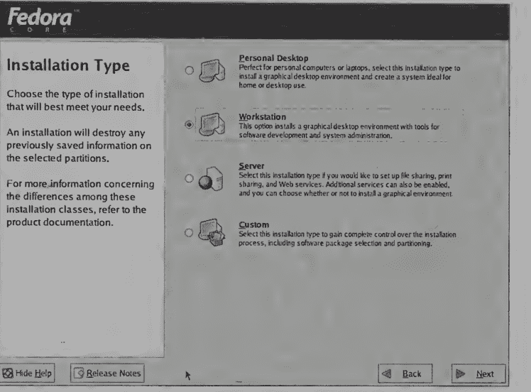

图 4-7 Fedora Core 2 中的安装类型界面。

选择以下选项之一：

- 个人桌面（Personal Desktop）提供了一个桌面环境和一系列桌面应用程序。它包含了办公软件。此选项将删除你硬盘上所有的 Linux 软件，但会保留任何 Windows 软件。
- 工作站（Workstation）包含桌面提供的应用程序，并为软件开发人员和系统管理员添加了工具。
- 服务器（Server）并非为桌面使用设计。此选项将删除你硬盘上的所有其他软件，包括 Windows。
- 自定义（Custom）允许你拥有更大的灵活性，但你必须清楚自己在做什么。

在剩余的 Fedora 指南中，选项都是基于“工作站”安装的。如果你选择其他类型，可能会在显示的屏幕上看到细微的。

## 选择 Fedora 的安装位置

下一个控制屏幕允许你选择 Fedora 的安装位置。如果你正向一台目前没有操作系统的机器上单独安装 Fedora，你可能希望 Fedora 使用整个硬盘。（无论是 Linux 还是 Windows），Fedora 都可以替换当前的操作系统或与其共存，每个操作系统都有硬盘上自己的独立区域，称为“分区”（partition）。使用多个操作系统的将在第 3 章中讨论。此外，Fedora 还需要将它的分区划分为子分区。你有机会告诉 Fedora 如何组织它的分区。

第一个分区屏幕提供自动分区或手动分区选项，如右侧所示。除非你有特定的手动分区需求（例如你的计算机有非常不寻用途），否则你必须具备相当的知识才能手动分区。

如果你选择自动分区，将显示图 4-8。

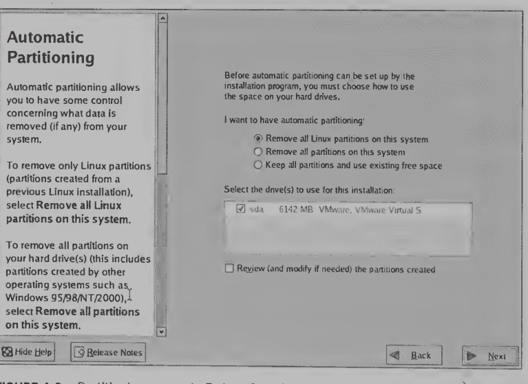

图 4-8 Fedora Core 2 中的分区界面。

根据你硬盘上目前的内容，可能会提供不同的选项。如果你选择“删除分区”（Remove partitions），所有数据将被擦除，包括任何 Windows 分区。屏幕中的列表框显示将安装 Fedora 的硬盘。如果你需要多个硬盘，请确保勾选正确的那个。列表中的可能项目包括：

- `hda`: 你的第一块硬盘
- `hdb`: 你的第二块硬盘
- `sda`: 你的第二个 SCSI 驱动器
- `sdb`: 你的第二个 SCSI 驱动器

引导程序决定哪些操作系统可以启动你的系统。Fedora 使用 `GRUB`（大统一引导加载程序）引导程序，但也可以选择使用 `LILO`（Linux 加载器）。图 4-9 显示了引导程序的安装界面。

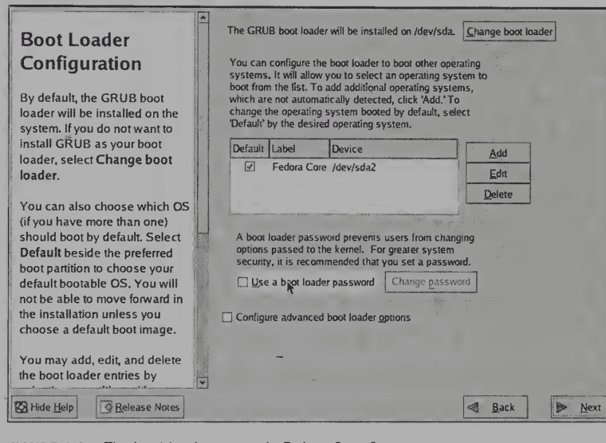

图 4-9 - Fedora Core 2 中的引导程序。

除非你有特殊原因，否则如果你的硬盘上目前安装了操作系统（如 Windows），它将出现在列表中。系统安装完成后，每当你开启或重启计算机时，`GRUB` 都会显示一个操作系统菜单供你选择。如果你不选择，默认操作系统将在短暂暂停后启动（通常为 10 秒）。请务必检查想要自动启动的操作系统的“默认”（Default）框。

对于大多数系统，没有必要为引导程序设置密码。

## 为 Fedora 收集网络信息

后续屏幕允许你配置网络。只有当 Fedora 安装程序检测到你的计算机中有网卡时，这些屏幕才会出现。如果你的计算机没有网卡，Fedora 将跳过这些屏幕。图 4-10 显示了第一个网络屏幕。

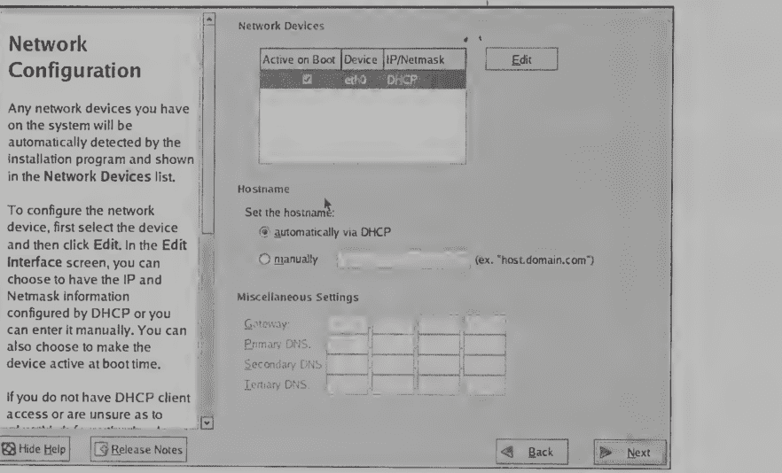

图 4-10 Fedora Core 2 中的网络配置。

Fedora 安装程序检测到的新网络硬件显示在屏幕顶列表中。此图显示了一个连接器 `eth0`。配置了两个设置：

- **启动时激活（Active on Boot）：** 网络连接在计算机启动时被激活。
- **IP/网络（IP/Network）：** 每个网络连接器都有一个地址，称为 IP 地址，允许网络定位计算机并向其传输信息。IP 地址可以通过 `DHCP` 自动设置，也可以手动输入 IP 地址。

可以通过高亮网络连接器并点击“编辑”（Edit）输入或更改设置。如果你处于公司网络中，网络管理员可以告诉你使用哪些设置。大多数 DSL 或电缆调制调器连接使用 `DHCP`。如果你不知道使用哪些设置，只需接受 Fedora 的默认设置即可。这些设置可以在系统安装后更改。

Fedora 带有防火墙。防火墙有助于保护你的计算机免受外部访问。防火墙屏幕如图 4-11。

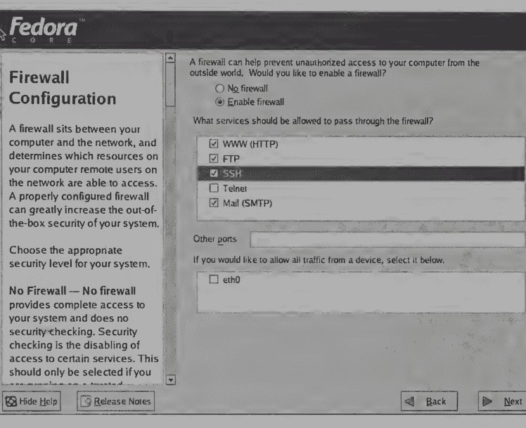

**图 4-11** 屏幕中的防火墙配置，选择是否开启防火墙。如果开启，选择允许哪些服务通过你的防火墙。

首先，在屏幕顶部，选择是否开启防火墙。如果开启，选择允许哪些服务通过你的防火墙。

## Fedora 的语言和时区

Linux 可以支持多种语言。在此时，你可以在图 4-12 所示的屏幕中选择 Linux 在计算机上使用的语言。

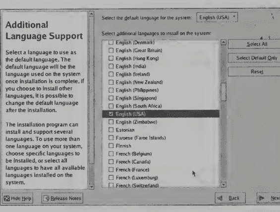

图 4-12 Fedora Core 2 中的语言界面。

在屏幕顶部，选择默认使用的语言。如果你希望在系统上可以使用其他语言，请在语言列表中勾选它们。系统安装完成后，你可以切换到在该屏幕中选择的任何语言。

在图 4-13 所示的屏幕中选择你的时区。

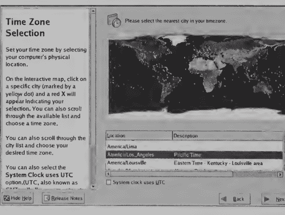

图 4-13 Fedora Core 2 中的时区界面。

选择距离你所在地最近的城市来选择你的本地时区。你可以点击地图或从城市列表中选择。

## 为 Fedora 创建 root 账户

用户必须拥有账户才能使用 Linux。启动时，第一个屏幕将要求你登录账户。需要一个 `root` 账户。`root` 用户通常称为超级用户（super user）。其他用户账户也会被安装。账户将在第 8 章中详细讨论。

在图 4-14 所示的屏幕中，你创建 `root` 账户。其他用户账户稍后创建。

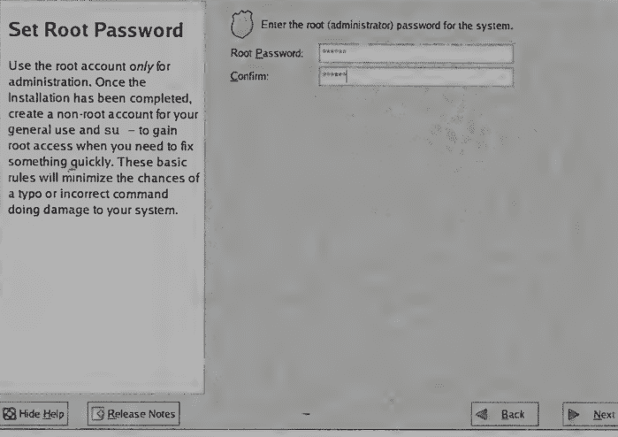

为 `root` 账户输入密码。输入两次密码以确保没有错误。记住这个密码极其重要。没有 `root` 账户无法对 Linux 进行任何更改。

## 为 Fedora 选择软件包

选择屏幕列出了 Fedora 打算安装的软件包。列表取决于你选择的安装类型。顶部显示工作站软件。你可以选择建议列表，也可以通过删除或添加名称来修改软件包列表。

- 桌面 (GNOME)
- 办公套件 (OpenOffice.org)
- 网页浏览器 (Mozilla)


- 邮件 (Evolution)

- 即时消息

- 音频和视频应用程序

- 游戏

- 软件开发工具

- 管理工具

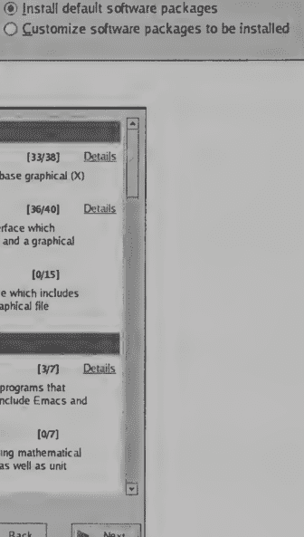

### 包组选择

选择你想要安装的软件包（应用程序）组。要选择软件包组，点击旁边的复选框。

一旦选择了软件包组，点击“详情”（Details）查看将安装哪些软件包，并从组中添加或删除可选软件包。

总安装大小：2,661M


图 4-15 Fedora Core 2 中的软件包选择

软件包选择屏幕显示了你可以勾选或取消安装的软件包组。例如，GNOME 桌面是 Fedora 的默认设置。你可以从图 4-15看到 GNOME 已勾选而 KDE 桌面未勾选。如果你是 Linux 新手，可能想尝试两种桌面，看看你喜欢哪一个。勾选 KDE 以与 GNOME 桌面一起安装 KDE 桌面。

在这里做的选择并不是最终决定。在 Fedora 安装后，你可以随时添加和删除软件。

## 安装 Fedora 系统

到目前，Fedora 一直在收集信息；您的硬盘尚未发生变化。安装过程的下一部分会将文件复制到您的硬盘上，从而改变您的硬盘。Fedora 显示了一个警告屏幕，如图 4-16 所示。

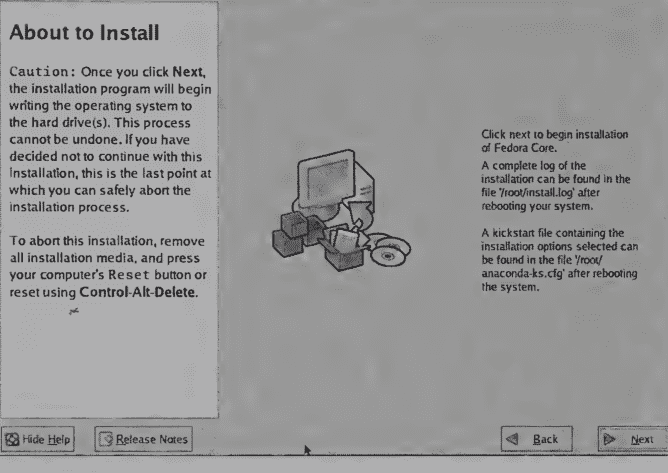

图 4-16 Fedora Core 2 中的警告屏幕。

安装过程如下：

- 1. 格式化硬盘，并在进行过程中显示状态条

- 2. 显示安装所需的 CD 列表

- 3. 安装软件，并如下所示报告进度

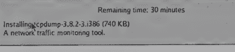

- 4. 在需要时请求不同的 CD，如下所示

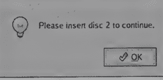

- 5. 执行一些安装后配置

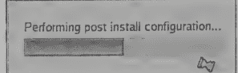

当软件安装完成后，Fedora 将显示图 4-17 所示的屏幕。

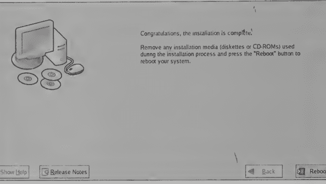

图 4-17 Fedora Core 2 安装完成。

要使用您的新 Fedora，您需要重启。从 CD 或 DVD 驱动器中取出 CD 或 DVD 并点击 `Reboot`。重启后，Fedora 将显示图 4-18 所示的引导加载程序菜单。如果只显示了一个系统——Fedora。如果您安装了另一个操作系统（例如 Windows），请选择您想要启动的系统。

```
GHU GRUB version 0.94 (638K lower / 26832K upper memory)
Fedora Core (2.6.5-1.358)

使用按键选择高亮项。
按回车键启动选定的 OS，按 'e' 在启动前编辑命令，按 'g' 在启动前修改内核参数，或按 'c' 进入命令行。
项将在 3 秒后自动启动。
```

图 4-18 Fedora Core 2 的引导加载程序菜单。

选择 Fedora Core 以进入您的新 Fedora Linux 系统。

## 启动 Mandrake 安装程序

将 CD 或 DVD 放入 CD 或 DVD 驱动器并打开电脑电源。电脑将从 CD 或 DVD 启动并显示安装启动屏幕。（如果您的机器未从 CD/DVD 启动，请参阅第 3 章。）

Mandrake 的启动屏幕所示：


**图 4-19** Mandrake 10 的启动屏幕。

按 `<Enter>` 开始图形化安装程序，其启动如下：

- 1. 执行若干任务，如下所示显示进度。您不需要响应或理解屏幕上的行。

```
PCI-APIC IRQ transform: (00,17,P0) -> 18
PCI-APIC IRQ transform: (00,18,P0) -> 19
PCI: Cannot allocate resource region 4 of device 0x0a000000, mapped to 0xd0000000, size 16384k
wesafb: framebuffer at 0xb8000000, length=16384, pages=0
wesafb: protected interface info at 0x00f70440
```

- 2. 将安装程序加载到内存中，如下所示显示状态条。


## 为 Mandrake 信息

Mandrake 收集安装 Linux 需要的信息。作为安装过程的一部分，它会探测硬件以确定鼠标、键盘和显示器类型。如果无法识别硬件，它将显示一个请求信息的屏幕。然而，Mandrake 特别擅长识别硬件，很少需要显示硬件屏幕。以下屏幕显示：

- 1. 语言：如果选定的语言不正确，高亮正确的语言。点击类别项旁的三角形查看语言下拉列表。

- 2. 许可协议：Mandrake 显示许可协议。您必须点击“同意”（Agree）才能继续。

- 3. 类型：如果 Mandrake 在您的硬盘上发现另一个 Linux，则会显示一个屏幕，您可以在其中选择新安装（New installation）或升级现有的 Linux（Upgrade）。

- 4. 安全级别：Mandrake 允许您选择安全级别。标准安全级别对于大多数用途都是足够的。为应该通知安全问题的人输入电子邮件。

- 5. 选择安装 Mandrake 的位置：Linux 可以单独安装在您的硬盘上，也可以与其他操作系统共享硬盘，每个系统都有自己的硬盘区域，称为分区。根据硬盘上当前的内容，Mandrake 提供了以下 2 个或更多选择：

    - 使用空空间（Use free space）：在硬盘的空闲、未使用空间上安装 Mandrake。如果目前没有安装任何操作系统，请选择此项。

    - 使用现有分区（Use existing partition）：如果您想在现有的 Linux 分区上安装 Mandrake，请选择此项。

    - 使用 Windows 分区的空空间（Use the free space on the Windows partition）：如果电脑目前仅运行 Windows 系统，Mandrake 可以使用 Windows 部分空间在硬盘上创建一个 Linux 分区。安装 Linux 后，Windows 分区将变小。

    - 清除整个硬盘（Erase entire disk）：替换所有当前的操作系统，包括硬盘上的所有数据。

    - 删除 Windows（Remove Windows）：替换当前的 Windows 分区，在此过程中删除所有数据。

    - 自定义分区（Custom partitioning）：允许您手动创建分区。除非您有特定的手动分区需求（例如电脑有特殊用途），否则不要选择此选项。手动分区需要具备相当的知识。

## 在 Mandrake 上选择安装的软件包

Mandrake 选择要安装软件包组的屏幕如图 4-20 所示。


**图 4-20** Mandrake 软件包选择屏幕。

## Mandrake 配置摘要

此时，Mandrake 会显示一个显示当前配置设置摘要的屏幕，如图 4-24 所示。

| 系统 | | 配置 | |

|---|---|---|---|

| 系统激活 | 键盘 - 美国式键盘 | | |

| 语言 | 国家/地区 - 美国 | 配置 |

| 许可证 | 时区 - America/New_York | 配置 |

| 安全性 | 鼠标 - 通用任意 PS/2 & USB 鼠标 | 配置 |

| 分区 | 硬件 | 配置 |

| 安装系统 | 打印机 - 无打印机 | 配置 |

| 系统配置 | 声卡 - Creative Labs/Sound Blaster AudioPCI/V-AudioPCI/29 | 配置 |

| Root 密码 | 网络与接口 - 未配置 | 配置 |

| 添加用户 | Proxis - 未配置 | 配置 |

| 安装引导加载程序 | | | |

| 帮助 | 下一步 | | |

图 4-24 Mandrake 配置摘要

如果其中有任何不正确，请按“配置”（Configure）进行更改。例如，时区被列为 America/New_York。如果这不正确，请按“配置”并选择不同的时区，例如用于太平洋区的 Los_Angeles。

请注意此屏幕，图形界面尚未配置。必须对其进行配置才能使用桌面。按“正在配置”（Configuring）允许你从列表中选择你的显示器，并设置你想要使用的屏幕分辨率。

当对对摘要屏幕上的配置感到满意并点击“下一步”（Next）时，Mandrake 将提供更新软件包的机会。除非你刚刚下载了带有最新软件包的 Mandrake，否则更新是一个好主意。你需要连接到互联网。

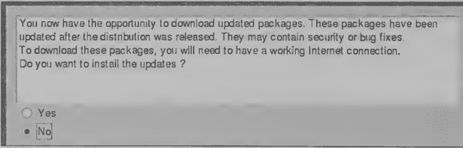

图 4-25 Mandrake 10 更新软件包屏幕。

## 完成 Mandrake 安装

Mandrake 显示图 4-26 所示的屏幕，表示安装已完成。

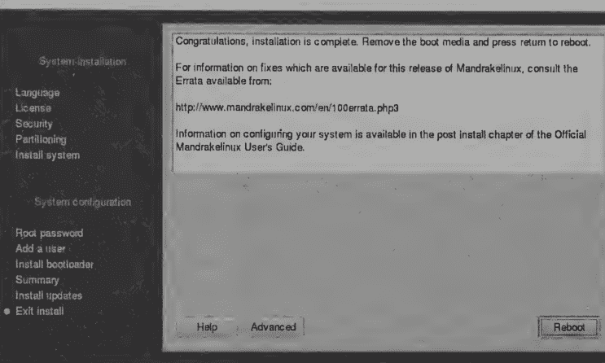

**图 4-26** Mandrake 10 安装完成屏幕。

使用你新的 Mandrake 系统之前，你需要重启。从 CD 或 DVD 驱动器中取出 CD 或 DVD 并点击“重启”（`Reboot`）。重启后，Mandrake 将显示图 4-27 所示的引导加载程序菜单。除非你有理由选择其他选项之一，否则选择 linux。如果你安装了另一个操作系统（例如 Windows），它会被列出来，你可以选择你想要启动的系统。

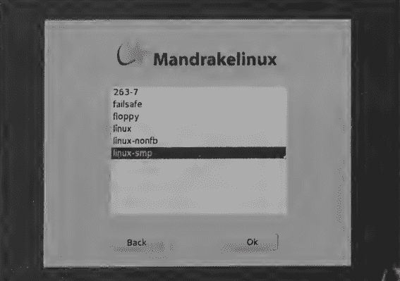

**图 4-27** Mandrake 10 的引导加载程序菜单。

## 开始 SuSE 安装程序

将 CD 或 DVD 放入 CD 或 DVD 驱动器并打开电脑电源。电脑将从 CD 或 DVD 启动并显示安装启动屏幕。（如果你的机器未从 CD/DVD 启动，请参见第 3 章。）

SuSE 的启动屏幕在此所示：

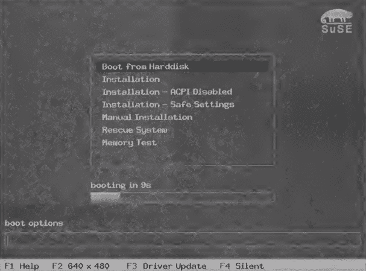

**图 4-28** SuSE 9.0 的启动屏幕。

SuSE 启动屏幕提供了几个选项。默认选择“从硬盘启动”（Boot from Harddisk），除非你选择其他选项，否则它将启动。注意显示“booting in 9”（9 秒后启动）的状态栏。

使用向下箭头键（↓）高亮“安装”（Installation）。按回车键（`<Enter>`）开始。安装程序通过执行几个任务开始，并如图 4-29 所示显示其进度。

```
Idle at 0x70-0x177,0x376 on irq 15
de-floppy driver 0.99:newide
de-floppy driver 0.99:newide
md: driver 0.98.0 MAX_DEVS=256, MD_SB_DISKS=3
md: initializing scsi arrays ...
d: autoconf ...
md: autoconf DONE.
NET4: Linux: TCP/IP 1.0 for NET4.0
IP Protocols: TCP, UDP, ICMP
TCP/IP: cache hash table of 2040 buckets, 16Kbytes
TCP: Hash tables configured (established 16384 bind 32768)
```

**图 4-29** SuSE 9.0 的过渡屏幕。

你不需要担心或理解屏幕上的这些行。

## SuSE 配置设置

SuSE 的安装程序是 YaST（另一个一个设置工具）。当前版本是 YaST2。第一个显示的图形屏幕是图 4-30 所示的语言选择屏幕。

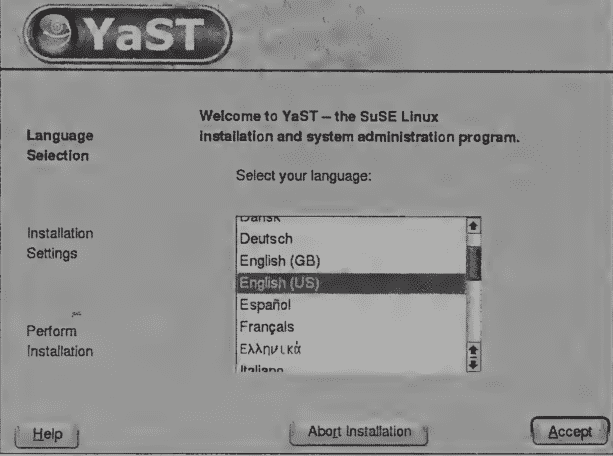

**图 4-30** SuSE 9.0 的语言屏幕。

YaST 检测你硬盘上的 SuSE Linux 系统，会显示一个屏幕允许你选择安装类型，具有以下选择：

- **新安装（New installation）**：替换现有系统。

- **更新现有系统（Update an existing system）**：保留数据。

- **修复系统（Repair system）**。

- **分区（Partitioning）**。

- **安装系统（install system）**。

- **系统配置（System configuration）**。

- **Root 密码（Root password）**。

- **添加用户（Add a user）**。

- **安装引导加载程序（Install bootloader）**。

- **帮助（Help）**。

（注：根据原文表格结构，上述选项对应不同的配置项，但原文表格行列关系略有错乱，此处已按逻辑对齐）

*纠正：原文表格内容较为杂乱，根据语意翻译如下：*

- **新安装**：替换现有系统。

- **更新现有系统**：保留数据。

- 其他等。

如果其中有任何不正确，请按“配置”（Configure）进行更改。例如，时区被列为 America/New_York。如果这不正确，请按“配置”并选择不同的时区，例如用于太平洋区的 Los_Angeles。

YaST 检测到你硬盘上的 SuSE Linux 系统，会显示一个屏幕允许你选择安装类型，具有以下选择：

- **新安装（New installation）**：替换现有系统。

- **更新现有系统（Update an existing system）**：保留数据。

- **修复系统（Repair system）**。

- **分区（Partitioning）**。

- **安装系统（install system）**。

- **系统配置（System configuration）**。

- **Root 密码（Root password）**。

- **添加用户（Add a user）**。

- **安装引导加载程序（Install bootloader）**。

- **帮助（Help）**。

（注：由于原文表格部分内容存在格式混乱，翻译保持了核心词汇）

请注意此屏幕，图形界面尚未配置。必须对其进行配置才能使用桌面。按“正在配置”（Configuring）允许你从列表中选择你的显示器，并设置你想要使用的屏幕分辨率。

当你对摘要屏幕上的配置感到满意并点击“下一步”（Next）时，Mandrake 将提供更新软件包的机会。除非你刚刚下载了带有最新软件包的 Mandrake，否则更新是一个好主意。你需要连接到互联网。


图 4-25 Mandrake 10 更新软件包屏幕。

## 完成 Mandrake 安装

Mandrake 显示图 4-26 所示的屏幕，表示安装已完成。


**图 4-26** Mandrake 10 安装完成屏幕。

使用你新的 Mandrake 系统之前，你需要重启。从 CD 或 DVD 驱动器中取出 CD 或 DVD 并点击“重启”（`Reboot`）。重启后，Mandrake 将显示图 4-27 所示的引导加载程序菜单。除非你有理由选择其他选项之一，否则选择 linux。如果你安装了另一个操作系统（例如 Windows），它会被列出来，你可以选择你想要启动的系统。


**图 4-27** Mandrake 10 的引导加载程序菜单。

## 开始 SuSE 安装程序

将 CD 或 DVD 放入 CD 或 DVD 驱动器并打开电脑电源。电脑将从 CD 或 DVD 启动并显示安装启动屏幕。（如果你的机器未从 CD/DVD 启动，请参见第 3 章。）

SuSE 的启动屏幕在此所示：


**图 4-28** SuSE 9.0 的启动屏幕。

SuSE 启动屏幕提供了几个选项。默认选择“从硬盘启动”（Boot from Harddisk），除非你选择其他选项，否则它将启动。注意显示“booting in 9”（9 秒后启动）的状态栏。

使用向下箭头键（↓）高亮“安装”（Installation）。按回车键（`<Enter>`）开始。安装程序通过执行几个任务开始，并如图 4-29 所示显示其进度。

```
Idle at 0x70-0x177,0x376 on irq 15
de-floppy driver 0.99:newide
de-floppy driver 0.99:newide
md: driver 0.98.0 MAX_DEVS=256, MD_SB_DISKS=3
md: initializing scsi arrays ...
d: autoconf ...
md: autoconf DONE.
NET4: Linux: TCP/IP 1.0 for NET4.0
IP Protocols: TCP, UDP, ICMP
TCP/IP: cache hash table of 2040 buckets, 16Kbytes
TCP: Hash tables configured (established 16384 bind 32768)
```


**图 4-29** SuSE 9.0 的过渡屏幕。

你不需要担心或理解屏幕上的这些行。

## SuSE 配置设置

SuSE 的安装程序是 YaST（另一个一个设置工具）。当前版本是 YaST2。第一个显示的图形屏幕是图 4-30 所示的语言选择屏幕。


**图 4-30** SuSE 9.0 的语言屏幕。

YaST 检测到你硬盘上的 SuSE Linux 系统，会显示一个屏幕允许你选择安装类型，具有以下选择：

- **新安装（New installation）**：替换现有系统。
- **更新现有系统（Update an existing system）**：保留数据。
- **修复系统（Repair system）**。
- **分区（Partitioning）**。
- **安装系统（install system）**。
- **系统配置（System configuration）**。
- **Root 密码（Root password）**。
- **添加用户（Add a user）**。
- **安装引导加载程序（Install bootloader）**。
- **帮助（Help）**。

YaST 检测到你硬盘上的 SuSE Linux 系统，会显示一个屏幕允许你选择安装类型，具有以下选择：

- **新安装（New installation）**：替换现有系统。
- **更新现有系统（Update an existing system）**：保留数据。
- 其他等。

请注意此屏幕，图形界面尚未配置。必须对其进行配置才能使用桌面。按“正在配置”（Configuring）允许你从列表中选择你的显示器，并设置你想要使用的屏幕分辨率。

## 安装 SuSE 系统

当摘要屏幕（图 4-31）中的所有设置都正确时，点击接受（Accept）。到目前，SuSE 一直在收集信息，没有对您的硬盘进行任何更改。现在它开始安装系统，并在您的硬盘上进行更改。在开始之前，它会显示图 4-34 所示的警告屏幕。

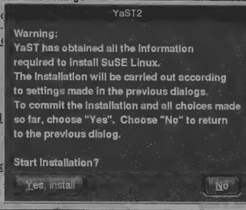

**图 4-34** 为 SuSE 9.0 安装系统。

SuSE 分 3 个步骤安装系统：

- 1. 安装基础系统，并在执行过程中显示进度。请注意它会在右上面板显示所需的磁盘空间。

| 当前软件包 | 安装进度 | 剩余 |
|---|---|---|
| ispell-british-3.2.06 | 30% | CD 1: 1.05 GB |
| 当前软件包 | | CD 2: 1.16 GB |
| ispell-british-3.2.06 | | CD 3: 286.89 MB |
| 描述 | | CD 4: 14.82 MB |
| 英英语字典 | | CD 5: 146.82 MB |
| 总计 | | 2.50 GB |

确定文件类型的工具 filesystem-9.0 — 基础目录列表 ispell-british-3.2.06 — 英英语字典 ispell-british-3.2.06 — 英英语字典

- 2. 重启：

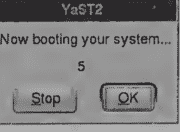

随后是恢复设备权限

设置 CMOS 锁

设置时区数据

设置主机 linux

设置 ip6 接口

done done amused done

done done

- 3. 使用基础系统安装所有剩余软件包，并在需要时请求新的 CD。

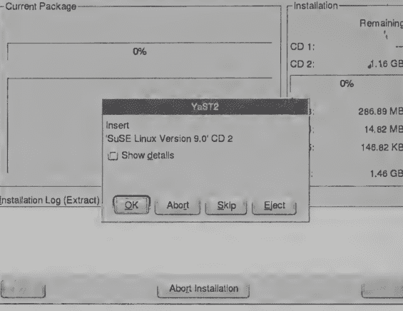

安装所有软件后，SuSE 将安装您的 Linux 系统所需的 root 账户，如图 4-35 所示。

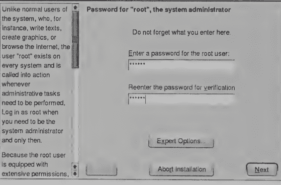

图 4-35 SuSE 9.0 的 root 账户安装。

为 root 账户输入密码。输入两次相同的密码以确保没有错误。记住这个密码极其重要。如果不使用 root 账户，您将无法对 Linux 系统进行任何更改。即使您以后安装了用户账户并可以登录用户账户，如果不使用 root 账户，您无法完成许多需要执行的操作。

## 配置已的 SuSE 系统

接下来的屏幕将为 Linux 系统添加网络连接和用户帐户：

- **网络设置**：建议设置显示在与图 4-39 摘要屏幕类似的屏幕中。您可以通过点击更改（Change）来修改设置。如果您位于公司网络，网络管理员可以告诉您使用哪些设置。大多数 DSL 或调制解调器连接使用 DHCP。如果您不知道使用哪些设置，请检查 SuSE 的建议或检查跳过配置 1（Skip 1 Configuration）。这些设置可以在系统安装后以后更改。
- **网络配置**：如果您在屏幕 1 中设置了网络连接，网络将进行配置，并在带有状态栏的屏幕中显示进度。
- **网络测试**：测试网络。如果连接正常，将下载任何可用的软件更新。
- **身份验证方法**：提供两种验证用户的方法。大多数情况下，独立模式（Stand-Alone）是正确的选择。如果您使用 NIS 或 LDAP，请检查网络客户端（Network Client）。
- **添加用户**：您可以创建新用户帐户。输入两次密码。出于考虑，密码不会显示在屏幕上。
- **系统配置**：配置将写入系统，并在状态栏中显示进度。
- **发行说明**：显示发行说明供阅读。
- **硬件配置**：建议设置显示在与图 4-31 摘要屏幕类似的屏幕中。您可以通过点击您想要更改的项目名称（例如显卡或打印机）来更改设置。

## 完成 SuSE 安装

当 YaST 完成配置屏幕显示后，它会显示安装完成（Installation Completed）屏幕，如图 4-36 所示。

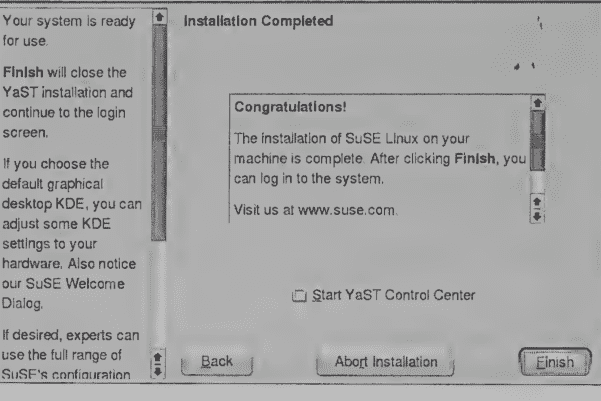

图 4-36 SuSE 9.0 的安装完成屏幕。

点击完成（Finish）。系统在黑屏上显示几行，然后显示登录屏幕，如图 4-37 所示。

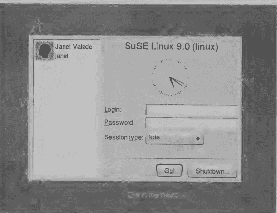

图 4-37 SuSE 9.0 的登录屏幕。

在登录屏幕上点击账户（例如 Janet），输入您的密码并点击前往（Go!）。如果您不想使用 KDE 桌面，

## 总结

安装 Linux 不仅仅是复制。图形用户界面（GUI）提供了一种易于用户的交互方式。桌面环境允许用户管理文件、应用程序和设置，而无需复杂的命令行。这使得 Linux 对于初学者和专业人士来说都更容易上手。

GNOME 和 KDE 之间的区别主要在于管理工具，即用于配置安装后桌面的工具。例如，KDE 和 GNOME 都提供了一个绘图程序，但它们并不是同一个绘图程序。另一个例子是，KDE 自带了一个名为 KWord 的文字处理器，而 GNOME 自带了 AbiWord，但两者都提供了对 OpenOffice 的访问。

几乎所有的 Linux 发行版都提供 GNOME 或 KDE。某些发行版允许你在安装 Linux 时选择桌面。许多发行版在安装后，允许你在登录时选择桌面。这主要取决于个人偏好。在做决定之前，你可能想尝试一下两者。

某些软件包只在一个桌面下运行，也也可以在另一个桌面下运行。有些软件包同时随两个桌面一起分发，例如 GIMP。当 GNOME 和 KDE 都安装时，所有两个桌面都带的软件包都会安装，形成一个单一的软件包池。桌面可以访问任何可以与之运行的软件包。例如，如果一个 GNOME 软件包也可以在 KDE 下运行，那么 KDE 的启动菜单将显示该软件包，尽管它实际上是随 GNOME 附的。

## 其他 GUI

除了 KDE 和 GNOME 之外，还有许多其他 GUI 可用。Linux 优先考虑灵活性和配置配置，并尽可能提供选择。几乎所有的 Linux 发行版都包含 GNOME 和 KDE，但许多还包含其他 GUI。例如，Mandrake 包含名为 IceWM 的桌面，它比 GNOME 或 KDE 更小、更快。

大多数用户仅为了特殊目的才安装除大者之外的桌面，例如在资源有限的机器上安装 Linux——这种情况需要一个使用更磁盘空间和内存的 GUI。有些人选择使用不同的 GUI 仅仅是因为他们喜欢它。如果你花时间进行自定义，你的 GUI 可以变得非常复杂且个性化。将来，当你成为一名 Linux 专家时，你可能想研究其他的 GUI。

## GNOME

GNOME（GNU 网络对象模型环境）是一种流行的桌面环境，如图 5-1 所示。

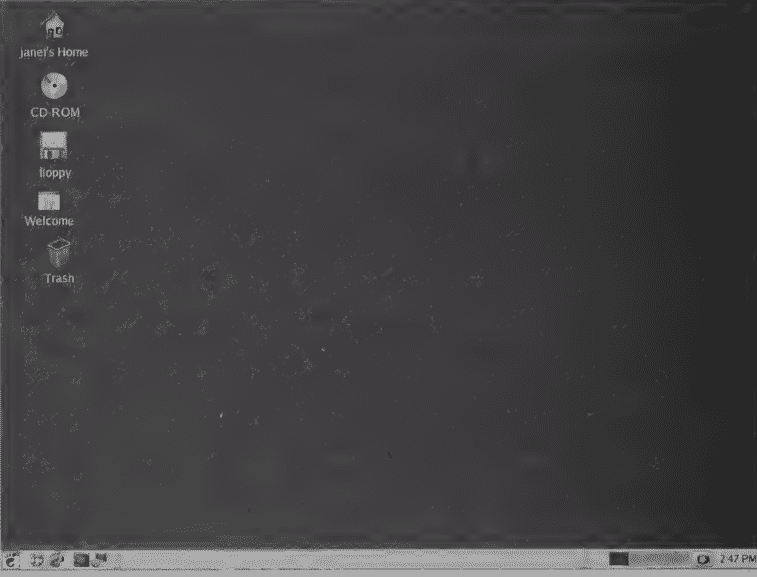

**图 5-1** Mandrake 9.1 中的 GNOME 桌面。

注意空白的工作表面、桌面上的图标以及底部的面板。面板左侧的第一个图标显示一只脚（GNOME 标志）。此图标打开一个应用程序菜单（一个看起来与 Windows 启动菜单非常类似的菜单）。因为桌面是由 Mandrake 在其发行版中提供的，图标和面板内容是由 Mandrake 定制过的，如桌面上的 Mandrake 欢迎图标（大黄星形）所示。

GNOME 项目由红帽（Red Hat）支持。红帽和 Fedora 的默认桌面是 GNOME 的自定义版本，称为 Bluecurve GNOME。Bluecurve GNOME 的启动菜单图标是红帽标志，而不是 GNOME 的脚标志。而且当然，Bluecurve GNOME 没有 Mandrake 欢迎图标。

下一页显示的 KDE 桌面（图 5-2）非常相似。它也有工作区、图标和面板。主要的区别主要在于桌面上的图标和面板的组织方式。关于桌面的使用将在第 6 章中讨论。

## KDE

KDE（K 桌面环境）是最流行的桌面环境，如图 5-2 所示。

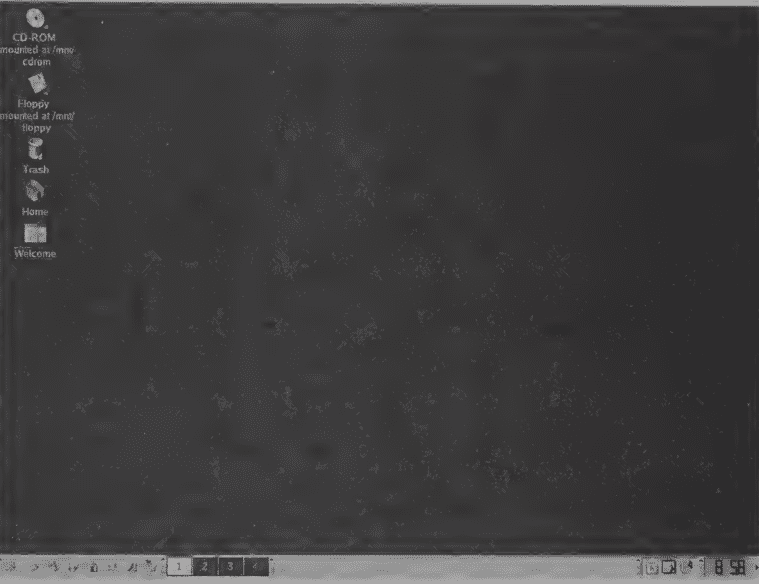

**图 5-2** Mandrake 9.1 中的 KDE 桌面

注意空白的工作表面、图标和底部的面板。面板左侧的第一个图标显示一个大 K，即 KDE 的标志。此图标打开一个应用程序菜单（该菜单看起来与 Windows 启动菜单非常相似）。因为桌面是由 Mandrake 在其发行版中提供的，图标和面板内容是由 Mandrake 定制过的，如桌面上的 Mandrake 欢迎图标所示。

尽管 GNOME 是红帽和 Fedora 的默认桌面，但 KDE 的自定义版本——称为 Bluecurve KDE）也随他们的发行版一起提供。Bluecurve KDE 的启动菜单使用的是红帽标志，而不是 K 标志。而且当然，Bluecurve KDE 没有 Mandrake 欢迎图标。

上一页显示的 GNOME 桌面（图 5-1）非常相似。它也有工作区、图标和面板。主要的区别主要在于桌面上的图标和面板的组织方式。关于桌面的使用将在第 6 章中讨论。

## Linux 上的命令行界面

命令行界面（CLI）是一个文本环境，你在其中输入命令让 Linux 执行，Linux 在 Linux 中显示文本消息。在 CLI 中，你使用键盘而不是鼠标向 Linux 发送指令；当你操作 CLI 时，你正在与一个名为 shell 的程序交互。shell 接受你的命令，处理它们，并将它们传递给内核，内核是 Linux 中进行基础计算机工作的部分。Linux 提供了几种 shell 选择，但本书仅提供关于 Bash 的信息，它是最流行的 Linux shell。

Linux 可以直接引导到命令行环境。你会看到一个空白的屏幕，等待你的输入。而不是看到登录窗口，你是在空白的命令行上输入你的账户 ID 和密码。在这种设置下，你专门使用 CLI。使用这种设置的用户通常根本不使用桌面。

通常，用户想在大多数时间内使用 GUI，但在某些任务中使用 CLI。这些设置让 Linux 引导到桌面。每当他们想使用 CLI 时，就可以打开一个 CLI 窗口。

桌面比 CLI 更容易使用。在桌面上，你从菜单选择任务。在 CLI 中，你需要输入命令。尽管如此，CLI 在某些情况下具有一些优势，使其具有吸引力：

- 执行更快：GUI 会带来一定的开销，例如在屏幕上绘制图形。当你直接在 CLI 中输入命令时，没有 GUI 执行速度更快。
- 命令输入更短：在许多情况下，输入命令比导航菜单更快。通常，文件管理和其他系统任务在命令行输入比使用菜单快得多。此外，CLI 允许将命令组合在一起，产生单一输出，这在菜单中是不可能的。
- 资源更少：GUI 需要磁盘空间、内存和其他计算机资源。在性能不足的计算机上运行 Linux 时，运行无 GUI 是必要的。
- 功能更多：某些命令和选项在菜单上可用。它们只能从命令行执行。

命令行界面的使用将在第 7 章详细讨论。

## 选择界面

大多数 Linux 发行版的安装程序提供了选择你想要安装的软件的机会。通常，有一组默认应用程序，或者可能是不同的应用程序集供你选择。此外，你可能有机会从安装的集合包含或删除任何应用程序。

例如，在 Fedora 安装期间，屏幕显示要安装的默认软件包集，包括 GNOME。该屏幕给你安装默认集或自定义要安装的软件包的选择。如果你选择自定义，一个屏幕允许你勾选和取消勾选要安装的软件包。GNOME 是默认勾选的。你可以在 GNOME 之外勾选 KDE，或者代替它。你可以取消勾选两者。

如果你安装了 GNOME 或 KDE，你的系统将引导到安装的桌面。如果你安装了两个中的，大多数发行版提供在登录时选择哪个桌面的机会。如果两个都没有安装，你的电脑在登录时将进入命令行环境。

# 摘要

Linux 是一个操作系统——运行在你的计算机上的软件。当你操作电脑时，界面提供了你与 Linux 内核之间的通信，内核是 Linux 中执行低级工作的部分。内核直接与硬件通信，以便在硬硬盘上保存文件、向打印机发送数据流、向网络发送信息以及执行其他基础任务。你的指令会被界面接收、处理，并传递给内核。Linux 提供了两种类型的界面供你使用：图形化用户界面（GUI）和命令行界面（CLI）。

GUI 提供了可以使用鼠标选择的图形界面。一种流行的 GUI 是桌面，它因 Windows 而变得流行。桌面的设计初衷是代表你办公桌的顶部——一个带有工具的工作空间。Linux 提供了两种流行的桌面环境：GNOME（GNU 网络对象模型环境）和 KDE（K 桌面环境）。这两者的外形都与 Windows 相似，并提供相同的功能，如窗口、图标、菜单等。GNOME 和 KDE 之间的区别主要在于管理实用程序、配置桌面的工具以及为桌面安装时选择的默认应用程序。你使用哪种桌面主要取决于个人喜好。在决定之前，你可能想尝试一下 GNOME 和 KDE。使用桌面的内容将在第 6 章介绍。

CLI 是文本环境。你输入命令让 Linux 执行，Linux 则显示文本消息作为响应。当你使用 CLI 时，你是在与一个名为 shell（壳）的程序交互。shell 接受你的命令，处理它们，并将它们传递给内核。使用命令行界面的细节将在第 7 章进行讨论。

Linux 可以在启动时打开桌面，也可以在命令行环境下启动。大多数用户倾向于 Linux 启动时进入桌面。当用户想要使用命令行时，他们打开一个 CLI 窗口。

## 第 6 章

## 使用你的桌面

在操作计算机时，Linux 提供了两种基本类型的界面供你使用：GUI（图形化用户界面）和 CLI（命令行界面）。第 5 章提供了界面类型的概述。在本章中，我们将详细讨论最常见的界面类型——被称为桌面的 GUI。CLI 将在第 7 章讨论。

Linux 可以在没有桌面的情况下启动，但大多数用户倾向于让 Linux 启动时带有桌面。第 4 章提供的安装指南结果是在启动时打开桌面。桌面界面的功能相当于你书桌的顶部，提供了一个空表面和一套工具。

不同的发行版提供不同的桌面，但大多数提供 KDE（K 桌面环境）和/或 GNOME（GNU 网络对象模型环境）——Linux 桌面的两大主流。默认桌面取决于发行版。例如，Fedora 默认使用 GNOME，而 Mandrake/SUSE 默认使用 KDE。然而，一旦你决定了倾向于哪种桌面，就可以更改默认设置。

KDE 和 GNOME 是开源软件，各自在独立的项目中开发。新版本的发布独立于 Linux 版本或任何特定 Linux 发行版的发布。因此，不同的发行版包含不同的 KDE 和或 GNOME 版本。此外，KDE 和 GNOME 具有非常高的配置性。几乎所有内容都可以更改。因此，KDE 和 GNOME 在不同的发行版或发行版本中看起来并不完全相同。

在使用本书时，请记住 KDE 或 GNOME 的外观可能与书中所示完全不同。书中的大多数插图是 Core 2（KDE 3.2/GNOME 2.6）或 Mandrake 10（KDE 3.2/GNOME 2.4）。你的版本可能更旧也可能更新。由于 KDE 和 GNOME 的外观和行为并不总是与书中所示完全一致，最好将本章的指令视为建议，而非精确的地图。它提供了寻找配置工具最可能位置的线索，但不一定是详细的路线。

本章描述了你桌面的内容以及如何使用它。然后，如果你对 Linux 的默认外观和行为感到不习惯，你将找到如何更改一切。

## 登录

要访问桌面，你必须使用 Linux 账户登录。当你开启计算机电源时，过程如下：

- 1. 计算机启动。


```
booting Fedora Core (2.6.25-38)
scoot (h8d8)
Filesystem type is ext2fs, partition type 0x83
kernel/vmlinuz-2.6.25-38 root=LABEL=rootroot rbgb quiet
[Linux-Image,setup=8x14b8, size=0x123b57]
initrd/initrd-2.6.25-38.img
initrd/initrd-0xe8fe9d98, 449a8 bytes
decompressing Linux, booting the kernel:
PCI: Cannot allocate resource region 4 of device 8088:87.1
audit(109345689:10): initialized
```

- 2. 计算机提示你登录。
- 3. 你输入密码登录账户。
- 4. 桌面显示出来。

在计算机启动（第 1 步）后，你会看到登录界面。Fedora Core、Mandrake 和 SuSE 的登录界面如图 6-1 所示。

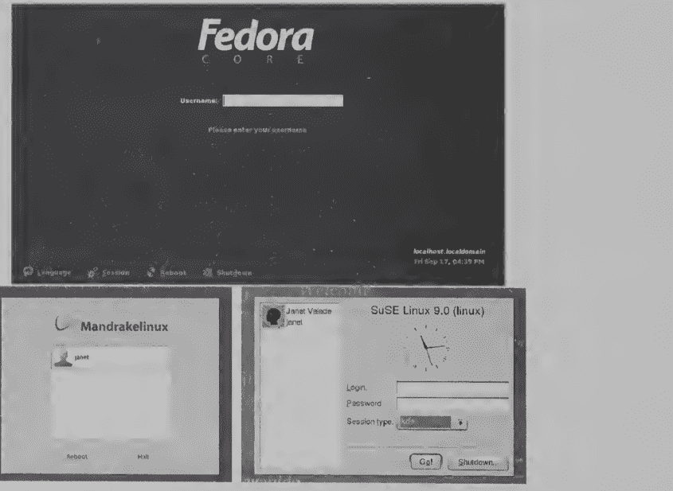

**图 6-1** 登录界面。

注意Mandrake 和 SuSE 提供了账户选择。在这种情况下，只有一个账户 (jan) 可用。如果存在多个账户，你会在登录时选择它们。账户设置将在第 8 章讨论。在 Mandrake 中，如图 6-2 所示。


**图 6-2** Mandrake 的第二个登录界面。

输入密码并点击登录。

在 SuSE 中，登录界面会出现用户名。输入密码并点击登录。

Fedora 要求你输入用户名。输入密码并按回车。

许多 Linux 发行版允许你在登录时选择使用哪种桌面。在这种情况下，你可以在已安装的桌面中进行选择。默认桌面是 KDE，但你可以更改它。安全模式不带桌面，带有 CLI，见第 7 章。注意 6-1 中的三个登录界面都提供了一个关机（Halt）按钮，让你在需要时停止操作。

## 首次登录

在安装后首次登录系统时，Linux 可能需要一些安装后设置。例如，Fedora 在你首次登录时创建用户账户。Mandrake 和 SuSE 在安装期间创建用户账户，而 Fedora 只创建 root 账户，直到现在创建用户账户。

当你首次登录 Mandrake 时，它会运行一个名为桌面向导的程序。第一个屏幕介绍了向导，将其帮助你：

- 通过几个步骤配置桌面的基本设置。
- 注册你的产品，以便轻松打开 Mandrakeclub 账户并从其所有产品和服务中快速获益。

向导的下一个屏幕显示了“选择桌面”按钮。KDE 是默认的，但你可以选择其他的。选择桌面后，一个屏幕允许你选择几个主题之一。主题是一组统一的颜色和图像，可以将桌面的所有部分整合到一个外观中，包括窗口框、字体、图标等。演示屏幕显示了默认主题 Galaxy 2 的外观。如果你勾选不同的主题，演示将显示屏幕将变化，显示新主题。当演示显示你喜欢的外观时，点击“下一步”。

Mandrake 向导还帮助你设置和配置 Mandrakeclub 账户。Mandrakeclub 按月提供软件下载、论坛、特别折扣和其他福利。第一个月免费，供你尝试。

当向导完成后，桌面显示一条欢迎消息。点击“关闭”关闭欢迎消息而不关闭桌面。当你不再希望每次启动电脑都看到此屏幕时，取消勾选消息底部的“启动时打开此窗口”。

在首次登录期间，SuSE 也会显示欢迎消息，并带有指向 SuSE 主页的链接。

# 桌面的结构

大多数桌面都有一些常用的基础组件，如图 6-3 所示。对于 Windows 用户来说，这个桌面看起来应该非常熟悉。

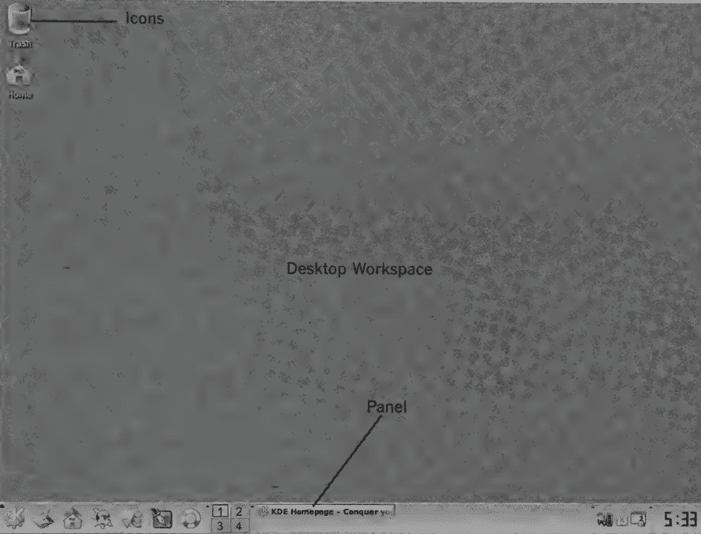

**图 6-3** 桌面。

桌面工作区包含图标（在本例中为两个图标），点击后会执行操作，就如同 Windows 桌面那样。你可以自定义桌面——添加、删除和重新排列图标。处理图标将在本章稍后部分讨论。

面板（panel，有时也称为 kicker）是位于桌面底部的条。面板可以移动到左侧、右侧或顶部。你可以拥有多个面板。

在图 6-3 中，面板的左侧包含几个图标。你可以自定义这些图标——从面板中添加或删除它们。图标右侧是一个四按钮页器（pager）——你可以点击这些按钮来打开备用的虚拟桌面，将在本章稍后部分解释。面板的右侧是一个称为任务栏的区域，当应用程序运行时，应用程序按钮会显示在这里。任务栏右侧是实用系统工具的图标。面板最右侧显示时钟。你可以重新组织面板——添加、删除或移动其上的对象。

# KDE 和 GNOME 桌面

本书将讨论两个最流行的桌面：KDE 和 GNOME。KDE 和 GNOME 的外观非常相似。图 6-4 显示了 Fedora 提供的 KDE 和 GNOME 桌面。

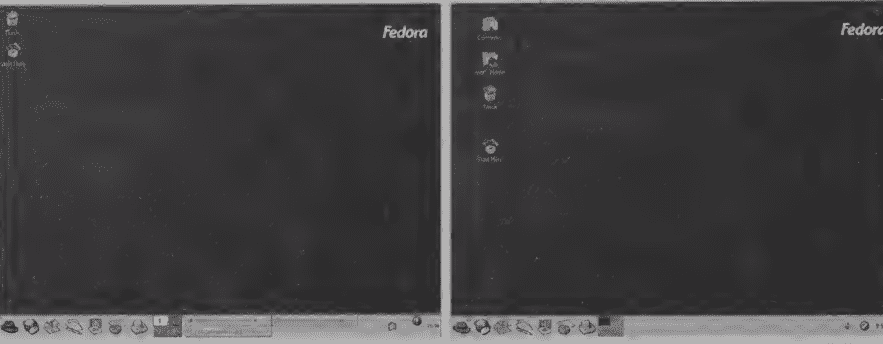

Fedora 的 KDE 和 GNOME 非常相似。它们都有“垃圾”和“主目录”图标，但 GNOME 多了两个图标。面板上的图标相同。两者看起来如此相似的原因之一是它们都具有高度的可定制性。因此，Fedora 桌面都是按照 Fedora 开发者认为实用的方式配置的。为不同发行版配置的桌面可以进行不同的自定义定制，但仍然非常相似。随 Fedora 和 Mandrake 分发的 KDE 桌面如图 6-5 所示。


这两个 KDE 桌面具有不同的图标，Mandrake 提供的更多。面板也不同。例如，Fedora 最左侧的面板图标是一个红色的 Fedora 标志。然而，其基本结构是相同的。

# 面板

桌面的面板如图 6-6 所示。KDE 面板是顶部面板，GNOME 面板是底部面板。

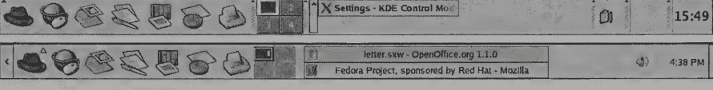

图 6-6 Fedora 的 KDE 和 GNOME 面板。

面板具有相同的五个组件，从左到右依次为：

- **图标栏：** 左侧区域包含应用程序图标。它也被称为应用程序启动器。点击图标启动应用程序。将鼠标指针悬停在图标上，会在工具提示中显示应用程序名称。
- **页器：** 用于在虚拟桌面之间切换的四格窗口。
- **任务栏：** 包含任何已打开应用程序项的区域。KDE 面板显示了一个打开的应用程序——X 设置。GNOME 面板显示了两个打开的应用程序——OpenOffice 和 Mozilla 浏览器。点击面板上的应用程序，如果它处于最小化状态，将打开它并将其置于桌面已打开应用程序的最上方。
- **系统托盘：** 右侧区域包含实用系统应用程序的图标，你可以直接在面板上访问它们，而不是在窗口中打开。时钟位于最右侧。如果将鼠标指针悬停在时钟上，工具提示会显示日期。点击时钟，会显示一个月的日历。你可以按月或按年单位在日历中切换。右键点击时钟，会出现菜单允许你执行任务，例如调整日期时间和更改时间显示方式。此类应用程序被称为通知（alert）。
- **面板隐藏按钮：** 面板末端的小箭头。点击箭头会导致面板滑出桌面，只留下一个小箭头，你可以点击它将面板带回桌面。

注意，最左侧的图标是红色的 Fedora 标志，它可以打开主菜单，在本章之前已讨论过。

# 在桌面上操作

桌面是一个工作区，上面放置着一些工具。当你想要执行某项任务时，启动一个会在桌面窗口中打开的应用程序。你可以同时打开多个窗口，使用相同或不同的应用程序分别执行不同的任务。

你的桌面提供了许多功能来帮助你。以下许多功能会让许多 Windows 用户感到熟悉：

- **图标：** 你可以点击桌面或面板上的图标来启动应用程序位置。在大多数发行版中，桌面图标通过双击激活，面板图标通过单击激活。然而，这是可以配置的，某些发行版通过单击启动图标。你可以在桌面或面板上添加、删除或重新组织图标，将在本章稍后部分讨论。
- **菜单：** Linux 提供了一个主菜单和许多针对特定组件的菜单。你可以添加、删除或编辑菜单项。当你安装新应用程序时，主菜单通常会添加一个菜单项。
- **主菜单：** 包含可用的应用程序。你可以添加、删除或编辑菜单项。当你安装新应用程序时，主菜单通常会添加一个菜单项。
- **组件特定菜单：** Linux 提供主菜单和许多针对特定组件的菜单。你可以添加、删除或编辑菜单项。当你安装新应用程序时，主菜单通常会添加一个菜单项。
- **工具提示：** 当你将鼠标指针悬停在组件上时显示的信息。你可以关闭这些提示。

# 窗口操作

窗口可以移动、最小化、调整大小、隐藏或关闭。

- **移动：** 点击窗口标题栏并拖动窗口。
- **调整大小：** 使用鼠标拖动窗口的侧边或角。要将窗口最大化到全屏，点击右上角的按钮。
- **隐藏：** 双击窗口标题栏，窗口会折叠。要展开它，双击已折叠的窗口。点击右上角的按钮可以最小化窗口。如果你的面板上有显示桌面图标，点击它可以最小化所有窗口。如果不存在显示桌面图标，你可以将其添加到面板中，正如本章稍后部分所述。
- **关闭：** 点击右上角的 x 按钮，或从左上角菜单选择关闭。

外观和感觉： 桌面的外观和感觉是完全可配置的。例如，桌面背景显示发行版提供的默认外观。Fedora、Mandrake 和 SuSE 的背景非常漂亮。但你可以将背景更改为任何喜欢的颜色、图案、设计或图片。

你可以更改桌面所有元素的外观，例如窗口框、标题栏和面板。Linux 用户通常会使用主题来配置桌面，主题是一组的颜色和图像，将所有部分整合为一个统一的外观和感觉。某些主题随发行版提供，你可以使用。其他的可以从网上下载。有些人会开发自己的主题。

某些桌面组件的行为也可以更改。例如，图标可以配置为单击或双击激活。窗口可以在点击或鼠标指针悬停在它们上方时变为激活。工具——当鼠标指针悬停在组件上时显示的信息——可以开启或关闭。

## 配置桌面

你可以更改桌面和面板的许多设置。事实上，许多人会尽力通过桌面来表达自己的创意。你可以在 `l.lynucs/index.php?p=featured` 看到一些富有创意的桌面。

你桌面的几乎所有内容都是可配置的。某些更改在桌面和面板菜单中进行，另一些则在主菜单中进行。在某些情况下，一个设置可以通过一种一种方法进行更改。通常情况下，KDE 和 GNOME 为配置桌面提供了不同（尽管相似）的程序。

本章提供了最常用更改设置的特定说明。然而，空间不足以提供所有可能的桌面配置的说明。如果你想对桌面进行更改，但在书中没有找到说明，这并不意味着该更改是不可行的。它很可能是可能的。

在 KDE 中，许多更改可以在 KDE 控制中心中进行，你可以从主菜单访问它，可以直接进入它，也可以通过“偏好设置”。当你启动 KDE 控制中心时，你将看到与图 6-7 所示类似的屏幕。

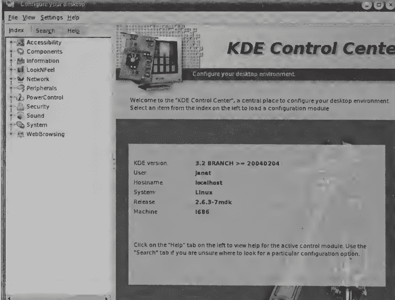

你桌面外观和行为的大多数配置可以通过点击上方侧窗格中的“外观”（Look and Feel）来找到。

GNOME 没有像 KDE 控制中心那样的单一应用程序。相反，菜单项通常位于单个菜单类别中，例如 Fedora 中的“偏好设置”（Preferences）或 Mandrake 中的“系统配置”（System Configuration）。SuSE 的 GNOME 配置项如图 6-8 所示。

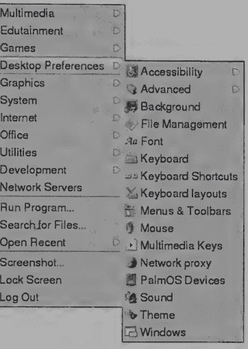

图 6-8 GNOME 桌面偏好主菜单项显示了配置工具的子菜单。

在此图中，桌面偏好显示了配置工具。

本章的其余部分描述了如何更改你桌面的某些设置。将讨论以下设置：

- 背景：桌面背景和面板背景。更改颜色或使用图片作为背景。
- 图标：添加或删除桌面图标和面板图标。
- 字体：更改字体样式和大小。
- 屏幕保护程序：设置屏幕保护程序和延迟时间。
- 面板：更改长度、宽度和位置。重新组织面板上的对象。

本章涵盖了 KDE 和 GNOME 的桌面配置。

### 更改 KDE 背景

你可以更改桌面和面板的背景。背景可以是纯色、图案或存储在文件图片。文件在第 9 章中讨论，图形在第 13 章中讨论。

要更改桌面背景，右键点击桌面并选择“配置桌面”。显示出一个屏幕，左侧面板中有选项。点击“背景”。图 6-9 显示了弹出的配置窗口。

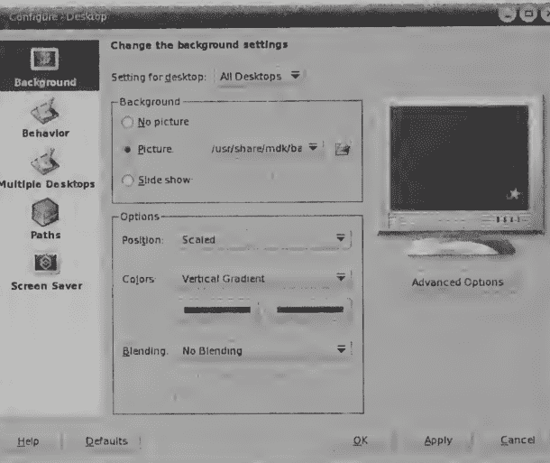

**图 6-9** 背景配置窗口。

当你进行更改时，屏幕上的图片会显示你的选择后的外观。右下角的“应用”（Apply）按钮会在离开配置窗口之前将桌面更改为新外观，因此你可以尝试不同的外观。

要使用图片作为背景，勾选“使用图片”（Use picture），如图 6-9 所示。使用下拉列表从可用图片列表中选择。或者使用下拉列表右侧的“浏览”（Browse）按钮导航到图片文件。

要使用颜色而非图片作为背景，勾选“不使用图片”（No picture）。如果你点击“颜色”（Colors）按钮，会出现颜色选项下拉列表（如水平渐变）。如果你点击“图案”（Pattern）选项，会出现一个“设置”（Setup）按钮，点击后将显示一个带有可选图案列表的屏幕。屏幕包含一个“添加”（Add）按钮，允许你输入包含图案的图形文件路径。

你可以为背景选择一两种颜色。如果你选择了两种颜色，它们将作为垂直或水平背景渐变的端点。

要选择颜色，双击颜色按钮。在右侧显示的颜色屏幕中，你可以通过点击颜色或专门设置值（例如设置 R、G、B 的数值）来选择颜色。你选择的颜色显示在下方的框中，这样你可以看到何时找到了喜欢的颜色。

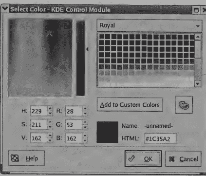

要更改面板背景，右键点击面板（面板上的空白区域，而不是按钮）并选择“配置面板”。如果左侧窗格的图标列表中没有“外观”（Appearance），那么点击“布局”（Layout）后应该会有“外观”选项卡。显示一个与图 6-10 类似的屏幕。

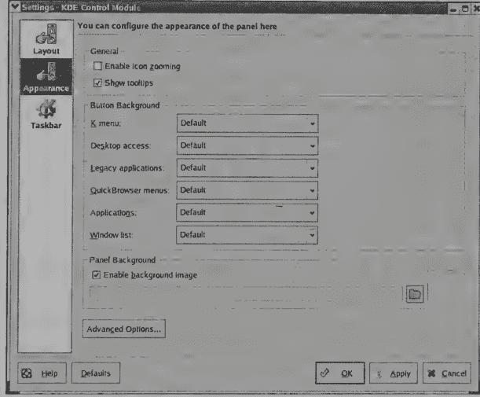

**图 6-10** 面板背景。

你可以通过从特定项目的下拉列表中选择背景，单独配置每个组件的背景，例如主菜单（K菜单）或应用程序图标。

你可以勾选“启用背景图像”（Enable background image）为整个面板添加背景。你可以输入图片的路径或使用“浏览”（Browse）按钮。

### 更改 GNOME 背景

你可以更改桌面和面板的背景。背景可以是纯色、图案或存储在文件图片。文件在第 9 章中讨论，图形在第 13 章中讨论。

要更改桌面背景，右键点击桌面并选择“配置桌面”。显示出一个屏幕，左侧面板中有选项。点击“背景”（Background）。图 6-9 显示了弹出的配置窗口。


**图 6-9** 背景配置窗口。

当你进行更改时，屏幕上的图片会显示你的选择后的外观。右下角的“应用”（Apply）按钮会在离开配置窗口之前将桌面更改为新外观，因此你可以尝试不同的外观。

要使用图片作为背景，勾选“使用图片”（Use picture），如图 6-9 所示。使用下拉列表从可用图片列表中选择。或者使用下拉列表右侧的“浏览”（Browse）按钮导航到图片文件。

要使用颜色而非图片作为背景，勾选“不使用图片”（No picture）。如果你点击“颜色”（Colors）按钮，会出现颜色选项下拉列表（如水平渐变）。如果你点击“图案”（Pattern）选项，会出现一个“设置”（Setup）按钮，点击后将显示一个带有可选图案列表的屏幕。屏幕包含一个“添加”（Add）按钮，允许你输入包含图案的图形文件路径。

你可以为背景选择一两种颜色。如果你选择了两种颜色，它们将作为垂直或水平背景渐变的端点。

要选择颜色，双击颜色按钮。在右侧显示的颜色屏幕中，你可以通过点击颜色或专门设置值（例如设置 R、G、B 的数值）来选择颜色。你选择的颜色显示在下方的框中，这样你可以看到何时找到了喜欢的颜色。


要更改面板背景，右键点击面板（面板上的空白区域，而不是按钮）并选择“配置面板”。如果左侧窗格的图标列表中没有“外观”（Appearance），那么点击“布局”（Layout）后应该会有“外观”选项卡。显示一个与图 6-10 类似的屏幕。


**图 6-10** 面板背景。

你可以通过从特定项目的下拉列表中选择背景，单独配置每个组件的背景，例如主菜单（K菜单）或应用程序图标。

你可以勾选“启用背景图像”（Enable background image）为整个面板添加背景。你可以输入图片的路径或使用“浏览”（Browse）按钮。

### 设置字体

你可以更改桌面的字体大小和样式。在主菜单中，选择 KDE 控制中心（KDE Control Center）。在索引中，点击外观（LookNFeel）->字体（Font）。打开图 6-13 所示窗口。选择字体大小和样式。

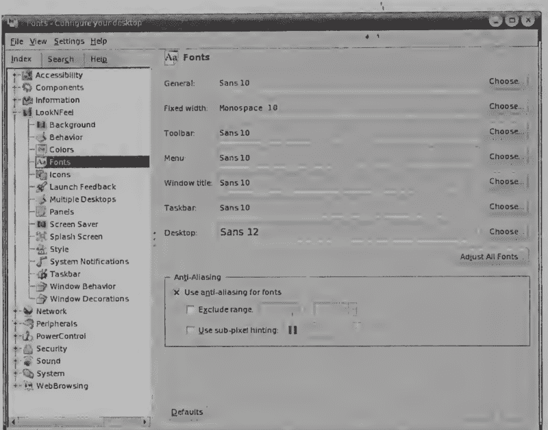

图 6-13 字体选择屏幕。

在 GNOME 中，点击主菜单。选择选项（Preferences）->字体（Font）。打开右侧屏幕，显示当前字体。要更改其中一种字体，点击字体的名称。桌面字体窗口允许你选择字体大小、尺寸和样式，例如粗体或*斜体*。当你在此屏幕上选择字体设置时，会显示字体预览，你可以在点击 OK 保存之前查看所选择的效果。

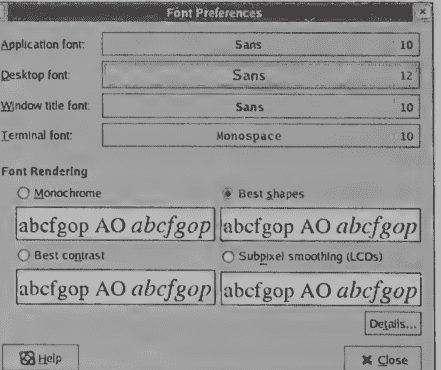

当你对设置满意时，点击关闭（Close）。

使用桌面 > 设置字体

## 设置屏幕保护程序


# 屏幕保护程序

Linux 包含屏幕保护程序——当你一段时间没有输入任何内容或移动鼠标时，它会替换你的工作屏幕。按键或移动鼠标即可返回工作屏幕。你可以看到屏幕保护程序的外观以及启动屏幕保护前必须发生的活动时长。

## KDE 设置

在 KDE 上，右键点击桌面并选择`Configure Desktop`，这将显示一个左侧面板带有图标列表的屏幕。点击`Screen Saver`，将显示图 6-14 所示的屏幕。

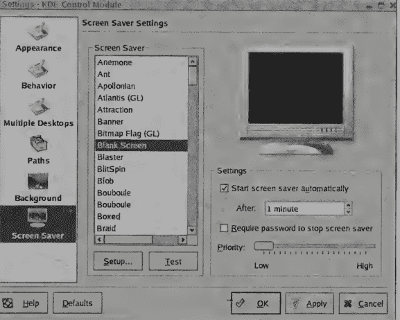

图 6-14 屏幕保护选择。

从列表中选择一个屏幕保护程序，计算机终端上会进行预览。某些屏幕保护程序可以更改，例如更改“空白”的颜色。要配置你选择的特定屏幕保护程序，点击`Setup`。点击`Test`在点击 OK 保存设置之前测试屏幕保护程序。

使用屏幕保护是可选的。在设置（Settings）面板中，你可以勾选或取消勾选“自动启动屏幕保护程序”（`Start screen saver automatically`）。你可以更改屏幕保护程序运行之前的时间。

## GNOME 设置

对于 GNOME，点击主菜单图标。选择选项（Preferences）。从子菜单中选择屏幕保护程序（Screen Saver）。显示的类似屏幕允许你选择一个屏幕保护程序，或选择多个连续运行的屏幕保护程序。你可以选择屏幕保护程序启动之前的时间，如果选择了多个，可以选择在下一个启动之前每个程序运行的时间。

# 整理桌面

你的桌面可以根据你个人的人的工作风格进行组织。通过桌面上的图标可以快速访问应用程序。面板上的应用程序图标在桌面被打开窗口覆盖时提供访问。面板上可以放置许多实用工具，如时钟和一个一次性最小化所有窗口的图标。位置（如主目录）或文件（如今天）的图标也十分方便。

你可以将应用程序和位置拖到桌面或面板上。在菜单中找到该应用程序并高亮它。或者打开目录。然后使用鼠标将应用程序或目录拖到所需位置。

此外，还有专门针对面板的项目菜单。直接在面板上右键点击并选择`Add`或`Add to panel`，以查看如`Accessories`或`Amuseements`等项目。在面板或子菜单上高亮所需项目并将其拖过面板。

你可以将桌面上的图标拖到你想要的任何地方。你也可以从桌面菜单一次性排列所有图标。在 GNOME 中，右键点击桌面并选择`Clean Up by Name`，以从左上角开始按字母顺序排列图标。从 KDE 桌面菜单选择中，选择`Icons`将它们垂直或水平对齐，以便按名称、大小或类型进行排序。

要移动面板上的对象，右键点击图标并选择`Move`。使用鼠标将对象拖到新的面板位置。在 KDE 面板上，某些对象（如任务栏和分页器）是使用特定对象的菜单移动的。

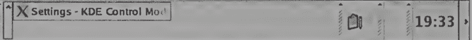

**图 6-15** KDE 面板区域。

如果你点击任务栏左侧的小箭头，将打开一个针对整个任务栏的菜单，其中包含你可以选择的项目，包括移动任务栏（`Move Taskbar`）。

在图 6-15 中，面板左侧有一个指向侧边的箭头——隐藏按钮。点击该按钮隐藏菜单；再次点击将其恢复。面板上并不总是包含此按钮。若要在 KDE 中添加面板隐藏按钮，右键点击面板并选择`Configure Panel`。点击`Hiding`选项卡。勾选“显示面板隐藏按钮”（`Show panel-hiding button`）和/或“显示右面板隐藏按钮”（`Show right panel-hiding button`）。要在 GNOME 中添加按钮，右键点击面板并选择`Properties`。隐藏按钮（hide buttons）。

# 更改面板的位置和大小

可以更改面板的大小的位置。在 KDE 中，右键点击面板并选择`Configure Panel`，这将显示图 6-16 所示的屏幕。

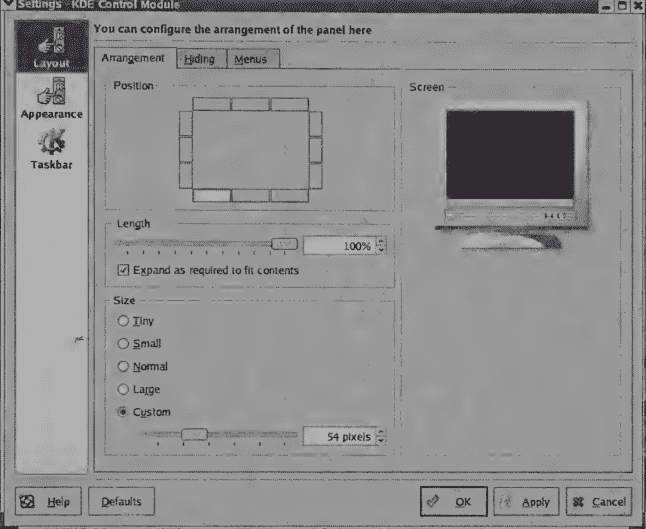

**图 6-16** KDE 面板配置屏幕。

屏幕预览中的计算机终端显示了当前设置。任何设置的更改都会生效。在位置（Position）部分，显示了当前设置。在设置（Size）部分，显示了当前设置。使用滑块更改面板的长度。在自定义（Custom）部分，显示了高度。使用滑块更改面板的宽度。

对于 GNOME，右键点击面板并选择`Properties`。方向（Orientation）按钮允许你选择顶部、底部、左侧或右侧。当你对设置满意时，关闭（Close）。

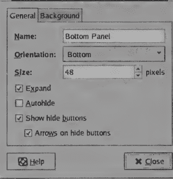

使用桌面 > 更改面板的位置和大小

# 配置虚拟桌面

Linux 不仅允许你配置桌面的一切，还允许你拥有多个桌面，每个桌面的配置不同。你可以有一个桌面用于财务工作，另一个用于艺术项目。多个桌面也被称为虚拟桌面。与虚拟桌面相关的面板部分见图 6-17。

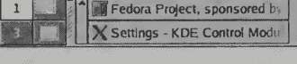

**图 6-17** KDE 面板区域。

带有四个正方形的对象称为分页器（pager），代表可用的虚拟窗口。窗口 1 为白色，意味着桌面 1 当前处于激活状态。注意桌面 2 和 4 显示了应用程序，而桌面 3 没有。任务栏显示了两个应用程序，代表所有窗口中的应用程序。点击数字正方形进入特定桌面。点击任务栏上的应用程序按钮进入应用程序所在的位置。如果它在不同的桌面上，将打开该桌面。

应用程序可以轻松从一个桌面移动到另一个桌面。当你点击打开应用程序左上角的箭头时，你会看到一个菜单，其中包含图 6-68 所示的项目。

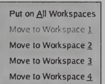

**图 6-18** KDE 面板区域。

尽管分页器显示四个桌面，如果你需要，实际上可以拥有更多。要设置桌面，右键点击桌面并选择`Configure Desktop`。从左侧面板中选择`Multiple Windows`。图 6-19 所示的窗口打开。

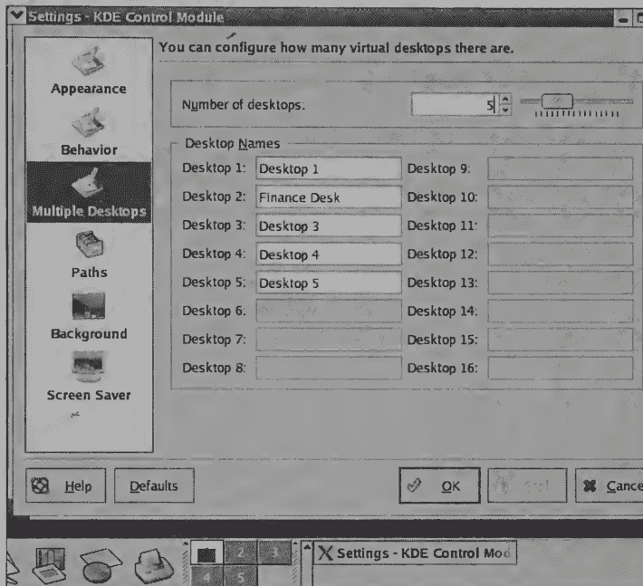

**图 6-19** KDE 面板区域。

在此图中，五个桌面可用。注意分页器显示五个桌面正方形——窗口 1 激活并打开应用程序。

使用屏幕顶部的桌面数量（`Number of desktops`）字段更改可用桌面的数量。如果你愿意，可以为桌面输入名称以帮助组织桌面。当你将鼠标指针悬停分页器正方形上时，名称将在工具提示中显示。

# 注销

在不注出的情况下直接关闭电源而不正常关机可能会导致问题。Linux 可能正在运行某些运行计算机必需的后台活动，并且可能无法完成其任务。

要注销，请在主菜单中选择“退出”（`Log Out`），或在右键点击桌面时显示的桌面菜单中选择。在大多数情况下，会弹出一个包含至少三个选项的窗口，类似于图 6-20 所示的 SuSE 窗口。

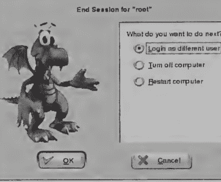

图 6-20 SuSE 注销窗口。

选项之一是“退出”（`Log Out`），或者在此情况下是“以不同用户身份登录”（`Login as different user`）。选择此选项将退出当前话，但会显示登录界面，以便你以不同的用户（不同的桌面）登录。Linux 并未关闭。第二个选项是重启（reboots）计算机。Linux 已关闭但会在无需你协助的情况下重启。

第三个选项是“关机”（`Shut Down`）或“关闭计算机”（`Turn off computer`）。这会关闭所有程序。计算机可能会自动断电，或显示已准备好关机的信息。

电力并非必须。Linux 可以在没有问题的情况下无限运行。它为你省去了在用户之间进行关机/启动过程的麻烦。节省了时间，而且人认为这对计算机更好。如果你不愿让计算机一直开启，可能会有人访问它，你可以锁定屏幕，这样没有密码的人无法使用它。要锁定屏幕，请从主菜单中选择“锁定屏幕”（`Lock screen`）。如果有人尝试在屏幕锁定的情况下使用计算机，将显示密码提示，在输入密码之前计算机无法使用。

# 总结

Linux 为你在操作计算机时提供了两种基本类型的界面供你使用：GUI（图形用户界面）和 CLI（命令行界面）。本章描述了如何使用 GUI。本章包含以下信息：

- 如何登录
- 桌面上有什么
- 两个主要桌面环境——KDE 和 GNOME 之间的相似之处和差异
- 桌面底部面板的组织结构和组件
- 如何使用桌面功能
- 如何配置桌面
- 如何注销

本章描述了如何在桌面上工作。下一章（第 7 章）解释了如何在 CLI 下工作。

# 第 7 章 使用命令行

命令行是你输入命令的空白行。没有图标，没有菜单，没有按钮。嗯，并不是完全空白。行首会显示几个字符，称为系统提示符（system prompt），后面跟着一个闪烁的正方形，称为光标。

如果你没有在 DOS 或 Windows 的命令提示符下工作过，命令行界面（CLI）对你来说可能是新领域。

命令行光标表示 shell 正在等待输入命令。shell 是一个计算机程序，在你与执行命令的 Linux 部分（内核）之间提供界面。shell 提供了你输入命令的命令行，接受你的输入，解释其内容并执行生成的命令。Linux 可用多个 shell。默认 shell 称为 Bash。Bash 是 Bourne again shell（再次 Bourne shell）的缩写，因为 Bash 是早期的 Bourne shell 的后代。此外，书中也讨论了 Bash。除非你成为系统管理员或高级程序员，否则你可能不会不同的 shell。

shell 与 Linux 的核心——内核通信。所有的计算机魔术都发生在内核中。是内核将数据传输到硬盘、跨网络发送数据，以及所有其他让计算机运行的低级任务。本书的功能不是解释内核的工作原理。它（以及打印机、屏幕、鼠标）写入文件。也许你们中的某些人在学习基础知识后会深入研究这种魔术，但大多数人不会。

许多 Linux 用户可以在桌面上完成所有所需任务，而无需使用命令行。然而，直接在 shell 中工作几乎总是更快。此外，命令行提供了更多功能。在桌面上难以或无法完成的任务，在 shell 中工作时会变得简单。对于并行功能，命令通常有许多更多的选项，比允许简单系统的桌面功能提供更多功能。系统管理员和程序员需要在 shell 中工作。在你熟悉 shell 后，你可能会发现对所有任务在 shell 中工作都更快、更方便。

本章中的许多命令描述提到了文件和目录。如果你不这些术语，将在第 9 章中进行详细解释。

## 输入命令

要使用命令行，你可以打开一个终端窗口（terminal window），有时也称为控制台（console），你可以在其中直接进行 shell 工作。这类似于在 Windows 中打开 DOS 或命令提示符窗口。

某些发行版在面板上提供一个图标，你可以点击它打开终端窗口。该图标包含一个显示器屏幕。其他发行版不提供终端屏幕。通常，桌面菜单（右键点击桌面）包含一个打开终端窗口的选项。你始终可以在主菜单中找到它，可以是主菜单项，也可以是系统下的子菜单项。

终端窗口显示系统提示符，随后是光标，显示它正在等待输入命令。

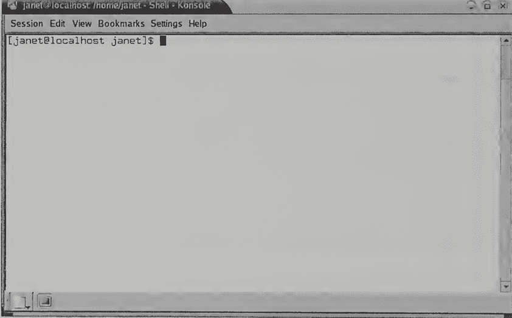

图 7-1 打开 KDE 终端窗口。

当你输入命令并按 `<Enter>` 时，命令就会执行。系统提示符是可以配置的。不同的发行版设置不同的提示符。

## 输入单个命令

有时你可能想执行单个命令，例如一个文件。参数是目录的路径；参数指定的目录（jane）的文件将显示在屏幕上。然而，`ls` 是一个不需要参数的命令，在你不传递参数时会使用默认值。如果不包含目录名称，`ls` 命令将列出当前目录的文件。

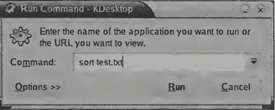

## 命令行语法

在命令行提示符后在命令行输入命令。当你输入命令并按 `<Enter>` 时，命令开始执行。命令执行期间不显示系统提示符。当命令运行时，会显示系统提示符，表示 shell 已准备接受接受命令。

**提示：** 在命令执行期间，你可以按 `<Ctrl+c>` 停止它。

命令由以下格式的命令名、选项和参数组成：

```
commandname options arguments
```

- `commandname` 是命令名。
- 选项是影响命令执行的关键字。选项由一个连字符 (`-`) 两个字符字符字符的字符字符串组成。连字符告诉 shell 接下来的字符是选项。对于大多数命令，选项是可选的。
- 参数是命令在执行期间使用的信息。例如，命令可能会处理文件，因此你需要传递文件名作为参数。你可以根据需要传递任意数量参数。并不是所有命令都需要参数。

以下命令显示了一个命令名、一个选项和一个参数：

```
ls -l /home/jane
```

`ls` 命令列出目录的文件。参数是目录的路径；参数指定的目录（jane）的文件将显示在屏幕上。然而，`ls` 是一个不需要参数的命令，在你不传递参数时会使用默认值。如果不包含目录名称，`ls` 命令将列出当前目录的文件。

`-l` 是你可以配合 `ls` 命令使用的许多选项之一，用于确定显示的信息及其格式。`-l` 选项产生的输出比标准的 `ls` 输出包含更多信息。在不使用 `-l` 的情况下，标准命令输出输出 `/home/jane` 目录下的文件列表：

```
ls /home/jane
text.txt
text.txt
```

而带有 `-l` 的 `ls` 命令的输出更长，如下所示：

```
ls -l /home/jane
-rw-r--r-- 1 jane jane 50 Apr 25 11:09 test.txt
-rw-r--r-- 1 jane jane 52 Apr 25 11:15 test2.txt
```

你可以像如下所示输入多个选项：

```bash
ls -d /home/jane
```

你可以像如下所示用分号 (`;`) 分隔输入多个命令：

```bash
ls /home/jane; ls /home/kim
```

> **提示：** 你可以输入多行的命令。在按下回车键之前，在行尾输入一个反斜杠 (`\`)，第二行将被视为第一行的延续。

## 为长命令创建快捷方式

你可能有一个经常输入的长命令。如果是这样，你可以为该长命令创建一个短别名（alias），这样你每次需要它时就不需要重新输入长命令了。你可以改而输入短别名。

例如，以下命令创建了别名 `listall`——它是四个 `ls` 命令的别名：

```bash
alias listall='ls /home/jane; ls /home/kim; ls /home/george; \
ls /home/sam'
```

现在你可以输入 `listall` 来显示所有四个目录中的文件。

## 重定向输入和输出

命令通常需要从键盘接收输入和/或将输出发送到屏幕。当数据从一个程序或设备移动到另一个时，它们以流的形式进行传输。当程序运行时，它会自动连接到一个输入流和一个输出流：`stdin` 和 `stdout`。默认情况下，`stdin` 连接到键盘，`stdout` 连接到屏幕。你可以重定向 `stdin` 和 `stdout`。

`ls` 命令将文件列表输出到 `stdout`，默认连接到屏幕。你可以使用重定向元字符——大于号 (`>`) 来更改输出位置，如下所示：

```bash
ls > dirlist
```

文件列表被重定向到名为 `dirlist` 的文件中，不会显示在屏幕上。如果 `dirlist` 不存在，则会创建。如果 `dirlist` 已存在，它会被覆盖。可以使用 `>>` 代替 `>` 将输出追加到现有文件中。或者，你可以设置 `noclobber`，这是一个停止覆盖文件并打印如“Can’t overwrite existing file”等信息的 shell 选项，如下：

```bash
set -o noclobber
```

`stdin` 的重定向元字符是小于号 (`<`)。例如：

```
mail < message
```

`mail` 命令从名为 `message` 的文件中输入文本而不是从键盘，并通过电子邮件发送消息。

第三种流 `stderr` 连接到运行的程序。错误信息使用 `stderr` 流，该流默认连接到屏幕。当你使用 `>` 重定向输出时，`stderr` 不会被重定向；它仍然显示在屏幕上。要重定向 `stderr`，请使用类似的命令：

```bash
ls &> dirlist
```

现在，文件列表和任何错误信息都将发送到文件 list 中。

有时你想将一个程序的 `stdout` 直接连接到另一个程序的 `stdin`。这种连接被称为管道（piping），并使用元字符 `|` 完成。假设你想将目录中所有文件的列表直接发送到打印机。可以使用以下命令：

```bash
ls | lpr
```

## 在后台运行命令

某些命令需要很长时间才能完成执行。例如，以下命令将你计算机上每个文件的名称存储在文件 `allfiles` 中：

```
ls -lR / > allfiles
```

此命令会占用你的命令行很长时间，直到它完成任务。如果你不想等待命令完成，可以在后台执行该任务，允许你在第一个命令执行期间期间输入其他命令。你可以通过在命令末尾添加安培符号 (`&`) 来在后台启动命令，如下所示：

```bash
ls -lR / &
```

后台作业按连续顺序分配一个数字。作业号在提交命令时会显示，并用于监控后台作业的状态。

你也可以像如下所示将已经在运行的作业发送到后台：

```
Ctrl-z
```

第一行挂起作业。第二行在后台启动该作业。

你可以通过输入以下命令列出正在运行的作业：

```
jobs
1 ls -lR /
```

你可以使用命令 `fg jobnumber` 将任何作业带回前台：

```
fg jobnumber
```

例如：

```
fg 1
```

## 编辑命令行

若干命令行功能可以帮助你输入命令。例如，可以使用通配符，即与你在 Windows 中使用的相同的通配符。星号 (`*`) 可以替换字符字符串，问号 (`?`) 可以替换单个字符。因此，以下命令列出了所有以 `var` 开头并以单个字符结尾的文件名。


```
ls var?
```

当你按下 Tab 键时，shell 会为你补全命令。如果有多个匹配项，它会显示所有匹配项。如果你再次按下 Tab，它会列出可能的补全选项。

shell 还会补全目录名。如果你输入目录名称并按下 Tab，它将补全该名称。如果有多个目录，它将显示所有它们。

你还可以补全参数。如果你输入一个命令和一个参数并按下 Tab，它将补全该参数。如果有多个可能的参数，它将显示所有它们。

## 一些实用命令

下表列了一些最实用的 Linux 命令。表格显示了命令名称、命令的功能以及在哪里可以找到更多信息。此外，本章还记录了 `sort` 和 `grep` 这两个较为灵活的命令，以展示复杂命令的使用。

Linux 命令可以在命令行或 shell 脚本（在 Linux shell 中执行任务的程序）中使用。创建 shell 脚本的方法将在第 19 章中进行讨论。

### 表格 7-1 一些实用的 Linux 文件管理命令

| 命令 | 功能 | 详情位于 |
|---|---|---|
| `cat` | 显示文件内容。 | 第 9 章 |
| `cd` | 切换当前目录。 | 第 9 章 |
| `chgrp` | 修改文件的组所有者。 | 第 9 章 |
| `chmod` | 修改文件的权限。 | 第 9 章 |
| `chown` | 修改文件的所有者。 | 第 9 章 |
| `cp` | 复制文件或目录。 | 第 9 章 |
| `diff` | 比较两个文件的内容。 | 第 9 章 |
| `diff3` | 比较三个文件的内容。 | 第 9 章 |
| `find` | 在硬盘上查找文件。 | 第 9 章 |
| `grep` | 查找包含指定内容的文件。 | 第 9 章 |
| `less` | 在屏幕上逐页显示文件内容。 | 第 9 章 |
| `ls` | 列出目录下的文件文件列表。 | 第 9 章 |
| `mkdir` | 创建新目录。 | 第 9 章 |
| `mv` | 移动文件位置。也可用于重命名文件。 | 第 9 章 |
| `pwd` | 显示当前目录的路径。 | 第 9 章 |
| `rmdir` | 删除目录。 | 第 9 章 |
| `touch` | 更新文件的最后访问/修改日期。 | 第 9 章 |

### 表格 7-2 一些实用的 Linux 账户管理命令

| 命令 | 功能 | 详情位于 |
|---|---|---|
| `env` | 设置或显示环境变量。 | App B |
| `groupadd` | 添加新组。 | 第 8 章 |
| `groups` | 显示现有组的列表。 | 第 8 章 |
| `passwd` | 修改密码。 | 第 8 章 |
| `quota` | 显示账户的已用和可用磁盘空间。 | App B |
| `su` | 切换到超级用户或另一个用户账户。 | 第 8 章 |
| `unset` | 移除环境变量。 | App B |
| `useradd` | 添加新用户账户。 | 第 8 章 |
| `userdel` | 删除用户账户。 | 第 8 章 |
| `whoami` | 显示当前账户。 | 第 8 章 |

### 表格 7-3 一些实用的 Linux 打印作业管理命令

| 命令 | 功能 | 详情位于 |
|---|---|---|
| `lpr` | 将文件发送到打印机队列。 | 第 14 章 |
| `lprm` | 从打印队列中删除文件。 | 第 14 章 |
| `lpq` | 显示队列中作业的信息。 | 第 14 章 |

### 表格 7-4 一些杂项实用的 Linux 命令

| 命令 | 功能 | 详情位于 |
|---|---|---|
| `whereis` | 查找程序的路径。 | App B |
| `tar` | 将文件存入归档并从归档提取文件。 | 第 10 章 |
| `ftp` | 在计算机之间传输文件。 | App B |
| `clear` | 清除屏幕。 | App B |
| `date` | 显示当前日期和时间。 | App B |
| `gzip` | 压缩文件。 | App B |
| `gunzip` | 解压缩文件。 | App B |

## sort 命令

如果你想对纯文本文件进行排序，可以将其引入文字处理器并进行排序。然而，Linux 有一个 `sort` 命令，速度更快且更易用。排序名为 `unsorted.txt` 文件的命令是：

```
sort unsorted.txt
```

这是 `sort` 最简单的形式，足以许多需求。此外，该命令有几个影响排序过程的选项。表格 7-5 显示了最实用的选项。

### 表格 7-5 sort 命令的选项

| 选项 | 功能 |
|---|---|
| `-filename` | 将输出保存到指定文件中 |
| `-r` | 反序排序 |
| `-u` | 删除重复行 |
| `-k` | 指定按哪个键排序 |
| `-t` | 定义分隔行中键的字符 |

使用 `-k` 和 `-t` 选项可以进行更复杂的排序。它们允许你精确指定要排序行中的哪部分文本，而不仅仅是从行首开始排序。例如，你可以使用以下命令：

```
sort -kt unsorted.txt
```

`-t` 定义了分隔键的空格。`-k` 指定了按哪个键排序。因此，`sort` 将根据行中的第二个单词对行进行排序：该排序的输出为：

```
Sorted Unsorted
```

## grep 命令

`grep` 命令深受用户喜爱，以至于它有自己的选项。`grep` 命令查找包含指定内容的文件，并输出每个找到的行。`grep` 命令的通俗格式为：

```
grep pattern files
```

- `pattern` 指定要搜索的文本。*pattern* 可以是一个字面字符串（如 abc），也可以是一个正则表达式（例如匹配任何大写字母或任何以 Q 开头的单词）。正则表达式将在附录 A 中讨论。

- `files` 指定要搜索的文件。*files* 可以指定文件名（如有需要使用通配符）或目录。

例如，以下是一个简单的 `grep` 命令及其输出：

```
grep "Poppins" *
file1.txt:I like Poppins
file7.txt:Poppins is a great movie.
```

该命令在当前目录下的所有文件中查找字符串 "Poppins"。包含搜索字符串的行将显示并在前面加上文件名。你可以使用路径（如 `/home/user`）代替 `*` 来指定目录，并搜索其中的所有文件。`grep` 命令有许多选项，其中一些在表格 7-6 中。

### 表格 7-6 grep 命令的选项

| 选项 | 功能 |
|---|---|
| `-c` | 输出找到的行数，而不是行本身。 |
| `-i` | 忽略大小写匹配。 |
| `-L` | 输出匹配项的文件名，而不是实际行。 |
| `-n` | 包含匹配项的行号。 |
| `-r` | 检查指定目录下的所有子目录。 |
| `-v` | 输出所有不匹配的行。 |
| `-x` | 仅当行完全匹配模式时才输出。 |

## 配置终端窗口

你可以根据喜好配置终端窗口。你可以更改颜色、字体大小、窗口大小、声音以及终端的其他特性。KDE 和 Gnome 均支持配置，但方法不同。

KDE 终端窗口顶部有一个菜单。用于设置的下拉菜单在右侧。你可以显示或隐藏菜单（顶部）和工具栏（底部）。你可以将滚动条放在左侧或右侧。你可以将窗口设置为全屏，或使用大小项目指定窗口大小。如果你选择字体，可以看到一个更改字体大小的菜单。历史允许你设置历史——你执行过的命令列表。颜色（高亮项）允许你设置文本和背景颜色。

如果你选择设置，当前的设置将被保存。下次打开终端时，这些设置仍然有效。

Gnome 提供相同的选项，但通过不同的机制。Gnome 允许你设置配置文件。选择文件->配置文件，可以看到面板。

注意常规、标题、颜色、效果和滚动标签。点击标签允许你设置配置选项。你可以拥有多个配置并根据需要更改。除非切换到不同的配置，否则默认配置有效。

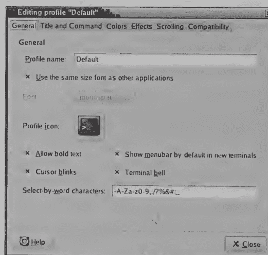

## 总结

Linux 为提供了两种基本的界面：GUI（图形用户界面）和 CLI（命令行界面）。本章介绍了如何使用 CLI，包括如何执行：

- 输入命令

- 重定向输入和输出

- 在后台运行命令

- 获取命令帮助

- 配置终端窗口

此外，还提供了实用命令的总结。详细描述了 `sort` 和 `grep` 命令作为命令使用的示例。

在下一章中，将描述 Linux 账户的管理。将描述使用桌面和使用 CLI 管理账户的方法。

# Linux 账户

Linux 是一个多用户操作系统——一个允许许多用户同时在计算机上工作的系统。为了实现这一点，每个用户的工作必须保持独立。不允许任何用户无论是无意还是出于恶意意图干扰另一个用户的工作。如果一个系统允许删除你费心编写的报告，那么它将非常不受欢迎。Linux 账户可以保持用户工作的私密性并受到保护。

Linux 系统基本上由文件和进程组成。所有信息都组织在文件中，每个文件由一个账户拥有，并受到其他账户的保护。你在计算机上进行的所有工作（包括保持计算机运行的隐形工作）都是在进程中完成的——即正在运行的程序。程序由账户运行。因此，没有账户，你在 Linux 上就什么也做不了。

你可能可能是计算机上唯一工作的人。如果是这样，没有账户，你就无法在 Linux 上工作。因此，至少需要一个账户。账户可以帮助你免受来自互联网的未经授权访问，以及来自你办公桌前的未经授权访问。

你会在系统中看到一些你并未创建的账户。这些是运行系统和应用程序进程的特殊账户。有些是在安装期间创建的。另一些是在你安装软件应用程序时由安装过程创建的。然而，这些通常不是你可能会登录的账户。只有系统管理员可能需要理解或处理特殊账户。

## 账户类型

并不是所有账户都是平等的。每个账户都有一组权限——一组它被允许执行的操作。账户分为两种类型：

- Root：root 账户，被称为超级用户（super user），被允许执行任何操作。它可以访问系统上的每个文件、目录和程序。每个 Linux 系统必须有一个 root 账户。

- 用户（User）：用户账户的限制更多。除非被赋予额外权限，否则用户账户只能访问使用该账户本身创建的目录和文件。

在安装期间，创建了一个 root 账户，可能还有一个或多个用户账户，并设置了密码。不要忘记 root 密码。你必须使用 root 账户对系统进行更改。root 可以随时添加新账户。

大多数时候登录并使用你的用户账户是明智的。事实上，除非真的需要，否则不要使用 root 账户。root 账户拥有无限权力，可能会导致一些灾难性的错误。

用户账户可以临时授予 root 权限。如果你在登录用户账户桌面时需要执行需要 root 权限的任务，你可以输入 root 密码并执行该任务。例如，当你登录用户账户时进入主菜单->系统设置并选择用户或组或 root 时，将弹出图 8-1 所示的窗口提示。

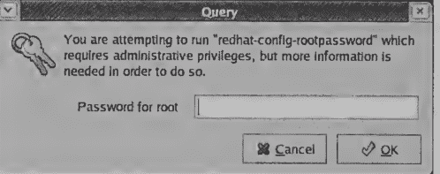

图 8-1 root 密码提示。

在终端窗口的 shell 中工作时，只要知道密码，就可以从一个账户切换到任何其他账户。使用以下命令切换账户：

```
su accountname
```

除非你已登录 root，否则系统会提示你输入密码。root 无需密码即可 su 到任何账户。

## 组

每个账户在创建时都会被分配一个组的成员身份。分配给组的权限对组内所有账户可用。一个账户可以同时属于多个组。

组是向账户授予权限的有用方法。例如，假设你有一个名为 `destroy` 的程序，只有某些人应该使用。你可以设置该程序，让专家组（expert group）的人可以使用，但并不是所有用户。当你安装一个需要运行 `destroy` 程序的新账户时，将该账户分配到专家组。如果你为这组人安装了一个新程序 `destroy2`，你设置该新程序使得只有专家组可以运行它。

每个账户在创建时至少必须分配一个组。在任何账户分配给某个组之前，该组必须已经存在。Linux 允许你设置一个默认组，分配给每个新账户。某些 Linux 系统将相同的组（通常名为 `users`）分配给所有新账户。用户组没有特殊的权限。其他 Linux 系统为每个新账户分配一个单独的组。例如，当 Fedora 创建用户账户时，它也会创建一个同名的组并将其分配给新账户。因此，账户 `janet` 属于组 `janet`。`janet` 组没有额外权限。

Linux 默认安装了几个组。root 是 Linux 安装的一个组；root 账户是 root 组的成员。如果将新账户分配到 root 组，该新账户将拥有分配给 root 的相同权限。

你可以根据自己的目的创建组。组名应该代表组的目的，例如销售组（sales group）或邮件组（mail group）。组名限制在 16 个字符或以内。

组通过文件权限向账户授予权限。文件权限将在第 9 章中讨论。

## 账户信息

你可以查看和/或编辑账户信息。在 Fedora 上，选择主菜单->系统设置->用户和组来获取图 8-2 所示的窗口。


**图 8-2** 账户管理窗口。

突出显示一个账户并点击属性（Properties）。打开图 8-3 所示的窗口。


**图-3** 账户管理窗口。

主目录是属于账户的文件存储区域，除非账户所有者允许否则其他用户无法访问主目录。主目录的最常见位置是 `/home/accountname`。

点击窗口中的选项卡查看有关账户的更多信息。图 8-4 显示账户信息和密码屏幕。


**8-4** 账户和密码

账户信息允许你为账户设置过期日期，强制用户定期更改密码。这些设置提高了拥有大量用户的系统的安全性。

组屏幕提供了系统中所有组的列表。账户所属的组会被勾选。你可以根据需要勾选或取消勾选任何组。图中所示的组是 Fedora 安装期间设置的。建议勾选 Fedora 创建的任何组。


**8-5** 组列表。

大多数发行版都有类似的账户管理工具。通过主菜单->控制中心访问 SuSE YaST。Mandra 在 系统->配置计算机处有一个控制中心。

## 添加账户

使用上一节讨论的工具（查看和更改账户信息的工具）添加新账户。在 Fedora 上，选择主菜单->系统设置->用户和组来获取图 8-2 所示的窗口。要添加新账户，点击“添加用户”（Add User）。打开图 8-6 所示的窗口。


**图 8-6** 创建新用户窗口

填写新账户的信息。账户名必须少于 33 个字符且不能以数字开头。系统为登录 Shell 和主目录输入默认值。当你点击确定时，新账户会被添加。会创建一个与账户同名的组。其他系统（如 SuSE）为用户创建一个通用组，而不是私人的单独组。

你也可以从终端窗口中的命令行创建新账户。以 root 身份登录（或 su 到 root），输入：

```
useradd janet
```

新的 janet 账户还没有密码。接下来，输入：

```
passwd janet
```

系统将提示你输入密码，如下所示，并再次输入以进行检查：

## 密码

密码对于你 Linux 系统的安全性至关重要。它们可以防止你受到来自终端或互联网的未经授权的使用。你的 root 密码尤为重要。通常情况下，让你的密码难以被猜到但容易记忆。以下是创建密码的一些建议：

- 使用混合字符，包括大写字母、小写字母、数字和标点符号。

- 使用至少 8 个字符。

- 使用你喜欢的格言的首字母来创建一个难以猜解的密码。例如，“Take me out to the Ball Game!”会变成 TmotBG!。

- 用数字代替字母，例如用 1 (one) 代替 l (L)，或用 0 (zero) 代替 o (oh)。例如，Tm0ttBG！ 

一些应该避免的做法：

- 不要使用任何字典中可以找到的单词。破解软件可以逐个尝试字典单词。

- 不要使用日期。这是一种常见的做法，且可能性有限。此外，生日可能会被发现。

- 不要使用你名字的任何部分。

- 不要使用你孩子或宠物的名字。认识你的人可能会猜到这些。

- 不要把密码写下来并粘贴到终端前面。或者任何此类变体。使用一个你可以记住的密码。

- 不要告诉任何人你的密码。如果有人需要使用你的电脑，请为他们创建一个新账户使用。

## 组信息

在安装 Linux 系统时，会创建一些组。此外，每个 Linux 发行版在安装账户时都会提供一个默认组。某些发行版的默认是一个所有账户都所属的通用组，例如 users。其他发行版（如 Fedora）的默认是每个账户拥有一个私有组，名称与账户相同，例如为 jane 账户提供 jane 组。

你可以使用本章之前讨论的账户管理工具来查看可用组及其成员——该工具用于查看和更改账户信息。在 Fedora 上，选择主菜单->系统设置->用户和组，即可获得图 8-2 所示窗口。点击 组选项卡。打开图 8-7 所示的窗口。

图 8-7 组信息的显示。

显示的是非系统的组。要查看所有组（包括系统创建的组），点击偏好并选择过滤系统用户和组以关闭系统显示（设置旁边的复选框表示已开启）。

你可以通过点击标题栏来重新排序列表。例如，点击 组 ID 将组 ID 列表重新排序为降序，而不是图中所示的正序。

## 添加组

要添加组，请使用本章之前讨论的账户管理工具——该工具用于查看和更改账户信息。在 Fedora 上，选择主菜单->系统设置->用户和组，即可获得图 8-2 所示窗口。点击 组选项卡。点击 添加组。你会看到图 8-8 所示的窗口。

图 8-8 添加组对话框。

要添加组，请按照以下步骤操作：

1. 点击 账户选项卡。

2. 选中该账户。

3. 点击 属性。

4. 点击 组选项卡。

5. 组名必须少于 32 个字符，且不能以连字符开头。

6. 点击 好。


要将用户添加到组，请使用命令：

`usermod -aG [groupname] [username]`

要从组中移除用户，请使用命令：

`gpasswd -d [username]`

## 忘记密码

忘记 `root` 密码是一个常见问题。你可以在启动过程中进入单用户模式来恢复它。这允许你在无需密码的情况下访问 `root` shell，并从那里重置 `root` 密码。

1. 重启你的电脑。
2. 在 `GRUB` 启动菜单中，选择内核条并按 `e` 进行编辑。
3. 找到以 `kernel` 开头的行并移动到其末尾。
4. 在行尾附加 `init=/bin/bash`。
5. 按 `Ctrl+X` 或 `F10` 启动。
6. 当 `shell` 出现时，运行 `passwd root` 设置新密码。
7. 输入 `exec /init` 重启系统。

## 总结

Linux 是一个多用户操作系统。组将用户相互隔离。所有信息都组织在文件中，每个文件由账户所有。该系统保护了信息。

本章解释了如何：

- 查看和更改账户信息，如用户名、主目录和组组成部分
- 添加账户
- 添加或修改密码
- 添加组

下一章将解释如何设置和更改文件权限。它还解释了如何创建、复制、移动、删除以及其他管理文件。

# 文件组织

文件被组织在目录中，也称为文件夹。Windows 用户可能对文件夹很熟悉。一个目录可以包含文件和其他目录，数量根据需要而定。目录甚至可以是空的，不包含任何文件或目录。

**注意**

由于 Linux 上的所有信息都存储在文件中，目录实际上是一个文件，它包含了访问分配给它的文件所需的信息。

目录在你的硬盘上以分级结构组织，称为文件系统。虽然从技术上讲，可以按任何方式命名和组织目录，但大多数 Linux 系统都按照认可的 Linux 方式组织。顶层目录称为 `root`（根），用正斜杠（`/`）表示。

当创建一个用户账户时，它会被分配一个家目录。例如，账户 `janet` 被分配了一个名为 `janet` 的家目录。家目录位于名为根目录 `/home` 的目录中。`/home` 目录中有许多目录，每个用户账户对应一个目录，例如：

- `/home/janet`
- `/home/kim`
- `/home/theboss`

上述目录名称包含了其上级目录的名称。这种标记称为路径。`/home` 是从根到 `janet` 的路径。如果 `janet` 目录下有一个名为 `test` 的文件，则路径为 `/home/janet`，因此定位该文件的完整名称是 `/home/janet/test`。

强大的 `root` 账户的家目录与其他用户分开，位于 `/root` 中。

你可以在路径中使用快捷方式。点（`.`）代表当前目录；两个点（`..`）代表当前目录的前一个目录。例如，在 `/home/janet` 中，点目录是 `janet`，双点目录是 `home`。

文件在文件系统的位置包含路径。只要它们位于不同的目录，你就可以有两个同名的文件。

从根目录开始完整路径是绝对路径。它指的是从 `/` 到文件的路径。文件也可以通过相对路径定位——即从当前位置到文件的路径。例如，如果你位于 `/home/directory`，则该文件的相对路径是 `test/test`——即从 `home` 到文件的路径。

快捷方式在相对路径中非常有用。例如，如果你位于 `/home/janet`，到 `/home/kim` 的路径可以指定为 `../kim`。

## 文件信息

每个文件都有其属性。对于文件的某些特定用途，你可能需要了解关于它的信息：

- **名称**：标识文件的字符字符串。
- **位置**：文件的路径。
- **大小**：字节数。一个字节通常包含一个字符。
- **所有者/组**：拥有该文件的用户账户和组名。组将在第 8 章中解释。
- **创建/访问/修改日期**：文件被创建、最后访问或最后修改的日期/时间。
- **权限**：决定谁可以访问文件的设置。权限将在本章稍后部分详细讨论。

你可以从以下位置查看文件信息：

- **桌面**：文件管理器应用程序允许你查看和管理文件。
- **命令行**：有许多 Linux 命令可用于文件管理。

`KDE` 的文件管理器是 `Konqueror`。要检查文件，`Konqueror` 充当文件浏览器，允许你浏览文件系统，查看文件和文件信息（类似于 Windows 资源管理器）。`Konqueror` 也充当浏览器。

在你的 `KDE` 桌面上，如果你点击一个目录的图标（例如 `home`），`Konqueror` 将打开并显示家目录的内容。某些 Linux 发行版有一个“文件”菜单项。你可以在主菜单或系统菜单中找到 `Konqueror`。某些发行版在桌面或面板上有 `Konqueror`。

在本章中，桌面的文件管理说明是使用 `Konqueror` 给出的。只要你在安装时选择了 `KDE` 以及 `GNOME`，你就可以在 `GNOME` 桌面以及 `KDE` 面上使用 `Konqueror`。`GNOME` 有它自己的文件管理器名为 `Nautilus`，如果你点击 `GNOME` 上的图标，打开的是 `Nautilus` 而不是 `Konqueror`。然而，`Konqueror` 通常也出现在 `GNOME` 菜单中。

如果 `Konqueror` 从你的桌面和菜单中消失了，你可以从主菜单选择 `Run`（运行），输入 `Konqueror`，并在 `KDE` 和 `GNOME` 上点击 `Run`。

### 从桌面查看文件

`Konqueror` 文件浏览器如图 9-1 所示。它是 `Fedora Core 2` 系统上一个用户的家目录中的内容——通过在 `KDE` 桌面点击主目录图标或菜单上的 `Home` 打开。


**图 9-1** `Fedora Core 2` 上的 `Konqueror`。

主部分上方的“位置”（Location）字段显示目录中文件的内容，在本例中为 `/home/jane`。右侧的大面板显示目录中文件的图标，在本例中只有一个：`Desktop`。如果你双击文件夹图标（例如 `Desktop`），你将进入该文件夹并查看其内容；双击文件图标，该文件将在其关联的应用程序中打开。

窗口左侧的一行按钮控制左面板的内容。在本例中，根文件夹按钮是打开的，因此左侧面板显示根文件夹的内容。点击左侧面板中的文件夹将你进入该文件夹目录。

你还可以使用工具栏上的向上、后退和前进箭头在文件系统中移动。你可以通过点击工具栏上的主目录图标返回家目录。

要查看文件，右键点击文件。


**图 9-2** 文件信息。

## 文件列表

文件列表存储在文本文件 `dir_listing` 中，其格式与在屏幕上显示的格式相同。你可以查看该文件或将其打印。

使用 `ls` 命令列出的文件和目录不包含系统文件，除非你使用 `-a` 选项。在 Linux 上，系统文件以点（`.`）作为第一个字符命名，例如 `.bash_history`，它包含了你的命令历史。这些文件确保你的系统正常运行。通常情况下，在你不非常熟悉系统之前，最好不要变动这些系统文件。

当你使用 `-a` 选项时，你的文件列表将包含 `.` 和 `..`，分别代表当前目录（`.`）和上级目录（`..`，也称为父目录）。

要在文件系统中移动，请使用 `cd` 命令。以下是有效的命令：

```
cd /home/ranet      移动到 /home/ranet
cd ..             移动到上级目录
cd ~               移动到你的家目录
```

大多数 Linux 发行版都会为你提供一个提示符，显示你正处于哪个目录。然而，如果你不知道自己在哪个目录，可以随时输入：

```
pwd
```

它会显示当前目录的路径。

如果你为 `ls` 或 `cd` 提供了找不到的目录或文件名，你将看到类似下面的信息：

`No such file or directory`（没有此类文件或目录）

例如，如果你想切换目录 `/home/ranet`，且你位于 `/home/directory`，你可以输入以下相对路径：

```
cd janet
```

但是，如果你处于不同的目录，你将收到 `No such file or directory` 的消息。

## 文件权限

由于 Linux 是一个多用户系统，目录和文件需要保护免受未经授权的使用。每个目录和文件都有关联的权限，这些设置决定了谁可以访问文件以及他们可以对文件做什么。

文件的权限赋予三种类型的用户账户：

- **所有者 (Owner)**：拥有文件的账户
- **组 (Group)**：拥有该文件的组的成员
- **所有用户 (All users)**：系统上的所有账户

用户可以被授予对文件执行三个操作中的一个或多个权限：

- **读取 (Read)**：查看文件内容
- **写入 (Write)**：将文件保存到硬盘
- **执行 (Execute)**：运行文件或进入目录

权限可以以任何组合给出。例如，文件 `file1` 可能具有如下权限：

- **所有者**：读取、写入、执行
- **组**：读取、执行
- **所有用户**：读取

所有者可以查看、编辑、保存和运行文件。组组成员只能查看和运行文件，但不能更改它。系统上的每个人都可以查看文件的内容。记住，目录仅仅是一个文件，因此目录可以被赋予与文件相同类型的权限。

文件权限通常以如下简写格式显示：

```
rwx------
```

`r`、`w` 和 `x` 分别代表本节前面描述的读取、写入和执行。显示的 9 个字符代表三组三个字符：`rwx`、`r--` 和 `--`。第一组显示所有者的权限，第二组是组的权限，第三组是所有人的权限。因此，在这种情况下，所有者可以读取、写入和执行文件，但组和所有用户只能读取文件，不能写入/执行它。只有所有者或 `root` 账户可以更改文件权限。

### 修改权限

你可以使用图 9 所示的属性屏幕更改文件的权限。要打开权限屏幕，右键点击文件并选择“属性 (Properties)”。然后点击“权限 (Permissions)”选项卡。该屏幕显示了三种类型的权限。如果你点击某个特定账户的按钮，你会看到三个选择：读取、写入和执行。如果你想赋予文件执行权限，请勾选“执行 (Execute)”框。

在命令行上，使用 `chmod` 命令更改权限。格式为以下内容之一：

```
chmod account+permissions filename
chmod account-permissions filename
chmod account=permissions filename
```

这三个账户由字母表示：`u` 代表用户（所有者），`g` 代表组，`o` 代表其他，`a` 代表所有。三种权限是之前讨论过的 `r`、`w` 和 `x`。符号中 `+`（加号）用于添加权限，`-`（减号）用于移除权限，`=`（等号）用于设置权限。因此，你可能会：

```
chmod g+w file
```

该命令赋予该组对该文件的写入权限。它不会更改文件的任何其他权限。如果该组已经有了读取权限，它仍然拥有读取权限。另一个命令可能是：

```
chmod g-w file
```

该命令从该组中移除对该文件的写入权限，而不更改文件的任何其他权限。另一个命令可能是：

```
chmod o=x file
```

该命令赋予组和所有账户执行权限。因为在这条命令中没有指定 `u`，所以所有者的权限没有发生变化。你可以使用以下命令一次性设置所有权限：

```
chmod a=r file
```

这意味着系统上的所有账户现在都可以查看文件的内容。然而，它们不能写入或执行它。

### 管理所有者和组

文件的权限被赋予给所有者、组或所有账户。你可能想将你创建的文件转移给另一个所有者，或者更改文件的组。在许多系统中，当文件被创建时，该文件的组名与创建它的所有者同名。例如，由 `jane` 创建的文件可能属于 `jane` 组。如果你想通过将账户加入 `jane` 组来赋予其他账户权限，你可以允许他们访问。

## 查找文件

Linux 为桌面和命令行提供了优秀的文件查找工具。在 `KDE` 桌面上，打开主菜单并选择“文件”。或者在 `Konqueror` 中，点击“工具”并选择“查找文件”。图 9-3 所示的窗口打开后带有空白字段。


图 9-3 文件工具。

- 在文件名处输入 `test` 可以查找到所有名称中包含 `test` 的文件，`*` 是一个通配符，表示任何字符字符串。输入或浏览到 `/home/jane` 将从 `jane` 目录开始搜索。勾选了“包含子目录”。点击“查找”按钮后，文件将在底部面板中显示。找到了四个目录和四个文件。其中两个文件和另外两个在子目录中。

点击“内容”标签会显示一个屏幕，你可以在其中选择文件类型和要搜索的内容，例如“Hello World”之类的字符串。点击“属性”标签允许你按最后访问日期、文件大小、所有者或组进行搜索。当你点击“查找”时，所有标签页设置的参数将用于搜索。`GNOME` 有一个具有相似功能的搜索工具，也可以从主菜单访问。

通过命令行，你可以使用 `find` 命令根据文件名或属性查找文件，并使用 `grep` 命令根据内容查找文件。`find` 命令的语法为：

```bash
find path conditions
```

`pathname` 指定开始搜索子目录的目录。常用 `.` 表示当前目录，用 `/` 搜索整个文件系统。`conditions` 设置参数。有许多条件可用。你可以在一个命令中使用多个条件。表 9-1 显示了一些实用的条件。

### 表 9-1 用于 find 命令的参数

| 参数 | 含义 | 示例 |
| --- | --- | --- |
| `-print` | 在屏幕上显示匹配项。 | `-print` |
| `-name filename` | 匹配文件名的模式。 | `find . -name "**"` |
| `-group name` | 属于指定组的文件。 | `find . -group janet` |
| `-user name` | 属于该用户的文件。 | `find . -user janet` |
| `-atime +n|-n` | 最后访问时间在 n 天之前、之后或正好是 n 天前。 | `find . -atime +5` |
| `-ctime +n|-n` | 最后更改时间在 n 天之前、之后或正好是 n 天前。 | `find . -ctime -5` |
| `-size nc` | 长度为 n 个字符的文件。 | `find . -size 100c` |
| `-empty` | 空文件。 | |

例如，以下命令在整个文件系统中搜索所有以 `chapter` 开头、属于 `janet` 且最后访问时间少于 3 天前的文件。

```bash
find / -name "chapter**" -user janet -atime -3
```

`grep` 命令搜索文件内容。其通用格式为：

```bash
grep options pattern files
```

`grep` 在指定文件的内容中搜索模式。输出找到的任何匹配项。选项指定 `grep` 的操作，例如 `-c` 指示 `grep` 输出匹配行的计数而不是整行，`-v` 输出不匹配的行而不是匹配的行。模式可以是字符字符串，可以是正则表达式——一种用于匹配字符串的模式，例如所有以大写 A 开头的单词或所有包含数字的行。正则表达式在附录 A 中解释。`grep` 命令在第 7 章和附录 B 中有详细介绍。

## 创建目录、文件和链接

你可以通过 `Konqueror` 从桌面创建新的目录、文件和链接。在 `Konqueror` 中，导航到要存放新项的目录。点击“编辑”并选择“新建”。将打开一个可以创建的项菜单，包括：

- 目录：目录名。
- HTML 文件：输入文件名。包含 HTML 代码。
- 文本文件：输入文件名。
- 链接到应用程序：类似于 Windows 快捷方式。点击链接启动应用程序。在显示的屏幕中，输入链接名称。然后选择“执行”标签。在执行屏幕中，输入命令启动应用程序或点击“浏览”选择应用程序。
- 链接到位置：位置快捷方式。点击链接时，位置在 `Konqueror` 中打开。在显示的屏幕中，输入文件名或点击“浏览”导航到位置。

名称可长达 255 个字符。Linux 接受文件名中的任何字符，某些字符对 Linux shell 有特殊含义，在文件名中使用会使你的工作变得复杂。最好只使用字母、数字、下划线和连字符。大写字母和小写字母是不相同的。文件名不需要扩展名，尽管许多应用程序使用特定的扩展名。技术上，点只是另一个字符，所以文件名可以使用点。你可以在具有写入权限的任何目录中使用 `mkdir` 命令创建目录：

```bash
mkdir path/dirname
```


如果路径包含不存在的目录，你可以使用 `-p` 选项在一个命令中创建它们：

```bash
mkdir -p /usr/local/newparent/mydir
```

如果 `newparent` 不存在，则会在 `newparent` 内部创建 `mydir`。

文件可以通过应用程序创建，例如文字处理器。文本编辑器创建并编辑纯文本文件。可以使用 `ln` 命令创建链接（参见附录 A）。

## 复制、重命名和移动文件

`Konqueror` 允许你复制、重命名和移动目录及文件。当你移动目录时，其所有内容也会被复制或移动。突出目录或文件图标以复制或移动。使用鼠标配合 `Ctrl` 或 `Shift` 键选择多个图标。右键点击高亮的图标并选择“剪切”或“复制”将文件放入剪贴板，类似于 Windows 剪贴板。然后你可以在需要的地方“粘贴”文件。选择“重命名”给文件一个新名称。选择“移动”到目标目录创建文件的副本。

你也可以通过将文件拖到新位置来复制或移动。例如，你可以在 `Konqueror` 的右侧面板高亮文件图标，使用鼠标将其拖到左侧面板的任何文件夹中。到另一个窗口打开的目录。或到另一个窗口打开的应用程序。

你可以使用 `cp` 和 `mv` 命令在命令行复制、重命名和移动文件。复制或移动文件请输入：

```bash
cp path/sourename path/targetname (复制文件)
cp -r path/sourename path/targetname (复制目录)
mv path/sourename path/targetname (移动文件或目录)
```

- 如果 `targetname` 不存在，将创建 `sourename` 的副本并命名为 `targetname`。
- 如果 `targetname` 存在是一个文件，如果 `sourename` 是文件则会被覆盖，如果 `sourename` 是目录，则完全不复制。
- 如果 `targetname` 存在且是一个目录，会将 `sourename` 的副本写入 `targetname` 并保留其原始名称。

要复制或移动文件，你的账户需要对正在复制或移动的文件或目录具有写入权限。

## 查看和编辑文本文件

文本文件是仅包含文本且无格式的文件。文本文件包含以 ASCII 存储的信息，大多数应用程序都能理解这种代码。HTML 文件、程序源代码和许多 Linux 配置文件存储在文本文件中。虽然你可以使用文字处理器查看和编辑文本文件的内容，但通常使用文本编辑器（具有编辑文本所需的应用程序）打开它们更快、更简单。一些文本编辑器有：

- `Kate`：带有 GUI 界面的基础编辑器，与 Notepad 非常相似。`Kate` 在第 18 章中有详细讨论。
- `KWrite`：与 `Kate` 类似的文本编辑器，具有更多实用的功能，例如拼写检查。`KWrite` 是 KDE 的默认文本编辑器。当你双击文本文件时，它会在 `KWrite` 中打开。
- `Emacs`：由 GNU 开发的热编辑器，为程序员提供了高级功能。
- `vi`：基于命令的文本编辑器，适用于命令行。`vi` 安装在每个 Linux 和 UNIX 系统上，无论安装了其他文本编辑器。`vi` 在第 18 章中详细描述。许多 Linux 发行版提供了一个名为 `vim` 的 `vi` 更新版本。在 `vi` 中有效的命令在 `vim` 中也有效。

你可以使用以下命令在命令行查看文件内容，而无需在文本编辑器中打开文件：

```bash
filename
```

整个文件内容一次性显示在屏幕上。你可以使用以下命令一次显示屏幕内容：

```bash
less filename
```

输出在显示一个屏幕后暂停。按 `<空格键>` 显示下一页。按 `<q>` 退出命令并停止输出。

Linux 提供了两个用于自动化重复文本编辑的应用程序：

- `sed`：一种强大、快速的搜索和替换工具。你的搜索词可以是模式（正则表达式，附录 A 中讨论），`sed` 可以在几秒内处理许多大文件。
- `awk`：一种简单、受限的原始脚本语言。`gawk` 处理文件中的每一行，根据指令进行重排、删除和/或添加文本。

## 删除文件和目录

在 `Konqueror` 中，要删除文件或目录，请选中图标并右键点击。选择“移动到回收站”或“删除”。移动到回收站”是更安全的选项，只要回收站未清空，就可以从其中检索回文件。被删除的文件是无法找回的。

`Konqueror` 还允许你使用鼠标将文件或目录拖到桌面的回收站来删除。

要从命令行删除文件，请输入：

```bash
rm filename
```

你可以使用通配符（例如 `ch*` 或 `ch?`）一次性删除多个文件。使用通配符时要小心。Linux 允许你执行如下命令：

```bash
rm *
```

它会删除当前目录下的所有文件。使用通配符很容易犯灾难性的错误。可以使用通配符列出文件，例如：

```bash
ls *
```

这会显示将被删除的文件。花几秒钟仔细检查是值得的。

要删除目录，请使用命令：

```bash
rmdir dirname
```

然而，`dirname` 必须是空的。如果不是，你将收到错误信息且目录不会被删除。你可以删除所有文件并再次执行 `rmdir`。或者，你可以使用 `rm` 命令：

```bash
rm -r dirname
```

这将删除 `dirname` 及其所有内容，包括所有嵌套目录。此命令需要谨慎。务必确保你知道目录中的内容，并且想要通过执行此命令删除所有内容。

要删除文件，你必须对文件所在的目录具有写权限。你不需要文件本身具有写权限。但是，如果你对要删除的文件没有写权限，系统会询问你是否真的要删除该文件。如果你回答“是”，文件就会被删除。

## 总结

Linux 上的所有信息都组织成文件。所有信息，无例外。你可能需要了解并管理的某些文件是数据文件、程序、图像文件和配置文件。虽然你通常使用应用程序创建和管理文件，但在某些情况下，你需要直接创建、复制、移动、删除和其他方式管理文件。

文件位于目录（也称为文件夹）中，目录按分层文件系统组织。每个账户都有一个家目录，可以在其中存储文件。每个文件都通过绝对路径唯一标识，该路径列出了从 `/`（顶目录，称为 root）到文件之间的所有目录。

每个文件都有属性，如名称、位置、大小和创建日期。每个文件都受权限系统的保护，该系统定义了所有者、组所有者或任何人可以访问它，以及他们可以做什么。

你可以创建和删除文件。你可以从桌面或命令行检查并更改文件的属性和权限。你可以使用文本编辑器编辑文件内容。本章解释了如何执行以下操作：

- 检查并更改文件权限
- 检查并更改所有者和组
- 将文件类型与应用程序关联
- 查找文件
- 创建目录、文件和列表
- 复制、重命名、移动和删除文件及目录
- 编辑文本文件的内容

第 10 章讨论了程序和应用程序。特别是，你将了解到如何在 Linux 系统上安装和更新软件。

# 第 10 章

## 应用程序和程序

Linux 上的所有信息都组织成文件。程序和应用程序例外。程序是包含指令的文件，Linux 遵循这些指令执行任务。应用程序是执行工作的一个或多个程序。你创建的文字处理文档存储在一个文件中。你用于创建和存储文件的文字处理程序也存储在一个文件中——一个程序。或者更有可能是许多程序共同工作。

一个程序可以非常简单，只需一条指令告诉 Linux 在屏幕上显示“Hello World”。一个应用程序可能非常复杂，例如文字处理应用程序。文字处理应用程序程序包含了告诉 Linux 将文档存储在文件中的指令。指令可能是复杂的，例如当你点击按钮或输入一个单词时该做什么。当你点击“保存”时，应用程序告诉 Linux 将文档存储在文件中。指令可能是复杂的，同时执行许多任务，但其原理与显示 Hello World 的简单程序是相同的。程序包含了 Linux 遵循的指令。

本章讨论了程序和应用程序。内容还包含了关于运行程序、启动应用程序和管理软件应用程序的信息。

## 程序

程序是包含计算机执行的指令的文件。然而，计算机需要的是机器语言指令，而不是人类使用的语言。解决方案是解释器和编译器——这些程序将人类可读的文件翻译成计算机可以执行的机器语言。

编程语言是人类用来编写程序的语言。编程语言各，各不相同。每种语言都有非常详细的语法，允许编译器识别其指令并将其转换为机器语言。用于编写程序的流行语言有 `C`、`C++`、`Java` 和 `Perl`。

包含用编程语言编写的指令的文件称为源代码。源代码由特定于该语言的编译器或解释器转换。解释器转换程序并执行它。编译器可以将程序保存为机器语言，这样程序在每次运行时就不需要再次转换。保存的程序是一个二进制文件（计算机理解的文件），称为可执行文件。某些编译器可以理解一种以上的语言。

可执行文件中的程序通过输入程序名称来运行。名称包含路径。例如，你在自己的目录中编写并编译的程序在执行以下操作时运行：

```bash
./programname
```

程序员会发现，当你使用路径时，在自己的目录中编写并编译的程序会运行。例如，程序位于目录：

```bash
./programname
```

名称包含路径。例如，你在自己的目录中编写并编译的程序在执行以下操作时运行：

```bash
./programname
```

程序位于目录：

```bash
./programname
```

## Linux 命令

Linux 命令是由 GNU 或其他项目开发并包含在 Linux 发行版中的程序。你可以通过输入查看一些 Linux 命令：

```bash
ls /bin
```

输出包含了许多你使用的命令。例如文件类型，输入：

```bash
file /bin/ls
/bin/ls: ELF 32-bit LSB executable, Intel 8036...
```

# 应用

应用程序是程序。你工作时使用的大多数应用程序都是大型、复杂的程序，例如文字处理器、电子表格或数据库。许多应用程序在系统安装时就已经已经程序了。你可以在需要时安装新的应用程序。安装应用程序将在本章稍后的部分进行讨论。

不同的 Linux 发行版包含不同的软件，多达数百甚至数千个应用程序。发行版定义了要安装的默认软件集合。你可以在安装过程中修改该集合，安装更多、更少或不同的应用程序。

绝大多数发行版都包含一组常用应用程序。Linux 命令已安装。用于管理系统的实用程序也已安装。某些类型的应用程序也已安装，尽管不同的发行版可能会选择特定的应用程序。例如，所有应用程序都会安装一个文本编辑器，但可能会安装不同的文本编辑器。大多数发行版还包含一个文字处理器（通常是 OpenOffice）和一个图形处理程序（通常是 Gimp）。

应用程序是一个程序或一组程序，因此它是通过输入程序名称来启动的。当你点击菜单项或图标启动应用程序时，程序名称会被发送给 Linux。例如，当你点击 `owner,writer` 上的 OpenMenu 时，该程序的名称会被发送给 Linux。

你可以在主菜单上添加或删除应用程序。右键点击主菜单图标并选择“菜单编辑器”（Menu Editor）。右侧窗口显示内容，左侧面板显示当前菜单。

要添加应用程序，高亮你想放置新项的位置并点击“新建项”（New Item）。在“命令”（Command）字段中，输入路径/程序名称，或者浏览到选中项目时运行的程序。你可以点击右侧的 `?` 按钮来选择图标。如果你想要一个启动应用程序的桌面图标，可以将新添加的菜单项拖到桌面。


## 管理应用软件

在 Linux 使用的某个时刻，你可能需要向系统添加或更新应用软件。你可能在安装时没有安装所有需要的软件。或者，你当前使用的软件发布了带有你急需的新功能的新版本。又或者你想执行一个当前软件似乎无法处理的任务，并且通过 Google 搜索和/或咨询同事找到了一个你认为可以处理该任务的包。

应用软件以包的形式提供，提供了应用程序程序以及安装它所需的任何文件和程序。应用程序可以从源代码安装，也可以从专门为 Linux 安装创建的包文件安装

- **RPM 文件：** 为配合 `RPM`（红帽包管理器）工具创建的文件，该工具用于安装、更新和删除软件。如果可以从 RPM 安装，最好这样做。这比从源码安装要容易得多。
- **源代码：** 包含源代码的文本文件。你自己编译并安装软件。有时必须从源码安装，可能是因为你正在安装的软件没有 RPM，或者因为你需要用比 RPM 提供的不同的配置来安装软件。

> 注意
>
> Debian 开发了 `DEB` 文件，功能与 `RPM` 文件类似。如果你正在使用 Debian，请查看 `DEB` 文件以及安装它们的 `apt` 软件。

你可以从以下位置安装软件：

- **安装光盘：** 大多数发行版都提供一个实用程序，显示光盘上的可用内容并安装请求的包。仅从非常最近的光盘中安装，因为软件包更新非常频繁。光盘可能不包含最新版本。
- **发行版网站：** 你的 Linux 发行版网站提供了许多包。大多数发行版使用实用程序来检查网站上的可用包，并下载和安装这些包。
- **互联网：** 更专业或不常见的软件可能在发行版网站上不可用。该版本可能是最新的。在这种情况下，你可能需要在互联网上找到软件、下载并安装它。你可能可以在存档 RPM 的网站上，或在特定软件的网站（如其项目网站）上找到它。

许多软件包会访问并使用其他软件；该包依赖于其他软件的存在。所需的包被称为“依赖项”（dependencies）。当你安装软件时，`RPM` 工具和桌面实用程序会告知你（inform you）存在任何未满足的依赖项，有时它会自动安装所需的软件。

# 从发行版光盘安装

大多数发行版都包含几张光盘，包含许多可以安装的包。安装过程中会安装一组默认包。你可以在安装期间修改要安装的包列表。然而，这个过程并不是限制性的。你可以在需要时从发行版光盘安装包。

大多数发行版都包含一个从光盘安装软件的 GUI 应用程序。在 Fedora 中，打开菜单并选择系统->安装/删除软件包（System->Install/Remove Packages）以查看图 10-1 所示的窗口。


**图 10-1** 包管理器。

图 10-1 中的屏幕列出了你可以勾选安装的包组。当勾选某个组时，“详细信息”（Details）链接将提供一个可以勾选安装的单个包列表。取消勾选任何当前选中的包以删除它们。

当你勾选了想要安装的包后，点击“更新”（Update）。窗口将告知你要安装或删除的包数量以及所需的磁盘空间。点击“继续”（Continue）。进度条会监控更新过程。需要时会提示你插入光盘。

Mandandra 和 SuSE 具有类似的实用程序。在 Mandrake 中，从主菜单->系统->配置->配置你的计算机访问 Mandrake 控制中心。点击“软件管理”图标。在 SuSE 中，使用 YaST 从光盘安装软件。

# 从发行版网站安装

大多数网站都提供发行版特定的 RPM。大多数发行版都提供了你可以从网站安装软件的实用程序。Fedora 包含了 `YUM`，这是一种命令行工具，用于连接到红帽网站并下载安装包。Fedora 还包含了 Update，这是一个为 `YUM` 提供图形界面的实用程序。Update 在 Fedora 安装期间安装，并要求注册红帽网站。

Update 需要连接互联网。它在你的桌面面板（位于右侧）提供一个图标，通知你的更新状态。蓝色带勾选的图标表示系统所有软件包都是最新的。图标呈红色并带有感叹号表示系统有可用更新。当你将鼠标指针悬停在图标上时，会显示状态信息的工具。

要使用更新，右键点击状态图标。选择“启动更新”（Launch Update）。显示信息屏幕。屏幕显示你可以更新的通道。一个通道应该是 Fedora Core。确保至少有一个通道被勾选。点击“下一步”（Forward）。选择不想更新软件的屏幕。默认情况下，它免除了内核。你可以添加任何你不想更新的软件。

Update 连接到红帽网站并显示可用包列表——即未安装或比你当前安装的包更高的包。勾选你想安装的一个或多个。你可以选择“全选”来更新所有软件包。Update 会检查你勾选安装包的依赖关系，并安装任何所需的包。安装完成后，Update 会显示消息。

SuSE 使用 `YaST` 安装和更新包，`YaST` 来自于发行版。打开主菜单。选择系统->在线更新。`YaST` 会为你的更新选择最近的软件包网站。你可以配置“全自动”，让 `YaST` 每天自动查找并安装所有更新，无需你干预。

Mandrake 也通过网站提供更新。从主菜单->系统->配置->配置你的计算机访问 Mandrake 控制中心。点击“软件管理”图标。点击“更新”（Updates）。屏幕显示可用安装软件列表，并带有描述。

## 在互联网上查找软件包

你想执行某项任务，但你当前的软件似乎无法完成。在 Web 上进行谷歌搜索并咨询同事后，你得到了一个认为可以胜任的软件包名称。它可能是一个新软件包，或者是你当前软件的更新版本。首先，确定该软件包未安装在你的系统中。输入以下命令，`RPM` 会为你列出所有已安装的软件包：

```bash
rpm -qa
```

列表每次显示一页。如果该软件包未安装、不在你的发行版 CD 中，也没有在发行版网站上，那么你需要在互联网上查找该软件包。大多数软件都有一个主页，你可以在那里获取有关软件包及其依赖项的信息，并下载最新版本。

通常，在 URL 中使用软件名称可以找到软件包的主页网站。例如，`superuseful` 软件包可以在 `www.superuseful.com` 或 `www.superuseful.org` 找到。如果没有，你可以去寻找该网站。

下载格式各不相同。例如，开源数据库 `MySQL` 的主页提供以下格式的下载文件：

- **二进制文件 (Binaries)：** 编译好的、即插即用的文件，只需复制到系统中的正确位置即可。二进制发行版通常包含多个文件，但这些文件被压缩成一个，称为 tar 包（tarball），因为它是使用 `tar` 命令创建的。
- **RPM：** 可能提供特定发行版的 RPM，特别是对于像 Fedora 等流行的发行版，可能提供一个通用的 Linux RPM。RPM 使用本章介绍的 RPM 命令行工具进行安装。RPM 软件包的文件名以 `.rpm` 结尾。
- **源代码 (Source code)：** 你下载并在系统上编译的源文件。关于从源代码安装软件的说明将在本章后后部分提供。源代码由多个文件压缩成一个文件，称为 tar 包（tarball）。


在 Web 上维护的 RPM 仓库中有许多软件包可供选择。你可以在仓库中搜索软件包、检查它们的依赖项，并一次性下载所需的所有软件。然而，仓库中的软件包通常比主页网站上提供的软件包旧一两个版本。某些仓库包括：

```
www.rpmfind.net
freshrpms.net
dries.studentweb.org/apt/
```

## 使用 RPM 安装软件包

`RPM` 是包含在几乎所有发行版中的命令行实用程序。`RPM` 维护一个数据库，跟踪已安装的软件包和版本。如果你的发行版网站上没有某个软件包，你可以查找并下载它，这在本章前面的部分已有描述。下载后，你可以使用 `RPM` 命令安装软件。

`RPM` 文件名包含软件包名称、版本和机器类型。例如，MySQL 数据库服务器 `rpm` 可能被命名为 `MySQL-server-4.1.7-0.i386.rpm`。它是为 `i386` 机器打包，意味着几乎任何 Intel 或 AMD 计算机。将软件包下载到系统中存储 `RPM` 的目录中。对于 Fedora，该目录是 `/RPMMS`。

要安装 `RPM`，请切换到 `RPM` 文件存储的目录并输入：

```
rpm -Uvh filename
```

例如：

```
rpm -Uvh MySQL-server-4.1.7-0.i386.rpm
```

`RPM` 将告诉你该软件包是否已经安装。它会在安装之前检查依赖项，并对任何缺失的依赖项显示错误消息，例如：

Error: Failed dependencies: dependencypackename >= 5.3 needed by packagename

该信息意味着软件包 (`packageename`) 依赖于安装版本为 5.3 或更新的 `dependencypackename`。在安装新软件包之前，你需要先下载并安装缺失的软件包。

使用 `-U` 表示安装或更新，视情况而定。你可以使用 `-i` 选项仅进行安装。`-v` 选项产生信息性输出。`-h` 选项产生状态报告，即一行 `###`。

你可以通过输入以下命令来显示有关软件包的信息：

```
rpm -qi packename
```

针对已安装的软件包

```
rpm -qip packename
```

针对未安装的软件包

安装软件包需要 `root` 权限。

## 从源代码安装软件包

有时有必要从源代码安装软件包。也许你需要的软件包仅以源代码形式提供。也许你需要根据 `RPM` 无法提供的配置来安装该软件包。你可以下载源代码，在自己的计算机上进行编译，然后安装。

安装说明在软件包网站上提供，并包含在软件包中。通常，从源代码安装的步骤如下：

1. **下载源代码文件。** 文件名为 `packagename.version.tar.gz`。例如，PHP 的源代码可能命名为 `php-5.0.2.tar.gz`。使用 `src` 或 `/local/src` 目录存储源代码。

2. **解压 tar 包。**

```bash
cd /local/src
gunzip -c packageName.tar.gz | tar -xf -
```

创建一个名为 `packageName` 的新目录，其中包含若干子目录。切换到新目录（例如 `cd packageName`）。

3. **阅读任何安装说明。** 通常你会看到诸如 `INSTALL.TXT` 等文件。

4. **设置编译所需的配置文件。** 输入：

```bash
./configure
```

5. **编译软件。** 输入：

```bash
make
```

6. **安装软件。** 输入：

```bash
make install
```

## 总结

Linux 上的程序和应用程序被组织成文件。程序是包含指令的文件。应用程序是执行工作的一个或多个程序。程序可以非常简单，也可以复杂，但原理是相同的。

你可以编写程序，也可以使用他人开发的程序。不同的 Linux 发行版包含不同的软件。你可以在安装期间修改该集合。

本章解释了：

- 什么是程序以及如何运行它们
- 如何使用和添加 Linux 命令
- 应用程序提供的格式
- 如何从 CD 和应用程序网站安装应用程序
- 如何在互联网上查找应用程序软件包
- 如何使用 `RPM`
- 如何从源代码安装应用程序

下一章将讨论最常用的应用程序——文字处理。文中介绍了 OpenOffice，这是一种类似于 Microsoft Office 的办公套件。

## 文字处理

我可以安全地假设你已经熟悉文字处理。它是计算机用户中使用最广泛的应用程序。文字处理用于创建从简单的信件到复杂的公司报告、时事通讯或法律文件等各种文档。领先的文字处理器有

`OpenOffice` 是一个办公套件，类似于 Microsoft Office 或 WordPerfect Office。`OpenOffice Writer` 是 `OpenOffice` 中的文字处理器。它具有与任一文字处理器相等的功能。它包含了所有高级功能，如拼写检查、邮件合并、在文档中存储图形、绘图等。

文字处理应用程序同时存储文档的内容以及格式化文本所需的信息。文字处理文档文件包含了页边距、文本大小、缩进、字体样式和类型等许多信息。不同的文字处理文档存储格式信息的方式。因此，一个文字处理应用程序无法打开另一个文字处理程序的文档。然而，大多数文字处理器都提供了允许与主要文字处理器交换文档的功能。

`OpenOffice Writer` 可以读取 Word 文件。事实上，它转换 Word 文件的比任何其他应用程序都成功。Word 无法读取 `OpenOffice Writer` 的 Writer 格式，但 `OpenOffice Writer` 可以将保存为 Word 格式，以便 Word 打开。Writer 还能读写如 HTML 和 RTF 等通用格式的文档。请参阅“文档文件格式”章节了解更多信息。

## 创建文档

当你启动 `OpenOffice Writer` 时，会打开图 11-1 所示的窗口。


图 11-1 `OpenOffice Writer`。

它以空白文档打开，准备好让你输入内容。

所有文档都基于模板。图中的文档是以 `OpenOffice Writer` 安装时自带的空白模板打开的。使用空白模板是因为没有定义默认模板。本章在稍后部分将将讨论模板。

你可以通过点击“文件”`File` 并选择“新建”`New` -> “文本文档”`Text document` 来创建一个新文档。该文件将使用你创建的默认模板打开；如果你尚未创建默认模板，则将使用空白模板打开。

如果你想用你创建的默认模板以外的模板打开文档，请点击“文件”`File` 并选择“新建”`New` -> “文档和模板”`Documents and Templates`。

窗口右侧的框被称为“样式”`Styles`。它用于应用字符、段落、页面和其他类型的样式。本章在稍后部分将讨论样式。

## 菜单和工具栏

`OpenOffice Writer` 窗口顶部的菜单和工具栏看起来像 Word 的菜单和工具栏。然而，菜单并不包含“表格”`Table` 项。表格是通过“插入”`Insert` 菜单插入，并使用“格式”`Format` 项进行格式设置的。

与 Word 类似，顶部的工具栏（称为功能栏）执行打开、保存、打印、复制和撤销等操作。同样与 Word 类似，第二个工具栏称为“对象工具栏”`object bar`，包含了对当前选中对象所需的图标。默认对象工具栏包含格式化文本的图标，如字体大小、*斜体*、**粗体**和颜色。如果你选择工具栏或图形，对象工具栏会更改以提供更有用的图标。左侧的字段显示你正在编辑的文档的 URL。你可以直接在此框中输入 URL 来打开文件。

与 Word 不同，另一个名为“主工具栏”`main toolbar` 的工具栏显示在窗口左侧。它提供了快速访问插入、拼写检查和查找文件等功能。

Writer 提供弹出式工具栏 `fly-out toolbars`。指向下方或右方的箭头表示有弹出工具栏可用。要访问该工具栏，请长按图标（按下并保持鼠标按钮）。左侧栏顶部的图标是“插入”`Insert` 按钮。注意指向右方的箭头。长按该按钮会打开右侧所示的弹出工具栏。要选择弹出工具栏上的项目，将鼠标指针滑动到所需的图标并释放按钮。你可以将工具栏拆卸并将其移动到屏幕的其他地方。


注意弹出工具栏上的某些图标带有箭头，这表示它们也有弹出工具栏。如果你长按表格 `Table` 图标，左侧的弹出工具栏将打开，允许你设置正在插入的表格的行数和列数。


工具提示 `Tooltips` 默认显示每个按钮的信息。你可以通过点击“帮助”`Help` 并选择“扩展提示”`Extended Tips` 获取有关每个按钮的更多信息。

所有菜单和工具栏都是可配置的。你可以选择要显示的工具栏，并添加、删除或重新排序工具栏和菜单项。你可以创建全新的工具栏。

## 格式设置

`OpenOffice Writer` 具有与 Word 相同的格式选项：

- 手动格式化：通过高亮文本或选择段落并点击工具栏按钮进行格式化。你也可以通过“格式”`Format` 菜单手动格式化。你可以格式化字符（字体、大小、颜色等）、段落（缩进、间距、边框等）或页面（页边距、背景、页眉/页脚等）。通过“格式”菜单，你还可以更改列和编号。手动格式化对于少量文本的偶尔格式化非常有用。然而，大多数格式设置使用样式会更好。

- 样式：样式是可以应用于文档组件的格式的集合。在 `OpenOffice Writer` 中，你可以创建页面、段落、字符、图形以及编号/项目符号列表。Writer 自带了许多内置样式，你可以直接使用或对其进行修改。例如，Writer 包含了“首页”`First Page`、“左页”`Left Page` 和“右页”`Right Page` 样式。样式还可以与同事共享，以用于公司范围的标准文档。创建和应用样式将在本章的稍后部分讨论。

- 模板：模板可以被视为文档的蓝图。模板存储了特定类型文档的样式。例如，如果你想备忘录看起来与给股东的年度报告完全不同，你可以使用模板对文档的组件进行格式设置。模板可以与同事共享。创建和使用模板将在本章的稍后部分讨论。

使用样式和模板格式化你的文档需要一些规划。然而，使用样式节省的时间远大于开发和创建它们所花费的时间。样式和模板允许你对整个文档进行格式更改。例如，如果你使用指定了某种字体的正文样式，只需更改正文样式的字体，即可更改整个文档的字体。此外，公司范围的文档很难标准化。使用共享的模板和样式可以使这更容易实现。

如果你需要更改文档中的某些手动格式，可以使用“编辑”`Edit` 菜单中的“查找和替换”`Search and replace` 来完成。如果只想更改格式，请将文本留为空，点击“格式”，并从列表中选择格式。

## 样式

`OpenOffice Writer` 安装了许多内置样式。要应用样式，请使用图 11-2 所示的样式窗口。该窗口按类型出样式：段落、字符、帧、页面和编号。

要创建或修改样式，点击菜单上的“格式”`Format` 并选择“样式”`Styles`。打开图 11-2。


图 11-2 样式窗口。

由于当前选择了 `Default`，显示了样式的设置。“修改”`Modify` 对样式进行更改。“新建”`New` 根据设置创建一个新样式。使用新建后，你将拥有原有样式以及新样式。

点击“组织器”`Organizer` 允许你从一个模板拷贝样式到另一个。

## 使用模板

模板是文档的蓝图。模板包含了文档中使用的样式，以及文本、图形和任何你需要的内容。例如，备忘录模板可以包含所需的间距、样式和备忘录页眉，这样用户只需填写页眉的具体信息，如日期和主题。事实上，可以包含一个字段来自动为用户填写当前日期。月度报告模板可能包含一个带有标题的表格，这样只需要填写表格。

要从模板创建文档，点击“文件”`File` 并选择“新建”`New` -> “模板和文档”`Templates and Documents`。打开图 11-3。


图 11-3 模板窗口。

注意左侧面板选择了“模板”图标。当窗口首次打开时，中间面板显示类别（文件夹）列表。双击类别以查看模板。图中显示了 `Default` 类别中的模板。突出显示模板，可以在右侧面板查看其属性或预览。右面板方的两个按钮可以在预览和属性之间切换。

双击模板名称将打开基于该模板的文档。默认模板用于在你选择“新建-> 文本文档”时创建文档。你可以指定任何模板为默认模板，将在本章的稍后部分显示。

### 创建模板

要创建一个模板，你只需创建一个包含所有所需内容的文档，例如备忘录头、页脚、标题、公司标志等，以及你需要的所有样式。然后通过点击“文件”并选择“模板->保存”将文档保存为模板。你使用该模板创建的每份文档都与该模板相关；模板名称会显示在属性窗口 `文件->属性->常规` 中。如果你更改了某种样式，然后打开一个使用未更改的模板创建的文档，会弹出一个对话框通知你样式已更改，并询问你是否要更改文档以匹配当前样式。

注意

如果你使用“文件->另存为->模板”保存模板，则从该模板创建的文档将不再与之关联，且当模板更改时不会自动更新。

要更改模板，请点击“文件”并选择“模板->编辑”。

模板必须位于模板文件夹中。要查看模板的位置，点击“工具”并选择“选项”。点击“路径”选项卡查看文件所在位置的列表。找到路径可能如下所示：

```
/opt/OpenOffice.org/share/templates/English;/home/jane/OpenOffice.org.1/user/templates
```

模板位置指定了两个目录，用分号分隔。你可以编辑此路径以将模板存储在不同或额外的位置。

你可以通过点击“文件”并选择“模板->组织”打开组织器来创建一个新文件夹。在左侧窗格中高亮任意文件夹。点击“命令”并选择“新建”。新文件夹未命名。输入新名称并按 `<Enter>` 键。

创建新文档时会使用默认模板。你可以编辑模板名称 `Default` 或选择不同的模板作为默认模板。要指定某个模板为默认模板，请打开组织器并高亮你想设为默认的模板。`它必须位于默认模板文件夹中`。点击“命令”。设置为默认模板。

模板中包含打印机设置。要定义打印机，打开组织器，高亮该模板，然后点击“打印机设置”。

你可以将样式从一个模板复制到另一个模板。在组织器中，使用窗格下方的下拉菜单将两个窗格设置为“模板”。双击模板，然后点击“图标”查看样式。要移动样式，将样式从一个窗格的模板拖到另一个窗格的模板中。复制样式时按住 `<Ctrl>` 键。

## 编辑文档内容

添加和编辑文档内容的过程对文字处理用户来说非常熟悉。输入文本；使用 `<Backspace>` 或 `<Del>` 删除文本；通过高亮并输入新文本来替换文本；使用“插入”菜单项插入图形、表格、符号、文件和其他对象。“编辑”菜单包含熟悉的项目，如复制、粘贴和替换。

`OpenOffice Writer` 提供了导航器 `Navigator`，这是一个用于编辑文档的工具。要打开导航器，点击“编辑”。选择“导航器”。右侧窗口将打开。显示文档组件列表，当前文档中的元素旁边标有加号 `+`。点击 `+` 查看文档中的元素，如图所示。双击列表中的元素可以跳转到文档中的该位置。或者将元素从导航器拖入文档中，以便在新位置插入该元素的副本。

顶部的图标行提供了导航功能。第二个图标提供了一个飞出的浮式工具栏，你可以在其中选择要查找的文档对象类型。点击并按住鼠标按钮以显示左侧的工具栏。

表格图标被高亮。导航器中的两个图标代表“下一个”和“上一个”，指的是表格。数字框允许你选择跳转到哪个表格。其余图标允许你设置导航器的属性，如打开和关闭列表框。


导航器还作为你文档的大纲。当你打开“标题”列表时，可以移动文档的章节。工具栏右侧的两个图标可以将高亮的章节（如 Poole）向上或向下移动一个章节的距离。底部的两个图标可以将章节的大纲级别向上或向下更改（例如，将标题 3 向上更改为标题 2）。

你可以像 Word 一样撤销一系列操作。默认情况下，你可以撤销 20 步。你可以通过点击“工具”并选择“选项”更改允许的步数。点击“内存”。更改步数。步骤越多，使用的内存越多。

## 自动改正

当你输入或编辑内容时，`OpenOffice Writer` 通过更改它识别为错误的文本来协助你。你可能会发现它的部分或全部操作令人厌烦。你可以更改设置来存储或修改这些需要的帮助。点击“工具”并选择“自动改正”。将打开一个窗口，带有以下选项卡：

- **选项：** 你可以勾选或取消勾选的改正列表，例如“每个句子首字母大写”。

- **替换：** 一个字符字符串与单词或符号的表格，当它们出现时会被替换掉的内容。例如，如果你输入 `hte`，Writer 会将其更改。你可以将你常用的错误添加到表格中。只需在顶部的框中输入错误及其改正，然后点击“新建”。你可以通过高亮改正项并点击“删除”来移除改正。

- **异常：** Writer 两个自动改正功能的异常列表。这两个功能有时会纠正不巧的错误，但有时也会产生错误。你可以在“选项”选项卡中完全关闭改正。或者，你也可以使用“异常”选项卡修改改正。

- **句首字母字母大写：** 句尾由句号识别。然而，这可能导致缩写词后的第一个字母变为大写，这并不是你想要的。Writer 维护了一份缩写词列表。你可以将缩写词添加到列表中。并移除。

- **第二个字母小写：** 当 Writer 看到单词的前两个字母大写时，它会将第二个字母改为小写，假设这是一个错误。有时，这两个字母是有意的。Writer 维护了一个以大写字母开头的单词列表，如 `CDs` 和 `PCs`。你可以将其列表中。

- **单词完成：** 常用单词列表。当你输入与这些单词匹配的三个字母时，Writer 会为你完成该单词。你可以在“单词完成”选项卡中禁用此功能。或者，你可以将单词添加到列表中。或移除。

## 拼写检查


OpenOffice Writer 提供了拼写检查和词典，类似于 Word。两者都在“工具”菜单中。当拼写检查发现错误的单词时，如图 11-4 所示的窗口将打开。


图 11-4 拼写窗口

你可以替换该单词或忽略它。你可以在词典中查找单词。你可以点击“添加”将单词添加到字典。

要更改拼写检查的设置，点击“选项”。将显示一组选项，例如“检查带数字的单词”和“检查大写单词”，你可以进行勾选或取消勾选。

Writer 安装时会安装几个字典，取决于安装时的设置。要添加其他语言的字典，请点击“文件”并选择“自动更新”。选择“安装新字典”。显示可用字典的列表。选择你想要显示安装说明的语言。

OpenOffice 提供了你可以编辑的自定义字典。你也可以创建自己的字典。自定义字典对于那些不想添加到主字典的特定项目非常有用。要编辑或创建字典，请点击“工具”并选择“选项”。点击“语言设置”旁边的 `+` 并选择“写作辅助”。图 11-5 所示的窗口将打开。

## 11-5 编辑字典窗口

第二个列表框包含用户定义的字典。要创建一个新字典，请点击“新建”`New`。在提示时为新字典输入一个名称。勾选新字典旁边的复选框以便在拼写检查中使用它。此时，它是空的。

要向字典中添加单词，请选中该字典并点击“编辑”`Edit`。将弹出的窗口，其中有一个列表框显示字典中当前的单词。在标记为“Word”的文本框中输入单词，然后点击“新建”`New`将该单词添加到字典中。你可以通过突出显示单词并点击“删除”`delete`从字典中删除单词。

只要单词拼写正确，拼写检查器就找不到使用不正确的单词。你可能需要手动检查文档中某些经常错误的单词，例如 `you/or` 或 `to/two`。你可以创建一个异常字典，其中包含你希望拼写检查器标记为错误的单词，即使它们的拼写是正确的。要这样做，请按照之前的描述创建一个新字典。当窗口提示字典名称时，勾选“异常”`Exception`框。添加到此字典的任何单词都将被拼写检查器标记为错误。

## 表格与列

OpenOffice Writer 没有单独的表格菜单项。表格可以从“插入”`Insert`菜单或主工具栏左侧上的“插入”按钮插入。当你从插入菜单中选择“表格”`Table`时，会弹出一个窗口，你可以在其中选择行数、列数和边框。系统将应用默认样式。你可以点击“工具”`Tools`并选择“选项”`Options`来更改默认表格样式。点击“文本文档”`Text document`。点击“表格”`Table`。更改设置并点击“确定”`OK`。

Writer 存储你可以应用到表格的格式、阴影、颜色和边框配置。点击“自动格式”`Autoformat`按钮查看你可以选择的预定义格式列表。你可以将格式添加到你的自动格式选择中。当光标位于定义格式的表格中时，点击“格式”`Format`并选择“自动格式”`Autoformat`。点击“添加”`Add`。在提示时为格式输入一个名称。

你可以将文本转换为表格。选中文本。点击“工具”`Tools`。选择“文本->表格”`Text->Table`。你也可以将表格转换为文本。

当光标位于表格中时，“格式”`Format`菜单包含格式化表格的项目。如果你选择“表格”`Tables`，会弹出一个窗口，你可以在其中设置间距和对齐方式、文本流、列宽、边框和背景颜色。菜单还包括格式化数字、列、单元格和行的项目。

当段落样式证明不足时，可以使用表格来控制页面布局。例如，像简历这样的侧边布局 sidehead layout 可以格式化为关闭了边框的表格单元格。表格也用于在页面上为图形定位。

你可以在页面上设置多个列布局。列布局是页面样式的一部分。要设置列布局，点击“格式”`Format`并选择“列”`Column`。在打开的窗口中，你可以设置列数、宽度、分隔符和列之间的间距。这些设置适用于整个页面以及所有具有相同页面样式的页面。如果你希望不同的页面具有不同的列布局，则需要定义不同的页面样式。

要在同一页面上具有不同的列布局，你必须使用“节”`sections`。从“插入”`Insert`菜单插入一个“节”。窗口允许你以列的形式格式化节。你还可以格式化节的间距、背景和脚注。

## 框架 Frames

框架是可以从中输入文本或插入图形或音频文件的框。框架可以移动和格式化。框架可以锚定在页面、段落或字符上。当页面/段落/字符移动时，锚定的框架随之移动，保持相同的方向，并带着其内容。框架也可以像字符一样对待。框架对于布局文档页面非常有用。

要插入框架，点击“插入”`Insert`并选择“框架”`Frames`。打开图 11-6 中的窗口。

**图 11-6** 框架窗口。

图 11-6 中的窗口显示了许多格式化框架的选项。在“类型”`Type`选项卡中，设置宽度和高度。默认情况下它锚定在段落。水平和垂直位置相对于锚定对象例如段落。

你可以随时更改格式。通过点击边框选择框架，显示框架句柄。拖动框架来移动它，或向内/向外拖动句柄调整大小。框架工具栏包含用于排列和对齐框架的图标。或者，点击“格式”`Format`并选择“框架”`Frames`以查看图 11-6 中的窗口。

你可以将框架链接起来，使一个框架的内容流到另一个框架中。选中第一个框架时，点击工具栏上的链接图标，然后点击第二个框架。会出现一条线，显示从一个框架到下一个框架的流向。

## 文档中的图形

OpenOffice Writer 提供了两种方法向你的文档添加图形。与 Word 类似，你可以通过以下方式添加图形：

- **嵌入 Embed**：将图形插入文档。当你嵌入图形时，它一直是文档的一部分。你不需要担心单独的图形文件。当你想共享文档时，通常首选嵌入。
- **链接 Link**：将图形链接到外部文件。当你链接图形时，它保留在单独的文件中。如果你更新了文件，更改将反映在文档中。在处理大文件或当你希望集中管理图形时，通常首选链接。

## 画库

OpenOffice Writer 提供了一个画库来组织你的图形和声音文件。Writer 在画库中包含了几个对象，你也可以向其中添加文件。要访问画库，点击“工具”并选择“画库”。画库会在文档顶部、两个工具栏之间打开，如图 11-8 所示。


图 11-8 画库。

当你选择一个主题时，图形将显示在右侧窗格中。你可以选择任何对象并将其拖入文档中。

图形文件可以直接添加到画库，而无需移动到画库目录。要向画库添加图形，点击“新建主题”或高亮列表中的项目，右键点击并选择“属性”。点击“查找文件”，选择包含你要添加图形的目录。当你选择一个目录时，目录中的所有图形文件都会显示在列表框中。高亮文件名并点击“添加”。或者直接点击“添加”。

画库顶部新建按钮右侧有两个按钮，允许你在图标显示或包含对象画库路径的列表之间切换画库显示，如图所示。

## 文档格式

OpenOffice Writer 使用 XML 来存储其文档。XML 是一种广泛使用的标准格式，用于以独立于程序的格式存储信息。OpenOffice Writer 文档存储在扩展名为 `.osw` 的文件中。然而，该文件并不是单一文件；它是一个 zip 压缩包，包含了管理 XML 文档所需的多个文件。`.sxw` 文件无法在另一个文字处理器中打开。

你可以将文档保存为其他类型的文件：

- Microsoft Word：从 Word 6.0 开始的所有 Word 版本，扩展名为 `.doc`。
- RTF：大多数文字处理程序都能识别的格式，用于在应用程序之间传输程序。如果你不确定哪个程序可能需要打开该文档，可以使用 RTF。文件以 `.rtf` 扩展名保存。
- StarOffice：由 Sun 公司发布的文字处理程序。OpenOffice 起源于 StarOffice。文件以 `.sdw` 扩展名保存。
- 文本：仅包含内容、不带任何格式的文件。文件被赋予 `.txt` 扩展名。
- HTML：文档保存为包含 HTML 代码的文件，扩展名为 `.html`。

如果你经常与 Word 用户交换文档，可以设置 Writer 默认以 Word 格式保存文档。点击“工具”。选择“选项”。点击“加载/保存”旁边的加号 `+`。点击“常规”。在“始终另存为”下拉列表中，选择你偏好的文件格式。

Writer 可以读取格式为 Word 文档的文件。当你打开该文件时，Writer 会将其识别为 Word 文档并正确打开它。虽然 Writer 可以打开该文档，但某些高级或复杂的元素可能无法正确转换。文档越简单，越可能无问题的转换。某些可能转换错误并需要手动修正的元素包括自动形状、修订标记、OLE 对象、表单字段、索引、表格、多列格式、超链接、书签、Microsoft Art 图形以及动画字符/文本。

你可以以 PDF 格式保存你的文档。点击“文件”。选择“导出为 PDF”。

## 修订 Revisions

如果有一个或多人与你一起制作文档，你可以标记文档中进行的所有更改，以便你的协作者看到你做了什么。你还可以向文档添加备注和注释。

要标记更改，点击“编辑”并选择“修订->记录”。记录开始标记更改，但你是否看到修订标记取决于是否勾选了“显示”。点击“编辑”并选择“修订->显示”来开启或关闭。

你可以更改修订标记的方式。点击“工具”。选择“选项”。点击“文本文档”旁边的加号 `+`。点击“修订”。打开图 11-9 中的窗口。


图 11-9 修订选项。

你可以更改插入或删除的标记方式。注意“颜色”是“按作者”。这意味着每个作者的修订都采用不同的颜色。

你可以添加备注和注释。注释与特定的修订相关；备注则添加在文档的任何地方。要添加注释，点击修订标记，点击“编辑”并选择“修订->注释”。将打开一个窗口，你可以在其中输入注释。点击“确定”。当鼠标指针悬停在注释上时，注释显示在工具提示中。

要添加备注，点击文档中的任何文本。点击“插入”。选择“备注”。如果需要，输入备注内容。点击“确定”。备注的位置用黄色标记。如果你将鼠标指针悬停在黄色标记上，备注将显示在工具提示中。

更改可以被接受或拒绝。当更改被接受时，修订标记将从文档中移除，更改历史将无法恢复。当更改被拒绝时，它将从文档中移除。也就是说，插入的文本会被移除，或者删除的文本会被恢复。点击“编辑”。选择“修订->接受或拒绝”。图 11-10 中的窗口。


图 11-10 接受或拒绝窗口。

你可以一次接受或拒绝单个或所有更改。点击“过滤器”标签仅显示特定更改，例如按作者或日期生成的更改。

要停止记录修订，再次选择“编辑->修订->记录”来切换记录状态。

你可以将两个文档合并为一个文档，两个文档中的更改都会在合并后的文档中标记。点击“编辑”并选择“修订->合并文档”。要合并的文件。所选文档中的更改将合并到当前打开的文档中。如果需要，可以合并更多文档。多次选择“修订->合并文档”并选择文档，直到所有文档及其更改都合并到当前文档中。

如果你有两个相同内容的两个版本且保存时未开启修订修订，你可以比较这些文档以找到它们之间的更改。点击“编辑”并选择“比较文档”。选择一个与当前文档比较的文档。打开图 11-10 中的窗口，显示所有插入和删除。此外，修订标记被添加到当前文档中，显示插入和删除。现在打开的文档看起来就像是使用修订功能编辑生成的与与之对比的文档那样的。这些更改现在可以逐个或一次性接受或拒绝。

## 总结

OpenOffice 是一个办公套件，类似于 Microsoft Office 或 WordPerfect Office。该套件中的文字处理程序称为 Writer。在 Writer 和 Microsoft Word 之间交换文档是可行的。Writer 可以读取 Word 文件。Word 无法读取 Writer 文件，但 Writer 可以以 Word 格式写入文件。交换并不总是完美的。信息可能无法正确解释；大多数内容可以成功转换。文档越简单，越可能成功转换。

## 创建电子表格

当你从主菜单 `Office->OpenOffice Calc` 启动 OpenOffice Calc 时，会打开图 12-1 所示的窗口。


**图 12-1** OpenOffice Calc。

它打开一个空白电子表格，准备供你输入内容。

你可以在 OpenOffice 的任何时候，无论是在 Calc 中还是在 Writer 中，通过点击 `F11` 并选择新建->电子表格 `New->Spreadsheet` 创建一个新的电子表格。

每个电子表格默认创建三个页面或工作表，命名为 `Sheet1`、`Sheet2` 和 `Sheet3`。你可以通过右键点击屏幕底部的工作表标签页并选择重命名工作表 `Rename Sheet` 来更改工作表名称。如果三个工作表不够，可以点击插入 `Insert` 并选择工作表 `Sheet`。

窗口右侧的框被称为样式表 `Stylist`。它用于应用单元格和页面样式。样式将在本章稍后部分讨论。

## 菜单和工具栏

OpenOffice Calc 窗口顶部的菜单和工具栏看起来与 Excel 的菜单工具栏非常相似。菜单栏提供了与 Excel 相同的选择。

与 Excel 一样，顶部的工具栏称为功能栏，可以执行打开、保存、打印、复制和撤销等操作。左侧的字段显示当前打开的电子表格的 URL。你可以直接在此框中输入 URL 来打开文件。

同样像 Excel 一样，第二个工具栏称为对象栏 `object bar`，包含了对当前选择对象用的图标。默认的对象工具栏包含格式化单元格的图标，如字体大小、颜色和数字格式。如果你选择不同的对象例如图形，对象工具栏将更改以提供更多实用的图标。第三个工具栏提供了输入公式的地方，也与 Excel。

与 Excel 不同，另一个名为主工具栏 `main toolbar` 的工具栏显示在窗口左侧。它可以快速访问插入、拼写检查或排序等功能。

Calc 提供了弹出式工具栏 `fly-out toolbars`。指向下方或图标上的箭头表示可用弹出式工具栏。要访问该工具栏，长按图标按下并按住鼠标按钮。主工具栏上的第二个图标是插入单元格 `Insert Cell` 按钮。注意指向右侧箭头。长按会打开右侧所示的弹出式工具栏。要在弹出式工具栏上选择项目，将鼠标滑动到所需的图标并释放按钮。你可以拆下按钮并将其移动到屏幕上的任何位置。


工具提示 `Tool tips` 默认显示每个按钮的信息。你可以通过点击帮助 `Help` 并选择扩展提示 `Extended Tips` 获取有关每个按钮的更多信息。

所有菜单和工具栏都是可配置的。你可以在视图 `View` 菜单中选择显示的工具栏。选择工具栏 `Toolbars` 并点击工具栏名称来显示或移除工具栏。你可以在工具栏上添加、删除或重新组织项目。点击视图并选择工具栏->自定义 `Toolbars-> Customize`。

## 单元格格式化

OpenOffice Calc 有两种格式化选项：

- **手动格式化**：通过突出显示单元格、列、行并点击工具栏按钮进行格式化。你也可以从格式 `Format` 菜单手动进行格式化。你可以格式化单元格字体、大小、颜色、数字格式或页面页边距、背景、页眉/页脚等。
- **样式**：样式是可以应用于电子表格的一个或多个组件的格式集合。在 Calc 中，你可以创建单元格样式或页面样式。Calc 自带内置样式，你可以直接使用，也可以对其进行修改后使用。创建和应用样式将在本章中讨论。

样式允许你轻松地对整个电子表格进行格式更改。例如，如果你使用指定一种字体的默认单元格样式，可以通过更改默认样式的字体来更改整个电子表格的字体。样式还可以与同事共享，用于全公司标准的电子表格。

首先，选择要格式化的单元格。你可以通过点击选择单个单元格，通过点击字母或数字选择某行某列，或通过跨单元格拖动鼠标来选择任何矩形区域。

要通过格式菜单进行格式化，选择单元格 `Cells` 查看图 12-2 所示的窗口，它允许你设置许多格式化选项——数字格式、对齐、边框等。


图 12-2 单元格格式化窗口。

你可以用鼠标格式化行高列宽。将鼠标指针移动到两个字母或两个数字之间的线上。指针将变成直线。拖动直线使行或列变大或变小。你也可以通过格式菜单格式化宽度高度。选择列 `Column` 设置列宽或选择行 `Row` 设置行高。

可以使用格式工具栏进行快速手动格式化。你可以通过下拉列表设置字体和大小。你可以点击粗体、斜体和下划线图标，设置文本和背景颜色，垂直和水平对齐单元格内容，并开启或关闭边框。你可以将数字格式化为货币或百分比，并通过反复点击图标来更改小数位数。

OpenOffice Calc 安装了一些内置样式。要应用样式，请使用下方所示的样式表列表框 `Stylist-list box`。

## 页面格式化

OpenOffice Calc 有两种格式化选项：

- **手动格式化**：通过突出显示单元格、列、行并点击工具栏按钮进行格式化。你也可以从格式 `Format` 菜单手动进行格式化。你可以格式化单元格字体、大小、颜色、数字格式，或页面页边距、背景、页眉/页脚等。
- **样式**：样式是可以应用于电子表格的一个或多个组件的格式集合。在 Calc 中，你可以创建单元格样式或页面样式。Calc 自带内置样式，你可以直接使用。

## 编辑内容

添加和编辑内容的步骤是熟悉的。在单元格中输入数字、文本或公式；使用 `<Backspace>` 或 `<Del>` 删除内容；通过突出显示替换文本。编辑 `Edit` 菜单包含熟悉的项目，如复制、剪切、粘贴。你可以通过右键插入行或列。Calc 提供自动填充功能。当你选择单元格时，右下角会显示一个小框。


你可以垂直或水平地拆分窗口，以便同时编辑电子表格的两个部分。突出行 1 中的任何单元格（`A1` 除外）以垂直拆分，或突出列 `A` 以进行水平拆分。点击`视图（View）`。选择`拆分窗口（Split Window）`。要返回单个窗口，选择再次拆分（`Split Again`）。

你可以将任何行或列区域设置为非滚动，以保持标签留在屏幕上。选择你不希望滚动的单元格下方或右侧的单元格。点击`窗口（Window）`。选择`冻结（Freeze）`。例如，如果你选择`B2`，当你滚动时行 1 和列 `A` 都将留在屏幕上。

`OpenOffice` 提供了`导航器（Navigator）`，这是一个在电子表格中移动以及将电子表格元素移动到不同位置的工具。导航器的用法见第 11 章。

你可以像向文档一样向电子表格添加图形。图形可以从任何文件插入，或使用 `OpenOffice` 制图工具直接在电子表格中绘制。电子表格中的图形处理方式与文字处理文档相同，见第 11 章。

你可以在电子表格中创建和编辑图表。显示你想包含在图表的单元格。点击`插入图表（Insert Chart）`。打开的向导允许你选择图表类型（柱状图、饼图等）、标签和其他功能并创建图表。当你在电子表格中选择图表时，主工具栏（左侧）会更改，提供几个更改图表外观的按钮。要进行更多更改，你可以双击图表中的任何元素，查看特定元素的窗口，该窗口允许你更改边框、颜色、字体、标签、透明度等。

# 公式与函数

在任何其他电子表格中，`Calc` 都允许你输入公式。公式可以进行加法（`+`）、减法（`-`）、乘法（`*`）、除法（`/`）或幂运算（`^`）。它们还可以包含大于（`>`）、小于（`<`）、大于等于（`>=`）、小于等于（`<=`）或不等于（`<>`）。

要输入公式，选择一个单元格并输入 `=`。所有公式必须以等号开头。在等号后面输入公式。

有许多可用函数可以帮助输入公式。函数接受由冒号（`:`）标识的单元格范围（例如 `B2:B5`），以及由分号（`;`）标识的一系列单元格。例如，你可以相加 `B3`、`B4` 和 `B5`：

```
=SUM(B3:B5)
```

求和（`Sum`）是一个常用的函数，工具栏上有一个按钮——右侧中间的图标。点击求和图标选择放置求和结果的单元格。`Calc` 将为你提供一个需要求和的单元格范围，并用蓝框选中它们。你可以通过拖动蓝框的角句柄来更改范围。

你可以通过点击工具栏上求和图标左侧显示的第一个图标来找到所需的函数。将打开图 12-4 中的窗口。


图 12-4 函数窗口。

函数按类别显示在列表框中。双击函数时，会出现字段用于输入所需的数字或单元格名称。

# 保存与打印

`OpenOffice Calc` 使用 `XML` 存储其文档。`XML` 是一种广泛使用的标准格式，用于以独立于程序的格式存储信息。`OpenOffice Calc` 电子表格存储在扩展名为 `.sxc` 的文件中。然而，该文件并不是单个文件；它是一个包含管理 `XML` 文档所需的若干文件的 `zip` 包。`sxc` 文件无法在另一个 Office 应用程序中打开。

你可以将文档保存为其他类型的文件：

- `Microsoft Excel`：从 `Excel 5.0` 来的所有 `Excel` 版本。所有工作表均已保存。（`.xls` 扩展）
- `StarCalc`：`Sun` 公司发布的电子表格应用程序。`OpenOffice` 是由 `StarOffice` 演变而。（`.sdc` 扩展）
- `dBASE`：电子表格数据格式化为 `dBASE` 文件。（`.dbf` 扩展）
- `数据交换格式（Data Interchange Format）`：电子表格应用程序之间交换文件的格式。（`.dif` 扩展）
- `SYLK`：通常用于在电子表格应用程序之间交换表格、电子表格类型的文本格式。（`.lk` 扩展）
- `文本（Text）`：仅包含内容、不带任何格式的文件。（`.txt` 扩展）
- `HTML`：包含 `HTML` 代码的文件。（`.html` 扩展）

`Calc` 可以读取电子表格。虽然 `Calc` 可以打开该文档，但某些高级或复杂的元素可能无法正确转换。文档越简单，越可能无问题地转换。

你可以开启显示页面分页符位置的视图。点击`视图`。选择`分页符预览`。在打印时，分页符将开始新页。你可以从`插入`菜单中插入手动分页符。

你可以打印电子表格的部分内容。选择要打印的单元格，点击`格式`，并选择`页面范围->定义`。你可以在每页上打印一行或一列标签。高亮需要重复的行或列。点击`插入`并选择`名称->定义`。为高亮区域输入一个名称并点击`添加`。在列表框中选择你刚刚添加的名称，点击`更多`，并勾选`重复列`或`重复行`。

你可以防止打印某些单元格。高亮单元格。右键点击高亮的单元格并选择`设置单元格`。点击`单元格保护`选项卡。勾选`打印时隐藏`。

你可以以 `PDF` 格式保存文档。点击`文件`。选择`导出为 PDF`。

## 总结

电子表格应用程序被广泛使用。`Calc` 是 `OpenOffice` 中的电子表格应用程序。它具有与领先的电子表格应用程序 `Microsoft Excel` 等的功能。

`OpenOffice Calc` 使用 `XML` 存储其文档。`XML` 是一种广泛使用的标准格式，用于以独立于程序的格式存储信息。`OpenOffice Calc` 电子表格存储在扩展名为 `.sxc` 的文件中。然而，该文件并不是单个文件；它是一个包含管理 `XML` 文档所需的若干文件的 `zip` 包。`sxc` 文件无法在其他 Office 应用程序中打开。你可以将文档保存为其他类型的文件：

- `Microsoft Excel`（`.xls`）
- `StarCalc`（`.sdc`）
- `dBASE`（`.dbf`）
- `数据交换格式`（`.dif`）
- `SYLK`（`.lk`）
- `文本`（`.txt`）
- `HTML`（`.html`）

`Calc` 可以读取电子表格。虽然 `Calc` 可以打开该文档，但某些高级或复杂的元素可能无法正确转换。文档越简单，越可能无问题地转换。你可以开启显示页面分页符位置的视图。点击`视图`。选择`分页符预览`。在打印时，分页符将开始新页。你可以从`插入`菜单中插入手动分页符。你可以打印电子表格的部分内容。选择要打印的单元格，点击`格式`，并选择`页面范围->定义`。你可以在每页上打印一行或一列标签。高亮需要重复的行或列。点击`插入`并选择`名称->定义`。为高亮区域输入一个名称并点击`添加`。在列表框中选择你刚刚添加的名称，点击`更多`，并勾选`重复列`或`重复行`。你可以防止打印某些单元格。高亮单元格。右键点击高亮的单元格并选择`设置单元格`。点击`单元格保护`选项卡。勾选`打印时隐藏`。你可以以 `PDF` 格式保存文档。点击`文件`。选择`导出为 PDF`。

## 查看图形文件

图像只能由能够解释图形文件中信息的应用程序显示。该应用程序必须理解图形文件存储的特定格式。某个应用程序可能识别 `.jpg` 文件，但可能无法识别 `.bmp` 文件。

`Konqueror` 可以显示大多数图形格式。当 `Konqueror` 显示目录中的文件时，它可以显示图形文件的缩略图。缩略图是图像的小尺寸版本。要配置 `Konqueror` 显示缩略图，请检查`视图（View）`并选择`预览（Preview）`，以查看右侧显示的子菜单。`显示预览（Show Previews）`。在这里勾选或取消勾选你想要看到的预览类型。对于图形缩略图，勾选`图片（Pictures）`和`图像（Images）`。


开启预览后，会显示大多数图形文件的缩略图，但并非全部。例如，不会显示 `.bmp` 文件和 `.tif` 文件的缩略图。然而，这并不意味着 `Konqueror` 无法渲染该格式。如果你双击 `.bmp` 或 `.tif` 文件的图标，图像将在 `Konqueror` 窗口中显示。

图形文件扩展名与应用程序关联，如第 9 章所述。要查看哪个应用程序关联特定文件类型，高亮带有该扩展的文件，右键点击并选择`编辑文件类型（Edit File Type）`。你可以查看并更改使用给定扩展名打开文件的应用程序。

`Konqueror` 可以解释大多数图形文件类型，但并非所有。例如，`Konqueror` 无法解释 `.svg` 文件（一种使用 `XML` 的图形文件类型）。如果你双击 `.svg` 文件图标，它将在与 `.svg` 类型关联的应用程序中打开，通常是 `sodipodi`。

## 扫描文档

如果你有扫描仪，可以在 Linux 中扫描 KDE 文档。你可以扫描两种类型的文档：

- 图像：文档被扫描并存储在图形文件格式中。图像必须使用可以显示图形的软件进行查看。图像是文档的照片。
- 文本：包含文本的文档可以转换为文本文档。通过称为光学字符识别（`OCR`）的过程，扫描到的字符被读取为字母并存储在文本文件中。`OCR` 无法 100% 正确识别字符。其准确性取决于扫描文档质量。然而，如果你需要编辑文档，扫描并编辑 `OCR` 错误通常比手动输入文档更快。

Linux 上的扫描由 `Kooka` 提供，这是一个开源的光栅化图像扫描程序，是 `KDE` 图形软件包的官方部分。`Kooka` 使用 `SANE`（`Scanner Access Now Easy`）库。`Kooka` 提供 `OCR` 功能以及以图像格式扫描文档。

`SANE` Web 允许你搜索扫描仪数据库。你可以输入制造商和型号来确定该扫描仪是否受支持（`www.sane-project.org/cgi-bin/driver.pl`）。如果可能，在购买扫描仪之前检查其支持情况。

如果你想在扫描的图像上使用 `OCR`，需要额外的软件。你可能需要安装它。检查你的发行版软件中是否有名为 `gocr` 的包。如果你在系统或安装光盘上找不到它，可以从 `jocr.sourceforge.net` 安装包。有关安装包的信息，请参阅第 10 章。


## 启动 Kooka 并扫描

从主菜单中的图形或多媒体子菜单启动 `Kooka`，或者选择“运行”（`Run`）并输入 `kooka`。当 `Kooka` 启动时，它会扫描系统扫描仪并提供找到的扫描仪列表。选择你想使用的扫描仪。

当 `Kooka` 打开时，查看左下角的部分以进行扫描仪设置。你正在使用的扫描仪可以更改哪些设置。你通常可以设置颜色、分辨率、亮度偏移和其他选项。你可能需要尝试不同的设置以获得最佳效果。较高的分辨率可以提高图像，但可能导致巨大的图像文件。屏幕显示的默认值通常为 72，适用于 Web 图像。然而，如果你想通过 OCR 转录文本，请选择更高的分辨率。

预先查看第一页。当文档在扫描仪中时，点击“预览扫描”（`Preview Scan`）。扫描时，你可以选择图片的一个区域进行扫描，而不是整张图片。用鼠标选择要扫描的区域。点击画布（`ImageCanvas`）并选择“从选择创建”（`Create from selection`）。当你对预览满意时，点击“最终扫描”（`Final Scan`）。

最终扫描完成后，会打开一个窗口（位于右侧），你可以在其中为图像选择图形格式。当你从列表框选中一个格式时，会显示该格式的描述。


如果你勾选列表框下方的“不再询问”（`Don’t ask again`）框，`Kooka` 将以后所有图像都以所选格式保存。若后要更改格式，请点击设置（`Settings`）并配置 `Kooka`（`Configure Kooka`）->保存图像（`Save Image`）->始终显示内存助手。

选择所需格式后点击确定（`OK`）。

最终图像显示在 `Kooka` 窗口的右侧。右键点击图像查看某些选项，例如“缩放宽度”（`Scale to width`）、缩放（`Zoom`）或“旋转图像”（`Rotate Image`）。

你可以点击“画廊”（`Gallery`）选项卡查看已扫描图像列表。当你准备好保存扫描图像时，在画廊中右键点击其名称并选择“保存图像”（`Save Image`）。

如果扫描图像是你想要用 OCR 转录的文档，点击画布（`ImageCanvas`）并选择“OCR 图像”（`OCR image`）。将显示一个允许更改设置的窗口。你可能需要尝试以获得最佳结果。你可以从默认设置开始。点击 OCR。此过程可能需要一些时间。完成后，窗口将显示输出。你可以尝试不同的设置。

## 演示文稿图形

你可以使用 `OpenOffice Imp` 创建演示文稿图形，类似于 Office 的 PowerPoint。从主菜单的文件（`File`）->演示文稿（`Presentation`）或从文字（`Writer`）->新建（`New`）->演示文稿启动 `Imp`。启动 `Imp` 时会弹出对话框。首先，选择“空演示文稿”（`Empty Presentation`）、来自模板（`from Template`）或“现有演示文稿”（`Existing Presentation`）。如果你选择空演示文稿，下一步将要求选择背景和输出。选择“原始”（`Original`）以使用自己的背景。下一步，从下拉列表中选择幻灯片切换。默认意味着演示需要按键切换幻灯片。自动意味着演示会自动从幻灯片切换。

当你点击创建（`Create`）时，打开如图 13-1 所示的屏幕。


该窗口提供了幻灯片的布局。如果你想创建自己的布局，选择第一个布局——空白页。布局为幻灯片组件提供了区域。例如，左侧的布局顶部有一个标题，左侧是图形区域，右侧是项目列表。选择一个布局。点击确定（`OK`）。

图 13-2 显示了 `Impress` 窗口。它已打开并选中了图 13-1 中的左侧布局。


该布局提供了添加内容的说明——点击添加文本，双击添加图形。注意这个小菜单窗口。你可以使用此窗口插入下一页幻灯片，跟踪当前幻灯片。注意底部的标签显示哪个幻灯片。每个幻灯片都有一个标签。

如果你选择了空白页布局，可以根据布局添加自己的内容。主工具栏（左侧）和对象工具栏提供了绘图工具（在“使用 OpenOffice Draw 绘图”章节描述）。例如，长按 T 图标（文本）可以看到添加文本的三种选择——水平文本框、垂直框和注记。插入菜单还提供了你可以添加到幻灯中的对象，例如电子表格、图表和特殊字段（日期、作者、文件名）。

你可以将演示文稿保存为 `Impress` 演示文稿（扩展名为 `.odp`），或保存为 PowerPoint 文件。你可以将演示文稿导出为 `PDF`、`HTML` 代码、`Flash` 或许多图形格式之一（如 `.gif` 或 `.jpg`）。

## 数码相机

`Konqueror` 是将照片从相机移动到电脑的最简单方法。

`Konqueror` 使用名为 `gphoto2` 的包（该包通常安装在你的 Linux 系统中）来从你的相机中读取照片。

Linux 支持许多数码相机。要查看你的相机是否被支持，请打开终端窗口并输入：

```
gphoto2 --list-cameras
```

屏幕会显示一个很长的相机列表（目前超过 400 种）。如果你在列表中没有找到你的相机，请检查网站 (`gphoto.sourceforge.net`) 获取最新版本。如果有新版本，请安装它。安装软件包的内容将在第 10 章中讨论。

要移动照片，请将你的 USB 数码相机连接到电脑。相机通常会附带说明书。在许多 Linux 发行版中，当你连接相机时，桌面上会出现一个相机图标。双击该图标，你可以看到相机目录并将文件复制到硬盘中。

如果没有出现相机图标，你可以通过 `Konqueror` 导航到照片所在位置。在导航面板打开的情况下打开 `Konqueror`。如果没有显示导航面板，请点击“窗口 (`Window`)”并选择“显示导航面板 (`Show Navigation Panel`)”。

在“位置 (`Location`)”字段中输入以下内容：

```
camera:/
```

主窗口会出现你的数码相机的图标。点击该图标查看与相机相关的文件夹。导航到你的照片目录。复制照片文件，或将其拖放到左侧导航窗口中的文件夹中。

## 截图

你可以使用软件对屏幕截图并将其存储在图形文件中。你可以使用 `Snapshot` 完成此操作。在 KDE 中，从主菜单的“图形实用 (`Graphics Utilities`)”中打开 `Snapshot`。如果没有，你可以从主菜单选择“运行 (`Run`)”并输入 `Snapshot`。`Snapshot` 打开后，会显示如图 13-3 所示的窗口。


**图 13-3** `Snapshot` 窗口。

当 `Snapshot` 打开时，它会截取屏幕，并在“当前快照 (`Current Snapshot`)”部分显示快照。图当前快照显示的是 Linux 桌面。你可以打印或保存快照。快照以 `.png` 格式保存。

你可以更改设置并拍摄另一张快照。你可以设置延迟，以便你有时间在屏幕上显示你想在快照中的某些软件。你可以设置为仅捕获包含指针的窗口，而不是整个屏幕。当你更改设置后，点击“新快照 (`New Snapshot`)”。`Snapshot` 会关闭窗口。点击你想要截图的窗口。`Snapshot` 将重新打开并预览新的快照。

如果你打算编辑截图，可以直接在 `GIMP` 中进行截图。当 `GIMP` 运行时，点击“文件 (`File`)”并选择“获取 (`Acquire`)-> 屏幕截图 (`Screen Shot`)”。勾选“单窗口 (`Single Window`)”或“全屏 (`Whole Screen`)”。点击“确定 (`OK`)”。屏幕图像会在 `GIMP` 中打开，你可以在其中对其编辑和或保存。

## 使用 Dia 绘图

`Dia` 旨在绘图设计，例如组织结构图或网络图。`Dia` 使用形状和线条创建图形图像，类似于 `Visio`。你可以插入形状并用线条将它们连接。

`Dia` 可能出现在主菜单中。在 Fedora 中，它位于图形子菜单中。如果你的系统中没有它，可以从 `www.gnome.org/projects/dia` 下载。安装软件包的内容将在第 10 章中讨论。

从主菜单启动 `Dia`。打开图 13-4 所示的窗口。


**图 13-4** `Dia` 工具箱窗口。

图 13-4 显示了 `Dia` 打开窗口的两个不同版本。窗口的顶部部分是相同的。底部部分不同。顶部包含一组用于绘图的基本工具。第二行包含基本形状，如矩形和圆形。第三行包含若干种风格的线条——直线、曲线、锯齿线。第一行的大“T”是插入文本的工具。它的左侧是移动工具，用于在绘图中移动形状。

要创建绘图，点击“文件 (`File`)”并选择“新建 (`New`)”。打开图 13-5 所示的窗口。

向你的绘图插入形状。从图 13-4 所示的窗口点击一个形状，然后点击此窗口。拖动形状以移动或调整其大小。根据需要插入尽可能多的形状。


图 13-5 `Dia` 绘图窗口。

用线条连接形状。在 `Dia` 工具箱中点击线条。点击一个形状，然后点击另一个形状以用线条连接它们。如果线条端没有连接到形状，请将线条端拖动到形状上的句柄。当线条端锁定到形状手柄时，线条端会变成红色。

`Dia` 可以为你对齐形状。使用 shift 加键点击选择要对齐的形状。右键点击并选择“对象 (`Object`)-> 适当的对齐 (`alignment`)”（垂直或水平）选项。

`Dia` 工具箱的底部部分允许你选择颜色和线条样式。例如，图 13-4 中的线条窗口显示右下角按钮上对齐到线条的箭头。点击任何按钮或线条显示以选择不同的样式。

在颜色和线条设置区域上方显示形状库。左侧窗口显示了“杂项 (`Assorted`)”库（图 13-4）。可以使用三角形、五边形和其他形状。窗口中打开了“流程图 (`Flowchart`)”库。显示了用于创建流程图的形状。下拉列表允许你选择多个库。此外，你可以创建并添加自己的形状库。

以 `Dia` 格式保存绘图。只有 `Dia` 格式的文件以后还可以编辑。`Dia` 格式是 `XML`。如果你需要通用图形格式的图（例如用于网页），可以导出绘图。点击“文件 (`File`)”并选择“导出 (`Export`)”。如果你不知道需要什么格式，`.png` 是一个灵活的选择。

## 使用 OpenOffice Draw 绘图

从 Office 子菜单的主菜单启动 `OpenOffice Draw`。你也可以 `Writer` 中点击“文件 (`File`)”并选择“新建->绘图 (`New->Drawing`)”来打开绘图。图 13-6 是一个打开的绘图窗口。


**图 13-6** `OpenOffice Draw`。

当你创建绘图时，可以添加形状、线条和文本。工具栏包含了这些任务的各种工具。要绘制形状，在画布上点击并拖动。要添加线条，选择线条工具并点击并拖动。要添加文本，选择文本工具并点击你想放置文本的地方。

你可以使用属性侧边栏更改形状和线条的属性。选择形状或线条，其属性就会显示。你可以更改颜色、粗度和样式。你还可以取消旋转或翻转对象。

当你完成绘图后，可以保存或将其导出为其他格式。点击“文件 (`File`)”并“保存 (`Save`)”以以 `OpenOffice Draw` 格式保存。点击“文件 (`File`)”并“导出 (`Export`)”将其保存为图像或 `PDF`。

## 在 GIMP 中创建和打开图像

你可以从主菜单启动 `GIMP`。当 `GIMP` 启动时，它会打开 `GIMP` 工具箱（本章稍后将进行讨论）。在创建或打开图像之前，不会打开图像窗口，打开后会开启一个独立的窗口。当你点击“文件”（`File`）并选择“新建”（`New`）或“打开”（`Open`）时，会打开一个编辑窗口。图 13-7 显示了一个打开的图像。


**图 13-7** `GIMP` 编辑窗口。

如果你选择“新建”，窗口将打开空白空白。如果你打开另一个图像，它将在新窗口中打开，而不会关闭当前窗口。

在编辑窗口中，你可以使用工具箱创建或编辑图像，工具箱仍然在独立的窗口中打开。工具箱包含了最常用编辑功能的工具。你也可以使用编辑窗口中的菜单项。你可以对图像执行许多操作，例如修改它的所有部分、更改颜色、删除图像部分、向图像中添加图形。你还可以创建许多特殊效果，例如将其变为像旧照片那样的褐色调、添加雾气、除雪以及许多其他效果。在对现有图像进行实验之前，创建一个图像的副本是明智的，尽管你可以撤销一系列步骤将图像恢复原始状态。

## GIMP 工具箱

当你启动 `GIMP` 时，它会打开右侧显示的工具箱。工具箱的顶部包含一组工具，通过点击图标来激活。你可以使用用于选择图像区域的工具以及用于更改图像的工具。例如，第一个工具用于选择图像的矩形区域。其他工具还包括画笔、铅笔、橡皮擦、向图像中添加文本的工具、更改颜色的工具等。在图像中，选中了画笔。当你点击一个图标时，鼠标指针会变成相应的形状。然后你使用鼠标在图像窗口中编辑图像。

工具图标下方的左部分用于选择你可以使用的颜色，在这种情况下是灰色（前景和白色）。要更改颜色，双击其中一个彩色方块。

右侧部分允许你打开画刷选项区域、设置参数区域或选择渐变区域。

工具箱的底部部分显示与所选工具相关的选项。在图中，选了画笔。下框中的选项适用于画笔，例如不透明度和画笔大小。如果你点击“画笔”（`Brush`）旁边的空格，可以选择不同的画笔大小。如果选择了文本工具，底部将提供文本工具，如字体类型和大小。

底部四个按钮中的第一个按钮将所选选项设为默认值。第二个按钮恢复最近保存的默认值。右侧的按钮将默认值恢复为软件开发人员设置的值。


## 在 GIMP 中更改大小

你可以通过三种方式之一更改图像大小：

- **裁剪 (`Crop`)**：保留图像的一部分并丢弃其余部分。
- **缩放 (`Scale`)**：更改图像大小，保留图像的所有内容。例如，如果缩放较小的图像，图像的所有部分都会缩小以适应新的图像大小。
- **调整画布大小 (`Resize`)**：更改窗口大小，保持图像大小不变。这通常用于让窗口变大，从而为图像添加新元素留出空间。

要裁剪图像，你需要选择想要保留的部分并丢弃其他部分。使用工具箱中的选择工具选择要保留的图像部分。例如，点击第一个工具来使用选择图像矩形区域的工具。然后，将鼠标移动到图像窗口。鼠标指针旁边会显示一个矩形，让你知道哪个工具处于激活状态。点击并拖动鼠标以包围你想保留的图像区域。要取消选择并重新选择，右键点击并选择“选择->无”（`Selection->None`）。

点击图像菜单栏并选择*裁剪到选择*（`Crop` to `Selection`）。你选择区域之外的图像将会。。你可以撤销裁剪以返回图像被裁剪的部分。

要缩放图像，点击图像并选择*缩放图像*（`Scale Image`）。会弹出一个对话框，允许你指定新尺寸的宽度和高度。或者，在比例字段中，你可以指定缩放百分比，例如 `.60` (60%) 或 `1.5` (150%)。默认情况下，宽高比保持不变。如果你想更改图像尺寸，点击比例字段右侧的链接图标。它将分成两个链接。然后你就可以独立设置高度和宽度。

要调整图像大小，点击图像并选择*画布大小*（`Canvas Size`）。会弹出一个对话框，类似于缩放图像的对话框。你可以设置窗口的宽度和高度。如果你将窗口调小，你只能在窗口中看到图像的一部分。如果你将窗口调大，窗口将增加额外空间，你可以在那里为图像添加元素。

## 在 GIMP 中从图像删除元素

从图像删除元素最简单的方法是使用橡皮擦工具。然而，擦除图像的一部分会在元素被删除的地方留出空隙。删除元素的更好方法是使用克隆工具（`Clone tool`）或修复工具（`Heal tool`）。这些工具允许你对图像的一个区域进行采样，并涂在你想删除的区域上。

要使用克隆工具，从工具箱中选择它，然后按住 `Ctrl` 并点击你想采样的区域。然后，释放 `Ctrl` 并涂在你想克隆的区域。

要使用修复工具，从工具箱中选择它，然后按住 `Ctrl` 并点击你想采样的区域。然后，释放 `Ctrl` 并涂在你想修复的区域。修复工具会将采样区域与周围的像素融合，产生更自然的效果。

另一种删除元素的方法是使用油漆填充工具（`Bucket Fill`）。从工具箱中选择油漆填充工具，然后选择你想使用的颜色。点击你想填充的区域。这将用选定的颜色填充区域。你可能需要调整工具箱中的阈值（`threshold`）以获得最佳结果。

最后，你可以使用图章工具（`Stamp tool`）删除元素。从工具箱中选择图章工具，然后涂在你想删除的区域。这会在区域上绘制像素的副本。这适用于删除微小的重复图案。

## 在 GIMP 中向图像添加元素

向图像添加元素最简单的方法是使用粘贴工具。复制你想添加的元素，然后回到 `GIMP` 并点击“编辑”和“粘贴”。该元素将作为浮动选择被添加。你可以在锚定它之前移动、缩放或旋转元素。

另一种添加元素的方法是使用画笔工具。从工具箱中选择画笔工具，然后在图像上涂画元素。你可以在工具箱中调整画笔的大小、硬度和不透明度获得所需的效果。

你还可以使用文本工具向图像添加文本。从工具箱中选择文本工具，然后点击你想添加文本的图像位置。会出现一个文本框，你可以在其中输入文本。你可以在工具箱中更改文本的字体、大小和颜色。

最后，你可以使用形状工具向图像添加形状。从工具箱中选择形状工具，然后在图像上绘制该形状。然后你可以用颜色或图案填充该形状。这对于向图像添加几何形状或图案非常有用。

## 在 GIMP 中操作图

许多图像由两个或更多层的堆叠组成。当图像元素位于不同的层时，操作起来通常会更容易，因为你可以对单个元素进行处理，而不干扰其他元素。层有四个基本属性：

- **激活/非激活 (`Active/Inactive`)**：你只能更改激活的层。
- **透明度 (`Opacity`)**：图像是层的堆叠。透明度是你穿透当前层看到下方图层的程度。
- **可见性 (`Visible`)**：层可以是可见的或不可见的。你完全看不见不可见的层。然而，它仍然在那里。
- **位置 (`Position`)**：层在层栈中的位置——顶部、底部或中间某个位置。


要查看层信息，点击“对话框 (Dialogs)”并选择“图 (Layers)”。这将打开右侧窗口。对话框显示了图像中的三个层，并带有缩略图。使用此窗口管理属性。

突出显示某层使其变为激活状态（在此图中，第一层）。这并不意味着你可以看到该层。其他层可能会覆盖它。然而，在此图中，激活层是可见的，因为它在最上方。


左侧的眼睛表示该层是可见的。如果某个层覆盖了激活层，工具栏工具会影响激活层，但你看不到正在发生什么。点击眼睛使层变为不可见，这样你就能看到激活层了。

眼睛和缩略图之间的框是一个链接。当点击两个层的此框时，当使用移动工具移动它们时，它们会一起移动。

背景层是底部图像。它不能移动。然而，上面的两个层可以移动。如果你点击向下箭头，突出显示的层将向下移动一个位置。向上箭头将其向上移动一个位置。

激活层可以被工具箱中的任何工具处理。可以使用工具箱中的移动工具对其移动。它可以被删除。菜单中的任何效果都可以应用到它上。图像可以粘贴到其中。可以使用层对话框底部的中间按钮进行复制。

## 总结

图形图像以几种图形格式之一存储在文件中。最常见的格式有 `.bmp`（主要用于 Windows 文件）、`.gif`、`.jpg`、`.png`（3 种 Web 图像格式）和 `.tif`（用于在操作系统之间交换图形）。要在屏幕上查看图形图像，你必须使用理解特定图形格式的应用程序。`Konqueror` 可以理解并显示大多数文件格式。

图像从几个来源获取。

- `Scanner`：描述使用 `Kooka` 进行扫描。
- `Digital camera`：描述使用 `Konqueror` 将图片从相机移动到计算机。
- `Screen shots`：显示如何使用 `Ksnapshot` 或 `GIMP` 截图。
- `Create using an application`：你可以创建自己的图像。或者你可能需要编辑现有图像。本章介绍了如何使用安装在几乎所有 Linux 发行版中的应用程序创建和编辑三种图形：
    - `Drawings`：描述如何使用 `OpenOffice` 创建和编辑绘画。
    - `Presentation Graphics`：描述如何使用 `OpenOffice Impress` 创建和编辑幻灯片。
    - `Pictures`：描述如何使用 `GIMP` 创建和编辑图像。

## 第 14 章 打印

在 Linux 上打印与在 Windows 上一样，需要直接连接到你计算机的打印机的特定打印机驱动程序。打印机驱动程序将信息从计算机以特定打印机理解的格式发送到打印机。因此，Linux 需要知道打印机的制造商和型号，以便使用正确的打印机驱动程序。

打印机可以直接连接到你的计算机。如果你的计算机连接到局域网（LAN），你可以将文件发送到连接到 LAN 上其他计算机或直接连接到 LAN 的打印机。你在安装打印机时指定连接类型。

发送到打印机的文件会被发送到与打印机关联的队列。打印作业在队列中等待轮到它打印。你可以为一台打印机创建多个队列，尽管你可能不需要。如果打印机是网络打印机，来自网络上多台计算机的打印作业可以发送到同一个队列。

大多数 Linux 系统处理打印的软件称为 `CUPS`（通用 UNIX 打印系统）。`CUPS` 处理从点击应用程序上的“打印”按钮到以可理解的格式将数据传递给打印机的所有细节。`LPRng` 是大多数 Linux 系统上可用的另一种打印系统，但你很少会选择使用它而不是 `CUPS`。

### 在 Fedora 上安装你的打印机

在 Linux 上，要打印的文件首先被送到队列，它们在其中等待在特定打印机上打印。在使用打印机之前，你需要为打印机设置至少一个队列。大多数 Linux 发行版提供一个带有 GUI 界面的实用程序，可以轻松设置你的打印机。

在开始安装打印机之前，确保它已连接到计算机并开启，以便 Linux 识别它。你必须使用 root 账户。

在 Fedora 主菜单中，选择“系统设置 (System Settings)->打印 (Printing)”。显示图 14-1 中的窗口。


**图 14-1 打印机配置窗口。**

当配置窗口打开时，它会显示已配置的打印机。

1. 点击`New` 添加打印队列。
2. 输入队列名称。
3. 从列表中选择合适的类型：
    - `Locally-connected`：打印机直接连接到你的计算机。
    - `Networked`：打印机连接到网络上的其他计算机。
4. 从下拉列表中选择制造商。默认选择“通用 (Generic)”。
5. 从列表中选择型号。
6. 点击`Finish` 创建新队列。然后会询问你是否想打印测试页。

如果你回答“否”，将获得帮助确定并解决问题的信息，通常是制造商或型号错误。如果你回答“是”，你的新打印机将被添加，如图 14-3 所示。


**图 14-2 打印机型号。**

14-3 显示两个两个打印队列。`Hpdj450` 是连接到打印机。`Laser` 是默认打印机，这意味着除非指定其他队列，否则文件将发送到该队列。


**图 14-3 已安装的打印机。**

### 在其他发行版上安装你的打印机

大多数发行版都提供一个与 Fedora 实用程序类似的工具，允许你安装打印机。你必须使用 root 账户来安装打印机。

`Mandrake` 提供了一个名为 `Printerdrake` 的打印机管理工具，位于 `Mandrake` 控制中心。确保你的打印机已连接并开启。打开主菜单。选择“配置计算机->硬件->打印机”。

当实用程序启动时，它扫描硬件以检测任何连接的打印机。如果检测到尚未安装的打印机，它会询问你现在是否安装。如果你回答“是”，安装程序将运行。`Mandrake` 可能需要安装软件。例如，它可能需要更新 `CUPS` 软件。你可能会被要求插入安装盘中的光盘。

### 打印

大多数打印是通过创建文件的应用程序完成的。应用程序中的“打印”按钮会将文件发送到默认打印机。当你按下“打印”按钮时，你会看到一个看起来与 Windows 上的打印界面非常相似的窗口，你可以在其中选择打印机、打印页码、副本数和其他选项。

`KDE` 桌面提供了 `kprinter`，这是一个可以将内容打印到打印机或 PDF 文件的应用程序。如果你在主菜单中找到它，请选择“运行”并输入 `kprinter`。在打开的窗口中，点击“展开”查看图 14-5 所示的窗口。


图 14-5 `kprinter` 窗口。

在“名称”（Name）中，你可以选择打印机。你也可以选择“打印到文件 (PDF)”。列表框右侧的文件夹允许你浏览要打印的文件。点击标签页可以选择打印页码、副本数和打印任务计划。

你可以通过命令行使用以下命令将文件发送到打印机：

```
lpr -Pname filename
```

`name` 是打印队列的名称，例如 `Laser`。如果你省略了 `-P` 选项，文件将发送到默认打印队列。

### 管理打印任务

打印任务会在队列中等待，直到轮到打印。在整个文件发送到打印机之前，它们一直留在队列中。即使是完全重启也可能无法打印任务从队列中移除。你可以从 `KDE` 控制中心（`KDE Control Center`）查看打印队列并管理队列任务。从主菜单打开控制中心。点击“外设”（Peripherals）。点击“打印机”（Printers）。或者，如果你无法在主菜单中找到打印管理器，点击“运行”并输入 `kjviewer`。打开图 14-6 所示的窗口。


**图 14-6** 打印任务管理器。

图中显示的打印状态为“处理中”（Processing），意味着正在打印。在大多数情况下，任务会打印。不需要进行其他操作。偶尔，打印任务可能会显示“错误”（Error）状态。任务可能会遇到问题并无法打印。或者，有时任务会向打印机打印乱码输出，通常会消耗大量的纸。打印任务管理器允许你从队列中删除打印任务。你还可以挂起和恢复任务、将任务发送到打印机、重启任务、提高或降低任务优先级以及排序管理任务。

你可以通过命令行使用以下命令检查打印队列：

```
lpq
Laser is ready
no entries
```

`lpq` 显示打印队列中没有任务。你可以使用 `-l` 选项获取更多信息。你可以通过以下命令删除打印任务：

```
lrm jobid
```

你还可以通过 `llpstat` 获取有关队列的信息（参见附录 B）。

## 总结

发送到打印机的文件会被发送到与打印机关联的队列中。打印任务在队列中等待，直到轮到打印。你可以为一台打印机创建多个队列，尽管你可能不需要这样做。如果打印机是网络打印机，那么来自网络上多台计算机的打印任务可以发送到同一个队列。

处理大多数 Linux 系统打印的软件称为 `CUPS`（通用 UNIX 打印系统），`CUPS` 处理从点击应用程序上的“打印”按钮到以可理解的格式将数据传递给打印机的所有细节。

本章描述了如何：

- 在 `Fedora`、`Mandrake` 和 `SuSE` 中安装打印机
- 从桌面和命令行向打印机发送文件
- 管理队列中的打印任务

第 15 章描述了如何连接互联网以及如何访问万维网上的资源。

## 第 15 章 互联网

对于今天的大多数计算机来说，连接互联网是标准配置。我相信你已经使用互联网的经验，可能用过 `Microsoft Internet Explorer`。你的 Linux 系统可以访问互联网。过程基本相同：

1. 建立互联网连接。你可能在安装期间已经设置了连接。如果没有，你现在可以设置。
2. 使用浏览器访问互联网。

如果你在工作使用电脑，你可能已经连接到了公司网络。上述第一步由你的公司处理。然而，你可以从家里的计算机连接互联网。过去，从 Linux 连接是很困难的。最近，许多 Linux 发行版设计了实用程序，使连接变得像 Windows 一样简单。

### 访问互联网

要连接互联网，你需要网络硬件和接入互联网的权限。可以通过以下方式之一提供：

- `LAN`：工作电脑连接到公司局域网。你可能需要在 Linux 中配置你的连接，或者可能是自动的。你的系统管理员将为你提供所需的信息。或者，你的 IT 部门可能会配置连接。局域网到互联网的连接由公司处理。
- `家庭宽带`：家庭电脑通过宽带连接——电缆调制解调器、DSL 或服务由电缆或电话公司或独立互联网服务提供商 (`ISP`) 提供。你的宽带连接需要配置你的连接信息。你可能在安装期间已过这一点。如果没有，你可以现在这样做。信息由你的 ISP 提供。
- 某些服务提供商会在你的计算机上安装软件，你运行它来连接互联网。如果是这样，服务提供商可能支持或不支持 Linux。与服务提供商讨论 Linux。然而，许多宽带连接现在是“始终在线”的连接。

要连接互联网，你需要网络硬件和接入互联网的权限。可以通过以下方式之一提供：

- `LAN`：工作电脑连接到公司局域网。你可能需要在 Linux 中配置你的连接，或者可能是自动的。你的系统管理员将为你提供所需的信息。或者，你的 IT 部门可能会配置连接。局域网到互联网的连接由公司处理。
- `家庭宽带`：家庭电脑通过宽带连接——电缆调制解调器、DSL 或服务由电缆或电话公司或独立互联网服务提供商 (`ISP`) 提供。你的宽带连接需要配置你的连接信息。你可能在安装期间已过这一点。如果没有，你可以现在这样做。信息由你的 ISP 提供。
- 某些服务提供商会在你的计算机上安装软件，你运行它来连接互联网。如果是这样，服务提供商可能支持或不支持 Linux。与服务提供商讨论 Linux。然而，许多宽带连接现在是“始终在线”的连接。

宽带连接通常比拨号连接贵。然而，随着 Web 上越来越多的图形和多媒体内容，这种速度的提升物有所值。宽带连接的速度通常是拨号连接的 50 倍。在拨号连接上下载大图形是很痛苦的。

### 硬件访问互联网

连接互联网需要电脑安装调制调器（拨号）或以太网端口。此外，宽带连接需要硬件。

- `调制调器`：几年销售的所有电脑都带有 56K 调制调器。大多数硬件调制调器都能被 Linux 识别。你可以检查你发行版的网站以确保你的调制调器被支持。软件调制调器（也称为 Windows modem）需要 Linux 驱动程序才能工作。由于成本较低，Windows modem 在计算机制造商中越来越流行。新的笔记本电脑通常带有 Windows modem。越来越多的调制调器供应商正在提供 Linux 驱动程序。此外，开发 Linux 驱动程序的项目正在取得进展。Windows modem 将不再是一个问题。随着时间的推移，如果你没有 Windows modem，你的生活将变得更简单。有关在 Linux 上使用 Windows modem 的信息可以在 `linmodems.org` 和 `walbran.org/sean/linux/linmodem-howto.html` 找到。
- `以太网端口`：你的电脑可能或不包含以太网端口，作为独立卡（NIC）或集成在主板上。使用宽带连接你需要以太网端口。许多宽带服务提供商根据宽带设置安装 NIC。Linux 可以检测到端口。检查你 Linux 发行版的网站以确保你的 NIC 被支持。
- `宽带硬件`：宽带连接在计算机和宽带源之间需要硬件。每种类型都需要不同的设置。
    - `缆调调制`：电缆调制调器承载在带来电视信号的电缆上。电缆调制调器（而不是电话调制调器）连接到你的以太网端口并连接电缆以转换信号。
    - `DSL`：由你的 DSL 提供的 DSL 调制调器连接到你的以太网端口和电话线。它不是电话调制调器。
    - `无线`：无线服务需要一个包含接收和传输无线信号的电子设备和天线的硬件单元，通常安装在室。电缆连接到你的以太网端口。

### 检查您的网络连接

您的连接可能在安装过程中已经设置好。测试连接的最快方法是尝试使用。如果你有宽带连接，请尝试使用浏览器。或者，使用拨号连接接入您的 ISP（服务提供商）。或者，你可以使用 Linux 发行版提供的实用程序检查网络连接。

要查看 Fedora 上的网络连接设置，请打开主菜单并选择 设置（Settings)->网络（Network）。图 15-1 显示网络配置窗口。


**图 15-1** Fedora 上的网络配置。

图 15-1 左侧的窗口显示了已设置的网络设备。在这种情况下，它显示设备 `eth0` 上的一个活动网络连接。这是一个通过网卡（NIC）的以太网连接。这台电脑已配置为宽带连接。如果双击该项目，将打开一个显示设备配置的窗口。

如果你点击硬件（Hardware）选项卡，右侧的窗口会打开。它显示了 Linux 检测到的网络硬件。在这种情况下，Linux 找到了一个网卡和一个调制调器。双击某个项目，你可以查看硬件的配置。

图 15-1 所示的 Linux 系统检测到了调制调器，但没有配置网络设备来使用该调制调器。你可以为调制调器配置连接。在图中，一个网络设备被配置为使用网卡。如果在 Linux 安装期间你的网卡和宽带已连接，那么你的系统可能可能已配置为使用网卡。你可以随时添加连接设备。添加设备将在下一节中讨论。

### 添加拨号网络连接

如果你的调制调器已安装且 Linux 识别了它，但你仍然无法访问互联网，你可以使用图 15-1 打开的窗口配置网络连接。点击`New`。选择`Modem`以显示图 15-2 所示的窗口。


图 15-2 Fedora 上的调制调器配置。

不要选择国家。输入你从 ISP 或系统管理员处获得的信息。“提供商名称”（Provider name）是你为该连接自定义的标签。

当你点击“下一步”（Forward）时，会打开一个窗口，提供两个选择：“自动获取 IP 地址设置”或“静态设置 IP 地址”。这些信息也由你的 ISP 提供。完成此屏幕后，你的调制调器连接就配置好了。网络配置窗口（图 15-1）将为调制调器显示新的一行。状态显示为未激活（Inactive）。点击激活（Activate）将状态更改为活动（active）。

你可以在桌面上添加一个图标来启动连接。在主菜单中，选择系统设置（System Settings）。右键点击网络（Network）并选择添加启动器到面板（Add Launcher to Panel）。

如果你遇到问题，你的调制调器设置可能不准确。在硬件窗口（图 15-1 右侧）中，高亮调制调器并点击编辑（Edit）。你可以在那里更改调制调器配置。调制调器正确显示为 `/dev/modem`。如果你同时也运行 Windows 并且可以在 COM1 上使用调制调器，那么这可能是错误的，请在 Linux 上尝试 `/dev/tty50`（对应 COM2）、`/dev/tty51` 等。

关于设置调制调器的更多信息可以在 `www.tldp.org` 上的《调制调器教程》（Modem How To）。

### 添加宽带网络连接

如果在安装 Linux 时已连接了网卡和宽带调制调器（电缆或 DSL），那么你的连接可能已经可用。如果你在运行良好的系统中添加连接硬件，Linux 将在下次重启时检测到它并进行配置。配置过程会询问你是“从 DHCP 自动获取 IP 地址设置”还是“静态设置 IP 地址”。选择这些选项所需的信息由 ISP 提供。

如果你需要配置连接，可以在图 15-1 所示的网络配置窗口中添加。点击`New`。选择 `xDSL` 以显示图 15-3 所示的窗口。


**图 15-3** Fedora 上的宽带配置。


你的 ISP 提供了此配置窗口所需的信息。

完成此屏幕后，你的电缆或 DSL 连接就配置好了。网络配置窗口（图 15-1）将为连接显示新的一行，类似于当前图中所示行。状态显示为未激活（Inactive）。点击激活（Activate）将状态更改为活动（active）。

大多数宽带连接都是“始终在线”的。当你的电脑运行时，连接始终可用并处于打开状态。你不需要像拨号连接那样“启动”它。只需打开浏览器并连接即可。

## 浏览器

Web 浏览器从万网（WWW）上的网站获取网页并显示在你的屏幕上。对于动态网站，信息通常也会从浏览器发送到网站，例如用户 ID/密码、表单提供的信息以及产品订单。Linux 的主要浏览器有：

- Konqueror/Nautilus：主流 Linux 桌面环境提供的浏览器。Konqueror（KDE）和 Nautilus（GNOME）功能齐全，但 Mozilla 拥有更多更强大的功能。Konqueror 将其他章节中讨论。
- Mozilla：主要的开源浏览器，基于 1998 年开源的 Netscape 源代码。Netscape 为 Mozilla 项目提供了一些支持。Mozilla 是一系列产品，包括 Web 浏览器、电子邮件软件。
- Firefox：主要的浏览器之一（注：原文此处逻辑略有重复，按原意翻译）。...（注：由于原文列表部分存在描述重复和错乱，译文已根据原文结构进行对应翻译）。
（注：由于提供的原文文本在 Web Browsers 部分存在大量的描述重复和格式错乱，译文严格遵循原文的行结构进行翻译。）

## Mozilla 侧边栏

Mozilla 侧边栏是可以存放经常使用的项目的区域。每个项目都通过一个标签页访问。如果侧边栏不可用，点击“查看（View）”并选择“显示/隐藏侧边栏（Sidebar）”。你可以从侧边栏中添加或删除项目。

默认情况下，侧边栏包含默认项目：搜索、书签和历史。点击标签页，该项目的功能就会侧边栏中打开。例如，如果你点击“搜索”标签页，搜索功能将如右侧窗口所示进行运行；你可以选择一个输入术语的字段（输入了 PHP）。你可以在下拉列表中选择搜索引擎（当前选中了 Google）。点击“搜索”。搜索结果显示在侧边栏中。点击结果即可在浏览器窗口中打开网页。侧边栏会为你保留结果。

如果你点击“书签”标签页，所有的书签都会显示在侧边栏中（如图 15-4 所示）。你可以点击书签打开该页面。“历史”标签页也类似，列出了你之前访问过的页面。

你可以向侧边栏添加项目——新闻、天气、地址簿、股票报价、FedEx 等许多其他项目。你也可以删除项目。点击侧边栏右上角的标签页。选择“自定义侧边栏（Customize Sidebar）”。打开下方的窗口。


左侧面板显示可用标签页。右侧面板显示当前侧边栏标签页。要向左面板添加标签页，点击“添加（Add）”。在点击之前你可以点击“预览（Preview）”。

从侧边栏删除标签页，点击右面板中的标签页并点击“移除（Remove）”。

注意侧边栏中间右边界上的虚线区域——手柄。点击此区域侧边栏将关闭。再次点击它，侧边栏将打开。

## Mozilla 中的标签页浏览

Mozilla 的标签页浏览允许你在单个浏览器窗口中打开多个网页。你使用其标签页将网页带到前景。

标签页浏览如图 15-4 所示。图 15-5 显示了图 15-4 中的标签页浏览部分。


图 5-4 中打开了 Fedora 项目。图 15-5 显示了 Fedora 网页的顶部。注意此图的顶行。有三个标签页。标签页显示网页的标题，即显示在网页标题栏中的标题，在允许的范围内尽可能显示标题。

第一个标签页当前是 Fedora 项目标签页。第二个标签页显示 Janet Valade 的主页。如果你点击此标签页，就能看到主页。第三个标签页显示 RealPlayer 10。如果你点击此标签页，将显示 RealPlayer 网页。

要查看另一个网页，你可以替换网页中当前的某个标签页或打开一个新标签页。当标签页被选中且标签页中的网页可见时，你可以输入 URL 来打开标签页中选中的新网页。例如，在打开 Fedora 网页的情况下，你可以在位置框中输入 URL，新网页将替换 Fedora 网页，且仍在当前标签页中。

要打开新标签页，右键点击显示标签页的栏上的空白处。选择“新标签页（New Tab）”。新标签页将在当前浏览器窗口中打开。新标签页将是空白的，标记为（无标题）（Untitled)）。你也可以点击位于标签栏开头、第一个标签页左侧的“新标签页”按钮来打开新标签页。

如果你浏览器窗口中只有一个网页，且当前没有打开的标签页，可以通过点击“文件（File）”并选择“新建->新标签页（New->New tab）”来开始标签页浏览。当前网页将保留并获得标签页，浏览器窗口中打开一个新的空白标签页。

## 使用 Mozilla 控制弹出窗口

有些人不希望出现弹出窗口和后弹出窗口。然而，某些网站会在弹出窗口中提供某些功能。例如，网站可能会在弹出窗口中提供登录页面，或允许通过弹出窗口进行打印。Mozilla 允许你阻止弹出窗口。它还允许你设置一个弹出阻止例外站点列表。

要配置弹出设置，点击“编辑（Edit）”并选择“选项（Preferences）”。展开“隐私与安全（Privacy and Security）”（点击 +）。点击“弹出窗口（Pop-up Windows）”。图 15-6 中的窗口。


**图 15-6** Mozilla 弹出窗口。

勾选“阻止请求的弹出窗口（Block unrequested popup）”。阻止弹出窗口时可以播放声音。“允许的站点（Allowed sites）”按钮会打开一个窗口，你可以在其中输入例外站点，即你想接受的那些弹出窗口。在站点窗口中输入 URL 并点击“添加（Add）”。

你可以勾选“在导航器状态栏显示图标（Display an icon in the Navigator status bar）”。当弹出窗口被阻止时会显示该图标。如果你点击该图标，站点窗口将打开，并已填充了站点 URL；你只需点击“添加”将其添加到例外列表即可。

## 下载、表单、密码和 Cookie

Mozilla 为若干功能提供了管理器：

- **下载管理器（Download Manager）**：下载开始时，下载管理器会打开最近下载列表，并将新下载添加到列表中。显示下载所需的时间。状态栏跟踪下载进度。如果下载需要几小时，你可以在电脑上做其他事情，将下载留给下载管理器。在列表完全下载完成之前不要直接关闭下载管理器。
- **密码管理器（Password Manager）**：当你登录网站时，Mozilla 会询问你是否想保存密码以备后用。如果你保存了，每当你返回此站的登录页面时，Mozilla 会自动输入。此外，Mozilla 可以显示你的密码。点击“工具!(Tools!)”。选择“密码管理器->管理密码（Password manager->Manage Passwords）”。打开一个窗口列出已保存的站点和登录名。查看密码，点击“显示密码（Show Passwords）”。你可以从列表中删除任何登录信息。
- **表单管理器（Form Manager）**：当你填写表单时，Mozilla 会询问你是否想保存这些信息。如果你为几个站点保存了信息，Mozilla 可以为你填写表单，节省大量打字时间。在空白表单上，你可以双击字段。或者，在空白表单上点击“编辑（Edit）”。在表单（Form）中选择 F11。打开一个窗口显示已输入的数据。在你实际点击“提交（Submit）”或类似按钮提交表单之前，Mozilla 填充的任何数据都不会被发送。
- **Cookie 管理器（Cookie Manager）**：Mozilla 跟踪存储在你的计算机上的 Cookie。你可以通过“工具->Cookie 管理器（Tools->Cookie Manager）”查看 Cookie 。。删除单个 Cookie 或所有 Cookie。密码和表单管理器保存了敏感信息。如果其他人可以访问你的电脑，你可以加密这些信息以免他们看到。这很不方便，因为你必须设置并记住密码。要使用加密，点击“编辑（Edit）”并选择“选项（Preferences）”。展开“隐私与安全（Privacy & Security）”。点击“主密码”来设置密码。Firefox 具有类似的功能，但访问位置不同。例如，访问下载管理器，点击“工具->下载（Tools->Downloads）”。访问密码、表单和 Cookie，点击“工具->选项（Tools->Options）”。

## 插件（Plug-ins）

插件是扩展 Mozilla 功能的小程序。插件在 Mozilla 安装时就可以安装。你也可以安装额外的插件。

插件通常在 Mozilla 内部运行。例如，RealPlayer 视频让 Mozilla 能够在浏览器内播放视频片段，而无需打开单独应用程序。其他流行的插件有 Macromedia Flash Player 和 Java。

Mozilla 可能是在你的 Linux 安装时安装的。某些插件通常随之一起安装。例如，如果你在互联网上遇到需要应用程序播放的媒体文件，可能会被提示下载插件。

一些流行的插件可以从 `addons.update.org/plugins/` 下载。可用插件包括：

- Acrobat Reader：在你的浏览器中打开 Acrobat PDF 文件。
- Flash Player：播放 Flash 文件。
- Java：允许你的电脑运行使用 Java 技术的应用程序和程序。
- RealPlayer：在你的浏览器内显示 RealVideo 格式的视频文件。安装和使用 RealPlayer 将在16章详细讨论。

插件默认安装在 Mozilla 安装目录下的 plugins 子目录。

要查看当前安装了哪些插件，访问此适用于 Mozilla 的 Netscape 网页：`channels.netscape.com/ns/browsers/plugins.jsp`。你可以查看插件目录以查看有哪些插件。

> 注意
> 在 Firefox 中，你可以通过点击“工具（Tools）”、选择“选项（Options）”、点击“下载（Downloads）”、点击“插件（Plug-Ins）”按钮来查看安装了哪些插件。

# 摘要

你的 Linux 系统可以访问互联网。该过程与从 Windows 访问互联网的过程基本上相同：

- 1. 建立互联网连接。你可能在安装期间已经设置了连接。如果没有，你现在可以设置。

本章描述了：

- 哪些类型的互联网访问方式可用
- 需要哪些硬件
- 如何配置网络连接
- 2. 使用浏览器访问互联网。

本章描述了：

- 有哪些浏览器可用
- 如何使用 Mozilla 浏览互联网
- 如何使用 Mozilla 菜单、工具栏、侧边栏和标签页
- 如何使用 Mozilla 控制弹出窗口
- 如何使用 Mozilla 管理下载、cookie、密码和表单
- 如何添加插件

## 第 16 章

## 多媒体

多媒体指的是数字音频和视频。计算机上音频和视频的可能用途是无无边际的——从播放 CD 和 DVD、通过音频和视频进行远距离通信，到为会说话和理解人类语言的软件提供虚拟之旅。这是一个快速增长和不断变化的应用领域。昨天某些事是不可能的，而今天它们已是可行的。

音频和视频无处不在。在网页浏览中，经常会遇到你想要探索的音频或视频。虽然在 Windows 和 Linux 上，处理多媒体文件都比以前简单得多，但偶尔仍可能出现问题。我们在这个领域遇到问题的概率比在任何其他领域都要高。

本章描述了多媒体文件的常见用途。本章中讨论的大多数应用程序都可以开箱即用。其中一些包含在 Linux 中，另一些则需要安装。还有更高级的多媒体应用软件（对音乐家和电影制作者非常有用），例如录音机、音频和视频编辑器等。本章将不讨论高级应用程序。更多信息请访问 `Linuxsound.org`。

开源软件中一个特有的音乐问题是 MP3 的法律状态。MP3 编码（将音乐写入 MP3 文件）是一项受专利保护的程序。能够以 MP3 格式进行编码的软件必须支付许可费，这一要求与开源许可协议不兼容。因此，Linux 发行版包含了可以编码多种类型文件（包括 MP3 文件）的应用程序，但禁用了 MP3 编码。或者根本不包含任何 MP3 编码器。例如，Fedora 包含了不具备 MP3 功能的 X 多媒体系统。认为个人使用使用 MP3 编码软件（如果你不出售任何 MP3）是完全合法的。许可费适用于适用于编码器的开发者，而不是用户。你可以在 `http://www.mp3licensing.com` 查看更多信息。

然而，一种开源文件格式 Ogg Vorbis 在相同压缩率下提供了比 MP3 更好的音质。如果你正在保存音频文件以便在你的 Linux 系统上使用，Ogg Vorbis 是比 MP3 更好的选择。

# 配置你的声卡

在大多数情况下，你的声卡在安装期间就被检测并配置了。它可能在安装期间也经过了测试。如果你不确定声卡是否已正确检测和配置，你可以使用你所在发行版的配置程序（通常在主菜单中）进行测试。

- Fedora：选择系统设置-->声卡检测。Fedora 会探测你的声卡并显示一个显示检测到哪种声卡的屏幕。该窗口包含一个“播放声音”按钮。
- Mandrake：选择配置你的计算机--硬件->硬件。HardDrake 应用程序探测硬件并打开一个窗口，在左格中显示所有检测到的硬件。声卡列在“声卡”下。点击声卡条目可以在右侧格中查看详细信息。
- SuSE：选择系统->YaST。点击左格中的“硬件”和右格中的“音频”来检测并配置声卡。Mandrake 会探测声卡，然后打开一个列出检测到的声卡的窗口。提供添加声卡和配置选项的按钮。

如果列表中没有列你的音频，你可能需要找到并为你的声卡安装驱动程序。或者你的声卡可能不支持。检查 Linux 发行版的网站以查看你的卡是否受支持。也许你只需要下载驱动程序。还要检查制造商的网站信息。

大多数发行版都提供了一个混合器应用程序，允许你配置音频。在 Fedora 中，打开主菜单并选择音频与视频->音量控制。打开图 16-1 所示的窗口。


**图 16-1** 音量控制。

在 Mandrake 中，打开主菜单并选择多媒体->音频->Kmix。在 SuSE 中，在打开的音频窗口中点击音量。

## 播放音频 CD

大多数 Linux 发行版在安装时带有 CD 播放器。当 CD 放入驱动器时，播放器会自动启动。或者，桌面面板系统托栏中有一个 CD 播放器图标。或者从主菜单启动 CD 播放器。

两种常见的 CD 播放器有：

- **CD Player:** 一个简单的 CD 播放器，通常是 GNOME 默认的 CD 播放器。它在以下窗口中打开。


播放器包括普通的播放/暂停、停止、倒退、快进、上一曲、下一曲和弹出按钮。当播放 CD 时，通常会显示正在播放的 CD 名称。
- KsCD：KDE 简单 CD 播放器，通常是 GNOME 默认的 CD 播放器。它在以下窗口中打开。


播放器包括普通的播放/暂停、停止、倒退、快进、上一曲、下一曲和弹出按钮。当播放 CD 时，通常会显示正在播放的 CD 名称。
- KsCD：KDE 简单 CD 播放器，通常是 GNOME 默认的 CD 播放器。它在以下窗口中打开。

播放器包括普通的播放/暂停、停止、倒退、快进、上一曲、下一曲和弹出按钮。当播放 CD 时，通常会显示正在播放的 CD 名称。

（注：原文中存在大量重复的 KsCD 描述，已按要求处理）

## 下载音乐

大多数 Linux 发行版在安装时带有 CD 播放器。当 CD 放入驱动器时，播放器会自动启动。或者，桌面面板系统托栏中有一个 CD 播放器图标。或者从主菜单启动 CD 播放器。

两种常见的 CD 播放器有：

- **CD Player:** 一个简单的 CD 播放器，通常是 GNOME 默认的 CD 播放器。它在以下窗口中打开。


播放器包括普通的播放/暂停、停止、倒退、快进、上一曲、下一曲和弹出按钮。当播放 CD 时，通常会显示正在播放的 CD 名称。
- KsCD：KDE 简单 CD 播放器，通常是 GNOME 默认的 CD 播放器。它在以下窗口中打开。


播放器包括普通的播放/暂停、停止、倒退、快进、上一曲、下一曲和弹出按钮。当播放 CD 时，通常会显示正在播放的 CD 名称。

## Rhythmbox

Rhythmbox 是一个 GNOME 音乐播放器。例如，Fedora 将 Rhythmbox 作为 GNOME 的默认音乐播放器。

Rhythmbox 会打开图 16-2 所示的窗口。


图 16-2 Rhythmbox 音乐播放器。

左侧的侧边栏让你可以在库（硬盘上的音乐）、电台（设置的电台）和播放列表（如果你创建了列表）之间切换。

图中显示选择了“库”。音乐正在播放，显示了艺术家、专辑（一个文件夹）和两个曲目。第二首曲目正在播放，总长度 547 秒，已播放 24 秒。要将音乐添加到 Rhythmbox 库中，点击 Music Juicer。你可以选择文件夹或 URL。你还可以选择从 CD 导入，这会打开 Sounder，它是一个从音频 CD 复制音乐的应用程序，我们将在本章中讨论它。

如果你点击侧边栏中的“电台”，在 Rhythmbox 中设置的电台将显示在主面板中。你只需点击电台它就开始播放。

## 视频播放器

视频播放器可以播放声音，也可以播放视频。然而，它们是为视频设计的。常用的视频播放器有：


## RealPlayer

RealPlayer 是 Windows 上受欢迎的应用程序。Linux 版 RealPlayer 10（10.0 于 2004 年 8 月发布）相比之前的 Linux RealPlayer 版本有了改进。它基于开源播放器 Helix。Helix 播放器支持许多开源格式，如 Ogg Vorbis。RealPlayer 构建在 Helix 播放器之上，支持多种非开源格式，如 RealAudio、RealVideo 和 MP3。大多数 Linux 发行版没有安装 RealPlayer，但从 Real 网站（`www.real.com`）安装非常简单。此外，Mozilla 的 RealPlayer 插件允许你在浏览器中播放视频片段，而无需打开单独的 RealPlayer 窗口。

MPlayer：Movie Player 是一个你可以在 Linux 系统上使用的优秀且流行的视频播放器。MPlayer 支持最常见的视频格式，如 MPEG、AVI、WMA/WMV、MOV 等，包括 RealPlayer 使用的 REALMEDIA `.rm` 文件。大多数 Linux 系统没有安装 MPlayer，因此你需要自己下载并安装它。安装 MPlayer 的内容在本章稍后部分讨论。

### RealPlayer

RealPlayer 是一个播放多种格式音频和视频的应用程序。如果你有 Windows 经验，你可能在那个环境中使用过 RealPlayer。Linux 版 RealPlayer 10 比之前的 Linux 版本有了许多改进。它对于播放 `.mp3` 和 `.mpeg` 文件特别有用。

目前，许多发行版没有包含 RealPlayer，因此你可能需要自己安装。将来，它可能会包含在安装前的菜单中。

RealPlayer 为 Linux 提供了一个安装程序。该安装过程对于 Linux 来说有些特殊，与第 10 章描述的包安装过程不同。要安装 RealPlayer 10：

1. 打开 Mozilla 并访问 `www.real.com`。你应该看到以下网页。


图 16-3 RealPlayer 网站。

注意

如果你从 Windows 访问 RealPlayer 网站，你会看到一个不同的网页，适用于 Windows 版 RealPlayer。

2. 点击黄色按钮下载 RealPlayer。

3. 下载一个名为 `RealPlayer10GOLD.bin` 的文件。将文件保存到磁盘。

4. 文件下载后，打开终端窗口。如有必要，切换到保存下载文件的目录。

5. 使用 root 账户执行该文件。确保你对文件有执行权限。例如，输入以下命令：

```
chmod a+x RealPlayer10GOLD.bin
```
注意大写字母

```
./RealPlayer10GOLD.bin
```

6. 当你看到提示时：

Configure System-wide symbolic links? [Y/n]

输入：`Y`<回车>

7. 当提示安装 RealPlayer10 的路径时，输入一个包含在系统路径中的路径，例如 `/usr/local/bin`。记住你选择的路径，因为你有时需要在响应提示时输入此路径。

8. 安装完成后，启动新安装的 RealPlayer。你可以通过执行安装过程中指定的目录中的 `replay` 文件（例如 `/usr/local/bin/realplay`）来启动它。此外，主菜单->声音与视频中已为 RealPlayer 添加了一个菜单项。

当你第一次启动 RealPlayer 时，会运行一个配置程序。回答提出的问题。窗口显示两个问题，取消勾选第一个复选框并勾选第二个。（因为你刚下载了软件，不需要检查更新。）

检查更新

配置 mozilla 助手

当 RealPlayer 从菜单启动时，右侧显示的 RealPlayer 窗口会打开。视频在窗口中播放。你可以在“视图”菜单中切换到全屏视频。

如果你打开音频文件，窗口中的视频屏幕将消失，如下所示。播放器现在看起来像音频播放器，有播放、停止等按钮，


此外，当 RealPlayer 10 安装时会安装 Mozilla 插件，让你可以在 Mozilla 中运行文件。例如，如果在 Web 上遇到 `.mpeg` 文件，Mozilla 可以在窗口中播放它。通过运行视频文件来测试插件。例如，去 `imdb.com` 运行一些预告片。

Multimedia > RealPlayer 237

## MPlayer

MPlayer (the Movie Player) 是一个非常适合播放视频的应用程序。它是 Linux 上最流行的视频应用程序。目前，你可能需要自己安装 MPlayer，尽管将来可能会包含在某些发行版中。检查你的系统是否已安装 MPlayer。

## 收听收广播

许多人喜欢在工作时听音乐，或其他声音。你可以像本章前面介绍的那样播放 CD。你也可以通过互联网广播（Internet Radio）在计算机上收听广播。有数千个互联网电台可用。某些电台需要 Windows Media Player，但并非所有都需要。许多广播采用 MP3 格式，可以使用支持 MP3 的音频播放器或多媒体播放器播放，这些播放器在本章较早的“下载音乐”节中讨论过。

许多广播源自在互联网上直播节目的广播电台。如果你有喜爱的电台，可以检查一下他们的网站，看看他们是否可以在互联网上访问。有一个电台查找网站（`www.radio-locator.com`），你可以在那里搜索电台。然后，检查他们的网站以查看他们是否提供互联网广播。此外，许多广播节目是由互联网广播者发起的。这种广播仅在互联网上可用，没有“真实的”广播电台。

只要浏览器可以播放音频文件，你就可以通过浏览器收听电台。或者你可以使用音频或多媒体播放器访问电台。某些播放器允许你设置电台的 URL，这样你就可以通过播放器播放它们，而不是通过浏览器。例如，Rhythmbox、RealPlayer 和 Windows Media Player 都允许你设置电台。

一些网站提供了许多电台的访问。例如，Shoutcast（`www.shoutcast.com`）提供了数千个互联网广播。你可以通过名称、歌曲、艺术家或流派进行搜索。当你找到想听的电台时，点击“调谐”（Tune）按钮。Shoutcast 还允许你为使用哪种媒体播放器设置偏好。另一个网站是 `www.live-radio.net`，它仅提供来自许多国家的电台。如果你愿意，可以直播收听非洲电台。然而，你必须忍受大量的广告。广播电台并不缺少。在 Google 上搜索“Internet radio”会有数百万条结果。

当通过 Mozilla 浏览器播放电台时，它可能会识别格式并无问题地播放，可能使用了你安装的插件。在某些情况下，Mozilla 无法识别文件格式并显示图 16-4 所示的窗口。


**图 16-4** Mozilla 文件类型提示窗口。

你可以选择第一个或第二个选项。第一个选项将 `realplay` 显示为默认应用程序，因此你可以选择该选项。第二个选项允许你指定使用该文件所需的应用程序。如有必要，你可以浏览以查找应用程序。在这种情况下，已经指定了默认应用程序，因此应该选择第一个选项。你可能已经输入 `/usr/bin/xmms` 作为“用什么程序打开”的应用程序。

注意屏幕底部的复选框。当你勾选此选项时，Mozilla 将记住如何处理 `audio/x-scpls` 类型的文件，并在将来处理它们，而不再显示此窗口。

## 将音乐文件从 CD 复制到硬盘

你可以将音乐轨道从 CD 复制到硬盘。这对于在不需要寻找和插入 CD 的情况下听音乐非常有用。复制音乐并将其分发给他人是非法的。将音乐复制到计算机并退回 CD 以取款是纯粹的盗窃。将音频 CD 中的音乐数字文件传输到硬盘的过程被称为“刻录”（ripping）。传输音乐轨应用程序称为 CD 刻录器（CD Ripper）。

将音乐从音乐 CD 传输到计算机硬盘包括将文件转换为不同的格式。最流行的格式是 MP3。然而，你可以将音乐存储在开源格式 Ogg Vorbis 中，具有更好的压缩率。如果一段音乐存储在 MP3 和 Ogg Vorbis 相同大小的文件中，Ogg Vorbis 的效果更好。

大多数 Linux 发行版的主菜单中都提供了 Sound Juicer CD 刻录器。Sound Juicer 窗口如图 16-5 所示。


图 16-5 Sound Juicer CD 刻录器。

Sound Juicer 读取 CD 驱动器中的 CD 并列出轨道。当你点击“提取”（Extract）时，选中的轨道将被复制到硬盘。你可以选择保存文件的格式。

## 总结

多媒体是指数字声音和视频，这是一个正在快速增长和变化的应用领域。虽然处理多媒体文件比以前容易得多，但对于 Windows 和 Linux 来说，偶尔仍会出现问题。在这个领域遇到问题的概率比任何其他领域都要高。

本章描述了多媒体文件的更常见用法。它解释了如何：

- 配置你的声卡
- 听音频 CD
- 听已下载的音乐文件
- 听听互联网广播
- 将 CD 轨道复制到你的硬盘
- 播放视频文件

Linux 也有高级多媒体应用，但本书未进行讨论。更多信息请参阅 `www.linux-sound.org`。

下一章讨论电子邮件应用程序——如何选择以及如何使用它。

# 第 17 章 电子邮件、即时消息和新闻

互联网使全球通信成为可能。最流行的通信形式三种：

- **电子邮件（Email）**：互联网最早的应用之一，早于万维网（WWW）。我预计所有人都有电子邮件经验，可能用过 Outlook 或 Outlook Express。电子邮件模仿邮政服务，将消息发送到邮箱。然而，它的速度快得多。收件者不需要在线即可接收电子邮件；他们可以随时接收。
- **即时消息（Instant messaging）**：电子邮件模仿邮政服务，即时消息模仿电话服务。即时消息类似于对话，参与者需要在线。文本消息立即发送和接收。参与者屏幕上的窗口按发送顺序显示消息。即时消息是免费的，适用于所有连接互联网的计算机用户。
- **新闻组（Newgroups）**：将兴趣相似的人聚集在一起。每个新闻组就像一个致力于特定主题的公告板。都可以发布消息并阅读现有消息。新闻组中的知识非常丰富。某个主题的问题通常会立即解答。数以万计的新闻组涵盖了各种可以想象的主题。

本章提供了这三种方法的说明。

## 电子邮件账户

要发送和接收电子邮件，你需要一个电子邮件账户。即电子邮件地址。电子邮件账户由系统管理员为你建立。这可能是你工作单位的系统管理员。也可能是你 ISP 或托管公司的系统管理员。某些 ISP 为你提供多个电子邮件账户。或者你可能有来自不同来源的多个电子邮件地址。每个电子邮件账户都包含一个存储传入邮件的邮箱。

电子邮件通过名为 SMTP 服务器的应用程序发送到邮箱。它接收指向特定域的所有邮件并发送到个人邮箱。SMTP 服务器还处理发出的邮件，将其跨网络发送到目的地。此外，如果你的电子邮件消息被接收并存储在远程服务器上（例如你 ISP 的计算机上），则必须将其下载到你的计算机。额外的应用程序处理下载——POP3 服务器或 IMAP 服务器。

# 邮件软件

Linux 上可用的某些邮件软件包括：

- Evolution：一个开源邮件包。Evolution 与 Outlook 非常相似。有 Outlook 或 Outlook Express 经验的用户会在 Evolution 中感到如归。Evolution 具有集成日历和地址簿。与 Outlook 类似，侧边栏中的图标可以访问收件箱、日历、任务和联系人。由 Novell 提供，通常默认安装。更多信息请参阅 `www.novell.com/products/desktop/features/evolution.html`。
- KMail：作为 KDE 桌面安装的一部分电子邮件应用程序。KMail 仅作为 KDE 的部分可用，不提供独立包。
- Mozilla：Mozilla 是一个应用程序套件，包括一个功能全的电子邮件。许多 Linux 发行版默认包含 Mozilla。然而，并非所有的 Mozilla 安装都包含邮件程序。例如，Fedora 默认安装 Mozilla 但不包含邮件程序。你可以以后按照第 10 章讨论的那样从安装 CD 添加它。
- Thunderbird：下一代 Mozilla 邮件软件。Thunderbird 仅用于邮件，比 Mozilla 更快、更好用。Thunderbird 运行在 Windows 和 Linux 上。目前，Thunderbird 未包含在大多数发行版中，因此你必须下载并自行安装。安装软件在第 10 章中讨论（`www.mozilla.org`）。
- Netscape：基于 Mozilla 邮件客户端。具有相似的功能和界面。

本文讨论了 Mozilla 邮件。大部分信息也适用于 Thunderbird。Thunderbird 基本上具有相同的功能，外还有一些额外功能，但这些功能可能位于不同的位置。例如，Mozilla 设置位于“编辑->偏好设置”中；Thunderbird 设置位于“工具->选项”中。大部分信息也适用于 Netscape。

在 Linux 上并不一定需要使用邮件软件。如果你倾向于使用 Web-mail（网页版邮件），你可以参考通过浏览器访问的邮件账户，例如 Yahoo! 或 Hotmail 账户。邮件软件和消息存储在互联网上的某台计算机上。通过浏览器，你可以登录读取邮件、发送邮件、从地址簿中获取地址等。Web-mail 与你的操作系统无关。你可以在 Linux 或 Windows 上同样方便地使用 Web-mail 账户。

## 设置邮件账户

在使用邮件软件之前，你必须向其提供系统管理员或 ISP 提供的信息以设置邮件账户。当你第一次启动 Mozilla 时，你会看到图 17-1 所示的屏幕。


**图 17-1** Mozilla 邮件设置启动屏幕。

检查邮件账户。新闻组将在本章稍后讨论。

下一个屏幕要求你输入姓名和电子邮件地址。你输入的姓名将在你发送邮件时显示给接收者。你的电子邮件地址由你的 ISP 提供，例如 `janet@ispname.com`。

下一个屏幕请求的信息如图 17-2 所示。


**图 17-2** Mozilla 邮件设置邮件服务器。

输入由你的 ISP 或系统管理员提供的服务器信息。

系统请求图 17-3 所示的信息。

| 输入邮件提供商给你的收件用户名（例如 "username"） |
| :--- |
| 收件用户名：`jvalade` |
| 输入邮件提供商给你的发送用户名（这通常与你的收件用户名相同）。 |
| 发送用户名：`jvalade` |

**图 17-3** Mozilla 邮件设置用户名。

输入由你的 ISP 提供的信息。系统请求图 17-4 所示的信息。

| 输入你想要引用的此账户的名称（例如“工作账户”、“家庭账户”或“新闻账户”） |
| :--- |
| 账户名称：`jvalade@eoni.com` |

**图 17-4** Mozilla 邮件设置服务器。

输入一个对你有意义的名称。

完成信息输入后，会显示一个标题为“恭喜！”的窗口，显示你输入的所有信息。检查准确性。点击“完成”设置你的账户。

其他邮件软件需要相同的信息，并提供类似的输入信息程序。大多数软件在初次启动邮件软件时会自动运行账户设置程序。如果你需要设置另一个账户，可以从菜单手动启动该程序。例如，在 Mozilla 中，点击“文件”。选择“新建->账户”。

## 配置 Mozilla 邮件

许多邮件操作都可以进行配置。Mozilla 提供了两种类型的配置。一组设置适用于软件整体。另一组设置专门针对你正在使用的邮件账户。

要更改特定账户的设置，在侧边栏中突出该账户。点击“编辑”。选择“邮件和新闻组账户设置”。你可以更改某些设置：

- 签名：从每条发出的邮件中获取的内容。创建一个包含每条消息签名的文本文件。突出一个账户。勾选“使用此签名附加”。输入签名文件的路径或点击“选择”浏览该文件。
- 服务器名称：更改收件服务器的名称。点击“服务器设置”。
- 下载：设置从收件服务器获取消息的频率。默认是打开软件时以及每 10 分钟一次。点击“服务器设置”。
- 回执：你可以为回执自定义回执的回执设置。

## 阅读邮件

通过点击状态栏上的邮件图标打开 Mozilla。窗口如图 17-5 所示。


**图 17-5** Mozilla 邮件窗口。

侧边栏显示当前设置的账户。图中显示两个账户：`family@eoni.com` 和本地文件夹。本地文件夹是一个特殊账户，用于存储在硬盘上的邮件消息。

你可以展开账户（点击 +）查看文件夹。图中最后的文件夹是由用户创建的。其他文件夹由 Mozilla 创建。要创建文件夹，点击文件->选择->文件夹。指定名称和位置。

图中，收件箱已打开。框中有一个消息。内容显示在下方。图中，收件箱的消息被突出显示，因此消息位于下方面板中。

你可以将任何消息拖到侧边栏的文件夹中。

## 在 Mozilla 中发送邮件

要发送邮件，点击“撰写”。窗口如图 17-6 所示。


**图 17-6** Mozilla 邮件撰写窗口。


当你在收件行中输入电子邮件地址时，Mozilla 会从你的地址簿中匹配并填充地址。你可以点击地址窗口中的下一行来打开另一个收件行以添加地址。如果你点击蓝色箭头，下拉列表将列出你可以使用的邮件头，如 `cc` 和 `bcc`。

你也可以在上方面板中的消息被突出显示时，点击“回复”、“回复全部”或“转发”来发送消息。在回复邮件时，默认会将消息内容包含在你的回复中。你可以在 `文件->邮件和新闻组账户设置->编写和地址` 中更改此设置。

你可以点击“发送”立即发送消息。或者，你可以以后发送消息。在撰写窗口中点击“文件”并选择“稍后”。消息将存储在“未发送”文件夹中。

当发送任何消息时，副本将存储在你的“已发送”文件夹中。

## Mozilla 消息过滤器

你可以设置一组规则，将收到的邮件重定向到文件夹，而不是收件箱。如果你收到大量邮件，整理邮件将非常有帮助。点击 `Tools`。选择 `Message Filters`。打开图 17-7 所示的窗口。


图 17-7 Mozilla 消息过滤器窗口。

该窗口显示了当前过滤器（规则集）的列表。

你可以创建新过滤器、删除过滤器或编辑现有过滤器。你还可以使用 `向上移动`（`Move`）和 `向下移动`（`Move Down`）按钮更改列表列表中过滤器的顺序。

每个过滤器都包含一个或多个规则。规则测试邮件是否符合特定标准。如果消息匹配，则将按照规则定义进行处理。例如，某个规则可以查找来自 `mom@home.com` 的邮件，并将任何来自该地址的邮件发送到 `家庭`（`Family`）文件夹。

你可以记录过滤器的操作。点击 `过滤器日志`（`Filter Log`）。勾选 `启用过滤器日志`（`Enable the Filter Log`）。

点击 `立即运行`（`Run Now`）将过滤器应用于窗口底部下拉列表中选中的文件夹。找到的任何匹配现有过滤器的消息都将立即被处理。

下一节将讨论如何创建消息过滤器。

## 在 Mozilla 中创建消息过滤器

当你点击图 17-7 所示窗口中的 `新建`（`New`）时，会打开图 17-8 所示的窗口。


**图 17-8** Mozilla 邮件窗口。

匹配的条件在顶部面板中设置。第一个字段指定要匹配的内容。

底部面板指定当找到匹配项时要执行的操作。常见的选择是将消息移动到文件夹。勾选 `移动到文件夹`（`Move to folder`）并指定哪个文件夹。下拉列表允许你选择任何现有文件夹。或者，你可以点击 `新建文件夹`（`New Folder`）为匹配此过滤器的消息创建一个新过滤器。处理匹配消息的其他操作还包括标记消息、标记消息或更改其优先级。

在顶部的 `过滤器名称`（`Filter Name`）字段中为过滤器输入名称。输入任何对你有意义的名称。

你也可以从消息创建过滤器。右键点击打开邮件的 `发件人` 行，选择 `从消息创建过滤器`（`Create Filter from Message`）。

## 垃圾邮件

垃圾邮件（Mozilla 称为垃圾邮件）是出现在你邮箱箱中的未请求邮件。

大多数人不希望收到垃圾邮件。然而，大多数人宁愿收到垃圾邮件也不愿收不到合法邮件。因此，垃圾邮件过滤器必须在允许太多邮件通过（从而漏掉某些垃圾邮件）和不允许足够邮件通过（将“真实”邮件识别为垃圾邮件，即误报）之间取得平衡。

Mozilla 包含贝叶斯垃圾邮件过滤器。这种垃圾控制查看真实邮件样本和垃圾邮件样本，并对消息内容进行统计分析以识别垃圾邮件。因此，分析的垃圾/非垃圾状态消息越多，它识别垃圾邮件的能力就越强。

垃圾邮件控制在使用之前必须经过“训练”。你应该尽可能识别大量的邮件样本。要标记消息，请高亮显示它们。点击 `选择`（`Select`）。标记->作为垃圾邮件（`Mark->as junk`）或标记->不是垃圾邮件（`Mark->as not junk`）。垃圾邮件用垃圾桶标记。你也可以通过点击 `垃圾邮件` 列中的圆形图标来标记为垃圾邮件，这在你点击阅读消息时可能会意外发生。垃圾邮件处理器需要对垃圾和非垃圾消息进行分析。

右侧显示的垃圾邮件控制通过高亮显示账户、点击 `工具` 并选择 `垃圾邮件控制`（`Junk Mail Controls`）打开。勾选或取消勾选方框以启用垃圾邮件处理。

检查当邮件来自你地址录中的发件人时是否要将其标记为垃圾邮件。虽然垃圾邮件可能不是来自熟悉的地址，但非常重要的邮件可能会从熟悉的地址进行身份识别。

当邮件来自你地址录中的发件人时，你可以检查是否要将其标记为垃圾邮件。你可以通过点击 `过滤器日志`（`Filter Log`）记录垃圾邮件操作。勾选 `启用过滤器日志`（`Enable the Filter Log`）。

点击垃圾邮件控制记录垃圾邮件操作。它在右侧显示垃圾邮件。


## 垃圾邮件

右侧显示的垃圾邮件控制通过高亮显示账户、点击 `工具` 并选择 `垃圾邮件控制`（`Junk Mail Controls`）打开。勾选或取消勾选方框以启用垃圾邮件处理。

检查当邮件来自你地址录中的发件人时是否要将其标记为垃圾邮件。虽然垃圾邮件可能不是来自熟悉的地址，但非常重要的邮件可能会从熟悉的地址进行身份识别。

你可以通过点击 `过滤器日志`（`Filter Log`）记录垃圾邮件操作。勾选 `启用过滤器日志`（`Enable the Filter Log`）。


垃圾邮件

垃圾邮件（Mozilla 称为垃圾邮件）是出现在你邮箱箱中的未请求邮件。

大多数人不希望收到垃圾邮件。然而，大多数人宁愿收到垃圾邮件也不愿收不到合法邮件。因此，垃圾邮件过滤器必须在允许太多邮件通过（从而漏掉某些垃圾邮件）和不允许足够邮件通过（将“真实”邮件识别为垃圾邮件，即误报）之间取得平衡。

Mozilla 包含贝叶斯垃圾邮件过滤器。这种垃圾控制查看真实邮件样本和垃圾邮件样本，并对消息内容进行统计分析以识别垃圾邮件。因此，分析的垃圾/非垃圾状态消息越多，它识别垃圾邮件的能力就越强。

垃圾邮件控制在使用之前必须经过“训练”。你应该尽可能识别大量的邮件样本。要标记消息，请高亮显示它们。点击 `选择`（`Select`）。标记->作为垃圾邮件（`Mark->as junk`）或标记->不是垃圾邮件（`Mark->as not junk`）。垃圾邮件用垃圾桶标记。你也可以通过点击 `垃圾邮件` 列中的圆形图标来标记为垃圾邮件，这在你点击阅读消息时可能会意外发生。垃圾邮件处理器需要对垃圾和非垃圾消息进行分析。

垃圾邮件控制显示在右侧，通过高亮显示账户、点击 `工具` 并选择 `垃圾邮件控制`（`Junk Mail Controls`）打开。勾选或取消勾选方框以启用垃圾邮件处理。

检查当邮件来自你地址录中的发件人时是否要将其标记为垃圾邮件。虽然垃圾邮件可能不是来自熟悉的地址，但非常重要的邮件可能会从熟悉的地址进行身份识别。

你可以通过点击 `过滤器日志`（`Filter Log`）记录垃圾邮件操作。勾选 `启用过滤器日志`（`Enable the Filter Log`）。

## 地址录

Mozilla 提供了一个存储地址、电话号码等信息的地址录。你可以从消息创建地址录。右键点击打开邮件的 `发件人` 行，选择 `从消息创建过滤器`。

img/9a91733a8fb0082106ab0e361495babe_278_0.

当你点击图 17-7 所示窗口中的 `新建`（`New`）时，会打开图 17-8 所示的窗口。


图 17-8 Mozilla 邮件窗口。

匹配的条件在顶部面板中设置。第一个字段指定要匹配的内容。

底部面板指定当找到匹配项时要执行的操作。常见的选择是将消息移动到文件夹。勾选 `移动到文件夹`（`Move to folder`）并指定哪个文件夹。下拉列表允许你选择任何现有文件夹。或者，你可以点击 `新建文件夹`（`New Folder`）为匹配此过滤器的消息创建一个新过滤器。处理匹配消息的其他操作还包括标记消息、标记消息或更改其优先级。

在顶部的 `过滤器名称`（`Filter Name`）字段中为过滤器输入名称。输入任何对你有意义的名称。

你也可以从消息创建过滤器。右键点击打开邮件的 `发件人` 行，选择 `从消息创建过滤器`（`Create Filter from Message`）。

## 垃圾邮件

垃圾邮件（Mozilla 称为垃圾邮件）是出现在你邮箱箱中的未请求邮件。

大多数人不希望收到垃圾邮件。然而，大多数人宁愿收到垃圾邮件也不愿收不到合法邮件。因此，垃圾邮件过滤器必须在允许太多邮件通过（从而漏掉某些垃圾邮件）和不允许足够邮件通过（将“真实”邮件识别为垃圾邮件，即误报）之间取得平衡。

Mozilla 包含贝叶斯垃圾邮件过滤器。这种垃圾控制查看真实邮件样本和垃圾邮件样本，并对消息内容进行统计分析以识别垃圾邮件。因此，分析的垃圾/非垃圾状态消息越多，它识别垃圾邮件的能力就越强。

垃圾邮件控制在使用之前必须经过“训练”。你应该尽可能识别大量的邮件样本。要标记消息，请高亮显示它们。点击 `选择`（`Select`）。标记->作为垃圾邮件（`Mark->as junk`）或标记->不是垃圾邮件（`Mark->as not junk`）。垃圾邮件用垃圾桶标记。你也可以通过点击 `垃圾邮件` 列中的圆形图标来标记为垃圾邮件，这在你点击阅读消息时可能会意外发生。垃圾邮件处理器需要对垃圾和非垃圾消息进行分析。

垃圾邮件控制显示在右侧，通过高亮显示账户、点击 `工具` 并选择 `垃圾邮件控制`（`Junk Mail Controls`）打开。勾选或取消勾选方框以启用垃圾邮件处理。

检查当邮件来自你地址录中的发件人时是否要将其标记为垃圾邮件。虽然垃圾邮件可能不是来自熟悉的地址，但非常重要的邮件可能会从熟悉的地址进行身份识别。

你可以通过点击 `过滤器日志`（`Filter Log`）记录垃圾邮件操作。勾选 `启用过滤器日志`（`Enable the Filter Log`）。

## 地址录

Mozilla 提供了一个存储地址、电话号码等信息的地址录。你可以从消息创建地址录。右键点击打开邮件的 `发件人` 行，选择 `从消息创建过滤器`。

# Instant Messaging

即时消息（IM）是一种允许你与他人实时通信的服务。如果你们两个在线，可以通过发送立即在对方屏幕上弹出的消息来进行通信。对话双方都显示在消息窗口中，并标记有发送者的姓名。

有很多 IM 服务，流行的是：

- AIM: AOL 即时通讯 (www.aim.com)

- MSN: MSN 聊天 (messenger.msn.com)

- Yahoo: Yahoo 聊天 (messenger.yahoo.com)

- ICQ: 我寻找你 (www.icq.com)

- Jabber: 基于 XML 的开源即时消息服务 (www.jabber.com)

你只能与登录到相同 IM 服务的人进行即时消息。然而，你可以同时登录多个服务，并与不同服务的用户聊天。

使用即时消息需要两个步骤：

- 为你想要使用的服务注册。你在 IM 服务网站上完成此操作。

- 登录服务并发送/接收消息。大多数服务为 Windows 提供特定服务的专有软件。只有 Jabber 提供 Linux 软件。

在 Linux 上，你可以使用名为 Gaiam 的开源 IM 客户端软件，它提供基础 IM 服务，而没有随 IM 服务专有软件自带的无关功能和广告。Gaiam 可以帮你注册上述列出的任何 IM 服务，如果你愿意，可以同时注册多个。

你可以创建一个列表。点击 `新建`（`New`）。为列表添加地址。你可以从地址录将地址卡拖动到列表中。

## 注册 AIM

你需要注册 AOL 显示名称（Screen Name）才能使用 AIM 服务。要创建显示名称，请访问网页 my.screenname.aol.com。在页面右侧，点击 `Need an Account? Create one free.`（需要账户？免费创建一个。）链接。将打开一个带有右侧所示单的网页。

当你填写表单并提交时，可能会看到 `Screen name not available`（显示名称不可用）的消息，这意味着其他人正在使用该名称。请输入另一个名称。

当你输入了一个没有人使用的名称后，你会看到一个显示 `Congratulations! Your Screen Name is: name.`（恭喜！你的显示名称是：name。）的屏幕。

你需要在此处输入的显示名称和密码来使用 AIM。


## 注册 MSN Messenger

你需要注册 .NET Passport 才能使用 MSN Messenger 服务。你可以使用 hotmail 邮箱账户，也可以使用自己的邮箱地址。

注册并创建一个新的 hotmail 账户，请访问 turn.passport.net 进行注册。将打开一个带有右侧所示表单的网页。表单请求信息，如姓名、邮政编码和出生日期。为你新的 hotmail 账户输入邮箱用户名。

协议列在表单末尾。你输入姓名并点击 `I Agree`（我同意）提交 Passport 表单。网页显示 `Registration is Complete.`（注册完成）。它显示了作为你 Passport 的邮箱地址。


要使用自己的邮箱地址注册，请访问网页 register.passport.net。将打开一个表单较短的网页。你只需要填写你的邮箱地址和你为 Passport 选择的密码即可。

你需要在此处输入的邮箱地址和密码来使用 MSN Messenger。

## 使用 Gaim 登录

Gaim 是一种即时消息（IM）客户端软件。许多 Linux 发行版都包含了 Gaim。如有必要，你可以从 gaim.sourceforge.net 下载 Gaim。

在连接 IM 服务之前，你需要在 Gaim 中输入账户信息。从主菜单启动 Gaim。例如，你可以在 Fedora 主菜单的 Internet->IM 中找到它。当你启动 Gaim 时，账户窗口会打开，如图 17-10 所示。


图 17-10 Gaim 账户窗口。

首次启动 Gaim 时，账户窗口是空的。你需要输入你的账户。点击 `Add`（添加）。打开右侧所示添加账户屏幕。选择协议——AIM 或 MSN。填写你的账户信息。

如果你勾选了 `Auto-login`（自动登录），你的账户将在启动 Gaim 时自动登录。如果你勾选了 `Remember password`（记住密码），你的账户可以在不提示密码的情况下自动登录。

在图 17-10 中，目前没有账户处于登录状态。当你启动 Gaim 时，如果你在输入账户时勾选了 `Auto-login`，你的账户将自动登录。如果没有，你将看到一个登录窗口。从下拉列表中选择账户。输入密码。点击 `Sign-on`（登录）。


当账户登录后，系统托中会添加该账户的图标，如图所示。你可以右键点击此图标来发送消息并执行其他操作。

邮件、消息和新闻 > 使用 Gaim 登录 261

## IM 会话

当你登录后，可以向任何同样在线的人发送即时消息。右键点击 Gaim 系统中的服务图标，并选择 `New Instant Message`（新建即时消息）。输入你想联系的人的显示名称或 Passport。右侧窗口将打开，带有空白窗格。

底部窗格是你输入要发送的消息的地方。窗格上方的图标设置字体、颜色等。点击 `Send`（发送）。

上方窗格按顺序显示所有消息，这样你可以看到整个对话。在所示屏幕中，Janet 向 Mark 发送了一条消息，提示 Mark 不在线。


你不需要猜谁在线准备好接收消息。IM 服务可以让你随时掌握情况。你设置了一个联系人列表。服务会告诉你哪些联系人在线。

登录时，左侧窗口会打开。它列出了你的联系人以及他们是否在线。窗口显示了好友列表中的两个好友，他们目前都不在线。

要向列表添加联系人，点击 `Buddies`（好友）并选择 `Add Buddy`（添加好友）。

你可以将联系人组织成组。默认创建 Buddies 组。你可以添加自己的组。点击 `Buddies` 并选择 `Add Group`（添加组）。


点击底部的 IM 来发送消息。

## 新闻组（Newsgroups）

新闻组是互联网上的讨论群组。每个新闻组都致力于一个特定主题。有数千个新闻组，从科学到爱好不等。你可以通过新闻组服务器访问它们。

新闻组有两种访问方式：

- **网站**：许多网站提供新闻组访问。你可以通过浏览器阅读和发布。

- **新闻组服务器**：你需要一个阅读程序来接收和发布消息。许多 ISP 提供此服务。

要通过 Mozilla Mail直接访问新闻组，请遵循以下步骤：

1. 创建新闻组账户。

2. 订阅感兴趣的新闻组。

要创建新闻组账户，点击 File 并选择 New->Account。如图 17-1 所示。勾选 Newsgroup。新账户程序请求你想使用的新闻组服务器名称。

要订阅新闻组，高亮 Mozilla 侧边栏中的新闻组账户。点击 File。Subscribe。打开窗口 17-11。


图 17-11 新闻组订阅窗口。

打开打开时，列表框是空的。完整的新闻组列表包含数千个小组，阅读它们需要时间。列表上方的搜索框允许你搜索感兴趣的列表。要订阅某个组，点击其名称并点击 Subscribe。

你订阅的组名称列在 Mozilla 侧边栏的新闻组账户下。你处理新闻组消息的方式与本章之前介绍的处理邮件的方式基本相同。


进入`/path/to/xxx`目录，找到`xxx.json`。

在表达式`cvar = avar + bvar`中，加法运算符（`+`）将`avar`与`bvar`相加，得到它们的和`cvar`

在`List.of(arg0, arg1, arg2)`中，`List`接口的工厂方法`of()`接受一系列的元素，返回包含它们的只读列表。

之后我们这样调用`cmd`命令：`cmd arg0 arg1 arg2`。

```
if (condVar > someVal) {console.log("xxx")}
```

要阅读新闻组中的消息，选择新闻组并点击“Get Messages”。一次下载 500 条消息，除非你在`Edit->Mail & Newsgroup Account Settings->Server Settings`中更改设置。你可以点击`Compose`发布消息。通过点击`Reply`回复消息。总结

互联网使全球通信成为可能。三种流行的通信形式是电子邮件、即时消息和 Usenet 新闻组。本章提供了以下方面的信息：

- 电子邮件账户
- 电子邮件软件
- 使用 Mozilla 阅读和发送邮件
- 过滤邮件
- 垃圾邮件
- 通讯录
- 新闻组

下一章将讨论文本文件。文本文件是仅包含文本字符的文件，没有格式信息。HTML 文件、程序源代码和许多 Linux 配置文件都是文本文件。

# 第 18 章 编辑文本文件

文本文件仅包含文本字符的文件，不包含任何格式信息。HTML 文件、程序源代码以及许多 Linux 配置都是文本文件。虽然你可以使用文字处理器来编辑文本文件，但使用仅具有编辑文本所需的应用程序通常更简单。

许多文本编辑器具有 GUI 界面。如果你在桌面上工作，GUI 编辑器会很有用。然而，有时你需要一个基于命令的编辑器在命令行中使用。本章提供了使用 GUI 编辑器和基于命令编辑器的说明：

- `Kate`：（KDE 高级文本编辑器）一个带有 GUI 的基础文本编辑器，类似于记事本（Notepad）。`Kate`的功能比记事本多得多。
- `vi`：一种基于命令的文本编辑器，适用于命令行。无论安装了什么文本编辑器，每个 Linux 和 UNIX 系统都安装了 `vi`。许多 Linux 发行版提供了一个名为 `vim` 的 `vi` 更新版本。在 `vi` 中可使用的任何命令在 `vim` 中同样有效。

如果你来自 Windows 背景，基于 `vi` 的环境可能会让你感到陌生。在 `vi` 中，你通过按下按键来执行更改文件内容的编辑命令。你可能更习惯点击图标或选择菜单项来更改文件。

这两个编辑器都允许基础编辑，例如插入文本、删除文本、替换文本、复制文本。这两个编辑器还具有高级功能以及对程序员有用的功能，例如：

- 多文档编辑：可以同时打开多个文档。可以从一个文件复制到另一个文件。
- 插件：添加插件以扩展功能。例如，`Kate` 有一个拼写检查插件。
- 语法高亮：对源代码语法进行彩色高亮。

## 在 Kate 中打开文件

可以从 KDE 主菜单（编辑器->`Kate`）启动 `Kate`。你也可以在命令行输入 `Kate` 来启动它，无论是在 KDE 还是 GNOME 中使用“运行”或终端窗口。`Kate` 如图 18-1 所示。


图 18-1 `Kate` 文本编辑器。

图中显示 `Kate` 是空的，没有打开任何文件。默认情况下，`Kate` 会打开最后编辑的文件。要停止启动时打开文件，请点击“设置”并选择“配置 Kate”。取消勾选“启动时重新打开文件”。你可以从“文件”菜单项打开文件，或者通过从桌面、`Konqueror` 或来源将文件拖入 `Kate` 来打开。

图中，选中了“文件”（Files）选项卡，打开了所有已打开文件的列表。目前只打开了一个文件——Untitled 1。点击“文件夹”（Folders）选项卡打开文件选择器，你可以在其中定位并打开文件。

编辑窗口可以拆分，允许你同时编辑多个文件或同一文件中的两个位置。选择“视图”（View）并选择“水平分割”或“垂直分割”。选择“关闭当前”来关闭窗口的一个区域。选择“新建”打开一个新的编辑窗口。

## 在 Kate 中编辑

添加和编辑文档内容的过程对于文本编辑器（如记事本）或文字处理器（如 Word 或 WordPerfect）的用户来说是熟悉的。在光标处输入字字符以插入文本。使用 `<Backspace>` 或 `<Del>` 删除文本。通过高亮文本并在上方输入新文本来替换文本。`Kate` 的“编辑”（Edit）菜单包含熟悉的项目，如复制、剪切、粘贴和查找替换。撤销命令可以连续执行多达 256 次操作。

`Kate` 允许你高亮行而不是列。要更改列选择，点击“编辑”（Edit）并切换“块选择”（Block Selection）。选中它即可切换行选择。

`Kate` 可用的插件可以增强其基本能力。例如，有一个拼写检查插件。你必须在使用插件之前对其进行激活。要这样做，点击“工具”（Tools）并选择“配置 Kate”。展开“应用程序”（Applications）（点击加号 +）并点击“插件”（Plugins）。将显示可以勾选或取消勾选的插件列表。如果你勾选“检查”（Spell）旁边的框并点击确定，“工具”菜单将添加一个“拼写”（Spelling）项目。

`Kate` 提供查找命令，允许你根据内容查找并打开文件。点击“工具”（Tools）并选择“在文件中查找”（Find in File），在右侧显示窗口。在“模式”（Pattern）字段中输入你要搜索的文本。在“文件”（Files）字段中指定要搜索的文件。“目录”（Directory）字段指定搜索位置。勾选“递归”（recursive）以搜索子目录。找到的文件显示在列表框中。双击文件名，它将在 `Kate` 中打开。

“模式”字段允许你输入正则表达式——一种用于匹配字符串的模式。例如，你可以搜索数字或以 S 开头的单词。“编辑”（Edit）菜单中的“查找”和“查找替换”命令也允许你搜索正则表达式。使用正则表达式的说明见附录 A。


### Kate 面程序员的功能

`Kate` 有几个对编写程序代码实用的功能：

- 行号：`Kate` 可以在文件的每行开头添加临时行号。行号对程序员调试程序非常有用。点击“视图”（View）。选择“显示行号”（Show Line Numbers）。
- 语法高亮：`Kate` 对许多编程语言的语法进行高亮，从 C 和 C++ 到 HTML 和 JavaScript。点击“工具”（Tools）。选择“高亮模式”（Highlight Mode）。默认选中“普通”（Normal）模式，这意味着没有语法高亮。选择一种语法高亮。
- 自动换行：`Kate` 可以折叠超过窗口宽行。这对于在不需要水平滚动的情况下阅读代码有用。点击“视图”（View）。选择“自动换行”（Word Wrap）。
- 缩进：`Kate` 允许你对文本块进行缩进和取消缩进。你可以使用 `Tab` 键或 `Shift+Tab`。这对于格式化代码有用。
- 代码折叠：`Kate` 允许你折叠和展开代码块，例如函数或循环。这对于导航大文件有用。点击行号旁边的 `[+]` 或 `[-]` 来折叠或展开代码块。

## 在 vi 中移动文件位置

通常，你可以使用键盘上的方向键在 `vi` 中的已打开的文件中移动。在某些情况下，例如非常旧或非常精简的 Linux 安装版，方向键可能无法工作。

你始终可以使用表 18-1 中的按键命令在文件中移动。

| 键 | 功能 |
| --- | --- |
| i | 将光标向下移动一行。 |
| k | 将光标向上移动一行。 |
| l | 将光标向右移动一个字符。 |
| h | 将光标向左移动一个字符。 |
| G | 将光标移动到文件的最后一行。 |
| L | 将光标移动到屏幕的最后一行。 |
| Ctrl-d | 向下移动一屏。 |
| Ctrl-u | 向上移动一行。 |
| :n | 将光标移动到第 n 行。例如 `:1` 移动到文件的第一行。 |
| $ | 移动到当前行的行尾。 |
| ^ | 移动到当前行的第一个非空格字符。 |
| 0 (零) | 移动到行首。 |
| w | 移动到下一个单词的开头。 |
| b | 移动到上一个单词的开头。 |
| e | 移动到单词的结尾。 |

> 注意
> 请确保使用正确的命令。`vi` 是大小敏感的。它不会认为 `a` 和 `A` 是同一个命令。

除了移动光标的命令外，你还可以通过搜索特定的字符或字符串来移动到它们。你可以使用 `f(find)` 命令在行中搜索某个字符。语法为 `fx`，其中 `x` 是要查找的字符。例如，`fh` 会移动到 `h`。

要搜索整个文件，请按 `/`。光标会移动到屏幕底部。输入要搜索的文本。当你按 `<Enter>` 时，光标会移动到该文本的下一个实例。找到一个实例后，只需再次按 `/` 即可继续搜索相同的文本。使用 `?` 在文件中进行反向搜索。

## vi 编辑命令

`vi` 会根据你按下的键来更改文本文件的内容。表 18-2 显示了最实用的命令。

表 18-2 `vi` 编辑命令

| 操作 | 命令 | 功能 |
| --- | --- | --- |
| 插入 | i | 在光标前插入文本。（插入模式） |
| | a | 在光标后插入文本。（插入模式） |
| | o | 在当前行之后插入一行。（插入模式） |
| | O | 在当前行之前插入一行。（插入模式） |
| | A | 在行尾追加文本。（插入模式） |
| | l | 在当前行开头插入文本。（插入模式） |
| 删除 | x | 删除光标下的字符。 |
| | dd | 删除当前行。将该行保存到缓冲区中。 |
| | dw | 删除下一个单词。 |
| | | 删除从光标到行尾的内容。 |
| 替换 | rx | 用 x 替换当前字符。 |
| | s | 用文本替换一个字符。（插入模式） |
| | cw | 用你输入的文本替换一个单词。（插入模式） |
| | cc | 用你输入的文本替换整行。（插入模式） |
| | C | 用你输入的文本替换从光标到行尾的内容。（插入模式） |
| 复制 | YY | 将一行复制到缓冲区中。 |
| 粘贴 | p | 将缓冲区中的文本复制到当前行之后的文件。 |
| 撤销 | u | 撤销对文件的最后更改。 |
| | U | 撤销当前行的所有更改。 |
| 帮助 | :help | 显示帮助文件。 |

注意
开启插入模式的命令已在表中注出。完成文本插入后，按 `<Esc>` 返回普通模式。

## vi 编辑会话示例

本节描述了一个示例的 `vi` 编辑会话。要编辑的文件包含以下内容：

- - One fish
Two fish
Red fish
Blue fish

当文件打开时，`vi` 处于普通模式。输入以下编辑命令：

```
/fish<Enter>
ftrs
```

现在文件包含：

- - One fish
Two fish
Red fish
Blue fish

输入以下命令：

```
2j1D (1 是小写的 L)
```

现在文件包含：

- - One fish
Two fish
Red fish
Blue fish

输入以下命令：

```
:1<Enter>
ddjp
```

现在文件包含：

- - One fish
Red fish
One fish
Blue fish

## 总结

文本文件是仅包含文本字符、没有格式信息的文件。HTML 文件、程序源代码和许多 Linux 配置文件都是文本文件。虽然你可以使用文字处理器来编辑文本文件，但通常使用文本编辑器更简单——文本编辑器是一种仅包含编辑文本所需的应用程序。

本章提供了使用两个编辑器的说明：`Kate`，一个 GUI 编辑器；以及 `vi`，一个命令行编辑器。提供了基础编辑的说明，如删除和插入文本。还描述了一些对程序员有用的功能。

`Kate` 与 记事本非常相似。在 `Kate` 中编辑会让 Windows 用户感到熟悉。插入、删除、打开文件和保存文件的方法是类似的。然而，`vi` 是一个命令行编辑器。它的插入、删除和其他文本编辑的程序对许多用户来说将是新的。因为它更不熟悉，这里提供了一个示例编辑会话。

## 变量与数组基础

变量是带有名称并存储信息（数字或文本）的容器。变量名可以由字母、数字和下划线 `_`组成。名称可以以字母或下划线开头，但不能以数字开头。要创建一个变量，只需向其中存储信息。以下是存储信息的有效命令：

```bash
var1=3
var2=Hello
full_name="John Smith"
```

在 `=` 前后不允许有空格。注意，前两个命令没有在信息周围使用引号。第三条命令需要引号，是因为它包含了空格。如果不加引号，shell 将存储 John 并将 Smith 视为新命令。

当使用变量 de值时，在变量名前面加一个 `$` 符号，例如：

```bash
echo $var2
Hello
```

你可以按照如下方式将一个变量赋值另一个变量：

```bash
new_name=$full_name
echo $new_name
John Smith
```

上一节的简单脚本在下方被修改为使用变量：

```bash
#!/bin/bash
# 脚本 Name: dir2file - 一个将目录列表保存到文件的简单脚本
status="Directory is saved"
ls -1 > dirlist
echo $status
```

当你运行此脚本时，输出与上一节的输出相同。

你可以在单个变量名下存储一组值，这在值相互相关时非常有用。存储一组值的复杂变量被称为**数组**。例如，你可能会设置以下数组：

```bash
full_name[1]=John
full_name[2]=Smith
```

当你使用数组的值时，将名称括在花括号中，如下：

```bash
echo ${full_name[2]}
```

## 将数据读取到变量

你可以从以下来源之一将数据存储到变量：

- 在脚本中使用等号 `=` 赋值。这种方法在上一节中讨论过。
- 使用反引号（`` ``）存储命令的输出。
- 在启动脚本时通过命令行传递信息。
- 使用 `read` 命令提示用户输入数据。

本节描述了如何使用这些方法将数据读入变量。

上一节讨论了使用等号分配简单值。你还可以使用 `let` 命令在变量中存储算术计算结果，如下：

```bash
let sum=3+4
let total=total+1
let sum=$1+$n2-3
```

你可以进行加 `+`、减 `-`、乘 `*` 或除 `/`。你可以使用模运算 `%`，它返回除法的余数（`8%5 = 3`）。

你可以使用反引号存储命令的输出，如下：

```bash
today=`date`
```

shell 执行命令，并将输出存储在 `today` 中，如下：

```bash
echo $today
Sun Jan 9 15:37:45 PST 2005
```

你可以在启动脚本时在命令行传递变量值，如下：

```bash
./dirfile 21 33 44
```

这些值存储在内置的 shell 变量中，它们从 `$0` 开始编号。上述命令产生以下变量：

```bash
echo $0
dirfile
echo $1
21
echo $2
33
echo $3
44
```

注意，从命令行读取的第一个信息项是脚本名称，它存储在 `$0` 中。

上一节的简单脚本在下方被修改为使用命令行输入的信息：

```bash
#!/bin/bash
# 脚本 Name: dir2file - 一个将目录列表保存到文件的简单 shell脚本
ls -l > dirlist
echo $1
```

要为变量 `$1` 传递值，如下运行脚本：

```bash
./dir2file "Directory is saved"
Directory is saved
```

同一个脚本在下方被修改为向用户请求信息：

```bash
#!/bin/bash
# 脚本 Name: dir2file - 一个将目录列表保存到文件的简单 shell脚本
echo -n "Enter text: "
read status
ls -l > dirlist
echo $status
```

当脚本到达第三行（`echo -n`）时，它回显文本。当到达下一行（`read`）时，它等待键盘输入。当用户按下 `<Enter>` 时，将执行最后两行。会话如下：

```bash
./dir2file
Enter text: Directory is saved
Directory is saved
```

**粗体文本**是由使用脚本的人输入的。非粗体文本是由脚本显示的。

Shell 脚本还提供了你可以使用的内置变量。一个非常有用的变量是 `HOME`，它包含运行脚本的账户的主目录路径。另一个变量是 `PWD`，它包含当前目录的路径。要查看所有内置变量的描述，请查看 `builtin` 的 man 页（`man builtins`）。你可以像使用自己创建的变量一样使用内置变量：

```bash
echo $HOME
```

## 特殊字符和引号

Shell 脚本可以利用某些字符的特殊含义。

有用的特殊字符有：

- `*` 代表文件名中的任何字符字符串。单独使用 `*` 会列出当前目录下所有的文件名，但不包括以点（`.`）开头的文件。
- `?` 代表文件名中的单个字符。使用 `file?` 将导致产生包含 `file1`、`file3` 和 `file9` 的文件名列表，但不包含其他。
- `[[]]` 代表要匹配的字符集。
- `$` 标志变量名的开始。
- 你可以通过将字符括在引号中来取消它们的含义。双引号和单引号的效果不同。双引号取消某些字符，但允许变量替换。单引号取消所有字符，如下：

```bash
city="San Diego"
echo $city
San Diego
```

如你所见，单引号取消了 `$`。你可以通过在特殊字符前加反斜线来告诉 shell 将视为字面量，如下：

```bash
echo \$city
$city
```

## 控制

脚本执行从第一行到最后一行。然而，可以改变执行顺序。shell 提供了两种类型的命令来改变执行顺序：

- 条件语句：条件语句中的命令只在条件为真时执行。某些命令不执行是因为执行它们的条件从未出现。通过在满足特定条件时执行语句，脚本为响应变化条件提供了更大的灵活性。例如，如果今天是周五，脚本可以删除文件，但如果是周一则不。

shell 提供了两个条件语句：

- `if` 语句：测试一个或多个条件。条件真时执行命令。你可以定义当所有条件都不真时执行的备选命令集。
- `case` 语句：在 `case` 语句中设置替代部分，每个部分包含一组命令。每个部分设置一个模式。`case` 语句测试一个字符串。然后 `case` 语句执行匹配模式部分中的命令。


- 循环：循环中的命令会重复。命令可以根据需要重复任意次数。例如，脚本可以使用相同的命令处理目录中的每个文件。对于每个文件，命令重复一次。或者，循环可以设置为重复指定的次数，例如 10 次。

`shell` 提供了三个常用的循环语句：

- `for` 循环：`for` 循环中的命令被设置为只要条件为真就重复。通常用于设置一个重复指定次数的循环。
- `while` 循环：`while` 循环中的命令只要指定的条件为真就持续重复。
- `until` 循环：`until` 循环中的命令直到指定的条件为真为止持续重复。

## 测试条件

`shell` 提供了一个 `test` 命令用于测试条件。`test` 命令测试表达式以判断表达式是否为真，如下所示：

```
test $age -eq 21
[ $age -eq 21 ]
```

这两个语句是等价的。本章使用第二种格式。在每个方括号前后都需要留有空格。如果 `$age` 等于 21，则测试返回真。

表 19-1 列出了你可以用于测试值的各种选项。

| 选项 | 测试内容 | 示例 |
|---|---|---|
| `=` | 相等的文本字符串 | `[ $name = "John" ]` |
| `!=` | 不等的文本字符串 | `[ $name1 != $name2 ]` |
| `-eq` | 相等的整数 | `[ $age -eq $adult ]` |
| `-gt` | 整数1 大于 整数2 | `[ $age -gt 20 ]` |
| `-ge` | 整数1 大于或等于整数2 | `[ $age -ge 21 ]` |
| `-lt` | 整数1 小于 整数2 | `[ $age -lt 18 ]` |
| `-le` | 整数1 小于或等于整数2 | `[ $age -le 17 ]` |
| `-ne` | 不等的整数 | `[ $age -ne $age2 ]` |
| `-n` | 字符串长度大于 0 | `[ -n $name ]` |
| `-z` | 字符串长度为 0 | `[ -z $name ]` |

`test` 命令也可以用于测试文件属性。表 19-2 列出了测试文件的实用选项。

| 选项 | 测试内容 | 示例 |
|---|---|---|
| `-nt` | 文件1 比文件2 新 | `[ test1 -nt test2 ]` |
| `-ot` | 文件1 比文件2 旧 | `[ test1 -ot test2 ]` |
| `-d` | 文件存在且是目录 | `[ -d $dirname ]` |
| `-f` | 文件存在且是普通文件 | `[ -f $filename ]` |
| `-r` | 文件存在且可读 | `[ -r $filename ]` |
| `-s` | 文件存在且大小大于 0 | `[ -s $test2 ]` |
| `-w` | 文件存在且可写 | `[ -w $filename ]` |
| `-x` | 文件存在且可执行 | `[ -x $filename ]` |

你可以通过在测试开头放置一个感叹号来测试任何表达式的取反值，如下：

```
[ ! $name = "Sam" ]
```

如果 `$name` 不等于 `Sam`，则该条件为真。它也可以等于任何其他值。

一个条件可以包含多个表达式。测试多个表达式的选项有：

- `-o` (或)
- `-a` (与)

`-o` 测试它所连接的两个表达式中是否有一个为真。`-a` 测试它所连接的两个表达式是否都为真。例如：

```
[ $age -le 50 -a $age -gt 30 ]
```

要使这个条件测试为真，两个表达式都必须真。这个条件测试的是 31–50 岁的年龄。你可以测试多个条件，如下：

```bash
[ $age -lt 50 -a $name = "John" -a $weight -eq 200 ]
```

## if 语句

`if` 语句测试条件并在条件为真时执行命令。`if` 语句具有以下通用格式：

```
if [ condition ]
  then
    commands
elif [ condition ]
  then
    commands
else
  commands
fi
```

`if` 语句以 `if` 开始，以 `fi` 结束（`if` 的倒序写法）。这三个部分并非都是必须。只有 `if` 部分是必须的。`elif` (elseif) 和 `else` 部分是可选的。另外注意，`if` 部分和 `elif` 部分以 `then` 开头，但 `else` 部分不是。你可以使用多个 `elif` 部分，但只允许一个 `if` 或 `else` 部分。一个 `if` 语句可以简单到如下：

```bash
if [ $x -eq 1 ]
  then
    echo Hello
fi
```

一个更复杂的语句是：

```bash
if [ $day = "Sunday" -o $day = "Sunday" ]
  then
    echo Sleep in
elif [ $day = "Monday" ]
  then
    echo Call in sick
else
  echo Go to work
fi
```

你可以将 `if` 语句嵌套在 `if` 语句内部，如下：

```bash
if [ $city = "Miami" ]
  then
    if [ $name = "John" ]
      then
        echo Hello John in Miami
    else
      echo Hello friend in Miami
  fi
fi
```

## case 语句

`case` 语句允许你使用一系列模式测试字符串，并仅执行匹配模式的命令。`case` 语句的通用格式为：

```bash
case string in
  pattern_1)
    commands
    ;
  pattern_2)
    commands
    ;
  pattern_3)
    commands
    ;
  ...
esac
```

你可以使用的模式有：

- `*` 匹配任何字符字符串。
- `?` 匹配任何单个字符。
- `[...]` 匹配括号内的任何字符或字符范围。范围用连字符指定（例如 `A-Z` 或 `1-4`）。
- `|` 匹配 `|` 符号任意的模式（例如 `John|Sam`）。

一个 `case` 语句示例是：

```bash
case name in
  John)
    echo Hello
    ;
  Sam)
    echo Hi
    ;
  *)
    echo Unknown
    ;
esac
```

## for 循环

`for` 循环用于对列表中的每个项目执行一组命令。`for` 循环的通用格式为：

```bash
for item in list
do
  commands
done
```

你可以使用 `for` 循环遍历数字进行：

```bash
for i in 1 2 3
do
  echo $i
done
```

你还可以使用 `for` 循环遍历文件：

```bash
for file in *.txt
do
  echo $file
done
```

## while 循环和 until 循环

`while` 循环在条件为真时持续执行。`while` 循环的通用格式为：

```
while [ condition ]
do
  commands
done
```

`while` 循环首先测试条件。如果成立，则执行命令。当脚本到达 `done` 时，它返回 `while` 行并再次测试条件。如果条件仍然成立，则再次执行命令。如果条件为假，则继续执行循环后的命令。

`until` 循环非常相似，只是它在条件为真时停止循环。为了获得输出，你会使用以下语法：

```
until [ condition ]
do
  commands
done
```

## 无死循环

循环可能是无死循环，也就是说无限重复的循环。无死循环很少是故意编写的。通常由脚本错误引起。没有人能幸免。

以下程序会导致无死循环：

```bash
while true
do
  echo "Infinite loop"
done
```

## 自动调度脚本

Linux 允许你在指定时间调度运行命令。你可以利用这一功能来自动调度脚本。你使用 `crontab` 命令来调度任务。

当你第一次调度任务时，需要创建一个包含你想要调度的命令的文件。每个命令单独占一行。`crontab` 格式要求每行有六项内容，每项之间用空格分隔。这些项按出现顺序如下：

- Min（分钟）：运行的分钟。值范围为 0–59。
- Hour（小时）：运行的小时。值范围为 0–23。
- Day of month（日期）：运行的每月几号。值范围为 1–31。
- Month（月份）：运行的月份。值范围为 1–12。
- Day of week（星期几）：运行的星期几。值范围为 0–6，其中 0 代表星期日。
- Command（命令）：运行的命令。

每个项都必须存在。如果某项与你的调度无关，请输入 `*`。以下是两个运行 shell 脚本的 `crontab` 条目：

```
59 0 * * * /home/janet/backup
0 2 * * 5 /home/janet/cleanup
```

第一行在每天午夜运行 `backup` 脚本。第二行在每周周五凌晨 2 点运行 `cleanup` 脚本。

创建一个包含你想要自动运行的任务条目的命名 `crontab` 文件。要调度你的任务，请输入：

```
crontab crontab
```

这将调度你的任务。如果命令失败，你可能需要切换到 `root` 账户。作为 `root` 用户，你可以如下为另一个用户调度任务：

```
crontab -u janet crontab
```

你可以通过输入以下命令查看为你调度的任务：

```
crontab -l
```

你可以通过输入以下命令修改已调度的任务：

```
crontab -e
```

## 示例脚本

以下是一个示例脚本。它从目录中备份选定的文件。

```bash
#!/bin/bash
# Script name: project1_backup
## Description: 将项目文件备份到子目录
for file in proj1*
do
  fback=project1/$file.bak
  if [ -f $fback ]; then
    cp $file $fback
    echo "date" $file backed up >> backup.log
  else
    cp $file $fback
    echo "date" $file backed up >> backup.log
  fi
done
```

该脚本遍历以 `proj1` 开头的文件列表。它检查当前文件是否比现有备份文件新。如果是，它会将当前文件复制到备份目录，并赋予 `.bak` 扩展名。此外，任何尚未备份的当前文件都会复制到备份目录。

## 总结

Shell 脚本是包含命令的文本文件，这些命令与你在第七章讨论的命令行界面使用的命令相同。当你运行脚本时，命令将从头到尾一个一个执行。Shell 脚本对于自动化重复任务非常有用。

本章描述了编写 shell 脚本的语法，包括如何：

- 创建 shell 脚本
- 使用变量和数组
- 使用特殊字符
- 使用条件语句和循环控制脚本流
- 调度 shell 脚本在指定时间运行

第 7 章描述了如何编写命令。附录 B 提供了常用命令的参考。

## 附录 A

## 正则表达式

正则表达式用于将字符串与模式匹配，而不仅仅是匹配字面字符字符串。正则表达式（有时称为 regex）是你想要匹配的模式，例如匹配所有以 B 开头的名称或电话号码的模式。许多 Linux 命令和应用程序使用正则表达式来查找/选择特定文本进行处理。你可以在 `grep`、`vi`、`sed`、`awk`、`Perl`、`PHP`、`OpenOffice` 等许多应用程序中使用正则表达式。

正则表达式是以下内容的组合：

- 字面字符：没有特殊含义的普通字符。`B` 就是 `B`，字母表中的第二个字母。它没有其他含义。
- 特殊字符：在正则表达式中使用具有特殊含义的字符。特殊字符不仅仅是字母或标点符号。

你可能对特殊字符熟悉。例如，Windows 和 Linux 都使用 `*` 来表示文件名中的任何字符串。你会使用 `*.txt` 来查找目录中所有的文本文件，或使用 `prog*` 查找所有以 `prog` 开头的文件，无论文件名其余部分是什么。

要创建正则表达式，你需要理解特殊字符的含义以及何时使用它们。本附录描述了最有用的特殊字符及其用法。

## 匹配单个字符 ( . ) (?)

你可以用点 `.` 匹配任何单个字符。点意味着字符串中必须有一个字符。

你可以通过在字符后面放置问号 `?` 使该单个字符变为可选。

| 正则表达式 | 匹配 | 不匹配 |
| :--- | :--- | :--- |
| `.t` | at, xt | ax, xx |
| `m.x` | mix | miix |
| `mi?x` | mix, mx | miix |
| `m.?x` | mix, max, mx | miix, maax |

## 指定位置 (^) ($)

你可以指定字符串仅在出现在开头 (`^`) 或结尾 (`$`) 时才匹配。

| 正则表达式 | 匹配 | 不匹配 |
| :--- | :--- | :--- |
| `^t` | at | xt, ax |
| `^m$` | m | mix | miix |
| `^mi?$` | mix, mx | miix |
| `^m.?$` | mix, max, mx | miix |

*(注：由于原文存在大量重复和 OCR 错误，此处已根据标准正则行为进行了逻辑清理。)*

# 使用正则表达式

你使用正则表达式的方法取决于你所正在使用的特定应用程序。在大多数语言（如 `Perl` 或 `PHP`）中，你使用语言中的某个函数将正则表达式与字符串进行比较，并返回一个表示字符串匹配或未匹配的值。在许多具有图形用户界面（GUI）的应用程序中（如 `OpenOffice`），你将正则表达式输入到字段中。每个应用程序都有其自己的正则表达式输入方法。

在许多情况下，你会使用某些字符来指示正则表达式的开始和结束。你指定的用于开始和结束的字符被称为分隔符。在某些应用程序中，你可以指定想要使用的分隔符。正斜杠（`/`）和引号通常被用作分隔符。

## 示例

本节提供了一些正则表达式的实际示例。这些示例使用双引号作为分隔符。

以下正则表达式匹配普通文本中的任何单词：

```
`[A-Za-z] [a-z]*`
```

该正则表达式在 `*` 之后末尾有一个空格，用于表示单词的结束。

两个匹配电话号码的正则表达式：

```
`^(([0-9]\(3)\) [0-9]{3}-[0-9]{4})$`
```

匹配格式为 `(nnn) nnn-nnnn` 的电话号码。注意括号经过了转义。更灵活的正则表达式可能是：

```
`^[0-9]( - ){7,20}$`
```

匹配一个包含数字、括号、空格和点点的字符串。该字符串长度至少为 7 个字符，但不超过 20 个字符。

要匹配邮政编码（包括 zip+4），使用：

```
`^[0-9]{5}(\-[0-9]{4})?$`
```

匹配第一部分为五个数字的字符串（`[0-9]{5}`）。正则表达式的其余部分被括号括起来，使其成为匹配 +4 部分的单一单元。右括号后的 `?` 使整个 +4 部分变为可选。

以下正则表达式匹配一个常见的电子邮件地址。

```
"^.+\+@+\.(com|net)$"
```

该正则表达式包含一个字面上的 `@` 符号。`\` 转义了点，使其成为字面上的点。此正则表达式仅接受 `.com` 和 `.net` 邮箱地址。

# 附录 B

## 命令参考

本附录中的描述列出了命令的功能、显示其格式、显示示例，并为每个命令包含一个最常用选项表格。

本附录列出了最有用的命令。这不是详尽列表。还有许多其他命令。如果你在附录中找不到可以实现你所需的命令，不要在这里放弃。继续查找。使用本附录中描述的 `man` 命令在你的系统中搜索。如果你仍然找不到需要的内容，请在 Google 上搜索。有许多奇的软件可以免费下载。

此外，对于每个命令，都列出了最有用的选项。许多命令有更多选项。要查看命令的所有选项，请使用 `man` 命令。

## basename（仅显示文件名）

从完整文件名中删除路径。也可以删除扩展名。

```
Format: basename path/filename
Examples: basename /home/janet/file1.txt
          basename /home/janet/file1.txt .txt
```

第一个示例显示 `file1.txt`。第二个示例显示 `file1`。

## bunzip2（解压 b2 文件）

解压使用 `bzip2` 压缩的一个或多个文件。从解压后的文件中移除 `.bz2` 扩展名。

```
Format: bunzip2 filenames
Examples: bunzip2 file1.txt.bz2 file2.txt.bz2 ...
```

解压后，文件被重命名为 `file1.txt`、`file2.txt` 等。

## bcat（显示 bz2 文件）

显示使用 `bzip2` 压缩的一个或多个文件。

Format: `bcat filenames`

Examples: `bcat file1.txt.bz2 file2.txt.bz2 ...`

文件被解压并显示在屏幕上。解压后的数据不会保存。

命令执行后，压缩状态的 `file1.txt.bz2` 保持不变。

## bzip2（压缩文件）

压缩一个或多个文件。在压缩后的文件添加 `.bz` 扩展名。

压缩效果比 `gzip` 更好。

Format: `bzip2 filenames`

Examples: `bzip2 file1.txt file2.txt ...`

压缩后，文件被重命名为 `file1.txt.bz2`、`file2.txt.bz2` 等。

## bzip2recover（恢复 bzip2 文件）

尝试恢复损坏的 `bzip2` 文件。

Format: `bzip2recover filenames`


Examples: `bzip2recover` `file1.txt` `file2.txt` ...

## `cal`（显示日历）

显示当前月份的月日历。

Format: `cal`

Examples: `cal`

| Opt | What It Does | Example |
| --- | --- | --- |
| `-j` | 显示儒略日期 | `cal -j` (日期为 1-365) |
| `-m` | 显示以周一为起始的日历 | `cal -m` |
| `-y` | 显示年历 | `cal -y` |

## `cat`（显示文件）

显示一个或多个文件。也可以用于合并文件。

```
Format: cat filenames
Examples: cat file1 file2
cat
cat file3 > file_out
```

示例 2：输入 `cat` 而没有文件名，它会等待你输入文本。

示例 3：你可以使用 `cat` 将多个文件合并到一个文件中。文件按照它们在命令中的顺序进行存储。

示例 4：你可以通过 `cat` 创建一个包含文本的文件。当你输入完文本后，按 `<Ctrl-d>`。

## `cdage`（更改过期时间）

更改帐户的密码过期数据。

```
Format: cdage userid
Examples: cdage
cdage janet
```

如果你在不带任何选项的情况下输入命令，它会提示你所需的信息。

| Opt | What It Does | Example |
|---|---|---|
| `-d` | 列出最后修改密码日期 | `cdage -d` |
| `-E` | 设置帐户过期 | `cdage -E` |
| `-l` | 显示当前值 | `cdage -l` |
| `-mn` | 修改密码之间的最小天数 | `cdage -m 2` |
| `-M n` | 修改密码之间的最大天数 | `cdage -M 10` |

## `chgrp`（更改组）

更改文件的所有组。

Format: `chgrp newgroup filename`

Examples: `chgrp janet file2.txt`

`file2.txt` 现在组变为 `janet`。只有文件所有者或超级用户可以更改组。如果你尝试更改不存在的组，将显示错误消息。

| Opt | What It Does |
| --- | --- |
| `-C` | 显示文件更改信息 | `chgrp -c janet file2` 将 'file2' 的组改为 janet |
| `-R` | 对所有子目录进行更改 | `-R janet file3` 更改任何子目录下的 file3 |

## `chmod`（更改权限）

更改一个或多个文件的权限。可以使用代码或数字指定权限。

代码：`u`（所有者）、`g`（组）、`o`（其他）、`a`（所有）；`+`（添加到当前权限）、`-`（从当前权限中减去）；`=`（替换当前权限）；`r`（读）、`w`（写）、`x`（执行）。

数字：`1=` 执行，`2` = 写，`4` = 

Format: `chmod mode filenames`

Examples: `chmod a+x file7` `754 file8`

示例 1：给所有者、组和所有人赋予 `file7` 执行权限。参见第 9 章。

示例 2：给用户赋予读、写、执行权限；给组赋予读和执行权限；给其他人赋予读权限。通过分别相加每个类别的权限数字来确定；例如，`1(执行)+2(写)+4(读)=7`。

| 选项 | 功能 | 示例 |
| --- | --- | --- |
| `-c` | 将不同的字节显示为字符 | `cmp -c file1 file2` |
| `-l` | 显示不同字节的位置 | `cmp -l file1 file3` |
| `-s` | 不显示任何内容；返回退出状态码：O=相同；1=不同；2=不可访问 | `cmp -s file77 prog2` |

## `colrm` (从文件中删除列)

从文本文件中删除指定的列。一列的宽度为单个字符。

格式: `colrm startcolumn stopcolumn`

示例: `colrm 1 <report1> > report2`

从 `report1` 中删除第 1、2、3 列，并将修改后的文件内容存储在 `report2` 中，如下所示：

```
cat report1
abcde
12345
Hello
```

```
cat report2
de
45
lo
```

## `comm` (比较两个排序过的文本文件)

比较两个排序过的文本文件。以三列显示结果：1) 仅在 `file1` 中的行，2) 仅在 `file2` 中的行，以及 3) 两个文件中都存在的行。

格式: `comm file1 file2`

示例: `comm report1 report2`

差异将如所示显示出来。

```
cat report1
Apples
Peaches
Pears
cat report2
Apples
Cherries
Pears
comm report1 report2
```

## Peaches Apples Cherries Pears

输出显示两个文件中都有 Apples 和 Pears。仅在第一个文件中显示 Peaches，仅在第二个文件中显示 Cherries。

## `cp` (复制文件)

将文件复制到新文件或具有相同名称的新目录。如果新文件已存在，则用新文件覆盖现有文件。

- 格式: `cp filename filename`

示例: `cp prog1 prog2`

`cp prog1 /home/janet`

第二个示例将 `prog1` 复制到 `/home/janet/prog1`。在执行 `cp` 命令后，存在两个文件：原始文件以及被复制到的新文件。

| 选项 | 功能 | 示例 |
|---|---|---|
| `-i` | 在覆盖文件前提示 | `cp -i report1 report2` |
| `-v` | 显示正在复制的文件名 | `cp -v repl1 dir1` |

## `crontab` (调度命令)

调度一个或多个命令在指定的日期执行。有关使用 `crontab` 的信息请参见第 1 章。

## `date` (显示日期和时间)

显示日期和时间。你可以为日期指定格式。

- 格式: `date`

示例: `date`

以系统默认格式显示日期，例如 Thu Jan 13 16:34 PST 2005。

| 选项 | 功能 | 示例 |
|---|---|---|
| `+format` | 使用代码指定日期格式。 | `date "+%m %b %d"` |
| 代码请参阅手册页。 | 01 15 |

## `df` (显示磁盘空间)

显示磁盘空间。显示每个分区的已用和可用量。

格式: `df`

示例: `df`

## `diff` (比较两个文本文件)

比较两个文本文件的内容。显示不同的行。

格式: `diff fileordename1 fileordename2`

示例: `diff prog1 prog2`

`diff prog1 /home/jane/dirl`

`diff /home/jane/dirl`

比较 `prog1` 和 `prog2`。在第二个示例中，如果存在，则将 `prog1` 与 `/home/jane/dirl/prog1` 进行比较。在第三个示例中，比较两个方向存在的所有文件。

显示两个文件之间不同的行。`<` 表示来自第一个文件的行；`>` 表示来自第二个文件的行。例如：

```
cat fileA
John Smith
Alice Brown
John Huang

cat fileB
Bob Smith
Alice in Wonderland
John Huang

diff fileA fileB
<John Smith
<Alice Brown
---
>Bob Smith
>Alice in Wonderland
```

| 选项 | 功能 | 示例 |
| -b | 将空格组视为一个 | `diff -b file file2` |
| -B | 忽略空行 | `diff -B prog1 prog2` |
| -c | 显示每行变化行周围的 3 行 | `diff -c file /home/jane` |
| -C n | 显示每个变化行周围的 n 行 | `diff -C 5 file file1.bak` |

## `diff3` (比较 3 个文本文件，合并文件)

比较 3 个文本文件的内容。显示不同的行。

格式: `diff3 file1 file2 file3`

示例: `diff3 prog1 prog2 prog3`

比较 `prog1`、`prog2` 和 `prog3`。显示文件之间不同的行。`prog1` 中不同的行列在 1; 之后，`prog2` 中不同的行列在 2; 之后，`prog3` 中不同的行列在 3: 之后。例如：

```
cat fileA
John Smith
Alice Brown
John Huang
```

```
cat fileB
Bob Smith
Alice in Wonderland
John Huang
```

```
cat fileC
Bob Smith
Alice Brown
John Huang
```

```
diff fileA fileB fileC
1:
John Smith
Alice Brown
```

```
2:
Bob Smith
Alice in Wonderland
```

```
3:
Bob Smith
Alice Brown
```

| 选项 | 功能 | 示例 |
| -m | 合并文件 | `diff3 -m file1 file2 file3` |

## `dir` (列出文件)

列出目录内容。

格式: `dir`

示例: `dir`

## `du` (显示磁盘空间)

显示磁盘空间。显示每个分区的已用和可用量。

格式: `df`

示例: `df`

## `echo` (显示文本)

显示文本。你可以为日期指定格式。

- 格式: `echo`

示例: `echo`

以系统默认格式显示日期，例如 Thu Jan 13 16:34 PST 2005。

## `env` (显示环境变量)

显示环境变量。

- 格式: `env`

示例: `env`

## `file` (显示文件类型)

显示文件的类型。

格式: `file`

示例: `file`

## `find` (文件)

在指定的目录中搜索文件。

| 条件 | 作用 | 示例 |
|---|---|---|
| `-perm mode` | 查找权限匹配的文件 | `find -perm 777` |
| `-print` | 显示找到的文件名 | `find -name file -print` |
| `-size n or nc` | 查找大小为 n 块或 nc 字符的文件 | `find -size 500c` |
| `-type c` | 查找指定类型的文件：b=块设备；c=字符设备；d=目录；p=命名管道；l=符号链接；s=套接字；f=普通文件 | `find -type f` |
| `-user user` | 查找由用户所有的文件 | `find -user janet` |

## `finger` (显示用户信息)

显示用户信息，包括他们当前是否已登录。显示用户家目录下 `.plan` 和 `.project` 文件中存储的信息。显示另一台计算机上某个用户的信息。

- 格式：`finger userlist`
- 示例：`finger`
- `finger janet`
- `finger sam@myschool.edu`

第一个示例显示当前登录的所有用户信息，显示他们已登录了多久。第二个示例显示用户 `janet` 的信息，包括最后登录时间以及 `.plan` 和 `.project` 文件的内容。第三个示例显示另一台计算机上用户的信息。

## `fold` (在指定列处折行)

折叠文件中的行，使其不超过某一列。默认宽度为 80。

- 格式：`fold filelist`
- 示例：`fold file file3`

将任何超过 80 列的行在 80 列处折断，将剩余列移动到新行。

| 选项 | 作用 | 示例 |
|---|---|---|
| `-b` | 使用字节来决定行的折断位置 | `fold -b report3` |
| `-s` | 在空格处折断，不在单词中间折断 | `fold -s reportX` |
| `-w n` | 将宽度设置为 n，而不是 80 | `fold -w 70 reportY` |

## `ftp` (传输文件)

启动一个在计算机之间传输文件的实用程序。`ftp` 提供了许多命令，如 `connect`、`disconnect`、`get`、`put` 等许多命令，这些命令可以在运行 `ftp` 的计算机与远程计算机之间启动操作。例如，“`put file2.txt`” 命令将命名为 `file2.txt` 文件从当前计算机移动到远程计算机。要查看所有可能的命令，请使用 `ftp` 中的 `help` 命令。更多信息请参见 `man ftp`。

## `awk` (处理文本)

处理文本。使用模式匹配来操作文本。功能强大的复杂程序。根据你提供的命令处理每行文本。关于关于如何使用 `awk` 的说明，请输入：`info awk`。

## `grep` (在文件中查找文本)

在一个或多个文件中搜索匹配正则表达式的文本。`grep` 命令在第 7 章中描述。

```
Format: grep pattern filelist
Examples: grep "^Table [0-9]:" * *
```

显示每个匹配正则表达式的行。会列出文件名和行号。

| 选项 | 作用 | 示例 |
|---|---|---|
| `-A n` | 显示匹配项后的 n 行 | `grep -A 3 Table *` |
| `-B n` | 显示匹配项前的 n 行 | `grep -B 3 Table *` |
| `-c` | 仅显示匹配行的行数，不显示文本 | `grep -c Table *` |
| `-C` | 显示匹配行前后各两行 | `grep -C include *` |
| `-i` | 忽略大小写 | `grep -I Table report*` |
| `-r` | 同时也搜索子目录中的字段 | `grep -r Table *` |
| `-v` | 显示不匹配的行 | `grep -v Error *` |
| `-w` | 仅匹配整个单词 | `grep -w Table *.txt` |
| `-x` | 仅匹配整行 | `grep -x "This is a line" *` |

## `groupadd` (添加组)

创建一个新组。

格式：`groupadd groupname`

示例：`groupadd janet2`

## `groupdel` (删除组)

删除一个组。

格式：`groupdel username`

示例：`groupdel janet2`

## `groups` (显示组)

显示每个用户所属的组。

格式：`groups groupname`

示例：`groups janet`

## `gunzip` (解压缩 gzip 文件)

解压缩 gzip 文件。

格式：`gunzip filename`

示例：`gunzip bigfile.gz`

结果是一个名为 `bigfile` 的解压缩文件。选项请参见 `man gzip`。

## `gzip` (压缩文件)

压缩文件。

格式：`gzip filename`

示例：`gzip bigfile`

结果是一个名为 `bigfile.gz` 的压缩文件。选项请参见 `man gzip`。

## `info` (显示在线文档)

显示主题的文档。在屏幕上打开文档。用户可以使用命令在文档中移动。如果该主题没有文件，`info` 会打开帮助手册（man page）。

格式：`info topic`

示例：`info gawk`

打开文件并显示第一页。按 `<space>` 键下一页。按 `q` 退出。按 `h` 查看在线帮助。

## `less` (一次显示一页)

将文件显示在屏幕上。它显示一个屏幕，然后等待。`less` 命令是 `more` 命令的新版本。`less` 既有选项也有命令。在 `less` 运行并显示文件时输入命令。命令与 `vi` 命令类似。当 `less` 显示了满屏文本并等待输入时，按键会告诉 `less` 下一个显示什么。

格式：`less filename`

示例：`less fileiel.txt`

`less` 命令比 `more` 命令多许多命令和选项。

| 选项 | 作用 | 示例 |
|---|---|---|
| `?` | 显示帮助 | `less -?` |
| `-?` | 显示帮助 | |
| `-m` | 提示符 | `less -m` |
| `pattern` | 提示符 | |
| `<space>` | 显示下一页 | |
| `n` | 显示下一页 | |
| `/pattern` | 搜索模式 | |
| `=` | 跳到底部 | |
| `g` | 跳到开头 | |
| `f` | 向前滚动 | |
| `b` | 向后滚动 | |
| `q` | 退出 | |
| `h` | 显示帮助 | |
| `v` | 启动编辑器 | |
| `r` | 刷新 | |
| `q` | 退出 | |


| `h` | 显示帮助 | |
| `v` | 启动编辑器 | |
| `r` | 刷新 | |
| `q` | 退出 | |

## `lpq` (查看队列状态)

显示队列中的状态。

格式：`lpq jobid`

示例：`lpq jobid`

| 选项 | 作用 | 示例 |
|---|---|---|
| `-p` | 打印打印作业 | `lpq -p` |

## `lpr` (打印文件)

将文件发送到打印机。

格式：`lpr filelist`

示例：`lpr test.txt`

| 选项 | 作用 | 示例 |
|---|---|---|
| `-p` | 打印作业 | `lpr -p` |

## `lprm` (从队列移除)

从队列中移除作业。

格式：`lprm jobid`

示例：`lprm jobid`

| 选项 | 作用 | 示例 |
|---|---|---|
| `-p` | 打印作业 | `lprm -p` |

## `ls` (列出文件名)

输出目录中的文件名。

格式：`ls directory_name`

示例：`ls /home/janet`

`directory_name` 是可选的。如果不包含，则假设当前目录。

| 选项 | 作用 | 示例 |
|---|---|---|
| `-1` | 每行显示一个文件 | `ls -1` |
| `-a` | 列出所有文件，包括隐藏文件 | `ls -a` |
| `-d` | 仅列出目录 | `ls -d` |
| `-l` | 详细列表 | `ls -l` |
| `-r` | 逆序列表 | `ls -r` |
| `-R` | 列出子目录 | `ls -R` |
| `-s` | 以字节显示文件大小 | `ls -s` |
| `-S` | 按大小排序 | `ls -S` |
| `-X` | 按扩展名排序 | `ls -X` |

## `man` (显示帮助页)

在屏幕上显示帮助页。一次显示页。按 `<space>` 进入下一页。按 `<q>` 结束。

格式：`man command`

示例：`man ls`

`command` 是要显示的帮助页。

| 选项 | 作用 | 示例 |
|---|---|---|
| `-k string` | 列出描述中包含字符串的命令 | `man -k copy` |

## `merge` (合并文件)

将两个文件的更改合并到另一个文件中。

格式：`merge file1 file2 file3`

示例：`merge report1 report2 report3`

首先将 `file2` 的更改合并到 `file1`。然后将 `file3` 的更改合并到 `file1`；`file2` 和 `file3` 保持不变。

| 选项 | 作用 | 示例 |
|---|---|---|
| `-p` | 显示更改而不是覆盖文件 | `merge -p` |

## `mkdir` (创建新目录)

创建一个新目录。

格式：`mkdir path`

示例：`mkdir /home/janet/dir22`

| 选项 | 作用 | 示例 |
|---|---|---|
| `-p` | 如果父目录不存在则创建它们 | `mkdir -p /home/janet/newdirs/dir3` (如果 `newdirs` 不存在则创建它。在 `newdirs` 中创建 `dir3`) |
| `-m mode` | 将新目录的权限更改为 `mode` | `mkdir -m 777 dir24` |

## `more` (将文件显示到屏幕)

将一个或多个文件显示在屏幕上。它显示一个屏幕，然后等待。`more` 命令既有选项也有命令。在 `more` 运行并显示文件时输入命令。命令与 `vi` 命令类似。当 `more` 显示满屏文本并等待输入字段时，按键会告诉 `more` 下一个显示什么。

格式：`more listoffilenames`

示例：`more file2`

| 选项 | 作用 | 示例 |
|---|---|---|
| `+n` | 从第 `n` 行开始显示文件 | `more +10` |
| `+pattern` | 从找到模式前 2 行开始显示文件 | `more +a*` |

| 命令 | 作用 |
| --- | --- |
| `<space>` | 显示下一页 |
| `n<Enter>` | 显示后续 `n` 行；默认显示一行 |
| `/pattern` | 搜索模式 |
| `=` | 打印当前行号 |
| `b` | 向后跳过一页文本 |
| `f` | 向跳过两页文本 |
| `n` | 重复上一次搜索 |
| `q` | 停止显示文件 |
| `v` | 用 `vi` 编辑器打开文件 |

## `mv` (移动或重命名文件)

将文件的内容移动到另一个文件或目录。

格式：`mv path/file path/file`

示例：`mv file1 /home/janet`

`mv file1 file2`

第一个示例将 `file1` 的内容移动到目录 `/home/janet`，并以相同的名称保存（`/home/janet/file1`）。第二个示例将 `file1` 的内容移动到 `file2`，实际上是重命名了文件。在这两个示例之后，`file1` 不再存在。

| 选项 | 作用 | 示例 |
| --- | --- | --- |
| `-f` | 如果目标文件存在，则覆盖它 | `mv -f source /home/janet` |
| `-v` | 显示移动的文件名 | `mv -v file1 file2 file1 -> file2` |

## `passwd` (更改密码)

为用户账户创建或更改密码。

格式：`passwd user`

示例：`passwd janet`

只有用户账户本身或超级用户 `jan` 可以更改用户密码。

## `pwd` (显示当前目录)

显示当前目录的路径。

```
格式：    pwd
示例：  pwd
```

## `quota` (显示磁盘使用情况)

显示特定用户或组已用和可磁盘空间。

```
格式：    quota user
示例：  quota
           quota jane
```

当未指定用户或组时，默认为当前用户。

## `rename` (重命名系列文件)

通过更改文件名的一部分来重命名文件。适用于一次性更改多个相似的文件名。

```
格式：    rename currentname newname files
示例：  rename oldrep rep*
           rename doc projdoc *
```

在所有匹配模式的文件中将第一个字符串替换为第二个字符串。第一个示例将名为 `rep1.doc`、`rep2.doc`、`rep3.doc` 等的文件重命名为新名 `oldrep1.doc`、`oldrep2.doc`、`oldrep3.doc` 等。第二个示例将所有文件名中包含 `doc` 的文件重命名为 `projdoc`；例如，`newdoc1` 变为 `newproj1`，`newdoc2` 变为 `newprojdoc2` 等。

## `rm` (删除文件)

删除一个或多个文件。

```
格式：    rm filelist
示例：  rm file file2
```

要删除文件，你必须对文件所在的目录具有写入权限，但不需要对文件本身权限。

| 选项 | 作用 | 示例 |
|---|---|---|
| `-d` | 删除目录，即使为空（仅特权用户可用） | `rm -d /home/janet/dir2` |
| `-f` | 在不询问的情况下删除写保护的文件 | `rm -f file26.txt` |
| `-I` | 删除前进行提示 | `rm -I test*` |
| `-r` | 对于目录，删除该目录及其子目录中的所有文件 | `rm -r /home/janet/dir3` |
| `-v` | 删除前显示名称 | `rm -v report*` |

## `rmdir` (删除目录)

删除目录，但不删除内容。

格式：`rmdir directorylist`

示例：`rmdir /home/janet/dir2`

目录在删除之前必须是空的。

## `sed` (编辑文本文件)

编辑文件。可以同时在多个文件中进行搜索和替换。比手动编辑文件要快且方便得多。要查看 `sed` 文档，输入 `info sed`。

## `sleep` (暂停)

在执行下一个命令之前等待指定的时间。通常用于脚本。

格式：`sleep n units`

示例：`sleep 10`

`sleep 2 m`

当未指定单位时，默认为秒。第一个示例等待 10 秒。可以使用的单位：`s` = 秒，`m` = 分钟，`h` = 小时或 `d` = 天。

## `sort` (对文件内容排序)

按行对文件进行排序并显示排序后的文件内容。`sort` 命令在第 7 章中描述。

## `tar` (将文件复制到归档文件或从归档文件恢复)

`tar` 是一个创建名为 `tarball` 的归档文件的工具。可以使用 `tar` 向归档文件中添加文件，也可以从归档文件中移除文件。`tar` 的操作取决于所使用的选项。

第一个示例创建了一个新的归档文件，并将当前目录下的所有文件包含其中。习惯上用 `.tar` 扩展名命名文件。第二个示例提取 `oldarch` 中的所有文件。提取后，文件位于当前目录中，而归档文件仍然存在。

`tar` 有两种类型的选项。必须使用功能选项中的其中一个，以确定 `tar` 执行的操作。第二个表格列出了普通选项，这些是完全可选的。

| 必需选项 | 作用 | 示例 |
| --- | --- | --- |
| `-A` | 在当前归档的末尾添加另一个归档 | `tar -AF oldarch newarch.tar` |
| `-c` | 创建新归档文件 | `tar -cf newarch.tar` |
| `-d` | 丢弃比归档新的文件 | `tar -d oldarch newarch.tar` |
| `-r` | 将文件追加到归档的末尾 | `tar -rf newarch.tar` |
| `-t` | 列出归档内容 | `tar -tf oldarch.tar` |
| `-u` | 提取比归档新的文件 | `tar -ut oldarch.tar` |
| `-f` | 使用归档文件 | `tar -cf newarch.tar` |
| `-v` | 详细列出 | `tar -cv newarch.tar` |
| `-z` | 通过 `gzip` 过滤 | `tar -czf newarch.tar` |
| `-j` | 通过 `bzip2` 过滤 | `tar -jf newarch.tar` |
| `-k` | 保留文件 | `tar -kf oldarch.tar` |
| `-m` | 保存修改时间 | `tar -cm newarch.tar` |
| `-p` | 保留权限 | `tar -cp newarch.tar` |
| `-x` | 提取文件 | `tar -xf oldarch.tar` |

## `touch` (更新访问和修改时间)

设置文件的访问和修改日期。如果文件不存在，`touch` 会创建它。

格式：`touch filename`

示例：`touch report`

| 选项 | 作用 | 示例 |
|---|---|---|
| `-a` | 更新访问时间 | `touch -a file1` |
| `-c` | 如果需要则创建文件 | `touch -c file2` |
| `-m` | 更新修改时间 | `touch -m file3` |
| `-r` | 使用引用文件的时间 | `touch -r myfile` |

## `uniq` (删除重复行)

将每行的一个副本存储到新文件中。文件必须是经过排序的。

格式：`uniq filename1 filename2`

示例：`uniq addresses`

新文件仅包含每行的一个副本。不存储重复行。

## `unset` (移除环境变量)

移除一个变量。

格式：`unset varname`

示例：`unset var2`

## `useradd` (添加账户)

创建新的用户账户。也可更改账户信息。

格式：`useradd user`

示例：`useradd janet`

| 选项 | 作用 | 示例 |
|---|---|---|
| `-g` | 设置组所有 | `useradd -g group janet` |
| `-G` | 将用户添加到附加组 | `useradd -G sales janet` |
| `-D` | 显示默认值 | `useradd -D janet` |
| `-M` | 不创建主目录 | `useradd -M specacct` |

## `userdel` (删除账户)

从系统中删除用户账户。

格式：`userdel user`

示例：`userdel janet2`

| 选项 | 作用 | 示例 |
|---|---|---|
| `-r` | 删除主目录及其文件 | `userdel -r janet` |

## `w` (显示系统信息)

显示系统使用和用户信息。显示用户是否登录以及正在做什么。

格式：`w user`

示例：`w janet`

如果用户未登录，显示所有登录的用户及其正在做什么。

## `wc` (统计字符、单词和行)

显示文件中字符、单词和行的数量。

格式：`wc filelist`

示例：`wc file file2`

| 选项 | 作用 | 示例 |
|---|---|---|
| `-c` | 只显示字节数 | `wc -c report.txt` |
| `-l` | 只显示行数 | `wc -l report.txt` |
| `-L` | 显示最长行的长度 | `wc -L report3` |
| `-m` | 只显示字符数 | `wc -m letter` |
| `-w` | 只显示单词数 | `wc -w myfile` |

## `who` (显示当前登录的用户)

显示当前登录的用户列表、他们登录持续的时间以及登录来源。

格式：`who`

示例：`who`

## `whoami` (显示当前用户)

显示当前用户的账户名

格式：`whoami`

示例：`whoami`

# 索引

# 符号

- `*` (星号), 104
- `?` (问号), 104

# A

- 绝对路径, 126
- 访问互联网, 214
- 硬件, 215
- 账户信息, 116-117
- 账户管理, 命令, 107
- 账户, 113
- 添加, 118
- 添加到组, 134
- 为 Mandrake 创建的, 51
- 组信息, 120
- 组, 115
- 添加, 121
- 密码, 119
- 忘记的 root 密码, 222
- root 账户, 114
- 类型, 114
- 用户账户, 114
- 添加
  - Acrobat Reader, 226
  - 账户, 118
  - 将账户加入组, 134
  - 地址卡, 257
  - 应用程序, 146
  - 宽带网络连接, 218
  - 免费字幕, 169
  - 拨号网络连接, 217
  - 使用 GIMP 向图像添加元素, 202
  - 将文件添加到画库, 171
  - 组, 121
  - Mozilla 地址讯录, 256
  - 地址卡, 添加和编辑, 257
  - AIM (AOL 即时通讯工具), 258-259
  - 桌面面的结构, 77
  - Apache, 3
  - 特定应用程序文件, 125
  - 应用程序, 143, 146-147
  - 图片的拱形, 185
  - 参数, 100
  - 数组, 279
  - 关联, 修改, 135
  - 星号 (`*`), 104
  - 音频 CD, 播放, 231
  - 文字处理中的纠正, 163-164

# B

- 背景
  - 修改
    - GNOME 背景, 86-87
    - KDE 背景, 84-85
- 在其中运行命令, 103
- 显示 (仅显示文件名), 301
- Bash, 97
- 贝斯垃圾过滤器, 255
- 二进制, 150
- 位图, 186
- `.bmp`, 186
- 引导加载程序寻求者，Fedora, 39
- 从 CD 或软盘启动, 29
- 再次 Bourne (Bash), 97
- 宽带, 家用宽带, 214
- 宽带硬件, 215
- 宽带网络连接, 添加, 218
- 使用 Mozilla 浏览, 220
- 标签页浏览, 223
- `bzip2` (解压 bzip2 文件), 301
- `bzcat` (显示 bzip2 文件), 302
- `bzip2` (压缩), 302
- `bzip2recover` bzip2 文件, 302

# C

- 线缆模式, 215
- `cal` (显示日历), 302
- Calc, 175
- 编辑电子表格内容, 181-182
  - 格式化, 178-181
  - 公式和函数, 182-183
  - 菜单和工具栏, 177
  - 打印电子表格, 183-184
  - 保存电子表格, 183
- 电子表格, 176
- 相机, 数相机, 192
- 向图形添加字幕, 169
- `case` 语句, 283, 287
- `cat` (显示文件), 303
- CD 播放器, 231
- `cage` (更改密码过期时间), 303
- CDs
  - 音频 CD, 231
  - 从...启动, 29
  - 安装软件, 148
  - 单元格, 格式化, 178–179
  - 文字处理文档中的更改跟踪, 172–174
  - 更改
    - 关联, 133
    - 文件权限, 86–87
    - GIMP 中的 Gnome 图像大小, 200
    - KDE 背景, 84–85
    - 地方, 位置和大小, 91
- 字符, 296–297
- 检查网络连接, 216
- `chgrp` (更改组), 304
- `chmod` (更改权限), 304
- 选择接口, 251
- `chow` (更改所有者), 305
- `clear` (场景), 305
- CLI (命令行界面), 65, 70
- 关闭窗口, 281
- `cmp` (比较文件), 305
- 收集
  - 安装过程信息 (Mandrake), 48
  - Fedora 的网络信息, 40–41
- `colrm` (从文本文件中删除列), 306
- 文字处理中的列, 166–167
- `cm` (比较两个排序的文件), 306
- 命令行, 97
- 复制
  - 输入命令, 98


- 输入单个命令, 99
- 检查文件, 130–131
- 重定向输入和输出, 102
- 语法, 100–101
- 命令行帮助, 105
- 命令行界面 (CLI), 65, 70
- 命令, 100
- 命令。见附录 B
- 创建快捷键, 101
- 在 vi 中编辑命令, 274
- 输入行命令, 98–99
- 是, 100
- Linux 命令
- Linux 文件管理命令, 170
- 商业开源软件, 302
- 商业私有软件, 303
- 商业软件, 3
- Common UNIX 打印系统 (CUPS), 205
- 硬件兼容性 (安装 Linux), 21
- 特定组件菜单, 80
- 计算机系统, 24
- 条件, 283
- 配置文件, 125
- 配置设置 (SuSE), 55–56
- 配置
  - 桌面, 82–83
    - 多个虚拟桌面, 92–93
- Mozilla 邮件, 250
- 音卡, 230
- SuSE, 61
- 终端窗口, 110
- 连接
  - 宽带网络连接, 218
  - 拨号网络连接, 217
  - 首页, 214
  - 双 首页, 214
  - 网络连接, 216
  - 离线, 254
- 内容
  - 发行版, 10–11
  - 编辑电子表格, 181–182
  - 控制弹出窗口, Mozilla, 224
  - 对话, IM, 262
  - Cooker, 13
  - Mozilla Cookie 管理, 225
- 复制
  - 文件, 139
  - 从 C 到硬盘, 242
  - 模板, 161
- 版权, 4
- `op` (复制文件), 307
- `crontab` (计划命令), 307
- `CUPS` (Common UNIX Printing System), 205

# D

- 数据, 读取变量, 280
- 数据文件, 125
- `date` (显示日期和时间), 307
- DEB 文件, 147
- DEB 文件和目录, 141
- 桌面
  - 结构, 77
  - 配置, 82–83
  - 多个虚拟桌面, 92–93
  - 来自于, 128–129
  - 字体设置, 88
  - 修改背景, 86–87
  - KDE 背景, 84–85
  - 登录, 74–76
  - 注销, 94
  - 屏幕保护设置, 89
  - 工作, 80–81
- 开发的开源软件, 2
- `df` (显示磁盘空间), 308
- Dia, 绘图, 194-195
- 使用 Dia 绘图, 194-195
- 图表, 185
- 拨号连接下载 Linux, 23
- 拨号网络连接, 添加, 217
- `diff` (比较两个文件), 308
- `diff3` (比较三个文件), 309
- 数字存档, 192
- `dir` (文件名), 310
- 目录, 126
- 创建, 138
- 磁盘分区, 安装软件, 148
- 发行版网站, 安装, 149
- 发行版, 9
- Debian, 15
- Fedora Core: 见 Fedora
- Gentoo, 15
- Linire, 15
- Mandrake: 见 Mandrake
- Red Linux, 12
- Slackware, 15
- SUSE, 14
- andros, 15
- Distro Watch, 15
- 文档
  - 创建, 156
  - 来自模板, 160
  - 编辑文档内容, 162-163
  - 文件格式, 171-172
  - 图形, 168-170
  - 扫描, 188-190
- Mozilla Download Manager, 225
- 下载 Fedora, 12
- 音乐, 232-234
- 下载, 250
- Draw, 196-197
- 使用 Draw, 196-197
- 图形, 169
- 绘图工具栏, 169
- DSL, 215
- 双启动系统, 224

# E

- `echo` (显示文本), 310
- 编辑地址卡, 257
- 电子表格中的内容, 181-182
- 文档内容, 162-163
- vi 中的文件, 272
- 文字文件, 140
- vi 中的编辑命令, 274
- 邮件, 245
- 地址卡, 添加和编辑, 257
- 邮件, 251
- 发送邮件, 252
- 垃圾邮件, 255
- 邮件账户, 146
- 邮件软件, 247
- 设置, 248-249
- Emperor Linux, 22
- 用户协议 (EULA), 4
- `env` (显示和设置环境变量), 311
- 章节, 298
- 以太网端口, 215
- EULA (用户协议), 4
- Evolution, 247
- 检查文件
  - 命令行, 130-131
  - 来自桌面, 128-129
  - 正则表达式, 299-300
- 排除字符集, 297
- 扩展名, 135
- `.html`, 171
- `.txt`, 171

# F

- Fedora, 9, 12
- 声卡, 230
- 特性, 12
- 安装过程, 33, 45-46
- 收集硬件信息, 36
- 收集网络信息, 40-41
- 创建 root 账户, 43
- 语言和时区, 42
- 安装类型, 37-38
- 选择包, 44-45
- 选择安装位置, 38
- 开始, 34-35
- 安装打印机, 206-207
- 为 Linux 准备空间, 28
- 分区方案, 38
- Rhbox, 32
- 文件 (显示类型), 311
- 文件扩展名, 135
- 图形格式, 186
- 文件信息, 127
- 文件管理, 125
- 命令, 106
- 复制、重命名和移动文件, 139
- 创建目录、文件和链接, 138
- 删除文件和目录, 141
- 检查文件
  - 命令行, 130-131
  - 来自桌面, 128-129
  - 文件类型, 127, 135
  - 查找文件, 136-137
- 图形文件, 查看, 187-188
- 图像文件, 125
- 移动, 139
- 在 vi 中移动, 273
- 打开
  - 在 Kate 中, 268
  - 在 vi 中, 271
  - 应用程序。见程序
- 重命名, 139
- RPM 文件, 147
- 使用 vi 保存, 272
- 文字文件, 125
- 查看和编辑, 140
- 文件系统, 遍历, 131
- `find` (查找), 312
- `find` 命令的参数, 137
- 查找文件, 136-137
- 互联网上的包, 150
- `finger` (显示用户信息), 313
- FIPS, 228
- FireFox, 225
- Flash Player, 226
- 软盘
  - 从...启动, 29
  - 为 Mandal 创建启动软盘, 294
- 流控制， 脚本, 283
- 输出栏, 157
- `fold` (在指定列处折行), 133
- 字体, 88
- `for` 循环, 283, 288-299
- Mozilla Form Manager, 225
- 格式化
  - 单元格, 178-179
  - 在 OpenOffice Writer 中, 158
  - 页面, 180-181
  - 电子表格公式, 182-183
  - 文字处理中的框架, 167
- `ftp` (传输文件), 314
- 功能栏, 157
- 电子表格函数, 182-183

# G

- 注册 Gaim, 261
- 画库，文字处理, 170-171
- `gawk`, 140
- `gawk` (处理文本), 314
- 通用公共许可证 (GPL), 4
- Gentoo, 155
- `gif`, 186
- GIMP
  - 向图像添加元素, 202
  - 创建和打开图像, 198
  - 图层, 203
  - 从图像中删除元素, 201
- 图像尺寸，200
- 工具箱，199
- GNOME (GNU 网络对象模型环境), 66, 73, 78
- 更改桌面背景，86-87
- 桌面偏好，83
- Nautilus，219
- 面板，79
- 更改大小和位置，91
- Rhythmbox，232
- 屏保程序，设置，89
- 字体设置，88
- GNU ('s Not Unix), 6
- GNU 网络对象模型 参见 GNOME
- GPL (通用公共许可证), 4
- 图形用户界面 (GUI), 65
- 图形，185
- 添加
  - 标题，169
  - 到画廊中，171
  - 图片存档，185
- Dia，194-195
- 图表，186
- 数字照相机，192
- 在文档中，168-170
- 绘图，169
- 使用 Draw，196-197
- 图画，185
- 文件格式，186
- GIMP。参见 GIMP
- 图片，185
- 演示文稿，190-191
- 扫描图形，188-193
- 截图，187-188
- 查看文件，187-188
- 图形交换格式 (.gif), 186
- `grep`, 137
- `grep` (在文件中查找文本), 314
- `grep` 命令, 109
- 组结构，226
- 组信息，120
- `groupadd` (添加组), 315
- `groupdel` (删除组), 315
- 组，115
  - 添加，121
  - 到账户，134
  - 管理，134
- 组 (显示组), 315
- GUI (图形用户界面), 65-67
- GNOME, 66, 68
- KDE, 66
- `gunzip` (解压 gzip 文件), 315
- `gzip` (压缩文件), 315

# H

- 硬盘，检查，26
- 访问 Internet 的硬件，215
- 安装 Linux 的硬件兼容性，21
- 硬件信息，安装步骤 (Fedora), 364
- 安装 Linux 的硬件要求，20
- 头文件，180
- 帮助，命令行帮助，105
- 帮助选项，105
- 宽带，214
- 拨号上网，214
- 主目录，126
- `.html`, 171
- HTML, 171
- 图标栏，79
- `ics`, 770
- ICQ (I Seek You), 258
- `if` 语句, 283, 286
- IM (即时消息), 258
  - 对话，262
  - 注册，259-261
- 图像文件，125
- 图像，188
  - 使用 GIMP 在图像中添加元素，202
  - 使用 GIMP 创建和打开，198
  - 使用 GIMP 从图像中删除元素，201
  - 在 GIMP 中调整尺寸，200
- Impress，演示文稿，190-191
- Kate 缩进，270
- 无限循环，291
- `info`, 105
- `info` (显示在线文档), 316
- 输入，重定向，102
- 插入模式，vi, 272
- 安装步骤
  - Fedora。参见 Fedora, 安装步骤
  - Mandrake。参见 Mandrake, 安装步骤
  - SuSE。参见 SuSE, 安装步骤
  - 在 Fedora 中选择安装类型，37-38
  - 安装 Fedora，45-64
  - Linux
    - 硬件兼容性，21
    - 硬件要求，20
    - 安装前为 Linux 留出空间，28
    - 安装过程中为 Linux 留出空间，27
    - 准备工作，19
    - 使用 Windows，25
索引 331
- Mandrake，50, 53
  - 创建账户，51
- 包
  - 来自源码，152
  - 使用 RPM，151
- 打印机，205-208
- 软件，147-149
- SuSE，59-60, 62
- 即时消息。参见 IM
- 接口
  - 选择，71
  - CLI，65, 70
  - GUI。参见 GUI
- Internet，213
  - 访问，214
  - 查找包，150
  - Web 浏览器，219-223
- `Is` 命令, 100
- ISP (互联网服务提供商), 294

# J-K

- Jabber, 258
- Java, 226
- 联合图像专家小组 (Jpg), 186
- `jpg`, 186
- 垃圾邮件, 255
- K 桌面环境。参见 KDE
- KATE (高级文本编辑器), 140, 267
  - 编辑，269
  - 程序员功能，270
  - 打开文件，268
- KDE (K 桌面环境), 66-77, 69, 73, 78
  - 更改桌面背景，84-85
  - 控制中心，82
  - 文件信息，127
  - 屏幕快，193
  - 更改大小和位置，91
  - 屏保程序，设置，89
  - 终端窗口，110
- KDE 高文本编辑器。参见 Kate
- 内核, 5, 97
- KMail, 247
- Knopix, 16
- Konqueror, 127-128, 219
  - 重命名并移动文件, 139
  - 管理所有者组, 134
  - 从相机移动图片, 192
- KCD, 231
- 屏幕截图, 193
- KWrite, 140

# L

- LAN (局域网), 205
- 办公局域网, 214
- 语言
  - Fedora, 42
  - 编程语言, 144
  - GIMP 图层, 203
- 法律状态, 4
- 下载音乐, 232
- MP3, 229
- `less` (每次显示一页), 316
- Kate 行号, 270
- Linux, 5
  - 命令, 145
  - 创建, 138
  - Linux Linux, 5
  - 收听电台, 240-241
- 字面量字符, 295, 297
- 字面量字符串匹配, 298
- Live CDs, 16
- 局域网。参见 LAN
- 在 Fedora 中的安装位置, 38-39
- 面板位置指定, 91
- 锁定屏幕, 94
- 桌面登录, 74-76
- 桌面注销, 94
- 无限循环, 288
- `while` 循环, 290
- `lpq` (检查打印队列), 317
- `lpr` (打印), 317
- `rpm` (从打印队列移除任务), 317
- `ls` (列出文件名), 317
- Lynx, 219
- 主菜单, 80
- `man` (显示手册页), 318
- `man` 命令, 301
- 管理软件, 147
- 管理组, 134
- 打印任务, 210

# M

- Mandrake, 9, 11, 13
  - 配置摘要, 52
  - 配置声卡, 230
  - 收集信息, 48
  - 选择包, 49
  - 开始, 47
  - 安装, 50-53
- Mandrake 控制中心, 148
- Mandrake Distribution, 13
- Mandrake 向导, 76
- 操作窗口, 81
- 替代字面量字符串, 298
- 字面量字符, 297
- 单字符, 296
- 字符集, 297
- Microsoft Word, 155
  - 文档格式, 171
  - `mkdir` (创建新目录), 319
  - 调制解调调器, 215
  - 样式, 159, 179
  - `more` (显示文件到屏幕), 319
  - 移动文件, 139
  - 在 vi 中, 273
  - 面板上的对象, 90
- 通过文件系统, 131
- Mozilla, 219
  - 通讯录, 256
  - 浏览, 220
  - 配置电子邮件, 250
  - 控制弹出窗口, 224
  - Cookie 管理器, 225
  - 下载管理器, 225
  - 电子邮件, 247
  - 表单管理器, 225
  - 垃圾邮件, 255
  - 菜单和工具, 221
  - 消息过滤器, 253-254
  - 密码管理器, 225
  - 插件, 226
  - 读取电子邮件, 251
  - 发送电子邮件, 252
  - 标签页浏览, 223
- Mozilla Firefox, 219
- Mozilla 侧边栏, 222
- MP3, 229
- MPlayer, 235, 238
- MSN Messenger, 258
  - 注册, 260
- 多媒体, 229
- 配置声卡, 230
- 从 CD 复制到硬盘, 242
- 下载音乐, 232-234
- 收听电台, 240-241
- 播放音频 CD, 231
- 视频播放器, 235
- MPlayer, 235-238
- RealPlayer, 235-237
- 音乐, 下载, 232-235
- 音乐文件, 从 CD 复制到硬盘, 242
- `move` (重命名文件), 330

# N

- Nautilus, 219
- Netscape, 219
- 网络连接, 216
- 网络信息, 收集 Fedora, 40-41
- 新闻组, 245, 263-264
- 普通模式, 272

# O

- 面板上的对象, 90
- 办公局域网, 214
- Ogg Vorbis, 229
- 开源软件, 3
- 开源 Linux, 5
- 开源软件开发, 2
- 在 Kate 中, 268
- 使用 GIMP 图像, 198
- OpenOffice, 155
  - Draw, 196-197
- OpenOffice Writer, 155-156
  - 文档格式, 171-172
  - 画廊, 170-171
  - 图形在文档中, 168-170
  - 菜单和工具栏, 157
  - 样式, 159
  - 表格和列, 166-167
- 操作系统, 24
- 光字符识别 (OCR), 188
- 文件组织, 126


- Organizer，159
- 调整桌面大小，90
- 输出，重定向，102
- 安装步骤概述，32-33
- 管理所有者，134
- 使用 Mozilla 控制弹出窗口，224
- 演示文稿，185, 190-191
- 打印任务，管理，210
- 打印机驱动，205-208
- 打印，205, 209
- 表格，183-184
- 编程语言，144
- Linux 命令，145
- 有软件，2
- 购买 Linux，22
- `pwd` (显示当前目录)，321
- Python，144

# P

- 包管理器，148
- 在 Internet 上查找包，150
- 安装，151-152
- 在 Fedora 上安装，44-45
- 对于 Mandrake，49
- 对于 SuSE，57-58
- 分页器，79
- 页面格式，180-181
- 面板隐藏按钮，79
- 面板，77
- 更改位置和大小，91
- GNOME，79
- KDE，79
- 对象，90
- `find` 命令参数，137
- 分区屏幕，38
- 分区，38
- `passwd` (检查密码)，320
- Mozilla 密码管理器，225
- 密码
  - 账户，119
  - 忘记的根密码，122
- 路径名，137
- 路径，126
- 模式，109
- PDF 保存文档，184
- Penguin Computing，72
- Perl，144
- 文件权限，132-133
- 图片，185
- 计算机系统规划，24
- 播放音频 CD，231
- 插件，226, 269
- `.png` (便携网络图形)，186

# Q-R

- 问号 (`?`)，104
- 配额 (显示磁盘使用情况)，321
- 引号，282
- 单选列表，240-241
- 电台定位 Web，240
- 将数据读入变量，280-281
- Mozilla 中的电子邮件，251
- 新闻组中的消息，264
- RealPlayer，226, 235-237
- Red Hat Linux，9, 12
- 重定向输入和输出，102
- regex。参见正则表达式
- 正则表达式，295-299
- 相对路径，快捷方式，126
- 从 GIMP 移除元素，201。
- 重命名 (文件重命名)，321
- 重命名文件，139
- 要求，硬件要求，200
- 调整窗口大小，81
- 返回异常，250
- 修订，172
- Rhythmbox，232, 234
- `rm` (删除文件)，321
- `rmd` (删除目录)，322
- 根账户，114
- 为 Fedora 创建的，43
- 根目录，126
- RPM 文件，147
- RPMs，150-151
- RTF，171
- 在后台运行命令，103
- 使用 Windows 使用 Linux，25

索引

# S

SANE (Scanner Access Now Easy), 188
- 使用 vi 保存文件, 272
- 电子表格, 183
- 缩放：参见尺寸 (sizing)
- Scanner Access Now Easy (SANE), 188
- 扫描文档, 188-190
- 设置自动运行的脚本, 292
- 截图, 193
- 屏幕, 94
- 屏幕保护程序, 89
- 脚本
- 设置自动运行, 292
- shell 脚本：参见 shell 脚本 (shell scripts)
- 编辑（edit）文本文件，140, 322
- 选择包
  - 在 Fedora 中安装, -44
  - 安装程序 (Mandrake), 49
  - SuSE, 57-58
- 在 Mozilla 中发送邮件, 252
- 服务器名称, 250
- 形状, 169
- shell 脚本, 145, 277-278
- 流程控制, 283
- 引号, 282
- 示例脚本, 293
- 特殊字符, 282
- 测试条件, 284-285
- Shell, Bash, 97
- 声卡，配置, 230
- 源代码, 147, 150
- 安装包, 152
- 特殊字符, 282, 295
- 指定位置, 296
- shell 检查，字处理处理, 164-166
- 电子表格, 175
- Calc, 175
- 创建, 176
- 编辑内容, 181-182
- 格式化, 178-181
- 公式和函数, 182-183
- 打印, 183-184
- 保存, 185
- StarOffice, 171
- 开始安装程序
  - Fedora, 34-35
  - Mandrake, 47
  - SuSE, 54

# statements

- `case` 语句, 283, 287
- 条件语句, 283
- `if` 语句, 283, 286
- `stderr`, 102
- `stdin`, 102
- `stdout`, 102
- 字符字符串，比匹配, 297
- 样式, 158
- 从模板复制, 161
- 创建, 179
- OpenOffice Writer, 159
- Stylist, 156, 176
- 订阅新闻组, 264
- 超用户, 114
- 软件支持, 3
- SuSE, 9, 14
- 配置, 61
- 声卡, 230
- 特性, 14
- 安装程序, 33
- 配置设置, 55-56
- 选择包, 57-58
- 开始, 54
- 安装, 59-60, 62
- Linux, 27
- 打印机, 208
- 登录, 76
- 语法，命令行语法, 100-101
- 语法高亮，Kate, 270
- 系统提示符, 97
- 系统托盘, 79
- 系统，规划, 24
- 快捷键
  - 为长命令创建, 101
- 路径, 126
- 相对路径, 126
- 签名, 250
- 注册
  - 用于 AIM, 259
  - 用于 Gaim, 261
  - 用于 MSN Messenger, 260
- 尺寸 (sizing)
  - GIMP 中的图像, 200
  - 面板, 91
  - 窗口, 81
- Slackware, 15
- 休睡眠（暂停）, 302
- 软件
  - 应用程序，管理, 147
  - 安装, 147-149
  - 开源软件, 2
  - 专有软件, 2
- 软件许可证, 4
- 排序（排序文件内容）, 322
- `sort` 命令, 108

# T

- 标签页浏览，Mozilla, 223
- `tar`（将文件复制到归档或从归档恢复文件）, 323
- 目标名称, 139
- 任务栏, 79
- 模板, 158, 160-161
- 终端窗口，配置, 110
- shell 脚本，测试条件, 284-285
- 文本, 160
- 文本编辑器, 140, 267
- Kate，参见 Kate
- vi。参见 vi
- 文本文件, 125
- 编辑, 267
- 在 Kate 中, 269
- 查看和编辑, 140
- Thunderbird, 247
- 时区，Fedora, 42
- 工具提示, 80
- 工具栏
  - Calc, 157
  - 弹出式工具栏, 157
  - Mozilla, 221
  - 文字处理程序, 157
- Torvald，Linux, 6
- `touch`（更新访问和修改日期, 324）
- 文字处理文档中的修订跟踪, 172-177
- `.txt`, 171
- 账户类型, 114

# U-V

- `uniq`（删除重复行）, 324
- `unset`（取消设置环境变量）, 324
- `until` 循环, 283, 290
- 用户帐户, 114
- `useradd`（添加账户）, 225
- `userdel`（删除账户）, 225
- 变量, 279
- 读入数据,208-281
- vi, 140, 267
- 编辑命令, 274
- 文件, 272
- 移动文件, 273
- 打开文件, 271
- 示例编辑课程, 275
- 保存文件, 272
- 视频播放器, 235
- RealPlayer, 235, 238
- RealPlayer, 235-237
- 查看图形, 187-188
- 文本文件, 140
- 虚拟桌面，配置, 92-93

# W

- `w`（显示系统信息）, 325
- `wc`（计数行）, 325
- Web，安装 Linux, 21
- Web 浏览器，Mozilla。参见 Mozilla
- Web 站点，安装软件, 149
- `while` 循环, 283, 290
- `who`（显示已登录用户）, 226
- 窗口, 81
- 终端窗口, 110
- 安装 Linux, 25
- Windows 2000，分区, 26
- 无线, 215
- 单词补全, 164
- 自动纠写检查, 163-166
- 创建文档, 156
- 列, 166-171
- 文档文件格式, 171-172
- 编辑文档内容, 162-163
- 帧, 167
- 画廊, 170-180
- 菜单和工具栏, 175
- OpenOffice Writer。参见 OpenOffice Writer
- 拼写检查, 164-166
- 样式, 159
- 表格, 166-161
- 跟踪修订, 172-174
- 文字处理文档, 155
- 自动换行，Kate, 270
- WordPerfect, 155

# X-Y-Z

- X 多媒体系统, 229
- XMS（X 多媒体系统）, 232-233
- Yahoo Messenger, 258

# 注册您的书籍

在 `www.awprofessional.com/register` 您可能获得：
- 即出版书籍的预告
- 相关书籍推荐
- 即出版书籍的章节节录和补充
- 全年的特别活动和促销信息
- 关于作者活动、交易以及与特别嘉宾在线聊的提醒

# 联系我们

如果您对写书或在出版前评审稿件感兴趣，请向以下地址联系我们：

Editorial Department

Addison-Wesley Professional

75 Arlington Street, Suite 300

Boston, MA 02116 USA

邮箱：`AWPro@aw.com`

访问我们的网站：`http://www.awprofessional.com`

# spring into 系列

Spring Into... 是专业人士快速介绍新复杂主题或技术的选择。系列中的每本书旨在让您迅速进入状态。复杂主题被简化为核心组件，每个组件都通过一到两页的内容以极高的效率处理。

正是您开始工作所需的信息！

## 系列书籍：

- Spring Into Windows Service Pack 2，Brian Culp 著，ISBN 0-13167983-X
- Spring Into PHP 5，Steven Holzner 著，ISBN 0-13149862-2
- Spring Into HTML and CSS，Molly E. Holzschlag 著，ISBN 0-13185586-7
- Spring Into Technical Writing for Engineers and Scientists，Barry Rosenberg 著，ISBN 0-13149863-0
- Spring into Linux®，Janet Valade 著，ISBN 0-1318354-4

欲了解更多关于 Addison-Wesley 的 Spring Into... 系列并阅读所有 Spring Into... 书籍的章节节录，请访问 `www.awprofessional.com/springinto/`

# 如果……那就好

世界领先的技术出版商能联手，在一个通用的数字平台上提供他们最好的技术书籍，那不是太好了？

他们做到了。介绍

InformIT Online Books

由 Safari 驱动。

- 针对特定问题的特定答案。InformIT Online Books 强大的搜索引擎为您提供按相关性排序的结果。
- 瞬时结果。在 InformIT Online Books 中，您可以选择您需要的书籍并查看您需要的章节或部分。
- 剪切、粘贴和注释。粘贴代码以节省时间并消除输入错误。对发现的材料做笔记，并决定是否与工作小组分享。
- 为您的企业定制。为您、您的部门或整个组织定制一个库。您只需为您需要的内容付费。

免费获取前 14 天！

限有限，InformIT Online Books 为其成员提供为期 14 天的无风险 10 本书订阅。访问 `http://www.informit.com/online-books` 了解详情。

# informIT

`www.informit.com`

# 您的 IT 参考指南

# 文章

通过成千上万的免费文章、深度专题、采访和 IT 参考推荐保持您的优势——这些都由您熟悉并信任的专家编写。

# 在线书籍

通过 InformIT Online Books 600 多本完全可的在线书籍立即获取答案。有限时间内，您可以免费获取 14 天。

# 目录

查看在线章节节录、作者简介和客户排名，从 5000 多部书目中选择完全合适的书籍。

# 跃入 LINUX

## 通往精通 Linux 的最快路径！

你已经熟悉 Windows（或者可能是 Mac，甚至是 UNIX）。你已经准备好学习 Linux 了。而且你一分钟时间都不想浪费。

光临。这本书就是为你准备的。Janet Valade 花了十三年时间帮助新用户掌握 Linux 及相关技术。她了解那些能帮助你快速完成任务的“魔法词汇”（而且她也完全知道如何让你避开麻烦！）。

你将通过几十个集中的、易于理解的示例来学习 Linux，每个示例都经过精心设计，在你之前学过的知识基础上进行构建。需要特定的解决方案吗？本书精心设计的、高效的格式将即刻为你提供这些方案……无论是在 Fedora、Mandrake 还是 SuSE，没关系。这本书都是为你准备的。

没有其他 Linux 入门介绍书籍能像本书这样涵盖如此广泛、如此深入、如此快速。投入其中，开始行动，收获成果！

- 为你的个人或业务需求选择最佳 Linux 发行版
- 快速安装 Linux 并使其稳定运行
- 处理日常任务并高效管理你的文件
- 精通 KDE、GNOME 和 Linux 命令行
- 使用 OpenOffice 编写文档和创建表格
- 设置网络访问、电子邮件和即时消息工具
- 使用强大的 Linux 多媒体和图形软件
- 查找、安装和运行新的 Linux 软件
- 配置你的打印机以配合 Linux 工作
- 使用 Shell 脚本和自定义配置文件极大提升 Linux 性能

包含简明的 Linux 命令参考以及构建强大表达式（Expressions）的快速指南

*spring into* 是 Addison-Wesley 出出的全新快节奏教程系列。该系列每本书都旨在帮助你快速进入状态。复杂的主题和技术被简化为核心组件，每个组件都在一到两页的跨页设计中以极高的效率进行处理。只需你现在就能开始工作所需的信息……！由于这些书籍示例丰富且易于导航，你会发现在掌握基础知识后，它们是极佳的现场参考资料。

印刷自 Addison-Wesley Pearson Education `www.addisonprofessional.com/springinto/`

P4-BBO-235 * 7801311853546 ISBN: 0-13-185354-6 $49.99 加拿大
