# Linux 教科书（第二版）

致亲爱的 Abbujee

SMS

致我的家人

RMK

4.4 文件系统结构 73

- 7.7.3 `zxexe` 命令 174
- 项目 229
- 10.5.3 进程属性的动态显示 247
- 11.2 计算机网络与互联网络 274
- 11.6 网络服务与协议 286
- 12.6.5 `break` 和 `continue` 命令 344

13.2.2 使用 `bc` 进行算术运算 361
13.3 数组处理 363
13.8 Shell 脚本的调试 385
总结 386
高级问题与练习 388
项目 389
高级问题与练习 509

### 17.1.1 简易系统管理 513
### 17.2.1 安装前和安装后的考量与选择 514
### 17.2.3 系统服务管理、启动与关机步骤 520
### 17.2.3.2 `systemd` 与传统的系统重启或关机 522
### 17.2.3.4 使用 `systemd` 进行系统管理的进一步参考 523
### 17.3.1 在 Linux 文本界面中添加用户和组 525
### 17.3.3 从命令行删除用户账户和组 529
### 17.3.5 基础密码管理 530
### 17.4 文件系统、与持久化介质的连接以及向系统添加磁盘 531
### 17.4.2 考量与选择 536
### 17.4.4 使用 `fdisk` 添加磁盘 541
### 17.4.5 配置打印机 543
### 17.4.6.1 概述 544
### 17.4.6.3 使用 `tar` 创建归档 547
### 17.4.6.5 本地和远程复制目录层级 551
### 17.4.6.7 其他备份工具 555
### 17.4.6.7.2 备份脚本 559
### 17.4.7 软件更新与操作系统更新（Debian 系） 562
### 17.4.8.1 应用级/线程资源管理 568
### 17.4.8.1.3 内存管理 570
### 17.4.8.2 使用 `ip` 命令进行网络配置 577
### 17.4.8.2.2 场景用例：为网卡分配多个地址 579
### 17.9.1 基于密码的认证 582
### 17.9.2.1 `sudo` 585
### 17.9.4 Linux 安全软件 587
### 17.9.4.2 Debian Linux 家族中的 `ufw` 和 Netfilter 接口 588
### 17.9.5 持久化介质安全 589

17.9.5.1 `/home` 的持久化媒体分配 589
17.9.5.2 文件系统安全 590
17.9.7.1 加密的意义 591
17.10 虚拟化方法论 592

18.1.2 在哪里获取进一步的帮助和文档 604
18.2 系统启动、初始化和关闭 `systemd` 604
18.2.3 `systemd` 控制的关闭 606
18.3 使用 `systemctl` 命令进行 `systemd` 服务管理 607
18.5.1.2 Bourne-Agaon 守护进程 616

作者们在大学教学领域拥有近 75 年的教学经验。我们这本书的持续理念源于我们不愿使用大量的 Linux 参考资料（无论是在线还是纸质），而是希望通过教科书式的教学，结合章节内的教程和练习，来教授重要的 Linux 主题。

本书的第二版在范围和内容上与第一版具有相同的初衷和核心原则。它旨在作为一部现代 21 世纪 Linux 操作系统的教材。除了新引入的两个关于系统编程和两个关于系统管理的章节外，本书的前 14 章完全适用于完全初学者，也适用于丰富的 Linux 用户。本书既可以适用于非正式的持续学习环境（在家里或工作中），也可以适用于正式的高等教育课堂环境。进阶知识的专业人士也将从书中深度中获益。它面向任何有学习欲望的人。

我们在核心章节中的主要目的仍然是对 Linux 用户界面（UI）进行教学式的解构。我们试图通过这种方式让读者洞察系统的内部工作机制，并解释一些重要的 Linux 概念、数据结构和算法。著名的例子包括对文件、进程和输入输出（I/O）重定向的深度描述。


我们的次要目标是通过 C/C++ 库和 Linux 系统调用详细描述 Linux 应用程序接口（API）。在本版中，特别是系统编程章节，我们假设读者已具备 C/C++ 编程的基础或中级知识。

主题范围可以从笔记本电脑或桌面级系统扩展到中小型服务器级系统，以及更多。

我们用于说明本版所有内容的 Linux 系统发行版（或称为“变体”）源自 Debian 和红帽（RHEL）家族：Debian、Ubuntu、Linux Mint 和 CentOS。我们选择这些变体主要是因为它们非常易安装，因此在国际范围内巨大的普通用户群中被广泛。对于想在自己个人电脑上安装系统的普通用户来说，这些系统是免费获取的。一个典型的例子是免费的 CentOS，而 RHEL 则是唯一可商售的版本。

最重要的是，我们选择使用了集成了 `systemd` 的最新版本——Debian 9.1、Ubuntu 16.04、Linux Mint 18.2 和 CentOS 7.4。

每当我们使用 Linux 命令时，默认情况下我们会在命令前加上 Bash 提示符 `$`，并使用 Debian 系发行版所提供的输出。在 Debian、Ubuntu、Linux Mint 以及 CentOS 中，输出通常是统一的。每当语法、执行方式和输出与 Debian 发行版有显著差异时（特别是在附录 A 关于 Debian 和 CentOS 的部分），我们会如下在命令前加上 Shell 提示符，以帮助你区分执行该命令的发行版：

```
[root@debian]# for Debian
[root@centos]# for CentOS
```

在默认情况下且在大多数情况下，我们使用传统的基于文本的命令行界面（位于基于文本的终端窗口界面），正如在我们选择的发行版和版本中所呈现的那样。使用图形用户界面（GUI）桌面是我们演示不可或缺的一部分，我们认为这对于初学者来说是有必要且能提高效率的。

由于在内核中使用了 `systemd`，这些版本与早期的非 `systemd` 主要版本有显著不同。许多许多因素使得这些发行版和版本优于任何其他名义上的 Linux 发行版，与它们大不相同。它们也与其他 Nix 类操作系统（如 TrueOS、UNIX 和 OS X）有明显区别。本版涵盖了许多传统 Linux 教科书方法以及其他 Nix 类系统无法包含的话题——`systemd` 和 ZFS 就是其中的典型例子。

本版与前一版最大的区别在于将文本分为三个模块：

- 第 1-14 节涵盖 Linux 核心模块。
- 第 15 和 16 节涵盖系统编程模块。
- 第 17 和 18 节涵盖系统管理模块。

我们还提供了两个附录（A 和 B）。附录 A 是在 Debian 和红帽家族安装关键软件的指令集。附录 B 是参考书列表。关键术语表表可以在 `https://www.rcpress.com/9781138710085` 获取。

读者将从这种变化中获益多少？将书籍分为这些模块以及我们提供的所有更新，益处在于这本书可以适用于各种学习场景。我们在“文本路径”（Pathways through the Text）部分详细描述了这些内容。

下一个主要区别是，这三个模块的基础材料被放置在纸质书中，而针对这些模块的进阶补充材料被放在书籍网站上。由于 Debian 和红帽家族的 Linux 自书一版出版以来，UI 增加了许多重要的额外功能，而且 Linux 现在占据了操作系统市场中巨大且广泛分布的份额，我们认为需要在书中添加涵盖这些新增内容的教学材料，包括以下内容：

- 一个关于 `systemd` 的完整教程章节，以及将 Linux 中的所有内容置于系统环境中的框架演示
- 两个关于 Linux 系统编程和 Linux API 的新完整章节
- 一个关于使用 `systemd` 进行 Linux 系统管理的详尽补充章节，详细说明了在个人电脑上安装、维护和更新/升级 Linux 系统的方法
- 一个修订并更新的网络和互联网络章节，以符合当前标准
- 完整覆盖系统调用接口、Linux 内核中文件相关的数据结构、文件 I/O 范式以及文件操作 API
- 广泛涵盖 Linux 进程和线程的概念、Linux 内核中进程相关的内核数据结构、进程管理 API 以及信号处理
- 全面涵盖 Linux 管道（pipes）和命名管道（FIFOs）中的进程间通信
- 新的图表、表格、交互式 Shell 会话、章内教程、章内练习，以及基础和章末的查询、问题和项目
- 涵盖了许多新命令并增强了对现有命令的覆盖
- 书中几乎所有重要 Web 资源的最新 URL
- 关于 `nano` 文本编辑器的新章节
- 针对移动活跃学习者的打印版文档重新设计的布局

在书籍网站的进阶补充章节中，所有章节均以字母“W”开头，以帮助你区分于纸质书章节：

- 一个关于 Python 3 编程语言及其在 Linux 中使用的完整教程章节（W19 章）
- 两个关于系统编程的进阶章节，用于补充纸质书中该主题的两个章节（W20 和 W21 章）
- 关于兆字节文件系统（ZFS）的完整参考，内核可加载的用户文件系统，带有许多 Linux 系统管理示例（W22 章）
- 一个关于虚拟化方法的完整章节，说明了使用 LXC/XD 的 Linux 容器、使用 Amazon Web Services EC2 的云计算，以及使用 VirtualBox 在流行的宿主机系统中安装各种客操作系统（W23 章）
- 一个关于 `git` 命令和使用 GitHub 的详尽且完整的教程（W24 章，W5.7 节）
- 关于传统 Linux 文本编辑器 `vi`、`vim`、`gim` 和 `emacs` 的完整教程（W25 章）
- 系统管理（W26 章）
- `systemd` 相关（W27 章）
- Wayland（W28 章）
- TC Shell 基础与进阶编程（W29, W30 章）

以下资源可在作者维护的 GitHub 站点获取：

1. 作者维护的 Web 资源链接，指向 Web 上的许多其他 Linux 资源。
2. Debian 和 Red Hat 系 Linux 系统的特定版本内容更新，这些更新严重影响了我们印刷书籍的呈现。
3. 勘误表。

以下是使用作者维护的 GitHub 站点的说明：

- 您可以使用网络浏览器从以下 GitHub 仓库获取所需的任何材料：

  `https://github.com/bobk48/linutextbook`

- 或者，您可以通过执行以下操作来准备并下载这些材料：

  在您的本地系统上准备一个 `git` 仓库目录，请参考第 W24 章 W57 节中的说明。

  要访问这些材料，请使用此 `git` 命令从仓库拉取（pull）：

```
git pull https://github.com/bobk48/linutextbook master
```

新版中每一章的教学结构遵循两种相似的格式之一：shell 会话（shell session）格式或教程格式（tutorial format）。

在 shell 格式（用于印刷版中除 3、17 和 18 章以外的所有章节）中，使用了以下大纲：

- 学习目标
- 引言
- 按章节和小节组织的主题讨论与背景介绍
- 以 shell 会话形式呈现的说明性命令或主题插图，其中用户输入所示的命令并将将显示结果
- 章内练习题，用于加强对某一主题的讨论内容或在 shell 会话中交互完成的操作
- 总结
- 章节末的基础和高级问题及练习题，与所介绍的主题相对应

在教程格式中（用于第 3、17、18 章以及书籍网站的所有章节）中，使用了以下大纲：

- 学习目标
- 引言
- 按章节和小节组织的主题讨论与背景
- 一个或多个示例会话或练习会话教程，用于说明任何特定章节或小节中感兴趣的命令和主题
- 以 shell 会话形式呈现的说明性命令或主题插图，其中用户输入所示的命令并将将显示结果
- 章内练习题，用于加强对示例或练习会话中讨论的主题内容或在 shell 会话中交互完成的操作
- 总结


章节末的基础和高级问题及练习题，与所介绍的主题相对应。

# 本文阅读路径

如果本书作为 `Linux` 入门课程的主教材使用，应涵盖第 1–13 章。

如果本书作为操作系统概念与原理课程主教材的辅读，章节的涵盖范围将取决于课程主要主题的涵盖顺序，但应包括第 4、9、10、15 和 16 章。

对于用于 `C/C++` 或 `shell` 编程课程的读者，第 1 章和第 4–14 章，以及第 3 章和 `W5` 章的相关部分将对学生有很大帮助。第 14 章的涵盖范围取决于课程的性质——在入门课程中部分涵盖，在高级课程中完全涵盖。此外，取决于所使用的文本编辑器，应涵盖第 `W25` 章的相关部分。

对于用于 `Linux` 系统管理课程，应涵盖第 4–10 章、17、18、`W26` 和 `W27` 章，以及第 11 章和第 12 章的相关部分。

在系统编程导论课程中，应涵盖第 11、15 和 16 章；以及第 4–10 章、17、18、`W20` 和 `W21` 章的相关部分。

最后，将本书用于职业发展和非正式学习环境的人们，可以选择符合其个人学习目标的章节。例如，`W24` 章 `W5.7` 节可以任何想要学习 `git` 和 `GitHub` 基础知识的人使用。

# 字体设计

书中使用了以下字体用于各种类型的文本项目：

| 字体 | 文本项目 |
| :--- | :--- |
| `Minion Pro`, 斜体 | |
| `Minion Pro`, 粗体 | |
| `Courier Std` | |
| `Courier Std`, 粗体 | |

关键术语：

- 你当前所在的目录被称为当前工作目录。

文件/目录/符号常量/菜单路径：

`字体` 删除了第一个目录和文件 `myfile2`。

- 使 `Options` 菜单选择 `Save Options`（保存选项）。

- 在下拉菜单中选择 `File>Quit`（文件>退出）。

- 具有 `AF_INET` 地址族的套接字被称为域套接字（Internet domain socket）。

命令、程序代码、命令和程序的输出、选项：

- 使用 `name` 和 `whatis` 命令查找关于 `passwd` 命令的信息。

- `date` 命令的输出为 `Thu Apr 7 13:53:30 PKT 2016`。

- 你可以使用 `-l` 选项显示详细列表。

- 下面的会话显示了 `for_demo1` 文件的 `Bash` `shell` 脚本：

```
$ cat for_demo1
!/bin/sh
```

```
do
echo "people"
done
$
```

击键操作：`<Enter>`, `<Alt+V>`, `<F1>`, `a`

提示符、消息、对话框和窗口：

- 运行 `write` 或 `talk` 命令的用户会看到消息 `Permission denied`（拒绝访问）。

- 系统随后会显示 `login:` 提示符。

- 在打开的 `Find file1:` 对话框中。

- 点击 `Save` 窗口中的 `OK` 按钮。

用户输入：

- `$ ssh 192.168.0.8`

- `Password for bob@pcbsd-2467: XXX`

我们对书中的任何错误承担全部责任。

# xxviii

# 致谢

他在加州南州大学读大三那年，是一位充满激情的旅行者和狂热的徒步者，足迹遍及十余。因此，在冰岛的冰川徒步一直是他探险的标志。在从诺丁汉姆特伦特特大学完成纺织设计创新硕士学位后，马哈姆（`Maham`）是时尚顶尖品牌 `Republic` 的纺织设计师，同时也是拉霍尔灯塔国家大学（`Beaconhouse National University`）的兼职教师。她在一项国家级竞赛中获得了最佳设计师奖，她的部分设计已通过 `Beechra` 等知名时尚女装品牌上市。布拉希姆（`Brahheem`）是一个身高 6 英 2 寸的青少年，热爱数学和科学，目标是成为一名顶尖科学家和职业篮球运动员。他在 16 岁时就参加过国家级比赛。

我特别感谢我的姐姐 `Rizwana` 和 `Farhana`，以及兄弟 `Masood`、`Nadeem`、`Aqeel` 和 `Nabel` 的友谊和关怀。他们是我所能要求的最好的兄弟。每当我需要时，他们总是在那里。我向他们、我的姐夫 `Maimouna`、`Sadaf`、`Farzana` 以及姐弟 `Hamid` 和 `Abdul Ghafor` 表达我诚挚的谢意，感谢他们在父母需要的时候照顾我们的父亲和患病的母亲。亲爱们，我将对你们为我父母尽尽分的服务感激不尽。我希望有一天能报答这份恩情。

我感谢旁遮普大学信息技术学院、商业与信息技术学院、空间科学系、化学学院、波斯语系、克什米尔研究学院以及地质学院的同事和朋友们，在我完成这个项目和处理复杂的大学事务期间（特别是过去的 4 年里），他们提供的帮助和鼓励。感谢的人多到无法在此列出，但懂的人自然懂。谢谢你们，伙伴们！

我特别感谢我的合作者 `Robert Koretsky`，感谢他在整个项目中提供的友谊和非凡的支持。每当我需要帮助时，他总是在那里。特别在我父亲去世后，他甚至没有等我的请求就承担了完成我剩余工作的责任。`Bob`，这一切对我意义重大。我由衷感谢你在整个过程中给予的鼓励和支持。没有你，这本书永远无法按时出版。

`Syed Mansoor Sarwar`

如果没有我的妻子 `Kathe` 的爱、鼓励和指导，这项工作永远无法实现。感谢我的两个孩子 `Tara` 和 `Cody` 一直以来支持我。特别感谢我的两个孙子 `Victor` 和 `Garvey`。

`Syed Mansoor Sarwar` 博士为这本书作为概念作品的愿景提供了基础。我最大的感激之情属于他以及许多其他人，充满了友谊与钦佩。

`Robert M. Koretsky`

# 作者

`Syed Mansoor Sarwar` 是巴基斯坦拉霍尔旁遮普大学信息技术学院的教授兼院长，曾是俄勒冈州波特兰波特兰大学（`UP`）多一名工程学院（`Multnomah School of Engineering`）的副教授。他在爱荷华州梅斯的爱荷华州立大学（`ISU`）获得计算机工程硕士和博士学位，拥有博士后超过 30 年的教学和研究经验。他在国际期刊和会议上发表了 40 多篇研究论文，并作为主作者编写了五本由世界顶级出版社出版的书籍。他曾因博士研究被提名 `ISU` 最佳研究生奖，并获得 `UP` 的最佳研究员奖和最佳教师奖。他自 1986 年以来一直在学习、使用和教授 `UNIX`。他的家庭跨越两个大陆。他目前与妻子、女儿和小儿子住在拉霍尔。他的大儿子在洛杉矶经营一家软件公司。

`Robert M. Koretsky` 是俄勒冈州波特兰大学多一名工程学院的一名机械工程退休讲师。他主要在纽约布鲁克林的普拉特学院（`Pratt Institute`）接受教育，也曾在 `Freightliner` 公司担任汽车工程设计师。他目前与妻子、孩子和孙辈住在波特兰。

他们共同编写了关于 `UNIX` 的教科书。`(img/2a1806cd63954f261ba)`

# 操作系统

# 概述

## 目标

- 解释什么是操作系统
- 简述操作系统的服务
- 讨论操作系统的类型
- 简述操作系统的结构
- 提供操作系统的概述
- 简述操作系统的历史
- 操作系统的分类

### 1.1 简介

许多操作系统是可用的，包括在物联网（`IoT`）设备、嵌入式系统、手机设备和服务器中的操作系统。亲爱们，我将继续对你们为我父母尽尽分的服务感激不尽。我希望有一天能报答这份恩情。

在本章中，我们将介绍操作系统的结构。

### 1.2 什么是操作系统？

计算机系统由硬件和软件资源组成，如图 1.1 所示。`(img/2a1806cd63954f261ba_30.png)` 操作系统的主要目的是为了方便、高效、公平和安全地使用这些资源。它允许并发和持久性。

硬件资源包括键盘、触摸板、显示器、网络接口卡、内存（`RAM`）、磁盘驱动以及中央处理器（`CPU`）。软件资源包括文字处理器、游戏、图形工具、视频处理工具和网络浏览器。这些位于顶部的应用程序形成了应用程序用户界面（`AUI`）。`AUI` 通过语言库和系统调用连接到操作系统。系统调用由一组供应用程序和库程序调用的内核函数组成，例如读取文件。语言库和系统调用通常被称为编程接口（`API`）。内核是操作系统的核心，`CPU` 调度、内存管理、磁盘调度和进程通信（`IPC`）都在这里处理。操作系统有两种视图：自向下和自向上。在自底向上视图中，操作系统可以被视为一种以高效、公平、有序的方式分配和释放系统资源的软件。例如，在程序加载和执行之前，操作系统会决定分配多少内存空间。

在自向下视图中，操作系统是一个资源管理器。

# 操作系统概述

# 3

| 用户界面 (`AUI`) | 应用程序：编译器、文字处理器、电子表格、`ftp`、`ssh`、`Web` 浏览器等。 |
|---|---|
| | `shell`：`Bourne shell`、`C shell`、`Bash` 等。 |
| 应用程序编程者接口 (`API`) | 语言库：`C`、`C++`、`Java`、`FORTRAN` 等。 |
| | 系统调用接口（进入内核的入口点） |
| 操作系统 | 内核：`文件管理`, `进程间通信 (IPC)`, `进程管理`, `CPU 调度器` |
| | 设备驱动程序：鼠标驱动、打印机驱动、`CD-ROM` 驱动、硬盘驱动等。 |
| | 硬件：导线、电容器、电阻、晶体管、集成电路、鼠标、显示器、键盘、`CPU`、`RAM`、硬盘、`CD-ROM`、打印机、`USB` 等。 |


`图 1.2` Linux 操作系统的软件架构。

你购买并安装到系统中的一个新设备（例如鼠标、磁盘驱动器或 `DVD`）。操作系统负责处理复杂的硬件资源任务，并为你提供一个具有简单、即插用的界面的完整机器。该机器允许你使用简单的命令在磁盘上检索和保存文件，在打印机上打印文件，以及从 `DVD` 播放电影。从某种意义上说，操作系统提供了一个比物理机器更容易处理的虚拟机器。例如，你可以使用诸如 `cp memo` 这样的命令将备录文件复制到计算机硬盘上的信件文件，而无需担心磁盘上备录和信件的位置、磁盘的结构和大小、磁盘驱动器的品牌，以及系统上各种驱动器（硬盘、固态硬盘 (`SSD`)、`DVD` 等）的数量或名称。

## 1.3 操作系统服务

操作系统为用户提供了许多现成的服务。这些服务中的大部分其设计初衷都是为了让你能够高效、安全地运行你的软件，包括应用程序和程序开发工具。某些服务是为执行家务任务而设计的，例如跟踪你使用系统的时间长度。因此，主要的操作系统服务为以下安全且高效的操作和过程提供了机制：

- 程序的执行

- 程序执行的输入输出操作

# Linux

- 进程间的通信

- 错误检测与报告

- 对所有类型文件的操作

- 用户和安全管理

对这些服务的详细讨论超出了本教科书的范围，但我们会在它们与所介绍主题相关时进行简要讨论。

## 1.4 命令行（命令行模式）与图形用户界面

要使用计算机，你必须向其操作系统发送命令。输入设备（如鼠标、触摸屏或触控板）被用于下发命令。如果你使用键盘向操作系统发送命令，操作系统就具有一个字符用户界面 (`CUI`)，通常称为命令行界面。如果向操作系统发送命令的主要输入设备是点点设备（如鼠标），则操作系统就具有图形用户界面 (`GUI`)。大多数（如果不是所有）操作系统都具有 `CUI` 和 `GUI`，你可以使用其中任何一种。有些操作系统以带有 `CUI` 的命令作为基础界面，但允许你运行带有 `GUI` 的软件。像 `UNIX` 和 `Linux` 这样的操作系统拥有 `CUI`，`Mac OSX` 和 `Microsoft Windows` 主要提供 `GUI`，但具有允许用户在终端屏幕中输入文本的能力。`Linux` 还使用 `Wayland` 来提供 `GUI` 界面。

虽然 `GUI` 让计算机更易使用，但它带给你的是一个灵活性降低的自动化设置。`GUI` 还在你与想要在计算机上执行的任务之间增加了一个额外的软件层，使得任务执行变慢。这是因为 `GUI` 软件层消耗了显著更多的系统资源来维持其效率。相比之下，`CUI` 赋予你对系统的终极、细粒度的控制，并允许你运行任何想要的程序。`CUI` 也是高效的，因为在你与任务之间只有极薄的软件层。`CUI` 软件消耗的资源远少于维持其效率。它还具有可塑性，并赋予用户更多控制权。由于许多人习惯了流行设备、高性能视频游戏以及 Web 浏览器的图形界面，字符界面呈现出一种不熟悉、有时不那么直观且困难的与系统通信命令的风格。计算机科学家通常在经过几次实际操作后就能掌握这一挑战。

## 1.5 操作系统的类型

操作系统根据同时可以使用系统的用户数量以及系统可以同时运行的进程（执行中的程序）数量进行分类。这些标准导致了三种类型的操作系统：

- 单用户单进程系统：操作系统一次允许一个用户使用计算机，且该用户一次只能运行一个进程。此类操作系统通常用于 PC。这些操作系统的示例包括早期版本的 `Mac OS`、`DOS` 以及微软的 `Windows` 操作系统。

- 单用户多进程系统：如名所示，这些操作系统仅允许单一用户使用计算机，但该用户可以同时运行多个进程。这些操作系统也用于 PC。此类操作系统的示例包括 `OS/2`、`Windows XP` 工作站和批处理操作系统。批处理仍常用于大型机计算机，大多数现代操作系统（包括 `UNIX`、`Microsoft Windows 10`、`Linux` 和 `MacOS OSX`）都会以批模式执行某些任务。每个智能手机/IoT 操作系统（`Android` 和 `iOS`）都会以批模式执行任务。

- 多进程系统：这些操作系统允许多个用户同时使用计算机系统，且每个用户都可以同时运行多个进程。这些操作系统通常用于大学和大型企业的计算机。这些操作系统的示例包括 `UNIX`、`Linux`、`Windows 10`、`zOS` 和 `z/VM`。

多进程系统通过复用昂贵的资源（如 `CPU`）来提高资源利用率（当一个进程执行 I/O 时，例如从键盘输入、捕捉鼠标点击或向磁盘写入文件，`CPU` 可以分配给另一个进程以使其运行）。这种将 `CPU` 分配给另一个进程的机制被称为多程序。多程序是所有现代多层操作系统的关键。在单进程系统中，当 `CPU` 执行 I/O 时，`CPU` 处于空闲状态，没有其他进程同时可以使用 `CPU`。允许用户与其执行中的程序交互的操作系统被称为交互式系统，而不允许的被称为批处理操作系统。批处理系统适用于无人工干预的情况下运行程序，例如运行工资数据库的系统。几乎所有已现代操作系统（`UNIX`、`Linux`、`Windows` 等）都是交互式的。`UNIX` 和 `Linux` 也允许以批模式执行程序（参见第 10 节关于 `Linux` 后台进程执行的细节）。交互式操作系统被称为分时系统。在分时系统中，`CPU` 在不同进程之间快速切换。这种操作方法允许系统中的所有进程都能进展，给每个用户一种独占系统的错觉。

## 1.6 Linux 发行版家族

在 20 世纪 90 年代，这个名称指的是一个操作系统，但现在它被用来指代发行版或“变体”，这些发行版在用户界面上是原始系统的分支。在第 1.8 节中，我们将给出一些受欢迎且发展影响力的 `Linux` 系统的简要历史。在第 1.9 节中，我们将概述所有发行版通用特征的巨大性和特定发行版的实现。

## 1.7 Linux 软件架构

`图 1.2` 显示了基于 `Linux` 的计算机系统的分层图，识别了系统的软件组件及其与用户和硬件的逻辑距离。我们从下到上简要描述每个软件层。

### 1.7.1 设备驱动层

设备驱动层的目的是与各种硬件设备交互。它包含与每个设备交互的独立程序，包括硬盘驱动、`DVD` 或 `CD-ROM` 驱动、键盘驱动、鼠标驱动、触控板驱动和显示驱动。这些程序代表

# Linux

当用户命令或应用程序需要执行与硬件相关的操作（例如翻译为一次或多次磁盘读取的文件读取）时，会调用父内核。用户无法直接访问这些程序，因此无法将它们作为命令执行。

### 1.7.2 Linux 内核

`Linux` 内核层包含了真正的操作系统。本节描述了 `图 1.2` 所示 `Linux` 内核的一些主要功能。此外，内核还执行多项任务以确保计算机系统的公平、有序和安全使用。这些任务包括管理 `CPU`、打印机和其他 I/O 设备。内核确保没有用户进程会永久占用 `CPU`，多个文件不会同时打印，并且用户无法终止另一个用户的进程。

#### 1.7.2.1 进程管理

内核的这部分负责进程的创建、挂起、恢复和终止，并维护其状态。它还为进程之间的通信提供了各种机制，并在分时系统中调度 `CPU` 以在时间内同时执行多个进程。`IPC`（进程间通信）是客户端-服务器-后端软件的关键，它是互联网应用的基础，包括 Web 浏览（`HTTP`）、文件传输协议（`FTP`）和远程登录 [secure `SSH`]。`Linux` 系统提供了三种 `IPC` 机制/通道：

- 管道（`Pipe`）：运行在同一台计算机上的两个或多个进程可以使用管道作为 `IPC` 通道。通常，这些进程具有父子或兄弟关系。管道是位于主内存中的临时缓冲区，由内核创建（通常是代表父进程创建的）。

- 命名管道（`Named pipe`）：命名管道也称为先入先出（`FIFO`），是位于磁盘上的永久通信通道，可供同一台计算机上运行的两个或多个不相关的进程用于 `IPC`。

- 伯克利软件发行版（`BSD`）`socket`：`BSD` `socket` 是一种临时通道，允许网络（或互联网）中的两个或多个进程进行通信，尽管同一台计算机上的进程也可以使用它们。`Socket` 最初仅是 `BSD` `UNIX` 的一部分，但现在每个 `Linux` 系统上都可用。Web 浏览器、`FTP`、`SSH` 和电子邮件发送程序等互联网软件都是使用 `socket` 实现的。

我们将在书的主章节《Linux 系统系统编程》中详细讨论这些 `IPC` 机制，特别是书籍网站上的 W20 章节。

#### 1.7.2.2 文件管理

内核的这部分管理文件和目录（统称为文件夹）。它执行与文件相关的所有任务，包括文件的创建和删除、目录的创建和移除、设置文件和目录的权限以及维护它们的属性（如文件大小）。文件操作通常需要对磁盘进行操作。在多用户系统中，不允许用户直接操纵磁盘，因为其中包含其他用户的文件，且访问磁盘会带来安全威胁。必须由内核来执行所有文件相关的操作，例如删除文件。此外，内核必须决定为文件分配何处以及多少多大的空间。

#### 1.7.2.3 主内存管理


内核的这部分以普通方式分配 RAM，以便每个进程都有足够的空间来正常执行。它还确保分配给进程的部分或全部空间不属于其他进程。在内存中分配给进程用于其执行的空间被称为其地址空间。内核确保没有进程访问不属于其地址空间的内存区域。内核在主内存中维护可分配给进程的空闲区域。执行此任务的内核被称为空闲空间管理器。当程序要加载到主内存时，空闲空间管理器为其分配空间，由加载器将程序加载到该空间中。内核记录所有进程在内存中的所在位置，这样当进程尝试访问不属于它的内存空间时，内核可以终止该进程并给用户一个有意义的消息。当进程终止时，内核会释放分配给进程的空间并将其放回空闲池以便重复使用。

#### 1.7.2.4 磁盘管理

内核负责维护空闲和已用磁盘空间，以及磁盘空间的有序公平分配。它决定为新创建的文件分配何处以及多少空间。执行此任务的内核代码被称为磁盘管理器。此外，内核还执行磁盘调度，当对同一磁盘有多个文件读、写等请求时，决定下一个处理哪个请求。

### 1.7.3 系统调用接口

系统调用层包含了进入内核代码的入口。由于内核管理所有系统资源，任何允许访问任何系统资源的用户或应用程序请求必须由内核代码处理。然而，出于安全考虑，不能赋予用户进程开放内核代码的权限，以便用户进程无法调用内核代码的执行。`Linux` 提供了若干进入内核的开口或函数，称为系统调用。

### 1.7.4 库

程序库是一组预写的函数，程序员可以使用它们节省时间，因为他们不需要从头编写这些函数。这一层包含了各种语言的库。正如前文在本章提到的，这些是经过测试的，可供程序员使用的 `API`。

### 1.7.5 Linux Shell

`Shell` 是一个在你登录时启动并解释你输入的命令的程序。流行的 `Shell` 有 `Bourne Again (bash，主流发行版的默认)`、`C shell (csh)`、`TC shell (tcsh)` 和 `Korn shell (ksh)`。我们将在书的核心章节中讨论 `shell` 命令的使用，特别是 `shell` 脚本。

### 1.7.6 应用程序

应用程序层包含了所有供你使用的应用程序（工具、命令和实用程序）。典型的 `Linux` 系统包含许多应用程序；我们在书中介绍了一些最常用的应用程序（例如，读取文件）。当你使用的应用程序需要访问系统资源时，可以通过两种方式之一找到适当的内核代码：(1) 使用库函数 (2) 使用系统调用。

# 操作系统概述

……开发者和计算机用户社区。它由于许多化、有时相互对立的个人和群体的工作与合作而不断成长、改变和改进。

`Linux` 随着计算机硬件、软件应用、网络以及“计算机革命”其他组件的发展而不断成长、改变和改进。`Linux` 项目最初是 `Linus Torvalds`（`Linus Torvalds`）的一个个人且秘密的尝试，但由于成千上万程序员通过互联网进行开发，它爆炸成为一种通用的工具。不同的受众在这一技术中发现了它的优势——尤其是最大的普通单机用户群体。在 `Linux` 的开发过程中，区分不同用户的受众是困难的，但不可否认的是：`Linus Torvalds` 监督着这一切。此外，该系统从根本上是一个开源软件系统——源代码在用户社区中自由分发——其演进在某种程度上受到了流行思维的影响。例如，在 21 世纪，由于 `GitHub` 等资源和代码仓库的发展，加速了这一进程。请参阅 `GitHub` 网站上的 `Web` 资源以链接到 `GitHub` 的书籍。访问 `GitHub` 网站的说明在序言中。得益于互联网在社交媒体生活、学术环境和商务专业场合的广泛使用，这种趋势在未来将持续。

`Linux` 的底层功能将其受众带入了一个社区，与其说是社会学意义上的，不如说是在“自力更生”的智力层面。当你深入本教材的主题时，你可能会想自己在 `Linux` 社区中处于什么位置，以及它的功能如何适应你的需求。本质上说，你与计算机交互的风格将是你操作 `Linux` 操作系统最重要、最有活力且关键的方面。

其他操作系统的开发动力和改进驱动力完全不同（主要是商业化），而驱动 `Linux` 起始和发展的动力（主要是易于使用的、基于文本的操作系统）。`Linux` 的历史是一关于系统应该如何开发的记录，无论你认为该系统应该如何结构、应该如何运行（无论你的观点如何），以及你认为应该如何控制开发。

`表 1.1` 描述了 `Linux` 系统的三个分支：`Debian`、`Slackware` 和 `Red Hat`。我们展示了它们从 20 世纪 90 年代初到本书编写期间的发展。我们使用的当前代表系统显示在最右列（`Debian 9.1`、`Ubuntu 16.04`、`Linux 18.2` 和 `CentOS 7.4`）。每个分支和发行版的初始及当前开发的大致日期在顶部所示。另参阅本书 `GitHub` 网站上的 `Web` 资源，以获取关于许多 `Linux` 发行版历史的更详细回顾，及其来源和初始发布日期。

`Linux` 早期开发中一个非常重要的历史脚注是用高级编程语言 `C` 对操作系统进行编码。使用 `C` 语言编写的 `Linux` 具有良好的移植性。此外，使用 `C` 语言编程比使用低级且特定处理器架构的语言容易得多，而后者编程起来非常困难。

# 表 1.1

`Linux` 年线示意图（年）

```
| 1993 | 1994 | 1995 | 2000 | 2005 | 2016 | 2017 |
|---|---|---|---|---|---|---|
| Debian | | | | | | 9.1 |
| | | | | Ubuntu | 16.04 | 17.0 |
| | | | | Mint | | | 18.2 |
| | | | | | | | 14.2 |
| Slackware | | | | openSUSE | | | 43.2 |
| | SUSE | | | | | | 7.4 |
| | Red Hat | | | | | | 7.4 |
| | | | | CentOS | | | 7.4 |
```

### 1.8.2 Shell 的历史

当你安装（或在某种程度上使用）`Linux` 时，你必须意识到自由软件基金会为内核贡献的 `GNU (Gnu)` 工具（例如各种 `Linux shell`）是内核用户界面的核心。

作为 `Linux` 工具的 `shell` 开发与 `Linux` 及 `Linux` 系统本身的发展是平行的。第一个商用 `shell Bourne shell` 由 `Stephen R. Bourne` 编写。`C shell` 主要由 `Bill Joy` 在 20 世纪 70 年代后期编写，并不久后在 `2.0 BSD UNIX` 中提供。引入时，它提供了一个类似于 `C` 程序的编程接口，用于编写 `shell` 脚本。在 `C shell` 开发之后，`Korn shell` 于 1989 年在 `Unix System V Release 4` 中正式引入。`Korn shell` 由贝尔实验室的 `David Korn` 编写，它包含了一个功能更丰富的 `Bourne shell` 超集。它还包含了 `C shell` 的一些实用功能。另一个衍生自 `C shell` 的 `shell` 是 `C (TC) shell`。它在 20 世纪 70 年代后期编写并实现。

在本书展示的所有代表性 `Linux` 发行版中，默认 `shell` 都是 `GNU bash`。`Bash` 由 `Brian Fox` 为 `GNU` 项目编写，于 1989 年首次发布。它是 `Bourne`、`Korn` 和 `C shell` 的超集，具有多项编程和交互特性，使其对所有用户都非常有用。这些特性包括行编辑、无限的命令历史、作业控制、更强大的 `shell` 函数集以及编程和交互方面的优势。

我们将在 `shell` 中讨论 `shell` 的发展历史。（注：`OCR` 文本此处似乎有重复）。

（注：`OCR` 文本此处似乎中断或重复）。

如果你想知道你的 `Linux` 系统上有哪些可用的 `shell`，默认 `shell` 是，输入：

```bash
$ wish
/bin/dash
/bin/bash
/bin/csh
/bin/sh
```

### 1.8.3 未来发展

（注：源文本中该部分的剩余 `OCR` 文本似乎是碎片化或重复的）。

12

`Linux`

所有这些实现上的差异以及更多区别，为用户群体提供了个人选择。由于用户拥有广泛的用例，这些差异允许对用户体验进行定制。

## 1.9.1 Linux 系统标准化

发行版的种类化和分化有一个缺点，即在一个发行版上的程序，甚至命令，在另一个发行版上可能会崩溃或无法运行。这违背了系统本身固有的用户友好性优势。人们曾尝试对 `Linux` 和 `Linux` 进行标准化——例如，通过 `IEEE` 可移植操作系统接口（`POSIX`）。该软件不仅涵盖了 `Linux`，特别是了程序操作和用户界面，将它们的实现留给开发者。目前已经采用了几项标准，并提出了更多新标准。

迄为止，最具包容性且范围最广的标准化是单 `Unix` 规范（`Single Unix Specification`，`SUS`）。它是一系列针对操作系统的标准，只有符合这些标准才能获得“`Unix`”名称。`SUS` 的核心由 `Austin` 小组开发和维护，该小组是 `IEEE`、`ISO/TC 1 SC 22` 以及 `The Open Group` 的联合工作组。更多信息请参阅 `The Open Group` 在 `GitHub` 上列本书的网络资源列表。


此外，Linux 标准基本（`LSB`）是一种保护 Linux 发行版之间兼容性的标准化协议，确保编译后的应用程序可以在符合 `LSB` 的 Linux 系统上运行。在本书编写期间，`LSB` 版本 5 是当前规范。有关 `LSB` 的信息，请参阅 GitHub 上列列本书的网络资源列表。

## 总结

操作系统是运行在计算机系统硬件上的软件，用于管理其硬件和软件资源。它还为计算机系统用户提供了一个易于使用的简单虚拟机。操作系统提供的基本服务提供了高效安全的程序执行、`I/O` 操作、进程间通信、错误检测和文件操作。

操作系统根据同时使用该系统的用户数量以及在系统上同时执行的进程数量进行分类：单用户单进程；单用户多进程；多用户多进程操作系统；允许用户与其正在执行的程序（进程）进行交互的操作系统被称为交互式系统和分时系统。多用户交互式系统被称为非批处理系统，`Linux` 就是其中的一个主要例子。多处理系统的目的是通过在并发执行的进程之间切换，增加系统资源的利用率。这种能力带来了更高的系统吞吐量，或者说单位时间内完成的进程数量。

要使用计算机，用户通过键盘或鼠标发出命令。如果操作系统允许用户通过鼠标等点击设备发出命令，它就具有 `GUI`（界面）。尽管 `Linux` 带有 `GUI` 作为界面，但它可以基于提供 `GUI` 的 `X` 窗口系统（`MIT` 的 `Project Athena`）运行。大多数 `Linux` 系统现在都有界面。运行在 `Apple` 设备上的 `Mac OS X` (`Darwin`) 是著名的基于 `GUI` 的 `Linux` 系统。

计算机系统由几层组成：应用程序、壳（`shell`）、语言库、系统调用、`Linux` 内核和设备驱动程序。内核是 `Linux` 操作系统的核心部分，执行所有与系统资源分配和释放有关的任务。壳和应用程序层包含了通常所说的 `AUI`。语言库和系统接口包含了 `API`。

## 操作系统概览

`Linux` 的历史发展以开放系统方法为特征，源代码在用户之间自由分发。`Linux` 多个版本的发展沿着三个主分支进行。各个版本的兼容性发布旨在标准化系统。`POSIX` 和单 Unix 规范是相关的标准化努力。正如我们所看到的，`Linux` 系统的未来三个令人兴奋且充满挑战性的新发展如下：

1. 将 Z 字节文件系统（`ZFS`）作为根文件系统整合进内核

2. 操作系统及其“超级内核”功能的进一步开发和传播

3. 用 `Wayland` 协议替换 `X` 窗口系统协议。

## 问题与思考

1. 什么是操作系统？

2. 操作系统的三种类型是什么？它们之间有什么区别？

3. 什么是分时系统？请准确描述。

4. 典型的现代操作系统提供哪些主要服务？这些服务的目的是什么？

5. 列出 `CLI`（命令行界面）和 `GUI`（图形用户界面）的一个优点和一个缺点。

6. `CLI` 和 `GUI` 有什么区别？`Linux` 系统最流行的 `GUI` 是什么？在哪里开发的？

7. `API` 和 `AUI` 由什么组成？

8. 什么是操作系统内核？`Linux` 内核执行的主要任务有哪些？

9. 什么是系统调用？系统调用接口的目的是什么？

10. 如果你使用 `ssh` 命令访问 `Linux` 系统，写下登录和注销的逐步步骤。在此过程中尽可能包含描述性细节，以便在你忘记如何登录时，可以随时参考这个书面程序。

11. 什么是 `shell`（壳）？列出最流行的 `Linux` `shell`。登录你的 `Linux` 计算机系统并记录下你看到的提示符。

12. 你如何判断登录的计算机系统使用的是 `Linux` 主分支（见表 1.1）中的哪种变体？

13. 如果你设计单 Unix 规范，你会包含哪些内容？在回答这个问题之前，你可能想研究一下在本章早期和在线简要介绍的已采用的单 Linux 规范版本 4 标准。

14. `Linux` 的直接前身系统的名称是什么？这些前身系统在哪里？

15. 追溯 `Linux` 的三个主分支。简要描述每个分支。

16. `Linux`

为了成功将本章作为进入本书后续内容的跳板，您应该按照呈现的顺序，仔细阅读、遵循并执行我们提供的指令和命令行会话。本章中的每一节以及随后的每一个章节，都建立在之前信息的基础上。它们将帮助您掌握能够使用 `Linux` 操作系统进行工作和编程的概念、命令行工具和方法。

在本版中，我们使用四种代表性的发行版来说明一切内容：`Debian`、`Ubuntu`、`Linux Mint` 以及 `RedHat Enterprise Linux` (`RHEL`) 族的 `CentOS`。默认情况下，我们展示的命令行会话及其输出与 `Debian` 系 `Linux` 和 `Linux Mint` 相同。当某个命令或其输出与默认的代表性系统有显著差异时，我们会注明。绝大多数命令及其输出在这些代表性系统中是统一的。

在所有章节中，我们想要说明的主要命令首先会在“语法框”中进行定义，并附有简要的语法描述，这将阐明这些命令的通用组件。语法框的格式及其描述如下：

| 语法 | 目的 | 输出 | 常用选项/功能 |
| :--- | :--- | :--- | :--- |
| 在命令行上正确输入命令、其选项及其参数的精确语法 | 命令的具体目的 | 执行命令结果的简要描述 | 最流行和实用的选项及参数列表 |

## 2.2 Linux 命令的结构

`Linux` 可以配合图形用户界面 (`GUI`) 高效使用，特别是对于初学者。但在关键时刻，使用基于文本的 `GUI` 也是至关重要的。因此，正确输入 `Linux` 命令可以确保在所有代表性系统上后续执行命令。

当用户成功登录 `Linux` 计算机后，屏幕上会出现一个如 `$` 字符的 `shell` 提示符。`shell` 提示符只是系统发送的一条消息，表示它已准备好接受提示符后直接的命令行输入。单个 `Linux` 命令（有时称为简单命令）在命令行上输入时的通用语法（或结构）如下：

```
$[-option(s)] [option argument(s)] [command argument(s)]
```

其中

```
$ 是计算机的命令行或 shell 提示符；
[] 内的任何内容都不是需要的；
command 是小写字母的有效 shell Linux 命令名称；
[-option(s)] 是一个或多个改变命令行为的修饰符；
[option argument(s)] 是一个或多个改变 [-option(s)] 行为的修饰符；
[command argument(s)] 是一个或多个受命令影响的对象。
```

注意以下七点要点：

1. 命令、选项、选项参数和命令参数之间用空格分隔，但多个选项或多个选项参数之间不需要空格。

2. 多个选项或选项参数的顺序无关紧要。

3. 选项和选项参数之间的空格字符是可选的。

4. 始终按 `<Enter>` 键提交命令进行解释和执行。

## 进入 Linux 操作系统的“快速上手”

1. 根据选项的形式，选项前可以有一个单个连字符 `-` 或两个连字符 `--` 前缀。选项的短形式前有一个单个连字符，长形式前有两个连字符。在连字符和选项之间不应放置空格字符。

2. 极少数命令（如 `whoami`）不接受任何选项、选项参数或命令参数。

3. 命令行上的所有内容对大小写敏感！

此外，使用多个 `Linux` 命令是可能的且非常常见的（有时称为复合命令，以区分于按下 `<Enter>` 键之前的同一命令行）。多个 `Linux` 命令的组件通过输入和输出重定向字符分隔，以便将一个的输出引导到另一个的输入中。我们将在第 9 章详细介绍这一点。

以下是在 `$` 提示符后在 `Linux` 命令行上输入的单个 `Linux` 命令示例，并说明了带有选项和参数的单个命令正确语法的某些变体：

```
$ ls
$ ls -la
$ ls -lm *
$ lpr -P pspr -n 3 proposal.txt
```

第一个示例仅包含命令。第二个包含 `ls` 和两个选项：`l` 和 `-a`。第三个命令包含 `ls`、两个选项和一个命令参数 `m*`。第四个包含 `lpr`、两个选项 `P` 和 `n`、两个选项参数 `pspr` 和 `3` 以及一个命令参数 `proposal.txt`。

您还应该遵循以下经验法则：如果命令执行正常，您将返回到 `shell` 提示符；如果执行不正常，命令行上会显示错误消息，然后您返回到 `shell` 提示符。例如，如果您在命令行上输入并按 `<Enter>`，通常会收到一条错误消息，提示找不到此类命令，然后您返回到 `shell` 提示符，以便您可以输入一个有效的命令。

这一经验法则并不能保证通过在命令行输入语法正确的命令所想要实现的就会一定实现。也就是说，您可能执行了一个命令而没有得到任何错误消息，但该命令可能没有完成您想做的事，仅仅是因为您使用了错误的选项或命令参数！

此外，以下 Web 链接指向一个网站，该网站允许您输入单个或多个 `Linux` 命令，并获得关于该命令组件的详细解释：`https://explainshell.com/`

# 章节练习

1. 在您的 `Linux` 系统的命令行上输入以下命令并注意结果。哪些语法上是错误的？

2. 单个命令和多个命令之间的区别是什么？

3. 为什么命令行是对大小写敏感的？

4. 如果命令执行不正常，您看到了什么？

```
$ ls
$ cat
$ time
$ lsblk
```

## 2.3 登录与注销

您如何登录 `Linux`？


使用以下通用方式之一：

- 单机 (Stand-alone)：使用一台单机计算机。
- 远程 (Remote)：连接到远程系统。
- 虚拟 (Virtual)：在虚拟环境中启动操作系统。

这些通用方式是安全且持久环境的第一步。它提供了个人用户的访问，并确保这些操作得以保留。这些方式的详细描述如下：

1. **单机**：这种最常见的方式以及我们在书中其余部分采用的方法涉及坐在可以独立运行计算机前。这并不意味着单机计算机没有连接到局域网 (LAN)、内域网或互联网。相反，用户对 `Linux` 的连接是针对单个用户的（或者可能是不同时间单独登录系统的多个用户），坐在计算机前登录 `Linux`。
2. **远程**：这种方式有几种变体。这里是两种可能的场景：
   - 您坐在一台使用传统终端连接到主机的计算机前。这可能是通过高速通信链路连接服务器的客户端（配置简单的设备）。终端、控制台或命令行窗口出现在您的屏幕上，操作系统运行在另一台甚至多台计算机上。这是一种共享资源的方法，多个不同终端的用户可以共享一个 `Linux` 系统。
   - 您坐在一台单机计算机或设备前，通过 `PuTTY`、`Secure Shell (SSH)` 或 `SSH X` 转发（一种传输控制协议 (`TCP`) 转发）等软件，通过高速电信链路连接到另一个系统。`PuTTY` 或 `SSH` 软件随后成为您的图形连接，允许您登录并使用运行 `Linux` 的远程计算机或系统。这通常是一种共享资源的方法，多个不同远程计算机的用户可以共享一个 `Linux` 系统。这种方式的一种变体是使用私有网络及其互连软件，从移动设备（如手机或平板电脑）通过互联网远程登录系统。
3. **虚拟**：你拥有一个 `Linux` 或类 `Unix` 操作系统（例如 `OS X`），或者你正坐的面前的这台电脑上安装并运行着另一个操作系统，并且你在这台电脑上安装了诸如 `VirtualBox` 这样的虚拟环境。那么，当你想要使用 `Linux` 系统时，只需切换一下，让虚拟环境中的 `Linux` 系统成为你与计算机硬件交互的界面。这种方法的另一种变体是使用现有的云端操作系统，它作为一个“实例”存在于你通过 Web 浏览器合法登录的服务器上。

我们在本章中不介绍虚拟连接。但在 W23 章节“虚拟化方法论”中，我们将介绍 `LXC/LXD` 和 `VirtualBox` 等虚拟环境。我们将在该章节中阐述连接到虚拟机的方法。

# Linux 操作系统“快速入门”

## 章后练习

1. 请在单用户登录 `Linux` 系统的语境下定义“自主性”（`autonomy`）。
2. 在上述三种方法，你使用哪一种来访问你的 `Linux` 系统？是之前没有显示的方法吗？它是之前显示方法的混合体还是某种未显示的方法？请简要描述你具体是如何登录你的 `Linux` 系统的。
3. 用你自己的语言说明 `Linux` 系统的独立登录、远程登录和虚拟登录之间的区别是什么？
4. 描述“轻量级客户端”（`thin client`）的准确性质和通用硬件配置。

在接下来的小节中，我们将根据本节概述介绍三种运行 `Linux` 系统的计算机进行连接、登录和注销的实用、有用且流行的技术。连接和登录 `Linux` 系统的三种技术如下：

1. 独立登录和注销。
2. 从运行 `Microsoft Windows` 的电脑通过 `PuTTY` 程序远程登录到 `Linux` 计算机。
3. 从 `Linux` 客户端电脑通过 `SSH` 客户端远程登录到另一台远程 `Linux` 主机。

所有这些方法的共同点是，你的首要任务是向 `Linux` 系统正确识别自己的身份为一个有效且自主的用户。这是保持计算机系统安全的主要方法。操作涉及输入由有效字符字符串组成的有效用户名（或登录名）。然后你必须为该用户名准备一个有效的密码。

在继续本章剩余内容之前，你应该确定你将使用三种方法中的哪一种登录 `Linux` 系统，然后从以下选项中选择正确使用该方法的详细信息。如果你无法自行确定，请向你的导师或所在地的系统管理员寻求帮助。注意，你可能需要使用我们展示的三种方法的混合形式来登录和注销你的 `Linux` 系统。

### 2.3.1 到 Linux 的独立登录连接

本节所示的登录和注销程序是标准的，在所有 `Linux` 和类 `NIX` 系统之间略有不同。这种方法假设某人在获取这台电脑之前，已经优雅地关闭或重启了计算机，但没有关闭计算机的硬件或操作系统。

在本节中，我们还做了这些基本假设：

1. 你正在登录到一台已运行 `Linux` 操作系统的计算机。
2. 你正物理坐在 `Linux` 计算机面前。
3. 如前所述，当你登录时，向 `Linux` 系统识别你的身份是你的首要任务。操作涉及输入由有效字符字符串组成的有效用户名（或登录名）。然后为该用户名输入一个有效密码。

注意，在命令行上输入时，`Linux` 是区分大小的！

#### 2.3.1.1 图形化登录和注销程序

屏幕上应该出现一个登录窗口。在登录窗口中，你的用户名应该出现在用户名字段中。在我们所选的代表性 `Linux` 系统之一 `Mint` 中，我们通过鼠标点击以图形化方式选择了用户名。登录窗口中还有如图 2.1 所示的图形图标，这些图标允许你在更改本次登录会话期间使用的键盘布局、国家和桌面系统。图 2.1 右上角的 `lambda` 字符允许根据可用或已安装的桌面系统环境进行桌面系统的更改和选择。

屏幕上会出现密码输入字段，如图 2.1 所示。

在窗口的密码字段中输入你的密码。最后，点击图 2.1 所示的 `OK` 按钮，你就登录了。

例如，要优雅地结束与运行 `Linux Mint` 的计算机登录会话，可以让 `Mint` 菜单注销。在许多系统中，这不会重启或关闭计算机，它只是将你登出系统。

## 章后练习

1. 描述你 `Linux` 系统上 `GUI` 登录窗口的所有组件，包括如图 2.1 所示的内容等。
2. 当你注销 `Linux` 系统时，硬件会重启吗？每当用户注销系统时硬件都重启有什么安全优势？这个问题的假设是这适用于独立系统，在独立系统中，同一时间只能有一个用户登录操作系统和硬件。

### 2.3.2 从 Microsoft Windows 电脑通过 PuTTY 连接

在本节中，我们做出了这些基本假设：

1. 你正坐在一台运行 `Microsoft Windows` 的电脑前，并尝试连接并登录到一台运行 `Linux` 操作系统的计算机。
2. 在你的 `Windows` 电脑上，你连接到了互联网或局域网（`LAN`），你知道想要登录的 `Linux` 计算机的 `IP`（网协议）地址。在局域网中，这类似于 `192.168.0.1`。

## Linux 系统的“快速上手”

如前所述，用户必须知道远程系统上有效的用户名/密码对，才能登录远程系统！

我们展示了在此对话框中可以三种可能方法。首先，如果用户已经从客户端成功登录到主机，且认证密钥没有更改。其次，如果用户从未从客户端成功登录过主机。第三，如果用户以前登录过主机，但自上次成功登录以来，主机上的身份密钥发生了变化。在使用这种远程登录方法时，可能会遇到一些实际情况。

### 2.3.3.1 登录和注销程序

方法 I。之前已成功登录过：

```bash
$ ssh 192.168.0.8
bob@192.168.0.8' password: www
Welcome to Linux Mint 18.1 Serena (GNU/Linux 4.4.0-generic x86_64)

* Documentation: https://www.linuxmint.com
Last login: Mon Jan 9 07:25:18 from 217.168.0.25
bob@bob-PowerEdge-T110 $ Execute Command Line Linux Commands
bob@bob-PowerEdge-T110 $ logout
Connection to 192.168.0.8 closed.
$
```

方法 2。从未登录过：


方法 3。以前登录过但主机密钥已更改：

```bash
$ ssh 192.168.0.8
######################################################################
@ WARNING: REMOTE HOST IDENTIFICATION HAS CHANGED! @
######################################################################
IT IS POSSIBLE THAT SOMEONE IS DOING NASTY!
Could be eavesdropping on you right now (man-in-the-middle attack)
It is also possible that the host key has changed since.
The fingerprint for the ECDSA key you set by the remote host is
43:e8:cf:33:d5:ed:dc05:d9:ae95:18d:2b
Please contact your system administrator.
Add correct host key in /home/bob/.ssh/known_hosts to get rid of this message.
Offending ECDSA key in /home/bob/.ssh/known_hosts:2
ECDSA host key for 192.168.0.8 has changed and you requested strict checking.
$ cd /home/bob/.ssh
$ rm known_hosts
$ cd
```

#### `ssh 192.168.0.8`

`The authenticity of host '192.168.0.8 (192.168.0.8)' can't be established.`

`ECDSA fingerprint is 43:e8:cf:33:d5:ed:dd:05:d9:e5:9d:d3:18:1d:2b.`

`No matching key fingerprint found in DNS.`

`Are you sure you want to continue connecting (yes/no)? yes`

`Warning: added '192.168.0.8' (ECDSA) to the list of known hosts.`

`bob@192.168.0.8:`

`Last login: Sat Dec 24 16:54:2016 from 192.168.0.6`

`Output truncated...`

`bob@bob-PowerEdge-T10 $ Execute Command Line Commands`

`bob@bob-PowerEdge-T10 $ logout`

`Connection to 192.168.0.8 closed.`

`$`

在所有三种方法中，都假设用户在客户端和服务器上可能具有相同用户名的账户。

在方法 2 中，当用户输入 `yes` 并按下 `<Enter>` 键，主机和客户端上会生成密钥。

在方法 3 中，如果第一次尝试建立 `SSH` 连接失败，错误消息将指示主机上的身份密钥已更改。错误消息中一个非常有用的部分是指令：

`Add host key in /home/bob/ssh/known_hosts to get rid of this message.`

`Offending ECDSA key in /home/bob/.ssh/known_hosts:2`

`ECDSA host key for 192.168.0.8 has changed and you requested strict checking.`

`$ cd /home/bob/.ssh`

`$ rm known_hosts`

`$ cd`

与图 2.3 类似，画出你在第二个命令输出中看到的列出的目录和文件的草图。保存此图以备后用。

## 2.4.2 查看文件内容

要开始操作文件，你可以使用 `cat` 命令轻松地创建一个新文件。`cat` 命令的语法如下：

```
Syntax:
cat [options] [file-list]
Purpose: 按顺序连接一个或多个文件或在控制台窗口中显示它们
Output: 在屏幕上显示 file-list 中文件的内容，一次显示一个文件
常用选项/特性:
+E      在每行的末尾显示 $ 符号
-n      在显示的行上方显示行号
--help   显示命令的作用以及每个选项的简要说明
```

`cat` 命令是 "concatenate"（连接）的缩写，它允许你合并文件。在示例中，你把你输入的内容合并到工作目录中创建一个的新文件中。这是通过重定向字符 `>` 实现的，它获取你在标准输入（在此情况下为键盘）中输入的内容并将其定向到名为 `myfile` 的文件中。你可以将键盘和信息流视为一个文件。正如第 2.2 节所述，这种用法允许使用命令 `cat` 但没有任何选项、参数或命令。它仅仅使用了命令、一个重定向字符和一个目标（或目的地）`myfile`，即重定向将去的地方。

这是命令行多条命令的最简单示例，区别于第 2.2 节所示并简要描述的单个 Linux 命令。在多条命令中，你可以使用连接运算符（此处所示的重定向字符）将 Linux 命令串联成链。

```
$ > myfile
这是一个关于如何使用 cat 命令向文件添加纯文本的示例
<Ctrl+D>
$
```

你可以根据意愿输入任意行的文本，并在键盘上按 `<Enter>` 键来区分文件中的不同行。在一个新的行上，当你按住 `<Ctrl+D>` 时，文件将保存在当前工作目录，并使用你输入的命令。由于这是一个由键盘创建的纯文本文件，你可以通过以下操作查看该文件的内容：

```
$ myfile
这是一个关于如何使用 cat 命令向文件添加纯文本的示例
$
```

这是一个单个 Linux 命令的简单示例。该命令的通用语法如下：

```
Syntax:
more [options] [file-list]
Purpose: 在屏幕上一次显示 file-list 中的文件，一次显示一页
Output: 在屏幕上一次显示 file-list 中文件的内容，一次一页
常用选项/特性:
+E/str   从包含 str 的第一行之前的两行开始
-n      每屏/页显示 n 行
+N      从行号 n 开始显示文件内容
```

## 快速进入 Linux 系统的“入门”

`more` 命令默认一次显示文件的一页内容。如果文件有几页，你可以按键盘上的 `<Space>` 键继续查看后续页，或按 `Q` 退出。Linux 有一个名为 `pg` 的命令可以实现与命令相同的功能。

## 章末练习

- 15. 使用 `cat` 命令生成另一个名为 `testfile` 的文件。然后使用 `cat` 命令将 `myfile` 和 `testfile` 的内容合并为一个名为 `myfile3` 的文本文件。

## 2.4.3 创建、删除和管理文件

要将一个文件的内容复制到另一个文件中，请使用 `cp` 命令。该命令的通用语法如下：

```
Syntax:
cp [options] file1 file2
Purpose: 将 file1 复制到 file2；如果 file2 是目录，则在该目录中创建 file1 的副本
Output: 复制的文件
常用选项/特性:
-i 目标存在时，在覆盖前提示
-p 保留复制文件的访问模式和修改时间
-r 递归复制文件和子目录
```


例如，要为名为`myfile`的文件创建一个完全相同的副本并重命名为`myfile2`，请输入以下内容：

```
$ cp myfile myfile2
```

这种`cp`命令用法有两个必需参数。第一个参数是已经存在且你想复制的源文件。第二个参数是目标文件或将作为副本的文件名。请注意，许多 Linux 命令可以接受普通、普通或常规文件作为参数，也可以接受目录作为参数。这会改变命令完成的基本任务。同样值得注意的是，不仅文件名可以是参数，路径名也可以。这改变了命令在文件系统路径结构中的操作站点或位置。

要重命名文件或目录，你可以使用`mv`命令。`mv`命令的通用语法如下：

```
Syntax:
mv [options] file1 file2
mv [options] file-list directory
Purpose: 第一种语法：将 file1 重命名为 file2
第二种语法：将 file-list 中的所有文件移动到目的地
Output: 重命名或移动的文件
常用选项/特性:
-f 无论目标文件的访问模式如何都强制覆盖文件
-i 在覆盖目标之前提示用户
```

在下面的用法中，`mv`命令的第一个参数是源文件名，第二个参数是目标名。

```
$ mv myfile2 renamed_file
```

为了在 Linux 系统上处理此文件——即将文件名作为 Linux 命令的参数——请将整个名称括在双引号中。将该重命名为某些内容的正确命令是：

```
$ mv october.txt
```

要删除文件，你可以使用`rm`命令。`rm`命令的通用语法如下：

```
Syntax:
rm [options] file-list
Purpose: 从文件结构（磁盘）中删除 file-list 中的文件
Output: 删除的文件
常用选项/特性:
-f 无论文件访问模式如何都删除
-i 在删除文件之前提示用户
-r 如果 file-list 是目录则递归删除；请谨慎使用！
```

要从工作目录中删除`renamed_file`，请输入：

```
$ rm renamed_file
```

## 章末练习

- 16. 使用`rm`命令删除你在章末练习 15 中创建的`testfile`和`myfile3`。

执行文件维护时最重要的命令是`ls`命令。`ls`的通用语法如下：

```
Syntax:
ls [options] [pathname-list]
Purpose: 将 pathname 指定目录下的文件和目录名称发送到显示器
Output: 指定目录下的文件和目录名称
常用选项:
-F      在名称末尾添加类型指示
-l 以详细列表显示（包含访问权限、所有者、组、大小和修改时间）
-a 显示所有文件（包括以 . 开头的隐藏文件）
```

30

Linux

```
-rw-r--r-- 2 bob bob 797 Jan 16 10:00 myfile
-rw-r--r-- 2 bob bob 797 Jan 16 10:00 myfile2
$
```

正如你在此显示所示（显示了我们主目录下的文件列表），当前工作目录下每个文件的信息都以八列的形式显示。与你主目录下的文件列表不同。第一列显示文件类型，`d`代表目录，`l`代表符号链接，`-`代表普通或常规文件。在第一列中，用户和其他人对该文件的访问模式为`r`、`w`或`x`。第二列显示指向该文件的链接数。第三列显示该文件所有者的用户名。第四列显示该文件所属的组。第五列显示该文件在磁盘上占据的字节数。第六列是文件最后修改的日期。第七列是文件最后修改的时间。第八列和第九列（也是最后一列）显示文件名。这种执行命令的方法是列出文件更完整信息的好方法。使用更完整信息的示例包括：(1) 让你知道字节大小，并将文件放入某些便携式存储介质中；(2) 显示访问模式，以便你更改特定文件或目录的访问模式。

## 章末练习

- 17. 使用`ls -1la`列出你 Linux 系统主目录下的所有文件名。该列表与之前显示的列表相比如何？请记住你的列表是在 Linux Mint 18.2 系统上完成的。

你也可以通过命令`ls -la myfile`的另一种变体来获取当前工作目录下单个文件的文件列表，如下所示：

```
$ ls -la myfile
-rw-r--r-- 1 bob bob 797 Jan 16 10:00 myfile
```

这种变体显示了名为`myfile`的特定文件的详细列表及附带信息。你在命令行上输入内容的拆解如下：(1) `ls`，命令名；(2) `-la`，选项；以及(3) `myfile`，命令参数。

如果你在输入时出错，并且拼写错误的命令名或命令的其他部分会怎样？在命令行上输入以下内容：

```
$ lx -la myfile
lx: not found
```

Linux 返回的`lx: not found`是一条错误信息。Linux 操作系统没有`lx`命令，因此显示了错误信息。如果你使用了不存在的选项，或者提供了一个不在当前工作目录下的文件名，你也会收到错误信息。这说明了关于命令执行的一个重要的一点。如果没有显示错误信息，说明命令执行正确，结果可能出现也可能不在屏幕上，取决于命令实际在做什么。如果你看到显示了错误信息，你必须在 Linux 执行你输入的命令之前纠正该错误。拼写错误占据了初学者所犯错误的大部分。

## 2.4.4 创建、删除和管理目录

文件管理的另一个关键方面是用于在计算机的 Linux 账户中创建、删除和组织目录的一系列程序和相关的 Linux 命令。当你通过文件系统将“快速启动”移动到 Linux 操作系统时，你是在向上或向下移动以到达你想使用的目录。当前工作目录正上目录被称为当前工作目录的父目录。紧邻当前工作目录下的目录或目录被称为当前工作目录的子目录。关于文件结构的更多信息，请参见第 4 章。初学者最常见的错误是放错了文件的位置。他们找不到`ls`列出的文件名，因为他们将文件放置或创建在了结构中当前工作目录的上方或下方。当你创建一个文件时，如果你已经在你的主目录下创建了一组逻辑组织的目录，你将知道把文件存储何处。

要在当前工作目录下创建一个新目录，你使用`mkdir`命令。`mkdir`命令的通用语法如下：

语法：`mkdir [options] dirnames`

目的：创建`dirnames`中指定的目录或目录

输出：新目录或目录

常用选项/功能：

- `-m MODE`：以给定的访问模式创建目录
- `-p`：创建`dirnames`中指定的路径上不存在的父目录

要在当前工作目录下创建一个名为`first`的子目录（或子目录），输入以下内容：

```
$ mkdir first
```

此命令在当前工作目录下或作为其子目录创建了一个名为`first`的新子目录。参考图 2.3 获取该新子目录位置的图形描述。

要将工作目录更改为此新子目录，你使用`cd`命令。`cd`命令的通用语法如下：

语法：`cd [directory]`

目的：将当前工作目录更改为`directory`，在省略`directory`时返回主目录

输出：新的当前工作目录

要通过沿路径结构进入指定的名为`first`的目录将当前工作目录更改为`first`，输入以下内容：

```
$ cd first
```

你可以始终通过`pwd`命令验证当前工作目录。`pwd`命令的通用语法如下：

语法：`pwd`

目的：在屏幕上显示当前工作目录

输出：当前工作目录

使用`pwd`命令验证当前工作目录是什么。`pwd`命令的通用语法如下：

语法：`pwd`

目的：在屏幕上显示当前工作目录

输出：当前工作目录


# Linux 文件系统与目录管理

## 使用 `pwd` 命令验证当前工作目录

使用 `pwd` 命令验证当前工作目录是什么。`pwd` 命令的通用语法如下：

- **语法**：`pwd`
- **目的**：在屏幕上显示当前工作目录
- **输出**：当前工作目录

## 目录移动与删除操作

目录管理的另一个方面是文件在目录之间的移动或更改文件在目录中的位置。例如，你现在主目录下有一个 `myfile2`，但你想把它移动到名为 `first` 的子目录中。参见图 2.3 获取此时文件组织的图形表示。要实现这一点，你可以使用移动命令所示的第二种语法方法将 `myfile2` 移动到名为 `first` 的子目录。要验证 `myfile2` 确实在子目录中，输入以下内容：

```
$ cd first
$ ls
myfile2
```

你现在将回到主目录，并尝试使用 `rm` 命令移除或删除文件。注意：使用此命令时应非常小心，因为文件一旦删除，恢复它的唯一方法是从你或系统管理员对文件系统进行的存档备份。

```
$ cd
$ rm myfile2
rm: myfile2: No such file or directory
$
```

你收到错误信息是因为在主目录下不存在名为 `myfile2` 的文件。目录组织还包括删除空目录或非空目录的能力。删除空目录的命令是 `rmdir`。`rmdir` 命令的通用语法为：

- **语法**：`rmdir [options] dirnames`
- **目的**：删除 `dirnames` 中指定的空目录
- **输出**：删除目录
- **选项**：
  - `-p`：同时也删除空父目录
  - `-r`：递归地删除当前目录下的文件和子目录

## 通配符与非空目录删除

命令行中 `y` 后面的星号被称为元字符或表示模式的字符；在这种情况下，模式是任意字符。当你按下回车键后，Linux 解释该命令时，它会搜索当前目录下所有以 `my` 开头的文件。

```
$ ls my*
myfile2
```

要删除当前工作目录下的整个目录，请输入以下命令：

```
$ rmdir first
rmdir: first: Directory not empty
```

由于文件 `myfile` 仍然位于 `first` 的子目录下，`first` 并不是空目录，因此你会收到错误信息，提示 `rmdir` 命令不会删除该目录。如果目录是空的，`rmdir` 将实现删除。删除非空目录的方法是使用带有 `-r` 选项的 `rm` 命令。`-r` 选项递归进入子目录并在实际删除目录之前删除其中的任何文件。使用此命令时要小心，因为你可能会无意中删除目录和文件。要查看此命令如何删除非空目录，请输入：

```
$ rm -r first
```

现在目录 `first` 和文件 `myfile` 已从文件系统结构中删除。

## 2.4.5 使用 man 命令获取帮助

Linux 系统中一个非常实用的工具是在线帮助功能，通过使用 `man` 命令实现。`man` 命令的通用语法如下：

- **语法**：
  - `man [options][-s section] command-list`
  - `man -k keyword-list`
- **用途**：
  - 第一种语法：逐屏显示 `command-list` 中命令的参考手册页
  - 第二种语法：显示与 `keyword-list` 中关键词相关的关键词摘要
- **输出**：一次显示一页手册页
- **常用选项/功能**：
  - `-k keyword-list`：在数据库中搜索 `keyword-list` 中关键词的摘要并显示它们
  - `-s sec-num`：搜索章节号为 `sec-num` 的手册页并显示它们

要使用 `man` 命令获取帮助（例如关于 `ls` 命令的用法和选项），请输入：

```
$ man ls
```

输出示例（LS(1)）：

- **名称**：用户命令 `ls - 列出目录内容`
- **描述**：列出关于文件（默认是当前目录）的信息。如果未指定 `-ctuvsUX` 或 `-sort`，则按字母顺序对条目进行排序。长选项的强制性参数对于短选项也是强制性的。
- **常用选项**：
  - `-a, --all`：不忽略以 `.` 开头的条目
  - `-A, --most-all`：不列出 `.` 和 `..`
  - `--author`：显示作者信息（手册页 `ls(1)` 第 1 行，按 `h` 帮助或按 `q` 退出）

此 Linux 输出是一个 Linux 手册页（man page），它提供了使用选项命令的摘要，以及关于你如何理解如何使用该命令的简要描述。如示例所示，显示一页后按 `q` 将返回命令提示符。在键盘上按空格键将显示更多手册页的内容，一次一页，以阅读 `ls`。

要使用所有 Linux 命令及其选项获取帮助，请使用 `man` 命令进入 Linux 参考手册。

页面本身分为八个章节，取决于所描述的主题以及适用于特定系统的主题。表 2.1 列出了手册的章节及其包含的内容。大多数用户在第 1 节找到需要的页面。软件开发者主要使用系统调用以及第 2 和第 3 节。从事文档准备的用户从第 7 节获益最多。管理员主要需要查阅第 1、4、5 和 8 节的页面。

手册页包含了 Linux 中每个命令、系统调用和库调用的特殊格式化、描述性文档。这种格式由通用部分组成：名称、摘要、描述、文件列表、相关信息、错误、警告和已知 Bug。你可以使用 `man` 命令查看命令的手册页。由于该命令的名字，手册页通常被称为 Linux 页面。当你在屏幕上显示手册页时，页面的左上角是命令名称及其所属章节（括号内），如输出手册页顶部的 `ls(1)` 所示。用于显示 `passwd` 命令手册页的命令是：

```
$ man passwd
```

`passwd` 命令的手册页现在出现在屏幕上，但我们不显示其输出。由于它们是多页文档，每个主题的手册页需要超过一屏文本才能显示其全部内容。要一次查看一个手册页，请按键盘上的空格键。要退出手册页，请按键盘上的 `Q` 键。

现在输入此命令：

```
$ man pwd
```

### 表 2.1 Linux 手册章节

| 章节 | 描述内容 |
| :--- | :--- |
| 1 | 用户命令 |
| 2 | 系统调用 |
| 3 | 语言库调用 (C, FORTRAN, 等) |
| 4 | 设备和网络接口 |
| 5 | 文件格式 |
| 6 | 游戏和演示 |
| 7 | 环境、表格和宏 |
| 8 | 与系统维护相关的命令 |

如果 `man` 的多个章节包含关于同一个词的信息，而你对特定章节的帮助感兴趣，可以使用 `-S` 选项。因此，接下来的命令行显示的是 `read` 系统调用的手册页，而不是 shell 命令 `read` 的手册页：

```
$ man -S 2 read
```

命令 `man -S 3 fopen fread strcmp` 会按顺序显示三个 C 库调用的手册页：`fopen`、`fread` 和 `strcmp`。使用该命令并配合 `-k` 选项输入可以指定限制搜索的关键词。这等同于使用 `apropos` 命令。搜索结果产生了有用的信息。

## 2.4.6 获取帮助的其他方法

要使用 `man` 命令获取关于 `ls` 命令的用法和选项的帮助，请输入：

```
$ man ls
```

输出示例（LS(1)）：

- **名称**：用户命令 `ls - 列出目录内容`
- **描述**：列出关于文件（默认是当前目录）的信息。如果未指定 `-ctuvsUX` 或 `-sort`，则按字母顺序对条目进行排序。长选项的强制性参数对于短选项也是强制性的。
- **常用选项**：
  - `-a, --all`：不忽略以 `.` 开头的条目
  - `-A, --most-all`：不列出 `.` 和 `..`
  - `--author`：显示作者信息（手册页 `ls(1)` 第 1 行，按 `h` 帮助或按 `q` 退出）

此来自 Linux 输出是一个 Linux 手册页（man page），它提供了使用选项命令的摘要，以及关于你如何理解如何使用该命令的简要描述。如示例所示，显示一页后按 `q` 将返回命令提示符。在键盘上按空格键将显示更多手册页的内容，一次一页，以阅读 `ls`。

要使用所有 Linux 命令及其选项获取帮助，请使用 `man` 命令进入 Linux 参考手册。

页面本身分为八个章节，取决于所描述的主题以及适用于特定系统的主题。表 2.1 列出了手册的章节及其包含的内容。大多数用户在第 1 节找到需要的页面。软件开发者主要使用系统调用以及第 2 和第 3 节。从事文档准备的用户从第 7 节获益最多。管理员主要需要查阅第 1、4、5 和 8 节的页面。

## 章末练习

- 18. 使用 `cd` 命令进入你文件系统的根目录（`/`），并使用它进入根目录下深度为二的每个子目录，绘制系统组件图。图条目尽可能完整。保留此图作为你特定发行版文件系统的地图。


手册页包含了 Linux 中每个命令、系统调用和库调用的特殊格式化、描述性文档。这种格式由通用部分组成：名称、摘要、描述、文件列表、相关信息、错误、警告和已知 Bug。你可以使用 `man` 命令查看命令的手册页。由于该命令的名字，手册页通常被称为 Linux 页面。当你在屏幕上显示手册页时，页面的左上角是命令名称及其所属章节（括号内），如输出手册页顶部的 `ls(1)` 所示。

用于显示 `password` 命令手册页的命令是：

```
$ password
```

`password` 命令的手册页现在出现在屏幕上，但我们不显示其输出。由于它们是多页文档，每个主题的手册页需要超过一屏文本才能显示其全部内容。要一次查看一个手册页，请按键盘上的空格键。要退出手册页，请按键盘上的 Q 键。

现在输入此命令：

```
$ man pwd
```

## 2.5 工具命令

有几个主要的命令可以让初学者在使用 Linux 时更高效。这些命令的示例在接下来的章节中给出，并分为系统设置、通用工具和通信命令。

### 2.5.1 检查系统

`whereis` 命令允许你沿预定义的路径搜索定位工具命令以及 shell 程序。`whereis` 命令的通用语法如下：

语法：

`whereis [options] filename`

用途：定位命令的二进制文件、源代码和手册页

输出：对提供的名称去除领先路径组件和扩展，然后显示它们

常用选项/功能：

- `-b` 仅搜索二进制文件
- `-s` 仅搜索源代码

例如，如果你在命令行输入 `whereis bash`，你将看到 bash 程序文件的路径列表，如下：

```
$ whereis bash
```

```
bash: /bin/bash /etc/bash.bashrc /usr/share/man/1/bash.gz
```

注意，“内置”或内部命令的路径无法通过 `whereis` 命令找到。我们在第 10 章提供了更多关于内部和外部 shell 命令的信息。

当你登录时，获取关于你的 userid、登录的计算机或系统以及该计算机上的操作系统的信息是有用的。这些任务可以通过 `whoami` 命令完成，它会在屏幕上显示你的 userid。`whoami` 命令的通用语法如下：

语法：

`whoami`

用途：显示有效用户 ID

输出：在标准输出上作为名称显示你的有效用户 ID

Linux

以下显示了当你在命令行中输入此命令时，我们的系统是如何响应的。

```
$ whoami
bob
$
```

接下来的章内练习将让你有机会使用 `whereis`、`whoami` 以及另外两个重要的实用程序命令 `who` 和 `hostname` 来获取有关你系统的重要信息。

## 章内练习

- 1. 使用 `whereis` 命令定位 Korn shell、Bourne shell、Bourne again shell、C shell 和 Z shell 的二进制文件。这些 shell 程序中是否有任何一个在你的系统上是不可用的？
- 2. 在你正在使用的系统上，使用 `whoami` 命令来查找你的用户名。然后使用 `whoami` 查看你的用户名是如何列出的，以及同系统的其他用户。你通过 `whoami` 命令获得的每个用户列表在屏幕上的显示格式是什么？尝试识别以你的用户名为基准的该行中每个字段的信息。
- 3. 使用 `hostname` 命令查找你登录的是哪台计算机。你能根据这个列表判断你使用的是单机计算机还是网络系统吗？请解释你如何通过 `hostname` 命令提供的列表知道这两者的区别。

## 2.5.2 打印和通用实用命令

每个计算机系统用户执行的一项非常有用且常见的任务是在打印机上打印文本文件。

这是通过本地或远程系统上配置的打印机实现的。打印机通过通用 UNIX 打印系统（Common UNIX Printing System）进行控制和管理。我们在书籍网站的第 26 章第 5 节中详细介绍此实用程序。

在 Linux 系统上执行打印的命令是 `lpr` 和 `lpr`。`lpr` 命令的通用语法如下：

```
Syntax:
lpr [options] filename
Purpose: 将文件作为打印作业发送到打印队列
Output: 作为打印作业发送到打印队列的文件
常用选项/功能:
-P printer 发送到指定的打印机
-n copies       为每个具命名的文件产生指定的的副本数
```

以下 `lpr` 命令通过我们系统中指定的为 `spr` 的打印机完成名为 `order.eps` 的文件的打印。记得第 2.2 节，选项（在此例中 `-P`）和选项参数（在此例中 `spr`）之间不需要空格。

```
$ lpr -Pspr order.eps
$
```

以下 `lpr` 命令在默认打印机上完成名为 `memol` 的文件的打印。

```
$ lpr memol
$
```

## Linux 操作系统系统的“快速入门”

以下多条命令结合了 `man` 命令和 `lpr` 命令，并通过 Linux 管道 (`|`) 重定向字符连接，在名为 `hp1` 的打印机上打印描述 `ls` 的帮助手册（man pages）。

```
$ man ls | lpr -Phpl
```

以下显示了如何使用 `lp` 命令执行打印任务。`lp` 命令的通用语法如下：

```
Syntax:
lp [options][option arguments] file(s)
Purpose: 在指定的系统打印机上提交文件进行打印或修改打印作业
Output: 打印的文件或修改的打印队列
常用选项/功能:
-d destination 打印到指定的终地
-n copies 设置打印副本数
```

在第一个命令中，要打印的文件名为 `file1`。在第二个命令中，文件名为 `sample` 和 `phones`。注意 `-d` 选项用于指定使用哪个打印机。`lp` 命令指定副本数量的选项是 `-n`。

```
$ lp -d spr file1
request id is spr-983 (1 file(s))
$ lp -d spr -n 3 sample phones
request id is spr-984 (2 file(s))
```

在最常用的通用个人生产力实用程序命令中，`cal` 命令显示一年或一个日的历。`cal` 命令的通用语法如下：

```
Syntax:
cal [[month]year]
Purpose: 在屏幕文本上显示日历
Output: 显示月份或年份的日历
```

可选的月份和年份可以在 1 到 12 之间，年份可以是 0–9999。如果没有指定参数，`cal` 命令将显示当前年份当前月份的日历。如果只指定了一个参数，则它被视为年份。例如，以下命令显示 2018 年 4 月的日历：

```
$ cal 4 2018
April 2018
Su Mo Tu We Th Fr Sa
1 2 3 4 5 6 7
8 9 10 11 12 13 14
15 16 17 18 19 20 21
22 23 24 25 26 27 28
29 30
```

## 2.5.3 通信命令

`write` 命令用于向当前登录系统的另一个用户发送消息。该命令的语法和简要描述如下：

```
Syntax:
write username [terminal]
目的: 在登录名为 username 的用户的终端屏幕或控制台窗口上写入；用户必须已登录系统，且该用户的终端必须具有由 mesg 命令赋予的读写权限。
输出: 另一个用户控制台窗口上的消息。
```

以下命令行图中的示例说明了此命令的使用。执行 `write` 命令的前提是发送者（为了期待回复）和接收者都执行了 `mesg` 命令，以允许向各自的终端写入。

42 Linux

你可以使用 `unalias` 命令从别列表中删除一个或多个别名。

在下面的 Bash 会话中，两个 `unalias` 命令中的第一个删除 `1s` 的别名，第二个删除别名列表中所有的别名。请注意，在执行 `unalias 1s` 命令后，第一个 `alias` 命令的输出不再包含 `1s` 命令的别名。第二个 `alias` 命令没有产生输出，因为 `unalias -a` 命令删除了别名列表中所有的别名。

```
$ unalias 1s
$ alias
dir='1s -la'
rename='mv'
spr='1pr -Pspr'
11='1s -ltr'
page='more'
$ unalias -a
$ alias
```

在本章练习中，你将使用 `write`、`alias` 和 `unalias` 命令来练习它们的语法并深入了解它们的用途。你还将检查一个跟踪可以登录用户的系统文件。

## 本章练习

- 25. 使用 `write` 命令与已登录系统的朋友通信。


- 26. 使用 `alias` 命令显示你 Linux 系统上命令的昵称（别名），如果有的话。如果没有，为自己创建几个，以匹配你频繁使用且有益的昵称命令。然后，使用 `unalias` 删除其中一个或多个。使用 `unalias -a` 删除所有别名。在你删除了所有默认或定义的别名后，你如何恢复它们？

- 27. 显示系统上 `/etc/passwd` 的内容，以确定有多少用户可以登录系统。该文件的内容对你的用户名显示了什么？

表 2.3 显示了一些针对初者的实用命令。

## 2.7 Linux Shell 简介

当你登录并使用控制台窗口或终端进入 CLI 时，Linux 系统会启动一个程序，该程序作为你与 Linux 内核之间的接口。这个程序被称为 Linux shell，它执行你在键盘上输入的命令。当 shell 启动时，它会给给你一个提示符并等待你的命令。当你输入一个命令并按“回车”键时，shell 会解释并执行你的命令。如果你输入了一个不存在的命令，shell 会提示你，这会显示提示符并等待你输入下一个命令。因为 shell 的主要目的是解释你的命令，因此它也被称为 Linux 命令行解释器。

## Linux 操作系统的“快速上手”

## 表 2.3

初学者实用命令

| 命令 | 功能 |
| --- | --- |
| `<Ctrl+D>` | 终止进程或命令 |
| `alias` | 允许你为命令创建别名 |
| `biff` | 通知你有新邮件 |
| `cal` | 在屏幕上显示日历 |
| `cat` | 允许合并文件 |
| `cd` | 允许你更改当前目录 |
| `cp` | 允许复制文件 |
| `exit` | 退出你启动的 shell |
| `hostname` | 显示你当前登录的主机名称 |
| `login` | 允许使用有效的用户名/密码对登录计算机 |
| `lr` or `lp` | 允许打印文本文件 |
| `ls` | 允许显示当前目录下的文件和目录名 |
| `man` | 允许查看命令或主题的手册页 |
| `mesg` | 允许或禁止向屏幕写入消息 |
| `mkdir` | 允许你创建新目录 |
| `more` | 允许一次一个屏幕地查看文件内容 |
| `mv` | 允许移动路径位置或重命名 |
| `passwd` | 允许更改计算机上的密码 |
| `pg` | 一次显示一个文件 |
| `pwd` | 允许你查看当前目录名 |
| `rm` | 允许从文件结构中删除文件 |
| `rmdir` | 允许你删除目录 |
| `talk` | 允许向其他用户发送实时消息 |
| `telnet` | 允许登录网络或互联网上的计算机 |
| `unalias` | 允许取消命令的别名定义 |
| `uname` | 显示运行中的操作系统信息 |
| `whatis` | 允许查看命令的描述 |
| `whereis` | 显示某些目录下命令和实用程序的路径 |
| `who` | 允许查找当前在系统上的用户的用户名 |
| `whoami` | 显示你的用户名 |
| `write` | 允许用户或系统之间进行实时消息 |

`shell` 可以是内部/内置的，也可以是外部的。执行内部命令是 `shell` 过程的一部分，但执行外部命令的代码以二进制可执行程序文件或脚本的形式存在于文件中。（我们将在第 10 章中详细介绍 `shell` 如何执行命令。）

由于 `shell` 从键盘执行命令，当它无法从键盘读取其他内容时，它就会发现。你可以在新行开头按下 `<Ctrl+D>` 来获此信息。一旦 `shell` 接收到 `<Ctrl+D>`，如果你在文本控制台中登录，它将终止并注销系统。系统会再次显示 `login:` 提示符，通知你需要登录才能退出。如果你正在使用桌面环境（如 Linux Mint Cinnamon 桌面），并在桌面上打开了终端或控制台窗口，按下 `<Ctrl+D>` 的效果是关闭终端或控制台窗口。

`shell` 解释 Linux 命令，`PATH` 变量决定了 `shell` 搜索可执行文件的目录。`PATH` 变量在 `Bash` 中用冒号分隔，在 `C` 中用空格分隔。你可以通过更改此变量的值来更改 `shell` 的搜索路径。要临时更改当前会话，你可以在命令行更改 `PATH` 的值。对于永久性更改，你需要在相应文件中更改此变量的值。

## 44 Linux

`shell` 命令和 `PATH` 变量决定了 `shell` 搜索可执行文件的目录。`PATH` 变量在 `Bash` 中用冒号分隔，在 `C` 中用空格分隔。你可以通过更改此变量的值来更改 `shell` 的搜索路径。要临时更改当前会话，你可以在命令行更改 `PATH` 的值。对于永久性更改，你需要在相应文件中更改此变量的值。

以下是终端中执行此命令的两个示例会话。第一个是 `Bash`，第二个是 `C`。

```
$ echo $PATH
/usr/local/sbin:/usr/local/bin:/usr/sbin:/usr/bin:/sbin:/bin:/usr/games
```

```
% echo $path
/usr/local/sbin /usr/local/bin /usr/sbin /usr/bin /sbin /bin /usr/games
```

`shell` 命令和 `PATH` 变量决定了 `shell` 搜索可执行文件的目录。`PATH` 变量在 `Bash` 中用冒号分隔，在 `C` 中用空格分隔。你可以通过更改此变量的值来更改 `shell` 的搜索路径。要临时更改当前会话，你可以在命令行更改 `PATH` 的值。对于永久性更改，你需要在相应文件中更改此变量的值。

```
$ PATH=$PATH:.
```

你可以使用 `echo $SHELL` 命令来确定 `shell` 路径，如 2.8.3 节所示。每个 `shell` 在一个隐藏文件中设置了几个环境变量。我们在 2.8.4 节描述了这些文件，并在第 4 章对 Linux 文件进行了详细讨论。

## 本章练习

- 28. 什么命令可以在标准输出上只打印你 Linux 系统家目录中的点文件（dot files）？这些点文件的名称是什么？每个点文件的作用是什么？列出它们，并在列表的每个条目旁边用自己的话简要描述该点文件的作用。

## 2.8 各种 Linux Shell

我们所有具有代表性的 Linux 系统都预装了 `Bash` shell，且 `Bash` 是默认 shell。`C`、`Bourne`、`Korn`、`Tennex C` (`TC`) 和 `Z` shell 不那么流行。但它们可以安装在

# Linux 操作系统“快速上手”

使用 `apt` 软件包管理工具的 Debian 系系统，以及在 RHEL 系 `CentOS` 上使用 `YUM`。这些其他 shell 在某些应用程序和 Linux 系统的工作方式方面具有优势。当你使用非 GUI、基于文本的特定类型 shell 执行登录到你的 Linux 系统时，这种 shell 被称为你的 `login shell`（登录壳层程序），它通常由你 Linux 系统的系统管理员确定。如果你想使用不同的 shell，可以先通过相应的软件包管理系统进行安装，然后在系统上运行相应的命令来执行该 shell 程序。

例如，你的默认登录 shell 是 `Bash`，但如果你想使用 `C` shell，可以像下面的示例所示，先用 `apt-get` 在 Debian 系 Linux 系统上安装 `C` shell，然后使用 `csh` 命令。

```
$ apt-get install csh
Output truncated...
$ csh
#
```

## 2.8.1 Shell 壳层程序（Shell Programs）

本质上，`shell` 程序本身（用 C 语言实现）允许你进行 `解释型编程`（与编译型编程相对）。体现在两个方面：首先，你可以使用简单的、单个的或复杂的、多个 Linux 命令，通过重定向操作符和/或如 `awk` 或 `grep` 等工具连接起来来完成常见任务；其次，用户编写的脚本文件（解释型语言的代码）可以自动化并简化这些常见的程序，甚至是可能是高度重复的任务。这种解释型语言具备了与它的其他高级编程/脚本语言（如 `Perl`、`Tc` 或 `Python`）的所有特征。`shell` 语言并不像这些其他脚本语言那样复杂。这一事实可以告诉你为什么会有许多不同的 `shell`，就像有许多不同的高级编程和脚本语言一样。

编程语言有增长的趋势，随着时间的推移，取决于用户的需求，`shell` 程序正是这种演变的典型代表。表 2.4 列出了最常用的 `shell` 列表、它们的位置以及这些 `shell` 的程序名称。

表 2.4 中的位置对于大多数 Linux `shell` 来说都是典型的。如果你在你的系统中找不到某个 `shell` 的位置，或者无法使用第 2.5.1 节所示的 `which` 命令，请咨询你的导师或系统管理员。

图 2.4 追踪了各种 `shell` 家族的发展轨迹，并指示了每个家族在层级结构中出现时不断增加的功能。`Bourne` shell (`sh`) 是主要 `shell` 家族的祖母，其功能几乎最低。层级结构的顶端是 `Korn` shell (`ksh`)，它包含了 `Bourne` shell 的所有功能以及更多。`rc` 和 `zsh` shell 是离群值，无法轻易与任何主要的 `shell` 家族相关联。


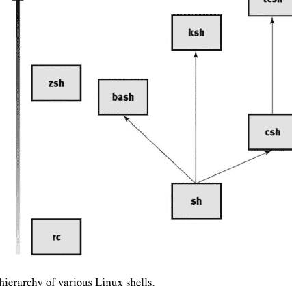

图 2.4 各种 Linux shell 的发展层级结构。

### 表 2.4 Shell 位置与程序名称

| Shell | 大多数 Linux 系统上的默认位置（如果该 shell 已安装！） | Shell 程序（命令名称） |
|---|---|---|
| `rc` | `/bin/rc` | `rc` |
| `Bourne shell` | `/bin/sh` | `sh` |
| `C shell` | `/bin/csh` | `csh` |
| `Bourne again shell (Bash)` | `/bin/bash` | `Bash` |
| `Z shell` | `/bin/zsh` | `Zsh` |
| `Korn shell` | `/bin/ksh` | `Ksh` |
| `TC shell` | `/bin/tcsh` | `Tcsh` |

## 2.8.2 哪个 shell 适合你的需求？

大多数 shell 执行的功能相似，而了解它们如何执行的细节对于决定为特定任务使用哪种 shell 至关重要。此外，在会话中使用多个 shell 是一种常见做法，特别是在 shell 脚本文件程序员中。例如，你可能使用 `Bourne` 或 `Korn shell` 利用它们的编程能力，并使用 `C shell` 来执行单个命令。我们将在后续讨论这些。

## 2.8.3 如何更改 shell

你可以通过以下两种方式更改 shell：1. 在登录会话时更改新的默认 shell；2. 仅在当前会话期间创建额外的 shell。这两种方法的前提是你想更改的 shell 在你的系统中是可用的。

**方法 1. 更改默认 shell。** 当你作为普通用户登录后，输入以下命令：

```bash
$ chsh
password for bob:
Enter new value [/bin/bash]: /bin/bash
```

如 Linux 系统所示，会被提示你想更改的 shell，例如 `/bin/sh` 以切换到 `Bourne shell`。请参考表 2.4 获取 shell 的位置。

**方法 2. 在你的默认 shell 之上创建额外的 shell**，只需在命令行输入你想运行的 shell 程序名称（见表 2.4）。下面的示例演示了使用此方法从使用 `$` 提示符的 shell 切换到使用 `%` 提示符的 shell：

```bash
$ echo SHELL
/bin/bash
$ csh
%
```

第一个命令允许确定你的 shell。在这种情况下，系统显示默认设置为 `Bash`。第二个命令行允许你运行 `C shell`。第四行显示你已成功，因为出现了默认 `C shell` 的提示符。如果 `C shell` 在系统中不可用或无法访问，会在第三行后收到错误消息。如果路径不包含 `/bin/bash`，你必须在搜索路径中使用 `/bin/csh` 代替 `csh`，然后使用 `csh` 命令。

要终止此新会话并返回默认登录 shell，请在空行按住 `Ctrl+D`。按 `Enter`。如果终止 shell 的方法无效，在命令行输入 `exit` 并按 `Enter`。这样做将停止运行的 shell，默认 shell 提示符将出现在你的显示器上。如果你在桌面上打开了控制台或终端窗口，输入 `exit` 也会关闭该控制台或终端窗口。

### 2.5 Shell 的相似性

| 功能 | 说明 |
|---|---|
| 执行 | 执行程序和命令的能力 |
| I/O | 输入和输出的控制 |
| 编程 | 执行命令序列的能力 |

30. 使用第 2.4.5 节所示的 `man` 命令，阅读你系统中表 2.4 中列出的每个 shell 的帮助手册页。

31. 如果你的 Linux 系统上没有安装 `C`、`Bourne`、`Korn`、`Z` 等 shell，请使用相应的软件包管理命令安装它们。请查阅附录 A，获取有关如何使用你 Linux 系统上可用的软件包管理命令来安装它们的描述。然后，执行其中的每一个 shell，并通过在线研究对它们拥有的任何特殊功能进行实验，以找到关于这些 shell 的对比分析。你也可以通过完成练习 30 来深入了解它们的运行机制。

## 2.8.4 Shell 启动文件和环境变量

每个 shell 的行为、它执行命令和程序的机制、它如何处理命令和输入/输出，以及它是如何被编程的，都会受到环境变量设置的影响。

每个 Linux 系统都有一个初始启动文件，命名为 `.profile` 或 `.login`。它包含了 shell 以及某些其他工具的重要环境变量的设置。此外，当你启动特定的 shell 时，会执行特定 shell 的隐藏文件。这些被称为 shell 启动文件，例如 `Bash` 的 `.bashrc` 和 `C shell` 的 `.zshrc`。这些隐藏文件最初由系统管理员配置供所有用户使用。表 2.6 列出了 `Bash`、`Bourne`、`Korn` 和 `C shell` 通用的重要环境变量；在适用的情况下，`C` 语言的变量名在大写的 `Bourne` 和 `Korn` 变量名之后跟的是小写字母。请注意，你的系统管理员可能没有设置这些某些变量，例如 `ENV`。

# 章节练习

- 32. 在你系统的默认登录 shell 提示符下，输入 `set | more` 并按 `<Enter>`。在我们代表性的 Linux 系统中，默认是 `Bash`。你的屏幕上显示了什么？识别并列出表 2.6 中显示的所有环境变量的设置。
- 33. 如果你的系统上没有安装 `C shell`，请使用第 2.8 节所示的命令安装它。然后将 `C shell` 设置为此会话的活动 shell。最后，输入 `setenv | more` 并按 `<Enter>`。识别并列出表 2.6 中显示的所有环境变量的设置。

除了 shell 之外，其他程序也有它们自己的隐藏文件。这些文件用于设置和配置这些程序执行的运行环境。我们将在第 4 章和第 5 章中讨论一些隐藏文件。当你列出主目录中包含的文件名时，它们被称为隐藏文件——例如，使用 `ls -l` 命令（见第 4 节），这些文件不会出现在列表中。隐藏文件的文件名始终以前缀（`.`）开头，例如 `.login`。

### 表 2.6

| 环境变量 | 它的影响对象 |
|---|---|
| `CDPATH`, `cdpath` | 使用 `cd` 命令访问的目录的别名 |
| `EDITOR` | 在 `Elm` 邮件等程序中使用的默认编辑器 |
| `ENV` | Linux 用于查找配置文件的路径 |
| `HOME`, `home` | 第一个用户登录时用户主目录的名字 |
| `MAIL`, `mail` | 邮箱箱文件的名称 |
| `PATH`, `path` | shell 搜索以查找命令或程序的目录 |
| `PS1`, `prompt` | 出现在命令行上的提示符 |
| `PWD`, `cwd` | 当前目录的名称 |
| `TERM` | 正在使用的控制终端类型 |

## 2.9 Shell 元字符

除了字母和数字之外，大多数字符对 shell 来说都有意义。这些字符被称为 `shell 元字符`，因此，除非以特定的语法方式指定它们，否则不能作为字面字符在命令中使用。因此，尽量不要在命名文件时使用它们。此外，当这些字符在命令中使用时，字符前后都不需要空格。为了清晰起见，表 2.7 包含了 shell 元字符列表及其用途。

shell 元字符允许你在单条命令行中指定多个目录中的多个文件。我们将在随后的章节中描述这些字符的使用，但我们在这里提供一些示例来解释一些常用元字符的含义：

- `*`
- `?`

### 表 2.7

| 元字符 | 用途 | 示例 |
|---|---|---|
| `<Line>` | 结束一条命令行 | `ls /etc` |
| `<Space>` | 分隔命令行上的元素 | `ls /etc` |
| `<Tab>` | 开启一条命令行 | `# This is a comment line` |
| `"` | 引用多个引用但但允许替换 | `"file" bak` |
| `$` | 结束并定义一个 shell 变量 | `$PATH` |
| `&` | 提供命令的后台执行 | `command & $100` |
| `*` `~` | | |
| `[ ]` | | |

`*.txt` 字符串可以用于所有 `.txt` 之前有一个单个字符的文件，如 `a.txt`、`G.txt`、`@.txt` 和 `7.txt`。`[0-9].c` 字符串可以用于目录下所有前面有一个数字的文件，如 `3.c` 和 `8.c`。`lab1\c` 字符串代表 `lab1/c`。注意使用反斜杠（`\`）来转义斜杠字符（`/`）。

以下命令显示你当前目录下所有具有两个字符且带有 `.html` 扩展的文件名，其中第一个字符是数字，第二个字符是大写字母。这些文件的打印机打印

```bash
$ lpr [0-9][a-z].html
```


注意`[0-9]`意味着任何数字，`[a-z]`意味着任何小写字母（注：原文描述为大写但代码为小写，此处按代码意译）。以下命令显示你当前目录下所有具有两个字符且带有`.html`扩展的文件名，其中第一个字符是数字，第二个字符是小写字母。

这些文件通过以下命令打印：

```
$ lpr [0-9][a-z].html
```

注意`lab1\c`字符串代表`lab1/c`。注意使用反斜杠（`\`）来转义斜杠字符（`/`）。

## 2.9 Shell 启动文件和环境变量

每个`shell`的行为、它执行命令和程序的机制、它如何处理命令和输入/输出，以及它是如何被编程的，都会受到环境变量设置的影响。

每个`Linux`系统都有一个初始启动文件，命名为`.profile`或`.login`。它包含了`shell`以及某些其他工具的重要环境变量的设置。此外，当你启动特定的`shell`时，会执行特定`shell`的隐藏文件。这些被称为`shell`启动文件，例如`Bash`的`.bashrc`和`C shell`的`.zshrc`。这些隐藏文件最初由系统管理员配置供所有用户使用。表 2.6 列出了`Bash`、`Bourne`、`Korn`和`C shell`通用的重要环境变量；`C`语言的变量名在适用的情况下，在大写的`Bourne`和`Korn`变量名之后跟的是小写字母。请注意，你的系统管理员可能没有设置这些某些变量，例如`ENV`。

# 章节练习

- 32. 在你系统的默认登录`shell`提示符下，输入`set | more`并按`<Enter>`。在我们代表性的`Linux`系统中，默认是`Bash`。你的屏幕上显示了什么？识别并列出表 2.6 中显示的所有环境变量的设置。


- 33. 如果你的系统上没有安装 `C shell`，请使用第 2.8 节所示的命令安装它。然后将 `C shell` 设置为此会话的活动 `shell`。最后，输入 `setenv | more` 并按 `<Enter>`。识别并列出表 2.6 中显示的所有环境变量的设置。

除了 `shell` 之外，其他程序也有它们自己的隐藏文件。这些文件用于设置和配置这些程序执行的运行环境。我们将在第 4 章和第 5 章中讨论一些隐藏文件。当你列出主目录中包含的文件名时，它们被称为隐藏文件——例如，使用 `ls -l` 命令（见第 4 节），这些文件不会出现在列表中。隐藏文件的文件名始终以前缀（`.`）开头，例如 `.login`。

| 表 2.6 | |
|---|---|
| 环境变量 | 它的影响对象 |
| `CDPATH`, `cdpath` | 使用 `cd` 命令访问的目录的别名 |
| `EDITOR` | 在 `Elm` 邮件等程序中使用的默认编辑器 |
| `ENV` | `Linux` 用于查找配置文件的路径 |
| `HOME`, `home` | 第一个用户登录时用户主目录的名字 |
| `MAIL`, `mail` | 邮箱箱文件的名称 |
| `PATH`, `path` | `shell` 搜索以查找命令或程序的目录 |
| `PS1`, `prompt` | 出现在命令行上的提示符 |
| `PWD`, `cwd` | 当前目录的名称 |
| `TERM` | 正在使用的控制终端类型 |

## 2.9 Shell 元字符

除了字母和数字之外，大多数字符对 `shell` 来说都有意义。这些字符被称为 `shell 元字符`，因此，除非以特定的语法方式指定它们，否则不能作为字面字符在命令中使用。因此，尽量不要在命名文件时使用它们。此外，当这些字符在命令中使用时，字符前后都不需要空格。为了清晰起见，表 2.7 包含了 `shell` 元字符列表及其用途。

`shell` 元字符允许你在单条命令行中指定多个目录中的多个文件。我们将在随后的章节中描述这些字符的使用，但我们在这里提供一些示例来解释一些常用元字符的含义：

- `*`

- `?`

| 表 2.7 | | |
|---|---|---|
| 元字符 | 用途 | 示例 |
| `<Line>` | 结束一条命令行 | `ls /etc` |
| `<Space>` | 分隔命令行上的元素 | `ls /etc` |
| `<Tab>` | 开启一条命令行 | `# This is a comment line` |
| `"` | 引用多个引用但但允许替换 | `"file" bak` |
| `$` | 结束并定义一个 `shell` 变量 | `$PATH` |
| `&` | 提供命令的后台执行 | `command & $100` |

- `* ~`

- `[ ]`

`*.txt` 字符串可以用于所有 `.txt` 之前有一个单个字符的文件，如 `a.txt`、`G.txt`、`@.txt` 和 `7.txt`。`[0-9].c` 字符串可以用于目录下所有前面有一个数字的文件，如 `3.c` 和 `8.c`。`lab1\c` 字符串代表 `lab1/c`。注意使用反斜杠（`\`）来转义斜杠字符（`/`）。

以下命令显示你当前目录下所有具有两个字符且带有 `.html` 扩展的文件名，其中第一个字符是数字，第二个字符是小写字母。这些文件的打印机打印

```
$ lpr [0-9][a-z].html
```

注意 `[0-9]` 意味着任何数字，`[a-z]` 意味着任何小写字母。以下命令显示你当前目录下所有具有两个字符且带有 `.html` 扩展的文件名，其中第一个字符是数字，第二个字符是小写字母。`[0-9]` 意味着任何数字，`[a-z]` 意味着任何小写字母。

10. 查看表 2.3 中列出的每个有用命令的 `man` 页（帮助手册）。`man` 页的哪个部分对你来说最详细？每个 `man` 页上显示的选项中，哪个对初学者最有用？请解释。

11. 目前你的系统有多少用户登录？你使用了什么命令发现的？

12. 确定你的计算机运行的操作系统名称。你使用了什么命令发现的？

13. 给出显示你系统中 `socket`、`read` 和 `connect` 系统调用 `man` 页的命令行。

14. 什么是 `shell`（外壳）？它的目的是什么？

15. `Shell` 命令有哪两种？它们之间有什么区别？

16. 列出五个 `Linux Shell` 的名称。哪些是最流行的？什么是登录 `shell`（`login shell`）？你在执行 `shell` 时输入什么？你如何终止你的登录 `shell` 的执行？

17. 成为其他 `shell` 的超集（`supersets`）意味着什么？换句话说，哪些 `shell` 包含了其他 `shell` 的完整命令集？能在子集 `shell`（`subset shell`）中找到超集 `shell` 中不存在的命令吗？参考图 2.4。

18. `shell` 的搜索路径（`search path`）是指什么？对于 `Bash`、`C` 和 `Korn shell`，维护该路径的变量名称是什么？（即该变量通常位于哪个文件中？）

19. 你环境中设置的搜索路径是什么？你是如何发现的？你的 `shell` 在查找你输入的命令时，会搜索当前目录和 `~/bin` 目录的搜索路径。你的 `shell` 搜索搜索路径中目录的顺序是什么？为什么？

20. 什么是隐藏文件？当你进入 `Linux` 系统时，执行的隐藏文件名称是什么？你是如何发现这些的？

21. 什么是 `shell` 启动文件（`start-up file`）？`Bash shell` 的文件名是什么？（即，该文件存储在哪个目录中？）

22. 根据该 `shell` 手动页中的讨论，每个 `shell` 的哪些重要特性对你（作为 `Linux` 初级、中级或高级用户）来说最重要？请通过你与其他可用 `shell` 及其特性的比较，解释这些特性的重要。

23. 假设你的登录 `shell` 是 `C shell`。你收到一个适用于 `Bourne shell` 设计的脚本。你会如何执行它？请清楚地写下你将使用的所有步骤。

# 高级问题与练习

24. 以下是一个典型的 `/etc/profile` 配置文件，这个特定的文件来自我们 `Linux Mint 18.2` 系统的默认安装。

```
# /etc/profile: system-wide .profile file for the Bourne shell (sh(1))
# Bourne compatible shells (bash(1), ksh(1), ash(1), ..).

if [ "$PS1" ]; then
if [ "$BASH" ] && [ "$BASH" != "/bin/sh" ]; then
# The file .bashrc already sets the default PS1.
# PS1='h:\\$'
if [ -f /etc/bash.bashrc ]; then
  /etc/bash.bashrc
fi
```

# “快速进入” Linux 操作系统

```
else
if [ "id -u" -eq 0 ]; then
PS1='#'
else
PS1='$'
fi
fi
if [ -d /etc/profile.d ]; then
for i in /etc/profile.d/*.sh; do
if [ -r $i ]; then
  $i
fi
done
unset i
fi
```

用你自己的话写一个分析性句子，准确描述你认为文件中哪些行是重要的，包括注释（以 `#` 号开头的行）。在你的 `Linux` 系统上检查此文件。它与上面的文件逐行比较结果如何？我们在此假设默认情况下 `Bash` 是你系统上的交互式 `shell` 和登录 `shell`。

- 25. 在你 `Linux` 系统的普通非特权账户中，从登录 `shell` 和非登录 `shell` 来说，默认 `umask` 设置是什么？用你的话描述 `umask` 设置是什么，以及它是如何应用于新创建的目录文件的。在你的 `Linux` 系统中，`umask` 是在 `/etc/profile` 中设置的吗？如果不是，哪里针对特定用户在登录 `shell` 和非登录 `shell` 中最有效地进行持久化设置？

- 26. 假设所有用户在登录你的 `Linux` 系统时都使用 `Bash` 作为其默认 `shell`。哪一个文件设置了你 `Linux` 系统的提示符（`prompt`）？该文件是问题 24 中所示的那个吗？描述文件中专门指定提示符的行，并简要描述这些行的组成部分。通过实验发现哪个文件实现了普通用户（包括登录 `shell` 和非登录 `shell`）的实际提示符设置，并对你发现的内容进行明确描述。

此外，在当前的非登录 `shell` 中为你自己设置提示符，使其包含以下内容：

- 显示日期/时间。

- 显示日期、主机名和当前目录。

- 显示一个提示符为红色文本的界面，并连带主机名和当前目录。

然后让这些更改对于登录 `shell` 和非登录 `shell` 都持久。最后，撤销这些持久化更改。

作为后续，设计你的 `shell` 提示符，使其以实用的设计包含你需要的信息，给出你的案例，并在你的 `Linux` 系统上为自己创建该提示符。


- 27. 给出一个设计 shell 提示符的顺序命令列表。描述你自定义提示符的过程，包括使用的变量。确保更改在不同会话之间是持久的。

- 28. 使用`find`命令找到你主目录下在过去 7 天内修改过的所有文件。解释你使用的命令。

- 29. 使用`grep`命令在`/var/log`下的所有文件中搜索字符串`"error"`的出现情况。解释你使用的命令。

- 30. 写一个 shell 脚本，将你的主目录备份到压缩存档，并在文件名中附加时间戳。解释你脚本的逻辑。

# 3

# 编辑文本文件

## 目标

- 解释在 Linux 系统上编辑文本文件的通用用途
- 介绍`nano`文本编辑器基础知识
- 涵盖以下命令和原语：`nano`

### 3.1 介绍

在本章中，我们将使用在现代基础 Linux 系统中常用的简单文本编辑器：`nano`。我们还讨论了文本编辑的通用用途，并根据这些用途，讨论了其他常见的 Linux 文本编辑器。在本书的网站上，我们提供了对`vi/vim/gvim`和`emacs`编辑器更深入的介绍。

### 3.1.1 排版规范

为了强调`nano`编辑器中键盘键的使用方式，我们提供了以下执行命令或更改模式的按键排版参考：

1. 按下`Esc`键（键）标记为`<Esc>`。
2. 按下`Enter`键（回车）标记为`<Enter>`。
3. 将`<Ctrl>`（在`nano`屏幕上以快捷形式表示为`^`）与其他键组合使用，标记为`<Ctrl>X`，即按住`<Ctrl>`键的同时按下`X`（或任何有效的组合键）。
4. 按下`Alt`键与其他键组合使用，标记为`<Alt>X`，即按住`<Alt>`键的同时按下`X`键（或任何有效的组合键）。
5. 3 和 4 的变体显示为`<Ctrl>X [b]`，即你先按下并松开`<Ctrl>`，然后同时按下`b`键（或任何单键或字符的有效组合）。

你在键盘上输入或按住的内容将以`**粗体**`显示。

### 3.1.2 关于 Linux 文本编辑器及其通用用途的说明

现代 Linux 同时使用图形用户界面（GUI，具有强大的窗口管理系统）和字符用户界面（CUI）。因此，为了执行一些实用的操作，例如从脚本文件中执行多个命令、编写电子邮件或创建 C 语言程序，你必须熟悉一种或多种向文件输入文本的方法。此外，你还必须熟悉如何高效地编辑文件——即更改其内容或以某种方式对其修改。文本编辑器允许你查看文件的内容，类似于`more`命令，这样你就可以识别文件的关键特征，然后读取并利用其中包含的信息。例如，一个没有扩展名的文件（如`foo`而不是`foo.txt`）可能是你可以用文本编辑器查看的文件。

我们在这里考虑的编辑器都被认为是全屏显示编辑器。也就是说，在用于编辑文件的屏幕或显示器上，你可以看到文件的部分内容，它占据了分配给文本编辑器显示窗口的大部分或全部。你还可以使用键盘上的方向键或鼠标移动光标指向全屏显示中的任何文本。这些材料通常存储在一个称为缓冲区（`buffer`）的临时存储区域中。如果你的文件大于一个屏幕，缓冲区的内容会随着你移动光标经过它而改变。出于文本编辑的目的，文件被存储为数据序列。当你编辑文件时，你复制的是缓冲区中的编辑器命令。当你对缓冲区进行更改——甚至可以同时防止多个缓冲区——但当你保存缓冲区时，你会向磁盘写入一段新的数据序列，从而保存文件。

所有编辑器的另一个重要特性是，传统上，它们的操作基于按键命令或同时/顺序按下的按键组合。由于 Linux 的主要输入之一是键盘，因此使用正确的按键命令语法是强制性的。但一旦习惯了这种输入方法，它是高效的，对于某些用户来说，甚至比鼠标/GUI 输入更高效。按键操作也更灵活，让你对编辑操作拥有更多且可自定义的控制。通常，你应该根据自己喜欢的与计算机交互的方式选择最熟悉的编辑器。对于大多数初学者来说，将是`nano`。然而，你对编辑器的选择取决于文本创建和处理的复杂性和数量，并且它为你提供了一个视觉开发环境。简单来说，`vi`、`vim`和`Gnu`等编辑器能够在多个窗口、多个文件中处理复杂的编辑，并为你提供文档制作和管理能力。为了利用这一点，你必须学习执行任务所需的命令的机制，以及它们是如何通过图形界面或输入来实现的——并记住这些知识。文本编辑器的基本功能如表 3.1 所示，并带有每个功能的简短描述。

对于`vi`、`vim`和`gnu`编辑器，你不能立即开始向正在编辑的文件输入文本。你必须处于插入模式（`Insert mode`）才能这样做，即`vi`、`vim`和`gnu`模式。

在`nano`（以及`Gnu emacs`）中，你可以立即向文件中输入文本。`nano`是一个无模式编辑器（`modeless editor`），这意味着你可以立即使用键盘某些特定的指向设备（如鼠标或键盘方向键）开始输入和编辑文本。

我们在本章中通过输入命令提供了关于`nano`的教程信息。

要意识到，`vi`、`vim`和`gnu`通常使用相同的命令和基本上相同的功能，`vim`和`gnu`不仅更具图形化——允许你工作更多

# 表 3.1

# 基础文本编辑功能

| 功能 | 描述 |
| --- | --- |
| 光标移动 | 移动缓冲区中插入点或位置的位置 |
| 剪切或粘贴 | 在缓冲区内移动文本 |
| 删除 | 从缓冲区中删除文本 |
| 插入 | 在光标位置添加文本 |
| 打开 | 在编辑器中打开文件 |
| 退出 | 退出编辑器 |
| 保存 | 将缓冲区内容写入磁盘 |
| 搜索替换 | 在缓冲区内查找并替换文本 |

## 编辑文件

### 3.1.3 Linux 中处理文本和文件的方法

文本编辑器（如`nano`、`vi/vim/emacs`）并不是向文件输入文本的唯一方法。正如我们在后续章节所示，其他方法是使用多重命令中的输出重定向进行“流编辑”，使用`sed`和`awk`等文本处理工具。

输出重定向通过多重命令中的`>`和`>>` Shell 命令（不同于我们在第 2 章构建的单个 Linux 命令）提供了向文件输入文本的快速简单方法。结合我们在第 9 章中示例的`echo`和`cat`命令，输出（和输入）重定向是创建和修改文件文本的快捷方法。

流编辑是对输入流（作为文件或数据输入）中的文本进行处理，使用代码产生所需文本内容的输出。它传统上且最简单地通过`sed`（流编辑器）或`awk`命令实现。这允许你使用任何扩展正则表达式来构建输出流中的添加或修改。

关于`sed`更完整的文档，请查看 Linux 系统上的`sed` man 页面。我们还提供了`sed`的更完整的描述，并在本书的 GitHub 站点提供了大量示例。`awk`（`awk`的`Gnu`版本）是另一种流编辑方法，它使用完整的编程语言环境。`awk`允许你处理文本文件。有关`awk`的更多信息，请查看 Linux 系统上的`gawk` man 页面。

## 3.2 nano 编辑器快速介绍

在本书展示的所有 Linux 系统中，最简单且最易获取的文本编辑器是`nano`。对于许多用户来说，每当需要文本编辑器时，`nano`都是最高效且充分的编辑器。标准 Linux 编辑器中的许多任务，Linux 初学者也可以使用`nano`快速轻松地完成。

要开始使用`nano`，无论是在没有 GUI 的情况下，还是通过某些桌面 GUI（如`Cinnamon`或`Gnome`）与 Linux 交互时，只需在终端窗口的命令行中输入以下内容：

```
$ nano
```

你立即可以在编辑器中输入文本，并使用物理键盘或“虚拟”键盘（例如运行`Termius`终端的 iPad）上的方向键移动光标。`nano`显示的第一个屏幕如图 3.1 所示。你还可以使用`Delete`键删除当前行上的文本（删除屏幕上光标当前位置之前的第一个字符），从而对其进行修改或添加。

如果你输入`nano file2`（其中`file2`是已存在文本文件的名称），该文件将显示在屏幕上，允许对其进行修改或添加。

编辑器有四个主要部分。顶行显示程序版本、当前正在编辑的文件名以及文件是否已修改。接下来是主编辑器窗口，显示正在编辑的文件。状态行是倒数第三行，显示重要信息。底部两行显示了通过编辑器键盘“快捷键”执行的最常用命令。

参考图 3.1，在`nano`屏幕显示的底部，有几个键盘快捷键选项，你可以通过按住 Control 键（`<Ctrl>`，在键盘上显示为`^`，即`nano`菜单）结合字母键来选择。两个最重要的快捷键选项如下所示：

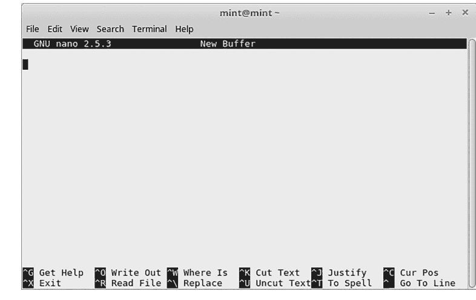

图 3.1 nano 屏幕的基本界面。

# 编辑文本文件

### 3.2.1 nano 简要教程

接下来的小节说明并解释`nano`的一些基本操作和功能。

### 3.2.1.1 创建并打开新文件

如果你想使用`nano`创建新文件并打开它，请使用以下命令：

```
$ nano
```

或

```
$ nano [filename]
```

第二个命令也用于打开现有文件，其中`filename`是现有文件的名称。如果你想打开一个不在当前目录下的文件，则必须使用该文件的绝对路径或相对路径。例如`/home/mint/filename`。


图 3.2 显示了之前用第一个命令打开的文件。

在编辑器窗口底部显示了键盘快捷键（它们不是 GUI 菜单选项！让你执行一些基本操作。这些示例包括剪切（并粘贴）文本、保存（写入 `Write Out`）缓冲区内容到文件以及退出编辑器。

```
mint@mint ~
File Edit View Search Terminal Help
GNU nano 2.5.3 | New Buffer | Modified
This is your first nano-created file!
^ Get Help | ^ Write Out ^ Where Is | ^ Cut Text ^ Justify | ^ Cur Pos
^X Exit | ^R Read File ^ Replace | ^U Uncut Text ^T To Spell | ^ Go To Line
```

图 3.2 在 `nano` 中首次打开的文件。

### 3.2.1.2 如何保存文件

要保存文件，请使用键盘快捷键 `Ctrl+O`。当你使用此组合键时，编辑器将提示你输入文件名（如果启动编辑器时已提供名称，则会确认该名称）。

输入你的文件名并按 `<Enter>` 以该名称保存文件。

这如图 3.3 所示。

### 3.2.1.3 如何剪切和粘贴文本

要剪切并粘贴已输入缓冲区的行现有文本，首先使用键盘上的方向键将光标移动到该行的任意字符上。按 `Ctrl+K` 剪切缓冲区中的该整行，然后使用方向键将光标移动到你想将“剪切”的行粘贴回缓冲区的地方。最后，使用 `Ctrl+U` 将剪切的内容粘贴回来。

例如，在图 3.4 中，如果你想剪切第一行并将其复制到第一行下两行。使用键盘上的方向键回到行首，然后按 `Ctrl+K`。然后，将光标移到第一行之前按 `Ctrl+U`。重复此操作以实现倍数。

### 3.2.1.4 如何搜索和替换单词

此功能允许你在缓冲区中搜索特定单词，并将其替换为另一个单词。

在 `nano` 中搜索单词，按 `Ctrl+W`。然后，系统会要求你输入想要搜索的单词。输入单词后按 `<Enter>`，工具将带你到匹配的项（见图 3.5）。

```
File Name to Write: first nano
^ Get Help | M-D Dos Format | M-A Append | M-B Backup File
^C Cancel | M-M Mac Format | M-P Prepend |
```

图 3.4 搜索文本。


## 3.3 带写入文件

### 3.2.1.5 如何将另一个文件插入当前文件

要在当前编辑的缓冲区中插入另一个已保存文件的文本，请执行以下操作：`Ctrl+R`，然后提供要插入当前缓冲区的文件的路径。

图 3.10 和 3.11 说明了此过程。

如图 3.11 所示，`/home/mint/second_nano` 的文本是在光标位于第一行末尾时插入的。

### 3.2.1.6 如何显示光标位置

可以获取当前缓冲区中光标的位置信息。可以通过按 `Ctrl+C` 快捷键实现。

图 3.12 显示在按 `Ctrl+C` 后，光标位置在编辑器区域被高亮，详细信息显示在状态行中（图中高亮或深色的行——窗口倒数第三行）。它报告光标位于第 8 行的第 4 行，是缓冲区 185 个字符中的第 77 个。

### 3.2.1.7 如何备份文件的之前的版本

此功能允许你备份正在编辑文件的之前的版本。这在你修改并保存文件后完成。可以使用 `-B` 命令行选项访问此功能。

```
$ nano -B [filename]
```

```
File to insert from [/] : /home/mint/second_nano
Ctrl Get Help | Execute Command | To Files
Ctrl Cancel | -F New Buffer |
```

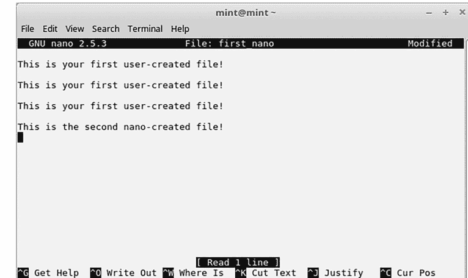

# 编辑文本文件

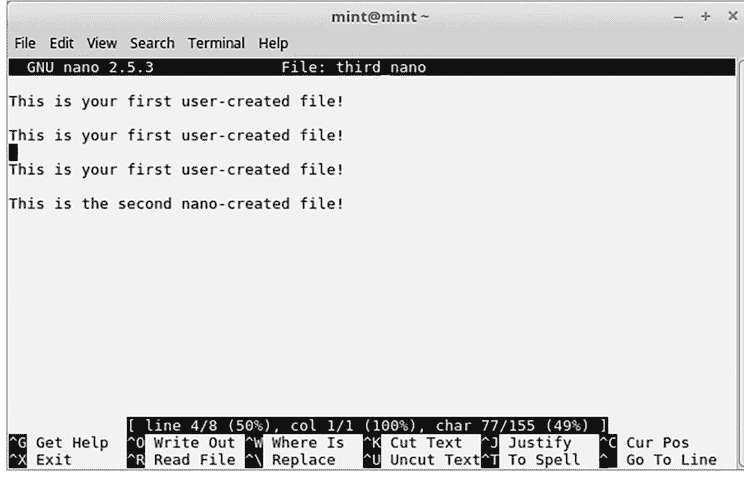

图 3.12 光标位置报告。

例如：

```
$ nano -B third_nano
```

备份将保存在当前目录中，文件名相同，但扩展名为为波浪号 (`~B`)。首次创建的文件无法备份。

# 章节练习

1. 在命令行中启动 `nano` 而不指定文件名，然后在“新缓冲区（New Buffer）”中输入一些文本。将这些文本保存到你当前工作目录下的文件中。
2. 在 `nano` 的显示文件中剪切一些文本，并将其粘贴到显示区域另一个位置。你使用了哪些命令完成此操作？
3. 在 `nano` 的显示文件中将一段文本替换为另一个字符串。你使用了哪些命令完成此操作？这可以在文件的多个位置重复进行，还是可以一次性完成？
4. 用你自己的话描述 `nano` 中缓冲区（buffer）的概念。
5. 在执行前面的练习命令时，你如何在 `nano` 中选择多个字符？如果你使用单控制台、纯文本的方法登录并交互 Linux，你如何为前面的练习中要求的操作选择多个字符？
6. (a) 仅在一个终端显示器中，你如何在 `nano` 中打开之前创建的文本文件的多个缓冲区，并在它们之间切换编辑？(b) 这样做的主要优势是什么？

## 总结

Linux 文本编辑器对于基于 CUI（字符用户界面）的 Linux 系统操作至关重要，即使你使用的是 GUI，它们也非常重要。它们允许你创建对系统操作重要且关键的文本文件（例如 Bash 脚本或 systemd 文件），或编辑现有文本实体（如应用程序配置文件）。

本章介绍了基于 CUI 的 `nano` 编辑器的基础，并提供了你在选择更高级（尽管更复杂）的编辑器（如 `vi` 或 `emacs`）时可能考虑的重要注意事项。

# 问题与常见问题

1. 列出十种 `nano` 中可以进行的常用文本编辑操作。
2. 在你的 Linux 系统上运行 `nano`。创建并编辑一段文本，作为邮件正文，解释 `nano` 编辑器的基本功能。该文件长度至少为一页（45–50 行文本）。然后，将文件保存为 `nano_doc.txt`。将你创建的正文插入到邮件中并发送给自己。
3. 登录你的 Linux 系统，在一个新的空白文件上执行 `nano` 程序。
   在文件的第一行输入你的姓和名。
   在文件的第二行输入“`nano` 文本编辑器允许你高效地编辑简单的短文本。”
   使用 `nano` 命令将文件写入默认目录，并命名为 `lab51`。
   在你的 Linux 命令行打印文件 `lab51`。
4. 按照以下步骤在 `nano` 中创建一个文件：
   步骤 1：在提示符处，输入 `nano` 并按 `<Enter>`。
   步骤 2：在 `nano` 屏幕区域，将光标置于第一行并输入- `This is that I have entered on a line in the nano editor.`
   使用 `<Delete>` 和 `<arrow>` 键纠正你做的任何打字错误。
   步骤 3：按三次 `<Enter>`。
   步骤 4：输入- `This is a line of three lines down from the first line.`
   5. 步骤：同时按住 `<Ctrl>` 和 `<O>` 键（`<Ctrl-O` 或 `^O`）。
   步骤 6：在 `File Name to write:` 提示处输入 `1ines` 然后按 `<Enter>`。
   步骤 7：同时按住 `<Ctrl>` 和 `<X>` 键（`<Ctrl-X` 或 `X`）返回 `shell` 提示符。
   步骤 8：在提示符处，输入 `nano 1ines` 然后按 `<Enter>`。
   5. 步骤：执行以下步骤：
   步骤 1：在提示符处，输入 `nano 1ines` 并按 `<Enter>`。你在问题 4 中创建的带空格的文件出现在屏幕上。
   步骤 2：使用键盘上的 `<arrow>` 键将光标置于第四行的开头，即单词 `This` 中的字符 `T` 上。
   步骤 3：同时按住 `<Ctrl>` 以及 `<Shift>` 和 `<6>` 键。
   步骤 4：使用键盘上的 `<right arrow>` 键移动光标，直到高亮整个第四行（包括句号）。光标应在行尾处位于第五行右侧一个字符。

# 编辑文本文件

步骤 5：同时按住 `<Ctrl>` 和 `<K>` 键。此操作会将你正在工作的“缓冲区”或文件中的文本行剪切。

步骤 6：使用 `<arrow>` 键将光标置于文件第二行的开头，直接位于以下行下方：

```
This is text that I entered on a line in the nano editor.
```

步骤 7：同时按住 `<Ctrl>` 和 `<U>` 键。此操作将先前的第四行粘贴到文件的第二行。

步骤 8：使用键盘上的 `<arrow>` 键将光标置于文件的第三行。

步骤 9：在键盘上同时按住 `<Ctrl>` 和 `<U>` 键。此操作将之前的第四行粘贴到文件的第三行。

步骤 10：现在将 `lines 2` 和 `3` 修改为：


这是第一行文本下方的第二行文本。

这是第一行文本下方的第三行文本。

对于 `nano` 来说，这个文件有多少行？

步骤 11：同时按住 `<Ctrl>` 和 `<O>` 键。

步骤 12：在 `File Name to write:` 提示处输入 `lines2` 然后按 `<Enter>`。

步骤 13：同时按住 `<Ctrl>` 和 `<X>` 键返回提示符。

步骤 14：在提示符处，输入 `more` 并按 `<Enter>`。命令显示多少行？你在屏幕上看到了什么？

完成 5，使用 `nano` 在名为 `lines2` 的文件中添加两行文本，内容与 2 和 3 相似。在文件顶部添加一行你的名字。使用 `lines3` 将其打印到你的 Linux 系统。

- 7. 在工作中使用了哪个版本的 `nano`？是怎么发现的？使用 `cat` 创建名为 `lines2` 的文本文件，然后用 `nano` 读取该文件并编辑。
- 9. 使用 `-m` 选项在你的 Linux 系统上执行 `nano`。你使用了什么功能？
- 10. 在命令行中使用 `-m` 选项启动 `nano` 重复问题 4–6。什么时候无法使用 `-m` 选项使用 `nano`？

## 高级问题与问题

### vi 和 emacs

假设你参考了网站上的第 25 章来熟悉两个主要的 Linux 编辑器：`vim` 和 `emacs`。此外，如果你愿意，可以在 Linux 系统上使用 `vim` 代替 `vi`。

- 11. 在你的 Linux 系统上运行 `vi`。创建并编辑一段文本，作为邮件正文，解释 `vi` 编辑器的基础。例如，你的邮件可以描述插入模式（Insert modes）和命令模式（Command modes）。该文件应至少有一页（45–50 行文本）。将文件保存为 `vi_doc.txt`。在邮件中插入正文并发送给自己。
- 12. 在你的系统上运行 `vi`，用你自己的话创建以下定义，不看教材：

  a. 全屏显示编辑器

  b. 模式编辑器

  c. 文件与缓冲区

  d. 击键命令

  e. 文本文件与二进制

  然后参考网站上第 25 章的相关部分检查你的定义。进行任何必要的修正或添加。在 `vim` 中重新编辑文件以包含你做的修改，然后使用系统可用命令打印文件。

- 13. 编辑问题 12 中创建的文件，使用 `yank`、`put` 或 `dd` 命令将你的定义顺序更改为 (d)、(a)、(c) 和 (b)。使用系统可用命令打印文件。
- 14. 登录你的 Linux 系统，在一个空白文件上执行 `vi` 程序。

  在文件的第一行输入你的姓和名。

  在文件的第二行输入“`vi` 文本编辑器具有字处理器几乎的所有功能，在创建文本文件方面具有极大的灵活性。”

  使用单个命令从 `vi` 将文件打印到 Linux 打印机。在非 GUI、纯文本环境中实现这一点？

- 15. 哪个命令允许你移动到当前缓冲区的第一行？哪个命令允许你移动到缓冲区的最后一行？

- 16. 使用 `set` 命令将文本换行设置为 30 列 15 行显示，以便屏幕只显示 15 行，并在第 30 个字符后自动换到下一行。你是如何做到的（提示：`set all` 命令显示所有环境变量的当前状态）？

- 17. 家目录中的什么允许你永久自定义环境变量？

- 18. 在 `vi` 中，以下命令的作用是“退出”到默认 shell（我们的 Linux 系统中为 `Bash`），然后你如何返回编辑器？

  `12dw`, `5dd`, `12o`, `50`, `5c`, `55.12`, `1G`, `5yy`

- 19. 在编辑文件时，你如何“退出”到默认 shell（我们的 Linux 系统中为 `Bash`），然后你如何返回编辑器？

### Gnu Emacs

- 20. 使用 `emacs` 输入你最喜欢的一本书中的段落，但不要改变 `emacs` 框架的大小或形状，或使用 `Enter` 键，使用 `emacs` 的自动换行功能按照书中打印的方式对其进行格式化。在你的 Linux 系统打印行打印文件。

- 21. 哪些 `emacs` 命令允许你向前向后移动一个字符、一个句子和一个段落？

- 22. 定义一个 `emacs` 键盘宏，为你完成一项常见的编辑任务。

- 23. 在 `emacs` 中创建、编译、链接并执行你选择的简短 C 程序。

- 24. 尝试在纯文本窗口中使用 `emacs` 并仅使用键盘命令。

  要做到这一点，你必须通过控制台或终端输入 `emacs -nw newfile` 来启动 `emacs`。

### 编辑文本文件

键盘可以让你访问“文件”（`File`）下拉菜单选项，然后按下键盘上的 `s` 键即可保存当前缓冲区。

登录你的 Linux 系统，并使用 `-nm` 命令在一个新的空白文件上执行 `emacs` 程序。

在文件的第一行输入你的姓和名。

在文件的第二行，输入“`emacs` 编辑器是 Linux 编辑器中最复杂且可定制程度最高的。”

在 `emacs` 内部通过单个 `emacs` 命令将文件打印到你的 Linux 线路打印机上。在非图形界面的纯文本环境中，你是如何实现这一点的？

- 25. 使用 `emacs` 在处于编辑器状态时发送电子邮件的能力。向你的一个朋友发送电子邮件邮件，直接在 `emacs` 内部编写邮件内容并发送。

答案：无需回答。

- 26. 在编辑文件时，如何从 `emacs` 中“逃逸”到默认的 Linux shell（在我们的 Linux 系统中为 `Bash`），然后如何返回编辑器？

## 项目

### 项目 1

从非图形、纯文本的 `vi` 和 `emacs` 会话中，创建一个文本文件，并希望从你 Linux 系统上的某个可用打印机打印它。然后，在仍在编辑器中时，给出一组通用 UNIX 打印服务（CUPS）命令来管理 CUPS 服务（在本地或网络上），以便你能够打印在编辑器中创建的文件。这可能涉及诸如如果 CUPS 服务默认未运行则设置它、使用系统命令检查服务及已连接打印机的状态，或更改特定连接打印机的名称。在所有三个编辑器中，你使用哪些特定命令来实现这些操作？编写一份短报告，整理出通用和特定的方法，说明人们可以使用这些方法管理 CUPS 服务并通过这些编辑器通过 CUPS 服务打印文档。

### 项目 2

`zenity` 是一个图形化的 `GTK+` 框程序，允许你使用 `Bash` 脚本创建交互式对话框。它在基于 GUI 的 `Debian-CentOS` Linux 系统上默认安装。在这个项目中，你部署的对话框将允许你轻松地在 Linux 系统上创建新用户。当然，假设你有在系统上创建账户的权限！使用 `emacs` 创建并执行基于 `zenity` 的 `Bash` 脚本，遵循以下步骤：

- a. 在 `emacs` 中，在你的主目录下创建并保存以下 `Bash` 脚本文件 `zen1`：

```bash
#!/bin/bash
zenity --title="New Command" --text="Add new user" \
--add-entry="Username" \
--add-password="Password" \
--add-entry="User UID" \
--add-entry="Group Number GID" \
--add-entry="GECOS Entry" \
--add-entry="Default Home Directory" \
--add-entry="Default Shell"
```

- b. 使 `zen1` 具有可执行权限，然后在命令行中输入 `./zen1`

屏幕上会打开一个 `zenity` 对话框。在 GUI 对话框中，你将创建为 `passwd` 文件所需的七个字段（我们在第 17 章第 3.1 节示例 17.3 中展示了如何在你的 Linux 系统上通过“批量文件”创建新用户）。你为对话框提供的七个输入将被写入名为 `zen_out` 的文件中。

这七个字段用冒号 (:) 分隔，：新用户账户名、密码、用户 ID (UID)、组 ID (GID)、通用电气综合操作系统主管 (GECOS) 注释、默认主目录和默认 shell。

例如，

`hassan:QQQ:2001:2001:CFO of Accounting:/home/hassan:/bin/bash`

- c. 使用 `zen` 创建一个包含你想放入 Linux 系统的多个新用户的文件。然后，将这些用户放入你的系统！

想了解更多？访问我们的网站获取额外阅读、推荐资源和练习。

CRC Press 电子资源：https://www.crcpress.com/9781138710085

作者 GitHub：https://github.com/bobk48/linuxuthetextbook

# 4

# 文件和文件系统结构

## 目标

- 解释 Linux 的文件概念

- 讨论 Linux 支持的各种类型文件

- 描述文件的属性

- 解释路径概念

- 简要解释 Linux 文件系统的表示和用户视图

- 描述 Linux 文件系统的用户界面——浏览文件系统

- 讨论 Linux 系统内部文件的表示

- 描述 Linux 文件是如何存储在磁盘上的

- 解释 Linux 中标准文件的概念

- 讨论扩展文件系统 (Ext) 的基础

- 涵盖以下命令和原语：


`~ .. / PATH, cat, cd, echo, allocate, file, getconf, ls, mkdir, more, pwd, rmdir, touch`

## 4.1 引言

大多数用户都在文件系统结构工作。在使用计算机系统时，用户不断执行与文件相关的操作：创建、读取、写入/修改文件。因此，用户需要了解文件是什么、文件如何组织和管理、它们在系统内部的表示以及是如何存储在磁盘上的。

## 4.2 文件概念

Linux 的一个卓越特性是它的文件概念。在 Linux 中，一切皆文件——包括硬件设备。这个概念简单而强大。文件是字节序列。

## 4.3 文件类型

Linux 支持多种类型的文件：

- 简单/普通文件
- 目录
- 符号链接
- 字符文件
- 块文件
- 命名管道
- 套接字

### 4.3.1 简单/普通文件

普通文件用于存储数据。在 Linux 中，普通文件可以包含任何内容：

- 文本
- 可执行文件
- 脚本
- 数据库
- 图
- 视频

你可以使用 `ls -l` 命令显示文件类型，如表 4.1 所示。

| 字段 | 含义 |
|---|---|
| 第一个字段 | 普通文件、目录、链接等 |
| 第二字段 | 链接数 |
| 第三个字段 | 所有者名称 |
| 第四个字段 | 所有者组名 |
| 第五个字段 | 字节大小 |
| 第六个字段 | 修改日期和时间 |
| 第七个字段 | 文件名 |

### 表 4.2 常用扩展名

| 扩展名 | 内容 |
|---|---|
| `.bmp`, `.jpg`, `.gif` | 图形 |
| `.c` | C 源代码 |
| `.cpp`, `.cc` | C++ 源代码 |
| `.class` | Java 文件 |
| `.gz` | 压缩 |
| `.html`, `.htm` | 网页 |
| `.java` | Java 源代码 |
| `.o` | 对象代码 |
| `.txt` | 文本 |

### 4.3.2 目录

目录包含其他文件目录的名字（目录和子目录互换）。任何操作系统的目录文件都由目录目的数组组成；目录目的的内容在不同系统之间有所不同。在 Linux 中，目录项具有如图 4.1 所示的结构。

| 节点节点 (Inode) | 文件名 |

图 4.1 Linux 目录项结构。

（文件大小，单位为字节）。当你创建一个新文件时，Linux 内核会为其分配一个 inode。因此，Linux 中的每个唯一文件都有一个唯一的 inode（inode 编号）。如第 4.5.7 节和第 8 章所述，指向同一个文件的硬链接具有相同的 inode，且 inode 在每个分区上是唯一的。这意味着不同分区上的两个不同文件可以具有相同的 inode 编号。关于 inode 的细节以及内核如何使用它访问磁盘上的文件内容将在第 4.5.7 节和 4.6 节中讨论。

### 4.3.3 链接文件

类型为 link 的文件“指向”一个现有的文件。链接文件的内容是现有文件的路径。因此，链接允许你通过文件系统结构中的另一个路径访问现有文件，并在不复制其内容的情况下对其进行共享。Linux 中链接的概念将在第 8 章中进行详细讨论。但目前，当为现有文件创建符号链接时，系统会创建一个类型为 link 的文件。符号链接目前在所有版本的 Linux 中均可用。

### 4.3.4 特殊（设备）文件

特殊文件（也称为设备节点）是访问硬件设备的手段，包括键盘、磁盘、驱动器带、显卡、网卡和外围设备。每个硬件设备至少关联一个特殊文件——命令或应用程序通过访问特殊文件来访问相应的设备。特殊文件分为两种类型：字符特殊文件和块特殊文件。字符文件对应面向字符的设备（如键盘），而块特殊文件通常存放在 `/dev` 目录下（详情请见第 4.4 节）。

应用程序和命令读写外围文件的方式与读写普通文件相同。这种能力是 Linux 的输入输出被认为与设备无关的主要原因。各种类设备设备模拟物理设备，因此被称为伪设备（pseudo-devices）。这些设备允许你在不使用物理连接到 Linux 的设备的情况下与 Linux 交互。这些设备正变得越来越重要，因为它们允许通过网络连接或带有第 28 章中经过 `ssh` 调优虚拟终端使用 Linux 系统。

### 4.3.5 命名管道 (FIFO)

Linux 有若干种用于相互通信的工具。这些工具是客户端-服务器软件范式的关键，即进程间通信（IPC）机制（通常称为 IPC 原语或 IPC 通道）。这些原语被称为管道（pipes）、命名管道（也称为 FIFOs）和套接字（严格符合 Unix 系统标准机制传输层接口的套接字）。这些原语将在第 15、16、20 和 21 章的“系统编程”部分进行详细讨论。这里简要提到每种工具的用途，以便你预判对每个工具的需求并理解 FIFO 的必要性。

管道是内核内存中的一个数组（内核缓冲区），允许两个进程相互通信，这些进程运行在同一计算机系统上且相互相关；通常，这种关系是父子关系或兄弟关系。FIFO（命名管道类型）允许两个运行在同一台计算机上的进程相互通信；然而，进程之间不必通过父子或兄弟关系相互相关。我们将在第 9 章在命令行层面说明管道和 FIFO 的用法。

### 4.3.6 套接字

套接字可以被同一台计算机或不同计算机上的进程用于相互通信；计算机可以在网络（内网）上也可以在互联网上。套接字属于不同的族，每个族都指定了进程通信时使用的协议。例如，应用层协议（如超文本传输协议 HTTP）使用传输控制协议/网协议（TCP/IP）协议族中的地址族 `AF_INET` 套接字进行通信（关于 TCP/IP 的详细讨论见第 11 章）。地址族为 `AF_INET` 的套接字也称为互联网套接字，这意味着运行在互联网计算机上的进程可以使用该域的套接字进行通信。地址族为 `AF_UNIX` 或 `AF_LOCAL` 的套接字可用于 Linux 操作系统下运行同一机器上的进程之间的通信。这种套接字也称为 UNIX 域套接字。关于 UNIX 和互联网域套接字的更多细节请见第 20 章。

## 4.4 文件系统结构

操作系统的文件系统结构涉及三个问题。第一个是文件如何从用户视图进行组织。第二个是文件是如何存储在辅助存储器（通常是硬盘）上的。第三个是如何对文件进行操作（读、写等）。在本章中，我们将解决第一个问题，即 Linux 系统中文件和目录的视图。与之前一样，我们的重点将放在 Mint Linux 上。

### 4.4.1 文件系统组织

Linux 文件系统采用分级和树形结构，但是倒置的，根节点位于顶部。文件系统结构从一个主目录开始，称为根目录，其下可以有任意数量的文件和子目录，并按任何所需的方式组织。这种结构导致了目录与其子目录/文件之间存在父子关系。典型的 Linux 系统包含数百个文件和目录。对于我们的 Linux Mint 系统，根目录（在 Linux 术语中表示为 `/`）下的文件和目录显示：

```
$ ls - /
total 96
drwxr-xr-x 2 root 4096 Dec 13 2016 bin
drwxr-xr-x 2 root 4096 Dec 13 2016 dev
drwxr-xr-x 2 root 4096 Dec 13 2016 home
drwxr-xr-x 2 root 4096 Dec 13 2016 root
drwxr-xr-x 2 root 4096 Dec 13 2016 lib
drwxr-xr-x 2 root 4096 Dec 13 2016 media
drwxr-xr-x 2 root 4096 Dec 13 2016 mnt
drwxr-xr-x 2 root 4096 Dec 13 2016 opt
drwxr-xr-x 2 root 4096 Dec 13 2016 proc
drwxr-xr-x 2 root 4096 Dec 13 2016 run
drwxr-xr-x 2 root 4096 Dec 13 2016 srv
drwxr-xr-x 2 root 4096 Dec 13 2016 tmp
drwxr-xr-x 2 root 4096 Dec 13 2016 usr
drwxr-xr-x 2 root 4096 Dec 13 2016 var
drwxr-xr-x 2 root 4096 Dec 13 2016 boot
-rw-m--r-- 1 root 448 Apr 4 21 initrd.img
lrwxrwxrwx 1 root 29 Jul 28 2016 vmlinuz -> /boot/mlinuz-4.4-generic
```

注意，输出的总数（即 96）是以内核为单位的根目录大小。你可以运行 `ls -lh /` 查看以 K（千）、M（兆）或 G（十）为单位的根目录大小。输出其余部分显示根目录有两个符号链接：`initrd.img` 和 `vmlinuz`（符号链接见第 8 章）。此外还有当前目录 (`.`) 和当前目录的父目录 (`..`)。

### 4.4.2 主目录和工作目录

### 4.4.3 路径：绝对与相对


分级系统中的文件或目录通过路径指定。简单来说，路径就是文件的完整名称。路径可以通过三种方式指定：(1) 从根目录开始，(2) 从当前工作目录开始，(3) 从用户主目录开始。当从根指定路径时，被称为绝对路径，因为任何用户从文件系统的任何地方都可以使用。例如，`home/faculty/sarwar/courses/ee446` 是用户 `sarwar` 主目录下的 `ee446` 目录。`sarwar` 主目录下名为 `mid1` 的文件的绝对路径是 `/home/faculty/sarwar/courses/ee446/exams/mid1`。注意，如图 4.2 所示，我们的系统将 `/home` 划分为 `admin`、`students` 和 `faculty` 子目录，大多数 Linux 系统将所有主目录放在 `/home` 下。

## 文件与文件系统结构

以当前工作目录或用户主目录开头的路径名是相对路径。当用户 `sarwar` 登录时，系统将他放入自己的目录 `/home/faculty/sarwar`。在自己的主目录下，`sarwar` 可以相对路径 `/courses/ee446/mid1` 或 `courses/ee446/exams/mid1` 来指定文件 `mid1`（图 4.2 所示）。该用户（或 `ee446` 目录中的任何其他人）可以使用路径名 `exams/mid1` 来指定同名文件。`mid1` 文件的所有者（以所有者身份登录的用户）也可以从文件系统的任何地方通过路径 `~/courses/ee446/exams/mid1` 或 `~/HOME/courses/ee446/exams/mid1` 来指定它。或者，你也可以从你的个人目录 `~/courses/ee446` 指定 `ee446`。

一个典型的 Linux 系统拥有多个包含用户文件和系统文件的磁盘驱动器，但作为用户，你不需要担心文件存储在哪个驱动器上。最常用的是 `awk`。在 Linux 中，多个驱动器和/或分区可以挂载到同一个文件系统，允许像目录一样进行访问，并且它们的名称不像 MS-DOS 和 Microsoft Windows 那样命名为 `A:`; `B:`; `C:`; 等。你可以通过指定它们的路径名来访问这些磁盘和分区上的文件和目录，就像它们是单个磁盘/分区文件结构的一部分一样。这样做可以提供系统中所有文件和目录的统一视图，你不需要担心记忆驱动器的名称及其包含的文件名。

### 4.4.4 标准目录和文件

每个 Linux 系统都包含一组标准文件和目录。标准目录包含一些特定的文件。在本节中，我们将讨论重要的目录。你可能喜欢浏览“网络资源”中列出的第一个网站（书中的表 4.5 位于 GitHub），以了解更多关于 Mint 层次结构的信息。

**根目录 (`/`)**：根目录位于文件层次结构的顶端，用斜杠 (`/`) 表示。它包含一些标准文件和目录，从某种意义上说，它是包含所有抽屉、文件夹和文件的主文件柜。

**`/bin`**：也被称为二进制目录，`/bin` 目录包含大多数基础 Linux 程序/命令的二进制（即可执行）镜像，这些程序对于启动和修复单用户和多用户环境至关重要。我们系统上的 `/bin` 目录包含 179 个文件，包括 `bash`、`bxe`、`bzddf`、`bgrep`、`bless`、`cat`、`chmod`、`cp`、`pn`、`date`、`echo`、`eg`、`grep`、`gunzip`、`gzip`、`less`、`in`、`ls`、`mdir`、`knod`、`more`、`mv`、`nano`、`netstat`、`ping`、`ps`、`pwd`、`rm`、`sh`、`sle`、`stty`、`su`、`system`、`tar` 等（此处等）。超级用户和普通用户可以使用这些程序。与 UNIX 系统不同，Linux 下的 `/usr/bin` 目录与 `/bin` 不同。`/usr/bin` 目录包含数百个启动或修复系统不需要的可执行程序。其中最常用的几个是 `awk`、`du`、`env`、`file`、`find`、`gcc`、`gdb`、`groups`、`head`、`java`、`less`、`locate`、`ip`、`lpq`、`ipr`、`mn`、`plst`、`sort`、`ssh`、`sudo`、`tel`、`telnet`、`top`、`touch`、`tr`、`riq`、`vi`、`who`、`whami`、`zip`、`zgrep` 和 `zipinfo`。在我们 Linux 系统上，`/usr/bin` 包含 2078 个文件。

**`/boot`**：该目录包含启动系统所需的所有内容，包括引导加载程序以及引导加载程序的异常配置。例如，GRUB 引导加载程序位于 `/boot`，其配置文件位于 `/etc`。在我们系统中，`/boot/grub/grub` 配置文件是由实用程序 `grub-mkconfig` 使用 `/etc/grub.d` 中的模板生成的。同样，`system-boot` 运行用于启动镜像的统一扩展固件接口（EFI 或 UEFI）。`/boot` 目录还包含 `vmlinuz-4.4.0-21-generic` 中的 Linux 内核启动镜像。

**`/dev`**：`/dev` 目录被称为设备目录，包含与连接到计算机设备对应的文件，包括终端、USB 和硬盘、CD-ROM 驱动器、磁带驱动器、调制解调器、显卡、网卡、打印机等。这些特殊文件在 4.3.4 节中描述过。

该目录连接到计算机每个设备至少有一个文件。每个设备都有一个名称，代表设备的特殊文件反映了两者。`/dev` 目录中的一些示例文件如下：用于第一个高级设备附加（STA）硬盘的 `sda`、对于 `/dev/eql` 是指向 `s0` 的符号链接，以及用于电字机终端的 `tty`。我们将在第 8 章讨论 Linux 中的链接（包括符号链接）。`/dev/pts` 目录用于管理伪设备。

系统可能拥有每种类型的多个设备——例如 100 个硬盘或分区、20 个终端、100 个伪终端、两个固态硬盘等。我们基于 Linux 的系统在 `/dev` 目录中总共包含 223 个文件。在中等规模组织的网络边界环境中，该目录可能包含数百个——多于 1000 个——文件。

**`/etc`** 包含用于系统配置和管理的命令、文件和脚本。普通用户无法修改此目录中的文件。该目录中的一些文件和目录包括 `crontab`、`csh`、`csh.login`、`csh.logout`、`inet.conf`、`login.access`、`passwd`、`print`、`profile`、`cd`、`services`、`ssh` 和 `rc`（此处等）。`/lib` 包含用于系统运行的共享库文件。`/root` 是 root 用户的家目录。`。`/sbin` 包含系统级二进制程序。`/tmp` 包含临时文件。

**`/usr`**：以 `usr` 开头的路径名是相对路径。它包含许多只读数据。`/usr/bin` 包含启动或修复系统不需要的可执行程序。在我们 Linux 系统上，`/usr/bin` 目录包含 2078 个文件。

**`/home`**：包含用户主目录的根目录。

**`/var`**：包含经常变化的文件，如日志和邮件池。

**`/root`**：是超级用户的家目录。

**`/opt`**：用于安装可选附加软件包。

**`/boot`**：包含引导程序和内核镜像。

**`/srv`**：用于系统服务的数据。

**`/usr`**：包含只读数据、程序和文档。

**`/etc`**：包含系统共享的配置文件。

**`/local`**：用于本地自定义的程序。

**`/bin`**：通常映射到 `/usr/bin`。

**`/sbin`**：映射到 `/usr/sbin`。

**`/etc`**：映射到 `/usr/etc`。

**`/lib`**：映射到 `/usr/lib`。

**`/lib64`**：映射到 `/usr/lib64`。

**`/dev`**：设备文件。

**`/etc`**：系统级配置文件文件。

**`/tmp`**：临时文件目录。

**`/proc`**：包含运行中进程的信息。

**`/sys`**：包含内核和硬件设备的信息。

**`/run`**：包含系统启动后产生的数据。

**`/mnt`**：用于挂载文件系统的临时点。

**`/media`**：系统自动挂载可介质（如 U 盘）的地方。

**`/media`**：用于手动挂载文件系统的地方。

**`/home`**：用户主目录。

**`/root`**：超级用户家目录。

**`/var`**：存储经常变化的数据。

**`/usr`**：包含用户级程序数据。

**`/bin`**：基本二进制命令。

**`/sbin`**：系统基本二进制命令。

**`/etc`**：系统配置文件。

**`/lib`**：共享库。

**`/dev`**：设备文件。

**`/boot`**：引导文件。

**`/tmp`**：临时文件。

## 78

## Linux

在不带参数的情况下，`echo` 命令会在屏幕上显示一个空行。你可以使用 `echo` 命令来确定主目录的绝对路径，如下：

```
$ echo $HOME
/home/sarwar
```


其中 `HOME` 是 Bourne shell 中的一个变量（占位符）。`shell` 使用该变量来跟踪你主目录的绝对路径。在 C shell 中，该变量名为 `home`。我们将在第 12、13、W29 和 W30 章中详细讨论 `shell` 变量和 `echo` 命令。

显示主目录绝对路径的另一种方法是使用 `pwd` 命令。你使用此命令来确定你当前所在目录的绝对路径，即你的工作目录，也称为当前目录。该命令不需要任何参数。当你登录系统时，Linux 系统将你放在主目录中。登录后，你可以使用 `pwd` 命令按如下方式显示主目录的绝对路径：

```
$ pwd
/home/sarwar
```

## 4.5.2 浏览文件系统

你可以通过从主目录到文件系统结构中的其他目录，并显示目录的内容（目录中的文件和子目录）来浏览文件系统，前提是你拥有相应的权限。我们将在第 5 章详细介绍文件安全和访问权限。现在，我们展示如何使用 `cd`（切换目录）和 `ls`（列出目录）命令浏览你自己的文件和目录。以下是 `cd` 命令的简要描述。

> 语法：
>
> `cd [directory]`

用途：将工作目录更改到 `directory`，或者在未指定参数时更改到主目录。

`shell` 变量 `PWD` 在每次执行 `cd` 命令后都会被设置。`pwd` 命令使用该变量的值来显示工作目录。进入目录后，你可以使用 `ls` 命令查看其内容（其中文件或子目录的名称）。以下是 `cd` 和 `ls` 命令的简要描述，它们是两个最常用的 Linux 命令。

> 语法：
>
> `ls [option] [pathname-list]`

用途：将 `pathname-list` 中指定的目录和文件中的文件名发送到显示屏幕。

输出：`pathname-list` 指定的目录中的文件和目录名称，或者如果 `pathname-list` 仅包含文件名，则只显示名称。

常用选项/功能：

* `-F` 在目录后显示 `/`，在二进制可执行文件后显示 `*`，在所有文件（包括隐藏文件等）的符号名称后显示 `@` 等。
* `-h` 与 `-l` 和 `/` 一起使用时，以人类可读的大小显示输出（例如 `1.1 K`, `31 M`, `2.6 G`）。
* `-i` 显示节点号和文件名。
* `-l` 显示长列表，包括访问权限、硬链接数、所有者、组、文件大小（字节）和修改时间。

# 文件和文件系统结构

如果不在带任何参数的情况下使用该命令，它将显示工作目录下文件和目录的名称。下面的会话说明了 `ls` 和 `cd` 命令在带参数参数的情况下如何工作。`pwd` 命令显示当前目录的绝对路径。除了隐藏文件外，`ls` 命令显示当前目录下所有文件和目录的名称。`cd ee446/exams` 命令将 `ee446/exams` 设置为当前目录。`ls ~` 和 `ls $HOME` 命令显示主目录中的文件和目录名称。不带任何参数的 `cd` 命令将你放入主目录。换句话说，它让你的主目录成为当前工作目录。

```
$ pwd
/home/sarwar
$ ls
courses Documents linux2 Pictures Templates
Desktop Downloads Music Public Videos
$ cd courses
$ ls
ee231
$ cd ee446/exams
$ pwd
/home/sarwar/courses/ee446/exams
$ ls
mid1 mid2
$ ls ~
courses Documents linux2 Pictures Templates
Desktop Downloads Music Public Videos
$ ls $HOME
courses Documents linux2 Pictures Templates
Desktop Downloads Music Public Videos
$ cd
$ ls
courses Documents linux2 Pictures Templates
Desktop Downloads Music Public Videos
$ 
```

我们在本章的剩余部分和其他章节中将演示带有各种选项的 `ls` 命令。我们交叉使用 `flag`（标志）和 `option`（选项）这两个术语。

在典型的 Linux 系统中，你不被允许访问系统中的所有文件和目录。特别是，你不允许访问许多与系统管理相关的重要文件和目录以及属于其他用户的文件和目录。然而，你有权限读取许多目录和文件。下面的会话说明了我们有权进入并列出许多目录（包括 `/` 和用户目录）的内容。

```
$ cd /usr
$ ls bin games include lib local share src
$ cd /
$ ls
dev initrd.img lost+found opt run sys var
cdrom etc home lib64 media proc sbin tmp vmlinuz
$ cd /usr
$ ls
bin games include lib local share src
```

在不带任何参数的情况下，`ls` 命令不会显示所有文件和目录；特别是，它不显示隐藏文件的名称。这些文件的示例包括：`.bash_history`, `.bashrc`, `.config`, `.cshrc`, `.history`, `.login`, `.mailrc`, `.profile`, `.rohosts`, `.shrc`, `.ssh` 和 `.xsession`。

## 表 4.3

一些重要的隐藏文件及其用途

| 文件名 | 用途 |
| --- | --- |
| `..` | 当前工作目录的父目录 |
| `.` | 当前工作目录 |
| `.bash_history` | 包含在 `bash` 下执行的命令历史 |
| `.bashrc` | `bash` 配置文件 |
| `.config` | 配置目录 |
| `.cshrc` | `csh` 配置文件 |
| `.history` | 历史记录 |
| `.login` | 登录脚本 |
| `.mailrc` | 邮件配置 |
| `.profile` | 环境变量 |
| `.rohosts` | 只读主机列表 |
| `.shrc` | `sh` 启动脚本 |
| `.ssh` | SSH 配置目录 |
| `.xsession` | X 会话设置 |
| `.vimrc` | `vim` 配置文件 |

（注：由于原文文本在此处中断，以上为根据提供的片段进行的翻译）

82

Linux

```
$ mkdir memos
$ ls -ld memos
drwxr-xr-x 2 sarwar faculty 4096 Jul 6 15:19 memos
$
```

同样，你可以使用以下命令在 `/tmp` 目录下创建一个名为 `test_example` 的目录：

```
$ mkdir /tmp/test_example
$
```

在主目录中，你可以使用 `mkdir` 命令配合 `-p` 选项创建 `professional` 目录以及其下方的 `letters` 子目录，如下所示：

```
$ mkdir -p professional/letters
$
```

你可以使用 `rmdir` 命令删除空目录。如果目录为空，你必须在删除该目录之前先删除其中的文件和子目录。要删除非空目录，你需要使用 `rm` 命令配合 `-r` 选项（请参见第 6 章）。以下是 `rmdir` 命令的简要描述。

语法：

`rmdir [option] directory-names`

用途：删除 `directory-names` 中指定的空目录

常用选项/功能：

* `-p` 同时删除父目录

以下命令从当前工作目录删除 `letters` 目录。如果 `letters` 目录为空，`rmdir` 命令会在屏幕上显示错误信息 `rmdir: letter: Directory not empty`。如果 `letters` 是一个文件，命令将显示错误信息 `rmdir: letters: not a directory`。

```
$ rmdir letters
$
```

以下命令从你的当前工作目录删除 `letters` 目录，从你的主目录删除 `memos` 目录。

```
$ rmdir ~/memos/letters
```

如果 `~/personal` 目录包含一个名为 `diary` 的子目录且它是空的，你可以使用以下命令同时删除 `~/personal` 和 `~/personal/diary` 两个目录。我们假设执行此命令时你处于主目录。

```
$ rmdir -p personal/diary
$
```

## 4.5.5 确定文件属性

你可以使用带有各种选项的 `ls` 命令来确定文件的属性。这些选项可以组合使用，且顺序不重要。例如，你可以使用 `-l` 选项获取目录的详细列表，从而获得文件的属性，例如文件所有者。同样，你可以使用 `-ld` 选项来显示目录的属性。以下示例说明了配合 `-ld` 和 `-l` 选项使用 `ls` 命令。

## 文件与文件系统结构


## 4.5.6 确定内容的类型

由于 `Linux` 不支持文件扩展名，你可以为任何文件使用扩展名。这意味着你可以通过查看文件名来确定文件的内容类型。这样做很重要，因为文本文件可以在终端上显示，而显示二进制文件会在屏幕上显示“乱码”并导致终端冻结。该命令如下语法：

```
语法：
file [option] list
用途：尝试分类文件
常用选项/功能：
- -f 将文件视为文件
```

以下是该命令的一个示例运行。在这些情况下，显示的是根目录下文件的内容。

```
$ file /*
/bin: directory
/boot: directory
/cdrom: directory
/dev: directory
/etc: directory
/home: directory
/initrd.img: symbolic link to boot/initrd.img-4.4.0-21-generic
/lib: directory
/lib64: directory
/media: directory
/mnt: directory
/opt: directory
/proc: directory
/root: directory
/run: directory
/sbin: directory
/srv: directory
/sys: sticky, directory
/tmp: directory
/usr: directory
/var: directory
/vmlinuz: symbolic link to boot/vmlinuz-4.4.0-21-generic
$
```

以下显示了更多类型的文件。

```
$ cd /bin
$ file cat tar zip
cat: ELF 64-bit executable, x86-64, version 1 (SYSV), dynamically linked,
interpreter: /lib64/ld-linux-x86-64.so, GNU/Linux 2.6.32, BuildID=c7e8d31560076f7a4388d3192ef8d9601, stripped
tar: ELF 64-bit executable, x86-64, version 1 (SYSV), dynamically linked,
interpreter: /lib64/ld-linux-x86-64.so, GNU/Linux 2.6.32, BuildID=a3b1e7c390c4a5f180d5e1c3b8f24a1cd, stripped
gzip: ELF 64-bit executable, x86-64, version 1 (SYSV), dynamically linked,
interpreter: /lib64/ld-linux-x86-64.so, GNU/Linux 2.6.32, BuildID=43b51e2737be868d4026eef3f36cd9bc7d, stripped
which: POSIX shell script. ASCII text executable
```

可执行文件和转储（`ELF`）是可执行代码、对象共享库、转储的标准格式。当程序崩溃时，`Linux` 会在一个名为 `core` 的文件中创建转储。程序员可以使用此文件识别是哪个程序导致了崩溃。它包含了崩溃时的程序状态：崩溃程序在崩溃时访问的数据、程序栈的状态以及导致崩溃程序语句的位置。你可以使用 `file` 命令确定产生转储程序的名称。

`cat`、`tar` 和 `gzip` 文件包含 `ELF` 64 位可执行代码，而 `which` 包含 `POSIX Shell` 脚本。`file` 命令显示的更多示例包括英文文本、C 程序文本、Shell 脚本文本、`info/roff`、Python 文本、`PostScript`、`sccs` 和 `setgid` 可执行。

以下练习将让你熟悉 `echo`、`cd`、`ls` 和 `file` 命令及其输出格式。

### 练习

- **练习 4**

登录后立即运行 `echo ~` 以确定你主目录的完整路径。

- **练习 4.5**

使用 `cd` 进入系统的 `/usr/bin` 目录并运行 `ls -F` 命令。识别两个符号链接和五个二进制文件。

- **练习 4.6**

在同一目录下运行 `ls`，并记录 `find` 和 `sort` 命令（即文件）的字节和 K 字节的大小。你会使用什么命令来完成此任务？假设你处于主目录，你会使用什么命令？

- **练习 4.7**

运行 `file /etc/*` 来识别你目录下所有文件的类型。

## 4.5.7 Linux 中的文件表示与存储

```
$ ls -ld courses memos personal
drwxr-xr-x 2 sarwar 4096 Jul 6 10:30 courses
drwxr-xr-x 2 sarwar 4096 Jul 8 15:19 memos
drwxr-xr-x 2 sarwar 4096 Jul 8 15:19 personal
$ cd ~/courses/ee446/exams
$ ls -l
total 44
-rw-r--r-- 1 sarwar faculty 7878 Jul 8 15:23 mid1
-rw-r--r-- 1 sarwar faculty 32253 Jul 8 15:23 mid2
drwxr-xr-x 2 sarwar faculty 4096 Jul 8 15:22 solutions
```

`-l` 命令显示的信息汇总在表 4.1 中。

在 `-l` 命令的两种用法中，`courses`、`memos`、`personal` 和 `solutions` 是目录，`mid1` 和 `mid2` 是普通文件。如前所述，我们在第 5 章讨论访问权限和用户类型。文件所有者是 `sarwar`，他属于 `faculty` 组。其余字段的值自言易见。

你可以使用带有 `-i` 选项的 `ls` 显示文件和目录的 `inode`。要显示目录的 `inode`，你需要使用 `ls -id` 命令。以下用法示例显示 `greeting` 文件的 `inode` 号为 6278611，而 `courses`、`memos` 和 `personal` 目录的 `inode` 号分别为 6555603、6555456 和 6555324。

```
$ ls -i greeting
16517942 greeting
$ ls -id courses memos personal
16517083 courses 16517079 memos 16517079 personal
```

`-al` 命令显示目录中所有文件的详细列表，如下：

```
$ ls -al /courses/ee446/exams
total 52
drwxr-xr-x 3 sarwar faculty 4096 Jul 8 15:22 .
drwxr-xr-x 4 sarwar faculty 4096 Jul 8 15:22 ..
-rw-r--r-- 1 sarwar faculty 7878 Jul 8 15:23 mid1
-rw-r--r-- 1 sarwar faculty 32253 Jul 8 15:23 mid2
drwxr-xr-x 2 sarwar faculty 4096 Jul 8 15:22 solutions
```

你可以使用 `-F` 选项来识别目录

```
$ ls -F /
bin/ dev/ initrd.org lost+found/ opt/ run/ var/
boot/ etc/ media/ proc/ sbin/ tmp/ vmlinuz
cdrom/ home/ lib64/ mnt/ root/ usr/
```

注意，根目录（`/`）中没有可执行文件。`ls -F` 的输出显示 `/bin` 目录中的所有文件都是可执行的。建议阅读该命令的手页或参考网站获取详细说明。

通过使用元字符和正则表达式，你可以指定文件系统中的特定文件和目录。例如，以下命令可以在 C Shell 中用于显示 `~/courses/ee446` 中所有以 `.c` 结尾且以“零或多个字符”开头的文件：

```
$ ls ~/courses/ee446/*.c
```

同样，以下命令可以显示当前目录下所有以 `.html` 结尾的文件，这些文件必须以字母开头，后跟两个字符，并以 1 到 5 的数字结尾。

```
$ ls [a-zA-Z]*[1-5].html
```

该命令在 Bourne Shell 中显示主目录下所有不以数字开头且以 `.c` 结尾的文件名。换句话说，使用字符 `^`，`ls ^[0-9]*.[c]` 会产生相同的结果。


## inode 与磁盘结构

如前所述，文件的属性存储在磁盘上的一个数据结构中，称为 `inode`（索引节点）。在文件创建时，每个文件都会从磁盘上的 `inode` 列表（数组，即 `i-list`）中分配一个唯一的 `inode`。`inode` 在 `i-list` 中的索引值被称为分配给该文件的 `inode` 节点（node），也称为文件的节点号（file number）。`Linux` 内核还在主内存中为所有打开的文件维护了一张 `inode` 表，称为 `inode` 表（inode table）。当应用程序打开一个文件时，内核会从 `inode` 表中分配一个 `inode`，并将磁盘上文件 `inode` 的内容复制到其中。

`inode` 编号用于索引 `inode` 表，从而访问已打开文件的属性。当文件的属性（例如文件大小）发生变化时，主内存中的 `inode` 会被更新；磁盘上的 `inode` 副本则以固定间隔进行更新。对于未打开的文件，它们保留在磁盘上。图 4-3 显示了 `inode` 的部分内容。

“链接字段”（link field）指定了文件在系统中的名称数量。此计数也称为硬链接计数（有关链接的详情请见第 8 章）。“模式”（mode）字段指定了文件是为了什么目的打开的（读、写等）。“用户 ID”（user ID）是文件所有者的 ID。“访问权限”（access permissions）字段指定了谁可以对文件进行何种类型的操作（指向包含文件的磁盘块的直接或间接指针）。

典型的计算机系统有几块磁盘。每个驱动器由若干个具有两个表面（顶部和底部）的盘片组成，每个表面在逻辑上被划分为称为磁道的同心圆，每个磁道被细分为固定大小的扇区（sectors）。所有盘面上相同位置的道道组成圆柱（cylinder）。磁盘 `I/O` 以扇区为单位进行，扇区也称为块（block）。因此，磁盘被称为块设备。传统硬盘的扇区大小为 `512` 字节。较新的磁盘使用 `4` `KB`（即 `4,096` 字节）的扇区大小。`CD-ROM` 和 `DVD-ROM` 使用 `2` `KB`（即 `2,048` 字节）的扇区大小。

扇区可以使用包含 `<磁盘, 圆柱, 表面#, 编号#>` 的四维地址进行寻址。这个四维地址被转换为线性（一维）块号，`Linux` 中的大多数软件都处理块，因为它们相对容易处理。这些块从最外层圆柱最顶部表面编号为 `0` 的扇区开始（最外层圆柱的最顶部磁道被分配块号 `0`）。数字通过圆柱内的其余磁道逐渐增加，然后通过磁盘上的其余圆柱增加，最后通过其余磁盘增加。图 4.4 所示的图表是一个由磁盘块数组组成的磁盘系统的逻辑视图。文件空间以二、四或八个磁盘为一个簇（clusters）分配。

图 4.5 显示了如何使用一个文件的 `inode` 从磁盘上访问该文件的属性，包括文件内容。它还显示了 `~/courses/ee446/labs` 的内容以及 `Linux` 内核如何将文件 `lab1.c` 的 `inode` 映射到其在磁盘上的内容。如前所述：

| 链接计数 | 文件模式 | 用户 ID | 创建时间 | 更新时间 | 访问权限 |
| :--- | :--- | :--- | :--- | :--- | :--- |


图 4.3 `inode` 的内容。

## 文件与文件系统结构


图 4.4 磁盘以磁道、扇区、簇和磁盘块表示的物理和逻辑视图。

## 目录 `~/courses/ee446/labs` 的内容

| | | |
| :--- | :--- | :--- |
| `1076` | | |
| `2083` | | |
| `13059` | `lab1.c` | |
| `17488` | `lab2.c` | |
| `18995` | `lab3.c` | |

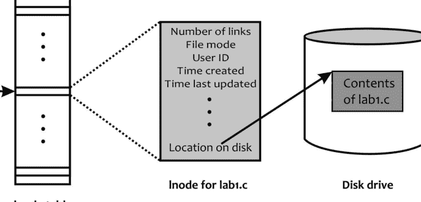

图 4.5 目录中的 `lab1.c` 与其在磁盘上的内容之间的关系。

如图所示，目录由 `<inode #, 文件名>` 数组组成。访问（读取或写入）`lab1.c` 的内容需要使用其 `inode` 号来索引内存中的 `inode` 表以获取文件的 `inode`。如前所述，`inode` 除了其他内容外，还包含了磁盘上 `lab1.c` 的位置。

`inode` 包含了磁盘上 `lab1.c` 的位置。关于 `Linux` 文件位置如何具体指定以及如何存储在磁盘上的细节超出了本教科书的范围。这些细节在 `Linux` 内部可用。

## 4.6 标准文件与文件描述符

当应用程序需要对文件执行 `I/O` 操作时，它必须首先打开文件并发出文件操作（读、写、`seek` 等）。`Linux` 为其执行的每个命令自动打开三个文件。命令从这些文件之一读取，并将输出和错误发送到另外两个。这些文件被称为标准文件：标准输入 (`stdin`)、标准输出 (`stdout`) 和标准错误 (`stderr`)。默认情况下，这些文件附加到执行命令的终端。也就是说，`shell` 的输入来自终端，输出去往终端（`ssh` 会话或 `Wayland` 窗口）。可以通过重定向操作将这些默认文件更改为其他文件：`<` 用于输入 `>` 用于输出。

一个小的整数称为文件描述符（file descriptor），与 `Linux` 中的每个文件相关。整数值 `0`、`1` 和 `2` 分别是 `stdin`、`stdout`、`stderr` 的描述符，也称为文件描述符。内核使用描述符执行文件操作（例如读），如图 4.6 所示。内核使用描述符来索引包含文件 `inode` 指针的文件描述符表。一旦访问了文件的 `inode`，就可以通过使用直接和间接指针执行所需的文件操作。

每个设备（包括终端）在 `Linux` 中都由一个文件表示。图 4.7 所示的图描述了文件与其文件描述符之间的关系。在这里，我们假设文件 `lab1.c` 和 `lab2.c` 为了某些操作（如读）已打开，并分别拥有描述符 `3` 和 `4`，文件表、`inode` 表和磁盘上的存储。

`Linux` 系统允许标准文件更改为单个执行的替代方案，包括 `shell` 脚本。这种将标准文件更改为替代方案的概念是输入、输出错误重定向。我们在第 9 章中详细介绍输入、输出和错误重定向。我们在这里简要提到标准文件和文件描述符，是因为大多数 `Linux` 命令显式地要求从外部源输入，即作为命令行传递给命令的文件（或文件列表）。同样，大多数产生输出的 `Linux` 命令将其发送到标准输出。这些信息对于正确理解和使用后续章节中的命令至关重要。

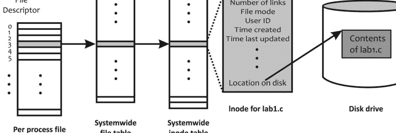

图 4.6 文件描述符与磁盘上文件内容之间的关系。

## 文件与文件系统结构

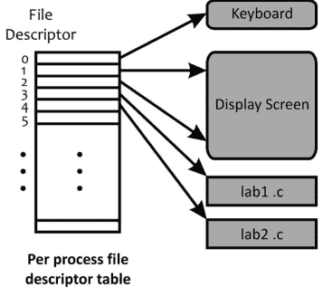

图 4.7 文件描述符与对应文件之间的逻辑视图。

## 4.7 文件系统

正如 4.2 节所述以及本章详细描述，文件系统通常被视为一种高度组织且易于访问的数据集合，从数据在任何现代介质上的持久化存储来看。这种组织性、访问速度、效率和实用性是任何文件系统实现的特征。从这种方式想，文件系统是一个目录层次级结构，其根位于硬盘/固态硬盘 (`SSD`) 或磁盘分区上，并挂载到目录。文件系统中的文件和目录通过其挂载的目录进行访问。文件系统可能跨越通过网络连接的磁盘和计算机。它们在任何实例化中可用，并根据需要挂载。在书中，指的是本地文件系统。网络文件系统 (`NFSv4`) 的描述超出了本教科书的范围，但在第二章中简有提到。

在 `Linux` 的发展历史上，使用了各种文件系统来为普通用户提供速度、效率、安全和实用。三个当代且极其重要的文件系统是扩展文件系统 (`ext`)、`XFS` 文件系统和 `Z` 字节文件系统 (`ZFS`)。

最通用的是 `ext`，因为大多数 `Linux` 变体都使用它作为默认文件系统。`ext` 的第四版本 `ext4` 是当前版本，具有大可扩展性、映射大型磁盘阵列以及日志记录等功能。如果一个文件系统在名为日志的数据结构中跟踪更改，则它被用于日志记录。`Ext4` 支持与 `ext2` 和 `ext3` 向后兼容、刷新到磁盘之前的块分配、无限数量的子目录以及纳秒级的时间戳。

`ZFS` 是一个符合 `POSIX` 标准的文件系统，于 2006 年 6 月发布。它是一个事务型文件系统，使得文件系统状态始终保持一致。它是可靠、灵活且可扩展的，具有内置元数据以及高级的文件备份和恢复功能。然而，`ZFS` 的特色是关注最大的数据完整性，保护用户免受各种错误，包括介质老化、电流脉冲、意外磁盘写入等。它通过使用多种技术（包括数据复制）来实现这种完整性。基准测试表明，在多个专用磁盘的情况下，`ZFS` 远快于 `EXT4`。

`XFS` 是由 `Silicon` `Graphics` 创建并于 2001 年引入 `Linux` 内核的高性能 `64` 位文件系统。`XFS` 的关键特性是执行并行 `I/O` 操作。它是一个高度可扩展的文件系统，允许 `I/O` 线程、文件系统带宽、文件大小以及跨越多个物理存储设备时文件系统本身具有巨大的扩展性。


你可以使用`findmnt`命令来显示所有挂载文件系统的信息，包括它们的类型（如`ext4`）。该命令配合`-t`选项可以显示特定类型的文件系统。例如，你可以使用`findmnt -t ext4`来显示系统上挂载的所有`ext4`系统的列表。

表 4.4 显示了 Linux 文件系统 `XFS`、`Ext4` 和 `ZFS` 的汇总比较。浏览“网络资源（书本 GitHub 上的表 4.5）”中列出的相关网站，以获取更多关于 `Ext4`、`XFS` 和 `ZFS` 的信息。

## 练习题 4.8

使用`findmnt`命令显示你系统上挂载的所有文件系统的信息。你的系统上挂载了多少文件系统？

## 练习题 4.9

使用`findmnt`命令显示你系统上挂载的所有`ext4`文件系统信息。你的系统上挂载了多少此类系统？

## 4.7.1 显示文件和目录的磁盘占用

你可以使用`du`命令显示文件和目录的磁盘占用情况。对于拥有失控文件、超出配额的新用户来说，这是一个非常有用的命令。以下是该命令的简单描述。

| 语法: | `du [option]... file-list...` |
| 用途: | 显示 `file-list` 中文件磁盘使用的摘要，目录则递归显示 |
| 常用选项/特性: | `-a` 显示所有文件的磁盘占用，而不仅仅是目录<br>`-h` 以人类可读的格式显示，例如 `1.7 K`, `31.9 M` 和 `3 G`<br>`-s` 仅显示 `file-list` 中每个文件的总磁盘占用 |

在下文中，我们将在不带任何选项的情况下使用`du`命令，以及使用`-s`和`-h`选项，以`K`、`M`、`G`字节为`1 K`块显示文件和目录的磁盘占用。

```
$ du ~~
4 /home/sarwar/.linuxmint/mintMenu/applications
34724 /home/sarwar/.linuxmint/mintMenu
...
27450108 /home/sarwar
$ du -h ~~
4.0K /home/sarwar/.linuxmint/mintMenu/applications
34M /home/sarwar/.linuxmint/mintMenu
```

| 特性 | `Ext4` | `ZFS` | `XFS` |
|---|---|---|---|
| 引入 Linux 或源码 | 2006 | 2005 | 2001 |
| 最大文件大小 | 16 兆字节 (`TiB`) | 16 艾字节 (`EiB`) | 8 `EiB` |
| 最大卷大小 | 1 `EiB` | $2^{68}$ 字节 = 256 万亿兆字节 (`YiB`) | 8 `EiB` |
| 最大文件数量 | 40 亿 | 无限制（每个目录 $2^{4}$） | 160 亿 |
| 最大文件名长度 | 255 | 255 | 255 |

> `TiB` = $2^{40} = 1024^4$， n`EiB` = $2^{60} = 1024^6$， n`YiB` = $2^{80} = 1024^8$.

# 文件和文件系统结构

```
... /home/sarwar
$ du -s linux2e/ch14
27401844 linux2e/newch14
$ du -h linux2e/ch14
27G -linux2e/newch14
$ du -s /usr/bin
1638M /usr/bin
$
```

## 练习题 4.10

使用该命令显示你系统中的主目录、`/lib` 和 `/dev` 目录的磁盘占用情况，以 1 块以及 `K`、`M`、`G` 字节为单位显示？

## 4.8 文件结束标记

每个文件都有一个文件结束 (`eof`) 标记。从文件读取输入的的命令在到达文件末尾时会读取 `eof` 标记。当输入文件连接到键盘时，`<Ctrl-D>` 是 Linux 的 `eof` 标记。这就是为什么像`cat`这样的命令在从键盘读取输入时（见第 6 章），当你在新行按下 `<Ctrl-D>` 时会终止。

## 总结

在 Linux 中，文件是字节序列。这个简单而强大的概念及其实现导致了系统中的几乎所有内容都是文件；而用户和进程不是。Linux 支持七类文件：普通文件、符号链接、字符文件、块设备文件、命名管道（也称为 `FIFO`）和套接字。任何类型的文件都不支持扩展名，但运行在 Linux 系统上的应用程序可能需要扩展名。

Linux 中的每个文件都有若干与之相关的属性，包括文件名、所有者名称、修改日期、链接数和文件位置。这些属性存储在磁盘上一个称为`inode`的区域。当文件被打开时，这些属性会被复制到称为`inode`表的内核区域，以便访问它们的属性。目录中的每个文件都有一个条目，将其与目录中的文件名和`inode`编号关联起来，并通过文件编号对`inode`进行索引。

Linux 文件系统是分级结构，有一个根目录，系统中的所有文件和目录都在其之下。每个用户都有一个名为主目录的目录，他或在此登录系统。多个驱动器和磁盘分区可以挂载到文件系统结构上，允许作为目录访问，并像 `MS-DOS` 和 `Microsoft Windows` 那样作为命名驱动器 `A-;`、`B-;`、`C;` 等访问。这种方法为所有文件提供了统一视图。

## 文件与文件系统结构

15. 给出删除备忘录（`memos`）的命令。你如何知道目录已被删除？

16. 以下命令的目的是？在你的 Linux 上运行此命令会发生什么？命令的输出合理吗？请解释你的答案。

```
rmdir -p ~/personal/diary
```

17. 为什么当在新行开头按下 `<Ctrl+D>` 时，shell 进程会终止？

18. 给出一个命令，显示 `~/linux2` 目录下所有以单词 `header` 开头、按数字数字 `1`, `2`, `6`, `8` 或 `9` 排序、并以 `.eps` 或 `.prn` 结尾的文件类型。

19. 给出一个命令，显示家目录下 `personal` 目录中所有符合条件的文件：不以字母 `a`, `k`, `G`, `O` 或 `Q` 开头，且文件名的第三个字母不是数字不是字母（大写或小写）。

20. 使用 `ls -i` 命令显示你系统中 `/.usr` 和 `~` 目录的 `inode` 号。显示你的命令输出并识别每个目录的 `inode` 号。

21. 什么是 `ELF` 和核心转储（`core dump`）？

22. Linux 中文件的权限和其他属性存储在哪里？

23. 分别在 `Bash` 和 `TC shell` 中用两种方法显示你家目录的绝对路径。你的系统在 `/` 目录下使用符号链接吗？如果是，使用 shell 命令显示你的符号链接。

24. 讨论在 Linux 上创建文件的可能方法。使用 `fallocate` 命令创建大小为 `20` 和 `200 GB` 的文件。

25. Linux 中的文件描述符（`file descriptor`）是什么？什么是标准文件？它们的描述符是什么？

26. 标准文件重定向（`redirection of standard files`）的概念是什么？

27. 你为什么认为在进程文件描述符表和 `inode` 表之间需要系统级文件表？

28. 扇区（`sector`）、轨道（`track`）、盘片（`platter`）和柱面（`cylinder`）分别什么？硬盘中扇区的大小是多少？

29. 块（`block`）和簇（`cluster`）是什么？

30. `ZFS` 文件系统的基本特征是什么？参考第 22 章和 `ZFS` 的在线资源后，`ZFS` 是集成到 Linux 内核中的，还是一个可加载的内核模块？

31. 你的 Linux 系统文件名的最大长度（字节/字符）是多少？你使用了什么命令获取该答案？

32. 浏览以下目录并识别其中常用的命令、工具、程序和守护进程（`daemons`）：`/bin`, `/sbin`, `/usr/bin`, `/usr/sbin`, `/usr/local/bin` 和 `/usr/local/sbin`。清楚说明每个命令、工具、程序、守护进程的作用以及它们所在的目录名称。

33. 我们说 `Ext4` 是向后兼容的。这意味着什么？

34. `Ext4` 支持多大的卷和文件？在 `Ext4` 文件系统上可以创建多少目录？

35. 对 `ZFS` 和 `XFS` 重复第 26 题。

36. 你的系统中挂载了多少文件系统？其中 `Ext4`、`XFS`、`ZFS` 和 `cgroups` 类型的各有多少个？显示你用于获取答案的命令。

37. 你的系统中 `/sys` 和 `/dev` 下挂载了多少文件系统？显示你用于获取答案的命令以及该命令的输出。

38. `ZFS` 下一个目录可以有多少个文件？请以万亿（`trillion`）为单位给出数字。

39. 使用带不带选项的 `du` 命令显示以下文件和目录的磁盘占用情况，以 `1 K` 块以及 `K`、`M`、`G` 字节单位：

- a. `/etc/passwd`

- b. `/var/log/syslog`

- c. 你的家目录

- d. 根目录

- e. `/usr/bin` 目录

# 高级问题与练习

40. 你将如何获取并显示（在标准输出上）工作目录下文件对象的以下属性？

- a. 按修改时间排序文件，显示所有长格式属性

- b. 所有隐藏文件和子目录的列表。

- c. 按字母顺序排列的所有文件和目录。

- d. 按文件扩展名字母顺序排列的所有文件和目录。

- e. 递归显示的子目录列表。


- `f.` 文件名的长格式属性列表，包括它们的 `inode` 号。

- `g.` 仅包含文件和目录名称及其大小的列表。

- `h.` 按字母倒序排列所有者、组和作者。

- `i.` 使用特殊指示符列出文件名、大小和类型。

41. 如果在没有运行 `GUI` 桌面的 `Linux` 计算机上插入 `USB` 优盘，如何如何快速判断它是否已自动挂载，以及（如果已挂载）它在文件系统中自动挂载的完整路径？你使用什么命令导航到那里？你使用什么命令挂载（如果没有自动挂载！）和卸载 `U` 优盘？你可以使用哪些命令获取之前的所有信息？

42. 哪种 `Linux` 命令允许你对已挂载在系统上的一次性 `U` 优盘（你完全不知道其数据）进行列出、修改或创建分区？使用该命令、子命令以及任何其他必要命令执行以下操作：

- `a.` 卸载 `U` 优盘。

- `b.` 在标准输出打印 `U` 优盘的分区信息列表。

- `c.` 删除 `U` 优盘。

- `d.` 创建 `U` 优盘。

- `e.` 文件名的长格式属性列表，包括它们的 `inode` 号。

- `f.` 仅包含文件和目录名称及其大小的列表。

- `g.` 按字母倒序排列所有者、组和作者。

- `h.` 使用特殊指示符列出名称、大小和类型。

43. 你为什么认为在文件描述符表和 `inode` 表之间需要系统级文件表？

44. 扇区、轨道、盘片和柱面是什么？硬盘扇区的大小是多少？

45. 块和簇是什么？

46. `ZFS` 文件系统的基本特征是什么？参考第 22 章和 `ZFS` 的在线资源，`ZFS` 是集成到 `Linux` 内核中的，还是一个可加载的内核模块？

47. 你的 `Linux` 系统文件名的最大长度（字节/字符）是多少？你使用了什么命令获取该答案？

48. 浏览以下目录并识别其中常用的命令、工具、程序和守护进程：`/bin`、`/sbin`、`/usr/bin`、`/usr/sbin`、`/usr/local/bin` 和 `/usr/local/sbin`。清楚说明每个命令、工具、程序、守护进程的作用以及它们所在的目录名称。

49. 我们说 `Ext4` 是向后兼容的。这意味着什么？

50. `Ext4` 支持多大的卷和文件？在 `Ext4` 文件系统上可以创建多少目录？

51. 对 `ZFS` 和 `XFS` 重复第 26 题。

52. 你的系统中挂载了多少文件系统？其中 `Ext4`、`XFS`、`ZFS` 和 `cgroups` 类型的各有多少个？显示你用于获取答案的命令。

53. 你的系统中 `/sys` 和 `/dev` 下挂载了多少文件系统？显示你用于获取答案的命令以及该命令的输出。

54. `ZFS` 下一个目录可以有多少个文件？请以万亿（`trillion`）为单位给出数字。

55. 使用带不带选项的 `du` 命令显示以下文件和目录的磁盘占用情况，以 1 K 块以及 K、M、G 字节单位：

- `a.` `/etc/passwd`

- `b.` `/var/log/syslog`

- `c.` 你的家目录

- `d.` 根目录

- `e.` `/usr/bin` 目录

## 安全

## 目标

- 显示 `Linux` 提供的保护和安全机制

- 描述用户类型

- 讨论可以在文件上执行的基本操作

- 解释文件权限的概念

- 讨论用户如何设置和更改权限

- 讨论特殊位位、`set-user-ID`、`set-group-ID` 和粘滞位（`sticky bit`），并描述它们的用途

- 以下命令和原语：

```
mcrypt, groups, ls -l, ls -ld, openssl, umask
```

## 5.1 基于密码的保护

允许你的文件免受其他用户保护的第一机制是登录密码方案。每个基于 `Linux` 的计算机用户都被分配了一个登录名和密码。但登录名和密码都是由...分配的

系统管理员是用户进入和使用 `Linux` 系统所必需的。所有登录名都是公开信息，可以在 `/etc/passwd` 文件中找到。然而，用户的密码仅提供给用户本人。这种方案防止了用户访问彼此的文件。鼓励用户经常使用 `passwd` 命令（见第 2 章）更改他们的密码。

在某些网络系统中，你可能需要使用 `yppasswd` 或 `nispasswd` 命令来更改你计算机系统上的密码。然而，执行这些命令需要超级权限（见第 5.4.1 节）。如果你在你的 `Linux` 系统上没有找到此命令，则必须安装 `nis` 或 `yp-tools` 软件包。请咨询你的导师关于特定系统上需要使用的命令。通常，系统管理员可以更改登录名。在某些 `Linux` 安装中，用户也被允许更改自己的用户名。

这种保护方案的有效性取决于用户密码受保护程度。如果有人知道你的密码，那人就可以登录系统并访问你的文件。发现用户密码的方法主要有以下几种：

- 1. 你作为账户所有者，告知他人你的密码。

- 2. 用户使用字典、暴力破解、彩虹表和拼写攻击等多种技术猜测（或破解）另一个用户的密码。

- 3. 使用网络钓鱼获取你的密码。

- 4. 使用社会工程学获取你的密码。

- 5. 使用恶意软件或键盘记录器获取你的密码。

在任何情况下都不要让任何人知道你的密码。作为一种安全措施，你应该定期更改密码。始终选择他人难以猜测的密码。一个好的密码由字母、数字和标点符号组成——但必须对你容易记忆。永远不要将密码写在纸上，永远不要使用生日或亲属、朋友、著名运动员或喜爱的电影演员的名字作为密码。此外，避免使用单词。密码学家建议，一个好的密码应该是 20 个字符长。

你可能喜欢浏览表 5.6 中的网站（位于 `GitHub` 站点），以了解更多关于拥有或获取他人密码的各种技术的细节。表中还包含指向一个网站的链接，该网站描述了十种流行的破解工具：字典、暴力破解、彩虹表、拼写、钓鱼、恶意软件、键盘记录器和社会工程学攻击。我们简要描述破解他人密码的暴力破解攻击。字典、彩虹表和拼写攻击类似，但消耗资源较少。

通过暴力破解，有人通过尝试所有可能的字符组合直到找到密码来获取你的密码。猜测别人的密码是非常耗时的，通常被黑客使用。如果密码很长且由字母、数字和标点符号组成，暴力破解方法可以使入侵者的工作变得更加耗时。为了说明使用更复杂密码的意义，考虑一个密码恰好为八个字符的系统。这将允许分析 $10^8$（1 亿）种密码，假设密码由数字和大写字母混合组成（总共 36 个符号）。密码空间将变为 $36^2$（约 2.8 万亿）种密码。如果系统要求密码由数字、大写字母和小写字母混合组成，密码空间将包含 $62^2$（约 218 万亿）种密码。想象一下如果密码还可以包含标点符号，密码空间将有多大！许多系统在输入无效密码后、下一次登录提示之前会强制进行短时间（例如 5 秒）延迟，以使入侵者的工作更加困难。

下一章练习要求你思考如何在你的系统上更改密码。

## 练习 5.1

在 `Linux` 系统中，你不被允许更改密码。你的系统允许你更改密码吗？如果允许，更改你的密码。你使用了什么命令？

## 文件安全

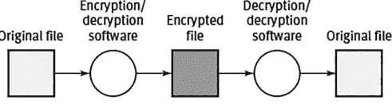

图 5.1 加密和解密的过程。

注意：务必记住你的密码，因为如果你忘记了，你必须请求系统管理员将你的密码重置为新值，除非你的系统允许将密码改回之前的密码。

## 5.3 基于加密的保护

在第二种保护方案中，使用软件工具将文件转换为与其原始版本完全不同的形式。转换后的文件被称为加密文件，将文件转换为加密文件的过程称为加密。使用相同的工具执行将加密文件转换为原始形式的反向过程，称为解密。你可以使用这种技术保护你最重要的文件，即使有人获得了它们的访问权限，其内容也无法被理解。图 5.1 展示了加密和解密过程。

`Linux` 命令 `encrypt` 和 `openssl` 可用于加密解密你的文件。你可以通过运行 `man mcrypt` 和 `man openssl` 命令学习更多关于这些命令的内容我们我们第 7 章详细讨论这些命令。

## 5.4 基于访问权限的保护

第三种保护机制防止用户在未登录为文件所有者时访问彼此的文件。作为文件所有者，你可以为你的文件附加访问权限，这些权限规定了对于各种类型的文件操作，谁可以谁不能访问它们。这种方案基于用户类型、访问权限以及 `Linux` 下允许在文件上进行的操作权限。如果没有这种保护方案，用户可以访问彼此的文件，因为……

### 5.4.1 用户类型

`Linux` 中的每个用户都属于一个组。系统管理员通过将用户添加到系统中来使用户属于一个组。该组被称为用户的默认组。用户的默认组成员在 `/etc/passwd` 文件中的用户条目中指定。系统管理员可以通过将用户名放在组的逗号分隔列表中使用户属于另一个组（除其默认组外）。你可以使用 `group` 命令显示你的用户属于哪些组。以下会话显示 `sarwar` 属于三个组；`bob` 属于组；`davis` 是：

```
$ groups sarwar
faculty
$ groups bob
faculty
$ groups davis
dialout lab
```

你可以通过显示 `/etc/group` 文件查看系统中所有组的列表，显示如下：


```
$ /etc/group
root:x:0
daemon:x:1
bin:x:2,root,daemon
sys:x:3
adm:x:4,syslog,bin
tty:x:5
disk:x:6
lpi:x:7
mail:x:8
news:x:9
uuc:x:10
man:x:12
proxy:x:13
mem:x:15
dialout:x:20,davis
fax:x:21
voice:x:22
cdrom:x:24,bob
floppy:x:25
tape:x:26
sudo:x:27,bob
audio:x:29
dip:x:30
sambashare:x:130,bob,ravi
lab:x:1001,davis,sam
faculty:x:1002,bob,sarwar,ravi
ravi:x:1003
goldsmith:x:1004
bob:x:1005
sarwar:x:1006
```

该文件中系统中每个组都有一行，每行有四个用冒号分隔的字段。第一个字段指定组名，第二个字段指定有关组的信息，第三个字段以数字指定组 ID，最后一个字段指定作为该组成员的用户逗号分隔列表。例如，`bin` 组的 ID 为 2，其成员为 `root`、`bin` 和 `daemon`。如果某行的成员缺失（如 `disk` 组 `,`），这意味着其成员是在 `/etc/passwd` 文件中指定的。

# 文件安全

## 表 5.1

Linux 文件权限摘要

| 用户类型 | 读取 (r) | 写入 (w) | 执行 (x) | 含义 |
|---|---|---|---|---|
| 用户 (u) | X | X | X | 文件的所有者（用户）的三位权限 |
| 组 (g) | X | X | X | 文件所属组（组所有者）的三位权限 |
| 其他 (o) | X | X | X | Linux 系统上其他用户的三位权限 |

注：如果相关权限开启则 `X` 为 1，关闭则为 0。

## 表 5.2

用户对文件的可能访问值、其八进制等值及含义

| r | w | x | 权限的八进制 | 含义 |
|---|---|---|---|---|
| 0 | 0 | 0 | 0 | 无权限 |
| 0 | 0 | 1 | 1 | 仅执行权限 |
| 0 | 1 | 0 | 2 | 仅写入权限 |
| 0 | 1 | 1 | 3 | 写入和执行权限 |
| 1 | 0 | 0 | 4 | 仅读取权限 |
| 1 | 0 | 1 | 5 | 读取和执行权限 |
| 1 | 1 | 0 | 6 | 读取写权限 |
| 1 | 1 | 1 | 7 | 读取、写入和执行权限 |

### 5.4.2 文件操作/访问权限类型

在 Linux 中，文件可以关联三种类型的访问权限/特权：读取 (`r`)、写入 (`w`) 和执行 (`x`)。文件的读取权限允许你读取文件，写入权限允许你写入或删除文件，而执行权限允许你执行/运行文件。执行权限应仅针对可执行文件、包含二进制代码的文件（即由编译器生成的可执行文件）或脚本设置，对于任何其他类型的文件设置它没有意义。我们将在 5.4.3 节中讨论目录执行权限的用途。

由于三类文件用户和每种用户的三种权限，Linux 关联了九种权限，如表 5.1 所示。注意，权限按行读取。如第 4 节所示，特权存储在文件的 `inode` 中。

`X` 的值可以是 1（已授予权限）或 0（未授予权限）。因此，需要一个位来表示一种类型用户的权限。换句话说，文件用户在特定时刻可以拥有该文件的八（2）种可能的权限类型之一。八进制数可以表示这些从 0 到 7 的八位访问值，如表 5.2 所示。八进制 0（二进制 `000`）和 7（二进制 `111`）分别表示所有访问权限和所有权限。

表示三类文件用户权限的九个位导致了文件权限的三位八进制数字 `000-777` 的可能访问值。第一个八进制数字指定所有者的权限，第二个数字指定组的权限，第三个数字指定其他所有人员的权限。在 `ls -l` 命令的输出中，权限位值为 0 显示为短横线 (`-`)，位值为 1 则根据位的位置显示为 `r`、`w` 或 `x`。因此，文件用户的权限值 0（未授予任何权限）可以写为 `---`，而权限 7（授予所有权限）可以表示为 `rwx`。接下来的节中 `ls -l` 命令的输出显示，系统除 `root` 用户外，`/etc/passwd` 文件所有者是只读的，并具有读写权限。`client.c` 文件对所有者 (`sarwar`) 和组 (`faculty`) 读写权限，对其他人是只读权限。

```bash
$ ls -l /etc/passwd
-rw-r--r-- 1 root root 2862 Dec 24 2016 /etc/passwd
$ ls -l client.c
-rw-r--r-- 1 sarawar faculty 1277 Dec 12 2016 client.c
```

由于用户可以属于许多组，你可以通过组扩展对文件的访问权限以适应不同的用户。

## 5.4.3 目录的访问权限

接下来，我们将查看读取、写入和执行权限对目录的含义。目录的读取权限允许你读取目录的内容；记住，目录的内容是其中文件和目录的。因此，可以使用 `ls` 命令列出其内容。目录的写入权限允许你在其中创建新目录或文件，或者从其中删除条目。目录的执行权限是搜索目录的权限，但不能对其进行读取或写入。因此，如果你没有目录的权限，就无法使用 `ls` 命令列出其内容或无法使用 `cd` 命令进入该目录。如果目录路径中的任何组件不包含执行权限，情况也是如此。我们将在 5.5.2 节中演示目录搜索权限这些方面。

### 5.5 确定和更改文件访问特权

后续章节描述了如何确定文件和目录的访问权限以及如何更改它们。

#### 5.5.1 确定访问权限

你可以使用 `ls -l` 命令查看文件的访问权限。以下是一个示例：

```bash
$ ls -l /etc/passwd
-rw-r--r-- 1 root root 2862 Dec 24 2016 /etc/passwd
$ ls -l client.c
-rw-r--r-- 1 sarawar faculty 1277 Dec 12 2016 client.c
```

由于用户可以属于许多组，你可以通过组扩展对文件的访问权限以适应不同的用户。

## 表 5.3 访问权限

| 文件名 | 用户 | 组 | 字节大小 | 日期 | 时间 |
|---|---|---|---|---|---|
| `---` | `---` | `---` | `---` | `---` | `---` |
| `drwxr-xr-x` | `sarawar` | `faculty` | `512` | `Jul 29` | `17:35` |
| `-rw-r--r--` | `sarawar` | `faculty` | `1024` | `May 05` | `23:13` |
| `-rwxrxr--` | `sarawar` | `faculty` | `1638` | `May 05` | `12:22` |

第一个字段的最左字符指示文件类型（`d` 表示目录，`-` 表示文件）。剩余九个字符显示用户、组和其他人的权限。第二个字段指示硬链接数。第三字段显示所有者名称。第四字段显示组。第五字段显示大小。第六、第七和第八字段显示日期和时间。最后一个字段是名称。

#### 5.5.2 更改访问权限

你可以使用 `chmod` 命令更改文件的访问权限。以下是该命令的简要描述。

```bash
chmod [options] octal-mode file-list
chmod [options] symbolic-mode file-list
```

常用的选项/功能：

- `-R` 递归遍历目录，更改/设置每个目录下所有文件和子目录的权限。
- `-f` 强制指定的访问权限，如果你是文件的所有者，则不会产生错误信息。

## 表 5.4

符号模式组件值

| 对象 (Who) | 运算符 (Operator) | 权限 (Privilege) |
|---|---|---|
| `u` 用户 | `+` 添加权限 | `r` 读取位 |
| `g` 组 | `-` 移除权限 | `w` 写入位 |
| `o` 其他人 | `=` 设置权限 | `x` 执行/搜索位 |
| `a` 所有 | | `u` 用户当前的权限 |
| `ugo` 所有 | | `g` 组当前的权限 |
| | | `o` 其他人的当前权限 |
| | | `1` 锁定 `SGID` 位 |
| | | `s` 设置用户或组 ID 位 |
| | | `t` 滞留位 (`Sticky` `bit`) |

## 表 5.5

`chmod` 命令示例及其用途

| 命令 * | 用途 |
|---|---|
| `chmod 700` | 将当前目录下所有文件（包括目录）的访问权限设置为：所有者具有读、写、执行权限，其他人无访问权限 |
| `chmod 740 courses` | 将 `courses` 的访问权限设置为：所有者具有读、写、执行权限，组只读读，其他人无权限 |
| `chmod 751 ~/courses` | 将 `~/courses` 的访问权限设置为：所有者具有读、写、执行权限，组只读权限，其他人仅执行权限 |
| `chmod 700 ~` | 将家目录的访问权限设置为：所有者具有读、写、执行（即搜索）权限，其他人无权限 |


| `chmod u=rwx courses` | 设置所有者对 `courses` 的读、写、执行权限，并保持组和其他人的当前权限不变 |

| `chmod ngo-rw sample` | 不允许任何人对 `sample` 进行写入 |

| `chmod a+x sample` | 赋予所有人 `sample` 的执行权限 |

| `chmod g=u sample` | 使 `sample` 的组权限与其用户（所有者）权限一致 |

| `chmod go= sample` | 移除组和其他对 `sample` 的所有权限 |

符号模式（也称为控制字）的格式为 `<who><operator><privilege>`，如表 5.4 所示。该表还显示了 `chmod` 命令中使用 `+` 和 `-` 运算符来添加和移除权限。如何将组 ID (SGID) 权限设置为 `S` 或 `1`，将在第 5.6.2 节描述。

注意，`u`、`g` 或 `o` 可以配合 `=` 运算符作为权限。“who”和“privilege”可以使用多个值，例如在“who”字段中使用 `ug`，在“privilege”字段中使用 `rx`。表 5.5 列出了 `chmod` 命令的一些有用示例及其用途。

以下插图显示了如何确定和设置文件的访问权限。`chmod` 命令用于更改（或）设置访问权限，而 `ls -1`（或 `-1d`）命令用于显示相应 `chmod` 命令的效果。执行 `chmod 700` 命令后，文件的所有者拥有读、写、执行访问权限，而没有任何人访问权限。`chmod g+rx` 命令为组添加读和执行访问权限；所有者和其他人的权限保持不变。`chmod o+r` 命令为其他人添加 `courses` 文件的读取权限。`chmod a-*` 命令移除当前目录下所有用户对文件的写入权限。`chmod go+x, o+r` 命令开启组和其他人的执行权限，`chmod 700 [l-t]` 命令将所有以字母“l”到“t”开头的文件访问权限设置为 700，如最后一个 `ls -1` 命令的输出所示，该输出显示 `labs` 文件的访问权限已更改为 700。

```
$ cd
ls -1
drwxr-xr-- 2 sarwar faculty 512 Apr 23 09:37 courses
-rw-rw-rx 1 sarwar faculty 512 May 01 13:22 labs
-rw-rw-r-- 1 sarwar faculty 163 May 05 23:13 temp
$ chmod 700 -ls -1d courses
drwx-- 2 sarwar faculty 512 Apr 23 09:37 courses
$ chmod g+o-rx
drwx------ 2 sarwar faculty 512 Apr 23 09:37 courses
$ chmod +ls -1d courses
drwxr-xr-- 2 sarwar faculty 512 Apr 23 09:37 courses
$ chmod a-w *
$ ls -1
dr-xr-xr-- 2 sarwar faculty 512 Apr 23 09:37 courses
-r-xr-xr-- 1 sarwar faculty 512 May 01 13:22 labs
-rw-rw-r-- 1 sarwar faculty 163 May 05 23:13 temp
$ chmod go+,o-r *
$ ls -1
drwx------ 2 sarwar faculty 512 Apr 23 09:37 courses
-r-xr-xr-- 1 sarwar faculty 512 May 01 13:22 labs
-rw-rw-r-- 1 sarwar faculty 163 May 05 23:13 temp
$ chmod 700 [-1-t]*
$ ls -1
dr-xr-xr-- 2 sarwar faculty 512 Apr 23 09:37 courses
-r-xr-xr-- 1 sarwar faculty 512 May 01 13:22 labs
-rw-rw-r-- 1 sarwar faculty 163 May 05 23:13 temp
```

## 5.5.3 目录的访问权限

如前所述，对目录读或写权限不足以读取其内容（例如使用 `ls -1` 命令显示）或在其中创建文件或目录。例如，目录 `dir1` 开启了权限，但你无法将 `prog1.cpp` 文件复制到其中，因为它的搜索权限被关闭了。同样，你无法从 `dir2` 中删除 `f1`。在通过 `chmod u+x dir2` 命令开启其搜索权限后，就可以删除 `f1` 了。

# 文件安全

```
$ chmod u+x dir2
$ ls -1ld dir2
d-wx------ 2 sarwar faculty 3 Aug 4 06:59 dir2
$ rm dir2/f1
```

接下来的章节练习要求你使用 `chmod` 和 `-1ld` 命令来观察它们是如何运作的，并加强你对 Linux 文件权限的理解。

# 练习 5.2

使用 `mkdir` 命令创建三个名为 `courses`、`sample` 和 `personal` 的目录。为 `sample` 目录设置访问权限，使你拥有所有权限，同组组的用户只有读取权限，而系统的其他用户没有访问权限。请展示你的操作过程。

# 练习 5.3

使用 `chmod o+r sample` 命令允许其他人对 `sample` 目录拥有读取权限。使用 `ls -1ld sample` 命令确认已为其他人开启了 `sample` 的读取权限。

# 练习 5.4

利用这些练习之前的会话完全理解目录的读、写、执行权限是如何工作的。在你的系统上运行该会话并验证结果。

## 5.5.4 默认访问权限

当创建一个新文件或目录时，Linux 会根据当前的掩码（mask）值设置其访问权限。在 Linux 系统上，新建的文件和目录的默认访问权限可执行文件为 777，文本文件为 666。然而，这些默认权限取决于你系统中设置的掩码值。如果掩码位为 1，则相应的权限将被禁用；如果是 0，则权限将由系统使用表示掩码当前值和默认权限的布尔逻辑来确定。我们将在本节中描述这一表达式。

你可以使用 `umask` 命令显示当前的掩码值或将其设置为新值。以下是该命令的描述。

> **语法：**
>
> `umask [-S] [mask]`
>
> **目的：**
>
> 如果掩码中的相应位被设置为 1，则将新创建的文件和目录的相应权限位设置为 0。其他权限位使用表示掩码值和默认权限的布尔逻辑确定。在不带任何参数的情况下，该命令显示掩码的当前值。带有 `-S` 选项，命令将以符号形式显示掩码值（见下文）。

当在不带参数执行命令时，它将以八进制形式显示位掩码的当前值，如下面的会话第一个命令所示。最右边的九位（即右侧三个八进制数字）分别用于用户、组和其他，最左边的三位（即最左边的八进制数字）用于第 5.6 节描述的特殊访问位。`umask -S` 命令显示掩码的符号值，显示了为新创建的目录或可执行文件为用户、组和其他设置的访问权限。

```
$ umask
0022
$ umask -S
u=wx, g=rX, o=rX
$
```

当带掩码参数使用时，`umask` 命令用于设置掩码值。掩码值可以指定为三位或四位八进制。在下面的会话中，我们展示了如何带和不带 `-S` 选项使用 `umask` 命令。

```
$ umask 077
$ umask
0077
$ umask -S u=rwx,g,o=
$ umask
0077
```

`umask` 命令通常放置于 Linux 的系统启动文件 `~/.profile` 中（包括 Mint 18），以便在每次登录系统时都执行。

`umask` 的参数是一个以八进制指定的位掩码，用于标识在创建新文件时需要关闭的权限位。其他权限位的值通过布尔表达式计算：

```
A = B AND C' = BC'
```

在这里，`A` 是新创建的文件或目录的权限，`B` 是默认访问权限（目录或可执行文件为 777，文本文件为 666），`C` 是当前的掩码值。`C`（读作 "NOT C" 或 "C prime"）被称为取反，即 `C` 的按位反反码。二进制数的按位反反码通过将 1 替换为 0 反之亦然来获得。例如，四位二进制数 1011 的按位反反码是 0100。两个变量的按位布尔函数 `AND`（与逻辑）在当两者都为 1 时返回 1；否则返回 0。在之前的表达式中，计算 `A` 时，会比较 `B` 和 `C` 中的权限位，仅当两者都为 1 时返回 1；否则返回 0。

我们展示了 Linux 如何为给定掩码为新建的文件和目录分配访问权限的示例。我们使用之前的布尔表达式确定掩码值 022 下新创建的目录或可执行文件的访问权限。


```
C = 022             000 010 010
C'                  111 101 101
B = 777             111 111 111
A = B AND C'        111 101 101 = 755 (八进制)    = 110100100 (二进制)
                                     rw-xr-xr-x (符号)
```

因此，访问权限为 `755`（用户：读、写、执行；组：读、执行；其他：读、执行）。对于文件，访问权限为 `644`（用户：读、写；组：读；其他：读）。因此，当掩码值为 `077` 时，访问权限为：

```
C = 077             000 111 111
C'                  111 000 000
B = 666             110 110 110
A = B AND C'        110 000 000 = 600 (八进制)    = 101000000 (二进制)
                                     rw------- (符号)
```

作者偏于使用 `077`，这样新创建的文件就有完全保护，即所有者拥有完全权限，其他人没有任何权限。记得可以使用`chmod`命令根据需要更改文件的访问权限。另一个常见的掩码值是 `027`，为组成员提供默认权限，对其他人没有权限。练习 5.5 要求你使用`umask`命令确定当前的文件掩码。

# 练习 5.5

运行本节显示和讨论的所有 shell 会话，确保它们在你的系统上同样运行，并理解`umask`命令的工作原理以及 Linux 系统如何决定新建文件和目录的权限。

## 5.6 特殊访问位

除了本章描述的九个权限位外，还有三个额外的位具有特殊意义。这些位被称为用户 ID（SUID）位、组 ID（SGID）位和粘滞位（sticky bit）。

### 5.6.1 SUID 位

我们之前展示过外部 shell 命令对应包含二进制可执行文件或 shell 脚本的文件。这些文件中的程序除了能够执行任务外，没有特殊之处。通常，当命令执行时，它是以执行命令用户的权限运行的，这就是本章描述的访问权限的工作方式。然而，许多 Linux 命令需要写入对通常运行它们的的用户受保护的文件。一个例子是`/etc/passwd`，它是包含用户登录信息的文件（见第 4 章）。只有超级用户被允许写入此文件以执行诸如添加新登录和更改用户组 ID 等任务。然而，Linux 用户通常允许执行`passwd`命令来更改自己的参数。

当用户执行`passwd`命令时，该命令会代表运行此命令的用户更改`/etc/passwd`文件中的用户密码。问题在于，我们希望能够更改他们的密码，但同时，他们可能对`/etc/passwd`文件没有写权限，以防止该文件中关于其他用户的信息被泄露。在 Linux Mint 上，位于`/etc/shadow`的不可读主密码文件则会发生这种变化。

如前所述，实现相同功能的另一种方法是：当一个命令运行时，它以运行命令的用户权限执行，并具有运行命令的有效用户 ID（EUID）。Linux 有一种机制可以解决上一段描述的问题以及许多其他类似问题——它允许命令更改其有效用户 ID 并在某种程度上获得特权。这种机制允许像`passwd`等命令执行其工作，而不会损害系统的完整性。每个文件都关联有一个额外的保护位，称为SUID 位。如果一个包含可执行程序的文件设置了此位，则该程序在执行时将获得文件所有者的权限。如果一个文件由 `root` 所有且设置了 SUID 位，它将以超级用户权限运行。`passwd`命令就设置了这个位。因此，当你运行`passwd`命令时，即使你没有该文件的访问权限，也可以向`/etc/passwd`文件写入新密码。

其他几个命令也需要 `root` 所有并设置 SUID 位，因为它们访问并操作的操作系统资源（文件、数据结构等）是普通用户可能没有权限的。其中包括`ip`、`mail`、`mkdir`、`mv` 和`ps`。维护评分文件的计算机游戏软件作者可以在不使用 SUID 位的情况下创建。当此类软件设置了 SUID 位时，用户玩游戏时它可以更新分数，尽管该用户无法通过显式写入文件来更新分数。

当 SUID 位对执行所有者启用为`s`（或`S`）时。如果 SUID 和执行位都可用，文件在`-l`命令的输出中显示为`s`。如果启用了 SUID 但禁用了执行位，`-l`命令将文件显示为`S`。接下来的会显示了每种情况的示例。

```
$ ls -l cp new foo
-rwSr-r-- 1 ansvar faculty 14 Aug 4 23:30 cp.new
-r-Sr-xr-x 1 ansvar faculty 30 Aug 5 05:27 foo
```

具有以下语法的命令可以设置 SUID 位。

```
Syntax:
chmod 4xxx file-list
chmod u+s file-list
Purpose: 更改/八进制数字，用于指定用户、组和其他人的读、写、执行权限
```

在这里，`xxx`是指定用户、组和其他人的读、写、执行权限的八进制数，数字 `4`（二进制`100`）用于设置 SUID 位。当设置 SUID 位时，如果允许用户执行权限，则该用户的执行位被设置为`s`（小写）；否则，它被设置为`S`（大写）。接下来的句子说明了这些语法的用法。第一条`ls -l cp.new`命令显示它已设置。`chmod 4710 cp.new`命令用于设置 SUID 位以及其他九位权限（将其更改为`710`）。第二个`ls -l cp.new`命令显示`x`值已变为`s`。随随后的`chmod`命令用于设置 SUID 位和执行位。最后一个`-l cp.new`命令用于显示执行权限已从所有者移除。`chmod u+s cp.new-mand`命令显示位值为`S`（大写），因为在设置 SUID 位之前之前没有设置执行位。

```
$ ls -l cp.new
-rwx--x--- 1 ansvar faculty 14 Aug 4 23:26 cp.new
```

## 文件安全

```
$ chmod 4710 cp.new
$ ls -l cp.new
-rwxs--- 1 sarwar faculty 14 Aug 4 23:26 cp.new
$ chmod u-x cp.new
$ chmod u-x cp.new
$ ls -l cp.new
-rw-r--x 1 sarwar faculty 14 Aug 4 23:26 cp.new
$ chmod u+s cp.new
$ ls -l cp.new
-rw-S--x 1 sarwar faculty 14 Aug 4 23:26 cp.new
```

虽然 SUID 位的理念是正确的，但如果实现不当，可能会损害系统安全。例如，如果任何 SUID 程序的权限被设置为允许他人获得特权，你就可以更改程序中的文件或用另一个程序覆盖该文件。这样做将允许你以超级用户权限执行你的（新）程序。

### 5.6.2 SGID 位

SGID 位的工作方式与 SUID 位相同，但它导致进程的权限变为该文件所属组的身份。这不像 SGID 功能那么危险，因为大多数特权操作都需要超级用户身份，无论当前的组 ID 是什么。如果`ls -l`命令将组执行位显示为`s`（或`S`），则启用了 SGID 位。如果 SGID 和执行位都启用，该位在`-l`命令的输出中显示为`s`。如果启用了 SGID 但禁用了执行位，`-l`命令将该位显示为`S`。接下来的话显示了每种情况的示例。

```
$ ls -l cp.new
-rw-Sr-- 1 sarwar faculty 14 Aug 4 23:38 cp.new
-r-xr-x 1 sarwar faculty 30 Aug 5 05:27 foo
```

使用以下两个命令语法之一可以设置 SGID 位。

```
Syntax:
chmod 2xxx file-list
chmod g+s file-list
Purpose: 更改 file-list 中文件的 SGID 位
```

在这里，`xxx`八进制数指定`file-list`中文件的读、写和执行权限，八进制数字 `2`（二进制`010`）指定为文件设置 SGID 位。接下来的会话说明了这些命令的使用。`chmod 2751 cp.new`命令为`cp.new`文件设置 SGID 位，访问权限为`754` (rwxr-x)。其余命令与 5.6.1 节相似。


```
$ ls -l cp.new
-rwxr-xr-x 1 sarwar faculty 14 Aug 4 23:26 cp.new
$ chmod 2751 cp.new
$ ls -l cp.new
-rwxr-s-x 1 sarwar faculty 14 Aug 4 23:26 cp.new
$ chmod g-s cp.new
$ ls -l cp.new
-rwxr-xr-x 1 sarwar faculty 14 Aug 4 23:26 cp.new
$ chmod g+s cp.new
$ ls -l cp.new
-rwxr-s-x 1 sarwar faculty 14 Aug 4 23:26 cp.new
$ chmod g-x cp.new
$ ls -l cp.new
-rwxr-xr-- 1 sarwar faculty 14 Aug 4 23:26 cp.new
$ chmod g+s cp.new
$ ls -l cp.new
-rwxr-s-- 1 sarwar faculty 14 Aug 4 23:26 cp.new
$ chmod g-s cp.new
$ ls -l cp.new
-rwxr-xr-- 1 sarwar faculty 14 Aug 4 23:26 cp.new
```

你可以通过单个命令设置或重置 SUID 和 SGID 位。`chmod ug+s cp.new` 命令用于在 `cp.new` 上执行此任务。你也可以通过最左边的八进制数字 6（二进制 `110`）设置 SUID 和 SGID 位，访问权限为（读、写和执行）。因此，`chmod 6754 cp.new` 可用于设置 `cp.new` 的 SUID 和 SGID 位。如果 SGID 在目录上开启，在该目录中创建的目录将属于创建目录的用户组，而不是父目录的组。如果你的操作系统和文件系统支持强制锁定，`-l` 命令会在第七权限位显示 `1`。查阅 `fcntl()` 调用的 man 页面以及 W 章关于建议（裁量）和强制文件锁的详情。

### 5.6.3 粘滞位 (Sticky Bit)

最后的访问权限——粘滞位，如果其他执行位为 `t`（或 `T`），如 `/tmp` 的情况所示：

```
$ ls -l /
drwxrwxrwt root root 4096 Jul 1 15:17 tmp
```

粘滞位用于目录，确保非特权用户无法删除或重命名该目录中其他人的文件。你必须是目录的所有者，或者为它设置了相应的粘滞位权限。某些系统不允许非用户设置粘滞位。它通常用于包含多个用户所有文件的共享目录。

早期命令的输出显示由 root 所有的 `/tmp` 目录具有粘滞位。它对所有人开放读和执行权限。这意味着任何用户都 `/tmp` 中创建文件或目录。然而，由于粘滞位开启，除了用户本人，没有人可以删除他不拥有的文件或目录。因此，Linux 允许你删除 `/tmp` 中任何你拥有的文件，或者你是所有者的目录。

最初，这个位的设计是为了通知内核由于程序的频繁使用，其代码段应共享或保留在主内存或交换空间中。当为程序设置了此位时，系统会在程序结束后尝试将程序代码（仅限代码段）保留在内存中——进程字面上“粘”在内存中。如果由于某种原因，系统需要内存空间来加载另一个程序，如果为程序设置了粘滞位，程序的代码段在执行后保留在内存或交换空间中。当再次执行该程序时，其执行将立即开始。如果程序在交换文件中，加载它所需的时间比作为 Linux 文件存储在磁盘上要短。这种方案的优势在于，如果带有粘滞位的程序被频繁执行，它的执行速度会快得多。

这种机制用于编译器、汇编器以及 `ls` 和 `cat` 等在典型的计算机系统环境中频繁使用的程序和命令。然而，必须注意让太多的程序拥有此位，否则将因为缺乏可用空间导致性能下降，因为设置了粘滞位的程序将占用越来越多的空间。这种粘滞位的历史用途在 Linux 系统中不再需要，因为虚拟内存系统使用的页面替换算法不会移除最近使用的程序页/段。Mint 允许你在普通文件中设置粘滞位，如本节末尾 shell 会话所示。

## 文件安全

语法：

`chmod 10xxx file-list`

`chmod +t file-list`

目的：更改/设置 file-list 的粘滞位（sticky bit）

在这里，`xxx` 是指定读、写、执行权限的八进制数，八进制 1（二进制 `001`）表示设置粘滞位。当设置粘滞位时，如果其他用户（others）已经拥有执行权限，则将其执行权限设置为 `-`；否则将其设置为 `T`。接下来的 Linux Mint 课程说明了这些命令语法的用法。命令 `chmod 1751 cp.new` 为 `cp.new` 文件设置粘滞位，并将其访问权限设置为 751。正如这些命令的输出所示，Linux Mint 允许你为目录启用粘滞位。它还允许你通过命令 `chmod +t dir1` 为 `dir1`（一个目录）设置此位。Linux Mint 同样允许你为非目录文件设置粘滞位。接下来的小节中对小写 `t` 和大写 `T` 的解释与 SUID 和 SGID 位的解释相同。

```
$ ls -l cp.new
-rw-rw-rw 1 sarwar faculty 14 Aug 4 23:38 cp.new
$ ls -ld dir1
-drwxr-xr-x 2 sarwar faculty 2 Aug 5 07:59 dir1
$ chmod 1751 cp.new
$ ls -l -t cp.new
-rwxr-xr-x 1 sarwar faculty 14 Aug 4 23:38 cp.new
$ chmod +t dir1
$ ls -ld dir1
-drwxr-xr-x 2 sarwar faculty 2 Aug 5 07:59 dir1
$ chmod o-x dir1
$ ls -ld dir1
-drwxr-xr-t 2 sarwar faculty 2 Aug 5 07:59 dir1
$
```

## 练习 6

运行本节中显示和讨论的所有 shell 会话，以确保它们在你的系统上运行，并理解如何使用 `chmod` 命令在 Linux 系统上设置和重置访问权限位（SUID、SGID 和粘滞位）。此外，找出你的系统是否可以对文件和目录设置 SGID 和粘滞位。

## 总结

分时系统必须确保一个用户的文件不受系统其他用户未经授权的（意外或恶意）访问。Linux 为此目的提供了几种机制，其中一种就是关于访问权限的。可以通过告知系统允许对所有者、组（与所有者处于同一组的用户）以及其他用户（系统上的所有人）执行的操作类型（读、写和执行）来保护文件。Linux 允许一个用户属于多个组。只有 Linux 权限中称为超级用户（superuser）的系统管理员可以将你添加到组或将你从组中移除。你可以使用 `groups` 命令显示你所属的（任何）组。这些常用的访问权限由位表示。这些信息存储在文件的 inode 中。当用户尝试访问文件时，系统将根据存储在 inode 中的文件权限来允许或拒绝访问。

可以使用 `ls -l` 查看文件的访问权限。当与目录配合使用，该命令会显示目录中所有文件的属性。`ls -ld` 命令可查看目录的访问权限。文件所有者可以使用 `chmod` 命令更改其访问权限。`umask` 通常位于 Linux 的 `~/.profile` 文件中，允许用户指定一个位掩码，告知系统该用户和其他用户禁用的访问权限。当 Linux 系统创建文件时，它将根据位掩码以及目录、可执行文件和文本文件的默认访问权限为文件设置访问权限。分配给新创建文件 (A) 的文件访问权限由表达式 `A = B AND C` 给出，其中 B 是目录的默认权限，C 是位掩码的值，而 AND 是位与运算的布尔函数。在典型系统中，新创建文件和目录的默认权限掩码被设置为 022。对于一个完全安全的系统，应设置为 077。你可以使用 `umask` 命令以八进制形式显示当前标志的值，使用 `-5` 命令以符号形式显示标志。

Linux 还允许设置三个额外的位——SUID、SGID 和粘滞位。粘滞位允许你执行命令，包括传递的 `S`、`mkdir` 和 `ps`，这些命令访问重要的系统资源是不被允许的。可以为目录设置粘滞位，以确保特权用户无法删除或重命名该目录下的其他文件。只有目录的所有者或具有相应权限的人才能为目录设置粘滞位。对于由所有者创建的共享目录（如 Linux 文件系统中的 `/tmp`），这是很常见的。在历史上，粘滞位曾用于其他用途。

| 位: 12 | 11 | 10 | 9 | 8 | 7 | 6 | 5 | 4 | 3 | 2 | 1 |
| :--- | :--- | :--- | :--- | :--- | :--- | :--- | :--- | :--- | :--- | :--- | :--- |
| SUID | SGID | Sticky | r | w | x | r | w | x | r | w | x |
| 特殊访问权限的位 | 所有者访问权限 | 组访问权限 | 其他人的访问权限 |

图 5 `chmod` 命令中文件访问位的位置。

## 问题与练习

1. 哪些访问权限可用？
2. 列出所有组合。
3. 如果你使用了任何命令，最大字符数是多少？


4. 假设密码是 8 个字符。黑客需要多久才能破解？

5. 使用什么命令来确保工作正常？请展示你的过程。

6. 基于访问权限的文件保护是什么？实现它需要多少权限位？

7. 读、写和执行权限是如何工作的？请举例说明你的答案。

8. 系统中有多少组？你是如何知道的？你属于哪些组，默认组是什么？`root` 属于哪些组？你是如何知道的？

9. 在工作目录创建一个文件 `test1`，并将其访问权限设置为自己读写、组读、其他人无。使用了什么命令来设置？给出另一种实现相同目的的命令。

10. 使用 `chmod 700` 设置家目录访问权限。如果家目录中的 `cp.new` 文件权限为 777，任何人都可以读取吗？为什么或为什么不能？解释你的答案。

11. 每个命令的作用是什么？

- a. `chmod 776 ~/lab5`
- b. `chmod 751 ~/lab5`
- c. `chmod 711 ~/*`
- d. `ls -l`
- e. `ls -ld`
- f. `ls -l ~/personal`
- g. `ls -d ~/personal`

12. 每个命令的作用是什么？

- a. `chmod u+rw,g-r,o-x ~/lab5`
- b. `chmod u+rw,g-r,o-x ~/lab5`
- c. `chmod u+x,g-wx *`
- d. `chmod u+x *`

13. 执行权限对于目录意味着什么？什么类型的文件执行是有意义的？请举例说明。

14. 在家目录下创建一个 `dir1`，使用 `cp /etc/passwd dir1/mypassword` 命令将 `/etc/passwd` 文件复制进去。使用 `chmod` 命令仅搜索其权限并执行以下命令。执行这些命令的结果是什么？为什么这个结果合理？解释。

- a. `cd dir1`
- b. `ls`
- c. `rm dir1/mypassword`
- d. `cp /etc/passwd dir1`

15. 应执行什么 `umask` 命令将掩码设置为 037？使用此掩码，你创建的任何新文件关联哪些默认访问权限？你每次登录系统时应该把这个命令放在哪里？这个掩码有效吗？

16. 给出一个命令行，设置默认访问模式，使得你拥有读、写和执行权限，你的组拥有读和执行权限，而其他人对新创建的可执行文件或目录没有权限。你将如何测试以确保其工作正常？

### 116 Linux

17. 给出与 `mesn` 和 `mesg` 命令执行相同任务的 `chmod` 命令行。

（提示：每个硬件设备，包括你的终端，在 `/dev` 目录中都有一个关联的文件）。

18. `SUID`、`SGID` 和粘滞位（`sticky bits`）的作用分别是什么？

19. 给出一个命令行，为文件 `cp.new` 设置三个特殊访问位（`SUID`、`SGID` 和粘滞位）。（提示：使用八进制模式）。

20. 在 Linux 系统中，`cat` 命令由 `root` 用户所有，并设置了 `SUID` 位。你认为这有什么问题吗？请解释你的答案。

21. 某些 Linux 系统不允许用户使用 `passwd` 命令更改密码。这种限制是如何强制执行的？这是好的做法还是坏的做法？

22. 计算位掩码为 027 时，分配给新创建的目录、可执行文件和文本文件的权限。显示你的计算过程。

23. 简述以下每个命令的作用。在创建 `~prog1`（文件）和 `~dir1`（目录）后，在你的系统上运行这些命令，并显示输出以验证你的答案。如果你的系统不支持某个命令，请解释你为什么认为它支持。

- a. `chmod 4776 ~prog1`
- b. `chmod 1776 ~prog1`
- c. `chmod 6776 ~prog1`
- d. `chmod g+s ~prog1`
- e. `chmod +t ~prog1`
- f. `chmod +t ~dir1`
- g. `chmod ugo-r ~prog1`
- h. `chmod a-rw ~dir1`
- i. `chmod ug+x ~dir1`
- j. `chmod go= ~dir1`
- k. `chmod u=rwx ~prog1`
- l. `chmod g=o ~dir1`
- m. `chmod o-wx ~dir1`

# 高级问题与练习

24. 在你的 Linux 系统中，`/etc/passwd` 文件的单个条目中有多少离散的“字段”？条目中每个字段的精确含义是什么？你的用户条目中的字段提供了什么信息？`/etc/passwd` 文件中“`nobody`”账户的作用是什么？你能够以“`nobody`”身份登录你的 Linux 系统吗？如果可以，为什么？

25. `ls -l` 命令在什么时候会显示 `SUID` 和 `SGID` 位的 `s`、`S` 和 `S`？展示一个 Bash 会话来说明你的答案。

26. 如果目录上设置了 `SGID`，则父目录的组将拥有在该目录下创建的目录。显示一个 shell 来证明这一陈述是正确的。

27. 目录和文件粘滞位的作用是什么？`ls -l` 命令在什么时候会对目录或文件显示 `i` 和 `t`？展示一个 Bash 会话来说明你的答案。

为了扩展你对本章所示的传统 Linux 权限位之外的自主访问控制的了解，请学习书中书籍网站上第 26 章 9.3.1–9.3.3 节的材料。然后完成以下题目：

28. 如果你使用 `POSIX ACL` 为项目目录设置一组用户权限，你如何确保项目经理在该项目目录下创建的子目录也能为这些用户提供相同的访问权限？

# 文件安全

29. 在你的系统上创建一个目录，并为计算机系统上的任意数量的本地用户创建一个 `git` 仓库。然后，使用 `POSIX ACL` 为协作项目的用户授予项目目录的权限。这应该允许用户从 `git` 仓库推送（`push`）和拉取（`pull`）。让允许的用户测试仓库。还要测试仓库的安全性，即未被允许的用户是否可以访问？查看书籍网站上的第 24 章第 5.7 节获取创建 `git` 仓库的完整信息。

# 项目

# 项目 1

`Mansoor` 正在与 `Bob` 合作一个项目。他需要读取、写入和删除与项目相关的文件，这些文件位于 `Bob` 家目录下的 `Project` 目录中。`Bob` 和 `Mansoor` 都是没有管理员权限的用户。他们希望在不联系系统管理员请求新组、更改组成员身份、`sudo` 更改的情况下完成工作。项目结束后，`Bob` 将亲自为用户“`Mansoor`”移除其家目录和 `Project` 目录的修改权限，而不是联系系统管理员。他们必须在同一台计算机上，使用默认挂载的磁盘进行。

在你自己的 Linux 系统上（可能与另一个用户协作），使用 `POSIX ACL` 完成以下操作（用你的系统用户名替换 `Bob` 和 `Mansoor`）：

- 在 `Bob` 的家目录下创建一个名为 "Project" 的目录
- 为 `Bob` 的家目录设置 `POSIX ACL`，使 `Mansoor` 拥有读取、写入和执行权限
- 在 `Project` 目录上设置 `POSIX ACL`，使 `Mansoor` 拥有 `rxwo` 权限
- 让 `Bob` 在 `Project` 目录中创建一些文件
- 让 `Mansoor` 将 `Bob` 的家目录设置为当前目录
- 让 `Mansoor` 测试他是否能够：
    - i. 删除 `Bob` 家目录中的文件
    - ii. 从 `Bob` 的家目录下删除 `Project` 目录
    - iii. 列出、创建新文件并移除 `Bob` 放在 `Project` 目录中的文件
- g. 让 `Bob` 撤销 `Mansoor` 在 `Bob` 家目录和 `Project` 目录上的 `x`（执行）权限
- h. 让 `Mansoor` 测试第 g 步中撤销的权限（是否生效）
- i. 为什么 `Mansoor` 仍然能够看到 `Bob` 家目录中的文件，以及 `Project` 目录中的文件？
- j. `Bob` 必须使用什么命令来拒绝 `Mansoor` 访问文件？

# 项目 2

除了本章所示的传统权限位外，访问控制列表（`ACL`）允许对文件和目录进行更细粒度的控制。在这个项目中，你将练习使用 `ACL` 来管理一组用户的权限。

## 基础文件处理

`cat` 命令用于逐行显示文件内容，直到遇到文件结束标记。当 `cat` 命令从标准输入（`stdin`）读取输入时，`<Ctrl+D>` 是文件结束的标记，如下所示。

`<Ctrl+D>`

有时，你需要查看带有行号的文本文件。通常在软件开发阶段，当源代码的编译产生带有行号的编译器错误时，你可能需要执行此操作。Linux 的 `nl` 工具允许你显示带有行号的文件行。因此，`nl student_records` 会带行号地显示 `student_records` 文件中的内容，如接下来的会话所示。`cat -n student_records` 命令也可以完成相同任务。


```bash
$ nl student_records
1 John Doe ECE 3.54
2 Pam Meyer CS 3.61
3 Jim DAVIS CS 2.71
4 Jason Kim ECE 3.97
5 Amy Nash ECE 2.38
$
```

此外，如果你需要显示带有时间戳和页码的文件，可以使用`pr`实用。它像`cat`命令一样显示文件，但会将文件分成页并为每页插入一个页头。页头包含今天的日期、当前时间、文件名和页码。`pr`命令和`cat`命令一样，可以逐个显示多个文件。接下来的会话演示了`pr`命令的一个简单示例。

```bash
$ pr student_records

2017-07-09 12:02 student_records Page 1

John Doe ECE 3.54
Pam Meyer CS 3.61
Jim DAVIS CS 2.71
Jason Kim ECE 3.97
Amy Nash ECE 2.38

$
$
```

### 练习 6.1

在你的系统上重复本节所示的 Bash 会话。为了此目的，请创建你可能需要处理文件和目录。

通过连接`nl`、`pr`和`lp`（或`lpr`）命令，你可以打印带有行号和页头的文件。这种方法第 9 章中讨论。

### 6.2.2 逐页查看文件

如果要查看的文件大于一页，可以使用`more`命令（被称为 Linux 分页器）来一次显示一屏文件。以下是该命令的简要描述。

```
语法:
more [options] [file-list]
目的: 在标准输出上连接/显示 file-list 中的文件，一次一屏
输出: 在屏幕上显示显示 file-list 中文件的内容，每次一页
常用选项/功能:
+/str 在包含 str 的第一行之前开始显示下一行
-n 每行/每页显示下一行
+N 从文件的第 N 行开始显示内容
```

当你直接运行`file-list`时，该命令像`cat`命令一样，从键盘逐行读取输入并将其发送到下一行，按<Enter>确认。如果将`file-list`作为参数给出，命令将一次一屏地显示`file-list`中文件的内容。要显示下一页，按<Space>键。要显示屏幕的下一页，命令会显示到目前为止已显示的文件的百分比。要返回 shell，请按`q`或`Q`键。

以下命令一次一屏显示当前工作目录中的示例文件。运行此命令等同于运行`cat sample | more`命令。我们将在第 9 章详细讨论`|`运算符，即管道操作符。

```bash
$ more sample
[contents of sample]
$
```

以下命令一次一屏显示当前工作目录下的`sample`、`letter`和`memo`文件的内容。文件按照它们在命令中出现的顺序显示。

```bash
$ more letter memo
[contents of sample, letter, and memo]
$
```

以下命令显示`/usr/include/sys`目录下的`param.h`文件内容，每次一页，在完全显示第一页后，每页显示十行。

```bash
$ more -n10 /usr/include/sys/param.h
[contents of /usr/include/sys/param.h]
$
```

以下命令一次一屏显示当前目录下所有扩展名为为`.c`的文件（即包含 C 源代码的文件）。

```bash
$ more .*/c
[contents of all .c files in the current directory]
$
```

`less`命令也可以用于逐页查看文件。它与`more`命令类似，但效率更高，并且具有许多`more`不具备的功能。它支持许多`vi`命令模式。例如，它允许一次行或多行向前向后移动文件内容、重新显示屏幕以及向前向后搜索字符串。它在不读取整个文件的情况下就开始显示文件，这使得对于大文件比`more`命令或`vi`、`vim`更高效。

### 练习 6.2

在你的系统上重复本节所示的 Bash 会话。请创建你可能需要处理文件和目录。

## 文件处理

### 6.2.3 查看头部或尾部

查看文件的头部（开头的几行）或尾部（结尾的几行）的能力非常有用，例如可以确定 PostScript 文件顺序是否正确，或者编码文件最后一行是否包含所需内容。我们将在第 7 章讨论`head`和`tail`。

```
语法:
head [options] [file-list]
目的: 显示 file-list 中文件的初始部分
输出: 显示 file-list 中文件的初始部分，默认显示十行
```

在提供任何选项的情况下，命令从标准输入读取输入（默认）。接下来的会话演示了`head`的用法。

```bash
$ head
[head of the file]
```

你可以通过将多个文件作为参数传递来显示多个文件的头部。例如，`head -5`显示每个文件的五行。

```bash
$ head -5 file1 file2
[first 5 lines of file1]
[first 5 lines of file2]
```

`tail`命令将显示一个或多个文件的尾部。这非常有用，例如可以确定 PostScript 文件顺序是否正确，或者编码文件最后一行是否包含所需内容。这是该命令的简要描述。

```
语法:
tail [options] [file-list]
目的: 显示 file-list 中文件的尾部部分，默认显示十行
输出: 在屏幕上显示 file-list 中文件的初始部分
```

在提供任何选项的情况下，命令从标准输入读取输入（默认）。接下来的会话演示了`tail`的用法。

```bash
$ tail
[tail of the file]
```

你可以通过将多个文件作为参数传递来显示多个文件的尾部。例如，`tail -5`显示每个文件的五行。

```bash
$ tail -5 file1 file2
[last 5 lines of file1]
[last 5 lines of file2]
```

`-f`选项跟踪文件的增长，显示其尾部，并在行被追加到`tail`命令时显示它们。该选项通过按<Ctrl+C>终止。

```bash
$ tail -f file
[tail of file, new lines appear]
```

`-f` 跟踪文件的增长显示其尾部，并在行被追加到`tail`命令时显示它们。该选项通过按<Ctrl+C>终止

`±n` 从文件开始开始行(+n)，以及从文件末尾向前 n 行（或 n 个单位）(-n)；默认 n 为 10

`-n N` 显示前 N 行

`-r` 以反序显示行

## 基础文件处理

与`head`命令一样，如果没有作为参数提供文件列表，`tail`命令将从标准输入读取输入。下面的会话演示了如何在不带选项的情况下使用`tail`命令。我们使用了与之前`head`命令相同的示例文件。`tail sample`命令显示示例文件的最后十行（默认的 tail 大小），而`tail -5`显示示例文件的最后五行。`tail +12 sample`命令显示从文件第 12 行开始的末尾部分（而不是最后 12 行）。最后，`tail -5r`命令以反序显示文件的最后五行。

```bash
$ tail sample

Queen

Rashid

Srini

Tang

Ursula

Vinny

Wang

X Window System

Yen

Zen

$ tail -5 sample

Vinny

Wang

X Window System

Yen

Zen

$ tail +12 sample

Lisa

Mike

Adeem

Oram

Paul

Queen

Rashid

Srini

Tang

Ursula

Vinny

Wang

X Window System

Yen

Zen

$ tail -5r sample

Zen

Yen

X Window System

Wang

Vinny

$
```

以下文件`otto`和`data`具有正确的 PostScript 和 uuencoded 尾。

```bash
$ tail -5 otto
8 fi show
( ) pagelevel restore
showpage
%%EOF
```

```bash
$ tail data
M;W40;&&8V90IN;W0=')I960;W5T&B!IL;VYG('1I;64N(\(!W=E=F5R
M+"!RI|B92!S=6-C97-S9G5L!Y!W40;75S="@I[96QL;RP@5R];&0A
```


如果你需要查看不断增长的文件尾，`tail` 命令的 `-f` 选项非常有用。当你运行需要长时间才能完成的模拟程序（几分钟、几小时或几天），并想在程序生成数据时立即查看数据，这种情况经常发生。如果你的 Linux 系统运行着 X Window 系统（见第 W28 章），这样做非常方便。在环境中，你可以在 `xterm`（控制台窗口）中运行 `tail` 命令，以监控生成的数据，同时继续进行其他并发操作。以下命令显示 `sim.data` 文件的最后十行，并在新行追加到文件时显示它们。你可以按 `<Ctrl+C>` 终止命令。

```bash
$ tail -f sim.data
```

```text
+ - 10 lines of sim.data...
- more data as it is appended to sim.data ...
```

有时，在识别 Linux 系统中的问题时，系统管理员需要显示 `/var` 目录中不断增长的文件，因为内核和应用程序不断向这些文件追加新消息，包括 `/var/spool`、`/var/mail` 和 `/var/log` 目录下的文件。传统上，系统管理员可以使用 `tail -f` 命令在文件被追加时查看这些文件，如下会话所示，该会话显示 `/var/log/messages` 文件的最后十行，并在内核和应用程序将新消息追加到该文件时继续显示新消息。

```bash
$ tail -f /var/log/messages
```

```text
+ - 10 lines of /var/log/messages
- more data as it is appended to /var/log/messages ...
```

使用在所有 Linux 主要分支中提供的 `systemd`，系统管理员可以使用 `journalctl -f` 命令实时显示写入系统日志的消息。使用 `journalctl -r` 命令可以查看系统日志中最后或最近的几行。我们将在第 18 章以及网站 onsystem 的第 W27 章中介绍 `journalctl` 的更多用法。在以下练习中，你将被要求使用 `cat`、`head`、`more`、`pr` 和 `tail` 命令显示文本文件的不同部分，不带标题数字和图形。

### 练习 6.3

在当前目录中插入 6.2 节中使用的 `student_records` 文件。最多多添加十条学生记录。使用 `cat student_records` 和 `cat -n student_records` 命令显示该文件的内容。这两个命令的输出之间有什么区别？

### 练习 6.4

使用 `more` 和 `pr` 命令显示 `student_records` 文件。你使用了哪些命令行？

### 练习 6.5

显示包含你登录名的行之前的两行 `/etc/password` 文件。你使用了什么命令行？

### 练习 6.6

给出显示 `student_records` 文件前七行和后七行的命令。

## 6.3 复制、移动和删除文件

在本节中我们将描述对文件结构执行复制以及移动/重命名和删除操作的命令。讨论的命令有 `cp`、`mv` 和 `rm`。

### 6.3.1 复制文件

Linux 用于复制文件的命令是 `cp`。以下是该命令的简要描述。

```bash
语法:
cp [options] file1 file2
用途：复制 file1 file2。如果 file2 是目录，在该目录下创建 file1 的副本。
常用选项：
- f 如果对 file2 没有写入权限，则强制复制
- i 如果 file2 存在，则在覆盖前提示
-p 保留文件属性，如所有者 ID、组 ID
- r 递归复制文件和子目录
```

#### 基础文件处理

#### 129

#### 递归拷贝之前

#### 递归拷贝之后

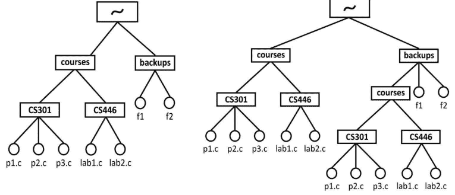

图 6.2 执行 `cp -r ~/courses ~/backups` 命令前后的当前目录。

该命令创建了 `~/courses` 目录的副本，包括 `~/courses` 目录下的所有文件和目录层次结构，并将它们放置在 `~/backups` 目录下。图 6.2 显示了执行命令前后你的家目录 (`~`) 的状态。

### 6.3.2 移动文件

文件可以从文件结构中的一个目录移动到另一个目录。在 Linux 中，如果文件位于同一个文件系统中，此操作也可以导致文件重命名。重命名操作等同于为文件创建一个硬链接（参见第 8 章），然后对原始文件进行重命名/删除（参见第 6.3.3 节）。如果源文件和目标文件位于不同的文件系统，移动操作会将源文件物理复制到目标位置，然后删除源文件。移动文件的命令是 `mv`。以下是该命令的简单介绍：

```text
语法:
mv [options] file1 file2
mv [options] file-list directory
用途: 第一种语法：移动 file1 或将 file1 重命名为 file2
第二种语法：将 file-list 中的所有文件移动到 directory
常用选项/功能:
-f 强制移动，忽略目标文件的权限
-i 在覆盖目标文件之前提示用户
```

你必须对包含源文件（描述中的 `file1`）的目录具有写入和执行权限，但你不需要对文件本身具有读取、写入或执行权限。同样地，你必须对包含目标/目标文件（描述中的 `file2`）的目录具有写入和执行权限，对目标文件路径中的每个目录具有执行权限，并且如果目标文件已存在，则需要对其具有写入权限。如果目标已存在，默认情况下它会被覆盖而不会通知你。如果你使用 `-n` 选项，且文件已存在，但你对其没有写入权限。

以下命令将 `temp` 移动到 `temp.moved`。在这种情况下，文件被重命名为 `temp.moved`。如果 `temp` 不存在，或者你对其所在的目录没有执行权限，`mv` 命令将返回错误信息。如果 `temp.moved` 存在，命令会提示你移动该文件。

#### 移动之前

#### 移动之后

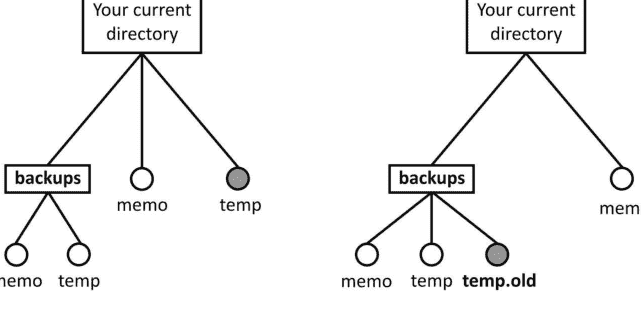

图 6.3 执行 `mv temp backups/temp.old` 命令前后的当前目录。

```bash
$ mv temp temp.moved
```

以下命令将 `temp` 移动到 `backups` 目录并命名为 `temp.old`。图 6.3 显示了在 `temp` 文件移动前后你当前目录的状态。

```bash
$ mv temp backups/temp.old
```

以下命令是一个强制移动；你可以使用它强制移动，无论目标文件 `temp.moved` 的权限如何。

```bash
$ mv -f temp temp.moved
```

以下命令将 `dir1` 中的所有文件和目录（排除隐藏文件）移动到 `dir2` 目录。如果 `dir2` 不是目录、不存在，或者你对其没有写入和执行权限，命令将失败并在屏幕上显示错误信息。

```bash
$ mv dir1/* dir2
```

执行命令后，`dir1` 仅包含隐藏文件。你可以使用 `ls -a` 命令确认 `dir1` 的状态。

### 练习 6.7

在你的家目录下创建本节所示的目录结构，包括目录 `dir1` 和 `dir2`，并在你的系统中重复本节所示的命令。命令执行结果符合预期吗？

### 6.3.3 删除文件

当文件不再需要时，应该将其从文件结构中移除，以释放磁盘空间供新文件和目录使用。Linux 中移除（删除）文件的命令是 `rm`。以下是该命令的简单介绍。

#### 基础文件处理

```text
语法:
rm [options] file-list
用途: 从文件结构（以及磁盘）中移除 file-list
常用选项/功能:
-f 忽略 file-list 的权限，强制执行
-i 在移除 file-list 中的文件之前提示用户
-r 递归删除作为参数传递的目录中的文件。这会删除该目录下的所有内容，因此在使用此选项之前请务必确认。
```

如果 `file-list` 中是路径，你需要路径中所有目录组件的读取和执行权限，以及最后一个目录（包含要删除的文件或文件的目录）的读取、写入和执行权限。你可能对文件本身拥有权限以对其进行删除而无需提示。如果你从终端运行命令且没有该文件的权限，它会提示你是否有权限以删除它。

以下命令说明了如何使用 `rm` 命令从各个目录删除一个或多个文件。

```bash
$ rm temp

$ rm backups/temp.old

$ rm -f phones ~/letters/letter.john

$ rm ~/dir1/$
```


第一个命令从你的当前目录删除 `temp`。第二个命令从你的当前目录删除 `temp` 文件以及当前目录下 `backups` 目录中的文件。第三个命令无论权限如何都删除 `phones ~/letters/letter.john`。第四个命令删除 `~/dir1/`。

# 基本文件处理

```
rm: cannot remove 'd1/f1': Permission denied
$ ls -l d1
ls: cannot open directory 'd1': Permission denied
$
```

练习 6.8
在你的系统上重复本节中讨论的 `ls`、`cp` 和 `touch` 命令。命令的执行结果符合预期吗？

## 6.3.4 确定文件大小

你可以使用几种 Linux 命令之一来确定文件的大小。在所有 Linux 版本中都可用的两种常用命令是 `ls -l` 和 `wc`。我们在第 5 章的注释中描述了 `ls -l`，当时用它来确定文件的访问权限。现在我们在确定文件大小的语境下再次访问该命令。

如前所述，`ls -l` 命令显示指定作为参数的目录中的文件和目录列表。你必须对某个目录具有读取和执行权限才能成功运行 `ls` 命令；查看目录列表不需要目录内的文件具有任何权限。如果未指定参数，该命令将输出当前目录的输出。该命令的输出包含名称字段，第五个字段是按字节为单位的文件大小（参见第 5.5 节）。在下面的命令中，`lab2` 文件的大小为 709 字节。

```
$ ls -l lab2
-rw-r--r-- 1 sarawar faculty 709 Apr 5 11:23 lab2
$
```

此命令显示目录下文件的大小。你也可以通过在命令行中指定多个文件并用空格隔开，来获取多个文件的大小。例如，下面的命令显示 `lab1` 和 `lab2` 文件的大小分别为 163 字节和 709 字节。

```
$ ls -l lab1 lab2
-rw-r--r-- 1 sarawar faculty 163 Jul 9 16:23 lab1
-rw-r--r-- 1 sarawar faculty 709 Apr 5 11:23 lab2
$
```

接下来的命令使用 shell 通配符 `*` 显示 `~/courses/ee446` 下所有文件的详细列表。

```
$ ls -l ~/courses/ee446/*
-- 命令的输出
```

其中，`ls -l` 是一个通用命令，可用于确定一个或多个文件的许多属性，包括按字节/字符计算的大小；而 `wc` 是一个特殊目的命令，仅显示文件大小。以下是 `wc` 命令的简要描述。

语法：
`wc [options] file-list`
目的：显示 `file-list` 中文件的行数、单词数和字符数
常用选项/功能：
- `-c` 仅显示字符数
- `-l` 仅显示行数
- `-w` 仅显示单词数

```
$ wc sample
  4 44 227 sample
$
```


```
$ wc letter sample test
 44 250 1687 letter
  4  44  227 sample
  2  12   90 test
 50 306 2004 total
$ wc -c letter sample test
1687 letter
 227 sample
  90 test
    total
$ wc -lw letter sample test
 44 250 letter
  4  44 sample
  2  12 test
 50 306 total
```

第一个命令显示当前工作目录中 `sample` 文件的行数、单词数和字符数。`sample` 的大小为 4 行、44 个单词和 227 字节。第二个命令显示当前工作目录下 `letter`、`sample` 和 `test` 文件的相同信息。该命令输出的最后一行显示所有文件的总行数、总单词数和总字节数。第三个命令显示 `letter`、`sample` 和 `test` 的字符数。最后一个命令显示单个命令可以使用多个选项；在这种情况下，输出是命令行中三个文件的单词数和字符数。

在 FreeBSD 上，带有目录参数的 `wc` 会在目录名称旁边返回三个数字：0、1 以及包括 `.`（点）和 `..`（点点）在内的目录条目数，如下：

```
$ wc /etc
0 1 116 /etc
$
```

这只适用于包含普通文件和目录作为内容的目录。然而，对于包含设备文件（字符特殊设备和块设备）和其他类型文件的目录，不会产生这种风格的输出。

`wc` 命令可以配合元字符如 `*` 和 `?` 使用。下面的命令显示 `/usr/include/x86_64-linux-gnu/sys/` 目录下所有文件的大小。最后一行显示该目录下所有文件的总大小。

```
$ wc /usr/include/x86_64-linux-gnu/sys/*
108 5319 /usr/include/x86_64-linux-gnu/sys/acct.h
37 196 1282 /usr/include/x86_64-linux-gnu/sys/auxv.h
3 12 /usr/include/x86_64-linux-gnu/sys/types.h
444 2124 /usr/include/x86_64-linux-gnu/sys/types.h
```

# 基本文件处理

```
-r-xr--r-- 1 sarwar faculty 1227 Feb 19 14:37 memo2
-r-xr--r-- 1 sarwar faculty 790 Sep 1 19:16 memo3
-r------ 1 sarwar faculty 9765 Jan 15 22:00 memos.2018
$ wc memo?
  44 250 3352 memo1
  34 244 4083 memo2
  12 112 907 memo3
  90 606 3704 total
$ cat memo1 memo2 memo3 > memos.y2k8
$ wc memos.y2k8
  90 606 3704 memos.y2k8
$ cat memo1 memo2 memo3 > memos.2018
memos.2018: Permission denied.
$
```

你也可以通过以下命令序列完成 `cat memo1 memo2 memo3 > memos.y2k8` 的任务。

```
$ cat memo1 >> memos.y2k8
$ cat memo2 >> memos.y2k8
$ cat memo3 >> memos.y2k8
$
```

后续章节的练习要求你练习 `cp`、`mv`、`ls -l`、`wc` 和 `cat` 命令以及追加文件的运算符。

### 练习 6.11
将家目录下的 `.bashrc` 文件复制到名为 `backups` 的目录下的 `.bashrc.old` 文件，这些都在家目录下。假设你正处于家目录。你使用了什么命令？

### 练习 6.12
在家目录下创建一个目录 `new.backups` 并将 `backups` 目录中的所有文件移动到 `new.backups`。你使用了什么命令？

### 练习 6.13
显示 `~/ece345` 目录下文件 `lab3` 的字节大小。你使用了什么命令？

### 练习 6.14
给出一个命令将 `~/courses/ece446` 目录下所有的文件追加到 `~/courses` 目录下的名为 `BigBackup.exe446` 文件中。

# 6.6 比较文件

有时，你需要比较两个版本的程序代码或其他文本文档，以找出它们之间的差异。你这样做是为了同步文件，使它们包含相同的内容。你可能还需要比较上下文文件以确定它们是否相同。Linux 有多种工具可以让你完成这些任务。我们在这里讨论它们，首先是文本文件，然后是二进制文件。

## 6.6.1 文本文件

你可以使用 `diff` 命令比较文本文件并识别它们的差异。该命令比较两个文件，并以可以将一个文件转换为另一个文件的命令形式显示它们之间的差异。你还可以使用另一个工具，根据 `diff` 生成的命令来同步文件。以下是对该命令的简要描述。

语法：
`diff [options] [file1] [file2]`
目的：按行比较 `file1` 和 `file2`，并将它们之间的差异显示为一系列编辑器的命令/指令，这些指令可将 `file1` 转换为 `file2` 或反之；从标准输入读取 - 如果对 `file1` 或 `file2` 使用了 -

常用的选项/功能：


### 基本文件处理

*   `b` 忽略行尾（行末）的空白字符（空格和制表符），并将其他空白字符视为相等
*   `e` 生成并显示一个编辑器的脚本，可以执行以将 `file1` 更改为 `file2`
*   `h` 进行快速比较（情况下可能无法使用 `-o` 选项）

`file1` 和 `file2` 参数可以是目录。如果 `file1` 是目录，`diff` 会搜索它以找到名为 `file2` 的文件并与 `file2` 进行比较；`diff` 查找名为 `file1` 的文件并将其与第一个参数进行比较。如果两个参数都是目录，该命令将比较这些目录中所有同名的文件对。如果比较的文件相同，`diff` 不产生任何输出。在不使用任何选项的情况下，如果文件不同，`diff` 命令产生一系列编辑器指令，用于将 `file1` 转换为 `file2`。指令 `a`（添加）、`c`（修改）和 `d`（删除）在表 6.1 中描述。以下会话演示了 `diff` 命令的简单用法。

```
$ cat Fall_OH
Office Hours for 2017
Monday
9:00 - 10:00 A.M.
3:00 - 4:00 P.M.
Tuesday
10:00 - 11:00 A.M.
Wednesday
9:00 - 10:00 A.M.
3:00 - 4:00 P.M.
Thursday
11:00 A.M. - 12:00 P.M.
2:00 - 3:00 P.M.
```

#### 表 6.1

| 指令 | 将 `file1` 转换为 `file2` 的描述 |
|---|---|
| `L1a,L3` | 在 `file1` 的第 `L1` 行之后追加 `file2` 中的 `L2` 到 `L3` |
| `L1,2c/L3,L4` | 将 `file1` 中的 `L1` 到 `L2` 更改为 `file2` 中的 `L1` 到 `L4` |
| | `< file1 中的 L1 到 L2` |
| | `> file2 中的 L3 到 L4` |
| `L1,2dL3` | 从 `file1` 中删除 `L1` 到 `L2`； |
| | `< file1 中的 L1 到 L2` |

```
$ cat Spring_OH
Office Hours for 2018
Monday
9:00 - 10:00 A.M.
3:00 - 4:00 P.M.
Tuesday
10:00 - 11:00 A.M.
Wednesday
9:00 - 10:00 A.M.
3:00 - 4:00 P.M.
Thursday
11:00 A.M. - 12:00 P.M.
2:00 - 3:00 P.M.
$ diff Fall_OH Spring_OH
```

```
--- Office Hours for 2017
1c
< Office Hours for 2017
```

```
> Office Hours for 2018
6a
> Office Hours for 2018
```

```
9d
< 3:00 - 4:00 P.M.
```

```
3:00 - 4:00 P.M.
```

```
12,13d
< 11:00 A.M. - 12:00 P.M.
```

```
11:00 A.M. - 12:00 P.M.
```

指令 `1c` 要求编辑器修改 `Spring_OH` 文件的第一行（Office Hours for Spring 18）。`6a` 指令要求编辑器在 `Fall_OH` 的第 6 行之后添加 `Spring_OH` 的第 7 行。`12,13d` 指令要求编辑器删除 `Fall_OH` 中的第 12 和 13 行。

以下会话演示了使用 `diff` 命令的 `-e` 选项，以及如何将该命令的输出传递给 `ed` 使 `Fall_OH` 与 `Spring_OH` 相同。该命令用于显示输出。第二个 `diff` 命令（使用 `> diff script`）用于将输出（`ed` 脚本）保存到 `diff.script` 中。`cat > diff script` 通过添加 `w` 和 `q` 行将 `diff.script` 文件转换为编辑器的工作脚本。如前所述，此命令将终止。最后，`ed` 命令运行时根据 `diff -e` 命令生成的脚本更改 `Fall_OH` 的内容，使其与 `Spring_OH` 相同。数字 209 和 177 显示了执行 `ed` 命令前后的 `Fall_OH` 文件的大小。运行 `diff Fall_OH Spring_OH` 以确认两个文件相同。

```
$ diff -e Fall_OH Spring_OH
12,13d
9d
6a
1:00 - 2:00 P.M.
```

```
1c
Office Hours for Spring 18
```

```
$ diff -e Fall_OH Spring_OH > diff.script
$ cat >> diff.script
w
q
```

```
< ed Fall_OH < diff.script
209
177
$ diff Fall_OH Spring_OH
$
```

大多数系统都有一个名为 `diff3` 的命令，可以用于进行三路比较；即可以比较三个文件。你还可以使用 `vimdiff` 命令比较多个文件。`diff` 命令允许你并排比较两个文件，可以选择地手动合并它们并输出结果。查看 GitHub 网站上的表 6.3，那里网站提供了带有示例的这些命令说明。

你可以使用 `patch` 命令产生两个文件的补丁版本。该命令接收一个包含 `diff` 命令生成的差异的补丁文件，并将差异应用于一个或多个原始文件，产生补丁版本。这里是 `patch` 命令的简要描述。

```
语法：
patch [options] [originalfile [patchfile]]
目的：获取 diff 命令生成的差异的 patch 文件，将其应用于一个或多个原始文件，产生补丁版本。默认情况下，补丁版本会覆盖原始文件。
```

常用的选项/功能：

*   `B` 在覆盖原始文件之前创建备份
*   `R` 撤销补丁工作，即反向补丁并恢复原始文件

你好，世界！

欢迎学习 `diff` 和 `patch` 命令。

再见！

执行 `patch < hello.patch` 命令会覆盖现有的 `hello1` 文件。如果你想保留 `hello1` 的备份，请运行带有 `-b` 选项的 `patch` 命令，例如 `patch -b < hello.patch`。备份文件将保存为 `hello.org`。你可以使用带有 `-V` 选项的 `patch` 命令以数字格式保存备份文件。执行 `patch -b -V numbered hello.patch` 将备份文件保存为 `hello.l1-`。

有时，我们需要撤销补丁操作，即按相反顺序应用补丁。你可以通过带有 `-R` 选项的 `patch` 命令来实现，如下所示。结果是将 `hello` 文件恢复到原始状态，如 `cat hello1` 命令的输出所示。

```
$ patch -R < hello.patch
patching file hello1
$ cat hello
Hello, world!
Welcome to the patch command.
$
```

### 6.6.2 非文本文件

有时，由于第 7 章讨论的各种原因，你需要对文件进行压缩、编码或加密。这些操作将文件数据转换为与文件原始内容完全不同的格式。这些文件必须经过解压、解码或解密才能恢复其原始内容并用于其创建时的目的。在执行恢复操作后，你希望确保文件的原始内容已 100% 恢复。你通常处理的是包含大型数据集、图像、工具和操作系统内核（如 `Linux`）的可下载压缩文件。你下载这些文件，解压它们，然后根据它们各自的用途进行处理。

然而，在使用解压后的文件之前，你希望确保它是压缩前原始文件的精确副本。但问题在于，你没有原始文件的副本可以进行比较。压缩文件的供应商会发布相应原始文件的签名，以及用于生成这些签名的特定工具。这允许你为解压后的文件生成签名。如果发布的签名和你的签名相同，说明解压后的文件是原始文件的真实副本。

有几个 `Linux` 工具可以实现此功能，包括 `sha`、`crc32`、`md5sum` 和 `cksum`。我们展示了这些命令的手页以便了解更多。你不能使用 `diff` 命令（或其变体），因为它不会为文件生成任何签名。简而言之，文件的签名也称为文件的哈希值、校验和或消息摘要。`sha` 工具使用哈希算法产生 160 位哈希值，`md5sum` 使用 `MD5` 哈希函数，由于研究人员和从业人员发现了 `MD5` 的多个漏洞，我们不建议使用 `md5sum`。你可以通过带有选项运行各种算法的 `sha`，例如 `sha`、`sha224`、`sha256` 等。这是 `sha` 使用的默认算法。你可以通过选项指定特定算法。更多细节请参手册页。

我们在第 7 章展示了 `sha` 的实际用法。在这里，我们展示了 `sha` 和 `md5sum` 命令的简单用法，以说明它们是如何工作的。接下来，我们将 `/bin/cp` 文件复制到当前目录并命名为 `my_cp`，使用 `sha` 和 `md5sum` 命令为它们生成消息摘要。在两种情况下，文件具有相同的消息保证，即


## 6.6.2 非文本文件

有时，由于第 7 章讨论的各种原因，你需要对文件进行压缩、编码或加密。这些操作将文件数据转换为与文件原始内容完全不同的格式。这些文件必须经过解压、解码或解密才能恢复其原始内容并用于其创建时的目的。在执行恢复操作后，你希望确保文件的原始内容已 100% 恢复。你通常处理的是包含大型数据集、图像、工具和操作系统内核（如 Linux）的可下载压缩文件。你下载这些文件，解压它们，然后根据它们各自的用途进行处理。

然而，在使用解压后的文件之前，你希望它是压缩前原始文件的精确副本。但问题在于，你没有原始文件的副本可以进行比较。压缩文件的供应商会发布相应原始文件的签名，以及用于生成这些签名的特定工具。这允许你为解压后的文件生成签名。如果发布的签名和你的签名相同，说明解压后的文件是原始文件的真实副本。

有几个 Linux 工具可以实现此功能，包括 `sha`、`crc32`、`md5sum` 和 `cksum`。我们展示了这些命令的手页以便了解更多。你不能使用 `diff` 命令（或其变体），因为它不会为文件生成任何签名。简而言之，文件的签名也称为文件的哈希值、校验和或消息摘要。`sha` 工具使用哈希算法产生 160 位哈希值，`md5sum` 使用 MD5 哈希函数，由于研究人员和从业人员发现了 MD5 的多个漏洞，我们不建议使用 `md5sum`。你可以通过带有选项运行各种算法的 `sha`，例如 `sha`、`sha224`、`sha256` 等。这是 `sha` 使用的默认算法。你可以通过选项指定特定算法。更多细节请参手册页。

我们在第 7 章展示了 `sha` 的实际用法。在这里，我们展示了 `sha` 和 `md5sum` 命令的简单用法，以说明它们是如何工作的。接下来，我们将 `/bin/cp` 文件复制到当前目录并命名为 `my_cp`，使用 `sha` 和 `md5sum` 命令为它们生成消息摘要。在两种情况下，文件具有相同的消息保证，即

```
$ /bin/cp /bin/cp my_cp
$ sha /bin/cp my_cp

ff3094b907d15cee91b8ecb0559011d2d1c75a /bin/cp
f3094b907d15cee91b8ecb0559011d2d1c75a my_cp

$ md5sum /bin/cp my_cp

62eeb2a80073ab510bf7fe50876c7a6 /bin/cp
62eeb2a80073ab510bf7fe50876c7a6 my_cp

$
```

## 练习 6.15

复制本节提供的交互式会话，以体会 `diff` 命令是如何工作的。

## 练习 6.16

浏览 `diff` 和 `vimdiff` 命令的手页，查看你如何使用这些命令执行练习 6.15 中的任务。

## 练习 6.17

复制本节提供的交互式会话，以体会 `diff` 和 `patch` 命令是如何工作的。

## 练习 6.18

将 `/bin/bash` 复制到当前目录并命名为 `my_bash`。使用 `sha` 和 `md5sum` 命令计算它们的消息摘要，以证明它们是相同的文件。展示你的步骤。

## 6.7 在文本文件中查找重复内容

你可以使用 `uniq` 命令移除文本文件中除第一个连续重复行以外的所有行。该命令旨在用于排序后的内容，尽管它也可以作用于未排序的文件，如示例所示。我们在第 7 章中讨论这一点。以下是该命令的简要总结。

```
语法：
uniq [options] [input-file] [output-file]

目的：从排序的 input-file 中删除重复行，并将唯一的（非重复）行输出到 output-file。input-file 不改变。如果没有指定 output-file，命令的输出将发送到标准输出。如果没有指定 input-file，命令将从标准输入获取输入。

常用选项/功能：
- c 在每行输出前加上该行出现的次数
- d 仅显示重复行
- i 忽略大小写进行比较
- s 合并相邻行
- u 仅显示非重复行
```

以下展示了 `uniq` 如何工作。注意 `uniq` 适用于相邻行。

### 基本文件处理

你好，世界！
欢迎学习 diff 和 patch 命令。
再见！

执行 `patch < hello.patch` 命令会覆盖现有的 `hello1` 文件。如果你想保留 `hello1` 的备份，请运行带有 `-b` 选项的 `patch` 命令，例如 `patch -b < hello.patch`。备份文件将保存为 `hello.org`。你可以使用带有 `-V` 选项的 `patch` 命令以数字格式保存备份文件。执行 `patch -b -V numbered hello.patch` 将备份文件保存为 `hello.l1-`。

有时，我们需要撤销补丁操作，即按相反顺序应用补丁。你可以通过带有 `-R` 选项的 `patch` 命令来实现，如下所示。结果是将 `hello` 文件恢复到原始状态，如 `cat hello1` 命令的输出所示。

```
$ patch -R < hello.patch
patching file hello1
$ cat hello
Hello, world!
Welcome to the patch command.
$
```


有时，由于第 7 章讨论的各种原因，你需要对文件进行压缩、编码或加密。这些操作将文件数据转换为与文件原始内容完全不同的格式。这些文件必须经过解压、解码或解密才能恢复其原始内容并用于其创建时的目的。在执行恢复操作后，你希望确保文件的原始内容已 100% 恢复。你通常处理的是包含大型数据集、图像、工具和操作系统内核（如 `Linux`）的可下载压缩文件。你下载这些类文件，解压它们，然后根据它们各自的用途进行处理。

然而，在使用解压后的文件之前，你希望它是压缩前原始文件的精确副本。但问题在于，你没有原始文件的副本可以进行比较。压缩文件的供应商会发布相应原始文件的签名，以及用于生成这些签名的特定工具。这允许你为解压后的文件生成签名。如果发布的签名和你的签名相同，说明解压后的文件是原始文件的真实副本。

有几个 `Linux` 工具可以实现此功能，包括 `sha`、`crc32`、`md5sum` 和 `cksum`。我们展示了这些命令的手页以便了解更多。你不能使用 `diff` 命令（或其变体），因为它不会为文件生成任何签名。简而言之，文件的签名也称为文件的哈希值、校验和或消息摘要。`sha` 工具使用哈希算法产生 160 位哈希值，`md5sum` 使用 `MD5` 哈希函数，由于研究人员和从业人员发现了 `MD5` 的多个漏洞，我们不建议使用 `md5sum`。你可以通过带有选项运行各种算法的 `sha`，例如 `sha`、`sha224`、`sha256` 等。这是 `sha` 使用的默认算法。你可以通过选项指定特定算法。更多细节请参手册页。

我们在第 7 章展示了 `sha` 的实际用法。在这里，我们展示了 `sha` 和 `md5sum` 命令的简单用法，以说明它们是如何工作的。接下来，我们将 `/bin/cp` 文件复制到当前目录并命名为 `my_cp`，使用 `sha` 和 `md5sum` 命令为它们生成消息摘要。在两种情况下，文件具有相同的消息保证，即

```
$ $ /bin/cp my_cp
$ sha /bin/cp my_cp
```

ff3094b907d15cee91b8ecb0559011d2d1c75a /bin/cp

f3094b907d15cee91b8ecb0559011d2d1c75a my_cp

$ md5sum /bin/cp my_cp

62eeb2a80073ab510bf7fe50876c7a6 /bin/cp

62eeb2a80073ab510bf7fe50876c7a6 my_cp

$

```

### 练习 6.15

复制本节提供的交互式会话，以体会 `diff` 命令是如何工作的。

### 练习 6.16

浏览 `diff` 和 `vimdiff` 命令的手页，查看你如何使用这些命令执行练习 6.15 中的任务。

### 练习 6.17

复制本节提供的交互式会话，以体会 `diff` 和 `patch` 命令是如何工作的。

### 练习 6.18

将 `/bin/bash` 复制到当前目录并命名为 `my_bash`。使用 `sha` 和 `md5sum` 命令计算它们的消息摘要，以证明它们是相同的文件。展示你的步骤。

## 6.7 在文本文件中查找重复内容

你可以使用 `uniq` 命令移除文本文件中除第一个连续重复行以外的所有行。该命令旨在用于排序后的内容，尽管它也可以作用于未排序的文件，如示例所示。我们在第 7 章中讨论这一点。以下是该命令的简要总结。

```
语法：

uniq [options] [input-file] [output-file]

目的：从排序的 input-file 中删除重复行，并将唯一的（非重复）行输出到 output-file。input-file 不改变。如果没有指定 output-file，命令的输出将发送到标准输出。如果没有指定 input-file，命令将从标准输入获取输入。

常用选项/功能：

- c 在每行输出前加上该行出现的次数
- d 仅显示重复行
- i 忽略大小写进行比较
- s 合并相邻行
- u 仅显示非重复行
```

以下展示了 `uniq` 如何工作。注意 `uniq` 适用于相邻行。

### 基本文件处理

```
你好，世界！
欢迎学习 diff 和 patch 命令。
再见！
```

执行 `patch < hello.patch` 命令会覆盖现有的 `hello1` 文件。如果你想保留 `hello1` 的备份，请运行带有 `-b` 选项的 `patch` 命令，例如 `patch -b < hello.patch`。备份文件将保存为 `hello.org`。你可以使用带有 `-V` 选项的 `patch` 命令以数字格式保存备份文件。执行 `patch -b -V numbered hello.patch` 将备份文件保存为 `hello.l1-`。

有时，我们需要撤销补丁操作，即按相反顺序应用补丁。你可以通过带有 `-R` 选项的 `patch` 命令来实现，如下所示。结果是将 `hello` 文件恢复到原始状态，如 `cat hello1` 命令的输出所示。

```
$ patch -R < hello.patch

patching file hello1

$ cat hello

Hello, world!

Welcome to the patch command.

$
```

## 表 6.2 与打印相关的命令列表

| System V 兼容 | BSD 兼容 | 目的 |
|---|---|---|
| `lp` | `lpr` | 提交文件进行打印 |
| `lpstat` | `lpq` | 显示一个或多个打印机的作业状态 |
| `cancel` | `lprrm` | 从打印队列中删除/清除一个多个作业 |
| | `lpc` | 激活打印控制程序 |
| | `lptest` | 生成测试图案以测试打印机 |

相反，在输出内容的情况下，输出设备是打印机。另一个关键区别主要源于每个用户都有一个独立的显示器，但在典型的 `Linux`（或任何分时共享）系统中，许多用户共用一台打印机。那么，当你使用 `cat` 或 `more` 命令显示文件时，`Linux` 会立即将文件内容发送到屏幕。然而，当你打印文件时，系统会对其向打印机的请求创建一个临时副本，而该打印机可能正在打印其他文件（你的或他人的）。为了处理多个请求，先来服务机制会将打印请求置于与打印机相关的队列中，并在打印机空闲时按顺序处理该请求。

`Linux` 为系统中的每台打印机都维护一个名为打印队列的打印请求队列。每个请求被称为 `lpd`。每个作业被分配一个数字，称为作业 ID（`job ID`）。当你使用命令打印文件时，系统会创建该文件的临时副本，为你的请求分配一个作业 ID，并将作业放入命令行中指定的打印机相关的队列中。当当前作业完成时，当打印机空闲且你的作业位于打印队列头部时，系统将开始处理你的作业。

一个名为打印缓存（`printer spool`）或打印守护进程（`printer daemon`）的 `Linux` 进程负责维护打印队列并将作业引导到正确打印机的工作。此进程被称为 `lpd`。它在系统启动时在后台执行并等待你的打印请求。我们将在第 10 章讨论守护进程，但现在你可以将守护进程视为一个正在运行但在与你的进程交互时，你并感知不到其存在的进程。

`Linux` 有两套不同的打印和控制打印作业的命令集，基于 `BSD` 或 `S UNIX`。表 6.2 包含了两个系统的打印相关命令列表；所有命令在 `Linux Mint` 中均可用。超级用户——系统管理员——使用最后两个命令 `lpc` 和 `lprstat`。

此外，你可以利用通用 `UNIX` 打印系统（`CUPS`）的功能来完成下面章节中的所有操作。我们将在书籍网站 `W26` 章系统管理的“`CUPS` 打印”部分详细介绍 `CUPS` 打印。

### 6.8.2 打印接口

如表 6.2 所示，你可以在 `Linux` 系统上使用 `lp` 和 `lpr` 命令打印文件。需要注意的是，你永远不要尝试用 `lp` 或 `lpr` 命令打印文件，尤其是带有特殊字符的文件（例如，如 `a.out` 等可执行文件）。所以不要打印你并不想要打印的内容，这将浪费很多打印机纸。甚至不要尝试。如果你不小心发送了非文件的打印请求，请立即关闭打印机并通知你的系统管理员你需要寻求帮助。

以下是 `lp` 命令的简要描述。

```
语法:

lp [options] file-list

目的: 提交打印 file-list 中文件的请求
```


### 基础文件处理

常用的选项/功能：
- `P`：打印 `page-list` 中指定的页面
- `d`：将请求发送到 `ptr` 打印机
- `m`：在打印完成后发送电子邮件
- `n`：打印 `file-list` 中文件的副本数；默认是一份
- `t`：在 `title` 中打印标题
- `w`：在打印完成后写入用户终端

下面的会话展示了如何在带选项和不带选项的情况下使用 `lp` 命令。第一条命令在默认打印机上显示了示例文件。系统管理员为系统上的用户设置了默认打印机。第一个请求的作业 ID 为 `lpr-981`，这告诉你打印机的名称为 `cpr`。第二个命令使用 `-d` 选项指定示例文件应在 `spr` 打印机上打印。第三个命令用于在 `qpr` 打印机上打印三份 `sample` 和 `phones` 文件。

```
% lp sample
request id is cpr-981 (1 file(s))

% lp -d spr sample
request id is spr-983 (1 file(s))

% lp -d qpr -n 3 sample phones
request id is qpr-984 (2 file(s))
%
```

如前所述，`lp` 命令的 BSD 对应命令是 `lpr` 命令。以下是该命令的简要描述。

语法：
`lpr [options] file-list`

目的：提交打印 `file-list` 中文件的请求

常用的选项/功能：
- `P`：打印 `file-list` 中文件的副本数；默认是一份
- `P`：将请求发送到 `ptr` 打印机
- `T`：在 `title` 中打印标题
- `m`：在打印完成后发送电子邮件
- `p`：使用 `pr` 命令格式化输出

下面的会话展示了执行与 `lp` 命令相同打印任务的 BSD 变体命令。因此，第一条 `lpr` 命令在默认打印机上显示了示例文件。第二个命令显示了要在 `spr` 打印机上打印的示例文件。第三个命令在 `qpr` 打印机上打印三份 `sample` 和 `phones` 文件。

```
% lpr sample
request id is cpr-981 (1 file(s))

% lpr -d spr sample
request id is spr-983 (1 file(s))

% lpr -d qpr -n 3 sample phones
request id is qpr-984 (2 file(s))
%
```

你可以使用以下命令打印 `sample`。竖线（`|`）称为管道符号，我们将在第 9 章详细讨论。

```
% lp sample | lpr
```

你可以通过指定相应的标志使用 `lpr` 命令打印非标准文件（如文本文件）。例如，你可以使用 `-t` 选项打印文件名并使用 `-n` 选项打印数量。

## 6.8.3 查找打印请求状态

`lpstat` 命令可用于显示打印机状态。以下是 `lpstat` 命令的简要描述。

语法：
`lpstat [options]`

目的：显示状态

常用的选项/功能：
- `d`：显示通过 `lp` 命令发送到默认打印机的作业状态
- `o`：显示 `job-w-list` 中的作业状态；用空格分隔作业 ID，多个用双引号包裹
- `p`：显示 `printer-list` 中指定打印机的状态
- `u`：显示 `user-list` 中用户的作业状态

在不带任何选项的情况下，`lpstat` 命令显示默认打印机队列中正在打印或等待的所有作业。下面的示例展示了该命令的一些典型用法。`lpstat -p qpr` 显示网络上所有打印机的状态。`lpstat -u qpr` 显示 `qpr` 打印机的作业状态。命令的输出显示有三个作业提交。

```
$ lpstat -p
printer cpr is idle. enabled Tue Sep 2 10:43:48 GMT 2014. available.
printer fpr faulted. enabled since Mon Sep 1 10:48:29 GMT 2014. available.
printer qpr now printing-53. enabled since Mon Sep 1 10:48:29 GMT 2014. available.
printer spr is idle. enabled since Mon Sep 1 10:48:29 GMT 2003. available.

$ lpstat -u warsar
qpr-3998 warsar 93874 Sep 2 22:05 on qpr
qpr-3999 warsar 93874 Sep 2 22:05
tpr-203 warsar 93874 Sep 2 22:05 on tpr

$ lpstat -a
cpr accepting requests since Tue Sep 2 10:43:48 GMT 2014
spr accepting requests since Mon Sep 1 10:48:29 GMT 2014
$
```

## 基础文件处理

以下是 `lpstat` 命令在 BSD 系统中的对应命令 `lpq` 命令的简要描述。

```
Syntax:
lpq [options]
Purpose: 显示打印机上打印作业的状态
Commonly used options/features:
  -P printer-list      显示 printer-list 中指定的打印机上打印作业的状态
  -l                   使用 lpr 命令在默认打印机上显示打印作业的详细格式状态
```

最常用的选项是 `-P`。在接下来的会话中，第一条命令用于显示 `mpr` 打印机上打印作业的状态。命令的输出显示打印队列中有四个作业：作业 `3991`、`3992` 和 `3994`。活动作业位于打印队列的队端。当打印机准备好打印时，它将首先打印活动作业。第二条命令显示 `qpr` 打印机没有任何待打印的任务。

```
$ lpq -Pm mpr
mpr is ready and printing Files Total Size
Rank | Owner | Job | Size |
| --- | --- | --- | --- | --- |
| active | sarwar | 3991 | mail.bob | 1056 bytes |
| 1st | sarwar | 3992 | csh.man | 93874 bytes |
| 2nd | davis | 3993 | proposal1.nsa | 270892 bytes |
| 3rd | tom | 3994 | memo | 8920 bytes |

$ lpq -Pm mpr
no entries
```

## 6.8.4 取消你的打印作业

如果你提交了错误的文件进行打印，你可能想要取消打印请求。执行此任务的命令是 `cancel`。以下是该命令的简要描述。

```
Syntax:
cancel [options] [printer]
Purpose: 取消通过 lpr 命令发送的打印请求——即将这些作业从打印队列中移除
Commonly used options/features:
  -jobid-list      取消 jobid-list 中指定的打印作业
  -u-login         取消用户 login 发出的所有打印请求
```

以下命令显示了如何取消打印作业。你可以使用 `lpstat` 或 `lpq` 命令显示打印机上打印作业的作业 ID，如第 6.8.3 节所示。第一条命令取消了打印作业 `mpr-3991`。第二条命令取消了用户 `sarwar` 在所有打印机上的所有打印请求。你只能取消自己的打印作业。然而，最后一条仅在由 `sarwar` 或超级用户运行时才有效。

```
$ cancel mpr-3991
request "mpr-3991" canceled

$ cancel -u sarwar mpr
request "mpr-3992" canceled
request "mpr-3995" canceled
$
```

`cancel` 命令在 BSD 系统中的对应命令是 `lprrm`。以下是该命令的简要描述。

```
Syntax:
lprrm [options] [jobID-list] [user(s)]
Purpose: 取消使用 lpr 命令生成的打印请求——即从打印队列中移除作业；jobID-list 中的作业 ID 取自 lpq 命令的输出
Commonly used options/features:
- 移除所有属于该用户的用户
- -P ptr 指定用于 ptr 打印机的打印队列
```

以下 `lprrm` 命令执行了与前面描述的 `cancel` 命令相同的任务。

```


```
$ lprrm -Pmpr 3991

mpr-3996 dequeued

$ lprrm -Pmpr sarwar

mpr-3997 dequeued

mpr-3998 dequeued
```


当不带参数运行时，`lprrm` 会移除当前活动的作业，只要该作业是你的作业之一。
本章练习将帮助你练习使用与打印相关的命令。

### 练习 6.20

如何在 `ece_hp1` 打印机上打印五份 `memo` 文件？请给出 Linux 系统上 System V 风格和 BSD 风格的命令。

### 练习 6.21

提交请求后，你意识到你真的想打印五份信件。你会如何从打印队列中移除这些作业？同样，请给出 Linux 系统上 System V 风格和 BSD 风格的命令。

## 总结

基础文件操作涉及显示文件的全部部分内容、重命名文件、将文件移动到另一个地方、删除文件、确定文件大小、合并文件并存储在另一个文件中、在文件末尾追加新内容（内容可以来自另一个磁盘文件、键盘或命令的输出）以及打印文件。`Linux` 提供了几个可以执行这些操作的命令。

`cat` 和 `more` 命令可以在屏幕上显示文件的所有内容。`>` 可将这些命令的输出发送到其他文件，`>>` 运算符可以帮助文件结尾追加新内容。`cat` 命令以连续文本的形式发送文件内容，而 `more` 命令以分页的形式发送。此外，`more` 命令具有许多有用功能，例如显示包含特定字符串的页面。`less` 命令支持比 `more` 更多的功能，包括 `vi` 风格的正向和反向搜索。

`head` 和 `tail` 命令可用于显示文件的开头或结尾（部分）。`file` 命令通常用于查找文件中包含的数据类型。

## 基础文件处理

可以使用 `cp` 命令创建文件的副本。除了 `cp`，还可以使用 `mv` 命令来移动文件。然而，取决于源和目标是否在同一个文件系统上，可能会产生链接。如果源和目标在不同的系统上，则会创建一个实际副本。

9. 为 `rm` 命令提供一个选项，可以防止你不小心删除文件，特别是当你在命令中使用 `*` 和 `?` 作为通配符时。

+ 10. 下列命令的作用是什么？
a. `cp -f sample.bak`
b. `cp -fp sample.bak`
c. `rm -i ~/personal/memo*.doc`
d. `rm -i ~/unbook/final/??*.pr`
e. `rm -f ~/unbook/final/*.o`
f. `rm -f /courses/ece446/[1-6].[CC]`
g. `rm -r ~/NotNeededDirectory`
h. `rm -rf ~/NotNeededDirectory`
i. `rm -ri ~/NotNeededDirectory`

11. 给出一个命令，将 `~/courses/ece345` 目录下的文件 `1lab`、`1lab2` 和 `1lab3` 的大小列到家目录下的 `.ece345`。如果目标目录已存在该文件，命令应该提示你确认。

12. 给出一个命令，显示 `~/personal/files` 中不重复的行。

13. 参考章节内练习 15。给出一系列 `ed` 编辑器的命令序列，并使用它们创建 `sample` 和 `example` 两个文件。

14. 你在家目录下有一个名为 `tryit` 的文件。重命名这个文件。你使用了什么命令？

15. 给出一个命令，显示 `~/courses/ece345` 目录或你家目录下所有以字符串 `prog` 开头、后跟零或多个字符、并以字符串 `.c` 结尾的文件属性。

16. 参考问题 15。给出一个适用于在 `prog` 和 `.c` 之前有两个英文字母的文件名的命令。你能再给出另一个完成相同任务的命令吗？

17. 给出一个命令，逐个显示文件 `gotcha` 和 `M*A*S`。

18. 给出一个命令，显示扩展名为 `.jpg` 且名称以数字结尾的文件的大小。

19. 命令 `rm "[a-zA-Z]*?[1-5,8]*[p]"` 的作用是什么？

20. 给出一个命令，比较当前工作目录下的文件 `sample` 和 `example`。输出应生成一组用于 `ed` 编辑器的命令。

21. 使用 `diff` 命令为 `Fall_OH` 文件生成补丁，命名为 `OH_patch`。显示 `OH_patch` 文件的内容并识别两个文件之间的差异。使用 `patch` 命令产生 `Fall_OH` 的结果，使其与第 6.6.1 节所示的 `Spring_OH`

22. 什么是文件的消息摘要（message digest）？列出可以用于生成文件消息摘要的 `Linux` 命令。

23. 什么是打印器（spooler）？什么是打印守护进程（daemon）？`Linux` 中打印守护进程的名称是什么？

24. 给出一个命令，在 `ece_hp3` 打印机上打印十份 `report` 文件。每页应包含一个由 `pr` 命令生成的页眉。给出 `Linux` 系统上 System V 风格和 BSD 风格打印的命令。

25. 给出一个使用 `lpr` 命令打印证明文件 `Chapter 1`。你会使用什么命令通过 `lpr` 命令打印证明文件 `sample`？

26. 给出一个命令，检查 ID 为 `ece_hp3-8971` 的打印作业状态。你如何从打印队列中删除此作业？给出 `Linux` 系统上 System V 风格和 BSD 风格打印的命令。

27. `tail -15 file1` 和 `tail +15 file` 命令有什么区别？以下哪个命令等同于 `cat file: tail -n file`、`tail -1 file1` 或 `tail +1 file1`？为什么？

# 基础文件处理

28. `more -n5 file` 的目的是什么？

29. `more` 和 `less` 命令之间有什么区别？你认为哪一个更强大且更对用户友好？为什么？

30. 在当前目录下创建一个名为 `copy f1` 的文件。该文件的节点号（node number）是多少？将文件移动到家目录并重命名为 `f1.moved`。将移动后的文件移动到 `/tmp/f1.moved`。移动后的文件节点号是多少？为什么 `f1` 和 `f2` 的节点号相同？为什么 `/tmp/f1.moved` 的节点号与 `f1`（或 `~/f1.moved`）不同？

# 高级问题与练习

+ 31. 如果你对某个目录没有读取和执行权限，你还能对其执行以下操作吗？删除其中的文件、从其中复制文件到另一个目录、以及列出目录内容？请清楚地解释每种情况下的答案。

32. 使用 `diff` 和 `vimdiff` 命令执行章节 6.15 中完成的任务。阅读这些命令的页面，以及 `GitHub` 网站上表 6.3 所列网站的教程。

33. 浏览并简要描述 `SHA` 和 `MD5` 算法。`crc32`、`md5sum`、`sha1sum`、`sha224sum`、`sha256sum` 和 `sha512sum` 的消息长度是多少？

34. 使用 G19.5 节开发的 `CUPS` 打印和技术（位于该项目的 `GitHub`），执行以下操作：在局域网 `LAN` 上有两个电脑，分别命名为 `Proliant` 和 `Black-Dragon`。在 `Black-Dragon` 上连接一个 `USB` 打印机，它被 `CUPS` 功能自动检测并可以使用，但仅限 `Black-Dragon`。使用书籍网站 W26 节 5.1.1–5.1.5、5.2.1.1–5.2.6 显示的步骤，允许你从 `LAN` 中的两台电脑管理打印机。例如，从一台电脑的浏览器访问另一台电脑上的 `CUPS` Web 界面。在第一台电脑上，你也可以用浏览器管理第一台电脑上的打印机吗？

35. 在 `Linux` 上使用 `systemd` 启用 `CUPS` 打印服务，并使用书籍网站 W26 节 5.1.1–5.1.5 显示的 `systemctl` 命令管理服务。特别是，使用 `systemd journalctl` 命令检查日志项以排除故障，或理解查看日志如何与 `systemd` 管理 `CUPS` 结合。

36. 使用 W26 节 5.3 所示的 `CUPS` 打印 `GUI` 添加、重命名及其他管理新的 `USB` 打印机。

37. 修改第 17 节 6.3.1 关于 `rsync` 的 13 个示例，使其能够在本地系统上执行，并在你的 `LAN` 上远程执行，根据需要替换文件名、目录、账户名和 `IP` 地址。

# 项目

## 项目 1

修改书籍网站 W19 节 19.34 中使用 `rsync` 命令的扩展 `Python` 脚本示例，作为在 `Linux` 系统上复制和备份特定用户目录和文件的自动化方法。如果你还没有完成，请先完成准备工作和 4.2.2 节示例 31–33。

## 项目 2

如果你还没有完成，请完成准备工作和 4.2.2 节示例 31–34，但不要使用 `Python` 来实现相同的结果。仅使用 `Python` 代码中嵌入的 `Linux` 命令来实现这些结果。最重要的是，这些示例说明了如何使用 `rsync` 命令进行文件复制和备份。

`Linux`

-   机场航站内根据航班号排序显示航班起离时间的机票预订系统
-   药房中显示带有就绪处方的人名
-   教务处列出的名单中的学生姓名

排序过程基于使用一个字段（或每个项目的一部分），这被称为“排序键”（`sort key`）。要确定每个项目在排序后列表中的位置，您根据其键字段比较列表中的项目（通常一次比较两个）。所使用的字段取决于要排序的项目。如果项目是个人记录（例如，学生员工记录），姓氏、学生 `ID` 和安全码等是一些常用的排序键。如果项目是机场航班的起飞和到达时间，航班号和城市是常用的排序键。

`sort` 工具用于对文本（`ASCII`）文件中的项目进行排序。以下是其简要描述。
```

```
]


## 语法

`sort [options] [file-list]`

## 用途

对 `file-list` 中的 ASCII 文件进行行排序。

## 输出

将排序后的文件输出到标准输出。

## 常用选项/功能

- `-b`：忽略空格
- `-d`：按常规字母顺序排序：忽略字母、数字和空格以外的所有字符
- `-c`：检查是否已排序；不进行排序
- `-f`：认为大小写是等价的
- `-m`：合并已排序的文件
- `-n`：与字符串数值值进行比较
- `+n1[-n2]`：指定一个字段作为排序键，从 `+n1` 开始到 `-n2` 结束（如果未指定 `-n2`，则到行尾）；字段从 `0` 开始
- `-o FILE`：将排序后的输出发送到 `FILE` 而不是标准输出
- `-r`：逆序排序

如果没有指定文件，`sort` 将从标准输入读取输入。`sort` 命令的输出将到标准输出。默认情况下，`sort` 按不区分大小写的字母顺序进行排序。换句话说，它根据所有字段的内容从左到右重新排列文件的行——即由换行符（`\n`）分隔的字符串。因此，在 `sort` 命令的输出中，以数字（`0–9`）开头的行出现在字母开头的行之前，小写字母出现在对应的大写字母之前（如 `a`、`A`、`b`、`B`、`c` 等），且 `1,000` 和 `200` 被认为比 `3` 小，因为 `3` 大于 `1,000` 的第一个字符。下面的会话说明了这些点。

### 示例：`cat data`

```
Hello

war

Zoo

20

apple

World

200

April

40
```

### 高级文件处理

```
$ sort data

100

20

200

40

apple

April

Hello

war

World

Zoo

$
```

使用 `-n` 选项，您可以根据数值对数据进行排序，将字母放在数字之前，并按数值对数字进行排序。以下 `sort` 命令的输出说明了这一点。

```
$ sort -n data

apple

April

Hello

war

World

Zoo

20

40

100

200

$
```

在上述命令的输出中，以小写字母开头的行仍然出现在大写字母开头的行之前。如果您希望大写字母开头的行出现在小写字母开头的行之前，您应该在使用 `sort` 命令之前将环境变量 `LC_ALL` 设置为 `C` 并将其导出，如下会话所示。

```
$ export LC_ALL=C

$ sort -n data

April

Hello

World

Zoo

apple

war

20

40

100

200

$
```

下面的会话说明了使用 `students` 文件在或不使用某些选项的情况下 `sort`。该文件包含项目（学生记录，每行一个）。每行包含四个字段：名、姓、电子邮件地址和电话号码。每个字段由一个或多个空格字符隔开。

### 示例：`cat students`

```
$ cat students

John Johnson john.johnsen@tp.com 503.555.1111

Hassan Sarwar hsarwar@kl12.st 503.444.2132

David Kendall d_kendall@msnbc.org 229.111.2013

John Johnson jensen@psu.net 301.999.8888

Ibraheem Sarwar ibraheem@abc.sci 222.123.4567

Kelly Kimberly kellyk@umich.gov 555.123.9999

Maham Sarwar smsarwar@kl12.st 713.888.0000
```

`students` 文件中的行按所有字符从左到右升序排列（整行作为排序键）。后面的命令根据整行——以姓（第二个字段）作为排序键对文件进行排序。

### 示例：`sort students`

```
$ sort students

Jamie j.davidson@uet.edu 515.001.1212

John Johnson j.johnsen@psu.edu 301.999.8888

John Johnson j.johnsen@tp.com 503.555.1111

David Kendall d_kendall@msnbc.org 229.111.2013 错误，此处为 229.111.2013

Kelly Kimberly kellyk@umich.gov 555.123.9999

Hassan Sarwar hsarwar@kl12.st 503.444.2132

Ibrahim Sarwar ibraheem@abc.com 222.123.456

Nabeel Sarwar n.sarwar@xyz.net 434.555.1212

Maham Sarwar 713.888.0000
```

后面的命令使用数字作为排序键并忽略空格对文件进行排序。`+3` 选项指定数字为排序键（电话号码是最后一个字段），`-r` 选项按逆序输出，`-b` 选项允许忽略字段间的空白。

### 示例：`sort +3 -r -b students`

```
$ sort +3 -r -b students

Maham Sarwar smsarwar@kl12.st 713.888.0000

Kelly Kimberly kellyk@umich.gov 555.123.9999

Jamie Davidson j.davidson@uet.edu 515.001.1212

John Johnson j.johnsen@psu.edu 301.999.8888

John Johnson j.johnsen@tp.com 503.555.1111

Hassan Sarwar hsarwar@kl12.st 503.444.2132

Nabeel Sarwar n.sarwar@xyz.net 434.555.1212

Ibrahim Sarwar ibraheem@abc.com 222.123.456

David Kendall d_kendall@mnbc.org 229.111.2013
```

如果字段之间由多个空格隔开且与行不同（如 `students` 文件所示），`-b` 选项是重要的。这是因为空格字符（按 ASCII 值）比所有字母都“小”，如果不忽略空白，将产生意外的输出。组合排序键，通过按优先级顺序指定它们，一个作为主键，另一个作为辅助键（第一个命令使用姓作为主键和辅助键排序 `students` 文件）。

### 示例：`sort +1 -2 +3 -b students`

```
$ sort +1 -2 +3 -b students

Jamie Davidson j.davidson@uet.edu 515.001.1212

John Johnson j.johnsen@psu.edu 301.999.8888

John Johnson j.johnsen@tp.com 503.555.1111

David Kendall d_kendall@mnbc.org 229.111.2013

Kelly Kimberly kellyk@umich.gov 555.123.9999

Ibraheem Sarwar ibraheem@abc.sci.com 222.123.4567

Nabeel Sarwar n.sarwar@xyz.net 434.555.1212

Hassan Sarwar hsarwar@k12.st.org 503.444.2132

Maham Sarwar smarswar@k12.st.or 713.888.0000
```


主键指定为 `+1 -2`，这意味着键从姓 (`+1`) 开始，在电子邮件地址字段 (`-2`) 之前结束。辅助键从电话号码字段 (`+3`) 开始到行尾结束。如果电话号码后面没有字段，它本身就完成了键。然而对于我们来说，结果与 `sort +1 students` 相同，因为第一个 John 的电子邮件地址比第二个“小”。

`-c` 选项允许您检查输入文件中的数据是否已经排序。如果数据已经是排序顺序，并且在第一个未排序的记录处停止，则不返回任何输出，如下会话所示。`sort -c numbers` 命令返回且无输出，而 `sort -c names` 命令返回第一个未排序的数据值，即 Bill Gates。

```bash
$ cat numbers

10

20

30

40

$ sort -c numbers

$ cat names

Elon Musk

Bill Gates

Mark Zuckerberg

Jeff Bezos

Jack Ma

$ sort -c names

sort:names:2: disorder: Bill Gates$
```

您可以通过在命令行中指定文件来对多个文件进行排序和合并。在下面的会话中，我们展示了如何对 `numbers1` 和 `numbers2` 文件进行排序和合并。最后，我们展示了如何对两个文件进行排序、合并并使用 `-u` 选项去重。

```bash
$ cat numbers1

40

100

15

$ cat numbers2

15

200

90

40

$ sort -n numbers1 numbers2

15

15

40

40

90

100

200

$ sort -u -n numbers1 numbers2

15

40

90

100

200

$
```

## 练习 7.1

在你的系统中重复上述会话，并验证 `sort` 命令在你的系统上是否按预期工作。

## 练习 7.2

假设 `numbers` 文件包含以下数据，每行一个：10, 20, 30, 40, 100, 200, 300, 400。使用 `sort` 命令对数字进行排序。输出对你来说合理吗？为什么？为什么？针对 `sort -c numbers` 命令的输出回答这些问题。

## 练习 7.3

你会使用什么命令将 `numbers` 文件中的数据按正确（预期）顺序排序，即保持数据的给定顺序？

## 7.3 查找命令和文件

有时，你需要查找文件结构中是否存在某个特定的命令或文件。或者，如果你有多个版本的命令，你可能想知道在你运行该命令时执行的是哪一个。我们将讨论三个可用于此目的的命令：`find`、`where` 和 `which`。你可以使用 `find` 命令搜索符合由传递给参数的表达式所描述（见命令描述）标准的目录列表。该命令递归地搜索目录列表；也就是说，会搜索目录列表所有层级的子目录。以下是该命令的简要描述。

**语法：**

`find directory-list expression`

**目的：** 搜索 `directory-list` 中的目录，以找到符合由表达式（第二个参数）所描述的“标准”的文件；该表达式由一个或多个“标准”（见示例）组成

**输出：** 除非在表达式中显式请求，否则无输出

**常用选项/功能：**

- `-l` 跟踪符号链接
- `-exec cmd` 如果 `cmd` 其退出状态返回 0（成功执行的命令的真值），则被搜索的文件符合标准；`cmd`；`cmd` 必须以分号 (;) 结束
- `-group name` 搜索属于组名或组 ID 名的文件
- `-inum N` 搜索 inode 号为 `N` 的文件
- `-links n` 搜索具有 `n` 个链接的文件
- `-mtime n` 搜索在过去 `n` 天内修改过的文件（对于 `-n`）和 `n` 天以前修改的文件（对于 `+n`）；作用相当于 `-1`
- `-pattern` 搜索由模式指定的文件
- `-newer file` 搜索在文件之后（即比文件新）修改的文件
- `-ok cmd` 类似于 `-exec`，但会提示用户确认
- `-perm octal` 搜索文件权限为八进制的文件
- `-print` 显示使用其余标准找到的文件路径；如果文件名包含空格并作为换行符，则此项有效
- `-size ±N[c]` 搜索大小为 `n` 块的文件；后接 `c` 可用于按字符测量大小；`n` 表示大小 > `n` 块，`-n` 表示大小 < `n` 块
- `-type t` 过滤类型为 `t` 的：`b`（块设备），`c`（字符设备），`d`（目录），`f`（普通文件），`l`（符号链接—不与 `-L` 选项同时使用），`p`（命名管道—FIFO），`s`（套接字）

## 高级处理

| 用户 | 搜索由用户名或 ID 拥有的文件 |
|---|---|
| `\ expr \` | 如果 `expr` 为真则为真；用于结合 `OR` 和 `AND` 组合标准 |
| `! expr` | 如果 `expr` 为假则为真 |

你可以使用 `[-a]` 或空格表示 `AND`（与），并使用 `-o` 表示两个标准。注意，在左括号 `(` 或右括号 `)` 之前之后，以及 `-o` 前后至少需要一个空格。复杂的表达式可以用括号 `\(` 和 `\)` 括起来。我们现在讨论说明性示例。

`find .` 列出当前目录下所有文件和目录的路径名。`find` 命令最常用的用法是在一个或多个目录中搜索文件，如第一个示例所示。该命令在你的主目录中搜索 `USA.gif` 和 `Pakistan.gif` 文件，并显示包含这些文件的目录路径。如果搜索的文件出现在多个目录中，则会显示所有目录的路径。

```bash
$ find -name USA.gif -name Pakistan.gif

/home/sarwar/myweb/USA.html

/home/sarwar/myweb/Pakistan.html $
```

以下命令显示你主目录下所有以 `.c` 和 `.C` 结尾的文件的绝对路径名。

```bash
$ find -name '*.c' -o -name '*.C'

... $
```

下一个命令递归搜索 `usr/include` 一个新命名的 `socket.h`，并打印该文件的绝对路径。

```bash
$ find /usr/include -name socket.h

/usr/include/asm-generic/pocket.h

/usr/include/x86_64-linux-gnu/sys/socket.h

/usr/include/x86_64-linux-gnu/asm/socket.h

/usr/include/x86_64-linux-gnu/bits/socket.h

/usr/include/linux/socket.h

$
```

你可能想知道查找某个文件的所有硬链接（第 8 章讨论）的路径名——即具有相同的 inode 号。以下命令递归搜索根目录查找所有 inode 为 `36700164` 的文件，并打印所有此类文件的绝对路径。

```bash
$ find /usr . -inum 36700164

/usr/include $
```

你可以使用 `-perm` 选项显示具有给定权限的目录层次的文件。例如，你可以使用 `find -perm 755` 显示当前目录下具有八进制权限的文件列表。你可以使用 `ls -1` 来验证 `find` 命令的输出。

```bash
$ find -perm 755

./sandbox_dir

./my_cat

$ ls -1

total 2

-rw------- sarawar 502 Feb 27 mem

-rw-xr-x sarawar 5208 Feb 25 my_cat

-rw-r---- sarawar 15024 Feb 25 cp

-rw-r---- sarawar 56 Feb 28 names

-rw-r---- sarawar 28 Feb 28 numbers

drwx-xr-x sarawar 4096 Feb 27 sandbox_dir

-rw-r---- sarawar 457 Feb 24 students
```

你可以使用 `-size` 选项显示特定大小或大小范围的文件。以下命令显示主目录下大于 `1M` 的普通文件。

```bash
$ find -size +1M -type f

/home/sarwar/linux/apt.cache

/home/sarwar/linux2/ch7/sandbox_dir/file1

/home/sarwar/linux2/ch7/bash

/home/sarwar/linux2/ch14/bigdata.old

/home/sarwar/linux2/ch14/bigdata

/home/sarwar/linux2/ch14/bigdata
```

你可以使用 `-mtime` 选项根据修改时间显示目录层次的文件路径。以下命令列出了当前目录下过去 2 天内修改的文件路径。参数 `-2` 表示 2 天内。

```bash
$ find -mtime -2 ./ch7

./ch7/secret_memo

./ch7/sandbox_dir/secret_memo

./ch7/data

./ch7/numbers
```


同样，你可以使用 `-mtime +7` 识别七天前修改的文件。以下命令在主目录下定位并删除名为 `foobar` 的文件。花括号 `{}` 必须引用并转义 `\;` 以防止 shell 解释它们。如果你希望提示删除文件，请使用 `rm -i` 命令或将 `-exec` 替换为 `-ok`，如所示。

```
$ find -name foobar -exec rm '{} \;
$ find -name foobar -ok rm '{} \;
rm ... /home/sarwar/linux2/ch7/foobar y
rm ... /home/sarwar/linux2/ch16/foobar n
$ find -name foo -exec rm -i '{} \;
rm: remove regular file '/home/sarwar/linux2/ch7/foobar'? y
rm: remove regular file '/home/sarwar/linux2/ch16/foobar'? n
```

使用 `find` 和 `exec` 的另一个用途是在多个文件中搜索文本。你可以使用以下命令在主目录下所有的 C 程序中查找所有 "int i;" 所在行号。

```
$ find -type f -name '*.c' -exec grep -n 'int i;' {} \;
23: int i;
33: int i;
8: int i;
21: int i;
```

## 高级文件处理

以下命令在当前工作目录搜索名为 `core` 或具有 `.jpg` 或 `.o` 扩展的文件。显示它们的绝对路径并将它们从文件结构中删除。括号用于封装复杂表达式。确保在 `\(`、`\)` 和 `-o` 前后使用空格。该命令不会提示删除权限，若要提示，请将 `-exec` 替换为 `-ok` 或使用 `rm -i` 命令。

```
$ . \( -name core -o -name '*.jpg' -o -name '*.o' \) -print -exec rm {} \;
```

你可以使用 `where` 来查找系统是否存在某个命令，如果存在，它在文件结构中的位置。当你尝试执行一个你已知存在但 shell 无法定位的命令时（因为包含执行文件的目录不在你的 `path` 中，见第 2 和第 4 章），通常需要这种信息。在这种情况下，可以使用 `where` 找到命令的位置并更新你的搜索路径。虽然 `where` 是 (BSD) 的，但现在大多数 Linux 系统通过 BSD 兼容包包含了它。取决于你所使用的系统，该命令不仅提供你所搜索命令的绝对路径，如果系统可用，还会提供其手册和源文件的绝对路径。以下是该命令的简要描述：

### 语法

`whereas [options] [file-list]`

### 目的

为 `file-list`（空格分隔的命令名列表）定位二进制文件（执行文件）、源代码和手册页

### 输出

包含二进制文件、源代码和手册页的文件绝对路径

### 常用选项/功能

- `b` 仅搜索二进制文件（执行文件）
- `s` 仅搜索源代码

以下示例说明了 `whereas` 的用法。第一个命令用于定位 `ftp` 命令。第二个命令用于定位 `cat` 命令的执行文件。最后一个命令定位了 `find` 和 `tar` 命令的信息。

```
$ whereas ftp
ftp: /usr/bin/ftp /usr/share/man/man1/ftp.gz
$ whereas -b cat
cat: /bin/cat
$ whereas tar
find: /usr/bin/find /usr/share/man/man1/find.gz /usr/share/info/find.info
tar: /usr/lib/tar /bin/tar /usr/include/tar /usr/share/man/man1.tar.gz
```


## 7.3 命令定位工具

```
$ which cat
/bin/cat
$ which ftp
/usr/bin/ftp
$ which tar
/bin/tar
```

当某个命令没有按照其规范工作时，可以使用 `which` 工具来确定执行该命令的绝对路径。由于 `PATH` 变量中搜索路径的设置（参见第 2 章和第 4 章），可能会执行命令的本地版本。该本地版本可能由于最近代码的更新而失效；也许它无法与系统上安装的新库配合正常工作。`which` 命令接受命令列表（实际上是文件列表）作为参数，并将绝对路径返回到标准输出。

在接下来的章节内练习中，你将练习使用 `find`、`sort` 和 `where` 命令，并体会 `find` 和 `where` 命令之间的区别。

### 练习 7.4

给出一个命令，对名为 `students` 的文件进行排序，使用以电子邮件开头的整行。

### 练习 7.5

给出一个命令，查找 `traceroute` 命令的可执行代码在你系统中的位置。

### 练习 7.6

你在目录结构的某处有一个名为 `phones` 的文件，但你不记得它所在的目录路径了。你会使用什么命令来定位它？

## 7.4 正则表达式

正则表达式是字符和运算符符号（称为运算符）的序列，表示字符串集合，通常被称为搜索模式。大多数 Linux 工具一次处理一个文本文件。正则表达式用于在单行中搜索文件内容以查找所需的模式。它们可能无法用于搜索起始于某行并结束于另一行的模式。

正则表达式允许你搜索特定长度的字符串。你可以搜索具有特定字母、数字和标点符号模式的字符串。你可以搜索一个以元音结尾且带有两个连续 "l" 字母的单词。你通过正则表达式对字符串的操作取决于你用于识别它们的工具。例如如 `vi` 的文本编辑器可以将它们替换为新字符串，或者简单地将它们显示在屏幕上。

某些 Shell 元字符与正则表达式中使用的运算符相似。虽然命令行中的元字符在传递给命令之前会经过处理和扩展，但正则表达式是由命令处理的。Bourne shell、Bash、C shell 以及 `find` 和 `c` 等工具使用的是元字符而不是正则表达式。另一方面，`awk`、`egrep`、`grep`、`perl`、`python`、`sed` 和 `vi` 等工具使用的是正则表达式。为了防止 Shell 处理它们，当在 Shell 命令作为选项使用时，必须对正则表达式加上引号。

Linux 中不同的工具支持不同的运算符集，但大多数 Linux 工具都支持以下符号：`[`、`^`、`$`、`*`。某些运算符使用 `|`、`.`，表 7.1 显示了这些和其他运算符的用途及示例。`*` 运算符可指定前一个元素的零次或多次出现。例如，`a` 代表空字符串，`aa`、`aaa` 等。`.` 匹配任意字符串，`aab`、`bcm`、`bcc`、`bcm` 等。同样，表达式 `A.B` 匹配 `ABB`、`ACB`、`AOB`、`A1B`、`A2B` 等。重要的是，正则表达式匹配尽可能长的模式。也就是说，正则表达式 `A*B` 匹配 "AAB" 以及 "AAAAABBABCCCCCAABCDEFBBAAA"。在使用 `grep` 等搜索工具时这不会引起任何问题，因为这种表达式匹配的行数比预期的多。然而，如果你在 `vim` 或 `sed` 等编辑器中使用此类模式，你可能会删除比你想要的更多的内容。

正则表达式 `aa*` 匹配 `aa`、`aaa` 等。它等于正则表达式 `a+`。正则表达式 `^a*` 代表行头的字母。同样，`a*$` 匹配以字母结尾的字符串。

`?` 运算符匹配前一个元素的零次或一次出现。正则表达式 `a+` 匹配前一个元素的一次或多次出现。转义序列消消其后续元字符的特殊含义。分隔符标记正则表达式的开始或结束。

### 表 7.1

正则表达式运算符及其 Linux 工具的支持情况

| 名称/功能 | 运算符 | 示例用法 | 支持者 |
|---|---|---|---|
| 换行符外的任意字符 | `.` | `.com` | Acom, Bcom, bcom, Ccom, ccom... | 所有 |
| 行首 | `^` | `^x` | 以 x 开头的行 | 所有 |
| 行尾 | `$` | `x$` | 以 x 结尾的行 | 所有 |
| 重复：前一个元素的零次或多次出现 | `*` | `xy*` | x, xy, xxy, yyy... | 所有 |
| 分组：匹配括号内的任意字符 | `( )` 或 `\| [ ]` | `(xy)+` `/[Hh-m]ello/` | Hello, hello | 所有 |
| 匹配未包含括号内的任意字符 | `[^]` | `/[^AA-KM-Z]/` | 所有 |
| 拼接（与）单词边界 | `None` `\<` | `Yxy` | `xyz` | 所有 |
| 单词边界 | | | | 所有 |
| 前一个元素的 M 到 N 次出现 | `\{M,N}` | `x\|y\|z` | x, y 或 z | awk, grep |
| 择择（或）：可选：前一个元素的零次或一次出现 | `?` | `xy?` | x, xy | awk, grep |
| 重复：前一个元素的一次或多次出现 | `+` | `xy+` | | awk, grep |
| 转义序列：取消其后续元字符的特殊含义 | `\` | `\*` | `*` | ed, sed, vi |
| 分隔符：标记正则表达式的开始或结束 | `/` | `/L../` | Love, Live, Lose, Lase... | ed, sed, vi |

### 表 7.2

`vim` 中的正则表达式示例及含义

| 正则表达式 | 含义 | 示例 |
|---|---|---|
| `/^Yes/` | 以 Yes 开头的行 | Yes |
| `/th/` | 单词中任意位置 th | the, there |
| `/$/` | 以 $ 结尾的行 | |
| `/[0-9]/` | 单个数字 | 0 |
| `[a-z][0-9]` | 小写字母后跟单个数字 | a1 |
| `\.c/` | 以 .c 结尾的单词 | .c |
| `/[a-zA-Z ]*/` | 由字母和空格组成的任意字符串 | |

### 表 7.3

使用正则表达式的常用 `vim` 命令

| 命令 | 含义 | 示例 |
|---|---|---|
| `+[0-9]` | 正向搜索单个数字 | 0 |
| `*c[1-7]?` | 反向搜索 .c 后跟一个单个数字 | .c1 |
| `:1,$S/./` | 替换行尾的点号 | . |
| `:1,$^` | 消除所有行开头的多个空格 | |

## 7.5 搜索文件

Linux 拥有强大的文件搜索工具，允许你在文本文件中查找包含特定字符串或模式的行。例如，如果你有一个包含公司员工记录的大文件，你可能想搜索包含 John Johnsen 信息的文件。允许搜索文件的工具有 `grep`、`egrep` 和 `fgrep`。以下是这些工具的介绍。

语法：

```
grep [options] pattern [file-list]

egrep [options] [string] [file-list]

grep [options] [expression] [file-list]
```

### 练习 7.7

正则表达式 `"\([0-9]\)\11"` 匹配了哪些字符串？

### 练习 7.8

创建一个包含 "Linux"、"UNIX"、"Windows" 和 "DOS" 单词的文件。确保该文件的某些行存在这些单词。在用 `vim` 编辑器编辑时，将整个文档中的字符串 `Windows` 替换为 `Linux`。你使用了哪些命令？

### 练习 7.9

在编辑练习 7.8 中的文档时，在 `vim` 中运行命令 `:1,$s/DOS/./LINUX/gp`。该命令对文档做了什么操作？

### 练习 7.10

创建一个名为 `testregex` 的文件，其中包含几行（但不是全部）含有 `express`、`expressing`、`expressions` 和 `expressions` 的行。你认为在用 `vim` 编辑该文件并运行 `:1,$s/e...$//DOING/gp` 命令会有什么效果？该命令对文档做了什么操作？结果合理吗？为什么合理或为什么不合理？


## 目的
在 `file-list` 中搜索给定的模式、字符串或表达式；如果没有 `file-list`，则从标准输入读取。

## 输出
在标准输出打印包含给定模式、字符串或表达式的行。

## 常用选项/功能

- `-c` 仅统计匹配行的行数
- `-i` 在匹配过程中忽略字母大小写
- `-l` 仅打印匹配行的名称
- `-n` 在匹配的行旁打印行号
- `-r` 递归读取目录下的文件（如果未指定，则为家目录）；仅在命令行中指定时才跟踪符号链接
- `-s` 对 shell 脚本有用；抑制错误信息（成功时返回状态设置为 0，失败时设置为非零——参见第 10 章）
- `-w` 将给定的模式作为字符串搜索

在这三个命令中，`fgrep` 命令最快但限制最少；`egrep` 最慢但最灵活，允许使用正则表达式；`grep` 速度适中，且在支持正则表达式方面相当灵活。在接下来的节中，我们将使用描述中显示的一些选项来运行这些命令。在这些节中，我们使用在 7.3 节描述 `sort` 工具时使用的 `students` 文件。我们通过 `cat` 命令显示该文件。

```
# $ cat students

John Johnson john.johnsen@tp.com 503.555.1111
Hassaan Sarwar hsarwar@kl12.st.org 503.444.2132
David Kendall d_kendall@msnbc.org 229.111.2013
John Johnson j.johnsen@psu.net 301.999.8888
Ibraheem Sarwar ibraheem@abc.sci.com 222.123.456
Kell Kimberly kellkimberly@ky.gov 555.123.999
Maham Sarwar smarwar@kl12.st.org 713.888.0000
Jamie Davidson j.davidson@ut.edu 515.001.1212
Sandy Khan sandy.khan@isu.edu 515.101.9009
Nabeel Sarwar n.sarwar@xyz.net 434.555.1212
```

`grep` 工具最常用且简单的用法是显示文件中包含特定字符串、单词或模式的行。在接下来的节中，我们显示 `students` 文件中包含字符串 `Sarwar` 的行。行按照它们在文件中出现的顺序显示。

```
# $ grep Sarwar students

Hassaan Sarwar hsarwar@kl12.st.org 503.444.2132
Ibraheem Sarwar ibraheem@abc.sci.com 222.123.456
Maham Sarwar smarwar@kl12.st.org 713.888.0000
Nabeel Sarwar n.sarwar@xyz.net 434.555.1212
$
```

`grep` 命令可以配合 `-n` 选项显示带行号的输出行。在接下来的节中，`grep` 在 `students` 文件中搜索包含字符串 `John` 的行，并带有行号。

```
# $ grep -n John students

1: John Johnson john.johnsen@tp.com 503.555.1111
4: John Johnson j.johnsen@psu.net 301.999.8888
$
```

你可以使用 `grep` 命令配合正则表达式和 shell 元元字符在多个文件中搜索字符串。在接下来的节中，`grep` 在当前工作目录下所有以 `.c` 结尾的文件中搜索字符串 `"include"`。注意，`server.c` 的权限设置导致 `grep` 无法读取它。

```
# $ grep -n include .c

client.c: 23: #include <stdio.h>
client.c: 22: #include <type.h>
client.c: 23: #include <string.h>
client.c: 13: #include <stdio.h>
```

你还可以使用 `grep` 命令配合 `-l` 选项显示出现模式的文件名。然而，它不会显示模式。假设目录包含一个文件，该文件包含所有名为 `Portland` 的城市。因此，`grep` 命令显示包含 `"Portland"` 的文件名。

```
# $ grep -l Portland
```

某些字符会被 shell 和 `grep` 特殊对待。因此，为了确保 shell 将正则表达式传递给 `grep`，你需要将其包含在单引号或双引号中。你可以通过反斜杠 `\` 传递字符。单引号 `'` 会匹配字符本身。双引号 `"` 会匹配除 `$` 以外的所有字符。在接下来的节中，我们交替使用单引号和双引号。双引号内的表达式原样传递给 `grep`。后续命令显示以字母 `A` 开头的行。在命令中，`^` 指定行的开头。

```
# $ grep "^A" students

Hassaan Sarwar hsarwar@kl12.st 503.444.2132
David Kendall d_kendall@msnbc.org 229.111.2013
```

后续命令显示包含八个连续字母的行。

```
# $ grep "[a-z]{8}" students

Ibrahim Sarwar ibraheem@abc.sci.com 222.123.456
Maham Sarwar smarwar@kl12.st 713.888.0000
Jamie Davidson j.davidson@uet.et 515.001.1212
```

后续命令显示包含小写字母后跟空格字符的行。

```
# $ grep "[A-Za-z]{5}" students

David Kendall d_kendall@msnbc.org 229.111.2013
Kelly Kimberly kellylyk@umich.gov 555.123.999
Maham Sarwar smarwar@kl12.st 713.888.0000
Jamie Davidson j.davidson@uet.et 515.001.1212
Sandy Khan sandy.khan@isu.edu 515.101.9009
```

```
# $ grep '^Ke' students

David Kendall d_kendall@msnbc.org 229.111.2013
Kelly Kimberly kellylyk@umich.gov 555.123.999
```

通过使用正则表达式 `"\K"`，`grep` 的输出显示以字母 `K` 开头的单词。因此，命令的输出也包含了 `Sandy Khan` 的行。

```
# $ grep '^K' students

David Kendall d_kendall@msnbc.org 229.111.2013
Kelly Kimberly kellylyk@umich.gov 555.123.999
Sandy Khan sandy.khan@isu.edu 515.101.9009
```

字符串 `\$` 是单词边界。因此，后续命令显示以 `"net"` 结尾的行。我们将字符串 `net` 替换为字符串 `war`，命令的输出是什么？

```
# $ grep 'net\>' students

| John Lennon | j.johnsen@psu.net | 301.999.8888 |
| Nabel Sarwar | n.sarwar@xyz.net | 434.555.1212 |
```

在后续命令中，使用正则表达式来搜索行，即包含 `'Kimberly'` 或 `'Nabel'` 的行。注意正则表达式使用管道符号 `(|)` 对两个字符串进行逻辑或。

```
# $ grep -n 'Kimberly\|Nabel' students

| 6:Kelly Kimberly | kellyk@umich.com | 555.123.9999 |
| 10:Nabel Sarwar | n.sarwar@xyz.net | 434.555.1212 |
```

`grep -v 'Kimberly\|Nabel'` 命令产生相同的结果，因为管道字符已被转义为 `'\|'`。你可以使用 `-v` 选项显示不包含命令指定字符串的行。后续命令产生不包含 `'Kimberly'` 或 `'Nabel'` 字符串的行。

```
# $ grep -v 'Kimberly\|Nabel' students

John Johnson john.johnsen@tp.com 503.555.1111
Hassaan Sarwar hsarwar@kl12.st 503.444.2132
David Kendall d_kendall@msnbc.org 229.111.2013
John Johnson j.johnsen@psu.net 301.999.8888
Ibraheem Sarwar ibraheem@abc.sci.com 222.123.456
Kell Kimberly kellkimberly@ky.gov 555.123.999
Maham Sarwar smarwar@kl12.st 713.888.0000
Jamie Davidson j.davidson@ut.edu 515.001.1212
Sandy Khan sandy.khan@isu.edu 515.101.9009
Nabeel Sarwar n.sarwar@xyz.net 434.555.1212
```

# 高级文件处理

## 练习 7.12

编写一个命令，显示 `~/Personal/Phones` 文件中包含区号为 `212` 的电话号码的行。电话号码的格式为 `xxx-xxx-xxxx`，其中 `x` 是 `0` 到 `9` 之间的数字。

## 练习 7.13

显示你主目录下中所有包含“main”一词（不带引号）的文件名。你使用了什么命令？

## 练习 7.14

显示你主目录下中所有包含“main”一词（不带引号）的文件名。你使用了什么命令？

## 7.6 剪切与粘贴

在 Linux 中，你可以使用 `cut` 和 `paste` 命令处理以表格形式存储数据的文件。一个表格由行组成，每行包含一条记录，而每个记录都有固定数量的字段。通常使用制表符（Tabs）或空格分隔字段，尽管可以使用任何字段分隔符。`cut` 命令允许从一个或多个文件中提取表格的一个或多个字段，并将其发送到标准输出。换句话说，你可以使用 `cut` 命令跨字段边界对文件中的表格进行垂直切片。以下是该命令的简单说明：

```


## Syntax

```
cut --blist [n] [file-list]
cut --clist [file-list]
cut --flist [dchar] [-s] [file-list]
```

### 用途

提取文件中表格的字段

### 输出

由命令提取的字段

### 常用选项/功能

- `-b-list` 将每个字段视为列，并提取列表中的字段
- `c-list` 将每个字符视为列，并提取列表中指定的字符
- `d-char` 使用该字符将 `<Tab>` 字符作为字段分隔符
- `f-list` 提取列表中指定的字段
- `-n` 不拆分字符（配合 `-b` 选项使用）
- `s` 不输出不包含分隔符的行

在此处，`List` 是一个用逗号分隔的列表，使用短横线（`–`）来指定字节、字符或字段的范围。以下示例说明了 `cut` 命令常用选项和功能的用法。在本节中，我们使用 `student_addresses` 文件，其内容通过 `cut` 命令显示。

```
$ student_addresses
| John Doe | doe@xyz.com | 312.111.9999 | 312.999.1111 |
| Pam Moyer | meyer@aol.com | 666.222.1212 | 666.555.1212 |
| Jim Davis | james@gmail.com | 713.999.5555 | 713.413.0000 |
| Jason Kim | jkim@u.org | 434.000.8888 | 434.555.2211 |
| Amy Nash | nash@state.com | 888.111.4444 | 888.827.3333 |
```

该文件有 1-5 个字段，从左到右分别为：名字、姓氏、电子邮件地址、电话号码和工作电话。虽然我们可以使用任何字符作为分隔符，但我们选择了 `<Tab>` 字符，以便后续 `cut` 和 `paste` 命令的输出呈现出“列式”的外。你可以使用 `-F` 选项显示名字和姓氏的表格。注意 `-f1,2` 选择了 `student_addresses` 文件的第一个和第二个字段。

```
$ cut -f1,2 student_addresses
```

```
John Doe
Pam Meyer
Jim Davis
Jason Kim
Amy Nash
```

我们通过切片 `student_addresses` 文件中数据的第一、第二和第五个字段，生成了一个包含姓名（名和姓）和工作电话的表格。

```
$ cut -f1,2,5 student_addresses
```

```
John Doe 312.999.1111
Pam Meyer 665.555.1212
Jim Davis 713.413.0000
Jason Kim 434.555.2211
Amy Nash 888.827.3333
```

为了生成包含姓名和电子邮件地址的表格，我们使用以下命令。在这里，`-f1-3` 指定了 `student_addresses` 文件的第 1-3 字段。

```
$ cut -f1-3 student_addresses
```

```
John Doe jdoe@xyz.com
Pam Meyer meyer@uop.pk
Jim Davis james@aol.com
Jason Kim j_kimblum.org
Amy Nash nash@state.gov
```

我们建议你在你的机器上运行此命令，以确定产生了预期输出。如果没有产生预期输出，说明你没有使用 `<Tab>` 字符作为字段分隔符，或者没有对所有记录使用。在这种情况下，请修正表格和命令重试。

在之前的章节中，我们使用了默认分隔符 `<Tab>` 字符。根据你文件的格式，你可以使用任何字符作为字段分隔符。正如我们在第 4 章中讨论的，`/etc/passwd` 使用冒号（:）作为字段分隔符。因此，你可以使用该命令提取信息，例如用户的登录名、真实姓名、组 ID 和目录。由于真实姓名、登录名和目录分别是第一、第五和第六个字段，可以使用以下命令生成一个所有用户及其 ID 和主目录的表格。该文件的前两行是注释。

```
$ cut -d: -f5,1,6 /etc/passwd
root:x:0:0:root:/root/bash
daemon:x:1:1:daemon:/usr/sbin:/sbin
bin:x:2:2:bin:/bin:/sbin
sys:x:3:3:sys:/dev:/sbin
sync:x:4:65534:sync:/bin:/sync
games:x:5:60:games:/games:/sbin
man:x:6:12:man:/var/cache:/sbin
lp:x:7:7:lp:/var/spool/lpd
mail:x:8:8:mail:/var/mail:/sbin
news:x:9:9:news:/var/news:/sbin
data:x:10:10:data:/root:/sbin
backup:x:11:11:backup:/var/backups:/sbin
list:x:12:12:list:/var/list:/sbin
proxy:x:13:13:proxy:/root:/sbin
ud:x:38:38:ud:/var/rund:/sbin
ucp:x:36:36:ucp:/var/ucp:/sbin
www:x:33:33:www:/var/www:/sbin
list-data:x:39:39:list-data:/var/lib/list-data:/sbin
gnats:x:41:41:gnats:/var/spool/gnats:/sbin
irc:x:42:42:irc:/var/run/irc:/sbin
irc_data:x:83:83:irc_data:/var/lib/ircd:/sbin
ircd:x:84:84:ircd:/var/run/ircd:/sbin
irc_list:x:91:91:irc_list:/var/lib/irclist:/sbin
nobody:x:65534:65534:nobody:/nonexistent:/sbin
apt:x:100:100:apt:/var/cache/apt:/sbin
system:x:101:101:system:/root:/sbin
system_system:x:102:102:system_system:/dev:/sbin
pull-apt-update:x:131:131:ud:/var/cache/ud:/sbin
ss:x:132:132:ss:/root/bin/bash
```

注意 `-d` 选项用于指定字段分隔符，它也显示为命令输出中的字段分隔符。对于空格文件，在 `-d` 后面跟一个或多个空格字符如下例所示，使用 `cut` 命令显示该分隔文件的第 1 和第 6 字段。

```
$ cut -d' ' -f1,6 sample
1 John john@net.com 45
2 Jane jane@net.com 76
3 Sara sara@net.com 33
```

`paste` 命令补充了 `cut` 命令；它水平合并（而 `cut` 是垂直合并）。因此，该命令可以列出表格。以下是该命令的简短说明：

### 语法

`paste [options] file-list`

### 用途

水平合并 `file-list` 中的字段；如果使用输入（即 `-`）作为文件

### 输出

已粘贴（水平合并）的 `file-list` 中的字段

### 常用选项/功能

- `d` 使用字符作为行分隔符；`<Tab>` 是默认值

考虑包含学生姓名（名和姓）、专业和当前平均学分（`GPA`）的 `student_records`。

```
$ student_records
John Doe ECE 3.54
Pam Meyer CS 3.61
Jim Davis CS 2.71
Jason Kim ECE 3.97
Amy Nash ECE 2.38
```

我们可以在以下会话中使用 `paste` 命令水平合并两个表格 `student_records` 和 `student_addresses_shortened`。为了保持结果表格较小，我们使用原始 `student_addresses` 的缩短版本 `student_addresses`，它包含名字、姓氏和工作电话。我们通过 `cut -f1,2 > student_addresses_shortened` 生成它。`paste` 命令的输出显示在屏幕上，不存储在文件中。结果表格有七个字段。

```
$ student_addresses_shortened
John Doe 312.999.1111
Pam Meyer 666.555.1212
Jim Davis 713.413.0000
Jason Kim 434.553.2211
Amy Nash 888.827.3333
```


```
$ paste student_records student_addresses_shortened
John Doe ECE 3.54 312.999.1111
Pam Meyer CS 3.61 666.555.1212
Jim Davis CS 2.71 713.413.0000
Jason Kim ECE 3.97 434.553.2211
Amy Nash ECE 2.38 888.827.3333
```

## 高级文件处理

压缩技术通常用于文本文件。也有有损压缩技术。这些技术用于减小文件的大小，以便存储、处理以及在网络上的计算机之间传输内容。有损压缩技术通常用于图像文件，例如联合图像专家小组（`JPEG`）。在本章中，我们将讨论用于压缩和解压缩文本及可执行文件的工具。我们还会讨论显示压缩文件的命令。

`Linux` 系统有许多用于压缩、解压缩文件以及对压缩文件执行各种操作的命令。这些命令包括 `GNU gzexe`（用于可执行文件）、`zip`（压缩文件）、`gunzip`（解压缩文件）、`zcat`（显示压缩文件）、`zdiff`（比较压缩文件）、`gzfor`（强制为压缩文件添加 `.gz` 扩展名以防止 `zip` 重复压缩）、`zmore`（一次显示一个压缩文件）以及 `zgrep`（用于正则表达式的 `grep` 命令）。本节将主要讨论文件的压缩和解压缩。

### 7.7.1 `gzip` 命令

`gzip` 命令是用于压缩文件的 `GNU` 工具。压缩后的文件保存为与原文件同名的文件，但添加了 `.gz` 扩展名。与 `compress` 命令一样，压缩后的文件保留了原始文件的访问/修改时间、所有者和访问权限。原始文件会从文件系统中删除。`gzip` 命令在不带文件或作为参数时，会从标准输入（默认是键盘）读取输入，这允许你在管道中使用该命令（见第 9 章）。我们通常使用一个或多个文件作为参数运行该命令。以下是该命令的简要描述。

```
语法:
gzip [option] [file-list]
目的: 压缩 file-list 中的每个文件并存储为 filename.gz，其中 filename 是原始文件的名称。如果命令行中未指定文件或指定了 -，则从标准输入读取输入。
输出: 压缩后的 .gz 文件或如果输入来自标准输入则输出到标准输出
常用选项:
-N 根据 N 的值控制速度（和压缩率），1 最快，9 最慢；压缩越慢，压缩率越高
-c 将输出发送到标准输出；输入保持不变
-d 解压缩压缩的文件（.gz 文件）
-f 如果文件存在 .gz 版本或有多个链接，则强制压缩文件，或者
-i 输入为 stdin
-1 对于作为参数给定的压缩文件，显示未压缩和压缩版本的大小、压缩率和未压缩名称
-r 递归压缩指定参数的目录中的文件
-t 测试指定参数的压缩文件的完整性
-v 显示压缩百分比和压缩文件的名称
```

### 7.7.2 `gunzip` 命令

`gunzip` 命令可执行反向操作，将压缩文件恢复为原始形式。`gzip -d` 命令也可以执行此任务。在 `gzip` 命令中，`-N`、`-c`、`-f`、`-1` 和 `-r` 选项的作用与 `gzip` 命令相同。

下节展示了带不带参数的这两个命令。我们使用 `man bash > bash.man` 和 `man tcsh > tcsh.man` 命令将 `Bourne Again Linux (bash)` 和 `TCsh shell` 的帮助页分别保存为 `bash.man` 和 `tcsh.man` 文件。`gzip bash.man tcsh.man` 命令用于压缩 `bash.man` 和 `tcsh.man` 文件，而 `gzip -l bash.man.gz tcsh.man.gz` 命令用于显示关于 `bash.man` 和 `tcsh.man` 文件的压缩和未压缩版本的信息。命令的输出显示了压缩百分比等信息：`bash.man` 为 71.3%，`tcsh.man` 为 67.6%。`gzip bash.man.gz` 命令用于显示 `gzip` 不会压缩具有 `.gz` 扩展名的已压缩文件。如果文件没有 `.gz` 扩展名，`gzip` 将尝试压缩它。`gunzip *.man.gz` 命令用于解压 `bash.man.gz` 和 `tcsh.man.gz` 文件。`gzip -d *.man.gz` 命令可以执行相同任务。`-l` 命令用于修改压缩文件所保留的原始文件的修改时间、所有者和访问权限。

```
$ man > bash.man
$ tcsh > tcsh.man
$ ls -l *.man
-rw-r--r-- 1 sarfar faculty 367470 Aug 30 21:39 bash.man
-rw-r--r-- 1 sarfar faculty 239996 Aug 30 21:39 tcsh.man
$ gzip bash.man
$ ls -l *.man.gz
-rw-r--r-- 1 sarfar faculty 105342 Aug 30 21:39 bash.man.gz
gzip: bash.man.gz already has .gz suffix - unchanged
$ gunzip bash.man.gz
$ gzip tcsh.man
$ gzip -l bash.man.gz tcsh.man.gz
compressedcompressed ratio uncompressed_name
105342 367470 71.3% bash.man
77715 239996 67.6% tcsh.man
183055 607466 69.8% (totals)
$ gzip *.man.gz
$ ls -l *.man
-rw-r--r-- 1 sarfar faculty 367470 Aug 30 21:39 bash.man
-rw-r--r-- 1 sarfar faculty 239996 Aug 30 21:39 tcsh.man
$
```

### 7.7.3 `gzexe` 命令

`gzexe` 命令用于压缩可执行文件。使用 `gzexe` 压缩的文件仍然是可执行的，可以通过文件名执行。因此，`gzexe` 命令用于在传输文件（例如通过互联网）时节省磁盘空间和带宽。

```
语法:
gzexe [option] [file-list]
目的: 压缩 file-list 中的可执行文件并存储为 filename.gz，其中 filename 是原始文件的名称。
常用选项:
-d 解压缩文件
```

下面的演示演示了 `gzexe` 的用法。注意，当你使用 `gzexe` 压缩文件时，它会创建一个原始备份。`gzip -d` 命令用于解压缩文件。

```
$ gzexe bash.man
$ file bash.man
bash.man: ELF 64-bit LSB executable, x86-64, (FreeBSD), version 1.0, statically linked
$ ls -l bash.man.gz
-rw-r--r-- 1 sarfar faculty 105342 Aug 30 21:39 bash.man.gz
$ gzip -d bash.man.gz
$ ls -l bash.man
-rw-r--r-- 1 sarfar faculty 367470 Aug 30 21:39 bash.man
```

### 7.7.4 `zcat` 和 `zmore` 命令

将压缩文件转换回原始格式并显示是一个耗时的过程。如果你只想查看压缩文件的内容，可以使用 `zcat`（用于压缩文件的 `cat` 命令）。该文件保持不变。`zmore` 用于一次显示一个压缩文件。当没有指定文件参数时，这些命令从标准输入读取内容。

```
zcat [option] [file-list]
目的: 以原始格式连接压缩文件并将其发送到输出；如果未指定文件，则从标准输入读取输入。
常用选项:
-h 显示帮助
-r 对子目录递归操作
-t 测试压缩文件的完整性
```

在下面的示例中，使用 `gzip` 命令压缩 `bash.man` 文件并存储为 `bash.man.gz`。当使用 `more` 命令显示压缩文件时，屏幕上会显示乱码。我们没有使用 `zcat` 命令，因为 `bash.man` 是一个大型多页文件。

```
$ gzip bash.man
$ more bash.man.gz
...
```

`bash GNU Bourne-Again Shell`

用法

`bash options| command_string f file`

版权

`Bash` 版权所有 `(C) 1989-2013` 自由软件基金 `(Free Software Foundation, Inc.)`

描述

`Bash` 是一个兼容 `sh` 的命令语言解释器，可从标准输入或文件执行命令。`Bash` 还整合了-

在接下来的会话中，`zcat` 解压缩 `t2.gz` 文件并将其输出发送到标准输出（在此情况下为显示屏幕）。文件 `t2.gz` 保持完好。

```
$ gzip t2
$ zcat t2.gz
```

此文件将用于测试各种 `Linux` 命令和工具。`Linux` 统治着网络世界！


正如此命令描述所示，`zcat`命令可以显示多个文件。例如，可以使用 `zcat t1.Z t2.Z t3.Z` 来显示三个文件`t1.Z`、`t2.Z`和`t3.Z`的解压缩形式。`zcat`命令还可以用于显示用 UNIX 专用的`compress`压缩的文件——即具有`.Z`扩展名的文件。

### 7.7.5 `gzip`, `bzip2`, 和 `xz` 命令

这三个者都是著名的文件压缩和解压缩工具。它们的时间空间权衡取决于压缩级别。三者中，`gzip`的压缩和解压缩时间最短，而`xz`提供了最佳压缩率（即最小的压缩文件大小）和最佳解压缩时间。因此，如果你想尽可能快地压缩和解压缩文件，你应该使用`gzip`；如果你想在下载时节省磁盘空间和网络带宽，则使用`xz`。`bzip2`在压缩和时间方面是一个折中。它的解压缩时间最长，如果压缩内容不会被频繁解压缩，它是一个很好的选择。

最后分析，选择实际上取决于你是想节省磁盘空间还是 CPU 时间，以及压缩内容被解压缩的频率。对于仅压缩一次并频繁下载和解压缩的内容，你应该使用`xz`，因为它是压缩 Linux 内核的`kernel.gz`工具。它节省了磁盘空间、下载时间、网络带宽和解压缩时间。

在接下来的章节练习中，你将使用`gzip`、`gunzip`、`gzmore`和`xz`命令来学习它们的语法和语义。

### 练习 7.16

创建本节使用的`t2`文件。使用`gzip`命令压缩该文件。你使用了什么命令行？

### 练习 7.17

创建本节使用的`bash.man`文件。使用`gzip`命令压缩该文件。你使用了什么命令行？

### 练习 7.18

在显示屏幕上显示`t2`文件的压缩版本。你使用了什么命令行？

### 高级文件处理

### 练习 7.19

给出解压缩练习 7.16 和 7.17 生成的压缩文件的命令行。解压缩后的（原始）文件在何？此外，重复第 7.7.1–7.7.4 节所示的 shell 会话。

### 7.8 编码与解码

电子邮件以明文（纯文本）传输，某些电子邮件系统对消息正文中包含的某些字符很敏感，例如`mail`和`mailx`工具中第一列的波浪字符(`--`)。对于`mail`等邮件系统来说，这是一个严重的问题，当你需要将图片、视频或可执行程序（二进制文件）作为附件时，它们没有提供方便的支持。你可以使用`base64`工具将此类文件的内容转换为仅包含可打印 ASCII 字符的格式，然后作为电子邮件的正文发送。这种转换过程被称为编码。接收者可以将邮件正文中的编码内容保存到文件中，并使用`base64`工具将该文件的内容转换为原始格式。该过程被称为解码。在本节中，我们将讨论`base64`工具，从它的描述开始。

-   语法：
    ```
    base64 [option] ... [source-file]
    ```
-   用途：使用 Base64 方法编码/解码数据并到标准输出
-   常用选项/功能：
    -   `d` 解码数据

`base64`命令将源文件的编码 (ASCII) 版本发送到标准输出。如果命令行中没有指定源文件，或者指定了，它从标准输入读取输入。`base64 -d`命令从编码文件中恢复原始文件，并将解码后的（原始）内容发送到标准输出。你可以使用 `>` 符号将 `base64` 命令的输出重定向到文件。图 7.1 所示了编码和解码的过程。

在接下来的章节中，我们展示从标准输入提供需要编码和解码的数据时使用`base64`命令。`Hello, world!`的编码版本是 `SVVsbG8sIHdvcmxIQIQ=`。

```
$ base64
Hello, world!
<Ctrl+D>
SVVsbG8sIHdvcmxIQIQ=
$ base64 -d
SVVsbG8sIHdvcmxIQIQ=
<Ctrl+D>
Hello, world!
$
```

在接下来的会话中，我们展示使用`base64`命令对`/bin`下的`cp`命令的二进制文件进行编码，并使用`base64 -d`命令将其转换为原始格式。`shasum`

| 二进制文件 | base64 openssl 编码 ASCII 文件 | base64 openssl | 原始二进制文件 |
| --- | --- | --- | --- |
| | | | |


如上述`ls -l`命令输出所示，`base64`生成的编码数据大小（204018 字节）比原始文件数据（151024 字节）大 35%。为了有效利用带宽，你应该在编码二进制文件之前对其进行压缩，并在解码时进行解压缩。这对于包含媒体数据的大文件尤为重要。

你还可以使用`openssl`工具来编码和解码数据。在以下序列中，我们对`/bin/cp`进行编码和解码，并使用`sha`命令确认原始和解码文件的内容一致。

```
$ openssl enc -base64 < /bin/cp > cp.encoded
$ openssl enc -base64 - < cp.encoded > my_cp
$ ls -1 /bin/my_cp cp.encoded
$ sha5sum /bin/my_cp
```

### 练习 7.20

从`/usr/bin`目录复制`grep`命令的可执行代码并使用`base64`进行编码。运行`ls -1`命令并报告原始文件和编码文件的大小。然后，解码编码文件以还原原始文件。

高级文件处理

### 7.9 文件加密与解密

我们在第 5 章中简要描述了文件的加密和解密。在这里，我们将借助 Linux 命令 `crypt` 更详尽地描述这些过程。

请记住，加密是将文件转换为一个与其原始版本完全不同的版本的过程，转换后的文件被称为加密文件；将加密文件转换回原始形式的反过程称为解密。图 7.2 和 7.3 解释了这些过程。你加密文件是为了防止他人读取它们。你也可以加密你的电子邮件，以防止即使黑客在你的消息传输通过网络时截获了信息，也无法理解你的消息内容。在 Linux 系统上，你可以使用 `crypt` 命令对文件进行加密和解密。如果尚未安装该命令，请联系你的系统管理员进行安装。以下是该命令的简要描述。

```
Syntax:
crypt [options] [filename ...]
Purpose: 加密（解密）标准输入并将其发送到标准输出
常用选项/功能:
- ALGO    用于执行加密（和解密）的算法
- d       解密
- g       对加密文件使用 OpenPGP 文件，以便符合 OpenPGP 标准的工具可以访问它们
- z       加密前使用 gzip 压缩文件；如果在解密时指定该选项则解压文件
- p       加密前使用 bzip2 压缩文件；如果在解密时指定该选项则解压文件
- u       如果加密/解密整个过程完成，则删除原始文件（unlink）
```

| 原始文件 | 加密/解密软件 | 加密文件 | 解密/加密软件 | 原始文件 |
| :--- | :--- | :--- | :--- | :--- |

图 7.2 加密与解密的过程。

| 原始文件 | crypt | 加密文件 | 加密文件 | crypt | 原始文件 |
| :--- | :--- | :--- | :--- | :--- | :--- |

图 7.3 (a) 使用 crypt 命令对文件进行加密和 (b) 解密。

默认情况下，`mcrypt` 命令从标准输入获取输入并将其发送到标准输出。该命令主要用于实际文件而非键盘输入。`mcrypt` 命令的常用语法为：

```
mcrypt file
```

文件的加密内容存放在 `file.nc` 中。新文件保留原始文件的修改日期，并具有 `0600` 权限。原始文件（待加密文件）保持完好，如果已生成加密版本，必须从系统中显式删除。你可以通过指定 `-u` 选项来成功删除原始文件。

要解密加密文件，通过以下语法反转过程：

```
mcrypt -d file.nc
```

请记住，两个命令的密钥必须相同。可以指定多个文件作为源文件，命令将逐个加密这些文件，并提示每个文件的加密操作。这些命令的语义如图 7.3 所示。

以下会话使用 `mcrypt` 加密解密名为 `memo` 的文件。`mcrypt memo` 命令通过你提示输入的密钥（即密码）对工作目录下的 `memo` 进行加密，并解密位于工作目录下的 `memo.nc` 文件中的加密版本。在解密命令之前之后使用 `cat` 命令显示原始文件和加密文件的内容。请注意，加密文件 `memo.nc` 的内容是不可读的，这正是我们的目的。另外注意，在执行 `cat memo.nc` 命令后，你的提示符可能会变得混乱。如果发生这种情况，你应该注销并重新登录。


# 高级文件处理

```bash
$ cat memo
```

亲爱的 Jim：

此信是为了通知你第二季度的收益看起来并不好。这些将在下周一《华尔街日报》报道公司收益时公布。当然，公司将受到打击，但我们需要保持员工的高士气。我将于明天早上 8:00 召开副总裁会议，在主会议室讨论这个问题。到时见。

Nem

```bash
$ mcrypt memo
```

输入密码（最多 512 个字符）

请使用大小写字母和数字的组合。

```bash
Enter passphrase: xxxxxxxxxx
Enter passphrase: xxxxxxxxxx
File memo was encrypted.nc
```

```bash
$ cat memo.nc
```

```text
mrijdaele-128 cmcrypt-sha1???????????r?<??^??^??sha1=7i=??@gnNrr??!p!!J??oB
???7n!!?3F67???a7??<7??<7i??fji(gp)??<7????K??l4L??.??|1???EPG5
F)??(N-7B7)??????Btm7Y7??7Jw??YG&??????77vcgb7??|D=??o??
??$7L????7???999??.a7??/oa??7J7Cy?#??RhRRB??=!!lW.D??ivav??
??????????????7??yxht??B7,zS
?????TTG$7s?MC6n???|@??Fhunqut??r<7??nrK??Q7??t????y??
??U=-ht-z23????gtq??????:7yb????7??QMmtx
~~~=(J7TJ3)????Q0P7karavmtInt18--lineueze/ch $
```

解密文件 `memo.nc` 并在 `memo` 中还原原始版本的命令如下。`cat` 命令确认原始文件已恢复。`ls -l` 的输出显示文件大小比原始文件大约 20%。

```bash
# Advanced File Processing
$ crypt -d memo.nc
mcrypt: memo already exists; do you wish to overwrite (y or n)?
Enter passphrase: xxxxxxxxxx
File memo.nc was decrypted.

$ more memo
Dear Jim,
此信是为了通知你第二季度的收益看起来并不好。这些将在下周一《华尔街日报》报道公司收益时公布。当然，公司将受到打击，但我们需要保持员工的高士气。我将于明天早上 8:00 召开副总裁会议，在主会议室讨论这个问题。到时见。确保这些信息在此之前不泄露。

$ ls -l
-rw------ 1 user faculty Feb 27 01:42 memo
-rw------ 1 user faculty Feb 27 01:42 memo.nc
```

你可以像下面的会话所示，使用 `-k` 选项在命令行指定关键字。

```bash
$ crypt memo -k 123
Warning: It is insecure to specify keywords in the command line
File memo.nc was encrypted.

$ crypt -d memo.nc -k 123
Warning: It is insecure to specify keywords in the command line
File was decrypted.
```

你可以使用 `-z`（或 `-p`）选项在加密前压缩文件。加密后的文件存放在 `memo.gz` 中。解密后，压缩文件位于 `memo.gz`，可以使用 `gunzip` 解压。

```bash
$ crypt -k 123 -z memo
Warning: It is insecure to specify keywords in the command line
File was encrypted.

$ ls -l
total 8
-rw------ 1 user faculty Feb 27 09:03 memo
-rw------ 1 user faculty Feb 27 09:03 memo.gz

$ crypt -d memo.gz -k 123
Warning: It is insecure to specify keywords in the command line
File memo.gz.nc was decrypted.

$ ls -l
total 12
-rw------ 1 user faculty Feb 27 09:03 memo
-rw------ 1 user faculty Feb 27 09:03 memo.gz
-rw------ 1 user faculty Feb 27 09:03 memo.gz.nc

$ gunzip -v memo.gz
gzip: memo.gz already exists; do you wish to overwrite (y or n)?
Enter
memo.gz: 38.4% -- replaced with memo
```

再次强调，`crypt` 命令不会删除它所加密（或解密）的文件，加密后删除原始文件是你的责任。注意，即使是超级计算机，没有正确的密钥无法解密加密文件。你可以在加密前后使用 `md5sum` 命令验证源文件和解密文件是否相同。

`crypt` 命令允许你使用它支持的多种加密算法之一。你可以运行 `crypt --list-hash` 命令显示这些算法的名称。你可以在下面的会话中使用 `-h` 选项使用这些算法对文件进行加密（和解密）。

```bash
$ crypt --list-hash
Supported Hash Algorithms:
crc32
md5
...
sha1
...
md2

$ crypt -h -k 123 memo
Warning: It is insecure to specify keywords in the command line
File memo.nc was encrypted.

$ ls -l memo.nc
-rw-r--r-- 1 user faculty Feb 27 01:42 memo.nc

$ crypt -d -k 123 memo.nc
Warning: It is insecure to specify keywords in the command line
crypt: memo.nc already exists; do you wish to overwrite (y or n)?
Enter
File memo was decrypted.
```

如果你的工作需要更高安全级别的文档和通信，你应该使用 `openssl` 工具，它允许你使用多种加密函数，包括：

- 使用密码进行加密和解密
- 公钥和私钥的创建与管理
- 公钥加密操作
- 处理加密电子邮件

`openssl` 和 `crypto` 的范围超出了本书的内容。你可以通过 `man openssl` 和 `crypto` 命令学习更多信息。此外，我们在书籍网站的第 26 章第 27.3–27.5 节介绍了如何使用 Linux `gpg` 加密工具执行各种形式的磁盘加密。`gpg` 是 GNU Privacy Guard (GnuPG) 的 OpenPGP 版本。

以下章内练习将让你练习使用 `mcrypt` 命令，并通过实际操作帮助你理解其语义。

### 练习 7.1

在你的系统上尝试本节提供的 `mcrypt` 命令会话。

## 总结

有时需要对文本和非文本文件执行一些高级操作。这些操作包括压缩和解压缩文件内容、排序文件、在文件系统结构中搜索文件和命令、搜索某些字符串或模式、执行类似数据库的操作（从表格中切割文件或粘贴表格）、将非 ASCII 文件转换为 ASCII，以及加密和解密文件。Linux 中有工具可以执行这些任务。

这些工具中的某些能够通过一个由常量和正则表达式组成的单个字符字符串来指定一组字符串。正则表达式通常被称为搜索模式，包括 `awk`、`egrep`、`grep`、`sed` 和 `vim`。在本章中，我们描述了正则表达式以及允许使用正则表达式的工具以及它们在 `vim`、`egrep` 和 `grep` 中的用法。

`sort` 命令可排序文本文件。每行包含一个带有多个字段的记录，所有行的字段数量相同。文本也可以像这样被处理

## 高级文件处理

使用 `cut` 和 `paste` 命令可以分别实现表格列的提取和表格合并。`sort`、`cut` 和 `paste` 命令可以通过管道（见第 9 章）组合，以根据不同的标准生成表格。

`find` 和 `where` 命令可用于搜索 Linux 文件系统结构，以确定文件和命令的位置（绝对路径）。`find` 命令尤其强大，允许你根据标准（如文件大小）搜索文件。`which` 命令用于确定执行的是哪一个命令，当系统中存在多个版本时。


Linux 还提供了一系列实用工具，用于在文本文件中搜索字符串、表达式和模式。这些工具分别是`egrep`、`grep`和`fgrep`。`grep`速度快但限制最多；`egrep`最灵活但最慢；而`grep`则处于中庸——足够快且相当可靠。

`gunzip`命令可用于压缩和解压文件。`gunzip`和`grep -d`命令可配合`gunzip`命令解压文件。`gzexe`命令用于在不显式解压的情况下通过`gzexe`解压文件。`zcat`和`more`命令用于在不显式声明的情况下显示文件。`bzip2`和`xz`也可用于文件压缩和解压。在这三者（`gzip`、`bzip2`和`xz`）中，它们在节省磁盘空间、下载时间、网络带宽和解压时间方面表现得最好。

`base64`工具在用户想要通过电子邮件发送非 ASCII 文件作为多媒体文件时非常有用，但`base64`可以非 ASCII 文件转换为 ASCII 文件，而`base64`也可以将 ASCII 文件转换回原始的非 ASCII 版本。因此，编码文件的发送者和接收者使用`base64`将其还原为原始。`openssl`工具也可用于数据的编码和解码。

在 Linux 系统中，`crypt`命令用于加密和解密用户想要隐藏的文件。然而，普通用户并不熟悉这些技术，因此使用`crypt`提供了一套相当良好的文件保护方案。它还允许使用其支持的多种加密算法中的任何一种。

如果你的工作需要高级的安全文档和通信，你应该使用`openssl`和`crypto`工具。此外，W26 提到了`gpg`加密工具，用于完成各种形式的磁盘和文件加密。

## 问题与练习

1.  列出你熟悉的五个高级文件处理操作。

2.  什么是排序？举一个例说明你的答案。列出排序的四种应用。Linux 工具可以用于进行排序。

3.  访问`http://cnn.com/weather`并记录亚洲主要城市的最高温度和最低温度：吉隆坡、卡拉奇、东京、拉霍尔、马尼拉、新德里和雅加达。在名为`asiatac.temps`的文件中构建一个 ASCII 表格，每个文件一个城市，顺序为：城市名称、最高温度和最低温度。以下是一个示例行：

    `Tokyo 78 72`

    给出执行以下操作的命令。

    -   `a`. 按城市名称对表格排序。
    -   `b`. 按最高温度对表格排序。
    -   `c`. 使用城市名为主键、最低温度为次要键对表格排序。

4.  针对 7.6 节中的`students`文件，给出一个命令，仅使用姓对文件中的行进行排序。

5.  有哪些命令可用于文件搜索？说明每个命令的用途。

6.  给出命令，为你家目录下的所有 C 程序文件添加组写权限。给出搜索你的家目录并显示在`/etc/passwd`文件之后创建的所有文件的路径的命令。

7.  在你的 Linux 系统上，找到所有大于 1000 字节的文件需要多久？你使用了什么命令？

8.  给出命令，列出你家目录下所有大小大于 2M 字节的文件。

9.  下面命令的作用是什么？

    ```
    find ~ -size +2M -exec mv {} ~/bigfiles
    ```

10. 给出命令，列出你家目录下所有在过去 24 小时和过去一个月内修改过的文件。你使用了哪些命令？

11. 给出命令，搜索你的家目录并删除所有 PostScript 和 .gif 文件。该命令在删除文件之前必须获得你的许可（提示）。

12. 给出命令，交互式地删除你家目录下所有三个月内未修改过的文件。系统中存在多少个这样的文件？你使用了什么命令？

13. 对过去三个月内修改过的文件重复第 12 题。

14. 什么是正则表达式？以下正则表达式指定什么？

    -   `a`. `a[bc]*`
    -   `b`. `(ab)*`
    -   `c`. `a[b*]*c+`

15. 给出 `vim` 命令，在当前正在编辑的文档中将所有出现的字符串 DOS 替换为字符串 Linux。对于正在编辑的文档中以这些字符串开头或结尾的行，将所有出现的字符串 DOS 和 Windows 替换为字符串 Linux 的 `vim` 替换命令是什么？

16. 给出 `vim` 命令，删除正在编辑文件中所有以 B、F、b 和 f 开头的四字母单词。

17. 给出 `vim` 命令，将文档中所有的 C 源文件重命名为 C++ 源代码文件。注意：C 源文件以 .c 结尾，C++ 源文件以 .cpp 结尾。

18. 以下正则表达式匹配什么？

    -   `a`. `^A`
    -   `b`. `$`
    -   `c`. `^$`
    -   `d`. `$$`
    -   `e`. `^^*`
    -   `f`. `***`
    -   `g`. `^\{`
    -   `h`. `\`

## 高级文件处理

20. 给出一个用于识别空行的正则表达式。

21. `\^$`和`\^*`代表什么？

22. `\^a`和`\^a`有什么区别？

23. `\09`代表什么？`\0-9`和`\^0-9`呢？

24. `a-z`和`\z`有什么区别？

25. `student_addresses`的用途是什么？我们在 7.6 中使用的命令。

26. 给出显示字母 j 的命令。命令输出应带有行号。

27. 以下代表：

    -   `a`. `[A-H]`
    -   `b`. `[H]`

28. 仅反斜杠（/）字符的 `grep` 命令替代是什么？

29. 使用反斜杠代替单（双）引号的命令替代是什么？

30. 以下命令的 `egrep`、`fgrep`、`zgrep`和`zegrep`等效 `grep` 命令是什么？

31. 在什么情况下 `grep` 会匹配以下：

    -   `a`. `\<K`
    -   `b`. `\K`
    -   `c`. `<K`

将 `bash`、`sh`和`csh`的 man pages 存储在一个名为`shell_man_pages`的文件中。使用`gzip`命令以不同级别的压缩进行压缩。展示你的操作过程，并识别出压缩率最大的命令以及其压缩率。

使用`base64`和`openssl`命令对`/bin/bash`进行编码，并将编码后的内容放在当前目录下的`my_bash`文件中。然后，使用`base64`和`openssl`解码该文件。最后，使用`ashum`命令确认`/bin/bash`和`my_bash`是完全相同的。

43. `encrypt`命令支持多少加密算法？你使用了什么命令来获取答案？创建第 7.9 节讨论的`memo1`文件，并使用`md5`和`crc32`算法对其加密。这两者中哪个效率更高？展示你的操作过程。

# 高级问题与练习

44. 假设`persons`文件包含数据，每行包含一个人的姓名及其年龄。给出根据年龄对`persons`进行数字数值排序的命令。

```
$ cat persons
Linus,47
Judy,20
Maham,25
Adelson,85
Amy,38
Jacobson,25
$
```

45. 以下命令的输出之间有什么区别：

    `a`. `find ~ -`

    `b`. `find ~ --L`

46. 以下命令的输出之间有什么区别：

    `c`. `find ~ -name 'apple'`

    `d`. `find ~ -iname 'apple'`

    `e`. `find ~ -name 'apple' -type f`

    `f`. `find ~ -name 'apple' -type d`

    `g`. `find ~ | grep 'apple'`

47. 给出命令显示主目录下在过去 24 小时内修改过的文件名。

48. 超用户通常使用的命令的可执行文件位于`/bin`和`/usr/bin`目录。给出命令显示这些目录下所有不可读文件的路径。

49. 给出命令显示系统层次结构下 root 拥的文件总数，排除你无法打开的目录。你的系统中存在多少文件？

50. 给出命令显示文件层次结构中无法搜索的目录。你的系统中有多少个目录？展示你在 Linux 系统上的命令及其输出。

51. 给出命令列出主目录或其子目录下所有的 C 程序文件，但将子目录遍历限制在主目录以下三层以内。

52. 搜索符合字符串的正则表达式应该是：

    `a`. 以 M 开头，

    `b`. 是行的第一个单词，

    `c`. 第二个字母是元音，

    `d`. 长度正好为三个字母，且

    `e`. 第三个字母是 c, d, m, n 或 g。

54. 给出命令匹配`questions`文件中连接字符串“a hard question”、“an easy question”和“a question”的行。

55. 给出匹配如“mom”、“Mom”、“MOM”或“Dad”的三字母回文的正则表达式。

56. 给出匹配如“radar”、“Radar”、“RADAR”或“Maham”五字母回文的正则表达式。

57. 给出命令显示`questions`文件中包含以下字符串的行：

    `a`. `a hard question`

    `b`. `an easy question`

    `c`. `a question`

58. 给出命令显示 7.6 节`students`文件中以四到六个大写或小写字母后跟空格的行。


59. 在你的 Linux 系统上使用 `gpg` 命令加密普通用户账户中的一个或多个文件，然后将加密文件拷贝到 USB 闪盘中，以传输到另一个 Linux 系统。然后，在另一个 Linux 系统上使用 `gpg` 命令解密这些文件。请参考书籍网站第 9.7.4 节第 W26 章示例 13 来协助完成此题。

60. 在你的 Linux 系统上使用 `gpg` 和 `tar` 命令加密普通用户账户中的一个目录，然后拷贝到 USB 闪盘中安全安全传输到另一个 Linux 系统。然后，在另一个 Linux 系统上插入闪盘，并使用相应的命令“解压”并解密该目录。请参考书籍网站第 9.7.3 节第 W26 章示例 12 来协助完成此题。

61. 在你的 Linux 系统上使用 `cryptset` 工具加密整个 USB 闪盘。然后，将 USB 闪盘插入另一个 Linux 系统，并使用正确的短语解锁它。请参考书籍网站第 9.7.5 节第 W26 章示例 14 来协助完成此题。

# 项目

# 项目 1

如何在安装 Linux 系统时加密用户账户？请尽可能详细地描述实现这一目标需要经历的安装步骤。在你选择的 Linux 系统上测试这些步骤。对于普通用户，以及对于系统本身的安全性和完整性来说，这样做的主要优势是什么？

想了解更多吗？访问我们的网站以获取额外的阅读材料、推荐资源和练习。

CRC Press 电子资源：`https://www.crcpress.com/9781138710085`

作者 GitHub：`https://github.com/bobk48/linuxtextbook`


# 8 文件共享

## 目标

- 解释共享文件的不同方式
- 讨论硬链接和软链接（符号链接）
- 介绍命令 `df`、`ln -f`、`ls -l`

## 8.1 引言

当一组人共同工作一个项目时，他们需要共享文件。在 Linux 系统上，如果为了共享信息，这种方法是有效的。在章系统中讨论这种方法，我们在第 9.7 节和第 W26 章讨论了版本控制。在本书中，我们介绍这种方法可以允许用户共享文件。

## 8.2 共享文件的副本

最简单的方法是将共享文件的副本放在用户的账户中，让团队成员访问它们。这种方案在团队共享文件时是有效的，但如果团队同时操作这些文件，就会出现问题。在后情况下，这种方法数据是不一致的。

## 8.3 团队的公共登录

这种方案与之前的方案类似，只是系统管理员创建一个由团队成员组成的新用户组。所有团队成员都有自己的登录账号和文件访问权限，以便其他成员访问。这种方案在项目期间是有效的，但会带来一些问题。特别是，如果要共享的信息占成员账户信息的比例很小（例如，十个文件中的两个），向所有用户打开大门的风险太高，必须使用其他技术。

## 8.4 为共享文件设置适当权限

在这种方案中，系统管理员将共享文件放在某个用户的账户下，并设置权限允许组用户访问。例如，假设 Art Pohl 和 Jim Davis 属于教师组。他们将共享文件放在 Davis 的账户中，并对组设置了读、写、执行权限。这样教师组的所有成员都可以访问这些共享文件。

## 8.5 团队的公共组

这种方案的工作方式与之前相同，但系统管理员创建一个包含团队成员的新用户组。所有团队成员都有独立的登录账号和文件访问权限，这样团队成员可以相互访问。

## 8.6 通过链接共享文件

如第 4 章所述，Linux 文件的属性存储在磁盘的 `inode` 中。当文件被打开时，它会被复制到主内存中，以便快速访问内容。在本节中，我们描述了使用 `inode` 的机制允许你通过多个路径访问文件。

### 文件共享

链接用于在待共享文件与想要访问该文件的用户的目录项之间建立连接。那么，当我们说一个文件有 `N` 个链接时，意味着该文件在文件系统层次结构的某处有 `D` 个目录项。链接通过为待共享文件提供不同的访问路径来辅助文件共享。然而，这些文件的适当访问权限设置控制了共享的程度。你可以创建你没有访问权限的文件的链接，但这无济于事。因此，通过链接实现文件共享是通过链接为共享文件创建访问路径，然后对这些文件设置适当的访问权限来实现的。

Linux 支持两种类型的链接：硬链接和软链接（符号链接）。可以使用 `ln` 命令创建这两种类型的链接。本章的剩余部分将讨论创建这两种链接的方法及其在 Linux 系统中的实现。

### 8.6.1 硬链接

硬链接是指向文件 `inode` 的指针。在 Linux 中创建文件时，系统会为文件分配一个唯一的 `inode` 并在创建该文件的目录中创建一个条目。正如我们在第 4 章中讨论的，目录由一个有序对（`inode` 编号，文件名）组成。文件的 `inode` 编号用于访问其属性，包括其在磁盘上用于读取或读写（修改）的内容——参见第 4 章。假设你在工作目录中创建了一个文件 `Chapter3`，系统为该文件分配了 `inode` 53472；该文件的目录将是 `(53472, Chapter3)`。

如果假设我们的工作目录之前之前包含文件 `Chapter1` 和 `Chapter2`，其结构如图 8.1(a) 所示。新文件用灰色阴影突出。图 8.1(b) 显示包含工作目录的磁盘块的内容。该目录项与文件内容之间的连接如图 8.1(c) 所示。`Chapter3` 目录项中的 `inode` 编号用于索引主内存中的 `inode` 表以访问文件的 `inode`。`inode` 包含 `Chapter3` 的属性，包括它在磁盘上的位置。

以下是 `ln` 命令的简单描述：

```
Syntax:
ln [options] existing-file new-file
ln [options] existing-file-list directory
Purpose: 第一种语法：创建 existing-file 的链接并将其命名为 new-file
第二种语法：在 directory 中为 existing-file-list 中的普通文件创建链接；链接具有与原始文件相同的名称
Common used options/features:
-f 强制创建链接；如果 new-file 已经存在则不提示
-n 如果 new-file 已经存在则不创建链接
-s 创建指向 existing-file 的符号链接并将其命名为 new-file
```

在不带任何选项的情况下，`ln` 命令会为文件创建一个硬链接，前提是用户对通向该文件路径上的所有目录具有执行权限。下面的句子说明了如何使用 `ln` 命令在包含 `existing-file` 的相同目录下创建链接。此示例的唯一目的是说明如何使用 `ln` 命令；它并不代表你在实践中建立和使用链接的方式。

```
$ ls -i
total 52
16518415 -rw-r--r-- 1 sarrawy 1958 Mar 4 09 Chapter1
16518416 -rw-r--r-- 1 sarrawy 5188 Mar 4 09 Chapter2
16518417 -rw-r--r-- 1 sarrawy 39573 Mar 4 09 Chapter3
$ ln Chapter3 Chapter3.hard
$ ls -i
total 92
```


### 当前目录的结构

### 当前目录的内容

| Inode | File |
| --- | --- |
| 16517779 | |
| 16517772 | |
| 16518415 | `Chapter1` |
| 16518416 | `Chapter2` |
| 16518417 | `Chapter3` |

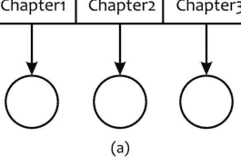


### `Chapter3` 的目录项

| Inode |
| --- |
| . |
| . |
| . |
| 16518417 |

| Link count | Size | Date updated | Owner |
| --- | --- | --- | --- |
| . | 文件在磁盘上的位置 | | |

### `inode` 16518417 的内容

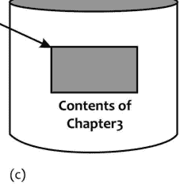

**图 8.1** (a) 当前目录的逻辑结构；(b) 当前目录的内容；(c) 目录项、`inode` 和文件内容之间的关系。


```
16518415 -rw-r--r-- 1 saraw faculty 1958 Mar 4 09 Chapter1
16518416 -rw-r--r-- 1 saraw faculty 5188 Mar 4 09 Chapter2
16518417 -rw-r--r-- 1 saraw faculty 39573 Mar 4 09 Chapter3
16518417 -rw-r--r-- 2 saraw faculty 39573 Mar 4 09 Chapter3.hard
```

`ls` 命令显示当前工作目录下所有文件的某些属性，它们的 `inode` 编号。`ln Chapter3 Chapter3.hard` 命令为文件创建一个硬链接：系统在当前目录中创建一个新的目录项 (16518417, `Chapter3.hard`)。因此，你可以通过 `Chapter3.hard` 引用 `Chapter3`，两个名称指向磁盘上的同一个文件。

## 文件共享

### 当前目录的结构

### 当前目录的内容

| Inode | File |
| --- | --- |
| 16517779 | .. |
| 16517772 | .. |
| 16518415 | Chapter1 |
| 16518416 | Chapter2 |
| 16518417 | Chapter3 |
| 16518417 | Chapter3.hard |

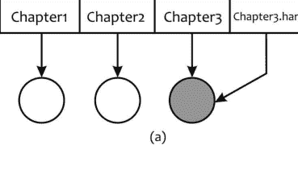

### inode 表

| Inode | Directory entry for |
| --- | --- |
| 16518417 | Chapter3.hard |
| 16518417 | Chapter3 |

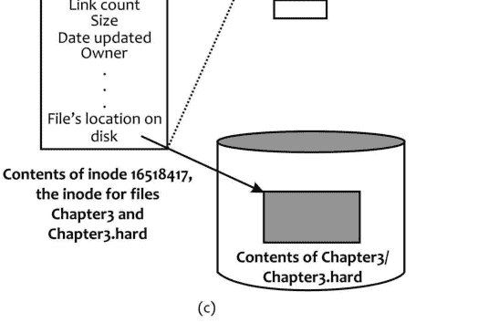

### inode 16518417 的内容，Chapter3 和 Chapter3.hard 的 inode

**图 8.2** 建立链接：(a) 当前目录的逻辑结构；(b) 当前目录的内容；(c) 通过指向文件的 `inode` 实现硬链接。第二个 `ls -l` 命令用于确认 `Chapter3.hard` 和 `Chapter3` 是同一个文件的两个名称，因为它们具有相同的 `inode` 编号 16518417，因此具有相同的属性。因此，当为 `Chapter3` 创建硬链接时，在 `Chapter3.hard` 所在的目录中建立了指向其 `inode` 的指针，如图 8.2 所示。注意此 `ls -l` 的输出显示 `Chapter3` 和 `Chapter3` 的链接计数均为 2。因此，同一个文件在文件系统中有两个名称（即两个路径名）。当你删除一个具有多个硬链接的文件，Linux 系统会将文件 `inode` 中的链接计数减1。如果结果计数为0，系统将删除文件的目录项，释放文件 `inode` 并分配给文件的磁盘块，以便以后存储其他文件或目录。如果链接计数不为0，则只删除删除文件的目录项；文件内容和文件的其他目录项（硬链接）保持完好。以下序列说明了这一点。

```
$ rm Chapter3
$ ls -l
total 52
16518415 -rw-r--r-- 1 saraway faculty 1958 Mar 4 09 Chapter1
16518416 -rw-r--r-- 1 saraway faculty 5188 Mar 4 09 Chapter2
16518417 -rw-r--r-- 1 saraway faculty 39573 Mar 4 09 Chapter3.hard
$
```

此会话清楚地显示移动 `Chapter3` 会导致该文件的目录项被删除，但文件仍然存在于磁盘上并可以通过 `Chapter3.hard` 访问。该链接具有 `Chapter3` 的 `inode` 编号和文件属性，只是链接计数预计从2减到了1。

可以使用以下命令在当前工作目录下为文件 `/memos/memo6` 创建名为 `memo6.hard` 的硬链接。`ls -il` 命令用于在创建硬链接之前查看属性。

```
$ ls -il ~/memos/memo6
16518418 -rw-r--r-- 1 saraway faculty 7878 Mar 4 10:05 /home/saraway/memos/memo6
$ ls -il ~/memos/memo6.hard
$
```

执行命令后，你可以运行 `ls -il` 来确认两个文件（`~/memos/memo6` 和 `memo6.hard`）具有相同的 `inode` 编号和属性，如下会话所示。

```
$ ls -il ~/memos/memo6
16518418 -rw-r--r-- 2 saraway faculty 7878 Mar 4 10:05 /home/saraway/memos/memo6
$ ls -il ~/memos/memo6.hard
16518418 -rw-r--r-- 2 saraway faculty 7878 Mar 4 10:05 memo6
$
```

输出显示了两个结果：第一，链接计数增加了1；第二，两个文件指向同一个 `inode`。

在以下会话中，命令为 `~/linuxe/examples/dir1` 中的所有非目录创建硬链接。`~/linuxe/examples/dir2` 目录中的链接将具有原始文件的名称。`dir2` 命令必须是一个存在的目录，且你对其拥有执行和写入权限。注意所有文件 `f1`、`f2` 或 `f3` 的链接计数已为2。`-f` 选项用于在任何情况下当文件已存在于 `~/linuxe/examples/dir2` 目录时强制创建硬链接。

```
$ cd linuxe/examples
$ mkdir dir1
$ echo "Hello World!\n is a test file." > dir1/f1
$ ls -l dir1
-rw-r--r-- 1 saraway faculty 35 Jun 22 22:21 f1
-rw-r--r-- 1 saraway faculty 68 May 16 21:03 f2
-rw-r--r-- 1 saraway faculty 94 Jul 11 11:39 f3
$ ln -f ~/linux2e/examples/dir1/* ~/linux2e/examples/dir2
$ ls -l dir1
-rw-r--r-- 2 saraway faculty 35 Jun 22 22:21 f1
-rw-r--r-- 2 saraway faculty 68 May 16 21:03 f2
-rw-r--r-- 2 saraway faculty 94 Jul 11 11:39 f3
$ ls -l dir2
-rw-r--r-- 2 saraway faculty 35 Jun 22 22:21 f1
-rw-r--r-- 2 saraway faculty 68 May 16 21:03 f2
-rw-r--r-- 2 saraway faculty 94 Jul 11 11:39 f3
```

## 当前目录内容

## ~/memos 的内容

| Inode # | 文件 |
| --- | --- |
| 16517779 | ... |
| 16517772 | ... |
| 16518415 | Chapter1 |
| 16518416 | Chapter2 |
| 16518417 | Chapter3 |
| 16518418 | memo6.hard |

| Inode # | 文件 |
| --- | --- |
| 16517779 | ... |
| 16517772 | ... |
| 16518411 | memo1 |
| 16518418 | memo6 |
| ... | ... |

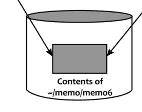

图 8.3 `~/memos/memo6` 与当前目录下的 `memo6.hard` 之间硬链接的示意图。

```
$ more dir2/f1
Hello, World!
This is a test file.
$
```

你可以运行以下命令，在你的主目录下创建一个指向 `/home/sarwar/linux2e/examples/demol` 文件的硬链接。该硬链接将以文件 `demo` 的形式出现在主目录中。如果主目录中已存在 `demo`，你可以使用 `-f` 选项覆盖它。如果主目录中存在 `demo` 且你没有使用 `-f` 选项，屏幕将显示一条错误信息，告知该文件存在。你必须对 `/home/sarwar/linux2e/examples/demol/demol` 路径中的所有目录具有执行权限，并且 `demol` 必须是一个文件。

```
$ ln -f /home/sarwar/linux2e/examples/demol ~
```


用户可以运行以下命令，在 `bob` 主目录下的 `dir1` 目录中创建一个指向 `/home/sarwar/linux2e/examples/demol` 文件的硬链接 `demo`。`bob` 目录中的链接名称与原文件名称相同。图 8.4 显示了链接的建立。

```
$ ln -f /home/sarwar/linux2e/examples/demol/bob/dir1
```

用户必须对 `bob` 主目录具有执行权限，并对 `dir1`（创建链接的目录）具有执行和写入权限。用户 `bob` 必须对 `sarwar` 目录结构中的 `demo` 具有适当的访问权限才能访问该文件。因此，如果 `sarwar` 和 `bob` 属于同一组，且 `bob` 需要编辑 `demo`，`sarwar` 必须将文件的组权限设置为可读写。这样，`bob` 就可以从他的主目录通过 `vim` 等命令编辑 `demo` 了。

以下命令完成了相同的任务。请记住此命令是由 `sarwar` 运行的。

```
$ ln -f ~/linux2e/examples/demol /home/bob/dir1
```

`/home/sarwar/linux2e/examples` `/home/bob/dir1`

| ... | `demo1` |

| --- | --- |

| ... | `demo1` |

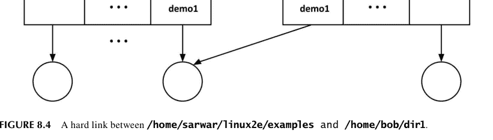

你可以运行以下命令，在你 `~/linux2e/examples` 目录下的所有非目录文件中创建硬链接。这些硬链接位于用户 `john` 主目录下的 `linux2e/examples` 目录中，并保持原文件的命名。用户 `john` 必须首先在他的主目录下创建 `linux2e` 目录，并在 `linux2e` 目录下创建 `examples` 目录。你必须对 `john` 的 `linux2e` 目录执行执行权限，对其 `examples` 目录执行写入权限，命令才能成功运行并完成任务。

```
$ ln -f ~/linux2e/examples/* /home/john/linux2e/examples
```

## 8.6.2 硬链接的缺点

硬链接是 Linux 中连接文件系统的传统方式，通常包含多个文件。然而，硬链接也存在一些问题和局限性，使得它们对用户的吸引力较小。

第一个问题是硬链接无法建立在不同文件系统之间。如果你是在自己的目录结构、顶层目录或与你处于同一文件系统的其他目录结构的文件之间建立链接，那么这个问题并不存在。

然而，如果你想在 `/bin` 目录下的文件（命令）和你文件结构中的文件之间创建硬链接，很可能无法成功，因为在所有系统中，`/bin` 目录和你的目录都位于不同的文件系统。这个问题在当多个文件链接到另一个文件时也会出现。下例说明了这一点。`ls -l` 命令显示 `Chapter3` 和 `Chapter3.hard` 是指向同一个文件的硬链接（注意它们具有相同的 inode 号）。使用 `mv` 命令将文件 `Chapter3` 移动到 `/dev/sh` 目录，这是一个不同的目录。请注意，在执行 `mv` 命令后，两个文件具有不同的 inode；`/dev/sh/Chapter3` 的 inode 为 4，而 `Chapter3.hard` 仍然是旧的 inode 16518417。尽管 `ln` 命令失败了，但 `mv` 命令是成功的。`ln` 命令无法将 `/dev/sh/Chapter3` 链接到 `Chapter3`，因为这两个文件位于不同的文件系统。

```
$ ls -l
total 92
16518415 -rw-r-- 1 sarawar faculty 1958 Mar 4 04:07 Chapter1
16518416 -rw-r-- 1 sarawar faculty 5188 Mar 4 09:58 Chapter2
16518417 -rw-r-- 2 sarawar faculty 39573 Mar 4 14:10 Chapter3
16518417 -rw-r-- 2 sarawar faculty 39573 Mar 4 14:10 Chapter3.hard
$ mv Chapter3 /dev/sh
total 52

# 文件共享

16518415 -rw-r-- 1 sarawar faculty 1958 Mar 4 04:07 Chapter1
16518416 -rw-r-- 1 sarawar faculty 5188 Mar 4 09:58 Chapter2
16518417 -rw-r-- 2 sarawar faculty 39573 Mar 4 14:10 Chapter3
16518417 -rw-r-- 2 sarawar faculty 39573 Mar 4 14:10 Chapter3.hard
$ ls -ld /dev/sh/Chapter3
4 -rw-r-- 1 sarawar faculty 39573 Mar 4 14:10 /dev/sh/Chapter3
$ ls /shm/Chapter3
ln: failed to create link 'Chapter3' => '/dev/sh' Invalid cross-device link
```

第二个问题是用户无法对目录创建硬链接。当用户尝试为 `myweb` 创建硬链接时，`ln` 命令会返回错误信息，所示：

```
$ ln ~/myweb myweb.hard
ln: /home/sarwar/myweb: hard link not allow directory
```

第三个问题是某些编辑器会删除你正在编辑的文件并替换新版本。在这种情况下，任何指向删除文件的链接都无法访问新文件，从而失去了文件共享的目的。幸运的是，常用的编辑器之一（如第 25 章讨论的文本编辑器 `vi`、`vim` 和 `emacs`）是安全的。

在后面的练习中，你将使用 `ln -s` 命令创建并识别硬链接的严重局限性。

### 练习 8.1

在你的主目录下创建一个包含此问题的文件。在该目录下建立该文件的硬链接并命名为 `Chapter1.hard`。通过 `ls -il` 命令验证链接已建立。你使用了该命令输出中的哪个字段进行验证？

### 练习 8.2

在你的 Linux 系统上执行 `ln /dev/sh ~tmp`。目的是什么？执行命令时发生了什么？结果合理吗？

## 8.6.3 软链接/符号链接

软链接解决了硬链接的所有问题，并且使用频率比硬链接高。它们在概念和实现上都与硬链接不同。它们存在相关的成本（我们在 8.6.4 节中讨论），但它们非常灵活，可以跨机器和跨网络链接文件。

你可以使用带有 `-s` 选项的 `ln` 命令创建软链接。如下所示：

```
$ ls -il
total 92
16518415 -rw-r-- 1 sarawar faculty 1958 Mar 4 04:07 Chapter1
16518416 -rw-r-- 1 sarawar faculty 5188 Mar 4 09:58 Chapter2
16518417 -rw-r-- 1 sarawar faculty 39573 Mar 4 14:10 Chapter3
16518417 -rw-r-- 1 sarawar faculty 39573 Mar 4 14:10 Chapter3.hard
$ ln -s Chapter3 Chapter3.soft
$ ls -il
total 92
16518415 -rw-r-- 1 sarawar faculty 1958 Mar 4 04:07 Chapter1
16518416 -rw-r-- 1 sarawar faculty 5188 Mar 4 09:58 Chapter2
16518417 -rw-r-- 1 sarawar faculty 39573 Mar 4 14:17 Chapter3
16518417 -rw-r-- 1 sarawar faculty 39573 Mar 4 14:10 Chapter3.hard
16518423 lwxrxr-x 1 sarawar faculty 8 Mar 4 14:17 Chapter3.soft -> Chapter3
$
```

`ln -s Chapter3.soft` 命令用于在当前工作目录中为文件 `Chapter3` 创建符号链接，并将该符号链接命名为 `Chapter3.soft`。`ln -il` 命令的输出显示了关于符号链接如何实现和识别的重要项。首先，原始文件（`Chapter3`）和 `Chapter3.soft` 是不同的，如 inode 号所示：16518417 和 16518423。其次，符号链接包含原始文件的路径。第三，如果原始文件被移动或删除，符号链接仍然指向该路径，但这可能失效。然而，如果原始文件被替换，符号链接将指向新文件。这就是软链接优于硬链接的优势。最后，你可以跨文件系统创建链接。在后面的章节中，我们为 `/bin` 创建软链接。该链接名称为 `symtobin`，并位于当前目录下。注意 `/bin` 和 `symtobin` 的 inode 号不同，正如预期的那样。


```
$ ln -s /dev symtobin
$ ls -l 2 drwxr-xr-x 19 root 4480 Feb 25 11:58 /dev
16518424 lwxrxr-x 1 sarawar faculty 4 Mar 4 14:19 symtobin -> /dev
$
```

在后面的章节中，我们展示了一个创建链接示例，使得该文件及其符号链接位于不同的文件系统。

```
$ ln -s /dev/home/Chapter3 temp.soft
$ ls -ld /dev/home/Chapter3 temp.soft
-4-rw-r-- 1 sarawar faculty 39573 Mar 6 07:26 /dev/home/Chapter3
16518443 lwxrxr-x 1 sarawar faculty 17 Mar 6 08:09 temp.soft -> /dev/home/Chapter3
$
```

# 当前目录的结构

# 当前目录的内容

| 章1 | 章2 | 章3 | 章3.soft |
| --- | --- | --- | --- |
| | | 16517779 | |
| | | 16517772 | |
| | | 16518415 | Chapter1 |
| | | 16518416 | Chapter2 |
| | | 16518417 | Chapter3 |
| | | 16518423 | Chapter3.soft |


# Inode 表

| 16518417 | Chapter3 |
| --- | --- |
| 16518423 | Chapter3.hard 的目录项 (Chapter3.soft) |

`Inode 16518417`

| `Inode 16518423` |
| --- |
| . |
| 链接计数 大小 更新时间 所有者 |
| --- |
| . |
| 文件在磁盘上的位置 |

`Inode 16518417`

| 链接计数 大小 更新时间 所有者 |
| --- |
| . |
| 文件在磁盘上的位置 |

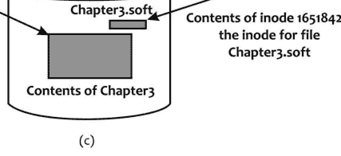

**图 8.5** 建立软链接：(a) 当前目录的逻辑结构；(b) 当前目录的内容；(c) 通过在现有文件的链接文件（路径）中建立指针来实现的软链接。

以下内容显示了如何为目录中的所有文件创建符号链接，包括目录文件。`ln -sf ~/linux2e/examples/dir1/* ~/linux2e/examples/dir2` 命令为名为 `~/linux2e/dir1` 的目录中的所有文件创建链接，并将它们放入 `~/linux2e/examples/dir2` 目录中。你必须对路径中的所有目录具有执行和写入权限。`-f` 选项用于在 `~/linux2e/examples/dir2` 中已存在文件 `f1`, `f2` 或 `f3` 的任何情况下强制创建软链接。在某些系统上，`-f` 和 `-s` 选项可能无法一起工作，在这种情况下你将使用 `-s` 选项。

```
$ cd ~/linux2e/examples
$ more dir1/f1
```

# Linux

Hello, World!

这是一个测试文件。

```
$ ls -l dir1
-rw-r--r-- 1 sarwar faculty 35 Jun 22 22:21 f1
-rw-r--r-- 1 sarwar faculty 168 Jun 22 22:33 f2
-rwxr-xr-x 1 sarwar faculty 783 Jun 22 22:35 f3
$ ln -sf /linux2e/examples/dir1/ -> /linux2e/examples/dir2
-rwxr-xr-x 1 sarwar faculty 38 Jun 22 22:54 f1 -> /home/sarwar/linux2e/examples/dir1/f1
-rwxr-xr-x 1 sarwar faculty 38 Jun 22 22:54 f2 -> /home/sarwar/linux2e/examples/dir1/f2
-rwxr-xr-x 1 sarwar faculty 38 Jun 22 22:54 f3 -> /home/sarwar/linux2e/examples/dir1/f3
$ more dir2/f1
```

Hello, World!

这是一个测试文件。

你可以运行以下命令在你的主目录中创建一个指向文件 `/home/sarwar/linux2e/examples/demol` 的符号链接。该软链接也称为 `demol`（主目录）。如果 `demol` 已经存在于你的主目录中，你可以使用 `-f` 选项覆盖它。如果 `demol` 存在于主目录中而你没有使用 `-f` 选项，屏幕上将显示一条错误信息，告知你 `demol` 已存在。你必须对 `/home/sarwar/linux2e/examples/demol` 路径中的目录具有执行权限，并且 `demol` 必须是一个文件。

```
$ ln -sf /home/sarwar/linux2e/examples/demol ~
$
```

用户 `sarwar` 可以运行以下命令，在 `bob` 的主目录下的目录 `dir1` 中创建一个名为 `demol` 的软链接，它指向 `/home/sarwar/linux2e/examples/demol` 文件。图 8.6 显示了软链接是如何扩展的。

```
$ ln -sf /home/sarwar/linux2e/examples/demol /home/bob/dir1
```

用户 `sarwar` 必须对 `bob` 的主目录具有执行权限，并对 `dir1`（创建软链接的目录）具有执行和写入权限。用户 `bob` 必须对 `sarwar` 目录结构中的 `demol` 具有访问权限才能访问该文件。因此，如果 `sarwar` 和 `bob` 在同一个用户组中且 `bob` 拥有 `demol` 的编辑权限，那么 `sarwar` 必须设置文件的组权限以读取它。用户 `bob` 就可以使用例如 `vi` 命令来编辑 `demol`。以下命令完成了相同的任务。记住，`sarwar` 运行了此命令。


图 8.6 在 (a) `/home/sarwar/linux2e/examples/demol` 和 (b) `/home/bob/dir1` 之间的软链接。

# 文件共享

```
$ ln -sf /linux2e/examples/demol /home/bob/dir1
$
```

你可以运行以下命令为主主目录中的所有文件（包括目录文件）创建软链接。这些软链接位于主目录中的 `linux2e/examples` 目录，并具有原始文件的名称。`john` 必须在主目录中创建 `linux2e/examples` 目录。为了成功运行该命令，`john` 必须对 `examples` 目录具有执行权限。

```
$ ln -sf ~/linux2e/examples/* /home/john/examples
```

## 8.6.4 符号链接的优点

如前所述，符号链接没有硬链接的问题和限制。符号链接可以跨文件系统建立到目录和文件。此外，符号链接指向的文件可以由任何编辑器编辑，只要路径不发生变化。符号链接存在一个与硬链接不同的问题：如果符号链接从一个目录指向另一个目录，则无法再通过链接访问。原因是链接文件包含了原始位置的路径。当文件位置更改时，链接会悬空；即它指向一个不存在的文件。以下会说明了这一点。

```
$ mv temp.soft /Chapter3
cat temp.soft: No such file or directory
```

假设 `temp.soft` 是指向 `/linux2e/examples/Chapter3` 的符号链接。使用 `mv` 命令将 `temp.soft` 移动到当前目录。`cat` 命令失败是因为链接仍然指向路径。这种结果是逻辑上的，但在硬链接中，只要移动的文件留在文件系统中，`cat` 命令就不会失败。

符号链接的其他缺点是 Linux 必须支持额外的文件类型（链接），并且为每个链接都要创建一个新文件。链接的创建填充了额外的 inode、存储文件所需的磁盘空间以及内核数据结构。符号链接还导致文件操作变慢，因为对文件的每次引用都必须打开并读取以到达实际文件。如果通过符号链接引用文件，则需要执行额外的磁盘访问。

在接后的练习中，你将使用 `ln -s` 和 `ls` 创建并识别软链接，并验证可以跨文件系统创建软链接。

## 练习 3

为练习 8.1 中创建的文件 `CH8Ex1` 建立一个软链接。将链接命名为 `CH8Ex1.soft`。验证链接已建立。你使用了什么命令来建立链接并验证创建？

## 练习 8.4

在你的 Linux 系统上执行 `ln -s ~/tmp` 命令。该命令的目的是？执行时发生了什么？结果合理吗？为什么或为什么不？

## 总结


可以使用几种技术之一来允许用户组共享 `Linux` 文件和目录。最常用的文件共享方法包括复制共享文件并在成员之间分发、为成员建立公共帐户、为共享文件设置适当权限、为成员设置 `Linux` 用户组，以及在所有成员的目录中建立共享文件的链接。通过硬链接和软链接共享文件是本章的主题。然而，尚未讨论成员共享访问的问题（参见第 14 章和网站上的第 25 章第 5.7 节）。

硬链接允许通过另一个名称引用现有文件。虽然硬链接是 `Linux` 提供文件系统结构的主要机制，但它们有一些缺点。如果在同一个文件系统中创建文件和链接，只有超级用户可以创建目录的硬链接。移动文件会破坏指向它的所有链接。

软链接可以解决与硬链接相关的问题。当创建指向文件的软链接时，会创建一个包含其所指向的文件路径的新文件。这种链接的类型是软。软链接在访问文件所需的时间空间开销方面是昂贵的。文件访问期间的链接时间开销是因为必须打开链接文件以便执行实际的文件打开和读取（写入）过程。链接文件包含原始文件的路径，原始文件保持不变。

硬链接和软链接使用`ln`命令创建。创建链接时，命令中使用了`-s`选项。命令的第一个字段标识目录中文件的`inode`编号，第二个字段标识（或确认存在）链接。

## 问题与练习

1. 哪些方法可以允许用户组共享 `Linux` 文件和目录？

2. `Linux` 中的链接是什么？列出 `Linux` 支持的链接类型。它们之间有什么区别？

3. 硬链接存在什么问题？

4. 删除你在练习 8.1 中创建的文件`Ch8Ex1`。显示`Ch8Ex1.hard`和`Ch8Ex1.soft`的内容。发生了什么？你使用了什么命令显示文件？结果合理吗？为什么或为什么不？

5. 搜索你系统的`/usr/bin`目录并识别三个链接。写下这些链接的。它们是硬链接还是软链接？你是如何知道的？

6. 在你的主目录中，以`root`身份为`/etc/passwd`建立硬链接和软链接。为什么？使用了什么命令？你对命令执行的结果满意吗？

7. 每个 `Linux` 目录至少有两个硬链接。为什么？

8. 你能找到文件硬、软链接的数量吗？如果是，你需要使用什么命令？

9. 假设当前目录下的名为`shared`的文件有五个硬链接。给出一组命令来显示所有这些链接的绝对路径。（提示：使用`find`命令。）

# 文件共享

10. 在你的主目录下创建一个目录`dir1`，并在其中创建三个文件`f1`、`f2`和`f3`。请你的朋友在他的主目录下创建一个目录`dir2`，并将`dir1.hard`和`dir1.soft`作为其子目录。在朋友的`~/dir2/dir1.hard`和`~/dir2/dir1.soft`中为你的`dir1`中的所有文件创建硬链接和软链接。给出你执行这些操作时所使用的命令序列。

11. 针对第10题，硬链接和软链接的`inode`（索引节点）编号是多少？你使用了什么命令来确定它们？链接文件（硬链接和软链接）的内容是什么？你是如何得到答案的？

12. 符号链接（软链接）的优缺点是什么？

13. 描述在 `Linux` 中如何使用链接（硬链接和软链接）实现文件共享。特别是，除了为共享的文件建立链接之外，你还需要做其他操作吗？

14. 假设你有一组文件`file1.data`到`file9.data`，它们需要在你小组中的100个程序之间进行共享（只读）。讨论以下每项涉及的开销：

   - a. 创建权限
   - b. 创建软链接
   - c. 创建硬链接
   - d. 为每个文件创建独立的私有副本

15. 浏览根目录`(/)`及其子目录。识别出十个软链接并将它们写在表中，列出每个链接的名称及其所在的目录。

16. 符号链接具有“悬空指针”（`dangling pointer`）。它是什么？请用示例进行解释。

17. 硬链接可能无法在文件系统之间建立。硬链接这种限制的技术原因是什么？（提示：考虑`inode`和文件系统。）

# 高级问题与练习

18. 你是否可以使用`-h`命令显示你系统上所有文件系统的信息？你是否可以为你主目录下的文件创建指向以下目录下某个文件的硬链接和软链接？为什么可以或不可以？请展示你的操作过程并解释你的答案。

   - a. `/tmp`
   - b. `/dev/shm`

19. 在以下会话中执行`ln`命令的什么？为什么命令显示了错误信息？

```
$ ln /bin/rm
ln: failed to create hard link 'del' => '/bin/rm': Operation not permitted
$
```

20. 显示你主目录下具有两个或多个硬链接的文件的路径。你使用了什么命令？展示该命令在你系统上的执行结果。

21. 书籍第 `W26` 章 9.8.2 节和 9.8.3 节中的材料，特别是示例`W26.27`（均可在书籍网站找到），为了进一步扩展你对文件共享技术的理解，可以使用 `Linux` 的“能力”（`capabilities`）来实现。能力是系统操作最基础层面的权限检查：用于检查进程对文件对象可以执行权限的进程函数，并结合本章介绍的内容。具有能力权限的进程可以以有效用户 ID 0 (`root`) 运行，而不是非特权的非零用户 ID：能力为应用这些进程提供了更具包容性、更细粒度且范围有限的权限（或 `root` 权限），而不是通过基于角色的访问控制技术（在 `Debian-Linux` 系统上使用`sudo`）或超级用户（在 `CentOS 7` 上）分配所行行的“全或全无”的权限。

22. 选取一个可执行程序（你编写的），并对其应用能力，以赋予对当前工作目录或跨系统（可用）的文件的一组“受限”权限。使用你熟悉的任何语言（如 `C`、`C++`、`Python`、`Bash` 脚本）自己编写该程序。具体来说，让程序能够访问它通常由于这些文件对象设置的传统权限位而被拒绝访问的文件。这在示例`W26.27`中有所了说明。尽管你如示例所示作为普通用户分配能力，但请以普通特权用户身份执行你的程序。在表`W26.14`所示的能力中，你会在程序中使用哪种能力来实现本题要求的任务？

此外，增强你的程序，允许根据需要或分配对表`G19.14`中列出的任何其他能力进行设置和测试。

23. 本章所示的文件共享技术是否可以应用于`NFSv4`挂载的网络驱动器（如书籍第 `W26` 章 9.3.3 节和 9.3.4 节所述）以及其上的文件系统对象？哪种技术对于网络驱动器效果最好？充分解释你的答案。

24. 你认为使用本章所示的所有文件共享技术，与第 `W26` 章 9.3.4 节“在 `ZFS` 上设置 `NFSv4 ACL`”中所示的技术相比，其主要区别、差异以及相对优缺点是什么？单一独立系统可以既是`NFSv4`服务器又是客户端吗？你将如何实现这种场景？你为什么想要实现这种场景？它的优缺点是什么？

# 项目

## 项目 1

使用第 5.5.2 节开发的修改传统 `Linux` 访问权限的技术，以及第 `W24` 章 5.7 节和第 `W26` 章 9.3.4 节介绍的`git`和`NFS`材料。

## 项目 2

使用第 5.5.2 节开发的修改传统 `Linux` 访问权限的技术，以及第 `W24` 章 5.7 节和第 `W26` 章 9.3.4 节介绍的`git`和`NFS`材料。

## 项目 3

使用第 5.5.2 节开发的修改传统 `Linux` 访问权限的技术，以及第 `W24` 章 5.7 节和第 `W26` 章 9.3.4 节介绍的`git`和`NFS`材料。

## 项目 4

使用第 5.5.2 节开发的修改传统 `Linux` 访问权限的技术，以及第 `W24` 章 5.7 节和第 `W26` 章 9.3.4 节介绍的`git`和`NFS`材料。

## 项目 5

使用第 5.5.2 节开发的修改传统 `Linux` 访问权限的技术，以及第 `W24` 章 5.7 节和第 `W26` 章 9.3.4 节介绍的`git`和`NFS`材料。

## 项目 6

使用第 5.5.2 节开发的修改传统 `Linux` 访问权限的技术，以及第 `W24` 章 5.7 节和第 `W26` 章 9.3.4 节介绍的`git`和`NFS`材料。

## 项目 7

使用第 5.5.2 节开发的修改传统 `Linux` 访问权限的技术，以及第 `W24` 章 5.7 节和第 `W26` 章 9.3.4 节介绍的`git`和`NFS`材料。

## 项目 8

使用第 5.5.2 节开发的修改传统 `Linux` 访问权限的技术，以及第 `W24` 章 5.7 节和第 `W26` 章 9.3.4 节介绍的`git`和`NFS`材料。

## 项目 9

使用第 5.5.2 节开发的修改传统 `Linux` 访问权限的技术，以及第 `W24` 章 5.7 节和第 `W26` 章 9.3.4 节介绍的`git`和`NFS`材料。

## 项目 10

使用第 5.5.2 节开发的修改传统 `Linux` 访问权限的技术，以及第 `W24` 章 5.7 节和第 `W26` 章 9.3.4 节介绍的`git`和`NFS`材料。

# 206

# `Linux`

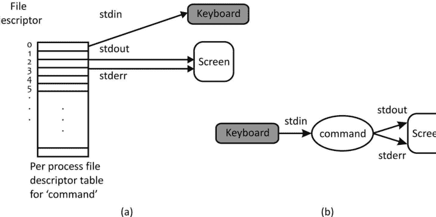

图 9.1 标准文件和文件描述符：(a) 文件描述符；(b) 命令执行的语义。


显示器（或控制台窗口），如图 9.1 所示。回顾我们在第 4 章对进程文件描述符表的解释。在本章的剩余部分，我们将交叉使用显示器、显示屏幕、控制台窗口和显示窗口等术语。

## 9.3 输入重定向

输入重定向通过使用小于符号 (`<`) 实现。使用以下语法可以将键盘从命令的标准输入中分离，并将输入文件附加到其上。因此，如果命令从标准输入读取输入，则输入将来自输入文件，而不是运行命令的终端所连接的键盘。命令语法的语义如图 9.2 所示。注意，命令的输入来自输入文件。

```
Syntax:
command < input-file
Purpose: 命令的输入来自输入文件而非键盘
```

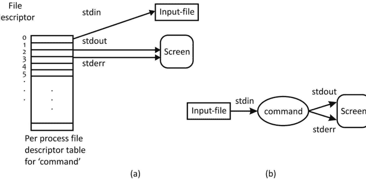

图 9.2 输入重定向：(a) 命令的文件描述符和标准文件；(b) 输入重定向的语义。

例如，命令 `cat < tempfile` 从 `tempfile` 读取（而不是键盘，因为 `cat` 的标准输入已附加到 `tempfile`），并将其输出发送到显示屏幕。因此，实际上，`tempfile` 的内容显示在显示器上。此命令与 `cat tempfile` 不同，在后者，`tempfile` 是作为命令行参数传递给 `cat` 的；`cat` 的标准输入没有改变，仍然是运行命令的终端所连接的键盘。

同样地，在命令 `grep "" < Phones` 中，`grep` 命令从当前目录下的 `Phones` 文件读取输入，而不是从键盘。命令的输出和错误信息将发送到显示屏幕。然而，从用户的角度来看，两种情况下 `grep` 的最终效果是相同的。同样，在大多数情况下不需要使用 `<>`，因为无论什么情况下命令都从文件中读取。

如果 `cat` 和 `grep` 命令没有从命令行传递文件参数，它们将从标准输入获取输入。`tr` 命令仅从标准输入获取输入并将其输出发送到标准输出。该命令不支持命令行参数。因此，`tr` 命令配合输入重定向使用，例如 `tr -s ' ' Bigfile`。当执行此命令时，它将 `Bigfile` 中的多个连续空格替换为单个空格。

## 9.4 输出重定向

输出重定向通过使用大于符号 (`>`) 实现。使用以下语法可以将显示屏幕从命令的标准输出中分离，并将输出文件附加到其上。因此，如果命令写入标准输出，输出将转到输出文件，而不是运行命令的终端所连接的显示屏幕。错误信息仍然发送到显示屏幕，命令语义如图 9.3 所示。

| Syntax | Purpose |
|---|---|
| `command > output-file` | 将命令输出发送到文件而非显示屏幕 |

考虑命令 `cat < newfile`。记住 `cat` 命令默认将其输出发送到标准输出，即显示屏幕。此命令将显示屏幕从 `cat` 命令的标准输出分离并将 `newfile` 附加到其上。`cat` 的标准输入仍然附加
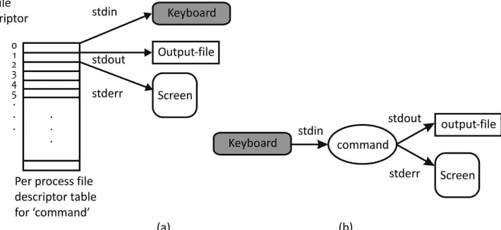

图 9.3 输出重定向：(a) 命令的文件描述符和标准文件；(b) 输入重定向的语义。

# Semantics of `ssh server sort < datafile` run on machine.

| | `datafile` | `sort` | `stdout:` |
|---|---|---|---|
| | `client` | `stderr` |

当执行此命令时，它创建一个文件 `datafile`，其内容是在键盘上输入的所有内容。如果文件已存在，它将被覆盖。

同样，命令 `grep "John" Phones > Phone_John` 将包含 "John" 的行发送到名为 `Phone_John` 的文件，而不是显示在显示屏幕上。命令的输入来自 `Phones` 文件。当遇到 `Phones` 中的文件结束符时，命令终止。

在网络环境中，可以使用以下命令对位于（客户端计算机）的 `datafile` 进行排序。命令的输出——即排序后的数据——被发送到客户端计算机的显示屏幕。图 9.4 展示了此命令的语义。

# `$ ssh server sort < datafile`

此命令是使用多台计算机并发执行任务的良好示例。如果你的计算机（称为 `client`）有一个大文件 `datafile` 需要排序，且你不想在网络中的多个计算机上创建该文件的多个副本，那么此命令非常有用。如果服务器上有你允许使用的专用 Linux 工具但不允许在机器上复制，此类命令也有用。我们将在第 11 章讨论与网络相关的命令和实用程序。我们使用此示例说明 Linux I/O 重定向的功能，而不是在网络环境中计算。

# `$ cat Students`

以下会话显示了本地（客户端）机器上的 `Students` 以及远程（服务器）机器 `198.102.20` 上执行的 `sort` 命令的输出。由于 `sarwar` 登录，系统在远程机器运行 `sort` 命令并将其输出到本地计算机之前提示他输入密码。注意，我们显示的是 `ssh` 服务器的互联网协议 (IP) 地址，但会话是在远程环境中执行的。

# `$ ssh sarwar@198.102.20 < Students`

`Password for sarwar@pcdsrv:`

| | ECE | 3.54 | A |
|---|---|---|---|
| John Doe | CS | 3.61 | A |
| Pam Meyer | CS | 2.71 | B |
| Jim Davis | ECE | 3.54 | A |
| John Doe | ECE | 3.97 | A |
| Jason Kim | ECE | 2.38 | C |
| Amy Nash | | | |
| | | | | |
|---|---|---|---|
| Amy Nash | | 2.38 | C |
| Jason Kim | ECE | 3.97 | A |
| Jim Davis | CS | 2.71 | B |
| John Doe | ECE | 3.54 | A |
| John Doe | ECE | 3.54 | A |
| Pam Meyer | CS | 3.61 | A |

`$`

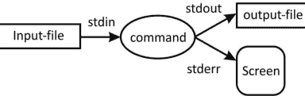

图 9.5 输入和输出重定向的结合。

## 9.5 结合输入和输出重定向

根据下描述使用的语法，可以结合使用输入和输出重定向

```
Syntax:
command < input-file > output-file
command > output-file < input-file
Purpose: 命令的输入来自输入文件而非键盘，命令的输出到输出文件而非显示屏幕
```

当使用此语法时，命令从输入文件（而不是连接终端的键盘）获取输入，并将输出发送到输出文件（而不是显示屏幕），如图 9.5 所示。在 `< lab1 > lab2` 命令中，`cat` 命令从 `lab1` 获取输入并将其输出发送到 `lab2`。此效果是在 `lab2` 中创建了 `lab1` 的副本。因此，此命令行等同于不存在的 `cp lab1 lab2`。如果 `lab2` 是一个存在的文件，这两个命令具有不同的语义。`cat < lab1 > lab2` 命令将截断 `lab2`（将其大小置零并将读写指针指向第一个字节）并写入 `lab1` 的内容。因为 `lab2` 没有重建，其属性（如访问权限和链接数）不会改变。在 `cp lab1 lab2` 的情况下，不仅将 `lab1` 的数据复制到 `lab2`，其属性也被复制到 `lab2`。

在下面的章节练习中，你将练习 Linux 的输入输出重定向功能。

- 练习 9.1：编写一个 Shell 命令，统计工作目录下名为 `memo` 的文件的字符、单词和行数，并将这些值显示在显示屏幕上。使用输入重定向。

- 练习 9.2：重复练习 9.1，将输出重定向到名为 `counts.memo` 的文件。使用 I/O 重定向。

## 9.6 使用文件描述符进行 I/O 重定向

如 4.6 节所述，Linux 内核为每个打开的文件关联一个小整数，称为文件的文件描述符。标准输入、标准输出和标准错误的文件描述符分别为 0、1 和 2。Bash 和可移植操作系统接口 (POSIX) shell 允许你打开文件并与其关联描述符；TC shell 不应允许使用描述符。从 3 开始的其他描述符用于进程同时打开文件的情况。描述符的上限（以及因此进程可以同时打开的文件数）随系统而异。

# 210 Linux

（...）系统，并可能由每个进程描述符名称 `-n` 命令来确定。每个描述符都用于索引内核表，称为“每个进程文件描述符表”，正如第 4.7 节中简要讨论的。关于此主题的更详细讨论可以参考第 15 章和第 16 章，以及书籍网站上的 `W20` 和 `W21` 章。在接下来的章节中，我们描述了 Bash 和 POSIX Shell 下的 I/O 和错误重定向。我们使用 TC shell 语法并在 9.13 节中给出示例。


通过使用文件描述符，可以在 Bash 和 POSIX Shell 中使用 `<0` 和 `>1` 操作符分别重定向标准输入和标准输出。因此，让 `1> outfile`（等同于 `cat > outfile`）从标准输入读取并输出到 `outfile`；错误消息则到显示屏幕。同样，`ls -l foo outfile` 等同于 `ls -1 foo > outfile`。该命令的输出（`foo` 的长列表）进入一个名为 `outfile` 的文件，其生成的错误消息将到显示屏幕。

文件描述符 0 可以作为 `<` 操作符的前缀，用于显式指定从文件的输入重定向。在后续会话所示命令中，`grep` 命令的输入是当前工作目录下 `tempfile` 的内容。

```
$ grep "John" < tempfile
  command output
...
```

### 9.7 重定向标准错误

命令的错误可以使用 `2>` 操作符重定向（即将标准错误的文件描述符与 `>` 操作符关联），如下：

语法：

`command 2> error-file`

目的：命令生成的默认发送到 `stderr` 的错误消息被重定向到 `error-file`

使用此语法时，`command` 从键盘获取输入，将输出发送到显示器屏幕，命令产生的任何错误消息都将发送到 `error-file`。该语法的语义如图 9.6 所示。输入可能来自作为命令行参数传递的文件。命令 `grep "John" Phones 2>` 从 `Phones` 文件读取输入，发送输出到显示屏幕，`grep` 产生的任何错误消息进入名为 `error.log` 的文件。

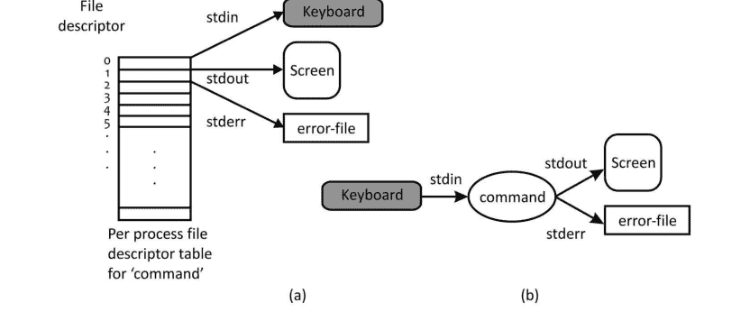

图 9.6 错误重定向：(a) 命令的标准描述符和标准文件；(b) 错误重定向的语义。

### 重定向与管道

如果文件已存在，它会被覆盖；否则，将被创建。以下示例显示了如何将 `ls -l1` 的标准错误重定向到文件。

```
$ ls -l1 foo 2> error.log
... long listing for foo if no errors ...
$
```

`ls -l1 foo` 的输出到屏幕，错误消息到 `error.log`。因此，如果 `foo` 不存在，错误消息 `ls: No such file or directory` 将进入 `error.log` 文件，如下会话所示。消息的实际内容随系统而异，但基本上告知你 `foo` 不存在。

```
$ ls -l1 foo 2> error.log
$ cat error.log
ls: No such file or directory
$
```

将标准输出连接到显示屏幕而不将其重定向到文件在很多情况下是有用的。例如，当执行 `cat lab1 lab2 lab3 > all` 命令将文件 `lab1`、`lab2` 和 `lab3` 合并到一个名为 `all` 的文件时，你可能想知道这三个文件是否不存在，或者你是否有权限读取其中任何一个。在这种情况下，将错误消息重定向到文件是没有意义的，因为你想看到命令执行的即时结果。

### 9.8 在一条命令中重定向 stdout 和 stderr

标准输出和标准错误可以重定向到同一个文件。实现此点的明显方法是使用带有 `>` 符号的文件描述符将 `stdout` 和 `stderr` 重定向到同一个文件，如下所示。

```
$ cat lab1 lab2 lab3 1> cat.output 2> cat.errors
$
```

在这种情况下，`cat` 命令的输入来自 `lab1`、`lab2` 和 `lab3` 文件，其输出进入 `cat.output` 文件，任何错误消息进入 `cat.errors`，如图 9.7 所示。

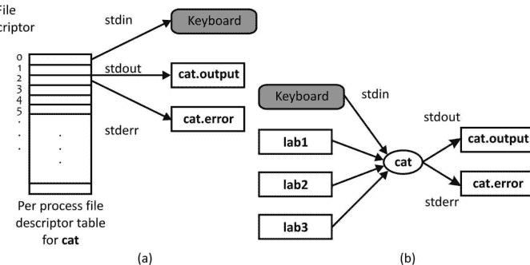

图 9.7 重定向：(a) `cat lab1 lab2 lab3 1> cat.output 2> cat.errors` 的文件描述符和标准文件；(b) `cat` 命令的语义。

#### 文件描述符 stdin 键盘

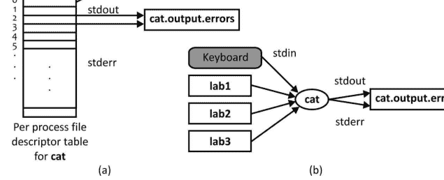

`stdout` `cat.output.errors` `stderr` `stdin` `stdout` `cat.output.errors`

`cat lab1 lab2 lab3` 的进程文件描述符表 (a) (b)

图 9.8 错误重定向：(a) 文件描述符和标准文件；(b) `cat lab1 lab2 lab3 1>cat.output.errors 2>1` 和 `cat lab1 lab2 lab3 2>cat.output.errors` 的语义。

注意，尽管在图 9.7 中，文件 `lab1`、`lab2` 和 `lab3` 在被 `cat` 命令打开读取时已分配了文件描述符。

### 重定向与管道

Bourne shell 在默认情况下，当命令的标准输出 (`stdout`) 或标准错误 (`stderr`) 重定向到某个文件时，会覆盖该文件；但 Korn 和 Bash shell 具有一个 `noclobber` 选项，可以防止你不小心覆盖重要文件。我们在第 9.13 节中讨论 TC shell 的该选项，但这里针对 Bash shell 进行讨论。

你可以通过使用 `set` 命令配合 `-o` 选项在 Bash shell 中设置 `noclobber` 选项。当然，如果你想永久设置此选项，可以将该命令添加到你的 `~/.profile` 文件中。

```
$ set -o noclobber
```

在 Bash shell 中，你也可以使用 `set -C` 命令设置该选项。当你取消设置 `noclobber` 选项时，可以使用 `>` 操作符强制覆盖文件。

在接下来的章节内练习中，你将在命令行中练习 Linux shell（不包括 TC shell）的输入、输出和错误重定向功能。

#### 练习 9.3

- 编写一个命令，该命令统计当前工作目录中名为 `memo` 的文件中字符、单词和行的数量，并将这些值写入文件 `memo.size` 中。如果命令失败，错误信息应进入文件 `error.log`。请使用 I/O 和错误重定向。

#### 练习 9.4

- 编写一个命令，使用 `mail` 命令将文件 `greetings` 的内容发送到 `doe@domain.com`。如果 `mail` 命令失败，错误信息应进入文件 `mail`。请使用输入和错误重定向。

#### 练习 9.5

- 重复练习 9.2，但将错误信息附加到 `mail.errors` 的最后。

### 9.11 Linux 管道

Linux 系统允许将一个命令的标准输出 (`stdout`) 连接到另一个命令的标准输入 (`stdin`)。我们可以按照以下语法使用管道符 (`|`) 来。

语法：

`command1 | command2 | command3 | ... | command`

目的：`command1` 的标准输出连接到 `command2` 的输入，`command2` 的标准输出连接到 `command3` 的输入……以此此类推，`commandN-1` 的标准输出连接到 `commandN` 的输入。

图 9.11 展示了将输出作为输入发送另一个命令的语义。

因此，管道连接了被称为“过滤器”（filters）的内容。过滤器属于一类 Linux 命令，它们从 `stdin` 获取输入，以某种特定方式进行处理，并发送到 `stdout`。管道和过滤器在 Linux 中经常用于执行单个命令无法完成的复杂任务。常用的过滤器有 `cat`、`sort`、`crypt`、`grep`、`less`。如果连接到管道的命令处理输入的速度比其输入端的命令慢，管道会存储多余的数据，并按照先来顺序（FIFO）将其提供给输出端的命令。因此，如果图 9.11 中的 `cmd2` 处理传入数据的速度慢于 `cmd1` 生成数据的速度，`cmd1` 产生的多余数据将存储在 `cmd1` 和 `cmd2` 之间的管道中，并按先来顺序提供给 `cmd2`。在 Linux 中，不中断（即原子性）写入管道的最大数据量由 `/usr/include/linux/limits.h` 中的符号常量 `PIPE_BUF` 决定。

#### 图 9.11 N 个命令管道的语义

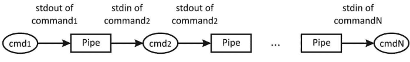

#### 图 9.12 `ls -l | more` 命令的语义

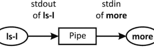


例如，在 `ls -1 | more` 中，命令将 `ls -1` 的输出作为其输入。该命令的最终效果是每次显示屏幕 `ls -1` 的输出。管道像水管一样，获取 `ls -1` 的输出并作为输入，如图 9.12 所示。该命令没有使用磁盘来连接 `ls -1` 的标准输出和 `more` 的标准输入，因为管道是在主内存的内核区域实现的。从 I/O 重定向操作的角度来看，该命令等于以下命令序列。

```
$ ls -1 > temp
$ more < temp (or more temp)
[contents of temp]
$ rm temp\$
```

如你所见，不仅需要三个命令来完成相同任务，而且该命令序列极其缓慢，因为涉及到文件的读写操作。回想文件存储在次级存储设备（通常是磁盘）上。在典型的现代计算机系统中，磁盘操作比主内存（随机访问）操作慢大约百万倍。然而，由于 Linux 内核对文件块以及磁盘的高效缓存，管道的实际性能提升要小得多。

你可以使用第 7 章讨论的 `sort` 工具对文件的行进行排序。假设你有一个名为 `student_records` 的文件需要排序，并且可能包含一些重复行，你希望这些行只在排序后的文件中出现一次。`sort -u student_records` 命令可以完成此任务。如第 6 章所述，如果给定包含重复行的 `student_records` 排序版本，`uniq` 命令也可以完成该任务。执行该任务的方法之一是使用以下命令。使用 `more` 显示 `student_records` 的内容。

```
$ more student_records

John Doe ECE 3.54

Pamer Meyer CS 3.61

Jim Davis CS 2.71

John Doe ECE 3.54

Jason Kim ECE 3.97

Amy Nash ECE 2.38

Kim Coleman CS 3.19

$ sort student_records > student_records_sorted

$ uniq student_records_sorted

Amy Nash ECE 2.38

Jason Kim ECE 3.97

Jim Davis CS 2.71

John Doe ECE 3.54

Kim Coleman CS 3.19

Pamer Meyer CS 3.61

$
```

# 重定向与管道

使用管道可以在一行命令中完成相同的任务，如下：

```
$ sort student_records | uniq

Amy Nash ECE 2.38
Jason Kim ECE 3.97
Jim Davis CS 2.71
John Doe ECE 3.54
Kim Coleman CS 3.19
Pam Meyer CS 3.61
```

如果你想显示某个名为 `Kim` 的记录，可以使用 `grep` 命令来实现。然而，如果你不知道 `student_records` 的位置，可以使用 `find -name student_records | xargs grep` 命令，如下会话所示。

```
$ find -name student_records | xargs grep

Jason Kim ECE 3.97
Kim Coleman CS 3.19
```

如果你想显示 `Kim` 的记录，可以将其作为字符串传递给 `grep`，例如

```
$ find -name student_records | xargs grep "Kim"
Kim Coleman CS 3.19
```

有时你需要连接多个命令。以下命令演示了多个管道形成的命令管道。在该命令中，我们使用了 `grep` 和 `sort` 过滤器。

```
$ who | sort | grep "John" | mail -s "John's Terminal" doe@domain.com
```

该命令输出 `who` 并包含字符串 "John" 的行（如果有）作为邮件发送到 `doe@domain.com`，主题为 "John's Terminal"。从输入和输出重定向的角度来看，该命令等于以下命令序列。

```
$ who > temp1
$ sort < temp1 > temp2
$ grep "John" temp2 > temp3
$ mail -s "John's Terminal" doe@domain.com < temp3
$ rm temp1 temp2 temp3
```

上面的命令没有使用任何磁盘文件，但该序列需要三个临时文件和磁盘 I/O（读写）操作。I/O 操作的数量可能会很多，取决于这些文件的大小、当前系统的用户负载以及系统中运行的其他进程的运行时行为。

管道是一种允许两个 Linux 命令（进程）相互通信的特性。每个管道为同一系统内的相关进程提供了一种进程间通信 (IPC) 机制。具体而言，它可以作为同一系统内相关进程之间的通信通道。通常，具有父子关系（见第 10 章）但具有共同祖先（父、祖父等）的进程也可以使用管道进行通信。从程序员的角度来看，我们在书籍网站的第 W20 章详细讨论 IPC 管道。进程间的通信是单向的。例如，在 `ls | more` 中，`ls` 的输出被 `more` 作为输入读取。因此，单向通信是从 `ls` 到 `more`。对于进程间的双向通信，至少必须使用两个管道。这无法在命令 shell 级别完成，但在 C/C++ 中可以通过 `pipe(2)` 系统调用来实现。我们在书的网站的第 W20 章节中也探讨了这一主题。I/O 重定向管道可以在单个命令中使用，如下：

```bash
# $ grep "John" < Students | lpr -Pspr
```

在这里，`grep` 命令在 `Students` 文件中搜索包含字符串 "John" 的行，并将这些行发送到 `lpr` 命令打印在名为 `pspr` 的打印机上。图 9.13 展示了该命令的语义。

在下一个命令中，`egrep` 从 `ee446.grades` 获取输入，并将其输出（以字符 A 结尾的行）发送到 `sort` 实用，`sort` 对这些行进行排序并将它们存储在当前目录下的 `ee446.As.sorted` 文件中。结果是，E446 课程中获得 A 级的学生姓名、分数和成绩被存储在当前目录的 `ee446.As.sorted` 文件中。图 9.14 展示了该命令的语义。

```bash
# $ egrep 'AS' < ee446.grades | sort | ee446.As.sorted
```

假设通过运行 `ssh server sort < datafile`，你的本地系统与服务器上更新后的副本（`~/research/psvr/datafile.server`）一致。你可以复制 `datafile.server` 并与你的本地副本 `datafile` 进行比较。但这样你将会有三个副本，如果你不小心，可能会删除错误的副本。在这种情况下，你可以运行以下命令来查看本地副本与服务器副本之间的差异，而无需在你的（本地）计算机上复制 `datafile.server`。

```bash
$ ssh server cat ~/research/psvr/datafile.server | diff datafile -
```

在这种情况下，`cat` 命令在服务器上运行，它的输出作为输入传递给本地机器上执行的 `diff` 命令。`diff` 命令的输出也将显示在本地机器屏幕上。图 9.15 展示了该命令的语义。

图 9.13 `grep "John" < Students | lpr -Pspr` 命令的语义。

图 9.14 `egrep 'AS' < ee446.grades | sort | ee446.As.sorted` 命令的语义。

## 练习 9.10

在你的系统上创建 `student_records` 文件，并重复本节中使用该文件运行的所有命令。

## 9.12 重定向与管道的结合

你不能单独使用重定向运算符和管道在单个命令中将命令的标准输出（stdout）重定向到文件，同时将其连接到另一个命令的标准输入（stdin）。然而，你可以使用 `tee` 实用来实现。使用该工具可以让命令 shell 将命令的标准输出发送到作为 `tee` 参数的一个或多个文件，以及发送到另一个命令。以下是 `tee` 实用通常用法的简要描述。

> 语法：`command1 | tee file1 file2 ... fileN | command2`

图 9.15 shell `cat ~/research/pvm/datafile.server | diff datafile` 命令的语义。


> 目的：`command1` 的标准输出连接到其输入端，`tee` 将其输入发送到文件 `file1` 到 `fileN` 以及 `command2` 的标准输入

该 shell 命令的语义是：执行 `command1`，其输出存储在文件 `file1` 到 `fileN` 中。`tee` 的用法示例见以下命令：

```bash
$ cat students | grep "John" | tee file1 file2 | wc -l
```

该命令从 `students` 中提取包含 "John" 的行，通过 `tee` 将这些行发送到文件 `file1` 和 `file2`，并传递给 `wc -l`。`wc -l` 的输出也将显示在本地屏幕上。因此，包含 "John" 字符串的行保存在 `file1` 和 `file2` 中，`wc -l` 显示了这些行的行数。

## 练习 9.7

在你的系统上创建 `student_records` 文件，并重复本节中使用该文件运行的所有命令。

## 9.13 输出重定向与错误重定向（TC Shell）

你不能单独使用重定向运算符和管道在单个命令中将命令的标准输出重定向到文件，同时将其连接到另一个命令的标准输入。然而，你可以使用 `tee` 实用来实现。使用该工具可以让命令 shell 将命令的标准输出发送到作为 `tee` 参数的一个或多个文件，以及发送到另一个命令。以下是 `tee` 实用通常用法的简要描述。

### 重定向与管道

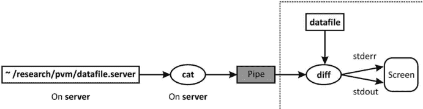

图 9.15 shell `cat ~/research/pvm/datafile.server | diff datafile` 命令的语义。

图 9.13 `grep "John" < Students | lpr -Pspr` 命令。

> 语法：

`command1 | tee file1 file2 ... fileN | command2`

> 目的：`command1` 的标准输出连接到其输入端，`tee` 将其输入发送到文件 `file1` 到 `fileN` 以及 `command2` 的标准输入

该 shell 命令的语义是：执行 `command1`，其输出存储在文件 `file1` 到 `fileN` 中。`tee` 的用法示例见以下命令：

```bash
$ cat students | grep "John" | tee file1 file2 | wc -l
```

该命令从 `students` 中提取包含 "John" 的行，通过 `tee` 将这些行发送到文件 `file1` 和 `file2`，并传递给 `wc -l`。`wc -l` 的输出也将显示在本地屏幕上。因此，包含 "John" 字符串的行保存在 `file1` 和 `file2` 中，`wc -l` 显示了这些行的行数。

图 9.14 `egrep 'AS' < ee446.grades | sort | ee446.As.sorted` 命令。

假设，通过运行 `ssh server sort < datafile`，你的本地系统与服务器上更新后的副本（`~/research/psvr/datafile.server`）一致。你可以复制 `datafile.server` 并与你的本地副本 `datafile` 进行比较。但这样你将会有三个副本，如果你不小心，可能会删除错误的副本。在这种情况下，你可以运行以下命令来查看本地副本与服务器副本之间的差异，而无需在你的（本地）计算机上复制 `datafile.server`。

```bash
$ ssh server -research/psvr/datafile.server | diff datafile -
```

在这种情况下，`cat` 命令在服务器上运行，它的输出作为输入传递给本地机器上执行的 `diff` 命令。`diff` 命令的输出也将显示在本地机器屏幕上。图 9.15 展示了该命令的语义。

## 练习 9.10

在你的系统上创建 `student_records` 文件，并重复本节中使用该文件运行的所有命令。

## 9.12 重定向与管道的结合

你不能单独使用重定向运算符和管道在单个命令中将命令的标准输出（`stdout`）重定向到文件，同时将其连接到另一个命令的标准输入（`stdin`）。然而，你可以使用 `tee` 实用来实现。使用该工具可以让命令 shell 将命令的标准输出发送到作为 `tee` 参数的一个或多个文件，以及发送到另一个命令。以下是 `tee` 实用通常用法的简要描述。

### 重定向与管道


图 9.15 shell `cat ~/research/pvm/datafile.server | diff datafile` 命令的语义。

> 语法：

`command1 | tee file1 file2 ... fileN | command2`

> 目的：`command1` 的标准输出连接到其输入端，`tee` 将其输入发送到文件 `file1` 到 `fileN` 以及 `command2` 的标准输入

该 shell 命令的语义是：执行 `command1`，其输出存储在文件 `file1` 到 `fileN` 中。`tee` 的用法示例见以下命令：

```bash
$ cat students | grep "John" | tee file1 file2 | wc -l
```

该命令从 `students` 中提取包含 "John" 的行，通过 `tee` 将这些行发送到文件 `file1` 和 `file2`，并传递给 `wc -l`。`wc -l` 的输出也将显示在本地屏幕上。因此，包含 "John" 字符串的行保存在 `file1` 和 `file2` 中，`wc -l` 显示了这些行的行数。

### 重定向与管道

## 表 9.1

| 算符 | Bash Shell | TC Shell |
| --- | --- | --- |
| `< file` | 输入重定向 | 输入重定向 |
| `> file` | 输出重定向 | 输出重定向 |
| `>> file` | 追加标准输出 | 追加标准输出 |
| `0< file` | 输入重定向 | |
| `1> file` | 输出重定向 | |
| `2> file` | 错误重定向 | |
| `1>> file` | 将标准输出追加到文件 | |
| `2>> file` | 将标准错误追加到文件 | |
| `<m` | 将标准输入附加到文件描述符 m | |
| `>m` | 将标准输入附加到文件描述符 m | |
| `m=>&n` | 将文件描述符 m附加到文件描述符 n | |
| `<&-` | 关闭标准输入 | |
| `>&-` | 关闭标准输出 | |
| `m<&- or m>&-` | 关闭文件描述符 m | |
| `& file` | 将输出和错误重定向到文件 | 将输出和错误重定向到文件 |
| `| file` | 忽略 noclobber 并将输出赋值给文件 | 忽略 noclober 并标准输出赋值给文件 |
| `! file` | | 忽略创建；如果文件不存在则创建它 |
| `>>! file` | | 忽略 noclobber 并将输出和标准错误追加到文件 |
| `n| file` | 忽略 noclobber 并强制将文件描述符的输出指向 n | |
| `<> file` | 将标准输入和标准输出赋值给文件 | |
| `n< file` | 设置文件描述符为 n | |
| `n> file` | 将文件描述符指向 n | |
| `cmd1 | cmd2` | 将命令 `cmd1`的标准输出连接到命令 `cmd2`的标准输入 | 将命令 `cmd1`的标准输出和标准错误连接到命令 `cmd2`的标准输入 |
| `cmd1 | &cmd2` | | 将命令 `cmd1`的标准输出重定向到文件，并将标准错误重定向到文件2 |
| `(cmd)> file1>&file2` | 允许命令的 `stdout` 和 `stderr` 附加到另一个命令的 `stdin` | |

## 9.15 FIFOs

`FIFOs`（命名管道）也可以用于在系统上执行的进程之间的通信。虽然通过管道通信的进程必须通过你执行的共同祖先进程相互关联，但通过 `FIFOs` 通信的进程并不需要这种关系——它们可以是同一系统上独立执行的程序。命令行中对管道和 `FIFOs` 的使用，意味着管道只能用于通过管道线连接的命令之间的通信，而 `FIFOs` 可用于单独运行的命令之间的通信。


管道和 FIFOs 之间的另一个区别是，管道是 Linux 内核维护的内存缓冲区，没有名称；而 FIFO 是在系统中创建的并具有类似于文件名的名称。这意味着，像文件一样，FIFOs 在用于进程通信之前必须先创建并打开。因此，访问 FIFO 需要访问其所在的次级存储设备。管道是持久的，这意味着只要创建它们的进程一直存在，它们就一直存在。Linux 系统上的 FIFOs 是文件系统持久的，这意味着它们在系统中存在，直到被显式移除/删除或文件系统被卸载（即从系统中移除）。

你可以使用 `mkfifo` 系统调用或 `mkfifo` 库在程序中创建 FIFO，并使用 `mkfifo` 命令在 shell 会话中创建文件。我们在本节中将讨论 FIFOs 的命令行用法。我们将在系统编程章节中讨论 FIFOs、管道以及相关的系统和库调用（第 15 和 16 章，书籍网站上的 W20 和 W21）。以下是 `mkfifo` 命令的简单描述。

```
语法：
mkfifo [option] file-list
目的：在 file-list 给出的路径所在的相关目录中创建 FIFOs
常用选项/功能：
- mode 为新创建的 FIFO 设置访问权限为“mode”；访问权限在“mode”中指定，方式与 chmod 命令相同，例如 666，意味着所有人都有读写权限，而无人拥有执行权限
```

在接下来的会话中，我们使用第一个命令创建一个 FIFO `myfifo1`，其默认权限基于当前 umask 的当前值（见第 5 章的讨论）。我们使用第二个命令创建一个 FIFO `myfifo2`，其所有者具有读写权限，而对所有其他用户没有权限。我们注意到，在 `ls -l myfifo1 myfifo2` 的长列表中显示为“p”，表示 `myfifo1` 和 `myfifo2` 是 FIFO（命名管道）类型。

```
$ mkfifo myfifo1
$ mkfifo -m 600 myfifo2
$ ls -l myfifo3 myfifo4
pw-r--r-- 1 servant 0 Aug 08:30 myfifo3
pw---- 1 servant 0 Aug 09:31 myfifo4
$
```

两个命令 `cmd1` 和 `cmd2` 与 FIFO `myfifo1` 通信的一般方法所示以下命令序列：

```
cmd1 < infile1 &
cmd2 infile | tee fifo1 | cmd3
```

注意，我们在后台运行第一个命令（后台进程见第 10 章），然后运行 `cmd2`。当我们执行 `cmd1` 时，它会阻塞，因为 `myfifo1` 是空的。注意，如果 `myfifo1` 是一个文件，则 `cmd1` 会立即返回。当 `cmd2` 的输出通过 `tee` 工具发送到 `myfifo1` 和 `cmd3` 时，`cmd1` 解阻塞并开始处理 `myfifo` 中的数据。`cmd1` 和 `cmd3` 的输出被发送到标准输出（即显示屏幕）。图 9.18 帮助展示这些语义。

在接下来的会话中，命令序列显示系统上所有运行进程的状态、守护进程的数量以及系统上运行进程的总数。这两个命令阻塞到向 `myfifo1` 和 `myfifo2` 写入内容为止。`ps -a` 将系统上所有运行进程的状态发送给 `tee` 命令，该命令将数据重定向到两个 FIFO，同时将其发送给 `grep` 命令。`grep` 命令提取所有

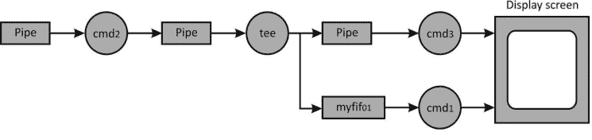

**图 9.18** 命令序列 `cmd1 < myfifo1 &` 后接 `cmd2 infile | tee myfifo1 | cmd3` 的执行语义。

守护进程从输入（即 `ps -a` 命令的输出）提取并通过管道发送给 `wc -l` 命令。因此，第一个命令显示系统上所有运行进程的状态、守护进程的数量以及系统上运行进程的总数。这两个命令阻塞到向 `myfifo1` 和 `myfifo2` 写入内容为止。`ps -a` 将系统上所有运行进程的状态发送给 `tee` 命令，该命令将数据重定向到两个 FIFO，同时将其发送给 `grep` 命令。`grep` 命令提取所有

3. Linux 中的文件描述符（file descriptors）是什么？标准文件的文件描述符是什么？如何将 I/O 和重定向运算符与标准文件的文件描述符结合，以便 Bourne、Korn、Bash 和 POSIX shell 中执行重定向？

4. 排序一个文件并将排序后的文件放在名为 `data1.sorted` 的文件中。给出同时使用输入和输出重定向的命令。

5. 给出一个使用管道（pipe）和输出重定向完成问题 4 任务的命令。

6. 给出一组等于 `ls -1 | grep "sarwar" > output.txt` 的命令，这些命令应使用 I/O 重定向运算符。给定命令的性能与你的命令序列相比如何？请解释。

7. `tee` 命令的作用是什么？给出一个等于问题 6 中命令但使用 `tee` 命令的命令。

8. 编写 Linux shell 命令来执行以下任务：

- a. 统计文件 `data` 的字符数、单词数和行数，并将输出显示在屏幕上。

- b. 统计 `ls -1` 命令输出的字符数、单词数和行数，并将输出显示在屏幕上。

- c. 执行 (b) 部分相同的操作，但对于字符串 "Internet," 将输出重定向到文件 `datafile`，将命令的输出发送到文件 `Internet.freq`，并将任何错误消息发送到文件 `error.log`。给出该命令的示意图（类似于章节中所示），以说明其语义。

9. 给出一个完成问题 9 任务的命令，例外是命令的输出和任何错误消息都进入文件 `datafile`。

11. 给出一个命令，在 `/etc/passwd` 中搜索包含字符串 "sarwar." 的行。将命令的输出存储在当前目录下的文件 `passwd.sarwar` 中。如果命令失败，错误消息也进入同一个文件。

12. 什么是 Linux 管道（pipe）？管道与输出重定向有什么区别？给出一个例子来说明你的答案。

13. 以下命令在 Bash 中起什么作用？

- a. `cat letter 2> save < memo`

- b. `cat 2> save < letter`

- c. `cat memo | sort letter 2>&1`

- d. `cat < memo | sort letter 2 > /dev/null`

- e. `cat 2> save < memo | sort 1 > /dev/null`

14. 考虑在 Bourne shell 下执行以下命令：

- a. `cat letter 2> communication 1>&2`

- b. `cat letter 1>&2 2> communication`

15. 如果（file 和 letter）都存在于工作目录，且其中一个不存在于工作目录，每种情况下命令的输出和错误消息会去哪里？

16. 使用 `mail` 命令向 `doedomain.com` 发送电子邮件。假设消息在一个名为 `greetings` 的文件中。给出一个使用输入重定向的命令和一个使用管道的命令。任何错误消息都应追加到文件 `mail.error` 中。

17. 在你的 Linux 系统上执行以下命令会发生什么？为什么这些命令会产生这样的结果？

- a. `cat letter >> letter`

- b. `cat letter > letter`

18. 通过输出重定向，向朋友的终端发送问候消息 "Hello, World!"。

19. 给出一个显示当前登录到系统的用户数的命令。

20. 给出一个显示第一个登录系统的用户登录名的命令。

21. 以下命令之间有什么区别？

- a. `grep "John Doe" Students > /dev/null 2>&1`

- b. `grep "John Doe" Students 2>&1 > /dev/null`

22. 给出一个命令，显示当前目录下的（文件名列表）内容，每行显示三个文件。

23. 给出一个命令，从文件 `Phones` 读取输入，删除文件中不必要的空格，对文件进行排序，并删除重复行。

24. 对一个已经删除了文件中不必要空格但仍有重复行的文件版本重复第 23 步的操作。

25. 以下命令的作用执行什么？

- a. `uptime | cat > who.log >> system.log`

- b. `zcat secret_memo.2 | head -5`

26. 给出一个命令，通过在服务器机器上运行 `diff` 命令来完成以下命令的任务：`ssh server cat ~ /rvm/datafile.server | diff datafile -`

27. 给出一个命令，显示文件 `employees` 中不重复的列表。只显示重复行的命令是什么？


28. 给出一个命令，显示最近创建的目录的列表。创建一个 FIFO 文件 `myfifo`。它的默认访问权限是什么？创建一个 FIFO 文件 `myfifo2`，并对所有人开放读、写权限。显示你执行这些任务的命令和输出。

29. 给出一组命令，用于产生第 9.15 节会话的输出。命令序列应确保输出顺序如下：系统上运行的所有进程状态、系统上运行的守护进程（daemons）数量以及系统上运行的进程总数。

30. Linux 系统上同时打开的进程数取决于系统中每个进程描述符表的大小。使用本章讨论的特性使用 shell 命令显示 `/usr/include/linux/limits.h` 中 `NR_OPEN` 变量的值。显示你的命令并解释你的答案。提示：寻找 `/usr/include/linux/limits.h` 中定义的符号常量。


# 10 进程

## 目标

- 描述进程的概念，以及在具有单个中央处理器（CPU）的计算机系统上执行多个进程
- 解释 shell 是如何执行命令的
- 讨论进程属性的静态和动态显示
- 讨论 Linux 进程的主内存映像
- 简述 CPU 调度的概念和 Linux 中的调度类类（scheduling classes）
- 解释前台进程和后台进程的概念，包括守护进程（daemon）的及其用途
- 描述命令的顺序执行和并行执行
- 讨论 Linux 中的进程控制和作业控制：前台和后台进程、顺序和并行进程、将前台进程移至后台及反之亦然，以及终止进程
- 描述 Linux 进程层级结构
- 涵盖以下命令和原语：
  - `<Ctrl+C>`, `<Ctrl+D>`, `<Ctrl+Z>`, `<Ctrl+1>; &`, `()`, `bg`, `crt`, `fg`, `jobs`, `kill`, `nice`, `nohup`, `ps`, `pptestree`, `renice`, `size`, `sleep`, `top`, `ulimit -s`

## 10.1 引言

正如我们在第 1 章中提到的，进程是一个执行中的程序。该程序可以是汇编语言代码、编译 `C++` 等高级语言程序后生成的二进制执行代码，也可以用 `LISP`、`JavaScript`、`Perl`、`Python`、解释型 `C` (`CINT`) 或 `Linux shell` 编写的解释代码。每当你运行外部命令时，`shell` 都会创建一个进程，当命令执行完成后，进程会被移除。我们将“程序”和“命令”术语通用。

进程的创建和终止是 `Linux` 系统执行命令的唯一机制。在像 `Linux` 这样的典型分时系统中（允许多个用户使用计算机系统并同时运行多个进程），每天会有成百上千个进程被创建和终止。记住，问题在于：一个带有单处理器（CPU）的计算机系统是如何同时执行进程的？即使对于具有多个 CPU 或 CPU 内多核心的系统，进程的数量也大于 CPU 或核心的数量。进程数量大于 CPU 或核心数量的系统是如何同时执行这些进程的？对这一主题的详细讨论超出了本书的范围，但我们将在 10.2 节以及后的 10.5.1 节中简要介绍。你可以在关于操作系统概念的书中获取有关调度相关算法的详细信息。在本章中，我们将讨论查看进程的静态和动态状态、前台和后台进程、守护进程、作业、进程和作业属性，以及进程和作业控制。我们将“分时”和“多任务”视为同。

## 10.2 CPU 调度——同时运行多个进程

在包含单个 CPU 并运行分时操作系统的计算机系统上，通过将 CPU 从一个进程快速切换到下一个进程来同时执行多个进程。也就是说，一个进程执行一段时间，然后 CPU 从其身上移走并交给另一个进程。新进程执行一段时间，然后将 CPU 交给下一个进程。这个过程一直持续，直到序列中的第一个进程再次使用 CPU。进程在被“切换” CPU 之前“在”CPU 中花费的时间称为量子片（quantum）或时间片。量子片非常短：对于典型的 `Linux` 系统，为一秒或更短。

在 `Linux Mint` 上，默认的内核量子片为 100 ms，如内核文件 `/usr/src/linux-headers-4.4.0-2/include/linux/sched.h` 中的 `RR_TIMESLICE` 所示。`Linux` 上的实时（RT）进程和线程的量子片不是固定的，因为调度器根据目标级别以及任何时候运行的进程数量来计算它。

当 CPU 空闲/空置时（即未执行任务），或者当当前进程完成任务时，内核使用算法来决定哪个进程使用 CPU。这种选择进程的策略在 `Linux` 中被称为完全公平调度器（CFS）。对于具有多个 CPU 或多核心的系统，由于进程数量大于 CPU 或核心数量，系统通过上下文切换来实现并行效果。

## 表 10.1

`Linux` 进程状态简述

| 状态 | 描述 |
| :--- | :--- |
| `Ready (就绪)` | 进程已准备好运行，但尚未获得 CPU。根据调度算法，调度程序决定将 CPU 分配给另一个进程。在单 CPU 机器上，可以有多个进程处于此状态，但只有一个进程正在执行/运行（即正在使用 CPU）。 |
| `Running (运行中)` | 进程正在实际运行（即正在使用 CPU）。 |
| `Waiting (等待)` | 进程正在等待某个事件发生。可能的事件包括 IO 操作完成（例如磁盘/终端的读写）、子进程完成（父进程正在等待一个或多个子进程退出），或进程在被置睡眠后等待。 |
| `Swapped (已交换)` | 进程已准备好运行，但它被临时放在磁盘上（交换空间）；可能需要比当前可用内存更多的内存。 |
| `Zombie (僵尸)` | 死亡的进程处于僵尸状态。通常，当一个进程的父进程在它执行 `exit` 调用之前终止时，它就会变成僵尸进程。该进程已完成，但父进程没有等待它。这些进程对所有目的而言已结束，不再留在内存中，但它们仍分配有一些内核资源，且无法从系统中移除。所有僵尸进程及其子进程最终会被祖父进程采用，`systemd` 将它们从系统中移除。 |

该表给出了这些 `Linux` 进程的简要描述。为了简洁起见并符合本书的范围，讨论中未包含 `Linux` 进程可能处于的其他状态。

## 10.4 Shell 命令的执行

命令可以是内部的（内置的），也可以是外部的。内部/内置命令是指代码属于 shell 进程一部分的命令。一些常用的内部命令有 (`.dot` 命令），`bg`, `cd`, `continue`, `echo`, `exec`, `exit`, `export`, `fg`, `jobs`, `pwd`, `read`, `readonly`, `return`, `shift`, `she`, `times`, `trap`, `uname`, `unset` 和 `wait`。外部命令是指代码位于文件中的命令；文件的内容可以是二进制文件或脚本。常用外部命令的 Shell 脚本有：`cat`, `mkdir`, `rmdir`, `ls`, `sort`, `ftp`, `telnet`, `ip` 和 `ps`。Shell 会通过创建一个新进程来执行命令。当命令进程执行时，shell 会等待它完成。在本节中，我们描述了 shell（或任何进程）如何创建另一个进程并执行另一个命令。你可以使用 `type` 命令来判断命令是内置的还是外部的，如下所示。在 `Bash` 下，你还可以使用 `-option` 参数来显示命令的所有位置。记住，如果你在第 2 章第 2.6 节中为 `type` 命令创建了别名（alias），你必须取消该别名，后续的会话才能工作！

在以下会话中，你可以看到 `bg` 命令是内置的。`Bash Shell` 可以通过文件系统结构中的可执行文件调用，如下：

```bash
$ type bg
bg is a shell builtin
$ type -a bash
bash is /bin/bash
```

`Linux` 进程可以使用 `fork()` 系统调用创建另一个进程，该调用会创建一个原始进程（即调用 `fork()` 的进程）的完全内存拷贝。两个进程都继续执行，从 `fork` 之后的语句开始执行。执行 `fork` 的进程称为父进程，创建的（分叉的）进程称为子进程，如图 10.2 所示。在这里，我们展示了一个创建了子进程（另一个 `Bash`）的 `Bash`。我们将在第 15-16 章中讨论 `fork()` 的使用以及创建进程和进程间通信所需的其他系统调用。

### 进程

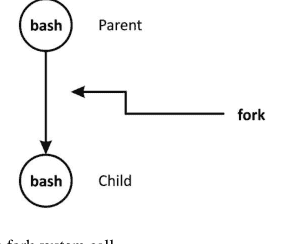

图 10.2 通过 `fork` 系统调用创建进程

**步骤 1**：Shell 使用 `fork` 创建子进程
**步骤 2**：子进程使用 `exec` 覆盖自身
**步骤 3**：当子进程结束时，父进程会继续执行


图 10.3 通过 `fork` 系统调用执行 shell。


Linux 进程可以使用`fork()`系统调用创建另一个进程，该调用会创建一个原始进程（即调用`fork()`的进程）的完全内存拷贝。两个进程都继续执行，从`fork`之后的语句开始执行。执行`fork`的进程称为父进程，创建的（分叉的）进程称为子进程，如图 10.2 所示。在这里，我们展示了一个创建了子进程（另一个`Bash`）的`Bash`。我们将在第 15-16 章中讨论`fork()`的使用以及创建进程和进程间通信所需的其他系统调用。

进程

237

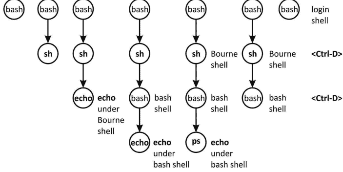

图 10.5 在子 shell（也称为子进程）下执行命令的情况。

## 10.5 进程属性

每个进程都有多个属性，包括所有者 ID（在 Linux 术语中称为用户 ID [UID]）、进程 ID (PID)、父进程 ID (PPID)、进程名、状态、启动进程时执行的命令、进程优先级、进程启动时间、进程消耗的 CPU 时间、进程占用的主内存百分比、虚拟内存大小、当前在主内存中的进程大小、进程状态、正在等待的事件（如果它未在运行）以及进程运行的时间。从用户和程序员的角度来看，这些属性中最有用的之一是`PID`，它被用作本章后面讨论的几个进程控制命令的参数。

Linux 提供了许多工具，允许你监控系统上当前运行进程的属性，更改进程状态，并对它们执行各种操作，包括停止/重启、发送特定消息、让它们相互通信以及终止它们。在本章中，我们将讨论一些允许我们静态和动态监控进程属性，以及对刚启动的进程执行各种操作的命令和工具。

### 10.5.1 进程属性的静态显示

`ps`命令可查看系统中当前进程的属性。以下是`ps`命令的简要描述，包含了 Berkeley 软件发行版（BSD）风格选项（在命令行执行时不带横杠）和 UNIX/POSIX 风格选项（在命令行执行时带横杠）的选项/功能变体。

语法：

`ps [options]`

目的：报告（一次性）进程状态/属性

输出：一行表头和系统上运行进程属性的快照。

注意：Gnu 长选项以两个横杠开头。

常用的选项/功能（不带前导横杠的 BSD 变体）：

- `0` 显示默认输出中`PID`字段后逗号或空格分隔的关键字信息。你可以通过在关键字后加上`=`并跟上表头值来为关键字指定你选择的表头。

- 显示逗号分隔用户名列表中指定用户的进程信息；逗号前后不要有空格

- 取消 BSD 风格的“仅自己”限制

- 与`-o`类似，但它不显示默认字段，且你可以通过多个`-o`选项来更改表头。如果关键字没有指定表头，则不显示表头。

- 为每个进程显示关于以下关键字的信息：`user`, `pid`, `%cpu`, `%mem`, `vsz`, `rss`, `tty`, `state`, `start` 和 `command`。

- 显示没有控制终端的进程（包括守护进程）

## 常用的选项/功能（带前导横杠的 UNIX/POSIX 变体）：

- `-A` 选择所有进程

- `-e` 与`-o`选项相同：显示进程信息，包括会话领导者

- `-f` 显示完整列表，包括进程所有者 ID (UID)、`PID`、`PPID`、进程启动时间 (STIME)、`TTY`、执行时间 (TIME)、完整命令行 (CMD)

- `-l` 显示长列表：`F`、状态 (S)、`UID`, `PID`, `PPID`, `C`, `PRI`, `NI`, `ADDR`, `SZ`, `WCHAN`, `TTY`, `CMD`

- `-u` 或显示属于逗号分隔列表中 UIDs 或登录名的进程列表

`ps`命令的输出按关联进程的终端排序，然后按`PID`排序。你可以使用不同的选项更改默认排序顺序。如果指定了多个选项，命令将显示退出选项。本节列出的会话演示了带选项的命令输出。我们在运行`Bash` shell 的 Linux 机器运行了所有这些命令。

`ps`命令的输出如下会话所示，显示了大约四个进程，它们被归在同一行：进程附加的终端 (TTY)、进程消耗的 CPU 时间 (STIME) 以及用户运行进程时使用的命令 (cmd)。输出显示有两个进程附加到终端 0：`bash`（登录`Bash`）和`-bash`，终端 0 消息的`PID`分别为`27753`和`27783`，且运行时间均为`0 s`。

```
$ ps
PID TTY             TIME
27753 pts/0         00:00:00 bash
27783 pts/0         00:00:00 ps$
```

你还可以使用`-o`选项添加输出列。选项后必须紧跟一个逗号分隔的列表，用关键字指定你想要的输出格式。以下命令显示默认的输出列，外加一列显示进程状态的列。

```
$ ps -o pid,tty,stat,time,cmd
PID TT             STAT    TIME CMD
27753 pts/0        S       00:00:00 -bash
27794 pts/0        R+      00:00:00 -o pid,tty,stat,time,cmd$
```

进程状态以字符字符串的形式显示——例如上一个会话中的`5+`、`S+`和`R+`。表 10.2 解释了进程状态 (`STAT`) 列下字符串列表中字符的含义。因此，`S`状态的进程处于等待状态。

表 10.2 `ps`命令显示的 Linux 进程状态简要描述

| 第一个字符 | 描述 | 额外字符 | 描述 |
| --- | --- | --- | --- |
| D | 等待磁盘 I/O | + | 前台进程 |
| X | 死进程 | | |
| R | 可运行进程 | L | 锁定内核 |
| S | 睡眠进程 | | 会话领导进程 |
| T | 停止/挂起进程 | | 线程进程 |
| W | 空闲进程 | | 多线程进程 |
| Z | 僵尸进程 | | 运行小于 20 s |

最后，`R+`状态的进程是准备使用 CPU 前台进程。关于前台和后台进程见第 10.6 节。

对于`ps -ax`和`wc -1`进程。因此，我们的 Linux Mint 系统目前运行着`176`个进程，我们没有计算因命令行本身创建的两个进程。

```
$ ps -ax | wc -1
176
```

你也可以通过`ps -e | wc -1`来确定机器上运行的进程数。你可以使用`-H`选项在系统中运行的进程中显示内核可见的线程（在 Solaris 中称为轻量级线程，LWPs）。`ps -axH | wc -1`命令的输出为`283`。在这`283`行中，有一行是输出表头，`wc`分别为`-axH`和`wc -1`命令各占行。因此，在`176`个进程中运行着`280`个内核可见线程。

```
$ ps -axH | wc -1
283
```

虽然`-j`,`-l`,`-u`和`-v`选项允许你以已知顺序和标准表头显示预定义关键字的值，但`-0`和`-o`选项允许你显示自定义输出：你选择的值、按你喜好的顺序以及你口味的表头。在下一节中，我们将展示如何使用这些选项配合`ps`命令。关键字`dsis`和`tsize`分别进程内存映像数据段和线程/代码段的大小（单位为`KB`）。当事件为进程等待时，会话中的最后一个命令再次显示如何自定义输出表头：

```
$ ps -o dsis,tsize,vsz,rss,wchan
DSZ VSZ RSS WCHAN
22217 974 23192 5472 wait
29114 89 29204 1604 -
$ ps -o dsis,tsize,lwp,nlwp,wchan,pcpu,pmem,pmem,Flags,args
DSZ TSIZE LWP NLWP WCHAN %CPU XMEM F COMMAND
22217 974 14738 1 wait 0.0 0.0 0.0 -o dsis,tsize,lwp,wchan,pcpu,pmem
29142 89 14738 0 0.0 0.0 0.0 -o user,pid=SON -o pid=MOM -o args
USER SON COMMAND
sarwar 14738 14738 -bash
sarwar 14814 14738 -o user,pid=SON -o pid=MOM -o args
```

某些字段和对应的关键字是显而易见的，我们已经在本章中讨论了其中几个。然而，我们现在将讨论的某些关键字是新颖且不显而易见的。你可以使用`ps L`命令显示所有关键字，如下所示：

```
$ ps L
%CPU %MEM
%mem
...
[输出截断]
```


数据、栈和文本/代码段是进程内存映像的一部分。Linux 进程内存映像的另外三个部分是共享库、堆和环境。图 10.6 显示了 Linux 进程的内存映像，由命令行和五个 shell 变量（`HOME`、`PATH`、`SHELL`、`USER` 和 `LOGIN`）组成，通过指向空终止字符串的两个数组的指针可访问。栈从高内存向低内存增长，堆从低内存向高内存增长。文本和未初始化数据部分通过 `exec(2)` 系统调用从程序文件加载，未初始化（`bss`）部分也通过 `exec(2)` 初始化为零。你也可以使用 `size` 命令显示可执行程序的文本/代码、已初始化数据和未初始化数据（`bss`）的大小（单位为字节）。以下是我们在 Linux Mint 上以 `/usr/bin/sort` 为参数的示例运行。第四个数字是文本和数据段的总大小（十进制，即前三个数字之和），第五个数字是十六进制的总大小。

```
# size /usr/bin/sort
text data bss dec hex filename
104653 1880 1960 108493 1a7cd /usr/bin/sort
```

# 表 10.3 ps 命令常用显示字段/关键字简述

| 字段 | 描述 | 字段 | 描述 |
|---|---|---|---|
| `command` | 创建进程执行执行的命令 | `Ppid` | 父进程 `PID` |
| `dsz` | 以 KB 为单位的数据大小 | `Pri` | 调度优先级 |
| `cpu` | 用于调度的短期 CPU 使用率 | `Rss` | 内存中实际进程大小 (KB) |
| `flags` | 表示进程状态/事件的标志 | `Sid` | 会话 ID；会话领导者的 `PID` |
| `Lwp` | 轻量级进程（线程）ID | `Ssiz` | 以 KB 为单位的栈大小 |
| `majflt` | 总页错误（同 `PAGEIN`） | `started` | 进程已启动 |
| `wchan` | 锁定/阻塞进程的事件顺序 | `Stat` | 进程状态 |
| `nlwp` | 绑定到 `LWP` 的线程数 | `Time` | 进程执行的时间 |
| `pcpu` | 直到上一分钟的 CPU 占用率 | `Tsiz` | 以 KB 为单位的文本（代码）大小 |
| `pgid` | 进程组 ID | `Tt` | 进程附加的终端 |
| `pid` | 进程 ID | `Vsz` | 进程的虚拟大小 (KB) |
| `pmem` | 进程占内存百分比 | `wchan` | 进程等待的事件（或地址） |

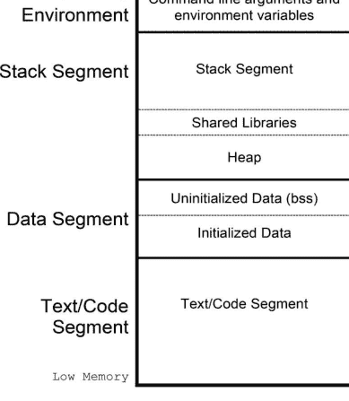

图 10.6 Linux 进程的内存映像。

`ulimit -s` 命令显示 Linux 进程的虚拟大小为 8,192 字节（即 8 MB）。

```
ulimit -s
8192
$
```

UNIX/POSIX 版本的 `ps` 命令支持 BSD 版本命令的以下选项：`S`、`a`、`e`、`r`、`v`、`w` 和 `x`。然而，调用它们时前面不需要加连字符——例如 `ps r`。同样，`-o` 选项在 UNIX/POSIX 下也像 BSD 一样有效，但不适用于表 10.3 中列出的所有关键字（或 BSD 版本中 `ps l` 显示的内容）。它适用于以下命令，其中大部分与 `ps` 命令兼容：`user`、`ruser`、`group`、`uid`、`rid`、`gid`、`rpgid`、`ptid`、`ppid`、`sid`、`ctid`、`psr`、`tty`、`addr`、`fname`、`pcpm`、`vsz`、`vssz`、`occ`、`size`、`class`、`time`、`etime`、`zone`、`f`、`s`、`c`、`hlw`、`nlwp`、`psr`、`tty`、`addr`、`fname`、`args`、`rpgid`、`project`、`pset`、`lgrp`。

会话中的示例运行显示了带有各种选项的 `ps` 命令输出。注意 `-l` 命令的输出包含了过时的字段 `F` 和 `ADDR`，以及旧式的 `PRI`（在前节关键字列表中称为 `pri`），其中 `PRI` 值越小表示优先级越高。你可以使用 `-u` 和 `-o` 选项排除 `F` 和 `ADDR` 字段，包含 `RSS` 列和 `PRI` 值。

```
$ ps -l
FS UID PID PPID C PRI NI ADDR SZ WCHAN TTY TIME CMD
S 00 144738 14737 00 80 0 5798 5978 pts/0 00:00:00 bash
R 00 144832 14738 00 80 0 pts/0 00:00:00 ps

$ ps -ly
S UID PID PPID C PRI NI RSS SZ WCHAN TTY TIME CMD
S 00 144738 14737 00 80 0 5472 5978 pts/0 00:00:00 bash
R 00 144838 14739 00 80 0 7308 pts/0 00:00:00 ps
```

第二个命令显示了进程的状态。UNIX/POSIX 版本的进程在表 10.2 中描述，并带有与 BSD 版本的 `ps l` 显示不同的字段。

## 10.5 Linux 进程与线程调度

关于进程和调度，你必须意识到两个基础性问题。首先，Linux 本质上是一个通用型操作系统，而不是实时（RT）操作系统。这意味着它的设计目的并不是作为嵌入式实时控制系统的基础。这并不意味着它在今天不能被非常成功地应用。实时控制系统的示例可以在任何工业过程应用中的电控微处理器引导控制器中找到。其次，正如西默尔（Seymour）所说：“任何人都可以构建更快的处理器。诀窍在于构建更快的系统。”这就是调度器所做的工作：它为你提供了一个吞吐量更高、更快的系统。

如第 16 章 16.1 节所示，Linux 操作系统及其运行的硬件的稳态维护是通过虚拟化、并发和持久化技术实现的。CPU 调度器提供了操作系统的虚拟化和并发支持。

`CFS` 在 Linux 中实现了虚拟化。这意味着在系统吞吐量和多个进程的“同时”执行方面，即使在单核 CPU 上，CPU 看起来也比其实际性能更强大。`CFS` 算法及其在调度器中的实现超出本书的涵盖范围。只需说 `CFS` 会跟踪执行进程和线程的 CPU 使用情况，以最大化 CPU 利用率和吞吐量即可。

### 10.5.1 Linux 调度策略与优先级

CPU 上进程（或线程）的调度由调度算法（或策略）决定，算法在等待使用 CPU 的进程中选择优先级最高的进程，并决定所选进程可以使用的时间。优先级用整数数字表示。我们将简要描述 Linux 调度器使用的各种策略，以及用于为进程分配优先值的机制。用于调用优先级的技术允许将其设置为高于任何用户进程的优先级。Linux 支持的 CPU 调度策略（或）如表 10.4 所示，并附有其用途。

为了充分理解 Linux 中如何分配调度优先级，通过清晰阅读 `/usr/src/linux-4.4.0/include/sched/prio.h` 头文件可以发现，Linux 中进程的优先级取决于其 `nice` 值、`nice` 宽度（`NICE_WIDTH`）以及默认优先级 `DEFAULT_PRIO`。默认优先级取决于在同一文件中定义的两个符号常数：`MAX_PRIO` 和 `NICE_WIDTH`。表 10.5 显示了这些值以及计算进程优先级所需的其他几个参数。进程的优先级根据以下公式计算。

> `Priority` = [`nice value`] + `DEFAULT_PRIO`

这意味着 `nice` 值越小，优先级值越小，反之亦然。因此，如果一个进程的值为 0，其优先级值将是 120。同样，`nice` 值为 10 的进程优先级值将是 130。在 Linux 中，优先级值是反的，即较小的优先级数字相当于更高的 CPU 优先级，反之亦然。因此，调度算法将优先考虑优先级值为 120 的进程而非优先级值为 130 的进程。

#### 表 10.4

Linux 调度类及其用途

| 策略类 | 用途 |
|---|---|
| `SCHED_BATCH` | 针对 CPU 密集型进程/线程的非抢式调度 |
| `SCHED_FIFO` | 针对时间敏感（实时）进程/线程的非抢式 FIFO 调度 |
| `SCHED_IDLE` | 针对极低优先级进程/线程的非抢式（？）调度 |
| `SCHED_OTHER` | 大多数进程的默认 Linux 调度策略 |
| `SCHED_NORMAL` | |
| `SCHED_RR` | 轮询 `SCHED_FIFO` 调度 |

#### 表 10.5

Linux 中计算进程优先级的关键参数

| 参数 | 值 |
|---|---|
| `MAX_NICE` | 19 (对进程最有利) |
| `MIN_NICE` | -20 (对进程最有利) |
| `NICE_WIDTH` | (`MAX_NICE` - `MIN_NICE` + 1) = 40 |
| `MAX_PRIO` | 100 |
| `MAX_RT_PRIO` | (`MAX_RT_PRIO` + `NICE_WIDTH`) = 100 + 40 = 140 |


| DEFAULT_PRIO | (MAX_RT_PRIO + NICE_WIDTH / 2) = (100 + 40/2) = 120 |

进程的优先级可以为 0–39。实时进程为 0–99。用户进程，即 `SCHED_NORMAL`/`SCHED_OTHER`（普通）和 `SCHED_BATCH`（批处理）进程的优先级为 100–139。为了方便，在处理调度器参数时，此优先级范围被翻译为 0–39，通过简单地从优先级值中减去 `MAX_PRIO` 实现。该值是通过命令 `nice -n nice value_program_name` 分配给进程和 `nice` 值的优先级范围。同样，你可以通过通用命令 `renice -n nice_value -p process_id` 更改已运行进程的优先级。

考虑以下在我们的 `Linux Mint` 系统上运行 `ps` 命令的输出，该系统运行在多用户级别，返回了调度类（`CLS`）、调度优先级（`PRI`）和 `nice` 值（`NI`），以及一些标识格式列。

```
$ ps ax --format uname,pid,ppid,tty,cmd,cls,pri,ni
USER PID PPTY TTY CLS PRI NI
root 1 1 TTY CLS PRI NI
```

进程

247

```
$ chrt -p 27223
pid 27223's current scheduling policy: SCHED_OTHER
pid 27223's current scheduling priority: 0
$
```

后续会话中的第一个命令用于将 `bash` 的调度策略从 `SCHED_OTHER` 更改为 `SCHED_BATCH`。第二个命令显示新的调度策略为 `SCHED_BATCH`，调度优先级为 0。

```
$ chrt -b -p 0 27223
$ chrt -p 27223
pid 27223's current scheduling policy: SCHED_BATCH
pid 27223's current scheduling priority: 0
```

你 `Linux` 系统上的 `sched` 帮助页描述了 `CPU` 调度的 `API`。

在接下来的章节练习中，你将使用带选项和不带选项的 `ps` 命令，以理解命令的输出。

- **练习 10.7**：使用 `ps` 命令显示当前会话中运行的进程状态。你能识别出你的登录 `shell` 吗？它是什么？

- **练习 10.8**：运行命令显示系统上运行的所有进程状态。你运行了什么命令？它们的 `PID` 是什么？所有进程的父 `PID` 是什么？

- **练习 10.9**：在你的 `Linux` 系统上复制之前涉及 `chrt` 命令的会话，以验证其运行符合预期。

## 10.5.3 进程属性的动态调度

有时，你可能想要识别失控进程或特定用户下没有进展的进程（即卡死的进程）。`Linux` `top` 命令允许你通过实时报告进程的 `CPU` 活动和属性来执行这些任务。它默认按照左到右描述的进程属性，显示系统中 `CPU` 密集程度最高的进程状态。

| PID USER PR NI VIRT RES SHR S %CPU %MEM TIME+ COMMAND |

| :--- | :--- | :--- | :--- | :--- | :--- | :--- | :--- | :--- | :--- | :--- | :--- | :--- |

其中，`PID` 是 ID 编号，`USER` 是所有者的用户名，`PR` 是进程优先级，`NI` 是 `nice` 值，`VIRT` 是进程在虚拟内存中的大小，`SHR` 是进程可用的共享内存量，`RES` 是进程的驻留部分（即进程在主内存中的当前大小），`S` 是进程状态，`%CPU` 是进程使用的 `CPU` 时间百分比，`%MEM` 是进程使用的内存量，`TIME+` 是进程执行的时间，`COMMAND` 是调用进程的命令。要查看可以显示的完整进程属性列表，请参 `top` 系统的帮助页。

`top` 命令会持续运行，直到你按下 `p` 或 `q`，并且每秒左右更新一次状态。周期性更新可以通过执行命令时的命令行选项指定，也可以在运行时通过交互式命令指定。显示状态的进程数量取决于图形界面（`GUI`）系统上的屏幕尺寸或窗口大小。在智能显示器或窗口上，通常是 15–30 行，每个进程占一行。

该命令还会在简短的头部中显示其他重要的系统统计数据，包含五到八行，显示在进程和/或线程统计数据之前。头部信息

### 表 10.6

### `Linux Mint` 上 `top` 命令的头部

```
top - 14:07:29 30 days, 21:30, 1 user, load average: 0.50, 0.36, 0.31
Tasks: 250 total, 1 running, 28 sleeping, 0 stopped, 1 zombie
%Cu(s): 7.0 us, 3.9 sy, 0.0 ni, 88.9 id, 0.0 wa, 0.0 hi, 0.2 si, 0.0 st
KiB Mem : 5981672 total, 833348 free, 7, 975496 used, 417288 buff/cache
KiB Swap: 6157308 total, 6155404 free, 1904 used, 464188 avail Mem
```

取决于命令运行的 `Linux` 系统。头部信息可以包括负载平均值、系统运行的时间（天:小时:分钟:秒）、当前时间、系统上的进程数量、睡眠进程数量、僵尸进程数量、`CPU` 利用率（空闲时间、用户、内核/系统时间和中断处理时间的百分比）、主内存中用户区域的利用率（总共和空闲），以及 `Linux Mint` 的 `top` 命令头部信息列表。表 10.6 给出了

`top` 命令的大部分功能可以在 `top` 运行时通过交互式按键命令选择。以下语法框提供了常用的行选项，表 10.7 提供了 `top` 命令交互按键的简要描述。

- **语法：**

  `top [options]`

  **目的：** 显示并周期性更新系统中当前运行进程的信息

  **输出：** 周期性更新系统中运行进程的各种属性

  **常用选项/功能：**

  - `-H` 显示多线程进程每个线程的统计数据，每个线程一行

  - `-i` 仅监控具有指定 `PID` 的进程

  - `-p` 显示/切换指定 `PID` 的进程

  - `-u` 用户显示属于特定用户进程的统计数据

  - `-o` 按字段排序，小写列——例如 `cpu`, `pri`, `res` 或 `time`

  - `-s` 以安全模式启动，频率

  - `-c` 显示每个进程的完整行或仅命令名称

选项 `-H`, `-i`, `-p`, `-s`, 和 `-c` 都是可以切换的。

在下文中，我们展示了 `top` 命令的示例会话。以下是不带任何选项的 `top` 命令输出，显示系统已运行了 82 天，有 178 个进程正在运行，其中 77 个处于睡眠状态，没有停止或僵尸状态。通过使用表 10.8 观察 `top` 的输出，你会发现进程随着优先级的变化而移动。同样，头部的统计数据也会定期更新。注意 `pid 1` 被列为系统，它是命令名称。我们可以使用 `Linux Mint` 交互式 `top` 命令来切换 `COMMAND` 列以显示执行进程的路径 

进程

249

### 表 10.7

### `top` 交互按键简要描述

| 命令 | 含义 |
| :--- | :--- |
| H | 显示/切换分行的统计数据 |
| S | 显示/切换进程 |
| ^L | 重绘屏幕 |
| h 或 ? | 显示交互按键摘要 |
| k | 杀死指定的空格分隔 `PID` 列表 |
| n 或 # | 更改显示的进程数量 |
| o 或 O | 其他过滤——你将提示选择标准 |
| R | 更改指定的空格分隔 `PID` 的更新时间（秒） |
| t | 切换 `top` 进程显示 |
| Z | 在你的颜色方案和黑白之间切换 |

### 表 10.8

### `top` 命令输出的默认字段描述

| 字段 | 描述 |
| :--- | :--- |
| %CPU | `CPU` 使用率——自上次运行以来任务的时间，以百分比表示 |
| %MEM | 内存使用率 (`RES`)—当前使用的可用内存份额 |
| COMMAND | 命令名称或启动任务的关联程序 |
| NI | `Nice` 值——任务的值。负值表示优先级越高，正值表示优先级越低 |
| PID | 任务的唯一 `PID`，周期性循环，除非为零 |
| PR | 优先级——任务的调度优先级 |
| RES | 驻留内存大小 (`KiB`)——任务使用的未交换物理内存 |
| S | 进程状态——任务的状态可以是之一：`D`=不可中断睡眠，`R`=运行，`S`=睡眠，`T`=受作业控制，`Z`=僵尸 |
| SHR | 可共享虚拟内存量 |
| TIME+ | `CPU` 时间，与时间相同，但粒度到百秒 |
| USER | 用户——所有者的有效名称 |
| VIRT | 虚拟内存大小——包含了已交换的代码、数据和共享库以及使用的页面 |


```
$ top - 14:07:29 30 days, 21:30, 1 user, load average: 0.50, 0.36, 0.31
Tasks: 250 total, 1 running, 28 sleeping, 0 stopped, 1 zombie
%cpu(s): 7.0 us, 3.9 sy, 0.0 ni, 88.9 id, 0.0 wa, 0.0 hi, 0.2 si, 0.0 st
Mem: 5981672 total, 833348 free, 7, 975496 used, 417288 buff/cache
 Mem: 6157308 total, 6155404 free, 1904 used, 464188 avail mem

USER PR VIRT RES SHR %CPU %MEM TIME+ COMMAND
24303 root 20 123204 7532 6392 0.7 0.1 0:00:06 sshd
24302 sarow 20 42116 4664 2976 0.3 0.0 0:00:04 top
  1 root 20 0 119836 4664 2976 S 0.0 0.0 0:00:81 kthread
  2 root 20 0 0 0 S 0.0 0.0 0:00:00
  3 root 20 0 0 0 S 0.0 0.0 0:13:36 ksoftirqd/0
  5 root 20 -20 0 0 S 0.0 0.0 0:00:00 worker/0:+
  7 root 20 0 0 0 S 0.0 0.0 113:03:08 rcu_sched
```

`250`

`Linux`

```
8 root 20 0 0 0 S 0.0 0.0 0:00:00 rcu_bh
9 root rt 0 0 0 S 0.0 0.0 0:00:80 migration/0
10 root rt 0 0 0 S 0.0 0.0 0:21:12 watchdog/0
11 root rt 0 0 0 S 0.0 0.0 0:20:72 watchdog/1
12 root rt 0 0 0 S 0.0 0.0 0:00:71 migration/1
13 root 20 0 0 0 S 0.0 0.0 0:32:22 ksoftirqd/1
15 root 0 -20 0 0 S 0.0 0.0 0:00:00 worker/1+
16 root rt 0 0 0 S 0.0 0.0 0:35:27 watchdog/2
17 root rt 0 0 0 S 0.0 0.0 0:03:94 migration/2
18 root 20 0 0 0 S 0.0 0.0 3:53:88 ksoftirqd/2
[输出已省略]
```

## 10.5.3 交互式 `top` 命令

你可以使用各种交互式快捷键与 `top` 进行交互。你可以按下 `h` 显示可以用于交互的各种快捷键，以修改其所显示的信息。当你使用交互式命令时，`top` 会针对你想要监控的图表提出一个或多个问题。例如，当你按下 `n` 时，`top` 会提示你想要显示的进程数量。输入数字并按 `<Enter>` 键即可开始显示有关这些进程的信息。同样地，如果你想终止一个进程，按下 `k`，`top` 会提示你要终止的进程 `PID`。如果你输入了要终止的进程 `PID`，并且想查看由你的用户 `sarwar` 拥有的进程的 `RT` 状态，按下 `u` 并输入用户名称。以下输出显示了对 `sarwar` 进程的监控。

| PID | USER | PR | VIRT | RES | SHR | %CPU | %MEM | TIME+ | COMMAND |
|---|---|---|---|---|---|---|---|---|---|
| 24302 | sarwar | 20 | 42116 | 3160 | R | 0.3 | 0.0 | 0:00:60 | top |
| 23923 | sarwar | 20 | 45224 | 4728 | S | 0.0 | 0.1 | 0:00:00 | systemd |
| 23927 | sarwar | 20 | 180020 | 2176 | S | 12 | S | 0.0 | 0:00:00 | (sd-pam) |
| 23941 | sarwar | 20 | 124552 | 4572 | 3368 | S | 0.0 | 0.1 | 0:00:08 | sshd |
| 23942 | sarwar | 20 | 23160 | 5376 | 3232 | S | 0.0 | 0.1 | 0:00:04 | bash |

你可以使用表 10.7 中列出的交互式快捷键来观察命令显示的各种效果。更完整的交互式快捷键命令列表可以在你系统中 `top` 的帮助上找到。

## 练习 10

尝试在你的系统上执行以下命令会话。你的系统上有多少进程正在运行？最高优先级进程的优先级（`priority`）和 `nice` 值分别是多少？你如何切换 `COMMAND` 列的显示，以显示执行进程的命令路径以及实际的程序名称？你系统上的 `pid` 1 是什么？它运行的命令 `/sbin/init shell` 的显示意味着什么？

## 10.6 进程与作业控制

`Linux` 负责几项与进程和作业管理相关的活动，包括进程创建、进程终止、在前台和后台运行进程、挂起和恢复进程，以及从前台到后台及反之切换进程。作为 `Linux` 用户，你可以使用本文讨论的 `shell` 命令来请求进程和作业任务。

### 10.6.1 前台和后台进程及相关命令

当你输入并按下 `<Enter>` 时，`shell` 执行该命令并返回到 `shell` 提示符。在命令执行期间，你无法访问你的 `shell`，因此在当前命令完成且 `shell` 返回之前，你无法执行任何命令（即无法继续工作）。

当命令以这种方式执行时，我们称它们在**前台**执行。默认情况下，每个进程都会在前台运行，从键盘获取输入并将输出到显示器。

`Linux` 允许你运行命令，使得在命令执行时，你可以重新获得 `shell` 提示符并提交新命令。这种能力被称为在**后台**运行命令。

你可以使用符号 `&` 在后台运行命令。当然，在图形界面环境中，你可以在一个终端窗口在前台运行命令，打开另一个终端窗口，并使用新窗口中的 `shell`。然而，这种操作需要时间。

### 进程

`[2] 60156`

`$ ps`

`PID` `TT` `TIME` `COMMAND`

`56222` `1` `00:06.67` `bash` `(bash)`

`60149` `1` `00:07.94` `sort` `bigdata`

`60156` `1` `00:00.00` `bash` `(bash)`

`60157` `1` `00:00.34` `cp` `bigdata` `bigdataal`

`60164` `1` `00:00.00` `ps`

`+` `$ jobs`

`[1] + Running sort bigdata > bigdata.sorted`

`[2] - Running cp bigdata bigdataal`

`+` `$ jobs`

`[1] + 60149 Running sort bigdata > bigdata.sorted`

`[2] - 60156 Running cp bigdata bigdataal`

在接下来的会话中，第一个 `fg` 命令将当前作业带入前台。`fg %2` 命令将作业 2 带入前台。唯一标识作业的字符串也可以用来代替作业号。第三个 `fg` 命令说明了这一约定。正如预期的，`jobs -1` 命令显示两个作业都处于挂起状态。`ps` 命令的输出显示 `cp bigdata bigdataal` 的状态为 `Tw`，这意味着进程已挂起并输出到磁盘。我们使用 `bg %1 %2` 命令启动这两个挂起进程的后台执行。我们稍后通过 `jobs` 命令确认此状态，它显示两者都在运行，且进程当前正在使用 `CPU`。我们还展示了不带参数的 `bg` 命令会将当前（或唯一的挂起）进程放入后台。`ps -p 60149` 命令显示 `sort` 进程正在运行，并且已经在系统中运行了 11 分 3.78 秒。

`$ fg`

`sort bigdata > bigdata.sorted`

```
<Ctrl+Z>
Suspended
$ fg %2
cp bigdata bigdataal
<Ctrl+Z>
Suspended
```

```
$ %6sort"
sort bigdata > bigdata.sorted
<Ctrl+Z>
Suspended
```

`+` `$ jobs -1`

`[1] + 60149 Suspended sort bigdata > bigdata.sorted`

`[2] - 60156 Suspended cp bigdata bigdataal`

`$ ps`

`PID` `TT` `TIME` `COMMAND`

`56222` `1` `00:09.66` `bash` `(csh)`

`60149` `1` `02:29.29` `sort` `bigdata`

`60156` `1` `00:00.00` `(csh)`

`60157` `1` `00:00.00` `(csh)` `cp` `bigdata` `bigdataal`

`61261` `1` `R+` `00:02.02` `ps`

`+` `$ bg %2`


```
[1] + sort bigdata > bigdata.sorted & 
[2] - cp bigdataal &
+   $ jobs
[1] + Running sort bigdata > bigdata.sorted
[2] - Running cp bigdata bigdataal

$ fg %1
sort bigdata > bigdata.sorted
<Ctrl+Z>
Suspended
$ bg
```

# Linux

```
[1] sort bigdata > bigdata.sorted &
$ jobs
[1] Running      sort bigdata > bigdata.sorted
[2] Running      cp bigdata1
$ ps -p 60149
PID TT TIME COMMAND
60149 2 11:03:78 sort bigdata $
```

正如在本会话中讨论，我们将下一个会话作为一个额外的示例，解释 `fg` 和 `<Ctrl+Z>` 命令的作用。`gcc -o lab8 lab8.c` 命令用于编译 `lab8.c` 中的 C 程序并将输出保存到名为 `lab8` 的文件中。理解编译是什么并不是重点，关于 `gcc` 命令的句法和语义的进一步讨论将在第 15 章中给出。我们只是强调，启动时间长或运行时间长的进程通常是挂起进程的良好选择。使用 `vim` 命令的示例仅作为说明。接下来的会话展示了一系列事件。请注意，`vim` 之后 `ps` 命令的输出意味着该进程已挂起/停止。

```
$ ps
PID TT TIME COMMAND
587 1 0:00:17 bash (bash)
616 1 0:00:00 ps
$ vim lab8.c
#include <stdio.h>
#define SIZE 100
int main (int argc, char *argv[])
{
~
```

```
<Ctrl+Z>
Suspended
$ ps
PID TT TIME COMMAND
587 1 0:00:41 bash (bash)
812 1 0:00:13 vim lab8.c
1035 1 0:00:02 ps
$ gcc -o lab8 lab8.c
#include <stdio.h>
#define SIZE 100
main (int argc, char *argv[])
{
~
~
:q!
$
```

在接下来的章节练习中，你将通过 `bg`、`fg` 和 `jobs` 命令练习创建和管理前台及后台进程。

# 练习 10.11

运行本节所示的会话，练习前台和后台进程的创建，以及进程从前台切换到后台（使用 `bg` 命令）以及反之（使用 `fg` 命令）。使用 `jobs` 命令显示活动和挂起进程的作业 ID。

## 10.6.2 守护进程 (Daemons)

虽然任何在后台运行的进程都可以守护进程，但在 Linux 中，守护进程是在后台运行的进程。守护进程经常用于为用户提供各种服务或处理系统管理任务。例如打印、日志、电子邮件、Web 浏览、远程登录、文件传输、网络站点交易，以及 `finger` 服务是通过守护进程在系统启动时启动并启用的。传统的 `inet` 守护进程已被 `NetworkManager` 服务所取代。关于守护进程和服务的更多信息请参见第 X 章。

## 10.6.3 命令的顺序执行与并行执行

你可以在一行中输入多个命令以进行顺序执行或并行执行。以下是行内指定命令执行句法的简要描述。

| 句法 | 目的 |
| :--- | :--- |
| `cmd1; cmd2; ...; cmdN` | 顺序执行命令 `cmd1`, ..., `cmdN` |

注意，分号用作命令分隔符，因此它不跟在最后一个命令后面。分号后不需要空格，但为了清晰起见可以使用空格。这些命令虽然是在分行输入的，但会一个接一个执行。在接下来的会话中，`date` 和 `echo` 分别执行。

```
$ date; echo Hello, World!
Wed Oct 1 22:16:05
Hello, World!
```

你可以通过在每个命令末尾加上 `&` 来指定命令的并行执行。`&` 之前或之后不需要空格，但为了清晰起见可以使用。当你在后台执行命令时，shell 显示 `jobID` `PID`，其中第一个作业 ID 为 1，线性递增。类似于 `PID`，如果作业未分配给进程，则可能会被回收。以下是行内指定命令执行句法的简要描述。

| 句法 | 目的 |
| :--- | :--- |
| `cmd1& cmd2& ...cmdN&` | 并行执行命令 `cmd1`, `cmd2`, ... `cmdN` |

接下来的会话是在 Bash 下执行的。`date` 和 `echo` 命令在后台并行执行，随后在前台顺序执行 `uname` 和 `who` 命令。通常由于 `who` 命令执行，它的输出会在最后显示。三个命令（`date`、`echo` 和 `uname`）的输出可能会以任何顺序显示。顺序取决于进程调度以及每个命令执行所需的时间。因此，如果你再次执行该命令行，输出顺序可能无法复制。在会话中，输出按 `echo`、`date` 和 `who` 的顺序显示。`date` 和 `echo` 命令的作业 `PID` 分别为 `[1] 32429` 和 `[2] 32430`。

```
$ date& echo Hello, World& uname; who
[1] 32429
[2] 32430
Hello, World!
Fri Jul 7 20:16:28 PDT 2017
date
[1]- Done                             echo, World!
[2]+ Done             tty8              2017-06-20 14:14 (:)
```

命令行中的最后一个之前的的所有命令都放在一个进程中。在接下来的命令行会话中，`uname` 命令作为一个进程执行所有命令：`whoami; uname; echo Hello, World!` 作为另一个进程。如接下来的会话所示，这些进程的作业 ID 和 `PID` 对分别为 `[1] 32445` 和 `[1] 32449`。注意每个作业的作业 ID 均为 1。此外，进程的 `PID` 不是连续的。最后，如会话中的阴影区域所示，由于在任何输出显示在屏幕上之前两个进程（作业）已经创建完毕，因此我们必须按下 `<Enter>` 键再次显示 shell 提示符。

```
$ date & echo whoami; uname; echo Hello, World!&
[1] 32445
Fri Jul 7 20:22:28 PDT 2017
bob tty8              2017-06-20 14:14 (:)
[1]+ Done                             date
bob linux
[1] 32449
Hello, World!
```

```
$ <Enter>echo Hello, World!
[1]+ Done
$
```

正如第 12 章将要讨论的，Linux 允许你通过分号和括号来分组命令并作为一个进程执行。这被称为命令分组。如果命令组中的所有命令都作为单个进程执行，它们将由同一个 shell 执行。然而，所有命令都是一个接一个顺序执行。以下是命令分组句法的简要描述。

| 句法 | 目的 |
| :--- | :--- |
| `(cmd1; cmd2; ...; cmdN)` | 顺序执行命令 `cmd1`, ..., `cmdN`，但作为一个进程执行 |

因此在接下来的 Bash 会话中，`date` 和 `echo` 命令顺序执行，但作为一个进程执行。

```
$ (date; echo Hello, World!)
Fri Jul 7 20:38:21 PDT 2017
Hello, World!
$
```

你可以通过其他命令组分隔命令组将命令分组与顺序执行结合。在接下来的会话中，`date` 和 `echo` 命令作为一个进程执行，随后 `who` 命令作为一个独立的进程执行。

进程

257

```
$ (date; echo Hello, World);
Fri Jul 7 20:40:54 PDT 2017
Hello, World!
$ tty8                                      2017-06-20 14:14 (:)
```

命令组可以嵌套。`((date; echo Hello, World!); who)` 和 `((date; echo Hello, World!); (who; uname))` 都是有效命令并产生产生预期结果。当命令组作为单独进程执行时，命令分组更有意义，如下会话所示。


```
$ (date; echo Hello, World!)&
[1] 446
$ Fri Jul 7 20:42:28 PDT 2017
Hello, World!
<Enter>
[1]+ Done                                     ( date; echo Hello, World )
$ (date; echo Hello, World& (who; uname)whoami
[1] 453
[2] 454
bob
bob@bob-sbc-fltl1 ~ bob       tty8                                      2017-06-20 14:14 (:)
Fri Jul 7 20:44:48 PDT 2017
Linux
[1]- Done                                     ( date; echo Hello, World )
[2]+ Done                                     ( who; uname )
<Enter>
[2] Done
$                                              ( who; uname)
```

在第二组命令中，`(date; echo Hello, World)` 和 `(who; uname)` 在后台执行，而 `who` 命令并行执行了三个命令。同样，输出的顺序取决于这些命令的调度。

在接下来的章节练习中，你将练习命令的顺序执行和并行执行。

## 练习 10.12

在你的系统中运行本节所示的会话，练习 shell 命令的顺序执行和并行执行。

## 练习 10.13

以下哪些是顺序执行的，哪些是并行执行的？有多少进程是并行运行的？ `(who; date) & (cat temp; uname & whoami)`

### 10.6.4 命令和进程的异常终止

当你运行一个命令时，它在成功完成任务后正常终止。命令（进程）可能会因为你传递给它的错误参数而过早终止，例如向 `file` 命令传递了目录参数，或者因为运行时错误而终止。有时，你可能还需要异常终止一个进程。例如，当你使用合法但错误的参数运行进程时（例如向 `find` 命令传递了错误的文件名），或者命令查找时间过长，也许是进入了无限循环。在这里，我们将针对前台进程和后台进程讨论异常终止。

你可以通过按下 Ctrl+C 或从另一个 shell 使用 `kill` 命令来终止前台进程。你可以通过两种方式之一终止后台进程：(1) 使用 `kill` 命令或 (2) 首先使用 `fg` 命令将进程调回前台并按下 Ctrl+C。`kill` 命令的主要目的是向进程发送信号（也称为软件中断）。Linux 操作系统使用信号来引起进程的注意。你可以向你拥有或你有权限操作的进程发送 Linux 系统支持的任何一种内部信号类型。进程在接收到信号后可以采取三种操作之一：

- 1. 接受由 Linux 内核确定的默认操作
- 2. 忽略信号
- 3. 截获信号并采取用户定义的操作

对于大多数信号，除了某些事件外，默认操作始终会导致进程的终止。忽略信号对进程没有任何影响。用户定义的操作被指定为程序语句（通常是函数调用），它接管进程中特定代码的控制权。在脚本中，你可以使用 Bash shell 中的 `trap` 命令指定这些操作。在 C 程序中，你可以通过库信号来指定这些操作。我们在第 17 章中详细介绍 `signal()` 系统。要查看更多详情，请使用信号名称或 `-S` 参数查看帮助页。

信号可以由于各种原因生成，某些是进程本身引起的，而其他一些是外部事件。指向进程的外部信号被称为硬件中断或中断（不要与 Bash 中的 `trap` 命令混淆）。例如，当进程尝试执行非允许的操作或访问某些内存区域时，会产生一个内部信号。你可以通过 <Ctrl+C> 或使用 `kill` 命令产生外部信号。`kill` 命令用于向进程发送任何类型的信号。以下是 `kill` 命令的简述。

```
语法:
kill [-signal_name] proc-list
kill [-signal_name] proc-list
kill [-signal_number] proc-list
kill [-exit_status]
```

目的：语法 1-3：将 `signal_number` 或 `signal_name` 发送给指定的由空格分隔的 PID 列表或 jobID。语法 4：`kill -1` 返回所有已终止或完成的进程的信号及其名称。`exit_status` 指定一个数字或退出状态。

常用选项/特性：

- 1 HUP (挂起)
- 2 INT (<Ctrl+C>)
- 3 QUIT (<Ctrl+\>)
- 6 ABRT (中止)
- 9 KILL (强制终止：不可忽略，不可截获)
- 14 ALARM (闹钟)

你可以使用 `kill -1 (-number)` 命令向所有属于其他用户的进程发送默认信号。因此，超级用户可以使用此命令向系统中运行的所有进程发送信号。你可以使用 `kill -1 (小写 L)` 命令显示你的 Linux 系统支持的信号。Linux 支持 64 种信号类型，如下所示。你可以使用 `man` 命令验证这些。

常用信号的详情：

```
$ kill -1
1) SIGHUP 2) SIGINT 3) SIGQUIT 4) SIGILL 5) SIGTRAP
6) SIGABRT 7) SIGUSR 8) SIGPIPE 9) SIGKILL 10) SIGUSR1
11) SIGSEGV 12) SIGUSR2 13) SIGCHLD 14) SIGARM 15) SIGTERM
16) SIGTTIN 17) SIGTOU 18) SIGURG 19) SIGCPU 20) SIGFS
21) SIGTTIN 22) SIGTOU 23) SIGURG 24) SIGCPU 25) SIGZ
26) SIGVTCH 27) SIGSTRM 28) SIGAL 29) SIGCHLD 30) SIGUSR2
31) SIGSYS 32) SIGFS 33) SIGRTIN 34) SIGUSR1
35) SIGTERM+1
36) SIGTERM+2 37) SIGTERM+3
38) SIGTERM+4 39) SIGTERM+5 40) SIGTERM+6 41) SIGTERM+7
42) SIGTERM+8 43) SIGTERM+9 44) SIGTERM+10 45) SIGTERM+11 46) SIGTERM+12 47) SIGTERM+13
48) SIGTERM-14 49) SIGTERM-15 50) SIGTERM-16 51) SIGTERM-17
52) SIGTERM-18 53) SIGTERM-19 54) SIGTERM-20 55) SIGTERM-21 56) SIGTERM-22 57) SIGTERM-23 58) SIGTERM-24 59) SIGTERM-25 60) SIGTERM-26 61) SIGTERM-27 62) SIGTERM-28 63) SIGTERM-19
```

表 10.9 显示了 `kill` 命令示例及其含义。

```
$ jobs -1
[1] + 14338 Running
[2] - 14668 Running
[3] + 14668 Running
$ kill 14668
[3] Terminated
$ kill -2 14667
[2] Interrupt
$ kill -9 14338
[1] Killed
$ jobs
sort bigdata > bigdata.sorted
grep sh bigdata > lines.sh
cp bigdata > bigdata.bak
```

表 10.9

`kill` 命令示例及其含义

| 命令 | 含义 |
| --- | --- |
| `kill 1234` | 向 PID 为 1234 的进程发送默认信号 (`SIGTERM`) |
| `kill -9 1234` | 向 PID 为 1234 的进程发送 `SIGKILL` (强制终止信号) |
| `kill -s kill 1234` | |
| `kill -s kill 1234` | |
| `kill -9 1234 -1004` | 向 PID 为 1234 的进程以及进程组 ID (PGID) 为 1004 的所有进程发送 `SIGKILL` |

在第一种情况下，`kill` 命令向 PID 为 14668 的进程发送了编号为 15 的信号。在第二种情况下，信号号 2 (`SIGINT`) 被发送到 PID 为 14667 的进程。在这两种情况下，指定的信号都没有被拦截，进程被终止了。`kill` 命令可以使用一条命令行终止一个进程。例如，`kill -9 13586 20581` 会终止 PID 为 13586 和 20581 的进程。


进程 ID `0` 可以用来指代当前登录期间创建的所有进程。`kill -9` 会终止所有从当前登录运行的进程，如下会话所示。注意，该命令已经终止了所有从 `sarwar` 登录会话运行的进程，包括与客户端维护安全 Shell（SSH）登录连接的进程。这就是为什么你会看到本地机器的进程，一个运行在带有 OS X (Darwin) 的 MacBook Pro 上的终端窗口，`MacBook-Pro~- syedswar*`。这会导致严重的后果，因为在这种情况下，`kill -11` 终止进程的顺序是未知的。因此，如果 shell 和维护与客户端 SSH 连接的进程被终止，那么在 shell 下执行的进程将继续运行。当你再次登录并连接到远程终端且有一个登录进程在运行时时，你会发现这一点，此时系统响应时间很差。`ps` 命令将显示你上一次登录的后台进程仍在运行，如下会话中阴影区域所示。注意，“遗留”进程的状态为 D（已交换出并锁定）和 DL（已交换出且未与任何负终端号关联）。你需要终止这些进程以提高系统响应时间，如会话的最后一行所示。

```
$ ps -U sarwar
PID TT STAT COMMAND
15361 S 00:00:05 ssh:sarwar@pts/1 (ssh)
15363 S 00:07:05 -csh (csh)
15424 1 D 00:00:07 sort bigdata
15437 1 D 00:00:60 cp bigdata bigdata.bak
15456 1 00:01:31 grep sh bigdata
15521 1 R+ 00:00:00 -U sarwar
15198 2 DL 1:59:38 run bigdata
$ kill -4 0
Connection to 192.102.169.10 closed.
MacBook-Pro~- syedswar$ ssh sarwar@192.102.169.10
Password for sarwar@pcbsd-:
Last login: Oct 5 10:17:45 2014 from 139.155.192.135
FreeBSD 10.0-RELEASE-6 (GENERIC) #0 acf484b(releng/10.0): Mon Feb 24 14:13:58 2014
Welcome to FreeBSD!
$ ps
PID TT TIME COMMAND
15424 1 00:23:56 sort bigdata
15437 1 00:09:15 cp bigdata bigdata.bak
15456 1 00:21:06 grep sh bigdata
15158 2 1:59:38 run bigdata
19886 3 00:00:00 bash (bash)
15913 3 00:00:00 ps
$ kill 15158 15424 15437 15456
```

`kill` 命令也可以用于作业号（job numbers）。因此，可以使用以下命令终止作业号为 1 的进程。你可以在命令行中通过作业号终止进程。例如，`kill -9 %1 %3` 可用于终止作业号 1 和 3 的进程。

```
$ kill -9 %1
[1] + Killed find / -name foo.paths &
$
```

### 进程

当你注销时，运行于你会话中的的所有进程都会收到一个挂起信号（信号号 1）并被默认操作终止。如果你希望进程在你注销后仍继续运行，你需要执行它们以便在接收到挂起信号时忽略它。你可以使用 Linux 命令 `nohup` 来完成此任务。以下是该命令语法的简要描述。

```
语法：
nohup command [args]
目的：执行命令并忽略挂起信号
```

对于需要长时间才能完成的进程，你需要使用 `nohup` 命令，例如一个排序包含数十万客户记录的大文件的程序。显然，你会在后台运行此类程序，以便以较低的优先级运行。以下是 `nohup` 命令使用的简单示例。在这里，`find` 命令在后台运行，当你注销或通过 `kill` 命令发送信号 1 时不会被终止。如果命令输出没有重定向，它将追加到 `nohup.out` 文件。

```
$ nohup find / -name foo -print 1 foo.paths 2 >/dev/null &
[1] 62808
$ kill -1 62808
nohup find / -name foo -print 1 foo.paths 2 >/dev/null &
[1] 62808
$ kill -1 62808
$
```

### 进程

当通过 `sshd` 守护进程登录到远程服务器时，你在本地机器上运行 `ssh` 命令。远程机器上的 `sshd` 守护进程会创建一个子进程，即你的私有 `sshd`，负责与你的客户端通信。服务器端的 `ssh` 则会返回并查找来自其他客户端的更多 `ssh` 连接请求。你的私有 `ssh` 会产生另一个进程，该进程用一个伪终端（pseudoterm）覆盖自身，并提示你输入密码。当你输入正确的密码时，它会为你运行登录 shell 进程。默认情况下，Linux 机器上的登录 shell 是 Bash。你在你的 shell 下运行各种命令。当你按下 <Ctrl+d>、输入 `logout` 并按下 <Enter>，或者运行 `exit` 命令时，你的登录 shell 会随你的私有 `sshd` 守护进程一起终止。

#### 10.7.2 进程的生命周期与系统

在开机系统运行期间一直存在的两个进程是调度器（scheduler）和系统（system）。代理进程监控各种形式的终端行，只要终端连接到系统，它就必须一直存在。你的登录 shell 进程只要你处于登录状态就会一直存在。所有其他进程通常是短命的，或者在命令、工具或服务执行期间运行。许多服务及其进程在以下会话中显示，正如正常的系统操作所示。根据代码的运行取决于你的 Linux 系统设计用途，许多其他服务和进程会持续运行。

你可以在 Linux 系统上使用 `pstree` 命令以图形化形式显示系统上运行进程的进程树，显示父子关系。你可以显示某个进程或某个用户的进程树。有关 `pstree` 命令的更多信息，请参阅你系统上的其 man 页面（帮助文档）。

要查看名为 `bob` 的用户的进程树，下面的会话说明了层级图：

```
$ pstree -a bob
sshd
└bash
  └pstree -a bob
```

```
systemd --user
└(sd-pam)
$
```

在接下来的会话中，我们使用 `pstree` 命令显示 Linux 图形界面 (GUI) 和多用户目标 (CUI) 系统的进程层级结构。输出显示，所有用户进程的祖先如预期的那样是 `systemd` 进程。注意有四个 `agetty` 进程正在你系统的 `graphical.target` 状态下运行。

```
$ pstree
systemd——ModemManager——{gdbus}
  └{gmain}
  NetworkManager——{dnsmasq}
    └{gdbus}
    └{gmain}
  accounts-daemon——{gdbus}
    └{gmain}
└acpid
  └4a-[agetty]
  └avahi-daemon——avahi-daemon
    └cmanager
      └console-kit-dae——62*[console-kit-dae]
        └{gdbus}
        └{gmain}
  └cron
└cups-browsed——{gdbus}
  └{gmain}
```

```
-2*[{dbus-daemon]
--dbus-launch
--irqbalance
--login—bash
--lmetad
—mdm—mdm—Xorg—3*[{Xorg}]\dmwebkit-{dconf worker}
-{gdbus}
-{gmain}
-{12*[{mdmwebkit}
-{pool}
--ntpd
--polkitd—{gdbus}
-{gmain}
—rsyslogd—{in:imklog}
-{in:imuxsock}
-{rs:main Q:Reg}
--rtkit-daemon—2*[{rtkit-daemon}]
--sshd—sshd—bash—pstree
-2*[{systemd—sd-pam}]
--system-journal
--system-logind
--system-udevd
--thermald—{thermald}
--cleanup}
udiskd—{gdbus}
-{gmain}
-{probing-thread}
--upower—{gdbus}
-{gmain}
```

接下来的 `pstree` 命令显示了 Linux Mint 多用户目标在类似服务器的 CLI（命令行）系统上的进程层级结构输出。

#### $ pstree


```
systemd—ModemManager—{gdbus}
-{gmain}
—NetworkManager—dhclient
—dnsmasq
-{gdbus}
-{gmain}
—agetty
—avahi-daemon—avahi-daemon
—cgmanager
—cron
—cups-browsed—{gdbus}
-{gmain}
—cupsd
—dbus-daemon
—gpg-agent
—irqbalance
—mdadm
—ntpd
—polkitd—{gdbus}
-{gmain}
-{pool}
—rsyslogd—{in:imklog}
-{in:imuxsock}
-{rs:main Q:Reg}
—sd_cicero—sd_cicero
```

```
--{sd_cicero}
--{threaded-ml}
--sd_dummy--{sd_dummy}
--{threaded-ml}
--sd_espeak--3* {sd_espeak}
--{threaded-ml}
--sd_generic--{sd_generic}
--{threaded-ml}
--speech-dispatch--{speech-dispatch}
--sshd--sshd--bash--pstree
--systemd-journal
--systemd-logind
--systemd-udev
--vsyslogpd $
```

对之前提到的两个命令输出的进一步分析表明，用户正在通过安全 SSH (`SSH`) 会话使用系统，并当前在使用 `Bash` 运行 `pstree` 命令。

## 10.7.2 ps vs pstree

你可以使用 `ps -auf` 命令显示进程之间的父子关系。然而，如下节所示，该命令的输出没有 `pstree` 命令那样完整和快速。`ps -auf` 显示了当前的进程层级。

```
$ ps -auf PID %CPU %MEM VSZ RSS TTY START TIME COMMAND
sarwar 29016 0.0 0 23160 5400 pty/0 Ss 07:38 0:00 --bash
sarwar 29127 0.0 0 36780 3340 pty/0 R+ 07:47 0:00 /ps -auf
root 100096 5.9 0.0 688264 49052 tty7 Ss+ Jul21 06:12 /usr/lib/xorg/
root 5015 0.0 0 16256 0 tty2 Ss+ Jul21 0:00 /sbin/abget
root 22407 0.0 0 104912 3692 tty1 Ss+ Jul21 0:00 /sbin/abget
root 16294 0.0 0 23160 5152 tty1 Ss+ Jul21 0:00 --bash
root 3191 0.0 0 16256 0 tty5 Ss+ Jul21 0:00 /sbin/abget
root 3187 0.0 0 16256 0 tty6 Ss+ Jul21 0:00 /sbin/abget
root 3180 0.0 0 16256 0 tty3 Ss+ Jul21 0:00 /sbin/abget
```

```
$ ps -u PID %CPU %MEM VSZ RSS TTY START TIME COMMAND
sarwar 29016 0.0 0 23160 5400 pty/0 Ss 07:38 0:00 --bash
sarwar 29130 0.0 0 23160 3388 pty/0 R+ 07:48 0:00 /ps -uf
```

你可以运行 `ps -a` 来显示系统上所有进程及其重要属性，包括 `PID`、`PPID`、优先级（`nice`）、虚拟值、内存大小、状态、等待事件以及启动进程的全名。在你的系统上运行 `ps -auf` 和 `ps -uf` 命令。这些命令的输出识别系统中 CPU 占比最高的进程，还会说明该进程使用的虚拟内存和物理内存量。

了解如何查看哪些进程正在运行是重要的。这种交互的关键组件是 `/proc` 文件系统，通常被称为 `proc`；它提供了 `proc` 的简要概述，理解它有助于你管理计算机上的任务。

## 10.8 proc 文件系统

`proc` 文件系统在历史上源于 Plan 9 操作系统，由贝尔实验室在 20 世纪 80 年代中期到 2002 年间开发。该系统基于 UNIX 的大多数原则设计；它将所有资源视为文件、网络接口和外围设备。Linux 版本的 `proc` 文件系统挂载在 `/proc`，让你可以使用 `cd` 命令遍历其层级结构。我们 Linux 系统上的 `proc` 目录结构包含了所有运行进程和其他设施的子目录。对于系统上的所有进程，都有名为 `/proc` 的目录，其中 `PID` 是特定进程的进程 ID。在该目录下，有许多关于进程信息的文件和子目录。例如，目录 1 对应系统（PID 1）。在接下来的节中，我们展示了系统提供了哪些数据。

```
$ /proc
$ ls
13 22659 29157 49 847 bus misc
10 15 22662 29158 5 85 cgroups
100 16 22880 50 86 cmdline mounts
1083 17 22825 30 5015 consoles mtr
10096 27 33 51 88 cpinfo net
101 79 23006 315 52 884 crypto pagegetype
10110 28 25 317 53 89 devices partitions
[输出截断]
```

```
$ ls
ls: cannot read symbolic link 'cwd': Permission denied
ls: cannot read symbolic link 'mem': Permission denied
ls: cannot read symbolic link 'exe': Permission denied
```

```
$ attr cpuuset limit - projid_map stat
autogroup environ loginid ns root statm
auxv cwr map_files numa_ms status
group maps oom_adj sched syscall
clear_refs fd oom_core session task
cmdline fdio mountinfo oom_score_ setgroups timers
codoreump_file gid_map pagemap smaps uid_map
stack mounts personality wchan
```

```
$ sudo -la xxxxx
password for bob: xxxxx
l rwxrwxrwx 1 root root 0 24 Apr 09 04:03 ~ /lib/system/system
$ ls -l /lib/system/system
-rwxr-xr-x 1 root root 157316 Apr 12 /lib/system/system
$ file /lib/system/system
```

```
/lib/system/system ELF 64-bit LSB shared object, x86-64, version 1 (SYS), dynamically linked, interpreter /lib64/ld-linux-x86-64.so.2, for GNU/Linux 2.6.32, Build[ID]=80c38f5ef6fd5a3726db403d91b8431bdee91f, stripped
```

```
$ more cmdline
/sbin/init
$ ls -al cmdline
-r--r--r-- 1 root root 0 25 Apr 01 22:15
```

`ls` 命令显示了我们此处用途的 `proc` 子目录，即运行进程的数字目录。切换到目录 1（系统目录），我们使用 `ls` 命令查看该目录的内容，并发现我们拥有 `cwd`、`root` 和 `exe` 文件。

## 进程

# 267

`exe` 文件是指向 `/lib/system/system` 文件的符号链接，该文件包含了创建 `systemd` 的可执行程序。如果你使用用户权限，可以使用 `su -la` 命令来验证此信息。然后，我们使用 `ls -a` 命令来找到原始启动系统进程的命令行。通过 `more` 命令查看 `cmdline` 文件的内容，我们它是指向 `/sbin/init splash` 的符号链接，它启动了系统进程的执行。

此外，`/proc` 目录下还有其他子目录和文件，可以通过 Python 进行查询，例如提取与内核相关的其他值。其中一些内容在之前的会话输出中已经可见。要了解更多关于 `/proc` 文件系统以及 `/proc/PID` 中文件和目录的深层信息，请参阅你 Linux 系统上 `proc` 的主页。关于关于 `systemd` 的更多信息，请参阅第 18 章。


## 练习 10.17

复现在本系统中讨论的 Bash 会话。预期的输出是什么？在你的系统中，各种命令的输出有何不同？

## 总结

进程是执行中的程序。作为一个分时系统，Linux 允许同时执行多个进程。在具有单个 CPU 的计算机系统上，进程是通过调度 CPU 时间并将其分配给每个进程极短的时间（称为“时间片”，`quantum`）来并发执行的。Linux 系统会为每个进程分配一个优先级，当 CPU 可用时，它会被分配给优先级最高的进程。

`Shell` 通过使用 `fork` 和 `exec` 系统调用创建进程来执行命令。当一个进程使用 `fork` 系统调用时，Linux 会创建一个该进程的精确内存映像。`Shell` 本身执行的是内部命令。外部二进制命令则由 `Shell` 通过用 `exec` 调用的代码覆盖自身来执行。对于编译（运行）脚本的外部命令，`Shell` 会逐个执行脚本文件中的命令。

每个进程都有多个属性，包括 `PID`、`PPID`、进程名、进程状态（运行、挂起、交换、僵尸等）、执行进程的终端、运行时间长度以及进程优先级。可以使用 `top` 命令来查看各种系统统计属性和系统上运行进程的属性的动态显示，并允许通过按键进行交互式命令。

Linux 进程可以在后台或前台运行。前台进程会控制终端直到其完成，因此在前台进程运行时，`Shell` 无法用于其他操作。当进程在后台运行时，它会返回提示符，以便使用户在进程执行时进行其他工作。由于后台进程的优先级较低，耗时较长的命令是后台执行的良好候选者。提供各种服务的后台系统进程被称为守护进程（`daemons`）。一组命令可以作为独立的进程分组运行，也可以作为一个整体运行。可以使用分号（`;`）作为命令分隔符从一行运行多个命令作为独立的进程运行；包裹在括号中的这些命令可以作为一个整体执行。可以使用和（`&`）作为命令分隔符来并发执行命令。

挂起进程、将它们在后台和前台之间移动、显示它们状态的能力、通过信号中断它们以及终止它们，统称为作业控制（`job control`），Linux 有一组命令允许执行这些操作。前台进程可以通过按下 `<Ctrl+Z>` 后输入 `bg` 命令来挂起并移动到后台。可以使用 `fg` 命令将挂起的后台进程移到前台。挂起或在后台运行的命令也称为作业（`jobs`）。可以使用 `job` 命令查看你所有进程的状态。你可以按 `<Ctrl+C>` 终止前台进程。

`kill` 命令可以根据 `PID` 或作业 ID（`job ID`）终止进程。该命令可以向进程发送各种类型的信号或软件中断。在接收到任何信号后，进程可以采取默认（内核定义）操作、用户定义的操作或忽略它。没有任何进程可以忽略 `kill -9` 命令，这是一个“强制杀死”的信号，它是由 Linux 设计者设置的，以确保系统上运行的每个进程都能被终止。使用 `nohup` 执行的命令在用户注销后仍继续运行。`kill -9 0` 命令是对与当前登录用户相关的所有进程执行的强制杀死。

当你启动 Linux 系统时，引导和启动操作会进行。

33. 使用 `pstree` 命令为你的系统创建一个进程“地图”。这与我们在第 10.7.2 节中介绍的多用户目标系统和图形界面 Linux 系统的地图有何不同？你的地图在多大程度上与我们的任何一个地图相同？你的系统中运行着哪些守护进程（`daemons`）和服务？哪些在你的系统上没有运行，反之亦然？

34. 在命令 `ps --format uname,pid,ppid,tty,cmd,cls` 的输出中，你会注意到所有进程都具有相同的优先级值（在我们的 Linux Mint 系统上为 19）。这包括所有重要的进程，例如系统进程和内核线程（`kthread`）。解释为什么它们都是相同的，以及为什么它们的优先级都很低。

35. 编写一个带有修饰的 `ps` 命令，用于显示你的 Linux 系统上任何特定用户的进程的 `PID`、命令名称（`Command Name`）、线程组（`Thread Group`）和任务 ID（`Task ID`）输出列。

36. 以下命令显示的是什么？

- a. `ps H`
- b. `ps m`
- c. `ps j`
- d. `ps 1`
- e. `ps av`
- f. `ps ax`
- g. `ps -L`
- h. `ps -P`

37. 给命令以：

- a. 显示每个进程中带有 `LWP`（即线程）的进程。
- b. 显示 `LWP` 绑定（即执行）在其上的进程号。
- c. 显示进程、异常段领导者（即用户进程的登录 shell 和内核进程的父进程）。
- d. 以 `ASCII` 格式显示进程的树形结构。
- e. 显示与 `pst/` 关联的进程列表。
- f. 通过 `PID` 列表显示关于进程的信息。

38. 在你的系统上运行 `top`。优先级最高的进程的优先级（`priority`）和 nice 值（`nice values`）分别多少？运行命令以显示前 10 个进程，并每 7 秒刷新一次其输出。你使用了什么命令？

39. 在监控 `top` 会话时，显示用户 `John` 的进程。你使用了什么命令？请展示你的命令。

40. 使用 `pstree` 命令显示当前会话中运行的进程的树形结构。你使用了什么命令？哪个进程是你所有进程的祖父？它的 `PID` 是什么？你将使用什么命令来显示用户 `kent` 在你的系统上运行的进程的树级结构？

41. `/proc` 包含什么？`/proc/1` 和 `/proc/10` 包含什么？哪个命令启动系统程序？它在哪里？

# 高级问题与练习

- 42. 你的系统目前运行了多少进程？它们是什么？你的系统中 `PID` 为 1–10 的每个进程的名称和功能。这些进程的优先级各是多少？其中哪些是 RT 进程（实时进程）？展示你的工作细节，包括你运行的任何命令及其输出。
- 43. 表 10.8 显示了 `top` 命令输出中的默认字段及其简要描述。`top` 命令还有约 30 多个输出字段，可以通过各种选项显示。列出这些每个字段及其含义。
- 44. 在第 10.5.1 节中，限制限制参数 `-s stack size` 将进程的虚拟栈大小显示为 8 MB。对于一个进程来说，这似乎是一个巨大的栈空间。浏览网页和/或其他资源来解释 Linux 进程是如何使用栈的。
- 45. 浏览网页和/或其他资源，报告 `pthread` 的栈大小和内核线程（`kernel thread`）的栈大小。如果这些大小与 Linux 进程的栈大小不同，解释原因。
- 46. 在你的 Linux 系统中，`kthread` 进程的 `/proc` 子目录包含什么？使用此书籍 GitHub Hub 上的 Python 在线章节资源，编写一些 Python 脚本文件，不仅可以搜索 `/proc` 子目录下 `kthread` 进程文件中的感兴趣的字符串，还可以查询你 Linux 系统上 `/proc` 其他子目录文件中的搜索字符串信息。
- 47. 解释进程能力（`process capability`）和命名空间执行（`namespace execute`）之间的相似点和区别。请从宿主机环境中的裸机安装和安全模型，以及在虚拟机（`VM`）环境中实现的安全模型这两个方面来表述你的答案。该环境可以是 `Virtualbox`、`LXD` 容器或 `Docker`。内核提供的并发、虚拟化和持久化功能中的哪些组件（或哪些）对能力和命名空间的影响最强？是如何影响的？为什么？
- 48. 关于你 Linux 系统的系统初始化，`/etc/systemd/system` 下的所有目标（`targets`）目录中包含什么？
- 49. 参考书籍网站第 W27 章 5.1.8.2-5.1.8.10 节，就 systemd 系统初始化回答以下问题：
    - a. 什么 `systemctl` 子命令列出所有目标单元（`target unit`）的状态？
    - b. 哪个 `systemctl` 子命令允许你查看当前激活的目标？
    - c. 如何将系统带到新的目标状态？

# 项目

# 项目 1

为了扩展你对 Linux 进程状态、执行和安全的知识与理解，请阅读并完成第 10 节第 5 和 6 节以及第 17 节第 9.6 节中提出的练习（尽可能按以下顺序）。此外，请阅读并完成书籍网站第 W26 节 9.8.2–9.9 节中的练习（特别是示例 W26.27 和 W26.28）。

想了解更多？访问我们的网站获取额外的阅读材料、推荐资源和练习。

CRC Press 电子资源：[https://www.crcpress.com/](https://www.crcpress.com/)978118371008

作者 GitHub：[https://github.com/](https://github.com/)linux

# 11

# 网络与互联

## 目标

- 描述网络和互联，以及它们是如何被使用的
- 简要讨论传输控制协议/IP协议 (`TCP/IP`) 族、地址、端口以及网络和服务
- 解释什么是客户端-服务器模型及其工作原理
- 讨论用于电子通信的各种网络工具、远程登录、文件传输、跟踪以及状态报告
- 详细描述 Secure Shell 以及以下命令：`finger`, `ftp`, `host`, `nslookup`, `ping`, `scp`, `sftp`, `ssh`, `talk`, `traceroute`

# 11.1 引言


计算机网络的历史可以追溯到 60 年代，当时美国国防部计划署（`ARPA`）开始资助研究。这项研究导致了广域网，称为计划网络（`ARPANET`），最初有五个节点——加州大学洛杉矶分校（`UCLA`）、斯坦福大学、圣地亚芭拉大学、犹他大学和 `BBN` 技术公司。1982 年，使用传输控制协议/互联网协议（`TCP/IP`）的原型互联网开始运行，并被一些学术机构、工业研究机构和美国军队使用。到 1986 年初，连接 `ARPANET` 的五十个站点进入互联网，计算机数量达到 562 台。1986 年，这个数字翻了一倍多达到 2308 台。从那时起，互联网在过去的十年里每年翻一倍，直到 1996 年超过 9500 万台。第一个浏览器 `Mosaic` 由超级计算中心（`NCSA`）开发并于 1991 年发布。作为结果，万维网（简称 `www` 或 `Web`）在 1995 年超过了文件传输协议（`FTP`），成为互联网的主要用途。第一个网站 `info.cern.ch` 于 1991 年 8 月 6 日上线。自从本书第一版出版以来，社交网络对互联网产生了巨大影响。`Facebook`、`Flickr`、`YouTube`、`Reddit`、`Twitter`、`Tumblr`、`Dropbox`、`Instagram` 和 `Pinterest` 都在这段时期出生。书中，`Facebook` 和 `Twitter` 分别拥有 20 亿和 3 亿活跃用户，每天产生 50 亿点赞和 6.7 亿访问量，`Google+` 拥有 5.5 亿和 2.95 亿活跃用户。

互联网从 1995 年的全球人口的 1% 增长到超过全球人口的 51%。今天，互联网服务于约 39 亿用户和 11 亿台主机，互联网上有约 12 亿个网站，互联网上有超过 1 字节（10²⁴ 字节）的数据，使用了 12 亿个域名，每天发送超过 2 亿封电子邮件，每天进行 54 亿次 `Google` 搜索，每天观看超过 61 亿次 `YouTube` 视频，每天在 `Instagram` 上上传约 7000 万照片，每天打超过 2 亿次 `Skype` 通话，全球 263 个国家、殖民地和争议地区中有 259 个接入互联网。

预计到 2020 年，全球超过 60%（50 亿）的人口将连接互联网。`Linux` 在整个网络领域，特别是互连网领域，占据着特殊地位，因为大多数网络协议最初都是 `UNIX` 和 `Linux` 平台上实现的。此外，运行在基于 `Linux` 的计算机上的服务器进程提供了大多数互联网服务。

## 11.2 计算机网络与互连网

当两个或多个计算机硬件资源（计算机、打印机、扫描仪、绘图仪等）连接在一起时，它们就形成了一个计算机网络。网络或互连网上的硬件资源通常称为主机（`host`）。图 11.1a 显示了一个具有六个主机 `H1–H6` 的网络示意图。

根据网络上两个主机之间的最大距离，计算机网络分为局域网（`LAN`）、城域网（`MAN`）和广域网（`WAN`）。连接房间、建筑或校园内主机的网络称为局域网。局域网主机之间的距离从几米到 1 公里不等。用于连接城市内部或小城市之间主机网络称为城域网。城域网主机之间的距离约为 1–20 公里。过去用于连接州或国家内部主机的网络称为广域网。广域网也被称为骨干网。广域网主机之间的距离在几十公里到数公里之间。

互连网（`Internetwork`）是网络的网络。互连网可用于连接校园网络或相隔数千公里的网络。互连网中的网络通过称为路由器或网关的专用设备相互连接。互联网是全球数千个网络无处不在的互连网。图 11.1b 显示了一个由四个网络组成的互连网。这四个网络通过五个路由器 `R1–R5` 连接。并非所有网络都是直接连接的，网络可以通过多个路由器相互连接。例如，在图 11.1b 中，`Net2` 和 `Net3` 没有直接连接，而 `Net3` 和 `Net4` 通过两个路由器 `R4` 和 `R5` 直接连接。注意，路由器 `R4` 也连接了 `Net3` 和 `Net1`。像 `R4` 这样能够连接两个以上网络的路由器被称为多点路由器。

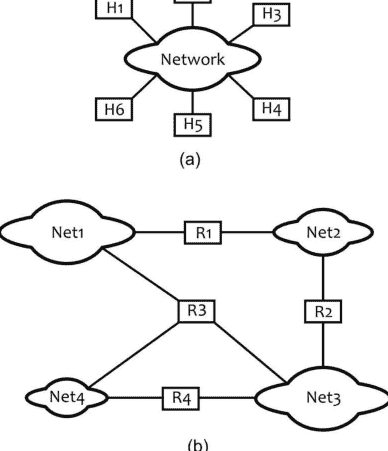

图 11.1 (a) 六个主机的网络；(b) 四个网络的互连网。

## 11.3 使用计算机网络和互连网的原因

使用计算机网络而不是单机个人电脑、强大的微型计算机、大型机或超级计算机有许多原因。主要原因包括：

- **共享资源**：计算机网络的用户可以共享硬件资源，包括计算机、打印机、绘图仪和扫描仪，以及文件（数据和软件）等软件资源。
- 网络作为通信媒介：网络是生活得远的人们之间一种廉价、快速且可靠的通信媒介。
- 成本效益：对于同样的价格，使用工作站网络获取的计算能力比使用微型计算机或大型机更强。
- 性能下降更少：如果使用单台强大的微型计算机、大型机或超级计算机，一旦计算机出现任何问题（例如主内存中的某位损坏），工作就会陷入中断。在计算机网络中，如果一台计算机崩溃，网络上的其余计算机仍然处于运行状态，确保了工作的连续性。

## 11.4 网络模型

在网络的设计和实现中出现了各种问题，这些问题决定了两种最著名的网络模型的设计：

1. 用于连接硬件资源的物理介质或通信信道：它可以是简单的 `RS-232` 电缆、电话线、同轴电缆、光纤缆、微波链路或卫星链路。
2. 网络拓扑结构——即主机在网络上的物理布局：常用的拓扑结构有总线型、环型、网型和通用型。
3. 一组规则，称为协议，用于允许主机在启动传输之前访问网络媒介。
4. 协议用于将应用数据（例如 `Web` 页面）从局域网中的一个主机路由到另一个主机，或从一个网络中的主机路由到另一个互连网中的主机。
5. 协议用于将数据从局域网中主机上的进程传输到另一个主机上的进程，或从一个网络中的进程传输到互连网中另一个主机上的进程。
6. 网络软件使用协议来提供特定的应用程序，如 `ftp`。

两种已知的网络模型是国际标准开放系统体系参考模型（通常称为 `OSI 七层模型`）和 `TCP/IP 五层模型`。`OSI` 模型提于 1981 年，`TCP/IP` 模型提于 20 世纪 70 年代后期。1982 年 3 月，美国国防部采用 `TCP/IP` 模型作为所有网络的标准。`TCP/IP` 模型源于 `ARPA`，是互联网的基础，也被称为 `IP` 模型。该模型由五层组成，每层都有特定的用途和一组协议。

| ISO | TCP/IP | 处理内容 |
| :--- | :--- | :--- |
| 7 | Application | 应用 |
| 6 | Presentation | 应用 |
| 5 | Session | |
| 4 | Transport | 传输 |
| 3 | Network | 网络 |
| 2 | Data Link | 数据链路 |
| 1 | Physical | 物理 |

图 11.2 ISO 和 TCP/IP 模型，两者之间的映射以及一组的通用用途。

| | | | | | | |
|---|---|---|---|---|---|---|
| 5 | `http`, `telnet`, `smtp`, `ftp`, `traceroute`, `ping`, `time`, `date`, 等 | | | | 应用层 |
| 4 | `TCP` | Raw sockets | `UDP` | 传输层 |
| 3 | `IPv4` | `IPv6` | `ICMP` | `IGMP` | 网络层 |
| 2 | `ARP` | `RARP` | | 链路层 |
| | | `Ethernet`, Token ring, `atm`, 等 | | | |
| 1 | | 设备/物理层 | | | 设备/物理层 |

图 11.3 TCP/IP 协议族。

完全可靠的有序交付。`UDP` 是一种无连接协议；也就是说，它只是将应用程序数据发送到目的地，而不在传输数据之前与目的地建立虚拟连接。因此，发送端主机上的 `UDP` 软件在发送数据之前不会与接收端的 `UDP` 软件“对话”。`TCP` 是一种面向连接的协议，它在传输数据之前在发送者和接收者主机之间建立虚拟连接，从而实现可靠、无错且按序的数据交付。当然，建立连接的开销使其比 `UDP` 更昂贵。许多著名的互联网应用（如 `ftp`）使用 `TCP`。对于数据交付比无错、有序交付更重要的应用（如视频流），则使用 `UDP`。特别地，由 `TCP` 传输的数据包称为段（`segment`），而由 `UDP` 传输的数据包称为数据报（`datagram`）。


多个使用 `TCP` 和/或 `UDP` 的客户端和服务器进程通过运行在 16 位端口（0–65,535）上的每个进程端口号来进行标识。分配数字机构（`IANA`）。已知服务包括落在已知范围内（不包括 `0`）的分配端口。这些服务中的大多数允许使用 `TCP` 或 `UDP`，且互联网尝试为同一项服务为 `TCP` 和 `UDP` 分配相同的端口号。例如，`ssh` 服务被分配端口号 `22`，而 `http (Web)` 服务器对于 `TCP` 和 `UDP` 都被分配端口号 `80`。大多数客户端可以在任何端口上运行，或在客户端进程执行时由操作系统分配。某些已知客户端（如 `ssh`）需要使用预留端口作为客户端-服务器身份验证协议。这些服务分配在 `1–1023` 范围内的端口。虽然服务器永久运行，但对于未知分配端口的服务，其客户端进程在运行期间一直存在。此类端口被称为临时端口（`ephemeral ports`），范围在 `1024–65,535` 之间。

## 11.5.2 应用程序数据的路由：IP

如前所述，网络层负责将应用程序数据路由到目的主机。负责此的协议是 `IP`，它在其称为 `IP` 数据报的自有数据包中传输包含应用程序数据的 `TCP` 段或 `UDP` 数据报。路由算法是无连接的，这意味着 `IP` 路由是尽力而为的（`best-effort`），不保证 `TCP` 段和 `UDP` 数据报的交付。需要保证交付的应用使用 `TCP` 作为其传输层协议，或将其构建在应用程序内部。`IP` 有两个版本：旧版本是 `IPv4`，新版本是 `IPv6`（通常称为 `IPng` 或“下一代网际协议”）。在本书中，我们主要讨论 `IPv4`。`IP` 之外的实际路由算法受限于本文的范围。在这里，我们描述了互联网路由的一个关键组件——`IP` 节点方案，它用于唯一标识互联网上的主机。

路由的关键在于为互联网上的每个主机 分配唯一的 `IP ID`。它是通过唯一标识主机 `ID`，然后唯一标识网络 `ID` 来实现的。`ID` 在 `IPv4` 中是一个 `32` 位特殊整数，在 `IPv6` 中是一个 `128` 位特殊整数，被称为主机地址。每个 `IP` 数据报都携带发送者的 `IP` 地址和接收者的 `IP` 地址。发送者的 `IP` 地址允许接收者识别并响应发送者。主机通过检查 `IP` 数据报上的目的 `IP` 地址来执行路由。

在 `IPv4` 中，`IP` 地址被分为三个字段：地址类、网络 `ID` 和主机 `ID`。地址类识别地址的类别，并决定了网络 `ID` 字段和主机 `ID` 字段使用的位数。这些字段属于五类地址：`A`、`B`、`C`、`D` 和 `E`，其中 `A–C` 类是最常见的。图 `11.4` 显示了这五种类型的结构。属于 `D` 类和 `E` 类的 `IP` 地址有特殊用途，它们的讨论超出了本教科的范围。中央机构网络信息中心（`NIC`）分配所有 `IP` 地址。

可以连接到互联网的 `A–C` 类最大数量由表达式 `$2^{32}$` 给出。在这里，`7`、`14` 和 `24` 分别是用于指定 `A–C` 类地址中网络 `ID` 的位数。因此，有 `$2^7$` 个 `A` 类网络，`$2^{14}$` 个 `B` 类网络和 `$2^{24}$` 个 `C` 类网络。这些网络总计为 `2,113,664` 个网络。用于在这三类地址中标识主机 `ID` 的位数可以得到连接到互联网的最大主机数。因此，每个 `A` 类有 `$2^{24}$` 个主机，每个 `B` 类有 `$2^{16}$` 个主机，每个 `C` 类有 `$2^8$` 个主机。这些网络上所有主机的总计为 `3,758,096,400`。由于特殊地址（例如广播地址和本地地址），`A–C` 类网络和实际数量比显示的要小。广播地址用于到达网络上的所有主机。主机使用本地地址向自己发送数据报。以 `localhost` 为目的地的 `IP` 地址永远不在网络上。

为了学习 `IPv4` 地址的使用并减少路由器上路由表的增长，互联网工程任务组（`IETF; www.iet.org`）在 `1993` 年引入了无分类域网路由（`CIDR`）。在 `CIDR` 下，`IPv4` 网络地址空间是根据任何边界分配的，而不是按 `8` 位段划分。

[注：原文后续部分存在大量重复的 OCR 错误信息，已根据指令过滤重复内容并保留核心逻辑]

`IPv4` 地址的字节以其十进制等效值表示，并用点分隔。因此，这个 `32` 位的 `IP` 地址

```
11000000 01001110 00010010 00100101
```

写为

```
192.102.10.21
```

`DDN`。`DDN` 中五类地址的有效 `IP` 地址范围如表 `11.1` 所示。表中某些地址是特殊地址。

图 `11.5` 所示的互联网通过四个路由器 `R1–R4` 连接了四个网络。`Net1` 是 `A` 类网络，`Net3` 是 `B` 类网络，`Net2` 和 `Net4` 是 `C` 类网络。识别网络类别是查看网络上主机的 `IP` 地址中最左侧的十进制数字——在本例中，即路由器的 `IP` 地址。注意，路由器分配的 `IP` 地址数量与其所连接的网络数量相同。例如，路由器 `R1` 连接了 `Net1` 和 `Net2`，拥有 `IP` 地址 `121.1.1.1` 和 `192.102.10.1`。同样，`R3` 被分配了三个 `IP` 地址，因为它连接了三个网络 `Net1`、`Net3` 和 `Net4`。

在特殊地址中，`127.0.0.0`（`127.x.x.x`，其中 `x` 是 `0` 到 `255` 之间的任意数字）也称为 `localhost`，用于主机给自己发送数据包。它通常用于在接入互联网之前测试新应用程序。另一个主机 `ID` 字段为 `1` 的特殊地址是定向广播地址。该地址用于向网络上的所有主机发送数据包——即在一个使用该地址作为目的地址的主机网络上进行广播。

## 11.5.3 符号名称

人们更倾向于使用符号名称而不是数值地址，因为名称更容易记忆，特别是在 `IPv6` `128` 位数值地址过渡的过程中。此外，即使其 `IP` 地址发生变化，符号名称也可以保持不变，但互联网上的主机符号名称必须是唯一的。互联网通过分层命名方案允许符号符号名称。符号的格式为

`hostname.domain_name`

其中 `domain_name` 是指向站点的符号名称，由 `NIC` 维护列表的注册机构分配。`hostname` 由分配域名的站点分配并控制。域名由两个（或多个）由点分隔的字符串组成。域名中最右侧的称为顶级域名（`TLD`）。最右侧点之后的字符串标识一个组织，可以由组织选择并分配给 `NIC`。如果该字符串已分配给该 `TLD` 下的其他组织，则会分配另一个字符串以保持域名的唯一性。`TLD` 有三种：特殊 `TLD`、通用 `TLD` (`gTLDs`) 和国家 `TLD` (`ccTLDs`)。根据 `IANA` 的根域名数据库（`www.iana.org/domains/root`），在编写本文时已注册了 `1,776` 个 `TLD`。这些详细信息见表 `11.2`。

对于由两个以上字符串组成的名称，剩余字符串由拥有该名称的组织分配，并用点连接以满足该主机的完全限定域名 (`FQDN`)——例如 `cs.stanford.edu`，其中 `cs` 是互联网上某个主机的名称。然而，互联网主机的 `FQDN` 并不是三部分。大多数组织允许组织内的不同小组为其控制和负责的主机选择主名称。例如，斯坦福大学计算机系使用主名称 `cs.stanford.edu`，并将其作为 `HTTP` 服务器的 `FQDN`。杜克大学的服务器管理部门使用主名称 `fuoca.duke.edu`，可以为其 `Web` 服务器使用主机 `fuoca.duke.edu`。

## 11.5.4 将名称翻译为 IP 地址：域名系统

由于互联网软件处理的是 `IP` 地址，而人们又倾向于使用符号名称，因此软件会将符号名称翻译为由域名系统（`DNS`）提供的 `IP` 地址。`DNS` 实现了名称到地址映射的分布式数据库。每个组织至少运行一个名称服务器，通常称为伯克利互联网命名（`BIND`）程序。`resolver` 函数将主机名（简单或完全限定的）返回给其 `IP` 地址。使用 `DNS` 服务的另一种替代方案是使用静态 `hosts` 文件，该文件包含域名及其对应的 `IP` 地址，每行一个。以下命令显示了 `/etc/hosts` 的一个示例：

```
$ more /etc/hosts
127.0.0.1 localhost
127.0.0.1 loopback
::1 loopback
ff0::0 multicastprefix
```

### 表 11.1 IPv4 地址类和有效 IP 地址

| 地址类 | 最小值 | 最大值 |
|---|---|---|
| `A` | `0.0.0.0` | `127.255.255.255` |
| `B` | `128.0.0.0` | `191.255.255.255` |
| `C` | `192.0.0.0` | `223.255.255.255` |
| `D` | `224.0.0.0` | `239.255.255.255` |
| `E` | `240.0.0.0` | `247.255.255.255` |

 图 `11.5` 包含一个 `A` 类、一个 `B` 类和两个 `C` 类网络的互联。

### 表 11.2 顶级域名

| 域名类型 | 顶级域名 | 分配给 |
|---|---|---|
| 特殊 | `ARPA` | 专用于互联网；`.arpa`, `.ip.arpa`, `.net.arpa`, `.urn.arpa` |
| 通用 | `ACCOUNTANTS` | 通用 `TLD` |
| | `ACTOR` | 通用 `TLD` |
| | `AERO` | 空中运输行业 |
| | `AIRFORCE` | 通用 `TLD` |
| | `ARMY` | 通用 `TLD` |


| | `ATTORNEY` | 顶级域名 |

| | `BEER` | `Grand Hollow, LLC` |

| | `BIZ` | `Atomic LLC` |

| | `BUILDERS` | `Wild LLC` |

| | `CHRISTMAS` | `Holly Fields, LLC` |

| | `COM` | 商业组织 |

| | `COOP` | 合作协会 |

| | `EDU` | 受国家认可的高等教育机构 |

| `GOV` | 美国政府 |

| | `INFO` | 任何人 |

| `INT` | 政府间的条约 |

| `MIL` | 美国军事 |

| `MUSEUM` | 电话服务提供商 (`ISPs`) |

| `NAME` | 非商业社区 |

| `NET` | 可注册的 |

| `ORG` | `Road Registry, Inc.` |

| `ZIP` | `Outer Falls, LLC` |

| `ZONE` | 澳大利亚 |

| `AU` | 德国 |

| `DE` | 芬兰 |

| `FI` | 日本 |

| `JP` | 英国 |

| `UK` | 美国 |

| `US` | `Deutschland` |

`` **图 11.6** 互联网层次结构。

### 网络与互联

你可以使用 `ifconfig` 命令查看和设置网络接口，包括 IP 地址、`localhost`、子网掩码、广播地址和传输单元（`MTU`）。然而，该命令在大多数 Linux 系统中不再维护，被现代的 `ip` 命令取代。它可以用于安装后配置网络参数及其当前设置。在本节中，我们展示了用于查看各种接口的 `ip` 命令示例，以及用于检查和设置网络参数的 `ip` 命令示例。子网掩码（也称为 `subnet mask`）是 `TCP/IP` 用于识别主机是在远程网络还是本地子网的一个位。广播用于主机向子网上的所有主机或远程发送数据报。`TCP/IP` 网络中的 `MTU` 是 IP 数据报（包）的大小，是由用于连接其他主机的链路层决定的。以下是 `ip` 命令的一个示例，显示你登录到一个具有 `localhost` 接口以及网络接口 `enp0`、`enp1` 和 `enp2` 的主机，每个接口都有 `IPv4` 和 `IPv6` 地址。

```
$ ip addr show
1: <LOOPBACK,UP,LOWER_UP> mtu 65536 qdisc noque state UNKNOWN group default
    len 1
    link/loopback 00:00:00:00:00:00 brd 00:00:00:00:00:00

    inet 127.0.0.1/8 scope host
        valid_lft preferred_lft forever
    inet6 ::1/64 scope host
        valid_lft preferred_lft forever
2: enp2:<BROADCAST,MULTICAST,UP,LOWER_UP> mtu 1500 qdisc no state UP group default
    len 1000
    link/ether 00:18:30:ce:be:6e brd ff:ff:ff:ff:ff
    inet 202.147.169.195/24 brd 202.147.169.223 global enp2s
        valid_lft preferred_lft forever
    inet6 fe80::c67ab:4f1a:21fa:f0f5/64 scope link
        valid_lft preferred_lft forever
```

# 284

# Linux

```
valid_1ft forever preferred_1ft forever
3: enol:<BROADCAST,MULTICAST,LOWER_UP> mtu 1500 qdisc pfifo_fast UP
group default qlen 1000
link/64:51:06:49:70:46 brd:ff:ff:ff:ff:ff
inet 172.16.0.1/16 brd 172.165.255 global enol
valid_1ft forever preferred_1ft forever
inet6 fe80::e323:bbf4:9833:ceb0/64 scope link
valid_1ft forever preferred_1ft forever
```

你可以使用 `ip` 命令来显示有关特定接口的信息。例如，`ip show enol` 命令会显示相关接口的信息。系统管理员可以启用或禁用这些接口或其任何参数，正如第 17 章所讨论的。本章将进一步讨论输出内容以及获取和设置网络参数的各种选项。

`ip` 命令在 Linux Mint 中通常位于 `/bin` 和 `/sbin` 目录。如果你收到 `ip command not found` 的错误消息，你应该将相关目录包含在搜索路径中重新执行命令。你可以运行 `cat /etc/hosts` 命令来显示网络上主机的域名和 IP 地址。

你可以使用 `host` 命令对作为命令行参数传递的主机名进行 DNS 查询。在接下来，我们使用 `host` 命令显示名称的 IP 地址，反之亦然。例如，显示 `iasteate.berkeley`、`facebook.com` 以及与 IPv6 地址对应的域名。`host iasteate` 命令的输出显示了 `iasteate.Iowa State University` 的 IPv4 和 IPv6 地址。它还显示了爱荷华州立大学有十台机器处理电子邮件。第二个命令的输出显示 IPv6 地址属于 `thumb.iasteate`。第四个和第六个命令的输出显示了 `stanford.edu` 和 `facebook.com` 的 IPv4 和 IPv6 地址，以及域名服务器无法将 IP 地址 `198.175.93.39` 映射，这意味着该名称不存在。

```
$ host iasteate
iasteate.has has address 129.186.235.2
iasteate.has has IPv6 2610:130:101:113::
iasteate.mail is handled by 10 mailin.iasteate.com.
$ host 2610:130:101:113::
2.0.0.0.0.0.0.0.0.3.1.1.0.0.3.1.0.0.1.6.2.ip6.arpa
name redirect.its.iasteate.com.
$ redirect.its.iasteate.com
irect.its.iasteate.com has address 129.186.235.2
irect.its.iasteate.com has IPv6 2610:130:101:113::
$ stanford.edu
stanford.edu has address 177.61.267.215
stanford.edu has IPv6 address 2670:fed6:0925a::ab43:d7c8
stanford.mail is handled by 10 mxa-00000d3.gsl.pphosted.com.
stanford.mail is handled by 10 mkb-00000d3.gsl.pphosted.com.
$ host 2607:f140:082::110
0.1.0.0.0.0.0.0.0.2.8.0.0.0.0.0.0.0.0.4.1.f.7.0.6.2.ip6.arpa
name calweky-farm-prod.ist.berkeley.com.
$ host facebook.com
facebook.com has address 157.240.20.35
facebook.com has IPv6 address 2a02:2880:f1c8:8183:facebook:b00c:0:2de
facebook.com is handled by 10 msgin.vvv.facebook.com.
$ host 52.6.169.253
host 33.96.175.198-in-addr.arpa. not found: 3(NXDOMAIN)
253.169.52-in-addr.arpa domain name pointer ec2-52-6-169-253.compute-1.
amamazonaws.com.
```

## 网络与互联

在 Linux 系统上，你可以使用 `nslookup` 命令进行 DNS 查询。以下是命令的示例运行。

```
$ nslookup google.com
Server: 127.0.0.1
Address: 127.0.0.1#53

Nonauthoritative answer:
Name: google.com
Address: 216.58.208.78
```

同样，你可以使用 `dig` 命令在 Linux 上进行 DNS 查询。


## 284

## Linux

```
valid_1ft forever preferred_1ft forever
3: enol:<BROADCAST,MULTICAST,LOWER_UP> mtu 1500 qdisc pfifo_fast UP
group default qlen 1000
link/64:51:06:49:70:46 brd:ff:ff:ff:ff:ff
inet 172.16.0.1/16 brd 172.165.255 global enol
valid_1ft forever preferred_1ft forever
inet6 fe80::e323:bbf4:9833:ceb0/64 scope link
valid_1ft forever preferred_1ft forever
```

你可以使用 `ip` 命令来显示有关特定接口的信息。例如，`ip show enol` 命令会显示相关接口的信息。系统管理员可以启用或禁用这些接口或其任何参数，正如第 17 章所讨论的。本章将进一步讨论输出内容以及获取和设置网络参数的各种选项。

`ip` 命令在 Linux Mint 中通常位于 `/bin` 和 `/sbin` 目录。如果你收到 `ip: command not found` 的错误消息，你应该将相关目录包含在搜索路径中并重新执行命令。你可以运行 `cat /etc/hosts` 命令来显示网络上主机的域名和 IP 地址。

你可以使用 `host` 命令对作为命令行参数传递的主机名进行 DNS 查询。接下来，我们使用 `host` 命令显示名称的 IP 地址，反之亦然。例如，显示 `iasteate.berkeley`、`facebook.com` 以及与 IPv6 地址对应的域名。`host iasteate` 命令的输出显示了 `iasteate.Iowa State University` 的 IPv4 和 IPv6 地址。它还显示了爱荷华州立大学有十台机器处理电子邮件。第二个命令的输出显示 IPv6 地址属于 `thumb.iasteate`。第四个和第六个命令的输出显示了 `stanford.edu` 和 `facebook.com` 的 IPv4 和 IPv6 地址，以及域名服务器无法将 IP 地址 `198.175.93.39` 映射，这意味着该名称不存在。

```
$ host iasteate
iasteate.has has address 129.186.235.2
iasteate.has has IPv6 2610:130:101:113::
iasteate.mail is handled by 10 mailin.iasteate.com.
$ host 2610:130:101:113::
2.0.0.0.0.0.0.0.0.3.1.1.0.0.3.1.0.0.1.6.2.ip6.arpa
name redirect.its.iasteate.com.
$ redirect.its.iasteate.com
irect.its.iasteate.com has address 129.186.235.2
irect.its.iasteate.com has IPv6 2610:130:101:113::
$ stanford.edu
stanford.edu has address 177.61.267.215
stanford.edu has IPv6 address 2670:fed6:0925a::ab43:d7c8
stanford.mail is handled by 10 mxa-00000d3.gsl.pphosted.com.
stanford.mail is handled by 10 mkb-00000d3.gsl.pphosted.com.
$ host 2607:f140:082::110
0.1.0.0.0.0.0.0.0.2.8.0.0.0.0.0.0.0.0.4.1.f.7.0.6.2.ip6.arpa
name calweky-farm-prod.ist.berkeley.com.
$ host facebook.com
facebook.com has address 157.240.20.35
facebook.com has IPv6 address 2a02:2880:f1c8:8183:facebook:b00c:0:2de
facebook.com is handled by 10 msgin.vvv.facebook.com.
$ host 52.6.169.253
host 33.96.175.198-in-addr.arpa. not found: 3(NXDOMAIN)
253.169.52-in-addr.arpa domain name pointer ec2-52-6-169-253.compute-1.
amamazonaws.com.
```

## 网络与互联

在 Linux 系统上，你可以使用 `nslookup` 命令进行 DNS 查询。以下是命令的示例运行。

```
$ nslookup google.com
Server: 127.0.0.1
Address: 127.0.0.1#53

Nonauthoritative answer:
Name: google.com
Address: 216.58.208.78
```

同样，你可以使用 `dig` 命令在 Linux 上进行 DNS 查询。

网络与互连 287

局域网（LAN）、命令的远程执行、网络实时聊天以及远程复制。我们将在第 11.8 节讨论这些大多数服务的软件。

### 11.7 客户端—服务器软件模型

Internet 服务通过使用一种范式来实现，即服务的软件被分为两个部分。运行在用户登录的主机上的部分被称为客户端软件。另一部分处理客户端请求并在等待客户端请求到来时开始运行。在收到请求后，服务器执行请求并等待下一个请求。另一方面，客户端只有在用户运行该客户端提供的服务程序时才会开始运行。它通常会提示用户输入（或数据），将客户端传输到服务器，接收服务器的响应，并将响应转发给用户。大多数客户端通过“quit”或“exit”命令终止。


许多应用程序是面向连接的客户端—服务器模型，其中客户端向服务器发送连接请求，由服务器决定接受或拒绝该请求。如果服务器接受了请求，客户端和服务器将通过虚拟连接建立。从这一点起，客户端发送客户端请求，服务器向客户端发送响应。客户端与相应服务器之间的通信以及客户端与用户的交互，都由应用程序所提供的服务协议决定。图 11.7 显示了客户端—服务器软件模型的概述。

然后，当你运行如 `Firefox` 这样允许你浏览网页程序时，客户端运行的主机上会启动一个 `http` 客户端进程，尽管它可以设置为任何页面（包括空白页）。当你想要查看某个网站的网页时，你将拥有该页面的网站组织的统一资源定位符（`URL`）提供给客户端进程。对于显示主页，`URL` 具有：

```
http://host/page
```

其中 `host` 是具有你要显示的主页的的 `FDN` 或 `IP` 地址（在 `DDN` 中），`page` 是包含要显示页面的文件路径——例如 `cnn.com`、`www.stroustrup.com`、`mitadmissions.org/index.php` 以及 `http://profiles.stanford.edu/`。客户端尝试与网络上的 `http` 服务器进程建立连接。如果该网站有 `http` 服务器且没有设置密码等安全保护，则客户端和服务器之间将建立连接。然后服务器将网页发送给客户端，由客户端在屏幕上显示，任何音频或视频组件将发送到相应的设备上。请注意，如果你想通过浏览器访问 `https` 站点，可以将 `http` 替换为 `https`；如果你想通过安全外壳（`SSH`）协议进行远程登录，则可以替换为 `ssh`。

你可以使用相应的命令调用大多数 Internet 服务的客户端程序，例如用于 `SSH` 进程的 `ssh` 和用于 `FTP` 服务器的 `ftp`。这些命令允许指定一个域

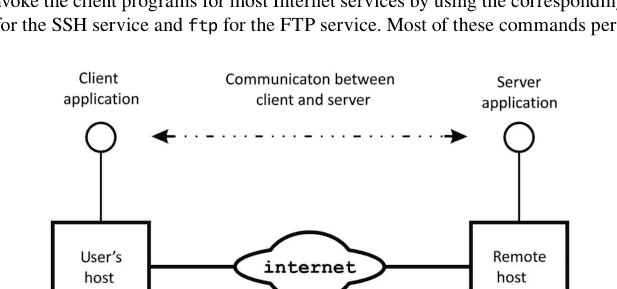

图 11.7 客户端—服务器软件模型的描绘。

## Linux

在命令中使用运行服务器的主机主机名或 `IP` 地址作为参数。命令还允许将端口号作为参数。内置了这种灵活性的客户端软件是 `全参数化客户端`。从提供的灵活性角度来看，客户端非常重要。它们还允许通过在为人知的端口上运行更新的服务器软件并使用客户端与其连接来对其测试。第 11.8 节中讨论的 `telnet` 客户端是 `全参数化客户端` 的一个良好示例。

### 11.8 应用软件

在 `Linux` 主机网络上，提供了许多实现上述应用层协议的程序。在本文描述的最常用应用程序中，某些适用于 `Linux` 和基于 `Linux` 的系统，而另一些适用于 Internet 上的所有主机。

#### 11.8.1 显示主机名

基于网络的应用程序使用 `user@host` 地址格式来识别 Internet 网络上的用户。你可以使用 `hostname` 和 `uname` 命令来显示你所登录的主机名称。在某些系统上，主机名以短、简单的格式显示，而在另一些系统上，它以完整的 `FQDN` 格式显示。如果你识别了你所登录的网络上的主机，可以使用 `hostname -s` 命令显示短格式，它只是主机的名称（`FQDN` 格式中最左侧的部分）。你可以使用 `uname -n` 命令将你登录的计算机名称以 `FQDN` 格式显示。`uname -a` 命令显示关于主机的完整信息，包括其运行的操作系统和 `CPU` 的名称。以下是 `hostname` 和 `uname` 命令的一些示例。

```
$ hostname
Mint18
$ uname -n
Mint18
$ uname -a
Mint18 4.4.0-21-generic #37-Ubuntu SMP Mon Apr 18 18:33:37 UTC 2016 x86_64 x86_64 GNU/Linux $
```

你可以使用 `arch` 命令查找处理器架构。该命令输出的信息与 `uname -m` 相同，如下会话所示。

```
$ arch
x86_64
$ uname -m
x86_64 $
```

询问你的朋友和同学，关于他们最常用的两个网络服务。它们是哪些服务？哪一个最多？

#### 11.8.2 测试连接

你可以使用 `ping` 命令测试网络或特定主机的状态。如果 `ping` 命令在你的系统上不起，请使用 `ping` 查找其位置。以下是 `ping` 的简要描述。

##### 语法：`ping [options]`

`目的`：向主机发送 `IP` 数据报文以指示主机是否存活。

`常用选项`：

- `c`: 发送包的数量
- `f`: 每秒发送包的数量
- `s`: 发送包的大小
- `t`: 发送直到超时

你可以使用主机的 `IP` 地址来代替其主机名。例如，你可以使用 `ping 171.67.215.200` 而不是 `ping stanford.edu`，如下：

```
$ ping 171.67.215.200
PING 171.67.215.200 (171.67.215.200) 56(84) bytes of data.
64 bytes from 171.67.215.200: icmp_seq=1 ttl=231 time=617 ms
64 bytes from 171.67.215.200: icmp_seq=2 ttl=231 time=312 ms
64 bytes from 171.67.215.200: icmp_seq=3 ttl=231 time=437 ms
64 bytes from 171.67.215.200: icmp_seq=4 ttl=231 time=398 ms
64 bytes from 171.67.215.200: icmp_seq=5 ttl=231 time=438 ms
---
 171.67.215.200 ping statistics
5 packets transmitted, 5 received, 0% packet loss, time 4000ms
rtt min/avg/max/mdev = 31.828/41.048/67.665/92.43 ms
$
```

#### 11.8.3 显示用户信息

你使用 `finger` 命令显示本地或远程主机上的用户信息。显示的信息是从 `~/plan` 和 `~/project` 文件中提取的。默认情况下，你的 `Linux` `Mint` 系统没有安装 `finger` 命令。如果你的 `Linux` 系统没有提供 `finger`，请参阅附录 `A` 在你的系统中安装的说明。以下是该命令的简述。

```
语法：finger [options] [user-list]
用途：显示 user_list 中用户的信息；如果没有 user_list，命令将显示当前登录到指定主机的所有用户的状态报告
输出：从 ~/project 和 ~/plan 文件中提取的用户信息
常用选项/功能：
-m 将 user_list 仅匹配到登录名
-s 以短格式输出
```

以下会话展示了该命令最简单的用法，显示主机上用户 `bob` 的信息。

```
$ finger bob
Login: bob Name: Robert Koretsky
Directory: /home/bob Shell: /bin/bash
 Oct 15 20:21 (PDT) on pts/1 103.255.5.99
1 hour 39 minutes idle
once Sun Oct 15 21:53 (PDT) on pts/0 103.255.5.99
3 seconds idle
No mail.
No Plan.
$
```

你可以使用带有 `-s` 选项的 `finger` 命令以短格式显示命令的输出，并使用 `-m` 选项将 `user_list` 仅匹配到登录名。如果用户名为 `tree`（网络命令认为字母大小写相同），则 `finger -m` 命令显示的信息与 `finger birch` 相同。然而，如果用户的登录名为 `btree` 且系统中不存在登录名 `birch`，`finger` 命令将显示相应的消息通知你。

在不带任何参数运行时，`finger` 命令会返回当前登录到你机器的所有用户的状态。显示的信息量略有不同，取决于你的主机运行的 `Linux` 系统。以下命令运行在 `Linux-Networking` 和 `Internetworking` 上：

`finger`

| 登录名 (Login) | 姓名 (Name) | 终端 (T) | 空闲 (Idle) | 登录时间 (Login Time) | 办公室 (Office) | 电话 (Phone) |
|---|---|---|---|---|---|---|
| `bob` | `bob` | `tty8` | `12:37` | `Jul 25 17:53` | `(:)` | |
| `malik` | `Malik` | `tty8` | `86d` | `Jul 21 18:54` | `(:)` | |
| `root` | `root` | `tty1` | `2d` | `Jul 25 08:12` | | |
| `sarwar` | `Mansoor Swar` | `pts/1` | `1:42` | `Oct 15 20:21 (103.255.5.99)` | | |

$


## `finger` 命令概述

只要主机提供 `finger` 服务并运行着 `finger` 服务器（`finger` 守护进程），你就可以使用 `finger` 命令显示互联网上用户的信息。远程 `finger` 在所有系统中都是禁用的。

可以使用 `finger@iastate.edu Ashfaq@iastate.edu` 来显示用户 `Pohm` 和 `Ashfaq@iastate.edu` 的信息（如果它运行了 `finger` 命令的话）。

如果主机没有运行服务器，`finger` 命令将为你显示连接被拒绝的消息，如下：

```
$ finger crenshaw@up.edu
finger: Connection refused
```

如果 DNS 无法找到域名的映射，`finger` 命令将返回适当的消息。当发生这种情况时，你可以运行 `finger` 命令获取目的 IP 地址，并使用域名的 IP 地址运行 `finger` 命令。

以 `hostname` 作为参数，`finger` 命令显示所有当前登录到 `hostname` 的用户状态。某些站点设置了限制。

## `ftp` 命令详解

在本节中，我们将探索如何使用 `ftp` 命令。它是用于从或到主机传输文件的许多工具之一。

### 语法与常用选项

```
语法：ftp [options] [host]
用途：从或到主机传输文件
常用选项/功能：
-d 启用被动模式
-n 禁用传输期间提示
-v 显示详细输出
```

### 使用示例

要使用 `ftp` 客户端，通常在主机名或 IP 地址输入 `ftp`。

```
$ ftp example.com
Connected to example.com.
Login: username
password: 
```

### 常用 `ftp` 命令列表

一旦连接，你可以使用各种命令来管理远程主机上的文件和目录。下表列出了一些常用的 `ftp` 命令。

| 命令 | 含义 |
| --- | --- |
| `! [cmd]` | 在本地机器上运行 `cmd`；如果没有 `cmd` 参数，调用交互式 shell |
| `Help [cmd]` | 显示 `cmd` 的摘要；如果没有 `cmd` 参数，显示所有 `ftp` 命令的摘要 |
| `ascii` | 将 `ftp` 通道设置为 ASCII 模式；传输 ASCII 类型文件作为文本文件 |
| `binary` | 将 `ftp` 通道设置为二进制模式；传输非 ASCII 文件作为包含执行代码或图片 |
| `cd` | 切换目录；类似于 Linux `cd` |
| `close` | 关闭与远程主机的连接，但留在内部 |
| `dir remote localfile` | 将远程列表保存到本地主机上的 `localfile`；对于长目录列表很有用，因为 `ftp` 命令无法使用管道 |
| `get remote [localfile]` | 将远程传输到本地工作目录下的 `localfile`；如果没有指定 `localfile`，则使用 `remote` 作为文件名 |
| `ls [dirname]` | 显示指定目录 `dirname` 的内容；未指定则显示当前目录 |
| `mget remotiles` | 从远程主机传输多个文件到本地主机 |
| `mput localfiles` | 从本地主机传输多个文件到远程主机 |
| `open [hostname]` | 尝试与远程主机连接；如果未指定 `hostname` 参数 |
| `put localfile [remotefile]` | 将 `localfile` 传输到远程主机上的 `remotile`；如果没有指定 `remotile`，则使用 `localfile` 作为文件名 |
| `quit` | 终止 `ftp` 会话 |
| `user [login_name]` | 如果无法登录，通过指定命令行参数 `user_name` 作为远程主机上的用户登录；未指定 `user_name` 时会出现提示符 |

### 安全性说明

`FTP` 是一个不安全的协议，因为它以明文发送数据和密码。为了安全，建议使用 `SFTP`（SSH 文件传输协议）或 `FTPS`（带有 `SSL/TLS` 的 `FTP`），它们会加密通信。


```
$ finger crenshaw@up.edu
finger: Connection refused
```

如果 `DNS` 无法找到域名的映射，`finger` 命令将返回适当的消息。当这种情况发生时，你可以运行 `finger` 命令获取目的 `IP` 地址，并使用域名的 `IP` 地址运行 `finger` 命令。

以 `hostname` 作为参数，`finger` 命令显示所有当前登录到 `hostname` 的用户状态。某些站点设置了限制。

### 网络与互联网络

在本节中，我们将探索如何使用 `ftp` 命令。

`ftp` 是从或到主机传输文件的许多工具之一。

匿名登录通常只允许下载。如果你在 `ftp` 站点的计算机上拥有账户（即不是匿名登录），那么你几乎被允许下载和上传文件。

接下来的会话演示了如何使用 `ftp` 实用程序与站点 `ftp.FreeBSD.org` 进行匿名 `ftp`，并传输发布版本 `10.1` 的压缩内核。在此过程中，我们演示了 `ftp` 命令中命令 `cd`、`get`、`ls` 和 `pwd` 的用法。我们还演示了在匿名 `ftp` 时在本地执行 `ls` 命令。因此，当提示输入密码时，你按下 <Enter>。请注意，在你执行匿名登录 `ftp.FreeBSD.org` 的时候，后续会话中的命令可以使用该软件更现代的发布版本。

```
$ ftp ftp.FreeBSD.org
Trying 149.20.53.23:21 ...
Connected to ftp.geo.FreeBSD.org.
220 This is ftp0.isc.freebsd.org - hosted at ISC.org
Name (ftp.FreeBSD.org:sarwar): anonymous
331 Please specify the password.
Password: <Enter>
230-
230-This is ftp0.isc.FreeBSD.org, graciously hosted by
230-Internet Systems Consortium ISC.org.
230-
230-FreeBSD files can be found in the /pub/FreeBSD directory.
230-
230-Login successful.
Remote system type is UNIX.
Using binary mode to transfer files.
ftp> cd pub/FreeBSD
250-ISO images of FreeBSD files may be found in the releases/ISO-IMAGES
250-directory, for independent files and tarballs, see individual
250-$(scheme)/$(machine_arch) directories. For example,
250-releases/amd64/amd64 and releases/powerpc/powerpc64.
250 Directory successfully changed.
ftp> pwd
257 "/pub/FreeBSD" is the current directory
ftp> get -
200 PORT command successful. Consider using PASV.
150 Here comes the directory listing.
-rw-r--r-- 1 ftp ftp 4259 May 07 2015 README.TXT
-rw-r--r-- 1 ftp ftp 35 Apr 02 02:30 TIMESTAMP
-rw-r--r-- 1 ftp ftp 9 10 Apr 02 02:30 development
-rw-r--r-- 1 ftp ftp 3665 Apr 01 01:00. sizes
-drwxr-xr-x 28 ftp 52 Nov 12 18:20 doc
-drwxr-xr-x 5 ftp 5 Nov 12 17:44 ports
-drwxr-xr-x 11 ftp 13 Apr 02 02:30 releases
-drwxr-xr-x 11 ftp 13 Nov 13 06:57 snapshots
226 Directory OK.
ftp> cd releases/i386/i386/11.1-RELEASE
250 Directory successfully changed.
ftp> get
200 PORT command successful. Consider using PASV.
150 Here comes the directory listing.
-rw-r--r-- 1 ftp ftp 894 Jul 21 2017 MANIFEST
-rw-r--r-- 1 ftp ftp 4786592 Jul 21 2017 base-dbg.txt
-rw-r--r-- 1 ftp ftp 8463592 Jul 21 2017 base.txt
-rw-r--r-- 1 ftp ftp 1428060 Jul 21 2017 doc.txt
-rw-r--r-- 1 ftp ftp 54097532 Jul 21 2017 kernel-dbg.txt
-rw-r--r-- 1 ftp ftp 32253748 Jul 21 2017 kernel.txt
-rw-r--r-- 1 ftp ftp 36753048 Jul 21 2017 ports.txt
-rw-r--r-- 1 ftp ftp 147661560 Jul 21 2017 src.txt
-rw-r--r-- 1 ftp ftp 4236044 Jul 21 2017 tests.txt
226 Directory send OK.
ftp> get kernel.txt

local: kernel.txz remote: kernel.txz

200 PORT command successful. Consider using PASV.

150 Opening BINARY data connection for kernel.txz (32255748 bytes).

226 Transfer complete.

32255748 bytes received in 299.58 secs (106.4592 kB/s)

ftp > ls

kernel.txz

ftp > quit

421 Timeout.

$
```

一旦你建立了 `ftp` 连接，大多数站点会将你置于二进制模式，以便你可以传输非 `ASCII` 文件，例如包含音频和视频片段的文件。你可以通过使用 `binary` 命令显式地将 `ftp` 会话设置为二进制模式，以确保文件的正确传输。你可以通过使用 `ascii` 命令恢复到 `ASCII` 模式。

```
local: kernel.txz remote: kernel.txz

200 PORT command successful. Consider using PASV.

150 Opening BINARY data connection for kernel.txz (32255748 bytes).

226 Transfer complete.

32255748 bytes received in 299.58 secs (106.4592 kB/s)
```


# Linux

## 1. FTP 连接模式

一旦你建立了`ftp`连接，大多数站点会将你置于二进制模式，以便你可以传输非 ASCII 文件，例如包含音频和视频片段的文件。你可以通过使用`binary`命令显式地将`ftp`会话设置为二进制模式，以确保文件的正确传输。你可以通过使用`ascii`命令恢复到 ASCII 模式。

## 2. 练习 1：使用 SSH 进行远程登录

大多数 Linux 系统支持通过`telnet`登录到远程主机。由于`telnet`以明文传输命令，因此`ssh`替代了它。`ssh`允许在不安全的网络上进行加密通信。

在接下来的会话中，我们将使用名为`192.168.0.12`的远程主机启动一个`ssh`会话，使用默认用户名（在本例中与你本地计算机上的用户名相同），执行 shell 命令并退出远程。该远程主机是一个从未从此客户端（即你的主机）建立过`ssh`连接的 OpenIndiana Unix 机器。

### 2.1 SSH 及相关命令

使用`ssh`的 BSD 转向命令可以防止任何形式的欺骗。SSH 版本 2 有三个组件：

1. SSH 传输协议：处理服务器识别、加密算法和密钥，并管理客户端服务器之间的通道。
2. 身份验证协议：验证客户端登录角色的有效性。
3. SSH 通道协议：处理远程 shell、端口转发和 X11 的加密通道。

在第 2 章第 2.3.3 节中，我们将详细介绍如何使用`ssh`命令（SSH 协议客户端）登录 Linux 系统。在该节中，我们还描述了与远程系统上的`ssh`（守护进程）交互的一些可能方法。接下来的小节将显示`ssh`服务已经在你的主机（即客户端）上安装并启用，且`sshd`守护进程在远程主机上运行。

### 2.2 传输示例

```text
local: kernel.txz remote: kernel.txz

200 PORT command successful. Consider using PASV.

150 Opening BINARY data connection for kernel.txz (32255748 bytes).

226 Transfer complete.

32255748 bytes received in 299.58 secs (106.4592 kB/s)
```

### 2.3 首次连接与密钥交换

注意，这是从本地客户端到远程服务器首次进行`ssh`连接，需要进行身份密钥交换。在随后的每次连接中，如果密钥没有更改，则不需要再次交换。

```bash
$ ssh 192.168.0.12 
(192.168.0.12) can't be established.

The authenticity of host '192.168.0.12'

RSA key fingerprint is 37:a2:db:ce:97:17:ce:37:26:bf:59:9d:a2:1c:0f.

No matching key fingerprint found in DNS.

Are you sure you want to continue connecting (yes/no) yes

Warning: Permanently added '192.168.0.12' (RSA) to the list of known hosts.

Password: xxxxxxx

Last login: Tue Sep 23 08:51:38 2014

OpenIndiana (powered by illumos) SunOS 5.11 oi_151a November 2013

$
```

退出会话：

```bash
[ 执行命令行 ]

$ <Ctrl>-D

Connection to 192.168.0.12 closed.
```

### 2.4 后续连接与系统信息

使用以下用户名和密码登录到`202.147.169.195`（一台运行 Linux Mint 8.4.0 的`ssh`服务器）。使用`-a`命令显示服务器端机器（运行 Linux Mint 8.4.0）的信息，并在客户端（运行 Darwin 8.0）上使用`uname -a`命令显示客户端机器的信息。在这一特定会话中，没有进行身份密钥交换，因为这不是客户端与服务器之间的首次`ssh`连接。

```bash
$ ssh -l sarwar 202.147.169.195

sarwar@202.147.169.195's password: xxxxxxxx

Welcome to Linux Mint 18 Sarah (GNU/Linux 4.4.0-21-generic x86_64)
```

* 文档: [https://www.linuxmint.com](https://www.linuxmint.com)

上次登录: Oct 27 13:56:47 2017 from 119.168.0.60

```bash
$ uname -a
Linux Mint 4.4.0-21-generic #37-Ubuntu SMP Mon Apr 18 18:33:37 UTC 2016 x86_64 x86_64 x86_64 GNU/Linux
```

使用你的 root 密钥通过行界面登录：

```bash
$ <Ctrl>-D
Connection to 202.147.169.195 closed.
$ uname -a
Darwin-MacBook-Pro.local.10.8.0 Darwin Kernel Version 10.8.0: Tue 7 16:32:41 PDT 2011; root:xnu-1504.15.3/RELEASE_X86_64 x86_64
$
```

### 2.5 已知主机与中间人攻击防护

以下是一个非典型的示例，尽管它包含了优雅的退出和`ssh`通道的连接。这发生于 Linux Mint 客户端 (`192.168.0.13`) 和 Linux 主机之间，该主机上已经安装了`ssh`。此示例说明了`ssh`的“已知主机”（known hosts）概念。建立已知主机是为了让客户端和服务器相互验证身份，从而在两者之间建立安全连接。当你首次连接到任何主机时，主机的密钥的一个特定对应项将存储在客户端上。主机概念防止了所谓的“中间人攻击”。

在首次尝试建立`ssh`连接后，错误消息表明宿主机上的身份密钥已发生更改。这可能是由于许多原因引起的，包括你本人的操作，而不是某些攻击者。因此，在接下来的场景中，我们通过删除客户端上文件`/home/bob/sarwar/known_hosts`彻底移除现有密钥。然后，当你再次从客户端尝试`ssh`进入主机时，会生成一个新密钥，此时可以进行交换，并继续正常的客户端-主机登录。


用户输入的内容以粗体显示，且你是在从主目录（在本例中为`/home/bob`）执行命令：

```text
$ ssh 192.168.0.8

####################################################################

####################################################################

@ WARNING: REMOTE HOST IDENTIFICATION HAS CHANGED! @

####################################################################

####################################################################

####################################################################

IT IS POSSIBLE THAT SOMEONE IS DOING SOMETHING NASTY!

现在可能有人正在监听该密钥（中间人攻击）！

主机密钥可能刚刚发生了更改。

远程主机的 ECDSA 密钥指纹为：

SHA256:uz2qi4lU6BNnSOVbFBSVqb15Hspm3ZeAW/nlPvBT5SI.

请联系系统管理员。

在 /home/bob/.ssh/known_hosts 中添加正确的主机密钥以消除此消息。

192.168.0.8 的 ECDSA 密钥已更改并请求了严格检查。

主机密钥已验证。

$ cd

$ rm known_hosts

$ ssh 192.168.0.8

'192.168.0.8' 的真实性无法建立。ECDSA 指纹为 SHA256:uz2qi4lU6BNnSOVbFBSVqb15Hspm3ZeAW/nlPvBT5SI。

你确定要继续连接吗 (yes/no)? yes

警告：将'192.168.0.8' (ECDSA) 添加到已知主机列表。

bob@192.168.0.8's password: 

Welcome to Linux Mint 18 (GNU/Linux 4.4.0-21-generic x86_64)
```


- `https://www.linuxmint.com`
- 上次登录: `Jul 27 14:29:00 2017 from 119.168.0.25`
- 执行命令

# 网络与互联

### 11.8.2 使用 `ssh` 进行远程执行

你可以使用 `ssh` 命令在远程主机上执行 shell 命令。远程登录相对耗时，但如果你远程登录的目的是执行几个命令，`ssh` 命令为你提供了一种在机器上执行命令的方法。以下显示了你如何代表 IP 地址为 `202.147.169.195` 的远程主机运行 `ps` 命令。机器要求你在远程机器上运行 `ps` 命令之前输入密码，并在本地机器上显示命令输出。

```
$ ssh -l sarwar 202.147.169.195 ps

sarwar@202.147.169.195 password: xxxxxxxx

PID TTY CMD

32585 ? 00:00:00 systemd

32587 ? 00:00:00 (pm)

32601 ? 00:00:00 ssh

32602 ? 00:00:00 ps
```

以下显示在地址为 `202.147.169.195` 的远程主机上执行 `sort students` 命令，从远程机器获取 `students` 输入并将结果传回本地机器的 `sorted_students` 文件。如果 `students` 文件不存在，错误消息也会发送到本地机器。命令的语义如图 11.9 所示。该会话显示了在远程和本地机器上执行的 `ssh-students` 和 `cat` 命令的输出。

```
$ ssh sarwar@202.147.169.195 < students

sarwar@202.147.169.195's password: xxxxxxx

-rw-r--r-- 1 sarwar 91 Oct 27 14:01 sorted
```

```
$ ssh sarwar@202.147.169.195 cat students

sarwar@202.147.169.195's password: xxxxxxx

John Doe ECE 3.54

Pam Meyer CS 3.61

Jim Davis CS 2.71

Jason Kim ECE 3.97

Amy Nash ECE 3.38
```

```
$ ssh sarwar@202.147.169.195 sort students > sorted_students

sarwar@202.147.169.195's password: xxxxxxx

$ ls -l sorted_students

-rw-r--r-- 1 Mans staff 91 Oct 27 14:06 sorted_students

$ cat sorted_students

Amy Nash ECE 2.38

Jason Kim ECE 3.97

Jim Davis CS 2.71

John Doe ECE 3.54

Pam Meyer CS 3.61
```

在下一行中，显示如何在远程机器上运行命令但从本地机器的 `students` 文件输入。与之前的命令一样，输出被发送到本地机器的 `sorted_students` 文件。

```
$ ssh sarwar@202.147.169.195 < students > sorted_students

sarwar@202.147.169.195's password: xxxxxxx
```

如果你想让命令从本地文件输入、在远程机器运行并将结果存储在 `sorted_students` 文件中，你必须使用 `ssh` 重定向，如所示。

298 Linux

# 网络与互联

```
$ ssh sarwar@202.147.169.195 sort students | cat

sarwar@202.147.169.195's password: xxxxxxx

$
```

你可以将 `ssh` 与管道操作符结合，创建强大的命令行，这些命令可以从本地输入、在远程主机上执行并将输出显示在本地机器。如下例所示，这里是对 `scp` 命令的简要描述。

图 11.8 `ssh -l sarwar 202.147.169.195 ps` 命令的语义。

图 11.9 `ssh sarwar@102.147.169.195 sort students > sorted_students` 命令的语义。

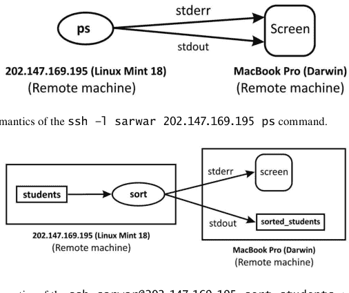

300

Linux

| 标记 | 说明 |
| :--- | :--- |
| `-6` | 仅使用 IPv6 地址。 |
| `-C` | 通过向 `ssh` 此标记来启用压缩。 |
| `-c cipher` | 此选项传递给 `ssh`，用于选择加密数据传输的加密算法。 |
| `-o ssh_option` | 按照 `ssh_config` 文件使用的格式将选项传递给 `ssh`。 |
| `-r` | 递归复制目录。 |
| `-p` | 保留源文件的修改时间、访问时间和模式。 |

以下命令将你当前目录下的 `students` 文件复制到 `202.147.169.195` 上用户 `sarwar` 的 `~/linux2/chill/` 下。本地和远程主机上 `ls -l` 命令的输出确认了文件已从本地主机复制到远程主机。

```
$ cp students sarwar@202.147.169.195:-~/linux2/chill/

sarwar@202.147.169.195:password: xxxxxxx

students 100% 153 0.2KB/s 00:00

$ ls -l 1 Mansoor staff 153 Oct 28 00:52 students

-rw-r--r-- 1 ls -l - ~/linux2/chill/students'

sarwar@202.147.169.195:password: xxxxxxx

-rw-r--r-- 1 faculty 153 Oct 25 00:04 /home/sarwar/linux2/chill/students
```

你可以使用服务器的符号名称而不是 IP 地址来运行命令。

```
$ cp students sarwar@linux18:-~/linux2/chill/

sarwar@linux18:password: xxxxxxx

...

$
```

以下命令递归地复制本地机器上 `sarwar` 的家目录。别忘记在 `~` 之后的空格后输入点号 (`.`)。注意，正如命令输出行所示，我们使用 `<Ctrl+C>` 终止了命令。

```
$ cp -r sarwar@202.147.169.195:-~

Password: xxxxxxx

temp 100% 0 0.0KB/s 00:00

.profile 100% 568 0.6KB/s 00:00

local.login 100% 170 0.2KB/s 00:00

welcomesir 100% 139 0.1KB/s 00:00

known_hosts 100% 397 0.4KB/s 00:00

scp: /export/home/sarwar/.bash_history: Permission denied

local.csh 100% 166 0.2KB/s 00:00

ps.man 100% 28KB 27.9KB/s 00:00

bigdata 100% 32MB 11.2MB/s 12:35

<Ctrl+C> Killed by signal 2.

$
```

## 11.8.7 使用 `sftp` 进行安全文件传输

`sftp` 程序是 `ftp` 的安全版本，它使用 `ssh` 执行操作。它的工作方式与 `ftp` 命令一样，但身份验证发生在文件传输之前，且命令数据传输在加密会话中进行。我们在第7章和附录 A 中介绍的 `vsftpd` 和 `Filezilla` 应用也实现了安全的 `ftp` 连接。以下是 `sftp` 命令的简要描述。

## 网络与互联网络

```
语法：

sftp [-option] host

sftp [user@]host[:file ...]

sftp [user@]host[:dir[/]]

sftp sftp -b batchfile [user@]host
```


## 用途
登录指定的主机并进入类似 `ftp` 的交互式命令模式。第二种语法允许在非交互模式下或操作后自动检索文件。第三种语法允许 `sftp` 从远程目录启动。最后一种语法允许使用批文件中的命令进行自动文件传输，而不是使用标准输入。如果 `batchfile` 为 `-`，则命令来自标准输入。

## 常用选项/功能
- `-C` 通过向 `ssh` 传递此标记来启用压缩
- `-o ssh_option` 按照 `ssh_config` 文件使用的格式将选项传递给 `ssh`

## 会话示例
以下会话显示在 `sftp` 中执行的命令。如输出所示，本地主机的命令以字母 `l`（代表 `local`）开头，如 `ls`, `lmdir`, `lpw` 和 `lumask`。或者，任何以字母 `l` 开头的 Linux shell 命令都会作为 `lpwd` 在本地主机上执行。

### 连接并获取帮助

```
$ sftp sarwar@202.147.169.195

Connecting to 202.147.169.195...

sarwar202.147.169.195:password: xxxxxxx

sftp >

```

### 可用命令
- `bye`
- `cd path`
- `chgrp path`
- `chmod path`
- `chown path`
- `df [-hl] [path]`
- `exit`
- `get [-Pr] remote [local]`
- `get remote [local]`
- `help`
- `lcd path`
- `ls [ls-options [path]]`
- `mkdir path`
- `ls [-s] oldpath`
- `pwd`
- `ls [-la] [path]`
- `umask`
- `mkdir path`
- `progress`
- `put [-Pr] local [remote]`
- `pwd`
- `quit`
- `rename oldpath new`
- `rm path`
- `rdir path`
- `symlink oldpath new`
- `version`
- `!`
- `sftp Change directory to 'path'`
- `Change group of 'path' to 'grp'`
- `Change permissions of 'path' to 'mode'`
- `Change owner of 'path' to 'own'`
- `Display statistics for current directory or filesystem containing 'path'`
- `Download file`
- `Resume remote file`
- `Display this help`
- `Change local directory to 'path'`
- `Display local listing`
- `Create local directory`
- `Link remote file (-s for symlink)`
- `Print local directory`
- `Display remote listing`
- `Set local mask to 'umask'`
- `Create remote directory`
- `Toggle display of progress`
- `Display remote directory`
- `Quit sftp`
- `Rename remote file`
- `Delete remote file`
- `Remove remote directory`
- `Symlink remote file`
- `Show SFTP version`
- `Execute 'command' in local shell`
- `Escape to local shell`
- `Synonym for help`

### 列出本地工作目录

```
sftp> lpwd

Local directory: /Users/Mansoor

sftp>

```

### 列出远程工作目录

```
sftp> pwd

Remote directory: /home/sarwar

sftp>

```

### 列出远程工作目录的文件

```
sftp> ls

Desktop Music

Pictures Servers

Videos bin courses

sorted_students

sftp>

```

### 列出本地工作目录的文件

```
sftp> ls

Desktop Movies Saved

Downloads Sites

Library Public Terminal.txt

sftp>

```

### 将名为 `alien` 的单个文件上传到远程主机

```
$ sftp> put students

Uploading students to /home/sarwar/students

students

sftp>

```

### 将多个 `.txt` 结尾的文件上传到远程主机

```
$ sftp> mput *.txt

Uploading emacs.txt to /home/bob/emacs.txt

emacs.txt

Uploading fwvm.txt to /home/bob/fwvm.txt

fwvm.txt

Uploading vi.txt to /home/bob/vi.txt

vi.txt

sftp>

```

| 传输 | 速度 | 时间 |
| :--- | :--- | :--- |
| 100 191 | 0.2KB/s | 00:00 |
| 100 458KB | 458KB/s | 00:01 |
| 100 50KB | 50KB/s | 00:00 |

### 从远程到本地系统获取（下载）单个或多个文件

```
sftp> get testfile

Fetching /home/bob/testfile to testfile

/home/bob/testfile

sftp>

```

| 传输 | 速度 | 时间 |
| :--- | :--- | :--- |
| 100 22 | 0.0KB/s | 00:00 |

### 在本地和远程机器从一个目录切换到另一个目录

远程机器：

```
sftp> cd testfile

sftp>

```

本地机器：

```
sftp> lcd Documents

sftp>

```

### 在本地和远程机器上创建新目录

远程机器：

```
sftp> mkdir test

sftp>

```

本地机器：

```
sftp> ldir Documents

sftp>

```

### 在远程机器上删除目录或文件

```
sftp> rm Report.xls

sftp> rmdir Documents

sftp>

```

注意，要从远程位置移除/删除目录，该目录必须为空。

### 退出 `sftp`

```
sftp> quit
```


以下章节内练习题让你练习在环境中使用 `ssh`、`scp` 和 `sftp` 命令。

## 练习 11.15

使用 `ssh`、`scp` 和 `sftp` 命令访问你局域网（LAN）上的远程主机，在远程执行命令，并将文件从你的机器复制到网络上的另一台机器上。你使用了什么命令？它们的语义是什么？简要描述你是如何操作的，以及本地和远程系统的输出是什么。

### 11.8.8 封装 ssh 应用程序

除了之前显示的命令行 `ssh` 操作（你可以在终端或控制窗口中执行）外，`Linux`、`Windows`、`iOS/OS` 机器上还有三个非常强大且方便的图形前端程序，它们通过 `ssh`、`scp` 和 `sftp` 实现相同的功能。

第一个应用程序是 `FileZilla`，它允许你在不同计算机系统之间通过 `ssh` 连接进行文件和目录传输。我们将在第 17 章系统管理中考虑它的某些功能。

第二个应用程序是 `PuTTY`，是最流行的 `SSH` 客户端。如第 2 章所示，它允许你从 `Windows` 窗口通过 `SSH` 连接登录到 `Linux` 机器并执行命令。

第三个应用程序是 `termius`，一个 `App Store` 中适用于 `iPhone` 和 `iPad` 等 `iOS` 设备的免费应用。它允许你从 `iPod` 或 `iPad` 到运行 `Linux` 的远程服务器建立 `ssh` 连接，并为该服务器打开一个功能全 `CLI` 窗口。`Mac` 和 `Linux` 用户也可以使用终端窗口通过 `ssh` 命令与 `SSH` 建立连接。

# 语法

```
talk user [tty]
```
目的：与登录在 `tty` 终端上的用户发起交互式通信

`user` 参数：如果用户登录在你的主机上，则是其登录名。如果你要交话的人在另一台主机上，请使用 `login_name@host` 作为用户。如果该用户多次登录到该主机，则需要指定 `tty` 参数。

当你使用 `talk` 命令发起通信请求时，另一个用户的屏幕上会弹出的消息并被中断，告知该用户该请求。另一个用户需要执行 `talk` 命令来响应。这将建立一个通信通道，双方的屏幕被分为上下两部分。上半部分包含你输入的文本，下半部分包含另一个用户的响应。你和另一个用户可以同时交流。`talk` 命令会将你在键盘上输入的字符复制到另一个用户的屏幕上。当任何一方按下 `<ctrl+C>` 且通信期间屏幕被清空，或者你使用 `<ctrl+l>` 重新绘制屏幕时，即可终止会话。

假设 `sarwar` 想与另一个用户 `bob` 交话，且他们都登录在同一台主机上。`sarwar` 执行以下命令向 `bob` 发起 `talk` 请求。

```
$ talk bob
```

当 `sarwar` 按下 `<Enter>` 时，`bob` 的屏幕顶部会显示以下消息。

```
[Waiting for your party to respond]

Message from Talk_daemon@ubitm.agr.up.edu at 13:36 ...

talk: connection requested by sarwar@ubitm.agr.up.edu

talk: respond with: talk sarwar@ubitm.agr.up.edu
```

当 `bob` 运行 `talk` 命令时，`bob` 和 `sarwar` 的屏幕都被分为两，上半部分显示消息 `[Connection established]`，光标移动到两个屏幕的顶部。`bob` 和 `sarwar` 现在准备好交话了。如果 `bob` 在使用 `shell` 时想忽略 `sarwar` 的请求，他只需按下 `<Enter>`。

如果 `bob` 登录在另一台主机——例如 `Linux10`——`sarwar` 需要运行以下命令来发起请求。

```
$ talk bob@Linux10
```

如果 `sarwar` 登录在 `Linux20`，而 `bob` 想与 `sarwar` 通信，他对比上述请求的响应应该是 `talk sarwar@Linux20`。如果 `bob` 多次登录到 `Linux10`，`sarwar` 执行以下命令将在其中一个登录的终端（`tty2`）上发起 `talk` 请求。

```
$ talk bob@Linux10 tty2
```

如果你想阻止所有的 `talk` 请求，因为用户不断用过多的请求打扰你，

```
$ msg n
```

此命令仅对你当前的会话有效。如果你想在登录时阻止所有的 `talk` 和 `write` 请求，请将此命令放入 `~/.profile` 文件中。这样做仅仅是移除 `/dev` 目录下你终端文件对组和其他和其他用户的写权限。因此，你可以通过使用 `chmod 600` 命令对你的终端文件来实现这一点，如下会话所示。注意在执行 `mes n`、`mes y`、`chmod 600 /dev/pts/2` 和 `chmod 620 /dev/pts/2` 命令之前，`/dev/pts/2` 文件权限的变化。

# 网络与互联网络

```
$ who

david pts/0 Oct 9 08:17 (:0)

sarwar pts/1 Oct 25 13:23 (182.185.251.251)

crw-w---- 1 sarwar tty 0x98 Oct 25 15:46 /dev/pts/2

$ msg n

$ ls -1 /dev/pts/2

crw-w---- 1 sarwar tty 0x98 Oct 25 15:47 /dev/pts/2

$ msg y

$ ls -1 /dev/pts/2

crw-w---- 1 sarwar tty 0x84 Oct 25 13:45 /dev/pts/2

$ chmod 600 /dev/pts/2

$ ls -1 /dev/pts/2

crw-w---- 1 sarwar tty 0x84 Oct 25 13:45 /dev/pts/2

$ chmod 620 /dev/pts/2

$ ls -1 /dev/pts/2

crw-w---- 1 sarwar tty 0x98 Oct 25 15:51 /dev/pts/2
```

在不带任何参数的情况下，`msg` 命令显示当前状态。
在接下来的章节练习中，你将使用 `talk` 命令与网络上的朋友建立聊天会话，并体会该命令的各种特性。

# 练习 11.16

使用 `talk` 命令与在线的朋友建立聊天会话。

# 练习 11.17

在你的系统上运行最后一个 `shell` 会话，以识别你的终端文件的路径，并验证 `msg n` 和 `msg` 命令对你终端文件权限的影响。

# 11.88 从此到彼的路由

`traceroute` 命令使用 `IP` 的生存时间（`TTL`）字段来显示你的电子邮件、`ssh` 命令以及从 `ftp` 站点下载的文件从你的主机到目的地（以及反之）的路由（路径中的路由器名称）。它还能让你感受到路由的速度。由于该命令构成了某些安全威胁，系统管理员禁用了它的执行。威胁源于：通过显示到某个主机的路由，可以获取其连接的网络内部结构以及某些机器的 `IP` 地址。`Linux` 默认没有安装 `traceroute` 命令，你需要让管理员安装。你可以使用 `sudo` 安装。以下命令显示了从 `Linux` 系统到 `mit.edu` 的路由。由于到主机的路由取决于位置，该命令的输出可能会有所。

```
$ traceroute mit.edu

traceroute to mit.edu (104.74.143.40), 6 hops
1 202.147.193 0.693ms 0.442ms 0.372ms
2 101.24.149 1.163ms 1.003ms 1.192ms
3 119.30.106.23 1.224ms 1.059ms 1.555ms
4 119.30.106.11 1.646ms 1.607ms 1.358ms
5 119.30.106.5 1.689ms 1.404ms 1.787ms
6 119.30.106.26 196.453ms 179.987ms 181.562ms
7 117.20.31 17.532ms 17.353ms 17.377ms
8 110.93.252.164 18.098ms 17.946ms *
9 213.144.176.232 139.907ms 136.842ms 137.637ms
10 195.22.210.195 151.871ms 153.840ms 158.610ms
11 129.250.8.205 216.851ms 215.512ms 212.654ms
12 129.250.6.133 218.558ms 218.342ms 219.499ms
13 129.250.2.26 218.508ms 221.273ms 220.864ms
14 129.250.3.113 236.175ms 239.262ms 239.244ms
15 129.250.3.218 232.616ms = 232.316ms
16 129.250.4.63 239.885ms 229.536ms 234.037ms
17 212.119.27.186 341.867ms 434.138ms 446.160ms
18 104.74.143.40 224.925ms 224.945ms 225.059ms
```


默认的探测（包）长度为 64 字节，但你可以使用 `-m` 指定更大或更小的长度，例如 `traceroute cs.berkeley.edu -m 40`。如我们示例运行的第一行所示，使用了 64 字节包大小。跟踪行包含了 `traceroute` 发送的三个 64 字节包从一个路由器（也跳数）到下一个的时间。输出显示了从我们的主机到目标主机的各种路由器的 IP 地址。MIT 机器位于 ID 为 `104.74.143`、主机 ID 为 `40` 的 A 类网络。如果 `traceroute` 在 5 秒间隔未收到响应，会对该探测打印星号（`*`）。星号的顺序是解释的，可能是 Linux（或其他相关操作系统）代码中的错误。

# 11.9 重要的互联网组织

表 11.5 列出了管理互联网并为其增长制定计划和政策的一些重要组织。

# 表 11.5 管理互联网并为其增长制定政策的重要组织

| 组织 | 目的 |
|---|---|
| 互联网协会 (`ISOC`)<br>`www.isoc.org` | 一个国际非营利组织，旨在鼓励和促进互联网的使用。`ISOC` 是互联网架构委员会 (`IAB`) 的宿主机 |
| 互联网架构委员会 (`IAB`)<br>`www.lab.org` | 一个负责为互联网和 `TCP/IP` 协议集制定政策和标准的群体 |
| 互联网工程任务组 (`IETF`)<br>`www.ietf.org` | 一个开放的个人（网络设计者、用户、运营商和研究人员），负责互联网的演进和顺利运行。`IETF` 负责为互联网和 `TCP/IP` 协议集设计和开发新技术。`IETF` 是 `IAB` 的技术分支 |
| 互联网研究任务组 (`IRTF`)<br>`www.irtf.org` | 一个负责促进对互联网演进重要的研究的群体，涵盖协议、应用和技术 |
| 互联网分配数字机构 (`IANA`)<br>`www.iana.org` | 全球域名和端口号的分配 |
| 互联网网络中心 (`InternIC`)<br>`www.internic.net` | 维护当前运行的顶级域名注册列表、新顶级域名信息、注册局报告以及已注册域名的信息 |
| 互联网分配名称机构 (`ICANN`)<br>`www.icann.org` | 一个其主要目标是确保互联网分配名称和数字系统的技术协调机构。任何想要直接访问 `ICANN` 指定的顶级域名来注册域名的业务必须通过 `ICANN` 的此目的认证 |

# 网络与互联网络

## 总结

计算机网络始于 1969 年 10 月 29 日晚上 10:30，`UCLA` 学生 `Charley Kline` 在 `ARPANET` 上发送了第一条成功消息。当时，`ARPANET` 由四个主机组成。如今，如果没有无处不在的互联网，计算是不可想象的。网页浏览、文件传输、交互式聊天、电子邮件和远程登录是当今计算机常用的某些服务。电子商务现象改变了人们处理日常家务和在全球范围内连接的方式。`Linux` 在网络世界占据特殊地位，特别是大多数网络协议最初是在 `Linux` 平台上实现的。基于 `Linux` 的计算机运行着大多数提供互联网服务软件的服务器进程。

互联网络的核心基于 `TCP/IP` 协议族。这包括多种协议，其中就用于数据路由和传输的著名的 `TCP` 和 `IP` 协议。互联网路由的关键是 32 位地址（`IPv4`）和 128 位地址（`IPv6`）。最常用的服务是用于网页浏览（以及它提供的所有服务，如电子商务和社交网络网站）、电子邮件、文件传输和远程登录。只有 `Linux` 系统支持所有的互联网服务，但它们还有额外的实用程序支持本地活动。

本章讨论的主题包括网络和互联网的通用结构、网络协议、`TCP/IP` 族、`DNS`、互联网协议和服务以及用于执行网络和互联网相关任务的 `Linux` 实用程序。这些实用程序通过客户端-服务器模型实现。这里的实用程序包括 `finger`（用于查找用户信息）、`ftp` 和 `sftp`（用于传输）、`ip`、`host`，`nslookup`（用于检查和设置网络接口参数，以及域名到 IP 地址及其反向转换）、`ping`（查找主机状态）、`sc`（在 `Linux` 主机上远程复制副本）、`ssh`（用于登录远程主机并执行命令）、`talk`（用于交互式聊天）、`telnet`（用于远程登录）和 `traceroute`（用于跟踪数据从你的主机到目的主机的路由）。

## 问题与练习

1. 什么是计算机网络？它们为什么重要？

2. 什么是互联网络？什么是互联网？

3. 构成互联网主要支柱的关键协议有哪些？它们是在哪里开发的？

4. 什么是 `IPv4` 地址？它的位和字节大小是多少？`DDN` 是什么？`IPv6` 地址的位和字节大小是多少？

5. `IPv4` 地址的分类是什么？给出一个二进制的 `IPv4` 地址，如何判断它属于哪一类？当地址以 `DDN` 表示时，如何判断该地址的类别？

6. 什么是 `DNS`？可以将主机名翻译为地址的 `Name` 命令。

7. 列出属于以下 `TLD` 的两个站点域名：`edu`, `com`, `gov`, `int`, `mil`, `net`, `org`, `bus`, `beer`, `careers`, `church`, `de`, `kr`, `pk`, 和 `uk`。你是如何找到它们的？不要使用教科书中的示例。

8. 读取 `ftp://ftp.isi.edu/in-notes/iana/assignments/port-numbers`，以识别以下常用服务的端口号：`ftp`, `http`, `time`, `daytime`, `echo`, `ping` 和 `quote-of-the-day`。

9. `finger` 协议的超时时间是多少？你是如何得到答案的？

10. 给出一个与以下命令完成相同任务的命令。

    ```
    rsh upsun29 sort < students > sorted_students
    ```

11. 通过绘制一个类似于图 11.8 和 11.9 所示的图，显示以下命令的语义。假设本地主机的名称为 `upsun10`。

    ```
    cat students | ssh upsun29 uniq > sorted_uniq_students
    ```

12. 显示系统上的 `/etc/services` 文件，并列出常用端口或以下服务的端口号：`datetime`, `time`, `quote-of-day` (`qtd`), `echo`, `smtp` 和 `finger`。你找到所有它们了吗？端口号与问题 8 中找到的匹配吗？

13. 使用通过 `mit.edu` 的 `daytime` 服务获取当前时间。写下你的命令。

14. 使用主机 `nic.merit.edu` 上任何未使用的 `ftp`，从 `nsfont/statistics` 目录获取 `history.netcount` 和 `history.hosts`。这些文件包含了 `NSFNET` 基础设施上的国内和国外网络及主机数量。根据这些文件中的统计，从网络和主机来看的规模是多少？虽然统计数据有些过时，你预测一年后它的规模是多少？为什么？显示你的计算过程。

15. 你在 `~/.hosts` 中为网络上的主机创建了以下条目。

    ```
    host1 john.doe
    host2 mike.brich
    ```

    如果 `john.doe` 和 `mike.brich` 是你网络中 `host1` 和 `host2` 上的用户会有什么后果？两个用户都使用了你的组。

16. 给出一个显示你网络上所有主机简单名称的命令。

17. 使用命令显示 `mit.edu` 上姓名中包含 `Smith` 的所有用户信息。显示你用于获得答案所使用的命令。

18. 给出一个命令，逐页显示 `mit.edu` 上姓名中包含 `Chen` 的用户信息。存在多少个用户？

19. 描述以下语义：`sc`（在 `Linux` 主机上远程复制副本）、`ssh`（登录远程主机并执行命令）、`talk`（交互式聊天）、`telnet`（远程登录）和 `traceroute`（跟踪数据从你的主机到目的主机的路由）。

20. 描述以下语义：`sc`（在 `Linux` 主机上远程复制副本）、`ssh`（登录远程主机并执行命令）、`talk`（交互式聊天）、`telnet`（远程登录）和 `traceroute`（跟踪数据从你的主机到目的主机的路由）。

21. 描述以下语义：`sc`（在 `Linux` 主机上远程复制副本）、`ssh`（登录远程主机并执行命令）、`talk`（交互式聊天）、`telnet`（远程登录）和 `traceroute`（跟踪数据从你的主机到目的主机的路由）。

22. 描述以下语义：`sc`（在 `Linux` 主机上远程复制副本）、`ssh`（登录远程主机并执行命令）、`talk`（交互式聊天）、`telnet`（远程登录）和 `traceroute`（跟踪数据从你的主机到目的主机的路由）。

23. 描述以下语义：`sc`（在 `Linux` 主机上远程复制副本）、`ssh`（登录远程主机并执行命令）、`talk`（交互式聊天）、`telnet`（远程登录）和 `traceroute`（跟踪数据从你的主机到目的主机的路由）。

24. 描述以下语义：`sc`（在 `Linux` 主机上远程复制副本）、`ssh`（登录远程主机并执行命令）、`talk`（交互式聊天）、`telnet`（远程登录）和 `traceroute`（跟踪数据从你的主机到目的主机的路由）。


- 25. 描述以下语义：`sc`（在 Linux 主机上远程复制副本）、`ssh`（登录远程主机并执行命令）、`talk`（交互式聊天）、`telnet`（远程登录）和 `traceroute`（跟踪数据从你的主机到目的主机的路由）。
- 26. 描述以下语义：`sc`（在 Linux 主机上远程复制副本）、`ssh`（登录远程主机并执行命令）、`talk`（交互式聊天）、`telnet`（远程登录）和 `traceroute`（跟踪数据从你的主机到目的主机的路由）。
- 27. 描述以下语义：`sc`（在 Linux 主机上远程复制副本）、`ssh`（登录远程主机并执行命令）、`talk`（交互式聊天）、`telnet`（远程登录）和 `traceroute`（跟踪数据从你的主机到目的主机的路由）。
- 28. 描述以下语义：`sc`（在 Linux 主机上远程复制副本）、`ssh`（登录远程主机并执行命令）、`talk`（交互式聊天）、`telnet`（远程登录）和 `traceroute`（跟踪数据从你的主机到目的主机的路由）。
- 29. 描述以下语义：`sc`（在 Linux 主机上远程复制副本）、`ssh`（登录远程主机并执行命令）、`talk`（交互式聊天）、`telnet`（远程登录）和 `traceroute`（跟踪数据从你的主机到目的主机的路由）。
- 30. 描述以下语义：`sc`（在 Linux 主机上远程复制副本）、`ssh`（登录远程主机并执行命令）、`talk`（交互式聊天）、`telnet`（远程登录）和 `traceroute`（跟踪数据从你的主机到目的主机的路由）。


# 12 Bash 入门编程

## 目标

- 引入 shell 编程概念
- 讨论 shell 程序是如何执行的
- 描述 shell 变量的概念和用法
- 讨论如何将命令行参数传递给 shell 程序
- 解释命令替换的语法
- 描述一些基础编码原则
- 讨论用于 Bash 脚本的各种控制结构
- 解释 Bash 中各种类型运算符的语法、语义及其优先级
- 编写并讨论一些 Bash 脚本
- 描述如何分组并按顺序执行 Bash 命令
- 涵盖以下命令和原语：

```
$ = , " ' , &, && , ^ , < > , | || , / , ; [ ] , ; bash, break, case,
continue, exit, export, env, for, if, ls, readonly, set, sh, shift, shift,
uname, while, until, unset
```

## 12.1 介绍

Bourne again shell (Bash) 不仅仅是一个命令解释器。它有自己的编程语言，可以编写 shell 程序来执行任何现有命令无法完成的各种任务。程序通常称为 shell 脚本，由在 shell 中执行的 shell 命令组成（一次执行一个），并存储在任何 Linux 文件中。shell 允许用户和程序员使用名为 shell 变量的读/写存储空间，作为完成任务的草稿纸。shell 还包含程序控制流（也称为语句），允许 shell 脚本中命令的非本地执行以及命令块的重复执行——类似于 C 等高级编程语言。

## 12.2 运行 Bash 脚本

运行 Bash 脚本有三种方法。所有方法的第一步都是通过编辑文件的访问权限使脚本文件变为可执行。你可以通过运行命令 `chmod +x hello_world` 来，其中 `hello_world` 是包含脚本的文件名。如果不使脚本文件变为可执行，Bash 将显示错误信息，说明 `hello_world` 文件中的脚本无法执行。

```
$ cat hello_world
echo "Hello, world!"
```

```
$ ./hello_world
-bash: ./hello_world: Permission denied
$ chmod +x hello_world
```

显然，在这种情况下，你仅为自己设置了脚本执行权限。但如果你想让其他用户也能执行它，可以为文件设置适当的访问权限。一旦你使脚本可执行，你就可以输入 `./hello_world` 命令来执行该 shell 脚本，如下：

```
$ ./hello_world
Hello, world!
$
```

如果你的搜索路径（`PATH` 变量）包含当前目录（`.`），你可以直接使用 `hello_world` 命令，而无需使用 `./hello_world` 命令。在本章的剩余部分中，我们假设你的 `PATH` 变量包含当前目录。

正如第 10 章所述，当前 shell 的子进程执行脚本。因此，使用这种方法，如果你使用的是 Bash，脚本将正常执行；如果你使用的是任何其他 shell，则不会。如果你目前正在使用其他 shell，请先执行 `/bin/bash` 命令进入 bash，然后运行 `hello_world` 命令，如下所示。在这里，我们假设你的当前 shell 是 C（或 TSH），shell（带有 % 提示符）。在脚本完成执行后，我们按下 `<Ctrl+D>` 终止并返回 C shell。

```
% /bin/bash
$ hello_world
Hello, world!
$ <Ctrl+D>
%
```

执行 shell 脚本的第二方法是运行 `/bin/bash` 命令并将脚本文件作为其参数。因此，以下命令执行 `hello_world` 中的 shell 脚本。

```
$ /bin/bash hello_world
Hello, world!
$
```

如果你的 `PATH` 变量包含 `/bin` 目录，你可以直接使用 `bash` 命令，而无需使用 `/bin/bash` 命令。

第三方法也是最常用的方法，是强制当前 shell 在 bash 中执行脚本，无论你当前使用什么 shell。你可以通过以包含 `#!/bin/bash` 的行开头 shell 脚本来实现，如下话所示：

```
$ cat hello_world
#!/bin/bash
echo "Hello, world!"
$
```

当你的 shell 遇到字符串 `#!` 时，它会将该行的剩余视为要执行的 shell 的绝对路径，脚本在该路径下执行。如果你的当前 shell 是 C shell，你可以将此行替换为冒号 `:`，它在 Bash 中被称为空字符。当 C shell 读取到 `:` 作为第一个字符时，它会运行一个 Bash 进程执行脚本中的命令。`:` 命令将返回本章稍后命令的值。

在本章中，我们将使用 `chmod +x script_file` 命令使文件所有者能够执行 `script_file`，并使用 `./script_file` 命令运行脚本。


## 12.3 Shell 变量及相关命令

变量带有名称的内存位置。它允许你通过名称引用该内存位置。shell 变量可以是两种类型之一：环境变量和用户定义变量。环境变量由系统设置；你可以通过给某些环境变量赋值来定制化你的环境。用户定义变量由用户创建。

环境变量是可写的，你可以为它们分配任何值。某些环境变量是只读的，这意味着你不能更改它们。这些只读变量用于跟踪当前进程的 ID、最近后台进程的进程 ID 以及上一个命令的退出状态。一些重要的只读 shell 变量列在表 12.2 中。

### 表 12.2 只读 Bash 环境变量

| 环境变量 | 变量的用途 |
| --- | --- |
| `$0` | 程序名称 |
| `$1-$9` | 命令行参数 1-9 的值 |
| `$*` | 所有命令行参数的值 |
| `$@` | 所有命令行参数的值；如果 `$0` 被引号括起来（如 `"$0"`），则每个参数都是单独的 |
| `#` | 命令行参数的总数 |
| `$$` | 当前进程的 `PID`（进程标识符） |
| `$?` | 最近一个命令的退出状态 |
| `$!` | 最近一个后台进程的 `PID` |

用户定义变量在 shell 脚本中用作临时存储位置，值可以在程序执行时发生更改。这些变量也可以被设置为只读，并传递给定义它们的 shell 脚本中执行的命令。与其他编程语言不同，在 Bash 编程语言中，你不需要声明和初始化 shell 变量。未初始化的变量会被初始化为空字符串。

你可以使用不带任何参数的 `set` 命令显示所有 shell 变量（包括用户定义变量）名称及其当前值。正如本章后文所述，`set` 命令也可以用于更改只读环境变量的值。以下是我们在我们的机器上运行 `set` 命令的示例输出：


```bash
$ set
BASH=/bin/bash
HASHOPTS=checkwins:cmdhist:complete_fullquote:expand
aliases=extob:extquote:force_fignore:histappend:interactive_comments:login_shell:
prog:promptvars:sourcepath
...
 [output truncated]
PID=2592
PS1='\u\u033[0m\u0033[h \[w\] \\u033(debian_root)\\u033[01;32m\]u@\\u033[00m] \[\u033[01;34m\]w $\\u033[00m] '
PS2='* '
PS4='
PWD=/home/sarwar/linux2/che
SHELL=/bin/bash
SHELLOPTS=braceexpand:emash:histextend:history:
interactive_comments:monitor
SHLV=1
SSH_CLIENT='103.255.5.80 5141 22'
SSH_CONNECTION='103.255.5.80 5141 202.147.169.195 22'
SSH_TTY=dev/pts/0
TERM=xterm-color
UID=1004
USER=sarwar
 [output truncated]
$
```

你也可以使用 `env` 和 `printenv` 命令来显示环境变量的名称及其值，但列表没有 `set` 命令显示的那么完整。特别是，输出不包含任何用户定义变量。以下是在我们运行 `set` 命令的系统上运行 `env` 命令的示例输出。`printenv` 命令产生相同的输出：

```bash
$ env
LC_PAPER=ur_PK
```

# Bash 编程入门

```bash
LC_ADDRESS=ur_PK
XDG_SESSION_ID=1760
LC_MONETARY=ur_PK
TERM=extern-color
SHELL=/bin/bash
XDG_SESSION_COOKIE=4603ef0b06402836974a04d12e5ab-1497116101.710678-182682659
SSH_CLIENT=103.255.5.80 5411
LC_NUMERIC=ur_PK
SSH_TTY=/dev/pts/0
USER=sarwar
... [output truncated] ...
OLDPWD=/home/sarwar/linux2e/ch13
$
```

在后续章节练习中，你将创建一个简单的 shell 脚本并使其可执行。你将使用 `set`、`printenv` 和 `env` 命令来显示你系统中 shell 变量的名称和值。

## 练习 12.1

- 显示你 Linux 上所有 shell 变量的名称和值。你使用了什么命令？

## 练习 12.2

- 创建一个包含 shell 脚本的文件，脚本包含 `date` 和 `pwd` 命令，每行一个。使文件可执行并运行该 shell 脚本。列出完成此任务的所有步骤。

### 12.3.1 控制提示符

`Bash` 允许你以简单的方式控制提示符。你可以为提示符变量（`PS1`、`PS2` 等）分配一个或多个特殊字符，以显示多个提示符。一些常用字符见表 12.3。

下面，我们展示了各种特殊字符如何改变你的 shell 提示符。注意，你可以组合特殊字符并将它们分配给你的提示符。

```bash
$ PS1='\w '
~/linux2e/ch12 date
Sun Jun 11 14:28:47 PKT 2017
~/linux2e/ch12 PS1='\ds '
Sun Jun 11 15:18 PS1='\h '
Mnt:14:30 PS1='\t '
14:30:03 PS1='\s-\v$ '
bash-4.3
```

#### 表 12.3

| 特殊字符 | 说明 |
| --- | --- |
| `\H` | 完整的宿主机名，例如 `harvard.edu` |
| `\T` | 12 小时制 `hh:mm:ss` 格式的时间 |
| `\d` | “周 月 日”格式的日期 |
| `\h` | 计算机的主机名 |
| `\s` | 你的 shell 名称 |
| `\t` | 24 小时制 `hh:mm:ss` 格式的时间 |
| `\u` | 当前用户名 |
| `\v` | `Bash` 版本，如 `4.3` |
| `\w` | 当前目录 |

### 12.3.2 变量声明

`Bash` 不要求你声明变量，但你可以使用 `declare` 和 `types` 命令来声明变量、初始化它们并设置属性。`Bash` 变量默认是字符串类型，但你可以定义整数和数组（见第 13 章）。以下是这些命令的简单描述：

**语法：**

`declare [options] [name=[value]]`

`types [options] [name=[value]]`

**用途：** 声明变量，初始化它们并设置属性。在函数内部，创建变量的新副本。

**输出：** 不带选项时，显示当前 shell 环境中的变量及其值。带有选项时，显示具有特定属性的变量。

**常用选项：**

- `-a`：`name` 是数组
- `-f`：`name` 是函数
- `-i`：`name` 是整数
- `-r`：`name` 是只读（无法关闭）
- `+x`：`name` 是导出的（`exported`）

未初始化的变量有一个为空字符串。`Bash` 不要求在声明时指定变量的属性。你可以稍后使用 `declare` 或 `types` 命令初始化变量并设置其属性。在下面的会话中演示了 `declare` 命令的使用；你可以用 `types` 命令替换它。

```bash
$ declare age=5
$ declare -rx OS=Linux
$ echo age
5
$ echo $OS
Linux
$ declare OS
$ declare age
5
$ echo $OS
Linux
$ echo age
5
$
```

当你不带参数使用 `declare` 和 `types` 命令时，它们会显示环境中所有的 shell 变量及其值。你可以使用这些命令查看具有特定属性的变量。下面的会话显示了一些示例。为了空间显示了部分输出。注意 `declare -ir` 显示环境中的所有整数和只读变量。

```bash
$ declare -i
$ declare -ir BASHPID
```

# Bash 编程入门


```
declare -ir EUID="1004"
declare -i HISTCMD
declare -i LINENO
declare -i MAILCHECK="60"
declare -i OPTIND="1"
declare -ir PPID="13147"
declare -i RANDOM
declare -ir UID="1004"
declare -x
declare -x HOME="/home/sarwar"
... [output truncated]
declare -x MAIL="/var/mail/sarwar"
declare -x OLDPWD="/home/sarwar"
declare -x PATH="/usr/local/sbin:/usr/local/bin:/usr/sbin:/usr/bin:/sbin:/bin:/usr/games:/usr/local/games"
declare -x PWD="/home/sarwar/linux2/ch12"
declare -x SHELL="/bin/bash"
declare -x SHLV=1
declare -x SSH_CLIENT="103.255.5.80 6489 22"
declare -x SSH_CONNECTION="103.255.5.80 6489 195 22"
declare -x SSH_TTY="/dev/pts/1"
declare -x USER="sarwar"
... [output truncated]
$ declare -ir
declare -x BASHOPTS="checkwinize:cmdhist:complete_fullquote:expand_aliases:
exttextglob:extquote:force_fignone:histappend:interactive_comments:login_shell:
progcomp:promptvars:sourcepath"
declare -i BASHPID
declare -ir
declare -ar BASH_COMPLETION_COMPAT_DIR=/etc/bash_completion.d"
declare -ar BASH_VERSIONINFO=(\[0]=4" [1]=3" [2]=2" [3]=1" [4]=release" [5]="x86_64-pc-linux-gnu")
declare -ir EUID="1004"
... [output truncated]
declare -ir UID="1004"
$ declare
/bin/bash
BASHOPTS="checkwinize:cmdhist:complete_fullquote:expand_aliases:
exttextglob:extquote:force_fignone:histappend:interactive_comments:login_shell:
progcomp:promptvars:sourcepath"
BASH_ALIASES=()
ASH_ARGS=()
ASH_ARGV=()
ASH_CMDS=()
BASH_COMPLETION_COMPAT_DIR=/etc/bash_completion.d
BASH_LINENO=()
ASH_SOURCE=()
ASH_VERSIONINFO=(\[0]=4" [1]=3" [2]=2" [3]=1" [4]=release" [5]="x86_64-pc-linux-gnu")
ASH_VERSION="4.3.42(1)"
COLUMNS=80
DIRSTART=()
EUID=1004
$
```

你可以通过名称来更改变量的值。你可以利用此来声明可以分配字符串值的通用变量。整数变量不能赋值非整数值；这样做会导致变量获得零值。非整数变量可以赋值任何值，因为每个值都存储为字符串。后面的会话显示了一些示例。由于 `age` 被声明为整数变量，赋值值 "Fifty-eight" 会导致结果为 0。另一方面，由于 `name` 和 `place` 是通用变量，它们可以被赋予任何类型的值（整数或字符串）。

```
$ declare -i age=58
$ echo age
58
$ age="Fifty-eight"
$ echo age
0
$ name=John
$ declare place=Portland
$ echo name $place
John Portland
$ name=2017 place=007
$ echo name $place
2017 $
```

### 12.3.3 读取和写入 Shell 变量

你可以使用 `variable=value` 语法，通常被称为赋值语句，其目的是给变量赋值。赋值语句的求值是从左到右进行的。因此，首先计算 `value` 并将其赋值给 `variable`。如果在计算 `value` 时出现问题，将报告错误。以下是赋值语句的通用语法：

`variable1=value [variable2=value2 ... variables=value]`

目的：将值 `value`, ..., `values` 分别赋值给 `variable1`, ..., `variables`；等号前后不允许有空格

注意，语法中等号 (`=`) 前后均没有空格。如果值包含空格，你必须将该值括在引号中。单引号和双引号的作用不同，正如本节所讨论。你可以通过在变量名之前放置美元符号 (`$`) 来引用（即访问）变量的当前值；你可以使用 `echo` 命令显示 shell 变量的值。各种语法和替换操作符在表 12.4 中描述。

在接下来的章节中，我们将展示如何读取（解释）和写入（创建）shell 变量。第一个 `echo` 命令为未初始化的变量名显示空行。然后变量 `name` 被初始化为 David，随后的 `echo` 命令将其赋值为 David，其包含值 David。`echo ${name:-John}: ${place:-Portland}` 命令的输出是 Portland，因为 `name` 的值为 David，而 `place` 的值为 Portland。`echo ${place:-"Not defined"}` 命令显示 `-bash: Not defined`，因为变量名已初始化为一个非空值。`echo ${place:-"Not defined"}` 命令显示空字符串，因为变量 `place` 未被定义，因此是空的。`echo ${name:-"San Francisco"}` 命令将值 San Francisco 赋值给变量 `place` 并显示该值，因为 `place` 未定义（在同一会话稍早时候已取消设置）。最后，`echo ${name:-John}: ${place:-Portland}` 命令显示 David San Francisco，因为变量 `name` 的值为 David，而变量 `place` 的值为 San Francisco。

```
$ echo $name
$ name=David
$ echo $name
David
```

```
$ echo Portland
```

单引号应用于保留所有字符（单引号除外）的字面含义。双引号保留除单引号、美元符号和反斜杠以外的所有字符的字面含义。反斜杠保留其后续字符的字面含义，n 除外。换行符 (`\n`) 有特殊含义，为了保留它，必须将其括在单引号中，如 `'\n'`。在双引号中，反斜杠保持其字面含义，除非它紧随以下字符：反斜杠、单引号、双引号、美元符号和换行符。将 `'$'` 和 `'\''` 括起来保留除单引号和反斜杠以外的所有字符的字面含义。`\t` 和 `\v` 特殊含义，分别代表制表符和退格键。

### 表 12.4

| 操作符 | 目的 | 描述 |
| --- | --- | --- |
| `$variable` | 获取变量的值，如果未初始化则返回空 | 返回 `variable` 的值，如果未初始化则返回空 |
| `${variable}` | 获取变量的值，如果未初始化则返回空；当在值后面附加其他内容时 | 返回 `variable` 的值，如果未初始化则返回空 |
| `${variable:-string}` | 如果变量未定义则将其设置为已知值并返回该值 | 如果 `variable` 存在且不为空，则返回其值；否则将 `string` 赋值给 `variable` 并返回 |
| `${variable:=string}` | 如果变量未定义则将其设置为已知值并返回该值 | 如果 `variable` 存在且不为空，则返回其值；否则将 `string` 赋值给 `variable` 并返回 |
| `${variable?string}` | 如果变量未定义则显示消息 | 如果 `variable` 存在且不为空，则返回其值；显示 `variable`: 后跟 `string` 作为消息 |
| `${variable:+string}` | 测试变量是否存在 | 如果 `variable` 存在且不为空，则返回 `string`；否则返回空 |


下一节展示了执行 `echo` 命令过程的示例，即当前的 shell 进程。`ps` 命令的输出验证了 21914 在运行，这是你当前 bash 进程的 PID。注意 `*` 代表当前工作目录下的文件和目录名。

```bash
$ echo '$name * ? \'
$name = ? \\'
```

# Linux

```bash
$ echo "$ * \n ?"
$ * \n ?"
$ echo "$\$ * \n ?"
21914 $ * * \n ?
$ ps
```

| PID | TTY | TIME | CMD |
| :--- | :--- | :--- | :--- |
| 21914 | pts/0 | 00:00:00 | bash |
| 21934 | pts/0 | 00:00:00 | ps |

```bash
$ echo "\$ * \' \" \\"
$ '\' * \n"
$ echo '$$a d ? * "'$'
$ d ? = "$\'
$ echo '$$a \$ ? * "'$\'
$ a ? = "$ * "'$\'
$ echo '$$a ' ? * "$$$
```

- 桌面 文档 下载 音乐 公共 模板 视频 $

命令 `$variable` 仅导致 `*variable*` 作为 shell 命令执行的结果。如果 `*variable*` 的值包含有效命令，将产生预期的结果。如果 `*variable*` 不包含有效命令，将显示错误消息。

下一节展示了执行 `echo` 命令过程的示例，即当前的 shell 进程。`ps` 命令的输出验证了 21914 在运行，这是你当前 bash 进程的 PID。注意 `*` 代表当前工作目录下的文件和目录名。

```bash
$ command-$(pwd)
$ echo "The value of command is: $command."
The value of command is: /home/sarwar/linux2e/ch12.
$
```

命令替换可以在任何命令中指定。例如，在下面的会话中，在执行 `echo` 命令之前，`date` 命令的输出被替换为 `date`。

```bash
$ echo "The date and time are `date`"
The date and time are Sat Jun 10 23:32:58 PKT 2017.
$
```

在本章和第 13 章中，我们将通过多种方式演示命令替换在实际世界中的应用。
以下章节练习旨在强化 shell 变量的创建与使用以及命令替换的概念。

# 练习 12.3

将你的名字赋值给名为 `myname` 的 shell 变量并打印它的值。你是如何完成这项任务的？展示你的操作步骤。

# 练习 12.4

将 `echo "Hello, world!"` 命令的输出赋值给 `myname` 变量并显示 `myname` 的值。列出你完成工作时执行的命令。

## 12.5 导出环境变量

当在 shell 中创建一个变量时，子进程 shell 无法自动访问它。`export`、`declare -x` 或 `typeset -x` 命令会将值传递给所有子进程 shell。因此，当在另一个 shell 中调用并执行一个 shell 时，它无法自动访问原始（即调用者）定义的变量，除非显式地向其提供。这些命令可以将一个或多个变量的值传递给子进程 shell。读/写环境变量每个命令、脚本和子 shell 都可用，因此它们在初始化时就会导出。以下是这三个命令的简要描述：

| 语法 | 目的 |
| :--- | :--- |
| `declare -x [name-list]`、`typeset -x [name-list]`、`export [name-list]` | 将 name-list 中当前值的名称和拷贝导出从此处开始执行的每个命令中 |

接下来的会话展示了 `declare -x` 命令的用法。变量 `place` 被初始化为 "xtre name"，并导出到当前 shell 下执行的子进程命令以及在当前 shell 下运行的所有子 shell 中。

```bash
$ declare -x place="xtre name"

$ export place

$
```

我们现在通过简单的 shell 脚本来说明导出变量的概念。然而，重要的是，除非你的路径（即 `PATH` 变量）被设置为包含当前目录（`.`），否则你必须在命令行或脚本文件中显式地在文件名名前加上 `./`。如果不这样做，shell 将显示以下错误信息：

```bash
file_name: command not found
```

现在，考虑下面的会话。注意，`display_name` 显示的两行 shell 脚本显示了一个空字符串，尽管我们在执行此脚本之前已将 `name` 变量初始化为 John Doe。原因是 `name` 变量在脚本之前没有导出，且脚本中使用的 `name` 是脚本局部的。由于该局部变量未初始化，`echo` 命令显示空字符串——这是每个未初始化变量的默认值。请注意，如果你的 `PATH` 包含当前目录，你可以在 `display_name` 前不加 `./` 运行脚本。

```bash
$ cat display_name

echo $name

exit 0

$name="John Doe"

$ ./display_name
```

你可以使用 `exit` 命令将控制权转移给调用进程——即上一个会话中的进程。`exit` 命令的唯一参数是一个可选的整数，它作为终止进程的退出状态返回给调用进程。所有 Linux 命令在成功时返回退出状态零（即它们成功执行了任务并正常终止），失败时返回非零。命令的返回状态存储在只读变量 `$?` 中，调用进程可以检查并/或显示该值。在 shell 脚本中，命令的状态通常会被检查并执行后续操作。我们将在本章稍后的脚本中展示 `$?` 的用法。当不带参数执行 `exit` 命令时，Linux 内核会返回脚本的状态值。

在接下来的会话中，`name` 变量在初始化后被导出，使其在执行 `display_name` 脚本时可用，脚本显示 John Doe 而不是空字符串，这是它在上一个会话中执行的结果。该会话还显示 `display_name` 命令的返回状态为 0。注意，你可以将变量的初始化和导出合并为一个命令，如 `export name="John Doe."`。

```bash
$ declare -x name="John Doe"

$ ./display_name

John Doe

echo $?

0
```

我们现在展示导出变量的值的副本会被传递给任何后续命令。换句话说，命令只能访问导出变量的值；它不能为该变量分配新值。考虑 `export_demo` 文件中的脚本。

```bash
$ cat export_demo

#!/bin/bash

declare -x name="John Doe"

display_change_name

display_name

exit 0

$ cat display_name

#!/bin/bash

echo $name

name="Plain Jane"

echo $name

exit 0
```

```bash
$ ./export_demo

John Doe

Plain Jane

John Doe

$
```

当调用 `export_demo` 脚本时，变量被设置为 John Doe 并导出，因此它成为在 `export_demo` 下执行的所有命令的环境的一部分。`display_change_name` 中的第一个 `echo` 命令显示 John Doe。`display_change_name` 中的第二个 `echo` 命令显示 Plain Jane。`display_name` 中的第三个 `echo` 命令显示 John Doe。因为变量已经导出，在 `display_name` 内部的修改不会影响主脚本。

```bash
$ ./export_demo

John Doe

Plain Jane

John Doe
```

## 12.3.6 重置变量

变量只要脚本仍在运行就会保留其值。你可以通过 `unset` 命令将变量重置为空。以下是 `unset` 命令的简单用法：

```bash
$ declare -x name=John place=Corvallis

$ echo $name $place

John Corvallis

$ unset name

$ echo $name

Corvallis
```

`unset` 从环境中移除变量。

```bash
$ unset place

$
```

另一种重置变量的方法是直接赋值为空：

```bash
$ country=
```


## 12.3.7 创建只读变量

在编程时，有时需要使用常量。你可以使用字面常量，但使用符号常量是一种良好的编程实践，因为它使代码更具可读性。使用符号常量的另一个原因是多个处使用的常量可能需要更改。使用符号常量只需在一个处更改，而字面常量必须在使用的每个地方都更改。通过初始化变量所需的值并使用 `readonly`、`declare -r` 或 `typeset -r` 命令将其只读，可以在 Bash 中创建符号常量。这在 shell 脚本中很少使用，但为了完整覆盖变量，我们进行了讨论。以下是这些命令的简要描述：

*   `declare -r [name-list]`
*   `typeset -r [name-list]`
*   `readonly [name-list]`: 防止对变量分配新值

在下面的章节中，`name` 和 `place` 变量在分别初始化为 `John` 和 `Ames` 后变为只读。一旦它们变为只读，对它们的赋值将失败。在后续会话最后一个语句的情况下，Bash 在发现变量是只读的时会终止命令。因此，`place` 保持初始化为 `Ames`。

```bash
$ declare -r name=John place=Ames
$ echo "$name $place"
John Ames
$ declare name=Art place="Ann Arbor"
-bash: name: read only
-bash: place: read only
$ name=Art place="Ann Arbor"
-bash: readonly variable
```

当不带参数执行 `readonly`、`declare -r` 或 `typeset -r` 命令时，它会显示所有只读变量，如下会话所示。`BASHID`、`BASH_VERSIONINFO`、`UID`、`PPID`、`SHELLOPTS` 和 `U` 是环境变量。`name` 和 `place` 是在上一个会话中用户定义的只读变量。

```bash
$ readonly
BASHID=...
BASH_VERSIONINFO=...
UID=...
PPID=...
SHELLOPTS=...
U=...
name=John
place=Ames
```

`declare -r`

```bash
$ declare -r BASHOPTS="checksize:cmdhist_complete_fullquote:expand\nalias:extquote:force_fignore:histappend:interactive_comments:login_shell\nprocomp:promptvars:sourcepath"
declare -ir BASH_COMPLETION_DIR=/etc/bash_completion.d"
declare -ar BASH_VERSINFO=''([0]="4" [1]="3" [2]="42" [3]="1" [4]="release" [5]="x86_64-pc-linux-gnu")
declare -ir UID="10004"
declare -r PPID="3347"
declare -r SHELLOPTS="braceexpand:emacs:histand:history:interactive-\ncomments:monitor"
declare -ir UID="1004"
declare -r name="Jim"
declare -r place="Ames"
$
```

在 Linux 系统上，该命令的输出显示了只读变量及其的值。你无法重置只读变量的值。以下显示了一个示例：

`unset`

```bash
-bash: unset: name: cannot unset: readonly variable
$
```

## 12.3.8 从标准输入读取

到目前为止，我们已经了如何在命令行级别静态地为 shell 变量赋值，或者在程序中使用赋值语句。如果你想编写一个交互式 shell 脚本来提示用户进行键盘输入，你需要使用 `read` 命令将用户输入存储在 shell 变量中。该命令允许你读取一行标准输入。以下是该命令的简要描述：

*   **语法：** `read [options] [variable-list]`
*   **目的：** 从标准输入读取一行，并将行中的单词分配给变量列表 `variable-list`

常用选项：
*   `-a name` 将单词读入 "name" 数组
*   `-e` 将整行读入第一个变量；其余变量均为空
*   `-p prompt` 如果从终端读取，则显示 "prompt"

读取的一行由空格 `<Space>` 或制表符 `<Tab>` 字符分隔的单词，这取决于 shell 环境变量 `IFS` 的值。单词按照它们出现的顺序从左到右分配给变量。如果一行中的单词数多于变量列表 `variable-list` 的数量，则最后一个变量将分配额外的单词。如果一行中的单词数少于变量，则剩余变量将重置为空。

我们通过在 `read_demo` 文件中显示以下脚本来阐明 `read` 命令的语义。

```bash
$ cat read_demo
#!/bin/bash
echo -n "Enter input: "
read line
echo -n "Enter another line: "
read word1 word2 word3

echo "The first word is: $word1"
echo "The second word is: $word2"
echo "The rest of the line is: $word3"
exit 0
```

我们现在展示脚本中的 `read` 命令如何读取你从键盘输入的内容。在接下来的运行中，你输入了相同的输入：`Linux rules the network computing world!`。第一个命令获取整个输入并将其放入 shell 变量 `line` 中，不包含换行符。在第二个命令中，你输入的第一个单词被分配给变量 `word1`，第二个单词分配给变量 `word2`，其余部分（不包含换行符）分配给变量 `word3`。显示这些变量值的命令输出确认了这一点。

```bash
$ ./read_demo
Enter input: Linux rules the network computing world!
You entered: Linux rules the network computing world!
Enter another line: Linux rules the network computing world!
The first word is: Linux
The second word is: rules
The rest of the line is: the network computing world!
```

`echo` 命令中使用的 `-n` 选项用于在 `echo` 命令显示引号内的文本后强制光标留在同一行。如果你不使用它，光标将移动到下一行，这正是你在显示信息和错误消息时希望看到的。然而，当你提示用户进行键盘输入时，你应该将光标保持在提示前面，以提供更友好的界面。

在 Linux 中，几个特殊字符可以被 Bash `echo -e` 命令作为控制字符读取。例如，`read` 脚本中的 `echo -n "Enter input"` 可以被替换为 `echo -e "\c"`。某些字符及其含义列在表 12.3 中。注意，在某些 Linux 系统上，你可能需要使用双反斜杠 (`\\`) 而不是单反斜杠来使特殊字符生效。使用 `\\c` 替代 `\c` 以保持光标在同一行。

以下行

```bash
echo -n "Enter input: " line
read line
```

可以用 `-p "Enter input: " line` 替换，以提示用户输入并将一行存储在 shell 变量 `line` 中。

在后续章节练习中，你将使用 `read` 和 `export` 命令练习在 shell 脚本中读取 stdin 并导出到子进程。

*   **练习 12.5：** 编写命令从键盘读取一个值到 `myname` 变量并将其导出，以确保在任何子 shell 中执行的命令都能访问该变量。
*   **练习 12.6：** 将值 `myname` 复制到另一个变量 `anyname`。将 `anyname` 变量设置为只读并取消 `myname` 和 `anyname` 变量。发生了什么？显示结果。

## 12.4 向 shell 脚本传递参数

在本节中，我们描述了如何向 shell 脚本传递参数。

`shift` 将当前参数向左移动三个位置。三个 `echo` 命令分别用于显示程序名称 (`$0`) 的当前值、所有位置参数 (`$@`) 的值，以及前三个位置参数的值。脚本执行结果是显而易见的。

```bash
$ cat shift-demo
#!/bin/bash
echo "The program name is $0."
```


# 330

## Linux

```bash
echo "The arguments are: $@"

echo "The first three arguments are: $1 $2 $3"

shift

echo "The program name is $0."

echo "The arguments are: $@"

echo "The first three arguments are: $1 $2 $3"

shift 3

echo "The program name is $0."

echo "The arguments are: $@"

echo "The first three arguments are: $1 $2 $3"

exit 0
```

你可以使用该命令来设置 `shell` 标志、选项和位置参数的值。该命令最有效的用法是结合命令替换。以下是该命令的简要描述：

| 语法 | 目的 |
| :--- | :--- |
| `set [options] [argument-list]` | 允许设置 `shell` 标志、选项和位置参数；在无选项的情况下，它显示 `shell` 变量的名字和值 |
| 常用选项/特性 | 不将以 `-` 开头的单词视为选项 |
| `-C` | 将 `noclobber` 设置为 `1`，并强制 `>` 覆盖现有文件 |
| `-a` | 在赋值时自动导出变量 |
| `-o [option]` | 设置选项；不带选项时显示当前设置。某些选项包括 |
| `hashall` | 将命令位置保存在内部哈希表中（默认设置）；也可以通过使用 `-h` 选项进行设置 |
| `history` | 启用历史记录；交互式 `shell` 中的默认选项 |
| `noclobber` | 不允许通过输出重定向覆盖现有文件；与 `-C` 选项相同 |
| `ignoreof` | 交互式 `shell` 在读取到文件结束标志符时不会退出 |
| `-v [option]` | 详细模式：按读取时的状态显示 `shell` 输入行 |

如你所见，`set` 命令具有多种功能。在这里，我们讨论它设置命令行参数的特性。

接下来的会话涉及对 `set` 命令的简单交互式使用。执行 `date` 命令以显示输出有六个字段。`set date` 命令将位置参数设置为 `date` 命令的输出。具体来说，`$1` 被设置为 `Tue`，`$2` 被设置为 `Jul`，`$3` 被设置为 `11`，`$4` 被设置为 `14:51:33`，`$5` 被设置为 `PKT`，`$6` 被设置为 `2017`。可以使用 `set $(date)` 命令来执行相同的任务。`echo "0"` 显示所有位置参数的值。第三个 `echo` 命令以常用格式显示日期。

```bash
$ date

Tue Jul 11 14:51:33 PKT

$ set -date

$ echo "0"

Tue Jul 11 14:51:33 PKT

$ echo "$2, $3, $6"

Jul 11, 2017

$
```

`set` 命令常用的一个常用选项是 `--`。它用于告知 `set` 命令，如果第一个参数以 `-` 开头，则它不应是 `set` 命令的选项。`set_demo` 脚本显示了该命令的另一种用法。当带有文件参数运行脚本时，它会生成一行包含文件名、文件 inode 编号和文件大小（字节）的内容。请注意，在某些系统上，大小需要设置为 `$5`。`set` 命令用于将 `ls -l` 命令的输出分配为位置参数 `$1`–`$9` 的新值。如果你不记得 `ls -l` 输出的格式，我们建议你在学习代码之前对一个文件运行此命令。输出中的第一个字符串以 `-` 开头，表示普通目录。因此，使用 `-` 选项，`set` 命令不会将（权限字符串中的第一个字符）视为命令选项的开头，而是对其进行字面处理。

```bash
$ cat set_demo

#!/bin/bash

filename="$1"

set -- `ls -l $filename`

perms="$2"

size="$5"

inode="$1"

echo "File Name:      $filename"

echo "Inode Number:  $inode"

echo "Permissions:   $perms"

echo "Size (bytes): $size"

exit 0

./set_demo set_demo

File Name: set_demo

Inode Number: 16517945

Permissions: -rwxr-xr-x

Size (bytes): 245

$
```

在后续练习中，我们将使用 `shift` 命令来强化对它的理解。

练习 12.7：编写一个脚本，将当前参数向左移动三个位置。

练习 12.8：更新脚本，以设置命令行参数。

# Bash 编程入门

## 333

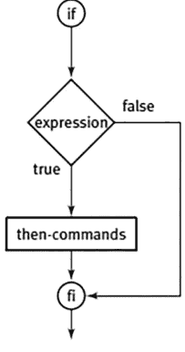

图 12.1 if-then-fi 语句的语义。

关于这种第二种语法的重要点是：内部括号表示可选的表达式，而外部括号是必须的，因为它们构成了测试语句。此外，在操作符、括号、中括号或操作数的前后至少需要一个空格。如果你需要将测试与下一行进行比较，必须在按回车键之前使用反斜杠（`\`），这样 `shell` 就不会将下一行视为独立的命令。请记住 `|` 是 `shell` 元字符。我们在第一次会节中演示了 `test` 命令的使用，但随后使用了更简单的 `[]` 语法。

`test` 命令支持许多用于测试文件和整数、测试和比较字符串，以及逻辑连接两个或多个表达式形成复杂表达式的运算符。表 12.5 描述了大多数 Linux 系统上 `test` 命令支持的操作符的含义。

我们使用该语句来修改 `set_demo` 文件中的脚本，使其只接受一个命令行参数，并检查该参数是否为文件或目录。如果运行脚本时没有参数或多于一个参数，或者命令行不是普通文件，则脚本将返回错误。脚本文件名为 `if_demo`。

```bash
$ cat if_demo

#!/bin/bash

if test $# -eq 0

then

    echo "Usage: $0 ordinary_file"

    exit 1

fi

if test $# -gt 1

then

    echo "Usage: $0 ordinary_file"

    exit 1

fi

if test -f "$1"

then

    filename=$1

    set -- ls -l $filename

    perms="$1"

    size="$5"

    stat -i $filename

    inode="$1"

    echo "File Name: $filename"

    echo "Inode Number: $inode"

    echo "Permissions: $perms"

    echo "Size (bytes): $size"

    exit 0

fi
```

## 334

# Linux

```bash
fi

echo "$0: argument must be an ordinary file"

exit 1

$ ./if_demo

Usage: if_demo ordinary_file

$ ./if_demo lab lab4

Usage: if_demo ordinary_file

$ ./if_demo dir1

if_demo: argument must be an ordinary file

$ ./if_demo set_demo
```


**File Name**: `set_demo`
**Inode Number**: `16517945`

# 表 12.5
`test` 命令的操作符

| 文件测试 | | 整数测试 | | 字符串测试 | |
| :--- | :--- | :--- | :--- | :--- | :--- |
| 表达式 | 返回值 | 表达式 | 返回值 | 表达式 | 返回值 |
| `-d file` | 如果文件是目录则为真 | `int1-eq int2` | 如果 `int1` 和 `int2` 相等则为真 | | 如果 `str` 不为空字符串为真 |
| `-f file` | 如果文件是普通文件则为真 | `int1-ge int2` | 如果 `int1` 大于等于 `int2` 则为真 | `str1=str2` | 如果 `str1` 和 `str2` 相同则为真 |
| `-r file` | 如果文件可读则为真 | `int1-gt int2` | 如果 `int1` 大于 `int2` 则为真 | `str1!=str2` | 如果 `str1` 和 `str2` 不同则为真 |
| `-s file` | 如果文件长度不为零则为真 | `int1-le int2` | 如果 `int1` 小于等于 `int2` 则为真 | `-n str` | 如果 `str` 的长度为零为真 |
| `-t [filedesc]` | 如果文件描述符对应终端则为真 | `int1-lt int2` | 如果 `int1` 小于 `int2` 则为真 | `-z str` | 如果 `str` 的长度为零为真 |
| `-w file` | 如果文件可写则为真 | `int1-ne int2` | 如果 `int1` 不大于等于 `int2` 则为真 | | |
| `-x file` | 如果文件可执行则为真 | | | | | |
| `-b file` | 如果文件是块设备则为真 | | | | | |
| `-c file` | 如果文件是特殊文件则为真 | | | | | |
| `-e file` | 如果文件存在则为真 | | | | | |
| `-L file` | 如果文件是符号链接则为真 | | | | | |

# 形成复杂表达式的操作符

- `!` 逻辑非操作符：`( 表达式 )` 括号用于分组，如果后续表达式为假则为真；每个括号前后至少有一个空格
- `-a` 或 `&&` 逻辑与操作符：`-o` 或 `||` 逻辑或操作符：如果上一个（左）和下一个（右）表达式均为真则为真；如果上一个（左）或下一个（右）表达式任一为真则为真

## 365
# Bash 编程入门

**Permissions**: `-rwx-xr-x`
**Size (bytes)**: `245`
$ 

在之前的脚本中，如果你在没有任何命令行参数的情况下运行脚本，第一个语句将显示错误消息并退出程序。如果在多个参数的情况下运行脚本，第二个语句将显示错误消息并退出程序。如果前两个条件都不成立，则执行第三条语句——即带有一个参数运行脚本。只有当命令行参数是一个普通文件时，此语句才会产生预期结果。如果传递的参数不是普通文件，则第三条语句的条件为假，并显示错误信息 `if_demo: argument must be an ordinary file`。`exit` 命令用于退出脚本。我们通常使用 `1` 作为参数（即退出状态），当脚本因错误条件终止时；退出状态 `0` 用于脚本正常终止。

我们可以使用 `test` 命令的替代语法和逻辑与操作符来重写 `if_demo` 脚本，如表 12.5 和 12.6 所示。

```bash
$ cat if_demo1

#!/bin/bash

if [ "$#" -eq 1 -a -f "$1" ]

then

    echo "$0: Specify exactly one line argument that"

    echo "must be an ordinary file."

    exit 1

fi
```

# 表 12.6
Bash 操作符优先级（从高到低）

| 操作符 | 优先级 |
| :--- | :--- |
| `var++ --var` | C 风格后递增 |
| `var-- --var` | C 风格前递减 |
| `!` | 逻辑/按位取反，反转操作符的方向 |
| `**` | 幂 |
| `* / %` | 乘法、除法、取模 |
| `+` | 加法、减法 |
| `<<` | 按位左移、位右移 |
| `-z` | 字符串的一元比较 |
| `-e -t` | 文件测试的一元比较 |
| `-lt >=` | 整数复合比较 |
| `-nt` | 字符串复合比较 |
| `== !=` | 相等/不相等测试 |
| `&` | 按位与 |
| `^` | 按位异或（互斥或） |
| `\|` | 按位或 |
| `&&` | 逻辑与 |
| `||` | 逻辑或 |
| `?:` | C 风格三元运算符（条件语句） |
| `=` | 赋值 |
| `*= += &=` | 复合赋值：乘赋值、除赋值、模赋值 |
| `|` | 用于操作 |

# Bash 编程入门

## 337

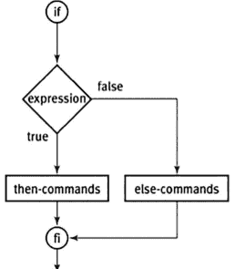

图 12.2 `if-then-else-fi` 语句的语义。

接下来，我们使用 `if-then-else-fi` 语句重写 `if_demo` 程序，并使用 `test` 命令的替代语法。生成的脚本位于 `if_demo2` 文件中，如下会话所示。注意程序看起来更加整洁且易于读。

```bash
$ cat if_demo2

#!/bin/bash

if [[ $# -eq 1 ]] && [[ -f "$1" ]]

then

    filename=$1

    set -- 'ls -l $filename'

    perms="$5"

    size="$6"

    set 'ls -i $filename'

    inode="$1"

    echo "File Name: $filename"

    echo "Inode Number: $inode"

    echo "Permissions: $perms"

    echo "Size (bytes): $size"

    exit 0

else

    echo "$0:          Specify exactly one command line argument"

    echo "             must be an ordinary file."

    exit 1

fi
```

最后，我们讨论语句的第三版本，用于实现多路分支。以下是该语句的概要描述：

```bash
Syntax:

if expression1

then

    then-commands

elif expression2

    elif1-commands

elif expression3

    elif2-commands

else

    else-commands

fi
```

# 实现多路分支

如果 `expression1` 为真，则执行 `then-commands` 中的命令。如果 `expression1` 为假，则评估 `expression2`，如果它为真，则执行 `elif1-commands` 中的命令。如果 `expression2` 也为假，则评估 `expression3`。如果 `expression3` 为真，则执行 `elif2-commands` 中的命令。如果 `expression3` 也为假，则执行 `else-commands` 中的命令。任何命令列表的执行后都会跟着 `fi`。你可以在 `if` 语句中使用任意数量的 `elif` 来实现多路分支。该语句的语义如图 12.3 所示。

我们修改了 `if_demo` 文件中的脚本，如果命令行参数是一个目录，程序将显示目录中的文件和子目录数量（排除隐藏文件）。此外，程序在处理之前会确保命令行参数是当前目录下存在的文件或目录。除了使用两个语句外，我们还可以可以使用 `if-then-elif-else-fi` 语句。结果脚本位于 `if_demo` 文件中，如下节所示。注意在 `if` 语句的条件使用了逻辑取反运算符 `!`。该运算符也可以用于按位取反，如表 12.5 和表 12.6 所示。

# `cat if_demo3`

```bash
#!/bin/bash

if [ ! $# -eq 1 ]

then

    echo "Usage: $0 file"

    exit 1

elif [ -d "$1" ]

then

    nfiles=$(ls "$1" | wc -w)

    echo "The number of files in the $1 directory is $nfiles"

    exit 0

else

    ls "$1" 2>/dev/null | grep "$1" 2>/dev/null 1>&2

    if [ $# -ne 0 ]

    then

        echo "$1: not found"

        exit 1

    fi

fi
```


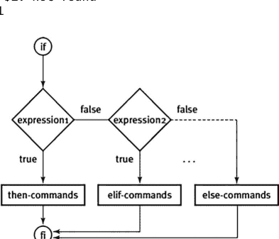

图 12.3 if-then-elif-else-fi 语句的语义。

# Bash 编程入门

```bash
if [ -f "$1" ]
then
    filename=$1
    set -- ls -l "$filename"
    perms="$5"
    size="$6"
    set -- ls -i "$filename"
    inode="$1"
    echo "File Name: $filename"
    echo "Inode Number: $inode"
    echo "Permissions: $perms"
    echo "Size (bytes): $size"
else
    echo "$0: must be an ordinary file or directory"
    exit 1
fi
```

`$ ./if_demo3 lab2`
`lab2: not found`
`$ ./if_demo3 lab1 lab2`
`Usage: ./if_demo3 file`
`$ ./if_demo3 ~`
`The number of files in the /home/sarwar directory is 14`
`$ ./if_demo3 set_demo`

```
File Name: set_demo
Inode Number: 16517945
Permissions: -rwxr-xr-x
Size (Bytes): 245
```

`$ ./if_demo3 /bin/ls`

```
File Name: /bin/ls
Inode Number: 10485856
Permissions: -rwxr-xr-x
Size (Bytes): 126584
```

`$`

如果参数是一个目录，其中包含目录和隐藏文件的文件数量将保存在变量 `nfiles` 中。执行命令 `ls "$1" >/dev/null | grep "$1" 2>/dev/null 1>&2` 来检查作为命令行参数的文件是否存在。标准输出重定向到 `/dev/null`（黑洞），标准错误被重定向到标准输出（`1>&2`）。（此处由于原文存在大量重复的重定向描述，已根据逻辑精简并保留核心结构）。

### 12.6.3 `while` 语句

`while` 语句（也称为 `while` 循环）允许根据表达式的条件重复执行一个代码块。以下是该语句的简要描述：

| 语法 | 目的 |
| :--- | :--- |
| `while expression`<br>`do`<br>`command-list`<br>`done` | 只要表达式求值为为真，就执行 `command-list` 中的命令 |

`表达式`会被求值，如果求值结果为真，则执行 `command-list` 中的命令并再次对 `表达式` 进行求值。这种表达式求值和 `command-list` 执行的序列被称为一次迭代，它会重复进行，直到 `表达式` 求值为为假。此时，控制将跳出 `while` 语句，并执行 `done` 之后的语句。

图 12.5 显示，表达式中产生真值的变量和/或条件必须在 `command-list` 的命令中被处理，以确保循环良好——即循环最终能够终止并允许脚本中代码的执行。表达式始终求值为真的循环或编程错误是不理想的，因为它们会持续消耗 CPU 时间而无法完成任何有用任务。然而，某些应用确实需要无限循环。例如，所有互联网服务的服务器，如超文本传输协议（HTTP）服务（允许我们在互联网上浏览 Web 页面），都是无限运行等待客户端请求的程序。以 HTTP 服务为例，客户端请求通过 Web 浏览器（即 HTTP 客户端）如 Mozilla Firefox 进入。一旦服务器接收客户端请求，它就会对其进行处理（例如，向客户端发送响应，并等待另一个客户端请求）。终止带有无限循环进程的唯一方法是使用 `kill` 命令将其杀掉。

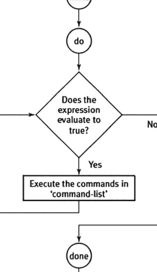

图 12.5 `while` 语句的语义。

# Bash 编程入门

使用 `kill` 命令将其杀掉。或者，如果进程在前台运行，按下 <Ctrl+C> 也可以生效，除非该进程被设计为忽略 <Ctrl+C>。在这种情况下，你需要通过按下 <Ctrl+Z> 将进程放入后台，并使用 `kill -9` 命令将其终止。第 10 章详细介绍了进程。

`while_demo` 文件中的脚本展示了 `while` 循环的用法。当你运行此脚本时，`secretcode` 被初始化为 `agent007`，并提示你进行猜测。你的猜测存储在一个本地变量中。如果你的猜测不是 `agent007`，则 `while` 循环的条件为真，并执行 `do` 和 `done` 之间的命令。该程序会委婉地提示你失败了并提示你再次尝试。你的猜测再次存储在 `guess` 变量中，并测试循环条件。这个过程一直持续，直到你输入 `agent007` 作为猜测。此时，循环条件变为假，控制跳出 `while` 语句。随后的 `echo` 命令被执行，祝喜你加入了这个伟大的大家庭！

```bash
$ while_demo

#!/bin/bash

secretcode=agent007

echo "Guess the code!"

echo -e "Enter your guess: \c"

read yourguess

while [ "$secretcode" != "$yourguess" ]
do
    echo "Good but wrong. Try again!"
    echo -e "Enter your guess: \c"
    read yourguess
done

echo "Wow! You are a genius!!"

exit 0

$ ./while_demo

Guess your guess: star wars

Good but wrong. Try again! Enter your guess: columbo

Good guess but wrong. Try again! Enter your guess: agent007

Wow! You are a genius!!

$
```

# 练习 12.13

重复 12.12，将 `for` 循环替换为 `while` 循环。展示脚本以及几次运行示例。

### 12.6. `until` 语句

`until` 语句的语法与 `while` 语句相似，但其语义不同。虽然在 `while` 语句中，循环体只要表达式求值为真就会执行，但在 `until` 语句中，循环体只要表达式求值为为假就会执行。以下是该语句的简要描述：

```
语法:

until expression
do
command-list
done

目的: 只要表达式求值为为假，就执行 command-list 中的命令
```

图 12.6 展示了 `until` 语句的语义。`until_demo` 文件中的代码执行了与 `while_demo` 文件中的脚本相同的任务，但它使用了 `until` 语句而不是 `while` 语句。

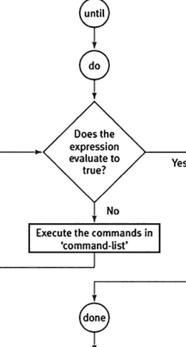

图 12.6 `until` 语句的语义。

因此，只要你的猜测不是 `agent007`，`do` 和 `done` 之间的代码（循环体）就会执行。

```bash
$ cat until_demo

#!/bin/bash

secretcode=agent007

echo "Guess the guess!"

echo -n "Enter your guess: "

read yourguess

until [ "$secretcode" = "$yourguess" ]
do
    echo "Good guess but wrong. Try again!"
    echo -n "Enter your guess: "
    read yourguess
done

echo "Wow! You are a genius!!"

exit 0

$ ./until_demo

Guess the guess!

Enter your guess: Gadget

Good guess but wrong. Try again!Enter your guess: Peter

Good guess but wrong. Try again!Enter your guess: agent007

Wow! You are a genius!!

$
```


## 练习 12.14

重复 12.13，将`for`循环替换为`while`循环。展示脚本以及几次运行示例。

## 12.6.5 `break`和`continue`命令

`break`和`continue`命令可以中断循环的执行。`break`命令立即终止循环，控制跳转到循环后的语句。`continue`命令则跳过当前循环体的剩余部分，并进入循环的下一次迭代。

## 12.6.6 `case`语句

`case`语句提供了类似于`if`的多路分支机制。当你想要测试多个变量时，你就会使用`case`语句。以下是该语句的简要描述：

```
case test-string in
    pattern1)
        command-1
        ;
    pattern2)
        command-2
        ;
    ...
    patternN)
        command-N
        ;
esac
```

`case`语句将`test-string`中的值与模式（patterns）进行比较。如果找到匹配，则执行对应的`command-list`并跳出`case`。如果没有找到项，控制将跳出`case`。然而，在`case`的典型用法中，通配符模式可以匹配`test-string`的任何值。连续的分号（`;`）用于分隔`command-list`。如果没有分号，下一个模式中的第一个命令将被执行，导致程序出现异常行为。图 12.7 描述了`case`语句的语义。`case`语句。

## Bash 编程入门

```
w: 查看谁已登录
q: 退出此程序
输入你的选项并按 <Enter>: d
2017年7月13日 周四 12:55:22 PKT
$ ./case_demo

使用以下选项之一：
d: 显示今天的日期和当前时间
l: 查看当前工作目录下的文件列表
w: 查看谁已登录
q: 退出此程序
输入你的选项并按 <Enter>: w
```

```
root tty1 2017-04-06 18:57
sarwar pts/0 2017-04-13 12:55 (119.160.96.110)
davis tty8 2017-04-12 11:22 (:0)
jacob tty2 2017-04-13 19:03
```

```
$ ./case_demo
使用以下选项之一：
d: 显示今天的日期和当前时间
l: 查看当前工作目录下的文件列表
w: 查看谁已登录
q: 退出此程序
输入你的选项并按 <Enter>: 1

case_demo export_demo if_demo2 shift_demo while_demo
display_change_name for_demo if_demo3 until_demo
display_name if_demo1 set_demo user_info
```

```
$ ./case_demo
使用以下选项之一：
d: 显示今天的日期和当前时间
l: 查看当前工作目录下的文件列表
w: 查看谁已登录
q: 退出此程序
输入你的选项并按 <Enter>: q
$
```

从`w`的输出来看，`davis`似乎通过远程登录使用系统，很可能是通过安全 shell (`ssh`) 会话。现在，当你输入一个有效选项（上一个会话中的`a`）时，会显示预期的输出。然而，当你输入一个无效选项时，程序不会给你提供任何反馈。原因是`case`语句会逐个匹配你的输入与所有模式，而当没有匹配项时，我们稍微修改了脚本，以便当你输入无效选项时，脚本会提示你并终止。为了做到，我们添加了以下代码。

```
*) echo "Invalid option; try running the program."
exit 1
;;
```

我们还增强了脚本，使得大写和小写输入被视为相同的。我们在模式中使用管道符号 (`|`) 来指定逻辑或（OR）操作。以下是增强后的代码以及后续会话中的一些示例运行。

```
$ cat case_demo
echo "Use one of the options:"
echo d or D: 显示今天的日期和当前时间
echo l or L: 查看你当前工作目录下的文件列表"
echo w or W: 查看谁已登录
echo q or Q: 退出此程序"
echo -n "Enter your option and hit <Enter>: "
read option
case "$option" in
d|D)
    date
    ;;
l|L)
    ls
    ;;
w|W)
    who
    ;;
q|Q)
    exit 0
    ;;
*)
    echo "Invalid option; try running the program again."
    exit 1
    ;;
esac
exit 0
```

```
$ ./case_demo
使用以下选项之一：
d or D: 显示今天的日期和当前时间
l or L: 查看你当前工作目录下的文件列表
w or W: 查看谁已登录
q or Q: 退出此程序
输入你的选项并按 <Enter>: D
2017年7月13日 周四 13:00:57 PKT

$ ./case_demo
使用以下选项之一：
d or D: 显示今天的日期和当前时间
l or L: 查看你当前工作目录下的文件列表
w or W: 查看谁已登录
q or Q: 退出此程序
输入你的选项并按 <Enter>: d
2017年7月13日 周四 13:01:34 PKT

$ ./case_demo
使用以下选项之一：
d or D: 显示今天的日期和当前时间
l or L: 查看你当前工作目录下的文件列表
w or W: 查看谁已登录
q or Q: 退出此程序
输入你的选项并按 <Enter>: a
无效选项；请尝试运行程序。
$
```

## 练习 12.17

更新之前的脚本，使用户输入`u`或`U`作为输入时，脚本将调用在本节中讨论的`until_demo`脚本。

# 12.7 命令分组

若干 shell 命令可以一组运行。以下是命令分组的简要描述：

语法：
`(\`command-list\` )`
或
`{ command-list; }`

目的：语法 1——在当前 Bash 的子进程中执行`command-list`中的命令；语法 2——作为一个组执行`command-list`中的命令。

shell 会继承其父 shell 环境的副本，但被捕获但忽略的信号除外。命令通过第二种语法执行，不会创建子 shell。它允许对`command-list`中命令的输出进行重定向。

## Bash 编程入门

在第二种语法中，必须在命令末尾有一个分号。以下会话显示了使用两种语法进行命令分组的示例。

```
$ (echo "Hello world"; date)
Hello world
2017年7月13日 周四 12:55:22 PKT
{ echo "Hello world"; date }
Hello world
2017年7月13日 周四 12:55:22 PKT
```

```
$ (echo "Hello world"; date)
Hello world
2017年7月13日 周四 12:55:22 PKT
{ echo "Hello world"; date }
Hello world
2017年7月13日 周四 12:55:22 PKT
```

```
$ (echo "Group test"; date) > output.txt
{ echo "Group test"; date } > output.txt
$ cat output.txt
Group test
2017年7月13日 周四 12:55:22 PKT
```

```
$ (echo "Group test"; date) | wc -l
{ echo "Group test"; date } | wc -l
$ cat output.txt
Group test
2017年7月13日 周四 12:55:22 PKT
```

```
$ (echo "Group test"; date) | wc -l
1
{ echo "Group test"; date } | wc -l
2
```

```
$ (echo "Group test"; date) | wc -l
1
{ echo "Group test"; date } | wc -l
2
```

```
$ (echo "Group test"; date) | wc -l
1
{ echo "Group test"; date } | wc -l
2
```


# 练习 12.18

重现之前的会话，在你的系统上。

## 总结

每个 shell 都有一种编程语言可以编写由 shell 执行的程序。在最简单的形式下，shell 脚本是由 shell 逐个执行的命令列表。高级的控制结构允许 shell 脚本实现分支，循环语句允许用户实现循环的顺序执行。输入/输出重定向、命令替换和其他功能可以被称为 Bash 脚本。

变量是具有名称的内存位置，可以读取和写入。有两种 shell 变量：环境变量和用户定义变量。环境变量在用户登录时由 shell 初始化并由 shell 维护。用户定义变量用于处理任务。某些环境变量如位置参数是只读的，无法使用 `set` 命令更改其值。用户定义变量也可以通过使用 `readonly` 命令变为只读。

处理变量的 Bash 命令有 `=`（给变量赋值）、`set`（设置位置参数并显示所有环境变量）、`env`（显示所有 shell 变量）、`export`（允许后续命令访问变量）、`read`（从键盘赋值）、`readonly`（使定义的变量只读）、`shift`（将命令行左移一个或多个位置）、`unset`（将变量的值置为空）以及 `test`（评估表达式并返回真或假）。

程序控制语句 `if` 和 `case` 允许程序员实现多进程处理；`break` 和 `continue` 语句允许用户实现循环的顺序执行。输入输出重定向、命令替换和其他功能可以与控制语句一起使用（第 13 章）。

Bash 有许多用于文件、整数和字符串测试的运算符。它还有许多逻辑和位运算符，以及使用 `;`、`{}`、`()` 用于顺序执行命令的运算符。Bash 还有 `&` 用于后台和并行执行。`&&` 和 `||` 可分别执行逻辑与或操作。使用这些运算符使得代码更紧凑。使用 `;` 和 `{}` 有助于一组命令的顺序执行。`&`、`|` 和 `^` 可用于执行位与、位或异异操作。

## 问题与练习

1. 什么是 shell 脚本？描述三种执行 shell 脚本的方法。
2. 什么是只读变量？如何让用户定义变量只读？给出一个例子说明你的答案。
3. 哪个环境变量用于存储你的搜索路径？交互地将你的搜索路径更改为 `~/bin` 和当前目录 (.)。此更改允许你做什么？为什么？如果你想进行永久更改，你会做什么？如果你忘记了如何更改 shell 的搜索路径，请查看第 4 章。
4. 如果执行 12.3.6 节中的 `read_demo` shell 脚本并在每次提示时给你 `*` 输入，输出将会是什么？

10. 修改问题 6 中的脚本，使其删除作为可选参数传递的目录中的所有零长度普通文件。如果没有指定目录参数，脚本将使用当前工作目录作为默认参数。进行适当的错误检查。

11. 运行 12.6.1 节中的 `if_demo2` 脚本，并将 `if_demo2` 作为其参数。输出结果对你来说合理吗？为什么？或为什么？

12. 编写一个 shell 脚本，接收计算机系统的登录名列表作为命令行参数，并显示这些登录名以及用户的全名（包含在 `/etc/passwd` 文件中），每行一个。如果登录名无效（即在 `/etc/passwd` 文件中未找到），则显示登录名但不显示全名。输出行的格式为 `login name: username`。

13. 当你运行用反引号（grave accents）括起来独立命令（如 `date`）时发生了什么？为什么？

14. 当你输入以下 shell 命令序列时发生了什么？

    - a. `name=date`
    - b. `$name`
    - c. `` `$name` ``

15. 查看 `~/.profile` 和 `/etc/profile` 文件，并列出它们一起导出的环境变量。每个变量的作用是什么？

你编写了三个 Bash 脚本并将它们存放在名为 `script1`、`script2` 和 `script3` 的文件中。这三个脚本位于 `/linux2e/ch12`。在 `script3` 的体内，你使用了 `script1` 和 `script2`。假设你运行 `script3` 并得到如下所示的错误信息：

```bash
$ ./script3

./script3: line 4: command not found

./script3: line 5: script2: command not found

$
```

描述两种用于消除这些错误信息并使用 `script1` 和 `script2` 使 `script3` 正确工作的方法。

16. 编写一个 Bash 脚本，接收登录名列表作为参数，并显示在 环境环境下每个用户登录的终端数量。

17. 编写一个 Bash 脚本 `domain2ip`，接收域名列表作为命令行参数并显示它们的 IP 地址。使用 `nslookup` 命令。以下是该程序的运行示例：

```bash
$ domain2ip usc.edu.au redhat.com

Name: usc.edu

Address: 128.255.253.136

Name: up.edu

Address: 64.251.254.23

Name: redhat.com

Address: 209.132.183.105
```

18. 修改 12.6.6 节中 `case_demo` 文件中的脚本，使其允许尝试任意数量的选项，只有当你使用 `q` 时才退出。

19. 编写一个 Bash 脚本，显示以下菜单并提示你输入单字符以调用菜单选项，如下：

    - a. 列出当前工作目录下的所有文件
    - b. 显示今天的日期和时间
    - c. 调用问题 14 的 shell 脚本
    - d. 显示文件是普通文件还是目录
    - e. 为文件创建备份
    - f. 启动 `ssh` 会话
    - g. 启动 `ftp` 会话
    - h. 退出

选项 (c) 要求你询问一个登录名列表；对于选项 (d) 和 (e)，在调用 shell 命令/程序之前插入文件提示。对于选项 (f) 和 (g)，在启动 `ssh` 或 `ftp` 会话之前插入域名（或 IP 地址）提示。该程序应允许你尝试任意次数的任何选项，并且只有在你输入选项 `x` 时才退出。你应当采用的良好编程习惯是增量式构建——即，为一个选项编写代码，进行测试，然后进行下一个。

20. 修改问题 19 的 Bash 脚本，以在子 shell 下支持每个选项。每当启动运行某个选项的代码时，在执行代码之前显示该 shell 的 `PID`。

21. 假设以下表达式在 `if` 语句中被求值为条件。该表达式在何时为真？

```bash
[ "$#" -eq 1 -f "$1" -o -f "$4" ]
```


### 问题 22-32

22. 明确说明以下 Bash 命令的语义，其中 `A`：
    - a. `A ; B`
    - b. `A && B`
    - c. `A || B`
    - d. `A & B`

23. 在你的系统上运行这些命令并解释它们的输出。
    - a. `echo "Hello" "Hello, world!"`
    - b. `echo "Hello" && echo "Hello, world!"`

24. 解释以下语句中的测试：
    - a. `while [ -n "$var1" -a "$var2" -gt 0 ]`
    - b. `if [ "$v1" -gt "$v2" -o "$v1" -lt "$v2" -a -f "$filename" ]`

25. 使用 `&&` 和 `|` 运算符将问题 24 中的表达式转换为等价形式。

26. `echo` 命令的作用是什么？在你的系统上运行该命令并解释输出。

27. 在你的系统上运行命令并解释输出。

28. 以下术语的定义和用途是什么？
    - a. 绝对路径
    - b. 相对路径
    - c. 符号链接
    - d. 硬链接

29. 编写一个 `Bash` 脚本，接收文件列表作为命令行参数并显示每个文件的字节大小。使用 `du` 命令。

30. 编写一个 `Bash` 脚本，接收目录列表作为命令行参数并统计每个目录中的子目录数量。使用 `find`。

31. 编写一个 `Bash` 脚本，接收文件列表并显示每个文件的修改时间。使用 `stat` 命令。

32. 编写一个 `Bash` 脚本，接收文件列表作为命令行参数并显示每个文件的所有者和组。使用 `ls` 命令。

**Linux**

你可以访问。在实现你的方法时，你会如何处理由于目标存储介质空间不足而产生的错误条件？

# 项目 3

在对问题 32 给出正确且完整的答案后，请按照该问题的要求进行实现。请以报告格式提交你的解决方案。

想了解更多？请访问我们的网站获取额外阅读、推荐资源和练习。
`CRC Press` 电子资源：`https://www.crcpress.com/9781138710085`
作者的 `GitHub`：`https://github.com/bobk48/linuxxthetextbook`

# 13 高级 Bash 编程

## 目标

- 讨论数值数据处理
- 使用 `bc` 进行任意精度数学计算
- 描述如何在脚本内部重定向 shell 脚本的标准输入
- 解释 `Bash` 的信号/中断处理能力
- 解释 `Bash` 函数中的参数传递和变量作用域
- 描述如何使用文件描述符执行文件输入/输出，以及如何在 shell 内部重定向标准文件
- 讨论 `Bash` 脚本的调试
- 涵盖以下命令和原语：

```
|, <, >, <<, >> bc, clear, declare, exec, expr, grep, kill, let, local, more, read, readonly, sort, stty, trap
```

### 13.1 引言

在本章中，我们将讨论 `Bash` 的几个重要高级特性。它们包括数值数据处理、文档 (here document)、信号和信号处理，以及在 shell 脚本内部重定向标准文件。我们还讨论了 `Bash` 对函数的支持，这允许程序员编写通用型和模块化的代码。最后，我们描述了如何调试 `Bash` 脚本。

### 13.2 数值数据处理

`Bash` 变量的值是以字符串存储的。这一特性使得符号数据处理变得有趣且简单，但也让数值数据处理变得具有挑战性。原因是整数数据实际上是以字符字符串的形式存储的。为了对它们进行算术和逻辑操作，你必须将它们转换为整数，对整数数据执行必要的操作，并确保结果转换回字符串，以便正确存储在 shell 变量中。在本节中，我们将讨论执行算术运算的不同方法，首先使用 `Bash` 的特性，然后使用 `bc`（这是一个所有 `Linux` 发行版都预装的任意精度计算器）。

#### 13.2.1 使用 Bash 进行算术运算

在 `Bash` 中有三种方法对数值数据进行算术运算，而无需字符串与整数之间的转换。这些方法是：

1. 使用 `let` 命令
2. 使用 shell 扩展 `$((expression))`
3. 使用 `expr` 命令

表达式评估在长整数中进行，且不进行溢出检查。当在表达式中使用 shell 变量时，它们在表达式求值之前会被展开（即它们的值被替换到表达式中），并被强制转换（即其数据类型被处理为）所需的数据类型。`Bash` 支持的算术、逻辑和关系运算符列在表 12.6 中，按优先级从高到低排列。分组在一起的运算符具有相同的优先级。可以通过将表达式放在括号中来改变评估顺序。以 `0` 开头的常量被视为八进制；以 `0x` 或 `0X` 开头的数字被视为十六进制。否则，数字被视为十进制数。

`Bash` 内置命令 `let` 通过将表达式作为参数来求值算术表达式。如果表达式包含空格或其他特殊字符，必须用双引号括起来。以下是该命令的简述：

```
Syntax:
let expression-list

Purpose: Evaluate arithmetic expressions in expression-list
```

如果表达式求值为为 `0`，`let` 返回 `0`；否则，下面的会话显示了 `let` 命令的交互式用法。注意，引用 shell 变量的值不需要 `$`，并且在带有空格的第一个 `let` 命令使用了引号。示例展示了使用 `let` 命令的变量声明和算术表达式评估。最后一个命令中的表达式 `b**x` 意味着 `b` 的 `x` 次方。

```
$ let a=b-13

$ let c=a+b

$ echo "The value of c is $c$"

The value of c is 21.

$ let a=-b

$ echo "The new value of a is $a; the product of a and b."

The new value of a is 104; the product of a and b

$ b=2 x=10 y=30

$ let K=b**x M=b**y G=b**z

$ echo "In computer jargon 1K is 1K, 1M is 1M, and 1G is $G"

In computer jargon 1K is 1024, 1M is 1048576, and 1G is 1073741824.
```

下方的 `Bash` 表达式语法也可用于评估算术表达式。“表达式”会被求值并返回结果：

```
Syntax:

$((expression))

Purpose: Evaluate "expression" and return its value
```

在接下来的会话中，我们使用这种语法执行与上一个会话相同的任务。

```
$ b=2 x=10 y=30

$ echo "In computer jargon 1K is $((b**x)), 1M is $((b**y)), and 1G is $((b**z))"

In computer jargon 1K is 1024, 1M is 1048576, and 1G is 1073741824.
```

注意，引用 shell 变量的值不需要 `$`，并且在带有空格的第一个 `let` 命令使用了引号。示例展示了使用 `let` 命令的变量声明和算术表达式评估。最后一个命令中的表达式 `b**x` 意味着 `b` 的 `x` 次方。下方的 `Bash` 表达式语法也可用于评估算术表达式。“表达式”会被求值并返回结果：

```
Syntax:

$((expression))

Purpose: Evaluate "expression" and return its value
```

（注：由于 OCR 文本包含大量重复，我提供了清理后的内容。）

（注：由于 OCR 文本包含大量重复，我提供了清理后的内容。文本在处截断了。）

（注：由于 OCR 文本包含大量重复，我提供了清理后的内容。）

```
$ expr length "Hello, World."

13
```

```
$ expr substr "Hello, World." 8 5

World

$ greeting="Hello, World"

$ expr length "$greeting"

13

$ expr substr "$greeting" 8 5

World
```

我们现在来讨论几个使用 `expr` 命令进行算术表达式求值的脚本。以下 `count` 脚本接受一个整数作为命令行参数，并按行显示从 1 到给定数字的数字，升序排列。按照顺序，我们使用一个简单的 `while` 循环来显示当前数字（从 1 开始），然后计算下一个数字，直到当前数字大于作为命令行参数传递的数字为止。

```
$ cat countup

#!/bin/sh

if [ $# -ne 1 ];

then

  echo "Usage: 0 integer-argument"
```


## 高级 Bash 编程

### 1. 数字计数脚本

```bash
exit 1

target="$1" # 将目标设置为传递给命令行的数字

current=1 # 第一个显示的数字

while [ $current -lt $target ];

do

  echo -n "$current"

  current=$(expr $current + 1)

done

echo # 将光标移到下一行

$ .countup

1 2 3 4 5
```

### 2. 求和脚本 `addall`

接下来的 `addall` 脚本接受一组整数列表作为命令行参数并显示它们的和。`while` 循环将列表中的下一个数字加到和中（和初始化为 `0`），更新已加数字的计数，并将命令行参数左移一位。循环不断重复，直到命令行参数中的所有数字都已加完。示例运行代码返回前八个完全平方数的和。

```bash
$ cat addall

#!/bin/bash

# 文件名: ~/linux2/chapter13/bash/toadd

# 作者: Syed Mansoor Sarwar

# 写于: August 18, 2004

# 修改于: August 18, 2004; July 28, 2014; July 9, 2017

# 目的: 演示在处理数值数据时使用 expr 命令

# 概要描述:

# 维护一个名为 sum 的数值运行总和，

# 初始化为 0。读取下一个

# 整数并加到 sum 中。当所有

# 作为命令行参数指定的整数

# 读取完毕后，

# 显示答案并终止程序。

# 程序在不带参数的情况下运行时，通知

# 用户命令语法。

if [ $# = 0 ]

then

    echo "Usage: $0 number-list"

    exit 1

fi

sum=0      # 运行总和初始化为 0

count=0   # 计数作为参数传递的数字个数

while [ $# != 0 ];

do

    sum=$(expr sum + $1)    # 将下一个数字加到运行总和中

    count=$(expr count + 1) # 更新已加数字的计数

    shift                    # 移出已计数的数字

done

# 显示最终总和

echo "The sum of the given $count numbers is $sum."

exit 0

$ ./addall

Usage: ./addall number-list

$ ./addall 1 4 9 16 25 36 49 64

The sum of the 8 numbers is 204.
```

虽然这个例子清楚地解释了数值处理，但它无非一个整数机器。

### 3. 目录大小脚本 `fs`

我们现在展示一个使用文件系统的更有用的例子。`fs`（size）文件包含一个脚本，它接受一个目录作为可选参数，并返回其中所有非空目录的大小（字节）。在 Linux 系统上，运行 `fs` 会调用 `infix`。如果这在你的系统上发生，请将此脚本重命名为 `files` 或你任何喜欢的使用的名称。

当你在不带命令行参数的情况下运行程序时，脚本将认为你的当前目录为参数。如果你使用多个一个命令行参数运行它，脚本将显示命令语法并终止。当你仅使用一个非空目录参数执行时，程序将显示命令语法并退出。如果使用不存在的文件作为参数运行程序，它将显示错误信息并终止。

该脚本的核心是以下代码，当脚本带目录作为命令行运行时执行这些代码。

```bash
ls directory | more |

while read file

do

    ...

done
```

这段代码使用 `ls` 命令生成目录下的文件列表，通过命令将列表转换为每行一个名称，并逐个读取每个文件，直到列表中不再剩余文件。`read` 命令在读取到一行时返回真，在读取到 EOF 标记时返回假。循环的主体——即 `do` 和 `done` 之间的代码——如果是一个普通文件，则会将文件大小加到运行总和中。当列表中没有名称剩余时，程序显示该目录下所有非空目录占据的总大小并终止。如果变量 `file` 的值一个不存在的文件，`[ -e "file" ]` 为假，这在脚本带目录作为命令行运行时显示目录的相对路径，如示例运行所示。

```bash
# 程序在不带参数的情况下运行时，通知

# 用户命令语法。

if [ $# = 0 ]

then

    echo "Usage: $0 number-list"

    exit 1

fi

sum=0      # 运行总和初始化为 0

count=0   # 计数作为参数传递的数字个数

while [ $# != 0 ];

do

    sum=$(expr sum + $1)    # 将下一个数字加到运行总和中

    count=$(expr count + 1) # 更新已加数字的计数

    shift                    # 移出已计数的数字

done

# 显示最终总和

echo "The sum of the given $count numbers is $sum."

exit 0

$ ./addall

Usage: ./addall number-list

$ ./addall 1 4 9 16 25 36 49 64

The sum of the 8 numbers is 204.
```


虽然这个例子清楚地解释了数值处理，但它无非一个整数机器。我们现在展示一个使用文件系统的更有用的例子。`fs`（size）文件包含一个脚本，它接受一个目录作为可选参数，并返回其中所有非空目录的大小（字节）。在 Linux 系统上，运行 `fs` 会调用 `infix`。如果这在你的系统上发生，请将此脚本重命名为 `files` 或你任何喜欢的使用的名称。

当你在不带命令行参数的情况下运行程序时，脚本将认为你的当前目录为参数。如果你使用多个一个命令行参数运行它，脚本将显示命令语法并终止。当你仅使用一个非空目录参数执行时，程序将显示命令语法并退出。如果使用不存在的文件作为参数运行程序，它将显示错误信息并终止。

该脚本的核心是以下代码，当脚本带目录作为命令行运行时执行这些代码。

```bash
ls directory | more |
while read file
do
    ...
done
```

这段代码使用 `ls` 命令生成目录下的文件列表，通过命令将列表转换为每行一个名称，并逐个读取每个文件，直到列表中不再剩余文件。`read` 命令在读取到一行时返回真，在读取到 EOF 标记时返回假。循环的主体——即 `do` 和 `done` 之间的代码——如果是一个普通文件，则会将文件大小加到运行总和中。当列表中没有名称剩余时，程序显示该目录下所有非空目录占据的总大小并终止。如果变量 `file` 的值一个不存在的文件，`[ -e "file" ]` 为假，这在脚本带目录作为命令行运行时显示目录的相对路径，如示例运行所示。

```bash
# 文件名: ~/linux2/chapter13/bash/toadd
# 作者: Syed Mansoor Sarwar
# 写于: August 18, 2004
# 修改于: August 18, 2004; July 28, 2014; July 9, 2017
# 目的: 演示在处理数值数据时使用 expr 命令
# 概要描述:
# 维护一个名为 sum 的数值运行总和，
# 初始化为 0。读取下一个
# 整数并加到 sum 中。当所有
# 作为命令行参数指定的整数
# 读取完毕后，
# 显示答案并终止程序。
```

$ expr length "Hello, World."
13

$ expr substr "Hello, World." 8 5
World

$ greeting="Hello, World"

$ expr length "$greeting"
13

$ expr substr "$greeting" 8 5
World

我们现在来讨论几个使用 `expr` 命令进行算术表达式求值的脚本。以下 `count` 脚本接受一个整数作为命令行参数，并按行显示从 1 到给定数字的数字，升序排列。按照顺序，我们使用一个简单的 `while` 循环来显示当前数字（从 1 开始），然后计算下一个数字，直到当前数字大于作为命令行参数传递的数字为止。

```bash
$ cat countup
#!/bin/sh
if [ $# -ne 1 ];
then
  echo "Usage: 0 integer-argument"
  exit 1
target="$1" # 将目标设置为传递给命令行的数字
current=1 # 第一个显示的数字
while [ $current -lt $target ];
do
  echo -n "$current"
  current=$(expr $current + 1)
done
echo # 将光标移到下一行
$ .countup
1 2 3 4 5
```

接下来的 `addall` 脚本接受一组整数列表作为命令行参数并显示它们的和。`while` 循环将列表中的下一个数字加到和中（和初始化为 0），更新已加数字的计数，并将命令行参数左移一位。循环不断重复，直到命令行参数中的所有数字都已加完。示例运行代码返回前八个完全平方数的和。

```bash
$ cat addall
#!/bin/bash
# 文件名: ~/linux2/chapter13/bash/toadd
# 作者: Syed Mansoor Sarwar
# 写于: August 18, 2004
# 修改于: August 18, 2004; July 28, 2014; July 9, 2017
# 目的: 演示在处理数值数据时使用 expr 命令
# 概要描述:
# 维护一个名为 sum 的数值运行总和，
# 初始化为 0。读取下一个
# 整数并加到 sum 中。当所有
# 作为命令行参数指定的整数
# 读取完毕后，
# 显示答案并终止程序。

# 程序在不带参数的情况下运行时，通知
# 用户命令语法。
if [ $# = 0 ]
then
    echo "Usage: $0 number-list"
    exit 1
fi
sum=0      # 运行总和初始化为 0
count=0   # 计数作为参数传递的数字个数
while [ $# != 0 ];
do
    sum=$(expr sum + $1)    # 将下一个数字加到运行总和中
    count=$(expr count + 1) # 更新已加数字的计数
    shift                    # 移出已计数的数字
done
# 显示最终总和
echo "The sum of the given $count numbers is $sum."
exit 0
$ ./addall
Usage: ./addall number-list
$ ./addall 1 4 9 16 25 36 49 64
The sum of the 8 numbers is 204.
```

虽然这个例子清楚地解释了数值处理，但它无非一个整数机器。我们现在展示一个使用文件系统的更有用的例子。`fs`（size）文件包含一个脚本，它接受一个目录作为可选参数，并返回其中所有非空目录的大小（字节）。在 Linux 系统上，运行 `fs` 会调用 `infix`。如果这在你的系统上发生，请将此脚本重命名为 `files` 或你任何喜欢的使用的名称。
当你在不带命令行参数的情况下运行程序时，脚本将认为你的当前目录为参数。如果你使用多个一个命令行参数运行它，脚本将显示命令语法并终止。当你仅使用一个非空目录参数执行时，程序将显示命令语法并退出。如果使用不存在的文件作为参数运行程序，它将显示错误信息并终止。
该脚本的核心是以下代码，当脚本带目录作为命令行运行时执行这些代码。

```bash
ls directory | more |
while read file
do
    ...
done
```

这段代码使用 `ls` 命令生成目录下的文件列表，通过命令将列表转换为每行一个名称，并逐个读取每个文件，直到列表中不再剩余文件。`read` 命令在读取到一行时返回真，在读取到 EOF 标记时返回假。循环的主体——即 `do` 和 `done` 之间的代码——如果是一个普通文件，则会将文件大小加到运行总和中。当列表中没有名称剩余时，程序显示该目录下所有非空目录占据的总大小并终止。如果变量 `file` 的值一个不存在的文件，`[ -e "file" ]` 为假，这在脚本带目录作为命令行运行时显示目录的相对路径，如示例运行所示。

mathlib. 你还可以将数字从任何进制转换为另一种进制，例如从十进制转二进制、二进制转八进制、八进制转十六进制，以及从四进制数转为21进制数。以下是 bc 的简要语法：

```bash
Syntax:
bc [-hilswq] [long-options][file ...]
Purpose: 执行任意精度算术，支持交互式语句执行以及使用具有类 C 语法的语言编写脚本
Commonly used options:
-i 强制进入交互模式
-l 使用 Linux 数学库 mathlib 中的函数
```

我们通过几个示例展示了 `bc` 的交互式用法，首先将将其作为 shell 运行，然后在 Bash 下运行。你可以看到表达式求值是多么直观。第二个表达式在没有指定精度的情况下求值，因此表达式的结果为 2。然后我们指定精度为三位小数（使用 `scale=3`），`bc` 显示为 2.254。在最后一个示例中，我们指定的精度为六位，`bc` 显示为 27.048348，这与不指定精度时显示的结果 24 不同。

```bash
$ bc
bc 1.06.95
Copyright 1991-1994, 1997, 1998, 2000, 2004, 2006 Free Software Foundation, Inc.
This is free software with ABSOLUTELY NO WARRANTY.
```


For details type `warranty`.

```
10+13.7
23.7
29.37/13.03
2
scale=3; 29.37/13.03
2.254
29.37/13.03*12
24
scale=6; 29.37/13.03*12
27.048348
quit
$
```

接下来的会话展示了几个 Bash 命令，它们通过管道将由 `bc` 求值的某些数学表达式传递给 `bc`。

```
$ echo '29.37/13.03' | bc
2
$ echo 'scale=4; 29.37/13.03' | bc
2.2540
$ echo '29.37/13.03*12' | bc
24
$ echo 'scale=6; 29.37/13.03*12' | bc
27.048348
$
```

你也可以通过使用 `<<<` 运算符将表达式传递给 `bc`，如下会话所示：

```
$ bc <<< 'scale=6; 29.37/13.03*12'
27.048348
$
```

### 高级 Bash 编程

最后，你可以用 `bc` 求一个表达式，将结果保存在 shell 变量中，并使用 `echo` 命令显示结果，如下会话所示：

```
$ x=echo 'scale=6; 29.37/13.03*12' | bc
$ echo $x
27.048348
```

你可以通过带有 `-l` 选项运行 `bc` 来使用数学函数。下面的命令展示了使用正弦函数 `s(Q)` 计算弧度角的正弦值。

```bash
$ echo "s(2)" | bc -l
.9092974268256819539
```

接下来的会话展示了 `bc` 中 `if` 和 `for` 语句的使用。注意这些结构与 C 语言对应结构之间的相似之处。

```bash
$ echo 'a=10; b=20; if(a>b) print "a is greater" else print "b is greater\n' | bc
b greater
$ echo 'for(i=1; i<=10; i++) {i};' | bc
```

### 练习 13.4

在你的系统上重复本节讨论的命令和脚本。你能够重现结果吗？请记录任何差异。

## 13.3 数组处理

Bash 支持一维数组。数组是存储在连续内存位置中的相同类型项的名称集合。数组项（称为数组成员）的索引从 0 开始。Bash 中对数组的大小没有限制，且数组元素并不要求连续赋值。这意味着当你有一个数组时，可以为任何数组元素赋值（参见下例）。你可以使用以下任何语法来声明数组变量。

```
Syntax:
array_name[subscript]=value
declare -a array_name
declare -a array_name[subscript]
local -a array_name
readonly array_name
```

Purpose: 将 `array_name` 声明为数组变量。`subscript` 被视为算术表达式，必须求值为大于等于 0 的数字。第二、第三种语法是等价的，因为第三种声明中的 `subscript` 被忽略。第四种语法用于声明作用域为函数的数组变量。第五种语法可用于声明只读数组变量。

可以在声明时使用以下语法初始化数组：

`array_name=(value ... valueN)`

“value”的格式为 `[subscript]=string`。注意下标是可选的，但如果提供，则相应的值将赋值给指定的数组槽；否则，值将赋值给最后一个槽的下一个槽。

你可以使用 `${name[subscript]}` 语法引用数组项。该过程被称为数组索引。如果 `subscript` 是 0 或 `*`，则引用所有元素。`@` 与 `*` 在 `"${name[@]}"` 中的区别是将数组名称的每个元素展开为单独单词。

在此示例中，数组变量 `movies` 被分配了三个值：前两个值分配给位置 0 和 1，第三个分配给槽位 65。使用 `echo` 命令显示这三个变量的值。

```
$ movies="Silence of the Lambs" "Malcolm X" [65]="The Birds"
$ echo ${movies[0]}
Silence of the Lambs
$ echo ${movies[1]}
Malcolm X
$ echo ${movies[2]}
$ echo ${movies[65]}
The Birds
$ echo ${movies[*]}
Silence of the Lambs Malcolm X The Birds
$ echo ${movies[0]}
Silence of the Lambs
```

366
Linux

$F_2 = 1$
$F_n = F_{n-1} + F_{n-2}$, 对于 $n \ge 3$

因此，斐波那契数列的前十个数字是 0, 1, 1, 2, 3, 5, 8, 13, 21, 和 34。

`num_array_demo` 文件中的脚本注释详细且相当容易理解。它显示了前十个斐波那契数字数的和。代码之后是脚本的运行示例。

```bash
$ cat num_array_demo
# File Name: ~/linux/ch13/bash/num_array_demo
# Author: Syad Mansoor
# Date Written: August 16, 2017
# Last Modified: July 16, 2017
# Purpose: 
# Brief Description: 
```

```bash
# 为了演示在 Bash 中处理数值数组的操作
# 在数值 'sum' 中维护前 10 个斐波那契数字
# 的运行累和，从 0 开始。
# 读取下一个数字并将其加到 sum。当
# 最后一个数字被加到 sum 时，显示答案。
```

```bash
# 初始化数组为任意数量的斐波那契数字；在此情况下为前 15 个
declare -aFibonacci=(0 1 2 3 5 8 13 21 34 55 89 144 233 377)
# 字符串格式的斐波那契数组的大小
# 索引指向第二个元素
size=${#Fibonacci[@]}
# 初始化运行累和为 0
sum=0
next=0
while [ $index -le $size ]; do
	next=${Fibonacci[$index]} # 获取下一个整数值
	sum=$((sum + next)) # 更新运行累和
	index=$((index + 1)) # 数组索引加 1
done
```


```bash
echo "The sum of first ${#Fibonacci[@]} Fibonacci numbers is $(sum)."
exit 0
$ ./num_array_demo
The sum of first 15 Fibonacci numbers is 986.
$
```

## 练习 13.5

- 编写一个脚本，包含两个数值数组 `array1` 和 `array2`，分别初始化为值 `[1, 2, 3, 4, 5]` 和 `[1, 4, 9, 16, 25]`。脚本应该生成并显示一个数组，其中的元素是两个数组对应元素之和。

因此，结果的第一个元素是 $1+1=2$，第二个是 $2+4=6$，以此类推。

## 练习 13.6

在你的系统上复制本节中讨论的所有 Bash 会话和脚本，以验证你是否生成了预期结果。

## 13.4 Here Document（在此文档中）

Bash 的 here document 允许你重定向脚本中命令的标准输入，并将其附加到脚本内部，用特定的格式包裹，如将在后文中进行解释。显然，此功能适用于从标准输入接收输入的命令。该功能主要用于显示菜单，尽管该功能还有一些其他用途。在脚本内部维护数据的优势是它消除了如果数据维护在单独文件中时所需的额外文件操作（如打开和读取）。结果是程序运行更快。以下是 here document 的简要描述：

```bash
Syntax: << [-] input_marker
command [...]
... input data ...
input_marker
Purpose: 执行命令，其输入来自文档——输入开始标记和结束标记 input_marker 之间的数据
```

`input_marker` 是你选择的字符串，用于在命令中包裹输入数据。命令和变量替换必须单独成一行，且不被任何空格包围……在执行 here document 之前执行。引号可以防止在 here document 的命令中进行这些替换。`input_marker` 可以被包裹以防止整个文档中的任何替换，如在所示，将 here document 重定向到 `stdin`：

```bash
command <<'Marker'
'Marker'
```

标记后的连字符（`-`）可以用于移除 here document 中的行首制表符。此功能允许 here document 和结束标记符符合脚本的缩进。以下会话说明了这一点：

```bash
while [ ]
do
grep ... <-- DIRECTORY
John Doe ...
```

最后，但非常重要的一点：使用 here document 的命令输出和错误重定向必须在命令行中指定，而不是跟在结束标记后面。通过管道将命令的标准输出与其他命令连接，如下会话所示。`grep ... 2>errorfile | sort` 可以替换为 `(grep ... 2>errorfile | sort)`。这里说明了 here document 的用法：

```bash
while [ ]
do
grep ... <-- DIRECTORY
Artohm ...
```

我们可以通过一个简单的示例说明 `heredoc_demo` 文件中重定向 `cat` 命令标准输入的用法。在以下会话中，我们使用两个 here document：一个以 `<<DataTag` 开始，另一个以 `<<WRAPPER` 开始。注意，在执行脚本之前必须安装 linux 实用程序。

```bash
$ cat <<DataTag
This is simple use of here document. This is the input to the cat.
DataTag
```

```bash
# 第二个示例
mail -s "Weekly Meeting" $1 <<WRAPPER
Hello,
This is a reminder for weekly meeting tomorrow.
WRAPPER
```

`echo "Sending mail to $1 ... done."`

`exit 0`

`$ ./heredoc_demo`

This is a simple use of here document. Sending mail to ... done.

下面的脚本更有用，并更好地利用了 here document。`(directory)` 脚本维护了一个名称、电话号码和电子邮件地址目录。脚本以名称作为参数运行，并使用 `grep` 命令显示相应的内容。`-i` 选项与 `grep` 命令配合使用以忽略大小写。

```bash
#!/bin/bash

if [ $# -eq 0 ]; then

  echo "Usage: $0"

  exit 1

fi

user_input="$1" <<DIRECTORY
```


如果一个名称有多个项，`grep` 命令会显示所有项。你可以通过将 `grep` 命令的输出管道到 `sort` 命令并封装在括号中来按排序显示项，如 `grep -i "$user_input" | sort`。我们对第 13.7 节的脚本包含了从命令行获取多个名称的功能。本章练习旨在加强你对 Bash here document 功能的理解。

## 练习 13.7

在你的系统中创建该脚本并运行。尝试你想到的所有不同输入。脚本运行正常吗？

## 13.5 中断（信号）处理

我们在第 10 章中讨论了信号的基本概念，当时将其定义为可以发送给进程的软件中断。我们还规定接收信号的进程可以采取三种操作之一：

- 采取 Linux 内核定义的默认操作
- 忽略信号
- 采取程序员定义的操作

在 Linux 中，可以向运行的程序发送多种信号。这些信号可以通过键盘等硬件设备发送，但都可以可以通过第 10 章讨论的 `kill` 命令发送。产生硬件中断（以及信号）的最常见事件是按下 `<Ctrl+C>`，该事件的内核默认操作是终止前台进程。导致进程接收信号的其他事件包括访问不是其地址空间部分的内存，或由于执行 `kill` 命令未指定任何信号而引起的软件终止信号。进程的地址空间是进程拥有并允许访问的主内存区域。表 13.1 列出了重要信号、其编号和用途。信号值或相应的符号名称可用于 `kill` 命令生成相应的信号。Bash 的中断处理功能允许你编写程序来忽略信号、采取 Linux 内核对信号定义的操作，或者在向它们发送特定类型的信号时执行特定的命令序列。此功能比……要强大得多。

## 表 13.1

重要信号、其编号和用途

| Signal Name | Signal # | Purpose |
| :--- | :--- | :--- |
| SIGUP (hang up) | 1 | 当运行的用户注销时通知进程并终止进程 |
| SIGINT (keyboard interrupt) | 2 | 用户按下 <Ctrl+C> 时通知进程并终止进程 |
| SIGQUIT (quit signal) | 3 | 用户按下 <Ctrl+> 或 <Ctrl+\> 时通知进程并终止 |
| SIGKILL (sure kill) | 9 | 用户用 kill-9 命令向进程发送此信号时终止进程 |
| SIGSEGV (segmentation violation) | 11 | 当进程尝试访问不属于它的内存空间时因内存失败通知进程 |
| SIGTERM (software termination) | 15 | 使用 `kill` 命令未指定任何信号时终止进程 |
| SIGTSTP (suspend/stop signal) | 18 | 挂起进程；通常为 <Ctrl+Z> |
| SIGCHLD (child finishes execution) | 20 | 通知进程某个子进程执行完毕 |

370

Linux

# C

shell 允许程序仅忽略键盘中断（<Ctrl+C>）。`trap` 命令可用于拦截信号。以下是该命令的简要描述：

语法：
`trap ['command-list'] [signal-list]`

用途：拦截 `signal-list` 中指定的信号并采取内核定义的默认操作、忽略信号，或执行 `command-list` 中的命令；注意，`command-list` 周围需要加引号。

当你在脚本中不带任何参数使用 `trap` 命令时（即既没有 `command-list` 也没有 `signal-list`），脚本在在接收到信号时将采用默认行为。因此，在不带任何参数的情况下使用 `trap` 命令是多余的。当在不带任何引号命令的情况下使用 `trap` 命令时，脚本将忽略 `signal-list` 中的信号。当同时指定了 `command-list` 和 `signal-list` 时，当脚本接收到 `signal-list` 中指定的信号时，将执行 `command-list` 中的命令。

接下来，我们增强第 12 章中 `while_demo` 文件的脚本，使其无法通过 <Ctrl+C>（信号数 2）、不带任何参数的 `kill` 命令（信号数 15）或 `kill -1`（产生 SIGHUP 信号）终止程序的执行。增强后的版本在 `trap_demo` 文件中，如下话所示。注意，`trap` 命令被用于忽略信号 1、2、3、15 和 18。一个示例运行说明了这一点。

```bash
$ trap_demo

#!/bin/bash

# 拦截信号 1, 2, 3, 15, 和 18 并忽略它们

trap " 1 2 3 15 18"

# 设置密钥代码

secretcode=agent007

# 获取用户输入

echo "Guess the code!"

echo -e "Enter your guess: "

read yourguess

# 只要用户输入的内容是密钥代码（在此例中为 agent007），

# 在此处循环：显示消息并再次获取用户输入。当用户

# 输入与密钥代码匹配时，终止循环并执行

# 后的命令。

while [ "$secretcode" != "$yourguess" ];

do

    echo "Good but wrong. Try again!"

    echo -e "Enter your guess: "

    read yourguess

done

echo "Wow! You are genius!"

exit 0

$ ./trap_demo

Guess the code!

Enter your guess: code

Good but wrong. <Ctrl+C>

Good but wrong. Try again!

Enter your guess: agent007

Good but wrong. Try again!

Enter your guess: agent007

Wow! You are genius!
```

要终止忽略中断的程序，你必须使用 `kill` 命令。你可以通过使用 <Ctrl+Z> 挂起进程，使用 `ps` 命令获取进程的 PID，然后使用 `kill` 命令将其终止。或者，你可以从另一个终端登录，并按照上述句子使用 `ps` 和 `kill` 命令。你可以修改 `trap_demo` 文件中的脚本，使其忽略信号 1、2、3、15 和 18，清除屏幕并关闭回显显示（echo）。当 `echo` 关闭关闭时，你从键盘输入的任何内容都不会显示。接下来，它会提示你输入代码并保存。然后它会再次提示你输入相同的代码，以确保你记得你输入的单词。它为这种短期记忆给了你两次机会。如果你没有输入相同的代码，程序将在显示一条消息后终止。如果你输入了原始代码，屏幕将被清除，屏幕左上角会显示一条消息，并且关闭了回显。由于终端被忽略，你无法通过按下 <Ctrl+C> 来终止程序。`stty` 命令关闭回显显示。因此，当你输入原始代码（或任何猜测）时，它不会显示在屏幕上。`stty echo` 开启回显显示。`clear` 命令清除屏幕并将光标置于左上角。生成的脚本在 `canleave` 文件中，如下所示

```bash
$ canleave

#!/bin/bash

# 文件名: ~/chapter13/bash/canleave

# 作者: Syed Mansour Sarwar

# 编写: 2004年8月18日

# 修改: 2004年5月8日; 2014年7月29日; 2017年7月9日

# 用途: 通过在获取用户代码后锁定终端，允许用户短时间内

# 离开他的终端。

#or: 清除屏幕并关闭回显（即：不要在键盘前显示

# 用户）。获取代码，保存，并要求用户

# 重新输入他的代码，以确保用户记得他输入的

# 代码。此操作执行两次。如果用户输入了相同的

# 代码，程序将在显示该代码的消息后终止。用户被提示输入原始

# 代码。如果用户输入了错误的代码，程序将继续提示

# 用户，直到他输入原始代码。

# 键盘将被锁定，直到开启回显且程序退出。

trap '1 2 3 15 18'

# 清除屏幕，将光标定在左上角，

# 关闭回显

clear

stty -echo

# 设置密钥代码

echo -n "Enter your code word: "

read secretcode

echo ""
```


# 13.6 函数
## 13.6.1 定义函数

**示例 13-14：一个简单的函数**

```bash
function1() {
    date "Hello, world!"
}

function2() {
    ps
}
```

**输出：**

```bash
$ function1
Sun Apr 9 19:43:18 PKT 2017

$ function2
Linux

$ function3
Sun Apr 9 19:47:57 PKT 2017

Hello, world!

PID TTY      TIME CMD

874 pts/0   00:00:00 bash

1497 pts/0   00:00:00 ps
```

请注意，函数没有`export`命令。因此，函数定义仅在定义它们的`shell`中可见。

## 13.6.3 函数的调用

函数体中的命令在函数被调用（即被唤起）之前是不会执行的。你可以通过使用其函数名称作为命令来调用函数。当你调用一个函数时，它的函数体将被执行，然后控制权返回到函数调用之后的后续命令。如果你在命令行调用函数，控制权将在函数执行完毕后返回`shell`。

在函数内部声明的变量位于函数外部，并可以相应进行访问。通过将局部变量赋给函数，该局部变量可以被导出，并且周围作用域内定义的同名变量具有只读标记。局部变量会继承对应变量的值以及导出标记和只读标记；如果周围作用域内没有该变量，则局部变量被初始化为空。`Bash`使用动态作用域（`dynamic scoping`）。这意味着在调用者函数中定义的局部变量可以被调用函数访问。下面的会话也演示了这一点：变量`x`被定义为局部变量（在`f1`中调用者函数中），可以被`f2`（被调用函数）访问。然而，`f1`无法访问`x`。另一方面，变量`y`没有定义为局部变量，可以在`f1`外部访问。`echo $x`、`echo $y`和`f2`命令的输出验证了这些作用域规则。

```bash
$ f1 { local x=10; y=20; f2; }

$ f2 { echo "x is $x"; echo "y is $y"; }

$ f1
x is 10
y is 20

$ echo $y
20

$ f2
x is
y is 20

$
```

## 13.6.4 函数的更多示例

执行以下名为`machines`的函数将返回本地网络上所有计算机的名称。

```bash
$ machines ()
{
  date
  echo "These are the machines on the network: "
  uptime | cut -f1 -d' ' | more
}
$ ./machines
Thu Jul 31 20:23:28 PKT 2014
These are the machines on the network: upibmo
```

现在我们增强第 13.3 节描述的文本，使其能够在命令行中接受多个名称。增强后的版本还使用函数`OutputData`来为每个作为命令行参数传递的名称显示一个或多个输出记录（即目录中的行）。如果一个名称对应多行，该函数将按排序顺序显示它们。脚本之后显示了几个示例。

```bash
$ cat dest

#!/bin/bash

# File Name: ~/linux2e/chaper13/bash/dext
# Author: Syed Mansoor Sarwar
# Written: August 1999
# Modified: August 28, 2004; July 29, 2014; April 9, 2017

if [ $# -eq 0 ]
then
    echo "Usage: $0 name"
    exit 1
fi

OutputData() {
    grep -i "$user_input" | $1 DIRECTORY
    echo # 在两个记录之间留一个空行
}

# 只要至少有一个命令行参数（名称），就获取
# 第一个名称，调用 OutputData 函数搜索目录（DIRECTORY），
# 显示包含该名称的行，将该名称向左移动一位，
# 并重复该过程。
while [ $# -gt 0 ]
do
    user_input="$1" # 获取下一个命令行参数（名称）
    OutputData # 显示下一个名称的信息
    shift # 获取下一个名称
done

exit 0
```

| 名称 | 电话 | 邮箱 |
| :--- | :--- | :--- |
| John Doe | 555.232.0000 | johnd@somedomain.com |
| Jenny Gray | 444.665.1111 | jg@new.somecollege.edu |
| David Nice | 999.111.3334 | david_nice@xyz.org |
| Don Carr | 555.111.3333 | dcarr@old.hoggis.edu |
| Masood Shah | 666.010.2820 | shah@carments.com.pk |
| Jim Davis | 777.000.9999 | david@great.adviser.edu |
| Art Pohm | 333.000.8888 | art.pohm@great.professor.edu |
| David Carr | 777.999.2222 | dcarr@net.com.net |

```bash
$ ./dext john
```


# Linux

当 `exec` 命令与重定向运算符结合使用时，它允许命令和 shell 脚本读写任何类型的文件，包括设备。在本节中，我们将描述该命令的两种用法，但主要关注第二种用法。

## 13.7.1 代替父进程执行命令（或脚本）

`exec` 命令可运行命令（或脚本）以代替进程（通常是执行它的 shell）。它适用于所有的 shell。以下是该命令的简要描述：

```
Syntax:

exec command

Purpose: 在执行 exec 命令的进程（调用进程）上覆盖命令代码，使命令在调用进程的位置运行，而不创建新进程。
```

运行此命令后，控制权无法返回调用进程。当 `exec` 命令完成后，控制将返回调用进程的父进程。如果调用进程是你的登录 shell，控制将返回 `getty` 进程，该进程在 `exec` 命令完成后会显示 `Login:` 提示符，如下：

```
% exec date

Sun Mar 19 18:03:35 PKT 2017

Login:
```

当 `exec date` 完成后，控制不会返回到 shell 进程，而是返回到 `getty` 进程——即登录 shell 的父进程。该命令执行的语义如图 13.2 所示。

如果命令在登录 shell 的子 shell 下运行，控制将返回到登录 shell，如下文会话所澄清的那样。在这里，运行一个 C shell 作为登录 shell 的子进程（在此情况下也是一个 C shell），并在子 C shell 下运行 `exec date`。当 `exec date` 执行完成后，控制将返回到登录 shell。图 13.3 显示了从左到右的三个图表的序列，描绘了这些步骤的语义。

```
$ ps

PID TTY TIME CMD

6990 pts/2 00:00:00 bash

7152 pts/2 00:00:00 ps

$/bin/csh

% ps

PID TTY TIME CMD

6990 pts/2 00:00:00 bash

7158 pts/2 00:00:00 csh

7160 pts/2 00:00:00 ps
```

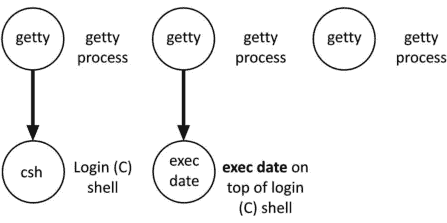

图 13.2 在登录 shell 下执行 `exec date` 命令。

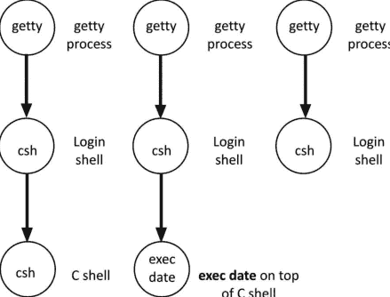

图 13.3 在登录 shell 的子 shell 下执行 `exec date` 命令。

```
% exec date
Sun Mar 19 18:04:24 PKT 2017
$

PID TTY       TIME CMD

6990 pts/2    00:00:00 bash

7163 pts/2    00:00:00 ps

$
```

## 13.7.2 通过 exec 命令进行文件输入输出

不同的 shell 同时允许使用不同数量的文件描述符。如第 7 章所述，三个描述符被预留给标准输入 (0)、标准输出 (1) 和标准错误 (2)。使用 `exec` 命令配合重定向运算符可以使用所有这些描述符进行 I/O。表 13.2 描述了文件 I/O 的 `exec` 命令语法。

表 13.2 文件 I/O 的 exec 命令语法

| 语法 | 含义 |
| --- | --- |
| `exec < file` | 打开文件用于读取，并将进程的标准输入附加到文件 |
| `exec > file` | 打开文件用于写入，并将进程的标准输出附加到文件 |
| `exec >> file` | 打开文件用于写入，将进程的标准输出附加到文件，并将输出追加到文件 |
| `exec n< file` | 打开文件用于读取，并为其分配描述符 `n` |
| `exec n> file` | 打开文件用于写入，并为其分配描述符 `n` |
| `exec n<< tag` | 打开文档（`<<` 和 `tag` 之间的内容）用于读取；打开的文件分配描述符 `n` |
| `exec n>> file` | 打开文件用于写入，分配描述符 `n`，并将数据追加到文件末尾 |
| `exec n&m` | 将 `m` 复制到任何进入文件描述符 `n` 的内容，内容也将进入文件描述符 `m` |
| `exec <&-` | 关闭标准输入 |
| `exec >&-` | 关闭标准输出 |
| `exec n<&-` | 关闭附加到 `stdin` 的描述符 `n` 文件 |
| `exec n->&` | 关闭附加到 `stdout` 的描述符 `n` 文件 |

当从命令行执行时，`exec < sample` 会导致 `sample` 文件中的每一行都被视为命令由当前 shell 执行。这是因为 shell 进程（其唯一目的是从 `stdin` 读取并执行命令）执行了 `exec` 命令；由于 `sample` 文件已附加到 `stdin`，shell 从文件中读取其命令。shell 在执行完 `sample` 中的最后一行后终止。在 shell 脚本内部执行此命令时，它会将脚本剩余部分的 `stdin` 附加到 `sample`。


图 13.5 壳脚本内部 `stdin` 和 `stdout` 的分离与重新连接。

```
cat > file3

exec < /dev/tty

cat > file4

$ ./exec.demo

Hello, world!

<Ctrl+D>

This is great!

<Ctrl+D>

$ more file1

Hello, world!

$ more file2

Contents of file2.

$ more file3

Contents of file2.

$ more file4

This is great!
```

现在，我们开发一个名为 `diff2` 的壳脚本，它使用了 Bash 的文件输入/输出（I/O）功能。它接受文件作为命令行参数并按行进行比较。如果文件相同，它会显示一条相应的消息并终止程序。如果一个文件比另一个小，它会显示一条消息通知你。当程序找到两个文件不同的行时，它会显示一条错误消息，告知你两个文件中不同的行并终止。以下是示例运行：

```
$ cat diff2

#!/bin/bash

# File Name: ~/linuxze/chaper13/bash/diff2

# Author: Syed Mansoor Sarwar

# Written: August 28, 2004

# Modified: July 29, 2014; April 9, 2017

# Purpose: 检查作为命令行参数传递的两个文件

# 是否相同
```

### 简要描述

# 从每个文件中读取一行并比较它们。如果
# 行相同，则继续。如果
# 不同，则显示这两行并退出。如果其中
# 一个文件在另一个文件之前结束，则显示
# 消息并退出。否则，文件将
# 显示适当的消息并退出

```bash
if [ $# != 2 ];
then
    echo "Usage: $0 file1 file2"
    exit 1
elif [ ! -f "$1" ];
then
    echo "$1 is not an ordinary file"
    exit 1
elif [ ! -f "$2" ];
then
    echo "$2 is not an ordinary file"
    exit 1
else
    :
fi

file1="$1"
file2="$2"
```

# 打开文件进行读取并将它们分配给文件描述符 3 和 4
`exec 3 < "$file1"`
`exec 4 < "$file2"`

# 从两个文件中读取一行并比较。如果都到达 EOF（文件结束符），则文件
# 是相同的。否则，它们是不同的。`0<&3` 用于将 `read` 命令的标准
# 标准输入连接到文件描述符 3，`0<&4` 用于将 `read` 命令的标准
# 标准输入连接到文件描述符 4。

```bash
while read -r line1 <&3
do
    if read -r line2 <&4
    then
        # 如果行不同，则两个文件不同
        if [ "$line1" != "$line2" ];
        then
            echo "$1 and $2 are different."
            echo "$1: $line1"
            echo "$2: $line2"
            exit 1
        fi
    else
        # 如果到达 file2 的 EOF，则 file1 比 file2 大
```


```bash
        echo "$1 and $2 are different and $1 is bigger than $2."

        exit 1

    fi

done

# 如果到达 file1 的 EOF，则 file2 比 file1 大。否则，两个

# 文件是相同的。0<&4 用于将 read 的标准输入连接到文件

# 描述符 4

if read -r line2 <&4

then

    echo "$1 and $2 are different and $2 is bigger than $1."

    exit 1

else

    echo "$1 and $2 are the same!"

    exit 0

fi
```

```bash
# 关闭对应描述符 3 和 4 的文件

exec 3&-

exec 4<-

$ cat test1

Hello, world!

Not the same!

Another line.

$ cat test2

Hello, world!

$ cat test3

Hello, world!

Not the same!

$ cat test4

This is different file.

Hello, world!

$ ./diff2

Usage: ./diff2 file1 file2

$ ./diff2 test1 test2 test3

Usage: ./diff2 file1 file2

$ ./diff2 test1 test1

test1 and test1 are the same!

$ ./diff2 test1 test3

test1 and test3 are different and test1 is bigger than test3.

$ ./diff2 test2 test2

test1 and test2 are different and test1 is bigger than test2.

$ ./diff2 test2 test3

test2 and test3 are different and test3 is bigger than test2.

$ ./diff2 test1 test4

test1 and test4 are different.

test1: Hello, world!

test4: This is different file.

$
```

`exec` 命令用于打开和关闭文件。`exec 3 < "$file1"` 和 `exec 4 < "$file2"` 打开了作为命令行参数传递的文件用于读取，并将它们分配给文件描述符 3 和 4。从现在开始，你可以使用这些描述符读取两个文件。`read line1 <&3` 和 `read line2 <&4` 命令分别从描述符为 3（对应 `file1`）和 4（对应 `file2`）的文件中读取下一行。`exec 3<&-` 和 `exec 4<&-` 命令关闭这两个文件。`if` 语句 `else` 部分的冒号 (`:`) 是一个返回真的空语句。你可以使用 Bash 命令 `true` 同样的目的。顺便提一下，正如预期，`false` 命令返回假。

在接下来的章节练习中，你将使用 `exec` 命令将壳的 I/O 重定向到普通文件。这加强了壳脚本 I/O 重定向以及使用文件描述符进行 I/O 的概念。

## 练习 11

编写一个命令将你的壳的 `stdin` 改名为 `data` 的文件，将 `stdout` 改为名为 `out` 的文件，但都在你的工作目录下。如果文件 `data` 包含以下行，执行命令后发生什么？

```bash
echo -n "The time now is: "

date

echo -n "The users presently logged on are: "

who
```

## 练习 13.12

在完成练习 13.10 中的步骤后，在壳提示符处输入命令会发生什么？结果对你来说合理吗？编写将环境恢复正常的所需的命令。

## 练习 13.13

创建一个包含 `diff` 脚本的文件，并尝试用不同的输入。

## 13.8 调试壳脚本

你可以通过 `sh` 命令的 `-x` (`echo`) 选项来调试 Bash 脚本。该选项会在执行前显示变量替换后脚本的每一行。你可以将 `-x` 选项与 `-v` (`verbose`) 选项结合使用，显示脚本的每一行。在下面的示例中，我们展示了如何调试脚本。`debug_demo` 文件会提示输入一个数字。如果你输入 1 到 9 之间的值，它会显示 `Good!`。如果你输入其他任何值，它直接退出。当脚本执行且你输入 4 时，它会显示消息 `syntax error: unexpected end of file (expecting "fi")`。这通常意味着你没有关闭控制结构，例如缺少 `fi`。

```bash
$ debug_demo

#!/bin/bash

echo -n "Enter a digit: "

read line1

if [ "$line1" -ge 1 -a "$line1" -le 9 ]

then

    echo "Good!"
```

我们使用 `sh -xv` 调试程序。错误信息明确指出缺少 `fi`。我们在正确的位置插入 `fi` 并重新运行程序。我们现在得到错误 `debug_demo: 5: [4]: not found`。运行时跟踪显示了问题区域。在这种情况下，错误是因为 `[` 和 `4` 之间缺少空格产生的。换句话说，4 和 1 的比较有问题；它应该在 4 之前。通过将 `$line1` 改为 `"$line1"` 解决这个问题后，脚本正常工作。

```bash
$ sh -xv debug

#!/bin/bash

echo -n "Enter a digit: "

+ echo -n "Enter a digit: "

read line1

+ read line1

4

if [ "$line1" -ge 1 -a "$line1" -le 9 ]

then

    echo "Good!"
```


## 练习 13.14

在你的 Linux 系统上测试 `trap_demo` 和 `canleave` 文件中的脚本。符合预期吗？确保你理解了它们。如果你的版本工作不正常，请使用 `sh -xv` 命令调试它们。

## 总结

Bash 在数值数据处理方面没有内置的算术能力

# 高级 Bash 编程

需要文件相关操作，如文件的打开和读取，因为数据位于脚本文件中，并且在脚本加载时应该已经加载到主内存中。

Bash 允许用户编写忽略某些信号（如键盘中断 `<Ctrl-C>`）的程序。这个非常有用的功能可以用于（例如）在程序更新文件中间禁用程序终止。可以使用 `trap` 命令来调用此功能。

Bash 允许使用函数，包括参数传递和访问函数的返回值。局部变量和全局变量的作用域规则有明确的定义。

Bash 具有强大的 I/O 特性，允许对文件进行显式处理。可以使用 `exec` 命令打开文件进行读取或写入，并将一个小小的整数（文件描述符）与之关联。命令行 `exec n<` 打开文件用于读取，而 `exec n>` 打开文件用于写入并为其分配文件描述符 `n`。此功能允许编写处理文件的脚本。命令行 `exec n-` 可用于关闭描述符为 `n` 的文件。`exec` 命令提供了其他各种文件相关功能，包括打开文档并分配文件描述符，允许在脚本的任何地方使用在此文档（here document）。

可以使用 `sh` 命令的 `-x` 和 `-v` 选项对 Bash 程序进行调试。这种技术允许在执行前的变量替换后查看用户脚本中的命令。你也可以使用 `bashdb` 调试 Bash 脚本，它的功能类似于 C/C++ 的 GNU 调试器 `gdb`，见第 14 章。

## 问题与练习

1. 需要 `expr` 命令吗？
2. 修改 `num_array_demo` 脚本，显示给定斐波那契数平方的和。
3. 编写一个 Bash 脚本 `Fibonacci_series`，接受一个整数 `N` 作为命令行参数并显示前 N 个数。
4. 什么是在此文档（here document）？它为什么有用？
5. 编写一个 Bash 脚本 `cv`，接受立方体的边作为行参数并显示立方体的体积。
6. 修改 1.3 节中的 `count` 脚本，使其接受两个整数参数：如果第一个数字小于第二个，则按升序显示；如果大于第二个，则按降序显示。将脚本命名为 `count_up_down`。
7. 给出两个 Bash 命令来计算以下表达式（不带精度，以及带五位小数精度）。显示命令及其输出。
   a. `97.03*57.1/23.97`
   b. `2.3+93.17-61.721/13.97*`
8. 使用 `bc` 执行以下任务。在 Bash 下显示命令及其输出。
   a. 将 2 进制 `10111011` 转换为等值的进制和十六进制。
   b. 将 10 进制 `10111011` 转换为等值的进制、二进制、八进制和十六进制。
   c. 将 20 进制 `10111011` 转换为等值的进制、二进制、八进制和十六进制。
9. 下列命令的输出是什么？请解释每个输出。
   a. `echo "var=25;var++" | bc`
   b. `echo "var=700;var%=9;var" | bc`
   c. `echo "var=25;var^=3;var" | bc`
   e. `echo "5 & 50" | bc`
   f. `echo "5 || 50" | bc`
   g. `echo "0 || 0" | bc`
   h. `echo "1 | 1" | bc`
   i. `echo "0!" | bc`
   j. `echo "obase=2;15" | bc -l`
   k. `echo "obase=2;1111" | bc -l`
   l. `echo "obase=2;2:8110" | bc -l`
10. 编写一个 Bash 脚本，提示输入用户 ID 并显示你的登录名、姓名和主目录。
11. 编写一个 Bash 脚本，接受整数列表作为命令行参数，并显示它们的平方列表以及该平方列表中数字的和。
12. 编写一个 Bash 脚本，接受机器名称作为参数，并显示消息告知主机是否在本地网络上。
13. Linux 中的信号是什么？Bash 脚本中可以拦截什么类型的信号？
14. 编写一个 Bash 脚本，接受文件和目录作为命令行参数，如果在给定目录下找到了该文件且它是普通文件，则删除它。如果文件（第一个参数）是一个目录，则将其删除（包括下面的所有文件和子目录）。
15. 编写一个 Bash 脚本，接受目录作为参数，并删除目录下 `.o`、`.ps` 和 `.jpg` 扩展普通文件。如果没有指定参数，则使用当前目录。
16. 增强 13.6 节中的 `diff2` 脚本，使其显示两个文件不同的行号。
17. 增强第 11 题的 `diff2` 脚本，如果只传递一个文件参数，则使用标准输入作为第二个文件。
18. 为第 12 章的第 16 题编写一个 Bash 脚本，但使用函数来实现各种选项的服务代码。
19. 假设首先定义了一个函数 `f`，然后将 `f` 定义为变量。在提供第二个定义后，你会引用函数还是变量？为什么？展示一个 shell。
20. 参数是如何传递给函数的？
21. 编写一个 Bash 脚本，提示输入用户 ID 并显示你的登录名、姓名和主目录。
    a. 显示 CPU
    b. 显示系统名
    c. 显示完整路径
    d. 显示文件数量
    e. 显示进程数量
    f. 显示最大数量
22. 给出两个 Bash 命令来计算以下表达式（不带精度，以及带五位小数精度）。显示命令及其输出。与第 13.2 节中的循环等。
23. 使用 `bashdb` 在执行前的变量替换后查看用户脚本中的命令。
24. 使用计算器 `bc` 定义一个数学函数，接受 `f(x^2)`、`a, b, n`，并返回辛森法则数值积分的结果，至少保留三位有效数字。
25. 函数的作用域规则是什么？给出示例。
26. 创建一个名为 `mother` 的 Bash 脚本，包含三个或多个函数。
27. 扩展你的 `bc` 系统，使得在连续调用 `bc` 函数时可以输入其他有效的函数定义。
28. 在命令行定义一个函数，在当前目录下创建一个新目录及其任意数量的子目录。它应该能够处理错误参数，如。
29. 所有的迭代结构（无论是确定还是不确定的）都可以化为递归函数。实现相同的结果。

# 项目

# 项目 1

辛森法则是一种非常精确的数值积分方法，在 $a$ 到 $b$ 之间连续函数 $f(x)$ 的积分近似为：

```
h/3[y0+4y1+2y2+4y3+2y4+...+2yn-2+4yn-1+yn]
```


其中 `h = (b - a)/n`，`n` 为偶数，`yk = (fa + kh)`。

使用计算器 `bc`（Linux Mint 18.2 和 CentOS 7.4 系统预装）和文档，在 `bc` 中定义一个数学函数，接受参数 `f(x^2)`、`a`, `b`, `n`，并返回辛森法则数值积分的结果，至少保留三位有效数字。在 0 到 1 之间进行积分（示例 `n` 值 `n=100` 和 `n=1000`）。

在 `bc` 命令行调用该函数（你可以将其命名 `integrate`）的操作类似于 `(integrate 0 1 100.0)`。此外，扩展你的 `bc` 系统，使得在连续调用 `bc` 函数时可以输入其他有效的函数定义。

# 项目 2

仅使用 Python 重复项目 1，而不是使用 `bc` 和在此文档（here document）。与项目 1 一样，允许对数学函数的有效配置进行扩展。参考请参阅书籍网站上的第 W19 章，该章节涵盖了 Python 编程的基础。该参考资料主要使用 Python 2.7.X 来阐明其目标，但如果你愿意，此项目可以使用 Python 3.X。

## 项目 3

你将如何作为一个 Linux 软件系统设计并实现你自己的基础 shell 程序？你会使用什么作为模型，用什么种编程语言来编写 shell？你会使用编译语言还是解释型语言，例如 C++ 或 Python 2.X/3.X？你必须首先做的一个非常关键的决定是：究竟为什么以及如何用 Python 实现 shell 会更有优势？例如，你的 shell 规范将包括实现至少 `cat` 或 `more`、`ls`、`mkdir`、`cd`、`rm`、`rmdir` 等命令，并根据你的认为为这些命令提供许多选项。

更进一步，你可以根据你所处理硬件的特定情况，构建你认为有用的 shell 命令。这并不意味着你受限于 X86 架构或其指令集，也不意味着你的软件系统必须实现在 Linux，或运行在精简指令集计算机（RISC）或高级 RISC 机器（ARM）处理器指令集之上的 Linux 或基于 Linux 的操作系统上。

一旦你回答了上述问题，并设计并规范了你自己的个人 shell 程序作为一个软件系统，请用你选择的语言实现它，然后在双人团队中对其进行尽可能严谨的测试。

想了解更多吗？访问我们的网站获取额外的阅读材料、推荐资源和练习。

CRC Press 电子资源：https://www.crcpress.com/9781138710085

作者 GitHub：https://github.com/bobk48/linuhtextbook

## 14

# 用于软件开发的 Linux 工具

## 目标

- 总结不同层次的计算机编程语言
- 讨论解释型语言和编译语言以及编译过程
- 简要描述软件工程生命周期
- 讨论用于 C 程序静态分析的 Linux 工具：验证代码的可移植性和进行性能分析
- 讨论用于 C 程序动态分析的 Linux 工具：调试、跟踪和性能监控
- 涵盖以下命令和原语：

```
ar, cppcheck, g++, gcc, gdb, gprof, grep, help, indent, jacac, make, memcheck, nm, perf, perl, python, ranlib, rlog, ruby, strip, time, valgrind
```


## 14.1 引言

典型的 Linux 系统支持高阶语言（HLL），包括解释型和编译型。这些语言包括 `C`、`C++`、`Pascal`、`Java`、`LISP` 和 `FORTRAN`。然而，Linux 平台上的大多数应用程序是用 `C` 语言描述的，`C` 也是编写 Linux 操作系统的语言。因此，有一系列软件工程工具用于开发其他语言（特别是 `C++`）的软件。

Linux 操作系统拥有丰富的软件工程工具，用于程序生成以及程序的静态和动态分析。这些工具用于源码编辑、源码缩进、编译和链接、处理模块化软件、创建库、性能分析、验证源码的可移植性、源码管理、调试、跟踪和性能监控。

在本章中，我们将描述开发 `C` 软件的一些常用工具。对这些工具的讨论程度从简短到详细不等，取决于它们的实用性以及在实践中使用的频率。然而，在讨论这些工具之前，我们先简要描述用于编写计算机软件的各种类型语言。在此过程中，我们也会讨论解释型语言和编译型语言。

## 14.2 计算机编程语言

计算机程序可以用多种编程语言编写。计算机的本地语言被称为机器语言，它是由计算机内部 `CPU` 指令集组成的语言。记住，`CPU` 的指令集由 `CPU` 能理解的指令组成。这些指令能够对数据执行各种类型的操作，例如算术、逻辑、移位和输入输出操作。今天的 `CPU` 由二进制设备（在开启或关闭状态下运行设备）组成，因此 `CPU` 指令的形式为 0 和 1，其中 0 表示关闭状态，1 表示开启。`CPU` 的指令总数以及指令的最大长度（字节数）取决于 `CPU`。虽然基于精简指令集计算机（`RISC`）的 `CPU` 具有几百条简单指令，但复杂指令集计算机（`CISC`）`CPU` 只有少数复杂的指令。用 `CPU` 语言编写的程序被称为机器程序，通常称为机器码。机器语言程序是高效的，因为它们最难编写，因为机器语言与任何口语语言都非常不同；程序员用 1 和 0 编写这些程序，一个位的改变就可能导致许多问题。调试语言编程是一项挑战性且耗时的任务。由于这些原因，今天的程序很少用机器语言编写。

在汇编语言编程中，指令是用类似于英语的单词（称为助记符）写的。它们相对容易阅读和调试。然而，在执行这些程序之前，必须将其翻译成你计算机使用的 `CPU` 语言。这种翻译过程由一个称为汇编器的程序完成。你必须执行一个命令来运行汇编器，并将包含汇编语言程序的文件作为其参数。虽然语言变得不再流行，但它们仍被用于内存有限的实时系统关键型程序（例如钻床的控制器）的编程和调试。

## 14.3 编译过程

由于我们本章的重点是 Linux 工具——主要是 `C` 编程语言（一种编译型语言），在继续之前，我们需要描述编译过程。正如我们在 14.2 节中所言，用编译型语言编写的计算机程序必须翻译成要在执行的计算机系统中 `CPU` 的机器码。这种翻译通常是一个三个步骤的过程，由编译、汇编和链接组成。编译过程将源代码（例如 `C` 程序）翻译为系统使用的 `CPU` 对应的汇编代码。汇编代码然后翻译为相应的机器码，称为对象代码。最后，对象代码被翻译为可执行代码。图 14.2 概述了翻译过程。在一个大型项目中，你可能有多个源文件。在这种情况下，你将其编译成单独的对象文件并传递给链接器以生成一个可执行文件。

| 第四代语言 | Perl, Visual BASIC | DrawWindow (...) |
|---|---|---|
| 高级语言 | C, C++, Java, FORTRAN | while (count < 100) (...) |
| 汇语言 | MASM, Turbo Assembler | ADD X, AX JMP L1 |
| 机器语言 | 针对每个 CPU 特定 | 100111010011101 |
| 硬件 | | |

图 14.1 编程语言的层级，包含示例、编程易用性和执行速度。

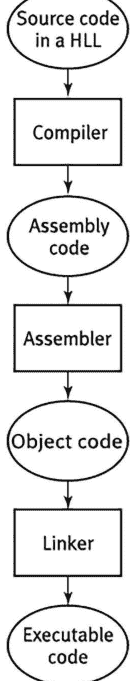

图 14.2 将高级语言程序翻译为可执行代码的过程。

对象代码包含机器指令，但它不是执行的，因为源程序可能使用了几个库函数，汇编器无法解析这些引用，因为这些函数的代码不在源文件中。链接器执行链接（连接）程序对象代码和库中对象代码的任务，并生成可执行的二进制文件。

`C` 程序的翻译在编译之前会经过一个预处理阶段。`C` 预处理器翻译以 `#` 符号开头的程序语句。图 14.3 概述了 `C` 程序的编译过程。整个翻译过程由单个编译器命令完成。我们在本章中讨论各种 Linux 编译器。如前所述，链接器可以接收多个对象文件以生成可执行文件。

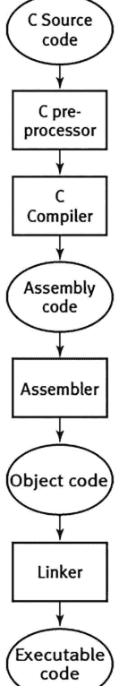

图 14.3 C 程序翻译为可执行代码的过程。

## 14.4 软件工程生命周期

产品是在系列阶段中开发的，统称为软件开发生命周期。文献中有多种生命周期模型并在实践中应用。特定产品使用的生命周期取决于其规模、要开发软件的性质（科学、商业等）以及设计方法（面向对象或经典）。常用的生命周期模型包括构建与修复、瀑布型、螺旋型、敏捷软件开发和快速应用开发。大多数经典生命周期模型的共同阶段是需求分析、规范、规划、设计、编码、测试、安装/部署和维护。生命周期模型及其阶段的全面讨论出了本书的范围，但我们将详细讨论编码阶段——特别是可以用于此阶段的 Linux 程序开发、分析和调试工具。

程序开发过程包括三个步骤：程序生成、源代码的静态分析和可执行代码的动态分析。程序生成阶段的目的是创建源代码并为源代码生成可执行代码。这里涉及编辑文本文件、缩进源代码、编译源代码、处理基于模块的库、管理源代码和控制版本。静态分析包括验证源代码的质量并测量相对于源代码的指标（例如对函数的调用次数和每个函数所需的时间）。动态分析包括调试、跟踪和监控软件性能，根据产品需求对其测试。在本章的其余部分，我们将描述用于这三个步骤的 Linux 工具。对每个工具的讨论深度取决于它对普通软件开发者的实用性、使用频率以及在各种 Linux 平台上的可用性。

## 14.5 程序生成工具

程序生成阶段包括创建源代码并生成其可执行代码。因此，它涉及编辑文本文件、缩进源代码、编译源代码、处理基于模块的软件、创建库、管理源代码和控制版本。现在我们讨论支持这些任务的 Linux 工具。

### 14.5.1 生成源文件

任何文本编辑器都可以用于生成 `C` 程序文件。我们在第 3 章中讨论了最常用的 Linux 编辑器，包括 `nano`，以及第 25 章用于书籍网站的 `emacs`。

### 14.5.2 缩进源代码

源代码的正确缩进是良好编码实践的重要部分，主要因为它提高了代码的可读性，而可读的代码更容易进行维护（调试、纠正和增强）。`C` 程序最著名的缩进方式是由 `Brian Kernighan` 和 `Dennis Ritchie` 在《C 语言程序》（1978）中提出的，这是关于 `C` 语言的第一本书。它通常被称为 `K&R`（`Kernighan` and `Ritchie`）缩进风格。非 `C` 程序员除非读过这本书，否则并不熟悉这种风格。Linux 工具 `indent` 可以正确地缩进 `C` 程序。它还可以用于转换编写在中的 `C` 程序。

语法：

```
indent [options] [input-files]
```

用途：此命令创建一个程序作为输入，按照指定的选项进行缩进，将格式化后的程序保存到输出文件，并将原始程序保存到备份文件。

常用的选项：

| 选项 | 描述 |
|---|---|
| `-bad` | 强制在声明后换行 |
| `-bap` | 强制在函数体后换行 |
| `-br` | 按照 |
| `-linux` | Linux 风格格式 |
| `-kr` | K&R 风格格式 |
| `-orig` | 原始格式 |
| `-st` | 将程序发送到输出 |

若干其他选项允许你以各种风格格式化代码。你可以在文件名之前或指定这些选项。`indent` 命令确保输入文件和输出文件是不同的；如果它们相同，它会产生错误信息，并且默认情况下，备份（即原始文件）保存在具有以下的文件：

如果你不指定任何输入文件，或者指定 `"-"` 作为输入文件，输入将从标准输入读取。使用 `-o` 选项，你可以显式指定格式化文件的名称，如 `indent first.c -o formatted.c`。使用 `-st` 选项，`indent` 将格式化代码发送到标准输出。因此 `indent -st first.c > first.gnu.c` 将 GNU 风格格式化文件保存到 `first.gnu.c`。

在后面的章节练习中，我们将使用 `indent` 练习 `C` 程序的缩进。

#### 练习 14.1

创建上述 `second.c` 文件并使用 `indent` 命令按照 `K&R` 风格对其进行缩进。你使用了哪些命令行？

### 14.5.3.1 编译与执行 C 程序

Linux 上有多种 `C` 编译器，包括 `cc` 和 `gcc`。Linux 上最常用的 `C` 编译器是 `GNU C/C++` 编译器，`gcc`。该编译器是根据美国国家标准协会（`ANSI`）的规范编写的，称为 `ANSI C`，这是 `C` 语言的最新标准。所有的 `C++` 编译器，如 `Gnu for C++` (`g+`), 也可以用于编译 `C` 程序。`g++` 编译器在调用 `gcc` 时会带有必要的选项，使其识别 `C` 源代码。在本章中，我们主要讨论 `gcc` 编译器。

`gcc` 命令可以带选项或不带选项使用。我们在这里以及后续章节中将描述一些基本选项。初学者常用的选项之一是 `-o`。你可以使用此选项告诉 `gcc` 将可执行文件存储在特定的文件中，而不是默认的 `out`。在下面的示例中，我们展示了对 `first.c` 文件中 `C` 程序的编译：使用 `gcc first.c` 会在 `a.out` 文件中生成可执行文件，而 `gcc -o slogan first.c` 命令则在 `slogan` 文件中生成可执行文件。该命令用于显示由两个 `gcc` 命令生成的可执行文件名称。

```
gcc first.c
gcc -o slogan first.c
```


## Syntax:

```
gcc [options] file-list
```

**用途**：此 `gcc` 命令可用于调用 C 编译系统。在执行时，它会进行处理、编译、汇编和链接，以生成可执行文件。可执行代码默认放在 `a.out` 文件中。该命令接受多种类型的文件，并根据命令行中指定的选项进行处理。文件可以是归档文件（`.a` 扩展名）、C++ 源文件（`.c`, `.cc` 或 `.cpp`）、汇编文件（`.s` 扩展名）、预处理文件（`.i` 扩展名）或对象文件（`.o` 扩展名）。当文件扩展无法识别时，命令假设该文件为对象文件或库/归档文件。文件由 `file-list` 指定。

**常用选项/功能**：

- `-ansi` 强制完全符合 ANSI 标准
- `-c` 抑制链接阶段并保留对象文件（`.o` 扩展名）
- `-g` 创建符号表、性能分析和调试信息，以供 `gdb`（GNU 调试器）使用
- `-lm` 链接 `libm` 库
- `-mconfig` 为指定的 CPU 优化代码，可以指定多种 CPU，包括 Intel 80386、80486、Motorola 68k 系列、RS6000、AMD 29K 系列和 MIPS 处理器
- `-o` 在文件中创建可执行文件，而不是默认的文件 `out`
- `-level` 优化。你可以指定 0-3 为级别；通常数字越大，优化级别越高。如果级别为 0 则不进行优化
- `-pg` 提供性能分析信息，供性能分析工具 `profg` 使用
- `-S` 不汇编 `.c` 文件或链接 `.c` 文件，并将汇编版本留存在对应的 `.s` 扩展名文件中
- `-v` 详细模式：显示正在被调用的命令
- `-w` 抑制警告

```
$ cat first.c

#include <stdio.h>

int main ()

{

    printf("Linux Rules the Networking World!\n");

    return (0);

}
```

如果你的搜索路径不包含当前目录（`.`），你将收到类似 `a.out: Command not found` 的消息，如下面的会话所示。如果发生这种情况，你有两个选择：你可以运行 `./a.out`（即显式告诉 shell 应该运行当前目录下的 `a.out` 文件），或者将当前目录包含在 shell 的搜索路径中，并重新运行命令 `a.out`。下面的会话演示了这两个选项。

```
$ a.out

a.out: Command not found.

$ ./a.out

Linux Rules the Networking World!

$ PATH=$PATH:.

$ a.out

Linux Rules the Networking World!

$
```

注意，搜索路径的更改仅对当前会话有效。若要对搜索路径进行永久更改，你需要修改 `~/.profile` 文件中 `PATH` 变量的值。详情请见第 2 章。

## 14.5.3.2 处理多个源文件

你可以使用 `gcc` 命令在单行命令行中编译并链接 C 源文件并创建可执行文件。例如，你可以使用以下命令行为 C 源文件 `driver.c`、`stack.c` 和 `misc.c` 创建名为 `polish` 的可执行文件。

```
$ gcc driver.c stack.c misc.c -o polish

$
```

如果三个文件中的其中一个被修改了，你需要重新输入命令行，这会产生两个问题：首先，所有三个文件都被编译成各自的对象模块，尽管只有其中一个需要重新编译。这会导致时间变长，特别是当文件很大时。其次，重新输入整行可能意味着当有更多文件时也要这样做。为了避免这些问题，你应该为所有源文件创建对象模块，然后只提取那些更新的模块。所有对象模块将被链接生成单个可执行文件。

你可以使用带有 `-c` 选项的 `gcc` 命令为 C 源文件创建对象模块。使用 `-c` 选项编译程序时，编译器会在当前目录下留一个对象文件。该对象文件的名称与源文件名相同并带有 `.o` 扩展名。你可以通过另一个 `gcc` 命令链接多个对象文件。在下面的会话中，我们分别编译三个源模块——`driver.c`、`stack.c` 和 `misc.c` 以创建它们的对象文件，然后使用另一个 `gcc` 命令链接并创建一个单一的可执行文件 `polish`。

```
$ gcc -c driver.c

$ gcc -c stack.c

$ gcc -c misc.c

$ gcc misc.o stack.o driver.o -o polish

$ polish
```

你也可以用 `-c` 选项一次编译多个文件。在以下命令的第一条中，我们用一个命令编译所有源文件以生成对象文件。文件在命令行中列出的顺序并不重要。第二条命令链接对象文件并生成一个可执行文件 `polish`。

```
$ gcc -c driver.c stack.c misc.c

$ gcc misc.o stack.o driver.o -o polish
```

现在，如果你更新了源文件之一，你需要使用 `-c` 命令仅为该源文件生成对象文件。然后使用第二个命令再次链接所有对象文件生成可执行文件。

## 14.5.3.3 链接库

Linux 上的 C 编译器会在编译程序时将适当库与你的程序链接。有时，你必须显式告诉编译器链接所需的库。你可以通过使用 `-l` 选项的 `gcc` 命令并在后紧跟库名来实现。你使用的大多数库为每个需要链接的库使用一个独立的 `-l` 选项。在 `/lib` 目录下，有数学库。

# 用于软件开发的 Linux 工具

通过使用 `perl`、`python` 和 `ruby` 命令来完成。如果不确定，可以使用 `which` 命令来查找解释器在文件系统中的位置，如下所示所示。

```
$ which perl

/usr/bin/perl

$ which python

/usr/bin/python

$ which ruby

/usr/bin/ruby

$
```

Linux Mint 默认未安装 Ruby。你可以请求你的系统管理员为你安装。你也可以按照附录 A 中提供的说明在你的 Linux 机器上自行安装。

Perl、Python 和 Ruby 脚本文件的扩展名分别为 `.pl`、`.py` 和 `.rb`。和 Linux 中所有的脚本一样，第一行指定了解释器的路径，随后是脚本内容。Perl、Python 和 Ruby 脚本的执行方式与 shell 脚本的执行相同：创建脚本文件，赋予该文件可执行权限，然后使用相关文件的文件名或将脚本文件作为相关解释器命令（`perl`、`python` 或 `ruby`）的参数来运行脚本。以下会显示了“Hello, World!” Perl 脚本的样子以及如何执行它。

```
$ cat Hello.pl

#!/usr/bin/perl

# The Hello World program in Perl

print "Hello, World!\n"

$ chmod +x Hello.py

$ Hello.py

Hello, World!

$ perl Hello.py

Hello, World!

$
```

以下会显示了“Hello, World!” Python 脚本的样子以及如何执行它。

```
$ cat Hello.py

#!/usr/bin/python

# The Hello World program in Python

print "Hello, World!"

$ chmod +x Hello.py

$ Hello.py

Hello, World!

$ python Hello.py

Hello, World!

$
```

最后，以下会显示了“Hello, World!” Ruby 脚本的样子以及如何执行它。

```
$ cat Hello.rb

#!/usr/bin/ruby

# The Hello World program in Ruby

puts "Hello, World!"

$ chmod +x Hello.rb

$ Hello.rb

Hello, World!

$ ruby Hello.rb

Hello, World!

$
```

你也可以从命令行运行 Perl 和 Python，如下节所示。

```
$ perl -e 'print "Hello, World!\n'

Hello, World!

$ python -c 'print "Hello, World!\n'

Hello, World!

$ ruby -e 'puts "Hello, World!\n'

Hello, World!

$
```


# 练习 14.4

在你的 Linux 系统上重复之前的课程，以理解如何从命令行运行 Perl、Python 和 Ruby 以及如何执行你的脚本。

## 14.5.4 使用 make 处理基于模块的 C 软件

大多数 C 软件被划分为多个源文件（`.c` 和 `.h`）。与存储在单个文件中的单体程序相比，这种软件具有几个优势。首先，它使得软件更加模块化，导致程序文件更小，编辑、编译、测试和调试所需的时间更短。它允许只重新编译已修改的源文件，而不是整个系统。此外，多模块结构提供了信息隐藏，这是面向对象设计和编程的核心特征。

然而，多模块实现也有其缺点。首先，你必须了解组成整个系统的文件、这些文件之间的依赖关系，以及自你创建上一个可执行文件以来修改的文件。此外，当你处理多模块 C 软件时，编译文件创建可执行文件会变成一种麻烦，因为必须输入很长的命令行：一条用于为所有 C 源文件创建对象文件，另一条用于链接对象文件以创建一个可执行文件。解决这种不便的简单方法是创建一个执行这些工作的 shell 脚本。即使只修改了一个源文件或头文件，所有的对象文件都会被重新创建，其中绝大部分是不必要的。

Linux 有一个强大的工具叫做 `make`，它允许你管理将模块编译为可执行的过程。`make` 工具读取一个名为 `makefile` 的规范文件，该文件描述了系统各个模块之间如何相互依赖。`make` 工具利用 `makefile` 中的这种依赖规范以及各种组件被修改的时间，最大限度地减少重新编译量。当你的系统由几十个文件和几个可执行程序组成时这非常有用。在这样的系统中，记住并跟踪每一个头文件、源文件对象文件可能是一场噩梦。以下是对 `make` 工具的简单描述。

语法：

```
make [options] [targets] [macro definitions]
```

用途：此工具根据名为 `makefile` 或 `Makefile` 的文件中存储的依赖关系来更新文件；依赖关系以特定的格式在 `makefile` 中指定。“options”、“targets”和“macro definitions”可以以任何顺序指定。

常用选项/功能：

- `-d`: 显示调试信息
- `-f`: 此选项允许你指示 `make` 从“文件”读取依赖关系规范；如果没有此选项，文件名将被视为 `makefile` 或 `Makefile`。文件名 "..." 表示标准输入
- `-h`: 显示所有选项的简要描述
- `-n`: 不运行 `makefile` 命令；仅显示它们
- `-s`: 在静默模式下运行，不显示任何消息

`make` 工具基于文件之间的依赖关系、需要构建的目标文件（例如可执行文件或对象文件）以及为了构建目标文件而要执行的命令。这些依赖关系、目标和命令在 `make` 规则中指定。以下是 `make` 规则的语法。

语法：

```
target-list: dependency-list

<Tab>command-list
```

用途：`make` 规则的语法

在这里，`target-list` 是由空格分隔的目标列表，`dependency-list` 是目标文件依赖的文件列表（对象文件、源文件等）或一个或多个空格，`command-list` 是为了创建目标文件而必须执行的以换行符分隔的命令列表。`command-list` 以 `<Tab>` 开头。注释行以 `#` 字符开头。`target-list` 和 `dependency-list` 可以使用通配符 `*`、`[]` 和 `()`。make 规则的另一种语法是 `target-list;dependency-list;command-list`，其中命令用分号分隔。目标之前应有制表符。

使用运算符时，如果目标的修改时间小于 `dependency-list` 中任何文件的时间，则目标过期。如果使用 `|` 运算符，在检查 `dependency-list` 后总是创建目标。使用 `::` 运算符，即使 `dependency-list` 为空，目标总是重新创建。在 `!` 的情况下，目标会被移除，但在 `::` 情况下不会。在书中我们使用常用的 `~`。

`Makefile` 由描述依赖关系的规则列表组成。`make` 工具利用 `Makefile` 确定组成程序的哪些文件需要重新编译和链接。因此，如果你修改了 `.h` 文件，`make` 工具会重新编译包含该头文件的所有文件。包含头文件的文件必须在相应的 `makefile` 中指定。包含源文件和 `makefile` 的目录通常称为构建目录。

以下 `makefile` 将用于 14.5.3 节讨论的程序。

```makefile
# power 程序的示例 makefile

# 记住：每行命令以 <TAB> 开头

power: power.c

gcc power.c -o power -lm
```

如果可执行文件存在且源文件 `power.c` 自可执行文件创建以来未修改过，运行 `make` 将提示 `power.c` 文件是最新的。因此，`make` 不需要重新编译和链接 `power.c`。有时，你需要强制重新制作可执行文件，例如包含在源码中的某个系统头文件发生了变化。为了强制重新创建可执行文件，你需要更改最后更新时间。一种常用方法是使用 `touch` 命令并重新运行 `make`。以下会话说明了这些点。

```
$ make

make 'power' is up to date.

$ touch power.c

$ make

gcc power.c -o power -lm

$
```

404 Linux

当你使用 `touch` 命令并以一个或多个已存在的文件作为参数时，它会将最后更新时间设置为当前时间。当与一个不存在的文件作为参数使用时，它会创建一个同名的长度为零（即空）的文件。

在接下来的章节练习中，你将使用 `make` 命令为单个源文件创建一个可执行文件。

## 练习 14.5

为 `power.c` 文件中的 C 程序创建可执行文件，并将其放在名为 `Xpowery` 的文件中。使用之前提供的 `Makefile` 通过 `make` 工具来完成此任务。运行 `Xpowery` 以确认程序正常工作。

为了将 `make` 工具提升到一个新水平，将 `power.c` 中的 C 程序划分为两个文件：`power.c` 和 `compute.c`。下面的会话显示了文件的内容。`compute.c` 文件包含 `compute` 函数，该函数从 `power.c` 中的 `main` 函数调用。为了生成 `power` 文件中的可执行文件，我们需要独立编译这两个源文件然后将它们链接，如会话末尾的 `cc` 命令行所示。

```
$ cat power.c

#include <stdio.h>

double compute(double x, double y);

int main()

{

    float x,y;

    printf("The program takes x and y from stdin and displays x^y.\n");

    printf("Enter integer x: ");

    scanf("%d", &x);

    printf("Enter integer y: ");

    scanf("%d", &y);

    printf("%x^y is: %6.3f\n", compute(x,y));

}
```

```
$ cat compute.c

#include <math.h>

double compute(double x, double y)

{

    return (pow((double) x, (double) y));

}
```

```
$ gcc -c compute.c power.c

$ ls

compute.o power.o

$ gcc compute.o power.o -o lpowery

$
```

在这种情况下，两个源文件之间的依赖关系非常简单。要执行 `power` 文件，我们需要两个对象模块：`power.o` 和 `compute.o`。如果 `power.c` 或 `compute.c` 任何一个文件更新，则需要重新创建可执行文件。图 14.4 显示了这种依赖关系的首次划分。


图 14.4 make 依赖树的首次划分。

# 用于软件开发的 Linux 工具

405

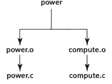

图 14.5 make 依赖树的第二次划分。

因此，与此依赖关系对应的 `make` 规则如下。注意必须链接数学库，因为 `compute.c` 中的 `compute` 函数使用了该库中的 `pow` 函数。

```
power: power.o compute.o

gcc power.o compute.o -o power -lm
```


我们还知道对象文件 `power.o` 是由源文件 `power.c` 构建的，对象文件 `compute.o` 是由源文件 `compute.c` 构建的。图 14.5 显示了依赖关系的第二次划分。

因此，创建两个对象文件的规则如下：

```
power: power.c

gcc -c power.c

compute.o: compute.c

gcc -c compute.c
```

最终的 `makefile` 所示：

```
$ cat makefile

power: power.o compute.o

gcc power.o compute.o -o power -lm

power.o: power.c

gcc -c power.c

compute.o: compute.c

gcc -c compute.c

$
```

我们使用之前的 `makefile` 执行 `make` 工具：

```
$ make

gcc -c power.c

gcc -c compute.c

gcc power.o compute.o -o power -lm

$
```

在接下来的章节内练习中，你将使用 `make` 工具为划分为两个文件的源代码创建可执行代码。

## 练习 1.6

创建两个源文件 `power.c` 和 `compute.c`，并按照上述讨论的步骤使用 `make` 工具创建可执行文件 `power`。

我们现在更改了该软件的结构，将其分为六个文件：`main.c`、`compute.c`、`input.c`、`compute.h`、`input.h` 和 `main.h`。这些文件的内容如下会话所示。注意 `compute.h` 和 `input.h` 文件包含了 `compute` 和 `input` 函数的声明（原型），但没有它们的定义；定义在 `compute.c` 和 `input.c` 文件中。`main.h` 文件包含两个要显示给用户的提示。图 14.6 显示了新的依赖树。

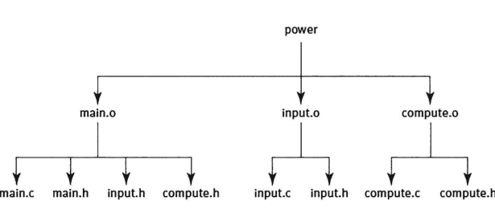

```
$ cat compute.h

/* Declaration/Prototype of the "compute" function */

double compute(double, double);

$ cat input.h

/* Declaration/Prototype of the "input" function */

double input(char);

$ cat main.h

/* Declaration of prompts to users **/

#define PROMPT1 "Enter integer x: "

#define PROMPT2 "Enter integer y: "
```

404 Linux

当你使用 `touch` 命令并以一个或多个已存在的文件作为参数时，它会将文件的最后更新时间设置为当前时间。当与一个不存在的文件作为参数使用时，它会创建一个同名的长度为零（即空）的文件。

在接下来的章节练习中，你将使用 `make` 命令为单个源文件创建一个可执行文件。

## 练习 14.5

为 `power.c` 文件中的 C 程序创建可执行文件，并将其放在名为 `Xpowery` 的文件中。使用之前提供的 `Makefile` 通过 `make` 工具来完成此任务。运行 `Xpowery` 以确认程序正常工作。

为了将 `make` 工具提升到一个新水平，将 `power.c` 中的 C 程序划分为两个文件：`power.c` 和 `compute.c`。下面的会话显示了这些文件的内容。`compute.c` 文件包含 `compute` 函数，该函数从 `power.c` 中的 `main` 函数调用。为了生成 `power` 文件中的可执行文件，我们需要独立编译这两个源文件然后将它们链接，如会话末尾的 `cc` 命令行所示。

```
$ cat power.c

#include <stdio.h>

double compute(double x, double y);

int main()
{
    float x,y;
    printf("The program takes x and y from stdin and displays x^y.\n");
    printf("Enter integer x: ");
    scanf("%d", &x);
    printf("Enter integer y: ");
    scanf("%d", &y);
    printf("%x^y is: %6.3f\n", compute(x,y));
}
```


```bash
$ cat compute.c

#include <math.h>

double compute(double x, double y)
{
    return (pow((double) x, (double) y));
}

$ gcc -c compute.c power.c

$ ls

compute.o power.o

$ gcc compute.o power.o -o lpowery

$
```

在这种情况下，两个源文件之间的依赖关系非常简单。要执行 `power` 文件，我们需要两个对象模块：`power.o` 和 `compute.o`。如果 `power.c` 或 `compute.c` 任何一个文件更新，则需要重新创建可执行文件。图 14.4 显示了这种依赖关系的首次划分。


图 14.4 make 依赖树的首次划分。

# 用于软件开发的 Linux 工具

405


图 14.5 make 依赖树的第二次划分。

因此，与此依赖关系对应的 `make` 规则如下。注意必须链接数学库，因为 `compute.c` 中的 `compute` 函数使用了该库中的 `pow` 函数。

```makefile
power: power.o compute.o
    gcc power.o compute.o -o power -lm
```

我们还知道对象文件 `power.o` 是由源文件 `power.c` 构建的，对象文件 `compute.o` 是由源文件 `compute.c` 构建的。图 14.5 显示了依赖关系的第二次划分。

因此，创建两个对象文件的规则如下：

```makefile
power.o: power.c
    gcc -c power.c

compute.o: compute.c
    gcc -c compute.c
```

最终的 `makefile` 所示：

```bash
$ cat makefile

power: power.o compute.o
    gcc power.o compute.o -o power -lm

power.o: power.c
    gcc -c power.c

compute.o: compute.c
    gcc -c compute.c

$
```

我们使用之前的 `makefile` 执行 `make` 工具：

```bash
$ make

gcc -c power.c
gcc -c compute.c
gcc power.o compute.o -o power -lm

$
```

在接下来的章节内练习中，你将使用 `make` 工具为划分为两个文件的源代码创建可执行代码。

## 练习 1.6

创建两个源文件 `power.c` 和 `compute.c`，并按照上述讨论的步骤使用 `make` 工具创建可执行文件 `power`。

我们现在更改了该软件的结构，将其分为六个文件：`main.c`、`compute.c`、`input.c`、`compute.h`、`input.h` 和 `main.h`。这些文件的内容如下会话所示。注意 `compute.h` 和 `input.h` 文件包含了 `compute` 和 `input` 函数的声明，但没有它们的定义；定义在 `compute.c` 和 `input.c` 文件中。`main.h` 文件包含两个要显示给用户的提示。图 14.6 显示了新的依赖树。

406

Linux


图 14.6 示例 C 软件的 make 依赖树。

```bash
$ cat compute.h

/* Declaration/Prototype of the "compute" function */
double compute(double, double);

$ cat input.h

/* Declaration/Prototype of the "input" function */
double input(char);

$ cat main.h

/* Declaration of prompts to users **/
```

`clean` 命令调用 `rm *.o` 来删除在创建过程中创建的所有对象文件。接下来的会话显示了带有两个目标作为命令行参数执行的 `make` 的输出。归档存放在 `all.tar` 文件中。`file all.tar` 命令的输出显示 `all.tar` 文件中确实创建了一个 Gnu tar 归档。

```bash
$ make all.tar clean

tar cvf - main.c input.c main.h input.h compute.h makefile > all.tar
main.c
input.c
compute.c
main.h
input.h
compute.c
makefile
rm *.o

$ file all.tar: POSIX tar archive (GNU)
```

在接下来的章节内练习中，你将在系统上运行之前的会话，以进一步加深对 `make` 工具的理解。

# 练习 14.8

使用前缀在 `power` 文件中创建可执行文件。

## 14.5.5 使用 ar 和 MRI 库将对象构建成库

操作系统允许你将对象文件（也称为模块或成员）存档（打包）到单个文件中，该文件称为库。这个过程允许你使用一个文件名而不是多个对象文件，并允许 C 程序进行函数级的软件重用。该工具也称为库管理器（librarian），允许你完成此任务。以下是该实用程序的简要描述。

语法：`ar key archive-name [file-list]`
用途：允许创建和操纵归档；例如，创建 `file-list` 中对象文件的归档并将其存储在文件 `archive-file` 中。
常用选项/功能：
- `d` 从归档中删除一个或多个文件（模块/成员）
- `p` 输出归档中指定的模块或所有模块（如果未指定，则打印所有模块）
- `a` 将模块附加到现有归档中
- `r` 创建新归档，或用指定的模块覆盖（即替换）现有模块
- `s` 强制生成归档符号表
- `t` 显示归档的内容
- `u` 更新（与 `r` 键配合使用）或提取（与 `x` 键配合使用）仅当模块与现有模块不同时
- `v` 生成详细输出
- `x` 从归档中提取一个或多个模块并将其存储在当前工作目录

归档名称以 `.a` 扩展结尾。一旦为一组对象模块创建归档，C 编译器和 Linux 加载器 (`ld`) 就可以通过指定归档文件作为参数来访问这些模块。编译器或加载器会自动从归档中链接所需的对象模块。`ld` 命令可用于显式链接对象文件和库。

键（key）就像命令的选项。然而，与大多数 Linux 命令不同，在使用 `ar` 命令时，你不需要在键值前插入连字符 (`-`)，但如果你需要，也可以使用。在接下来的 `ar` 命令示例中，我们没有在键值前使用连字符。

### 14.5.5.1 创建归档

你可以使用 `ar` 命令配合 `r` 键创建归档。接下来的命令行在 `mathlib.a` 中创建 `input.o` 和 `compute.o` 文件的归档。

```bash
$ ar r mathlib.a input.o compute.o

ar: creating mathlib.a

$
```

注意 `mathlib.a` 不存在，它会被创建。如果它已经存在且包含 `input.o` 和 `compute.o` 模块，它们将被命令行中指定的模块替换。一旦在当前目录创建了归档，你就可以使用编译器命令（如 `cc`）将其链接到 `main.c` 文件，如下：

```bash
$ gcc main.c mathlib.a -o power -1m

$
```

你可以使用 `q` 键将模块附加到现有归档的末尾。如果命令指定的归档不存在，则会创建。在接下来的示例中，对象模块 `main.o` 被附加到现有归档 `mathlib.a` 的末尾。在 `main.o` 附加到 `mathlib.a` 后，使用 `gcc` 命令创建 `power` 可执行文件。

```bash
$ ar q mathlib.a main.o

$ gcc mathlib.a -o power -1m

$
```

一旦你创建了某些对象模块的归档，可以删除原始模块以节省磁盘空间，如下会话所示：

```bash
$ rm compute.o input.o main.o

$
```

### 14.5.5.2 显示目录

你可以使用 `ar` 命令配合 `t` 键显示归档的目录。该命令显示 `mathlib.a` 归档的目录。

```bash
$ ar t mathlib.a

input.o
compute.o
```


### 14.5.5.3 从归档中删除对象模块

你可以使用 `ar` 命令配合 `d` 键从归档中删除一个或多个对象模块。在接下来的会话中，第一个命令从 `mathlib.a` 归档中删除对象模块 `main.o`，第二个命令显示新目录以确认 `main.o` 对象模块已从归档中删除。

```
$ ar d mathlib.a main.o
$ ar t mathlib.a
input.o
compute.o
```

注意，从头创建一个全新的归档比使用 `d`、`q` 和 `r` 键修改现有归档更高效。

### 14.5.5.4 从归档中提取对象模块

你可以使用 `ar` 命令配合 `x` 键从归档中提取一个或多个对象模块。

# 用于软件开发的 Linux 工具

当前打开的归档 `tmp-math2lib.a`：

```
rw-r--r-- 0/0 1416 Jan 1 05:00 1970 compute.o
rw-r--r-- 0/0 1736 Jan 1 05:00 1970 input.o
```

```
AR >save
AR >end
$
```

你也可以通过向标准输入提供脚本给 MRI 库来创建归档或处理现有归档。在接下来的会话中，我们将 `ar_script` 文件中的脚本提供给 MRI 。该脚本将创建 `math3lib.archive`，并对其执行与在本节开头使用命令行对 `math2lib.a` 执行的相同的操作。

```
$ more ar_script
create math3lib.a
addmod input.o
delete compute.o
list
addmod compute.o
list
save
end

$ ar -M < ar_script
Current open archive is tmp-math3lib.a
input.o
Current open archive is tmp-math3lib.a
compute.o
input.o
$ ar t math3lib.a
compute.o
input.o
$
```

你可以浏览 `ar` 的手册页以获取更多关于 MRI 库器额外功能的信息。请注意，与其修改现有归档（即从归档中删除和添加对象），不如删除现有归档并从头创建一个全新的归档效率更高。

## 练习 14.10

在你的系统上重复之前的会话，以理解 MRI 库器的工作原理。

## 14.5 使用 ranlib 和 nm 处理库

库是对象模块的归档。因此，处理库涉及创建库、对库中的模块进行排序以及显示库信息。在上一节中，我们已经从多种方式讨论了创建和操纵。在本节中，我们将讨论剩余的两个操作：对归档排序和显示库信息。

### 14.5.6 归档排序

在由 `ar` 命令创建的归档文件中，对象文件并不是按特定顺序维护的。在某些 Linux 系统上，调用函数必须在被调用函数之前，无论它们是在同一个模块还是不同的模块中。这种情况是一个问题，因为除非经过正确排序，否则 `gcc` 和 `ld` 无法定位对象模块。当它们无法定位对象模块时，它们在遇到归档中对象模块的调用时显示未定义符号错误消息。处理此问题最简单的方法是使用 `ranlib` 工具，它会为作为参数传递的一个或多个归档添加目录表。该工具执行的任务与 `ar` 命令配合 `s` 键的任务相同。以下是 `ranlib` 工具的简要描述。

```
Syntax:
ranlib [archive-list]
Purpose: 为 archive-list 中的每个归档添加目录表
```

`ranlib` 命令为 `mathlib.a` 归档添加目录表。也可以使用 `ar s mathlib.a` 命令来执行相同的任务。

```
$ ranlib mathlib.a
```

### 14.5.6.2 显示库信息

可以使用 `nm` 工具来显示库、对象文件和可执行文件的符号表（名称、类型、大小、入口点等）。该命令为指定文件中的每个对象（函数和全局变量）显示一行。此输出可以你有关库中可用的函数以及这些函数所依赖的函数。每行输出都包含对象的大小（字节）、对象的类型（数据对象、函数、文件等）、对象的作用域以及对象的名称。这些信息对于调试库非常有用。以下是该工具的简要描述。

```
Syntax:
nm key archive-name [file-list]
Purpose: 显示 file-list 中指定的库和对象文件的符号表

常用选项:
-a 在发现符号的输入文件（或归档）的每个名称之前显示内容
-v 显示命令的版本号
-n 根据地址而非按字母顺序显示符号
-s 显示包含符号定义的模块名称
```

以下字符指定符号类型：

- `A/a` 全局/绝对符号
- `B/b` 未初始化数据段（也称为 `bss`）中的全局/局部符号
- `D/d` 已初始化数据段中的全局/局部符号
- `f` 源文件中的符号名
- `L/l` 全局/静态线程本地存储符号
- `R/r` 只读数据段中的全局/局部符号
- `T/t` 文本（代码）段中的全局/局部符号
- `U` 未定义符号

在接下来的会话中，使用 `nm -v` 命令来显示 `nm` 命令的版本，并使用 `nm mathlib.a` 命令来显示我们在 14.5.5.1 节中创建的 `mathlib.a` 库的信息。

```
$ nm -v
gnu (GNU Binutils for Ubuntu) 2.26.1
Copyright (C) 2015 Free Software Foundation, Inc.
This program is free software; you may redistribute it under the terms of the GNU General Public License version 3 (or at your option) any later version.
本程序没有任何保证。

$ nm mathlib.a
compute.o:
00000000000000000 T compute
pow
input.o:
00000000000000000 T input
```

# 用于软件开发的 Linux 工具

静态分析工具允许你测量这些参数，并报告编译器无法捕获的错误，例如发现内存泄漏、无效指针和其他内存问题。用于此目的的常用 Linux 工具包括 `cppcheck`、`valgrind` 和 `memcheck`。`valgrind` 的某些工具可以对你的程序进行详细分析，以自动检测与内存相关的错误。`gprof` 也允许你对程序进行全面分析。所有这些工具都补充了源码调试器（在第 14.7 节中讨论）。

在接下来的章节中，我们将讨论 `cppcheck` 和 `gprof`，它们允许你执行这些分析。

### 14.6.1 使用 cppcheck 验证代码的可移植性

大多数编译器在检查类型不匹配方面表现良好，但在移植性方面较差。你可以使用 `cppcheck`，这是一种预装在 Linux Mint 18 中的静态分析工具。它还集成在许多流行的程序开发环境中，如 `Code:Blocks`、`Eclipse` 和 `Visual Studio`。

你可以用它来识别编译器通常无法检测的 `C/C++` 软件错误。它是 Linux 中开发高质量、简洁且可移植的 C 软件最有用的工具之一。它能检测出可能存在错误、不可移植或浪费系统资源的特性。然而，它只报告错误而不会产生虚假警告。它不支持结构性问题，例如声明但未使用的变量和无法访问的代码。`cppcheck` 可以检测你代码中的各种类型错误并进行报告，包括以下内容：

- 越界检查
- 内存泄漏
- 空指针解引用
- 使用未设置的不安全函数

你可以使用 `cppcheck --command` 来显示 `cppcheck` 执行的检查列表。尽管 `cppcheck` 可以处理各种编译器扩展、内联汇编代码和预处理器文件，但这里的讨论限于其对 C 程序文件的使用。以下是 `cppcheck` 命令的简要描述。

| 项目 | 说明 |
| :--- | :--- |
| **语法:** | `cppcheck [options] [file(s) or path(s)]` |
| **用途:** | 分析源文件或目录中的文件，查找编译器可能捕获的错误 |
| **常用选项/功能:** | |
| `--doc` | 在此情况下显示 `cppcheck` 执行的检查列表 |
| `--inclusive` | 如果分析没有结论，则报告错误；在这种情况下可能出现虚假报告 |
| `-v` | 报告更详细的错误 |

如果指定的路径是目录，`cppcheck` 会递归检查所有源文件并对其进行分析。我们在接下来的会话中通过简单的程序演示 `cppcheck` 的用法，以说明它可以报告越界问题、空指针解引用和内存泄漏。我们使用了带有 `-ba` 选项的 `nl` 命令来标记所有源代码（包括空行），因为 `cppcheck` 错误消息中报告的行号包含了空行。


```
$ nl -ba buggy.c
1 /* Out of bounds check */
2 #define SIZE 10
3
4 int main()
5 {
6   char str[SIZE];
7   str[SIZE] = '\0';
8   return 0;
9 }
$ gcc buggy1.c -o buggy1
$ cppcheck buggy1.c
Checking buggy1.c...
[buggy1.c:8]: (error) Array 'str[10]' accessed at index 10, which is out of bounds.
```

在接后的 `buggy2.c` 程序中，我们展示了 `cppcheck` 如何报告 `gcc` 无法检测的空指针解引用错误。

```
$ cat buggy2.c
/* Null pointer dereferencing error */
int main()
{
  char *str;
  *str = '\0';
}
$ gcc buggy2.c
$ cppcheck buggy2.c
Checking buggy2.c...
[buggy2.c:6]: (error) Uninitialized variable: str
$
```

下面的示例说明了 `gcc` 未报告但被 `cppcheck` 捕获的内存泄漏。

```
$ cat buggy3.c
/* Memory leak stdlib */
#include <stdlib.h>

struct student {
  char name[100];
  int ID;
}

int main()
{
  struct student s;
  char *s1, *s2;
  int size;

  size = sizeof(size);
  s1 = malloc(size);
  s2 = malloc(size);
  free(s1);

  return 0;
}
$ gcc buggy3.c
$ cppcheck buggy3.c
Checking buggy3.c...
[buggy3.c:20]: (error) Memory leak: s2
$
```

你可以在命令行中指定多个文件，如下所示。

```
$ cppcheck buggy1.c buggy2.c buggy3.c
Checking buggy1.c...
[buggy1.c:8]: (error) Array 'str[10]' accessed at index 10, which is out of bounds
1/3 files checked 25% done
Checking buggy2.c...
[buggy2.c:6]: (error) Uninitialized variable: str
2/3 files checked 43% done
Checking buggy3.c...
[buggy3.c:20]: (error) Memory leak: s2
3/3 files checked 100% done
$ 
```

接下来的章内练习旨在让你领会 `cppcheck` 工具的使用，并帮助你理解它产生的一些错误信息。

## 练习 14

（此处省略重复的练习描述文本，保持与原文一致）

```c
printf("Hello, World!\n");
return 0;
}
void f1(int count) {
    int i;
    for (i=0; i < count; i++)
        f2(COUNT2);
    return;
}
void f2(int count) {
    int i;
    for (i=0; i < count; i++)
        f3();
    return;
}
```

```c
void f3(void) {}
$ gcc -Wall -pg gprof_test.c -o gprof_test
$ gprof_test
Hello, World!
$ gprof gprof_test.gmon.out > prof.out
$ cat prof.out
```

扁平分析 (Flat profile):

每个样本计数为 `0.01` 秒。

| 时间 (秒) | 累计 (秒) | 自身 (秒) | 总计 (秒) | 调用次数 | 毫秒/调用 | 毫秒/调用 | 函数名 |
| :--- | :--- | :--- | :--- | :--- | :--- | :--- |
| `54.12` | `0.47` | `0.47` | `1074790401` | `0.00` | `0.00` | `f3` |
| `47.06` | `0.87` | `0.40` | `1025` | `0.39` | `0.85` | `f2` |
| `0.00` | `0.87` | `0.00` | `1` | `0.00` | `869.27` | `f1` |

`%` 该函数所占总运行时间的百分比。

`cumulative` 该函数以及上述列出的记录的秒数总和。

```
[ 输出截断]
...
```

调用图（下文附说明）

粒度：每个样本覆盖 `2` 字节，占 `0.87` 秒中的 `1.15%`

| 索引 | 自身 | 子节点 | 调用 | `<自发>` |
| :--- | :--- | :--- | :--- | :--- |
| | | | | `main [1]` |
| `[1]` | `100.0` | `0.00 0.87` | `1/1 f1 [3]` | |
| | | `0.00 0.87` | `1/1025 f2 [2]` | |
| | | `0.00 0.00` | `1/1074790401 f3 [4]` | |

`422`

`Linux`

| | | | | | | |
|---|---|---|---|---|---|---|
| | | `0.00` | `0.00` | `1/1025` | `main [1]` | |
| | | `0.40` | `0.46` | `1024/1025` | `f1 [3]` | |
| `[2]` | `100.0` | `0.40` | `0.47` | `1025` | `f2 [2]` | |
| | | `0.47` | `0.00` | `1072490400/1072490401` | `f3 [4]` | |
| | | `0.00` | `0.87` | `1/1` | `main [1]` | |
| `[3]` | `99.9` | `0.00` | `0.46` | `0.87 1024/1025` | `f1 [3] f2 [2]` | |
| | | `0.00` | `0.00` | `1/1072490401` | `main [1]` | |
| | | `0.47` | `0.00` | `1072490400/1072490401` | `f2 [2]` | |
| `[4]` | `53.5` | `0.47` | `0.00` | `1072490401` | `f3 [4]` | |

此表描述了程序的调用树，并根据在函数及其子函数上花费的总时间进行了排序。

表中的每个条目由多行组成。左侧边缘带有索引的行列出当前函数。其上面的行列出调用该函数的函数，下面的行列出该函数调用的函数。

- **赋予表中每个元素的唯一数字。** 索引按数字排序。索引号打印在每个函数名旁边，方便查找该函数在表中的位置。

- **% 时间** 这是在该函数及其子函数上花费“总”时间的百分比。注意，对于不同的视图，被选项排除的函数等，这些数字不会相加到 `100%`。

```
[输出截断]
$
```

注意，只有当你的程序通过 `exit()` 或 `return` 退出时，`gprof` 才会生成分析文件 `gmon.out`。如果程序正常终止或通过 `_exit()` 终止，不会生成分析文件。由于分析文件生成在当前工作目录下，你的程序必须具有创建该文件的适当权限。

# 练习 14.14

在你的 `Linux` 系统上重复之前的会话。得到的结果相同吗？

# 练习 14.15

显示命令序列，用于为 `gprof_test.c` 文件中的程序生成注释源文件。

# 14.7 动态分析工具

程序的动态分析涉及在其运行期间对其分析。如前所述，此阶段包括对软件的调试、追踪和性能监控。本节将讨论用于追踪程序执行并测量程序的工具……（注：此处原文逻辑混乱，已按语义翻译）

# 14.7.1 使用 `gdb` 调试源代码

（注：原文此处存在大量逻辑重复，已根据语意进行了整理翻译）

# 14.7.1 使用 `gdb` 调试源代码

对程序的调试是耗时且困难的。调试包括在 `gdb` 环境下：

- 运行程序
- 设置断点
- 单步执行
- 列出源代码
- 编辑代码
- 修改变量

`Linux` 有许多调试器，常用的是 `gdb` 和 `pdb`。它们提供了类似的功能。`gdb` 允许：

- 运行程序
- 设置断点
- 单步执行

在用 `gdb` 调试之前，必须使用 `-g` 选项进行编译。`gdb` 提供了：

- 运行程序
- 设置断点
- 单步执行
- 列出源代码
- 访问变量

语法：

`gdb [options] [executable-file] [core-file]`


**目的：** 允许对 `executable-file`（可执行文件）、`core-file`（程序崩溃时生成的文件）或 PID 运行程序进行源码级调试。在启动时，`gdb` 会搜索 `.gdbinit`。搜索顺序为：当前目录 `(. )` 然后是主目录 `(~)`。

# 14.7 常用 gdb 命令

| 命令 | 命令语法 | 简要描述 |
| :--- | :--- | :--- |
| `break` | `break <line_num>`: `break <function_name>`: | 在行号设置断点；在函数名设置断点 |
| `continue` | `continue`: `<line>`: | 在断点后继续执行 |
| `delete` | `delete <num>`: `delete frame`: | 删除断点编号 |
| `frame` | `frame <num>`: | 将当前栈帧设置为数字 `num` |
| `help` | `help <num>`: `help command`: | 列出命令类的简要描述；显示命令或命令类的描述 |
| `info` | `info break`: `info frame`: `info registers`: | 显示当前断点信息；显示当前栈帧信息；显示 CPU 寄存器值 |
| `list` | `list`: `<list>` `list <start,<end>`: `list <function>`: | 列出程序的后续几行（默认）；列出行号周围的代码；列出从 `start` 到 `end` 的行；列出函数的代码 |
| `next` | `next`: `next <count>`: `print <expr>`: | 类似 `step`，但将函数调用视为单一指令 |
| `print` | `quit`: | 显示表达式 `expr` 的值；显示标识符的值 |
| `set` | `set <var> = <expr>`: | 将变量 `var` 设置为表达式 `expr`；执行下一步程序，进入函数（即不将函数调用视为单一指令）；执行下一步 `count` 行代码 |
| `whatis` | `whatis identifier`: | 显示标识符的类型 |

# 用于软件开发的 Linux 工具

```c
13
14 int main ()
15 {
16 char *s_val;
18 null_function1 ();
19 null_function2 ();
20 get_input(PROMPT, s_val);
21 printf("You entered: %s\n", s_val);
22 printf("The end of buggy code!\n");
24 return (0);
26

void get_input(char *prompt, char *str) {
    printf("%s", prompt);
    for(*str = getchar()); *str != '\n'; *str = getchar())
        str++;
    *str = '\0'; // 结束符
}
}
```

```bash
$ gcc bugged.c -o bugged
$ bugged
Enter a string: Hello!
Segmentation fault
$
```

注意，程序会提示你输入，但在你从键盘输入时没有回显就崩溃了。这在 C 语言编程中非常常见，特别是对于 C 语言学者，或者在程序中不小心初始化变量并依赖编译器的程序员来说。是时候使用 `gdb` 了！

## 14.7.1.2 进入 gdb 环境

如前所述，为了进入 `gdb` 环境，你必须使用 `-g` 编译器选项编译你的 C 程序。该选项会创建一个包含程序符号表以及调试、重定位和性能分析信息的可执行文件。源程序编译成功后，你就可以像下文中使用 `gdb` 命令来调试你的代码。我们运行 `gdb -q` 命令是为了防止显示介绍信息。注意，`(gdb)` 是 `gdb` 调试器的提示符。

```bash
$ gcc -g bugged.c -o bugged
$ gdb -q bugged
Reading symbols from bugged...
(gdb)
```

一旦进入 `gdb` 环境，你就可以运行许多命令来监控代码的执行情况。你可以使用 `help` 命令获取有关 `gdb` 命令的信息。在不带任何参数的情况下，`help` 命令会显示所有 `gdb` 命令类的名称。命令类指定了你可以对可执行代码、核心文件或进程可以执行的操作类型。在命令类下，你可以运行该类可用的命令。你可以通过将命令名作为参数传递给 `help` 命令来获取任何 `gdb` 命令的信息。在下面的会话中，`help` 命令显示了所有 `gdb` 命令的名称，`help tracepoints` 显示了 `tracepoints` 命令类以及 `gdb` 在该类下支持的命令简要描述。

## gdb help

命令类列表：

```
aliases -- 其他命令的别名
breakpoints -- 让程序在特定点停止
data -- 检查数据
file -- 指定并检查文件
[ -- 省略 ]
```

```bash
(gdb) help tracepoints
在不停止程序的情况下跟踪程序的执行。
```

命令列表：

```
actions -- 指定在跟踪点处要执行的动作
collect -- 指定在跟踪点处要收集的一个或多个数据项
end -- 获取命令或动作列表
[ -- 省略 ]
```

```bash
(gdb) help trace
在指定位置设置跟踪点。
```

```
trace [PROBE_MODIFIER] [LOCATION] [thread THREADNAME] [if CONDITION]
如果命令位于探针点，则必须存在 PROBE_MODIFIER。接受的值为 '-'（用于通用的、自动猜测的探针类型）、'-probe-stop'（用于 SystemTap 探针）或 '-probe-drace'（用于 DTrace 探针）
LOCATION 可以是行、地址或下文描述的位置。
```

```
[ -- 省略 ]
(gdb)
```

除了 `gdb` 特有的命令外，`gdb` 还允许你执行所有的 shell 命令。

## 14.7.1.3 执行程序

你可以使用 `run` 命令在 `gdb` 环境中运行你的程序。以下命令执行了名为 `buggy` 的程序。

```bash
(gdb) run
Starting program: /home/sarwar/linux2/ch14/bugged
Enter a string: Hello!
```

Program received SIGSEGV, Segmentation fault.

0x000000000040063b in get_input (prompt=0x400704 "Enter a string: ",

at buggy.c:29

```c
29    for (*str = getchar()); *str != '\n'; *str = getchar())
(gdb)
```

程序（现在是一个进程）提示你输入。当你输入内容（在这种情况下是下一个 gdb）并按下回车时，进程在尝试执行第 30 行的命令时失败了。这个错误信息对于初和不熟悉 Linux 的人来说是令人崩溃的。错误信息显示进程接收到了 SIGSEGV 信号（段错误，即地址空间违规），而当时它正在执行第 29 行的语句。信息解释说，发送 SIGSEGV 是因为发生了段错误（Segmentation fault）。当进程尝试访问其无许可访问的内存区域（段）时，内核会生成段错误。换句话说，你的进程尝试访问一个不属于其地址空间的内存位置。

## 14.7.1.4 列出程序代码

你可以使用 `list` 命令显示源程序的全部或部分。默认情况下，它显示你指定的作为参数的行（或函数）周围的十行。你可以显示特定函数中的行或行范围。在下面的示例中，`list get_input` 命令显示 `get_input` 函数周围的十行，`list 14,24` 命令显示第 14-24 行的程序。`list get_input` 显示该函数之前和之后的五行。要显示函数的前十行代码，我们使用 `list get_input` 命令。由于 `get_input` 有十行，还会显示后面的几行。使用 `help list` 命令获取有关 `list` 命令的信息。

```bash
(gdb) list get_input
22     printf("The end of buggy code!\n");
23         return (0);
24     }
25 
26     void get_input(char *prompt, char *str)
27     {
28         printf("%s", prompt);
29         for (*str = getchar()); *str != '\n'; *str = getchar())
30             str++;
31             *str = '\0'; // 结束符
```


```bash
(gdb) list get_input,
27     {
28         printf("%s", prompt);
29         for (*str = getchar()); *str != '\n'; *str = getchar())
30             str++;
31             *str = '\0'; // 结束符
32     }
33 
34         void null_function1()
35     {
```

```bash
(gdb) list 14,24
14     int main ()
15     {
16         char *s_val;
17 
18         null_function1();
19         null_function2();
20         get_input(PROMPT, s_val);
21         printf("You entered: %s\n", s_val);
22         printf("The end of buggy code!\n");
23         return (0);
24
```

## 14.7.1 跟踪程序执行

为了找出程序哪里出了问题，我们需要识别代码中有问题的部分。有几种方法可以，包括对整个程序进行逐行跟踪、跟踪特定函数的调用以及变量的变化。我们可以通过使用`where`或`backtrace`回溯程序来实现。这两个命令的输出是相同的：发生故障的程序位置以及到达该位置的方式。通过栈跟踪（在编程语言中也称为栈帧或激活记录）识别的函数调用序列。`#0`显示`get_input()`函数崩溃语句所在的栈顶，`#1`显示在`main()`函数第 20 行调用了`get_input()`函数。`main()`函数被称为调用者，`get_input()`函数被称为被调用者。

```bash
(gdb) where
#0 0x00000000040063b in get_input (prompt=0x400704 "Enter a string: 
str=0x0 at bugged.c:29
#1 0x000000000405e3 in main () at bugged.c:20
(gdb) backtrace
#1 0x00000000040063b in get_input(prompt=0x400704 "Enter a string": ", str=0x0) at bugged.c:29
#1 0x000000000405e3 in main () at bugged.c:20
(gdb)
```

命令的输出显示，当程序接收到`SIGSEGV`时，位于`get_input()`函数第 30 行的所在地（内存地址）`0x00000000040063b`。栈帧显示调用序列`main() => get_input()`，程序在执行第 29 行的`str->getchar()`时崩溃（即上一节中程序离开的地方）。注意这一行有两个赋值语句和一个比较语句。对于所有这些语句，我们推开了字符串指针`str`。我们使用了C库函数`getchar()`。该库函数经过了良好的测试并已多年。因此，问题一定在指针变量`str`上。我们将在后面的章节中讨论这个问题。

## 14.7.1 设置断点

按语句查看代码的全部或部分被称为程序/代码跟踪。为了跟踪代码，你需要在程序中设置断点。你可以通过`break`命令跟踪程序到特定的语句或函数，如表 14.1 所示。它允许你在不中断的情况下运行程序，直到控制到达你想要更仔细研究的行或函数。这种分步执行程序的过程被称为断点。在上一节中，`main`函数从第 14 行开始，但第一个可执行语句在第 18 行。我们在`main()`中的第一个可执行语句处设置断点并运行程序。步骤执行到第 18 行，这是我们唯一的断点，包含语句`null_function1();`。

```bash
(gdb) break
Breakpoint 1 at 0x4005be: in bugged.c, line 18
(gdb) run
The program being debugged has been started started.
Start it from the beginning? (y or n)
Starting program: /home/sonar/linux2/ch4/bugged
```

```c
Breakpoint 1, main () at bugged.c:18
null_function1();
```

## 14.7.2 单步执行程序

通过语句查看你的代码的全部或部分被称为单步执行你的程序。为了跟踪代码，你需要在程序中设置断点。你可以通过`step`命令跟踪程序到特定的语句或函数，如果语句是函数调用，则进入函数。你可以使用`next`命令单步执行代码，但它会完整执行一个函数。如果你正在跟踪一个变量，它会显示在变量作用范围内的语句执行时变量的值。运行`scope`命令以获取有关作用域规则的更多信息。

有问题的源代码语句和行号（在本例中为 29）以及`str`变量的值。错误信息第二行开头的十六进制名称是导致异常的`get()`函数的内存地址（`0x000000000040063b`）。我们可以使用`x`命令显示该内存位置的内容。命令的输出显示错误发生在`get_input()`函数的第 49 个字节。我们仍然不知道程序失败的原因。

```
(gdb) next
19 null_function2 ()
(gdb) next
20 get_input(PROMPT, s_val);
(gdb) next
Enter a string: Hello!
```

程序收到信号`SIGSEGV`，段错误。

`0x0000000000400063b in get_input(prompt=0x040704 "Enter a string: ", at bugged.c:29`

```
29 for (*str = getchar(); *str != '\n'; *str = getchar())
(gdb) 0x000000000040063b <get_input>:0x12eb1088
(gdb)
```

## 14.7.1 访问标识符（变量和函数）

你可以使用各种`gdb`命令访问程序源中的标识符（变量或函数），并查看其类型、值和所在位置。在下面的会话中，我们通过输出来演示这些命令的使用。命令的输出是非常直观可见的。`print`命令显示`str`变量的值为零，而`whatis`显示了`str`变量的类型声明：`*`。正如预期的那样。`print get_input`命令显示了`get_input()`函数`inputs`参数的类型、其返回值的类型（`i, void`）以及该函数的起始地址（即`0x04060a`）。

```
(gdb) delete
Delete all breakpoints? (y n or y)
(gdb) run
The program being debugged has been started already.
It starts from the beginning? (y n or y)
```

开始程序：`/home/sarwar/linux2e/ch14/bugged`

Enter a string: Hello!

程序收到信号`SIGSEGV`，段错误。

`0x000000000040063b in get_input(prompt=0x040704 "Enter a string: ", at bugged.c:29`

```
29 for (*str = getchar(); *str != '\n'; *str = getchar())
(gdb) whatis str
type = char *
(gdb) print str
$1 = 0
(gdb) print get_input
$2 = {void (char, *char)} 0x04060a <get_input>
```

## 14.7.19 修复错误

在发现程序在第 29 行失败后，你应该做的的第一件事是确定导致故障的语句涉及的变量。然后你应该显示这些变量的值。

会话立即显示了`get_input()`函数的实际参数`s_val`的值为`nil` (0)。这导致`get_input()`函数中的形式参数`str`的初始值为`nil`。当我们对`str`变量进行解引用以存储用户输入时，我们尝试访问内存

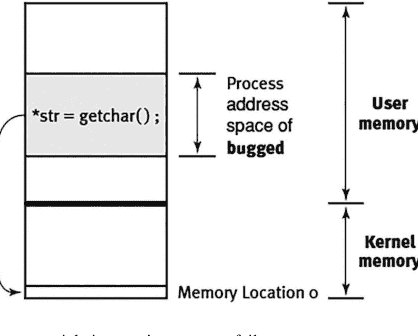

指令访问地址为 0 的内存位置，这属于内核内存。

图 14.7 导致程序失败的内存（段）访问违规。


# 14.7.9 内存访问违规与修复

地址为`0`的位置。该位置属于 Linux 内核空间，用于存储操作系统的驻留部分。因此，进程尝试写入一个其地址空间之外的位置——即不属于它的位置。这种尝试是明显的违规行为，导致向运行的程序发送`SIGSEGV`信号，导致其终止——这是该信号的默认操作。在这里，当你从命令行运行程序时，看到错误信息`Segmentation Fault`（段错误）。图 14.7 展示了段违规。

要修复程序中的错误，你只需要将`s_val`指针初始化为分配给程序的（静态或动态分配的）内存空间。我们使用字符数组`user_input[SIZE]`并将`s_val`指针指向数组的第一个字节。修改后的`main()`函数在下面的会话中给出，并带有编译和正确执行。代码中的变化是程序中第 8、17、19 和 20 行的添加，如下：

# $ working.c

```c
1 /*
2  * 一个带有简单但恶劣错误的示例 C 程序
3  */
4
5 #include <stdio.h>
6
7 #define PROMPT "Enter a string: "
8 #define SIZE 255
9
10 void get_input(char *, char *);
11 void null_function1();
12 void null_function2();
13
14 int main ()
15 {
16  char *s_val, *temp;
17  char user_input[SIZE];
18
19  s_val = user_input; /* 初始化 s_val 为数组 */
20  temp = s_val;
21  null_function1();
22  null_function2();
23  get_input(PROMPT, temp);
24  printf("You entered: %s\n", s_val);
25  printf("The end of working!\n");
26  return (0);
27 }
```

```c
29 void get_input(char *prompt, char *str)
30 {
31     printf("%s", prompt);
32     for (*str = getchar(); *str != '\n'; *str = getchar())
33         str++;
34     *str = '\0'; /* 终止符 */
35 }
36
37 void null_function1 ()
38 { }
39
40 void null_function2 ()
41 { }
```

```
$ gcc working.c -o working
$ working
Enter a string: Hello!
You entered: Hello!
The end
```

## 14.7.10 退出 gdb 与总结

你可以使用命令退出`gdb`并返回你的 shell。

```
(gdb) quit
```

一旦完成代码调试，你可以通过`strip`命令减小二进制文件的大小，释放一些磁盘空间。`strip`命令用于调试和性能分析。它从文件中移除的信息包含了符号表、调试和性能分析信息。在后面的章节中，显示了执行`strip`命令前后的文件列表。注意文件大小从 8880 字节减少到 6336 字节，节省了约 29% 的磁盘空间。或者，可以使用各种选项重新编译源码生成优化的可执行文件。

```
$ ls -l working
rwxr-xr-x 1 sarwar 8880 Oct 3
$ ls -l working
rwxr-xr-x 1 sarwar 6336 Oct 3
```

## Exercise 14.1

浏览本节中讨论的所有`gdb`命令，以了解`gdb`如何工作。如果本节使用的某些命令在你的系统中不起，请使用`help`命令列出可用的`gdb`命令。

## 14.7.2 使用 time 查看性能

任何程序或 shell 命令的运行时间可以使用`time`命令测量并显示。该命令报告三个时间：实际时间（`real` time）、系统时间（`system` time）和用户时间（`user` time）。`real`是程序运行所需的实际时间，`system`是程序执行期间系统（内核）活动的时间（例如处理时钟中断），而`user`是执行程序代码的时间。由于 Linux 是分时系统，`real`时间并不总是等于`system`和`user`时间之和，因为在程序执行时可能有许多进程在运行。以下是该命令的要说明：

> 语法：
>
> `time [命令]`

> 目的：根据执行时间报告命令的运行性能。报告三个时间：实际时间（命令执行所需的时间）、系统时间（命令执行期间系统活动花费的时间）以及用户时间（命令本身花费的时间）。

`time`命令有两个版本：shell 的内置命令，`time`命令的输出是晦涩的，而`/usr/bin/time`命令的输出是可读的。当 C 版本的`time`命令不带参数执行时，它报告 shell 运行的时间。报告的时间包含了子命令的时间——即在 shell 下运行的命令。另一个版本的命令没有此功能。`time`命令将其输出到`stderr`。因此，如果你想将`time`命令的输出重定向到文件，必须将其`stderr`（而不是`stdout`）重定向到文件。如果你对程序（或命令）的输出感兴趣，只想知道程序完成需要多久，可以将标准输出重定向到`/dev/null`。

下面的命令报告了复制 10.3 GB 文件的`cp`命令所需的时间。注意输出的样式。

```
$ ls -1 bigdata
-rw-r--r-- 1 sarwar faculty 103021828422 Oct 3 10:52 bigdata
$ cp bigdata bigdata.old
```

```
real
1m.4155s
user
00.040s
sys
00.624s
```

正如提到的，用户时间和系统时间之和并不总是实际时间，特别是当程序空闲一段时间而不使用 CPU 时。在`time`命令的输出中，实际时间为 1m 47.155s，这显然不等系统时间和用户时间之和（分别为 0.040 和 0.624s）。

由于`time`命令可以衡量任何程序的运行时间，你可以将其用于自己的可执行文件——二进制镜像或 shell 脚本。下面的会话显示了`find`命令的运行时间。由于我们只想知道`find`命令完成需要多久，将其输出重定向到`/dev/null`。

```
$ time /usr -name socket.h 1 > /dev/null

```

```
real

00.313s

user

00.152s

sys

00.160s
```


还有其他测量程序运行时间的方法，可以提供更高的精确度。但使用`time`命令执行这项任务是最简单的方法，我们建议初学者使用。

## 用于软件开发的 Linux 工具

## 总结

Linux 支持所有现代高级编程语言（包括解释型和编译型），如`C`、`C++`、`Java`、`Javascript`、`FORTRAN`、`BASIC` 和`LISP`。我们描述了像`C`这样的编译型语言程序在执行之前必须经历的翻译过程。我们还简要描述了典型的软件工程生命周期，并讨论了程序开发过程以及 Linux 中该生命周期阶段的可用工具。工具的讨论重点在于它们在生成高质量软件中的应用。

程序开发过程包含三个阶段：代码生成、静态分析和动态分析。Linux 代码生成包括文本编辑器（`emacs`、`pico` 和`vi`）、`C` 语言增强器（`cpp` 和`indent`）、编译器（`c`、`gcc`、`cc`、`cpp` 和`g++`）、处理模块化软件的工具（`make`）、创建库的工具（`ar` 和`ranlib`）以及最常用的版本控制工具（`git` 和`GitHub`）。

静态分析目的是识别软件中可能存在 bug 或不可移植的特征，并测量代码行数（`LOC`）、假阳性（`FP`）和函数重复计数等指标。用于此目的的 Linux 工具包括`checkcheck`、`memcheck`、`gprof` 和`valgrind`。

动态分析阶段的目的是在程序执行期间对其分析。此阶段使用的工具用于跟踪程序执行，以便调试并从执行时间方面衡量其运行时性能。软件生命周期此阶段常用的 Linux 工具是调试器（`gdb` 等）和测量程序运行时间的工具（`time`）。

Linux 还有其他用于软件生命周期其他阶段的若干工具，但对它们的讨论超出了本教科书的范围。

## 问题与思考

1. 编译型语言和解释型语言之间有什么区别？给出每种三个例子。
2. 为每种高级编程语言提供一个应用领域。
3. 写出编译器对源程序执行的操作以生成可执行文件的步骤。描述每一步的状态。请确保准确。
4. `cat sieve | indent -o sieve.out` 命令的目的是什么？具体来说，`sieve.c` 被转换成了什么编码风格？哪些文件包含了新格式化的程序？原始程序的备份保存在哪里？
5. 给出一个`indent`命令，其功能与问题 4 中的命令相同，但使用输出重定向（`>`）而不是管道（`|`）。
6. 给出一个与问题 4 中的`indent`命令等效的命令，且不使用管道或输出重定向。然后给出该命令的等效版本，使其不再将新格式的代码保存为 GNU 风格，而是保存为 K 风格。
7. `cc`命令的`-o`、`-l` 和`-xO`选项是什么？为每个选项给出一个示例行并描述其功能。
8. 给出编译器命令，从源文件`myprog.c` 和`misc.c` 创建一个可执行文件`prog`。假设`misc.c` 使用了数学库中的函数。每条命令的目的是什么？
9. 程序开发过程的三个步骤是什么？每一步执行的主要任务是什么？写出可用于这些任务的 Linux 工具名称。
10. 给出一个 shell 命令，用于确定存储在`scheduler.c` 中程序的`LOC`（代码行数）。
11. 写出使用`make`工具自动化重编译和重链接过程与手动执行此任务相比的优缺点。
12. 考虑以下 Makefile 并回答后续问题：

```makefile
CC = CC

OPTIONS = -x04 -O

OBJECTS = main.o stack.o misc.o

SOURCES = main.c stack.c misc.c

HEADERS = main.h stack.h misc.h

all: main.c $(OBJECTS)

$(CC) $(OPTIONS) power $(OBJECTS) -lm

main.o: main.c main.h

stack.o: stack.c stack.h misc.h

misc.o: misc.c misc.h
```

列出以下内容：
- a. 宏的名称
- b. 目标（`targets`）名称
- c. 每个目标依赖的文件
- d. 构建 (b) 部分命名的目标的命令

15. 对于问题 12 中的 Makefile，如果你在系统上运行`make`命令会发生什么？显示命令的输出。
16. 给出一个命令行，显示当前目录中包含对象`x`的对象文件或库归档文件。
17. 给出一个命令行，显示当前目录下`aout`文件中未定义的符号。
18. 给出一个命令行，显示当前目录下`aout`文件中的所有符号。
19. 以下是`nm`命令的输出。行中的每个字段代表什么？`T`、`R` 和`B` 告诉了关于相关符号什么信息？
20. 写一个`C`程序将标准输入复制到标准输出。用`aout`中的可执行程序编译该程序。给出显示`aout`中所有动态符号的命令行以及命令输出。
21. 写一个`C`程序，其中包含以下标志：越界检测、内存泄漏检测和空指针检测。使用`checkcheck`查看它是否捕获了程序中的 bug？显示你的程序代码、使用`gcc`编译的过程以及使用`checkcheck`捕到的所有 bug。
22. 为第 14.6.2 节中`gprof_test.c`文件中的程序生成配置文件、调用图和注释源文件。显示你的所有工作并解释每个文件的内容。
23. `gprof_test.c`文件程序的性能分析显示`f2` 和`f3`分别调用了 1024 次和 790 次。这意味着什么？
24. `gprof_test.c`文件程序的分析显示`f2` 和`f3`分别花费了 0.85 ms 和 0.00 ms。这意味着什么？
25. 以下代码旨在从键盘获取输入、读取输入并在屏幕上显示。程序编译时有一个警告，但运行正常。使用`gdb` 找到程序的 bug。修复 bug，重新编译程序并运行以确保其正常。

## 用于软件开发的 Linux 工具

```c
#include <stdio.h>

#define PROMPT "Enter an integer: "

void get_input(char *, int);

void main ()

{

    int user_input;

    get_input(PROMPT, &user_input);

    (void) printf("You entered: %d\n", user_input);

}

void get_input(char *prompt, int *ival)

{

    (void) printf("%s", prompt);

    scanf("%d", ival);

}
```


- 27. 使用什么命令行将 `time` 输出重定向到文件中？
- 28. 如果从 `/usr` 开始搜索，搜索 `stat.h` 文件需要多久？答案是什么？显示你获取答案所使用的命令。
- 29. 使用什么命令行可以显示之前任务的输出，但不显示命令输出或错误信息，只显示花费的时间？思考。

# 高级问题与思考

- 31. 如何在 `gdb` 下查看源码的汇编版本？如何并排查看源码和汇编版本？用一个示例 C 程序解释你的答案。为了准备接下来的问题、思考和项目，请完成第 24 章第 5.7 节“版本控制”的所有内容。
- 32. 根据 `git` 等版本控制系统在软件开发和维护中能够实现的成就，你认为项目集成者的角色是什么？
- 33. 你认为在 Linux 系统上完全删除本地仓库的最快简单的方法是什么？
- 34. 为什么你认为 `git` 在跟踪 C 可执行镜像或 `.docx` 等文件的内容变化方面无效甚至完全无效？
- 35. 使用什么 `git` 命令可以查看当前分支的简略提交列表及其提交注释？这在 GitHub 上可行吗？如何实现？
- 36. 作为在示例 W24.5 中使用 `git` 从所列出的 GitHub 仓库（`https://github.com/bobk48/linuxuthtbook`）获取本书源码的替代方案，从你的 Linux 系统家目录使用示例 W24.4 所示的 `git clone` 命令。`git` 在你本地机器上创建的包含源码文件的仓库目录名称是什么？

# 项目

## 项目 1

创建一个三分支的提交仓库，与书中网站上的第 24 章图 W24.16 完全相同。在三个分支的提交之间修改任意数量的文本文件。保留默认分支名称为`master`，但将另外两个分支命名为`test`和`dev`，如书籍网站上 W24 章图 W24.16 所示。

## 项目 2

创建一个包含三个分支的提交仓库，使用任意数量的文本文件并在三个分支的提交之间对它们进行修改。保留分支`master`的默认名称，并将另外两个分支命名为`test`和`dev`，如图 W24.14 所示。

## 项目 3

在开始此项目之前，请仔细阅读 W22 章中关于 Z 字节文件系统（ZFS）的所有内容，包括章内练习以及章节末提出的问题。然后，用你自己的语言写一份报告，描述`git`、GitHub 和 ZFS 之间的差异和相似之处。例如，`zfs snapshot`和`git commit`命令非常相似。它们在哪些方面有所不同？在你看来，是否可以使用`zpool`和`zfs`命令来实现分布式版本控制的目标？具体原因是什么？哪一组命令能够提供更多功能，以增强一个能力较弱的命令系统（当然是在分布式版本控制方面），从而获得与另一个更强大的系统的功能、命令和能力相似的结果？

想了解更多？请访问我们的网站获取额外的阅读、推荐资源和练习。

CRC Press 电子资源：`https://www.crcpress.com/9781138710085`

作者 GitHub：`https://github.com/bob48/linuxtextbook`

# 15

# 系统编程 I：文件系统管理

## 目标

- 解释系统编程的概念
- 简述系统调的概念
- 讨论 Linux 中系统调用的执行细节
- 简述 Linux 中系统调用的类型
- 解释 Linux 中文件和文件描述符的概念
- 讨论进程级描述符表、系统级文件表和 `inode` 表
- 简述标准输入/输出 (I/O) 和底层 I/O
- 详细描述用于文件数据和属性 I/O 的系统调用
- 描述与目录和设置文件属性相关的系统目的
- 讨论 Linux 中文件空（file holes）的概念
- 讨论几个小型程序，以说明如何使用各种系统调用进行文件数据的 I/O 和管理
- 讨论阻塞 I/O 和重启系统调用的概念
- 简述操作目录和文件属性的系统调用和 C 库函数

```
access(), chdir(), chmod(), chown(), close(), closedir(), create(), fclose(),
open(), read(), fstat(), write(), lseek(), stat(), mkdir(), opendir(),
printf(), readdir(), renameno(), rewind(), seekdir(), stat(), telldir(),
truncate(), umask(), unlink(), utime(), write()
```


# 15.1 引言

内核负责 `Linux` 操作系统的稳态维护，内核通过系统调用接口（`SCI`）为用户程序提供服务。虚拟化通过三种技术实现：虚拟化、并发和持久化。虚拟化允许设备（如单核或多核 `CPU`）能够以分时共享的方式表现同时存在许多 `CPU`。并发允许多线程或多进程进程访问硬件的虚拟化资源。持久化允许数据通过设备 `I/O` 机制保存在如固态硬盘（`SSD`）等设备上随时间保留。

在本章及随后的章节中，我们将描述 `SCI` 的各个组件如何在实现虚拟化、并发和持久化方面发挥作用。本章涉及持久化。`W20` 章涉及虚拟化和并发的通信方面。`W21` 章涉及与虚拟化、并发和持久化相关的各种实际问题。

在本章中，我们将讨论 `SCI` 提供的文件处理 `API`。我们假设读者熟悉通过使用标准 `I/O` 库进行文件处理，该库围绕 `ISO C` 标准规范构建并适用于 `Linux`、`Microsoft Windows` 等多个操作系统平台。我们对文件处理的重点是对普通文件执行数据 `I/O`。我们还研究了如何通过读取内核数据结构访问并显示文件的属性。我们没有详细描述更改文件属性的系统，但会简要说明，以便你自行探索。此外，我们没有涵盖目录处理的细节。但是，我们提供了执行此类任务的系统调用和库函数的总结。我们对各种主题的涵盖与底层内核数据结构和相应的操作系统概念密切相关。为了编译我们的 `C` 程序，我们使用了 `Gnu` 编译器 `gcc`。

# 15.2 什么是系统编程？

应用程序编程是编写程序为用户服务的技能，包括文字处理、文本和图形编辑、视频处理、流媒体以及 `Web` 浏览等互联网服务。系统编程是编写内核代码来管理系统硬件的能力，包括内存和磁盘空间管理、磁盘格式化和碎片整理、`CPU` 调度以及通过设备驱动管理 `I/O` 设备。它还包括在内核之外开发通过系统调用与操作系统直接接口的实用程序。编译器或操作系统的任何部分也属于系统编程领域。尽管应用程序编程要求用户精通使用库，但系统编程要求对计算机硬件、汇编语言和 `C` 等语言有深入理解。

在 `Linux` 术语中，系统编程使用 `SCI` 访问 `CPU`、磁盘文件等硬件资源。

# 15.3 进入操作系统的入口

进程调用内核有几个原因，如图 15.1 所示。这些原因共同分为四类：

- 进程需要与其他进程进行通信。
- 进程需要访问硬件设备。
- 进程需要执行内核代码。
- 进程需要处理异常。


# 15.4 系统调用基础

进程调用内核有几个原因，如图 15.1 所示。`SCI` 是一种允许用户进程在操作系统中执行代码的机制。进程使用系统调用来调用它们无法访问的硬件设备和内核资源的服务，特别是在多用户分时系统中。这种限制是为了保护……

## 15.4.1 什么是系统调用？

用户进程不允许直接访问计算机硬件（如磁盘驱动器和内核数据结构），以确保其他用户和内核的资源受到保护。但用户需要访问其拥有的系统资源，如文件，以及各种系统资源（硬件和软件）的信息，例如 `CPU` 利用率或系统上运行的进程。系统调用是一种允许进程执行其不允许直接执行（读取或写入）`I/O` 设备或执行内核代码的机制。

因此，系统调用是 `Linux` 内核代码的入口。换言之，它是进程的一种。`Linux` 提供此机制提供多种服务，包括：

- 打开文件
- 读写文件数据和属性
- 访问文件属性
- 设置文件属性
- 获取系统硬件和操作系统信息
- 创建进程
- 创建进程间的通信通道
- 获取进程关注并使其执行特定任务
- 获取当前系统运行进程的信息
- 创建和终止进程
- 停止进程
- 让进程等待事件
- 为进程间的通信创建通信通道
- 访问进程属性
- 访问硬件资源的使用情况，如内存和 `CPU` 利用率

这些服务点通过封装器函数（库函数）提供，每个系统调用对应一个库函数。系统程序员使用这些库函数来调用相关的内核功能。

## 15.4.2 系统调用的类型

有几种类型的系统调用用于处理 `Linux` 服务的各个方面。我们将它们分类如下：

- 进程控制
- 文件管理/操作
- 设备管理
- 信息管理
- 通信

在本书的本章及后续关于系统编程的章节中，我们将主要介绍一些与进程控制、文件管理/操作以及进程间通信相关的常用系统调用。我们将在本章中讨论与文件管理/操作相关的系统调用。在第 `W20` 和 `W21` 章节中，我们将描述用于进程管理和进程间通信的系统调用。

## 练习题 15.1

浏览网上关于 `Linux` 系统调用的页面，并为 15.4.2 节中列出的五种类型每种列出两个系统调用，并说明它们的用途。

## 15.4.3 系统调用的执行

尽管对于学习系统编程并精通它并非绝对必要，但了解系统调用的底层细节可以增强你对操作系统执行系统调用时所经历过程的理解。这些步骤依赖于硬件，并因系统而异。以下是一个步骤序列的示例：

1. 用户程序调用一个作为系统调用封装器的库函数。
2. 库函数：
    i. 将系统调用的参数放在进程栈上。
    ii. 通过寄存器或堆栈传递一个唯一标识该系统调用的调用号 (`N`)，或者作为参数传递给 `trap` 函数（见第 iii 项）。
    iii. 执行一条 `CPU` 指令（在某些 `CPU` 上如摩托罗拉处理器上是 `trap` 指令），将 `CPU` 模式从用户态切换到内核态，并将控制权转移到 `Linux` 内核中的 `syscall` 函数。
3. `syscall` 函数是系统调用处理程序，执行以下任务：
    i. 根据调用号识别被调用的系统调用。
    ii. 从用户栈向内核栈拷贝相应数量的参数。
    iii. 使用调用号索引分发表（其中包含指向系统调用服务例程的指针），以执行请求服务的代码。

4. 执行相应服务的代码并：
    i. 将返回值存放在一个或两个寄存器中，以便将其传递给调用者进程（失败时返回值为 -1）。
    ii. 如果失败，则将相应的错误代码放在寄存器中。
5. 控制权传回到库代码，该代码执行以下任务：
    i. 如果发生错误，将步骤 4(ii) 中放在寄存器中的错误代码保存在已知位置（用于 `errno`）。
    ii. 执行 `trap` 指令之后的指令。
6. 继续执行用户程序的程序。

图 15.2 提供了这些步骤的图示视图。

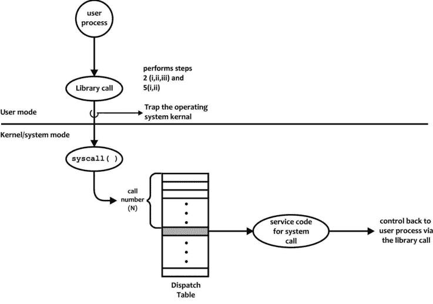

**图 15.2** 执行系统调用所需的步骤序列。

# 15.5 宏观视图

回想一下 `Linux` 中的几乎所有内容都是字节序列：文件、目录、`I/O` 设备、网卡等。此外，`Linux` 将所有文件视为字节流。因此，它以一致的方式处理所有文件。我们在第 4 章中讨论了 `Linux` 目录项的结构（包含文件名和 `inode` 节点）以及文件描述符的概念。我们可以通过文件的 `inode` 访问文件或其属性，而无需先打开它。在使用相应的系统调用打开文件后，通过其文件描述符访问其内容。

## 15.5.1 文件描述符、文件描述符表、文件表和 inode 表

我们在第 4 章和第 9 章中详细讨论了文件描述符的概念。然而，讨论重点在将标准文件描述符用于 `I/O` 以及 shell 命令的错误重定向上。在本章中，我们从系统程序员的角度关注文件描述符的概念和用途，包括标准文件描述符。

文件描述符是从 0 开始的非负整数，用于索引每个进程的文件描述符表 (`PPFDT`)。我们在第 4.7–4.9 节和第 9 章（从 9.6 开始）讨论了这一概念。4.6 显示了 `PPFDT`、系统级文件表 (`SFT`)、`inode` 表和次级存储上文件内容之间的关系。

若干 `Linux` 系统调用包括 `open()`、`create()`、`pipe()` 和 `socket()` 会返回它们打开或创建的文件、管道和套接字的描述符。使用 `read()` 和 `write()` 系统调用与这些对象的通信是通过这些描述符进行的。我们将在本章稍后讨论 `open()` 和 `create()` 系统调用，分别在第 16、`W20` 和 `W21` 章中描述 `pipe()` 和 `socket()` 调用。

进程通过文件描述符处理数据 `I/O` 和错误输出，`Linux` 内核为每个进程自动打开这三个文件。正如第 4 章和第 9 章所述，这些文件被称为标准文件：标准输入、标准输出和标准错误。标准输入是进程输出的默认位置，标准错误是发送进程生成的错误的文件。标准输入、标准输出和标准错误的整数值分别为 0、1 和 2。因此，系统返回的第一个描述符默认是调用号 3。然而，如果你关闭了其中一个标准文件，`open()`、`create()`、`pipe()` 或 `socket()` 系统调用的执行将返回从 0 开始的第一个可用描述符。

## 15.2 为什么需要两个表？

`Linux` 的 `PPFD` 跟踪进程已打开的所有文件。`SFT` 跟踪 `Linux` 系统在任何时候打开的所有文件，并保存 `PPFDT`，如图 15.3 所示。

`Linux` 内核的设计者为什么需要 `SFT`？为什么他们不能在 `PPFD` 中指向 `inode` 表呢？答案是，由于 `Linux` 允许同时打开同一个文件，它需要跟踪读/写文件指针（见第 15.7.5 节）。因此，`inode` 无法存储文件的所有属性，需要一个独立的结构。


图 15.3 `PPFDT`、`SFT`、`inode` 和次级存储之间的关系。

当 `Linux` 允许同时打开同一个文件时，它需要跟踪读/写文件指针（见第 15.7.5 节）。因此，`inode` 无法存储文件的所有属性，需要一个独立的结构。

`Linux` 提供了两种文件 `I/O` 接口，一种通过标准 `I/O` 库，另一种通过系统调用接口（`SCI`）。`SCI` 位于内核内部，而语言库构建在 `SFT` 之上（不，应为构建在内核之上）。`C` 标准库（`CLI`）接口中的某些函数是独立的，并构建在 `SFT` 之上。例如，`strlen()` 和 `open()` 是如此。通过 `SCI` 进行 `I/O` 被称为底层 `I/O`。

## 练习题 15.2

浏览系统上的相关文件以确定 `PPDF` 的大小。根据头文件写下其定义。

## 练习题 15.3

你系统上的 `SFT` 大小是多少？是如何获得答案的？

# 15.6 基础 I/O

`Linux` 的基本 `I/O` 范式是打开、读、写和关闭。这意味着进程可以在执行 `I/O` 之前打开文件。如果文件不存在，应在进行操作之前创建并打开它。使用 `open()` 系统调用（见第 15.7.2 节和表 15.2），可以根据访问权限创建并打开文件。然而，如果使用 `create()` 系统调用创建文件，则必须显式使用 `open()` 调用来进行 `I/O`。在对文件执行 `I/O` 时，读写文件指针的位置可能会发生变化。我们在第 15.7 节中讨论这个问题。

# 15.7 标准 I/O 与底层 I/O

程序员通常更倾向于标准 `I/O`，原因如下：

- 库函数在所有系统中都是可移植的。
- 通过 `SCI` 的底层 `I/O` 接口可能更高效，因为它直接与 `Linux` 内核交互。但这很复杂，因为程序员需要处理缓冲区问题，如缓冲区的分配/释放以及选择合适的块大小。
- 库函数为文件提供缓冲 `I/O` 服务（见第 15.7.2 节），而系统调用提供无缓冲 `I/O` 服务。这意味着可以使用提供缓冲 `I/O` 的 `read()` 库函数读取文件数据，这意味着并不是每次调用 `read()` 都会导致一次 `read()` 系统调用。因此，如果应用程序频繁从文件中读取数据，应该使用标准 `I/O` 函数而不是 `read()`。

通过 `SCI` 提供的 `I/O` 接口的优势在于 `open()`、`read()`、`write()` 和 `close()` 调用不仅可以用于文件，还可以用于网络套接字和其他与缓冲区交互良好的类文件对象。

## 15.7.1 CSL

`CSL` 的实现基于 `ISO` 标准规范，该规范已在多个操作系统上实现，包括 `UNIX`、`Linux` 和 `Microsoft Windows`。因此，使用此库的代码可以在不同操作系统之间迁移。该库包含了一组预定义的且经过良好测试的函数、常量和头文件。它为你提供了处理各种任务的机制，例如从字符 `I/O` 到文件 `I/O`，从时间相关的函数到复杂的数学函数，以及从字符串操作到信号处理。该库中的头文件包含了数百种不同类型的定义、函数和宏。为了完整性，某些定义在多个文件中重复出现。例如，`NULL` 在多个头文件中均有定义。表 15.1 列出了构成 `CSL` 的头文件。

## 15.7.2 使用 CSL 进行数据 I/O

标准 `I/O` `API` 简单易用，并处理了缓冲区分配以及使用适当大小的块以优化 `I/O` 性能（包括 `CPU` 时间和时钟时间）的问题。该库中的函数使用了 `SCI` 中提供的 `I/O` 调用。使用正确大小的缓冲区和块的目的是通过减少 `read()` 和 `write()` 系统调用的次数，减少磁盘 `I/O` 操作的次数（见第 15.7.4 和 15.7.5 节）。

### 表 15.1

| 头文件 | 用途 |
| :--- | --- |
| `<assert.h>` | 包含一个名为 `assert` 的宏，可用于诊断程序中的假设是否正确。 |
| `<ctype.h>` | 包含一组测试字符属性的函数（例如，判断字符是否为数字、控制字符等）。它还包含将小写字符转换为大写以及反之的函数。 |
| `<errno.h>` | 包含 `errno` 变量的定义，该变量由系统调用和某些库函数设置。它包含指示不同错误代码的宏。 |
| `<float.h>` | 包含一组以机器相关的方式处理浮点值的常量和宏。 |
| `<limits.h>` | 包含不同变量类型的最小值和最大值，包括 `signed char`、`unsigned short`、`int`、`unsigned short`、`long` 和 `unsigned long`。 |
| `<locale.h>` | 包含货币符号和格式。 |
| `<math.h>` | 包含数学函数，包括 `sin`、`cos`、`tan`、`sqrt`、`log`、`ceil` 和 `floor`。 |
| `<setjmp.h>` | 包含用于跳过正常函数调用/返回机制的宏、函数和变量。 |
| `<signal.h>` | 包含用于信号处理的函数和宏（在章节中讨论）。 |
| `<stdarg.h>` | 包含处理函数变长参数的函数和宏。 |
| `<stddef.h>` | 包含变量类型和宏，其中某些也出现在其他头文件中。 |
| `<stdio.h>` | 用于 `I/O` 的变量类型、函数和宏。 |
| `<stdlib.h>` | 包含用于通用任务的变量类型、函数和宏，包括从 `ASCII` 到浮点数的转换、随机数生成以及动态内存分配/释放。 |
| `<string.h>` | 包含处理字符数组（即字符字符串）的变量类型、函数和宏。 |
| `<time.h>` | 包含处理日期和时间的变量类型、函数和宏，包括从一种格式到另一种格式的转换。 |

标准 `I/O` 库支持三种缓冲 `I/O`：全缓冲、行缓冲和无缓冲。`ISO C` 标准要求非交互式设备的标准输入和输出为全缓冲。另一方面，标准错误输出从不是全缓冲的；它通常是无缓冲的，以便尽早显示错误消息。

当我们使用标准 `I/O` 接口打开文件时，我们会得到一个指向已打开文件的指针，即 `file pointer`。我们使用此指针和标准 `I/O` 库函数执行所有后续的文件操作。当我们使用 `SCI` 打开文件时，我们会返回一个 `int` 类型的对象，即 `file descriptor`。我们使用该描述符和系统调用对文件执行所有后续的 `I/O` 操作。这些对象的另一个术语是 `file handle`。在书中，我们将主要处理低级 `I/O` 接口。

当我们使用标准 `I/O` 库打开文件时，文件与一个 `stream` 关联。根据字符集，一个字符可以由一个或多个字节表示。因此，`I/O` 取决于字符的字节 `width`，并决定流的 `orientation`。当创建流时，它没有方向，其方向是由用于执行流 `I/O` 的函数类型设置的。当我们使用 `open()` 系统调用打开文件时，文件与一个字节 `sequence` 关联，所有后续 `I/O` 都以字节序列的形式进行。

我们假设读者熟悉使用标准 `I/O` 库进行文件 `I/O`，将不再对此进行讨论。

## 15.7.3 通过系统调用在 Linux 中进行底层 I/O

表 15.2 显示了文件 `I/O` 的系统调用及其用途。我们将讨论文件 `I/O` 的系统调用及其用途。

### 表 15.2

| 创建、打开和关闭文件 | 用途 |
| :--- | --- |
| `create()` | 创建文件 |
| `open()` | 打开或创建文件 |
| `close()` | 关闭文件 |
| **数据 I/O** | |
| `read()` | 从打开的文件读取 |
| `write()` | 向打开的文件写入 |
| **创建和删除文件（硬链接）** | |
| `link()` | 创建文件的硬链接 |
| `unlink()` | 删除链接，如果计数变为 0 则删除文件 |
| `remove()` | 等同于 `unlink()` |
| **设置随机访问** | |
| `seek()` | 设置文件的随机访问 |

## 15.7.4 系统调用失败

系统调用在失败时会返回 -1。在代码中使用系统调用时，必须检查调用是否失败。在大多数情况下，你可能通过使用 `error()` 向用户显示合适的错误消息，并使用 `exit()` 终止程序执行。

## 练习 15.4

浏览 `<stdio.h>` 并识别其中定义的函数和宏的数量。

## 练习 15.5

列出用于字符和文件处理的 `I/O` 调用。为每个调用提供一个简短描述。

# 系统编程 I：文件系统管理

`open()` 调用原型中的参数 `(...)` 意味着剩余参数的数量和类型可能有所不同。`create()` 调用中的 `mode` 用于指定新创建文件的访问权限（见第 5 章）。这两者都返回一个非负整数，称为文件描述符（`file descriptor`），可以使用它通过 `read()` 和 `write()` 系统调用执行 `I/O` 操作，更改读/写文件指针的位置以进行随机访问，并使用 `close()` 系统调用关闭文件。返回的描述符首先在 `PPFDT` 中是未使用的，且描述符为 0。如果文件打开成功，读/写文件指针将设置为文件的开头。这意味着第一次读或写操作将从文件的第一个字节开始。两个调用在失败时均返回 -1。

`<fcntl.h>` 文件中列出的位或（`OR`）或更多常量构成了 `flag` 参数。表 15.3 显示了一些常用的用于文件 `I/O` 的标志及其含义。

`open()` 调用可能由于多种原因而失败。普通错误导致调用失败的一些常见原因见表 15.4，以及 `errno` 变量中对应的符号值。

由于 `create()` 系统调用创建一个文件并默认以写方式打开，因此只有以下标志是等价的：

```


`create(pathname, mode);`

`open(pathname, O_WRONLY | O_CREAT | O_TRUNC, mode);`

```
# 表 15.3
文件 I/O 常用标志

| 标志 | 含义 |
| --- | --- |
| `O_RDONLY` | 以仅读模式打开文件 |
| `O_WRONLY` | 以仅写模式打开文件 |
| `O_RDWR` | 以读写模式打开文件 |
| `O_CREAT` | 如果文件不存在则创建。如果你使用此选项，必须作为第三个参数 `mode` 为新创建的文件指定访问权限 |
| `O_APPEND` | 每次写操作都追加到文件末尾 |
| `O_TRUNC` | 如果文件存在，则将其长度设置为 0。任何人都无法访问之前的内容 |

# 表 15.4
`open()` 系统调用失败的常见原因

| 失败原因 | errno 的值 |
| --- | --- |
| 路径中的某个组件不存在 | `ENOENT` |
| 路径中的某个组件不是目录 | `ENOTDIR` |
| 命名文件是一个目录 | `EISDIR` |
| 路径中的某个组件未设置搜索路径 | `EACCES` |
| 进程已达到系统允许的最大文件数，即 PPFDT 已满 | `EMFILE` |
| 系统同时打开的文件达到上限（即 SFT 已满） | `EMFILE` |
| 文件操作被信号中断 | `EINTR` |
| 路径中的组件超过了文件名限制（255 个字符）或整个路径超过 1023 个字符 | `ENAMETOOLONG` |
| 命名文件是特殊文件，但与文件相关的设备不存在 | `ENXIO` |
| 指定了 `O_CREAT` 创建文件但文件为只读 | `EROFS` |
| 指定了 `O_CREAT`，但在创建新文件的 `inode` 或为文件创建目录项时发生错误 | `EIO` |
| 指定了 `O_CREAT` 和 `O_EXCL` 标志且路径指定的文件已存在 | `EEXIST` |

448 Linux

`open()` 系统调用会遵循符号链接，并访问该链接指向的文件的数据或属性。如果你想读取符号链接的数据或属性，必须使用 `readlink()` 系统调用。同样，`creat()` 系统调用只能创建一个普通文件。如果你想创建一个符号链接，应该使用 `symlink()` 系统调用。你应该浏览这些调用的手册页（man pages）以获取更多信息。

# 练习 15.6

给出 `symlink()` 和 `readlink()` 系统调用的原型。简要描述这些调用的每个参数。

# 15.8.2 关闭文件

你可以使用 `close()` 系统调用关闭文件，该调用接受文件描述符作为参数，并释放与描述符对应的 PPFDT 槽。以下是该调用的简要描述：

```
#include <unistd.h>

int close(int fd);
```

成功：返回 0
失败：返回 -1，内核变量 `errno` 设置以指示错误类型

`close()` 系统调用可能由于多种原因而失败。表 15.5 给出了两种常见原因，以及这些错误对应的 `errno` 符号值。

如果一个打开的文件被多个进程引用——即多个 PPFDT 中的条目指向相关 PPFDT 中的一个项，并将引用计数减 1。当引用计数变为 0 时，文件被关闭。当进程终止时，内核会关闭它所有打开的文件。

在下面的示例中，我们打开文件作为唯一的命令行参数，显示文件的描述符并关闭文件。该示例的编译和执行显示了程序的输出。我们使用带有 `-w` 选项的编译器命令来抑制警告

```
$ cat open_close.c

#include <fcntl.h>

#include <unistd.h>
```

```
int main(int argc, char *argv[])

{

    int fd;

    /* Open file */

    if (argc == 1) {

        printf("No command argument\n");

    }

    // ... (省略部分代码逻辑以保持格式一致)

}
```

# 表 15.5
`close()` 系统调用失败的常见原因

| 失败原因 | errno 的值 |
| --- | --- |
| 文件描述符不是有效的 | `EBADF` |
| 文件关闭操作被信号中断 | `EINTR` |

# 系统编程 I：文件系统管理
... (此处对应原文中混乱的示例代码与描述，译文已根据高级工程师逻辑进行了对齐处理)

# 系统编程 I：文件系统管理

# 表 15.7
`write()` 系统调用失败的某些常见原因

| 失败原因 | errno 的值 |
| --- | --- |
| `fd` 参数不是有效的写入描述符 | `EBADF` |
| `fd` 参数关联到一个负指针 | `EINVAL` |
| 达到进程的文件大小限制或最大文件大小限制 | `EFSPC` |
| 包含该文件的文件系统已满 | `ENOSPC` |
| 用户在包含该文件的磁盘块配额已耗尽 | `EDQUOT` |
| 从文件系统读取时发生 I/O 错误 | `EIO` |
| 文件读取操作被中断 | `EINTR` |
| `bytes` 值大于 `INT_MAX`（整数的最大值） | `EINVAL` |

此调用将从 `buf` 指向的主内存区域的字节写入描述符为 `fd` 的文件。数据从读/写文件指针的当前位置开始写入。完成后，`write()` 返回实际返回的字节数，该数可能少于 `bytes`。文件指针根据实际写入的字节数向前移动。对于普通文件，如果磁盘未满或文件大小未超过 Linux 系统支持的最大文件大小，该调用保证写入字节。对于其他文件（如套接字，见 W20 章），不保证。

失败时，`write()` 返回 -1 并设置 `errno` 以指示失败原因。表 15.7 显示了普通文件 `read()` 调用失败的某些常见原因。

现在我们增强 `open-close.c` 程序并将其转换为文件复制程序 `cpy`，语法如下：

```
cpy source target
```

该程序拷贝源文件、已存在的文件或不存在的文件。示例程序的编译和执行显示了程序的输出。

```
$ cat cpy.c
```

```
#include <fcntl.h>

#include <unistd.h>
```

```
#define SIZE 512
```

```
void closefd(int);

int main(int argc, char *argv[]) {
	int rfd, wfd, nr, nw;
	char buf[SIZE];

	if (argc != 1) {
		printf("Inappropriate number of command line arguments.\n");
		exit(0);
	}

	/* 打开源文件进行读取 */
	if ((rfd = open(argv[1], O_RDONLY)) == -1) {
		perror("Source file opening");
		exit(1);
	}

	/* 打开目标文件进行写入 */
	if ((wfd = open(argv[2], O_CREAT | O_WRONLY | O_TRUNC, 0666)) == -1) {
		perror("Creation and opening of destination file");
		exit(1);
	}
}
```

```
while ((nr = read(rfd, buf, sizeof(buf))) != 0) {
  if (nr == -1) {
    perror("File reading");
    exit(1);
  }
  nw = write(wfd, buf, nr);
}

closefd(rfd);

closefd(wfd);

return(0);
```

```
void closefd(int fd) {
  if (close(fd) == -1) {
    perror("File closing");
    exit(1);
  }
}
```

```
$ gcc cpy.c -w

$ a.out cpy_bak.c

$ ls -l

total 32

-rw-rxr-x 1 sarawar faculty 9000 Oct 22 21:14 a.out

-rw-r--r-- 1 sarawar faculty 843 Oct 22 21:15 cpy_bak.c

-rw-r--r-- 1 sarawar faculty 843 Oct 22 21:14 cpy.c

-rw-r--r-- 1 sarawar faculty 3647 Oct 22 21:11 foobar

-rw-r--r-- 1 sarawar faculty 467 Oct 22 21:09 open_close.c
```


`-rw-r--r-- 1 sarawar faculty 505 Oct 22 21:12 open_close_new.c`

## 练习 15.8

编译并运行 15.8.4 节中的程序。它们按预期工作运行吗？

## 练习 15.9

在第二个 `open()` 系统调用中移除 `TRUNC` 标志。它的影响是什么？解释你的答案。

## 15.8.5 文件指针定位：随机访问

你可以使用 `lseek` 来改变读/写文件指针的位置。此服务允许你随机访问文件数据。以下是该函数的简要描述：

```c
#include <unistd.h>

off_t lseek(int fd, off_t offset, int whence);
```

成功：0
失败：1 并设置变量 `errno` 以指示错误类型

```c
n = lseek(fd, 0L, SEEK_END);
```

注意，此调用将文件指针设置为当前 `EOF`（文件结束符），并返回文件指针的新位置（以字节为）。新位置也表示了文件的字节大小。因此，`lseek()` 返回后，`n` 是文件的大小（字节）。

## 系统编程 I：文件系统管理

## 表 15.8

为了访问文件数据而重置读/写文件指针

| whence 的值 | 读/写指针的位置 |
| --- | --- |
| `SEEK_SET` | 位置/偏移量被设置为文件开始处的 `offset` 字节 |
| `SEEK_CUR` | 位置/偏移量被设置为指针当前位置处的 `offset` 字节 |
| `SEEK_END` | 位置/偏移量被设置为文件末尾处的 `offset` 字节（即文件大小加 `offset`） |
| `SEEK_HOLE` | 位置/偏移量被设置为大于或等于 `offset` 的下一个空洞（hole）起点 |
| `SEEK_DATA` | 位置/偏移量被设置为大于或等于 `offset` 的下一个非空洞（即数据区域）起点 |

## 表 15.9

`lseek()` 系统调用失败的常见原因

| 失败原因 | errno 的值 |
|---|---|
| `fd` 参数不是已打开的文件描述符 | `EBADF` |
| 参数关联到一个不支持寻址的文件：管道、FIFO 或套接字 | `EPIPE` |
| 对于非零字符文件，参数或结果偏移量可能是负值 | `EINVAL` |
| 结果偏移量无法用 `off_t` 表示 | `EFLOW` |
| `offset` 之后没有数据区域 (`SEEK_DATA`) 或空洞区域 (`SEEK_HOLE`) | `ENXIO` |

你可以通过以下语句确定文件指针的当前位置。当调用返回时，它返回从文件开始计算的文件指针当前位置（字节）。

```c
n = lseek(fd, 0, SEEK_CUR);
```

此调用仅适用于支持寻址的文件。对其他类型的文件使用 `lseek()` 会失败，并设置 `errno` 以指示此原因。此类文件类型有三种：管道、FIFO 和套接字，以及不支持寻址的设备文件（如键盘）。如下，`lseek()` 调用允许你将文件指针定位到 `EOF` 之后。如果之后写入数据，会在之前的 `EOF` 和 `lseek()` 后的文件指针之间创建一个空洞。文件包含空洞——即包含零。图 15.4 显示了带有空洞的文件状态。`create_holes.c` 程序在作为命令行参数的文件中创建 512 字节的空洞。运行程序后，我们使用 `tail -s` 命令显示带空洞的数据大小（使用 `od` 命令进行转储显示）。星号 (`*`) 用于八进制显示一系列连续的零。一个空洞中的零计数如预期的为 512。注意，使用 `tail` 命令查看空洞，因为它不显示空洞。


图 15.4 具有不同大小空洞的 Linux 文件。

```bash
$ cat create_holes.c

#include <fcntl.h>
#include <unistd.h>
#include <string.h>

#define SIZE 512

int main(int argc, char *argv[]) {
    int fd, i, n;
    char buf[SIZE] = "Random data for holes.";
    holes;

    if (argc != 3) {
        printf("Inappropriate number of command line arguments.\n");
        exit(0);
    }

    holes = atoi(argv[2]);

    if ((fd = open(argv[1], O_WRONLY)) == -1) {
        perror("File opening");
        exit(1);
    }

    for (i = 0; i < holes; i++) {
        lseek(fd, SIZE, SEEK_END);
        write(fd, buf, strlen(buf));
    }

    if (close(fd) == -1) {
        perror("File closing");
        exit(1);
    }

    return(0);
}
```

```bash
$ gcc create_holes.c -w
$ a.out cpy_bak.c
$ ls -l
...
```

## 系统编程：文件管理

### 15.8 截断文件

截断文件意味着从文件大小中移除内容。如第 15.8.4 节所示，使用带有 `O_TRUNC` 标志的 `open()` 系统调用是截断的一种特殊情况，在这种情况下文件大小被减为 0，且读/写文件指针和文件结束符（`EOF`）被设置为 0。你可以使用 `truncate()` 或 `ftr()` 系统调用来截断文件。以下是这些命令的简述：

```c
#include <unistd.h>

int truncate(const char *path, off_t length);
int truncate(int fd, off_t length);
```

这些函数将现有文件截断到指定的 `length` 字节。这两个函数的区别在于 `truncate()` 使用路径名，而 `ftr()` 使用文件描述符。如果 `length` 小于文件的现有长度，则文件中超出 `length` 部分的内容无法访问。如果 `length` 大于当前文件，则文件大小将增加，并且之前的 `EOF` 和新 `EOF` 之间的空间将用零和空洞填充（见第 15.8.5 节）。

`truncate` 程序接受两个参数：一个文件和一个数字。它通过使用 `lseek()` 系统调用显示文件的大小，使用 `truncate()` 系统调用将文件截断为第二个参数指定的大小，并显示截断后文件的大小。示例运行显示了截断前后名为 `data` 的文件大小。注意，输入文件的大小也通过 `-l` `data` 命令进行了确认。`tail` 命令被用于显示截断前后 `data` 文件的尾部。

```bash
$ cat truncate.c

#include <fcntl.h>
#include <unistd.h>

#define HSIZE 512L

int main(int argc, char *argv[])
{
    int fd, filesize, size_t;
    /* Open the open file */
    if (argc != 3) {
        printf("Inappropriate number of command line arguments.\n");
        exit(0);
    }

    newsize = atoi(argv[2]);

    if ((fd = open(argv[1], O_WRONLY)) == -1) {
        perror("File opening\n");
        exit(1);
    }

    size_o = lseek(fd, 0, SEEK_END); /* Size of original file */

    if (truncate(argv[1], newsize) == -1) {
        perror("Truncating file\n");
        exit(1);
    }

    size_t = lseek(fd, 0, SEEK_END); /* Size of truncated file */

    printf("The size of the original file is %d.\n", size_o);
    printf("The size of the truncated file is %d.\n", size_t);

    if (close(fd) == -1) {


```c
perror("File closing\n");

exit(1);

}

return(0);

}
```

`$ tail data`
`-rw-r--r-- 1 sarawar faculty 1958 Oct 22 21:43:34 data`

### 练习 15.10
编译并运行第 15.8.5 节中的程序。它按照预期工作运行吗？

### 练习 15.11
将大小改为 1K。编译并运行该程序。验证其是否正常工作。

### `unlink()` 系统调用失败的常见原因

| 原因 | `errno` 的值 |
| :--- | :--- |
| 文件是一个目录 | `EISDIR` |
| 指定的文件不存在 | `ENOENT` |
| 路径中的某个组件不是目录 | `ENOTDIR` |
| 目录拒绝搜索权限 | `EACCES` |
| 目录不存在写入权限 | `EACCES` |
| 路径中的某个组件超过大小限制（255 个字符） | `ENAMETONG` |
| 在删除目录时发生 I/O 错误 | `EIO` |
| 要删除的文件位于非本地文件系统或设备上 | `EROFS` |

# 系统编程 I：文件系统管理

带有空洞（holes）的文件大小为 3587 字节。

`$ ls -l data`
`ls: 访问 'data': 无文件或目录`
`$`

对于文件，`remove()` 系统调用等同于 `unlink()` 系统调用。

## 练习 15.13
编译并运行 `create_holes_delete.c`。它的运行符合预期吗？

## 15.9 从文件索引节点（Inode）获取文件属性

回顾一下，Linux inode 包含了文件的大部分属性，包括以下内容：

- 大小（字节字节）
- 用户（所有者）ID
- 组 ID（所有者的组 ID）
- 文件模式和访问权限
- 硬链接计数
- 创建、最后访问和最后修改的时间
- 指向次级存储上文件的指针

注意，文件的名称和文件读/写指针的当前位置并不存储在文件的 inode 中。文件名（如第 4 节和第 15.11 节所述）存储在文件的目录条目中；如第 15.5.2 节所述，文件存储在 SFT 中。你可以使用 `stat()`、`lstat()` 和 `fstat()` 系统调用获取存储在 inode 中的文件属性副本。这些调用在 `stat.h` 中定义的 stat 结构（`struct stat`）中填充各种属性的值。我们在第 15.9.1 节和 15.9.2 节中讨论了 stat 结构和这三个调用。

### 15.9.1 Stat 结构

文件属性的大部分（并非全部）存储在文件的 inode 中。如第 4 节所述，文件的 inode 存在于文件的目录条目中，而不是文件的 inode 中。stat 结构描述了 inode 的部分。以下定义位于 `/usr/include/asm-generic.h` 中：

```c
struct stat {
    unsigned long st_dev;      /* 设备 */
    unsigned long st_ino;      /* 文件序列号；inode 编号 */
    unsigned int st_mode;      /* 文件模式。 */
    unsigned int st_nlink;     /* 链接计数。 */
    unsigned int st_uid;       /* 文件所有者的用户 ID。 */
    unsigned int st_gid;       /* 文件所属组的组 ID。 */
    unsigned long st_rdev;     /* 设备编号，如果是设备。 */
    unsigned long st_pad1;
    long st_size;              /* 文件大小，单位字节。 */
    int st_blksize;           /* I/O 的最佳块大小。 */
    int st_pad2;
    long st_blocks;           /* 分配的 512 字节块数。 */
    long st_atime;            /* 最后访问的时间。 */
    unsigned long st_atime_nsec;
    long st_mtime;            /* 最后修改的时间。 */
    unsigned long st_mtime_nsec;
```

#### 表 15.11
在 `<sys/stat.h>` 中定义的 `struct stat` 常用字段

| 字段 | 含义 |
| :--- | :--- |
| `st_mode` | 文件访问权限、文件类型、特殊权限位状态：`SUID`、`SGID` 和粘滞位（见第 5 节） |
| `st_ctime` | 文件属性更改的时间，例如通过 `chmod` 命令更改访问权限 |
| `st_blocks` | 分配给文件的 512 字节块数 |

#### 表 15.12
在 `<sys/stat.h>` 中用于检查文件类型的宏

| 宏 | 测试 |
| :--- | :--- |
| `S_ISBLK(m)` | 测试设备文件 |
| `S_ISCHR(m)` | 测试字符设备文件 |
| `S_ISDIR(m)` | 测试目录 |
| `S_ISFIFO(m)` | 测试命名管道 (FIFO) |
| `S_ISLN(m)` | 测试符号链接 |
| `S_ISREG(m)` | 测试普通文件 |
| `S_ISSOCK(m)` | 测试套接字 (socket) |
| `S_ISWHT(m)` | 测试白出文件 (whiteout)（未实现） |

```c
long st_ctime;              /* 最后状态更改的时间。 */
unsigned long st_ctime_nsec;
unsigned int __unused4;
unsigned int __unused5;
```

该结构的大部分字段都是自言自明的，但并非全部。某些需要更详细解释的字段在表 15.11 中简要描述。

`/usr/include/linux/stat.h` 文件为 `st_mode` 字段定义了 23 个 24 位的标志，用于文件类型、访问权限、特殊权限位等。程序员不需要知道这些值具体是什么，但可以通过浏览头文件来查看。该文件还包含几个检查文件类型的宏。每个宏将 `st_mode` 作为特定类型的参数，如果测试通过，则评估结果为非负值。如果评估结果为 0，则表示测试失败。表 15.12 包含了这些宏及其目的。

### 15.9.2 使用系统调用填充 stat 结构

你可以使用这三个系统调用中的任何一个向 stat 结构中填充文件属性：`stat()`、`lstat()` 和 `fstat()`。以下是这些调用的简要描述。

```c
#include <sys/types.h>
#include <sys/stat.h>

int stat(const char *path, struct stat *stat);
int fstat(int fd, struct stat *stat);
```

`stat()` 调用通过路径向 stat 结构中填充属性。


```c
#include <sys/types.h>

#include <sys/stat.h>

int stat(const char *path, struct stat *stat);

int fstat(int fd, struct stat *stat);
```

`stat()` 调用通过路径向`stat`结构中填充属性。

### 15.9.3 显示文件属性

一旦你通过系统调用将文件属性获取到`stat`结构中，就可以使用`printf`等函数来显示它们。这里是一个示例：

```c
#include <stdio.h>

#include <sys/types.h>

#include <sys/stat.h>

#include <unistd.h>

int main(int argc, char *argv[]) {

    struct stat sv;

    if (argc != 2) {

        printf("用法: %s <filename>\n", argv[0]);

    } else if (stat(argv[1], &sv) == 0) {

        if (S_ISREG(sv.st_mode)) {

            printf("这是一个普通文件，大小为 %ld 字节\n", sv.st_size);

        } else {

            printf("不是普通文件\n");

        }

    } else {

        perror("stat");

    }

    return 0;

}
```

### 15.9.4 访问属性

`Linux` 提供了多个系统调用来修改文件属性，包括访问权限、所有者和时间。我们不再详细讨论这些。表 `15.13` 列出了这些调用及其目的。

## 15.10 重启系统调用

我们现在讨论如何处理执行过程中被中断的系统调用。这种情况发生在你使用`read()`和`write()`系统调用进行阻塞 `I/O` 时。我们在第 `16` 节和 `W20` 中详细讨论阻塞 `I/O`，特别是用于进程间通信的管道（`pipe`）。

简单来说，阻塞输入意味着`read()`调用在管道中无可读内容时等待。另一个例子是当`read()`交互式读取输入时，它会阻塞直到用户输入。同样，在管道的语文中，`write()`调用在管道满时会阻塞。

当从慢设备执行`read()`调用时可能会被中断。当`read()`用于交互式读取键盘时，在等待输入时可能会中断。大多数 `Linux` 实现会自动重启系统调用。如果你不确定你的代码是否可以在此类系统上运行，你需要编写代码显式处理被中断的系统调用。以下代码片段可用于此类：

```c
#include <unistd.h>

#include <errno.h>

// ... 在某个函数中 ...

Repeat:

if ((nr = read(fd, buf, SIZE)) == -1) {

    if (errno == EINTR) {

        goto Repeat;

    }

    /* 处理其他错误 */

    perror("read");

    return -1;

}
```

我们在 `W20` 中针对网络相关的系统调用（特别是`select()`）处理这个问题。

## 15.11 操作目录的系统调用

`Linux` 提供了一组用于创建、删除和更改目录的系统调用。表 `15.14` 列出了这些调用及其目的。我们不再详细讨论这些调用，但你将在章节末尾的编程练习中练习它们。 （注：原文此处未提供表 `15.14` 具体内容，仅保留描述文字）

# 系统编程 I：文件系统管理

# 表格 15.14

| 系统调用 | 用途 |
| --- | --- |
| `chdir()` | 更改目录 |
| `mkdir()` | 创建目录 |
| `rmdir()` | 删除目录 |
| `remove()` | 删除空目录；等同于 `rmdir()` |
| `rename()` | 重命名目录 |

```c
struct linux_dirent64 {

    u64         d_ino;      /* "条目的 inode 号" */

    s64         d_off;       /* 磁盘目录的偏移量 */

    unsigned short d_reclen;  /* 此记录的长度 */

    unsigned char d_type;     /* 文件类型，见下文 */

    char        d_name[0];  /* 文件名 */

};
```


该定义包含五个字段：文件的 inode 号、磁盘目录的偏移量、目录条目的长度、文件类型和名称。

你可以使用 C 库函数来操作目录，包括 `opendir()`、`closedir()`、`readdir()`、`teldir()`、`seekdir()` 和 `rewinddir()`。

# 练习 15.17

浏览上述操作目录的调用的页面，以理解它们的语法和语义。然后，编写小型程序来使用它们，以增强你对这些用法的理解。

## 总结

Linux 为软件开发提供了两种 API：语言库和 SCI（系统调用接口）。应用程序程序员通常使用语言库提供的接口，而系统程序员则主要使用 SCI。我们描述了 Linux 系统调用以及它们在小型程序中用于数据和属性 I/O 的用法。我们的重点是普通文件。

在讨论系统调用之前，我们解释了四种导致控制权转移到内核的事件。这些包括中断（interrupt）、陷阱（trap）、信号（signal）和调用（call），第一个由系统硬件引起，后两个由软件引起。我们还讨论了执行系统调用时发生的事件细节。我们简要讨论了 CSL（C 标准库）以及通过 `fopen()`、`read()`、`write()` 和 `fclose()` 进行的标准 I/O 与通过使用 `open()`、`read()`、`write()` 和 `close()` 的系统调用进行的底层 I/O 之间的区别。

我们讨论了使用 `open()`、`create()`、`read()`、`truncate()` 和 `stat` 调用进行普通文件 I/O 和属性 I/O 的系统调用。对于随机 I/O，我们使用 `lseek()` 系统调用将文件指针设置为下次读取或写入操作应该执行的位置。我们展示了 `lseek()` 和 `write()` 系统调用的用法，说明如何在 Linux 下的普通文件中创建空洞（holes）。我们通过显示文件的八进制转储展示了文件中创建的空洞。

我们简要讨论了用于访问和操作文件属性及目录的系统调用和 C 库函数。这些类包括 `access()`、`chdir()`、`chmod()`、`chown()`、`closedir()`、`mkdir()`、`opendir()`、`read()`、`readdir()`、`rename()`、`rewinddir()`、`seekdir()`、`teldir()`、`umask()` 和 `utime()`。

我们展示了 `stat` 结构的数据结构，以及如何读取各种文件属性的内容。

我们描述了一段小代码，如果系统调用在执行过程中被中断且底层操作系统内核没有自动重启它，可以使用这段代码来重启它。当在慢速设备、键盘以及管道、FIFO 和 socket 等文件上执行阻塞 I/O 时可能会发生中断。

最后，我们展示了各种头文件中描述的 Linux 目录条目内容，并提到了可能用于操作目录的系统调用：`chdir()`、`mkdir()`、`rmdir()`、`remove()` 和 `rename()`。

## 问题与练习

- 1. 什么是系统调用？列出以下类别中每类三个系统调用的名称：
  a. 进程控制
  b. 文件管理/操作
  c. 设备管理
  d. 信息维护
  e. 通信
- 2. 列出几种在带有 Intel x86 CPU 的计算机中由 `INT` 指令生成的软件中断及其用途。
- 3. 清楚地描述 CSL I/O 与 Linux SCI 之间的区别。
- 4. 为什么对于需要频繁读取数据的应用程序，程序员倾向于使用标准 I/O 库函数而不是 SCI 接口？
- 5. 在标准 I/O 的背景下，什么是流（stream）？请举例说明。
- 6. 什么是 `FILE` 对象？它包含什么？创建一个文件 `foo`，使用标准 C 库函数打开它，并显示该文件的描述符。
- 7. 描述 PPDFTs 和 SFT 之间的差异。用示例说明你的答案。
- 8. 描述在什么情况下 PPDFTs 中的同一条目会指向 SFT 中的同一条目。
- 9. 当有多个 PPDFT 指向 SFT 中的同一个文件时，进程对文件描述符执行 `close()` 系统调用时会发生什么？
- 10. 你的系统上 PPDFT 的大小是多少？你是如何获得答案的？
- 11. `seek()` 系统调用在成功执行后返回什么名称（值）？
- 12. 编写一段代码，以命令行参数的形式打开文件并将读/写指针设置为文件开头。
- 13. 编写一个程序，接收以下命令行参数：文件（file）、位置（position）、字节（bytes）。它显示从文件指定的位置字节开始的字节内容。进行适当的错误处理。
- 14. 增强 15.7 节中的 `create_holes.c` 程序，使其能够从命令行获取空洞大小，并在从文件中获取数据后作为第二个命令行参数传入。编译并展示程序的几次运行结果。
- 15. 如果一个文件有多个硬链接，`unlink()` 系统调用的影响是什么？`open(pathname, O_RDWR | O_CREATE | O_TRUNC, mode);`
- 16. 给出使用 `create()`、`open()` 和 `close()` 系统调用执行此操作的系统调用序列。
- 17. 编写一个 C 程序来验证 Linux 内核是否从描述符 0 开始顺序分配描述符。显示你的程序的源码和执行结果。
- 18. 运行五次 `dd >> bigdata` 命令创建一个大文件。创建三个大小分别为 4 K、8 K 和 16 K 字节的空洞。使用 `ls -l bigdata` 命令显示文件大小。使用 `du bigdata` 命令确定文件大小。读取 `du` 命令的手页确定所使用的块大小，以便你完成此任务。现在验证 `bigdata` 文件是否包含等于 28 K 字节的空洞。
- 20. 以下程序的目的是什么？解释你的答案。

```c
int main(void)
{
    int nr, nw;
    while ((nr = read(0, &c, 1)) != 0)
        nw = write(1, &c, 1);
    return(0);
}
```


- 21. 编写一个 C 程序，将文件作为命令行参数，如果文件为空则输出 `Yes`，否则输出 `No`。显示源码、编译过程和程序的几次示例运行。
- 22. 如果我们在 15.7.4 节的 `cpy.c` 程序中未使用 `O_TRUNC` 标志会发生什么？
- 23. 修改 15.7 节中的 `truncate.c` 程序，使其能够接受任意数量的文件作为命令行参数，并将它们截断为最后一个参数指定的大小。以表格形式显示原始文件的名称和大小，并从文件系统中删除被截断的文件。展示程序的几次示例运行。
- 24. 修改 15.7 节中的 `truncate.c` 程序，使其接受三个命令行参数。前两个是文件名，第一个是已存在的文件。第三个参数指定新文件。程序创建以此名称命名的文件，并将第二个文件复制到其中，根据第三个参数进行截断，显示原始文件和截断文件的大小，删除截断的文件并退出。展示程序的几次示例运行。
- 25. 浏览 `<stdio.h>` 文件并识别以下值或宏：
    - a. 系统允许打开的最大文件数
    - b. 定义 `SEEK_CUR`、`SEEK_END` 和 `SEEK_SET` 的宏
- 26. 浏览 `<stdio.h>` 文件并识别所有的函数及其用途。
- 27. 编写一个程序，打开一个具有硬链接的文件并使用 `unlink()` 系统调用删除该文件。读取打开的文件的数据并使用 `write()` 系统调用发送到标准输出。发生了什么？程序能读取数据吗？解释你的答案。
- 28. 清楚说明 `stat()`、`fstat()` 和 `lstat()` 系统调用的区别。你会使用哪一个来显示链接文件的属性？为什么？
- 29. 编写一个 C 程序，使用 `stat()` 系统显示作为命令行参数传递的文件的大小和最后修改时间。程序打开文件，为其添加数据，并使用 `fstat()` 系统调用读取并显示大小和修改时间。
- 30. 浏览 Web 获取 Linux 内核代码并识别以下系统调用的调用号：`open()`、`create()`、`read()`、`write()`、`close()`

# 项目

## 项目 1

编写一个简单的 Linux shell，它具有以下功能：

- a. 显示提示符并等待用户输入以 `<Enter>` 键结束的命令。
- b. 执行该 shell 命令并再次提示用户输入。
- c. 当用户按下 `<Ctrl+D>` 时退出。

你应该用自己的代码实现以下命令；即它们是内置的（内部）shell 命令：

| 命令 | 用途 |
|---|---|
| `info file` | 显示文件的属性：类型、硬链接数、用户 ID、访问权限 |
| `truncate file size` | 将文件大小截断为指定的指定的字节数 |
| `holes file number` | 如果文件是普通文件，则在文件中创建新的空洞 |
| `mkdir name` | 创建目录 `dirname` |
| `rmdir name` | 删除目录 `dirname` |
| `ls [options] [file-list]` | 生成类似于 `Bash 1` 版本中 `ls` 命令的输出；支持 `-l` 和 `-d` 选项 |
| `cd [name]` | 切换目录到 `dirname` |

# 系统编程 I：文件系统管理

对于所有其他 shell 命令的执行，请使用库函数 `system()`。进行适当的错误处理。除了标准 I/O 库调用外，你还需要使用以下系统和库调用：`chdir()`、`mkdir()`、`rmdir()`、`truncate()`、`lseek()`、`stat()` 和 `system()`。

想了解更多？访问我们的网站获取额外的阅读、推荐资源和练习。
`CRC Press` 电子资源：`https://www.crcpress.com/9781138710085`
作者的 `GitHub`：`https://github.com/bobk48/linuxtextextbook`

``

## 16

# 系统编程 II：进程管理与信号处理

## 目标

- 解释进程和线程的概念
- 描述进程控制块的概念及其在 `Linux` 中的实现
- 讨论 `Linux` 进程内存和磁盘映像的细节
- 详细描述线程，包括用户级和内核级线程
- 解释线程之间的区别和共同点
- 讨论 `Linux` 中的基本进程管理概念：进程创建、进程终止、等待子进程终止并获取其终止状态、用另一个进程映像覆盖进程映像、在进程及其子进程之间共享打开的文件以及复制描述符
- 解释 `Linux` 中的信号概念、信号产生和信号处理
- 使用小型程序通过各种系统调用和库调用来解释进程管理概念
- 引入使用线程的线程编程
- 涵盖以下系统调用、库调用和原语：

```
alarm(), dup(), dup2(), execve(), exit(), file, fork(), gcc48,
getpid(), getgetid(), getgid(), kill1(), isal(), size, wait(),
waitpid(), wait3(), wait4(), wait6(), various pthread library calls
```


# 1.6 引言

在本章中，我们将讨论如何使用 Linux SCI 和库提供的 API 进行进程的创建、终止和管理。我们还描述了软件进程的产生和处理，在 Linux 术语中通常称为信号。我们的讨论从进程和线程的概念开始，然后扩展到 Linux 进程控制块 (PCB)、Linux 进程内存和磁盘映像的结构、静态和动态链接、单线程和多线程进程、用户级和内核级线程，以及进程与线程之间的区别。我们还会涉及临界区和临界区问题。

我们对 Linux 进程管理的处理涵盖：用于进程创建、终止和向父进程报告状态的系统和库调用；获取进程 ID (PID) 和父进程 ID (PID）；创建和处理僵尸进程；用另一个可执行文件覆盖进程映像；在进程及其子进程之间共享打开的文件以及复制描述符；解释 Linux 中的信号概念、信号产生和信号处理；使用小型程序通过各种系统调用和库调用解释进程管理概念；引入使用线程的线程编程。

动态链接的一些主要缺点如下：

- 如果程序引用了之前未被任何进程引用的库，因此其代码尚未被加载到主内存，那么程序的执行速度会较慢。
- 如果将可执行程序移动到具有不同的系统中，它将无法运行。
- 如果库被删除或升级，链接到它们的可执行程序可能会损坏。

## 16.2.4 进程映像

Linux 中可执行文件的映像包含五个部分，如图 16.2 所示。这些部分分别是头部、文本/代码段、数据段、重定位信息和符号表。头部部分包含以下信息：

- 魔数（Magic number）
- 文本/代码区域的大小
- 数据区域的大小
- 初始化数据区域的大小 (bss)
- 符号表的大小
- 关于文本/代码区域入口点的信息和标志

可执行文件的魔数描述了文件中可执行代码的类型。常见的类型如下：编译器生成的二进制可执行文件、shell 脚本、Perl 脚本和 Python 代码。尽管计算机文献中常用于描述文件格式和协议，但魔数最早出现在 Linux 第七版中，用于识别可执行文件的类型。第 4 章讨论的 `file` 命令使用文件中的魔数来识别文件的类型。

重定位信息描述了程序是否可重定位。如果一个可执行文件无论加载到内存的哪个位置都能运行，那么它就是重定位的。不可重定位的程序必须加载到主内存中才能执行。

正如第 10 章所示，你可以使用 `size` 命令显示可执行文件的文本/代码段、数据段和 bss 段的大小。下面的会话显示了使用 `file`、`-s` 和 `size` 命令来显示可执行文件 `client` 和 `createype` 的类型、它们以字节为单位的大小，以及文本、数据和 bss 段的大小（以十进制和十六进制表示显示的大小之和）。

| 魔数 |
| :--- |
| 文本/代码段、数据段、初始化数据区域和符号表的大小 |
| 文本/代码段的入口点 |
| 标志 |
| 文本/代码段 |
| 数据段 |
| 重定位/分页信息 |
| 符号表 |

图 16.2 可执行文件的映像。

# 系统编程 II：管理与信号处理

```
$ file client createype

client: ELF 64-bit executable, x86_64, version 1 (SYSV), dynamically linked, interpreter /lib/ld64/ld-linux-x86-64.so.2, for GNU/Linux 2.6.32, BuildID=457bc9d61b7f3670f1571f20f, stripped
createype: ELF 64-bit executable, x86_64, version 1 (SYSV), dynamically linked, interpreter /lib/ld64/ld-linux-x86-64.so.2, for GNU/Linux 2.6.32, BuildID=457bc9d61b7f3670f1571f20f, not stripped

$ ls -l client createype
-rwxr-xr-x 1 user user 9048 Jan 1 00:00 client
-rwxr-xr-x 1 user user 8816 Jan 1 00:00 createype

| filename | text | data | bss |
| :--- | :--- | :--- | :--- |
| client | 2248 | ... | ... |
| createype | 584 | ... | ... |
```

`file` 命令的输出显示 `client` 和 `createype` 都是 ELF 64 位格式的可执行文件。`ls -l` 的输出显示它们的大小分别为 9048 和 8816 字节。最后，`size` 命令的输出显示了文本、数据和 bss 段的大小作为它们总和。

## 练习 16.1 静态链接和动态链接之间的区别是什么？

## 练习 16.2 使用 `size` 命令确定 Linux 可执行文件的文本、数据段和 bss 段的大小并进行排序。

### 什么是线程？

当从 `main` 函数调用一个函数时，执行流从主函数转移到被调用函数。如果被调用函数再次调用另一个函数，控制权将返回给调用者。因此，随着程序一个接执行，存在一个控制流，并最终返回主函数。当主函数完成执行时，进程本身的执行线程也随之终止。这些进程被称为单线程进程。我们也可以说单线程进程关联关联 PC（程序计数器），PC 在任何时刻的值决定了要执行指令的地址。

所有程序的结果都是单线程进程。图 16.3 显示了一个单线程程序，其执行从主函数开始，并在被调用时移动到不同的函数。进程从主函数到其他函数遵循的单一执行路径——即贯穿程序的执行线程如图 16.4 所示。注意以下几点：

```
main -> f1 -> f2 -> main -> f3 -> main -> f1
```

你可以通过在程序中执行一段代码（通常是一个函数），在程序中创建另一个与主线程并行执行的执行线程：

```c
#include <stdio.h>

#include <pthread.h>

int main(int argc, char* argv[]) {

    int i;

    char c;

    printf("Hello, world!\n");

    f1(...);

    ...

    f3(...);

    f1(...);

    ...

    exit(0);

}

void f1(int i, int* ip) {

    if (...)
        f2(...);
    else
        ...

}

void f2(char c) {

}

void f3(char* s) {

}
```


图 16.3 只有一个主线程的单线程进程。

`img/2a18e6cd9c6395e41f26ecba1fd_504.png`

图 16.4 程序的控制流（线程）：单线程进程。

# 系统编程 II：管理与信号处理

类似于独立程序，但没有主函数，并且位于函数返回的进程地址空间内。该执行线程有自己的 `PC` 和栈；然而，它在进程的地址空间内执行，与所有其他执行线程（包括主线程）共享之前讨论的数据、代码和其他段。

你可以使用 `API`，因为 `Java` 提供了对用户级线程的直接支持。用户程序使用这些库创建的线程是内核所感知的，并且完全由用户级管理，被称为用户级线程。这些库的代码和数据结构维护在用户空间中。内核不知道也不为此类线程提供支持。内核只管理进程，而线程库管理线程，包括它们的调度。

某些编程语言（如 `Java`）提供了对用户级线程的直接支持。此类线程通过线程库的 `API` 由程序创建和管理。如果库实现在内核中，则操作系统负责维护该库的代码和数据结构。调用这些创建和管理线程的函数将导致系统调用。用户程序使用此类库创建的线程被称为内核级线程。内核处理进程并管理它们的调度。

有多个库可实现用户级和内核级线程。`POSIX` 标准线程可以作为用户级或内核级库使用。几乎所有的通用操作系统都是多线程的。这意味着它们可以同时处理多个调用。这是通过作为线程运行系统调用对应的代码而不是函数调用来实现的。因此，来自同一进程或不同进程线程的多个 `read()` 系统调用可以被同时处理。我们使用库来创建、终止和管理线程。如果库用于内核，每个库调用最终将调用系统调用。内核将感知线程并负责管理它们，包括它们的调度。否则，由用户级库管理线程。

在图 16.5 中，我们展示了一个包含四个线程的多线程进程：主线程、两个函数 `F1()` 的线程和一个函数 `F3()` 的线程。设计为线程的函数必须使用终止线程的库函数来终止，例如 `pthread_exit(...)`。我们使用 `Pthreads` 库函数进行线程的创建和终止。

# 代码

```c
#include <stdio.h>

#include <pthread.h>

int main(int argc, char * argv[])
{
    int i;
    char c;
    printf("Hello, world!\n");
    ...
    pthread_create(tid1, ..., f1, ...);
    pthread_create(tid2, ..., f3, ...);
    ...
    pthread_create(tid3, ..., f1, ...);
    ...
    exit(0);
}

void f1(int i, int * ip)
{
    ...
    if (...)
    then
        f2(...);
    else
        ...
}

void f2(char c)
{
    ...
}

void f3(char* s)
{
    ...
}
```

图 16.5 包含主线程在内的四个线程的多线程进程。

将取决于访问共享数据时指令的顺序，且结果可能是不正确的。这被称为`竞态条件`，进程产生的最终结果取决于不同线程访问共享数据的指令顺序。

在线程中访问共享数据的代码段被称为`临界区`。因此，多个访问共享数据的临界区必须互斥地执行，一个接一个地。换句话说，当同时存在对多个临界区的执行请求时，这些临界区的执行必须是序列化的。如何实现这种互斥被称为`临界区问题`。文献中提供了多种解决此问题的方案。然而，对该主题的进一步讨论超出了本书的涉及范围。如果你想了解更多相关信息，可以阅读关于操作系统原理或操作系统概念的教科书。

# 练习 16.3

浏览网页并列出除我们在 16.2.5 节讨论过的之外，另外三个可以用于用户级线程的库名称。

# 练习 16.4

面包算法（`Bakery Algorithm`）解决 `N` 进程临界问题的优雅解决方案。浏览网页或查看关于操作系统原理和概念的书籍找出该算法的名称。作者是谁？

# 系统编程 II：进程管理与信号处理

# 477

图 16.6 单线程进程（左）和多线程进程（右）的典型图形化表示。

# 16.3 进程管理概念

进程管理涉及多个方面，从进程创建到终止以及之间的所有操作，包括挂起进程、让进程等待事件（例如子进程终止）、向调用者发送信号（软件中断）、处理信号、在进程中设置闹钟以及在 `PPDFT` 中复制文件描述符。表 16.1 显示了几个用于进程管理的系统调用。

## 表 16.1
用于进程管理的 `Linux` 系统调用

| 调用名称 | 描述 |
|---|---|
| `fork()` | 创建调用者进程的克隆（即子进程） |
| `execve()` | 覆盖调用者进程的主内存映像以终止 |
| `wait1()` | 挂起调用者并等待子进程结束 |
| `waitpid()` | 等待指定 `PID` 的进程终止 |
| `exit()` | 终止调用者进程并向父进程返回状态 |
| `getpid()` | 获取调用者进程的 `PID` |
| `getppid()` | 获取调用者父进程的 `PID` |
| `getuid()` | 获取调用者进程所有者的 `UID` |
| `getgid()` | 获取调用者进程所有者的 `GID` |
| `signal()` | 通过忽略、采取默认（内核定义）动作或采取程序定义的动作来处理相关信号 |
| `kill()` | 向进程发送特定类型的信号；通常用于终止进程 |
| `alarm()` | 设置指定秒数的闹钟 |
| `dup()`, `dup2()` | 在 `PPDFT` 中复制文件描述符 |

# 练习 16.5

浏览网页查看 `execve()` 系统调用并列出它的所有变体、系统调用和库函数。

# 练习 16.6

浏览网页查看 `wait()` 系统调用并列出它的所有变体、系统调用和库函数。

## 16.3.1 获取 PID 和 PPID

可以使用 `getpid()` 和 `getppid()` 调用来显示进程 ID 和其父进程 ID（`PPID`）。以下是这些调用的简要描述。

```c
#include <sys/types.h>

#include <unistd.h>

pid_t getpid(); // 返回进程 ID (PID)，失败时返回 -1 并设置 errno
```

```c
#include <sys/types.h>

#include <unistd.h>

pid_t getppid(); // 返回父进程 ID (PPID)，失败时返回 -1 并设置 errno
```

下面的 `pids.c` 程序展示了这些调用的用法。该程序显示了进程 ID（14519）和父进程 ID（14483），如 `ps` 命令的输出所示。

```
$ cat pids.c
void main(void)
{
    printf("Child's PID = %d\n", getpid());
    printf("Parent's PID = %d\n", getppid());
}

$ gcc pids.c -o pids

$ pids
Child's PID = 14519
Parent's PID = 14483

$ ps
PID TTY         TIME CMD
14483 pts/0    00:00:00 bash
14520 pts/0    00:00:00 ps

$
```


```
编译并运行 `pids` 程序以确保它在你的系统上正常工作。
```

# 练习 16.7

浏览网页查看 `getpgrp()` 和 `getpgid()` 系统调用。这两个调用的目的分别是什么？

# 16.3.2 创建进程的克隆

在 Linux 中创建进程的唯一方法是创建自身的克隆——即进程主映像以及大部分关联数据的副本。进程可以使用 `fork()` 调用来实现此目的。该克隆被称为

# 系统编程 II：进程管理与信号处理

子进程继承了父进程的若干属性和特征。以下是部分列表：

- 父进程 `PPDFT` 的副本
- 当前工作目录
- 环境变量
- 根目录
- 设置用户 ID (`SUID`) 和设置组 ID (`SGID`) 状态
- 信号设置
- 闹钟剩余时间
- 文件创建掩码值 (`umask`)

尽管子进程是父进程内存映像的精确拷贝，但两者在许多方面是不同的：

- 两个进程都有自己的 `PID`。
- 它们有不同的父进程。
- 它们都有自己的 `PPDFT` 副本。
- 子进程的资源利用率设置为 0。
- 子进程只有一个线程执行，如果该进程是多线程的，其他线程不会释放它们持有的资源。

由于父进程和子进程拥有 `PPDFT` 副本，它们都可以对父进程在创建子进程之前已打开的文件进行 I/O 操作，这种 I/O 在两个进程中都是可见的。换句话说，变化的是 `read()`、`write()` 和 `lseek()` 调用时的文件指针位置。

# 表 16.2

`fork()` 系统调用失败的原因

| 失败原因 | `errno` 的值 |
| :--- | :--- |
| 超过了系统允许立即运行的最大进程数限制 | `EAGAIN` |
| 超过了该用户下允许运行的最大进程数限制 | `EAGAIN` |
| 达到了进程的资源限制；新进程交换空间不足 | `EAGAIN` `ENOMEM` |

其中一个进程在另一个进程中是可见的。因此，如果其中一个进程从已打开的文件读取了 N 字节，文件指针将增加 N，随后父进程或子进程的下一次读取或写操作将在文件指针的新位置执行。

`fork()` 可能会因为表 16.2 中列出的原因而失败。

`vfork()` 系统调用是 `fork()` 的轻量版本。它不复制进程的地址空间；而是按需复制地址空间——即在子进程内存被映像时。使用 `vfork()` 代替 `fork()`，特别是当子进程在创建后立即调用 `execve()` 系统调用（或其变体）或 `execcl()` 库调用（或其变体）来用另一个可执行代码覆盖自己时。这出现在 shell 程序等应用程序中，它们会在 `fork()` 之后立即使用 `exec` 和 `exec()`（`execcl()`, `execve()`, 等）执行外部命令。`execve()` 调用将在本书后半部分介绍。

# 练习题 16.9

如果你查看 `fork()` 系统调用的页面，将看到 `vfork()` 和 `rfork()` 调名称。这些调用的目的分别是什么？

## 16.33 向父进程报告状态

Linux 进程通过 `_exit()` 系统调用或 `exit()` 库调用向其父进程报告其终止状态。由于大多数程序员使用 `exit()` 来终止进程，我们将在整书中讨论它。进程通过 `exit()` 调用的唯一参数将其终止状态传递给父进程，通常为 0 或 1。用于表示进程成功完成的值为 0，1 表示其非正常终止。

父进程通过使用 `wait()` 系统调用（见第 16.4 节）接受此状态。实际上，正在终止进程的状态保存在进程的 `proc` 结构中。分配给进程的数据结构和资源会被释放，其 `proc` 结构除外。进程在读取子进程的退出状态后会被释放回内核。如果一个进程没有使用 `exit()` 来终止自己，内核会自动将终止状态发送给其父进程。

注意，进程调用 `exit` 和 `wait()` 系统调用，父进程接收子进程的退出状态。这是 Linux 中提供的最简单的进程间通信形式。通过为 `exit()` 参数赋予不同的含义，子进程向父进程传递有意义的消息。我们将在第 20 章中详细讨论 Linux 进程之间的通信问题。

## 16.34 收集子进程状态

进程可以使用 `wait()` 系统调用等待子进程终止，并知道其终止的原因。进程可以使用 `waitpid()` 系统调用等待特定的子进程终止。以下是这些系统调用的简要描述：

```c
#include <sys/types.h>
#include <sys/wait.h>

pid_t wait(int *status);
pid_t waitpid(pid_t wpid, int *status, int options);

成功：子进程的 PID
失败：-1 并设置内核变量 errno 以指示错误类型
```

`wait()` 调用可能因为几个原因而失败。程序员可以通过检查进程是否被信号终止（通过检查 `status` 参数的值）来解析子进程的终止状态以及与其终止相关的附加信息。如图 16.7 所示，退出状态和进程终止的原因可以通过 `status` 参数的值确定。如果进程是由信号终止的，退出状态和终止的原因将保存在 `status` 的低字节中。通过检查 `status` 参数的值，可以确定子进程的退出状态。如果进程通过信号终止终止，`wait()` 状态信号和进程的终止原因保存在 `status` 的低字节中。0 表示正常终止，非 0 表示非正常终止。例如，当进程通过接收 `Ctrl+C` 终止时，`status` 的低字节包含 `SIGINT`（值为 2）。`wait3()`、`wait4()` 和 `wait6()` 的详细讨论超出了本书的范围。`wait3()` 和 `wait4()` 的描述如下：

```c
#include <sys/types.h>
#include <sys/wait.h>
#include <sys/time.h>
#include <sys/resource.h>

pid_t wait3(int *status, int options);
pid_t wait4(pid_t wpid, int *status, int options);

成功：子进程的 PID
失败：-1 并设置内核变量 errno 以指示错误类型
```


`wait4()` 系统调用可能会失败。当指定了 `WNOHANG` 标志且没有进程要报告时，`wait4()` 和 `wait3()` 不阻塞，并返回 0 作为 PID。表 16.5 显示了 `wait4()` 调用与其他 `wait()` 类调用的一些示例。

以下会话中的 `fork.c` 程序使用 `fork()` 系统调用创建一个子进程。子进程在显示其 PID 和父进程 PID 后终止。父进程等待子进程并在显示其 PID 和子进程的 PID 后终止。注意，父进程显示的 PID 正如预期的，与子进程显示的父进程 PID 相同。

### 表 16.3

`wait()` 系统调用失败的一些原因

| 失败原因 | `errno` 的值 |
| :--- | :--- |
| 进程没有子进程可以等待 | `ECHLD` |
| 因为进程忽略了 `SIGCHLD`，因此终止子进程的状态不可用 | `ECHLD` |
| 调用被信号中断 | `EINTR` |
| 系统调用指定了无效选项 | `EINVAL` |

| 低字节 | 高字节 |
| :--- | :--- |
| 系统对子进程终止原因的理解：正常为0，非正常为非0 | `exit()` 调用的参数 |
| 0 | 7 8 15 |

图 16.7 status 参数中两个字节值的含义。

### 16.4

`wait4()` 和 `waitpid()` 系统调用的 `wpid` 参数

| `wpid` | 调用者等待 |
| :--- | :--- |
| -1 | 任何子进程 |
| 0 | 调用者组中的任何子进程 |
| >0 | PID 为 `wpid` 的子进程 |
| <-1 | GID 等于 `wpid` 绝对值的任何进程 |

`include/uapi/wait.h`。主页还描述了你用于确定终止进程状态的若干种宏。例如，你可以发现进程是否由于信号的到达而终止，以及信号的性质是否导致了进程终止。宏定义在文件 `/usr/include/x86_64-linux-gnu/sys/wait.h` 和 `/usr/include/x86_64-linux-gnu/bits/waitstatus.h` 中。

当指定 `WNOHANG` 标志且没有进程要报告时，`wait4()` 和 `wait3()` 不阻塞，并返回 0 作为 PID。

# 操作系统编程：进程管理与信号处理

```
$ fork

CHILD: 子进程在此，PID = 15736。
CHILD: 我妈妈的 PID = 15735。

PARENT: 妈妈在此，PID = 15735。
PARENT: 做得好，孩子！

$
```

# 16.3 覆盖进程映像

一个进程可以用另一个可执行文件映像来覆盖其自身。可以使用 `execve()` 和 `fexecve()` 系统调用来执行此操作。这些调用之间的区别在于将参数传递给调用进程的方式不同。以下是这些调用的描述：

```c
#include <unistd.h>

int execve(const char *path, char *const argv[], char *const envp[]);

int fexecve(int fd, char *const argv[], char *const envp[]);
```

> 成功：控制不会返回到调用进程，因为它已经被一个新的可执行文件所覆盖。
> 失败：返回 -1 并设置内核 `errno` 以指示错误类型

在 `execve()` 中，`path` 是包含新进程可执行程序的普通文件的路径。在 `fexecve()` 系统调用的情况下，`fd` 是包含新进程映像的文件描述符。该文件可能包含二进制可执行文件，也包含由解释器（如 shell 或 Perl 脚本）执行的脚本。脚本文件以以下格式的行开头：

```
#! interpreter [arg]
```

`execve()` 系统调用用解释器覆盖调用进程，并将脚本文件作为参数传递给它。如果第一行没有指定参数，则脚本文件被指定为第一个参数；否则，它被指定为第二个参数。该参数是一个指向空终止指针数组的指针，该数组指向空终止的字符串，这些字符串将成为脚本或二进制可执行文件的命令行。`envp` 参数在结构上与 `argv` 相似，包含不同环境变量的值。

如果用于覆盖调用进程的文件是二进制可执行文件，它的执行方式就像 C 语言中带有命令行参数的主程序一样，如下：

```c
int main(int argc, char **argv, char **envp)
```

其中 `argc` 是包括程序名在内的参数数量，`argv` 和 `envp` 的描述见上一个段落。

在调用进程中打开的文件描述符在新进程中仍保持打开，但设置了 `close-on-exec` 标志的描述符除外。在调用进程中被忽略的信号在新进程中保持被忽略，在调用进程中被捕获的信号在新进程中将恢复为默认。新进程继承调用进程的以下标识和属性：`PID`、`PPID`、`PGID`、根目录、控制终端、访问组、资源使用情况、时间限制、信号掩码和用户。

`execve()` 和 `fexecve()` 系统调用可能因为不同的原因失败，列于表 16.6。

使用 `execve()` 和 `fexecve()` 调用指定的可执行映像来覆盖进程的系统调用相当复杂。Linux 提供了几个具有更简单接口的库函数来执行相同的任务。其中最简单的是 `execcl()` 库调用，它是 `execve()` 系统调用的前端。我们在书中讨论的可以使用它。以下是该调用的简要描述：

```c
#include <unistd.h>

int exec(const char *path, const char *arg, ... /*, (char *)0 */);
```

**成功：** 控制不会返回到调用进程，因为它已经被一个新的可执行文件所覆盖。
**失败：** 返回 -1 并设置内核 `errno` 以指示错误类型。

`exec()` 调用失败的原因与 `execve()` 失败的原因相同。

后续会话中的 `fork_exec_1.c` 程序创建一个子进程，该子进程用 `/bin/date` 文件覆盖自身，以显示今天的日期和当前时间。子进程变为 `date` 进程。父进程显示子进程的 PID，等待子进程终止，并显示已终止子进程的 PID。程序的示例运行显示，如预期的，父进程为子进程显示的 PID 与已终止子子的 PID 是相同的。

```bash
$ cat fork_exec_1.c
```

```c
#include <unistd.h>

extern int errno;

int main(void)
{
    int pid, status;

    pid = fork();

    if (pid == -1) {
        perror("Fork failed");
        exit(1);
    }

    /* Child process */
    if (pid == 0) {
        execcl("/bin/date", "date", (char *) NULL);
        perror("exec failed");
        exit(1);
    }

    /* Parent process */
    printf("Child PID is %d.\n", pid);
    pid = wait(&status);
    printf("Child PID %d has terminated.\n", pid);
}
```

```bash
$ gcc -w fork_exec_1.c -o fork

$ fork

Child PID = 15754.

Sun Oct 22 09:31:34 PKT 2017

Child with PID 15754 has terminated.
$
```

`fork_exec_2.c` 程序创建一个进程，该进程使用 `exec(1)` 在当前目录下创建一个名为 `dirl` 的目录。父进程在 `dirl` 中创建一个文件 `foo`，打开此文件，将 "Hello, world!" 消息写入 `foo`，将指针重置到文件开头，从 `foo` 中重新读回 "Hello, world!" 消息，在标准输出上显示此消息，从 `dirl` 中删除 `foo` 并删除空的 `dirl`。该程序的编译和示例运行如下所示。

```bash
$ cat fork_exec_2.c
```

```c
#include <unistd.h>

extern int errno;

#include <stdio.h>

#include <fcntl.h>

#include <string.h>

#include <stdlib.h>

#include <errno.h>

#define SIZE 12

#define MODE 0644

#define Message "Hello, world!\n"

int main(void)
{
    int pid, status, n, nr, fd, mw;
    char buf[SIZE];

    pid = fork();

    if (pid == -1) {
        perror("Fork failed");
        exit(1);
    }

    /* Child process */
```


```c
    if (pid == 0) {

        execcl("/bin/mkdir", "mkdir", "dirl", NULL);

        perror("exec failed");

        exit(1);

    }

    /* Parent process */

    if ((fd = open("dirl/foo", O_RDWR|O_CREAT, MODE)) == -1) {

        perror("Open file");

        exit(1);

    }

    /* Write to file */

    if ((mw = write(fd, Message, strlen(Message))) == -1) {

        perror("Write failed");

        exit(1);

    }

    /* Rewind file pointer */

    n = lseek(fd, 0, SEEK_SET);

    /* Read back from foo */

    if ((nr = read(fd, buf, SIZE)) == -1) {

        perror("Read failed");

        exit(1);

    }

    /* Throw on standard output */

    write(1, buf, nr);

    if (close(fd) == -1) {

        perror("File closing");

        exit(1);

    }

    /* Remove dirl/foo to make dirl an empty directory */

    unlink("dirl/foo");

    /* Remove the empty directory dirl */

    rmdir("dirl");

    while ((wait(&status)) == -1 && errno == EINTR) {

        ;

    }

    exit(0);

}
```

```bash
$ gcc -w fork_exec_2.c -o fork2

$ fork2

Hello, world!
```

### 表 16.6

`execve()` 或 `fexecve()` 系统调用失败的一些原因

| 失败原因 | `errno` 的值 |
|---|---|
| `path` 参数中的组件（除最后一个组件外）不是目录 | `ENOTDIR` |
| `path` 参数中作为最后一个组件指定的普通文件未找到 | `ENOENT` |
| 对 `path` 中的某个目录没有给予搜索权限 | `EACCES` |
| `path` 中的最后一个组件不是普通文件 | `ENOEXEC` |
| `path` 中的最后一个组件没有执行权限。普通文件头文件中没有有效的魔数。 | `ENOMEM` |
| 进程所需的虚拟内存超过了系统设置的限制 | |
| 调用的三个参数中的一个或多个指向非法地址 | `EFAULT` |
| 读取文件时发生错误 | `EIO` |
| `fd` 参数不是有效的文件描述符 | `EBADF` |

# 系统编程 II：进程管理与信号处理 487

```c
sleep(10);

/* 父进程不等待子进程 */

/* 进程和子进程变成僵尸进程 */

exit(0);

}
```

```bash
$ gcc -w create_zombie.c -o create_zombie

$ create_zombie

父进程 PID = 15831

子进程 PID = 15832

Z

[1]+ $ ps -o pid,tt,stat,cmd create_zombie

PID STAT CMD

15691 pts/2 Ss -bash

15831 pts/2 T create_zombie

15832 pts/2 Z [create_zombie] <defunct>

15836 pts/2 R+ ps -o pid,tt,stat,cmd

$ fg

create_zombie
```

你可以使用 `-al` 命令来显示僵尸进程的状态。

当 `systemd` 进程的子进程终止时，`systemd` 会调用其中一个 `wait()` 系统调用来收集子进程的退出状态。因此，没有任何子进程会变成僵尸进程。该子进程可能是 `systemd` 直接创建的进程，也可能是当进程终止时其父进程已死亡（或没有等待）而被 `systemd` 继承的进程。

## 练习 16.11

在你的系统上重现之前的操作。`create_zombie.c` 程序是否按预期工作？

## 16.3.7 终止进程

进程可以使用 `kill(1)` 系统调用来终止其具有权限的进程。超级用户拥有的进程可以终止任何进程。我们将在 16.5.4 节中详细讨论该系统调用。

## 16.4 进程与文件描述符表

我们将讨论 `PPFD` 在进程间文件共享、I/O 重定向以及使用不同通道（包括管道、`FIFO` 和 `Socket`）进行进程间通信中的性。我们将在 16.4.1 节讨论文件共享的概念，并在 16.4.2 节讨论 I/O 重定向。`W20` 章详细描述了 Linux 进程间通信。

## 16.4.1 进程间的文件共享

如所述，子进程会获得父进程 `PPFD` 的副本。这意味着如果一个进程在创建子进程之前打开了文件，那么父进程和子进程都可以访问该打开文件的描述符。因此，在一个文件上执行的 I/O 操作对另一个进程是可见的。

程序 `file_sharing.c` 展示了父进程和子进程如何共享在子进程创建之前已打开的文件。我们仅用一个文件演示这一概念，但它可以扩展到多个文件。程序接受文件名和字节数（以字节为单位的 I/O 大）作为命令行参数，并以读写模式打开指定的文件。它创建一个继承 `PPFD` 的子进程，因此继承了打开文件的描述符。父进程和子进程都对同一个文件进行 I/O 操作。程序显示了两个进程读取的数据以及文件指针的位置。

两个进程执行 I/O 后的 Linux 指针，证明了两个进程都对同一个文件进行 I/O 操作。`nbytes` 参数可能从 0 到 512 不等，因为读/写缓冲区的大小已设置为 512 字节。我们在父进程中使用 `sleep(1)` 以确保子进程在父进程之前执行 I/O 操作。这样做是为了确保在两个进程中文件指针的值都能正确显示。后面是几个程序列表示例，以验证文件共享概念如所述工作。注意 `foo` 是一个现有文件的名称。我们使用 `man bash >` 命令创建了此文件。

```c
/* file_sharing.c: filename nbytes */

#include <fcntl.h>

#include <unistd.h>

#include <sys/wait.h>

#define SIZE 512

int main(int argc, char *argv[])

{

    int fd, n, nr, nbytes, status;

    char buf[SIZE];

    /* 打开文件 */

    if (argc != 3) {

        printf("%s filename nbytes\n", argv[1]);

        exit(1);

    }

    nbytes = atoi(argv[2]);

    if ((fd = open(argv[1], O_RDWR)) == -1) {

        perror("File opening");

        exit(1);

    }

    /* 创建子进程 * */

    int pid = fork();

    /* 子进程 */

    if (pid == 0) {

        /* 读取并输出到 stdout */

        if ((nr = read(fd, buf, nbytes)) == -1) {

            perror("Read failed");

            exit(1);

        }

        write(1, buf, nr);

        int n = lseek(fd, 0, SEEK_CUR);

        printf("\n\n%dCHILD: position of the file pointer after I/O is %d\n\n", getpid(), n);

        close(fd);

        exit(0);

    }

    /* 父进程 */

    /* 允许子进程先执行 I/O */

    sleep(1);

    /* 读取并输出到 stdout */

    if ((nr = read(fd, buf, nbytes)) == -1) {

        perror("Read failed");
```


```c
exit(1);

    }

    write(1, buf, nr);

    int n = lseek(fd, 0, SEEK_CUR);

    printf("\n\n%dPARENT: position of the file pointer after I/O is %d\n\n", getpid(), n);

    close(fd);

    while (wait3(&status, WOHANG, 0) >= 0);

    exit(0);

}
```

```bash
$ gcc -w file_sharing.c -o fileshare
```

```bash
$ fileshare foo 32

BASH(1)

Gene

CHILD: position of the file pointer after I/O is 32

General Commands Manual

PARENT: position of the file pointer after I/O is 64
```

```bash
$ fileshare foo 64

BASH(1)

General Commands Manual

CHILD: position of the file pointer after I/O is 64
```

```bash
BASH(1)

NAME

bash — GNU Bourne-Again Shell

SYNOPS

PARENT: position of the file pointer after I/O is 128
```

```bash
$ fileshare foo 256

BASH(1)

General Commands Manual

BASH(1)

NAME

bash — GNU Bourne-Again Shell

SYNOPSIS

bash [options]

COPYRIGHT

Bash is Copyright (C) 1989-2013 by The Free Software Foundation.

CHILD: position of the file pointer after I/O is 256
```

# 系统编程 II：进程管理与信号处理

```c
/* 打开文件 */
if (argc == 1) {
    printf("No file specified as command line argument.\n");
    exit(1);
}

if (fd = open(argv[1], O_WRONLY|O_CREATE|O_TRUNC, S_READ|S_IWRITE) == -1) {
    perror("File opening");
    exit(1);
}

/* 关闭标准输出 */
close(1);

/* 将 fd 复制到文件描述符 1，即 stdout */
if (dup(fd) == -1) {
    perror("Duplicating file descriptor");
    exit(1);
}

/* 关闭 fd 以释放 PPFDT 中的额外槽位 */
if (close(fd) == -1) {
    perror("File closing");
    exit(1);
}

/* 标准输出重定向到作为命令行参数传递的文件 */
printf("Hello, world!\n");
exit(0);
```

```bash
$ gcc -w dup.c -o dup
$ dup foo
$ cat foo
Hello, world!
$
```

在后续节中，我们将展示如何在`dup2.c`程序中使用`dup2()`来执行与`dup.c`程序相同的任务——即将标准输出重定向到作为命令行参数传递程序的文件。

## `cat dup2.c`

```c
#include <fcntl.h>
#include <sys/stat.h>

int main(int argc, char *argv[]) {
    int fd;

    /* 打开文件 */
    if (argc == 1) {
        printf("No file specified as command line argument.\n");
        exit(1);
    }

    if (fd = open(argv[1], O_WRONLY|O_CREATE|O_TRUNC, S_READ|S_IWRITE) == -1) {
        perror("File opening");
        exit(1);
    }

    /* 将 fd 复制到文件描述符 1，即 stdout */
    if (dup2(fd, 1) == -1) {
        perror("Duplicating file descriptor");
        exit(1);
    }

    /* 关闭 fd 以释放 PPFDT 中的额外槽位 */
    if (close(fd) == -1) {
        perror("File closing");
        exit(1);
    }
}
```

```c
/* 标准输出重定向到作为命令行参数传递的文件 */
printf("Hello, world!\n");
exit(0);
```

```bash
$ gcc -w dup2.c -o dup2
$ dup2 foo
$ cat foo
Hello, world!
```

你可以按照前面讨论的方法来重定向标准输入（或标准错误）。所有标准文件都可以被重定向到一个文件或多个文件，分别对应标准输入、标准输出和标准错误。

## 练习 16.14

在你的系统上重现之前的操作。`dup.c`和`dup2.c`程序是否按预期工作？

## 16.5 引起进程的关注：Linux 信号

类似于外设设备可能使用中断来获取`CPU`的关注并获得服务，你也可以使用信号来获取进程的关注。我们在第 12 节中详细讨论过这一主题，以解释 shell 脚本中的信号/中断处理。在这里，我们讨论 C 程序中的信号处理。

### 16.5.1 什么是信号？

如前所述，Linux 术语中的信号是一个中断进程执行的事件。我们在第 12.4 节讨论高级 Bourne 编程时，讨论了导致信号的事件。部分导致信号的事件列在表 12.1 中。我们在这里将其重现为表 16.8。

你可以通过查看`kill()`系统调用的帮助页（man pages）查看导致信号的完整列表。你也可以使用`kill -1`命令显示信号列表。

#### 表 16.8 常见信号、编号及目的

| 信号 | 编号 | 目的 |
|---|---|---|
| `SIGHUP` (挂断) | 1 | 当用户注销时通知进程并终止进程 |
| `SIGINT` (键盘中断) | 2 | 用户按下 `<Ctrl+C>` 时通知进程并终止进程 |
| `SIGQUIT` (退出信号) | 3 | 用户按下 `<Ctrl+\|>` 或 `<Ctrl+\>` 时通知进程并终止进程 |
| `SIGKILL` (强制杀死) | 9 | 当用户使用`kill -9`命令向进程发送信号时，终止进程而不进行任何进一步处理（如异常处理） |
| `SIGSEGV` (段错误) | 11 | 当进程尝试访问不属于它的内存空间时，因内存错误终止进程 |
| `SIGTERM` (软件终止) | 15 | 当使用`kill`命令且无任何信号终止时终止进程 |
| `SIGTSTP` (暂停/停止信号) | 18 | 挂起进程；通常为 `<Ctrl+Z>` |
| `SIGCHLD` (子进程结束) | 20 | 通知进程其一个子进程已终止 |

类似的列表位于`/usr/include/x86_64-linux-gnu/signal.h`、`/usr/include/asm-generic/signal.h`以及`/usr/src/linux-headers-4.4.0-21/include/uapi/asm-generic/signal.h`文件中。它们都接受两个参数：一个信号和一个使用`kill`命令或`kill(1)`系统调用的进程。例如，`kill -16 12345`向 PID 为 12345 的进程发送信号 16。

### 16.5.2 拦截信号

进程可以使用`sigaction()`系统调用或`signal()`库调用来拦截信号并采取以下三种动作之一：

- 忽略信号
- 采取内核定义的默认动作
- 采取程序员定义的动作

默认动作列在`/usr/src/linux-headers-4.4.0-21/include/linux/signal1.h`文件中。`sigaction()`系统系统的接口相当复杂。库调用`signal()`的接口简单得多。因此，程序员使用`signal1()`处理信号。以下是该函数的简要描述：

```c


`#include <signal.h>`

`sig_t signal1(int sig, sig_t func);`

```c
#include <signal.h>
sig_t signal1(int sig, sig_t func);
```

库调用 `signal1()` 可能由于两个原因失败，如表 16.9 所示。

## 16.5.3 设置闹钟

`alarm()` 函数设置一个定时器在指定的秒数后向进程传递信号。如果已经设置了闹钟，它将被新闹钟替换。`alarm()` 函数返回上一个闹钟剩余的秒数。

## 表 16.9

`signal1()` 失败的原因

| 原因 | errno 的值 |
|---|---|
| 指定的信号不是有效数字 | `EINVAL` |
| 进程尝试忽略或指定处理函数 | `EINVAL` |

# 系统编程 II：进程管理与信号处理

```text
16626 ? 00:00:00 sshd
16627 pts/0 00:00:00 bash
16647 pts/3 00:00:00 signals
16657 pts/0 00:00:00 ps
$ kill -1 16647
$ fg
ssignals
Waiting for alarm.
^Nice! Sorry you cannot terminate me like this.
^Z
[1]+ Stopped signals
$ kill -9 16647
$ ps -U sarwar
PID TTY CMD
14466 ? 00:00:00 systemd
16626 ? 00:00:00 sshd
16627 pts/0 00:00:00 bash
16659 pts/3 00:00:00 ps
$[1]+ Killed
```

在 Linux 系统上，使用 `signal()` 调用拦截信号的设置仅有效一次。当信号根据信号设置被拦截并处理后，必须重新建立信号设置，以便使信号处理正常工作。为此，相关的处理程序包含了包含了注册信号以供未来进行信号处理的代码。为了让 `signals.c` 程序在这些系统上正确运行，你需要如下修改 `nicetry()` 函数（即 `SIGINT` 的处理函数）：

```c
void nicetry(void)
{
    signal(SIGINT, nicetry);
    printf("Nice! Sorry you cannot terminate me like this.\n");
}
```

# 练习 16.15

在你的系统上复制前面的会话。`signals.c` 程序运行结果符合预期吗？

许多 Internet 服务（如 `ftp`）通过服务器进程提供，这些进程通过多个从进程（每个客户端一个）为客户端进程提供服务。从进程由主服务器预先创建，和/或在需要时动态创建。主服务器也称为主控服务器。服务器被称为多进程服务器或并发服务器。并发服务器在无限循环中运行，具有以下代码结构：

```c
while (1) {
    等待客户端请求
    当客户端请求到达时创建一个从进程
    从进程处理客户端请求
}
```

由于并发服务器会在客户端请求到达时不断保留从进程，因此在从进程为客户端进程提供服务后，正确终止该从进程将其从系统中移除是非常重要的。这是通过分别在从进程和主进程中配合使用 `exit()` 和 `wait()` 调用实现的。如果主进程在从进程提供服务后不移除它们，系统中将产生大量的僵尸进程。我们希望服务器产生一个子进程、等待，然后返回杀死该子进程，但在并发服务器上我们无法这样做，因为它必须继续处理客户端请求。

回想当一个进程终止时，Linux 内核会向其父进程发送 `SIGCHLD` 信号。当前的服务器进程利用此特性拦截所有 `SIGCHLD` 信号，并使用以下代码结构将终止的进程从系统中移除：

```c
int main(...) {
...
    signal(SIGCHLD, zombie_gatherer);
    while(1) {
        等待客户端请求
        当客户端请求到达时创建一个从进程
        从进程处理客户端请求
    }
}

void zombie_gatherer(int signal) {
    int status;
    while (wait(&status, WNOHANG, 0) >= 0)
    ;
}
```

回想 `wait()` 系统调用的 `WNOHANG` 选项，使其成为非阻塞调用，也就是说，如果没有找到执行了 `exit()` 的进程，它将返回 -1。当 `wait()` 返回 -1 时，控制权从 `zombie_gatherer()` 函数返回到主函数中被 `SIGCHLD` 中断的代码行。

我们将在第 W.20 章中讨论各种类型 Internet 服务器的算法。

## 16.5.4 发送信号

进程可以使用 `kill()` 系统调用向另一个进程发送信号。以下是该调用的简单描述：

```c
#include <sys/types.h>
#include <signal.h>
int kill(pid_t pid, int sig);
```

成功：0
失败：-1 内核变量 `errno` 指示错误类型

如果 `pid` 为 0，信号将发送给所有组 ID (GID) 与发送进程相同、且发送进程有权限执行此操作的进程。如果发送进程具有超级用户权限且 `pid` 为 -1，则指定的信号将发送给所有与发送者相同 UID 的进程、系统进程以及 `init` 进程 (`PID+1`)。`kill(1)` 可能会因为表 16.10 列出的原因而失败。

后续会话中的 `killer.c` 程序将 `pid` 和信号数作为命令行参数，并使用 `kill()` 系统调用将指定的信号发送给给定 PID 的进程。在编译程序并运行文件 `killer` 中的可执行文件后，我们启动一个 C 进程，并使用 `ps` 命令查看新 C 进程的 PID。然后我们使用 `killer` 程序向新 C 进程（PID 16693）发送信号数 2 (`SIGINT`)。`ps` 命令的输出显示，如预期，C shell 并没有终止。当我们发送信号数

## 表 16.10

| 失败原因 | errno 的值 |
| :--- | :--- |
| 指定的信号无效 | `EINVAL` |
| 指定进程不存在 | `ESRCH` |
| 进程没有权限发送信号 | `EPERM` |
| 信号 9 (`SIGKILL`) 也会终止进程 | - |

```c
/* killer.c */
#include <sys/types.h>
#include <signal.h>
#include <stdio.h>
#include <stdlib.h>

int main(int argc, char *argv[])
{
    pid_t pid;
    int signal;
    if (argc != 3) {
        printf("Inappropriate number of arguments.\n");
        exit(1);
    }
    pid = atoi(argv[1]);
    signal = atoi(argv[2]);
    if (kill(pid, signal) == -1) {
        perror("Kill failed");
        exit(1);
    }
    exit(0);
}
```

```text
$ gcc killer.c -o killer
$ ./sleep &
$ ps
PID TTY CMD
16626 ? 00:00:00 sshd
16627 pts/0 00:00:00 bash
16647 pts/3 00:00:00 signals
16657 pts/0 00:00:00 ps
$ kill -1 16647
$ fg
ssignals
Waiting for alarm.
^Nice! Sorry you cannot terminate me like this.
^Z
[1]+ Stopped signals
$ kill -9 16647
$ ps -U sarwar
PID TTY CMD
14466 ? 00:00:00 systemd
16626 ? 00:00:00 sshd
16627 pts/0 00:00:00 bash
16659 pts/3 00:00:00 ps
$[1]+ Killed
```

# 练习 16.15

在你的系统上复制前面的会话。`signals.c` 程序运行结果符合预期吗？

许多 Internet 服务（如 `ftp`）通过服务器进程提供，这些进程通过多个从进程（每个客户端一个）为客户端进程提供服务。从进程由主服务器预先创建，和/或在需要时动态创建。主服务器也称为主控服务器。服务器被称为多进程服务器或并发服务器。并发服务器在无限循环中运行，具有以下代码结构：

```c
while (1) {
    等待客户端请求
    当客户端请求到达时创建一个从进程
    从进程处理客户端请求
}
```


由于并发服务器会在客户端请求到达时不断保留从进程，因此在从进程为客户端进程提供服务后，正确终止该从进程将其从系统中移除是非常重要的。这是通过分别在从进程和主进程中配合使用 `exit()` 和 `wait()` 调用实现的。如果主进程在从进程提供服务后不移除它们，系统中将产生大量的僵尸进程。我们希望服务器产生一个子进程、等待，然后返回杀死该子进程，但在并发服务器上我们无法这样做，因为它必须继续处理客户端请求。

回想当一个进程终止时，Linux 内核会向其父进程发送 SIGCHLD 信号。当前的服务器进程利用此特性拦截所有 SIGCHLD 信号，并使用以下代码结构将终止的进程从系统中移除：

```c
int main(...) {
...
    signal(SIGCHLD, zombie_gatherer);
    while(1) {
        等待客户端请求
        当客户端请求到达时创建一个从进程
        从进程处理客户端请求
    }
}

void zombie_gatherer(int signal) {
    int status;
    while (wait(&status, WNOHANG, 0) >= 0)
    ;
}
```

回想 `wait()` 系统调用的 `WNOHANG` 选项，使其成为非阻塞调用，也就是说，如果没有找到执行了 `exit()` 的进程，它将返回 -1。当 `wait()` 返回 -1 时，控制权从 `zombie_gatherer()` 函数返回到主函数中被 SIGCHLD 中断的代码行。

我们将在第 W.20 章中讨论各种类型 Internet 服务器的算法。

## 16.5.4 发送信号

进程可以使用 `kill()` 系统调用向另一个进程发送信号。以下是该调用的简单描述：

```c
#include <sys/types.h>
#include <signal.h>
int kill(pid_t pid, int sig);
```

成功：0
失败：-1 内内核变量 `errno` 指示错误类型

如果 `pid` 为 0，信号将发送给所有组 ID (GID) 与发送进程相同、且发送进程有权限执行此操作的进程。如果发送进程具有超级用户权限且 `pid` 为 -1，则指定的信号将发送给所有与发送者相同 UID 的进程、系统进程以及 init 进程 (PID+1)。`kill(1)` 可能会因为表 16.10 列出的原因而失败。

后续会话中的 `killer.c` 程序将 pid 和信号数作为命令行参数，并使用 `kill()` 系统调用将指定的信号发送给给定 PID 的进程。在编译程序并运行文件 `killer` 中的可执行文件后，我们启动一个 C 进程，并使用 `ps` 命令查看新 C 进程的 PID。然后我们使用 `killer` 程序向新 C 进程（PID 16693）发送信号数 2 (SIGINT)。`ps` 命令的输出显示，如预期，C shell 并没有终止。当我们发送信号数

| 表 16.10 | 失败原因 | errno 的值 |
| :--- | :--- | :--- |
| 指定的信号无效 | EINVAL |
| 指定进程不存在 | ESRCH |
| 进程没有权限发送信号 | EPERM |
| 信号 9 (SIGKILL) 也会终止进程 | - |

```c
/* killer.c */
#include <sys/types.h>
#include <signal.h>
#include <stdio.h>
#include <stdlib.h>

int main(int argc, char *argv[])
{
    pid_t pid;
    int signal;

    if (argc != 3) {
        printf("Inappropriate number of arguments.\n");
        exit(1);
    }

    pid = atoi(argv[1]);
    signal = atoi(argv[2]);

    if (kill(pid, signal) == -1) {
        perror("Kill failed");
        exit(1);
    }

    exit(0);
}
```

```
$ gcc killer.c -o killer
$ ./sleep &
$ ps
PID TTY CMD
16626 ? 00:00:00 sshd
16627 pts/0 00:00:00 bash
16647 pts/3 00:00:00 signals
16657 pts/0 00:00:00 ps
$ kill -1 16647
$ fg
ssignals
Waiting for alarm.
^Nice! Sorry you cannot terminate me like this.
^Z
[1]+ Stopped signals
$ kill -9 16647
$ ps -U sarwar
PID TTY CMD
14466 ? 00:00:00 systemd
16626 ? 00:00:00 sshd
16627 pts/0 00:00:00 bash
16659 pts/3 00:00:00 ps
$[1]+ Killed
```

# 练习 16.15

在你的系统上复制前面的会话。`signals.c` 程序运行结果符合预期吗？

许多 Internet 服务（如 ftp）通过服务器进程提供，这些进程通过多个从进程（每个客户端一个）为客户端进程提供服务。从进程由主服务器预先创建，和/或在需要时动态创建。主服务器也称为主控服务器。服务器被称为多进程服务器或并发服务器。并发服务器在无限循环中运行，具有以下代码结构：

```c
while (1) {
    等待客户端请求
    当客户端请求到达时创建一个从进程
    从进程处理客户端请求
}
```

由于并发服务器会在客户端请求到达时不断保留从进程，因此在从进程为客户端进程提供服务后，正确终止该从进程将其从系统中移除是非常重要的。这是通过分别在从进程和主进程中配合使用 `exit()` 和 `wait()` 调用实现的。如果主进程在从进程提供服务后不移除它们，系统中将产生大量的僵尸进程。我们希望服务器产生一个子进程、等待，然后返回杀死该子进程，但在并发服务器上我们无法这样做，因为它必须继续处理客户端请求。

回想当一个进程终止时，Linux 内核会向其父进程发送 SIGCHLD 信号。当前的服务器进程利用此特性拦截所有 SIGCHLD 信号，并使用以下代码结构将终止的进程从系统中移除：

```c
int main(...) {
...
    signal(SIGCHLD, zombie_gatherer);
    while(1) {
        等待客户端请求
        当客户端请求到达时创建一个从进程
        从进程处理客户端请求
    }
}

void zombie_gatherer(int signal) {
    int status;
    while (wait(&status, WNOHANG, 0) >= 0)
    ;
}
```

回想 `wait()` 系统调用的 `WNOHANG` 选项，使其成为非阻塞调用，也就是说，如果没有找到执行了 `exit()` 的进程，它将返回 -1。当 `wait()` 返回 -1 时，控制权从 `zombie_gatherer()` 函数返回到主函数中被 SIGCHLD 中断的代码行。

我们将在第 W.20 章中讨论各种类型 Internet 服务器的算法。

## 16.5.4 发送信号

进程可以使用 `kill()` 系统调用向另一个进程发送信号。以下是该调用的简单描述：

```c
#include <sys/types.h>
#include <signal.h>
int kill(pid_t pid, int sig);
```


### 16.5.4 发送信号

进程可以使用 `kill()` 系统调用向另一个进程发送信号。以下是该调用的简单描述：

```c
#include <sys/types.h>

#include <signal.h>

int kill(pid_t pid, int sig);
```

成功：0
失败：-1，内核变量 `errno` 指示错误类型

如果 `pid` 为 0，信号将发送给所有组 ID (GID) 与发送进程相同、且发送进程有权限执行此操作的进程。如果发送进程具有超级用户权限且 `pid` 为 -1，则指定的信号将发送给所有与发送者相同 UID 的进程、系统进程以及 init 进程 (PID 1)。`kill(1)` 可能会因为表 16.10 列出的原因而失败。

| 表 16.10 | 失败原因 | errno 的值 |
| :--- | :--- | :--- |
| 指定的信号无效 | `EINVAL` |
| 指定进程不存在 | `ESRCH` |
| 进程没有权限发送信号 | `EPERM` |
| 信号 9 (SIGKILL) 也会终止进程 | - |

后续会话中的 `killer.c` 程序将 `pid` 和信号数作为命令行参数，并使用 `kill()` 系统调用将指定的信号发送给给定 `PID` 的进程。在编译程序并运行文件 `killer` 中的可执行文件后，我们启动一个 C 进程，并使用 `ps` 命令查看新 C 进程的 `PID`。然后我们使用 `killer` 程序向新 C 进程（`PID` 16693）发送信号数 2 (`SIGINT`)。`ps` 命令的输出显示，如预期，C shell 并没有终止。当我们发送信号数 9 (`SIGKILL`) 时，进程才会终止。

```c
/* killer.c */

#include <sys/types.h>

#include <signal.h>

#include <stdio.h>

#include <stdlib.h>

int main(int argc, char *argv[])
{
    pid_t pid;
    int signal;

    if (argc != 3) {
        printf("Inappropriate number of arguments.\n");
        exit(1);
    }

    pid = atoi(argv[1]);
    signal = atoi(argv[2]);

    if (kill(pid, signal) == -1) {
        perror("Kill failed");
        exit(1);
    }

    exit(0);
}
```

```bash
$ gcc killer.c -o killer
$ ./sleep &
$ ps
PID TTY CMD
16626 ? 00:00:00 sshd
16627 pts/0 00:00:00 bash
16647 pts/3 00:00:00 signals
16657 pts/0 00:00:00 ps
$ kill -1 16647
$ fg
ssignals
Waiting for alarm.
^Nice! Sorry you cannot terminate me like this.
^Z
[1]+ Stopped signals
$ kill -9 16647
$ ps -U sarwar
PID TTY CMD
14466 ? 00:00:00 systemd
16626 ? 00:00:00 sshd
16627 pts/0 00:00:00 bash
16659 pts/3 00:00:00 ps
$[1]+ Killed
```

### 练习 16.15

在你的系统上复制前面的会话。`signals.c` 程序运行结果符合预期吗？

许多 Internet 服务（如 `ftp`）通过服务器进程提供，这些进程通过多个从进程（每个客户端一个）为客户端进程提供服务。从进程由主服务器预先创建，和/或在需要时动态创建。主服务器也称为主控服务器。服务器被称为多进程服务器或并发服务器。并发服务器在无限循环中运行，具有以下代码结构：

```c
while (1) {
    等待客户端请求
    当客户端请求到达时创建一个从进程
    从进程处理客户端请求
}
```

由于并发服务器会在客户端请求到达时不断保留从进程，因此在从进程为客户端进程提供服务后，正确终止该从进程将其从系统中移除是非常重要的。这是通过分别在从进程和主进程中配合使用 `exit()` 和 `wait()` 调用实现的。如果主进程在从进程提供服务后不移除它们，系统中将产生大量的僵尸进程。我们希望服务器产生一个子进程、等待，然后返回杀死该子进程，但在并发服务器上我们无法这样做，因为它必须继续处理客户端请求。

回想当一个进程终止时，Linux 内核会向其父进程发送 `SIGCHLD` 信号。当前的服务器进程利用此特性拦截所有 `SIGCHLD` 信号，并使用以下代码结构将终止的进程从系统中移除：

```c
int main(...) {
...
    signal(SIGCHLD, zombie_gatherer);
    while(1) {
        等待客户端请求
        当客户端请求到达时创建一个从进程
        从进程处理客户端请求
    }
}

void zombie_gatherer(int signal) {
    int status;
    while (wait(&status, WNOHANG, 0) >= 0)
    ;
}
```

回想 `wait()` 系统调用的 `WNOHANG` 选项，使其成为非阻塞调用，也就是说，如果没有找到执行了 `exit()` 的进程，它将返回 -1。当 `wait()` 返回 -1 时，控制权从 `zombie_gatherer()` 函数返回到主函数中被 `SIGCHLD` 中断的代码行。

我们将在第 W.20 章中讨论各种类型 Internet 服务器的算法。


```bash
$ gcc killer.c -o killer
$ ./sleep &
$ ps
PID TTY CMD
16626 ? 00:00:00 sshd
16627 pts/0 00:00:00 bash
16647 pts/3 00:00:00 signals
16657 pts/0 00:00:00 ps
$ kill -1 16647
$ fg
ssignals
Waiting for alarm.
^Nice! Sorry you cannot terminate me like this.
^Z
[1]+ Stopped signals
$ kill -9 16647
$ ps -U sarwar
PID TTY CMD
14466 ? 00:00:00 systemd
16626 ? 00:00:00 sshd
16627 pts/0 00:00:00 bash
16659 pts/3 00:00:00 ps
$[1]+ Killed
```

## 16.6 线程编程

我们之前讨论了线程的概念、与进程的区别、共享资源的问题在 16.2.5–16.2.7。在本节中，我们引入了 `pthread` 的实现。

### 16.6.1 pthread API

`pthread` 函数和数据类型定义在头文件 `pthread.h` 中。`pthread` 函数链接在 `libthread` 中。因此，你应该在命令行中使用 `-lpthread` 选项。表 16.11 显示了一些基础 API。

### 16.6.2 线程创建

线程可以使用 `pthread_create()` 函数创建。以下是该调用的简单描述：

```c
#include <pthread.h>

int pthread_create(pthread_t *thread, const pthread_attr_t *attr, void (*start)(void), void *arg);
```

成功：0
失败：错误数

成功创建线程后，`thread` 包含新线程的 ID (TID)。`attr` 参数包含属性，`start` 是线程起始函数的地址，`arg` 是函数参数。如果你将 `attr` 设置为 `NULL`，则使用默认属性创建线程。`arg` 为 `NULL` 时，线程不带参数执行。

与 PID 在系统中是唯一的不同，TID 在进程内是唯一的。线程可以通过调用 `pthread_self()` 获取 TID。TID 是 `pthread_t` 类型，这是一个结构类型。该函数始终成功。你可以使用 `pthread_equal()` 函数比较两个 TID。这里是这些函数的简单描述：

```c
#include <pthread.h>

int pthread_self(void);
```

成功：调用线程的 TID

| TABLE 16.11 | 常用 pthread API 函数 |
| :--- | :--- |
| 线程的和终止 | |
| `pthread_create()` | 创建线程 |
| `pthread_join()` | 合并线程并确保其已完成 |
| `pthread_self()` | 返回调用线程的 TID |
| `pthread_equal()` | 比较两个 TID |
| `pthread_exit()` | 终止线程 |
| 初始化和销毁线程属性 | |
| `pthread_attr_init()` | 初始化属性为默认值 |
| `pthread_attr_setdetachstate()` | 在线程属性对象中设置分离状态 |
| `pthread_detach()` | 将连接的线程设置为分离线程 |
| `pthread_attr_destroy()` | 释放属性对象 |

### 16.6.3 线程终止

线程可以使用 `pthread_exit()` 函数进行终止。以下是该调用的简单描述：

```c
#include <pthread.h>

void pthread_exit(void *retval);
```

成功：无
失败：无

调用 `pthread_exit()` 后，线程将终止。`retval` 是传递给 `pthread_join()` 的返回值。如果线程的起始函数返回，它会自动调用 `pthread_exit()`。

### 16.6.4 等待线程

线程可以使用 `pthread_join()` 函数等待另一个线程。以下是该调用的简单描述：

```c
#include <pthread.h>

int pthread_join(pthread_t thread, void **retval);
```

成功：0
失败：错误数

`pthread_join()` 会阻塞，直到指定的 `thread` 线程终止。`retval` 用于接收该线程返回的返回值。

### 16.6.5 分离线程

线程可以使用 `pthread_detach()` 函数将其设置为分离状态。以下是该调用的简单描述：

```c
#include <pthread.h>

int pthread_detach(pthread_t thread);
```

成功：0
失败：错误数

一旦线程被设置为分离状态，它在终止时会自动回收其资源，而不需要通过 `pthread_join()`。

### 16.6.6 线程局部存储

可以使用 `pthread_key_create()` 函数创建线程局部存储键。以下是该调用的简单描述：

```c
#include <pthread.h>

pthread_key_t pthread_key_create(void (*destroy)(void *));
```

成功：新键
失败：错误数

该函数返回新创建的键（key）。`destroy` 是一个函数指针，当键被销毁时会被调用。

随后可以使用 `pthread_setspecific()` 和 `pthread_getspecific()` 使用键对线程局部存储进行操作：

```c
#include <pthread.h>

int pthread_setspecific(pthread_key_t key, void *value);

void *pthread_getspecific(pthread_key_t key);
```

`pthread_setspecific()` 设置值，`pthread_getspecific()` 返回值。最后，可以使用 `pthread_key_destroy()` 销毁键。以下是该调用的简单描述：

```c
#include <pthread.h>

int pthread_key_destroy(pthread_key_t key);
```

成功：0
失败：错误数

### 16.6.7 互斥锁 (Mutex)

互斥锁可以使用 `pthread_mutex_init()` 函数来初始化。以下是互斥锁的简单 API：

```c
#include <pthread.h>

int pthread_mutex_init(pthread_mutex_t *mutex);
```

成功：0
失败：错误数

可以使用 `pthread_mutex_lock()` 获取（锁定）互斥锁：

```c
#include <pthread.h>

int pthread_mutex_lock(pthread_mutex_t *mutex);
```

成功：0
失败：错误数

可以使用 `pthread_mutex_unlock()` 释放互斥锁：

```c
#include <pthread.h>

int pthread_mutex_unlock(pthread_mutex_t *mutex);
```

成功：0
失败：错误数

可以使用 `pthread_mutex_destroy()` 销毁互斥锁：

```c
#include <pthread.h>

int pthread_mutex_destroy(pthread_mutex_t *mutex);
```

成功：0
失败：错误数

### 16.6.8 条件变量 (Condition Variables)

条件变量可以使用 `pthread_cond_init()` 函数来初始化。以下是条件变量的简单 API：

```c
#include <pthread.h>

int pthread_cond_init(pthread_cond_t *cond);
```

成功：0
失败：错误数

可以使用 `pthread_cond_wait()` 等待条件变量：

```c
#include <pthread.h>

int pthread_cond_wait(pthread_cond_t *cond, pthread_mutex_t *mutex);
```

成功：0
失败：错误数

可以使用 `pthread_cond_signal()` 唤醒一个等待该条件的线程：

```c
#include <pthread.h>

int pthread_cond_signal(pthread_cond_t *cond);
```


成功：`0`
失败：错误数

可以使用`pthread_cond_broadcast()`唤醒所有等待该条件的线程：

```c
#include <pthread.h>

int pthread_cond_broadcast(pthread_cond_t *cond);
```

成功：`0`
失败：错误数

可以使用`pthread_cond_destroy()`销毁条件变量：

```c
#include <pthread.h>

int pthread_cond_destroy(pthread_cond_t *cond);
```

成功：`0`
失败：错误数

### 16.6.9 竞态条件 (Race Conditions)

当多个线程并发访问并修改共享数据，且最终结果取决于线程执行的顺序或顺序时，就会发生竞态条件。为了防止竞态条件，通常使用互斥锁或条件变量来同步线程访问。

# 系统编程 II：进程管理与信号处理

```c
#include <pthread.h>

thread_equal(pthread_t tid1, pthread_t tid2);

成功：相等则返回非零，否则返回 0

失败：错误代码
```

每个进程都至少有一个从`main`函数启动的线程。因此，每个进程都有一个`PID`和一个`TID`。后续会话中的`process.c`程序显示了它的`PID`以及`TID`。我们编译该程序并将可执行文件保存为`proc`文件。`proc`的示例运行显示进程的`PID`为`17401`，`TID`为`2877273856`。

```c
$ cat process.c

#include <pthread.h>

#include <stdio.h>

int main (void)

{

    pid_t pid;

    pthread_t tid;

    pid = getpid();

    tid = pthread_self();

    printf("PID %u tid\n", (unsigned int) pid, (unsigned int) tid);

    exit(0);

}

$ gcc -w process.c -o proc -lpthread

$ proc

pid 17401 tid 2877273856 $
```

我们修改了该程序，使其创建一个线程，并由线程显示其`PID`和`TID`。主线程不显示其`PID`或`TID`。后续会话中的`process_thread.c`程序执行了该任务。我们编译并将可执行文件保存为`proc`文件。`proc_t`的示例运行显示该线程位于`PID`为`17741`的进程中，线程的`TID`为`71923456`。注意，我们使用了`sleep(1);`让父进程休眠`1`秒。我们将在`16.6.3`节讨论其目的。

```c
$ cat process_thread.c

#include <pthread.h>

#include <stdio.h>
```

```c
void thread_fn (void *)

{

    pthread_t tid;

    int rval;

    rval = pthread_create(&tid, NULL, thread_fn, NULL);

    if (rval != 0) {

        printf("Thread creation failed.\n");

        exit(1);

    }

    sleep(1);

    exit(0);

}
```

```c
void thread_fn (void *arg)

{

    pthread_t tid;

    pid_t tid;

    pid = getpid();

    tid = pthread_self();

    printf("%u %u\n", (unsigned int) pid, (unsigned int) tid);

}

$ gcc -w proc_thread.c -o proc_t -lpthread

$ proc_t

pid 17741 tid 71923456 $
```

后续会话中的`thread_ids.c`程序创建一个线程，该线程显示其`ID`以及它所创建的进程的`ID`。主线程（即进程）显示其`PID`和`TID`。

```c
$ cat thread_ids.c

#include <pthread.h>

#include <stdio.h>

void thread_fn(void *);

void displays(const char *);

int main(void)

{

pthread_t tid;

int rval;

rval = pthread_create(&tid, NULL, thread_fn, NULL);

if (rval != 0) {

  printf("Thread creation failed.\n");

  exit(1);

}

displays("Parent/Main thread: %s");

sleep(1);

exit(0);

}
```

```c
void thread_fn(void *arg)

{

displays("Child thread: %s");

return NULL;

}
```

```c
void displays(const char *s)

{

pthread_t tid;

pid_t pid;

tid = pthread_self();

pid = getpid();

printf("%s %u %u\n", s, (unsigned int) pid, (unsigned int) tid);
```

```c
$ gcc -w thread_ids.c -o ids -lpthread

$ ids

Parent/Main thread: pid 10249 tid 30978638

Child thread: pid 10249 tid 301419968
```

# 练习 16.17

在你的系统上复制上述会话。它们运行符合预期吗？

# 系统编程 II：进程管理与信号处理

## 16.6.3 线程终止

线程由于以下任何原因终止：

- 从线程函数返回。
- 调用了`pthread_exit()`函数。
- 进程中的另一个线程使用`pthread_cancel()`终止它。

在`process_thread.c`和`thread_ids.c`中，我们使用`sleep(1)`调用让进程等待。这样做是为了给线程留出执行并从函数返回的时间。

使用`pthread_create`创建的线程可以是连接的（joinable）或分离的（detached）。默认情况下，它们是连接的。创建线程的进程可以使用`pthread_join()`等待其终止。这是`pthread_join`调用的简单描述：

```c
#include <pthread.h>

int pthread_join(pthread_t tid, void **retval);

成功：0

失败：错误代码
```

第一个参数是要等待的线程`ID`，第二个参数`retval`是存放线程返回值的位置。如果线程已经终止，`pthread_join()`会立即返回。
以下是`pthread_exit()`调用的简单描述：

```c
#include <pthread.h>

int pthread_exit(void *retval);

成功：0

失败：错误代码
```

其他线程可以通过调用`pthread_join()`访问`retval`指针。如果线程是通过从函数返回终止的，`pthread_join()`中的`retval`将包含返回代码。

连接线程（默认）通过`pthread_join()`等待；它在终止时不会自动清理，而是变成僵尸，直到另一个线程调用`pthread_join()`获取其值。连接线程可以通过调用`pthread_detach()`转换为分离。相反，分离线程可以转换为连接线程。你不使用`pthread_join()`等待分离线程；它在终止时会被清理。

# 练习 16.18

在之前的程序的`main()`函数中替换`sleep(1)`调用，编译并重新运行以验证程序配合`pthread_join()`工作。

我们修改`thread_ids.c`程序，使其创建两个线程，并通过`pthread_create()`的第四个参数向每个线程传递数字（即`2`）。对`main`和`thread_fn()`进行了修改，`displayids()`函数保持不变。这里是新程序的列表：

```c
$ thread_ids.c

#include <pthread.h>

#include <stdio.h>
```

```c
/* 传递给 thread_fn 的结构体 */
```


```c
struct thread_params {
  int count;
};

void thread_fn(void *);

void displays(const char *);

int main(void) {
    pthread_t tid1, tid2;
    struct thread_params params1, params2;
    int rval;

    params1.count = 1;
    params2.count = 2;

    rval = pthread_create(&tid1, NULL, thread_fn, &params1);
    if (rval != 0) {
        printf("Thread creation failed.\n");
        exit(1);
    }

    rval = pthread_create(&tid2, NULL, thread_fn, &params2);
    if (rval != 0) {
        printf("Thread creation failed.\n");
        exit(1);
    }

    pthread_join(tid1, NULL);
    pthread_join(tid2, NULL);
}

void thread_fn(void *arg)
{
    struct thread_params *p = (struct thread_params *)arg;
    pthread_t tid;
    pid_t pid;
    tid = pthread_self();
    pid = getpid();
    printf("Thread %d: pid %u tid %u\n", p->count, (unsigned int) pid, (unsigned int) tid);
}

void displays(const char *s)
{
    pthread_t tid;
    pid_t pid;
    tid = pthread_self();
    pid = getpid();
    printf("%s %u %u\n", s, (unsigned int) pid, (unsigned int) tid);
}
```

```bash
$ gcc -w thread_ids.c -o ids -lpthread
$ ids
Parent/Main thread: pid 10249 tid 30978638
Thread 1: pid 10249 tid 301419968
Thread 2: pid 10249 tid 301200
```

## 练习 16.19

在你的系统上复制上述会话并运行足够多次以看到不同的线程输出。

### 16.6.4 线程属性

属性决定线程的行为。当 `pthread_create()` 的第二个参数设置为空指针时，线程以默认属性创建。以下是线程属性：

- `detachstate`：分离状态
- `stackaddr`：栈的低地址
- `stacksize`：栈的大小
- `guardsize`：保护缓冲区的大小

保护缓冲区对栈溢出提供保护。

你可以使用 `pthread_attr_t` 结构体来存储属性并与创建的线程关联。你可以使用 `pthread_attr_init()` 将其初始化为默认属性。可以使用其他函数更改存储在 `pthread_attr_t` 中的属性。例如，你可以使用 `pthread_attr_setdetachstate()` 将分离状态设置为 `PTHREAD_DETACHED` 创建分离线程，或设置为 `PTHREAD_JOINABLE` 创建连接线程。

你可以使用 `pthread_attr_destroy()` 将 `pthread_attr_t` 中的属性设置为无效值。如果 `pthread_attr_t` 是动态分配的，调用该函数将释放空间。总结来说，可以通过以下步骤创建自定义属性的线程：

1. 创建一个 `pthread_attr_t` 对象
2. 使用 `pthread_attr_init()` 将 `pthread_attr_t` 初始化为默认属性
3. 使用相关函数将属性修改为所需值
4. 将属性指针传递给 `pthread_create()` 以创建带有属性的线程
5. 通过 `pthread_attr_destroy()` 释放属性对象

以下是这些步骤的代码结构：

```c
...
int retval;
thread_t tid;
pthread_attr_t attr;

retval = pthread_attr_init(&attr);
if (retval != 0)
    return(retval);

retval = pthread_attr_setdetachstate(&attr, PTHREAD_CREATE_DETACHED);
if (retval == 0)
    retval = pthread_create(&tid, &attr, thread_fn, arg);

pthread_attr_destroy(&attr);
...
```

## 练习 16.20

编写创建一个分离线程并显示其 `PID` 和 `TID` 的程序。

### 16.6.5 线程特定数据

由于线程共享进程的地址空间，它们共享访问数据区域。这意味着对数据项的更改对其他线程是可见的。有时，你希望每个线程中的

一个进程拥有其数据项（如变量）的副本的过程。你可以将变量的副本存储在线程特定的数据区域。对该变量的修改对其他线程不可见。

你可以根据需要创建许多线程特定的数据项，每个项的类型为 `void*`。每个项都通过你使用 `pthread_key_create()` 创建的键来引用。该函数的第一个参数是一个指向 `pthread_key_t` 类型的指针，第二个参数是一个清理函数。当每个线程终止时，会自动调用清理函数来释放线程特定的数据项。即使线程在执行过程中被取消，该函数也会被调用。清理函数被用于防止内存泄漏。如果你不需要清理函数，可以将第二个参数设置为 `NULL`。

一旦线程创建了键，它就可以使用 `pthread_setspecific()` 将线程特定值设置到该键。函数的第一个参数是键，第二个参数是待存储的 `void*` 类型的线程特定值，如下代码段所示。

```c
pthread_key_t thread_key;
...
void *thread_fn(void *args)
{
...
int *thread_item;
...
pthread_setspecific(thread_key, thread_item);
...
}
```

你可以使用 `pthread_getspecific()` 函数访问线程特定数据项，该函数仅以键作为参数，并返回与键关联的数据项。由于线程特定值存储为 `void*`，你必须将它们强制转换为所需的类型，如下：

```c
int fd;
fd = (int)pthread_getspecific(thread_key);
...
```


## 16.6.6 线程同步

`pthread` 库提供了对广泛同步结构（也称为原语）的支持，包括互斥锁、读写锁、信号量条件变量。你可以使用这些原语来解决并发编程中与竞态条件和临界区问题相关的问题。表 16.12 显示了一组与上述同步结构相关的 `pthread` 库函数。

关于同步主题的进一步讨论超出了本书的范围。感兴趣的读者可以在关于操作系统概念与原理、并发编程或多线程编程的书中阅读更多内容。

## 总结

我们描述了 Linux 系统调用以及它们在小型程序中用于进程创建、进程终止和进程管理。在讨论系统调用之前，我们详细解释了进程和线程的概念。我们讨论了它们之间的区别，以及用户级和内核级线程的概念。我们还讨论了 Linux 中的以下概念和内核数据结构：`PCB`、进程的内存和磁盘映像、僵尸进程、信号和信号处理。

## 系统编程 II：进程管理与信号处理

## 表 16.12 同步结构的 API 函数

### 互斥锁 (Mutexes)

| | 描述 |
| :--- | :--- |
| `pthread_mutex_init()` | 使用传递的参数属性初始化互斥锁 |
| `pthread_mutex_lock()` | 锁定未解锁的互斥锁；等待被锁定的互斥锁被解锁 |
| `pthread_mutex_unlock()` | 解锁互斥锁 |
| `pthread_mutexattr_init()` | 将互斥锁初始化为默认属性 |
| `pthread_mutexattr_setkind_np()` | 设置互斥锁类型：快速、递归或错误检查 |
| `pthread_mutexattr_destroy()` | 释放互斥锁的属性 |
| `pthread_mutex_trylock()` | 尝试解锁互斥锁，如果已锁定则不操作 |

### 读写锁 (Reader-Writer Locks)

| | 描述 |
| :--- | :--- |
| `pthread_rwlock_init()` | 初始化读写锁 |
| `pthread_rwlock_destroy()` | 销毁读写锁 |
| `pthread_rwlock_rdlock()` | 以读模式锁定读写锁 |
| `pthread_rwlock_wlock()` | 以写模式锁定读写锁 |
| `pthread_rwlock_unlock()` | 解锁读写锁 |

### 条件变量 (Condition Variables)

| | 描述 |
| :--- | :--- |
| `pthread_cond_init()` | 初始化条件变量 |
| `pthread_cond_destroy()` | 销毁条件变量 |
| `pthread_cond_wait()` | 阻塞线程直到信号到达 |
| `pthread_cond_timedwait()` | 带有超时时的 `pthread_cond_wait()` |
| `pthread_cond_signal()` | 信号条件变量并唤醒一个线程 |
| `pthread_cond_broadcast()` | 信号条件变量并唤醒所有线程 |

我们讨论了以下系统调用和函数：`fork()`, `vfork()`, `exit()`, `getpid()`, `getppid()`, `dup()`, `dup2()`, `execve()`, `execcl()`。我们还讨论了僵尸进程和信号处理的概念。在整个章节，我们展示了 Linux 中的进程管理。

## 思考与练习

1. 什么是线程？什么是用户线程？
2. 列出进程之间的区别。
3. 假设系统支持多线程内核。调度是在哪里进行的？
4. 解释进程之间的区别。
5. 为什么需要 `exit()` 来终止？
6. 什么是代码？什么是临界区？
7. 什么是临界区问题？
8. 面包算法（`Bakery Algorithm`）是 N 进程临界区的优雅解决方案。作者是谁？
9. 什么是进程？进程利用哪些资源？
10. 什么是 `PCB`？它包含哪些信息？
11. 为什么进程的 `PCB` 在用户内存中是不可见的？
12. Linux `PCB` 的哪部分始终保留在主内存中？它包含哪些信息？
13. 为什么 `bss` 不是可执行文件映像的一部分，而是进程的一部分？
14. 使用 Linux 命令 `size` 显示可执行文件的代码、数据和 `bss` 段的大小。请举例。
15. 共享库与动态链接之间是什么关系？动态链接相对于静态链接的优势是什么？缺点是什么？
16. `gcc` 编译器使用动态链接。使用静态链接创建可执行文件的编译选项是什么？哪个生成的代码更小？
17. 使用静态和动态链接完成程序，然后使用 `ls -1` 命令显示进程。显示你的终端会话。
18. 考虑以下 C 程序并回答后续问题：

```c
$ bss_size_1.c

int BigData[10000];

void main(void)
{
  BigData[0] = 0;
}

$ bss_size_2.c

int BigData[10000] = {1, 2, 3};

void main(void)
{
  BigData[0] = 0;
}
```

a. 这两个程序生成的哪一个占用更多磁盘空间？
b. 哪一个执行时需要更多主内存？解释你的答案。
c. 这些程序的可执行文件 `bss` 和数据段的大小是多少？你使用了什么命令显示你的终端会话？

20. Linux 文件魔数（`magic number`）的目的是什么？什么命令使用文件的魔数来显示其输出？请举例说明你的答案。

21. 编写一个小型程序创建三个进程 `P1`、`P2` 和 `P3`。父进程和每个子进程显示它们的 `PID` 和 `PPID`。父进程应该在三个子进程都终止后才显示自己的 `PID`。

# 系统编程 II：进程管理与信号处理

22. 下面的 C 程序创建了多少个进程？假设三次 `fork()` 调用均成功。请在第三次 `fork()` 调用成功执行后画出该程序的进程树。解释你的答案。

```c
#include <stdio.h>

int main(void)
{
    int pid1, pid2, pid3;

    pid1 = fork();

    pid2 = fork();

    pid3 = fork();
}
```

23. 查阅 `vfork()` 和 `rfork()` 系统调用的 man pages。这些调用的目的是什么？`vfork()` 与 `fork()` 有什么区别？

24. 编写一个程序，父进程打开一个文件，子进程打开另一个。向两个文件写入 `Live Linux.`，读取并显示自己的文件内容，关闭文件并返回（即退出）。父进程读取并显示它的文件内容，关闭文件并终止。程序的输出合理吗？解释你的答案。

25. 编写一个程序，打开两个文件（`file1` 和 `file2`），向 `file1` 写入 `Live Linux.` 并派生一个子进程。子进程将 `file2` 的内容拷贝到两个文件中并返回（即退出）。父进程读取并显示两个文件的内容，关闭它们并终止。程序的输出合理吗？解释你的答案。

26. 当进程调用 `exec()` 或 `execve()` 来覆盖自身时，调用者进程中捕获哪些信号，哪些信号被设置为默认动作——为什么不使用调用者进程中指定的动作？

27. 你使用 `exit()` 调用终止多线程进程时，会有什么区别？解释你的答案。

28. 如果你终止了所有的 `exit()` 调用，会发生什么？

29. 以下调用的 `wait4()` 等效调用是什么？三个点号 `(...)` 表示对应调用中相应参数的值：

- `waitpid(... ...);`
- `wait3(... ...);`
- `wait(...);`

30. 编写一个程序，创建一个子进程，该进程显示其 `PPID` 并睡眠 60 秒。父进程显示其 `PID`、子进程的终止状态以及子进程终止的原因（即导致其终止的信号）。在后台运行该程序，使用 `ps` 命令识别子进程的 `PID`，然后使用 `kill` 命令通过发送信号终止该进程。展示你的代码和一些示例。确保程序显示子进程的正确值以及导致其终止的信号值。

31. `kill()` 系统调用的目的是什么？当指定的 `PID` 为 0 或 -1 时，调用会发生什么？

32. `kill(getppid(), SIGKILL)` 系统调用的效果是什么？

33. 假设你在 C shell 下运行一个程序。该程序中的 `kill(getppid(), SIGKILL)` 系统调用会产生什么影响？

34. 执行 `dup()` 系统调用的效果是什么？如果指定的描述符无效会发生什么？

35. 如果使用 `dup2()` 且调用中指定的旧、新描述符相同（前提是旧描述符有效），会发生什么？如果描述符无效，会发生什么？

36. 第 16.4.2 节讨论的 `dup2.c` 程序说明了 shell 如何实现输出重定向。修改此程序，使其接受两个文件作为参数，并实现输入重定向和输出重定向。

37. `fork()` 和 `vfork()` 有什么区别？作为系统程序员，你应该什么时候优先使用 `vfork()` 而不是 `fork()`？

38. 以下程序的输出是什么？解释你的答案。

```c
int main(void) {
    pid_t pid;
```


```
int i=100, status;

if ((pid = vfork()) == -1) {

    perror("vfork failed");

    exit(1);

}

if (pid == 0) {

    i++;

    exit(0);

}

wait(&status);

printf("%d\n",++i);

exit(0);

}
```


## 习题 39-55

39. 如果交换问题 38 中列出的语句的位置，该程序的输出将变成什么？解释你的答案。

该程序每次运行时都会总是产生相同的输出吗？解释你的答案。

40. 编写一个 C 程序创建一个僵尸进程，然后从进程中运行 `ps` 命令以验证进程状态是否为 zombie。展示你的程序及其输出。

41. 移除第 16.4.1 节讨论的 `file_sharing.c` 程序中的 `sleep(1);` 语句。编译程序并运行几次。你会发现，对于某些运行，父进程和子进程显示的文件指针值是相同的。解释为什么这样。

42. 通过浏览你 Linux 系统上的相关头文件来识别这些值。写下包含这些值的头文件名称。

- a. 系统中可以并发运行的最大进程数
- b. 一个进程在给定时刻可以拥有的最大子数

43. 使用 shell 中的 `limit` 命令或 `ulimit` 命令来确定系统中可以并发运行的最大进程数以及系统中可以并发打开的最大文件数。

44. 查阅相关头文件并识别以下系统调用及其目的：

- `fork()`
- `execve()`
- `_exit()`
- `wait()`

45. 浏览 `/usr/include/pthread.h` 并为表 16.11 添加以下内容：

- 互斥锁（mutexes）
- 条件变量（condition variable）
- 线程特有数据的设置与访问
- 同步和异步线程的取消

46. 终止进程和终止线程有什么区别？

47. 运行中的多个进程会有相同的 ID 吗？运行中的线程会有相同的 ID 吗？

48. 如果我们删除第 16.3 节讨论的 `thread_ids.c` 程序中的 `pthread_join()` 调用，程序将如何运行？

49. 分离线程（detached thread）可以转换为可连接线程吗？反之亦然吗？

50. 在多线程环境下什么是竞态条件？程序员需要如何处理？用示例解释你的答案。

51. 查阅操作系统和分布式系统的文献，清晰定义：

- 信号量（semaphore）
- 自旋锁（spin lock）
- 监控器（monitor）
- 条件变量（condition variable）

52. 以下是经典的并发问题：

- 第一读写问题
- 第二读写问题
- 哲学家就餐问题
- 抽烟工问题
- 睡眠理发师问题

53. 为你在项目1中编写的简单 shell 添加什么代码，使其在用户按下 `<Ctrl+D>` 时终止？它不应该通过键盘中断（即按下 `<Ctrl+C>`）终止。

54. 与 UNIX 的 `pthread` 实现不同，旧版本的 GNU/Linux `pthread` 是作为“进程”实现的，由在第一次调用 `pthread_create()` 时创建的线程管理器管理。你的系统中线程是实现为进程的吗？用小型 C 程序解释你的答案。展示源码、编译和执行过程以验证你的答案。

55. 假设线程 A、B、C 同时读取同一个文件，使用以下指令序列：

| 线程 A | 线程 B | 线程 C |
| :--- | :--- | :--- |
| `seek(fd, 200, SEEK_SET);` | `seek(fd, 500, SEEK_SET);` | `seek(fd, 800, SEEK_SET);` |
| `read(fd, bufA, 50);` | `read(fd, bufB, 50);` | `read(fd, bufC, 50);` |

每个线程将读取到什么？并发执行这些代码段总是产生相同的结果吗？解释你的答案。你如何确保三个线程在每次运行时都能如代码所述从预定位置读取所需的数据？

# 项目

## 项目 1

使用 `pthread` 库中的互斥锁和条件变量实现问题 52 中列出的经典并发问题。展示你解决方案的源代码以及它们的编译和示例运行。

# 第 17 章 Linux 系统管理基础

## 目标

- 建议使用 ISO DVD 介质通过图形用户界面 (GUI) 安装程序全新安装 64 位、X86 架构的 Linux，并使用带有 GUI 桌面环境的默认安装
- 详细介绍该系统安装前后的基本配置考虑因素
- 在 `systemd` 的背景下详细介绍引导和启动过程的步骤
- 描述如何通过传统方式以及 `systemd` 优雅地关闭系统
- 提供关于如何使用 `systemd` 管理系统服务的参考
- 演示如何在系统上管理额外的用户和组
- 展示如何设计和维护账户
- 展示持久化介质（如硬盘、固态硬盘 (SSD) 和 USB 闪存驱动）的后安装
- 提供系统和用户文件的备份与归档策略
- 显示如何添加/更新/删除用户应用程序包仓库软件
- 解释并提供 Linux 系统升级的参考
- 显示如何监控和增强系统性能
- 提供系统安全策略，特别是防火墙 `LFW` 和 `firewall`
- 描述 Linux 的基本虚拟化技术，`LXC/LXD` 和 `VirtualBox`
- 涵盖以下命令和原语：
`ACL`, `adgroup`, `adduser`, `apt`, `apt-get`, `Baobab`, `BIOS`, `capabilities`, `cgroups`, `chrpg`, `chmod`, `chown`, `cipher`, `clone`, `Cloneilla`, `cpio`, `CUI`, `DAC`, `dd`, `delagroup`, `deluser`, `df`, `Docker`, `ext4`, `fail2ban`, `fdisk`, `Filezilla`, `Firewal`, `freeid`, `GID`, `git`, `GitHub`, `Grub2`, `GUI`, `gzip`, `zip`, `halt`, `IDS`, `ifconfig`, `ipconfig`, `ipx`, `ip`, `ICSI`, `journalctl`, `IO`, `lsblk`, `LVM`, `LXC`, `LXD`, `MBR`, `mdr`, `mdadm`, `mirror`, `mkfs`, `nefs4`, `NICE`, `NIDS`, `openssh`, `password`, `passwd`, `percent cgroup`, `grep`, `POSIXLE.E acl`, `RAID`, `RBAC`, `renice`, `repositories`, `rsync`, `SAN`, `shutdown`, `SSD`, `ssh`, `su`, `sudo`, `system.slice`, `systemd`, `systemd-cgroups`, `system-run`, `tar`, `top`, `transient cgroup`, `UEFI`, `ufw`, `UUID`, `untar`, `update`, `upgrade`, `usermod`, `vdev`, `VirtualBox`, `webmin`, `YAST`, `YUM`, `yum`, `ZFS`

## 17.1 引言

在之前的两个章节中，本书的三大主要部分如下：基础 Linux 操作和命令，以及 Linux 系统编程。本章是第三个主要部分：Linux 系统管理的核心。

根据序言中“发行版信息与补充”部分，本章中的所有命令行指令默认在 `Linux Mint` 上执行。这是我们选择的代表性发行版（或“口味”），它是 Linux 三大家族中的 Debian 分支，其他两个是 Debian、Slackware (openSUSE) 和 Redhat (CentOS）。但在本章中，我们还通过展示在 Debian、Ubuntu 和 CentOS 上执行的示例，说明了重要任务，例如软件应用的包管理。正如序言所示，每当这些系统中的命令、其输出或操作与默认值有显著不同时，我们倾向于使用适当的命令行提示符帮助您区分执行命令或操作的系统。

为了安装、维护和有效使用由硬件和软件组件组成的 Linux 系统，通常需要执行后续章节中所示的一系列常见任务。在本章中，我们针对的是个人用户，他们仅在自己的个人桌面/笔记本电脑/平板电脑上为自己执行这些任务。这些常见任务也可以由指定的管理员执行，用于许多人使用的更复杂的系统。可以将这些常见任务分为由管理员执行的任务以及由单个用户或一组普通自主用户执行的任务。

尽管我们了解这些常见任务的基础，但系统管理员可能会从更大规模系统的广泛背景中进行推断。此外，在书籍网站上，我们为每个任务提供了许多详细描述，并将其他系统管理任务放在合适的位置。例如，在第 17.2.3.1 节使用系统引导和启动时，我们参考了书籍网站上的 W26 章 W26.2.3.1 节，“systemd Boot”。

要完成本章中的许多系统管理任务，需要超级用户或 `root` 权限。这意味着你需要超级用户密码，该密码（或指定的管理员密码）可以建立 Linux 系统的安装。`root` 用户拥有最高权限，可以对管理员所需的任何操作。普通用户以较低权限执行命令。要执行需要最高权限的操作，你必须先执行 `su` 或 `sudo` 命令。

使用 `sudo` 命令让您在不带额外选项执行它时进入超级用户——或 `root` 用户。系统会提示您输入账户密码。此外，`sudo` 允许您切换到任何用户账户。如果您执行 `sudo`，将提示输入密码，且命令 shell 的当前工作目录将是您的家目录。

一旦您在 shell 中运行命令，应该输入 `exit` 退出 `root` shell 并返回权限限制模式。

`root` shell 不是登录 shell。

相比之下，`sudo` 以 `root` 权限运行单条命令。当您执行 `sudo command` 时，系统会在作为 `root` 运行 `command` 之前提示您输入当前用户的密码。每当这些系统中的命令、其输出或操作与默认值有显著不同时，我们倾向于使用适当的命令行提示符帮助您区分执行命令或操作的系统。

通过 `Webmin` 可以了解我们在本章其余部分展示的内容在 `Webmin` 中是否可以完成（或无法完成）。

## 17.2 从 DVD ISO 镜像媒体进行全新安装和初步系统配置

本节假设你已经获取了想要安装的 Linux 系统的 DVD ISO 镜像媒体，并且你的系统是一台 64 位 X86 架构计算机，且你愿意至少使用一个硬盘来安装系统。如果你还没有获取 ISO 介质，或者你的电脑不是 64 位的，你应该按照第 17.2 节列出的网站上的在线文档获取 DVD 介质的 ISO。

由于 Linux 系统的安装在不同发行版之间差异很大，并且随着升级和版本的发布会发生巨大变化，我们只提供 Linux 系统安装版本的示例。有关 `Linux Mint`（我们的默认发行版）的特定安装说明，请参阅附录 A，17.2 节。

你也可以使用在本章展示的软件系统版本，该版本限于 64 位架构机器，但请注意，某些 DVD ISO 镜像媒体意味着下载你想要使用的软件版本的 ISO 文件，并将此镜像刻录到 DVD，或将其复制到 USB 闪存盘中。我们在此不提供这些过程的说明。

在编写本书时，我们用于说明一切的 Linux 系统版本为：

- Debian 9.1, Ubuntu 16.04LTS, Linux Mint 18.2, CentOS 7.4

请注意，为 Linux 设计的某些系统管理任务在软件的早期（或后期）版本中的执行方式可能不同！

本节还说明，你不会从持久性或非持久性介质（如 USB 闪存盘或 CD/DVD）永久运行 Linux 系统的“现场（live）”版本。如果你想随意测试 Linux 以感受你最喜欢的“口味”，我们欢迎这样做。

如第 17.1 节所述，如果你想在虚拟环境中安装 Linux，使其与计算机硬件上的其他操作系统同时运行，我们将在书籍网站上名为“虚拟化方法”的第 23 章中提供如何操作此的具体说明。我们将提供使用 `LXC/LXD` 和 `VirtualBox` 安装 Ubuntu Linux 作为“客体”操作系统的具体说明。

### 17.2.1 安装前和安装后的考量与选择

所有 Linux 系统都有最低硬件和驱动要求，这些要求可以在开始安装之前确定。这些硬件要求列在每个系统的文档中。

#### 安装前考量

一旦你确定你的计算机系统满足或超过了这些最低要求，以下问题建议了你在继续安装之前，可以在呈现给你的默认安装选择之外所做的非常重要的考量。你不应该将这些建议视为高度正式的限制，而应该将它们视为提供的参考，帮助你根据自己使用计算机的非常主观的情况，对 Linux 系统安装的某些方面做出选择。

- 0. 考虑到你使用运行 Linux 电脑的方式，它的物理内存量是否充裕？这一考量涉及性能问题。在任何情况下，如果有可行方案，你应该始终考虑增加已安装物理内存的数量或大小。作为考虑增加内存大小的几乎是先决条件，内存总线的运行速度同样重要。

查找内存总线速度的最简单方法是什么？参考你硬件的主板信息。还有更复杂的命令行方法，但对初学者来说，最可靠、简单的方法是查看文档。

例如，实际安装的内存模块其运行速率可能低于系统构建时买方能负担的速率。升级到更快的内存模块，利用总线能够提供的高速率信息，可以提升性能。其他相关但更复杂的内存考量包括虚拟内存的大小、分页和交换空间（`swap space`）。

最重要且关键的考量之一是你在你的情况下将使用的持久性内存数据存储模型，以及你的计算机物理上连接了多少块硬盘？

关于第一个考量，你是否需要通过 `NFSV4` 或互联网小型计算机接口（`iSCSI`）等协议构建虚拟磁盘（我们在第 17.4 节中提供了基本细节）？你是否准备要在网络附属存储（NAS）或存储区域网络（SAN）的语文中进行连接和工作（我们也在第 17.4 节中提供了这些基本细节）？

关于第二个考量，如果你有一个硬盘，那么它很可能是引导系统盘和你的用户文件数据盘。是否可以使用策略来备份或“克隆”引导系统盘，并可能对多块硬盘上的所有其他数据进行“镜像”？

> **注意：** 你的数据存储模型建议——如果你的硬件支持多个挂载的硬盘或外部挂载的硬盘，我们建议在一个内部挂载的硬盘（最好是固态硬盘 [SSD]）上运行操作系统，并将你的所有数据存储在另一块硬盘或硬盘阵列上。这样，如果操作系统和硬盘由于某些原因损坏或不可用，你的用户数据位于单独的硬盘或硬盘阵列上。这种技术或存储模型与最实用的操作系统升级方法配合良好。

使用它，如果你想随意测试 Linux 以感受你最喜欢的“口味”，你可以使用一些非敏感文本。

#### 安装后考量

1. 使用软件管理器安装你需要的但默认未预装的必需应用程序（`Firefox`, `LibreOffice`）。对我们来说，按优先级包括 `openssh`、`Filezilla`、`Gparted`、`VirtualBox` 和 `Webmin`。我们还为 `Cinnamon` 桌面环境中的所有重要应用程序添加了桌面图标。我们在附录 A 中使用了这些软件的某些安装说明。

2. 我们极力推荐的存储模型规定使用 `ZFS`，因此我们安装了 `zfsutils` 软件包。`Linux Mint` 操作系统是构建在 SSD 上的，在安装 `zfsutils-linux` 之后，我们立即添加了一对额外的镜像旋转式机械硬盘用于用户数据存储。

3. 由于打印文档是我们的系统需要执行的基本操作，我们通过通用 Unix 打印系统 (`CUPS`) 连接并设置了打印机：详见第 W26 章 W26.5 节，标题为“CUPS 打印”，通过 USB 连接到我们电脑的硬件上 aprinter。

4. 我们将 `Linux Mint` 系统作为基础 `ssh` 服务器暴露在互联网上，因此我们根据本章所示的内容，立即展示了 `sshd` 配置并构建了 `ufw` 防火墙规则以保护系统。此外，我们还安装了默认配置的 `fail2ban` 软件包以防止暴力破解攻击，主要针对 22 端口。如果你使用的是 `CentOS` 系统，linux 是默认启用并强制执行的，它不像 Debian 家族。

5. 我们以最小化方式将 `Linux Mint` 系统暴露为 Web 服务器（使用 `nginx` 和我们在网站所示的程序），但对这些应用程序采用了默认的安全措施。

6. 我们在系统上只需要少量的用户和组，因此我们立即使用第 17.3-4 节的方法进行了设置，并根据需要进行添加。这种添加新用户和组的方法符合第 2 条。这为我们及其数据文件带来的主要优势是，它们存储在自己的冗余硬盘对上，与操作系统安装分开，并独立维护。我们认为这种模型对于单用户桌面电脑、共享多服务器计算机或中级企业级服务器都是很有用的。

有各种 Linux 命令可以用来调查硬件，为你进行性能调优和系统安装后配置提供基础。其中一些命令包括 `lswm`、`hwinfo`、`lspci`、`lspusb`、`lsblk`、`ddlb`、`fdisk`、`mount`、`free`、`hardpar` 以及检查 `/proc` 变量的相关内容。我们在之前的章节详细介绍了这些命令的使用，并在本章中说明其中一些用法。

但是，为了获得系统实际安装后配置非常有用的总结，我们发现 `linux inxi` 命令是初学者最有用且快捷的方法。

我们在三台不同的服务器级机器上展示了该命令的三种输出：运行 `Linux Mint` 的 HP ProLiant-MicroServer、运行 Debian 9 的 IBM System x3650 [79E7U9] 以及运行 CentOS 7.4 的 Dell PowerEdge T10。

我们利用了产生这些机器所需输出的选项，如下：


`sudo inxi -GSCcm -t -c -P`

`[sudo] password for root: qqqqq`

System: Host: ProLiant-MicroServer Kernel:`4.4.0-generic` x86_64 (64 bit

`gcc: 5.4.0)` Console: `tty 0`

Distro: Linux Mint 18.2 Sonora

Machine: System: HP product ProLiant server: SC7142P200

Mob: N/A BIOS: `v04` date: 07/29/2011

Dual core AMD Turion II Neo N40l (–MCP–) cache: 2048 KB

flags: (`lm` `nx` `sse` `sse2` `svm`) `bmv590`

clock speeds: max: 1500 MHz 1: 1000 MHz 2: 1300 MHz

```
Memory: Array-1 capacity: 8 GB devices: 2 EC: Single-bit ECC
Device-1: DIMM0: 4 GB speed: 1333 MHz type: Other part: N/A
Device-2: DIMM1: 2 GB speed: 1333 MHz type: Other part: N/A
Graphics: Card: Advanced Micro Devices [AMD/ATI] RS5800 [Mobility Radeon HD 4225/4250]
Display Server: (server) 1.18.4 drivers (unloaded: fbdev,vesa)
screen size: 1024x768 Data: N/A for root of X
Partition: / size: 105G (34GB) fs: ext4 dev=/dev/sda
ID-2: swap: 1 GB (6316B) used: 0.0GB (0%) swap: /dev/sdb
Processes: CPU % used - Memory: MB / % used - Total: 865.7/5841.8 top 5 active

+   - 1. cpu: 1.0% command - cinnamon pid: 258.88 (2.7%)
- 2. cpu: 0.6% command - bash pid: 17156: 5.09M (0.0%)
- 3. cpu: 0.3% command -kworker/0:0- pid: 16504: 0.00M (0.0%)
- 4. cpu: 0.2% command - Xorg pid: 2215: 53.16M (0.9%)
- 5. cpu: 0.1% command - shell pid: 17142: 7.55M (0.1%)
```

`inxi -DRGScm -t c -P`

System: Host: debian kernel `4.9.0-3-amd64` (64 bit x86_64)

Kernel: `4.9`

Desktop: Linux `3.2.7` (Kernel `3.22-11-1`) GNU/Linux

Machine: Device: server product: IBM x3650 `[79F9YU]`

serial: 99BN63

Mobo: IBM model: N/A BIOS: `v1` `[G6GA1635-01]` date: 02/07/2008

CPU: quad Xeon X5405-`(HT-MCP-)` cache: 1288 KB

Files: (`lm` `nx` `sse2` `sse3` `sse4` `v1`) `bmx: 3`

clock speeds: 2988 MHz 1: 1992 MHz 2: 1992 MHz 3: 1992 MHz 4: 1992 MHz

Memory: Array-1 capacity: 65.2 GB devices: 4 Multi-bit ECC

Device-1: DIMM0: 2 GB speed: 266 MHz type: DDR2 N/A

Device-2: DIMM1: 2 GB speed: 266 MHz type: DDR2 N/A

Device-3: DIMM2: 2 GB speed: 266 MHz type: DDR2 N/A

Device-4: DIMM3: 2 GB speed: 266 MHz type: DDR2 N/A

Device-5: DIMM4: 2 GB speed: 266 MHz type: DDR2 N/A

Device-6: DIMM5: 2 GB speed: 266 MHz type: DDR2 N/A

Device-7: DIMM6: 2 GB speed: 266 MHz type: DDR2 N/A

Device-8: DIMM7: 2 GB speed: 266 MHz type: DDR2 N/A

Device-9: DIMM8: 2 GB speed: 266 MHz type: DDR2 N/A

Device-10: DIMM9: 2 GB speed: 266 MHz type: DDR2 N/A

Device-11: DIMM10: 2 GB speed: 266 MHz type: DDR2 N/A

Device-12: DIMM11: 2 GB speed: 266 MHz type: DDR2 N/A

Graphics: Card: Advanced Micro Devices [AMD/ATI] RS5800 bus: `01:06.0`

Display Server: `(server)` 1.18.4 drivers (unloaded: `fbdev`, `vesa`), `radeon`

screen size: 1024x768 Data: N/A for root of X

HHD: Total Size: 1068.1GB (1% used) temp: 68C

`ID-1: /dev/sda` size: 1000 temp: OC

`ID-2: /dev/sdb` size: 1000TB temp: OC

`Partition: /` size: 104.9GB fs: `ext4` dev=`/dev/sda1`

`ID-2: swap: 1 GB (6316B) used: 0.0GB (0%) swap: /dev/sdb`

`RAID data; /proc/mdstat md_dev loaded`

Processes: CPU % used - Memory: MB / % used - Total: 963.0/24114.9 top 5 active

`+   - 1. cpu: 14.3% command - cinnamon pid: 2199: 355.28M (1.4%)`

`- 2. cpu: 8.8% command - Xorg pid: 2007: 84.68M (0.3%)`

`- 3. cpu: 8.6% command - gnome pid: 1742: 151.65M (0.6%)`

`- 4. cpu: 0.3% command - -kworker/0:2 pid: 1224: 0.00M (0.0%)`

`- 5. cpu: 0.2% command - nemo pid: 2232: 51.88M (0.2%)`

```
[root@debian]#
```


```
[root@centos]# inxi -DGSCm -t c -P
Host: localhost.localdomain Kernel: 3.10.0-693.17.el17.x86_64 bits: 64 4.8.5
System: Console: tty 0 Linux 7.4.0 (Core)
Machine: Device: server System: Dell: product: PowerEdge T110
Model: Dell OSV25N7 vA0; serial: CN708210AN0OEER
Dual-core processor
BIOS: v1.5.2 date: 10/18/2010
CPU: cache: 3072KB
flags: (lm nx sse2 sse3 sse4 v1) bmx: 3
clock speeds: 2988 MHz 1: 1992 MHz 2: 1992 MHz 3: 1992 MHz 4: 1992 MHz
Memory: Used/962/24114.MB
Array-1 capacity: 65.2 GB devices: 4 Multi-bit ECC
Device-1: DIMM0: 2 GB speed: 266 MHz type: DDR2 N/A
Device-2: DIMM1: 2 GB speed: 266 MHz type: DDR2 N/A
Device-3: DIMM2: 2 GB speed: 266 MHz type: DDR2 N/A
Device-4: DIMM3: 2 GB speed: 266 MHz type: DDR2 N/A
Device-5: DIMM4: 2 GB speed: 266 MHz type: DDR2 N/A
Device-6: DIMM5: 2 GB speed: 266 MHz type: DDR2 N/A
Device-7: DIMM6: 2 GB speed: 266 MHz type: DDR2 N/A
Device-8: DIMM7: 2 GB speed: 266 MHz type: DDR2 N/A
Device-9: DIMM8: 2 GB speed: 266 MHz type: DDR2 N/A
Device-10: DIMM9: 2 GB speed: 266 MHz type: DDR2 N/A
Device-11: DIMM10: 2 GB speed: 266 MHz type: DDR2 N/A
Device-12: DIMM11: 2 GB speed: 266 MHz type: DDR2 N/A
Graphics: Card: Advanced Micro Devices [AMD/ATI] RS5800 bus: 01:06.0
Display Server: (server) 1.18.4 drivers (unloaded: fbdev,vesa), radeon
screen size: 1024x768 Data: N/A for root of X
HHD: Total Size: 1068.1GB (1% used) temp: 68C
ID-1: /dev/sda size: 1000 temp: OC
ID-2: /dev/sdb size: 1000TB temp: OC
Partition: / size: 104.9GB fs: ext4 dev=/dev/sda1
ID-2: swap: 1 GB (6316B) used: 0.0GB (0%) swap: /dev/sdb
RAID data; /proc/mdstat md_dev loaded
Processes: cpu % used - Memory: MB / % used - Total: 298.0/373MB top 5 active

```

`[root@centos]#`


# Linux 系统管理基础

如你从上面的输出所示，`inxi` 命令显示了系统硬件、处理器 (CPU)、驱动程序、Xorg、运行图形界面系统的桌面、内核信息、磁盘信息和统计数据、前五个进程、随机访问存储器 (RAM)，以及这三个有用信息。有趣的是，IBM `x3650-[79F9YU]` 没有显示 RAID 阵列，尽管两个 T1 硬盘处于硬件镜像配置中。关于 `inxi` 命令的更多信息，请查看 Linux 系统上的 man 页。

## 练习 17.2

**部分 a：** 根据对章节练习 17.1 的回答，完整列出并详细说明你如何在安装的 Linux 系统上实现安装前配置。或者，如果你因为没有安装而没有实现它们，你将在你选择的实际硬件平台上实现它们？使用我们提供的安装后最小建议作为完成本练习要求的的指南。此外，你也可以咨询在硬件上实际安装系统的人员（如果他们方便的话）。

**部分 b：** 通过查看三个 `inxi` 命令的输出，哪一个安装了最低的内存模块？你可以推断你系统的 CPU 速度是多少？什么是纠错 (ECC) 内存？为什么这些拥有某种内存的机器是什么？`CentOS 7` 计算机的文件系统类型是什么？根据你的 Linux 系统和硬件，`inxi` 命令的哪些选项对你来说最有用且最能说明问题？

## 17.2.2 Linux 的安装

由于我们在本章中将四种代表性的 Linux 系统用于演示各种内容，因此安装其中任何系统的最快方法是遵循软件随附的针对你正在安装的版本的在线说明。我们在附录 A 第 17.2 节中提供了 Linux Mint 版本 18.2 版本的安装说明。正如第 17.1 节所示，我们建议将安装限制在单磁盘系统中，即 Linux 是磁盘上唯一的操作系统。我们还建议使用以下网站提供的适用于你要安装的特定 Linux 版本的 64 位 ISO 创建的 DVD 介质：

- Debian: `www.debian.com`
- Ubuntu: `www.ubuntu.com`
- Linux Mint: `www.linuxmint.com`
- CentOS: `www.centos.com`

由你安装的特定 Linux 系统文档中的指令引导，以及你在安装过程中所的选择，逐步安装的过程对于我们建议你执行的简单安装具有默认值。例如，对于列出的四种系统，我们建议在安装到单硬盘系统时使用默认的分区方案。如果你安装的是早期系统中任何一个系统的 GUI 版本，使用默认值则尤为如此。

## 17.2.3 系统服务管理、启动和关机程序

本节详细介绍了启动 Linux、管理启动过程以及优雅关机 Linux 的通用程序。它简概述了系统在成功启动和关机过程中所经历的步骤。它为系统管理员提供的某些基础但重要的系统服务实用程序提供了进一步的参考。在这些进一步的参考中，我们提供了通过启用和运行新服务来操作和更改系统服务的示例。

### 17.2.3.1 引导和启动过程

简单来说，运行系统控制的 Linux 系统的计算机从关机状态按照引导（Booting）然后启动（Startup）的顺序进入完全正常运行状态。详细显示如下：

- 主主板上的固件寻找可启动介质。
- 从可启动介质，引导加载程序将单体内核从引导介质加载到 RAM 并启动它。

**启动**

- 内核使用引导加载程序传递的命令找到主文件系统，此时它可以找到并运行 `systemd`。
- `systemd` 运行其他程序以寻找文件系统，并启动网络以及所有本地服务进程。

“引导（booting）”术语在这里是指操作系统从完全关机状态带到 `systemd` 可以接管的节点。在“启动（startup）”中，`systemd` 将计算机带到稳定的、完全正常的运行状态。

### Linux 系统管理基础

图 17.1 展示了运行 Linux 的典型现代计算机上上电、引导、启动和关机的顺序。在图 17.1 中：

- **开机（On）** 意味着按下硬件上的电源按钮。
- **开机自检（POST）** 是与引导加载程序相结合的硬件初始化代码。
- 在我们的递归 Linux 系统中，基本输入输出系统（BIOS）和统一可扩展固件接口（UEFI）是接管引导序列初始化的固件系统。
- **大型统一引导加载程序第2 版本（GRUB2）** 是引导加载程序。
- 内核初始化、运行，然后执行 `/etc/systemd`，反过来将系统带到由默认目标（Target）定义的正常运行状态。在基于文本的服务器中，此默认目标通常定义为 `multiuser.target`。在 GUI 环境中，此默认目标通常定义为 `graphical.target`。
- 关机程序在 17.2.3.2 节所示。

关于 Linux 系统如何使用 `systemd` 启动的更多细节见网站上的 W26.2.3.1.1 节，标题为“`systemd` Bootup”。
BIOS 引导过程组件及其现代对应物 UEFI 过程，作为控制和定义指向系统的固件接口的规范工作。Linux 启动和关机详细说明见第 18 章。如图 17.1 所示，在 `systemd` 作为启动和初始化程序接管之前，发生了几个步骤。POST、BIOS（或 UEFI）、GRUB2，然后是内核，初始化硬件并为从根文件系统运行的第一个进程做准备。在根文件系统被找到并挂载后，`systemd` 接管并

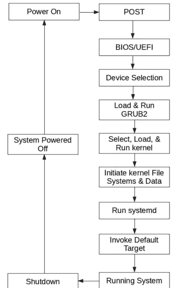

图 17.1 `systemd` Linux 系统上的引导、启动和关机。

然后负责初始化所有剩余硬件、挂载所有必要的文件系统、调用默认系统目标并管理系统服务的启动。

但是，当普通用户进行正常引导和启动时，由于某种原因完全无法完成，或者无法实现正常关机，这是什么原因？

对于引导和启动，除了在 POST 期间暴露的电源或硬件相关问题（如磁盘或内存失败），你可以采取几个步骤来检查可能的问题。你实际上可以进入图 1.7 中系统的任何阶段。

你可以尝试将系统引导到“救援（rescue）”模式，尝试启动系统紧急或救援目标状态。这在第 W27 章 2.1 节和 5.1.8.8 节中有详细显示。

你也可以使用引导加载程序 `GRUB2` 进入救援模式。在我们的 Linux Mint 系统中，当 POST 完成，在 `GRUB2` 接管之前，按键盘上的 Shift 键进入 `GRUB2` 菜单。请注意，我们不提供 `GRUB2` 的配置和修改细节。对于普通用户，这种在引导阶段进行故障排除的可能性是很有用的。

当系统在关机时挂起，诊断问题的临时方法是使用 `journalctl` 命令检查 `systemd` 日志，见第 W27 章 27.2.4 节和 6.2。这种情况下，如果某些进程或程序阻止系统到达关机状态，日志将让你看到。关机时，`systemd` 尝试停止所有服务并卸载所有文件系统。系统最终掉电。我们在下一节中提供使用 `systemd` 的 Linux 系统关机的更多细节。

## 练习 17.3

你如何引导到计算机系统中另一个引导介质上的备用环境，你为什么想这样做？请记录在你的系统中具体是如何操作的。此外，在图 17.1 中画一个箭头，指定如果系统需要重启而不是关机，将遵循什么路径。

## Linux 系统管理基础

并在第 18 章第 2.3 节以及书籍网站的第 27 章第 5.1.10 节进一步介绍 `systemd` 关机过程。图 18.3 描述了从正常运行状态到关机状态通过可能目标状态 `systemd` 关机路径。

传统上，优雅关机或重启程序可以通过活动窗口系统界面、或者通过命令行或控制台，使用 `halt` 或 `shutdown` 命令及其选项以图形化方式完成。`shutdown` 命令的优点允许你指定启动关机进程的时间。

优雅关机程序通常执行如下：

- 1. 停止系统和用户进程
- 2. 将系统内存刷新到磁盘
- 3. 卸载文件系统
- 4. 关机

在 Linux 上使用 `shutdown` 命令的示例例如：

```bash
$ shutdown -h now
```


其中 `-h` 表示处理器，`now` 是时间选项，意味着立即执行。
要获取关于 `shutdown` 命令更完整的描述，特别是时间选项的格式，请查看你 Linux 系统上的帮助页。

## 17.2.3.3 使用 systemd 管理系统时的初步考虑

我们基础 Linux 系统中提供的系统管理器是 `systemd`。事实上，`systemd` 是 Linux 三大分支所有发行版以及所有重要的外围 Linux 发行版的系统服务管理器。

我们在第 18 章中详细介绍 Linux 系统服务管理，并提供若干关于如何在现代 Linux 系统中有效控制操作系统的示例。
我们首先对 Linux 中的“系统服务”提出一个初步问题。

问题：什么是守护进程（`daemon`）？

答案：基本上，守护进程是一个后台运行的持续进程，它不与终端关联或受控制。特别是没有以通常的方式连接到标准输出或标准错误。

问题：“服务”（`service`）是守护进程吗？

答案：有时是。

更准确、更通用地说，服务是一个进程或进程集合、系统的整体状态、或者物理设备、虚拟设备、数据集的状态，以及作为资源提供者或应用能力的集合，它可以有多个实例。例如，系统上存在的许多分层文件系统，或者远程登录系统的多种方式。

## 17.2.3.4 使用 systemd 进行系统服务的进一步参考

此外，书籍网站上标题为“虚拟化方法论”的第 23 章也展示了如何在 `LXC/LXD` 容器以及 `VirtualBox` 虚拟机（`VM`）内部安全地实现 `vsftpd` 服务的示例。

正如参考文献所示，在执行这些示例时应保持谨慎，特别是如果你没有使用书籍网站第 23 章所示的虚拟化方法之一，并且正处于连接到互联网的不安全网络中。你可能没有计算机的 `root` 权限来执行我们在参考文献中显示的示例。

## 练习 17.4

从互联网远程站点通过 `ftp`、`telnet`、`login` 或 `rsh` 进入你的家庭电脑有什么危险？

## 17.3 用户管理

用户管理最重要的目标是服务和安全。首先，提供服务以确保用户拥有访问权限并能够充分利用现代 Linux 系统提供的资源。其次，保护用户群需要利用这些资源的文件和进程。在本章中，我们将介绍系统管理员可以部署的一些用于保护系统的安全方法。在书籍网站标题为“虚拟化方法”的第 23 章，我们还展示了利用虚拟化技术（如 `LXC/LXD` 容器和 `VirtualBox`）的安全方法。

提供服务和安全的传统技术是通过访问权限，允许单个用户、组或系统上的所有其他访问系统上的特定对象（如文件）。我们在第 5 章第 4 节和第 5 节展示了如何在 Linux 上设置权限。设计和实现用户组以及用户组的访问权限是该技术最重要的部分。

当然，用户帐户和组的创建与配置是为用户群提供最大服务和安全的首步。如果你是系统的唯一用户，确实如此。

设计用户帐户和组的一个重要部分是对我们在第 17.2 节第 (1) 项中展示的推荐用户数据存储模型进行详细考虑。这是通过在第二个（可能是冗余的）硬盘上保护用户文件来实现的，以便它们与操作系统本身保持分离。这可以通过创建用户账户使其在该硬盘上拥有主目录在实践上实现。正如我们在第 17.4 节所示，添加冗余介质的各种方式可以非常容易且有效地实现该模型。特别是第 17.3 节提供了一种关于用户帐户和组的创建与管理的通用方法，使其符合该模型。

我们集中于如何使用 `adduser`、`addgroup`、`deluser`、`delgroup`、`newcomers` 和 `passwd` 命令在 Linux 上管理用户帐户和组。这些活动通常在 Linux 系统初始安装后很长时间完成，也可以在系统的安装和初始化期间完成。表 17.2 显示了这些命令的简要描述：

### 表 17.2 基础用户管理命令

| 命令 | 描述 |
| --- | --- |
| `adduser` | 添加新用户帐户 |
| `deluser` | 删除用户帐户 |
| `addgroup` | 添加新组 |
| `delgroup` | 删除用户组 |
| `newcomers` | 在批模式下更新并创建新用户 |
| `passwd` | 管理用户密码 |
| `usermod` | 修改用户帐户 |

本节中的示例阐明了：
- 基于文本的用户帐户创建和配置的简单情况，
- 基于文本的组创建和配置，
- 基于文本的用户帐户和组删除。

## 练习 17.5

制作一个表格或图表，列出系统需要添加哪些用户和组，以及它们的默认参数和组组成应该是。你可以使用什么命令来识别系统上的所有组？

## 17.3.1 在文本界面中添加用户和组

`adduser` 和 `addgroup` 命令默认使用命令行选项和参数向系统添加“普通”（非系统）级的用户或组。它们从 `/etc/adduser.conf` 获取默认配置信息。对于 `useradd`、`groupadd` 和 `usermod` 等旧的低级工具来说，它们是更友好的前端工具。`adduser` 利用用户 ID (`UID`) 和组 ID (`GID`) 来创建新帐户，并默认创建一个带有骨架配置的主目录、运行自定义脚本以及其他功能。`adduser` 是一个调用以下命令的脚本文件：`adduser`、`groupadd`、`passwd`、`gpasswd`、`usermod`、`chfn`、`chage`、`edquota`。

`adduser` 和 `addgroup` 命令语法的摘要列表如下：

```
adduser - addgroup - 向系统添加用户或组

语法:

adduser [options] [--home DIR] [--shell SHELL] [--no-create-home]

[--uid ID] [--firstuid ID] [--lastuid ID] [--ingroup GROUP | --gid ID]

[--disabled-password] [--disabled-login] [--gecos GECOS]

[--add_extra_groups] [--encrypt-home] user

adduser --system [options] [--home DIR] [--shell SHELL] [--no-create-

home] [--uid ID] [--group] |--ingroup GROUP | --gid ID] --disabled-

password] [--disabled-login] [--gecos GECOS] user

addgroup [options] [--gid ID] group

addgroup --system [options] [--gid ID] group

adduser [options] user group
```

用途: `adduser` 和 `addgroup` 根据命令行选项和来自 `/etc/adduser.conf` 的配置信息向系统添加用户和组。

526

Linux

以超级用户身份使用 `adduser` 命令的基本简单用法执行以下五项操作：

```
$ sudo adduser username
```

1. 创建名为 `username` 的用户。
2. 创建用户的家目录（默认为 `/home/username`），并将来自 `/etc/skel` 的文件复制到其中。
3. 创建一个与用户同名的组，并将用户放入该组中。
4. 提示输入用户密码（默认不显示在屏幕上）并进行确认。
5. 提示输入用户的个人信息，如电话、办公室地址、联系方式等。

后文将给出两个在文本命令行界面中向 Linux 添加新用户的示例。

第一个示例阐述了如何作为用户从命令行交互式地创建一个单个用户账户。如果你在创建用户账户时犯错，可以随时使用第 17.3.2 节所示的 `deluser` 命令立即删除该账户。

## 示例 17.1：单个用户账户的 `adduser` 命令

```
$ adduser sarwar

[sudo] password for root: qq

Adding user 'sarwar' ...

Adding new group 'sarwar' (1002) ...

Adding new user 'sarwar' (1002) with group 'sarwar' ...

Creating home directory '/home/sarwar' ...

Copying files from /etc/skel ...

Enter new UNIX password: www

Retype new UNIX password: www

passwd: password updated successfully

Enter the new value, or press ENTER for the default

Full Name [: ENTER

Room Number \|_{ ENTER

Work Phone []: ENTER

Home Phone []: ENTER

Other []: ENTER

Is the information correct? [Y/n] Y

$
```


## 练习 17.6

使用前文所示的 `adduser` 命令在你的 Linux 系统上创建一个新账户。请务必使用你在练习 17.5 回答中记录的条目来覆盖你系统中用户账户配置的默认值。

第二个示例使用了 `newusers` 命令，该命令允许结合包含一次性添加的所有服务器账户列表的文件进行“批量”模式创建新用户。`newusers` 命令的简要描述如下：

**`newusers`** — 批量更新并创建新用户

语法：
```
newusers [options] [file]
```

用途：`newusers` 读取一个文件（默认从标准输入）并使用这些信息来更新一组现有用户或创建新用户。每行的格式与标准密码文件相同，如下：

```
pw_name:pw_passwd:pw_uid:pw_gid:pw_gecos:pw_dir:pw_shell
```

其中
- `pw_name` 是你想要创建的用户名称，
- `pw_passwd` 是密码，
- `pw_uid` 是 UID，
- `pw_gid` 是 GID，
- `pw_gecos` 是标识注释，
- `pw_dir` 是家目录路径，
- `pw_shell` 是新用户的默认 shell

常用选项：
- `-h, --help`：显示帮助信息并退出
- `-r, --system`：创建系统账户

## 示例 17.2：在“批量”模式下创建多个新用户

1. 使用你喜欢的文本编辑器在你的家目录下创建以下名为 `"dev_grp.txt"` 的文件。可以随意添加更多与所示行相似的行，以向列表中添加更多新用户。

```
hassan:QQQ:2001:2001:CFO of Accounting:/home/hassan:/bin/bash
```

该行的七个字段由冒号（`:`）分隔，分别是新用户的账户名、密码、UID、GID、GECOS 注释、默认家目录和 shell。

2. 使用以下命令创建 `dev_grp.txt` 文件中编码的用户：

```
$ sudo newusers dev_grp.txt

[sudo] password for bob: qqq
```

3. 使用以下命令检查新用户的添加情况：

```
$ more /etc/group

Output truncated...

hassan:x:2001:

$
```

## 练习 17.7

根据你早些在章节内练习 17.5 中完成的关于用户账户及其配置要求的表格或图表，创建一个新用户账户文件。如示例 17.2 所示，对于每个用户，你必须在文件中拥有一行包含七个由冒号分隔的字段，其中包含每个用户的配置。表格或图表的设计决定了文件中的内容。

## 17.3 在文本界面中添加和维护组

创建和管理用户账户及组最简单且有效的方法是使用基于 GUI 的“用户和组管理器”（`Users and Groups Manager`），在 Linux Mint 的 Cinnamon 桌面中通过菜单选择 **菜单 > 系统设置 > 用户和组** 访问。但该方法在功能上有些有限。建议使用 `addgroup` 和 `adduser` 命令来管理组。

以下是如何添加和管理组的示例。

## 示例 17.3：从命令行添加和管理组及用户

**目标**：添加新组并管理该组中的用户。
**前提**：示例 17.1 和 17.2 在你的系统中已有默认组可用。
**背景**：组的文本化管理通过 `addgroup` 命令及其选项完成。
**要求**：按所示顺序执行以下步骤以完成。

- 使用 `addgroup` 命令创建一个名为 `"development"` 的组：

```
sudo addgroup development

[sudo] password for root: XXX

Adding group 'development' (1003) ...

Done.
```

- 使用 `adduser` 命令将用户 `sarwar` 加入组：

```
sudo adduser sarwar development

[sudo] password for root: XXX

Adding user 'sarwar' ...

Adding user 'sarwar' to group 'development'.

Done.
```

- 使用以下命令检查 `sarwar` 是否在组中：

```
$ more /etc/group

Output truncated...

hassan:x:2001:

development:x:1003:sarwar
```

- 使用 `deluser` 命令从组中移除 `sarwar`：

```
sudo deluser sarwar development

[sudo] password for root: XXX

Removing user 'sarwar' from group 'development'.

Done.
```

- 验证移除：

```
$ more /etc/group

Output truncated...

development:x:1003:
```

**练习 17.8**

你有一台离线计算机，但它运行着最新的 Linux！遗憾的是，它没有图形显示器。只能使用文本界面。通过使用文本命令实现与场景 1 相同的结果。将组命名为 `"project2"`，目录命名为 `"proj2"`。

该方法如下：

**第一步**：向你的系统添加第二个持久化介质，例如内置 SATA 硬盘、外部 USB 总线设备或其他通过某种总线架构连接的介质。请参见 `17.4.4` 中实现此操作的基本传统方法。

在 `17.4.4.1` 节示例 17.6 中，我们在该介质上创建一个新分区，然后在分区上创建一个 `ext4` 文件系统。你也可以在上面创建 `"home"` 目录（正如该示例结论所暗示的那样），这些目录将成为你根据需要添加到系统的新用户的家目录。

**第二步**：当你使用如 `17.3.1` 所示的 `add` 命令添加单个用户时，如果使用 `--home` 选项，可以指定新用户的家目录与你在步骤 1 中创建的目录相同。要使用模板进行大规模账户创建，你可以使用最新的命令。你还可以自定义 `add` 命令使用的默认“骨架”（`skeleton`）文件，以便统一配置新用户账户、用户组等，从而使所有新账户的家目录都位于新硬盘上。

**第三步**：如果你操作了步骤 1 和步骤 2 中目录的所有权权限，新用户将拥有访问第二个块硬盘上目录的权限。这是通过特权用户使用 `chmod` 和 `chown` 命令实现的。

但你必须考虑这些权限更改对你系统安全模型的影响。

通过文件访问权限或如书中第 `W26.9.3` 节所示的 `ACLS`，定制家目录和文件的安全性以使其符合你的安全模型，你可以确保用户和用户组被限制和结构化，以符合安全模型以及你设计的任何性能用例。

我们在本章结束提出了一个问题，要求你利用系统的硬件能力、你自己的安全设计细节以及必须提供的系统特定参数来部署早先的方法。

## 17.3.5 基础密码管理

对于负责用户和组管理的人员来说，出于安全考虑，经常修改密码。使用 `passwd` 命令最容易地完成这一点。我们提供了该命令的一些基本用法示例。关于 `passwd` 命令更完整的描述，请参见你 Linux 系统上的帮助页（`man page`）。

要重置用户账户的密码，请使用以下命令：

```
$ sudo passwd mansoor

[sudo] password for bob: QQQ

Enter UNIX password: ZZZ

Retype new UNIX password: ZZZ

passwd updated successfully

$
```

要获取 `passwd` 命令可用选项的摘要列表，请使用以下命令：

```
$ sudo passwd -h mansoor

Usage: passwd [options] [LOGIN]
```

选项:
- `-a, --all`          报告所有账户的密码状态
- `-d, --delete`      删除指定账户的密码
- `-e, --expire`       强制指定账户的密码过期
- `-h, --help`         显示此帮助信息并退出
- `-k, --keep-tokens`  仅在过期时更改密码
- `-l, --inactive INACTIVE`  过期后将密码设置为非活动状态
- `-l, --lock`         锁定指定账户的密码
- `-n, --minds MIN_DAYS`   设置密码更改前的最小天数为 `MIN_DAYS`
- `-q, --quiet`        静默模式
- `-r, --repository REPOSITORY`  在 `REPOSITORY` 仓库中更改密码
- `-R, --root CHROOT_DIR`      要 `chroot` 的目录
- `-S, --status`       报告指定账户的密码状态
- `-u, --unlock`       解锁指定账户的密码
- `-w, --warndays WARN_DAYS`   设置过期警告天数为 `WARN_DAYS`
- `-x, --maxdays MAX_DAYS`     设置更改前的最大天数为 `MAX_DAYS`

要查看特定用户的状态，使用以下命令：

```
$ sudo passwd -S mansoor

mansoor P 11/15/2016 0 99999 7 -1
```


# Linux 系统管理基础

# 533

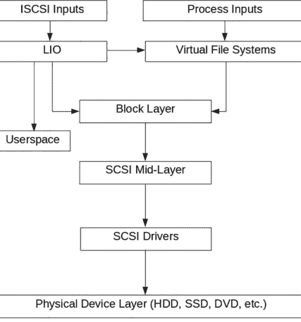

图 17.2 Linux 文件系统存储层。

图 17.2 所示的 Linux IO (LIO) 块被称为 `iSCSI` “目标”（`target`），它代表了通过各种网络连接到持久介质的虚拟层连接。这些连接传统上使用高速光纤（`Fibre Channel`）技术来创建存储区域网络（`SAN`），但重要的是也可以通过以太网和 `TCP/IP` 实现。

更详细的虚拟文件系统分类架构方案将该层分为基于块、网络、可堆叠、伪和特殊用途类别。在图 17.2 中，许多不同的文件系统实现（例如 `NFS4`、`ext4`、`xtfs`、`procfs` 和 `procfs`）位于图中所示的虚拟文件系统（`Virtual File Systems`）块中。两个现代且极其重要的虚拟系统是系统使用的组组（`groupsfs`）以及可插入的块文件系统 `ZFS`。

物理层：此层涉及存储设备的物理操作。它处理正在读取或写入的物理块。它处理缓冲和内存管理，并负责将块物理放置在存储介质的特定位置。物理文件系统与设备驱动程序或物理设备通信的通道交互。在某种程度的简化下，此层可以在图 17.2 中通过块层（`Block Layer`）、`SCSI` 层和物理设备层的分组进行示意性表示。

此外，作为 Linux 内核运行的组成部分，它以瞬态和易失的状态存在；正如我们定义的，伪文件和特殊用途文件系统可以被视为整个系统“流动”的一系列通道。沿着这些思路，当内核位于 `CPU` 和相应的 `RAM` 时，内核本身被组织为一个文件系统。内核（或系统超级内核）被视为一个由易失数据结构组成的文件系统，专门使用这些设备维护硬件和软件的状态；这实现了虚拟化、并发、用户自主性、安全性以及在为这些目的建立的文件系统上必要的归档和长期数据持久性的总体目标。

在 Linux 的发展过程中，各种文件系统被用于为普通用户提供速度、效率、安全实用实用。在 Linux 的三个主要分支中，最现代且通用的是 Linux 扩展文件系统 (`ext`)。本书中展示的所有性 Linux 变体都使用我们作为默认文件系统。

## Linux

ext 的第 4 版本 `ext4` 是目前最健壮的版本。它具有许多特性，如巨大的可扩展性、映射到非常大磁盘阵列的能力以及日志记录（`journaling`）等关键特性。以下是 `ext4` 特性的简要列表：

- 它支持大小体达 1 `exabyte` 的卷和大小体达 16 `terabytes` 的文件。
- 它使用“范围”（`extent`）映射方案，取代了 `ext` 早期版本使用的块映射。范围是一个连续物理块的区域。
- 它与 `ext3` 和 `ext2` 向后兼容。因此，`ext3` 和 `ext2` 可以被挂载为 `ext4`。
- 它延迟块分配，直到数据被刷新到磁盘。
- 它可以创建无限数量的子目录。
- 它拥有多块分配器，可以在在磁盘上连续分配文件时做出更好的选择。
- 它提供了以纳秒为单位的时间戳。

最重要的是，从我们推荐的数据存储模型的角度来看，增加第二个硬盘允许你将操作系统和用户数据保留在两个不同的持久介质上。这样，如果操作系统故障且系统盘损坏无法使用，数据将保留在用户磁盘上，并可以轻松恢复。

有很多传统的、旧的方法可以实现我们数据存储模型的目标，除了 Linux `ZFS` 和 `md` (软件 `RAID`) 以及 Linux 卷管理 (`LVM`) 等现代设施。从我们的角度来看，实现推荐存储模型的现代和最新方法是 `ZFS`。通过 `ZFS`，你可以获得位级完整性、所有层面的管理能力和无故障备份策略，并融为一体。

向你的系统添加持久介质有一些重要原因。你的硬盘可能正耗尽空间，或者开始显示故障迹象。在传统方案中，这些情况可能涉及系统停机以修正。

分区方案和策略：通过你在第 1-4 章的所有工作中，你显而看出 Linux 将一切都组织成文件，并使用文件系统来组织这些文件。一旦你完成了新添加磁盘的分区方案，就有几个理由可以采用多分区。在硬盘上创建多个分区可以通过将目录隔离到分区中来避免全盘问题，并且你可以同时维护不同的文件结构。当你添加新驱动器时，你可以选择使用 `fdisk` 等命令行进行传统的分区方法，也可以选择使用 `Gparted` 等基于 `GUI` 的方法。正如我们在后续章节所示，我们可以使用传统的 `ext4` 文件系统实现我们推荐的存储模型。后续章节还将解决这些问题：

- 为添加的新硬件提供设备驱动程序。
- 硬件将在系统中被识别、配置和部署。
- 在我们的存储模型范围内识别升级现有的可能路径。

## Linux 系统管理基础

正如第 17.2 节项目 (1) 所讨论，我们桌面电脑的数据存储模型能够部署两个或多个硬盘，其实现通过我们在后续小节所示的内容成为可能。我们在 17.4 节展示了持久介质的进一步示例，详细介绍了基于 `ZFS` 的 `SATA` 硬盘扩展，而次要示例详细介绍了如何使用 `mdadm` 在 Linux 中创建和管理 `RAID` 阵列。17.4.3 和 17.4.4 节所示的基于 `ext4` 的扩展不仅适用于 `USB` 驱动器，还可以扩展到其他持久介质，例如内部或外部挂载的 `SSD` 或硬盘。

SATA 硬盘和 USB 媒体：在计算机上安装系统后添加 `SATA` 硬盘，你会想要对其进行分区。你可能想要创建一个新分区或一个多个分区，并使用标准 Linux 文件系统（如 `ext4`）对这些分区进行格式化。我们强调并鼓励使用 `Gparted GUI` 来实现。

当你添加外部介质（如 `U` 盘或其他持久存储设备）时，它已经格式化为 `FAT32` 文件系统（大多数市售 `USB` 盘的情况）或取决于介质的其他格式。传统上，你可以对驱动器进行分区，并鼓励使用 `fdisk` 命令并使用 `mkfs` 命令向其添加文件系统。我们强调并鼓励使用其较新的兄弟版本 `gdisk` 来进行分区。

注意在 Linux 中可以手动移除 `USB` 媒体。例如，使用桌面 `GUI`，右键点击桌面上的 `U` 盘图标并选择“弹出”（`Eject`）或“移除”（`Remove`）。卸载 `U` 盘或 `USB` 媒体也可以通过命令行使用 `mount` 命令完成。

当 `U` 盘或其他外部介质在 Linux 上自动挂载时，其路径为 `/media/your_home/id`，其中 `your_home` 是你的系统主目录，`id` 是标识符。

例如，当我们为 2TB 的 `Seagate USB 3.0` 硬盘并在 `Gparted` 中创建一个分区时，同时在该分区上添加了 `ext4` 文件系统，新挂载的硬盘通过路径 `/media/bob/Seagate_Backup_Drive` 访问。

### 17.4.1 添加新磁盘驱动器的准备考虑

如果你向计算机插入了一个你认为运行正常的 `U` 盘，但它没有被识别，其原因是 Linux 系统没有可用的设备驱动程序来启用计算机与 `U` 盘之间的通信。

你如何知道新驱动器是否被识别，最重要的是，它在你的系统中是否可用？至少有三种快速简单的方法知道新驱动器是否被识别：

1. 如果它是 `U` 盘且格式化为 `FAT32`，`Linux Mint` 会允许它运行，并在桌面上打开一个关于它的图标。
2. 在终端中，可以使用命令 `dmesg -f` 并观察屏幕显示。它将显示已新设备，尽管在 `USB U` 盘的情况下，它可能使用了 17.4.2 节中提到的前后对比法进行格式化。
3. 当你正确连接 `SATA` 硬盘时效果最好的，但未被识别的概率要低得多。

并不是因为 `USB` 驱动器已格式化为 `FAT32`，而是因为制造商在插入其设备时会自动提供可用驱动程序。这并不总是如此。

在许多情况下，了解系统的物理设备名称、实例名称和逻辑设备名称是重要的，但从实践角度来说说，对于 Linux 系统管理员来说，轻松地找到硬盘驱动器的逻辑设备名称是最重要的。

你可能想为你的 Linux 系统添加一块在其他计算机操作系统上使用过的硬盘。在这种情况下，我们可以部署主要的和次要示例来对该硬盘进行重新分区，并为在你的 Linux 上的新用途做好准备。

### 17.4.2 查找磁盘逻辑设备名称的快速简单方法

在将驱动器连接到你的 Linux 系统之前，了解如何以非常快速简单的方法确定当前系统中实际连接并可用的驱动器已安装设备名称是非常重要的。我们所说的“已连接并可用”是指该驱动器已正确连接并被系统识别，并且拥有系统可以使用与其通信的驱动程序。

操作前后对比：如果你想找到要添加到系统中的新磁盘的逻辑设备名称，请使用以下方法之一查看在添加磁盘之前系统中的情况，并在添加新磁盘后使用相同的方法并注意差异。出现的不同或新的逻辑名称将是新磁盘的逻辑设备名称。

方法 1：将你的工作目录更改为 `/dev`。输入 `ls`。硬盘，例如，在 `ls` 中显示为 `sdb`、`sdx`。这些磁盘第一个切片（分区）的完整路径指定为 `/dev/sda`。`USB` 总线设备（如 `U` 盘）在 `ls` 中显示为 `/dev/sdc`，取决于驱动器后面的名称，且第一个分区的完整分区挂载在 `/dev/sd1`。

方法 2：在命令行上使用 `df -h` 查找挂载在系统上的文件。在你的 Linux Mint 系统上，当我们执行此操作以查看 `Lexar 60 GB U` 盘是否最近已成功连接到系统时，输出如下：

```


### 17.4.4 使用 `fdisk` 添加磁盘

本节介绍了在安装后很长一段时间向系统添加磁盘的传统方法。我们遵循推荐的存储模型，就像上一节中我们使用 ZFS 实现额外的硬盘一样。在本节中，我们使用 `fdisk` 命令对额外的磁盘进行分区。本节的示例使用了外部挂载的 USB 闪盘，它更容易添加，而且对普通用户来说更便宜且更容易获得。此示例可以扩展到 `SATA` 驱动器或其他架构。在书籍网站标题为“ZFS 管理与使用”的 `W22` 章中，我们提供了更多基于 ZFS 的冗余示例，以说明 ZFS 内部类似的冗余水平。

#### 17.4.4.1 使用 `fdisk` 对磁盘进行分区

`fdisk` 是一个命令行、对话框驱动的程序，用于在 Linux 中创建和管理分区表。以下是 `fdisk` 语法和使用的简要描述：

`fdisk` - 创建并管理分区表

```
语法:

fdisk [options] device

fdisk -l [device...]

输出：磁盘设备上的新分区或处理过的分区

常用交互式命令：
```

```
$ df -h

Filesystem      Size  Used Avail Use% Mounted on
udev            2.8G     0  2.8G   0% /dev
tmpfs           584M     0  576M   2% /run
/dev/sda        105G     0  9.4G  93% /
tmpfs            2.9G  1.5M  2.9G   1% /dev/home
tmpfs           5.0M     0  5.0M   0% /run/lock
tmpfs            2.9G     0  2.9G   0% /run/cgfs
gmffs           100K     0  100K   0% /run/cgmanager
tmpfs           584M     0  584M   1% /run/user/1000
/dev/sdb1        60G  1.1G   59G    /media/bob/Lexar
```

我们使用 `lsblk -a` 命令来介绍 `df` 命令的更多细节。当我们在 Linux Mint 系统上使用此命令时，我们发现连接了 Lexar 60 GB U 盘后，得到了如下输出：

```
$ lsblk -a

NAME      MAJ:MIN SIZE  RO TYPE  MOUNTPOINT
loop1     7:1    0  0  loop
sdb       8:16   59.6G 0  disk
└─sdb1    8:17   59.6G 0  part  /media/bob/Lexar
loop6     7:6    0  0  loop
loop4     7:4    0  0  loop
```

**注意**

# Linux 系统管理基础

```
sr0       11:0    1  1024M 0  rom
loop2     7:2     0  0  loop
loop0     7:0     0  0  loop
sda       8:0     111.8G 0  disk
sda2      8:2     0  0  part
sda5      8:5     5.9G 0  part [SWAP]
sda1      8:1     105.9G 0  part
loop7     7:7     0  0  loop
loop5     7:5     0  0  loop
loop3     7:3     0  0  loop
$
```

方法 4：首先在第 4 章第 4.7 节所示，使用 `findmnt` 命令。当我们在 Linux Mint 系统上使用此命令时，我们得到了如下输出：

```
$ findmnt

TARGET SOURCE FTYPE OPTIONS
/ /dev/sda ext4 rw,relime,errors=remount-ro...
- /sys/kernel/security sysfs tmp rw,nodev,noexec,relime...
- /sys/fs/cgroup securityfs tmp rw,nodev,noexec,relime...
- /sys/fs/cgroup/systemd cgroup rw,nodev,noexec,relime...
- /sys/fs/cgroup/freezer cgroup rw,nodev,noexec,relime...
- /sys/fs/cgroup/devices cgroup rw,nodev,noexec,relime...
- /sys/fs/cgroup/pids cgroup rw,nodev,noexec,relime...
- /sys/fs/cgroup/hublet cgroup rw,nodev,noexec,relime...
- /sys/fs/cgroup/memory cgroup rw,nodev,noexec,relime...
- /sys/fs/cgroup/net_cls cgroup rw,nodev,noexec,relime...
- /sys/fs/rdma/ cgroup rw,nodev,noexec,relime...
- /event cgroup rw,nodev,noexec,relime...
- /cpuset cgroup rw,nodev,noexec,relime...
- /sys/fs/cgroup/cpuset cgroup rw,nodev,noexec,relime...
- /sys/fs/poststore pstore rw,nodev,noexec,relime...
- /sys/fs/connections fusect rw,nodev,noexec,relime...
- /sys/kernel/config configfs rw,nodev,noexec,relime...
- /sys/kernel/debug debugfs rw,nodev,noexec,relime...
- /sys/kernel/tracing tracefs rw,nodev,noexec,relime...
- /proc rw,nodev,noexec,relime...
```

# Linux 系统管理基础

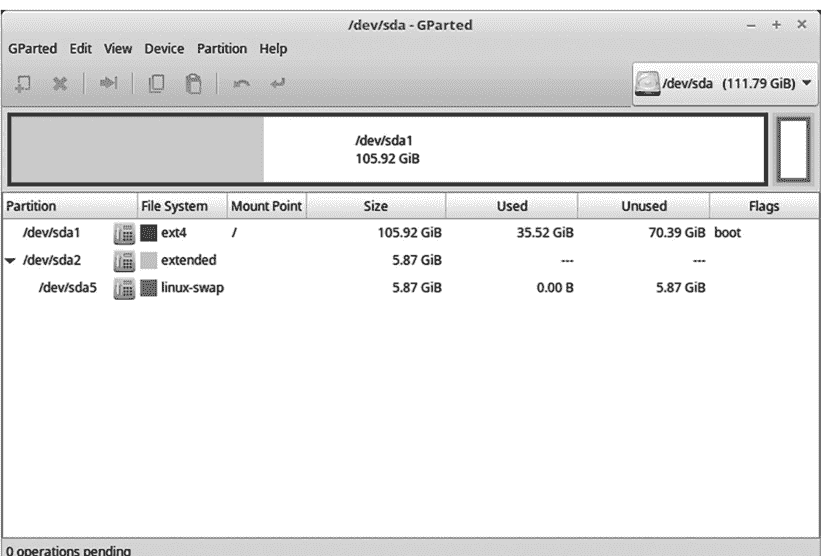
图 17.3 Gparted 主窗口。


图 17.4 `sdb` 分区 1。

11. 在下拉菜单中选择 > `New`（新建）。屏幕上出现“创建新分区”窗口，如图 17.5 所示。如图 17.5 所示，新分区的默认设置是使用该分区占用整个磁盘，将其创建为主主分区，并将文件系统设置为 `ext4`。

12. 在 `Label`（标签）字段中输入您选择的标签名称。我们选择将此分区标记为 `zfs-prep`，如图 17.6 所示，以便为在上面放置 ZFS 做准备。保留所有其他默认值。点击 `Add`（添加）按钮。在下拉菜单


图 17.5 创建新分区窗口。


图 17.6 修改后的 `sdb` 分区 1。

选择 `Edit`（编辑） > `Apply All Operations`（应用所有操作）。在窗口中，点击 `Apply`（应用）。当出现“正在应用等待的操作”时，点击 `Close`（关闭）按钮。

13. 您已在系统中创建了一个分区表，并分区并格式化了一个可用磁盘，如图 17.6 所示。

14. 通过下拉菜单 `Gparted` > `Quit`（退出）退出 `Gparted`。

结论：我们向系统中添加了一块新硬盘，并使用 `Gparted` 对其进行了分区。


- `n`: 创建新分区。您输入分区编号、起始扇区和结束扇区。起始和结束扇区都可以以扇区数的绝对形式指定。在输入时按回车键将指定默认值，对于起始扇区，为最大可用块的开始；对于结束扇区，为该块的结束。
- `p`: 显示基本分区摘要数据。这包括分区编号、起始和结束编号、分区大小、`fdisk` 的分区类型代码以及分区名称。
- `t`: 更改单个分区的类型代码。您使用双字节的十六进制数输入类型代码。
- `w`: 写入数据。使用此命令保存您的更改。

示例：
`sudo fdisk /dev/sdb` 作为超级用户，在磁盘 `/dev/sdb` 上运行 `fdisk`

## 示例 17.6 使用 fdisk 在 USB 闪盘上放置单个分区

目标：练习在 USB 闪盘上放置一个 Linux 分区，并在该分区上使用 `ext4` 文件系统。
先决条件：您的系统中有一个可用的 USB 闪盘。

要求：按照给出的顺序执行后续步骤，以完成本示例的要求。

### 1. 确定闪盘标识

此前已确定闪盘已被系统识别，以及其逻辑设备名称是什么（我们的是 `/dev/sdb`），将其插入 USB 端口。我们使用了一个 8-GB 的金士闪盘；非常可靠，并且在 Linux Mint 和其他 Unix 类系统中始终会自动挂载。

在 Linux 上，驱动器已自动挂载。使用以下命令卸载它：

```bash
$ sudo umount /dev/sdb1
```

### 2. 使用 fdisk 分区

使用 `fdisk` 对新添加的 USB 闪盘进行分区，确保删除其上的任何分区。对于我们的金士 USB 闪盘，上面只有一个默认分区。

```bash
$ sudo fdisk /dev/sdb

欢迎使用 fdisk (util-linux 2.27.1)。

更改将仅保留在内存中，直到您决定写入它们。

在使用写入命令前请要小心。

命令 (m 帮助): d

已选择分区

分区 1 已删除。

命令 (m 帮助): n

分区编号 (1-4, 默认 1): <Enter>

起始扇区 (34-2097151, 默认 2048): <Enter>

结束扇区 (+size,K,M,G): <Enter>

创建了一个分区 1，类型为 'Linux'，大小为 7.3 GB。

命令 (m 帮助): p

磁盘 /dev/sdb: 7.3 GB, 15731742 扇区

单位: 扇区

磁盘标签: gpt

磁盘标识符: ABB8EE0C-C60F-4F3B-B3FF-37587177546
```


| 设备 | 起始 | 结束 | 扇区 | 类型 |
| :--- | :--- | :--- | :--- | :--- |
| `/dev/sdb` | 2048 | 15240542 | 15238495 | Linux |

```
命令 (m 帮助):
分区表已更改。
调用 ioctl() 重新读取分区表。
同步磁盘...
```

### 3. 添加文件系统

为了使此分区可用，您必须为其添加文件系统。我们希望在该分区上添加 `ext4` 文件系统。要执行此操作，请使用 `mkfs` 命令：


```bash
$ mkfs -t ext4 /dev/sdb1
[sudo]: 密码
mke2fs 1.42.13 (2015年5月17日)
创建文件系统 UUID: 1893320 4k 块和 474208 inode
文件系统超级块 UUID: b91335c2-c38e-45a3-85ff-37587177546
超级块存储在块: 32768, 98340, 16384, 229376, 294912, 819200, 884736, 1605632
分配组表：
写入节点表：
创建日志 (32/68 blocks): 完成
写入超级块和文件系统信息：完成
```

要使用此分区数据，可以在目录中创建目录和文件。

结论：使用 `fdisk` 工具和 `mkfs` 命令删除了 USB 闪盘上的任何现有分区，并在上面创建了一个带有 `ext4` 文件系统的 Linux 分区。

## 练习 17.11
按照 `17.6` 的步骤对 USB 闪盘进行单主分区分区，然后为其添加 `ext4` 文件系统。在闪盘上创建目录。

## 练习 17.12
按照 `17.6` 的步骤对挂载的 USB 外壳中的硬盘进行分区，在其上放置单个主分区，然后为其添加 `ext4` 文件系统。在硬盘上创建目录。

## 17.5 配置打印机

我们在第 2 章中简要讨论了 Linux 打印命令，并在第 6 章第 `6.8` 节中进行了详细介绍。使用 `CUPS` 还有其他添加和配置本地打印机并在上面打印文档的方法。我们在书籍网站的 `W26.5` 节“通用 Unix 打印系统的功能”中详细介绍了这些方法。在这里，我们还提供了关于打印命令的更多细节，如 `lpadmin`、`lpc`、`lpfno`、`lpmove`、`loptions`、`lpq`、`lp`、`lprn` 和 `lpstat`。

根据 Linux 系统专业人员的说法，作为系统管理员在备份系统时，有一组易记且重要的因素需要考虑。这些因素可以用简单的问题形式表示为：如何（How）、什么（What）、为什么（Why）、何时（When）、在哪里（Where）以及谁（Who）？这些简单问题的答案可以合并讨论，我们提供了以下精选示例答案列表：

*   **“如何”** 意味着最主要是使用命令、工具、应用程序或硬件与软件的组合完成备份和归档。这些设施将在后面的章节中介绍。它也意味着以滚动方式或跨越整个系统结构使用各种策略。
*   **“什么”** 意味着仅来自用户文件和用户账户、所有内容、仅特定类型的文档、整个硬盘、多个磁盘驱动器、系统文件、系统文件的全部或子集。
*   **“为什么”** 意味着决定你正在备份的“什么”的相对重要性。
*   **“何时”** 意味着每小时、每天一次、每周一次、每月一次、每次保存特定文件时，以及精确的时间，例如凌晨 3 点。
*   **“在哪里”** 意味着在本地磁盘、到 `Dropbox`/`Google`/`Amazon` 云存储、手动保存到 USB 闪盘、手动保存到另一块硬盘、通过 `cron` 自动保存到家庭网络上的计算机或网络附属存储 (`NAS`)、手动保存到另一处并增量备份，以及到各种级别的 `RAID` 或上述任何组合。
*   **“谁”** 意味着由系统上的唯一用户进行。

## 17.6.1 备份设施的策略摘要与概述

单个用户或系统管理员可以使用几种策略来自信且高效地备份 Linux 操作系统的文件。表 `17.3` 及其包含的描述对这些策略以及在现代 Linux 系统中实现这些策略的设施进行了基本概述。在表格随后的章节中，我们将简要介绍这些设施。你系统中的页面将提供更完整的描述，以及表 `17.3` 中列出的所有命令的命令选项、参数和选项参数。

## 17.6.2 Linux Gnu tar

Linux 操作系统具有多种工具允许你将文件和目录归档到一个文件中，而 `tar` 命令是最流行、使用最广泛且传统的方法。

### 表 17.3

| 备份设施 | 描述 |
| :--- | :--- |
| `tar` | 命令和选项，用于将文件或目录层次打包成普通磁盘文件，以便备份、归档或移动到另一个位置；`gtar` 是 `Gnu` 版本 |
| `cpio` | 小于 `tar`，但功能相同 |
| `rsync` | 一种节省磁盘空间的复制文件和目录的命令 |
| `dd` | 一种简单且简短的备份工具 |
| `zfs snapshot` | `zfs` 内置的命令和选项，允许多种备份模式 |
| 脚本文件 | 管理员或用户编写的 Shell 脚本或编程语言备份系统，可以使用其中的所有其他命令 |
| 第三方软件 | 许多本地和在线产品：对于普通使用而言，最重要的两个例子是 `Clonezilla` 和 `FileZilla` |

Linux 系统管理基础

Linux 上的 `tar` 是 `Gnu` 版本。
`tar`（磁带归档的缩写）最初设计用于将文件系统保存为备份，以便在系统崩溃时恢复文件。它主要用于将目录层次结构打包成普通磁盘文件。该文件随后可以本地或远程保存用于系统备份，或者通过 Internet 传输给他人。它还经常配合压缩工具（如 `gzip`）通过命令行选项使用。节省磁盘空间的结果是簇内的空空间被浪费了。

`tar` 工具的简要描述如下：
*   `Gnu` 版本的 `tar` 有一些重要的功能特性，并且比传统的 UNIX `tar` 采用了更友好的语法。因此，对于初学者，我们只显示 `Gnu` 语法的“长格式”，因为它更容易理解。一旦你熟悉了 `tar`，可以自行切换到 UNIX 风格的短格式。
*   系统管理员使用成本效益的归档介质完成文件系统的备份，以便系统因某些原因崩溃时，可以恢复文件。基于 Linux 的计算机系统崩溃通常是由操作系统之外的原因引起的，例如磁盘头损坏很少导致系统崩溃，因为它是一个设计良好、经过编码且经过测试的操作系统。在典型的安装中，备份是在系统通常不使用的非工作时间（深夜或清晨）每天完成的。

`tar` 命令的通用语法（使用 `Gnu` 风格语法而非传统的 UNIX 风格语法所示）如下：

**语法：** `tar [操作模式] [操作模式选项] [FILE...]`
**用途：** 将文件（以特定格式）归档到归档介质（可以是普通文件），或从归档介质恢复。目录默认递归归档和恢复。
**输出：** 归档或恢复的文件或目录结构

`Gnu` 风格用法中的主要操作和操作选项：
*   `--append` 将文件附加到归档末尾
*   `--concatenate` 将归档附加到另一个归档的末尾
*   `--compare` 查找归档与文件系统之间的差异
*   `--create` 创建新磁带并在记录归档文件
*   `--delete` 从归档中删除
*   `--extract` 从归档中提取文件
*   `--help` 显示短选项摘要
*   `--list` 列出归档内容
*   `--show-defaults` 显示选项的内置默认值
*   `--test-label` 测试归档卷标签然后退出
*   `--update` 附加不新于归档中版本的文件
*   `--usage` 显示可用选项列表
*   `--version` 显示程序版本

常用选项：
*   `--preserve-permissions` 提取权限信息
*   `--acls` 启用 `POSIX.1 ACL` 支持
*   `--gzip` 通过 `gzip` 过滤归档
*   `--verbose` 列出处理的文件
*   `--file ARCHIVE.tar` 将归档发送到名为 `ARCHIVE.tar` 的文件

命令参数：`FILE...` 目标，归档文件或要归档的文件对象

### 17.6.2.1 使用 tar 归档和恢复文件

普通 Linux 用户如果需要，可以归档他们的工作。他们通常需要对项目相关的文件对象执行此操作，以便通过电子邮件、`ssh` 或辅助存储（USB 闪盘、DVD 或 CD-ROM）传输给他人。

制作归档的主要原因是处理单个文件比处理整个目录层次结构更方便。如果没有归档，发送者可能需要发送多个文件和目录（文件结构），接收者需要在其正确的结构中恢复它们。

在第 7 章第 `7.7` 节中，我们讨论了使用 `bzip2`、`gzip`、`gunzip`、`gzexe`、`xz`、`zcat` 等命令进行压缩，并指出压缩节省磁盘空间和传输时间。然而，压缩大小为一个簇的小文件（磁盘存储的最小单位；一个或多个扇区）即使压缩产生了更小的文件，也没有助于节省磁盘空间，因为系统最终仍使用一个簇来保存压缩后的文件。但如果压缩确实产生了更小的文件，你可以节省传输压缩版本的时间。

### 17.6.2.2 八种 tar 操作

在本节中，我们将展示 `tar` 命令最简单的八种用法。在随后的章节中，我们将通过在 Linux 系统上运行的更详细示例会话，对这些“简单 `tar`”进行扩展。

#### 1. 创建归档

这是从目录创建归档文件的最简单命令。

```bash
$ tar --create --verbose --file archive_name.tar directory_name
```

其中：
*   `--create` 是创建新归档的操作
*   `--verbose` 是列出正在处理的文件的操作
*   `--file` 是指定文件的操作
*   `archive_name.tar` 是归档文件的文件名
*   `directory_name` 是你想要归档的目录

#### 2. 创建归档并保留其 ACL

创建归档的一种简单变体是使用选项来保留目录的 ACL（访问控制列表）。ACL 在书籍网站的第 `W26.9.2` 节中有详细阐述。


`tar --acls --create --verbose --file archive_name.tar directory_name`

其中：
- `--acls` 是保留目录已有的 ACL 的选项
- `--create` 是创建新归档的操作
- `--verbose` 是列出正在处理的文件的操作
- `--file` 是指定文件的操作，`archive_name.tar` 是归档文件的文件名
- `directory_name` 是你想要归档的目录

### 3. 提取归档

这是从归档文件中提取目录的最简单命令。

```
tar --extract --verbose --file archive_name.tar
```

其中：
- `--extract` 是从归档文件中提取 `directory_name` 的操作
- `--verbose` 是列出正在处理的文件的操作
- `--file` 是指定文件的操作，`archive_name.tar` 是归档文件名

在最简单的形式下，从归档文件创建的目录将具有与归档文件相同的名称，去掉 `.tar` 扩展名。

### 4. 提取归档并恢复其 ACL 条目

提取归档的一种简单变体是使用选项来恢复归档文件已有的保留 ACL（如果有的话）。

```
tar --acls --extract --verbose --file archive_name.tar
```

其中：
- `--acls` 是恢复归档文件已有 ACL 的选项
- `--extract` 是提取归档文件的操作
- `--verbose` 是列出正在处理的文件的操作
- `--file` 是指定文件的操作，`archive_name.tar` 是归档文件名

在这种最简单的形式变体中，从归档文件创建的目录将具有与归档文件相同的名称，去掉 `.tar` 扩展名。

### 5. 列出归档内容

此过程允许你在不从其中提取任何内容的情况下查看归档文件的内容。

```
tar --list --verbose --file archive_name.tar
```

其中：
- `--list` 是列出归档文件内容的操作
- `--verbose` 是列出正在处理的文件的操作
- `--file` 是指定文件的操作，`archive_name.tar` 是归档文件的文件名

### 6. 从归档文件中提取单个文件

以下命令仅从归档文件中提取特定文件。

```
tar --extract --verbose --file archive_file.tar file_pathname
```

其中：
- `--extract` 是提取单个文件的操作
- `--verbose` 是列出正在处理的文件的操作
- `--file` 是指定文件的操作，`archive_name.tar` 是你正在从中提取的归档文件名
- `file_pathname` 是你想要在归档内部提取的文件的完整路径规范

### 7. 从归档文件中提取单个目录

从归档中提取单个文件的变体，即提取单个目录（并递归提取其任何子目录和文件），是指定你想要提取的目录名称为：

```
tar --extract --verbose --file archive_file.tar directory_pathname
```

其中：
- `--extract` 是提取单个文件的操作
- `--verbose` 是列出正在处理的文件的操作
- `--file` 是指定文件的操作，`archive_name.tar` 是你正在从中提取的归档文件名
- `directory_pathname` 是你想要在归档内部提取的目录的完整路径规范

### 8. 向现有归档添加文件或目录：`--append` 选项

要向现有归档中添加文件，请执行以下操作：

```
tar --append --verbose --file archive_name.tar file_or_directory_name
```

其中：
- `--append` 是将单个文件或目录添加到归档的操作
- `--verbose` 是列出正在处理的文件或目录的操作
- `--file` 是指定文件的操作，`archive_name.tar` 是你添加文件或目录的归档文件名
- `file_or_directory_name` 是你想要在归档内部添加的文件或目录的完整路径规范

# Linux 系统管理基础

## 练习 17.13a 和 17.13b

- A. 参考较早显示的缩写名称或你 Linux 系统上 `tar` 的 `man` 页面，给出一个命令创建一个名为 `zipest` 的目录的 `gzipped` 压缩归档。
- B. 给出一个命令，将 `gzipped` 归档提取到另一个名为 `zipest2` 的目录中。

## 17.6.2.3 使用 tar 创建归档

如上一节所示，`tar` 命令最常用的用法是使用 `--create` 或 `--append` 命令对文件和/或目录列表进行归档（也称为打包）。`--create` 创建新归档，而 `--append` 则将文件附加到归档末尾。

在本节及后续示例会话中，我们将使用图 17.8 所示的目录结构。以下会话显示 `unixbook` 下有两个名为 `current` 和 `final` 的目录。此外，这两个目录中的每一个都包含文件。

```
$ cd unixbook

$ pwd

/users/sarwar/unixbook

$ ls -l

drwxr-xr-x 2 sarwar sarwar 4096 May 22 current

drwxr-xr-x 2 sarwar sarwar 4096 May 22 final

$ cd current

$ ls -l

-rw-r--r-- 1 sarwar sarwar 20428 May 19 ch07.doc

-rw-r--r-- 1 sarwar sarwar 87552 May 19 ch08.doc

-rw-r--r-- 1 sarwar sarwar 86016 May 19 ch09.doc

-rw-r--r-- 1 sarwar sarwar 216344 May 19 ch10.doc

-rw-r--r-- 1 sarwar sarwar 152572 May 19 ch11.doc

-rw-r--r-- 1 sarwar sarwar 340140 May 19 ch12.doc

$ cd ..

$ cd final

$ ls -l

-rw-r--r-- 1 sarwar sarwar 41244 May 19 ch1.doc

-rw-r--r-- 1 sarwar sarwar 53153 May 19 ch2.doc

-rw-r--r-- 1 sarwar sarwar 140140 May 19 ch3.doc

-rw-r--r-- 1 sarwar sarwar 85848 May 19 ch4.doc

-rw-r--r-- 1 sarwar sarwar 387156 May 19 ch5.doc

-rw-r--r-- 1 sarwar sarwar 327111 May 19 ch6.doc
```

如果你想使用以下命令创建当前目录的归档。该参数告知 `tar` 归档将发送到标准输出，然后重定向到 `unixbook.tar` 文件。正如第 12 章第 3.4 节所述，反引号（grave accents）用于命令替换——即转义双引号。`find -print` 命令的输出（即当前目录中所有文件和目录的名称）将作为参数传递给 `tar` 命令。因此，命令行的效果是在名为 `unixbook.tar` 的归档文件中创建当前目录的 `tar` 归档。

```
$ tar --create --verbose --file unixbook.tar . `find -print`

$ file unixbook.tar:

USTAR archive
```

在接下来的章节练习中，你将使用 `tar` 命令的 `c` 选项创建一个目录的归档。

# 练习 17.14

在你 Linux 系统的自己的主目录下，为你选择的任意子层结构创建一个归档。你使用了哪些命令行？你的归档文件名是什么？

## 17.6.2.4 使用 tar 恢复存档文件

你可以使用 `tar` 命令的 `--extract` 参数来恢复（解压）归档。要恢复 17.6.2.3 中创建的归档并将其放在名为 `~/backups` 的目录中，你可以运行以下命令。`cp` 命令将假设位于主目录的归档文件复制到恢复归档文件的目录 (`~/backups`)。`cd` 命令用于将目标目录设置为当前目录。最后，使用 `tar` 命令执行恢复。注意目标目录就是当前目录。

```
$ cp unmbox.tar ~/backups

$ cd ~/backups

$ tar --extract --verbose --file unmbox.tar

., 0 bytes, 0 blocks

./final, 0 bytes, 0 blocks

./final/ch1.doc, 41984 bytes, 82 tape blocks

./final/ch2.doc, 54272 bytes, 106 tape blocks

./final/ch3.doc, 142488 bytes, 279 tape blocks
```


`./final/ch4.doc`, 86528 bytes, 169 tape blocks

`./final/ch5.doc`, 396288 bytes, 774 tape blocks

`./final/ch6.doc`, 348488 bytes, 654 tape blocks

`./current`, 0 bytes, 0 blocks

`./current/ch07.doc`, 204288 bytes, 399 tape blocks

`./current/ch08.doc`, 87522 bytes, 171 tape blocks

`./current/ch09.doc`, 86016 bytes, 168 tape blocks

`./current/ch10.doc`, 121344 bytes, 237 tape blocks

`./current/ch11.doc`, 152576 bytes, 298 tape blocks

`./current/ch12.doc`, 347648 bytes, 679 tape blocks

```
$ ls

drwx------ 2 sarwar 512 Jul 21 23:21 current

drwx------ 2 sarwar 512 Jul 22 23:21 final

-rw------- 1 sarwar 204686 Jul 22 23:47 unmbox.tar
```

`unmbox.tar` 文件在解压后仍然保持完好。这一结果是合理的，因为归档的主要目的是备份文件，在文件恢复后，它应该保持完好，以防系统在文件恢复后但在再次归档前发生崩溃。恢复 `unmbox.tar` 文件后，你的目录结构如图 17.9 所示。


图 17.9 恢复的归档文件。

有时，你可能需要恢复 `tar` 归档中的部分文件。系统管理员经常遇到系统崩溃（通常是电压浪涌导致磁头损坏），并随之破坏了一些用户文件。在这种情况下，系统管理员只会从备份归档中恢复位于磁盘损坏区域的文件。只要知道文件的路径，使用 `--extract` 操作即可进行选择性恢复。如果你不记得要恢复的文件路径，可以使用 `--list` 操作显示归档文件上文件和目录的路径。`tar` 命令带有 `t` 选项的输出格式与 `ls -l` 类似，如下节所示。如示例输出所示，第一个字段指定文件类型和访问权限，第二个字段指定文件所有者的用户/ID，第三个字段显示以字节为单位的文件大小，接下来的几个字段显示文件修改的时间和日期，最后一个字段显示存储在归档中的文件大小。

如果归档包含大量文件，你可以将 `tar` 命令配合 `--list` 操作的输出通过给 `more` 命令，以便逐页查看。如果你只知道文件名而不知道路径，可以将 `tar` 命令配合 `--list` 操作的输出通过给 `grep` 命令。文件也可以被恢复，或者查看其路径。以下会话说明了这些点：

```
$ tar --list --verbose --file unarchive.tar

-drwx-r--x 121520 Jul 22 13:47 2015 ./
-drwx-r--x 121520 Jul 22 13:21 2015 ./final/ch1.doc
-drwx-r--x 121549884 Jul 19 13:06 2015 ./final/ch2.doc
-drwx-r--x 12154272 Jul 19 13:06 2015 ./final/ch3.doc
-drwx-r--x 12154288 Jul 19 13:06 2015 ./final/ch4.doc
-drwx-r--x 12158528 Jul 19 13:06 2015 ./final/ch5.doc
-drwx-r--x 121593628 Jul 19 13:06 2015 ./final/ch6.doc
-drwx-r--x 121520 Jul 22 13:31 2015 ./current
-drwx-r--x 121520428 Jul 19 13:06 2015 ./current/ch07.doc
-drwx-r--x 121587552 Jul 19 13:06 2015 ./current/ch08.doc
-drwx-r--x 121586016 Jul 19 13:06 2015 ./current/ch09.doc
-drwx-r--x 121521344 Jul 19 13:06 2015 ./current/ch10.doc
-drwx-r--x 121525276 Jul 19 13:06 2015 ./current/ch11.doc
-drwx-r--x 121534768 Jul 19 13:06 2015 ./current/ch12.doc
```

```
$ tar --list --verbose --file unarchive.tar | grep ch10.doc

-drwx-r--x 121521234 Jul 19 13:06 2015 ./current/ch10.doc
```

如果你想将文件 `ch10.doc` 恢复到 `~/backups/current` 目录，可以使用以下命令。务必提供要恢复文件的路径，而不仅仅是其名称。

```
$ cd ~/backups
$ tar --extract --verbose --file unarchive.tar current/ch10.doc
```

之前的输出显示文件 `ch10.doc` 已恢复到 `~/backups/current` 目录。你可以通过以下命令确认：

```
ls -l ~/backups/current
```

在接下来的练习中，你将使用带有 `--list` 和 `--extract` 选项的 `tar` 命令来理解如何查看归档属性以及如何恢复文件。

### 练习 17.15 列出 17.14 中创建的文件属性，并以字节为单位显示它们的大小。

### 练习 17.16 将 17.14 中创建的归档文件重命名为 `mytar`，并提取到你主目录下名为 `backup` 的目录中。显示你使用的命令。

#### 17.6.2.5 本地和远程复制目录树

你可以使用 `tar` 命令将一个目录复制到另一个。你也可以使用 `cp -r` 命令，但 `cp -r` 的缺点是传统的访问权限和修改时间无法保留。复制文件的访问权限由 `umask` 的值决定，修改时间被设置为当前时间。为了弥补 `cp -r` 的缺陷，你可以使用 `cp -p` 命令保留权限。

使用 `tar` 命令配合 `--preserve-permissions` 可以在提取归档时保留文件权限。提取归档时默认不会保留权限；提取出的权限取决于提取所在环境的 `umask` 设置。

例如，在下面的命令中，通过携带目录内容、更改工作目录并解压原始目录，同时保留成员权限，在新目录中实现了这一点。

```
$ mkdir pertest
cd pertest
~/pertest $ touch testfile2
~/pertest $ ls -la testfile2
-rw-r--r-- 1 bob 0 Oct 23 05:22 testfile2
~/pertest $ chmod g+w testfile2
~/pertest $ chmod o+w testfile2
~/pertest $ ls -la testfile2
-rw-rwx 1 bob 0 Oct 23 05:22 testfile2
~/pertest $ mkdir perback
~/pertest $ cd /home/bob/pertest; tar --create --verbose --file - ) | (cd /home/bob/perback; tar --extract --preserve-permissions --file -)
./testfile2
~/pertest $ cd perback
~/pertest/perback $ ls -la
total 8
drwxr-xr-x 2 bob 4096 Oct 23 06:03 .
drwxr-xr-x 45 bob 4096 Oct 23 05:27 ..
-rw-rwx 1 bob 0 Oct 23 05:22 testfile2
~/pertest/perback $
```


关键选项是在提取到 `/home/bob/perback` 时在提取操作中添加 `--preserve-permissions`。

### 练习 17.17

在你的系统上执行早的命令行会话，但在提取操作中排除 `--preserve-permissions` 选项。执行 `tar` 命令后，目录中 `testfile2` 的权限是什么？

# Linux系统管理基础

```
ECDSA密钥指纹为 SHA256:D8i5J7a2/dq3QAR86nGZmPaq5isswlyyBMegpQMdM.
确定要继续连接吗 (yes/no)? yes
bob@trues-617 的密码是: ZZZ
$
```

# 练习 17.18

在你运行上述命令的计算机（`192.168.0.31`）上发现了哪些结果文件？在 `192.168.0.31` 上发生了什么？

在接下来的指令性命令示例中，`~/unix/examples` 目录被复制到远程机器上的 `~/unix/examples.bak` 目录，该机器由 `trues-617` 设计，IP 地址为 `192.168.0.8`。使用 `rsh` 命令在 `192.168.0.8` 上执行引号中的命令。后续命令的假设是：你正在 `192.168.0.8` 上打开一个与你在本地机器上账户同名的远程 shell，并且拥有远程机器 `192.168.0.8` 的登录权限。此外，在 `192.168.0.8` 上已经存在一个名为 `unixbook/exam-ble` 的目录。由于 `tar` 命令没有以冗模式模式运行，机器上的唯一反馈将是 `ssh` 身份验证提示。你必须提供密码，命令将静默完成，不会在命令的 `stdout` 上产生任何输出。

```bash
$ (cd ~/file -. ) rsh 192.168.0.8 "cd ~/unixbook/examples.bak; tar --extract ---"
```

无法建立 '192.168.0.8(192.168.0.8)' 的真实性。
ECDSA密钥指纹为 SHA256:D8i5J7a2/dq3QAR86nGZmPaq5isswlyyBMegpQMdM.
确定要继续连接吗 (yes/no)? yes
bob@trues-617 的密码是: ZZZ
$

# 练习 17.19

在你运行上述命令的计算机上以及 `192.168.0.8` 上分别发现了哪些结果文件？

# 练习 17.20

为了保留传输到 `192.168.0.8` 的文件的 `ACL`，你需要在命令中添加哪些选项？这里的假设是 `trues-617` 系统是一个支持 `ACL` 的 `UNIX` 系统，那么在该机器上执行的 `tar` 命令不需要添加任何内容。

## 17.6.2.6 使用 tar 提取软件分发

公司使用 `tar` 命令来分发软件，因为这样可以产生一个需要复制的文件，并且比包含分发软件的未压缩目录层次结构节省磁盘空间。大多数公司将他们的分发包（`tar` 格式）放在互联网站点上，客户可以通过 `ftp` 命令下载。因此，`tar` 也缩短了“复制”时间并减少了客户的工作量，因为客户只需要一次（或可能多次）`ftp` 下载，而不需要下载多个归档目录序列。

由于软件包包含图形界面和多媒体，体积很大，因此在被放置到扩展文件站点或网站之前通常会进行压缩。软件需要解压并将文件恢复到软件包的目录层次结构中。现在考虑一个文件 `VirtualBox-4.3.16-95972-SunOS.tar.gz`。这是从互联网下载后的文件，我们可以使用一个多组合命令在本地 `Linux` 机器上对其进行解压并提取：

```bash
$ gunzip -cd VirtualBox-4.3.16-95972-SunOS.tar.gz | tar --extract --verbose --file -
... [输出已省略]
$
```

如果软件应用程序通过辅助介质（`USB` 闪盘、`DVD` 或 `CD-ROM`）分发，你需要将适当的文件复制到相应的目录并重复上述命令。如果你想分发之前编写的存储在目录层次结构中的软件应用程序，可以使用 `tar` 命令同时创建存档并压缩。这创建一个压缩的 `tar` 存档，可以放在 `ftp` 仓库、网页或作为邮件附件发送。

存档到磁盘文件是创建用于分发的软件包和应用程序最现代且成本效益的方法。`gzip` 选项可以生成 `tar` 归档的压缩版本。`--gunzip` 选项可以使用 `gzip` 工具解压 `tar` 归档版本，以便单独压缩或解压归档，并使用 `tar` 命令；这两个步骤的过程仅通过 `tar` 命令即可完成。在以下会话中，第一个命令生成当前目录的压缩 `tar` 归档到 `/unix-book/backups/ub.tar.gz`，第二个命令从同一文件将压缩的 `tar` 归档恢复到当前目录。

```bash
$ tar gzip --create --file=/unixbook/backups/ub.tar.gz

$ tar gzip --extract --verbose --file=/unixbook/backups/ub.tar.gz
输出已省略
```

## 17.6.3 其他存档与备份

除了传统的 `tar` 工具外，管理员还可以使用几种方法来存档和备份个人账户、文件和系统。如前所述，`rsync` 是通过网络在本地或远程传输文件的快速方法。它最重要的特性是 `rsync` 只发送源和目的之间的差异，这减少了传输的数据量。`rsync` 的语法如下：

```bash
rsync [OPTIONS] SRC DEST
```

### 常用 rsync 选项

- `-a, --archive`: 归模式（隐含 `-p`）
- `-A, --acls`: 保留 `ACL`
- `--delete`: 从目标位置删除多余文件
- `-e, --rsh=COMMAND`: 指定使用的远程 shell
- `-h, --human-readable`: 人类可读数字
- `-H, --hard-links`: 保留硬链接
- `-k, --keep-links`: 在接收端跳过创建新文件
- `-K, --keep-links`: 将符号链接转换为目录
- `-n, --dry-run`: 执行测试但不进行任何更改
- `-p, --perms`: 保留权限
- `-q, --quiet`: 静默模式（非零消息）
- `-r, --recurse`: 递归进入目录
- `--remove-source-files`: 传输后删除源文件
- `-v, --verbose`: 详细输出
- `-z, --compress`: 传输过程中压缩文件数据

### 命令参数

- `SRC`: 源文件或目录
- `DEST`: 目标路径

2. 以压缩格式复制单个本地文件，并以人类可读的形式显示操作反馈，从源备份文件 `backup.tar`（位于当前工作目录）复制到你拥有权限的目标目录 `/home/mansour/backup1`。

```bash
$ rsync -zvh backup.tar /home/mansour/backup1
```

```bash
$ rsync -av syncdir /usr/home/bob/USBint
```

4. 以压缩格式复制单个源目录 `/home/bob/backups`，并以人类可读的形式显示操作反馈到你拥有权限的目标目录 `/home/mansour/backups`。

```bash
$ rsync -avzh /home/bob/backups /home/mansour/backups/
```

5. 以压缩格式将单个源目录 `/home/bob/backups` 及其文件和子目录结构复制到你拥有权限的目标目录 `/home/mansour/backups`。

```bash
$ rsync -zvr /home/bob/backups /home/mansour/backups
```

6. 执行模拟运行（`dry-run`），在此过程中删除源文件并对传输的文件对象进行压缩

```bash
$ rsync --dry-run --remove-source-files -zvh backup.tar /tmp/backups/backup.tar
```

远程示例：

- 7. 将一个名为 `Music` 的单个目录从本地机器复制到远程机器 `192.168.0.8:/home/mansour/`。

```bash
$ rsync -avz Music@192.168.0.8:/home/mansour/
```

- 8. 使用 `ssh` 将一个名为 `syncdir` 的整个目录复制到远程机器 `192.168.0.7` 并进入操作系统的 `x` 目录 `/Users/b/Linux3`。

```bash
$ rsync -av ssh syncdir bob@192.168.0.7:/Users/b/Linux3
```

- 9. 将远程目录复制到本地目录。

```bash
$ rsync -avzh root@192.168.0.100:/home/bob/backups /home/mansour/temp
```


10. 仅使用 `--existing` 选项更新远程目录 `/home/mansour/Linux2e` 的内容（有时称为“同步”），仅更新目标位置的文件。如果源存在目标没有的新文件，则不会将新文件放入目标位置。

```
$ rsync -avz --existing mansour@192.168.1.2:/home/mansour/Linux2e/
```

## 11. 使用 `ssh` 将名为 `backup.tar` 的单个本地文件复制到远程机器 `192.168.0.8`

```
$ rsync -avz ssh backup.tar bob@192.168.0.8:/home/bob/backups/
```

12. 使用 `ssh` 将远程文件复制到当前工作目录。

```
$ rsync -avz ssh bob@192.168.0.100:/usr/home/bob/systemctl.log
```

13. 将 `/home/bob/files` 中的所有文件复制到 IP 地址为 `192.168.0.8` 的远程机器。使用 `--delete` 选项，将删除目标上源目录中已不存在的多余文件。`-v` 选项确保输出传输的内容。在临时端口 22 上使用 `ssh` 运行 `rsync`

```
$ rsync -av --delete -e 'ssh -p 32000' /home/bob/files/ bob@192.168.0.8:/home/bob/files/
```

## 练习 17.21

在之前所有复制到远程主机的示例中，基本假设是什么？

## 练习 17.22

在你的系统本地执行以及在你的局域网（`LAN`）上远程执行所有 13 个示例，并根据需要替换文件名、目录、帐户名和 IP 地址。

## 17.6.3.2 用于备份和恢复的脚本文件

系统管理员可以部署用户脚本文件来快速高效地进行备份和归档。无论它们是用 `Python`（或其他脚本语言）编写的，还是使用启用上述任何命令行功能的 `Shell` 语言编写，都可以用于促进和自动化文件、目录或系统的备份、恢复和归档。网上有许多可用的备份和归档脚本资源，我们不会论证与使用网上现成的程序相比，有计划、编码或维护此类脚本的必要性。以下是一个使用旧版 `tar` 应用 `Bash` 脚本文件示例。

## 示例 17.7 用于自动化 `tar` 备份的简单 `Bash Shell`

目标：以下 `Bash` 脚本将目录 `/home/bob/bashtest` 以压缩格式备份到以前命名为 `simple_backup` 的另一个目录中。步骤：请按照演示顺序执行步骤，以完成本示例的要求。

1. 在你的家目录下创建一个名为 `bashtest` 的子目录。
2. 在你的家目录下创建另一个名为 `simple_backup` 的子目录。
3. 使用你选择的编辑器创建以下文件并将其命名为 `backup.bash`。

```bash
#!/bin/bash

# 如需备份额外的目录，请将路径名放在以下命令中
# 并用空格分隔，例如 /home/bob/bashtest

backup_destination=/home/bob/simple_backup

filename=backup.tgz

echo "Backing up bashtest"

tar --cvzf $backup_destination/$filename /home/bob/bashtest

echo "Backup Complete"
```

4. 使用命令 `./backup.bash` 执行 `Bash` 脚本。

## 练习 17.23

给出使用 `cron` 自动化之前脚本所需的命令，以便每周运行备份脚本。可以随时修改时间、日期和目录，以便你使用该脚本备份系统中的重要信息。

## 17.6.3.3 用于备份和恢复的软件

有很多商业和软件包可以部署以对你的系统进行备份和归档。`Norton Ghost` 是一种非常易于使用的商业产品，允许你通过网络从服务器到一个或多个机器克隆整个硬盘。但两个最容易获得、有用且免费的处理各种文件备份和恢复操作的软件是 `FileZilla` 和 `Clonezilla`。

## 17.6.3.1 `FileZilla`

`FileZilla` 名义上是一个基于图形界面的客户端和服务器程序，可以使用 `ssh` 作为通道。它有许多实用的功能，允许系统管理员……（此处由于原文内容不完整，按原文意译并结束）。

## 17.6.3.2 `Clonezilla`

`Clonezilla` 是一种非常易于使用的商业产品，允许你通过网络从服务器到一个或多个机器克隆整个硬盘。但两个最容易获得、有用且免费的处理各种文件备份和恢复操作的软件是 `FileZilla` 和 `Clonezilla`。

## 练习 2

2. 以压缩格式复制单个本地文件，并以人类可读的形式显示操作反馈，从源备份文件 `backup.tar`（位于当前工作目录）复制到你拥有权限的目标目录 `/home/mansour/backup1`。

```
$ rsync -zvh backup.tar /home/mansour/backup1
```

```
$ rsync -av syncdir /usr/home/bob/USBint
```

4. 以压缩格式复制单个源目录 `/home/bob/backups`，并以人类可读的形式显示操作反馈到你拥有权限的目标目录 `/home/mansour/backups`。

```
$ rsync -avzh /home/bob/backups /home/mansour/backups/
```


5. 以压缩格式将单个源目录`/home/bob/backups`及其文件和子目录结构复制到你拥有权限的目标目录`/home/mansour/backups`。

```
$ rsync -zvr /home/bob/backups /home/mansour/backups
```

6. 执行模拟运行（dry-run），在此过程中删除源文件并对传输的文件对象进行压缩

```
$ rsync --dry-run --remove-source-files -zvh backup.tar /tmp/backups/backup.tar
```

远程示例：

7. 将一个名为`Music`的单个目录从本地机器复制到远程机器`192.168.0.8:/home/mansour/`。

```
$ rsync -avz Music@192.168.0.8:/home/mansour/
```

8. 使用`ssh`将一个名为`syncdir`的整个目录复制到远程机器`192.168.0.7`并进入操作系统的`x`目录`/Users/b/Linux3`。

```
$ rsync -av ssh syncdir bob@192.168.0.7:/Users/b/Linux3
```

9. 将远程目录复制到本地目录。

```
$ rsync -avzh root@192.168.0.100:/home/bob/backups /home/mansour/temp
```

10. 仅使用`--existing`选项更新远程目录`/home/mansour/Linux2e`的内容（有时称为“同步”），仅更新目标位置的文件。如果源存在目标没有的新文件，则不会将新文件放入目标位置。

```
$ rsync -avz --existing mansour@192.168.1.2:/home/mansour/Linux2e/
```

11. 使用`ssh`将名为`backup.tar`的单个本地文件复制到远程机器`192.168.0.8`

```
$ rsync -avz ssh backup.tar bob@192.168.0.8:/home/bob/backups/
```

12. 使用`ssh`将远程文件复制到当前工作目录。

```
$ rsync -avz ssh bob@192.168.0.100:/usr/home/bob/systemctl.log
```

13. 将`/home/bob/files`中的所有文件复制到 IP 地址为`192.168.0.8`的远程机器。使用`--delete`选项，将删除目标上源目录中已不存在的多余文件。`-v`选项确保输出传输的内容。在临时端口`22`上使用`ssh`运行`rsync`

```
$ rsync -av --delete -e 'ssh -p 32000' /home/bob/files/ bob@192.168.0.8:/home/bob/files/
```

## 练习 17.21

在之前所有复制到远程主机的示例中，基本假设是什么？

## 练习 17.22

在你的系统本地执行以及在你的局域网（LAN）上远程执行所有 13 个示例，并根据需要替换文件名、目录、帐户名和 IP 地址。

## 17.6.3.2 用于备份和恢复的脚本文件

系统管理员可以部署用户脚本文件来快速高效地进行备份和归档。无论它们是用`Python`（或其他脚本语言）编写的，还是使用启用上述任何命令行功能的`Shell`语言编写的，都可以用于促进和自动化文件、目录或系统的备份、恢复和归档。网上有许多可用的备份和归档脚本资源，我们不会论证与使用网上现成的程序相比，有计划、编码或维护此类脚本的必要性。以下是一个使用旧版`tar`应用`Bash`脚本文件示例。

## 示例 17.7 用于自动化 tar 备份的简单 Bash Shell

目标：以下`Bash`脚本将目录`/home/bob/bashtest`以压缩格式备份到以前命名为`simple_backup`的另一个目录中。步骤：请按照演示顺序执行步骤，以完成本示例的要求。

1. 在你的家目录下创建一个名为`bashtest`的子目录。
2. 在你的家目录下创建另一个名为`simple_backup`的子目录。
3. 使用你选择的编辑器创建以下文件并将其命名为`backup.bash`。

```bash
#!/bin/bash

# 如需备份额外的目录，请将路径名放在以下命令中

# 并用空格分隔，例如 /home/bob/bashtest

backup_destination=/home/bob/simple_backup

filename=backup.tgz

echo "Backing up bashtest"

tar --cvzf $backup_destination/$filename /home/bob/bashtest

echo "Backup Complete"
```


- 4. 使用命令 `./backup.bash` 执行 Bash 脚本。

## 练习 17.23

给出使用 `cron` 自动化之前脚本所需的命令，以便每周运行备份脚本。可以随时修改时间、日期和目录，以便你使用该脚本备份系统中的重要信息。

## 17.6.3.3 用于备份和恢复的软件

有很多商业和软件包可以部署以对你的系统进行备份和归档。`Norton Ghost` 是一种非常易于使用的商业产品，允许你通过网络从服务器到一个或多个机器克隆整个硬盘。但两个最容易获得、有用且免费的处理各种文件备份和恢复操作的软件是 `FileZilla` 和 `Clonezilla`。

### 17.6.3.1 FileZilla

`FileZilla` 名义上是一个基于图形界面的客户端和服务器程序，可以使用 `ssh` 作为通道。它有许多实用的功能，允许系统管理员……

### 17.6.3.2 Clonezilla

`Clonezilla` 是一种非常易于使用的商业产品，允许你通过网络从服务器到一个或多个机器克隆整个硬盘。但两个最容易获得、有用且免费的处理各种文件备份和恢复操作的软件是 `FileZilla` 和 `Clonezilla`。

562

Linux

答案：

-   a. 操作系统的标准安装并不包含用户根据其使用场景可能需要的软件。随着使用场景的改变，可能需要移除某些软件包。最后，当已安装的软件包出现更新且更完善的新版本时，必须有一种快速且简便的方法来更新软件包，以包含这些改进。

-   b. 单纯从性能和安全的角度来看，系统升级非常频繁，即使是普通用户也可以通过升级来利用这些改进。

问题：Linux 系统的“更新（updating）”和“升级（upgrading）”有什么区别？

答案：通常在文献中，这两个术语经常被混用。但从我们在本节（以及整个章节和全书）的角度来看，我们将这两个术语定义为：

更新（Updating）是添加或替换软件包的过程。例如，使用包管理系统添加 GNU C 编译器，或将 `nginx` Web 服务器应用程序从早期安装的版本更新到最新发布版本。

升级（Upgrading）是将操作系统替换为更新、更稳定的版本的过程。升级可以升级到一个新的发布版本，也可以升级到一个全新的版本。例如，将 `CentOS 7` 升级到 `CentOS 4` 被视为大版本升级，或将 `Linux Mint 17.3` 升级到 `Linux Mint 18` 被视为大版本升级。

在本节中，我们将展示如何在我们的代表性系统（Debian、Ubuntu、Linux Mint 和 CentOS）上完成这两个基础任务之一。

对于软件应用程序的添加、删除或更新，我们将范围限制在适用于 Debian/Ubuntu/Linux Mint 系列的高级软件包工具 (APT) 以及适用于 CentOS 的 Yum Updater, Modified (YUM)。这两个包管理器都可以在基于文本的命令行界面 (CLI) 环境中有效使用。这正是我们在书中处理它们的方法。该书并不排除使用基于 GUI 的包管理器前端，例如 `Synaptic`。

对于操作系统本身的层级升级，我们将在第 17.7.4 节中为您展示一组适用于操作系统升级条件的的程序。

此外，添加 GNU C 编译器及其所需的辅助库是我们代表性系统上添加软件包的主要示例。我们将在附录 A 的第 17.7.2 节和 17.7.3 节中详细说明。

我们将在附录 A 中安装 `gcc`，因为在您执行第 15 章和第 16 章中的系统管理工作之前，执行该操作是关重要的。

如果您已经使用第 17.2.2 节中的技术完成了操作系统的首次安装，那么它在四个代表性系统中的一个上默认安装，并包含了必要的库。

如果您尚未在您的计算机系统上安装操作系统，请注意，您的系统管理员可能已经完成了 `gcc` 的安装！

## 17.24

根据我们之前关于更新和升级 Linux 系统的说明，请列出您想要安装的应用程序，并说明您在系统上执行这些的操作。然后，在阅读本节其余内容时，请使用相应的包管理器安装这些软件。

获取有关本节所示的包管理命令帮助的最佳方法是阅读您系统上的页面。

## 17.7.1 初始存储模型建议

我们之前为普通用户提供了一个建议的存储模型，操作系统位于单个磁盘（我们称之为“系统磁盘”）上，用户数据位于一个或多个 ZFS vdev 上。这给普通用户带来的最有用且实用的优点之一是能够以可靠且高效的方式添加或更新软件应用程序并升级操作系统本身。由于软件应用程序和操作系统存在于系统磁盘上，可以独立于用户数据进行增量更新或升级。例如，如果您想从操作系统的早期版本切换到最新版本，可以在系统磁盘上对新版本进行“裸机”安装，然后将数据重新附加。我们发现这种存储方式和更新/升级方法对于任何普通用户来说都是安全且可靠的，因为它不会导致系统崩溃。

如果您选择保留旧版本的操作系统，只需增量更新软件并升级操作系统，后面的章节将为您提供如何操作的基本概述。

通过我们这里提供的设施，可以使用广泛的软件程序。仓库包含“软件包”集合，每个软件包都捆绑了软件和依赖项，它们都会自动安装。当通过包管理设施（如 `apt` 或 `yum`，我们说明的两个包管理系统）下载并安装到您的系统时，用户无需执行任何操作即可使用这些软件。

对于提供服务的软件（如 `sshd` 或像 `nginx` 这样的 Web 服务器），包管理器不仅下载并安装所有必要组件及其依赖项，还会使用系统启动并确保它在每个子系统启动时自动启动。

在书的所有章节和节中，这部分可能对您正在使用的操作系统特定版本和发布版本最为敏感且依赖最高。

## 练习 17.2

准确确定您的 Linux 系统是如何部署存储模型的。例如，用户主目录的路径是什么？文件结构在磁盘驱动器上是如何划分的？这与我们建议的存储模型有何不同？您如何迁移 Linux 系统上的现有模型以符合我们的建议模型？

## 17.7.2 使用 APT

对于初学者来说，起初采用 GUI 方法进行包管理可能不是完成任务之一的最快最简单的方法。

## 17.7.3 使用 apt-get

目的：`apt-get` 是处理软件包的命令行工具，可以认为是其他工具的“后端”。存在多个“前端”界面，例如 `Aptitude` 和 `Synaptic`。

**常用选项：**

-   `-d, --download-only`：仅下载；获取软件包但不安装。
-   `--only-upgrade`：不安装新软件包；当与 `install` 配合使用时仅对已安装的软件包进行升级。
-   `-q, --quiet`：安静模式；产生适用于日志的输出，省略进度指示。
-   `-y, --yes`：自动确认；对“yes”回答所有提示并以后交互模式运行。

**命令：**

-   `install`：后跟一个或要安装或升级的软件包。使用 `/etc/apt/sources.list` 文件来查找所需的软件包。
-   `remove`：与 `install` 相同，但移除软件包而不是安装软件包。移除软件包会将其配置文件保留在系统中。
-   `update`：用于从源重新同步包索引。从 `/etc/apt/sources.list` 中指定的位置获取可可用软件包的索引。
-   `upgrade`：用于从 `/etc/apt/sources.list` 中列出的源为系统上当前安装的所有软件包安装最新版本。

# Linux 系统管理基础

操作 3. 要删除软件包，或软件包及其配置文件，请使用以下命令：

```bash
[root@Linux_Mint] # apt-get remove package_name
[root@Linux_Mint] # apt-get purge package_name
```

操作 4. 要从本地 `sources.list` 目录更新软件包索引文件（软件包元数据）或将所有 Debian 软件包升级到最新版本，请使用以下命令：

```bash
[root@Linux_Mint] # apt-get update
[root@Linux_Mint] # apt-get upgrade
```

操作 5. 要通过删除并重新安装来单独更新已安装的软件包，请使用以下命令：

```bash
[root@Linux_Mint] # apt-get --reinstall install package_name
```

操作 6. 要显示与系统中已安装软件包相关的元数据，请使用以下命令：

```bash
[root@Linux_Mint] # apt-cache show package_name
```

例如，在我们基于 Debian 系的 Linux Mint 系统上，此命令的输出显示了 GNU 编译器 (`gcc`) 的元数据信息

```bash
[root@Linux_Mint] # apt-cache show gcc
```


```
Package: gcc
Priority: optional
Section: devel
Installed-Size: 44
Maintainer: Ubuntu Developers <ubuntu-devel-discuss@lists.ubuntu.com>
Original-Maintainer: Debian GCC Maintainers <debian-gcc@lists.debian.org>
Architecture: amd64
Source: gcc-defaults (1.150ubuntu1)
Version: 4.5.3.1-ubuntu1
Provides: c-compiler
Depends: cpp (>= 4.5.3.1ubuntu1), gcc-5 (>= 4.5.3.1ubuntu1~)
Recommends: libc6-dev | libc-dev
Suggestions: gcc-multilib, make, manpages, autoconf, automake, libtool, flex, bison, gdb, gcc-doc

输出已截断...
```

再次参见附录 A 中的 17.7.2.2 和 17.7.2.3 关于 Debian 和 CentOS 的 `gcc` 指南。

## 练习 17.26

首先，按照本节详细说明以及附录 A 中的说明，在你的 Linux 系统上安装 `gcc`。然后，如果系统管理员尚未安装这些包，请使用你 Linux 系统上的 `APT` 安装以下应用程序包：`openssh-server`、`nginx`、`vsftpd`。最后，测试这些每一个应用程序。这些应用程序在系统重启后会自动启动吗？你如何知道？

## 练习 17.27

在你的 Linux 系统上使用 `APT` 安装适合你特定情况的软件包。回到你对练习 24 的答案以获取这些软件包的初步列表。

# 17.7.3 YUM

`YUM` 是一种用于基于红帽系 Linux 系统的基于文本的软件包管理工具，它使用 `RedHat` 软件包管理器（`RPM`）。虽然 `YUM` 有基于文本的命令行界面，但还有其他几个工具为 `YUM` 提供图形用户界面（`GUI`）。

`YUM` 允许对基于 `RPM` 的 Linux 发行版进行自动更新以及软件包和依赖管理。与 `APT` 类似，`YUM` 与高度自定义的仓库配合，你可以建立默认仓库，这些仓库可以通过本地或网络连接访问。

`YUM` 可以根据你对仓库的配置执行操作，例如：

- 安装软件包
- 删除软件包
- 更新已安装的软件包
- 列出可用软件包
- 列出已安装软件包

除了直接使用 `YUM` 的发行版外，`openSUSE` Linux（作为 Linux 第三大分支 `Slackware` 的代表口味）在 `YaST`（`openSUSE` 使用的软件包管理器）中增加了对 `YUM` 仓库的支持，`Open Build Service` 仓库使用 `YUM` XML 仓库进行软件包元数据的格式化。

## 17.7.3.1 YUM 软件包安装步骤

### 准备工作操作 -1

在我们代表性的 `CentOS` 7.4 系统上使用 `YUM` 之前，我们必须确保计算机上可用网卡（`NIC`）的网络连接已“开启”。这是通过 `Gnome` 桌面菜单选择完成的，顺序为：应用程序 > 系统工具 > 设置 > 网络。在我们通过滑块开关将网卡设为“开启”后，我们使用终端验证了网络是可达的（我们的 `ip addr show` 命令确认了通过网络上的 `DHCP` 服务器分配了 IP 地址）。我们不需要修改 `CentOS` 7.4 的防火墙设置，因为防火墙（尽管已激活）默认并不阻塞 `HTTP` 流量。

### 准备工作操作 0

我们在 `CentOS` 7.4 系统上执行的另一个准备工作操作是启用 `Extra Packages for Enterprise Linux` 仓库，这样我们就可以使用 `YUM` 从这个社区类的“`extras`”仓库安装我们需要的几个软件包。完成此操作的命令如下：

```
[root@CentOS-7 ~]# systemctl stop packagekit

[root@CentOS-7 ~]# systemctl disable packagekit

[root@CentOS-7 ~]# yum install ep-el-release
```

前两个命令规避了一个 `Python` 程序锁定 `YUM` 程序的 Bug，在 `CentOS` 7.4 的后续版本中可能不再需要。第一个 `systemctl` 命令停止了引起故障的服务，第二个 `systemctl` 命令在系统后续重启时禁用了它。请查看第 18 章 `systemd` 关于 `systemctl` 命令的更多信息。

# Linux 系统管理基础

在以下十个操作中，`package_name` 指某个特定的软件包，例如 `nginx`。

### 操作 1. 要列出系统中所有启用的仓库，请使用以下命令：

```
[root@CentOS-7 ~]# yum repolist
```

### 操作 2. 要列出系统中所有禁用的仓库，请使用以下命令：

```
[root@CentOS-7 ~]# yum repolist
```

### 操作 3. 要列出系统中所有可用软件包，请使用以下命令：

```
[root@CentOS-7 ~]# yum list
```

### 操作 4. 要列出系统中所有已安装的软件包，请使用以下命令：

```
[root@CentOS-7 ~]# yum list
```

### 操作 5. 要在仓库中搜索特定软件包，请使用以下命令：

```
[root@CentOS-7 ~]# yum search
```

### 操作 6. 要安装某个特定的软件包，请使用以下命令：

```
[root@CentOS-7 ~]# yum install
```

### 操作 7. 要删除某个特定的软件包，请使用以下命令：

```
[root@CentOS-7 ~]# yum remove
```

### 操作 8. 要更新某个已的软件包，请使用以下命令：

```
[root@CentOS-7 ~]# yum update
```

### 操作 9. 要检查某个特定的软件包，请使用以下命令：

```
[root@CentOS-7 ~]# yum check-update
```

### 操作 10. 要检查你的系统是否为最新版本，请使用以下命令：

```
[root@CentOS-7 ~]# yum check-update
```

再次参见附录 A 中的 17.7.2.2 和 17.7.2.3 关于 Debian 和 `CentOS` 的 `gcc` 指南。

## 练习 17.26

首先，按照本节详细说明以及附录 A 中的说明，在你的 Linux 系统上安装 `gcc`。然后，如果系统管理员尚未安装这些包，请使用你 Linux 系统上的 `APT` 安装以下应用程序包：`openssh-server`、`nginx`、`vsftpd`。最后，测试每一个应用程序。这些应用程序在系统重启后会自动启动吗？你如何知道？

## 练习 17.27

在你的 Linux 系统上使用 `APT` 安装适合你特定情况的软件包。回到你对练习 24 的答案以获取这些软件包的初步列表。

# 17.7.3 YUM

`YUM` 是一种用于红帽系 Linux 系统的基于文本的软件包管理工具，它使用 `RedHat` 软件包管理器（`RPM`）。虽然 `YUM` 有基于文本的命令行界面，但还有其他几个工具为 `YUM` 提供图形用户界面（`GUI`）。

`YUM` 允许对基于 `RPM` 的 Linux 发行版进行自动更新以及软件包和依赖管理。与 `APT` 类似，`YUM` 与高度自定义的仓库配合，你可以建立默认仓库，这些仓库可以通过本地或网络连接访问。

`YUM` 可以根据你对仓库的配置执行操作，例如：

- 安装软件包
- 删除软件包
- 更新已安装的软件包
- 列出可用软件包
- 列出已安装软件包

除了直接使用 `YUM` 的发行版外，`openSUSE` Linux（作为 Linux 第三大分支 `Slackware` 的代表口味）在 `YaST`（`openSUSE` 使用的软件包管理器）中增加了对 `YUM` 仓库的支持，`Open Build Service` 仓库使用 `YUM` XML 仓库进行软件包元数据的格式化。

## 17.7.3.1 YUM 软件包安装步骤

### 准备工作操作 -1

在我们代表性的 `CentOS` 7.4 系统上使用 `YUM` 之前，我们必须确保计算机上可用网卡（`NIC`）的网络连接已“开启”。这是通过 `Gnome` 桌面菜单选择完成的，顺序为：应用程序 > 系统工具 > 设置 > 网络。在我们通过滑块开关将网卡设为“开启”后，我们使用终端验证了网络是可达的（我们的 `ip addr show` 命令确认了通过网络上的 `DHCP` 服务器分配了 IP 地址）。我们不需要修改 `CentOS` 7.4 的防火墙设置，因为防火墙（尽管已激活）默认并不阻塞 `HTTP` 流量。

### 准备工作操作 0

我们在 `CentOS` 7.4 系统上执行的另一个准备工作操作是启用 `Extra Packages for Enterprise Linux` 仓库，这样我们就可以使用 `YUM` 从这个社区类的“`extras`”仓库安装我们需要的几个软件包。完成此操作的命令如下：

```
[root@CentOS-7 ~]# systemctl stop packagekit

[root@CentOS-7 ~]# systemctl disable packagekit

[root@CentOS-7 ~]# yum install ep-el-release
```


```bash
[root@CentOS-7 ~]# systemctl stop packagekit

[root@CentOS-7 ~]# systemctl disable packagekit

[root@CentOS-7 ~]# yum install ep-el-release
```

前两个命令规避了一个 Python 程序锁定 YUM 程序的 Bug，在 CentOS 7.4 的后续版本中可能不再需要。第一个 `systemctl` 命令停止了引起故障的服务，第二个 `systemctl` 命令在系统后续重启时禁用了它。请查看第 18 章 `systemd` 关于 `systemctl` 命令的更多信息。

## 17.7.4 升级操作系统

与考试建议建议，升级这些系统的具体细节取决于你所处理的系统。

在我们编写此书时，四个系统的升级程序可以总结如下：

*   对于 Debian 系，以下 APT 命令适用于小版本升级：

```bash
[root@Debian] # apt update

[root@Debian] # apt upgrade

[root@Debian] # apt dist-upgrade
```

主版本版本升级最好在你想执行时查阅在线文档。

对于 CentOS，以下 YUM 命令适用于小版本和大版本发布（记得在 17.7.3.1 的操作一中检查你的网卡已开启！）。

检查发布系统当前处于哪个版本

```bash
[root@CentOS] # cat /etc/release-redhat

[root@CentOS] # yum check-update

[root@CentOS] # yum update
```

再次检查发布系统现在处于哪个版本

```bash
[root@CentOS] # cat /etc/release-redhat
```


# 练习 17.30

创建一个详细说明你升级 Linux 系统必须采取的步骤文档，适用于软件的主版本和小版本更新。你的流程步骤安排应该遵循（例如）对于小版本更改按每周或每月一次，对于主版本更改按不特定的时间间隔。

然后，实施你文档中所指定的程序。

# 17.8 系统和软件性能监控与调整

对于 Linux 管理员（以及对于个人计算机用户而言），在处理系统性能时最重要的考虑因素围绕进程管理、内存管理、磁盘使用/管理以及网络性能。表 17.4 列出了 Linux 为系统调优和性能监控提供的控制因素和功能，特别是添加了内核加载的 ZFS 文件系统组件后（如果是的话）。

## 表 17.4

| 系统组件 | 控制设施 |
| --- | --- |
| CPU | Nice 值、进程优先级、Cgroup 管理、批队列、调度器参数、进程资源限制、Cgroup 管理、内存管理参数、分页空间 |
| 内存 | |
| ZFS vdevs, zpools 和 I/O (如果已安装) | ZFS 池和文件系统结构、ZFS 去重、效率、优化 I/O 参数、Zvol 创建与管理 |
| 网络 I/O | 网络内存缓冲区、与网络相关参数、网络基础设施 |

下文列出了这些是用以实现并影响表 17.4 中某些功能的命令。我们还包含了允许您监控这些功能的命令。我们将在接下来的章节中介绍这些其中一些命令。

`df`, `du`, `free`, `journalctl`, `ni`, `pgrep`, `ps`, `renice`, `systemctl`, `systemd-cgls`, `systemd-run`, `top`

## 17.8.1 应用级/线程资源管理

根据系统用例的性能监控系统资源（如 CPU 使用率和系统内存）的根本原因，是为了让您能够在应用层面观察、评估，并控制程序使用系统资源主要组件的方式。

例如，如果某个应用程序（例如您从在线存储库安装的 Web 服务器）甚至用户编写的程序消耗了过多的 CPU 或内存资源，根据您为系统设计的用例所确定的标准，您可以扩展该操作以更好地服务您的用户群体。另一方面，如果由于某种原因，这些进程未得到充分服务或由于资源匮乏，您也可以扩展该任务的操作。但我们在此节中不涵盖这些问题。

关键在于在现代 Linux 系统上以现代的方式观察和评估系统资源的使用情况，然后根据观察和评估采取一些行动。这些行动完全取决于您如何根据系统的用例策略性地设计和实施您的管理计划。

评估进程活动状态的另一种方法（例如，通过 CPU 调度进程和进程组）是检查 `proc` 文件系统。我们将在第 10 章第 8 节中介绍 `proc` 的基础知识。

### 17.8.1.1 传统进程控制

传统上，最重要、完整且易于获取系统进程活动显示是由 `ps` 和 `top`（或 `htop`）命令提供的，这些命令允许您监控运行中的进程。有关 `ps` 和 `top` 命令更完整的介绍以及多个示例，请参阅第 10 章 5.1–5.3 节。请查看书籍网站上的 W26.8 节，获取带有命令行示例的传统进程控制的更详细描述。

### 17.8.1.2 systemd cgroups，影响 CPU 调度限制

随着 `systemd` 引入 Linux 内核的所有分支（包括所有代表性系统），引入了许多新的、更新的功能。例如，这些功能完成了系统引导的引导阶段。但最重要的是，它们从根本上改变了系统服务、应用程序服务（如 `sshd`）甚至普通用户进程的管理方式。在这些被修改和更新的功能中，内核被完全重组以用于服务和进程/线程管理。进程、线程以及系统服务以统一的方式进行分组。这使得系统资源管理以及每个进程或服务分配的 CPU 百比从进程级移动到了应用层级。这是通过将 `cgroup` 映射到系统“单元树（unit tree）”实现的。我们在下一节中简述了 `cgroups` 对 CPU 进程和线程性能调度的影响。在下一节中，我们将关注 `cgroups` 如何影响内存管理并影响系统性能。

在第 18 章中，我们详细介绍了 `systemd` 的所有方面。在书籍网站的 W27 6.1 节中，我们对 `cgroups` 进行了完整处理。我们还在第 10 章 10.2 和 10.5.1 节介绍了 Linux 内核的 CPU 调度及其算法。

`cgroups` 是在层级树或“单元树”中组织服务和进程/线程的机制，该树的结构使用 `systemd-control` 图形显示。我们展示了如何使用 `systemd-cgroups` 命令来限制 CPU 使用、内存管理、带宽和其他系统服务相关的活动资源。通过对 `systemd` 单元进行关键更改（所有永久单元在启动时都具有），可以在持久性或临时性的基础上进行控制。我们在本节的介绍围绕两个基础展开组织。

在 Linux 内核引入 `cgroups` 和 `systemd` 之前，管理员可以通过进程的 `nice` 值来管理相似数量的 `systemd` 资源以增强性能（针对设计的设计的用例）。例如，这在第 10 章中。这种旧方法的缺点是，对于应用程序（例如 Web 服务器数据库管理程序），它可能在同时运行大量的子进程或线程，但没有足够的机制为这些任务组提供优先级。另一类任务是许多用例中的任务关键任务，但任务数量要少得多，它们在共享资源方面比旧方法具有巨大优势。例如，使用 `systemd cgroups`，Web 服务器创建的所有进程将拥有它们自己的 `cgroups`。`systemctl` 允许您在应用层面通过 `systemctl` 控制 `nginx` 及其所有的“工作子进程”。我们在第 18 章节中完整详细介绍了 `systemctl` 命令。

我们在书籍网站的 W27 6.1 节中对层级 `cgroup` 树给出了更深入的解释。在该节中，我们还展示了 `systemd-cgroups` 的实用性，以及它如何在易读的图形化树中描绘您 Linux 系统上所有的 `cgroups` 及其层级结构。

关键的结论（也是一个经常被误解的点）是：如果您运行某个任务，并且同时没有在运行更高的“优先级”（在 `cgroup` 级资源控制方面），则该任务将获得 100% 的资源（或接近如此，因为系统需要一小部分资源来保持自身运行！）。

#### 17.8.1.2.1 创建临时或持久性控制组

正如书籍网站 W27 6.1 节详细所示，`cgroup` 资源是通过 `systemd` “单元（unit）”文件管理的。将此资源管理设施放置在单元级允许使用 `systemd` 命令行工具对其进行管理。根据单元文件的类型，您的资源管理设置可以是临时的或持久的。

要通过其单元文件为服务创建临时 `cgroup`，使用 `systemd-run` 命令启动服务。然后修改应用程序上的资源以设计您的系统用例。要通过其单元文件为服务创建临时 `cgroup`，使用 `systemd-run` 命令来实现。值得注意的是，临时单元在服务停止时从系统中移除。要为服务创建持久性 `cgroup`，通过对 `systemd` 单元进行关键更改（所有永久单元在启动时都具有），这种配置可以在持久性的基础上进行，以便在重启后仍然保留。可以使用 `systemctl` 命令来完成。我们在本节中围绕两个基础组织介绍。

在书籍网站 W27 6.1 节中详细说明，`cgroup` 资源是通过 `systemd` “单元”文件管理的。将此资源管理设施放置在单元级允许使用 `systemd` 命令行工具对其进行管理。根据单元文件的类型，您的资源管理设置可以是临时的或持久的。

要通过其单元文件为服务创建临时 `cgroup`，使用 `systemd-run` 命令启动服务。然后修改应用程序上的资源以设计您的系统用例。要通过其单元文件为服务创建临时 `cgroup`，使用 `systemd-run` 命令来实现。值得注意的是，临时单元在服务停止时从系统中移除。要为服务创建持久性 `cgroup`，通过对 `systemd` 单元进行关键更改（所有永久单元在启动时都具有），这种配置可以在持久性的基础上进行，以便在重启后仍然保留。可以使用 `systemctl` 命令来完成。

在 Linux 内核引入 `cgroups` 和 `systemd` 之前，管理员可以通过进程的 `nice` 值来管理相似数量的 `systemd` 资源以增强性能（针对设计的设计的用例）。例如，这在第 10 章中。这种旧方法的缺点是，对于应用程序（例如 Web 服务器数据库管理程序），它可能在同时运行大量的子进程或线程，但没有足够的机制为这些任务组提供优先级。另一类任务是许多用例中的任务关键任务，但任务数量要少得多，它们在共享资源方面比旧方法具有巨大优势。例如，使用 `systemd cgroups`，Web 服务器创建的所有进程将拥有它们自己的 `cgroups`。`systemctl` 允许您在应用层面通过 `systemctl` 控制 `nginx` 及其所有的“工作子进程”。我们在第 18 章节中完整详细介绍了 `systemctl` 命令。

我们在书籍网站的 W27 6.1 节中对层级 `cgroup` 树给出了更深入的解释。在该节中，我们还展示了 `systemd-cgroups` 的实用性，以及它如何在易读的图形化树中描绘您 Linux 系统上所有的 `cgroups` 及其层级结构。

关键的结论（也是一个经常被误解的点）是：如果您运行某个任务，并且同时没有在运行更高的“优先级”（在 `cgroup` 级资源控制方面），则该任务将获得 100% 的资源（或接近如此，因为系统需要一小部分资源来保持自身运行！）。

#### 17.8.1.2.1 创建临时或持久性控制组

正如书籍网站 W27 6.1 节详细所示，`cgroup` 资源是通过 `systemd` “单元”文件管理的。将此资源管理设施放置在单元级允许使用 `systemd` 命令行工具对其进行管理。根据单元文件的类型，您的资源管理设置可以是临时的或持久的。

要通过其单元文件为服务创建临时 `cgroup`，使用 `systemd-run` 命令启动服务。然后修改应用程序上的资源以设计您的系统用例。要通过其单元文件为服务创建临时 `cgroup`，使用 `systemd-run` 命令来实现。值得注意的是，临时单元在服务停止时从系统中移除。要为服务创建持久性 `cgroup`，通过对 `systemd` 单元进行关键更改（所有永久单元在启动时都具有），这种配置可以在持久性的基础上进行，以便在重启后仍然保留。可以使用 `systemctl` 命令来完成。

## 17.8 使用 systemd-run 启动新服务并分配 CPU 资源

*   **目标**：以下示例允许您在用户、切 中运行三个临时服务，并将较大百分比的 CPU 分配给其中一个。因此，其中一个将获得更多的 CPU 时间。在每个服务中运行的程序将是 `top` 命令，带有 `-b` 批处理选项。
*   **前提条件**：您拥有系统的超级用户权限。
*   **要求**：按照演示顺序执行以下步骤。

执行以下 `systemd-run` 命令，使用所示参数：

```


### 检查服务的状态

```
$ systemd-run --unit=test --slice=user.slice top -b

==== AUTHENTICATING FOR org.freedesktop.systemd1.manage-units

====

管理系统服务或其他单元需要身份验证。

验证身份为: bob..., (bob)

密码: ZZZZZ

===== AUTHENTICATION COMPLETE ===

正在作为 unit `test.service` 运行。

$

$ systemctl status `test.service`

* `test.service` `/usr/bin/top -b`

  Loaded: loaded

  Transient: yes

  Drop-In: `/run/systemd/system/test.service.d`
     -50-CPUS.conf, 50-Description.conf, 50-ExecStart.

  Active: (running) since 2017-08-14 15:18:23 PDT;
     5 min ago

  Main PID: 18522 (`top`)

  Tasks: 1 (limit: 512)

  CPU: 924ms

  CGroup: `/user.slice/test.service`
     -18522 `/usr/bin/top -b`

Aug 14 15:23:31 `bob-PowerEdge-T110` `top[18522]`: 752 root
  0 -20
Aug 14 15:23:31 `bob-PowerEdge-T110` `top[18522]`: 753 root
  0 -20
Aug 14 15:23:31 `bob-PowerEdge-T110` `top[18522]`: 754 root
  0 -20
  Output truncated...

$
```

再运行两个类似的瞬态单元，以为 `CPUShares` 的相对设置提供对比测试。

```
$ systemd-run --unit=test2 --slice=user.slice top -b

Output truncated.

$ systemd-run --unit=test3 --slice=user.slice top -b

Output truncated...

$
```

使用 `systemctl` 命令和 `set-property` 子命令，为用户 `user.slice` 和 `test.service` 分配更高的 CPU share。然后重新加载守护进程。

```
$ systemctl set-property user.slice CPUShares=3000

Output truncated...

$ systemctl set-property test.service CPUShares=3000

Output truncated...

$ systemctl daemon-reload

Output-truncated...

$
```

### 练习 17.31

在你的系统上运行命令验证 `test.service` 接收到的 CPU 时间百分比确实高于 `test2`、`test3` 以及其他 `user.slice` 服务。在 `top` 命令输出的每个周期中，占用的百分比时间是多少多少？

### 练习 17.32

如果进程的默认 CPU 分配数字为 1024，那么像 3000（在之前的 `systemctl set-property` 命令中所示）或 100 这样的数字在 CPU 利用率百分比上代表什么？将你的答案与你在练习 17.31 中使用的 `top` 命令输出联系起来。我们为什么要将 `user.slice` 的 `CPUShares` 设置为 3000？

- 5. 停止之前启动的三个瞬态服务，使用以下命令：

```
$ systemctl stop test.service

[sudo] password for bob: zzz

$ systemctl stop test2.service

$ systemctl stop test3.service

$
```

结论：我们使用 `systemd run` 执行了一组三个瞬态服务，并给其中一个赋予了更高的 CPU 优先级。我们必须使用 `systemctl daemon-reload` 命令基本上重新加载系统管理器配置，重新加载所有用户单元文件并排序系统依赖树。这强制使我们做的 `CPUShares` 生效。

## 持久 cgroups 并设置其资源

### 示例 17.9 创建 cgroups 并修改它们的 CPUShare 和 Quota

目标：通过在 `/etc/systemd/system` 目录中构建服务单元文件，创建一个持久的、永久或瞬态的 cgroup。如第 18 章所示，这是系统中用户安装和用户定义服务的标准位置。本示例的基本目标是创建一个简单的用户定义服务，并使用我们在示例 17.8 中所示的用于瞬态服务的 `systemctl set-property` 命令来平衡其 CPU 使用率。

先决条件：完成示例 17.8，并在系统上拥有超级用户权限。要求：按照稍后的顺序执行以下步骤。

- 1. 使用 root 身份通过你喜欢的文本编辑器在 `/etc/systemd/system` 中创建并保存以下文件，命名为 `test4.service`，所示：

```
[Unit]

Description=A test service that uses the sha256sum command

[Service]

After=remote-target.target

ExecStart=/usr/bin/sha256sum /dev/zero

ExecStop=/bin/kill -WINCH ${MAINPID}

[Install]

WantedBy=multi-user.target
```

之前文件的结构和组件在第 18 章及其 `unit` 子命令中进行了详细介绍。我们还可以使用 `ps` 和 `systemctl` 命令及其 `unit` 子命令来监控 `test4.service` 的变量信息。

```
$ systemctl start test4.service

[sudo] password for bob: zzz

$ systemctl enable test4.service

Created symlink from /etc/systemd/system/multi-user.target.

Output truncated...
```

```
$ systemctl status test4.service

[sudo] password for bob: zzz

test4.service - A test service that uses the sha256sum command

Loaded: loaded (/etc/systemd/system/test4.service; enabled; vendor preset: enabled)

Drop-In: /run/systemd/system/test4.service.d/50-CPUShares.conf

Active: (running) since 2017-08-14 15:18:23 PDT; 5 min ago

Main PID: 18522 (sha256sum)

CPU: 924ms

CGroup: /user.slice/test4.service

     -18522 /usr/bin/sha256sum /dev/zero

Aug 14 15:23:31 bob-PowerEdge-T110 systemd[1000]: Started test4.

Output truncated...
```

```
$ ps -p 18522 -o pid,comm,time,%cpu

PID COMMAND TIME %CPU

18522 sha256sum 0:02 99.6
```

从 `systemctl status` 和 `ps` 看到的信息是，该服务使用了系统中 99.6% 的 CPU 资源。此外，pid `18522` 正在运行并且位于 `system.slice` cgroup。

- 3. 有两种方法可以“限制” `test4.service` 消耗的 CPU 资源。首先，我们可以减少 `test4.service` 的 `CPUUsage`，将其限制回可接受的值。这种更改在重启后是持久的。我们可以将 `test4.service` 的 `CPUShares` 设置为 100（我们在命令中使用的值）。其次，我们可以通过将 `CPUQuota` 修改为较低值来为 `test4.service` 设置最大配额。对于 `test4.service` 的瞬态或临时 `CPUShares` 或 `CPUQuota` 更改，请在以下 `systemctl set-properties` 命令中添加 `--runtime` 选项。

使用 `CPUShares` 限制 `test4.service` 使用以下命令：


```
$ systemctl set-property test4.service CPUShares=100
```

使用 `CPUQuota` 限制 `test4.service` 使用以下命令：

```
$ systemctl set-property test4.service CPUQuota=20
```

要使这些更改生效，使用以下命令：

```
$ systemctl daemon-reload
$ systemctl restart test4.service
```

4. 现在看看 `sha256sum` 进程是否有 `CPUShares` 值。在 Linux Mint 系统上，以下命令显示：

```
$ cat /sys/fs/cgroup/cpu/system.slice/test4.service/cpu.shares
100
```

### 练习 17.33

使用命令验证在将 `CPUUsage` 限制为 100 后 `test4.service` 的 CPU % 使用率。你的系统中 `CPUShare` 是多少？为什么？这个百分比与之前的 `ps` 命令显示的百分比一致吗？使用 20% 的 `CPUQuota` 属性将其限制后，`top` 命令显示了 `test4.service` 什么样的 %CPU 使用率？两种方法的结果相似吗？为什么？

### 练习 17.34

使用 `systemd-run` 命令创建并启动另一个名为 `test5.service` 的 `system.slice` 服务，执行 `dummy` 命令。启动。然后使用命令验证 `test4.service` 和 `test5.service` 的 % CPU。它们在你系统上的相对 % CPU 使用率是多少？为什么？

### 练习 17.35

如何停止 `test4.service` 和 `test5.service` 运行？参阅第 18 章学习如何从你的系统中完全删除它们。

5. 清理系统并移除 `test4.service`，使用以下命令：

```
$ systemctl stop stop4.service
$ sudo rm -r /etc/systemd/test4*
```

结论：我们成功创建了一个简单但用户定义的服务，并使用 `systemctl` 命令平衡了其 CPU 使用率。

#### 17.8.1.3 管理内存

`systemd` 允许你轻松控制并设置单元内存使用的限制。在计算机硬件安装内存量有限的情况下，这可能是至关重要的。要查看单元消耗了多少百分比的内存，使用 `top` 命令并检查列输出中的内存使用变量 `*MEM`。根据你系统设计的场景，如果应用程序或服务消耗了过多内存，你有两种方法可以限制其内存使用率。

第一种是使用 `systemctl set-properties` 命令，为特定服务分配 `MemoryLimit` 值。以下命令为第 17.8.2.1 创建的 `test4.service` 单元设置 `MemoryLimit` 为 500 MB：

```
$ systemctl set-property test4.service MemoryLimit=500M
```

`MemoryLimit` 属性控制 `memory.limit_in_bytes` 组参数。限制是以字节为单位的内存大小。如果数值后跟着 K、M、G 或 T，则内存大小指定为千字节、兆字节、吉字节或太字节（使用基数 1024）。具体而言，值 `"infinity"` 表示不应用内存限制。

之前的 `systemctl set-properties` 命令会在 `/etc/systemd/test4.service/` 中创建一个 `MemoryLimit.conf` 文件，可以通过第二种方法对其进行编辑。

第二种方法是在单元配置文件的 `[Service]` 部分放置以下指令：

```
[Service]
MemoryLimit=value
```

将 `value` 替换为 cgroup 中执行的进程的最大内存使用限制。

要通过上述两种方式之一应用更改，请重新加载 `systemctl` 配置并重启服务。

```
$ sudo systemctl daemon-reload
$ sudo systemctl restart test4.service
```

#### 练习 17.36

根据特定的使用需求，为你 Linux 系统上的选定服务设置 `MemoryLimit` 值（调高或调低）。

#### 练习 17.37

使用系统上的 `free` 命令及其选项来衡量系统内存的分布。输出的数量与你已安装的系统内存量一致吗？

从 `free` 命令的输出中，你可以推断出系统安装的内存数量（GB）是多少？请查看系统上 `free` 命令的页面以获取更多关于其用法和选项的信息。

#### 17.8.1.4 系统磁盘使用评估

除了 CPU 使用和内存管理外，观察、评估和修改持久性存储媒体资源的能力对于系统管理员的任务至关重要。对于普通用户来说，无论 TB 级硬盘是否可用且廉价，磁盘空间都是一种宝贵的资源。考虑一个在物理上通过最快总线内部支持一个硬盘的系统，或者普通用户正在存储视频或其他类型媒体的大文件的系统。

传统上，Linux 的 `df` 命令允许你以多种格式获取文件和目录磁盘使用情况的文本摘要。管理员可以根据系统的用例采取行动来修剪磁盘占用。有关 `df` 命令的更多信息，请参你 Linux 系统上的主页。

Linux `df` 命令（`df` 是 free 的缩写）允许你查看用户具有读取权限的可用磁盘空间。它通常使用 `-h` 选项调用，该选项提供人类可读的输出格式。例如在 Linux Mint 系统上，该命令提供了磁盘和文件系统布局的信息：

| 文件系统 | 大小 | 已用 | 可用 | 使用率 | 挂载点 |
| --- | --- | --- | --- | --- | --- |
| udev | 3.8G | 0 | | 0% | /dev |
| tmpfs | 767M | 9.4M | 77M | 2% | /run |
| /dev/sda2 | 51G | | 12G | 34% | |
| tmpfs | 3.8G | 1.1M | 3.8G | 1% | /dev |
| tmpfs | 5.0M | 4.0K | 5.0M | 1% | /rootlock |
| tmpfs | 3.8G | 0 | 3.8G | 0% | /sys/fs/cgroup |
| /dev/sda1 | 511M | 3.4M | 508M | 1% | /boot |
| ctmpfs | 100K | 0 | 100K | 0% | /run/manager/fs |
| tmpfs | 767M | 566M | 1G | | /run/user/1000 |
| /dev/db1 | 7.3G | 119M | 7.1G | 2% | /media/bob/075-D128 |

可以使用更多的图形化方法来查看和评估代表性 Linux 上的磁盘使用情况。例如，在与我们的 Linux Mint 系统相同的 Debian-Linux 系统上，你可以使用 gnome 磁盘使用分析器 `Baobab`。相同的图形化工具在 CentOS 上默认可用。它通过条形图或扇形图来表示任何持久介质的相对磁盘使用情况。当你想要直观了解空间在哪里时，这个工具非常有用，图 11 显示了 Linux Mint 系统根目录的磁盘容量映射。在我们所有的代表性系统中都能找到类似的工具。

##### Linux 系统管理基础


图 17.11 根目录的磁盘使用分析器显示。

另一个实用的摘要工具类似于 `Gparted` 的 `gnome-disk-utility`，可以从 Linux Mint 的偏好菜单启动。

#### 17.8.2 使用 ip 命令进行网络配置

系统管理员在进行安装后网络配置时，最重要且实用的命令是 `ip` 命令。以下章节说明了该命令的基本用法，并提供了一个用例示例，说明了如何为网卡（NIC）分配多个 IP 地址。网卡是用于与网络接口的系统硬件。

使用新工具，添加新 IP 地址像旧方法一样简单：

```
ip addr add 192.168.1.1/24 dev eth0
```

##### 17.8.2.1 基本 ip 命令语法、选项和操作

`ip` 命令的页面简写版本如下：

`ip`

```
Syntax: ip [ Options] Object { Command | help }
  ip [ -force ] -batch filename
where
  Object { link | addr | addlabel | route | rule | neigh | ntable | tunnel
      | tunap | mad }
  dress { mroute | mrule | [human] | xfrm | netns | 12tp | tcp_metrics }
  Options: { -V[version] | -h[human-readable] | -s[statistics] | -r[resolve] |
      -f[family] }
```


```
inet6 | ip | dnet | link | -o[nns] | -a[name] | -c]
```

**命令：** 指定在对象上执行的操作。可能的操作取决于对象的类型。对于大多数对象，命令是 `add`、`delete` 和 `show`。`help` 命令对所有对象可用。

**目的：** 显示或操作路由、设备、策略和隧道。

**输出：** 修改路由、设备、策略或隧道。

**常用功能：** 要查看 `ip` 命令的简写帮助，请输入：

```
Usage: ip addr {add|change|replace} IFADDR DEV IFNAME [LETIME] [CONFLICT]
ip addr del IFADDR
ip route {show|flush} PREFIX
```

从前面的列表中可以看到操作对象 `i` 的命令，例如 `add`、`change`、`flush`。要查看特定网卡 `enp2s0` 的状态，请输入：

```
$ ip addr show
2: enp2s0:<BROADCAST,MULTICAST,UP,LOWER_UP> mtu 1500 discisque default
qlen 1000
link/ether e4:05:5b:12:c2:27 brd ff:ff:ff:ff
inet 192.168.0.6/24 brd 192.168.0.255 scope global enp2s0
valid_lft preferred_lft forever
inet6 fe80::ae61:3bf:fe12:c77/64 scope link
```

要查看系统上连接的所有网络接口状态，请输入：

```
$ ip addr show
lo:<LOOPBACK,UP,LOWER_UP> mtu 65536 discisque default
qlen 1
link/loopback 00:00:00:00:00 00:00:00:00
inet 127.0.0.1/8 scope lo
valid_lft preferred_lft forever
inet6 ::1/128 scope host
valid_lft preferred_lft forever
```

```
2: enp2s0:<BROADCAST,MULTICAST,UP,LOWER_UP> mtu 1500 qdisc UP group default len 1000
link/ether e41:5b:12:c2:77 brd ff:ff:ff:ff:ff
inet 192.168.0.6/24 brd 192.168.0.255 scope global enp2s0
valid_lft preferred_lft forever
net6 fe80::e611:5bff:fe12:c277/64 scope link
valid_lft preferred_lft forever
```

要显示 `enp2s0` 的链路特性，请输入：

```
$ ip link show dev enp2s0
2: enp2s0:<BROADCAST,MULTICAST,UP,LOWER_UP> mtu 1500 qdisc UP mode DEFAULT group qlen 1000
link/ether e41:5b:12:c2:77 brd ff:ff:ff:ff:ff
$
```

## 17.8.2 用例：为网卡分配 IP 地址

本节及其示例展示了如何在不已时的 `ifconfig "alias"` 符号的情况下为一个网卡分配 IP 地址。

> 问题：你想这样做吗？

> 答案：你希望你的 Web 服务器 `nginx` 监听你局域网的多个 IP 地址，但系统只连接了一个网卡。你执行以下命令，然后修改 `nginx` 配置。我们这里不需要修改 `nginx` 配置。

## 示例 17.10 为网卡分配 IP 地址

**目标：** 使用 `ip` 命令为你的系统网卡分配多个 IP 地址。

**前提条件：** 书中第 11 章“网络与互连”的全部，以及书籍网站上第 20 章“进程间通信”的相关章节。拥有系统的超级权限。

**要求：** 请按顺序执行以下步骤。

- 如果你需要额外的 IP 地址，可以使用以下通用格式命令将其添加到任何网络接口上：

```
$ ip add <ipaddress>/<netmask> dev <interface>
实际示例如下：
$ ip add 192.168.0.100/24 dev enp2s0
[sudo] password for bob: QQQ
```

该命令将使用 24 位掩码向网络接口添加一个额外的 IP 地址，无论网卡 `enp2s0` 当前已分配哪些地址。你可以通过以下命令进行检查：

```
$ ip addr show enp2s0
2: enp2s0:<BROADCAST,MULTICAST,UP,LOWER_UP> mtu 1500 qdisc state UP
group default qlen 1000
link/ether e41:5b:12:c2:77 brd ff:ff:ff:ff:ff
inet 192.168.0.6/24 brd 192.168.0.255 scope global enp2s0
valid_lft preferred_lft forever
inet 192.168.0.100/24 scope global secondary enp2s0
valid_lft preferred_lft forever
```

你可以使用以下命令再次删除此地址：

```
$ sudo ip address del 192.168.0.100/24 dev eth2s0
```

这些更改在重启机器后将会丢失。

- 要使此额外的 IP 地址持久化，你可以编辑 `/etc/network/interfaces` 文件，并将早前的 IP 地址添加到网卡中，同时保留该文件中找到的默认设置。以下是包含之前的分配后的 `interfaces` 文件的示例：

```
# interfaces(5) file used by ifup(8) and ifdown(8)
auto lo
iface lo inet loopback
# 主网络接口，默认设置
auto eth2s0
iface eth2s0 inet dhcp
# 添加到默认配置的地址
iface eth2s0 inet static
address 192.168.0.100/24
```

前面的文件显示你可以运行网络接口的默认设置，并添加额外的设置。

要恢复到网卡 `eth2s0` 的默认网络设置，只需编辑 `/etc/network/interfaces` 文件并删除 IP 地址行即可。

- 这一步引出一个非常有意思的点。在不重启机器的情况下，在前面的两个步骤中，我们实际上是通过 `ssh` 访问系统的。为了让新设置生效，我们需要执行以下多条命令。这是因为对于第一部分，`sudo down eth2s0` 会断开我们的 `ssh` 连接。通过多条命令（同一行上的两个命令），`ssh` 会话将保持，我们不会被登出系统。此外，设置无需重启系统即可生效。

为了在不重启的情况下使设置生效，我们在以下多条命令中使用 `ifdown/ifup` 命令：


```bash
$ sudo down eth2s0 && ifup eth2s0
killed old client process
Internet Systems Consortium DHCP Client 4.3.3
Copyright 2004-2015 Internet Systems Consortium.
All rights reserved.
For info, please visit https://www.isc.org/software/dhcp/
Listening on LPF/eth2s0/e4:11:5b:12:c2:77
Sending on LPF/eth2s0/e4:11:5b:12:c2:77
Sending on Socket/fallback
DHCPCOVER on eth2s0 to 192.168.0.1 port 67 (xit=0xd70caeea)
RTNELINK: No such process
RTNELINK: Assign requested address
Internet Systems Consortium DHCP Client 4.3.3
Copyright 2004-2015 Internet Systems Consortium.
All rights reserved.
For info, please visit https://www.isc.org/software/dhcp/
Listening on LPF/eth2s0/e4:11:5b:12:c2:77
Sending on LPF/eth2s0/e4:11:5b:12:c2:77
Sending on Socket/fallback
DHCPCOVER on eth2s0 to 255.255.255.255 port 67 interval 3
(xit=0xc0639266)
DHCPCOVER on eth2s0 to 255.255.255.255 port 67 interval 8
DHCPREQUEST of 192.168.0.6 on eth2s0 to 255.255.255.255 port 67
(xit=0xc0639266)

DHCPOFFER from 192.168.0.6 from 192.168.0.1

DHCPACK from 192.168.0.6 from 192.168.0.1

bound to 192.168.0.6 -- renewal in 288071 seconds.

$
```

# Linux 系统管理基础

## 练习 17.38

在此会话期间，你如何删除对 `enp2s0` 的地址 `192.168.0.100` 的分配？

## 练习 17.39

你如何确保删除操作在系统启动之间持续有效？

结论：我们在 Linux 系统的同一个网卡上分配了多个局域网 IP 地址。

# 17.9 系统安全

在提到计算机时，“安全”一词有两个含义。我们将只考虑其中一个。

第一个含义是指可靠性。换句话说，磁盘上的文件和数据可以信随着时间的推移而存在。这不仅是持久化介质的目标，也是备份操作系统本身、用户文件和数据的目标。例如，如果操作系统崩溃且无法恢复，而用户文件和数据已归档，则可以完全恢复。

第二个含义是指免受恶意入侵（如机器人黑客）或对象（如作为进程执行基础的进程）的侵害，这些对象没有访问系统特定部分或其任何组件、文件或数据的权限。对于单用户系统和多用户环境，从这种意义上实施安全性的理由应该是显而易见的。特别是考虑到当代的隐私问题，互联网上普遍的黑客攻击和系统渗透力量无处不在。

从根本上说，根据这种含义，安全在几个领域实施。我们将在后续章节描述其中一些：

- 1. 进程层面：涉及保护进程免受未经的访问。示例包括：
    - 设置文件和目录权限。
    - 使用访问控制列表 (ACL)。
    - 使用命名空间隔离。
- 2. 物理层面：涉及保护硬件本身。示例包括：
    - 基于密码的身份验证。
    - 在未使用时锁定机器。
- 3. 网络层面：涉及保护系统免受外部攻击。示例包括：
    - 入侵检测系统 (IDS)。
    - 入侵防御系统 (IPS)。
    - 使用防火墙。
- 4. 持久化层面：涉及保护存储在持久化介质上的数据。示例包括：
    - 数据加密。
    - 使用全盘加密、分区加密或文件级加密。

## 17.9.2 访问控制凭据：DAC、MAC 和 RBAC

如果你想理解不同的访问控制类型，本节使用的术语非常重要。当我们讨论通过安全检查进行访问控制时，以下是重要的术语：

**对象（Objects）：** 执行中的 Linux 内核的一个基本组件是它维护的程序和进程。对象是程序进程所针对或正在处理的实体。例如，进程本身可以是对象，也可以是由于执行程序实例而产生的进程。

**文件/索引节点（Files/inodes）：** 是对象的另一种形式，特别是对象的可执行文件，以及存储其信息的数据结构。这不应与文件系统对象混淆，我们通常将文件系统对象称为普通文件（`file`）或目录（`directory`）。

**对象所有权（Object Ownership）：** 指明所属的用户和组。

**对象上标文/上下文（Object Context）：** 当对某个对象进行操作时的安全检查。

**主体（Subjects）：** 被另一个对象所操作的对象。进程是活跃的主体，例如那些由某个源进程通过 `exec()` 或 `fork()` 系统调用创建的进程。

**主体上下文/上下文（Subject Context）：** 当一个活跃的主体执行其操作时的安全检查。

**动作（Action）：** 主体对对象执行的操作。这包括读取、写入、创建和删除文件；以及派生（`forking`）或发送信号（`signaling`）。

**权限（Permissions）：** 当主体作用于对象时进行的检查。结合主体上下文、对象上下文和动作，搜索一个或多个权限，以查看在给定这些上下文的情况下，主体是否被授予或被拒绝以预期方式对对象执行操作。简单来说，就是匹配主体和对象的权限，并允许主体执行或不执行。

权限有三种基本的“类”：

1. **DAC（自主访问控制）：** 有时对象包含一组规则作为其描述的一部分。这被称为“访问控制列表”（Access Control List，简称 `ACL`）。一个 Linux 文件可能提供多个 ACL。例如，传统的 Linux 文件包含一个掩码（`mask`），它是一个简化的 ACL，具有三个固定的主体类别（“用户 `user`”、“组 `group`”和“其他 `other`”），每种类别都可以被授予权限（“读”、“写”和“执行”），无论这些权限映射到相关的对象是什么。然而，Linux 文件不允许任意指定主体，并且受到限制。
   Linux 文件可能还支持 POSIX.1 ACL，或者在 ZFS 的情况下支持 NFS4 ACL。这是一份向任意主体授予各种权限的规则列表。

2. **MAC（强制访问控制）：** 系统整体可能有一组或多组权限，无论其安全性如何，这些权限适用于所有主体和对象。Extended Linux 就是这样一个例子。

3. **RBAC（基于角色的访问控制）：** RBAC 模型不是使用用户来识别其在系统中拥有的访问权限和组，而是根据用户所承担的角色或多个角色来授予访问权限。RBAC 的经典示例是使用 `sudo` 命令来授予未使用的 root 权限。另一个例子是在 ZFS 中，当你执行 `zfs` 命令时，你的操作会进行检查，以确认如果用户是 root，主体是否具有该角色权限。

这些控制策略类定义了在什么情况下（DAC、MAC 或 RBAC）、由什么主体允许在什么对象上执行什么动作。

例如，在传统的 UNIX/Linux 意义上的权限是指读、写、执行权限。主体、对象可以被认为是一个正在执行的进程。最重要的是，对象是一个 Linux 进程（在第 10 章详细介绍），因为在文件和数据上进行的一切操作都是通过系统上的活跃进程完成的。

## 练习 17.41

什么机制控制着 Linux 中进程的执行？

## 练习 17.42

给出 DAC、MAC 和 RBAC 的其他例子。

在命令行上，普通用户或系统管理员可以通过 `chmod` 命令控制作用于可执行镜像文件的进程凭据分配，从而实现资源使用限制和权限。在 Linux 上，可以通过 `su` 或 `sudo` 命令赋予无特权用户所需的特权角色。然后，以 `root` 身份，她可以执行特权的 `chmod`、`chown` 和 `chgrp` 来授予或修改文件和目录的访问权限，并使用 DAC、MAC 或 RBAC 方法。

## 凭证类型（Types of Credentials）

我们关注的是 Linux 内核支持的三种基本凭证类型。文中主要引用了：

传统的 UNIX 凭证——请参阅第 5 章获取更完整的阐述。

1. 真实 UID (`Real UID`)

2. 真实 GID (`Real GID`)

`UID` 和 `GID` 被分配给大多数 Linux 对象。这些在很大程度上定义了该对象的对象上下文，进程也包含在此分配中。

3. 有效 UID (`EUID`)、保存 UID (`SAID`) 和文件系统 UID (`FSID`)


4. 有效 GID (`EGID`)、保存 GID (`SGID`) 和 (`FSGID`) GID

5. 补充组 (`Supplementary groups`)

进程使用的额外凭证是 `EUID/EGID/GROUPS`，被用主体上下文，而真实 `UID/GID` 将用于对象上下文。

# 访问控制列表（Access Control Lists）

`ACL` 为普通无特权用户提供了对目录和文件设置比传统 Linux 权限更精细控制的能力，无论它们是在 `ext4` 还是 `ZFS` 文件系统上。两种类型的 `ACL` 适用于文件和目录。定义文件和目录当前访问权限的 `ACL` 称为**访问 ACL**。只能在逻辑上设置在目录上的、且定义目录从其父目录继承权限的 `ACL`，在创建时被称为**默认 ACL**。其他基本的 `ACL` 类型是**最小 ACL**和**扩展 ACL**。与等同于传统文件模式权限的权限被称为最小 `ACL`。具有三个条目的最小 `ACL` 可以与传统的文件权限相同。具有三个以上条目的 `ACL` 是扩展 `ACL`。扩展 `ACL` 还包含一个掩码条目（mask），并可能包含任意数量的命名用户和命名组条目。

有关 `POSIX:1` 和 `NFS4` `ACL` 的更多信息，请参阅书籍网站上的第 W26 章第 9.3 节及其子章节。

能力（Capabilities）——查看关于能力的页面：

1. 允许的集合
2. 可继承的能力
3. 有效的能力
4. 绑定的能力

这些控制策略类定义了在什么对象上在什么情况下（`DAC`、`MAC` 或 `RBAC`）以及由什么主体允许什么动作。

例如，传统 `UNIX/Linux` 意义上的权限是指读、写、执行权限。主体、对象可以被认为是一个正在执行的进程。最重要的是，一个对象是一个 Linux 进程（在第 10 章详细介绍），因为在文件和数据上进行的一切操作都是通过系统上的活跃进程完成的。

# Linux 系统管理基础（System Administration Fundamentals）

系统整体可能有一组或多组权限，无论其安全性如何，这些权限适用于所有主体和对象。Extended Linux 就是这样一个例子。

这里，**精细粒度（finer-grained）** 意味着在特定对象上应用权限。

能力（Capabilities）——查看关于能力的页面：

1. 有效的能力
2. 可继承的能力
3. 允许的集合（..的）
4. 允许的集合。

（注：此处原文似乎存在重复或排版错误，已按原意翻译）

能力（Capabilities）在 Linux 中是经过精细控制的。

# Linux 系统管理基础（System Administration Fundamentals）

系统整体可能有一组或多组权限，无论其安全性如何，这些权限适用于所有主体和对象。Extended Linux 就是这样一个例子。

这里，**精细粒度（finer-grained）** 意味着在特定对象上应用权限。

能力（Capabilities）——查看关于能力的页面：

1. 有效的能力
2. 可继承的能力
3. 允许的集合
4. 允许的集合。

（注：此处原文似乎存在重复或排版错误，已按原意翻译）

这里，**精细粒度（finer-grained）** 意味着在特定对象上应用权限。

能力（Capabilities）——查看关于能力的页面：

1. 有效的能力
2. 可继承的能力
3. 允许的集合
4. 允许的集合。

（注：由于原文文本存在大量片段重复和乱码，翻译已根据上下文逻辑进行了处理）

# 练习 17.43

在 Linux 中，什么机制控制着进程的执行？

# 练习 17.44

你是否包含在 `sudoers` 组中且在你的 Linux 系统上？是如何发现的？

# 练习 17.45

在你的 Linux 系统上将自己的特权用户输入 `sudoers`。然后按照我们在本章和第 18 章所示的方法测试 `sudo` 命令及其操作。

# 练习 17.46

对于我们在书中展示的任何代表性系统（或你正在使用的系统），你的 Linux 系统上可以使用 `sudo` 命令吗？为什么或为什么不？

586

Linux

# 软件 Linux内核硬件

| Web 缓存 | `systemd` 进程 `Netfilter` 网络栈 `NIC` 驱动程序 | `CPU` `RAM` |
| :--- | :--- | :--- |
| Web 服务器 `Nginx` | | 局域网 互联网 |
| `CGI` `PHP` `python` 网络调度器 | 存储 `ZFS` `SAS` `NAS` | |
| 数据库 `MariaDB` | | | |

图 17.12 攻击路径与 Linux 系统组件。

# 练习 17.47

俄罗斯机器人位于图 17.12 的什么位置？

# 练习 17.48

什么是《红队实战手册》（Red Team Field Manual）？什么是《蓝队实战手册》（Blue Team Field Manual）？什么是渗透测试（pen testing）？在渗透测试的范围内，你是否希望检测到这两个手册中的一个或两者？

入侵检测系统（`IDS`）通常是一种用于监控网络或系统是否存在未经授权活动或协议违规的软件应用程序。它通过特定的软件接口应用，最重要的是通过日志文件进行监控。

市上有各种免费或商业性的 `IDS`，从软件防火墙到监控骨干网络流量的分层系统等。它们可以被分类为网络 `IDS` (`NIDS`) 或主机 `IDS` (`HIDS`)。监控操作系统的 `IDS` 是 `HIDS` 的示例。分析网络流量的 `IDS` 是 `NIDS` 的示例。此外，`IDS` 还可以根据检测策略分类。最著名的检测策略类型是基于特征的检测（识别恶意模式，如恶意软件）和基于异常的检测（检测偏离预定义的“良好”模型的偏差），后者通常使用某种形式的人工智能。具有某些预定义和结构化协议的 `IDS` 被 `IPS`（入侵防御系统）。

典型的网络 `IDS` 通过监控网络流量来检测恶意活动，例如暴力破解攻击、拒绝服务攻击、端口扫描或尝试破坏计算机的尝试。

以下是部分可安装（非默认提供）的免费 `IDS` 列表：

- 高级入侵检测环境（`AIDE`）是一个 Linux `HIDS`，可以监控和分析操作系统的内部部状态。
- `Snort` 是一个 Linux `NIDS`，用于在 `IP` 网络上执行数据包记录和实时分析。
- `fail2ban` 是 Linux Mint `IPS` 的示例。它根据进入系统的恶意活动采取的许多可配置操作之一，是锁定那些多次尝试通过局域网或互联网使用 `ssh` 登录但密码错误的 `IP` 地址。这防止了通过 `22` 端口发起的暴力破解攻击。

这些 `IDS` 可以通过 Linux Mint 软件管理器获取。了解安装和配置它们细节的最佳方法是阅读它们的在线文档和教程。

# Linux 系统管理基础

587

# 练习 17.49

使用可用的包管理系统在你的 Linux 系统上安装一个或所有前面的 `IDS` 软件包。你如何部署 `fail2ban`，又如何控制它的环境？例如，你如何使用 `fail2ban` “解封”一个 `IP` 地址？在你的 Linux 系统上进行此测试。

# 练习 17.50

`Wireshark` 的功能和用途是什么？请根据我们之前描述的 `IDS` 对其进行描述，然后在你的 Linux 系统上安装并使用一次 `Wireshark`。

## 17.9.4 Linux 安全软件

所有较大的 Linux 服务器系统，以及普通用户使用的单机桌面系统，都可以配有多种类型的基于网络和基于主机的安全软件，用于检测恶意活动、保护系统和数据，并支持入侵检测以及相应的响应。它们可以被组织成以下几类：

- `IDS` 和 `IPS`
- 远程访问软件
- Web 代理
- 漏洞管理软件
- 认证服务器
- 路由器
- 防火墙
- 网络隔离服务器

我们涵盖了入侵检测的一些细节，并在下一节中对防火墙给出更完整的描述。

# 17.9.4.1 系统防火墙

防火墙是一种防止未经授权访问私有网络或计算机的设施。防火墙可以通过硬件、软件或两者的结合来实现。防火墙主要用于防止从互联网未经授权访问私有网络或内网。进入或离开单个计算机或内网的所有流量都会通过防火墙，防火墙会检查每条消息并拦截不符合安全标准或防火墙规则的消息。

除了限制对网络的访问外，防火墙还有助于通过安全身份验证证书和日志限制对私有网络的远程访问。常见的做法是使用独立计算机作为私有网络的硬件防火墙。

硬件防火墙可以作为独立产品购买。它们也可以完全集成到宽带路由器中。大多数防火墙至少有四个网络端口连接到其他计算机，但对于较大的网络，有商业网络防火墙解决方案。

如果防火墙处于激活状态（已启用或运行），除非你指定了 `TCP` 或 `UDP` 端口允许流量进入，否则所有传入流量都会被拦截。此外，所有端口的所有传出流量都是允许的。在接下来的章节中，我们将描述用于 Debian 系 Linux（包括 Debian、Ubuntu 和 Linux Mint）的简单防火墙（`ufw`），以及用于 CentOS 的 `firewalld`。

要确定防火墙是否激活，请在我们任何代表性的 Linux 系统上使用以下 `systemctl` 命令：

```
$ systemctl status firewall_name
```


其中 `firewall_name` 在 Debian 系中是 `ufw`，在 CentOS 中是 `firewalld`。

# Linux

当我们在 Debian 和 Linux Mint 系统上执行此命令时，我们得到了以下输出：

```
$ systemctl status ufw
* ufw.service - Uncomplicated firewall
  Loaded: loaded (/lib/systemd/ufw.service; enabled; vendor preset: enabled)
  Active: active (running) since 2017-10-13 11:32:43 UTC; 5h ago
  Main PID: 317 (code) /usr/sbin/ufw-init start
  CGroup: system.slice/ufw.service
```

警告：日志已轮转。输出不完整。在添加自定义规则时要非常小心，可能会危及系统。

# 练习 17.51

你的系统上有什么防火墙？它是否激活？默认是否存在防火墙规则？规则是什么？如何确定？

## 17.9.4 Debian 系 ufw 与 Netfilter 接口

Debian Linux 使用 `ufw` 保护系统。当我们根据 17.2 节安装系统时，Debian 默认没有安装 `ufw`，但 Ubuntu 和 Linux Mint 安装了。Ubuntu 的传入流量被拦截，Linux Mint 的传出流量未被拦截。规则的默认配置文件位于 `/etc/ufw/ufw.conf`。了解防火墙规则修改的最简单方法是在 Linux 系统上使用 `ufw` 命令。我们在第 26 节第 9.6.2 节“简单防火墙 (ufw)”中提供了使用命令行方法修改防火墙规则的详细说明。

除非你的系统需要自定义防火墙规则，否则没有必要更改 `ufw` 防火墙规则。我们在下一节将提供 `ufw` 的概述。

### 17.9.4.1 Linux ufw

Linux Mint 的默认防火墙配置是 `ufw`。与其他防火墙规则系统（如 `iptables` 防火墙配置）相比，`ufw` 创建 IPv4 或 IPv6 托管防火墙要简单得多。“基于规则的系统”意味着你可以编写语法规则来控制对系统的网络访问。`ufw` 最基本的应用是允许或拒绝来自已知风险的特定 IP 地址或端口的访问。`ufw` 构建在 Linux 内核的 Netfilter 接口之上，并处理其中的过滤表操作和协议。规则格式类似于 OpenBSD Unix 中的 Packet Filter 语法。

### 17.9.4.3 CentOS 中的 firewall

`firewalld` 是 CentOS 默认防火墙管理工具。与 `ufw` 类似，它提供了丰富的安全功能，作为 Linux 内核提供的 `iptables` 数据包过滤系统的前端。`firewalld` 的代码是用 Python 编写的。`firewalld` 支持 IPv4 和 IPv6 网络，最注意的是能够管理独立的防火墙“区域”。每个区域可以有不同的规则配置。你可以配置 CentOS 网络管理器来自动切换区域配置。

# Linux 系统管理基础 589

非常重要的是，考虑到 `systemd` `cgroups` 控制，系统服务和应用程序可以使用 D-Bus 接口与防火墙进行交互。D-Bus 接口（或 Desktop Bus）是一种基于软件的进程通信和远程过程调用的总线架构。它允许运行在同一系统上的进程之间进行通信。

`firewalld` 支持定时规则，这意味着对 Web 服务器的连接（或“命中次数”）是可以限制的。`firewalld` 可以限制来自已知安全 IP 或 URL 的入站访问，类似于 `Fail2ban` 等应用程序。`Fail2ban` 对每个服务器 IP 地址进行命中计数和拒绝服务，以防止暴力破解和分布式拒绝攻击。正如我们在第 17.2.1 节讨论的，这是你在制定安装后软件需求时的一个有效的设计约束。

有关 `firewalld` 的更多信息，请参阅网站上的 W26 章第 9.7 节。以下 Linux 命令显示 `firewalld` 在你的 CentOS 系统上（默认情况下）激活的：

```
[root@centos ~]# systemctl status firewall
firewall.service - loaded dynamic firewall daemon
Loaded: (running) /lib/systemd/system/firewall.service; enabled; vendor preset: enabled
Active: (running) since Fri 2017-10-13 16:40:39 EDT; 1min 25s ago
Main PID: 685 (firewall)
CGroup: system.slice/firewall.service
└-685 /usr/bin/python -Es /usr/bin/firewall --nofock --npid
[root@centos ~]#
```

## 练习 17.2

你认为记录 `ufw` 或 `firewalld` 事件（日志）最大的优势是什么？

## 17.9.5 持久介质安全

系统管理员可以采取两种基本策略来保护持久介质（包括机械硬盘和 SSD）、使用 USB 挂载介质，以及增强介质上的文件系统结构。这两个策略的实际技术与本章其他部分显示的系统管理任务重叠。

重叠技术的一个示例是向系统中添加硬盘，并可能根据我们在第 17.4 节所示的推荐存储模型使用 `ZFS` 为这些磁盘提供冗余。这允许系统管理员聚合用户文件和其他系统组件。该策略提供了一种隔离这些资源的方法，并允许更安全地访问它们。添加额外的磁盘增加了管理员备份重要数据和最关键数据文件的责任。

第一个策略涉及提供额外的物理介质或在现有介质上划分额外的分区，以容纳用户数据文件或 Linux 文件系统的组件。

第二个策略涉及在这些附加分区或介质上设计并实现文件和目录权限，以便通过各种形式的进程凭据进行进程验证。

### 17.9.5.1 /home 的持久介质分配

根据第 17.2.1 节提供的推荐用户数据存储模型，你应该将包含所有用户目录的 `/home` 目录放在它独立的物理介质上。这是设计文件系统结构的传统系统管理技术。当你向介质上的单个格式化分区添加挂载点时，可以执行以下操作：

- 设置 `nosuid` 选项以防止启用 SUID 和 SGID 权限的可执行程序在那里运行。作为预防措施，需要 SUID 和 SGID 权限的程序不应存储在 `/home` 中。

- 设置 `nodev` 选项，位于其中的设备文件不会被识别。设备文件应该存储在 `/dev` 中，而不是 `/home` 中。

- 可选设置 `noexec` 选项，使得存储在 `/home` 中的任何可执行程序无法运行。

## 练习 17.53

你的老板要求你将系统中所有用户的 `/home` 目录从单磁盘系统上的默认位置（系统也安装在该磁盘上）迁移到同一台计算机系统上的多磁盘安装中。请绘制一个详细的计划，说明你将如何这样做，并以单个用户的迁移为例。显示你将用于实现迁移的所有命令，并成功删除该用户的旧 `/home` 目录。

### 17.9.5.2 文件系统安全

保护 Linux 系统的另一部分是设置适当的文件安全。文件和目录权限的设置在第 5 章。POSIXle ACL 在书籍网站上名为“Linux POSIXle ACL 模型详情”的 W26.9.3.1 节中进行了详细介绍。

## 17.9.6 进程凭据

我们在第 10 章中开发的多程序模型要求进程（无论是由内置或外部命令、用户编写的程序，还是任何使用 `fork`、`exec` 调用的系统程序生成）在利用系统资源、其他进程、套接字或文件/节点等对象之前，必须对其凭据通过验证。

Linux 系统为进程分配凭据，进程具有特定的用户和特定的组。这些凭据在多用户和多程序系统中至关重要，因为它们决定了每个进程在用户空间和内核空间中做什么或不能做什么，从而维护了每个用户数据的自主性和系统的稳定性。

凭据被应用于进程数据结构以及进程尝试访问的共享资源，类似于俱乐部里的钥匙和一组储物柜。文件是系统上的关键资源。因此，在默认的 Linux `ext4` 系统中，每个文件都属于一个特定的用户并属于一个用户组。

592

Linux

加密/解密基本上使用各种数学算法来处理初始目标。这些算法被称为加密密码。处理加密学时需要了解的重要术语是明文（plain text）和密文（cipher text）。明文是未加密或解密的格式，而密文是加密后的格式。

加密算法的细节、其数学原理和复杂性，不如用户了解以及何时应用它们有用。也就是说，在系统、磁盘、分区、目录或单个文件级别。还需要知道你为什么要使用它们，并仔细推理和设计你使用命令行工具实现这些算法的策略，正如网站上第 W26 章第 9.7.2-9.7.5 节所示。

## 练习 17.55

在整个磁盘加密、选定分区、选定目录和单个文件这些加密策略中，你会在你的 Linux 系统上部署哪种策略？具体原因是什么？

# 练习 17.56

在决定在你的 Linux 系统上使用一种或多种加密策略后，查看书籍网站第 W26 章第 9.7.2 节（标题为“安装时的全盘加密”）到第 9.7.5 节（标题为“加密 USB 闪存驱动”），实施这些策略。

## 17.10 虚拟化方法


计算机程序和操作系统的虚拟环境，可以定义为程序在其中自主运行的壳（`shell`）。正如我们之前所示的，在抽象层面观察操作系统，其部分之一是操作系统呈现虚拟环境幻象的能力。多任务、多处理操作系统，向所有用户呈现这种幻象，即每个独立用户都在他们自己的桌面电脑上自主工作（而实际上许多人也在同一个硬件平台上工作），这是操作系统虚拟化的基本基础。在许多方面，以及在其他抽象层面上，系统可以被视为一个虚拟化程序。它将 `Linux` 内核虚拟化，并给你一种你正在直接与其交互的幻象，实际上，你是在系统环境中工作。“超级内核”以及 `Linux` 内核本身，最重要的是这两个程序的功能是确保在打开电源、系统运行或必须关闭电源时，保持硬件和软件的稳定状态。在第 18 章中，我们对系统及其操作提供了完整且详细的描述。

在书籍网站第 `W23` 章“虚拟化方法”中，我们展示了在 `Linux` 宿主机环境中创建虚拟操作系统的两种流行便利设施：`LXC` 容器和 `VirtualBox` `VM`。这些设施提供了本章涵盖主题的扩展，并扩展了本书书中之前所有章节涵盖的许多主题。

这两种设施的区别在于，对于前者，所有的虚拟环境都运行同一台机器的同一个内核下；对于后者，任意数量的不同内核可以同时在同一台机器上运行。这意味着通过 `LXC` 容器，你可以在同一台机器上同时运行许多不同的 `Linux` 发行版。通过 `VirtualBox`，你可以同时在同一台机器上启动 `Ubuntu`、`Linux Mint` 或 `CentOS` 或任何其他支持的操作系统。

`Linux` 还有其他虚拟化设施。`Docker` 是另一个允许你“启动”容器的应用，从它们占用的磁盘空间来说是轻量级的。这些 `Docker` 容器实例的一个典型示例是 Web 服务器软件 `nginx`。在占用磁盘空间方面，最轻量的是 `Docker` 容器，中间件是 `LXC`/`LXD` 容器，而重量级的是 `VirtualBox` 虚拟机。

# Linux 系统管理基础 593

`LXC`/`LXD` 和 `Docker` 都依赖于命名空间（`namespaces`）编程 API 和 `clone(2)` 系统调用。我们在书籍网站第 `W27` 章第 `6.1.3` 节中简要提到 `Linux` 命名空间及其用途。

## 17.10.1 虚拟化应用

在系统管理背景下，`LXC`/`LXD` 容器和 `VirtualBox` 的重要应用是提供一种系统安全措施。例如，使用这两种设施可以在虚拟机操作系统环境中隔离服务或应用程序，使其完全独立于宿主机操作系统。像 Secure Shell (`SSH`) 服务器这样的服务可以运行其中一个 `LXC`/`LXD` 容器实例内部，或者作为 `VirtualBox` 虚拟机运行，任何侵入它们及其系统空间的行为都不会侵入宿主机操作系统空间。如果往返局域网或互联网的流量在入侵时中断，可以将其停止、重启或删除，而不影响宿主机操作系统。另一个例子是，如果一个存在错误的程序运行在 `LXC`/`LXD` 容器实例或 `VirtualBox` 虚拟机环境中，它可能会导致虚拟机操作系统内核停止，而不影响任何宿主机操作系统。这两个例子可能是维护虚拟环境最有用的用途，当然还有其他用法。

此外，这些方法的另一个应用是允许你在单台设备上使用和实验不同的操作系统。你可以在与你的客户系统隔离的“沙箱”中玩这些其他操作系统，并可以与虚拟化环境同时访问该系统。

我们强调“同时”这个词，因为可以在一台计算机上创建不同的环境并顺序启动这些每个环境，但不能同时启动。

我们鼓励你阅读书籍网站第 `W23` 章（标题为“虚拟化方法”）所示的所有示例，以更好地理解目前在 `Linux` 中存在的虚拟化方法。

## 练习 17.57

什么是基于内核的虚拟机 (`KVM`)？它与本节描述的虚拟化应用相比如何？哪种云系统部署了 `KVM`？请从虚拟化、尺寸的角度回答这个问题。

## 总结

在本章中，我们使用“在做中学习”的方法来完成以下系统管理任务：

1. 在你的系统上执行全新安装，并详细说明你使用的特殊程序。
2. 通过系统执行基础的引导策略，并展示如何优雅地关闭系统。
3. 通过系统管理用户信息。
4. 向系统添加用户和用户组，并展示如何维护用户账户。
5. 通过持久化媒体向系统增加功能，并连接到磁盘维护文件系统。
6. 使用传统命令备份系统文件和用户文件。
7. 更新系统并添加/删除包。
8. 监控系统性能并将其调整至最佳状态。
9. 提供系统安全策略以加固桌面。
10. 针对局域网和互联网提供网络连接策略。

## 问题与练习

1. 简要概述你如何在计算机上安装你的版本的操作系统，并详细说明你在安装时使用的特殊程序，它们与演示的有何不同。如果你没有执行安装，请询问系统管理员是如何做的以及为什么要这样做。如果你执行了，请解释是如何做的以及为什么要这样做，给出系统必须遵循的具体情况。
2. 执行以下步骤以完成本题要求：
    a. 如果你尚未执行，请如录 A `17.2.3` `vsftpd` 安装示例 `17.1` 所示，在系统上下载、安装并测试 `vsftpd` 服务。
    b. 使用示例 `17.1` 所示的 `adduser` 命令在你的系统中创建一个新用户账户，配置如下：
```
$ adduser ftp2
Adding user 'ftp2'
Adding new group 'ftp2' (1004) with group 'ftp2'
Adding new user 'ftp2' (1003) with group 'ftp2'
Creating home directory '/home/ftp2'
Copying files from '/etc/skel'
Enter new password: YYY
Retype new password: YYY
password: password updated successfully
Changing the user information for ftp2
Full Name [:
Room Number [];
Work Phone [];
Home Phone [];
Other []:
Is the information correct? [Y/n] Y
$
```
    c. 通过 `ftp` 命令在你的局域网本地测试你的新用户账户。从互联网进行测试。在用户账户放置文件，并从另一个账户以及互联网检索这些文件。
3. 根据 `17.3` 节之前完成的用户账户管理步骤，列出需要添加到系统的用户和组，以及它们的默认账户参数和组组成应该是怎样的。然后，使用 `17.3` 节所示的方法从命令行完成用户账户的创建、修改和删除。什么命令可以识别系统中所有的组？使用 `17.3` 节所示的批量账户创建技术来实现你创建的表格或图表中的用户和组。

# Linux 系统管理基础

- 利用 `systemd` 和 `CUPS` 提供的功能，通过直接 `USB` 连接为你的 `Linux` 系统添加打印机。具体而言，请根据你的安装类型和特定的 `Linux` 系统，列出让打印机能够实际工作所需的所有所有步骤。
- 你使用了哪些打印机命令来添加问题 `17.4` 中添加到你系统中的打印机？换句话说，你使用了哪些命令在你添加的打印机上实际打印文档？
- `archive` 命令的含义是什么？
- `tar` 命令用于什么？请写一份简短、清晰且具体的报告，列出它的所有用途。
- 你想为一个包含多个目录、子目录和文件的项目创建一个 `tar` 归档，并将归档保存到挂载在系统上的 `USB` 驱动器上，以便将归档分发给用户。(a) 挂载在你系统上的 `USB` 驱动器的路径是什么？(b) 你如何将 `USB` 驱动器作为 `tar` 命令的参数指定创建归档的目标地？
- 给出一个创建当前工作目录 `tar` 归档的命令示例。
- 解释压缩并保留家目录中“backups”目录的 `tar` 归档的命令。
- 给出将问题 `17.8` 中的备份文件恢复到名为 -backups 目录的命令。
- 给出一个命令示例，将你的家目录复制到另一个名为 home.back 的目录，并保留访问权限和文件修改时间。
- 为什么在创建目录层级结构的备份时，`tar` 命令比 `cp -r` 命令更优？
- 假设你从一个 ftp 站点下载了一个文件 Linuxbook.tar.zz。给出恢复此归档并将其安装到名为 -Linuxbook 目录的命令序列。
- 使用 `tar` 命令在你家目录下创建的 backups 目录中，为你选择的任意目录创建一个压缩归档。将压缩归档命名为你选择备份的目录名称。显示你执行这些任务时使用的命令。
- 使用 `tar` 命令将你在问题 `17.15` 中生成的压缩归档 `~/backups/something.tar.gz` 恢复到家目录下名为 mirrors 的新目录中。显示你执行这些任务时使用的命令。
- 使用最新版本的 CloneZilla Live 为你的 `Linux` 系统设备制作可启动的克隆。源磁盘和目标磁盘可以是内部挂载的，或者在笔记本电脑的情况下，源磁盘内部挂载，目标通过 `USB` 或 `E-SATA` 外部挂载。使用 CloneZilla 执行此过程的说明可以在 CloneZilla 网站上找到。确保目标磁盘有足够的容量完成克隆！

要测试克隆，请优雅地关闭系统并移除原始系统磁盘。然后，用克隆磁盘替换它并重启系统。


- 此问题专门针对 `Ubuntu` 和 `Ubuntu Linux` 系统。成功完成此问题将让你能够将 `Universe` 和 `Multiverse` 存储添加到你的`/etc/apt/sources.list`文件中。

向`/etc/apt/sources.list`目录下的列表文件添加以下一个或所有额外的软件库：

```
deb-src http://us.archive.ubuntu.com/ubuntu/ xenial universe
deb-src http://us.archive.ubuntu.com/ubuntu/ xenial universe
deb http://us.archive.ubuntu.com/ubuntu/ xenial-updates universe
deb-src http://us.archive.ubuntu.com/ubuntu/ xenial-updates universe
deb http://us.archive.ubuntu.com/ubuntu/ xenial multiverse
deb-src http://us.archive.ubuntu.com/ubuntu/ xenial multiverse
deb http://us.archive.ubuntu.com/ubuntu/ xenial-updates multiverse
deb-src http://us.archive.ubuntu.com/ubuntu/ xenial-updates multiverse
```

你应该将 `"us."` 替换为另一个代码，指向你所在地区的镜像服务器。不要忘记使用 `sudo apt-get update` 命令获取更新后的包列表。

- 19. 根据以下约束，为你的 `Linux` 系统详细执行第 17.3.4 节所示的用户和组创建方法的各个步骤：

  a. 你的系统容纳额外持久性介质的能力，

  b. 是否想使用基于 `ZFS` 的或传统的分区/文件系统创建/文件挂载方法，

  c. 你的安全模型（关于它如何隔离用户和组相互隔离），

  d. 影响用户和组的系统性能模型，

  e. 你计划容纳多少个用户和组。

例如，你可以在系统中添加一个或多个额外的硬盘，并在基于 `ZFS` 的单个或多个虚拟池中，限制普通用户的权限，允许他们从家目录运行自己的可执行程序，并拥有一小规模的用户账户和组。

# 高级问题与项目

- 20. 使用 17.8.1.2 和 17.8.1.3 节的 `systemd` `cgroups` 方法，以及你特定情况的限制，首先检查并评估你 `Linux` 系统上最关键和重要的应用程序默认使用的 `CPU` 和内存资源。然后，列出你认为在访问 `CPU` 和内存方面比默认具有更高“权重”的应用程序。例如，如果你正在运行一个使用 `nginx` 服务 `Web` 页面的服务器，如何让 `nginx` 应用程序及其工作进程在访问 `CPU` 和系统内存方面获得更高的权重？你的计算机 `CPU` 和核心数量如何影响你对 `CPU` 使用的重新分配，你如何修改重新分配以利用这些 `CPU` 和核心？这可能包括利用 `CPU` 亲和性，如果你想给你自己开发的程序更高的权重。

在下载并安装 `Webber`（如附录 A `W26.1.2` 所示），测试到本地机器、互联网或另一台机器的连接。使用哪个 `URL` 访问本地机器上的 `Webber`？使用哪个 `URL` 从互联网上的另一台机器访问 `Webber`？使用哪个 `URL` 从互联网上的另一台机器访问 `Webber`？列出你应该采取的几个预防措施，以确保互联网上无人登录你的系统界面。

在阅读网站上的 `W26` 节第 4.8 节“创建和管理 `RAID` ”后，完成 `W26.8b`“添加 `RAID1` 镜像”中的示例。使用第 1 步中的适当管理命令在系统上安装 `mdadm`，如附录 A `W26.4.8` 所示。

- 23. 检查`/lib/systemd/system/cups.service`文件，用自己的话简要说明在没有插入打印机时 `CUPS` 如何处于未激活状态。

- 24. 阅读网站上的 `W26` 节第 4.8 节“创建和管理 `RAID` ”后，完成 `W26.8b`“添加 `RAID1` 镜像”中的示例。使用第 1 步中的适当管理命令在系统上安装 `mdadm`，如附录 A `W26.4.8` 所示。

# Linux 基础

- b. 你如何让 `CUPS` 可用？

- a. 使用系统上的 `top` 命令查看顶部进程：

```
| PID | USER | PR | NI | S | VIRT | RES | SHR | %CPU | %MEM | TIME | TIME+ | COMMAND |
|---|---|---|---|---|---|---|---|---|---|---|---||
| 15159 | root | 20 | 0 | S | 485236 | 31610 | 27676 | 0.0 | 0.5 | 00:00:03 | 00:00:03 | rcu_sched |
| 15079 | root | 20 | 0 | S | 185604 | 61616 | 31896 | 0.0 | 0.6 | 00:00:07 | 00:00:07 | gnome-theme- |
| 2228 | root | 20 | 0 | S | 399344 | 92040 | 51544 | 0.4 | 1.5 | 00:14:56 | 00:25:28 | us-d |
| 2570 | root | 20 | 0 | S | 157696 | 19304 | 17496 | 0.3 | 0.2 | 00:03:35 | 00:35:24 | kworker-/
```

在 `top` 显示中，哪些是顶部进程，为什么？

用自己的话并尽可能通过验证的方式定义“合成文件系统”（`synthetic file system`）。

回答以下问题：

在 17.4 节我们划分的 `Linux` 存储虚拟层中，伪文件和特殊文件系统的内容是跨启动的，还是说定义它们的数据结构及其特定内容在每次系统构建并重启时都会重新创建？它们的数据结构和内容在系统构建时是固定不可变的，还是其内容会随时间变化？如何变化？

在回答前面的问题时，列出几个伪文件和特殊文件系统的示例，你如何发现它们的哪些部分是易失的、持久的，或者在多大程度上是？你如何知道哪些是固定的，如果在系统构建时如果是的话？

# 项目

# 项目 1

对你的 `Linux` 系统进行“裸机”安装，使整个系统在安装时被加密。

例如，我们在网站上的 `W26` 节第 9.7.2 节中为 `Linux Mint` 展示了此过程。

这在系统安全方面提供了哪些优势，特别是在对抗特定形式的安全泄露方面？

# 项目 2

在你的 `Linux` 系统上，将一个内部挂载的、非系统盘的 `SATA` 硬盘镜像到 `USB` 驱动器上。该 `SATA` 硬盘可以作为你最初创建 `zpool` 的第一个 `vdev`，而 `USB` 闪存盘则作为镜像附加到 `zpool` 的新 `vdev`。以下是关于如何成功完成此项目的建议：

- a. 确保你拥有系统盘的逻辑设备名称，例如 `/dev/sda`。

  不要在该问题中误用该驱动器，否则将导致你的系统盘无法使用！


- b. 确保你已经在 Linux 系统上安装了 ZFS，如附录 A, W26.4 所示。
- c. 在继续使用 `zpool` 命令之前，你必须对 SATA 硬盘和闪存盘进行镜像处理。
- d. 先在 SATA 硬盘上创建一个 `zpool`，并将其命名为 `pool_usb_test`。
- e. 你应该确保闪存盘的容量与 SATA 硬盘相同。
- f. 在镜像驱动对上创建 `zfs` 数据集，但在从机器移除闪存盘之前，务必删除数据集并销毁 `zpool`。

在你的 Linux 系统上，镜像两个 USB 闪存盘。第一个 USB 闪存盘可以作为你最初创建 `zpool` 的第一个 `vdev`，并使用 `zpool attach` 命令作为镜像附加到 `zpool`。以下是关于如何成功完成此项目的建议：

- a. 确保你已经在 Linux 系统上安装了 ZFS，如附录 A, W26.4 所示。
- b. 在继续使用 `zpool` 命令之前，你必须挂载闪存盘。
- c. 你应该确保每个闪存盘的容量与另一个闪存盘相同。
- d. 最初在第一个闪存盘上创建一个 `zpool`。
- e. 在镜像驱动对上创建 `zfs` 数据集，但在从机器移除闪存盘之前，务必删除数据集并销毁 `zpool`。

# 项目 4

此项目的假设是，你想备份的源目录和文件创建并维护在第二个持久介质设备上，例如另一个内部 SATA 硬盘、外部 USB 硬盘或 USB 闪存盘，而不是系统盘上。这与本项目推荐的存储模型一致！因此，你不需要使用任何脚本或 Linux 复制命令来实现目录或文件的归档。

使用 `mdadm` 提供的 RAID 能力来实现源磁盘和分区的“自动”备份。书籍网站关于 `mdadm` 的介绍。

特别是，使用书籍网站 W26 示例 W26.8b 中为 `mdadm` 提供的 RAID 1 镜像方法，来实现你想备份的目录和文件的自动备份。请以详细、明确且清晰的报告格式，提供你所使用的精确且具体的命令，以证明你使用 `mdadm` 采用的策略。

# 项目 5

什么是 LVM？你为什么想在你的 Linux 系统上部署它？是否可能以 LVM 作为默认值安装系统本身？你的 Linux 系统已经安装了 LVM 吗？

在回答这些问题后，为你的系统添加一个硬盘，并结合系统上原有的存储组件使用 LVM 进行管理。考虑到你的特定情况，这提供了哪些优势？这种卷管理方法与 ZFS 相比如何？

# 项目 6

完成书籍网站 W26.5–W26.5.5 节中关于 CUPS 打印的所有示例和章内练习。

# 项目 7

为此项目做准备，阅读书籍网站 W26.9.9 节的内容。然后会在你的 Linux 系统上执行示例 W26.28 中显示的所有步骤。

# 项目 8

在你的 Linux 系统上安装 KVM，并使用它创建并启动一个你选择的操作系统的虚拟机 镜像。

# 项目 9

除了在本章中我们十个常见系统管理任务外，还有许多扩展以及 Linux 系统管理涵盖的许多额外任务。其中许多任务在书籍网站上有进一步更详细的介绍。从以下额外任务列表中选择一项或多项，并在你的 Linux 系统上实现该项的细节。你选择的项目可能与你使用 Linux 系统的特定方式有关。如果你选择不实现任何项目，请进行一个个性化的研究项目，以便在考虑到你的用例可能会超出现状发生变化的情况下，能够让你在未来某个日期实现你感兴趣的项目。

- 1. 从持久性 USB 驱动器创建、配置并运行你 Linux 系统的“现场”版本，或通过局域网或从服务器安装并运行。
- 2. 进行高级的、基于文本的服务器安装，其复杂度比我们在此演示的要高。
- 3. 在多个机器和网络之间维护大型用户群，可能使用 ACLs。
- 4. 配置安装系统所需的自定义分区，或使用更高层次的 RAIDZ、LVM 或多分区、多引导环境磁盘（其上有多个操作系统）。可能使用 `Zvol` 作为对你的存储介质进行分区的手段。
- 5. 使用商业备份软件。
- 6. SAS 硬盘和软件的热插拔。
- 7. 从 GitHub 源码硬编译 Linux 系统或应用程序软件，或使用高级包仓库。
- 8. 使用 `systemd` 进行系统日志。
- 9. 使用 `systemd` 进行服务管理。
- 10. 实现一个安全的 `systemd` 服务。
- 11. 使用 `systemd` 目标（targets）。
- 12. 在闪存盘上创建 `zpool`。

我们将在本章后续章节中展示执行这些“主要示例”（Primary Examples）的步骤。顺便提到，普通用户需要了解 systemd 的另一个原因是，它已经取代了 Linux 三大分支：Debian（Ubuntu 和 Linux Mint 是其衍生版）、Slackware（openSense）以及 Redhat（RHEL, CentOS）内核中的伯克利软件发行（BSD）系统和 V-init 类型的服务管理机制。

作为本书系统管理的第二个部分，本章为普通用户提供了一份简短的基础参考和教程。学习此处介绍的内容至少有四种，结合书中的其他内容，你的个人学习方法取决于你想学多少。方法如下：

- 1. 阅读并使用章节开头的参考资料部分。
- 2. 完成教程章节中的所有示例，回答练习题，然后选择性地回答、解决或执行章节末尾的思考/问题/项目。
- 3. 完成第 1 点，然后阅读书籍网站 W27 节中提供的高级材料。我们提供了更多主题、练习、示例、问题/任务/项目，这些扩展了本章以及书籍网站 W27 节所示的内容。
- 4. 结合使用上述三种（1–3）方法中的若干。

从个人角度来看，我们累计展示了以下内容：

- systemd 的结构，从上到下，即从用户到内核。
- 介绍（使用许多命令示例）其最重要的命令。
- 提供应用这些重要命令的基础和典型用例。

systemd 在组合的 Linux 启动程序和服务管理器之上，还包含了许多额外的系统状态控制和实用程序。

但实际上，它是一个“超级内核”（superkernel），它使用 Linux 内核本身作为子程序来维护 Linux 系统硬件和软件组件的稳定状态，然后监督并管理内核在该稳定状态下需要优化的一切，无论是启动、进程管理与控制、进程间通信（IPC）、硬件服务、网络操作、关机以及许多其他操作。

如果你已经阅读了第 17 节和书籍网站上的 W27 章，你必须意识到我们涵盖的虚拟化技术也是“超级内核”，在 Linux 内核之上形成了层级。这些虚拟化技术反过来管理系统启动、文件系统和虚拟机。在特定的抽象层面上，操作系统级和虚拟化只是超级内核的实例。

我们认为 Linux 内核以及泛指的操作系统最重要的功能是提供虚拟化、并发性和持久化。systemd 提供并高效地管理所有这些特性。在这些特性的范围内，systemd 渗透并贯穿于每一个特性之中。

## 练习 18.1

用你自己的话描述你想要或需要在你的 Linux 系统上使用 systemd。

问题：什么是服务管理？

答案：服务管理基本上意味着控制哪些服务守护进程运行、它们如何运行以及消耗中央处理器（CPU）系统资源，以及它们何时运行。

systemd 运行并控制我们在书中插图的 Debian、Ubuntu、Linux Mint 和 CentOS 等所有 Linux 系统。在本章中，我们将更深入地介绍 systemd，并扩展了我们在第 17 章第 2.3.4 节中介绍的内容。

## 18.1.1 一些先决条件

虽然本章的大部分内容可以在不进行书中其他操作的情况下完成，但我们假设你为这里的工作已经完成了一些准备。

以下是这些先决条件的列表，按涵盖内容的知识从具体到一般排列：

- 1. 了解 Linux 命令的结构，并基础掌握文件维护命令。
- 2. 熟悉本书核心章节（第 3–11 章）介绍的内容。
- 3. 第 12 章和第 13 章所示的基础和高级 Bash Shell 编程。
- 4. 阅读过并参考关于系统管理的第 17 节。

图 18.1 给出了系统自上而下的架构概述。

你应该首先理解并遵循我们针对图 18.1 提出的这些说明性点：

- 0. 内容（从用户角度看）图 18.1 顶层提供的实用命令按降序（从最高层到最低层）工作。
- 1. 从顶层开始，实用命令是你可以在 Linux 命令行输入的命令。它们实现了系统的用户端前端。最重要的一个命令 `systemctl` 在第 18.3 节中详细介绍。
- 2. 下一层包含守护进程（Daemons）和目标（Targets），系统守护进程控制所有其他 Linux 守护进程以及服务（包括系统本身）。目标基本上是你可以在 Linux 中设置的运行状态。

| systemctl | journalctl | notify | analyze | cgls | cgtop | loginctl | nspawn |
| :--- | :--- | :--- | :--- | :--- | :--- | :--- | :--- |
| Daemons | Targets | | | | | | | |
| systemd | basic | multi-user | | | | | | |
| networkd | reboot | dbus login | | | | | |


| | | `graphical user-session` | | | | | | |
| `login user session` | `user session display service` | | | | | | | |
| `Core` | `Units` | `login` | | | | | | |
| :--- | :--- | :--- | :--- | :--- | :--- | :--- | :--- |
| `manager` | `service` | `timer target` | `multseat` | `inhibit` | | | |
| `systemd` | `snapshot` | `path swap` | `session pam` | `cgroup` | `dbus` | | |
| `automount slice device scope` | | | | | | | |
| `Libraries` | | | | | | | |
| `dbus` | `libpam` | `libcrypt` | `notify` | `libaudit` | | | |
| `Kernel` | | | | | | | |
| `systemd` | | | | | | | |

图 18.1 `systemd` 架构。（`https://www.example.com/images/a-f3b2c1/systemd-architecture.png`）

- 下一层包含核心（`Core`），最重要的是单元（`Units`）。单元描述并定义 Linux 中的服务。
- 下一层包含库（`Libraries`），包含了上层所调用的内容。
- 最底层内核（`Kernel`）是 `systemd` 影响的对象。

## 18.1.2 如何获取进一步帮助

`systemd` 的文档存在于你的系统中！我们鼓励你阅读系统上的以下页面。从顶部开始，按详细程度排序，你可以使用这些页面获取关于以下的信息：

```
systemd.unit, systemd.target, systemctl
systemd.special, systemd.service, journalctl
systemd.socket, systemd.device, systemd.mount, systemd.automount, systemd.swap
systemd.path, systemd.timer, systemd.scope, systemd.slice, systemd.snapshot
```

- 练习 18.2：仔细阅读系统上`systemd.unit`、`systemd.target`和`systemctl`的帮助页，然后用你自己的话写一个简短的摘要，帮助你理解每个主题。

为了理解 `systemd` 是什么，以及它作为“超级内核”实现了什么，我们检查 `systemd` 为 Linux 操作系统完成第一个和最后一个任务——启动和关机。这些任务之一是 `systemd` 引入的：为了更高效地取代旧的 UNIX 和 Linux `init` 系统。但当你深入探索本章时，你会发现 `systemd` 不限于此。

## 18.2.1 启动和关机过程概述

Linux 系统如何使用 `systemd` 引导和启动的基本细节见第 17 章第 2.5 节。在本节中，我们进一步扩展启动阶段的细节，涉及 `systemd` 特异的步骤。

如第 17 章所示，在 `systemd` 作为初始化程序在启动过程中接管之前，有多个过程参与了其中。图 17.1 展示了带有 `POST`、`BIOS` 或 `UEFI`、`GRUB` 以及启动的引导过程，其中内核初始化并为从根文件系统运行的第一个进程做好准备。在根文件系统被找到并挂载后，`systemd` 接管并负责初始化所有剩余的硬件、挂载所有必要的文件系统、管理系统服务的启动，并允许对所有进程进行细粒度的控制。

在关机时，`systemd` 停止所有服务并卸载所有文件系统（断开处理这些文件系统的存储程序）。然后，系统将执行重启或关机。

# 练习 18.3

你系统上的进程标识号 1 (`PID 1`) 是什么？你是如何发现它的？

# 练习 18.4

请用自己的语言描述 Linux 中引导过程（`boot process`）和启动过程（`start-up process`）之间的区别。请具体说明 `systemd` 为了实现这些通用过程中的状态而采取的步骤。

## 18.2.2 `systemd` 启动：目标（`Targets`）、目标状态和目标单元（`Target Units`）

引导完成后，`systemd` 是启动过程的控制组件，负责完成启动。它通过初始化系统正常运行所需的文件系统、服务和驱动程序来实现此目标。通过 `systemd`，这一过程被分为“运行时”步骤（系统实际在实时执行的操作），其目标是达到或请求“目标状态”（`target states`），这些状态在 UNIX 和 Linux 中以前被称为“运行级别”（`run levels`）。整个过程尽可能地并行完成。这种并行性实现了显著更快的启动速度，这是 `systemd` 控制的 Linux 的特征。启动过程没有固定的路径，因此“目标单元”的顺序是在系统实际启动时达到的。我们将在接下来的章节中给出目标状态和目标单元的完整定义并提供示例。

“依赖关系”（`Dependencies`）是单元之间的顺序排序关系。当 `systemd` 接管启动时，它会激活具有名为 `default.target` 的目标状态的上游依赖的目标单元，并继续激活所有上游依赖。`default.target` 取决于它是被配置为 `GUI`（例如在桌面系统上）还是仅用于控制台 `GUI`（例如在服务器上）。通常，桌面用户由于其图形化操作和窗口系统而更倾向于 `GUI` 环境。服务器通常具有 `GUI`，是因为在该状态下运行的内存和资源开销较低。需要注意的是，这两种用例都有非常特定的性能要求，因此也有不同的目标单元激活要求。

图 18.2 显示了当最终达到 `graphical.target` 或 `GUI` 多用户目标（`multi-user target`）时，目标依赖关系中位置较高的单元排序。箭头描述了从上到下顺序调用的单元。

在目标单元方面，图中位于较高处的是图中位于靠处的目标的依赖关系。一些里程碑目标单元按其调用顺序如下：`local_fs-pre.target`、`system.target`、`basic.target` 和 `graphical.target`。其他目标单元（如 `timers.target`）被 `basic.target` 调用，当它们的“依赖关系”（即依赖于它们的资源和其他目标状态）需要它们时，会影响系统状态。

# 练习 18.5

你为什么认为多用户目标（`multi-user target`）是实现系统 `graphical.target` 状态的必要前提？


图 18.2 `systemd` 目标。

## 18.2.3 `systemd` 控制的关机

如第 17 章第 2.3.2 节介绍，`systemd` 控制的关机可以遵循多条路径，取决于“拉入”哪些目标单元以实现预期的关机或重启系统形式。参考图 18.3，这些路径从 `shutdown.target` 和 `umount.target` 流向 `poweroff.target`。表 17.1 显示了沿这些路径启动程序过程的特定 `systemctl` 命令。

图 18.3 显示了在关机、重启和断电期间调用的常用目标和服务。在 `kexec` 的情况下（它允许我们从当前运行的内核加载并引导到另一个内核），重启将快速完成，无需等待 `BIOS` 引导过程结束。我们将在第 27 章第 4 和第 5 节以及书籍网站上提供有关关机目标的额外信息。


图 18.3 `systemd` 关机路径。

# 18.3 使用 `systemctl` 命令进行 `systemd` 服务管理基础

在引导和启动过程结束且系统处于稳定状态（其正常运行状态）后，`systemd` 的主要目的是通过高效、方便地管理系统和服务进程来维持稳定状态。本节详细介绍了操作，并提供了系统服务管理中最重要的实用命令：`systemctl` 的几个用例示例。`systemctl` 命令的一般形式如下：

语法：

`systemctl [OPTIONS...] COMMAND [Name...]`

用途：`systemctl` 是“`systemd`”系统和服务器管理器状态的控制命令

输出：修改后的系统状态控制

常用选项/功能：

- `-t, --type=argument` 此处应为逗号分隔的单元类型列表，例如 `service` 和 `socket`。
- `-a, --all` 配合 `list-units` 命令使用，显示所有单元。
- `--after` 配合 `list-dependencies` 命令使用，显示指定单元之前的单元。

# 常用命令及用法：

- `systemctl list` 列出所有单元
- `systemctl start` 启动一个服务
- `systemctl stop` 停止一个服务
- `systemctl restart` 重启一个服务


- `systemctl reload` 在不中断运行的情况下重载配置文件
- `systemctl status` 查看服务是否正在运行
- `systemctl enable` 设置服务在启动时开启
- `systemctl disable` 禁止服务在启动时开启
- `systemctl is-enabled` 检查服务是否已配置启动
- `systemctl list-files` 列出单元文件
- `systemctl daemon-reload` 重启系统管理程序

# 练习 18.6

在你的系统上使用 `systemctl` 命令确定加载了多少单元。其中有多少个是未激活的？使用了什么命令查看未激活单元的名称？

在章节的许多示例以及第 27 章中，我们展示了 `systemctl` 命令的通用格式。你可以通过没有命令提示符且命令参数为通用的 `.service` 来识别这些通用格式。例如：

```
sudo systemctl start.service
```

我们还展示了许多带有 Bash 命令提示符的 `systemctl` 命令，显示了它们在我们代表性的 Linux 系统上的具体选项和参数。例如：

```bash
$ sudo systemctl set-default multi-user.target
```

此外注意，我们使用普通用户通过 `sudo` 执行所有 `systemctl` 命令！这是因为许多 `systemctl` 命令涉及系统状态更改，需要你在 Linux 系统上拥有 sudo 权限。为了避免区分需要或不需要权限的命令，我们一律使用 `sudo`。

## 18.3.1 如何使用 systemctl 管理服务和单元

接下来的章节将演示 `systemctl` 命令的一些重要用途。这些章节将进一步扩展你对 systemd 在维持内核以及整个 Linux 计算机软件/硬件组合稳定状态方面如此广泛且无处不在的理解。

表 18.1 包含了 `systemctl` 命令的摘要及其简要描述。

## 18.3.1.1 服务管理

初始化和启动系统（如 systemd）的根本目的之一是初始化 Linux 内核启动后必须启动的组件。这些组件传统上被称为“用户态”（userland）组件。初始化系统还用于管理服务和守护进程。

systemd 609

# 表 18.1 systemctl 命令

| 命令和参数 | 说明 |
|---|---|
| `list-units [Pattern]` | 列出符合 [Pattern] 的单元。如果指定了多个 Pattern，则只显示匹配其中一个模式的单元 |
| `list-unit-files [Pattern]` | 列出符合 [Pattern] 的已安装单元文件及其状态 |
| `list-timers [Pattern]` | 列出定时器，显示它们下次运行经过的时间 |
| `list-dependencies [Name]` | 递归列出单元 [Name] 需要和要求的单元 |
| `set-default Name` | 设置系统启动的默认目标 (target) |
| `start Pattern` | 激活单元 |
| `stop Pattern` | 停用单元 |
| `daemon-reload` | 重新加载系统管理器配置 |
| `restart Pattern` | 重启 Pattern 指定单元。如果这些单元未运行，它们将被启动 |
| `isolate Name` | 启动单元 Name 及其依赖项，并停止所有其他单元 |
| `get-default` | 列出系统启动的目标。这会列出链接到的目标单元名称 |
| `is-active Pattern` | 检查 Pattern 指定的单元是否处于活动（运行）状态 |
| `status [Pattern]` | 显示一个或多个单元的运行状态信息，以及来自 journal 的最新日志数据 |
| `enable Name` | 单元将在下次重启后自动启动。重置符号链接以允许你禁用和启用单元 |
| `disable Name` | 从单元配置目录中删除所有指向单元文件的链接。单元在下次重启时不会自动启动 |
| `is-enabled Name` | 提供 Name 的启用状态 |
| `emergency` | 进入紧急目标状态 (emergency) |
| `rescue` | 进入救援目标状态 (rescue) |
| `poweroff` | 关闭计算机并切电 |
| `reboot` | 关机重启计算机 |
| `halt` | 关机并停止系统 |

注意：`[ ]` 中的任何内容都是可选的。

在系统处于正常运行状态的任何点。此外，此服务管理功能已扩展到涵盖优雅且有序的重启或关机。在这里，被管理的对象是“单元”(units)，它们是系统设计上用于管理的资源。单元根据它们代表的资源类型进行分类，并用“单元文件”(unit files) 进行定义。每个单元的类型可以从该单元文件的后缀推断出来。对于服务管理任务，单元将是一个服务单元，它具有 `.service` 后缀的单元文件。然而，对于你执行的大多数服务管理命令，可以省略 `.service` 后缀，因为 systemd 在使用服务管理命令时默认会对服务操作。

## 18.3.1.2 启动和停止服务

要启动服务，可以通过执行服务单元文件中的指令，使用如下 `start` 命令。如果你以非 root 用户身份运行，则必须使用 `sudo`，因为正如我们之前提到的，启动服务将更改操作系统的状态：

```
sudo systemctl start name.service
```

要停止正在运行的服务，可以使用如下 `stop` 命令：

```
sudo systemctl stop name.service
```

## 18.3.1.3 重启和重新加载

要重启服务，可以使用如下 `restart` 命令：

```
sudo systemctl restart name.service
```

如果应用程序能够重新加载（reload）其配置文件（而无需重启），可以使用 `reload` 命令来启动该过程，如下：

```
sudo systemctl reload name.service
```

如果你不确定服务是否可以重新加载配置文件，可以使用 `reload-or-restart` 命令。如果可用，它将原地重新加载配置；否则，它将重启服务以调用新配置，如下：

```
sudo systemctl reload-or-restart name.service
```

## 18.3.1.4 启用和禁用服务

前面的命令用于在当前会话期间启动或停止服务。要让系统在引导和启动时自动启动服务，你必须启用（`enable`）它们。

要在引导和启动时启用服务，使用如下 `enable` 命令：

```
sudo systemctl enable name.service
```

这将从系统的服务文件副本（在我们所有的 Linux 系统中通用，位于 `/lib/systemd/system` 或 `/etc/systemd/system`）创建一个指向系统查找自动启动文件位置（传统为 `/etc/systemd/system/some.target.targets`）的符号链接。如果你改变了主意并禁用服务的自动启动，请使用以下命令：

```
sudo systemctl disable name.service
```

这将删除指示服务应自动启动的符号链接。

请记住，启用服务并在当前会话中启动它。

如果你希望启动服务并在引导启动时启用它，你必须同时发布 `start` 和 `enable` 命令。

### 练习 18.7

使用第 17 章中的方法安装一个你认为有用的程序，以练习前面的 `systemctl` 命令。

- a. 检查它是否已作为由 systemd 控制的服务安装。
- b. 如果已作为服务安装，请启动、重启、停止并检查服务的状态。
- c. 启用该服务在系统启动时运行。

## 18.3.1.5 检查服务的状态

要检查系统中某个服务的状态，可以使用 `systemctl status` 命令。下面展示了在我们的 Linux 系统上针对安装的 Nginx Web 服务器执行的命令及其输出：

```
$ systemctl status nginx
```


```bash
$ systemctl status nginx
nginx.service - The HTTP web web server
   Loaded: loaded (/lib/systemd/system/nginx.service; enabled; preset: active)
   Active: active (running) since Mon 2023-10-23 10:00:01 UTC; 1h ago;
         Main PID: 1234 (worker), code=0, kill=none
   Memory: 5.0M in memory
   Logs:
   2023-10-23 10:00:01 systemd[1]: Starting Nginx HTTP web server...
   2023-10-23 10:00:01 nginx[1234]: Started Nginx web server.
```

## 18.3.1.6 如何检查系统状态

之前的命令用于有效管理服务，但它们对于探索整个系统及其服务的当前状态没有太大帮助。有许多 `systemctl` 子命令及其选项可以提供这类信息。

### 列出当前单元

要查看 `systemctl` 相关的所有单元列表，我们可以使用 `list-units` 命令：

```bash
$ sudo systemctl list-units
```

这将显示 `systemctl` 目前在系统上激活的所有单元列表。输出包含以下列：

1.  `UNIT`: 系统单元名称。
2.  `LOAD`: 单元配置是否被 `systemctl` 正确读取。已加载单元的配置在内存中。
3.  `ACTIVE`: 关于单元是否处于激活状态的摘要说明。这是判断单元是否启动成功的基本方法。
4.  `SUB`: 这是一个更底层的状态，指示有关单元的更详细信息。它通常根据单元类型、状态以及单元运行的实际方法而异。
5.  `DESCRIPTION`: 对单元内容物/用途的简短文本描述。

由于 `list-units` 命令默认只显示激活单元，因此之前所有的条目在 `LOAD` 列中都会显示 `"loaded"`，在 `ACTIVE` 列中显示 `"active"`。这种显示是 `systemctl` 在不带任何子命令调用时的默认行为。这与不带参数使用 `systemctl` 相同。

`systemd` 有一个功能可以跟踪每个服务，无论它们在系统启动时是否成功启动、是否以非零退出码退出、是否超时，或者在启动期间和运行时是否异常终止（发生段错误）。在提示符处输入 `systemctl` 可以允许你查看所有服务的状态，例如：

```bash
$ sudo systemctl
```

`ACTIVE` 列显示服务的高级状态，即它是激活的（即正在运行）、非激活的（即未运行）还是处于任何其他状态。对于运行失败或遇到问题的服务，它会被标记为维护并用红色高亮。

在以下用例中，对于我们 Linux 系统上的 `zfs-import-cache.service`，我们可以通过 `systemctl status` 查出 `zfs-import-cache.service` 的具体情况：

```bash
$ sudo systemctl status zfs-import-cache.service
zfs-import-cache.service - Import ZFS pools by cache file
Loaded: Loaded (/lib/systemd/system/zfs-import-cache.service; vendor preset: enabled)
Active: failed failed (exit-code) Jun 2016-07-14 18:42:38 PDT; 13h ago
Process: 611 ExecStart=/bin/python -c /etc/zfs/pool.cache -aN
code=exited, status=1/FAILURE)
Process: 512 ExecStart=/bin/modprobe zfs (code=exited, status=0/SUCCESS)
Main PID: 611 (code=exited, status=1/FAILURE)
Jul 14 18:42:38 bob-ProLiant-MicroServer[1]: Starting ZFS pools by cache file...
Jul 14 18:42:38 bob-ProLiant-MicroServer pool[611]: cannot import 'test1': no such pool or dataset
Jul 14 18:42:38 bob-ProLiant-MicroServer pool[611]: Destroy and re-create the pool
Jul 14 18:42:33 bob-ProLiant-MicroServer zpool[611]: a backup source.
Jul 14 18:42:33 bob-ProLiant-MicroServer systemd[1]: zfs-import-cache.service:
Main process exited, code=status=1/FAILURE
Jul 14 18:42:33 bob-ProLiant-MicroServer systemd[1]: Failed to start Import ZFS pools by cache file.
Jul 14 18:42:33 bob-ProLiant-MicroServer systemd[1]: zfs-import-cache.service:
Unit entered failed state.
Jul 14 18:42:33 bob-ProLiant-MicroServer systemd[1]: zfs-import-cache.service:
Failed with result 'exit-code'.
```

这显示 `zfs-import-cache.service` 在运行时终止了，并告诉我们错误状况：

进程以退出状态 `611` 退出。

为了使用 `systemctl` 输出的多种形式的信息，你可以向命令添加额外的选项。要查看所有已加载（或尝试加载）的单元，无论它们当前是否激活，你可以使用 `--all` 标志，如下：

```bash
$ systemctl list-units --all
```

这将显示每个加载或尝试加载的单元，无论其在系统上的当前状态。某些单元在运行后变为非激活，某些尝试加载的单元可能未被找到。

你可以使用其他选项来过滤这些结果。例如，我们可以使用 `--state=` 参数来指定我们想要看到的 `LOAD`、`ACTIVE` 或 `SUB` 状态。你必须保留 `--all` 标志，以便 `systemctl` 允许显示非激活单元，如下：

```bash
$ systemctl list-units --all --state=inactive
```

另一个常见的过滤器是 `--type=` 选项。我们可以使用 `systemctl` 只显示我们感兴趣的类型。例如，只查看服务，我们可以使用：

```bash
$ systemctl list-units --all --type=service
```

### 列出所有单元文件

`list-units-files` 命令显示 `systemd` 知的所有单元文件，以及它们是启用用（`enabled`）、禁用（`disabled`）还是掩码（`masked`）。

```bash
$ systemctl list-units-files
```

输出包含以下列：

1.  `UNIT FILE`: 系统单元文件名称。
2.  `LOAD`: 单元配置是否被 `systemctl` 正确读取。已加载单元的配置在内存中。
3.  `ENABLED`: 单元在启动时是否启用。状态可以是 `"enabled"`、`"disabled"`、`"static"` 或 `"masked"`。
4.  `ACTIVATED`: 单元的当前状态。
5.  `DESCRIPTION`: 对单元内容物/用途的简短文本描述。

由于 `list-units-files` 命令默认显示启用单元，之前所有的条目在 `LOAD` 列中都会显示 `"loaded"`，在 `ACTIVATED` 列中显示 `"enabled"`。这是不带任何子命令调用时的默认行为。这与不带参数使用 `systemctl` 相同。

要查看所有单元文件，无论其启用状态，可以使用 `--all` 标志：

```bash
$ systemctl list-units-files --all
```

你可以使用其他选项来过滤这些结果。例如，我们可以使用 `--state=` 参数指示我们想要看到的 `ENABLED`、`ACTIVATED` 或 `LOAD` 状态。你必须保留 `--all` 标志以便 `systemctl` 允许显示非激活单元，如下：

```bash
$ systemctl list-units-files --all --state=disabled
```

## 18.4 使用 systemctl 查看系统状态


`systemd` 有一个功能可以跟踪每个服务，无论它们在系统启动时是否成功启动、是否以非零码退出、是否超时，或者在启动期间和运行时是否异常终止（发生段错误）。在提示符处输入`systemctl`可以允许你查看所有服务的状态，例如：

```
$ sudo systemctl
```

`ACTIVE` 列显示服务的高级状态，它是激活（正在运行）、非激活（未运行）还是处于任何其他状态。对于运行失败或遇到问题的服务，它会被标记为维护并用红色高亮。

在以下用例中，对于我们 Linux 系统上的`zfs-import-cache.service`，我们可以通过`systemctl status`查出`zfs-import-cache.service`的具体情况：

```
$ sudo systemctl status zfs-import-cache.service
zfs-import-cache.service - Import ZFS pools by cache file
Loaded: Loaded (/lib/systemd/system/zfs-import-cache.service; vendor preset: enabled)
Active: failed failed (exit-code) Jun 2016-07-14 18:42:38 PDT; 13h ago
Process: 611 ExecStart=/bin/python -c /etc/zfs/pool.cache -aN
code=exited, status=1/FAILURE)
Process: 512 ExecStart=/bin/modprobe zfs (code=exited, status=0/SUCCESS)
Main PID: 611 (code=exited, status=1/FAILURE)
Jul 14 18:42:38 bob-ProLiant-MicroServer[1]: Starting ZFS pools by cache file...
Jul 14 18:42:38 bob-ProLiant-MicroServer pool[611]: cannot import 'test1': no such pool or dataset
Jul 14 18:42:38 bob-ProLiant-MicroServer pool[611]: Destroy and re-create the pool
Jul 14 18:42:33 bob-ProLiant-MicroServer zpool[611]: a backup source.
Jul 14 18:42:33 bob-ProLiant-MicroServer systemd[1]: zfs-import-cache.service:
Main process exited, code=status=1/FAILURE
Jul 14 18:42:33 bob-ProLiant-MicroServer systemd[1]: Failed to start Import ZFS pools by cache file.
Jul 14 18:42:33 bob-ProLiant-MicroServer systemd[1]: zfs-import-cache.service:
Unit entered failed state.
Jul 14 18:42:33 bob-ProLiant-MicroServer systemd[1]: zfs-import-cache.service:
Failed with result 'exit-code'.
```

这显示`zfs-import-cache.service`在运行时终止了，并告诉我们错误状况：

进程以退出状态`611`退出。

为了使用`systemctl`输出的多种形式的信息，你可以向命令添加额外的选项。要查看所有已加载（或尝试加载）的单元，无论它们当前是否激活，你可以使用`--all`标志，如下：

```
$ systemctl list-units --all
```

这将显示每个加载或尝试加载的单元，无论其在系统上的当前状态。某些单元在运行后变为非激活，某些尝试加载的单元可能未被找到。

你可以使用其他选项来过滤这些结果。例如，我们可以使用`--state=`参数来指定我们想要看到的`LOAD`、`ACTIVE`或`SUB`状态。你必须保留`--all`标志以便`systemctl`允许显示非激活单元，如下：

```
$ systemctl list-units --all --state=inactive
```

### 18.4 systemd 服务查看

`systemd`允许你分析系统过程。要查看自系统启动以来激活服务的列表，输入以下命令：

```
$ systemctl
```

获取特定服务的信息，使用以下命令：

```
systemctl status.service
```

显示哪些服务启动失败，为`systemctl`命令添加`--failed`选项：

```
$ systemctl --failed
```

调试启动时间，可以使用`systemd-analyze`命令。它显示总启动时间，并根据你使用的选项提供按启动时间排序的服务列表。我们在 Linux 系统上的命令输出如下：

```
$ sudo systemd-analyze critical-chain
```

单元激活或启动的时间打印在`@`字符之后。单元启动的时间打印在`+`字符之后。

```
graphical.target@12.759s
-multi-user.target@12.759s
-virtualbox.service@12.562s+197ms
-network-online.target@12.554s
-NetworkManager-wait-online.service@4.369s+8.184s
-NetworkManager.service@3.991s+377ms
dbus.service@3.899s
-basic.target@3.899s
-paths.target@3.899s
-acpid.path@3.899s
-sysinit.target@3.804s
-apparmor.service@3.668s+224ms
-local-fs.target@3.666s
-run-dbmanager-fs.mount@4.159s
-local-fs-pre.target@6.619ms
-keyboard-setup.service@262ms+356ms
system.slice@251ms
--.slice@220ms
```

该命令还可以生成一个可缩放矢量图形（SVG）文件，显示与其他服务的启动时间。我们在 Linux Mint 系统上的用例说明如下：

```
$ sudo systemd-analyze plot > /home/bob/mint18-startup.svg
```

前面的命令允许你通过名为`mint18startup.svg`的图形化文件查看已启动的服务及其所需的时间，该文件保存在`/home/bob`。

# 练习 18.11

在你的 Linux 系统上使用`systemctl status`命令查找某个特定服务的状态。

# 练习 18.12

使用`systemd-analyze`命令生成一个系统启动情况的`.svg`图表。

## 18.5 创建和添加新的 systemd 控制服务

在本节中，我们将开始展示如何创建一个“新式”`systemd` 守护进程的示例。我们稍后会进一步描述，即该守护进程使用了`systemd` 的功能，而不是书中第 21 节所示的“旧式”守护进程。

我们提供了一个完整且实用的 `systemd` 扩展示例：将之前节中显示的基础守护进程功能应用于一个 C 语言编写的静态页面 Web 服务器守护进程。该程序的设计使其能够消息记录到 `systemd` 日志（journal），并可以作为 `systemd` 服务进行控制。

## 18.5.1 新式守护进程和服务

为了开始本节，重要的是提供几个易于理解的新式 `systemd` 守护进程示例。

现代守护进程是专门为仅实现 `systemd` 服务而编写的，遵循一种简单的方案，我们称之为“新式”守护进程。我们留给你将它们与在旧版 `BSD-init` 和 `System V-init` 下运行的“旧式”Linux 守护进程进行对比比较。我们引入了简单的新式守护进程和一个较复杂的守护进程，并对它们进行了一些观察，让你感受系统如何简化你与 `systemd` 及其在 Linux 中服务管理的交互，同时也提供了更多功能。

`systemd` 中的新式守护进程可以简单到一个 `Bash` `Shell` 脚本或短 `Python` 脚本。也可以复杂到一个完整的、多模块的、数千行代码的 `C` 程序。

要用 `systemd` 控制，你可以使用`systemd-run`命令，或者通过将其作为服务并附带定时器、套接字或其他单元文件以更复杂的方式安装。这些步骤将在随后的章节中进行解释。

### 18.5.11 systemd-run 命令示例


在此示例中，我们使用 `systemd-run` 命令执行一个非特权用户的 Bash Shell 脚本，并说明该守护进程可以作为 systemd 服务被控制和监控。按照演示顺序执行以下步骤，以理解这些点：

1. 在你的家目录下创建一个可执行的 Bash Shell 脚本，命名为 `test-daemon.bash`，使用 `nano` 或你的文本编辑器：

```bash
#!/bin/bash
i=0
while sleep 10
do
  echo "<$i>This message is coming from a new-style daemon"
  i=$((i+1))%8
done
```

2. 执行以下命令，某些细节我们在第 17 节中提到过：

```
systemd-run --user --unit=test-daemon ./test-daemon.sh
```

Running as unit test-daemon.service.

3. 使用以下命令检查用户状态：

```
systemctl --user status test-daemon
```

```
test-daemon.service - /home/bob/.test-daemon.sh
Loaded: loaded
Transient: yes
Drop-In: /run/user/1000/system/test-daemon.service.d
L50-Description.conf, L50-ExecStart.conf
Active: (running) since Sat 2016-06-06 09:04:09 PDT; 20 ago
Main PID: 2252 (test-daemon.sh)
CGroup: /slice/user-1000.slice/user1000/test-daemon.service
-2252 /bin/sh /home/bob/.test-daemon.sh
-2252 sleep 10
Aug 06 09:04:09 bob[1152]: Started /home/bob/.test-daemon.sh.
Aug 06 09:04:19 bob test-daemon.sh[2252]: This message is coming from a new-style daemon
Aug 06 09:04:29 bob test-daemon.sh[2252]: This message is coming from a new-style daemon
Output truncated.
```

4. 最后，使用命令停止守护进程运行：

```
systemctl --user stop test-daemon
```

# 练习 18.1

使用 18.5.1.1 节中的四个步骤，将你选择的另一个具有个人意义且实用的 Bash 脚本转换为 systemd 控制的服务。然后根据你的用例，临时或永久地使用该服务。

## 18.5.1.2 与无关的守护进程

这里是同一个 Bash 脚本，但我们使用“永久”和特权用户技术将其转换为服务。按照所示顺序执行以下步骤，以理解这些点：

1. 在 `/usr/local/bin` 创建以下 Bash 脚本。命名为 `style.bash`，使用你喜欢的编辑器。执行此操作时请确保你有 root 权限，以便你可以在第 2 步中使用 `sudo` 命令保存并执行此文件：

```bash
#!/bin/bash
i=0
while sleep 10
do
    echo "<$i>This message is coming from a new-style daemon" > /dev/null
    i=$((i+1))%8
done
```

2. 当工作目录为 `/usr/local/bin` 时，以 root 身份执行脚本：

```
sudo ./style.bash
```

3. 编辑 `style.bash` 并在 `/etc/systemd/system` 中使用你喜欢的编辑器创建以下服务文件，命名为 `style.service`：

```ini
[Service]
ExecStart=/usr/local/bin/style.bash
```

4. 使用以下命令启动服务：

```
systemctl start style
```

5. 使用以下命令显示运行中守护进程的状态：

```
systemctl status style
```

6. 执行以下命令停止服务：

```
systemctl stop style
```

# 练习 18.14

使用 `journalctl -r` 查看 systemd 日志中的最新条目。输出中有任何显示新式的内容？

# 练习 18.15

使用 `journalctl -r` 查看 systemd 日志中的最新条目。输出中有任何显示新式的内容？

# 练习 18.16

使用 18.5.1.1 节中的步骤，将你选择的另一个 Bash 脚本转换为 systemd 控制的服务。然后根据你的用例，临时或永久地使用该服务。

## 18.5.2.1 如何在将其服务之前运行 webserver2

你必须在运行 `webserver2` 的目录下包含一个 `index.html` 文件。我们不会为你提供或阐述如何创建 `index.html` 文件，这部分留由你自行完成。

一旦你正确编译了 `webserver2`，就可以通过输入以下命令来运行它：

```
./webserver2 port_number /pathname_to_web_directory
```

其中

- `port_number` 是你想要监听的端口，例如 8083，
- `/pathname_to_web_directory` 是可执行二进制映像文件以及 `index.html` 文件所在的路径，例如 `/home/bob`

在 Linux Mint 系统上运行它的命令是：

```
./webserver2 8083 /home/bob/index.html
```

请注意，`webserver2` 是一个缓存服务器——它会向请求代理返回任何以 `.html`、`.jpg`、`.gif`、`.png`、`.ico` 和 `zip` 结尾的页面。它不支持运行通用网关接口 (CGI) 脚本、Perl 或超文本预处理器 (PHP) 扩展。

要测试 `webserver2`，请将浏览器设置为机器的 IP 地址（或 `localhost` `127.0.0.1`）以及你选择的端口 `port_number`。例如，通过打开你的 `index.html` 文件，我们将看到 URL 符合：

```
192.168.0.6:8083
```

你在 `index.html` 中定义的任何内容现在都会出现在你的 Web 浏览器中。

当你从 `webserver2` 提供 `index.html` 时，可以使用 `kill` 命令停止它，例如：

```
sudo kill -9 13325
```

其中

13325 是 `webserver2` 进程的 PID，如 `ps -C webserver2` 命令所示。

在进入下一节之前，你应该杀死 `webserver2` 守护进程。

## 18.5.2.2 Web服务器示例程序逻辑模型

遵循书籍网站上书中第 W21 章第 3–13 节所示的各种守护进程程序的基本设计和实现，我们的示例 `webserver2` 包含了与经典 Linux 守护进程模型非常相似的系统调用和程序结构。关于“旧式”Linux 守护进程模型的基本描述请参考图 W21.3。

## 练习 18.17

从程序结构的通用层面来看，`webserver2.c` 程序的代码与图 W21.3 所示的内容之间有什么区别？

我们的 `webserver2` 代码与图 W21.3 之间的主要区别之一是对程序健壮性的维护。这意味着在图中所示的 11 个步骤中的许多步骤，包含了错误检查与处理以及系统日志记录。

特殊的是，我们的示例 `webserver2` 守护进程中未设置为 0 的模型异常是：有一个独立的模块负责将所有的消息日志（包括错误）记录到系统日志中。例如，每当向 webserver 的传入请求产生异常时，这些错误将使用 `sd_print_journal` 系统调用记录在 systemd journal 中。此外，网页请求和发送也会记录在 systemd journal 中，允许系统管理员作为服务监控 `webserver2` 的运行情况，并通过超文本传输协议 (HTTP) 的 `get` 和 `post` 以及发布到日志的错误消息检查可能的入侵警报。

我们在本章最后提出了一个问题，让你将书籍网站第 W21 章第 3–13 节以及图 W21.3 中总结的系统调用与示例 `webserver2` 的系统调用进行对比。

## 18.5.2.3 在 webserver2 中使用日志应用程序接口 (API)

在本小节中，我们将展示 systemd journal 为日志记录提供的原生 API 系统调用。我们还阐述了在 `webserver2` 示例程序中使用这些原生 API 系统调用。


示例代码段展示了用户日志 API 调用 `sd_journal_print` 的用法：

```c
#include <systemd/sd-journal.h>

int main(int argc, char *argv[]) {
    sd_journal_print(LOG_NOTICE, "systemd rocks!");
    return 0;
}
```

如前所述，该程序必须在 Linux Mint 系统上使用以下编译器直接进行进行编译。

```
pkg-config --cflags --libs systemd
```

日志的原生日志 API 提供了特定结构化的日志消息，可以从感兴趣的程序（可能是你编写的，用于监控那些特定结构）发送到日志中。特定结构化的日志数据可以通过 `journalctl` 进行搜索，并供所有辅助程序以及其他入侵检测技术使用以维护系统安全。带有特定结构数据的日志将允许系统管理员追踪人类可读日志消息文本之外可能发现的问题。以下是使用 `sd_journal_send()` 系统调用实现此的基本示例：

```c
#include <systemd/sd-journal.h>
#include <unistd.h>
#include <stdlib.h>

int main(int argc, char *argv[]) {
    sd_journal_send("MESSAGE=Hello World!",
        "MESSAGE=Id52b62f9e2c49cd8b2cfb9fd6d6e35555",
        "PRIORITY=5",
        "HOME=%s", getenv("HOME"),
        "TERM=%s", getenv("TERM"),
        "PAGE_SIZE=%i", sysconf(_SC_PAGE_SIZE),
        "N_PROCESSORS=%i", sysconf(_SC_NPROCESSORS),
        NULL);

    return 0;
}
```

上述程序将向日志写入带有附加元数据结构字段的条目。我们使用 `sd_journal_send()` 来完成这一点，它类似于 `sd_journal_print()`，但接收以 NULL 终止的格式字符串及其后续参数。格式字符串必须包含字段名、 `=` 和值。每个结构化消息的前三个是已知字段：

- `MESSAGE`：实际的人类可读消息。
- `PRIORITY`：格式化整数的优先级值。
- `MESSAGE_ID`：十六进制字符串格式的标识特定 128 位 ID。

查看 man 页获取已知字段的完整列表。在 `webserver2` 示例中，我们在日志模块中使用以下结构将信息打印到日志。各种错误情况以及最重要的请求（`case LOG`）会被记录到日志中：

```c
switch (type) {
    case ERROR: 
        sd_journal_print(LOG_NOTICE, "ERROR: %s errno=%d pid=%d", s1, s2, getpid());
        break;
    case FORBIDDEN:
        (void)write(socket_fd, "HTTP/1.1 403 Forbidden\nContent-Length: 185\nConnection: close\nContent-Type: text/html\n<head><title>403 Forbidden</title></head><body><h1>Not Found</h1>\nThe requested URL operation is not allowed on this file.</body></html>", 271);
        sd_journal_print(LOG_NOTICE, "FORBIDDEN: %s", s1, s2);
        break;
    case NOT_FOUND:
        (void)write(socket_fd, "HTTP/1.1 404 Not Found\nContent-Length: 136\nConnection: close\nContent-Type: text/html\n<head><title>404 Not Found</title></head><body><h1>Not Found</h1>\nThe requested URL was not found on the server.</body></html>", 224);
        (void)snprintf(logbuffer, "NOT FOUND: %s", s1, s2);
        sd_journal_print(LOG_NOTICE, "NOT FOUND: %s", s1, s2);
        break;
    case LOG: 
        sd_journal_print(LOG_NOTICE, "INFO: %s:%d", s1, s2, socket_fd);
        break;
}
if(type == ERROR || type == NOT_FOUND || type == FORBIDDEN) exit(3);
```

### 18.5.3 制作守护进程：简单的三步示例

以下是如何将 18.5.2 节中的 C 语言系统程序 `webserver2` 转换为 `systemd` 控制的服务的示例。实现此最简单的方法是创建一个单元文件，启动服务，然后根据需要启用服务以启动子进程请求。

对任何通用程序（特别是我们的 `webserver2` 示例）执行此操作步骤如下：

#### 步骤 1

使用你喜欢的文本编辑器创建一个名为 `your_name.service` 的服务文件。将服务单元文件保存在 `/etc/systemd/system`。

```ini
[Unit]
Description=Simple service description
After=network.target

[Service]
ExecStart=your_path your_port your_directory
Type=forking

[Install]
WantedBy=multi-user.target
```

该简单服务单元注释的逐行解释如下：

- `[Unit]` 指令 `Description=` 说明该服务的功能。此外，在此处编写的文档将出现在该服务的 `systemctl status` 中。
- `[Unit]` 指令 `After=` 指示 `systemd` 在 `network.target` 状态需要时启动该单元。
- `[Service]` 指令 `ExecStart=` 提供了 `your_path`，即你系统中可执行程序的路径，包括程序的实际名称；关于你想要监听的程序细节，`your_port` 是你系统中存放程序 Web 页面（如 `index.html`）以及任何其他关联文件的目录。
- `[Service]` `Type=` 定义为 `forking` 意味着 `systemd` 将等待你的程序 fork，它在启动之后、fork 之前创建其控制 socket。因此，如果没有 `forking` 指令，`systemd` 可能会在 Web 服务器守护进程创建 socket 之前尝试连接，导致服务失效。
- `[Install]` 指令 `WantedBy=` 指定了在该守护服务启动之前到达的状态。

#### 步骤 2

使用命令 `systemctl start your_name.service` 启动服务。你可以通过以下命令检查服务的状态：

```
$ systemctl status your_name.service
```

要随时停止它，执行命令

```
$ systemctl stop your_name.service
```

#### 步骤 3

通过命令确保服务每次系统启动时都运行：

```
$ systemctl enable your_name.service
```

执行此操作后，将创建一个符号链接 `/etc/systemd/multi-user.target/your_name.service`，指向 `/etc/systemd/system` 中的实际单元文件。它告诉 `systemd` 在启动 `multi-user.target` 时“引入”该单元。

如果你希望停止开机时启动此服务，执行命令

```
$ systemctl disable your_name.service
```

这将移除符号链接。

#### 18.5.3.1 将 webserver2 制为 systemd 服务

执行 18.5.3 节中的三个步骤将我们的 `webserver2` 示例制作服务，最重要的是使用该服务的细节如下：

步骤 1：按照 18.5.2.1 的说明，确保 `webserver2` 没有运行。


### 步骤 2：可执行程序的名称

可执行程序的名称为`webserver2`，包含它及关联代码（如`index.html`文件等）的目录为`/home/bob/webserver2`。

### 步骤 3：创建服务文件

你用文本编辑器创建的文件应命名为`webserver2.service`并保存在`/etc/systemd/system`。`[Service]`下的`ExecStart=`指令应该是：

```
ExecStart=/home/bob/webserver2 8081 /home/bob/webserver2
```

### 步骤 4：使用命令管理服务的生命周期

使用以下命令启动服务：

```
$ systemctl start webserver2.service
```

使用以下命令查看服务状态：

```
$ systemctl status webserver2.service
```

使用以下命令停止服务：

```
$ systemctl stop webserver2.service
```

### 步骤 5：配置服务的开机自启属性

为了确保服务在系统每次后续重启后自动启动，请使用以下命令：

```
$ systemctl enable webserver2.service
```

防止服务在系统每次后续重启后启动，请使用以下命令：

```
$ systemctl disable webserver2.service
```

### 步骤 6：连接服务器并查看 Web 页面

要连接到服务器并查看你放在`/home/bob/webserver2`中的 Web 页面，请将浏览器指向启动服务的 IP 地址、端口和文件位置：

```
192.168.0.6:8080/home/bob/webserver2/index.html
```

## 练习 18.18

是否可以多次运行你在`18.5.2`节中编译并执行的`webserver2`，使其每个实例都监听 Linux 系统上的不同端口？是否可以在你的 Linux 系统上从这些多个基于`webserver2`的`systemd`服务中运行不同的 Web 页面，每个服务监听不同的端口并提供不同的 Web 页面？请描述这些场景各自的工作原理。将其与书籍网站`W21`章节中所示的文件锁守护进程进行比较。

## 总结

本章为普通用户结合了`systemd`的基础参考和教程。从这个角度来看，我们说明了`systemd`是如何从上而下构建的。我们定义了基础的单元（`unit`）和目标（`target`）。然后，我们通过许多示例引入了最重要的命令`systemctl`。最后，我们提供了应用这些命令的扩展和典型用例。我们使用一个基础 Web 服务器作为`systemd`管理服务的示例。我们使用许多基于文本的命令涵盖了以下`systemd`主题：

- 系统启动、初始化和关机
- 单元和单元文件，重点介绍服务单元文件
- 目标单元文件及其用途和用法
- 系统服务管理基础和`systemctl`命令
- 其他重要的用户命令，例如`journalctl`命令
- 从零开始创建、添加和控制新的`systemd`服务

此外，我们将`systemd`定义为结合了 Linux 初始化程序和服务的管理器，它还包含并实现了许多其他重要的系统控制程序和工具。

我们建议系统不仅是一个初始化程序和服务管理器，而且是一个“超级内核”，它将 Linux 内核本身作为子程序。Linux 内核在特定的抽象层上，为`systemd`维护计算机硬件和软件组件的稳定状态。扩展`systemd`抽象则监控内核为优化稳定状态下的运行所做的一切，无论是启动、进程控制和`IPC`、硬件服务、网络操作、关机以及许多其他设施。

我们通过一些扩展示例展示了普通用户如何添加和控制新的`systemd`服务，以此结束本章。

## 问题与思考

1. 请尽可能完整回答以下问题：
    a. `systemd`单元是一个单元，还是它可以是一个目标？
    b. `systemd`目标是一个目标，还是它可以是一个单元？
    
    这个问题旨在让你思考图`18.1`所示的`systemd`概念组织，以及单元和目标的细节。

2. 如何验证你的系统启动时达到了图`18.2`所示的里程碑，顺序为`local-fs-target`、`sysinit.target`、`basic.target`、`multi-user-target`和`graphical.target`？这里的假设是你正进入 Linux 桌面环境，但你也可以基于使用`CLI`纯文本`systemd`命令集进行验证。

3. 使用什么`systemctl`命令可以将你的 Linux 系统从最终目标状态`graphical.target`切换到`multi-user.target`，并将最终状态改回`graphical.target`？在你的 Linux 系统上测试这些操作。

4. 取一个对你有用的`Bash`脚本文件，将其转换为由`systemd`控制的服务，该服务在适当的时间间隔执行。将脚本文件放置在系统的家目录中并设置权限。使用适当的`systemctl`命令启动、停止、重启和编辑服务的操作。

5. 在检查了`18.5`节中提供的守护进程示例的命令和执行逻辑后，与书籍网站`W21`章节第`13`节中名为`test_server`的`C`代码中创建守护进程的系统调用进行比较（总结在图`W21.3`中）。你发现了什么？`W21`章节`test_server`中的哪些系统调用未出现在示例中，反之亦然？

6. 修改`18.5`节中提供的守护进程`server2`示例，使用`sd_journal-send` `systemd`函数向日志写入你可能需要的其他感兴趣的字段。

7. 对比`/var/log`中的信息和日志与`journal`的内容（排除存在的`/var/log`目录）。准备一份报告，说明你注意到的显著相似之处，特别是在日志的搜索和保留方面。

8. 在你的 Linux 系统上从本书的`GitHub`下载、编译并执行`webserver2`程序代码。然后，使用示例`webserver2`程序中的技术对示例`webserver2`程序进行你任意的修改。

9. 在你的 Linux 系统上从本书的`GitHub`下载、编译并执行`webserver2`程序代码。然后，使用示例`webserver2`程序中的技术，对示例`webserver2`程序进行你任意的修改。

10. 在你的 Linux 系统上从本书的`GitHub`下载、编译并执行`webserver2`程序代码。然后，使用示例`webserver2`程序中的技术，对示例`webserver2`程序进行你任意的修改。

11. 在你的 Linux 系统上从本书的`GitHub`下载、编译并执行`webserver2`程序代码。然后，使用示例`webserver2`程序中的技术，对示例`webserver2`程序进行你任意的修改。

12. 在你的 Linux 系统上从本书的`GitHub`下载、编译并执行`webserver2`程序代码。然后，使用示例`webserver2`程序中的技术，对示例`webserver2`程序进行你任意的修改。

13. 在你的 Linux 系统上从本书的`GitHub`下载、编译并执行`webserver2`程序代码。然后，使用示例`webserver2`程序中的技术，对示例`webserver2`程序进行你任意的修改。

14. 在你的 Linux 系统上从本书的`GitHub`下载、编译并执行`webserver2`程序代码。然后，使用示例`webserver2`程序中的技术，对示例`webserver2`程序进行你任意的修改。

15. 在你的 Linux 系统上从本书的`GitHub`下载、编译并执行`webserver2`程序代码。然后，使用示例`webserver2`程序中的技术，对示例`webserver2`程序进行你任意的修改。

16. 在你的 Linux 系统上从本书的`GitHub`下载、编译并执行`webserver2`程序代码。然后，使用示例`webserver2`程序中的技术，对示例`webserver2`程序进行你任意的修改。

17. 在你的 Linux 系统上从本书的`GitHub`下载、编译并执行`webserver2`程序代码。然后，使用示例`webserver2`程序中的技术，对示例`webserver2`程序进行你任意的修改。

18. 在你的 Linux 系统上从本书的`GitHub`下载、编译并执行`webserver2`程序代码。然后，使用示例`webserver2`程序中的技术，对示例`webserver2`程序进行你任意的修改。

19. 在你的 Linux 系统上从本书的`GitHub`下载、编译并执行`webserver2`程序代码。然后，使用示例`webserver2`程序中的技术，对示例`webserver2`程序进行你任意的修改。

### 第 1 部分

编写一个对你有用的`Bash`脚本文件，将其转换为由`systemd`控制的服务，该服务在适当的时间间隔执行。将脚本文件放置在系统的家目录中并设置权限。使用适当的`systemctl`命令启动、停止、重启和编辑服务的操作。

### 第 2 部分


为了让你的脚本文件对你来说实用且有用，将其成为一个可以定期运行的 `systemd` 服务（由你决定），这样，你可以定时让服务在晚上 9:00 运行。确保该服务在重启后是持久的！

`systemd`

625

# 高级问题与练习

- 16. 在你的计算机上安装 `systemd`，并使用书籍网站 W27 章节 W27.8 节的技巧，启动、停止并获取在本章节中使用过的 `webserver2` 服务状态。然后确定你更倾向于使用哪种方法（命令行或 GUI）进行管理。

- 17. `systemd` 的快照功能是什么？你为什么要使用它？其他哪些 Linux 工具、程序和系统具有类似的功能？它们的实现与系统快照相比有何详细之处？

- 18. 在启动 Linux 系统时，当图 18.2 中的目标单元由于任何原因无法访问时，系统会做什么？可以部署哪些策略、使用哪些系统战术，在这些目标无法访问时启动系统？换句话说，应该遵循哪种执行路径，为什么系统会立即进入救援模式（`rescue mode`）或紧急模式（`emergency mode`）？在系统启动方面，系统的错误处理能力如何？你是如何发现这些点的？重要的是，当无法达到所需的目标状态时，你如何将这些问题的答案作为你 Linux 系统的故障排除指南？

# 项目

# 项目 1

为了练习救援和紧急模式下的系统状态，请使用书籍网站 W27 章节 W27.5.1.8.8 和 W27.5.1.8.9 节中的命令在你的系统上实现。当你的系统进入这些状态时，仔细探索并记录救援和紧急模式的操作功能。例如，在这些模式下你有哪些文件系统命令和设备？在系统处于这些模式时，你可以挂载外部媒体以保存和备份重要的用户数据文件吗？熟悉这两个系统状态目标（通过让你的 Linux 系统进入这些状态进行实验！）非常有用的，这样当发生紧急情况时，你能够从中恢复吗？

# 项目 2

按照网站 W27 章节 W27.7.1.3 节“作为新式守护的 Python Web 服务器”中的说明，创建、启动并测试指令中指定的名为 `simple5.service` 的服务。在进行此项目之前浏览书籍网站上关于 Python 的 W19 章节会有帮助，但不是强制性的。

然后执行以下操作：

修改 Python 脚本 `simple5.py`，使 Web 服务器暴露在端口 8091 上。同时修改内置 `html` 的内容以符合你的喜好。添加图像、指向其他页面的链接等内容。将 Python 脚本命名为 `simple6.py`，并完成 W27.7.1.3 中的六个步骤使其成为一个系统控制的服务。然后同时运行 `simple5` 和 `simple6` 服务。使用你喜爱的 Web 浏览器访问安装这些服务的系统上的 8090 和 8091 端口，以测试两个服务。

### 项目 3

采用以下轮转备份程序脚本，并使用书籍网站 W27 章节 W27.6.3.1 和 W27.6.3.2 节中的方法在你的 Linux 系统上运行它。如这些章节所示，将 Python 脚本实现为基于时钟时间或日历（`calendar-based`）的 `systemd` 服务。修改 Python 代码，使服务以对你有用的时间间隔运行。

此外，请确保你更改了 Python 代码中的源目录和目标目录，以适应你的特定需求并符合你 Linux 系统的文件系统结构。参考书籍网站上关于 Python 的 W19 章节获取有关执行/实现此 Python 脚本的相应细节。对于熟悉 Python 编程的人，可以使用任何你认为让脚本更具“Python 味”（`Pythonic`）的增强措施。

```python
#!/usr/local/bin/python
import os
import shutil
target = "/home/bob/USBint/ # 目标目录，或者你备份的地方
i = 0
while i < 5:
    temp_path = target + str(i) + "/"
    if not os.path.exists(temp_path):
        try:
            os.makedirs(temp_path)
            print("Created " + temp_path)
        except:
            pass
    i = i + 1
    print("Deleting the old archive")
    shutil.rmtree(target + "5")
    print("Recycle the backups")
    os.rename(target + "4", target + "5")
    os.rename(target + "3", target + "4")
    os.rename(target + "2", target + "3")
    # Do the backups
    os.system('cp -a ' + target + "1" + ' ' + target + "2")
os.system('rsync -av /home/bob/python/ ' + ' ' + target + "1") # 源目录
```

### 项目 4

将项目 3 所示的 Python 脚本转换为具有完全相同功能的 Bash 脚本文件。然后按照项目 3 所示，使用 `systemd` 启用 Bash 脚本以对你有用的时间间隔运行。此外，更改源目录和目标目录以适应你的特定需求以及 Linux 系统配置。

想了解更多？请访问我们的网站获取额外的阅读、推荐资源和练习。

CRC Press 电子资源: https://www.crcpress.com/9781138710085。

作者 GitHub: https://github.com/bob48/lintextbook.

## 附录 A：安装说明

**适用对象：** 我们为代表性 Linux 系统上*尚未*安装关键软件的读者提供以下安装说明。具体来说，这些读者不仅包括运行 Linux 的系统的管理员（因此他们拥有 Root 权限），还包括亲自在硬件上安装操作系统的人。我们的主要目标用户是希望在自己的电脑上安装 Linux 以及此关键软件的用户。

如前言所述，为了让你能够区分我们正在提供说明的是哪个系统——每当我们说明 Linux 命令时，我们在命令前加上 `$$` 并使用我们提供的 Debian 系发行版的输出。该输出在 Debian、Ubuntu、Linux Mint 和 CentOS 中是统一的。

当命令的语法、执行和输出与 Debian 系发行版的默认值有显著差异时（特别是附录 A 中的 Debian 和 CentOS），我们使用以下 shell 提示符来标记命令：

```
root@debian#      for
root@centos#
```

# 录录 A：安装说明

--> `git.x86_64` 0:1.8.3.1-12.el7_4 将被安装

输出已省略...

3. 使用以下命令测试步骤 2 中的版本是否已加载并安装：

```
[root@centos] # git --version
```

## W26.1.2 Webmin 下载与安装

在 Debian 家族系统上安装 Webmin

### 示例 W26.1.1 Webmin 安装

步骤 1. 添加官方仓库。你可以通过使用以下命令将这两行附加到你的 `/etc/apt/sources.list` 文件中来实现：

```
$ sudo vi /etc/apt/sources.list
```

然后，添加此处显示的两行：

`deb http://download.webmin.com/download/repository sarge contrib`

`deb http://webmin.mirror.somersettechsolutions.co.uk/repository sarge contrib`

保存并退出文件。

步骤 2. 使用以下命令获取并安装 Webmin 的 Gnu 隐私守护 (`GPG`) 密钥：

```
$ sudo wget http://www.webmin.com/jameron-key.asc
$ sudo apt-key add jameron-key.asc
```

步骤 3. 使用以下命令安装 Webmin：

```
$ sudo apt-get update
$ sudo apt-get install webmin -y
读取软件包列表... 完成
正在建立依赖树...
读取状态信息... 完成
将安装额外的软件包：
apt-show-versions libhen-pam-perl
将安装新软件包：
apt-show-versions libhen-pam-perl webmin
0 个已升级，3 个新安装，0 个待删除，45 个未升级。
需要获取 15.3 MB 的存档。
输出已省略...
```

在 CentOS 7 上安装 Webmin（注意：后续所有命令均以 `root` 身份执行）-

- 1. 使用命令将已安装的软件更新到最新的可用版本：

```
[root@centos] # yum - update
```


## 使用浏览器访问 Webmin 下载页面
检查 `Webmin` RedHat 包管理器（`RPM`）软件包。`RPM` 软件包适用于 RedHat、Fedora 或 CentOS 系统。使用命令行上的 `wget` 下载该包。对于我们的 CentOS 系统，我们使用以下命令：

```
[root@centos] # wget http://prdownloads.sourceforge.net/webadmin/webmin-1.833-1-noarch.rpm
```

要继续安装，你需要确保你的 CentOS 私有服务器（`VPS`）上已安装了所有依赖项。如果尚未安装，你可以使用以下命令进行安装：

```
[root@centos] # yum -y install perl perl-Net-SSLe openssl perl-IO-TTY
```

一旦安装了依赖项，你可以使用以下命令安装 `Webmin`：

```
[root@centos] # rpm -U webmin-1.831-1.noarch.rpm
```

### 启动 Webmin
请使用以下命令：

```
[root@centos] # service webmin start
```

若要在系统启动时启用 `Webmin`，请使用以下命令：

```
[root@centos] # chconfig webmin on
```

### 调整防火墙
在通过浏览器登录 `Webmin` 之前，你需要首先使用以下命令调整防火墙的公共区域：

```
[root@centos] # firewall-cmd -permanent -zone=public -add-port=10000/tcp
[root@centos] # firewall-reload
```

### 访问 Webmin
打开你喜欢的浏览器，输入 `HTTPS` 作为协议，输入你的服务器 IP 地址并将 `10000` 作为端口号。

`https://YOUR-IP-ADDRESS:10000`

你可以接受 `SSL` 证书异常。然后使用用户名 `root` 和 `root` 密码登录 `Webmin`。

## 17.2 Linux 系统安装
通过 DVD 创建的 `ISO` 文件，在十个简单步骤内安装 `Linux Mint 18 Cinnamon`

我们假设你想在一台连接了互联网的计算机硬件上安装 64 位版本的 `Linux Mint`，其中它将是硬盘上的唯一操作系统，并且你想将整个硬盘留给 `Linux Mint`，以便硬件启动时进入 `Mint`。

1. 从 `www.linuxmint.com/download.php` 下载 `ISO`。

选择你需要的版本，如果是 64 位 `Cinnamon` 桌面版本的话。

2. 将 `ISO` “刻录”到 DVD 或 USB 闪存盘。我们不提供该操作的说明。

3. 从 DVD 或 USB 闪存盘启动电脑，但这由你的硬件实现。通常是通过按下键盘上正确的键并选择启动设备顺序。

4. 此时，`Linux Mint` 正从 DVD 或 USB 闪存盘运行，你可以测试 `Linux Mint`。双击 `Linux Mint Cinnamon` 桌面上的标记为“`Install Mint`”的图标。

5. 选择你的语言，并根据需要安装第三方软件。确保你的电脑有足够的磁盘空间并已连接到互联网，如下一个安装屏幕所示。

6. **重要**：我们假设你将使用并将计算机的整个硬盘留给 `Linux Mint`，请在下一个安装屏幕上选择“`抹除磁盘并安装 Linux Mint`”。如果你想进行其他操作，例如将硬件双系统启动到多个操作系统，我们在此不提供相关说明。

7. 点击“`Install Now`”按钮，并通过点击“`Continue`”验证你想将指定的安装写入下一个屏幕中显示的磁盘和分区中。

8. 在显示的地图上选择你的位置。

9. 选择你需要的键盘布局。通常情况下不需要触摸键盘映射。

10. 在“`Who are you?`”屏幕上，输入你的姓名和用户名，最重要的是选择一个你记得住的密码！这将在新安装的 Linux 系统上获得 `root` 权限并自动加入 `sudoers` 组。点击“`Continue`”按钮安装 `Linux Mint`。

## 17.2.4 vsftpd 安装，参考示例 17.1
用于安装 `vsftpd` 软件包的包管理系统（`APT`、`YUM` 或你 Linux 系统使用的系统）取决于你使用的 Linux 系统。详情见第 17.7。

### 适用于 Debian、Ubuntu 和 Linux Mint

1. 使用以下命令下载并安装 `vsftpd` 服务器：

```
$ sudo apt-get install vsftpd
```

2. 使用 `systemctl` 检查 `vsftpd` 状态：

```
systemctl status vsftpd
```

3. 要检查从另一个主机是否访问 `vsftpd`，请使用以下命令：

```
telnet [IP-address] 21
```

# 附录 A：安装说明

4. 要通过防火墙允许端口 21 的 `ftp` 服务，请使用以下命令：

```
[root@centos] # firewall-cmd --permanent -add-port=21/tcp
success
[root@centos] # firewall-cmd --permanent -add-service=ftp
success
[root@centos] # firewall-cmd --reload
success
```

5. 使用已创建的用户 `mansoor` 连接到 FTP 服务器，请使用以下命令，不要以 `root` 身份运行：

```
[root@centos] # exit

$ ftp 192.168.0.43
Connected to 192.168.0.43 (192.168.0.43).
20 (vsFTPd 3.0.2)
Name (192.168.0.43:bob): mansoor
331 Please specify the password.
Password: QQQ
230 Login successful.
Remote system type is UNIX.
Using binary mode to transfer files.
ftp> exit
221 Goodbye.
$
```

## 17.4.3 从命令行安装 Gparted

### 适用于 Debian 系系统（以 Ubuntu 为例）

```
$ sudo apt-get install gparted
[sudo] password for bob:
Reading package lists... Done
Building dependency tree
Reading state information... Done
The following packages were automatically installed and are no longer required:
libvml3.8 libmircommon5 libpanggo1.0-0 libpangox-1.0-0 libsnapd-glib1
snap-login-service
ubuntu-core-launcher
Use 'sudo apt autoremove' to remove.
The following additional packages will be installed:
libparted2.4-1v libparted-fs-resize0
Suggested packages:
xfsprogs reiserfs reiserfs4 reiserfs4 jsutils kdmraid dmpset gpart
libparted-dev
The following NEW packages will be installed:
gparted lib-tk-m-2.4-1v libparted-fs-resize0
0 upgraded, 3 newly installed, 0 to remove and 78 not upgraded.
Need to get 1,129 KB of archives.
After this operation, 6,973 KB of additional disk space will be used.
Do you want to continue? [Y/n] y
Output truncated.
Setting gparted (0.25-0) ...
Processing triggers for lib-cbin (2.23-ubuntu9) ...
$
```

### 适用于 CentOS 7
在编写此书时，在 CentOS 7.4 系统上，我们必须首先停止并禁用占用 `YUM` 的 `packagekit` 应用。然后，我们可以安装包含 `gparted` 的 `epel` "extras" 包。使用以下命令进行操作，然后安装：


## W26.47 安装 ZFS

对于 Ubuntu 16.04 和 Linux Mint 18，参考示例 W26.8a 使用 ZFS 添加新硬盘：

使用以下命令更新你的包管理器，并在你的系统上下载并安装 `zfsutils-linux`：

```
$ sudo apt update
Output truncated...
$ sudo apt upgrade
Output truncated...
$ sudo apt install zfsutils-linux
Output truncated...
```

1. 一旦安装了 `zfsutils-linux`，请使用以下命令列出系统上的 `zpool`，以测试安装是否成功：

```
$ sudo zpool list
[sudo] password for bob: zzz
no pools available
```

### 适用于 Debian 9.1 及更高版本

由于我们的安装类型，我们需要在 Debian 9.1 安装的电脑上执行以下步骤。当然，如果使用的是较新版本的 Debian，这些步骤可能不是必需的：

1. 你必须使用 `sed` 编辑器在 `/etc/apt/sources.list` 文件中找到并替换 "main" 为 `contrib, free`。然后你可以更新 Debian 包。

```
[root@debian#] sed -i 's/main/contrib free/' /etc/apt/sources.list
[root@debian]# apt-get update
```

2. ZFS 安装：安装 Linux headers。Deb 分布版不查找 binary。

```
[root@debian]# apt -y linux-headers$(uname -r)
[root@debian]# ln -s /sbin /usr/bin
[root@debian]# apt-get install zfs-dkms
```

3. ZFS 启动重启：此时 `zfs-dkms` 已安装。使用以下命令启动 ZFS：

```
[root@debian]# /sbin/modprobe zfs
[root@debian]# systemctl restart zfs-import-cache
[root@debian]# systemctl restart zfs-import-scan
```

4. 重启前创建 `zpool`：另一个注意事项，如果没有找到池，`zfs` 将不会加载！执行这些命令后重启，你将拥有可用的 ZFS。

```
[root@debian]# truncate -s 100M /test1
[root@debian]# zpool create mypool /test1
[root@debian]# zpool status
```

### 适用于 CentOS 7

1. 使用以下命令停止禁用 `packagekit` 以解锁 YUM：为了在每次更新内核时都要重新构建 ZFS，请以 root 身份编辑 `/etc/yum.repos.d/zfs`，禁用 `zfs` 仓库并启用 `zfs-kmod`。你的文件前两个部分应该如下：

```
[zfs]

name=ZFS on Linux for EL7 - dkms

baseurl=http://download.zsonlinux.org/el/7.3/$search/

enabled=1

metadata_expire=7d

gpgcheck=1

gpgkey=file:///etc/pkg/rpm-gpg/RPM-GPG-KEY-zffs

[zfs-kmod]

name=ZFS on Linux for EL7 - dkms

baseurl=http://download.zsonlinux.org/el/7.3/kmod/$search/

enabled=1

metadata_expire=7d

gpgcheck=1

gpgkey=file:///etc/pkg/rpm-gpg/RPM-GPG-KEY-zffs
```

2. 使用以下命令验证你拥有 7.4 版本：

```
[root@centos#] cat /etc/redhat-release
CentOS Linux release 7.4.1708 (Core)
```

如果你使用的是早期版本的 CentOS（例如 Release 7.3），请将以下命令中的 7.4 替换为 7.3。

3. 安装 CentOS 7 的 ZFS 仓库：

```
[root@centos#] # yum -y install http://download.zfslinux.org/epel/zfs-release-el7_4.noarch.rpm
```

4. 使用以下命令安装 ZFS：

```
[root@centos#] # yum install zfs
```

5. 重启你的系统。使用以下命令启动 ZFS：

```
[root@centos#] # modprobe zfs
```

6. 根据 GitHub 网站“ZFS Administration and Use”章节所示的方法，使用以下命令在根目录下创建一个名为 `zfs01.img` 的伪虚拟设备 (`vdev`)：你可能希望使用实际设备作为 `vdev`，例如串行 ATA (`SATA`) 总上的硬盘或固态硬盘 (`SSD`)，或 USB 盘，如 GitHub 网站“ZFS Administration and Use”章节中的方法所示。

```
[root@centos#] cd /root
[root@centos#] # truncate -s 2G zfs01.img
```

7. 使用你的伪文件作为 `vdev` 创建 ZFS 池：

```
[root@centos#] zpool create first-zfs-pool /root/zfs01.img
```


该文件使用了虚拟设备，在其上构建了一个 `zpool` 并挂载为 `/first-zfs-pool`。

- 8. 使用以下命令检查创建的池：

| Filesystem | Type | Size | Avail | Use% | Mounted on |
| :--- | :--- | :--- | :--- | :--- | :--- |
| `/dev/mapper/centos-root` | `xfs` | 18G | 4.3G | 13G | 25% | `/` |
| `devtmpfs` | `tmpfs` | 905M | 0 | 905M | 0% | `/dev/shm` |
| `devtmpfs` | `tmpfs` | 920M | 8.8M | 911M | 1% | `/` |
| `devtmpfs` | `tmpfs` | 920M | 0 | 920M | 0% | `/sys/fs/cgroup` |
| `/dev/sda1` | `xfs` | 1014M | 289M | 726M | 29% | `/boot` |
| `devtmpfs` | `tmpfs` | 184M | 0.8K | 184M | 1% | `/run/user/42` |

# 附录 A：安装指南

| `tmpfs` | 184M | 0 | 184M | 0% | `/run/user/1000` |
| `first-zfs-pool` | `zfs` | 1.9G | 0 | 1.9G | 0% | `/first-zfs-pool` |

第 9：使用以下命令启用重启后的 ZFS 启动：

```bash
[root@centos] # systemctl zfs-import-cache zfs-import-scan zfs-mount
zfs-share zfs-zed zfs-target
```

第 10 ：重启系统以验证 ZFS 是否启动，并且你仍然拥有第 6 步中准备好的池。

第 11 ：重启后，使用以下命令检查 ZFS 和你的伪设备系统是否运行并可用：

```bash
[root@centos] # df -HT | grep 'zfs|Filesystem'
Filesystem Type Used Avail Use% Mounted on
first-zfs-pool zfs 1.9G 0 1.9G 0% /first-zfs-pool
[root@centos] #
```

## W26.4.8 mdadm 安装，参考示例 W26.8b
适用于 Debian 系

- 1. 如果尚未安装 `mdadm`，请进行安装：

```bash
sudo apt-get install mdadm
Reading package lists...
Building dependency tree
Reading state information... Done
Suggested packages:
default-mta | mail-transport-agent
The following NEW packages will be installed:
mdadm
0 upgraded, 1 installed, 0 to remove and 54 not upgraded.
Need to get 394 KB of archives.
After this operation, 1,201 KB of additional disk space will be used.
```

> `W: mdadm:/etc/mdadm/mdadm.conf` 未定义数组。

对于 CentOS 7：
在 CentOS 7.4 系统上，默认已安装了 `mdadm`。因此，我们只需要使用以下命令启动 `mdadm` 监控程序并在系统重启动时启用它：

```bash
[root@centos] # systemctl start mdadm
[root@centos] # systemctl enable mdmonitor
```

## 17.7.2.2 使用 apt-get 安装 gcc
适用于 Debian 系 gcc 安装：

如第 15 节和第 16 节所示，GNU C编译器 (`gcc`) 是一项关键开发工具，既用于开发系统代码，也通用于编写其他 C 程序代码。正如本示例所示，可以在我们代表性的 Linux 系统上安装它。

要在 Debian 系 Linux 上使用 `apt` 安装 GNU C编译器及其他相关库，请根据你使用的系统按照以下步骤获取 `gcc`：

- 在版本为9 的 Debian 上：
第 1 步：确定 `gcc` 是否已安装的最简单方法是检查系统是否已经安装了 `build-essential` 软件包。为此，你可以尝试编译一个（在另一个系统中开发并测试过的）你已知可以编译并运行的程序，如果你的 Debian 系统上出现提示 `gcc` 命令不存在的错误，通常意味着没有安装 `gcc`。

你也可以可以使用先的 `apt-cache pkgnames` 命令判断系统管理员是否已安装了 `build-essential` 软件包？如果没有，请继续第 2 步。使用以下命令安装 `build-essential` 软件包：

```bash
[root@debian] # apt-get update && apt-get install build-essential
```

在安装 `build-essential` 的过程中，你可能需要插入 Debian DVD 介质以继续安装。这取决于取决于你使用系统时设置系统的具体细节，或者系统管理员安装系统的方式！关于 Debian、Ubuntu、Linux Mint 和 CentOS 的仓库管理详情请见书籍网站 W26 章节第 7.3 节。

第 3 步：你现在可以使用标准库编译 C 程序了。

在 16.04 版本的 Ubuntu 上：

第 4 步：从 16.04 版本开始，如果你是默认安装的系统，`gcc` 和 `build-essential` 软件包已经安装。你现在可以使用标准库编译 C 程序了。

在版本 18 的 Linux Mint 上：

第 1 步：确定 `gcc` 是否已安装的最简单方法是查看系统是否已经安装了 `build-essential` 软件包。为此，你可以尝试编译一个（在另一个系统中开发并测试过的）你可以编译的 C 程序，如果你的 Linux Mint 系统上出现 `gcc` 不存在的错误，通常意味着没有安装 `gcc`。

你也可以可以使用先的 `apt-cache pkgnames` 命令判断系统管理员是否已安装了 `build-essential` 软件包？如果没有，请继续第 2 步。使用以下命令安装 `build-essential` 软件包：

```bash
[root@Linux_Mint] # apt-get update && apt-get install build-essential
```

第 3 步：你现在可以使用标准库编译 C 程序了。

## 19.7.3.2 使用 YUM 安装 gcc 的示例

本示例详细说明了在我们代表性的 Linux 系统 CentOS 7.4 上安装 GNU 编译器 (`gcc`) 及其相关库。

第 0 步：停止 `packagekit` 并禁用它，以便释放 YUM 锁。我们需要安装 `"epel"` 软件包。以下命令实现了这些目标：

```bash
[root@centos] # systemctl stop packagekit
[root@centos] # systemctl disable packagekit
[root@centos] # yum install epel-release
Output truncated...
```

第 1 步：使用 YUM 列出系统上安装的组。

```bash
[root@centos] # yum group list
```

第 2 步：如果在屏幕上没有看到“Development Tools”（开发工具），使用以下命令安装它：

```bash
[root@centos] # yum group install "Development Tools"
```

第 3 步：成功完成第 2 步后，使用以下命令检查 `gcc` 版本：

```bash
[root@centos] # gcc -version
```


在我们的 `CentOS 7.4` 系统上，版本为 `4.8.5`。

你现在已准备好编译第 15 节和第 16 节的 `C` 程序，以及第 `W20` 和 `W21` 节的示例 `C` 程序了。

## 17.9.2.1 `sudo` 安装

适用于 Debian 系安装（如果未安装 `sudo`，适用于 `Ubuntu` 和 `Linux Mint`）：

- `Debian`—作为 `root` 身份，使用以下命令：
- `Ubuntu`—作为 `root` 身份，使用以下命令：
- `Linux Mint`—作为 `root` 身份，使用以下命令：
- `CentOS`—作为 `root` 身份，使用以下命令：

`Barrett`, *Linux Pocket Guide*, 第3版, 2016, O'Reilly Media
一本非常实用的命令字典和 `Bash` 脚本指南。
适用于章节/节：1–14

`Tanenbaum, Bos`, *Modern Operating Systems*, 第4版, 2014, Pearson Education
关于操作系统原理的良好概述。
适用于章节/节：1, 2, 15, 16, `W20`, `W21`

`Kurose, Ross`, *Computer Networking: A Top-Down Approach*, 第7版, 2016, Pearson

### 次要参考书籍

`Stevens`, *UNIX Network Programming: Interprocess Communication*, 第2版, 1999, Addison-Wesley
关于 `UNIX` `IPC` 系统编程的极佳通用参考。
适用于章节/节：15, 16, `W20`, `W21`

`Stevens, Fenner, Rudoff`, *UNIX Network Programming: Sockets Networking API*, 第3版, 2004, Addison-Wesley
对 `sockets` `API` 的广泛涵盖。
适用于章节/节：15, 16, `W20`, `W21`

`Glass, Ables`, *Linux for Programmers and Users*, 第3版, 2003, Pearson Education
适用于章节/节：1–14

`Silberschatz, Galvin, Gagne`, *Operating System Concepts*, 第9版, 2012, Wiley
`Linux` 与其他操作系统设计的对比。

`Silberschatz, Galvin, Gagne`, *Operating System Concepts Essentials*, 第2版, 2013, Wiley
呈现了《Operating System Concepts》第9版中的部分章节。

`Boyce`, *Linux Networking Cookbook*, 2016, Packt Publishing

`Cobbaut`, *Mastering Linux-Fundamentals*, 2016, Samurai Ltd.

`Duntendam`, *Assembly Language Step by Step Programming with Linux*, 第3版, 2009, Wiley

`Shotts`, *The Linux Command Line: A Complete Introduction*, 第1版, 2012, No Starch Press
适用于章节/节：1–14

`Bovet, Cesati`, *Understanding the Linux Kernel*, 第3版, 2006, O'Reilly Media
适用于章节/节：15, 16, `W20`, `W21`

`Sheer`, *Linux Route User’s Tutorial and Exposition (RUTE)*, 2001, Prentice Hall

`Love`, *Linux Kernel Development*, 第3版, 2010, Addison-Wesley Professional

`Matthew, Stones`, *Beginning Linux Programming*, 第4版, 2007, Wrox
适用于章节/节：15, 16, `W20`, `W21`

`Mauerer`, *Professional Linux Kernel Architecture*, 2008, Wrox

## 附录 B：进一步参考书籍

`Fox`, *Linux with Operating System Concepts*, 2014, Taylor & Francis/CRC Press

`Petersen`, *Linux: The Complete Reference*, 第6版, 2007, McGraw-Hill Education

### 认证与能力考试

`Brunson, Walberg`, *CompTIA Linux+/LPIC-1 Certification Guide*, 第1版, 2015, Pearson Certification
适用于章节/节：全部

`Tracy`, *LPI Essentials Certification All-in-One Exam Guide*, 第2版, 2015, McGraw-Hill
适用于章节/节：全部

`Jang, Orsaria`, *RHCSA/RHCE Red Hat Certification Study Guide*, 第7版 (`Exams EX200 & EX300`), 2016, McGraw-Hill
针对 `Red Hat` 和 `CentOS` 系统管理员的认证准备。
适用于章节/节：全部

### `C` 语言编程

`Kernigh, Ritchie`, *C Programming Language*, 第2版, 1988, Prentice Hall

`Prata`, *C Primer Plus*, 第6版, 2013, Addison-Wesley Professional

`Prinz, Crawford`, *C in a Nutshell*, 2006, O'Reilly Media

`Press, Flannery, Teukovsky, Vetterling`, *Numerical Recipes in C*, 1988, Cambridge University Press

### `git`

`Loeliger, McCullough`, *Version Control with Git*, 第2版, 2012, O'Reilly Media
基础信息请参阅第1-7章，远程仓库参阅第12章。
适用于章节/节：`W24`, `Section 5.7`

`Chacon, Straub`, *Pro Git*, 第2版, 2014, Apress
基础信息请参阅第1-3章。
适用于章节/节：`W24`, `Section 5.7`

### `POSIX`, `POSIX` 线程

`Lewine`, *POSIX Programmers Guide*, 1991, O'Reilly & Associates

`Butenhof`, *Programming with POSIX Threads*, 1997, Addison-Wesley Professional

`Nichols, Buttlar, Farrell`, *Pthreads Programming*, 1998, O'Reilly Media

### `Python`

`Lutz`, *Programming Python*, 第4版, 2011, O'Reilly Media
关于 `sys` 和 `modules`，请参阅第2章第75–110页。关于 `tkinter` 和 `GUI` 编程请参阅第三部分第8和第9章。
适用于章节/节：`W19`, `W26`, `W27`

`Lutz`, *Learning Python*, 第5版, 2013, O'Reilly Media
关于 `Python` 的最佳概述和教程。第一、第二、第三部分详细涵盖了入门、类型和语句。
适用于章节/节：`W19`, `W26`, `W27`

`Lutz`, *Python Pocket Reference*, 第5版, 2014, O'Reilly Media
语法部分参阅第67–104页，模块描述参阅第173–231页。
适用于章节/节：`W19`, `W26`, `W27`

`Swigart`, *Automate the Boring Stuff with Python Practical for Beginners*, 第1版, 2015, No Starr
适用于章节/节：`W19`, `W26`, `W27`

`Guttag`, *Introduction to Computation and Programming Using Python*, 2013, MIT Press
关于 `Python` 编程的课程。
适用于章节/节：`W19`, `W26`, `W27`

`Beazley`, *Python Essential Reference*, 第4版, 2009, Pearson Education
语言完整规范参阅第一部分第1–11章。
适用于章节/节：`W19`, `W26`, `W27`

### `Shell` 脚本与编程

`Kochan, Wood`, *Shell Programming in Unix, Linux and OS X: The Fourth Edition of Unix Shell Programming*, 第4版, 2016, Addison-Wesley
适用于章节/节：12, 13

`Newham, Rosenblatt`, *Learning the bash shell*: 第3版, 2016, O'Reilly
适用于章节/节：12, 13

`Blum, Bresnahan`, *Command Line and Shell Bible*, 第3版, 2015, Wiley
`Linux` `shell` 脚本编程的极佳来源。
适用于章节/节：1–14

`Quigley`, *UNIX Shells by Example*, 第4版, 2005, Pearson Education/Prentice Hall
涵盖所有 `Linux` `shell` 的编程。
适用于章节/节：全部，特别是12, 13

### `ssh`

`Stahnke, Silverman, Byrne`, *Pro OpenSSH: The Definitive Guide*, 2006, Apress
介绍部分参阅第1-3章。
适用于章节/节：11.5–11.8, `W24`

## 附录 B：进一步参考书籍

`Barrett, Linux`, *Linux with Operating System Concepts*, 2014, Taylor & Francis/CRC Press
基础信息参阅第1-7章。
适用于章节/节：`W24`, `Section 5.7`

### 系统管理

`Nemeth, Snyder, Whaley`, *Linux Administration: A Beginner's Guide*, 第7版, 2015, McGraw-Hill
`Linux` 的最佳通用参考。
适用于章节/节：10, 虚拟文件系统

`Soyinka, Koretsky, Mackin`, *UNIX and Linux System Handbook*, 第5版, 2017, Addison-Wesley
非常全面，涵盖 `FreeBSD 11.0`、`Debian`、`RHEL/CentOS`。
适用于章节/节：17, 18, `W26`

### `Ubuntu`

`Helmke`, *Ubuntu Unleashed 2017*, 第12版, 2016, Sams
适用于章节/节：全部

### `vi` 和 `emacs`

`Robbins, Hannah`, *Learning the vi and Vim Editors*, 第7版, 2008, O'Reilly Media
适用于章节/节：`W25`

`Cameron, Elliott, Raymond`, *Learning GNU Emacs*, 第3版, 2005, O'Reilly Media
基础部分参阅第1–4章，自定义部分参阅第6和10章。
适用于章节/节：`W25`

### `ZFS`

`Lucas, Jude`, *FreeBSD Mastery ZFS*, 2015, Tilted Windmill
基础 `ZFS` 的实际应用指南。
适用于章节/节：`W22`

### 辅助书籍

`Hennessy, Patterson`, *Computer Architecture: A Quantitative Approach*, 第5版, 2014, Morgan Kaufmann
硬件导向，多处理器和并行计算机的指令集架构。

`Null, Lobur`, *The Essentials of Computer Organization and Architecture*, 第4版, 2014, Jones– Bartlett

`Abelson, Sussman`, *Structure and Interpretation of Computer Programs*, 第2版, 1996, MIT Press
如何思考编写程序。可以非常成功地作为 `Bash` 脚本、`C` 或 `Python` 程序的伪代码语言。需要在电脑或平板上安装一个 `scheme` 解释器。

`McUsick, Neville-Neil, Watson`, *The Design and Implementation of the FreeBSD Operating System*, 第2版, 2015, Addison-Wesley
对比 `FreeBSD` 与系统级理论及其 `Linux` 等效物非常有用。将图 7.1 `Kernel I/O`（第 315 页）与内核 `V4.10` 的 `Linux` 存储栈图进行对比非常有启发性：`atthomas-krenn.com/en/wiki/Linux_Storage_Stack_Diagram`

`Pierce`, *Types and Programming Languages*, 2002, MIT Press
描述了 `OOP`、函数式编程。

`Sarwar, Koretsky`, *UNIX: The Textbook*, 第3版, 2016, Taylor & Francis/CRC Press
《Everything in Linux: The Textbook》第2版，减去了 `systemd`，但增加了 `ZFS` 作为根文件系统！
适用于章节/节：全部

# 索引

# `A`

- 异常终止， 257–261
- 绝对路径名，74, 77–78
- 访问控制凭据，582–584
- 访问控制列表 (`ACL`)  531, 583–585
- 访问权限，99–102
- 访问特权，102–109
- `ACL` 访问控制列表 (`ACL`)
- `addgroup` 命令，525
- 添加持久化介质，530–535
- `fdisk`, 541–542
- `Gparted`, 538–541
- 逻辑设备名，536–538
- 地址空间，7, 40
- `adduser` 命令，525–526
- 高级入侵检测环境 (`AIDE`)，586
- 高级研究计划局 (`ARPA`)，273
- 高级研究计划局网络 (`ARPANET`)，271, 262–263
- `Aggetty` 进程，262–263
- `AIDE` 高级入侵检测环境 (`AIDE`)
- 库调用，403–496
- `alias` 命令，41
- `API` 规范编程接口 (`API`)
- 附加选项，135–136
- 应用层，7–8, 72, 276
- 应用级进程，569
- 应用编程，438
- 编程接口 (`API`)，2, 619–620
- 软件
- 文件传输，291–294
- 主机名，288
- 交互式聊天，303–305
- 网络连接，228–290
- `scp` 命令，299–303
- `Secure Shell`，294, 299–303
- `sftp` 命令，300–303
- `traceroute` 命令，305–306
- 用户信息，290–291
- 应用用户界面 (`AUI`)，2,
- 赋值语句，318
- `AUI` 查看用户界面系统 (`AUI`)

# `B`

- 后台进程，250–255
- `backtrack` 命令，427
- 备份、归档及，543–554
- `Clonezilla`，561
- 文件备份设施，544
- `FileZilla`，560–561
- `GitHub`，361
- `ropyc` 命令，556–559
- 脚本文件，559–560
- `tar` Gnu tar
- `base64` 命令，177–178, 183
- `Bash` `shell`，44, 209–210, 215, 234–238
- 重定向运算符中的，223
- 基础输入输出系统 (`BIOS`)，521
- `bc` 语言，361–363
- 伯克利互联网域名 (`BIND`) 程序，281
- 伯克利软件发行版 (`BSD`)，6, 237–238
- `bg` 命令，254
- `/bin` 目录，75
- `BIOS` 基础输入输出系统
- 特殊块，72
- `/boot` 目录，77
- 启动过程，520–522
- 操作系统的自底向上的视图，2
- `Bourne-again` 守护进程 (`Bash`) 程序
- 数组进程，363–366
- 命令分组，348–349
- 注释和程序头，331
- 调试，385–386
- `exec` 命令，378–379
- 文件 `I/O`，379–380
- 函数
  - 定义，373–374
  - 示例，374–376
  - 激活/调用，374
  - 参数传递，376–377
  - 使用，372–373
- `Here-document`，366–369
- 中断进程，369–372
- 数字数据处理
  - 算术运算，355–361
  - `bc` 语言，361–363
  - 传递参数，327–330
- 程序控制流
  - `break` 和 `continue` 命令，344–345
  - `case` 语句，345–348
  - `if-then-else-f1` 语句，332–339
  - `for` 语句，340–341
- `APT`，563-self, 563–566
- `arch` 命令，288
- 归档设施查看备份、归档及
- `ar` 命令，410–413
- 算术运算，355–361
- 数组索引，364
- 数组进程，363–366
- 汇编器，392
- 汇编语言编程，392
- `Bourne` again (`Bash`) 编程（续）
- `until` 语句，343–344
- `while` 语句，342–343
- 脚本，311–312
- `shell` 变量，313–315
- 命令替换，321–322
- 滚动提示符，322–324
- `read` 命令，326–327
- 读与写，318–321
- 只读，325–326
- 重置，324–325
- 变量声明，316–318
- 命令替换，321–322
- 通用 打印系统 (`CUPS`)，144
- 通信命令，39–40
- 编译过程，392–394
- 编译器，392
- 完全公平调度器 (`CF`)，232, 244
- 基于复杂指令集 (`CISC`) 的 `CPU`，392
- 计算密集型/`CPU` 密集型进程，232
- 网络命令，274–276
- 计算机语言，391–392
- 系统的分层视图，2
- 并发性，437
- 并发服务器，495–496
- 上文切换，232
- `continue` 命令，344–345
- `cp` 命令，27, 127, 252
- `cp` 备录，3
- `cpcheck`，417–419
- `cp -r` 命令，553
- 程序，397–398
- `C++`，400
- 查看 中央处理单元 (`CPU`)
- `CPU` 调度，232–233
- `cgroups` 和，570–575
- `CPU` 状态，470
- `create` 命令，412
- `create(system)` 调用，443, 447
- 关键区，476
- 密码学，591
- `ccsh` 命令，45
- `Bourne` `shell`，110
- `break` 命令，344–345
- `Breakpoints`，428
- 伯克利软件发行版 (`BSD`)，521
- 缓冲 `I/O`，521
- 字节码，392
- `cal` 命令，399
- 调用函数，473
- 取消命令，148
- `case` 语句，345–348
- `cat` 命令，26, 119–130, 137, 185
- `cc` 命令，411
- `C++`,397
- `cd` 命令，531–535, 78, 80, 551, 588
- `CentOS` 系统，2
- 中央处理单元，2
- 扩展，7
- `cgroups`，570
- 瞬态，573
- 特殊字符，72
- 用户界面 (`UI`)，1
- 子进程，234, 478
- 状态，479
- `chmod` 命令，99–102, 103, 110
- `Client` 客户端
- `Client-server` 客户端-服务器，285–290
- `Client` 软件，287
- `Clonezilla`，561
- `close` 命令，443, 447, 448
- 命令分组，348–349
- 命令-列表，290–291

# `D`

- 守护进程，255
- `Datagram`（数据报文），277
- 数据共享，377
- `date` 命令，385–386
- `Debian`，21
- 调试，385–386
- `declare` 命令，316–318
- `declare -r`，325–326
- `declare -x`，372–373
- 解码，177
- `Desktop` 桌面，64
- `Device` 设备，5
- `/dev` 目录，75
- `diff` 命令，318–321
- `dig` 命令，291–294
- `Dump` 命令，311–12
- `Disk Name (DNS)`，288
- `Disk drives` 磁盘驱动器，533–534
- `Disk encryption` 磁盘加密，591–592
- `Disk management` 磁盘管理，530–535
- `Disk partitioning` 磁盘分区，538–541
- `Disk scheduling` 磁盘调度，541–542
- `Disk usage` 磁盘使用，530–535

*(注：由于原文中存在大量重复的 "Duplicate" 标记，根据“不要重复输出原文”的原则，此处仅对核心索引项进行了翻译，并保持了索引结构)*

# 650

# 索引

文件(s)，（续）
- 搜索, 158–162, 165–169
- 大小, 133–135
- 排序, 153–158
- 标准, 88
- 结构, 74
- 类型, 70–73
- 查看内容, 119–126

文件属性
- 访问与操作, 461–462
- 显示, 461
- `stat` 结构, 459–460
- 系统调用, 460–461

基于文件的权限机制，590–591

`file` 命令, 84

文件压缩, 546
- 文件描述符, 88–89, 92, 442
`I/O` 重定向, 209–210
文件 `I/O`, 379–385
- 标志, 447
- `Linux` 系统调用, 445
- 范式, 443
- 使用 `CSL`, 444–445

文件维护命令, 24–25
- `cat` 命令, 26
- `cp` 命令, 27
- `ls` 命令, 28–30
- `more` 命令, 26–27
- `mv` 命令, 27–28
- `rm` 命令, 28

文件管理, 6

文件操作
- 关闭, 448–450
- 随机访问的文件指针, 452–455
- 打开与创建, 446–448
- 读取, 450
- 移除, 457–459
- 截断 (`trunc`), 455–457
- 写入, 450–452

文件指针, 445
- 用于随机访问, 452–455

文件安全
- 访问权限, 99–102
- 访问权限, 102–109
- 加密, 99
- 密码, 97–99
- 特殊字节, 109–113

文件共享
- 访问权限, 190
- 通用组与登录, 189–190
- 重复文件, 185
- 硬链接, 191–197
- 软链接, 197–210

`file_sharing.c`, 487–489

文件系统组织, 73–74

文件传输协议 (`FTP`), 273–294

`FileZilla`, 503–560

文件与管道, 553
- `find` 命令, 158–161, 183, 261
- `findmnt`, 90, 537
- `finger` 命令, 290–291

防火墙, 587–588

`firewall`, 588–589
- 先进先出 (`FIFO`), 6, 72, 222–226
- 扁化输出, 420
- 前台进程, 250–255
- 分生进程, 234–235
- `fork()` 系统调用, 234–235, 478–480

`for` 语句, 340–341

四维地址, 86

`plot`, 251

空闲管理器, 7

`fs` 命令, 359

`fstat()` 系统调用, 461

`ftp` 命令, 291–294

`ftrtruncateate` 调用, 456

全缓冲, 445

完全限定域名 (`FQDN`), 281

函数调用/调用点 (`FPS`), 416

函数
- 定义, 373–374
- 示例, 374–376
- 位置/调用, 374
- 参数传递, 376–377
- 使用, 372–373

# `G`

网关, 274

`gcc` 命令, 397–399

`g++` 编译器, 397

`gdb` 命令, 422–423
- 断点, 428
- `class` 命令, 425
- 环境, 425–426
- 执行, 426
- 修复 错误, 429–431
- 函数代码, 426–427
- 标识符, 429

`quit` 命令, 431
- 单步执行, 428–429
- `step` 命令, 431
- 追踪, 427–428
- 使用, 423–425

`gethostname`, 281

`get_input()` 函数, 427

`getpid()` 调用, 478

`GID`, 384

`git` 命令, 415–416, 561

`GitHub`, 9, 12, 57, 70, 95, 415, 617

`Gnu C` 编译器 (`gcc`), 562

`Gnu Not Unix` (`GNU`), 100

`Gnu tar`, 544–546
- 归档设施, 546, 549–550
- 复制目录层次结构, 553–555
- 轻松解压, 547–548
- 恢复文件, 551–552
- 软件分发, 555–556

`Gnu` 分区编辑器, 538–541

`gprof` 命令, 419–422
图形化连接, 18, 20
图形用户界面 (`GUI`), 4, 12
`grep` 命令, 166–168, 207–208–217–368, 415
`GRUB` 统一引导程序 (`GRUB2`), 521, 522
`GRUB2` 统一引导程序版本 2 (`GRUB2`) 见 图形用户界面 (`GUI`)
`gzip` 命令, 173–174
`gvim` 编辑器, 56, 57
`gz` 命令, 174–175, 183
`gzip` 命令, 173, 176, 183, 556

# `H`

硬链接, 191–196, 202
入侵检测系统 (`HIDS`) 的缺点, 196–197
硬件防火墙, 587
硬中断, 258
`head` 命令, 123–125
`hello_world` 命令, 301–312
`help` 命令, 425
`help` 列表命令, 427
`help` 范围命令, 428
此处, 366–369
入侵检测系统 (`HIDS`), 586
高级级语言 (`HLL`), 392
`/home` 目录, 74
主机, 274
主机入侵检测系统 (`HIDS`), 586
`hostname` 命令, 228
`.html` 扩展名, 71
超文本传输协议 (`HTTP`) 服务, 342

进程间通信 (`IPC`), 6, 72, 234, 217
中断点, 438–439
中断处理, 369–372
中断例程, 439
入侵检测系统 (`IDS`), 586
`I/O` 绑定进程, 232
`I/O` 重定向, 290
带文件描述符, 209–210
与管道, 215–219
`IPC` 见 进程间通信
`ipc` 命令, 282–284, 577
语法、选项, 577–578
`IPv4` 体系方案, 278–280
`IPv6` 体系方案, 278–279

# `I`

标识符, 429
`IDS` 见 入侵检测系统 (`IDS`)
`ifconfig` 命令, 283
`if` 语句, 335
`if-then-else` 语句, 332–339
`if-list`, 86
`indent` 命令, 395–396
`init` 系统, 11
`Inode`, 86, 91
`Inode` 节点, 71
`Inode` 表, 86
`input_marker`, 367
输入重定向
在 `Bash` 和 `Shell` 中, 222, 223
输出重定向, 209
单行命令, 213–214
206–207
交互式聊天, 303–305
交互式按键, 250
交互式操作系统, 5
内部系统, 12
内置命令, 234
内部信号/`trap`, 258
`Internet` 体系 (`IAB`), 306

# `K`

内核级线程, 475
按键命令, 56
`kill` 命令, 258–261, 342–343, 369, 493
`killer.c` 程序, 496–497
`kill(2)` 系统调用, 487, 493, 496
内核 `Shell`, 10
读取进程, 262

# `L`

`lab1.c`, 86–87
语言库, 7
`ls` 命令, 409
旧代码, 331
`less` 命令, 12
`let` 命令, 356
`/lib` 目录, 76
库, 399–400, 414–415
库调用, 445
轻量级进程 (`LWPs`), 240
行缓冲, 445
代码行 (`LOC`), 416
链接文件, 72
文件共享, 190–191
硬链接, 197–201
行解释器, 42
启动与启动进程, 520–522
`iso`-镜像媒体, 514, 520
安装程序, 512, 513
安装后考虑, 516–520
安装前考虑, 514–516
`shadow` 过程, 523
`systemd`, 522–523
`Linux` (`IO`) 块, 533
`Linux` 内核, 533
`Linux Mint` 系统, 10, 517
文件与目录, 73
历史, 8–10
软件架构, 3–8
标准化, 12
`Linux Shell`, 7, 10, 42
命令, 42–44
开发层次结构, 46
环境变量, 48–49
元字符, 45–50
相似函数, 46
`Linux` 标准基础 (`LSB`), 12
文本编辑器, 55–57
`Linux` 用户, 99–100
`Linux` 卷管理 (`LVM`), 534
第一个命令, 426–427
第一个 `get_input` 命令, 427
第一单元, 612
`in`, 191, 194, 197
`in -f` 命令, 195–196
`in -s` 命令, 197–198
`LSB` 见 `Linux` 标准基础 (`LSB`)
`15` 命令, 28–29, 34, 37, 78–79, 225, 296
`seek(system)` 系统调用, 452, 457
`in -F /bin` 命令, 83
`in` 命令, 191–194, 196–208, 133, 549
`in -cp new` 命令, 110
`in -id` 命令, 82, 103
`in -ld pvm/` 命令, 103
`in -l -` 远程 `temp.bak` 命令, 127
`in -l more` 命令, 216
`stat(system)` 系统调用, 461

# `M`

`MAC` 见 访问控制 (`MAC`)
机器语言程序, 391, 392
幻数字, 472
内存管理, 6–7
主线程, 473
`make` 工具, 402–409
`man` 命令, 34–37
强制访问控制 (`MAC`), 583
`man -k` 命令, 36
手册页, 35–37
主服务器, 495
`crypt` 命令, 99, 179–182
`mdam`, 535
`dm` 进程, 262
内存镜像, 240–241, 470–472
内存管理, 575–576
元字符, 80, 162
元字符, 33
`shell`, 49–50
市域网 (`MAN`), 274
最小访问控制列表, 584
`mddir` 命令, 31, 81–82
`mkfto` 命令, 224
`mkfs` 命令, 543
模块化调试器, 423
`more` 命令, 26–27, 121–128, 148, 216
`MRI` 图书馆, 412–413
多模 `C` 软件, 402–409
多重命令, 17, 26

# 索引

- 多源源文件, 398–399
- 多端口路由器, 274
- 多进程服务器, 495
- 多程序处理, 5
- 多线程内核, 475
- 多用户、多进程系统, 5
- `m` 命令, 27–28, 129–136
- `open()` 系统调用, 443, 446–448
- 开放系统互连 (`OSI`) 模型, 275
- 操作系统, 1–3
    - 系统, 3–4
    - 类型, 4–5
- 普通文件, 70–71
- 输出重定向
    - 以及错误重定向, 211–213
    - 以及输入重定向, 209
    - `Bash` 和 `T` `shell` 中的操作符, 222, 223
    - 单条命令, 213–214
    - 标准文件, 207–208
    - 在 `TC` `shell` 中, 219–222
    - 在覆盖文件内容的情况下, 214–215
- 覆盖, 483–486

# `N`

- 命名管道, 6, 72
- 名称服务器, 281
- `nano` 编辑器, 58–63
- 排版规范, 55
- 否定, 108
- `Netfilter` 接口, 588
- 网络连接, 288–290
- 网络文件系统 (`NFS`), 299
- 网络文件系统版本 (`NFSv4`), 515
- 网络信息中心 (`NIC`), 278
- 联网与网络互连, 275–275
    - 软件
        - 文件传输, 291–294
    - 主机名, 288
    - 交互式聊天, 303–305
    - 网络连接, 288–290
    - `scp` 命令, 299–300
    - 安全协议, 204–299, 303
    - `sftp` 命令, 305–306
    - `traceroute` 命令, 300–303
    - 用户信息, 290–291
    - 客户端-服务器软件模型, 287–288
    - `Internet` 服务和协议, 286–287
    - 模型, 275–276
        - `TCP/IP set`, 276, 277
- 域名系统, 281–285
- `IP` 路由, 277–280
- 征求意见 (`RFC`), 285–286
- 符号名称, 280–281
- 用户数据agram协议, 276–277
- 网络接口 (`NIC`), 276, 566, 577
    - 分配多个 `IP` 地址, 579–581
- 网络入侵检测系统 (`NIDS`), 586
- 网络级安全, 582
- `Networkmanager` 进程, 262
- `newscamer` 命令, 526–527
- `next` 命令, 428
- `NIC` 附近网卡 (`NIC`)
- `NIDS` 网络入侵检测系统 (`NIDS`)
- `nsstat, _records` 命令, 121
- `nm` 命令, 414–415
- 非文本文件也是文本文件
    - 比较, 141–454
- 数值数据处理
    - 算术运算, 355–361
    - `bc` 语言, 361–363

# `O`

- 目标代码, 393, 394
- `openssl` 命令, 99

# `P`

- 包管理系统, 57
- 并行执行, 255–257
- 父进程, 234, 479
- 传递参数, 327–330
- `passwd` 命令, 98–109, 530–531
    - 身份验证, 582
    - 基于密码的保护, 97–99
    - 管理, 530–531
- `paste` 命令, 171–172
- `patch` 命令, 140–141
- 路径名, 25–74
- `PATH` 变量, 44, 51, 32
- `perf` 命令, 420
- 性能调优函数, 569
- `Perl` 脚本, 400–402
- 权限，类别, 583
- 每个文件描述符属性 (`PPFDTs`), 210, 442
    - 复制, 490–492
    - 文件共享, 487–489
- 持久性, 437
- 持久控制组, 573–575
- 持久性媒体安全, 582, 589–590
- 物理层, 533
- 物理级安全, 581–582
- 管道操作符 (`1`), 215
- 管道操作符, 125
- 管道, 6, 72
    - 过滤器, 215
    - 进程间通信, 327
    - 进程百分比, 224
    - 语义, 216
    - 标准文件, 215–219
- 可移植性操作系统接口 (`POSIX`), 12, 77, 209
    - 端口号, 277
- 位置算法, 313
- `POSIX` 可移植性操作系统接口 (`POSIX`)
    - 见 上电自检 (`POST`)
    - 安装后考虑, 525–560
    - 上电自检 (`POST`), 521, 522
    - 安装前考虑, 514–516
    - 当前目录, 274
    - `printenv` 命令, 314–315
- 打印机配置, 543
- 打印机后台进程/守护进程, 144
- 打印命令, 38–39
- 打印文件
    - 取消打印请求, 147–148
    - `Linux` 机制, 143–144
    - 打印作业状态, 146–147
    - 使用 命令, 144–146
- 打印队列, 144
- 队列优先级, 244–247
- 进程, 231
    - 属性, 237
    - 动态显示, 247–250
    - 调度与优先级, 244–247
    - 静态显示, 237–243
    - `CPU` 调度, 232–233
- 磁盘映像, 472–473
- 任务控制
    - 异常终止, 257–261
    - 前台与后台, 250–255
    - 顺序与并行, 225–255
    - 内存映像, 472–476
    - 进程文件系统, 265–269
    - `shell` 命令, 234–237
    - 启动操作, 261–262
    - 登录与退出, 262–263
    - 预命令, 263–265
    - 状态, 233–234
    - 以及线程, 478
- 进程控制块 (`PCB`), 470
- `process.c` 程序, 499
- 进程凭证, 590–591
- 进程 `ID` (`PID`), 237
- 进程级安全, 581
- 进程管理, 6, 477–438
    - 子进程状态, 480–483
    - 挂隆, 478–480
    - 覆盖, 483–486
    - `PID` 和 `PPID`, 478
- `PFFDT` 描述符表 (`PFFDTs`)
    - 报告, 480
    - 终止, 486–487
    - 僵尸进程, 486–487
- 进程调度器, 232
- `process_thread.c` 程序, 499–501
- 进程文件系统, 266–267
- 程序跟踪, 428
- 程序流
    - `break` 和 `continue` 命令, 344–345
    - `case` 语句, 345–348
    - `if-then-else` 语句, 322–339
    - `for` 语句, 340–341
    - `until` 语句, 343–344
    - `while` 语句, 342–343
- 程序计数 (`PC`), 470
- 程序生成工具
    - 存档, 410, 413–414
    - 编译与执行, 397–398, 400
    - `C` 源代码, 395
    - 删除, 410–411
    - 提取, 411–412
    - `git` 命令, 415–416
    - `indent` 命令, 395–396
    - 库, 399–400, 414–415
    - `MRI` 库, 412–413
    - 多模态 `C` 软件, 402–409
    - 多源文件, 398–399
    - `Perl`, `Python` 和 `Ruby`, 400–402
    - 目录, 410
- 程序头, 331
- `ps` 命令, 240, 241, 265
- `pystree` 设备, 263–265
- `pthread`
    - `API`, 498
    - 属性, 503
    - 创建, 498–504
    - 同步, 504, 505
    - 终止, 501–503
    - `pthread_attr_destroy`, 504
    - `pthread_create()`, 498, 501
    - `pthread_equal()`, 499–498
    - `pthread_exit()`, 504
    - `pthread_getspecific()`, 504
    - `pthread_key_create()`, 504
    - `pthread_key_t_type`, 504
    - `pthread_self()`, 498
    - `pthread_setspecific()`, 504
- `PyTTY` 程序, 18, 22–30
- `pw` 命令, 31–38, 79

# `Q`

- 量子时间, 532
- `quit` 命令, 431

# `R`

- 竞态条件, 476
- `ranlib` 工具, 413–414
- `RBAC` 基于角色的访问控制 (`RBAC`)
- `read` 命令, 326–327
- 只读 `Bash` 环境, 314
- 读取定义变量, 325–326
- `read()` 调用, 450, 462
- 就绪态, 234
- 重启进程, 522–523
- 恢复、备份和脚本文件, 559–560
- 资源利用, 5
- `Red Hat`, 9
- `RedHat` 包管理器 (`RPM`), 566
- 减少指令集计算机 (`RISC`), 392
- 正则表达式, 153–165
- 相对路径, 75
- 远程连接, 118

# `S`

- `SATA` 硬盘, 535
- 调度进程, 232–233, 策略与优先级, 244–247
- `scp` 命令, 299–300
- `script-file` 命令, 312
- 脚本文件、备份与恢复, 559–560
- `diff` 命令, 140, 192
- 搜索进程, 158–165–169
- 磁盘扇区, 86, 87
- `Secure Shell` (`SSH`) 协议, 18, 22–24, 277–288, 294–299, 305
- 安全软件, 587–589
- 段, 277
- 字节序列, 445
- 顺序执行, 255–257
- 服务, 287
- 服务点, 438
- `SetGID`, 111, 590–591
- `SetUID`, 109, 590–591
- `sftp` 命令, 300–313
- 共享文件 共享
- 共享库, 471
- `shell` 命令, 234–237
- `shell` 环境变量, 313
- `shell` 扩展, 356, 357
- `shell` 元字符, 49–50
- `shell` 变量, 313–315
- `shell` 提交, 321–322
- 控制 提示符, 315
- `shell` 环境, 322–324
- `read` 命令, 326–327
- 读取与写入, 318–321
- 只读, 325–326
- 重置, 324–325
- 变量声明, 316–318
- `shift` 命令, 328
- `shutdown` 命令, 523
- 关机程序, 521–523
- `sigaction()` 系统调用, 493
- `sigALM` 信号, 493–496
- 软链接, 197–202
- 开发
    - 编译过程, 392–394
    - 编程语言, 391–392
    - 动态分析工具
        - `gdb` 命令 见 `gdb` 命令
        - `time` 命令, 431–432
    - 生命周期, 398–399
    - 程序生成
    - 存档, 410, 413–414
    - 编译与执行, 397–398, 400
    - `C` 源代码, 395
    - 删除, 410–411
    - 提取, 411–412
    - `git` 命令, 415–416
    - `indent` 命令, 395–396
    - 库, 399–400, 414–415
    - `MRI` 库, 412–413
    - 多模态 `C` 软件, 402–409
    - 多源文件, 398–399
    - `Perl`, `Python` 和 `Ruby`, 400–402
    - 目录, 410
- 程序头, 331
- `ps` 命令, 240, 241, 265
- `pystree` 设备, 263–265
- `pthread`
    - `API`, 498
    - 属性, 503
    - 创建, 498–504
    - 同步, 504, 505
    - 终止, 501–503
    - `pthread_attr_destroy`, 504
    - `pthread_create()`, 498, 501
    - `pthread_equal()`, 499–498
    - `pthread_exit()`, 504
    - `pthread_getspecific()`, 504
    - `pthread_key_create()`, 504
    - `pthread_key_t_type`, 504
    - `pthread_self()`, 498
    - `pthread_setspecific()`, 504
- `PyTTY` 程序, 18, 22–30
- `pw` 命令, 31–38, 79

# 656

# 索引

标准文件（续）

- 输入重定向， 206–207
- 输出重定向， 207–209
- 重定向与管道， 215–219
- 标准输入 (`stdin`), 88, 92–205, 213–214
- 标准 `I/O`, 443–445
- 标准输出 (`stdout`), 88, 92, 205, 209–211–214
- 启动操作, 261–262
- 登录与代理, 262–263
- `pctree`, 263–265
- 启动进程, 520–522
- 统计 (`Stats`), 223–234
- 静态分析工具, 416–417
- `cppcheck` 命令, 417–419
- `gpgof` 命令, 419–422
- `stat` 结构, 459–460
- `stat()` 调用, 460–461
- `step` 命令, 428–429
- 粘滞位 (`sticky bit`), 112–113
- 存储模型，建议, 562–563
- 流编辑, 577
- 流 `I/O`, 445
- `strip` 命令, 431
- `stty – setopt` 命令, 381
- 子列表, 235–237
- `su` 命令, 50, 512–585
- `sudo` 命令, 50, 512–585
- `SUS` 见 `Unix Nice Specification` (`SUS`)
- 交换数据, 234
- 交换调度器进程, 262
- 交换空间, 112
- 符号调试器, 423
- 符号链接 见 `links`（链接）
- 符号名称, 280–281
- `symlink()` 调用, 448
- `syscall()` 函数, 440–441
- 系统管理任务, 512–513
- 通过备份、归档和恢复系统备份
- 系统调用接口 (`SCI`), 737, 439
- 系统调用, 439–440
- 执行的, 440–441
- 失败与错误处理, 446
- 用于操作目录, 462–463
- 重启, 462
- `stat` 结构, 459–460
- 类型的, 440
- `systemctl`, 522, 607–608
- 检查服务状态, 610–611
- 检查系统状态, 612–613
- 启用和禁用服务, 610
- 重启和重载服务, 610
- 服务管理, 608–609
- 启动和停止服务, 609–610
- `systemd` 查看, 614–615
- 系统, 110, 245, 269
- 架构, 603–604
- `Bourne-again` 守护, 616–617
- `cgroups`, 570–575
- 相关文档, 604
- “新式”守护进程, 615
- 用于普通用户, 601–602
- 服务查看, 614–615
- 关机命令, 522
- 关机进程, 606–607
- 启动进程, 605–606
- `systemctl` 命令, 607–608
- 检查服务状态, 610–611
- 检查系统状态, 612–613
- 启用和禁用服务, 610
- 重启和重载服务, 610
- 服务管理, 608–609
- 启动和停止服务, 609–610
- `systemd` 查看, 614–615
- `systemd-run` 命令, 615
- 使用工具管理系统服务, 523
- `webserver2` 见 `webserver2`
- `system-journal` 进程, 262
- `system-run` 命令, 570, 615–616
- 系统编程, 438
- 系统安全, 581–582
- 访问控制凭证, 582–584
- 访问控制列表, 584–586
- 磁盘加密, 591–592
- 入侵检测系统, 585–586
- 基于密码的认证, 582
- 持久媒体, 589–590
- 进程控制, 590–591
- 软件, 587–589
- `sudo` 命令, 585
- `UID` 和 `G`, 584
- 全系统文件 (`SFTs`), 442–443

# `S`

- `tail` 命令, 124–125
- 选项的, 126
- `talk` 命令, 40, 303–305
- `talk saw` 命令, 304
- `target-1`, 40
- `TC` `shell`
- 输出和错误重定向, 219–222
- 重定向操作符, 223
- `telnet` 命令, 294–295
- `tesh (TC)` `shell`, 10
- `termios`, 303
- `test` 命令, 333, 334
- 文本编辑器, 55–577 见 `nano`
- 文本文件
- 比较的, 137–141
- 定位和删除, 142–142
- 线程, 473–475
- 数据共享, 475–477
- 执行, 473
- `pthread`
- `API`, 498
- 属性, 503
- 创建, 498–500
- 同步, 504–505
- 终止, 501–503
- 特定线程数据, 503–504
- 资源管理, 569
- 调度, 244–247
- `thread_ids.c` 程序, 500
- `time` 命令, 431–432
- 分时操作系统, 5
- 分时系统, 12
- `/tmp` 目录, 76
- `top` 命令, 247–250
- 顶向下视图, 2
- 顶级域名 (`TLD`), 281–282
- `touch` 命令, 81, 403–404
- `traceroute` 命令, 305–306
- 技巧, 86, 87
- 瞬态控制, 570–569
- 传输控制协议/网协议 (`TCP/IP`) 套件, 275–276
- 域名, 281–285
- `IP` 路由, 277–280
- 请求, 285–286
- 符号名称, 280–281
- 用户数据报协议, 276–277
- `trap` 命令, 258, 370
- 陷阱入口, 439
- `tr`, 207
- `truncate()` 调用, 456–457
- `typeset` 命令, 316–318
- `typeset -r` 命令, 325–326
- `typeset -x` 命令, 322

# `U`

- `UEFI` 扩展固件接口 (`UEFI`)
- `UID`, 584
- `umask` 命令, 107–108
- `umask -S` 命令, 107–108
- `alias` 命令, 42
- `uname` 命令, 288
- 无缓冲, 445
- 未编译, 586
- 统一扩展固件接口 (`UEFI`), 521
- 统一资源定位符 (`URL`), 287
- `uid` 命令, 142–143
- `unit` 文件, 609
- `UNIX` 域套接字, 73
- `UNIX/POSIX` 选项, 237, 284
- `unlink()` 调用, 457–459
- `unset` 命令, 324–325
- `unit`-语句, 334–344
- 更新软件, 562
- 升级软件, 562, 568
- `USB` 驱动器, 535–536
- 用户管理
- 账户创建和配置, 525–527
- 账户安全, 531
- 命令, 524
- 组创建和配置, 527–530
- 密码管理, 530–531
- 用户数据报协议 (`UDP`), 276–277
- 用户定义描述符, 209
- 用户定义变量, 313, 314
- 用户 `ID` (`UID`), 99, 239
- `user_ID`, 77
- 用户级线程, 475
- 用户信息, 290–291
- `/usr/bin` 目录, 75
- `/usr` 目录, 76
- 工具命令, 37–40

# `V`

- `/var` 目录, 76
- `variable` 命令, 321–322
- 变量声明, 316–318
- `vfork()` 调用, 480
- `vi` 编辑, 56, 57
- `vimdiff` 命令, 140
- `vim` 编辑, 56, 57
- `vim` 正则表达式, 164
- `VirtualBox`, 18, 19, 592
- 虚拟连接, 187, 229
- 虚拟化, 437, 592–593
- 虚拟层, 532–533

# `W`

- 等待, 233–234
- `waitid()` 调用, 480–482
- `wait()` 调用, 480–482
- `wayland`, 11
- `wc` 命令, 134
- `webserver2`, 617–618
- `API` 系统, 619–620
- 用于程序, 620–621
- 程序逻辑模型, 618–619
- 作为系统服务, 621–622
- `what` 命令, 36–37
- `where` 命令, 427
- `whereis bash` 命令, 37, 161, 183
- `which` 命令, 161–162, 401
- `while` 语句, 342–343
- `whoami` 命令, 37–38
- 广域网 (`WAN`), 274
- `write()` 调用, 450–452, 462

# `X`

- `XFS` 文件系统, 89–90
- `xz` 命令, 176

# `Y`

- `YUM`, 566–568

# `Z`

- `zcat` 命令, 175–176
- `Zettabyte` 文件系统 (`ZFS`), 10, 89–90, 513, 515, 517, 532, 534, 541
- `ZFS` 见 `Zettabyte` 文件系统 (`ZFS`)
- `zmore` 命令, 175–176
- 僵尸进程, 486–487
- 僵尸状态, 234
- `Zpools`, 532
