# Linux：逐步过渡到 Linux ：三合一（英、俄、法）

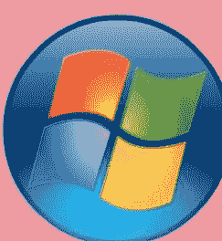
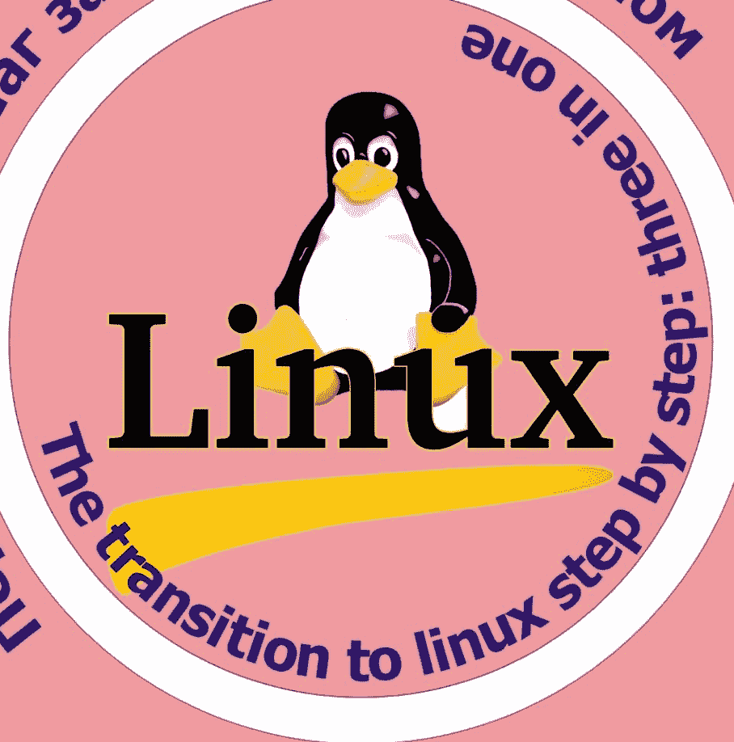


### 评审员

**技术科学博士**
数字化发展与信息安全副校长
L. I. 诺维科夫命名弗拉基米尔教育发展学院

`D. V. Mishin`

技术科学博士，教授
信息系统与软件工程系主任

`I. E. Zhigalov`

本书为对 `Linux` 操作系统感兴趣、希望深入学习该领域知识并想使用 `Linux` 的学生设计。特别关注了 `Linux` 系统的命令行层级。对于任何希望获得在该环境中工作实践技能的人来说都有用。书中的教学材料使学生能够克服语言障碍掌握这门学科。精通俄语的学生可以通过利用这些语言提供的材料来提高他们的法语和英语水平。

本版本适用于不同专业方向的学生、教师以及所有对 `Linux` 和 `Windows` 选择与应用问题感兴趣的人。

建议用于根据联邦高等教育标准 (`FGOS VO`) 形成通用专业能力。

表 84。图 210。参考文献：18 条目。

`Tanninger J. F., 2023`

### Reviewers

Candidate of Technical Sciences
Vice-Rector for Digital Development and Information Security
Vladimir Institute of Educational Development named after L. I. Novikov

`D. V. Mishin`

# Doctor of Technical Sciences, Professor

Head of the Department of Information Systems and Software Engineering
of Vladimir State University named after Alexander and Nikolai Stoletov

`I. E. Zhigalov`

course book / F. J. Tangning ; Vladimir State University named after
Alexander and Nikolai Stoletov. – Vladimir : Publishing house
Name from the title screen.

This course book is intended for students who are interested in the `Linux` operating
system, who want to deepen their knowledge of the command line of `Linux` to migrate from `Windows`
to `Linux`. Particular attention is paid to the `Linux` operating system. This
manual will be useful for anyone who wants to gain practical skills in working in
this environment. The teaching material of the manual also enables foreign students to master
the discipline, overcoming the language barrier. Students who speak Russian can improve their
knowledge in French and English by synchronizing the material presented in these languages.

The publication is recommended for students of various fields of study, teachers
and all who are interested in questions of choice and application of the operating system `Linux` `Windows`.

Recommended for the formation of general professional competencies in accordance with `FGOS VO`.

Tab. 84. Ill. 210. Bibliogr.

`Tangning J. F., 2023`

### EN ABBREVIATIONS

### FR LES ABRÉVIATIONS

### RU 前言 ................................................ 13

### RU 引言 ....................................... 31

### RU 第一章 Linux 系统的视觉化呈现............................................... 39

- EN 前言 ................................................................................................ 19
- EN 引言 .......................................................................... 34
- EN 第一章 `Linux`操作系统界面视觉化表示....................... 78
- EN 1.1 `Linux` 系统“Lite”版本 6.2 ...................................................... 78
- EN 1.2 `Ubuntu` 系统界面 .......................................................... 88
- EN 1.3 `Linux Alt Edu` 系统界面................................................................ 94
- EN 1.4 `ReactOS Linux` 系统界面..................................................... 106
- EN 1.5 `Astra Linux` 系统界面....................................................... 108
- EN 第二章 不同方向下 `Linux` 的 `Windows` 主要对应软件............................... 228
- EN II.1 基础软件 ............................................................ 228
- EN II.1.1 某些基础软件示例.............................. 229
- EN II.1.2 通过 `BIOS` 和 `UEFI` 在计算机中建立和存储系统设置的技术............................................................... 233
- EN II.1.3 与答：澄清对主题的理解 ............................................................ 237
- EN II.2 系统软件............................................................................... 241
- EN II.2.1 操作系统...................................................................... 241
- EN II.2.2 设备驱动程序 ................................................................ 252
- EN II.3 应用软件 ............................................................ 263
- EN II.4 服务软件.................................................................. 283
- EN II.5 编程工具软件 ....................................... 287


# 目录

- EN 结论 ............................................................................................... 291

# EN 第三章 通过命令行界面操作 Linux 操作系统的基本命令 ............................................................... 414

- EN III.1 Linux 操作系统的目录结构和使用命令行的动机 ..................................................... 414
    - EN III.1.1 Linux 文件系统结构 .................................. 414
    - EN III.1.2 Windows 与 Linux 文件系统结构比较 ............................................................... 417
    - EN III.1.3 学习 Linux 命令行的原因 ........................... 420

- EN III.2 系统某些基本功能描述 ............................................................................... 421
    - EN III.2.1 Linux 中的超级用户及其权限 ................................................................ 421
    - EN III.2.2 Linux 帮助命令 .................................................. 426
    - EN III.2.3 Linux 文件和文件夹管理命令 .................................................. 428
    - EN III.2.4 Linux 文件和文件夹管理命令 .................................................. 433
    - EN III.2.5 Linux 进程管理命令 ........................................ 435
    - EN III.2.6 Linux 导航帮助命令 .............................. 437
    - EN III.2.7 Linux 用户管理命令 ............................................................... 439
    - EN III.2.8 Linux 文字处理命令 ............................................................... 443
    - EN III.2.9 Linux“用户环境”章节中的命令 ................................................. 445
    - EN III.2.10 获取 Linux 系统各种信息的命令 ........................................... 448
    - EN III.2.11 管理 Linux 软件包的基础命令 ........................................ 451

- 第 IV 章 实际练习、问题与问答 .......................................................... 545
    - EN IV.1 Linux 实际练习 ........................................................................ 545
        - EN IV.1.1 文件和目录管理练习 ............................................................ 545
        - EN IV.1.2 用户管理练习 ................................................................ 546
        - EN IV.1.3 文本处理主题练习 ........................................................ 547
        - EN IV.1.4 用户环境主题练习 ................................................ 547
        - EN IV.1.5 软件包管理器练习 ................................................... 548
        - EN IV.1.6 其他主题的复杂练习和家庭作业 ........................ 549
    - EN IV.2 Linux 实际练习解答 ...................................... 555
        - EN IV.2.1 文件和目录管理主题练习解答 ........................................ 555
        - EN IV.2.2 用户管理主题练习解答 ................................................. 555
        - EN IV.2.3 文本主题练习解答 .......................... 558
        - EN IV.2.4 用户环境主题练习解答 ........................................ 559
        - EN IV.2.5 软件包管理器主题练习解答 ........................................ 559
        - EN IV.2.6 其他主题的复杂练习和家庭作业答案 ........................................ 560
    - EN IV.3 Linux 知识测试题 ........................................ 574
    - EN IV.4 Linux 知识验证测试答案 ......................... 576

- 第 V 章 选择 Linux 操作系统的指标 ....................................................... 626

- EN 结论 ................................................................................. 641

- EN 参考文献与推荐 ........................................................ 645

## 前言 ................................................................................. 25

## 引言 ................................................................................. 36

## 第 I 章 Linux 操作系统界面表示 ................................................. 17
- 基础界面 ................................................................................ 17
- `Linux` 界面 ............................................................................... 27
- `Ubuntu` 界面 ............................................................... 33
- `Debian` 界面 ............................................................... 39
- `Fedora` 界面 ............................................................... 45
- 管理界面 ........................................................................ 48

## 第 II 章 Linux 主要软件 ................................................ 92


- 基础软件 ................................................................................ 92
- Windows 软件 ............................................................... 93
- 系统软件 ........................................................................ 98
- 软件 ................................................................................. 102
- 管理软件 ........................................................................ 106
- 软件 ................................................................................. 109
- 软件 ................................................................................. 113
- 软件 ................................................................................. 117

## 第 III 章 LINUX 操作系统命令行 ................................................. 156

- 系统结构 ................................................................................ 156
- 命令描述 ........................................................................ 163
- 系统描述 ................................................................................ 165
- Linux 结构 ............................................................ 170
- 文件结构 ........................................................................ 172
- 文件管理 ................................................................................ 178
- 进程管理 ................................................................................ 180
- 用户管理 ........................................................................ 183
- Linux 导航 ............................................................................ 185
- 文本处理 ........................................................................ 190
- 文本处理 ........................................................................ 193
- 结论 ................................................................................. 196
- 用户环境中的命令 ................................................ 493
- 获取 Linux 系统各种信息的命令............................................... 496
- 管理软件包管理器的基础命令......................................................................... 499

# RU 前言

让我们开始，世界的演变与人类历史和技术发展紧密相连。从历史之初，人类就利用技术来改善生活并适应环境。石器工具被用于狩猎和采集，随后发展的农业使得使人类能够定居在社区中，并专注于人类社会组织的其他形式。接，，工业革命为生产和交通工具带来了进步，导致了人们生活方式和工作方式的巨大变化。

今天，我们正在见证第四次工业革命，其特点是数字、物理和生物技术的融合。这场革命开启了创新的新形式，并导致了人们交流、工作和消费方式的深刻变化。

技术还促进了教育、医学等领域的新进展，为解决现有问题提供了新机会。然而，这些技术成就（如`计算机`）带来了新问题，并创造了新的竞争和选择形式。事实是这些技术相互依赖。例如，`计算机`的运行需要`操作系统`。我们可以问自己的问题是`电子计算机`使用哪种`系统`。

# 计算机与操作系统的关系

`计算机`是一种用于执行数据处理任务的电子设备。为了运行和执行任务，它需要`操作系统`，`操作系统`是一类管理`计算机`硬件和软件资源的程序。

# 逐步过渡到 Linux：三合一

`操作系统`是安装在`计算机`上的程序，允许用户与`计算机`进行交互。它提供用户界面，管理键盘、鼠标和显示器等输入输出设备，还管理硬硬盘上的文件和文件夹等。

`操作系统`还允许在`计算机`上运行程序。程序是执行特定任务的软件，如创建文档或访问互联网。`操作系统`为每个程序分配资源，并确保程序之间互不干扰。

因此，`操作系统`是`计算机`不可或缺的一部分，因为它管理`计算机`的所有资源并允许程序正常运行。没有`操作系统`，`计算机`将无法工作。

## 操作系统的类型

存在多种类型的`操作系统`，用于不同的设备。

表 1 操作系统类型的主要差异

| `操作系统`类型 | 示例 | 主要用途 | 界面 | 开源 |
| :--- | :--- | :--- | :--- | :--- |
| 台式和笔记本电脑`操作系统` | `Windows`, `macOS`, `Linux` | 台式和笔记本电脑 | 图形用户界面 (`GUI`) | 是 |
| 服务器`操作系统` | `Windows Server`, `Linux` | 数据中心 | 命令行界面 (`CLI`) | 是 |
| 嵌入式`操作系统` | | | 否 | |
| 移动设备`操作系统` | `iOS`, `Android` | 手机、平板电脑 | 触摸界面 | 否 |
| 嵌入式`操作系统` | 嵌入式 `Linux`, `VxWorks`, `FreeRTOS` | 嵌入式设备、汽车、数字相机等 | 命令行用户界面 | 是 |
| 实时`操作系统` | `QNX`, `VxWorks`, `FreeRTOS` | 硬性限制系统、机器人、飞机 | 命令行界面 (`CLI`) | 是 |

正如你所看到的，每种类型的`操作系统`根据其旨在的设计具有特点。

此外，目前最广泛使用的台式和笔记本电脑`操作系统`是 `Microsoft Windows`。根据 `NetMarketShare` 2021 年 4 月的统计，`Windows` 占据了台式和笔记本电脑市场的 87%，`macOS` 占 9%，而 `Linux` 低于 2%。

# 逐步过渡到 Linux：三合一

根据“`Statcounter Global Stats`”的数据，2023 年统计显示 `Windows` 占比 63.13%，`OS X` 占比 17.78%，`Linux` 占比 2.83%，其余百分比为其他。

## Windows 的优势是什么？

有几个原因导致 `Windows` 是台式电脑和笔记本电脑最流行的`操作系统`。首先，根据 `Microsoft` 的商业政策，它安装在世界上销售的大多数`计算机`上。此外，`Windows` 系统兼容广泛的软件和硬件，使其成为许多用户的方便选择。最后，它在企业和政府机构中广泛使用，这进一步促进了它的流行。

然而需要指出，`Windows` 的流行也引发了安全问题，因为黑客可能会关注由于其在市场上的流行而产生的漏洞。但为什么我们建议你学习 `Linux` 系统。

首先，`Linux` 可能被认为对非技术用户不够友好。`Linux` 以前仅基于命令行界面，这可能会让感到困惑。现在 `Linux` 也有了图形界面。此外，某些硬件的 `Linux` 配置可能更加复杂，因为某些制造商并不总是为 `Linux` 提供驱动程序或支持。

还有应用程序兼容性因素。虽然 `Linux` 拥有大量的应用程序，但在寻找某些流行的专有软件的 `Linux` 版本时可能会遇到困难；必须记住这些问题可以通过其他方式解决。

## 前言


# 前言

最后，提高对 `Linux` 的认知度并对其进行推广可能发挥着至关重要的作用。`Linux` 的广告和营销活动通常比 `Windows` 或 `macOS` 少，这可能限制了用户的认知和对 `Linux` 的采用。所有这些旧有的障碍可能会让 `Linux` 对计算机用户失去吸引力。

尽管如此，`Linux` 在某些领域（如 Web 服务器、超级计算机和嵌入式系统）正令人惊喜地变得越来越流行，这些领域因安全性、稳定性和灵活性而受到重视。

因此，本教程的目标是帮助学生掌握 `Linux` 操作系统的基础知识，使其在日常生活和工作环境中变得易懂且易用。在书中，我们将介绍多个 `Linux` 操作系统系统的界面视觉化表示；`Linux` 上对应的 `Windows` 主要软件；用于 `Linux` 操作系统命令行界面操作的命令，以及用于巩固所学知识的实践练习和问题。本教程有助于提高语言水平：针对外语学习者的俄语，针对精通俄语的学生的英语或法语。

本书适用于不同专业方向的学生，无论是技术类还是人文类专业。我们相信，在学习了本教程后，学生将对使用 `Linux` 操作系统感到自信，并能为工作和发展自己的专业技能发现新机会。

为了更好地掌握某个章节，建议创建一个“Live”光盘来执行相应的任务，以获得必要的技能。

首先，将说明本教程由五个章节组成。

## 步步进入 LINUX：三合一

1. 第一章专门介绍了几个不同 `Linux` 发行版的图形用户界面。

2. 第二章说明了 `Linux` 在不同方向上对应的 `Windows` 软件（软件）程序。这些 PC 软件分为五个主要部分：基础、系统、应用、服务和工具。

3. 第三章介绍了用于通过 `Linux` 操作系统命令行与计算机进行交互的各种基本命令。

4. 第四章提供了实践练习和一系列带有答案的问题，用以巩固所学知识。

5. 第五章提供了根据个人需求选择 `Linux` 操作系统系统的建议。

## 致谢

作者认为有义务向信息系统技术（ISI）系主任——技术博士米哈伊尔·尤里耶维奇·莫纳霍夫（Mikhail Yuryevich Monakhov）教授对教材出版的支持表示诚挚的谢意。

作者感谢用户对书中内容提出的意见和建议，请发送至电子邮箱：`tajifirmin2@yahoo.com`。

请见第 31 页

# 前言

首先要说，世界的演变与人类历史和技术演进紧密相连。从人类历史之初，人类就利用技术来改善生活并适应环境。最初，石器工具被用于狩猎和采集，然后农业的发展使人类能够定居在社区中并关注其他形式的生活。随后的工业革命带来了带来了生产和交通工具的重大进步，这导致了人们生活和工作方式的巨大变化。

今天，我们正在见证第四次工业革命，其特征是数字、物理和生物技术的融合。这场革命使新的创新形式成为，并给人们的交流、工作和消费方式带来了重大变化。

技术还推动了教育、医学和其他领域的新发展，为解决所面临的问题提供了新的可能性。然而，这些技术进步（如计算机）也带来了新的挑战，并造成了新的脆弱性、竞争形式和选择问题。事实证明，这些技术之间需要相互协作才能实现。

# 计算机与操作系统的关系

让我们先说，世界的演变与人类历史和技术演进紧密相连。从人类历史之初，人类就利用技术来改善生活并适应环境。最初，石器工具被用于狩猎和采集，然后农业的发展使人类能够定居在社区中并关注其他形式的生活。随后的工业革命带来了生产和交通工具的重大进步，这导致了人们生活和工作方式的巨大变化。

今天，我们正在见证第四次工业革命，其特征是数字、物理和生物技术的融合。这场革命使新的创新形式成为，并给人们的交流、工作和消费方式带来了重大变化。

技术还推动了教育、医学和其他领域的新发展，为解决所面临的问题提供了新的可能性。然而，这些技术进步（如计算机）也带来了新的挑战，并造成了新的脆弱性、竞争形式和选择问题。事实证明，这些技术之间需要相互协作才能实现。

操作系统是安装在计算机上的程序，允许用户与硬件交互。它提供用户界面，管理输入输出设备如键盘和显示器。

## 步步进入 LINUX：三合一

总之，操作系统是计算机不可或缺的一部分，因为它为每个程序分配资源。没有操作系统，计算机将无法正常运行。

今天，我们正在见证第四次工业革命，其特征是数字、物理和生物技术的融合。这场革命使新的创新形式成为，并给人们的交流、工作和消费方式带来了重大变化。

技术还推动了教育、医学和其他领域的新发展，为解决所面临的问题提供了新的可能性。然而，这些技术进步（如计算机）也带来了新的挑战，并造成了新的脆弱性、竞争形式和选择问题。事实证明，这些技术之间需要相互协作才能实现。

## 操作系统的类型

有不同类型的操作系统用于不同的电子设备。在表 1 中你可以看到操作系统的主要类型。

| 操作系统类型 | 示例 | 主要用途 | 用户界面 | 开源 |
|---|---|---|---|---|
| 桌面和笔记本操作系统 | `Microsoft Windows`, `macOS`, `Linux` | 桌面和笔记本计算机 | 图形用户界面 (GUI) | 是，`Linux` 开源 |
| 服务器操作系统 | `Windows Server`, `Linux`, `Unix` | 数据中心、Web 托管 | 命令行界面 (CLI) | 是，`Linux` 开源 |
| 移动操作系统 | `iOS`, `Android` | 手机、平板电脑 | 基于触摸和手势的界面 | 否 |
| 嵌入系统 | `Linux`, `VxWorks`, `FreeRTOS` | 摄像头、智能恒温器等 | 具有严格限制的系统，如工业控制系统、机器人和飞机 | 命令行界面 (CLI) | 是，`Linux` 开源 |
| 实时操作系统 | `QNX`, `VxWorks`, `FreeRTOS` | 汽车、数字设备 | 命令行界面 (CLI) 或自定义 | 是，`FreeRTOS` 开源 |

如你所见，每种操作系统都有其独特的特点和优势，取决于其设计的电子设备。需要注意的是，这些差异是一般的，根据操作系统的不同版本和发行版可能会有特定的变化。

目前最常用的桌面和笔记本电脑操作系统是 `Microsoft Windows`。根据“NetMarketShare”的统计数据，2021 年4 月 `Windows` 占据了桌面和笔记本操作系统市场的 87%，`macOS` 占比约 9%，`Linux` 占比不足 2%。根据“Statcounter Global Stats”2023 年的统计，`Windows` 占比 63.13%，`OS X` 占比 17.78%，`Linux` 占比 2.83%，其余为其他。

## Windows 的优势是什么？

有几个原因导致 `Windows` 是桌面和笔记本电脑最流行的操作系统。首先，由于微软的商业政策，它在全球销售的大多数计算机上都预装了该系统。此外，`Windows` 兼容各种软件和硬件，使其成为许多用户的方便选择。最后，它被广泛被应用于企业和政府机构，这进一步促进了它的普及。

然而，值得注意的是，`Windows` 的普及也引发了安全忧虑，因为由于其巨大的市场份额，黑客可能会侧重于利用该操作系统中的漏洞。这就是为什么我们建议你学习 `Linux`。`Linux` 确实是一个免费的操作系统，但与 `Windows` 和 `macOS` 相比，它的使用率较低，这归因于几个因素。

首先，`Linux` 对于非技术用户来说可能被认为不够友好。它基于命令行界面，这对于初学者来说可能令望而畏，尽管 `Linux` 也有图形化用户界面（GUI）。此外，在 `Linux` 上设置某些硬件可能要困难得多，因为一些制造商并不总是为 `Linux` 提供驱动程序或支持。

然后是应用程序的兼容性因素。虽然 `Linux` 有许多开源应用程序可用，但可能很难找到某些流行的专有软件的 `Linux` 版本；应该知道，这些老旧问题即使在今天仍然出现，也正在通过其他手段得到解决。

最后，提高人们意识和推广 `Linux` 也起着重要作用。`Linux` 的广告和营销活动通常比 `Windows` 或 `macOS` 小，这限制了用户对 `Linux` 的认知和采用。所有这些老旧的障碍使得 `Linux` 对计算机用户者的吸引力下降。

尽管如此，`Linux` 在网络服务器、超级计算机和嵌入系统等某些领域越来越受欢迎，在这些领域，它的安全性、稳定性和活性备受重视。

因此，本学习手册的目的是帮助学生学习 `Linux` 操作系统的主要要点，使其易于理解并便于在日常生活和工作场所中使用。在本教程中，我们将检查几个 `Linux` 操作系统界面的视觉化表示；`Linux` 上 `Windows` 软件的主要类品；在 `Linux` 操作系统命令行界面中工作的主要命令，以及用于巩固所学知识的实际练习和问题。同样，本手册还帮助提高

## 前言

语言水平：面向外国人的俄语课程，以及面向精通俄语的学生的英语或法语。

本书旨在用于不同学习领域的学生，无论是技术类专业还是人文类专业。我们相信，在掌握了本手册后，学生将对使用 `Linux` 操作系统感到自信，并发现新的机会来自信地工作并发展他们的专业技能。

为了更好地掌握章节并获得必要的技能，建议安装或制作自己的 `Live` 启动盘（Live Disc）。

首先，我们将说明本学习手册由 5 部分（章节）组成。

- 1. 第一章致力于描述某些 `Linux` 发行版的图形化用户界面。
- 2. 第二章说明了 `Linux` 在各个方向上 `Windows` 软件的类品。这些软件组件在 PC 中分为 5 个大类：基础软件、系统、实用程序、应用程序和工具软件（或仪器）。


- 3. 第三章介绍了用于通过 `Linux` 操作系统命令行界面与计算机交互的各种基本命令。

- 4. 第四章展示了实际练习和一系列带有答案的问题，以巩固所学知识。

- 5. 第五章提供了根据需求选择 `Linux` 操作系统的技巧建议。

## 致谢

作者认为有责任向计算机科学系主任、技术科学博士 `Monakhov M.Yu` 教授表示诚挚的感谢，感谢他在手册出版方面的支持。

作者感谢用户对书籍内容的意见和建议，他请求将建议发送至以下电子邮箱地址：`tajifirmin2@yahoo.com`。

作者

续自第 34 页

# 法语前言 (FR LA PRÉFACE)

首先我们要说，世界的演变与人类历史和技术演进密切相关。从人类历史之初，人类就利用技术来改善生活并适应环境。起初，石器被用于狩猎和采集，随后农业得到了发展，这使得人类能够定居在社区中并专注于其他形式的创新。随后的工业革命在生产和交通工具上带来了重大进步，导致了人们生活和工作方式的巨大变化。

今天，我们见证了第四次工业革命，其特征是数字、物理和生物技术的融合。这场革命允许了新的创新形式，并导致了人们沟通、工作和消费方式的重大变化。

技术还让教育、医学和其他领域有了新的发展，为解决所面临的问题提供了新的可能性。然而，这些技术进步（以计算机为例）也带来了新的挑战，并创造了新形式的脆弱、竞争和选择问题。事实证明，这些技术之间相互需要才能实现。例如，计算机需要操作系统才能运行。计算机需要操作系统来运行

# 计算机与操作系统

计算机是一种电子设备，它需要一个操作系统来运行。过渡到 `LINUX` 层级 逐层递进 (`ÉTAGE PAR ÉTAGE`)

操作系统是一组软件，允许用户与硬件交互。计算机是一种电子设备，它需要一个操作系统

# 操作系统与用户界面

操作系统是允许用户与硬件交互的软件。计算机是一种电子设备，它需要一个操作系统

操作系统是允许用户与硬件交互的软件。计算机是一种电子设备，它需要一个操作系统

操作系统是允许用户与硬件交互的软件。计算机是一种电子设备，它需要一个操作系统

操作系统是允许用户与硬件交互的软件。计算机是一种电子设备，它需要一个操作系统

操作系统是允许用户与硬件交互的软件。计算机是一种电子设备，它需要一个操作系统

操作系统是允许用户与硬件交互的软件。计算机是一种电子设备，它需要一个操作系统

## 操作系统的类型

存在不同类型的操作系统，它们用于不同的电子设备。在表 1 中，你可以看到主要的操作系统的类型。

操作系统类型

表 1 — 不同类型操作系统的主要差异

| 操作系统类型 | 主要用途 | 用户界面 | 开源 |

|---|---|---|---|

| 桌面电脑和笔记本电脑操作系统 | `Microsoft Windows`, `macOS`, `Linux` | 桌面电脑和笔记本电脑 | 图形用户界面 (`GUI`) | 是，`Linux` 是开源 |

| 服务器操作系统 | `Windows Server`, `Linux Server`, `Unix` | 命令行界面 (`CLI`) | 是，`Linux` 是开源 |

| 移动设备操作系统 | `iOS`, `Android` | 触摸界面、图标和手势 | 否 |

| 嵌入式操作系统 | 嵌入式 `Linux`, `VxWorks`, `FreeRTOS` | 电子设备如汽车、数码相机、智能恒温器 | 命令行界面 (`CLI`) 或 定制 `GUI` | 是，`Linux` 是开源 |

| 实时操作系统 | `QNX`, `VxWorks`, `FreeRTOS` | 具有严格时间限制的系统，如工业控制、机器人和飞机 | 命令行界面 (`CLI`) 或 定制 `GUI` | 是，`FreeRTOS` 是开源 |

正如你所看到的，每种类型的操作系统都有其特点和优势，取决于其为设计的电子设备。需要注意的是，这些差异是通用的，根据不同的版本和发行版，可能会存在特定的差异。

## 逐步迈向 Linux 的转型：三合一

笔记本电脑市场中，其次是 `macOS`，占比约为 `9%`，`Linux` 占比不足 `2%`。根据 `2023` 年“`Statcounter Global Stats`”的统计数据，`Windows` 占比为 `63.13%`，`OS X` 占比 `17.78%`，`Linux` 占比 `2.83%`，其余部分为其他系统。

## 为什么 Windows 如此强大？

有多个原因导致 `Windows` 是桌面电脑和笔记本电脑最受欢迎的操作系统。首先，由于微软的商业政策，全球销售的大多数电脑都预装了该系统。此外，`Windows` 兼容广泛的软件和硬件，这使其成为许多用户方便且实用的选择。最后，它在企业和政府机构中被广泛使用，这也促进了它的流行性。

然而，值得注意的是，`Windows` 的普及也引发了不等的安全担忧，因为黑客由于其巨大的市场份额，倾向于专注于利用该操作系统的漏洞。正因如此，我们建议你尝试 `Linux`。`Linux` 确实是一个免费的操作系统，但它与 `Windows` 和 `macOS` 相比使用率较低可以归因于多个因素。

首先，`Linux` 对于非技术用户来说可能不够易用。它基于命令行界面，这对于初学者来说可能令人生畏，尽管 `Linux` 也有图形化界面。此外，在 `Linux` 下配置某些硬件可能更加困难，因为某些制造商并不总是提供 `Linux` 的支持驱动程序。

其次是应用程序的兼容性因素。尽管 `Linux` 拥有大量的开源应用程序，但可能很难找到某些流行的闭源软件在 `Linux` 下运行的版本；需要知道，这些老问题即使在今天仍然存在，但正在通过其他手段解决。

最后，对 `Linux` 的认知和推广也可能起着重要作用。`Linux` 的广告和营销活动通常没有 `Windows` 或 `macOS` 多，这可能限制了用户对 `Linux` 的认知和采用。所有这些旧有的障碍可能让 `Linux` 对电脑用户来说失去了吸引力。

尽管如此，`Linux` 在 Web 服务器、超级计算机和嵌入式系统等领域越来越受欢迎，在这些领域，它的安全性、稳定性和灵活性广受赞誉。

因此，本学习手册的目标是帮助学生学习 `Linux` 操作系统的核心基础知识，使其易于理解和获取，适用于日常生活和工作场所。在本教程中，我们将查看几个 `Linux` 操作系统界面的视觉表示；`Windows` 软件在 `Linux` 下的主要对标软件；在 `Linux` 操作系统命令行界面下工作的主要命令，以及用于巩固所学知识的实践练习和问题。同样，本手册还允许提高语言水平：对于外国学生来说是俄语，而对于精通俄语的学生来说，是英语或法语。

本书面向不同学习领域的学生，无论是技术类专业还是人文类专业。我们坚信，在掌握了本手册后，学生将对使用 `Linux` 操作系统感到自信，并发现新的机会来充满信心地工作并发展他们的专业技能。

为了更好地掌握本章节内容，建议制作一个“`Live`”光盘进行练习，以获得所需的技能。

## 阅读顺序

首先，我们说明本学习手册由 5 部分（章节）组成。

- 第一章：介绍几个不同 `Linux` 发行版的图形用户界面。

- 第二章：插图中各个方向上 `Windows` 软件的替代品。这些软件在 `PC` 中分为 5 个大类：基础软件、系统、实用程序、应用程序和工具软件（或仪器）。

- 第三章：介绍用于通过 `Linux` 操作系统命令行与计算机交互的各种基本命令。

- 第四章：介绍实践练习和一系列带答案的问题，以巩固所学知识。

- 第五章：提供根据需求选择 `Linux` 操作系统系统的建议。

## 致谢

作者认为有责任向其计算机科学系主任、技术科学博士 `Monakhov M. Yu.` 教授表示诚挚的感谢，感谢他在手册出版期间提供的支持。

作者对用户对内容的意见和建议表示感谢，请发送至以下电子邮箱：`tajifin@yahoo.com`

作者

# 引言

这是所有想要学习操作 `Linux` 操作系统并将其用于专业和个人任务的人员的资源。此外，本指南通过通过另外两种语言（英语和法语）同步课程，还提高了读者的外语水平。

> 详情请参阅第 39 页

# 引言

`Linux` 操作系统是世界上最广泛使用的操作系统之一，被广泛用作 `Windows` 操作系统的替代方案。它由于其开放架构、可靠性、安全性和免费的特性而流行起来。但令我们惊讶的是，尽管它在解决服务器任务方面非常流行且有效，但在普通桌面用户中仍然较少被使用。

在本课程中，我们为初学者介绍了 `Linux` 操作系统的基本概念和原理。书中包含了有关 `Linux` 操作系统界面的视觉化表示、`Linux` 下对应的 `Windows` 程序主要对标程序、在 `Linux` 操作系统命令行界面中工作的命令，以及选择符合您特定需求的 `Linux` 操作系统系统的指标。本手册的任何感兴趣的读者在学习后应获得相关的能力，这些分为三个部分：

知识储备：

- `Linux` 文件系统的结构以及存储各种文件的主要目录，因为它们与 `Windows` 文件系统不同；

- 管理 `Linux` 系统的基本系统管理命令和实用程序；

- `Linux` 中的 `Bash` 编程语言，即用于自动化系统管理任务、管理系统资源以及在 `Linux` 系统中执行其他常规任务的通用工具。

操作技能：

- 能够在 `Linux` 命令行中工作，这是一个管理系统的强大工具，因此您需要能够使用其基本命令；

- 能够在 `Linux` 中安装和管理软件，这一管理过程与 `Windows` 系统不同：安装和卸载包、更新系统和管理包；

# 步步跨 Linux：三位合一

- 能够处理网络并配置 `Linux` 网络参数，`Linux` 是一种流行的服务器操作系统。

# 技能：


- 操作计算机：
    - 使用图形界面和整个 Linux 操作系统系统的工作流程；
    - 在使用 `LibreOffice`、`VirtualBox` 等应用程序时使用数据处理方法。

本教程的目的是让学生（本科生和工程师）熟悉 Linux 操作系统的基本概念，以便他们能够学习如何将其用于他们的专业任务。此外，我们旨在帮助学生或新用户理解 Linux 和 Windows 操作系统之间的区别，并展示如何根据需求选择合适的系统。

为了实现这些目标，教程包含了有关 Linux 操作系统界面的视觉化表示、Linux 下对应的 Windows 程序主要对标程序、在 Linux 操作系统命令行界面中工作的命令，以及选择符合所需需求的 Linux 操作系统系统的指标。此外，手册还提供了实操练习、任务和答案，将帮助学生巩固知识并提高他们操作 Linux 系统的技能。

本教科书为学习技术类和人文类领域的学生设计，对于任何想要学习如何操作 Linux 操作系统并将其用于专业任务的人来说都是一个有用的资源。除了这些之外，它还通过另外两种语言（英语和法语）同步课程来提高外语熟练度。

> 继续请见第 78 页

# 法语引言

Le système d'exploitation Linux est l'un des systèmes d'exploitation les plus répandus au monde, qui a été largement adopté comme alternative au système d'exploitation Windows. Il est devenu populaire pour son architecture ouverte, sa fiabilité, sa sécurité et sa gratuité. Mais ce qui peut nous surprend, malgré sa popularité et son efficacité dans les tâches de serveur, il est encore très utilisé par les utilisateurs de bureau ordinaires.

Dans ce didacticiel, nous présentons les concepts et principes de base du système d'exploitation Linux pour les utilisateurs novices. Le manuel contient des informations sur les représentations visuelles de l'interface du système d'exploitation Linux, les principaux analogues des programmes Windows pour Linux, les commandes de l'interface de ligne de commande du système d'exploitation Linux et les indicateurs permettant de sélectionner le système d'exploitation Linux qui convient à vos besoins. Tout lecteur intéressé de ce guide devrait recevoir après étudié les compétences pertinentes, divisées en trois parties :

## Connaître

- la structure du système de fichiers Linux et les principaux répertoires dans lesquels les différents fichiers sont stockés, car ils sont différents du système de fichiers Windows ;
- les commandes de base et utilitaires d'administration système pour la gestion du système Linux ;
- que `Bash` est un langage de programmation sous Linux, c'est-à-dire un outil universel pour automatiser les tâches d'administration du système, la gestion des ressources système et l'exécution d'autres tâches de routine sur les systèmes Linux.

## Savoir

- utiliser avec la ligne de commande sous Linux, qui est un outil puissant pour gérer le système, il est donc nécessaire de pouvoir travailler avec ses commandes de base ;

## LA TRANSITION VERS LINUX ÉTAPE PAR ÉTAPE : TROIS EN UN

- installer et gérer des logiciels sous Linux, un processus de gestion qui est différent du système sous Windows : installer et désinstaller des programmes, mettre à jour le système et gérer les paquets ;
- manipuler le réseau sur Linux et configurer certains paramètres de ce système d'exploitation populaire dans le domaine des serveurs.

## Avoir la maîtrise

- de manipuler un ordinateur ;
- du processus de travail avec les interfaces graphiques et l'ensemble du système d'exploitation Linux ;
- sur les méthodes de traitement des données lors de l'utilisation de programmes d'application tels que `LibreOffice`, `VirtualBox`.


L'objectif de ce tutoriel est de familiariser les étudiants (bachelors et ingénieurs) avec les concepts de base du système d'exploitation Linux afin qu'ils puissent apprendre à l'utiliser pour leurs tâches professionnelles. De plus, nous visons à aider les étudiants ou nouveaux utilisateurs à comprendre les différences entre les systèmes d'exploitation Linux et Windows et montrer comment choisir le bon système pour leurs besoins. Pour atteindre ces objectifs, le tutoriel contient des informations sur les représentations visuelles de l'interface du système d'exploitation Linux, les principaux analogues des programmes Windows pour Linux, les commandes pour travailler dans l'interface de ligne de commande du système d'exploitation Linux, ainsi que les indicateurs pour sélectionner le système d'exploitation Linux qui répond aux besoins désirés. De plus, le manuel présente des exercices pratiques, des tâches et des réponses qui aideront les étudiants à consolider leurs connaissances et améliorer leurs compétences de travail avec le système d'exploitation Linux.

Le manuel est conçu pour les étudiants étudiant dans les domaines techniques et humains, et est une ressource utile pour quiconque veut apprendre à travailler avec le système d'exploitation Linux et l'utiliser pour ses tâches professionnelles. En plus de tout cela, il augmente également le niveau de compétence en langue étrangère en synchronisant le cours dans deux autres langues – anglais et français.

> Suite à la page 78

# 第一章：LINUX 操作系统界面的视觉呈现

## I.1 Lite 版本 6.2

Linux 操作系统界面的视觉呈现取决于所使用的发行版和桌面环境，会有很大不同。例如，`GNOME` 和 `KDE` 这两个流行的 Linux 桌面环境具有不同的设计和功能。

通常，Linux 界面是图形化用户界面 (`GUI`)，包含了用于执行任务的菜单、窗口、图标和按钮。然而，许多 Linux 用户（高级用户）倾向于在命令行中工作，通过命令和脚本来执行任务。详细信息将在第三章中给出。

a) 图 1.1 为系统启动后的登录界面。

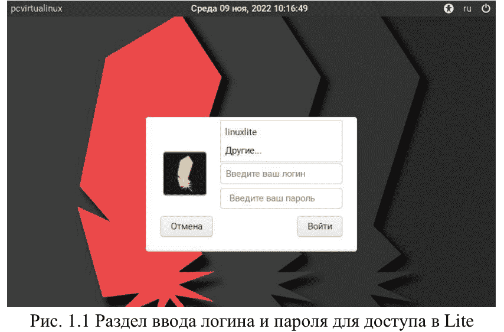

Linux 还拥有许多实用程序，可以帮助用户管理系统，例如网络设置、文件管理和性能监控。Linux 的优势之一是可以自定义界面并安装额外工具，以满足特定用户的需求。

b) 图 1.2 为系统启动后 Linux Lite 6.2 界面的外观。

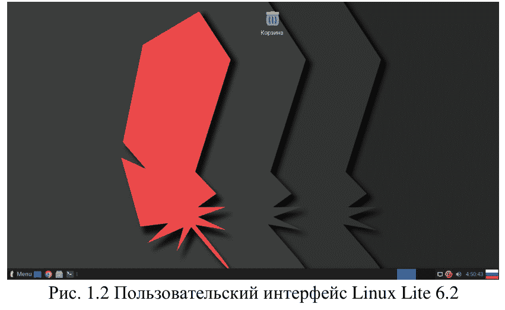

c) 这里我们有一个设置背景图像（参见图 1.3）、菜单以及电脑桌面图标外观的区域。

Linux Lite 6.2 是一个基于 `Ubuntu` 的 Linux 发行版，与其他发行版一样，它为 Linux 初学者提供了简单且直观的用户界面。在我们看来，Linux Lite 6.2 界面的视觉呈现可以描述为简洁、轻量且极简主义的。

# 第一章：LINUX 界面的视觉呈现

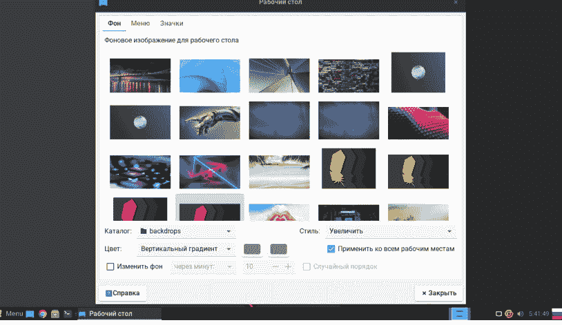

图 1.3 背景图像设置区域

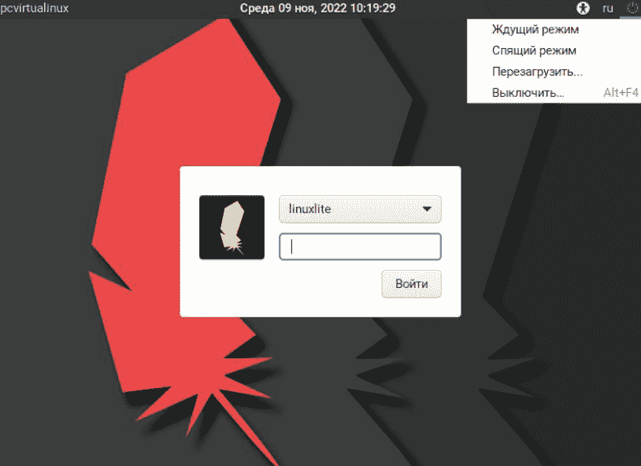

图 1.4 进入操作系统的密码窗口。

总的来说，Linux Lite 6.2 是一个具有简单直观界面的 Linux 发行版，用户可以根据自己的需求轻松进行配置。该界面与 `Windows` 非常相似（参见图 1.5）。

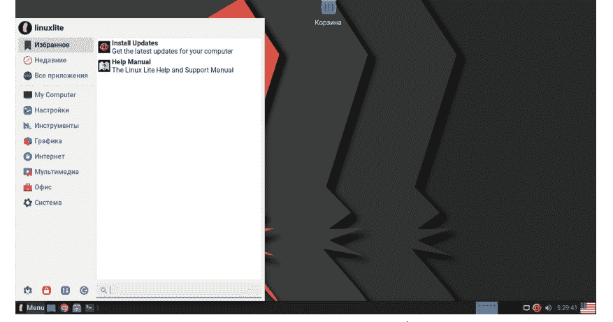

图 1.5 与 `Windows` 类似的系统界面主菜单

Linux Lite 6.2 的主要桌面环境是 `Xfce`，它以高性能和低资源消耗为特点。`Xfce` 窗口管理器允许用户自定义工作空间、更改主题（参见图 1.3）并添加快速访问应用程序的快捷方式。

Linux Lite 6.2 预装了许多应用程序（参见图 1.6、图 1.7 和图 1.8），包括 `LibreOffice`、`Firefox`、`VLC`、`GIMP` 等，使得该发行版成为日常任务的完整工作环境。此外，Linux Lite 6.2 还有管理系统的工具，例如轻量级程序安装程序、更新管理器和系统设置。

# 第一章：LINUX 界面的视觉呈现

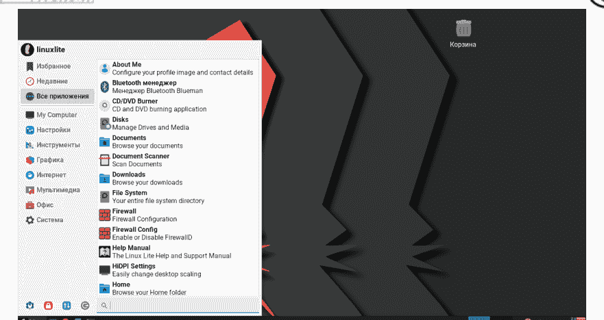

图 1.6 Lite 6.2 中的应用程序合并区域 – 部分 1

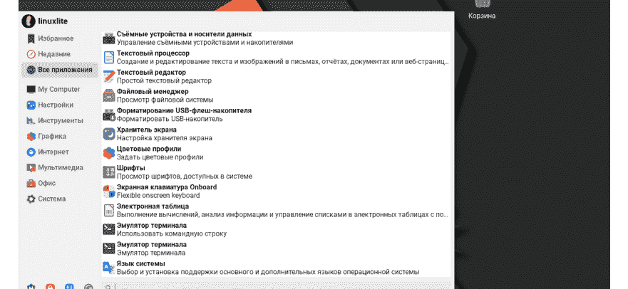

图 1.7 Lite 6.2 中的应用程序合并区域 – 部分 2

## 逐步迈入 LINUX：三合为一

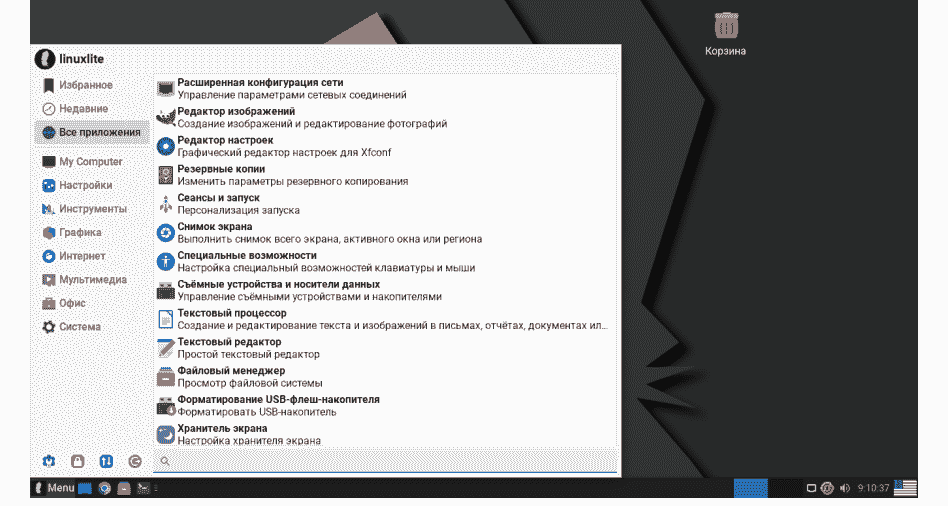

图 1.8 Lite 6.2 所有应用程序合并窗口视图 — 部分 3

总的来说，Linux Lite 6.2 是一个具有简单直观界面的 Linux 发行版，用户可以根据自己的需求轻松进行配置。

Linux Lite 6.2 界面的概览见于图 1.9、1.10、1.11、1.12、1.13、1.14、1.15、1.16、1.17 和 1.18。它们分别反映了以下区域：应用程序区域、“设置”区域、图形元素绘制区域、网络设置区域、系统区域、“多媒体”区域、“系统设置”部分 1 和部分 2、工具区域以及 Linux 退出区域。

### 图 1.9 Lite 6.2 中的应用程序区域

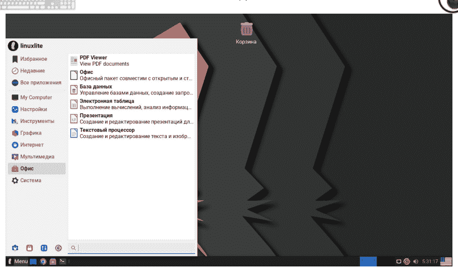

### 图 1.10 Lite 6.2 中的 “设置”区域


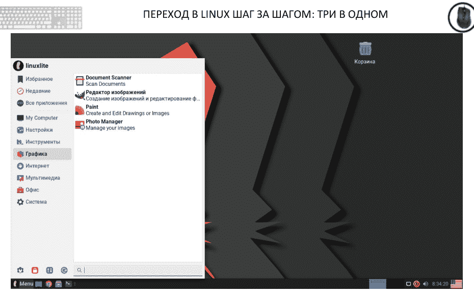

图 1.11 Lite 6.2 中的图形元素绘制区域

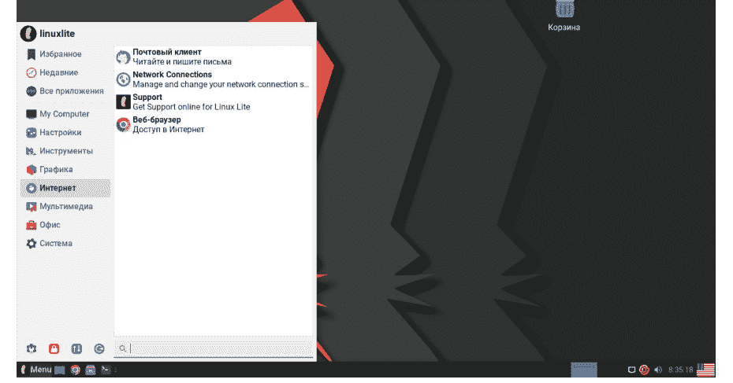

图 1.12 Lite 6.2 中的工作与网络设置区域

# 第一章：LINUX 界面的视觉呈现

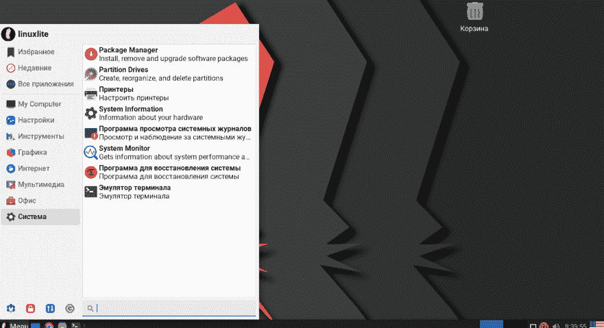

图 1.13 Linux 中的系统区域

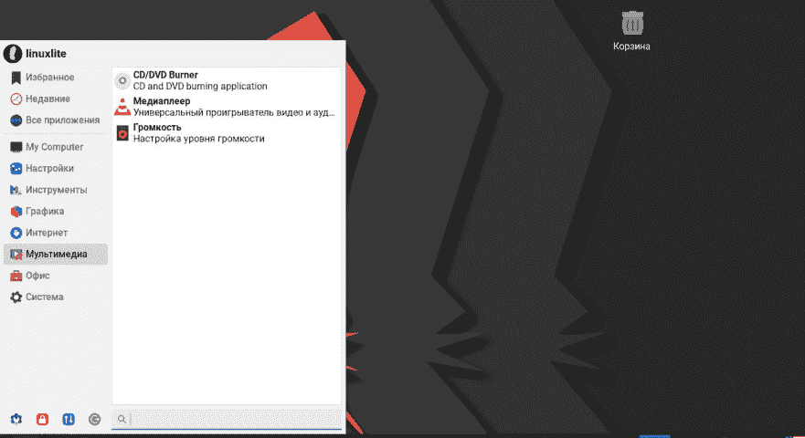

图 1.14 Linux 中的 “多媒体”区域

## 逐步迈入 LINUX：三合为一

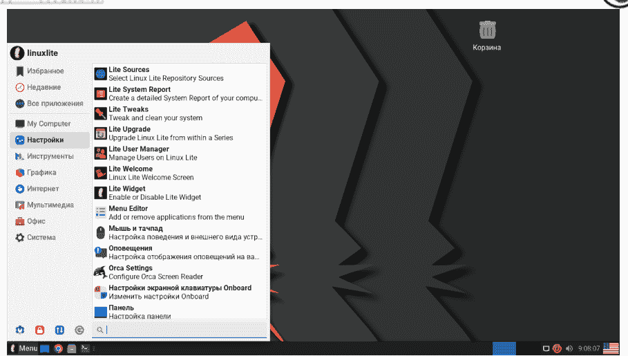

图 1.15 Lite 6.2 中的 “系统设置”部分 1


图 1.16 Lite 6.2 中的 “系统设置”部分 2

# 第一章：LINUX 界面的视觉呈现


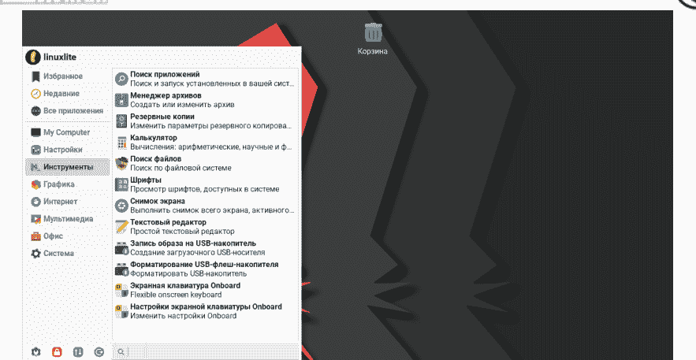

图 1.17 Linux 6.2 中的工具区域

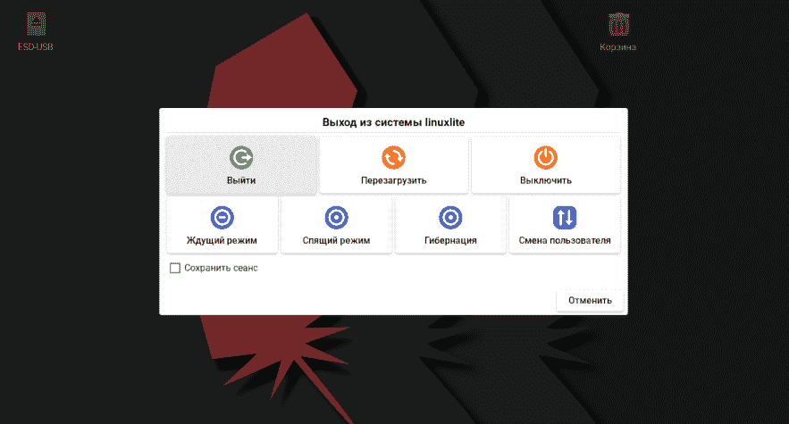

图 1.18 Linux 退出区域

## 1.1 Lite 版本 6.2

（注：后续内容为原文重复部分，已按要求不再进行重复翻译）

## 第一章 LINUX 界面的视觉化表示

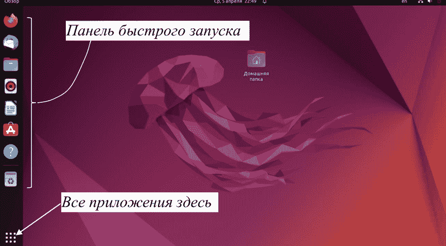

图 1.22 安装后的 Ubuntu 操作系统界面

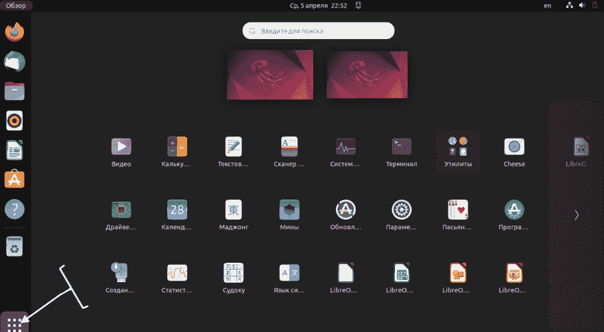

图 1.23 Ubuntu 操作系统功能概览

# 逐步过渡到 Linux：三合一

### 概览

### 终端

周二，4月4日 17:31

```
fiston@MyPC-Ubuntu: ~$
要以管理员身份（用户 "root"）运行命令，请使用 sudo <command>。
详情请参阅 "man sudo_root"。
fiston@MyPC-Ubuntu: $ 
bash: /home/fiston 是目录
fiston@MyPC-Ubuntu: ~$
```

命令执行结果：`~/`

图 1.24 Ubuntu 命令行界面

### 概览

周三，4月5日 22:55

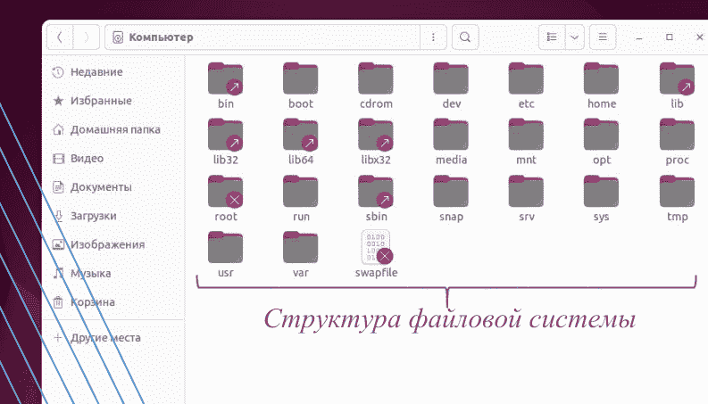

- `Firefox` 网页浏览器
- `Thunderbird` 邮件客户端
- 主文件夹 — 文件
- `Rhythmbox` — 音乐播放器
- `LibreOffice Writer` — 文本编辑器
- `Ubuntu 软件`
- 用户手册 — 帮助
- 垃圾箱

图 1.25 Ubuntu 操作系统文件系统结构

## 第一章 LINUX 界面的视觉化表示

| 参数 | 屏幕设置 |
| --- | --- |
| 未知显示器 | 取向：横屏 |
| 分辨率 | `1360 x 768 (16:9)` |
| 刷新率 | `60,02 Hz` |
| 分数缩放 | |

图 1.26 Ubuntu 操作系统菜单部分 – 屏幕设置

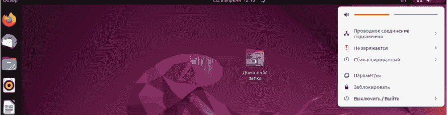

图 1.27 网络设置及其他参数；用于关闭电脑

`RU I1.3` `Alt Linux` 系统界面

`ALT Linux` 是一种基于 Linux 的俄罗斯操作系统，设计用于工作站、服务器和嵌入式设备。

它自 2001 年以来一直处于开发中，是俄罗斯及前苏联国家最受欢迎的 Linux 发行版之一。

`ALT Linux` 拥有自己的 `RPM` 软件包管理器（这是一个免费的开源软件包管理系统。`RPM` 名称指的是 Linux 发行版中的“`.rpm`” 文件格式），它提供了方便的软件安装和更新管理。

`ALT Linux` 有多个几个版本，每个版本都针对特定目标：用于工作站的 `ALT Workstation`、用于服务器的 `ALT Server`、用于教育机构的 `ALT Education` 等。

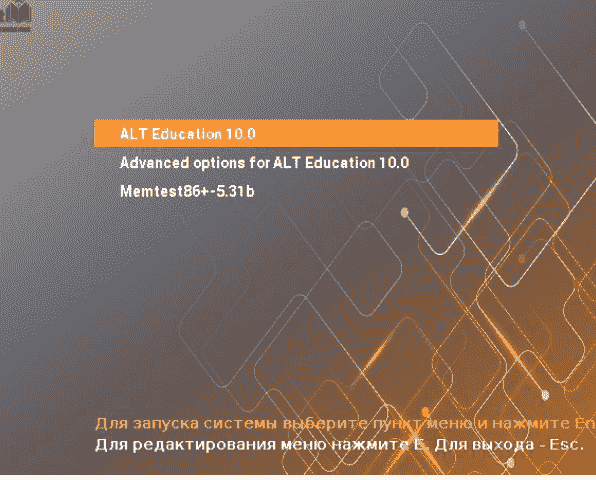

图 1.28 启动 `ALT Linux` 系统类型选择

`ALT Linux` 还具有多种不同的用户界面，如 `Frames`、`Xfce`、`GNOME`、`KDE`、`LXDE` 等。根据 Linux 内核版本，可以使用不同的内核版本。此外，`ALT Linux` 支持多种语言，包括俄语、哈萨克语、英语等。

`ALT Linux` 的特点之一是它的开放性和参与开发的能力。用户可以为项目做出贡献、报告错误、改进文档等。

## 第一章 LINUX 界面的视觉化表示

`ALT Linux` 包含了一系列默认安装的软件。以下是 `ALT Linux` 中找到的一些常用程序：

1. 浏览器：`Firefox`、`Google Chrome`。
2. 办公应用：`LibreOffice`、`Calligra`、`AbiWord`。
3. 多媒体：`VLC`、`GIMP`、`Inkscape`、`Audacity`。
4. 通信：`Thunderbird`、`Pidgin`、`Skype`。
5. 系统工具：`GNOME 磁盘实用`、`GParted`、`Nautilus`。
6. 编程：`Python`、`Java`。
7. 版本控制系统：`Git`。

此外，`ALT Linux` 还配备了一些便于管理系统的工具，包括用于设置、包管理、磁盘监控等工具。

为了直观了解 `ALT Linux` 的不同用户界面，需要查看图 1.29–1.49。

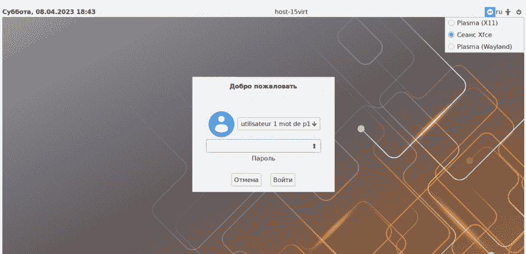

图 1.29 登录 `ALT Linux` 系统时的界面选择和密码窗口


图 1.30 登录后 `ALT Linux` 的 `Plasma` 用户界面


图 1.31 登录后 `ALT Linux` 的 `Xfce` 用户界面

图 1.30 和图 1.31 桌面界面的区别在于右下角。那里当前时间、语言、网络设置等参数的布局不同。

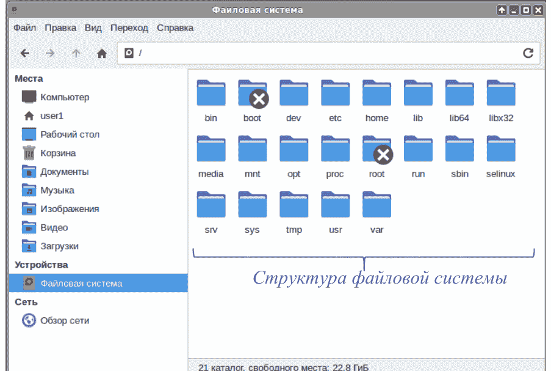

图 1.32 `ALT Linux` 文件系统结构

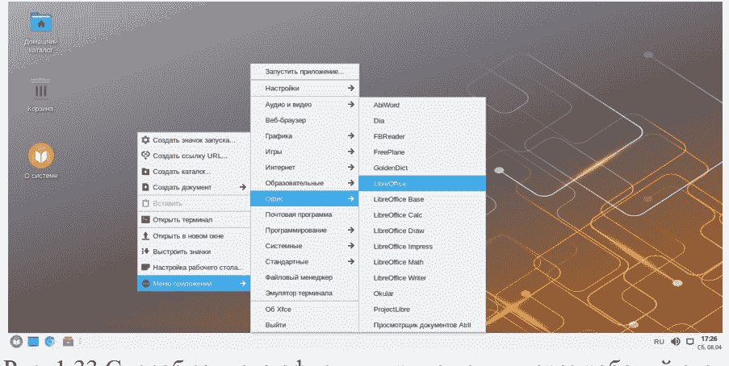

图 1.33 `Xfce` 用户界面中通过桌面右键启动办公应用的方法

同样也可以像 `Windows` 系统一样通过“开始”菜单启动这些应用程序（见图 1.34）。

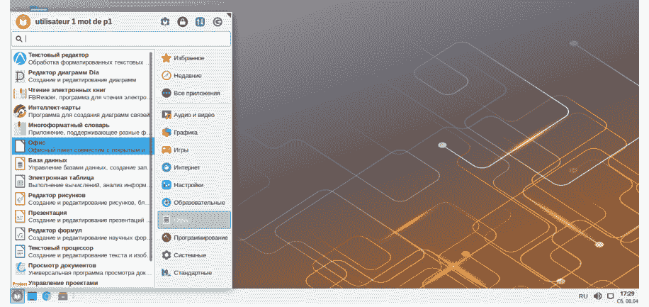

图 1.34 `Xfce` 用户界面中通过“开始”启动系统程序的方法

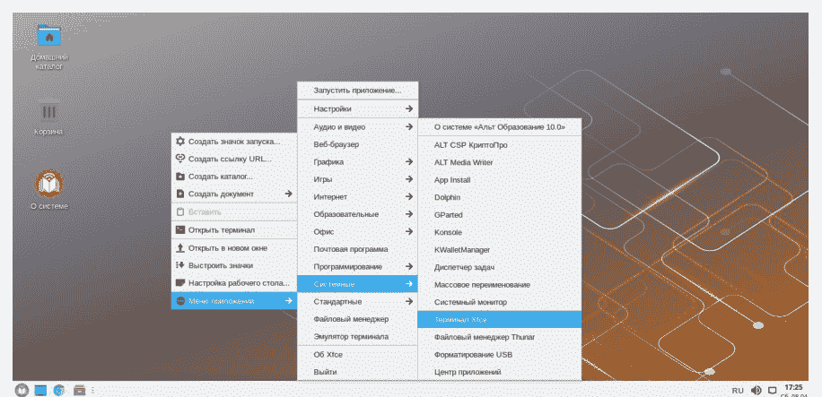

图 1.35 `Xfce` 用户界面中通过桌面右键启动系统程序的方法

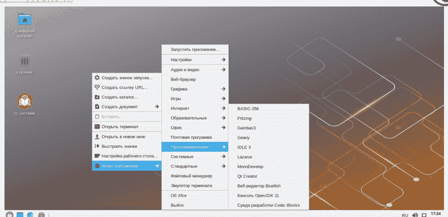

图 1.36 `Xfce` 桌面通过桌面右键启动编程语言的方法

我们看到，通过右键点击，系统用户可以执行许多操作：从运行特定软件到创建某些东西（见图 1.37）。

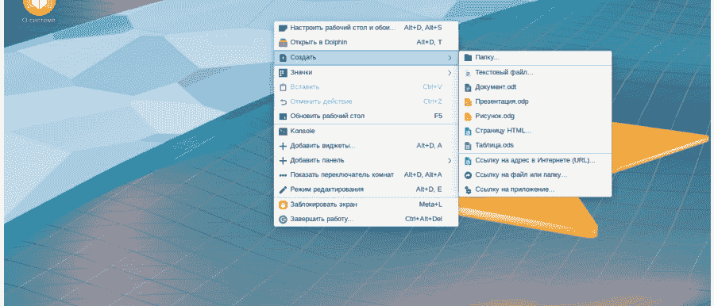

图 1.37 `Xfce` 用户界面中通过桌面右键创建文件夹等。

# 逐步过渡到 Linux：三合一

```
Terminal - user1@host-15virt:/home/user1/桌面
文件 编辑 查看 终端 标签 帮助
user1@host-15virt 桌面 $
bash: /home/user1 是目录
user1@host-15virt 桌面 $ |
```

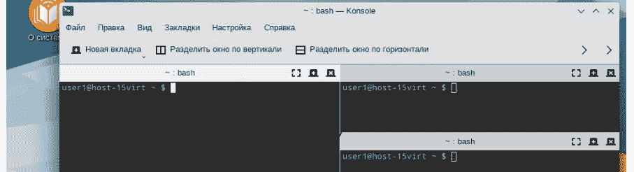

图 1.38 `Xfce` 用户界面中的终端窗口

执行窗口的数量可以变化。

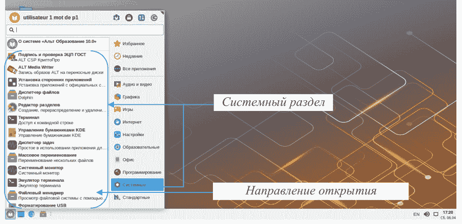

图 1.39 “`Plasma`”用户界面中的控制界面

图 1.40 `Xfce` 用户界面中通过开始菜单启动系统程序

## 第一章 LINUX 界面的视觉化表示

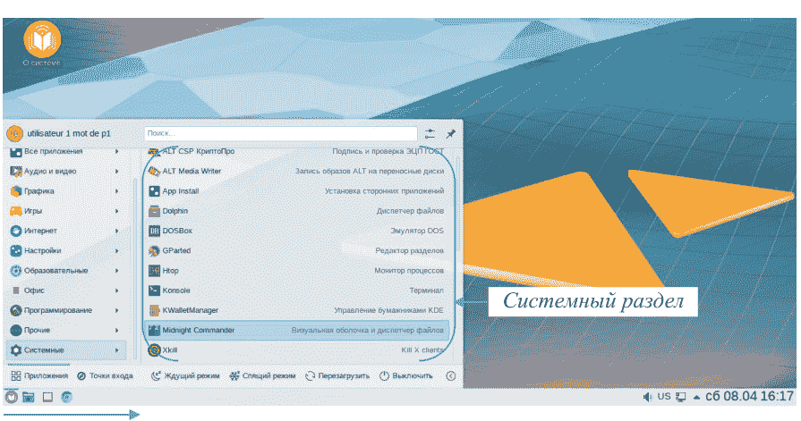

图 1.41 `Plasma` 用户界面中通过开始菜单启动系统程序

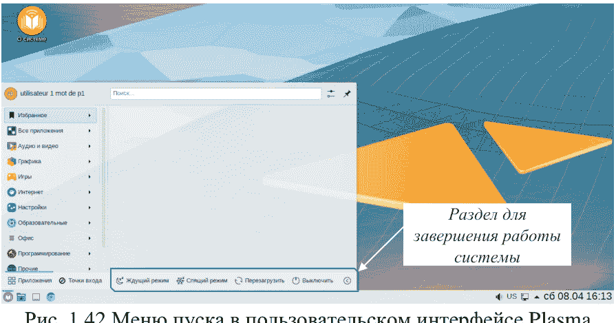

图 1.42 `Plasma` 用户界面中的开始菜单

# 逐步过渡到 Linux：三合一

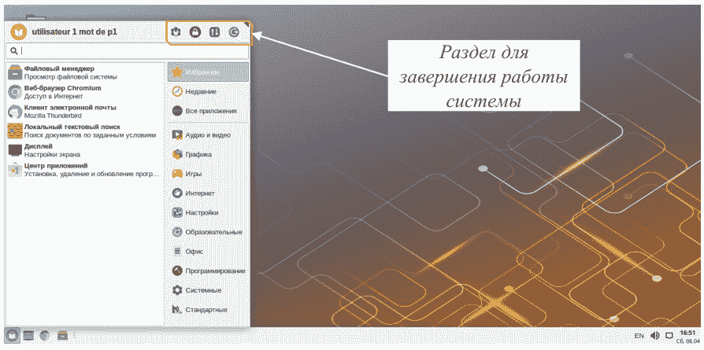

图 1.43 `Xfce` 用户界面中通过开始菜单启动系统程序

图 1.44 `Xfce` 用户界面中找到所有系统功能的方法

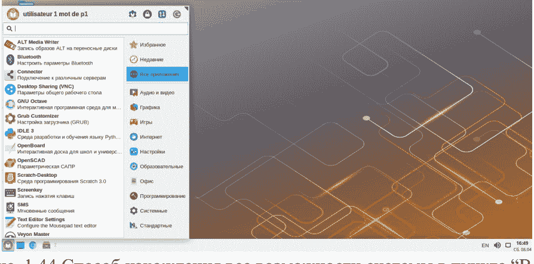

图 1.45 `Plasma` 用户界面中通过开始菜单在“所有应用程序”中找到系统功能的方法

图 1.46 `Plasma` 用户界面中关机部分的位置

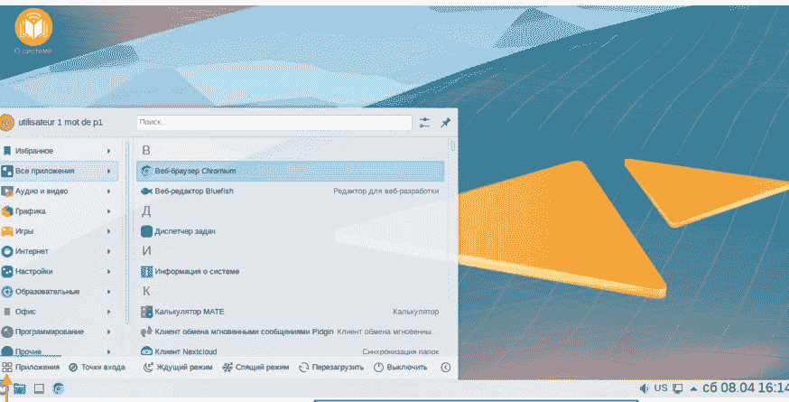

图 1.47 `Plasma` 用户界面点击“重启”或“关机”后收的消息

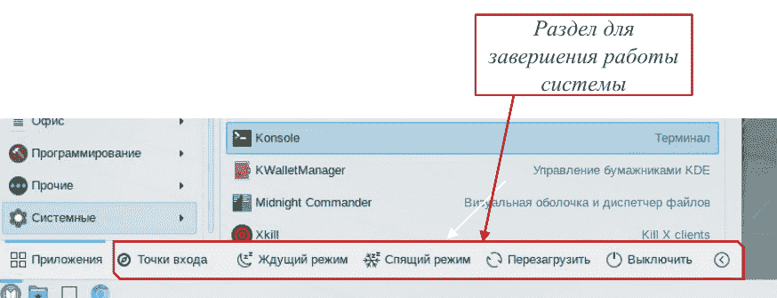

图 1.48 `Xfce` 用户界面中关机部分的位置

# 逐步过渡到 LINUX：三合为一


Windows 程序（例如 `Adobe Reader 6.0`、`Apache OpenOffice.org`）已经在系统中运行。

`ReactOS` 部分复制了 `Windows API` 的功能，并拥有一个为 `AMD64` 架构移植的版本。

为了直观地了解 `ReactOS` 及其这些不同的用户界面，需要查看下面的图 1.50 – 1.52。


图 1.50 登录后 `ReactOS` 系统的用户界面

# 第一章：`LINUX` 界面的视觉化表示


图 1.51 展开菜单的 `ReactOS` 系统用户界面（界面类似于旧旧的 `Windows NT 5.x` 及更高版本）

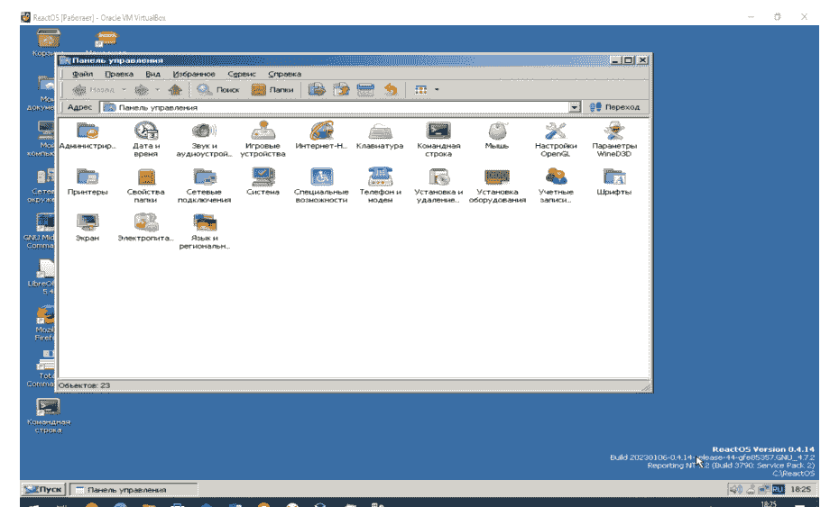

图 1.52 `ReactOS` 系统“控制面板”部分的内容，设计类似于旧的 `Windows NT 5.x` 及更高版本

# 逐步过渡到 `LINUX`：三合为一

## 俄 I.5 `Astra Linux` 系统界面

`Astra Linux` 是一种基于 `Linux` 开源代码的俄罗斯安全操作系统，旨在政府机构、军事单位以及处理国家机密的商业机构。

`Astra Linux` 操作系统由“`RusBITech`”公司于 2008 年开发，随后获得了俄罗斯联邦技术和加密服务局（`FSTEC`）的认证，符合信息安全要求。`Astra Linux` 基于 `Debian` 开源代码，并使用自己的包管理器管理软件。

`Astra Linux` 有多个版本，包括“标准版”（`Standard`）、基础版”（`Basic`）、安全版”（`Security`）和特别版”（`Special`）。每个版本都为解决特定任务而设计，具有自己的特性和功能。

`Astra Linux` 具有许多内置的安全机制，包括恶意软件防护机制、访问控制机制、数据加密机制等许多其他。此外，`Astra` 还实现了与安全网络工作的能力，包括使用加密保护手段的网络。

需要注意的是，对于处理国家机密的俄罗斯政府机构，以及从事开发或维护涉及国家机密信息系统的承包商机构，必须使用 `Astra Linux`。

`Astra Linux` 附带大量默认安装的软件。在 `Astra Linux` 中你会找到的一些最常用应用程序包括：

- 1. 浏览器：`Mozilla Firefox`, `Chromium`。
- 2. 办公应用：`LibreOffice`。
- 3. 多媒体：`VLC`, `Audacity`, `Clementine`, `K3b`, `KMix`, `gucvview`, `Qmpp`, `PulseAudio`。
- 4. 图形：矢量编辑器 `Inkscape`、`Okular`、`Gwenview`、`KolourPaint`、`Blender`、`GIMP`、扫描程序、`Spectacle`。
- 5. 系统工具：虚拟键盘、将 `ISO` 镜像写入到 `USB`、`Recall`、`MC` 文件管理器、存储库编辑器、`KGPG`。`XCA` 数字证书。
- 6. 游戏：纸牌游戏、平台游戏 `SuperTux` 等。

此外，`Astra Linux` 还提供了许多系统工具，用于网络设置、软件包管理、磁盘监控等。

为了直观地了解 `Astra Linux` 的这些不同界面，需要查看下面的图 1.53 – 1.62。

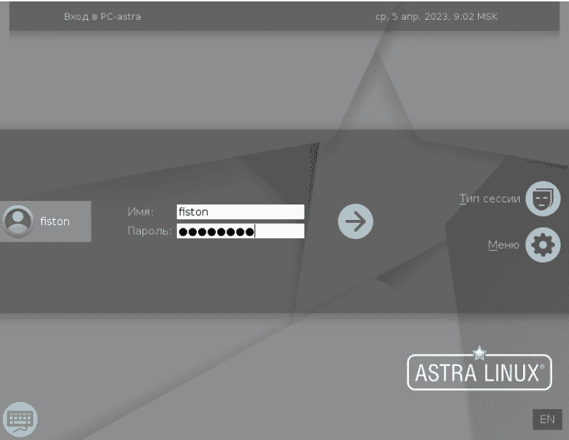

图 1.53 用户界面中的系统窗口

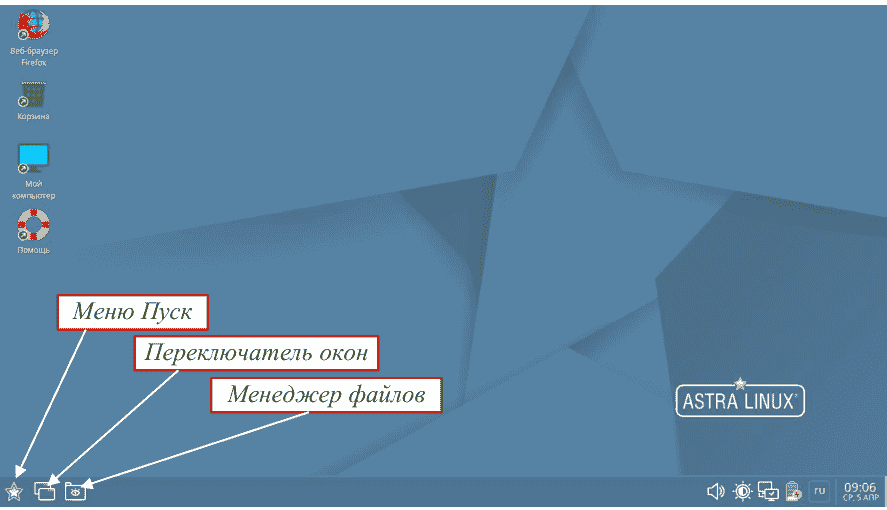

图 1.54 登录后的 `Astra Linux` 系统界面

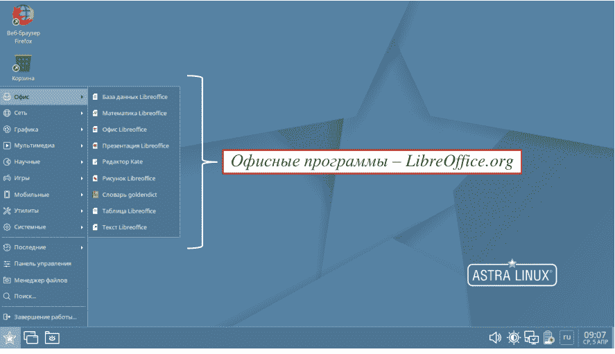

图 1.55 展开“开始”菜单的 `Astra Linux` 系统界面

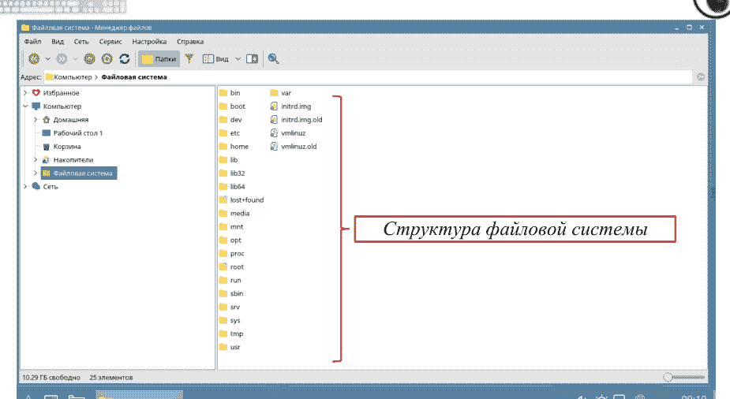

图 1.56 `Astra Linux` 操作系统的文件系统

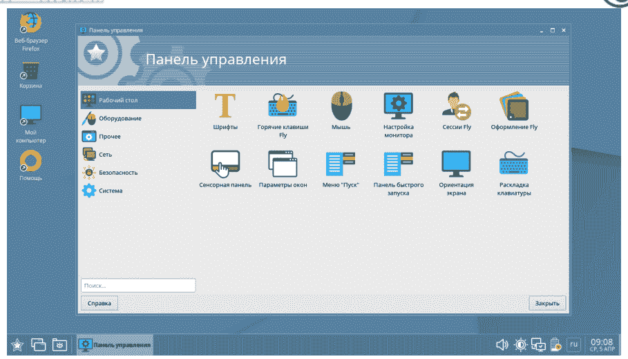

图 1.57 `Astra Linux` 系统“控制面板”部分的内容

系统中带有 `fly-uedit` 这是一个用于编辑桌面快捷启动和“开始”菜单的程序。

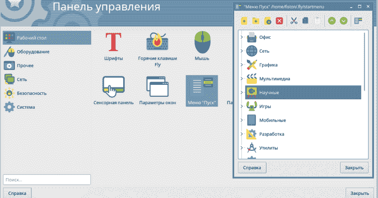

图 1.58 `Astra Linux` 系统“控制面板”的内容

## 第二章：`LINUX` 界面的视觉化表示

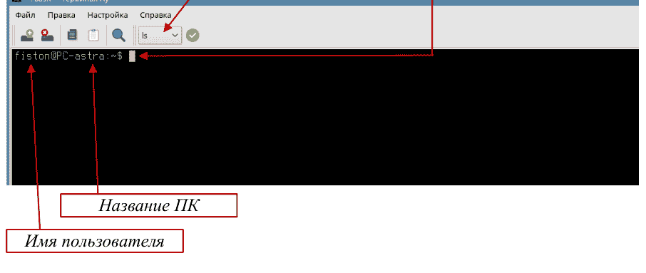

图 1.59 `Astra Linux` 操作系统的文件系统

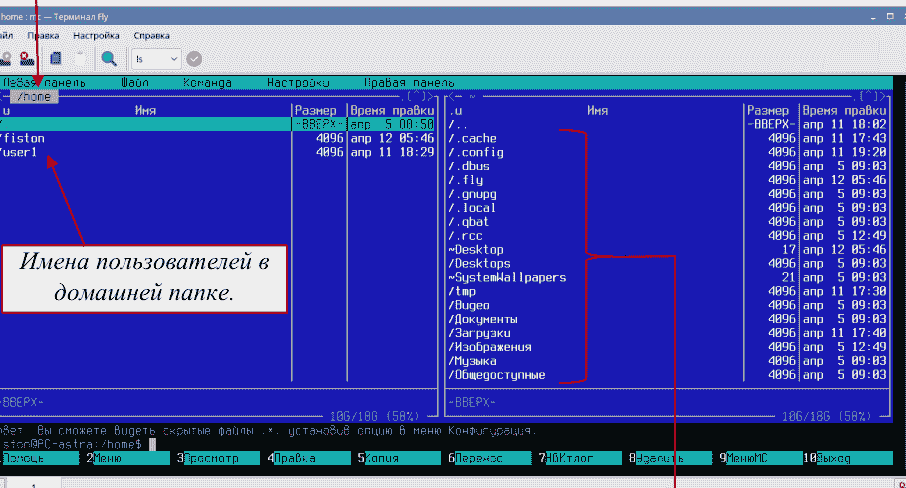

图 1.60 用户界面中的系统窗口

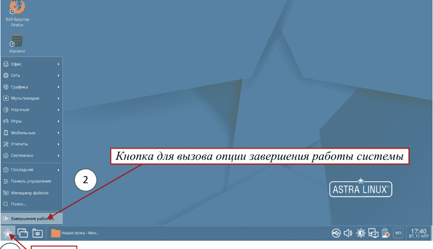

图 1.61 登录后的 `Astra Linux` 系统界面

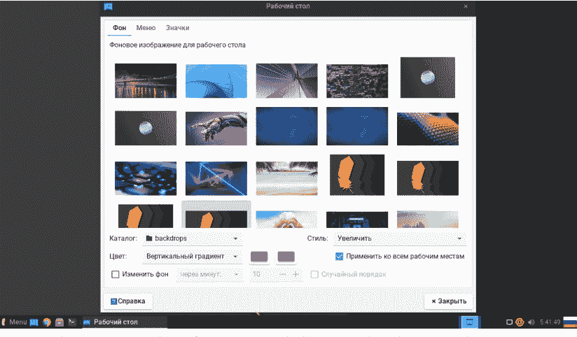

图. 1.3 自定义背景屏幕的区域

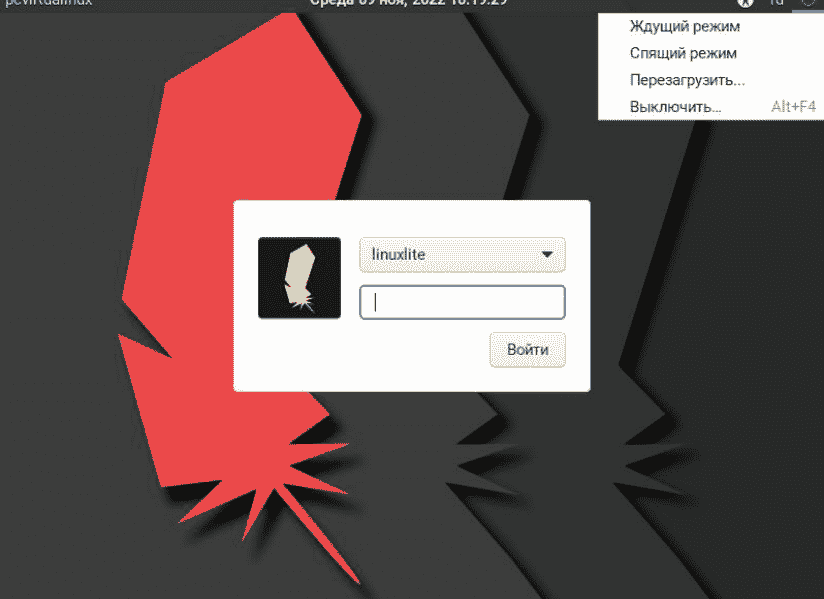

图. 1.4 访问系统的密码输入窗口

# 逐步过渡到 `Linux`：三合一

总而言之，`Linux Lite 6.2` 是一个具有简单直观界面的 `Linux` 发行版，用户可以根据需要轻松进行自定义。该界面与 `Windows` 几乎相同（见图 1.5）。


图. 1.5 系统界面主菜单，`Linux Lite 6.2`，类似于 `Windows`

`Linux Lite 6.2` 的主桌面是 `Xfce`，其特点是高性能和低资源消耗。`Xfce` 窗口管理器允许用户自定义工作区、更改主题（见图 1.3）并添加快捷方式以快速访问应用程序。

`Linux Lite 6.2` 还预装了许多应用程序（见图 1.6、图 1.7 和图 1.8），包括 `LibreOffice`、`Firefox`、`VLC`、`GIMP` 等，使其成为适用于日常任务的完整桌面环境。此外，`Linux Lite 6.2` 还提供了系统管理工具，如易用的软件安装程序、更新管理器和系统设置。

## 第一章 `LINUX` 界面的视觉表示


图. 1.6 `Lite 6.2` 中合并所有应用程序的区域 – 部分 1。


图. 1.7 `Lite 6.2` 中合并所有应用程序的区域 – 部分 2

# 逐步过渡到 `Linux`：三合一


总而言之，`Linux Lite 6.2` 是一个具有简单直观界面的 `Linux` 发行版，用户可以根据需要对其进行配置和自定义。

`Linux Lite 6.2` 界面的概览见于图 1.9、1.10、1.11、1.12、1.13、1.14、1.15、1.16 和 1.17。这些图直观地反映了以下部分：办公程序区域、“设置”区域、绘制图形元素区域、工作和网络设置区域、系统区域、“多媒体”区域、“系统设置”部分 1 和部分 2、退出 `Linux` 区域。

## 第一章 `LINUX` 界面的视觉表示


图. 1.9 `Linux Lite 6.2` 中的办公程序区域


图. 1.10 `Linux Lite 6.2` 中的“设置”区域

# 逐步过渡到 `Linux`：三合一


图. 1.11 `Linux Lite 6.2` 中的绘制图形元素区域


图. 1.12 `Linux Lite 6.2` 中的工作和配置网络区域

## 第一章 `LINUX` 界面的视觉表示


图. 1.13 `Linux Lite 6.2` 中的系统区域


图. 1.14 `Linux Lite 6.2` 中的“多媒体”区域

# 逐步过渡到 `Linux`：三合一


图 1.15 `Linux Lite 6.2` 中的“系统设置”区域 – 部分 1


图 1.16 `Linux Lite 6.2` 中的“系统设置”区域 – 部分 2

## 第一章 `LINUX` 界面的视觉表示


图 1.17 `Linux Lite 6.2` 中的工具区域


图 1.18 用户退出 `Linux Lite 6.2` 的工具区域

## 1.2 `Ubuntu` 系统界面

在解决各种练习和解释理论材料的手书中，使用了 `Ubuntu` 操作系统 `22.04` 版本。电脑上的安装过程（见图 19、21 和 22）非常简单。系统还提供了一个“Live”版本，允许你在不安装的情况下使用它。


图 1.19 `Ubuntu` 系统安装期间的演示部分 – 所有人可用。

就像 `Linux Lite 6.2` 一样，`Ubuntu` 提供了丰富的应用程序（见图 1.21），例如 `Firefox` 浏览器、媒体播放器等，这些程序可以通过应用程序菜单或搜索区域启动。

`Ubuntu` 默认带有免费的 `LibreOffice` 办公套件（见图 1.20），对于大多数用户来说，无论是在家里、办公室还是学校，它都包含了你的一切。如果你强烈想要使用 `Microsoft`，那么你可以得助于微软云来解决这个问题。

## 第一章 `LINUX` 界面的视觉化表示

- 2. 办公应用：`LibreOffice`, `Calligra`, `AbiWord`。
- 3. 多媒体：`VLC`, `GIMP`, `Inkscape`, `Audacity`。
- 4. 通信：`Thunderbird`, `Pidgin`, `Skype`。
- 5. 系统工具：`GNOME` 磁盘工具，`GParted`, `Nautilus`, `Dolphin`。
- 6. 编程：`Python`, `Java`, `GCC`。
- 7. 版本控制系统：`Git`。

此外，`ALT Linux` 还带有许多系统工具，使系统管理变得更加容易，包括用于网络设置、包管理、磁盘挂载等的实用。

为了直观地展示 `ALT Linux` 以及这些各种用户界面，请参考以下图 1.29 – 1.49。


图 1.29 登录 `ALT Linux` 时选择用户界面类型及密码输入窗口


图 1.30 用户登录后 `ALT Linux` 的“Plasma”类型用户界面


图 1.31 用户登录后“`ALT Linux`”的“Xfce”类型用户界面

图 1.30 和图 1.31 中桌面用户界面的区别在于右下角。当前时间、音量、录制语言、网络设置等参数的位置不同。

## 第一章 `LINUX` 界面的视觉化表示


图 1.32 “`ALT Linux Edu`”文件系统的结构


图 1.33 在 `Xfce` 界面中通过桌面（右键）启动应用程序的方法

也可以像我们在 `Windows` 操作系统中所习惯的那样，通过开始菜单启动这些应用程序（见图 1.34）。

## 逐步过渡到 `LINUX`：三合一


图 1.34 在 `Xfce` 用户界面中通过“开始”（左下角）启动办公应用的方法


图 1.35 在“`Xfce`”用户界面中通过桌面（右键）启动系统应用的方法

## 第一章 `LINUX` 界面的视觉化表示


图 1.36 在“`Xfce`”用户界面中通过桌面（右键）启动编程语言的方法

我们看到通过点击鼠标右键，系统用户可以做很多事情：从启动某些软件到创建某些项目（见图 1.37）。


图 1.37 在“`Xfce`”用户界面中通过桌面（右键）可以创建文件夹等。

## 逐步过渡到 `LINUX`：三合一


图 1.38 `Xfce` 用户界面中的终端窗口


执行命令的窗口之一

这些窗口的数量可能会有所

图 1.39 “Plasma”用户界面中的控制台界面


图 1.40 在“`Xfce`”用户界面中通过开始菜单启动 `Linux` 系统应用的方法

## 第一章 `LINUX` 界面的视觉化表示


图 1.41 在“Plasma”用户界面中通过开始菜单启动系统应用的方法


图 1.42 “Plasma”用户界面中的开始菜单

## 逐步过渡到 `LINUX`：三合一


图 1.43 “`Xfce`”用户界面中的开始菜单


图 1.44 在 `Xfce` 中通过开始菜单的“所有应用程序”项查找所有功能的方法

## 第一章 `LINUX` 界面的视觉化表示


图 1.45 在“`Xfce`”用户界面中通过开始菜单的“所有应用程序”项查找所有功能的方法


图 1.46 “Plasma”用户界面中的开始菜单

## 第一章 `LINUX` 界面的视觉化表示


图 1.47 “`Xfce`”界面中的开始菜单


图 1.48 “`Xfce`”用户界面中的开始菜单

## 第一章 `LINUX` 界面的视觉化表示


图 1.49 登录 `ALT Linux` 时选择用户界面类型及密码输入窗口

## 第一章 `LINUX` 界面的视觉化表示


图 1.53 用户界面中的系统访问窗口


图 1.54 用户登录后“`Astra Linux`”系统的用户界面

# 逐步过渡到 `Linux`：三合一


图 1.55 打开“开始”菜单的“`Astra Linux`”系统用户界面


## 第一章 `LINUX` 界面的视觉化表示


图 1.56 “`Astra Linux`”操作系统的文件系统结构


图 1.57 “`Astra Linux`”系统“控制面板”部分的内容。

`fly-menuedit` 系统是一个用于编辑桌面快速启动栏和“开始”启动菜单的程序。它还用于通过这些菜单创建和编辑快捷方式以及快捷方式集合。图标旁边的窗口标题显示菜单名称以及相应的文件路径名称（见图 1.58）。


图 1.58 程序菜单和快捷方式：`fly-menuedit`


图 1.59 “Astra Linux”系统中的 `Fly` 终端窗口

## 第一章 Linux 界面的视觉化表示

### 主目录 (`/home`)


主目录中的用户`username`


- 注：要进入受保护的文件夹，你需要这样运行：`sudo mc`
- 用户`fiston`文件夹的内容

图 1.60 “Astra Linux”系统中的文件管理器 `MC` (`Midnight Commander`)


图 1.61 调用关闭“Astra Linux”系统选项的位置


图 1.62 关闭“Astra Linux”系统的可能选项

结论，我们可以说，市场上有很多国内外的 `Linux` 操作系统，它们具有不同的用户界面，并提供了大量的应用程序和系统实用程序。从 `Windows` 迁移到 `Linux` 时，必须考虑界面的差异，并在不同方向上找到程序的替代品。此外，为了更有信地使用 `Linux`，你还需要能够使用图形界面、终端和控制台进行工作。

总而言之，`Linux` 是一个灵活且强大的操作系统，可以适应不同的用户需求。该系统是一个免费发布的开源系统程序，允许开发者和用户对系统进行更改和改进。正因如此，`Linux` 可以定制以满足任何需求，为用户和开发者提供了巨大的灵活性。值得注意的是，世界上许多知名且强大的服务器运行在 `Linux` 上，这表明该操作系统具有高度的稳定可靠。

然而，从 `Windows` 迁移到 `Linux` 时，由于界面差异以及某些在 `Linux` 中可能没有程序，可能会带来一些不便。在下一章中，我们将尝试解决这一缺点以减轻过渡过程。

因此，对于寻求扩展计算机和操作系统工作知识和技能的用户来说，使用 `Linux` 是一次有趣的体验。

请见第 228 页

# 第一章 Linux 操作系统界面的视觉化表示

## 1.1 Linux 6.2 版本系统界面

`Linux` 操作系统界面的视觉化表示可能会根据所使用的发行版和工作环境有很大不同。例如，`GNOME` 和 `KDE` 这两个 `Linux` 桌面环境具有不同的设计和功能。通常，`Linux` 界面由图形用户界面 (`GUI`) 表示，包括用于执行任务的菜单、窗口、图标和按钮。然而，许多 `Linux` 用户（高级用户）更倾向于通过命令行工作，他们那里可以通过命令和脚本执行任务。更多细节将在第三章提供。系统启动后的数据输入界面（用户和密码）见图 1.1。


# 逐步过渡到 Linux：三合一

`Linux` 还拥有许多可以帮助用户管理系统的实用程序，例如网络配置、文件管理和性能监控。`Linux` 的优势之一是可以自定义界面并安装额外工具以满足用户需求。b) 图 1.2 展示了系统启动后 `Linux Lite 6.2` 界面的外观。


图 1.2 `Linux Lite 6.2` 系统的界面

c) 这里，我们通过图 1.3 显示了 `Linux` 界面的背景和菜单。`Linux Lite 6.2` 是一个基于 `Ubuntu` 的发行版，具有直观的界面。其视觉化表示可以描述为整洁且极简的。

## 第一章 Linux 界面的视觉化表示


图 1.3 `Linux` 界面


图 1.4 密码输入窗口

# 逐步过渡到 Linux：三合一

`Linux` 同样拥有许多可以帮助用户管理系统的实用程序，如网络配置、文件管理和性能监控。`Linux` 的优势之一是可以自定义界面并安装额外工具以满足用户需求。b) 图 1.2 展示了系统启动后 `Linux Lite 6.2` 界面的外观。


图 1.5 桌面界面

总而言之，`Linux` 是一个灵活且强大的操作系统，可以适应不同的用户需求。该系统是一个免费发布的开源系统程序，允许开发者和用户对系统进行更改和改进。正因如此，`Linux` 可以定制以满足任何需求，为用户和开发者提供了巨大的灵活性。值得注意的是，世界上许多知名且强大的服务器运行在 `Linux` 上，这表明该操作系统具有高度的稳定可靠。

然而，从 `Windows` 迁移到 `Linux` 时，由于界面差异以及某些在 `Linux` 中可能没有程序，可能会带来一些不便。在下一章中，我们将尝试解决这一缺点以减轻过渡过程。

因此，对于寻求扩展计算机和操作系统工作知识和技能的用户来说，使用 `Linux` 是一次有趣的体验。

请见第 228 页

# 第一章. Linux 界面的视觉化表示


图 1.9 `Linux Lite 6.2` 中的桌面程序部分


图 1.10 `Linux Lite 6.2` 中的“设置”部分

# 逐步过渡到 Linux：三合为一


图 1.11 `Linux Lite 6.2` 中绘制图形元素的区域


图 1.12 `Linux Lite 6.2` 中网络运行与配置的区域

# 第一章. Linux 界面的视觉化表示


图 1.13 `Linux Lite 6.2` 下的系统元素部分


图 1.14 `Linux Lite 6.2` 下的“多媒体”部分

# 逐步过渡到 Linux：三合为一


图 1.15 `Linux Lite 6.2` 中的“系统设置”部分 - 第1部分


图 1.16 `Linux Lite 6.2` 中的“系统设置”部分 - 第2部分

# 第一章. Linux 界面的视觉化表示


图 1.17 `Linux Lite 6.2` 中的“工具”部分


图 1.18 退出 `Linux Lite 6.2` 系统的会话

## 1.2 Ubuntu 系统界面

在手册中，为了解决不同的练习并解释理论知识，我们使用了 22.04 版本的 `Ubuntu` 操作系统。`Ubuntu` 的安装过程（参见图 19、20 和 21）默认附带 `LibreOffice` 办公套件（参见图 1.20），该套件包含了大多数桌面用户（无论是在家里、办公室还是学校）使用所需的所有内容。如果您需要使用 `Microsoft Office`，可以通过集成到云服务的 `Microsoft Online` 来解决这个问题。

`LibreOffice` —— 一个免费应用程序集合，其组成包含了创建表格和演示文所需的所有内容。它与 `Microsoft Office` 文件兼容，具有相同的功能：

- `LibreOffice Writer`
- `LibreOffice Calc`
- `LibreOffice Impress`

`Ubuntu` 是一套同时为个人电脑和服务器设计的软件集合。它由于定期更新系统而引起了公众关注，这提高了在使用过程中的安全性。其界面的视觉化表示具有熟悉且易于识别的设计，变化较小。`Ubuntu` 的主要桌面环境是 `GNOME`，它提供了一个现代优雅且具有许多功能能力的界面。在 `GNOME` 环境中，您可以自定义桌面的外观、修改主题、添加快捷方式并自定义任务栏。


图 1.21 安装期间 `Ubuntu` 系统演示的一部分 – `Ubuntu` 系统中丰富的应用程序提供了各种系统管理工具，如应用中心、更新管理器和系统设置，这些工具帮助用户管理并根据其需求定制系统。接下来的图 1.22、1.23、1.24、1.25、1.26 和 1.27 提供了可以概览操作系统的视觉界面。


图 1.22 安装后的 `Ubuntu` 操作系统界面


图 1.23 `Ubuntu` 操作系统功能概览

```
To run a command as administrator (user "root"), use sudo <command>.
See "man sudo_root" for details.
fiston@MyPC-Ubuntu: $ 
bash: /home/fiston/
fiston@MyPC-Ubuntu: $ 
```


图 1.22 `Ubuntu` 中的命令行界面

图 1.25 `Ubuntu` 操作系统文件系统结构


图 1.26 `Ubuntu` 系统菜单部分 – 屏幕


图 1.27 配置网络和其他设置部分; 停止运行

## 1.3 `ALT` 系统界面

`ALT Linux` 是一种基于 `Linux` 的俄罗斯操作系统，设计用于工作站、服务器和嵌入式设备。它自 2001 年来一直开发，是俄罗斯和前苏联国家最流行的 `Linux` 发行版之一。`ALT Linux` 拥有自己的 `RPM` 软件包管理器（这是一个免费的开源系统）。`RPM` 指的是 `Linux` 文件格式，可以方便地管理软件的安装和更新。

`ALT Linux` 有多个版本（参见图 1.27），每个版本都为特定用途设计：用于工作站的 `ALT Workstation`、用于服务器的 `ALT Server`、用于教育机构的 `ALT Education` 等。


图 1.28 登录 `ALT Linux` 时用户界面类型的选择

`ALT Linux` 默认包含了大量软件。以下是 `ALT Linux` 上找到的一些常用程序：

1. 浏览器：`Mozilla Firefox`, `Google Chrome`。
2. 办公应用：`LibreOffice`, `Calligra`, `AbiWord`。
3. 多媒体：`VLC`, `GIMP`, `Inkscape`, `Audacity`。
4. 通信：`Thunderbird`, `Pidgin`, `Skype`。
5. 系统工具：`GNOME Disk Utility`, `GParted`, `Nautilus`。
6. 编程：`Python`, `Java`, `GCC`。
7. 版本控制系统：`Git`。

此外，`ALT Linux` 还配备了一些系统工具，方便管理系统，包括用于网络配置、软件包管理、磁盘挂载等的实用程序。

`ALT Linux` 的特点之一是其开放性和参与开发的能力。用户可以参与项目、报告错误、改进文档等。


图 1.30 和 1.31 中桌面用户界的区别在于右下角。当前时间、音量、录制语言、网络设置等参数的位置不同。

## 第一章 `LINUX` 界面的视觉化表示

文件系统

文件 编辑 视图  帮助

+ 位置

- 计算机

- 桌面

- 垃圾桶

- 文档

- 音乐

- 图像

- 视频

- 下载

设备

- 文件系统

网络

- 网络浏览


Fig. 1.32 `ALT Linux Edu` 文件系统结构


Fig. 1.33 在 `Xfce` 用户界面上通过桌面（右键点击）启动办公应用程序的方法

## 逐步过渡到 `LINUX`：一步步

我们也可以像在操作系统习惯的那样，通过“开始”菜单启动这些应用程序（见图 1.34）。


Fig. 1.34 通过 `Xfce` 用户界面“开始”菜单（左下角）启动桌面应用程序的方法


Fig. 1.35 在 `Xfce` 用户界面中通过桌面（右键点击）启动应用程序的方式

## 第一章 `LINUX` 界面的视觉化表示

我们点击右键，系统用户可以做很多事情：从运行某些软件到创建某些元素（见图 1.37）。


Fig. 1.37 在 `Xfce` 用户界面上通过桌面（右键点击）创建文件夹的功能

## 逐步过渡到 `LINUX`：一步步

待执行的窗口数量可能会有所不同。


Fig. 1.38 `Xfce` 用户界面中的终端窗口


Fig. 1.39 “`Plasma`”用户界面中的控制台界面

Fig. 1.40 通过 `Xfce` 用户界面“开始”菜单启动系统应用程序的方法

打开方向


Fig. 1.41 通过“`Plasma`”用户界面“开始”菜单启动系统应用程序的方法


Fig. 1.42 “`Plasma`”用户界面中的“开始”菜单

## 逐步过渡到 `LINUX`：一步步


Fig. 1.43 `Xfce` 用户界面中的“开始”菜单


Fig. 1.44 通过 `Xfce` 用户界面“开始”菜单在“所有应用程序”项中找到系统系统功能的方法

## 第一章 `LINUX` 界面的视觉化表示


“所有应用程序”按钮

Fig. 1.45 在“`Plasma`”用户界面“开始”菜单的“所有应用程序”中找到系统所有功能的方法


Fig. 1.46 “`Plasma`”用户界面中的系统关机区域

## 逐步过渡到 `LINUX`：一步步


Fig. 1.47 在“`Plasma`”用户界面点击“重启”或“关机”后收的消息


Fig. 1.48 `Xfce` 用户界面中的系统关机区域

## 第一章 `LINUX` 界面的视觉化表示


Fig. 1.49 在“`Plasma`”用户界面“开始”菜单的“所有应用程序”中找到系统所有功能的方法

文件系统

文件 编辑 视图  帮助

+ 位置

- 计算机

- 桌面

- 垃圾桶

- 文档

- 音乐

- 图像

- 视频

- 下载

设备

- 文件系统

网络

- 网络浏览


Fig. 1.32 `ALT Linux Edu` 文件系统结构


Fig. 1.33 在 `Xfce` 用户界面上通过桌面（右键点击）启动办公应用程序的方法

## 逐步过渡到 `LINUX`：一步步

我们也可以像在操作系统习惯的那样，通过“开始”菜单启动这些应用程序（见图 1.34）。


**Fig. 1.34** 通过 `Xfce` 用户界面“开始”菜单（左下角）启动桌面应用程序的方法


**Fig. 1.35** 在 `Xfce` 用户界面中通过桌面（右键点击）启动应用程序的方式

## 第一章 LINUX 界面的视觉化表示

我们点击右键，系统用户可以做很多事情：从运行某些软件到创建某些元素（见图 1.37）。


**Fig. 1.37** 在 `Xfce` 用户界面上通过桌面（右键点击）创建文件夹的功能

## 逐步过渡到 LINUX：一步步

待执行的窗口数量可能会有所不同。


**Fig. 1.38** `Xfce` 用户界面中的终端窗口


**Fig. 1.39** “`Plasma`”用户界面中的控制台界面

**Fig. 1.40** 通过 `Xfce` 用户界面“开始”菜单启动系统应用程序的方法

打开方向


**Fig. 1.41** 通过“`Plasma`”用户界面“开始”菜单启动系统应用程序的方法


**Fig. 1.42** “`Plasma`”用户界面中的“开始”菜单

## 逐步过渡到 LINUX：一步步


**Fig. 1.43** `Xfce` 用户界面中的“开始”菜单


**Fig. 1.44** 通过 `Xfce` 用户界面“开始”菜单在“所有应用程序”项中找到系统所有功能的方法

## 第一章 LINUX 界面的视觉化表示


“所有应用程序”按钮

**Fig. 1.45** 在“`Plasma`”用户界面“开始”菜单的“所有应用程序”中找到系统所有功能的方法


**Fig. 1.46** “`Plasma`”用户界面中的系统关机区域

## 逐步过渡到 LINUX：一步步


**Fig. 1.47** 在“`Plasma`”用户界面点击“重启”或“关机”后收的消息


**Fig. 1.48** `Xfce` 用户界面中的系统关机区域

## 第一章：LINUX 界面的可视化表示

5. 系统工具：虚拟键盘、`USB ISO Burn`、提醒、`MC` 文件管理器、`Ark`、存储库编辑器、`KGpg`、`XCA` 数字证书。

6. 游戏：纸牌、`SuperTux 2` 平台游戏、扫雷、`Warzone 2100` 策略、`Color Lines`、`JAG`。

7. 以及其他。

此外，`Astra Linux` 还带有许多系统工具，便于系统管理，特别是用于网络配置、包管理、磁盘挂载等的工具。

为了直观地了解 `Astra Linux` 及其不同的用户界面，分析以下图表（从图 1.53 到 1.62）是非常重要的：


**图 1.53** 用户界面中的系统登录窗口


**图 1.56** `Astra Linux` 系统的文件系统结构

## 分步过渡到 Linux：三位合一


**图 1.57** `Astra Linux` 系统“控制面板”部分的内容。

`fly-menuedit` 系统是一个用于编辑桌面快速启动栏和*开始*菜单的程序。它还用于通过这些菜单创建和编辑快捷方式以及快捷方式集合。图标旁窗口标题显示菜单名称以及相应的路径名称（见图 1.58）。


**图 1.58** 程序的菜单与快捷方式：`fly-menuedit`

命令行栏

在 `$` 之后输入命令的地方


计算机名称

用户名

**图 1.59** `Astra Linux` 系统中的 `Fly` 终端窗口


主目录 (`/home`)

起始目录中的用户名

> **PS：** 要进入受保护目录，你必须按照如下方式执行：`sudo fiston`

> 用户 `fiston` 目录的内容

**图 1.60** `Astra Linux` 系统的 `MC` (Midnight Commander) 文件管理器


**图 1.61** 调用 `Astra Linux` 系统关机选项的位置


**图 1.62** `Astra Linux` 系统可能的关机选项

结论是，我们可以说市场上存在许多国外的 `Linux` 操作系统，它们具有不同的用户界面并提供了大量的系统工具应用程序。在从 `Windows` 迁移到 `Linux` 时，需要考虑界面的差异，并在不同方向上寻找相应的替代程序。此外，为了更从容地进行 `Linux` 工作，你必须能够同时处理图形界面、终端和控制台。

总体来说，`Linux` 是一个灵活且强大的操作系统，可以适应不同的用户需求。该系统是免费分发的开源软件，允许开发者和用户对系统进行修改和改进。因此，`Linux` 是一个灵活且强大的操作系统，可以适应不同的用户需求。该系统是免费分发的开源软件，允许开发者和用户对系统进行修改和改进。

## 逐步过渡到 LINUX：三合一

...`BIOS` 技术。在 `UEFI` 中，任何程序（无论是操作系统引导程序还是实用程序）都必须是 `EFI` 应用程序，其架构必须与 `UEFI` 固件的架构匹配。

`x86_64` `UEFI` 固件不支持运行 32 位 `EFI` 应用程序（这与 `x86_64` (64位) 版本的 `Linux` 和 `Windows` 不同，后者具有此类支持）。因此，`EFI` 应用程序必须针对运行固件的特定架构/处理器进行编译。

```bash
# 在 Linux 中检查固件：
$ cat /firmware/efi/fw_platform_size
```

```
# 在 Microsoft Windows 中检查固件：运行“info32.exe”程序，并在“系统信息”部分查看“类型”和“BIOS 模式”条目的记录。
```

总而言之，`UEFI` 是一种比 `BIOS` 更现代、更具扩展性的 `BIOS` 技术。它提供了更广泛的功能和能力，包括对更大硬盘的支持以及更快的操作系统启动速度。下表 2.1 显示了这些技术在安全角色背景下的差异。

### 表 2.1 – BIOS 与 UEFI 的差异

| 比较参数 | `BIOS` | `UEFI` |
|---|---|---|
| 程序状态 | 负责初始设置、硬件检查和启动操作系统的旧式技术 | 负责初始设置、硬件检查和启动操作系统的新式技术 |
| 缩写 | `Basic Input/Output System`（基本输入输出系统） | `Unified Extensible Firmware Interface`（统一扩展固件接口） |

## 第二章：Linux 下 Windows 程序的对应类比程序

| 比较参数 | `BIOS` | `UEFI` |
| --- | --- | --- |
| | (基本输入输出系统) | 扩展固件接口 |
| 磁盘支持 (`HDD`, `SSD`, ...) | 容量最高不超过 2.2 `TB` | 无此类容量限制 |
| 界面 | 使用文本界面进行系统设置 | 可以使用文本界面或图形界面进行系统设置 |


# 操作系统启动方式对比

| 比较项 | BIOS | UEFI |
| :--- | :--- | :--- |
| 操作系统启动 | 启动 → 加载 `BIOS`（硬件初始化）→ 加载“`MBR` 代码”到内存并将控制权交给 `MBR` → 启动操作系统 | 启动 → 加载 `UEFI` 硬件初始化程序 → 通过 `EFI` 文件启动引导器程序（`Boot manager`）→ 启动操作系统 |
| 操作系统启动速度 | 慢 | 过程更快且更可靠 |
| 安全性 | 较低，因为缺少加密、存储空间有限、没有自动更新机制等。安全机制：`module` | 为启动过程提供更强的控制，允许为启动设置密码并验证操作系统的数字签名；具有自动更新机制 |

## 逐步过渡到 LINUX：三合一

| 比较参数 | BIOS | UEFI |
| :--- | :--- | :--- |
| | `TPM` (可信任平台模块) | 提供可扩展的驱动程序系统，使用户能够更容易地配置和更新硬件，并使用启动场景进行系统自动设置 |
| 灵活性 | 驱动程序受限；不支持鼠标界面 | |
| 网络协议栈支持 | 仅限于加载如 `PXE`（预启动执行环境）等网络协议的能力；不支持 `DHCP`、`DNS` 等其他协议 | 可以利用网络功能进行系统设置，并通过网络启动操作系统；具有 `DHCP`、`DNS` 等其他协议的功能 |
| 设置存储技术 | `CMOS`（互补金属氧化半导体）。该组件使用低功耗电池在计算机关闭时也能保存这些设置 | `NVRAM`（非易失性随机存取存储器）。这是一种非易失性内存的名称。它是一种电子存储设备，而不是主板上的电池 |
| 设置重置 | 取卸并重新安装主板上的电池 | 更改特殊开关的位置或 |

## 第二章：Linux 下 Windows 程序的对应类比程序

| 比较参数 | BIOS | UEFI |
| :--- | :--- | :--- |
| 兼容性 | 主板上的跳线 | 适用于旧设备或操作系统 |
| | 该技术较新，并不总是与旧设备或操作系统兼容 | |

### II.1.2 通过 BIOS 和 UEFI 在计算机中安装和存储系统设置的技术

在操作计算机时，我们经常会遇到 `BIOS` 或 `UEFI` 设置，这些设置允许配置各种系统参数，如设备启动顺序、内存和处理器设置、日期时间和等参数。但当计算机处于关闭状态时，这些设置是如何保存的呢？这时，特殊的设置存储技术派上了用，例如 `CMOS`（见图 2.2 和图 2.4）和 `NVRAM`。

```
CMOS Setup Utility - Copyright (C) 1984-2020
```

| CMOS 设置实用程序 | 加载默认值 |
| :--- | :--- |
| `standard features` | 加载优化值 |
| `host features` | 设置用户密码 |
| `peripherals` | 设置管理员密码 |
| `power management` | 保存并退出 |
| `system health status` | 不保存退出 |
| `Esc` 退出 | `F9` 选择项目 |
| `F10` 保存并退出 | `F11` 保存 `CMOS` 到 `BIOS` |
| `F12` 从 `BIOS` 加载 `CMOS` | |

`CMOS` 是在传统 `BIOS` 系统使用的存储技术，用于在计算机断电时也能保存设置。它是基于位于主板上的存储芯片来实现的。然而，随着技术的进步和 `UEFI` 的出现，出现了一种新的设置技术——`NVRAM`（见图 2.3）。与 `CMOS` 相比，`NVRAM` 具有更现代的存储方法。

## 第二章：Linux 下 Windows 程序的对应类比程序


| | |
| :--- | :--- |
| | `version` | `3401 x64` |
| `build date` | `03/20/2017` |
| `ME firmware version` | `11.6.10` |
| `PCH settings` | `D1` |
| `processor information` | `Intel(R) Core(TM) i5-7500 CPU @ 3.40GHz` |
| `brand string` | `3400 MHz` |
| `total memory` | `2192 MB` |
| `memory frequency` | `2133 MHz` |

图 2.2 `CMOS` 设置实用程序 - `ASUS` 主板

## 第二章：Linux 下 Windows 程序的主要类比程序

如何初始化硬件并加载操作系统。如果 `CMOS` 设置被损坏，可能会影响 `BIOS` 的工作并影响计算机启动的正确性。

在 `UEFI` 中，设置存储在特殊的持久性存储器中，我们称为 `NVRAM`（`Non-Volatile Random Access Memory`——非易失性随机访问存储）。`NVRAM` 是 `BIOS` 中 `CMOS` 的类比物，但它并不是一个电子存储设备，也不是主板上的电池。它是一个特殊的数据区域，存储着 `UEFI` 变量，这些变量设置了 `Non-Volatile`（非易失性）属性。

`UEFI` 中的 `NVRAM` 容量通常更大，可以存储比 `BIOS` 中的 `CMOS` 更复杂的设置。例如，可以存储安全设置、网络设备设置等。

### 重置 NVRAM 设置

在 `UEFI` 中，与 `BIOS` 一样，存在访问保护机制，包括进入设置的密码。我们还知道，要重置电脑的 `BIOS` 设置，需要断开并取出主板上的小电池。执行此程序后，所有已设置的配置将被取消，包括设置的密码。对于 `UEFI` 技术，情况完全不同。

如果用户忘记了 `UEFI` 设置的登录密码，可以列出几种重置方法：

- 一种方法是使用特殊的代码或“`jumper`”，它可以重置密码。这些代码通常由主板制造商提供，可以在用户手册或制造商网站上找到。

## 逐步过渡到 LINUX：三位合一

b) 另一种方法——将 `UEFI` 设置重置为出厂值。

这可以通过，例如通过 `UEFI` 设置菜单或使用主板上的特殊按钮（如果有的话）来实现。然而，请注意，这将删除所有 `UEFI` 设置，包括启动顺序和其他用户自定义设置。

c) 某些主板可能有一个特殊的开关或 `jumper`，允许将 `UEFI` 设置重置为出厂值。用户手册或制造商网站应包含关于该开关所在位置以及如何使用的信息。

因此，无论在任何情况下，在执行任何操作之前，都必须查阅用户手册或咨询主板制造商，以确保你正在执行正确的步骤且不会损坏系统。

## II.1.3 问答：澄清对主题的理解

### 1) 如何进入 BIOS 或 UEFI？

要进入 `BIOS` 或 `UEFI`，需要执行以下步骤：

a) 重启电脑，或如果电脑已关闭则将其开启。

b) 在电脑制造商的启动 `Logo` 出现后，按下所需的键进入 `BIOS` 或 `UEFI`。进入按键取决于电脑的制造商和型号。通常这些按键是 `F2`、`F10`、`F12`、`DEL` 或 `ESC`。

c) 如果你不知道需要哪个键进入 `BIOS` 或 `UEFI`，请尝试不同的键，直到看到 `BIOS` 或 `UEFI` 的设置界面。

d) 如果你使用 `Windows 10`，也可以按 `Shift` 键并在“开始”菜单中选择“重启”来进入 `BIOS` 或 `UEFI` 设置。然后，在选择操作的菜单中，需要选择“高级选项”和“`UEFI` 固件设置”或“`BIOS` 设置”。

进入 `BIOS` 或 `UEFI` 后，可以配置电脑参数，包括启动顺序、各种设备设置和其他参数，具体取决于你电脑上可用的 `BIOS` 或 `UEFI` 功能。

**注意：** 请注意，如果你没有相应的知识，不应该进入并进行任何更改，因为在执行了你的操作后，电脑可能会停止加载操作系统。

### 2) 电脑里可以同时拥有 BIOS 和 UEFI 吗？

不可以，电脑中不能同时存在 `BIOS` 和 `UEFI`，因为这是两种用于确保硬件初始配置和启动计算机的技术。通常，如果主板使用 `UEFI`，则 `BIOS` 将完全不可用。然而，某些主板可能同时支持这两种技术，在这种情况下，用户可以在主板设置中选择使用哪种技术来配置和启动电脑。

### 3) 可以将 BIOS 替换为 UEFI 以及反之吗？

理论上，在某些情况下可以将 `BIOS` 替换为 `UEFI` 以及反之，但这取决于具体的主板及其制造商。在某些情况下，制造商可能会发布 `BIOS` 更新，允许使用 `UEFI` 代替 `BIOS`，但这需要在主板制造商网站检查是否有此类更新，并执行 `BIOS` 更新过程，该过程可能相当危险且复杂。

## 逐步过渡到 LINUX：三位合一

某些主板支持 `UEFI` 和 `BIOS`，允许在主板设置中两者之间切换。然而，在大多数情况下，将 `BIOS` 转换为 `UEFI` 是可能的，或者非常复杂且危险，因为这需要更改主板运行底层，可能会导致硬件或操作系统的严重问题。因此，在尝试更改引导程序类型之前，必须仔细研究文档并咨询专家。

### 4) 如果出现了新版本，可以更新 UEFI 吗？

是的，如果出现了新版本，可以更新 `UEFI`。`UEFI` 更新可以改进主板和操作系统的工作，增加对新硬件的兼容性，并修复导致崩溃和运行问题的错误。

`UEFI` 更新通常通过特殊的程序执行，该程序随主板提供或可在制造商网站下载。更新程序可能会根据制造商和主板型号略有不同，但通常这不是一个复杂的程序，由下载更新文件和运行更新程序组成。

注意的是，更新 `UEFI` 可能是危险的，因为执行不当可能会导致主板无法工作。因此，在更新 `UEEFI` 之前，必须阅读说明和制造商建议，并备份重要信息。

### 5) BIOS 中是否有网络协议栈的支持？可以通过网络安装操作系统吗？

假设在 `BIOS` 中具有某种网络协议栈的支持，但通常仅限于加载协议的能力，例如 `PXE`。使用 `PXE` 需要配置一个网络服务器（参见 2.5 和 2.6），该服务器将提供操作系统镜像，并配置客户端计算机，使其从网络而非本地磁盘启动。


# 第二章. Linux 下 Windows 程序的主要类比

## II.2 系统软件

系统软件是确保计算机系统中的其他程序与底层程序以及硬件直接进行交互的程序。我们可以将其视为对象的对象的软件（`ПО`），它体现了该对象的功能。这里指的是以下软件：计算机操作系统，以及用于各种计算机设备（包括外围设备）的驱动程序（这是负责与特定设备交互的特定程序）。

### II.2.1 操作系统

简单来说，操作系统（`OS`）是一个允许用户与计算机进行对话的程序。这套程序旨在管理电子计算机（`ЭВМ`）中的信息处理过程，并组织人（用户）与计算机之间的通信。

在操作系统内部，用户必须通过操作视觉小部件（`widgets`）与信息进行交互，这些小部件随后允许与其中包含的数据进行交互。界面小部件（见表 2.2）允许用户实现在使用操作系统工作时设定的目标。

需要记住的是，图形用户界面和界面小部件是在计算机屏幕或设备上呈现信息的两种不同方式。它们有各自的特点和不同的使用场景。

图形用户界面（`GUI`）是一个完整的图形界面，包含了各种窗口、菜单、按钮等元素。它允许用户通过鼠标和键盘控制计算机和应用程序，为执行各种任务提供图形元素。它为管理操作系统和应用程序提供了一种更简单、更直观的方式。

另一方面，界面小部件是更具辨识度的元素，可以显示在桌面、任务栏、锁定屏幕等地方。它们可能包括日历、天气、新闻等元素。小部件通常用于显示特定信息，并可提高效率、简化导航或改善用户体验。

因此，`GUI` 和界面小部件之间的主要区别在于：`GUI` 是一个更完整的图形界面，提供了更广泛的功能和工具；而界面小部件旨在用于在桌面或任务栏上显示特定信息并执行特定任务。

操作系统中的图形用户界面执行以下任务：

- **文件和文件夹管理任务：** `GUI` 允许用户通过界面元素管理文件和文件夹，同时还可以使用鼠标和键盘创建、移动、复制、删除文件和文件夹。
- **应用程序启动和管理任务：** 在这种情况下，`GUI` 提供了对应用程序程序的便捷访问。用户可以使用图标和下拉菜单启动应用程序，并使用窗口和按钮对其进行管理。
- **设置管理任务：** 图形用户界面提供了一种更改操作系统和应用程序设置的简单方法。用户可以通过窗口和菜单调整屏幕、声音、互联网以及其他设置。
- **数据可视化任务：** 在这里，图形用户界面提供了更直观的数据表示方式，如图表、统计图、表格和文档。用户可以使用窗口、按钮和工具等界面元素方便地查看和处理数据。
- **简化任务的角色：** `GUI` 可以自动化许多日常任务，如文本的复制和粘贴、拖放文件和文件夹、调整对象大小等。这允许用户更高效地利用时间并减少错误几率。
- **提高可用性任务：** 图形用户界面可以使残障人士更容易使用系统，例如允许他们更改界面元素的大小和颜色、使用语音命令等。

表 2.2 – 主要图形环境

| 程序描述及执行任务 | Windows | Linux |
| :--- | :--- | :--- |
| `GUI` (Graphical User Interface) —— 图形用户界面。它允许通过窗口、菜单、链接等元素确保人与计算机之间的视觉交互。 | 桌面 | `GNOME`, `KDE` (`Plasma`), `Xfce`, `Cinnamon`, `MATE`, `Budgie`, `Openbox`, `LXDE`, `i3wm`, `LXQt`, `Enlightenment` |
| | | ... |

让我们尝试在表 2.3 中对所有这些图形用户界面进行简要描述。

表 2.3 – Linux 图形环境简述

| `GUI` 名称 | 描述 |
| :--- | :--- |
| `Budgie` | 侧关注简单与优雅 |
| `Cinnamon` | 侧关注传统风格（不改变习惯的风格） |
| `Deepin` | 侧关注直观且优雅的设计 |
| `Moksha` | 基于旧版本的 `Enlightenment`。为处理应用程序和文件提供了一个快速、简单的界面，且该界面可以配置 |
| `Enlightenment` | 这是一个用于 `X` Window 系统的窗口管理器。侧重点在于 |
| `GNOME` | 它非常流行，其侧重点基于经典认知 |
| `KDE` Plasma | 侧关注追求现代性 |
| `LXDE` | 能够使用较少资源 |
| `LXQt` | 它结合了 `LXDE` 和 `Razor-qt` 的概念，提供了 |
| `MATE` | 提供传统的、直观的 |
| `Sugar` | 侧关注通过帮助 5 到 12 岁儿童进行学习的能力 |
| `UKI` | 侧关注让用户易于操作 |
| `Xfce` | 符合专业领域并基于 |
| `Trinity` | 代表了类 Unix 系统的桌面环境。主要 |

为了理解这些操作系统的图形用户界面究竟是什么，让我们尝试在表 2.4 中确定这两种图形界面之间的差异。

表 2.4 – Windows 和 Linux 图形界面的差异

| 比较参数 | Windows | Linux |
| :--- | :--- | :--- |
| 作为控制元素的界面 | 图形环境是操作系统本身的一部分，没有它系统无法存在，因为它形成了一个统一的内核。 | 本质上，它是一个文本操作系统，这意味着可以通过界面使用，在界面中通过行中输入命令来执行任何操作。该操作系统可以通过控制台（终端）进行管理而无需使用 |
| | | 图形化环境。但为了方便和简化系统使用，会单独安装图形化环境。这样的图形环境非常多（见表 1），其中受欢迎的包括：`GNOME` 和 `KDE`。 |
| 系统运行速度 | 这完全取决于用户如何配置操作系统的桌面。例如，在背景中加载大图片会减慢系统运行。 | 系统使用的计算机资源要少得多。`GUI` 的运行速度取决于系统中实现的图形外壳。 |
| 易用性 | 在系统中进行数据操作时非常实用 | 对于简单操作来说直观易懂，但要深度使用需要具备该系统的特定知识：具备操作终端的能力；背诵一定数量的命令。 |
| 桌面个性化 | 在这里你的选择非常少。你几乎 | 你可以更改任何想要更改的内容，从而从根本上改变桌面。你有机会更改系统颜色、更改主题、更改字体大小、执行许多其他细微操作。物理界面将保持不变。 | 想要转换成像 Windows 或 MacOS 那样的桌面，如果你对默认标准不感兴趣，可以更改图形外壳。 |
| 安全性 | 要安装新设置，你必须拥有管理员权限，这给了你这种可能。可以完全以管理员模式运行，如果你处于互联网中，这对系统是危险的。尽管如此，如果你离开该网络，在这种管理员状态下，攻击者可能会通过其他软件访问你的数据。因此，建议在系统中以用户模式运行。 | 该系统目前认为是最安全的系统之一，因为它不像 Windows 系统那样流行；这导致病毒在其中并不常见。这种被计算机病毒感染的稀见性也可以解释为我们观察到如此多种 Linux 操作系统的事实。在这里无法像 Windows 系统那样一直以管理员模式运行。我们还可以注意到，许多 Linux 发行版……在安装时会加密磁盘。每个更改系统的重要操作（例如安装软件）都需要密码，这提供了额外的保护。 |

Linux 操作系统与 Windows 系统有巨大差异，因此为了掌握它，特别是为了从现有的数百个操作系统做出正确选择，至少需要知道两个重要的参数。尽管还有其他参数，如：免费、方便性、简单性、直观易懂、安全性、效率、速度等许多其他。在下面的表 2.5 中，我们将尝试列出大部分现有的操作系统，包括在俄罗斯创建的具有这两个参数的系统。

这些 Linux 操作系统大多数是在标准的 `GNU` 公共许可（“`GPL`”）下发布的。请注意，`GNU` 许可不仅保证了自由，还保护了自由。

## 表 2.5 – 部分现有 Linux 操作系统列表

| 操作系统名称 | 界面 | 在哪里下载 | 基于 |
| :--- | :--- | :--- | :--- |
| `Arch Linux` | `Xfce` | `https://archlinux.org/` | 开源 Linux 平台(!) |
| `ALT Linux` | `GNOME` `KDE` `LXDE` 等其他 | `https://www.altlinux.org/` | Linux 内核 |

## 第二章.Linux 下 Windows 程序的主要替代方案

| 操作系统名称 | 界面 | 在哪里下载 | 基于 |
| :--- | :--- | :--- | :--- |
| `Alpine Linux` | `X Window System` (`KDE`), `GNOME`, `Xfce`, `Firefox`, 等) | `https://www.alpinelinux.org/` | `musl` 和 `BusyBox` |
| `Antergos` | `GNOME`, `Cinnamon`, `Xfce`, Linux 控制台, `KDE`, `Openbox`, `MATE` | `https://antergos.com/` (`https://sourceforge.com/projects/antergos/`) | `Arch Linux` |
| `antiX` | `Fluxbox`, `IceWM`, `Jupyter`, `herbstluftwm`, `Xfce` | `https://antixlinux.com/` | `Debian` |


| 操作系统名称 | 界面 | 下载地址 | 基于 |
| :--- | :--- | :--- | :--- |
| `Archman` | Xfce 和 KDE | https://archman.org/ | Arch Linux |
| `ArcoLinux` | Xfce, OpenBox 和 i3 | https://www.arcolinux.info/ | ArchLinux |
| `Artix Linux` | Unix shell, LXQt, LXDE, MATE, Cinnamon, Plasma, XFACE | https://artixlinux.com/ | Arch Linux |
| `Astra Linux` | GNOME KDE IceWM | https://astralinus.ru/ | Debian |
| `Bodhi Linux` | Moksha | https://www.bodhilinus.com/ | Ubuntu LTS |
| `Calculate Linux` | KDE, Cinnamon, MATE, Xfce, LXQt | https://www.calculate-linux.org/ru/ | Gentoo Linux |
| `CentOS` | GNOME 和 KDE | https://www.centos.org/ | Red Hat Enterprise Linux 和 CAOS Linux |
| `Clear Linux` | GNOME c GDM；额外：Xfce, KDE Plasma | https://clearlinux.org/ | - |
| `CrunchBang` | Openbox | https://crunchbang.org/download/ | Ubuntu |
| `Debian` | GNOME, KDE, Xfce, LXDE, MATE 和 Cinnamon | https://www.debian.org/ | GNU 和 Linux 内核 |
| `Deepin Linux` | Deepin 桌面环境 | https://ru.wikipedia.org/wiki/Deepin | |
| `Devuan` | Xfce, KDE, MATE, ... | https://www.devuan.org/ | Debian |
| `Elementary OS` | GTK | https://elementary.io/ | Ubuntu |
| `EndeavourOS` | Xfce, Cinnamon, i3, LXQt, Budget, GNOME, KDE Plasma 5, Sway, Openbox, bpwm, Qtile | https://endeavours.com/ | Arch Linux |
| `Fedora` | GNOME KDE, Xfce, GNOME, LXQtkwin, Cinnamon, Mate, Wayfire, Qtile, i3wm 和 Sway | https://fedora.org/ | Red Hat Linux |
| `Garuda Linux` | | https://garudinalux.org/ | Arch Linux |
| `Gentoo` | KDE Plasma; Live CD 使用命令行界面 | https://www.gentoo.org/ | Linux 内核 |
| `GosLinux` | Mate c GNOME 在 Xfce 上 | http://fap.fssp.gov.ru/ | CentOS |
| `Kali Linux` | | https://www.kali.org/ | Debian |
| `KaOS` | KDE | https://kaos.us/ | Linux, Solaris |
| `KDE neon` | Kubuntu | https://neon.kde/ | Ubuntu |
| `Linux Lite` | Xfce（像 Windows） | https://linuxlite.com/ | Ubuntu |
| `Linux Mint` | Cinnamon | https://linuxmint.com/ | Ubuntu, Debian |
| `Mageia` | KDE, GNOME, LXDE, Cinnamon, Xfce, MATE, LXQt | https://www.mageia.org/ru/ | Mandriva |
| `Manjaro` | Xfce, KDE, GNOME, Deepin | https://manjaro.org/ | Arch Linux |
| `MX Linux` | Xfce, KDE, Fluxbox | https://mxlinux.org/ | Debian |
| `OpenMandriva` | KDE, LXQt | https://www.openmandriva.org/ | Rosa Linux |
| `OpenSUSE` | KDE, GNOME, Xfce, LXQt | https://build.opensuse.org/ | SUSE |
| `Parabola` | LXDE | https://wiki.parabola.nu/ | Arch Linux |
| `Parrot OS` | MATE, KDE, Xfce | https://www.parrotsec.org/ | Debian |
| `PLinuxOS` | KDE, Xfce | https://www.pclinux.com/ | Mandrake 9.2 |
| `Peppermint OS` | xfce | https://peppermintos.com/ | Ubuntu LTS |

## 第二章. Linux 下 Windows 程序的主要类比

| 操作系统名称 | 界面 | 下载地址 | 基于 |
| :--- | :--- | :--- | :--- |
| | Budgie, LXQt 和 "Builder" | | Arch Linux (Gentoo 6.0 之前的版本) |
| `SystemRescue` | JVM, XFCE | https://www.system-rescue.org/ | |
| `Ubuntu` | GNOME | https://ubuntu.com/ | Linux 内核 |
| `Ubuntu MATE` | MATE | https://ubuntu-mate.org/ | Ubuntu |
| `Void Linux` | dash, Enlightenment, Cinnamon, LXDE, LXQt, MATE, Xfce | https://voidlinux.org/ | Linux 内核 |
| `Xubuntu` | Xfce | https://xubuntu.org/ | Ubuntu |
| `Zorin OS` | GNOME, LXDE 和 Xfce | https://zorin.com/os/download/ | Ubuntu |

## 第二部分 II.2节 驱动程序

驱动程序（英文：driver）是一种允许操作系统与设备或软件组件交互的程序。驱动程序将操作系统的请求翻译为特定设备或组件可以理解的语言，并向它们传递相应的命令。

驱动程序在计算机和其他设备的运行中起着至关重要的作用，因为没有任何操作系统能够与连接的设备通信或“对话”，也无法管理它们并使用它们的功能。例如，存在用于打印机、扫描仪、声卡、显卡、网卡和其他设备的驱动程序。需要知道，每个驱动程序都是为特定的设备和操作系统设计的，必须安装在计算机或设备上，该设备才能按照计划正常工作。

## 逐步迁移到 Linux：三合一

创建驱动程序是一个相当复杂且专业的过程，要求程序员在多个领域拥有知识：

- 1. 编程语言：编写驱动程序所需的编程语言（如 `C`、`C++`、汇编语言，某些地方使用 `Pascal`）支持相应操作系统的二进制接口。`Python` 爱好者必须理解，这种语言不符合这些要求。

用于读写 USB 盘数据的 C 语言驱动代码示例。该代码定义了一个名为 `my_usb_driver` 的驱动，并使用了 `my_usb_probe()` 和 `my_usb` 调用函数。

```c
// Example C code structure implied by the description
#include <linux/module.h>
#include <linux/usb.h>

int my_usb_probe(struct usb_interface *interface, const struct usb_device_id *id) {
    // Implementation details
    return 0;
}

// ... my_usb structure and other definitions ...
```


## 代码示例

```c
#include <linux/module.h>
#include <linux/usb.h>

static int my_usb_probe(usb_interface *interface, const
    struct usb_device_id *id)
{
    struct usb_device *dev = interface_to_usbdev(interface);
    printk(KERN_INFO, "USB flash drive (%04X:%04X) plugged\n", dev->descriptor.idProduct);

    // 获取接口的描述符
    struct usb_endpoint *endpoint = &interface->
        dev->cur_altsetting->endpoint[0].desc;

    // 从设备读取数据
    char buf[64];
    int ret = usb_interrupt_msg(interface->dev,
        usb_rcvintype(interface->dev, endpoint->bEndPointAddress),
        buf, sizeof(buf), NULL, 1000);

    if (ret < 0) {
        printk(KERN_ERR, "无法从 USB 闪存盘读取 (%d)\n", ret);
    } else {
        printk(KERN_INFO "从 USB 闪存盘读取了 %d 字节: %s\n", ret, buf);
    }

    // 向设备写入数据
    const char *data = "Hello, World!";
    ret = usb_interrupt_msg(interface->dev,
        usb_sndintpipe(interface->dev, endpoint->bEndpointAddress),
        data, strlen(data), NULL, 1000);
    if (ret < 0) {
        printk(KERN_ERR "无法写入 USB 闪存盘 (%d)\n", ret);
    }
    printk(KERN_INFO "向 USB 闪存盘写入了 %d 字节\n", ret);

    return 0;
}
```

函数 `my_usb_probe` 负责检测驱动程序正在工作的新 USB 设备。当设备连接到计算机时，操作系统会为每个加载的、可能与该设备一起工作的驱动程序运行 `probe` 函数。

`my_usb_probe` 函数检查连接的设备是否符合驱动程序中的描述。如果符合，函数将初始化用于管理设备的数据结构并在系统中注册它。如果设备不符合描述，函数将返回错误，操作系统将继续寻找该设备的其他驱动程序。（注：原文中第二个“符合”处有笔误，应为“不符合”，但根据文意 OCR 已按含义进行修正）。

因此，`my_usb_probe` 函数负责检测驱动程序正在工作的新 USB 设备。当设备连接到计算机时，操作系统会为每个加载的、可能与该设备一起工作的驱动程序运行 `probe` 函数。

## 第二章 Linux 下 Windows 程序的主要类比

| 6 | `module_init(my_usb_init);` |

| 7 | `module_exit(my_usb_exit);` |

函数 `static void __exit_my_usb_exit(void)` - 此函数是 USB 设备驱动程序的退出函数，用于释放驱动程序在初始化时占用的资源。

当驱动程序模块从操作系统内核中卸载时，会调用 `my_usb_exit` 函数来完成驱动程序的退出工作。在 `my_usb_exit` 函数内部，将通过 `exit_deregister` 函数取消驱动程序的注册，该函数会删除驱动程序与操作系统内核之间的连接。

此外，`my_usb_exit` 函数可以在驱动程序退出时执行其他操作，例如释放初始化过程中分配的资源、删除 `/proc` 文件等。

函数 `static void __exit_my_usb_exit` 没有返回值，因为它无法以错误方式结束。

因此，`static __exit_my_usb_exit` 函数是 USB 设备驱动程序的主要退出函数，负责释放驱动程序初始化时占用的资源，并在驱动程序退出时执行其他必要操作。

### 操作系统

编写驱动程序需要了解驱动程序将运行的操作系统的架构和原理（见表 2.6）。

#### 表 2.6 – Windows 和 Linux 架构之间的关键差异

| 功能 | Windows | Linux |
|---|---|---|
| 许可 | 由微软公司开发的专有操作系统 | 开源的操作系统，微软公司可以自由销售 |

## 迁移到 Linux 逐步指南：三合一

| 功能 | Windows | Linux |
|---|---|---|
| | 由微软公司销售 | 被使用并修改 |
| 文件系统 | 使用 `NTFS`（新技术文件系统）——这是最先进的，此外还有 `FAT32` 或 `FAT16` | 支持多种文件系统，如 `ext4`、`XFS`、`Btrfs` 等。`Linux` 的文件系统比 `NTFS` 更可靠、更耐受损坏 |
| 命令行界面 | 使用命令行界面 `cmd.exe` | 使用命令行界面 `bash`。`Linux` 支持大量命令，这些可用于任务自动化和系统管理 |
| 软件包管理器 | 程序安装通常通过安装文件进行（使用安装文件） | 使用软件包管理器，允许安装、更新和删除程序及其依赖项 |
| 模块化 | 此处某些功能是操作系统运行所必需的，无法删除 | `Linux` 是一个更模块化的操作系统，允许用户根据需要定制系统 |

## 第二章 Linux 下 Windows 程序的主要类比

| 功能 | Windows | Linux |
|---|---|---|
| 跨平台性 | 在此处编写的应用只能在此操作系统上运行 | `Linux` 是一个更跨平台的操作系统，这意味着为 `Linux` 编写的应用可以在不同的架构和操作系统上运行，包括 `Windows` |
| 内核 | 闭源内核 | 开源内核 |
| 用户界面 | 图形界面 – `GUI` | 可以选择图形界面或命令行界面 |
| 用户 | 大多数用户默认拥有管理员权限 | 用户在系统中相互独立运行，每个用户的权限都是限制的 |
| 系统配置 | 系统设置只能通过注册表更改 | 设置可以通过文本配置文件进行更改 |

计算机在用户通过键盘操作后的执行步骤序列如下（见表 2.7）：

当用户通过键盘输入命令时，该命令会被传递到计算机的中央处理器（`CPU`）进行处理。`CPU` 解释命令，执行必要的操作并将结果返回给用户。

命令是以键盘上字符序列的形式输入的，这些字符被转换为电信号并通过 `CPU` 的输入端口传输。`CPU` 接收命令并开始从计算机的内存（`RAM`）中读取指令进行处理。

`CPU` 解码命令并使用其算术和逻辑单元执行必要的操作。在执行命令的过程中，`CPU` 可以访问计算机的其他组件，如硬盘或图形处理器。

当命令执行完成后，结果可以写回内存或显示在计算机的屏幕上。在某些情况下，结果也可以传输到其他设备，如打印机或网络。

### 表 2.7 – 计算机内部主要组件之间的交互

| 步骤 | 过程 |
|---|---|
| 1 | 键盘在输入数据时向处理器发送信号。 |
| 2 | 处理器处理输入的数据并将其发送到内存中临时存储。 |
| 3 | 如果数据需要存储在磁盘上，处理器将其发送到磁盘进行长期存储。 |
| 4 | 如果数据需要显示，处理器将其发送到显示器。 |
| 5 | 当处理器需要执行操作时，它与内存和磁盘进行交互。 |
| 6 | 处理器从内存获取数据，这使得操作更。 |
| 7 | 内存提供的数据访问比磁盘更快。 |
| 8 | 磁盘反过来用于关机时的长期存储和信息。 |
| 9 | 当处理器处理数据时，它将其发送到其他设备，如 |
| 10 | 每个设备通过不同的接口（如数据总线或传输协议）与处理器交互，以确保信息的正确传输。 |
| 11 | 组件之间的交互通过软件进行，该软件管理并协调设备的工作。操作系统是管理计算机工作并确保组件交互的主要软件。 |

# 逐步迁移到 Linux：三合一


图 2.2 “SpiralLinux” 系统的各种图形界面的图标

在俄罗斯“软件进口替代”计划框架内，由俄罗斯联邦程序员创建的 Linux 软件概述将非常有意义。表 2.8 展示了俄罗斯人的的一些成就。

表 2.8 – 某些在俄罗斯开发的现有 Linux 操作系统列表

| 操作系统名称 | 界面 | 在哪里下载？ | 基于什么 |
|---|---|---|---|
| ALT Linux | GNOME KDE LXDE 等其他 | https://www.altlinux.org/ | Linux 内核 |
| Astra Linux | GNOME KDE IceWM | https://astralinus.ru/ | Debian |
| Calculate Linux | KDE, Cinnamon, MATE, Xfce, LXQt | https://www.calculate-linux.org/ru/ | Gentoo Linux |
| GosLinux | Mate | http://fap.fssp.gov.ru/ | CentOS |
| OpenMandriva | KDE 和 LXQt | https://www.openmandriva.org/ | Rosa Linux |
| ROSA Fresh | KDE4, Plasma, GNOME, Xfce, LXQt, MATE | https://www.rosalinux.ru/ | Mandriva Linux |
| Runtu | LITE, Xfce, LXDE, KDE | https://runtu.org/ | Ubuntu |
| Simply Linux | Xfce | https://getalt.org/ru/simply/ | Noyau Linux |
| SpiralLinux | Cinnamon, Gnome, Plasma, Budge, LXQt 和 "Builder" | https://spirillinux.github.io/ | Debian |

# 第二章. Linux 下 Windows 程序的的主要替代品

## II.3 应用软件

这些程序主要用于普通用户。它们解决特定类别的任务。这些是直接满足用户信息需求的软件。可以说，这些程序是为特定的应用程序或任务开发的，并供最终用户使用。它们与管理计算机或其他设备并确保计算机执行基础操作的系统软件不同。

应用软件示例包括：

- 文本编辑器；
- 电子表格；
- 图像处理程序；
- 视频处理程序；
- 浏览器；
- 图像处理程序；
- 游戏程序；
- 内容管理系统；
- 数据库操作程序；
- 业务流程自动化程序等。

存在许多在 Windows 和 Linux 中都有替代品的应用软件工具。其中一些列在下方：

存在许多在 Windows 和 Linux 中都有替代品的应用软件工具。可能并非 Windows 的所有程序在 Linux 上都有替代品。在表 2.9 中可以看到等效程序。

## 表 2.9 – 应用软件

| 程序描述及所执行的任务 | Windows | Linux |
|---|---|---|
| 浏览器是提供用于在互联网上搜索所需信息的界面，并允许显示来自该网络的网页（万维网）信息的软件。 | Yandex 浏览器 Microsoft Edge Opera Firefox Chrome Vivaldi | Mozilla Firefox / Chromium Epiphany Vivaldi Midori ... |
| 电子邮件客户端——安装在计算机上的软件（与用于消息交换的 Web 应用不同） | The Bat Microsoft Outlook | Evolution Thunderbird Sylpheed Mail Claws Mail |
| 用于编写、发送和存储消息的软件。 | Opera Foxmail | Opera Mail GGmail |
| 通讯录是允许用户根据安全策略输入数据的单一联系列表组件或软件。 | EZ Contact Book | Address Book C-Organizer Personal Address Book |
| 下载文件：这些程序加速了在发生中断时的下载过程。 | BitComet Master Downloader Flashget | KGet UGet Aria2 QtBase |
| FTP 客户端——用于连接到远程 FTP 服务器传输数据的文件管理器或计算机程序。 | SmartFTP FileZilla | wget |
| 恢复系统的程序 | Acronis | Timeshift Rsync |
| 备份拷贝的程序 | Disk Drill EaseUS | Duplicity Bacula |
| 恢复数据的程序 | Recuva | ... |
| 备份的程序 | Pandora Recovery | Deja Dup |
| 恢复的程序 | R-Studio | Kbackup |
| 防火墙——是基于安全策略控制入站和出站网络流量的屏障。 | Firewall Configuration | gufw firewall-config |
| 网络查看——显示局域网内的所有计算机。 | Windows Network | Observium |
| 网络环境 | ZoneGate | ufw |
| 网络监控程序 | Speed Monitor | Nagios |
| 网络监控 | SYS INFO | NetXMS |
| 远程管理计算机的工具 | Amyy Admin 2X Client TeamViewer AeroAdmin DWService imPeRemote ISOnline Jump Microsoft Remote Desktop mRemoting NoMachine NX Remote Utilities Real VNC AnyDesk | |
| 文件管理器是种为倾向于使用键盘管理文件和文件夹的用户提供的程序。 | FAR Manager Norton Commander Total Commander | Midnight Commander Krusader Ytree ... |
| 归档器是一种用于无损压缩一个或多个文件的程序，即它允许将多个文件和文件夹合并为一个存档文件。 | WinZip WinRAR 7-Zip | Ark Unace 7zip tar File Roller |
| 文件或系列存档文件——文本编辑器是操作系统在安装时预包含在标准软件包中的软件。 | 记事本 WordPad TextPad ... | Gedit (Gnome) Kate (KDE) KWrite (KDE) Vim mcedit ... |
| 多功能文本编辑器 | Notepad (Notepad++) Sublime Text EditPlus UltraEdit EmEditor ... | Sublime Text UltraEdit Nedit ... |
| 处理 PDF 文件 | Adobe Acrobat Foxit Reader LibreOffice Draw OpenOffice Writer ABBYY FineReader PDF24 Creator PhotoShop Ghostscript ... | Xpdf (XpdfReader) Okular Evince ... |
| 操作系统虚拟化程序：创建虚拟机和操作系统模拟器。虚拟 CD | VirtualBox VMware QEMU ... | VirtualBox OpenVz KVM Xen Project QEMU Bochs ... |

# 逐步迁移 Linux：三位合一


| 程序描述，执行任务 | Windows | Linux |
| :--- | :--- | :--- |
| 杀毒软件是用于检测和防止计算机病毒，以及可能干扰正常运行的程序的专用程序 | `Kaspersky` `Dr. Web` `ESET` `AVG AntiVirus` `Trend Micro` `Avast` | `Dr. Web` `Kaspersky` `ClamAV` `Trend SearchProtect` `Sophos` `Chkrootkit` |
| 配置操作系统的主要命令、工具 | 获取帮助信息：`help` `whoami` `Set` `Ver` | 获取帮助信息：`man` `whatis` `whereis` `file` `help` `whoami` |
| 获取超级用户权限的方法 以管理员身份运行 | | 获取超级用户的方法：`sudo` |
| 管理文件和目录 | `mkdir` `sfc` `Robocopy` `Xcopy` `copy` `Del` `Assoc` `Cipher` `fc` | 管理文件和目录：`ls` `ll` `cat` `cd` `&&` `mkdir` `cp` `rm` `ln` `chmod` `chown` |

## Windows

- `dir`
- `Rmdir`
- `Manage-bde`
- `Rename`
- `nav`
- `shutdown`
- `cls`
- `cmd`
- `exit`
- `mstsc`

**网络管理**

- `ping`
- `ipconfig`
- `nslookup`
- `tracert`
- `Netstat`
- `Dcddiag`
- `net stop`
- `net start`
- `net use`
- `Getmac`
- `telnet`
- `route print`
- `arp`
- `Pssexec`
- `Mstsc`

用于网络管理

- `ip`
- `ping`
- `ethologs`
- `tracoute`

**进程处理**

- `Tasklist`
- `Taskkill`
- `Schtasks`
- `Sysinternals`
- `mmc`
- `Ctrl +C =` 在终端中快速结束任何进程的方法
- `Ctrl +Z =` 在控制台中暂停任何运行进程
- `px`
- `pgrep`
- `top`

## Linux

- `chgrp`
- `dd`
- `df`
- `du`
- `mount`
- `umount`
- `Runas`
- `W32tm`

（重复下文结构）

# 程序描述，执行任务

## Windows

- `Runas`
- `W32tm`

## Linux

- `htop`
- `atop`
- `crontab`
- `time`

**用户管理**

- `Gpupdate`
- `Gpresult`
- `net user`
- `path`

**归档处理**

- `gzip`
- `gunzip`
- `tar`

**文本处理**

- `Findstr`
- `pause`
- `Find`

用于用户管理

- `useradd`
- `userdel`
- `usermod`
- `passwd`

**用户环境**

- `Systeminfo`
- `chkdsk`
- `powercfg`
- `Format`
- `Diskpart`
- `Hostname`
- `Rsop`

**文本处理**

- `Ctrl + A =` 跳到行首
- `Ctrl + E =` 跳到行尾
- `Ctrl + Shift + C =` 快速复制
- `Ctrl + Shift + V =` 快速粘贴

**系统配置命令**

- `msconfig`
- `regedit`
- `resmon`
- `scdlt`
- `magnify`
- `charmap`
- `cncpa.cpl`
- `mrt`
- `devmgmtmt.msc`
- `more`
- `less`
- `head`
- `tail`
- `grep`
- `sort`
- `wc`
- `diff`

**用户环境**

- `su`
- `sudo`

# 第二章：Linux 上 Windows 程序的主要替代方案

| 程序描述，执行任务 | Windows | Linux |
| :--- | :--- | :--- |
| | `netplwiz` `services.msc` `appwiz.cpl` `control` `mdsched` `sniffingtool` | `date` `alias` `uname` `uptime` `sleep` `yes` |
| | ... | <https://externalhost.net/blog/s osdanie-sayov/osnovnye-komandy-linux> |
| 系统主要进程监控 | 监控器（系统内置）`Ctrl+Alt+Del` | `top` |
| 音乐文件播放器：mp3, Ogg/Vorbis, WAV, Audio CD 播放等 | `Media Player` / `Windows Media Player` `Winamp` `Zinf` `RealPlayer` `The KMPlayer` `JetAudio` `SMPPlayer` `BS.Player` `Kodi` `Foobar2000` `GOM Player` `Light Alloy` `Daum PotPlayer` `PowerDVD` `Clementine` | `Winamp` `Zinf` `Kodi` `Rythmbox` `Clementine` `Audacious` `Media Player` `ReaDBEEF Player` `CMUS` `Music On Console (MOC)` ... |
| 软件包管理器——如何安装和删除软件 | 安装和删除程序 运行 `setup` 文件 | `apt` - 适用于 `Debian`、`Ubuntu`、`Mint` 等操作系统；允许安装(`install`)和 |

# 逐步迁移 Linux：三位合一

| 程序描述，执行任务 | Windows | Linux |
| :--- | :--- | :--- |
| 运行 `exe` 文件 | 卸载(`remove`)应用程序 |
| | `msiexec` - 用于安装 `msi` 文件 | `dnf`(`yum`) - 适用于 `Fedora`、`CentOS` 等操作系统；允许安装(`install`)和删除(`remove`)应用程序 |
| | `InstallShield` `WISE` `GhostInstaller` `Microsoft Installer` - 类似 | `pacman` - 适用于 `Arch`、`Manjaro` 等；允许安装(`install`)和删除(`remove`)应用程序 |
| 音频编辑器是用于编辑数字音频文件或信息的软件；可以为音乐创建乐谱 | `Sound Forge` `Audacity` `Samplitude Pro X` `Adobe Audition` `FL Studio` ... | `Audacity` `GNUsound` `Ecasound` `mhWaveEdit` ... |
| | | <https://flat.io/> — 具有本地编辑功能的在线编辑器；`BlankSheetMusic` (<https://www.blanksheetmusic.net/>) — 免费的打印空白区域模板生成器 |
| | | `NoteFlight` (<https://www.noteflight.com>) — 具有播放功能的在线编辑器 |
| | | <https://melod.us> — 基于 `HTML5` 的完全免费编辑器 |
| 出版系统（程序） | `Adobe InDesign` `Microsoft Publisher` | `Scribus` `LyX` |

# 第二章：Linux 上 Windows 程序的主要替代方案

| 程序描述，执行任务 | Windows | Linux |
| :--- | :--- | :--- |
| 电脑排版排版——用于出版的应用：文档视觉排版、打印准备 | `QuarkXPress` `Scribus` `teTeX` `Texmaker` | `PageStream` `teTeX` `Texmaker` |
| ... | ... | ... |
| 文本识别系统——允许从图形、文件和扫描仪中识别文本 | `Smart Engines` `FineReader` `Tesseract` `PDF24 Creator` | `gImageReader` `Tesseract` |
| 图像查看器——用于查看多媒体数据（主要是图像），并允许修正（裁剪、对齐、消除红眼效应和其他更改） | `IrfanView` `ACDSee` `Xnview` `FastStone Viewer` `Browser Gallery` | `Xnview` `Gwenview` `KolourPaint` `Eye of Gnome` `Browser Gallery` |
| ... | ... | ... |
| 简单位图图形编辑器 | `Paint` | `KolourPaint` `Tux Paint` `Gpaint` `kolourpaint-paint` `GNU paint` `Pinta` |
| 专业位图图形编辑器 | `Krita` `PhotoShop` | `Krita` |

# 逐步迁移 Linux：三位合一

| 程序描述，执行任务 | Windows | Linux |
| :--- | :--- | :--- |
| 编辑器——用于数字绘画 | `GNU Image Manipulation Program (GIMP)` `PixBuilder Studio` `Movavi` `Picverse` `SAI` 或 `PaintTool SAI` | `GNU Image Manipulation Program (GIMP)` ... |
| ... | ... | ... |
| ... | ... | `Fotor.com`（所有人的在线照片编辑器——<https://www.fotor.com/> <https://www.fotor.com/> |
| 矢量图形编辑器 | `Adobe Illustrator` `CoreDRAW` | `Inkscape` `Xara` |


| 数字绘画程序——模拟传统的绘画工具（主要是数位板） | `Corel Painter` `ArtRage` `Artweaver` | `MyPaint` Manipulation Program (`GIMP`) |

| 绘制图表、流程图、原理图等，允许用户交互式绘制 | `MS Visio` | `Dia` `Gnuplot` `Plotutils` |

## 第二章：Linux 上 Windows 程序的主要替代方案

| 程序描述，执行任务 | Windows | Linux |

| --- | --- | --- |
| 专业 3D 建模软件：在三维空间创建对象 | `3dsMax` `Autodesk Maya` `Houdini` `Cinema 4D` `DAZ Studio` `SketchUp` | `LibreOffice Draw` `FreeCAD` |
| 在线绘制——`https://www.diagrams.net/` (`draw.io`) | `LibreOffice Draw` `FreeMind` | |
| 在线画画——`https://loneti.ru/` | `Autodesk Maya` `Pixologic ZBrush` | |
| 屏幕捕获软件（录屏）可以传输用户的电脑视频流，即录制屏幕视频 | `Camasia` `Open Broadcaster Software` `iSpring Free Cam` `oCam Screen Recorder` `CamStudio` `Debut Video Capture` | `Open Broadcaster Software` `Kazam` `SimpleScreenRecorder` |
| CD 和 DVD 刻——向 CD 或 DVD 写入数据 | `Nero Burning ROM` `Mavi Video Suite` `AnyBurn` `BurnAware` `DeepBurner Express` | `Brasero` ... |
| 视频和音频文件 | `Vegas` `Kdenlive` `VSDC Free Video Editor` `Avidemux` `Pitivi` | `Kdenlive` `OpenShot Video Editor` |
| 视频剪辑器——用于非线性剪辑 | `Adobe Premiere Pro` `Pinnacle Studio` `Movavi Video Editor` | `Kdenlive` `Avidmux` `Cinerella` `FFmpeg` |
| 音乐播放器：`mp3`, `Ogg/Vorbis`, `WAV`, `Audio CD` 播放等。 | `Media Player` / `Windows Media Player` `Winamp` `Zinf` `RealPlayer` `The KMPlayer` `JetAudio` `SMPPlayer` `BS.Player` `Kodi` `Foobar2000` `GOM Player` `Light Alloy` `Daum PotPlayer` `PowerDVD` `Clementine` | `Winamp` `Zinf` `Kodi` `Rythmbox` `Clementine` `Audacious Media Player` `ReaDBEEF Player` `CMUS` `Music On Console (MOC)` ... |

（Linux 部分列表根据语义合并）

（重复内容/合并逻辑）

`Runas`

`W32tm`

`htop`

`atop`

`crontab`

`time`

### 用户管理

`Gpupdate`

`Gpresult`

`net user`

`path`

### 归包处理

`gzip`

`gunzip`

`tar`

### 文本处理

`Findstr`

`pause`

`Find`

用于用户管理

`useradd`

`userdel`

`usermod`

`passwd`

### 用户环境

`Systeminfo`

`chkdsk`

`powercfg`

`Format`

`Diskpart`

`Hostname`

`Rsop`

### 文本处理快捷键

`Ctrl + A` = 跳到行首

`Ctrl + E` = 跳到行尾

`Ctrl + Shift + C` = 快速复制

`Ctrl + Shift + V` = 快速粘贴

### 系统配置命令

`msconfig`

`regedit`

`resmon`

`scdlt`

`magnify`

`charmap`

`cncpa.cpl`

`mrt`

`devmgmtmt.msc`

`more`

`less`

`head`

`tail`

`grep`

`sort`

`wc`

`diff`

### 用户环境

`su`

`sudo`

---

纠正说明：由于您提供的原始OCR文本存在大量的重复、跨页混乱（例如Windows和Linux在不同页面反复出现且断开），我已根据逻辑进行了处理：

1.  合并了分散在不同页的Windows/Linux命令。
2.  删除了所有的 `[PAGE203-21]` 标记。
3.  修复了表格对齐。
4.  修正了标题层级。

**最终处理后的文本如下：**

## 逐步迁移 Linux：三位合一

| 程序描述，执行任务 | Windows | Linux |

| --- | --- | --- |
| 杀毒软件是用于检测和防止计算机病毒，以及可能干扰正常运行的专用程序 | `Kaspersky` `Dr. Web` `ESET` `AVG AntiVirus` `Trend Micro` `Avast` | `Dr. Web` `Kaspersky` `ClamAV` `Trend SearchProtect` `Sophos` `Chkrootkit` |
| 配置操作系统的主要命令、工具 | 获取帮助信息：`help` `whoami` `Set` `Ver` | 获取帮助信息：`man` `whatis` `whereis` `file` `help` `whoami` |
| 获取超级用户权限的方法 以管理员身份运行 | 获取超级用户的方法：`sudo` | |
| 管理文件和目录 | `mkdir` `sfc` `Robocopy` `Xcopy` `copy` `Del` `Assoc` `Cipher` `fc` | 管理文件和目录：`ls` `ll` `cat` `cd && mkdir` `cp` `rm` `ln` `chmod` `chown` |

### Windows

`dir`

`Rmdir`

`Manage-bde`

`Rename`

#### 导航

`shutdown`

`cls`

`cmd`

`exit`

`mstsc`

#### 网络管理

`ping`

`ipconfig`

`nslookup`

`tracert`

`Netstat`

`Dcddiag`

`net stop`

`net start`

`net use`

`Getmac`

`telnet`

`route print`

`arp`

`Pssexec`

`Mstsc`

用于网络管理

`ip`

`ping`

`ethologs`

`tracoute`

#### 进程处理

`Tasklist`

`Taskkill`

`Schtasks`

`Sysinternals`

`mmc`

`Runas`

`W32tm`

#### 用户管理

`Gpupdate`

`Gpresult`

`net user`

`path`

#### 归包处理

`gzip`

`gunzip`

`tar`

#### 文本处理

`Findstr`

`pause`

`Find`

#### 用户环境

`Systeminfo`

`chkdsk`

`powercfg`

`Format`

`Diskpart`

`Hostname`

`Rsop`

#### 系统配置命令

`msconfig`

`regedit`

`resmon`

`scdlt`

`magnify`

`charmap`

`cncpa.cpl`

`mrt`

`devmgmtmt.msc`

`more`

`less`

`head`

`tail`

`grep`

`sort`

`wc`

`diff`

#### 工作与文本的快捷键

`Ctrl + A` = 跳到行首

`Ctrl + E` = 跳到行尾

`Ctrl + Shift + C` = 快速复制

`Ctrl + Shift + V` = 快速粘贴

### Linux

`htop`

`atop`

`crontab`

`time`

#### 用户管理

`useradd`

`userdel`

`usermod`

`passwd`

#### 工作与文本

`more`

`less`

`head`

`tail`

`grep`

`sort`

`wc`

#### 用户环境

`su`

`sudo`

## 第二章：Linux 上 Windows 程序的主要替代方案

| 程序描述，执行任务 | Windows | Linux |

| --- | --- | --- |
| | `netplwiz` `services.msc` `appwiz.cpl` `control` `mdsched` `sniffingtool` | `date` `alias` `uname` `uptime` `sleep` `yes` |
| | ... | `https://externalhost.net/blog/s-ozdanie-sayov/osnovnye-komandy-linux` |
| 系统主要进程监控 | 监控器（系统内置）`Ctrl+Alt+Del` | `top` |


| 音乐文件播放器：`mp3`、`Ogg/Vorbis`、`WAV`、`Audio CD` 播放等。 | `Media Player`/ `Windows Media Player` `Winamp` `Zinf` `RealPlayer` `The KMPlayer` `JetAudio` `SMPPlayer` `BS.Player` `Kodi` `Foobar2000` `GOM Player` `Light Alloy` `Daum PotPlayer` `PowerDVD` `Clementine` | `Winamp` `Zinf` `Kodi` `Rythmbox` `Clementine` `Audacious Media Player` `ReaDBEEF Player` `CMUS` `Music On Console` (`MOC`) ... |

| 软件包管理器——如何安装和删除软件 | 安装和删除程序 运行 `setup` 文件 | `apt` - 适用于 `Debian`、`Ubuntu`、`Mint` 等操作系统；允许安装(`install`)和 |

| 运行 `exe` 文件 | 卸载(`remove`)应用程序 |

| | `msiexec` - 用于安装 `msi` 文件 | `dnf`(`yum`) - 适用于 `Fedora`、`CentOS` 等操作系统；允许安装(`install`)和删除(`remove`)应用程序 |

| | `InstallShield` `WISE` `GhostInstaller` `Microsoft Installer` - 类似 | `pacman` - 适用于 `Arch`、`Manjaro` 等；允许安装(`install`)和删除(`remove`)应用程序 |

| 音频编辑器是用于编辑数字音频文件或信息的软件；可以为音乐创建乐谱 | `Sound Forge` `Audacity` `Samamplitude Pro X` `Adobe Audition` `FL Studio` ... | `Audacity` `GNUsound` `Ecasound` `mhWaveEdit` ... |

| | | `https://flat.io/` — 具有本地编辑功能的在线编辑器；`BlankSheetMusic` (`https://www.blanksheetmusic.net/`) — 免费的打印空白区域模板生成器 |

| | | `NoteFlight` (`https://www.noteflight.com`) — 具有播放功能的在线编辑器 |

| | | `https://melod.us` — 基于 `HTML5` 的完全免费编辑器 |

| 出版系统（程序） | `Adobe InDesign` `Microsoft Publisher` | `Scribus` `LyX` |

| 电脑排版排版——用于出版的应用：文档视觉排版、打印准备 | `QuarkXPress` `Scribus` `teTeX` `Texmaker` | `PageStream` `teTeX` `Texmaker` |

| ... | ... | ... |

| 文本识别系统——允许从图形、文件和扫描仪中识别文本 | `Smart Engines` `FineReader` `Tesseract` `PDF24 Creator` | `gImageReader` `Tesseract` |

| 图像查看器——用于查看多媒体数据（主要是图像），并允许修正（裁剪、对齐、消除红眼效应和其他更改） | `IrfanView` `ACDSee` `Xnview` `FastStone Viewer` `Browser Gallery` | `Xnview` `Gwenview` `KolourPaint` `Eye of Gnome` `Browser Gallery` |

| ... | ... | ... |

| 简单位图图形编辑器 | `Paint` | `KolourPaint` `Tux Paint` `Gpaint` `kolourpaint-paint` `GNU paint` `Pinta` |

| 专业位图图形编辑器 | `Krita` `PhotoShop` | `Krita` |

## 第二章. Linux 下 Windows 程序的主要替代方案

| 程序描述及执行任务 | Windows | Linux |
|---|---|---|
| ... | `WinTootic` | |
| `Windows 资源管理器` `Alcohol 120%` | ... | |
| 创建启动 `USB` 闪盘或 `Live USB` 的程序 | `Rufus` `Etcher` `WinToUSB` `EasyUEFI`（用于修改基于 `EFI` 或 `UEFI` 的 `Windows` 菜单） `Ventoy` `WinSetupFromUSB` | `Etcher` `Ventoy` `WinSetupFromUSB` `UNetbootin` |
| 用于在计算机上处理电子数据的办公套件，例如： | `MS Office` `Apache LibreOffice.org` `Calligra Suite` `SoftMaker Office` `Onlyoffice` `P7-Офис` `МойОфис` `WPS Office` | `Apache OpenOffice.org` `LibreOffice.org` `Calligra Suite` `SoftMaker Office` `Onlyoffice` `P7-Офис` `МойОфис` `WPS Office` |
| 在线办公套件（用于在计算机上处理电子数据的应用程序组合... | `Yandex 文档` (`https://docs.yandex.ru/`) `Microsoft 365` (`https://www.microsoft.com/ru/microsoft-365`) `Feng Office CE` (`https://fengoffice.com/`) `ONLYOFFICE Docs` | (`https://www.onlyoffice.com/download-docs.aspx`) |
| `WPS Docs` (`https://www.wps.com/wpsdocs/`) `MyOffice` (`https://myoffice.ru/education/cloud/`) | | |

### 文字处理器是一种计算机程序，通过其包含各种功能，允许用户根据指定的模板执行文本的输入、编辑和格式化

- `MS Word`
- `Apache OpenOffice Writer`
- `LibreOffice Writer`
- `Abiword`
- `P7-Office` 编辑器
- `MyOffice` 编辑器
- `WPS Writer`
- `Polaris Office Web Word`
- `TextMaker`
- `EmEmidor`
- `Apache OpenOffice Writer`
- `LibreOffice Writer`
- `Abiword`
- `P7-Office` 编辑器
- `MyOffice` 编辑器
- `TextMaker`
- `WordPerfect Office`
- `LyX`
- `Kile` (用于编写 `LaTeX` 文档的集成环境 (`KDE`))

### 表格软件是一种计算机程序，允许以表格形式对系统化、存储、分析和处理数据，并使用内置函数进行额外计算

`Yandex 文档`：文档 (`https://docs.yandex.ru/docs?type=docx`)

- `MS Excel`
- `Apache OpenOffice Calc`
- `LibreOffice Calc`
- `P7-Office` 表格
- `MyOffice` 表格
- `Polaris Office Web Sheet`
- `Apache OpenOffice Calc`
- `LibreOffice Calc`
- `P7-Office` 表格
- `MyOffice` 表格
- `Gnumeric`
- `Quattro Pro`

`Yandex 文档`：表格 (`https://docs.yandex.ru/docs?type=xlsx`)

## 数据库管理系统 (`DBMS`)

- `Microsoft SQL Server`
- `MySQL`
- `PostgreSQL`
- `SQLite`
- `MySQL`
- `PostgreSQL`
- `SQLite`
- `MongoDB`
- `MariaDB`

## 第二章. Linux 下 Windows 程序的主要替代方案

| 程序描述及执行任务 | Windows | Linux |
| --- | --- | --- |
| | - `MongoDB`<br>- `MariaDB`<br>- `Oracle Database`<br>- `IBM DB2`<br>- `Firebird` | - `Oracle Database` `Microsoft SQL Server` |
| 创建 `ISO` 镜像（一种光盘镜像的扩展名类型，包含 `ISO 9660` 标准的文件系统：描述 `CD-ROM` 磁盘文件系统的标准） | `Nero Burning ROM` `Alcohol 120%` `UltraISO` ... | `Genisoimage` `Tools` `Gnome Disks` `AcetoneISO` `CDemu` ... |


| 创建演示文：以幻灯片形式存在的文档或组合，旨在视觉化呈现内容，以便以最短时间向观众传递完整信息 | - MS PowerPoint - Apache OpenOffice.org Impress LibreOffice.org Impress - P7-Office 演示文 - MyOffice 演示文 Polaris Office Web Slide - Prezi | OpenOffice Impress LibreOffice.org MagicPoint. Quickshow Presentations Prezi ... |

# 逐步过渡到 Linux：三合一

| 程序描述及执行任务 | Windows | Linux |

|---|---|---|

| 项目规划软件 – 用于基于各种图表进行项目规划 | `MS Project` `GanttProject` `OpenProj` `ProjectLibre` ... | `GantProject` `OpenProj` `ProjectLibre` ... |

| Web 服务器 – 一种接收客户端（例如浏览器）的 HTTP 请求并向其返回 HTTP 响应（例如 HTML 页面、文件或其他数据）的特殊程序 | `Apache` `IIS` `Tomcat` `Nginx` `Resin` | `Apache` `Nginx` `Lighthtpd` `Resin` ... |

| 文件系统 – 一种决定以文件形式在计算机信息介质上进行数据物理组织、存储和命名的规则 | `FAT16`, `FAT32`, `NTFS` | `Ext4`, `Ext3`, `Ext2`, `ReiserFS`, `XFS`, `squashfs`, `vfat`, `swap` ... |

| 包管理系统 | `Windows` 安装程序或 `Microsoft Installer` (`msiexec.exe`) | |

## 第二章. Linux 下 Windows 程序的主要替代方案

| 程序描述及执行任务 | Windows | Linux |

| --- | --- | --- |

| | - `MongoDB`<br>- `MariaDB`<br>- `Oracle Database`<br>- `IBM DB2`<br>- `Firebird` | - `Oracle Database` `Microsoft SQL Server` |

## Windows 实用程序

# Linux 中的等效程序

`top` 显示了进程 ID、用户、CPU 使用率、内存和磁盘空间占用情况以及进程运行时间等参数。它还允许用户停止、继续或杀死选定的进程。

它可以用于确定性能问题和调试进程，还可以识别消耗大量资源并可能减慢系统运行的进程。

> `top` 是 `top` 实用程序的增强版本。它还会显示进程列表和使用的资源，具有更易用且信息更丰富的用户界面。这是一种交互式工具——一种用于监控系统进程的命令行工具。它比标准的“`top`”实用程序提供了更方便、信息更丰富的界面。

Linux 中“`top`”的一些核心功能：

- 显示系统中运行的所有进程列表，并允许用户根据 CPU 和内存使用等各种标准对列表进行排序。

- 交互模式：“`top`”允许用户与正在运行的进程进行交互，例如暂停、恢复、终止或更改优先级。

- 资源消耗信息：“`top`”显示 CPU、内存、虚拟内存、磁盘可用空间和其他系统资源的消耗信息。

- 颜色编码：“`top`”使用颜色方案以方便阅读。

## 第二章：Windows 程序在 Linux 中的主要等效程序

| Windows 实用程序 | Linux 中的等效程序 |

|---|---|

| Windows 注册表编辑器 | `/proc` 文件系统（Linux 中的 `/proc` 文件系统是一个虚拟文件系统，提供有关运行进程（包括进程 ID `PID`）和整个系统的信息） |

# 逐步过渡到 Linux：三合一

| Windows 实用程序 | Linux 中的等效程序 |

| --- | --- |

| Windows 资源管理器 | `Nautilus`, `Dolphin`, `Thunar` |

它们都是 Linux 中流行的文件管理器。`Nautilus` 是 GNOME 桌面环境的标准文件管理器。`Dolphin` 是带有 KDE 图形界面的 Linux 操作系统文件管理器。它为管理计算机上的文件和文件夹提供了方便直观的界面。

`Thunar` 是与 Xfce 桌面环境一起提供的文件管理器。它旨在管理计算机上的文件和文件夹。

| `Windows Defender`, `Kaspersky`, `DrWeb`, `ESET NOD32` | `ClamAV`, `DrWeb`, `Sophos Antivirus` |

| `Microsoft` 远程桌面 | `VNC`, `TeamViewer`, `SSH` |

| Windows 命令提示符 | Linux Terminal, `Bash` |

## 第二章：Windows 程序在 Linux 中的主要等效程序

| Windows 实用程序 | Linux 中的等效程序 |

|---|---|

| | `Bash` (Bourne-Again Shell) 是 Linux 和其他类 Unix 操作系统的命令行壳。它为用户提供了与系统进行交互的命令行界面。 |

### RU II.5 工具软件

工具软件（英文 “software tools”）是一组软件工具，旨在自动化开发、测试、调试、分析和软件项目管理过程中的特定任务。它们确保了计算机新程序的创建。

这些软件可能包括各种实用程序、代码编辑器、版本控制系统、调试器、性能分析器、测试工具、文档生成器、代码分析工具以及许多其他组件。使用工具软件允许开发者提高效率，缩短软件开发和调试时间，提高其质量并降低错误发生的风险。

表格 2.11 列出了可以在 Windows 中安装的编程语言列表。重点关注了它们在 Linux 中的等效程序。

## 表格 2.11 – 工具软件

| 程序描述及执行任务 | Windows | Linux |

| --- | --- | --- |

| 集成开发环境 (IDE) 是一种专注于一种或多种编程语言的主程序，目标是为程序员提供创建任何代码的能力 | `IntelliJ IDEA` (Java, Kotlin, Groovy, HTML 等) `NetBeans` (Java, Python, PHP, JavaScript, C, C++ 等) `Eclipse` (Java, C++, PHP, HTML, XML) `Qt Creator` (C, C++, JavaScript 和 QML) `Geany` `Embarcadero RAD Studio` (Delphi, C++) `Code::Blocks` (C, C++, D, Fortran) `Microsoft Visual Studio` | `IntelliJ IDEA` (Java, Kotlin, Groovy, HTML 等) `NetBeans` (Java, Python, PHP, JavaScript, C, C++ 等) `Eclipse` (Java, C++, PHP, HTML, XML) `Qt Creator` (C, C++, JavaScript 和 QML) `Geany` `Embarcadero RAD Studio` (Delphi, C++) `Code::Blocks` (C, C++, D, Fortran) `Microsoft Visual Studio` |

（有关系统当前状态及其组件的信息：内存、已运行设备信息、内核参数，包括页面大小、内核版本和其他细节）。在这个文件系统中，每个进程都以目录的形式表示，进程信息以文件的形式呈现。`/proc/` 中的所有文件都是动态文件，在请求其内容时动态创建。

# 逐步过渡到 LINUX：三合一

因此可以说，如果将重点放在每个系统的图形界面上，Linux 可能会在两个系统的选择之争获胜。如果 Linux 操作系统中的图形用户界面无法工作或不可用，命令行仍然允许你管理系统并执行必要的任务。因此，用户应该对操作系统的现有功能有或不少程度的了解。

继续请参阅第 363 页

# 逐步过渡到 LINUX：三合一

## 第二章 针对不同方向的 Linux 的 Windows 类比软件

让我们首先理解，软件是旨在解决计算机上定义良好问题的应用程序；它的目标是根据用户生成的程序或设置来执行任务。

根据定义，软件是一组指令，即使用计算机或其他电子设备（智能手机、平板电脑、游戏机等）来显示并执行分配给它的任务，并使用选定的编程语言编写的计算机程序。

根据功能不同，所有软件分为五类：基础、系统、服务、应用和工具。

## II.1 基础软件

如今，当计算机技术试图进入新的发展阶段时，每个电子设备（计算机、路由器、智能电视、智能手机等）都拥有一基础软件，允许其进行初始化；确保并控制设备各个组件之间的平稳运行和交互。这些程序被称为基础软件。它们的设计初衷并非在运行或实施过程中不断更改。在计算机上，这种软件被称为 `BIOS`（基本输入输出系统）。该软件为运行主程序创建一个良好的运行环境，而主程序无非操作系统。

这是最低的软件级别。它负责与底层硬件交互。它们存在于集成电路中，即存储在称为永久性存储设备的特殊微电路中。

在描述 Linux 和 Windows 之间的差异时，没有必要对它们进行比较，因为在两种情况下它们都是。


# 第二章 针对 Linux 的 Windows 类比软件

### II.1.1 基础软件示例说明

BIOS（基本输入输出系统）是基础软件的一个示例，它由一组存储在计算机主板上的程序组成，并在启动时执行。它们负责初始设置、硬件检查和启动操作系统。这是你打开计算机（主机、笔记本电脑等……）时运行的第一个程序。

在 `BIOS` 中可以找到的一些重要信息包括：

- 关于磁盘（`HDD`：机械硬盘；`SSD`：固态硬盘；……）以及连接到计算机的其它设备的信息；
- 操作系统和其他程序的加载顺序；
- 系统时钟和日历；
- 处理器、内存和其他组件的设置；
- 密码和其他安全措施。

必须记住，`BIOS` 最初是为 20 世纪 80 年代初的 `IBM PC`（由 `IBM`——国际商业公司，一家美国公司生产的第一台量产个人电脑）开发的，目前在大多数计算机上仍广泛使用。`BIOS` 已被一种名为 `UEFI`（统一扩展固件接口）的新技术所取代，它为系统配置提供了更多选项并提供了更好的启动安全性（见图 2.1）。

# 逐步过渡到 LINUX：三合一


2023年3月24日 星期五

`H110m_N/A BIOS Ver. 3401`

`Intel(Core)i5-7500U @ 3.40GHz`

`Speed: 2400MHz`

`Memory: 8192 MB (DDR4 2133MHz)`

- CPU 温度
- DRAM 状态
- X.M.P.
- 风扇配置方案

`31°C`

`DMM_A1: CRUCIAL 8192MB 2133MHz`

`DMM_B1: N/A`

- 已禁用
- `CPU FAN 1 1854 RPM`
- `1.056 V`

主板温度

`29°C`

SATA 信息

`SATAG_1: KINGSTON SV50037240AG (240.0GB)`

`SATAG_2: TOSHIBA HWWD0105 (500GB)`

`SATAG_3: WESTERN DIGITAL WDZNC020AG`

`SATAG_4: N/A`

EZ 系统调整

点击图标为您的电源机系统环境指定偏好设置。

- 静音
- 性能
- 节能

启动优先级

选择一个并拖动项目。

- `ubuntu SATAG_1: KINGSTON SV50037240AG`
- `SATAG_3: WESTERN DIGITAL WDZNC020AG`
- `SATAG_2: TOSHIBA HWWD0105 (47694028)`

CPU FAN


默认(`F5`) 保存并退出(`F10`) 高级模式

默认(`F5`) 保存并退出(`F10`) 高级模式

# 逐步过渡到 Linux：三合一

关闭。它基于位于主板上的微电路的使用，该微电路用于存储 `BIOS` 设置。然而，随着技术的发展和 `UEFI` 的出现，一种设置存储技术也出现了 - `NVRAM`（见图 2.3）。与 `CMOS` 相比，`NVRAM` 具有更先进的功能，并且是一种更可靠、更快速的信息存储方法。


## 2.3 华硕主板 UEFI 设置程序 – 主界面

重要概念

- 引导加载程序 (Bootloader) – 在 `BIOS` / `UEFI` 之后运行的程序，负责从硬盘、优存盘、`CD` / `DVD` 或其他存储设备加载操作系统。
- 固件 (Firmware) – 储存在输入/输出设备（如键盘、鼠标、打印机、扫描仪、调制解调器等）上的软件。`I/O` 设备的功能取决于该软件。

# 第二章 Linux 的 Windows 模拟软件

设备驱动程序安装在操作系统中的程序，允许其与输入/输出设备交互，例如显卡、网卡、音频设备、`Wi-Fi` 适配器等。

系统单元 – 提供管理和配置计算机各种选项的程序。这些可以是用于诊断和测试硬件的程序、用于管理功耗、配置系统参数的实用程序（见图 2.4）。


图 2.4 “American Megatrends”主板 BIOS 设置程序

`CMOS`：如我们上面所述，这是一种用于存储日期、时间、启动顺序和系统设置等设置的技术。`CMOS` 使用低电电池即使在计算机关闭时也能保留这些设置。

`CMOS`（互补金属氧化半导体）和 `BIOS`（基本输入/输出系统）是两个不同的计算机组件，它们共同工作以确保系统正常运行。

因此，`CMOS` 和 `BIOS` 协同工作，其中 `CMOS` 存储设置并决定如何初始化硬件以及加载操作系统。如果 `CMOS` 设置损坏，可能会影响 `BIOS` 的运行并影响计算机的正确启动。

# 逐步过渡到 Linux：三合一

在 `UEFI` 中，设置也存储在称为 `NVRAM`（非易失性随机访问存储）的特殊永久存储器中。`NVRAM` 比 `BIOS` 中的 `CMOS` 大，但它是电子存储设备而不是主板上的电池。这是一个特殊的数据区域，存储具有非易失（Non-volatile）属性的 `UEFI` 变量。

`UEFI` 中的 `NVRAM` 通常比 `BIOS` 中的 `CMOS` 大，可以存储更复杂的设置。例如，`UEFI` 可以存储安全设置、网络设备设置等

### 重置 NVRAM 设置

`UEFI` 像 `BIOS` 一样具有访问保护机制，包括进入设置的密码。我们也知道，为了重置计算机 `BIOS` 设置，需要断开或移除主板上的小电池。在此操作之后，所有设置都会被取消，包括设置的密码。对于 `UEFI` 技术，情况不同。

如果用户忘记了进入 `UEFI` 设置的密码，有几种方法可以重置它：

- a) 方法一种是可以使用重置密码的代码或“跳线”。这些代码通常由主板制造商提供，可以在用户手册或制造商网站上找到。
- b) 另一种方法是将 `UEFI` 设置恢复为出厂值。这可以通过，例如通过 `UEFI` 菜单或使用主板上的特殊按钮（如果有）来实现。但是，请注意，这将删除所有 `UEFI` 设置，包括启动顺序和其他用户设置。
- c) 某些主板可能有一个特殊的开关或跳线，允许你将 `UEFI` 设置重置为出厂默认。用户手册或制造商网站应包含有关此开关位置以及如何使用它的信息。

因此，在任何情况下，在执行任何操作之前，都有必要咨询手册或主板制造商，以确保你遵循了正确的步骤且没有损坏系统。

## II.1.3 问题与解答：澄清对主题的理解

### 1) 如何进入 BIOS 或 UEFI

- 要进入 `BIOS` 或 `UEFI`，必须遵循以下步骤：
  a) 重启计算机，或如果处于关闭状态则开启。
  b) 按所需的键进入 `BIOS` 或 `UEFI`，直到出现计算机制造商的启动标志。登录键可能取决于计算机的品牌和型号。通常这些是 `F2`、`F10`、`F12`、`DEL` 或 `ESC` 键。
  c) 如果你不知道需要哪个键进入 `BIOS` 或 `UEFI`，可以查看电脑说明书或尝试不同的键，直到看到 `BIOS` 或 `UEFI` 设置界面。
  d) 如果你使用 `Windows 10`，还可以通过按 `Shift` 键并从开始菜单选择“重启”来进入 `BIOS` 或 `UEFI` 设置。然后，在操作选择菜单中，你需要选择“高级设置”和“UEFI 固件设置”或“BIOS 设置”。

一旦进入 `BIOS` 或 `UEFI`，你就可以根据计算机上的 `BIOS` 或 `UEFI` 功能配置计算机设置，包括启动顺序、各种设备设置和其他设置。

> **注意：** 请注意，如果你没有相关知识，不要进入并进行任何更改，因为在你的操作之后计算机可能会停止加载。

### 2) 是否可以同时拥有 BIOS 和 UEFI

不可以，计算机不能同时拥有 `BIOS` 和 `UEFI`，因为它们是提供设置和启动的两种技术。通常，如果主板使用 `UEFI`，则完全没有 `BIOS`。然而，某些主板可能支持两种技术，在这种情况下用户可以选择其中一种技术。

### 3) 是否可以从 BIOS 替换为 UEFI？

理论上，在某些情况下可以将 `BIOS` 替换为 `UEFI` 反之亦然，但取决于特定的主板及其制造商。在某些情况下，制造商可能会发布允许你使用 `UEFI` 代替 `BIOS` 的更新，但需要在主板制造商网站上查找此类更新并遵循 `BIOS` 更新过程，该过程可能非常危险且复杂。

某些主板支持 `UEFI` 和 `BIOS`，允许在两者之间切换。然而，在大多数情况下，将 `BIOS` 更改为 `UEFI` 是可能的，或者非常困难且危险，因为这涉及主板底层更改并可能导致硬件或操作系统的严重问题。因此，在尝试更改引导器类型之前，你应该仔细研究文档并咨询专家。

### 4) 如果出现了新版本，是否可以更新 UEFI

是的，如果有新版本，就可以更新 `UEFI`。`UEFI` 更新可以提高主板和操作系统的性能，增加与新硬件的兼容性，并修复导致崩溃和计算机问题的错误。

`UEFI` 通常使用主板自带的或从制造商网站下载的特殊实用程序进行更新。更新程序可能根据主板制造商和型号略有不同，但它通常是一个简单的过程，包括下载更新文件并运行更新实用程序。

注意的是，`UEFI` 更新可能是危险的，因为操作不当会导致主板无法工作。因此，在更新 `UEFI` 之前，你需要阅读


# 第二章 适用于 Linux 的 Windows 模拟软件

请遵循制造商的说明和建议，对重要信息进行备份复制，并确保在更新过程中计算机的电源供应稳定。

## 5) 在 BIOS 中，是否有网络栈支持？我可以通过网络安装操作系统吗？

让我们假设 `BIOS` 对网络栈有某种程度的支持，但这种支持通常仅限于能够启动如 `PXE`（预启动执行环境）等网络协议。`PXE` 是一种标准的网络启动协议，它允许计算机从网络获取操作系统镜像并将其启动到本地计算机上。要使用 `PXE`，你必须设置一个网络服务器（见图 2.5 和图 2.6），该服务器将提供操作系统镜像，并配置客户端从网络而非本地硬盘启动。


图 2.5 HP 主板 BIOS 设置实用程序 – 网络设置

通常情况下，现代 `BIOS` 对网络的支持有限，主要用于从网络启动和安装操作系统。然而，`UEFI` 用于提供更广泛的网络功能支持，如 `DHCP`、`DNS` 以及其他协议。`UEFI` 拥有更完整的网络栈，可以用于更复杂的任务，例如配置网络设备和诊断网络问题。


图 2.6 华硕主板 UEFI 设置实用程序 - 网络设置部分

根据观察，我们得出以下结论：

- `UEFI` 是一项取代传统 `BIOS` 技术的新技术，用于初始化硬件和启动计算机。
- 与 `BIOS` 相比，`UEFI` 具有许多优势，例如更快的启动速度、支持更多的硬盘和文件系统、`GUI` 支持等。
- 可以进行 `UEFI` 更新，这可以提高主板和操作系统的性能，增加对新硬件的兼容性并修复漏洞。
- `BIOS` 仍用于某些计算机，尤其是较旧型号，但从技术角度来看，`UEFI` 是一个更现代、更先进的替代方案。如果你的计算机支持 `UEFI`，则建议使用它代替 `BIOS`，以利用它提供的优势。

## II.2 系统软件

系统软件是指那些允许计算机系统的其他程序与底层程序以及硬件直接交互的程序。让我们假设这是体现该对象的主要软件。在这里我们指的是以下软件：计算机操作系统以及用于各种计算机设备（包括外围设备）的驱动程序（这是负责与特定设备交互的特定程序）。

### II.2.1 操作系统

简单来说，可以说操作系统（`OS`）是一个允许你与计算机进行对话的程序。这是一组旨在管理电子计算机（计算机）信息处理过程，并组织人（用户）与计算机之间通信的程序。

在操作系统内部，用户必须通过操作视觉小组件与信息进行交互，从而允许你与它们包含的数据进行交互。界面小组件（见表 2.2）允许用户在操作系统中处理数据时实现目标。

应该记住，图形用户界面和界面小组件是在计算机或设备屏幕上展示信息的两种不同方式。它们有自己的特性和不同的用途。

图形用户界面（`GUI`）是一个完整的图形用户界面，包含了各种元素，如窗口、菜单、按钮等。它允许使用鼠标和键盘控制计算机和应用程序，提供图形化元素来执行各种任务。它为管理操作系统和应用程序提供了一种更简单、更直观的方式。

另一方面，`UI` 小组件是更聚焦的元素，可以显示在桌面、任务栏、锁屏等处。它们可能包括日历、天气、新闻、时钟等元素。小组件通常是旨在显示特定信息和/或执行特定任务，并用于提高生产力、导航或用户体验。

因此，`GUI` 和界面小组件的主要区别在于，`GUI` 提供了一个更完整的 `GUI`，提供了更广泛的功能和工具，而界面小组件设计用于在桌面或任务栏上显示特定信息并执行某些任务。

# 分步过渡到 LINUX：三合一


操作系统中的图形用户界面执行以下任务：

- **文件和文件夹管理任务：** 在，`GUI` 允许用户使用窗口和菜单等界面元素管理文件和文件夹。他们可以使用鼠标和键盘创建、移动、复制和删除文件及文件夹。
- **启动和管理应用程序的任务：** 在这种情况下，`GUI` 提供了访问应用程序和程序的便捷方式。用户可以使用图标和下拉菜单启动应用程序，并使用窗口和按钮控制它们。
- **管理任务：** `GUI` 提供了一种更改操作系统和应用程序设置的简单方法。用户可以通过窗口和菜单配置屏幕、声音、网络等设置。
- **数据可视化挑战：** 在，图形用户界面为数据（如图表、图形、表格和文档）提供了更直观的表示。用户可以使用窗口、按钮等界面元素方便地查看和处理数据。
- **任务简化：** `GUI` 可以自动执行诸如复制文本、拖放文件、调整大小等日常任务。
- **可访问性挑战：** `GUI` 可以让操作系统和应用程序对残障人士更具可访问性，例如更改大小和颜色。

# 适用于 Linux 的 Windows 模拟软件

## 表 2.2 界面环境描述

| `GUI` 描述 | `Windows` | `Linux` |
|---|---|---|
| 图形用户界面（`GUI`）是一个允许你与计算机进行对话的程序。这是一组旨在管理电子计算机（计算机）信息处理过程，并组织人（用户）与计算机之间通信的程序。 | 桌面 | `GNOME`<br>`KDE`<br>`Cinnamon`<br>`MATE`<br>`Budgie`<br>`LXDE`<br>`Enlightenment` |
| 在操作系统内部，用户必须通过操作视觉小组件与信息进行交互，从而允许你与它们包含的数据进行交互。界面小组件（见表 2.2）允许用户在操作系统中处理数据时实现目标。 | | |
| 应该记住，图形用户界面和界面小组件是在计算机或设备屏幕上展示信息的两种不同方式。它们有自己的特性和不同的用途。 | | |
| 图形用户界面（`GUI`）是一个完整的图形用户界面，包含了各种元素，如窗口、菜单、按钮等。它允许使用鼠标和键盘控制计算机和应用程序，提供图形化元素来执行各种任务。它为管理操作系统和应用程序提供了一种更简单、更直观的方式。 | | |
| `UI` 小组件，另一方面，是更聚焦的元素，可以显示在桌面、任务栏、锁屏等处。它们可能包括日历、天气、新闻、时钟等元素。小组件通常是 | | |
| 旨在显示特定信息和/或执行特定任务，并用于提高生产力、导航或用户体验。 | | |
| 因此，`GUI` 和界面小组件的主要区别在于，`GUI` 提供了一个更完整的 `GUI`，提供了更广泛的功能和工具，而界面小组件设计用于在桌面或任务栏上显示特定信息并执行某些任务。 | | |

## 表 2.3 Linux 图形环境简要描述

| `GUI` 名称 | 简要描述 |
|---|---|
| `Budgie` | 专注于简单和优雅 |
| `Cinnamon` | 关注传统风格 |
| `Deepin` `Moksha` | 基于旧版本 `Enlightenment` 的直观设计 |
| `Enlightenment` | 是一种 `X` 系统的窗口管理器。重点在于小窗口和高性能 |
| `GNOME` | 它是流行的，其重点基于经典的感知和易用性 |
| `KDE` `Plasma` | 专注于追求现代性 |
| `LXDE` | 专注于提供使用更少资源的现代界面 |

## 表 2.4 Windows GUI 与 Linux GUI 的区别

| `GUI` 比较选项 | `Windows` | `Linux` |
|---|---|---|
| 作为控制元素的界面 | 图形环境是操作系统本身的一部分，没有它系统根本无法存在，因为它形成了一个单一核心 | 基本上，它是一个基于文本的操作系统，这意味着可以通过一个输入命令的界面来使用 |

## 第二章. Linux 的 Windows 类比软件

| | 按回车键执行任何操作。此操作系统可以通过控制（终端）进行控制，而无需使用图形环境。但为了系统的方便和易用，单独安装了图形环境。图形环境有很多种（见表 1.1），其中最受欢迎的有：`GNOME` 和 `KDE`。 |
| 系统速度 | 取决于用户如何配置操作系统桌面。例如，在后台加载大型图像文件会减慢系统速度。 | 系统使用的计算机资源少得多。`GUI`（图形用户界面）的速度取决于系统使用的图形外壳。 |
| 易用性 | 在系统中处理数据过程中具有实用性。 | 对于简单操作很直观，但要深度使用，需要对该系统具备某些知识：能够操作终端；熟记一定数量的命令。 |
| 桌面个性化 | 这里选项非常少。你几乎无法通过任何方式剧烈改变桌面。你有能力更改系统颜色、更改主题、更改字体大小、执行许多其他微操。物理界面将保持不变。 | 你可以更改任何想要更改的内容，像 `Windows` 或 `MacOS` 那样变换桌面，如果默认标准不符合你的兴趣，你可以更改图形外壳。 |


# 安全性

安装新设置你必须拥有管理员权限，这赋予了你这种能力。可以完全在管理员模式下工作，但如果你连接了互联网，这对系统将是危险的。而且，即使在外部网络之外，以这种管理员身份运行，攻击者可以通过其他软件访问你的数据。因此，建议在该系统下以用户模式工作。

该系统目前认为是最安全的系统之一，因为它不像 `Windows` 系统那样流行；这导致其内部病毒并不寻常。计算机病毒感染的稀缺性也可以解释为：我们看到了许多版本的 `Linux` 操作系统。在这里无法像 `Windows` 系统中那样一直以管理员模式工作。我们还可以注意到，许多 `Linux` 发行版在安装期间会加密驱动器。更改系统的重要操作（例如安装软件）都需要密码，这提供了额外的保护。

`Linux` 操作系统与 `Windows` 系统非常不同，为了同化它，而且从现有的数百个操作系统中选择正确的一个，至少知道两个重要参数是有关重要的。尽管还有其他参数，如：免费、方便、简单、直观、清晰、安全、高效、速度等许多。在接下来的表 2.5 中，我们将尝试列出大多数现有的操作系统，包括在俄罗斯创建的具有这些参数的操作系统。

这些 `Linux` 操作系统大多根据 `GNU` 通用公共许可证（`GPL`）发布。请注意，`GNU` 许可证不仅保证了自由，还保护了自由。

## 表 2.5 – 部分现有 Linux 操作系统列表

| 操作系统名称 | 界面 | 在哪里可以下载 | 基于什么 |
| --- | --- | --- | --- |
| `Antergos` | `GNOME`, `Cinnamon`, `Linux Console`, `KDE`, `Openbox`, `MATE` | `https://antergos.com/` (`https://sourceforge.net/projects/antergos/`) | `Arch Linux` |
| `antiX` | `Fluxbox`, `PWM`, `herbstuftwm`, `Xfce` | `https://antixlinux.com/` | `Debian` |
| `Archman` | `Xfce`, `KDE` | `https://archman.org/` | `Arch Linux` |
| `ArcoLinux` | `Xfce`, `OpenBox`, `i3` | `https://www.arcolinux.info/` | `Arch Linux` |
| `Artix Linux` | `Unix shell`, `LXQt`, `LXDE`, `MATE`, `Cinnamon`, `Plasma`, `Xfce` | `https://artixlinux.org/` | `Arch Linux` |
| `Astra Linux` | `GNOME`, `KDE`, `IceWM` | `https://astrallinux.ru/` | `Debian` |
| `Bodhi Linux` | `Moksha` | `https://www.bodhilinux.com/` | `Ubuntu` |
| `Calculate Linux` | `KDE`, `Cinnamon`, `MATE`, `Xfce`, `LXQt` | `https://www.calculate-linux.org/ru/` | `Gentoo Linux` |
| `CentOS` | `GNOME`, `KDE` | `https://www.centos.org/` | `Red Hat Enterprise Linux` 和 `CAOS Linux` |
| `Clear Linux` | 带有 `GDM` 的 `GNOME`；此外：`Xfce`, `Plasma` | `https://clearlinux.org/` | - |
| `CrunchBang` | `Openbox`, `GNOME`, `KDE`, `Xfce`, `LXDE`, `MATE`, `Cinnamon` | `https://crunchbang.org/download/` `https://www.debian.org/` | `Ubuntu`, `GNU` and `Linux kernel` |
| `Deepin Linux` | `Deepin` 桌面环境 | `https://ru.wikipedia.org/wiki/Deepin` | `Debian` |
| `Devuan` | `Xfce`, `KDE`, `MATE`, ... | `https://www.devuan.org/` | `Debian` |
| `Elementary OS` | `GTK` | `https://elementary.io/` | `Ubuntu` |
| `EndeavourOS` | `Xfce`, `MATE`, `Cinnamon`, `Deepin`, `LXQt`, `Budgie`, `i3` | `https://endeavours.com/` | `Arch Linux` |
| `Fedora` | `Xfce`, `MATE`, `Cinnamon`, `Deepin`, `LXQt`, `Budgie`, `i3`, `GNOME`, `LXQt`, `bspwm` | `https://fedora.org/` | `Red Hat Enterprise` |
| `Garuda Linux` | `KDE`, `Plasma` | `https://garudalinux.org/` | `Arch Linux` |
| `Gentoo` | `Xfce` | `https://www.gentoo.org/` | `Gentoo kernel` |
| `Kali Linux` | `GNOME`, `KDE` | `https://www.kali.org/` | `Debian` |
| `KaOS` | `KDE` | `https://kaos.org/` | - |
| `Kubuntu` | `KDE` | `https://kubuntu.me/` | `Ubuntu` |
| `Linux Lite` | `Xfce` | `https://linuxlite.com/` | `Ubuntu` |
| `Linux Mint` | `Cinnamon` | `https://www.linuxmint.com/` | `Ubuntu` |
| `Mageia` | `KDE`, `Xfce`, `MATE`, `LXQt` | `https://www.mageia.org/` | `Mandriva` |
| `Manjaro` | `KDE`, `GNOME`, `Cinnamon` | `https://manjaro.org/` | `Arch Linux` |
| `MX Linux` | `Xfce`, `KDE` | `https://mxlinux.org/` | `Debian` |
| `OpenMandriva` | `KDE`, `LXQt` | `https://www.openmandriva.org/` | `Mandriva` |
| `OpenSUSE` | `KDE`, `GNOME` | `https://opensuse.org/` | `SUSE` |
| `Parabola` | `LXDE` | `https://parabola.nu/` | `Arch Linux` |
| `Parrot Security OS` | `MATE`, `KDE`, `Xfce` | `https://www.parrotsec.org/` | `Debian` |
| `PCLinuxOS` | `Xfce`, `KDE` | `https://www.pclinuxos.com/` | `Mandrake` |
| `Peppermint OS` | `Xfce` | `https://peppermintos.com/` | `Ubuntu` |
| `Pop_OS` | `GNOME` | `https://pop.system76.com/` | `Ubuntu` |
| `SystemRescueCD` | `JWM`, `XFCE` | `https://www.system-rescue.org/` | `Arch Linux` (`Gentoo` 上最高至 `6.0` 版本) |
| `Ubuntu` | `GNOME` | `https://ubuntu.com/` | `Linux` 内核 |
| `Ubuntu MATE` | - | `https://ubuntu-mate.org/` | `Ubuntu` |
| `Void Linux` | `dash`, `Enlightenment`, `Cinnamon`, `LXDE`, `LXQt`, `MATE`, `Xfce` | `https://voidlinux.org/` | `Linux` 内核 |
| `Xubuntu` | - | `https://xubuntu.org/` | `Ubuntu` |
| `Zorin OS` | `GNOME`, `LXDE` 和 `Xfce` | `https://zorin.com/os/download/` | `Ubuntu` |

## 逐步过渡到 LINUX：三合一

（注：此部分表格内容与上方重复，已按要求去重）

## 设备驱动程序

驱动程序是一种允许操作系统与设备或软件组件进行交互的程序。驱动程序将操作系统的请求翻译成特定设备或组件可以理解的语言，并向其传递相应的命令。


驱动程序在计算机和其他设备的运行中起着至关作用，没有它们，操作系统将无法与连接的设备进行通信或“对话”，也无法管理它们并使用它们的功能。例如，有用于打印机、扫描仪、声卡、显卡、网卡和其他设备的驱动程序。需要注意的是，每个驱动程序都是为特定的设备和操作系统设计的，必须安装在计算机或设备上，以便该设备能够按计划正常工作。

## 第二章：用于 Linux 的 Windows 模拟软件

创建驱动程序是一个相当复杂且专业的过程，需要程序员在多个领域的知识：

1. 编程语言：编写驱动程序需要具备 `C`、`C++`、汇编语言以及在某些地方需要的 `Pascal` 等编程语言的知识，这些语言支持相应操作系统的二进制接口。`Python` 爱好者应该理解，这种语言并不满足这些要求。

一个用于读写 USB 闪存数据的 `C` 语言驱动代码示例。该代码定义了一个名为 `my_usb_driver` 的驱动程序，并使用了 `my_usb_probe()` 和 `my_usb` 回调函数。

```c
#include <linux/module.h>
#include <linux/usb.h>

static int my_usb_probe(struct usb_interface *interface, const struct usb_device_id *id)
{
    struct usb_device *dev = interface_to_usbdev(interface);
    printk(KERN_INFO "USB flash drive (%04X:%04X) plugged in\n", dev->descriptor.idVendor, dev->descriptor.idProduct);

    // 获取接口的端点描述符
    struct usb_endpoint_descriptor *endpoint = &interface->cur_altssetting->endpoint[0].desc;

    // 从设备读取数据
    char buf[64];
    int ret = usb_interrupt_msg(interface->dev, usb_rcvpipe(interface->dev, endpoint->bEndpointAddress), buf, sizeof(buf), NULL, 1000);
    if (ret < 0) {
```

```c
    printk(KERN_ERR "Unable to read from USB flash drive (%d)\n", ret);
} else {
    printk(KERN_INFO "Read %d bytes from USB flash drive: %s\n", ret, buf);
}

// 向设备写入数据
const char *data = "Hello, World!";
ret = usb_interrupt_msg(interface->dev,usb_snditpipe(interface->dev, endpoint)->bEndpointAddress,
    data, strlen(data), NULL, 1000);
if (ret < 0) {
    printk(KERN_ERR "Failed to write to USB flash drive (%d)\n", ret);
} else {
    printk(KERN_INFO "Wrote %d bytes to USB flash drive \n", ret);
}

return 0;
}
```

`my_usb_probe` 函数执行检测驱动程序正在处理的新新 USB 设备连接的功能。当设备连接到计算机时，操作系统会为每个加载的、可以处理该设备的驱动程序运行探测函数（`probe` function）。

`my_usb_probe` 检查连接的设备是否匹配驱动程序中给设备描述。如果匹配，该函数将初始化用于控制设备的数据结构并将其注册系统中。如果设备不符合描述，该函数将返回错误，操作系统将继续为该设备寻找另一个驱动程序。

因此，`my_usb_probe` 函数是驱动程序的关键组件之一，它允许操作系统控制设备，并为设备与使用它的应用程序之间提供通信。

```c
static void my_usb_disconnect(struct usb_interface *interface)
{
    struct usb_device *dev = interface_to_usbdev(interface);
    printk(KERN_INFO "USB flash drive (%04X:%04X) disconnected\n", dev->descriptor.idVendor, dev->descriptor.idProduct);
}

static struct usb_device_id my_usb_table[] = {
    USB_DEVICE(0x1234, 0x5678),
};
MODULE_DEVICE_TABLE(usb, my_usb_table);
```

`my_usb_disconnect` 函数执行断开设备的功能。驱动程序允许操作系统控制设备，并为设备与使用它的应用程序之间提供通信。

# 逐步过渡到 Linux：三位合一

`static void exit_my_usb_exit(void)` 函数是一个 USB 设备驱动的退出函数，用于释放驱动在初始化时占用的资源。

当驱动程序模块从操作系统内核中卸载时，会调用 `my_usb_exit` 函数来终止驱动。在 `my_usb_exit` 函数内部，使用 `usb_deregister` 函数对驱动进行注销，这会移除驱动程序与操作系统内核之间的连接。

此外，`my_usb_exit` 函数在驱动退出时还可以执行其他必要操作，例如释放初始化期间分配的资源、删除 `/proc/` 文件等。

`static void exit_my_usb_exit(void)` 函数没有返回值，因为它不会失败。

因此，`void exit_my_usb_exit(void)` 函数是主要的 USB 驱动退出函数，它负责释放驱动在初始化时占用的资源，并在驱动退出时执行其他必要操作。

2. 操作系统：要编写驱动，你需要了解驱动程序将运行的操作系统架构和工作原理（见表 2.6）。

### 表 2.6 – Windows 与 Linux 架构的关键区别

| 功能 | Windows | Linux |
| --- | --- | --- |
| 许可 | 由微软开发和销售的专有操作系统，使用 `NTFS`（新技术文件系统） | 开源操作系统，可以自由使用和修改 |
| 文件系统 | 系统 - 此处最先进的是 `FAT32`、`FAT` 或 `FAT16` | 支持 `ext4`、`XFS`、`Btrfs` 等多个文件系统。`Linux` 上的系统通常比 `NTFS` 更可靠且更抗腐损坏 |

## 第二章 适用于 Linux 的 Windows 类比软件

| 功能 | Windows | Linux |
| --- | --- | --- |
| 命令行界面 | 使用命令行 `cmd.exe` | 使用 `bash` 命令行。`Linux` 控制台支持大量的命令行工具，可用于自动化任务和管理系统 |
| 软件包管理器 | 程序的安装通常通过安装文件完成（使用安装文件） | 使用软件包管理器，允许你安装、更新和删除程序及其依赖项 |
| 模块化 | 在这里，某些功能是操作系统运行所需的且无法移除 | `Linux` 是一个更模块化的操作系统，允许用户根据需求自定义系统 |
| 跨平台 | 在此处编写的应用程序只能在该操作系统上运行。 | `Linux` 是一个更跨平台的操作系统，这意味着为 `Linux` 编写的应用程序可以运行在不同的架构和操作系统上，包括 `Windows` |
| 内核 | 闭内核 | 开源 |
| 用户界面 | 图形用户界面 - `GUI` | 你可以选择图形或命令行界面 |

### 逐步过渡到 Linux：三位合一

| 功能 | Windows | Linux |
|---|---|---|
| 用户 | 大多数用户默认拥有管理员权限 | 用户在系统中相互独立工作，每个都有有限的权限 |
| 系统设置 | 某些设置只能通过注册表更改 | 设置可以通过文本配置文件进行更改 |

用户通过键盘操作后，计算机动作的阶段序列（见表 2.7）：

当用户通过键盘输入命令时，该命令会被发送到计算机的中央处理器（`CPU`）进行处理。`CPU` 解释命令，执行必要的操作，并将结果返回给用户。

命令以字符序列的形式在键盘上输入，这些字符转换为电信号并通过数据总线传输到 `CPU` 的输入端口。`CPU` 接收命令并通过从计算机随机访问存储器（`RAM`）读取指令来开始处理。

`CPU` 解码指令并使用其算术逻辑单元执行必要的操作。在执行指令时，`CPU` 可以访问计算机的其他组件，如硬盘或图形处理器。

当命令完成后，结果可以写回内存或显示在计算机屏幕上。在某些情况下，结果也可能传输到其他设备，如打印机或网络。


> 表 2.7 – 计算机主要组件之间的交互

| 步骤 | 基本过程 |
|---|---|
| 1 | 当输入数据时，键盘向处理器发送信号 |
| 2 | 处理器处理输入的数据并将其发送到内存进行临时存储 |
| 3 | 如果数据需要保存到磁盘，处理器将其发送到磁盘进行长期存储 |
| 4 | 如果数据要在显示器上显示，处理器将其发送到显示器显示 |
| 5 | 处理器还接收来自内存和磁盘的数据，并将其发送到显示器显示或发送到打印机等其他输出设备 |
| 6 | 处理器在需要执行操作或接收数据时会与内存和磁盘交互。它发送请求向内存或磁盘的特定区域读取或写入数据 |
| 7 | 内存为处理器需要处理的数据提供了快速访问。处理器从内存检索数据的速度比从磁盘快，使操作更高效 |
| 8 | 磁盘则用于存储 `RAM` 无法容下的大量数据。它提供了数据的长期存储，并在计算机关闭时保护信息 |
| 9 | 当处理器处理数据时，会使用各种资源、内存、磁盘和其他设备。它可以将数据发送到打印机或扫描仪等 `I/O` 设备 |
| 10 | 设备通过各种接口（如数据库或数据传输协议）与处理器进行交互，以确保信息传输 |
| 11 | 组件之间的交互通过控制和协调设备的软件实现。通常，通过键盘执行的操作在几秒内完成，为用户提供快速高效的响应 |

**`硬件`**：在这里，你需要对硬件及其接口有良好的了解。电子和硬件知识将有助于理解驱动如何与设备交互以及设备如何传输数据。

**`算法和数据结构`**：驱动开发需要算法数据结构，因为驱动必须处理从设备接收的数据并将其传递操作系统。

- 5. **处理文档和 `API` 的能力**：编写驱动需要能够阅读设备制造商的文档并了解驱动运行的操作系统 `API`。

`API` 是“应用程序编程接口”的缩写。`API` 是用于创建软件与其他应用程序或系统交互的指令、函数和协议。

作为俄罗斯联邦“软件替代”计划的一部分，回顾由俄罗斯程序员编写的 Linux 软件将很有趣。表 2.8 展示了俄罗斯的一些成就。

### 表 2.8 – 某些现有 Linux 操作系统列表

| 操作系统名称 | 界面 | 哪里下载 | 基于 |
| --- | --- | --- | --- |
| ALT Linux | `GNOME`, `KDE`, `LXDE` 等其他 | <https://www.altlinux.org/> | Linux 内核 |
| Astra Linux | `GNOME`, `KDE`, `IceWM` | <https://astrallinux.ru/> | Debian |
| Calculate Linux | `KDE`, `Cinnamon`, `MATE`, `Xfce`, `LXQt` | <https://www.calculate-linux.org/ru/> | Gentoo Linux |
| GosLinux | `KDE` 和 `LXQt` | <http://fap.fssp.gov.ru/> | CentOS |
| OpenMandriva | <https://www.openmandriva.org/> | Mandriva Linux | |
| ROSA Fresh | `KDE4`, `KDE Plasma`, `GNOME`, `Xfce`, `LXQt`, `MATE` | <https://www.rosalinux.ru/> | Rosa Linux |
| Simply Linux | `Xfce` | <https://getalt.org/ru/simple/> | Linux 内核 |
| SpiralLinux | `Cinnamon`, `XFCE`, `Mate`, `Budgie`, `LXQt` 和 “Builder” | <https://spirallinux.github.io/> | Debian |

## 第二章 .3 节 应用程序

这些程序主要面向普通用户。它们解决了特定类型的问题。这些程序是直接满足用户信息需求的程序。再次说，这些是为特定应用程序或任务设计的，并供终端用户使用的程序。它们与系统软件不同，系统软件控制计算机或其他设备并为计算机提供基本操作。

- 文本编辑器；
- 电子表格软件；
- 图像处理程序；
- 视频处理程序；
- 浏览器；
- 图像处理程序；
- 游戏程序；
- 内容管理系统；
- 数据库操作程序；
- 业务流程自动化程序等。

# 逐步过渡到 Linux：三合一

许多在 Windows 和 Linux 中都有对应软件的应用程序工具。其中一些列在下表中：

许多在 Windows 和 Linux 中都有对应软件的应用程序工具。也许 Windows 上的并非所有游戏在 Linux 上都有完全对应的替代品。表 2.9 显示了等效软件。

### 表 2.9 – 应用程序

| 程序描述及正在执行的任务 | Windows | Linux |
|---|---|---|
| 浏览器是一种软件，提供了一个界面，用于在互联网上搜索所需信息，并允许你显示来自该网络的网页（万维网）信息。 | `Yandex browser`, `Microsoft Edge`, `Opera`, `Firefox`, `Safari`, `Chrome`, `Vivaldi` ... | `Mozilla Firefox`, `Chromium` / `Chrome`, `Konqueror`, `Opera`, `Epiphany`, `Vivaldi`, `Midori`, `Falkon` ... |
| 电子邮件客户端是安装在用户计算机上的软件（这与基于 Web 的聊天应用不同），设计用于编写、接收、发送和存储电子邮件消息。 | `The Bat`, `Microsoft Outlook`, `Mozilla Thunderbird`, `Evolution (GNOME)`, `Mail (Apple)`, `Opera Mail`, `Foxmail` ... | `Evolution`, `Thunderbird`, `Sylpheed`, `Kmail`, `Balsa`, `Opera Mail`, `Claws Mail`, `Gnumeric` ... |
| 通讯录是一个组件或软件，允许计算机用户将其数据输入到单一联系列表中，以便在需要使用这些数据时更加方便。 | `Outlook`, `EZ Contact Book`, `Pobuca Connect`, `C-Organizer`, `My Personal Address Book` | `KAddressBook`, `Abook` |
| 文件下载：这些程序通常可以加速下载过程，并消除中断后重新下载的可能性。 | `BitComet`, `Download Master`, `KGet`, `Shareman`, `Flashget`, `Mass Downloader`, `Video Downloader`, `Ultimate` | `KGet`, `UGet`, `WGet2`, `Qtube-DI`, `Aria2`, `Axel`, `HTTPQt` ... |
| `FTP` 客户端是一个文件管理器或计算机程序，连接到远程 `FTP` 服务器进行数据传输。 | `FileZilla`, `SmartFTP`, `CuteFTP`, `WS_FTP`, `FAR Manager` | `FileZilla`, `gFTP`, `ftpcopy`, `Konqueror`, `GNU InetUtils`, `jFTP`, `Lftp` ... `FOFF (Free Open Ftp Server)` |
| 系统恢复程序 | `ScanDisk`, `SystemRescue` | `Timeshift`, `Redo Backup and Recovery`, `Trinity Rescue Kit`, `Ultimate Boot CD`, `SystemRescue`, `Mondo Rescue`, `TestDisk`, `SafeCopy`, `Digital recovery tools`, `Magic` |
| 备份软件 | `Acronis Action Backup`, `EaseUS Todo Backup` | `Duplicity`, `Bacula`, `Kbackup`, `Rsync` |
| | `AOMEI Backupper`, `Standard FileFort`, `BackUp Maker`, `Cobian Backup`, `Nero BackItUp` ... | `AutoMysqlBackup`, `Rdiff-backup`, `Backupninja`, `BackupPC`, `Amanda-client`, `Amanda-Server`, `Luckybackup`, `Deja Dup`, `Timeshift`, `Clonezilla` |


# 数据恢复软件
`Recuva` `Disk Drill` `R.Saver` `Pandora Recovery` `Acronis` `R-Studio` ... `R.Saver` `Ddrescue` `Data recovery` `SafeCopy` `TestDisk` `SystemRRescue` `R-Studio`

# 防火墙
防火墙是一种安全屏障，根据用户预设的安全策略控制并过滤入站和出站网络流量。

`UserGate` `ZoneAlarm` `Agnitum` `Outpost Firewall` `WinRoute Pro` `Sygate Personal Firewall` `KerioControl` ... `Advanced Policy Firewall (apf-firewall)` `Firewall Configuration – gufw` `Shorewall` `Firewall-config`

# Windows 网络查看
显示本地网络上的所有计算机。

网络环境：`Samba` `KDE Lan Browser` `lisa` `LinNeighborhood` `xSMBBrowser` `Komba2` `Conqueror`

# 网络监控软件
`Network Olympus` `Observium` `Nagios` `Icinga` `PRTG Network Monitor` `Kismet` `WireShark` `NeDi` `Zabbix` `10-Страй: Мониторинг сети` `Total Network Monitor 2` `NetXMS` `SPEEDX - Internet Speed Monitor` `SYS INFO - System Monitor` `Nagios` ...

# 远程计算机管理实用程序
`Ammy Admin` `2X Client` `TeamViewer` `AeroAdmin` `DWService` `imPcRemote` `ISOnline` `Jump Desktop` `Microsoft Remote Desktop assistant` `mRemoteng` `NoMachine NX` `Remote Utilities` `Real VNC` `AnyDesk` `Chrome Remote Desktop` `Remote Utilities` `NoMachine NX` `ISOnline`

## 到 Linux：三合一

# 文件管理器
文件管理器是一个计算机程序，为倾向于使用键盘管理文件和文件夹的用户提供友好的界面。

`FAR Manager` `Norton Commander` `Total Commander` `Midnight Commander` `Krusader` `Ytree` `vfu` ...

# 归程序
归程序是一种对一个或多个文件进行无损压缩的程序，即它允许将多个文件和文件夹合并为一个存档文件或系列存档文件。

`WinZip` `WinRAR` `7-Zip` `Ark` `File Roller` ...

# 文本编辑器
文本编辑器是标准操作系统预装的软件。

`Блокнот` `WordPad` `Gedit (Gnome)` `Kate (KDE)` `KWrite` `mcedit`

# 多功能文本编辑器
`Notepad (Notepad++)` `Sublime Text` `EmEditor` `Sublime Text`

# 处理 PDF 文件
`Adobe Acrobat` `Fox Reader` `LibreOffice Draw` `PDF24 Creator` `Xpdf` `Okular` `Evince`

## 第二章. Linux 的 Windows 类比软件

# 操作系统虚拟化程序
创建虚拟机和操作系统模拟器。虚拟 CD。

`VirtualBox` `VMware` `QEMU` ... `VirtualBox` `OpenVZ` `KVM` `Xen Project` `QEMU` `Bochs`

# 杀病毒程序
杀病毒程序是一种专门用于检测和防御病毒以及干扰计算机正常运行程序的程序。

`Kaspersky` `Dr. Web` `ESET AntiVirus` `Trend Micro` `Avast` `Dr. Web` `Kaspersky` `ClamAV` `Trend ServerProtect` `Sophos` `chkrootkit`

# 基础命令
设置操作系统的实用工具。

`帮助` `whoami` `set` `Ver` `帮助信息` `man` `whatis` `file` `help` `whoami`

# 获取超级权限
`以管理员身份运行` `获取超级权限的方法` `sudo`

# 管理文件和文件夹
`xcopy` `copy` `Del` `Assoc` `Cipher` `fc` `dir` `Rmdir` `manage-bde` `Rename` `管理文件和文件夹` `ls` `ll`

# 导航
`shutdown` `cls` `cmd` `exit` `mstsc` `find` `pwd` `clear` `history` `locate` `zcat` `zless` `zmore`

# 网络管理
`ipconfig` `nslookup` `tracert` `dcddiag` `net stop` `net start` `net use` `Getmac` `telnet` `route print` `arp` `用于网络管理` `ip` `ping` `ethogs` `traceroute`

# 处理进程
`kill` `xkill` `pkill`

## 第二章. Linux 的 Windows 模拟软件

# 进程处理
`tasklist`
`taskkill`
`Schtasks`
`Sysinternals`
`mmc`
`Runas`
`W32tm`
`killall`
`Ctrl + C` = 在终端中快速结束任何进程的方法
`Ctrl + Z` = 暂停控制台中任何运行的进程
`ps`
`pgrep`
`top`
`htop`
`atop`
`crontab`
`time`

# 用户管理
`gpgupdate`
`Gresult`
`net user`
`path`

# 归处理
`gzip`
`gunzip`
`tar`

# 文本处理
`Findstr`
`pause`
`Find`

# 用户管理
`useradd`
`userdel` `usermod`
`passwd`

# 用户环境
`systeminfo`
`chkdsk`
`power cfg`
`Format`
`diskpart`
`hostname`
`Rsop`

# 文本处理
`Ctrl + A` = 转到行首
`Ctrl + E` = 转到行尾
`Ctrl + Shift + C` = 快速复制

# 系统配置命令
`msconfig`
`regedit`
`Ctrl + Shift + V` = 快速粘贴
`more`
`less`

## 逐步过渡到 Linux：三合为一

# 系统主进程监控
`监视器（内置）` `Ctrl + Alt + Del` `top`

`resmon` `head`
`sdelt` `tail`
`magnify` `grep`
`charmap` `sort`
`ncpa.cpl` `wc`
`mrt` `diff`
`devmgmt.msc` `用户环境`
`netplwiz` `su`
`services.msc` `sudo`
`appwiz.cpl` `date`
`control` `alias`
`mdsched` `uname`
`sniping tool` `uptime`
`sleep`
`yes`


| 音频播放器：`mp3`, `Ogg/Vorbis`, `WAV`, `Audio CD` 播放等。 | `Media Player/ Windows Media Player Winamp Zinf RealPlayer The KMPlayer JetAudio SMPPlayer BS.Player Kodi Foobar2000` | `Winamp Zinf Kodi Rhythmbox Clementine Audacious Media Player DeaBeeF Player CMUS Music On Console (MOC) ...` |

## 程序描述及正在执行的任务

### Windows

### Linux

- `GOM Player`
- `Light Alloy`
- `Daum PotPlayer`
- `PowerDVD`
- `Clementine`

#### 包管理器 - 如何安装和删除软件

#### 安装和卸载程序

- `apt` – 适用于 `Debian`, `Ubuntu`, `Mint` 等操作系统；允许你安装（`install`）和删除（`remove`）应用程序
- `dnf`(`yum`) – 适用于 `Fedora`, `CentOS` 等操作系统；允许你安装（`install`）和删除（`remove`）应用程序

#### 运行安装文件

- 运行 `exe` 文件
- `msiexec` – 用于安装 `msi` 文件
- `InstallShield`, `WISE`, `GhostInstaller`, `rpm` 的微软安装程序

#### 音频编辑器是用于编辑音频文件或数字信息的软件；可以为音乐创建注释

- `Sound Forge`
- `Audacity`
- `Samplitude Pro X`
- `Adobe Audition`
- `FL Studio`
- `Audacity`
- `GNUsound`
- `Ecasound`
- `mhWaveEdit`
- `pacman` – 适用于 `Arch`, `Manjaro` 等操作系统；允许你安装（`install`）和删除（`remove`）应用程序
- [https://flat.io/](https://flat.io/) - 具有协作功能的在线编辑器：
- `BlankSheetMusic` ([https://www.blanksheetmusic.net/](https://www.blanksheetmusic.net/)) - 免费的在线空谱制作器，用于打印

## 程序描述及正在执行的任务

### Windows

### Linux

- `NoteFlight` ([https://www.noteflight.com](https://www.noteflight.com)) 是一个具有播放能力的在线编辑器
- [https://melod.us](https://melod.us) - 基于 `HTML5` 的完全免费在线编辑器

#### 出版系统（电脑排版程序） – 用于出版应用程序：文档视觉排版、打印准备

- `AdobeInDesign`
- `Microsoft Publisher`
- `QuarkXPress`
- `Scribus`
- `TeX`
- `Texmaker`
- `Scribus`
- `LyX`
- `PageStream`
- `TeX`
- `Texmaker`

#### 文本识别系统 – 允许你从图形、`pdf` 文件和扫描仪识别文本

- `Smart Engines`
- `FineReader`
- `Tesseract`
- `PDF24 Creator`
- `gImageReader`
- `Tesseract`

#### 图像查看程序 – 它们用于查看多媒体数据（主要是图像），并允许你对图像进行修正（裁剪、对齐、去红眼和其他更改）。一个简单的位图图形编辑器

- `IrfanView`
- `ACDSee`
- `Xview`
- `FastStone Image Viewer`
- 浏览器
- `P7 Gallery`
- `Xnview`
- `Gwenview`
- `KolourPaint`
- `Eye of Gnome`
- 浏览器
- `P7 Gallery`

#### 画画工具

- `KolourPaint`
- `Tux Paint`
- `Gpaint`
- `kolourpaint`
- `tux-paint`
- `GNU paint`
- `Pinta`

#### Krita

- `Krita`

## 第二章. `Linux` 的 `Windows` 模拟软件

| 程序描述及正在执行的任务 | Windows | Linux |
| :--- | :--- | :--- |
| 专业位图图形编辑器 – 用于数字绘画 | `PhotoShop GNU Image Manipulation Program (GIMP) PixBuilder Studio Movavi Picverse SAI or PaintTool SAI` | `GNU Image Manipulation Program (GIMP) ...` |
| ... | ... | `Fotor.com` (面向大家的在线照片编辑器 - [https://www.fotor.com/](https://www.fotor.com/)) [https://online-photoshop.ru/](https://online-photoshop.ru/) [https://online-photoshop.org/edit/](https://online-photoshop.org/edit/) |
| 矢量图形编辑器 | `Inkscape Adobe Illustrator` | `Inkscape` |
| 数字绘画 – 传统绘画 | `Corel Painter Krita` | `GNU Image Manipulation Program (GIMP)` |
| 绘制图表、图形、流程图 – 允许用户交互式绘制 | `MS Visio ApacheOffice Draw` | `Dia Gnuplot ApacheOffice Draw` |

## 逐步过渡到 `Linux`：三合为一

| 程序描述及正在执行的任务 | Windows | Linux |
| :--- | :--- | :--- |
| | `FreeMind` | `LibreOffice Draw` |
| | | |
| 3D 建模软件：允许创建三维图像或视频 | 在线绘图 ([https://www.diagrams.net](https://www.diagrams.net)) 3D 建模 | `Blender SketchUp Houdini Cinema 4D` |
| 视频播放器：`mp4`, `avi`, `pgp` 等。 | `Windows Media Player Winamp P7 media player` | `VLC Xine` |
| 视频编辑器：视频音频文件的非线性编辑 | `Adobe Premiere Pinnacle Studio Movavi Video Editor Vegas` | `Kdenlive Avidemux FFmpeg` |

## 第二章. `Linux` 的 `Windows` 模拟软件

| 程序描述及正在执行的任务 | Windows | Linux |
| :--- | :--- | :--- |
| `VSDC Free Video Editor Avidmux FFmpeg Kdenline OpenShot Editor` | `Polaris` | |
| 屏幕录制软件（`Screencasting`） – 允许传输带有用户电脑发生情况录制的视频流，即录制屏幕。 | `InVideo` - 无需安装在线程序 | `Open Broadcaster SimpleScreenRecorder iSpring CamStudio AVS Editor Debut Video Capture` |
| `CD` 和 `DVD` 刻录软件 – 将数据刻录到 `CD` 或 `DVD` 的软件 | `Nero Burning ROM Movavi Video Suite AnyBurn DeepBurn Express` | `Brasero` |

# 第二章 适用于 `Linux` 的 `Windows` 类比软件

| 程序描述、正在执行的任务 | Windows | Linux |
| :--- | :--- | :--- |
| | `ONLYOFFICE Docs` ([https://www.onlyoffice.com/download-docs.aspx](https://www.onlyoffice.com/download-docs.aspx)) <br> `WPS Docs` ([https://www.wps.com/wpsdocs/](https://www.wps.com/wpsdocs/)) `МойОфис` ([https://myoffice.ru/education/cloud/](https://myoffice.ru/education/cloud/)) | |
| 文字处理器是一种计算机程序，由于其包含各种功能，允许用户根据给定的模板输入、编辑和格式文本 | `MS Word ApacheOffice Writer LibreOffice Writer Abiword P7-Office editor Mytext editors WPS Writer Polaris Office Web Word TextMaker EmEditor` | `Apache OpenOffice Writer LibreOffice Writer Abiword P7-Office editor Mytext editors TextMaker WordPerfect Office LyX Kile (编译 LaTeX 文档的集成环境 (KDE)) ...` |


电子表格是一种计算机程序，允许你以表格形式组织、分析、存储和处理数据，并使用内置函数进行额外计算。

| 软件生态 | Windows 示例 | Linux/开源示例 |
| :--- | :--- | :--- |
| 电子表格 | MS Excel, Apache Office Calc, LibreOffice Calc, P7-Office Table, MyOffice Table, Polaris Office Web Sheet... | Apache OpenOffice, LibreOffice Calc, P7-Office Table, MyOffice Table, Gnumeric, Quattro Pro... |

# 逐步过渡到 Linux：三合为一

| 程序描述、用于执行额外计算的任务 | Windows | Linux |
| :--- | :--- | :--- |
| 数据库管理系统 | - Microsoft SQL Server<br>- MySQL<br>- PostgreSQL<br>- SQLite<br>- MongoDB<br>- MariaDB<br>- Oracle Database<br>- IBM DB2<br>- Firebird | - MySQL<br>- PostgreSQL<br>- SQLite<br>- MongoDB<br>- MariaDB<br>- Oracle Database<br>- Microsoft SQL Server |
| 创建 ISO 镜像（扩展类型，用于包含 ISO 9660 标准文件系统的光盘镜像） | Nero Burning ROM, Alcohol 120%, UltraISO | Genisoimage, Gnome Disks, AcetoneISO, CDemu |
| 创建演示文稿（以幻灯片形式展示内容，旨在短时间内向观众传达完整信息） | - MS PowerPoint<br>- Apache OpenOffice.org Impress<br>- LibreOffice.org Impress<br>- R7-Ofis Presentatsiya<br>- MoyOfic Presentatsiya Polaris Office Web Slide<br>- Prezi | OpenOffice Impress, LibreOffice.org, MagicPoint, Kuickhow Presentations, Prezi, Yandex Slides |

# 第二章 适用于 Linux 的 Windows 类比软件

| 程序描述、正在执行的任务 | Windows | Linux |
| :--- | :--- | :--- |
| 演示文稿补充 | [Google Slides](https://docs.google.com/presentation) | |
| 项目规划程序（基于各种图表构建进行规划） | MS Project, GanttProject, OpenProj, ProjectLibre | GanttProject, OpenProj, ProjectLibre |
| ... | ... | ... |
| Web 服务器（接受 HTTP 请求并响应 HTML、文件等数据） | Apache, IIS, Tomcat, Nginx, Resin... | Apache, Nginx, Lighttpd, Resin... |
| 文件系统（定义在存储介质上组织、存储和命名数据的物理方法） | FAT16, FAT32, NTFS | Ext4, Ext3, Ext2, ReiserFS, XFS, squashfs, vfat, swap |
| 包管理系统 | Windows Installer (`msiexec.exe`), NuGet | RPM and yum (Fedora, Red Hat, CentOS, RHEL, ALT Linux, Mandriva, Lx, openSUSE), dpkg and apt (Debian, Ubuntu), Pacman (Arch), Portage (Gentoo, FreeBSD), Entropy (Sabayon), PiSi (Pardus) |

# 逐步过渡到 Linux：三合为一

| 程序描述、正在执行的任务 | Windows | Linux |
| :--- | :--- | :--- |
| 软件包格式（文件扩展名） | `.exe`, `.msi`, `.msp` | `.deb`, `.ebuild`, `.rpm`, `.PiSi`, `.tgz`, `.tar.gz`, `.MO`, `.PUP`, `.PET`, `.pkg.tar.xz` |
| 桌面快捷方式（指向文件等对象的指针） | Explorer | Desktop, File Manager, Idesk |
| 存放“已删除”文件的地方（回收站机制，文件被移动而非物理删除） | 回收站 | Trash Can, Libtrash |
| 系统的图形界面（窗口管理器及相关程序集） | Windows Explorer | KDE, Gnome, IceWM, Windowmaker, Blackbox, Fluxbox |
| 娱乐程序/游戏 | Steam（游戏平台）, Minecraft（沙盒游戏） | Steam（游戏平台）, Minecraft（沙盒游戏）, Counter-Strike: Global Offensive（Valve 多人游戏） |

# 第二章 适用于 Linux 的 Windows 类比软件

| 程序描述、正在执行的任务 | Windows | Linux |
| :--- | :--- | :--- |
| 游戏（续） | Counter-Strike: Global Offensive (Valve), Dota 2（免费在线多人游戏）, SuperTuxKart（免费 3D 赛车游戏，主角 Tux）, Xonotic（免费 3D 射击游戏）, OpenTTD（可运行 Transport Tycoon Deluxe 数据文件）... | Dota 2（免费在线多人游戏）, SuperTuxKart（免费 3D 赛车游戏，主角 Tux）, Xonotic（免费 3D 射击游戏）, OpenTTD（可运行 Transport Tycoon Deluxe 数据文件）... |
| 文件管理器 | 资源管理器 | Dolphin |

# 第 II.4 服务软件

实用程序是一组旨在在计算机上执行各种服务任务的软件工具。它们用于支持计算机上操作系统和应用程序的运行。实用程序包括执行此类任务的程序，如添加和删除程序、磁盘碎片整理、清理注册表、创建备份、管理文件、防止病毒以及保持计算机良好状态所需的其他任务。

# 逐步过渡到 Linux：三合为一

表 2.10 列出了 Windows 上的常用工具及其对应的 Linux 软件：

## 表 2.10 – 服务软件

| Windows 中的实用程序 | Linux 中的等效程序 |
| :--- | :--- |
| Windows 任务管理器 | `top`, `htop`, `ps`<br>`top` 是一个显示系统运行信息的命令行程序。它按 CPU 使用率列出进程列表，默认每 3 秒刷新一次。`top` 显示进程 ID、用户、内存占用等。它允许用户停止、继续或杀死进程。<br>`htop` 是 `top` 的改进版本。它也显示正在使用的进程列表，但具有更用户友好且直观的界面。这是一个交互式工具，用于监控系统。 |
| Windows 注册表编辑器 | `/proc` 文件系统<br>Linux 中的 `/proc` 是一个虚拟文件系统，提供了运行进程（包括进程 ID `PID`）以及系统整体的信息（系统及其组件的当前状态）：内存、运行中的设备信息、内核参数（包括页面大小、内核版本和其他详细信息）。在此文件系统中，每个进程都由一个目录表示，进程信息以文件的形式表示。<br>"/proc" 中的所有文件都是动态文件，它们在请求其内容时即时创建。 |

## Windows 下的实用程序

### Windows 资源管理器
- Nautilus、Dolphin、Thunar

它们是 Linux 中流行的文件管理器。`Nautilus` 是 GNOME 桌面环境中的标准文件管理器。`Dolphin` 是一个带有 KDE 图形用户界面的 Linux 操作系统文件管理器。它为管理计算机上的文件和文件夹提供了方便且直观的界面。`Thunar` 是 Linux 上 Xfce 桌面环境自带的文件管理器。它被设计用于管理用户计算机上的文件和文件夹。

### Windows Defender、卡巴斯基、DrWeb、ESET NOD32
- ClamAV、DrWeb、Sophos

### Windows 远程桌面
- VNC、TeamViewer

## Linux 下的对应程序


# Linux 与 Windows 实用程序及工具对照

## Windows 命令行提示

- `Bash`

### `Bash`

`Bash` (Bourne Shell) 是 Linux 和类 Unix 系统的命令行界面。它为管理计算机上的文件和文件夹提供了方便且直观的界面。

## Linux 下的对应程序

## Windows 下的实用程序

## Linux 下的程序

### `/proc` 文件系统

`/proc` 提供内存、运行中的设备信息、内核参数（包括页面大小、内核版本和其他详细信息）。在此文件系统中，每个进程都由一个目录表示，进程信息以文件的形式表示。

`/proc` 中的所有文件都是动态文件，它们在请求其内容时即时创建。

### Windows 资源管理器

- `Nautilus`、`Dolphin`、`Thunar`

它们是 Linux 中流行的文件管理器。`Nautilus` 是 `GNOME` 桌面环境中的标准文件管理器。`Dolphin` 是一个带有 `KDE` 图形用户界面的 Linux 操作系统文件管理器。它为管理计算机上的文件和文件夹提供了方便且直观的界面。`Thunar` 是 Linux 上 `Xfce` 桌面环境自带的文件管理器。它被设计用于管理用户计算机上的文件和文件夹。

### Windows Defender、卡巴斯基、DrWeb、ESET NOD32

- `ClamAV`、`DrWeb`、`Sophos`

### Windows 远程桌面

- `VNC`、`TeamViewer`

### Windows 命令行提示

- `Bash`

### `Bash`

`Bash` (Bourne Shell) 是 Linux 和类 Unix 系统的命令行界面。它为管理计算机上的文件和文件夹提供了方便且直观的界面。

## Linux 下的对应程序

## Windows 下的实用程序

### `/proc` 文件系统

`/proc` 提供内存、运行中的设备信息、内核参数（包括页面大小、内核版本和其他详细信息）。在此文件系统中，每个进程都由一个目录表示，进程信息以文件的形式表示。

`/proc` 中的所有文件都是动态文件，它们在请求其内容时即时创建。

### Windows 资源管理器

- `Nautilus`、`Dolphin`、`Thunar`

它们是 Linux 中流行的文件管理器。`Nautilus` 是 `GNOME` 桌面环境中的标准文件管理器。`Dolphin` 是一个带有 `KDE` 图形用户界面的 Linux 操作系统文件管理器。它为管理计算机上的文件和文件夹提供了方便且直观的界面。`Thunar` 是 Linux 上 `Xfce` 桌面环境自带的文件管理器。它被设计用于管理用户计算机上的文件和文件夹。

### Windows Defender、卡巴斯基、DrWeb、ESET NOD32

- `ClamAV`、`DrWeb`、`Sophos`

### Windows 远程桌面

- `VNC`、`TeamViewer`

### Windows 命令行提示

- `Bash`

### `Bash`

`Bash` (Bourne Shell) 是 Linux 和类 Unix 系统的命令行界面。它为管理计算机上的文件和文件夹提供了方便且直观的界面。

## Linux 下的对应程序

## Windows 下的实用程序

### `/proc` 文件系统

`/proc` 提供内存、运行中的设备信息、内核参数（包括页面大小、内核版本和其他详细信息）。在此文件系统中，每个进程都由一个目录表示，进程信息以文件的形式表示。

`/proc` 中的所有文件都是动态文件，它们在请求其内容时即时创建。

### Windows 资源管理器

- `Nautilus`、`Dolphin`、`Thunar`

它们是 Linux 中流行的文件管理器。`Nautilus` 是 `GNOME` 桌面环境中的标准文件管理器。`Dolphin` 是一个带有 `KDE` 图形用户界面的 Linux 操作系统文件管理器。它为管理计算机上的文件和文件夹提供了方便且直观的界面。`Thunar` 是 Linux 上 `Xfce` 桌面环境自带的文件管理器。它被设计用于管理用户计算机上的文件和文件夹。

### Windows Defender、卡巴斯基、DrWeb、ESET NOD32

- `ClamAV`、`DrWeb`、`Sophos`

### Windows 远程桌面

- `VNC`、`TeamViewer`

### Windows 命令行提示

- `Bash`

### `Bash`

`Bash` (Bourne Shell) 是 Linux 和类 Unix 系统的命令行界面。它为管理计算机上的文件和文件夹提供了方便且直观的界面。

## Linux 下的对应程序

## Windows 下的实用程序

### `/proc` 文件系统

`/proc` 提供内存、运行中的设备信息、内核参数（包括页面大小、内核版本和其他详细信息）。在此文件系统中，每个进程都由一个目录表示，进程信息以文件的形式表示。

`/proc` 中的所有文件都是动态文件，它们在请求其内容时即时创建。

### Windows 资源管理器

- `Nautilus`、`Dolphin`、`Thunar`

它们是 Linux 中流行的文件管理器。`Nautilus` 是 `GNOME` 桌面环境中的标准文件管理器。`Dolphin` 是一个带有 `KDE` 图形用户界面的 Linux 操作系统文件管理器。它为管理计算机上的文件和文件夹提供了方便且直观的界面。`Thunar` 是 Linux 上 `Xfce` 桌面环境自带的文件管理器。它被设计用于管理用户计算机上的文件和文件夹。

### Windows Defender、卡巴斯基、DrWeb、ESET NOD32

- `ClamAV`、`DrWeb`、`Sophos`

### Windows 远程桌面

- `VNC`、`TeamViewer`

### Windows 命令行提示

- `Bash`

### `Bash`

`Bash` (Bourne Shell) 是 Linux 和类 Unix 系统的命令行界面。它为管理计算机上的文件和文件夹提供了方便且直观的界面。

## Linux 下的对应程序

## Windows 下的实用程序

### `/proc` 文件系统

`/proc` 提供内存、运行中的设备信息、内核参数（包括页面大小、内核版本和其他详细信息）。在此文件系统中，每个进程都由一个目录表示，进程信息以文件的形式表示。

`/proc` 中的所有文件都是动态文件，它们在请求其内容时即时创建。

### Windows 资源管理器

- `Nautilus`、`Dolphin`、`Thunar`

它们是 Linux 中流行的文件管理器。`Nautilus` 是 `GNOME` 桌面环境中的标准文件管理器。`Dolphin` 是一个带有 `KDE` 图形用户界面的 Linux 操作系统文件管理器。它为管理计算机上的文件和文件夹提供了方便且直观的界面。`Thunar` 是 Linux 上 `Xfce` 桌面环境自带的文件管理器。它被设计用于管理用户计算机上的文件和文件夹。

### Windows Defender、卡巴斯基、DrWeb、ESET NOD32

- `ClamAV`、`DrWeb`、`Sophos`

### Windows 远程桌面

- `VNC`、`TeamViewer`

### Windows 命令行提示

- `Bash`

### `Bash`

`Bash` (Bourne Shell) 是 Linux 和类 Unix 系统的命令行界面。它为管理计算机上的文件和文件夹提供了方便且直观的界面。

## Linux 下的对应程序

## Windows 下的实用程序

### `/proc` 文件系统

`/proc` 提供内存、运行中的设备信息、内核参数（包括页面大小、内核版本和其他详细信息）。在此文件系统中，每个进程都由一个目录表示，进程信息以文件的形式表示。

`/proc` 中的所有文件都是动态文件，它们在请求其内容时即时创建。

### Windows 资源管理器

- `Nautilus`、`Dolphin`、`Thunar`

它们是 Linux 中流行的文件管理器。`Nautilus` 是 `GNOME` 桌面环境中的标准文件管理器。`Dolphin` 是一个带有 `KDE` 图形用户界面的 Linux 操作系统文件管理器。它为管理计算机上的文件和文件夹提供了方便且直观的界面。`Thunar` 是 Linux 上 `Xfce` 桌面环境自带的文件管理器。它被设计用于管理用户计算机上的文件和文件夹。

### Windows Defender、卡巴斯基、DrWeb、ESET NOD32

- `ClamAV`、`DrWeb`、`Sophos`

### Windows 远程桌面

- `VNC`、`TeamViewer`

### Windows 命令行提示

- `Bash`

### `Bash`

`Bash` (Bourne Shell) 是 Linux 和类 Unix 系统的命令行界面。它为管理计算机上的文件和文件夹提供了方便且直观的界面。

## Linux 下的对应程序

## Windows 下的实用程序

### `/proc` 文件系统

`/proc` 提供内存、运行中的设备信息、内核参数（包括页面大小、内核版本和其他详细信息）。在此文件系统中，每个进程都由一个目录表示，进程信息以文件的形式表示。

`/proc` 中的所有文件都是动态文件，它们在请求其内容时即时创建。

### Windows 资源管理器

- `Nautilus`、`Dolphin`、`Thunar`

它们是 Linux 中流行的文件管理器。`Nautilus` 是 `GNOME` 桌面环境中的标准文件管理器。`Dolphin` 是一个带有 `KDE` 图形用户界面的 Linux 操作系统文件管理器。它为管理计算机上的文件和文件夹提供了方便且直观的界面。`Thunar` 是 Linux 上 `Xfce` 桌面环境自带的文件管理器。它被设计用于管理用户计算机上的文件和文件夹。

### Windows Defender、卡巴斯基、DrWeb、ESET NOD32

- `ClamAV`、`DrWeb`、`Sophos`

### Windows 远程桌面

- `VNC`、`TeamViewer`

### Windows 命令行提示

- `Bash`

### `Bash`

`Bash` (Bourne Shell) 是 Linux 和类 Unix 系统的命令行界面。它为管理计算机上的文件和文件夹提供了方便且直观的界面。

## Linux 下的对应程序

## Windows 下的实用程序

### `/proc` 文件系统

`/proc` 提供内存、运行中的设备信息、内核参数（包括页面大小、内核版本和其他详细信息）。在此文件系统中，每个进程都由一个目录表示，进程信息以文件的形式表示。

`/proc` 中的所有文件都是动态文件，它们在请求其内容时即时创建。

### Windows 资源管理器

- `Nautilus`、`Dolphin`、`Thunar`

它们是 Linux 中流行的文件管理器。`Nautilus` 是 `GNOME` 桌面环境中的标准文件管理器。`Dolphin` 是一个带有 `KDE` 图形用户界面的 Linux 操作系统文件管理器。它为管理计算机上的文件和文件夹提供了方便且直观的界面。`Thunar` 是 Linux 上 `Xfce` 桌面环境自带的文件管理器。它被设计用于管理用户计算机上的文件和文件夹。

### Windows Defender、卡巴斯基、DrWeb、ESET NOD32

- `ClamAV`、`DrWeb`、`Sophos`

### Windows 远程桌面

- `VNC`、`TeamViewer`


## Windows 下的实用程序

## Linux 下的对应程序

内存、运行中的设备信息、内核参数（包括页面大小、内核版本和其他详细信息）。在此文件系统中，每个进程都由一个目录表示，进程信息以文件的形式表示。

`/proc` 中的所有文件都是动态文件，它们在请求其内容时即时创建。

### Windows 资源管理器

- `Nautilus`、`Dolphin`、`Thunar`

它们是 Linux 中流行的文件管理器。`Nautilus` 是 `GNOME` 桌面环境中的标准文件管理器。`Dolphin` 是一个带有 `KDE` 图形用户界面的 Linux 操作系统文件管理器。它为管理计算机上的文件和文件夹提供了方便且直观的界面。`Thunar` 是 Linux 上 `Xfce` 桌面环境自带的文件管理器。它被设计用于管理用户计算机上的文件和文件夹。

### Windows Defender、卡巴斯基、DrWeb、ESET NOD32

- `ClamAV`、`DrWeb`、`Sophos`

### Windows 远程桌面

- `VNC`、`TeamViewer`

### Windows 命令行提示

- `Bash`

### Bash

`Bash` (`Bourne Shell`) 是 Linux 和类 Unix 系统的命令行界面。它为管理计算机上的文件和文件夹提供了方便且直观的界面。

## Linux 下的对应程序

## Windows 下的实用程序

软件工具包括代码编辑器、版本控制系统、调试器、分析器、文档生成器、分析工具以及许多组件。使用这些工具可以提高效率，减少开发时间、提高软件质量并减少错误。表 2 列出了可以在 Windows 上安装的编程语言。

## Linux 下的对应程序

表 2.1 软件工具

| 描述 | Windows | Linux |
| :--- | :--- | :--- |
| 集成开发环境 (IDE) 是为多种编程语言设计的专用程序。 | | |
| 用于自动化执行任务的语言——作为结果，我们得到一组写入文件中的命令集。 | | |

# 逐步向 Linux 迁移：三合一

在描述 Linux 与 Windows 之间的区别时，没有必要对它们进行比较，因为它们在两种情况下都是相同的。

## 框架 II.1.1 某些基础软件示例的描述

`BIOS` 是基础软件的一个示例，它由一组存储在计算机主板上并在启动时执行的程序组成。它们负责初始配置、硬件检查和操作系统的引导。这是当你打开计算机（主机、笔记本电脑等……）时首次运行的第一个程序。

在 `BIOS` 中可以找到的一些重要信息包括：

- 关于磁盘的信息（`HDD`：Hard Disk Drive – 硬盘；`SSD`：Solid State Drive – 半导体固态驱动器或电子磁盘；……）以及连接到计算机的其他设备的信息；
- 操作系统启动的顺序以及其他程序的初始启动顺序；
- 系统时钟和日历；
- 处理器、内存和其他组件的设置；
- 密码和其他安全措施。

需要提醒的是，`BIOS` 最初是为 `IBM PC` 开发的（20 世纪 80 年代初由 `IBM`（International Business Machines，美国公司）批量生产的第一台个人电脑，目前仍被大多数计算机使用）。注意的是，`BIOS` 已被一种名为 `UEFI`（统一可扩展固件接口）的新技术所取代，该技术为系统配置提供了多种选项，并提供了更好的启动安全性（见图 2.1）。

## 第 II 章 适用于 Linux 的 Windows 类比软件


图 2.1 用于配置 `UEFI BIOS` 的实用

用户可以根据需要更新 `BIOS` 程序以修复错误（设计缺陷）、添加新功能或提高与新硬件的兼容性。如果对 `BIOS` 进行了错误的修改，可能会导致严重问题（启动错误或硬件故障）。因此，建议在修改 `BIOS` 参数时要谨慎，并遵循制造商的说明。

### 新 BIOS: UEFI

`UEFI`（统一可扩展固件接口）发布于 2005 年，提供了在旧 `BIOS` 技术中无法找到的功能。在 `UEFI` 中，每个程序在作为操作系统引导加载程序或实用程序时，必须是一个 `EFI` 应用程序，其架构与 `UEFI` 微固件的架构相。

`x86_64 UEFI` 微固件不支持执行 32 位 `EFI` 应用程序（与 Linux 和 Windows 的 `x86_64` (64 位) 版本不同）。因此，`EFI` 应用程序必须为运行该微固件的特定处理器位数/架构进行编译。

```
在 Linux 下检查固件位深：

$ /sys/firmware/efi/fw_platform_size
从 Microsoft Windows 检查固件位数：运行程序“msinfo32.exe”并并在“系统信息”部分查找“类型”和“BIOS 模式”项。
```

在旧的 `BIOS` 技术中，`UEFI` 是一种更现代、可扩展的架构，取代了旧的 `BIOS` 技术。它提供了丰富得多的功能，包括支持更大的硬盘和更快的操作系统加载。下表 2.1 显示了这些技术从角色背景到安全性的差异。

表 2.1 – `BIOS` 与 `UEFI` 的区别

| 比较参数 | `BIOS` | `UEFI` |
| :--- | :--- | :--- |
| 程序状态 | 一种负责初始配置、硬件检查和操作系统引导的旧技术 | 一种负责初始配置、硬件检查和操作系统引导的新技术 |
| 缩写 | Basic Input/Output System（基本输入/输出系统） | Unified Extensible Firmware Interface（统一可扩展固件接口） |

## 第 II 章 适用于 Linux 的 Windows 类比软件

| 比较参数 | `BIOS` | `UEFI` |
| :--- | :--- | :--- |
| 磁盘支持 (`HDD`, `SSD`, ...) | 容量最大不超过 2.2 T字节 | 无此类容量限制 |
| 接口 | 使用文本接口配置系统 | 可以同时使用文本和图形界面配置系统 |


# 操作系统加载与启动对比

| 项目 | BIOS | UEFI |
| :--- | :--- | :--- |
| 操作系统加载 | PC 启动 $\rightarrow$ BIOS 启动（硬件组件初始化） $\rightarrow$ 将`MBR`加载到`RAM`中并将控制权移交给`MBR` $\rightarrow$ 操作系统启动 | PC 启动 $\rightarrow$ UEFI 启动（硬件组件初始化） $\rightarrow$ 加载引导程序 $\rightarrow$ 操作系统启动 |
| 速度 | 慢 | 更快 |
| 安全性 | 由于缺少加密安全性较低 | 通过`TPM`（可信任平台模块）更安全 |
| 灵活性 | 限于旧主板 | 允许轻松更新 |

# 逐步向 Linux 迁移：三合一

## 比较参数

| 比较参数 | BIOS | UEFI |
| :--- | :--- | :--- |
| 存储技术 | `CMOS`（互补金属氧化物）。该组件使用低功率电池在计算机关闭时保留这些设置。 | `NVRAM`（非易失性随机存储器）。它是非易失性存储设备的通用名称。它不需要电池 |
| 重置 | 移除并重新安装主板上的电池 | 修改主板上的开关或跳线 |
| 兼容性 | 适用于旧主板或操作系统 | 技术较新，并不总是兼容硬件或操作系统 |

## 第 II 章 适用于 Linux 的 Windows 类比软件

### 框架 II.1.2 通过 BIOS 和 UEFI 建立存储系统设置的技术

当你使用计算机时，会遇到`BIOS`或`UEFI`设置，它们允许配置系统设置，例如设备启动顺序、内存和处理器设置、日期和时间。但这些设置在计算机关闭时会被保存吗？这就是设置存储技术的用场，例如`CMOS`（见图 2.2 和图 2.4）和`NVRAM`。

#### BIOS 设置界面示例

* `CMOS`设置实用 - 版权 (C) 1984-2010 `Award Software`
    * `MB Intelligent Tweaker(M.I.T.)`：加载默认设置 / 加载优化默认设置
    * `Standard CMOS Features`
    * `Advanced BIOS Features`：设置管理员密码 / 设置用户密码
    * `Integrated Peripherals`
    * `Power Management Setup`
    * `PC Health Status`
    * 快捷键：
        * `Esc`: 退出
        * `F11`: 保存 `CMOS` 到 `BIOS`
        * `FB`: `Q-Flash`
        * `F12`: 保存并退出设置 / 从 `BIOS` 加载 `CMOS`


图 2.4 "American Megatrends"显卡的 `BIOS` 配置工具

#### CMOS 详解

`CMOS`：正如我们上面所看到的，这是一种用于存储 `BIOS` 参数的技术，例如日期、时间、启动顺序和系统设置。`CMOS` 使用电池在计算机关机时保持这些参数。

`CMOS`（互补金属氧化半导体）和 `BIOS`（基本输入/输出系统，`Basic Input/Output System`）是两个不同的计算机组件，它们协同工作以确保系统的正常运行。

因此，`CMOS` 和 `BIOS` 协同工作，其中 `CMOS` 存储用于确定如何初始化硬件和加载操作系统的参数。如果 `CMOS` 参数损坏，可能会影响 `BIOS` 的运行并影响计算机的正确启动。

#### NVRAM 详解

在 `UEFI` 中，参数也存储在一种名为 `NVRAM`（非易失性随机访问存储）的特殊存储器。`NVRAM` 类似于 `BIOS` 中的 `CMOS`，但它是一个电子存储设备，而不是主板上的电池。它是一个存储具有“非易失性”（`Non-volatile`）属性的 `UEFI` 变量的数据区域。

`UEFI` 中的 `NVRAM` 通常更大，可以存储比 `BIOS` 中的 `CMOS` 更复杂的参数。例如，`UEFI` 可以存储安全参数、网络设备参数等。

# 第二章. 适用于 LINUX 的 Windows 类比软件

## 迈向 LINUX 的三步合一迁移

### 重置 NVRAM 参数

`UEFI` 像 `BIOS` 一样具有访问保护机制，包括进入设置所需的密码。我们还知道，若要重置计算机的 `BIOS` 参数，必须断开或移除主板上的小电池。执行此操作后，所有定义的设置都将取消，包括设置的密码。对于 `UEFI` 技术，情况有所不同。

如果用户忘记了访问 `UEFI` 设置的密码，有几种方法可以重置：

*   a) 一种方法是使用特殊的代码或跳线帽”（`jumper`），它们可以重置密码。这些代码通常由主板制造商提供，可以在用户手册或制造商网站上找到。
*   b) 另一种方法是将 `UEFI` 设置重置为出厂值。这可以通过（例如）`UEFI` 设置菜单中的选项或使用主板上的特殊按钮（如果适用）来完成。然而，请注意，这将删除所有 `UEFI` 设置，包括启动顺序和其他用户设置。
*   c) 某些主板可能有一个特殊的开关或“跳线帽”，允许您将 `UEFI` 设置重置为出厂默认。用户手册或制造商网站应包含有关该开关的位置及其使用的信息。

因此，在任何情况下，在执行任何操作之前，都有必要查阅用户手册或主板制造商，以确保您遵循了正确的步骤且没有损坏系统。

### 问答：澄清对该主题的理解

#### 1) 如何进入 BIOS 或 UEFI？

要进入 `BIOS` 或 `UEFI`，必须遵循以下步骤：

*   a) 重启您的计算机，或如果它已关机则将其开启。
*   b) 按住所需的键以进入 `BIOS` 或 `UEFI`，直到计算机制造商的启动 `Logo` 出现。连接键取决于您的计算机的品牌和型号。通常是 `F2`、`F10`、`DEL` 或 `ESC` 键。
*   c) 如果您不知道需要哪个键进入 `BIOS` 或 `UEFI`，可以查阅计算机说明或尝试不同的键，直到您看到 `BIOS` 或 `UEFI` 设置界面。
*   d) 如果您使用 `Windows` 10...

一旦进入 `BIOS` 或 `UEFI`，您就可以根据 `BIOS` 的功能配置计算机的设置，包括启动顺序、各种设备设置和其他设置。

#### 2) 是否可以同时拥有 BIOS 和 UEFI？

不，`BIOS` 和 `UEFI` 是两种不同的技术，主板通常只运行其中一种。然而，现代设备主要使用 `UEFI`，但可以进行兼容配置。

#### 3) 是否可以将 BIOS 替换为 UEFI？

从理论上讲，在某些情况下可以将 `BIOS` 替换为 `UEFI`，但这取决于主板。大多数现代系统使用 `UEFI` 来替代旧 `BIOS`。

#### 4) 如果出现了新版本，是否可以更新 UEFI？

是的，如果可用新版本，就可以更新 `UEFI`。`UEFI` 更新可以提高主板和操作系统的性能，增加对新硬件的兼容性，并修复导致系统崩溃的错误。

`UEFI` 更新通常使用随附提供的程序或从制造商网站下载的程序进行。更新程序可能根据制造商和主板型号略有不同。

#### 5) BIOS 中支持网络栈吗？我可以通过网络安装操作系统吗？

是的，`BIOS` 支持网络栈，但它通常仅限于启动如 `PXE`（预启动执行环境）。`PXE` 是一种标准网络启动协议，允许计算机从网络获取操作系统镜像并在本地计算机上启动。要使用 `PXE`，您需要配置一个提供操作系统镜像的网络服务器，并配置客户端计算机从网络而非本地磁盘启动。

# 逐步过渡到 Linux：三位合一

## UEFI 网络配置示例

| Post 后安全配置 | 启动选项 | 选项特定帮助 |
| :--- | :--- | :--- |
| Post 后热键延迟 (秒) | `[0]` | |
| 网络启动 | `[已启用]` | 使用 100.0 MBs 的选择网络启动协议 |
| 网络协议 | `[IPv4, IPv6, UEFI]` | 如果选择了 `IPv4` 或 `IPv6`，`BIOS` 将使用第一个 |
| 分区密钥 | 未注册 | |
| 清除所有安全启动密钥 | 无 | |
| 加载出厂默认密钥 | | |
| UEFI 启动顺序 | | |
| 硬盘（HDD）启动管理器 | | |
| USB 闪存器/USB 硬盘 | | |
| USB CD-RW 驱动器 | | |
| USB 网络适配器 | | |


通常情况下，许多现代 `BIOS` 对网络的支持有限，主要用于从网络启动和安装操作系统。然而，`UEFI` 用于更广泛地支持如 `DHCP` 等功能。`UEFI` 拥有完整的网络协议栈，可以用于比设备配置和网络故障排除更复杂的任务。


图 2.6 华硕主板配置实用程序 – 网络配置部分

# 第二章：用于 Linux 的 Windows 类比软件

根据上文内容，可以得出以下结论：

`UEFI` 是一项新技术，它取代了旧的 `BIOS` 技术，用于初始化硬件和启动计算机。


与 `BIOS` 相比，`UEFI` 具有许多优势，例如启动速度更快、支持大量的磁盘和文件系统、支持图形界面等。

`UEFI` 的更新是可能的，它可以提高显卡和操作系统的性能，增加对新硬件的兼容性并修复漏洞。

`BIOS` 仍用于某些计算机上，特别是旧机型。从技术角度来看，`UEFI` 是一种现代且先进的替代方案。如果您的计算机支持 `UEFI`，建议使用它代替 `BIOS`，以享受它提供的功能。

## 第二节 II.2 系统软件

系统软件是允许计算机系统中的其他程序与基础程序及硬件交互的程序。我们可以说它是所代表对象的软件（`software`）。我们在这里讨论的是以下软件：计算机操作系统以及用于不同计算机设备（包括外设）的驱动程序（这是负责与特定设备交互的特定程序）。

### II.2.1 操作系统

简单来说，操作系统（`OS`）是一个允许你与计算机进行对话的程序。它是一组程序，旨在管理电子信息机器（计算机）中的信息处理过程，以及组织人（用户）与计算机之间的通信。

在操作系统内部，用户必须通过操作视觉小部件（`widgets`）与信息进行交互，然后与这些部件包含的数据进行交互。界面小部件（见表 2.2）允许用户在使用操作系统中的数据时实现设定的目标。

请记住，图形用户界面和界面小部件是在计算机或设备屏幕上显示信息的两种不同方式。它们有其各自的特点和不同的使用目标。

图形用户界面（`GUI`）是一个完整的图形界面，包含窗口、菜单、按钮等各种元素，它允许用户通过鼠标和键盘控制计算机，并提供用于执行各种任务的图形元素。它提供了一种更简单、更直观的方法来管理操作系统和应用程序。

相比之下，界面小部件是显示在桌面、任务栏、锁定屏幕等处的特定元素。它们包括日历、天气、新闻、时钟等元素。小部件通常设计用于显示特定信息和/或执行特定任务，并用于提高效率、方便导航或改善用户体验。

因此，图形界面和界面小部件之间的主要区别在于，图形界面是一个更完整的界面，提供更广泛的功能和工具，而界面小部件被设计用于桌面或任务栏上显示特定信息并执行特定任务。

操作系统上的图形用户界面执行以下任务：

**文件和文件夹管理任务：** 在此处，图形界面允许用户使用窗口和菜单等界面元素管理文件和文件夹。他们可以使用鼠标和键盘创建、移动、复制、删除文件和文件夹。

**应用程序启动和管理任务：** 在这种情况下，图形界面提供了对应用程序的快捷访问。用户可以使用图标来启动程序。

**设置任务：** 图形界面提供了管理操作系统和应用程序的简单方法。用户可以使用下拉菜单进行设置。

**数据可视化任务：** 在这里，图形界面提供了图表、图表等对数据的直观表示。用户可以使用拖放来处理数据。

**简化任务的作用：** 图形界面可以自动化许多日常任务，如复制粘贴文本、缩放窗口等。这使用户能够更有效地利用时间。

**提高可访问性：** 图形用户界面可以让操作系统对残障人士更易访问，例如允许更改界面元素的大小和颜色。

表 2.2 – 主要图形界面

| 程序的描述 | Windows | Linux |
| :--- | :--- | :--- |
| `GUI`（图形用户界面）是一个图形用户界面。图形界面允许确保人与机器（计算机）之间的视觉交互，使用如窗口、菜单、链接和其他等元素。 | PC 桌面 | `GNOME` `KDE` (`Plasma`) `Xfce` `Cinnamon` `MATE` `Budgie` `Openbox` `LXDE` `i3wm` `LXQt` `Enlightenment` |

在表 2.3 中对这些图形界面给出简要描述。

表 2.3 – Linux 图形界面简要描述

| `GUI` 名称 | 描述 |
| :--- | :--- |
| `Budgie` | 重点在于简单和优雅 |
| `Cinnamon` | 重点在于传统风格（不改变习惯风格） |
| `Deepin` `Moksha` | 重点在于基于旧版 `Enlightenment` 的直观、优雅的设计。为应用程序和文件提供快速、简单的界面，并根据用户的个人需求进行定制 |
| `Enlightenment` | 这是用于 `X Window System` 的窗口管理器。重点在于窗口较小且高性能 |
| `GNOME` | 它是流行的，重点在于对信息的经典感知和易用性，重点在于追求现代性 |
| `KDE Plasma` `LXDE` | 重点在于现代界面，同时可以消耗更少的资源 |

## 第二章 Linux 的 Windows 替代软件

| `LXQt` | 它结合了 `LXDE-Qt` 和 `Razor-qt` 概念，提供了一个轻量、模块化、快速且直观的桌面环境。 |
| :--- | :--- |
| `MATE` `Sugar` | 提供了一个传统、直观且具有吸引力的桌面。重点在于通过多媒体应用支持 5 到 12 岁儿童的协作学习。 |
| `UKUI` | 主要目标是为用户提供一个易于使用的桌面环境。 |
| `Xfce` | 兼容 `UNIX` 专业领域，并基于实用主义和应用原则，为用户创建最佳的工作桌面环境。 |
| `Trinity` | 是一种用于类 `Unix` 操作系统的桌面环境。其重点在于保留传统台式计算机的功能和外形。 |
| `I3` (`i3wm`) | 这是一个平铺式窗口管理器（`Tiling Window Manager`），这意味着这类技术支持多个显示器（将显示器划分为多个桌面）。 |
| `Openbox` | 这是一个为 `x Window System` 设计的免费窗口管理器，旨在在配置较低、性能较低的计算机上运行。 |
| `Herbstluft` | 这是一个用于 `X11` 的免费可自定义开源窗口管理器。其重点是将框架划分为子框架，子框架可以进一步划分并填充窗口。 |

为了准确了解这些操作系统的图形界面究竟是什么，让我们尝试在表 2.4 中区分这两种图形界面的区别。

表 2.4 – Windows 与 Linux 图形界面的区别

| 比较图形界面的选项 | Windows | Linux |
| :--- | :--- | :--- |
| **作为控制的界面** | 图形环境是操作系统本身的一部分，没有它系统将无法运行。 | 它本质上是一个基于文本的操作系统，这意味着它可以独立存在，只要它形成一个单一内核，就可以通过一个单独输入命令的界面来执行任何操作。该操作系统可以通过控制台（终端）控制，而无需使用图形环境。但为了方便和简化系统使用，会单独安装一个独立的图形环境。此类图形环境非常多（见表 1），其中最流行的包括：`GNOME` 和 `KDE`。<br>系统运行速度：完全取决于用户如何配置操作系统的桌面。例如，在后台加载大图片会减慢系统运行。系统使用的计算机资源少得多。`GUI` 的响应速度取决于系统所使用的图形外壳。 |
| **易用性** | 对于简单操作很直观，但对于深度使用，在系统中的数据处理过程中它是实用的。 | |
| **桌面个性化** | 在这里，你的选择非常少。你几乎无法进行从根本上改变桌面的操作。你有权更改系统中的颜色、更改主题、更改字体大小、进行许多细微的操作。在物理上，界面将保持不变。 | 需要对该系统有一定的一定知识：能够使用终端工作；能够背诵若干条命令。你可以随心所欲更改，像在 `Windows` 或 `macOS` 中一样转换桌面，如果你不满意默认规范，可以更改图形 `Shell`。 |
| **安全性** | 要定义新设置，你必须拥有管理员权限，这赋予了你该选项。可以完全以管理员模式运行，但如果你连接到互联网，这对系统来说是危险的。然而，如果你处于该网络之外，在管理员状态下，攻击者可以通过其他软件访问你的数据。出于这个原因，建议在该系统中以用户模式工作。 | 该系统目前是最安全的系统之一，因为它不像 `Windows` 系统那样流行；这导致它包含的病毒并不常见。计算机病毒感染的稀缺可以解释为我们看到了许多版本的 `Linux` 操作系统。在这里，无法以模式像 `Windows` 系统一样一直以管理员模式运行。我们还可以注意到，许多 `Linux` 发行版在安装时会加密驱动器。每个修改系统的重要操作（例如安装软件）都会经过，这提供了额外的保护。 |

## 逐步向 Linux 迁移：三合为一

`Linux` 操作系统与 `Windows` 系统如此不同，为了同化它并从现有的数百个系统中选择一个合适的，至少了解两个重要参数至关重要。尽管还有其他参数，如免费性、便利性、简单性、直观性、清晰性、安全性、效率、速度等等。在表 2.5 之后，我们将列出大多数 `Linux` 操作系统，包括在 `GNU` 协议下发布的。

这些操作系统主要在 `GNU` 协议（`GPL`）下发布。注意 `GNU` 协议不仅保证了自由，还保护了自由。

表 2.5 – Linux 操作系统列表

| 操作系统名称 | 界面 | 下载地址 | 基于 |
| :--- | :--- | :--- | :--- |
| `Arch Linux` | 各种 | `https://archlinux.org/` | 开源平台 `Linux` |
| `Kali Linux` | 各种 | `https://www.kali.org/` | `Debian` |
| `CentOS` | `GNOME` `KDE` | `https://www.centos.org/` | `Red Hat Enterprise Linux` 和 `CAOS Linux` |


| 名称 | 桌面环境 | 下载链接 | 基础 |
| :--- | :--- | :--- | :--- |
| `Clear Linux` | 各种 | `https://clearlinux.org/` | - |
| `CrunchBang` | `Openbox` | `https://crunchbang.org/download/` | `Ubuntu` |
| `Debian` | 各种 | `https://www.debian.org/` | `GNU` 和内核 `Linux` |
| `Deepin Linux` | `Deepin Desktop Environment` | `https://ru.wikipedia.org/wiki/Deepin` | `Debian` |
| `Devuan` | 各种 | `https://www.devuan.org/` | `Debian` |
| `Elementary OS` | `GTK` | `https://elementary.io/` | `Ubuntu` |
| `EndeavourOS` | 各种 | `https://endeavours.com/` | `Arch Linux` |
| `Fedora` | 各种 | `https://getfedora.org/` | `Red Hat Linux` |
| `Garuda Linux` | 各种 | `https://garudalinux.org/` | `Arch Linux` |
| `Gent Linux` | 各种 | `https://www.gentoo.org/` | |
| `Alpine Linux` | `GNOME`, `LXDE` 及其他 | `https://alpinelinux.org` | `BusyBox` |
| `Antergos` | `GNOME`, `Cinnamon`, `Xfce`, `LXQt-kwin`, `Mate` | `https://antergos.com/` | `Arch Linux` |
| `antiX` | `Fluxbox`, `IceWM` | `https://antixlinux.com` | `Debian` |
| `Archman` | `Xfce`, `KDE` | `https://archman.org/` | `Arch Linux` |
| `ArcoLinux` | `Xfce`, `OpenBox`, `i3` | `https://www.arcolux.info` | `Arch Linux` |
| `Artix Linux` | 各种 | `https://artixlinux.org/` | `Arch Linux` |
| `Astra Linux` | `GNOME`, `KDE`, `IceWM` | `https://astralux.ru/` | `Debian` |
| `Bodhi Linux` | `Moksha` | `https://www.bodhilux.com/` | `Ubuntu` |
| `Calculate Linux` | `MATE`, `Xfce`, `LXQt` | `https://www.calculate-linux.org/ru/` | `Gentoo Linux` |

# 第二章. `LINUX` 的 `Windows` 替代软件

| 操作系统名称 | 界面 | 在哪里下载？ | 基于 |
| :--- | :--- | :--- | :--- |
| | `Qtile`, `i3wm` 和 `Sway`; `KDE Plasma`; `B Live CD` 使用命令行界面 | | |
| `Gentoo` | | `https://www.gentoo.org/` | `Linux` 内核 |
| `GosLinux` | `Mate` | `http://fap.fssp.gov.ru/` | `CentOS` |
| `Kali Linux` | 运行 `Xfce` 上的 `GNOME` | `https://www.kali.org/` | `Debian` |
| `KaOS` | `KDE` | `https://kaos.us/` | `Linux`, `BSD`, `Solaris` |
| `KDE neon` | `KDE Plasma 5` | `https://neon.kde.org/` | `Ubuntu` |
| `Ubuntu` | `Xfce`（与 `Windows` 相似） | `https://kubuntu.org/` | `Ubuntu` |
| `Linux Lite` | | `https://linuxliteos.com/` | `Ubuntu` |
| `Linux Mint` | `Cinnamon` | `https://linuxmint.com/` | `Ubuntu`, `Debian` 和 `Ubuntu` |
| `Lubuntu` | `LXDE`, `Openbox` (无 `18.04` 版本), `LXQt` (约 `18.10`) | `https://lubuntu.me/` | `Ubuntu` |
| `Mageia` | `KDE`, `GNOME`, `LXDE`, `Cinnamon`, `Xfce` 和 `MATE` | `https://www.mageia.org/ru/` | `Mandriva Linux` |
| `Manjaro` | `Xfce`, `KDE`, `GNOME`, `Deepin` 桌面环境和 `LXQt` | `https://manjaro.org/` | `Arch Linux` |

# 逐步过渡到 `Linux`：三合一

| 操作系统名称 | 界面 | 在哪里下载？ | 基于 |
| :--- | :--- | :--- | :--- |
| `MX Linux` | `Xfce`, `KDE`, `Fluxbox` | `https://mxlinux.org/` | `Linux` 内核 |
| `Mandriva` | `KDE` 和 `LXQt` | `https://www.openmandriva.org/` | `Rosa Linux` |
| `OpenSUSE` | `KDE`, `GNOME`, `Xfce`, `LXDE`, `Cinnamon`, `Enlightenment` 和 `MATE` | `https://build.opensuse.org/` | `SUSE Linux` |
| `Parabola` | `LXDE` | `https://wiki.parabola.nu/Get_Parabola` (俄语) | `Arch Linux` |
| `Parrot Security OS` (或 `ParrotSec`) | `MATE`, `KDE`, `Xfce` | `https://www.parrotsec.org/` | `Debian` |
| `PLinuxOS` | `KDE`, `MATE`, `XFCE` | `https://www.pclinux.com/` | `Mandrake 9.2` |
| `Peppermint OS` | `xfce` 和 `GNOME` | `https://peppermintos.com/` | `Ubuntu LTS` |
| `Pop_OS` | `COSMIC` | `https://pop.system76.com/` | `Ubuntu` |
| `Q4OS` | `TDE`(桌面环境) `2` 和 `KDE Plasma` | `https://q4os.org/` | `Debian` 和 `Ubuntu` |
| `ReactOS` | “`Windows` 克隆” | `https://reactos.org/` | `Windows NT` 家族 |
| `Rocky Linux` | `GNOME` | `https://rockylinux.org/` | `Red Enterprise Linux` 和 `CentOS` |
| `ROSA Fresh` | `KDE4`, `KDE Plasma`, `GNOME`, `Xfce`, `LXQt`, `MATE` | `https://www.rosalinux.ru/` | `Mandriva Linux` |

# 第二章. `LINUX` 的 `Windows` 替代软件

| 操作系统名称 | 界面 | 在哪里下载？ | 基于 |
| :--- | :--- | :--- | :--- |
| `Runtu` | `GNOME`, `LITE`, `Xfee`, `LXDE`, `KDE` | `https://runtu.org/` | `Ubuntu` |
| `Sabayon Linux` | `GNOME`, `KDE`, `Xfee` 和 `MATE` | `https://www.sabayon.org/` | `Gentoo Linux` |
| `Simply Linux` | `Xfe` | `https://getalt.org/ru/simply/` | `Linux` 内核 |
| `Slackware` | `KDE`, `Xfee`, `MATE` 和 `Cinnamon` | `http://www.slackware.com/` | `SLS` |
| `Solus` | `Budgie`, `GNOME`, `MATE`, `KDE Plasma` | `https://getsol.us/home/` | `Linux` 内核 |
| `SparklyLinux` | `LXQt`, `MATE` 和 `Xfe` | `https://sparkylinux.org/` | `Debian` |
| `SpiralLinux` | `Cinnamon`, `XFCE`, `Gnome`, `Plasma`, `Mate`, `Budgie`, `LXQt` 和 “`Builder`” | `https://spirillux.github.io/` | `Debian` |
| `SystemRescue CD` | `JVM`, `XFCE` | `https://www.system-rescue.org/` | `Arch Linux` (`Gentoo` 直 `6.0` 版本之前) |


| Ubuntu MATE | GNOME MATE dash, Enlightenment | https://ubuntu.com/ https://ubuntu-mate.org/ | Ubuntu |

| Void Linux | Cinnamon, `LXDE`, `LXQt`, MATE, `Xfe` | https://voidlinux.org/ | Linux 内核 |

| Xubuntu | | https://xubuntu.org/ | Ubuntu |

# 逐步过渡到 Linux：三合一

| 操作系统名称 | 界面 | 在哪里下载？ | 基于 |

| :--- | :--- | :--- | :--- |

| Zorin OS | GNOME, `LXDE` 和 `Xfce` | https://zorin.com/os/download/ | Ubuntu |

## II.2.2 设备驱动程序

驱动程序（driver）是一种允许操作系统与外设备或组件交互的程序。驱动程序将系统的请求翻译成设备或组件可以理解的语言。

# La transition vers Linux étape par étape : trois en un

La fonction `static struct usb_driver my_usb_driver` est l'implémentation en langage C de la structure `usb_driver`, est utilisée pour définir un pilote de périphérique USB.

La structure `usb_driver` est un ensemble de fonctions de rappel utilisées pour enregistrer le pilote auprès du système d'exploitation et contrôler l'appareil. Ces fonctions incluent les gestionnaires de connexion et de déconnexion de l'appareil (`probe` et déconnexion), les fonctions d'initialisation et de désinitialisation du pilote et les fonctions de transfert de données entre l'appareil et le système d'exploitation.

La fonction statique `static struct usb_driver my_usb_driver` initialise la structure `usb_driver` à l'aide de certaines fonctions de rappel (`probe`, déconnexion et autres) et définit les paramètres du pilote tels que `VID` (Vendor ID) et `PID` (Product ID) pour identifier les périphériques connectés.

Lorsqu'un périphérique se connecte à un ordinateur, le système d'exploitation commence automatiquement la fonction de sonde du pilote, qui correspond au `VID` et au `PID` de l'appareil. Si l'appareil est découvert et enregistré avec succès, le pilote commence à contrôler l'appareil à l'aide d'autres appels. Lorsqu'un périphérique est déconnecté, le système d'exploitation appelle la fonction de déconnexion du pilote pour arrêter correctement l'appareil.

Ainsi, la fonction statique `static usb_driver my_usb_driver` définit les caractéristiques de base d'un pilote et fournit un lien entre le pilote et le système d'exploitation pour contrôler l'appareil USB.

```c
static int __init_my_usb_init(void) {
    int ret = usb_register(&my_usb_driver);
    if (ret < 0) {
        printk(KERN_ERR "Échec de l'enregistrement du pilote USB (%d)\n", ret);
        return ret;
    }
    return 0;
}
```

# CHAPITRE II. Logiciels analogues de Windows pour LINUX

La fonction statique `int __init_my_usb_init(void)` est une fonction d'initialisation du pilote de périphérique USB qui enregistre le pilote auprès du système.

Lorsqu'un module de pilote est chargé dans le noyau du système d'exploitation, la fonction `my_usb_init` est appelée pour initialiser le pilote. Dans la fonction `my_usb_init`, le pilote est enregistré à l'aide de la fonction `usb_register`, qui associe le pilote au noyau du système d'exploitation et lui permet de contrôler l'appareil USB.

De plus, la fonction `my_usb_init` peut effectuer d'autres initialisations nécessaires, telles que la création d'un fichier `/proc` pour le débogage et la configuration du pilote, l'initialisation d'autres structures de données.

Si `my_usb_init` réussit, elle renvoie `0`. Si une erreur se produit durant l'initialisation du pilote, la fonction doit renvoyer le code d'erreur approprié.

Ainsi, la fonction statique `int __init_my_usb_init(void)` est la principale fonction d'initialisation du pilote de périphérique USB qui enregistre le pilote auprès du système et effect les autres initialisations nécessaires.

```c
static void __exit_my_usb_exit(void)
{
    usb_deregister(&my_usb_driver);
}
module_init(my_usb_init);
module_exit(my_usb_exit);
```

La fonction statique `void __exit_my_usb_exit(void)` est une fonction de sortie de pilote de périphérique USB qui libère les ressources occupées par le pilote lors de son initialisation.


Lorsqu'un module de pilote est déchargé du noyau du système d'exploitation, la fonction `my_usb_exit` est appelée pour terminer le pilote. Dans la fonction `my_usb_exit`, le pilote est désenregistré à l'aide de la fonction `usb_deregister`, qui supprime la connexion entre le pilote et le noyau du système d'exploitation.

# LA TRANSITION VERS LINUX ÉAPE PAR ÉAPE: TROIS EN UN

De plus, la fonction `my_usb_exit` peut effectuer d'autres actions nécessaires à la sortie du pilote, telles que la libération des ressources allouées à l'initialisation, la suppression du fichier `/proc`, etc.

La fonction statique `void __exit_my_usb_exit(void)` ne renvoie pas de valeur, car elle ne peut pas échouer.

Ainsi, la fonction statique `void __exit_my_usb_exit(void)` est la principale fonction de pilote de périphérique USB, qui libère les ressources occupées par le pilote lorsqu'il a été initialisé et execute d'autres actions nécessaires lorsque le pilote se termine.

## 2. Systems d'exploitation: pour écrire un pilote, vous devez connaître l'architecture et les principes de fonctionnement du système d'exploitation avec lequel le pilote fonction (voir Tableau 2.6).

Tableau 2.6 – Principales différences entre les architectures Windows et Linux

| Fonctionnalité | Windows | Linux |
|---|---|---|
| Licence | système d'exploitation propriétaire développé et vendu par Microsoft | système d'exploitation source librement utilisable et modifiable |
| Système de fichiers | utilise le système de fichiers NTFS (New Technology File System) - le plus avancé, FAT32, FAT ou FAT16 | prend en supporte plusieurs systèmes de fichiers : ext4, XFS, Btrfs et d'autres. Les systèmes de fichiers Linux sont généralement plus fiables et résistants à la corruption que NTFS. |
| Interface de ligne de commande | la ligne de commande `cmd.exe` est utilisée | la ligne de commande `bash` est utilisée. |

## 第二章。Linux 的 Windows 替代软件

| 2 | 处理器处理输入的数据并将其发送到内存中临时存储 |
| 3 | 如果数据需要保存到磁盘上，处理器将它们发送到磁盘进行长期存储 |
| 4 | 如果数据需要显示在显示器上，处理器将它们发送到显示器进行显示 |
| 5 | 处理器还从内存接收数据，并将其发送到显示器进行显示，或其他输出设备（如打印机） |
| 6 | 处理器在需要执行操作或接收数据时，与内存和磁盘进行交互。它向内存或磁盘的特定区域发送数据读取或写入请求 |
| 7 | 内存允许快速访问处理器需要处理的数据。处理器从内存中获取数据的速度更快，这使得操作更加高效 |
| 8 | 磁盘则被用于存储无法放入 RAM（随机存储器）中的大量数据。它确保了数据的长期存储并在计算机关闭时保留信息 |
| 9 | 当处理器处理数据时，它会使用各种资源，包括内存、磁盘和其他设备。它可以从其他 I/O 设备（如打印机或扫描仪）发送数据以执行某些操作 |
| 10 | 每个设备通过各种接口（如数据总线或传输协议）与处理器通信，以确保信息被正确传输 |
| 11 | 组件之间的交互通过一种控制和协调设备运行的软件来实现。操作系统是控制计算机运行并确保组件间交互的主要软件 |

通常情况下，在键盘上执行命令的过程包含许多复杂步骤，这些步骤在几分之一秒内完成，以便对用户的请求提供快速高效的响应。

## 迈向 Linux 的分步过渡：三合一

- 3. 硬件（设备 – “hardware”）：在这里，你必须对设备及其接口有良好的理解。电子学和硬件知识将使你理解驱动程序如何与设备交互，以及设备如何传输数据。
- 4. 算法和数据结构：驱动程序的开发需要算法和数据结构的知识，因为驱动程序必须高效处理来自设备的数据并将其传输到操作系统。
- 5. 处理文档和 API 的能力：为了创建驱动程序，你能够处理设备制造商的文档，并熟悉驱动程序运行的系统的 API。

API 是“Application Programming Interface”的缩写，中文意思是“应用程序编程接口”。API 是一组用于创建软件以及与其他应用程序或系统交互的指令、函数和协议。

在俄罗斯联邦“替代外国软件”的法律计划框架内，对由俄罗斯程序员创建的 Linux 软件进行研究将非常有意义。表 2.8 为我们展示了俄罗斯人的一些成就。

表 2.8 – 俄罗斯开发的某些现有 Linux 操作系统列表

| 操作系统名称 | 界面 | 下载地址 | 基于 |
|---|---|---|---|
| ALT Linux | GNOME KDE LXDE 等其他 | https://www.altlinux.org/ | Linux 内核 |

## 第二章。Linux 的 Windows 替代软件

| 操作系统名称 | 界面 | 下载地址 | 基于 |
|---|---|---|---|
| Astra Linux | GNOME KDE IceWM | https://astralinux.ru/ | Debian |
| Calculate Linux | KDE, Cinnamon, MATE, Xfce, LXQt | https://www.calculate-linux.org/ru/ | Gentoo Linux |
| GosLinux | Mate | http://fap.fssp.gov.ru/ | CentOS |
| OpenMandriva | KDE i LXQt | https://www.openmandriva.org/ | Rosa Linux |
| ROSA Fresh | KDE4, KDE Plasma, GNOME, Xfce, LXQt, MATE | https://www.rosalinux.ru/ | Mandriva Linux |
| Runtu | GNOME, LITE, Xfce, LXDE, KDE | https://runtu.org/ | Ubuntu |
| Simply Linux | Xfce | https://getalt.org/ru/simply/ | Linux 内核 |
| SpiralLinux | Cinnamon, XFCE, Plasma, Mate, Budgie, LXQt i "Builder" | https://spirallux.github.io/ | Debian |

### 法 II.3 应用程序

这些程序面向普通用户。它们解决某一类问题。这些是直接满足用户信息需求的程序。再次说，这些是为特定应用或任务设计的、并供最终用户使用的。它们与系统软件不同，系统软件控制计算机或其他设备。

## 迈向 Linux 的分步过渡：三合一

应用程序示例包括：

- 文本编辑器;
- 电子表格;


- 图像处理程序;
- 视频处理程序;
- 浏览器;
- 游戏处理程序;
- 内容管理系统;
- 数据库处理程序;
- 业务流程自动化程序等。

许多应用程序在`Windows`和`Linux`中都有对应的工具。下面列出了其中一些。

许多应用程序在`Windows`和`Linux`中都有对应的工具。并不是`Windows`的所有游戏在`Linux`上都有对应物。见表 2.9。

## 表 2.9 – 应用程序

| 程序描述、执行任务 | Windows | Linux |
|---|---|---|
| 浏览器提供了在互联网上搜索所需信息的界面，并允许显示来自该网络的 `Web` 页面（世界网页）。 | `Yandex` 浏览器 `Microsoft Edge` `Opera` `Safari` `Chrome` `Vivaldi` | `Mozilla Firefox` `Chrome` `Conqueror` `Epiphany` `Vivaldi` `Falkon` |

# 第二章。Linux 的 Windows 替代软件

| 程序描述、执行任务 | Windows | Linux |
|---|---|---|
| 邮件客户端是安装在用户计算机上的软件（与 `Web` 邮件应用程序不同），设计用于编写、接收、发送和存储电子邮件。 | `The Bat` `Microsoft Outlook` `Mozilla Thunderbird` `Evolution (GNOME)` `Mail (Apple)` `Opera Mail` `Foxmail` | `Evolution` `Thunderbird` `Sylpeed` `Kmail` `Balsa` `Opera Mail` `Claws Mail` `Gmail` |
| 通讯录是允许用户将数据输入唯一联系人列表的组件或软件，以便方便使用这些数据。 | `Outlook` `EZ Contact Book` `Pobuca Connect` `C-Organizer` `My Personal Address Book` | `KAddressBook` `Abook` |
| 文件下载：这些程序通常会加速下载过程，并消除在中断时重新下载的可能。 | `BitComet` `Download Master` `KGet` `Shareman` `Flashget` `Mass Downloader` `Video Downloader` `Ultimate` | `KGet` `UGet2` `Qtube-Dl` `Aria` `Axel` |

# 逐步过渡到 Linux：三合为一

| 程序描述、正在执行的任务 | Windows | Linux |
|---|---|---|
| 用于数据传输的远程 `FTP`。 | ... | `jFTP` `Lftp` `FOFF (Free Open Fpt Face)` ... ... |
| 操作系统恢复程序 | `ScanDisk` `SystemRescue` | `Timeshift` `Redo Backup and Recovery` `Trinity Rescue Kit` `Ultimate Boot CD` `SystemRescue` `Mondo Rescue` `TestDisk` `SafeCopy` `Ddrescue` - 数据恢复工具 `Parted Magic` ... |
| 备份软件 | `Acronis` `Action Backup` `EaseUS` `Todo Backup` `AOMMEI Backuper Standard` `FileFort BackUp` `Maker` `Cobian Backup` `Nero BackItUp` ... | `Duplicity` `Bacula` `Kbackup` `Rsync` `AutoMysqlBackup` `Rdiff-backup` `Backupninja` `BackupPC` `Amanda-client` `i` `Amanda-Server` `Luckybackup` `Deja Dup` `Timeshift` `Clonezilla` ... |

# 第二章。Linux 的 Windows 类比软件

| 程序描述、正在执行的任务 | Windows | Linux |
|---|---|---|
| 数据恢复软件 | `Recuva`, `Disk Drill`, `R.Saver`, `Pandora Recovery`, `Acronis`, `R-Studio`, ... | `R.Saver`, `Ddrescale` – Data recovery `SafeCopy` `TestDisk` `SystemRescue` `R-Studio` ... |
| 防火墙是一个安全屏障，根据用户预定义的安全策略控制和过滤入站的网络流量。 | `UserGate` `ZoneAlarm`, `Agnitum Outpost`, `Firewall`, `WinRoute Pro`, `Sygate Personal Firewall`, `KerioControl` | `Advanced Policy Firewall (apf-firewall)`, `Firewall Configuration` – `gufw` `Shorewall`, `Firewall-config` ... |
| `Windows` 网络查看 - 显示本地网络上的所有计算机。 | `网络环境` | `Samba.` `KDE Lan Browser`, `lisa`, `LinNeighborhood` `xSMBrowser`, `Komba2`, `Conqueror` |
| 网络监控软件 | `Network Olympus` `Observium`, `Nagios`, `Icinga`, `PRTG Network Monitor`, `Kismet`, `WireShark`, `NeDi` | `SPEEDX` - Internet Speed Monitor, `SYS INFO` - System Monitor, `Nagios` ... |

# 逐步过渡到 Linux：三合为一

| 程序描述、正在执行的任务 | Windows | Linux |
|---|---|---|
| | `Zabbix` `10-Страйк`: 网络监控 `Total Network Monitor 2` ... `NetXMS` | |
| 远程计算机管理工具 | `Ammy Admin` `2X Client` `TeamViewer` `AeroAdmin` `DWService` `imPcRemote` `ISLonline` `Jump Desktop` `Microsoft Remote Desktop` `assistant` `mRemoteng` `NoMachine NX` `Remote Utilities` `Real VNC` `AnyDesk` `Chrome Remote Desktop` ... | `Remote Utilities` `NoMachine NX` `ISLonline` `imPcRemote` `DWService` `TeamViewer` `AnyDesk` `Real VNC` ... |
| 文件管理器是一个为偏好[某种方式]的用户提供友好界面的计算机程序 | `FAR Manager` `Norton Commander` `Total Commander` ... | `Midnight Commander` `Krusader` `Ytree` `vfu` |

# 第二章。Linux 的 Windows 类比软件

| 程序描述、正在执行的任务 | Windows | Linux |
| --- | --- | --- |
| 使用键盘频繁管理文件和文件夹 | ... | ... |
| 归档软件是一种设计用于对一个或多个文件进行无损压缩的程序，即它允许您将多个文件和或文件夹合并成单个归档文件或系列存档 | `WinZip` `WinRar` `7-Zip` ... | `Ark` `Unace` `7zip` `rar` `tar` `File Roller` ... |
| 文本编辑器是安装操作系统时预装在标准软件包中的软件 | `记事本 (Carnet de notes)` `WordPad` `TextPad` ... | `Gedit (Gnome)` `Kate (KDE)` `KWrite (KDE)` `Vim` `mcedit` ... |
| 多功能文本编辑器 | `Notepad (Notepad++)` `Sublime Text` `Edit` `UltraEdit` `EmEditor` ... | `Sublime Text` `UltraEdit` `Nedit` ... |
| 处理 `PDF` 文件 | `Adobe Acrobat` `Foxit Reader` `LibreOffice Draw` `OpenOffice Writer` | `Xpdf (XpdfReader)` `Okular` `Evince` |

# 程序描述、正在执行的任务

## Windows

## Linux

`ABBYY FineReader` `PDF24 Creator` `PhotoShop` `Ghostscript` 浏览器

...

操作系统虚拟化软件：创建虚拟机和操作系统模拟器 虚拟光驱

`VirtualBox` `VMware` `QEMU` ...

`VirtualBox` `OpenVz` `KVM` `Xen Project` `QEMU` `Bochs`


杀毒软件是一种专门用于检测和防止计算机病毒的程序，以及防止可能干扰计算机正常运行的程序。

**Windows 与 Linux 杀毒/安全软件对比：**

| Windows 端软件 | Linux 端软件 |
| :--- | :--- |
| Kaspersky (卡巴斯基), Dr. Web, ESET, AvgVirus, Trend Micro, Avast, ... | Dr. Web, Kaspersky, ClamAV, Trend ServerProtect, Sophos, Chkrootkit, ... |

**基础命令**：用于配置操作系统的实用工具。

**获取帮助命令**：
`help` `whoami` `Set` `Ver`
`man` `whatis` `whereis` `help` `whoami`

# 第二章 Linux 的 Windows 类比软件

## 基础命令与权限管理

| 程序描述、正在执行的任务 | Windows | Linux |
| :--- | :--- | :--- |
| 获取超级权限的方法 | 以管理员身份运行 | 使用 `sudo` |
| 管理文件和文件夹 | 使用键盘频繁管理文件和文件夹 | `ls`, `mkdir`, `cd`, `cp`, `chown` |
| 管理文件和目录 | - | `chgrp`, `dd`, `df`, `umount`, `mount` |
| 导航 | - | `pwd`, `clear`, `exit`, `history` |
| 文件查看与分析 | - | `less`, `more`, `head`, `wc`, `diff`, `grep` |
| 文本处理 | - | `cat`, `zcat`, `zmore`, `zless`, `find`, `du`, `rmdir`, `rename` |

## 包管理与应用安装

| 程序描述、正在执行的任务 | Windows | Linux |
| :--- | :--- | :--- |
| 执行 `.exe` 文件 | - | `dnf` (`yum`)：适用于 Fedora、CentOS 等操作系统，用于安装 (`install`) 和删除 (`remove`) <br> `pacman`：适用于 Arch、Manjaro 等操作系统，用于安装 (`install`) 和删除 (`remove`) 应用 |
| 安装 `.msi` 文件 | `msiexec`：用于安装 `.msi` 文件 | `InstallShield`, `WISE`, `GhostInstaller`, `Microsoft Installer`（类似于 `rpm` 的程序） |

## 音频处理与编辑

| 程序描述、正在执行的任务 | Windows | Linux |
| :--- | :--- | :--- |
| 音频编辑软件 | `Audacity`, `GNUsound` | `Audacity`, `GNUsound` |
| 允许编辑音频文件或数字信息的音频编辑软件；可以为音乐创建记谱法 | `Sound Forge`, `Audacity`, `Samplitude Pro X`, `Adobe Audition`, `FL Studio` | `Ecasound`, `mhWaveEdit` |
| 在线编辑器 | `https://flat.io/`（具有共同编辑功能的在线编辑器）<br> `BlankSheetMusic` (`https://www.blanksheetmusic.net/`)（极其实用的免费在线线谱模板生成器，用于打印） | `NoteFlight` (`https://www.noteflight.com`)（具有播放能力的在线编辑器） |
| 在线编辑器 | `https://melod.us`（基于 HTML5 的完全免费在线编辑器） | - |

## 排版与文档编辑

| 程序描述、正在执行的任务 | Windows | Linux |
| :--- | :--- | :--- |
| 编辑系统（排版程序） | `Adobe InDesign`, `Microsoft Publisher` | `LyX` |
| 用于编辑的应用程序：文档的视觉化排版、打印准备 | `QuarkXPress`, `Scribus`, `teTeX`, `Texemaker` ... | `PageStream`, `teTeX`, `Texemaker` ... |

## OCR 与图像工具

| 程序描述、正在执行的任务 | Windows | Linux |
| :--- | :--- | :--- |
| 字符识别系统（允许从图形、PDF 文件和扫描仪中识别文本） | `Smart Engines`, `FineReader`, `Tesseract`, `PDF24 Creator` | `gImageReader`, `Tesseract` ... |
| 图像查看器程序（查看多媒体数据，允许对图像进行修正） | `IrfanView`, `ACDSee`, `Xnview`, `FastStone Image Viewer`, `Navigateur Galerie P7` | `Xnview`, `Gwenview`, `KolourPaint`, `Eye of Gnome`, `Navigator Galerie P7` ... |
| 简单位图图形编辑器 | `Paint` | `KolourPaint`, `Tux Paint`, `Gpaint`, `kolourpaint`, `tux-paint`, `GNU paint`, `Pinta` ... |

## 专业图形编辑

| 程序描述、正在执行的任务 | Windows | Linux |
| :--- | :--- | :--- |
| 专业位图图形编辑器（用于数字绘画） | `Krita`, `PhotoShop`, `GNU Image Manipulation Program (GIMP)`, `PixBuilder Studio`, `Movavi Picverse`, `SAI` 或 `PaintTool`, `SAI` | `Krita`, `GNU Image Manipulation Program (GIMP)`<br>在线照片编辑器：<br>- `https://www.fotor.com/`<br>- `https://online-photoshop.ru/`<br>- `https://online-photoshop.org/edit/`<br>- `https://photopea.ru/photoshop-online`<br>- `https://www.adobe.com/express/feature/image/edit`<br>- `https://pixlr.com/ru/e/` |
| 矢量图形编辑器 | `Inkscape`, `Xara Designer`, `Adobe Illustrator`, `CorelDRAW` | `Inkscape`, `Xara Extreme`, `sK1`, `Karbon` |
| 数字绘画软件（模拟传统绘画媒介，主要用于平板电脑和数位板） | `Corel Painter`, `GNU Image Manipulation Program (GIMP)`, `Artera`, `Artweaver` | `GNU Image Manipulation Program (GIMP)`, `MyPaint` |


| 绘制图形、表格、图表 - 允许用户以交互方式绘制和修改不同的对象 | MS Visio, Apache OpenOffice Draw, LibreOffice.org | Dia, Gnuplot |
| 在线绘图 - [draw.io](https://www.diagrams.net/) | 在线绘图 - [draw.io](https://www.diagrams.net) |
| 专业 3D 建模软件：用于创建 3D 模型（可以创建图像或视频） | 3dsMax, Autodesk Maya, Houdini 4D, ZBrush, SketchUp, FreeCAD | Autodesk Maya, Houdini 4D, Blender, FreeCAD ... |
| 视频播放器：`mp4`, `avi`, `3gp`, ... | Windows Media Player, VLC, GOM Player, RealPlayer | `VLC` media player (适用于 Ubuntu), Xine, Ogg |

## 第二章. Linux 的 Windows 类比软件

| 程序描述、正在执行的任务 | Windows | Linux |
| :--- | :--- | :--- |
| 视频编辑软件 | Adobe Premiere, Pinnacle Studio, Movavi Video | Kdenlive, OpenShot |
| 屏幕录制软件 | OBS | |
| 屏幕录制软件 | P7 Media Player | |
| 屏幕录制软件 | VLC Media Player, NeroHome | |
| 屏幕录制软件 | | OBS, SimpleScreenRecorder |
| 屏幕录制软件 | | OBS, Kazam |

## 向 Linux 迁移的步骤：三合为一

| 程序描述、正在执行的任务 | Windows | Linux |
| :--- | :--- | :--- |
| 在计算机上运行，即从屏幕录制视频 | Camtasia, AVS Video Debut | |
| CD/DVD 刻录软件 | Nero Burning Rom, AnyBurn, DeepBurn Express, Windows Burn | Brasero |
| 制作启动 U 盘 | | |
| 制作启动 U 盘 | Rufus, EasyUEFI, Etcher | |
| 制作启动 U 盘 | Rufus, Ventoy, Etcher |

## 第二章. Linux 的 Windows 类比软件

| 程序描述、正在执行的任务 | Windows | Linux |
| :--- | :--- | :--- |
| 用于处理计算机上的电子数据，如文本编辑、表格、演示文稿创建、数据库创建、图形编辑器等 | | LibreOffice.org, Calligra Suite, SoftMaker Office, ONLYOFFICE, P7-Ofis, MoyOfis, WPS Office |
| 在线办公软件（用于处理计算机上电子数据的应用程序程序包） | Yandex.Documents (<https://docs.yandex.ru/>), Microsoft 365 (<https://www.microsoft.com/ru-microsoft-365>), Feng Office CE, ONLYOFFICE Docs (<https://www.onlyoffice.com/download-docs.aspx>), WPS Docs (<https://www.wps.com/wpsdocs/>), MoyOfis (<https://myoffice.ru/education/cloud/>) | |
| 文字处理程序是一种允许用户根据其包含的不同功能，按照给定模型输入、编辑和格式化文本的计算机程序 | MS Word, Apache OpenOffice Writer, LibreOffice Writer, Abiword, Éditeur, P7-Office, MyOffice, WPS Writer, Polaris Office Web, TextMaker, EmMaker | Apache OpenOffice Writer, LibreOffice Writer, Abiword, Éditeur, P7-Office, TextMaker, WordPerfect Office, LyX, Kile (用于编写 `LaTeX` 文档的集成环境) ... |

# 向 Linux 迁移的逐步指南：三合一

| 程序描述、正在执行的任务 | Windows | Linux |
| :--- | :--- | :--- |
| 文档 | ... | Yandex.Documents: 文档 (<https://docs.yandex.ru/docs?type=docx>) |
| 电子表格是一种计算机程序，允许您以表格的形式组织、分析、存储和处理数据，并还可以使用内置函数进行额外的计算。 | MS Excel, Apache OpenOffice Calc | Apache OpenOffice Calc, LibreOffice Calc |
| | LibreOffice Calc | 桌面表格 P7 |
| | 桌面表格 P7 | TableMyOffice |
| | Polaris Office Web | Gnumeric |
| | Sheet | Quattro Pro |
| | ... | Yandex.Documents : 表格 (<https://docs.yandex.ru/docs?type=xlsx>) |
| 数据库管理系统 (`SGBD`) | - `Microsoft SQL`<br>- `MySQL` | |
| | - `Server`<br>- `PostgreSQL` | |
| | - `PostgreSQL`<br>- `SQLite` | |
| | - `SQLite`<br>- `MongoDB` | |
| | - `MongoDB`<br>- `MariaDB` | |
| | - `MariaDB`<br>- `Oracle Database` | |
| | - `Oracle Database`<br>- `Microsoft SQL Server` | |
| | - `IBM DB2` | |
| | - `Firebird` | |
| 创建 ISO 镜像（一种光盘镜像的扩展名类型，包含标准 `ISO 9660` 文件系统：描述文件系统的标准） | Nero Burning ROM, Alcohol 120 | `Genisoimage`, `dd`, Gnome Disqus |
| | UltraISO | AcetoneISO, CDemu |
| | ... | ... |

# 第二章：Windows 的替代软件

| 程序描述、正在执行的任务 | Windows | Linux |
| :--- | :--- | :--- |
| 光盘文件 | | |
| 创建演示文稿：幻灯片形式的文档或集合，旨在以最少的时间向观众传递完整信息 | - MS PowerPoint<br>- Apache OpenOffice.org Impress<br>- LibreOffice.org Impress<br>- P7-Офис През<br>- MoyOffice: МойОфис Презентация<br>- Polaris Office Slide<br>- Prezi ... | OpenOffice Impress, LibreOffice.org, MagicPoint, Kuikshow, Presentations, Prezi ...<br>Yandex Slides (<https://docs.yandex.ru/docs?type=pptx>)<br>Google Slides (<https://docs.google.com/presentation>) |
| 项目计划程序 - 用于基于各种图表的项目计划 | MS Project | GanttProject, OpenProj, ProjectLibre ... |
| Web 服务器 - 处理请求的特殊程序 | Apache, IIS, Tomcat | Apache, Nginx, Lightpd |

# 向 Linux 迁移的逐步指南：三合一

| 程序描述、正在执行的任务 | Windows | Linux |
| :--- | :--- | :--- |
| HTTP 客户端（例如 Web 浏览器）和 HTTP 响应（例如 HTML 页面、其他数据） | Nginx, Resin | |
| ... | ... | ... |
| 文件系统定义了物理上组织、存储和命名计算机存储媒介的方式 | FAT16, FAT32, NTFS | Ext4, Ext3, Ext2, ReiserFS, squashfs, vfat, swap |


| 程序包管理系统 | Windows 安装 (`msiexec.exe`) | RPM `yum` (`Fedora`, `Red Hat`, `CentOS`, `RHEL`, `Mandriva`, `openSUSE`), `dpkg` `apt` (`Debian`, `Ubuntu`), `Pacman` (`Arch`, `FreeBSD`), `Portage` (`Sabayon`, `Pardus`) |

| 软件格式（文件扩展名） | `.exe`, `.msi` | `.deb`, `.rpm`, `.tgz` 或 `.tar.gz`, `.zip`, `.pkg`, `.tar.xz` |

# 第二章：Windows 的替代软件

| 程序描述、正在执行的任务 | Windows | Linux |
| :--- | :--- | :--- |
| 桌面快捷方式（指向对象（例如文件）） | `Explorer` | 桌面文件管理器 |
| 存储“删除文件”的地方。在该位置，有一个工具用于组织这些文件而不是删除它们 | `回桶` | `Trash Can` |
| 系统图形界面是窗口管理器和系统相关程序集 | `Windows Explorer` | `KDE`, `IceWM`, `Fluxbox` |
| 娱乐程序 – 游戏 | `Steam` 游戏平台：允许玩家构建和探索虚拟世界；`Counter-Strike: Global Offensive` | `Steam` 游戏平台：允许玩家构建和探索虚拟世界；`Counter-Strike: Global Offensive` |
| | | `Dota 2` 是一款多人游戏；`Team Fortress 2` 是 `Valve` 的多人游戏；`TuxKart` 是一款 3D 赛车游戏；`Xonotic` 是一款 3D 射击游戏；`OpenTTD` 是一个可以使用 `Transport Tycoon` 文件的游戏 |
| 文件管理器 | `文件资源管理器` | `Dolphin` |

## II.4 维护软件

实用软件是一系列旨在执行计算机各种维护任务的软件工具。它们对于操作系统和计算机上应用程序的运行至关重要。实用软件包括执行添加和删除程序、磁盘碎片、注册表清理、创建备份、文件管理、病毒防护以及计算机良好运行的其他任务的程序。

2.10 列出了 Windows 下流行的实用软件及其 Linux 对应品：

## 表 2.10 – 服务软件

| Windows 实用程序 | Linux 对应品 |
| :--- | :--- |
| `Windows 任务管理器` | `top`, `htop` 是 Linux 操作系统中的进程工具。它们允许监控处理器、内存和其他系统资源的使用情况。<br>`top` 是一个命令行程序，实时显示运行中进程的系统信息。它按 `CPU` 使用率降序排列显示进程列表，默认每 3 秒刷新一次。`Top` 显示了 `CPU` ID、用户、`RAM` 和磁盘使用率以及处理时间等参数。它还允许用户停止、继续或杀死选定的进程。它可以用于识别性能问题和调试进程，还可以识别消耗大量资源并可能减慢系统的进程。`htop` 是 `top` 工具的增强版本。它也显示进程列表和正在使用的资源，但具有更易用且信息量丰富的用户界面。它是一个交互式工具——一个用于监控特定系统进程的命令行工具。它比标准的 `top` 工具提供了更实用、信息更丰富的界面。 |

Linux 下 `htop` 的某些主要功能包括：

- 显示进程列表：`htop` 显示系统上运行的所有进程列表，允许用户根据处理器使用率或内存使用率等各种标准对列表进行排序。
- 交互模式：`htop` 允许用户与运行中的进程进行交互，例如挂起、恢复、终止或修改优先级。
- 资源消耗信息：`htop` 显示处理器、内存、虚拟内存、可用磁盘空间和其他系统资源的使用信息。
- 彩色编码：`htop` 使用一套颜色以便于阅读。

## 第二章. Linux 下的 Windows 替代软件

| Windows 实用程序 | Linux 下的等效程序 |
|---|---|
| | Linux 下的 `ps` 实用程序（以及类 Unix 系统）用于列出正在运行的进程列表。它显示有关进程的信息，如其 ID（`PID`）、状态、资源使用情况、所有者等。不带参数的 `ps` 命令的最简单形式会列出当前用户在当前 shell 中启动的进程。 |
| `Windows 注册表编辑器` | `/proc` 文件系统：Linux 下的 `/proc` 是一个虚拟文件系统，它提供有关正在运行的进程（包括进程 ID (`PID`)）以及整个系统的信息（系统及其组件的当前状态信息：内存、正在运行的设备信息、内核参数，包括页大小、内核版本和其他详细信息）。在该文件系统中，每个进程都由一个目录表示，进程信息以文件的形式表示。`/proc` 中的所有文件都是动态文件，它们在请求其内容时按需创建。 |
| `Windows 资源管理器` | `Nautilus`, `Dolphin`, `Thunar`。这些是 Linux 系统下流行的文件管理器。`Nautilus` 是 `GNOME` 桌面环境的标准文件管理器。`Dolphin` 是一个带有 `KDE` 图形用户界面的 Linux 系统文件管理器。它为管理计算机上的文件和文件夹提供了一个方便且直观的界面。`Thunar` 是随 `Xfce` 桌面环境提供的文件管理器。它旨在管理用户计算机上的文件和文件夹。 |
| `Windows Defender`, `Kaspersky`, `DrWeb`, `ESET NOD32` | `ClamAV`, `DrWeb`, `Sophos Antivirus` |
| `Microsoft 远程桌面`, `Windows 命令行提示符` | `VNC`, `TeamViewer`, `SSH`, `Linux Terminal`, `Bash`：`Bash` (`Bourne-Again Shell`) 是 Linux 及其他 UNIX 类操作系统的命令行 shell。它为用户提供了一个与系统交互的命令行界面。 |

# 逐步过渡到 Linux：三合一

### 法文 II.5 编程工具软件

工具（英语为“software tools”）是一系列软件工具的集合，旨在自动化软件开发、测试、调试、分析和管理过程中的某些任务。它们允许为计算机创建新程序。这些软件可以包括实用程序、代码编辑器、版本控制系统、调试器、性能分析器、测试工具、文档生成器、代码分析工具以及许多组件。使用软件允许开发者提高生产力，缩短开发和调试时间，提高软件质量并降低错误风险。

表 2.11 列出了可以在 Windows 上安装的编程语言。重点是它们在 Linux 下等效物。

## 第二章. Linux 下的 Windows 替代软件

## 表 2.11 – 工具软件

| 程序描述、正在执行的任务 | Windows | Linux |
|---|---|---|


# 集成开发环境 (IDE)

集成开发环境 (IDE) 是一种专门用于多种编程语言的主程序，其目的是允许通过编程创建某种类型的程序代码。

| 类别 | 示例 |
| :--- | :--- |
| 通用/多语言 | `IntelliJ IDEA` (Java, Kotlin, Groovy, HTML 等), `NetBeans` (Java, Python, PHP, JavaScript, C, C++, Ada 等), `Eclipse` (Java, C/C++, PHP, HTML, CSS, XML), `Qt Creator` (C, C++, JavaScript 和 QML), `Geany`, `Embaradero RAD Studio` (Delphi, C++), `Code::Blocks` (C, C++, D, Fortran), `Microsoft Visual Studio` (.NET, C++, C#), `Anaconda` (Python), `Visual Basic` (Basic), `Lazarus` (Object Pascal), `Dev-C++` (C/C++), `PyCharm` (Python), `Spyder` (Python, C/C++ 和 Fortran), `JetBrains` (IDE: `Fleet`, `IntelliJ IDEA`, `PyCharm`, `Rider`, `CLion`, `Datalore`, `DataSpell`) |
| 语言特定 | `IntelliJ IDEA` (Java, Kotlin, Groovy, HTML 等), `NetBeans` (Java, Python, PHP, JavaScript, C++, Ada 等), `Eclipse` (Java, C++, PHP, HTML, XML), `Qt Creator` (C, C++, JavaScript 和 QML), `Embaradero RAD Studio` (Delphi, C++), `Code::Blocks` (C, C++, D, Fortran), `Visual Studio Code`, `Lazarus` (Object Pascal), `Spyder` (Python, C/C++ 和 Fortran), `Kdevelop` (C, C++, Perl, Python, Java, Ruby, Ada, SQL, Bash, Fortran), `Qt Designer` (C++), `AquaState` (Python, Perl, Tcl, Ruby) |
| 其他/工具 | `DataGrip`, `GoLand`, `TeamCity`, `ActiveState` (Python, Perl, Tel, Ruby) |

# 逐步过渡到 Linux：三合一

## 第二章. Linux 下的 Windows 替代软件

| 程序描述、正在执行的任务 | Windows | Linux |
| :--- | :--- | :--- |
| C++ 开发环境 | `Dev-C++`, `Code::Blocks`, `Eclipse` | `Kdevelop`, `Code::Blocks`, `Eclipse`, `Qt Designer` |
| Python 开发环境 | `Anaconda` (`Spyder`), `PyCharm` | `Spyder`, `Kdevelop`, `PyCharm` |
| Java 开发环境 | `IntelliJ IDEA`, `JavaBeans` | `IntelliJ IDEA`, `JavaBeans`, `Kdevelop` |
| Pascal 开发环境 | `Lazarus` | `Freepascal` |
| Basic 开发环境 | `Visual Basic` | `Yabas` |
| 汇编语言 | `TASM`, `MASM` | `NASM` (Intel 语法) |
| HTML 编辑器 | `Coffeup`, `HTML` | `Eclipse`, `Bluefish` |

### 通用功能对比

| 程序描述、正在执行的任务 | Windows | Linux |
| :--- | :--- | :--- |
| 页面，支持 HTML 标记的 WYSIWYG | `Blumentals`, `WeBuilder`, `Eclipse`, `Bluefish`, `Studio Code` | |
| 用于自动化执行任务的语言 | `Python` | `Bash` (Bourne-Again Shell) |
| 游戏创建工具 —— 引擎 | `Game Studio`, `Unity` | |
| 杀毒软件（用于检测和防止计算机病毒以及干扰正常运行的程序的专用软件） | `Kaspersky`, `Dr. Web`, `ESET`, `Trend Micro`, `Avast`, `Chrootkit` | |

# 第三章. Linux 操作系统命令行界面操作基本命令

尽管 `Windows` 操作系统在软件市场上占据主导地位，但必须承认 `Linux` 操作系统及其软件生态系统日益增长的重要性。`Linux` 用户可以使用广泛的免费开源软件，并受益于其开发者和爱好者的社区。

# III 操作系统目录结构与使用命令行的动机

### III.1.1 Linux 下的文件系统结构

`Linux` 文件系统是操作系统的关键组件，它负责对数据存储设备上的文件和文件夹进行管理（见图 3.1）。


图 3.1 `Linux Lite` 版本 6.2 文件系统结构

## 文件系统详解

它具有分级结构，从根目录 `/` 开始，包含了各种重要的系统文件夹，每个文件夹在操作系统的运行中都有其特定的作用和意义。

在本节中，我们将介绍 `Linux` 中的主要系统文件夹和文件（见表 3.1）、它们的名称、意义以及在操作系统中的作用。此外，我们将 `Linux` 文件系统与 `Windows` 文件系统进行了对比，并指了它们的主要区别。

了解 `Linux` 文件系统的结构对于系统管理员、开发者和操作系统用户来说非常重要，因为这能够有效地管理文件和文件夹、执行文件搜索和操作，并配置文件访问的安全性。

### 表 3.1 Linux 文件系统结构

| 文件夹名称 | 意义 | 作用 |
| :--- | :--- | :--- |
| `/` | 根目录 | 所有文件系统从这里开始 |
| `/bin` | 系统命令的二进制文件 | 包含运行所需的可执行文件 |
| `/boot` | 引导文件 | 包含启动操作系统所需的文件 |
| `/dev` | 设备文件 | 包含代表硬盘等设备的文件 |
| `/etc` | 配置文件 | 包含系统服务的配置文件 |
| `/home` | 用户家目录 | 包含每个用户的家目录 |
| `/lib` | 系统程序的库文件 | 包含运行软件包所需的各种库文件 |
| `/media` | 挂载的可移动介质 | 包含可移动介质（如 `USB`、`CD-ROM`、`DVD-ROM` 等）的挂载点 |
| `/mnt` | 临时挂载点 | 用于临时挂载文件系统或设备，即包含临时挂载的挂载点 |
| `/opt` | 附加应用程序和软件包 | 包含额外的软件，用于安装不属于标准 `Linux` 发行版的程序和包，这些包存储在独立的文件夹中 |
| `/proc` | 进程和系统信息 | 包含运行进程的信息和系统状态 |
| `/root` | `root` 用户家目录 | 包含 `root` 用户的家目录 |
| `/run` | 临时文件、运行进程信息 | 包含系统运行期间创建的文件数据 |
| `/sbin` | 系统可执行文件 | 包含系统运行和管理所需的执行文件。用于存储服务器提供的网络服务使用的数据 |
| `/srv` | 服务数据 | |
| `/sys` | 系统文件 | 包含代表系统设备的文件 |
| `/tmp` | 临时文件夹 | 包含运行期间创建的临时文件，这些文件在系统重启时应删除 |
| `/usr` | 附加应用程序和工具 | 包含额外的软件包和工具 |
| `/var` | 可变数据（如日志、缓存和临时文件） | 包含可变数据，如日志、缓存和临时文件 |
| `/var/cache` | 包管理器缓存 | 包含包管理器的缓存 |
| `/var/log` | 系统日志 | 包含系统日志 |
| `/var/spool` | 等待任务 | 包含等待的任务 |
| `/var/tmp` | 临时文件 | 包含临时文件 |
| `/var/lib` | 可变数据 | 包含可变数据 |
| `/var/run` | 运行进程信息 | 包含运行进程的信息 |
| `/usr/local` | 本地安装的应用 | 包含本地安装的应用程序 |

## 目录结构与使用命令行的动机

尽管 `Windows` 操作系统在软件市场上占据主导地位，但必须承认 `Linux` 操作系统及其软件生态系统日益增长的重要性。`Linux` 用户可以使用广泛的免费开源软件，并受益于其开发者和爱好者的社区。

### III.1.1 Linux 下的文件系统结构


Linux 文件系统是操作系统的关键组件，它负责对数据存储设备上的文件和文件夹进行管理（见图 3.1）。


图 3.1 Linux Lite 版本 6.2 文件系统结构

# 第三章 命令行操作命令

它具有分级结构，从根目录 `/` 开始，包含了各种重要的系统文件夹，每个文件夹在操作系统的运行中都有其特定的作用和意义。

在本节中，我们将介绍 Linux 中的主要系统文件夹和文件（见表 3.1）、它们的名称、意义以及在操作系统中的作用。此外，我们将 Linux 文件系统与 Windows 文件系统进行了对比，并指出它们的主要区别。

了解 Linux 文件系统的结构对于系统管理员、开发者和操作系统用户来说非常重要，因为这能够有效地管理文件和文件夹、执行文件搜索和操作，并配置文件访问的安全性。

| 表 3.1 Linux 文件系统结构 |
| :--- |
| :--- |

| 文件夹名称 | 意义 | 作用 |
| :--- | :--- | :--- |
| `/` | 根目录 | 所有文件系统从这里开始 |
| `/bin` | 系统命令的二进制文件 | 包含运行所需的执行文件 |
| `/boot` | 引导文件 | 包含启动操作系统所需的文件 |
| `/dev` | 设备文件 | 包含代表硬盘等设备的文件 |
| `/etc` | 配置文件 | 包含系统服务的配置文件 |
| `/home` | 用户家目录 | 包含每个用户的家目录 |
| `/lib` | 系统程序的库文件 | 包含运行软件包所需的各种库文件 |
| `/media` | 挂载的可移动介质 | 包含可移动介质（如 USB、CD-ROM、DVD-ROM 等）的挂载点 |
| `/mnt` | 临时挂载点 | 用于临时挂载文件系统或设备，即包含临时挂载的挂载点 |
| `/opt` | 附加应用程序和软件包 | 包含额外的软件，用于安装不属于标准 Linux 发行版的程序和包，这些包存储在独立的文件夹中 |
| `/proc` | 进程和系统信息 | 包含运行进程的信息和系统状态 |
| `/root` | `root` 用户家目录 | 包含 `root` 用户的家目录 |
| `/run` | 临时文件、运行进程信息 | 包含系统运行期间创建的文件数据 |
| `/sbin` | 系统可执行文件 | 包含系统运行和管理所需的执行文件。用于存储服务器提供的网络服务使用的数据 |
| `/srv` | 服务数据 | |
| `/sys` | 系统文件 | 包含代表系统设备的文件 |
| `/tmp` | 临时文件夹 | 包含运行期间创建的临时文件，这些文件在系统重启时应删除 |
| `/usr` | 附加应用程序和工具 | 包含额外的软件包和工具 |
| `/var` | 可变数据（如日志、缓存和临时文件） | 包含可变数据，如日志、缓存和临时文件 |
| `/var/cache` | 包管理器缓存 | 包含包管理器的缓存 |
| `/var/log` | 系统日志 | 包含系统日志 |
| `/var/spool` | 等待任务 | 包含等待的任务 |
| `/var/tmp` | 临时文件 | 包含系统临时文件 |
| `/var/lib` | 可变数据 | 包含可变数据 |
| `/var/run` | 运行进程信息 | 包含运行进程的信息 |
| `/usr/local` | 本地安装的应用 | 包含本地安装的应用程序 |

# 逐步过渡到 Linux：三合为一

| 环境变量中的路径分隔符 | `;` (分号) | `:` (冒号) |
| :--- | :--- | :--- |
| 特殊文件 | `NULL`, `CON`, `PRN`, `COM1-9`, `LPT1-9` | `/dev/null`, `/dev/random`, `/dev/zero` |

`NULL`, `CON`, `PRN`, `COM1-9`, `LPT1-9` 是 Windows 操作系统中的特殊设备，用于数据的输入/输出。

- `NULL` 是一个不输出任何数据的设备，发送到 `NULL` 的任何数据都会被直接丢弃。
- `CON` 是用于输入/输出控制台数据的设备。
- `PRN` 是用于向打印机发送数据的设备。
- `COM1-9` 是串口接口端口，用于通过串口口连接设备。
- `LPT1-9` 是并行端口，用于通过并行口连接打印机和其他设备。

`/dev/null`, `/dev/random` 和 `/dev/zero` 是 Unix 和类 Unix 操作系统（如 Linux）中的特殊文件。它们用于数据的输入/输出，并具有以下含义：

- `/dev/null` 是一个忽略所有数据的设备，发送到 `/dev/null` 的任何数据都会被直接丢弃，这对于忽略程序或脚本的输出非常有用。
- `/dev/random` 是一个生成随机数据的设备。这对于生成随机加密密钥或创建随机密码非常有用。
- `/dev/zero` 是一个生成零字节流的设备。它对于创建填充了零字节的指定大小的文件非常有用。
- `/dev/full` 是一个在满载时不允许写入数据的设备。它可以用于测试处理磁盘写入错误的程序。

- `A` (archive，存档）——表示文件自备份创建以来已修改过。
- `H` (hidden，隐藏）——向用户隐藏文件或文件夹。
- `R` (read-only，只读）——防止修改文件。此属性可以设置在需要防止更改的文件（如系统文件）。
- `S` (system，系统）——表示文件是系统文件。此属性可用于保护系统文件免意外删除或修改。

# III.1.2 学习 Linux 命令行的原因

在开始分析任何功能或命令之前，让我们先了解一下在 Linux 中使用命令行管理系统有许多优势，其中包括：

1. 更快速、高效地访问系统功能：命令行允许快速高效地访问系统功能，而无需使用图形用户界面 (`GUI`)。
2. 更大的控制力和精确度：使用命令行可以精确地管理系统，并对所有功能获得更大的控制。这对于必须管理大量设备和资源的系统管理员来说特别有用。
3. 更好的自动化：命令行允许轻松创建和运行脚本来自动化任务和过程。这可以显著减少管理系统所需的时间和精力。
4. 不依赖图形界面：在图形用户界面 (`GUI`) 无法工作或不可用的情况下，命令行仍然允许管理系统并执行必要的任务。
5. 轻松访问远程服务器：命令行还通过 `SSH` 协议轻松访问远程服务器。这对于系统管理员非常有用。
6. 更灵活、更强大的控制：命令行允许用户执行许多任务，如文件管理、网络设置、系统管理等。此外，在命令行可以使用可以使用比图形用户界面更复杂的命令。
7. 远程访问的便利性：可以使用 `SSH` (`Secure Shell`) 远程管理系统，这使得对服务器和其他远程设备的管理变得非常方便。
8. 更快速访问功能：在某些情况下，使用命令行可能比使用图形界面更快速、高效。例如，可以使用一条命令快速完成多个任务。

提高安全性：命令行允许更精确地控制对系统的访问和命令的执行。建议学习这些命令的手册，以最大限有效地使用它们。

# 第 III 章：Linux 命令行操作命令

# III.2 系统某些基本功能描述

## II.2.1 Linux 中的超级用户及其能力

超级用户（`Superuser`）是 Linux 操作系统中的账户，拥有系统所有资源的完全访问权限，包括系统文件和目录、进程和设备。

超级用户拥有执行系统中任何操作的最高权限，包括安装和删除程序、更改系统设置、创建和删除文件和目录等。

在 Linux 中，超级用户通常称为 `root`，它在安装操作系统时创建。为了以超级用户权限执行任务，必须以 `root` 身份登录。使用超级用户需要非常小心，因为错误的命令可能会导致系统损坏。

# 重要参数

| 命令 | 描述 | 示例 |
| :--- | :--- | :--- |
| `shutdown` | 计划重启或关机 | `-g`: 命令完成后后重启，`-h`: 关机 | `shutdown -r now`, `shutdown -h 20:00` |
| `top` | 显示进程列表 | `top` |
| `ps` | 显示正在运行的进程 | `-a`: 显示所有终端的进程，`-u`: 显示指定用户的进程 | `ps -a`, `ps -u username` |
| `kill` | 停止进程 | `-9`: 强制终止进程 | `kill pid`, `kill -9 pid` |

## `chmod` 命令描述

`chmod` 命令在 Linux 中用于修改文件和文件夹的访问权限。Linux 中的访问权限可以分为三组：文件所有者、用户组以及所有其他用户的权限。

`chmod` 命令的语法如下：

```
chmod [选项] [访问模式] [文件名或目录名]
```

其中，`选项` 是命令的附加参数，`访问模式` 是你想要设置的新权限，`文件名或目录名` 是你想要更改权限的文件或文件夹名称。

# 第三章. LINUX 命令行操作命令

在 `chmod` 中设置访问模式时，使用数字格式，其中每一位代表为文件所有者、用户组和所有其他用户设置的权限之和。下表 3.4 列出了基本值和相应的数字代码：

表 3.4 – `chmod` 命令中设置访问模式的基本值

| 数值 | 数字代码 | 描述 |
| :--- | :--- | :--- |


## 权限位说明

| 符号 | 八进制值 | 描述 |
| :--- | :--- | :--- |
| `r` (read) | 4 | 读取 |
| `w` (write) | 2 | 写入 |
| `x` (execute) | 1 | 执行 |
| `-` (no access) | 0 | 无权限 |
| `s` | 4 | `SUID` 或 `SGID`（取决于应用位置） |
| `t` | 1 | 粘滞位 `sticky-bit`（仅用于目录） |

除了数字格式外，`chmod` 还允许使用符号格式，权限以字母代码的形式设定，例如使用 `u+rwx` 为文件所有者（`user`）设置读取、写入和执行权限。

### `chmod` 的使用示例

```
chmod 755 myfile.txt # 为文件所有者设置读取、写入和执行权限，为组和其他所有其他用户设置读取和执行权限。
```

```
chmod u+x script.sh # 仅为所有者设置执行权限。
```

```
chmod a+r file.txt # 为所有用户（所有者、组和其他所有其他用户）设置读取权限。
```

```
chmod -R 644 /path/to/dir # 递归地为 /path/to/dir 目录下的所有文件和文件夹所有者设置读写权限，为组和其他其他用户设置读取权限。
```

## Linux 步进教程：三合一

### 解码代码 `755` —— 如何操作？

`chmod` 的数字格式值 `755` 通常用于设置 Linux 中目录和可执行文件的访问权限。这意味着：

- `7`: 文件所有者的权限 - 读取 (`4`) + 写入 (`2`) + 执行 (`1`)
- `5`: 用户组的权限 - 读取 (`4`) + 执行 (`1`)
- `5`: 所有其他用户的权限 - 读取 (`4`) + 执行 (`1`)

因此，文件所有者的权限被设置为读取、写入和执行，而组和其他所有其他用户仅为读取和执行权限。

`chmod` 命令中可能使用的其他一些值：

- `777`: 所有用户的所有权限（所有者、组和其他所有其他用户）
- `666`: 所有用户的读取和写入权限
- `644`: 文件所有者的读写权限，组和其他所有其他用户的读取权限
- `600`: 仅限文件所有者的读写权限

当然，这些值可以根据用户需求和系统安全要求进行配置。

这些功能和命令可以帮助在超级用户（`root`）模式下操作 Linux 命令行并简化各种任务的执行。记住，以超级用户身份执行命令可能是危险的，因此在使用时应小心。

## 第三章. LINUX 命令行操作命令

### III.2.2 Linux 帮助信息命令

在 Linux 的“帮助信息”部分，有许多可以帮助命令行操作的功能。表 3.5 列出了一些在命令行操作中可能这些命令。

#### 表 3.5 – Linux “帮助信息”部分中的命令

| 命令 | 描述 | 重要参数 | 示例 |
| :--- | :--- | :--- | :--- |
| `man` | 显示 Linux 命令的帮助 | `-k`, `--apropos`: 按关键词搜索 | `man [命令名称]`; `man ls -k copy` |
| `info` | 以 `info` 格式显示帮助 | | `info coreutils` |
| `help` | Linux 命令内置帮助 | | `help cd`, `help echo` |
| `which` | 查找二进制文件的完整路径 | | `which ls`, `which find` |
| `apropos` | 按关键词搜索命令 | | `apropos copy`, `apropos network` |
| `alias` | 创建命令别名 | | `alias ll='ls'`, `alias gs='git status'` |
| `history` | 显示历史 | `-c`: 清空命令历史 | `history`, `history 10`, `history -c` |
| `type` | 命令类型 | `-a`: 显示所有类型 | `type ls`, `type grep`, `type -a echo` |

### 逐步过渡到 Linux：三合为一

| 命令 | 描述 | 重要参数 | 示例 |
| :--- | :--- | :--- | :--- |
| `mkdir` | | 创建中间目录 | `mkdir -p directory/subdirectory` |
| `rmdir` | 删除空目录 | | `rmdir directory` |
| `rm` | 删除文件和目录 | `-r`: 删除目录及其内容<br>`-f`: 递归删除，不提示确认<br>`-i`: 覆盖写时提示确认 | `rm file`, `rm -r directory`, `rm -rf directory` |
| `mv` | 移动或重命名文件和文件夹 | `-V`: 输出移动过程的详细信息<br>`-a`: 仅更新时间 | `mv file.txt mv newname.txt` |
| `touch` | 创建空文件或更新时间 | `-m`: 仅更新修改时间 | `touch file.txt`, `touch -a file.txt`, `touch -m file.txt` |
| `file` | 识别文件类型 | | `file file.txt` |
| `ln` | 创建文件的硬链接或符号链接 | `-s`: 创建符号链接<br>`-i`: 写入时提示确认 | `ln file.txt link.txt`, `ln -s file.txt link.txt` |
| `cp` | 复制文件和文件夹 | `-r`: 递归拷贝 | `cp file.txt folder/`, `cp file.txt newfile.txt` |

## 第三章：Linux 命令行操作命令

| 命令 | 描述 | 重要参数 | 示例 |
| :--- | :--- | :--- | :--- |
| `find` | 按各种标准搜索文件和文件夹 | `-name`: 按文件名搜索<br>`-type`: 按类型搜索<br>`-exec`: 对找到的文件执行命令 | `find /home/user -name "*.txt"`<br>`find /home/user -type f -exec chmod 644 {};` |
| `locate` | 通过数据库快速查找文件 | | `locate file.txt` |
| `du` | 字节计算文件或文件夹大小 | `-h`: 以易读的格式输出大小 | `du file.txt`, `du -h folder/` |
| `df` | 确定磁盘可用空间 | `-h`: 以易读的格式输出大小 | `df -h` |
| `tar` | 创建或提取存档 | `-c`: 创建存档<br>`-x`: 提取存档<br>`-v`: 输出过程的详细信息 | `tar -cvf archive.tar file.txt`<br>`tar -xvf archive.tar` |

### 逐步过渡到 Linux：三合为一

| 命令 | 描述 | 重要参数 | 示例 |
| :--- | :--- | :--- | :--- |
| `gzip`/`gunzip` | `gzip` 格式的文件压缩和解压 | | `gzip file.txt`, `gunzip file.txt` |
| `zip` | 允许在操作系统中创建 `ZIP` 格式的存档 | 选项 `-r`（递归）允许压缩文件夹及其内容 | `zip [options] archive.zip files...`<br>`zip -r my_archive.zip directory/` |
| `unzip` | 允许在操作系统中解压 `ZIP` 格式的存档 | 选项 `-d`（目录）允许指定解压存档的目录 | `unzip [options] archive.zip`<br>`unzip my_archive.zip -d /path/to/directory/` |

例如，要为当前目录下所有文件和文件夹创建一个名为 `"my_archive.zip"` 的存档，请使用以下命令：

```
zip my_archive.zip *
```

`zip` 和 `unzip` 命令的使用示例：

1. 创建多个文件的创建存档：
   ```
   zip my_archive.zip file1.txt file2.txt file3.txt
   ```
2. 创建整个目录的存档：
   ```
   zip -r my_archive.zip directory/
   ```
3. 在当前目录解压存档：
   ```
   unzip my_archive.zip
   ```
4. 解压存档到指定目录：
   ```
   unzip my_archive.zip -d /path/to/directory/
   ```
5. 仅从存档提取特定文件：
   ```
   unzip my_archive.zip file.txt
   ```

| 命令 | 描述 | 重要参数 | 示例 |
| :--- | :--- | :--- | :--- |
| `cat` | 输出文件内容 | `-n` (行号) | `cat file.txt`, `cat -n file.txt` |

## 第三章：Linux 命令行操作命令

| 运算符 | 描述 | 示例 |
| :--- | :--- | :--- |
| `&&` | 逻辑运算符“与”。允许顺序执行多个命令 | `command1 && command2`<br>(`mkdir folder && cd folder`) |
| `||` | 逻辑运算符“或”。当至少有一个条件为真时，“或”运算符返回“真”（即零值），只有在当两个条件都为假时才返回“假”（即非零值） | `command1 || command2` |

例如，如果 `ls /my/folder` 不存在，则第二个命令将不会执行。如果文件夹存在，则命令将执行。

| 命令 | 描述 | 重要参数 | 示例 |


## 第三章 Linux 命令行操作命令

| 命令 | 描述 | 示例 |
| --- | --- | --- |
| `chmod` | 修改访问权限 | `chmod 755 file` |
| `chown` | 更改所有者 | `chown user:user file` |
| `chgrp` | 更改组 | `chgrp group file` |
| `tcpdump` | 实时分析网络数据包 | `tcpdump -i eth0 tcp port 80` |
| `dig` | 查询 DNS 记录信息 | `dig yandex.ru` |

### 俄 III.25 Linux 进程管理命令

在 Linux 操作系统中，进程是正在运行的程序和任务，它具有自己的唯一标识信息，是系统资源调度和管理的单元。

进程可以通过多种方式创建，例如在系统启动时、在命令行中运行命令时、以及在启动后台运行的应用程序守护进程时。提醒一下，守护进程（英文 daemon）是在后台运行、不与用户进行交互式交互并执行特定任务的进程。守护进程在系统加载时启动，一直运行到关机。Linux 中守护进程的一个例子是打印守护进程（英文 print daemon），它负责处理打印请求。另一个例子是 Web 服务器守护进程（例如 `Apache`），它处理网页请求并将其返回给客户端。在 Linux 中，使用特殊命令来管理守护进程，如 `systemctl` 或 `service`。

Linux 中的每个进程都有一个唯一的进程标识（PID），每个进程都有自己的命名空间、一组资源（如文件和设置）以及进程列表。Linux 使用进程调度机制来有效利用资源，以便许多进程能够并行工作。操作系统可以暂停和恢复进程的执行，管理它们的优先级，并确保它们之间的安全性和隔离。

### 表格 3.8 – Linux 进程管理命令

为了从命令行管理 Linux 进程，需要了解某些命令。额外的命令位于表 3.8 中。

| 命令 | 描述 | 重要参数 | 示例 |
| --- | --- | --- | --- |
| `ps` | 列出正在运行的进程列表 | `-e`: 显示所有<br>`-u`: 显示用户信息 | `ps -e` 列出所有正在运行的进程列表 |
| `kill` | 向进程发送信号 | `-9`: 强制终止进程 | `kill <PID>` - 向指定的 PID 标识符发送终止信号 |
| `xkill` | 通过点击其窗口终止应用程序进程 | - | `xkill` |
| `pkill` | 按名称或其他属性终止进程 | - | `pkill firefox` |
| `killall` | 按名称终止进程 | - | `killall firefox` |
| `top` | 实时显示进程列表 | `-d`: 设置更新间隔 | `top -d 5` 每 5 秒列出一次进程列表 |
| `htop` | 交互式进程管理器 - 实时监控系统 | - | `htop` - |
| `nice` | 修改进程优先级 | `-n`: 设置优先级值 | `nice -n 10 <command>` - 启动 |
| `renice` | 修改已启动进程的优先级 | `-n`: 设置优先级值 | `renice -n 10 <PID>` - 将指定 PID 标识符的进程优先级改为 10 |
| `bg` | 将挂起的进程转到后台 | - | `bg <job>` - 将挂起的进程转到后台 |
| `fg` | 将后台进程转到活动模式 | - | `fg <job>` - 将后台进程转到活动模式 |
| `Ctrl+C` | 停止当前进程的运行 | - | 按 `Ctrl+C` 时停止脚本运行 |
| `Ctrl+Z` | 暂停当前进程 | - | 按 `Ctrl+Z` 时暂停脚本运行 |
| `pgrep` | 按名称或其他属性查找进程并输出其标识符 | - | `pgrep firefox` |
| `ptree` | 显示进程树 | - | `ptree` |
| `crontab` | 管理需要在指定时间自动执行的任务 | - | `crontab -e` |
| `time` | 运行命令并输出关于其的信息 | - | `time ls` |

## 步步通 Linux：三合为一

| 命令 | 描述 | 重要参数 | 示例 |
| --- | --- | --- | --- |
| `time /real` | 执行程序消耗的实际时间（秒） | - | `time ls; echo "real: $*"` |
| `time /user` | 在用户模式下执行程序消耗的 CPU 时间（秒） | - | `time ls; echo "user: $*"` |
| `time /sys` | 在内核模式下执行程序消耗的 CPU 时间（秒） | - | `time ls; echo "sys: $*"` |

### III.6 导航命令

导航是在文件系统中移动以找到所需的文件和目录的过程。在 Linux 中，使用命令行进行导航。表 3.9 中的以下命令可以简化导航。

| 命令 | 描述 | 重要参数 | 示例 |
| --- | --- | --- | --- |
| `cd` | 进入另一个目录 | - | `cd [path]` - 切换另一个目录 |
| `pwd` | 输出当前目录 | - | `pwd` 输出当前目录 |
| `ls` | 查看目录内容 | - | `ls /home/user` 查看目录内容 |
| `tree` | 以树形结构输出目录 | - | `tree /home/user` 输出树形结构 |
| `cd ..` | 返回上一级目录 | - | `cd ..` 返回到上一级 |
| `mkdir` | 创建新目录 | - | `mkdir [name]` - 创建目录 |
| `rmdir` | 删除空目录 | - | `rmdir [name]` - 删除目录 |
| `find` | 搜索文件和文件夹 | `-type`: 按类型搜索<br>`-exec`: 对找到的文件执行命令 | `find /home/user -name "*.txt"` - 搜索所有 `.txt` |
| `clear` | 清除终端 | `-c`: 清除历史记录 | - |
| `history` | 查看已执行的命令 | `-d`: 从历史中删除特定命令 | - |
| `locate` | 整个文件系统中的快速搜索 | `-i`: 忽略大小写 | `locate -i "file.txt"`: 搜索 `"file.txt"` |
| `zcat` | 查看压缩文件的内容 | `-g`: 使用时忽略正则表达式 | `zcat file.gz`: 查看文件内容 |
| `zless` | 以可滚动方式查看压缩文件内容 | - | `zless file.gz`: 查看文件内容 |
| `zmore` | 分页查看压缩文件内容 | - | `zmore file.gz`: 查看文件内容 |

### III.2.7 Linux 用户管理命令

管理用户和组是任何管理员所需的必备技能之一。Linux 中用户和访问权限的基础机制并不难掌握，在没有基础技能的情况下，无法掌握更复杂的机制。因此，本节的任务是学习允许通过命令行管理任何用户的主要命令。提醒一下，在 Linux 中，主账户是 `root` 超级用户（参见表 3.3）。

表 3.10 列出了一些通过 Linux 命令行管理账户的命令。

| 命令 | 描述 | 重要参数 | 示例 |
| --- | --- | --- | --- |
| `adduser` | 在系统中创建新用户 | `-m` (创建主目录)<br>`-u` (指定 UID) | `sudo adduser -m nam_user`（将为新用户自动创建主目录）<br>`sudo adduser nam_user`，则需要手动创建目录并指定路径：`sudo mkdir /home/nam_user` |
| `useradd` | 创建新的用户账户 | - | `useradd pasha` 创建用户账户 `"pasha"` |
| `usermod` | 修改现有用户 | `-a` (将用户添加到)<br>`-G` (指定组)<br>`-g` (指定 GID) | `usermod -aG sudo username` - 将用户 `username` 添加到组 `sudo` |


| `userdel` | Удаляет существующего пользователя из системы | `-r` (удаляет домашнюю директорию пользователя) | `userdel -r username`; `userdel viktor` - удалить учётную запись пользователя `viktor` |

| `passwd` | | `--delete` - удалить пароль пользователя без замены; | Изменить пароль текущего пользователя: `passwd`; изменить пароль пользователя `user1`: `sudo passwd user1`; заблокировать пароль пользователя `user1`: `sudo passwd -l user1` |

| | | `--expire` заставить пароль истечь; `-n`, `--mindays MIN_DAYS` - установить минимальное количество дней, которые должны пройти между сменой паролей пользователя; `-h`, `--help` показать справку | Разблокировать пароль пользователя `user1`: `sudo passwd -u user1`; установить минимальное количество дней между сменой паролей на 10: `sudo passwd -n 10 user1` |

| `su` | | `username`: смена пользователя на указанного | `su` — если не указать имя пользователя, то переключит текущего пользователя |

## Глава III. Команды для работы в командной строке Linux

| Команда | Описание | Важные параметры | Примеры |
| --- | --- | --- | --- |
| | | пользователя, а также смена пользователя на суперпользователя | важные параметры пользователя на `root`. **`su username`** **`sudo su`** (после нее вводу команд в текущем окне будут выполняться с правами суперпользователя) **`sudo !!`** – выполняет последнюю введенную команду от имени администратора |
| (`su` от англ. “switch user”) | | | |
| `cat` | `cat /etc/passwd` (полученный список может включать системных пользователей и демонов, которые не предназначены для входа в систему) | | |
| `cut` | извлекает список имён пользователей из файла `/etc/passwd`, который содержит информацию обо всех пользователях в системе (только активных) | | `cut -d: -f1 /etc/passwd` – вывести только первый столбец (имена пользователей) из файла `/etc/passwd`, разделённые двоеточием |
| `getent`, `cut` | команда извлекает список пользователей из файла `/etc/passwd`, | | `getent passwd` | `cut -d: -f1` |

## Переход в Linux по шагам: три в одном

| Команда | Описание | Важные параметры | Примеры |
| --- | --- | --- | --- |
| `awk` | используя комбинацию команд `"getent"` и `"cut"` **извлекает список пользователей в системе:** команда `"awk"` позволяет работать с данными в столбцах и рядах, что делает её полезной для извлечения списка пользователей из файла `/etc/passwd`. | | `awk -F: '{print $1}' /etc/passwd` |
| `w` | `/etc/passwd` отображает список текущих пользователей и их активность, а также информацию о загрузке системы | | `w` |
| `who` | отображает список текущих пользователей | | `who` |
| `last` | выводит историю входа и выхода пользователей из системы | | `last` |
| `sudo` | выполняет команду с правами суперпользователя | | `sudo command` |

Команды `"who"`, `"w"` и `"users"` не дают информацию о пользователях в системе, т.е. не показывают, являются ли пользователь администратором или нет. Они лишь выводят список текущих пользователей и информацию о них, такую как имя пользователя, терминал, с которого они работают, дата и время последнего входа в систему и т.д.

Чтобы узнать, является ли пользователь администратором, необходимо проверить его права в системе, например, команду `"id"`, которая выводит информацию о пользователе и его группах, или проверить наличие суперпользователя (`root`) через команду `"sudo"`.

Какая разница между `"useradd"` и `"adduser"`?

Команды `"useradd"` и `"adduser"` используются для создания новых пользователей в системе Linux, однако лишь есть разница в функционале.

Команда `"useradd"` более низкоуровневая, чем `"adduser"`, и позволяет создавать пользователя с более точной настройкой параметров, таких как `UID` (идентификатор пользователя), `GID` (идентификатор группы), домашняя директория и другие. Она не устанавливает пароль для пользователя по умолчанию, и не создает домашнюю директорию по умолчанию.


`adduser`命令是更高级别的命令，提供创建新用户的过程。它设置用户的家目录，并根据需要设置用户密码。它还允许将用户创建到默认组中并执行其他操作。

因此，如果需要更精确地配置用户参数，建议使用`useradd`。如果需要快速创建用户并设置最少的配置，`adduser`可能是一个更便捷的选择。

## RU 2.2.8 Linux 中的文本处理命令

shell是一个有价值的工具，因为大量的文本处理以及它们可以组合成管道（pipe）的功能。这些命令可以显著简化分析和转换任务。处理文本数据的主要原则是将其分解为小型任务。本文将讨论在shell中最有用的文本处理命令，并演示如何将它们组合成管道。

以下是 Linux 中的一些文本编辑命令。

| 命令 | 描述 | 重要参数 | 示例 |
| :--- | :--- | :--- | :--- |
| `cat` | 显示内容 | `-n` (编号), `-b` (空白行) | `cat.txt` |
| `less` | 分页浏览 | `-N` (忽略大小写) | `less.txt` |
| `head` | 显示前几行 | `-n` (行数) | `head.txt` |
| `tail` | 实时显示最后几行 | `-f` (监视更改) | `tail.txt` |
| `look` | 在字典中搜索 | | `look /usr/share/dict/words` |
| `grep` | 在文件中搜索字符串 | `-g` (搜索) | `grep "pattern" file.txt` |
| `sed` | 编辑文本 | `-e` (表达式), `-i` (编辑) | `sed -e '/pattern/replacement/' file.txt` |

### Linux 命令行命令

| 命令 | 描述 | 重要参数 | 示例 |
| :--- | :--- | :--- | :--- |
| `awk` | 字段处理 | `-F` (分隔符), `-v` (定义变量), `-n` (数字排序), `-k` (字段), `-c` (计数) | `awk -F',' '{print $1}' file.txt` |
| `sort` | 排序字符串 | | `sort.txt` |
| `uniq` | 删除重复行 | `-d` (重复), `-u` (不重复) | `uniq file.txt` |
| `tr` | 字符替换 | | `tr 'a-z' 'A-Z' < file.txt` |
| `more` | 分页浏览 | | `more.txt` |
| `wc` | 统计单词、行和字符 | `-w` (单词), `-l` (行), `-c` (字符) | `wc -l file.txt` |

## Linux 入门：三合一

| 命令 | 描述 | 重要参数 | 示例 |
| :--- | :--- | :--- | :--- |
| `diff` | 比较两个文件的内容 | | `diff file1.txt file2.txt` |
| `nano` | 控制台文本编辑器 | `-c` (彩色模式) | `nano file.txt` |

## III.2.9 “用户环境”部分的命令

用户环境（或“environment”）是一组环境变量，它们定义用户交互式 shell（例如 `Bash`）及其运行的任何进程的配置和行为。

用户环境包括诸如 `PATH`（定义可执行文件）、`HOME`（定义家目录）、`LANG`（定义用户语言和区域设置）等变量，以及许多其他变量。用户可以设置这些变量的自定义值，或使用系统默认值。

用户可以通过运行 `printf` 或 `env` 命令来检查环境变量的当前值。他可以使用 `export` 命令为当前 shell 会话设置环境变量，等等。

```bash
export MY_VARIABLE=my_value
```

以下是（参见表 3.12）Linux 中“用户环境”部分通过命令行使用的基本命令。

# 表 3.12 – Linux“用户环境”部分的命令

| 命令 | 描述 | 重要参数 | 示例 |
| :--- | :--- | :--- | :--- |
| `whoami` | 返回当前用户名 | 无 | `whoami` |
| `hostname` | 返回主机名 | 无 | `hostname` |
| `echo` | 在屏幕上显示消息或将其保存到文件中 | `-n` - 不输出末尾换行符，`-e` - 转义序列，`-E` - 不转义序列 | `echo "Hello, World"`, `echo -n "Hello, World!" > output.txt` |
| `export` | 设置环境变量的值。列出所有环境变量 | 无 | `export MY_VAR="Hello"` |
| `env` | | 无 | `env` |


# 逐步过渡到 Linux：三合一

| alias | 为其他命令创建别名 | 无 | `alias ll="ls -al"` |
| source | 在当前环境中运行脚本 | 无 | `source myscript.sh` |
| su | 允许用户通过输入该用户的密码切换到另一个用户 | - | `su username` |

# 第三章：LINUX 命令行操作命令

| sudo | 允许用户以其他用户（通常是超级用户）身份执行命令 | `sudo command` |
| date | 显示或设置系统当前日期时间 | `date`, `date +format` |
| uname | 显示系统信息，包括内核名称、版本、硬件平台和操作系统 | `uname`, `uname -a` |
| uptime | 显示系统运行时间以及过去 1、5、15 分钟的平均系统负载 | `uptime` |
| sleep | 暂停命令执行指定的秒数 | `sleep 5` |
| yes | 重复输入指定的字符串 "y"，而无需手动输入 | `yes "hello world"` |

## 环境变量

| 命令 | 描述 | 重要参数 | 示例 |
| :--- | :--- | :--- | :--- |
| `bash` | Bash Shell 的路径。 | 无参数。 | `echo $BASH` |
| `PATH` | 操作系统查找可执行文件的目录列表。 | 用冒号分隔的目录。 | `echo $PATH` |
| `HOME` | 用户主目录的路径。 | 无参数。 | `echo $HOME` |
| `LANG` | 定义用户的语言和区域。 | 语言和区域代码。 | `echo $LANG` |
| `PS1` | 定义命令行提示符。 | 格式字符串。 | `PS1="u@h:\w\` |
| `PS2` | 定义次级命令行提示符（用于多行命令输入）。 | 格式字符串。 | `export PS2='> '` |
| `HISTSIZE` | 定义命令历史记录中保存的命令数量。 | 命令数量。 | `export HISTSIZE=1000` |
| `HISTFILE` | 定义命令历史文件的最大大小。 | 字节单位的大小。 | `export HISTFILESIZE=1000` |

## III.2.10 获取 Linux 系统各种信息的命令

Linux 是全球范围内最流行的操作系统之一。它对开发者和用户开放，这使其更具活性和可定制性。Linux 命令行是一个强大的工具，允许用户获取系统及其组件的信息。通过命令行，还可以了解系统参数，例如 CPU 使用情况、内存、磁盘空间、网络接口以及其他等重要参数。在本节中，我们将介绍一些命令（见表 3.13），这些命令可以帮助通过命令行获取 Linux 系统信息。

Linux 命令行提供了许多用于获取系统及其组件信息的命令。

**表格 3.13 – 获取 Linux 系统各种信息的命令**

| 命令 | 描述 | 重要参数 | 示例 |
| :--- | :--- | :--- | :--- |
| `uname` | 返回系统信息 | `-a`: 返回所有参数，`-r`: 返回内核版本，`-s`: 返回操作系统名称 | `uname -a` |
| `top` | 显示运行中的进程和系统资源 | `q`: 退出命令，`k`: 终止进程，`u`: 显示用户的进程 | `top`, `top -u username` |

# 第三章：LINUX 命令行操作命令

## 系统资源管理

| 命令 | 描述 | 重要参数 | 示例 |
| :--- | :--- | :--- | :--- |
| `free` | 显示系统内存使用情况 | `-m`: 以 MB 为单位返回结果，`-g`: 以 GB 为单位返回结果 | `free`, `free -m` |
| `df` | 显示磁盘空间使用情况 | `-h`: 以易读格式返回结果，`-T`: 返回文件系统类型 | `df`, `df -h` |
| `ifconfig` | 显示网络接口信息 | `-a`: 返回所有接口的信息，`-s`: 返回简要信息 | `ifconfig`, `ifconfig -a` |
| `ip` | 显示网络接口信息 | `-s`: 返回简要信息，`-4`: 返回 IPv4 地址信息 | `ip`, `ip -s`, `ip -4 address` |
| `ps` | 显示运行中的进程 | `ax`: 返回所有用户的进程信息，`-u username`: 返回指定用户的进程信息 | `ps ax`, `ps -u username` |

# 逐步过渡到 Linux：三合一

## 包管理工具

| 命令 | 描述 | 重要参数 | 示例 |
| :--- | :--- | :--- | :--- |
| `yum` | 用于使用 RPM 软件包的发行版 | | `yum remove package_name` |
| `dnf` | 用于 Fedora 及其他使用 RPM 软件包发行版的包管理 | `install`, `remove`, `update`, `upgrade`, `search` | `sudo dnf install package_name`, `sudo dnf remove package_name` |
| `pacman` | 用于 Arch 及其衍生发行版的包管理 | `-S` (安装), `-Rs` (删除) | `sudo pacman -S package_name`, `sudo pacman -Rs package_name` |
| `snap` | 管理以 snap 格式封装的包 | `install`, `remove`, `list` | `sudo snap install package_name`, `sudo snap remove package_name` |
| `flatpak` | 管理以 flatpak 格式封装的包 | `install`, `remove`, `update`, `search` | `flatpak install package_name`, `flatpak remove package_name` |
| `dpkg` | 类 Debian 发行版的包管理器 | `-i`: 安装包, `-r`: 删除包, `-l`: 列出已安装包列表, `-L`: 列出所属包的文件列表 | `dpkg -i package.deb`: 安装包, `dpkg -r package`: 删除包, `dpkg -l`: 输出已安装包 |
| `rpm` | 类 RedHat 发行版的包管理器 | `-i`: 安装包, `-e`: 删除包 | `rpm -i package.rpm`: 安装包, `rpm -e package`: 删除包 |

# 第三章：Linux 命令行操作命令

## 发行版特定包管理器

| 命令 | 描述 | 重要参数 | 示例 |
| :--- | :--- | :--- | :--- |
| `zypper` | 用于 openSUSE 类发行版的包管理器 | `-qa`: 列出已安装包列表 | `rpm -qa`: 输出已安装包 |
| | | | `zypper package`: 安装包 |
| | | `in`: 安装包<br>`rm`: 删除包<br>`se`: 搜索包<br>`info`: 输出包信息 | `zypper rm package`: 删除包<br>`zypper se package`: 搜索包<br>`zypper info package`: 输出包信息 |
| `emerge` | Gentoo Linux 的包管理器 | `--emerge`: 安装或更新包<br>`--unmerge`: 删除包<br>`--search`: 搜索包 | `emerge package`: 安装或更新包<br>`emerge --unmerge package`: 删除包<br>`emerge --search package`: 搜索包 |
| `portage` | Funoo Linux 的包管理器 | `--emerge`: 安装或更新包<br>`--unmerge`: 删除包<br>`--search`: 搜索包 | `portage package`: 安装或更新包<br>`portage --unmerge package`: 删除包<br>`portage --search package`: 搜索包 |
| `pkg` | FreeBSD 的包管理器 | `install`: 安装包<br>`remove`: 删除包 | `pkg install package`: 安装包<br>`pkg remove package`: 删除包 |

# 逐步过渡到 Linux：三合一

| 命令 | 描述 | 重要参数 | 示例 |
| :--- | :--- | :--- | :--- |
| | | `info`: 输出包信息 | `pkg info package`: 输出包信息 |
| `dnfdragora` | Fedora 及其他发行版中 DNF 的图形界面 | `-h` 获取帮助 | `dnfdragora` |
| `uprmi` | Mandriva 和 Mageia 的包管理工具 | `-h` 获取帮助 | `uprmi firefox` |
| `smart` | 用于 Arch 和 openSUSE 等多种发行版的管理器 | `update` 更新包缓存，`-h` 获取帮助 | `smart update && smart upgrade firefox` |


# 第三章：Linux 命令行操作命令

| 命令 | 描述 | 选项/参数说明 | 示例 |
| :--- | :--- | :--- | :--- |
| `apt-file` | 在 APT 仓库的包中搜索文件 | `update` 更新包缓存，`-h` 获取帮助 | `apt-file search filename` |
| `apt-cache` | 搜索包并显示描述、依赖关系等信息 | `search`: 按关键词搜索包；`show`: 显示特定包的信息 | `apt-cache search firefox` - 搜索与 `Firefox` 相关的包；`apt-cache show firefox` - 显示包信息 |
| `yumdownloader` | 从 YUM 管理的仓库下载包 | `--resolve`: 解析依赖并下载所有必要的包 | `yumdownloader --resolve --destdir=/home/user/http` - 下载 Apache HTTP 包的依赖 |
| `rpm2cp` | 提取 RPM 包的内容 | | |
| `make` | 自动化构建工具 | `--destdir`: 指定目录，`install`: 复制到系统 | |
| `install` | 从源码安装包文件 | | |
| `check` | 检查系统中是否存在依赖项 | | |

# 逐步过渡到 Linux：三合一

## 目录结构

| 文件夹名称 | 含义 | 作用 |
| :--- | :--- | :--- |
| `/var/spool` | 待处理作业和其他进程的文件 | 包含与待处理作业和其他进程相关的文件 |
| `/var/tmp` | 系统重启时不会删除的临时文件 | 包含在系统重启时不会删除的临时文件 |
| `/var/lib` | 应用程序使用的可变数据 | 包含应用程序使用的可变数据，例如数据库 |
| `/var/run` | 运行进程的信息和其他临时文件 | 包含有关进程和其他临时文件的信息 |
| `/usr/local` | 本地安装的软件包和应用程序 | 用于安装不是标准 Linux 发行版的一部分并在本地安装的应用程序和软件包 |

## 英语 III.1.2 Windows 和 Linux 文件系统结构的比较

Linux 文件系统与 Windows 文件系统的主要区别（见表 3.2）在于，Linux 使用分级文件系统，所有文件和文件夹都以树形结构排列，从根目录 `/` 开始。在 Windows 上，文件系统的结构较为扁平，并被分为逻辑驱动器（例如 `C:`；`D:`；等）。

此外，Linux 采用统一的文件和文件夹命名方法，基于用于定义其角色和用途的字符。在 Windows 上，文件和文件夹的命名结构化程度较低，通常取决于用户的偏好。

同样，在 Linux 中，每个文件夹都有自己唯一的标识符（`inode`），这允许系统跟踪文件和文件夹的元数据，包括访问权限、所有者以及创建或修改时间。Windows 使用文件属性系统来实现此目的。

最后，Linux 使用用户和用户组之间的文件和文件夹权限划分，为管理文件和文件夹提供了一种更灵活、更安全的方法。Windows 也有权限系统，但它没有那么灵活，也不允许 Linux 那样粒度的文件和文件夹访问设置。

### 表 3.2 Windows 和 Linux 文件系统结构的差异

| 描述 | Windows | Linux |
| :--- | :--- | :--- |
| 结构 | `NTFS`, `FAT32`, `FAT16(FAT)` | `ext2`, `ext3`, `ext4`, `XFS`, `Btrfs`, `Swap` |
| 根目录 | `C:`, `D:\` | `/` |
| 区域 | 驱动器 `C:`, `D:`, 等 | 磁盘分区, `LVM` |
| 访问权限 | `ACL` (访问控制列表) | 访问权限 (所有者/组/其他) |

`LVM`（逻辑卷管理器）是 Linux 操作系统和其他类 Unix 系统中的一个软件层，为管理卷提供抽象。`LVM` 允许将多个物理磁盘组合成卷组，可以在不中断系统或导致数据丢失的情况下创建、修改和删除卷组。卷组可以被分为逻辑卷，逻辑卷反过来可以格式化并像普通分区一样使用。

访问权限是一种决定在操作系统中谁以及如何使用文件和目录的机制。

在符合 `POSIX` 标准的系统中（例如：可移植操作系统接口 - 一种操作系统的可移植接口），如 Linux 和 `macOS`，每个文件或目录的访问权限都是确定的，并由三类型的用户表示：所有者、组和其他用户。

这些用户类型中的每种对文件或目录都有不同级别的访问：

- 读取（`read`）：用户可以查看文件或目录的内容。
- 写入（`write`）：用户可以更改文件或目录的内容，也可以在目录中创建或删除文件。
- 执行（`execute`）：用户可以运行文件（对于目录，则是进入该目录）。

权限以位掩码的形式设置，每一位对应一种权限。此外，可以为所有者、组和其他用户设置访问权限。例如，`755` 意味着所有者拥有读取、写入和执行权限，而组和其他用户拥有读取和执行权限但没有写入权限。

# 逐步过渡到 Linux：三合一

## 路径与特殊文件对比

| 项目 | Windows | Linux |
| :--- | :--- | :--- |
| 目录分隔符 | `\` | `/` (正斜杠) |
| 路径分隔符 | `;` (分号) | `:` (冒号) |
| 环境变量 | `NUL`, `CON`, `PRN`, `COM1-` | `/dev/null`, `/dev/random`, |
| 特殊文件 | `LPT1-9` | `/dev/zero` |

`NUL`, `CON`, `PRN`, `COM1-9`, `LPT1-9` 是 Windows 操作系统中用于数据输入输出特殊设备。

- `NUL` 是一个不输出任何数据的设备，任何发送到 `NUL` 的数据都将被简单丢弃。
- `CON` 是用于输入/输出控制台数据的设备。
- `PRN` 是用于向打印机发送数据的设备。
- `COM1-9` 是用于通过串口连接设备的接口端口。
- `LPT1-9` 是用于通过并行端口连接打印机和其他设备的并行端口。

`/dev/null`, `/dev/random`, `/dev/zero` 是 Unix 操作系统和 Linux 等类 Unix 系统中的特殊设备。它们用于数据输入输出，并具有以下含义：

- `/dev/null` 是一个忽略发送给它的所有数据的设备。任何指向 `/dev/null` 的数据将被简单丢弃，这对于忽略程序或脚本的输出很有用。
- `/dev/random` 是生成随机数据的设备。这对于生成加密密钥或创建密码很有用。
- `/dev/zero` 是生成字节流的设备。这很有用，例如创建一个填充空字节的指定大小的文件。
- `/dev/full` 是一个在满时不允许写入数据的设备。这可以用于测试处理错误的程序。
- `/dev/urandom` 是生成随机数据的设备，类似于 `/dev/random`，但与后者不同，当系统没有熵时它不会阻塞。
- `/dev/shm` 是用于进程交换数据的内存区域。由于数据存储在内存而非磁盘中，它比普通文件更快。

# 第三章 命令行命令补充

## 更多特殊设备

- `/dev/tty` 是代表终端的设备。这对于处理控制台应用程序或将输出重定向到终端很有用。
- `/dev/mem` 是代表计算机内存的设备。它可以用于直接读取或写入物理内存。
- `/dev/cdrom` 是代表 CD 的设备。它可以用于从 CD 读取数据或向 CD 写入数据。

## 文件属性对比

| 项目 | Windows | Linux |
| :--- | :--- | :--- |
| 文件属性 | 系统属性、隐藏、保护 | 读取、写入、执行权限 |

Windows 系统属性是可以在 Windows 操作系统文件上设置的附加元数据。一些常见的 Windows 系统属性包括：

- 存档 (`archive`)：指示自上次备份以来文件发生了变化。
- 隐藏 (`hidden`)：向用户隐藏文件或文件夹。
- 只读 (`read-only`)：防止文件修改。此属性可以设置在应防止修改的文件上，例如系统文件。
- 系统 (`system`)：指示该文件是系统文件。此属性用于保护系统文件不被意外删除或修改。

## III.1.3 学习 Linux 命令行的原因

在进入任何功能或命令分析之前，我们首先要说使用 Linux 命令行控制系统有很多优点，以下是其中一些：

1. 更快速高效地访问系统功能：命令行允许你无需使用图形用户界面 (`GUI`) 快速高效地访问系统功能。
2. 更大的控制和精确性：使用命令行允许你精确地控制系统并获得对其功能的更多控制。这对于需要管理大量设备和资源的系统管理员来说特别有用。
3. 更好的自动化：命令行易于创建和运行脚本来自动化任务和过程。这可以大大减少管理系统所需的时间和精力。
4. 独立于图形界面：如果图形用户界面（`GUI`）无法工作或不可用，命令行仍然允许你管理系统并执行必要的任务。
5. 轻松访问远程服务器：命令行还通过 `SSH` 协议轻松地访问远程服务器。这对于系统管理员非常有帮助。
6. 更灵活、更强大的控制：命令行允许用户执行许多任务，如文件管理、网络设置、系统管理等。此外，从命令行使用的命令可以比图形用户界面更复杂。
7. 方便的远程访问：可以使用 `SSH`（安全外壳）远程管理系统，这使得管理服务器和其他远程设备变得非常方便。

更快的函数访问速度：在某些情况下，使用命令行可能比 `GUI` 更快、更高效。例如，你可以通过一个命令快速执行多项任务。


**增强的安全性**：命令行允许你更精确地控制对系统的访问以及命令的执行。建议学习这些命令的手册，以便尽可能高效地使用它们。

## III.2 系统某些基本功能描述

### III.2.1 Linux 中的超级用户及其能力

超级用户（Superuser）是 Linux 操作系统中的一个账户，拥有对系统资源包括系统文件和目录、进程和设备）的完全访问权限。

超级用户拥有对系统执行任何操作的最大权限，包括安装和删除程序、更改系统设置、创建和删除文件及目录。

在 Linux 上，超级用户通常被称为`root`，它在安装操作系统时创建。为了以超级用户权限执行任务，用户必须以`root`身份登录，或使用`sudo`命令临时将权限提升到超级用户。

## 第 III 章 Linux 命令行操作命令

使用超级用户可能是危险的，因为错误或错误的命令可能会导致永久性的损坏或泄露机密。因此，应尽量减少超级用户的使用，并将其限制在必要的时间内仅执行必要的任务。

在本节中，我们将查看通过执行各种需要高权限的任务来更改系统的命令。一些重要的命令描述在表 3.3 中。

### 表 3.3 - Linux 中获取超级用户权限和其他用于管理员的命令

| 命令 | 描述 | 重要参数 | 示例 |
|---|---|---|---|
| `sudo` | 以超级用户权限执行命令 | `-u`: 以不同用户运行命令 | `sudo command`, `sudo -u username command` |
| `su` | 允许你临时切换到另一个用户，也可以将用户更改为超级用户（`su` 源自英语“switch user”） | `username`: 将用户更改为指定的用户<br>`su -` 如果没有指定用户名，它将当前用户切换为 `root` 用户。<br>`sudo!!` – 以管理员身份执行上一次输入的命令。 | `su username`<br>`sudo su`（输入后，当前窗口中的所有命令将以超级用户权限执行）<br>`sudo!!` |
| `visudo` | 当以管理员身份运行 GUI 应用时使用 `sudo`。 编辑 `sudoers` 文件 (`/etc/sudoers` 文件) 定义哪些用户可以运行 `sudo` 命令，并管理特殊规则， | | `visudo` |

# 逐步过渡到 Linux：三合一

| 命令 | 描述 | 重要参数 | 示例 |
|---|---|---|---|
| | 例如用户执行某些命令需要密码 | | |
| `chown` | 更改文件所有者 | `-R`: 递归更改文件和目录的所有权 | `chown username file`, `chown -R username directory` |
| `chmod` | 更改文件或目录的权限 | `-R`: 递归更改权限 | `chmod u+r file`, `chmod +x file`, `chmod -R g+w directory` |
| `chgrp` | 更改文件的所有组 | `-R`: 递归更改文件和目录的所有组 | `chgrp group file`, `chgrp -R group directory` |
| `passwd` | 更改用户密码 | `username`: 更改指定用户的密码 | `passwd`, `passwd username` |
| `reboot` | 系统重启 | | `reboot` |
| `poweroff` | 系统关机 | | `poweroff` |
| `halt` | 系统停机 | | `halt` |
| `shutdown` | 计划重启或关机 | `-r`: 命令执行后重启，`-h`: 系统关机 | `shutdown -r now`, `shutdown -h 20:00` |
| `top` | 显示进程列表 | | `top` |
| `ps` | 显示运行中的进程列表 | `-a`: 显示所有终端的进程，`-u`: 显示指定用户的进程 | `ps`, `ps -a`, `ps -u username` |

## 第 III 章 Linux 命令行操作命令

| 命令 | 描述 | 重要参数 | 示例 |
|---|---|---|---|
| `kill` | 停止进程 | `-9`: 强制终止进程 | `kill pid`, `kill -9 pid` |

## `chmod` 命令描述

`chmod` 命令在 Linux 中用于更改文件和文件夹的权限。Linux 中的权限可以分为三组：文件所有者的权限、用户组权限以及所有其他用户。`chmod` 命令的语法如下：

```
chmod [options] [access mode] [file or directory name]
```

其中 `options` 是额外的命令选项，`access mode` 是你想设置的新权限，`file or directory name` 是你想要更改权限的文件或文件夹名称。要指定访问模式，`chmod` 使用数字格式，其中数字是为文件所有者、用户组和所有其他用户设置的权限之和。下表 3.4 列出了主要的取值及其相应的数值代码：

### 3.4 - `chmod` 命令中设置访问模式的基本值

| 含义 | 数值代码 | 描述 |
| ------|---|---|
| `r` (读) | `4` | 读取 |
| `w` (写) | `2` | 写入 |
| `x` (执行) | `1` | 执行 |
| (无访问) | `0` | 无访问 |
| `s` | | SUID 或 SGID（取决于情况） |
| `t` | | 粘滞位（仅用于目录） |

除了数字格式外，`chmod` 还允许使用符号格式，其中权限用字面代码指定，例如`u+rwx`设置文件所有者（用户）的读、写、执行权限。

使用`chmod`的示例：

`chmod 755 myfile.txt` 为所有者设置读、写、执行权限，为组和其他其他用户设置读和执行权限。

`chmod u+x script.sh` 为所有者设置执行权限。

`chmod a+r file.txt` 为所有用户（所有者、组和其他用户）设置读权限。

`chmod -R 644 /path/to/dir` 递归地为`/path/to/directory`下的文件和文件夹设置所有者的读/写权限，为组和其他其他用户设置读权限。

## 755 值是如何形成的？

`chmod` 的数值 `755` 通常用于设置目录和可执行文件的权限。这意味着：

* `7`: 所有者权限—— 读 (`4`) + (`2`) + 执行 (`1`)
* `5`: 用户组权限—— 读 (`4`) + 执行 (`1`)
* `5`: 所有其他用户权限—— 读 (`4`) + 执行 (`1`)

因此，所有者的权限被设置为读、写和执行，而组和其他用户的权限仅为读和执行。

在`chmod`命令中可以使用其他一些值：

* `777`: 所有用户的所有权限（所有者、组和其他用户）
* `666`: 所有用户的读写权限
* `644`: 文件所有者的读/写权限，组和其他其他用户的读权限
* `600`: 仅文件所有者的读/写权限

当然，这些值可以根据需求和系统的安全要求进行自定义。

这些功能和命令可以帮助你在超级用户（`root`）模式下操作 Linux 命令行，并更容易执行各种任务。记住，以`root`身份运行命令可能是危险的，因此在使用它们时要小心。

## III.2.2 Linux 参考部分中的帮助命令

Linux 参考部分提供了许多可以帮助你操作命令行的函数。表 3.5 列出了在使用 Linux 命令行时可能实用的某些命令。

### 表 3.5 – Linux 帮助部分中的命令。

| 命令 | 说明 | 重要参数 | 示例 |
| --- | --- | --- | --- |
| `man` | 显示 Linux 命令的帮助信息 | `-k, --apropos`: 关键字搜索 | `man [command name]`; `man ls`, `man -k copy` |
| `info` | 以 `info` 格式显示帮助 | | `info ls`, `info coreutils` |
| `help` | Linux 命令的内置帮助 | | `help cd`, `help echo` |
| `which` | 搜索二进制文件的完整路径 | | `which ls`, `which find` |
| `apropos` | 通过关键字搜索命令 | | `apropos copy`, `apropos network` |
| `alias` | 为命令创建别名 | | `alias ll='ls -l'`, `alias gs='git status'` |
| `history` | 显示执行命令的历史记录 | `-c`: 清除命令历史 | `history`, `history 10`, `history -c` |
| `type` | 定义命令的类型 | `-a`: 显示所有可能的类型 | `type ls`, `type grep`, `type -a echo` |
| `which` | 搜索二进制文件的完整路径 | | `which ls`, `which find` |
| `apropos` | 通过关键字搜索命令 | | `apropos copy`, `apropos network` |
| `whatis` | 命令的简要描述 | | `whatis ls`, `whatis find` |
| `where` | 搜索二进制命令文件 | `-b`: 仅搜索二进制文件 | `where ls`, `where -b find` |


## 步步通 Linux：三合一

这些命令可以帮助你操作 Linux 命令行并简化各种任务的执行。但是 `man` 命令和 `help` 命令之间有什么区别呢？

`man` 命令（源自“manual”，手册）用于获取 Linux 中特定命令或程序的帮助。它会显示命令的完整描述，包括可用选项、参数、用法示例和其他有用信息。

相反，`help` 命令是一个内置 shell 命令，用于获取有关内置 shell 命令或内置编程语言函数（例如 `Bash`）的简要信息。该命令提供的详细程度不如 `man` 命令，且不适用于外部命令。

因此，`man` 和 `help` 的区别在于：`man` 提供关于外部命令的详细帮助，而 `help` 用于获取有关内置 shell 命令的简要信息。

使用 `man` 命令获取帮助的语法如下：

```
man [options] command_name
```

其中 `options` 是 `man` 命令的额外参数，可以影响帮助信息的输出，`command_name` 是你需要获取帮助的命令名称。

使用 `help` 命令获取帮助的语法取决于你正在使用的 shell。在标准的 `Bash` shell 中，语法如下：

```
help [command_name]
```

其中 `command_name` 是你需要获取帮助的命令名称。如果未指定 `command_name`，则将显示该 shell 中所有可用命令的列表。

如果你在不同的 shell 中工作，语法可能会有所不同，但通常 `help` 命令用于获取内置 shell 命令的帮助。

## 第 III 章 在 Linux 命令行中操作的命令

### 英文 III.2.3 管理 Linux 中文件和文件夹的命令

Linux 的“管理文件和文件夹”部分包含了允许你在命令行处理文件和目录的函数和命令。一些最重要的函数见表 3.6。

表 3.6 - Linux“管理文件和文件夹”部分中的命令

| 命令 | 说明 | 重要参数 | 示例 |
| --- | --- | --- | --- |
| `cd` | 切换目录 | | `cd directory`, `cd ..`, `cd /` |
| `ls` | 显示目录内容 | `-a`: 显示隐藏文件，`-l`: 显示文件的额外信息（以列表形式） | `ls`, `ls -a`, `ls -l`, `ls -al` |
| `dir` | 列出目录内容 | `-a` (显示隐藏文件) | `dir`, `dir -a`, `dir /home/docs` |
| | `dir` 是 Windows 操作系统中使用的命令。`dir` 命令也可以在 Linux 上使用，但它不是标准命令，不建议用来替代 `ls` 命令。当用户在 Linux 上输入 `dir` 命令时，通常会导致带特定参数执行 `ls` 命令。 | | |
| `mkdir` | 创建目录 | `-p`: 创建目录及所有中间目录 | `mkdir directory`, `mkdir -p directory/sub` |
| `rmdir` | 删除空目录 | | `rmdir directory` |
| `rm` | 删除文件和目录 | `-r`: 递归删除目录及其内容，`-f`: 不经确认删除 | `rm file`, `rm -r directory`, `rm -rf directory` |

## 步步通 Linux：三合一

| 命令 | 说明 | 重要参数 | 示例 |
| --- | --- | --- | --- |
| `mv` | 移动或重命名文件和文件夹 | `-i`: 覆盖前确认，`-v`: 显示移动过程的详细信息 | `mv file.txt folder/`, `mv file.txt newname.txt` |
| `touch` | 创建空文件或更新修改时间 | `-a`: 仅更新访问时间, `-m`: 仅更新修改时间 | `touch file.txt`, `touch -a file.txt`, `touch -m file.txt` |
| `file` | 文件类型 | | `file file.txt` |
| `ln` | 为文件创建硬链接或符号链接 | `-s`: 创建符号链接，`-i`: 覆盖前确认 | `ln file.txt link.txt`, `ln -s file.txt link.txt` |
| `cp` | 复制文件和文件夹 | `-r`: 递归复制, `-i`: 覆盖前确认，`-v`: 显示复制过程的详细信息 | `cp file.txt folder/`, `cp file.txt newfile.txt` |
| `find` | 通过各种标准搜索文件和文件夹 | `-name`: 按文件名搜索，`-type`: 按类型搜索, `-exec`: 对找到的文件执行命令 | `find /home/user/ -name "*.txt"`, `find /home/user/ -type f -exec chmod 644 {} ;` |
| `locate` | 在数据库中快速搜索文件 | | `locate file.txt` |

## 第 III 章 在 Linux 命令行中操作的命令

| 命令 | 说明 | 重要参数 | 示例 |
| --- | --- | --- | --- |
| `du` | 确定文件或文件夹的大小（字节） | `-h`: 以易读格式显示大小 | `du file.txt`, `du -h folder/` |
| `df` | 确定可用磁盘空间 | `-h`: 以易读格式显示 | `df -h` |
| `tar` | 创建或提取 `tar` 归档包 | `-c`: 创建归档包, `-x`: 提取归档包, `-v`: 显示过程 | `tar -cvf archive.tar file.txt...`, `tar -xf archive.tar` |
| `gzip`/`gunzip` | 压缩和解压 `gzip` 文件 | | `gzip file.txt`, `gunzip file.txt` |
| `zip` | 在 Linux 操作系统中创建 ZIP 格式归档包 | `-r` 递归归档文件夹及其内容 | `zip [options] archive.zip -r directory/` |
| `unzip` | 在 Linux 操作系统中解压 ZIP 格式的归档包 | `-d` (目录) 允许指定解压目录 | `unzip [options] archive.zip`, `unzip archive.zip -d /path/to/` |

例如，要从当前目录的所有文件和文件夹创建一个名为“my_archive.zip”的归档包，请使用命令：`zip my_archive.zip *`

使用 `zip` 命令的示例：

1. 为多个文件创建归档包：`zip my_archive.zip file1.txt file2.txt file3.txt`
2. 为整个目录创建归档包：`zip -r my_archive.zip directory/`
3. 在当前目录解压归档包：`unzip my_archive.zip`
4. 将归档包解压到指定的目录：`unzip my_archive.zip -d /path/to/`
5. 从归档包中解压特定文件：`unzip my_archive.zip file.txt`

# 第三章。LINUX 命令行操作命令

| 命令 | 描述 | 重要参数 | 示例 |
| --- | --- | --- | --- |
| `chown` | 更改文件/目录的所有者或组 | - | `chown user:group file.txt` |
| `chgrp` | 更改文件/目录的组 | - | - |
| `dd` | 复制/转换数据块 | `if` (输入文件), `of` (输出文件), `bs` (块大小) | `dd if=/dev/zero of=file.txt bs=1M count=10` |
| `df` | 显示空闲磁盘空间信息 | `-h` (以人类可读的格式显示) | `df`, `df -h` |
| `du` | 显示已用磁盘空间信息 | `-h` (以人类可读的格式显示) | `du`, `du -h` |
| `mount` | 挂载文件系统 | - | `mount /dev/sdb1 /mnt/usb` |
| `umount` | 卸载文件系统 | - | `umount /mnt/usb` |

# 挂载（mount）是什么意思？

在操作系统中，挂载意味着将文件挂载到目录树中的特定挂载点。当文件系统被挂载时，它就可以在该挂载点上使用，用户可以像处理其他文件一样在该文件系统上读写文件。挂载可以在系统启动时自动发生，也可以根据用户请求手动进行。

需要注意的是，在“或”（`or`）操作符的条件下，不仅可以使用命令，还可以使用任何可以评估为真或假的其他表达式。

# 逐步进阶 Linux：三合一

# 英文版 III.2.4 Linux 中管理网络和文件系统的命令

要从命令行在 Linux 中管理网络，你需要了解某些命令。这些命令将允许你更深入地配置和管理网络。一些最重要的命令在表 3.7 中。

表 3.7 – Linux 网络管理命令

| 命令 | 描述 | 重要参数 | 示例 |
| --- | --- | --- | --- |
| `ping` | 检查与另一个主机的连接 | | `ping yandex.ru` |
| `ifconfig` | 显示网卡接口信息 | | `ifconfig` |
| `ip` | 为接口分配 IP 地址、路由、管理、隧道管理 | `addr`, `route`, `link` | `ip addr show` |


# 第三章。LINUX 命令行操作命令

## 网络工具命令

| 命令 | 描述 | 重要参数 | 示例 |
| --- | --- | --- | --- |
| `netstat` | 显示网络连接、路由表和网络接口统计信息 | - | `netstat -a` |
| `nslookup` | 请求 DNS 记录信息 | - | `nslookup yandex.ru` |
| `route` | 路由表管理 | - | `route add default gw 192.168.0.1` |
| `traceroute` | 显示消息从互联网上一台计算机到另一台计算机的路径 | - | `traceroute yandex.ru` |
| `ssh` | 通过安全隧道远程连接另一台计算机 | - | `ssh user@192.168.0.1` |

## 高级网络与流量管理命令

| 命令 | 描述 | 重要参数 | 示例 |
| --- | --- | --- | --- |
| `scp` | 通过安全的 `ssh` 通道复制文件 | - | `scp file.txt user@192.168.0.1:homeuser/` |
| `ip link` | 网络接口管理 | `set`, `show`, `delete` | `ip link show` |
| `ip address` | 管理网络接口上的 IP 地址 | `add`, `del`, `show` | `ip address show` |
| `ip monitor` | 监控网络接口和路由的变化 | - | `ip monitor` |
| `ip tunnel` | 创建和管理隧道（它是一种 Internet协议 (IP) 网络，两个网络之间的通信通道） | `add`, `del`, `show` | `ip tunnel add tun0 mode gre remote 192.168.1.2 ttl 255` |
| `nethogs` | 监控进程对网络资源的使用 | - | `sudo nethogs eth0` |
| `tc` | 管理队列和流量限制 | `qdisc`, `class`, `filter` | `tc qdisc add dev eth0 root handle 1:0 htb default 2` |
| `iptables` | 在内核级别配置流量过滤规则 | - | `iptables -A INPUT -tcp --dport 22 -j ACCEPT` |
| `ipset` | 管理多个用于 `iptables` 的 IP 地址和端口 | `create`, `add`, `del`, `list` | `ipset create myset hash:ip,port` |
| `tcpdump` | 实时分析网络数据包 | - | `tcpdump -i eth0 port 80` |
| `dig` | 请求 DNS 记录信息 | - | `dig yandex.ru` |

434

# 逐步进阶 Linux：三合一

## 英文版 III.2.5 Linux 中管理进程的命令

在 Linux 操作系统中，进程是一个执行中的程序或任务，它拥有自己唯一的标识信息，是系统资源规划和管理的单元。

进程可以通过多种方式创建，例如在系统启动时、在命令行上运行命令时、启动守护进程或后台运行的应用程序。我们提醒您，守护进程（`daemon`）是在后台运行的进程，与用户没有交互操作，并执行特定任务。守护进程通常在系统启动时启动，一直运行到系统关闭。Linux 中守护进程的一个示例是 `systemd`，它处理请求并管理打印机。另一个例子是 Web 服务器守护进程（例如 `Apache`），它处理网页请求并将其返回给客户端。Linux 使用 `systemctl` 或 `service` 等特殊命令来控制守护进程。

Linux 中的每个进程都有其唯一的进程标识 (PID)，用于管理它。每个进程都有自己的内存空间、一组资源（如文件和套接字）以及子进程列表。Linux 使用进程调度来管理资源。

进程可以通过多种方式创建，例如在系统启动时、在命令行上运行命令时、启动守护进程或后台运行的应用程序。我们提醒您，守护进程（`daemon`）是在后台运行的进程，与用户没有交互，并执行特定任务。守护进程通常在系统启动时启动，一直运行到系统关闭。Linux 中守护进程的一个示例是 `systemd`，它处理请求并管理打印机。另一个例子是 Web 服务器守护进程（例如 `Apache`），它处理网页请求并将其返回给客户端。Linux 使用 `systemctl` 或 `service` 等特殊命令来控制守护进程。

Linux 中的每个进程都有其唯一的进程标识 (PID)，用于管理它。每个进程都有自己的内存空间、一组资源（如文件和套接字）以及子进程列表。Linux 使用进程调度来管理资源。

要从命令行管理进程，你需要了解某些命令。额外的命令在表 3.8 中。

### 表 3.8 – Linux 进程管理命令

| 命令 | 描述 | 重要参数 | 示例 |
| --- | --- | --- | --- |
| `ps` | 显示运行进程列表 | `-e`: 输出所有进程<br>`-u`: 显示用户信息 | |
| `kill` | 向进程发送信号 | `-9`: 强制终止进程 | `kill <PID>` – 向指定的进程发送终止信号 |

## 第三章。LINUX 命令行操作命令

| 命令 | 描述 | 重要参数 | 示例 |
| --- | --- | --- | --- |
| `xkill` | 通过点击窗口完成应用程序进程 | - | `xkill` |
| `pkill` | 按名称终止进程 | - | `pkill` |
| `killall` | 按名称终止所有进程 | - | `killall` |
| `top` | 实时显示进程列表 | `-d`: 设置更新间隔 | `top -d 5` - 每5秒列出进程 |
| `htop` | 交互式进程管理器 | - | `htop` |
| `atop` | 系统实时监控 | - | `atop` |
| `nice` | 修改进程优先级 | `-n`: 设置优先级值 | `nice -n 10 <command>` – 低优先级运行命令 |
| `renice` | 更改运行进程的优先级 | `-n`: 设置优先级值 | `renice -n 10 <PID>` – 将指定进程的优先级改为10 |
| `bg` | 将挂起的进程放入后台 | - | `bg <job>` – 将挂起的作业切换到后台模式 |
| `fg` | 将后台进程放入前台 | - | `fg <job>` – 将后台作业切换到前台模式 |
| `Ctrl+C` | 停止进程当前操作 | - | 按 `Ctrl+C` 时停止脚本 |
| `Ctrl+Z` | 挂起当前进程 | - | 按 `Ctrl+Z` 时挂起脚本 |
| `pgrep` | 按名称或其他属性查找进程并输出 ID | - | `pgrep` |

436

# 逐步进阶 Linux：三合一

| 命令 | 描述 | 重要参数 | 示例 |
| --- | --- | --- | --- |
| | 输出它们的 ID | - | |
| `pstree` | 显示进程树 | - | `pstree` |
| `crontab` | 管理特定时间自动执行的任务 | - | `crontab -e` |
| `time` | 运行命令并显示执行时间 | - | `time ls` |
| `time /real` | 程序执行时间（秒） | - | `time ls; echo "real: $?"` |
| `time /user` | 在用户模式下执行程序的 CPU 时间（秒） | - | `time ls; echo "user: $?"` |
| `time /sys` | 在内核模式下执行程序的 CPU 时间（秒） | - | `time ls; echo "sys: $?"` |

## 英文版 III.2.6 帮助在 Linux 中导航的命令

导航是在操作系统文件系统中移动，以便查找和访问所需的文件和目录。在 Linux 中，使用命令行在文件系统中进行导航。表 3.9 中的以下命令可以帮助简化导航。

### 表 3.9 – Linux 导航辅助命令

| 命令 | 说明 | 关键参数 | 示例 |
| --- | --- | --- | --- |
| `cd` | 切换到另一个目录 | `cd [path]` – 目标目录的路径 | `cd /home/user/Documents` – 进入用户 `user` 的目录 |
| `pwd` | 输出当前目录 | 无 | `pwd` - 输出当前目录的路径 |
| `ls` | 查看目录内容 | `ls [path]` – 想要查看内容的目录路径 | `ls /home/user/Documents` – 输出用户 `Documents` 目录的内容 |
| `tree` | 以树状结构输出目录和文件树 | `tree [path]` – 想要输出树状结构的目录路径 | `tree /home/user` – 从用户目录开始显示目录和文件树 |
| `cd ..` | 跳转到上层级 | 无 | `cd ..` – 移动到当前目录上方的目录 |
| `mkdir` | 创建新目录 | `mkdir [directory name]` – 新目录的名称 | `mkdir Documents` – 在当前目录下创建一个名为 `Documents` 的目录 |
| `rmdir` | 删除空目录 | `rmdir [directory name]` – 要删除的目录名称 | `rmdir Documents` – 删除当前目录下名为 `Documents` 的目录 |


# 逐步进阶 Linux：三合一

| 命令 | 说明 | 关键参数 | 示例 |
| :--- | :--- | :--- | :--- |
| `find` | 在目录中搜索文件和文件夹 | `-name`: 按文件名或文件夹搜索<br>`-type`: 按文件或文件夹类型搜索<br>`-exec`: 对找到的对象执行命令 | `find /home/user/documents -name "*.txt"`: 搜索所有 `.txt` 文件<br>`find . -type f -exec cat {} \;`: 在 `/home/user/documents` 目录下的 `extension.txt` 文件（注：原示例描述较简略，此处保留原意） |
| `clear` | 清空终端屏幕 | `-` | `clear`: 清空终端屏幕 |
| `history` | 查看已执行命令的历史记录 | `-c`: 清空历史<br>`-d`: 从历史中删除某条命令 | `history`: 查看所有已执行的命令 |
| `locate` | 在整个文件系统中快速搜索文件 | `-i`: 忽略字符大小写<br>`-r`: 使用正则表达式 | `locate -i "file.txt"`: 不区分大小写搜索 `"file.txt"` |
| `zcat` | 查看压缩文件的内容 | | `zcat file.gz`: 查看 `file.gz` 的内容 |
| `zless` | 压缩内容的滚动视图 | | `zless file.gz`: 查看 `file.gz` 的内容 |
| `zmore` | 分页滚动查看压缩文件的内容 | | `zmore file.gz`: 分页查看 `file.gz` 的内容 |

## III.2.7 Linux 中的用户管理命令

管理用户和组的能力是任何管理员都需要的基本技能之一。Linux 管理用户和访问的基本机制并不难掌握，但如果没有基础技能，你就无法掌握更复杂的机制。因此，本节的任务是学习允许任何用户通过 Linux 命令行进行控制的基本命令。我们提醒您，在 Linux 中最重要的账户是 `root` 超级用户（见表 3.3）。

# 第 III 章 Linux 命令行操作命令

表 3.10 通过 Linux 命令行管理账户的一些命令

| 命令 | 说明 | 关键参数 | 示例 |
| :--- | :--- | :--- | :--- |
| `adduser` | 在系统中创建新用户 | `-m` (创建家目录), `-u` (分配 UID) | `sudo adduser -m nam_user` (会为新用户创建家目录)<br>`sudo adduser nam_user` (不加 `-m`，需要手动创建目录并指定路径：`sudo mkdir /home/nam_user`) |
| `useradd` | 创建新用户账户 | | `useradd pasha` - 创建一个名为 `pasha` 的用户账户 |
| `usermod` | 修改现有用户 | `-a` (将用户添加到组), `-g` (分配 GID) | `usermod -aG sudo username` 将用户添加到 `sudo` 组 |
| `userdel` | 从系统中删除现有用户 | `-r` (删除用户的家目录) | `userdel -r username`<br>`userdel viktor` - 删除名为 `viktor` 的用户账户 |
| `passwd` | 允许更改用户账户密码 | `-d`: 在不更改密码的情况下删除密码<br>`-u`: 解锁用户密码<br>`-n, --mindays MIN_DAYS`: 设置两次密码更改之间必须经过最小天数<br>`-e, --expire`: 强制用户密码过期<br>`-h, --help`: 显示帮助 | `passwd`: 更改当前用户密码<br>`sudo passwd user1`: 更改 `user1` 密码<br>`sudo passwd -l user1`: 锁定 `user1` 密码<br>`sudo passwd -u user1`: 解锁用户 `user1` 的密码<br>`sudo passwd -n 10 user1`: 设置用户密码更改之间的最小天数为 10 天 |
| `su` | 允许你临时切换到另一个用户，也可以切换用户为超级用户 (`su` 源自英语 "switch user") | `username`: 将用户切换为指定的用户名 | `su -` 如果不指定用户名，它将当前用户切换为 `root` 用户。<br>`sudo su` (输入后，当前窗口中的所有命令将执行) |
| `cat` | 显示 `/etc/passwd` 的内容 | | `cat /etc/passwd` - 包含未登录用户的信息 |

## 逐步进阶 Linux：三合一

| 命令 | 说明 | 关键参数 | 示例 |
| :--- | :--- | :--- | :--- |
| `cut` | 以冒号分隔打印 `/etc/passwd` 的第一列 | `-d:`, `-f1` | `cut -d: -f1 /etc/passwd` |
| `getent` | 使用 `getent` 和 `cut` 组合获取用户列表 | | `getent passwd` |
| `awk` | 显示系统上的用户列表：`awk` 命令允许你处理列和行，使其对于从 `/etc/passwd` 提取用户列表非常有用 | | `awk -F: '{print $1}' /etc/passwd` |
| `w` | 显示活动用户和系统启动信息 | | `w` |
| `who` | 显示当前用户列表 | | `who` |
| `last` | 打印用户登录和注销历史 | | `last` |
| `sudo` | 以超级用户权限运行命令 | | `sudo` |

查看一些最实用的 shell 文本处理命令，并演示如何将它们组合起来创建复杂的处理模式。

以下是在 Linux 命令行中处理文本的一些命令（见表 3.11）。

# 表 3.11 – Linux 中编辑文本的命令

| 命令 | 描述 | 重要参数 | 示例 |
| :--- | :--- | :--- | :--- |
| `cat` | 查看文件内容 | `-n` (显示行号), `-b` (仅对非空行计数) | `cat file.txt` |
| `less` | 分页查看文件内容 | `-N` (显示行号) | `less file.txt` |
| `head` | 查看文件的前几行 | `-n` (行数) | `head -n 10 file.txt` |
| `tail` | 查看文件的最后几行 | `-n` (行数) | `tail -n 10 file.txt` |
| `look` | 在字典或文本文件中查找单词的命令 | `-f` (指定用于查找单词的字典文件) | `look apple /usr/share/dict/words` |
| `grep` | 在文件或另一个命令的输出中查找字符串 | `-i` (忽略大小写), `-v` (打印不包含模式的行), `-r` (递归目录搜索) | `grep "pattern" file.txt` |
| `sed` | 文本编辑 | `-e` (执行表达式), `-i` (原地编辑文件) | `sed -e '/s/pattern/replacement/g' file.txt` |
| `awk` | 文本处理和格式化 | `-F` (字段分隔符), `-v` (定义变量) | `awk -F: '{print $1}' file.txt` |
| `sort` | 对文件中的行进行排序 | `-n` (数值排序), `-r` (反序), `-k` (要排序的字段编号) | `sort file.txt` |

## 逐步进阶 Linux：三合为一

| 命令 | 描述 | 重要参数 | 示例 |
| :--- | :--- | :--- | :--- |
| `uniq` | 去除重复行 | `-c` (统计重复次数), `-d` (仅打印重复行), `-u` (仅打印不重复行) | `uniq file.txt` |
| `tr` | 替换字符 | `-s` (压缩重复字符), `-d` (删除字符) | `tr 'a-z' 'A-Z' < file.txt` |
| `more` | 文本文件分页显示 | `-` | `more file.txt` |
| `tail -f` | 监控文件变化 | `-w` (监控文件变化) | `tail -f file.txt` |
| `wc` | 文本文件的单词、行和字符计数器 | `-w` (单词数), `-l` (行数), `-c` (字符数) | `wc -l file.txt` |
| `diff` | 比较两个文件的内容并输出差异 | `-` | `diff file1.txt file2.txt` |
| `nano` | 具有基本功能的控制文本编辑器 | `-e` (启用颜色模式) | `nano file.txt` |

### III.2.9 Linux 中“用户环境”部分的命令

在 Linux 中，用户环境是一组环境变量，它们决定了用户的交互式 shell（如 `Bash`）及其运行的任何进程的配置和行为。

用户的环境包括变量如 `PATH`（确定系统查找可执行文件的路径）、`HOME`（确定用户的家目录）、`LANG`（确定用户的语言和区域设置）等许多变量。

## 第三章：Linux 命令行操作命令

用户可以为这些变量设置自己的值，也可以使用系统设置的默认值。

此外，在用户环境中还可以设置命令的别名（aliases）、shell 函数以及控制交互式 shell 行为的设置（例如，命令历史、终端颜色方案等）。

用户可以通过执行 `printenv` 或 `env` 命令来检查当前环境变量的值。还可以使用 `export` 命令更改当前 shell 会话的环境变量，例如：

```
export VAR=value
```


```
export MY_VARIABLE=my_value
```

以下是通过命令行在 Linux “用户环境”部分使用的主要命令（见表 3.12）。

表 3.12 – Linux 中“用户环境”部分的命令

| 命令 | 描述 | 重要参数 | 示例 |
| --- | --- | --- | --- |
| `whoami` | 返回当前用户名 | 无 | `whoami` |
| `hostname` | 返回主机名 | 无 | `hostname` |
| `echo` | 在屏幕上显示消息或将其保存到文件 | `-n` – 不输出最后的换行符, `-e` – 解释转义序列, `-E` – 不解释转义序列 | `echo "Hello, World!"`, `echo -n "Hello, World!" >` |
| `export` | 设置环境变量的值 | 无 | `export MY_VAR="Hello"` |
| `env` | 列出所有环境变量 | 无 | `env` |
| `alias` | 为另一个命令创建别名 | 无 | `alias ll="ls -al"` |
| `source` | 在当前环境中运行脚本 | 无 | `source myscript.sh` |
| `su` | 切换到另一个用户 | - | `su username` |

## 逐步进阶 Linux：三合为一

| 命令 | 描述 | 重要参数 | 示例 |
| --- | --- | --- | --- |
| `su` | 输入该用户的密码 | | |
| `sudo` | 允许用户以另一个用户（通常是 `root`）身份运行命令 | | `sudo command` |
| `date` | 显示或设置系统的当前日期时间 | | `date`, `date +%format` |
| `uname` | 显示系统信息，包括内核名称、版本、硬件平台 | | `uname` |
| `uptime` | 显示系统运行时间、平均负载 | | `uptime` |
| `sleep` | 按指定的秒数延迟命令执行 | | `sleep 5` |
| `yes` | 重复指定的字符串 `"y"` | | `"hello"` |
| `bash` | `Bash` shell 路径 | 无选项 | `echo $BASH` |
| `PATH` | 系统查找可执行文件的路径 | 冒号分隔的目录 | `echo $PATH` |
| `HOME` | 用户的家目录 | 无选项 | `echo $HOME` |

## 第三章：Linux 命令行操作

| 命令 | 描述 | 重要参数 | 示例 |
| --- | --- | --- | --- |
| `LANG` | 指定用户的语言和区域设置 | 语言代码 | `echo $LANG` |
| `PS1` | 指定提示符 | 格式字符串 | `export PS1='\u@h:\$'` |
| `PS2` | 指定二级提示符（输入命令时使用） | 格式字符串 | `export PS2='> '` |
| `HISTSIZE` | 指定历史文件中存储命令的数量 | 命令数量 | `export HISTSIZE=1000` |
| `HISTFILESIZE` | 指定历史文件的最大大小 | 字节 | `export HISTFILESIZE=1000` |

### III.2.10 获取系统各种信息的命令

Linux 是全球流行的操作系统之一。它对开发者开放，更加灵活且可定制。Linux 命令行是一个强大的工具，允许用户获取系统及其组件的信息。通过使用命令行，你还可以了解 CPU 使用率、内存、磁盘空间、网络接口等重要设置。在本节中，我们将查看一些命令（见表 3.13），这些命令可以帮助我们通过命令行获取 Linux 系统的信息。

Linux 命令行提供了许多获取系统及其组件信息的命令。

# 表 3.13 - 获取 Linux 系统各种信息的命令

| 命令 | 描述 | 重要参数 | 示例 |
| --- | --- | --- | --- |
| `uname` | 返回系统信息 | `-a`: 返回所有选项, `-r`: 返回内核版本, `-s`: 返回操作系统名称 | `uname -a` |
| `top` | 显示运行进程和系统资源 | `q`: 退出命令, `k`: 结束进程, `u`: 显示用户进程 | `top -u username` |
| `free` | 显示内存使用情况 | `-m`: 以 MB 为单位返回, `-g`: 以 GB 为单位返回 | `free -m` |
| `df` | 显示磁盘空间使用 | `-h`: 以人类格式返回, `-T`: 返回文件系统类型 | `df -h` |
| `ifconfig` | 显示网络接口信息 | `-a`: 返回所有接口, `-s`: 返回摘要信息 | `ifconfig`, `ifconfig -a` |
| `ip` | 显示网络接口信息 | `-s`: 返回摘要信息, `-4`: 仅返回 IPv4 地址信息 | `ip`, `-s`, `ip -4 address` |
| `ps` | 显示运行进程 | `ax`: 返回所有用户的进程信息, `-u username`: | `ps ax`, `ps -u username` |

## 第三章：Linux 命令行中的常用命令

| 命令 | 说明 | 重要参数 | 示例 |
|---|---|---|---|
| `du` | 显示文件和目录的磁盘空间占用 | `-h`: 以易读的格式返回结果，`-s`: 返回指定目录的总大小 | `du -h` |
| `fdisk` | 管理磁盘分区 | `-l`: 列出所有磁盘分区，`-p`: 以紧凑格式列出分区表 | `sudo fdisk -l`, `sudo fdisk -p /dev/sda` |
| `lsb_release` | 返回已发布的 Linux 发行版信息 | `-a`: 返回所有选项 | `lsb_release -a` |
| `os-release` | 返回已发布的 Linux 发行版信息 | 无选项 | `cat /etc/os-release` |
| `hostnamectl` | 提供主机名及其设置信息 | `status`: 返回当前主机设置，`set-hostname`: 修改主机名 | `hostnamectl status`, `sudo hostnamectl set-hostname` |
| `hostname` | 返回系统主机名 | 无选项 | `hostname` |

在处理磁盘分区时，`fdisk` 命令非常有用，而 `lsb_release` 和 `os-release` 可以帮助确定 Linux 发行版版本。`hostnamectl` 和 `hostname` 命令可获取主机名信息并更改其设置。这些命令只是 Linux 命令行功能的一小部分，在操作系统时非常有用。

## III.2.11 管理 Linux 软件包的基本命令

Linux 比其他操作系统有许多优势，其中之一就是包管理。包管理是在 Linux 上安装、更新和删除软件包的过程。Linux 中的包管理系统存在是为了简化安装和更新程序的过程，并确保系统的安全稳定。

Linux 有多个包管理器，每个都有自己的特性和优点。在本节中，我们将查看几个 Linux 包管理器及其特性以及如何通过命令行安装它们。具体的参数和命令使用示例可能会根据 Linux 发行版和包管理器版本略有不同。以下是（见表 3.14）一些管理 Linux 软件包的命令。

表 3.14 – 管理 Linux 软件包的命令

| 命令 | 说明 | 重要参数 | 示例 |
|---|---|---|---|
| `apt-get` | Debian 及其衍生发行版的包管理 | `install`, `remove`, `update`, `upgrade`, `search` | `sudo apt-get install package_name`, `sudo apt-get remove package_name` |
| `aptitude` | Debian 及其衍生发行版的文本界面包管理器 | `install`, `remove`, `update`, `upgrade`, `search` | `sudo aptitude install package_name`, `sudo aptitude remove package_name` |
| `yum` | CentOS、Fedora 及其他使用 RPM 包发行版的包管理 | `install`, `remove`, `update`, `upgrade`, `search` | `sudo yum install package_name`, `sudo yum remove package_name` |
| `dnf` | Fedora 及其他使用 RPM 包发行版的包管理 | `install`, `remove`, `update`, `upgrade`, `search` | `sudo dnf install package_name`, `sudo dnf remove package_name` |
| `pacman` | Arch Linux 及其衍生发行版的包管理 | `-S` (安装), `-Rs` (删除) | `sudo pacman -S package_name`, `sudo pacman -Rs package_name` |


| `snap` | 管理 `snap` 格式封装的软件包 | `install`, `remove`, `list` | `sudo snap install package_name`, `sudo snap remove package_name` |

| `flatpak` | 管理 `flatpak` 软件包 | `install`, `remove`, `update`, `search` | `flatpak install package_name`, `flatpak remove package_name` |

| `dpkg` | Debian 类发行版的包管理器 | `-i`: 安装包 `-r`: 删除包 `-l`: 列出已安装包 `-f`: 列出属于包的文件 | `dpkg -i package.deb`: 安装包 `dpkg -r`: 删除包 `dpkg -l`: 列出已安装包 |

| `rpm` | RedHat 类发行版的包管理器 | `-i`: 安装包 `-e`: 删除包 `-qa`: 列出已安装包 | `rpm -i rpm`: 安装 `rpm` 包 `-e`: 删除 `rpm` 包 `-qa`: 输出已安装的包 |

| `zypper` | openSUSE 类发行版的包管理器 | `in`: 安装包 `rm`: 删除包 `se`: 搜索包 `info`: 显示包信息 | `zypper in package`: 安装包 `zypper rm`: 删除包 `zypper se package`: 搜索包 `zypper info package`: 输出包的包-包信息 |

# 逐步过渡到 Linux：三合一

| 命令 | 说明 | 重要参数 | 示例 |

|---|---|---|---|

| `emerge` | Gentoo Linux 的包管理器 | `-emerge`: 安装或更新包 `-unmerge`: 卸载包 `-search`: 搜索软件包 | `emerge package`: 安装或更新包 `--unmerge package`: 卸载包 `--search package`: 搜索包 |

| `portage` | Funtoo Linux 的包管理器 | `-emerge`: 安装或更新包 `-unmerge`: 卸载包 `-search`: 搜索软件包 | `emerge package`: 安装或更新包 `--unmerge package`: 卸载包 `--search package`: 搜索包 |

| `pkg` | FreeBSD 的包管理器 | `install`: 安装包 `-remove`: 删除包 `-info`: 显示包信息 | `-pkg install package`: 安装包 `-pkg remove package`: 删除包 `-pkg info package`: 输出包信息 |

| `dnfdragora` | Fedora 及其他发行版的 DNF 图形界面 | `-h` 帮助 | `dnfdragora` |

| `urpmi` | Mandriva 和 Mageia 的包管理工具 | `-h` 帮助 | `urpmi firefox` |

| `smart` | 各种发行版（如 Arch 和 openSUSE）的包管理器 | `update` 更新缓存，`-h` 获取帮助 | `smart update && smart upgrade firefox` |

## 第三章：Linux 命令行操作命令

| 命令 | 说明 | 重要参数 | 示例 |

|---|---|---|---|

| `apt-file` | 在 APT 仓库中查找文件 | `update` 更新包缓存，`apt-file search -h` 获取帮助 | |

| `apt-cache` | 搜索软件包并显示其信息（如描述、依赖等） | `search`: 按关键词搜索包；`show`: 显示特定包的信息 | `apt-cache search firefox` 搜索 Firefox 相关的包；`apt-cache show firefox` 显示 Firefox 包信息 |

| `yumdownloader` | 从 YUM 管理的仓库下载包 | `--resolve`: 解析并下载所有必要的包；`--destdir`: 设置下载包的目录 | `yumdownloader --resolve --destdir=/home/user/ --` 下载 Apache 包的依赖并存储在 `/home/user/` |

| `rpmcpio` | 将 RPM 包的内容提取到标准输出 自动化从源码编译程序的工具 | `--directory`: 指定源码目录；`install`: 将构建的文件复制到系统 | `rpm2cpio package.rpm make --directory=/home/user/program` 从 `/home/user/program` 编译程序并安装到系统 |

| `checkinstall` | 为源码编译程序创建包，可通过系统包管理器管理 | `/configure && sudo checkinstall` 为通过 `//configure` 和 `make` 编译的程序创建包 | |

此外，还有语言包管理器。请注意，某些包管理器可能仅适用于特定的 Linux 发行版，并可能有独特的选项和命令语法。欲更多信息，请参考您特定系统的文档和用户手册。

# 逐步向 Linux 跨越：三合一

它具有一个从根目录 `"/"` 开始的层级结构。该结构包含了各种重要的系统目录，每个目录在操作系统的运行中都有其特定的角色和 de意义。

在本节中，我们将检查 Linux 系统的主要目录和文件（见表 3.1）、它们的名称、意义以及在操作系统中的作用。此外，我们还将 Linux 文件系统与 Windows 文件系统进行了比较，并识别了它们之间的主要区别。

了解 Linux 文件系统的结构对于系统管理员、开发者和操作系统用户来说都是非常重要的，因为这使他们能够有效地管理文件和文件夹、搜索和操作文件，并配置系统和文件的访问安全设置。

表 3.1 Linux 文件系统结构

| 目录名称 | 意义 | 作用 |

| :--- | :--- | :--- |

| `/` | 目录根（或磁盘根） | 所有文件系统都从这里开始 |

| `/bin` | 命令的二进制文件 | 包含运行系统所必需的执行执行文件 |

| `/boot` | 启动文件 | 包含启动操作系统所需的文件 |

| `/dev` | 设备文件 | 包含代表硬盘等设备的文件 |

| `/etc` | 配置文件 | 包含系统服务的配置文件 |

| `/home` | 用户家目录 | 包含每个用户的个人目录 |

## 第三章. Linux 命令行界面命令

| 目录名称 | 意义 | 作用 |

| :--- | :--- | :--- |

| `/lib` | 系统程序的库 | 包含运行软件所需的各种库 |

| `/media` | 挂载的可移动介质 | 包含 USB、CD-ROM、DVD-ROM... 等可移动介质的挂载点 |

| `/mnt` | 临时挂载的挂载点 | 用于临时挂载文件系统或设备，即临时挂载的挂载点 |

| `/opt` | 附加应用软件包 | 包含额外的软件，并用于安装 Linux 发行版未包含且存储在单独目录中的应用程序和包 |

| `/proc` | 进程和系统信息 | 包含运行中进程的信息和系统状态信息 |

| `/root` | 用户家目录 | 包含 `root` 初始目录 |

| `/run` | 包含运行进程信息的临时文件 | 包含系统运行期间创建的文件和数据 |

| `/sbin` | 系统可执行文件 | 包含系统运行和管理所需的执行文件 |

| `/srv` | 网络服务数据 | 用于存储服务器提供的网络服务使用的数据 |

# 逐步向 Linux 跨越：三合一

| 目录名称 | 意义 | 作用 |

| :--- | :--- | :--- |

| `/sys` | 系统文件 | 包含代表系统设备的文件 |

| `/tmp` | 临时文件 | 包含系统运行期间创建临时文件。用于存储所有用户可用的临时文件，并在系统重启时必须被删除 |

| `/usr` | 附加应用和工具 | 包含附加工具的软件包 |

| `/var` | 可变数据，如日志、缓存和临时文件 | 包含日志、缓存和临时文件等可变数据 |

| `/var/cache` | 软件包管理器的文件缓存 | 包含软件包管理器和其他程序的缓存文件 |

| `/var/log` | 系统和应用程序日志文件 | 包含记录操作和事件信息的日志文件 |

| `/var/spool` | 待处理任务和其他进程的文件 | 包含与待处理任务和其他进程相关的文件 |

| `/var/tmp` | 重启时不删除的临时文件 | 包含系统重启时不删除的临时文件 |

| `/var/lib` | 使用的可变数据 | 包含应用程序使用的可变数据，如数据库 |

| `/var/run` | 进程信息和其他临时文件 | 包含运行进程的信息和其他临时文件 |

## 第三章. Linux 命令行界面命令

| 类别 | 描述 |

| :--- | :--- |

| 本地安装的包和应用 | 用于安装非标准 Linux 发行版且本地安装的应用程序和包 |

### III.1.2 Windows 和 Linux 文件系统结构比较


Linux 文件系统与 Windows 文件系统之间的主要区别（表 3.2）在于：Linux 使用的是树形结构，而 Windows 使用的是平级结构（通过驱动器划分）。在 Linux 中，所有文件都从根目录 `/` 开始，而在 Windows 中，文件通常位于不同的驱动器（如 `C:`、`D:`）上。此外，Linux 对文件名区分大小写，而 Windows 则不区分。

### 表 3.2 Windows 与 Linux 文件系统的差异

| 特性 | Windows | Linux |
| :--- | :--- | :--- |
| 结构 | 平级结构（基于驱动器） | 树形结构（基于根目录） |
| 大小写敏感 | 不区分 | 区分 |
| 路径分隔符 | `\` | `/` |
| 环境变量中的路径分隔符 | `;` (分号) | `:` (冒号) |
| 特殊文件 | `NUL`, `CON`, `PRN`, `COM1-9`, `LPT1-9` | `/dev/null`, `/dev/random`, `/dev/zero` |
| 文件属性 | 系统、隐藏、保护属性 | 读取、写入、执行权限 |

`NUL`, `CON`, `PRN`, `COM1-9`, `LPT1-9` 是 Windows 操作系统中的特殊设备，用于数据的输入/输出。

- `NUL` 是一个不产生数据的设备，发送到 `NUL` 的数据会被直接丢弃。
- `CON` 是用于输入/输出控制台数据的设备。
- `PRN` 是用于向打印机发送数据的设备。
- `COM1-9` 是串口接口端口，用于通过串口连接外设备。
- `LPT1-9` 是用于通过并行端口连接打印机和其他设备的并行端口。

`/dev/null`, `/dev/random` 和 `/dev/zero` 是 Unix 操作系统以及 Linux 等类 Unix 操作系统上的特殊文件。它们用于数据的输入/输出，并具有以下含义：

- `/dev/null` 是一个忽略发送其数据的设备。所有指向 `/dev/null` 的数据都将被删除。这对于忽略程序或脚本的输出非常有用。
- `/dev/random` 是生成随机数据的设备。这对于生成随机加密密钥或创建随机密码非常有用。
- `/dev/zero` 是生成零字节流的设备。这可能很有用，例如创建一个填充了零字节的文件。
- `/dev/full` 是一个在满载时不允许写入数据的设备。它可以被用于测试处理磁盘写入错误的程序。
- `/dev/urandom` 是一个生成随机数据的设备，其功能与 `/dev/random` 类似，但与后者不同，当系统没有足够的熵时，它不会阻塞。
- `/dev/shm` 是一个用于进程间交换数据的内存区域。这比使用普通文件更快，因为数据存储在内存中而不是磁盘上。
- `/dev/tty` 是由终端表示的设备。这对于操作控制台应用程序或将输出重定向到终端非常有用。
- `/dev/mem` 是代表计算机内存的设备。它可以直接在物理内存中读取或写入数据。
- `/dev/cdrom` 是代表 CD 的设备。它可以用于在 CD 上读取或写入数据。

Windows 系统属性是可以在 Windows 操作系统中的文件和文件夹上定义的元数据。

一些常用的 Windows 系统属性包括：

- `A`（`archive` 存档）–表示文件自上次备份以来已更改。
- `H`（`hidden` 隐藏）：向用户隐藏文件或文件夹。
- `R`（`readonly` 只读）：防止修改文件。此属性可以定义在必须防止任何修改的文件上，例如系统文件。
- `S`（`system` 系统）：表示该文件是系统文件。此属性可保护系统文件免受意外删除或修改。

## 法 III.1.2 学习 Linux 命令行的理由

在进入 Linux 命令行界面之前，让我们先了解使用命令行有很多理由，如下：

1. **更快速地访问系统功能**：使用命令行可以让你更快、更高效地访问系统功能。
2. **更精确的控制**：使用命令行可以让你更精确地控制系统。
3. **更好的自动化**：命令行便于创建和执行脚本和过程。
4. **不依赖图形界面**：如果图形界面无法工作或不可用，命令行始终可以让你管理系统。
5. **易于访问远程服务器**：命令行还允许通过 `SSH` 方便地访问远程服务器。
6. **更灵活强大的控制**：命令行允许用户执行许多任务，如文件管理、网络设置、系统管理。此外，复杂的命令比图形界面更容易命令行执行。
7. **实用的远程访问**：命令行可以通过 `SSH` 进行远程管理，这对于远程服务器非常实用。
8. **增强安全性**：命令行允许你更精确地控制系统访问。

### 命令速查表

| 命令 | 描述 | 参数说明 | 示例 |
| :--- | :--- | :--- | :--- |
| `su` | 切换到指定用户：若未指定用户名，当前用户将切换到 `root` 用户。`su` 允许临时切换到另一个用户，也可以切换到超级用户（英语为“switch user”）。 | `username` | `su username` |
| `sudo` | （在当前窗口中输入的所有命令都将以超级用户权限执行）。`sudo !!` - 以管理员身份执行最后一次输入的命令。 | | `sudo` |
| `gksudo` | 用于以管理员身份运行带有图形界面的应用程序 | | `gksudo` |
| `visudo` | 修改 `sudoers` 文件（`/etc/sudoers` 决定了哪些用户可以执行 `sudo` 命令，并管理特定规则，例如用户在执行某些命令时需要密码） | | `visudo` |
| `chown` | 修改文件的所有者 | `R`: 递归地更改文件和目录的所有者 | `chown username file`, `chown -R username directory` |

## 逐步过渡到 Linux：三位合一

| 命令 | 描述 | 参数说明 | 示例 |
| :--- | :--- | :--- | :--- |
| `chmod` | 修改文件或目录的权限 | `R`: 递归地修改权限 | `chmod u+ file`, `chmod +x file`, `chmod -R g+w directory` |
| `chgrp` | 修改文件的所有组 | `R`: 递归地更改文件和目录的所有组 | `chgrp group file`, `chgrp -R group` |
| `passwd` | 修改用户密码 | `username`: 修改指定用户的密码 | `passwd username` |
| `reboot` | 重启系统 | | `reboot` |
| `poweroff` | 停止系统 | | `poweroff` |
| `halt` | 停止系统 | | `halt` |
| `shutdown` | 计划重启或关机 | `r`: 执行命令后重启，`h`: 停止系统 | `shutdown -r now`, `shutdown -h 20:00` |
| `top` | 显示进程列表 | | `top` |
| `ps` | 显示正在运行的进程 | `a`: 显示所有终端的进程，`-u`: 显示指定用户的进程 | `ps -a`, `ps -username` |
| `kill` | 停止进程 | `-9`: 强制终止进程 | `kill pid`, `kill -9 pid` |

### `chmod` 命令说明

`chmod` 命令用于 Linux 中修改文件和文件夹的访问权限。Linux 下的访问权限可以分为三组：文件所有者的权限、用户组权限以及所有其他用户的权限。

`chmod` 命令的语法如下：

```
chmod [options] [mode d'accès] [nom du fichier ou du répertoire]
```

其中 `options` 是命令的额外参数，`mode d'accès` 是你想设置的新权限，`nom du fichier ou du répertoire` 是你想修改的文件或文件夹名称。

在 `chmod` 中指定访问模式时使用数字格式，其中数字是文件所有者、用户组和所有其他用户定义的权限之和。下表 3.4 列出了定义 `chmod` 命令访问模式的主要值及其对应的数字代码：

#### 表 3.4 - `chmod` 命令定义访问模式的基础值

| 数值 | 数字代码 | 描述 |
| :--- | :--- | :--- |
| `r` (`read`) | 4 | 读取 |
| `w` (`write`) | 2 | 写入 |
| `x` (`execute`) | 1 | 执行 |
| `-` (`no access`) | 0 | 无权限 |

在数字格式中，`chmod` 还允许使用符号格式，其中访问权限以字母数字的形式定义，例如，使用 `u+rwx` 定义文件所有者（`user`）的读取、写入和执行权限。

一些 `chmod` 的使用示例：

- `chmod 755 myfile.txt` # 定义文件的读取、写入和执行权限，以及组用户和其他所有其他用户的读取和执行权限。
- `chmod u + x script.sh` # 仅为文件所有者定义执行权限。
- `chmod +r file.txt` # 为所有用户（所有者、组和其他所有用户）定义读取权限。

特殊权限位：

| 位置 | 数字代码 | 描述 |
| :--- | :--- | :--- |
| 第 4 位 | 4 | `SUID` 或 `SGID`（取决于应用位置） |
| 第 3 位 | 1 | 粘滞位（仅限目录） |


### 权限说明

- `chmod -R 644 /path/to/dir` # 递归地为 `/path/to/dir` 下的所有文件和文件夹定义所有者的读写权限，以及组和其他用户的读取权限。

## 解密 755 代码——如何操作？

数字格式的 `chmod` 数值 `755` 通常用于定义 Linux 下目录和可执行文件的权限。这意味着：

- `7`: 文件所有者的权限 - 读取 (`4`) + 写入 (`2`) + 执行 (`1`)
- `5`: 组权限 - 读取 (`4`) + 执行 (`1`)
- `5`: 所有其他用户的权限 - 读取 (`4`) + 执行 (`1`)

因此，文件所有者的权限定义为读取、写入和执行，而组和所有其他用户的权限定义为读取和执行。

## 第三章：LINUX 命令行界面命令

`chmod` 命令的一些其他值：

- `777`: 所有用户（所有者、组和其他所有用户）的权限
- `666`: 所有用户的读写权限
- `644`: 文件所有者的读写权限，以及组和其他所有用户的读取权限
- `600`: 仅文件所有者的读写权限

当然，这些值可以根据用户需求和安全要求进行自定义。

### III.2.2 Linux 下的帮助命令

帮助部分包含许多可以帮助你操作命令行的功能。参见表 3.5，在 Linux 命令行操作时可能需要的命令。

**表 3.5 - “帮助”部分的命令**

| 命令 | 描述 | 重要参数 | 示例 |
|---|---|---|---|
| `man` | 显示命令的帮助 | `-k`, `apropos`: 按关键词搜索 | `man [命令名]`; `man ls`, `man copy` |
| `info` | 以 info 格式显示帮助 | | `info coreutils` |
| `help` | 内置命令的帮助 | | `help cd`, `help echo` |

## 逐步过渡到 Linux：三位合一

| 命令 | 描述 | 重要参数 | 示例 |
|---|---|---|---|
| `which` | 查找二进制文件的完整路径 | | `which find` |
| `apropos` | 按关键词搜索命令 | | `apropos copy`, `apropos network` |
| `alias` | 创建命令别名 | | `alias ll='ls'`, `alias gs='git status'` |
| `history` | 显示执行命令的历史 | `-c`: 清空命令历史 | `history`, `history 10`, `history -c` |
| `type` | 定义命令类型 | `-a`: 显示所有可能的类型 | `type ls`, `type grep`, `type -a echo` |
| `which` | 查找二进制文件的完整路径 | | `which ls`, `which find` |
| `apropos` | 按关键词搜索命令 | | `apropos copy`, `apropos network` |
| `whatis` | 命令的简要描述 | | `whatis ls`, `whatis find` |

### 第三章. LINUX 命令行界面命令

可用命令、选项、使用示例以及其他有用信息。

`help` 命令本身是一个 Shell 内置命令（shell builtin），用于获取有关 Shell 内置命令或编程语言（如 `Bash`）内置置的简要信息。该命令提供的详细信息不等同于 `man` 命令，且不适用于外部命令。

因此，`man` 和 `help` 之间的区别在于：`man` 提供关于外部命令的详细帮助，而 `help` 则用于获取有关 Shell 内置命令的简要信息。

使用 `man` 命令获取帮助的语法如下：

```
man [options] nom_commande
```

其中 `options` 是 `man` 命令的额外选项，可以防止帮助信息的输出，而 `nom_commande` 是要获取帮助的命令名称。

使用 `help` 命令获取帮助的语法取决于你正在使用的 Shell。如果你在标准的 `Bash` Shell 中工作，语法将如下所示：

```
help [nom_commande]
```

其中 `nom_commande` 是你想要获取帮助的命令名称。如果没有指定命令名称，将显示 Shell 中所有可用命令的列表。

如果你在不同的 Shell 中工作，语法可能会有所不同，但 `help` 命令通常用于获取 Shell 内置命令的帮助。

### III.2.3 Linux 文件和文件夹管理命令

Linux 的“管理文件和文件夹”部分包含了允许在命令行处理文件和目录的函数和命令。其中最重要的功能列在表 3.6 中。

#### 表 3.6 - Linux “文件和文件夹管理”部分的命令

| 命令 | 描述 | 重要参数 | 示例 |
|---|---|---|---|
| `cd` | 切换当前目录 | | `cd directory`, `cd ..`, `cd /` |
| `ls` | 显示目录内容 | `-a`：显示隐藏文件，`-l`：显示文件的额外信息（列表形式） | `ls`, `-a`, `ls -l`, `ls -al` |
| `dir` | 列出目录内容 | `-a` (输出隐藏文件) | `dir`, `dir -a`, `dir /home/user/docs` |
| `mkdir` | 创建目录 | `-p`：创建目录及所有中间目录 | `mkdir directory`, `mkdir -p directory/subdir` |
| `rmdir` | 删除空目录 | | `rmdir directory` |
| `rm` | 删除文件和目录 | `-r`：递归删除目录及其内容，`-f`：删除时不确认 | `rm file`, `rm -r directory`, `rm -rf directory` |

`dir` 是 Windows 操作系统中的一个命令。`dir` 命令也可以在 Linux 下使用，但它不是标准命令，不建议替代 `ls` 命令。当用户在 Linux 下输入该命令时，通常会导致执行带有某些参数的 `ls` 命令。

### 第三章. LINUX 命令行界面命令

| 命令 | 描述 | 重要参数 | 示例 |
|---|---|---|---|
| `mv` | 移动或重命名文件和文件夹 | `-i`：覆盖时请求确认，`-v`：显示移动过程的详细信息 | `mv file.txt folder/`, `mv file.txt newname.txt` |
| `touch` | 创建空文件或更新修改时间 | `-a`：仅更新访问时间，`-m`：仅更新修改时间 | `touch file.txt`, `touch -a file.txt`, `touch -m file.txt` |
| `file` | 定义文件类型 | | `file file.txt` |
| `ln` | 创建文件的硬链接或符号链接 | `-s`：创建符号链接，`-i`：覆盖时请求确认 | `ln.file link.txt`, `ln -s file.txt link.txt` |
| `cp` | 复制文件和文件夹 | `-r`：递归复制，`-i`：覆盖时请求确认，`-v`：显示复制过程的详细信息 | `cp file.txt folder/`, `cp file.txt newfile.txt` |
| `find` | 根据不同标准搜索文件和文件夹 | `-name`：按文件名搜索，`-type`：按文件类型搜索，`-exec`：对找到的文件执行命令 | `find /home/user/ -name "*.txt"`, `find /home/user/ -type f -exec chmod 644 {}` |

### 向 Linux 的阶梯式过渡：三合为一

| 命令 | 描述 | 重要参数 | 示例 |
|---|---|---|---|
| `locate` | 通过数据库快速查找文件 | | `locate file.txt` |
| `du` | 定义文件或文件夹的大小（字节为单位） | `-h`：以易读的格式输出大小 | `du file.txt`, `du -h folder/` |
| `df` | 确定磁盘上的可用空间 | `-h`：以易读的格式输出大小 | `df -h` |
| `tar` | 创建或提取归档 | `-C`：创建归档，`-x`：提取归档，`-v`：显示过程的详细信息 | `tar -cvf archive.tar file.txt`, `tar -xvf archive.tar` |
| `gzip`/`gunzip` | 压缩和解压缩格式的文件 | | `gzip file.txt`, `gunzip file.txt` |
| `zip` | 允许在 Linux 操作系统上创建 ZIP 格式归档，选项 `-r`（递归）允许归档文件夹及其内容 | | `zip [options] archive.zip fichiers...`, `zip -r my_archive.zip directory/` |
| `unzip` | 允许在 Linux 操作系统上解压 ZIP 格式归档，选项 `-d`（目录）允许指定解压归的目录 | | `unzip [options] archive.zip`, `unzip my_archive.zip -d /path/to/directory/` |

例如，要为当前目录下所有文件和文件夹创建一个名为“my_archive.zip”的归档，请使用命令：`zip my_archive.zip *`

### 第三章. LINUX 命令行界面命令

`zip my_archive.zip *` 为当前目录下所有文件和文件夹创建一个名为“my_archive.zip”的归档。

`zip` 命令的用法示例：


# 第三章。LINUX 命令行界面命令

## 基本归档命令

1. 从当前目录创建归档：`zip archive_name.zip files`
2. 递归归档文件夹：`zip -r archive_name.zip directory/`
3. 解压归档：`unzip archive_name.zip`
4. 解压到指定目录：`unzip archive_name.zip -d /path/to/directory/`

## 常用命令速查

| 命令 | 描述 | 重要参数 | 示例 |
|---|---|---|---|
| `cat` | 文件内容 | `-n`（行号） | `cat file.txt`, `cat -n file.txt` |
| `&&` | 逻辑运算符“与”允许顺序执行多个命令 | | `command1 && command2`; `mkdir folder && cd folder` |
| `||` | 逻辑运算符“或”在至少一个条件为真时返回真，只有当两个条件均为假时才返回假 | - | `command1 || command2`; `ls /folder || echo "文件夹不存在"` |

在示例中，如果 `my/folder` 不存在，将执行 `echo` 命令，显示“文件夹不存在”。如果文件夹存在，`ls` 将成功执行。

## 向 Linux 的阶梯式过渡：三合为一

| 命令 | 描述 | 重要参数 | 示例 |
| --- | --- | --- | --- |
| `chmod` | 修改文件的访问权限（定义所有者的读、写、执行权限，以及组和其他人的只读权限） | - | `chmod 755 file.txt` |
| `chown` | 修改文件/目录的所有者 | - | `chown user:group file.txt` |
| `chgrp` | 修改文件/目录的组 | - | `chgrp group file.txt` |
| `dd` | 复制/转换数据块 | `if`（输入文件），`of`（输出文件），`bs`（块大小） | `dd if=file.txt bs=1M count=10` |
| `df` | 显示磁盘空间信息 | `-h`（以易读的格式输出） | `df`, `df -h` |
| `du` | 显示磁盘磁盘空间 | `-h`（以易读的格式输出） | `du`, `du -h` |
| `mount` | 挂载文件系统 | - | `mount /dev/sdb1 /mnt/usb` |
| `umount` | 卸载文件系统 | - | `umount /mnt/usb` |

> **在 Linux 下挂载意味着什么？**
>
> 在 Linux 操作系统中，挂载意味着将文件系统“挂载”到目录树中的特定挂载点。当文件系统被挂载后，它变得可在此挂载点上使用，用户可以像处理其他任何文件系统一样在该文件系统上读取和写入文件。“挂载”可以在系统启动时自动发生，也可以根据用户需要手动进行。

需要注意的是，在“或”（`or`）运算符的条件下，不仅可以使用命令，还可以使用任何可以被评估为真或伪的表达式。

### III.2.4 Linux 下的文件和文件夹管理命令

要从命令行管理 Linux 网络，你必须了解一些特定的命令。这些命令将允许你对网络进行更深层次的配置和管理。一些最重要的命令列在表 3.7 中。

**表 3.7 - Linux 下的网络管理命令**

| 命令 | 描述 | 重要参数 | 示例 |
|---|---|---|--|
| `ping` | 检查与另一个主机的连接情况 | - | `ping yandex.ru` |
| `ifconfig` | 显示网络卡接口的相关信息 | - | `ifconfig` |
| `ip` | 为接口分配 IP 地址、路由、隧道管理 | `addr`, `route`, `link` | `ip addr show` |
| `netstat` | 显示网络连接、路由表和网络接口统计信息 | - | `netstat -a` |

### III.2.5 Linux 下的进程管理命令

在 Linux 操作系统中，进程是一个正在运行的程序或任务，它拥有自己的唯一标识，并构成系统资源调度和管理的单元。

进程可以通过多种方式创建，例如系统启动、在命令行执行命令、启动守护进程或在后台运行的应用程序。我们提醒一下，守护进程是在后台运行、无用户交互且执行某些任务的进程。守护进程通常在系统启动时启动并一直运行到系统停止。Linux 的守护进程是打印进程，它管理打印请求和打印机。另一个例子是 Web 服务器守护进程（如 `Apache`），它处理并返回网页请求。要管理 Linux 下的守护进程，可以使用特殊的命令，如 `systemctl` 或 `service`。

Linux 下的每个进程都有一个唯一的进程 ID (`PID`)，用于控制它。每个进程都有自己的内存空间、一组资源（如文件和套接字）以及子进程列表。Linux 使用进程调度机制来有效利用系统资源，以便许多进程能够并行运行。

要从命令行控制进程，你必须了解一些命令。表 3.8 列出了这些命令。

**表 3.8 - 进程管理命令**

| 命令 | 描述 | 重要参数 | 示例 |
| --- | --- | --- | --- |
| `ps` | 显示当前运行的进程列表 | - | `ps aux` |
| `kill` | 向进程发送信号 | - | `kill -9 <PID>` |
| `top` | 实时显示系统进程 | - | `top` |
| `htop` | 交互式进程查看器 | - | `htop` |
| `nice` | 以特定的优先级启动进程 | - | `nice -n 10 <command>` |
| `renice` | 修改运行中进程的优先级 | - | `renice -n 10 <PID>` |
| `bg` | 将进程放入后台运行 | | `bg <job>` |
| `fg` | 将后台进程调回前台 | | `fg <job>` |
| `Ctrl+C` | 终止进程 | | 按 `Ctrl+C` 终止 |
| `Ctrl+Z` | 挂起进程 | | 按 `Ctrl+Z` 暂停 |
| `pgrep` | 按名称或属性查找进程 | | `pgrep firefox` |
| `pstree` | 显示进程树结构 | | `pstree` |
| `killall` | 杀死所有匹配名称进程 | | `killall firefox` |

## 网络管理命令扩展

| 命令 | 描述 | 重要参数 | 示例 |
| :--- | :--- | :--- | :--- |
| `nslookup` | 查询 DNS 记录信息 | - | `nslookup yandex.ru` |
| `route` | 管理路由表 | - | `route add gw 192.168.0.1` |
| `traceroute` | 显示消息从一台计算机到另一台互联网计算机的路径 | - | `traceroute yandex.ru` |
| `ssh` | 通过安全隧道远程连接到另一台计算机 | - | `ssh user@192.168.0.1` |
| `scp` | 通过安全的 `ssh` 通道拷贝文件 | - | `scp file.txt user@192.168.0.1:/me/` |
| `ip link` | 管理网络接口 | `set`, `show`, `delete` | `ip link show` |
| `ip address` | 管理接口上的 IP 地址 | `add`, `del`, `show` | `ip address show` |
| `ip monitor` | 网络接口和路由 | - | `ip monitor` |
| `ip tunnel` | 创建和管理隧道（这是一种 Internet 协议 (IP), 两个网络之间的通信通道） | `add`, `del`, `show` | `ip tunnel add tun0 mode gre 192.168.1.1 local 192.168.1.2 mask 255` |
| `nethogs` | 监控进程网络资源的使用情况 | - | `sudo nethogs eth0` |

## 流量控制与安全

| 命令 | 描述 | 重要参数 | 示例 |
| :--- | :--- | :--- | :--- |
| `tc` | 队列和流量限制 | `qdisc`, `class`, `filter` | `tc qdisc add dev eth0 root handle 1:0 htb default 2` |
| `iptables` | 在内核层级配置流量过滤规则 | - | `iptables -A INPUT -p tcp --dport 22 -j ACCEPT` |
| `ipset` | 管理用于 `iptables` 规则的 IP 地址和端口 | `create`, `add`, `list` | `ipset create myset hash:port` |
| `tcpdump` | 实时分析网络包 | - | `tcpdump -i eth0 tcp port 80` |
| `dig` | 查询 DNS 记录信息 | - | `dig yandex.ru` |


| `ps` | 显示当前运行的进程列表 | - | `ps aux` |

| `kill` | 向进程发送信号 | - | `kill -9 <PID>` |

| `top` | 实时显示系统进程 | - | `top` |

| `htop` | 交互式进程查看器 | - | `htop` |

| `nice` | 以特定的优先级启动进程 | - | `nice -n 10 <command>` |

| `renice` | 修改运行中进程的优先级 | - | `renice -n 10 <PID>` |

| `bg` | 将进程放入后台运行 | | `bg <job>` |

| `fg` | 将后台进程调回前台 | | `fg <job>` |

| `Ctrl+C` | 终止进程 | | 按 `Ctrl+C` 终止 |

| `Ctrl+Z` | 挂起进程 | | 按 `Ctrl+Z` 暂停 |

| `pgrep` | 按名称或属性查找进程 | | `pgrep firefox` |

| `pstree` | 显示进程树结构 | | `pstree` |

| `killall` | 杀死所有匹配名称进程 | | `killall firefox` |

## 第三章：Linux 命令行界面命令

| 命令 | 描述 | 重要参数 | 示例 |

| --- | --- | --- | --- |

| `pwd` | 列出当前目录 | 无 | `pwd` – 显示当前目录的完整路径 |

| `ls` | 查看目录内容 | `ls [路径]` – 您想要查看其内容的目录路径 | `ls /home/user/Document` – 显示用户下 `Documents` 目录的内容 |

| `tree` | 以树状结构输出目录和文件 | `tree [路径]` – 您想要查看其树状结构的目录路径 | `tree /home/user` – 显示从用户目录开始的目录和文件树结构 |

| `cd ..` | 返回上级目录 | 无 | `cd` – 进入当前目录的上一级 |

| `mkdir` | 创建新目录 | `mkdir [目录名]` – 新目录的名称 | `mkdir 创建` – 在当前目录下创建一个名为 `创建` 的目录 |

| `rmdir` | 删除空目录 | `rmdir [目录名]` – 要删除的目录名称 | `rmdir 删除` 删除当前目录下名为 `删除` 的目录 |

| `find` | 在目录中搜索文件和文件夹 | `-name`: 按文件名或文件夹名搜索 `-type`: 按文件或文件夹类型搜索 | `find /home/user -name "*.txt"` 搜索用户目录下所有 `.txt` 扩展的文件 |

## 逐步迈向 Linux：三合为一

| 命令 | 描述 | 重要参数 | 示例 |

| --- | --- | --- | --- |

| `clear` | 清除终端屏幕 | `-exec`: 在找到的对象上执行命令 | `/home/user/documents clear`: 清除终端屏幕 |

| `history` | 显示已执行命令的历史记录 | `-c`: 清空历史记录 `-d`: 从历史记录中删除特定命令 | `history`: 显示所有执行过的命令 |

| `locate` | 在整个文件系统中快速查找文件 | `-i`: 忽略大小写 `-r`: 使用正则表达式 | `locate -i <file.txt>`: 在忽略大小写的情况下查找 `<file.txt>` 文件 |

| `zcat` | 显示压缩文件的内容 | - | `cat file.gz`: 显示 `file.gz` 文件的内容 |

| `zless` | 滚动查看压缩文件的内容 | - | `less file.gz`: 显示 `file.gz` 文件的内容 |

| `zmore` | 逐页显示压缩文件的内容 | - | `zmore file.gz`: 分页显示 `file.gz` 文件的内容 |

### III.2.7 Linux 下的用户管理命令

管理用户和组的能力是任何管理员都具备的基本技能。Linux 下的用户管理和访问控制机制并不难掌握，但如果没有基础技能，就不可能掌握更复杂的机制。因此，本节的任务是学习允许您通过 Linux 命令行控制任何用户的基本命令。我们提醒您，在 Linux 下，主账户是超级用户 `root`（见表 3.3）。

表 3.10 包含了通过 Linux 命令行管理用户账户的命令。

# 表 3.10 - Linux 下用户管理命令

| 命令 | 描述 | 重要参数 | 示例 |

|---|---|---|---|

| `adduser` | 在系统中创建新用户 | | `sudo adduser -m nam_user` (将自动为新用户创建一个家目录) |

| `adduser` | | `-m` (创建家目录), `-u` (分配 UID) | `sudo adduser nam_user` (如果不使用 `m`，则可以手动创建目录并指定路径：`sudo mkdir /home/nam_user`) |

| `useradd` | 创建一个新的用户账户 | | `useradd pasha` – 创建一个名为“pasha”的用户账户 |

| `usermod` | 修改现有用户 | `-a` (将用户添加到用户组), `-g` (分配 GID) | `usermod -ag sudo username` -> 用户名 |

| `userdel` | 从系统中删除现有用户 | `-r` (删除用户的家目录) | 将用户名添加到 `sudo` 组 |

| `passwd` | 允许修改用户账户的密码 | `-d,--delete` – 删除密码 | `passwd` 修改当前用户的密码 |

## 逐步迈向 Linux：三合为一

| 命令 | 描述 | 重要参数 | 示例 |

| :--- | :--- | :--- | :--- |

| | | 不更改用户； | `-` 修改用户 `user1` 的密码 `sudo passwd user1` |

| | | `--expire` – 强制用户密码过期 | `-` 锁定用户密码：`sudo passwd -l user1` |

| | | `-n,--mindays MIN_DAYS` – 定义两次密码更改之间的最小天数 | `-` 解锁用户密码：`sudo passwd -u user1 -n 10` |

| | | `-h,--help` 显示帮助 | |

| `su` | 临时切换到另一个用户，即切换到超级用户 | `username` (用户名): 切换到指定的用户名 | `sudo` (在输入密码后，当前窗口的所有命令将以超级用户身份执行) |

| 命令 | 描述 | 重要参数 | 示例 |

| --- | --- | --- | --- |

| `cat` | 显示 `/etc/passwd` 文件的内容 | | `sudo cat /etc/passwd` 以管理员身份执行（结果可能包含未登录的系统用户） |

| `cut` | 从包含所有用户信息的 `/etc/passwd` 中提取用户名列表（仅活动用户） | | `cut -d -f1 /etc/passwd` 提取以冒号分隔的第一个列（用户名） |

| `getent` `cut` | 使用“getent”和“cut”命令组合从 `/etc/passwd` 获取用户列表 | | `getent passwd` `cut -d: -f1` |

| `awk` | 获取系统上的用户列表：`awk` 命令允许您处理列和行格式的数据， | | `awk -F: '{print $1} /etc/passwd` |

# 第三章：LINUX 命令行界面命令

`useradd` 命令的层级低于 `adduser`，它允许您通过比 UID（用户 ID）、GID（组 ID）、家目录等参数更精细的参数来创建用户。它默认情况下不会创建家目录，也不会为用户设置密码。

`adduser` 命令是高层命令，它提供了一个交互式过程来创建新用户。它会定义家目录，并在必要时为用户设置密码。它还允许将用户添加到默认组中，并执行高级操作。

因此，如果需要对用户参数进行更精细的设置，建议使用 `useradd`。如果您需要快速创建一个具有最少参数的新用户，那么 `adduser` 可能是一个更实用的选项。

需要注意的是，两个操作系统不能拥有不同的实用程序和程序。例如，某些 Linux 发行版没有用于处理 `git`、`curl`、`wget`、`nano` 等其他程序的实用程序。

## III.2.8 Linux 下处理文本的命令

命令行 Shell 是一个非常有用的工具，因为有很多文本处理命令，并且可以将它们组合在管道（pipelines）中。这些命令可以极大地简化过滤和转换不同格式数据的分析和转换任务。文本数据处理的基本原理是将复杂问题分解为较小的问题，并使用专用工具解决每一个问题。在本文中我们将检查一些实用的文本处理命令，并展示如何将它们结合以创建复杂的处理模型。

下面是一些在 Linux 命令行下处理文本的命令（见表 3.11）。

# 表 3.11 – Linux 下文本编辑命令

| 命令 | 描述 | 重要参数 | 示例 |

|---|---|---|---|

| `cat` | 显示文件内容 | `-n` (行号), `-b` (仅对非空行进行编号) | `cat file.txt` |

| `less` | 分页显示文件内容 | `-N` (显示行号) | `less file.txt` |


# 第一章：Linux 命令行界面命令

| 命令 | 描述 | 重要参数 | 示例 |
| :--- | :--- | :--- | :--- |
| `head` | 查看文件前几行 | `-n` (行数) | `head -n 10 file.txt` |
| `tail` | 查看文件最后几行 | `-n` (行数), `-f` (实时跟踪) | `tail -n 10 file.txt` |
| `look` | 在字典或文本文件中查找单词的命令 | | `look apple /usr/share/dict/words` |
| `grep` | 在文件或命令输出中查找字符串 | `-i` (忽略大小写), `-v` (打印不包含匹配模式的行), `-r` (递归搜索目录) | `grep "pattern" file.txt` |
| `sed` | 文本编辑 | `-e` (执行的表达式), `-i` (原地编辑文件) | `sed -e 's/pattern/replacement' file.txt` |
| `awk` | 文本处理和格式化 | `-F` (字段分隔符), `-v` (定义变量) | `awk -F ':' '{print $1}' file.txt` |

## 第二章：数据处理与文本处理

| 命令 | 描述 | 重要参数 | 示例 |
| :--- | :--- | :--- | :--- |
| `sort` | 对文件行排序 | `-n` (数值排序), `-r` (逆序), `-k` (排序字段编号) | `sort file.txt` |
| `uniq` | 删除后续重复行 | `-c` (计数重复次数), `-d` (仅打印重复行), `-u` (仅打印不重复行) | `uniq file.txt` |
| `tr` | 替换文本中的字符 | `-s` (压缩重复字符), `-d` (删除字符) | `tr 'a-z' 'A-Z' < file.txt` |
| `more` | 文本文件分页 | - | `more file.txt` |
| `tail` | 实时显示文件最后几行 | `-f` (监控文件修改) | `tail -f file.txt` |
| `wc` | 文本单词、行和字符计数 | `-w` (单词数), `-l` (行数), `-c` (字符数) | `wc -l file.txt` |
| `diff` | 比较两个文件的内容并显示差异 | - | `diff file1.txt file2.txt` |

## 逐步过渡 Linux：文本编辑器

| 命令 | 描述 | 重要参数 | 示例 |
| :--- | :--- | :--- | :--- |
| `nano` | 具有基础功能的控制文本编辑器 | `-c` (启用颜色模式) | `nano file.txt` |

### III.2.9 Linux 下“用户环境”部分的命令

在 Linux 下，用户环境（或“环境”）是一组决定配置的环境变量。

用户可以通过执行 `printenv` 或 `env` 命令来查看环境变量的值。

用户可以通过执行 `export` 命令来设置环境变量的值，例如：

```
export MY_VARIABLE=value
```

# 表 III.12 – Linux 下“用户环境”部分的命令

| 命令 | 描述 | 重要参数 | 示例 |
| :--- | :--- | :--- | :--- |
| `whoami` | 返回当前用户名 | | `whoami` |
| `hostname` | 返回主机名 | | `hostname` |
| `echo` | 在屏幕上显示消息或保存到文件 | `-n` (不打印换行符), `-e` (解释转义字符) | `echo "Hello, World!"; echo "Hello, World!" > output.txt` |
| `export` | 设置环境变量的值 | | `export MY_VAR="Hello"` |
| `env` | 列出所有环境变量 | | `env` |
| `alias` | 为命令创建别名 | | `alias ll='ls -al'` |
| `source` | 在当前环境中执行脚本 | | `source myscript.sh` |
| `su` | 通过输入用户密码切换到另一个用户 | | `su username` |
| `sudo` | 允许用户以另一个用户（通常是 `root`）身份执行命令 | | `sudo command` |

## 第三章：LINUX 命令行界面命令

| 命令 | 描述 | 重要参数 | 示例 |
| :--- | :--- | :--- | :--- |
| `LANG` | 指定用户的语言和区域设置。 | 语言和本地化代码。 | `echo $LANG` |
| `PS1` | 指定命令行提示符。 | 格式化字符串。 | `export PS1="\u@h:\w\$ "` |
| `PS2` | 指定次级命令行提示符（用于输入多行命令时）。 | 格式化字符串。 | `export PS2='> '` |
| `HISTSIZE` | 指定命令历史记录中存储的命令数量。 | 命令数量。 | `export HISTSIZE=1000` |
| `HISTFILESIZE` | 指定命令历史文件的最大大小。 | 字节数。 | `export HISTFILESIZE=0000` |

### III.2.10 获取 Linux 系统各种信息的命令

Linux 是全球范围内最流行的操作系统之一。它对开发者和用户开放，这使得它更具灵活性和可定制性。Linux 命令行是一个强大的工具，允许用户获取有关系统及其组件的信息。通过命令行，你还可以了解更多系统参数的信息，例如 CPU 使用情况、内存、磁盘空间、网络接口和其他重要参数。

## 逐步过渡到 Linux：三合为一

在本节中，我们将检查某些命令（见表 3.13），这些命令可以帮助我们通过命令行获取 Linux 系统的信息。

Linux 命令行提供了许多命令来获取系统及其组件的信息。

### 表 3.13 – 获取 Linux 系统各种信息的命令

| 命令 | 描述 | 重要参数 | 示例 |
| :--- | :--- | :--- | :--- |
| `uname` | 返回系统信息 | `-a`：返回所有选项，`-r`：返回内核版本，`-s`：返回操作系统名称 | `uname -a` |
| `top` | 显示正在运行的进程和系统资源 | `q`：退出命令，`k`：终止进程，`u`：显示用户进程 | `top`, `top -u username` |
| `free` | 显示系统内存使用情况 | `-m`：以兆字节为单位返回结果，`-g`：以吉字节为单位返回结果 | `free` |
| `df` | 显示磁盘空间使用情况 | `-h`：以易读格式返回结果，`-T`：返回文件系统类型 | `df`, `df -h` |

## 第三章：LINUX 命令行界面命令（网络与进程）

| 命令 | 描述 | 重要参数 | 示例 |
| :--- | :--- | :--- | :--- |
| `ifconfig` | 显示网络接口信息 | `-a`：返回所有接口的信息，`-s`：返回摘要信息 | `ifconfig`, `ifconfig -a` |
| `ip` | 显示网络接口信息 | `-s`：返回摘要信息，`-4`：仅返回 IPv4 地址信息 | `ip`, `ip -s`, `ip -4 address` |
| `ps` | 显示正在运行的进程 | `ax`：返回所有用户的进程信息，`-u username`：返回指定用户的信息 | `ps ax`, `ps -u username` |
| `du` | 显示文件和目录的磁盘空间使用情况 | `-h`：以易读格式返回结果，`-s`：返回指定目录的总大小 | `du`, `du -h`, `du -s directory` |
| `fdisk` | 管理磁盘分区 | `-l`：返回所有磁盘分区，`-p`：列出分区表 | `sudo fdisk -l`, `sudo fdisk -p /dev/sda` |

## 逐步过渡到 Linux：系统信息

| 命令 | 描述 | 重要参数 | 示例 |
| :--- | :--- | :--- | :--- |
| `lsb_release` | 返回 Linux 发行版的发布信息 | `-a`：返回所有选项 | `lsb_release -a` |
| `os-release` | 返回 Linux 发行版的发布信息 | 无选项 | `cat /etc/os-release` |
| `hostnamectl` | 提供主机名及其参数信息 | `status`：返回当前主机参数 | `hostnamectl status`, `sudo hostnamectl set-hostname newhostname` |
| `hostname` | 返回系统的主机名 | 无选项 | `hostname` |

当你在处理磁盘分区时，`fdisk` 命令会非常有用，而 `lsb_release` 和 `os-release` 可以帮助确定 Linux 发行版版本。`hostnamectl` 和 `hostname` 命令可以帮助获取主机名信息并修改其参数。这些命令仅仅是 Linux 命令行功能的一小部分，在进行系统工作时它们会非常有用。


### III.2.11 管理 Linux 软件包管理器的基本命令

Linux 相比其他操作系统具有许多优势，其中之一就是软件包管理。软件包管理是指 Linux 下软件包的安装、更新和删除过程。Linux 的软件包管理系统存在是为了简化软件的安装和更新，并确保系统的安全性和稳定性。

## 第三章：LINUX 命令行界面命令

Linux 有多种软件包管理器，每种都有其独特的功能和优势。在本节中，我们将检查 Linux 的多个软件包管理器及其功能以及如何通过命令行安装它们。特定参数和示例可能会根据 Linux 发行版和软件包管理器的版本而有所不同。以下是（见表 3.14）一些用于管理软件包管理器的命令。

### 表 3.14 - 软件包管理器命令

| 命令 | 描述 | 重要参数 | 示例 |
| --- | --- | --- | --- |
| `apt-get` | Debian 及其衍生发行版的软件包管理 | `install`, `remove`, `update`, `upgrade`, `search` | `sudo apt-get install package_name`, `sudo apt-get remove package_name` |
| `aptitude` | Debian 及其衍生发行版的软件包管理界面 | `install`, `remove`, `update`, `upgrade`, `search` | `sudo aptitude install package_name`, `sudo aptitude remove package_name` |
| `yum` | CentOS、Fedora 及其他使用 RPM 的发行版的软件包管理 | `install`, `remove`, `update`, `upgrade`, `search` | `sudo yum install package_name`, `sudo yum remove package_name` |
| `dnf` | Fedora 及其他使用 RPM 的发行版的软件包管理 | `install`, `remove`, `update`, `upgrade`, `search` | `sudo dnf install package_name`, `sudo dnf remove package_name` |
| `pacman` | Arch Linux 及其衍生版的软件包管理 | `-S` (安装), `-Rs` (删除) | `sudo pacman -S package_name`, `sudo pacman -Rs package_name` |
| `snap` | 管理 snap 格式封装的软件包 | `install`, `remove`, `list` | `sudo snap install package_name`, `sudo snap remove package_name` |

# ГЛАВА III. КОМАНЫ

| Команда | Описание | Важные параметры | Примеры |
| --- | --- | --- | --- |
| `emerge` | Gentoo Linux менеджер пакетов. | `-emerge`: установить или обновить пакет<br>`-unmerge`: удалить пакет<br>`-search`: поиск пакетов | `emerge package`: установить или обновить пакет<br>`--unmerge package`: удаление паке<br>`--search package`: поиск пакетов |
| `pkg` | FreeBSD менеджер пакетов. | `-install`: установка пакета<br>`-remove`: удалить пакет<br>`-info`: вывод информации о пакете | `-pkg install package`: установка пакета<br>`-pkg remove package`: удаление паке<br>`-pkg info package`: отображение информации о пакете |
| `dnfdragon` | Графический интерфейс для DNF в Fedora и других дистрибутивах | `-h` для получения справки | `dnfdragora` |
| `uprmpi` | Инструмент управления пакетами для Mandriva и Mageia | `-h` для получения справки | `uprmpi firefox` |
| `smart` | Менеджер пакетов для различных | `update` для обновления кэша пакетов, | `smart update && smart upgrade firefox` |

# ПЕРЕХОД В LINUX ПОШАГ ЗА ШАГОМ: ТРИ В ОДНО

| Команда | Описание | Важные параметры | Примеры |
| --- | --- | --- | --- |
| `apt-file` | Поиск файлов в пакетах репозитория APT | `update` для обновления кэша пакетов, `-h` для справки | `apt-file search filename` |
| `apt-cache show` | Позволяет искать пакеты и отображать информацию о них, такую как описание, зависимости и др. | `search` : поиск пакетов по ключевому слову; `show`: отображает информацию о конкретном пакете | `apt-cache show firefox` – поиск пакетов, связанных с Firefox; `apt-cache show` – отображает информацию о пакете Firefox |
| `yumdownloader` | Загрузка пакетов из репозиториев, управляемых YUM | `--resolve` : разрешает зависимости и загружает все необходимые пакеты; `--destdir`: определяет директорию, куда будут сохранены загруженные пакеты | `yumdownloader --resolve --destdir=/home/user/` – загружает пакет Apache HTTP Server и сохраняет в директорию `/home/user/` |
| `rpm2pio` | Извлекает содержимое RPM-пакета в вывод | | `rpm2pio package.rpm` |
| `make` | Инструмент для автоматизации сборки программ из исходного кода | `--directory`: указывает директорию с исходным кода ; `install` : копирует собранные файлы в систему. | `make --directory=/home/user/program install` - сборка программы из исходного кода, находящего в директории `/home/user/program` |

*Note: The original text contained a malformed empty table row and header repetition at the very end ("| Команда | Описание | Важные параметры | Примеры | |---|---|---|---|") which has been removed as it is a formatting artifact with no core content value, consistent with rule 3.*


| `checkinstall` | Создает пакет для установки программы из исходного кода, которым можно управлять через системный менеджер пакетов | | `/configure` && `make` && `sudo checkinstall` - создает пакет для программы, скомпилированной из исходного кода с использованием `/configure` и `make` |

Кроме того, следует упомянуть менеджеры пакетов для управления языковыми пакетами и библиотеками на разных языках. Обратите внимание, что некоторые из этих менеджеров могут быть доступны в определенных дистрибутивах Linux и иметь уникальные параметры и синтаксис команд. Для получения дополнительной информации необходимо будет обратиться к документации и руководству вашей конкретной системы.

# Глава IV. ПРАКТИЧЕСКИЕ ЗАДАЧИ, ВОПРОСЫ И ОТВЕТЫ

# Практические задачи для Linux

Практические задачи в учебных пособиях по Linux необходимы для обучения студентов и начинающих пользователей не только теоретическим аспектам операционной системы, но и практическим навыкам работы в командной строке и графическом интерфейсе. Цель таких задач заключается в том, чтобы помочь студентам и пользователям понять, как использовать различные инструменты и команды в реальных сценариях работы с Linux, решать проблемы, связанные с настройкой системы, обеспечивать безопасность и управлять процессами и ресурсами.

Практические задачи в этом разделе учебного пособия помогают пользователям:

- Получить реальный опыт работы с операционной системой Linux;
- Понять, как выполнять задачи, связанные с управлением файлами, папками и процессами;
- Узнать, как устанавливать и настраивать программное обеспечение;
- Получите опыт управления операционной системой Linux через командную строку.

Решение таких задач помогает студентам и пользователям улучшить свои навыки и подготовиться к реальной работе с Linux.

## IV.1.1 Задачи на тему управление файлами и директориями

### Задача 1

Создайте директорию `mayadir` в вашей домашней директории через командную строку Linux.

### Задача 2

Создайте пустой файл `myfile.txt` в директории `maydir` через командную строку Linux.

### Задача 3

Скопируйте файл `myfile.txt` в директорию `/tmp` через командную строку Linux.

### Задача 4

Удалите директорию `maydir` и все содержимое через командную строку Linux.

### Задача 5

Создайте файл `myfile2.txt` внутри директории `maydir` и запишите в него строку “Всем привет! Знание – сила” через командную строку Linux.

### Задача 6

Использовать команду `grep` для поиска всех файлов в `/home/user`, содержащих заданный текст.

## IV.1.2 Задачи на тему управление пользователями

### Задача 1

Создайте нового пользователя с именем `userpc1` через командную строку Linux.

### Задача 2

Установите пароль для пользователя `userpc1` (см. задачу 1) через командную строку Linux.

### Задача 3

Добавьте пользователя `userpc1` в группу `izi24` (см. задачу 1) через командную строку Linux.

### Задача 4

Удалите пользователя `userpc1` из группы `izi24` (см. задачу 3) через командную строку Linux.

### Задача 5

Выполните все пункты через командную строку:

а) Добавьте пользователя `userpc2` в группу

### Задача 6

Создайте нового пользователя `alice` с паролем `1356` через командную строку Linux.

## IV.1.3 Задачи на тему работы с текстом

### Задача 1

Создайте файл `motext1.txt` в домашней директории и запишите в него несколько строк через командную строку Linux.

### Задача 2

Выведите содержимое файла `motext1.txt` (см. задачу 1) на экран через командную строку Linux.

### Задача 3

Посчитайте количество строк, слов и символов в файле `motext1.txt` (см. задачу 1) через командную строку Linux.

### Задача 4

Создать скрипт, который будет считывать содержимое построчно, и выводить только те строки, которые содержат определенную фразу.

## IV.1.4 Задачи на тему окружение

### Задача 1

Выведите текущую дату и время через командную строку Linux.

### Задача 2

Выведите информацию о версии вашей операционной системы через командную строку Linux.

### Задача 3

Выведите информацию о времени работы системы через командную строку Linux.

### Задача 4


# IV.1.5 任务：包管理器

## 任务 1
暂停操作系统终端中的命令执行 8 秒。

## 任务 2
在操作系统终端中，在您的服务器上安装 `apache2` 包。

## 任务 3
在操作系统终端中，更新软件仓库中的软件包列表。

## 任务 4
在操作系统终端中，从您的服务器上移除 `apache2` 包（在执行任务 2 之后）。

## 任务 5
在操作系统终端中，检查是否已安装 `vim` 包。

# IV.1.6 其他方向的练习与综合任务

## 任务 1
启动一个进程，该进程将在操作系统终端中无限地在屏幕上输出当前的日期和时间。然后停止此进程。

## 任务 2
在 Linux 操作系统的终端中，检查网站 `dl.papacha.ru` 的可用性。

## 任务 3
在 Linux 操作系统的终端中，通过链接 `https://www.my_site.ru/image.jpg` 下载文件并将其保存到 `~/Downloads` 目录。符号 `~` 代表什么？

## 任务 4
在 Linux 操作系统的终端中，创建一个名为 `mayaproj` 的目录，进入该目录，创建一个名为 `index.html` 的新文件，并在其中写入基本的 HTML 代码。安装 `Apache2` 服务器，并将 `index.html` 文件移动到 `/var/www/html/` 目录。然后打开浏览器，检查该文件是否由服务器显示。

`index.html` 文件的内容为：

```html
<!DOCTYPE html>
<html>
<head><title>我的网站 DL.PAPACHA.RU</title></head>
<body>
<h1>欢迎来到我的教育网站！ </h1></h1>
<p>在这里你可以找到关于我项目的信息。</p>
</body></body>
</html>
```

## 任务 5
如何在 Linux 操作系统的终端中查看哪个进程占用了大部分 CPU 时间？

## 任务 6
在 Linux 操作系统的终端中，需要在用户主目录下创建一个名为 `maya_parka` 的文件夹，并将当前目录下所有扩展名为 `.txt` 的文件复制进去。然后从该文件夹创建一个压缩包 `maya_papka.zip` 并将其保存到用户主目录下。

## 任务 7
在 Linux 操作系统的终端中，需要创建一个新的用户组，并添加几个用户到其中。然后为属于 `mygroup` 组的特定目录设置权限，使得该组的用户能够自由读取、写入和执行 `/var/mayadir` 目录中的文件。

## 任务 8
编写在 Linux 操作系统的终端中安装 `VirtualBox` 虚拟机的步骤。提供 2 种解决方案。安装 `VirtualBox` 之后，创建一个新的虚拟机并启动它。

## 任务 9
使用 `at` 工具在 Linux 中计划一次性任务：在 2023 年 4 月 1 日 15 点关闭电脑。在 Linux 终端执行该任务。

还有哪些额外的工具可以用于在 Linux 中调度任务？

## 任务 10
通过命令行在 Linux 中调度一个任务，允许每周五 17 点删除 `/tmp` 文件夹中的所有临时文件。

## 任务 11
创建一个脚本，在指定目录的所有文件中搜索包含特定短语的所有行，并将其复制到新文件中。

# 第四章 实践任务、问题与解答

## 任务 12
`Legacy Support` 在 `UEFI`（统一可扩展固件接口）中用于支持无法在 `UEFI` 模式下运行的旧操作系统。`Legacy` 模式使用 `BIOS`（基本输入/输出系统）加载操作系统。如何在 `UEFI` 中开启 `Legacy Support`？

## 任务 13
仓库（`repository`）是存储和维护操作系统或特定应用程序软件包的地方。它可以是中心化存储器，也可以通过网络访问的分布式存储器。仓库包含了许多关于可用包的其他信息，如它们的版本、依赖关系以及管理软件包安装、更新和删除所需的元数据。

有多个 `Web` 服务允许免费创建仓库，以便在互联网上存储和分发自己的软件项目：`GitHub`, `Bitbucket`, `GitLab`, `SourceForge`, ...

需要为 `Linux` 上的 `art` 创建自己的软件包仓库，这将对于本地使用或分发自己的软件包非常有帮助。

以下是创建软件包仓库的主要步骤：

- a) 安装并配置你希望为仓库使用的软件包管理器。例如，对于 `Debian/Ubuntu` 可以使用 `apt`，对于 `CentOS/RHEL` 可以使用 `yum`。
- b) 为你的仓库创建目录结构。例如，对于 `apt` 仓库，你需要 `pool`、`dists` 和 `conf` 目录。
- c) 将你的软件包复制到 `pool` 目录，并根据包名和版本放置它们。
- d) 在 `dists` 目录中创建 `Packages` 和 `Release` 文件。`Packages` 文件包含仓库中所有可用包的列表，而 `Release` 文件包含仓库的信息，如版本、发布日期等。
- e) 配置你的 `sources.list` 文件以添加指向你仓库的链接。对于 `apt` 仓库，该文件位于 `/etc/apt/sources.list` 目录。
- f) 运行软件包管理器的缓存更新。

## 任务 14
需要在 `Linux` 上为 `dpkg` 创建自己的软件包仓库，这将对于本地使用或分发自己的软件包非常有帮助。

## 任务 15
如何在运行 `Linux` 操作系统的计算机上安装编写代码的软件？

## 任务 16
如何使用特殊的工具 `PyInstaller` 为 `Python` 应用创建安装文件？

## 任务 17
如何在运行 `Linux` 操作系统的计算机上启动服务（或守护进程）？

## 任务 18（无解）
为了直观地看到某些图形界面之间的差异，在练习范围内，你需要在不同的图形界面下下载并安装“`SpiralLinux`”软件（见图 2.1）。为此，需要将它们分别安装在已在你操作系统中的虚拟机中；注意这些程序之间系统元素交互的差异。

### 步骤序列

#### 步骤 1:
从官方网站 `https://www.virtualbox.org` 安装操作系统的虚拟化产品，例如 `Virtual Box`；

#### 步骤 2:
从开发者网站下载所有“`SpiralLinux`”操作系统发行版：`https://spirallinux.github.io/#download`。它们具有不同的界面：`Cinnamon`, `XFCE`, `Gnome`, `Plasma`, `Mate`, `Budgie`, `LXQt` 和 “`Builder`”（见图 4.1）。

#### 步骤 3:
安装你下载的“`SpiralLinux`”操作系统并以截图的形式描述主要步骤。

#### 步骤 4:
使用表格形式描述已安装操作系统界面的主要视觉差异：易用性、清晰度、管理直观性、美观性和界面语言。所需的表格格式见表 4.1。

| `SpiralLinux` 界面 | 易用性 | 清晰度 | 管理直观性 | 美观性 | 界面语言 |
| :--- | :--- | :--- | :--- | :--- | :--- |
| `Cinnamon` | | | | | |
| `XFCE` | | | | | |
| `Gnome` | | | | | |
| `Plasma` | | | | | |
| `Mate` | | | | | |
| `Budgie` | | | | | |
| `LXQt` | | | | | |
| `Builder` | | | | | |

## 任务 12
`Legacy Support` 在 `UEFI`（统一可扩展固件接口）中用于支持无法在 `UEFI` 模式下运行的旧操作系统。`Legacy` 模式使用 `BIOS`（基本输入/输出系统）加载操作系统。如何在 `UEFI` 中开启 `Legacy Support`？

## 任务 13
仓库（`repository`）是存储和维护操作系统或特定应用程序软件包的地方。它可以是中心化存储器，也可以通过网络访问的分布式存储器。仓库包含了许多关于可用包的其他信息，如它们的版本、依赖关系以及管理软件包安装、更新和删除所需的元数据。

有多个 `Web` 服务允许免费创建仓库，以便在互联网上存储和分发自己的软件项目：`GitHub`, `Bitbucket`, `GitLab`, `SourceForge`, ...


需要为 Linux 上的 `art` 创建自己的软件包仓库，这将对于本地使用或分发自己的软件包非常有帮助。

以下是创建软件包仓库的主要步骤：

- a) 安装并配置你希望为仓库使用的软件包管理器。例如，对于 Debian/Ubuntu 可以使用 `apt`，对于 CentOS/RHEL 可以使用 `yum`。

- b) 为你的仓库创建目录结构。例如，对于 `apt` 仓库，你需要 `pool`、`dists` 和 `conf` 目录。

- c) 将你的软件包复制到 `pool` 目录，并根据包名和版本放置它们。

- d) 在 `dists` 目录中创建 `Packages` 和 `Release` 文件。`Packages` 文件包含仓库中所有可用包的列表，而 `Release` 文件包含仓库的信息，如版本、发布日期等。

- e) 配置你的 `sources.list` 文件以添加指向你仓库的链接。对于 `apt` 仓库，该文件位于 `/etc/apt/sources.list` 目录。

- f) 运行软件包管理器的缓存更新。

## 任务 14

需要在 Linux 上为 `dpkg` 创建自己的软件包仓库，这将对于本地使用或分发自己的软件包非常有帮助。

## 任务 15

如何在运行 Linux 操作系统的计算机上安装编写代码的软件？

## 任务 16

如何使用特殊的工具 `PyInstaller` 为 Python 应用创建安装文件？

## 任务 17

如何在运行 Linux 操作系统的计算机上启动服务（或守护进程）？

## 任务 18（无解）

为了直观地看到某些图形界面之间的差异，在练习范围内，你需要在不同的图形界面下下载并安装“SpiralLinux”软件（见图 2.1）。为此，需要将它们分别安装在已在你操作系统中的虚拟机中；注意这些程序之间系统元素交互的差异。

# 步骤序列：

### 步骤 1:

从官方网站 `https://www.virtualbox.org` 安装操作系统的虚拟化产品，例如 `Virtual Box`；

### 步骤 2:

从开发者网站下载所有“SpiralLinux”操作系统发行版：`https://spirallinux.github.io/#download`。它们具有不同的界面：`Cinnamon`, `XFCE`, `Gnome`, `Plasma`, `Mate`, `Budgie`, `LXQt` 和 “`Builder`”（见图 4.1）。

### 步骤 3:

安装你下载的“SpiralLinux”操作系统并以截图的形式描述主要步骤。

### 步骤 4:

使用表格形式描述已安装操作系统界面的主要视觉差异：易用性、清晰度、管理直观性、美观性和界面语言。所需的表格格式见表 4.1。

| SpiralLinux 界面 | 易用性 | 清晰度 | 管理直观性 | 美观性 | 界面语言 |
| :--- | :--- | :--- | :--- | :--- | :--- |
| `Cinnamon` | | | | | |
| `XFCE` | | | | | |
| `Gnome` | | | | | |
| `Plasma` | | | | | |
| `Mate` | | | | | |
| `Budgie` | | | | | |
| `LXQt` | | | | | |
| `Builder` | | | | | |

# 逐步过渡到 LINUX：三合一

```bash
sudo chmod 777 /var/www/html/proverka.txt
```

“`chmod`” 命令将“`proverka.txt`”的访问权限设置为 777，这意味着该文件对所有用户都可读、写、执行。

d) 打开文件“`proverka.txt`”并输入任何短语。要完成此任务，请使用任何文本编辑器，例如“`nano`”。

```bash
sudo nano /var/www/html/proverka.txt
```

此命令将用 `nano` 编辑器打开“`proverka.txt`”文件。您可以在文件中输入文本，并按 `Ctrl+X`，然后按 `Enter` 来保存它。

e) 检查更改是否已保存。

```bash
cat /var/www/html/proverka.txt
```

“`cat`” 命令将“`proverka.txt`”文件的内容输出到终端。您应该看到您在 d 步骤的编辑器中输入的文本。

# 解决任务 6

```bash
sudo useradd -m alice
sudo passwd alice
```

执行这些命令后，系统将提示为用户“`alice`”输入新密码。此时输入“`1356`”。

## IV.2.3 关于文本处理任务的解决

# 解决任务 1

```bash
echo "这是我文件中的第一行" > ~/mytext1.txt
echo "这里是文件中的第二行。" >> ~/mytext1.txt
echo "第三行是文件中的最后一行" >> ~/mytext1.txt
```

# 第 IV 章：实践任务、问题与解答

# 解决任务 2

```bash
cat ~/mytext1.txt
```

# 解决任务 3

```bash
wc ~/mytext1.txt
```

# 解决任务 4

```bash
#!/bin/bash
POISK_TEXT="特定的短语"
VVOD_FILE="/path/to/input/file.txt"

while read line; do
  if [ "$line" == *"$POISK_TEXT"* ]; then
    echo "$line"
  fi
done < "$VVOD_FILE"
```

PS:  own "#!/bin/bash" 指向解释器（这是大多数 Linux 发行版中标准的命令行解释器），它将被用于执行脚本。

在 "#!/bin/bash" 行中指定的解释器属于 `shell` 编程语言，也称为命令行。

## IV.2.4 关于用户环境任务的解决

# 解决任务 1

```bash
date
```

# 逐步过渡到 LINUX：三合一

# 解决任务 2

```bash
uname -a
```

# 解决任务 3

```bash
uptime
```

# 解决任务 4

```bash
sleep 8
```

## IV.2.5 关于包管理器任务的解决

# 解决任务 1

```bash
sudo apt-get install apache2
```

# 解决任务 2

```bash
sudo apt-get update
```

# 解决任务 3

```bash
sudo apt-get remove apache2
```

# 解决任务 4

```bash
dpkg -l vim
```

# 解决任务 5

为了解决此任务，我们可以使用 `grep` 命令：

```bash
grep "接口" example.txt
```

# 第 IV 章：实践任务、问题与解答

# 解决任务 6

为此，可以使用 `crontab -e` 命令编辑 `crontab` 任务文件，并添加以下行：

```
0 16 * * * /path/to/script.sh
```

此行意味着脚本 `script.sh` 将于每天 16:00 运行。详细分析参数值：

- `0` — 分钟（在此情况下为 0 分钟）

- `16` — 小时（在此情况下为 16 小时）

- `*` — 日（每天）

- `*` — 月份（任何月份）

- `*` — 星期（每周的任何一天）

注意，编辑 `crontab` 任务文件需要管理员权限（`sudo`）。

## RU IV2.6 综合练习与其他方向的作业

# 解决任务 1

```bash
while true; do date; sleep 1; done &
```

要停止该进程，请使用命令 `ps | grep date` 找到其 ID，并使用 `kill <pid>` 命令。

# 解决任务 2

```bash
ping dl.papacha.ru
```

如果网站可用，将输出包含 `ping` 信息和响应时间。如果网站不可用，你将看到“`host unreachable`”或“`timeout`”错误。

# 解决任务 3

```bash
wget https://www.my_site.ru/image.jpg -P ~/Downloads
```

逐步过渡到 LINUX：三合一

此命令将根据指定的链接下载文件 (`image.jpg`) 并到 `~/Downloads` 目录。

# 逐步迁移到 Linux：三合一

## 方案 1：从官方仓库安装 VirtualBox

a) 打开终端并输入以下命令以添加 `VirtualBox` 存储库：

```bash
sudo add-apt-repository multiverse
```

b) 更新软件包列表：

```bash
sudo apt-get update
```

c) 安装 `VirtualBox`：

```bash
sudo apt-get install virtualbox
```

d) 安装 `VirtualBox` 后，可以通过应用程序菜单或在终端中输入命令启动它：

```bash
virtualbox
```

## 方案 2：从安装包安装 VirtualBox


a) 从 `VirtualBox` 官网下载适用于您的 `Linux` 版本的安装包：

https://www.virtualbox.org/wiki/Linux_Downloads

b) 打开终端并进入下载包所在的目录：

```bash
cd /path/to/download/directory
```

c) 安装 `VirtualBox` 的依赖项：

```bash
sudo apt-get install build-essential linux-headers-$(uname -r)
```

d) 从安装包安装 `VirtualBox`：

```bash
sudo dpkg -i virtualbox-*.deb
```

e) 从应用程序菜单或在终端中输入命令启动 `VirtualBox`：

# 第四章：实践任务、问题与解答


安装 `VirtualBox` 后，可以创建一个虚拟机并启动它。

## 任务 9 解决方案

若要使用“at”工具计划在 `Linux` 中 2023 年 5 月 24 日 15:00 关机，请按照以下步骤操作：

- a) 打开终端，如果系统中未安装该工具，请输入`sudo apt-get install at`（或`sudo apt install at`、`sudo dnf install at`或`sudo pacman install`）。

- b) 输入命令`sudo at 15:00 01 Apr 2023`以启动“at”工具，并等待计划在 2023 年 4 月 1 日 15:00 执行的任务。

- c) 输入命令`shutdown -h now`来关闭电脑。此命令将关闭计算机。

- d) 按 `Ctrl + D` 完成命令输入并保存待执行任务。

此后，任务将计划在 2023 年 4 月 1 日 15:00 执行，电脑将被关闭。如果您想取消已计划的任务，请输入命令`atq`。如果您想删除已计划的任务，请使用命令`atr`并指定任务编号（编号可以通过`atq`命令的输出查看）。请注意，运行此任务您需要超级用户（root）权限。

> PS：启动任务调度器服务 `atd`

在此告知，`at` 工具用于执行计划任务。

```bash
systemctl status atd
```

如果`atd`服务未运行，您可以使用`systemctl start atd`启动它。

# 逐步迁移到 Linux：三合一

在 "at" 命令中，表示月份需要使用英文缩写，例如：

- "jan" 代表一月

- "feb" 代表二月

- "mar" 代表三月

- "apr" 代表四月

- "may" 代表五月

- "jun" 代表六月

- "jul" 代表七月

- "aug" 代表八月

- "sep" 代表九月

- "oct" 代表十月

- "nov" 代表十一月

- "dec" 代表十二月

在 "at" 命令中，字母的大小写没有区别，因此可以使用大写或小写字母。

要获取命令的更多参数，请使用`man at`。

## Linux 中有多个工具允许在特定时间或定期计划任务。其中包括：

a) `cron`：这是 `Linux` 中的标准工具，允许在特定时间或按计划定期计划任务执行。它通过`/etc/cron`、`/etc/cron.daily`、`/etc/cron.weekly`、`/etc/cron.monthly`中的配置文件工作。

b) `at`：该工具允许计划在特定时间执行单次任务。通过 "at" 计划的任务仅会执行一次。

c) `systemd`：这是 `Linux` 的初始化系统，允许在特定时间或按计划定期计划任务。它通过`/etc/systemd/system/`中的配置文件工作。

d) `Anacron`：该工具用于执行那些可能因系统在计划执行时间关闭而错过的任务。“`Cron`”用于在特定时间或按计划定期执行任务。

e) `batch`：该工具在系统处于低负载状态时启动任务。“`batch`”用于执行可能占用大量资源的任务。

以此类推。

## 任务 10 解决方案

若要在 `Linux` 中计划在每周五 17:00 删除“tmp”文件夹中的所有临时文件，可以使用 `cron` 工具。请按照以下步骤操作：

a) 打开终端并输入命令`crontab -e`来编辑 `cron` 文件。

b) 在 `cron` 文件的末尾添加以下行：

```bash
0 17 * * 5 rm -f /tmp/*
```

该行意味着任务将在每周五（每周的第 5 天）的 17:00 运行，并删除 `/tmp` 文件夹中的所有文件。

命令更具体的描述如下：

- `“0”`——任务执行的分钟值。这里“0”表示任务将在每小时的整点准时运行。

- `“17”`——任务执行的小时值。

# 逐步迁移到 Linux：三合一

- `—` 任务执行的每月几几。

- `*` — 任务执行的月份。

- `*` “5”——任务执行的星期几。

- `*` — 任务执行的每月几。

- `*` “f”——`rm` 参数的值（强制）。

- `*` “17”——任务执行的小时值。

# 逐步步入 Linux：三合为一

```bash
cd /var/www/html/myrepo/ && sudo dpkg-scanpackages pool/ | gzip -n9c > dists/myrepo/main/binary-amd64/Packages.gz
```

- д) 在 `dists` 目录中创建 `Release` 文件：

- е) 配置您的 `sources.list` 文件：

- 节) 更新所有包：

现在，您可以使用包管理器使用您自己的仓库了。

# 任务 14 解决方案

为了为 `Linux` 上的 `dpkg` 创建自定义的软件包仓库，需要执行以下步骤：

- а) 安装 `reprore`

- б) 创建存储仓库的目录：

- в) 创建 `reprore` 配置文件：

并向其中添加以下内容（将值替换为您自己的）：

```
Codename: myrepo
Components: main
Architectures: i386 amd64
Description: My personal Debian repository
SignWith: default
```

- д) 创建存储软件包的目录：

- е) 将软件包添加到仓库中。这需要将软件包文件（带有 `.deb` 扩展的文件）放入`myrepo/main/binary-i386`或`myrepo/main/binary-amd64`目录，取决于软件包的架构。

- ж) 将软件包添加到仓库：

`repro includedb myrepo /path/to/my-package.deb`

- з) 更新仓库索引：

`repro update myrepo`

现在仓库已准备就绪。要将仓库添加到软件包源列表中，需要在文件`/etc/apt/sources.list`文件中添加以下行：

```bash
deb file:/home/user/myrepo/ - myrepo main
```

在这里，`/home/user/myrepo/`是仓库目录的路径，`myrepo`是在仓库配置文件指定的仓库名称。之后，需要执行`sudo apt-get update`来更新包源列表，并可以使用命令`sudo apt-install <软件包名称>`从创建的仓库中安装软件包。

# 任务 15 解决方案

在运行 `Linux` 系统的计算机上安装编写 `Python` 代码的软件，需要执行以下步骤：

- а) 打开终端并执行以下命令更新系统的包管理器：

`sudo apt update`

- б) 在计算机上安装 `Python`，执行命令：

`sudo apt install python3`

- в) 安装 `pip`，即 `Python` 的包管理器：

`sudo apt install python3-pip`

- г) 安装用于编写代码的文本编辑器，例如 `VS Code`、`Sublime Text`、`PyCharm`、`Nano` 或您选择的其他编辑器。

- д) 使用 `pip` 安装项目所需的 `Python` 软件包和库。

例如，安装 `NumPy` 库请执行命令：

`pip install numpy`

完成所有必要组件的安装后，您就可以在选择的文本编辑器中开始创建、编辑和运行 `Python` 代码了。

# 任务 16 解决方案

使用 `PyInstaller` 创建安装文件请执行以下步骤：

- а) 使用 `pip` 安装 `PyInstaller`：

```bash
pip install pyinstaller
```

- б) 进入包含您的 `Python` 脚本的目录：

```bash
cd /path/to/your/script
```

- в) 运行 `PyInstaller` 并指定您的 `Python` 脚本的路径：

```bash
pyinstaller vashi_codi.py
```

- г) 执行此命令后，`PyInstaller` 将在当前目录下创建一个目录，包含您的应用程序的可执行文件。该文件可用于在另一台计算机上安装和运行应用程序。


注意：`PyInstaller` 可能对某些依赖项不起作用，特别是对于使用动态加载模块的库。在这种情况下，您可能需要手动将这些依赖包含在安装包中。其他程序（见 4.2）允许为 Python 应用程序创建安装文件。

## 表 4.2 – 创建安装文件的工具

| 工具 | 优点 | 缺点 |
| :--- | :--- | :--- |
| `PyInstaller` | 使用简单，支持包括 `macOS` 和 `Linux` 在多个平台。支持许多依赖项，包括带有动态加载的库。支持 `Python 2` 和 `Python 3`。 | 安装文件大，大型应用程序的构建速度慢。 |
| `cx_Freeze` | 使用简单，支持包括 `Windows`、`macOS` 和 `Linux` 在多个平台。支持 `Python 2` 和 `Python 3`。 | 与 `PyInstaller` 相比功能范围较少，大型应用程序的构建速度慢。 |
| `pyexe` | 使用简单，支持 `Windows`。支持 `Python 2` 和 `Python 3`。 | 不多平台，与 `PyInstaller` 和 `cx_Freeze` 相比功能有限。 |

# 第 IV 章 实践任务、问题与问答

## 任务 17 解决方案

在 `Linux` 中，服务（或守护进程）通过工具和命令行启动和管理。以下是在 `Linux` 中启动服务的几个步骤：

- а) 确保服务已安装并设置为系统启动时运行。服务通常通过包管理器安装并配置为自动启动。
- б) 打开终端并执行命令 `sudo service <service_name>` 指定要启动的服务。例如，在 `Ubuntu` 中启动 `Apache` 服务请使用 `sudo service apache2 start`。
- в) 要确认服务正在运行，执行命令 `sudo service <service_name> status`。它将显示服务的状态，包括是否正在运行。
- г) 如果您希望服务每次启动系统时自动运行，执行命令 `sudo systemctl enable <service_name>`。
- д) 要停止服务，执行命令 `sudo service <service_name> stop`。

如果您希望服务立即启动，执行命令 `systemctl enable --now`。

除了 `service` 命令外，某些发行版可能还使用 `systemctl`、`init` 等。

# 第四章 实践任务、问题与解答

- 21. 如何检查计算机上安装了哪个版本的 `Linux`？
- 22. 如何在 `Linux` 中创建用户账户？
- 23. 在 `Linux` 中使用什么命令修改文件或文件夹的访问权限？
- 24. `Linux` 中哪个文件包含用户列表？
- 25. `Linux` 中哪个文件包含用户密码？
- 26. 如何在 `Linux` 中查看文件内容？
- 27. 如何在 `Linux` 中重新启动服务？
- 28. 如何查看 `Linux` 中正在运行的服务列表？
- 29. 如何查看 `Linux` 中所有用户的列表？
- 30. 如何在 `Linux` 命令行中重命名文件？
- 31. 如何在 `Linux` 命令行中删除文件？
- 32. 如何在 `Linux` 命令行中删除目录？
- 33. 使用什么命令修改 `Linux` 用户的密码？
- 34. 使用什么命令查看当前目录？
- 35. 使用什么命令在 `Linux` 中搜索文件？
- 36. 使用什么命令查看 `Linux` 中的命令历史？
- 37. 成功执行命令 `su` 后，行中会出现一个字符串，例如：`sh-4.4$`。这应该如何解释？

## 逐步过渡到 Linux：三合一

- 38. 终端和控制台之间有区别吗？

## RU IV.4 Linux 知识检查测试答案

以下是一些可能的测试答案：

- 1. 这是一个命令行界面，允许用户执行命令并管理 `Linux` 操作系统。
- 2. 目录是一种特殊类型的文件，包含文件和其他目录的列表。
- 3. 在 `Linux` 中复制文件使用 `cp` 或 `scp` 命令（在服务器之间安全地复制文件）。
  - 例如，要将名为 `myfile.txt` 的文件复制到 `mydirectory` 目录中，需要执行命令 `cp myfile.txt mydirectory`。
  - 此时，文件 `myfile.txt` 将被复制到 `mydirectory` 目录中。如果 `mydirectory` 目录中已存在同名文件，它将被文件 `myfile.txt` 替换。
- 4. 访问权限决定了哪些用户或用户组可以读取、写入或执行 `Linux` 中的文件或目录。
- 5. 修改文件或目录的访问权限使用 `chmod` 命令。
- 6. 进程是在 `Linux` 操作系统中运行的程序或任务。
- 7. 在 `Linux` 中管理进程使用 `kill`、`pkill`、`killall`、`htop` 和 `ps` 命令。
- 8. `Linux` 归档器可以将文件和目录打包成一个存档文件的程序。

# 第四章 实践任务、问题与解答

- 9. 在 `Linux` 中管理用户使用 `useradd`、`userdel`、`passwd`、`su` 和 `sudo` 命令。
- 10. 使用 `ls` 命令。
- 11. 使用 `date` 命令。
- 12. 使用 `ps` 命令。
- 13. 使用 `grep` 命令。
- 14. 使用 `tar` 命令。
- 15. 使用 `tar -xvf` 命令。
- 16. 使用 `mkdir` 命令。例如，`mkdir new_papka` 将创建一个名为 `new_papka` 的文件夹。
- 17. 使用 `mv` 命令。例如，`mv file.txt /home/user/new_papka` 将文件 `file.txt` 移动到文件夹 `new_papka` 中。
- 18. 使用 `whoami` 命令。例如，`whoami` 将输出当前用户的用户名。
- 19. 使用 `dpkg --list` 命令。例如，`dpkg --list` 将列出所有安装包的列表。
- 20. 使用 `touch` 命令。例如，`touch new_file.txt` 将创建一个名为 `new_file.txt` 的新文件。
- 21. 使用 `ls_release -a` 或 `cat /etc/*-release` 命令。例如，`ls_release -a` 将输出关于 `Linux` 版本和发行版的信息。
- 22. 使用 `useradd` 命令。例如，`useradd new_user` 将创建一个名为 `new_user` 的新用户账户。
- 23. 使用 `chmod` 命令。例如，`chmod 777 file.txt` 将更改文件 `file.txt` 的访问权限为对所有用户的完全权限。
- 24. 文件 `/etc/passwd` 包含 `Linux` 中的用户列表。
- 25. 文件 `/etc/shadow` 包含 `Linux` 中用户的加密密码。

## 逐步过渡到 Linux：三合一

- 26. 在 `Linux` 中查看文件内容使用 `cat` 命令。例如，要查看名为 `myfile.txt` 的内容，需要执行命令 `cat myfile.txt`。
- 27. 在 `Linux` 中重新启动服务使用 `systemctl restart` 命令。例如，要重新启动名为 `httpd` 的服务，需要执行命令 `systemctl restart httpd`。
- 28. 查看 `Linux` 中运行的服务列表使用 `systemctl list-units --type=service --state=running` 命令。
- 29. 查看 `Linux` 中的用户列表使用 `cat /etc/passwd | cut -d - -f1` 命令。
- 30. 在 `Linux` 命令行中删除文件使用 `mv` 命令。例如，要将文件 `oldimia` 重命名为 `newimia`，需要执行以下命令：`mv oldimia newimia`。
  - 此时，文件 `oldimia` 将重命名为 `newimia`。如果文件 `newimia` 存在，它将被文件 `oldimia` 替换。
- 31. 在 `Linux` 命令行中删除文件使用 `rm` 命令。例如，要删除文件 `myfile.txt`，需要执行以下命令：
  ```
  rm myfile.txt
  ```
  - 此时，文件 `myfile.txt` 将被删除。如果文件受保护，则需要使用 `-f` 参数强制删除文件：
  ```
  rm -f myfile.txt
  ```
- 32. 在 `Linux` 命令行中删除目录使用 `rmdir` 命令。然而，要删除包含内容的目录，必须使用带 `-r` 参数的 `rm` 命令。例如，要删除 `mydirectory` 及其内容，需要执行以下命令：
  ```
  rm -r mydirectory
  ```
  - 此时目录 `mydirectory` 及其内容将被删除。
- 33. 修改 `Linux` 用户的密码使用 `passwd` 命令。例如，要更改用户 `masha` 的密码，通常需要执行命令 `sudo passwd masha`。
- 34. 查看当前目录使用 `pwd` 命令。例如，要查看当前所在的路径，需要执行命令 `pwd`。


35. 在 Linux 中搜索文件使用`find`命令。例如，要在当前目录及其子目录中查找所有扩展名为`*.txt`的文件，需要执行命令`find -name *.txt`。

36. 查看 Linux 中的命令历史使用`history`命令。例如，要查看最后 10 条命令，需要执行命令`history 10`。

37. 成功执行命令`su`后，行中会出现一个字符串，例如：`sh-4.4$`。这应该如何解释？命令字符串`sh-4.4`是一个命令行提示符。通过分析该行，可以识别出几个元素：

`sh` — 使用的`shell`名称，在此情况下该`shell`是Bourne shell。

`4.4` — `shell`的版本。

`$` — 这是一个分隔符，指示该行是命令行提示符。

因此，`sh-4.4`行意味着你正处于`4.4`版本的Bourne shell中，并且可以以超级用户身份输入命令。退出`shell`，请输入命令`exit`并按回车。

38. 终端和控制台之间有区别吗？控制像是输入输出设备，允许用户在文本模式下与操作系统交互。通常控制台是直接连接到服务器或计算机的物理键盘和显示器。终端是模拟控制台的应用程序，允许用户在文本模式下与操作系统交互。终端通常在操作系统的图形界面中运行，并且可以在同一个会话中打开多个终端窗口。因此，控制台和终端的区别在于控制台是物理设备，而终端是应用程序。在日常使用中，这些术语可以互换，因为它们都为用户提供了访问命令行的权限并允许在文本模式下与操作系统交互。

# 第四章 实践练习、问题与问答

## IV.1 Linux 实践练习

Linux 教程中的实践练习对于学习者和新手来说不仅是为了教授他们操作系统的理论方面，还为了让他们通过命令行界面和图形界面进行操作的实际技能。这些练习的目的是帮助学习者和普通用户理解如何在真实的 Linux 场景中使用各种各种工具和命令、排除系统配置问题、确保安全以及管理进程和资源。

本学习指南中的所有实践练习将帮助学习者：

- 获得使用 Linux 操作系统的真实体验；
- 理解如何执行与文件、文件夹和进程管理相关的练习；
- 学习如何安装和配置软件；
- 通过命令行运行 Linux 操作系统的经验。

解决这些问题有助于学习者和普通用户提高技能，并为实际接触 Linux 操作系统做好准备。

### IV.1.1 文件和目录管理练习

#### 练习 1

通过 Linux 命令行在你的主目录下创建一个名为`mayadir`的目录。

#### 练习 2

通过 Linux 命令行在`mayadir`目录中创建一个空文件`myfile.txt`。

#### 练习 3

通过 Linux 命令行将`myfile.txt`文件复制到`/tmp`目录。

#### 练习 4

通过 Linux 命令行删除`mayadir`目录及其所有内容。

#### 练习 5

在`mayadir2`目录内创建一个文件`myfile2.txt`，并通过 Linux 命令行写入行文本`Hello everyone! Knowledge is power`。

#### 练习 6

使用`grep`命令搜索`/home/user`目录下所有包含所定文本的文件。

### IV.1.2 用户管理练习

#### 练习 1

通过 Linux 命令行创建一个名为`userpc1`的新用户。

#### 练习 2

通过 Linux 命令行为用户`userpc1`设置密码（见练习 1）。

#### 练习 3

通过 Linux 命令行将用户`userpc1`加入组`izi124`（见练习 1）。

#### 练习 4

通过 Linux 命令行将用户`userpc1`从组`izi124`中移除（见练习 3）。

#### 练习 5

通过 Linux 命令行运行所有项目。

a) 将用户`userpc2`加入组，使其能够以管理员权限执行命令。

b) 尝试在`/var/www/html/`创建一个文件`proverka.txt`：

c) 检查文件`weared`是否确实在正确的目录下创建。

d) 修改创建的文件权限，允许所有用户对其进行读取、写入和执行。

e) 打开文件`proverka.txt`并输入任何短语。

f) 检查更改是否已保存，即将`proverka.txt`文件的内容输出到终端。

#### 练习 6

通过 Linux 命令行创建一个密码为`1356`的新用户`alice`。

### IV.1.3 文本处理主题练习

#### 练习 1

在你的主目录下创建一个文件`mytext1.txt`，并通过 Linux 命令行向其中写入几行文本。

#### 练习 2

通过 Linux 命令行在屏幕上打印文件`mytext1.txt`（见练习 1）的内容。

#### 练习 3

通过 Linux 命令行统计文件`mytext1.txt`行数、单词数和字符（见练习 1）。

#### 练习 4

创建一个脚本，该脚本将逐行读取文件内容，并仅输出包含特定短语的行。

### IV.1.4 用户环境主题练习

# 逐步过渡到 Linux：三合一

#### 练习 1

通过 Linux 命令行打印当前的时间日期。

#### 练习 2

通过 Linux 命令行显示你的操作系统的版本信息。

#### 练习 3

通过 Linux 命令行显示系统运行时间信息。

#### 练习 4

在 Linux 操作系统的终端暂停命令执行`8`秒。

## IV.1.5 软件包管理器练习

#### 练习 1

从 Linux 操作系统的终端在你的服务器上安装`apache2`包。

#### 练习 2

从 Linux 操作系统的终端更新仓库中的软件包列表。

#### 练习 3

完成任务 1 后，从 Linux 操作系统的终端从你的服务器上移除`apache2`包。

#### 练习 4

从 Linux 操作系统的终端检查已安装的`vim`包。

#### 练习 5

假设我们有一个名为`example.txt`的文件，其中包含以下信息：

“当 Linux 发行版和大多数现代应用程序都有图形界面时，使用终端的意义何在？

乍一看这更方便：你不需要阅读文档并手动输入命令。

如果图形界面出现问题，则需要终端技能来继续工作。”

必须从 Linux 操作系统的终端找到所有包含`interface`一词的行。

#### 练习 6

假设我们设置了一个每天`16:00`运行的任务。

## IV.1.6 综合练习与家庭作业

#### 练习 1

通过 Linux 操作系统启动一个无限显示当前日期和时间的进程。然后停止它。

#### 练习 2

从终端检查仓库的可用性。

#### 练习 3

从终端下载文件`https://site.ru/image.jpg`到`~/`目录。`~`符号代表什么？

#### 练习 4

从 Linux 操作系统的终端创建一个名为`mayroj`的目录，创建一个新文件`index.html`并向其中写入主`HTML`代码。安装服务器并移动`/var/www/html/`。

`index.html`内容：

```html
<!DOCTYPE html>
<html>
<head><title>My site</title></head>
<body>
<h1>Welcome to site!</h1>
<p>在这里找到关于我的信息。</p>
</body>
</html>
```

#### 练习 5

如何通过终端查看系统中占用`CPU`最多的进程？

#### 练习 6

从 Linux 操作系统的终端，你需要创建一个文件夹`mayaka`，并将所有`.txt`格式的文件复制进去。然后创建一个压缩包`mayaka.zip`并保存到用户目录下。

#### 练习 7

从 Linux 操作系统的终端，你需要创建一个组并将若干用户加入其中。然后为`mygroup`目录设置特定权限。

#### 练习 8

从 Linux 操作系统的终端编写一个安装虚拟机的步骤。建议两种方案。然后启动它。

#### 练习 9

使用`at`工具在 Linux 中调度一次性任务：2023年4月1日 15:00。从终端运行。还有哪些其他工具可以调度 Linux 任务？

#### 练习 10

通过命令行调度 Linux 任务，允许在每周五 17:00 删除`tmp`文件夹中的所有临时文件。

#### 练习 11

创建一个脚本，搜索给定目录下所有包含特定短语的行并将其复制到新文件中。

#### 练习 12

`UEFI`的`Legacy`支持旨在支持无法在`UEFI`模式下运行的老操作系统。`Legacy`模式使用`BIOS`（基本输入输出系统）进行引导。如何在`UEFI`中启用`Legacy`支持？

#### 练习 13

仓库是存储和维护操作系统或特定应用程序软件包的地方。它可以是集中存储，也可以是通过网络访问的分布式存储。仓库包含了有关可用软件包的许多其他信息、版本、依赖关系以及管理安装、升级和删除软件包所需的元数据。

有许多网络服务可以在互联网上创建仓库来存储和发布你的软件项目：`GitHub`, `Bitbucket`, `GitLab`, `SourceForge`, ...

你需要为`apt`创建你自己的软件包仓库，这将有助于本地使用或分发你的软件包。

以下是创建仓库的基本步骤：

- 安装并配置你用于仓库的软件包管理器。


## 创建软件包仓库

- 创建仓库的目录结构。例如，对于 `apt` 仓库，你需要 `pool`、`dists` 等目录。
- 将你的软件包复制到 `pool` 目录，并根据包名和版本进行放置。
- d) 在 `dists` 目录下创建 `Packages` 和 `Release` 文件。`Packages` 文件包含仓库中所有可用软件包的列表，而 `Release` 文件包含有关仓库的信息，如版本、发布日期等。
- e) 设置你的 `sources.list` 文件以添加指向你仓库的链接。对于 `apt` 仓库，该文件位于 `/etc/apt/sources.list.d/` 目录。
- f) 为包管理器运行包缓存更新。

## 练习 14

你需要为 Linux 上的 `dpkg` 创建自己的软件包仓库，这对于本地使用或分发自己的软件包非常有用。

## 练习 15

如何在 Linux 机器上安装 Python 编程软件？

## 练习 16

如何使用特殊的 `PyInstaller` 工具为 Python 应用创建安装文件？

## 练习 17

如何在运行 Linux 操作系统的计算机上启动服务（或守护进程）？

## 练习 18 无答案

为了观察不同图形界面之间的差异，作为练习的一部分，你应该在不同的图形界面下下载并安装“SpiralLinux”软件（参见图 4.1）。为此，它们需要分别安装在安装在你操作系统上的虚拟机上；请注意这些程序之间系统元素交互方式的差异。

### 需要遵循的步骤

**步骤 1：**
为操作系统安装一个虚拟化软件产品，例如从官方网站 `https://www.virtualbox.org` 下载 `VirtualBox`；

**步骤 2：**
从开发者网站下载所有版本的“SpiralLinux”操作系统发行版：`https://spirallinux.github.io/#download`。它们拥有不同的界面：`Cinnamon`、`XFCE`、`Gnome`、`Plasma`、`Mate`、`Budgie`、`LXQt` 和“Builder”（参见图 4.1）。

**步骤 3：**
以截图（screenshot）的形式描述并注释安装你下载的 Linux “SpiralLinux”操作系统的基本步骤。

**步骤 4：**
以表格形式描述已安装操作系统界面之间的主要视觉差异，使用以下参数：便利性、清晰度、系统管理中的直观性、美观性、吸引力以及界面语言。目标表格的设计示例见表 4.1。

#### 表 4.1 – `SpiralLinux` 系统中 `GUI` 界面的比较特性

| 参数 | 便捷性 | 清晰度 | 直观性 | 吸引力 | 界面语言 |
| :--- | :--- | :--- | :--- | :--- | :--- |
| 操作系统中的各种 `GUI` | | | | | |
| `SpiralLinux` `Cinnamon` | | | | | |
| `SpiralLinux` `XFCE` | | | | | |
| `SpiralLinux` `Gnome` | | | | | |
| `SpiralLinux` `Plasma` | | | | | |
| `SpiralLinux` `Mate` | | | | | |
| `SpiralLinux` `Budgie` | | | | | |
| `SpiralLinux` `LXQt` | | | | | |
| `SpiralLinux` "Builder" | | | | | |


`SpiralLinux` `Cinnamon`


`SpiralLinux` `XFCE`


`SpiralLinux` `Gnome`


`SpiralLinux` `Plasma`


`SpiralLinux` `Mate`


`SpiralLinux` `Budgie`


`SpiralLinux` `LXQt`


`SpiralLinux` "Builder"

图 4.1 “SpiralLinux”操作系统的各种图形界面图标

# 第四章 实践练习、问题与解答

## IV.2 Linux 实践练习的解答

### IV.2.1 文件和目录管理主题练习解答

**练习 1 的解答：**
```bash
mkdir ~/mayadir
```

**练习 2 的解答：**
```bash
touch ~/mayadir/moyfile.txt
```

**练习 3 的解答：**
```bash
touch ~/mayadir/moyfile.txt
```

**练习 4 的解答：**
```bash
rm ~/mayadir
```

**练习 5 的解答：**
```bash
echo "Hello" > ~/mayadir/moyfile.txt
```

**练习 6 的解答：**
```bash
mkdir ~/mayadir
```

### IV.2.2 用户主题练习解答

**练习 1 的解答：**
```bash
sudo useradd -m alice
```

**练习 2 的解答：**
```bash
sudo passwd alice
```

**练习 3 的解答：**
```bash
sudo usermod -aG sudo alice
```

**练习 4 的解答：**
```bash
sudo userdel -r alice
```

**练习 5 的解答：**
```bash
sudo chmod 777 /var/www/html/proverka.txt
```

**练习 6 的解答：**
```bash
cat /var/www/html/proverka.txt
```

### IV.2.3 文本处理主题练习解答

**练习 1 的解答：**
```bash
echo "This is my first line in the file" > ~/moytext1.txt
echo "Here is the second line in the file" >> ~/moytext1.txt
echo "Third - the last line in the file" >> ~/moytext1.txt
```

**练习 2 的解答：**
```bash
cat ~/moytext1.txt
```

**练习 3 的解答：**
```bash
wc ~/moytext1.txt
```

**练习 4 的解答：**
```bash
#!/bin/bash
POISK_TEXT="A definite phrase"
VVOD_FILE="path/to/input/file.txt"

while read line; do
if [ "$line" == "*$POISK_TEXT*" ]; then
echo "$line"
fi
done < "$VVOD_FILE"
```

## EN IV.2.4 关于用户环境主题的练习解答

**练习 1 的解答**
```bash
date
```

**练习 2 的解答**
```bash
uname -a
```

**练习 3 的解答**
```bash
uptime
```

**练习 4 的解答**
```bash
sleep 8
```

## EN IV.2.5 关于包管理器主题的练习解答

**练习 1 的解答**
```bash
sudo apt-get install apache2
```

**练习 2 的解答**
```bash
sudo apt-get update
```

**练习 3 的解答**
```bash
sudo apt-get remove apache2
```

### 练习 4 的解答
```bash
dpkg -l vim
```

### 练习 5 的解答
要解决这个问题，我们可以使用 `grep` 命令：
```bash
grep "интерфейс" example.txt
```

### 练习 6 的解答
要做到这一点，我们可以使用 `crontab -e` 命令编辑 crontab 任务文件，并添加以下行：
```bash
0 16 * * * /path/to/script.sh
```
此行意味着 `script.sh` 将在每天 16:00 运行。让我们仔细查看参数的值：


- `0` – 分钟（在这种情况下为 `0` 分）
- `16` – 小时（在这种情况下为 `16` 小时）
- `*` – 日（每天）
- `*` – 月份（任何月份）
- `*` – 星期（每周的任何一天）

注意，你必须拥有管理员权限（`sudo`）才能编辑 `crontab` 文件。

## EN IV.2.6 其他主题复杂练习和作业的答案

### 练习 1 的解答

```
while true; do; sleep 1; done &
```

要停止进程，请通过 `ps aux | grep date` 找到它的 ID，并使用 `kill <pid>` 命令。

## 第四章 实践练习、问题与解答

### 练习 2 的解答

```
ping dl.papacha.ru
```

如果网站可用，你将看到关于 ping（测试）和响应时间信息的输出。如果网站无法访问，你将看到“host unreachable”（主机不可达）或“timeout”（超时）错误。

### 练习 3 的解答

```
wget https://www.my_site.ru/image.jpg -P ~/Downloads
```

此命令将从指定网站下载文件（`image.jpg`）并将其保存到“`~/Downloads`”目录中。

> 注：符号“`~`”表示当前用户的家目录。也就是说，“`~`”会被替换为家目录的路径，该路径对于不同用户可能不同。

例如，如果当前用户是 `user1`，那么“`~`”将被替换为路径 `/home/user1`。因此，命令 `~/Download/` 意味着我们正在访问 `/home/user1/Download/` 目录。

### 练习 4 的解答

- a) 创建一个“`mayaproj`”目录并进入它：

```
mkdir mayaproj
cd mayaproj
```

- b) 创建“`index.html`”文件并编写主 HTML 代码：

```
nano index.html
```

（将以下 HTML 粘贴到文件中）：

```html
<!DOCTYPE html>
<html>
<head><title>My site</title></head>
<body>
```

# Linux 步步进阶：三合一

```html
<h1>Welcome to my site!</h1>
<p>Here you can find information about my projects.</p> </body>
</html>
```

（保存 - `Ctrl+o` 并退出 `nano` – `Ctrl+X`）

- c) 安装 Apache 服务器：

```bash
sudo apt-get update
sudo apt-get install apache2
```

- d) 将 "`index.html`" 文件传输到 "`var/www/html/`" 目录：

```bash
sudo mv index.html /var/www/html/
```

- e) 打开浏览器并检查 Web 服务器是否显示了该文件：

在浏览器的地址栏中输入 `http://localhost/index.html`。你应该能看到你的 HTML 页面渲染。

### 练习 5 的解答

- a) 打开终端并运行“`top`” 命令。这将允许你看到按 CPU 使用率排序的进程列表。在屏幕顶部，你将看到系统的通用信息，在底部是进程列表。

- b) 要仅查看使用最多 CPU 时间的进程，按下“`Shift`” + “`P`” 。这将切换模式为按 CPU 使用率排序进程。

- c) 选择使用最多 CPU 时间的进程并记住其 PID（进程 ID）。要退出“`top`”，使用“`q`”键。

- d) 运行命令“`ps -p <PID> -o %cpu,%mem,cmd`”。这将打印关于进程的信息，包括 CPU 使用百分比、内存使用百分比和运行的命令。

例如，如果 PID 为 `3002` 的进程正在大部分 CPU 时间，则运行命令：

```bash
ps -p 3002 -o %cpu,%mem,cmd
```

### 练习 6 的解答

- a) 创建一个“`mayaproj`”目录并进入它：

```bash
mkdir mayaproj
cd mayaproj
```

- b) 创建“`index.html`”文件并编写主 HTML 代码：

```bash
nano index.html
```

（将以下 HTML 粘贴到文件中）：

```html
<!DOCTYPE html>
<html>
<head><title>My site</title></head>
<body>
```

# Linux 步步进阶：三合一

```html
<h1>Welcome to my site!</h1>
<p>Here you can find information about my projects.</p>
</body>
</html>
```

（保存 - `Ctrl+o` 并退出 `nano` – `Ctrl+X`）

- c) 安装 Apache 服务器：

```bash
sudo apt-get update
sudo apt-get install apache2
```

- d) 将 "`index.html`" 文件传输到 "`var/www/html/`" 目录：

```bash
sudo mv index.html /var/www/html/
```

- e) 打开浏览器并检查 Web 服务器是否显示了该文件：

在浏览器的地址栏中输入 `http://localhost/index.html`。你应该看到你的 HTML 页面渲染。

### 练习 7 的解答

- a) 使用 `groupadd` 创建新组：

```bash
sudo groupadd mygroup
```

- b) 使用 `usermod` 将一些用户添加到此组：

```bash
sudo usermod -a -G mygroup user1
sudo usermod -a -G mygroup user2
```

- c) 创建你想设置权限的目录：

```bash
sudo mkdir /varadir
```

- d) 使用 `chmod` 设置此目录权限：

```bash
sudo chmod 770 /varadir
```

- e) 使用 `chgrp` 将目录所有者分配新组：

```bash
sudo chgrp mygroup /varadir
```

- f) 检查是否设置完成。在 `/varadir` 中创建一个文件并检查不同用户的权限：

```bash
sudo touch /varadir/moyfile
sudo -u user1 -l /varadir/moyfile
```


你应该看到类似的内容：

`-rw-f--r-- 1 root root 0 мар 29 08:54 /varadir/moyfile`

现在属于 `mygroup` 的用户可以在此目录下自由地读取、写入和执行。

## 练习 8 的解答

在 Linux 上安装 `VirtualBox`，你可以使用官方 `VirtualBox` 仓库或从网站下载安装包。

### 选项 1：从官方仓库安装 VirtualBox

a) 打开终端并输入以下命令添加 `VirtualBox` 仓库：

```bash
sudo add-apt-repository multiverse
```

b) 更新包列表：

```bash
sudo apt-get update
```

c) 安装 `VirtualBox`：

```bash
sudo apt-get install virtualbox
```

d) 安装 `VirtualBox` 后，你可以从应用程序菜单或在终端中输入命令启动它：

```bash
virtualbox
```

### 选项 2：从安装包安装 VirtualBox

a) 从官方 `VirtualBox` 网站下载适用于你的 Linux 安装包：

`https://www.virtualbox.org/wiki/Linux_Downloads`

b) 打开终端并导航到下载包所在的目录：

```bash
cd /path/to/download/directory
```

c) 安装 `VirtualBox` 的依赖项：

```bash
sudo apt-get install build-essential linux-headers-$(uname -r)
```

d) 从安装包安装 `VirtualBox`：

```bash
sudo dpkg -i virtualbox-*.deb
```

e) 从应用程序菜单或在终端中输入命令启动 `VirtualBox`：

```bash
virtualbox
```

## 练习 9 的解答

在 Linux 中使用 `at` 工具调度一次性任务，以便在 2023 年 5 月 24 日关机，请遵循以下步骤：

### 逐步过渡到 Linux：三合为一

a) 打开终端并输入命令 `sudo apt-get install at`，如果系统中尚未安装 `at` 实用程序，请进行安装（或者使用 `sudo apt install at`、`sudo dnf install at` 或 `pacman install at` ）。

b) 输入命令 `sudo at 15:00 01 Apr 2023`，让 `at` 实用程序在 2023 年 4 月 1 日 15:00 处于任务待命状态并运行。

c) 输入命令 `shutdown -h now` 关闭电脑。

d) 按 Ctrl + D 完成命令输入并保存任务以执行。

此后，任务将被安排在 2023 年 4 月 1 日 15:00 运行，电脑将被关闭。如果你想检查已计划的任务，请输入 `atq` 命令。如果你想取消某个已计划的任务，请使用 `atrm` 命令并指定任务编号，该编号可以在 `atq` 命令的输出中看到。请注意，运行此任务需要具有超级用户（`root`）权限。

> PS：启动 atd 任务调度器服务

我告知你，该实用程序用于执行计划任务

`systemctl status atd`

如果 `atd` 服务未运行，你可以使用以下命令启动它：

`systemctl start atd`

在 `at` 命令中，要指定月份，需要使用其英文缩写，例如一月：

- `jan` 代表一月

- `feb` 代表二月

- `mar` 代表三月

- `apr` 代表四月

- `may` 代表五月

- `jun` 代表六月

- `jul` 代表七月

- `aug` 代表八月

- `sep` 代表九月

- `oct` 代表十月

## 第四章 实际练习、问题与问答

- `nov` 代表十一月

- `dec` 代表十二月

`at` 命令是不区分大小写的，这意味着你可以使用大写或小写字母来表示月份。

更多命令选项请参考：`man at`

Linux 有若干实用的实用程序，允许你安排任务在特定时间或定期运行。其中一些包括：

- a) `cron`：这是一个标准的 Linux 实用程序，允许你安排任务在特定时间或按计划运行。它通过 `/etc/cron.d`、`/etc/cron.daily`、`/etc/cron.weekly` 和 `/etc/cron.monthly` 中的配置文件工作。

- b) `at`：这是一个允许你安排一次性任务在特定时间执行的实用程序。通过 `at` 安排的任务仅执行一次。

- c) `systemd`：这是一个 Linux 初始化系统，允许你安排任务在特定时间或按计划运行。它通过 `/etc/systemd/system` 中的配置文件工作。

- d) `Anacron`：这是一个专门设计的实用程序，用于执行那些如果系统在计划执行期间处于关机状态可能会被跳过的任务。`Anacron` 用于在特定时间或按计划运行任务。

- e) `batch`：这是一个在系统处于低负载状态时运行任务的实用程序。`batch` 用于执行可能占用大量资源的任务等。

## 练习 10 的答案

要在 Linux 上安排任务在每周五 17:00 删除 `tmp` 文件夹中的所有临时文件，你可以使用 `cron` 实用程序。请按照以下步骤操作：

- 打开终端并输入命令 `crontab -e` 编辑 `cron` 文件。

- 在 `cron` 文件的最后添加以下行：

`0 17 * * 5 rm -f /tmp/*`

### 逐步过渡到 Linux：三合为一

此行意味着该任务将在每周五（周的第 5 天）17:00 运行，并删除 `/tmp` 文件夹中的所有文件。

该命令更详细的描述：

- `"0"` 是任务启动时的每小时分钟值。这里 `"0"` 意味着任务将恰好在每小时开始启动。

- `"17"` 是任务启动时的当天小时数值。这里 `"17"` 意味着任务将在 17:00 开始。

- `"*"` 是星号，代表月份中的某天、月份和星期几的任意值。这里星号用于在符合指定星期几条件的情况下，在月的任何一天和任何月份启动任务。

- `"5"` 是任务启动时的星期几值。这里 `"5"` 意味着任务将在周五开始。

- `"f"` 是 `"rm"` 命令的参数，表示“force”（强制）。该参数告诉命令忽略删除 `/tmp` 文件夹过程中可能发生的任何错误。如果没有指定此参数，`"rm"` 命令将请求确认删除每个文件，这在删除大量文件时可能不方便。

- 保存并关闭文件。

现在，任务将安排在每周五 17h00min 执行，且 `/tmp` 文件夹中的所有临时文件都将被删除。请注意，要运行此任务，你需要具有超级用户（`root`）权限。如果你想运行此任务，你需要具有超级用户（`root`）权限。如果你想运行此任务，你需要具有超级用户（`root`）权限。如果你想运行此任务，你需要具有超级用户（`root`）权限。如果你想运行此任务，你需要具有超级用户（`root`）权限。如果你想运行此任务，你需要具有超级用户（`root`）权限。如果你想运行此任务，你需要具有超级用户（`root`）权限。如果你想运行此任务，你需要具有超级用户（`root`）权限。如果你想运行此任务，你需要具有超级用户（`root`）权限。如果你想运行此任务，你需要具有超级用户（`root`）权限。如果你想运行此任务，你需要具有超级用户（`root`）权限。如果你想运行此任务，你需要具有超级用户（`root`）权限。如果你想运行此任务，你需要具有超级用户（`root`）权限。如果你想运行此任务，你需要具有超级用户（`root`）权限。如果你想运行此任务，你需要具有超级用户（`root`）权限。如果你想运行此任务，你需要具有超级用户（`root`）权限。如果你想运行此任务，你需要具有超级用户（`root`）权限。如果你想运行此任务，你需要具有超级用户（`root`）权限。如果你想运行此任务，你需要具有超级用户（`root`）权限。如果你想运行此任务，你需要具有超级用户（`root`）权限。如果你想运行此任务，你需要具有超级用户（`root`）权限。如果你想运行此任务，你需要具有超级用户（`root`）权限。如果你想运行此任务，你需要具有超级用户（`root`）权限。如果你想运行此任务，你需要具有超级用户（`root`）权限。如果你想运行此任务，你需要具有超级用户（`root`）权限。如果你想运行此任务，你需要具有超级用户（`root`）权限。如果你想运行此任务，你需要具有超级用户（`root`）权限。如果你想运行此任务，你需要具有超级用户（`root`）权限。如果你想运行此任务，你需要具有超级用户（`root`）权限。如果你想运行此任务，你需要具有超级用户（`root`）权限。如果你想运行此任务，你需要具有超级用户（`root`）权限。

## 练习 11 的答案

指定任务编号，该编号可以在 `atq` 命令的输出中看到。

```bash
# 练习 11 逻辑
placeholder_TEXT="path/to/result"
```

## 练习 12 的答案


要在 UEFI 中启用 `Legacy Support`，你需要执行：

a) 启动电脑并导航。

b) 找到 `Legacy Support` 并选择。

c) 保存更改并重启电脑。

## 练习 13 的答案

a) 安装 `apt`：

```
sudo apt-get update
```

b) 创建目录：

```
sudo mkdir -p /var/www/html/myrepo/{dist,pool}
```

c) 将包拷贝到 `pool`：

```
sudo cp mypackage.deb /var/www/html/myrepo/pool/
```

d) 在 `dist` 中创建 `Packages` 文件：

```
cd /var/www/html/myrepo/
sudo dpkg-scanpackages pool/ | gzip -9 > dist/myrepo/binary-64/Packages.gz
```

## 练习 14 的答案

要在 Linux 上为 `dpkg` 创建你自己的软件包仓库，请按照以下步骤操作：

a) 安装 `repropro` 包：

```
sudo apt-get install repropro
```

b) 创建存储的目录：

```
mkdir ~/myrepo
cd ~/myrepo
```

c) 创建 `repropro` 配置：

```
nano conf/distributions
```

向其中添加以下内容：

```
Codename: myrepo
Components: main
Architectures: i386 amd64
Description: My personal Debian repository
SignWith: default
```

d) 创建存储包的目录：

```
mkdir -p myrepo/main/binary-i386
mkdir -p myrepo/main/binary-amd4
```

f) 将包添加到仓库：

```
repropro includedeb myrepo /path/to/my-package.deb
```

## 第四章 练习题、问题与解答

h) 更新仓库索引：

```
repro update myrepo
```

现在仓库已准备就绪。要将仓库添加到软件包源列表中，请在 `/etc/apt/sources.list` 文件中添加以下行：

```
deb file:/home/user/myrepo/ myrepo main
```

其中 `file:/home/user/myrepo/myrepo/` 是仓库目录的路径，`myrepo` 是 `repro` 配置文件中指定的仓库名称。

之后，你需要运行 `sudo apt-get update` 命令来更新软件包源列表，并使用 `sudo apt-get install <package name>` 命令从创建的仓库中安装包。

### 练习题 15 的解法

要在带有 Linux 操作系统系统的计算机上安装 Python 代码编写软件，你需要执行以下步骤：

- a) 打开终端并运行以下命令更新系统包管理器：

```
sudo apt update
```

- b) 在你的电脑上安装 Python，运行命令：

```
sudo apt install python3
```

- c) 安装 `pip`，即 Python 包管理器：

```
sudo apt install python3-pip
```

- d) 安装一个用于编写代码的文本编辑器，例如 `VS Code`、`Sublime Text`、`PyCharm`、`Vim`、`Nano` 或你选择的其他编辑器。

- e) 使用 `pip` 安装项目所需的 Python 软件包和库。

例如，安装 `NumPy` 库，运行命令：

```
pip install numpy
```

完成所有必要组件的安装后，你就可以在你选择的编辑器中创建、编辑和运行 Python 代码了。

### 练习题 16 的解法

- 要使用 `PyInstaller` 创建安装文件，请遵循以下步骤：

a) 使用 `pip` 安装 `PyInstaller`：

```
pip install pyinstaller
```

- b) 进入包含 Python 脚本的目录：

```
cd /path/to/your/script
```

- c) 通过指定 Python 脚本的路径运行 `PyInstaller`：

```
pyinstaller vashi_codi.py
```

- d) 执行此命令后，`PyInstaller` 将在当前目录下创建一个 `dist` 目录，其中包含你的应用程序的可执行文件。该文件用于在另一台计算机上安装和运行应用程序。

`注意：` `PyInstaller` 可能无法处理某些依赖项，特别是使用动态模块加载的库。在这种情况下，你可能需要手动将这些依赖项包含在安装包中。其他程序（见表 4.2）允许你为 Python 应用程序创建安装文件。

### 表 4.2 – 创建安装文件的工具

| 工具 | 优点 | 缺点 |
| --- | --- | --- |
| `PyInstaller` | 使用简单，支持包括 `macOS` 和 `Linux` 在多个平台。支持许多依赖项，包括动态加载库。支持 `Python 2` 和 `Python 3` | 安装文件大，大型应用程序构建速度慢。 |
| `cx_Freeze` | 使用简单，支持包括 `Windows`、`macOS` 和 `Linux` 在多个平台。支持 `Python 2` 和 `Python 3` | 与 `PyInstaller` 相比功能较少，大型应用程序构建速度慢。 |
| `pyexe` | 使用简单，支持 `Windows`。支持 `Python 2` 和 `Python 3` | 不支持平台，与 `PyInstaller` 和 `cx_Freeze` 相比功能有限。 |

### 练习题 17 的解法

在 Linux 上，服务使用工具和命令行进行启动和管理。以下是在 Linux 上启动服务的几个步骤：

- a) 验证服务是否已安装并配置为系统启动时启动。通常情况下，服务通过包管理器安装并配置为开机时自动启动。

- b) 打开终端并运行 `sudo service <service_name> start`，将 `<service_name>` 替换为想要启动的服务名称。例如，在 Ubuntu 上启动 Apache 服务，使用 `sudo service apache2 start` 命令。

- c) 要验证服务是否正在运行，运行 `sudo service <service_name> status` 命令。它将显示服务的当前状态，包括其是否正在运行。

- d) 如果你想让服务在每次系统启动时自动启动，运行 `sudo systemctl enable <service_name>` 命令。

- e) 要停止服务，运行 `sudo service <service_name> stop` 命令。

- f) 如果你想让服务在出错时自动重启，运行 `sudo systemctl enable --now <service_name>`。

除了 `service` 命令外，某些 Linux 发行版可能使用 `systemctl`、`initctl`、`rc-service` 等。这些命令的语法和用法可能会根据发行版的不同略有差异。

# 第 IV.3 Linux 知识测试题

问答形式是有效的教学方法之一，由于以下原因，它可以帮助学生掌握学习指南中的材料：

- A) 帮助学习者专注于理解主题所需的关键概念和术语。

- B) 允许学习者快速确定自己已经知道什么以及还需要学习什么。

- C) 帮助学习者提高批判性思维和逻辑分析能力，因为他们必须评估答案的正确性和完整性。

- D) 促进对材料的更深层次理解，因为学生必须理解如何在实际情况下应用这些概念。

- E) 为学习者提供了更容易记忆信息的机会，因为他们积极参与学习过程，提问并回答。

- F) 鼓励学习者提出更深入、更有思考的问题，从而拓宽他们对主题的理解。

因此，问答形式是一种实用的教学方法，有助于学生更好地理解和记忆学习指南中的材料。以下是一些问题及对应的答案：

- 1. 什么是 Linux 命令行？

- 2. 什么是目录？

- 3. 哪些命令用于复制？

- 4. 什么是权限？

- 5. 哪些命令用于权限？

- 6. 什么是进程？

- 7. 哪些命令用于进程？

- 8. 什么是压缩包？

- 9. 哪些命令用于管理用户？

- 10. 哪些命令用于查看目录内容？

- 11. 如何在 Linux 上查看当前时间？

- 12. 如何查看运行中的进程列表？

- 13. 如何查看文件内容？

- 14. 哪些命令可以创建多个文件的压缩包？

- 15. 哪些命令可以解压压缩包？

- 16. 创建文件夹的命令是什么？

- 17. 如何在 Linux 中移动文件？

- 18. 如何检查哪个用户登录了 Linux？

- 19. 哪些命令可以列出所有软件包？

- 20. 创建新文件的命令是什么？

- 21. 如何检查安装了哪个版本的 Linux？

- 22. 如何在 Linux 中创建用户账户？

- 23. 修改文件或文件夹权限的命令是什么？

- 24. 哪个文件包含用户列表？

- 25. 哪个文件包含用户密码？

- 26. 如何在 Linux 中查看文件内容？

- 27. 如何在 Linux 中重启服务？


- 28. 如何查看运行服务的列表？
- 29. 如何列出所有用户？
- 30. 在 `Linux` 命令行中重命名文件的命令是什么？
- 31. 在 `Linux` 命令行中删除文件的命令是什么？
- 32. 在 `Linux` 命令行中删除目录的命令是什么？
- 33. 修改用户密码的命令是什么？
- 34. 查看当前目录的命令是什么？
- 35. 查找命令是什么？
- 36. 查看命令历史的命令是什么？
- 37. 在成功执行 `su` 命令后，命令行中出现了类似 `sh-4.4$` 的行。该如何解释？
- 38. 终端（terminal）和控制台（console）之间有区别吗？

# 逐步过渡到 Linux：三合一

## EN IV.4 Linux 知识验证测试答案

以下是一些可能的答案：

- 1. 它是一一个命令行界面，允许用户执行命令并控制 `Linux` 操作系统。
- 2. 目录是一种特殊类型的文件，包含文件和其他目录的列表。
- 3. `Linux` 使用 `cp` 或 `scp` 命令来复制文件（在服务器之间安全地复制文件）。

例如，要将名为 `myfile.txt` 的文件复制到 `mydirectory` 目录，您需要执行命令 `cp myfile.txt mydirectory/`。

这会将 `myfile.txt` 复制到 `mydirectory` 目录。如果 `mydirectory` 目录中已存在同名文件，它将被 `myfile.txt` 文件替换。

- 4. 权限决定了哪些用户或用户组（groups users）可以在 `Linux` 上读取、写入或执行文件或目录。
- 5. 要更改文件或目录的权限，请使用 `chmod` 命令。
- 6. 进程是在 `Linux` 操作系统上运行的程序或任务。
- 7. 使用 `kill`、`pkill`、`killall`、`top`、`htop` 和 `ps` 命令来控制 `Linux` 中的进程。
- 8. `Linux` 中的归档工具（archiver）是一个允许您将文件和目录打包成单个归档文件的程序。
- 9. `Linux` 使用 `useradd`、`userdel`、`passwd`、`su` 和 `sudo` 命令来管理用户。
- 10. `ls` 命令。
- 11. `date` 命令。
- 12. `ps` 命令。
- 13. `grep` 命令。
- 14. `tar` 命令。
- 15. `tar -xvf` 命令。
- 16. `mkdir` 命令。例如，`mkdir new_folder` 将创建一个名为 `new_folder` 的文件夹。

## 第四章 练习、问题与解答

17. `mv` 命令。例如，`mv file.txt /home/user/new_folder` 将文件 `file.txt` 移动到 `new_folder` 文件夹中。
18. `whoami` 命令。例如，`whoami` 将显示当前用户的名称。
19. 使用 `dpkg --list` 命令。例如，`dpkg --list` 将列出所有已安装包。
20. `touch` 命令。例如，`touch new_file.txt` 将创建一个名为 `new_file.txt` 的新文件。
21. 使用 `lsb_release -a` 或 `cat /etc/-release` 命令。例如，`lsb_release -a` 将显示关于 `Linux` 版本和发行版的信息。
22. `useradd` 命令。例如，`useradd new_user` 将创建一个名为 `new_user` 的新用户账户。
23. `chmod` 命令。例如，`chmod 777 file.txt` 将把文件 `file.txt` 的权限更改为所有用户的完全控制权限。
24. `/etc/passwd` 文件包含 `Linux` 上的用户列表。
25. `/etc/shadow` 文件包含 `Linux` 上的加密用户密码。
26. `Linux` 使用 `cat` 命令查看名为 `myfile.txt` 的文件内容，您需要运行命令 `cat myfile.txt`。
27. 要在 `Linux` 中重启服务，请使用 `systemctl restart` 命令。例如，要重启名为 `httpd` 的服务，您需要运行命令 `systemctl restart httpd`。
28. 要列出 `Linux` 上正在运行的服务，请使用 `systemctl list-units --type=service --state=running` 命令。
29. 要列出 `Linux` 所有用户，请使用 `cat /etc/passwd | cut -d: -f1`。
30. 在 `Linux` 命令行上重命名文件，请使用 `mv` 命令。例如，要将 `oldfile` 重命名为 `newfile`，您需要运行以下命令：

```
mv oldfile newfile
```

这将将 `oldfile` 重命名为 `newfile`。如果 `newfile` 已存在，它将被 `oldfile` 替换。

31. 在 `Linux` 命令行上删除文件，请使用 `rm` 命令。例如，要删除 `myfile.txt` 文件，您需要运行以下命令：

```
rm myfile.txt
```

这将删除 `myfile.txt` 文件。如果文件受保护无法删除，您必须使用 `-f` 选项强制删除文件：

```
rm -f myfile.txt
```

32. 在 `Linux` 命令行上删除目录，请使用 `rmdir` 命令。然而，要删除包含其内容的目录，您必须使用带有 `-r` 选项的 `rm` 命令。例如，要删除 `mydirectory` 目录及其所有内容，您需要运行以下命令：

```
rm -r mydirectory
```

这将删除 `mydirectory` 目录及其所有内容。

33. 在 `Linux` 中更改用户密码的命令是 `passwd`。例如，要更改用户 `masha` 的密码，您需要运行命令 `sudo passwd masha`
34. 查看当前目录的命令是 `pwd`。例如，要查找当前目录，您需要执行 `pwd` 命令。
35. 在 `Linux` 中查找文件的命令是 `find`。例如，要在当前目录及其子目录中查找所有扩展名为 `.txt` 的文件，您需要执行命令 `find -name *.txt`
36. 在 `Linux` 中查看命令历史的命令是 `history`。例如，查看最后执行的 10 条命令，您将运行命令 `history 10`
37. `sh-4.4$` 命令行是输入命令的 shell 提示符。在成功执行 `su` 后出现此行意味着您以超级用户（root）身份登录。通过分析字符串，我们可以区分出它的几个元素：

- `sh` 是要使用的命令行 shell 名称，在这种情况下是 `Bourne shell`。
- `4.4` 是 shell 版本。
- `$` 是一个分隔符，表示该字符串是输入命令的 shell 提示符。

因此，`sh-4.4$` 字符串意味着您处于 `Bourne shell` 版本 `4.4` 中，并可以使用 root 身份执行命令。您可以使用此 shell 执行各种操作并控制系统。退出 shell，输入 `exit`。

38. 控制台允许以文本模式与操作系统交互的输入输出设备。通常，控制台是直接连接到服务器或计算机的物理键盘和显示器。

终端是模拟控制台的应用程序，允许用户以文本模式与操作系统交互。终端通常在图形界面启动，同一个会话可以打开多个终端窗口。

所以控制台和终端的区别在于控制台是物理设备，而终端是软件应用程序。然而在日常使用中，这些术语可以互换使用，因为它们都为用户提供了命令行访问权限，并允许用户以文本模式与操作系统交互。

## 练习 2

通过 `Linux` 命令行在 `mayadir` 目录下创建一个名为 `myfile.txt` 的空文件。

## 练习 3

通过 `Linux` 命令行将文件 `myfile.txt` 复制到 `/tmp` 目录下。

## 练习 4

通过 `Linux` 命令行删除 `mayadir` 目录及其包含的所有内容。

## 练习 5

通过 `Linux` 命令行在 `mayadir2` 目录下创建一个文件 `monfichier2.txt`，并写入命令行 `Bonjour tout le monde ! La connaissance est le pouvoir`。

## 练习 6

使用 `grep` 命令搜索 `home/user` 目录下所有包含给定文本的文件。

## 法语 IV.1.2 关于用户管理主题的练习

## 练习 1

通过 `Linux` 命令行创建一个名为 `userpc1` 的新用户。

## 练习 2

通过 `Linux` 命令行为用户 `userpc1` 设置密码（查看作业 № 1）。

## 练习 3

通过 `Linux` 命令行将用户 `userpc1` 添加到 `izi124` 组中（查看作业 № 1）。

# 逐步过渡到 Linux：三合一

## 练习 4

通过 `Linux` 命令行将用户 `userpc1` 从 `izi124` 组中删除（查看作业 № 3）。

## 练习 5

通过 `Linux` 命令行执行所有操作：

- a) 将用户 `userpc2` 添加到组，使其能够以管理员权限执行命令。
- b) 尝试在 `/var/www/html/` 中创建一个文件 `proverka.txt`；
- c) 检查文件是否已在正确的目录下创建。


- d) 修改文件权限，以便所有用户都可以读取、写入和执行。

- e) 打开文件`proverka.txt`并输入任何句子。

- f) 检查修改已保存，即在终端上显示文件`proverka.txt`的内容。

## 练习 6

通过 Linux 命令行创建一个密码为`1356`的新用户`alice`。

## 法语 IV.1.3 关于文本处理主题的练习

## 练习 1

在你的个人目录下创建一个文件`mytext1.txt`，并通过 Linux 命令行向其中写写几行文本。

## 练习 2

通过 Linux 命令行将文件`mytext1.txt`的内容（查看任务 1）打印到屏幕上。

## 练习 3

通过 Linux 命令行统计文件`mytext1.txt`中的行数、单词数和字符（查看作业 № 1）。

## 第四章 实践练习、问题与解答

## 练习 4

创建一个脚本，能够逐行读取文件内容，并仅显示包含特定句子的行。

## IV.1.4 关于用户环境主题的练习

## 练习 1

通过 Linux 命令行打印当前的时间日期。

## 练习 2

通过 Linux 命令行显示你操作系统的版本信息。

## 练习 3

通过 Linux 命令行显示系统可用性信息。

## 练习 4

在 Linux 操作系统终端中暂停命令执行 8 秒。

## IV.1.5 关于包管理器主题的练习

## 练习 1

从 Linux 操作系统终端在你的服务器上安装“apache2”包。

## 练习 2

从 Linux 操作系统终端更新存储库中的包列表。

## 练习 3

从 Linux 操作系统终端从你的服务器上删除 apache2 包（完成任务 1 后）。

## 练习 4

从 Linux 操作系统终端搜索已安装的 vim 包。

## 练习 5

假设我们有一个名为“example.txt”的文件，包含以下信息：

当 Linux 发行版和大多数现代应用程序都有图形界面时，使用终端有什么用呢？

从表面上看，它很方便：你不需要阅读文档并手动输入命令。

但如果图形界面出现问题，则需要终端技能来继续工作。

需要从 Linux 操作系统终端找到所有包含“interface”（界面）一词的行。

## 练习 6

假设我们需要配置一个每天下午 16:00 执行的定期任务。从 Linux 操作系统终端执行此任务。

## IV.1.6 其他方向的复杂练习和作业

## 练习 1

从 Linux 操作系统终端启动一个无限显示当前日期时间的进程。然后停止该进程。

## 练习 2

通过 Linux 操作系统终端检查“dl.papacha”网站的可用性。

## 练习 3

从 Linux 操作系统终端下载文件`https://my_site.ru/image.jpg`并将其保存到`~/Downloads`目录中。解释“~”符号的含义。

## 第四章 实践练习、问题与解答

## 练习 4

通过 Linux 操作系统终端创建一个名为“mayapr”的目录，进入该目录创建一个新文件`index.html`，并在写入主 HTML 代码。安装 Apache 服务器并将`index.html`移动到`/var/www/html/`。然后打开浏览器检查文件是否已显示。

`index.html`的内容：

```html
<!DOCTYPE html>
<html>
<head><title>我的网站 - PAPACHA</title></head>
<body>
<h1>欢迎来到网站！</h1>
<p>在这里你可以找到我的项目。</p>
</body>
</html>
```

## 练习 5

如何通过 Linux 操作系统终端知道哪个进程占用最多的 CPU？

## 练习 6

通过 Linux 操作系统终端，在用户目录下创建一个名为“maya_papka”的文件夹，并在其中复制所有扩展名为`.txt`的文件。创建一个`maya_papka.zip`压缩包并将其保存在用户目录下。

## 练习 7

通过 Linux 操作系统终端创建一个新组并向其中添加多个用户。然后，你需要为该组设置某些目录权限。确保属于`mygroup`组的用户可以自由地读取、写入和执行`/var/mayadir`中的文件。

# 逐步过渡到 Linux：三合一

## 练习 8

通过 Linux 操作系统终端编写一个如何安装 virtualbox 虚拟机的程序。提出 2 种解决选项。安装 VirtualBox 后，创建一个虚拟机并启动它。

## 练习 9

使用工具`at`工具在 Linux 下安排一次性任务：在 2023 年 4 月 1 日 15:00 关闭电脑。从 Linux 终端执行此任务。还有哪些其他工具可以计划任务？

## 练习 10

通过 Linux 命令行计划一项任务，允许每周五 17:00 删除`/tmp`文件夹中的所有临时文件。

## 练习 11

创建一个脚本，搜索目录下所有文件中包含特定句子的行，并将其复制到一个新文件中。

## 练习 12

UEFI 继承支持（Unified Extensible Firmware Interface）设计用于负责无法以 UEFI 模式运行的旧操作系统。Legacy 模式使用 BIOS（Basic Input/Output System）来启动操作系统。如何在 UEFI 中启用继承支持？

## Exerc 13

Un dépôt (repository) est un endroit où les logiciels pour un système d'exploitation sont stockés et maintenus. Il peut s'agir d'un stockage centralisé, soit d'un stockage distribué accessible via le réseau. Le dépôt contient de nombreuses informations sur les packages disponibles, leurs versions, les dépendances et les métadonnées nécessaires pour gérer l'installation, la mise à jour et la suppression des packages logiciels.

Il existe plusieurs services web permettant de créer gratuitement des dépôts pour stocker et diffuser vos projets logiciels sur Internet : GitHub, Bitbucket, GitLab, SourceForge, ...

Vous devez créer votre propre dépôt de packages pour apt Linux, ce qui sera utile pour une utilisation locale ou la distribution de vos propres packages.

Voici les étapes de base pour créer un dépôt de packages :

- a) Installez et configurez le gestionnaire de packages que vous souhaitez utiliser pour votre dépôt. Par exemple, pour Debian/Ubuntu, cela pourrait être `apt`, pour CentOS/RHEL – `yum`.

- b) Créez une structure de réper pour votre dépôt. Par exemple, pour un dépôt apt, vous aurez besoin des répertoires `pool`, `dists` et `conf`.

- c) Copiez vos packages dans le répertoire `pool` et placez-les en fonction de leur nom de package et de leur version.

- d) Créez les fichiers `Packages` et `Release` dans le répertoire `dists`. Le fichier `Packages` contient une liste de tous les packages disponibles dans le dépôt, tandis que le fichier `Release` contient des informations sur le dépôt telles que la version, la date de publication, etc.


e) Configurez votre fichier `sources.list` pour ajouter un lien vers le dépôt apt, ce fichier se trouve dans le répertoire `/etc/apt/sources.list.d/`.

f) Exécutez une mise à jour du cache de packages pour votre gestionnaire de packages.

## LA TRANSITION VERS LINUX Étape PAR ÉAPE : TROIS EN UN

### Exerc 14

Vous devez créer votre propre dépôt de packages pour `dpkg` sous Linux, ce qui est utile pour une utilisation locale ou pour distribuer vos propres packages.

### Exerc 15

Comment installer le logiciel de codage Python sur une machine Linux ?

### Exerc 16

Comment créer un fichier d'installation pour une application Python à l'aide de l'utilitaire spécial PyInstaller ?

### Exerc 17

Comment démarrer des services (ou daemons) sur un ordinateur exécutant le système d'exploitation Linux ?

### Exerc 18 sans résolution

Pour détecter visuellement la différence qui existe entre certaines des interfaces graphiques, dans le cadre de l'exercice, vous devez télécharger et installer le logiciel `SpiralLinux` sur différentes interfaces graphiques (voir figure 4.1). Pour ce faire, ils doivent être installés séparément sur la machine virtuelle qui a été installée sur votre système d'exploitation ; notez la différence dans l'interaction entre les éléments du système entre ces programmes.

Les étapes suivantes à réaliser :

**Étape 1 :**

Installez un produit logiciel de virtualisation pour les systèmes d'exploitation, par exemple `VirtualBox` à partir du site officiel `https://www.virtualbox.org/`

**Étape 2 :**

Téléchargez toutes les distributions du système d'exploitation « SpiralLinux » depuis le site Web des développeurs : `https://spirallinux.github.io/#download`. Elles ont différentes interfaces : `Cinnamon`, `XFCE`, `Gnome`, `Plasma`, `Mate`, `Budgie`, `LXQt` et de « `Builder` » (voir figure 4.1).

**Étape 3 :**

Installez et décrivez sous forme de capture d'écran (capture d'écran) et commentez les étapes de base pour installer les systèmes d'exploitation Linux « SpiralLinux » que vous avez téléchargés.

**Étape 4 :**

Décrire les principales différences visuelles des interfaces entre les systèmes opérationnels installés sous forme de formulaire en utilisant les paramètres suivants : facilité, clarté, intuitivité dans la gestion du système, beauté-attractivité. L'exemple de conception du tableau demandé se trouve dans le tableau 4.1.

Tableau 4.1 – Caractéristiques comparatives des interfaces GUI dans le système « SpiralLinux »

| Les paramètres | Commodité | Clarté | Intuitivité | Attraction | Langues d'interface |
| :--- | :--- | :--- | :--- | :--- | :--- |
| Différents GUI dans le SE | | | | | |
| `SpiralLinux Cinnamon` | | | | | |
| `SpiralLinux XFCE` | | | | | |
| `SpiralLinux Gnome` | | | | | |
| `SpiralLinux Plasma` | | | | | |
| `SpiralLinux Mate` | | | | | |
| `SpiralLinux Budgie` | | | | | |
| `SpiralLinux LXQt` | | | | | |
| `SpiralLinux "Builder"` | | | | | |


## 逐步过渡到 Linux：三位合一

### 练习 2 答案

```bash
cat ~/moytext1.txt
```

### 练习 3 答案

```bash
wc ~/moytext1.txt
```

### 练习 4 答案

```bash
#!/bin/bash
POISK_TEXT="Une certaine phrase"
VVOD_FILE="path/to/input/file.txt"

while read line; do
  if [[ "$line" == *"$POISK_TEXT"* ]]; then
    echo "$line"
  fi
done < "$VVOD_FILE"
```

> 注：“`#!/bin/bash`”行表示解释器（这是大多数 Linux 发行版中的标准 Shell 解释器），将用于执行脚本。

字符串“`#!/bin/bash`”中指定的解释器指的是 shell 编程语言，也称为命令行 Shell。

## FR IV.2.4 关于用户环境主题的练习解析

### 练习 1 答案

```bash
date
```

## 第四章 实践练习、问题与问答

### 练习 2 答案

```bash
uname -a
```

### 练习 3 答案

```bash
uptime
```

### 练习 4 答案

```bash
sleep 8
```

## FR IV.2.5 关于包管理器主题的练习解析

### 练习 1 答案

```bash
sudo apt-get install apache2
```

### 练习 2 答案

```bash
sudo apt-get update
```

### 练习 3 答案

```bash
sudo apt-get remove apache2
```

### 练习 4 答案

```bash
dpkg -l vim
```

### 练习 5 答案

为了解决此作业，我们可以使用 `grep` 命令：


## 练习 6 答案

要完成这一点，我们可以使用 `crontab -e` 命令修改 crontab 任务文件，并添加以下行：

```bash
0 16 * * * /path/to/script.sh
```

该行意味着脚本 `script.sh` 将在每天 16:00 运行。让我们详细分析参数的值：

- `0` - 分钟（在此情况下为 0 分钟）
- `16` - 小时（在此情况下为 16 小时）
- `*` - 日期（每天）
- `*` - 月份（任何月份）
- `*` - 星期（每周的某一天）

请注意，要修改 crontab 任务文件，你必须拥有管理员权限（`sudo`）。

## FR IV.2.6 其他主题的复杂练习和作业答案

## 练习 1 答案

```bash
while true; do date; sleep 1; done &
```

要停止一个进程，请使用 `ps aux | grep date` 命令查找其 ID，并使用 `kill <pid>` 命令。

## 练习 2 答案

```bash
ping dl.papacha.ru
```

如果网站可用，你将看到包含 ping 信息和响应时间的输出。如果网站不可用，你将看到错误“host unreachable”（主机不可达）或“timeout”（超时）。

## 第四章 实践练习、问题与问答

## 练习 3 答案

```bash
wget https://www.my_site.ru/image.jpg -P ~/Downloads
```

该命令将下载指定链接的文件（`image.jpg`）并将其保存到“`~/Downloads`”目录中。

注：符号“`~`”表示当前用户的家目录。这意味着“`~`”会被替换为当前的访问路径，该路径对于不同的用户可能不同。

例如，如果当前用户是 `user1`，那么“`~`”将被替换为路径 `/home/user1`。因此，命令 `-~/Downloads/` 意味着我们正在转向 `/home/user1/` 目录。

## 练习 4 答案

a) 创建目录“`mayaproroj`”并进入该目录：

```bash
mkdir mayaproroj
cd mayaproroj
```

b) 创建文件“`index.html`”并编写基础 HTML 代码：

```bash
nano index.html
```

（在文件中粘贴以下 HTML 代码：）

```html
<!DOCTYPE html>
<html>
<head> <title>Moï caum</title></head>
<body>
<h1>欢迎来到我的网站！</h1>
<p>你可以在这里找到关于我项目的信息。</p>
</body>
</html>
```

（保存 – `Ctrl+o` 退出 `nano` – `Ctrl+X`）

c) 安装 Apache2 服务器：

```bash
sudo apt-get update
sudo apt-get install apache2
```

d) 将“`index.html`”文件迁移到“`/var/www/html/`”目录：

```bash
sudo mv index.html /var/www/html/
```

打开浏览器并访问该地址查看网站。

## 练习 5 答案

为了解决此作业，我们可以使用 `grep` 命令：

```bash
grep "interface" example.txt
```

## 练习 6 答案

要完成这一点，我们可以使用 `crontab -e` 命令修改 crontab 任务文件，并添加以下行：

```bash
0 16 * * * /path/to/script.sh
```

该行意味着脚本 `script.sh` 将在每天 16:00 运行。让我们详细分析参数的值：

- `0` - 分钟（在此情况下为 0 分钟）
- `16` - 小时（在此情况下为 16 小时）
- `*` - 日期（每天）
- `*` - 月份（任何月份）
- `*` - 星期（每周的某一天）

请注意，要修改 crontab 任务文件，你必须拥有管理员权限（`sudo`）。

## 练习 1 答案

```bash
while true; do date; sleep 1; done &
```

要停止一个进程，请使用 `ps aux | grep date` 命令查找其 ID，并使用 `kill <pid>` 命令。

## 练习 2 答案

```bash
ping dl.papacha.ru
```

如果网站可用，你将看到包含 ping 信息和响应时间的输出。如果网站不可用，你将看到错误“host unreachable”或“timeout”。

## 第四章 实践练习、问题与问答

## 练习 3 答案

```bash
wget https://www.my_site.ru/image.jpg -P ~/Downloads
```

该命令将下载指定链接的文件（`image.jpg`）并将其保存到“`~/Downloads`”目录中。

注：符号“`~`”表示当前用户的家目录。这意味着“`~`”会被替换为当前的访问路径，该路径对于不同的用户可能不同。

例如，如果当前用户是 `user1`，那么“`~`”将被替换为路径 `/home/user1`。因此，命令 `-~/Downloads/` 意味着我们正在转向 `/home/user1/` 目录。

## 练习 4 答案

a) 创建目录“`mayaproroj`”并进入该目录：

```bash
mkdir mayaproroj
cd mayaproroj
```

b) 创建文件“`index.html`”并编写基础 HTML 代码：

```bash
nano index.html
```

（在文件中粘贴以下 HTML 代码：）

```html
<!DOCTYPE html>
<html>
<head> <title>Moï caum</title></head>
<body>
<h1>欢迎来到我的网站！</h1>
<p>你可以在这里找到关于我项目的信息。</p>
</body>
</html>
```

（保存 – `Ctrl+o` 退出 `nano` – `Ctrl+X`）

c) 安装 Apache2 服务器：

```bash
sudo apt-get update
sudo apt-get install apache2
```

d) 将“`index.html`”文件迁移到“`/var/www/html/`”目录：

```bash
sudo mv index.html /var/www/html/
```

打开浏览器并访问该地址查看网站。

## 练习 5 答案

为了解决此作业，我们可以使用 `grep` 命令：

```bash
grep "interface" example.txt
```

## 练习 6 答案

要完成这一点，我们可以使用 `crontab -e` 命令修改 crontab 任务文件，并添加以下行：

```bash
0 16 * * * /path/to/script.sh
```

该行意味着脚本 `script.sh` 将在每天 16:00 运行。让我们详细分析参数的值：

- `0` - 分钟（在此情况下为 0 分钟）
- `16` - 小时（在此情况下为 16 小时）
- `*` - 日期（每天）
- `*` - 月份（任何月份）
- `*` - 星期（每周的某一天）

## 第四章：实践练习、问题与问答

a) 打开终端并输入以下命令以添加 VirtualBox 存储库：

```bash
sudo add-apt-repository multiverse
```

b) 更新软件包列表：

```bash
sudo apt-get update
```

c) 安装 VirtualBox

```bash
sudo apt-get install virtualbox
```

d) 安装 VirtualBox 后，您可以从应用程序菜单启动，或在终端中输入命令启动：

```bash
virtualbox
```

## 选项 2：从安装包安装 VirtualBox

a) 从 VirtualBox 网站下载适用于您的 Linux 版本的安装包：

`https://www.virtualbox.org/wiki/Linux_Downloads`

b) 打开终端并进入下载包包存放的目录：

```bash
cd /path/to/download/directory
```

c) 安装 VirtualBox 的依赖项

```bash
sudo apt-get install build-essential linux-headers$(uname -r)
```

d) 从安装包安装 VirtualBox：

```bash
sudo dpkg -i virtualbox-*.deb
```

e) 从应用程序菜单启动或在终端中输入命令启动 VirtualBox：

```bash
virtualbox
```

安装 VirtualBox 后，您可以创建一个新的虚拟机并运行它。

# 逐步过渡到 Linux：三合一

## 练习 9 答案


# 逐步过渡到 Linux：三合一

## 使用 `at` 工具计划一次性任务

要使用`at`工具在Linux下计划一次性的2023年5月24日15:00关闭计算机的任务，请按照以下步骤操作：

- a) 打开终端并输入命令`sudo apt-get install`来安装`at`工具（如果系统中尚未安装，请使用`sudo apt install`或`sudo dnf install`或`sudo pacman install`）。
- b) 输入命令`sudo at 15:00 01 Apr 2023`以在2023年4月1日15:00以任务等待模式执行`at`工具。
- c) 输入命令`shutdown -h now`关闭计算机。此命令将关闭计算机。
- d) 按`Ctrl + D`完成命令输入并保存，任务将被计划执行。

这样任务将被计划于2023年4月1日15:00执行，计算机将被关闭。如果您想检查已计划的任务，请输入命令`atq`。如果您想取消已计划的任务，请使用命令`atrm`并指定任务号（该号可以在`atq`命令的输出中找到）。请注意，您需要超级用户（`root`）权限才能执行此任务。

> PS：启动任务调度器服务`atd`

我告知您，该工具用于执行计划任务。

```bash
sudo systemctl status atd
```

该服务未运行，您可以使用以下命令启动它：

```bash
sudo systemctl start atd
```

在`at`命令中，指定月份需要使用其英文缩写，例如：

- `jan`代表一月
- `feb`代表二月
- `mar`代表三月
- `apr`代表四月
- `may`代表五月
- `jun`代表六月
- `jul`代表七月
- `aug`代表八月
- `sep`代表九月
- `oct`代表十月
- `nov`代表十一月
- `dec`代表十二月

`at`命令不区分大小写，这意味着您可以使用大写或小写字母来指定月份。

有关更多命令选项：请运行`man at`

## Linux 任务调度工具简介

Linux拥有多个工具，允许您计划在特定时间或定期执行任务。其中一些工具包括：

- **a) `cron`**：这是一个标准的Linux工具，允许您根据日历在特定时间或定期安排任务。它通过`/etc/cron.d`、`/etc/cron.daily`、`/etc/cron.weekly`和`/etc/cron.monthly`配置文件工作。
- **b) `at`**：这是一个允许您在特定时刻安排一次性任务的工具。通过`at`计划的任务执行一次。
- **c) `systemd`**：这是一个Linux初始化系统，允许您根据日历在特定时间或定期执行任务。它通过`/etc/systemd/system/`下的配置文件工作。
- **d) `Anacron`**：该工具设计用于执行那些如果系统在计划运行期间处于关闭状态则可能会被忽略的任务。`Anacron`用于在特定时刻或根据日历定期执行任务。
- **e) `batch`**：这是一个在系统处于低负载状态时执行任务的工具。`batch`用于在系统空闲时运行任务。

## 练习 10 答案

要使用`cron`工具在Linux下计划在每周五清理`/tmp`目录的任务，请按照以下步骤操作：

a) 打开终端并输入命令`crontab -e`来编辑`cron`文件。

在文件末尾添加以下内容：

```bash
0 17 * * 5 rm -rf /tmp/*
```

此任务将计划在每周五17:00执行并删除`/tmp`下的所有内容。如果您想查看已添加的计划，可以运行`crontab -l`。如果您想删除此任务，可以运行`crontab -e`并删除该行。

## 练习 11 答案

```bash
#!/bin/bash
POISK_DIR="/path/to/folder"
POISK_TEXT="某个文本"
VIVOB_FILE="/path/to/result/file.txt"
```

```bash
grep -r "$POISK_TEXT" "$POISK_DIR" > "$VIVOD_FILE"
```

> PS：第一行`#!/bin/bash`指定了解释器（它是大多数Linux发行版默认的shell解释器），将用于执行该脚本。

> `grep -r`命令用于在目录中递归搜索字符串，`>`用于将输出重定向到文件。

## 练习 12 答案

为了在`UEFI`中启用`Legacy Support`，您需要执行以下步骤：

a) 启动计算机并按启动时的相应键进入`UEFI`。

b) 找到`Legacy Support`选项并将其设置为`Enabled`。

c) 保存您的更改并重启计算机。

> PS：在`UEFI`中启用`Legacy Support`后，您可以启动和安装较旧的操作系统

# 逐步过渡到 Linux：三合一

这些不支持`UEFI`的设备，例如内核版本为`2.6.x`及低版本的`Linux`。此外，可以使用`Legacy`模式（遗留模式）从不支持`UEFI`的设备启动，例如旧的闪存盘或`CD/DVD`驱动器。然而，需要注意的是，使用`Legacy`模式可能会降低系统安全性，因为该模式不支持`Secure Boot`（安全启动）等现代安全机制。

## 第 13 题解答

- 安装并配置`apt`软件包管理器：`sudo apt-get update sudo apt-get install dpkg-dev`

- 创建一个目录结构：`sudo mkdir -p /var/www/html/myrepo/{dists, pool, conf}`

- 将您的包拷贝到`pool`目录：`sudo cp monpackage.deb /var/www/html/myrepo/pool/`

- 在`dists`目录中创建`Packages`文件：`cd /var/www/html/myrepo/ sudo dpkg-scanpackages pool/ | gzip -9c > dists/mondepot/main/binary-amd64/Packages.gz`

- 在`dists`目录中创建`Release`文件：`cd /var/www/html/myrepo/ sudo apt-ftptget release dists/myrepo/ > dists/myrepo/Release`

- 配置您的`sources.list`源列表：`sudo nano /etc/apt/sources.list/myrepo.list`

  添加以下行：`deb http://localhost/myrepo/ myrepo main`

- 更新软件包缓存：`sudo apt-get update`

现在您可以使用`apt`软件包管理器使用您自己的软件库了。

## 第 14 题解答

在Linux下为`dpkg`创建您自己的软件包库，请按照以下步骤操作：

a) 安装`reprepro`软件包：

```bash
sudo apt-get install reprepro
```

b) 创建一个存储软件库的目录：

```bash
mkdir ~/myrepo
cd ~/myrepo
```

c) 创建`reprepro`配置文件：

```bash
nano conf/distributions
```

并向其中添加以下内容（请将代码和值替换为自己的值）：

- 代码名称：`myrepo`
- 组件：`main`
- 架构：`i386`和`amd64`
- 描述：`我的个人 Debian 库`
- `SignWith`：`default`

e) 创建用于存储软件包的目录：

```bash
mkdir -p myrepo/main/binary-i386
mkdir -p myrepo/main/binary-amd64
```

f) 将软件包添加到软件库。要做到这一点，您需要根据软件包的架构将包文件（扩展名为`.deb`）放置在`myrepo/main/binary-i386`或`myrepo/main/binary-amd64`目录下。

g) 将软件包添加到软件库：

```bash
reprepro include myrepo /path/to/my-package.deb
```

h) 更新软件库索引：

```bash
reprepro update myrepo
```

该存储库现在可以使用了。要将软件库添加到软件包源列表，请在`/etc/apt/sources.list`文件中添加以下行：

```bash
deb file:/home/user/myrepo/ myrepo main
```

`file:/home/user/myrepo`是软件库目录的路径，而`myrepo`是`reprepro`配置文件指定的库名称。之后，您必须执行命令`sudo apt-get update`来更新软件包源列表并从创建的库中安装软件包，您可以使用命令：

```bash
sudo apt-get install <package name>
```

# 逐步过渡到 Linux：三合一

## 第 15 题解答

在Linux机器上安装`Python`编码环境，请按照以下步骤操作：

a) 打开终端并运行以下命令更新系统软件包管理器：

```bash
sudo apt update
```


b) 在您的电脑上安装 Python，执行命令：

```
sudo apt install python3
```

c) 安装 `pip`，即 Python 软件包管理器：

```
sudo apt install python3-pip
```

d) 安装一个编辑器来编写代码，如 `VS Code`、`Sublime Text`、`PyCharm`、`Vim`、`Nano` 或您喜欢的其他编辑器。

e) 使用 `pip` 为项目安装 Python 软件包和库。

例如，要安装 `NumPy` 库，请执行命令：

```
pip install numpy
```

安装完所有必要的组件后，您就可以在所需的编辑器中开始创建、编辑和运行 Python 代码了。

## 第 16 题解答

使用 `PyInstaller` 创建安装文件，请按照以下步骤操作：

a) 使用 `pip` 安装 `PyInstaller`：

```bash
pip install pyinstaller
```

b) 进入包含您的 Python 脚本的目录：

```
cd /path/to/your/script
```

c) 使用您的 Python 脚本运行 `PyInstaller`：

```
pyinstaller your_script.py
```

d) 执行此命令后，您将在 `dist` 文件夹中找到它。

## 第四章 练习、问题与解答

## 第 17 题解答

在 Linux 下管理服务，请按照以下步骤操作：

a) 打开终端并运行以下命令更新系统软件包管理器：

```
sudo apt update
```

b) 在您的电脑上安装服务，执行命令：

```
sudo apt install <service_name>
```

c) 启动服务，执行命令：

```
sudo systemctl start <service_name>
```

d) 检查服务是否正在运行，使用：

```
systemctl status <service_name>
```

e) 停止服务，执行命令：

```
sudo systemctl stop <service_name>
```

f) 设置服务开机启动：

```
sudo systemctl enable <service_name>
```

g) 设置服务禁用开机启动：

```
sudo systemctl disable <service_name>
```

# 逐步过渡到 Linux：三合一

## 第 18 题解答

在 Linux 下配置网络，请按照以下步骤操作：

a) 识别网络接口：

```
ip addr
```

b) 配置静态 IP 地址：

```bash
sudo ip addr add 192.168.1.100/24 dev eth0
```

c) 配置默认网关：

```
sudo ip route add default via 192.168.1.1
```

d) 检查连通性：

```
ping 8.8.8.8
```

# 逐步过渡 Linux：三合一

- 5. 如何更改文件或目录的权限？

- 6. 什么是 Linux 进程？

- 7. 使用哪些命令来控制 Linux 下的进程？

- 8. 什么是 Linux 归档工具？

- 9. 使用哪些命令来管理 Linux 下的用户？

- 10. 使用什么命令可以显示目录或当前目录的内容？

- 11. 如何在 Linux 系统上检查当前日期和时间？

- 12. 如何显示 Linux 系统上正在运行的进程列表？

- 13. 我如何显示可读文件的内容？

- 14. 什么命令可以从多个文件创建归包？

- 15. 什么命令可以解压归包中的文件？

- 16. 在 Linux 下创建文件夹或目录的命令是什么？

- 17. 如何在 Linux 下将文件从一个文件夹移动到另一个文件夹？

- 18. 如何检查哪个用户当前连接到 Linux？

- 19. 什么命令可以列出 Linux 下安装的所有包？

- 20. 在 Linux 下创建新文件的命令是什么？

# 第四章：实践练习、问题与解答

- 21. 我如何检查我的电脑上安装了哪个版本的 Linux？

- 22. 我如何创建 Linux 下创建一个用户账户？

- 23. 在 Linux 下更改文件或文件夹权限的命令是什么？

- 24. 哪个文件包含 Linux 下的用户列表？

- 25. 哪个文件包含 Linux 下的用户密码？

- 26. 如何在 Linux 下显示文件的内容？

- 27. 如何在 Linux 下重启服务？

- 28. 如何显示 Linux 下正在运行的服务列表？

- 29. 如何列出 Linux 下所有的用户？

- 30. 如何在 Linux 命令行中重命名文件？

- 31. 如何在 Linux 命令行中删除文件？

- 32. 如何在 Linux 命令行中删除目录？

- 33. 使用什么命令更改 Linux 下用户的密码？

- 34. 使用什么命令显示当前目录？

- 35. 使用什么命令在 Linux 下搜索文件？

- 36. 使用什么命令显示 Linux 下的命令历史？

- 37. 在成功执行“`su`”命令后，命令行中出现了一个带有 `sh-4.4$` 字样的行。这应该如何解释？

- 38. 终端（terminal）和控制台（console）是否有区别？

# 逐步过渡 Linux：三合一

## Linux 知识检查测试回复

以下是针对问题的可能答案：

- 1. 这是一个命令行界面，允许用户执行命令并控制 Linux 操作系统。

- 2. 目录是一种特殊类型的文件，它包含文件和其他目录的列表。

- 3. Linux 使用 `cp` 或 `scp` 命令来复制文件（在服务器之间安全地复制文件）。

  例如，要将名为“`monfichier.txt`”的文件复制到“`mondirecto`”目录中，您需要执行命令 `cp monfichier.txt mondirecto/`。

  这会将 `monfichier.txt` 复制到该目录。如果该目录中已存在同名文件，它将被 `monfichier.txt` 替换。

- 4. 权限决定了 Linux 下哪些用户或用户组可以读取、写入或执行文件或目录。

- 5. 要修改文件或目录的权限，请使用 `chmod` 命令。

- 6. 进程是运行在 Linux 操作系统上的程序或任务。

- 7. 使用 `kill`、`pkill`、`killall`、`top`、`htop` 和 `ps` 命令来控制 Linux 下的进程。

- 8. Linux 归档工具是一个允许您将文件和目录组合成单个存档文件的程序。

- 9. Linux 使用 `useradd`、`userdel`、`passwd` 和 `sudo` 命令管理用户。

# 第四章：实践练习、问题与解答

10. `ls` 命令。

11. `date` 命令。

12. `ps` 命令。

13. `grep` 命令。

14. `tar` 命令。

15. `tar -xvf` 命令。例如，`mkdir new_papka` 将创建一个名为 `new_papka` 的文件夹。

17. `mv` 命令。例如，`mv file.txt /home/user/new_papka` 将文件 `file.txt` 移动到 `new_papka` 文件夹中。

18. `whoami` 命令。

19. `dpkg` 命令。

20. `touch` 命令。

21. `ls -a` 命令。

22. `useradd` 命令。

23. `chmod` 命令。

24. `/etc/passwd` 文件。

25. `/etc/shadow` 文件。

26. `cat` 命令。

27. `systemctl restart` 命令。

28. `systemctl list-units` 命令。

29. `cut -d -f` 命令。

30. `mv` 命令。

31. `rm` 命令。

32. `rm -r` 命令。

33. `sudo passwd` 命令。

34. `pwd` 命令。

35. `find` 命令。

36. `history` 命令。

37. 提示符 `sh-4.4$` 表示用户正在使用具有超级用户权限的 4.4 版本 `Bourne shell`。

38. 控制台是一个输入输出设备，允许用户以文本模式与操作系统交互。

通常而言，控制台是指直接连接到服务器或计算机的物理键盘和显示器。

终端（Terminal）是一个软件应用程序，它模拟控制台，并允许用户以文本模式与操作系统进行交互。终端通常在操作系统的图形用户界面中启动，并且同一个会话中可以打开多个终端窗口。

因此，控制台和终端的区别在于：控制台是物理设备，而终端是软件应用程序。然而，在日常生活中，这两个术语可以互换使用，因为它们都为用户提供了命令行访问权限，并允许用户以文本模式与操作系统进行交互。

> 续自第 632 页

## 第五章：`LINUX` 操作系统的选择指标


Linux 操作系统是一系列由私人公司和自由开发者社区开发的操作系统。与其它操作系统不同，Linux 并没有统一的标准。相反，每种被称为“发行版”（Distro）的操作系统类型都完全是由其自己的开发者独立完成的。发行版之间的区别在于根据其用途（个人电脑、服务器、嵌入式设备等）而不同——每个发行版都有自己的一套应用程序和实用工具。目前存在数百个 Linux 发行版，这包括那些已停产或专供私人使用的版本。对于一个不熟悉操作系统和计算机技术的人来说，在如此多种选择中找到方向可能会很困难。

因此，我们将尝试为您提供必要的指标，以便您做出正确的 Linux 发行版选择。

## “新世界”中的新适应

对于不熟悉开源操作系统的用户来说，选择 Linux 发行版可能会困难。Linux 是一种流行且强大的操作系统，可以用于从服务器到个人电脑及互联网的许多应用。然而，尽管具有这些优势，Linux 尚未能在个人电脑领域获得巨大的市场份额。这种成功的缺失部分可以归因于可用发行版过多。对于熟悉 Linux 的用户来说，多样化的选择是一个优势，但对于新手来说，这可能会增加选择的难度。尽管如此，Linux 仍然是个人电脑的一个可行选择，它提供了其他操作系统中无法比拟的稳定性和活性。

## 程序中系统选择的复杂性

对于新用户来说，选择 Linux 发行版可能看起来是一项无法完成的任务。

首先，确定使用 Linux 的目的至关重要。它是用于服务器还是个人或专业用途？

其次，重要的是考虑每个发行版的特性，如稳定性、安全性、硬件兼容性和易用性。此外，考虑每个发行版的社区及其支持水平也同样重要。

建议新用户选择受欢迎且口碑良好的 Linux 发行版，例如 `Ubuntu`、`Linux Mint` 或 `Fedora`。这些发行版通常最易使用，并拥有庞大的用户社区，可以提供技术支持。对于俄罗斯或俄语背景的社区来说，尝试使用 `Astra Linux` 操作系统也会很有帮助。

最后，要记住，选择 Linux 发行版并不是最终的。用户可以根据自己的需求和经验在发行版之间轻松切换。通过花费一些时间和耐心，新的 Linux 用户可以找到最符合他们需求的发行版，并充分利用这种强大、通用、安全且可靠的开源操作系统的所有优势。

## 难以回避的最重要的一点：桌面环境


选择桌面环境是开始 Linux 之旅时需要做出的最重要的决定之一。尽管有许多桌面环境供选择，但必须理解其本质以简化您的选择。适合新手的流行桌面环境有：`GNOME`、`Cinnamon`、`KDE Plasma`、`Xfce` 和 `Mate`。选择一个符合你对设计、易用性和功能偏好的桌面非常重要，这将提高效率。

桌面环境的选择对 Linux 新手至关重要。尽管有许多不同的桌面环境，如 `GNOME`、`Cinnamon`、`KDE Plasma`、`Xfce`、`Mate`、`Pantheon`、`Budgie`、`Enlightenment`、`Desktop Linux`、`LXDE`、`LXQt` 等；但并不是所有的都适合新手。我们建议从我们喜欢的几个桌面中选择：`GNOME`、`Cinnamon`、`KDE Plasma`、`Mate` 和 `Xfce`，但我们会排除 `Xfce`，因为对普通用户来说它可能太复杂。虽然我们使用的是基于 `GNOME` 的桌面，但我们不会向您推荐它。在考虑了剩余的选项（`KDE Plasma`、`Cinnamon` 和 `Mate`）后，我们建议优先选择 `Cinnamon`。

# 逐步步入 Linux：三合一

`apt` 和 `dnf` 软件包管理器是 Linux 世界上最流行、使用最广泛的工具之一。它们为用户提供了一系列优势，包括易于使用和可靠性。

通过 `apt` 或 `dnf`，用户可以轻松地从命令行界面或图形界面安装、更新和删除软件。这些软件包管理器还会管理软件的依赖关系，以确保运行软件所需的所有库都已安装。

此外，`apt` 和 `dnf` 拥有丰富的社区资源和完善的软件存储库，这简化了任何软件的查找和安装。因此，使用基于 `apt` 或 `dnf` 的发行版可以使用户的工作更加愉快，减少挫败感。

在本章中，我们将重点关注像 `Ubuntu` 或 `Fedora` 这样使用 `Cinnamon` 桌面桌面环境的发行版。因此，我们将选择范围缩小到两个发行版：

- `Ubuntu`
- `Fedora Cinnamon`

目前，我们可以向对 Linux 不熟悉的用户推荐这些发行版之一，或者任何其他政府提供的、用于替代 Windows 系统以实现特定目的的发行版。

> 基于方法的选择：如果——那么

结论是，在选择 Linux 发行版时，必须考虑以下几点：

如果你正在寻找一个现代、简单且无需任何配置的桌面环境，`Ubuntu` 是一个极佳的选择。

# 第五章：Linux 操作系统选择指标

如果你偏好时尚的、运行方式与你习惯一致并提供便捷用户界面的桌面操作系统，请选择 `Kubuntu`。

如果稳定性对你来说是优先事项，而且你并不频繁需要最新更新，`Debian` 是一个很好的选择。

如果你正在寻找一个运行良好同时保持易用性的桌面操作系统，`Pop!OS` 是一个很棒的选择。

如果你是俄罗斯的爱国者并希望支持国家的发展，`Astra Linux` 是一个合适的选择。

如果你专注于数据保护和隐私，`GosLinux` 可以是一个值得考虑的选项。

无论用户是在寻找熟悉的、新奇的，还是在几个具有吸引力的操作系统之间寻求平衡，都能找到符合其需求的方案。Linux 提供了广泛的选择来满足你的需求。

# 基于集体标准的方法

为了让该领域的初学者做出正确选择，需要尽可能确定一系列因素，考虑到选择可能会令人措措从备且困难。在为个人电脑选择合适的 Linux 发行版时，应该考虑的某些因素包括：使用目的、技术水平、社区与支持、硬件兼容性、更新和安全性。

1. **使用目的**：确定你想用电脑做什么。如果你需要一个操作系统处理普通的办公任务（如浏览网页、编写文档和发送电子邮件），那么你不需要复杂的发行版。然而，如果你是一个程序员，你可能需要支持你所需的编程语言的发行版。

2. **技术水平**：Linux 以其自定义和控制闻名，但这意味着某些发行版可能比其他版本更难使用。如果你是 Linux 世界的新手，你可以选择一个对用户友好的、提供直观图形用户界面和简单配置工具的发行版。

3. **社区与支持**：选择具有活跃支持社区的发行版有助于在需要解决问题并回答你的问题。选择一个用户量多且在线文档丰富的发行版。

4. **硬件兼容性**：检查发行版与你硬件的兼容性。某些发行版可能不支持所有类型的计算机或设备。确保你选择的发行版与你的硬件配置兼容。

5. **更新与安全性**：Linux 发行版具有不同的更新周期，因此选择一个定期使用最新功能和安全补丁进行更新的发行版非常重要。

归而言之，为桌面 PC 选择 Linux 操作系统取决于你的需求和技术水平。我们建议你花时间研究并尝试不同的发行版，以找到最符合你需求的那个。

> 继续请见第 639 页

# 第五章：Linux 操作系统选择的指标

Linux 操作系统是一系列由私营公司和开源社区开发的操作系统。与其他操作系统不同，Linux 没有一个统一的标准。相反，每种类型的操作系统（称为发行版）都由其自己的开发者完全开发。发行版在用途（个人电脑、服务器、嵌入式设备等）和组件上有所不同——每个发行版都有自己的应用程序和工具。有数百个 Linux 发行版，还不包括那些已停止支持或为私人用途创建的版本。对于熟悉 Linux 的用户来说，多种选择可能难以抉择。因此，我们将尝试为你提供做出正确 Linux 选择的必要指标。

# “新世界”中的新适配

对于不熟悉操作系统的人来说，选择 Linux 发行版可能是困难的。尽管具有优势，但 Linux 在个人电脑领域尚未获得大量的市场份额。对于熟悉 Linux 的用户来说，选项的多样性优势，但对于新手来说，这可能会变得困难。

# 选择系统的困难

对于不熟悉系统的人来说，选择 Linux 发行版可能会感到不知所措。由于许多发行版提供不同的桌面环境、软件包管理器和设计，知道从哪里开始是很困难的。

## 第五章：选择 Linux 的指标

对于新的 Linux 用户来说，选择桌面环境至关重要。虽然有很多桌面环境，如 `GNOME`、`Cinnamon`、`KDE Plasma`、`Xfce`、`Pantheon`、`Budgie`、`Enlightenment`、`深度界面桌面`、`LXDE`、`i3`、`LXQt`、`Sugar` 等，但并非所有的环境都适合新用户。我们推荐从我们喜欢的几个桌面环境中进行选择：`GNOME`、`Cinnamon`、`KDE Plasma`、`Mate` 和 `Xfce`，我们会排除 `Xfce`，因为它对普通用户来说可能太复杂。尽管我们正在使用基于 `GNOME` 的桌面，但我们不向新用户推荐它因为它因为他们习惯的界面非常不同。在审查了剩下的三个选项（`KDE Plasma`、`Cinnamon` 和 `Mate`）后，我们建议你最初选择 `Cinnamon` 环境。这一建议基于两个关键原因：首先，`Cinnamon` 是 `Ubuntu` 的默认桌面环境，`Ubuntu` 是一种以易用性闻名的流行 Linux 发行版；其次，`Cinnamon` 目前处于活跃开发中，这意味着安全问题和 Bug 会经常被修复。虽然 `KDE Plasma` 是最优雅的桌面之一，但它提供了一些对新用户并不总是有用的额外功能。


然而，新的 Linux 用户可能会发现适应 `Mate` 界面稍微困难一点，因为它看起来可能比其他可用桌面环境更接近 `Windows`，而用户可能恰恰想要摆脱这个系统。

## 软件包管理中的细之处

软件包管理器是 Linux 操作系统上安装和管理软件的重要工具。在大多数情况下，安装软件的命令是类似的，尽管不同的 Linux 发行版使用不同的包管理器。例如，安装 `Openoffice.org`：

- 在 `Ubuntu` 上通过命令行，使用命令 `sudo apt-get install openoffice;`
- 在 `Fedora` 上安装 `Openoffice.org` 的命令是 `sudo dnf install openoffice;`
- 然而，在基于 `Arch` 的发行版上，命令将是 `sudo pacman -S openoffice;`

我们提醒你，在安装上述软件之前，首先更新你系统上的可用软件包列表将很有用。在 `Ubuntu` 中，我们将编写命令：`sudo apt-get update`；在 `Fedora` 中为 `sudo dnf update`；最后在 `Arch` 上，命令将是：`sudo pacman -Syu`。

你可能会奇怪为什么在这一章中提到命令行，因为我们正试图帮助新用户从各种操作系统中开始。事实上，正如我们在之前的章节中讨论过的，大多数 Linux 发行版都有用于软件包管理的 `GUI`（图形界面）。例如，`GNOME` 有 `GNOME Software`，`KDE Plasma` 有 `Discover`，而基于 Linux 的发行版有 `Pacman`。大多数新用户只需打开应用商店，找到他们需要的软件并进行安装即可轻松安装应用。

然而，我们强烈建议新用户坚持基于 `Ubuntu` 和 `Fedora` 的使用 `apt` 或 `dnf` 的发行版。

`apt` 或 `dnf` 包管理器是 Linux 世界中最流行、最广泛使用的工具之一。它们为用户提供了许多优势，包括易用性和可靠性。

通过 `apt` 或 `dnf`，用户可以从命令行或 `GUI` 轻松安装、更新和删除软件。这些包管理器还会管理软件的依赖关系，以确保运行软件所需的所有库也已安装。

此外，`apt` 和 `dnf` 拥有丰富的社区资源和充足的软件仓库，便于查找和安装新软件。因此，使用基于 `apt` 或 `dnf` 的发行版可以使用户体验更加愉快，减少那么烦恼。

在本章中，我们将专注于使用 `Cinnamon` 桌面的 `Ubuntu` 或 `Fedora` 等发行版。因此，我们将选择缩小到以下发行版：

- `Ubuntu`
- `Fedora Cinnamon`

目前，我们可以向 Linux 新手推荐这些发行版之一，或者任何其他由政府提出的、旨在取代 `Windows` 系统以实现特定目标的的发行版。

## 基于方法：如果-那么（If-Then）

结论是，选择 Linux 发行版时，考虑以下因素是非常重要的：

- 如果你正在寻找一个现代、易用且无需任何设置的桌面，`Ubuntu` 是一个很棒的选择。
- 如果你倾向于一个时尚的、按照你习惯的方式运行并提供极佳用户体验的操作系统，请选择 `Kubuntu`。
- 如果稳定性对你是首位，而且你不需要经常获取更新，`Debian` 是一个很好的选择。
- 如果你正在寻找一个性能良好且易用的桌面操作系统，`Pop!OS` 是一个极佳的选择。
- 如果你是俄罗斯的爱国者并想支持国家的发展，`Astra Linux` 是正确的选择。
- 如果你专攻数据保护和隐私，`GosLinux` 可能是一个值得考虑的选项。

人们可以找到适合自己需求的选项，无论他是在寻找熟悉的、不寻常的，还是几个引人注目的操作系统之间的折中。Linux 提供了广泛的选项来适应各种需求。

## 基于一组集体标准的方法

为了给该领域的学者做出正确选择，你需要尝试考虑许多重要因素，因为选择可能会让人无所适从且困难。以下是在为个人电脑选择合适的 Linux 发行版时需要考虑的某些因素：用途、技术水平、社区与支持、硬件兼容性、更新和安全性。

1. 用途：确定你想用电脑做什么。如果你需要一个操作系统来处理网页、编写文档和发送电子邮件等常见任务，那么选择 `Ubuntu`。但是，如果你是一个程序员，你需要一个支持编程语言的发行版。
2. 技术水平：Linux 以其自定义和控制闻名，但这意味着某些发行版可能更难使用。如果你是 Linux 世界的新手，可以选择用户友好的发行版。
3. 社区与支持：选择拥有活跃社区的发行版有助于解决你的问题。选择文档丰富的发行版很重要。
4. 硬件兼容性：检查发行版与你硬件的兼容性。确保你选择的发行版与你的硬件兼容。
5. 更新与安全性：Linux 发行版的更新周期不同，因此选择一个定期更新最新功能和安全补丁的发行版是非常关重要的。

最终，选择 Linux 操作系统取决于你的需求和技能水平。我们鼓励你花时间研究并尝试不同的发行版，找到最适合你需求的那个。

# 逐步向 Linux 过渡：三合一

对于个人电脑是可行的，提供了其他操作系统无法比拟的稳定性和灵活性。

## 流程中的系统选择困扰

对于新用户来说，选择 Linux 发行版可能让他们无所适从。数千千种发行版提供了不同的桌面环境、软件包管理器和独特的设计，可能很难从哪里开始搜索。然而，对于熟悉 Linux 的用户来说，选择是一个非常重要的论点，这意味着（在几乎所有主题上都有选项可供选择）。

为了帮助新用户起步，这里提供了一些选择适合其需求的发行版的建议。首先，确定使用 Linux 的目的至关重要。是个人使用还是专业用途？是服务器还是工作站？

其次，考虑每个发行版的特征也很重要，例如稳定性、安全性、硬件兼容性和易用性。此外，考虑每个发行版的社区及其支持水平也非常重要。

我们还建议新用户选择流行且成熟的 Linux 发行版，如 `Ubuntu`、`Linux Mint` 或 `Fedora`。这些发行版最容易使用，并受益于庞大的用户社区，可以提供技术支持。对于俄罗斯或俄语社区，尝试 `Astra Linux` 操作系统也会很有帮助。

最后，要记住对 Linux 发行版的选择不是最终的。用户可以根据自己的需求和经验轻松地在发行版之间切换。只要花一点时间和耐心，Linux 新用户就能找到最适合他们需求的发行版，并享受这一强大、多功能、安全且可靠的开源系统的所有优势。

## 第五章：选择 Linux 系统的指标

### 难以避开的核心元素：桌面环境

选择桌面环境是你在开始 Linux 旅程时做出的最重要的决定之一。虽然有许多桌面环境可供选择，但限制选项以方便你的选择非常重要。新用户最常用的桌面环境是 `GNOME`、`Cinnamon`、`KDE Plasma`、`Xfce` 和 `Mate`。选择一个符合你的设计偏好、易用性和功能要求的桌面环境，有助于最大限度地提高你的生产力。

对于 Linux 新用户来说，桌面环境的选择至关重要。虽然有很多不同的环境，如 `GNOME`、`Cinnamon`、`KDE Plasma`、`Xfce`、`Mate`、`Pantheon`、`Budgie`、`Enlightenment`、`Deepin Desktop`、`LXDE`、`i3`、`Sugar` 等，但某些并不适合新用户。我们建议从我们推荐的几个桌面环境中进行选择：`GNOME`、`Cinnamon`、`KDE Plasma`、`Mate` 和 `Xfce`，我们排除了 `Xfce`，因为它对普通用户来说可能有点复杂。虽然我们使用基于 `GNOME` 的桌面，但我们不会向新用户推荐，因为它与他们习惯的非常不同。在研究了剩下的三个（`KDE Plasma`、`Cinnamon` 和 `Mate`）后，我们建议你选择 `Cinnamon`。这个建议基于两个原因：首先，`Cinnamon` 是 `Ubuntu` 的默认桌面环境，`Ubuntu` 是以易用闻名的流行发发行版；其次，`Cinnamon` 目前处于活跃开发中，这意味着安全问题和 Bug 会经常修复。虽然 `KDE Plasma` 是最优雅的桌面之一，但它提供了对新用户来说并不一定有辅助功能。

然而，Linux 新用户可能适应 `Mate` 界面可能稍微困难一点，因为它看起来可能比其他可用桌面环境更接近 `Windows`。

### 软件包管理的细微差别

软件包管理器是 Linux 系统上安装和管理软件的重要工具。在大多数情况下，安装软件的命令是相似的，即使 Linux 发行版使用了不同的软件包管理器。例如，在 `Ubuntu` 上通过命令行安装 `Openoffice.org`，使用命令 `sudo apt-get install openoffice`。在 `Fedora` 上，安装 `Openoffice.org` 的命令是 `sudo dnf install openoffice`。然而，在基于 `Arch` 的发行版上，我们提醒在安装之前，它会首先更新系统上的可用软件包列表。在 `Ubuntu` 下，我们将编写命令：`sudo apt-get update`，而在 `Arch` 上，命令将是：`sudo pacman -Syu`。

你可能会问，为什么在这一试图帮助新用户在众多选择中挑选操作系统的章节中提到了命令行。实际上，我们在之前的章节中已经提到过，大多数 Linux 发行版都有用于软件包管理的图形化界面。例如，`GNOME` 有 `GNOME Software`，`KDE` 有 `Discover`，而基于 `Arch Linux` 的发行版有 `Pamac`。大多数新用户都可以打开应用商店、搜索所需软件并进行安装，顺利地安装应用程序。


然而，我们强烈建议新用户限制在使用“`apt`”或“`dnf`”的发行版，即基于 Ubuntu 或 Fedora 的发行版。

## 第五章：选择 Linux 系统的指标

“`apt`”和“`dnf`”软件包管理器是 Linux 世界最流行、最常用的两个工具。它们为用户提供了许多优势，特别是易用性和可靠性。

通过“`apt`”或“`dnf`”，用户可以从命令行或图形界面轻松地安装、更新和删除软件。这些软件包管理器还会处理软件依赖关系，以确保运行软件所需的所有库都已安装。

此外，“`apt`”和“`dnf`”是重要的社区资源和提供的软件仓库，这便于搜索和安装新软件。总而言之，使用基于“`apt`”或“`dnf`”的发行版可以使用户体验更加愉快、更少挫败感。

在本章中，我们关注使用 Cinnamon 桌面的 Ubuntu 或 Fedora 类型发行版。因此，我们将选择缩小到两个发行版：

- Ubuntu
- Fedora Cinnamon

## 根据方法进行选择：如果——那么

总之，在选择 Linux 发行版时，考虑以下因素很重要：

如果你寻找一个现代且易用且无需任何自定义的桌面，Ubuntu 是一个极佳的选择。

如果你更喜欢与你习惯的相似且提供友好用户体验的优雅操作系统，请选择 Kubuntu。

## 分阶段过渡到 Linux：三合一

如果稳定性是你的首要任务，且你不需要那么频繁地获取最新更新，那么 Debian 是一个很好的选择。

如果你正在寻找一个既性能良好又保持了高度易用性的桌面操作系统，Pop!OS 是一个有趣的选项。

如果你是一个俄罗斯爱国者并希望支持你国家的发展，Astra Linux 是一个合适的选择。

如果你专注于数据保护和隐私保护，GosLinux 可能是一个值得考虑的选项。

无论你是在寻找熟悉的、新颖的，还是在几个具有吸引力的操作系统之间寻找折中，都能找到适合自己需求的选项。Linux 提供了多种选择来满足所有需求。

## 基于集体标准的方法

为了让该领域的初学者做出正确的选择，你必须尝试考虑许多重要因素，因为这种选择可能会让人无所从且且困难。以下是为桌面电脑选择合适的 Linux 发行版时需要考虑的几个因素：使用目标、技术水平、社区与支持、硬件兼容性、更新和安全性。

- 6. 使用目标：确定你想用电脑完成什么。如果你需要一个操作系统来处理常见的办公任务，如浏览网页、撰写文档和发送电子邮件，你不需要一个复杂的发行版。然而，如果你是一名程序员，你可能需要支持你所需的编程语言的发行版。
- 7. 技术水平：Linux 以个性化和控制著称，但某些发行版可能比其他更难使用。如果你是 Linux 世界的新手，你可以选择一个友好的发行版，它提供直观的图形用户界面和简单的配置工具。
- 8. 社区与支持：选择一个具有社区支持的发行版有助于在需要时解决问题并回答你的疑问。选择一个拥有强大用户基础和丰富在线文档的发行版非常重要。
- 9. 硬件兼容性：检查发行版与你硬件的兼容性。某些发行版可能不支持所有类型的计算机或设备。确保你选择的发行版与你的硬件配置兼容。
- 10. 更新和安全性：Linux 发行版的更新周期不同，因此选择一个经常更新最新功能和安全补丁的发行版是重要的。

总而言之，为桌面电脑选择 Linux 操作系统取决于你的需求和你的技术水平。我们建议你花时间研究并尝试不同的发行版，以找到最符合你需求的那个。

续自第 643 页

## 第五章：选择 Linux 系统的指标

## 结论

在教学手册中，我们探讨了在 Linux 操作系统中工作的基本方面。第一章描述了各种 Linux 发行版的图形用户界面，以及文件管理器。

第二章专门介绍了 Linux 在各个领域的 Windows 软件等效程序，包括基础、系统、实用、应用和工具程序。

第三章探讨了在 Linux 操作系统中工作的基本命令，包括管理文件系统和网络的命令。

第四章介绍了实操练习和一系列带有答案的问题，以巩固所得的知识。这些练习将帮助技术类学生获得 Linux 操作的实践技能。

第五章中，我们提供了选择符合所需需求的 Linux 操作系统的建议。作者坚信，这些建议将帮助人文类专业的学生选择最合适的 Linux 发行版。

需要注意的是，手册特别关注了 Linux 操作系统及其界面和组件。我们了解到 Linux 是一个开放操作系统，它具有许多不同的组件，例如 Linux 内核、GNU Coreutils、初始化系统等。我们还讨论了与 Windows 相比使用 Linux 操作系统的主要优缺点。通过比较，得到了关于 Linux 的详尽且广泛的描述，这对于初学者和经验丰富的专家来说都是有用的。

从根本上说，理解不同类型的软件并选择最符合你需求的非常重要。无论你是 Windows 还是 Linux 用户，考虑每个系统的优缺点并选择最适合你的一个是重要的。

## 逐步过渡到 Linux：三合一

我们希望本手册能帮助学生获得在 Linux 操作系统中工作所需的知识和技能。在 Linux 下工作的经验对于未来技术领域的职业可能非常有帮助，我们希望手册的内容能为学生在该方向提供帮助。

后续请见第 645 页

## 结论（注：由于原文提供的最后部分包含英文重复内容，根据要求“不要漏掉任何一行”且“不要重复输出原文”，此处为对应对应英文部分的中文翻译：）

在本手册中，我们涵盖了在 Linux 操作系统中工作的基本方面。第一章描述了各种 Linux 发行版的图形用户界面，以及文件管理器。

第二章专门介绍了 Linux 在各个领域的 Windows 软件等效程序，包括基础、系统、实用、应用和工具程序。

在第三章中，探讨了在 Linux 操作系统中工作的基本命令，包括管理文件系统和网络的命令。

第四章介绍了实操练习和一系列带有答案的问题，以巩固所得的知识。这些练习将帮助技术类学生获得 Linux 操作的实践技能。

在第五章中，我们提供了选择符合所需需求的 Linux 操作系统的建议。作者坚信，这些建议将帮助人文类专业的学生选择最合适的 Linux 发行版。

需要注意的是，手册特别关注了 Linux 操作系统及其界面和组件。我们了解到 Linux 是一个开放操作系统，它具有许多不同的组件，例如 Linux 内核、GNU Coreutils、初始化系统等。我们还讨论了与 Windows 相比使用 Linux 操作系统的主要优缺点。通过比较，得到了关于 Linux 的详尽且广泛的描述，这对于初学者和经验丰富的专家来说都是有用的。

最终，理解不同类型的软件并选择最符合你需求的非常重要。无论你是 Windows 还是 Linux 用户，考虑每个系统的优缺点并选择最适合你的一个是重要的。

我们希望本手册能帮助学生获得在 Linux 操作系统中工作所需的知识和技能。在 Linux 下工作的经验对于未来技术领域的职业可能非常有帮助，我们希望手册的内容能为学生在该方向提供帮助。

## 逐步向 Linux 迁移：三合一

归根结底，理解不同类型的软件并选择最符合你需求的软件非常重要。无论你是 Windows 用户还是 Linux 用户，衡量每个系统的优缺点以选择最适合你自己的系统都是至关重要的。

我们希望本手册能够帮助学生获取在 Linux 操作系统中工作所需的知识和技能。Linux 经验对于未来的工程职业生涯非常有帮助，我们希望这些材料能为学生在该方向提供帮助。

## 俄语：使用的及推荐参考文献列表

## 英语：使用的及推荐文献列表

## 法语：使用的及推荐的手册（来源）

- 1) Kosilichenko, D. N. Linux. 从新手到专家：实战指南 / D. N. Kosilichenko. - 第 6 版，修订与补充。 - 圣彼得堡：BHV-Peters, 2018. - 672 页。 - (B c O'Reilly)) - 电子文本。URL: `https://znanium.com/catalog/product/1856756` (访问日期：2023.05.04.) - 访问模式：订阅制。
- 2) Lav, R. Linux. 系统编程：实战指南 / R. Lav. - 第 2 版。 - 圣彼得堡：Peter, 2018. - 448 页。 - (“O'Reilly 畅销书系列”) - ISBN `978-5-496-01684-1`. 电子文本。URL: `https://znanium.com/catalog/product/1739599` (访问日期：2023.05.04.) - 访问模式：订阅制。
- 3) Clinton, D. 战战 Linux：实战指南 / D. Clinton. 圣彼得堡：Peter, 2020. - 416 页。 - (“编程语言库系列”) - ISBN `978-5-4461-1199-2`. 电子文本。URL: `https://znanium.com/catalog/product/1756157` (访问日期：2023.05.04.) - 访问模式：订阅制。


4) Kosilichenko, D. N. `Linux` 命令行与常规任务自动化：实战指南 / D. N. Kosilichenko. 圣彼得堡：BHV-Peters, 2012. - 352 页。 - (系统管理员)； - `ISBN` `978-5-9775-0850-6`. 电子文本。`URL`: https://znanium.com/catalog/product/1776808 (访问日期：2023.05.04.) - 访问模式：订阅制。

5) Schott, U. `Linux` 命令行：完全指南：实战指南 / U. Schott. - 第 2 版。 圣彼得堡：Peter, 2021. - 544 页。 - (“专业人士系列”) - `ISBN` `978-5-4461-1430-6`. 电子文本。`URL`: https://znanium.com/catalog/product/1756113 (访问日期：2023.05.04.) – 访问模式：订阅制。

6) Tronkon, P. `Bash` 与网络安全：`Linux` 命令行的攻击、防御与分析：实战指南 / P. Tronkon, K. Olbing. 圣彼得堡：Petersburg, 2021. - 288 页。（专业人士系列）。- `ISBN` `978-5-4461-153-4`. 电子文本。`URL`: https://znanium.com/catalog/product/1733705 (访问日期：2023.05.04.) – 访问模式：订阅制。

7) Gunko, A. V. `Linux` 环境下的系统编程：教学辅助 / A. V. Gunko. - 诺西伯伯：`NSU`, 2020. - 235 页。 - `ISBN` `978-5-7782-4160-2`. - 电子文本 // “学生顾问”电子数据库。`URL`: https://www.studentlibrary.ru/book/ISBN9785778241602.html (访问日期：2023.05.04.) - 访问模式：订阅制。

8) Gunko, A. V. `Linux` 环境下的系统编程：教学辅助 / A. V. Gunko. - 诺西伯鄂：`NSU`, 2020. - 235 页。 - `ISBN` `978-5-7782-4160-2`. - 电子文本 // “学生顾问”电子数据库。`URL`: https://www.studentlibrary.ru/book/ISBN9785778241602.html (访问日期：2023.05.04.) - 访问模式：订阅制。

9) Gunko, A. V. `Linux` 环境下的系统编程：教学辅助 / A. V. Gunko. - 诺西伯伯：`NSU`, 2020. - 235 页。 - `ISBN` `978-5-7782-4160-2`. - 电子文本 // “学生顾问”电子数据库。`URL`: https://www.studentlibrary.ru/book/ISBN9785778241602.html (访问日期：2023.05.04.) - 访问模式：订阅制。

10) Schott, U. `Linux` 命令行：完全指南：实战指南 / U. Schott. - 第 2 版。 圣彼得堡：Peter, 2021. - 544 页。 - (“专业人士系列”)- `ISBN` `978-5-4461-1430-6`. 电子文本。`URL`: https://znanium.com/catalog/product/1756113 (访问日期：2023.05.04.) – 访问模式：订阅制。
