# Linux 终极指南

## Linux

Linux 是最广泛使用的操作系统之一。它的创建是为了为个人计算机用户提供一个免费或低成本的操作系统。林纳·托瓦尔斯（`Linus Torvalds`）于 1991 年 9 月 17 日发布了 Linux，它是用 `C` 语言编写的。从那时起它以高性能和高效的系统闻名。这是一个相当全面的系统，包含了图形用户界面 (`GUI`)、`TCP/IP`、`Emacs` 编辑器和 `X Window` 系统等功能。

`Debian`、`Ubuntu`、`Fedora`、`Red Hat Linux`、`SUSE Linux`、`Gentoo`、`Kali Linux` 和 `Linux Mint` 是一些最优秀的 Linux 发行版。由于具有多用户操作系统管理、多任务范式、多程序概念和虚拟内存等特性，Linux 如今是一个非常流行的操作系统。许多公司、个人以及 `Canonical` 等这样的公司出于安全考虑和用户社区的积极反馈，将 Linux 用于他们的服务器。Linux 还用于移动设备、智能电视等。

主要特性：

- 一种循序渐进解决问题和开发技能的方法
- 以“速成课程”的形式快速过一遍基本概念
- 进阶实操的核心概念，侧重于现实问题
- 行业级编码范式，以实践为导向的解释方法
- 特别强调编写整洁且优化的代码，额外的章节专注于编码方法

使用 `Minion` 字体

由 `Deanta Global Publishing Services`, `Chennai`, `India`

致谢，xxv

作者，xxvii

用户界面 13

输入点 10

- 什么是发行版？ 72
- 自由软件 72
- 图形用户界面 73
- `GUI` 的特性 73
- 命令行界面 74

## 本总结 126

## 第5 章 MATE 桌面环境 127

- `MATE` 的历史 128
- 版本 128
- 特性 129
- `MATE` 桌面 1.20 的更改： 130
- 包含以下功能： 159

## 软件组件

- `X-Apps` 196
- 特性 196

## 用户指南 197

- 惊叹的 `GUI` 197
- `Desklets` 使用 198
- 速度 198
- 集成 198
- 极可自定义 199
- `Cinnamon` 面板 202
- 多工作区的使用 202
- 灵活性 203
- `Nemo` 203
- 稳定性 204
- `Cinnamon` 苹果 204
- 桌面壁纸 205

## `CINNAMON` 应用程序 205

- `Cinnamon` 如何工作 206

## 在 `Ubuntu` 上安装 `Cinnamon` 206

- 从 `Ubuntu` 移除 `Cinnamon` 208

## `CINNAMON` 库 208

- `Cinnamon-Menus` 208
- `Cinnamon-Desktop` 209
- `Muffin` 209
- `Clutter` 209
- `CJS` 210

## 核心组件 210

- `Cinnamon-Session` 210
- `Cinnamon-Settings-Daemon` 210
- `Cinnamon-Screensaver` 211
- `Cinnamon` 211
- `Nemo` 212
- `Nemo` 扩展 212
- `Cinnamon` 控制中心 212
- `X-APPS` 213
- 优势 214
- 扩展 215
- 灵活性 215
- 整合 215
- 速度 215
- 可视连接 215
- 发现 215
- 设置编辑器 216
- 概览模式 216
- 音频增强 216
- 触摸板设置 216

## 本总结 216

## 第8 章 LXDE 桌面环境 217

- 简介 217
- 概述 218
- 历史 218
- `Qt` 移植 219
- 核心组件 219
- 窗口管理器 (`Openbox`) 219
- 使用方法 220
- 特性 220
- 文件管理器 (`PCManFM-Qt`) 220
- 特性 220
- 桌面面板 (`razor-panel`) 221
- 与 `LXDE` 合并 221
- 会话管理器 (`LXession`) 222
- 合并标记 222
- 应用程序和二进制文件 222
- `Policykit` Agent (`razorqt-policykit`) 223
- 显示器管理器 (`sddm` 或 `Lightdm+razorqt-lightdm-greeter`) 223
- 特性 223
- `LXDE` 软件组件 224
- 在 `UBUNTU` 中安装 `LXDE` 226
- 当前进展 227
- `GTK` 3 移植 227
- 默认桌面 228
- `KNOPPIX` 228
- `LXLE` Linux 230
- `Peppermint` OS 230
- 发布 230
- 树莓派 OS 232
- 树莓派版本 232
- 特性 233
- 历史 234
- 版本 234
- 特性 236
- 使用 `LXDE` 的理由 236
- `LUBUNTU` 发行版 238
- 历史 238
- 应用列表 239
- 用户应用 239
- 来自 `LXDE` 240
- 章节总结 241

# 第 9 章 ■ 其他桌面环境 243

- `LXQT` 桌面环境 243
- 历史 244
- 什么是 `LXQt`？ 244
- `LXQt` 如何工作 245
- 谁应该使用 `LXQt` 245

# xxii ■ 目录

- 软件组件 246
- `Qterminal` 246
- 历史 246
- `sddm` 246
- `lximage-qt` 247
- 特性 247
- `lxmenu` 数据 247
- `lxqt-about` 247
- `lxqt-admin` 247
- 使用 248
- `lxqt-archive` 248
- `lxqt-common` 249
- `lxqt-config` 250
- 图形界面配置工具 250
- `LXqt` 外观配置 250
- 亮度 250
- 文件关联 250
- 键盘和鼠标 250
- 语言 250
- 显示器设置 250
- `lxqt-globalkys` 251
- 二进制包 251
- 使用 251
- `lxqt-globalkys` 251
- `lxqt-notification` 251
- `lxqt-qtplugin` 252
- `lxqt-panel` 252
- `lxqt-runner` 252
- `lxqt-session` 252

## 在 `UBUNTU` 上安装 `LXQT` 桌面 253

## `ENLIGHTENMENT` 桌面环境 254

- 历史 254
- 版本 254
- `E16` 254
- `E17` 255
- `E21` 255
- `E22` 255
- `E23` 256

## 在 `UBUNTU` 上安装 `ENLIGHTENMENT` 256

## `PANTHEON` 桌面环境 257

- 历史 257
- 发展 258
- 特性 258
- 新界面 258
- 深色模式 259
- 主题与外观 259
- 性能 259
- 可用性和稳定性 259

## 章节总结 259

# 评价, 261

# 参考文献, 265

# 索引, 269


# 致谢

许多人应该出现在这一页上，因为如果没有他们的支持，这本书就不会存在。尽管如此，有些名字值得特别提及，我衷心感谢：

- 我的父母，感谢他们为我所的一切。
- 我的兄弟姐妹，感谢他们帮助家里的事务。
- `Parakozm` 团队，特别是 `Divya Sachdeva`、`Jaskiran Kaur` 和 `Vartika`，在本书本书期间提供了大量的帮助和支持。
- `CRC` 团队，特别是 `Sean Connelly` 和 `Danielle Zarfati`，确保了书籍的内容、布局、格式以及其他一切始终保持完美。
- 本书的审稿人，感谢他们审阅手稿并提供见解和反馈。
- 排字员、封面设计师、印刷商以及其他人，感谢他们在本书开发过程中做出的贡献。
- 所有与 `Zeba Academy` 直接或间接相关的人，感谢他们的帮助和支持。
- 整个编程社区，特别是网页开发社区，感谢他们所有的辛勤和努力。

`Sufyan bin Uzayr`

# 作者

`SUFYAN BIN UZAY` 是一位作家、程序员和企业家，在行业内拥有十余年的经验。他过去编写过几本书，涵盖了从历史到计算机/IT 的各个领域。

`Sufyan` 是 `Parakoz` 的董事，这是一家专门从事教育技术解决方案的跨国 IT 公司。他还运营 `Zeba Academy`，这是一个专注于 `STEM` 的在线学习与教学平台。

`Sufyan` 擅长多种技术，如 `JavaScript`、`WordPress`、`Linux` 和 `Python`。他拥有多个学位，包括管理学、IT 和政治科学学位。

`Sufyan` 是一个数字游民，在不同国家之间生活。他曾在全球各地的大学生活和教学。在空余时间，他喜欢编程和教教学生。可以在 `sufyan.com` 了解更多信息。

# Linux 桌面环境

## 本章内容


# Linux 桌面环境

## 桌面环境的历史

## 桌面环境介绍

桌面环境实现了“桌面隐喻”，即运行在操作系统之上的程序包，这些程序共享一个图形用户界面（`GUI`）。有时它被描述为壳（`shell`）。桌面环境帮助用户快速访问和编辑文件，而需要控制操作系统时，仍使用传统的命令行界面（`CLI`）。

一个桌面环境通常由各种图标、窗口、工具栏、壁纸和桌面小部件组成。它还提供拖放功能和其他完善桌面隐喻的功能。它的目标是为用户提供一种与世界（如按钮和窗口）交互的方式。

虽然桌面环境最初被描述为桌面提供的一种用户界面风格，但它通过 `KDE Plasma`、`GNOME`、`XFCE`、`MATE`、`Budgie`、`Cinnamon` 和 `LXDE` 等项目得以普及。

# LINUX

与 `Windows`、`iOS` 和 `Mac OS` 等操作系统一样，`Linux` 是一个操作系统。应用程序是控制与桌面或笔记本电脑相关的所有硬件资源的软件。

## Linux 组件

- `**Bootloader**`（引导加载程序）：控制计算机启动过程的软件将仅仅是一个启动屏。
- `**Kernel**`（内核）：系统的核心，控制 `CPU`、内存和边界设备。内核是操作系统的极低层级。
- `**Init System**`（`Init` 系统）：该子系统初始化用户空间并由守护进程负责。当初始启动转移到引导加载程序时，它是一个控制该过程的程序。
- `**Daemons**`（守护进程）：这些是后台服务（打印、声音等），可能在启动期间或进入桌面后启动。
- `**Graphics Server**`（图形服务器）：这是一个在你的显示器上显示图形的子系统。它通常被称为 `X server` 或简单的 `X`。
- **桌面环境**：这是用户与之交互的部分。有许多桌面环境（`GNOME`、`Cinnamon`、`Mate`、`Pantheon`、`Enlightenment`、`KDE`、`Xfce` 等）。每个桌面都包含内置应用程序（文件管理器、配置工具、网络浏览器）。
- **应用程序**：桌面位置并不提供完整的应用程序网络。像 `Windows` 和 `macOS` 一样，`Linux` 提供了数千易访问和安装的软件。许多 `Linux` 发行版集成了应用商店等工具来简化系统。

# Linux 中的桌面环境

Linux 最初的“桌面”并不是桌面，而是使用 `X` 窗口系统的窗口管理器。`X` 提供了基本的构建块，如在屏幕上创建窗口以及键盘和鼠标输入。为了让图形 `X` 可用，你需要一种管理会话的方法。使用 `X` 程序如 `xterm` 或 `xclock` 会在窗口中打开。窗口管理器跟踪窗口并执行必要的维护，剩下的取决于你。你可以在 `.xinit` 文件中列出并在 `X` 时启动它们，但在大多数情况下，你可以从 `xterm` 运行新程序。

使用了以下术语：图形用户界面、命令行图标、窗口、工具栏、壁纸和桌面小部件、图形用户界面（`GUI`）要素、`WIMP`。让我们讨论这些术语。

## 图形用户界面

用户界面通过图形图标和音频指示与设备进行交互，而不是基于文本的用户界面、类型命令和文本导航。由于命令行界面存在学习曲线，图形用户界面需要在计算机键盘上输入命令。

图形用户界面的操作是通过直接操作图形元素执行的。图形用户界面用于移动设备，如 `MP3` 播放器、携式游戏机、手机、家庭、办公室和工业控制。

# 4 Linux

在人机交互中，`GUI` 的时间行为和视觉组合的设计是软件应用编程的一个重要组成部分。其目标是增强存储程序底层逻辑设计的易用性，这种设计准则被称为易用性。采用以用户为中心的设计方法来确保设计中引入的视觉语言能够很好地匹配任务。

可见的图形界面有时被称为外壳（`chrome`）或 `GUI`。用户通过视觉小组件与信息交互，这些小组件允许用户与其承载的数据类型进行交互。选择设计良好的小组件来支持这些必要的操作，以实现用户的目标。模型-视图-控制器（`MVC`）允许灵活的结构，其中界面独立于应用功能并与之间接链接，这样 `GUI` 就可以被轻松定制。它使户选择不同的皮肤，并允许设计师的工作随着用户的演变而改变界面。良好的界面设计与用户相关，而与系统架构的相关较少。较大的小组件（如窗口）为主要展示内容（如网页、电子邮件消息）提供了框架或容器。

`GUI` 的设计是针对特定市场的特定图形用户界面需求的。示例包括：自动取款机（`ATM`）、餐厅的销售点终端（`POS`）触摸屏、零售商店使用的自助结账机、航空公司自助值票和登机、火车站或博物馆，以及采用实时操作系统（`RTOS`）的嵌入式工业应用中的显示器或控制屏。

## 示例

以下是 `Linux` 图形环境的示例。

- `Ambient`
- `Bugie Desktop`
- `Budgie`
- `CDE`
- `Cinnamon`
- `Cutefish`
- `Deepin DE`
- `EDE`
- `Elokab`
- `Enlightenment`
- `Étoilé`
- `GNOME Shell`
- `GNUstep`
- `Innova`
- `Katana`
- `KDE Plasma 5`
- `Liri Shell`
- `Lumina`
- `LXDE`
- `LXQt`
- `MATE`
- `MaXX`
- `Maynard`
- `Mezzo`
- `Moksha`
- `Pantheon`
- `Project Looking Glass`
- `oZone GUI`
- `Razor-qt`
- `ROX Desktop`
- `Sugar`
- `theShell`
- `Trinity`
- `UKUI`（桌面环境）
- `Unity`
- `vera`
- `Xfce`

# 6 Linux

## 图形用户界面组成

`GUI` 使用技术和设备的组合提供了一个用户可以与之交互以收集和生成信息的平台。已经开发了一系列与视觉语言相关的元素，用于表示存储在计算机上的信息。它使得计算机技能较少的人更容易工作和使用计算机软件。`GUI` 中此类元素最常见的组合是窗口、图标、菜单、指针（`WIMP`）范式，特别是在个人电脑上。

`WIMP` 风格的交互使用视觉输入来表示设备视觉界面的位置（通常是鼠标），并呈现窗口布局，由图标表示。可用命令合并在菜单中，通过点击执行操作。窗口管理器促进了窗口、应用程序和安装窗口之间的交互。`Windows` 安装系统管理硬件设备，如指向设备、图像硬件和光标位置。

在计算机上，所有这些特性都使用桌面隐喻进行建模，产生一个被称为“桌面”的位置，在其中显示器代表桌面，可以在其中放置文本和文件夹。窗口管理器和其他软件相结合，模拟出一个具有不同程度虚拟现实的桌面环境。

列表中可能会出现条目，使集成网格中的文本或细节以大图标形式显示，并在文本下方留最少空间。存在多种变体，例如多列列表和从缩略图延伸出文本行的对象网格。多行布局和多列常见于网页“货架”和“瀑布流”中。前者出现在图像搜索引擎中，图像以固定的可变长度出现，通常用于 `CSS` 格式和参数显示：`inline-block`。`Imgur` 和 `Tweetdeck` 中的瀑布流结构具有固定宽度，但每个项目的长度可变，通常用于指定列宽。

# Linux 桌面环境

## 后 WIMP 界面

小型应用移动设备（如数字助理设备 `PDA` 和智能手机）通常使用 `WIMP` 特性，并由于空间限制和可用输入设备的限制，结合了各种隐喻。

## 图形用户界面列表

已经开发了一系列与视觉语言相关的元素，用于表示存储在计算机上的信息。它使得计算机技能较少的人更容易工作和使用计算机软件。`GUI` 中此类元素最常见的组合是窗口、图标。

## DE 的结构元素

## 窗口

窗口是显示信息的屏幕区域，顶部通常有一个标题栏，可以通过拖动进行移动。窗口可以放置在另一个窗口的前面或后面，可以调整其大小，并可以使用滚动条进行导航。可以同时打开多个窗口，每个窗口可以显示独立的应用程序或文件。系统内存限制了同时打开的窗口数量。

# Linux 桌面环境 ■ 9

或者编辑关于应用程序的信息。每个组件都促进了这种用户与计算机的交互。通过组件工具编辑用户交互允许开发人员重用相同的函数代码。它为用户提供了一句通用的工作语言，保持了整个信息系统的一致性。

组件的常见用途包括显示集群（如各种列表和画布控件）、在界面系统区域实现动作和过程（按钮和菜单）、在信息系统区域内漫游（链接、标签页和滚动条），以及表示和解密数据值（例如单选按钮、滑块和计数器）。

# 标签页 (Tabs)

标签页通常是一个小的矩形框，其中包含一个与视图窗口关联的文本标签或图像。当视图窗口激活时，它会显示带有该标签页的组件。它还可以进行分组，允许用户在不同的标签页之间快速切换。它适用于所有现代网络浏览器。通过这些浏览器，你可以在单个窗口中同时打开多个网页，并通过点击与页面相关的标签页快速导航。标签页通常分组在窗口顶部，也可能分组在窗口的侧边或底部。标签页也出现在许多应用程序的设置中。例如，微软 `Windows` 在其大部分控制面板设置中使用了标签页。

# 菜单 (Menu)

它允许用户只需从选项菜单中选择即可执行命令。选项通过鼠标或其他设备在 `GUI` 内进行指向进行设置。也可以使用键盘。菜单是合适的，因为它们指明了软件内可以使用哪些命令。它减少了用户为了理解软件而阅读的文档数量。

- 菜单栏水平显示在屏幕和整个窗口的顶部。下拉菜单通常与此类菜单相关联。当你点击菜单选项时，将出现下拉菜单。


- 菜单在菜单栏内有一个视觉标题。它的内容仅在用户用光标选择它时才显示。用户随后可以选择下拉菜单中的项目。当用户点击其他处时，菜单内容将消失。

- 上下文菜单（或右键菜单）在用户执行特定的鼠标操作（如按下鼠标右键）之前是不可见的。当发生特定特定的鼠标操作时，光标下方会出现一个菜单。

- 菜单扩展是菜单内部或旁边的独立项目。

# 其他协作元素

某些交互表达方式出现在 GUI 中所使用的视觉语言中。交互式元素是代表持续活动或修改状态的交互对象，例如用户界面的视觉提示。

# 光标 (Cursor)

它禁用了用于在显示器或其他响应文本输入或目标设备输入的上显示位置指示器。

# 标识符 (Identifier)

光标响应指向设备（通常是鼠标或触控板）的移动。光标是直接触摸动作开始的地方，例如点击、轻触和移动。

# 输入点 (Input Point)

光标、文本光标或输入点代表了焦点所在位置的使用点。它代表了用作用户发起的命令默认主题的项目，例如文本打字、选择启动或复制-粘贴功能。

# 选择 (Choice)

选择是用户执行将发生的项目列表。用户通常手动将项目添加到列表中，尽管计算机可能会自动创建选择。

# 修复句柄 (Repair Handle)

句柄指示拖放操作的起始位置。通常，当置于句柄上时，光标的位置会改变，显示一个代表支持的拖放功能的图标。

# Linux 桌面环境 ■ 11

# 桌面环境的历史

第一个桌面空间是由施乐（Xerox）创建并在 20 世纪 70 年随 Xerox Alto 出售。施乐通常将 Alto 视为个人办公计算机；它由于营销不力和价值过高而在市场上失败了。

桌面模拟物于 1984 年由苹果公司的原始 Macintosh 引入商业计算机，并自 20 世纪 90 年代以来深受微软 Windows 的欢迎。截至 2014 年，最流行的桌面区域是这些先前地点的后代，包括 Windows 壳和用于 macOS 的 Aqua 环境。与 Unix、Linux 和 FreeBSD 等应用程序中常见的基于 X 的桌面环境相比，Windows 和 macOS 桌面环境具有有限的布局和静态特征，具有集成的“无缝”设计，旨在整个安装过程中提供特别一致的敏感性。

微软 Windows 占据了个人电脑和台式机之间的市场份额。使用 macOS、Chrome OS、Linux、BSD 或 Solaris 等 Unix 操作系统的份额较少。自 2015 年以来，使用 X Window 系统或 Wayland 的少量 Linux PC 市场日益增长。在广泛的桌面选择中，最流行的有 Chromebook 和 Google Chrombox、英特尔 NUC、树莓派等。

平板电脑和智能手机的情况也是如此，因为有像 Unix、Sailfish 和 Ubuntu 等应用主导市场，包括 iOS（基于 BSD）、Android、Tizen（所有在 Linux 上可用）。微软 Windows Phone、Windows RT 和 Windows 10 用于极少数的平板电脑和智能手机。然而，大多数托管在便携设备上的类 Unix 应用程序并不使用 Unix 等其他操作系统使用的 X11 桌面区域，而是依赖基于不同技术的通信。

# X Window 系统桌面环境

对于使用 X Window 系统的应用程序（通常是 Unix 系统，如 Unix 发行版），桌面环境是高度灵活的，通常包含不同的组件，包括窗口管理器（如 `Mutter` 或 `Kwin`）、文件管理器（如 `Files` 或 `Dolphin`）、一组图形主题和工具（如 `GTK` + `Qt`）。

## X Window 系统

安装位图显示窗口，标准操作系统如 `Unix`。它是 `Unix` 家族系统，如 `Linux`、`BSD` 和官方发行版。`X` 提供了 `GUI` 的基本框架：在显示器上绘制和移动窗口以及交互式鼠标和键盘设备。

# Linux 桌面环境 ■ 13

应用程序中的服务提供服务，因此它们是服务器；应用程序使用这些服务，因此它们是客户端。服务器与客户端之间的通信协议跨网络工作：客户端和服务器可能运行在同一台或不同的机器上，并可能带有不同的格式和应用程序。`X` 客户端可以通过向其他客户端提供显示服务来模拟 `X`。这被称为“X 嵌套（X nesting）”。像 `Xnest` 和 `Xephyr` 这样的开源客户端支持这种 `X` 派生。

## 用户界面

`X` 定义了协议和原始图像。它并没有刻意包含用户界面规范，例如按钮、菜单或窗口标题样式。相反，作为窗口管理器、`GUI` 控件工具和桌面环境的应用程序软件，或用户特定的图形界面定义并提供了此类信息。因此，没有标准的 `X` 接口，并且几个桌面区域已经在用户中非常流行。

窗口管理器可以控制窗口的外观。它可能会导致桌面体验让人想起 `Microsoft Windows` 或 `Apple Macintosh`（例如 `GNOME 2`、`KDE`、`Xfce`），或者具有不同的控制方式（作为窗口管理器，如 `wmii` 或 `Ratpoison`）。某些光学连接器（如 `Sugar` 或 `Chrome`）避免了昵称，使得它们与特殊应用程序的连接更加容易。窗口管理器的复杂性和精细程度不一，从骨级的（例如 `tw`、`X-window` 主窗口管理器或 `elwm`，窗口上窗口管理器）到更广泛的桌面区域，如照明和直接使用。Windows-直接市场是指作为一个交易平台。

大多数用户将 `X` 配合桌面区域使用，除了窗口管理器外，它还使用固定的用户界面安装了各种应用程序。流行的桌面区域包括 `GNOME`、`KDE Plasma` 和 `Xfce`。UNIX 98 通用区域是通用桌面环境（`CDE`）。`FreeBSD.org` 计划讨论了桌面与竞争性 `X` 桌面必要组件之间的交互。

## X 窗口系统历史

在 `X` 之前有几种位图显示器。`Xerox` 推出了 `Alto (1973)` 和 `Star (1981)`。`Apollo Computer` 推出了 `Display Manager (1981)`。`Apple` 推出了 `Lisa (1983)` 和 `Macintosh (1984)`，Unix 世界引入了 `Andrew Project (1982)` 和 `Rob Pike` 的 `Blit (1982)` 术语。卡内基·梅隆大学开发了一个名为 `Alto Terminal` 的远程访问程序，它在 `Xerox Alto` 上显示散乱的窗口。它让远程访问者（通常是使用 `Unix` 的 `DEC VAX` 系统）负责窗口显示和窗口内容事件，并根据需要刷新。

`X` 之所以命名，是因为它是 1983 年之前名为 `W` 的窗口系统的后续（`W` 是英文字母中 `X` 之前的字母）。它在 `V` 操作系统下运行。通过使用支持终端和图像窗口的网络协议，服务器存储了显示列表。

## 竞争对手

一些人尝试编写 `X` 的替代方案。其他方法还包括 `Sun` 的 `NeWS` 和 `NeXT` 的 `Display PostScript`，两者都是基于 `PostScript` 的系统，并支持未解释的侧边进程，而 `X` 不支持。目前的其他选项包括：

- `MacOS` 使用其自带的窗口程序。当 `Apple` 公司购买 `NeXT` 来构建 `Mac OS` 时，它将系统更改为 `Quartz`。`Quartz` 的作者之一解释说，如果 `Apple` 为其想要包含在 `X11` 中的所有功能添加支持，那么它将与 `X11` 非常相似，也不具有兼容性。

- `Android` 使用 `Linux` 内核并使用其系统加密一个名为 `SurfaceFinger` 的接口。

- 少数 `X.Org` 工程师正在开发 `Wayland` 作为 `X` 的替代品。它直接与 `GPU` 硬件工作。`Wayland` 可以使用 `X.Org` 服务器作为客户端，这不需要 `root` 权限。

## X 窗口系统

`X` 窗口系统中的窗口管理器如 `IceWM`、`Fluxbox`、`Openbox`、`ROX Desktop` 和 `WindowMaker` 包含了高度简化的桌面功能，例如集成文件管理器。相比之下，`evilwm` 和 `wmii` 等并不提供这些功能。并不是所有程序代码都是具有可见效果的桌面区域。其中一个可能是底层代码。例如，`KDE` 提供了所谓的 `KIO slaves`，允许使用户访问各种视觉设备。

## 桌面环境示例

个人电脑最常见的桌面空间是 `Microsoft Windows` 上的 `Windows shell`。`微软` 在让 `Windows shell` 看起来有趣方面付出了努力。因此，`微软` 在 `Windows 98` 上引入了主题支持、各种 `Windows XP` 视觉样式、`Aero` 版本 `Windows Vista`、`Windows 8` 上的`微软设计语言`（代码为“`Metro`”）以及 `Windows 8` 上的`Fluent 设计系统`和`Windows 灯片`。`Windows shell` 可以使用`Shell 扩展`进行扩展。


适用于 Unix X 窗口系统等应用程序的典型桌面环境。它们包括 KDE、GNOME、Xfce、LXDE 和 Aqua，其中任何一个都可以由用户选择且不受限于操作系统。还有许多其他桌面可选择，包括（但不限于）CDE、EDE、GEM、RIXX Interactive Desktop、Sun 的 Java Desktop System、Jesktop、Mezzo、Project Looking Glass、RO Desktop、UDE、Xito 和 Xfast。此外，还有 FVWM-Crystal，它包含强大的 FVWM 窗口管理器主题配置，并完全添加了创建一个“构建工具包”来创建桌面空间。

X 的窗口控制旨在独立使用（桌面其他地方除外），它们也包含常用桌面区域中的功能，这些功能非常亮眼。其他示例包括 OpenBox、Fluxbox、Windowlab 和 Fwrm，以及 WindowMaker 和 AfterStep，两者都改进了 NEXTSTEP GUI 的外观。然而，较版本的操作系统已使其准备就绪。

## 各种桌面环境

### Ambient

Ambient 是一个基于 MUI 的 MorphOS 桌面空间。它由 David Gerber 在 2001 年开始开发。他的主要目标是实现完全异步、快速和直观。Ambient 在远程上类似于 Workbench 和 Directory Opus Magellan。

#### 特性

- 支持 Arexx 语言
- 完全多线程设计
- 瞬时文件通知
- 支持 PNG 和其他格式
- 内置工作区和库
- 内置应用程序作为文件管理器
- 面板作为程序启动器

### Bugie 桌面

Bugie 是一个目前使用 GNOME 技术的桌面，由 Solus 项目开发并由 Arch Linux、Manjaro、openSUSE Tumbleweed 等社区贡献。Bugie 的设计强调简单、极简和优雅。Solus 项目将 GTK 库替换为 Enlightenment Foundation Library (EFL) 以发布 Bugie 11。Bugie 最初是作为 Evolve OS 的默认桌面平台开发的。

### CDE

通用桌面环境（CDE）是一种基于 Motif 工具包的 Unix 和 OpenVMS 桌面。它是 Unix 98 工作站标准的一部分，长期与 Unix 商业市场相关。在作为专有软件的历史之后，CDE 于 2012 年 8 月 6 日根据 GNU LGPL v2 或更高版本作为自由软件发布。自作为自由软件发布以来，CDE 已在 Linux 和 BSD 替代方案上安装。

### Cinnamon

Cinnamon 是源自 GNOME 3 的免费开源桌面 X 窗口系统，遵循标准的桌面隐喻。Cinnamon 是 Linux Mint 的主要桌面发行平台，并作为其他发行版和其他应用程序（如 Unix）的选择桌面可用。

Cinnamon 的开发始于 2011 年 4 月 GNOME 3 的发布，当时标准的 GNOME 2 桌面被 GNOME Shell 取代。在对 Linux Mint 设计目标进行多次尝试后，Mint 开发者安装了多个 GNOME 3 组件以创建一个独立的桌面空间。GNOME 的分裂在 2013 年 10 月发布的 Cinnamon 2.0 中完成。苹果和桌面不再兼容 GNOME 3。

# Linux 桌面环境 ■ 17

### Enlightenment (启光)

Light，也称为 E，是一个为 X 窗口系统设计的轻量级窗口管理器。从 20 版本开始，Enlightenment 还是 Wayland 的创建者。Light 开发者将其誉为“真正的视觉效果管理器”。

Enlightenment 包含了图像渲染功能，可以与为 GNOME 或 KDE 编写的程序配合使用。结合 Enlightenment 库（EFL）使用时，Lighting指的是整个桌面区域。

### MATE

MATE 是一款运行在 Linux、BSD 和 illumos 上的免费开源桌面软件。该名称最初为全大写字母，遵循 KDE 和 LXDE 等自由软件桌面网站的命名习惯。MATE 社区的大多数采用了重复的倒缩词“MATE Advanced Traditional Environment”（MATE 高级传统环境）。使用新名称是为了避免与 GNOME 3 的部分单词产生冲突。

### KDE Plasma 5

KDE Plasma 5 是由 KDE 创建的当代图形软件软件，特别是针对 Linux 应用。KDE Plasma 5 继承自 KDE 4，并于 2014 年 7 月 15 日发布。它包含了一种名为“Breeze”的新型自动主题，并增强了所有不同设备之间的集成。图像集成完全整合到 QML 中，QML 使用 OpenGL 加速硬件，从而带来了更好的性能并降低了功耗。Mobile 是基于 Linux 的 Plasma 5 手机版本。

### LXDE

LXDE 是一个服务需求较低的免费桌面空间。它特别适用于笔记本电脑或系统级芯片（SOC）等较旧桌面电脑。LXDE 使用 C 语言编写，采用 GTK 2 工具包，并适用于 Unix 以及其他符合 POSIX 标准的平台（如 Linux 和 BSD）。LXDE 项目旨在提供更快、更强大的桌面空间。2010 年的实验表明 LXDE 0.5 在最流行的桌面设备（GNOME 2.9、KDE Plasma Desktop 4.4 和 Xfce 4.6）中内存占用最低。它消耗的电量更少，这表明 Linux 发行版的移动设备使用 LXDE 0.5 耗电的速度比其他桌面环境更慢。

在接下来的章节中，你将对 Linux 的桌面环境（DE）有更深入的了解。

### 章节总结

桌面环境是 Linux 桌面的不可或缺的一部分，而 Linux 服务器通常依赖命令行界面。并不是说你不能在 Linux 服务器上安装桌面环境，但这会浪费宝贵的系统资源，这些资源本可以供服务器上运行的应用使用。现在你对 Linux 桌面环境有了更好的理解。我们建议阅读关于 Linux 以及为什么会有这么多 Linux 发行版的解释。

## KDE Plasma 桌面环境

### 本章内容

- 引言
- KDE 历史
- KDE 应用
- KDE 版本历史
- 安装
- 特性

在上一节对桌面环境进行简要介绍后，我们在本章介绍第一个名为 KDE 的基于 Linux 的桌面操作系统。它主要是一个官方的 Linux 操作系统，具有各种 KDE 特性。KDE 基于从 Ubuntu 仓库构建的纯净 KDE。首次发布是 1997 年 10 月 20 日的 Beta 1。随后又三个三个 Beta 版本，分别于 1997 年 11 月 23 日、1998 年 2 月 1 日和 1998 年 4 月 19 日。

### 引言

有各种术语需要讨论以理解 Ubuntu KDE 的概念。所以让我们先从 Ubuntu 开始，然后转向桌面环境 KDE。现在在深入探讨 KDE 桌面环境之前，我们将涵盖基础术语：

- 发行版
- 开源 Linux 桌面环境
- `GUI`（图形用户界面）
- `TUI`（文本用户界面）
- `CLI`（命令行界面）等。

### 什么是发行版？

“发行版”（distribution）一词指的是这些内核包与 GNU 库及应用程序的结合。Ubuntu 就是这样的发行版。它包含了 Linux 内核、GNU 工具以及许多其他应用程序和库。

### 开源 Linux 桌面环境

“开源”（Open-Source）一词归功于将此概念带入 Linux 的社区。


## 本章内容

- 引言
- KDE 历史
- KDE 应用
- KDE 版本历史
- 安装
- 特性

在上一节对桌面环境进行简要介绍后，我们在本章开始介绍第一个名为 `KDE` 的基于 Linux 的桌面操作系统。它主要是一个官方的 Linux 操作系统，具有各种 `KDE` 特性。`KDE` 基于从 Ubuntu 仓库构建的纯净 `KDE`。首次发布是 1997 年 10 月 20 日的 Beta 1。随后发布了三个 Beta 版本，分别于 1997 年 11 月 23 日、1998 年 2 月 1 日和 1998 年 4 月 19 日。

## 引言

有各种术语需要讨论以理解 `Ubuntu KDE` 的概念。所以让我们先从 `Ubuntu` 开始，然后转向桌面环境 `KDE`。现在在深入探讨 `KDE` 桌面环境之前，我们将涵盖基础术语：

- 发行版
- 开源 Linux 桌面环境
- `GUI`
- `TUI`
- `CLI` 等

## 什么是发行版？

“发行版”一词指的是这些内核包与 GNU 库及应用程序的结合。`Ubuntu` 就是这样的发行版。它包含了 Linux 内核、GNU 工具以及许多其他应用程序和库。

## 开源 Linux 桌面环境

“开源”一词归功于将此概念带入 Linux 的社区。

## 自由软件

“自由软件”一词源于 Linux 社区。

## 关键点

- 界面
- 软件

## 图形用户界面

图形用户界面（`GUI`）是允许用户通过视觉方式与系统交互的界面。

## Linux 特性

Linux 界面使用图标、窗口和菜单。

## GUI 的特性

`GUI` 有许多独特特性，使得软件易于使用。以下是关于 `GUI` 的特性的简要描述：

- **按钮**：按下后产生作用的程序表示。
- **对话框**：显示额外信息并向用户输入的窗口类型。
- **缩图**：程序图像的小型表示。
- **菜单**：通过菜单栏提供的命令或选项列表。
- **菜单栏**：包含标签的水平条。

## Linux 桌面

- 丝带：集成程序功能的水平菜单。
- 标签页：窗口顶部的可点击区域，显示另一个页面或位置。
- 工具栏：通常位于窗口顶部的控制操作的区域。
- 窗口：显示器上的矩形区域，显示操作系统。

`GUI` 使用图标、窗口和菜单来执行命令。虽然 `GUI` 操作系统通常通过鼠标导航，但也可以使用键盘快捷键或方向键。

例如，如果你想在 `GUI` 系统上打开应用程序，可以将鼠标指针移动到系统图标并双击。在命令行界面中，你需要知道如何进入程序目录、列出文件，然后使用文件。

## GUI 的优势

`GUI` 被认为比基于文本的命令行界面（如 `MS-DOS` 或操作系统的 `Shell`）更易用。与命令行界面不同，`GUI` 更易读和使用，因为不需要记忆命令。此外，用户不需要任何编程语言。得益于易用性和现代的外观，`GUI` 操作系统主导了市场。

## 命令行界面

`CLI` 是一种接受输入以执行特定功能的命令行程序。任何在终端中可以使用命令的应用程序都属于此类。`CLI` 是一种老旧的工作方式，用于执行用户需要的特定任务。`CLI` 是一种文本的视觉界面，不像 `GUI` 那样使用图形选项允许用户与系统和应用交互。`CLI` 用户通过输入命令来完成任务。在接收命令后，`CLI` 正确评估它并在同一屏幕上显示输出/效果。命令行解释器用于此目的。

`CLI`（命令行界面）随着电话打字机而引入。该系统基于批处理。现代计算机支持 `CLI`、批处理和单一的图形用户界面（`GUI`）。为了充分利用 `CLI`，用户必须立即输入一组命令（逐个输入）。许多应用程序（单处理系统）在操作员上仍使用 `CLI`。此外，`Forth`、`Python` 和 `BASIC` 等编程语言也提供了 `CLI`。命令行翻译器被用于使用基于文本的界面。

`CLI` 的另一个特征是作为用户界面或 `shell` 中使用的字符序列的命令行。命令行信息用于通知用户 `CLI` 已准备好接受指令。`MS-DOS` 是 `CLI` 的示例。

## 终端用户界面

`TUI` 也称为基于文本的用户界面。你在屏幕上看到文本，是因为它们只在终端中使用。这些应用程序对许多用户来说为人知，但其中有一大堆。基于终端的 Web 浏览器是 `TUI` 程序的绝佳示例。基于终端的游戏也属于这一类。文本用户界面（也称为书写式用户交互或终端用户交互）是基于文本的用户界面。`TUI` 与命令行通信的区别在于，它们像 `GUI` 一样，使用整个屏幕空间并且不提供逐行输出。然而，`TUI` 只使用标准文本终端中找到的和符号，而 `GUI` 通常使用高分辨率图像终端。

## KDE PLASMA

`KDE` 不仅仅是一个软件。它是由全球范围内的程序员、贡献者、艺术家、作家、分发者和用户组成的社区。`KDE` 团队致力于构建最好的桌面和移动软件。不仅有贡献者，在全球范围内还能找到 `KDE` 软件的用户和粉丝，他们帮助其他用户、发布新闻或仅仅是享受信息。

`KDE` 起于 20 年前作为一个桌面空间诞生。随着不断成长，`KDE` 变成了一个创建自由软件和开源项目的国际团队。这意味着让来自 `KDE` 社区的多个程序协同工作，为你提供最好的计算机体验。这是否意味着如果不使用 `KDE` 桌面，就无法使用 `KDE` 程序了？完全不是。在运行或两个库的帮助下，应用程序可以在几乎任何 Linux 桌面上的 Linux 上。此外，该软件可以在多种平台上运行。你现在可以在 `Windows` 和 `Mac OS` 或智能手机和平板电脑等设备上找到许多 `KDE` 应用程序。

各种程序满足用户的需求，从简单但强大的文本编辑器到动画音频视频播放器，再到高级的集成开发环境。此外，`KDE` 应用程序在整个桌面上遵循一致的外观和感受，在使用任何 `KDE` 应用程序时给你舒适和熟悉的感觉。

`KDE` 软件还有其他使其成为出色工作场所的特性，例如：

- 美观且现代的桌面。
- 灵活可调的程序，允许你自定义应用程序无需编辑多个文本文件。
- 网络显示允许你轻松访问其他网络和计算机上的文件，就像它们在你的计算机上一样。
- 成百上千个程序的软件生态系统。
- 提供 60 多种语言。

### 获取 KDE 软件

如果你在使用 `Windows` 系统或 `Mac OS`，越来越多的 `KDE` 应用程序（如 `Krita` 或 `Kdenlive`）可以下载和安装。你会在它们的页面上找到安装程序。

某些 `KDE` 软件适用于 Linux，这是一个你现在就可以尝试的免费操作系统。社区正在制作 `KDE neon`，这是一个可以下载的 `Ubuntu Linux` 操作系统，包含了新版本的 `KDE`。

## KDE 历史

`KDE`，称为 K(ool) 桌面环境，由图宾根大学的学生 Matthias Ettrich 于 1996 年创立。当时，他关注 UNIX 桌面的各个方面。他的关注点不是每个应用程序看起来或行为上都相同。在你看来，桌面应用程序对于终端用户来说复杂得多。你创建了一个桌面环境，用户可以期望应用程序是灵活且易于解决问题的。

`KDE` 的名字被确定为现有通用桌面（Common Desktop）中的乐场，该桌面在 UNIX 系统上可用。相比之下，`CDE` 是由 HP、IBM 和联合 X/Open 联盟开发的基于 X11 的用户环境，是一个视觉连接器和基于 Motif 图像组件工具包的生产工具。它就像一台易于理解的桌面计算机。`K` 最初代表“Kool”，但决定 `K` 不代表任何特殊含义。`KDE` 在被完全替换为 `KDE` 之前，曾扩展为“K Desktop Environment”以尝试重命名。

最初，Ettrich 选择使用 Qt Trolltech Qt 框架用于 `KDE` 项目，但其他编辑器开始制作 `KDE/Qt` 应用程序，并在 1997 年发布了几个应用程序。1998 年 7 月 12 日，第一个桌面版本 `KDE 1.0` 发布。该工具包的原始 GPL 版本仅在带有 X11 服务器显示器的论坛上可用。然而，随着 `Qt 4`，提供了 LGPL 许可版本用于额外的媒体。它允许基于 `Qt 4` 的 `KDE` 软件或更高版本分发到 `Microsoft Windows` 和 `OS X`。`KDE` 团队于 2009 年 11 月 24 日宣布重新设计 `KDE` 项目。在目标重大变化的鼓励下，“重新设计”一词重点在于强调应用程序创建社区以及 `KDE` 提供的其他工具，而不是桌面。


它曾被称为 `KDE 4`，但现在分为 `KDE Plasma` 工作空间、应用程序和平台，整合为 `KDE` 软件编译 4。自 2014 年以来，`KDE` 不代表 `K`。`Matthias Ettrich` 在 1996 年首次启动了 `KDE`。`KDE` 为 `Linux` 用户提供图形界面以选择桌面。你可以将 `KDE` 视为 `Linux` 的 `GUI`。`KDE` 证明了 `Linux` 用户像 `Windows` 一样使用它。为 `Linux` 用户选择桌面。

你可以认为没有 `KDE` 和 `GNOME` 的 `Linux` 类似于 `Windows`，只是它们通过 `x` 服务器连接到 `Linux` 而不是操作系统。在安装 `Linux` 时，你在三个不同的桌面环境（如 `KDE` 和 `GNOME`）中选择你的桌面。另一个流行的站点如 `KDE` 是 `GNOME`。两者都带有其他特性和一些分发。`KDE` 带有各种特性。一些关键特性列在如下。

`KDE` 项目由 `KDE` 社区管理，这是一个创建和推广自由软件的人群，例如 `KDE Plasma` 和 `KDE Frameworks`。还有非 `Qt` 应用程序，如 `Gcompris`（最初是 `GTK`）或基于 `Web` 的项目如 `WikiLearn`。

## KDE 平台的各个部分

`KDE` 是一个大型软件开发者社区。我们在构建多年开发的基础设施方面具有共同点：`KDE` 平台。

- `KDE Plasma` 工作空间：这是一个针对各种设备（如 `PC`、`笔记本`或`移动设备`）优化的用户界面特性。`KDE Plasma` 是具有自定义布局和面板的自定义桌面架构，支持虚拟桌面和小组件。它们使用 `Qt 5` 和 `KDE Frameworks 5` 编写。

- `KDE Frameworks`：许多 `KDE` 应用程序是在集成框架的帮助下构建的。它是基于 `Qt` 的软件和库集合（以前称为“`kdelibs`”或“`KDE Platform`”）。

- `KDE` 应用程序：许多运行如 `Kdenrive`、`Krita` 的应用程序主要构建在 `KDE Frameworks` 中，并且通常是 `KDE` 应用程序的一部分。

## KDE 核心项目

### Plasma 工作空间

工作空间用于减少杂乱并使桌面更易于导航。它还可用于组织你的工作。例如，你可以在一个工作空间放置通信窗口（如电子邮件和聊天程序），在另一个工作空间处理你的工作。以下是 `K Desktop Environment 1.1` 中使用的工作空间：

- 1. `KDM`
- 2. `KWin`
- 3. `Plasma`
- 4. `Systemsettings`

“工作空间”是 `KDE` 提供的所有图形环境的统称。`Plasma` 将组件分为“数据引擎”和对应的可视化部分。它的设计目的是当给定数据有多种可能的可视化方案时，减少总编程工作，并让数据引擎和工作空间更容易独立地编写。目前，正在开发三个工作空间：

- 针对传统桌面电脑和笔记本电脑的 `Plasma Desktop`
- 针对笔记本的 `Plasma Network`
- 针对平板电脑和设备的 `Plasma Active`

`Plasma` 下有多种工作空间：

- 桌面（`Desktop`）：`Plasma Desktop` 是 `KDE` 开发的第一个工作空间。它随着 `KDE SC 4.2` 的发布而宣布。它专为桌面电脑和较大的笔记本电脑设计。默认配置类似于 `K Desktop Environment 3` 和微软 `Windows XP`，具有高度的可配置性，允许大幅偏离默认布局。它是对早期类 `Unix` 系统 `KDE` 桌面环境中包含的几个桌面交互程序的根本性重写，侧于视觉效果和特殊图形特效。桌面工作空间用统一系统取代了 `K Desktop Environment 3` 中最后的 `KDesktop` 外壳、`Kicker` 任务栏和 `SuperKaramba` 组件引擎，可以替代其他设计。

- 网络电脑（`Netbook`）：`Plasma Netbook` 是第二个工作空间。它针对网络电脑（网络电脑是一类小型、轻量、无遗留且廉价的笔记本电脑），也可用于平板电脑 —— 它是随 `KDE SC 4.4` 发布的第一个稳定版本。

- `Plasma Active`：它本身不是一个工作空间，而是构建在框架之上的一个服务，允许使用任何 `QML` 文件创建完整的工作空间，而无需使用 `C++` 编程。`Plasma Active` 是兼容触摸屏工作空间的基础。兼容 `Active` 的 `Contact` 应用和基于 `Calligra Suite` 的文档查看器已经可用。

- 轮廓（`Contour`）：`Contour` 是用于平板设备的 `Plasma` 接口。其开发由 `basysKom` 于 2011 年 4 月启动。`Contour` 取代了早期的平板原型，现在是主要工作空间，并作为 2011 年 10 月发布的 `Plasma Active 1.0` 的部分发布。

- 移动（`Mobile`）：`Plasma Mobile` 的目标是通过触摸输入的智能手机和平板设备。它们最初于 2011 年随 `Plasma Active 1.0` 一起发布，但开发重心转向 `Contour`。与此同时，`Plasma Mobile` 被 `Plasma Active` 代代。

## 特性

- `Plasma` 本质上是一个包含其他小部件的应用（`applet`）。两个主要的容器（`containments`）示例是桌面背景和任务栏。容器可以是开发者想要的任何内容：图像、动画甚至是 `OpenGL`。图像通常被使用，但在 `Plasma` 中，用户可以使用任何小部件作为桌面背景而不会丢失该部件的功能。这允许小部件在桌面、任务栏以及不同的可视化界面之间拖动 —— 从 `KDE 4.0` 到 `4.2`，默认主题如 `Oxygen`。该主题以深色调为特征。在 `KDE 4.3` 中，新的 `Air` 取代了它，`Air` 在透明度和基础色上占主导地位。可以通过权限选择并安装 `Plasma` 的新主题。

- `Plasma` 组件的可扩展性允许它们调整大小并旋转到任何尺寸，只需短暂暂停即可重绘。`Kross` 脚本框架将允许开发者使用 `C++` 之外的多种编程语言编写组件。组件的大小是可变的，并且可以根据其大小显示更多或更少的数据。

- `Plasma` 支持其他组件。`SuperKaramba` 是 `KDE 3` 系列使用的组件引擎，出于遗留原因被添加进来。

## KWin – 窗口管理器

它是 `X` 窗口系统的管理器。它是 `KDE` 软件编译不可或缺的一部分，尽管它可以独立使用或与其他桌面环境一起使用。

`KWin` 有多种窗口装饰，包括默认的 `Oxygen`、类似微软 `Windows` 的 `Redmond` 以及 `Keramik`。只要安装了 `kdeartwork` 软件包，也可以使用 `IceWM` 主题。目前可用的后端包括 `XRender`、`OpenGL 1.x`、`OpenGL 2.x` 和 `OpenGL ES 2.x`。

## 辅助功能

- 命名 (`Name`)
- 反转 (`Invert`)
- 查看 (`Looker`)
- 跟踪 (`Track`)
- 缩放 (`Zoom`)

### 外观

- 渐入 (`Fade`)
- 渐淡出 (`Fade`)
- 滑动 (`Slide`)

### 窗口管理

- 登录 (`Login`)
- 魔法 (`Magic`)
- 鼠标 (`Mouse`)
- 翻转 (`Flip`)
- 呈现 (`Present`)
- 滑动 (`Slide`)
- 覆盖 (`Cover`)
- 翻转 (`Flip`)
- 是
- 是
- 是深度的一部分
- 它是 `KDE` 的不可或缺的一部分。

### KParts – 轻量进程内图像的框架

`KPart` 技术用于 `KDE` 以重用 `GUI` 组件。`KPart` 提供的优势是它带有预定义的工具栏操作。通过在应用程序中使用 `KPart`，开发者可以减少使用文本编辑器或命令行功能的时间（例如，使用 `kate` 代替它们）。`KPart` 还用于插件技术，以将应用程序嵌入到内部，例如将 `PIM` 应用集成到 `Contact` 中。

### XML GUI

`XML GUI` 是一个 `KDE` 框架，使用 `XML` 和动作（`action`）概念来设计用户交互应用程序。在这个框架中，编辑器设计其应用程序可以使用的操作，由编辑器在 `KDE` 框架中定义少数操作，例如打开文件或关闭应用程序。标题操作（`Caption action`）与各种数据关联，包括缩略图、标题和提示。

这种设计中一个令人兴奋的部分是，操作并不是由编辑器包含在菜单或工具栏中的。相反，编辑器提供一个 `XML` 文件来解释菜单栏和工具栏布局。通过使用该应用程序，用户可以重新排列用户界面而无需接触应用程序的代码。

此外，`XML GUI` 对 `KDE` 组件的 `KParts` 接口有用，因为应用程序可以轻松将其集成到自己的 `GUI` 中。`Konqueror` 是此功能的经典示例。

### Phonon – 多媒体框架

`Phonon` 是 `KDE` 提供的多媒体 `API`，也是管理 `KDE` 内流的标准，并被多个 `Qt` 应用使用。`Phonon` 创建是为了让 `KDE` 和 `Qt` 软件独立于任何单一的多媒体框架（如 `GStreamer` 或 `xine`），并为之前的版本提供稳定的 `API`。这样做有多个原因：构建 `KDE/Qt` 风格的多媒体 `API`、更好地支持 `Windows` 和 `macOS` 的原生多媒体框架，以及修复可能忽略或存在 `API/ABI` 不稳定的框架问题。

### KIO – 可扩展网络访问


KIO（K 输入输出）是 KDE 架构的一部分。它以本地存储的方式访问文件、网站和其他资源。`KIO`可以连接单个协议（例如`HTTP`、`FTP`、`SMB`、`SSH`、`SFTP`、`SVN`、`TAR`）。KDE 帮助中心简要列出了可用术语。

## Solid – 设备组框架

`Solid`是一个设备集成框架。它在底层操作系统之外提供查询和硬件接口。它提供了针对应用程序开发者的后续功能：硬件发现、电源管理和网络管理。

# KDE Plasma 桌面环境 ■ 33

## Sonnet

`Sonnet`是一个基于`Qt`应用程序插件的拼写检查库。它支持多个插件，包括`HSpell`、`Enchant`、`ASpell`和`hun-spell`。它还支持基于不同算法组合的自动语言检测。

## ThreadWeaver

`ThreadWeaver`最初为`KDE`软件编译 4 开发的系统库，后来在`KDE Frameworks 5`中经过重新设计。它允许开发者轻松地使用多核处理器和多线程。在`ThreadWeaver`中，工作负载被划分为单独的任务。然后，函数之间存在关系。`ThreadWeaver`将使用最有效的方式来利用它们。`Krita`使用`ThreadWeaver`进行视觉过滤预览，以禁用`GUI`锁。

## KDE 应用

由`KDE`创建的关键应用程序包括：

### 编辑器

- `Kate`: 适用于编辑者的高级文本编辑器
- `Kedit`: 一个简单的文本编辑器，具有一些功能，类似于`Windows`记事本
- `Kile`: `LaTeX`编辑器
- `KWrite`: 文本编辑器

### 教育

- `KGeography`: 一个扫描本地信息的应用程序
- `Kiten`: 一种日语学习工具
- `KLAid`: 使用电脑时通过卡片学习的工具
- `Konjie`: 用于编译和整理法语动词的工具
- `Kalzium`: 显示`Linux`元素表信息
- `KStars`: 天文馆程序
- `Step`: 交互式物理模拟
- `KAlgebra`: 符号计算器

### 游戏

- `KAtomic`: 益智游戏
- `KFoulEggs`: 泡泡泡龙游戏
- `Klickety`: 益智游戏
- `KMines`: 扫雷大游戏
- `Kolf Game`: 高尔夫游戏
- `KReversi`: 黑白/五陆棋游戏
- `KSirtet`: 俄罗斯俄罗斯游戏

### 照片

- `DigiKam`: 数字胶摄影管理
- `Gwenview`: 照片查看器
- `KGhostView`: `pdf`/`ps`文件查看器
- `Kolourpaint`: 一个小型位图照片编辑器（与`MSPaint`非常相似）
- `KPDF`: `PDF`查看器
- `KPovAlbum`: 数字照片和照片管理器
- `KPovModeler`: 用于`POV-Ray`场景的建模和设计程序
- `Krita`: 位图照片编辑器
- `KSnapshot`: 截图查看器
- `Kuickshow`: 照片查看器
- `KColorEdit`: `KDE`调色板编辑器
- `KView`: 图片查看器
- `Okular`: 国际文学查看器
- `ShowImg`: 图片查看器

## 主题应用组

- `KDE-Plasma-Addons`: 额外的`Plasma`小部件
  - `KDE-Network`
  - `KDE-PIM`
  - `KDE-Graphics`
  - `KDE-Multimedia`
- `KDE Accessibility`: 辅助功能应用程序
  - `KDE-Utilities`
  - `KDE-Edu`
- `Calligra Suite`: 集成办公套件
  - `KDE-Games`
  - `KDE-Toys`
- `KDE-Art`: 额外的图标、样式等
  - `KDE-SDK`
  - `KDE-Bindings`
- `KDEWebdev`: 这是一个Web开发工具
- `KDE-Extragear`: 这是一个非`KDE`核心应用程序和工具的集合
- `KDE-Playground`: 包含新的且不稳定的软件

## 其他项目

- `KDE Connect`: 用于将`Plasma`桌面连接到手机进行远程控制的`Android`应用
- `KDE Neon`: 基于`Ubuntu`的包含最新`KDE`软件包的发行版
- `Wiki2Learn`: 人们参与和共享信息的Web框架

## 系统

- `Filelight`: 展示磁盘空间是如何被使用的，将其描绘为一组固定饼图
- `KBluetooth`: 蓝牙连接
- `KDE Control Center`: 集中式配置工具
- `KDE System Guard`: 增强的任务管理器和系统监控
- `KDirStat`: 图形磁盘工具
- `KDM`: 登录管理器
- `Infocenter`: 关于你电脑的信息
- `KlamAV`: 用于`KDE`的`ClamAV`杀病毒软件
- `Konsole`: 终端模拟器
- `KWallet`: 密码管理器保护
- `Yakuake`: 出的终端模拟器
- `KDE Session Manager`: 会话编辑器

# KDE 开发

所有`KDE`项目的源代码都存储在`Git`源代码中。稳定版本带有文档下载到`KDE FTP`服务器。它们已准备好由操作系统供应商集成并在分发前与其他系统集成。大多数用户仅使用稳定且经过测试的`KDE`程序或应用程序，为您提供易于安装的预包。

# 许可证

`KDE`软件项目必须在可访问的许可条款下发布。1998 年 11 月，`Qt`框架有两个许可证：开源的`Q Public`许可证（`QPL`）和面向软件开发者的商业许可证。同年，成立了`KDE Free Qt`基金，保证如果`Trolltech`停止存在或在 12 个月内发布免费版本的`Qt`，则`Qt`将处于唯一的`BSD`许可证下。

# KDE Plasma 桌面环境 ■ 37

关于遵守`GNU`通用公共许可证（`GPL`）的辩论持续，这就是为什么在 2000 年 9 月，`Trolltech`在`QPL`之上提供了`GPL`下的`UNIX`版本的`Qt`库，消除了自由软件基金会的顾虑。`Trolltech`继续要求开发`Qt`相关软件需要获得许可证。`KDE`的主要库集成了`GNU LGPL`下的许可证。尽管如此，对于专利软件的唯一方法是在`Qt`专利许可证条款下开发。从`Qt 4.5`开始，`Qt`也开始以`LGPL 2.1`版本提供，允许专利应用程序正式使用开源的`Qt`版本。

# 实现

许多`KDE`项目使用使用`Qt`框架，该框架运行在`UNIX`、`macOS`和`Microsoft Windows`等许多应用程序上。自 2011 年以来，`CMake`一直作为构建工具运行。它允许`KDE`支持广泛的平台，包括`Windows`。使用`gettext`进行翻译。使用`Doxygen`生成`API`文档。

# KDE 版本历史

首先，我们将讨论格式。有五个版本：

- 桌面环境 1
- 桌面环境 2
- 桌面环境 3
- `KDE`软件编译 4
- `KDE Plasma 5`

我们将详细讨论上述所有版本。

# 桌面环境 1

它是基于`UNIX`系统的首次发布。有几个桌面环境版本。最初，`KDE`在 1996 年 10 月 14 日`Matthias Etrich`的公告后不久推出了桌面环境。从那时起，`Kool`的名称逐渐减少，并变成了桌面环境。最初，`Kool`被开发者社区接受。`KDE`的首次联系邮件列表是`kde@fiwi2.uni-Tubingen.de`。

第一个发布是 1997 年 10 月 20 日，在首次公告后约一年。随后是三个`Beta`版本分别为 1997 年 11 月 23 日、1998 年 2 月 1 日和 1998 年 4 月 19 日。

# 桌面环境 1.0

`KDE`桌面环境 1.0 的第一个版本于 1998 年 7 月 12 日发布。`KDE`是一个具有`UNIX`工作站网络的桌面平台。它寻求满足`macOS`或`Windows`等`UNIX`操作系统对易用桌面的需求。`UNIX`是今天使用的操作系统。多年来一直是信息技术无可争议的选择。如果你考虑稳定性、可用性和开放性，`UNIX`的现代易用桌面防止了`UNIX`进入办公室和家庭用户。现在带有`KDE`的`UNIX`/`KDE`是完全开放的平台，包括必须修改的源代码。我们希望`UNIX`/`KDE`的结合最终为普通计算机带来开放、可靠、稳定且合规的计算机。

该版本在`Qt`免费许可证下获得了`Qt`框架，该许可证与自由软件不兼容并建议使用`Motif`。此外，`KDE`受许多用户的欢迎并进入了第一个`Linux`流。

# 桌面环境 1.1

桌面环境 1.1 版本更快、更稳定，并包含了一些小的改进。它有一组新的图像、背景和样式。某些部分收到了额外的更新，例如`Konquer`管理器、`kpanel`启动器和`KWin`窗口。然后，最近引入了地址管理库以及`KMail`重写（称为`Kmail2`），它们与旧版`KMail`一起作为`alpha`安装。`Kmail2`没有离开`alpha`状态，升级在旧`KMail`更新中完成。桌面环境 1.1 受到了评论者的好评。

# KDE Plasma 桌面环境 ■ 39


于 1999-05-03 发布版本 `1.1.1`，并于 1999-09-13 发布版本 `1.1.2`。最深度的升级和对 `Qt 2` 的迁移已作为 `K Desktop Environment 2` 进行升级。

# K Desktop Environment 2

这是 `K Desktop Environment`（现称为 `KDE Software Compilation`）的第二次发布。该系列有两个主要版本。

## 大更新

- `K Desktop Environment 2` 与其之前的版本相比引入了重大的技术改进。`DCOP`（桌面通信协议）是一种通过标准 `X11 ICE` 库连接到服务器的客户端-客户端通信协议。它的系统目标是允许应用程序运行并共享复杂任务。`DCOP` 是一个远程控制系统，允许应用程序或脚本寻求其他程序的帮助，它是构建在 `X Window System Inter-Client Exchange` 协议之上的。

- 它在不需要编写完全新应用程序的情况下提供了广泛的新功能。`KDE` 库大量使用了 `DCOP`。大多数 `KDE` 应用程序可以通过 `DCOP` 机制通过脚本控制。在 `KDE Software Compilation 4` 中，`D-Bus` 替换了 `DCOP`。一个名为 `dcop` 的命令行工具用于从 shell 与应用程序进行通信，而 `kdcop` 是一个探索应用程序接口的 GUI 工具。

# DCOP 模型

`DCOP` 模型非常简单。每个使用 `DCOP` 的应用程序都是客户端。它们通过 `DCOP` 服务器进行通信，该服务器的作用像交通调度员，将消息/调用分发到正确的目的地。所有客户端都是对等节点。使用 `DCOP` 可能产生两种类型的操作：“发送并遗忘”消息（非阻塞）和“调用”（阻塞以等待某些数据返回）。

发送的任何数据都将使用所有 `Qt` 类中提供的内置 `QDataStream` 算符进行序列化（在 `CORBA` 术语中也称为标记）。提供了一个类似于 `IDL` 的简单编译器—— `dcopid` 或 `dcopid2cpp`，它使用 `dcpidl` 编译器生成存根（stub）和骨架（skeleton），提高了安全性。`Trinity` 桌面环境使用了它。

- `KIO`，I/O 库。网络是透明的，可以访问 `HTTP`, `FTP`, `POP`, `IMAP`, `NFS`, `SMB`, `LDAP` 和本地文件。此外，它允许开发者“进入”某些基本功能，例如 `WebDAV`，这些功能在所有 `KDE` 应用程序中都是自动可。它还可以找到某些类型 `MIME` 的持有者。

- 这些处理程序可以使用 `KParts` 技术嵌入到应用程序中。

- `KParts` 是一种组件对象模型，允许应用程序在其内部嵌入另一个程序。当激活时，该组件处理所有嵌入功能，如工具栏设置和相关菜单。它可以与 `KIO` 通信以寻找特定 `MIME` 类型或服务/协议的代理。

- `KHTML`，一个用于渲染和绘制的 `HTML 4.0` 监听引擎。它支持许多 `JavaScript`、`Java`、`HTML 4.0`、`CSS 2` 以及用于安全通信的 `SSL`。兼容 `Flash` 等 `Netscape` 插件。`KHTML` 还可以使用 `KParts` 技术在内部嵌入组件。

## 默认环境

这些操作系统将其作为默认环境提供。

- `ALT Linux`
- `Ark Linux`
- `ArtistX`
- `aptosid`
- `BackTrack`
- `Chakra Linux`
- `Frugalware`
- `Kannotix`
- `Kororaa`
- `Kubuntu`
- `Mageia` (DVD 版本)
- `Mandriva Linux`
- `Magic Linux`
- `MCNLive`
- `MEPIS`
- `Netrunner` (操作系统)
- `openSUSE`
- `Pardus`
- `PLinuxOS`
- `Qomo Linux`
- `Sabayon Linux`
- `Slackware`
- `Skolelinux`
- `VectorLinux`
- `Z-Soft`
- `YOPER`
- `PC-BSD`
- `BeleniX`
- `SuperX`

# 系统设置

这是一个用于配置 `KDE Plasma` 工作空间下系统的 `KDE` 应用程序。它取代了 `K Desktop Environment` 的 `KControl`。

## 功能

- 用于全局 `KDE` 平台设置的控制中心
- 所有桌面设置都集中在一个中心位置
- 通用和高级标签分离了大多数常用的用户设置
- 搜索功能有助于缩小可能的设置范围

## K Desktop Environment 2.0

`Konqueror` 作为网页浏览器、文件管理器和文档查看器引入。使用 `KHTMLT` 显示网页。`K Desktop Environment 2` 也是 `KOffice` 套件的第一个版本，其中包括类似 `KSpread` 的电子表格程序、类似 `KIllustator` 的矢量图形应用程序、类似 `KWord` 的文字处理应用、`KPresenter` 演示程序以及类似 `KChart` 的图表和绘图应用。原生文件格式基于 `XML`。`KOffice` 套件可以将组件加密为 `KParts`。上述行中使用了以下词汇。

### Konqueror

一个网页浏览器和文件管理器，为系统提供文件查看功能，如 `FTP` 服务器文件、本地文件和磁盘镜像文件。它由开发者开发，可以在 `UNIX` 和 `Windows` 等许多操作系统上运行。它是 `KDE Software Compilation` 的不可缺的一部分。根据 `GNU` 通用许可证第 2 版许可并分发。

“`Konqueror`”一词在 `Konqueror` 浏览器首次发布时指的是两个主要竞争对手：“先有 `Navigator`、`Explorer`，然后是 `Konqueror`。”它遵循 `KDE` 的命名规范，大多数 `KDE` 程序以字母 `K` 开头。它于 2000 年 10 月 23 日在版本 2 中发布。它取代之前的版本 `KFM`（`KDE` 文件管理器）。随着 `KDE4` 的发布，`Konqueror` 被 `Dolphin` 的默认文件管理器取代。

# 广泛的协议

- `FTP` 浏览器和 `SFTP/SSH`
- `SAMBA` 浏览器（微软文件共享）
- `HTTP` 浏览器
- `IMAP` 邮件客户端
- `ISO` 查看器 (CD)
- `VNC` 查看器

# KDE Plasma 桌面环境 ■ 43

`Konqueror` 用户界面

`Konqueror` 作为网页浏览器、文件管理器和文档查看器引入。使用 `KHTMLT` 显示网页。`K Desktop Environment 2` 也是 `KOffice` 套件的第一个版本，其中包括类似 `KSpread` 的电子表格程序、类似 `KIllustator` 的矢量图形应用程序、类似 `KWord` 的文字处理应用、`KPresenter` 演示程序以及类似 `KChart` 的图表和绘图应用。原生文件格式基于 `XML`。`KOffice` 套件可以将组件加密为 `KParts`。上述行中使用了以下词汇。

### Konqueror

一个网页浏览器和文件管理器，为系统提供文件查看功能，如 `FTP` 服务器文件、本地文件和磁盘镜像文件。它由开发者开发，可以在 `UNIX` 和 `Windows` 等许多操作系统上运行。它是 `KDE Software Compilation` 的不可缺的一部分。根据 `GNU` 通用许可证第 2 版许可并分发。

“`Konqueror`”一词在 `Konqueror` 浏览器首次发布时指的是两个主要竞争对手：“先有 `Navigator`、`Explorer`，然后是 `Konqueror`。”它遵循 `KDE` 的命名规范，大多数 `KDE` 程序以字母 `K` 开头。它于 2000 年 10 月 23 日在版本 2 中发布。它取代之前的版本 `KFM`（`KDE` 文件管理器）。随着 `KDE4` 的发布，`Konqueror` 被 `Dolphin` 的默认文件管理器取代。

# Konqueror 网页浏览器

`Konqueror` 是作为独立的网页浏览器构建的。它使用 `KHTML` 作为其结构引擎，符合 `HTML`，并支持 `JavaScript`、`CSS` 以及其他开放标准。在网页上提供了 Web 引擎，`Konqueror` 是一个模块化应用程序。特别是，源自 `WebKit` 的 `WebPart` 极大地支持了 `KDE`。

# K Desktop Environment 2.1

使用模块化插件设计，`K Desktop Environment 2.1` 发布了媒体播放器。对于升级，`K Desktop Environment 2.1` 与 `KDevelop` 集成。

# K Desktop Environment 2.2

`KDE 2.2` 的发布改进了 `GNU/Linux` 程序的启动时间，并增加了 `HTML` 渲染和能力。`Konqueror` 添加了许多新插件。`KMail` 收接收了 `IMAP` 支持，包括 `SSL` 和 `TLS`，而 `KOrganizer` 收接收了原生 `iCalendar` 支持。

# K Desktop Environment 3

`K Desktop Environment` 的第三次发布现在称为 `KDE Software Compilation`。该系列有六个主要版本。

# K Desktop Environment 3.0


引入了限制性使用，特定功能如产品、在线咖啡和业务源，这些不允许访问所有软件能力以防止不当行为。`KDE 版本 3.0`引入了新的锁定框架来满足这些需求，特别是对 UNIX 基础系统的权限配置。`KDE`面板和桌面管理员已修改以使用该方法。然而，其他重要的桌面组件，如 `Konqueror` 和控制中心必须等待发布。

`K Desktop Environment 3.0`有一个新的打印框架，`KDEPrint` 模块设计支持各种打印引擎，如 `CUPS`、`LPRng` 和 `LDP/LPR`。与 `CUPS` 配合，`KDEPrint` 为非 `KDE` 程序提供了命令行界面，包括 GUI 配置功能，如 `OpenOffice.org`、`Mozilla Suite` 和 `Acrobat Reader`。

此版本为所有 `KDE` 应用程序引入了 `KDE` 通讯录。该库基于 `vCard` 标准，并针对 `LDAP` 和服务器进行了扩展。

## K Desktop Environment 3.1

`K Desktop Environment 3.1`带有 `Konqueror` 和“关于”窗口。版本 `3.1` 引入了新的自动窗口（`Ceramic`）、图标样式（`Crystal`）和增强。更新的包括与 `KMail` 的增强型 `LDAP` 集成。

## KDE Plasma 桌面环境 ■ 45

- 它用于中断 `Konqueror` 中的浏览。

- `KGet` 是一个新的下载管理器。

- 新的基于 `Xine` 的多媒体插件和桌面共享框架。

`K Desktop Environment` 版本 `3.2`

`K Desktop Environment` 是 `3.2` 版本，包含了 `Konqueror` 和“关于”界面。此版本在 `K Desktop Environment` 中有详细描述。

`K Desktop Environment 3.2` 包含了许多新功能，例如检查拼写形式和电子邮件、`Konqueror` 程序中的标签页、增强的电子邮件支持以及 Microsoft Windows 桌面共享协议（`RDP`）。通过缩短运行时间和加强与其他 Linux 和 UNIX 软件的互操作性，`Freedesktop.org` 的性能和标准得到了改进。在 `KDE` 社区与 `Apple Safari` 浏览器合作后，`KDE` 网络支持功能得到了增强，对网络标准的遵循也得到了提高。

`KDE` 环境通过多个应用程序、对话框和控制面板改进了可用性，专注于清晰度、易用性，并尽量减少各种菜单和控件中的复杂度。正在创建数百个新图标以增强自然和谐感，并更改了默认查看样式，包括新屏幕、鲜艳的进度条和时尚的面板。此版本中移除了塑料风格（`plastic style`）。

### 安装的新应用程序

#### JukeBox

它由 `Scott Wheeler` 于 2000 年启动，最初名为 `QTagger`，是 `KDE 3.2` 中首个官方部分。`JuK` 是一款点唱音乐播放器。`KDE` 免费软件音频播放器是 `K Desktop Environment 3.2` 的默认播放器，支持 `MP3`、`Ogg Vorbis` 和 `FLAC` 音频文件。它是一个专注于音乐管理的音频点唱应用。

它具有以下功能：

- 由大多数用户定义的收藏和播放列表。

- 能够扫描目录以自动导入播放列表（`files.m3u`）和音乐文件。

- 强大的搜索播放列表可以根据分组字段的变化自动更新。

#### 46 Linux

- 它具有树状视图模式，播放列表会自动记录专辑、艺术家和流。

- 它具有播放列表历史，显示播放过哪些文件以及时间。

- 支持在线搜索以过滤对象列表。

- 可以预测文件名中的标签信息。

- 文件重命名可以根据标签内容重命名文件。

- 支持读取和编辑标签 `ID3v1`、`ID3v2` 和 `Ogg Vorbis`（通过 `TagLib`）。

#### Kopete

`Kopete` 是从 `KDE` 软件编译中下载的多协议免费消息客户端软件。然而，它可以在许多领域工作，专为 `KDE Plasma` 工作空间设计并集成。它是 `KDE RTCC` 倡议中 `KDE Telepathy` 的提名粉丝。

##### 功能

- 允许在窗口内收集消息，并方便切换聊天

- 可以使用多个账户用于许多服务

- 联系人昵称

- 允许联系人

- 自定义联系人通知

- 集成 `KAddressBook` 和 `KMail`

- 聊天登录

- 包含自定义表情

- 自定义通知，包括弹出窗口和声音

- 支持 `QQ` 和 `Yahoo!` 聊天摄像头

- 即时拼写检查

- 通过 `GoogleTalk` 和 `Skype` 进行语音通话

## KDE Plasma 桌面环境 ■ 47

#### KWallet

`KWallet`（`KDE` 钱包管理器缩写）是 `KDE` 软件编译的桌面管理系统。它提供了一种存储敏感密码加密文件的方法，称为“钱包”。为了增加安全性，每个钱包可以用于存储不同类型的验证，每个验证都有自己的密码。

#### Contact

`Contact` 是由 `KDE` 开发的群组软件的信息和软件管理器。支持联系人、日历、笔记、待办事项、新闻和电子邮件。提供了许多灵活的图像 UI，如 `KMail`、`KAddressBook`、`Akregator` 等，它们都是基于共同主题构建的。

#### 其他 KDE 应用程序

- `KIG`，交互式几何系统

- `KSVG`，`SVG` 查看器

- `KMag`、`KMouseTool` 和 `KMouth` 是新的辅助工具

- `KGoldRunner`，一个新游戏

`K Desktop Environment 3.3`

`K Desktop Environment 3.3` 版本侧重于对比度。`K Desktop Environment 3.3` 关注不同的桌面组件。`Contact` 与群组软件应用 `Kolab` 以及 `Kpilot` 合并。`Conqueror` 对即时通讯（IM）联系提供了更好的支持，可以向 IM 联系人发送文件，并支持 IM 协议。`KMail` 显示了显示 IM 联系人在线状态的能力。`Juk` 支持通过 `K3b` 刻录音频 CD。

此次更新还包含了许多桌面增强。`Conqueror` 应用程序接收了标签改进、`RSS` 馈视图侧边栏以及兼容所有关键词搜索的搜索栏。`KMail` 赋予了 `HTML` 编写、反垃圾邮件、防病毒向导、邮件列表自动处理、加密支持以及快速搜索栏。

##### 包含的新应用程序

- `Kolourpaint` 是 `KPoint` 的替代品。

- `KWordQuiz`、`KLatin` 和 `KTurtle` 是面向学校和家庭的教育包。

## 48 Linux

- `Kimagagedpeditor` 和 `klinkstatus` 是网页设计师的工具。

- `KSpell2` 是一个新的拼写检查库，正在改进 `KSpell` 的缺点。

- `KThemeManager` 是一个新的控制中心模块，用于全局处理 `KDE` 视觉效果。

`K Desktop Environment 3.4`

`K Desktop Environment 3.4` 版本侧重于提高可访问性。更新增加了文本转语音系统，支持 `Konqueror`、`Kate`、`KPDF`、独立应用 `KSayIt` 以及桌面上的文本转语音合成。增加了高对比度样式、单色图标集，以及一种将所有 `KDE` 图标绘制成任意颜色的图标效果。

`Contact` 支持各种群组服务器，而 `Kopete` 被集成到了 `Kontakt`。`KMail` 可以在 `KWallet` 中安全地存储密码。`KPDF` 可以从 `PDF` 中选择并复制文本，以及其他改进。最新的更新添加了一个新应用程序 `Aggregator`，它可以在一个应用程序中从各种支持 `RSS` 的网站读取新闻。

最新的更新添加了 `D-Bus/HAL`，允许动态设备与所有设备的状态保持同步。`Kicker` 改进了视觉美学，垃圾系统重新设计得更加灵活。新的桌面允许使用 `SVG` 作为壁纸。`HTMLHTML` 增强了标准，对 `CSS 2.1` 和 `CSS 3` 有近乎完全的支持。`KHTML` 插件允许根据情况激活。对处理 `Netscape` 插件的方式也进行了改进。

`K Desktop Environment 3.5`

`K Desktop Environment 3.5` 拥有 `SuperKaramba`，它为桌面提供了集成且易于安装的小部件。`Konqueror` 的广告拦截功能使得第二个网页浏览器通过了 `Acid2 CSS` 测试，领先于 `Firefox` 和 `Internet Explorer`。`Kopete` 应用程序获得了对 `MSN` 和 IM 协议的摄像头支持。教育模块有三个新应用程序：`KGeography`、`Kanagram` 和 `blinKen`。`Kalzium` 也看到了改进。

`Trinity` 桌面环境

`Trinity Desktop Environment` 项目由 `Timothy Pearson` 组织并领导，针对 `KDE 3.5` 的 `Ubuntu` 版本发布了 `Trinity`，以延续 `KDE e` 留下的工作。这让 `KDE 3.5` 分支保持活跃，并发布了错误修复、新功能以及对最新硬件的兼容性。`Trinity` 已为 `Debian`、`Ubuntu`、`Red Hat` 等发行版进行打包。

`Kolab` 企业软件包仍在 `Kontakt 3.5` 上开发和测试。基于 `Kontakt 4` 的版本可用但尚未推荐使用。

## KDE 软件编译 4 (KDE SC 4)


# KDE 软件编译 4

KDE 软件编译 4 是 KDE 软件编译系列。该系列的第一个主版本（`4.0`）于 2008 年 1 月 11 日发布，最新的主版本（`4.10`）于 2013 年 2 月 6 日发布。特性版本（`4.x`）每六月发布一次。

新系列包含了多个 KDE 平台组件，包含 `Phonon` API，`Solid` 框架拥有默认图标 `Oxygen`。它具有独特的桌面和面板用户界面 `Plasma`，支持桌面小部件，取代了 KDE 环境 3 的独立组件。

KDE 平台 4 使 KDE 应用程序迁移到不同的操作系统变得更容易，并通过迁移到 `Qt 4` 版本支持非 `X11` 平台（使用 `Microsoft Windows` 和 `Mac OS X`）。

大部分开发在 KDE 4 的大多数新技术和框架中实现。`Plasma` 和 `Oxygen` 是两个最重大的用户界面变化。

现在，`Dolphin` 替换 `Konqueror` 成为 KDE 4 的默认文件管理器。它解决了 `Konqueror` 作为简单文件管理器时过于复杂的投诉。然而，`Dolphin` 和 `Konqueror` 尽可能共享代码，且 `Dolphin` 可以将其嵌入 `Konqueror` 中，允许 `Konqueror` 仍作为文件管理器使用。

`Okular` 替换了 KDE 3 中使用的其他文档查看器，如 `KPDF`、`KGhostView` 和 `KDVI`。它使用软件库并可以扩展到查看几乎任何文档。KDE 版本 3 中的 `Linus Konqueror` 和 `KPDF`，`Okular` 也可以嵌入到其他应用程序中。

## 发布

2008 年 1 月 11 日，KDE 4 发布了。尽管被标记为稳定版，但它的设计目标是提供给早期采用者的。对于希望获得更稳定、“功能完整”桌面的用户，建议使用 KDE 3.5。

KDE 4.0 的发布反响不一。虽然早期采用者忍受了某些新功能缺乏完善度的问题，但该版本因缺乏稳定性和具有“测试版”的质量而受到广泛批评。

《计算机世界》杂志的 `Steven Vaughan-Nichols` 批评了 KDE 4.0 和 4.1，并呼吁在 `Qt 4` 之上重新构建 KDE 3.5 的分支。另一人则赞扬 KDE 4.3，并欢迎 `Trinity` 的 KDE 3.5 持续项目。然而，`Linus Torvalds` 在 2005 年 12 月从 `GNOME` 切换到了 KDE，`Gnome Fedora` 用 4.0 取代了 KDE 3.5。在接受《计算机世界》采访时，他将 KDE 4.0 描述为“破坏一切”的模型和“半成品”发布版，声称他原本期望升级的是 KDE 3.5 版本。由于大量的更改，一些功能出现了退化。

# KDE 4 的主要更新

许多应用程序如 `Extrage` 和 `KOffice` 随着 KDE 4 和 `Qt 4` 的新功能获得了大量改进。但由于它们遵循自己的发布计划，因此在第一个 KDE 4 发布时还不可用。这些包括 `Amarok`、`K3b`、`digKam`、`KWord` 和 `Krita` 等应用程序。`Qt 4` 系列让 KDE 4 能够使用更少的内存，速度明显快于 KDE 3。KDE 库变得更加高效。然而，在默认的 `Ubuntu` 上，KDE 4.4 的内存利用率高于 `GNOME 2.29` `Xfce 4.6`。

`LX 0.5` 版本。`Qt 4` 版本在 `Mac OS` 和 `Windows` 操作系统下根据 `LGPL` 许可可用，这使得 KDE 4 版本可以在这些平台上运行。2010 年 8 月，针对 `Mac OS X` 的 KDE 软件编译被认为更好，而 `Windows` 版尚未达到完成状态，导致应用程序可能无法日常使用。这两个端口使用的差异代码很小，使得在所有平台上的功能几乎完全相同。在代码夏季（`Summer of Code`）期间，创建了图标缓存以缩短 KDE 4 中应用程序的启动时间。改进是多样的——`Kfind` 使用了数百个图标。其他应用程序以及整个 KDE 会话的启动速度快了一秒多。

# KDE Plasma 桌面环境

## 预发布版

KDE 4.0 `Alpha 1` 在为 KDE 基础库添加了重大功能后进入市场，将重点转向将新技术集成到应用程序和主桌面中。`Alpha 1` 拥有用于构建应用程序的新框架，通过 `Solid` 和 `Phonon` 改进了硬件和多媒体集成。`Dolphin` 和 `Okular` 被集成进来，并通过 `Oxygen` 图标提供了独特的视觉外观。

`Alpha 2` 的发布主要侧重于集成 `Plasma` 桌面、改进功能以及稳定 KDE。

`Beta 1` 发布时包含了一些重大功能，包括位图缓存——KDE PIM 的改进、加速了图标加载、改进了 `KWin` 效果、增强了 `Konqueror` 和 `Dolphin` 之间的交互，并为 `Metalink` 添加了 `KGet` 以增强下载。

`Beta 2` 在 `BSD` 和 `Solaris` 的支持下发布。发布包括：
- 添加了 `Blitz` 图形库。
- 允许开发者使用高性能的图形技巧进行图标动画。
- 为谷歌代码夏季重构了 `KRDC`（K 远程桌面客户端）。
- `Plasma` 提供了 `Amarok` 的中央上下文视图。

`Beta 3` 的发布侧重于完成库的设计，以便发布 KDE 开发平台。`Plasma` 拥有许多新功能，包括一个应用程序浏览器。教育软件也收到了许多改进，如 `Marble` 和 `Parley`，并修复了其他应用程序中的 Bug。

`Beta 4` 发布。编译了一份发布阻碍（`release blockers`）列表，列出了在 KDE 开始桌面发布周期之前需要解决的问题。目标是专注于稳定化和修复发布阻碍。与此同时，KDE 4.0 开发平台的第一个版本已发布，包含了开发 KDE 应用程序的所有基础库，包括“小部件库、网络抽象层、用于多媒体集成的各种库、网络资源的硬件集成”。

## 让我们讨论一下 KDE 4 的版本

### KDE 4.1

它于 2008 年 7 月 29 日发布，包含一个用于 PIM、`Kopete`、`DXS` 的共享表情符号系统，允许应用程序一键从互联网下载并安装数据。还引入了 `GStreamer` 应用程序、`QuickTime 7` 和 `DirectShow 9` `Phonon` 后端。`Plasma` 的改进支持 `Qt 4` 组件和 `WebKit` 集成，允许显示许多 `Apple Dashboard` 组件。还有一些应用程序到 `Windows` 和 `Mac OS X` 的移植。

新应用程序包括：
- `Dragon Player` 多媒体播放器（原 `Codeine`）
- 带有某些 `Akronadi` 功能的 `Kontact`
- `Skanlite` 是一个扫描应用程序
- `Step physics` 是一个模拟器
- 游戏 – `Kdiamond`、`Kollision`、`Kubrick`、`KsirK`、`KBreakout`

### KDE 4.2

KDE 4.2 展示了 `KMail`、`Dolphin` 并于 2009 年 1 月 27 日发布。该版本被认为在各方面相比 KDE 4.1 有显著改进，并且对于大多数用户来说是 KDE 3.5 的合适替代品。

## KDE 工作空间改进

4.2 版本包含了许多 Bug 修复，实现了 KDE 3.5 中在 KDE 4.0 和 4.1 中缺失的许多功能。该版本包含了多行布局、任务栏上的图标隐藏、窗口预览、面板和任务栏中的通知、`Plasma` 任务跟踪，以及桌面上的图标。

`Plasma` 还包括锁定屏幕上的消息、文件预览、切换桌面活动、信息插件，以及日历组件、时钟、计时器。桌面可以加载使用 `Ruby` 和 `Python` 编写。此外，`Mac OS X` 组件得到了改进。添加了新的桌面更改，例如魔术灯（`Magic Lamp`）、最小化影响（`Minimize impact`）以及立方体（`Cube`）和球体（`Sphere`）桌面切换器。其他修改，如桌面网格（`Desktop Grid`），得到了改进。用户可以轻松重选效果。复合桌面已默认启用，驱动程序可以支持它们。它可以在工作区启用之前自动检查复合是否正常。

`KRunner` 通过多个插件扩展了功能，包括拼写检查、`Konqueror` 可以访问浏览器历史、通过 `KDE Places` 控制电源、启动 `Kate` 编辑器、`Konqueror` 和终端。转换插件还支持速度、质量和距离单位之间的转换。通过 `Kephal` 库修复了在多个显示器上运行 KDE 的多个 Bug，改进了多屏支持。

### KDE 4.3


`KDE 4.3`桌面于2009年8月4日发布，展示了`Dolphin`、`KMail`和一组桌面组件，该版本被描述为增长性的缺乏重大新功能。它修复了超过`10000`个`Bug`并实现了几乎`2000`个功能请求。此外，与其他技术的集成（如`PolicyKit`、`NetworkManager`和地理位置服务）是该版本的另一个重点。更灵活的系统托开发了许多插件，包括来自`openDesktop-top.org`的插件，这是社交桌面的首次尝试。`Plasma`还收到了更多快捷键。

## KDE 4.4

它于2010年2月9日发布，基于`Qt 4`工具包的`4.6`版本。因此，`KDE 4.4`拥有`Qt`的性能改进和`Qt 4.6`的新功能，以及全新的动画框架`Kinetic`。一个全新的应用程序取代了`KAddressBook`（此前暂名为`KContactManager`）。新的`KAddressBook`是`Akonadi`集成和精化的用户界面。另一个重大新功能是针对笔记本电脑的额外`Plasma`界面。`Kopete`发布了`1.0`版本。`KAuth`，一个跨平台认证`API`在`KDE 4.4`中制作。最初仅支持`PolicyKit`作为后端。

## 50 Linux

可以查看几乎任何文档。`KDE`版本`3`中的`Linus Konqueror`和`KPDF`，`Okular`也可以嵌入到其他应用程序中。

### 发布

2008年1月11日，`KDE 4`发布了。尽管被标记为稳定版，但它的设计目标是提供给早期采用者的。对于希望获得更稳定、“功能完整”桌面桌面的用户，建议使用`KDE 3.5`。

`KDE 4.0`的发布反响不一。虽然早期采用者忍受了某些新功能缺乏完善度的问题，但该版本因缺乏稳定性和具有“测试版”的质量而受到广泛批评。

《计算机世界》的`Steven Vaughan-Nichols`批评了`KDE 4.0`和`4.1`，并呼吁在`Qt 4`之上重新构建`KDE 3.5`的分支。另一人则赞扬`KDE 4.3`，并欢迎`Trinity`的`KDE 3.5`持续项目。然而，`Linus Torvalds`在2005年12月从`GNOME`切换到了`KDE`，`Gnome Fedora`用`4.0`取代了`KDE 3.5`。在接受《计算机世界》采访时，他将`KDE 4.0`描述为“破坏一切”的模型和“半成品”发布版，声称他原本期望升级的是`KDE 3.5`版本。由于大量的更改，一些功能出现了退化。

## KDE 4 的主要更新

许多应用程序如`Extrage`和`KOoffice`随着`KDE 4`和`Qt 4`的新功能获得了大量改进。但由于它们遵循自己的发布计划，因此在第一个`KDE 4`发布时还不可用。这些包括`Amarok`、`K3b`、`digKam`、`KWord`和`Krita`等应用程序。`Qt 4`系列让`KDE 4`能够使用更少的内存，速度明显快于`KDE 3`。`KDE`库变得更加高效。然而，在默认的`Ubuntu`上，`KDE 4.4`的内存利用率高于`GNOME 2.29` `Xfce 4.6`。

`LX 0.5`版本。`Qt 4`版本在`Mac OS`和`Windows`操作系统下根据`LGPL`许可可用，这使得`KDE 4`版本可以在这些平台上运行。2010年8月，针对`Mac OS X`的`KDE`软件编译被认为更好，而`Windows`版尚未达到完成状态，导致应用程序可能无法日常使用。这两个端口使用的差异代码很小，使得在所有平台上的功能几乎完全相同。在代码夏季（`Summer of Code`）期间，创建了图标缓存以缩短`KDE 4`中应用程序的启动时间。改进是多样的——`Kfind`使用了数百个图标。其他应用程序以及整个`KDE`会话的启动速度快了一秒多。

# KDE Plasma 桌面环境 ■ 51

### 预发布版

`KDE 4.0 Alpha 1`在为`KDE`基础库添加了重大功能后进入市场，将重点转向将新技术集成到应用程序和主桌面中。`Alpha 1`拥有用于构建应用程序的新框架，通过`Solid`和`Phonon`改进了硬件和多媒体集成。`Dolphin`和`Okular`被集成进来，并通过`Oxygen`图标提供了独特的视觉外观。

`Alpha 2`的发布主要侧重于集成`Plasma`桌面、改进功能以及稳定`KDE`。

`Beta 1`发布时包含了一些重大功能，包括位图缓存——`KDE PIM`的改进、加速了图标加载、改进了`KWin`效果、增强了`Konqueror`和`Dolphin`之间的交互，并为`Metalink`添加了`KGet`以增强下载。

- `Beta 2`在`BSD`和`Solaris`的支持下发布。发布包括：
  - 添加了`Blitz`图形库。
  - 允许开发者使用高性能的图形技巧进行图标动画。
  - 为谷歌代码夏季重构了`KRDC`（`K`远程桌面客户端）。
  - `Plasma`提供了`Amarok`的中央上下文视图。

`Beta 3`的发布侧重于完成库的设计，以便发布`KDE`开发平台。`Plasma`拥有许多新功能，包括一个应用程序浏览器。教育软件也收到了许多改进，如`Marble`和`Parley`，并修复了其他应用程序中的`Bug`。

`Beta 4`发布。编译了一份发布阻碍（`release blockers`）列表，列出了在`KDE`开始桌面发布周期之前需要解决的问题。目标是专注于稳定化和修复发布阻碍。与此同时，`KDE 4.0`开发平台的第一个版本版本已发布，包含了开发`KDE`应用程序的所有基础库，包括“小部件库、网络抽象层、用于多媒体集成的各种库、网络资源的硬件集成”。

## 52 Linux

让我们讨论一下`KDE 4`的版本

### KDE 4.1

它于2008年7月29日发布，包含一个用于`PIM`、`Kopete`、`DXS`的共享表情符号系统，允许应用程序一键从互联网下载并安装数据。还引入了`GStreamer`应用程序、`QuickTime 7`和`DirectShow 9` `Phonon`后端。`Plasma`的改进支持`Qt 4`组件和`WebKit`集成，允许显示许多`Apple Dashboard`组件。还有一些应用程序到`Windows`和`Mac OS X`的移植。

新应用程序包括：

- `Dragon Player`多媒体播放器（原`Codeine`）
- 带有某些`Akronadi`功能的`Kontakt`
- `Sklanlite`是一个扫描应用程序
- `Step physics`是一个模拟器
- 游戏 – `Kdiamond` `Kollision`、`Kubrick`、`KsirK`、`KBreakout`

### KDE 4.2

`KDE 4.2`展示了`KMail`、`Dolphin`并于2009年1月27日发布。该版本被认为在各方面相比`KDE 4.1`有显著改进，并且对于大多数用户来说是`KDE 3.5`的合适替代品。

#### KDE 工作空间改进

`4.2`版本包含了许多`Bug`修复，实现了`KDE 3.5`中在`KDE 4.0`和`4.1`中缺失的许多功能。该版本包含了多行布局、任务栏上的图标隐藏、窗口预览、面板和任务栏中的通知、`Plasma`任务跟踪，以及桌面上的图标。。 还包括锁定屏幕上的消息、文件预览、切换桌面活动、信息插件，以及日日组件、日器、计时器。。 桌面可以加载

# KDE Plasma 桌面环境 ■ 53

使用`Ruby`和`Python`编写。此外，`Mac OS X`组件得到了改进。添加了新的桌面更改，例如魔术灯（`Magic Lamp`）、最小化影响（`Minimize impact`）以及立方体（`Cube`）和球体（`Sphere`）桌面切换器。其他修改，如桌面网格（`Desktop Grid`），得到了改进。用户可以轻松重选效果。复合桌面已默认启用，驱动程序可以支持它们。它可以在在工作区启用之前自动检查复合是否正常。

`KRunner`通过多个插件扩展了功能，包括拼写检查、`Konqueror`可以访问浏览器历史、通过`KDE Places`控制电源、启动`Kate`编辑器、`Konqueror`和终端。转换插件还支持速度、质量和距离单位之间的转换。通过`Kephal`库修复了在多个显示器上运行`KDE`的多个`Bug`，改进了多屏支持。

### KDE 4.3

`KDE 4.3`桌面于2009年8月4日发布，展示了`Dolphin`、`KMail`和一组桌面组件，该版本被描述为增长性的缺乏重大新功能。它修复了超过`10000`个`Bug`并实现了几乎`2000`个功能请求。此外，与其他技术的集成（如`PolicyKit`、`NetworkManager`和地理位置服务）是该版本的另一个重点。更灵活的系统托开发了许多插件，包括来自`openDesktop-top.org`的插件，这是社交桌面的首次尝试。`Plasma`还收到了更多快捷键。

### KDE SC 4.4


它于 2010 年 2 月 9 日发布，基于 `Qt 4` 工具包的 `4.6` 版本。因此，`KDE 4.4` 拥有 `Qt` 的性能改进和 `Qt 4.6` 的新功能，以及全新的动画框架 `Kinetic`。一个全新的应用程序取代了 `KAddressBook`（此前暂名为 `KContactManager`）。新的 `KAddressBook` 是 `Akonadi` 集成和精化的用户界面。另一个重大新功能是针对笔记本电脑的额外 `Plasma` 界面。`Kopete` 发布了 `1.0` 版本。`KAuth`，一个跨平台认证 API 在 `KDE 4.4` 中制作。最初仅支持 `PolicyKit` 作为后端。

# 54 Linux

## KDE SC 4.5

`KDE SC 4.5` 于 2010 年 8 月 10 日发布。新功能包括集成 `WebKit` 库，这是一种 `Apple Safari` 和 `Google Chrome` 等主流浏览器使用的开源 Web 引擎。`KDE` 的 `KHTML` 引擎将继续开发，而 `KPackage` 已弃用，建议用 `KPackageKit` 替代它，但它并未成功取代。

## KDE SC 4.6

`KDE SC 4.6` 于 2011 年 1 月 26 日发布，具有更好的 `OpenGL` 合成效果以及大量的修复程序和新功能。

## KDE SC 4.7

它于 2011 年 7 月 28 日发布。该版本更新了 `KWin` 以兼容 `OpenGL ES 2.0`，这将增强其在移动和平板电脑平台的可移植性。其他优化（如 `Qt Quick`）也为了加强这种可移植性。此版本为 `Plasma Desktop` 带来了一些更新和增强，还改进了网络管理，并对中心小部件和活动进行了更新。

除了桌面环境外，`4.7` 版本更新了软件编译中的许多应用程序。`Dolphin` 文件管理器已更新，提供了整洁的用户界面。现在它支持语音导航、地图创建和新插件。`Gwenview` 图像查看器允许用户并排比较两张以上的照片。联系人数据库已迁移到 `Akonadi`，允许其他应用程序访问该数据库。

`DigiKam` 已支持人脸检测、图像版本控制和图像标记。`Kate`、`Kalmium`、`KAlgebra`、`KStars` 和 `KDEvelop` 在内的大多数应用程序均已更新。此外，`4.7` 版本修复了超过 12,000 多个漏洞。

## KDE SC 4.8

`KDE SC 4.8` 版本于 2012 年 1 月 25 日发布。

### Plasma 工作空间

通过优化效果渲染，提升了 `KWin` 的性能。窗口缩放也得到了改进。另一个 `KWin` 的特性是基于 `QML` 的窗口切换器、初始的 `Wayland` 支持以及 `AnimationEffect` 类。

## 应用程序

新版本的 `Dolphin` 随 `KDE Applications 4.8` 一起发布。它改进了性能，具有更好的文件动画过渡、名称显示，以及其他新功能和改进的功能。

## KDE SC 4.9

`KDE SC 4.9` 于 2012 年 8 月 1 日发布。该版本包含对 `Dolphin` 文件管理器的各种改进，包括重新引入行内文件重命名、鼠标前进/后退键、位置（places）面板的改进以及对文件元数据的更好使用。此外，`KWin` 和 `Konsole` 也有几项改进。活动与工作空间的整合更加完善——包括 `Okular`、`Kopete`、联系人和教育类应用在内的若干已更新应用程序。

## KDE SC 4.10

它于 2013 年 2 月 6 日发布。许多默认 `Plasma` 小部件用 `QML` 重写，`Nepomuk`、联系人和 `Okular` 均得到了显著改进。

## KDE SC 4.11

`KDE SC 4.11` 于 2013 年 8 月 14 日发布。联系人和 `Nepomuk` 得到了许多优化。第一代 `Plasma` 工作空间进入了仅维护开发模式。

## KDE SC 4.12

`KDE SC 4.12` 于 2013 年 12 月 18 日发布。联系人得到了实质性的改进。

## KDE SC 4.13

`KDE SC 4.13` 于 2014 年 4 月 16 日发布。`Nepomuk` 语义桌面搜索被 `KDE` 内部的 `Baloo` 取代。`KDE SC 4.13` 提供了 53 种语言。

## KDE SC 4.14

`KDE SC 4.14` 于 2014 年 8 月 20 日发布。该版本主要关注稳定性，修复了许多漏洞并添加了少量新功能。这是 `KDE 4` 的最后一个版本。

## KDE PLASMA 5

它是第五代，也是当前的视觉代际。它是由 `KDE` 创建的、适用于 `Linux` 的桌面环境，`Plasma 5` 包含了 2014 年 7 月发布的特性。

## Plasma 架构

通过优化效果渲染提升 `KWin` 性能。窗口缩放也得到了改进。另一个 `KWin` 的特性是基于 `QML` 的窗口切换器、初始的 `Wayland` 支持以及 `AnimationEffect` 类。

软件架构

`Plasma 5` 使用 `Qt 5` 和 `KDE Framework` 构建。许多默认 `Plasma` 小部件用 `QML` 重写，`Nepomuk`、联系人和 `Okular` 得到了显著改进。

## 开发

由于 `KDE` 拆分为 `KDE Plasma`、`KDE Frameworks` 和 `KDE` 应用程序，每个子项目按自己的节奏开发。`Plasma` 每四个月发布一次版本，之间发布修复版本。

## 工作空间

`Plasma 5` 提供了以下工作空间：

- 适用于桌面或笔记本电脑的 `Plasma Desktop`

- 适用于手机的 `Plasma Mobile`

- 适用于电视顶盒的 `Bigscreen`

- 适用于嵌入式的 `Plasma Nano`

### 桌面功能

`KRunner` 是一个搜索功能，具有许多可用插件。除了启动应用，还可以查找文件和文件夹、打开网站、货币转换、计算简单的数学表达式。灵活的桌面面板布局由小部件（也称为 `Plasmoids`）组成，可以进行配置、移动、替换或删除。每个屏幕布局都可以单独配置。它拥有一个强大的剪贴板，可以随时调用文本片段。系统级通知系统支持快速回复、从通知中拖放、历史记录以及勿打扰模式。中心控制位置可以在应用程序或网络浏览器中控制媒体播放。活动（Activities）允许将系统使用方法划分为不同的工作空间。每个活动都可以有一套收藏的应用程序、壁纸、虚拟桌面、面板和布局配置。它与 `ksmserver`（即 X 会话管理器）配合，通过子会话功能跟踪运行或关闭的应用（并非所有应用程序都支持此功能，因为它们没有实现 `XSMP` 协议）。

- 用于存储敏感数据的加密库。

- `Night Color`可以在晚上、指定时间或手动调整屏幕颜色。

- 样式、光标、应用程序颜色、用户界面元素、启动屏幕等都可以更改。全局主题（Global Themes）允许一键修改整个系统外观。

会话管理允许系统关闭时运行的程序恢复到之前的状态。

## 使用 Plasma 的 Linux 发行版

`Plasma 5` 是 `Linux` 发行版的默认桌面环境，类似于：

- `ArcoLinux`

- `Fedora` – `KDE Desktop Edition` 是由项目发布的官方 `Fedora` 版本

- `KaOS`

- `KDE neon`

- `Kubuntu`

- `LiquorX`

- `Manjaro` – 即 `Manjaro KDE` 版

- `MX Linux`

- `Netrunner`

- `openSUSE`

- `PCLinuxOS`

- `QOS`

- `Slackware`

- `Solus Plasma`

- `SteamOS 3.0`

- `Ubuntu Studio`

## 历史

`Plasma 5` 的第一个技术预览版于 2013 年 12 月 13 日发布。第一个发布版本 `Plasma 5.0` 于 2014 年 7 月 15 日发布。2015 年，`Plasma 5` 在许多流行发行版中取代了 `Plasma 4`，例如 `Fedora 22`、`Kubuntu 15.04` 和 `openSUSE Tumbleweed`。

# KDE Plasma 桌面环境 ■ 59

发布版本

功能更新每四个月发布一次，在间隔的月份发布错误修复版本。在版本 `5.8 LTS` 之后，`KDE` 计划对每个新的 LTS 版本提供期 18 个月的错误修复支持，而新的常规版本将带来功能性改进。以下是 `KDE` 发布版本的完整列表。

## KDE 5.0

2014年7月15日：`KDE` 宣布立即推出 `Plasma 5.0`，提供了一个更新且用户友好的桌面体验。`Plasma 5.0` 引入了 `KDE` 工作空间的大型新版本。`Breeze` 的新概念引入了纯净的视觉效果并提升了可读性。核心工作流被简化，而广知的交互模式保持不变。`Plasma 5.0` 增强了对高 DPI 的支持，并提供了一个灵活的外壳，能够在不同目标设备的器体验之间进行切换。底层更改包括移动到基于 `OpenGL (ES)` 场景图的新型全加速硬件栈。`Plasma` 使用 `Qt 5` 和 `Frameworks 5` 构建。

此此新版本的重大变化包括：

- 它是一个更新且现代的用户界面，视觉上简洁且具有交互性，新的 `Breeze` 主题非常不同，是一种扁平化的工作区主题。

- 它提供多种浅色和深色。轻量且简单的基于图形和排版的布局提供了整洁清晰的用户体验。

- 得益于更新后的照片栈，实现了流畅的照片功能。


- Plasma 用户界面位于在 OpenGL 或 OpenGL ES 场景图的顶部，加载了多个计算机支持的交付功能。
- 它允许更高的帧率和更流畅的图像显示，同时释放了核心系统处理器资源。

# KDE Plasma 5.1

2014年10月15日：KDE 发布 `Plasma 5.1.0`，这是自 2014 年夏天发布 `Plasma 5.0` 以来第一个包含新功能的版本。`Plasma Games 5.1` 包含了大量的开发，带来了更出色的稳定性、更优性能以及新颖和改进的功能。得益于社区反馈，KDE 开发者能够在该版本中封装了大量的修复和增强，其中包括一个完全遵循新 `5.0` `Breeze` 风格的完整且高质量的艺术，重新添加了此类受欢迎的功能，例如`Icon Tasks`任务切换器，并改进了稳定性和性能。

经常旅行的用户将从面板时钟上获得更好的基于时间的支持。同时，留在家的人拥有更新后的剪贴板管理器，允许你轻松访问过去的剪贴板内容。`Breeze` 小部件也适用于基于 `Qt4` 的应用程序，从而在所有应用程序之间实现了更好的互操作性。`Wayland` 作为 `Plasma` 显示服务器的支持功能正在进行中，并带有增强的支持（但不限于 `5.1`）。所有默认部分的更改都通过添加屏幕阅读器支持和增强键盘导航，改进了视觉残障用户的访问体验。

除了视觉增强和功能外，此版本还侧重于稳定性和性能增强，仅外壳部分就从 `5.0` 中删除了 180 多个 错误。`KDE Plasma 5.1` 需要 `KDE Frameworks 5.3`，相比于 `Plasma 5.1` 的大量调整，它带来了更多且重大的改进和性能提升。如果你想充分利用这些功能，请考虑向 KDE 捐赠，以便我们能够支持更多开发者汇聚在一起创建出色的软件。

# Plasma 5.1 版本中所做的更改

## 视觉

新的 `Breeze Qt 4` 小部件主题允许 `KDE Platform 4` 适配你的 `Plasma 5` 桌面。首次在 `Plasma 5.0` 中出现的 `Breeze` 艺术概念已经有了许多改进。图标集现在已经非常完整。不再通过面板上的通知，而是通过视觉触碰来显示。一种新的原生小部件样式增强了 `Plasma` 中用应用程序的交付。这种独特的原生样式也适用于 `Qt 4`，允许使用 `KDE Platform 4` 编写的应用程序适配你的 `Plasma 5` 桌面。一个新的设置模块将允许你在这桌面主题之间切换。

总体而言，`Plasma 5.1` 的外观和感受显著提升了 `5.0` 中的可用信息。所有这些更改背后都是人机界面指南（`Human Interface Interface Guidelines`）的开发，这导致了一致的用户信息。

### 新功能与旧功能

它带来了许多用户自其 `4.x` 前身版本以来已经习惯的功能。额外的小部件中只有`Token Activity Manager`是出名的。`Notes widget`和系统负载查看器重新回归。面板时钟添加了多位置支持。通知得到了显著改进，并修复了许多重大和次要错误。

新功能允许你轻松地在具有相同目的的不同小部件之间切换。例如，更改应用启动器非常容易找到。`Plasma` 面板有了新的开关，方便在具有相同功能的不同小部件之间切换。你可以轻松选择你想要的哪个应用菜单、时钟或任务管理器。新的剪贴板小部件为相应的 `Plasma` 剪贴板管理器提供了重新设计的用户界面，允许用户轻松使用剪贴板历史并预览当前桌面上的文件。另一个 `Plasma` 启动器 `Kicker` 经历了巨大的发展，包括更好的可访问性和与包管理器集成。

### Wayland

`Kland` 库在 `KInfoCenter` 和其他用户提供了设置 `Wayland` 的信息。要在 `Wayland` 中运行 `Plasma` 操作系统还需要更多工作。

### 适用性与更新

`Plasma 5.1` 提供的桌面功能集将满足大多数用户的需求。开发团队专注于构建核心工作流的工具。尽管 `Plasma 4.x` 系列中的许多已知功能已在 `Plasma 5.1` 中可用，但目前并非所有功能都已安装并在 `Plasma 5` 中提供。与任何此类规模的软件发布一样，某些错误可能会让某些用户迁移到 `Plasma 5` 变得困难。开发者希望听到你可能遇到的任何问题以便进行解决。我们列了一份已知问题清单并正在处理。用户可以期待每月的错误修复更新。带来新功能并带回旧功能的版本将在2015 年初发布。

# KDE Plasma 5.2 发布

2015年1月27日：KDE 发布 `Plasma 5.2`。添加了几个新功能和许多错误修复。

此 `Plasma` 版本带有新功能，让你的桌面更加完整：

- `BlueDevil`：一组管理蓝牙设备的桌面组件。它可以设置键盘、发送和接收文件，并浏览设备。
- `KSSAskPass`：如果你使用 `ssh` 密钥访问计算机但这些密钥有密码，此模块将提供一个界面让你输入这些密码。
- `Muon`：它在计算机上安装和管理软件和其他插件。
- `登录主题设置 (SDDM)`：`SDDM` 现在是默认的 `Plasma` 登录管理器，此设置模块允许你自定义主题。
- `KScreen`：在 `Plasma 5` 中首次发布是一个设置多显示器支持的设置模块。

# KDE Plasma 桌面环境 63

- `KlinfoCenter` 提供功耗统计
- 电池监控器现在可以显示哪些应用程序正在占用电源屏障。

## Plasma 组件

- 剪贴板小组件增加了显示条形码的支持
- 桌面和`Folder View`的桌面解码器已合并，性能有所提升。
- `Kicker`中的最近文档和最新的应用程序类别现在由 `KDE` 活动启用。
- 漫画组件奖励
- `质粒监控系统`的回归，如 `CPU` 负载监控器和硬盘使用情况。

`Plasma Media Center` 已作为此版本的初步测试被添加。它已完全稳定，但与版本 `1` 相比缺少了一些功能。如果您想在电视或投影仪等多媒体设备上使用它，可以直接进入 `Plasma Media Center` 会话，也可以从 `Plasma` 桌面启动它。它将扫描您计算机上的视频、音乐和照片，以便您查看和播放它们。

## KDE Plasma 5.4

2015年8月25日：KDE 发布了一个新功能以发布 `Plasma 5.4` 新版本。其 `Plasma` 版本为用户带来了许多优秀改进，如高级 `DPI` 支持、`KRunner` 自动化完成以及精美的 `Breeze` 图标。

## 新音量小组件

我们新的音量小组件直接与流行的 `Linux` 音频服务器 `PulseAudio` 工作，让您能够在定义的界面上控制音量和输出设置。

## 另一个仪表板启动器

`Plasma 5.4` 配合 `KDE Plasma-addons` 引入了全新的全功能应用程序`Dashboard`：包含所有应用程序菜单功能，包括针对屏幕大小的精细调整以及完整的本地键盘导航。新的启动器让您能够根据之前的工作，轻松快速地找到应用程序以及最近使用的文档、收藏夹或联系人。

## Linux

## 视觉盛宴

`Plasma 5.4` 提供了超过 100 个新图标，这些图标整合了所有 `KDE` 应用程序，并为 `Inkscape`、`Firefox` 和 `LibreOffice` 等程序提供了 `Breeze` 主题技术，使其具有一致的视觉感受。

## KDE Plasma 5.5

2015年12月8日，KDE 发布了 `Plasma 5.5` 新版本。

## 更新的 Breeze Plasma 主题

`Breeze` 组件主题已更新，使其更具一致性。同时 `Breeze` 图标增加了新图标并更新了现有图标以增强视觉设计。

## Plasma 组件探索器

`Plasma` 组件探索器现在支持双列视图，并采用新的 `Breeze`、`Breeze Dark` 和 `Oxygen` 图标。

## 扩展启动器功能集

应用程序启动器（`Kicker`）中的键菜单现在可以列出应用中最近打开文档，允许您编辑应用、将应用添加到面板、任务管理器或收藏夹中。还可以创建系统测试或搜索结果。这些功能以前在另一个应用程序菜单（`Kicker`）中可用，现在可以在两个启动器之间共享。

## 颜色选择器

颜色选择器小组件允许您从屏幕的任何地方选择颜色，并自动复制其各种格式的代码（`RGB`、`Hex`、`RGBA`）。

## 用户切换器

用户切换器已更新并升级，现在可以在应用程序启动器中访问，新的用户切换小组件在锁屏上显示完整用户名并可进行设置。

## KDE Plasma 5.7 Beta

2016年6月16日：KDE 为其桌面软件 `Plasma 5.7` 发布了 `Beta` 更新。此版本引入了新的入门级屏幕设计，完成了 `Plasma 5.6` 上的 `Breeze` 传感器。结构经过了重新设计，更适合操作通道。支持用户选择三维设计的 `Air` 和 `Oxygen` 主题也已升级。`Plasma 5.7` 的日历视图提供了快速预览，并方便访问即将到来的预约。

## KDE Plasma 5.8


## 2016年10月：KDE Plasma 5.8 Beta

2016年10月：KDE 发布了其桌面软件 `Plasma 5.8 Beta` 更新。此版本带来了全新的入门级屏幕设计，为您提供完整的 `Breeze` 启动。结构经过了重新设计，更适合操作通道。虽然非常简单，所有 `Plasma` 插件（如动态壁纸）现在都可以在锁屏上使用。从右向左的语言（如希伯来语和阿拉伯语）大幅改进。设置中显示面板、桌面和配置对话框的内容。`Plasma` 侧边栏、组件选择器、任务管理器出现在屏幕右侧。视觉桌面切换器和重写的窗口小组件使用了 `5.7` 中任务管理器的新功能，允许它们与任务管理器使用相同的数据库，在提高性能的同时减少内存占用。桌面切换器还可以在多显示器上仅显示当前屏幕，现在我们正将其代码与任务切换小组件共享。

## KDE Plasma 5.8

2017年10月10日：KDE 发布了其桌面软件 `Plasma 5.8 Beta` 更新。`Plasma 5.11` 提供了高级通知和更强大的任务管理器以及重新设计的设置应用。首次发布包含新“保险库”（`Vault`）的版本。该系统允许用户以安全且易用的方式加密和打开文本集。

## Linux

## 新系统设置设计

添加了一种新设计作为选项；偏好旧图标或树形视图的用户可以返回他们喜爱的导航方式。

## 任务管理器开发

新功能让应用程序更容易提供内部函数的访问（例如文本编辑器应用的修改选项、文档状态等），取决于应用程序当前正在做什么。此外，现在可以对分组重新排列窗口，允许用户对打开的程序进行排序。尽管发生了这些变化，任务管理器的功能仍得到了改进以确保高效。

新的 `Plasma Vault` 以易于使用的方式引入了加密功能。`Plasma Vault` 允许您锁定并加密一组文档，并隐藏以免被用户看到。这些“保险库”可以快速地移除、加密和打开。`Plasma Vault` 通过安全存储扩展了 `Plasma` 的功能。

## 安装

### 安装 KDE 的步骤

使用 `tasksel` 软件包在 `Ubuntu` 中安装 `KDE`。

- 安装 `Tasksel`

- `Tasksel` 是一个 `Ubuntu` 软件包，提供了一个视觉界面，允许在执行特定任务时安装软件包。为了使用 `tasksel`，我们首先需要在系统中安装它。为此，按下 `Ctrl + Alt + T` 打开终端，或使用 `Dash` 进入应用程序列表。打开终端后，输入以下命令：

```
sudo apt install tasksel
```

- 为了确保 `tasksel` 已安装，输入以下命令：

```
sudo tasksel
```

- 如果看到所示屏幕，说明 `tasksel` 已安装在系统中。按 `Esc` 返回终端。

## 安装 KDE Plasma

- 安装 `tasksel` 后，下一步是在 `Ubuntu` 系统中安装 `KDE Plasma`。有两种 `Plasma` 可安装：小型和完整。小型版本将只有桌面环境，不安装其他应用，用户以后可以需要安装。这对于不想使用大部分内存或想坚持默认 `Ubuntu` 应用的用户非常有用。

- 安装此版本，在终端输入以下命令：

```
sudo tasksel install kde-plasma-desktop
```

- 完整版本带有完整的 `KDE` 包，包含所有的应用程序和桌面空间。对于想要体验完整 `KDE` 的用户，此版本比对应版本更合适。

- 安装此版本，在终端输入以下命令：

```
sudo tasksel install ubuntu-desktop
```

在安装过程中，它将显示信息要求您编辑 `sddm`，即 `KDE` 的显示管理器。安装完成后，您需要重启系统，并将出现登录界面。

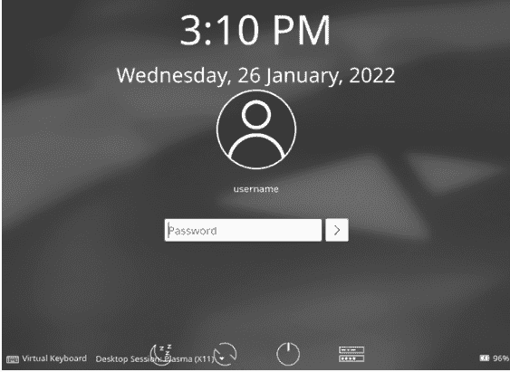

`KDE Neon` 的登录界面。

输入您的用户名和密码以访问系统，将出现一个带有以下图标的黑色屏幕。

`KDE` 桌面的第一个界面所示：

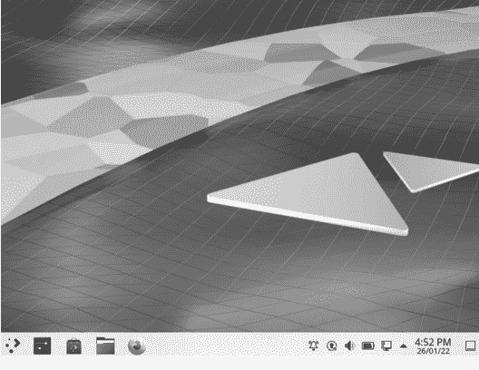

`KDE` 的第一个界面。

## 应用

| 应用 | 描述 |
|---|---|
| `KSysGuard` | 系统监器 |
| `K3b` | 磁盘刻录 |
| `KolourPaint` | 画画程序 |
| `KWrite` | 文本编辑器 |
| `KColorScheme` | 颜色选择 |
| `KFind` | 查找文件/文件夹 |
| `KRuler` | 屏幕尺子 |
| `KCalc` | 科学计算器 |
| `Discover` | 软件中心 |
| `Plasma System Monitor` | 系统监器 |
| `KBlocks` | 俄罗斯方块游戏 |
| `KNetWalk` | 网络构造游戏 |
| `Kigo` | 围棋游戏 |
| `Palapeli` | 拼图游戏 |
| `KSquares` | 连点成正方形 |
| `Kubrick` | 基于魔方的 3D 游戏 |
| `KAtoxic` | 类推箱逻辑游戏 |
| `KBounce` | 弹球游戏 |

# KDE Plasma 桌面环境

## KDE 的特性

`KDE Plasma` 最近引入了大量功能，即使是长期的 `Plasma` 用户可能并不知。以下是你可能不知道的 `KDE Plasma` 特性列表。

## KRunner

这是 `Plasma` 的一个非常棒且也是我最喜欢的功能之一，但人们并不知道它的存在。默认快捷键是 `Alt + Space`，一旦激活，你就可以执行各种操作。你可以启动应用、搜索文件、运行命令等。

## 快速移动窗口

当你按住 `Super` 键时，点击窗口内的任何位置并拖动鼠标，就可以非常快速地旋转窗口。为此，你不需要使用标题栏，也不用担心意外点击到东西，因为它只会带你进入调度窗口（`Cheat Window`）。

## 快速调整窗口大小

如果你按住 `Super` 键并在窗口边缘附近点击鼠标右键并拖动，就可以非常快速地更改窗口大小。寻找鼠标正好对准窗口边缘的日子已经过去了。只要你靠近边缘，此功能就会生效。

## 放大和缩小

`KDE Plasma` 的另一个不错特性是桌面的放大和缩小。对于视觉障碍人士来说，这也是一个易于使用的功能。按住 `Super` 键并使用等号（`=` 按钮）放大图像，或使用减号（`-`）按钮缩小桌面。

## 可视桌面

虚拟桌面是 `Linux` 生态系统中常见的一种优秀功能，尽管你可能在其他地方听过它的“工作空间”（`Workspaces`）。默认情况下，`KDE Plasma` 自带一个虚拟桌面。如果你进入“系统设置 -> 工作空间行为 -> 可视桌面”，可以根据需要添加任意多个。

## 桌面网格效果

一旦你有了几个视觉桌面，就可以查看非常酷的桌面网格效果了。它的作用与“显示窗口”（`Present Windows`）相同，但它是针对你的视觉桌面的。你可以使用键盘快捷键 `Ctrl + F8` 打开桌面网格。

`Openbox` 窗口管理器中有一个大多数人通常喜欢的功能，你可以右键点击桌面并快速访问主菜单。要打开此快速应用菜单，右键点击桌面并选择“配置桌面和背景图像”。在下载窗口的侧边栏中选择“鼠标动作”。接下来，在“中键”选项旁边的下拉菜单中，将其改为“应用程序启动器”。你现在将拥有一个类似于 `Openbox` 的小型桌面菜单。

## 章节总结

在本章中，我们介绍了 `KDE Plasma` 及其特性，以及它的历史、核心项目、应用和开发。我们为初学者提供了一个单独章节，以便他们对 `KDE` 版本历史有直观的理解。

# GNOME 桌面环境

## 本章内容

- 简介
- `Gnome`
- 基于 `GNOME` 的发行版
- `GNOME` 的历史
- 优缺点

我们已经学习了 `KDE` 桌面环境（`Plasma`）。在本章中，我们将简要讨论一种名为 `GNOME` 的最佳 `GUI`。

## 简介

为了理解 `GNOME`，我们将从 `GUI` 开始。`GNOME` 是大多数 `Ubuntu` 安装的默认 `GUI`，并且（松地）基于 `Apple` 生态。`GUI`（图形用户界面）是指你可以使用鼠标、触摸板或触摸屏交互的任何内容。有各种图标和其他提示供你激活。

`GNOME` 是一种允许用户通过图标、窗口或图形与系统进行交互的图形界面。内核是 `Linux` 的心脏，而 `GUI` 是操作系统的脸面。你可以使用 `GIMP`、`VLC`、`Firefox`、`LibreOffice` 和文件管理器等 `GUI` 应用来完成各种任务。

## 什么是发行版？

“发行版”一词指的是软件包的组合。桌面包含一个窗口管理器，是一个比窗口管理器集成更高的系统。

## 开源桌面

“开源”这个短语归功于 `Linux`。很多人对此做出了贡献。

## 自由软件

“自由软件”是指尊重用户自由的软件。这意味着用户拥有自由，而不是免费的价格。

## 关键点

- 按照意愿运行程序的自由
- 自由软件可以是商业性的
- 获取源代码并进行修改的自由
- 法律考虑

接下来，我们将讨论与桌面环境相关的术语：`CLI` 和 `TUI`。下节将检查 `GUI` 及其重要组成部分。你将学习用于 `Linux` 的标准管理器和桌面环境。

## 用户界面

界面允许用户通过 `GUI` 中的图标、窗口或图形与系统进行交互。

## Linux GUI 的特性


X.Org Foundation（一个开源组织）的产品 `X` 窗口系统，是一种允许在其 `X` 服务器上构建链接的协议。你可以在许多窗口管理器或桌面环境（如 `GNOME` 或 `KDE`）中使用 `X`。

## GUI 的特性

有独特的特性和工具可以与软件交互，使 `GUI` 易于使用：

- 按钮：按下后充当程序的图形表示。
- 对话框：显示额外信息并请求用户输入的窗口类型。
- 缩略图：程序图像、功能或文件的较小化表示。
- 菜单：用户通过菜单栏提供的命令或选项列表。
- 菜单栏：包含菜单标签的小型水平条。
- 丝带（Ribbon）：设置集成了程序功能的文件菜单和工具栏。
- 标签页 (Tab)：窗口顶部的点击区域，用于显示另一个页面或位置。
- 工具栏 (Toolbar)：按钮栏，通常位于应用程序窗口顶部，用于控制软件操作。
- 窗口 (Window)：计算机显示器上的矩形区域，用于显示操作系统。

`GUI`（图形用户界面）使用图标、窗口和菜单来执行命令，例如打开、删除和移动文件。虽然在 `GUI` 操作系统中使用鼠标进行导航，但也可以使用键盘快捷键或方向键。

例如，如果你想在 `GUI` 系统上打开一个应用程序，可以将鼠标指针移动到系统图标并双击它。而在命令行界面（`CLI`）中，你需要知道相应的命令来进入程序目录、列出文件，然后使用该文件。

## GUI 的优点

`GUI` 认为基于文本的 `CLI`（如 `MS-DOS` 或 `Unix` 等操作系统的 `shell`）更具用户友好。与命令行或 `CLI` 操作系统（如 `Unix` 或 `MS-DOS`）不同，`GUI` 操作系统易于阅读和使用，因为不需要记忆命令。此外，用户不需要了解编程语言。得益于其易用性和现代的外观，`GUI` 操作系统主导了当今的市场。

## 命令行界面

`CLI` 是一种接受输入以执行特定功能的命令行程序。任何你可以通过终端中的命令使用的应用程序都属于此类。`CLI` 是一种处理应用程序的旧方式，用于执行用户需要的特定任务。`CLI` 是一种文本-视觉界面，与 `GUI` 不同，`GUI` 使用图形选项，允许用户与系统和应用交互。`CLI` 允许用户通过输入命令来执行任务。它的操作系统简单直接但并不易于使用。用户输入命令，按下“回车”键并等待响应。接收到命令后，`CLI` 会正确评估它并在同一屏幕上显示输出/效果。命令行解释器即用于此目的。

`CLI` 是伴随电话电打字机引入的。该系统基于批处理。现代计算机支持 `CLI`、批处理和单界面 `GUI`。为了充分利用 `CLI`，用户必须立即输入一组命令（逐个输入）。许多应用程序（单程序编程系统）在它们的操作员上仍使用 `CLI`。此外，像 `Forth`、`Python` 和 `BASIC` 这样的编程语言也提供 `CLI`。命令行翻译器用于使用基于文本的界面。

`CLI` 的另一个特性是命令行作为用户界面（`UI`）或 `shell` 中的字符序列使用。命令信息用于通知用户 `CLI` 准备好接受指令。`MS-DOS` 是 `CLI` 的示例。

## 终端用户界面

`TUI` 也称为基于文本的用户界面（Text-Based User Interface）。你在屏幕上看到文本；它们仅用于终端。许多用户并不熟悉这些应用程序，但有很多。基于终端的浏览器是 `TUI` 程序的极佳示例。基于终端的游戏也属于这一类。文本用户界面（也称为书写用户交互或终端用户交互）是一种基于文本的用户界面。`TUI` 与命令行通信的区别在于，像 `GUI` 一样，它们使用整个屏幕空间，且不提供逐行输出。然而，`TUI` 只使用标准文本终端中的文本和符号，而 `GUI` 通常使用高分辨率图像终端。

## GNOME

`GNOME` 是一个开源运动，是 `GNU` 项目和自由软件的一部分。它类似于在 `UNIX` 和类 `UNIX` 系统上运行的 `Windows` 桌面系统。它不同于任何其他窗口管理器。当前版本运行在 `Linux`、`FreeBSD`、`IRIX` 和 `Solaris` 上。`GNOME` 项目提供两个东西：

- `GNOME` 桌面环境：为用户提供的内置且具有吸引力的桌面。
- `GNOME` 开发平台：一个用于构建应用程序并集成到桌面其余部分的综合框架。

所以，`GNOME` 是一种帮助用户开发桌面以及可用于 `GNU` 的软件。

# Ubuntu GNOME Remix

`Ubuntu GNOME` 被称为 `GNOME` Remix。它是一个作为开源和自由软件的 `Linux` 发行版。它被用作 `GNOME 3` 桌面环境而不是带有 `GNOME shell` 的 `Unity` 图形壳。它从 `13.04` 版本开始成为 `Ubuntu` 系统的“配色”，并在 `2007` 年 `4` 月的 `17.04` 版本发布。从 `17.10` 版本开始，该发行版在标准 `Ubuntu` 中被取消，因为由于桌面环境的原因从致力于 `Unity` 转向了 `GNOME Shell`。但它不再被支持了。

# 什么是 GNOME GNU？

`1984` 年，`GNU` 项目建立，旨在使用自由软件开发一个完整的类 `Unix` 操作系统，即 `GNU` 系统。

`GNU` 内核并不完整，因此 `GNU` 与 `Linux` 一起使用。`GNU` 和 `Linux` 结合形成 `GNU/Linux` 操作系统，现在数百万人在使用。

`GNU` 代表“`GNU`，而不是 `Unix`”。这意味着它是一个使用 `Linux` 内核并为用户提供开源操作系统的独立系统。

## 什么是 Linux 中的 Ubuntu GNOME？

`Linux` 是一个自由的 `Unix` 类型操作系统，最初由 `Lin Torvalds` 与世界的其他开发者共同设计。它是在 `GNU` 环境下开发的，`GNU` 遵循通用公共许可证（`GPL`）。`Linux` 的源代码是免费获取的。

最新的 `GNOME` 版本目前是最受欢迎的桌面环境之一。它为程序员和非程序员都提供了现代的用户体验。上述内容表明它是一个在通用公共许可证下的操作系统，并为用户提供了各种发行版：

- `Debian`
- `Fedora`
- `Manjaro`

# 关于基于 GNOME 的 Linux 发行版

`GNOME3` 是多个主流发行版的默认桌面环境，包括 `openSUSE`、`Fedora`、`Debian`、`Ubuntu`、`SUSE Enterprise`、`Red Hat Enterprise`、`CentOS`、`Pop!OS`、`Oracle Linux`、`Endless OS` 以及 `Tails`。最后一个 `GNOME 2` 版本的分支称为 `MATE`，是许多针对资源的发行版的默认。

建议安装 `Linux/GNU` 发行版。多个发行版提供了在安装前尝试演示的机会。下面解释了其中一些。

## 什么是 openSUSE？

它是原始 `SUSE Linux` 发行的起源，与 `SUSE Enterprise` 相比，它是基于社区的发行版。`SUSE` 公司是 `openSUSE` 的重要赞助者。这种关系类似于 `Fedora`、`CentOS` 和 `Red Hat Enterprise`。该项目使用壁虎标志来表示 `SUSE` 和 `openSUSE` 的关系。

它有两种变体：滚动更新的 `Tumbleweed` 和稳定的 `Leap`。后者与 `Arch Linux` 相同，因为它更像是一个“前沿”发行版。你可以将 `openSUSE` 作为旧的 `Linux` 系统安装，但也可以通过 `Windows Store` 中的 `WSL` 安装。

`openSUSE` 还让你可以使用原生的 `GNOME`。但与 `Fedora` 不同，它遵循一个慢得多的发布计划。你不会在最新的 `GNOME` 功能发布时立即获得它们。然而，这在技术上并不是坏事。它可以通过缓慢的发布周期投入精力使操作系统更稳定、更可靠。这使其非常适合无法在重要工作期间系统崩溃的专业人士。

现在，`openSUSE` 以两种发布模式发布：`Leap` 和 `Tumbleweed`。

每个主版本每三年发布一次，而 `Leap` 每年发布一次点版本或小更新。

`openSUSE` 项目提供了两个发行版。

- `Tumbleweed`，这是一个滚动更新发行版（`rolling distribution`）。
- `Leap`，这是一个点发行发行版（`point distribution`）。

## openSUSE 有什么？

`openSUSE` 是一个促进自由和开源软件优势的项目。它的 `Linux` 发行版非常著名，主要包括 `Tumbleweed`（经过测试的滚动发布版）和 `Leap`（具有长期支持的发行版）。

然而，启动和切换应用程序的操作与其他桌面操作系统不同。它只在屏幕顶部使用单个面板。它的会话在 `Wayland` 上启动。`openSUSE Leap` 默认使用带有 `Wayland` 的 `GNOME`。

## 什么是 Fedora？

`Fedora` 提供 `GNOME`，它是一个由使用 `Linux` 内核架构的社区构建并维护的开源操作系统。我们可以轻松地安装并使用它。`Fedora Workstation 33` 已发布，搭载了 `GNOME 3.38` 版本。`Fedora` 作为唯一的 `Linux` 发行版，创建了可以根据需要免费下载、使用和修改的操作系统。其中包含的所有功能、软件、软件包和组件都是免费的。`Fedora` 社区拥有数千名志愿者、支持者、用户和贡献者，他们通过各种在线论坛、电子邮件和 `wiki` 进行交互并相互支持。它在最近的硬件平台上提供了最新的技术，具有快速开发和发布周期。


Fedora 的默认桌面是 `GNOME`。尽管如此，你可能更偏好替代桌面环境，例如 `KDE Plasma Desktop` 或 `Xfce`。在这种情况下，你可以下载适用于常用桌面环境的 spin 版本并使用它安装 `Fedora`，并预配置好你选择的桌面环境。

在所有其他 Linux 发行版中，`Fedora` 提供了最新的 `GNOME` 体验。它是一个能在软件可用尽快为用户提供更新的生态系统。

随着 `Fedora` 的每次新发布，开发团队都会整合最新版本的 `GNOME`。它让你能够在任何其他人之前访问所有新发布的 `GNOME` 功能。

然而，由于你第一个获得所有最新软件，因此没有太多时间对其进行彻底测试。因此，当新更新发布时，请准备好面对可能偶尔出现的 `bug`。这就是为什么 `Fedora` 更别适合爱好者和电脑极客，而不是追求稳定性的普通用户。

## 什么是 Debian？

`Debian` 是最古老的 Linux 发行版，拥有大量的分支和衍生版本。它正式支持几乎所有主要的 Linux 发行版，包括默认使用的 `GNOME`。

使用 `Debian`，你将享受到最纯粹的 `GNOME` 之美。请记住，你不会像 `Fedora` 那样在最新版本发布后立即更新到最新版本。但同时，发布速度也没有 `openSUSE` 或 `CentOS` 那么慢。

总的来说，这是一个非常稳定且可靠的 Linux 发行版，非常适合初学者和高级用户。你会发现普通用户无缝地使用 `Debian` 来运行日常任务，并将其用于 Web 服务器以托管网站和应用程序。

此外，`Debian` 是规模最庞大的社区驱动型发行版。结合它已经存在了如此之久的因素，你就能获得最好的硬件和软件兼容性。

## 什么是 CentOS？

`CentOS`（社区企业操作系统）与 `openSUSE` 类似，因为它更关注稳定性，而不是交付所有的最新更新和发布。你不会获得所有的最新的 `GNOME` 功能，但你可以放心，你很少遇到 `bug` 或系统崩溃。

`CentOS 7` 上的 `GNOME 3` 桌面将为操作 Linux 系统提供图形化用户界面（`GUI`）。虽然我不建议在生产环境服务器上使用 `GUI`，但如果你将 `CentOS` 用作桌面系统，它是一个很好的选择。

因此，你会在企业环境中发现 `CentOS` 最多。它是 Web 托管领域最广泛使用的平台。它也受到寻求成熟可靠且发布周期较长的系统的开发者和大企业的青睐。

## 什么是 Arch Linux？

`Arch` 默认不带 `GNOME`。它完全不带任何桌面环境。它是一个轻量且灵活的 Linux 发行版，允许你使用喜欢的工具和软件构建你自己的 Linux 体验。你只需要在你的 `Arch` 系统上安装 `GNOME shell` 即可大功告成。由于该操作系统不带任何额外的自定义或扩展，你可以放心获得最纯粹的体验。

但尽管如此，你需要理解的是你将需要手动安装 `GNOME`，它不会自动替你完成。此外，如果操作系统出现任何问题，你需要具备足够的知识来自己修复，或者通过在线论坛寻找解决方案。

即使是安装 `Arch Linux` 也比其他 Linux 发行版更令人生畏得多。

## 什么是 Manjaro GNOME 版？

`Manjaro` 基于 `Arch Linux`，并提供多种变体，包括 `GNOME` 版本。`Manjaro` 的魅力之处在于，你获得了 `Arch` 的自由和灵活性，但同时已经内置了 `GNOME`。你不需要担心单独安装 `GNOME` 和其他依赖项，这使得过程变得更加方便且对用户友好。

通过 `Manjaro GNOME` 版本，你开箱即用即可获得最新的 `GNOME shell` 桌面以及实用的软件。但尽管如此，`Manjaro` 上的 `GNOME` 桌面经过了微定制，与 `Arch` 那种可以获得原版 `GNOME` 的体验不同。此外，它不会在最新版本 `GNOME` 发布后立即为你更新，你需要等待几周。

## 什么是 Pop!OS？

`Pop!OS` 基于 `Ubuntu`，由 `System76` 构建并分发给他们的电脑。但现在，它是一个独立产品，你可以下载并安装在任何电脑上，而不一定是从他们的制造商处购买。

`Pop!OS` 最棒的一点是，安装后即可开箱即用，支持 `AMD` 和 `Nvidia` `GPU`。例如，你不需要手动安装驱动程序。这使其成为 Linux 上最适合游戏的发行版之一。

像 `Ubuntu` 一样，`Pop!OS` 自带自定义的 `GNOME` 桌面，但并没有过度美化。相反，它让 `GNOME` 感觉更加简洁、直观。

## 什么是 Zorin OS？

它是另一个基于 `Ubuntu` 的 Linux 发行版，专为初用户设计。它带有自定义的 `GNOME` 版本，允许你在类 `Windows` 或类 `macOS` 界面之间切换。取决于你选择哪种界面，它将带给你与你旧操作系统熟悉的界面。

你还将开箱获得 `Wine` 和 `PlayOnLinux`。它允许你在 Linux 系统上运行 `Windows` 应用程序，包括 `Adobe` 软件和整个 `Office` 套件。

由于 `Wine`，你喜欢的只有 `Windows` 版本的游戏也可以在 `Zorin OS` 上运行，但由于运行在兼容层上，可能没有经过优化。它遵循 `Ubuntu` 的长期支持周期，因此下一个 `Ubuntu` 发布后就会新的 `Zorin OS` 版本。

## 什么是 Mageia？

`Mageia` 是已停止 `Mandriva Linux` 的分支。`KDE` 是 `Mageia` 的默认桌面环境，但也可以选择 `GNOME`，它将给你纯正的 `GNOME` 体验。它不像列表其他发行版那样受欢迎，但正在获得人气——最新版本 `Mageia 7.1` 带有许多新奇的功能。`Mageia` 非常轻量且易于学者使用，对新手非常友好。但同时，它也非常灵活，提供了许多资深 Linux 用户会欣赏的功能。它支持庞大的软件库，包括许多效率应用和游戏，因此你可以在该发行版上运行几乎程序。

## 什么是 Ubuntu？

`Ubuntu 20.04 LTS` 版本包含了经过微调的 `GNOME 3.36`，而 `Ubuntu 20.10` 带有微调的 `GNOME 3.38` 版本。当我们安装 `GNOME` 会话时，可以在登录界面选择启动新的 `GNOME`。

如果你正在接触 Linux，你一定听说过 `Ubuntu`。它是最流行的 Linux 发行版。它是如此流行，以至于大多数非用户认为它就是 Linux 的同义词。

## 82 Linux

当年，`Ubuntu` 发布了其自定义的桌面环境——`Unity`。但从 `Ubuntu 17.10` 开始，`Canonical`（`Ubuntu` 的开发者）已切换到 `GNOME shell`。

话虽如此，`Ubuntu` 使用了深度修改的 `GNOME` 版本，以保持其 `Unity` 桌面的设计美学。这对于长期使用 `Ubuntu` 的用户可能是一件好事，但对于那些希望获得开发者初衷的 `GNOME` 体验的用户来说，这并不尽人意。`Ubuntu GNOME` 的系统要求如下：

- 系统内存应为 `1.5 GB RAM`。
- 系统应配备 `1 GHz` 处理器（如英特尔赛腾）或更高配置。
- 访问互联网会有帮助（在安装期间安装更新）。
- 你可以使用 `USB` 端口或 `DVD/CD` 驱动器作为安装介质。

不同的发行版专注于不同的领域，因此你可以选择一个符合你需求和要求的版本。如果你正在寻找原汁原味的 `GNOME`，`Fedora` 或 `Arch` 都能在最新功能发布后立即获取所有特性。另一方面，如果你追求更高的稳定性，`Debian`、`openSUSE` 和 `Mageia` 是完美的替代方案，而 `CentOS` 则凭借其长期发布周期成为最稳定、可靠的选择。

然而，假设你想处于折中状态，在不牺牲稳定性的情况下及时地使用新功能。在这种情况下，你可以使用 `Manjaro` 或 `POP!OS`，这两者对新手都非常友好。最后，如果你是因为其功能而使用 `GNOME` 且不在乎它的外观，这两个版本都能为你提供一个高度定制的 `GNOME` 桌面，而且充满了实用的功能并欢迎新用户。

## GNOME 历史

该项目最初作为一个非官方的“重混版”启动，因为一些用户优先在 `Unity` 上使用 `GNOME 3` 桌面。`GNOME 12.10` 版本 `Quantal Quartz` 是 `2012 年 10 月 18 日`发布的初始版本。`Ubuntu` 创始人马克·舍特沃（`Mark Shuttleworth`）和 `Canonical` 执行主席在 `2017 年 4 月 5 日`宣布，`Ubuntu` 主线版本从 `18.04 LTS` 版本开始将从 `Unity` 转向 `GNOME 3` 桌面。使其与 `Ubuntu GNOME 3` 完全相同。之后，人们发现 `Ubuntu 17.10` 将是第一个使用 `GNOME` 的版本。

`2017 年 4 月`，马克·舍特沃明确指出，“`Ubuntu GNOME` 的目的是分发一个出色的 `GNOME` 桌面并配备 `Ubuntu GNOME` 支持团队，而不是为了这一努力与之竞争或有所不同。”在 `Ubuntu` 发布将桌面环境从 `Unity` 切换到 `GNOME` 的公告后，`GNOME` 开发者于 `2017 年 4 月 13 日`透露，发行版将从 `17.10` 版本开始合并到 `Ubuntu`。


GNOME 3 现在是许多 Linux 发行版的默认桌面环境，包括 Ubuntu、SUSE Linux、Red Hat Linux、Fedora、Debian、CentOS、Oracle Linux、Endless OS、Tail 以及 Solaris（一种 Unix 操作系统）。最后一个 GNOME 2 的分支被称为 MATE。

GNOME 1 的发布看起来与 Windows 98 非常相似，这是一个明智的决定，立即为新的 Linux 用户提供了一个熟悉的图形界面。GN 1 提供了桌面管理和集成，而不只是简单的窗口管理。文件和文件夹可以拖到桌面上，提供便捷访问。这是一次有力的进步，许多主流 Linux 发行版都将 GNOME 包含在默认桌面。最后，Linux 有了真正的桌面。我们将在其他章节中讨论 GNOME。

随着时间的推移，GNOME 继续演进。2002 年，GNOME 2 是一个重大的发布。他们清理了用户界面并调整了整体设计。GNOME 2 没有在屏幕底部使用单一工具栏或面板，而是在顶部使用两个面板，底部使用一个。顶部面板包含了 GNOME 应用程序菜单、操作菜单以及常用应用程序的快捷方式。底部面板提供了运行中程序的图标，以及系统上可用的其他工作区域的表示。使用两个面板提供了更整洁的界面，将“你可以做的事”（顶部面板）和“你正在做的事”（底部面板）隔离开。

许多人也有同感，GNOME 2 成为了 Linux 桌面的标准。连续的版本对 GNOME 的用户界面进行了增量改进，但“你可以做的事”和“你正在做的事”这一设计理念保持不变。

尽管 GNOME 取得了成功并广受欢迎，但 GNOME 团队意识到 GNOME 2 对许多人来说变得难以使用。应用程序的启动菜单需要多次点击。工作空间难以使用。打开的窗口很容易在堆叠的其他应用程序窗口下丢失。2008 年，GNOME 团队着手更新 GNOME 界面。这一努力产生了 GNOME 3。

GNOME 3 移除了传统的任务栏，取而代之的是显示所有运行应用程序的概览（Overview）模式。用户不再使用启动菜单，而是通过顶部黑条中的“活动（Activities）”热键启动应用程序。通过屏幕左侧的收藏应用程序启动器选择“你可以做的事”，通过已打开应用程序的窗口表示选择“你正在做的事”。

自发布以来，GNOME 3 团队对其进行了改进并使其更易用。GNOME 3 现代、熟悉、引人注目，并平衡了功能与实用。

## GNOME 1 (1999)

GNOME 由 Miguel·de·伊萨（Miguel de Icaza）和 Federico·梅纳（Federico Mena）于 1997 年 8 月 15 日作为一个自由软件项目发布；他们开发了一个桌面环境以及相应的应用程序。它的建立部分是因为日益受欢迎的 K 桌面环境（KDE）依赖于 Qt 工具包，而 Qt 在 2.0 版本之前一直被用作专有软件许可。GNOME 使用 GTK（称为 GNOME 工具包）取代了 Qt。在 1999 年，GNOME 遵循通用公共许可证（GPL）分发。GNOME 的许多库遵循 LGPL，而应用程序遵循通用公共许可证。

> “GNOME 是一个灵活的图形界面，结合了易用性和可靠性。我们对 GNOME 的未来感到非常兴奋，”GNOME 设计师 Miguel de Icaza 说。

GNOME 设计旨在移植到 Unix 系统。它运行在 Linux、BSD 变体、Solaris 和 Digital Unix 上。它允许用户为文件或 URL 分配图标。它具有支持拖放的桌面，最近支持了 17 种语言。

### GNOME 桌面环境 83

适用于各种脚本和编译语言，包括 Ada、`C++`、`Objective-C`、`Perl` 和 `Guile`。

“GNOME 是迈出的一大步，为自由软件基金提供一系列出色的 GNOME 桌面。我们都对 GNOME 的方向感到兴奋，”自由软件基金创始人兼主席理查德·斯托曼（Richard Stallman）说道。“自由软件包括运行、复制、分发、学习、改进任何根据通用许可证分发的软件的自由。它将为程序员和用户创建一个充满活力的环境。我们将看到广泛的 GNOME 应用程序来满足计算机用户的需求。”

GNOME 可以 `http://www.gnu.org`、`http://www.gnome.org` 以及其他镜像站点免费获取。它也被包含在 Red Hat Software, Inc. 的 GNU/Linux 发行版中，未来还有更多来源。

## GNOME 2

它于 2002 年 6 月发布，看起来与传统界面非常相似，提供了一个用户可以使用虚拟对象（如窗口、图标和文件）的简单桌面。它使用 `Sawfish` 作为默认窗口管理器，后来切换到 `Metacity`。在 GNOME 2 中，处理窗口、应用程序和文件的方法与现代桌面操作系统类似。在 GNOME 2 的默认配置中，桌面有一个启动菜单用于快速访问安装的程序位置；任务栏可以位于屏幕底部。右上角有一个通知区域，用于显示后台运行程序。因此，所有这些功能都可以根据需要放置在任何位置或方向、替换或删除。GNOME 2 提供了与传统桌面类似的功能。

GNOME 2 现在是 `OpenSolaris` 的默认桌面，而 `MATE` 桌面环境是 GNOME 2 代码的分支。

`1.0` 是一个完整的、无障碍且易于使用的桌面环境。除了基础桌面功能外，它还是一个健壮的应用程序框架。

### 86 Linux

开发者、对象嵌入支持以及无障碍功能。GNOME 2 是 GNU 项目的一部分，是一项自由软件。

`GNOME 2.0.2` 平台包含一个完整的库，用于支持 GNOME 应用程序。它还包含了日常计算所需的所有实用程序，从一个简单的天气监测器到强大的管理器。`GNOME 2.0.2` 兼容多个平台，包括 GNU/Linux、Solaris、HP-UX、Unix 和 BSD。

GNOME 2 的开发周期允许了若干改进性能和易用性的功能。它还包含一个开发者可以利用的健壮新框架。

GNOME 2 的某些特性包括：

- 改进的字体和图形
- 易用性
- 性能
- 键盘导航
- 无障碍
- 国际化
- `XML`

#### 改进的字体和图形

- 字体可以进行抗锯齿处理（熟悉的图形设置）。
- `GTK` 应用中不再有闪烁。
- 图像通过 `MMX` 和 `RENDER` 扩展加速，使用整个 Alpha 通道合成到背景上。
- 有了新的增强图标。

#### 易用性

精简、一致性和连贯是 GNOME 2 易用性工作的重点。

- 精简：GNOME 2 已经过简化，不再需要添加流水线。界面杂乱曾让 GNOME 变得你几乎在字面上可以“少少即是多”。GNOME 2 移除了许多晦涩或很少使用的功能。作为交换，你会发现你关心的功能更容易访问，因为不再有数百万其他项目在遮挡它们。
- 一致性：按照统一模式行为的界面更容易学习、使用速度更快，且不易出错。GNOME 界面指南有助于让 GNOME 2 界面更具预测性，提高了应用程序之间的一致性，并在特定应用程序中推广可用模式。
- 连贯性：GNOME 2 桌面从“登录”到“注销”都非常契合；无数的头脑风暴小时和不知疲的黑客工作产生了一个桌面，而不仅仅是松散的模块集合。

#### 特定的用户可见改进包括

1. 菜单和面板
2. 对话框
3. 图标和主题
4. 应用程序

#### 菜单和面板

- 可以使用工作区切换小组件在工作区之间拖动窗口。
- 菜单在尺寸过大时会自动滚动。
- 更具创新的菜单可以适应鼠标对角线移动。

#### 对话框

- 文件选择器在选择不同文件夹时不会忘记名称。
- 更新后的颜色和字体选择器。
- 新的“运行程序”对话框带有命令补全功能。
- 文本字段包含剪切、复制和粘贴文本的右键菜单。

#### 图标和主题

- 新的内置图标和调色板。
- 支持对内置图标进行主题化。
- `CD` 播放器和登录界面现在可以自定义主题。
- 吸引人的默认外观。

### 应用程序

- 重新设计且更易使用的搜索工具。
- 全新的轻量级帮助应用 `Yelp`。
- 它可以控制中心应用来管理 GNOME 2 属性，这些属性已经过大幅简化并减少了数量。
- 它与 `freedesktop.org` 标准的兼容性日益提高。
- 重写的终端应用程序，支持标签和配置文件。
- 全新的动态、中心化配置系统。
- 许多应用程序已重命名以更好地符合其用途。

## GNOME 3

它于 2011 年发布。虽然 GNOME 1 和 2 界面遵循经典的桌面类比，但 `GNOME Shell` 采用了更抽象的隐喻，具有流化的窗口管理流，统一头部取代了菜单栏、任务栏和工具栏，默认隐藏最小化和最大化按钮。

GNOME 3 为核心软件带来了许多增强。许多 GNOME 核心应用程序经过了重新设计，以提供更一致的用户体验，`Mutter` 代替 `Metacity` 成为默认窗口管理器。`Adwaita` 代替 `Clearlooks` 成为默认主题。

### GNOME 的特性

GNOME 已成为 Linux 系统最高效、稳定可靠的桌面之一。不仅如此，它极其友好。大多数用户无论如何都体验过这一点，无需任何额外努力就能通过 GNOME 获得惊人的速度。因此，让我们来看看 GNOME 的细节并了解它的强大特性。

### 让我们它的特性


- Flatpak：这似乎是 Linux 发生过的最好的事情之一。它让开发者能够轻松在每个 Linux 发行版上发布应用。新的 GNOME 包含了 `GTK+` 主题处理和语言配置支持。

- 新的 Boxes 特性：`Boxes` 内置应用可以运行远程和本地安装的虚拟机。因此，你不需要安装 `VMware` 或 `VirtualBox` 等任何虚拟机来尝试其他 Linux 发行版。它会自动从 Boxes 助手处下载操作系统；你只需要选择想要使用的 Linux 发行版，`Boxes` 将完成剩下的工作。

- 活动概览 (Activities Overview)：GNOME puzzle 的关键组成部分之一是活动概览。活动界面是你访问应用程序启动器、最小化应用程序、搜索和虚拟桌面的地方。

- 多媒体应用：`照片`应用具有新的导入功能，允许你从 `SD` 卡和 `USB` 闪驱动器将照片添加到库中。应用现在可以自动检测带有新图像的存储设备，提供将图片整理到专辑的选项，通过视频播放器处理 `JPEG` 视频文件并在音乐应用中通过拖放重新排序播放列表。游戏应用有一个令人兴奋的功能。

- `Dash` (启动栏)：如果你不想让应用程序出现在 `Dash` 上，右键点击图标并选择“从收藏夹移除”。对于打开概览的应用，你可以滚动查看已安装的应用程序以找到你寻找的内容。要单击即可将应用程序添加到 `Dash`，右键点击应用程序并选择“添加到收藏夹”。

- 文件管理器：`Files`（文件管理器）有许多改进。此功能允许批量重命名文件。此外，压缩文件功能也集成到了 `Files` 中。还添加了许多用户界面改进。

- `Files` 中的收藏：在 `Files` 中，你可以选择文件和文件夹并将它们添加到收藏列表，以便如上所示快速查看它们。

- 夜间模式 (`Night Light`)：它是 `GNOME` 的主要功能。它正如广告所说，根据时间微妙地调整显示器的色温。白天，你看到的色彩和以前一样。晚上，屏幕温度变得更冷更亮，蓝光更少。蓝光过滤有助于促进自然睡眠周期并减轻眼睛疲劳。

- 日历：`GNOME 日历`中的月视图让事件更具可读性。你可以展开重叠的单元格。此外，注意事件中的天气。待办列表已重构，可以通过拖放重新排序任务。

- 终端：终端也获得了一些增强。注意重新设计的偏设置窗口。不再有独立的偏设置；配置文件和偏设置选项已合并为一。你还会看到闪烁文本。

- 搜索：`GNOME` 搜索工具非常强大。它不仅可以在应用程序概览中搜索已安装的应用程序，还可以在 `GNOME 软件`中搜索尚未安装的应用程序。

- `GNOME` 美化：通过增强的 `Cantarell` 默认界面字体，`GNOME` 看起来更加时尚和漂亮。字符形状和间距得到了改进，使文本更具吸引力。

- 更精彩的 Web：`Web` 是 `GNOME` 的默认浏览器，经常被那些倾向于使用更知名应用（如 `Firefox` 或 `Google Chrome`）浏览网页的用户忽略。在 `Web` 上书签网页只需点击一次。新的书签弹出框让访问现有书签变得简单，管理、编辑和标记书签的新界面将迎合喜欢保持秩序的人。

- 更好的设备支持：`GNOME` 集成了 `Thunderbolt 3` 连接支持。增加了安全检查以防止通过未经授权的 `Thunderbolt 3` 连接导致的数据泄露。当激活时，顶栏会显示 `Thunderbolt 3` 连接状态。

### 触摸板

使用手势进行辅助点击，这等同于鼠标的右键操作。将一个手指按在触控板上，用另一只手指轻点即可使用该动作。

- 时钟应用：现在，可以在你的世界时中添加 `UTC` 时区了。

- 更好的图标（Better Icons）：`GNOME` 桌面经常在某些领域表现短板。它包含了一组高分辨率图标，以确保在高密度显示器上一切看起来都非常锐且细节丰富。许多重新设计的、`MIME` 类型和应用程序图标具有更加明亮、整洁且现代的外观。

- “使用”（Usage）应用：`GNOME` 带来了一个名为“使用”的新技术预览应用。通过此应用，你可以查看 `CPU` 和 `RAM` 占用以及突出显示的问题区域。这是一个很棒的功能，可以帮助你比以前更快地排除故障。该应用计划在未来的更新中加入更多功能。

- 截图：另一个大功能是内置的截图支持。它通过热键驱动，允许你将全屏、活动窗口或屏幕区域捕获到剪贴板，或直接保存到 `$HOME\Pictures\Screenshot-*` 下的 `PNG` 文件。

- 全新的屏幕键盘：屏幕键盘已在 `GNOME` 中完全重写。新键盘对用户友好，并且在选择文本时会自动弹出。视图会退让以确保你可以看到正在输入的内容。

- 极简设计：大多数界面都包含许多与当前任务无关的屏幕元素。`Windows` 和 `Chromebook` 底部有任务栏，包含所有喜爱的或打开的应用程序。在 `GNOME` 上，顶部的面板不包含任何应用启动器。面板很小且呈黑色，类似于手机或平板电脑。它在右上角包含日期、时间以及几个系统指示器。

## GNOME SHELL

它是 `GNOME` 桌面环境的图形外壳，于 2011 年 4 月 6 日发布的 `GNOME 3` 版本。它提供了基本功能，如启动应用程序、切换窗口和小部件引擎。`GNOME Shell` 取代了 `GNOME Panel` 和 `GNOME 2` 的一些辅助组件。`GNOME Shell` 使用 `C` 语言和 `JavaScript` 编写，作为 `Mutter` 的插件。

与 `KDE Plasma Workspace`（一种旨在为设备创建多个图形外壳的软件框架）相比，`GNOME Shell` 设计用于通过键盘和鼠标操作的大屏幕桌面电脑，以及通过键盘、触控板或触摸屏操作的小屏幕便携式电脑。然而，`GNOME Shell` 的一个分支 `Phish` 在 2018 年创建，专门用于触摸屏手机的专业化。

## GNOME Shell 历史

`GNOME Shell` 的第一个版本创建于 2008 年在波士举行的 `GNOME User Hackfest` 期间。在传统的 `GNOME` 桌面面临停滞和概念低下的指责后，该会议导致了 2009 年 4 月的 `GNOME 3.0`，因为红帽是 `GNOME Shell` 开发的主要驱动者。

`GNOME Shell` 的预发布版本于 2009 年 8 月首次推出，并于 2009 年 9 月成为 `GNOME 2.28` 的常规非默认部分。它最终于 2011 年 4 月 6 日作为 `GNOME` 的默认用户界面发布。

## 软件架构

`GNOME Shell` 集成了 `Mutter`（合成窗口管理器）和 `Wayland` 合成器。它基于 `Clutter` 提供视觉效果和硬件加速。根据 `GNOME Shell` 维护者 `Owen Taylor` 的说法，它被设置为主要用 `JavaScript` 编写的 `Mutter` 插件，并使用由 `GTK+ 3` 版本提供的 `GUI` 小部件。

## 特性

- 对用户界面的更改包括但不限于：
    - 支持 `clutter` 和 `Mutter` 多触控手势。
    - 支持 `HiDPI` 显示器。
    - 一个新的“活动”（`Activities`）概述，其中包含：
        - 一个 `Dock` 或 `Dash`，用于快速在应用程序之间切换和启动应用程序
        - 窗口选择器，类似于 `macOS` 的 `Mission Control`，还整合了工作区切换器/管理器
        - 应用程序选择器
        - 搜索
- 将窗口贴合屏幕边缘可以使其占据半屏或全屏。
- 默认情况下，只有一个窗口按钮（关闭），而不是三个。
- 由于缺乏用于最小化的面板，最小化选项已被移除。可以使用窗口上方的窗口或双击窗口标题栏来实现最大化。

它提供了核心界面功能，如启动应用程序、切换窗口或查看通知。它的优势在于了现代图形硬件的能力，并引入了创新的用户界面概念，以提供愉悦且易用的体验。`GNOME Shell` 是 `GNOME 3` 用户体验的核心技术。

`3.0–3.6` 版本为没有硬件加速的用户提供了回退模式，该模式提供 `GNOME Panel` 桌面。也可以通过系统设置菜单进行切换。`GNOME 3.8` 移除了回退模式，并用 `GNOME Shell` 扩展取代，扩展提供了更传统的视觉和感受。

`GNOME Shell` 具有以下图形和功能元素：

- 顶部栏
- 系统状态区域
- 活动概述
- `Dash`
- 窗口选择器
- 应用程序选择器
- 搜索
- 通知和消息栏
- 应用程序切换器
- 指示器托盘

## 可扩展性

可以使用用 `JavaScript` 编写的扩展来更改功能。你可以使用 `GNOME` 扩展网站查找并安装扩展。其中一些扩展托管在 `GNOME git` 上，另一些是非合法的。

## 安装

`Vanilla Gnome` 版本是一个 `GNOME` 桌面安装。

- 1. 要安装桌面环境，打开终端并执行：

```
sudo apt update
sudo apt install gnome-session
```

- 2. 如果你想要默认版本，请务必使用：

```
sudo apt install ubuntu-desktop
```

- 3. 安装完成后，请确保执行：

```
reboot
```

- 4. 安装完成后，请使用：

```
sudo apt update
sudo apt install tasksel
```


- 5. 要安装 GNOME，请使用：

```
sudo apt update
sudo apt install gdm3
```

- 6. 现在，使用 `tasksel` 安装：

```
sudo apt update
sudo apt install gnome-desktop
```

- 7. 如果你想要默认设置，请务必使用命令：

```
sudo apt update
sudo apt install gdm3
```

- 8. 重启你的系统以呈现：

```
reboot
```

GNOME 的第一个窗口所示：


# GNOME 3：优缺点

切换到 GNOME 3 既是机会也是干扰。一方面，这是一个抛中烦人行为的机会；另一方面，GNOME 3 是一种干扰，因为它的变化会影响既有的方法。

因此，在采用 GNOME 3 之前，你需要考虑它的优缺点，除非你属于那种会自动接受变化的人。

GNOME 3 包含许多更改。例如，你可能会看到改进的硬件交互，GNOME 3 在支持的机器上提供选项。这些增强很容易被忽视，尽管它们很方便，但并未成为人们对 GNOME 3 反应的主要部分。

## 优点

- 标准界面：早期 GNOME 版本是工作站和笔记本电脑设计的。这在笔记本、平板电脑和移动设备时代不再现实。GNOME 3 为所有用户设计。

- 在 GNOME 2 系列中，按字母排序的系统设置菜单分为个人和管理子菜单。GNOME 3 使用按类别组织的设置窗口减少了效率低下，更易扫描。

- GNOME 3 用活动概述屏幕上的应用程序列表取代了菜单。这些更改允许更大的图标，并消除了为了保持简短而导致项目被隐藏的问题。

- 改进的虚拟工作区显示。

- 活动界面右侧是所有打开工作区的视觉显示，显示了运行的应用程序。相比早期的 GNOME 版本有了巨大的改进。

- GNOME 3 最大的优势可能会受到抵抗。因此，GNOME 3 让一些高级功能更加突出且易于使用。

- 活动界面上的 `Dash` 更显著地显示了你的喜好，而要在屏幕之间切换则鼓励学习键盘快捷键。

## 缺点

- GNOME 3 不允许在桌面放置图标。这取决于发行版。这对一半用户来说是无关的，但对于另一半部分用户来说这是一个致命的限制。你可以学习编辑 `Gconf` —— 到目前为止，我还没有在网上找到任何说明。

- 他们要么必须学习在没有图标的情况下进行操作，要么寻找一个新的发行版。

- 你可以切换到“活动”（`Activities`）屏幕来打开应用程序。选择一个会立即让你切换到工作区的应用程序意味着你必须切换回“活动”页面才能打开任何你想同时运行的应用程序。这种限制在 GNOME 2 系列的经典菜单中也存在，但在 GNOME 3 中需要多得鼠标点击。

## 本章总结

在本章中，我们涵盖了 GNOME 并介绍了它的某些功能。我们讨论了它的历史、核心项目、应用程序和开发情况。我们还专门提供了一个关于 GNOME 版本历史历史的章节。


## xfce 桌面环境

## 本章内容

- 简介介绍

- 版本历史

- `xfce` 核心桌面组件

- `xfce` 安装

- 优点与缺点

在上一章学习了 GNOME 之后，我们将在本章中简要讨论名为 `xfce` 的基于 Linux 的操作系统。主要来说，它是一个官方的 Linux OS，并具有各种功能。

## 简介

Olivier Fourdan 开发了 `xfce` 桌面环境，始于 1996 年底。他的职业生涯始于技术生产、Web 开发和嵌入式 Linux 系统。Fourdan 从 2007 年起一直为 Red Hat 工作，但在 2013 年至 2014 年间在 Intel 中中断了两。自 2017 年以来，他活跃于采用 `Wayland`，开发许多不同的组件，包括 `GTK`、`Mutter`、`GNOME Control Center`、`XWayland` 和 `Mesa3D`。

## 版本历史

### 早期版本

`xfce` 起于一个使用 `XForms` 构建的简单项目。Olivier Fourdan 在 `SunSITE` 发布了该程序——一个简单的任务栏。Fourdan 继续开发该项目，并于 1998 年发布了 `xfce` 2，附带第一个版本的 `xfce` 窗口管理器 `Xfm`。他请求将该项目纳入 Red Hat Linux，但由于其基于 `XForms` 基础而被拒绝了。Red Hat 只接受根据 `GPL` 或 `BSD` 许可证许可的开源软件，而当时 `XForms` 是闭源且仅供个人免费使用的。由于同样的原因，`xfce` 在 3 版本之前在 Debian 中可用，且 `xfce` 仅在 Debian 存储区域发行。

1999 年 3 月，Fourdan 开始基于 `GTK` 重写该项目，`GTK` 是一种日益受欢迎的非专利工具包。结果是 `xfce` 3.0，采用 `GPL` 许可。该项目获得了 `GTK` 拖放支持、原生语言支持、改进的自定义功能以及全功能软件支持。`xfce` 于 2001 年 2 月上传到 `SourceForge.net`，从 3.8.1 版本开始。

### 现代 xfce

`xfce` 4 桌面显示了各种 `Xfwm` 效果：窗口下的阴影、透明边缘窗口和面板。

在 2003 年 9 月 25 日发布的 4.0 版本中，`xfce` 升级到了 `GTK` 2 库。它具有内置的透明度和投射效果以及默认的 `SVG` 图标集。2007 年 1 月，发布了 `xfce` 4.4。它包含了 `Thunar` 文件管理器取代了 `Xfm`。添加了桌面缩图支持——同时，对面板进行了各种改进，以防止错误的插件导致整个面板崩溃。2009 年 2 月，发布了 `xfce` 4.6 版本。该版本具有新的配置后端、新的设置管理器和一个音频控制器，并对会话管理器和 `xfce` 的核心组件进行了若干重要改进。

`xfce` 4.8 于 2011 年 1 月发布。该版本包含了 `ThunarVFS` 与 `GIO`、`udev`、`ConsoleKit` 和 `PolicyKit` 的交换，以及使用几种协议（包括 `SFTP`、`SMB` 和 `FTP`）的新网络浏览服务。通过将所有 `Thunar` 文件对话框合并到一个对话框中，减少了窗口数量。面板应用程序经过重写，以提供更好的配置、亮度、对象管理和启动器 4.8，并引入了查看目录的新插件。4.8 插件框架始终兼容 4.6 插件。4.8 显示配置对话框支持 `RandR`。

## xfce 桌面环境 ■ 101

1.2. 它会自动检测屏幕并允许用户选择他们偏好的设置、刷新率和显示旋转。许多显示器可以在克隆模式下工作或并排放置。键盘选择已更新，使其越用越方便。此外，手动设置也经过手动编辑以提高效率。

4.8 开发周期是第一个实现根据 2009 年 5 月在 Ubuntu 桌面开发的“`xfce` 发布与开发模型”后开发的新策略的版本。使用了一种新的网络系统来简化发布管理，配备专用的传输服务器并由 `xfce` 事务处理器编辑。项目服务器和端口基础设施也得到了升级，以满足 4.8 发布后的预期需求。

`xfce` 4.10 于 2012 年 4 月 28 日发布，引入了面板的直接显示模式并将大部分 `wiki` 发布到互联网。该版本的主要重点是改进用户体验。

`xfce` 4.12 在 Fedora 22 上的桌面操作：注意文件管理器已用 `GTK` 3 重写。（注：原文 OCR 文本存在大量重复，我已根据逻辑流进行了清理）。

## XFCE 主要组件

`xfwm4` – 窗口管理器

在 `xfce4` 中，窗口管理器是 `xfce` 桌面环境的一部分。在前台运行运行的命令是 `xfwm4`；若要在后台启动它，请使用 `xfwm4-daemon`。它负责在屏幕上排列窗口、提供窗口装饰，并允许对窗口进行移动、调整大小或关闭。

`Xfwm4` 严格遵守 `freedesktop.org` 设定的标准。因此，特殊功能（如打开窗口或提供应用图标）现在应该在应用程序中实现；你不再需要通过窗口来强制不同的行为。`xfwm4` 的优秀特性之一是易于处理；可以在 `xfce-Look` 上获取主题（边框、标题栏和窗口按钮），并可以使用窗口管理器主题进行调整。`xfwm4` 为单显示器和多显示器模式提供多头部支持，如果你的系统连接了多个显示器，这会非常有帮助。`xfwm4` 可以独立运行，但如果以这种方式使用，则需要 `xfce` 设置管理器作为 `GUI` 来更改配置。除管理窗口以外的任务（如设置背景图像或启动程序）需要通过其他模块完成。

`Xfwm4` 与其集成管理器整合，使用了新的 `X.Org` 服务器扩展。合成器（`Composer`）就像一个独立的窗口管理器（`WM`）；它持有各种窗口，监控所有类型的 `X` 事件，并做出相应响应。嵌入在窗口中的集成控制器有助于保持视觉效果与窗口事件的同步。如果你想使用合成器，必须使用 `configuration-compositor` 选项创建 `xfwm4`。无论何种情况，你都可以在启动 `xfwm4` 时使用“`compositor = off`”参数来禁用合成器。它控制程序窗口在屏幕上的位置，提供窗口装饰，并管理虚拟工作空间或桌面。

## Xfwm4 行为

- 赋予窗口焦点

- 窗口最大化/取消最大化

- 调整窗口大小

- 隐藏/显示窗口


- 最小化/取消最小化窗口

- 固定/取消固定窗口

- 置顶/置底

- 移动窗口

- 将窗口移动到另一个工作空间

- 关闭窗口

# xfce 桌面环境 ■ 105

## xfce 面板 – 面板

面板是一个条，始终允许程序启动器、面板菜单、时钟、桌面切换器等。

它是 xfce 桌面环境的一部分，包括应用启动器、面板菜单、工作空间切换器等。许多面板功能可以通过 GUI、GTK + 样式布局以及 Xfconf 隐藏设置进行自定义。

面板通常会在你启动 xfce 会话时作为其一部分自动启动；当你手动启动时，可以在终端中使用 `xfce4-panel`。如果面板是首次启动，它将为你提供以下选项：

## 使用默认设置

这将引入带有大多数自动化插件的默认面板配置。它为规划和制作你的配置提供了一个良好的开始。

## 一个空面板

它将给你提供一个空白的单面板窗口，一旦你知道自己想要什么样的配置，这非常有帮助。

## 内部插件

面板中使用的各种内部插件如下所示：

- 操作按钮 (Action Buttons)：向面板中添加系统操作按钮
- 程序菜单 (Program Menu)：添加一个包含已安装程序类的菜单
- 时钟 (Clock)：面板时钟插件
- 目录菜单 (Directory Menu)：在菜单中显示目录树

## Linux

- 启动器 (Launcher)：带有你自定义菜单的应用启动器
- 通知位置 (Notification Location)：通知图标出现的位置
- 分隔符 (Separator)：在面板插件之间添加分隔符或空格
- 显示桌面 (Show Desktop)：它可以隐藏所有窗口并显示桌面
- 窗口按钮 (Window Buttons)：使用按钮在打开的窗口之间切换
- 窗口菜单 (Window Menu)：使用菜单在打开的窗口之间切换
- 工作空间切换 (Workspace Switch)：在虚拟桌面之间切换

### 外部插件

面板中使用的外部插件如下所示：

- 电池 (Battery)：兼容 APM、ACPI 和 BSD 的 xfce4 监控插件
- 计算器 (Calculator)：xfce 面板计算器管理器
- 剪贴板 (Clipman)：xfce 剪板管理器
- CPU频率 (Cpufref)：显示 CPU 控制器信息以及系统支持和使用的频率
- CPU 图 (Cpgraph)：提供多种显示模式（LED、渐变、火焰等）来显示系统当前的 CPU 负载
- 日期时间 (Date Time)：在面板上显示日期和时间，左键点击时会出现日历
- 磁盘性能 (Diskperf)：显示磁盘性能/快速分区（每秒字节数）
- 嵌入 (Embed)：将无用应用的窗口嵌入面板
- 眼睛 (Eyes)：眼睛正在监视你
- 磁盘守护 (Fguard)：扫描选定的空闲磁盘空间
- 生成监控 (Genmon)：显示脚本/程序，捕输出 (stdout)，并在面板中显示生成的线程
- 参考 (Reference)：这是一个由 Mark Trompell 编写的小型插件，用于持续显示来自各种应用程序的信息
- 邮件时钟 (Mail Clock)：多线程、多邮箱、多协议插件，用于不时检查电子邮件
- 挂载 (Mount)：这是一个面板挂载/卸载工具
- MPC：MPD 客户端插件，音乐播放守护
- 网络负载 (Netload)：显示社交媒体的当前负载，目前运行在 `Linux, BSD, Sun Solaris, HP_UX 和 macOS X` 上
- 备注 (Notes)：为你的电脑提供便利签
- 位置 (Locations)：可以访问文件夹、文档和可移动媒体菜单
- PulseAudio 插件 (PulseAudio Plugin)：调整 xfce 桌面上的音量并控制媒体播放器
- 示例 (Sample)：示例插件开发者可以作为新面板插件的基础上
- 传感器 (Sensors)：硬件面板硬件插件
- 智能书签 (Smart Bookmark)：允许你直接在线搜索 Google 或 Debian Bugzilla 站点
- 状态通知器 (Statusnotifier)：为状态通知项（应用引用）提供面板位置
- 秒秒表 (Stopwatch)：跟踪过去
- 系统负载 (Systemload)：显示当前 CPU 负载、工作内存、交换空间和系统关机运行时间
- 时间 (Time)：允许用户在特定时间激活闹钟或结束计算时间
- 时间到 (Time Is Up)：每隔 X 分钟从电脑前休息
- Verve：用于 xfce 面板的免费命令行插件
- Wavelan：显示来自本地局域网无线接口的统计数据（信号状态、信号质量、网络名称 (SSID)）。支持 `NetBSD, OpenBSD, FreeBSD 和 Linux`
- 天气 (Weather)：使用 `xoap.weather.com` 天气数据显示当前温度和天气
- 快速访问菜单 (Wiskermenu)：提供访问收藏、最近使用和搜索已安装应用的菜单
- Xkb：设置并使用多个键盘布局（由于 X11 协议限制，目前最多 4 个）

## xdesktop 使用 – 桌面管理器

桌面负责绘制桌面背景（或“壁纸”）以及桌面上的图像。

### 背景

背景由纯色或渐变组成，并在上方有一个（可选的）挂载层。图像可以使用多种方式辅助屏幕，例如放大、缩放、等比例、居中或倾斜。可以使用颜色或双色渐变代替图片作为桌面背景。渐变可以是水平或垂直的。由于底端可以进行颜色编码且顶部有图像，你可以将两者结合，使用跨越各种颜色的图像产生刺激效果。如果图像中等或缩放且未填充正确大小，则背景颜色将显示在两侧。

### 缩略图（图标）

绘制在桌面上的图标可以是文件/启动器图标，也可以是最小化的窗口应用程序。它们可以自定义为各种大小，自定义字体和工具提示大小，并可以选择完全关闭工具提示。文件/启动器选项将文件、文件夹和启动器以图标形式显示在桌面上，可以进行编辑、组合、复制和导出，其外观感觉与普通文件管理器相同。可以通过右键点击并选择“编辑器启动器”来配置启动。

注意：你可以使用自定义文件夹图标在桌面图标中使用外部图像。

# xfce 桌面环境 ■ 109

## xf4-session – 会话管理器

`xfce4-session` 是 xfce 的会话管理器。它的工作是保存你桌面的状态（打开的应用程序及其位置），并在下次启动时恢复它。你可以创建几个不同的会话并从中选择其中一个。

1. 登录时显示选择器：一旦设置，会话管理器将允许你在每次登录到 xfce 时都选择一个会话。
2. 注销时自动保存会话：此选项指示会话管理器在用户注销时自动保存当前会话。
3. 退出时通知：此选项将禁用复选框。时间是否会被保存取决于你是否启用了自动保存退出会话。
4. 亭台模式：会话管理器提供亭台模式支持，有助于防止他人更改其会话设置。要使用它，你必须编辑或创建 `${sysconfdir}/xdg/xfce4/kiosk/kioskrc`。

定义此文件格式的方法是使用示例。你的 kiosk 文件中的 `xfce4-session` 部分可能如下所示：

```
[xfce4-session]
CustomizeSplash = ALL
CustomizeChooser = ALL
CustomizeLogout = ALL
CustomizeCompatibility = %wheel
Turn off = %wheel
CustomizeSecurity = NO
```

它允许所有用户更改其启动界面、选择器和退出设置，但仅允许 `wheel` 组中的用户自定义交互和关机设置。不允许任何人调整安全设置。

会话管理器支持以下 KIOSK 功能：

- 自定义启动界面 (Customize Splash)：允许用户自定义启动界面。

## Linux

- 自定义选择器 (CustomChooser)：它允许用户自定义会话选择器器设置。
- 自定义退出 (CustomizeGet Out)：允许或不允许用户自定义退出设置。
- 自定义兼容性 (CustomizeCompatibility)：是否允许用户自定义交互设置（KDE/Gnome 兼容性）。
- 自定义安全性 (CustomizeSecurity)：允许或不允许用户进行安全设置。这是最基础设置之一，因为它防止用户（实际上是 `libICE`）绑定 TCP 端口。
- 关机 (Shutdown)：用户是否可以关闭（重启或关机）系统，如果用户没有此权限，关机对话框中的重启选项和电源选项将显示为灰色。

### ConsoleKit

xfce 需要一个有效的 ConsoleKit 会话才能正常工作。ConsoleKit 用于系统操作，如关机、暂停和（卸）挂载设备（通过 Polkit 进行授权）。如果你在使用桌面管理器，DM 会处理该问题。对于控制台启动，情况略有不同。

进入控制台（不启动 X）时，使用 `ck-list-sessions`。确保 `works = TRUE` 且 `local = TRUE`。如果不是如此，请检查 `consolekit` 库是否已通过 PAM 加载。


# xfce 桌面环境 ■ 109

## xf4-session – 会话管理器

`xfce4-session` 是 xfce 的会话管理器。它的工作是保存你桌面的状态（打开的应用程序及其位置），并在下次启动时恢复它。你可以创建几个不同的会话并从中选择其中一个。

- 1. 登录时显示选择器：一旦设置，会话管理器将允许你在每次登录到 xfce 时都选择一个会话。
- 2. 注销时自动保存会话：此选项指示会话管理器在用户注销时自动保存当前会话。
- 3. 退出时通知：此选项将禁用复选框。时间是否会被保存取决于你是否启用了自动保存退出会话。

在 4.10 中，启动 `xfce4 --with-ck-launch`。它将使用 `ck-launch-session` 启动 `xfce4-session`。在 4.10 中，`xfce4-session` 将负责监控数据库的启动。

当 `ck-launch-session` 启动 `xfce4-session` 后，`xfce4-session` 将接管会话。如果不是如此，请检查 `consolekit` 库是否已通过 `PAM` 加载。

## 自动启动 (Autostart)

一旦 `xfce4` 启动，将使用 `ck-launch-session` 启动 `xfce4-session`。在 4.10 中，`xfce4-session` 将负责监控数据库的启动。

当 `ck-launch-session` 启动 `xfce4-session` 后，`xfce4-session` 将接管会话。如果不是如此，请检查 `consolekit` 库是否已通过 `PAM` 加载。

## 桌面设置 (Settings)

亭台模式有助于防止他人更改其会话设置。要使用它，你必须编辑或创建 `kioskrc`。

定义启动文件格式的方法。

它允许所有用户更改其启动界面、选择器和退出设置，但仅允许 `wheel` 组中的用户自定义交互和关机设置。不允许任何人调整安全设置。

## 亭台模式 (Kiosk)

- 自定义启动界面 (Customize Splash)：允许用户自定义启动界面。
- 自定义选择器 (CustomChooser)：它允许用户自定义会话选择器设置。
- 自定义退出 (CustomizeGet Out)：允许或不允许用户自定义退出设置。
- 自定义兼容性 (CustomizeCompatibility)：是否允许用户自定义交互设置（KDE/Gnome 兼容性）。
- 自定义安全性 (CustomizeSecurity)：允许或不允许用户进行安全设置。这是最基础设置之一，因为它防止用户（实际上是 `libICE`）绑定 TCP 端口。
- 关机 (Shutdown)：用户是否可以关闭（重启或关机）系统，如果用户没有此权限，关机对话框中的重启选项和电源选项将显示为灰色。

### ConsoleKit

xfce 需要一个有效的 `ConsoleKit` 会话才能正常工作。`ConsoleKit` 用于系统操作，如关机、暂停和（卸）挂载设备（通过 `Polkit` 进行授权）。如果你在使用桌面管理器，DM 会处理该问题。对于控制台启动，情况略有不同。

进入控制台（不启动 X）时，使用 `ck-list-sessions`。确保 `works = TRUE` 且 `local = TRUE`。如果不是如此，请检查 `consolekit` 库是否已通过 `PAM` 加载。

在 4.10 中，启动 `xfce4 --with-ck-launch`。它将使用 `ck-launch-session` 启动 `xfce4-session`。在 4.10 中，`xfce4-session` 将负责监控数据库的启动。

## 自动启动 (Autostart)

一旦 `xfce4` 启动，将使用 `ck-launch-session` 启动 `xfce4-session`。在 4.10 中，`xfce4-session` 将负责监控数据库的启动。

## 桌面设置 (Settings)

亭台模式有助于防止他人更改其会话设置。要使用它，你必须编辑或创建 `kioskrc`。

定义启动文件格式的方法。

它允许所有用户更改其启动界面、选择器和退出设置，但仅允许 `wheel` 组中的用户自定义交互和关机设置。不允许任何人调整安全设置。

## xf4-session – 会话管理器

`xfce4-session` 是 xfce 的会话管理器。它的工作是保存你桌面的状态（打开的应用程序及其位置），并在下次启动时恢复它。你可以创建几个不同的会话并从中选择其中一个。

- 1. 登录时显示选择器：一旦设置，会话管理器将允许你在每次登录到 xfce 时都选择一个会话。
- 2. 注销时自动保存会话：此选项指示会话管理器在用户注销时自动保存当前会话。
- 3. 退出时通知：此选项将禁用复选框。时间是否会被保存取决于你是否启用了自动保存退出会话。
- 4. 亭台模式：会话管理器提供亭台模式支持，有助于防止他人更改其会话设置。要使用它，你必须编辑或创建 `${sysconfdir}/xdg/xfce4/kiosk/kioskrc`。

定义此文件格式的方法是使用示例。你的 kiosk 文件中的 `xfce4-session` 部分可能如下所示：

```
[xfce4-session]
CustomizeSplash = ALL
CustomizeChooser = ALL
CustomizeLogout = ALL
CustomizeCompatibility = %wheel
Turn off = %wheel
CustomizeSecurity = NO
```

它允许所有用户更改其启动界面、选择器和退出设置，但仅允许 `wheel` 组中的用户自定义交互和关机设置。不允许任何人调整安全设置。

会话管理器支持以下 KIOSK 功能：

- 自定义启动界面 (Customize Splash)：允许用户自定义启动界面。

## Linux

- 自定义选择器 (CustomChooser)：它允许用户自定义会话选择器设置。
- 自定义退出 (CustomizeGet Out)：允许或不允许用户自定义退出设置。
- 自定义兼容性 (CustomizeCompatibility)：是否允许用户自定义交互设置（KDE/Gnome 兼容性）。
- 自定义安全性 (CustomizeSecurity)：允许或不允许用户进行安全设置。这是最基础设置之一，因为它防止用户（实际上是 `libICE`）绑定 TCP 端口。
- 关机 (Shutdown)：用户是否可以关闭（重启或关机）系统，如果用户没有此权限，关机对话框中的重启选项和电源选项将显示为灰色。

### ConsoleKit

xfce 需要一个有效的 `ConsoleKit` 会话才能正常工作。`ConsoleKit` 用于系统操作，如关机、暂停和（卸）挂载设备（通过 `Polkit` 进行授权）。如果你在使用桌面管理器，DM 会处理该问题。对于控制台启动，情况略有不同。

进入控制台（不启动 X）时，使用 `ck-list-sessions`。确保 `works = TRUE` 且 `local = TRUE`。如果不是如此，请检查 `consolekit` 库是否已通过 `PAM` 加载。

在 4.10 中，启动 `xfce4 --with-ck-launch`。它将使用 `ck-launch-session` 启动 `xfce4-session`。在 4.10 中，`xfce4-session` 将负责监控数据库的启动。

## 自动启动 (Autostart)

一旦 `xfce4` 启动，将使用 `ck-launch-session` 启动 `xfce4-session`。在 4.10 中，`xfce4-session` 将负责监控数据库的启动。

## 桌面设置 (Settings)

亭台模式有助于防止他人更改其会话设置。要使用它，你必须编辑或创建 `kioskrc`。

定义启动文件格式的方法。

它允许所有用户更改其启动界面、选择器和退出设置，但仅允许 `wheel` 组中的用户自定义交互和关机设置。不允许任何人调整安全设置。

## xf4-session – 会话管理器

`xfce4-session` 是 xfce 的会话管理器。它的工作是保存你桌面的状态（打开的应用程序及其位置），并在下次启动时恢复它。你可以创建几个不同的会话并从中选择其中一个。

## xfce4-applauncher – 程序查找

应用程序查找是一个用于查找和启动系统中安装的应用程序并立即执行程序的程序。它通过搜索你的 `.desktop` 文件系统并显示所有 GUI 应用程序的固定列表来实现。

应用程序查找有两种选项：

1. 文件夹模式：你可以直接搜索命令并在按下回车时运行它们。
2. 扩展模式：你可以搜索系统中安装的应用程序并查看命令历史。

要切换模式，你可以在条目固定时点击向上或向下箭头，或者点击输入框右侧的箭头。


- 4. 亭台模式：会话管理器提供亭台模式支持，有助于防止他人更改其会话设置。要使用它，你必须编辑或创建`${sysconfdir}/xdg/xfce4/kiosk/kioskrc`。

定义此文件格式的方法是使用示例。你的 kiosk 文件中的`xfce4-session`部分可能如下所示：

```
[xfce4-session]
CustomizeSplash = ALL
CustomizeChooser = ALL
CustomizeLogout = ALL
CustomizeCompatibility = %wheel
Turn off = %wheel
CustomizeSecurity = NO
```

它允许所有用户更改其启动界面、选择器和退出设置，但仅允许`wheel`组中的用户自定义交互和关机设置。不允许任何人调整安全设置。

会话管理器支持以下 KIOSK 能力：

- 自定义启动界面 (`Customize Splash`)：允许用户自定义启动界面。

## Linux

- 自定义选择器 (`CustomChooser`)：它允许用户自定义会话选择器设置。

- 自定义退出 (`CustomizeGet Out`)：允许或不允许用户自定义退出设置。

- 自定义兼容性 (`CustomizeCompatibility`)：是否允许用户自定义交互设置（KDE/Gnome 兼容性）。

- 自定义安全性 (`CustomizeSecurity`)：允许或不允许用户进行安全设置。这是最基础设置之一，因为它防止用户（实际上是`libICE`）绑定 TCP 端口。

- 关机 (`Shutdown`)：用户是否可以关闭（重启或关机）系统，如果用户没有此权限，关机对话框中的重启选项和电源选项将显示为灰色。

### ConsoleKit

`xfce`需要一个有效的 ConsoleKit 会话才能正常工作。ConsoleKit 用于系统操作，如关机、暂停和（卸）挂载设备（通过 Polkit 进行授权）。如果你在使用桌面管理器，DM 会处理该问题。对于控制台启动，情况略有不同。

进入控制台（不启动 X）时，使用`ck-list-sessions`。确保`works = TRUE`且`local = TRUE`。如果不是如此，请检查`consolekit`库是否已通过 PAM 加载。

在 4.10 中，启动`xfce4 --with-ck-launch`。它将使用`ck-launch-session`启动`xfce4-session`。在 4.10 中，`xfce4-session`将负责监控数据库的启动。

## 自动启动 (Autostart)

一旦`xfce4`启动，将使用`ck-launch-session`启动`xfce4-session`。在 4.10 中，`xfce4-session`将负责监控数据库的启动。

## 桌面设置 (Settings)

亭台模式有助于防止他人更改其会话设置。要使用它，你必须编辑或创建`kioskrc`。

定义启动文件格式的方法。

它允许所有用户更改其启动界面、选择器和退出设置，但仅允许`wheel`组中的用户自定义交互和关机设置。不允许任何人调整安全设置。

## 亭台模式 (Kiosk)

- 自定义启动界面 (`Customize Splash`)：允许用户自定义启动界面。

- 自定义选择器 (`CustomChooser`)：它允许用户自定义会话选择器设置。

- 自定义退出 (`CustomizeGet Out`)：允许或不允许用户自定义退出设置。

- 自定义兼容性 (`CustomizeCompatibility`)：是否允许用户自定义交互设置（KDE/Gnome 兼容性）。

- 自定义安全性 (`CustomizeSecurity`)：允许或不允许用户进行安全设置。这是最基础设置之一，因为它防止用户（实际上是`libICE`）绑定 TCP 端口。

- 关机 (`Shutdown`)：用户是否可以关闭（重启或关机）系统，如果用户没有此权限，关机对话框中的重启选项和电源选项将显示为灰色。

### ConsoleKit

`xfce`需要一个有效的 ConsoleKit 会话才能正常工作。ConsoleKit 用于系统操作，如关机、暂停和（卸）挂载设备（通过 Polkit 进行授权）。如果你在使用桌面管理器，DM 会处理该问题。对于控制台启动，情况略有不同。

进入控制台（不启动 X）时，使用`ck-list-sessions`。确保`works = TRUE`且`local = TRUE`。如果不是如此，请检查`consolekit`库是否已通过 PAM 加载。

在 4.10 中，启动`xfce4 --with-ck-launch`。它将使用`ck-launch-session`启动`xfce4-session`。在 4.10 中，`xfce4-session`将负责监控数据库的启动。

## xfce4-applauncher – 程序查找

应用程序查找是一个用于查找和启动系统中安装的应用程序并立即执行程序的程序。它通过搜索你的`.desktop`文件系统并显示所有 GUI 应用程序的固定列表。

应用程序查找有两种选项：

1. 文件夹模式：你可以直接搜索命令并在按下回车时运行它们。

2. 扩展模式：你可以搜索系统中安装的应用程序并查看命令历史。

要切换模式，你可以在条目固定时点击向上或向下箭头，或者点击输入框右侧的箭头。

## 扩展搜索模式

在扩展视图中，包含的搜索函数充当当前选择的分类过滤器。按下 Enter 键时，将引入一个高亮项目。

## xfconf — 存储系统

`Xfconf`是一个级联设置系统（类似于树形），其中子节点靠近根通道“通道（channels）”。通道节点下的所有设置都统称为“属性（properties）”。

有效的通道名称和位置由大写字母 ASCII US-English A–Z、小写字母 a–z、数字 0–9、连字符（–）和下划线 (_) 组成。通道名称中不允许出现其他字符。小于 (!) 和大于 ()) 的字符（也称为“角括号”）也允许出现在属性名称中，但不会允许出现在通道名称中。

属性名称指的是其在所属通道下的“完整路径”，例如：`/main/history-window/last-accessed`。当然，当查询某个特定属性时，应单独指定通道。

## xfce4-dev – 开发工具

这些工具是一组为 `xfce` 开发者以及想要从 Git 构建的用户准备的工具及工具集。此外，它还包含了 `xfce` 开发者手册。

## XFACE CI 模板

[CI 文件夹](ci /) 包含一个用于构建各种 `xfce` 项目的`build_project.yml` 模板，以及作为“`build_libs.sh`”的支持文档，该脚本处理任何依赖项的构建。它有助于避免为每个项目重复相同的构建代码。

## Exo — 辅助应用程序

`Exo`是一个用于 `xfce` 桌面的可扩展库，最早由 oscillation 开发。它带有贯穿整个 `xfce` 桌面的辅助应用程序，用于管理选定的应用程序和编辑`.desktop`文件。`Exo` 专注于应用程序开发，被认为适用于生产。你不再需要定义之前的`EXO_API_SUBJECT_TO_CHANGE`。

桌面对象编辑器(`exo-desktop-item-edit`) - `.desktop` 文件编辑器

## xfce 桌面环境 ■ 115

`Exo-preferred-applications` – 选择用于各种服务的默认应用程序，例如用于打开链接的网络浏览器。

`Exo` – `exo-desktop-item-edit` – 桌面对象编辑器

`exo-desktop-item-edit` 允许用户在 GUI 中轻松创建和修改应用程序启动项或`.desktop`文件。

### 创建启动器

通过终端创建一个新启动器：

```
exo-desktop-item-edit --create-new [DIRECTORY]
```

右键点击桌面空白处并选择“创建启动器”以在桌面创建启动器。

### 编辑启动项

要编辑桌面上的启动器，右键点击你想要编辑的启动器并选择“编辑”菜单。当启动器位于面板上时，右键点击选定的启动器并选择“属性”。然后，在出现的“启动”窗口中，在“常规”选项卡中选择“编辑当前项目”。

/创建窗口允许你自定义启动器或桌面文件的功能。编辑器和创建器都包含用于自定义文件的相同字段。

- `名称`：应用程序启动器的标题。

- `备注`：当悬停在桌面或面板的启动器上时，会显示额外的文本。此文本也可以在其他应用作为应用查找器时显示在图标和标题下方。

- `命令`：这是启动启动器时使用的命令。

- `任务列表`：你可以为启动程序设置自定义的性能指南。

- `缩略图`：自定义图标可用于你的启动器，你可以从应用程序列表、系统图标或图像文件中进行选择。

- `使用启动通知`：它在启动时启用启动通知。

- `在终端中运行`：要启用此项，请使用使用启动器的终端窗口命令。

## 116 ■ Linux

`Exo` – `exo-preferred-applications` – 偏好应用程序


从 `xf` `4.3` 开始，流行的应用程序框架可以轻松管理用于各种服务的默认应用程序。它包括选择默认应用程序，如网络浏览器、邮件阅读器、文件管理器和终端类型。你可以在 `xfce` 设置管理器中点击“偏好请求”访问任何应用程序。该窗口包含两个选项卡，其中包含各种自定义的应用程序。

`Exo-preferred-applications` 支持以下类型的应用程序：

- `Web Browser`：流行的网络浏览器
- `MailReader`：首选邮件阅读器
- `FileManager`：流行的文件管理器
- `TerminalEmulator`：首选终端模拟器

`xfce4–settings` – 设置管理器

这是一个包含通往所有 `xfce` 设置对话框链接的应用程序。其中某些对话框将嵌入在设置管理器窗口中。如果不匹配，设置管理器将显示滚动条以访问对话框的隐藏部分。

### 互联网

应用程序的预选标签页窗口允许你选择默认的网络浏览器和邮件阅读器。网络浏览器用于打开链接和显示文本，而邮件阅读器将在用户点击电子邮件地址时（例如在网站上时）撰写电子邮件。

### 偏好互联网应用程序

要选择用于打开链接的不同网络浏览器，点击“网络浏览器”中的下拉菜单，并从可用网络浏览器列表中选择你的浏览器。

如果你正在寻找系统无法自动找到的内容，可以在下拉命令中选择“更多”，将会弹对话框要求你输入可自定义的浏览器命令。

### 资源

第二个偏好窗口选项卡允许你选择默认的文件管理器和终端模板。文件管理器将使用系统打开文件夹以浏览文件，而首选的终端模拟器将用于运行运行的文档和应用程序。

## `xfce` 桌面环境 ■ 117

### 命令行选项

在前面包含了一个简单的命令行，称为 `exo-open`。它支持两种模式。第一种模式将自动调用特定类别的流行应用程序。例如，要在默认设置中启动首选的模拟器，你将使用：

```
exo-open TerminalEmulator
```

第二种 `exo` 支持的模式将打开所有参数。例如，要在默认设置中打开流行的浏览器，你将使用：

```
exo-open WebBrowser
```

要在邮件阅读器中为 `xfce-dev` 地址开始编写电子邮件，例如，你可以输入：

```
exo-open mailto: xfce-dev@xfce.org
```

所需的包：

- `GIO`
- `GLib`
- `GTK+`
- `gthread`

## Linux

- `libxfce4ui`
- `libxfce4util`
- `gio-unix`

## `Garcon` – 菜单库

`Garcon` 是 `Freedesktop.org` 的菜单实现。它基于 `GLib`/`Gio`，旨在涵盖除资产菜单的所有细节。它是对 `xfce` 菜单库 `libxfce4menu` 的完全重新设计，后者不像 `garcon` 缺少加载菜单的关键集成。`Garcon` 整合了除了资产菜单和一些 `XML` 属性以外的所有部分。与 `libxfce4menu` 不同，它还可以加载自定义菜单和菜单编辑器（如 `Alcarte`），因为现在已支持菜单集成。唯一缺失的重大功能是监控菜单和菜单项以进行更改。这将在下一个版本中实现。`Garcon` API 可能在发布 `1.0.0` 之前冻结（当前版本为 `0.7.1`）！

# `xfce` 桌面环境 ■ 119

- `LIFO` 行的复杂性、`I/O` 的设置以及小型背景图片的排列不再是应用程序开发者的职责。

它使用 `GLib` 和 `GObject` 以面向对象的方式编写。其模块化的结构使其在大多数情况下都非常灵活且极具价值。它提供了插件工作区，以扩展 `URI` 方案和为可以创建图标的 `MIME` 类型，并更改了用于在磁盘上存储图标的背景存储方式。可以使用与 `D-Bus` 管理结合使用的特殊图标服务来扩展 `Tumbler` 功能。`Tumbler` 被 `Thunar`、`Ristretto` 和 `xfce` 使用。

## 使用 `xfce` 作为桌面的理由

## 简单性

多年来，`xfce` 已经变得与简单非常相近。直率地说，“简单”并不意味着少。它意味着做事情非常容易。用户不需要花费长时间就能找到他们想要的东西。例如，在我看来，设置管理器（`Settings Manager`）是所有其他主流桌面环境（`DE`）中最好的。结构直观且划分良好。像这里一样，`xfce` 的所有其他部分都设计良好。

## 轻量化特性

`xfce` 的另一个著名且本质的特性是它的轻量化特性。在大多数情况下，`xfce` 是一个很小的包，对系统资源友好。例如，在空闲模式下，`xfce` 在我的系统中使用了 `~400` `Mb` 内存。打开 `Firefox` 并播放 `1080p` 视频后扩展到了 `1.20` `GB`。

## 性能

由于之前提到的所有内容，这意味着 `xfce` 在大多数硬件上运行良好。它快速且响应迅速。经过测试和了解，用户可以快速导航系统并使用高生产力。空闲（或低负载）模式下的 `CPU` 占用很低。

## 模块化

`xfce` 的架构完全是模块化的。大多数 `DE` 组件都是不同的，这使得系统更加灵活。例如，默认窗口管理器是 `Xfwm`，设置程序是 `Xfconf`，桌面管理器是 `Xfdesktop`，会话管理器是 `xfce4-session`。这些项目通常集成在一起，并且在大多数 `DE` 中不会更改。所有组件的设置都集成在设置管理器中，以提供一个紧凑的视觉界面。

## 配置

`xfce` 拥有丰富的配置范围。从视觉界面到硬偏好，一切都可以轻松调整。设置管理器涵盖了几乎所有所需的内容。在外观方面，有这样的网站供你寻找各种图标主题和系统主题。

## 稳定性

`xfce` 项目是稳定的。它包含一些 `bug`，这些 `bug` 通常是加固驱动程序的概率性问题。审核周期非常稳定。`xfce` `4.14` 在开发了近 `4.5` 年后刚刚发布！所有 `DE` 组件都运行得良好，为用户提供流畅的信息。

## 面板 (Panel)

`xfce` 面板是最独特的特征之一。它具有高度的可定制性，由 `xfce` 团队提供了多个插件。面板的宽度和长度可以调整，用户可以将其放置在屏幕的任何位置。如果你愿意，也可以将面板放置在显示器中心。你可以添加任意数量的插件。默认情况下，一个 `xfce` 面板已经作为底部的栏（`dock`）安装在屏幕下方。还提供了其他设置，如栏模糊和缩略图大小调整。

## 插件

内置插件非常出色。它们包含了许多应用程序和需求。`xfce` 中有各种插件，如下列表所示：

- `CPU` 图表插件：它直接在面板上显示图形 `CPU` 使用率。它有助于跟踪系统中运行着什么类型的程序。我们在检查新程序、基于 `xfce` 的新发行版或与常不同的硬件时发现这个插件很有用。
- 番茄插件 (`Pomodoro Plugin`)：这是一个优秀的生产力插件。番茄工作法广泛用于提高人类生产力。它遵循工作交换和休息期间的模式，例如：工作 `25` 分钟，休息 `5` 分钟。`xfce` 提供了一个插件，以便在使用这种方法时跟踪时间。它将番茄计时器带到了面板计时器中。此插件属于第三方。可以在这里找到链接以及安装说明。
- 邮件监控插件 (`Mail Watcher Plugin`)：这可以在在一个地方接收多个服务的电子邮件通知。
- 笔记插件 (`Notes Plugin`)：这并不是一个非常奇特的特性，但笔记面板使其达到了另一个层级。创建不同组的笔记并自定义笔记应用使其更有帮助。
- `Verve` 命令行插件 (`Verve Command-Line Plugin`)：这在某些很有帮助。通过这个看似空的行，用户可以打开应用程序、访问网站、搜索 `DuckDuckGo`、打开邮件并完全打开目录。
- 工作区插件 (`Workspace Plugin`)：工作区是桌上一项优秀的生产力功能。`xfce` 是最早适应这一功能的 `DE` 之一，因此该功能在 `xfce` 中非常成熟。你可以直接在面板上看到工作区以便更好地访问，并贯穿整个打开窗口的小视图。

### 集成

无论你放在 `xfce` 上的程序是什么，无论其原始 `DE` 是为什么开发的，无论增强包是 `Qt` 还是 `GTK`，它们看起来都很完美。`GTK`、`Qt`、`GNOME`、`Electron` 等，一切似乎都能融入系统。所有 `GTK` 系统运行完美完美，但 `Qt` 系统有小问题。

## 易于修复

操作系统总会崩溃一次，除非你对稳定版非常熟悉，可能是因为审核问题或用户错误。在某些 `DE` 中，我们会遇到这种情况。

# `xfce` 桌面环境 ■ 121

## `xfce` 组件

- `Thunar` (文件管理器)：`xfce` 的默认文件管理器是 `Thunar`。它具有优秀的功能，如列表模式查看项目、缩放图标、快捷面板或文件夹。
- `Mousepad` (文本编辑器)：`Mousepad` 运行迅速且能完成任务。它不是 `IDE`，但具有一些编辑功能。有语法高亮、自动换行、调整行号、可调整标签页大小等。

## `XFCE` 安装

自 `1996` 年以来，`xfce` 桌面赋予了用户图形用户界面 (`GUI`)，将你的 `Linux` 服务器转换为桌面环境。由于其简单的外观，`xfce` 在服务器上非常轻量，且比 `GNOME` 和 `KDE` 快。完成本教程后，你将可以通过后续安装 `VNC` 的教程共享并连接到 `xfce` `GUI`。这些命令旨在在 `Ubuntu` `16.04` `LTS` 服务器上安装 `xfce`。以 `root` 用户登录，但对于无 `root` 用户，请在所有命令前加上 `sudo`。

### 分步安装

考虑到最佳实践，我们在安装 `xfce` `4` 之前将回顾它们。


## 步骤 1：更新 `apt-get`

```bash
sudo apt-get update
```

## 步骤 2：安装 `xfce` 环境

通过一个命令，我们可以安装 `xfce` 本身以及带有 `xfce` 的其他价值资源：

```bash
sudo apt-get install -y xfce4 xfce4-goodies
sudo apt-get install -y xfce4
```

安装完成后，你将看到 `xfce` 桌面环境的第一个窗口：

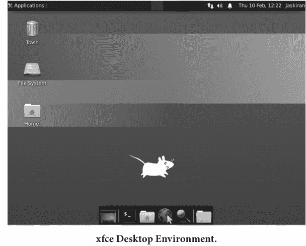

# `xfce` 卸载

### 步骤 1：

运行这些命令以便 `apt-get` 可以在清理 `xfce` 时使用：

```bash
sudo apt-get -f install
sudo apt-get clean
sudo apt-get autoclean
sudo apt-get update
```

### 步骤 2：

在你的 `Ubuntu` 服务器上清理 `xfce`：

```
sudo apt-get purge xfce4
```

使用 `xfce` 的产品与发行版

`xfce` 已作为 `Pandora` 手持游戏中最具标志性的工作之一被包含。

它是以下 `Linux` 发行版的默认桌面环境：

- `BackBox`
- `Black Lab Linux`
- `Ubuntu GNU + Linux OS`
- `Dragora GNU/Linux-free`
- `Buntus`
- `EndeavourOS`
- `GalliumOS`
- `GhostBSD` 社区计划
- `Kali Linux`
- `Linux Lite`
- `Manjaro`
- `MX Linux`
- `Mythbuntu`
- `QubesOS`
- `SalineOS`
- `SolydXK` (`SolydX`)
- `SystemRescueCD`
- `UberStudent`
- `Ubuntu Studio`（支持至 `20.04`）
- `Xebian`
- `Xevuan`
- `ubuntu`

它也是 `FreeBSD` 的标准桌面选项，并且许多其他 `Linux` 发行版也未列在上方，例如 `Arch Linux`、`Debian`、`Ubuntu`、`openSUSE`、`Fedora`、`Kali`、`Korora`、`Linux Mint`、`Slackware`、`Mageia`、`OpenMandriva`、`Void Linux` 和 `Zorin OS`。`Kali Linux` 在 `ARM` 平台上运行时也使用 `xfce` 作为桌面空间。`Debian` 提供了一个独特的重装 CD，包含 `xfce` 作为默认桌面。`2013` 年，`Debian` 曾短暂地将其作为默认桌面取代了 `GNOME`。

## 兼容性

`xfce4` 使用 `GTK + 2` 编写，完全兼容 `GNOME 2` 应用程序。桌面窗口管理器 (`xfwm4`) 与 `K` 桌面环境 (`KDE`)、`Gnome` 以及 `Rox-Filer` 会话/文件管理器兼容。

## 优势

- `xfce` 结构简单。与 `KDE` 或 `GNOME` 相比，它的内存占用极少，`CPU` 使用率较低。
- 接下来的主要优势是视觉空间的简单性。`xfce` 桌面并不复杂且直观。主桌面有两个面板，图标排成一条直线。其中一个面板带有基础应用程序启动器，另一个面板带有工作空间切换器。
- `xfce` 默认文件管理器简单、易用，并针对近乎平坦的读取曲线进行了优化。
- `xfce` 桌面异常稳定，并定期更新，新版本每三年发布一次。
- `xfce4` 拥有强大的屏幕，标签页允许在单个窗口中运行多个终端。
- 最后，`xfce` 具有很高的灵活性（低于 `KDE` 但远高于 `GNOME`），因此允许用户享受适度的定制化。

## 劣势

- 在某些情况下，在大面积区域处理数据时，轻量级的形成可能会导致瓶颈，且区域本身不支持增强。
- 使用其他包的一个特殊情况需要安装插件以使磁盘工作。
- 它不具备 `GNOME` 视频中的那些高级功能。
- `xfce` 中无法实现加速或减慢媒体播放的工具。

## 章节总结

在本章中，我们介绍了 `xfce` 概述，包括其功能、历史、核心项目、应用和开发。此外，我们还设置了一个独立章节，让你了解 `xfce` 版本的历史。

`MATE` 是一个免费开源的桌面应用程序，运行在 `Linux`、`BSD` 和 `illumos` 之上。桌面区域包含你在电脑屏幕上看到的所有内容。面板用于打开应用程序、显示通知和显示时间。它可以控制你的窗口并允许你轻松在它们之间切换。

当你查看截图时，所有的元素都让你想到 `Windows` 就是 `Windows`，`macOS` 就是 `macOS`。`Windows` 和 `macOS` 都提供一个桌面空间。围绕新版本 `Windows` 的重大变化通常与桌面区域有关，例如删除或添加开始菜单以及主题的更改。`Windows 8` 在触摸屏上的连接性比桌面端更多。不喜欢这种变化的人，如果他们想保持自己熟悉的视觉界面，就无法升级到 `Windows 8`。

对于 `Linux` 来说，这不是一个问题。你可以切换到另一个桌面并继续使用最新的 `Linux` 软件。如果你偏好的视觉界面正经历重大变化，`MATE` 就是一个例子，它并不意味着你必须告别你所熟悉的一切。

## `MATE` 历史

`MATE` 基于 `GNOME`，`GNOME` 是像 `Linux` 一样流行的开源桌面软件。然而，说 `MATE` 基于 `GNOME` 是一种轻描写写。`MATE` 是在 `2011` 年 `GNOME 3` 出现后作为 `GNOME 2` 的延续而生的。

这次分叉是因为 `GNOME 3` 在标准桌面设计上引入了全新的界面 `GNOME Shell`。由于该项目是开源的，对这一变化不满的开发者可以自由获取现有的 `GNOME 2` 代码并继续对其进行工作。这种做法被称为“分支”（break）项目，其他人会立即加入。一位名为 `Perberos` 的 `Arch Linux` 用户启动了 `MATE` 项目，其他人也加入了。

尽管许多 `Linux` 应用程序已采用 `GNOME 3`，但 `MATE` 在过去的十年里吸引了更多用户。有些人在他们离开 `GNOME` 多年后才开始使用 `Linux`。这意味着他们出于非变革性的原因使用 `MATE`。极少数人认为它是 `Linux` 最稳定且灵活的特性之一。`MATE` 是 `GNOME 2` 的延续。它使用常见的 `Linux` 隐喻和其他类 `Unix` 的其他应用程序提供了一个极具吸引力的桌面环境。它正处于活跃开发中，以在支持新技术的同时保持日常桌面体验。

## 版本

在这里，我们将讨论 `MATE` 的版本，如下所示。

- `MATE` 版本 `18`
- `MATE` 版本 `20`
- `MATE` 版本 `24`
- `MATE` 版本 `26`

## `MATE` 版本 `18`

经过六个月的开发，`MATE` 团队自豪地宣布发布 `MATE` 桌面 `18`。感谢每一位捐赠者的帮助，使得这次发布成为可能。该版本重点在于通过更改解密代码和使大部分代码库现代化来稳定 `MATE` 桌面。我们还升级了窗口管理器 (`Marco`) 并添加了高清支持。

### 特性

1. 整个 `MATE` 套件现在仅限 `GTK+`。
2. 他们添加了 `libinput` 支持、触摸板和光加速。
3. 它提高了辅助功能（特别是针对视觉障碍用户）。
5. 锁定屏幕将加载用户的背景而不是默认背景。
6. `MATE` 面板显示了若干改进，包括：
   - 添加了启动选项
   - 添加了 `StatusNotifier` 支持
7. 归档管理器包含了一些改进：
   - 添加到支持类型列表中
   - 如果显示正确的日期，它可以检查 `rar/unrar` 版本
   - 稳定的 `rar` 压缩和 `7z` 分卷
8. 通知现在支持操作图标，例如媒体播放器使用的播放控制图标。
9. 重置字体查看器以浏览模式、支持 `TTC` 字体并自动暴露到菜单。
10. 用 `ConsoleKit` 替换了 `UPower` 停止/睡眠功能。
11. `MATE` 终端增加了中键关闭标签页的功能。
12. 文档查看器 `Atril` 拥有最先进的页面加载时间，并增加了对其他提取历史的支持。
13. 许多 `GTK+` 模式已修改，并修复了许多错误。

## `MATE` 版本 `1.20`

在 `11` 个月后，`MATE 1.18` 团队兴奋地宣布发布 `MATE` 桌面 `1.20`。该版本的主题是通过更改解密代码和使大部分代码库现代化来稳定 `MATE` 桌面。我们还升级了窗口管理器 (`Marco`) 并添加了高清支持。在此期间，我们修复了数百个错误。

- `MATE` 桌面 `1.20` 支持动态检测和测量的高清指示器。
- `Marco` 现在支持 `DRI3` 和 `Xpresent`（如果可用）。
- 现在 `Marco` 支持拖拽四分屏窗口、可以使用方向键导航 `Alt + Tab` 切换，并添加了将窗口移动到另一个显示器的快捷键。
- 添加了作为全局菜单提供者的关闭面板应用菜单的支持。
- 书签（`Bookmark`）现在支持 `GTK3 +` 位置。
- `MATE` 终端现在支持背景图片、新增 `Solarized` 主题以及切换标签的组合键。
- `Invest` 插件已从 `MATE` 插件中移除。


- `MATE` 主题在对 `GTK` 3.22 展现的所有样式类的充分利用方面有了显著改进。

- 归档查看器 `Engrampa` 已开发了对 `7z` 加密存档的支持。

- `MATE` 传感器插件（终于）支持磁盘。

- `MATE` 屏幕保护程序支持 `OpenBSD` 认证，`minizip` 在四月支持了额外的 `BSD` 变体。

## `MATE` 版本 1.24

一年后，`MATE` 团队发布了 `MATE` 桌面 1.24。此版本包含许多关键的错误修复和底层升级。

> `MATE` 面板在适配 `Wayland` 显示后端方面做了大量的工作。

- 显示插件收到了全面更新，允许从面板更灵活地控制直接监控。

- 计时器插件现在拥有最佳鼠标交互体验。

- `Wanda Fish` 现在在 `HiDPI` 显示器上运行良好。

经过一年的开发，`MATE` 桌面团队发布了 `MATE` 1.24。此版本包含许多新功能、错误修复和常规改进。一些最重要的特性包括：

- `Engrampa` 现在支持了多种额外格式，并在某些格式中对密码和 `Unicode` 字符提供了一致性支持。

- `Eye of MATE` 现在支持 `Wayland`，并增加了对颜色嵌入配置的支持。

- 图标创建在几处被重新设计和修改。

- 对 `webp` 文件的额外支持。

- 控制中心现在在 `HiDPI` 显示器上可以正确显示图标。

- 新增了时间和日期管理器程序。

- 鼠标应用现在支持加速配置。

- 收藏应用（`Favorite App`）进行了无障碍升级，对与 `IM` 客户端集成提供了更好的支持。

- 指示插件与异常尺寸图标的交互略有改善。

- 提到图标，我们主题中的网络管理器插件图标已完全重新设计，现在可以在 `HiDPI` 镜像上享受了。

- 通知守护进程现在支持“勿打扰”模式。

- `MATE` 面板过去在切换布局时存在导致崩溃的 Bug。

- 菜单编辑器 `Mozo` 现在支持撤销（`Undo`）和重做（`Redo`）操作。

- `Pluma` 插件已完全切换到 `Python` 3。

- `Pluma` 不再需要嫉妒其他复杂的编辑器了，因为它现在可以显示格式标记。

## `MATE` 版本 1.26

一年后，`MATE` 团队发布了 `MATE` 桌面 1.26。此版本包含若干关键的错误修复和底层升级。

- 为 `Atril`、系统监控器、`Pluma`、终端和其他桌面组件增加了 `Wayland` 支持。此外，计数器（`Counter`）现在可以使用 `Meson` 构建。

- `Pluma` 经历了重大的开发。

- 新的网格地图让你快速预览内容。

- 新的网格背景图案将 `Pluma` 变为写字板。

- 过滤器插件现在支持检索操作。

- 添加了显示/隐藏行号的快捷键 `Ctrl + Y`。

- 收藏对话框需要重新设计以适应所有功能。

- 凭借新的 `Pluma` 插件，我们的文本编辑器可以转换为功能丰富的 `IDE`，支持括号补全、注释/取消注释、内置终端和单词补全。

- 控制中心拥有改进的 `Windows` 偏好设置框，提供了更多选项。在“显示”中，`Box` 增加了显示评分选项。

- 通知变得更有用了，因为它们接受了链接支持。最后，它们添加了“勿打扰”插件。

- 提到警报，窗口列表应用新增了一个禁用鼠标滚动的选项。你选择的窗口图标现在通过翻译为 `cairo` 位置而变得更加清晰。

- `Netspeed` 自动显示额外信息并获得了 `netlink` 支持。

- 计算器包含在 `GNU MPFR/MPC` 库中，这意味着更高的精度、更快的计算和更多的功能。

- 窗口管理器 `Marco` 将最小化的窗口恢复到原始的、更可靠的位置。

- `Engrampa` 接受了对电子出版（`EPUB`）和 `ARC` 存档的支持。此外，它现在可以打开加密的 `RAR` 存档。

- 电源管理器有一个新选项允许键盘模糊，并移动到了 `libsecret`。

# 在 `Ubuntu` 中安装 `MATE`

`MATE` 可在官方库中使用，并可能包含在以下任何组中：

- **协作组**：包含运行通用 `MATE` 信息所需的标准桌面区域。
- **`mate-extra` 团队**：包含与 `MATE` 桌面集成良好的额外资源和应用程序。仅添加 `mate-extra` 团队并不会引入整个依赖它的合作伙伴组。如果用户想要安装所有 `MATE` 包，必须同时安装这两个组。
- **基础桌面**：包含 `marco`、`mate-panel` 和 `mate-session-manager`。

# 官方仓库术语

软件仓库是下载安装软件包的最后一个位置。`Arch Linux` 的官方存档包含了本质且热门的软件，可以通过 `pacman` 轻松访问。软件包维护者存储了它们。官方仓库中的软件包不断更新：当一个包被升级时，其旧版本将从仓库中移除。`Arch` 没有重大的版本发布：每个包都作为新版本进行升级。

## 安装 `MATE`

软件仓库是下载安装软件包的最后一个位置。`Arch Linux` 的官方存档包含了本质且热门的软件，可以通过 `pacman` 轻松访问。软件包维护者存储了它们。官方仓库中的软件包不断更新：当一个包被升级时，其旧版本将从仓库中移除。没有重大的版本发布：每个包都作为新版本进行升级。

轻量版（`minimal`）如果用户不想使用太多内存是很有用的。轻量版只包含 `MATE`。`MATE` 有两个版本：轻量版和完整版。

# `MATE` 桌面环境组件

- `libcaja`: `seahorse`
- `atril`
- `episode`

`Caja` 是 `Linux` 下一个著名的文件管理器。`Caja` 文本扩展允许用户轻松添加文本。

## `Pluma`

它是 `MATE` 桌面 `Linux` 发行版默认的免费开源文本编辑器。`Pluma` 是一个文本编辑应用程序，支持在单个窗口中编辑多个文本文件。它通过 `Unicode UTF-8` 编码完全支持国际化文本。作为一个通用的文本编辑器，`Pluma` 支持许多常见的编辑器功能，并强调简单易用性。它的核心功能集包括代码语法高亮、自动补全以及带有打印预览的打印支持。

## 特性

`Pluma` 完整集成了 `MATE`，提供了与 `Caja`（`MATE` 文件管理器）之间的拖放操作、`MATE` 帮助系统的应用、`MATE` 可视文件系统以及 `MATE` 打印框架。它具有多文档界面（`MDI`）`GUI` 标签用于组织多个文件。用户可以在窗口之间移动标签。它可以使用 `GVFs` 编辑远程文件。支持完全重构、系统重构和替换。其他基于代码的功能包括行号、括号匹配、自动换行、当前行高亮、自动加载以及文件的备份副本。

`Pluma` 具有基于 `Enchant` 的多语言拼写检查和灵活的插件系统，允许添加新功能，例如字幕以及与外部应用程序（包括 `Python` 或 `Bash` 终端）的集成。`Pluma` 内置了许多插件，插件包和网上也有许多插件。

`Pluma` 支持打印，包括 `PostScript` 和 `PDF` 文件的预览和打印预览。打印选项包括文本字体、页面大小、布局、边距、可选的页标题和行号打印以及语法高亮。

### 功能列表

- 语法高亮
- 支持打印和打印预览
- 文件恢复
- 完全支持 `UTF-8` 文本
- 支持远程文件编辑
- 搜索和替换
- 可调的插件，可选的 `Python` 支持
- 收藏的完美视觉界面
- 一张新的小地图让你快速概览内容
- 新的网格背景图案将 `Pluma` 变为一个写字板
- 过滤器插件支持检索操作
- 显示/隐藏行号快捷键，`Ctrl + Y`

## `Atril`


它是 MATE 桌面环境的官方文本查看器。一个简单的多页文本查看器。它可以显示并打印 PostScript (PS)、封装式 PostScript (EPS)、DJVU、DVI、XPS 和便携文档格式 (PDF)。文档还允许文本搜索、复制到剪贴板、超链接导航以及如果文档支持表格书签。Atril 是 Evince 的分支。

### 特性

- 组合搜索可显示结果数量并高亮页面上的结果
- 页面图标
- 文档：一旦 PDF 中包含引用信息，Evince 将以树状格式显示它
- 打印文档：使用 GNOME/GTK 打印框架，Evince 可以打印我可以打开的任何文本
- 查看加密文档
- 国际化支持

### 支持的格式

- 便携文档格式 (PDF) 使用 Poppler 后端
- Postscript 使用 GhostScript 后端
- 多页标签文件格式 (TIFF)
- Impressive
- DjVu 使用 DjVuLibre 后端
- 设备无关 (DVI) – 用于编辑的 TeX 软件输出格式
- 笑话
- 照片

## MATE 桌面环境

# Engrama

Engram 是 MATE 环境归档管理器资源。它是归档管理器的分支。该软件允许你创建和修改归档、查看和编辑归档内容，以及归档文件。Engmpma 是一个免费开源软件。

### 支持的文件类型

- 7-Zip 压缩文件 (`.7z`)
- WinAce 压缩文件 (`.ace`)
- ALZip 压缩文件 (`.alz`)
- 带有小型 AIX (`.ar`) 索引的归档
- ARC 归档
- ARJ 归档 (`.arj`)
- Cabinet 文件 (`.cab`)
- UNIX CPIO 归档 (`.cpio`)
- Debian Linux 软件包 (`.deb`) [只读模式]
- ISO-9660 CD 光盘镜像 (`.iso`) [只读模式]
- Java 归档 (`.jar`)
- Java 企业归档 (`.ear`)
- Java (Archive) web 存档
- LHA 归档 (`.lzh`, `.lha`)
- 压缩 WinRAR 归档 (`.rar`)
- RAR 归档漫画 (`.cbr`)
- RPM Linux 软件包 (`.rpm`) [只读模式]

## Eye of MATE 图像查看器

MATE 图像查看器 Eye 应用让你查看单个图像文件和大型照片集。你可以通过在文件管理器中双击图像，或点击应用程序菜单、高亮“图片”子菜单，然后点击 MATE Image Eye 来启动查看器。

查看器支持图像文件。可以打开以下图像格式：`ANI`, `BMP`, `GIF`, `ICO`, `JPEG` 或 `JPG`, `PCX`, `PNG`, `PNM`, `RAS`, `SVG`, `TIFF`, `WBMP`, `XBM` 和 `XPM`。查看器支持以下存储格式：`BMP`, `ICO`, `JPEG` 或 `JPG`，以及 `PNG`。查看器可能会根据你的系统配置和其他安装的软件打开并保存某些图像格式。

### 图像查看器的元素

- 菜单栏：菜单栏菜单包含你在图像查看器中处理图像所需的所有指令。
- 工具栏：包含可以在菜单栏中访问的部分指令。
- 展示区：显示区域显示图像文件。
- 状态栏：状态栏提供有关图像的信息。要显示或隐藏状态栏，请选择 MATE。
- 照片集：画廊显示所有图像。

## Pluma

最新版本是 MATE 桌面 Linux 发行版的免费开源默认文本编辑器。Pluma 是一个图像应用程序，支持在单个窗口中编辑多个文本文件。它通过 `Unicode UTF-8` 编码完全支持国际化文本。作为一个通用的文本编辑器，Pluma 支持许多常见的编辑器功能，并强调简单易用。它的核心功能集包括代码语法高亮、自动重传以及带有打印预览的打印支持。

Pluma 完整集成了 MATE，提供了与 Caja（MATE 文件管理器）之间的拖放操作、MATE 帮助系统的应用、MATE 可视文件系统以及 MATE 打印框架。它具有用于组织多个文件的多文档界面 GUI 标签。用户可以在窗口之间移动标签。它可以使用 `GVFS` 编辑远程文件。支持完全重构、系统重构和替换。其他基于代码的功能包括行号、括号匹配、自动换行、当前行高亮、自动加载以及文件的备份副本。

Pluma 具有基于 Enchant 的多语言拼写检查和灵活的插件系统，允许添加新功能，例如字幕以及与外部应用程序的集成。Pluma 自带了许多插件，插件包和网上也有许多插件。

Pluma 支持打印，包括 PostScript 和 PDF 文件的预览和打印预览。打印选项包括文本字体、页面大小、布局、边距、可选的页标题和行号打印以及语法高亮。

### 功能列表

- 语法高亮
- 支持打印和打印预览
- 文件恢复
- 完全支持 `UTF-8` 文本
- 支持远程文件编辑
- 搜索和替换
- 可调的插件，可选的 `python` 支持
- 收藏的完美视觉界面
- 一张新的小地图让你快速概览内容
- 新的网格背景图案将 Pluma 变为一个写字板
- 过滤器插件支持检索操作
- 显示/隐藏行号快捷键，`Ctrl + Y`

## Atril

它是 MATE 桌面环境的官方文本查看器。一个简单的多页文本查看器。它可以显示并打印 PostScript (PS)、封装式 PostScript (EPS)、DJVU、DVI、XPS 和便携文档格式 (PDF)。文档还允许文本搜索、复制到剪贴板、超链接导航以及如果文档支持表格书签。Atril 是 Evince 的分支。

### 特性

- 组合搜索可显示结果数量并高亮页面上的结果
- 页面图标
- 文档：一旦 PDF 中包含引用信息，Evince 将以树状格式显示它
- 打印文档：使用 GNOME/GTK 打印框架，Evince 可以打印我可以打开的任何文本
- 查看加密文档
- 国际化支持

### 支持的格式

- 便携文档格式 (PDF) 使用 Poppler 后端
- Postscript 使用 GhostScript 后端
- 多页标签文件格式 (TIFF)
- Impressive
- DjVu 使用 DjVuLibre 后端
- 设备无关 (DVI) – 用于编辑的 TeX 软件输出格式
- 笑话
- 照片

（注：后续重复内容已按要求处理保持翻译一致）

最新版本是 MATE 桌面 Linux 发行版的免费开源默认文本编辑器。Pluma 是一个图像应用程序，支持在单个窗口中编辑多个文本文件。它通过 `Unicode UTF-8` 编码完全支持国际化文本。作为一个通用的文本编辑器，Pluma 支持许多常见的编辑器功能，并强调简单易用性。它的核心功能集包括代码语法高亮、自动重传以及带有打印预览的打印支持。


`Pluma` 完整集成了 `MATE`，提供了与 `Caja`（`MATE` 文件管理器）之间的拖放操作、`MATE` 帮助系统的应用、`MATE` 可视文件系统以及 `MATE` 打印框架。它具有用于组织多个文件的多文档界面 `GUI` 标签。用户可以在窗口之间移动标签。它可以使用 `GVFs` 编辑远程文件。支持完全重构、系统重构和替换。其他基于代码的功能包括行号、括号匹配、自动换行、当前行高亮、自动加载以及文件的备份副本。

`Pluma` 具有基于 `Enchant` 的多语言拼写检查和灵活的插件系统，允许添加新功能，例如字幕以及与外部应用程序的集成。`Pluma` 自带了许多插件，插件包和网上也有许多插件。

`Pluma` 支持打印，包括 `PostScript` 和 `PDF` 文件的预览和打印预览。打印选项包括文本字体、页面大小、布局、边距、可选的页标题和行号打印以及语法高亮。

## 功能列表

- 语法高亮
- 支持打印和打印预览
- 文件恢复
- 完全支持 `UTF-8` 文本
- 支持远程文件编辑
- 搜索和替换
- 可调的插件，可选的 `python` 支持
- 收藏的完美视觉界面
- 一张新的小地图让你快速概览内容
- 新的网格背景图案将 `Pluma` 变为一个写字板
- 过滤器插件支持检索操作
- 显示/隐藏行号快捷键，`Ctrl + Y`

## Atril

它是 `MATE` 桌面环境的官方文本查看器。一个简单的多页文本查看器。它可以显示并打印 `PostScript (PS)`、`封装式 PostScript (EPS)`、`DJVU`、`DVI`、`XPS` 和 `便携文档格式 (PDF)`。文档还允许文本搜索、复制到剪贴板、超链接导航以及如果文档支持表格书签。`Atril` 是 `Evince` 的分支。

## 特性

- 组合搜索可显示结果数量并高亮页面上的结果
- 页面图标
- 文档：一旦 `PDF` 中包含引用信息，`Evince` 将以树状格式显示它
- 打印文档：使用 `GNOME/GTK` 打印框架，`Evince` 可以打印我可以打开的任何文本
- 查看加密文档
- 国际化支持

## 支持的格式

- `便携文档格式 (PDF)` 使用 `Poppler` 后端
- `Postscript` 使用 `GhostScript` 后端
- `多页标签文件格式 (TIFF)`
- `Impressive`
- `DjVu` 使用 `DjVuLibre` 后端
- `设备无关 (DVI)` – 用于编辑的 `TeX` 软件输出格式
- 笑话
- 照片

# Engrama

`Engram` 是 `MATE` 环境归档管理器资源。它是归档管理器的分支。该软件允许你创建和修改归档、查看和编辑归档内容，以及归档文件。`Engmpma` 是一个免费开源软件。

## 支持的文件类型

- `7-Zip` 压缩文件 (`.7z`)
- `WinAce` 压缩文件 (`.ace`)
- `ALZip` 压缩文件 (`.alz`)
- 带有小型 `AIX` (`.ar`) 索引的归档
- `ARC` 归档
- `ARJ` 归档 (`.arj`)
- `Cabinet` 文件 (`.cab`)
- `UNIX` `CPIO` 归档 (`.cpio`)
- `Debian` `Linux` 软件包 (`.deb`) [只读模式]
- `ISO-9660` `CD` 光盘镜像 (`.iso`) [只读模式]
- `Java` 归档 (`.jar`)
- `Java` 企业归档 (`.ear`)
- `Java` (Archive) web 存档
- `LHA` 归档 (`.lzh`, `.lha`)
- 压缩 `WinRAR` 归档 (`.rar`)
- `RAR` 归档漫画 (`.cbr`)
- `RPM` `Linux` 软件包 (`.rpm`) [只读模式]

## Eye of MATE 图像查看器

`MATE` 图像查看器 `Eye` 应用让你查看单个图像文件和大型照片集。你可以通过在文件管理器中双击图像，或点击应用程序菜单、高亮“图片”子菜单，然后点击 `MATE Image Eye` 来启动查看器。

查看器支持图像文件。可以打开以下图像格式：`ANI`, `BMP`, `GIF`, `ICO`, `JPEG` 或 `JPG`, `PCX`, `PNG`, `PNM`, `RAS`, `SVG`, `TIFF`, `WBMP`, `XBM` 和 `XPM`。查看器支持以下存储格式：`BMP`, `ICO`, `JPEG` 或 `JPG`，以及 `PNG`。查看器可能会根据你的系统配置和其他安装的软件打开并保存某些图像格式。

## 图像查看器的元素

- 菜单栏：菜单栏菜单包含你在图像查看器中处理图像所需的所有指令。
- 工具栏：包含可以在菜单栏中访问的部分指令。
- 展示区：显示区域显示图像文件。
- 状态栏：状态栏提供有关图像的信息。要显示或隐藏状态栏，请选择 `MATE`。
- 照片集：画廊显示所有图像。

# MATE 桌面环境 ■ 143

安装后，右键点击 `MATE` 面板，选择“添加到面板”，并添加“`Dock`”小组件。

## 在线电台插件

面板插件让您只需点击一下即可在系统面板上播放在线电台。它包含了详尽的在线电台列表，每个电台都包含数千个列表：

- `Ice`
- `Radio browser`

该插件应运行在现代 `MATE` 桌面和 `GNOME2` 环境上（例如 `RHEL 6` 以及所有其他衍生版本，如 `CentOS`）。在 `MATE` 桌面上，该插件支持使用 `GTK2` 或 `GTK3` 构建。你必须使用与你的 `MATE` 桌面相同的版本。

### 插件的使用

当插件启动时，它会加载你上次收听的电台。点击插件将其状态从“暂停”更改为“播放”；再次点击即可暂停。图标显示当前状态（播放中或已）。现在，右键点击插件并进入“全部”菜单来管理你的频道。

- 在“收藏”选项卡上，你可以添加新频道（需要提供名称和 `URL`，`URL` 包含一个常规规则）、删除现有频道或开始播放其中一个。你还可以重新排列频道顺序。列表会在每次更改时保存。
- 在“`Icecast`”选项卡上，你可以下载 `Icecast` 目录（稍后保存）、对其进行搜索、收听频道，或将其复制到收藏列表。
- 在“自定义”选项卡上，你可以输入自己的频道列表。它应该仅匹配 `Icecast` `XML` 格式最重要的 4 个字段。

```xml
<directory>
<server_name> Radio 1 (AAC +) </server_name>
<listen_url> http://icecast.omroep.nl/radio1-bb-aac</listen_url>
<type> Normal </type>
<bitrate> 128 </bitrate>
</login>
<entry>
...
</login>
...
</litext>
```

当插件启动时，它将加载最新的十个频道和前十个收藏，位于右键菜单中两个独立的子菜单中。通过它们，你可以再次打开频道。注意：由于 `MATE/GNOME2` 的限制，这两个子菜单无法自动更新，仅会在插件启动时更改。

当歌曲开始播放时，将显示通知。如果你不想每隔几分钟就被干扰一次，可以在全部频道菜单中显示“选项”选项卡来禁用通知。

## MATE 菜单

它增强了 `MATE` 菜单。支持过滤、偏好、快速释放、自动会话等许多功能。此菜单源于 `Linux Mint` 发行版，并分发给 `MATE` 桌面环境的其他发行版。它是 `Mint` 分支的 `MATE` 菜单。

- `MATE` 菜单移除了特定的 `Mint` 搜索选项。
- `MATE` 菜单移除了包管理功能。

## MATE 桌面

它现在有一个名为“`MATE Tweak`”的图形化工具，由 `Ubuntu MATE` 的创始人和项目负责人 `Martin Wimpless` 开发。桌面是旧 `GNOME 2` 的延续。它使用常见的 `Linux` 隐喻以及类似 `UNIX` 的应用程序提供了一个直观且吸引的桌面环境。`Ubuntu MATE` 是使用 `MATE` 桌面的 `Ubuntu` 社区版本。它发布了 `Ubuntu MATE 14.04 LTS` 和 `Ubuntu MATE 14.10`。`MATE Tweak` 是一个用 `Python` 编写简单配置工具。它是一个移除了特定 `Mint` 配置选项的桌面分支。

# MATE 桌面环境 ■ 145

## MATE TWEAK

`MATE` 桌面现在有一个名为“`MATE Tweak`”的图形设计工具，由 `Ubuntu MATE` 的创始人和项目负责人 `Martin Wimpress` 开发。`MATE` 桌面是旧 `GNOME 2` 的延续。开发者为他的 `Ubuntu MATE PPA` 开发了包，可用于 `Ubuntu 15.04`、`Ubuntu 14.10`、`Ubuntu 14.04` 以及 `Linux Mint 17` 的测试。

## 安装

要添加 `PPA` 并进入 `MATE Tweak`，按下 `Ctrl + Alt + T`。

```bash
$ sudo add-apt-repository ppa:ubuntu-mate-dev
$ sudo apt-get update
$ sudo apt-get install mate-tweak
```

`Brisk Menu` 是为桌面区域开发的开源菜单，通常作为 `Solus OS` 的默认菜单提供。`Brisk` 具有其功能：模拟原始 `Windows` 菜单，同时提供高性能。它具有灵活的 `UI`，占用内存小且体验良好。

## BRISK MENU


Brisk Menu 是为桌面区域开发的开源菜单，通常作为 Solus OS 的默认菜单提供。然而，Brisk 具有其功能：模拟原始 Windows 菜单，同时提供高性能。它具有灵活的 UI，占用内存小且体验良好。

## 功能

- 免费：Brisk Menu 供任何使用 Mate 桌面的用户免费使用。
- 自定义 UI：完全自定义且直观。
- 收藏列表

## Linux

- 高性能
- 支持热键菜单
- 支持桌面操作，例如用于登录模式的桌面菜单
- 按类别排序应用程序和列表
- 会话控制/屏幕保护程序
- 配合启动器工作时支持拖放
- 侧边栏支持
- 可用的 GTK3 样式选项
- Brisk Menu 开发者计划在未来引入额外更改，包括更新 UI 以控制视觉效果（标签/图标）并改进窗口部分。

选择以下 PPA 并安装 Brisk Menu。

```
$ sudo apt-add-repository ppa:flexiondotorg/brisk-menu
$ sudo apt update
$ sudo apt install brisk-menu
```

在你选择的显示管理器中选择 MATE。显示管理器（或登录管理器）通常在启动过程结束时显示应用程序。为了启动 MATE，在你的 `~/.xinitrc` 文件中输入 `mate-session`。查看 `xinitrc` 以获取登录时间的详情。

## 在各种操作系统上安装

- Fedora Linux：插件在 Fedora Free 仓库中可用
  `yum install mate-applet-streamer`
- Arch Linux：插件在 Arch 仓库中可用。

# MATE 桌面环境 ■ 147

- Mageia Linux：插件在 Mageia 仓库中可用。
- RHEL6 以及其他替代方案（如 CentOS）使用 GNOME2：提供以下 RPM 包（或可以在源码中安装插件）。

## 显示管理器 (DISPLAY MANAGERS)

MATE 桌面环境中使用多种显示管理器，如下：

1. CDM
2. Nodm
3. Console TDM
4. Ly - TUI 显示管理器
5. Tbsm – 基于站会话管理器

你将获得每个显示管理器的简单介绍。

## CDM

基本上是一个极简但功能全控制器，取代了 SLIM、SDDM 和 GDM，提供了快速的 X 窗口入口。用纯 bash 编写，CDM 几乎没有依赖但支持多个用户。

## Console TDM

TDM 显示管理器是 `startx`。开发主分支是 `.xinitrc`。它有一个名为 `tdctl` 的助手文本来管理 tdm 时间。以下是三种 tdm 会话：

- X：在 `.xinitrc` 内启动的会话（适用于 X/桌面区域）。
- more：在 shell 中的会话（适用于 tmux 会话等）。
- Tdm 会话可能可能失效：tdm 选择中存在活跃会话，而不显示非活跃会话。如果路径不可用，tdm 会话始终无效。

## 安装

从源码目录执行 `make install`（你可以设置 `DESTDIR` 或 `PREFIX`）。有以下依赖项：

- `xinit`
- 对话框（可选，交互）

**用法：** 为本地用户添加 tdm，使用：

```
tdtmctl init

tdtmctl add <time name> <usable mode>
```


它会将`tdm`配置目录复制到你的家目录。你必须编辑`.profile`文件（或`.bash_profile`, `.profile`等）以便调用`tdm`作为最后一个命令（这将在你登录`tty`后启动`tdm`）。如果你想允许多个`X`会话，应该使用`--disableunning-check`选项。在你的`.xinitrc`文件中，你必须将`exec`行更改为`exec tdm --start`，这将启动你的`X`周期（如果你没有`.xinitrc`文件，请创建一个）。

- **返回值：** 如果没有使用会话，返回`1`。否则返回`0`。

### 文本

`TDM`配置指南（`$HOME/.tdm`）中有两个文本，分别用于`tdm`的开始和结束。

1. `Tdminit`在选择屏幕之前运行（当`tdm`被调用为`--xstart`时）。
2. `tdmext`在调用`startx`命令之前创建（在`tdm --xstart`运行中）。

# MATE 桌面环境 ■ 149

- 缓存（非活动）会话列表 `ttdmctl repository`

- 查看哪个命令是会话 `ttdmctl check <shop>` `ttdmctl check out more/</session>`

- 显示或设置默认话 `ttdmctl [session]`

- 添加会话（快速） `ttdmctl add <name> <mode> [X (默认) / extra]`

- 删除会话 `ttdmctl delete <session>`

- 启用或关闭会话 `ttdmctl enable / disable <page>`

- 将配置移动到符合`XDG`标准的目录 `ttdmctl move`

## Nodm
`Nodm`是一个小型的显示管理器，它可以以指定用户的登录并在不询问用户名或密码的情况下启动`X`会话。在普通计算机上使用`nodm`是一个严重的安全问题，因为它可以赋予任何人访问计算机的权限。然而，在许多情况下需要自动登录：例如，在手机等嵌入式系统、自助机（kiosk）或工业设备的控制面板中。在这些情况下，`nodm`易于设置、重量轻，并且能够正常工作。

## 特性
`nm`尽可能小，它尝试提供完成良好工作所需的最少功能，非常符合“小小惊喜”的目标。以下是其提供的功能：

- 以`root`用户身份自动登录，执行所有需要的操作，例如设置`PAM`会话、更新`lastlog`、记录到`syslog`日志。

## 150 ■ Linux

- `Nodm`提供`VT`（虚拟终端）支持，查看将使用`X`的空闲终端，并保持重新分发给`X`重启。

- 启动`X`（默认路径为`/usr/bin/X`）。

- 当`X`服务器准备好接受连接时，将设置`X`会话：
  - 设置`DISPLAY`和`WINDOWPATH`变量。
  - 将会话封装在`PAM`会话中，从而设置用户的位置。
  - 如果存在`~/.xsession-error`，则将其终止。
  - 运行会话文本（自动执行，`/etc/X11/Xsession`），使用“`sh -l`”。
  - 如果是`X`服务器或`X`会话退出，则杀死其中一个并重启两者。
  - 如果会话很快退出，`nodm`将在重启前等待一段时间。等待时间如下：
    - 第一次会话很快退出时，立即重启。
    - 第二次和第三次，等待`30`秒。
    - 其余时间，等待`1`分钟。如果会话持续时间足够，等待时间将归零。
  - `Nodm`尚未完全实现，并作为一个真正的守护进程在后台运行：比执行此工具更强大，且`nodm`与之配合良好。这不是一个设计选择：简单来说，到目前为止还没有需要使用它。

## 配置
通过以下变量进行配置：

- `NODM_USER`: 控制用于自动登录的用户。
- `NODM_X_OPTIONS`: `X`服务器命令行（例如：“`vt7-nolis-ten tcp`”）。支持`wordexp`扩展、`ilde`扩展、动态更改、算术扩展、通配符扩展和引号删除，但不支持替换命令。如果需要更改顺序，请联系并提供实际值。
- `NODM_MIN_SESSION_TIME`: 会话持续的最短时间（秒），以便`nodm`判断其是否尚未停止。如果会话`X`持续时间少于此时间，`nodm`将在重启前等待逐渐增加的时间（默认: `60`）。
- `NODM_XSESSION`: `X`会话命令（默认: `/etc/X11/Xsession`）。它通过`shell`工作，因此可以是任何`shell`命令。
- `NODM_XINIT`: 用于旧版本`nodm`的`xinit`程序路径，但现在已被忽略。
- `NODM_X_TIMEOUT`: 等待`X`准备好接受连接的关闭时间（秒）。如果`X`在此时间内未准备好，将执行并重启。

## Ly – TUI 显示管理器
`Ly`是一个用于`Linux`和`BSD`的轻量（如`ncurses`）`TUI`管理器。有多种依赖项，如下所示。

- `C99`编译器（通过`tcc`和`gcc`测试）
- 标准`C`库
- `GNU make`
- `pam`
- `xcb`
- `xorg`
- `xorg-xauth`
- `mcookie`
- `tput`
- `shutdown`

在基于`Debian`的发行版中，使用`root`身份通过`apt install build-essential libpam0g-dev libxcb-xkb`安装所有与你相关的依赖项。以下桌面环境已成功支持`Ly`显示：

1. `budgie`
2. `cinnamon`
3. `deepin`
4. `enlightenment`
5. `gnome`
6. `i3`
7. `kde`
8. `lxde`
9. `lxqt`
10. `partner`
11. `move`
12. `xfce`
13. `the pantheon`
14. `maxx`
15. `window maker`

`Ly`应该适用于任何`X`桌面空间，并提供基本的`Wayland`支持。支持如下：

## 整合与集成

- 克隆存储库
```bash
$ git clone --recurse-submodules https://github.com/nullgemm/ly.git
```

- 编译
```bash
$ make
```

- 运行默认`tty`（自动`tty2`）或终端模拟器（但在置顶情况下不会启动）
```bash
$ sudo make run
```

- 安装`Ly`和提供的`systemd`服务文件
```bash
$ sudo make install
```

- 启用该服务
```bash
$ systemctl enable ly.service
```


## 152 ■ Linux

## MATE 桌面环境 ■ 153

- `Nodm` 提供 VT 支持，查看将使用 X 的空闲终端，并保持重新分发给 X 重启。
- 启动 X（默认路径为 `/usr/bin/X`）。
- 当 X 服务器准备好接受连接时，将设置 X 会话：
  - 设置 `DISPLAY` 和 `WINDOWPATH` 变量。
  - 将会话封装在 PAM 会话中，从而设置用户的位置。
  - 如果存在 `~/.xsession-error`，则将其终止。
  - 运行会话文本（自动执行，`/etc/X11/Xsession`），使用“sh -l”。
  - 如果是 X 服务器或 X 会话退出，则杀死其中一个并重启两者。
  - 如果会话很快退出，`nodm` 将在重启前等待一段时间。等待时间如下：
    - 第一次会话很快退出时，立即重启。
    - 第二次和第三次，等待 30 秒。
    - 其余时间，等待 1 分钟。如果会话持续时间足够，等待时间将归零。
  - `Nodm` 尚未完全实现，并作为一个真正的守护进程在后台运行：比执行此工具更强大，且 `nodm` 与之配合良好。这不是一个设计选择：简单来说，到目前为止还没有需要使用它。

## 配置

通过以下变量进行配置：

- `NODM_USER`: 控制用于自动登录的用户。
- `NODM_X_OPTIONS`: X 服务器命令行（例如：“vt7-nolis-ten tcp”）。支持 wordexp 扩展、ilde 扩展、动态更改、算术扩展、通配符扩展和引号删除，但不支持替换命令。如果需要更改顺序，请联系并提供实际值。
- `NODM_MIN_SESSION_TIME`: 会话持续的最短时间（秒），以便 `nodm` 判断其是否尚未停止。如果会话 X 持续时间少于此时间，`nodm` 将在重启前等待逐渐增加的时间（默认: 60）。
- `NODM_XSESSION`: X 会话命令（默认: `/etc/X11/Xsession`）。它通过 shell 工作，因此可以是任何 shell 命令。
- `NODM_XINIT`: 用于旧版本 `nodm` 的 `xinit` 程序路径，但现在已被忽略。
- `NODM_X_TIMEOUT`: 等待 X 准备好接受连接的关闭时间（秒）。如果 X 在此时间内未准备好，将执行并重启。

## Ly – TUI 显示管理器

Ly 是一个用于 Linux 和 BSD 的轻量（如 `ncurses`）TUI 管理器。有多种依赖项，如下所示。

- C99 编译器（通过 `tcc` 和 `gcc` 测试）
- 标准 C 库
- `GNU make`
- `pam`
- `xcb`
- `xorg`
- `xorg-xauth`
- `mcookie`
- `tput`
- `shutdown`

在基于 Debian 的发行版中，使用 root 身份通过 `apt install build-essential libpam0g-dev libxcb-xkb` 安装所有与你相关的依赖项。以下桌面环境已成功支持 Ly 显示：

1. `budgie`
2. `cinnamon`
3. `deepin`
4. `enlightenment`
5. `gnome`
6. `i3`
7. `kde`
8. `lxde`
9. `lxqt`
10. `partner`
11. `move`
12. `xfce`
13. `the pantheon`
14. `maxx`
15. `window maker`

Ly 应该适用于任何 X 桌面空间，并提供基本的 Wayland 支持。支持如下：

## 整合与集成

- 克隆存储库

```bash
$ git clone --recurse-submodules https://github.com/nullgemm/ly.git
```

- 编译

```bash
$ make
```

- 运行默认 tty（自动 tty2）或终端模拟器（但在置顶情况下不会启动）

```bash
$ sudo make run
```

- 安装 Ly 和提供的 systemd 服务文件

```bash
$ sudo make install
```

### 启用该服务

```bash
$ systemctl enable ly.service
```


## 图形化显示管理器

MATE 环境中使用了多种图形显示管理器：

1. 基于 EFL 的显示管理器
2. Enlightenment 显示管理器
3. GNOME 显示管理器
4. GDM 界面浏览器
5. LightDM
6. SDDM
7. Xdm

MATE 环境中使用的各种显示管理器如下所示。

### 基于 EFL 的显示管理器

它是一个分支，目前处于开发阶段。它是活跃的！它是可以工作的——登录到启光基础库（`EFL`）列出的 Unix 显示/登录管理器。`Ly` 允许用户在登录后选择要启动的 X WM/桌面会话。通过登录 X 会话最终进入 Wayland 会话，该入口是活跃且生效的！

### 如何使用？

要启动 `Ly`，你需要一个初始化系统脚本或 `systemd`（未勾选）。这可能取决于你的操作系统。`Ly` 目前未提供初始化脚本，如果直接启动，可能无法工作或正常运行。`Ly` 应该由初始化脚本或 `systemd` 服务调用。`Ly` 提供了一个系统日志文件。目前未知这是否有效。

### 登录用户

`Ly` 现在以 `root` 身份启动，并使用 `setuid` 在非用户下运行 `entrance_client`。这是通过 `sudo` 执行并在一段时间后切换到会话（`seat`）。`Ly` 曾被用于操作“`login`”用户，但已更改为之前的承诺。继承设计来自第二代。它可以被修改，使 `Ly` 在其用户界面下操作，而不是在 `root` 下进行配置或操作。这将需要创建用户账户、添加用户权限等。现在可以实现这一点，通过调整未勾选的 `login` `option.conf` 以以 `login` 用户身份登录。`start_user:` 值“`start_user`”

`string`: “`entrance`”；您可能还需要需要创建一个访问目录并确保它具有适当的权限。由于在 `root` 用户下无法登录，尽管有相应的代码，但登录也无法修复此问题。如果以 `root` 身份启动，登录将根据需要创建适当的权限。

这包括 Lighting 窗口管理器和基础 Lighting 库（`EFL`）库，它们提供了额外的桌面环境功能，如工具、对象画布和隐藏对象。它自 2005 年以来一直在开发。但在 2011 年 2 月，主要的 `EFL` 发布了它们的第一个稳定版本 1.0。开发版 `PKGBUILDs` 通过 AUR 中的 `enlightenment-git` 及其依赖项下载并安装最新的开发代码。

以下是基于 EFL 的应用程序，其中许多处于开发早期阶段尚未发布：

- `Ecire-git-AUR`: Ecire 文本编辑器
- `edi-AUR`: 基于 EFL 的 IDE
- `eliminate-git-AUR`: Luminance 图像浏览器
- `enjoy-git-AUR`: Enjoy 音乐播放器
- `Eperiodiquegit-AUR`: Eperiodique 周期周期查看器
- `Ephoto` 和 `ephoto-git-AUR`: Ephoto 图像查看器
- `epour-AUR`: 基于 EFL 的 Torrent 客户端
- `epymyc-git-AUR`: E Python 媒体中心
- `equate-git-AUR`: Rate 评分计算器
- `eruler-git-AUR`: Eruler 上屏 Eruler 和测量工具
- `efbb-git-AUR`: Booty 中的愤怒小鸟风格游戏
- `elemines-git-AUR`: Elemines 扫扫雷类风格游戏
- `rage` 和 `rage-git-AUR`: Rage 视频播放器
- `terminology-git-AUR`: Git master 当前 `terminology` 终端

### 安装

您可能还想要输入 `words`，这是一个基于 EFL 的终端模拟器，它与 Enlightenment 集成良好。如果文章邀请您以通常方式安装其他包，它将不会显示详细说明。相反，它将简单列出要安装的包名称。注意：通常使用嵌入或嵌入式链接来标识此文章章节。然而，必须开启 JavaScript，这些链接才能生效。子章节根据软件包类型总结了标准的安装程序。

### 主题

用于自定义 Enlightenment 外观的其他主题有：

- `enlightenment-themes.org`
- `relighted.c0n.de` 提供 200 种颜色的默认主题
- `git.enlightenment.org` (`git clone` 你喜欢的主题，使用“`mark`”并以 `.edj` 主题结尾)
- `packages.bodhilinus.com` 有一个很棒的集合（您需要将 `.edj` 文件下载为 `.deb`；`bsdtar` 可以完成此操作，它是 Arch Linux 安装的一部分）。可以在他们的 wiki 中看到良好的目录
- `exchange.enlightenment.org` (存档)
- `enlightenment-themes.org`
- `rel.c0n.de` 提供 200 种颜色的默认主题
- `git.enlightenment.org` (`git clone` 你喜欢的主题，使用“`mark`”并以 `.edj` 主题结尾)
- `packages.bodhilinus.com` 拥有一个很棒的集合（您需要将 `.edj` 文件下载为 `.deb`；`bsdtar` 可以完成此操作，它是 Arch Linux 安装的一部分）。可以在他们的 wiki 中看到良好的目录
- `exchange.enlightenment.org`

## GNOME 显示器管理器

显示管理器使用了所有管理连接和远程显示器所需的核心功能。它是从零开始编写的，不计算 XDM 代码 X Consortium。注意，`GDM` 是可配置的，许多配置设置会影响安全性。

`GDM` 2.20 和预设的稳定工作站。然而，代码库在 `GDM` 2.22 中完全重写，并且与旧版本不完全兼容。这部分是因为工作方式不同，某些选项不符合逻辑，部分是因为某些选项从未具有过意义，部分是因为某些功能尚未重启。

`GDM` 2.20 并支持处理具有不同显卡的多显示器，例如在终端服务器位置使用的，通过像 `Xnest` 或 `Zephyr` 之类的窗口进入，`gdmsetgroup`、基于 XML 的欢迎主题以及在登录屏幕上使用选择器 `XDMCP` 的能力。这些功能在 2.22 重写期间并未添加。

### 性能

`GDM` 负责管理系统中的指示器。它包括身份验证用户、开始时间和以及结束用户会话。`GDM` 是可以调整的，配置选项在本文的“`GDM` 配置”部分中描述。`GDM` 也供残障人士使用。`GDM` 提供了在启用 `VT` 的显示器上处理大型控制台显示的能力。它与快速用户切换小组件 (`FUSA`) 和 `GNOME-screensaver` 集成，通过 `Xserver` 虚拟终端 (`VT`) 接口在控制台中进行多次显示。它还可以管理类型的 `XDMCP` 显示。当使用 `Xserver` 时，无论显示器类型如何，`GDM` 在管理显示器时将以 `root` 用户身份启动 `Init` 脚本，并在显示器上启动欢迎程序。

`GDM` 和 `PAM` 可以配置为不需要任何输入，这将允许 `GDM` 登录并启动会话，这在某些区域很有帮助，例如单用户系统或 `cookie`。除了确认外，欢迎系统允许用户选择使用什么语言。

`GDM` 2.20 和预设的稳定工作站。然而，代码库在 `GDM` 2.22 中完全重写，并且与旧版本不完全兼容。这部分是因为工作方式不同，某些选项不符合逻辑，部分是因为某些选项从未具有过意义，部分是因为某些功能尚未重启。可见的连接支持包括 `Init`、`PreSession`、`PostSession`、`PostLogin` 和 `Xsession` 脚本。`/etc/gdm/custom.conf` 文件中的某些选项继续受支持。此外 `~/.dmrc` 和浏览器区域仍受支持。

`GDM` 2.20 并支持处理具有不同显卡的多显示器，例如在终端服务器位置使用的，通过像 `Xnest` 或 `Zephyr` 之类的窗口进入，`gdmsetgroup`、基于 XML 的欢迎主题以及在登录屏幕上使用选择器 `XDMCP` 的能力。这些功能在 2.22 重写期间并未添加。

`G` 和 `PAM` 可以配置为不需要任何输入，这将允许 `GDM` 登录并启动会话，这在某些区域很有帮助，例如单用户系统或 `cookie`。除了确认外，欢迎系统允许用户选择使用什么语言。默认情况下，它配置为显示未选择图像。

### 无障碍功能

`GDM` 支持“无障碍登录”，允许用户即使无法以通常方式使用鼠标或键盘也能访问其桌面会话。辅助技术 (`AT`) 功能如屏幕软键盘、屏幕阅读器、屏幕放大器和 `Xserver` 键盘访问均可使用。如果需要，还可以启用大字体或高分辨率控制。有关如何配置无障碍功能，请参见文档的“无障碍配置”部分。

### GDM Face Browser

`Face Browser` 是一种视觉界面，允许用户通过点击图像选择用户名。此功能可以通过 `GSettings` 中的 `org.gnome.login-screen-disable-user-list` 启用或禁用并自动打开。如果禁用，用户必须输入完整用户名、有效的 `shell` 和足够大的 `UID`，并删除许多本地用户以登录系统（文件 `/etc/passwd` 中定义的所有用户帐户）。启用时，它将显示所有远程用户，这在大型企业安装中会导致性能问题。`Face Browser` 的设计旨在将经常登录的远程用户显示在列表顶部。它确保了经常用户可以快速访问他们的登录图像。

`Face Browser` 支持“之前的搜索”，当用户在列表中输入相应的用户名时，选择会随之移动。

当浏览器开启时，计算机启用的用户名将显示给所有人查看。当启用 `XDMCP` 时，用户名将显示给远程用户。当然，这在某种程度上限制了安全性，因为恶意用户不需要猜测有效的用户名。在某些受限区域，人脸浏览器可能并不适用。

## LightDM

这是一个免费且开源的 X 显示管理器，旨在实现易用、快速、可扩展和多桌面支持。它可以使用不同的端来绘制用户界面（也称为登录界面）。它还支持 `Wayland`。

它是 `Ubuntu`、`Xubuntu` 和 `Mythubuntu` 的默认显示管理器（涵盖从 11.10 到 16.10 的 Ubuntu 12.4 版本），以及从 12.10 到 15.04 的 `Kubuntu`、`Linux Mint` 和 `Anteros`。

包含以下特性：

- 依赖项极少的代码库
- 支持不同的显示技术（使用 `Mir` 的 `X11` 和 `Wayland`）
- 支持远程登录（入站 - `XDMCP`，`VNC`，出站 - `XDMCP`，已连接）
- 综合测试套件
- 合规标准（`PAM`、登录等）
- 用户与服务器界面之间的良好接口
- 跨桌面（登录界面可以使用任何工具编写）
- 定义良好的登录界面 `API`，允许多个 `GUI` 拥有所有权 - 支持管理器显示的所有使用情况，并并在适当的地方使用插件
- `LightDM` 的代码库比 `GDM` 更直观，且工作时不需要加载任何 `GNOME` 库。

## SDDM

这是一个现代的 `X11` 和 `Wayland` 显示管理器，旨在加速、简化和改进。它使用了如 `QtQuick` 等尖端技术，使设计师能够创建流畅、活力的用户界面链接。

### Linux

`SDDM` 拥有非常棒的主题。我们对用户界面的设计没有设置限制，完全取决于设计师。我们为界面提供了几个回调，用于身份验证、暂停等。我们还提供了一些预制功能，如文本框、组合框等。

## XDM

它包含一组 X 指示器，这些器可能位于本地主机或远程服务器上。`xdm` 的设计遵循了 X 终端的需求以及 `Open Group` 的标准 `XDMCP`（X 显示管理器控制协议）。它提供了类似于 `init`、`get` 和 `login` 字符终端的服务：密码输入和密码、身份验证以及“会话”。`XDM` 提供了特定的登录信息。

### X 显示管理器控制协议

显示管理器控制协议 (`XDMCP`) 使用 UDP 177 端口。X 服务器通过发送查询包请求显示管理器启动会话。如果显示管理器允许访问 X 服务器，它将通过向 X 服务器发回相应的响应包进行响应。显示管理器应在服务器上进行自我验证。为了实现这一点，X 服务器将应用程序包发送显示管理器，由其返回 `Receive` 包。如果 `Accept` 包包含 X 服务器的响应，则表示显示管理器已授权。例如，生成正确的响应可能需要显示管理器访问私钥。如果验证成功，X 服务器将发送一个 `Manage` 包通知显示管理器。然后，显示管理器将作为普通的 X 客户端连接到 X 服务器并显示其登录屏幕。在会话期间，服务器可能会定期向显示管理器发送 `KeepAlive` 包。假设显示管理器在规定时间内未对 `Alive` 包做出响应。在这种情况下，X 服务器将认为管理器已停止工作并可能终止连接。

## 配置

MATE 可以通过 `Mate-control-center` 程序进行配置，该程序由 `mate-control-center` 软件包提供。为了控制某些计算机硬件，你可能需要安装额外的工具。

字体 `mate-media` 包支持的后端是 `ALSA` 和 `PulseAudio`。

- 为了支持蓝牙设备，你需要安装 `blueman` 包。
- 要配置网络，请安装 `network-manager-applet` 包。请参考 `NetworkManager`。
- `mate-power-manager` 包支持电源后端。
- 要配置打印机，请安装 `system-config-printer` 包。

### 辅助功能

MATE 非常适合视觉或行动受限的人。安装 `orca`、`speakAUR`（盲人或视障人士屏幕阅读器）和 `onboard`（屏幕键盘）对于能够行走的用户很有帮助。在启动 MATE 之前，作为需要辅助功能的用户输入以下命令：

```
```


执行命令`settings org.mate.interface accessibility is real`。

```
$ settings org.mate.interface accessibility is real
```

一旦启动`MATE`，你可以通过“系统 > 偏好 > 辅助技术”设置辅助功能应用程序。虽然你需要`Orca`，但你将从`Alt-F2`窗口运行它来开始获取对话。

## 通知

- 电池放电：要禁用电池放电通知，请使用：

```
$ settings org.mate.power-manager notify-executes false
```


# 高级文档工程师

## Ubuntu MATE 工作站

- 使用 Ubuntu MATE 16.04 的工作站。
- Ubuntu 系统的最新 LTS 版本。
- Ubuntu MATE 派自 Ubuntu，并为了方便安装和使用进行了升级。
- 内部，Linux 是健壮且安全的，不需要防病毒软件保护。
- Ubuntu MATE 具有良好的移植性，并将 3D 图形引入实验室。
- 然而，它也适用于性能稍强的图形处理器。
- MATE 包含了基于用户的菜单交互，用户可以查看章节中提到的已安装程序。
- 它使得已安装的应用程序变得容易搜索。
- MATE 是著名的 Linux 软件发行之一。
- 如果我们找不到应用程序，可以使用软件管理员来查找。

## 支持 MATE 的发行版

MATE 存在于下述官方 Linux 发行版仓库中：

- Void Linux
- Vector Linux
- Uruk Linux/GNU
- Ubuntu MATE
- Ubuntu
- Trisquel Linux/GNU
- Solus
- Slint
- Salix
- Sabayon
- PLD Linux
- PCLinuxOS
- Parrot Security OS
- openSUSE
- Manjaro
- Mageia
- Linux Mint
- Hamara Linux
- GNU GuixSD and GNU Guix
- Gentoo
- Fedora
- Debian
- Arch Linux
- AOSC
- Antergos
- Alpine Linux

## MATE 桌面应用程序

- Engrampa
- Caja
- Pluma
- 计算
- 字体查看器
- 搜索
- 截图
- 颜色选择
- 字典
- 系统日志
- 磁盘使用分析器
- 系统监器
- 终端
- 电源统计
- Mozo
- Déjà Dup
- GNOME Disks
- 字符映射
- 密码与密钥
- Plank
- Redshift
- Firefox
- Simple Scan
- Shotwell
- Transmission
- Evolution
- LibreOffice
- Celluloid
- Cheese
- Webcamoid
- Rhythmbox
- GParted
- gdebi
- 固件
- Blueman
- 网络管理器
- gufw
- Magnus
- Onboard
- Orca 屏幕阅读器

## 亮点

MATE 是 GNOME 2 的分支，是最流行的桌面环境之一。
MATE 遵循标准的桌面范式，为你提供了一个视觉美观且直观的界面。它开箱即用非常出色，配有友好的主题和图标包。感觉也很棒，使用了极简的应用程序和快速的界面。对于低级系统或希望保持效率的用户来说，`用户体验`：MATE 的感觉像是传统桌面与不同 Linux 风格的独特融合。对于旧版 MATE 应用程序，左上角有一个分类列表菜单，以及一个搜索功能。右上角是设计良好的系统托，包含通知、网络、音频和时间。左下角有一个“显示桌面”按钮，有助于许多使用桌面和桌面图标的用户。右下角还有一个垃圾桶。你只需要左上角的菜单。一个查看应用程序名称和描述的健壮菜单。

`Caja 文件管理器`：它是 MATE 桌面最重要的应用程序。是一个功能强大的文件管理器。开箱即用，它支持多种不同的侧边窗口，包括标准的目录树、视图、目录历史和文档信息。此外，还有一个简单的重置按钮：`// locale` 查看所有可用磁盘、驱动器和可用文件系统。

`Pluma 文本编辑器`：Pluma 文本编辑器是一个极佳的 Gedit 分支，为用户增加了一些友好性。例如，所有保存、打开新文件以及查找检索选项都移到了顶部栏，而不是隐藏在汉堡菜单中。如果不是这样，Pluma 是一个直观且易用的文本编辑器，虽然它会干扰你但很容易使用。

- 自定义性：MATE 的定制程度可能不如 KDE Plasma 那么，但你可以更改菜单图标、面板布局、主题、外观，并添加或删除面板和文档。MATE 的一大优点是，你可以选择并选取不同主题的不同部分并将其组合在一起，创建你想要的自定义主题。此外，你还可以自定义 MATE 工作流并添加新的工作空间。总而言之，MATE 在逻辑上是可定制的。
- 性能：MATE 性能卓越。新的 Ubuntu MATE 20.04 启动使用 478 MB 内存和约 1% 的 CPU 来保持运行。考虑到你正在使用的全功能桌面，这个数值要低得多。MATE 可以在内存较小、CPU 性能不足的旧系统上运行。MATE 使用起来感觉非常快。应用程序打开迅速，工作空间切换无延迟，在平铺边缘和角落时窗口打开非常容易。它紧密遵循传统的桌面范式，对于需要额外复古风或习惯于旧范式的旧系统来说，它听起来非常合适。

## 章节总结

在本章中，我们介绍了 MATE：它的安装、特性、历史、核心项目、应用和开发。此外，我们还专门设置了一个章节，让你了解 MATE 版本的历史。

# Budgie 桌面环境

## 本章内容

- 简介
- 历史
- Budgie 版本
- 安装
- Budgie 的新特性与开发

在上一章中，我们学习了 MATE。在本章中，我们将简要讨论 Budgie 的变体之一。

## 简介

这是一个目前使用 GNOME 技术（如 `GTK > 3.x`）的桌面站点。参与者来自 Arch Linux、Manjaro、openSUSE Bumbleweed 和 Ubuntu Budgie 等多个社区，正在开发 Solus 项目。Budgie 的设计强调简单、极简和优雅。Solus 项目将把 GTK 库替换为 Enlightenment 基础库 (`EFL`) 以发布 Budgie 11。

Budgie 目前桌面与 GNOME 栈无缝集成，使用基础技术提供桌面信息。Budgie 应用程序通常使用 `GTK` 和与 GNOME 应用程序类似的标头。

Budgie 会在用户工作时自动创建收藏列表，并在使用时移动菜单中的类别和应用弹出窗口。

# 什么是 UBUNTU BUDGIE？

Ubuntu Budgie 是一个先进的社区发行版，以 Budgie 桌面环境和 Ubuntu 为核心。无论你是在电脑还是强大的工作站上使用它，Ubuntu Budgie 都是任何设备上的灵活操作系统，使其保持了快速和易用。

它包含一个经过良好测试且稳定的 Ubuntu Budgie Core，以及一个与 Solaris 项目集成的传统的、轻量级且现代桌面。Ubuntu Budgie 版本为 21.10，于 2021 年 10 月 14 日发布。

# UBUNTU BUDGIE 历史

Budgie 最初是作为 Evolution OS Linux 的自动化桌面发行平台而开发的。在 Evolution OS 更改为 Solus 后，Budgie 的开发加速了。Budgie 的早期版本运行速度缓慢且往往是碎片化的。随着后续版本的发布，其速度和可靠性得到了提高。Budgie `v1` 版本于 2014 年 2 月 18 日发布，`v10` 版本于 2015 年 12 月 27 日发布。版本已经发生了变化，目前的发布版本为 10.5。

2021 年 9 月 14 日，Solus 项目宣布，由于与 GNOME 团队存在未解决解决的分歧，即将发布的 Budgie 11 将不再基于 `GTK` 构建。GNOME 自动化软件也将在 Solus 的下一个 Solstice 版本中被替换。

Ubuntu Budgie 版本最初是配合 Ubuntu 16.04 LTS 发布，作为官方社区的一种“尝鲜版”，被称为 `budgie-remix`。16.10 版本的 `budgie-remix` 随后严格按照时间表发布，这对于 16.10 版本的 Ubuntu 来说是个问题。

最终，它被确定为 Ubuntu 官方社区的尝试，并重命名为 Ubuntu Budgie。17.04 版本的 Ubuntu Budgie 于 2017 年 4 月发布，并在 2017 年 10 月升级到 17.10。在 Ubuntu Budgie 18.10 版本中，32 位支持也减少到了 Ubuntu MATE 变体。Vincenzo Bovino 曾担任 PR 和新产品经理。

# UBUNTU BUDGIE 的发布

Ubuntu Budgie 有多个发布版本。让我们简要讨论每一个。

- `Budgie-remix 16.04`
- `Budgie-remix 16.10`
- `Ubuntu Budgie 17.04`
- `Ubuntu Budgie 17.10`
- `Ubuntu Budgie 18.04`

### Budgie-Remix 16.04

16.04 版本的 `budgie-remix` 于 2016 年 4 月 25 日发布，在 Ubuntu 16.04 版本发布四后。该程序包含了 10.2.5 版本的 Budgie 桌面。它有一个基于 Mutter 的窗口管理器、通知中心设置和一个可自定义的面板。

该版本使用了 `Arc-GTK+` 主题。Budgie-remix 拥有 3.18 版本的 Nautilus，而当时的 Ubuntu OS 相比 16.04 只有 3.14 版本的 Nautilus。

它包含了 0.11.1 版本的 dock 面板、3.18 版本的 `gedit`、3.18 版本的 GNOME 图像、3.4.3 版本的 `gThumb`、3.3 版本的 `Rhythmbox`、3.18 版本的 `Totem`、3.18 版本的 `GNOME Terminal`、5.1.2 版本的 `LibreOffice`、45 版本的 `Firefox`、2.84 版本的 `Transmission`、1.2.0 版本的 `Mesa`、3.3 版本的 `Xorg` 以及 4.4 版本的 Linux 内核。

Budgie-remix 是 Ubuntu 的官方变体；然而，其开发者的目标使其成为 Ubuntu 家族的正式成员。目标是在三个月内发布 Budgie-remix 16.04，随后是 Budgie-remix 16.10 的 alpha 版本。它基于 Ubuntu 16.04，并包含了最新的 Budgie Desktop 10.2.5。Budgie 桌面与 GNOME 栈无缝集成。它由基于 Mutter 的窗口管理器和自定义面板小组件、通知以及名为 `Raven` 的自定义中心组成。

官方 Ubuntu 变体已经将其艺术设计与 `Plymouth` 和 `Arc` 的自定义主题结合在一起。由于 Budgie 是 GNOME shell，Budgie-remix 16.04 提供了 GNOME 设置（控制中心）。此外，Budgie-remix 16.04 包含了 Nautilus 3.18，而它是 3.14。

这可能是因为 Budgie-remix 是 Ubuntu 的官方尝试版，因此它使用了 PPA，不仅提供了 Nautilus 3.18，还提供了整个 Budgie 桌面、艺术设计等。你可以使用 PPA 在 Ubuntu 上尝试 Budgie 桌面，但请记住它将在不带补丁的情况下更新当前版本。

随 Budgie-remix 16.04 自动安装的其他应用程序包括 `Plank dock` (0.11.1)，它用于带有 Unity 的左侧屏幕，并带有类似 `Arc` 这样漂亮的主题：

- `Gedit 3.18`
- `Images 3.18`
- `gThumb 3.4.3`
- `Rhythmbox 3.3`
- `Totem 3.18`
- `GNOME 查看器 3.18`
- `GNOME Terminal 3.18`
- `LibreOffice 5.1.2`
- `Firefox 45`
- `Transmission 2.84`
- 以及各种资源，如计算器、磁盘、日历等。

### Budgie-Remix 16.10

16.10 版本的 `budgie-remix` 于 2016 年 10 月 16 日发布，在 Ubuntu 16.10 发布三天后。该程序包含了 Budgie 桌面 10.2.7、`GTK 3.22` 以及 Linux 内核 4.8。包含了许多新特性，如全磁盘加密、主文件夹加密以及安装时的多语言支持。它具有 `Arc GTK+` 设计主题。

Budgie-Remix 16.10 的更新

- 任何语言的安装
- 全磁盘支持和个人文件夹加密
- 它包含了来自 Solus 的 10.2.7 更新

# Budgie 桌面环境

- Linux 内核 4.8
- GNOME `GTK+` 应用 3.22
- 16.10 是壁纸大赛的背景
- `Budgie-welcome` 窗口
- 切换到 Material Design 的选项
- 新 Budgie 图标
- 桌面应用程序

要安装新软件和更新，Budgie-remix 使用 GNOME Software 和软件更新，类似于 Ubuntu。

## Ubuntu Budgie 17.04

17.04 版本的 Ubuntu Budgie 于 2017 年 4 月 19 日发布。在成为 Ubuntu 官方版本后，Budgie remix 被重命名。

该程序包含了 10.2.9 版本的 Budgie 桌面、4.10 版本的 Linux 内核、17.0.3 版本的 `Mesa` 以及 1.19.3 版本的 `Xorg`。该应用即 `Budgie-Welcome` 已更新，出现了系统索引支持。所有音频应用都得到了管理，3.24 版本的 GNOME 应用已激活，`GNOME Terminal` 被 `Terminal` 替换，`Google Chrome` 被 `Chromium` 替换。`GTK+Qt` 主题已激活。适用于 `Arc GTK+` 设计主题和 `Moka` 图标。

Ubuntu Budgie 17.04 的新

- 带有 Budgie 桌面环境和 `Plank`
- 它并非用于移动/平板（如 Unity/GNOME），仅供桌面使用
- 它在什么都不做的情况下消耗约 850 MB 内存
- 带有 `GNOME Software 3.22` 和日历
- 使用 `MPV` 和 `Rythmbox` 播放器支持音频视频
- 通过 `Raven` 和菜单编辑器提供易于使用的自定义功能

### 内置软件

Ubuntu Budgie 提供了与标准 Ubuntu 类似的应用程序，但也有所不同：

- `LibreOffice`（文字、表格、演示文片）
- `Chromium` 浏览器
- GNOME 应用：日历、照片、书籍、天气、地图
- `Geary` 邮件
- 系统设置
- `Rhythmbox`
- `MPV`
- `Terminix`

### 系统详情

以下是关于 Ubuntu Budgie 17.04 的一些技术细节列表。

- 内核版本：4.10
- `LibreOffice 5.3.1`
- `Snap 2.23.6`
- `Terminix 1.4.2`
- GNU `bash` 版本：4.4.5
- `Budgie 10.2.9`
- `Nautilus 3.20.4`
- `Chromium 56`
- `Plank 0.11.3`
- `GNOME 软件 3.22.7`（支持 Flatpak 和 Snappy）
- `GNOME 日历 3.24`（现在支持周视图了）

## Ubuntu Budgie 17.10

Ubuntu Budgie 17.10 版本于 2017 年 10 月 19 日发布。该程序包含了 10.4 版本 Budgie 桌面外壳和 4.3 版本 Linux 内核。Budgie 桌面环境 10.4 引入了一组原生对象，包含新模式的 `Alt + Tab`，支持将窗口控件位于左侧或右侧，在 `Raven` 中支持 `Spotify`，支持加密，通过应用扩展支持 SMB 文件，并不时支持自定义出现。此外，Budgie 桌面 10.4 还支持左侧或右侧面板、支持仪表板转换、所有面板的自动动态和透明图像，以及填充能力。面板可以在不带“跳过”效果的情况下直接使用。

Ubuntu Budgie 17.10 版本的其他改进还包括 `Caffeine` 和夜光工具、作为来自 `Termix` 的终极（自动）模拟器的 `Tilix`，以及 `Tilix Quake` 模式支持 `F12` 键。此外，它还拥有了新的壁纸和更新的面板图标。

Canonical 在 10 月撤回了 17.10 Ubuntu 发行版，并在 2017 年 12 月 20 日隐藏了下载链接。原因是几款联想笔记本型号和一个 Acer 型号存在常见的 BIOS 损坏导致的干扰问题。

17.10.1 版本于 2018 年 1 月 12 日发布，修复了 17.10 版本中的实际问题。

## Ubuntu Budgie 18.04

Ubuntu Budgie 18.04 版本于 2018 年 4 月 26 日发布。该版本包含了 4.15 版本 Linux 内核。可以在网络管理员上安装 `OpenVNC`。

许多新小组件，如 `DropBy`（在 USB 设备上下载数据）、用于所有笔记的 `Quick Note`、将窗口移动到屏幕角落的 `Hot Corners`、用于从其他可见桌面快速移除窗口的 `Window Mover`、程序应用中自动更改键盘布局、查看时区的功能、查看打开窗口的预览窗口等等。`GNOME` 版本已更新到 3.28 版本，但 `Nautilus` 为 3.26 版本。

### 新功能与增强

- 文件 (`Nautilus`) 3.26 具有文件夹颜色功能，可以更改文件夹颜色并添加符号
- 文件现在带有多种可用的文档模板
- 设置 (`gnome-control-center`) 样式变更
- 基于 GNOME 的应用现在提供了最新版本 3.26（如果已发布）
- `Budgie-welcome` 现在有了相关的标题栏以清除窗口
- `Budgie-welcome` 的翻译现在支持多种语言
- 在 `IBUS` 和 `FCITX` 之间一键切换
- `GNOME 图像` 已被 `gThumb` 替换
- 默认的 Budgie 接收设置现在具有时尚且扩展的编辑
- Budgie 现在可以整合许多来自外国公司的 Budgie 小组件
- 面板可以添加全局菜单
- Budgie 安装了 snap 链接和 flatpak 网站，以提供更多软件安装选项
- 一键主题对基于密钥的主具有最佳字体支持——尺寸更好的字体
- 夜光和 `Caffeine`（禁用屏幕）现在作为默认面板图标
- 锁屏样式发生了变化
- 从 `Termix` 迁移到 `Tilix` 作为终端模板
- 支持 `Tilix Quake` 模式 – 只需按下 `F12`
- Ubuntu 背景 17.10 社区竞赛
- 添加了设计壁纸 – 在使用 `budgie-welcome` 生成时使用
- 增强的面板图标 – 对 `Caffeine` 和 `Dropbox` 等标准应用提供时尚支持
- 登录界面从 `lightdm-gtk-greeter` 更改为 `slick-greeter`

LTS 版本支持三年，而标准发布版支持九个月。新发布版本包含了 Ubuntu Budgie 团队自 2 月 18.04.2 发布以来提供的各种修复和改进。19.04 版本中找到的内核和图像已恢复到 18.04 版本中。它是硬件启用栈（HWE）发布的一部分，18.04 用户（包括 HWE，见后文）将在临时发布三到四个月后自动升级到下一个内核和图像栈。因此，18.04 用户从现在起看到新的软件包。所有 19.04 的：

- `Budgie-weather-applet`
- `Budgie-system-applet`（已从 photo 修正）
- `Budgie-cpufreq-applet`
- `Budgie-brightness-applet`

实际问题的修复版本为 17.10。

17.10.1 版本：

- 修复了 Ubuntu Budgie 的问题
- 提高了稳定性
- 更新了内核和图像

- 支持在 `ZFS` 分区中安装。这是一个测试性功能，Canonical 尝试将其成为未来 LTS 版本中的一个重要因素。
- Linux 内核 5.3。
- 采用了来自 `GNOME 3.34` 栈重新设计的背景选择。
- `LibreOffice 6.3.x`。

## Ubuntu Budgie 20.10

Ubuntu Budgie 21.10 版本将支持九个月，直到 2022 年 7 月。与支持九个月的普通版本相比，长期支持版本（如 20.04.3）有助于提高稳定性（支持三个月）。

Ubuntu Budgie 的所有支持部分将发布重大的稳定性改进和完善。我们更广泛的 Ubuntu 社区以及 Canonical 将启动这一工作。

此发行说明中提到的某些领域如下：

- 增强与新功能
- 从 Ubuntu Budgie 20.04.3 或 21.04 版本升级
- 将 Ubuntu Budgie 放置在何处
- 开发中的已知问题
- 小型应用与组件（Apps and Applets）

### 微型应用与组件（Mini Apps and Applets）

- 来自许多优秀翻译者的更新版本。
- 如果启用了预览但终端用户进入 Wayland 桌面会话，准备在 Syslog 上安装垃圾。
- 调整活动窗口洗牌器（Window Shuffler）输入系统的设置，使其适用于非线性分布。
- 窗口洗牌器控制选项已完全重新设计并更新。
- 现在，窗口洗牌器包含一个重置并自动移动窗口的选项，无论是单个窗口还是组窗口。
- 现在，洗牌器还包含了窗口规则。
- 洗牌器窗口规则允许我们在某些操作区域打开应用程序窗口。
- 应用计算器菜单现在显示将输出复制到剪贴板的视觉指南。
- 应用菜单切换到网格模式现在缺失了滑动动画（改为直接切换）。
- 少数主题以奇怪的方式放置在类别列表中。我们在组件设置中编写了更用户友好的代码，允许我们控制空间。
- 我们不再包含基础 `gsettings` 的 schema。以确保我们不会与 `pantheon` 的安装冲突。现在，基础 schema 位于 `budgie apps schema` 中。
- Budgie 日历组件的更改：使用自定义日期格式正确管理 AM/PM 显示。它也回到了版本 20.04 或 20.10。
- Budgie 日历组件的更改：打开弹出框时选择当前日期。它也回到了版本 20.04 或 20.10。
- Budgie 日历组件的更改：如何隐藏上周的选项。它也回退到了版本 20.04 和 20.10。
- 发布了 `Budgie-indicator-applet 0.7.0` 版本。它包含用于显示大图标的配置索引。
- 新组件是 CPU 温度，显示几个传感器的温度。该传感器也曾在 20.04、20.10 和 21.04 版本中提供过。

# BUDGIE 桌面

Budgie 10.5.3 版本是一个轻量级版本，说明了许多 Bug 修复、全生命周期内的质量改进以及对 GNOME 40 栈的支持。

1. Bug 修复与清理
2. Budgie 桌面
3. 树莓派 (Raspberry Pi)
4. 对 GNOME 40 的支持
5. 主题
6. 升级
7. 附加

## Bug 修复与清理

- Budgie 10.5.3 版本描述了针对 Budgie 面板应用、窗口状态跟踪和 `Raven` 的多种解决方案。`Raven` 通知视图中也取消了删除队列（Drop Queue）。不再使用任何行，而是更新对 `NotificationWindow` 的引用，因为我们只担心行的开头。我们舍弃了异步 pixbuf 评分的 `Use Cancel` 用法。为止，还没有出现过在 Notification Window 移除之前没有时间值图标的情况。
- 调整 `Raven` 通知团队标题前的应用图标。
- 修复了在应用组件 `IconTaskList` 中可以显示的 `VirtualBox` 图标问题。
- 调整到图标的切换，即管理 Budgie 桌面设置。
- 现在，`CanGoNext/CanGoPrevious`、播放模式和 MPRIS 元数据的处理速度更快，不再产生冗余。
- 现在，通知使用最重要的关闭时间。
- 现在，通知图标使用 `IconSize.DIALOG` 比 `IconSize.INVALID` 更稳定，且仅当图标不符合所需长度时缩放。

### Raven 与组件音频指示器

使用标准的移除和静音，排排除如媒体键静音等故障，并尝试使用之前无法工作的组件静音。

### 树莓派 (Raspberry Pi)

版本 21.10:

- 计算模块板支持 4 (Compute Module Board Support)。
- 添加命令行选项，例如 `--force-arm-mode`。
- 添加命令行选项，例如 `--force-findpi-mode`。
- 添加命令行选项，例如 `--force-model modelname`。
- 添加命令行选项，例如 `--model modelname -cpuinfo "CPU String to Match."`。
- 通过移动鼠标并在“状态区域”内显示建议，改进了某些选项的访问。
- 禁用标签上的按钮并简化建议，例如：如果没有 `"boot/firmware/config.txt"` 则禁用。
- 禁用标签上的按钮并提供建议，例如：显示可以在何处看到 `pivotoot`。

## 对 GNOME 40 的支持

Budgie Desktop 10.5.3 版本指定了结合 `GDM`（GNOME 登录管理器）支持 GNOME 40 栈，这对 `gnome-shell` 有益。

在 GNOME Daemon 和 GNOME Shell 的设置中，某些版本影响了 Budgie 使用专用屏幕作为 `gnome-screensaver` 的能力。

## 升级

针对 Budgie 10.5.3 版本有一些质量生活改进：

- WM 和 Mutter schema 设置仅在 Budgie 会话中使用。
- 重写后用于窗口 XIDs 的应用全屏状态，在某些非结构化标记未在应用内移除的环境中，将作为全屏应用被移除。
- 现在，可以在状态栏内调整空间。
- Budgie 设置中有一个选项，可以在全屏模式下自动停止通知。
- 按 `Lock Key` 可以切换 `NumLock` 和 `CapsLock`。


`$ sudo apt remove ubuntu-budgie-desktop ubuntu-budgie* lightdm`

或者使用`$ sudo apt autoremove`命令。

要重新安装`gdm3`，请使用此命令：

```bash
$ sudo apt install --reinstall gdm3
```

## 使用 `tasksel` 安装 Budgie

- 我们将使用`tasksel`命令来安装 Budgie Desktop。如果您的系统中没有`tasksel`命令，您可以通过以下方式安装：`$ sudo apt install tasksel`
- 使用以下命令启动 Budgie Desktop 安装：`$ sudo tasksel install human-budgie-desktop`

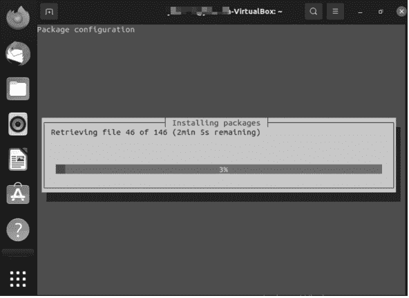

Budgie DE。

- 等待`tasksel`完成 Budgie Desktop 的安装。
- 选择`lightdm`配置详情，使用 `TAB` 键选择`lightdm`，然后点击 `OK` 按钮。
- 重启您的 Ubuntu 20.04 系统。

# Budgie 桌面环境 ■ 185

- 选择一个桌面会话（如 Budgie）并打开桌面选择菜单。
- 选择 Budgie Desktop，输入您的密码并点击登录按钮。

## BUDGIE的新功能与开发

### Budgie 面板 Dock 模式

上游 Budgie 版本自带一个面板。它经过了增强，并有一个额外的应用程序图标用于管理您打开的程序。

虽然这套工具非常方便，但并不是所有人的喜好或工作流。Ubuntu Budgie 自动在其镜像中加入了 `Plank` dock。虽然 `Plank` 是一个很好的应用，但并非必须。Budgie 的下一次更新添加了 dock 选项，可以将桌面上的任何面板转换为传统的风格停坞。

### 什么是 `Plank` Dock 应用？

作为我们最喜欢的 Linux dock 程序之一，`Plank` 在上个月经历了重大的重构，增加了许多需要的功能并修复了大量漏洞。

与其他应用一样，`Plank` 也有主题支持，允许您创建无缝的桌面体验。

`Plank` 并不是 Linux 上唯一的类 dock 应用，但它是最优秀的移动设备之一。它维护良好，几乎不系统资源，并且在所有桌面和各种窗口管理器上都能运行良好。它拥有一系列虽小但设计周全的功能和自定义选项。这里没有沉重且复杂的仪器。相反，它为了的是可靠性、稳定性和简单。

### 常用功能

- 显示“固定”和活跃的程序图标
- 右键点击菜单显示快速菜单选项和项目
- 拖动 dock 项目进行重新排序

选项/设置包括以下内容：

- 字体位置：屏幕的顶部、底部、左侧或右侧
- 对齐：图标靠左、靠右或居中对齐
- 行为：包括隐藏选项，例如“智能隐藏 (`intelli-hide`)”
- 主题支持：包括“透明”选项

在 `Plank` 0.8 的约 20 处变化中包括：

- 参考了 `GTK` 主题“首选背景颜色”
- 收藏面板
- 调整了面板模式对象状态
- 修复了 Linux Mint 中默认文件夹的问题
- 窗口显示延迟增加到 200 毫秒
- 提高了 HiDPI 屏幕上的可见度

### 如何在 Ubuntu 中安装 `Plank` Dock

`Plank` 0.8 可以安装在 Ubuntu 14.04 LTS 或更高版本（包括作为 Linux Mint 的输出）上，通过官方的 Dock PPA。

首先，打开终端并粘贴以下指令将 PPA 添加到您的软件源中，按照指示输入密码：

```bash
$ sudo apt-add-repository ppa:ricot/docky
```

更新您的软件库：

```bash
$ sudo apt-get update && sudo apt-get install plank
```


安装后，在 `Unity Dash`（或您正在使用的桌面区域的应用程序菜单）中打开“Plank”应用即可大功告成！要解锁偏选项，您需要右键点击 `dock` 最左侧的“Plank”图标。

## 智能隐藏 (Intelligide)

`Budgie` 面板（包括新的智能 `dock` 模式）可以添加额外的覆盖行为。其中就包括著名的智能隐藏功能，它会让面板在窗口经过时巧妙地隐藏，并在释放时恢复。

## 夜间模式 (Night Light)

似乎每个适合您的桌面都添加了蓝光过滤器以防止眼睛疲劳并促进更好的睡眠。`GNOME 3.24` 有一个（移动端有更多），`KDE Plasma`、`Windows 10` 以及（现在的）`Chrome` 也有。`Budgie` 渴望改善用户的视力和睡眠习惯，也加入了这一行列。下一次大版本发布将看到桌面（包括其新的夜光小组件）充满了开启/关闭切换、调度选项以及调整色温度的能力。

## Budgie 设置应用

作为简化 `Budgie` 体验并允许更高级别自定义努力的一部分，`Budgie` 将桌面设置从 `Raven` 侧边栏中移出。您仍然可以访问标准功能，如外观、字体和面板小组件，但不再将显示在更适合显示通知和有用组件的侧边栏中。如果您火眼如炬，您会注意到上方截图列出的许多功能，包括管理启动应用程序的插件部分以及 `Budgie` 菜单图标的自定义选项。

## 它是灵活的

### Budgie 桌面环境 ■ 187

### Cinnamon 桌面环境 ■ 191

本节将探讨图形用户界面（`GUI`）以及 `Linux GUI` 的重要组件。你将学习到 `Linux` 中使用的标准窗口管理器和桌面环境。

## 图形用户界面

`GNU` 网络对象模型环境（`GNOME`）是大多数 `Ubuntu` 安装的默认 `GUI`，并（松散地）基于苹果生态系统。`GUI` 或图形应用程序是指任何你可以使用鼠标、触控板或触摸屏进行交互的内容。你拥有各种图标和其他视觉程序，可以通过鼠标指针激活它们来访问相应功能。桌面环境（`DE`）提供了与系统交互的图形用户界面。你可以使用 `GIMP`、`VLC`、`LibreOffice` 和文件管理器等 `GUI` 应用程序完成各种任务。

## Linux GUI 的特性

该界面允许用户通过 `GUI` 中的图标、窗口和图形与系统进行视觉交互。内核是 `Linux` 的核心，而 `GUI` 是由 `X Window System`（或 `X`）提供的操作系统脸子。

`X Window System` 是开源组织 `X.Org Foundation` 的产品，它是一种允许在其 `X Server` 上构建链接的协议。你可以在许多窗口管理器或桌面环境（如 `GNOME` 或 `KDE`）中使用 `X`。桌面空间包含一个窗口管理器，并且比窗口管理器是一个更集成的系统。它构建在窗口管理器之上，需要 `X Windows` 和窗口管理器。

## GUI 的特性

有独特的特性和工具用于与软件交互，以使 `GUI` 尽可能易用。以下是所有这些特性的列表描述。

- **按钮（Button）：** 按钮的图形表示，按下时会作为程序运行。
- **对话框（Dialog Box）：** 显示额外信息并请求用户输入的窗口类型。
- **缩略图（Thumbnail）：** 程序图像、特性或文件的微型表示。
- **菜单（Menu）：** 用户通过菜单栏提供的命令或选项列表。
- **菜单栏（Menu Bar）：** 包含菜单标签的小型水平条。
- **功能带（Ribbon）：** 设置集成程序功能的的文件菜单和工具栏。
- **标签页（Tab）：** 窗口顶部的点击区域，显示另一个页面或位置。
- **工具栏（Toolbar）：** 按钮栏，通常位于应用窗口顶部，用于控制软件操作。
- **窗口（Window）：** 显示器上显示操作系统的矩形区域。

`GUI` 使用图标、窗口和菜单来执行命令，如打开、删除和移动文件。尽管 `GUI` 操作系统使用鼠标进行导航，但也可以使用键盘快捷键或方向键操作。

例如，如果你想在 `GUI` 系统上打开应用程序，可以将鼠标指针移动到系统图标并双击它。而在命令行界面中，你需要知道进入程序目录、列出文件列表并使用该文件的命令。

## GUI 的优点

`GUI` 被认为比基于文本的命令行界面（如 `MS-DOS` 或 `UNIX` 等操作系统的 `shell`）更友好。

与 `UNIX` 或 `MS-DOS` 等命令行或 `CLI` 操作系统不同，它们容易阅读使用，因为不需要记忆命令。此外，用户不需要学习任何编程语言。得益于易用性和现代的外观，`GUI` 操作系统主导了今天的市场。

## 命令行界面

`CLI` 是一种接受输入以执行特定功能的命令程序。任何你可以通过终端命令使用的应用程序都属于这一类。`CLI` 是处理应用程序的旧工作方式，用于执行用户需要的特定任务。`CLI` 是一种基于文本的视觉界面，与使用图形选项允许用户与系统及应用交互的 `GUI` 不同。`CLI` 允许用户通过输入命令来执行任务。它的操作系统简单但不易用。用户输入命令，按下“回车”并等待响应。接收到命令后，`CLI` 会正确评估它并在屏幕上显示输出/效果。命令行解释器即用于此目的。

`CLI` 随电话打字机引入。该系统基于批处理。现代计算机支持 `CLI`、批处理和单一界面 `GUI`。为了很好地使用 `CLI`，用户必须立即输入一组命令（逐个输入）。许多应用程序（单处理系统）在其操作上仍使用 `CLI`。此外，`Forth`、`Python` 和 `BASIC` 等编程语言也提供 `CLI`。命令行翻译器用于使用文本界面。

`CLI` 的另一个特性是命令行，作为用户界面或 `shell` 中使用的字符序列。命令信息用于通知用户 `CLI` 已准备好接受指令。`MS-DOS` 是 `CLI` 的示例。

## 终端用户界面

`TUI` 也称为文本用户界面。你在屏幕上看到文本，是因为它们只在终端中使用。许多用户并不熟悉这些应用程序，但有很多。基于终端的 `Web` 浏览器是 `TUI` 程序的极佳示例。基于终端的游戏也属于这一类。文本界面（也称为写入用户交互或终端用户交互）与命令行通信的区别在于，与 `GUI` 不同，它们使用整个屏幕空间且不提供逐行输出。然而，`TUI` 仅使用标准文本终端中的文本和符号，而 `GUI` 通常使用高分辨率图像终端。

# Cinnamon

它是源自 `GNOME 3` 的免费开源桌面 `X Window` 源码，遵循标准的桌面隐喻约定。`Cinnamon` 是 `Linux` 的主要桌面发行平台。

`Cinnamon` 的开发是针对 2011 年 4 月发布 `GNOME 3` 的反应，当时标准的桌面被遗弃了。在多次尝试扩展 `GNOME 3` 以适应 `Linux Mint` 的设计目标后，`Mint` 开发人员安装了 `GNOME 3` 组件以创建一个独立的桌面。`GNOME` 的分裂在 2013 年 10 月发布的 `Cinnamon 2.0` 中完成。苹果应用和桌面不再与 `GNOME 3` 兼容。

作为 `Linux Mint` 的一个独特特征，`Cinnamon` 通常收到了媒体报道，主要是因为其易用性和平缓的学习曲线。在序列化设计方面，`Cinnamon` 与 `Xfce` 桌面和 `GNOME 2`（`MATE` 和 `GNOME Flashback`）相似。

## 历史

与少数基于 `GNOME` 的桌面环境（包括 `Canonical Unity`）一样，`Cinnamon` 在 2011 年 4 月对 `GNOME` 团队的传统桌面体验感到不满。当时，`GNOME` 包含了一个标准的桌面主题。但 `GNOME 3` 被 `GNOME Shell` 取代，它缺乏面板和其他基本的桌面功能。这些核心功能的取消对于像 `Mint` 和 `Ubuntu` 等发行版开发人员来说是不可接受的，因为他们的目标是那些寻找可以立即上手的协作站点的用户。

`Mint` 团队最初决定升级 `GNOME Shell` 以替换剩余功能。这些努力的结果是“`Mint GNOME Shell` 扩展”（`MGSE`）。当时，`MATE` 桌面环境也从 `GNOME 2` 分支出来。`Linux Mint 12` 于 2011 年 11 月发布，合并了两者，为用户提供了带 `MGSE` 的 `GNOME 3` 或传统 `GNOME 2` 桌面的选择。

然而，即使有了 `MGSE`，`GNOME 3` 仍然缺失了 `GNOME 2` 的优雅，并受到了用户社区的欢迎。一些缺失的功能在当时无法更改，扩展似乎无法及时生效。此外，`GNOME` 开发者无法满足 `Mint` 开发人员的需求。

逐渐，各种关键应用程序被 `Mint` 开发人员替换。截至 2012 年 1 月发布的 1.2 版本，`Cinnamon` 的窗口管理器是 `Muffin`，它是 `GNOME 3` 中 `Mutter` 的分支。同样，从 2012 年 9 月（1.6 版本起）开始，`Cinnamon` 包含了 `Nemo` 文件管理器，它是 `Nautilus` 的分支。`Cinnamon-Control-Center`（控制中心）自 2013 年 5 月（1.8 版本起）以来集成了 `GNOME-Control-Center` 的功能。

`Cinnamon-Settings` 使得管理更新小组件、扩展、桌面和主题成为可能。顶部。`GNOME-Screensaver` 也以分支的形式进行了安装，现在被称为 `Cinnamon-Screensaver`。

自 2013 年 10 月起（2.0 版本起），`Cinnamon` 不再是像 `Unity` 或 `GNOME Shell` 那样的 `GNOME` 桌面端端，而是一个独独立的桌面环境。尽管 `Cinnamon` 构建在 `GNOME` 技术之上并使用 `GTK`，但它不再需要安装 `GNOME`。

## 概述

`Cinnamon` 桌面环境是一个庞大的开发项目。在 2006 年到 2010 年之间，`Linux Mint` 最突出的桌面空间是 `GNOME 2`。它非常稳定且流行。2011 年，`Linux Mint 12` 无法通过 `GNOME 2` 发布。即将到来的 `GNOME` 团队发布了一个全新的桌面（`GNOME 3 "GNOME Shell"`），它使用了最新的技术（`Clutter`, `GTK3`），具有完全不同的设计，而且我们使用的范式与之前的相同工作空间非常不同，因此无法与 `GNOME 2` 并存安装。在 `Debian` 决定将 `GNOME` 升级到版本 3 之后，`Linux Mint` 不再提供 `GNOME 2`。为了解决这个问题，启动了两个项目。

名为“`MATE`”的项目由名为 `Perberos` 的工程师启动。他的目标是重新设计并封装 `GNOME 2` 回其原始形式。`Linux Mint` 启动了一个名为“`MGSE`”的项目。其目标是升级 `GNOME 3` 扩展，以替换 `GNOME 2` 中丢失的一些功能（面板、系统托、应用程序菜单、以 `Alt` 为中心的标签选择器、窗口列表等）。

`Linux Mint 12` 同时在 `MATE` 和 `GNOME3 + MGSE` 上发行。六个月后，经过大量工作，`MATE` 变得稳定，并且从扩展集中，`MGSE` 变成了一个名为 `Cinnamon` 的 `GNOME 3` 分支。`Linux Mint 13` 是第一个部署 `Cinnamon` 桌面的版本。由于 `Linux Mint` 拥有 `MATE` 和 `Cinnamon` 系统，两者都为用户提供了桌面，一个是 `GNOME 2` 的分支，另一个是基于 `GNOME 3` 的。

其他最近的改进包括：

- 桌面网格、文件搜索通配符支持、多进程设置守护进程、面板启动器上的桌面操作、各种桌面管理进程以及 `Nemo` 中的文件管理器。
- 桌面面板布局的额外选项提供了具有自定义窗口的现代感主题。
- 菜单中重复应用程序的设计改进（例如，`flatpak` 与 `deb` 包），`Nemo` 中的固定文件侧重于性能改进。

## 软件组件

### X-Apps

`Cinnamon` 引入了基于 `GNOME` 核心应用的 `X-apps`，但经过了修改以便跨 `Cinnamon`、伙伴和 `xfce` 运行；它们具有标准的用户界面（`UI`）。

- `Xed` 是一个 `Gedit/pluma` 文本编辑器。
- `Xreader` 是基于 `Evince/Atril` 的文档查看器。
- `Xviewer` 是基于 `Eye of GNOME` 的图像查看器。
- `Pix` 是基于 `gThumb` 的图像编辑器。
- `Xplayer` 是基于 `GNOME (Totem)` 的视频播放器。

## 特性

`Cinnamon` 提供的特性包括：

1. 桌面效果，包括动画、过渡效果和使用化妆实现的透明。
2. 带有主菜单、启动器、窗口列表和系统托的面板可以调整到屏幕的左侧、顶部或底部。
3. 各种扩展。
4. 面板上的苹果（`Applets`）。
5. 类似于 `GNOME Shell` 的活动概览。
6. 易于自定义的设置编辑器：
   - 面板
   - 日历
   - 主题
   - 桌面结果
   - 苹果（`Applets`）
   - 扩展

音量和亮度调节指向任务栏时的滚轮。截至 2012 年 1 月 24 日，`Cinnamon` 本身还没有官方文档，尽管大多数 `GNOME Shell` 文档适用于 `Cinnamon`。

## 用户指南

### 迷人的 GUI

并不是秘密，`GUI` 对任何 `Linux` 发行版来说都是至关重要的。我们甚至有用户仅仅因为桌面的美观而喜欢某个特定的发行版，`Cinnamon` 就是其中之一。`Cinnamon` 桌面不包含不必要的图标和快捷方式。

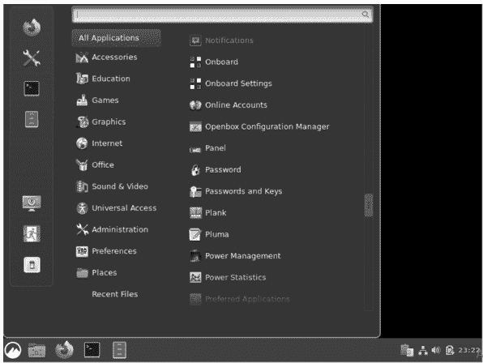

## Cinnamon 桌面。

你可以停止使用系统设置并进入桌面菜单。对于多显示器的用户，你可以选择它们出现在主显示器、辅助显示器还是所有用户显示器上。

### Desklets（小组件）的使用

`Cinnamon` 提供了几个 `desklet`，包括天气应用、桌面照片应用、时间和日期、便签条、`CPU` 或磁盘监控。

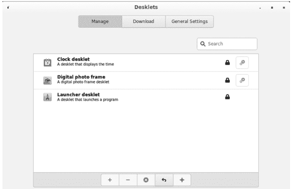

### 添加 Desklets。

我最喜欢的是时间和日期桌面。这就是我们说的 `desklet` —— 一种添加到桌面上的单一用途应用，方便访问。

### 速度

自从你开始使用 `Linux`，有些人在 `Fedora`、`Debian` 和 `Ubuntu` 上使用了 `Cinnamon`。`Cinnamon` 在这些发行版中运行良好，并能快速方便地启动应用程序。`desklet` 本身在进入后加载并不长时间。此外，`Cinnamon` 兼容资源较少的 `PC` 硬件（如内存），除非使用额外的应用程序。

### 集成

通过 `Cinnamon`，你会发现特定的应用程序。例如，你可能想安装一些。幸运的是，有了，事情正在变得好很多。

### Cinnamon 桌面环境
旨在设计。

### 极具自定义性
虽然不可用，但 `Cinnamon` 允许你自定义窗口。控制中心让你访问。你还可以使用主题设置更改桌面外观。此外，你还自定义字体。所有可见设置都在顶部。一切看起来整洁。进入系统设置。

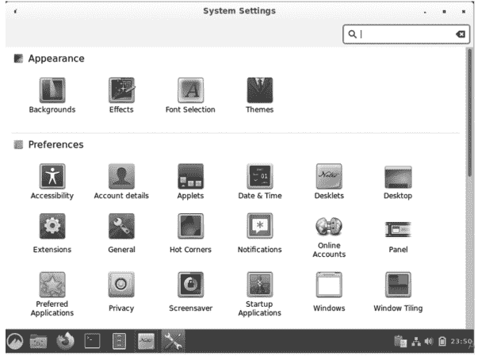

### 系统设置。

列中有各种可用选项，如外观、字体选择和主题。让我们看看这些。

- 效果：效果选项简单、通俗易懂且直观。你可以关闭各种项目的效果或通过反转样式更改窗口。如果你想更改结果的速度，可以通过自定义标签页来实现。

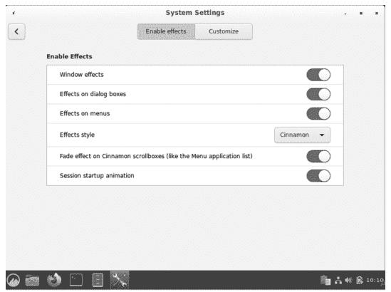

### 效果设置。

- 字体选择：在此部分中，你可以根据大小和类型自定义整个系统的字体，通过字体设置，你可以精调外观。

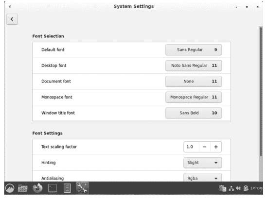

### 字体选择。

### Cinnamon 桌面环境
- 主题和符号：`Linux Mint` 用户不需要去哪里来更改他们想要的。窗口管理器、图标和自定义面板都在一个处。你可以将面板改为黑色或浅色，并调整窗口设置以适应你的更改。默认的 `Cinnamon` 设置看起来很好，我们在检查橙色的 `Ubuntu Cinnamon Remix` 时也是如此。

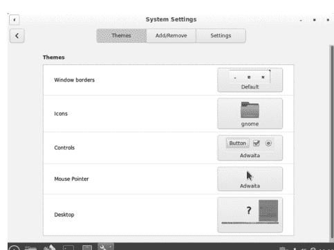

### 主题和图标。

- 自定义桌面屏幕上的内容：背景不是可以更改的桌面项目。你可以通过右键点击桌面并点击“自定义”来找到更多选项。

### 202 ■ Linux

### Cinnamon 面板

`Cinnamon` 面板或工具栏自带了非常简单的设置：打开应用程序菜单、系统托盘和应用程序选择器。然而，你可以自定义面板并添加新的程序启动器。要执行此操作，进入程序菜单，右键点击你想要的程序，并选择“添加到面板”。此外，你还可以将启动器添加到桌面或“收藏夹”栏。`Cinnamon` 还允许你通过“编辑模式”按意愿在面板上设置程序启动器。

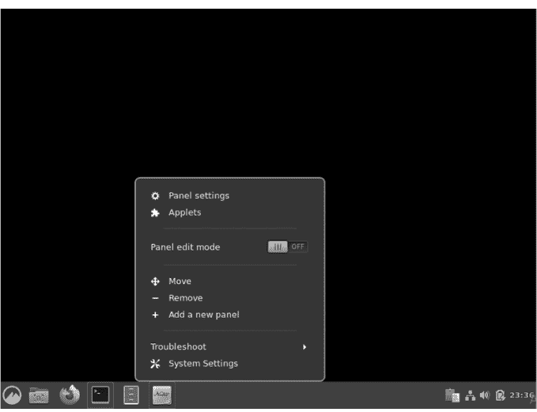

### 添加面板。

### 多工作区的使用

与其他 `Linux` 桌面环境一样，`Cinnamon` 允许你使用多个被称为“工作区”的桌面。你可以在 `Cinnamon` 面板上选择工作区，面板会贯穿整个工作区的窗口框。`Cinnamon` 工作区的一个很棒的功能是在工作区之间移动应用程序，或将它们分配给每个可用的工作区。

### Cinnamon 桌面环境 ■ 203

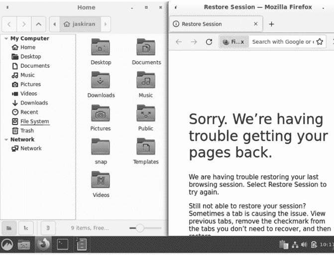

### 多工作区。

### 灵活性

由于图形用户界面的高度灵活性，`Cinnamon` 桌面环境易于使用和导航。例如，如果你只使用少数应用程序，通过工具栏获取减少的应用程序或后台运行的程序可能具有挑战性。解决此问题的功能是重置操作系统按钮进行选择。这样，你就可以轻松地点击任何操作系统，而无需费麻烦。此外，`Cinnamon` 桌面还有一个实用的菜单，让你访问一些功能和实用程序，包括桌面小组件（`desklets`）、创建新文档等。

### Nemo

与任何其他桌面环境一样，`Cinnamon` 也有许多自动化应用。另一个引起我注意的是文件管理器 `Nemo`。你可能已经与 `Nautilus` 和 `Krusader` 等其他文件管理器密切工作过。而在 `Cinnamon` 中，你才真正接触到了这个很棒的应用。

### 204 Linux

`Nemo` 拥有整洁的用户界面，功能按钮位置良好。与 `Nautilus` 和 `Cinnamon` 下的 `Nemo` 相比，`Nemo` 与 `Cinnamon` 的融合程度似乎比 `Nautilus` 好得多。

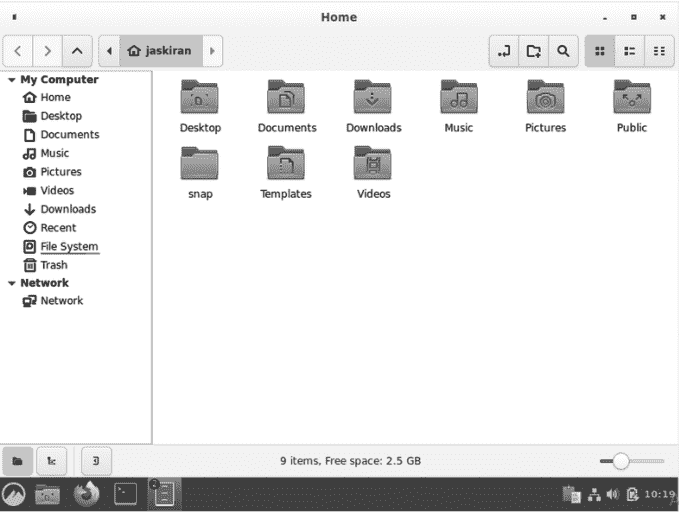

### Nemo 文件管理器。

### 稳定性

截至 2013 年 10 月，`Cinnamon` 已停止作为 `GNOME` 之上的前端，不再需要安装 `GNOME`。它有权共享桌面空间。从从那时起，开发人员添加了许多功能，截至本文编写时，最新版本是 `Cinnamon 3.6.7`。`Cinnamon` 非常稳定，并可与多个 `Linux` 发行版配合。

### Cinnamon 插件 (Applets)

`Cinnamon` 插件是你面板下方的所有功能，例如日历或键盘布局切换。在“管理”选项卡中，你可以添加/删除预装的插件。你应该查看一下可以下载的插件。此外，我选择了天气和 `CPU` 指示器插件。

### Cinnamon 桌面环境 ■ 205

### 插件 (Applets)

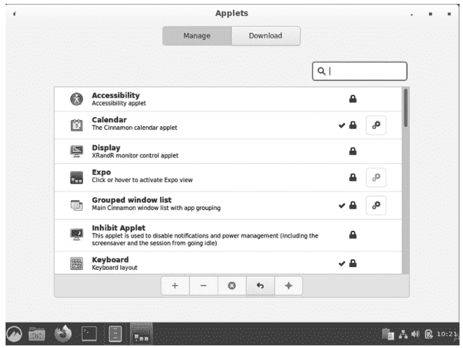

### 插件 (Applets)。

### 桌面壁纸

要更改 `Cinnamon` 桌面的背景，右键点击桌面并选择“更改桌面背景”。它将打开一个易于使用的窗口，左侧提供系统文件夹，在挂载窗口中有每个文件夹内照片的预览。

### Cinnamon 应用程序

`Cinnamon` 引入了基于 `GNOME` 核心应用程序的 `X-Apps`，但经过修改以便在 `Cinnamon`、`MATE` 和 `XFCE` 之间运行；它们具有标准的用户界面。

- `Xed`（文本编辑器）
- `Xviewer`（图像查看器）
- `xreader`（文档查看器）
- `Xplayer` 媒体播放器
- `PixAur`（图像编辑器）

### 206 ■ Linux

### Cinnamon 如何工作

首个 `Cinnamon` 构建部分在屏幕底部放置了一个面板。左下角是菜单按钮，可以打开应用程序启动器，类似于 `Windows` 的开始菜单。在这里你可以打开软件、访问文件并更改系统设置。右侧是系统指示器。此时你可以选择切换用户、连接网络、查看电池寿命、检查时间以及查看日历。

面板的其余部分显示桌面上所有打开的窗口。与 `GNOME` 和其他 `Linux` 连接不同，`Cinnamon` 允许你在不安装额外软件或修改隐藏设置的情况下在桌面上放置图标。

虽然自动创建没有新的，但它非常具有定制性。你可以在“设置”中更改主题和图标，由于它使用了这种老式的方法，因此它带有很多许多主题。然后是桌面小组件（`desklets`）。你可以将其放在桌面上并执行简单任务的小部件，例如显示天气、记录快速便签或监控 `CPU` 使用情况。

### 在 UBUNTU 上安装 CINNAMON

对于 `Ubuntu 20.04` 和旧的 `LTS` 版本 `18.04`，某些步骤略有不同。

```bash
```


`sudo apt install cinnamon`

或者

`sudo apt-get install cinnamon`

当你在终端中运行上述命令时，你将看到以下代码：

`sudo apt install cinnamon`

## Cinnamon 桌面环境 ■ 207
`Cinnamon` 软件包在 `Ubuntu 18.04` 中可用。然而，它不是最新的，而是 `3.6`。`Cinnamon` 有官方的 `PPA`。打开终端并执行以下指令：

```bash
sudo add-apt-repository ppa:embrosyn/cinnamon
```

```bash
sudo apt update && sudo apt install cinnamon
```

它将下载大小为 `150 MB` 的文件。这还提供了 `Nemo`（`Nautilus` 的分支）和 `Cinnamon` 控制中心。这些额外功能提供了 `Linux Mint` 体验。安装后，你将看到下所示桌面环境：

| LXDE |
| Budgie Desktop |
| Cinnamon |
| Cinnamon (软件渲染) |
| MATE |
| Openbox |
| Ubuntu |
| Ubuntu on Wayland |
| Xfce Session |

`Cinnamon` 环境。

## 从 Ubuntu 移除 Cinnamon
理解，你可能想移除 `Cinnamon`。首先，切换回到你之前使用的 `GNOME`。现在，删除 `Cinnamon` 软件包：

```bash
sudo apt remove cinnamon
```

如果你使用 `PPA` 安装了 `Cinnamon`，也应该从列表中移除 `PPA`：

```bash
sudo add-apt-repository -r ppa:embrosyn/cinnamon
```


## 登录后启动的进程

登录后，会自动启动以下进程：

- `Cinnamon-session`（启动所有进程的会话管理器）
- `Cinnamon`（Cinnamon 桌面的可见部分）
- `Nemo-desktop`（带有桌面图标和桌面菜单）
- `Cinnamon-screensaver`（屏幕保护程序）
- 各种 `csd-*` 进程（后台运行的守护设置）

`Nemo` 进程在浏览文件和目录时启动。只要有一个文件管理器窗口打开，它就会保持运行。Cinnamon 设置进程在打开系统设置时启动，只要开启一个配置模块，它就会保持运行。

## Cinnamon 库

### Cinnamon-Menus

Cinnamon 菜单库为一组计算机桌面应用程序提供读取和监控活动。Cinnamon 菜单可以快速将安装的应用程序添加到程序菜单，下载菜单系统图标、alt-tab 选择器和窗口列表，并在计算机上安装或删除应用程序时保持这些数据同步。Cinnamon 菜单库使用 C 语言构建，源码可以在 Github 上获取。

### Cinnamon-Desktop

`Cinnamon-desktop` 包含了 `libCinnamon` 桌面库、`Cinnamon-about` 程序以及其他综合桌面文档。`Cinnamon-desktop` 库为桌面上的多个应用程序提供了共享 API，但由于某些原因，它无法运行在多平台平台上。虽然没有 API 或 ABI 保证，但我们尽力提供稳定性。API 文档可以通过 `gtk-doc` 获取。

以下是 `Cinnamon-desktop` 目前可用的资源：

| 资源 | 描述 |
| :--- | :--- |
| `namon.desktop` | 多个 Cinnamon 组件使用的 `dconf` 设置 |
| `libcvc` | 用于控制音量和设备的 PulseAudio 工具类库 |
| `Gnome-rr` | 一个用于检测、加载和保存显示器配置的 `Xrandr` 工具类库 |
| `gnome-xkb` | 一个键盘布局工具类库 |
| `gnome-bg` | 一个壁纸工具类库 |
| `gnome-installer` | 用于安装软件应用程序的跨发行版库 |

本文解释了如何创建一个用户友好的应用程序类别，该类别通常以菜单形式显示。它允许第三方软件在所有桌面上添加菜单项，并允许系统管理员以影响所有桌面的方式编辑菜单。

## Muffin

`Muffin`（或 `libmuffin`）在窗口处理库方面的表述更为准确。窗口管理器并没有在 Cinnamon 桌面区域内作为一个独立进程运行。主 Cinnamon 进程使用 `libmuffin` 库，并同时使用视觉组件（面板、小部件程序等）和窗口管理器。

## Clutter

`Clutter` 和 `Cogl` 库现在是 `muffin` 包的一部分。它是一个用于创建和显示 2D 和 3D 图像功能的库。它同时供 `muffin` 本身（例如混合和设置舞台）以及 Cinnamon 中的 `St` 使用（所有的 `St` 小部件都是 `clutter` 播放器）。`Cogl` 是一个用于 3D 渲染中 `clutter` 的库。`Muffin` 用 C 语言构建，源代码可以在 Github 上找到。

## CJS

`CJS` 是一个 Cinnamon Javascript 翻译器。它使用 Mozilla 的 `SpiderMonkey`，这使得可以使用该语言与 `GObject` 交互，并连接 `GIR`、`GNOME` 和 Cinnamon 库。`CJS` 同样在一个重要的 Cinnamon 进程中处理，用 Javascript 编写的桌面组件包含了 Cinnamon 的大部分。`CJS` 已经升级到 C++ 和 Javascript，源代码可以在 Github 上找到。

## 核心组件

### Cinnamon-Session

`Cinnamon-session` 管理器负责在登录后呈现所有所需的组件，并在你需要时正确关闭会话。除了其他，会话管理器还引入了会话的关键组件（如桌面本身及其组件）以及配置为自动启动的应用程序。

`Cinnamon-session` 还提供了一个名为现有接口连接器（Existing Interface Connector）的 `DBus` 接口，使得媒体播放器等应用程序能够轻松处理忙碌并在视频播放期间防止电源管理（暂停、深度睡眠等）以及存储-屏幕休眠。会话管理器允许应用程序注册自动关闭。例如，文本编辑器在启动时会注册到会话，并在会话运行期间工作。如果文档未保存，会话会识别这一点并允许你在注销前保存工作。

### Cinnamon-Settings-Daemon

`cinnamon-settings-daemon` 是在你的 `Cinnamon-session` 后台运行的进程集合。`Cinnamon-settings-daemon` 提供了许多需要长时间运行的会话和功能。`Cinnamon-settings-daemon` 使用的服务包括 `XSettings` 管理器（它为 `GTK+` 程序提供主题、字体和其他设置）以及剪贴板管理器（在程序退出时存储剪贴板内容）。许多用户界面功能 Cinnamon 和 Cinnamon 设置的功能依赖于 `cinnamon-settings-daemon`。

`Cinnamon-settings-daemon` 将名称 `org.Cinnamon.Daemon` 引入会话总线，以确保只有一个事件处于激活状态。某些插件在此名称下提交项，以使其功能对其他应用程序可用。这些项的通信应被认为是秘密且不稳定的。

以下是其中一些进程的描述。

| 进程 | 描述 |
| :--- | :--- |
| `csd-automount` | 当硬件设备插入时自动管理这些设备 |
| `csd-clipboard` | 管理通过 `Ctrl+C`/`Ctrl+V` 可用的额外剪贴缓冲区 |
| `csd-housekeeping` | 处理缩略图缓存并监控磁盘空间 |
| `csd-keyboard` | 处理键盘布局和配置 |
| `csd-media-keys` | 处理媒体键 |
| `csd-settings` | 处理 `X11` 和 `GTK` 配置 |
| `csd-xrand` | 处理屏幕分辨率和显示器配置 |
| `csd-wacom` | 处理 `wacom` 设备 |
| `csd-print-notifications` | 处理打印机通知 |
| `csd-power` | 处理电池和电源管理 |
| `csd-orientation` | 处理加速度计和屏幕方向 |
| `csd-mouse` | 处理鼠标和触摸设备 |

### Cinnamon-Screensaver

`cinnamon-screensaver` 负责锁屏以及对某些电源管理功能的最小化处理（尽管它们大部分在 Cinnamon 设置守护进程中已启用了 `csd`）。`Cinnamon-screensaver` 使用 Python 构建的，源代码可以在 Github 上找到。

## Cinnamon 优势

Cinnamon 可以通过主题、小组件（applets）和扩展（extensions）进行替换。主题可以自定义 Cinnamon 功能的外观，包括但不限于菜单、面板、日历和窗口的使用。Applets（小组件）是面板上的图标或文本。系统自动分发五个小组件，开发者可以自由创建自己的。提供有一个如何创建简单小组件的教程。扩展可以更改 Cinnamon 的性能。开发者可以将他们的主题、小组件和扩展上传到 Cinnamon 网页，并允许用户下载。

### 扩展 (Extension)

Cinnamon 可以通过主题、小组件（applets）和扩展（extensions）进行替换。主题可以自定义 Cinnamon 功能的外观，包括但不限于菜单、面板、日历和窗口的使用。Applets（小组件）是面板上的图标或文本。系统自动分发五个小组件，开发者可以自由创建自己的。提供有一个如何创建简单小组件的教程。扩展可以更改 Cinnamon 的性能。开发者可以将他们的主题、小组件和扩展上传到 Cinnamon 网页，并允许用户下载。

### 灵活性 (Flexibility)

Cinnamon 桌面拥有出色的退出菜单，你可以通过右键访问。此菜单包含一系列其他常用功能，如访问桌面设置和添加桌面，以及与其他桌面相关的功能。

### 整合 (Consolidation)

桌面的选择不取决于长期应用程序的可用性。所有的应用程序无论是为哪个桌面设计的，在任何其他桌面上都能良好运行，Cinnamon 也是如此。为 `KDE`、`GNOME` 或任何其他桌面编写的应用程序所需的库都是提供的，使得使用任何 Cinnamon 桌面应用程序成为无缝体验。

### 速度 (Speed)

Cinnamon 快速且简单。应用程序立即加载并显示。桌面本身在登录期间加载很快，尽管这是我的个人体验，并非基于任何即时测试。

### 可视连接 (Visible Connector)

Cinnamon 使用易读的字体和颜色组合，外观整洁。桌面不会被不必要的根中断，你可以通过“系统设置 => 桌面菜单”编辑在桌面上显示的图标。此菜单还允许你指定桌面图标是仅显示在主显示器上、仅显示在次显示器上，还是所有显示器上。

### 发现 (Discovery)

Cinnamon 可于 `Linux Mint 12`，并在所有 `Linux Mint 13` 及以上版本中作为四个可能的桌面环境选项之一（另一种是 `MATE`）。它也是 `Linux Mint Debian Edition` 更新包 4 重制版中的用户首选。

### 设置编辑器 (Settings Editor)

用于方便自定义的设置编辑器。自定义面板、日历、主题、桌面特效、小组件和扩展。

### 概览模式 (Overview Mode)

Cinnamon 添加了全球全新的视图。这两种方法是“Expo（扩展）”和“Scale（比例）”，可以在 Cinnamon 设置中配置。

### 音频增强 (Audio Enhancements)

音频设置完全用 Python 重写，以提供额外功能，例如：当自定义页面上无可用输入设备时通知用户、音频设置面板的视觉变化、同时静音所有音量控制、对音量滑块/静音按钮进行额外调整、检查音频对话框并添加相应的图标。

### 触摸板设置 (Touchpad Settings)

Cinnamon 用户可以完全控制其之前解锁的便携式电脑上的触摸板。中心点击操作固定在图像帧中。

### 章节总结 (CHAPTER SUMMARY)

在本章中，我们涵盖了 Cinnamon 的介绍及其功能、历史、核心项目、应用程序和开发。我们还设置了一个单独的章节介绍了 Cinnamon 版本的历史。Cinnamon 拥有 `GNOME` 和 `Unity` 等桌面环境不具备的功能。Cinnamon 是为桌面定制的，不需要任何外部插件、小部件或调整工具来自定义桌面。Cinnamon 可以凭借奇奇且必要的功能让任何新的 Linux 用户受益。

## LXDE 桌面环境

### 本章内容 (IN THIS CHAPTER)

- 介绍与历史
- 核心组件
- 在 Ubuntu 中安装 LXDE
- 使用 LXDE 的原因
- Lubuntu 发行版

在上一章中，我们讨论了 Cinnamon。在本章中，我们将简要讨论基于 Linux 的操作系统 `LXDE`。首先我们将学习 `LXDE` 的基础知识。

### 简介 (INTRODUCTION)

`LXDE`（轻量级 X11 桌面环境的缩写）是一种运行在 `Unix`（如 `BSD` 和 `Linux`）上的轻量级桌面。它的设计旨在使用比 `GNOME` 等环境更少的系统资源。最初由台湾程序员洪振义于 2006 年批准，它使用 C 语言和 `GTK` 工具包编写；2013 年发布的新版本基于 `Qt`。

### 概览 (Overview)

`LXDE` 使用 C 语言和 `GTK2` 工具包编写，适用于 `Unix` 和其他 `POSIX` 兼容平台。`LXDE` 项目旨在提供一个更快、更强大的桌面空间。2010 年的实验表明 `LXDE` 的内存占用低于四个流行的桌面设备（`GNOME 2.29`、`KDE Plasma 4.4` 和 `Xfce 4.6`）。它消耗的更少，表明使用 `LXDE` 的笔记本电脑电池消耗更慢。

`LXDE` 使用其组件（或相应的依赖项）的输出。默认窗口管理器是 `Openbox`，但可以在 `LXDE` 中配置第三方窗口管理器，如 `Fluxbox`、`IceWM` 或 `Xfwm`。`LXDE` 结合了 `GPL` 许可代码和 `LGPL` 许可代码。

### 历史 (HISTORY)

安装基础 `Gentoo` 系统和 `X` 服务器后，需要考虑哪些站点有最佳镜像可以使用。有很多选择，从极简的窗口管理器到 `KDE` 和 `GNOME` 等桌面环境。有些用户可能想要轻量级图像区域，但不想配置每个组件（如 `Openbox`）。一段时间以来，这种位置的用户一直安装 `Xfce`，因为它符合轻量级区域的定义并带有一套轻级应用程序。虽然 `Xfce` 提供了一个完整的环境，无需大量使用 `KDE` 或 `GNOME` 应用程序，但它可以依赖重端。最后，创建了另一个版本：轻量级 X11 桌面环境，简称 `LXDE`。那些不喜欢 `LXsession` 提取的所有这些依赖项（`dbus`、`polkit` 等）的用户。

相比 `DistroWatch` 的在2011年1月初的 Linux 发行率统计中，`Ladislav Bodnar` 注意到与其他桌面环境相比，`LXDE` 的流行程度有所提高。他说：

> 如果你查看表格会发现，令人兴奋的是使用轻量级 `LXDE` 桌面或 `Openbox` 窗口器的发行版正在增加。例如，`Lubuntu` 在页面访问量上远胜于 `Kubuntu`，而 `CrunchBang Linux` 作为一个基于 `Openbox` 的轻量级发行版，尽管已经超过一年没有发布稳定版本，但仍位列前25 名。许多其他发行版也开始为其产品提供基于 `LXDE` 的程序，这促成了这一新桌面空间流行度的急剧增长。

### Qt 移植

`LXDE` 在2013 年转向了 `Qt`，并尝试与另一个轻量级桌面 `Razor-qt` 合作。应用程序菜单中的隐藏字符为繁体中文。2013年7月3日，洪宣布了 `LXDE` 套件的 `Qt` 移植，7月21日，`Razor-qt` 和 `LXDE` 宣布了整合这两个项目的计划。这种整合意味着 `GTK` 和 `Qt` 版本将长期并存，但最终，所有原始团队的精力都集中在了 `Qt` 移植版 `LXQt` 上。

### 核心组件

`LXDE` 中 `Qt` 移植版的各种组件如下所示。

#### 窗口管理器 (Openbox)

该桌面环境由台湾的“PCMan”开发，旨在实现简洁美的代码和易用的设计。它使用 `Openbox` 作为窗口管理器，该管理器包含了部分轻量化模块功能。

`Openbox` 是一个免费的 `X` 系统窗口管理器，采用 `GNU` 通用公共许可证 (`GPL`) 授权。`Openbox` 最初基于 `Blackbox 0.650`，但已完全用 C 语言重写，3.0 版本不支持任何来自 `Blackbox` 的代码。它的设计目标是小巧、快速，并完全符合《客户端间通信规范手册》(`ICCM`) 和《扩展窗口管理器》(`EWMH`) Tips。它支持许多功能，例如用户可以在其中控制应用程序或显示各种动态信息的菜单。`Openbox` 的作者是加拿大安大略省渥太华卡尔顿大学的 `Dana Jansens`。

#### 使用

`Openbox` 允许在桌面上右键点击（或其他另一个组件）“根菜单”，并允许用户配置窗口管理。当窗口最小化时，它将变得不可见。要突出窗口，可以使用 `Alt + Tab` 或桌面菜单，后者可以通过右键点击（或再次点击任何其他用户绑定对象）菜单来访问。扩展 `Openbox` 以及其他添加图标、任务层、启动器、视觉特效以及如驱动程序恢复等功能的小型程序是常见的做法。

#### 特性

`Openbox` 系统有一套使用灵活菜单的方法。它是通过接收文本输出并将输出作为菜单源来实现的。每当用户将鼠标指向子菜单时，脚本就会重启，菜单随之重启。这种能力让用户和软件开发者比其他窗口管理器提供的普通菜单具有更高的灵活性。

#### 文件管理器 (PCManFM-Qt)

`PCMan` 文件管理器是由台湾的洪正廷（Hong Jen Yee）开发的管理类程序，旨在替代 `GNOME`、`Dolphin` 和 `Thunar` 文件管理器。`PCManFM` 是 `LXDE` 中的标准文件管理器，同样由同一作者与其他工程师合作开发。自2010 年以来，`PCManFM` 从头开始进行了完全重写；在此过程中，构建、设置和配置指令发生了变化。

它在 `GNU` 许可证下发布，`PCManFM` 是免费软件。它遵循 `Freedesktop.org` 提供的协作信息。由于对 `GTK3` 不满意，洪正廷在2013年测试了 `Qt`，并于2013年3月26日发布了基于 `Qt` 的首版 `PCManFM`。然而，他澄清说这不会向 `LXDE` 显示任何形式的 `GTK`，并表示：“`GTK` 和 `Qt` 版本将共存。”新的 `PCManFM-Qt` 是 `LXQt` 的组成部分。到2020年，`Arch Linux` 社区在 `GTK 3` 上安装了 `PCManFM`。

#### 特性

- 完全支持 `GVFs`，可无缝访问远程文件系统
- 双面板
- 缩略图
- 桌面管理 – 显示背景图像和桌面
- 书签
- 多语言支持
- 浏览标签（如 `Firefox`）
- 卷管理（如挂载/卸载/取消挂载，需要 `gvf`）
- 支持拖放
- 文件可以在标签页之间拖动
- 文件组织（默认应用程序）
- 提供以下视图：缩略图、合并、详细列表、缩略图和左侧边栏滚动

#### 桌面面板 (razor-panel)

`Razor-qt` 是一个面向开源的免费开放桌面环境。它旨在作为一个基于 `Qt` 应用程序框架的轻量级桌面空间，并“为追求简单、速度和清晰视觉界面的用户设计”。`Razor-qt` 的开发中断了，因为它与 `LXDE Qt` 移植版整合成了 `LXQt`。

`Razor-qt` 仍处于开发的早期阶段。截至2012年2月，该环境包含了面板和切换器、桌面、应用程序启动器、设置中心和会话。用户可以启用或禁用这些组件。`Razor-qt` 可以与任何现代 `X` 窗口管理器配合，如 `Openbox`、`fwwm2` 或 `kWin`。`Razor-qt` 的内存占用比 `LXDE` 略高，在测试中使用使用了 `114 MiB`，而 `LXDE` 使用了 `108 MiB`。

#### 与 LXDE 合并

在 `LXDE` 开发者洪正廷于2013 年将 `PCManFM` 发给 `Razor-qt` 后，他澄清说这不会向 `LXDE` 显示任何形式的 `GTK`，并表示：“`GTK` 和 `Qt` 版本将共存。”新的 `PCManFM-Qt` 是 `LXQt` 的组成部分。到2020年，`Arch Linux` 社区在 `GTK 3` 上安装了 `PCManFM`。

#### 会话管理器 (LXSession)

`LXSession` 是 `LXDE` 使用的标准会话管理器。它会自动启动一组应用程序并设置桌面。

#### 合并标记

- `"open-man"`: 生成个人页面。
- `"enable-more-warnings"`: 启用额外的集成。
- `"enable-gtk3"`: 包含 `GTK`。
- `"enable-buildin-clipboard"`: 添加内置剪贴板支持。
- `"enable-buildin-polkit"`: 添加 `polkit` 代理。
- `"enable-debug"`: 允许调试。
- `"enable-gtk"`: 允许 `GTK` 和集成。

#### 应用程序与二进制

1. `Lxclipboard`: 提供剪贴板支持的应用程序
2. `Lxlock`: 锁屏应用程序
3. `Lxpolkit`: `Polkit` 代理
4. `Lxsession-default`: 封装 `DBus` 以启动应用程序
5. `Lxsession-default-apps`: 一个 `Lxsession` 配置应用程序（专门用于调试）
6. `Lxsession-edit`: 一个 `lxsession` 配置应用程序
7. `Lxsession-utils`: `Lxsession` 的混合资源
8. `lxsettings-daemon`: `Xsettings` 守护进程

### LXDE 软件组件

与 `GNOME` 等大型桌面环境不同，`LXDE` 组件的依赖项较少，且没有紧密集成。相反，它们可以独立安装，也可以作为 `LXDE` 本身的一部分。

| 组件 | 描述 | 备注 |
| :--- | :--- | :--- |
| `LXInput` | 鼠标和键盘配置工具 | 这是一个为 `LXDE` 配置键盘和鼠标的小型程序。它包含了 `inttool 0.40.0` 和 `GTK+ 2.12` 或更高版本 |
| `PCMan` 文件管理器 | 文件管理器和元数据提供者 | `PCMan` 文件管理器是由源自台湾的 `Jen Yee` 开发的管理器应用程序，旨在替代 `GNOME`、`Dolphin` 和 `Thunar` 文件。`PCManFM` 是 `LXDE` 中的标准文件管理器，同样由同一作者与其他工程师合作开发。自 2010 年以来，`PCManFM` 已经从头开始重写：在此过程中，构建、设置和说明发生了变化 |
| `LXLauncher` | 易模式应用启动器 | `LXLauncher` 是一个用于在 7"-10.2 英屏幕上增强程序的可选启动器，它让 `LXDE` 桌面能够以主题为导向，在标签页下的单一视图中收集特定应用程序 |
| `LXPanel` | 桌面面板 | `LXPanel` 是标准的 `LXDE` 面板。桌面面板可以从 `*.desktop` 文件生成自动安装应用程序的菜单。它可以通过 GUI 偏好对话框进行配置，无需编辑文件。该部分提供了一个带有自动补全功能的“运行(Run)”框。`LXSession` 是 `LXDE` 使用的标准会话管理器。`LXSession` 会自动启动一组应用程序并设置活动桌面。此外，它不工作在桌面，，可以被任何窗口管理器使用 |
| `LXAppearance` | `GTK` 主题切换器 | `LXAppearance` 是 `LXDE` 的标准主题切换器。用户可以轻松更改应用程序使用的主题、图标和字体。从 `0.6.1` 版本开始，它还允许启用辅助功能 |
| `GPicView` | 图像查看器 | `lxde.org`。`GPicView` 是标准的 `LXDE` 图像查看器。`GPicView` 结合即时启动和精确的界面 |

| 组件 | 描述 | 备注 |
| :--- | :--- | :--- |
| `LXMusic` | `MMS2` 音频播放器的前端 | `LXMusic` 是一个小型 `LXDE` 音乐播放器。它是 `xmms2` 音频播放器的视觉功能 (`GUI`)，轻量级且与服务器/客户端设计集成 |
| `LXTask` | 任务管理器 | `LXTask` 是标准的任务管理器和 `LXDE` 系统监控工具。它通过 `Ctrl + Alt + Del` 启动，非常简单。要删除无响应的应用，你可以使用 `Term` 或 `Kill` |
| `LXRandR` | 用于 `RandR` 的 `GUI` | `LXRandR` 是标准的 `LXDE` 屏幕管理器。控制屏幕调整和外部显示器。它是一个使用 `X Randr` 扩展的非常基础的设置工具。其 `GUI` 命令行程序为 `xandr`。`LXRandR` 可以让你随时更改屏幕 |
| `LXDM` | `X` 显示管理器 | `LXDM` 是一个旨在取代 `LXDE` 发行版中 `gdm` 的显示管理器。它配合 `GTK+` 使用。同时，`LXDM` 使用位图（`pixmap`）驱动其主题，但未来它将使用 `gtk-css-engine` 进行主题开发 |
| `LXNM` | 轻量级网络助手守护进程 | `LXNM` 是标准的 `LXDE` 通信服务器守护进程。尽可能快速地设置无线连接。目前它仅适用于 `Linux`。它们不再不再开发，大多数 `LXDE` 软件包或所有发行版使用 `NetworkManager` |
| `Leafpad` | 文本编辑器 | `Leafpad` 是适用于 `Linux`、`BSD` 和 `Maemo` 的开源文本编辑器。它的创建初衷是成为一个依赖项极少的轻量级文本编辑器，设计简单且易于编译。`Leafpad` 是 `LXDE` 桌面环境的默认编辑器，包括直到 `18.04 LTS` 的 `Ubuntu`。在 `Ubuntu` 迁移到 `Qt` 桌面后，`Leafpad` 被 `FeatherPad` 取代 |
| `FeatherPad` | 文本编辑器 | 这是一个在 `GPL-3.0-or` 最新许可证下提供的免费文本编辑器。由来自伊朗的 `Pedram Pourang` 开发，使用 `Qt` 编写，适用于 `FreeBSD`、`Linux`、`Haiku OS` 和 `macOS`。`Ubuntu` 曾将 `Leafpad` 文本编辑器作为基于 `GTK` 的 `LXDE` 桌面的一部分 |
| `ObConf` | 配置 `Openbox` 的 `GUI` 工具 | `ObConf` 是 `Openbox` 的 `GUI` 设置编辑器。在 `~/.config/openbox` 中仅找到两个配置文件。它们被称为 `menu.xml` 和 `rc` |

| 组件 | 描述 | 备注 |
| :--- | :--- | :--- |
| `Xarchiver` | 文件归档器 | `Xarchiver` 是 `Xfce` 和 `LXDE` 等轻量级桌面环境的默认归档器。此归档器的功能与归档管理器不同，但你可以管理流行的归档格式，如 `ZIP`、`TAR` 和 `RAR` |

### 在 Ubuntu 中安装 LXDE

`LXDE` 是 `Unity`、`GNOME` 和 `KDE` 的轻量级桌面替代方案。它适用于旧电脑以及任何想要更快、更轻量系统的人。它比 `Xuntu` 的 `XFCE` 要简单得多。`LXDE` 包含了开放且易用的桌面空间的基本功能。它没有许多华丽的图形或阻碍你的不必要功能。

运行以下命令为 `Ubuntu` 安装自定义的 `LXDE` 和 `Ubuntu` 系统上的原生 `LXDE`。


# Lubuntu 安装示例

```bash
sudo apt-get install lubuntu-desktop
```

在终端中执行以下命令：

```bash
username@username-virtual-box:~$ sudo apt-get install lubuntu-desktop
[sudo] password for username
Reading package lists... Done
```

执行安装命令后，系统会列出需要安装的额外软件包：

```bash
sudo apt-get install lubuntu-desktop
[sudo] password for username
Reading package lists... Done
Building dependency tree
The following additional packages will be installed:
  0.40 lxde-common lxde-core lxde-icons lxde-mime lxde-session lxde-tools
  lxde-utils lxqt5 lubuntu-desktop-ble ubuntu-standard-icons
Do you want to continue? [Y/n]
```

系统提示需要安装的额外软件包包括 `0.40`、`lxde-common` 等。

`LXDE` 来自 `Ubuntu`。

## LXDE 桌面环境

`LXDE` 的第一个屏幕如图 76d065bc01e58961f3953298f137255 所示。


### 当前开发

尽管团队转向了 `LXQt`，但开发者仍在维护 `LXDE`，并且截至 2021 年 3 月，它仍在 `GitHub` 上活跃。

### GTK 3 移植

截至 2020 年 5 月，`Arch` 社区已经为以下内容设计了 `GTK 3` 版本：

- `LXAppearance`
- `ObConf`
- `LXde-common`
- `LXde-iche`
- `LXDM`
- `LXhotkey`
- `LXInput`
- `LXLauncher`
- `LXPanel`
- `LXRandR`
- `LXSession`
- `PCTerminal`
- `Open`

使用 `GTK 3` 的另一个优势是 `GTK 3` 系统传统运行 `Wayland`。`PCManFM` 是一个可以与平铺窗口管理器配合流行的文件管理器，因此对于使用 `Sway` 的人非常有帮助。

### 相关发行版

- `Knoppies`
- `LXLE Linux`
- `Peppermint OS`
- `Raspberry Pi OS`
- `Trisquel Mini`
- `Arch Linux`
- `Artix Linux`
- `Debian`
- `Devuan`
- `Fedora`

让我们简要讨论每一个。

## Knoppix

这是一个基于 `Debian` 的操作系统，可以直接在 `CD`/`DVD`（`Live CD`）或 `USB` 闪盘（`Live USB`）上运行，这是此类应用的先驱。`Knoppix` 被创建并以 `Linux` 导师 `Klaus Knopper` 命名。它从可移动驱动器加载并在启动时加载到 `RAM` 磁盘中。解压缩过程显而易见。

尽管 `Knoppix` 主要作为 `Live CD` 使用，但它也可以安装在硬盘上作为标准应用程序。支持从 `USB` 设备启动的电脑可以从现场 `USB` 驱动器或内存卡下载 `Knoppix`。它有两个主要版本：标准光盘（700 MB）和 `DVD`（4.7 GB）“Maxi”版。`CD` 版本自 2013 年 6 月以来尚未更新。从 9.1 版本开始，也发布了 `CD` 镜像。每个主要程序都有语言版本：英语和德语。

`Knoppix` 通常包含开源软件，但也包含一些专利软件，只要它们满足某些条件。`Knoppix` 可以轻松地将文件复制到无法访问的硬盘中。为了快速安全地使用 `Linux` 软件，可以使用 `Live CD` 而无需安装另一个操作系统。

## 软件包详情

`CD` 版本包含超过 1,000 个软件包，`DVD` 程序包含超过 2,600 个软件包。`DVD` 可以以压缩格式存储高达 9 GB 的数据。这些软件包包括：

- `LXDE`，一个轻量级的 `X11` 桌面环境；`Knoppix` 6.0 及后续版本的默认
- `MPlayer`，支持 `MP3` 音频和 `Ogg Vorbis` 播放
- 网络接入软件，包括 `KPPP` 拨号和 `ISDN`
- `Iceweasel` Web 浏览器（基于 `Mozilla Firefox`）
- `Icedove` 邮件客户端（基于 `Mozilla Thunderbird`）
- `GIMP`，一个图像处理程序
- 数据恢复和系统优化工具
- 网络分析和管理工具
- `LibreOffice`，完整的办公软件
- 终端服务器

### Knoppix 硬件的最低配置

- `Intel`/`AMD` 兼容处理器（486 或更高版本）
- 最低 `RAM` 要求：
  - 32 MB 文本模式
  - 无修改的 `Live` 模式：
    - 仅运行 `LXDE` 的图像模式需要 512 MB
    - 使用浏览器和生产软件需要 1 GB
  - 推荐 2 GB
- 可启动光驱器：
  - 当前版本使用 `DVD-ROM`
  - 7.2 及更高版本的 `CD-ROM`，或启动软盘和标准 `CD-ROM` (`IDE`/`ATAPI` 或 `SCSI`)
- 标准 `SVGA` 兼容显卡
- 串行 `PS`/`PS2` 是标准鼠标或兼容 `IMPS` / 2 的 `USB` 鼠标

## LXLE Linux

`LXLE` 是一个基于 `Ubuntu`/`Ubuntu LTS` 的 `Linux` 发行版，使用 `LXDE` 桌面环境。`LXLE` 是一个专注于视觉美的轻量级发行版，在新旧硬件上运行良好。

## Peppermint OS

这是一个基于 `Debian Stable` 的 `Linux` 发行版，使用 `Xfce` 默认桌面环境。它旨在为 `Linux` 新手提供标准设置，且对硬件资源的要求较低。

`Peppermint` 最初源于美国北卡罗来纳州亨德森维（`Hendersonville`）的 `Black Rose` 酒馆，当时人们在晚上喝酒并讨论 `Linux` 桌面的未来。`Peppermint` 最初被设计为一个社交媒体平台。

在决定安装 `Lubuntu` 之前，`Alpha` 版本的构建包含了可能的准则。2010 年 1 月至 2 月期间，对 `KDE`、`X17`、`Adobe Air` 和几个代码库进行了少量尝试。`Alpha` 版本从 2010 年 3 月开始使用 `Lubuntu 10.04` 代码库构建。`Peppermint` 向一小部分独立 `Beta` 测试员发布。

### 发布版本

`Peppermint One` 于 2010 年 5 月 9 日发布，获得了超过 25,000 次下载。它迅速通过了站长并切换到 `VPS.NET`。`VPS.NET` 成为 `Peppermint` 项目的第一个赞助商。`Peppermint Ice` 于 2010 年 6 月 20 日发布。采用 `Chromium` 作为默认浏览器并安装了蓝黑主题以与 `Peppermint One` 区分开。

`Peppermint Two` 于 2011 年 6 月 10 日发布，具有之前两个程序的特性，并将 `Chromium` 作为其默认浏览器，与 `Ice` 程序一起封装用于创建直接站点浏览器。它也是第一个同时 32 位和 64 位版本的 `Peppermint` 版本。

2012 年 7 月 23 日，发布了 `Peppermint Three`。自动启用 `Chromium` 稳定存储；特定的主题和固定艺术设计；菜单中有几个默认 Web 应用；通过 `GWOffice` 发布；`Peppermint` 仓库添加了 `GIMP 2.8`。

2013 年 6 月 13 日，发布了 `Peppermint Four`。`Peppermint Four` 基于 `Ubuntu 13.04`，使用 `LXDE` 桌面空间，并使用 `Xwm4` 代替 `Openbox` 作为窗口管理器。添加了 `Model games`、`Entanglement` 和第一人俄罗斯块（`First Person Tetris`）。在“特色软件管理器”部分增加了摄影和摄影等知名作品的元软件包。

2014 年 6 月 23 日，发布了 `Peppermint Five`。

随着这次发布，我们正在为未来做。技术水平不断变化，我们不断做出响应以满足用户的需求。我们 100% 致力于提供一个快速、安全且广泛使用的操作系统。`Peppermint Five` 是向前的一步。

Shane Remington，`Peppermint OS, LLC` 首席运营官

2015 年 5 月 31 日，发布了 `Peppermint Six`。


Peppermint 很高兴地宣布我们最新的操作系统 Peppermint Six 的推出。简单且内置快速，无论你是在桌面上、在线还是使用云应用程序使用该软件，Peppermint Six 都提供了保障。我想借此机会感谢 Mark Greaves，他坚持并制作了你在这里 Peppermint Six 中看到的大部分内容。Mark 现在通过领导开发团队在 Peppermint 发挥重要作用。我认为他会对他和其他人在 Peppermint Six 上共同完成的作品留下深刻印象。

Shane Remington，Peppermint OS, LLC 首席运营官

2016 年 6 月 24 日，发布了 Peppermint Seven。

Peppermint 团队很高兴地宣布我们最新的 Peppermint 7 应用，同时适用于 32 位和 64 位系统，以及全支持 UEFI / GPT / Secure Boot 的最新版本，新版本的 Ice（我们的框架特定浏览器主页）也得到了 Firefox 和 Chromium / web 浏览器的完全支持。

Mark Greaves，Peppermint

# 232 ■ Linux

2020 年 1 月 14 日，`Raspberry Pi OS`（以前称为 `Raspian`）是一个基于 `Debian` 的树莓派系统。自 2015 年以来，树莓派基金会正式为树莓派系列单板电脑提供主要的操作系统。`Raspberry Pi OS` 是一个高度开发的项目。

2022 年 2 月 2 日，`Raspberry Pi OS` 有以下安装选项：

- `Raspberry OS` `Lite` 32 位和 64 位
- `Raspberry OS` `Full` 32 位和 64 位
- `Raspberry OS` `Lite` 是一个精简版本，不包含桌面环境
- `Raspberry OS` 安装 `Pixel` 桌面环境
- `Raspberry OS` `Full` 预装了额外的软件

所有版本仍以 `.img` 磁盘镜像的形式发行。这些文件可以闪存到运行 `Raspberry Pi OS` 的 `microSD` 卡中。2020 年 3 月，树莓派基金会发布了 `Raspberry Pi Imager`。此自定义磁盘允许安装 `Raspberry Pi OS` 和其他支持树莓派的应用程序，包括 `RetroPie`、`Kodi OS` 等。

# LXDE 桌面环境 ■ 233

- `Raspberry OS` `Lite` 32 位和 64 位
- `Raspberry OS` 32 位和 64 位
- `Raspberry OS` `Full` 32 位
- `Raspberry OS` `Lite` 是一个精简版本，不包含桌面环境
- `Raspberry OS` 安装 `Pixel` 桌面环境
- `Raspberry OS` `Full` 预装了额外的软件

## 特性

- **用户界面：** 树莓派桌面 `PIXEL` 类似于大多数常用桌面（如 `macOS` 和 `Windows`），并基于 `LXDE`。菜单栏已设置，包含终端、`Chromium` 和文件管理器快捷方式。右侧有蓝牙菜单、Wi-Fi 菜单、音量控制器和数字钟。

- **包管理：** 可以使用 `APT`、推荐软件以及添加/删除软件中的 `APT GUI` 安装软件包。

- **组件：** `PCManFM` 是一个允许快速访问所有计算机位置的文件浏览器，并为 `Raspberry Pi OS` `Buster`（2019-06-20）重新设计。`Raspberry Pi OS` 最初使用 `Eiphany` 作为浏览器，通过重新设计的桌面切换到了 `Chromium`。`Raspberry Pi OS` 配有许多基础 `IDE`，如 `Thonny` Python `IDE`、`Mu Editor` 和 `Greenfoot`。它还配备了 `Scratch` 和 `Bookshelf` 等教育软件。

- **Trisquel：** `Trisquel` 是一个计算机应用，一个 Linux 发行版，可在另一个发行版 `Ubuntu` 中获取。该项目目标是一个不包含专利软件或固件的自由软件程序，它使用了修改版本的 `Ubuntu` 内核并移除了非自由代码（二进制块）。`Trisquel` 依赖于用户的贡献。它的标志是三足（`triskelen`），一种凯尔特符号。自由软件会将 `Trisquel` 列为仅包含自由软件的发行版。

## 历史

该项目于 2004 年始于维戈大学对教育软件中加利西亚语的支持。它于 2005 年 4 月正式发布，`GNU` 项目创始人 `Richard Stallman` 作为特邀嘉宾出席。根据项目主管 `Rubén Rodríguez` 的说法，对加利西亚语的支持激发了南美和墨西哥来自奥伦塞省的移民社区的兴趣。2008 年 12 月，自由软件基金（`FSF`）将 `Trisquel` 加入了其 Linux 批准自由软件发行版列表。

## 版本

共有五个基本版本，如下所示：

1. `Trisquel`
2. `Trisquel Mini`
3. `Triskel`
4. `Trisquel Sugar TOAST`
5. `Trisquel NetInstall`

让我们来看每一个：

- **`Trisquel`**: 标准的 `Trisquel` 发行版包含 `MATE` 桌面环境和用户界面（`GUI`）、英语、西班牙语以及其他 48 种本地语言（共 50 种），包含在 2.6 GB 的 `live DVD` 镜像中。如果在安装时连接互联网，可以下载某些翻译包。

- **`Trisquel Mini`**: `Trisquel Mini` 是 `Trisquel` 的主要版本之一，旨在旧旧的笔记本电脑和硬件上良好运行。它使用 `LXDE` 以及低资源的 `GTK+` 和 `X Window` 系统资源，这与其他 `GNOME` 和 `Qt-KDE` 应用不同。`LXDE` 桌面仅包含英语和西班牙语本地描述，可能由 1.2 GB 的 `DVD` 镜像。

- **`Trisikel`**: `Trisikel` 是另一个使用 `KDE` 界面的主要 `Trisquel` 版本，以 2.0 GB `live ISO DVD` 的形式提供。

- **`Trisquel Sugar TOAST`**: `Sugar` 是一种为共享学习中的儿童设计的开源桌面空间。`Sugar` 用 `Trisquel` 取代了标准的 `MATE` 桌面。

- **`Trisquel NetInstall`**: `NetInstall` 包含一个 25MB 的 `CD` 镜像，仅包含少量的软件以执行基于文本的网络安装程序，并在在线下载剩余包。

`LXDE` 还有其他各种替代桌面，如下：

- **`Arch Linux`**: `Arch Linux` 是一个适用于 `x86-64` 处理器的 Linux 发行版。`Arch Linux` 遵循 `KISS` 原则（保持简单，愚蠢的）。该项目努力减少与发行相关的更改。因此，它在更新方面有些反其常常，实用性重于设计理念，并关注定制化而非易用性。为 `Arch Linux` 编写的包管理器 `Pacman` 用于安装、卸载和更新软件包。`Arch Linux` 采用选择模型，这意味着系统没有完全新版本的“大版本发布”；只需进行常规系统更新即可获得最新的 `Arch` 软件；`Arch` 团队每月发布的安装照片是关键系统组件的最新镜像。

- **`Artix Linux`**: `Artix` 是基于 `Arch Linux` 的输出发行版，它使用 `OpenRC`、`runit`、`suite66` 或 `doit init` 代替 `systemd`。`Artix Linux` 有自己的包仓库，作为一个基于 `Pacman` 的发行版，它可以使用来自 `Arch Linux` 以及任何其他退出发行版的包，甚至包括依赖于 `systemd` 的包。还可以使用 `Arch` 用户仓库（`AUR`）。`Arch OpenRC` 起于 2012 年，`Manjaro OpenRC` 随之开发。2017 年，这些项目被整合在一起构建 `Artix Linux`。

- **`Debian`**: `Debian` 可以访问包含超过 51,000 个软件包的在线存储。`Debian` 官方包含唯一的自由软件，但在 `Debian` 仓库上下载并安装非自由软件。`Debian` 拥有流行程序，如 `LibreOffice`、`Firefox` 浏览器、`Evolution` 邮件、`K3b` 光刻刻机、`VLC` 媒体播放器、`GIMP` 图像编辑器和 `Evince` 文档查看器。`Debian` 是服务器的热选择，例如 `LAMP` 栈操作系统。

## 特性

1. 每个端口都提供几种 Linux 内核。例如，`i386` 端口支持本地扩展和实时计算机的 `IA-32` `PC`、旧 `PC` 以及 `x86-64` `PC`。Linux 内核不包含无资源的固件，尽管此类固件在自由软件包和其他安装介质中可用。

2. `Debian` 提供了专门为 `XFACE`、`GNOME`、`KDE`、`Mate`、`Cinnamon`、`LXDE` 和 `LXQT` 设计的 `CD` 和 `DVD` 镜像。`MATE` 官方支持，而 `Debian 8.0 Jessie` 增加了 `Cinnamon` 支持。还有诸如 `Light`、`Openbox`、`Fluxbox`、`IceWM`、`Window` 等其他不常见的窗口管理器。

3. 多媒体支持一直是 `Debian` 的一个问题，涉及到可能侵犯版权的威胁、无资源或受限许可的解码器。尽管带有分发问题的包可能会进入尴尬区域，但 `libvdccss` 并未托管在 `Debian` 上。

## 使用 LXDE 的原因


1. `LXDE` 支持多个面板。像 `KDE` 和 `Cinnamon` 一样，`LXDE` 游戏面板包含系统菜单、应用启动器和显示活动应用按钮的活动栏。第一次登录 `LXDE` 时，面板设置看起来非常熟悉。`LXDE` 似乎接管了我最喜爱的顶部和底部面板的 `KDE` 配置，包括系统设置。顶部面板上的应用启动器似乎源自 `Cinnamon` 配置。面板内容使得展示和管理程序变得简单。默认情况下，桌面下方只有一个面板。

2. `Openbox` 设置管理器提供了一个单一、简单的工具来管理外观和感受。提供主题选项、窗口装饰、多显示器窗口行为、窗口移动和缩放控制、桌面等。它比设置 `KDE` 桌面要复杂得多。`Openbox` 提供了极大的控制力。

3. `LXDE` 拥有一个强大的菜单工具。`Tere` 是桌面“高级”选项卡中可以访问的一个有趣的选项。该选项的全名是“当点击桌面时显示向窗口管理器提供的菜单”。一旦选择了此对话框，右键点击桌面时，将显示 `Openbox` 桌面菜单而不是标准的 `LXDE` 菜单。`Openbox` 桌面菜单包含了你想要的几乎每个选项，所有内容在桌面上都可以轻松访问。包括所有应用菜单、系统管理和收藏。它还有一个包含所有模拟应用列表的菜单。

4. 从设计上来说，它的桌面整洁直接。没有什么能阻止你完成工作。虽然你可以以文件、文件夹和应用程序链接的形式向桌面添加杂物，但桌面无法添加组件。你可能喜欢 `KDE` 和 `Cinnamon` 桌面上的组件，但很容易集成，并且移动或最小化窗口或使用“显示桌面”按钮来清除整个桌面。

5. `LXDE` 自带有一个实用的文件管理器。默认的 `LXDE` 文件管理器是 `PCManFM`，在我使用 `LXDE` 期间它是我的文件管理器。它非常灵活，适用于大多数人和情况。`PCManFM` 允许通过右键单击侧栏中的任何项目或左单击新标签图标打开多个标签。`PCManFM` 窗口左的位置窗口显示应用程序菜单，你可以在 `PCManFM` 上启动应用程序。位置窗口的上部还显示设备图标，可以使用它可以查看存储项目、可移动设备列表以及允许挂载或卸载它们的按钮，以及主目录、桌面和垃圾桶以便于访问。面板底部的部分包含其他默认指南、文档、音乐、照片、视频和下载的快捷方式。你也可以将额外的引用拖到窗口的快捷方式部分。区域窗口可以替换为标准的目录树。

6. 当新窗口在现有窗口后面打开时，其标题栏会亮起。这是获取许多新窗口的好方法。

7. `Xfe Power Manager` 是一个小型且强大的应用程序，允许你配置电源管理的工作方式。它提供“常规配置”选项卡以及“系统”、“显示”和“设备”选项卡。“设备”选项卡显示了连接到系统的设备表格，如电池、鼠标、键盘和 `UPS`。它可以显示有关单个设备的信息，包括供应商、序列号以及电池充电状态。

## LUBUNTU 发行版

它是一个基于 `Ubuntu` 的轻量级 `Linux` 发行版，在 `GNOME` 桌面内部使用 `LXQt` 桌面。`Lubuntu` 最初被定位为“轻量、资源高效且节能”，但现在的目标是成为“高效但标准的发行版，专注于减少干扰并让用户能够使用自己的电脑”。`Lubuntu` 最初使用 `LXDE` 桌面，但在 2018 年 10 月随着 `Lubuntu 18.10` 转向 `LXQt` 桌面，以解决 `LXDE` 缓慢支持 `GTK 2`的问题，并在不依赖 `GNOME` 的情况下活跃且稳定的 `LXDE` 开发。`Lubuntu` 的名字是 `LXQt` 和 `Razor-qt` 项目的结合词，而 `Ubuntu` 一词在祖鲁语和科霍萨语中意为“人类互助”。`Lubuntu` 于 2011 年 5 月 11 日被认可为 `Ubuntu` 家族的正式成员，从 2011 年 10 月 13 日发布的 `Lubuntu 11.10` 开始。

## 历史

`LXDE` 桌面首次于 2008 年 10 月随着 `Lubuntu 8.10 Intrepid Ibex` 的发布提供给 `Lubuntu`。`Lubuntu` 的早期版本（包括 `8.10`、`9.04` 和 `9.10`）没有提供独立的 `ISO` 镜像下载，只能通过 `Ubuntu` 仓库中的 `Ubuntu-desktop` 软件包进行安装。`LXDE` 也可以被添加到之前的 `Lubuntu` 版本中。

2009 年 2 月，`LXDE` 项目成为 `Ubuntu` 社区内的一个自担项目，导致了名为 `Lubuntu` 的新官方发布版本。2009 年 3 月，`Mario Behling` 在 `Launchpad` 上启动了 `Lubuntu` 项目，该项目包含了第一个项目的标志。该项目建立了一个官方的 `Ubuntu wiki` 项目页面，列出了应用程序、软件包和组件。

2009 年 8 月，第一个 `ISO` 测试版作为 `Live CD` 发布，但没有选项。2009 年 9 月，《`Linux Magazine`》杂志评审员的一项初步测试显示，`Lubuntu` 的 `LXDE` 环境在标准安装和桌面应用中几乎是 `Xubuntu` 和 `Ubuntu` 的一部分，使用率至少三分之二。

2014 年，项目宣布基于 `GTK` 的 `LXDE` 和基于 `Qt` 的 `Razor-qt` 将集成到新的 `LXQt` 桌面中。这一转变在 2018 年 10 月的 `Ubuntu 18.10` 完成，这是 `LXQt` 桌面的第一个正式版本。`Lenny` 在 2014 年成为 `Ubuntu` 的代号。

在过渡到 `LXQt` 期间，开发团队重新构了 `Ubuntu` 的目标。它最初是为旧电脑的用户设计的。然而，随着 `Windows Vista` 的引入，旧电脑获得了更快的处理器和更大的内存，到 2018 年，旧电脑已成为过去。因此，`Ubuntu` 开发团队决定将重心转向 `LXQt`，“为用户提供实用但模块化的信息”，这些信息不是自动化的，并且支持任何语言。开发者还决定在 `18.04 LTS` 发布后停止建议特定的系统要求。2018 年 8 月，`Ubuntu 20.10` 将自动切换到 `Wayland` 显示服务器协议。2019 年 1 月，开发者成立了一个新组织，以宪章的形式建立了他们之前的组织。

## 应用程序列表

`Lubuntu LXDE` 版本包含以下应用：

- `Abiword`: 文字处理器
- `Audio`: 音乐播放器
- `Evince`: `PDF` 阅读器
- `File-roller`: 归档工具
- `Firefox`: 网页浏览器
- `Calculator`: 计算器
- `GDebi`: 软件包安装程序
- `GNOME Software`: 软件包管理器
- `Gnumeric`: 电子表格
- `Gvview`: 摄像头
- `LightDM`: 登录管理器
- `Light Locker`: 屏幕锁
- `MPlayer`: 视频播放器
- `mtPaint`: 图形处理
- `Pidgin`: 即时通讯工具和博客
- `scrot`: 截屏工具
- `Simple scanner`: 扫描仪
- `Sylpheide`: 邮件客户端
- `Synaptic Software Center`: 软件包管理器
- `Transmission`: `BitTorrent` 客户端
- `Update Manager`: 更新管理器
- `Startup Disk Creator`: `USB` 启动盘制作
- `Wget`: 命令行下载器
- `XChat`: `IRC`
- `Xfburn`: `CD` 刻录器
- `Xpad`: `LXDE` 记忆
- `GPicView`: 图像查看器
- `Leafpad`: 文本编辑器
- `LXLooks`: `LXDE` 通用
- `LXDM`
- `LXLauncher`
- `LXPanel`
- `LXRand`
- `LXSession`
- `Edit LXSession`
- `LXShortcut`
- `LXTask`
- `LXTerminal`
- `Openbox`: 窗口管理器
- `PCManFM`: 文件管理器

直到及包括 `18.04 LTS`，`Lubuntu` 还可以通过 `Lubuntu` 软件中心、`Synaptic` 软件包管理器和 `APT` `Ubuntu` 存储，允许安装 `Ubuntu` 上提供的任何应用程序。

## 章节总结

在本章中，我们介绍了 `LXDE` 及其特性、历史、核心项目、应用程序和版本历史。我们还专门设置了一个章节介绍 `LXDE` 版本的历史。


## 桌面环境

本章内容

- `LXQt` 桌面环境
- `Enlightenment` 桌面环境
- `Pantheon` 桌面环境

在上一章中，我们讨论了 `LXDE` 桌面环境，包括历史、安装和特性等信息。在本章中，我们将学习三个桌面环境——`LXQt`、`Enlightenment` 和 `Pantheon`——它们的历史、版本和一些实用功能。

## `LXQT` 桌面环境

`LXQt` 是一个免费开源的轻量级桌面。它由 `LXDE` 和 `Razor-qt` 项目构建。`Linux` 发行版提供了 `LXQt` 作为默认桌面的版本，包括 `Artix Linux LXQt`、`Lubuntu`、`Manjaro LXQt`、`Fedora LXQt` 版本以及 `SparklyLXQt` 版，而其他类似的发行版如 `Debian` 和 `openSUSE` 在安装时提供另一种桌面。

## 历史


`LXDE` 开发者 `Hong Yen Yee` 在 2013 年尝试了 `Qt`，并于 2013 年 3 月 26 日发布了 `Qt` 版 `PCMan` 文件管理器。然而，他澄清这并不意味着从 `GTK` 转向 `LXDE`，他说“`GTK` 和 `Qt` 版本将共存”。随后他在 `Qt` 上安装了 `Xrandr` 前端 `LXDE`。

2013 年 7 月 3 日，`Hong Yen Yee` 发布了完整 `LXDE` 套件的 `Qt` 移植版，并于 2013 年 7 月 21 日宣布 `Razor-qt` 和 `LXDE` 决定合并这两个项目。这次整合意味着 `GTK` 和 `Qt` 版本只存在了很段时间，最终取消了 `GTK` 版本的部署，所有精力转向了 `Qt` 移植版。`LXDE-Qt` 和 `Razor-qt` 的结合被命名为 `LXQt`，并于 2014 年 5 月 7 日发布了第一个版本 `0.7.0`。

## 其他 `LXQt` 作品

`LXQt` 为 `Windows` 用户提供了一个标准格式。启动器应用程序位于左侧。系统托位于最右侧。打开的窗口会在启动器和系统托之间依次出现。启动器应用程序包含了启动程序所需的组件。顶部显示已安装应用程序的分类，然后是系统选项、用户会话控制和搜索栏。

该界面具有高度的可定制性，你可以更改桌面、应用程序和图标主题。你可以将控制面板移动到屏幕的任何侧，并按照你喜欢的方式布局。`LXQt` 将任务的所有部分视为一个小部件。默认小部件提供了将收藏的程序保存到控制面板、在多个工作空间之间切换以及隐藏窗口显示桌面的功能。它还带有一些额外的小部件，如 `CPU` 监控器和颜色选择器。

`LXQt` 吸引人的之处之一是缺乏依赖（启动程序时无需安装后台资源）并且使用了灵活的组件。例如，`LXQt` 使用 `Openbox` 管理器。你可以使用与 `Openbox` 相关的主题更改窗口标题的“外观”。你还可以调整标题栏的布局。`LXQt` 作为一个虚拟桌面运行，它控制桌面，而不尝试控制整个启动过程并在结束时关闭。

## 谁应该使用 `LXQt`

使用 `LXQt` 有几个重要原因：

- `LXQt` 非常简单。如果你想要一种使用少量系统资源的简单桌面交互，请使用 `LXQt`。

- `LXQt` 基于 `Qt`。与 `GTK+` 相比，基于 `Qt` 的桌面环境并不多。如果你喜欢 `Qt` 应用程序但不是 `KDE Plasma` 桌面的粉丝，那么 `LXQt` 是你的首选之一。

- `LXQt` 是模块化的。如果你不想要试图尝试所有事情的桌面，`LXQt` 是正确的选择。

- `LXQt` 受到的关注没有其他桌面环境多。这并不意味着它不好。但如果你正在寻找替代方案，这些是你能找到的最简洁的 `Linux` 发行版站点。

## 软件组件

`LXQt` 由许多依赖 `Qt` 和 `KDE Frameworks 5` 的软件组件组成。

### `Qterminal`

`QTerminal` 是一个基于 `QTermWidget` 的轻级 `Qt` 终端模拟器。它是终极开源仿真器，专门为 `Linux` 发行版设计，具有先进功能，包括分屏终端、多标签页、自定义快捷键和独特的配色方案。

只有 `LXqt-build-build` 工具代表了架构依赖。所有主要的 `Linux` 和 `BSD` 平台都提供官方二进制包。只需使用包管理器搜索 `qterminal` 单元即可。

### `Falkon`

`Falkon` 是一个使用 `QWebEngine` 渲染引擎 `QZilla` 的 `KDE` 浏览器。它旨在成为所有主流论坛可用的轻量级浏览器。该项目最初仅出于教育目的。但从诞生之初，`Falkon` 已经成长为一个丰富的浏览器。`Falkon` 拥有你在网页浏览器中预期的所有标准功能，包括书签、历史（侧边栏均有）和标签页。它通过内置的 `AdBlock` 插件允许你自动拦截广告。

### `History`

`QupZilla` 初版本于 2010 年 12 月发布，用 `Python` 和 `PyQt4` 绑定编写。经过几个版本后，`QupZilla` 使用 `C++` 和 `Qt Framework` 完全重写。首次公开发是 `1.0-b4`。到 `2.0` 版本，`QupZilla` 使用 `QtWebKit`。`QtWebKit` 现在已被撤销，新版本使用 `QtWebEngine`。

### `sdm`

简单桌面显示管理器 (`SDDM`) 是 `X11` 和 `Wayland` 窗口系统的显示管理器（登录程序和会话管理器）。`SDDM` 使用 `C++ 11` 从头开始编写，并支持使用 `QML` 主题。`SDDM` 是一种遵循通用公共许可证版本 2 或更晚版本的自由开源软件。

# 其他桌面环境 ■ 247

### `lximage-qt`

`LXImage-Qt` 是 `LXImage` 的 `Qt` 版本，一个简单快速的图像查看器。

## 特性

- 放大、旋转、调整图像大小

- 幻灯片

- 缩略图栏（左侧、顶部或底部）；不同的图标尺寸

- `Exif` 数据栏

- 重命名线性图像

- 自定义快捷键

- 图片注释（箭头、矩形、圆形、数字）

- 最近文件

- 上传照片（`Imgur`, `ImgBB`）

- 截屏

使用时可以获得某些功能。`LXImage-Qt` 由 `LXQT-but-can-be-used` 项目维护，可以在此桌面环境中独立使用。

### `lxmenu data`

`LXMenu Data` 包提供了创建兼容 `LXDE Freedesktop.org` 的桌面菜单所需的文件。该包以在 `LFS-11.0` 平台上的构建和性能而闻名。

### `lxqt-about`

这是一个提供 `LXQt` 及其操作系统信息的聊天窗口。库由所有其他 `Linux` 组件（如 `Arch Linux`、`Debian` 和 `openSUSE`）提供。使用包管理器搜索 `lxqt-about` 单元。

### `lxqt-admin`

该仓库提供两个 `GUI` 工具来配置 `LXQt` 操作系统设置。

## 使用

与 `lxqt-config` 提供的工具一样，`lxqt-admin` 工具可以从配置中心和主菜单——收藏的 `LXQt` 设置中启动。实际使用应该是自显易懂的。引入设置 `GUI` 验证活动 `polkit` 以获取 `root` 密码。

### `lxqt-archive`

简单易用的 `Qt` 文件存储工具。主要的 `I/O` 功能从 `Engrampa`（`Gnome` 文件夹）迁移而来。这是 `tar` 和 `zip` 等压缩程序的结果（归包）。

支持的文件类型如下：

- `7z`
- `ace`
- `alz`
- `ar`
- `arj`
- `cab`
- `cio`
- `deb`
- `iso`
- `jar`
- `ear`
- `lha`
- `rar`
- `cbr`
- `rpm`
- `tar`
- `gz`
- `tgz`
- `bz2`
- `tbz`
- `z`
- `az`
- `tgz`
- `xz`
- `lz`
- `rz`
- `lzo`
- `ozo`
- `taz`

# 其他桌面环境 ■ 247

`lximage-qt`

`LXImage-Qt` 是 `LXImage` 的 `Qt` 版本，一个简单快速的图像查看器。

## 特性

- 放大、旋转、调整图像大小

- 幻灯片

- 缩略图栏（左侧、顶部或底部）；不同的图标尺寸

- `Exif` 数据栏

- 重命名线性图像

- 自定义快捷键

- 图片注释（箭头、矩形、圆形、数字）

- 最近文件

- 上传照片（`Imgur`, `ImgBB`）

- 截屏

使用时可以获得某些功能。`LXImage-Qt` 由 `LXQT` 项目维护，可以在此桌面环境中独立使用。

`lxmenu data`

`LXMenu Data` 包提供了创建兼容 `LXDE Freedesktop.org` 的桌面菜单所需的文件。该包以在 `LFS-11.0` 平台上的构建和性能而闻名。

`lxqt-about`

这是一个提供 `LXQt` 及其操作系统信息的聊天窗口。库由所有其他 `Linux` 组件（如 `Arch Linux`、`Debian` 和 `openSUSE`）提供。使用包管理器搜索 `lxqt-about` 单元。

`lxqt-admin`

该仓库提供两个 `GUI` 工具来配置 `LXQt` 操作系统设置。

## 使用

与 `lxqt-config` 提供的工具一样，`lxqt-admin` 工具可以从配置中心和主菜单——收藏的 `LXQt` 设置中启动。实际使用应该是自显易懂的。引入设置 `GUI` 验证活动 `polkit` 以获取 `root` 密码。

`lxqt-archive`

简单易用的 `Qt` 文件存储。主要的 `I/O` 功能从 `Engrampa`（`Gnome` 文件夹）迁移。这是 `tar` 和 `zip` 等压缩程序的结果（归包）。

支持的文件类型如下：

- `7z`
- `ace`
- `alz`
- `ar`
- `arj`
- `cab`
- `cio`
- `deb`
- `iso`
- `jar`
- `ear`
- `lha`
- `rar`
- `cbr`
- `rpm`
- `tar`
- `gz`
- `tgz`
- `bz2`
- `tbz`
- `z`
- `az`
- `tgz`
- `xz`
- `lz`
- `rz`
- `lzo`
- `ozo`
- `taz`

# 其他桌面环境 ■ 247

`lximage-qt`

`LXImage-Qt` 是 `LXImage` 的 `Qt` 版本，一个简单快速的图像查看器。

## 特性

- 放大、旋转、调整图像大小

- 幻灯片

- 缩略图栏（左侧、顶部或底部）；不同的图标尺寸

- `Exif` 数据栏

- 重命名线性图像

- 自定义快捷键

- 图片注释（箭头、矩形、圆形、数字）

- 最近文件


- 上传照片（`Imgur`, `ImgBB`）
- 截屏

使用时可以获得某些功能。`LXImage-Qt` 由 `LXQT` 项目维护，可以在此桌面环境中独立使用。

### lxmenu data

`LXMenu Data` 包提供了创建兼容 `LXDE Freedesktop.org` 的桌面菜单所需的文件。该包以在 `LFS-11.0` 平台上的构建和性能而闻名。

### lxqt-about

这是一个提供 `LXQt` 及其操作系统信息的聊天窗口。库由所有其他 Linux 组件（如 `Arch Linux`、`Debian` 和 `openSUSE`）提供。使用包管理器搜索 `lxqt-about` 单元。

### lxqt-admin

该仓库提供两个 GUI 工具来配置 `LXQt` 操作系统设置。

### lxqt-common

该集合包含了 `LXQt` 使用的许多支持文件。其中包括图像文件、主题。

`Openbox` 窗口管理器会自动将用户设置存储在 `$XDG_CONFIG_HOME/openbox/rc.xml`，通常位于 `/home/<user>/.config/openbox/rc.xml`。当 `Openbox` 作为 `LXQt` 窗口管理器时，整个会话（即运行在 `LXQt` 会话中的程序以及本身）也会受到影响。

为了保持一致返回，这些配置文件由 `LXQt` 处理方式如下：

1. `LXqt-common` 读取 `$XDG_CONFIG_HOME/openbox/lxqt.xml`，通常位于 `/etc/xdg/openbox/lxqt.xml`。
2. 在每个 `LXQt` 会话开始时，`startlx` 检查 `$XDG_CONFIG_HOME/openbox/` 下是否存在 `rc.xml`、`lxde.xml` 或 `lxqt.xml` 文件。
3. 无论何种方式，都会导致 `$XDG_CONFIG_HOME/openbox/lxqt.xml` 文件在之后期间可用。

### lxqt-config

该仓库提供了若干配置 `LXQt` 和底层操作系统的工具。此外，它有几个 GUI 工具来定制标准外观、界面设备或屏幕分辨率等主题。另一方面，GUI “配置中心”汇总了所有这些配置以及其他 `LXQt` 组件或第三方应用程序的对应项。

#### GUI 配置工具

##### LXQt 外观配置

`LXQt` 外包含 `LXQt` 图标和主题或字体等标题。二进制文件 `lxqt-config-look`。

##### 亮度

输出设备的亮度设置。技术上，如果 `LXQt` 操作系统不允许你调整光本身，则通过调整颜色来模拟不同的亮度。

##### 文件关联

为用于处理它们的应用程序提供 MIME 类型。二进制文件 `Lxqt-config-file-associations`。

##### 键盘和鼠标

配置设备设置。例如重复延迟和键盘间隔或设备速度加速。

##### 区域设置

`LXQt` 会话使用的区域设置。此 GUI 设置名为 `LANG` 或 `LC_` 的自然变量。设置适用于整个会话，即运行在 `LXQt` 会话中的程序以及 `LXQt` 会话本身。二进制文件 `Lxqt-config-locale`。

##### 显示器设置

调整屏幕分辨率、屏幕布局和其他偏好。

### lxqt-globkeys

此模块提供了为 `LXQt` 会话设置全局快捷键的工具，这些快捷键适用于整个 `LXQt` 会话，而不限于特定的应用程序。主要组件包括 `lxqt-globkeysd` 二进制文件和 `lxqt-config-globkeysshortcuts`。`lxqt-globkeysd` 的工作类似于名为 `LXQt Module` 的守护进程并执行实际操作。GUI `lxqt-config-globkeysshortcuts` 用于自定义快捷键设置。

#### 二进制包

所有主流 Linux 和 BSD 发共享都提供官方二进制包。只需使用包管理器搜索 `lxqt-globkeys` 即可。

#### 使用

Windows 管理员可以提供快捷键，其范围可能超过 `LXQt` 会话中的某个全局键。这会导致警告消息“全局快捷键 C + A + d 无法注册”，请见 `https://github.com/lxqt/lxqt/issues/1032`。如图所示，当发生此类冲突时，`lxqt-notificationd` 将显示警告。用户可以决定是否让上述快捷键由相应的管理器 `lxqt-globkeys keys` 处理。

### lxqt-globkeys

类守护进程 `lxqt-globkeysd` 可以从 `LXQt` 会话设置中的“基本设置”部分进行修改。用于自定义快捷键的配置框“全局活动管理器”（二进制文件 `lxqt-config-globkeys shortcuts`）可以在主菜单面板 – 偏好 – `LXQt` 设置 – 快捷键中打开，并由 `lxqt-config-setup` 中心提供。

### lxqt-notification

`lxqt-notification` 是根据桌面通知规范对 `LXQt` 守护进程的使用。该规范解释了如何在桌面的弹出窗口中显示通知。此类通知经常用于聊天或电子邮件客户端以通知新消息，媒体播放器信号另一首歌曲的开始，也可以在桌面本身上指示音量变化等。`lxqt-notification` 结合了 `lxqt-notification` 和 `lxqt-config-notification`。`lxqt-notification` 的工作类似于名为 `LXQt Module` 的守护进程并执行实际功能。“桌面通知”GUI（二进制文件 `lxqt-config-notification`）用于自定义通知。`lxqt-notification` 使用该表达式的 1.2 版本。

### lxqt-qtplugin

该仓库提供了库 `liblxqt` 以集成 `Qt` 和 `LXQt`。通过此插件，所有基于 `Qt` 的程序都可以使用 `LXQt` 设置和缩略图主题。所有主流 Linux 组件（如 `Arch Linux`、`Debian`（如 `Debian stretch`）、`Fedora` 和 `openSUSE`）都提供官方二进制包。只需使用您的包管理器搜索 `lxqt-qtplugin` 单元。

### lxqt-panel

`LXQt` 面板是屏幕底部的默认栏。面板包含应用程序菜单、桌面切换器、快速启动栏、任务栏、包含小程序的系统托盘以及时钟。面板具有高度可定制性，在自定义部分中详细说明了若干设置和插件，还包含了如何添加或删除应用。

### lxqt-runner

`lxqt-runner` 提供从桌面和应用程序启动或程序关闭的 GUI。它也使用了计算功能。技术上，它包含一个二进制文件 `lxqt-runner`。该二进制文件的用法类似于名为 `LXQt Module` 的守护进程，并在按下默认快捷键时交付 GUI。

### lxqt-session

`lxqt-session` 仓库提供了处理 `LXQt` 会话的工具。首先是 `lxqt-session` 管理器。该二进制文件在 `LXQt` 会话开始时引入，负责引入和监控组成会话的所有其他组件。GUI “`LXQt` 会话设置”（二进制文件 `lxqt-config-session`）用于调整影响会话的各种设置，例如任何窗口管理器都可以使用任何自动启动的应用程序。二进制文件 `lxqt-level` 关于中断或中断时间。它带有几个反映我们开始的操作的选项，例如 `--leave`、`--reable` 或 `--restart`。

## 在 UBUNTU 上安装 LXQT 桌面

运行下面的命令安装下述 `LXQt` 桌面。

```bash
sudo apt install lxqt sddm
```

安装后，重启您的 `Ubuntu` 系统。选择桌面会话为 `LXQt Desktop`。当选择它时，您应该看到欢迎界面。

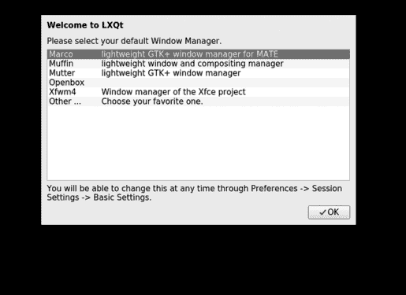

LXQt 的欢迎界面

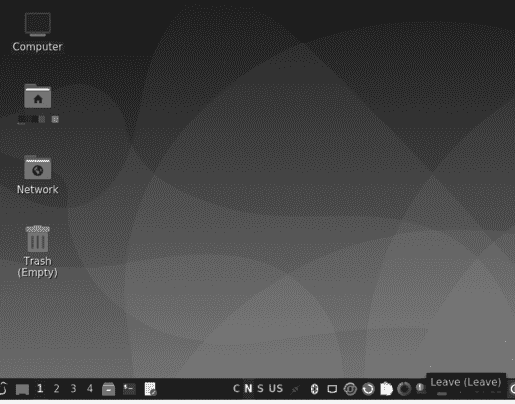

LXQt 的第一个窗口


`Enlightenment` 桌面

## ENLIGHTENMENT 桌面

`Enlightenment` 是一个用于 `X11` 的窗口管理器桌面环境。它具有许多功能，例如：

- 内置文件管理器
- 桌面缩略图
- 可视网格功能
- 用于放置部件的一个或多个层
- 动画、交互式桌面背景、菜单项和桌面部件都是可能的
- 窗口模糊、缩略图、放大和附件设置
- 自定义键绑定
- 外国贸易支持
- 支持所有必需的标准（`NetWM`, `ICCCM`, `XDG` 等）

### 历史

`Enlightenment` 由 `Carsten Heinzler` 创建。首次于 1997 年发布。当前版本基于 `Enlightenment` 库 (`EFL`)。

### E16

`E16` 提供了一个窗口管理器，允许用户创建最多 8 × 8 的网格，即 2048 个可能的工作空间。它允许通过键盘或鼠标在它们之间切换。它还提供了组最小化窗口的功能。

### E17

`E17` 具有许多功能，例如：

- 用于更改视觉主题的菜单和命令行
- 每个窗口的集成音量控制
- 平铺策略开发

### E21

- `Wayland` 支持大幅提升


- 新部件基础设施
- 向导开发

## E22

- Wayland 支持大幅提升
- 新部件基础设施
- 添加了 `sudo` / `sshpass` 工具 GUI
- Meson 构建系统

## E23

- 新的装饰屏幕选项
- Meson 现在构建程序
- 音乐控制支持 MPRIS dbus 协议
- 通过新模块和完全设计的部件添加 Bluef 支持
- 添加 `dpms` 选项以关闭或解锁
- `Alt-tab` 窗口切换允许在 `alt` 配置时移动窗口
- 多个错误修复，包括警告等
- Wayland 支持的显著改进

## 版本

以下是 Enlightenment 的版本列表：

# PANTHEON 桌面环境

Pantheon 包含了你在屏幕上看到的所有内容。它显示了在打开窗口之间切换的桌面背景、屏幕顶部的主屏幕以及底部的 dock（栏）。Pantheon 是许多可用 Linux 桌面环境之一。这种情况与 Windows 和 macOS 不同，后者只提供一个供使用的界面。这就是为什么我们的大多数人不知道桌面环境与内核、引导加载程序或这两个应用程序的任何其他部分是分开的。如果你无法更改这些部分，区别就不重要了。

## 历史

与许多其他桌面环境不同，Pantheon 与 Linux 操作系统（通常被称为“发行版”或“distro”）非常接近。Elementary OS 背后的工程师与 Pantheon 背后的工程师是同一批人。Pantheon 最初是人们将其放入 Ubuntu 的另一种方式。如果你对这个名字还不熟悉，Ubuntu 被广泛认为是最受欢迎的个人电脑 Linux 版本。当时，它使用名为 Unity 的桌面空间。它在顶部有一个链接，在屏幕左下方有一个独立的图标。这种设计鼓励你通过搜索来查找并解锁软件。

除了 GNOME 之外，Pantheon 并没有其他类似于 Unity 的方式（GNOME 是自由桌面和开源领域最古老、最成熟的桌面中心之一）。Elementary OS 创始人 Daniel 等人知道无法将 GNOME 改为他们喜欢的样式，因此他们使用了多个构建模块来构建自己的东西。他们的创作 Pantheon 是用 GTK + Vala 编写的与 GNOME 和 KDE Plasma 桌面等可以安装在几乎任何 Linux 版本上的开发方法不同，Pantheon 仅在 Elementary OS 上最为可见。尽管如此，你不需要使用 Elementary OS 来安装 Pantheon。作为一个免费项目，任何人都可以根据意愿使用和分发代码。

桌面环境构建在 GNOME 软件基础 `GTK`、`GDPR`、`Cairo`、`GLib (Object and Gio)`、`GVFs` 和 `Tracker` 之上。桌面允许多个工作区来调度用户活动。由基金会设计开发的 Pantheon 应用包括：

- `Pantheon Greeter`: 基于 `LightDM` 的会话管理器
- `Gala`: 窗口管理器
- `Wingpanel`: 顶部面板，类似于操作顶部的 `GNOME Shell` 面板
- `Slingshot`: `WingPanel` 上的可用应用启动器
- `Wood`: Dock（Docky 就是基于此开发的）
- `Switchboard`: 设置应用程序（或控制面板）
- `Pantheon Mail`: 用 Close 编写并由 `WebKitGTK` 支持的邮件客户端
- `Calendar`: 桌面日历
- `Music`: 音频播放器
- `Code`: 优比 edit 或 leafpad 的文本编辑器
- `Terminal`: 终端模拟器
- `Files` (以前称为 `Marlin`): 文件管理器
- `Installer`: 与 `System76` 合作构建的安装程序

Network World 的 Bryan Lundeke 写道，Pantheon 桌面环境作为第一个 OS 平台，是 2016 年最佳平台之一。Pantheon 正在作为 GeckoLinux 的持续选择桌面进行发布。

## 开发

- `Jupiter`
- `0.2 Luna`
- `0.3 Freya`
- `0.4 Loki`
- `5.0 Juno`
- `5.1 Hera`
- `Odin`
- `6.1 Jólnir`

## 特性

### 新界面

从用户界面开始，我们发现了全新的 Pantheon 桌面。Pantheon 是一个为第一个 OS 专门设计的家庭桌面，获得了大量的流量。这种简洁现代的桌面可能是最初成功的主要原因之一。

### 深色模式

Pantheon 终于有了深色模式。在第一个 OS 上，一切看起来既洁又先进，而所有的操作系统应用程序以及遵循此深色模式维护过程安装的应用程序都经过设计，不会强迫第三方应用程序使用这种深色模式，因为这会导致糟糕的 UI。深色模式只是建议性的。你也可以设置在日落或定时进入深色模式。

### 主题与外观

第一个 OS 6 还带来了高级自定义功能，有十种不同的颜色供选择。这与更改主题非常。。这将经过极大的完善。你还可以选择桌面背后的主色。在自定义之前，第一个 OS 中的 `Odin` 自定义程度几乎为零。

### 性能

在玩原始 OS 6 时，我们注意到运行时间略有增加。大多数系统应用在原始头部文件处也带有 `Flatpacks` 和 `Flatstacks`。它们带有了所有的依赖项。当你点击应用图标时，它们也必须被读取并上传到内存中。

### 可用性和稳定性

第一个 OS 非常稳定且可靠。它基于 Ubuntu 的坚实基础，是家庭、学生、办公室、软件开发人员和企业的极佳程序。该基础是以高水平的技术创建的，随处可见。第一个 OS 6 `Odin` 将获得未来 4 年以上的支持。它将继续接收定期的错误修复和安全更新。

### 章节总结

在本章中，我们涵盖了三个 DE（桌面环境）介绍及其特性、历史、核心项目、应用程序和版本历史。我们提供了一个单独的章节，可以在那里获取版本历史。


## 评价

BUNTU 和其他 Linux 发行版系统在早期席卷了开源和 IT 世界。它们支持各种桌面环境，如 `GNOME`、`KDE`、`MATE` 等。该操作系统已经成长为一个功能齐全的桌面和服务器产品，赢得了全球用户的心。除了坚实的技术平台和对质量令人印象深刻的投入外，桌面环境（DE），例如 `MATE`、`GNOME`、`LXDE`、`KDE`，其成功归益于其庞大的热情用户社区，他们帮助支持、文档化和测试 Linux 领域图的每一个点。本章使用的术语是桌面环境。

那么，什么是 DE 呢？桌面环境是运行在操作系统之上的程序包的桌面隐喻，这些程序共享一个标准的图形用户界面（GUI）。它被描述为图形外壳。在移动计算出现之前，桌面环境主要存在于个人电脑上。桌面 GUI 帮助用户快速访问和编辑文件，而它们通常不提供对底层操作系统所有功能的访问。此外，在需要对操作系统进行完全控制时，仍然使用传统的命令行界面（CLI）。

它由各种图标、窗口、工具栏、文件夹、壁纸和桌面小部件组成。GUI 提供了拖放功能和其他完成桌面隐喻的功能。桌面环境旨在让用户使用与与世界或其他交互相似的概念（如按钮和窗口）来与系统进行交互。这是用户正在交互的部分。有许多桌面区域（`GNOME`, `Cinnamon`, `Mate`, `Pantheon`, `Enlightenment`, `KDE`, `Xfce` 等）。每个桌面都包含内置应用程序（如文件管理器、配置工具、网络浏览器和游戏）。你手头正拿着这些桌面环境的官方指南。编写此书的每一个人都展示了高度的技术水平，并与大家分享了这些知识。

第 1 章讨论了对桌面环境的基本理解，其特性也有 GUI、CLI、TUI 等特定术语。该章节描述了支持本书的丰富资源。你还将获得关于 DE 历史、特性及其优点的简要知识。

第 2 章快速回顾了 `KDE Plasma` 的介绍及安装，描述了如 `apt-get`、`snap` 等价值命令，并提供了关于用户界面、核心项目和版本历史环境系统的简要知识。

评析 ■ 263

第 3 章简要回顾了 `GNOME` 的介绍、安装、基于 `GNOME` 的发行版、优缺点，并简要介绍了关于 `GNOME` 用户界面的相关知识。

第 4 章讨论了 `XFCE` 桌面环境、其版本、历史、`XFCE` 的主要组件、安装以及优缺点。

第 5 章讨论了其他 `MATE` 桌面环境、版本历史、`MATE` 的主要组件、安装、优缺点，以及另一个用于 `MATE` 的操作系统。

第 6 章向你提供了关于其他 `Budgie` 桌面环境的知识、其版本历史、`Budgie` 的主要组件、安装以及优缺点。

第 7 章讨论了 `Cinnamon`、其版本历史、`Cinnamon` 的主要组件、库、核心组件、安装以及优缺点。

第 8 章讨论了 `LXDE`、其版本历史、`LXDE` 的主要组件、软件的核心组件、使用 `LXDE` 的原因、安装，以及 `Lubuntu` 发行版。

第 9 章讨论了其他桌面环境（DE），如 `Pantheon`、`Enlightenment` 和 `LXQt`，其版本历史、主要组件和特性。

换句话之，本书为任何基于 Linux 的发行版系统提供了 Linux 桌面环境。


## 参考文献


### 引用来源

Budge (桌面环境). (2013, 12 月 7日). Wikipedia. `https://en.wikipedia.org/wiki/Budge_(desktop_environment)`. 最后编辑于 2022 年 10 月 5日。

Cinnamon (桌面环境). (2011, 1 月 1日). Wikipedia. `https://en.wikipedia.org/wiki/Cinnamon_(desktop_environment)`. 最后编辑于 2022 年 9 月 21日。

Cinnamon. (2012, 11 月 12日). Wikipedia. `https://en.wikipedia.org/wiki/Cinnamon`. 最后编辑于 2022 年 10 月 14日。

Cinnamon. (无日期). Linux Mint 开发者指南文档. 检索于 2022 年 7 月 11日, 来自 `https://linuxmint-developer-guide.readthedocs.io/en/latest/cylinder.html`

比较图形用户界面 (GUI) 和命令行界面 (CLI). (无日期). 工程教育 (EngEd) | 程序. 检索于 2022 年 7 月 11日, 来自 `https://www.section.io/engineering-education/graphical-user-interface-and-command-line-interface-cli/`

桌面环境. (2012, 2 月 4日). Wikipedia. `https://en.wikipedia.org/wiki/Desktop_environment`. 最后编辑于 2022 年 10 月 11日。

开发/使用 `KParts`. (无日期). KDE 技术知识库. 检索于 2022 年 7 月 11日, 来自 `https://techbase.kde.org/Development/Tutorials/Using_KParts#:text=KPart%20technology%20is%20used%20in%20consolepart%20to%20reuse,%20use%20part%20a%20katepart%20or%20a%20instead`

Emms, S. (2021). LXQt - 轻量级 Qt 环境. LinuxLinks. `https://www.linuxlinks.com/lxqt-lightweight-qt-desktop-environment/`

GNOME. (1999, 3 月 3日). Wikipedia. `https://en.wikipedia.org/wiki/GNOME`. 最后编辑于 2022 年 10 月 11日。

GNOME 会. (1999, 3 月 3日). GNOME 1.0 发布, 新闻稿. `https://foundation.gnome.org/1999/03/03/gnome-1-0-released/`

图形用户界面. (2022, 5 月 1日). Wikipedia. `https://en.wikipedia.org/wiki/Graphical_user_interface#:text=The%20graphical%20user%20interface%20(GUI),command%20labels%20or%20text%20navigation`. 最后编辑于 2022 年 10 月 11日。

Ubuntu 是基于 `GNU/Linux` 的吗? (无日期). Quora. 检索于 2022 年 7 月 11日, 来自 `https://www.quora.com/Is-Ubuntu-based-on-GNU-Linux`

K Desktop Environment 1. (1998, 7 月 12日). Wikipedia. `https://en.wikipedia.org/wiki/Desktop_Environment_1`. 最后编辑于 2022 年 2 月 27日。

K Desktop Environment 2. (2000, 10 月 23日). Wikipedia. `https://en.wikipedia.org/wiki/K_Desktop_Environment_2`. 最后编辑于 2022 年 2 月 27日。

K Desktop Environment 3. (2002, 4 月 3日). Wikipedia. `https://en.wikipedia.org/wiki/K_Desktop_Environment_3`. 最后编辑于 2022 年 5 月 27日。

KDE 应用. (无日期). 检索于 2022 年 7 月 11日, 来自 `https://apps.kde.org/wiki/KDE_Plasma_5`. 最后编辑于 2022 年 10 月 29日。

KDE 项目. (2010, 11 月 6日). Wikipedia. `https://en.wikipedia.org/wiki/KDE_Projects`. 最后编辑于 2022 年 9 月 30日。

KDE 软件编译 4. (2008, 1 月 11日). Wikipedia. `https://en.wikipedia.org/wiki/KDE_Software_Compilation_4`. 最后编辑于 2022 年 8 月 22日。

KDE 用户库. (无日期). 检索于 2022 年 7 月 11日, 来自 `https://users.kde.org/Welcome/KDE_UserBase`. 最后编辑于 2020 年 11 月 26日。

KHTML (2021, 5 月 2日). Wikipedia. `https://en.wikipedia.org/wiki/KHTML`. 最后编辑于 2022 年 6 月 6日。

Kili, A. (2016, 8 月 31日). 史上最受欢迎桌面环境. `https://www.linuxmint.com/best-linux-environments/`

KIO. (2022, 6 月 27日). Wikipedia. `https://en.wikipedia.org/wiki/KIO`. 最后编辑于 2022 年 4 月 1日。

KJS (软件). (2000, 1 月 1日). Wikipedia. `https://en.wikipedia.org/wiki/KJS_software`.

图形用户界面. (2022, 5 月 1日). Wikipedia. `https://en.wikipedia.org/wiki/Graphical_user_interface`. 最后编辑于 2022 年 10 月 1日。

Ubuntu 是基于 `GNU/Linux` 的吗? (无日期). Quora. 检索于 2022 年 7 月 11日, 来自 `https://www.quora.com/Is-Ubuntu-based-on-GNU-Linux`

K Desktop 22 2 11.

LXDE. (无日期). 检索于 2022 年 7 月 11日, 来自.

KHTML. (2021, 5 月 2日). Wikipedia. `https://en.wikipedia.org/wiki/KHTML`. 最后编辑于 2022 年 6 月 6日。

## 索引

### A

- 环境 (`Ambient`), 15–16
- `Android`, 14
- `Applet` 在线电台, 143–144
- 应用程序, Linux 组件, 3
- 存档 (`thunar-archive` 插件), 111
- `Arch Linux`, 79–80, 146, 235
- `Artix Linux`, 235
- `Atril`, 130–139
    - 升级, 181–182
    - 使用 `APT`, 182–185
- `Budgie-indicator-applet` `0.7.0`, 179
- `Budgie` 面板 `Dock` 模式, 185–186
- `Budgie-remix` `16.04`, 169–170
- `Budgie-remix` `16.10`, 170–171
- `Budgie-remix` `17.04`, 171–172
- `Budgie` 桌面, 16
- `Bugie` `Runner`, 111

### B

- 二进制 `lxqt-config-file-associations`, 250
- 二进制 `lxqt-config-input`, 250
- 二进制 `lxqt-config-locale`, 250
- 二进制 `lxqt-config-monitor`, 250
- `Blueberry`, 214
- 引导程序, 2
- `Bism` 菜单, 145–146
- `Budgie` `19.10`, 177–178
- `Budgie` `Applets`, 177
- `Budgie` 日历 `Applet`, 179
- `Budgie` 桌面, 167–168
    - 漏洞修复与清理, 180–181
        - 功能与开发
        - `Budgie` 面板 `Dock` 模式, 185–186
        - 内置安全, 177


- 灵活性, 217
- 游戏, 177–188
- Intelligide, 186
- 迁移, 188
- 夜光模式, 186–187
- 设置应用, 187
- GNOME 40 支持, 181
- 树莓派, 180–181
- Ubuntu Budgie (使用 Ubuntu Budgie)

**C**

- Caja 文件管理器, 136–137, 165
- Calligra 套件, 35
- CDM, 147
- CentOS 社区企业操作系统, 79
- Cinnamon, 16 还有特定的 Cinnamon 条目
- Cinnamon applets, 204–205
- Cinnamon 控制中心, 194, 212–213
- Cinnamon-desktop, 209
- Cinnamon 桌面环境
  - 应用程序, 205
  - 优势, 214
  - 音频增强, 216
  - 整合, 215
  - 发现, 215–216
  - 扩展, 215
  - 灵活性, 215
  - 概览模式, 216
  - 设置编辑器, 216
  - 速度, 215
  - 触摸板设置, 216
  - 可视连接器, 215
  - 核心组件, 210–213
  - 功能, 196–197
  - GNOME 3, 193–195
  - 历史, 194–195
  - 改进, 195–196
  - 在 Ubuntu 上安装, 206–207
  - 库, 208–210
  - 从 Ubuntu 移除, 200
  - 软件组件, 196
  - 用户指南
    - C applets, 204–205
    - Cinnamon 面板, 202
    - deskslets 使用, 198
    - 桌面壁纸, 205
    - 极具定制性, 199–201
    - 灵活性, 203
    - GUI, 197
    - 集成, 198–199
    - 多工作区, 202–203
    - Nemo, 203–204
    - 稳定性, 204
    - 工作流程, 206
- Cinnamon github 项目, 211–212
- Cinnamon 库, 208–210
- Cinnamon-menus, 208–209
- Cinnamon 面板, 202
- Cinnamon-screensaver, 211
- Cinnamon-session, 210
- Cinnamon-settings-daemon, 210–211
- CJS (`Cinnamon` `JavaScript` 翻译器), 210
- Clutter, 209–210
- Cog, 209–210
- 折叠运行模式, 113
- 命令行界面 (`CLI`), 1, 22–23, 74–75, 112, 192–193
- 常见桌面环境 (`CDE`), 16
- 组件, `Linux` 应用程序, 2–3
- `ConsoleKit`, 110
- `Console` `TDM`
  - 安装, 148
  - `tdmcli` 命令, 148–149
  - `tdm` 会话, 类型, 147
  - 文本, 148
- `Contour`, `Plasma`, 28
- 控制器 (小部件), 8–9
- 光标, 10

**D**

- 守护进程 (`Daemons`), 2
- `DBus` `API`, 118
- `Debian`, 79, 235–236
- `deskslets`, 198
- 桌面环境 (`DE`), 2–3
- 协作元素, 10
- 桌面隐喻, 1–2
- 示例, 14–15
- 桌面-`GUI` (参见 图形用户界面)
- 历史, 113
- 在 `Linux` 中, 3–7
- 结构性元素, 7–10
- 类型, 15–18
- 桌面网格, 69–70
- `Digikam`, 34
- 发行版, 190
- 发行版, `MATE`, 162–163
- `Dock`, 142–143

**E**

- `E16`, 254
- `E17`, 255
- `E21`, 255
- `E22`, 255–256
- `E23`, 256
- `Ecrire-git`, 155
- `edi-git`, 155
- `effb-git`, 155
- `elemines-git`, 155
- `eliminate-git`, 155
  - `--enable-build-clipboard`, 222
  - `--enable-builtin-polkit`, 222
  - `--enable-debug`, 222
  - `--enable-gtk3`, 222
  - `--enable-more-warnings`, 222
- `Engram`, 129, 139–140
- `Engrampa`, 131
- `enjoy-git`, 155
- `Enlightenment`, 17
- `Enlightenment` 桌面环境
  - 历史, 254
  - 在 `Ubuntu` 上安装, 256
  - 版本, 254–256
- `Enlightenment` 显示管理器, 154
- 基于 `EFL` 的显示管理器
  - 基于 `EFL` 的应用程序, 155
  - 脚本, 154
  - 登录用户, 154
  - `systemd` 服务, 154
  - 主题, 156
  - `Eidi-git`, 155
  - `Epophoto`, 155
  - `ephoto-git`, 155
  - `epour-git`, 155
  - `epym-git`, 155
  - `equate-git`, 155
  - `eruler-git`, 155
  - 现有界面, 210
  - `Exo`, 缺失的应用程序, 114–115
  - `Exo` 首选应用程序, 116
  - 扩展搜索模式, 114
  - 扩展模式, 113

**F**

- `Falkon`, 246
- `Fedora`, 78–79
- `Fedora` `Linux`, 146
- `Filelight`, 36
- 文件夹模式, 113
- `Fourdian`, `Olivier`, 99, 100
- 自由软件, 190

**G**

- `Garcon`, 菜单, 118
- `GDM` 浏览器, 154, 158–159
- `Github`, 211–223
- `GNOME` 1 (1999), 84–85
- `GNOME` 2, 85–193
  - 应用程序, 88
  - 对话框, 87
  - 功能, 86
  - 字体和图形, 86
  - 图标和主题, 87–88
  - 菜单和面板, 87
  - 可用性, 86–87
  - 用户可见性改进, 88
- `GNOME` 3, 95, 128, 193–195
  - 缺陷, 96–97
  - 功能, 88–91
- `GNOME` 40, 181
- `GNOME-bluetooth`, 214
- `GNOME` 桌面环境, 82–84
- `GNOME` 显示管理器 (`GDM`), 154
  - 2.20, 156–157
  - 2.22, 156–157
  - 辅助功能, 158
  - 性能, 157–158
- `GNOME` `GNU`, 76
- `GNOME` `Shell`, 128, 193–195
- `GNOME-SHELL`, 91–92
  - 扩展性, 94
  - 回回模式, 93
  - 功能, 92–93
  - 图形和功能元素, 93
  - 历史, 92
  - 软件架构, 92
- `GNU` `LGPL`, 37
- `GNU` 网络 (`GNOME`), 参见 桌面环境
- 图形用户界面 (`GUI`), 1–3, 73–74, 197
  - 优势, 192
  - 配置工具, `LXQt`, 250–252
  - 视觉设计, 4

**I**

- 标识, 10
- 初始化系统, 2
- 输入点, 10

**K**

- `KDE` `Edu`, 35
- `KDE` `Extager`, 35
- `KDE` `Frameworks`, 26
- `KDE` `Games`, 35
- `KDE` `Graphics`, 35
- `KDE` `Multimedia`, 35
- `KDE` `Neon`, 24, 68
- `Kalzium`, 33
- `Kate`, 33
- `Atomic`, 37
- `Bluetooth`, 36
- `ColorEdit`, 37
- `KDE`, 23–24
  - 实现, 37
  - 许可证, 36
  - 历史, 24–25
  - `Neon`, 24
  - 平台, `of`, 26
  - 项目, 25–26
  - 版本, 37
- `KDE` `Plasma` 5, 56–58
  - 桌面功能, 57–58
  - 开发, 56
  - 功能, 69–70
  - 安装, 66–68
  - `Linux` 发行版 (参见 `Plasma` 5)
  - 软件架构, 56


### 空间
56–57

### KDE
- `KDE Plasma-Addons`, 35
- `KDE Plasma Workspace`, 26
- `KDE Bindings`, 35
- `KDE Plasma`, 27–28
  - 应用程序, 68
  - 功能, 28–29
- `KDE Network`, 35
- `KDE PIM`, 35
- `KDE Control Center`, 36
- `KDE Neon`, 35
- `KDE Session Manager`, 36
- `KDE SDK`, 35
- `KDE Playground`, 35

#### KDE Desktop Environment 1
37–38
- `1.0`, 38
- `1.1`, 38

#### KDE Desktop Environment 2
39–44
- `2.0`, 42–43
- `2.1`, 43
- `2.2`, 43–44

#### KDE Desktop Environment 3
44–49
- `3.0`, 44
- `3.1`, 44–45
- `3.2`, 45
- `3.3`, 47–48
- `3.4`, 48
- `3.5`, 48–49

### KDE Software Compilation 4
49
- `Dolphin` 和 `Konqueror`, 49
- 发布版, 51
- 发布, 50
- 更新, 50
- `4.1`, 52
- `4.2`, 52–53
- `4.3`, 53
- `4.4`, 53
- `4.5`, 54
- `4.6`, 54
- `4.7`, 54
- `4.8`, 54–55
- `4.9`, 55
- `4.10`, 55
- `4.11`, 55
- `4.12`, 55
- `4.13`, 55
- `4.14`, 55

### KIO
可扩展网络文件访问, 31

### Kiten
33

### KJS
`JavaScript` 引擎, 31

### KLaid
33

### KlamAV
36

### lickery
34

### Mines
34

### Knoppix
228–230

### Kolf
游戏, 34

### Kolourpaint
34

### Konjue
33

### Konqueror
42
- 用户界面, 43
- 浏览器, 43

### Konsole
36

### Kontakt
47

### Kool Desktop Environment
参见 `KDE`

### KParts
32

### KPhotoAlbum
34

### KPovModeler
34

### Reversi
34

### Krita
34

### KRunner
53, 69

### KSirtet
33

### KSnapshot
34

### KStars
34

### Quickshow
34

### KView
34

### KWallet
36, 47

### KWin
窗口管理器, 29–30

### KWrite
33

### J

### JukeBox
45–46

# 274 索引

### 版本
- `5.2`, 61–62
- `5.3`, 62–63
- `5.4`, 63–64
- `5.5`, 64
- `5.7 Beta`, 65
- `5.8`, 65–66
- 历史, 58
- 发布, 59

### Linux Mint
- `Linux Mint`, 193–195
- `Linux Mint 12`, 195, 215
- `Linux Mint 13`, 195, 215

### Lubuntu
- 应用, 239–241
- 发行版, 238–239

### 命令与组件
- `lxqt-globalakeys`, 251
- `lxqt-notification`, 251–252
- `lxqt-panel`, 252
- `lxqt-qtplugin`, 252
- `lxqt-runner`, 252
- `lxqt-session`, 252

- `LXSession`, 222
- `Lxssession-default`, 222
- `Lxssion-default-apps`, 222
- `Lxssion-edition`, 222
- `Lxssion-utils`, 222
- `lxsettings-daemon`, 223

### Ly
`TUI` 显示管理器

### 巩固与集成
152–353

### LXclboard
222

### LXDE
17, 217–218
- 核心组件, 219–223
- `C` 编程语言, 218
- 默认桌面, 228–236
- 开发, 227
- `GTK 3` 移植, 227
- 历史, 218–219
- 在 `Ubuntu` 中安装, 226–227

### Lubuntu
- 应用, 239–241
- 发行版, 238–239

### LXDE 0.5
218

### Qt 移植
219

### 使用理由
236–238

### 软件组件
224–226

### LXImage-Qt
247

### LXLE Linux
230

### IXclock
222

### LXMenu Data Package
247

### LXpolkit
222

### LXQt
243. 另另特定的 `LXQt` 条目
- `GUI` 配置工具, 250–252
- 历史, 244
- 在 `Ubuntu` 上安装, 253
- 使用理由, 245
- 软件组件, 246–250
- 工作流程, 245

- `lxqt-about`, 247
- `lxqt-admin`, 247–248
- `lxqt-archive`, 248–249
- `lxqt-common`, 249–250
- `lxqt-config`, 250
- `lxQt` 桌面, 238

### M

### MacOS
14

### Mageia Linux
81, 147

### Manjaro
80

### MATE
17, 另另特定的 `MATE` 条目

### MATE 计算器
141

### MATE 桌面
144–145

### MATE 桌面环境
- 127–198
- 额外包, 141–146
- 应用, 135–136
- `Caja` 文件管理器, 165
- 核心应用, 136–141
- 定制, 166
- 桌面应用, 147–153
- 发行版, 162–163
- `GNOME 2`, 延续, 128
- 图形显示管理器, 153–160
- 历史, 128
- 在 `Ubuntu` 中安装, 133–135
- 在各种操作系统上, 146–147
- 性能, 166
- `Pluma` 编辑器, 165
- 搜索工具, 165
- 用户体验, 165
- 版本, 128–129
  - `1.18`, 129–130

### 其他 MATE 版本
- `1.20`, 130–131
- `1.24`, 131–132
- `1.26`, 132–133

### X 显示管理器控制协议
(`XDMCP`), 160–162

### MATE 图像查看器
140–141

### MATE 菜单
144

### MATE 系统监视器
141

### MATE 终端
141

### MATE Tweak
145

### 媒体标签插件
(`thunar-tags-plugin`), 111

### 菜单
9–10

### Mint Gnome Shell 扩展
(`MGSE`), 194, 195

### Mousepad
(文本编辑器), 122

### Mozo
132

### Muffin
209, 210

### Phonon
多媒体框架, 32

### Pix
196, 214

### Pix 图像编辑器
205

### PIXEL
233

### Plasma Active
28

### Plasma 桌面
27

### Plasma Mobiles
28

### Plasma Netbook
28

### Plasma 小部件
28–29

### Pluma
132–138

### Pluma 插件
132, 133

### Pluma 文本编辑器
165

### Plocillo-gtk 主题
177

### Pop!OS
80

### Post-IMP 接口
7

### Python-xapp
213

### N

### Nautilus
136, 173, 176

### Nemo
195–196, 203–204, 207, 212

### Budgie
177, 182

### Nemo 扩展
212

### 配置
150–151

### 功能
149–150

### NVIDIA 驱动
177

### Q

### Budgie 主题
177

### 终端
246

### Qt post
在 `LXDE` 和二进制中, 222–223

### 显示管理器
(`lightdm-greet`), 223

### 文件管理器
(`PCManFM-Qt`), 220–221

### 合并标志
222


- 与 `LXDE`合并, 222

- `policykit` 代理, 223

- 会话管理器 (`LXSession`), 222

- 窗口管理器 (`Openbox`), 219–222

- `QtWebKit`, 246

- `Qzilla`, 246

- O

- `Okular`, 34

- `Openbox`, 219–222

- 开源 Linux 桌面环境, 190

- `openSUSE`, 77–78

- R

- `rage-git`, 155

- `Raspberry Pi`, 180–181

- `Raspberry Pi OS`, 232, 233–236

- `Raven` 和 `Apple` 指标, 181

- `Razor-panel`, 221

- `Razor-qt`, 219, 221, 223

- `Razor-policykit`, 223

- `RHEL`, 147

- P

- `Pantheon` 桌面环境

  - 开发, 258

  - 功能, 258–259

  - 历史, 257–258

- `PCManFM`, 233

- `PCManFM-Qt`, 220–221

- `Peppermint OS`, 230–232

- S

- `SDDM`, 154, 159–160

- 共享插件 (`thunar-shares-plugin`), 111

- `ShowIm`, 34

- 简单桌面管理器 (`SDDM`), 223, 246

- `Slick-greeter`, 214

- `Solid`, 设备组装, 32–33

- `Solus` 项目, 167

- `Sonnet`, 33

- `Step`, `KDE` 应用, 34

- DE 的结构化元素

  - 控制 (小部件), 8–9

  - 标签, 9–10

  - 缩略图图标, 8

  - 窗口, 7–8

- `SuperKaramba`, 29

- 发布, 168–179

- `Ubuntu Budgie 17.10`, 172–173

- `Ubuntu Budgie 18.04`, 173–175

- `Ubuntu Budgie 19.04`, 175–177

- `Ubuntu Budgie 20.10`, 178–179

- `Ubuntu Budgie 21.10`, 182

- `Ubuntu Budgie` 团队壁纸, 19.04, 176

- `Ubuntu GNOME`, 71–72, 81–82

  - 发行版, 72

  - 软件, 72

  - 在 `Linux` 中, 76–77

  - 开源 `Linux` 桌面环境, 72

- 混合, 76

- `Ubuntu KDE`, 19

  - 发行版, 20

  - 软件, 20

  - 开源 `Linux` 桌面环境, 20

- T

- 标签, 9

- `Tasksel`, 66–67

- `Budgie` 桌面环境, 184

  - 在 `MATE` 桌面中, 134–135

- 标签，基于站的会话管理器, 153

- 终端用户界面 (`TUI`), 23, 75, 193

- `terminology-gitAUR`, 155

- 文本界面。参见终端用户界面

- `Threadweaver`, 33

- 缩略图图标, 8

- `Thunar` 文件管理器, 111–112, 122

- `Tilix` `Quake` 模式, 173

- `Trinity` 桌面环境, 48–49

- `Triskel`, 234

- `Trisquel`, 233–234

  - 历史, 234

  - 版本, 234–235

- `Trisquel Mini`, 235

- `Trisquel NetInstall`, 234, 235

- `Trisquel TOAST`, 234

- `Tumbler` 缩略图服务, 118–119

- V

- `VCS` 插件 (`thunar-vcs-plugin`), 112

- 卷管理器 (`thunar-volume`), 112

- W

- `WikiLearn`, 35

- 窗口, 7–8

- 窗口, 9–10

- `Windows`, 178–179

- X

- `X-Apps`, 196, 214, 214–215

- `X` 显示管理器控制协议 (`XDMCP`), 160–162

- `X.Org`, 14

- `Xplayer`, 196, 214

- `XplayerAUR` 媒体播放器, 205

- `Xreader`, 196, 214

- `X` 终端模拟器, 112

- `Xiewer`, 196, 214

- `XiewerAUR`, 205

- `X` `Window` 系统, 11–12

  - 竞争对手, 114

  - 桌面环境, 的 14–15

  - 历史的, 13–14

  - 软件架构, 12–13

  - 用户界面, 13

- U

- `Ubuntu Budgie 17.10`, 172–173

- `Ubuntu Budgie 18.04`, 173–175

- `Ubuntu Budgie 19.04`, 175–177

- `Ubuntu Budgie 20.10`, 178–179

- `Ubuntu Budgie 21.10`, 182

- `Ubuntu Budgie` 团队壁纸, 19.04, 176

- `Ubuntu GNOME`, 71–72, 81–82

  - 发行版, 72

  - 软件, 72

  - 在 `Linux` 中, 76–77

  - 开源 `Linux` 桌面环境, 72

- 混合, 76

- `Ubuntu KDE`, 19

  - 发行版, 20

  - 软件, 20

  - 开源 `Linux` 桌面环境, 20

- Y

- `Yakuake`, 36

- `Yum` install `mate-applet-streamer`, 146

- Z

- `Zorin OS`, 80–81
