# 开源操作系统潜能解锁指南 3


## 欢迎进入

## Linux

### 技巧、窍门、应用与黑客手段

在这本《Linux 技巧、窍门、应用与黑客手段》的新卷中，您将找到破解您的Linux系统并使其按您想要的方式工作所需的一切。开源软件免费且可定制的理念使其非常适合那些想要深入探究表面之下并开始摆弄系统运行机制的人。在这本书中，我们将通过100种方法开始掌握命令行，让您再也不必畏惧终端屏幕。您将发现如何构建有史以来最好的服务器，提升速度和功能，并了解今年最佳的发行版以及应搭配哪些免费软件使用。凭借所有这些以及更多专家技巧、窍门和黑客手段，加上对市面上一些最佳Linux软件的评测，这是希望提升Linux体验之人的完美指南。


### 终端

## 100 种掌握命令行的方法

> 利用这些控制 Linux 的必备终端技巧来征服命令行

### 终端

早在桌面环境或图形界面出现之前，在70和80年代那些令人兴奋的日子，一切都是在命令行上完成的。90年代的计算机使用，虽然主要由图形界面和鼠标主导，但并未完全与命令行分离，而特定年龄段的计算机用户很可能至少记得使用过臭名昭著的 DOS 提示符。

现在编程已经非常先进，即使在 Linux 中，如果您使用的是合适的发行版，您可以在整个时间都待在桌面环境中，甚至从未接触过命令行或终端。问题是，如果不学习如何最大限度地利用命令行，您就是对自己不利，因为它可能是一个极其强大的工具——特别是很多图形软件都有您可以使用的命令行控制。所以穿上您最棒的90年代服装，给自己起个糟糕的绰号，准备好看起来像个电影里的黑客吧。

# 需要知道的内容

> **在尝试高级工具之前，先熟悉终端**

> 001 **ls**

您可以使用 **ls** 来列出您当前所在目录中的文件和文件夹。

> 002 **cd**

**cd** 命令允许您在系统中的目录之间移动。例如，如下所示：

```
$ cd /home/user/
```

> 003 **cp**

**copy** 命令，或 **cp**，可用于将文件从一个位置复制到另一个位置。要执行此操作，请使用以下命令：

```
$ cp file /home/user/Desktop/file
```

> 004 **mv**

与 **copy** 类似，**mv** 是将文件移动到新位置，并删除原始文件。

```
$ mv file /home/user/Desktop/file
```

> 005 **rm**

**rm** 命令用于删除文件或目录。您可以像这样使用它：

```
$ rm file
```

> 006 **mkdir**

您可以使用 **mkdir** 命令创建目录，例如：

```
$ mkdir folder
```

> 007 **nano**

Nano 是一个允许您在文件中编辑文本的程序——它在命令行中工作和编辑时至关重要。您像这样使用它：

```
$ nano file
```

> 008 **Tab**

**Tab** 键可以让您自动完成命令和文件名。双击将列出所有名称相似的对象。自动完成适用于无歧义的文件和命令名称。例如，输入 'fir' 会给出 'firefox'，因为没有其他命令以 'fir' 开头。如果您获得多个匹配项，请不断按键以缩小选择范围，然后再次按 Tab

> 009 **Up**

键盘上的向上键非常简单，它允许您调出最后输入的命令，以便重新运行或编辑它。

> 010 **复制文本**

如果您在终端中，可能想要复制文本输出以在其他地方使用。为此，您可以使用：**Ctrl+Alt+C**。

> 011 **粘贴文本**

如果您在网上找到一个命令或需要将一些文本粘贴到 nano 中，您可以使用：**Ctrl+Alt+V** 输入剪贴板上的任何文本。

> 012 **打开终端**

这个技巧在很多桌面环境中都适用：使用以下快捷方式打开终端：**Ctrl+Alt+T**。

> 013 **sudo**

这允许您以超级用户身份执行命令。在这种情况下超级用户是 root，您只需在任何命令前添加 **sudo** 即可。

> 014 **访问 root**

超级用户，或 root，也可以通过在终端中登录来访问，只需输入 **su**。您可以输入 root 用户密码，然后作为 root 运行每个命令，而无需使用 **sudo**。

> 015 **停止进程**

如果您运行了一个命令，而它暂停了、加载时间过长，或者它已经完成了工作而您不需要看到其余部分，您可以使用 **Ctrl+C** 或 **Ctrl+Z** 强行停止它。请记住，只有当进程没有写入任何数据时才这样做，因为在这种情况下这是不安全的，您可能会陷入麻烦。

> 016 **无需密码访问 root**

如果您的常规用户在 sudoers 列表中（即一般可以使用 **sudo** 以 root 身份运行事物），您可以使用 **sudo su** 访问 su 账户。这使用您的常规用户密码访问 root 终端功能。

要将常规用户添加到 sudoers 列表，您需要先使用 **su** 登录为超级用户。然后，只需运行 **adduser username sudo**（替换 'username'）。不过要小心您添加到 sudoers 列表中的人！

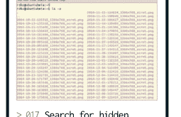

> 017 **搜索隐藏文件和目录**

**ls** 命令不仅仅以基本方式列出文件夹中的所有文件。首先，您可以使用它来列出所有隐藏项和普通项：

```
$ ls -a
```

> 018 **主目录快捷方式**

主目录位于绝对文件系统中的 **/home/user/**，但您可以使用波浪号（~）表示主目录，在目录之间移动或复制时，或者在大多数其他操作中——例如：

```
$ cd ~
```

> 019 **链接命令**

如果您想按顺序执行一系列命令，例如在 Debian 中先更新然后升级软件，您可以使用 **&&** 让命令在前一个命令之后立即运行。例如：

```
$ sudo apt-get update && sudo apt-get install libreoffice
```

> 020 **长终端输入**

有时在使用列表或其他具有长终端输出的内容时，您可能无法很好地阅读它。为了使其更易于理解，您可以通过管道将输出发送到另一个命令 **less**。它的工作方式如下：

```
$ ls | less
```


## 系统基础

> 更进一步，学习如何更好地控制终端

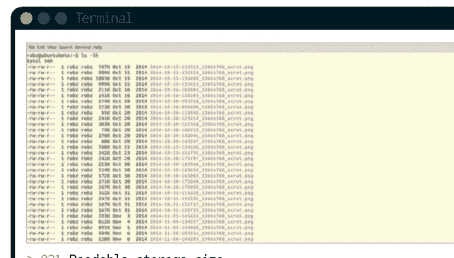

### 021 **可读的存储大小**

**ls -l** 显示的细节之一是位于硬盘上的文件大小。虽然这是以字节为单位的，但这并不总是很有用。你只需将 **-l** 更改为 **-lh**，即可解析此文件使其更具可读性，其中长列表格式选项（**-l**）经过了人类可读选项（**-h**）的微调。

### 022 **返回上一级目录**

如果你想要返回到你之前正在工作的目录，有一个 **cd** 命令可以轻松做到这一点。这个命令不是向上移动文件系统，而是回到你之前所在的最后一个文件夹：

```
$ cd -
```

### 023 **向上移动目录**

**cd** 命令也可用于在文件系统中向上移动。使用两个句点即可做到，例如：

```
$ cd ..
```

### 024 **通用通配符**

星号（* *）可以用作终端中的通配符，代表任何内容。典型的用例是复制或删除特定类型的文件。例如，如果你想删除目录中的所有 PNG 文件，你 **cd** 进入该目录并输入：

```
$ rm *.png
```

### 025 **更多管道用途**

管道 (|) 可以用于将所有输出传递给下一个命令，使你能够从一条命令中调用一部分数据或字符串，并直接将其放入下一条命令中。这与 **grep** 和其他核心 Linux 工具配合使用。

### 026 **删除目录**

如果在包含对象的目录上使用 **rm** 是行不通的，因为它还需要删除里面的文件。你可以修改 **rm** 命令，使用以下方式递归地删除目录内的所有内容：

```
$ rm -r directory
```

### 027 **关机命令**

你可以使用终端关机，使用 **shutdown** 命令，halt 选项（**-h**），这会同时停止所有正在运行的程序，并指定时间为 **now**，以便立即关闭而不是在 60 秒后关闭：

```
$ sudo shutdown -h now
```

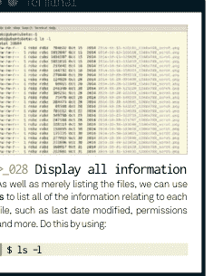

### 028 **显示所有信息**

除了仅仅列出文件外，我们可以使用 **ls** 来列出与每个文件相关的所有信息，例如最后修改日期、权限等。通过以下方式做到：

```
$ ls -l
```

### 029 **从命令行重启**

在过去，重启需要稍微复杂一点的关机命令：**shutdown -r**。近年来，它已被替换为一个非常简单的命令：

```
$ sudo reboot
```

### 030 **定时关机**

**shutdown** 命令的计时功能非常有用，如果你需要在关机发生前等待程序或 **cron** 作业完成。你可以使用时间来执行正常的停止/关机，甚至可以使用 **-r** 在十分钟后重启，例如：

```
$ sudo shutdown -h +10
```

### 031 **注销**

通常建议从桌面环境注销 x 会话，但如果你需要重新注销到登录管理器，你可以通过重启显示管理器来实现。在许多 Linux 发行版中，你使用以下命令：

```
$ sudo service lightdm restart
```

##### 安装

> 管理你的包和更新系统是命令行的重要组成部分

### 032 Debian：更新软件源

基于 Debian（以及基于 Ubuntu）的发行版使用 apt-get 作为命令行包管理器。apt-get 作为包管理器的一个怪癖是，在升级或安装软件之前，它不会检查软件源中是否有更新版本。在 Debian 中进行任何安装之前，请使用：

```
$ sudo apt-get update
```

### 033 Debian：安装软件

与图形包管理器或软件中心不同，你无法确切地搜索你想安装的包类型，因此你需要在安装之前知道包名。一旦你知道，请尝试：

```
$ sudo apt-get install package
```

### 034 Debian：更新软件

你可以首先执行提示 32 中的软件源更新命令，然后执行以下升级命令，从终端升级 Debian 中的软件：

```
$ sudo apt-get upgrade
```

### 035 Debian：卸载软件

作为包管理的一部分，apt-get 也允许你卸载软件。只需将安装命令中的 install 替换为 remove 即可做到（提示 33）。如果你想同时删除配置文件，也可以使用 purge 代替 remove。

### 036 Debian：升级发行版

Debian 系统通常可以更新到“更新版本”，特别是当其处于滚动模式或如果有新的 Ubuntu 时。有时提示不会显示出来，所以你在终端中执行：

```
$ sudo apt-get dist-upgrade
```

### 037 Debian：多个包

在所有平台上安装时，你可以做的非常简单的一件事是列出要一次性安装的多个包，使用常规安装命令。因此在 Debian 中它是：

```
$ sudo apt-get install package1 package2 package3
```

### 038 Debian：依赖项

不同软件的编译方式不同，它们各自都会有指南说明如何进行。你可能面临的一个问题是，它会停止直到你找到并安装正确的依赖项。你可以通过安装 auto-apt 并在配置期间使用它来绕过这个问题：

```
$ sudo auto-apt run /configure
```

### 039 Debian：强制安装

有时在安装软件时，apt-get 会拒绝安装。如果特定要求未得到满足（通常涉及需要安装其他包才能使软件正常工作）。你可以使用以下命令强制安装包，即使没有依赖项：

```
$ sudo apt-get download package
$ sudo dpkg -i package
```

### 040 Debian：安装二进制文件

在提示 39 中，我们使用 dpkg -i 安装了从软件源下载的二进制安装包。同样的命令可用于安装任何下载的二进制文件，无论是来自软件源还是网站。

### 041 Debian：手动强制安装包

如果提示 39 中的建议仍然不起作用，你可以使用 dpkg 强制安装。为此，你只需要在安装命令中添加选项 ‘--force=all’ 以忽略任何问题，例如：

```
$ sudo dpkg --force=all -i package
```

### 042 Red Hat：更新软件

与 apt-get 不同，用于 Red Hat/Fedora 基于发行版的 yum 包管理器不需要你专门更新软件源。你可以仅仅使用以下命令更新所有软件：

```
$ sudo yum update
```

### 043 Red Hat：安装软件

使用 yum 安装非常简单，只要你知道包名。Yum 确实有一些搜索功能，如果你真的需要查找的话，但一旦你知道你想要哪个包，请使用以下命令：

```
$ sudo yum install package
```

### 044 Red Hat：卸载软件

Yum 也可用于卸载系统上的任何包，无论你是否直接从 yum 安装它。只要你包名知道，就可以使用以下命令卸载：

```
$ sudo yum remove package
```

### 045 Red Hat：强制安装

Red Hat 和基于 Fedora 的 Linux 发行版上的强制安装功能要求你有一个已下载并准备安装的包。你可以用 yum 下载内容，然后强制安装：

```
$ sudo yum install --downloadonly --downloaddir=[directory] package
$ sudo rpm -ivh --force package
```

### 046 Red Hat：手动安装

RPM 是 Red Hat 发行版上的包安装器之一，可用于安装下载的包。你可以像提示 45 中那样从软件源下载包，或者从互联网下载并使用以下方式安装：

```
$ sudo rpm -i package
```

### 047 Red Hat：强制手动安装

如提示 45 中所述，如果你存在依赖问题或其他已下载的包存在问题，你可以使用 RPM 强制安装包。应使用与提示 45 中相同的命令，包含 -ivh 和 --force 选项。

### 048 Fedora：发行版升级

Yum 有自己的发行版升级命令，但仅在 Fedora 中可用，并且他们建议你除非必须否则不要使用它。尽管如此，你可以使用 yum 中的 fedora-upgrade 包：

```
$ sudo yum install fedora-upgrade
```

> “即使没有依赖项，你也可以强制安装包”


## 使用 Grep 进行搜索

>_ 使用 grep 命令在文件内进行查找，以节省时间并找到所需内容

### >_ 049 在文件中搜索关键词

Grep 的基本用途是在文件中搜索特定的术语。它会输出包含该术语的每一个行，因此最好将其用于包含可读内容的系统文件。使用方式如下：

```
$ grep hello file
```

### >_ 050 检查行号

查找文件中的特定行固然很好，但当你开始寻找它们并意识到文件有数百行长时，让 grep 同时也输出行号可以为你节省大量时间。你可以使用 -n 选项来实现：

```
$ grep -n hello file
```

### >_ 051 正则表达式

如果你需要使用 grep 进行更高级的搜索，可以使用正则表达式。你可以将搜索词替换为 `^hello` 来查找以 hello 开头的行，或者使用 `hello$` 查找以 hello 结尾的行。

### >_ 052 通配符与 grep

在搜索行时，如果你需要查找相似的术语，可以使用通配符。这是通过在搜索字符串中使用句号来实现的——每个句号代表一个通配符字符。搜索 `h...o` 将返回任何五个字符的字符串，其中开头为 h，结尾为 o。使用方式如下：

```
$ grep 'h...o' file
```

### >_ 053 更多通配符

你还会使用通配符来查找以特定字符串开头或结尾但长度不固定的内容。在 grep 中，你可以使用星号 (*) 与点一起实现这一点。在上面的例子中，我们会使用 `h.*o` 代替。

## 开发技巧

>_ 一些终端技巧，帮助开发人员提高命令行技能的效率

### >_ 054 停止系统服务

系统服务是那种在启动时运行的后台软件。这些由系统管理守护进程（如 init 或 systemd）控制，并且可以通过终端使用 service 命令进行管理。首先，你可以使用以下命令停止一个服务：

```
$ sudo service name stop
```

### >_ 055 启动服务

你可以使用相同的 service 命令和不同的操作符来启动已停止的系统服务。只要你知道服务名称，就可以使用以下命令启动它：

```
$ sudo service name start
```

### >_ 056 重启系统服务

这在配置使用 Apache 的 Web 服务器时很常用，重启可能是必要的，以及其他你在过程中自定义的服务。与其按顺序运行 stop 和 start 命令，你可以使用以下命令重启服务：

```
$ sudo service name restart
```

### >_ 057 知道 ID

你可以使用 top 获取软件 ID，并利用它进行操作，但知道 ID 的常见原因是，当进程难以自行停止或消耗过多资源时，你可以终止该进程。拿到 ID 后，你可以使用以下命令终止它：

```
$ kill 1234
```

### >_ 058 终止多个 ID

有时，一个进程可以分布在多个 ID 上（这种情况通常出现在 Web 浏览器中——Google Chrome 就是一个著名的例子），你需要同时终止多个进程。你可以尝试快速终止所有 ID，或者使用进程的通用名称，使用以下命令终止它：

```
$ killall -v process
```

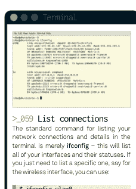

### >_ 059 列出连接

在终端中列出网络连接和详细信息的标准命令仅仅是 ifconfig——这将列出你的所有接口及其状态。如果你只需要列出特定的一个，比如无线接口，你可以使用：

```
$ ifconfig wlan0
```

### >_ 060 列出 USB 设备

你可能需要知道哪些 USB 和 USB 相关设备已连接到系统，或者查找它们的正式名称。你需要先安装它，但安装后，你可以在终端中使用 lsusb 来列出所有可用的设备。

### >_ 061 列出硬盘和分区

无论是需要检查特定驱动器的名称以便对其操作，还是只需要对系统布局有一个大致了解，你都可以通过 fdisk 列出所有硬盘。在终端中执行此操作：

```
$ sudo fdisk -l
```

### >_ 062 检查正在运行的软件

有时你希望检查系统上正在运行的软件，在终端中，这可以简单地通过 top 来完成。它列出了你当前运行软件的所有相关信息，如 CPU 和内存使用情况，以及 ID，以便你可以控制它。

### >_ 063 解压 ZIP 文件

如果你下载了一个 ZIP 文件，并且是从终端下载的，或者你正在从它工作中，你可以使用 unzip 命令来解压它。使用方式如下：

```
$ unzip file.zip
```

### >_ 064 解压 TAR 文件

有时 Linux 会有一个压缩文件，归档为 .tar.gz，或称为 tarball。你可以使用终端的 tar 命令来解压这些或类似的 TAR 文件，尽管你需要正确的选项。对于常见的 .gz，它是：

```
$ tar -zxvf file.tar.gz
```

### >_ 065 复制和写入磁盘

源自 UNIX 的有一个强大的小工具叫做 dd，我们最近一直在用它来编写树莓派 SD 卡。使用它从光盘和硬盘创建映像，并写回。if 是输入文件或驱动器，of 是输出文件。它的工作方式如下：

```
$ dd if=image.img of=/dev/sda bs=1M
```

### >_ 066 创建一个空文件

有时在编码或安装新软件时，你需要一个文件来写入。你可以用 nano 手动创建并保存，但终端有一个类似 mkdir 的命令，允许你创建一个空文件——这就是 touch：

```
$ touch file
```

### >_ 067 在终端中打印

终端使用 echo 将文件中的详细信息打印到终端，就像 C 语言一样。如果你正在编写 Bash 脚本并希望查看当前部分的输出，可以使用 echo 将相关信息直接打印到终端输出。

### >_ 068 检查 MD5 哈希

下载某些文件时，检查以确保它已正确下载会非常有帮助。许多网站会提供通过比较基于文件的哈希和来检查下载文件完整性的功能。有了该 MD5 和文件位置，你可以使用以下命令进行比较：

```
$ md5sum file
```

### >_ 069 向 x 运行命令

有时你需要对 x 显示做一些事情，但你只能切换到替代实例（如 Ctrl+Alt+F2 或类似操作）才能输入命令行。为了将命令发送到主 x 显示，请在前面加上 DISPLAY=":0"，以便它知道去向。

### >_ 070 创建新的 SSH 密钥

当你需要生成一个强加密密钥时，你可以尝试在终端中创建。你可以使用电子邮件地址作为标识符，在终端中输入以下内容：

```
$ ssh-keygen -t rsa -C "your.email@example.com"
```

### >_ 071 系统详情

有时你想检查你正在运行什么，你可以使用简单的 uname 命令，你可以在终端中通过以下方式使用：

```
$ uname
```

### >_ 072 内核版本

作为 uname 的一部分，你还可以获取内核版本。知道这一点在下载正确的头文件以编译模块或更新某些方面时很有用。你可以通过添加 -r 选项来获取纯粹的内核版本：

```
$ uname -r
```

### >_ 073 CPU 架构

如果你在一台未知机器上，你可能需要弄清楚你正在运行哪种架构。使用以下命令找出处理器是什么：

```
$ uname -p
```

### >_ 074 其他一切

Uname 允许你显示系统中可用的大量数据，你可以通过简单地使用该命令的 -a 选项来查看这些信息：

```
$ uname -a
```

### >_ 075 Ubuntu 版本

由于你所做的各种发行版更新，很难跟上你正在使用的 Ubuntu 版本。你可以使用以下命令进行检查：

```
$ lsb_release -a
```

> "要将命令发送到主 x 显示，请在前面加上 DISPLAY=":0""

## 文件权限

>_ 了解如何查看文件权限，并熟悉如何正确修改它们

### >_ 076 列出文件权限

你可以使用 `ls -la` 在终端中检查每个项目（包括隐藏文件和目录）的文件权限。它会在输出第一列中打印出一个十位字符的字符串形式的文件权限。第一个字符识别文件类型，其中 d 表示目录，- 表示常规文件。我们关心的是最后九个字符，它们实际上是三组三个字符，解读方式不同。例如：

```
rwxr-xr-x
```

R 代表读取，w 代表写入，x 代表执行。如果它们存在而不是 -，则意味着它们在特定权限块中是存在的。它分为三个块：前三个是当前使用的用户，第二个是组，第三个是其他所有人。

### >_ 077 更改权限

确定权限后，如果你想通过 chmod 命令开始编辑它们，你可以这样做。你通过为每个三位权限集分配一个数字来编辑这三个权限集，将其视为二进制。因此你会做类似这样的事情：

```
$ chmod 777 file
```

第一个数字是用户权限，第二个是组，第三个是其他所有人。这些数字意味着：

- 7: 读取、写入和执行，111/rwx
- 6: 读取和写入，110/rw-
- 5: 读取和执行，101/r-x
- 4: 仅读取，100/r--
- 3: 写入和执行，011/-wx
- 2: 仅写入，010/-w-
- 1: 仅执行，001/--x
- 0: 无，000/---


## 媒体控制

你可以在终端内进行工作时控制你的音乐

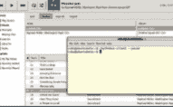

## 其他最佳技巧

列出你未来可能需要参考的其他所有命令

### 082 在终端中打开文件

如果你有一个在图形文件管理器中可见的文件，而不是打开终端并导航到该位置然后执行文件或脚本，你通常可以直接从终端运行它。要做到这一点，通常只需右键单击并选择“在终端中运行”选项即可。

### 087 使用 pushd 回溯

承接技巧 86，当你开始希望沿堆栈向上回到第一个目录时，可以在终端中使用 **popd**。你还可以通过使用 **dirs** 命令来查看你堆叠了哪些目录。

### 078 暂停音乐

一些音频播放器具有命令行控制功能。Rhythmbox 就有这种功能，当你在终端中受困且需要暂时暂停音乐时，这是一个很酷的功能。你可以通过使用以下命令实现：

```
$ rhythmbox-client --pause
```

### 083 在终端中查找文件

你可以使用 **find** 命令在整个文件系统中搜索特定文件。你需要给 find 一个搜索位置和一个搜索参数。若要简单地从根目录搜索具有特定名称的文件，可以使用：

```
$ find / -name file
```

### 088 进程优先级

进程的 CPU 优先级可以视为从表示最高优先级的 -20 到表示最低优先级的 +20 运行。在任何命令前加上 **"nice -n X"** 可以让你将优先级从 0 更改为 X 所代表的任何数字。只有 **sudo** 或 root 可以提升进程优先级，但任何人都可以将其降级。

### 079 跳过音乐

命令行控制功能无法实现界面中所能做到的所有功能，但至少你可以跳过到下一首曲目。尝试使用下面的命令。

```
$ rhythmbox-client --next
```

### 084 在终端中定位文件

与 find 类似的是 **locate**，这是一个较新的工具，工作方式与 find 略有不同。虽然 find 还有按年龄、大小、所有者等搜索文件的方法，但 locate 主要使用名称来定位，不过它的速度要快得多。使用方法如下：

```
$ locate file
```

### 089 通过终端下载

如果你需要通过 Internet 在终端中下载某些内容，你会需要使用 **wget** 命令。它会接受你指定的任何 URL，并直接将其下载到终端当前的所在位置（前提是你有权限这样做）。用法如下：

```
$ wget http://example.com/file.zip
```

### 080 暂停视频

你可以使用 Mplayer 从命令行启动视频进行观看。这对于使用不同的设置来测试视频很有用，你可以影响视频播放命令。你还可以使用按键来控制正在播放的视频 – 具体来说，你可以使用空格键暂停。

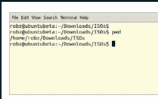

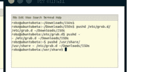

### 085 当前位置

在终端中，你可能会在文件系统中感到有点迷失，或者希望有一种快速简便的方式将当前位置通过管道传输到其他地方。你可以使用 **pwd** 打印出你的当前绝对位置。

### 086 移动目录

在目录之间移动时，你可能希望能够快速返回之前使用过的目录。除了使用 **cd** 移动到目录外，你可以使用 **pushd** 进行移动并创建一个用于在其间移动的目录“堆栈”。

### 081 更多视频控制

Mplayer 在命令行播放时提供了更多控制选项。你可以使用 Enter 键跳过列表中的下一个项目，否则，你可以使用 **Ctrl+C** 完全终止进程以停止播放。

### 090 更改图像格式

除了加载像 GIMP 这样的图像编辑器，你实际上可以使用 `convert` 命令在终端中更改图像。你可以非常简单地使用它来更改文件类型，甚至更改大小。操作如下：

```
$ convert image.jpg image.png
```

### 091 调整图像设置

除了 `convert`，还有 `mogrify`，它属于同一个软件包的一部分。你可以用它更轻松地对图像进行缩放、旋转和其他操作，比某些 `convert` 命令更方便。要调整大小，可以使用类似于以下的命令：

```
$ mogrify -resize 640x480 image.png
```

### 092 向显示器发送消息

这是一个老派的恶作剧，如果操作得当，实际上有很好的用途。`Xmessage` 允许你向同一系统上的 x 显示器发送消息提示，前提是你知道要发送到的显示器。尝试：

```
$ DISPLAY=:0 xmessage -center “Hello World!”
```

### 093 使用 cp 重命名文件

这是使用 `cp` 方式的一种扩展 – `cp` 可以复制文件并将其命名为你想要的任何名称，因此你可以将其复制到另一个目录并赋予不同的名称，或者只是将其复制到同一文件夹并赋予不同的名称，然后删除原始文件。这对于使用 `mv` 重命名也同样有效。

### 094 手动截图

这是我们必须在 Raspberry Pi 教程中做的事情，但它在其他地方也适用。对于基于 GNOME 的桌面，你可以通过调用 `gnome-screenshot` 在终端中完成，在 XFCE 中是 `xfce-screenshot`，在 LXDE 中是 `scol`，等等。这将立即截取你当前可见内容的屏幕截图。

### 095 延迟截图

使用上述功能，你可以添加延迟来设置截图。如果你想显示下拉菜单的内容，例如，这会很有用。截图工具允许你通过添加 `-d` 选项和秒数来延迟，例如：

```
$ scrot -d 5
```

## 终端玩笑

复活节彩蛋、笑话以及其他试图幽默的无路径软件工程师的尝试


### 096 进行动作

这个背后的故事是，显然，在发现很多人将 list 命令 `ls` 拼写错误为 `sl` 之后，制作了这个玩笑程序，特别是为了强调他们确实没有使用正确的命令。它播放蒸汽机车的动画。

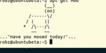

### 097 牛会说什么

Debian 的一个技巧，作为 `apt-get` 的一部分，`moo` 是一个复活节彩蛋，如果你输入 `apt-get moo`，一头牛会问你今天是否 moo 过。如果没有，它就不会 moo。然后，你应该立即找一个安静的房间，发出一声洪亮的 moo 来安抚终端里的牛。

### 098 让它下雪

这个使用 Bash 脚本来在终端中模拟下雪。我们已将你需要使用的文件添加到 FileSilo.co.uk，所以下载它，cd 到文件所在位置，然后运行它。这完全没什么用，尤其是在夏天，但它可能令人放松。

### 099 日期里有什么

你实际上可以在终端中输入 date，它会为你打印出根据其自身内部时钟确定的实际日期，这非常有用。我们在 `date` 中还可以做的是使用它创建一个迪斯科/舞曲日期，打印出一个几乎是迪斯科风格日期系统的输出。


### 100 水晶终端

我们最后一个技巧是 fortune。调用它可以得到你一天可能涉及的事情的提示。希望它能激励你开始行动。不过请记住，这只是一串代码的随机输出。享受吧！


> “服务器有许多部分需要牢记，但归根结底，关键在于根据手头的任务选择适当的硬件和好的发行版”


# 更快更佳的服务器

通过升级或自己构建全新的服务器来提升计算能力

尽管大型企业和大数据近年来可能更多地在使用大型机，但服务器的概念在可预见的未来不会消失。无论你的 IT 基础设施规模多大，服务器都是任何系统不可或缺的一部分。无论是在数据中心内，还是藏在你家中（通风良好的）柜子里，2015 年服务器依然有很多用途。

对于办公室，你可能想节省一些资金，创建一个完美符合你需求且你确切知道如何维护的东西。对于家庭，你可能只是想增强你的设置，使整个网络更高效。对于两者而言，这都是将网络的某些方面分离出来以进行更高效控制的好方法。

构建服务器时需要考虑许多组件，但这最终归结为选择合适的硬件和针对当前任务的优质发行版。在本教程中，我们将重点介绍文件和 Web 服务器，这两种基础服务器系统可以通过多种方式扩展和修改，以最适合你当前的情况。

由于我们正在教你构建更好的 Web 服务器，我们将首先稍微绕个弯，告诉你如果想升级当前服务器使其能与新技术竞争，你需要了解什么。


## 升级到更好的服务器

如果你有一台服务器，升级可能就是让它运行得更好的唯一需求

你可能已经有一台服务器，在这种情况下，与其从头开始构建一台更好的服务器，你可能只是想升级你的服务器，使其比以前更高效。根据你的改进方式，有几种方法可以实现这一点，其中大多数需要硬件升级。如果你决定采取硬件升级路线，请翻到下一页查看我们推荐的硬件类型，如果你是系统组装新手，还可以学习一些安装的小技巧。

最简单的升级是存储空间，特别是对于文件服务器。对于 Linux 系统，只要你有足够的空闲 SATA 数据线和电源，就可以简单地将额外的硬盘添加到机箱中。安装完成后，重启系统，你就可以开始将硬盘添加到 /etc/fstab 中，以便它自动挂载到特定位置——在这种情况下，即文件系统中需要更多存储的位置。否则，你可以使用 Clonezilla (clonezilla.org) 创建系统的克隆，然后将其恢复到更大的硬盘上，几乎不会改变其工作方式。


**上图** 内存对服务器的重要性远高于台式电脑，因为你需要服务多个人

对于其他系统硬件，你需要问自己哪一部分较慢，可能需要升级。如果某些操作和计算任务稍显缓慢，你的首选应该是升级 CPU。取决于你当初构建或购买原始系统时的前瞻性，主板可能支持比内部现有的更新的处理器。查找插槽信息并开始搜索新的 CPU。虽然你需要足够的 RAM 来支持 CPU 以及服务器的用途，但处理 Web 服务总是比提供文件服务需要更多的 RAM。你可以轻松更换这类部件，而无需重新安装 Linux。

如果你在进行重型计算任务，并且可以使用硬件加速，可以考虑获取一张新的显卡来支持它——尽管很少有服务器甚至需要一张显卡，更不用说一张好的显卡了。

如果你已经达到了当前主板的极限，是时候掏空系统并获取新的主板、CPU、RAM 和 GPU（如果需要）了——在尝试这样做之前备份重要文件和设置是个好主意，因为 Linux 可能无法在不重新安装的情况下与全新的硬件配合工作。

否则，如果你需要软件升级，请参考本文相关指南中关于如何安装和设置新发行版的内容。

### 技巧 | 窍门 | 黑客技巧 | 应用

#### 选择硬件

构建更好的服务器你需要什么样的硬件？

服务器中的硬件是构建系统的重要考量因素

服务器处理与普通台式机不同的请求，通常同时处理多人的请求。这意味着资源优先级发生了变化，甚至不同类型的服务器之间也可能有所不同。当然，软件也很重要，但没有得体的硬件基础，服务器将很难按预期工作。可扩展性和峰值负载需要作为未来的防护方法加以考虑，因此务必确保你拥有比所需稍多的处理能力。说了这么多，让我们开始查看各个组件。

你需要仔细考虑六个主要组件，其中最重要的四个是主板、处理器、RAM 和电源——任何电脑的核心组件。正如我们提到的，由于资源使用情况不同，你需要从组件需求的角度不同地思考。

对某些人来说，显卡也是一个次要的关注点，无论它是为了让你可以直接访问系统，还是用于受益于多个不同核心的计算工作。你还需要为服务器构建一个好的存储方案。

###### 主板

服务器主板有多种风格。许多服务器主板会有两个端口用于连接 CPU，这对于小型企业使用的服务器或如果你预计经常会有大量请求的情况来说是有益的。这些比单 CPU 系统更昂贵，但对于大型办公室服务器来说，长远来看益处远大于成本。

对于家庭使用，在大多数情况下，单处理器插槽就足够了，主要例外是你计划有大量常规连接的 Web 服务器。在这种情况下，你需要留意拥有大量存储和连接插槽的主板，使其尽可能灵活和可扩展。

##### CPU

对于服务器 CPU，最重要的是核心数量——这就是双插槽可能非常实用的原因。更多的核心允许更多的线程，如果你计划从文件服务器运行虚拟机或同时运行多个网站，这是必不可少的。时钟速度不是那么重要，但你至少应该选择一个不太慢且带有不错缓存的 CPU。

借助英特尔的超线程技术，每个核心可以通过在每个核心内创建多个线程来更努力地工作。相反，AMD 处理器以更低的价格提供更多的核心，特别是如果你预算有限的话。

##### RAM

在服务器上，大量 RAM 比在台式 PC 上更重要，这使你能够同时运行更多操作。速度和延迟不是那么重要，因此具有调整后时序的游戏 RAM 不会给你带来更好的系统——事实上，由于它们没有 ECC，它可能会稍微更差。ECC 修复构成 RAM 中最常见数据损坏形式的单字节错误。

##### PSU

虽然最好实践是永远不要在电源上吝啬，但对于服务器电源来说，这是近乎必要的。虽然你的荒谬的 4K 游戏主机可能需要 1,000+ 瓦特（不管电费账单），但对于家庭服务器的峰值功率，你可以根据预期用途稍微保守一些。寻找带有“80 Plus”认证的电源，因为这些电源经过了某种程度的认证，以确保它们具有一定的效率——这对于一直开机的服务器是个好主意，因为长期来看它们会节省电费。钛金和白金是最高评级，意味着它们至少 90% 高效（服务器电源达到 95% 高效）。


> 上图 如果你的主板有板载显卡且你不需要多核处理，你将不需要 GPU

###### 主板

当我们谈论主板的插槽和连接时，我们指的是 PCI 插槽和大量的 SATA 驱动器插槽。你可以通过扩展卡添加更多 SATA 插槽，但你必须考虑你是否想添加其他扩展卡的其他因素。你还需要确保主板的芯片组与你想要的 CPU 类型匹配，而 CPU 也将决定你获取的 RAM 类型。这是一种多层次的平衡行为，可能在你比较和对比时产生大量的选项标签

###### 光纤卡

如果服务器也充当更传统的网络服务器，处理所有网络数据，甚至用作调制解调器和防火墙，网络卡可能是必不可少的。对于这些类型的任务，有大量的不同 PCI 卡可用，包括用于更严肃互联网使用的光纤卡


##### 存储

根据您的存储需求，有多种解决方案可供使用。至少，我们建议您将存储进行拆分：使用 SSD 存储操作系统及相关配置文件，并使用标准硬盘驱动器存储其他所有内容。这样，当一般文件未被访问时，操作系统仍可以运行，同时功耗会显著降低。

否则，您的实际大容量存储可以配置为多种不同的方式。您可以直接通过 USB 连接驱动器，以实现最简化的复杂性。或者，您可以开始探索 RAID 路线——在驱动器故障时进行镜像、通过条带化更有效地利用两个硬盘的空间，甚至进一步采用 RAID 5 和 6，这会增加复杂性，但允许您创建一个大型、一致且具有冗余容错能力的存储空间。然而，配置越复杂，维护就越困难，重大故障的后果也可能越严重。

##### 电源（PSU）

在挑选电源时，需要考虑一些因素，例如您需要哪种类型的连接器。这取决于您的主板、使用的硬盘数量以及任何附加组件，如机箱风扇和机箱 I/O 面板。如果您想了解所需的瓦数，可以使用此工具进行计算：bit.ly/1pjcnis

##### 机箱

对于服务器机箱，您需要考虑服务器的使用位置。在家庭环境中，安静的机箱很棒，可以通过衬垫降低全天候运行时的噪音。在办公室环境中，假设负载会稍重，您需要考虑适当的散热。尺寸也是一个因素，因为您需要将部件放入机箱中。

##### 内存（RAM）

服务器 PC 实际上并不需要带散热器的内存——这种配置通常用于经过时序调整的游戏内存。如果您担心系统发热且预算稍宽裕，请选择带有某种散热装置的内存。

##### DVD 光驱

如今 DVD 光驱的需求较少，但在传输数据或安装 ISO 文件时，拥有光驱有时会很方便。如果您使用服务器来提供文件和媒体服务，您可以创建重定向，以便播放 DVD 或 Blu-ray 电影，甚至可以压制那些完全没有任何 DRM 的内容。


#### 构建文件服务器

在网络内部或更远的地方存储和提供文件服务

文件服务器在家庭和企业环境中都非常有用。对于家庭，它是存储媒体和备份系统的低功耗专用解决方案的良好选择，无需专门开启台式电脑来获取文件——台式电脑在空闲时可能比专用文件服务器消耗更多电力。

对于企业，它不仅对备份有用，还为个人用户提供了脱机网络存储，可以从网络内部和外部访问。因此，让我们设置一台服务器。

对于这种简单类型的服务器，我们将使用 Ubuntu Server 来设置系统。这意味着，如果您有任何 Linux 经验，维护它或在需要时安装更多软件应该很容易。

如果您正在为家庭服务器进行初始设置，连接显示器安装会容易得多。将 ISO 刻录到可安装介质中，或者如果设施已配置好，通过网络启动，然后按 'Install Ubuntu Server' 上的回车键继续。

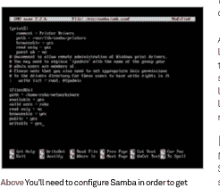

与图形版 Ubuntu 一样，服务器版也包含自动设置分区的选项——默认情况下，使用整个磁盘将创建一个安装分区和一个交换分区。如果您希望使用特定的一组分区，我们建议先使用 GParted 整理好，然后手动分配分区。

在安装过程中，系统会询问一些关于是否需要代理的额外问题；按您的意愿设置，然后系统会询问要安装的其他服务。由于我们将其用作文件服务器，请确保安装 OpenSSH，以便我们可以从网络上的另一台机器拨入，并确保安装了 Samba 服务器，以便更容易地在网络共享文件并与任何 Windows 机器兼容。

最后，系统将提示您安装 GRUB。假设这是一台专用文件服务器，我们可以让它覆盖主引导记录。完成后，系统将重启，因此请确保移除现场引导介质。加载后，您将进入命令行界面进行登录——由于这是一个服务器发行版，没有桌面环境。

##### 安装

服务器版的安装与 Ubuntu 普通的图形安装程序不同——它是基于命令行的，尽管选项相当简单明了。设置好您的位置、语言和键盘设置后，系统将尝试为您检测硬件。给服务器命名，设置用户名和密码，然后按照指示继续安装。

##### 初步步骤

现在已进入 Ubuntu，我们将首先设置 SSH 连接到该机器。对于家庭服务器之类的设备，最好设置静态 IP，我们可以在 /etc/network/interfaces 中这样做。使用以下命令打开它：

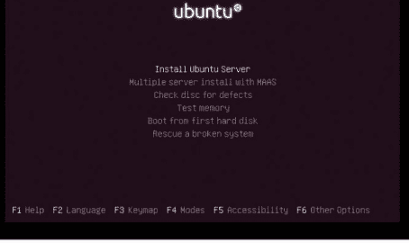

```
$ sudo nano /etc/network/interfaces
```

...并将主要网络接口更改为类似以下内容：

```
auto eth0
iface eth0 inet static
    address [Desired IP]
    netmask 255.255.255.0
    gateway [Router address]
```

如果您使用无线连接，请确保将其切换为 wlan0，并添加 SSID 和密码详情。

使用您设置的 IP 地址，或者使用 ifconfig 查看自动设置的 IP 地址，现在您可以使用设置的用户名和密码通过 SSH 连接到您的机器。从同一网络中的另一台机器输入：

```
$ ssh [username]@[IP address of server]
```

输入密码后，您将获得访问同一命令行界面的权限。

##### 共享文件夹

现在，我们可以创建一个共享文件夹，网络中的其他用户可以查看和修改它。首先，让我们创建一个要使用的文件夹并将其放在常规主目录中，使用以下命令：

```
$ mkdir ~/networkshare
```

##### 文件服务器的其他用途

文件服务器在其他方面也很有用

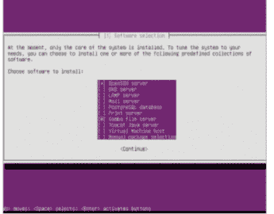

最好不使用空格，以简化共享。完成后，您需要为 Samba 创建密码。输入以下命令来完成：

```
$ sudo smbpasswd -a [username]
```

它会要求您输入并确认密码。完成后，文件夹创建后，我们可以将其添加到 Samba 服务器中。使用以下命令访问配置文件：

```
$ sudo nano /etc/samba/smb.conf
```

转到文件的最末尾，添加以下内容，以便 Samba 识别共享文件夹：

```
[NetworkShare]
path = /home/[username]/networkshare
available = yes
valid users = [username]
read only = no
browsable = yes
public = yes
writable = yes
```

保存文件并退出，然后重启 Samba：

```
$ sudo service smbd restart
```

最后，使用 **testparm** 测试设置，以确保一切正常运行。

> 左上图：对于灵活、可扩展的服务器，可以考虑尝试 [MAAS: maas.ubuntu.com/docs/1.5](https://maas.ubuntu.com/docs/1.5)

> 右上图：[Ubuntu Server](https://www.ubuntu.com/server) 让您在安装期间轻松获取所需的软件


##### VPN

从远程位置拨入并 VPN 连接到您的服务器可以带来额外的好处。远程访问文件是一回事，但如果被困在酒店或浏览规定严格的其他地点，能够使用更不受限制的网络服务（您的服务）也会很有帮助。

设置起来并不太难，但需要服务器保持连接到互联网。允许通过它 VPN 连接的用户越多，您需要更多的资源（包括内存和处理能力）。


##### 种子（Torrent）服务器

凭借所有存储和可能的互联网连接，您可以将文件服务器也设置为种子服务器。这将使您能够通过做种最新的发行版种子来回馈社区，同时也确保您拥有某些发行版的最新版本以便安装和测试。只需添加一个种子服务；您可以找到一个适合命令行使用的好工具，即 [tTorrent](https://github.com/igorgt/tTorrent)。不仅可以使用它查看有用的命令行界面，还可以设置一个用于读取新种子的文件夹。


#### 搭建 Web 服务器

在你专属且可控的服务器上托管你的 Web 服务

- **01 安装 Apache**

一旦你配置好服务器并能通过 SSH 登录，是时候安装 Apache Web 服务器了。请使用以下命令进行操作：

```shell
$ sudo apt-get install apache2
```

它会自动将域名地址设置为：127.0.0.1

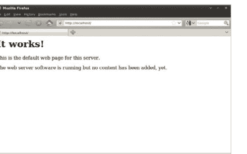

上图 安装好 Apache 后，给你的 Web 服务器做个测试

> “有了 Web 服务器，你就可以用它来托管自己的网站，或者通过互联网远程访问服务器上的存储”

- **02 测试服务器**

如果你需要在服务器上安装 GUI（图形用户界面），你可以通过在其中的浏览器访问 127.0.0.1 来测试 Apache 是否正常工作。否则，从外部系统出发，在浏览器中访问你系统的 IP 地址，屏幕上应该会显示 Apache 确认页面。

- **03 安装 FTP**

有了 Web 服务器，你现在可以使用它来托管网站，或者通过互联网远程访问服务器上的存储。你可以使用 FTP 来设置后者，或者像我们这种情况，使用安全的 VSFTP。使用以下命令将其安装到系统中：

```shell
$ sudo apt-get install vsftpd
```

- **04 配置 FTP**

我们可以使用 nano 打开 /etc/vsftpd.conf（`sudo nano /etc/vsftpd.conf`）来访问 FTP 的配置文件。在这里，我们可以对其进行配置以匹配我们的用途，但首先有必要稍微提高安全性，然后才能正确地将其用作 FTP 服务器，以确保安全起见。

- **05 保护你的 FTP**

使 FTP 安全的主要更改是关闭匿名用户。在配置文件中，找到包含 'anonymous_enable' 的行。如果尚未设置，我们希望将其更改为 NO，以确保 FTP 服务器具有更多的安全性，并且你的所有内容都保持私密。

##### 扩展你的 Web 服务器

根据你的个人需求定制你的 Web 服务器


###### 邮件服务器

作为 Web 服务器的好处之一是，它还允许你添加自己的邮件服务器，甚至托管自己的 Webmail 客户端。配置好 Apache 是第一步，然后在其之上设置邮件服务器也是相当直接的。

关于 Webmail 客户端，我们建议使用 RainLoop，它看起来美观现代，还允许你添加其他 Webmail 服务，以及你自己的 Webmail 服务器。

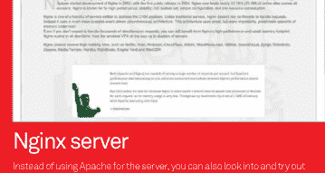

###### Nginx 服务器

除了使用 Apache 作为服务器，你还可以了解并尝试 Nginx。Nginx 处理进程的方式与 Apache 略有不同，可能会导致 Web 服务器的负载更轻。它与 Apache 一样，在大多数发行版的软件源中均可用，因此安装方式也大致相同。

关于设置 Nginx 服务器的更完整指南，你随时可以参考 *Mithals* 的我们的一篇文章——它在第 144 期中，如果你手边有的话，也可以在我们的网站上找到：bit.ly/1AYKx88。

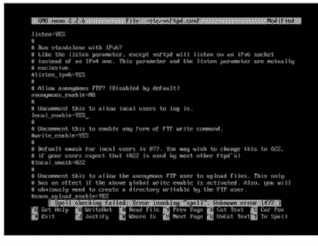

- **06 本地使用**
虽然从外部访问这些文件会很棒，但我们也可以让你内部也能访问 FTP，以防你更倾向于使用共享文件夹。找到 ‘local_enable’ 这一行，并将其更改为 YES，以确保它可以在其他位置访问。

- **07 编辑文件**
由于我们只允许我们希望的人登录服务器，我们可以让任何登录的用户都具有写权限。为此，回到配置文件，找到包含 ‘write_enable’ 的行，并将其更改为 YES。你可能还需要通过移除井号来取消该行的注释。

- **08 FTP 文件夹**
如果你没有为之前的服务器教程创建共享文件夹，现在是创建一个专用目录的好时机。在主文件夹中，使用 mkdir 创建一个目录，名称随意，以便 FTP 服务器能够访问它。

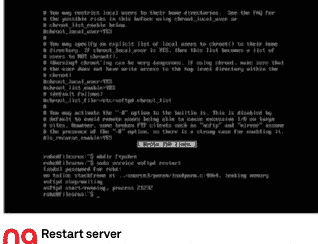

- **09 重启服务器**
一旦配置文件完全编辑完毕且文件夹已创建，现在就可以开始使用了。使用 **sudo service vsftpd restart** 重启 FTP 服务器，你将开始能够访问该文件夹。你对配置所做的任何更改都需要此重启才能生效。

#### 设置 LVM 文件系统

了解在处理 LVM 文件系统时图形化分区的局限性

创建、命名和修改包含所有数据的逻辑卷和卷组

通过明智地分配空间，向 LVM 添加更多硬盘和分区，永远扩展空间

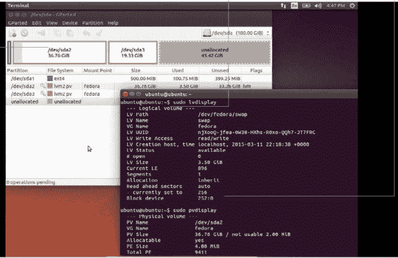

这是一种与你正常的 ext 分区截然不同的文件系统，但 LVM 可能正是前进的方向

## 资源

- LVM 2 工具：[sourceware.org/lvm2](sourceware.org/lvm2)
- gparted：[gparted.org](gparted.org)

你不知道 LVM 是什么意思是可以理解的，但知道它是个有用的概念。逻辑卷管理（Logical Volume Management，即其正式名称）充当一种管理数据的容器——其好处在于，你可以在 LVM 仍在线且工作时开始添加和扩展空间。这对服务器集群非常好，因为你可以非常快速地更换和添加存储，而在桌面环境中，它特别适合管理不同分区的大小，如果你在安装时不确定它们应该如何分配。

在本教程中，我们将研究如何创建 LVM 文件系统，以及如何对其进行维护和修改。我们还将探讨一些发行版如何使用 LVM 进行安装。

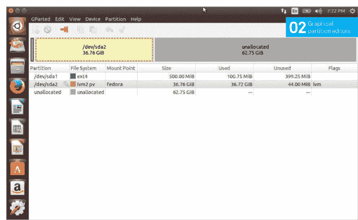

- **01 安装 LVM**

许多发行版提供使用 LVM 文件系统安装的选项。在我们的示例中，我们在安装 Fedora 21 时勾选了 LVM 选项。这将自动为你创建一个引导和存储分区，位于逻辑卷内，供你稍后操作。

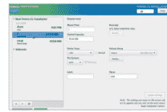

> “你可以非常快速地更换和添加存储，而在桌面环境中，它特别适合管理不同分区的大小”

- **02 图形化分区编辑器**

通用的分区编辑器如 gparted 在处理 LVM 文件系统时有点困难——安装正确的工具后，你可以看到分区，但无法对其做太多事情。在本教程中，我们将主要使用终端进行操作。

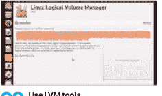

- **03 使用 LVM 工具**

虽然你可以实时编辑分区，但我们建议改为启动到系统中的 Live CD 或其他发行版。启动后，如果 LVM2 工具尚未安装，请安装它们。该软件包在软件源中称为 lvm2，包含用于查看和操作 LVM 分区的各种工具，这很有用。

- **04 查看 LV**

现在工具已安装，我们可以查看系统中的 LV（逻辑卷）。这将显示卷组、名称类型和大小。打开终端并使用：

`$ sudo lvdisplay`

- **05 查看卷组**

LVM 分区保留在卷组中，在我们的案例中称为 Fedora，但也可以称为任何其他名称。你可以使用卷组工具获取更准确的详细信息，如下所示：

`$ sudo vgs`

技巧 | 窍门 | 黑科技 | 应用

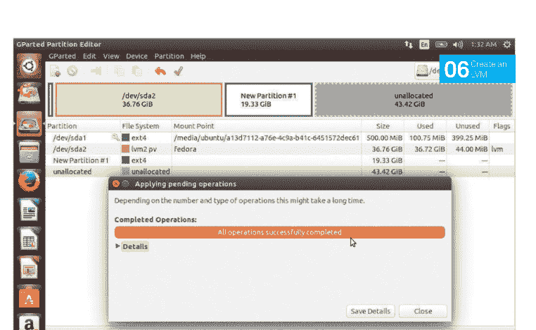

> “确保你知道分区的指定名称”

- **06 创建 LVM**

创建 LVM 文件系统需要多个步骤。你需要为卷组创建一个物理卷，然后你可以在其中创建逻辑卷。不过，首先要在系统上以你喜欢的方式创建一个新分区。

确保你仍然记得分区的指定名称，并使用类似以下命令创建：

```
$ sudo vgcreate LVDG /dev/sda3
```

你也可以像这样添加多个分区和/或硬盘。

- **07 创建物理卷**

一旦分区创建完毕，你可以将其转换为物理卷。确保你知道分区的指定名称（在我们的案例中是 /dev/sda3），你可以通过 `fdisk -l` 查找。使用以下命令创建 PV：

```
$ sudo pvcreate /dev/sda3
```

- **08 包含卷组**

现在有了可以操作的物理卷，我们需要创建一个带有名称的卷组。

- **09 创建逻辑卷**

最后一步是包含一个逻辑卷。给它起个名字，告诉它要使用多少空间，以及它应该属于哪个卷组。要填满一个 20 GB 的卷组，使用：

```
$ sudo lvcreate --name root --size 20G LVDG
```

- **10 扩展卷组**

如果你想扩展原始卷组中的空间，首先像以前一样创建一个新的物理卷。找出卷组的名称（**vgdisplay**），并使用分区的指定名称进行扩展：

```
$ sudo vgextend /dev/fedora /dev/sda3
```

- **11 修改逻辑卷**

使用 **vgdisplay** 找出空闲 PE（物理扩展）值，确切知道你有多少空间来扩展分区，并确保你知道你要扩展的分区名称。当你拥有这两者时，使用：

```
$ sudo lvextend -L +4958 /dev/fedora/root
```

- **12 调整文件系统大小**

为了完成扩展，我们需要使用已扩展 LV 上的 resize 选项，让整个 LVM 系统知道它发生了一些变化。好处是，这意味着你不需要在硬盘中有“紧邻”的空间来进行这种扩展。使用以下命令执行此操作：

```
$ sudo resize2fs /dev/fedora/root
```


###### 小贴士 | 技巧 | 诀窍 | 应用

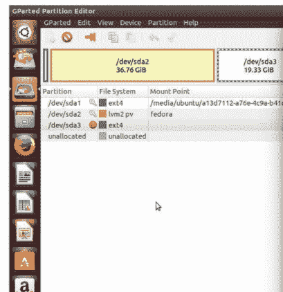
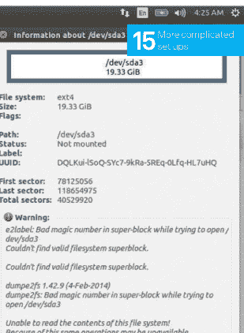

####### 13 文件系统检查

根据存储卷的创建方式，您可能需要在运行 `resize2fs` 之前检查文件系统的完整性。在这里，系统要求我们在调整大小之前对扩展的逻辑卷执行 `e2fsck` 命令——只需遵循提示即可。

####### 14 测试新的文件系统

现在您可以查看逻辑卷和卷组中的扩展空间，并使用 `lvdisplay`、`vgdisplay` 和 `pvdisplay` 选项检查是否还有未分配的空闲空间。在 `lvdisplay` 和 `vgdisplay` 中，额外的 sda 分区不会显示，因为在系统中它们都属于同一存储设备。

####### 15 更复杂的配置

LVM 的迷人之处在于，我们可以拥有多个分区和硬盘，让它们都向卷组贡献空间，然后再分配给不同的逻辑卷。您可以在任何卷组中创建多个逻辑卷，从您想要的地方获取空间。稍后添加硬盘可以让您轻松扩展存储空间。传统方式创建的分区在分区编辑器中会显示为 ext4 或其他文件系统，但在 LV 外部它们是无法访问的。

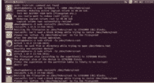

####### 16 删除 LV

想要完全重新排列卷组内部的布局吗？请先使用 `lvremove` 命令删除 LV，以便从头开始创建。请确保知道您正在删除的 LV 名称，并像这样操作：

```bash
$ sudo lvremove /dev/VolumeGroup1/Logical_volume
```

####### 17 移除卷组

需要更进一步，删除整个卷组吗？这将删除其中所有的 LV，并释放物理卷中的一些分区空间。请确保知道卷组的名称，然后执行：

```bash
$ sudo vgremove Volume_group
```

####### 18 移除物理卷

如果您想彻底移除 LV，只需删除物理卷的指定标记，然后改用更传统的分区系统。请确保知道分区的原始名称并移除它们：

```bash
$ sudo pvremove /dev/sda1 /dev/sda2 [etc]
```

####### 19 缩小逻辑卷

就像我们之前扩展卷一样，您也可以缩小逻辑卷和卷组。在每种情况下，您分别是减小逻辑卷的大小或从卷组中移除物理卷——否则操作方式相同。

####### 20 逻辑卷管理

在创建和维护 LV 时，还有更多功能可供使用，但这些是基础。如果您发现自己正在处理大量存储，这可能是您的解决方案，因为您可以几乎毫无麻烦地不断添加空间，且无需 RAID。

#### 使用 Mutt 在命令行中掌控你的邮件

电子邮件是占用时间最多的应用之一，但 Mutt 提供了整理和处理收件箱的工具。

## 资源

- Mutt
  - [mutt.org](mult.org)
- Fetchmail (可选)
  - [www.fetchmail.info](www.fetchmail.info)
- Mutt 手册
  - [mutt.org/doc/manual.txt](mutt.org/doc/manual.txt)

几年前，社交媒体开始占据我们更多的时间，您可能觉得电子邮件的重要性在下降。然而，我们每周仍要花数小时浏览邮件，为了在许多新网站和服务完成注册，还必须订阅各种商业邮件。

另一个巨大的变化是几乎全面转向 Web 邮件——邮件用户将运行个人邮件服务器和客户端（以及相关备份）外包给了 Google、Yahoo! 和 Microsoft，这让人担心控制权和隐私的丧失。

Web 邮件的便利之处在于我们不再需要担心邮件的维护，但尽管有些界面很漂亮，管理繁忙的邮件生活仍然显得笨拙且缓慢。Mutt 为您提供了重新掌控电子邮件并真正加快工作流程的机会。我们将展示如何借助主要的 Web 邮件服务之一来实现这一点。

Mutt 非常强大——手册需要花上数小时才能读完——但通过我们对其强大功能的快速导览，您将准备好进行更深入的探索。

###### 01 设置 IMAP

在 Web 邮件普及之前，用户必须决定是将邮件保留在服务器上以便在任意地方读取（使用 IMAP（Internet Message Access Protocol，互联网邮件访问协议）），还是通过 POP 下载到邮件客户端并从服务器删除。

由于磁盘配额宽松，我们现在中的许多人都在 Web 邮件提供商处存档了所有邮件。不过，如果您想使用 Mutt 这样的客户端同时让邮件保留在 Google 宽敞的服务器上，仍需在 Gmail 中启用 IMAP。

在 Gmail 设置菜单中选择“转发/POP/IMAP”，然后选择“启用 IMAP”。Yahoo!（因此也包括 BT）不需要这么冗长的过程，AOL 或 Hotmail Live 也不需要，这很有用。

在 Mutt 中，主列表会显示关于您邮件的有用信息，例如邮件大小，您可以使用快捷键快速浏览所有内容。

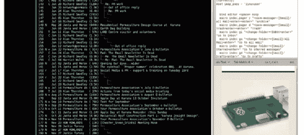

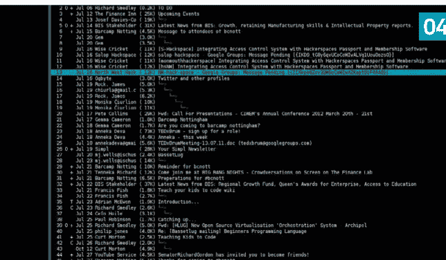

###### 02 配置文件

为了快速上手，在已通过包管理器安装 Mutt 之后，在首选文本编辑器中打开 `~/.muttrc` 并填写基本信息：

`~/.mutt/pwd` 中包含：

现在用以下内容替换 `mutt` 的密码行：

```ini
set from = 'your-account@gmail.com'
set realname = 'You'
set imap_user = 'your-account@gmail.com'
set imap_pass = 'your-secret-password'
set folder = 'imap://imap.gmail.com:993'
set spoolfile = 'INBOX'
set smtp_url = 'smtp://your-account@gmail.com:587/'
set smtp_pass = 'your-secret-password'
```

其他提供商需要类似的设置，例如：

```
smtp://your-account@hotmail.com@smtp.live.com:587/
```

###### 03 保守秘密

将密码以明文形式保存在主目录中是一个安全风险，尤其是在便携式计算机上。让我们将这些密码从恶意分子或单纯好奇者眼中隐藏起来。您的系统中应该已经安装了 GnuPG。使用它来加密一个独立的密码文件。

```bash
gpg --gen-key
cd ~/.mutt/
nano pwd
```

```bash
gpg -r your.email@gmail.com -e pwd
shred /pwd
rm /pwd
```

```bash
set my_pwd="$your_password"
```

```bash
source `gpg -d ~/.mutt/cache/passwords.gpg 1`
set imap_pass = $my_pwd
```

###### 04 你有新邮件

再做一些整理工作，我们就准备好了：

```bash
mkdir ~/.mutt
mkdir ~/.mutt/cache
mkdir ~/.mutt/cache/bodies
nano ~/.mutt/sig
```

现在启动 Mutt，输入 `mutt` 并按 Enter。如果您刚设置了 GPG 加密的密码，系统会提示输入密码短语——gpg-agent 会在后续操作时处理它。如果您不是“收件箱零”流派的修行者，您需要等待几秒钟，让 Gmail 保留的那数千条消息加载完毕，然后您将看到收件箱内容的一长列表。

Mutt 拥有线程模式，可为长篇对话增加功能。

###### 已包含内容

虽然我们建议在第 12 步（或者更好的第 13 步）获取 Mutt 的文档，或者在使用本教程时保持打开，但大多数发行版都会安装大量的文档供您参考，位于 `~/.folderrc`/`/etc/`/`/usr/share/doc/mutt/` 示例中，您在那里也能找到一些很棒的 muttrc 配置示例，包括实用的配色方案。

###### 小贴士 | 技巧 | 诀窍 | 应用

####### “打印一份导航键备忘单，或者打开一个窗口显示 Mutt 手册”

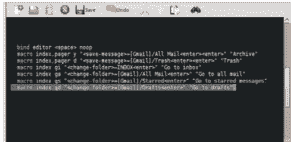
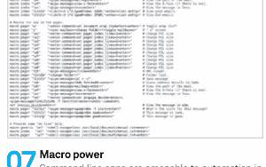

- 快速使用 Mutt
- 需要快速从服务器复制文件吗？只需在命令行执行以下操作将其发送到您的日志文件主目录：
  ```bash
  mutt -s “PS Syslog tail: ‘A starting syslog ’ -m /var/mail/log
  ```
- 按 Enter 确认您的选择，然后按 Y 发送。Mutt 允许从命令行添加多个附件，因此通过在地址前加上双连字符（--）来表示您已完成附件操作，提示它注意收件人地址。

####### 05 键盘操作

在浏览邮件时，K 和 J 分别代表向上和向下——这一习惯继承自 Pine 和 Elm 邮件客户端——这意味着您的手指可以保持在主行（Home row）上。如果您使用 Dvorak 或 Colemak 键盘布局，您希望根据主行重新绑定 .muttrc 中的导航键，例如对于 Colemak，您可以使用以下设置：

```text
bind generic n next-entry
bind generic e previous-entry
```

可能还需要替换 top-page（绑定到 H）和 bottom-page（L）。打印一份导航键备忘单，或者保持一个窗口打开 Mutt 手册，直到您学会了最实用的按键。最初，您只需使用 Enter、Q（退出）和方向键就能走得很远。

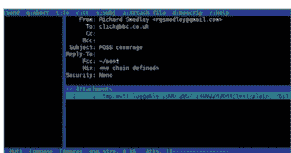

####### 06 发送邮件

通过发送电子邮件来测试您的配置。按 M 键撰写，系统会提示输入收件人和主题，然后打开您的默认文本编辑器（Mutt 是一个邮件客户端；撰写是文本编辑器的工作）。保存消息后，您将回到发送对话框，然后按 Y 发送，或选择抄送、密送、附件等选项。

您现在可能位于电子邮件账户的草稿文件夹中。按 C 键更改邮箱，然后按 ? 获取选项列表并导航回您的收件箱。既然已经快速了解了基础知识，让我们看看 Mutt 真正的强大之处。

####### 07 宏命令的强大功能

命令行应用程序比鼠标驱动的程序更易于自动化。宏命令保存了一系列通常在 Mutt 交互中应用的按键，例如打开邮件及其附件，所有这些都绑定到一个键盘快捷键上。

宏命令在 .muttrc 中以以下形式定义：

```text
macro menu key sequence [ description ]
```

其中‘menu’是 Mutt 术语，指您正在使用的 Mutt 部分——阅读器、索引视图、撰写器、附件等。在第 5 步中，我们使用 `generic` 作为所有菜单的元菜单，在这些菜单中通用的导航功能可用；因此‘Key’是您定义的快捷键——C 是 Control 键，' 是 Escape，如果您想将序列绑定到 Ctrl-x, Ctrl-c，您需要 ^C\Cx\Cc。在使用序列时，您将功能名称（而非其常见的键盘快捷键）放在尖括号内。

如果序列中任何地方使用了空格，则需要将整个序列加引号：

```text
macro index,pager <f1> {"\<shell-escape\less / usr/local/doc/mutt/manual.txt\<&enter\>" "Show Mutt documentation"}
```

末尾的描述是可选的，但能简化操作。

与点文件（包括 .muttrc）一样，您喜欢的搜索引擎会为您找到几个示例，就像我们在截图中展示的那样。

####### 08 一个标签统治所有

浏览邮件时，您会注意到半打邮件可以同样对待——例如移动或删除——如果用鼠标导航会很麻烦。在 Mutt 中，对每封邮件按 T 键标记它们，标记完成后，按 ; 然后按 D 删除所有邮件，或者使用某些宏命令处理它们。

按删除后，您会看到星号（原本显示邮件已被标记）被 D 取代，表示离开 Mutt 时该邮件将被删除。为什么不直接删除？也许这给了您回去改变主意的机会——或许标记的邮件多了一封。


####### 09 执行搜索

要搜索您的邮件，按下 `/` 然后输入您的搜索词或正则表达式。使用 `T` 代替 `/` 会标记所有匹配搜索词的邮件，允许执行与上一步相同范围的操作。

阅读 Mutt 文档以了解更多关于搜索的内容是值得的——您可以按大小或日期等属性查找和选择邮件，这些在您的收件箱像 Gmail 一样庞大时都非常有用。

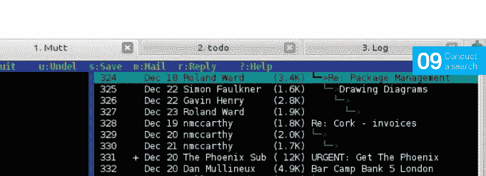

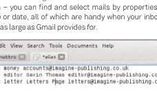

####### 10 创建别名

当您在网络邮件中开始输入电子邮件地址时，所有可能的补全建议都会弹出。Mutt 的等效操作是为每个您需要定期发送消息的人定义一个别名：

```
alias bank Bank Manager manager@barclays.co.uk
```

`alias` 后的第一个词是您的快捷方式，该词与实际地址之间的所有内容都是长格式名称。在撰写电子邮件时，在 `To:` 提示符处输入快捷方式，Mutt 会替换长名称（如果已提供）以及电子邮件地址。如果您收集了多个别名，请为它们创建独立的文件，并让 `.muttrc` 知道其位置：

```
set alias_file=~/mutt/aliases
```

####### 11 PDF

您的 `/etc/mailcap` 文件告诉您的邮件客户端如何处理多媒体附件。按下 `V` 阅读 PDF 附件，系统默认阅读器（可能是 Evince 或 Okular）将会打开。如果您在命令行环境中运行 Mutt，您需要创建自定义的 mailcap 文件位于 `~/.mutt/mailcap`，以指定通过 `w3m` 管道传输 `pdftotext`。您需要使用以下命令在 `.muttrc` 中指向此文件：

```
set mailcap_path="~/.mutt/mailcap"
```

输出格式并不完美，但至少现在内容可读。

####### 12 下一步

在尝试覆盖对新 Mutt 用户有用的技巧时，我们不得不采用一种“扫射”方式——目的是至少让您入门。然而，我们遗漏了许多更深入的配置以及这种灵活邮件程序许多强大的用途。幸运的是，下一步很简单：阅读位于 [http://dev.mutt.org/trac/wiki/MuttGuide](http://dev.mutt.org/trac/wiki/MuttGuide) 的 Mutt 文档，以及随附的手册和维基页面。对于从未使用过 Mutt 的人来说，内容很多，但您已经拥有一个可用的配置并知道一些高级用户技巧，因此您已准备好真正去驯服您的收件箱。

####### 09 执行搜索

**上方** 按日期过滤邮件和搜索关键词真正加快了处理速度

#### 使用 Scrollback 运行自己的聊天频道

Scrollback 构建聊天室，使您能够沟通并接触新受众。

沟通是我们生活中最重要的方面之一。无论您想到的是点对点通信还是品牌与其受众的沟通，有效传达信息都很重要。规则很简单：沟通良好的人获胜。

在数字世界现在处理我们大部分沟通的情况下，选择正确的词语并拥有正确的工具至关重要，因为没有这些，您的受众就无法理解您。聊天应用程序是一种常见的沟通工具。通常基于服务器-客户端模型，此类工具随处可见，但每个工具都有一个问题——有些看起来丑陋，有些不支持聊天室，有些仅基于 IRC 协议。很少有应用程序能在一个软件包中提供所有内容。然而，我们将在这里介绍一个可以帮助您完成所有功能的应用程序——从聊天室到嵌入，从网站到聊天归档，您可以从聊天应用程序期望的一切，并拥有新的用户界面。基于服务器-客户端模型的 Scrollback 拥有基于 Web 的用户界面，可在浏览器中打开，无需客户端应用程序。我们将在本教程中介绍其安装和功能。我们使用 Ubuntu 14.04 作为主机系统，并使用来自 Scrollback GitHub 存储库的最新源代码。

## 资源

- Scrollback: [scrollback.io](scrollback.io)
- GitHub 仓库: [bit.ly/1GfFLp](bit.ly/1GfFLp)

###### 01 安装脚本

安装 Scrollback 非常直接；您可以前往他们的 GitHub 页面并运行那里可用的单行命令，以立即在您的服务器上安装 Scrollback。该命令基本上调用一个脚本，所有操作都在其中发生。现在，我们作为开源爱好者不能就这样让它轻易发生！这是开源软件最让人兴奋的部分之一。您可以查看代码并掌握控制权，而不仅仅是点击了事。然而，如果您只是希望立即运行 Scrollback，您可以跳到步骤 3。

让我们看看运行脚本时发生什么。它以捕获信号和健全性检查开始，如用户权限检查和受支持发行版检查——受支持的发行版是 Ubuntu、Arch Linux 和 Fedora。如果您运行的是其他系统，您需要手动安装 Scrollback。在下一步中，我们将查看 Scrollback 的各种依赖项及其在脚本中的安装。

**下方** Scrollback 提供简洁干净的界面来管理您所有的对话

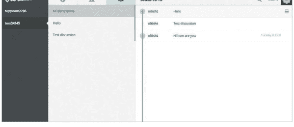

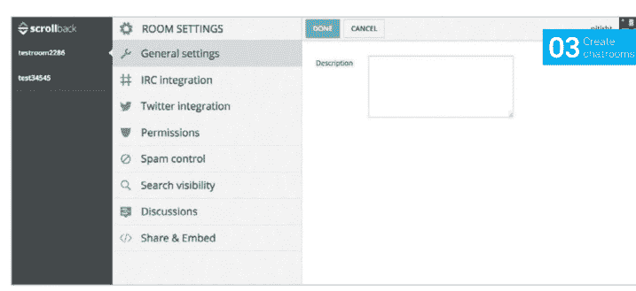

###### 02 幕后工作

在健全性检查之后，安装脚本显示要安装的项目列表 – Git 版本控制、Node.js 和 Redis 服务器。点击 Install（安装）以授予权限。一旦您授予权限，它使用 `sudo apt-get update` 检查 Ubuntu 的软件源列表。然后它遍历所有包并安装与 Git、Node.js 和 Redis 相关的包。然后，Scrollback 从 GitHub 仓库克隆。依赖项，如 gulp-bower，被安装。Redis 守护进程被启动，并且 localhost:scrollback.io 被添加到 /etc/hosts 文件。这使得您能够使用地址 `http://local.scrollback.io` 在浏览器中访问 Scrollback，而不是使用 IP 地址。

最后，配置文件被复制并运行 Gulp 以生成杂项文件，随后通知 Scrollback 安装成功。安装完成后，运行 `sudo npm start` 以启动 Scrollback。现在您可以在浏览器中访问 Scrollback。请注意，启动 Scrollback 时可能会看到与 Nav-Grub 相关的故障，但您可以安全地忽略它。现在让我们看看 Scrollback 的一些功能。

###### 03 创建聊天室

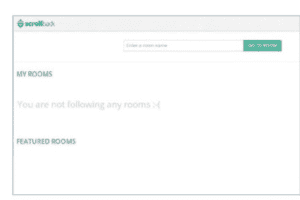

> “简单来说，整个聊天室被小型化，可以通过网站上的一个小窗口访问”


**左：** 通过赋予聊天室独特且描述性的名称来组织您的聊天室

下一步是创建一个聊天室。要创建一个，您需要登录 Scrollback – 请注意，您需要使用电子邮件登录，因为 Facebook 和 Gmail 登录选项无法开箱即用。登录后，点击左下角或页面中央的 Create Room（创建房间）按钮。系统会提示您填写房间名称，所以只需输入名称即可。您的聊天室将被创建，页面重定向到房间设置。

Scrollback 中的房间设置包括多个选项：IRC、Twitter 集成、垃圾控制、搜索可见性选项、讨论设置、嵌入和共享设置等。我们将在接下来的步骤中更仔细地查看各种设置。

要设置 GooGle+ OAuth，请使用 Google OAuth API 并获取用于创建您应用程序的 Client ID 和 Secret 密钥。要生成 API 密钥，创建一个新的 OAuth 2.0 客户端 ID，然后将值粘贴到服务器端配置文件中。

###### 社交账号

###### 04 嵌入到网站

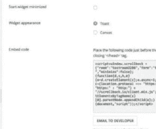

**上方** 使用*现成*代码在您的网站上嵌入一个小聊天窗口

您可以使用 Scrollback 做的另一件很棒的事情是将聊天窗口直接嵌入到您的网站中。简单来说，整个窗口被小型化，可以通过网站上的一个小窗口访问。在网站上嵌入聊天室为您提供了一个机会，以易于管理的方式让更多人参与互动。这比基于电子邮件的订阅要好得多，因为它允许即时通信，并可能提供整体更好的体验。您的网站访客也可以利用您的聊天室中已经可用的所有信息。他们只需要查看讨论列表，点击与他们相关的一个即可使用。

要在简单的基于 HTML 的网站中嵌入您的聊天室，请前往房间设置页面的 Share & Embed（共享和嵌入）选项卡。向下滚动以查看嵌入代码 – 是的，它已经在那里了！现在复制并粘贴它到您的网站的 `</head>` 标签关闭之前。就这样；您的访问者现在可以在您的网站上看到您聊天室的小型版本。还有一个选项可以添加域名白名单，在该白名单中嵌入的房间。如果您将该字段留空，这意味着您将启用任何地方的嵌入，这不是理想的。

###### 05 WordPress 网站

WordPress 驱动了互联网整体的约 23%。这是一个非常大的数字，随之而来的是您有机会在社群内进行有意义的对话，而不仅仅是单对单聊天。Scrollback 很好地利用了这种媒介 – 您可以非常轻松地将您的 Scrollback 聊天室集成到 WordPress 网站，这次甚至不需要接触一行代码。

要将 Scrollback 与 WordPress 一起使用，请登录您的 WordPress 管理控制台并前往 Plugins>Add New（插件>添加新插件）。搜索插件。在此处输入 Scrollback 并开始搜索。然后您将找到 Scrollback 插件，只需安装并激活它。一旦激活，填写您的聊天室名称（您想要嵌入到网站的房间），就完成了！前往您的 WordPress 网站，您将能够在网站的右下角看到 Scrollback 聊天窗口。

**用于搜索的索引**

您还可以选择**您的聊天室是否可用于房间搜索索引**。

要启用搜索，前往 Room Settings（房间设置）区域 > **Search**（搜索）。访问*选项卡*并启用*Allow search*（允许搜索）开关。

要对您的搜索引擎进行索引，前往 [admin section]（管理部分） > *index*（索引），然后点击*Done*（完成）按钮。


###### 06 使用 Blogger

许多博主更喜欢使用 Google 的 **blogger.com**，而不是费心去托管他们自己的基于 WordPress 或其他 CMS 的网站。让我们看看如何将 Scrollback 房间添加到基于 **blogger.com** 的网站。正如我们在步骤 4 中所做的那样，您首先需要从 Scrollback 复制代码片段。一旦您复制了代码片段，前往您的 **blogger.com** 账户，然后 *Options*（选项） > *Layout*（布局） > *Add a Gadget*（添加小工具）。在下一页，选择 HTML/JavaScript。最后，只需将代码粘贴到内容部分并点击 **Save**（保存）。您的 **blogger.com** 网站现在已与 Scrollback 集成。


###### 07 将 IRC 频道链接到 Scrollback 房间

IRC（互联网中继聊天）仍然是维持社区成员之间健康沟通的一种经过考验和测试的方法。过程很简单 – 用户可以安装 IRC 客户端并连接到服务器。然后他们可以关注相关频道。然而，IRC 的使用量最近一直在下降。根据维基百科，IRC 在过去十年中失去了 60% 的用户和 50% 的频道。这种下降可能归因于其他各种形式的社区管理兴起，例如 Facebook 群组、Twitter 列表、Whatsapp 群组等。

Scrollback 旨在弥合 IRC 和非 IRC 用户之间的差距。它使您能够将现有的 IRC 频道链接到 Scrollback 房间，并接触非 IRC 用户，为他们提供进入您社区的更简单入口。这也使您能够利用 Scrollback 的日志功能，并帮助轻松跟踪讨论。要将您的聊天室链接到 IRC 服务器，请前往 **Room Settings**（房间设置） > **IRC Integration**（IRC 集成）。填写 IRC 服务器链接（例如，*irc.mozilla.org*）和 IRC 频道（例如，*#mozilla*），然后点击 **Done**（完成）以保存更改。IRC 频道操作员需要在 IRC 频道中输入 /invite scrollback *#mozilla* 以完成过程，将 *#mozilla* 替换为您输入的频道名称。完成此操作后，您可以在聊天室中看到在该窗口中聊天的 IRC 消息。


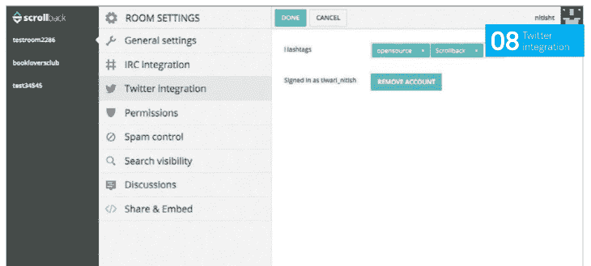

###### 08 Twitter 集成

Scrollback 提供与您的 Twitter 账户的紧密集成。您可以监视话题标签，直接从聊天窗口发送推文，甚至通过推文分享您的聊天室。让我们来看看如何实现这些功能。首先，前往 **Twitter 集成** 选项卡，输入您想要监视的话题标签，标签之间用空格分隔，然后点击 “Sign in to Twitter” 按钮。接着，在 Twitter 窗口中登录并查看权限 – 就这样。现在，您可以在聊天室内部看到所有包含您想要监视的话题标签的推文。

如果聊天室中有您想要推特的消息，只需将鼠标悬停在消息上，页面最右侧会显示一个菜单图标。然后点击此图标以显示不同的选项 – 您可以选择推送该消息或隐藏它。要通过推文分享您的房间，前往 “Share & Embed” 选项卡，并点击 “Share your room” 下方的 Twitter 按钮。

###### 09 管理功能

您可以在 “General settings” 选项卡下设置房间描述。由于 Scrollback 采用对搜索引擎友好的方式设计，正确设置描述非常重要。“Permissions” 选项卡允许您决定谁可以在您的聊天室中发帖。您可以选择任何人，或者仅限于已登录用户或聊天室的关注者。

聊天室管理员面临的主要顾虑之一涉及垃圾信息发送者和辱骂行为。Scrollback 使管理员能够轻松控制这些问题 – 只需在 “Spam Control” 选项卡下启用 “Spam Control” 按钮，Scrollback 会自动阻止垃圾信息发送者在您的群组中发帖。在同一选项卡中，您还可以设置屏蔽词列表。如果您启用 “English abusive words” 选项，则仅屏蔽预定义的词汇。您可以通过在 “Custom blocked phrases/words” 文本区域中输入辱骂性词汇来添加屏蔽列表。现在，即使有人在聊天室中键入辱骂性词汇，其他人也看不到。

> “可能会发生不同的人讨论不同的事情。如果你关注 IRC 频道，在那里这是一种非常常见的场景”

###### 10 讨论

聊天室中的一个主要问题是跟踪讨论。一个房间通常有很多处于不同时区的人。可能会发生不同的人并行讨论不同的事情 – 如果你关注 IRC 频道，在那里这是一种常见的场景。在这种情况下，很难跟踪或获取有意义的信息。如果您尚未注意到，Scrollback 以一种简单但有效的方式解决了这个问题。只需前往 “Discussions” 选项卡并启用 “自动将文本分组为讨论”。现在，Scrollback 会根据聊天消息中的单词和输入者自动分隔讨论。在任何时候，任何用户都可以通过点击聊天窗口中的 “Start a discussion” 来创建讨论。所有讨论都归档在左侧的 Discussion 选项卡下。要查看其中一个，只需点击讨论名称 – 聊天窗口会以有用的彩色编码格式显示该讨论下的所有消息。

上方：将 Twitter 话题标签添加到您的设置中，以便在聊天室内部查看相关推文

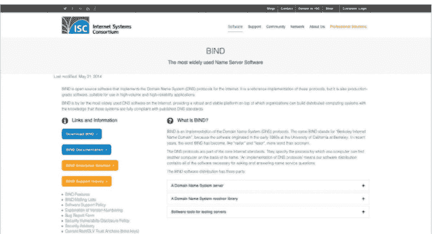

上方：请访问 bit.ly/strkibv 查看关于 BIND 的文档

# 使用 BIND 创建用于查询请求的缓存 DNS 服务器

通过运行您自己的缓存 DNS 服务器来减少网络流量并更快地处理 DNS 请求。

## 资源

- **BIND 主页**
  www.isc.org/software/bind
- **RFC 1034, 域名**
  tools.ietf.org/html/rfc1034
- **RFC 5936, AXFR**
  tools.ietf.org/html/rfc5936

**DNS（域名系统）是将人类可读的字符串转换为 IP 地址（反之亦然）的东西 – 当它不能正常工作时，您无法浏览互联网或获取电子邮件。** 称为 DNS 服务器或 simply name servers 的机器支持域名系统。这些机器除了运行支持 DNS 的特殊服务器软件外，没有任何特别之处。网络设备必须至少有一个配置正确的 DNS 服务器才能正常运行，但为了增加冗余性，您应该使用更多的 name servers 以确保网络设备在任何问题下都能运行。Name server 始终应以其 IP 地址列出。DNS 区域是其管理权被委托的域名的一部分。因此，.co.uk 域有很多区域。.co.uk 域管理员委托所有子域的管理权是非常合理的，否则它将不得不管理所有的 .co.uk 子域，如您所想，这些子域数量众多。

## 01 安装 BIND

BIND 代表 Berkeley Internet Name Domain，是 DNS 协议的一种实现。在 Debian 7 系统上，您可以通过运行以下命令安装最新版本的 BIND：

```bash
# apt-get install bind9
```

要找到您的 BIND 版本，请执行以下命令：

```bash
# named -v
BIND 9.8.4-rpz2+1005:12-P1
```

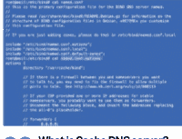

## 02 什么是缓存 DNS 服务器？

仅缓存 DNS 服务器不包含关于域的信息；它仅包含基于其已经执行的 DNS 查询结果的信息。DNS 缓存之所以工作良好的主要原因是 DNS 数据不经常更改。

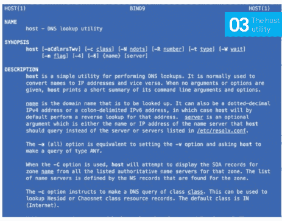

## 03 host 实用程序

Host 产生干净的输出，这是喜欢它的主要原因 – 它可以轻松地在 shell 脚本中使用。它的最后一个参数，是可选的，是查询的 DNS 服务器的名称。如果没有提供，它使用 /etc/resolv.conf 文件来查找 DNS 服务器。

使用 -mx 参数时，host 显示域名或子域的邮件服务器：

```bash
# host -mx linuxuser.co.uk
linuxuser.co.uk.mail is handled by 10
mail.imagene-publishing.co.uk.
linuxuser.co.uk.mail is handled by 20
mail2.imagene-publishing.co.uk.
```

您在 “handled by” 之后看到的数字是指示邮件交换器优先级的偏好值。单独的偏好值并不重要。重要的是它与其他值的关系。

邮件服务器应首先尝试投递给具有最低值的邮件交换器。如果由于某种原因投递失败，则具有下一个最高值的邮件交换器将被尝试。如果两个或更多邮件交换器具有相同的偏好值，则邮件服务器决定选择哪一个。主 DNS 服务器负责为域名或子域定义电子邮件服务器。

使用 -t ns 参数时，host 显示域名的 DNS 服务器。

## 04 dig 实用程序

dig 实用程序可以显示与 host 相同的 DNS 相关信息，但是，dig 的默认输出信息更丰富。为了在 dig 的帮助下找到 .co.uk 域的 DNS 服务器，您可以通过执行以下命令来实现：

```bash
$ dig co.uk ns
```

尝试使用 dig 执行 AXFR 查询失败：

```bash
$ dig @localhost co.uk axfr
```

```text
<<> DiG 9.8.4-rpz2+1005:12-P1 <<> @
localhost co.uk axfr
(2 servers found)
; global options: +cmd
; Transfer failed.
```

AXFR 是一种在 DNS 服务器之间复制 DNS 数据的机制，但它也可以用于恶意目的。DNS 管理员负责允许特定机器访问 AXFR 协议，并限制世界其他地方的访问。

## 05 /etc/resolv.conf 文件

查看您的 DNS 配置的最快方法是查看 /etc/resolv.conf 文件，在那里您可以看到每个使用的 DNS 服务器的 IP 地址；每个条目都以 nameserver 关键字开头。使用 IP 地址以外的任何内容作为 DNS 服务器都没有意义。通常，管理员在设置 Linux 机器时处理此文件；否则，当您的 Linux 机器使用 DHCP 获取网络配置时，文件会被填充。


# 技巧 | 窍门 | 黑客手段 | 应用程序

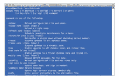

## 06 rcdc 实用程序

rcdc 可执行文件是名称服务器控制实用程序。它控制名称进程的操作，并通过 TCP 连接与 named 进程进行通信。rcdc 实用程序拥有一个名为 rcdc.conf 的配置文件，其结构和语法与 named.conf 相似。您可以输入 `man rcdc-confgen` 和 `man rcdc.conf` 以获取更多信息。

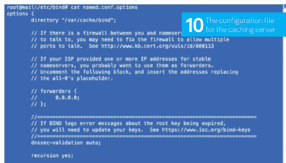

## 07 其他类型的 DNS 服务器

还有另外三种类型的 DNS 服务器：主服务器、从服务器和转发服务器。每个域名至少应有一个主 DNS 服务器和一个从 DNS 服务器。

主 DNS 服务器（或 Master）定义了一个或多个区域文件，该 DNS 服务器对这些区域具有权威性。区域是通过 NS 资源记录分配给 DNS 服务器的。

从 DNS 服务器（Slave）主要充当主 DNS 服务器的备份，以防其因某种原因宕机。

转发 DNS 服务器从客户端的角度来看与缓存服务器几乎相同。其区别在于它本身不执行递归查询；它只是将查询转发到另一个 DNS 服务器，获取响应，然后缓存结果。

无法从查询结果中判断它是从区域主服务器还是从服务器获得回答的。

## 08 /etc/bind 目录

所有与 BIND 相关的配置文件都位于 /etc/bind 目录内。您需要 root 访问权限才能对其进行修改，并且必须重启 named 进程以使更改生效。

BIND 在 `/var/cache/bind` 目录内保存其他一些文件：

```bash
$ ls -l /var/cache/bind/
total 24
-rw-r--- 1 bind bind 698 Oct 15 09:46 managed-keys.bind
-rw-r--- 1 bind bind 512 Oct 15 09:46 managed-keys.bind.jnl
-rw-r--- 1 bind bind 9446 Oct 15 11:17 named_dump.db
-rw-r--- 1 bind bind 1103 Oct 14 19:58 named.stats
```

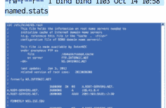

## 09 /etc/bind/db.root 文件

db.root 文件保存了根名称服务器（由单个点表示）的信息，这些信息用于初始化互联网域名服务器的缓存。您可以通过运行以下命令手动生成它：

```bash
$ dig @root-servers.net . NS > db.root
```

## 10 配置文件

默认的 BIND 配置几乎已准备好支持缓存 DNS 服务器。您只需要显式开启递归，一切就完成了。此操作可以通过在 `named.conf.options` 内部添加一行包含 `recursion yes;` 文本的内容来完成。

接下来的步骤是运行 BIND 服务器进程，如下所示：

```bash
# /etc/init.d/bind9 start
```

您还需要添加访问控制列表以减少流量并提高安全性，您将在稍后的步骤 16 中更多了解访问控制列表。DNS 服务通常监听端口 53，您从以下输出中可以清楚地看到：

```bash
$ telnet localhost 53
Trying ::1..
Connected to localhost.
```

## 11 管理缓存 DNS 服务器

您已经知道如何启动 DNS 服务器。以下命令将其停止：

```bash
# /etc/init.d/bind9 stop
```

然后，此命令将其重启：

```bash
# /etc/init.d/bind9 restart
[ ... ] Stopping domain name service...
bindingwaiting for pid 24713 to die
[ ok ] Starting domain name service...
bind9.
```

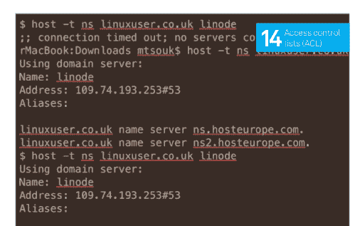

就本教程而言，最有用的实用程序是 **named-checkconf**，它检查配置的正确性。如果当前配置中没有语法错误，您将不会得到任何输出。没有工具能捕捉逻辑上的 DNS 错误。

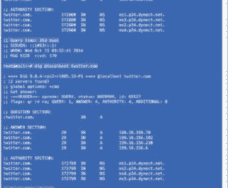

> BIND 的所有日志消息都存储在 /var/log/syslog 中

## 12 使用缓存 DNS 服务器

缓存服务器像普通 DNS 服务器一样使用。如果您想减少局域网上的 DNS 流量，应将缓存服务器的 IP 放入 */etc/resolv.conf* 文件中，并注释掉所有其他 DNS 服务器。然而，这可能很危险，因为如果缓存 DNS 服务器因某种原因停止工作，您的网络将无法正常运行。

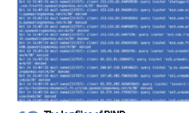

```bash
host -t ns linuxuser.co.uk linode
;; connection timed out; no servers can be contacted
rMacBook:Downloads mtsouk$ host -t ns linuxuser.co.uk linode
Using domain server:
Name: linode
Address: 109.74.193.253#53
Aliases:

linuxuser.co.uk name server ns.hosteurope.com.
linuxuser.co.uk name server ns2.hosteurope.com.
$ host -t ns linuxuser.co.uk linode
Using domain server:
Name: linode
Address: 109.74.193.253#53
Aliases:

Host linuxuser.co.uk not found: (SERVFAIL)
```

## 13 BIND 的日志文件

BIND 的所有日志消息都存储在 */var/log/syslog* 文件中。**named** 命令可能会产生大量的日志消息，因此您可能会决定在确保 DNS 服务器无问题运行后，使用 **rndc** 降低日志级别。

## 14 访问控制列表 (ACL)

ACL 列表定义了哪些主机可以或不可以访问 DNS 服务器。以下行定义了一个新的访问控制列表：

```
acl OIENET {
    2.86/16;
    localhost;
    localnets;
};
```

列表的定义不会自动激活该列表。您应该添加以下行以启用 OIENET 访问控制列表：

```
allow-query { OIENET; };
```

一旦 DNS 服务器开始运行，许多未知主机会尝试连接；因此，不要延迟生成所需的访问列表以保护您的 DNS 服务器。

## 15 检查您的配置

BIND 附带了许多可以帮助您检查当前配置正确性的工具。这些工具包括 **named-checkconf**、**named-checkzone** 和 **named-compilezone**。

## 16 测试缓存 DNS 服务器

为了测试您的 DNS 服务器，请尝试查询一个不在 DNS 缓存中的域名，并查看回答该查询需要多少时间。接下来，再次询问同一 DNS 服务器，您应该看到响应时间明显变好。

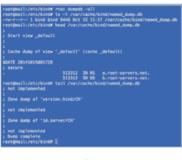

## 17 缓存服务器的优势

在网络上使用缓存 DNS 服务器的优点是减少局域网流量和互联网流量。对于已经被缓存服务器回答过的查询，您也能更快地获得 DNS 响应。

BIND 有一个方便的命令，可以将 DNS 服务器的所有记录转储到单个文件中。启动时它还可以重新读取这些数据：

```bash
# rndc dumpdb -all
# ls -l /var/cache/bind/named_dump.db
-rw-r--r-- 1 bind bind 9448 Oct 15 11:15 /var/cache/bind/named_dump.db
```

# 技巧 | 窍门 | 黑客手段 | 应用程序

## 编程客户端-服务器应用程序

每个操作系统都提供其自己的网络 API 集合，但 Qt 提供了一个简化创建“爱说话”应用程序的解决方案


**现代计算机网络由多种协议组成。** 手工创建格式正确的数据包几乎是不可能的——协议栈及其底层网络硬件会影响格式。

**在 Unix 上工作的工程师**通过引入一个抽象层解决了这个问题——所谓的**套接字**充当两个本地或远程应用程序之间的端点。开发人员使用标准化接口向套接字发出命令，这些命令随后被翻译到网络中。

处理套接字时，具备基本的网络知识是有好处的。目前，只需定义消息可以通过两种高级协议传输即可。

**TCP** – 传输控制协议的缩写 – 在数据成功交付时提供确认。这是通过相对复杂的数据包序列实现的，这增加了通信过程的开销。然而，某些应用并不要求这一点。对于这些应用，**UDP** 提供了一种更简洁的通信协议，放弃了交付确认。在网络中，计算机通过其 IP 地址来识别。单独的服务然后通过其端口号来识别 – 可以将它们视为高层建筑内部的公寓门牌号。

**从事通信软件开发的开发人员**往往面临先有鸡还是先有蛋的局面 – 如果没有编写服务器，客户端就无法连接。另一方面，缺少客户端意味着服务器无法测试。

在实际项目中，您应该首先创建客户端和服务器将交换的消息的粗略模型。不需要第一次就做到 100% 正确；大多数协议在实现过程中会发生变化。

我们的指法练习级应用程序不需要这种级别的复杂性。只需从创建一个名为 ImagineITCPServer 的命令行项目开始就足够了。Qt Creator 不会将网络模块添加到新创建的应用程序中。这可以通过打开其 .pro 文件并调整 QT 指令以在编译时包含网络来轻松解决。

```
QT += network
```

这样一来，就该创建服务器对象了。其声明可以放在负责程序启动的 main() 函数内部：

```cpp
myServer=new QTcpServer();
if(myServer->listen(QHostAddress::Any, 1025)==false)
{
        qDebug() << "Server error" << myServer->serverError();
        return 0;
}
else
{
        qDebug() << "Server up" << myServer->serverAddress() << " ";
        myServer->serverPort();
}
```

在经典的 Berkeley 套接字编程中，服务器和客户端逻辑由套接字类的实例处理。Qt 提供了一个专用服务器，其中包含用于连接管理的辅助方法。启动后，我们调用 listen() 方法以使我们的 QTcpServer 等待传入连接。


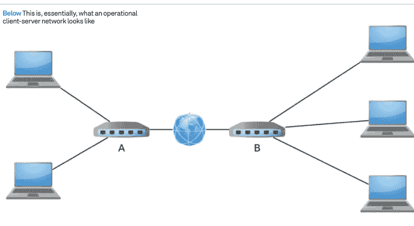

传递 `QHostAddress::Any` 会让该类监听所有网络接口——你可以通过传入特定 IP 地址来限制代码监听的范围。第二个参数负责选择需要打开的端口。

在许多 Unix 系统上，访问低于魔术数字 1024 的端口需要 root 权限——仅仅从 IDE 运行程序会导致访问错误。通过使用端口号 1025 来避免此问题。最后，调用 `QCoreApplication` 的 `exec()` 方法以启动主事件循环。

调试和部署网络相关程序可能相当复杂。例如，如果另一个应用程序已经连接到相关端口，`ImagineTCPServer` 将启动失败。

然而，可以通过选择不同的端口或关闭干扰的应用程序来解决此问题，你可以通过 `netstat` 工具找到该应用程序。

## 信号与槽

大多数网络操作都是异步运行的。像 `listen()` 这样的方法会立即返回，将实际工作委托给后台线程。对于 `QTcpServer`，传入的连接由 `newConnection` 信号通知。

## “信号只能被 QObject 的派生类处理”

信号只能被 `QObject` 的派生类处理。点击 文件 > 新建文件或项目 以打开创建向导，然后选择 C++ → C++ 类以启动类生成器。`ImagineListenerClass.h` 看起来如下：

```cpp
class ImagineListenerClass : public QObject
{
    Q_OBJECT
public:
    explicit ImagineListenerClass(QObject *parent = 0);
public slots:
    void connectionIncoming();
};
```

```cpp
QDebug() << "Client connection attempt";
```

信号-槽连接通过 `connect` 方法建立。它需要指向发送方和接收方对象的指针，实际的信号和槽需通过 `SIGNAL()` 和 `SLOT()` 宏指定：

```cpp
else
{
    qDebug() << "myServer= << "myServer->serverAddress()" << "myServer->serverPort();
    myListener=new ImagineListenerClass();
    QObject::connect(myServer, SIGNAL(newConnection()), myListener, SLOT(connectionIncoming()));
}
```

## 客户端时间

服务器端的工作暂时完成了。点击 运行 按钮以启动程序

#### 提示 | 技巧 | 窍门 | 应用

在 Qt Creator 内部，并确保保持你的控制台窗口打开。现在你可以打开一个终端窗口并输入 *netstat* -*tnlp* 来检查其功能，此时 *ImaginelTCPServer* 将会显示出来。打开第二个 Qt Creator 会话以开发客户端。创建另一个名为 *ImaginelTCPClient* 的 Qt 控制台应用程序，并修改其 .pro 文件以启用网络功能，如上所述。

> “起初，使用 TCP/IP 来连接进程听起来有点大材小用，但许多程序都是以这种方式实现的”

连接到服务器需要使用 *QTcpSocket*。它最基础的实现 *make* 仅由两行代码组成：

```cpp
QTcpSocket *mySocket;
int main(int argc, char *argv[]) {
    QCoreApplication a(argc, argv);
    mySocket=new QTcpSocket();
    mySocket->connectToHost(QHostAddress::LocalHost, 1025);
    return a.exec();
}
```

*ConnectToHost()* 是另一个异步方法，它接受两个参数。第一个指定要使用的 IP，第二个指定端口。成功的连接将通过发出信号来表示，我们将在下一步中处理该信号。目前，当我们的客户端启动时，一个正在运行的 *ImaginelTCPServer* 实例将显示一条连接尝试消息。

乍一看，使用 TCP/IP 来连接同一台机器上的两个进程听起来有点大材小用。然而，许多程序是以这种方式实现的——通过套接字处理进程间通信提供了一种安全且简单的方法，将组件相互解耦。

## 数据流

真实的网络应用交换数据，这是通过使用嵌入在套接字实例中的数据流来实现的。首先，修改 *ImaginelListenerClass* 的构造函数，以便将 *myServer* 实例提供给负责处理 *newConnection* 信号的方法。然后按照图 01 调整其主体部分。

*QTcpServer* 可以同时愉快地处理多个待处理的连接。*NextPendingConnection* 返回一个代表与选定客户端连接的套接字。我们将把它的 *disconnected* 信号连接到 *deleteLater* 槽，以确保自动消除不再需要的套接字。在下一步中，填充一个字节数组并将其发送到客户端。

Qt 的底层 *DataStream* 类会随着框架的演进而改进。指定数据格式确保使用后续版本的 Qt 构建的二进制文件可以解释套接字中提供的数据。许多应用程序使用 Qt 4.0 的格式。如果你的程序由于其他依赖关系仅限于 Qt 5 及以上版本，你也可以将此版本定义为基准。

下一步涉及对客户端的修改。插入一个类似于 *ImaginelListener* 的类来处理从套接字类发出的信号。我们的应用程序必须处理三个事件——我们需要通知用户连接成功或失败，并且必须接收从服务器发送的数据。

状态消息通过 *qDebug()* 向控制台输出相应的语句来处理（见图 02）。

接收数据更加复杂。我们的简单协议不会提前通知客户端要传输多少数据。因此，我们只是读取已接收的任何数量的数据：

```cpp
void ImaginelReceiver::dataReady()
{
    QDataStream in(mySocket);
    in.setVersion(QDataStream::Qt_4_0);
    QString thatSt;
    in >> thatSt;
    qDebug() << thatSt;
}
```

每个槽都必须连接到套接字。这应在调用 *connectToHost* 方法之前完成。在某些操作系统上，*connected* 信号在 *connectToHost* 返回之前发出（图 03）。

运行当前状态下的程序以显示来自服务器的问候消息——它将在客户端窗口中显示。*ErrorOccurred* 将被调用来告知我们的程序服务器已终止连接。

## 进一步交互

我们的服务器目前在向客户端提供友好的问候消息后就会将其踢出。一个礼貌的服务器会留下来等待回复。虽然我们可以保留当前示例中的套接字，但一旦连接了多个客户端，就会导致问题——我们将所有信号连接到一个槽，这使得难以区分不同的连接。

线程是解决此问题的便捷方案。线程是与主应用程序代码并行运行的子例程——生成线程使你的代码能够同时做多件事。添加线程就像添加一个新类，其头文件如下所示：

```cpp
class ImaginelThread:public QThread
{
    Q_OBJECT
public:
    ImaginelThread(QTcpSocket* _aSocket);
    void run();
public:
    QTcpSocket* mySocket;
};
```

实际的负载可以在 *run()* 方法中找到，该方法在生成线程后将在后台执行：

```cpp
void ImaginelThread::run()
{
    exec(); //Start event loop
}
void ImaginelThread::dataReady()
{
    QDataStream in(mySocket);
    in.setVersion(QDataStream::Qt_4_0);
    QString thatSt;
    in >> thatSt;
    qDebug() << thatSt;
    exit();
}
```

*ImaginelThread* 的唯一角色是保持运行直到发出信号。我们通过调用 *exec()* 方法来实现这一点，该方法创建一个事件循环。它会保持空闲，直到从 *dataReady* 处理器中被调用。

必须修改我们的服务器，以便在新客户端连接时启动线程（图 04）。初学者常见的错误是直接调用线程的 run() 方法。只有当调用 start() 时才能实现后台执行——它调用线程生成逻辑，然后继续执行负载。

最后，修改客户端，使其向主控端发送一些数据：

```cpp
void ImagineReceiver::dataReady()
{
    ... 

    QDataStream out(&block, QIODevice::WriteOnly);
    out.setVersion(QDataStream::Qt_4_0);
    out << QString("Hello, server!");
    mySocket->write(block);
}
```

多线程程序可能因一种称为竞态条件（race condition）的情况而表现出各种奇怪的行为。如果两个运行时同时访问共享元素，灾难就会发生。Qt 提供了多种方法（例如互斥锁）来缓解此类问题。

## 高级考虑

在互联网早期，每台计算机都有自己独立的公共 IP 地址。如今，许多甚至大多数系统都位于提供网络地址转换和/或防火墙服务的路由器层之后。

第 43 页上的图像显示了一个由通过互联网相互连接的两个本地网络组成的网络。

如果系统 A 上的网络应用程序想要连接到系统 B，必须配置路由器 B 以暴露相关端口。这通常可以在路由器的后台完成——由于每个制造商提供的用户界面略有不同，最好参考路由器（在线）手册。

## 结论

经验丰富的开发人员可以实现最复杂的协议。幸运的是，Qt 提供了现成的类来实现常用协议，如 HTTP。下次，我们将使用其中一个来创建一个小的 RSS 阅读器。

## “多线程程序可能会表现异常”

```cpp
void ImagineListenerClass::connectionIncoming()
{
    QTcpSocket *clientConnection = myServer->nextPendingConnection();
    connect(clientConnection, SIGNAL(disconnected()),
        clientConnection,
        SLOT(deleteLater()));

    QByteArray block;
    QDataStream out(&block, QIODevice::WriteOnly);
    out.setVersion(QDataStream::Qt_4_0);

    out << QString("Hello, client!");
    clientConnection->write(block);
    clientConnection->disconnectFromHost();
}
```
*图 01*

```cpp
void ImagineReceiver::anConnected()
{
    qDebug() << "Connection successful";
}

void ImagineReceiver::errorOccurred(QAbstractSocket::SocketError anError)
{
    qDebug() << "Error: " << anError;
}
```
*图 02*

```cpp
int main(int argc, char *argv[])
{
    QCoreApplication a(argc, argv);

    mySocket=new QTcpSocket();
    ImagineReceiver *myListener=new ImagineReceiver(mySocket);
    mySocket->connect(mySocket, SIGNAL(connected()), myListener, SLOT(anConnected()));
    mySocket->connect(mySocket, SIGNAL(readyRead()), myListener, SLOT(dataReady()));
    mySocket->connect(mySocket, SIGNAL(error(QAbstractSocket::SocketError)),
            myListener, SLOT(errorOccurred(QAbstractSocket::SocketError)));
    mySocket->connectToHost(QHostAddress::LocalHost, 1025);
    return a.exec();
}
```
*图 03*

```cpp
void ImagineListenerClass::connectionIncoming()
{
    QTcpSocket *clientConnection = myServer->nextPendingConnection();
    connect(clientConnection, SIGNAL(disconnected()), clientConnection,
        SLOT(deleteLater()));

    clientConnection->setParent(0);
    ImagineThread *myThread=new ImagineThread(clientConnection);
    connect(clientConnection, SIGNAL(readyRead()), myThread, SLOT(dataReady()));
    myThread->start();

    QByteArray block;
    QDataStream out(&block, QIODevice::WriteOnly);
    out.setVersion(QDataStream::Qt_4_0);
    out << QString("Hello, client!");
    clientConnection->write(block);
}
```
*图 04*


# 使用 Netcat 构建网络客户端、服务器及其他应用

> 学习如何使用 Netcat 完成创建 Web 服务器和聊天服务器等任务

- 资源
- 带有 Netcat 的 Linux 机器
- 根权限

**Netcat 是一个简单但实用的 UNIX 工具，使用 TCP 或 UDP 协议通过网络连接读取和写入数据。** 尽管它被称为 Netcat，但你也可以将其作为 nc 运行——通常，这两个命令指向同一个二进制文件。

Netcat 的大多数命令行选项在运行时不需要 root 权限。然而，根据你创建 TCP/IP 服务器时想要使用的端口号，你可能需要管理员权限来运行 Netcat，因为端口号 0-1024 受到限制，只能由 root 用户使用。作为一个通用原则，最好避免使用这些端口号并选择其他端口，前提是该端口未被其他进程使用。

Netcat 是万灵药吗？当然不是！没有一个单一的工具能解决所有问题。Netcat 有用吗？是的，这也是你应该学习如何使用它的主要原因。

## 01 安装 Netcat

你可以使用以下命令轻松在 Debian 系统上安装 Netcat：

```bash
# apt-get install netcat-traditional
```

你也可以使用 netcat-opensbd 软件包来安装 Netcat。OpenBSD 版本支持 IPv6、代理和 Unix 套接字，而这些在传统实现中是缺失的。实际上，如果你不需要这些功能，你不会注意到这两个软件包之间有任何区别。

**下方** 你可以使用 tcpdump 实用程序捕获到特定端口或从特定端口发出的网络流量

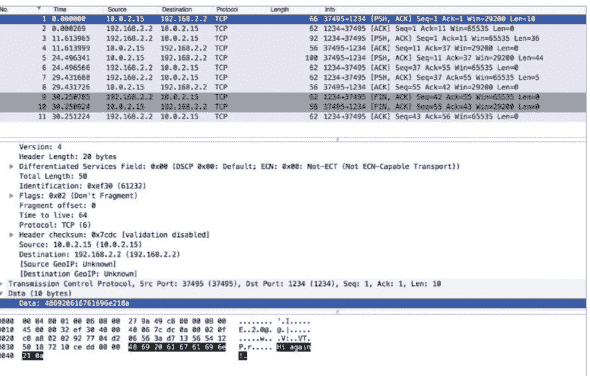

## 02 Netcat 基本用法

Netcat 命令的一般形式如下所示：

```text
$ netcat [options] host port
```

Netcat 的默认行为类似于使用 `telnet` 命令模拟的网络交互，这意味着网络连接是不安全的（即未加密的），并且默认协议是 TCP。
如果需要，你还可以使用减号在两个表示范围的端口号之间指定一个端口范围。

> “Netcat 的默认行为类似于模拟的网络交互”

## 03 作为客户端的 Netcat

Netcat 最常见的用法是作为服务器进程的客户端。这主要用于故障排查网络服务器，因为你可以看到完整交互的原始数据。以下命令将与 SMTP 服务器进行交互：

```text
$ nc linode 25
```

正如你可以猜测的，你可以提供远程主机的主机名或 IP 地址。

## 04 使用文件进行输入和输出

根据 Unix 哲学，程序的输入可以从文件中读取，输出可以捕获到文件中。输入定义为 `filename`，输出定义为 `filename`。你还可以使用 Unix 管道将输入来自其他过程的输出。


## 05 作为服务器的 Netcat

你不仅可以 Netcat 作为客户端使用，还可以用它来创建服务器！下一个命令使 Netcat 监听端口 1234 上的传入 TCP 连接：

```text
$ netcat -l 1234
```

这是由 `-l` 选项完成的，因为它告诉 Netcat 监听传入连接。端口号也在命令行中提供。

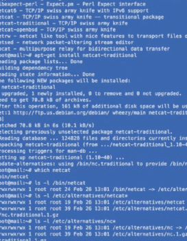

## 06 UDP 协议

默认情况下，所有 Netcat 交互都使用 TCP 协议工作。但是，如果使用 `-u` 选项指定，也可以使用 UDP 协议。这特别有价值，因为 Telnet 只能测试 TCP 服务。以下命令尝试测试使用 UDP 的 DNS 服务器：

```text
$ netcat -vv -u 8.8.8.8 53
```

如果你结合 `-l` 选项和 `-u` 选项，可以创建一个 UDP 服务器。

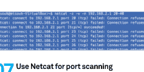

## 07 使用 Netcat 进行端口扫描

Netcat 可以用作 Nmap 的简化版本进行端口扫描。下一个命令使用 20 到 40 的端口号范围扫描 192.168.2.1 IP 地址：

```text
$ netcat -z -v -n 192.168.2.1 20-40
```

`-z` 选项告诉 Netcat 发送零数据。换句话说，Netcat 在打开连接后立即关闭它，而不进行任何实际的数据交换。`-n` 选项告诉 Netcat 禁用对给定 IP 地址的 DNS 查找。

> **上方** 你可以在此输出的顶部看到有关 Netcat 软件包的详细信息
>
> **查找问题**
>
> 正如你已经知道的那样，有许多工具可用于网络故障排查，包括 netstat、top、ifconfig、ping、traceroute、netcat、telnet 等。如果你无法使用这些软件找到并解决你所遇到的**问题**，你始终应该记住，错误的网络设备有时会导致奇怪的网络问题，因此你可能需要开始查看硬件。

## 08 文件传输

Netcat 还可以做一些其他类似实用程序根本无法做到的事情。其中一件罕见的事情就是文件传输。首先，你应该如下启动服务器部分：

```bash
$ cat fileToTransfer | nc -l 4567
```

接下来，使用后续的 Netcat 命令获取文件：

```bash
$ nc localhost 4567 > fileToTransfer
```

如你所见，你应该预先选择要传输的文件。

> “防火墙和路由器可能会导致 Netcat 在创建服务器时行为异常”

## 09 使任何进程成为服务器

Netcat 使你可以使用 `-e` 参数将任何进程变成服务器。让我们现在使 /bin/bash 成为一个服务器进程；服务器部分应该如下启动：

```bash
$ nc.traditional -vv -l -p 12345 -e /bin/bash
```

客户端部分应该如下启动：

```bash
$ nc -vv <remote_host> 12345
```

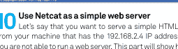

在最后一条命令之后，你可以开始执行命令，就好像你正在远程机器上工作一样。请注意，当使用不当引入安全威胁时，这种 Netcat 的功能需要非常小心。

## 10 使用 Netcat 作为简单的 Web 服务器

假设你想从具有 192.168.2.4 IP 地址的机器上提供一个简单的 HTML 页面，但你无法运行 Web 服务器。这部分将展示如何使用 Netcat 提供它而不需要 Web 服务器。首先，你需要创建一个名为 index.html 的简单 HTML 文件。然后你需要如下启动一个 Netcat 服务器：

```bash
$ netcat -l 4567
```

如果你使用 Web 浏览器访问 http://192.168.2.4:4567/，你将看到 index.html。

## 选择你的工具

当新工具行为异常时，了解多个工具总是有用的。Ubuntu 核心团队推荐此命令及其版本号。他们的文档表明，它不容易使用，有时你会寻找正确的工具。ncat 的代码中有一个最近的缺陷。最佳实践是尝试能够完成你的工作的特定工具。但在转向 Windows 工具之前，我们将检查顶级命令。

## 11 详细输出

Netcat 可以生成更丰富的输出以在故障排查时帮助你。你应该使用 `-v` 命令行参数使 Netcat 给出更详细的输出。使用 `-vv` 而不是仅 `-v` 会给出大量的详细输出，这非常有用。


## 12 故障排查 Web 服务器

HTTP 服务只是一个 TCP 服务，因此 Netcat 可用于从 Web 服务器获取数据。此命令向 Web 服务器发起连接：

```bash
$ netcat www.linuxuser.co.uk 80
```

为了获得一些输出，你应该先输入 GET / HTTP/1.1，然后按 Enter 两到三次开始看到信息。或者，你可以始终使用以下单行方法，这不需要你输入任何额外的内容：

```bash
$ echo -en "GET / HTTP/1.0\r\n\r\n" | netcat www.linuxuser.co.uk 80
```


## 13 使用 Netcat 创建聊天服务器

通过创建聊天服务器，你可以让来自相同或不同机器的两个用户彼此交谈。你应该如下启动服务器部分：

```bash
$ netcat -l 1234
```

想要连接到服务器的每个客户端必须执行以下命令：

```bash
$ netcat -vv localhost 1234
```

只有两台机器可以同时在参与：服务器和一个客户端。如果第二个客户端尝试连接而另一个已经连接，第二个客户端将显示以下错误消息：

```text
netcat: connect to localhost port 1234 (tcp) failed: Connection refused
```


## 14 使用 Netcat 测试网络速度

这是 Netcat 一个相对棘手的应用场景，但当你没有其他工具来测试两台机器之间的网络速度时，它非常方便。为了让此功能正常工作，你必须使用 `netcat-traditional` 软件包。

现在，在服务器机器上，你需要执行以下命令：

```
$ time nc -l -v -n 2222 >/dev/null
```

在客户端机器上，执行下一条命令，并在大约 15 秒后按下 Ctrl+G 使其停止：

```
$ time nc -v -n 192.168.2.4 2222 >/dev/null
```

使用 **bc** 工具，你可以发现网络速度约为每秒 **1,108,087** 字节，这对于 10Mb 无线网络来说是绝对完美的。

## 15 使用 Netcat 传输整个目录

你已经学会了如何使用 Netcat 传输单个文件。现在，你将学习如何使用 Netcat 和 **tar** 命令的帮助来传输整个目录。服务器部分如下：

```
$ tar -cvf - directory | nc -l 1234
```

客户端部分应如下所示：

```
$ nc localhost 1234 | tar -xvf -
```


## 16 使用 Cryptcat 加密 Netcat 连接

以明文传输数据并不安全，可能会导致问题。如果你需要加密，请使用 Cryptcat，它是 Netcat 的一个轻量级版本，包含 Twofish 加密。在 Ubuntu 系统上，按如下方式安装：

```
$ sudo apt-get install cryptcat
```

现在，你可以开始使用 Cryptcat 了。服务器部分看起来像这样：

```
$ cryptcat -k passphrase -l -p 12345
```

客户端部分应运行以下命令：

```
$ cryptcat -k passphrase localhost 12345
```


如果在 **-k** 参数后给出错误的密码，连接将自动终止。如果你想确定你的数据确实被加密了，你可以使用 Wireshark 或 Tcpdump 等工具来嗅探并查看结果。

## 防火墙和路由器问题

防火墙和路由器在使用 -4 参数创建服务器时可能会导致 Netcat 行为异常。难点在于路由器或防火墙可能未启用发夹（hairpin）连接。当源地址和目的地址都位于 NAT 之后时，路由器或防火墙不会建立连接。结果是，机器不会监听指定端口，而是使用任意端口。


## 18 使用 tcppow 捕获网络数据

如果有很多事情正在发生，而你无法找出实际问题所在，请向 Tcppow、Topdump 和 Wireshark 寻求帮助。Tcppow 是一个命令行工具，帮助你检查网络数据。以下命令显示来自或发往端口号 1234 的网络数据：

```
$ sudo tcppow -i any -c -J port 1234
```

如果你无法用 tcppow 解决问题，请用 topdump 捕获你的数据，并用 Wireshark 处理它。

## 你不需要 Dropbox 就能通过网络传输文件夹

# 切换到 btrfs 文件系统

探索如何设置并使用下一代文件系统 btrfs 的所有强大功能。

ext3 和 ext4 文件系统长期以来一直是 Linux 的主力——非常标准的基于分区的文件系统，具有一些不错的碎片整理策略。它们被桌面发行版和服务器广泛使用，甚至在某些发行版喜欢创建的 LVM 内部也是如此。

不过总会出现新的挑战者，在过去几年里，Fedora 一直在拼命尝试让 btrfs 成为该发行版的默认文件系统。它被认为是 Linux 文件系统的下一步，并具有一些出色的功能，使其成为 Linux 演变的完美选择。

btrfs 具有在自身内部创建子分区的能力（比 LVM 更容易管理）、一定程度的回滚功能、针对其自身定制的高级压缩和碎片整理工具等，它将彻底改变我们使用存储的方式。在本教程中，我们将向你展示如何领先于潮流。

## 资源

- Gparted: http://gparted.org
- btrfs-tools


### 01 找到合适的工具

第一步是安装合适的设置工具。虽然内核支持它，但并非每个发行版都默认持有用于管理它的正确软件包。在 Debian 和 Ubuntu 发行版中，使用以下命令安装：

```
$ sudo apt-get install btrfs-tools
```

### 02 格式化分区

安装好工具后，如果你想使用 gparted，可以在你的系统上设置 btrfs 分区。启动它并导航到你要格式化的设备。你可以重新格式化现有分区，或者改为创建一个较小的 btrfs 分区。


### 03 进入终端

工具安装好后，你也可以在终端中执行此操作。打开终端，如果需要弄清楚系统中分区和硬盘的名称，请使用 `fdisk -l`。完成后，使用以下命令创建你的 btrfs 分区：

```
$ mkfs.btrfs /dev/sda
```

> “别忘了，你始终可以查看 btrfs 分区和硬盘的详细信息”

### 04 创建 RAID

由于 btrfs 存储数据的方式，其最佳用途之一是使用类似的技术将一系列硬盘放入 RAID 0 中。目前，请在终端中执行以下操作：

```
$ mkfs.btrfs /dev/sdb /dev/sdc /
```

### 05 获取文件系统详细信息

万一你忘记了，你始终可以查看 btrfs 分区和硬盘的详细信息。这也适用于数组中的单个硬盘，这就是为什么我们在上一步中提到了 RAID。在终端中，使用：

```
$ btrfs file system show /dev/sda
```

### 06 挂载文件系统

在大多数现代发行版中，你可以轻松点击几下就挂载 btrfs 系统。但是，如果你想手动执行并将其放置在文件系统的特定部分，你可以通过类似以下方式在终端中简单完成：

```
$ mount -t btrfs /dev/sdb ~/btrfs
```


### 07 创建子卷

你可以在 btrfs 内创建子卷，它们可以拥有不同的挂载选项和挂载点，并且仅在需要时才使用空间。使用以下命令在终端中创建一个：

```
$ btrfs subvolume create btrfs/subvolume1
```

### 08 创建分区

我们已经创建了硬盘、小型 RAID 和子卷，但你也可以使用类似之前的方法创建 btrfs 分区。进入终端，使用类似以下命令将分区转换为 btrfs：

```
$ mkfs.btrfs single /dev/sdb2
```

### 09 授予权限

由于硬盘、分区和子卷的创建方式，你需要使用 root 账户访问它们才能正确使用。我们可以使用以下命令赋予它们普通权限：

```
$ sudo chown 777 /btrfs/
```


> “如果你在做硬件 RAID，让元数据具有冗余性可能很有用”

### 10 RAID

你可以使用 btrfs 创建不同类型的 RAID 设置——默认情况下它会执行 RAID 0，但它也支持 RAID 1、RAID 10 (1+0)、RAID 5 和 RAID 6。选择使用哪种 RAID 取决于个人喜好以及你为维护设置投入了多少精力。

### 11 RAID 1

RAID 1，其中数据在磁盘间复制以实现冗余，可以使用创建 btrfs 跨多个磁盘时使用的命令的修改版本在 btrfs 上创建。-d 选项指的是数据将如何使用。

```
$ mkfs.btrfs -d raid1 /dev/sdb /dev/sdc
```

### 12 使用非冗余元数据

如果你在做硬件 RAID，让元数据具有冗余性可能很有用——否则如果元数据损坏，你可能会丢失数据。这需要 -m 选项，并且可以与 'single' 或 RAID 0 一起用于单个硬盘：

```
$ mkfs.btrfs -m raid0 /dev/sdb /dev/sdc /
```

### 13 RAID 10

RAID 10 的基本镜像和条带化非常适合大型数据存储库和冗余环境。我们可以使用 -m 和 -d 两个选项来指定我们希望元数据和数据都正确实现冗余：

```
$ mkfs.btrfs -m raid0 -d raid10 /dev/sdb \
/dev/sdc /dev/sdd /dev/sde
```

### 14 查看不同的选项

-m 和 -d 的选项允许你进行一些高级设置。你可以通过执行 `-d single /dev/sdb /dev/sdc` 来创建 btrfs JBOD (Just a Bunch Of Drives)。你还可以让元数据非冗余而数据冗余，使用 `-m raid0 -d raid1 /dev/sdb /dev/sdc /dev/sdd`。如你所见，还有许多其他适合你的方式。


#### 提示 | 技巧 | 窍门 | 应用


### 15 RAID 5 和 6

RAID 5 和 RAID 6 是极好的概念——它们将条带化和镜像混合使用并跨越多个驱动器，从而可以在确保硬盘故障安全性的同时，将高达 75% 的空间用于存储。与具有相同冗余度的标准 RAID 10 相比，这在理论上提供了更多的存储空间。而 RAID 6 虽然增加了冗余度，但将五个驱动器的总存储容量降低至其满容量的 60%。

虽然 btrfs 支持 RAID 5 和 6，但仍存在 bug，而且即使在最佳状态下，RAID 5 和 6 也可能令人头疼。有关 btrfs 中 RAID 5 和 6 的更多详细信息，请访问文档 https://btrfs.wiki.kernel.org/index.php/RAID6。

### 16 创建快照

btrfs 写入数据的方式意味着，只要还有可用空间，被修改数据的旧版本就会一直存在——这意味着你可以将文件“回滚”到某个特定的时间点。此外，你还可以创建子卷的快照，这些快照具有更持久的性。

### 17 添加子卷备份

要创建此快照，请回到终端，并确认你知道子卷的位置。快照将在 btrfs 分区中创建，但最好将其放在与原始子卷 subvolume1 不同的位置，以避免混淆：

```bash
$ btrfs subvolume snapshot btrfs/subvolume1 btrfs/snapshot-1
```

### 18 包含回滚快照

单独的快照可以独立挂载，你还可以用较旧的版本替换较新的版本。首先，你需要列出子卷现有的快照，你可以在终端中执行以下操作：

```bash
$ btrfs subvolume list btrfs/subvolume1
```

### 19 设置默认值

记下快照的 id（在我们的例子中为 258），然后使用以下命令将其设置为 subvolume1 的默认值：

```bash
$ btrfs subvolume set-default 258 btrfs/
```

然后卸载并重新挂载该子卷，以使更改生效。

### 20 解决碎片整理问题

由于 btrfs 写入文件的方式（我们在前面的步骤中已概述），这可能会导致严重的碎片化。这是一个众所周知的问题，因此 btrfs 内置了一个即使在卷已挂载时也能工作的碎片整理工具。你可以使用以下命令调用它：

```bash
$ btrfs file system defragment btrfs/
```

### 21 未来的文件系统

有了所有这些工具，你应该已经准备好将 btrfs 作为其他文件系统的替代品来使用了。它是下一代文件系统的一个真正出色的概念，现在就开始支持它是个好主意。


#### 提示 | 技巧 | 窍门 | 应用


# 在 AWS 云端运行 Linux

## 在 EC2 上启动你自己的虚拟 Linux 实例，并免费运行一年

AWS（Amazon Web Services 的缩写）是虚拟基础设施和云服务领域的在线零售商，提供自动化的自助结账服务以及极具竞争力的低价。亚马逊这种按需付费的企业级基础设施服务模式深受注重成本且渴望高性能的用户欢迎——从需要按需扩展的网站所有者，到只需使用几小时 Linux 主机的软件开发人员和 Linux 管理员。在 AWS 上，没有长期承诺——你只需为实际使用付费。与传统的数据中心相比，成本可节省高达 72% 甚至更多，难怪 AWS 迅速成为业界的热点。全球分析公司 Gartner 估计，AWS 在全球市场中占据了令人震惊的 85% 份额。可以说，亚马逊云最重要的特性并非其庞大的规模，而是其 affordability（可负担性）。亚马逊为每个新账户所有者提供首年完全免费的免费使用层（Free Usage Tier）。 https://aws.amazon.com/free. 因此，凭借其低廉的价格、无需前期投资、精细的管理控制权限以及以自己喜欢的方式运行自己基础设施的自由，AWS 已经变成了一个 Linux 占据主导地位的非开源（此处应为开源或开放）堡垒。

- **Web 浏览器**
- **电话号码**
- **电子邮件地址**
- **信用卡号**
- **SSH 客户端**（可选但推荐）


### 01 创建新的 AWS 根账户

要开始使用 AWS，请在 Web 浏览器中访问 https://aws.amazon.com 并点击“创建免费账户”。此时，你可以使用现有的亚马逊凭证登录，但这并不总是个好主意。如果你将来需要终止你的 AWS 账户，你也将失去作为在线零售商的亚马逊账户的访问权限。因此，出于安全考虑，大多数用户更喜欢使用另一个电子邮件地址注册，以防未来发生任何意外。

### 02 完成注册流程

在注册过程中，AWS 会要求你提供联系方式，包括电子邮件地址、电话号码和信用卡号。亚马逊随后将通过自动电话验证你是人类。你的信用卡号用于确认你作为付款人的身份，亚马逊会将其存档。只要你仅使用免费额度范围内的服务，你的卡片在任何时候都不会被扣费。

注册过程会创建一个 AWS 根账户，该账户授予你访问所有 AWS 基础设施服务的权限。它与 Linux 系统上的根账户无关，尽管底层概念非常相似。

除了下一步的初始登录外，请勿使用你的 AWS 根凭证进行账户管理工作。

### 03 登录你的 AWS 根账户

亚马逊基于浏览器管理界面——AWS 管理控制台——是你 AWS 基础设施和服务的主要枢纽。你可以通过下拉菜单 *My Account* 访问 https://aws.amazon.com，或者直接在此 URL 访问： https://console.aws.amazon.com。

无论哪种情况，请使用你 AWS 根账户的凭证（你的电子邮件地址和 AWS 根密码）。请务必不要在公共网络或公共计算机上执行此操作，因为如果凭证被拦截，你可能会失去对整个基础设施的访问权限，但仍需承担费用。因此，亚马逊建议在初始登录后，立即创建一个权限较低的 IAM 用户用于日常与 AWS 的交互，并将其关联到 MFA 设备以实现多因素身份验证（这是一个完全属于另一篇教程的话题）。

### 04 浏览 AWS 管理控制台

毫不意外地，控制台中充斥着 AWS 术语，普及程度之高，连最强劲的用户偶尔也会对此感到难以置信。要在 AWS 云中启动 Linux 主机，你需要导航到 EC2（弹性计算云）。对于 DNS 服务和域名注册，请前往 Route 53。如果你只需要一些易于访问的存储，实际上并不需要一个 Linux 主机——而是直接前往控制台的 S3（简单存储服务）部分。到达目的地的最简单方法是使用控制台左上角的 AWS 标志，因为它可以为你提供可用服务列表的访问权限。

#### 私有 IP、公共 IP 和弹性 IP

每个 EC2 实例都有自己的私有 IP（互联网协议）。如果你希望它可以从更广泛的互联网访问，它还需要分配一个公共 IP。如果你在实例设置期间启用名为“自动分配公共 IP”的选项，亚马逊会将随机选择的公共 IP 关联到你的实例，只要该实例持续运行。如果你稍后终止实例或甚至关闭 Linux，你将自动失去对该 IP 的使用权。

如果你更喜欢使用你可以自行管理的持久 IP 地址，请在此处使用“弹性” IP 地址（EIP）。EIP 是为动态云计算设计的，是一个常规公共 IP 地址，你可以将其保留以供账户使用，然后随心所欲地分配和重新分配。


##### EBS 卷

EBS 卷的速度比实例存储慢，但提供数据持久性——即使你的 Linux 实例正在运行，你也可以挂载和卸载它们。

EBS 卷有两种不同的类型：作为磁硬盘或“高级”SSD。亚马逊提供的 SSD 属于一个性能类别——通用型或预配置 IOPS，它们根据磁盘大小以及共享存储池中其他用户的活动提供 I/O 突发性能。

具有预配置 IOPS 的 SSD 将以指定的 I/O 级别运行，但它们的价格可能相当昂贵。通用型 SSD 对于注重钱包的人来说更可能是首选。如果你在做预算规划且只需要偶尔访问，磁硬盘是一个合适的折中选择。


### 05 选择你的 AWS 区域

某些 AWS 服务，特别是 EC2，要求你选择一个 AWS 区域。区域是一组相互连接的数据中心，称为 AWS 可用区，具有共同的税务管辖范围和相同的价格。你可以利用九个 AWS 区域中的任何一个，而不仅仅是你的默认区域，并将它们组合起来以满足你的需求。通常，你会选择成本效益最高的一个，或者组合几个距离最终用户位置最近的区域以最小化延迟。重要的是要记住，你的 EC2 仪表板仅显示你当前所选区域中正在付费的基础设施。这是 AWS 的一个常见陷阱：在错误区域的仪表板中观察资源消耗，因此请小心。

### 06 启动新的 EC2 实例

导航到 AWS 管理控制台的 EC2 部分。界面的这部分为你提供对各种基础设施服务的访问权限，使你能够在 AWS 云中构建和运行自己的 Linux 机器，即所谓的 Linux EC2 实例。

每个 EC2 实例代表一个在虚拟化环境中运行的主机，与其他虚拟机隔离，这使得它具有极高的成本效益并且相对安全。为了在云中启动你自己的 Linux 服务器，请在 EC2 仪表板中点击“启动实例”。你也可以点击 AWS 管理控制台左侧导航栏中的“实例”链接，然后点击“启动实例”按钮。

### 07 选择基于 Linux 的 AMI

实例的存储配置是使用一种称为 AMI（亚马逊机器镜像）的机器定义来描述的。AMI 指定了启动卷的内容等。从“快速入门”部分的列表中选择一个基于 Linux 发行版的 AMI 作为你的选择（而不是数据库实例，Amazon RDS 实例不授予你操作系统级别的超级用户访问权限）。标记为“免费层符合条件”的实例只要你在账户首次注册后的前 12 个月内保持在每月最多 750 小时的时间分配之内，就不会产生任何费用。

网络。最好是在虚拟私有云（VPC）中启动 EC2 实例，这是一种通过智能路由将你的实例与其他用户的实例隔离的方式。较旧的 AWS 账户可能还提供标记为“EC2-Classic”的选项，它没有这种保护，因此如果你看到它，请不要使用它。

在“自动分配公共 IP”菜单中，选择“使用子网设置（禁用）”。将 IAM 角色设置为 None，并将关机行为设置为 Stop。

如果你启用“终止保护”，AWS 将不允许你在控制台使用 Terminate 命令销毁实例，直到你移除此保护。

保持其他选项不变，点击“下一步：添加存储”。

### 08 选择实例类型

实例类型定义了你的 Linux 机器的性能特征，包括其时钟速度、可用 RAM、内部存储和网络能力。唯一符合免费使用层资格的实例类型是 t2.micro。

做出你的选择，然后点击“下一步：配置实例详细信息”。

### 09 配置实例详细信息

在下一个屏幕上，你可以选择启动多少个实例，是否希望它们是持久的（保持“购买选项”复选框未选中），它们是否应该具有访问你的 AWS 服务的特权（IAM 角色=None），并配置

### 10 附加存储

如果你需要额外的卷，你现在可以创建并附加它们。免费层涵盖高达 30GB 的通用型（SSD）存储，为你提供略低于 100 IOPS 的最大基线性能（更多信息请参阅“EBS 卷”框外说明）。

现在点击“下一步：标记实例”。

### 11 标记你的 Linux 实例

AWS 中的标签是存储有助于组织你的 AWS 资源的信息的键值对。使用标签完全是可选的。不要为此担心——如果需要，你随时可以稍后编辑标签。如果想不出什么，请点击“下一步：配置安全组”。


### 12 配置安全组

将安全组视为 AWS 防火墙的设置，指定“启用入站和出站流量的规则”。对于每个 Linux 实例，你需要为 SSH 启用来自至少一个 IP 地址（你的）的 TCP 端口 22 的入站访问。除非你在静态 IP（或 IP 范围）上，否则你可能希望启用来自任何位置的访问。如果你需要其他服务，请添加相应的规则（例如，如果你想运行 Web 服务器，则开放 HTTP 的 80 端口和 HTTPS 的 443 端口）。然后点击“审查并启动”。

### 13 创建或选择密钥对

向导会要求你创建或选择一个密钥。密码已淘汰，密钥对已成为标准。私钥是将你认证为你的 Linux 实例管理员的方式。SSH 将尝试基于 AWS 即将保存在你的实例上的 Linux 系统适当位置中的对应公钥的副本来验证你的私钥的真实性。

你可以自己生成密钥对并将公钥上传到 EC2 控制台，或者要求亚马逊为你创建密钥对，这样更快。选择“创建新的密钥对”，给它一个名称，下载私钥到你的计算机并纠正其访问权限：

```
chmod 400 /path/to/yourPrivateKey.pem
```

完成后，你可以启动你的实例。它将显示在 EC2 的 AWS 管理控制台的“实例”部分中。

### 14 为你的 EC2 实例分配 IP

除非你选择为实例自动分配公共 IP，否则它还没有公共 DNS 条目，并且从外部无法访问。点击 EC2 控制台左侧导航栏中的“弹性 IP”链接。在这里，你需要为 AWS 账户获取一个新的弹性 IP 地址（分配新地址）并将其与你的实例关联（关联地址）。

### 15 连接到你的 Linux 实例

等待你的实例通过两项健康检查并报告其状态为“运行中”。

你应该能够使用任何独立的 SSH 客户端或亚马逊提供的基于 Java 的客户端进行连接。导航到控制台的“实例”部分，从列表中选择你的实例，然后点击“连接”按钮查看说明。启动一个 SSH 客户端并输入以下内容：

```
ssh -i /path/to/yourPrivateKey.pem username@XXX.XX.XXX.XX
```

用户名通常是 ec2user 或 root，但从技术上讲，AMI 的创建者可以将其设置为任何值。如果你的初始用户名不是 root，你可以使用以下命令假设超级用户权限：

```
sudo su
```

如果你为你的实例附加了任何额外卷（除了 AMI 自带的卷），现在是格式化、挂载它们并将它们添加到 /etc/fstab 的时候了。

> “密码已淘汰，密钥对已成为标准”

# 技巧 | 窍门 | 黑客技术 | 应用

## 窍门

### 使用专家技巧让 Linux 发挥作用

- 60 持续部署 Web 应用
  - 过渡到使用 Capistrano 进行部署
- 64 在 ggplot2 中生成复杂图形
  - 使用 R 和 ggplot2 创建令人印象深刻的图表
- 68 使用 DIZmo 监控 CPU 温度
  - 将树莓派变成物联网设备
- 72 使用 LaTeX 写书
  - 排版、美化并自定义整本书
- 76 使用 Taiga 进行敏捷项目管理
  - 实施有组织的项目
- 88


## 80

技巧 | 窍门 | 黑客手段 | 应用


> “得知有几种工具、技巧和方法可以应用，以保护您的设备和数据免受窥视，这让人松了一口气。”

- **92** 简化采访和转录：使用 Audacity 和 VLC 让工作更轻松
- **96** 保护你的树莓派：通过这些技巧保护你的数据
- **80** 用 Python 制作视觉小说游戏：创建并玩一个书-游戏混合体
- **84** 给你的树莓皮“充电”：增强你的 Pi 性能
- **88** 使用 MediaGoblin 托管媒体库：分享视频、照片、音频等


## 92

### 无论你在哪里部署应用，Capistrano 都能轻松将 Rails（和其他平台）部署到 *nix 服务器

### 诸如在生产环境后添加 QA 暂存环境等更改（使用 qa.rb），凭借其模块化结构既可行又简单


Capistrano 基于 Ruby 构建，最初是为 Rails 设计的，因此非常适合部署其他 Web 平台。Capistrano 的灵活性和强大功能可能意味着大量的配置，但操作相对直接明了。

### 使用 Capistrano 持续部署 Web 应用

### 无痛地将 Web 应用的开发版本从暂存和测试环境迁移到数据库和 Web 服务器的部署环境

## 资源

- Ruby >= 1.9（RbENV 使其更容易）
- git: www.git-scm.com
- Capistrano 3: www.capistranorb.com

Capistrano 自动化了将 Web 应用部署到你的服务器的过程，处理那些繁琐的任务，例如在任何拥有 SSH 访问权限的机器上运行一系列远程命令。Capistrano 的主要配方是 deploy，包含诸如 rollback（回滚）等任务，这些任务由命令组组成。服务器被赋予角色：app – 应用服务器，web – Web 服务器，以及 db – 数据库服务器。在这个（可扩展）框架内，调整 Capistrano 的配置文件以适应你的特定应用和服务器集合非常容易。基本的设置很简单，但 Capistrano 3 是一个灵活的框架，如果你想充分利用它，你需要超越这个简单的介绍。

你需要一个较新版本的 Ruby、Git（外加一个 GitHub 账户）以及你正在开发的 Rails 项目。此外，rbenv 使操作 Rails 变得更简单，capistrano-rbenv 确保 Capistrano 使用正确版本的 Ruby 进行部署。无论你使用 Passenger、Unicorn 还是 Puma 作为应用服务器都没关系，但请注意，有 Capistrano 插件可以帮助处理所有这些额外的任务。在 rubygems.org 上搜索完整的选择。


##### 01 安装 Capistrano

本质上，Capistrano 通过 SSH 将你的应用从 Git 复制到你的服务器，并处理如果你手动移动文件时必须执行的所有操作。Capistrano 将处理任何数据库迁移、文件和文件名的变更、重启 Web 服务器等。安装 Capistrano 以及那个很好的附加包非常简单：

```ruby
gem install capistrano
```

如果有问题，请检查你的 Ruby 安装。你在其他地方可能看到的 capistrano-ext gem 不再必不可少，因为像额外暂存选项这样的功能已整合到主代码库中。

##### 03 在服务器上

在你的服务器上，你需要一个类似的 rbenv、Git 以及你选择的 Apache 或 Nginx 环境。使用 rbenv 获取最新的 Ruby（或者如果你的应用合适，获取较早版本）：

```bash
rbenv install --list
rbenv install 2.1.3
```

你不需要诸如 Ruby 文档等不必要的软件包，因此安装 bundler 时，指定不要文档：

```bash
gem install bundler --no-ri --no-rdoc
```

更好的做法是，将以下内容放入：

```ini
gem: --no-rdoc --no-ri
```

...到 `/.gemrc` 中。你还需要根据你的设置配置数据库 - 或独立的数据库服务器。典型的 Rails 使用场景是开发人员的笔记本上使用 SQLite，生产服务器上使用 PostgreSQL。

##### 02 SSH 密钥

如果你一直使用 SSH 密码登录 Web 服务器，现在是时候生成密钥了。这样可以允许自动化登录供 Capistrano（或你想使用的任何脚本）使用 - 在任何服务器上这样做都是个好主意。如果你打算设置 GitHub 账户，你还需要为它生成密钥。开始生成密钥：

```bash
ssh-keygen -t rsa
```

...如果你 `~/.ssh` 中还没有密钥的话 - 并使用以下命令将 `~/.ssh/id_rsa.pub` 复制到服务器：

```bash
ssh-copy-id -i ~/.ssh/id_rsa.pub user@remote-host
```

...通过替换你的用户名和服务器名称或地址即可工作。

##### 04 打包 gem

对于 Rails 项目，你可以跳过安装步骤，只需编辑你的 Gemfile 以包含 Capistrano 和其他你需要的内容。你会需要更多的 gem。在你的项目 Gemfile 中：

```ruby
gem "capistrano", "~> 3.2.1"
gem "capistrano-rails", "~> 1.1.2"
gem "capistrano-bundler" # 如果你正在使用 RBENV
gem "capistrano-btm", "~> 2.0" # 如果你正在使用 Unicorn 应用服务器
gem "unicorn"
# 否则 gem "passenger" 或 "puma"
```

这也会将 bundler 与 Capistrano 集成。`bundle install` 下载 Gemfile 中指定的 gem 并安装它们。

`~> 3.2.1` 意味着当 3.2.2 发布时将被安装，但 3.3.0 不会，以避免主要版本变更破坏你的代码。


> “Capistrano 将处理任何文件和文件名的变更”


##### 05 Bundle/部署

`bundle exec cap install` 创建必要的配置文件和目录。我们在这些文件中指定 Capistrano 部署应用到暂存环境或生产服务器时执行的操作。

注意，暂存环境和生产环境默认创建，文件位于 `config/deploy` 下，如果你希望添加第三个阶段，你可以向该子目录添加一个 `.cap` 文件。或者，你可以在安装时创建所有额外的阶段。

```bash
cap install STAGES=staging,production,ci,qa
```


> “注意，暂存环境和生产环境是默认创建的”


##### 06 配置

最后一步创建了 Capfile，`lib/capistrano` 下的任务以及 `config/` 下的部署文件。从编辑 Capfile 开始，取消以下行的注释：

```ruby
require "capistrano/benv"
require "capistrano/bundler"
require "capistrano/rails/migrations"
```

...并确保上述截图末尾以 `Dir.glob` 开头的那一行存在且未注释。这一行确保 `lib/capistrano` 下方的所有 Rb 文件都被加载，包括你以后想要定义的 `lib/capistrano/tasks` 中的任何自定义任务。


##### 07 秘密信息

请记住，我们应用中的所有内容都与团队和其他任何访问我们 Git 仓库的人共享，包括暴露的密码。编辑你的 `.gitignore` 文件以添加这一行：

```text
/config/database.yml
```

现在你可以在本地以及暂存和生产环境中编辑 `/config/database.yml` 用于你的数据库。

重启你的 Rails 服务器并在 `http://localhost:3000` 检查其是否正常工作。

##### 08 准备部署

在 deploy.rb 中，在 `namespace :deploy` 之前，你应该添加一些与你的项目相关的行：

```ruby
require "bundler/capistrano"

server "37.59.xx.xx", :web, :app, :db, :primary => true
set :application, "myblog"
set :user, "richard"
set :deploy_to, "/var/www/#{fetch(:application)}"
# set :use_via, :remote_cache
# set :use_sudo, false
# repo details
set :scm, "git"
set :repository, "git@github.com:me/myblog.git"
set :branch, "master"

default_run_options[:pty] = true
ssh_options[:forward_agent] = true
set :keep_releases, 5
```

注意，这里我们只部署到一台服务器。你可能还想为你的 Ruby 环境添加一些具体内容：


##### 11 并行（Parallel）

借助 Rake 派生 DSL 中简单的 `on`/`in: parallel` 语法，轻松实现跨服务器灵活拆分任务变得易如反掌。例如，要在所有服务器上同时运行某项任务：

```ruby
on :all, in: :parallel do
  # 此处为并行任务
end
```

若要让服务器按顺序启动任务，以避免对共享数据库造成过大压力，需定义 `:sequence`，然后执行：

```ruby
on :all, in: :sequence, wait: 15 do
  # 此处为顺序代码
end
```

对于大型集群的滚动重启，你可以将服务器分组，让它们并行执行：

```ruby
on :all, in: :groups, limit: 3, wait: 5 do
  # 你的滚动重启操作……
end
```

你可以在 Capistrano 开发者的示例中看到代码在不同服务器组间的并行执行情况，该示例位于 bit.ly/1FuodCh（请查看“Parallelism”部分）。该示例专门用于替代旧版本中较为笨拙的 `parallel do :session`。

##### 12 离开 Rails

除了此处提供的简单介绍外，外部有大量的文档可供进一步学习。Capistrano 官方网站（http://capistranorb.com）应是你首先查阅的资源，但你在其他地方也能找到关于将 Capistrano 与从 Jenkins 到 Angular.js 等各种工具集成的文档——只需仔细核实以确保你阅读的内容已针对 Capistrano 3 进行更新。将 Capistrano 的持续部署脚本集成到 Jenkins 等持续集成服务器等大型环境中非常简单——以 Jenkins 为例，其中的一个任务可以将其构建步骤设为 `cap deploy`（并将其 Git 仓库作为 URL）。

在 Rails 之外，存在许多有助于简化大多数 Web 平台（从 Sinatra 到 Django）部署的 gem。对于 Drupal（配合 Drush 和 CapDrupal gem），你可以自动化以下操作：将站点下线、备份数据库、克隆新代码并将站点根目录指向新代码位置、更新数据库，以及重新上线站点，同时还可以享受 `cap deploy/rollback` 带来的所有优势。

##### 09 测试与准备

设置测试会在测试失败时阻止部署进程。

```ruby
# 位于 lib/capistrano/tasks/ 下的测试
run_tests.cap
set :tests, []
```

现在编辑 `config/deploy/production.rb` 中的 `set :server_name` 和 `server` 行，将其改为你服务器的域名。

现在我们可以准备部署了。你可以添加一个任务 `deploy:setup_config` 来安装服务器软件，在多服务器配置下这是理想的做法——但在本入门介绍中，我们保持简单，因此之前是手动设置服务器的。

##### 10 部署

现在是部署环节。我们的配置已经上紧了发条；为了启动时钟机制，我们需要执行：

```bash
cap production deploy
```

若要首次成功运行，你必须在配置上做一些额外的工作——这在很多配置环境中是必须的，超出了我们具体列出的范围。Capistrano 旨在扩展和伸缩，以涵盖各种情境，你的应用和服务器配置不会与任何人的完全相同。不过话说回来，如果你部署到大型云服务商，他们可能会提供可复制的 Capistrano 示例配置。Capistrano 的模块化和灵活性意味着有大量内容可供探索，以实现你的需求。它本质上是一个在远程服务器上并行运行任务的实用工具。

## SSHKit

Capistrano 3 的开发过程诞生了由 Lee Hambley 开发的 SSHKit 库——他在使 Capistrano 3 相比原本就已相当强大的代码成为巨大改进方面做出了大量卓越工作。SSHKit 是一个更低层的工具包，Capistrano 用它来处理日志记录、格式化、连接管理和池化、并行性以及批量执行等所有事务。你也可以使用它以结构化的方式在一个或多个服务器上运行命令。在 Capistrano 内部，你每次发出指令时大多都会调用 SSHKit。若要自行使用，请从 GitHub 页面上的示例入手，并根据你的站点进行调整。此处，SSHKit 将根据嵌套指令构建路径：

```ruby
on hosts do
  within "War" do
    puts capture("pwd")
    within "log" do
      puts capture("pwd")
    end
  end
end
```

在幕后，`File.join()` 为你处理斜杠以构建路径，它应该会返回：

```text
/var/
/var/log
```


## 技巧 | 技巧 | 窍门 | 应用

这是一张绘制在直方图上的密度图。使用图层绘图具有许多优势。


这是在第 11 步中使用的 ‘chrome.R’ 脚本的完整 R 代码。生成的图像简直令人惊叹。


此图将散点图层与平滑层结合。每个点的形状取决于 LUD 数据集中 `Linux` 变量的值。


这是本文用于展示 ggplot2 多样化能力所使用的 LUD 数据集中的格式和部分数据。


# 使用 ggplot2 生成复杂图形

被视为 S 的新版本，学习如何使用 R 和 ggplot2 包创建真正令人印象深刻的图表。

## 资源

- R 项目 *rproject.org*
- RStudio *rstudio.com*
- ggplot2 *ggplot2.org*
- 文档 *docs.ggplot2.org/current*
- RSQLite *bit.ly/1Acvkio*

R 是一个 **基于 S 的 GNU 项目，S 是著名的 AT&T 贝尔实验室开发的一种统计专用语言和开发环境**。你可以将 R 视为 S 的免费版本。尽管名字简单，但 R 是一款功能强大的统计计算软件，具备多种能力，且是一种解释型编程语言。

R 包可以极大地扩展其功能。Ggplot2 是一个由 Hadley Wickham 编写的 R 包，用于生成统计和数据图形，支持通过图层处理图表。尽管这是一个功能强大的包，但它学习起来相当容易，并且能生成出版质量的复杂、美观的图表。它与其他大多数图形包的主要区别在于其深层的原则语法。学习其语法（基于 *The Grammar Of Graphics* 一书）有助于你设计更好的图表，但阅读本文并非必须。换句话说，语法表明图表是从数据到几何对象美学属性的映射。

本文充满了实用示例，演示了 ggplot2 用于绘制多种不同种类图表的使用，甚至包括 Chrome 历史记录文件的图表！

熟悉数学和统计学会有帮助，但对于理解本文并非至关重要。


### “实验你的数据和 R 与 ggplot 能生成的各种类型的图表”

#### 01 安装 ggplot2

首先运行 R。ggplot2 R 包默认未安装，因此请通过运行以下命令检查你是否已安装：

```r
> require(ggplot2)
```

加载必需的包：ggplot2

如果未安装，请下载并选择：

```r
> install.packages("ggplot2")
```

如果你不带参数执行 `library()` 函数，将获得已安装包的列表。若要获取详细输出，请不带参数运行 `installed.packages()` 命令。

#### 02 关于 R 和数据可视化

R 是一个命令行应用程序，这适合纯文本输出，但不适合图形输出。RStudio 是 R 更优选的图形外壳。在可视化数据时，请记住并非每种图表都适合每个数据集。这种知识来自经验，而经验来自实验，所以不要忘记实验你的数据以及 R 和 ggplot2 能生成的各种类型的图表。

#### 03 使用 quickplot()

ggplot2 包提供两个主要函数：`quickplot()` 和 `ggplot()`。`quickplot()` 函数（即 `qplot()`）类似于 R 的 `plot()` 函数，适用于简单图表。

`quickplot()` 函数隐藏了内部发生的过程，而 `ggplot()` 较难使用但更灵活。以下命令使用数据变量中的 V2 和 V3 列绘制图表：

```r
> str(data)
'data.frame':  16180 obs. of  3 variables:
$ V1: num  0 0 0 0 0 0 9.8 1 1.86 1 ...
$ V2: num  0.01 0.01 0.01 0.01 0.03 0.01 0.58 0.85 1.01 1.01 ...
$ V3: num  0.05 0.05 0.05 0.05 0.05 0.05 0.27 0.48 0.55 0.75 ...
```

```r
> quickplot(data$V2, data$V3)
```

以下版本为输出添加了颜色：

```r
> quickplot(data$V2, data$V3, color=data$V1)
```

#### 04 使用 ggpairs()

`ggpairs()` 命令查找变量之间的关系，然后计算相关系数值。相关系数与统计相关性相关联，这是一种展示两个变量是否相关的技术。随着相关系数趋近于零，相关性减弱（无相关性），而相关系数越接近 -1 或 +1，相关性（正或负）越强。正相关表示如果一个变量变大，另一个变量也随之变大。相反，负相关表示如果一个变量变大，另一个变量则变小。


上面展示的图表是使用以下命令生成的：

```r
> data <- read.table("uptime.data",
+ header=TRUE)
> require(ggplot2)
> require(GGally)
> require(CCA)
> ggpairs(data)
```

#### 05 生成条形图

现在使用一个示例数据集进行绘图。LUD 数据集可从 FileSilo 获取，存储在一个名为 LUD.data 的纯文本文件中。列标题的命名与其值相对应。你可以使用以下命令将数据集加载到 R 中：

```r
> LUD <- read.table("lud.data",
+ header=TRUE)
```

条形图非常简单。以下命令生成它：

```r
> ggplot(LUD, aes(x=RAM, y=SSD)) + geom_bar(stat="identity")
```

如果你输入 `ggplot(LUD, aes(x=RAM, y=SSD))` 而不指定绘图层，命令将显示 'Error: No layers in plot' 消息。若要更改条形的颜色，请尝试以下变体：

```r
> ggplot(LUD, aes(x=RAM, y=SSD,
+ fill=Uptime)) + geom_bar(stat="identity")
```


#### 06 添加标题和标签

迟早，你可能会想给输出结果添加标题和标签。
添加主标题很简单 – 你只需要使用 `labs()` 函数即可。因此，之前绘制的条形图可以在末尾包含以下命令进行修改：

```r
ggplot(LUD, aes(x=RAM, y=SSD, fill=Uptime)) + geom_bar(stat="identity") + labs(title="This is a Title")
```

可以通过输入以下内容来添加 X 和 Y 轴标签：

```r
ggplot(LUD, aes(x=RAM, y=SSD, fill=Uptime)) + geom_bar(stat="identity") +
    labs(title="This is a Title") + xlab("X Label") + ylab("Y Label")
```

#### 07 更多关于标题和标签的内容

你可以添加或更改所有标题和标签的外观、颜色、字体和大小。
以下命令使用 `theme()` 函数将标题设置为蓝色并增大其大小：

```r
ggplot(LUD, aes(x=RAM, y=SSD, fill=Uptime)) + geom_bar(stat="identity") +
    labs(title="This is a Title") + xlab("X Label") + ylab("Y Label") + 
    theme(plot.title = element_text(size = rel(2), colour = "blue"))
```

要更改 X 轴和 Y 轴的属性，请使用 `axis.line` 函数：

```r
ggplot(LUD, aes(x=RAM, y=SSD, fill=Uptime)) + geom_bar(stat="identity") +
    labs(title="This is a Title") + xlab("X Label") + ylab("Y Label") + 
    theme(plot.title = element_text(size = rel(2), colour = "blue"), 
          axis.line = element_line(size = 3, colour = "red", linetype = "dotted"))
```

#### 08 创建直方图

使用 `geom_histogram()` 函数生成直方图，类似于 `geom_bar()` 函数，并使用 `binwidth` 参数更改条形图的数量。使用以下命令绘制一个简单的直方图：

```r
ggplot(LUD, aes(Year5)) + geom_histogram(binwidth=1, color="gray")
```

使用 `geom_density()` 函数进行密度图绘制：

```r
ggplot(LUD, aes(Year5)) + geom_density()
```

以下命令在同一个图中绘制直方图和密度图：

```r
ggplot(LUD) + geom_histogram(aes(Year5, ..density..), binwidth=2, color="white") + 
geom_density(aes(Year5, ..density..), color="red")
```

如果你将 `geom_density()` 命令放在前面，直方图将位于密度图之上，因此密度图不会完全可见。


#### 09 添加平滑图层

另一种类型的图层是平滑图层。它不显示原始数据，而是显示数据的统计变换。

`(method="lm")` 参数生成一条线性回归线，而不是 LOESS（局部多项式回归拟合）曲线，后者是样本量小于 1000 时的默认方法。对于较大的样本，默认方法称为 GAM（广义可加模型）。生成的图是使用以下命令生成的：

```r
> q <- ggplot(LUD, aes(x=RAM, y=SSD))
> q + geom_point() + geom_smooth()
> q + geom_point() + geom_smooth(method="lm")
```


#### 10 使用形状和分面

以下图表根据非连续 Linux 变量的值使用不同的形状绘制点：

```r
> ggplot(LUD, aes(x=RAM, y=Uptime)) +
    geom_point(aes(shape = Linux))
```

分面（facet）允许你通过一个或多个变量拆分数据，然后将数据的子集一起绘制。使用分面也是生成条件图表的好方法。尝试以下点图，它将根据 Linux 变量的两个不同值生成两个图表：

```r
> ggplot(LUD, aes(x=RAM, y=Uptime)) +
    geom_point() + facet_grid(Linux ~ .)
```

`facet_grid()` 函数在使用连续变量时工作正常。

#### 11 可视化 Chrome 的历史记录文件

Chrome 的历史记录文件（简称为 History）以 SQLite3 数据库格式存储其访问网站的历史记录。因此，你可以使用 RSQLite R 包来读取它。`'chrome.R'` 脚本使用 RSQLite 和 ggplot2 以及许多图层生成了令人印象深刻的输出。它可以按如下方式执行：

```bash
$ ./chrome.R
Loading required package: methods
Loading required package: DBI
$ ls -l Rplots.pdf
-rw-r--r--@ 1 mtsoouk staff  5089 Nov 27 09:42 Rplots.pdf
```

生成的结果自动存储在一个名为 `'Rplots.pdf'` 的文件中。

#### 12 使用箱线图

箱线图可以快速有效地提供关于数据集的形状、变异性和中位数的信息。展示的箱线图是使用以下 R 命令生成的：

```r
> ggplot(LUD, aes(Linux, Uptime)) +
    geom_point() + geom_boxplot(colour = "red") + labs(title="A Box Plot")
```

基于 Linux 变量的两个离散值，输出被分为两个子集。为每个子集单独生成一个箱线图。

#### 13 创建 R 脚本

学习如何创建 R 脚本非常有用，以便在较大的脚本中使用 ggplot2，这些脚本可以作为 cron 任务运行。一个名为 `'ggplot.R'` 的示例脚本文件向你展示了如何做：

```bash
$ chmod 755 ggplot.R
$ ./ggplot.R
$ ll
total 160
-rwxr-xr-x@ 1 mtsoouk staff     234 Nov 14 22:41 ggplot.R
-rw-r--r--@ 1 mtsoouk staff   73820 Nov 14 22:43 ggplot.png
$ file ggplot.png
ggplot.png: PNG image data, 1280 x 800, 8-bit/color RGBA, non-interlaced
```

##### 最后的话

在我们结束本教程之前，这里有一些需要注意的事项。你越熟悉 ggplot2 和了解你的数据，你获得的输出就会越好。只需确保你不要忘记 ggplot2 是使用图层进行工作的！此外，要充分利用绘图，你必须绘制正确的指标，而找到正确的指标并不总是像看起来那么简单。

# 使用 Dizio 监控 CPU 温度

通过这个 CPU 温度仪表教程，将你的树莓派变成物联网。


树莓派对于对物联网感兴趣的人来说是一个令人兴奋的展望——其尺寸、功耗和灵活性使其非常适合为家庭或办公室中任何互联网连接设备供电。虽然将树莓派设置为物联网网络的大脑并不只是在 Raspbian 中选择正确的软件那么简单；你需要做大量的自定义工作才能让树莓派运行起来。

这就是 Dizio 发挥作用的地方，它让你可以使用在线 API 控制物联网对象，然后远程访问该 API。为了向你展示它的工作原理，我们将让 Dizio 跟踪树莓派的核心温度。在这个教程中，我们将完全通过 SSH 进行操作，但你也可以直接在树莓派上轻松完成——不过，SSH 的好处是，对于真正的物联网，远程维护会更轻松。

上方显示的是 Dizio 设计为多触摸界面

## 连接到你的树莓派

确保你的树莓派可以连接到你的网络，通过 Wi-Fi 或以太网线，并使用 ifconfig 查找 IP 地址。使用此 IP 地址从另一个系统拨号连接到树莓派：

```bash
ssh pi@[IP address]
```


左图：下载页面提供适用于各种发行版的构建版本，你还可以通过此链接查看定价计划

### 02 安装 dizmoSpace

如果你尚未安装，请访问 [www.dizmo.com](www.dizmo.com)，获取 dizmoSpace 并将其安装到你计划使用的系统上。你只需要下载 .zip 文件并解压，然后点击 Dizmo 图标或从终端运行它。

```bash
sudo wget -qO- https://apt.heroku.com/releases/download/stable/heroku-1 | sudo apt-key add -
sudo apt-get add-apt-repository "deb https://apt.heroku.com/releases/download/stable stable main"
sudo apt-get update
sudo apt-get install nodejs heroku
```

> “Dizmo 小部件是一个 HTML 文件，将资源打包在一起以创建界面或图形。我们的 HTML 文件使用 jQuery”


### 03 启动问题？

如果你在尝试运行 Dizmo 时，它抱怨缺少库，则需要安装一些额外的软件。打开你正在使用的 PC 上的终端，并使用以下内容安装额外的软件：

```bash
$ sudo apt-get install libavahi-compat-libdnssd-dev
$ sudo apt-get install libavahi-client-dev
```

### 04 下载 node.js

现在，我们需要为树莓派获取最新版本的 node.js。回到你到树莓派的 SSH 连接中，使用以下内容：

```bash
$ sudo wget http://node-arm.herokuapp.com/node_latest_armhf.deb
$ sudo dpkg -i node_latest_armhf.deb
```

### 05 添加框架

使用 `node -v` 检查它是否安装正确 – 它应该会为你吐出一个版本号。完成后，安装 express.js，它将作为我们的 Web 应用程序框架：

```bash
$ sudo npm install -g express
$ sudo npm install -g express-generator
```

### 06 安装框架

我们将在 var 中创建 www 文件夹，并为所有运行创建符号链接。通过移动到 var，创建 www 并创建符号链接来做到这一点：

```bash
$ cd /var
$ sudo mkdir www
$ cd www
$ sudo ln -s /usr/local/lib/node_modules/ /node_modules
```


**由于它支持多点触控，Dizio 非常适合会议中的交互式桌面展示。**

## 物联网

**这个术语描述性并不强，但物联网几乎可以包含任何事物。**

**任何已经或可以连接到互联网或网络的产品，例如现代自动灯光，都可以连接到 Dizio 和 Raspberry Pi。**

- **Dizio 太空漫步**：体验一些预装项目，看看 Dizio 具体能做什么
- **Pizawg 创建**：创建一个自定义应用程序来监控 Raspberry Pi 的温度，然后更进一步
- **浏览器创建**：使用各种可以连接到并通过 Pi 传输的信息，创建一个完整的自定义显示界面

### 07 包文件

首先，使用 `sudo nano package.json` 创建 `package.json` 文件，然后输入以下内容：

```json
{
  "name": "serve-systeminfo",
  "version": "0.0.1",
  "dependencies": {"express": "4.x"}
}
```


### 08 应用程序节点

现在，创建一个名为 `app.js` 的文件，并输入以下内容：

```javascript
var express = require('express');
var app = express();
app.use(express.static(__dirname + '/public'));
app.listen(3000, function(){
    console.log('listening on *:3000');
});
```

### 09 启动 node.js

现在你可以通过输入以下命令来启动 node 服务器：

```bash
$ node app.js
```

它会提示正在监听 *:3000。打开一个新的终端，通过 `ssh` 登录，并使用 `mkdir /public` 创建 `/public` 文件夹，以将所有 CPU 数据保存在其中。


### 10 CPU 信息

我们将使用 `vcgencmd` 命令从 Raspberry Pi 获取 CPU 信息。我们将编写一个脚本来执行此操作，然后将信息写入 `sysinfo.json`。从 FileSilo 下载 `grabsysinfo.sh` 文件并将其放入 `/usr/local/bin/`。

### 11 创建定时任务

我们将设置每十分钟更新一次温度。如果你愿意，可以设置更快的更新频率，但请自行尝试。使用 `sudo crontab -e` 打开 `crontab`，并在末尾添加以下内容：

```sh
*/10 * * * * /usr/local/bin/grabsysinfo.sh
```


### 12 开始创建小部件

是时候开始构建小部件了。首先，在本地机器上创建一个名为 Gauge 的文件夹并进入该目录。现在你需要使用以下命令将第一个名为 info.plist 的文件下载到此目录：

```bash
$ wget x/info.plist
```


### 13 索引文件

Dismo 小部件基本上是一个 HTML 文件，将资源打包在一起以创建界面或图形。这里，我们有一个使用 jQuery 的主 HTML 文件，它有助于显示温度。仍在 Gauge 文件夹中，使用以下命令下载它：

```bash
$ wget x/index.html
```


### 14 样式指南

现在，我们将为 Dismo 小部件添加 CSS 样式表。通常，这用于美化将成为我们小部件的页面显示。使用以下命令下载它：

```bash
$ wget x/style.css
```

### 15 最终应用

最后一步是创建 application.js 文件，该文件将使用 Ajax 调用 Raspberry Pi 的温度。你可以使用以下命令下载：

```bash
$ wget x/application.js
```

将 IP 地址更改为你 Pi 的地址。
完成后，你可以测试小部件 – 将 Gauge 文件夹压缩为 .zip 文件，然后将 .zip 更改为 .dzm。启动 dizmoSpace 并将 dzm 文件拖入其中以启动它。

### 16 开始编程

利用这些构建模块，你现在可以开始进行更多有趣的物联网事情 – 控制 GPIO 端口，获取更多信息，以及连接其他对象来控制它们。有关你可以做的更多项目详情，请查看 Dismo 网站。

> “利用这些构建模块，你现在可以开始进行更多有趣的物联网事情 – 控制 GPIO 端口，获取更多信息”

**如上所示，我们选择了简单的 CPU 温度仪表盘，但可能性真的是无限的**

这是 TeX 项目的主网站，你可以在那里找到更多有用的信息


- 轻松创建自己的目录、图表列表或表格列表
- 以静默模式运行 latexmk Perl 脚本；Latextmk 是一个方便的自动化 LaTeX 文档生成例程，可以节省你的时间

# 使用 LaTeX 写一本书

学习如何使用 LaTeX 及其广泛的包来排版、美化和定制整本书

## 资源

- **LaTeX 项目**
  www.latex-project.org
- **综合 TeX 档案网络**
  www.ctan.org
- **Latextmk**
  http://users.phys.psu.edu/~rcollins/software/latexmk-perl
- **LaTeX 伴侣**
  第二版，Addison Wesley，2004

Donald Knuth 在 20 世纪 70 年代创造了 TeX，作为一种用于排版的计算机语言，当时他想撰写关于计算机算法的书籍，但发现没有现成的排版系统令他满意。其起源与 C 编程语言的故事相呼应，C 语言是为了编写 UNIX 操作系统而创建的 – TeX 有很多低级命令且难以使用，因此 Leslie Lamport 决定让它更容易消化。他编程了许多高级 TeX 命令，这就成了 LaTeX，如今被广泛使用。

许多人希望排版大量的作品或大约 350 页的书籍，但最大的顾虑可能是选择使用 LaTeX 还是 Adobe InDesign。LaTeX 往往证明是最好的选择，因此本教程将介绍整个过程以及可以对 LaTeX 风格的书籍进行的某些修改和添加。

虽然本文假设你已经熟悉 LaTeX，但如果你从未听说过它并想知道它为何如此流行，你应该知道它帮助了许多书籍和论文作者轻松构建他们的作品。

### 01 安装 LaTeX

首先你需要安装 LaTeX。外面有很多包含 LaTeX 名称的软件包，因此运行 `apt-cache search latex` 将返回大量输出。你可以通过简单执行以下命令获得更有用的输出：

```bash
$ apt-cache search latex | grep 'latex'
```

你使用 LaTeX 的旅程将从运行以下命令开始：

```bash
$ sudo apt-get install latex209-base latex209-bin
```


### 02 使用 LaTeX

安装基本 LaTeX 软件包后，你应该尝试编译随后的 LaTeX 代码，以确保一切工作正常：

```latex
\documentclass{article}
\title{The LaTeX version of the Hello World program}
\author{Mathias ToukaLos}
\date{January 2015}
\begin{document}
\maketitle
Hello world!
\end{document}
```

你可以使用以下命令编译文档：

```bash
$ latexmk helloworld.tex
```

上一个命令生成一个 DVI 文件，你可以按如下方式将其转换为 PDF 格式：

```bash
$ dvipdf helloworld.dvi
```

如果你查看生成的文件，你可以很容易地理解默认的 LaTeX 样式产生高质量的输出。问题在于，如果每个人都在使用默认样式，所有使用 LaTeX 制作的书籍看起来都将完全相同！


### 03 优点和缺点

LaTeX 有其优点。它带有很多默认样式，如果它们对你足够用，那么立即开始写作！它还使文本输入和编辑变得快速，因此你可以使用传统的 UNIX 工具对 LaTeX 代码进行修改。因此，你不需要一台非常快的计算机来运行 LaTeX。此外，LaTeX 文件在不同的平台之间很容易互换。它最大的优点之一是输出看起来非常专业，因为 LaTeX 是一个协议。然而，你必须编译 LaTeX 代码才能看到其输出，并且 LaTeX 需要时间和实验来设置和更改默认文档样式，这可能会令人烦恼。

### 04 安装 latexmk Perl 脚本

此命令安装了一个高度推荐的 Perl 脚本，以改进整个书籍构建过程：

```bash
$ sudo apt-get install latexmk
```

从现在开始，你可以使用以下命令将 LaTeX 代码转换为 PDF 格式：

```bash
$ latexmk -pdf book.tex
```

你所需的大多数软件包都是默认安装的。安装新的 LaTeX 软件包可能很棘手 – 最好的做法是在尝试安装之前阅读文档并遵循说明。对于这个教程，安装 texlive-full、texlive-math-extra、texlive-extra-utils、texlive-generic-extra 和 texlive-latex-extra 软件包也是值得的。

### 05 组织文件

是时候开始组织文件以简化流程了。核心 LaTeX 文件的名称将是 book.tex。与其使用一个大而不可管理的 LaTeX 文件，不如使用 `include` LaTeX 命令将书籍章节和附录放入单独的文件中，使其更易于观察：

```latex
\include{ch1}
\include{apa}
```

在这里，LaTeX 将查找名为 ch1.tex 和 apa.tex 的文件。核心 LaTeX 文件的名称将是 book.tex。这是整个过程中最重要的任务，因为它允许你编辑更小、更易于管理的文件。

我们将使用我们的示例和两个附录来制作我们的示例书籍，但你可以选择在未来的项目中使用更多或更少的页面。在为所有书籍章节和附录创建文件并在 book.tex 内部引用它们之后，你就完全准备好开始添加内容了。

### 04 安装 LaTeX Perl 脚本


#### 技巧 | 窍门 | 秘籍 | 应用

##### 06 创建参考文献
LaTeX 提供 BibTeX 来处理参考文献引用。所有的 BibTeX 条目都将位于一个名为 booklist.bib 的文件中。每个 BibTeX 条目具有以下格式：

```
@book{Kernighan84,
author = {Brian W. Kernighan and Robert Pike},
title = {The UNIX Programming Environment},
year = {1984},
isbn = {013937681X},
publisher = {Prentice Hall Professional Technical Reference},
}
```

以下 LaTeX 命令用于美化并将参考文献插入到本项目中：

```
\bibliographystyle{alpha}
\addcontentsline{toc}{chapter}{Bibliography}
\bibliography{booklist}
```

您可以如下在 LaTeX 代码中添加对 Kernighan84 书籍的引用：

```
\cite{Kernighan84}
```

##### 07 排序内容
您可以使用 LaTeX 更轻松地排序和组织内容。LaTeX 会生成带有目录、图表目录和表格目录的页面。您可以使用以下命令创建自己的目录（TOC）：

```
\tableofcontents
```

如果您只想包含章节和部分的条目，请在第 6 步中的前一个命令之前包含下一个命令：

```
\setcounter{tocdepth}{1}
```

为了包含书中可能存在的图表目录，您可以插入以下命令来实现：

```
\listoffigures
```

如果您的书中有表格，可以如下生成表格目录：

```
\listoftables
```

现在您可以使用以下命令在 LaTeX 中使用 MyCode 样式：

```
\begin{MyCode}[fontsize=\relsize{-1}]
\#include <stdio.h>
int main (int argc, const char * argv[])
{
printf("Hello, World!\n");
return 0;
}
\end{MyCode}
```

如果您将 \relsize 的值从 -1 更改为 +1，代码字体将会变大。

##### 08 迷你目录
如果您的书章节较长，您可能需要在每个章节开头添加一个迷你目录。有一个名为 minitoc 的 LaTeX 包可以实现此功能。接下来的 LaTeX 代码为迷你目录功能添加支持。

```
\usepackage{minitoc}
\setcounter{minitocdepth}{1}
```

上述命令应与 \dminitoc 命令结合使用，该命令必须使用一次以启用迷你目录功能。最后，在每个章节的开头输入 minitoc 以实际添加迷你目录。

##### 09 格式化代码
书中将包含多个代码块来展示某些技术，因此代码必须格式良好。使用以下 LaTeX 代码，您可以定义一种名为 MyCode 的新样式来格式化代码：

```
\usepackage{relsize, color, fancyvrb}
\DefineVerbatimEnvironment{MyCode}{Verbatim}
(numberbars=left, framerule=0.8pt, rulecolor=color{blue}, framesep=4mm)
```

创建样式可以节省时间。此外，如果您想对书中代码的输出格式进行全局更改，只需前往其定义处，进行修改并重新编译书籍即可。另外，如果您想创建一种类似现有样式的新样式，您可以复制并粘贴现有样式定义代码，选择不同的名称并进行您想要的修改。

##### 10 包含页眉和页脚
以下 LaTeX 代码更改了每页书页的页眉和页脚。右页（RO）与左页（LE）的规则不同。值得注意的是，每个章节的第一页（CO）有另一条规则，将页码放在页脚而不添加任何页眉信息。

```
\renewcommand{\headrule}{%
\color{gray}0.5} \hrule height 1pt width\headwidth vspace{-4pt}%

\fancypage{RO}{%
\bfseries\Large{\thesection\ {\textbar\ \LARGE\thepage\normalsize\ {\textbar

\fancypage{LE}{%
\bfseries\textbar\LARGE\thepage\normalsize}\ {\textbar\ \Lefthook

\fancypage{LE}{%
\bfseries\LARGE{\thesection}\ {\textbar\ \Lefthook

\fancypage{LE}{%
\bfseries\LARGE{\thesection}\ {\textbar\ \Lefthook
```

```
\fancypage{plain}{%
\fancyhf
\fancyfoot{CO}{%
\bfseries\LARGE\thepage
}
\renewcommand{\headrulewidth}{0pt}%
\listoftables
```

##### 12 生成索引
以下命令帮助您创建书籍索引：

```
\usepackage{makeidx}
```

下一个 LaTeX 命令将索引信息放入生成的文件中：

```
\printindex
```

此代码将单词 Knuth 添加到索引中：

```
\index{Knuth}
```

##### 13 添加表格
此代码生成一个优雅的表格，使其与书籍的其他部分融为一体。

```
\begin{table}[t]\centering
\setlength{\extrarowheight}{2.5pt}
\begin{tabular}{cccc}
\hline
\textbf{Name} & \textbf{Size in Kbytes} & \textbf{\# of files} & \textbf{\# of keys in Info.plist} \\ \hline
Amazonsearch.wdgt & 144 & 8 & 13 \\
Tags - HTML.wdgt & 88 & 17 & 11 \\
Temperature Monitor.wdgt & 416 & 50 & 10 \\
Wikipedia.wdgt & 696 & 125 & 12 \\
\hline
\end{tabular}
\caption{Statistical Information.}
\label{ch9:stats}
\end{table}
```

##### 14 一些其他有用的信息
使用 fancyhdr 包可以轻松生成更精美、更专业的章节标题：

```
\usepackage[bjornstrup]{fancyhdr}
```

##### 15 处理 NOTE 样式
在讨论 NOTE 样式之前，您应先下载 picins.style 文件并将其放置在与 LaTeX 文件相同的位置：

```
$ wget http://tug.ctan.org/tex-archive/macros/latex/2009/contrib/picins/picins.sty
```

NOTE 样式可以定义如下：

```
\usepackage{picins}
\usepackage{amsmath}
\newcommand{\NOTE}{\llength{1mm}\parspice{14mm,5mm}{\sl[NOTE]\noindent}
```

现在您可以如下添加注释：

```
\NOTE{A small note doesn't look very elegant}
```

该样式的唯一缺点是，它需要至少两行文本才能在页面上显得美观。

##### 16 工作原理
我们的示例书籍是逐步构建的：首先生成一个最小化的书籍文件，然后向项目中添加没有任何数据的章节和附录文件。

此时，是我们通过添加文本、图像、表格、参考文献和索引条目来撰写书籍的时候，同时实验现有 LaTeX 样式的外观，对其进行修改，添加新的样式并纠正错误。

当使用 LaTeX 撰写自己的书时，遵循这绝对是最高安全程序 - LaTeX 能够处理所有文件，没有任何困难。所以继续前进，创作你自己的作品吧！


##### 11 格式化图形
您可以使用以下 LaTeX 命令轻松修改图片说明的现有格式：

```
\usepackage{caption}
\DeclareCaptionLabelSeparator{par}{\par}
\DeclareCaptionFormat{dashedlabel}{
\textbf{--\#1 \textbf{--\#2\#3}
\captionsetup{format=dashedlabel, margin=1cm, singlelinecheck=true, font=small, label={sc,bf,}, labelfont=it, justification=centerlast, labelsep=par}
```

现在您将能够在书中添加特定的图形，如下所示：

```
\begin{figure}[tb]
\centering
\fbox{\scscalebox{0.45}{
\includegraphics{figures/ch1/f801.jpeg}}}
\caption{Adding a figure}
\label{ch9:f91}
\end{figure}
```

您应首先插入以下代码以使修改生效：

```
\usepackage[fancyhdr]
\pagestyle{fancy}
\fancyhf
\renewcommand{\chaptermark}[1]{\markboth{\#1}{}}
```

最后一个命令用于重置页眉和页脚的现有定义。

appie-dashboard-region CSS 命令，111
-jpg，182
widget（小部件），62
Alho，151
Ajax，6
alert()，145
alert() 函数，282
AllowFileAccessOutsideWidget，68
AllowPullAccess，68

此侧边栏中提供了诸如待办事项列表、wiki、问题和管理员选项等主要选项

此图表显示了剩余工作量（以项目点数计）与时间（冲刺次数）之间的关系

您可以逐个或批量添加用户故事。使用“移至当前冲刺”按钮将故事添加到当前冲刺

点击冲刺任务板或冲刺名称可查看任务状态。在任务板中添加与用户故事相关的任务


# 使用 Taiga 实现敏捷项目管理

> 软件项目管理困难，但 Taiga 是传统 PM 工具的绝佳替代品

## 资源

- Taiga 主页 taiga.io

软件已广泛应用于我们日常生活中的**几乎所有事物**。但软件开发存在问题，其中一个主要问题在于度量——其无形的输出难以管理。一个任务可能看起来很轻松，但很难判断你在编码时会遇到什么问题，尤其是当它是具有多个组件的分布式架构时。那么，你该如何克服这个问题？

敏捷开发方法的出现回答了这个问题。敏捷方法注重最终产品，但缺乏好的开源、专注于敏捷的工具——大多数它们都很老旧，只是稍作调整以支持敏捷。直到 Taiga 的出现。Taiga 是一个开源的、基于敏捷的 PM 工具。以其森林生物群落命名，它旨在成为生态系统的核心——你的项目和你的团队——拥有新的用户界面和基于敏捷的布局。让我们从在 Ubuntu 14.04 上安装它开始这个教程，然后深入了解其内部结构。这里的安装适用于开发服务器。Taiga 网站上有一个不同的生产服务器安装流程。


### 01 安装

Taiga 有三个主要组件，需要分别安装。

- Taiga-back：后端部分（也支持 API）。
- Taiga-front：前端部分。
- Taiga-events：WebSocket 网关。这是完全可选的，用于一般项目管理目的时并不需要。我们将跳过这一部分。

在开始配置 Web 前端之前，我们需要先让后端运行起来。Taiga 的后端有几个依赖项，如开发头文件、C 编译器和其他软件包。首先，运行以下命令来安装所有依赖项：

```
sudo apt-get install -y build-essential binutils-doc autoconf flex bison libjpeg-dev zlib1g-dev libx11-dev libgdwb-dev libncurses5-dev
sudo apt-get install -y libfreetype6-dev
sudo apt-get install -y libxml2-dev libssl-dev
sudo apt-get install -y automake libtool libffi-dev curl git tmux
```

Taiga 使用 PostgreSQL 9.3+ 作为数据库，因此需要安装数据库：

```
sudo apt-get install -y postgresql-9.3
postgresql-contrib-9.3
sudo apt-get install -y postgresql-doc-9.3 postgresql-server-dev-9.3
```

现在设置初始用户和数据库。此命令将创建一个名为 taiga 的用户，然后在 taiga 用户下创建一个名为 taiga 的数据库：

```
sudo -u postgres createuser taiga
sudo -u postgres createdb taiga -O taiga
```

### 02 安装 Taiga-back

现在让我们设置 Python 环境。您还需要安装 virtualenvwrapper——这是一组扩展，通过在隔离的虚拟环境中运行第三方库，确保您的系统不会因第三方库而变得混乱。

运行以下命令安装 Python 和 virtualenvwrapper。然后重启您的 shell，以重新加载带有 virtualenvwrapper 变量和函数的 bash。

```
sudo apt-get install -y python3 python3-pip python-dev python3-dev python-pip virtualenvwrapper
sudo apt-get install libxml2-dev libssl-dev
```

从 GitHub 下载 Taiga 后端代码并运行以下命令。当前目录将更改为 'taiga-back'。

```
cd ~
git clone https://github.com/taigaio/taiga-back.git taiga-back
cd taiga-back
git checkout stable
```

使用以下命令创建一个名为 taiga 的新虚拟环境：

```
mkvirtualenv -p /usr/bin/python3.4 taiga
```

然后安装后端的依赖项：

```
pip install -r requirements.txt
```

接下来，将一些示例数据填充到数据库中。这还将创建一个用户 admin，密码为 123123。

```
python manage.py migrate --noinput
python manage.py loaddata initial_user
python manage.py loaddata initial_project_templates
python manage.py loaddata initial_role
python manage.py collectstatic --noinput
python manage.py sample_data
```

现在您可以运行服务器了。不过请记住，workon 命令会启用 taiga 虚拟环境。

```
workon taiga
python manage.py runserver
```

一旦您完成并正确执行了此步骤，您应该能够通过此地址查看代表完整端点列表的 JSON：http://localhost:8000/api/v1/。


### 03 安装 Taiga-front

在下一步中，让我们完成 Taiga 前端的安装。除了常见的 CSS/HTML/JavaScript，Taiga 在前端还使用了各种编程语言，因此在浏览器能够完全理解之前，真的需要对其进行构建。

下载 Ruby 和 Gems。在通过最后一条命令设置路径后，通过以下方式重启 shell：

```
sudo apt-get install -y ruby
gem install --user-install sass scss-lint
export PATH="~/.gem/ruby/1.9.1/bin:$PATH"
```

现在通过以下方式完成 NodeJS 的安装：

```
sudo apt-get install -y nodejs npm
```

然后，您将需要运行 `node` 命令以检查该命令是否被识别。如果不是这种情况，您应该运行：

```
sudo ln -s /usr/bin/nodejs /usr/bin/node
```

现在安装 gulp 和 bower：

```
sudo npm install -g gulp bower
```

...然后获取代码并编译 taiga-front：

```
cd -
git clone https://github.com/taigaio/taiga-front.git taiga-front
cd taiga-front
git checkout stable
```

使用以下命令进行编译：

```
npm install
bower install
gulp
```

现在运行 gulp：

```
cd -taiga-front
gulp
```

如果您发现运行 gulp 时出现 npm 错误，请清除临时文件并重新安装所有依赖项。

```
rm -rf ./.npm; rm -rf node_modules
npm install
bower install
gulp
```

如果成功，现在您应该可以在 http://localhost:9001 上看到 Taiga。


### 04 创建项目和用户故事

> “冲刺有预定义的时间槽，通常为两到三周”


随着 Taiga 在浏览器中运行，下一步是创建一个项目。我们已经创建了密码为 123123 的 admin 用户，因此使用该凭据登录 Taiga 并点击 Create Project。然后选择 Scrum 模板并点击 Next。最后，填写相关详细信息（名称和描述）并点击 Create。

这将带您进入 Project Backlog 页面。在页面的上半部分有燃尽图（burn-up chart），下半部分有用户故事列表。在右侧边栏中，您可以看到 Sprints 部分。通常的做法是，让我们从创建用户故事开始，因为未被污染的敏捷开发方法论要求将软件功能分解为更小的单元，基于用户的视角。这些单元在敏捷术语中被称为用户故事。

要添加用户故事，只需在页面下半部分点击 'Add a new user story'。在下一页中，填写详细信息。请注意，您可以在此页面将项目点数分配给用户故事。您还可以使用批量插入按钮（位于 'Add a new user story' 按钮旁边）一次添加多个故事，并且不要忘记将您的 admin 密码更改为容易记住的内容！

### 05 创建冲刺

既然用户故事已经可用，让我们规划一下冲刺。您可能已经知道，冲刺是预定义的时间槽，通常为两到三周。在冲刺开始前，开发人员承诺一组用户故事，并计划在冲刺结束时完成。当冲刺结束时，Scrum Master 会盘点情况并决定下一个冲刺的用户故事，这个循环持续进行。

要在 Taiga 中创建冲刺，只需点击右侧边栏上的 New Sprint 按钮。在下一页中，填写冲刺的名称和持续时间。默认情况下，冲刺为两周——开始和结束日期会自动填充。由于您已经添加了用户故事，只需前往 backlog 页面，选择相关的用户故事并点击 'Move to current sprint' 按钮。这样，您就可以将故事分配给当前冲刺，其余的故事则作为待办事项（backlog）保留。一旦您将用户故事分配给冲刺，您可以进一步将其分解为依赖的任务。


### 06 看板模板

看板起源于日本。它使用在制品（Work-in-progress）系统作为核心机制，以暴露系统运行（或流程）问题并刺激协作以持续改进系统。虽然传统上用于制造业，但现在它被广泛用作敏捷方法论的一种变体。

使用 Taiga，您可以使用看板模板创建项目，或者在 Scrum 模板内部查看看板模板。要创建一个简单的看板项目，只需在项目创建期间选择 kanban。如果您希望您的项目可以以 Scrum 和看板两种方式查看，请在 Scrum 模板下创建项目，然后在 _Admin/Project Profile/Modules/Kanban_ 下启用看板。现在您将看到左侧边栏上有一个看板选项。点击此处以看板模板查看您的 Scrum 项目。

### 07 问题管理

软件开发的另一个重要方面是问题管理。Taiga 提供了一个综合的问题管理系统，包括 bug、问题和建议。要提出一个问题，点击左侧边栏上的 Issues 链接。然后点击右上角的 _New issue_ 按钮。填写详细信息，如类型、优先级、严重程度等，然后点击 _Create_。您现在可以在问题列表中看到该问题，但它尚未分配给任何人。点击 _Unassigned_ 按钮将其分配给团队成员。请注意，左侧边栏还提供了不同的过滤器供使用。点击过滤器以查看相关的 bug。您还可以使用左侧边栏顶部的搜索框搜索问题。

### 08 Wiki

有了 Taiga，软件文档也得到了处理。您可以在左侧边栏的 Issues 链接下方看到 Wiki 链接，只需点击该链接即可开始。您会看到所见即所得（WYSIWYG）的界面文本编辑器。在编辑器中添加文本，完成后，点击 _Add Link_ 按钮。在这里，您可以为 wiki 页面分配名称。一旦名称被分配，您的第一个 wiki 页面就准备好了。您可以类似地添加其他页面，甚至根据需要链接这些页面。

### 09 管理选项

查看左下角的管理选项（齿轮图标）。这些设置是针对项目的，因此您可以为不同的项目拥有不同的设置。管理设置下有五个主要部分。‘Project profile’ 允许您设置项目详情、启用/禁用模块等。‘Custom attributes’ 允许您为问题、优先级和状态创建自定义状态。‘Manage members’ 和 ‘Roles & permissions’ 提供用户/权限管理选项。‘Integrations’ 将项目与 GitHub、Bitbucket 和 GitLab 合并，并与 Webhooks 同步事件。

### 10 游戏化

如果您此时在教程中没有注意到，Taiga 以非常微妙、不突兀的方式添加了大量游戏化功能。以本地代码（locale code）为例。_当_ 您在冲刺期间编辑与用户故事相关的任务时，您可以点击本地按钮以向其他人表示您正在努力完成任务。

还有其他计划中的功能 – 例如，扑克规划模块允许您的专业团队协商当前任务可能需要的时间，以及点赞徽章（kudos badge）以鼓励团队内部进行一些积极的沟通。


# 使用 Python 制作视觉小说游戏

通过使用 Python 和 Pygame 创建互动小说，弥合书籍与电子游戏之间的差距


- 切换场景以增加故事的深度，并允许游戏包含决策和路线

## 资源

- **Python 2:** www.python.org
- **Pygame:** pygame.org/download.shtml
- **IDLE Python 集成开发环境**
- **游戏资源文件**
- **来自 FileSilo 的代码（可选）**

大多数人在现代电子游戏中都寻找引人入胜的故事，而那些没有故事的游戏正变得越来越少。通过视觉小说这一体裁来讲述纯粹的故事是一种很棒的方式，你可以用 Python 相对简单地制作一个。这些互动小说在日本是一种极受欢迎的娱乐形式，通常通过让玩家点击来推进故事，并在过程中做出决策，从而体验不同的剧情节点和结局。

在 Python 中，这是一个相对简单的项目，但加上 Pygame 模块后，我们会发现它更易于实现，且未来具有更大的可扩展性。Pygame 增加了对图像和文本定位、创建显示窗口以及使用鼠标和键盘输入的支持，从而简化了编码过程。

我们将使用标准的 Python 2 来编写代码，因此在编写、测试和编码时，请务必在 IDLE 2 中运行，而不是 IDLE 3。

### 01 获取 Pygame 依赖项

为你的系统安装 Pygame 的最佳方式是编译它。为此，你需要首先安装正确的依赖项。打开终端并安装以下软件包，在 Ubuntu 系统中操作如下所示：

```bash
$ sudo apt-get install mercurial python-dev python-numpy libav-tools \
libssl-image1.2-dev libssl-mixer1.2-dev libssl-ttf2.0-dev \
libsmpeg-libavscale-dev libavformat-dev libcodec-dev
```


### 02 获取 Pygame 代码

接下来，我们需要直接从源代码下载 Pygame 的代码。仍在终端中，你可以通过输入以下内容来完成：

```bash
$ hg clone https://bitbucket.org/pygame/pygame
```

这将把它下载到名为 'pygame' 的文件夹中。在终端中使用 `cd pygame` 进入该文件夹，以便我们可以继续构建它。


### 03 构建 Pygame 模块

要安装它，我们需要分两步进行。首先，我们需要使用终端准备用于安装的代码：

```bash
$ python setup.py build
```

完成后，你实际上可以使用以下命令安装它：

```bash
$ sudo python setup.py install
```

这不会花太长时间。

### 04 使用其他方式安装

如果上述方法不起作用（或者让你感到有些棘手），你可以查看网站上适用于其他操作系统和 Linux 发行版的二进制文件和可执行文件。前往 <http://pygame.org/download.shtml> 获取你特定系统所需的文件，包括 Windows 和 OS X。教程的其余部分在任何操作系统上都可以工作。

### 05 获取视觉小说文件

我们已将代码上传到 FileSilo，这里我们将逐步讲解我们是如何使其运行的。下载视觉小说的文件并解压。我们目前关心的两个文件是 visualnovel.py 和 script.py Python 文件 - 所有重要的代码都在这里。


### 06 理解脚本文件

目前脚本文件很小，字面上只是包含游戏的剧本。它由视觉小说逐行切换的事件组成，通过将其划分为场景来实现。这包括每一行的位置、角色、实际台词以及游戏流程的信息。这些是包含信息的矩阵，并且完全可以自定义。


### 07 脚本如何关联

在我们的游戏中，代码在运行时从脚本文件中提取元素。我们稍后会解释其工作原理，但这还允许我们稍后实现决策，以改变游戏可能带向你的方向。


### 08 启动主游戏

对于当前状态的视觉小说，我们不需要太多模块。在这里，我们导入了新的 Pygame 模块、将我们的脚本作为模块导入，以及为了美学原因导入 time 模块 – 我们打算让代码在某些部分暂停，而不是立即切换到下一行场景。我们还通过简单的 `pygame.init()` 初始化 Pygame。

### 09 添加变量和资源

我们添加了一组运行小说所需的信息。定义显示尺寸（宽 1000 像素，高 553 像素），以及供代码使用的 RGB 颜色。我们还告诉 Pygame 使用什么字体以及某些部分的大小，并为游戏加载图像。

### 10 启动游戏

为游戏创建一个显示窗口。Pygame 通过不断用新信息更新显示来工作。为了展示其工作原理，菜单函数向显示窗口（我们将其命名为 screen）添加元素，例如填充颜色、添加形状以及使用 blit 添加图像或在本例中的文本。一旦你创建了屏幕变化的缓冲区，你就使用 `flip()` 函数更新它。

### 11 查看鼠标

既然我们创建了矩形按钮，并且菜单上现在有一张图像，我们需要识别鼠标悬停在其上时的状态，以便知道何时按钮被点击。首先，我们必须使用 `event.get()` 来查看鼠标的一般状态，然后用 `get_pos()` 查找位置。之后，我们等待点击，查看点击位置（使用矩形的坐标），然后在那之后做出决定。

### 12 开始故事

当鼠标点击正确位置时，我们的 `start_game` 函数被调用，并准备游戏，获取角色、地点以及游戏剧本的进度。该函数的其余部分使用这些信息从脚本中提取数据，以使游戏正确流动。

### 13 第一个屏幕

第一个屏幕的处理方式不同，它的作用是在我们继续之前将每个元素显示到界面上 – 它使代码在处理开始阶段花费更少的时间。`getattr` 允许我们使用与我们在故事中的位置相关联的字符串/整数，并从脚本文件中调用相关的场景函数。然后，我们使用一个带有迭代函数的 if 语句，依次添加屏幕元素，以产生它正在构建第一个屏幕的错觉。我们通过推进进度值来结束它。

> “代码在运行过程中从脚本文件中提取元素”

```python
elif turn > 0 and click_state[0] == 1:
    line_start = 0
    for i in range(4):
        if line_start == 0 and line[0] != '0':
            print line[0]
            screen.blit(location[line[0]], [0, 0])
            time.sleep(1)
        elif line_start == 1 and line[1] != '0':
            screen.blit(character[line[1]], [377, 113])
            time.sleep(1)
        elif line_start == 2:
            pygame.draw.rect(screen, (grey), pygame.Rect(130, 423, 740, 120))
        elif line_start == 3:
            screen.blit(game_font.render(line[2], 1, white), (135, 430))
    turn += 1
    if line[3] != '0':
        game_script = line[3]
    time.sleep(0.5)
    game_state = line[4]
    clicked = 0

    line_start += 1
    pygame.display.flip()
```


```python
def game():
    global game_running
    while game_running == True:
        menu_screen()

game()
```

> “这里的代码具有极大的可扩展性，允许你添加决策，从而将玩家带到不同的场景”

### 14 添加变量和资源

与我们原始启动代码的工作方式类似，我们下一个 if 语句和迭代会检查下一行有什么不同，以及是否移动到了不同的场景函数。它还会改变任何不同的部分，而不会过度填充缓冲区。我们在脚本中标记为 0 的地方表示没有变化。

### 15 启动函数

我们通过一个简单的函数来结束我们的代码片段，该函数启动整个游戏。这只是封装了所有代码，并允许我们在未来添加不同的关闭方式。IDLE 在运行文件时会加载所有内容，然后在最后运行 `game()` 函数 – 这类似于你可以在末尾添加一个 `_main_` 函数，以便在命令行中启动代码。

### 16 扩展你的代码

编写的代码具有极大的可扩展性，允许你添加记录在案的决策，将玩家带到不同的场景（或视觉小说术语中的“路线”），使你的游戏感觉更具互动性。这不需要比 if 语句多添加很多代码，这也是一个很好的机会，让你深入研究添加一些图形按钮以及使用 collide 函数。

### 17 移动资源文件

目前，代码将特定于脚本的资源文件存储在主 visualnovel 文件中。这些可以移动到脚本中，这将允许你使 visualnovel 文件更具模块化。这意味着你可以拥有多个带有不同资源文件的脚本，这些资源文件将在启动时加载。基本游戏完成后，尽情享受游戏吧！


#### 提示 | 技巧 | 窍门 | 应用


## 全方位提升你的树莓派

利用这些增强性能的技巧和方法，最大限度地发挥你的树莓派（Raspberry Pi）的功能。

你的树莓派已经插上电源。树莓派系统已安装在 SD 卡上，你正在设置无线打印服务器或构建一个帮你从宿舍取快递的机器人。

但你真的从这台小电脑上获得了最大的价值吗？你使用的组件是最大化了树莓派的潜力，还是限制了它的发挥？也许你还没有探索 Raspbian 操作系统的全部选项，或者你整个操作系统都运行在 SD 卡上，这可能会缩短 SD 卡的使用寿命。

可以采用多种工具和技术来提高性能，从选择合适的硬件到对 CPU 进行超频。你甚至可以在树莓派的 SD 卡上最大化存储空间，或者几乎完全用第二设备替代它，以帮助提高速度。

利用这些提示和技巧重新配置你的树莓派设置，并优化软件和硬件，以确保在你的项目中获得最佳性能。


### 01 使用更好的存储硬件

存储介质的选择无论使用何种操作系统，都会影响树莓派的性能。一张容量小且纠错能力差的 SD 卡会比一张容量更大、耐用性更强的卡速度更慢，因此你需要为项目找到合适的平衡点并明智地购物。


### 02 选择最佳的 SD 卡

市面上有各种标准的 SD 卡，价格较贵的通常设计有更好的纠错能力。为了在树莓派上获得最佳性能，请选择评分较高的 SDHC 卡。同样的建议也适用于 MicroSD 卡，你可以使用 SD 卡适配器在你的树莓派上使用它，或者直接插入树莓派 B+。

### 03 充分利用你的存储

你通常为你选择的树莓派发行版需要 1-2GB 的存储空间，因此 SD 卡上剩余的存储空间将用于更新以及你创建或保存的数据。

在 Raspbian 中，你可以打开命令行并运行配置工具以获取更多空间（仅当你的 SD 卡大于 2 GB 时）。

```
sudo raspi-config
```

### 04 扩展 Raspbian 分区

最大化分区可以利用 SD 卡的全部容量，这将延长介质的使用寿命（因为有更多空间可写入，所以同一扇区不会被如此频繁地覆盖写入）。

在运行 raspi-config 时，使用方向键在菜单中选择 expand_rootfs。然后短暂等待，直到分区调整大小完成。


### 05 将数据写入 RAM

与其将数据读写到 SD 卡（这最终会导致可靠性和性能下降），你可以配置 Raspbian 将数据写入系统 RAM，这会略微加快速度并提高 SD 卡的性能。

这是通过 fstab（文件系统表）实现的，它是大多数 Linux 发行版中可用的系统配置。

### 06 在 Raspbian 中启用 fstab

这很像在 Windows 中创建 RAM 盘，并且设置起来几乎同样容易。在命令行中，输入：

```
sudo nano /etc/fstab
```

添加以下行以挂载虚拟文件系统：

```
tmpfs /var/log tmpfs defaults,noatime,nosuid,mode=0755,size=100m 0 0
```

接着保存并退出 nano（Ctrl+X），然后安全重启 Pi：

```
sudo shutdown -r now
```

上方 在 linux.org/RPI_SD_cards 有一份关于 SD 卡的精彩指南

#### 购买评级 SD 卡

拿着一张刚从自动售货机里掏出来的优惠券用的 SD 卡，上面煮好了树莓派镜像，去使用你的树莓派，这有点诱人。毕竟，它们都是一样的，不是吗？你选择的 SD 卡很可能是在你购买树莓派时手头闲置的某张卡。它可能会被加速，但可能不是你所能获得的最佳性能。建议使用空间充裕的 SDHC 卡。这类介质很昂贵，所以要做个精明的买家：在 2016 年使用 SD 卡意味着在选择知名品牌时需要多一点小心。


上方 将文件系统放在 USB 存储棒上，对于备份以及性能提升都非常有用

### 07 配置 fstab 以获取快速性能

重启后，虚拟文件系统将被挂载，/var/log 位于 RAM 盘上。其他可以移到 RAM 的目录包括：

```bash
tmpfs /tmp tmpfs defaults,noatime,nosuid,size=100m 0 0
tmpfs /var/tmp tmpfs defaults,noatime,nosuid,size=30m 0 0
tmpfs /var/log tmpfs defaults,noatime,nosuid,mode=0755,size=100m 0 0
tmpfs /var/run tmpfs defaults,noatime,nosuid,mode=0755,size=2m 0 0
tmpfs /var/spool/mqueue tmpfs defaults,noatime,nosuid,mode=0700,gid=12,size=30m 0 0
```

在 nano 中将每一行添加到 /etc/fstab 中。

### 08 将你的操作系统移动到 HDD

如果你担心 SD 卡的使用寿命，为什么不多减少对它的依赖呢？不要将 SD 卡用作一种廉价 SSD，而是改变它的角色，添加一个 HDD 或 USB 存储棒来运行操作系统，将 SD 卡仅用于引导。这可以给 SD 卡带来显著的性能提升。

### 09 备份 SD 卡

首先，创建一份树莓派 SD 卡的副本。关机，取出卡并将其插入你的台式电脑。在命令行中，运行：

```bash
sudo dd bs=4M if=/dev/sdb of=~/backup.img
```

路径 /dev/sdb 代表 SD 卡。复制过程应该耗时 5-10 分钟。完成后，取出 SD 卡并连接你的 USB 设备。

### 10 将 Raspbian 复制到 USB

使用一个空白的格式化为 Ext4 的 USB 拇指驱动器（或外部 HDD）作为目标驱动器，输入：

```bash
sudo dd bs=4M if=~/backup.img of=/dev/sdc
```

将备份保留在电脑上，以防万一出错。当 SD 卡和 USB 存储设备共享相同的磁盘镜像时，是时候考虑接下来要做什么了——创建一个更快的 Raspbian Pi。


### 11 拆分 Raspbian 分区

理想情况下，引导分区应保留在 SD 卡上，而根文件系统应从外部 HDD 或 USB 拇指驱动器运行。使用你喜欢的分区管理器（大多数发行版都有磁盘实用工具），从 SD 卡上卸载并删除根文件系统，确保你保留了引导分区。取出 SD 卡后，连接你的 USB 设备并删除引导分区，注意保留根文件系统完好。然后调整 USB 设备上的根文件系统大小，确保保留 10 MB。


### 12 识别根文件系统

在这种配置下，你将连接 SD 卡和外部 USB 存储，因此你需要告诉 Pi 根文件系统在哪里。仍在插有 SD 卡的桌面 Linux 电脑上，运行：

```
sudo nano /boot/cmdline.txt
```

找到 root=/dev/mmcblk0p2（或类似内容）并将其更改为 root=/dev/sda2，这是你的外部 USB 存储。保存并退出。

### 13 添加其他 USB 设备

现在你可以连接存储设备并重启你的 Pi，但一旦连接更多的 USB 媒体，你就会遇到问题。通过安装 gdisk 来避免这种情况：

```
sudo apt-get update
sudo apt-get install gdisk
```

然后运行 gdisk：

```
sudo gdisk /dev/sdb
```

输入 ? 显示选项，选择“恢复和转换选项（仅限专家）”，接着选择“加载 MBR”和“构建新的 GPT”。最后按一次 ? 并选择“将表写入磁盘”并退出。移除并重新连接 USB 设备，再次运行 gdisk。这次输入 l 然后输入 1 以显示分区唯一 GUID。

### 14 让你的 Pi 快速且可靠

记下 GUID，然后切换到 SD 卡。重新打开 cmdline.txt 并将 root=/dev/mmcblk0p2 更改为 root=PARTUUID=XXXXXX，其中分区唯一 GUID 的数字字符串应替换 XXXXXX。完成后，保存并退出。然后你可以启动你的树莓派。恭喜，你的树莓派现在使用更快且更可靠了！

### 15 通过超频提升性能

你需要从树莓派那里获得更多吗？超频计算机是可能的，但你应当意识到这项活动固有的风险。你还应确保树莓派的处理器得到适当的冷却——CPU、以太网控制器和电源调节器的散热片可以在网上购买。

上方 Pi 的散热片广泛可用，通常成本低于 10 美元


### 16 超频你的树莓派

可以通过 raspi-config 进行超频。从命令行启动并向下箭头键移动到超频选项。有四个进一步的选项可供选择：Modest（适中）、Medium（中等）、High（高）和 Turbo（涡轮）。选择理想时钟速度后，退出 raspi-config 并重启你的树莓派以应用设置。

```
sudo shutdown -r now
```

现在你需要执行测试，查看超频后的稳定性如何。树莓派创始人 Eben Upton 建议运行 Quake 3 作为一个很好的压力测试。如果 Pi 无法启动，按住 Shift 键以无超频模式启动，运行 raspi-config 并选择更适中的超频设置。

### 17 无 GUI 运行 Raspbian

尽管有这些更改，你可能会发现 GUI 仍然很慢。如果你发现你的 Pi 在 bash 中运行大量命令，最好的做法是禁用启动进入 X。在 raspi-config 中，选择 boot_behaviour 并选择第一个（默认）选项，以确保你的 Pi 启动到命令行。如果你需要 GUI，在终端中输入 startx。

> 带散热片超频
>
> 超频对任何计算机系统都有潜在危险，这就是为什么树莓派开发团队在其支持系统和建议中包含此功能是很好的。确保使用散热片以增加可靠性；如果你正在使用此功能，请确保你的系统是可用的。
>
> 使用树莓派的散热片在使用时冷却 CPU 和 GPU。


在此处，您可以添加新文件或创建媒体文件集合。文件可以在任何时候被分配到集合中。

在此处更新账户设置，并使用“媒体处理”面板跟踪媒体文件，该面板会显示有关上传的详细信息。

在此处可以找到所有可用的知识共享（Creative Commons）许可协议，可用于分配给可用的媒体文件。

此部分允许您上传媒体文件并更新与该文件相关的信息。

# 使用 MediaGoblin 托管您自己的媒体图库

MediaGoblin 提供了一种方式，让您可以与亲人分享视频、照片或音频录音，而无需担心隐私问题。

YouTube 不仅仅是一个网站，它已成为一种现象。人们每天花掉——或者浪费——数百万小时观看猫、狗和人类做奇怪事情的视频。由于在视频结束后立即出现预测性播放列表，有时很难关闭窗口，您会一个接一个地继续观看。但对于个人视频和您不希望陌生人访问的其他媒体来说，YouTube 是一个危险的地方。虽然它有一个将视频设为私有的选项，但您并不知道其隐私程度究竟如何。因此，我们需要找到一个在便利性和隐私性之间完美匹配的方案。

这正是 MediaGoblin 派上用场的地方。这个开源工具可以帮助您组织、托管和流媒体传输来自您自己电脑上的媒体，而无需担心隐私问题。如果您是高级用户，也可以将其运行在 Web 服务器上，让其他人添加他们的媒体。还有各种其他有用的功能可用，例如标签和集合，仅举两例。在本教程中，我们将首先介绍在 Ubuntu 上安装 MediaGoblin 的步骤，然后继续运行并实际操作它。我们使用 Ubuntu 14.04 作为宿主系统，并从他们的 Gitorious 仓库克隆了 MediaGoblin。

## 资源

- MediaGoblin 主页：mediagoblin.org

### 01 整理依赖项

MediaGoblin 是一个成熟的媒体流媒体平台，因此在安装 MediaGoblin 之前，您需要处理一些软件依赖项。让我们看看这些依赖项以及如何安装它们。

- **Python 2.6 或 2.7**：这用于解释 MediaGoblin 源代码。
- **Python-xml**：将某些 C 库绑定到 Python。
- **Git**：用于下载和更新仓库。
- **SQLite/PostgreSQL**：这是存储所有数据的地方。SQLite 是默认选项，对于小规模设置运行良好，但如果预期用户更多，则需使用 PostgreSQL。
- **Python Imaging Library**：这为 Python 解释器添加了图像处理功能。
- **virtualenv**：用于创建隔离的 Python 环境。

您可以在基于 Debian 的系统上使用 `apt-get` 命令安装所有这些依赖项。只需一条命令即可完成：

```bash
sudo apt-get install git-core python python-dev python-xml python-imaging python-virtualenv
```

### 02 设置数据库


正如之前所述，默认的 SQLite 数据库在涉及两三个以上用户的部署中性能不佳。因此，如果您计划让三个以上的用户访问，建议使用 PostgreSQL 数据库。要为 MediaGoblin 设置它，首先使用 `apt-get` 下载并安装包：

```bash
sudo apt-get install postgresql postgresql-client python-psycopg2
```

它还有其他必需的包。安装过程会创建一个具有处理数据库足够权限的用户（postgres），但出于安全考虑，我们将为 MediaGoblin 创建一个单独的用户。为此，请输入：

```bash
sudo -u postgres createuser -A -D mediagoblin
```

创建用户后，创建数据库：

```bash
sudo -u postgres createdb -E UNICODE -O mediagoblin mediagoblin
```

此处第一个 `mediagoblin` 是用户名，第二个是数据库名称。

### 03 MediaGoblin 用户

如果您正确跟随了之前的步骤，您会注意到我们没有为名为 mediagoblin 的用户添加密码。那么系统是如何验证该用户的？这是通过本地 Unix 身份验证完成的。本地 Unix 身份验证允许系统用户无需密码即可连接到系统上的任何 PostgreSQL 数据库。要启用此功能，您需要创建一个与 PostgreSQL 数据库用户同名的系统用户。

因此，我们现在需要做的是创建一个名为 mediagoblin 的权限受限的系统用户。请注意，该用户可以是权限受限的，因为 MediaGoblin 运行实际上不需要任何特殊权限。这也助于使系统更加安全。运行此命令以创建用户：

```bash
adduser --system mediagoblin
```

由于此账户没有密码，您无法登录到该账户，但可以使用以下命令切换用户：

```bash
sudo -u mediagoblin /bin/bash
```

创建完成后，您可以使用此用户账户执行后续所有步骤。

### 04 安装 MediaGoblin


要开始安装，您需要为 MediaGoblin 创建一个工作目录。git 仓库将在这里下载。使用以下命令创建目录：

```bash
sudo mkdir -p /srv/mediagoblin.example.org && sudo chown -R mediagoblin /srv/mediagoblin.example.org
```

如您所见，这里我们以提升的特权（root）创建目录，然后将所有者更改为权限受限的 mediagoblin 用户。现在，让我们将 MediaGoblin 仓库克隆到此文件夹。首先，切换到 mediagoblin 用户，然后更改目录到我们刚创建的工作目录：

```bash
sudo -u mediagoblin /bin/bash
cd /srv/mediagoblin.example.org
```

现在开始克隆：

```bash
git clone git://git.orius.org/mediagoblin/mediagoblin.git
```

然后移动到创建的 `mediagoblin` 文件夹 – `cd mediagoblin`。初始化仓库并获取数据：

```bash
git submodule init && git submodule update
```

您会注意到这里我们没有从稳定版本获取代码，而是使用了 git 仓库的主分支。MediaGoblin 正在快速开发中，因此使用主分支是有意义的，至少直到有一个一致的发行版为止。

### 05 安装 Virtualenv 及其他

MediaGoblin 使用 virtualenv——一种通过创建隔离的 Python 环境来帮助管理依赖项的工具。它已经包含在包中，因此使用以下命令进行设置：

```bash
virtualenv --no-python=2 --system-site-packages .
```

如果您喜欢冒险，也可以尝试实验性部署系统（shell 脚本）而不是前面的命令：

```bash
./experimental-bootstrap.sh && ./configure && make
```

### 06 部署 MediaGoblin

> “MediaGoblin 运行不需要任何特殊权限”

此脚本设置 virtualenv，并通过运行 **make update** 帮助您保持其更新。但根据 MediaGoblin 开发者的说法，此功能仍在开发中，可能会出现故障。要在稍后更新数据库，只需运行：

```bash
git submodule update && /bin/python setup.py develop --upgrade && /bin/gmg dbupdate
```

您还需要在安装完成前安装 Flup。使用以下命令安装：

```bash
/bin/easy_install https://pypi.python.org/pypi/Flup/1.0.3.dev-20110405
```

我们将在后续章节中详细介绍 Flup 和 FastCGI。

现在依赖项已设置好，MediaGoblin 已安装，我们将编辑 MediaGoblin 配置文件——具体是位于 **/srv/mediagoblin.example.org/mediagoblin** 内的 **mediagoblin.ini** 文件。此处所需的更改如下：

- 将 **email.sender_address** 设置为您希望用于发送系统邮件的 ID。
- 如果您使用的是 PostgreSQL，请取消注释行 **sql_engine = postgresql://mediagoblin**。
- 根据虚拟主机的根目录编辑 **direct_remote_path**、**base_dir** 和 **base_url**。

现在使用 **/bin/gmg dbupdate** 更新数据库。这会用 MediaGoblin 数据结构填充数据库。最后，使用以下命令测试 MediaGoblin 服务器：

```bash
./lazyserver.sh --server-name=broadcast
```

现在您应该能够通过浏览器的 8543 端口连接。

### 07 Flup 和 FastCGI

MediaGoblin 使用 FastCGI 进行部署，而 FastCGI 需要一个服务器。因此我们需要 Flup——一个 FastCGI 服务器。我们已在第五步安装了 Flup，所以现在让我们看看 FastCGI 为什么如此重要。稍后您将学习如何使用 Nginx 服务器设置 FastCGI 来提供 MediaGoblin 页面。


FastCGI 是一种用于连接交互程序与 Web 服务器的协议，它是 CGI（通用网关接口）的改进版。CGI 虽然易于实现，但由于每个 Web 请求都会创建独立进程，因此在扩展性方面存在问题——这对宿主操作系统来说开销巨大。FastCGI 通过使用持久进程来处理一系列 Web 请求从而解决了这一问题；此外，这些进程属于 FastCGI 服务器（在我们的情况下是 flup）而非 Web 服务器。这实现了 Web 服务器和 FastCGI 服务器的解耦，从而实现有效的扩展。现在，任何支持 FastCGI 的服务器都可以用于 MediaGoblin。Nginx 是一个很好的选择，因为其配置和设置简单。

### 08 Nginx 设置

Nginx 正在 Web 服务器选择中稳步崛起，目前是最常用的 Web 服务器之一。它是 Engine X 的首字母缩写，是一个高性能的 HTTP 服务器。它也支持许多其他协议，但那些不在我们的讨论范围内。让我们直接开始服务器设置。在 /srv/mediagoblin.example.org/nginx.conf 创建一个配置文件，并使用以下命令之一（作为 root 用户）在你的 nginx 配置中包含的目录中创建一个符号链接：

```bash
ln -s /srv/mediagoblin.example.org/nginx.conf /etc/nginx/sites-enabled/
```

这样，在一个文件中做的更改会自动反映在另一个文件中。然后你需要将内容添加到配置文件中，如下面的截图所示。记得根据本地路径更改相应字段。完成后，使用 `sudo /etc/rc.d/nginx restart` 重启 nginx。如果一切顺利，使用以下命令启动 MediaGoblin：

```bash
cd /srv/mediagoblin.example.org/mediagoblin/
./lazyserver.sh --server-name=fcgi fcgi_host=127.0.0.1 fcgi_port=26543
```

访问 mediagoblin.com 查看运行中的 MediaGoblin 画廊示例。

### 09 MediaGoblin 主页

设置过程稍微有些繁琐，对于新手用户来说，这可能是一项复杂的任务，但步骤很简单，你只需要一步一步地跟随即可。一旦你成功完成该过程，你就可以为你和你的亲人享受不间断的媒体流媒体服务。


在你准备就绪后的新 MediaGoblin 实例后，第一步是创建一个账户。这是因为你可以匿名浏览集合，但你需要一个账户来上传媒体。要创建账户，请单击右上角的“登录”按钮。在随后出现的登录页面上，单击“在此创建一个”以打开用户注册页面。填写注册页面的详细信息即可大功告成！只需使用凭据登录，然后单击你的用户名即可跳转到你的个人资料页面。在这里，你有上传媒体和管理个人资料的选项。

### 10 添加媒体

添加媒体文件轻而易举，只需单击个人资料页面右侧的“添加媒体”按钮。在下一页中，上传文件，设置媒体标题，添加描述，添加标签并设置你想分配给该媒体的许可证。最后，单击“添加”按钮以上传文件。在页面的左侧，你可能会注意到有一个“浏览集合”链接。该选项允许你浏览由其他用户创建的集合（如果你处于多用户环境中）。集合是一组逻辑上捆绑在一起的媒体文件，通常旨在表示一个事件或类似场景。请注意，媒体文件可以在任何时间点添加到这些集合中，而不仅仅是在初始上传时，因此定期查看它们是值得的。点击右上角的图标以显示与账户相关的选项，然后单击“创建新集合”。然后你可以输入标题和描述来添加你自己的集合。

#### 技巧 | 窍门 | 黑科技 | 应用

- 使用 Audacity 记录你的采访并掌握音频处理，使其尽可能易于理解
- 配置播放以大大改善对音频的控制，并使转录稍微容易一些
- 通过使用全局热键来控制音频，快速转录且无需离开文本文档


# 简化 Linux 上的采访和音频转录

> 按照我们的指南逐步操作，让转录变得更加简单

## 资源

- **Audacity** audacity.sourceforge.net
- **VLC** videolan.org/vlc

转录是我们作家必须从事的最枯燥、最无趣、最耗时的活动之一。虽然我们乐于向你展示从中产生的精彩采访内容，但将这些文字记录到文本文档中的过程并不是我们最喜欢的事情。

然而，多年来，我们媒体行业中的许多人已经完善了使转录工作更容易的方法。在 Linux 上，我们可以找到一些最好且最具可定制性的软件，因此一旦你知道了如何做，为采访搭建设置其实非常简单。

虽然本教程中讨论的内容更侧重于采访，但我们已经成功地将其改编用于新闻发布会，没有理由认为你不能在大学或学院使用它来使做笔记更加容易。你准备好了吗？好吧，那就让我们进入第一步。


### 01 选择环境

你需要做的第一件事是选择你的录音环境。无论你是在电话上、VoIP 上还是在开放房间里录音，都要尽量确保你在尽可能安静的地方。虽然并不总是可行，但当这种情况可以控制时，最好牢记在心。

### 02 收集设备

你需要一部录音笔和一部 Android 手机或一台电脑。前者更适合开放环境，而对于 VoIP 通话，录音笔作用不大。我们建议使用智能手机，以便你可以将音频文件传输到 PC 上进行更好的转录。


### 03 “电话窃听器”

我们有一种俗称“电话窃听器”的设备——它是一种拾音线圈，通过吸盘附着在电话听筒的背面。

虽然不是很隐蔽，但如果你需要通过电话录制采访，它非常出色。这些线圈末端是一个 3.5mm 插头，可以插入录音笔或带有麦克风输入接口的电脑。

### 04 使用 VoIP 录音

取决于你使用的 VoIP 服务类型，你可能已经安装了某种录音功能。像 Skype 这样的软件没有预装此功能，但你可以改用 Skype Call Recorder 应用。

### 05 如果以上方法都失败

如果你需要在 PC 上录制通话或音频，你可以使用 Audacity 手动录制来自你系统的完整声音。你需要将 Pulseaudio 作为你的声音服务器，在 Audacity 中选择 Pulse 作为输入，开始录音，然后转到音量控制并从“捕获”下拉菜单中选择“监视器（Monitor）”。

### 06 检查设备

这是一个常见的错误，每个人都会犯，但在进行采访之前一定要检查你的设备。有一天，由于某些原因，相同的设置可能无法按预期工作，在一小时长的采访结束后才发现这一点从来都不是一件令人愉快的事情。

#### Android 应用

有几个 Android 应用可以为你录制语音通话，但是除非你使用的是已获取 root 权限的设备，否则你无法正确录制来自通话者线路的声音。很多应用使用麦克风试图捕捉你手机听筒端传来的声音。实验一下，找到最适合你的方法，但否则你可能需要研究如何获取手机的 root 权限，以使通话录音正常工作。

### 07 在采访中

在录音时，用纸笔或笔记应用做笔记可能有助于稍后的转录。确保你记录下感兴趣的时间戳，以便在后期编辑或回放时轻松找到它们。

这使你在撰写文章或整理笔记时能够直接快进到你需要的音频部分。你还可以通过在 Audacity 中录音时按下 Ctrl+M 来实现此功能。


### 08 传输到 PC
如果你使用外部设备录制了采访，现在是时候将其传输到 PC 上了。虽然录音笔和一些应用程序具备让你倒带和慢速回放的功能——但我们可以做得更好，通过将所有内容整合到一个系统中。


### 09 清理音频
在我们开始转录之前，我们可以做一些事情来稍微简化这个过程。将音频导入 Audacity，暂时修剪长度和你可能拥有的任何停顿，以便你能更好地理解需要转录的内容有多少。

### 10 创建噪声特征
在切除一段静音片段之前，你可以使用此功能为你所在的地点创建噪声特征。这可以移除背景噪音，使采访更加清晰。要选择静音片段，请转到“效果”菜单，选择“噪声消除”，然后点击“获取噪声特征”。


### 11 去除噪声
一旦设置了特征，你就可以开始尝试从音轨中去除噪声。取消选择特征区域，然后使用默认设置对整个音轨快速尝试一遍：返回“噪声消除”并点击“确定”。你可以选择要去噪的区域，并根据需要调整设置以优化去噪效果。


### 12 放大和归一化
你可以尝试通过放大音频的不同部分来获得更一致的音量——尤其是如果一侧比另一侧持续且明显更安静的情况。放大功能可以在“效果”菜单中找到。你可能还会遇到一侧声音过大的情况——对此你可以使用“归一化”来降低音量。

### 13 混音为单声道
一些录音机会将采访者和受访者的声音分别放在立体声轨道的不同侧。如果你需要拔掉耳机的一侧，或者只是试图听清单词，这可能会非常烦人。在音轨本身有一个下拉菜单，你可以选择“拆分立体声轨道”，然后将每一部分转换为单声道。

### 16 探索选项


### 14 导出文件
一旦你对文件处理完毕，将其导出为你首选的文件类型。我们将在转录阶段使用 **VLC**，因此你可以使用几乎任何你能想到的文件格式——尽管在此阶段尽量不要测试 **VLC**。我们要让流程变得更容易，而不是更难。

### 15 配置 VLC
如果你还没有安装 **VLC**，现在该安装它了。我们将利用全局热键来实现这一部分功能，这将允许我们从不同的窗口控制它。安装完成后，将其打开。

### 16 探索选项
转到菜单栏上的“**工具**”，继续进入“**偏好设置**”。在“**显示**”设置选项中，选择“**全部**”以调出高级设置。向下滚动并查找“**热键**”设置选项。这里可以找到全局按键设置。

### 17 设置热键
我们发现最重要的功能是播放/暂停以及非常短的前后跳转。双击你要设置的全局按键，然后执行你想使用的按键组合。我们喜欢使用 **Ctrl+Space** 进行暂停，使用 **Ctrl+右方向键/左方向键** 进行跳转——请确保你使用的组合键不会与其他重要操作冲突。

### 18 准备就绪
关键时刻即将到来——打开你的文字处理软件或文本编辑器，准备好打字。关闭 **VLC**，然后打开音频文件并让其播放。回到你的文档，测试你新设置的全局热键——如果一切顺利，你现在就可以在不离开转录界面的情况下进行后退、前进和暂停了。

### 19 开始转录
如果你愿意，现在就可以开始转录。我们使用的一个技巧是将 **VLC** 中的音频速度稍微放慢一点——你可以通过转到“**播放，速度**”然后点击“**更慢**”来实现。这将速度降低约 **25%**，并能为你多争取一点时间来书写，非常有用。

#### 机器转录
**Linux** 上的语音识别现状不佳——虽然有 **API** 和可用的声学模型，实际上可以将你说的话解析为声音等。目前的主要问题在于：缺乏开放的语言模型——即包含大量词汇和常见语法短语的字典。不幸的是，这意味着在现阶段，并没有真正的 **POSS** 解决方案可供后期修改机器转录的内容。

### 20 更好地进行转录
使用这种设置，你的转录工作所花的时间将大大减少，通常也会变得更轻松一些。希望这将有助于你的最终产品——无论是你的博客、报纸文章还是其他众多文字出口——变得更加出色。玩玩本教程中涵盖的一些功能，打造一个完全适合你需求的设置，你很快就能触及你的主题核心。


> 左图：正在运行私有云？确保没有人能闯入……

# 保护你的 Raspberry Pi
担心存储在 Raspberry Pi 上的数据安全？通过密码、防火墙和一些物理安全措施来保护自己。

你的 Raspberry Pi 周围存在着明显的安全风险。存储任何内容，从密码到防火墙，这些重要的保存数据如果被他人知晓，可能会以极小的努力被窃取或占有。

因此，得知有几种工具、技巧和方法可以应用以防止你的设备和数据被窥探，这是一件令人宽慰的事。例如，你可能正在运行一个家用监控摄像头，并将图像上传到云账户。如果你没有费心更改默认设置，这些图像将对任何拥有你的 Raspberry Pi 登录信息的人可见。此类项目（以及许多其他项目）也要求安装防火墙，以进一步改进网络安全性。

无论你是在更改密码，还是将 Pi 锁在柜子里，亦或是安装防火墙，你都会惊讶地发现保护你的 Raspberry Pi 并保护你所有重要信息和文件有多么简单。

- **所需材料**
  - 魔术贴 (Velcro)
  - 粘合胶泥
  - 可上锁的柜子、保险箱等

## “仅凭一台台式机和 SD 卡读卡器，就有办法恢复你的密码”

```
pi@raspberrypi:~$ sudo useradd -m aliciaokarma -G sudo
pi@raspberrypi:~$ sudo passwd aliciaokarma
Enter new UNIX password:
Retype new UNIX password:
passed: password updated successfully
Command "sudo passwd" completed. 
```

### 01 停止使用默认密码
所有使用 Raspberry Pi 的人都知道，默认的 Raspberry 凭据是 'pi' 和 'raspberry'。显然，这意味着如果你没有更改这些默认值，任何人都可以登录你的电脑——这是一件需要紧急处理的事情。登录后，打开终端并使用以下命令设置新密码：

```
password
```


### 04 为新账户设置密码
新账户设置完成后，下一步是设置密码。由于你目前未登录该账户，所以不会使用 `passwd` 命令。相反，请输入：

```
sudo passwd username
```

新账户准备就绪后，你就应该准备好从 Raspbian 中完全移除默认的 pi 账户了。


### 02 使用 raspi-config 更改密码
如果你正在设置新的 Raspbian 安装，更改密码是你应该做的第一件事之一。对于新安装，首次启动时会自动运行 raspi-config 屏幕。在此处，使用方向键找到第二个选项“更改用户密码”，然后按照屏幕提示为自己设置一个新密码。

```
pi@raspberrypi:~$ sudo useradd -m aliciaokarma -G sudo
pi@raspberrypi:~$ sudo passwd aliciaokarma
Enter new UNIX password:
Retype new UNIX password:
passwd: password updated successfully
```

### 05 删除默认的 Raspbian 账户
你不再需要默认的用户账户，因此注销并登录你的新账户，并通过打开以下内容来确认其已正确设置：

```
sudo visudo
```

...并添加...

```
username ALL=(ALL) NOPASSWD: ALL
```

...到最后一行。使用 Ctrl+X 保存并退出。完成后，只需使用以下命令删除旧账户即可：

```
sudo deluser pi
sudo 'deluser --remove-home pi'
```

### 03 创建新的用户账户
为了彻底迷惑任何试图使用默认凭据获取访问权限的人，请采取最安全的选项，创建一个新的用户账户。在命令行中输入：

```
sudo useradd -m username -G sudo
```

-m 开关会创建一个新家目录，而第二个 sudo 将新账户添加到超级用户组。

### 06 恢复丢失的密码
如果你以某种方式忘记了 Raspberry Pi 用户账户的密码，或者怀疑有人更改了它，你可以做什么？

使用一台台式机和 SD 卡读卡器，有一种方法可以恢复你的密码。首先将 Pi 的 SD 卡插入你电脑的 SD 卡读卡器。


- Fwbuilder 拥有一份出色的快速入门指南，其中便捷地标注了整个界面
- 针对最常见的设置类型，提供了几种防火墙模板
- 可以将此面板中的对象拖拽到右侧的规则面板中

#### 隐藏硬件

将硬件藏在视线之外和/或触手可不及的地方，是保障安全的不错选择。对于树莓派和 SD 卡这样的小设备，你有不少选择。

例如，使用粘扣带（魔术贴）或粘合泥，你可以将电脑固定在橱柜或单元的背面，将旋钮藏到一旁，甚至塞到汽车座椅下方。与此同时，SD 卡非常紧凑，你可以轻松将其放在地毯下，甚至在散热器或架子中为它安个家——只要别忘记你把它放在哪里！

### 07 编辑 cmdline.txt

找到文件 `cmdline.txt` 并使用 Linux 桌面文本编辑器打开它。在文件最后一行的末尾添加以下内容：

```
init=/bin/sh
```

当树莓派启动时，该命令将被读取，从而让我们能够访问一个屏幕来重置密码。保存并弹出卡。

### 08 更改丢失的密码

遗憾的是，你无法使用 SSH 来恢复密码，因此改为将显示器和键盘连接到树莓派。启动树莓派并等待提示符出现，此时输入：

```
passwd username
```

输入密码，按 Enter 键，然后再次输入以确认。

### 09 初始化树莓派引导

由于添加了代码，我们已将标准的树莓派引导更改为显示一个新的提示符，这将允许我们更改密码。完成此操作后，输入以下命令以恢复秩序：

```
sync
exec /sbin/init
```

树莓派现在将正常启动，允许你使用新密码登录。

### 10 还原 cmdline.txt

但尚未完成。请使用以下命令安全地关闭树莓派：

```
sudo shutdown -h now
```

在树莓派断电后，取出 SD 卡并将其再次插入读卡器。再次在文本编辑器中打开 `cmdline.txt`，删除 `init=/bin/sh`，然后保存并退出。这可以阻止其他人重置你的密码。

### 11 物理安全保护你的树莓派

使用防火墙和安全的账户密码阻止数字入侵者进入树莓派只是故事的一部分。要完全保护你的树莓派，你需要跳出固有思维框架。

树莓派电脑仅仅比信用卡大一点，很容易被拿起并藏在手中。物理安全至关重要，但真正安全的树莓派外壳——例如与 Kensington 锁兼容的外壳——尚未发布。然而，来自 www.mobileprepsystems.com 的 ProtaArmor 铝制外壳可以固定在安全的表面上，这对于更永久性的项目设置非常理想。


> 下方：如果你习惯通过 Wi-Fi 远程访问树莓派，考虑将其锁起来

### 12 锁在抽屉里

保护树莓派安全的最佳方法可能是确保将其锁在抽屉或柜子里——如果你将该设备用作安全摄像头系统的一部分或存储重要文档的云服务器，这将特别有用。

如果没有可上锁的存储空间，且你正在家外度过一段时间，携带树莓派不切实际，则需要另一种解决方案。这可能包括将树莓派的 SD 卡放在钱包里随身携带，同时将电脑用粘扣带固定在衣柜背面。

### 13 添加防火墙

无论你使用哪种操作系统，添加防火墙都是提高计算机安全的可靠方法。虽然树莓派内置了防火墙，但配置起来比较棘手。

幸运的是，其他人也注意到了这一点，并发布了 `fwbuilder`，这是一个界面，用于配置原本复杂的随 Raspbian 附带的 `iptables` 防火墙。

### 14 在 Raspbian 中安装 fwbuilder

由于 `iptables` 有点繁琐，且错误可能导致你没有网络连接，因此开发 `fwbuilder` 旨在使防火墙配置快速且无痛。我们将使用 `apt-get` 命令首先检查更新，然后安装 `fwbuilder`：

```
sudo apt-get update
sudo apt-get install fwbuilder
```

按照提示进行安装，完成后，通过输入以下内容切换到树莓派 GUI：

```
startx
```

在树莓派的鼠标驱动桌面上，从 Internet 菜单启动 `fwbuilder`。启动 `fwbuilder` 后，按照给出的步骤设置树莓派防火墙并保存生成的脚本。

我们快完成了，但在你的树莓派完全连接到网络之前，仍需进行一些调整。

> “防火墙保证能改善你的安全性”


### 15 完成防火墙配置

在文本编辑器中启动 `/etc/network/interfaces` 脚本，并通过添加以下内容完成配置：

```
pre-up /home/pi/fwbuilder/firewall.fw
```

接下来，找到标有“Epilog”的部分并添加：

```
route add default gw [YOUR.ROUTER.IP.HERE] eth0
```

如果你使用的是无线网卡，添加相同的行，但将最后一个字符改为 `wlan0`：

```
route add default gw [YOUR.ROUTER.IP.HERE] wlan0
```

### 16 考虑树莓派被盗

虽然失去树莓派或其上的数据起初看起来像是一场灾难，但不要灰心。只要你已经采取了步骤来备份数据或克隆 SD 卡，当你恢复项目时至少拥有连续性。你还可以查看我们的框选内容，了解如何处理物理盗窃的方法。

#### 随身携带你的树莓派

如果你仍然担心树莓派的安全性，请站在潜在小偷的角度思考。你会把它藏在哪里？可能在你的口袋里。树莓派足够小，可以随身携带，所以为什么让它到处乱放？任何关于树莓派的安全问题都可以通过在必要时将其放在身边来解决。

# HÄCKS

揭开 Linux 的面纱，开始动手折腾

- **102** Linux 总安全
  - 为你的系统提供坚如磐石的防御
- **108** 构建你自己的 Qt5 驱动的桌面
  - 探索适合 LxQt 环境的应用程序
- **112** 在 Linux 中运行 Android 应用
  - 在你的 Linux 桌面上享受移动应用
- **116** 将树莓派与 Android 连接
  - 随时随地无线访问你的树莓派


> “创建自己的定制版的好处是能够包含特定于你需求的软件包”


- **118** 制作你自己的 Debian
  - 制作定制化的 Debian 系统
- **122** 构建 WebKit 浏览器
  - 学习如何构建并运行 WebKit
- **126** 网络渗透测试
  - 一种基于 Gentoo 的实用工具，用于发现薄弱点
- **130** 构建你自己的 DEB 和 RPM 软件包
  - 像专业人士一样交付 Linux 软件


## Linux 总体安全

### 通过此 Linux 安全指南，在你的系统和网络上获得坚如磐石的防御

Linux 以其极高的安全性而享有卓著声誉，与 Windows 和 OS X 等操作系统相比更是如此。然而话虽如此，你并不能简单地高枕无忧，假设你的电脑无懈可击——尤其是在过去几个月 Heartbleed、Shellshock 和 Turla 恶意软件等安全恐慌事件的背景下，以及更直接的系统和账户入侵的持续威胁。

这个月，我们将在多个方面着手处理安全问题。首先，我们将用细齿梳一般仔细梳理良好的密码实践，指出你需要知道的一切，并向你展示如何创建超级安全的密码。然后，我们将通过运行机器的最佳设置来查看客户端安全性，并建议你如何确保所有重要内容都得到保护。接下来是网络——我们将解释如何构建防火墙并正确设置和控制端口，然后阐述渗透测试的原则。最后，我们将回归在线事务，查看保护你的各个账户的方法，包括使用双因素身份验证，并审查任何可能被用于入侵你账户的信息。让我们开始吧。


#### 密码安全

创建一个牢不可破的密码是保护一切事物的第一步。

保护任何事物安全的最重要步骤之一，就是创建一个极难破解的强密码。虽然电影会告诉你，精明的黑客只需环顾你的办公室就能猜出你的密码（“是他儿子的名字——太简单了”），但最常见的密码破解方法是对服务器和用户名的暴力破解。在暴力破解攻击下，短密码、未修改的字典词汇以及任何出现在热门密码列表中的内容都会很快被攻破。就密码长度与破解时间而言，随着CPU速度和带宽的进步，成功发现密码所需的小时数和天数都在不断缩短。使用简单的字母数字密码越来越不安全，即使它们长达10个字符。让我们从一个密码开始并对其进行修改——一个非字典词汇，长度适中。凭空想出的我们有：

```
dwanton
```

— 七个字符，小写字母

**破解时间：两秒**

七位相当短。如果你是在线使用，大多数网站要求最少8个字符，且包含一个大写字母和一个数字。这大大改善了密码的质量，无论是离线还是在线。一个基本的修改可以是：

```
Dwanton1
```

— 八个字符，大小写字母和数字混合

##### 我的密码有多安全？


*上图：有一些网站可以检查你的密码，但请确保使用类似的工具*

**破解时间：15小时**

好多了！密码的安全性立即呈指数级增长，虽然15小时仍然不算长。我们可以通过在易记的位置添加一个符号来进一步优化：

```
Dw@nton1
```

— 八个字符，字母数字和符号混合

**破解时间：3天**

又有了巨大的飞跃，达到3天。理论上，大多数人此时可能已经放弃，但由于我们面对的是自动化的暴力破解，这点并不重要。就暴力破解而言，我们现在的八个字符密码已经达到了相当高的安全性，而末尾的“1”有点基础。只需将其改为两位数字，我们就能进一步增加破解时间：

```
Dw@nton12
```

— 九个字符，字母数字和符号混合

**破解时间：275天**

275天相当长一段时间，但对于坚持的破解者来说仍然可行。在这个密码末尾添加一个符号、字母或数字，可以将其寿命延长至58年。58年对于某人在不升级硬件和软件或简单地忘记此事的情况下尝试破解你的密码来说，是一段极其漫长的时间。所以这里有一个优秀的起始密码理念示例：

```
Dw@nton12*
```

我们称之为“起始”，因为虽然这是一个优秀的密码，但你不应将其用于你拥有的每个账户。如果由于他人的不安全行为导致密码列表泄露，那么即使他们的破解时间很长，如果他们已经知道密码是什么，那也无济于事。如果你听到泄露消息，请立即更改密码。

> “使用简单的字母数字密码正变得越来越不安全”

##### 密码使用准则

- **应该做**
  - 使用大写字母、数字和基本符号
  - 每六个月重置一次在线密码
  - 确保长度至少为九个字符
  - 使用密码检查器测试类似你密码的内容
- **不应该做**
  - 使用字典词汇
  - 使用短语
  - 使用个人信息
  - 使用连续数字
  - 使用如两位出生年份这样的数字
  - 在所有地方使用相同密码
  - 写下来
  - 做得太长

#### 在线安全

有效使用你的在线密码并采用其他安全措施。

现在我们已经有了基本密码，是时候开始在线实施它了。安全专家建议你为每个账户使用不同的密码。像LastPass这样的服务可以通过为每个账户提供真正唯一的密码来方便地实现这一点，但你可能会对此感到不适。人类能记住的密码数量有限；既然你绝对不应该记录这些密码，我们建议根据你正在使用的网站对密码进行修改。

例如，让我们以Amazon为例。它存储有你的信用卡信息，因此保护账户极其重要。在“dwaonton”基础密码的“Dw@en”之后，我们有三个字符可以操作，因此我们可以为Amazon密码更改它们。以下是我们的操作：取网站名称中间的三个字母（由于Amazon有六个字母，我们选择“maz”），并将字母倒序为“zam”。现在将其插入密码：

```
Dw@nzam12*
```

这仍然具有高度的安全性，但与例如eBay（Dw@nab1e12*）或Github（Dw@nhgb12*）不同，这使得任何试图在其他网站和账户上使用该密码的破解程序无法立即识破。足够聪明的人类可能会破解代码，但这只是如何修改密码同时保持自己容易记忆的示例。

##### 安全与隐私

上一期我们探讨了如何尽可能保持详细信息私密。除了暴力破解攻击外，黑客还可以通过电话支持进行社会工程学和欺骗技巧来利用他们能从社交账户收集到的任何信息来欺骗你。一些注重隐私的建议可以帮助对恶意人员保密攻击角度。

检查你的社交媒体账户——主要是Twitter和Facebook——查看你的隐私设置。确保没有敏感信息被设置为私密，甚至考虑删除个人资料中你不需要的项目，例如Facebook上的电话号码或Twitter上的位置。最重要的是，严格保密你的主要电子邮件地址：除非通过直接消息发送给信任的人，否则绝不要在Twitter上分享它，并且不要将其保留在个人资料中。对于工作电子邮件，使用不同的地址，并将尽可能少的账户链接到该电子邮件。

最后，虽然这是一个极端的步骤，你可以始终考虑不在你更公开的社交媒体账户上使用真实姓名。Facebook不会真正允许个人账户这样做，但在其他地方如果可以的话，如果你希望尽可能安全和私密，使用别名是个好主意。


**上方** LastPass在我们几期前的密码管理器群测中获胜
**下方** 控制你在像Facebook这样的平台上的可见性对安全至关重要

##### 双因素认证

双因素认证是近年来最佳的安全功能之一。Google、Apple、Tumblr和许多其他服务和网站现在都包含双因素认证以增强安全性。通常，手机号码会安全地提供给公司，该公司随后会向你发送一条消息，其中包含一个特殊的、一次性使用的代码，与你正在尝试登录账户的任何系统配合使用。其他公司会通过电子邮件发送它，或允许你使用类似银行键盘的特殊应用程序。开启这个功能对某些人来说可能稍微不方便，但由此带来的安心感和增加的安全性是非常值得的。


#### 网络安全

保护你的本地网络免受外部或本地入侵的发生。


下方根据你如何使用系统，某些工具可能是不必要的。左：更改路由器设置可以极大地改善你的网络安全性


现在你已经保护了你的在线生活，审视一下你家中或办公室的实际物理网络（PC、笔记本电脑和其他设备）是个好主意。在GMail账户上拥有强密码是一回事，但如果有人能确切看到往返数据包的类型，他们很可能弄清楚你在查看什么。保护你的网络是一个重要步骤，但它也充满了你可能永远不知道存在的问题，特别是当你试图在ISP提供的系统上平衡便利性与安全性时。

共享文件夹、Samba服务器和SSH访问在网络中非常常见，允许你远程访问文件和文件夹。它们也是能够进入你网络的人的优秀攻击媒介。卸载或停用你未使用的网络服务是增加整个网络安全性的一种极好方式。这是另一个便利性与安全性的争论——一些网络设备（如树莓派或文件服务器）你可能希望进行SSH访问。这没问题，只需确保访问它们需要强密码。对于通过家庭网络分发音乐等的Samba共享也是如此。VNC可能通过SSH打开和关闭，以便你只在真正需要时访问它。从网络安全角度思考你如何通过网络与其他设备交互有很多方面都有帮助。

##### 网络监控

如果你的网络上有你不知道的活动，因此无法立即修复，该怎么办？任何系统管理员或网络安全工具包中最好的工具之一是Wireshark，或者更具体地说，是tshark命令行实现。

##### 防火墙

你的路由器内置防火墙，而且通常效果不错。如果你网络上有一个自定义服务器，无论是在家还是在办公室，那么你通常可以创建一个更好的——一个你拥有更多控制权且能更好地保护整体网络的防火墙。

你只需使用“iptables”即可实现，这是一个适用于任何版本Linux的命令行工具，允许你设置可访问服务器的IP地址的自定义规则；自定义端口转发以及使其对某些人更有用的其他小改动。

Arch和Ubuntu的维基有一些很好的指南：bit.ly/yCwW4K（Arch）和 bit.ly/1gc18tu（Ubuntu）。

##### 路由器维护

你的路由器作为你网络的创造者和守护者，也不是无懈可击的。除了更新管理用户可能存在的任何默认密码外，你应始终确保尽可能定期更新你的路由器固件。更新将包括针对现有漏洞的安全修复，并应整体改进路由器软件的安全性。

如果你的路由器允许，你也可以尝试更改默认IP地址和范围。如果你使用的是DHCP，这对任何连接设备都不重要，但将默认网络地址从常见的192.168.x.x结构更改，将阻止专门针对路由器的其他类型的网络攻击。


#### 离线安全

保护你的桌面和其他离线设备，防止他人窥探

在线安全和防护能极大地阻止很大一部分人的在线攻击，但作为访问入口——你的电脑——也必须确保安全，否则你可能会被人翻查你的计算机。

与之前所述一样，为你的用户账号设置一个安全的密码至关重要。虽然暴力破解这类密码的难度要大得多，但并非完全不可能。请权衡你文件的重要程度与你自己的便利性，以制定一个既适合你的需求又尽可能安全的密码，同时请继续使用密码创建技巧来保持其安全性。

root 密码不应与普通用户密码相同。就像我们之前建议电子邮件账号那样，你绝对应该为 root 账号设置一个完全独立的密码。当以 root 身份登录（在终端中输入 `su`）时，输入 `passwd` 即可允许你更新和更改当前的 root 密码。

某些系统还允许用户通过 `sudo su` 获得 root 访问权限，利用 sudoer 权限仅进入 root。如果你真的想要加固系统安全，那么一个大优先级应该是修改并禁用系统中所有能够利用此权限的账户的访问权限，特别是针对这种特定用例。


##### 恶意软件

Linux 发行版通常比其他操作系统更安全，但它们并非对病毒和恶意软件免疫。就安全而言，键盘记录器和其他窥探软件可能是一个大问题——这些工具会帮助任何人破解你的密码，使得即使是最随机的 12 个字符的怪异密码也变得毫无意义，因为攻击者可以直接复制并粘贴到密码字段中。

除了 ClamAV 之外，并没有真正可用的 Linux 反恶意软件；你能做的最好的事情就是保持警惕。上网时运用一点常识，并经常检查你的日志和运行中的服务，以确保没有恶意程序自行安装。

##### 保护你的文件

即使拥有良好的密码，有人也可以直接挂载你的硬盘，或者拥有更高权限的用户可以轻松读取它。将卷加密以专门存放敏感数据，是确保在需要时只有你能访问这些文件的绝佳方式。由于 TrueCrypt 已经停止维护，且起初并非真正的开源软件，我们强烈推荐使用 EncFS。

它可以在几个软件仓库中以 `encfs` 的名称找到，因此安装它并不是一个问题。


完成后，你可以开始在你的系统上设置一个加密位置。打开终端，然后输入：

```bash
$ encfs ~/encrypted ~/Private
```

这将在你的主目录中创建一个名为 `encrypted` 的文件夹，其中包含所有加密文件，以及另一个名为 `Private` 的文件夹，文件解密后就可以在这里访问。按照随后出现的小向导进行操作——预配置的安全模式非常好，对大多数人来说都足够了。

现在，当挂载了 Private 并且你输入了密码后，你将能够直接从 encrypted 文件夹访问加密文件。当取消挂载时，文件将再次变为加密状态：请记住在使用后取消挂载。

##### KeepassX

虽然 LastPass 是针对在线账号的密码管理器，但 KeePass X 是针对系统中应用程序和软件的密码管理器。它不仅让系统范围内的密码更加安全，还允许你加密诸如 URL、用户名、附件和剪贴板项目等信息（如果需要）。它具有一个智能数据库，只要你有正确的密码，就可以搜索；否则，它是完全加密的。目前 2.0 版本处于 Alpha 发布阶段，但由于其质量，许多 Linux 用户已经将其集成到他们的系统和工作流中。

#### 安全资源

关注安全动态，学习更多保护账号安全的途径

##### Privacy Fix privacyfix.com

正如文章前面提到的，防范暴力攻击只是保持一切安全的众多方法之一。黑客和破解者也可能通过电话或电子邮件进行社会工程操纵，试图从银行和账户支持团队那里获取你的信息。通过保持更多的个人信息私密，你可以显著降低这种风险。

AVG 的 Privacy Fix 帮助你监控不同的社交账号，以确切了解他人能看到什么以及他们能多容易地看到。它允许你修补账号中的漏洞，并整体上收紧你的隐私和安全设置。

这些应用程序适用于多个平台，因此如果某些设置需要立即更改，你可以通过移动设备随时随地控制这些安全问题。它涵盖 Twitter、Facebook、Google+、LinkedIn 以及许多其他类型的账号。


上方 PrivacyFix 将你的在线账号汇总到一个仪表板中

##### Linux Security linuxsecurity.com

Linux Security 是一个聚合所有与 Linux 安全相关的新闻源。它不仅涵盖漏洞、安全软件中的错误以及其他桌面和服务器安全相关问题，还涵盖网页安全和分析文章，让你了解最新的安全动态。

紧跟安全界的相关问题可以让你领先一步，并在威胁变得可行之前加固你的系统。这对每个人来说并非绝对必要，但即使是对安全稍有感兴趣的人，也最好能跟上一些当前的趋势。

网站上还有一些其他资源，例如针对一些晦涩术语的安全术语表，以及任何人都可以使用的一般安全提示。


上方 Linux Security 是一个聚合所有与 Linux 相关的新闻源

##### Random.org random.org/passwords

想出密码或密码基础可能很困难。虽然我们在本期杂志中有示例，但我们恳求你不要使用它。然而，如果你很难想出属于自己的基础，或者希望为电子邮件账号获取一个完全随机且安全的密码，有很多网站允许你安全且匿名地生成密码，然后你可以稍作修改后使用。

Random.org 就是这样一个网站，你可以在这里创建不同字符长度的密码列表，它们都非常安全。他们的服务器上不会存储任何内容，所有密码都通过 SSL 安全发送。随机算法使用环境噪音来生成密码，这使得使用高级密码技术解密变得更加困难。


上方 Random.org 生成高度安全的密码

##### 小贴士 | 技巧 | 骇客手段 | 应用


- 从菜单中拖拽应用程序启动器到开始菜单和启动器窗格
- LxQt 配置中心甚至托管第三方和系统范围内的模块
- LxQt 已经有一个电源管理工具，你可以指定不同的操作
- 系统托盘支持嵌入 Skype、Dropbox 等，无需使用 sni-qt

###### 构建你自己的 Qt5 驱动桌面

探索基于 Qt5 的桌面应用程序，它们可能适合 LxQt 环境

LxQt 是一个很棒轻量级桌面环境，但它仍处于开发的早期阶段，缺乏许多重要功能。然而，它是一款围绕 Qt5 图形库构建的非常有前景且现代的软件。对许多人来说，尝试 Qt5 驱动桌面的最佳方式是 KDE 项目的新 Plasma 5，但我们将走不同的路。我们将成为纯粹主义者，尝试在日常生活中仅使用 Qt5 应用程序与 LxQt 配合，并完全远离 KDE。意义何在？这将揭示 Qt5 应用程序栈的一般就绪程度及其功能覆盖范围。在考虑可接受的妥协前提下，我们将试图向你展示用于常见桌面活动的现代且紧凑的程序。这个想法也是一个测试场，用于构建一个轻量级的 Linux 解决方案，这在低端机器上可能很有用。选择 LxQt 桌面仅用于测试目的，因为它在 Linux 上有很好的可用性（BSD 用户可能更倾向于 Lumina）。因此，我们将查看某些发行版，以确定哪种 LxQt 交付特别良好，然后安装并熟悉 Otter 浏览器、PhotoQt 图像查看器、Trojta 邮件客户端、Albert 启动器、DrawPile 协作工具、SMPlayer、FocusWriter 等。因此，如果你准备好了，请进入第一步。

## 资源

- Otter 浏览器 otter-browser.org
- PhotoQt 图像查看器 photoft.org
- Albert 启动器 bit.ly/1LGgm0
- Trojta 邮件客户端 trojta.faska.net
- DrawPile drawpile.net
- SMPlayer SMPlayer.sourceforge.net
- FocusWriter github.com/FocusWriter
- Cool Retro Term bit.ly/1BSYWTz


##### 01 选择一个发行版

市面上有大量易于使用的 Linux 发行版，可以帮助你立即开始使用可用的 LxQt 桌面环境——选择权在于你。

Lubuntu 是 Ubuntu 的专用 LxQt 版本，包含一个“daily”PPA，其中包含最新的代码（ppa:ubuntu-dev/lubuntu-daily）。该 PPA 兼容大多数 Ubuntu 14.04 和 14.10 衍生版，包括 Kubuntu、LXLE、Mint 以及许多其他版本。要获取 LxQt，你需要安装 `lqt-metapackage`、`lqt-session` 和 `lxsession` 软件包。

安装 LxQt 的另一种方式可能是 Arch/Manjaro（LxQt 在 AUR 中）或 OpenManjaro 的开发版本，后者默认附带 LxQt（Plasma 5 将在稍后推出）。

##### 02 我们目前拥有什么

桌面占用 95 MB 的内存。它具备控制中心、电源管理小工具、可定制的底部面板、外观和感觉设置管理器、窗口管理器 Chameleon、QTManager 控制台以及 PCManFM 文件管理器。键盘布局指示器和 NetworkManager 小工具目前缺失，但你可以分别使用 XFCE 的小工具和精美的 CMST（ConnMan 的前端）。

##### 03 PCManFM 中的缩略图

我们可以调整并添加 PCManFM 文件管理器的额外功能。首先，让我们为除图像外的文件类型添加缩略图支持。例如，对于 PDF，在 /usr/share/thumbnailers 创建一个带有缩略图扩展名的新文件，内容如下：

```ini
[Thumbnailer Entry]
TryExec=convert
Exec=convert %i[0] -thumbnail %s %o
MimeTypes=application/pdf;application/x-pdf;image/pdf;
```

使用此模板，你可以添加更多 “convert” 支持的类型（它是 ImageMagick 的一部分）。

默认情况下，窗口装饰由 OpenBox 管理，但你可以将其更改为 Kwin 或 Emeralla。PCManFM 比较简洁，但请记住，它是目前唯一的 Qt5 文件管理器。

##### 04 获取 Otter 浏览器

Otter 网页浏览器每周更新，因此如果你对它的进展感兴趣，可以在项目网站上跟踪其开发。对于兼容 Ubuntu 的 Linux 系统，有一个非常方便的 PPA。那么，废话不多说，我们直接进入主题：

```bash
sudo add-apt-repository ppa:otter-browser/daily
sudo apt-get update
sudo apt-get install otter-browser-git
```

Otter 浏览器具有各种出色的功能，例如标签分组、鼠标手势和高度可定制的 UI。如果需要，你可以选择在系统设置中的 Web 浏览器菜单中选择 `otter-browser` 将其设置为默认网络应用程序。

#### 技巧 | 窍门 | 技巧 | 应用

##### 轻盈生活

Qt5 已经存在多年，越来越多的 Qt 应用程序正在转向使用它。目前，我们可以围绕 LxQt 构建一个相当好用且易用的桌面环境。网络连接可以通过 ConnMan 及其 CMST 前端进行管理，Dropbox 客户端使用 Qt5 很方便，LxQt 系统设置的工作效果与同名的 KDE 模块一样好。还可以访问网页浏览器、电子邮件客户端和多功能媒体播放器。

它与 KDE 桌面相比如何？没有简单的答案。首先，手工制作的 LxQt 桌面功能比 KDE 2 或新的 Plasma 5 桌面都少，但它轻量得多。纯 LxQt 所需的内存少于 100 兆字节，每个额外的 Qt5 应用程序增加的资源非常少。其次，目前的 Plasma 5 选择（如 Kubuntu 或 Netrunner）被迫混合 Qt4 和 Qt5 部分，因此生成的桌面环境不均匀且消耗更多资源。

最后，你必须记住 Plasma 5 尚未完全成熟。尽管其当前状态肯定比 2008-2009 年早期的 KDE 4 版本好得多，但一些核心应用程序仍保留在 Qt4 世界中。不幸的是，从 KDE 4 到 Plasma 5 桌面的过渡期是不可避免的。但是，如果你坚持下去，你的耐心将得到回报！

###### 05 获取 Drawpile

最新的 Drawpile 版本（0.9.8）可以通过 Getdeb 服务在此安装：www.getdeb.net/app/DrawPile。

该程序有多种用途。首先，它是一个易于理解的绘图软件，与 MS Paint、Kolourpaint 和 Pinta 相当——简单、美观，适合儿童。其次，其用户界面针对 Web 项目进行了优化（具有画笔、调色板、透明度处理）。最后，它可以在矩形区域容纳聊天窗口。Drawpile 允许多人同时在一个画布上绘画。

###### 06 使用 PhotoQt 查看图像

PhotoQt 通过 PPA 提供，输入类似以下内容：

```bash
sudo add-apt-repository ppa:samoij13/ppa
sudo apt-get update
sudo apt-get install photoqt
```

然后可以在 PCManFM 的“打开方式...”菜单中选择该程序。PhotoQt 默认以全屏模式打开图像，左上角显示图像文件名及其序号。通过图像任意部分的右键菜单可提供其他操作。你可以使用相应的键盘箭头浏览图像。

###### 07 使用 Albert 启动应用并搜索

同样，有一个 PPA 方便安装：

```bash
sudo add-apt-repository ppa:nilarimogard/webupd8
sudo apt-get update
sudo apt-get install albert
```

第一次启动 Albert 时，你会看到其配置窗口，你可以在其中更改某些设置，更重要的是，为调用 Albert 分配一个快捷键。关闭窗口后，Albert 不会退出，只是隐藏在后台。按下你的快捷键，你就会看到搜索栏。根据你的输入，Albert 会提供应用程序、Chromium 书签或可以应用你字符串的搜索引擎。

###### 08 管理你的邮箱

Trojitá 二进制文件由 OIBS 系统友好提供，但只有 Qt4 版本。虽然其他 Linux 发行版存在 Qt5 版本，但在 Ubuntu 的情况下，我们需要从源码编译 Qt5 Trojitá。幸运的是，官方网站提供了非常直接的构建说明（http://trojita.flaska.net/download.html）。

启动程序并提供你的 IMAP 邮箱详细信息。公共服务，如 Gmail 运行正常。Trojitá 具有传统布局，具备邮件排序、HTML 支持和高效网络使用功能。

###### 09 使用 SMPlayer 享受音乐和视频

SMPlayer 是一款一流的媒体播放器，几乎可以播放任何本地和远程媒体，甚至包括一些蓝光光盘。Ubuntu 家族有一个 PPA（ppa:vmw/SMPlayer），但它提供的是带 Qt4 的 SMPlayer，而我们需要 Qt5 版本。因此执行以下命令：

```bash
sudo apt-get build-dep smplayer
```

然后下载源代码包（bit.ly/1B18gPT）并使用其中的 Install.txt 文件中的说明。Qt5 开关通过以下方式应用于 make 命令：

```bash
make QMAKE=/usr/lib/x86_64-linux-gnu/qt5/bin/qmake
```

当然，你应预先安装 `qt5-qmake` 和其他 Qt5 开发包。

###### 10 使用 FocusWriter 编写文本

FocusWriter 是一个简单的类打字机编辑器，它隐藏了几乎所有的控件，以免分散你写作的注意力。然而，它有很多有用的功能，如自动保存、实时统计、拼写检查、多文档支持等等。你可以使用官方 PPA 安装它：

```bash
sudo add-apt-repository ppa:gatecode/gcppa
sudo apt-get update
sudo apt-get install focuswriter
```

###### 11 使用 Cool Retro Term 增添趣味

LxQt 已经拥有一个伟大的 QTerminal 应用程序，支持标签、颜色配置文件等，但我们还可以更进一步，安装由 Qt5 和 OpenGL 驱动的旧式终端，称为 Cool Retro Term。以下应用程序模仿 Amiga、IBM 和 Apple 工作站的历史阴极射线管美学：

```bash
sudo add-apt-repository ppa:bugs-launchpad-net-falkensweb/cool-retro-term
sudo apt-get update
sudo apt-get install cool-retro-term
```

一旦启动，你可以在配置文件之间切换或手动更改效果。甚至可以放大整个屏幕，使 Cool Retro Term 像常规控制台应用程序一样可用，这很方便。

##### 添加更多应用

如果你坚持使用自定义 LxQt 桌面、扫描仪或笔记本电脑，你不会无穷无尽地想要更多。本教程中介绍的应用程序并不是所有存在的 Qt5 应用程序，你可以使用以下内容增强系统：

- **Voxel** 一个基于 Qt Quick 和 LiquidFun 库构建的有趣 2D 平台游戏。在 Linux 上编译该游戏需要技巧，但有一个完美的指南：bit.ly/1HLMB0P
- **Friends** 此应用具有精美的 QML 界面，易于安装（`sudo apt-get install friends-app`），要使用它，你必须参考 Unity 的在线账户部分，因此你必须安装 K36 或至少其 gpa-daemon（存储在 `~/.config/gpa-1.0/`）
- **Rosa ImageWriter** 这是著名的 SUSE Studio 映像写入器的 Qt5 移植版。该应用已改进，便于舒适的 USB 介质写入。请参阅 bit.ly/ZgrrQL 了解依赖于 KDE 软件交付且在某些桌面环境之外难以使用的应用程序。
- **Qt-apps.org** qt-apps.org 网站是一个重要的书签！这是一个跟踪 Qt5 应用程序的点。大多数新标题和更新标题都会出现在那里。


##### 在 Linux 上运行 Android 应用

在你的常规 Linux 桌面上工作、娱乐并享受丰富的 Android 应用。

虽然谷歌的 Android 操作系统与桌面 Linux 共享几乎相同的内核，但这两个系统仍然存在重大差异。Linux 应用程序无法在不进行移植的情况下在 Android 上运行，反之亦然。但得益于运行 Android 的智能手机和平板电脑的商业成功，官方 Google Play 商店中有许多有用、酷炫且引人注目的软件——其中许多是免费的。能在运行常规 Linux 发行版的台式电脑上运行这些应用岂不是很棒？

嗯，不久前一种解决方案出现了：Archon 运行时——一种技术，能够将 Android 应用转换为浏览器扩展后运行。这意味着，在使用与 Archon 运行时本身一起提供的 chromeos-apk 工具对它们进行打包之后，你可以运行无限数量的 Android APK 文件。

Archon 最初是作为将精选 Android 应用引入 Chrome OS 的解决方案而开发的，但后来人们发现仅运行 Chrome 浏览器就足够了。当然，要在你的机器上实现这一点，需要一些手动操作、技术敏锐度以及对命令行命令的熟悉。不过，如果你遵循以下步骤，整个流程将非常简单明了。

###### 01 安装合适的 web 浏览器

从理论上讲，不仅 Google 品牌的 Chrome 浏览器应该能正常工作，Chromium（Chrome 的开源基础）以及许多衍生版本，如 Opera 或 Vivaldi，也应该可以。但情况稍微复杂一些。Chromium 的开发速度很快，因此这些浏览器可能基于不同版本的 Chromium，具有不同的补丁集、编译选项等。在现实生活中，这将导致多次尝试启动 Archon 失败，这就是为什么我们建议在 Linux 上使用完全稳定版本的常规 Google Chrome。

访问浏览器官方网站 (google.com/chrome/browser/desktop) 并下载适合你的发行版和架构的 DEB 或 RPM。你可以选择真正符合你规格的内容，因为 Archon 提供了各种构建版本以满足每个人的需求。然后使用标准的包管理工具安装 Chrome——通常，双击即可搞定。

**下方** Archon 将 Android 应用转换为 Google Chrome 浏览器的扩展。

## 资源

- Google Chrome [bit.ly/1ltMrgU](bit.ly/1ltMrgU)
- Archon 运行时 [bit.ly/1DPHsTr](bit.ly/1DPHsTr)
- 带有 NPM 管理器的 NodeJS 服务器


###### 02 获取 Archon 运行时

自 2014 年以来，已经发布了多个版本的 Archon 运行时，从 1.0 到 2.1。主要开发者 Vlad Filippov 一直在追逐最新且最棒的 Chrome 代码，同时修复 Archon 的 bug。结果是，Chrome 和 Archon 版本的不同组合可能适合也可能不适合你。然而，默认的选择是尝试该项目全新网站 [archon-runtime.github.io](archon-runtime.github.io) 上的最新 Archon 运行时构建版本，以及 Google 当前的稳定版 Chrome。截稿时，后者软件已更新至 41.0.x 版本。

###### 03 准备你的浏览器

Archon 以未打包的 Chrome 扩展形式分发。下载时，你会得到一个包含扩展文件夹的 ZIP 文件。为了能够安装未打包的扩展，请访问 [chrome/extensions](chrome/extensions) 并勾选“开发者模式”复选框。你会立即看到新的按钮，其中一个是“加载已解压的扩展程序...”选项。点击它并导航到你之前解压下载的 Archon 包所在的文件夹。点击确定后，它将出现在已安装的扩展列表中。在继续下一步之前，检查 Chrome 中的 WebGL 支持是有用的，这可以利用图形硬件加速并帮助浏览器更好地运行。访问 [chrome://gpu](chrome://gpu) 并查看是否有任何“仅软件”字符串。如果有，请切换到 [chrome://flags](chrome://flags) 并启用“覆盖软件渲染列表”参数。

####### 故障排除

Archon 没有按预期工作？以下是查找问题所在并修复的方法。

从用户的角度来看，Archon 并不稳定，因此你可能会遇到错误和死锁。如果一开始就出了问题，请确保你使用的是正确架构的 Archon。之后，确保 Google 原生客户端已启用（滚动你的浏览器 chrome://flags/#enable-nacl-flag）。

一些应用可能无法启动，并抱怨缺少 extName 的“message”元素。要修复它，编辑扩展文件夹内的 `localize_en-mesages.json` 文件，并在那里添加缺失的 `text`。现在它应该看起来像这样：

```json
{
  "appNotSupported": {...},
  "extName": {
    "description": "Extension name",
    "message": "Whatever you like"
  }
}
```

另一个常见的警告消息是关于 `key` 参数。通过在 extManifestDirectory 内部移除该参数来解决此问题。

在 Archon 项目的 issues 页面上有更多修复方法：bit.ly/1PBe6Dx。如果毫无帮助，请更改你的 Google Chrome 版本——在 bit.ly/1CwcLU 找到 Linux 二进制文件。


**上方** 一旦你获得了应用的 Google Play 链接，就可以轻松地获取其 APK 文件。


###### 04 选择并测试一个应用

Archon Chrome 扩展本身没有任何手段来检查其是否正常工作。相反，你应该安装至少一个 Android 应用程序并对其进行测试。当然，你不能直接使用 APK 文件——你需要将它们转换为 Chrome 扩展。在这个阶段，我们只需要确保运行时工作，因此我们可以下载育碧的示例 2048 游戏 (bit.ly/1APjdKm)，它已经被转换为扩展。

解压缩 ZIP 文件并将生成的文件夹作为另一个未打包扩展安装在 `chrome://extensions` 中。你会发现一个小 Launch（启动）链接，这是 Chrome 中此应用以及你将来可能想安装的其他 Android 应用程序的电源按钮。有一个庞大的预打包扩展列表，你可以在线找到（bit.ly/lpwsU0h）。并非每个应用都能工作，但几十个运行良好，因此鼓励你碰碰运气。

###### 05 获取 APK 文件

你可能想要测试并可能使用自定义的 Android 应用程序，该应用曾被邀请在 Web 上试用，或已在你 Android 设备上使用。在过去，你可以从许多来源手动下载 APK 文件，但为了有序和安全，如今几乎所有 Android 标题都集中在 Google Play 商店中。要获取你在 Play 商店中喜爱应用的 APK，请使用以下方法：

- 在 Google Play 网站上打开应用页面。然后将浏览器地址栏中的链接复制到剪贴板；链接应如下所示：`play.google.com/store/apps/details?id=com.rovio.angrybirds`。
- 将该链接传递给任何 APK 下载服务。最简单使用之一是 APK Downloader (`apps.evozi.com/apk-downloader/`) – 这将立即生成相应 APK 文件的下载链接，然后你可以将其保存到硬盘上。

###### 06 将 APK 转换为浏览器扩展

为此你需要 chromeos-apk 工具，它与 Archon 由同一项目支持。该工具是一个 NodeJS 插件，因此我们需要做的第一件事是安装 NodeJS 及其 npm 插件管理器。软件包集和命名在不同 Linux 发行版中有所不同——对于 Ubuntu 及其衍生版本，`sudo apt-get install nodejs` 应该可以工作。使用 npm 我们现在可以安装 chromeos-apk：

```bash
sudo npm install -g chromeos-apk@latest
```

短暂等待后，新模块应该会成功安装。因此，要转换 APK，你现在只需使用以下简单语法：

```bash
chromeos-apk /path/to/application.apk
```

该工具将创建一个文件夹，该文件夹可以作为未打包扩展安装在 Chrome 中。使用 Launch（启动）链接启动它，祈祷并等待一小会儿。

###### 07 测试各种其他应用

并非每个 Android 应用程序都能工作，但大多数可以。不过请注意，如果应用依赖于相机、陀螺仪或其他在软件模式下不存在的硬件模块，该应用将故障或根本无法启动。因此，基准测试工具（如 AnTuTu）、Instagram、Asphalt 等游戏以及许多其他应用将无法工作。Google Services 以及依赖它的所有内容也将无法工作。不过幸运的是，声音和麦克风得到了相当不错的支持，从而使你能够享受 Skype、各种带有语音伙伴的游戏以及更多应用。

也可以在 Chrome 浏览器中启动无限数量的 Android 应用，因此去探索看看有什么。不过，请记住要留意 CPU 负载，这通常可能极高。


此表格的上半部分（请遵循步骤 4 末尾的链接）包含指向相关工作的标题。

它们已经为您打包好了

###### 07 测试其他各类应用

###### Android 模拟

既然可以运行整个操作系统，为什么还要分享正在运行的所有应用程序呢？

Arch 基于 Linux，是在 Linux 中运行 Android 应用的唯一选择。“难道拥有无头 USB 设备不是很容易吗？”在 Linux 宿主上吗？我会告诉你。如果你查看 Arch Wiki（https://www.archlinux.org/news/arch-wiki-linux-x86-port/），你会感到非常惊讶。基于列表的配置。我只能将其作为普通系统在你的 PC 上运行：这是硬件支持，是启动构建的最佳方式，在虚拟机中即可。请继续准备 VirtuaBox。我更喜欢 VMware。下载最新的 Arch x86_64 ISO，创建一个 VM 或 img，并安装它。我使用这个方法。有很多事情需要去做。Arch 与许多发行版相同，可以轻松安装和使用。Arch 使用 Arch 设置起来很容易，并且可以设置为安装。使用简单，可以设置为安装和使用。Arch x86 和 Android 正在桌面上运行。安装和使用都很简单。有很多信息可以设置。你需要安装的唯一其他东西是显示适配器的驱动程序。如果你有 GPU，安装和使用都很简单。你可以用 Arch 安装很多东西。安装和使用都很简单。有很多信息可以设置。

```bash
xrandr -q
```

然后使用 -output 旋转左侧 eDPM-1 以用于示例：

```bash
xrandr -output HDMI -rotate left
xrandr -output HDMI -rotate right
xrandr -output HDMI -rotate normal
```

为了完全旋转屏幕，请将这些命令作为交互式运行，或者像在操作拥有鼠标时那样向屏幕发送消息。

###### 08 绕行技巧

一旦你最终让 Android 应用跑起来，是时候好好玩玩它了。使用 Ctrl+Escape 来模拟 Menu 按钮。对于其余的控制，使用你的鼠标和键盘 - 例如，要在屏幕上滑动，只需点击并拖动鼠标即可。桌面 PC 不支持触摸显示屏，但在 Chromeblocks 上有效，如果你碰巧有的话。

一旦安装并首次运行，扩展程序将创建一个菜单项，很快就会显示在你的开始菜单中。像这样的项在 Linux 的所有桌面环境中都得到完美支持。虽然从菜单启动应用程序会唤起大量的 Chrome 内容，但所有东西都在后台安静地运行，不会向你显示任何浏览器窗口，感觉就像你正在使用桌面级应用程序一样。这是从你的手机屏幕上拯救最爱应用的绝佳解决方案！


左侧 似乎有三种方式可以在 Linux 中运行此游戏，使用 Archon，虚拟化 Android-x86 或使用 Wine 运行 PC 版本

###### 将 Raspberry Pi 连接到 Android 设备

需要在外出时为 Pi 上网吗？尝试通过物理连接连接到你的 Android 设备以即时访问互联网

Raspberry Pi 的可移动性是其最受称赞的特性之一，你可以获得许多不同的配件来辅助这种可移动性。迷你屏幕、迷你无线键盘和鼠标组合、便携电池等可以让你外出，但互联网是你难以用配件轻易解决的障碍。你通常随身携带的还有一个互联网连接的魔法口袋盒子，称为智能手机，利用一些知识，你可以将 Pi 连接上去并“偷取”一些互联网。在接下来的两页中，我们将传授这些知识，让你在外行时能够使用 Raspberry Pi 上网。

- **01 简单方法**

现在的许多智能手机都有 Wi-Fi 热点功能，Raspberry Pi 可以轻松连接。首先，打开热点，然后启动 Pi。连接无线网卡并打开 首选项 > Wi-Fi 配置 中的 `wpa_gui`。

- **02 扫描设备**

点击 扫描 打开扫描窗口，然后在其中再次选择 扫描。它应该会找到你的设备 - 像连接到任何 Wi-Fi 网络一样连接它，Pi 会在下次需要时记住它。


**你需要准备的材料**
- Android 设备
- USB 数据线


- **03 设置连接**

首先通过 USB 数据线将手机连接到你的 Raspberry Pi — 根据你的 Pi 电量多少，它可能在给手机充电时遇到困难，但仍然允许你进行连接。在连接菜单中，你现在可以激活 USB 连接。


- **04 检查连接**

你的 Android 设备将在 Raspberry Pi 上创建一个名为 eth0 的接口。你可以通过打开终端并输入以下内容来确保此事正在发生，以及它允许你进行连接：

```bash
$ ifconfig
```

- **05 快速连接**

你可以立即从终端连接到互联网。你应该可以通过在终端中输入以下内容来完成此操作：

```bash
$ sudo dhclient usb0
```

这将自动获取你的手机提供给它的任何可用 IP 地址。


- **06 测试连接**

一旦有几种方式测试你的连接。我们通常留在终端中并 ping www.google.com，你可以这样做，或者你可以点击浏览器看它是否加载页面。

- **07 保存设置**

一旦你重启 Pi，它不会记得自动连接到手机的连接。但是，我们可以向其配置中添加一个条目，以便它将来尝试执行此操作。从终端使用：

```bash
$ sudo nano /etc/network/interfaces
```

- **08 接口设置**

在这里你会找到当前的所有网络设置 — 你的可能看起来与我们的不同，这取决于你是否添加了任何固定无线设置或直通。使用与 eth0 行相同的语法，添加：

```bash
iface usb0 inet dhcp
```

- **09 移动连接**

在保存并重启后，你的 Pi 现在应该会自动连接到你的手机，无论是通过 Wi-Fi 热点还是物理连接。连接时它可能会消耗比平时稍多的电量，所以请确保密切关注你的电池电量。

上方 通常很容易弄清楚哪个设备是你的手机 — 将它紧挨着 Pi 放置，它将是信号最好的那个！

####### 移动数据

在你的手机上使用 Pi 会比在手机上正常浏览更快地消耗数据。如果你不想在数据上花大钱，我们建议不要进行完整的软件、发行版或固件更新。你还可以设置手机上使用数据量的限制，以免给自己带来问题，并且物理连接允许你连接手机的 Wi-Fi（如果那是可选的）。

Linux 技巧、妙招、应用与黑客 117

###### 构建你自己的 Debian

使用 Debian 实时系统工具学习如何构建为你定制的新 Debian 系统

- **01 找到构建器**

在本教程中，我们将使用 Debian 实时系统构建器。这不仅是你可以实际在 Debian 上使用的软件，它还被应用到一个 Web 服务中。我们将使用此工具的 Web 版本，这使得设置解析和理解起来稍微容易一些。你可以通过访问以下地址来查看：http://live-systems.org。

- **02 开始构建**

从这个页面，你可以阅读该软件的不同用途范围，包括开发信息以及使用的旧版本构建软件和镜像。目前，我们实际上感兴趣的是构建一个发行版，因此点击位于顶部的 **构建** 标签，并选择 **Debian** 选项，进入我们可以按自己喜欢的方式定制构建的界面。

**Debian 8.0 ‘Jessie’ 现已发布。** 这是一个令人印象深刻且有用的更新，所以现在，你可以将其作为你的稳定发行版，切换到 9.0 ‘Stretch’ 作为你的新滚动发布版，或者创建你自己的定制 Debian。

在这里，我们将研究使用 Debian 实时系统项目创建定制 Debian ISO。通过该项目和网站，你可以创建发行版的自己的定制版本，以你希望的方式部署到办公室或你自己的家中。

创建你自己的构建版的好处是能够包含与你的需求特别相关的具体软件包，使其在特定架构上工作，并通常使其更适合你的需求。

我们将使用可用的在线工具来创建此定制镜像，但它们与 Debian 内部存在的工具非常相似，这将使你在决定走更硬核路线并从发行版本身进行编辑时，能够创建你自己的构建版。

## 资源

Debian 实时构建器

live-systems.org


###### 01 找到构建器


###### 03 选择映像类型

在输入你的电子邮件地址后，你将有多种映像类型可供选择。ISO 是发行版的纯映像，仅可用于从 CD 或 USB 设备进行即时启动。Netboot 是通常用于网络即时启动/安装的类型。Isohybrid 结合了 CD ISO 即时启动以及使用其他即时启动介质（如 USB 闪存盘、独立的 CD ISO 和硬盘/USB 映像）进行即时启动的功能，并包含一个压缩版本。Isohybrid 适用于大多数情况。

###### 04 Debian 类型

关于用于 ISO 的发行版类型，你有一定的选择余地。你可以为映像选择 Debian Testing（目前是 Stretch）和 Sid – Sid 是不稳定映像，你最好坚持使用 testing。否则，你还可以选择系统默认使用的桌面环境 – 有各种各样的选择，甚至还有完全无桌面的选项。

###### 05 默认软件包选择

你可以使用‘cgpackages.list.chroot’字段设置 ISO 安装特定的软件包作为默认软件包列表的一部分。你只需要将软件包名称添加到列表中，并以空格分隔 – 但请确保软件包名称正确无误，因此在将其添加到列表之前，最好在一个标准的即时启动 Debian 中检查拼写。有 255 个字符的限制，所以请只添加必要的软件包。

上方 有关于该系统的工具的文档可以帮助你进行操作


###### 06 架构选择

选择创建 32 位还是 64 位 ISO 完全取决于你的计划用例。32 位 ISO (i386) 具有更广泛的通用性，在旧系统上也能正常工作。这对于一般故障排除或维护来说是个不错的选择。但是，为了充分利用系统性能，64 位 ISO (amd64) 是首选。不过，如果你愿意，你随时可以回去创建另一个具有不同架构的 ISO。

####### 更手动化的流程

即时系统构建器使用 Debian 中可用的软件，可以基于你当前的设置创建你的 ISO。它使用与 Web 版本相同的命令和选项，并在你的系统本地进行构建。该软件包名为 live-build。

#### 提示 | 技巧 | 窍门 | 应用


###### 10 选择引导加载程序

右侧 你可以对构建进行精细控制，甚至细化到引导加载程序

## 其他发行版构建器

Debian 不是你可以定制的唯一发行版。Fedora 和 openSUSE 的即时 CD 也是你可以在最终发布的各个阶段使用的工具。Archiso 和 Fedora Buildsys 是另一个工具，让我们能够使用基础镜像并自定义构建发行版。你可以在 usertool.com 找到更多帮助。


###### 07 更多架构选择

除了基本的架构选择，你还可以深入子架构，以更好地优化你的发行版，以满足你在 linux-flavours 中需要的任务。如果你做的是 64 位，标准的 amd64 是你真正需要关心的唯一架构。对于 32 位/x86 构建，还有更多选择。对于较旧的处理器，486 可以工作，但无法充分发挥其性能。此外，686 在旧技术上无法工作，但可以在所有现代机器上工作。如果你希望完全利用 4 GB RAM，请选择 686-pae。

###### 08 Chroot 文件系统

你实际启动的根文件系统可以在 chroot-filesystem 选项中修改，该选项位于我们刚才提到的 linux-flavours 的正上方。它默认设置为 SquashFS，这是当前的标准，但如果你需要为较旧或不同的机器使用另一种文件系统类型，你可以选择 ext2 或 plain。

###### 09 额外启动选项

在高级二进制选项中，我们可以开始为特定的使用场景添加额外选项。你通常可以保持这些选项的默认设置，但有几个选项你可以更改以充分利用系统。首先是‘bootappend-live’选项：它允许你为正在创建的发行版添加任何额外的启动选项。可以在此处添加分辨率设置、软件渲染以及其他任何你想要的启动选项。

###### 10 选择引导加载程序

即时系统通常使用 syslinux 进行即时启动，但这可能取决于 ISO 中的映像类型。通过 GRUB 启动多个架构和内核版本更容易。我们在该映像中无法这样做，但如果你遇到启动问题，你可以始终尝试使用不同的引导加载程序构建映像。目前，我们建议先使用 syslinux，如果在你的特定使用场景中不起作用，再将其更改为 GRUB。

###### 11 选择安装器类型

ISO 中的安装器有三种选择。首先，你可以选择没有安装器，它只是启动到即时环境。其次，你可以将其作为即时启动以外的选项，这样如果你知道这正是你想要的，就可以直接开始安装映像。最后，即时选项允许从即时环境进行即时安装。我们选择即时选项，因为它允许我们使用该发行版而不必重启即可安装。

###### 12 ISO 选项

ISO 标记选项仅用于按你自己的方式标记 ISO。你可以保持原样，这不会影响任何内容；或者如果你计划分发你的 Debian 版本并希望其中包含一些额外信息，你也可以更改这些选项。卷标将显示在实际的 ISO 名称上，而应用程序则用作其他地方的发行版名称。

###### 13 最终二进制选项

最后，你可以设置一些额外选项，例如是否将 memtest86+ 包含在 ISO 中，以及查找用于 net-patch 和 net-server 启动的 Netboot ISO 的位置可供调整。对于普通的 ISO，你不需要更改最后这几个选项，但如果你正在制作一个网络启动发行版，那么你必须确保基础设施已设置好，并知道需要向这些字段添加什么。


###### 14 源文件

如果你希望在发行版创建完成后还有一个源代码版本，可以将源选项设置为 true。默认情况下，这将创建一个包含发行版源代码的 TAR 文件，但如果你愿意，可以将其更改为几个不同的选项。目前你可以将其保持为 false，但如果你将来发现需要单独的源代码，强烈建议记住此选项。


###### 15 构建发行版

最后再仔细检查一遍所有设置，然后单击提交。系统将以列表形式展示你的选项，以便你回忆，并提供两个你可以使用的链接。一个让你查看构建进度，另一个是实际 ISO 的链接。构建过程通常需要一个小时，但在我们的测试中它花了更长时间。记得尽快下载你想要的所有文件，因为它们将在 24 小时后被删除。

> “构建过程通常需要一个小时，但在我们的测试中它花了更长时间”

###### 16 使用你的映像

一旦收到你的映像已准备好的通知，请下载它以及其他你需要的内容。将其制作成虚拟机或即时启动介质，然后查看你的新发行版。通过查看菜单确保你需要的软件包已安装，并检查构建中的架构和选项是否正确。

**上方** 记下你的确切设置，以便在即时启动后检查你的发行版

###### 17 安装你的映像

如果你计划将此发行版安装到你的系统上，你可以从即时环境内部进行安装，因为我们在构建过程中选择了该选项。如果遇到任何问题，请尝试构建中的其他安装选项，直到按预期工作为止。如果你想要跳过即时启动，也可以使用启动菜单中的命令行和图形安装程序。

###### 18 使用你的 Debian！

一旦你确认新映像工作正常，就可以开始正式使用它。随着 Debian 的更新，你的系统也会随之更新，如果你无法访问互联网，可以使用 zsync ISO 进行更新。你还可以自由分发它，因为它是根据 GPL 许可协议发布的自由软件。


# 构建 WebKit 浏览器

学习如何在 Linux 系统上构建并运行 WebKit，以用于浏览器开发

几年前，似乎所有的新浏览器都是基于 WebKit 构建的。虽然苹果的 Safari 浏览器多年来一直使用 WebKit，但谷歌的 Chrome 和 Chromium 项目似乎将其推向了聚光灯下，并催生了许多基于该技术的桌面和移动浏览器。

虽然标准源码库针对 macOS 和 Windows 开发进行了优化，但有一个专门针对 Linux 的分支：QtWebKit。使用此源码，你可以继续开发用于 Linux 的引擎，或者使用 WebKit 作为轻量级渲染引擎来构建你自己的浏览器。

在本教程中，我们将向您展示如何在系统上配置 WebKit，并指出一些使用源码构建浏览器的要点，以便您随后可以开始创建自定义项目。

## 资源

- WebKit
- webkit.org
- Qt 5
- bit.ly/1K50iGD
- Ubuntu 12.04 或更高版本

### 01 获取源代码

我们需要首先获取 QtWebKit 的源代码，它是常规 WebKit 源码树的一部分。打开终端并 `cd` 到您喜欢存放源码的位置，或者使用 `mkdir` 为其创建一个新目录。在终端中使用以下命令同步本地源码：

```
$ git clone git://gitorious.org/webkit/webkit.git
```

源码将占用 4 GB 多一点的空间，因此请确保你有足够的空间，并在等待时找点事情做。

*下方* 使用 WebKit 浏览器引擎创建类似 Chromium 的浏览器，Chromium 的原始基础


#### 提示 | 技巧 | 窍门 | 应用


##### 02 获取 staging 分支

安装 Qt 5


这一步是可选的，但您也可以专门跟踪用于 Qt 移植版本的 staging 分支。为此，您需要首先 `cd` 到刚刚创建的 WebKit 目录。然后，您可以运行以下命令：

```
$ git remote add Qtwebkit git://git.ios.org/webkit/Qtwebkit.git
$ git fetch Qtwebkit
```

然而，当前 Qt 移植版本的文件位于我们下载的常规 WebKit 源码中。

##### 03 获取 Qt 5 源码

我们需要正确构建 Qt 5，以便我们的 WebKit 能够以正确的方式运行和开发。我们首先需要下载安装 Qt 5 所需的文件，可以在这里找到：www.qt.io/download-open-source。您也可以在终端中使用类似以下命令下载安装包：

```
$ wget http://download.qt.io/official_releases/qt/5.4/5.4.1/qt-opensource-linux-x86-5.4.1.run
```

请记住在下载之前考虑 Qt 5 的最新版本。

##### 04 安装 Qt 5

下载完成后，我们可以准备安装它。首先，提升文件权限以便您可以执行它，使用：

```
$ chmod +x qt-opensource-linux-x86-5.4.1.run
```

“如果您使用的是较新版本的 Ubuntu，在处理 Qt 代码时可能会遇到一些问题”

记得将这一行中的版本号更改为您下载的版本。完成此操作后，您可以使用以下命令进行安装：

```
./Qt-opensource-linux-x86-5.4.1.run
```

这将启动图形安装程序 – 按照说明安装 Qt5。

##### 05 设置 OpenGL

如果您尚未安装 OpenGL 库，应该现在就安装。可以使用以下命令安装它们：

```
$ sudo apt-get install mesa-common-dev
```

如果您使用的是较新版本的 Ubuntu，在处理 Qt 代码时可能会遇到更多问题，因此明智的做法是同时安装以下软件包：

```
$ sudo apt-get install libgl1-mesa-dev -y
```

如果您在本教程过程中遇到与 GL 相关的问题，安装此软件包可能会修复它。

###### 构建必备组件

如果您的系统像这个一样旧，您可能不太可能已经拥有此类工作所需的所有构建工具。如果您使用的是这种系统，您只需使用以下命令安装基础组件：

```
$ sudo apt-get install build-essential -y
```

在这个项目中尽早完成此操作是个好主意，但由于我们要开始其他工作，最好在最后执行此操作。

###### Qt Creator

虽然我们在命令行环境中构建这个项目，但您也可以使用图形化的 Qt Creator 软件进行构建。不过，要使其在那里运行需要更多步骤 – 您必须编辑其 `.h` 源文件并使用自定义构建命令才能使其实际启动。您可以在此处查看如何操作：bit.ly/1ivzBMS。

##### 06 设置 Qt 路径

在我们继续构建 WebKit 之前，我们需要为 Qt 开发软件设置正确的路径。我们首先需要将 QTDIR 设置为 Qt 安装位置。通过以下命令导出路径来实现：

```
$ export QTDIR=[安装目录]
```

然后确保 Qt 5 的 qmake 位于 PATH 的第一位。使用以下命令执行此操作：

```
$ export PATH=$QTDIR/bin:$PATH
```

##### 07 获取额外的依赖项

根据开发环境，我们可能需要添加额外的依赖项，以确保一切都能正确运行和编译。为确保编译顺利进行，请确保安装了以下软件包。

```
$ sudo apt-get install bison gperf flex libqsrlite-dev libicu-dev libxslt-dev ruby
```

可能还有其他您需要的软件包，您可以随用随装，但这些似乎是我们测试中常见的缺失软件包。


##### 08 开始构建 WebKit

最后，我们可以开始实际构建 QtWebKit 源码。转到您下载 WebKit 源码的目录，并使用以下命令进行构建：

```
$ webkit/Tools/Scripts/build-webkit -Qt
```

这将花费一些时间，具体取决于您的系统。如果存在其他错误或缺失的依赖项，构建过程将停止，您可能需要寻找所需的库。

##### 09 启动 WebKit 测试

当所有编译完成后（这将花费一些时间，具体取决于您的系统），您可以使用以下命令运行这个非常基础的 WebKit 版本：

```
$ Tools/Scripts/run-launcher -Qt
```

这是 QtTestBrowser，它是 WebKit 作为浏览器的一个非常快速的实现。您可以浏览文件以了解它是如何使用 WebKit 的。

##### 10 WebKit 用途解析

WebKit 处理数据以进行渲染的方式有一些基本原则。这是通过 WebCore 引擎处理的，由特定系统组成：文档对象模型（DOM）树、渲染树和样式树。这三个部分有助于高效地渲染每个网页，因此我们将在接下来的几个步骤中详细分解并讨论它们。

##### 11 DOM 树的工作原理

每个网页都被解析为这个由节点组成的 DOM 树，所有节点都引用为 Node.h 中的基类。在这些节点中，有三个节点与实际上渲染数据相关：Document.h/HTMLDocument.h，它是树的根节点；HTML 或 XML 中的所有标签都保存在 Elements.h 中，并且可以在需要时进行查询；最后，Text.h 包含元素之间的所有原始文本 – 换句话说，页面上实际可读的内容。

##### 12 渲染树的结构

渲染树的渲染节点主要对应于 DOM 树中的节点，尽管包含一些在 DOM 中不存在的额外对象和节点。这些保存在 RenderObject.h 中。DOM 节点的 RenderObject 可以使用以下方法获取：

```
RenderObject* renderer() const
```

.... 可以更有用地使用为：

```
RenderObject* firstChild() const;
RenderObject* lastChild() const;
RenderObject* previousSibling() const;
RenderObject* nextSibling() const;
```

##### 13 创建渲染树

当 DOM 节点附加到渲染器时，会创建渲染器。节点中的信息将确定使用哪种类型的渲染器，包括在某些条件满足时不创建它。这是一个自上而下的递归操作 – 所有后代在父级之后创建渲染器节点。您可以调用 attach 方法：

```
void attach()
```

.... 在 DOM 节点上，以开始渲染过程并使其全面展开。

##### 14 销毁渲染树

这与通过调用相反命令将 DOM 节点从渲染器上分离来创建渲染树有关：

```
void detach()
```

当标签页或窗口关闭时，这会销毁渲染树，并结束对 DOM 树中存在的信息的需求。


##### 15 使用样式信息

在将 DOM 信息附加到渲染器时，系统会查询元素的 CSS/样式信息，并将结果数据保存在 RenderStyle.h 中，以备网页需要此渲染时使用。所有受支持的样式属性都可以通过 RenderStyle.h 进行查询，该文件随后会将其连接到已附加的渲染器：

```cpp
void setStyle(RenderStyle*)
```

此样式可以在渲染器上更改，但在被销毁之前，它将保持不变。可以使用以下方法访问样式：

```cpp
RenderStyle* style() const
```

##### 16 处理 RenderBox

这是处理使用 CSS 盒模型的任何对象的子类。这包括带有边框、内边距、外边距、宽度和高度（目前有两个非盒模型将直接从 RenderBox 继承子类，但将来会被修复）的成对元素。此步骤的示意图展示了 CSS 盒模型的部分和结构。

##### 17 读取相关宽度

要查看对象的信息，请调用以下原始数据：

```cpp
int marginTop() const;
int marginBottom() const;
int marginLeft() const;
int marginRight() const;
```

```cpp
int paddingTop() const;
int paddingBottom() const;
int paddingLeft() const;
int paddingRight() const;
```

```cpp
int borderTop() const;
int borderBottom() const;
int borderLeft() const;
int borderRight() const;
```

其余的样式信息也以类似的方式存储。

##### 18 创建您的自定义浏览器

如果有足够的时间和精力，您可以使用 WebKit 作为引擎来构建您自己功能强大且非常流畅的浏览器。除非您拥有一个极其广泛的在线基础设施，否则它将不具备 Chrome 的同步能力，但您可以轻松地实现文件设置在系统之间通过云存储进行同步。

关于 WebKit 还有很多值得学习的地方，但我们只是向您展示了理解其工作原理的基本步骤。所以继续前行，探索更多吧！

**上方** 这是我们在这个教程测试过程中制作的一个示例浏览器


###### 有一系列优秀的渗透测试应用程序默认已安装

- 使用 aircrack-ng 来了解您的无线网络究竟有多安全
- Wireshark 可以跟踪您系统中的流量，以便您查找是否存在任何问题


# 使用 Pento 进行网络渗透测试

基于 Gentoo 的实用工具发行版可以查找您网络中的漏洞

**安全是所有计算机用户（不仅是 Linux 系统用户）的一大关注重点。** 了解如何保护自己和系统免受攻击至关重要，现在我们要从稍微不同的角度审视这个问题：攻击者会如何尝试攻击您的系统。

白帽黑客或道德黑客是任何安全流程中的重要步骤，我们将快速查看如何探测您自己的本地网络，以尝试找出可能存在任何问题。有一些不同的工具和发行版可以帮助您完成此任务，但今天我们将重点关注 Pento。

Pento 不如 Kali 或 Backtrack Linux 知名，但它绝对不是次等品。基于 Gentoo 构建，它可以在 Live 环境中完美运行，也可以安装以获得更持久的测试环境。虽然它拥有全套渗透测试软件，但我们将专注于一些网络测试应用程序，以揭露您网络中的任何漏洞。

## 资源

**Pento** www.pento.ch


### 01 获取并加载 Pento

从发行版网站 [www.pentoo.ch](http://www.pentoo.ch) 获取 Pento 的 ISO 镜像，并将其写入光盘或 USB。重启进入发行版，如果您使用的是殖民地的英语，请按下 Enter；如果是女王式的英语，请输入 40。然后在命令提示符下使用 `startx` 启动桌面。

### 02 探索应用程序

所有分析和渗透测试软件包都保存在主菜单的 Pento 部分。Pento 可用于从计算机到网络再到网站等多种测试。目前，我们感兴趣的是 Wireshark，它位于 Analyzer 子菜单中。

### 03 使用界面

当您与软件的后端交互时，Wireshark 在一个类似 Web 的界面上呈现。您可以开始捕获来自任何数量接口设备的流量，以查看网络中具体可以看到什么。

### 04 更多选项

在开始查看数据之前，我们还可以对捕获内容做出一些更高级的设置。基本设置会在嗅探网络时获取大量数据，但您可以设置文件存储位置以及是否应对其进行拆分。不过，目前请点击 **Start**。

### 05 捕获基本数据

您将开始看到穿越接口的任何数据，其中包含大量关于数据包、其来源和目的地的信息。在基本层面上，您可以查看是否有任何非预期的数据包正在进入或离开——这对于检查您自己的网站、局域网网站以及整个系统都非常有用。

### 06 筛选您的数据

对于这样的基本捕获数据，默认情况下将有很多内容需要筛选。您可以在运行时对其进行筛选，或者停止运行以检查您在测试期间可能试图进行的任何操作。应用正则表达式以进一步缩小范围。


### 07 保存和检索

您可以将已制作的捕获保存为文件，就像处理任何常规类型的文件一样。这样的好处是，您可以在未来的同一捕获窗口中重新打开它，以便进行搜索，以防您需要比较某些内容或记住某个数据包。

### 08 查找单个数据包

在测试过程中或作为测试的一部分发送了非常特定的数据包？不用担心，您可以使用 Find Packet 工具在日志中搜索已知数据包，以进一步调查记录。不过，这需要关于相关数据包的准确知识和数据，因此您需要清楚您发送了什么。始终跟踪所有相关信息是个好主意，以备不时之需。


### 09 使用 VoIP 破解

您还可以在工具栏的 Telephone 菜单下查看系统中的 VoIP 流量。这将显示呼叫者和接收者、他们使用的协议、正在传输的数据类型以及其他内容。


### 10 端点检测

网络中的一个弱点是访问网络的远程机器。在查看捕获时，您可以看到哪些端点已连接到网络，并筛选出哪些是授权的或不是。您还可以设置远程攻击，查看它是否被记录在案。

### 11 以不同方式解码

有时，Wireshark 可能难以翻译的其他端口上可能会出现奇怪的数据包和消息。这很容易解决，您只需使用 Decode As 工具通过不同的协议查看数据包即可。这可能只是一个随机连接，但也可能是其他需要彻底解决的东西。

### 12 无线防御测试

Pento 拥有一套称为 aircrack-ng 的出色软件，它可以尝试发现并破解无线网络。该软件尝试嗅探网络上的数据包以弄清情况。要开始，我们需要使无线网卡能够看到数据包，因此我们需要使用 aircmon-ng。

### 13 使用混杂模式

打开终端使用 aircmon-ng。如果需要确定卡接口名称，请检查 ifconfig，然后使用类似以下命令将其切换到正确的模式：

```
$ aircmon-ng start wlan0
```

### 14 查找接入点

Aircmon 会将您的 wlan 更改为现在的 mon0，我们将使用它来尝试查找接入点。如果您尝试将 WiFi 设为隐藏，这很有用；此外，查看建筑物周围您的网络有多强大也很有用。使用以下命令启动：

```
$ airodump-ng mon0
```


### 15 测试您的密码

现在您可以尝试使用 aircrack-ng 暴力破解您的密码，看看它们是否足够强大。基本方法是使用类似以下内容：

```
$ aircrack-ng -b [MAC address/BSSID]
```

这将尝试破解接入点上的密码。有很多选项供您


可以使用这些功能来限制 CPU、专注于特定的密码类型，甚至引入字典单词和常见密码列表。如果你在为某人检查他们的网络，后者非常有用。你可以在主文件中查看更选项。

> “Pentoo 拥有一套名为 aircrack-ng 的出色工具套件，它可以尝试发现并破解无线网络”

### 16 安装 Pentoo

需要更永久版本的 Pentoo，以便随时接入你的系统吗？你可以通过安装程序将软件安装到电脑上，但它并不像 Ubuntu 那么简单。点击安装程序即可开始。


### 17 设置硬盘

这是选项一，用于设置硬盘选项。这稍微复杂一些，因为你直接设置引导大小、交换分区和存储；虽然其推荐值可能不错，但它不允许你进行高级分区操作。

### 18 复制发行版

在硬盘上操作是安装 Pentoo 的第一步。因此，一旦硬盘设置完全完成，你就可以执行自动安装。

选择选项二并等待片刻——它会解包文件并安装，还会询问你是否希望从当前设置中迁移任何配置。


### 19 配置 root 密码

前往系统配置部分，开始添加用户并配置 root 密码。如果没有设置 root 密码，安装完成后你可能会遇到登录困难。返回主菜单，安装 GRUB 作为引导加载程序，然后重启。

### 20 新的 Pentoo

当这一切完成后，你现在可以引导进入全新的 Pentoo 副本，能够高效地用于查找和诊断你自己网络以及亲朋好友网络中的问题。由于它是 Gentoo，你需要理解端口（portage）系统的工作原理才能开始更新，但一旦学会了就很容易，而且学习起来花费的时间不多。很快你就会对自己的网络安全感到更加有信心。

# 构建你自己的 DEB 和 RPM 软件包

改掉你“make install”的习惯，学习如何像专业人士一样交付 Linux 软件

**如果你列举最著名和最知名的 Linux 发行版，你会发现它们几乎都使用两种软件包类型：DEB 和 RPM。** 前者源自 Debian 世界，并传播到 Ubuntu 及其数十个衍生版本；而 RPM 最初是为 Red Hat 创建的，用于 Fedora、Mageia、OpenSUSE 等许多其他发行版。这两个世界共享相同的方法：系统中的每个文件都必须属于一个软件包，因此整个安装过程就是二进制软件包的集合。

你可能已经熟悉从源码构建 Linux 应用程序，或者你只是想以“正确”的方式交付一组自定义文件或二进制应用程序——整洁、干净且方便。在本教程中，我们将了解创建自定义 DEB 或 RPM 软件包需要什么，以及通过使用软件包来维护系统中的所有内容你可以从中获得哪些好处。

教程自然分为两部分，因为 Debian 和 Red Hat 的软件包系统不同，因此需要学习不同的命令集。不过，正如你稍后所见，一旦你理解了几个基本示例，这个过程非常简单明了且易于遵循。

## 资源

访问你的发行版官方存储库


右：spec 文件具有易于阅读的结构和大量的系统级宏，建议你学习

### 从软件包到存储库

如果你决定构建自己的软件包，你可能希望将它们组织到本地存储库中，以便与图形化软件管理工具一起使用。对于 Ubuntu/Debian 及其衍生版本，你需要完成四个步骤。首先，安装 dpkg-dev 软件包。其次，将你的 .deb 文件放入你选择的目录中。然后你需要一个脚本来扫描该目录并创建/维护存储库索引文件；它可以非常简单：

```
#!/bin/bash
cd /path/to/debs
dpkg-scanpackages . ./dev/null | gzip -5c > Packages.gz
```

最后，在 /etc/apt/sources.list 中添加一行指向你的存储库。该行看起来像这样：

```
deb file:///path/to/debs ./
```

在 Fedora/CentOS 及各种衍生版本中，你需要创建包含 RPM 文件的存储库。首先安装 createrepo 软件包（yum install createrepo），然后在包含 RPM 文件的目录中创建存储库元数据：

```
createrepo /path/to/rpms & chmod -R o+wrx /path/to/rpms
```

之后，在 /etc/yum.repos.d/ 目录中创建一个 .repo 文件。文件内容应符合下面显示的简单模板：

```
[local]
name=your distribution-release server - local packages for $basearch
baseurl=file:///path/to/rpms
enabled=1
gpgcheck=0
protect=0
```

OpenSUSE/Suse Linux Enterprise Desktop 也支持 Yum 存储库，你可以使用 YaST GUI 软件或通过命令行使用 zypper 添加它们，如下所示：

```
zypper addrepo -t YMP /path/to/rpms
```

一旦你知道如何操作，创建自己的软件包真的非常简单！

#### 01 为什么可能需要这样做

让我们首先列出一些将文件打包成软件包更受青睐的常见情况。首先，你的发行版可能缺少你需要的某些打包应用程序，因此你可以尝试从头开始构建（困难的方式）或从其他发行版改编类似的软件包（通常，这是首选方式）。其次，并非所有软件都是开源的，因此你可以打包仅二进制的应用程序或甚至一组随机文件，使它们可以通过几次鼠标点击即可安装。这通常用于交付一些专有但流行的软件项目，例如 Vivaldi 浏览器或 Skype VoIP 应用程序。


#### 02 RPM 的内部结构

当你双击一个 RPM 文件时，它通常会在软件安装工具中打开，但你始终可以将其作为普通档案打开。File Roller 或 Ark 打开 RPM 的方式与它们打开 ZIP 档案的方式完全相同。然而，虽然你会看到文件树，但 RPM 包含更多内容，因为它包括启用额外文件操作的脚本，例如修复权限、复制和移动文件，或 Bash 中的任何其他自定义操作。

无论 RPM 文件针对何种架构设计，无论是 x86、64、i586 还是 noarch，它都是从一个源 RPM（也称为 SRPM）生成的。它包含应用程序的源代码和一个 spec 文件，该文件定义了编译目标 RPM 文件所需的所有命令和例程。如果你需要重新打包专有应用程序，有时只需要一个正确编写的 spec 文件，因为它会自动获取应用程序文件。

```
rpm -i /tmp/mypackage-1.0.8-l.src.rpm
```

…然后直接处理 spec 文件：

```
cd */rpmbuild/SPECS && rpmbuild -ba mypackage.spec
```

请注意，由于安全原因，所有命令都应在普通用户账户下发出，而不是 root。为了让事情正常工作，你需要 rpmbuild 软件包以及构建应用程序源代码所需的所有开发库和编译器。如果你正在重新编译系统中已存在的某项内容，可以在 OpenSUSE 中尝试 zypper si -d mypackage，在 OpenMandriva/Mageia 中尝试 urpmi --builddir mypackage，或在 Fedora 中尝试 yum-builddep mypackage。

src.rpm 文件的内容会解压到主目录（~）中的 rpmbuild 目录。RPM 软件包的标准目录结构就在这里，以及一组完整的子目录：build、buildroot、rpms、source、specs、srpms。

#### 03 从源 RPM 编译 RPM

对于没有耐心的人来说，命令很简单：rpmbuild --rebuild /tmp/mypackage-1.0.8-l.src.rpm。另一种方法是安装源软件包，如下所示：

##### 左 DEB 和 RPM 软件包都很容易解包和探索。你始终可以使用标准档案管理器提取其内容

###### Alien 与 DEB/RPM

Alien 是一个将 Debian 软件包转换为 RPM 以及反向转换的工具。对于许多小众和仅二进制软件包，它运行效果极佳。要将 DEB 转换为 RPM，请使用以下命令：

```
alien --rc /path/to/mypackage.deb
```

反向操作更简单：

```
alien /path/to/mypackage.rpm
```


#### “编译应用程序或库时，请使用 checkinstall 而非 make install”


#### 遵循策略

无论你是仅为本地主机构建自定义软件包，还是在公共仓库中发布它们，首先要做的关键事情就是研究你的 Linux 发行版的软件包构建策略。对于 Ubuntu、Debian、Fedora、R{O}SA 和 OpenSUSE，这些策略在细节上可能有所不同，但在主要原则上是一致的：编写 spec 文件 or control 文件时必须准确无误，以确保不断增长的仓库能够保持无故障的性能。

#### 04 编写一个虚拟 spec

第 26 页的图片展示了一个简单的虚拟 spec 文件，它可以被编译成一个包含两个文件（dummyfile 和 dummy.another.file）的 RPM。为了让一切在启动 rpmbuild 之前正常工作，请将这些文件放入 buildroot/etc/dummy 目录。在构建过程中，rpmbuild 可能会抱怨一些次要问题，这些问题会汇总成缺陷分数。如果分数超过某个阈值，构建将会失败。当然，最好解决问题而不是覆盖分数，但如果你选择后者，请在你的 spec 中使用 setBadness 命令。例如，要允许构建一个包含未授权权限文件的软件包，请添加以下行：

```
setBadness('permissions-unauthorized-file', 0);
```

#### 05 更简单的方法：使用 checkinstall

当你从源码构建应用程序或库时，请使用 checkinstall 代替 make install。Checkinstall 在 Debian 和 Red Hat 中都能工作，它会询问你一些详细信息（包名、版本、描述等）并自动生成软件包。主要的好处是你可以保持系统的整洁。如果你需要清除文件，只需使用标准的软件包管理工具（rpm、zypper 或 rm remove）删除该包即可。Checkinstall 的缺点是功能有限。例如，你不能包含安装后脚本，因此当打包某些专有应用时它无法正常工作，因为它需要许多系统的额外钩子。然而，checkinstall 非常适合本地安装或小型 OEM 任务，所以请尝试使用它。

#### 06 简要查看 .deb 格式的处理

就像 RPM 一样，DEB 文件可以用归档管理器打开，以便你看到另外两个 tar 包：data.tar.gz 和 control.tar.gz。它们非常容易理解——第一个包含软件包文件，第二个包含软件包元数据。构建 DEB 软件包与 RPM 不同，但仍然很直接。它甚至更加标准化，因为在 Debian/Ubuntu 及其克隆系统中，有一种主导技术来处理 deb 软件包——apt 加上 dpkg。Apt 是一个强大的工具和仓库管理工具，并有各种配套工具，如用于灵活搜索查询的 aptitude，而 dpkg 纯粹是一个软件包管理工具（类似 rpm 命令）。

#### 07 构建 DEB 软件包

首先，获取基本工具：

```
sudo apt-get install autoconf automake libtool autotools-dev pkg-dev fakeroot dh-make
```

举个例子，假设你有 mypackage-0.0.2.tar.gz，你想将其编译成 DEB 软件包。首先，手动准备一个构建目录，如下所示：

```
mkdir -p ~/src/mypackage/0.0.2
```

然后将你的 tar 包放入该目录并解包它（tar xzf mypackage-0.0.2.tar.gz）。接下来，你需要使用经典命令来编译程序：

```
./configure --prefix=/usr && make
```

如果你正在重新编译一个已经存在于你的仓库之一的程序中，你可以事先通过运行 `apt-get build-dep mypackage` 来简化开发依赖项的解析，从而让 configure 脚本运行得更顺畅。


在此，此示例 debian/control 文件说明了它所依赖的其他软件包所需的最小版本


##### 软件包维护者

有各种工具可以帮助创建和维护高质量软件包。在 Ubuntu/Debian 的情况下，官方策略规定 debian/control 中的概要行必须简洁，不重复软件包名称，但也必须信息丰富。每次更新软件包时，也建议在 debian/changelog 中编写有用的变更日志条目。

在构建软件包的更新版本后，你可能想了解新旧版本之间的差异。使用 `diff` 命令来完成这一点：

```bash
debdiff package_1.1_arch_all_deb package_2.1_arch_all_deb
```

还要记住，lpell 和 aspell 都有专门检查 debian/control 文件的特殊模式：

```bash
lpell -o american -o debian/control
aspell -d en -C -I -c debian/control
```

在 RPM 世界中，ROSA 和 openMandriva 中引入了必备的高级辅助工具，它们使用了最新的 RPM/S 技术。安装 spec-helper 软件包（rpm-spec-helper）以访问额外工具：spec-cleaner 和 readif_patch。前者对于从不同 Linux 发行版适配 spec 文件很有用：它根据全局变量修复 Buildroot 和 Package 源，清理 buildroot 树，修复硬编码的 '%{name}'、'%{version}' 和 '%{release}' 变量等：

```bash
spec-cleaner old.spec new.spec
```

Preif_patch 更新补丁文件（.diff）以适用于新版本源码 tar 包。将旧补丁、spec 文件和新 tar 包放入一个新目录，然后运行：

```bash
readif_patch <patch_file.diff> <tarball>
```

#### 08 Debian 化它

运行 `dh_make --createorig`，回答关于软件包细节的几个问题，最后按 Enter。你会看到新创建的 debian 子目录被添加到源树中。编辑 debian/control 文件，如有必要请修改软件包描述。现在，确保你当前在主源目录中，并执行命令：

```bash
dpkg-buildpackage --fakeroot
```

过一段时间后，构建过程完成后，上移一级，享受你新创建的 DEB 软件包。你可以双击它，或者使用 `dpkg -i mypackage-0.0.2.deb` 命令。

注意 .dsc 文件，它可以帮助你在将来提取应用程序源代码。语法如下所示：

```bash
dpkg-source -x ./mypackage-0.0.2.dsc
```

#### 09 图形化方式

Debreate 是一个图形化工具和逐步向导，专为那些想要避免命令行操作的人设计。你可以从其官方镜像（**bit.ly/1NNSPD**）下载并安装 Debreate——它本身是一个通用的 .deb 软件包，适用于几乎所有系统。

在 Control 选项卡中，你需要填写信息和描述字段，就像你在 debian/control 文件中做的那样。

Dependencies 和 Conflicts 选项卡允许你指定软件包需求或冲突，包括特定的最小版本。之后，在 Files 选项卡中选择软件包内容，在 Script 选项卡中包含可选的安装后命令，在 Menu 选项卡中创建桌面菜单项，最后按下 Build 选项卡上的大绿色按钮以生成 DEB 软件包。使用此工具，创建 Debian 软件包应该既更快又更容易。

##### 左侧

Debreate
让你摆脱命令行
并通过友好的逐步向导
创建你的
DEB 软件包

##### 提示 | 技巧 | 黑客技巧 | **应用**

##### 重点

# 为你的系统选择最佳软件

- **136** 终极发行版 & 自由开源软件指南
  - 所有用途的最佳免费软件
- **146** Tails 1.3
  - Tails 团队为 1.3 版收紧了安全性
- **147** Ubuntu 15.04 Final Beta
  - Ubuntu 转向使用 systemd
- **148** Debian 8.0 Jessie
  - Debian 的新长期支持（LTS）发行版

> “日常发行版相当广泛：那种你可以用于任何用途、一切事情且易于使用的操作系统”


- 150 Fedora 22
  - Fedora 如何在 21 的基础上进一步发展？
- 152 elementary OS 0.3 Freya
  - 包含 1,100 多项改进的更新
- 154 openSUSE 13.2
  - 面向所有 Linux 用户的下一步迈进
- 156 Linux Mint 17.1
  - Mint 首个真正独立的桌面环境


探索每个类别中最佳的免费软件，看看哪些是你应该使用的

#### 最佳发行版推荐...

### 日常使用

今年是 Linux 之年吗？还是我们该停止这样宣称的年份？无论如何，日常使用已经有很多选择了。

#### Elementary OS


“日常发行版”是一个非常宽泛的概念；在此语境下，我们指的是那种你可以几乎用于任何事务、无需在某个特定领域专精的操作系统。


它易于使用，且其配套工具能辅助你的使用体验。

这正是 elementary OS 登场的地方。旨在让所有技能水平的用户都能轻松使用，elementary OS 是一款设计精美、倾注了大量心血的发行版。它基于 Ubuntu LTS，并沿用了许多现有的设计决策，因此 elementary OS 并非一个完全原创的 Linux 发行版。


> **简单、可搜索的应用菜单** 借鉴了移动操作系统的设计思路

elementary OS 的独特之处在于它对这些设计元素和决策的运用，打造了一个全新一套桌面和发行版体验，而在未经大量定制的情况下，你在其他地方找不到这样的体验。对于喜欢使用功能完整的图形桌面的人来说，这是各方优点的集大成者，并且在新型和现代系统上运行极佳。

该网站的措辞包容性强且对新手友好——从未提及 Linux 或发行版，而是使用大家熟悉的措辞，并恰当地将 elementary OS 整体称为操作系统。这种友好和熟悉感延伸到了桌面体验，从启动后即刻提供重要程序访问权限的简单 Dock 栏，到让人联想到现代智能手机设计的应用菜单。

稳定的 Ubuntu 基础还让你能够访问前所未有的软件包数量和各类桌面类型，如果你想要比 elementary 提供的内容更有所不同。对于想要切换到 Linux 的人来说，这也是一个绝佳的首选发行版。

> 类似 Dock 和窗口样式等元素会让人感到熟悉

### 最佳自由开源软件（FOSS）

#### LibreOffice

这款办公软件套件已远超其原始发起者，LibreOffice 能非常出色地处理所有的文字处理、电子表格和演示文稿需求，并附带一系列优秀的软件。

#### Firefox

再次成为浏览器之王，拥有全球五亿用户，Firefox 在设计上注重隐私和可定制性。凭借一些出色的跨平台工具，你可以在任何想要的地方使用它。

#### Thunderbird

作为 Firefox 的电子邮件对应产品，Thunderbird 长期以来一直是任何操作系统上非常强大的电子邮件客户端。拥有大量的插件和扩展，你可以让它完全按照你的意愿工作。

#### Cinnamon

最初为 Linux Mint 制作的桌面环境，Cinnamon 采用更传统的桌面布局，并运用了许多常识性的设计选择和流程方法，充分利用了现代技术和传统理念。它比许多默认桌面环境都有改进。

#### Shotwell

一款优秀的照片管理软件，被许多发行版使用，Shotwell 甚至对 RAW 格式有一些基本支持。你可以执行批量操作来调整颜色和光线，或者只是将照片整理到特定的标签中。

##### 替代发行版

#### Linux Mint

另一个日常发行版的热门之选，Linux Mint 本可以占据榜首位置，如果它没有因为出色的设计在两个极好的桌面环境和一个优秀的发行版之上有所欠缺的话。

#### Ubuntu

Ubuntu 可能是最受欢迎的“开箱即用”桌面，知名度更高意味着许多软件支持（尽管并非全部免费）。如果你想，可以对其进行定制以适应你，作为基础平台。

#### Mageia

Mageia 是一个非常时尚的“极简主义”发行版，它与我们所谓的“最简单”发行版略有不同，因为它更侧重于发行版的各个方面以及默认的桌面环境，因此修改和微调它以适应你并不困难。

| 评分 |
| :--- |
| 9/10 |
| 7/10 |
| 6/10 |
| 8/10 |
| 10/10 |
| 9/10 |
| 9/10 |
| 7/10 |

#### 最佳发行版推荐...

### 轻量级

较轻量的 Linux 发行版可以通过使用相对较少的资源，帮助你从较旧或性能较低的系统中榨取最大价值。

#### Lubuntu

如今你可以用多种方式定义“轻量级”。虽然发行版的图形软件部分可能是资源占用最多的部分，但核心内核和后台包也会消耗 CPU 周期。虽然 Lubuntu 和其他运行 LXDE 的常规 Linux 发行版对核心操作影响不大，但仅运行桌面本身在某些系统上就能带来巨大的缓解。


Lubuntu 拥有一个出色的软件中心，使软件包下载更容易。


虽然简约，但 LXDE 的桌面样式非常聪明。

##### 替代发行版

#### wattOS

一个非常轻量且快速的操作系统，旨在实现两件事：极快地启动到桌面，并为你节省电力，无论是在插电还是使用电池时。它在这两方面都做得非常出色。


###### Puppy Linux

Puppy Linux 让你可以 tinkering（微调）并进行系统调整。它是专为旧系统设计的，对资源极度友好。它可以在非常少的 RAM 中运行，但仍然包含一个功能完善的基础。


###### Porteus

一个非常快速的 Linux 系统，启动时仅占用 200MB 空间，并针对从可引导介质运行进行了优化。你可以添加模块以满足额外软件需求，同时保持一个非常易于使用的界面。


| 评分 |
| :--- |
| 8/10 |
| 7/10 |
| 9/10 |
| 6/10 |
| 10/10 |
| 10/10 |
| 5/10 |
| 9/10 |

### 最佳自由开源软件（FOSS）

#### Audacious

非常轻量且非常快，Audacious 绝对是资源有限用户最好的音频播放器。它还与大多数主要桌面的通知中心集成，让你能更好地控制它。


#### Midori

Midori 处于一个微妙的边缘，它稍微有点过于轻量级，以至于不如某些同级产品那么有用，但它设法保留了一些出色的功能，使其在 2015 年浏览互联网时仍可接受。


#### CMPlayer

一款轻量级视频播放器，仍具有相当得体的界面，且无需在命令行中折腾。只要安装了编解码器和后端，它就能播放你需要的所有媒体。


#### Geany

一款具有 IDE 功能的文本编辑器，在拥有几个小项目的用户中很受欢迎。在这两种模式之间切换很容易，意味着你可以在日常文本编辑之后，完全转向开发工作。


#### Enlightenment

一个窗口管理器和完整的桌面环境，Enlightenment 是一个极具灵活性和轻量级的框架，深受硬核用户的喜爱。它很少被用作默认桌面，但如果你正在寻找不同的东西，不妨试一试。


## 娱乐

以下是制作自定义系统以播放所有媒体内容的最佳发行版列表，无论是用于电视，还是仅仅为了在桌面获得更好的导航体验。

### OpenELEC

在通过电脑消费媒体和其他形式的娱乐内容方面，XBMC 是最知名的名称之一。很可能是因为其相当冗余的旧命名习惯，它不幸地放弃了广为人知的品牌，转而使用新名称 Kodi。这一切与娱乐发行版有什么关系呢？

好吧，Kodi 背后的开发人员还制作了出色的 OpenELEC，这是一个针对多种不同硬件类型优化的 Linux 发行版，旨在提供最佳的 Kodi 体验。

它不仅在 Raspberry Pi、Apple TV 以及其他适合作为 HTPC（家庭媒体中心）的专用硬件上运行良好，你还可以为 x86 和 x64 系统获取通用 PC 构建版本。OpenELEC 只占用极少量的文件系统空间，同时提供完整版的 Kodi。这意味着你可以使用剩余的存储空间本地保存媒体，例如你的派对播放列表；即使那不是你喜欢的风格，你仍然可以从其他设置好共享功能的计算机流式传输媒体。在 Kodi 中设置这些共享文件夹是一项快速而简单的任务，它甚至会抓取文件信息以简化导航。

还有许多可用的附加组件，允许你从许多在线视频源流式传输媒体，以及最近新增的原生直播电视观看和录制功能——后者是对你硬盘空间更有效的利用。

对于电视和 PC 而言，这是一种在几乎任何情况下消费媒体的优秀方式，拥有丰富的编解码器和在线功能。


- OpenELEC 声称可以在 15 分钟内设置好你的媒体盒
- 你可以进行一些自定义，还可以安装附加组件


##### 替代发行版

#### GeeXbox

它是 OpenELEC 的直接替代品，让你对 HTPC 的设置方式有更多选择：虽然它大约有一年没有进行新的开发，但这无需担心，因为它依然非常出色。

#### Ubuntu

当作为娱乐服务器时，Ubuntu 的优势在于其众多的 ISO 或软件包：你可以在任何类型的 Ubuntu 上设置 XBMC、Vlc、Plex、Myth 或普通的视频和音乐播放器。

#### AVLinux

它不是用于回放，而是用于媒体服务。AV Linux 是一种极佳的方式，可以让你实际创建音频和视频，这得益于自定义内核以及基于类 Debian 的优秀软件包选择。

### 最佳自由开源软件 (FOSS)

#### Kodi

前身是 XBMC，Kodi 媒体中心是首屈一指的媒体 PC 软件。它是 OpenELEC 背后的软件，可用于简单的音乐和视频播放，或流媒体服务及直播电视录制。

#### VLC

这是一个极其强大但体积小巧的软件，它不仅能播放几乎任何形式的媒体，还可以发送、接收和录制网络流。它高度可定制且易于使用，即使你不希望流式传输桌面环境也是如此。

#### Clementine

功能最全面的音频播放器，具有出色的库和播放列表管理功能，并配有一个优秀的界面。它还具有智能播放列表，可以即时自动构建，但它并不适合在旧系统上运行。

#### Nuvola

我们发现基于浏览器控制播放的一个问题是使用媒体键或热键。Nuvola 允许你将所有流媒体音频集中在一个地方，更重要的是，可以对其进行控制。

#### GIMP

强大的图像处理软件，可能是开源领域提供的最好的。凭借一系列优秀的功能和工具，GIMP 甚至可以与 Photoshop 抗衡——它在某些地方的命名约定甚至更简洁。

## 最佳发行版用于...

### 开发

鉴于 Linux 证明了其作为开发平台的流行地位，哪一款是编写代码的最佳选择？

#### Arch Linux


Arch 从来不是一个**迎合最大公约数**的发行版。当它的同期产品添加用户友好的向导和手把手的安装包时，Arch 只给新来者一个简洁的会话，让他们除了一个 Wiki 页面外几乎孤立无援。对于初学者来说，仅仅安装好 Arch 似乎就是一项重大成就——但初学者绝对不是 Arch 的目标市场。

一旦安装完成，Arch 就展示了其真正的潜力。它允许更具技术性的用户只安装日常工作所需的软件包，保证零臃肿，并由此带来性能、稳定性以及你专注能力的提升。调整你的 Arch 安装可能变得令人着迷，但一旦设置好你喜欢的样子，你就可以期待平稳的体验。

Arch  certainly 不是一个适合初学者的发行版，但拥有 Linux 经验的人会发现它有许多值得喜欢的地方。它有一个活跃的社区，尽管可能对初学者不太友好，它为开发者工具库中一些更冷门的工具提供了极佳的软件包选择，并承诺提供一个易于定制的环境，专门针对你的个人需求进行调整。

滚动发布开发方法论意味着，虽然安装过程可能痛苦，但这是一次性的体验，用户保证可以使用最新的可用工具和资源。Arch 及其衍生版之所以在 Linux 内核开发者以及为其他平台编写软件的人中很受欢迎，是有充分理由的。

最后，Arch 对于那些针对 Arch 本身创建作品的人还有一张王牌：Arch 构建系统 (Arch Build System)。专门针对 Linux 开发人员设计，ABS 提供创建、定制和分发软件包到 Arch 的能力，这些软件包直接从源代码构建。基于 BSD 端口系统，ABS 为其他发行版需要开发人员手动执行的任务提供了自动化。


你可以只安装你需要的工具，实现零臃肿

##### 替代发行版

#### CrunchBang


一个 Debian 叠加层。CrunchBang 使用轻量级的 Openbox 窗口管理器，尽可能减少干扰，并在 Arch 的性能和灵活性以及 Ubuntu 的“设置一次即可”的特性之间提供了良好的平衡。

### Gentoo


与 Arch 类似，Gentoo 拥有一个类似 BSD 端口的包管理系统，称为 Portage，并且有一个发布系统，意味着用户可以从 Git 或源代码安装最新软件包，并带有每个发行版的选项。

#### Ubuntu


Ubuntu 常因其对更广泛开源社区的开箱即用处理而备受喜爱，非默认设置承诺广泛的开箱即用支持和便捷的软件包工具。


### 最佳自由开源软件 (FOSS)

#### Eclipse


它可能缺乏与 GNU 通用公共许可证 (GNU General Public Licence) 的兼容性，但采用 Eclipse 公共许可的 Eclipse IDE 是一个强大的工具。基于 IBM 的 Visual Age，它支持你正在使用的绝大多数常见编程语言。

#### VirtualBox


虽然采用 GPL 许可的 VirtualBox OSE 版本只提供虚拟化 USB 1.1 支持，但其其他功能使其成为在 Linux 用户空间之上运行替代操作系统的绝佳方式。非常适合在其他平台上测试你的代码。

#### Git


源于围绕 SVN 的版权混淆，这是内核开发者的首选分布式版本控制系统。它允许轻松的协作工作，并有多种方式追踪在后续代码修订中添加的 bug。

#### Vim/EMACS

你真的以为我们会卷入这场争论吗？一个好的文本编辑器是程序员最好的工具，但在这件事上我们持中立态度。无论你是 Stallman 和 Steele 的信徒，还是 Moolenaar 的追随者，请使用这些中适合你的那一个。

#### GNU 调试器

GNU/Linux 的标准调试器，GDB 的功能超越了显而易见的，支持从 Free Pascal 和 Ada 到 Objective-C 和 Java 等编程语言。我们推荐你试一试。


## 最佳发行版：企业级应用

对于企业而言，Linux 可以显著降低 IT 基础设施的总成本，但哪款发行版更胜一筹？

### SUSE Linux Enterprise 桌面版/服务器版

在面向企业人群的桌面 Linux 发行版领域，有两家品牌常常并驾齐驱：SUSE 和 Red Hat。两者都分别提供桌面版和服务器版发行版，并作为“企业版 Linux”进行独立市场推广，且均依托丰富的商业支持来保障其产品。

凭借包括伦敦证券交易所和 Office Depot 在内的多样化客户群，SUSE Linux Enterprise 极受欢迎。SUSE Manager 等特性可提供服务器管理自动化服务，而 SUSE Cloud 则提供由 OpenStack 驱动的本地云基础设施，这些优势使其成为企业首选的原因显而易见。企业用户通常需要支持服务，而这——自然也是——SUSE 主要获利的来源。除了直接的商业支持外，该公司还提供各种咨询服务，包括 SUSE Assist。SUSE Assist 是 SUSE 支持服务体系中的核心亮点，为那些无力聘请专职专家的企业提供由认证专业人员实施的现场服务。

除了桌面版和服务器版变体外，SUSE Linux Enterprise 还提供可选的附加扩展组件，包括适用于销售点（POS）环境的扩展、高可用扩展（按需启用），以及实时和瘦客户端变体。

然而，稳定性和支持在某种程度上是以牺牲灵活性为代价的：与社区驱动的 OpenSUSE 相比，SUSE Linux Enterprise 默认提供的软件包较少，移除许多不适合更专业环境的软件包。

SUSE 的另一项加分项是其 SUSE Studio 平台，它为用户提供了一种定制 Linux 发行版的方法，无论是企业级用户还是其他用户，都可以利用它创建从 Live CD 镜像到 VirtualBox 镜像，甚至针对其需求定制的 Amazon Elastic Compute Cloud (EC2) 实例等各种内容。

尽管目前 SUSE 是我们的首选，但它不断与 Red Hat 交替占据领先地位，因为双方都在试图超越彼此；在最终决定选择其中之一之前，务必也查看另一家的产品。


##### 替代发行版

-   **Red Hat Enterprise**
    与 SUSE 类似，Red Hat 提供其企业版 Linux 变体，包括服务器、桌面和专业变体，并拥有一份健硕的客户名单，其中包括苏黎世联邦理工学院（ETH Zurich）。支持服务丰富，该公司在全球各地运营培训设施。

-   **OpenSUSE**
    OpenSUSE 是 SUSE Linux 的社区驱动、完全开源变体。由 SUSE 赞助，OpenSUSE 不需要支持合同或授权费，且通常提供更新的功能。

-   **Ubuntu**
    与 SUSE 和 Red Hat 一样，该由社区和企业共同支持的软件供应商——Canonical——提供多种支持合同和定价选项，其软件兼容性是一流的。


### 最佳自由开源软件 (FOSS)

-   **Puppet**
    Puppet 是一种开源配置管理工具，旨在支持 Unix 类和 Windows 机器的异构网络，它是企业级基础设施系统管理员的强大自动化工具。值得一试！

-   **Chef**
    Chef 是 Puppet 的替代方案，基于 Ruby 和 Erlang，能与包括 Amazon EC2 和 Google 云平台在内的商业云环境良好集成，并可作为本地安装用于管理内部基础设施。

-   **Docker**
    Docker 提供了在 Linux 上轻松快速地部署隔离软件容器内应用程序的能力。与传统虚拟机相比，Docker 容器的开销显著更低。

-   **Lynis**
    Lynis 专为采取主动安全策略的人设计——不过必须承认，这也是黑客圈子的好帮手——Lynis 提供了一种手段来审计 Linux 和其他类 Unix 系统的安全漏洞，还可以检查配置错误。

-   **SUSE Studio**
    虽然 SUSE Studio 主要由 SUSE 和 OpenSUSE 团队使用，但其定制和部署操作系统镜像的功能可用于任何 Linux 发行版，并能显著减轻系统管理员的工作负担。

## 最佳发行版：安全

虽然主流媒体让读者担心黑客，但专注于安全的发行版是正派人士的重要工具。

### Kali Linux

多年来，BackTrack Linux 一直是那些进行安全审计和渗透测试人员的 Linux 发行版之王。然而，在 2013 年，该项目分叉为 Kali Linux。Kali 由 Offensive Security 的 Mati Aharoni 和 Devon Kearns 创建并维护，是 BackTrack 的彻底重写版本，也是其合格的继任者。

基于 Debian 而非其前身的 Ubuntu 基础，Kali 预装了最流行的安全工具副本，包括网络嗅探器和分析器 Wireshark、端口扫描工具 nmap、密码破解工具 John the Ripper，甚至用于无线网络渗透测试的 Aircrack-ng 套件。除了这些更平和的应用程序和实用工具，其软件仓库还有更多选择。Kali 区别于竞争对手之处在于兼容性，除了 32 位和 64 位 x86 主机；其背后的团队努力工作，将 Kali 带到了更流行的基于 ARM 的平台上。已经有针对像 Raspberry Pi 和 Samsung Chromebook 这样多样化设备的构建版本，更多构建版本也在定期发布。考虑到其中一些设备的成本极低，Kali 的支持大大降低了入门门槛，相比之下，那些需要更昂贵硬件才能运行的发行版则门槛更高。


> Kali 拥有完整安全测试所需的一切

然而，最令人印象深刻的兼容性特性或许是被称为 NetHunter 的 Kali 子项目。目前，Kali NetHunter 仅适用于 Google 的 Nexus Android 智能手机和平板电脑，它提供了各种可直接在设备上使用的无线渗透测试工具——这是一个极佳的选择，无需携带显眼的大笔记本电脑即可进行低调的测试。结合安装到硬盘、从内存运行以及适合日常使用的吸引人的桌面选项，Kali 是任何对网络安全感兴趣的人的明显选择——尽管它有“脚本小子玩具”的声誉，但在安全方面其实相当严谨。

##### 替代发行版


对于不需要 ARM 支持的人，仅限 x86 的 BackBox 是一个绝佳的替代方案。基于 Ubuntu 并采用轻量级 Xfce 窗口管理器，BackBox 强大且美观，并附带一系列预装实用工具。


对于有线和无线网络渗透测试，基于 Slackware 的 Wifislax 非常出色。它对许多非官方硬件驱动和固件的 Wi-Fi 集成非常出色，使其成为主内核内核的实用组成部分。


REMnux 专门用于逆向工程攻击性软件。它提供用于内存重建和分析各种可执行格式的工具，以及反汇编、汇编甚至代码转换功能。

### 最佳自由开源软件 (FOSS)

-   **Lynis**
    由 Rootkit Hunter (rhunter) 的作者 Michael Boelen 创建，Lynis 是一个完全开源的安全审计工具。除了检查漏洞，Lynis 还具有发现配置错误的功能，其生成的报告在系统加固过程中可能极具价值。

-   **nmap**
    一款如此著名的工具，甚至出现在了电影《黑客帝国2：重装上阵》中。Frodo Nascht（本名 Gordon Lyle）的 nmap 应该出现在每个系统上。其快速网络映射功能极其灵活，并可进行个性化定制。

-   **OpenVAS**
    开放漏洞评估系统（OpenVAS）最初是 Nessus 的一个分叉，名为 NG Nessus。如今，它是领先的漏洞扫描和管理工具之一——而且完全免费且开源。

-   **Wireshark**
    尽管 Wireshark（前身为 Ethereal）在数据包嗅探领域有竞争对手，但其友好的用户界面以及强大的分析和过滤工具无人能及。Wireshark 对通用网络诊断也很有用。

-   **Metasploit**
    此框架对渗透测试人员极具价值。当扫描发现漏洞时，Metasploit 可以尝试利用该漏洞：快速且容易地证明或反驳其存在。


## 最佳发行版……隐私

使用这些专为在线工作时让你安心而特别打造的 Linux 发行版，保持私密并保护你的信息安全

### Tails

在互联网上，隐私可能极其重要，而且随着时间的推移，隐私问题只会变得越来越令人担忧。随着在互联网上留下痕迹的方式增多，以及更多公司利用你的详细信息来向你推销广告，要保持真正的匿名变得颇具挑战性。对于某些人来说，这一点至关重要——比如吹哨人、跟踪骚扰受害者以及在 Twitter 上持有不受欢迎隐私观点的人。这也可能对购买送给另一半的惊喜礼物很有用，以避免不可避免的目标广告弹出，而隐身模式却无法阻止这些广告。

Tails 可以帮助你处理所有这些问题，并且在这个过程中使其变得相当容易。它通过许多层精心考虑的安全和隐私措施来实现这一点——首先，整个系统在 RAM 中运行，不使用任何基于磁盘的交换分区。然后，在 Tails 关闭时，RAM 会被完全覆盖，不留任何你做过什么或使用过什么的痕迹。


所有用户活动的痕迹都会在关机过程中被清除

其所有网络通信都通过 Tor 运行，因此你的 IP 地址至少被隐藏在十几个加密服务器之后。如果行不通，默认使用的是 Tor 浏览器，它也包含相同的软件，这意味着无论你在寻找什么，都无法追溯到你。你还可以使用安全的聊天客户端来保护你的位置安全，内置了 PGP 邮件支持，因此你可以发送私密邮件，此外还有一整套正常的程序，如 LibreOffice 和 GIMP，因此你可以以其他方式使用该发行版。

你可以安装 Tails，但它被设计为以 Live 模式启动，这同时也保证了最大的隐私性。今天就试一试，看看保持匿名是多么容易。


从光盘或内存棒运行 Tails 以获得最佳使用体验

##### 替代发行版

- **iprediaOS**：Tails 的替代品，相比 Tor 更依赖 IP 网络，但仍提供一个你可以保持完全匿名的环境。它也是 Live 发行版，因此你可以在承诺使用之前先进行测试。
- **Whonix**：一种非常不同的私密发行版，通过由匿名服务器创建，匿名连接到 Tor，具有相同级别的安全性，使操作简便且难以被察觉。
- **Liberté**：基于 Debian 的 Tails 变体，用户不需要使用 Tor，但仍然极度私密且非常安全。它使用 Tor 和其他服务来确保用户安全。

### 最佳自由开源软件

- **Tor**：在电影《*Sneakers*》中，一个入侵者小组——湾区的黑客——将他们的信号通过多个服务器和卫星进行反射以逃避检测。Tor 本质上就是这样，将你的请求通过几个安全和加密的服务器发送。
- **Tor 浏览器**：使用 Firefox 和 Tor 构建，使用 Tor 浏览器是一种完全在线匿名的简便方式，无需启动私密发行版。它非常好用，因此在 Tails 中默认使用以确保你保持私密。
- **ClawsMail**：这是一种用于电子邮件客户端（包括 Thunderbird）的 PGP 加密，让你可以发送保密信息。它也可以独立运行，以防你希望在你系统上留下更少的存在痕迹。
- **KeePassX**：使用 KeePassX 管理你的密码，这是一个跨平台的密码管理器。它允许你将大量数据存储在一个高度加密的数据库中，该数据库只能通过你的密码访问——一旦访问，你甚至可以搜索它。
- **Florence 虚拟键盘**：一种虚拟键盘，可避免任何记录按键程序，使你的电脑更加安全。如果你的键盘丢失或损坏，也可以使用它，它是可扩展和可定制的。

## 最佳发行版……滚动更新

对于那些不喜欢受正式发布计划约束的人来说，滚动更新发行版承诺永远不会过时


### Gentoo

以迅捷的**Gentoo 企鹅**命名，Gentoo 和 Arch 长期**互为竞争对手**。两者都提供真正的滚动更新开发方法论，这意味着最新的更新会同时提供给整个用户群——确保没有任何安装是过时的，并且安装只需要进行一次——并且两者都具备受 BSD 启发的类 ports 软件分发平台。

对于 Linux 纯粹主义者来说，Arch 的免维护方法可能更具吸引力，但对于普通用户来说，Gentoo 是进入滚动更新世界的更温和的入门。该发行版最早于 2002 年发布，拥有大量的粉丝，他们欣赏团队依然罕见的开发和软件发布方式。

运行 Gentoo 的另一个主要优势在于，其软件是通过 Portage 管理器直接在用户系统上从源代码编译的。这意味着无需等待包维护者为你的平台构建并上传软件包，并且安装的软件可以根据你的特定处理器架构进行优化——在通用编译会消耗系统资源的情况下，实现性能提升。当然，权衡之处在于，从源代码编译通常需要比直接从软件包存档安装预编译二进制文件花费更长的时间。

与 Arch 类似，Gentoo 的安装过程曾比较麻烦——尽管在文档、IRC 频道和邮件列表中提供了大量的社区帮助——但最近发布的 Live USB 版本使其尝试起来更加容易。虽然其受欢迎程度近年来有所下降，但 Gentoo 仍然是任何想要高度可定制系统的人的绝佳选择，尽管安装过程可能很麻烦，但在理论上，这个过程应该只需要发生一次。

- 桌面环境直接链接支持论坛和 IRC 频道
- 安装速度较慢，但能提供更好的优化应用程序


### 最佳自由开源软件

- **GIMP**
作为 PhotoShop 的开源替代品，GNU 图像操作程序（GNU Image Manipulation Program）最近引入了单窗口模式，以应对对其不友好用户界面的批评，从而将功能带给更多新受众。

- **Audacity**
支持多轨道混音，拥有比你想象更多的滤镜和实用工具，Audacity 帮助证明 Linux 在创意工作中并不逊色，并且可以与专有平台相媲美。

- **Firefox**
尽管因被感知的臃肿而受到批评——考虑到该项目最初是为了解决 Netscape 浏览器中被感知的臃肿问题而创立，这颇具讽刺意味——现在处于版本 34 的 Firefox 浏览器仍然是用户中的流行选择。

- **LibreOffice**
在 Sun Microsystems 收购 OpenOffice.org 之后创建，文档基金会（Document Foundation）的 LibreOffice 现在是许多发行版的默认软件，其功能和兼容性甚至令最大的 Microsoft Office 粉丝满意。

- **VLC**
VLC 的优势在于其灵活性。除了能够播放几乎任何音频或视频格式外，它还支持通过网络流媒体播放以及从各种来源录制的功能——包括捕获桌面的实时视图。

##### 替代发行版

- **Sabayon**
Gentoo 的变体。Sabayon 保留了滚动更新的理念，但更加友好，是一款“开箱即用”设计的发行版。与上游父级相比，Sabayon 在灵活性上略有损失，但仍是一款强大的发行版。

- **Arch**
Arch 对于新手的第一次独立桌面 Linux 发行版可能是一个受欢迎的替代选择，安装过程是遵循维基上的说明。不过，安装之后它简单、快速且极其灵活。

- **Altlinux**
Altlinux 提供一系列发行版和滚动更新开发。采用 Debian 的多功能构建系统并与 Ubuntu 回归兼容，该项目是开源的，其社区论坛和论坛提供了强大的支持网络。

8 | 10
6 | 10
9 | 10
5 | 10
9 | 10
10 | 10
4 | 10
9 | 10


### 小贴士 | 技巧 | 妙招 | 应用

#### 最佳发行版推荐...

##### Live 发行版

以下是你可以从便携介质启动而无需安装的最佳 Live Linux 发行版列表

###### Knoppix


尽管随着其他具有独特特色的发行版涌现，竞争变得日益激烈，但 Knoppix 仍然是顶级 Live 发行版之一。Knoppix 凭借其一些核心设计理念保持了 popularity，同时在其他领域与时俱进进行更新。Knoppix 将自己定位为展示开源界所有资源的橱窗，具体取决于你获得的发行版版本，这可能意味着你几乎可以访问 Linux 上所有已知的自由及开源软件（FOSS），而无需安装它们——它应有尽有，无所不包。

尽管包含大量软件，Knoppix 的启动和运行速度相当快。这是因为所有软件都以“即时”方式压缩和解压缩，使得标准的 2 GB DVD 可以容纳高达 9 GB 随时可用的软件。Knoppix 还提供了一个小抄，其中包含几个自定义启动选项，允许你使用不同的声音或显示选项启动，甚至可以为视障人士启动特殊的 ADRIANE 界面。如果你经常需要在不同计算机上快速启动 Linux，将 Knoppix 安装在 DVD 或 USB 存储设备上会非常方便。它可能不是系统管理员工作的最佳选择，但它可以执行许多其他仅限 Linux 的计算任务。

- 8/10
- 7/10
- 5/10
- 7/10
- 10/10
- 9/10
- 4/10
- 9/10

你可以从 www.knopper.net/knoppix 下载 Knoppix

##### 替代发行版

###### Puppy Linux


一种非常特殊且小巧的发行版选项，虽然对于普通计算机来说非常轻量，但它最适合为旧 PC 赋予新的实用生命。它基于 Ubuntu，这有点讽刺意味，并且使用不同的软件包集合。

###### WebConverter


WebConverter 允许你设置一个专用的 Web 亭（kiosk），用于类似互联网咖啡馆的应用场景，运行经过修改的 Firefox 版本。

###### Porteus

一个非常快速的 Live 发行版，仅占用 300 MB 空间，并针对从 Live 介质运行进行了优化，如有需要，你可以添加模块以使用额外的软件。


##### 最佳 FOSS 软件

###### Clonezilla


克隆硬盘的最佳方式是使用 Clonezilla，它支持整个硬盘以及分区，并且可以在未来用于恢复磁盘镜像。虽然可以单独使用，但最好使用 Live 版本。

###### GParted


使用 GParted 可以格式化、编辑、调整大小，基本上可以对你的硬盘和分区做任何你想做的事。大多数 Live CD 都包含它，因为它非常出色地完成了这项任务，而且易于使用。

###### Wicd


一个优秀且易于使用的网络工具，可用于无线和有线连接，使连接和管理网络变得简单。在过去，我们不得不使用我们的网络管理器测试组。

###### TestDisk


如果你的备份失败或其他事情出了大问题，TestDisk 可以从硬盘中恢复你的数据。它支持所有主要文件系统类型，并从终端运行。

---


左：在隐私浏览时跟踪你的连接

##### Tails 1.3

随着 Tails 团队致力于改进和升级其同名安全发行版，隐私保护做得更好了

过去的一年里，Tails 势如破竹，完成了重要的更新，使其成为一个**完整的产品**。特别是 1.1 版本更新了代码库和一些伪装功能，使其更具可访问性并延长了使用寿命。

自那以后，许多更新似乎都围绕可用性展开。不仅限于工作流程和隐私方面，还包括使日常活动的私密执行方式变得更简单。一路上有 bug 修复和软件包更新，虽然从安全角度来看这些很重要，但让人们在需要时保持私密而不阻碍其生活的能力，才是 Tails 最初的宗旨。

Tails 1.3 在这方面类似。启动时，你会获得同样出色的默认选项集，立即将你连接到 Tor，启用安全浏览。在你加载到桌面之前，还可以设置 root 密码，激活 Windows 8 伪装，以及高级 MAC 欺骗和其他代理设置。

桌面本身大致相同，尽管它减少了关于设置内容的通知，改为告知你哪些已准备就绪。对大多数人来说这就很好，我们发现其他通知一闪而过，无需特别提及。新增的主要功能是 Bitcoin 钱包 Electrum，它让你只需最少设置即可访问钱包并转账，以及 Keeyslinger，你可以通过 PGP 邮件和 Git 发送文本文档形式的“秘密”。两者与 Tails 配合得很好且完美运行，尽管开发者喜欢指出，虽然 Electrum 使 Bitcoin 转账更容易，但它仍然非常容易被追踪。

虽然它们是主要的新增功能，但小的隐私和安全增强使体验更好。我们唯一的微小抱怨是安装过程仍然有点奇怪，但这可以在未来加以改进。

- **CPU**
  - x86 兼容（IBM PC 兼容及其他，但不包括 PowerPC 或 ARM）
- **RAM**
  - 建议 1 GB
- **存储**
  - 内置或外置 DVD 读卡器，或支持从 USB 或 SD 卡启动
- **获取**
  - tails.boum.org/download

> **摘要**
> 虽然只是小幅改进和添加，但它仍然是一个非常有保障且私密的发行版。现在，借助 Electrum 和 Keeyslinger，使用 Tails 在互联网上操作以及重新模拟私密使用变得更加容易，它们带来了更好的支付方式和安全传输消息的方法。

---


##### Ubuntu 15.04 Final Beta

Ubuntu 终于切换到了 systemd。这是字面意义上的魔鬼，还只是一种处理 init 的方式？

当你读到这篇文章时，Ubuntu 15.04 的完整版本将会发布。该发行版的 Beta 版本在某些方面更像是发布候选版，所有承诺的功能都已完整且经过全面测试——这对发行版的新版本来说是个好兆头。作为一个介于两个 LTS 版本之间的中期版本，Vivid Vervet 并没有引起巨大的轰动，但它确实有一些有趣的新增内容和变更，尽管如此。

Unity 有一些微调，目前处于第七版。之前处理窗口方式的一个抱怨是它总是将菜单工具栏放在顶栏上。虽然在全屏模式下说得通，但当打开几个窗口时，点击你正在寻找的工具时可能需要一点时间才能意识到你找错了地方，而且它并没有节省太多空间。默认情况下，当窗口非全屏时，工具菜单现在会固定到窗口上，从而实现传统且自然的工作流程。

表面上看，除了微调和小包更新外，这基本上是你使用 Ubuntu 桌面的唯一主要区别。深入挖掘，我们发现 Ubuntu 15.04 的大变化：切换到 systemd 用于 init。它取代的 Upstart 本来就是一个 Ubuntu 自有的守护进程。Systemd 可能使比较起来更通用，尽管围绕 systemd 存在低语的争议，这可能不是所有人都喜欢的。

这一变化对普通用户体验的影响微乎其微。不像使用 Fedora 时 systemd 会出现奇怪的安全漏洞导致问题，许多棘手问题已得到解决，结果具有相同的性能。对于开发人员而言，它是标准的 systemd，除了运行所必需的修改外，几乎没有 Ubuntu 的定制修改——在这种情况下，关键看你对 systemd 的立场。

Ubuntu 15.04 因此是一个相当标准的 Ubuntu 更新——它看起来更漂亮，对大多数用户运行稍微更好，并对 Unity 的一些抱怨进行了少量修正。否则，可能是学习如何使用 systemd 的时候了。

- **CPU**
  - 1 GHz
- **RAM**
  - 最低 512 MB，建议 1 GB
- **存储**
  - 最低 7 GB
- **获取自**
  - releases.ubuntu.com/15.04

**摘要**

虽然从 14.10 升级并非必要——如果你急于升级，systemd 已就绪（最好坚持使用 14.04——它仍然提供足够的功能，当你确实升级时，你会注意到功能和应用程序的选择略有改善。


## 小贴士 | 技巧 | 窍门 | 应用


如上，Jessie 为您提供安装 Cinnamon 桌面的选项

### Debian 8.0 Jessie

Jessie 已稳定下来，这个针对 Debian 的新 LTS（长期支持）版本似乎在测试分支上停留的时间并不长

- 处理器（CPU）
- 1 GHz P4 或更高
- 内存（RAM）
- 建议 1 GB（用于桌面版）
- 存储空间
- 10 GB（用于桌面版）

这次 Debian 的发布周期似乎格外短暂。7.0 Wheezy 让人感觉它在测试阶段停留了很长时间，然而 8.0 Jessie 已经取代它成为下一个稳定版本。令人奇怪的是，距离那时已经过去了两年，但如今我们迎来了 8.0 稳定版以及这款老牌发行版最新的 LTS 版本。随着下一个测试构建版 Stretch（很可能成为大多数桌面发行版将采用的版本）的到来，当前的稳定版本究竟表现如何？

首先，如果你在过去年份的几个月里长期使用过 Jessie，你大概已经知道该期待什么了。由于 11 月进入了功能冻结期，发布前有五个月主要进行了 bug 测试，以确保最终产品配得上“稳定”之名。它确实成功了，能够在各种硬件类型上良好运行，甚至在硬件使用略有不匹配的驱动程序内核的情况下（例如 PAE 支持问题）也能表现出色。

Debian 是一个非常基础的发行版，它为您提供一个裸机的图形化发行版，预装了不错的软件选择，并提供了不错的工具让您将其扩展为任意所需的样子。它没有特殊的、自研的桌面环境、软件包管理器、软件中心或外部服务等。它提供多种风味以适应许多人的需求，包括现在标准的 32 位和 64 位架构、各种桌面版本，以及为希望从头开始基础设置的用户提供的命令行版本。Debian 8.0 延续了这一传统，尽管它现在提供了更更新的软件包以及更多选项，例如 Mint 的 Cinnamon 桌面。


如上，Synaptic 仍然负责你的软件包管理。

“安装过程很直接，使用简单的图形化安装程序，搭配实时桌面版本，提供足够的控制选项和设置，即使在你第一次登录之前也能创建一个非常不错的系统”

安装过程很直接，使用简单的图形化安装程序，搭配实时桌面版本，提供足够的控制选项和设置，即使在你第一次登录之前也能创建一个非常不错的系统。它比现代的 Ubuntu 和 Fedora 需要稍微多一点的关注，但在中低配置的现代系统上，实际安装过程并不特别耗时。

安装后使用 Debian 正如宣传的那样：稳定。我们在日常使用中没遇到任何问题。默认情况下，发行版中安装了相当多的软件，因此你可以快速开始进行任何想要做的工作。桌面环境中的软件包管理由老派可靠的 Synaptic 处理；这也包括系统的软件或其他更新，你需要记住要自己执行，而不是依赖弹出通知。

稳定分支的另一个特别值得注意的改进是切换到 systemd——看来今年将继续沿袭发行版采用新系统管理器的趋势。从一般用户的角度来看，这完全不会影响你。你可以继续将 Debian 作为操作系统使用，而不会造成一切都乱套。

至于开发人员，Debian 至少为用户提供了回退到基于 init 的系统选择，因此如果这变得非常糟糕，至少在接下来几年的长期支持期间，你至少拥有选择权。

此刻，Jessie 非常出色：它轻量，并为各类用户提供了一系列选项。不过，对于某些人来说，测试版可能仍然是首选的发行版，因为软件不可避免地会随时间过时，这可能带来不便。

那些寻找一个在未来几年内都能服务自己的稳定发行版的人，对 Debian 8 的这个版本会感到非常满意。它甚至提供了更多的选择，而且很多软件都处于非常新的状态。

#### 优点

稳定、可靠，附带丰富的软件选择，且非常容易根据个人的特定需求进行自定义

#### 缺点

除了安全更新，Jessie 在其作为稳定版的期间，软件版本将保持在当前水平。

#### 总结

Debian 8 是 Debian 发行版系列中一款优秀的新基准，适合各种类型的用户。在未来至少六个月内，对于喜欢易用性、熟悉感以及在一个发行版上享受较长时期良好安全的用户来说，它依然非常出色。

🐧🐧🐧🐧🐧


**左图** 除了在这里查看通知列表外，你还可以在通知出现时通过横幅上的按钮与之交互

### Fedora 22

Fedora 最新版本的发布分化为三个截然不同的变体，在 Fedora 21 奠定的坚实基础之上进一步构建

- 处理器（CPU）
- 1 GHz
- 内存（RAM）
- 1 GB
- 存储空间
- 10 GB

用开发人员的话来说：“如果这个版本有人类对应物，那它就像是 Fedora 21 读完大学、找了好工作，并且坚持遵守新年决心定期去健身房的版本。” Fedora 22 并非巨大的飞跃，但它确实引入了一些很棒的功能，并扩展了上一版本带来的特性。现在该发行版有三个独立的版本，每个版本都配备了适合其用途的软件包：Cloud（云）、Server（服务器）和 Workstation（工作站）。我们在此关注的是后者，即桌面版，尽管另外两个版本也有一些值得注意的功能，包括 Fedora Cloud 的 Docker 镜像和 Vagrant 盒子，以及 Fedora Server 上基于 LVM 的默认 XFS 文件系统。

Vagrant 也被添加到了 Fedora 22 Workstation 中，延续了这个周期对虚拟化的关注，同时 Boxes 的 UI 也彻底改版，拥有更好的盒子创建助手、新偏好设置、默认显示缩放，以及一项允许你通过盒子发送键盘快捷键的新功能。就软件而言，Fedora 还有一些其他改进。KDE Plasma 5 和 LXQt 都已打包用于此版本，还有一款为 GNOME 打造的全新 IDE 名为 Builder，包含分屏编辑和 Markdown 预览等功能，以及一款新的升级助手（Upgrader Assistant），可评估你的系统以确保其准备好进行下一次升级。在后端方面，Fedora 离运行在 Wayland 上更近了一步，本版本中显示服务器被用于 GNOME 显示管理器（尽管 GNOME 会话仍使用 X），并且 Elasticsearch 索引服务器已与 Fedora 仓库集成。


如上，如需详细了解 Yum 与 DNF 的区别，请访问 http://dnf.readthedocs.org/en/latest/cli_vs_yum.html

“DNF 优于 Yum，使用依赖解析器 hawkey，然后使用 librepo 进行仓库操作，使用 libcomps 处理软件包组”

Fedora 22 中最大的变化可能是用 DNF（Dandified Yum）替换了其软件包管理器 Yum。DNF 确实优于 Yum，使用依赖解析器 hawkey，然后使用 librepo 进行仓库操作，使用 libcomps 处理软件包组。DNF 还会跳过那些不起作用的更新和仓库，而不会导致整个操作中断；它使更新（update）和升级（upgrade）命令等效；并且它还会移除那些未由用户安装的依赖软件包。目前，Yum 仍然保留别名，如果你尝试运行 Yum 命令，你会看到它已被弃用的提醒，但随后会执行 DNF 的等效操作，这很方便。

得益于 GNOME 3.16，Fedora 还带来了一些很棒的变化——主要是新的通知系统。通知现在显示在屏幕顶部的中央位置，而不是底部，这些通知已整合到日历弹出框中，你可以单独清除或一次性全部清除。另一个贴心的设计是，当长时间运行的任务完成后，终端会通知你。GNOME Shell 和其他主题也获得了一些改进，从窗口大小调整和放置方式等小细节，到不同桌面环境主题之间更好的集成，使来自其他环境的应用感觉更像本地应用。

文件（Files）有一个新的弹出框，允许你设置缩放级别和排序顺序，现在你可以使用 Delete 键将文件发送到回收站，而无需按住 Control 键。滚动条也被新的重叠滚动标记取代，它更细更简洁，设计目的是在你鼠标悬停之前保持隐蔽，此时完整的滚动条会出现。你的窗口顶部和底部还有点状线指示更多内容，当你到达顶部或底部时会有脉冲效果，所有这些虽小但令人倍感欣慰，以微妙但显著的方式增强了用户体验。

#### 优点

新的 GNOME 3.16 特性和 DNF 软件包管理器是亮点，三个版本都很好地适应了各自的用途

#### 缺点

这个版本很难挑出毛病——它是 Fedora 21 的坚实改进，并且切换到 DNF 的实施非常成功


#### 总结

虚拟化在 Fedora 22 的所有版本中变得略微简化，而 DNF 应被证明是 Yum 的合格继任者。考虑到那些微妙但重要的设计变更和新功能，这个版本是该发行版的一次优秀进步。


上图：视频、相机和计算器是 Freya 的新增功能

### elementary OS 0.3 Freya

超过 1,100 项改进使 Freya 成为 elementary OS 迄今为止最大的更新

- CPU
- 1 GHz
- 内存
- 1 GB
- 存储
- 15 GB

自从首次发布以来的四年，以及距离其上一次主要更新（版本 0.2 的 Luna）近两年以来，elementary OS 一直令人印象深刻。
开发者声称其下载量已超过三百万，并且在过去的一年里，elementary OS 始终位列十大最热门搜索的发行版之一，一个强大的社区正在持续为这个经久不衰的流行发行版构建生态。基于 Linux 3.16 和 Ubuntu 14.04 LTS 的 Freya 带来了一系列视觉上的变化，这些变化主要围绕 Pantheon 的改进和新增功能展开，Pantheon 是该基于 Ubuntu 的操作系统中替代 Unity 的桌面环境。
许多变化体现在细微之处，例如对对话框的圆角、面板的光影效果进行了处理，降低了玻璃色调以呈现更哑光的外观，并且针对上下文敏感标题栏进行了优化，它会根据打开的内容自适应颜色和透明度，以确保非侵入性。截图工具（应用程序菜单）也得到了改进，现在可以在搜索栏中进行简单的计算，并且支持从搜索结果中拖放应用图标。
最大的变化之一是重新设计的多任务屏幕，它（像 elementary OS 设计的许多方面一样）具有更加明显的 GNOME 3 或 OS X 风格。它现在直接位于启动栏中，除了选择和关闭已打开的应用程序外，你还可以使用底部的按钮切换到不同的工作区——这完全取代了以前从启动栏下方弹出的工作区切换器，提供了更整洁的解决方案（尽管你仍然可以使用热角来切换工作区）。


上图：自 Photos 从 Shotwell 分叉以来，它已经进行了重新设计

> “开发者声称其下载量已超过三百万，并且在过去的一年里，elementary OS 始终位列十大最热门搜索的发行版之一，一个强大的社区正在其背后蓬勃发展”

除了一个带有精美时钟组件的新统一锁定和登录界面外，还有一个更新的系统，该系统支持“请勿打扰”模式。这些通知是交互式的，还会显示来自终端进程等后台运行的警报。关于终端本身，现在顶部的标签页有了标签，每个标签都显示你最近运行的命令，并且自然的复制和粘贴（即 Ctrl+C）现在也可以在终端中使用了。

与 Luna 相比的另一个重大变化是重新设计的 Photos 应用。该应用今年早些时候从 Shotwell 分叉，而 Shotwell 恰好是用 Vala 语言编写的，Pantheon 也使用了这种语言。现在的 Pantheon Photos 由 elementary 团队负责，并与其他 Pantheon 程序一样接受了注重细节的处理，以使其尽可能直观。加入 Freya 核心软件阵容的还有一个新的视频应用程序，以及用于网络摄像头的新的计算器和相机应用程序。

查看系统设置，还有几项值得注意的最终变更，包括日期和时间、用户账户、应用程序和显示菜单的重新设计，再次以简化和视觉提升选项为目的。隐私设置页面现在顶部有一个用于隐私模式的切换开关，如果你想阻止 elementary OS 本身跟踪你的使用数据，可以启用该模式，还有一个新的内置防火墙切换开关，该防火墙支持自定义规则以允许和拒绝流量。

总而言之，这些对该操作系统的小和大新增内容使其成为极其强大的版本，确实在维护 elementary OS 简洁、优雅用户体验声誉的同时，也使其设计现代化并更新了软件选择。它比以往任何时候都更快、更轻量，适合旧机器使用，无论你习惯使用哪个操作系统，Freya 都非常令人愉悦且易于折腾。

#### 优点
Pantheon 整体设计和菜单改进，新增及全面翻新的软件，通知、防火墙和隐私模式

#### 缺点
对于习惯于在发行版中拥有更多选择和自定义选项的用户来说，可能限制得稍微有点多

#### 总结
Freya 的一系列更新、改进和新的核心应用都展示了一个流畅、精致的操作系统；一个已经非常出色、能为 Linux 新手提供丰富内容的发行版。


### openSUSE 13.2

审视 openSUSE 13.2 的候选版本，这是这款旨在供所有人使用的 Linux 发行版的下一步进展

#### 优点
这个版本看起来美观了许多，总体上更令人愉悦，使 openSUSE 重新回到正轨

#### 缺点
对于新手来说不如其他发行版易用，对美学的关注可能牺牲了技术特性

在经过一年更加集中的打磨和新指南的指导下，OpenSUSE 13.2 预计将是该发行版迄今最先进且外观最佳的版本。OpenSUSE 一直是市场上最具独特性的发行版之一，并在一段时间内保持其流行度。当然，作为最终流向企业级 SUSE 的技术的测试平台，它确实与 Fedora 有联系。然而，openSUSE 倾向于由 SUSE 酌情测试这些技术，并且主要是其独立的发行版。此外，像 Fedora 一样，它致力于在其软件仓库中仅使用纯粹的自由和开源软件（FOSS）。不过，任何微小的相似性都到此为止，因为 openSUSE 的运作和运行方式仍然不同。这并不意味着它完全是陌生的体验。

它仍然使用一些与其他 Linux 发行版附带相同的标准桌面环境，因此你应该能够很好地适应该发行版。主要区别在于它处理包管理的方式，更侧重于开发，以及独特的通过 Web 安装的方式。还有一个包罗万象的设置菜单，其深度几乎超越了所有其他图形化设置界面。

#### 一键安装
这种被称为 YaST 的界面是你安装软件的许多方法之一


- 从完整 DVD 进行安装允许进行完整且可定制的安装，而实时 CD 则提供了很好的预览
- 系统信息易于访问，允许在每个层面进行系统诊断


> “OpenSUSE 也是关于社区的，对 YaST 的更改和在 Btrfs 方面所做的努力是它目前实力强大很好的指标”

openSUSE：你不仅可以安装软件，还可以添加软件仓库、检查软件包版本和元内容，或者甚至只是启用或禁用软件仓库。它可以无缝融入 YaST 系统，然而以这种方式添加软件确实需要深入理解。

你也可以选择使用命令行中的 zypper，这是 yum 或 apt-get 的替代方案，运行非常流畅，并且比另外两个更具可读性。最后，你还可以在线找到喜欢的软件，并从浏览器中点击安装按钮。这类似于你如何通过 Play 商店浏览器远程向 Android 手机安装应用。这是一个非常不错的附加功能，也是大多数其他发行版所没有的。拥有三种完全可用的安装和管理软件包的方式是提供额外选择的绝佳途径，而在 openSUSE 的案例中，它并没有使系统臃肿。

#### 未来创新
openSUSE 的这个版本还带来了两项正在迅速成为 Linux 标准的新技术：systemd 和 btrfs 文件系统。

Systemd 在各种 Linux 系统中越来越普遍，Gentoo 通过内核进步、Fedora 支持以及现在的 openSUSE 正在慢慢获得动力。

这里对 systemd 的更大支持对于那些投资于 Linux 发行版 init 系统的用户来说可能会被视为有争议性的，然而 openSUSE 已不遗余力地试图通过 YaST 中的模块和设置将其调整为更可用的形式，以便进行自定义。

另一方面，Btrfs 没有那些额外的负担，如果你愿意，也可以选择其他文件系统。不过，Btrfs 确实提供了额外的功能，得益于高级版本控制、子卷以及能够轻松使用 ext4 文件系统备份和回滚。openSUSE 中的实现也非常出色，尤其是在 13.2 中，为此投入了额外的精力。

除了这些新的通用 Linux 技术，openSUSE 还包括一个名为 dboot 的新软件，它显著缩短了启动时间，并使在某些配置下睡眠和恢复几乎瞬时完成。用户现在还可以访问 Plasma 5.1，这是最新的发布版本，KDE 桌面系列正在逐渐成形为一个优秀的下一代桌面。

#### 使用场景
实际上使用 openSUSE 围绕所有这些特性和软件，似乎是一次焕然一新的体验。在过去的几年里，该发行版感觉有些不对劲，而且社区在让人们进来帮助构建和测试方面遇到了困难，这也雪上加霜。自 13.1 发布以来，引入了一份风格指南，过去的一年使 13.2 达到了合格标准，同时仍能够展示一些最新且优秀的 FOSS 技术。

对于不习惯 Linux 固有多样性的用户来说，这可能有点令人望而却步，它肯定不是推荐给新手的。然而，对于那些对 Linux 有一些了解的人来说，openSUSE 是一个出色的发行版，一旦你了解了其中的门道，使用桌面 Linux 就变得相当容易。

#### 总结
这是该发行版的一次回归，在过去几年中，它一直有些问题导致难以发布，更不用说稳定性了。在新指南指导下专注于打磨的一年产生了奇迹般的效果。

Linux 技巧、窍门、应用与黑帽技巧 155


## Linux Mint 17.1

### 技巧 | 窍门 | 黑客手段 | 应用


对透明效果和颜色的微调，让原本就出色的 Mint 菜单导航体验变得略好一点点。边缘平铺功能通过新增的锁定功能得到改进，这意味着你希望始终保持可见的窗口将始终如此。Cinnamon 2.0 非常稳定，甚至在其全新的后端方面也是如此。

#### 优点

- 全方位的改进以及内核选择器的添加，对一些特定用户会很有用

#### 缺点

- 总体而言只是一次次要更新，如果你已经在运行 Mint 17 并且对它很满意，那么几乎不值得升级

Linux Mint 团队最新版本的发行版是他们第一个基于 Ubuntu 14.04 的长期支持（LTS）版本 – 17.1 带来了一些急需的更新。这是 Linux Mint 首次获得完整的点版本更新，更独特的是，这个 17.1 的发布意味着 Linux Mint 团队没有忙于开发 Linux Mint 18。Linux Mint 17 在发行版历史上首次成为基于 Ubuntu 当前 LTS 版本 14.04 Trusty Tahr 的长期支持版本。在没有新的编号 Linux Mint 版本到来之前（要到 2016 年），很高兴看到实际可量化的证据表明 Mint 团队不仅仍然存在，而且正在履行他们的 LTS 承诺。

因此，乍一看，17.1 相对于 17 并没有巨大的差异。该发行版的核心接受了一系列安全和错误修复更新，所有默认软件也已更新到发布时的最新版本。就桌面环境而言，所有版本都对更新程序和其他设置进行了微调 – 软件更新器现在允许你尝试优化更新列表，将一组组更新合并在一起，据称这使得阅读列表更加容易。我们发现的主要好处是，如果你想延迟更新某个软件包，不再需要去查找作为该软件一部分的每一个单独的软件包。

### 选择你的内核

随着发行版逐渐老化并接受内核更新，团队似乎意识到了选择不同内核的方式的必要性；这对于需要进行不同内核类型开发的人员，或者仅仅因为特定的安全或兼容性原因需要回滚的人员来说至关重要。

尽管桌面环境没有获得任何特定的重大新功能，但它们仍然得到了更新。Cinnamon 2.4 专注于“更流畅的体验”，这体现在 Cinnamon 以更高效的方式处理自身的方式上。对于我们在 Cinnamon 版本上推荐 Linux Mint 的那种现代系统，在日常使用中几乎察觉不到，但在旧系统上确实有优势。

连同进一步的打磨，如更好地处理系统声音，添加随时使用 Super/Windows] 键加 ‘e’ 打开主目录的功能。这是针对已经出色的桌面环境的一个小改进，但至少它不会让体验变差。

在 MATE 上，这是 Mint 团队正在开发的另一个桌面环境，有类似水平的次要更新，尽管现在开箱即用地完全支持切换到 Compiz 而非标准窗口管理器。

### 次要变化

这是相对于 Linux Mint 17 原始版本的次要更新，但对于那些喜欢保持软件最新的人来说，它绝对是有用的。如果你已经在运行 Mint 17，你其实不需要这个更新，但对于现在刚进入 Mint（或至少是 Mint 17）的人来说，它是值得的。

对于 Mint 的新手，也许也是 Linux 的新手，这仍然是市面上最好的发行版之一。使用人们在所有其他类型的计算机上学会的所有传统桌面隐喻和工作流，有助于让你直接使用并享受 Linux 体验。Cinnamon 本身可能是过去几年最好的新桌面，它提取桌面环境的现代部分，如搜索和软件集成，并提供一个不妥协的界面。

另一方面，MATE 更像是对稍旧（且更轻量）技术的延续，让它坚持下去。这个版本更多面向不喜欢某些更现代桌面方向但不想被新科技挡道的 Linux 老手，同时能够容纳可能改善体验而不阻碍使用的任何新技术。

Linux Mint 对 Ubuntu 的使用不仅仅是贴上一点品牌标签和一个不同的桌面环境；Mint 团队有完全重新构建发行版某些方面的习惯。有一个自定义的登录管理器，比 lightdm 甚至 gdm 都要先进得多，如果你想，允许更好、更复杂的主题定制。在桌面本身，你有一个 Ubuntu 软件中心的优秀替代品，以及更好的设置，总体上对发行版有更大的控制和更少的臃肿。即使在转向仅 LTS 之后，所有这些在 17.1 中依然存在。

> ## 总结
>
> Linux Mint 17.1 可能只是 17 的一次次要更新，但如果你没有保持系统最新，或者仍在纠结是否要获取 17，它带来的改进足以使升级成为必要。


软件管理器是将其与 Ubuntu 区分开来的事物之一，没有广告或付费应用。它进行了几次小的更新，包括显示更多截图的能力。


MATE 仍然在 1.6 版本，但它是一个伟大的桌面，也是 Mint 安装的一个坚固的选择。


MDM 自首次引入以来取得了长足的进步，这个版本首次显得真正现代。


### 新订阅者的独家优惠...


此优惠使英国直接借记新订阅者有权以 5 英镑接收前三期。这些期数之后，订阅者将每六期支付 25.15 英镑。订阅者可以随时取消此订阅。新订阅将从下一可用期开始。必须引用优惠代码 ZGZGIN 才能享受此特殊订阅价格。可应要求提供直接借记保证。

这是一个美国订阅优惠。美国版费率基于 13 期 65 英镑的年度订阅价格，在撰写时相当于 102 美元，相比之下，13 期的报亭价格为 220.87 美元（13 期 16.99 美元）。您的订阅将从下一可用期开始。


#### 致力于所有 Linux 事务

Linux User & Developer 是唯一专注于高级用户、开发人员及 IT 专业人士的杂志。

#### 为您撰写

由草根开发人员和行业专家撰写的深入指南和专题。

#### 每期免费资产

每月都会介绍四个最热门的发行版 – 登录 FileSilo，下载并测试它们全部！


在英国尝试 3 期仅需 5 英镑*，或在美国家每期仅 7.85 美元**（比报亭价格节省 54%）。

如需精彩优惠，请访问 www.imaginesubs.co.uk/lud

引用代码 ZGGZIN

或致电英国 0844 249 0282+ 海外 +44 (0) 1795 418 661

*通话将每分钟 7 便士外加您的电话公司接入费*

## 你的**免费**资源

登录 filesilo.co.uk/bks-714/ 并**立即**下载你的教程资源！

**本书记述教程和项目所需的一切**


**用你的免费文件掌握 Python 及其他**


完成教程所需的所有文件。

**充满意犹未尽的免费高级内容**

前往：http://www.filesilo.co.uk/bks-714/


**5+ 小时的视频教程**


**下载免费软件**

## 你的**奖励**资源

在 FILESILO，我们为 LINUX TIPS, TRICKS, APPS & HACKS VOLUME 3 的读者提供了免费、独家内容，包括...

- 25 个软件包，帮助你充分利用你的 Linux 系统，包括 HomeBank 个人财务管理器、Tomahawk 音乐播放器以及更多
- 18 个视频教程，总计超过五小时的专家建议，涵盖 Python 编码、Raspberry Pi 项目、系统管理修复等
- 你需要完成本书步骤的所有教程文件，包括你的视觉小说游戏的资产


### FILESILO – 专业资源之家

发现您的免费在线资源

- 一个快速发展的资源库
- 持续更新，提供精彩资源
- 助您有序管理下载内容
- 随时随地浏览和访问您的内容
- 不再因破损的光盘页面而毁坏您的杂志
- 不再有损坏的光盘
- 纸质版订阅者可获取全部内容
- 数字版杂志读者也可获取全部内容！
- 每期杂志的内容随杂志免费提供
- 安全在线访问您的免费资源


这是新的 FileSilos 网站，用于替代您的光盘。您可以通过访问下一页上的链接找到它。

首次使用 FileSilos 时，您需要注册。之后，您可以使用电子邮件地址和密码登录。

这里轮播展示了最受欢迎的下载内容，请看看其他读者正在享受什么。

如果您在寻找特定类型的内容，例如软件或视频教程，请使用这里的筛选器来细化您的搜索。

无论是 Python 教程还是软件资源，分类功能都能让您轻松找到想要的内容。

查看每项资源的关键详细信息，包括浏览次数、下载次数和社区评分。

了解有关我们在线商店的更多信息，以及有用的常见问题解答，例如我们的 Cookie 和隐私政策以及联系方式。

发现我们精彩的姊妹杂志以及它们提供的丰富内容和信息。

#### 如何使用 FileSilo

了解访问您的新数字资源库所需的一切

要访问 FileSilo，请访问 http://www.filesilo.co.uk/bks-714/

- **01** 按照屏幕上的说明，使用我们安全的 FileSilo 系统创建账户，或登录并回答一个关于您刚阅读的版本的简单问题以解锁该期内容。每期发布时，您都可以免费访问其内容。
- **02** 登录后，您可以自由探索 FileSilo 上免费提供的丰富内容，从精彩的视频教程、在线指南到优质的可下载资源。您购买的合订本越多，您即时可访问的数字内容库就会增长得越多。
- **03** 您可以使用任何流行浏览器（如 Safari、Firefox 或 Google Chrome）在任何台式机、平板电脑或智能手机上访问 FileSilo。不过，我们建议使用台式机下载内容，因为您可能无法将文件下载到手机或平板电脑。
- **04** 如果您在访问 FileSilo 内容或注册过程中遇到任何问题，请查看在线常见问题解答或发送电子邮件至 filesilohelp@imagine-publishing.co.uk。


#### 教程遇到困难？

在本期教程的任何技巧上遇到了困难？不知道该如何利用您的免费资源？想让自己的作品被行家点评？那么，不妨访问 Bookazines 或 Linux User & Developer 的 Facebook 页面，提出您的所有问题、顾虑和疑虑。那里有一个友好的专家社区来帮助您，还有合订本团队的定期帖子和更新。今天就点赞并加入聊天吧！


facebook.com/ImagineBookazines
facebook.com/LinuxUserUK


#### 充分利用 Linux 所需的一切

顶级提示和技巧，引导您使用最佳开源软件和操作系统

##### 终端技巧

学习征服命令行，获得更多对系统的控制

生成复杂图形

改造您的网络


##### 保持安全

了解如何保护您的网络和系统，并确保您的数据安全


##### 构建服务器

迈出下一步，通过升级服务器来增强您的计算能力

在云端运行 Linux


##### 发行版指南

发现最佳的免费软件，帮助您将 Linux 提升到下一个级别

为您的 Pi 加速

##### RasPi、Debian 等指南


UBUNTU LINUX MINT ELEMENTARY TAILS

IMAGE PUBLISHING
数字版
GreatDigitalMags.com
www.imaginerebookshop.co.uk

