# 面向高级用户的Linux迁移指南：为经验丰富的Windows用户打造的Linux迁移路线图


在这部分，我们——Hentzenwerke 出版社的成员们——将描述你，作为读者，可以从本书和我们这里预期得到什么。

## 我们与读者之间的契约

你好！

自 1974 年以来，我已经在专业写作（换句话说，最终能因我的笔耕而获得薪水），自 1992 年以来，我一直在撰写关于软件开发的文章。作为一名作者，多年来我与半打不同的出版社合作过，并与成千上万的读者进行过通信。作为一名软件开发人员和全方位的极客，我还收集了超过 100 本与计算机和软件相关的书籍。

因此，当我七年前戴上出版商的帽子，制作 1997 年的《开发者指南》时，我对出版商所喜欢（和不喜欢）的东西、读者所喜欢（和不喜欢）的东西，以及我作为读者所喜欢（和不喜欢）的东西，已经有了相当不错的想法。

现在，随着我们 2004 年的新书，我们进入了第七个赛季。（对于那些在记录的人，197 年的 DevGuide 是我们的第一个，尽管是简化的赛季；1999 年针对 Visual FoxPro 6.0 的六本“Essentials”是我们第二季，并且，为了保持体育类比，我们在 2000 年至 2003 年出版的书籍构成了我们的第三及后续赛季。）

著名的 UCLA 篮球教练 John Wooden 认为，球队并不是一致性的；它们总是在变得更好——或更糟。我们想变得更好……

我们本赛季的目标之一是与作为读者的你建立更紧密的关系。为了做到这一点，你必须知道你应该预期我们做什么。

- 你有权预期你的订单将快速且正确地处理，并且你的书将以全新的状态交付给你。
- 你有权预期你书籍的内容在技术上是准确且最新的，解释是清晰的，并且布局易于阅读和跟随，没有大量的废话或无意义的内容。
- 你有权预期可以通过我们的网站访问源代码、勘误表、常见问题解答以及与此书相关的其他信息。
- 你有权预期你的纸质书的电子版可以通过我们的网站获取。
- 你有权预期，如果你向我们报告错误，你的报告将得到及时回复，并且适当的通告将包含在书的勘误表和/或常见问题解答中。

当然，有一些我们遇到的限制。涉及人类，他们会犯错。一本 500 页的书平均包含 150,000 个单词和几兆字节的源代码。多次编辑和重新编辑以捕获每一个拼写错误和打字错误是不可能的，在每种开发环境和操作系统的每一种排列中测试源代码也是不可能的——同时保持书籍价格可负担。

一旦印刷，装订会断裂，墨水会污损，装订过程中可能会漏掉书帖。在交付方面，网站会宕机，包裹会在邮寄中丢失。

尽管如此，一旦你让我们知道这些问题，我们将尽最大努力纠正这些问题。

作为交换，当你有疑问或遇到问题时，我们要求你先查阅我们网站上你书籍的勘误表和/或常见问题解答。如果你没有在那里找到答案，请通过电子邮件 books@hentzenwerke.com 与我们联系，尽可能提供信息和细节，包括 1) 重现问题的步骤，2) 发生了什么，3) 你期望发生什么，以及 4) 任何其他相关信息。

我想强调，我们需要你清晰地传达问题和疑问。

例如……

**糟糕的报告：**

- “你的下载不起作用。”
- “你的网站宕机了。”
- “第 10 章的代码导致了一个错误。”

这些类型的投诉不包含足够的信息让我们帮助你。

**好的报告：**

- “当我在 www.hentzenwerke.com/book/downloads.html 上点击 **Download Source Code** 链接时，我得到一个 404 错误。”
- “我执行了以下步骤来运行第 10 章中的源代码程序 DisplayTest.PRG，我收到了一个说‘Variable m.liCounter not found.’的错误。”

现在，这是我们可以帮助你解决的问题。

我们将尽最大努力在几天内回复你，要么给出答案，要么至少确认我们收到了你的查询，并且我们正在处理中。

代表作者、技术编辑、文字编辑、排版艺术家、图形艺术家、索引器以及所有其他为将这本书送到你手中而努力的人们，我想感谢购买本书的你，我希望它能成为你技术图书馆中有价值的补充。请告诉我们你对这本书的看法——我们期待听到你的声音。

正如 Groucho Marx 曾观察到的，“除了狗，书是男人最好的朋友。在狗里面，太黑了没法阅读。”

Will Hentzen
Hentzenwerke 出版社
2004 年 4 月


## 致谢

很多人参与了一本覆盖桌面 Linux 这样广泛主题的书的创作。

其中一些人意识到他们的贡献——更棒的是，在书的结尾他们仍然在和我交谈！我的技术编辑 Chris Herborh 做了一件大多数技术编辑不做的事：在我审阅他那些有趣且有时辛辣的编辑意见时，逗我发笑。不知怎的，我们立即达成了默契，这让编写这本书变得非常有趣。Jeana Frazier，我现在与她合作了将近十年，她继续容忍我的缺点，知道我想表达什么，有时甚至当我自己都不知道时，她也能想出更好的表达方式。她是我的王牌，知道她在我的团队里让我睡得更安稳。

然而，另一些人并未真正意识到他们的贡献，这是我给他们惊喜的机会。Paul McNett，一位 fellow Visual FoxPro 开发者，在我早期学习在早期的 Red Hat 时代安装一些专用应用程序时，忍受了我的提问；而 Ted Roche 则在我变得太自负时拍打我的头顶，并在待办事项清单似乎压倒我时提供持续的精神支持。当你心里有一百件其他事情时，很难专心写作。还有 Ed Leafe，他运营了几个针对跳入 Linux 领域的 Fox 开发者的论坛；ProLinux 的常客包括 Carl Karsten, Chet Gardiner, Derek Kailwaif, Leland Jackson 和 Stephen Russell，仅举几例。坚持到底，Ed；总有一天我会拿一台装有 OS X 的 Mac！

本地 Linux 用户小组，Milwaukee Linux 用户小组，是另一个主要的灵感来源。许多周六下午参会者，以及那些从未参加过会议但在精神上支持并在邮件列表上存在的人们，都以某种方式帮助了我。我肯定漏掉了某人，但以下是…… Aaron Schrab, Andrew Hoyos, Doug Turner, George Moulton, Glenn Hollner, Jerry Davis, Joe Boker, Jonathan Chaillet, Jonathan Dettri, Luciano Moretti, Mary Ann Panevska, Phil Gombel, Rick Miller, Roger Jensen, Scott DeVos, TOM Francis, Tom Oele，当然还有所有的 Mark！（顺便打断一下自己……如果你没有加入你所在城市的 Linux 用户小组，我强烈建议你这样做。无论你对 Linux 是新手还是经验丰富，你肯定能找到另一个人帮助你解决困难问题，或者你能帮助她。如果你所在地区的 Linux 用户小组不存在，那就创办一个！访问 www.meetup.com 寻找你所在地区的其他 Linux 爱好者。）

虽然我并未亲自见过我本地小组的一些成员，但其他 Linux 用户提供的社区感是无与伦比的。如果没有这些人，我达到现状所花费的时间会更长。

—Wilf Hentzen


# 关于作者

## 威尔·亨岑

威尔·亨岑在亨岑韦克出版社（Hentzenwerke Publishing）担任“球员兼教练”的角色。这是一家成立于密尔沃基、已有七年历史的出版商，专注于出版涵盖高端软件开发领域的书籍，以及近期发布的关于 Windows 开发者和用户迁移到 Linux 的内容。

威尔最初的职业生涯是定制软件开发人员，使用的是 dBASE II（他至今仍保留着那本原始的 8.5 × 11 英寸灰色文档活页夹，这常让他的妻子感到懊恼），并在 1990 年转向了 FoxPro。除了在上个世纪 90 年代计账 15,000 小时外，他还在北美和欧洲各地的会议上发表了 70 多篇论文，编辑了顶峰出版社（Pinnacle Publishing）的高端技术期刊 *FoxTalk* 长达七年，并从 1994 年起主持“五大湖大型数据库研讨会”（Great Lakes Great Database Workshop）。凭借他对 FoxPro 开发社区的贡献，他在 1995 年至 2003 年间被评为微软最有价值专家（Microsoft Most Valuable Professional），并在 2001 年获得了 Visual FoxPro 的首个微软终身成就奖。

威尔开始写作是为了积累资历，以增强他的软件开发职业。他的第一本书 *《使用 FoxPro 进行快速应用开发》*（*Rapid Application Development with FoxPro*）出版于 1993 年，此后又出版了六本。他于 1996 年创立亨岑韦克出版社，以自出版一本关于软件开发的专著，随后在主要出版商于 1998 年放弃该市场时，开始制作 Visual FoxPro 书籍。预见 Linux 在桌面上的普及在即，并 anticipate 到对这些 Linux 桌面上定制商业应用程序的需求，他于 2002 年将注意力转向 Linux，并计划在 2004 年底前推出八本针对性极强的 Linux 和开源书籍。HWP 的库存书目现已超过 30 种，并雇佣了全球约 60 名作者和编辑。

威尔拥有罗斯-霍曼理工学院（Rose-Hulman Institute of Technology）的机械工程学士学位，目前将大量业余时间花在照顾他的五个孩子以及为当地学区做志愿者上。作为一名热心的长距离跑步者，他一生累计跑了近 50,000 英里，在几年前的一次严重受伤正在康复期间，他希望能再有机会跑出一个 5,000 米 15 分钟以内的成绩——在年龄和常识关闭那扇门之前。

你可以通过 will@hentzenwerke.com 联系威尔。

## 克里斯·赫博斯特

克里斯·赫博斯特是一位获奖的高级技术作家，在技术领域拥有超过 10 年的经验（http://www.pobox.com/~chris/chris-resume.html），背景涉及操作系统、编程及其他有趣领域。除了陪儿子玩耍或和妻子共度时光外，克里斯在业余时间设计和编写电子游戏，享受各种任天堂 GameCube 游戏，并抱怨在 PC 上完成游戏所需的时间之长。你可以通过 chris@pobox.com 联系克里斯。

# 如何下载文件

**亨岑韦克出版社**通常提供两组随书附赠的文件。第一组是文中引用的源代码。请注意，有些书籍没有源代码；在这种情况下，会提供一个占位文件来替代源代码，以提醒读者这一事实。第二组是书籍的电子书版本（或多种版本）。根据书籍的不同，我们提供编译后的 HTML 帮助（.CHM）格式、Adobe Acrobat（.PDF）格式或两种格式的电子书。以下是获取方法。

源代码和电子书文件均可从亨岑韦克网站下载。要获取它们，请遵循以下说明：

1. 将您的 Web 浏览器指向 **www.hentzenwerke.com**。
2. 查找名为“Download”（下载）的链接。
3. 将显示一个描述下载过程的页面。此页面包含两个部分：
   - **第 1 部分**：如果您直接从亨岑韦克出版社获得了用户名/密码，可以将它们输入到此页面中。
   - **第 2 部分**：如果您没有从亨岑韦克出版社收到用户名/密码，请不要担心！只需输入您的电子邮件别名，并查找关于您书籍的问题。请注意，回答该问题时需要您的实体书。
4. 将显示一个列出相应下载超链接的页面。

请注意，电子书文件受与印刷书相同的版权法约束。复制和/或分发这些文件是违法的。

如果您有任何问题或故障，最快的获得响应的方式是通过电子邮件联系 **books@hentzenwerke.com**。

# 引言

当我最初构思这本书时，Red Hat 6 刚刚发布。我尝试了一下，发现它尚未准备好成为桌面操作系统的当家产品——它不适合那些只想让机器运行而不想折腾内部细节的用户。它的水平大约相当于 Windows 95——在某些情况下容易得多，但在其他情况下仍显得晦涩难懂。随后，OpenOffice.org 的早期版本出现了，我意识到这只是时间问题。

并非所有人都这样看待此事。当时，人们说 Linux 永远无法在桌面上立足。我想请大家注意“永远”这个词，因为这些人说这话的人都很聪明，但“永远”是一段非常长的时间。他们说“永远”的主要原因是什么？因为桌面上没有像 Microsoft Office 这样的办公套件。

当然，有 KOffice，但它与 Microsoft Office 文件格式不兼容。还有 OpenOffice.org，但在那些早期日子里，Ooo 的早期版本让人们一边说 Linux 永远无法在桌面上立足，一边又说它“无法使用”。六个月后，他们说 OpenOffice.org 很糟糕，但如果你走投无路，它可以作为 Microsoft Office 的替代品。再六个月后，大家的口头禅变成了“它在少数独特情况下可用，但尚未准备好供公众使用”。

看出这个趋势了吗？

又过去了六个月……OpenOffice.org 团队保持了压力，继续添加功能并修复错误，突然间它进入了人们的视野——人们开始在桌面上真正部署它。突然，故事变成了“对于大多数用户来说，它和 Microsoft Office 一样好”。而且它免疫病毒，拥有 Office 所不具备的重要且可节省成本的功能，可以免费下载和安装，没有触犯许可违规的风险。

当我开始写这本书时，OpenOffice.org 是真实可用的这一认识冲击了微软，他们开始发布材料来对抗 OpenOffice.org，将其视为真正的竞争对手，尽管他们自己从未承认这一点。随着 OpenOffice.org 的出现，Linux 已准备好进入桌面。

虽然这本书不打算作为 Ooo 的推荐信，但事实是，它的可用性使 Linux 成为桌面的竞争者。

去年我把全家人都切换到了 Linux，基本上没告诉他们。在一个周末，我大女儿醒来发现她的 Windows XP 机器被一台 SuSE 机器替换了——除了抱怨要花几天时间学习 The GIMP（通用图像操作程序）之外，她再也没有提出过任何问题。网络浏览、电子邮件、文字处理、用于学校项目的电子表格和演示文稿、音乐、绘画——她和在 Windows 上一样轻松地完成所有事情。我们接下来的两个较大的孩子共用一台 Fedora Core 机器，他们在上面做大部分同样的事情。同样，他们毫不犹豫地接受了它。甚至我妻子有一天早上醒来发现面前是一台 Red Hat 9 机器，除了一个陈旧且不起作用的声卡，她在花几个时间调整设置以达到她想要的效果后，很快就恢复了正常工作。

这次迁移最好的部分是，他们都能与朋友和同学透明地互操作。老师不知道作业是用 OpenOffice.org 或 The GIMP 做的，朋友也不知道他们正在与一台 Linux 机器交换电子邮件和图片。你可能会认为我的孩子有优势，因为随时都有一个“本地电脑专家”可用，但实际上我现在花更少的时间帮助他们。我不必再处理蓝屏、保持服务包更新、当系统崩溃时重新安装操作系统……


服务包失败，并且担心一种新型、狡猾的病毒会绕过它们——更不用提其他典型的 Windows 问题。

2004 年是 Linux 在桌面上针对特定终端用户群体的突破之年，而作为一名高级用户，你正属于这个阵营。

话虽如此，Linux 的使用领域浩瀚无垠，一本书绝不可能面面俱到。本书的目的是引导你开始在桌面上搭建 Linux 系统——让你轻松起步，以最小的麻烦投入运行。一旦设置完成，如果你想进一步深入，可以利用其他资源迈出下一步。当你准备继续前进时，请查看我们网站上的本书更新内容以及其他白皮书，甚至是其他出版商（包括我们自己）出版的 Linux 书籍。

在我写这段文字时，Fedora Core 2 正处于测试阶段，预计几个月内正式发布。当 Fedora Core 2 发布时，我会适时地为各章节发布更新。

我在不断学习新事物、快速掌握 Linux 的过程中乐趣无穷。这是一个从一开始就设计合理的操作系统，逻辑自洽。虽然仍有一些不完美的地方，但随着新发行版的每一次发布，这些缺陷正逐渐消失。

欢迎你。

## 本书中使用的图标

在本书中，你会看到以下图标，用于标注特别的说明和技巧。


此图标用于指示特别重要的信息、相关主题或重要说明。


由该图标标记的“技巧”包含一些快捷方式或完成任务的替代方法的想法，这些方法可以让你的生活更轻松或节省时间。

## 第 1 章
为何选择 Linux？
为何不选 Linux？
哪种 Linux？

你阅读这本书是为了开始使用 Linux，而你是一位来自 Windows 高级用户视角的读者。Linux 在大众文化中的崛起也催生了许多半真半假的说法、神话乃至彻头彻尾的谎言。这些言论会导致人们产生不切实际的期望，从而在初次接触 Linux 时感到失望。为了帮助你建立现实的期望，本章将提供我当初对 Linux 使用所持有的期望。一旦你建立了自己的期望清单，就可以根据这些期望来评估你的进展。此外，我将讨论一些关于 Linux 的常见误解；提供一些关于选择发行版的想法；并解释为什么这本书在纸质版中涵盖 Fedora Core，而其他发行版则通过电子下载提供。

自 20 世纪 80 年代中期以来，我一直在微软平台上构建定制软件应用程序。我从 20 世纪 90 年代中期直到去年都是微软最有价值专家（MVP），在 90 年代后期是微软认证专业工程师（MCP），并于 2002 年 10 月获得了首个 Microsoft Visual FoxPro 终身成就奖。2002 年夏天，我开始研究 Linux，并从那个秋天起，一台基于 Linux 的计算机就成为了我的主要桌面设备。无论怎么看，那都是一项激进的改变，绝非轻率之举。

在决定转向基于 Linux 的操作系统时，我必须评估我对 Linux 的期望，写下这些期望，并随着进展回过头去重新评估。

我还必须审视围绕 Linux 的一些传闻。微软领域的许多朋友对我所做的决定侧目而视——有些人甚至因为我被视为“叛徒”、因为我屈服于“开源谎言”、因为我怀揣“秘密议程”并利用 Linux 来“谋取私利”而与我断绝关系。你可以想象我们之间会有什么样的对话。

此外，还有选择哪个发行版的问题。根据网站 [www.distrowatch.com](http://www.distrowatch.com) 的数据，目前有 225 个活跃的 Linux 发行版。这就引发了一个问题：“选哪个？”幸运的是，我能够缩小范围，因为其中许多是专门针对特定用途的，或者不适用于通用桌面环境。尽管如此，仍有大约六个发行版拥有足以值得考量的关注度。

现在，说说你自己。这本书实际上是关于你的——帮助你将其 Windows 技能转移到 Linux 上。我假设你是那个通常被称为“高级用户”的精英群体中的一员。你往往是新技术的早期采用者，但你既不是程序员，也不是通用的技术极客。你使用个人计算机是为了完成某件事，而不仅仅是为了享受使用计算机的乐趣，但你确实享受让机器顺从你意志的过程。取决于你何时开始接触计算机，你可能是你所在圈子里第一个拥有 PC、使用 Lotus 1-2-3、或配置调制解调器上网的人。你是你部门里最早发现互联网或使用数码相机的人，而现在，你是你圈子里最早涉足 Linux 的人。

你对 Microsoft Windows 很熟悉，半打窗口同时打开对你来说小菜一碟，你还能在电子邮件、网络浏览、文档创建和每日计划器之间高效地进行多任务处理。你听说 Linux 已经准备好进入桌面领域，你想了解更多。这本书将充当你的私人教练：一位经验丰富的朋友，他正坐在你的电脑旁，向你展示入门诀窍，并解释如何快速在桌面计算机上开始使用 Linux。

欢迎你。

### 为何选择 Linux？

当我在 Microsoft Windows 平台上遇到的限制和问题达到对我个人品味而言的临界点时，我开始关注 Linux。对我来说，Linux 常被视为其代表的开源软件体现了四个重要理念：自由、选择、安全与机遇。Microsoft Windows 在这些领域的每个方面都不断给我设置障碍，而 Linux 则提供了解决方案。

让我们更详细地审视每一个理念。

#### 自由

像 Linux 这样的开源软件代表着自由。

对于专有软件（如 Microsoft Windows，但不限于此），你的自由受到严重限制，而且每天变得越来越有限。你只允许以制造商指定的方式使用软件，在制造商认可的平台使用，并在制造商明确允许的时间跨度或用户数量范围内使用。你不被允许对其进行修改以使其更适合你自己的情况——事实上，你甚至不被允许查看软件的构建方式，以确定如何最好地利用它。

如果软件存在 bug，你被禁止以除制造商允许方式以外的任何方式修复或解决这些问题。这包括在制造商停止支持该软件后，修复 bug 或进行其他更改。对于问题的解决，你只能听凭制造商或其指定代表处置——实质上，他们在提供（或不提供）服务和支持方面拥有垄断地位。如果你违反这些限制中的任何一条，你将面临罚款甚至监禁。

某些专有软件的许可证甚至限制你发布基准测试或其他与性能相关的信息——因此你无法公平地评估一家制造商的产品相对于另一家的优劣。

另一方面，开源软件允许并鼓励用户修改软件，使其对用户尽可能有用。唯一的限制是，向他人提供的开源软件修改版本必须保留相同的自由度。这 hardly 算是一种限制！

有些人认为大多数人永远不会利用这些自由——比如普通用户不会重新编译内核，或者大多数公司不会雇人来修复 bug。好吧，这不是重点。重点在于，如果需要，他们拥有这样做的自由。

我喜欢开源软件所代表的这种自由。


## 选择

像 Linux 这样的开源软件提供了选择——这些选择是专有软件厂商不希望你拥有的。专有软件厂商致力于将你锁定在他们的平台上；事实上，自 1800 年代中叶铁路掠夺者巨头试图通过实施不同轨距的轨道来限制其轨道使用以来，他们就一直这么做。

对于专有软件制造商而言，让你依附于其平台并因此将你的选择限制在他们允许的范围之内，符合他们的利益。最终结果是，在一个拥有多种选择的自由市场中，你会支付比实际应付出更高的价格。

另一方面，“开源”完全是关于选择的。不喜欢某个特定的浏览器、办公套件或电子邮件客户端？你有很多替代品可供选择。而且由于这些选择提供者之间存在竞争，它们需要在功能和品质上进行竞争。

垄断者不必关心功能或品质，因为没有任何理由需要关心。

每次我在 Windows 中升级开发工具时，都不得不升级浏览器以及大量其他组件，无论我是否愿意。正如你将在下一节中看到的那样，有很多重要原因让人不想在没有选择的情况下升级这些组件。使用开源软件，你不必被迫接受那些你不想要或不需要被强加给你的组件。

我喜欢选择我信奉的宗教、所属的政党、教育孩子的模式，以及穿什么衣服、留多长的头发。我也喜欢开源软件提供的选择。

## 安全

出于许多原因，我认为开源平台在抵御攻击和病毒等威胁方面提供了更好的安全性。这些原因包括代码的公开可用性以及缺乏相互冲突的政治和经济议程。

下面是一个说明这些原因的例子。一年多前，微软宣布不会修复一个严重的 NT 4 漏洞。他们声称，他们——一家拥有数万名非常聪明的人和 500 亿美元银行储备的公司——没有资源来修复它。

对于开源软件，代码可供所有人检查。对于专有软件，除了少数特定员工外，任何人都无权查看源代码。如何验证微软的说法？无法验证。

微软有深厚的利益动机让客户定期升级软件。他们不希望客户使用旧版本的软件。我认为，他们更可能只是想向仍在使用 NT 4 的客户施压，让他们升级而不修复 NT 4 的问题。通过这样做，微软不仅节省了不生产补丁的费用，还通过升级产生了收入。

第三个原因是简单的自尊心驱动品质。我对开源代码本身的品质更有信心，因为它是那些*想要*做这件事的人创造的，而不是为了谋生*必须*做这件事，或者因为老板命令他们做而被迫做的。你更愿意谁来做你的心脏手术——一个需要在周五前还清高利贷贷款而被迫做手术的家伙，还是一个拥有独立财富、因想成为伟大外科医生而读医学院的人？

[注：此处原文逻辑似乎有缺失或断裂，"dependent on how close the media holds their feet to the fire..." 紧接在前一段心外手术比喻之后，语境略显突兀，但根据指令需翻译原文。]

媒体施加的压力大小会影响结果的紧密程度。在微软产品中，经常发现严重的漏洞长达数月未打补丁。

截至本文写作的 2004 年初，Windows 中接连发现了“关键”安全漏洞。其中一个漏洞在 2003 年夏末被发现，但直到 2004 年 2月才被微软承认，当时是一家独立安全公司迫使他们公开此事。有多少其他已知安全漏洞是微软知悉但永远不会宣布的，因为媒体压力尚未施加？

另一方面，开源软件的漏洞，一旦被发现（尽管所有源代码都可用，但这并不常发生），总是会在发现后的几天甚至几小时内得到修复。这是一个自尊心的竞赛，看谁最先提供修复问题的补丁。当然，接下来就要看管理员如何处理了。从历史上看，Linux 管理员在技术上更精明，但随着 Linux 成为主流，这种倾斜正在逐渐改变。

我并行运行 Internet Information Server (IIS) 和 Apache Web 服务器已经几年了。当我查看这两台机器的日志时，我发现基于 Windows 漏洞的攻击比针对 Linux 的攻击多出数万倍。显然，黑客认为利用 Windows 安全漏洞的机会比 Linux 更多。

结合当你升级生产力或开发工具套件时，强制升级诸如浏览器、媒体播放器、数据库引擎等其他附带组件。你将被迫卷入另一轮补丁、安全修复和未知漏洞的循环之中。

使用开源软件，我感到更安全。

## 机遇

开源软件处处提供机遇。Linux 继续在后台服务器和桌面端取得进展。Netrack 的数据显示，Apache 是一个在 Windows 和 Linux 上运行的开源 Web 服务器，它正在从 IIS 那里夺走市场份额。而在桌面领域的渗透——评论家曾声称 Linux 永远不会被接受的地方——现在已变成“只是时间问题”。

几乎每天都有前微软客户转换为使用开源软件。Hentzenwerke Publishing 的开源书籍在过去几年里销量远超我们任何一本关于专有软件的书籍。而我们才刚刚开始。

随着 Linux 在桌面领域继续取得进展，人们将习惯在主要工作站上使用主要为开源软件。但他们仍然需要服务和支持，他们需要定制标准应用程序，并且需要用于其业务的自定义应用程序。在未来几年里，机遇只会增长。

我对增长型市场感兴趣，我认为像 Linux 这样的开源软件可获得的市场前景非常光明。

## 为什么不用 Linux？十大迷思

与任何新现象一样，民间传说很快就会出现，这些传说往往根植于事实，但已被扭曲得不成比例。以下是关于 Linux 的 10 个常见误解。

- Linux 仅用于服务器。
- Linux 仅适合技术人员。
- Linux 没有我需要的软件。
- Linux 无法运行我的 Windows 软件。
- 你必须使用命令行。
- 你必须编译所有内容。
- 你不必担心安全性。
- 我无法使用现有的硬件。
- 没有任何技术支持。
- 它不花一分钱。

让我们更详细地检查这些误解。

### Linux 仅用于服务器。

有趣的是，Linux 最初作为桌面操作系统起步，尽管是面向高级和知识渊博的编程人员的。随着时间推移，核心组件变得更加成熟，而知识较少的用户所需的界面则尚未发展起来。由于 Linux 是模仿一个根植于服务器室的操作系统而设计的，它开箱即可运行服务器，而桌面使用则滞后了。

但那是过去，这是现在。大众市场发行版带有运行现代桌面所需的所有功能。在桌面计算机上安装和使用 Fedora Core、SuSE 和 Mandrake 等流行发行版，就像 Windows 一样简单，在某些情况下甚至比 Windows 更容易。虽然表面看起来有点不同，但一旦上手，事物（大多数时候）的工作方式正如你所期望的那样。

### Linux 仅适合技术人员。

这个迷思曾经完全属实。直到几年前，你必须使用脚本和过程来安装 Linux，这些过程与 Windows 95 用户习惯的方式毫无相似之处。安装后，为了安装软件，你必须穿越脚本、从源代码重新编译二进制文件，并处理 tarball 等晦涩的文件。

最终，一些 Linux 发行版附带了基于 GUI 的向导，但即使这些也需要相当的技术知识。确实，就在两年前，安装 Red Hat Linux 时你被问到的第一个问题涉及映射挂载点和分区。什么？

一旦系统运行起来，遇到某些需要你在命令提示符下输入神秘命令、编辑随机配置文件，或在相当多的情况下编译软件以运行的操作，并不罕见。

在过去几年里，这种状况发生了巨大变化。如前一节所述，流行发行版带有易于使用的向导和小部件，允许你几乎在所有时候运行 Linux 而无需担心命令提示符。安装软件通常（尽管并非总是）像双击文件一样简单。

然而，这并不意味着 Linux 被简化了。相反，它只是在始终存在的复杂内部结构之上添加了一个易于使用的层。如果你有兴趣深入研究操作系统的内部机制，机会依然存在。


## 我没有 Linux 所需的软件。

这取决于你需要什么类型的软件。如果你正在寻找一个用于特定类型业务（例如专注于鹦鹉的兽医的库存管理）的定制应用程序，是的，你恐怕要失望了。

但如果你正在寻找通用的桌面类型应用程序，你可能会发现情况并不像你以为的那么糟糕。几乎所有流行的 Windows 应用程序都有开源的替代品，而且其中大多数都打包在主要的 Linux 发行版中。

## Linux 无法运行我的 Windows 软件。

好的，假设你有一个只能在 Windows 上运行的软件，并且在可预见的未来它不会被移植到 Linux 上。也许这是一个垂直市场的应用程序，与 Windows API 紧密绑定。或者也许它是一个横向应用程序，但没有 Linux 版本的替代品。

别担心。有两种方法可以在安装了 Linux 的计算机上运行 Windows 软件。第一种是一个名为 WINE（或其商业替代品，Crossover Office）的开源软件应用程序，第二种是一个名为 VMware 的工具，它可以原生运行 Windows 和 Windows 应用程序。

WINE 是安装在 Linux 计算机上的一个程序。安装完成后，Windows 程序会“安装在其上”。Windows 程序运行在 WINE 之上。WINE 将所有 Windows 操作系统调用翻译为等效的 Linux 操作系统调用。因此，Windows 程序永远不会知道它正在 Linux 计算机上运行。不过，WINE 的安装和配置可能会很棘手。Crossover Office 是 WINE 的一个封装器；它处理所有的安装和配置问题，并且几乎完美运行。此外，Transgaming 版本的 WINE，即 WINE X，可以让你在 Linux 下运行许多最受欢迎的 Windows 游戏。

VMware 是一个通过软件完全模拟第二台计算机的软件。安装 VMware 后，你可以在 VMware 内部安装第二个操作系统。然后，在运行该第二个操作系统时，你安装该操作系统原生的应用程序，就像它是计算机上唯一的操作系统一样。虽然 VMware 对资源的需求较高，但它提供了一种在 Linux 机器上完美运行 Windows 应用程序的机制。

## 你必须使用命令行。

命令行是 Linux 中对应 Windows 高级用户所认为的“命令框”或“DOS 框”的东西。对于那些从小与 MS-DOS 一起长大的人来说，命令行不像那些在图形用户界面（GUI）下长大的人那样令人望而生畏。在任何情况下，虽然命令行有时很有用，但对于日常使用来说，它已经很少需要了。

## 你必须编译一切。

在 Linux 的早期，大多数软件只是以源代码的形式打包，这意味着为了使用它，你必须先编译它以创建可执行二进制文件（即程序本身），然后安装该二进制文件。

意识到越来越多的用户只想简单地使用软件而不想费事，软件开发人员开始利用各种发行版提供的安装功能。Red Hat 的 RPM、SuSE 的 YUM 和 Debian 的 apt-get 机制使安装新的软件包变得像双击文件或在“命令行”运行一两个命令一样简单。

你仍然可以找到那些要求你卷起袖子、从冷藏箱中拿出 12 罐装 Jolt 能量饮料的第一罐，并编译每个包的发行版。例如，Gentoo 在安装过程中就会这样做，结果是一个精确针对你特定硬件调优的 Linux 安装环境。

## 你不必担心安全。

每个人都“知道”Linux 比 Windows 更安全，因此，许多用户只是忽略了他们的 Linux 机器上的安全问题。这是个坏主意。

确实，病毒编写者主要攻击 Windows 机器。然而，Linux 机器并非坚不可摧；它们可能会被特洛伊木马引擎接管，或被精心编写的漏洞利用程序削弱功能。

一些较新的发行版也配置得不好，普通用户账户具有 root（想想“管理员”）权限，而你可以安装一堆不需要或不想要的程序和服务，从而提供潜在的安全漏洞。

底线是：你仍然需要保持操作系统的补丁更新，并且运行病毒扫描器是个好主意。

## 我无法使用我现有的硬件。

胡说。当前的 Linux 发行版对大多数硬件的接受程度与当前的 Windows 版本相当。总有可能你有一台非品牌打印机/扫描仪/传真机/洗碗机，或者你的专用第二声卡的驱动程序中存在 bug。但通常，你可以预期最近发布的 Linux 版本开箱即可识别广泛的硬件，并且在安装过程中通常提供配置那些怪诞硬件选项。

## 没有技术支持。

再次，胡说。有几种技术支持的途径，许多人会争辩说，这些途径比专有软件提供的途径更好，因为开源社区不像其受雇于人的同行那样承受同类型的利润压力。

首先，对于包装在盒子中的发行版，例如 Red Hat Enterprise、SuSE 和 Mandrake，提供付费支持。Fedora Core 和 Debian 等社区支持的发行版本身没有付费支持，所以请继续阅读。

所有发行版都有在线社区，提供多种支持机制。首先是与发行版直接关联的邮件列表和论坛。与邮件列表一起的是存档——这是搜索答案的巨大资源，因为很可能其他人有过同样的问题，并且已经发布了答案并收到了回复。第三种途径是大多数站点提供的常见问题解答（FAQs）。

此外，众多网站提供有关使用各种发行版的信息；在互联网上的主要搜索引擎（如 Google）上花一点时间通常会产生有价值的结果。

## 它不花任何钱。

嗯，算是吧。这个问题有两面性。

是的，你可以下载 Fedora Core 的副本，安装它，并免费使用。如果你不想，你不被要求掏钱。你可以下载补丁，搜索其他免费软件，并且一般可以度过愉快的时光而不必花一分钱。如果你打算在家使用，或在工作中休闲使用，你很可能可以永远走这条路。

但如果你打算使用 Linux 进行严肃的工作，你可能需要考虑你时间成本。你可以购买盒装套件，并购买提供技术支持、补丁和更新以及可能其他资源的服务合同。这取决于你。

## 哪个 Linux？

Linux 是一个移动靶，这在很大程度上是因为市场上有许多竞争对手。Microsoft Windows 由一家公司制造和控制，因此没有选择。你得到他们想让你拥有的，不允许进一步讨论。另一方面，Linux 不同。你有许多选择。这些选择被称为“发行版”，为了理解你的选择，你需要理解发行版。

## 关于 Linux “发行版”

Linux 是一个最初由芬兰赫尔辛基大学的一名年轻学生 Linus Torvalds 作为爱好创建操作系统。Linus 对 Minix（一个小型 UNIX 版本）感兴趣，并决定开发一个超越 Minix 标准的系统。他从 1991 年开始工作，当时发布了 0.01 版本，并持续工作直到 1994 年 Linux 内核 1.0 版本发布。2.4 版本于 2001 年 1 月发布，2.6 版本在 2004 年春天的新发行版中出现。

严格来说，Linux 仅指操作系统内核。这个内核处理操作系统应该做的事情，充当计算机中各种硬件设备之间的交通指挥官。它原生支持多任务处理，以及多用户和服务器功能。然而，当人们谈论“Linux”时，他们通常指的是不仅仅内核，还包括辅助组件，如图形用户界面（GUIs）、实用工具、安装例程和其他组件。

虽然“Linux”一词由 Torvalds 拥有版权，但 Linux 软件是在 GNU 通用公共许可证（GPL）下创建的。因此，其源代码对想要副本的人自由开放。（GPL 确实施加了一项限制——对源代码的修改必须返回给社区，并在相同的许可证下提供。）因为源代码是自由可用的，任何人都可以将源代码与他们想要的任何其他东西打包在一起——如 OpenOffice.org 或 KOffice 等应用程序，Mozilla 浏览器和 The GIMP 图形编辑工具等实用工具，以及字面意义上成千上万种其他类型的软件应用程序。

这些集合被称为“发行版”，目前有超过 200 种不同的发行版可供使用——一些用于流行的主流用途，如 Red Hat、SuSE 和 Mandrake；另一些用于硬核用户，如 Debian 和 Gentoo，还有其他一些更加专业化。

然而，这意味着 Linux 及其各种发行版并不是免费的——只要源代码保持可用，公司和开发人员就可以为此收费。一些发行版免费下载，支持是有价格的，而其他发行版由志愿者联盟生产，支持仅在线提供。

Linux 可用于各种目的，包括嵌入式系统（想想 Playstation、手表和机床）、网络（文件和打印服务器、电子邮件服务器、Web 服务器）、软件开发以及作为最终用户平台。每个发行版都在不断尝试改进，使其更用户友好、更易于安装、识别更大范围的硬件等等。

因此，为本书选择一个发行版是一项重大挑战。


## 最初的候选发行版

截至本书开始写作时，市场关注度最高的发行版主要有六个：Red Hat Enterprise、SuSE Personal、SuSE Professional、Mandrake、Fedora Core、Debian 和 Gentoo。我相信，许多资深用户在看到这份列表时，都会忍不住发表自己的看法，而且语气可能稍微有些不太客气：“什么？你没有把我最喜欢的那个发行版列进来？你真是太不近人情了！”

> 截至本文撰写时，一种新型发行版正在流行起来。所谓的“Live CD”发行版，例如 Knoppix，允许你下载一个 ISO 文件并直接试用，而无需在硬盘上安装任何内容。你将 ISO 文件烧录到 CD 上，然后使用该 CD 引导并运行操作系统。不会有任何数据写入硬盘，因此，如果你没有备用机器，又不想折腾双系统（Windows/Linux）环境，它是开始学习 Linux 的绝佳工具。

尽管如此，总得有个界限，而既然是我的书，这个界限由我来划定。在我使用 Linux 的这两三年里，这些是那些反复出现、备受关注的发行版。

Red Hat 过去提供两种版本的产品：企业系列和一款名为 Red Hat Linux 的免费发行版，后者也提供附带付费支持的盒装版本。在发布 Red Hat Linux 9.0 之后，该公司停止了该系列的生产，将 Red Hat Linux 剥离为一个由社区支持的发行版，名为 Fedora Core（或简称“FC”）。如今，Red Hat 正专注于企业产品线的开发。请访问 www.redhat.com 获取更多信息。

许多人将 Fedora Core 视为“Red Hat Linux 10.0”，因为它搭载了比 Red Hat Linux 更为改进的安装图形用户界面（GUI）和简洁桌面环境。FC 可以免费下载，但不包含任何付费支持选项。请访问 www.fedora.redhat.com。

SuSE 是来自德国的 Linux 发行版，最近被 Novell 收购。它在欧洲非常流行，拥有与 Red Hat Linux 同样整洁的安装 GUI 和用户界面，提供 Personal 和 Professional 两种盒装版本。同时也提供付费支持。请访问 www.suse.com。

Mandrake 是法国的领军发行版，虽然在 2003 年经历了一段艰难的财务时期，但目前已重回正轨。许多人认为 Mandrake 在易用性方面胜出，但在我看来，在这个竞争水平上，个人偏好在你的选择中起着很大作用。你可以订购盒装版本，也可以从 www.mandrakelinux.com 网站下载。

Debian 可以说是最主要的社区支持发行版，完全没有商业利益牵绊（许多 Fedora Core 的开发者是 Red Hat 的员工）。你可以免费下载，也可以从各类经销商那里购买光盘，通常价格仅略高于材料成本。Debian 一直有“极客发行版”的声誉——它不像 Red Hat、Fedora Core、SuSE 和 Mandrake 那样拥有流畅的安装向导。此外，由于 Debian 维护者希望确保其发行版坚如磐石且稳定，其软件包版本往往滞后于当前最新版本。因此，我不建议初次使用者使用 Debian。然而，它非常受欢迎，许多用户一旦对 Linux 上手之后，往往会选择转向 Debian。请访问 www.debian.org 获取更多信息。

Gentoo 与 Debian 相似，也是一个没有商业利益牵绊的社区支持发行版，但拥有庞大的粉丝群，你可以下载或购买光盘。它拥有更复杂的安装和维护工具，但仍需要比上述“四大发行版”更高的技术素养。因此，我不建议初学者使用它。再次强调，一旦你熟悉了一些 Linux 基础知识，也许你会想要考虑它。请访问 www.gentoo.org 了解更多。

## 我为什么选择 Fedora Core

我选择发行版的标准是：(1) 易用性，(2) 免费分发，以及 (3) 提供商的稳定性。

在我开始写这本书的时候，我觉得 Fedora Core 和 Mandrake 在易用性上不分伯仲，但 Mandrake 当时正面临一些财务困难。SuSE 刚被 Novell 收购，但在进行了大约六次安装后，我始终不太习惯它的用户界面。而 Debian 和 Gentoo，虽然具有令高级用户脱颖而出的技术优势，但尚不适合首次接触 Linux 的用户。

话虽如此，我认为 SuSE 和 Mandrake 也值得你考虑。本书涵盖的概念是相同的，但一些实现细节有所不同。我随附了这两个发行版的偶尔性备注，作为电子下载内容的一部分。（详情请参阅书前部分的“如何下载文件”。）我也会在 Hentzenwerke 网站上发布更新。

请记住，你是一位高级用户。你会爱上 Linux 的。Linux 太棒了！

> 本章的目的是帮助你在桌面上开始使用 Linux，但当然还有我无法在此涵盖的更多内容。此外，Fedora Core 的新版本会定期发布。我会通过撰写新文章以及在网站上发布与本书相关的更新来让你保持信息同步。这些资料可以在 Hentzenwerke 的网站 www.hentzenwerke.com 上找到。点击“目录”并导航至 *Linux Transfer for Windows Power Users* 页面。

## 第 2 章：安装 Fedora Core

在 2003 年年中，Red Hat 将其主流 Red Hat 发行版剥离为一个真正的开源项目，称为“Fedora Core”，简称 FC。FC 与 Red Hat Linux 有几个具体的不同之处：首先，你只能通过下载 ISO 文件（或从朋友那里获取）来获得它；其次，它将定期更新，而不是严格通过开源手段进行更新。有些人将这些变化解读为 FC 将会变得不稳定或不再值得注意，因此不愿尝试它。这其实并不太公平——大多数人（包括我自己）认为，FC 的水平相当于此时期的“Red Hat 10”。有些人可能仍未被说服，为了给在场的这些“怀疑论者”（doubting Thomases）一个预览，我在此章使用了大量的屏幕截图以及详细的支持性说明，向你展示如何从零开始为桌面使用安装 Fedora Core。

当听到 Red Hat 关于 Fedora Core 的计划时，我最初也是怀疑论者之一。部分原因是他们并未很好地提供现有产品的支持时间表——事实上，我正准备为最近购买的几个 RH 9.0 版本订阅服务；如果我当时买了，那些钱就白费了，我也会很不开心。我怀疑的另一部分是，他们并没有很好地解释 Fedora Core 与其商业产品之间的差异；我花了几个月时间才弄清楚更新服务将如何运作，或者更确切地说，是否真的会有更新服务（除了手动为各个软件包打补丁之外）。

事实证明，我没有任何好担心的，通常情况下，你也不必担心。对我来说最困难的问题其实是烧录 CD——在那之后，安装过程实际上是一种相当舒适的 Red Hat 安装体验，类似于我过去熟悉 8.0 和 9.0 时的感觉。我在不到两小时之内就运行起来了，其中大部分时间都是看着温度计式的进度条在屏幕上飞速移动。

### 宏观视角

安装 FC 有三个基本步骤：下载和制作 CD、初始安装过程，以及最终设置。

Fedora Core 作为一系列三个 ISO 文件提供，每个文件大小约为 650 MB。在下载并验证文件后，你需要将它们刻录到 CD 上。大多数版本的 Windows 都附带 CD 刻录软件，因此我在此不再赘述该过程。不过，在 Linux 系统上操作并不那么直接，所以我将提供在 Linux 上制作 CD 的具体细节。


一旦你准备好了这三张 CD，就该安装系统了。第一张 CD 是可引导的，因此假设你的机器可以从 CD 启动，你只需将其插入并重启机器。一个向导程序


启动安装程序，首先提议检查 CD 是否有错误，然后引导你通过大约 16 个屏幕，让你配置机器并设置偏好。其中大多数屏幕只需点击“下一步”即可导航，因为向导会自动检测并显示适合你的选项。

完成向导后，安装将开始，在需要时系统会提示你插入 CD #2 和 CD #3。当所有文件传输完毕且系统安装完成后，机器将重启，你将再花几分钟进行最后的调整并选择设置。完成后，你就拥有一台就绪可用的 Linux 机器了。

## 在现有操作系统旁边安装 Linux

前述讨论假设你正在一台独立机器上安装 Linux。实际上，安装 Linux 时有两个选择：是使 Linux 成为计算机上唯一的操作系统，还是将其与现有操作系统一起安装。那个现有操作系统可以是 Microsoft Windows，也可以是另一个 Linux。

如果你只想安装纯 Linux 系统，你将格式化整个硬盘。因此，如果目标机器上已有数据——且你希望保留这些数据——请进行备份或将其复制到其他位置。

如果你想将 Linux 与另一个操作系统一起安装（这被称为双启动配置），你需要做两件事。首先，备份目标机器上任何有价值的东西。备份做得再多也不为过。其次，确保目标机器的硬盘上有足够的空间来安装 Linux。你至少需要 1 GB，但这不足以安装除操作系统本身以外的太多软件。如果你有 3 GB 到 5 GB 的空间，体验会好得多。可用的磁盘空间将决定你能安装多少软件。

在目标机器上腾出足够的空间后，你需要确保 Linux 能够利用这些空间。“未使用空间”和“空闲空间”之间是有区别的。前者是指已格式化分区中未被使用的空间，而后者是指未格式化和/或不属于任何部分的空间。一旦你在某个分区中有未使用的空间，你可能需要调整它的大小（使用类似 Partition Magic 的软件）以创建空闲空间。

本书假设你将要执行纯 Linux 安装。


> 如果你有兴趣设置双启动系统，网络上有大量相关的指南。你也可以咨询当地的 Linux 用户组：他们经常举办“安装节”（installfests），在那里你可以获得有关棘手 Linux 安装的帮助。

### 详细步骤——逐步讲解

在本节中，我将详细介绍在台式计算机上下载、安装 Fedora Core 并完成安装所需的确切步骤。整体流程包括：

1. 下载 Fedora Core
    - 下载 ISO 文件
    - 验证数据下载是否完整
    - 刻录 CD
2. 安装 Fedora Core
    - 记录硬件配置
    - 准备安装
    - 执行安装
    - 最终设置
3. 首次登录

让我们详细看看这些步骤。

## 下载 Fedora Core

下载 FC 涉及三个步骤。首先，从 Fedora 网站或镜像站下载 ISO 图像。其次，确认结果：确保图像是完好的，且在下载过程中没有损坏。最后，使用下载的文件刻录 CD。

### 下载 ISO 文件

Fedora Core 以三个扩展名为 ISO 的文件组形式提供。文件名根据你下载的 FC 版本而异；以下是 Intel 架构个人计算机 Fedora Core 1 的文件名：

- yarrow-i386-disc1.iso
- yarrow-i386-disc2.iso
- yarrow-i386-disc3.iso

要下载它们，请访问 [http://fedora.redhat.com/](http://fedora.redhat.com/) 并点击左侧的 Download 链接。有一套说明你应该先阅读。你会看到在“Downloading the ISO images”下方有一个链接，标签类似于：

```
http://download.fedora.redhat.com/pub/fedora/linux/core/1/i386/iso/
```

但我建议忽略此链接，因为它流量很大，下载速度可能会很慢。相反，请找到该部分下方标有“mirror site”的链接。该链接指向一个页面，列出了原始图像的许多副本——它们是完全相同的文件，只是存储在世界各地的不同计算机（“镜像”）上。

这些镜像虽然包含相同的文件，但所在的机器并不完全相同——有些是连接互联网的高速重型机器，能够同时服务许多用户；而其他机器的能力则小得多。并没有一种经过验证的公式来确定哪个链接能为你提供最佳性能；深夜连接的低带宽链接可能比许多人在早上 9 点访问的高容量链接更快。

镜像的说明通常建议你寻找离你最近的镜像，但我发现寻找位于非常早的时间（凌晨 3 点至 6 点）的链接往往能提供最好的结果。

有两种类型的链接：HTTP 和 FTP。（我们将忽略以 RSYNC 开头的行，因为它们需要超出本文讨论范围的额外软件。）无论尝试哪种类型，你得到的结果基本相同，但你可能拥有对其中一种类型工作效果更好的专用软件。例如，如果你点击 HTTP 链接，你可能会看到一个如下所示的目录结构：

Parent Directory
/
development/
test/
updates/

点击“/”链接（“1”代表 Fedora Core ONE），你将到达第二层，包含如下链接：

Parent Directory
SRPMS/
i386/

点击“i386”链接，你将得到另一组链接，如下所示：

Parent Directory
debug/
iso/
os/

点击“iso/”链接，你将看到如下文件列表：

- MD5SUM
- yarrow-SRPMS-disc1.iso
- yarrow-SRPMS-disc2.iso
- yarrow-SRPMS-disc3.iso
- yarrow-i386-disc1.iso
- yarrow-i386-disc2.iso
- yarrow-i386-disc3.iso

你需要的是“yarrow-i386”文件，而不是“yarrow-SRPMS”文件。点击第一个文件（disc1）。根据连接类型（HTTP 或 FTP）以及机器上安装的软件类型，你将获得一个提示“你想对这个文件做什么？”的对话框，并提供用你选择的程序打开或将其保存到磁盘的选项；或者你的 FTP 程序将启动。

请注意，这些文件非常大——每个大约 650 MB。即使使用 T1 连接，下载所有三个文件也需要一段时间，并且你需要近 2 GB 的空闲磁盘空间。在此，我假设你能够下载并将这三个 ISO 文件保存到磁盘。

你还想下载同一目录中的 MD5SUM 文件，并将其与三个 ISO 文件放在一起保存。它只有几百字节长，只是一个文本文件。

## 验证数据下载是否完整

仅仅因为你在某个目录里有三个 ISO 文件，并不意味着一切安好。请记住，这些文件只是 1 和 0 的精心排列组合——许多事件可能巧合地导致流向你计算机的 1 和 0 的中断。因此，你需要确保你得到的文件与镜像上的文件相同。为此，你将使用一个名为“MD5SUM”的程序。MD5SUM 检查是一种确保两个文件相同的方法——即其中一个在下载过程中没有损坏或以其他方式被改变。在文件上运行 MD5SUM 程序


计算该文件的 128 位文本字符串（或“指纹”），以便与服务端原始文件的指纹进行比较，从而确保两个文件相同。

有两种方法可以进行 MDSUM 检查。您可以单独检查每个文件，或者一次性检查一组文件。

要在 Linux 机器上对单个文件使用 MDSUM，请按照以下步骤操作：

- 1. 打开终端窗口。
- 2. 切换到包含您的 ISO 文件的目录。
- 3. 运行以下命令：

```
md5sum yarrow-i386-disc1.iso
```

根据处理器的不同，这需要 10 到 30 秒。

- 4. 您将得到一串文本字符作为响应。这些字符应与 [http://fedora.redhat.com/download/](http://fedora.redhat.com/download/) 页面上的字符串匹配：

```
yarrow-i386-disc1.iso  (md5sum: 76ef2249d5186580e47efd88da765fe6b)
yarrow-i386-disc2.iso  (md5sum: fdc23fe32fafe7557f5d1f1a1d31100580)
yarrow-i386-disc3.iso  (md5sum: 6a26b34069639dc0c31465d4079a8e81b2)
```

您还可以在下载 ISO 文件时下载的 MDSUM 文件中找到原始字符串的副本。

- 5. 比较这两个字符串。如果您没有得到相同的字符串，说明您的文件已损坏（或非法），您需要重新获取一个新文件。在 **图 1** 中，第一个 ISO 检查正常，因为指纹相同。然而，第二个已损坏——原始指纹以 "fd23" 开头，而 MDSUM 从下载的 ISO 文件计算出的指纹以 "c8b5" 开头。因此，必须重新下载第二个 ISO。

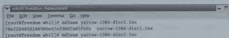

图 1. 验证已下载 ISO 文件的 MD5 校验和。

要一次性检查所有文件，请按照以下步骤操作。

- 1. 下载 MDSUMS 文件。
- 2. 打开一个终端窗口。
- 3. 运行以下命令：

```
md5sum --check MDSUMS
```

- 4. 该命令会抱怨 SRPMS 文件不存在（我们没有下载它们），但这显然不是错误条件。该命令会自动检查校验和，因此您不需要手动仔细核对输出结果与 MDSUMS 文件中的某一行。
- 5. 您会看到类似以下的输出：

```
chris@malice [510]: dir
total 2049
-rw-r--r-- 1 chris cygwin 120 Feb 21 10:11 MDSUMS
-rw-f--r-- 1 chris cygwin 1048576 Feb 21 10:10 file1
-rw-f--r-- 1 chris cygwin 1048576 Feb 21 10:10 file2
-rw-f--r-- 1 chris cygwin 1048576 Feb 21 10:10 file3
chris@malice [511]: md5sum --check MDSUMS
file1: OK
file2: OK
file3: OK
```

通过任何一种方法验证完文件后，就可以刻录光盘了。

### 刻录光盘

这一步比使用 MD5SUM 程序引发的疑问更多。常见的错误是简单地将 ISO 文件复制到光盘上——但这并不是目的。ISO 文件实际上包含许多其他文件，这些文件需要放置在光盘上以便在安装过程中访问。如果您只是简单地复制 ISO 文件本身（例如，列出目录会显示一个 650 MB 的文件），使用光盘启动将会导致错误。ISO 文件是光盘内容的镜像，因此您将使用光盘刻录程序中的特殊选项将该镜像转换为落在光盘上的文件。

这个过程总共有三个步骤：确定光盘刻录机连接的设备、执行测试刻录，然后执行实际刻录。详细步骤如下：

- 1. 打开终端窗口并获取 root 权限：

```
su
```

- 2. 输入 cdrecord 命令以确定设备：

```
cdrecord -scanbus
```

- 3. 您应该看到大量信息，如图 2 所示。信息转储包含如下字符串：

```
0,0,0   0   'MATSHITA' 'UJDA730 DVD/CDRW' '1.04' Removable CD-ROM
```

```
[~root@fedcore-shell]# cdrecord -scanbus
cdrecord 1.10 (2008-96-linus-gnu) Copyright (C) 1995-2003 Jorg Schilling
Linux sg driver version: 3.1.24
Using libsg version 'whily-0.5'

  scsisbus0:
0,0,0 0) 'MATSHTA' 'UDA730 DVD/CURM' 1.04' Removable CD-ROM
0,1,0 1) *
0,2,0 2) *
0,3,0 3) *
0,4,0 4) *
0,5,0 5) *
0,6,0 6) *
0,7,0 7) *
```

**图 2.** 通过 cdrecord -scanbus 命令确定 CD-ROM 的地址。

- 4. 接下来，发出 cdrecord 命令进行测试刻录，使用 scanbus 信息转储结果中的前三个数字，如下所示：

```
cdrecord -dummy -v -eject speed=4 dev=0,0,0 /path/yarrow-1186-disc1.iso
```

- 5. 速度应设置为您的 CD 刻录机支持的速度。本例中使用的 4x 现在相当慢了。结果如 **图 3** 所示。
- 6. 如果测试成功，发出以下命令刻录实际的光盘：

```
cdrecord -v -eject speed=4 dev=0,0,0 /path/yarrow-1186-disc1.iso
```

- 7. 结果应如 **图 4** 所示。
- 8. 一旦您刻录好光盘，可以使用 Nutilus 等工具查看其内容。**图 5** 展示了 CD #1 应有的样子。

为了方便起见，我还展示了 CD #2 的内容（**图 6**）和 CD #3 的内容（**图 7**）。

```
$ cd /media/CDROM
cdrec 0 0

$ x86_Ed3_Mem_linuxed C2 ND4  
[rosette@freedom ~/whil]# cdrecord -dummy -v -eject speed=4 dev=0,0,0 /home/whil/arrow-1386-disc2.iso 
Cdrecord 1.10 (1886-pc-linux-gnu) Copyright (C) 1995-2001 Jorg Schilling 

TOC Type: 1 = CD-ROM 
  Accessible: `0,0,0' 
  Access: 0 target: 0 Lunit: 0 
Linux sg driver version: 3.1.24 
Using libscg version `schily-0.5' 

scsi: 1 
Device type: Removable CD-ROM 
Version: 0 
Response Format: 2 
Capabilities:  
  Vendor_info: 'WATSHITA' 
  Identification: 'UDTA730 DVD/CDRW' 
  Revision: '1.04' 
Device seems to be: Generic mmc CD-RW. 
Using generic SCSI-3/mmc CD-R driver (mmc_cdr). 
Driver flags: 5MA8AUDO 
Drive buf size: 1638400 = 1600 KB 
FIFO size: 4194304 = 4096 KB 
Track 01: data 636 MB 
Total size: 731 MB (72:25.84) = 325938 sectors 
  Lout start: 731 MB (72:27/63) = 325938 sectors 
  Current sector: 2948 
ATIP info from disk: 
  Indicated writing power: 5 
Is not unrestricted 
Is not eraseable 
Disk sub type: Medium Type A, High Beta category (A+)(3) 
ATIP start of lead in: -11034 (97:26/66) 
ATIP start of lead out: 339948 (70:59/71) 
Disk type: Short stratry type (Phthalocyanine or similar) 
Manufacturer: OMC Magnetics Corporation 
Blocks total: 339946 Blocks current: 358946 Blocks remaining: 33908 

Starting to write CD/DVD at speed 4 in dummy mode for single session. 
Last chance to quit, starting dummy write in 5 seconds. Operation starts. 
Waiting for reader process to fill input buffer ... input buffer ready. 
Starting new track at sector 0 
Track 01: data 636 MB written (fill 100%) .*[108 
Track 01: Total bytes read/written: 667516928/667516928 (325938 sectors). 
Writing time: 1089.877s 

Fixating... 
WARNING: Some drives don't like fixation in dummy mode. 
Fixating time: 0.005s 
[cdrecord]: fifo had 10515 puts and 10515 gets. 
[cdrecord]: fifo was 0 times empty and 10542 times full, min fill was 82%.
```

**图 3. 测试 CDRECORD 命令的结果。**

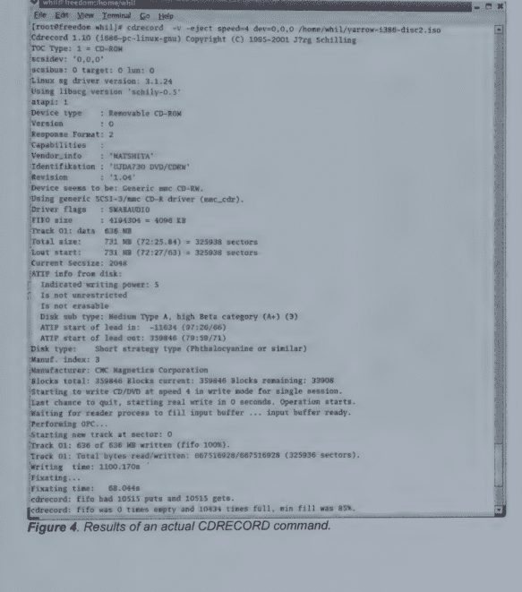

**图 4.** 实际 CDRECORD 命令的结果。

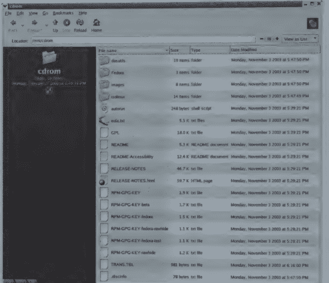

**图 5. CD #1 的内容。**

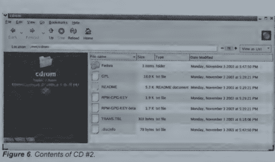

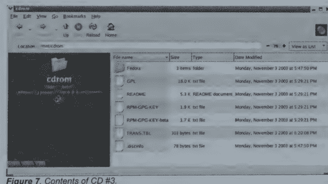

现在您拥有了三张含有 Fedora Core 1 镜像的光盘。

## 安装 Fedora Core

如果您已经安装了 RH 7、8 或 9，这个过程会很熟悉——它与 RH9 几乎相同，只是安装对话框中出现了 Fedora Core 的背景。此时，我假设您有三张已刻好镜像的光盘：Fedora Core 1/2/3。

## 记录您的硬件信息

如果您正在一台已安装其他操作系统的机器上安装 Linux，那么在开始 Linux 安装本身之前，最好做一件事。您希望记录现有的硬件设置，以防万一您有某种 Fedora Core 无法立即识别的设备——例如奇怪的显卡或具有旧芯片组的某种设备。

这些设置的位置因操作系统而异。在 Windows 2000 中，选择 开始 \ 控制面板 \ 系统 小工具 \ 硬件 选项卡 \ 设备管理器 按钮 \ 查看 菜单 \ 打印 菜单 \ 所有设备和系统摘要。您将获得您计算机上硬件的详细列表。

如果您连接到网络和/或互联网，您还需要记下您的网络设置。在 Windows 2000 中，选择 开始 \ 设置 \ 网络和拨号连接。右键单击 本地连接 图标并选择 属性 \ 常规 选项卡 \  Internet 协议 (TCP/IP)，然后点击 属性 按钮。记下所有设置和数字。

如果选中了“自动获取 IP 地址”选项按钮，则表示您的计算机正在通过 DHCP 获取 IP 信息。

## 准备安装

第 1 步。插入第一张光盘并启动机器。启动过程的反馈将出现，如图 8 所示。然后安装屏幕将出现，如图 9 所示。

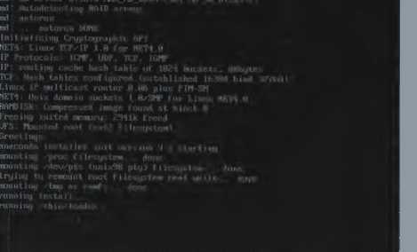

图 8. 使用 Fedora Core CD 1 启动时，启动过程的反馈。


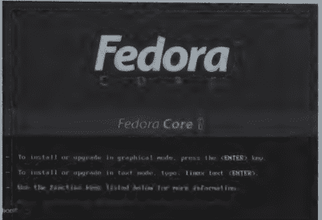

图 9. 初始 Fedora Core 启动屏幕。

**步骤 1a.** 系统将等待您按键：如果您希望以图形模式运行安装，请按 Enter 键；如果您需要输入命令，请在启动提示符处输入。有些机器在安装 Linux 时（或者反过来，可能是 Linux 的问题）比较挑剔，因此需要带有其中一个或多个参数来运行安装程序。这就是您输入这些参数的地方。一旦安装过程开始，您将会看到一个空白屏幕，如图 10 所示。

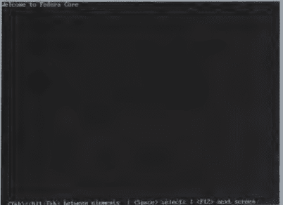

图 10. 启动需要几秒钟，在此期间会出现一个空白的基于字符的屏幕。

**步骤 1b.** 再过几秒钟，会出现一个基于字符的对话框，询问您是否希望在安装前测试 CD 介质（见图 11）。基于字符的介质检查对话框不支持鼠标，因此您需要使用键盘上的左箭头、右箭头和 Enter 键来选择选项。

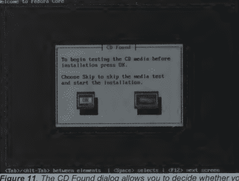

**图 11。** *CD 发现对话框允许您决定是否要在安装前检查 CD 是否有错误。*

**步骤 2.** 如果您选择“确定”，请继续阅读步骤 3。否则，请跳转到步骤 5。（提示：您应该至少进行一次 CD 测试。虽然一张有缺陷的 CD 可能会通过此测试，但如果您进行测试，可以大大降低因使用坏 CD 而浪费时间的可能性。）

**步骤 3.** 您将看到第二个对话框，如图 12 所示，它提供两个选项：一个是测试当前驱动器中的 CD，另一个是弹出当前 CD 并插入另一张 CD 进行测试。

**步骤 3a.** 无论您是选择测试当前 CD，还是弹出 CD 并插入另一张，很快您都会看到“检查中”对话框，如图 13 所示。

**步骤 3b.** 介质检查完成后，温度条形图将在图 14 所示的位置保持在 100% 达 15 到 30 秒。

**步骤 3d.** 介质检查对话框将显示驱动器中 CD 的测试结果，如图 15 所示。

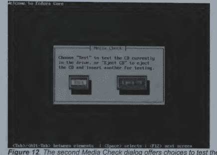

**图 12.** 第二个介质检查对话框提供选项，用于测试当前 CD 或插入不同的 CD。

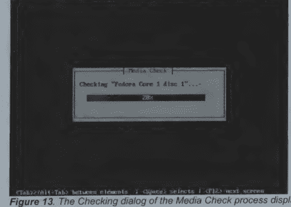

**图 13.** 介质检查过程的“检查中”对话框通过温度条形图显示进度。

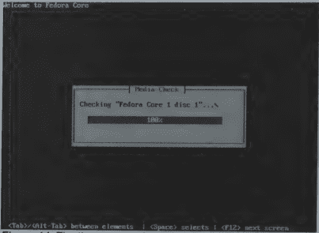

图 14. 温度条形图将在短时间内保持在 100%。

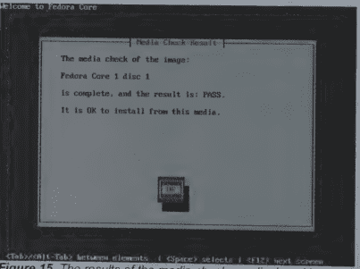

图 15. 介质检查结果在一个单独的对话框中显示。

步骤 4. 点击“确定”。您将有机会测试另一张 CD 或继续安装过程，如图 **16** 所示。选择 *测试* 将再次循环执行步骤 3，而选择 *继续* 将继续安装过程，如步骤 5 所述。

步骤 5. 在步骤 1b 中选择 *跳过* 或在步骤 5 中选择 *继续* 后，基于字符的屏幕将滚出显示区域，安装过程的反馈开始出现，如图 **17** 和 **18** 所示。

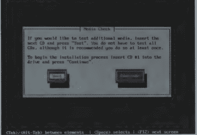

**图 16.** 介质检查过程允许您测试额外的 CD 或继续安装。


**图 17.** 安装反馈以“正在运行 anaconda”一行开始。

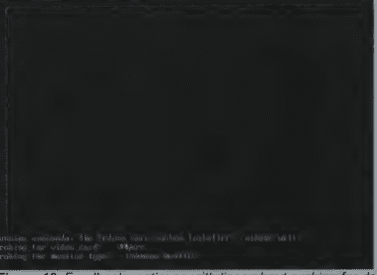

**图 18.** 反馈继续显示关于探测设备的行。

30 到 60 秒后，屏幕上会出现一个图形化 X，随后出现 Fedora Core 徽标，如图 **19** 所示。这意味着图形子系统已启动，其余的安装将以图形方式完成，并（希望）支持鼠标。（如果您的鼠标不起作用，您可以使用键盘操作 GUI，因此您可以在安装过程中尝试选择另一种鼠标。）

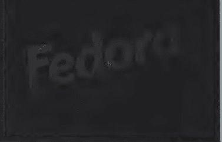

**图 19.** Fedora Core 徽标的出现意味着安装的图形部分已开始。

## 执行安装

欢迎屏幕出现以启动安装向导。它由一个双窗格对话框组成。帮助文本位于左侧窗格，待执行的任务显示在右侧窗格，如图 20 所示。

### 欢迎屏幕

**步骤 6.** 点击“下一步”打开第一个安装屏幕，即“语言选择”，如图 **21** 所示——当然，在仔细阅读左侧窗格中欢迎文本的每个字之后。

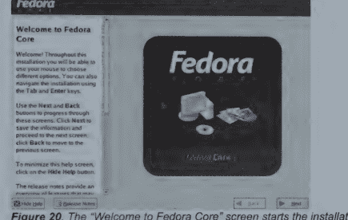

**图 20.** “欢迎使用 Fedora Core”屏幕启动安装向导。

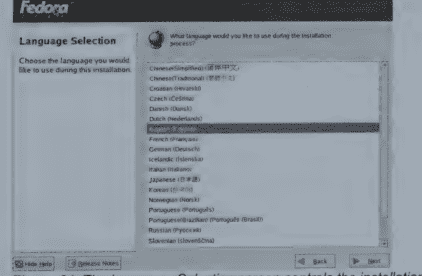

**图 21.** “语言选择”屏幕控制安装过程。

### 语言选择

**步骤 7.** 选择您想在安装期间使用的语言，然后点击 **下一步** 打开 **键盘配置** 屏幕，如图 **22** 所示。

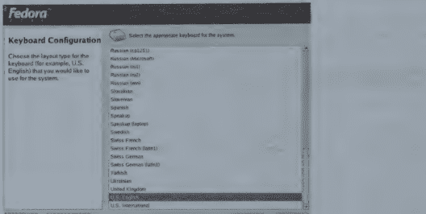

**图 22.** **键盘配置** 屏幕。

### 键盘配置

**步骤 8.** 选择您希望在系统中使用的键盘布局，然后点击 **下一步** 打开 **鼠标配置** 屏幕，如图 **23** 所示。

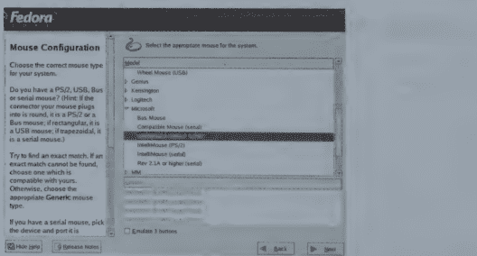

**图 23.** **鼠标配置** 屏幕。

### 鼠标配置

步骤 9. 选择您的鼠标。我的被检测为通用 3 按钮鼠标 (USB)，我将其更改为正确的型号——Microsoft IntelliMouse 光学鼠标 (USB)。如果您使用非常规硬件，可能需要进行一些尝试。如果您的鼠标只有两个按钮，请选中“模拟 3 按钮”复选框。这样做允许您同时点击两个按钮，以替代点击中间按钮的操作。

然后点击“下一步”打开显示器配置屏幕，如图 24 所示。

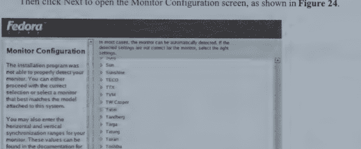

图 24. 显示器配置屏幕。

### 显示器配置

步骤 10. 同样，根据您的硬件情况，您的显示器可能已经被检测并在屏幕上显示为已选中。如果没有，您可以选择列表顶部的“通用监视器”，如果列表中有您的显示器则手动选择，或者从列表中选择最接近您显示器的选项。然后点击“下一步”调出安装类型对话框，如图 25 所示。

### 安装类型

Fedora Core 发行版除了基本的 Linux 操作系统外，还包含成百上千的软件包。三张 FC CD 还包括 Office 套件、Web 浏览器、电子邮件客户端、绘图软件、PDF 查看器以及实用工具，还有用于管理、编程以及各种服务器（如邮件服务器、网络文件服务器和 Web 服务器）的工具。这些包总共代表了面向各种用户的广泛功能，从高级用户到程序员再到服务器管理员。并非每个人都会使用所有这些软件包。相反，每种类型的用户只会使用软件包的一个子集。

因此，大多数用户不会安装每一个单独的包，尽管如果用户希望将机器用于多种目的，这样做也是可能的（除非您知道自己在做什么，否则不建议这样做）。相反，大多数用户将希望选择一个软件包子集，用于特定目的。安装您没有用处的软件包可能会使您的系统面临安全漏洞。以后，如果您发现想要但未安装的软件包，您随时可以安装它。

由于软件包数量众多，对于大多数用户来说，识别并仅安装他们想要的软件包是困难的，甚至是不可能的。Fedora Core 附带三种预定义的软件包配置——一种面向高级用户（称为“桌面”），一种面向程序员（称为“工作站”），一种面向服务器管理员（称为“服务器”）。此外，第四种配置允许用户自定义他们的选择，但由于您也可以自定义前三种配置，所以这实际上并不是必需的。

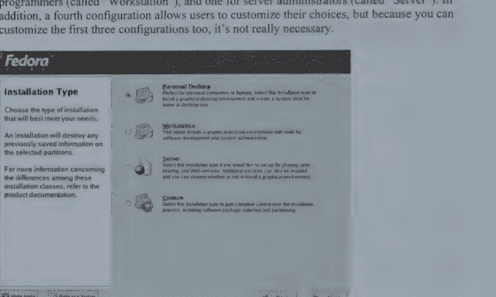

图 25. 安装类型对话框。

步骤 11. 选择“个人桌面”选项，因为您正在为终端用户机器安装。然后点击“下一步”打开磁盘分区设置屏幕，如图 26 所示。

### 磁盘分区设置

Fedora Core 安装向导提供了多个选项来分区您的硬盘。（请参阅附录 A“分区”，以了解分区在 Linux 中的工作原理。）根据磁盘分区设置屏幕，您可以让 FC 自动创建分区，或者使用 FC 的 Disk Druid 工具手动自行分区硬盘。如果您选择自动分区，FC 默认会创建几个对许多用户来说足够用的分区。如果您选择手动分区，您将不得不自行创建每个分区。通过自动分区，您将能够通过 Disk Druid 查看和修改默认分区，因此选择手动分区没有真正的优势。

步骤 12. 选择“自动分区”并点击“下一步”按钮，打开自动分区屏幕，如图 27 所示。


**图 26。** 磁盘分区设置界面。

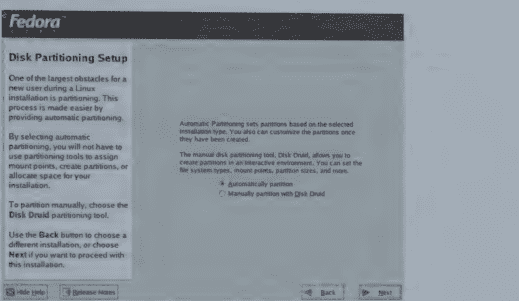

**图 27。** 自动分区界面。

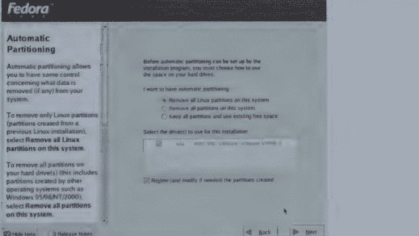

### 自动分区

自动分区界面为您提供三个选项。第一个选项是关于使用或修改哪些分区的具体操作。如果您的系统中安装了多个操作系统，您可以执行以下三种操作之一。

第一种操作是仅删除 Linux 使用的分区，而其他分区（例如用于游戏、Windows 等的分区）保持不变。

第二种操作是抹除整个硬盘，删除磁盘上的所有分区，并在安装 Linux 时让您完全支配该磁盘。

第三种操作是保留现有分区，并使用空闲空间（即尚未分区或格式化的磁盘空间）来安装 Fedora。显然，此选择仅在有可用空闲空间时适用。

您的下一个选择是使用哪个设备（换句话说，是哪一个硬盘）进行安装。同样，此选择仅在机器中有多个硬盘时适用。

需要做的第三个选择是否要通过屏幕底部的复选框来审查由安装例程自动创建的分区。即使您完全不想更改为您选定的值，审查分区也是一个好主意，以便更多地了解内部正在发生的事情。

**步骤 13。** 选择适合您的安装的操作。（如果您专门使用一台机器运行 Fedora Core，请选择“删除所有分区。”）如有必要，请选择一个设备。如果您选中了“审查”复选框，您可以在本章后面的“选项”部分找到对您将看到的内容的描述。在自动分区界面中，点击“下一步”以进入引导加载程序配置界面，如**图 28**所示。

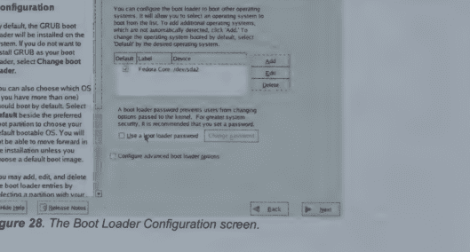

### 引导加载程序配置

引导加载程序配置界面是安装向导中令人 marveled 的界面之一，因为如果您不想对任何内容进行更改，您可以毫不犹豫地点击通过，但如果您需要，它还在一个方便的地方提供了各种高级配置选项。

由于这是关于安装 Fedora Core 的入门介绍，我将假设您此时不想折腾引导加载程序。本章后面的“选项”部分描述了如果您选择某些引导加载程序选项将会看到什么。

**步骤 14。** 在引导加载程序配置界面中，只需点击“下一步”即可进入下一步，即网络配置界面，如图 29 所示。

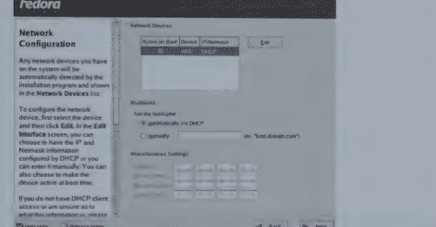

**图 29。** 网络配置界面允许您确定 IP 地址和主机名的分配方式。

### 网络配置

网络配置的默认选项是 DHCP（动态主机配置协议）。这意味着计算机使用的 IP 地址是由另一台计算机动态分配的。这是许多台式机的默认设置，因此我们将采用此设置。您可以使用右上角的“编辑”按钮来分配静态 IP 地址。本章后面的“选项”部分提供了详细信息。

**步骤 15。** 点击“下一步”以进入防火墙配置界面，如图 30 所示。

### 防火墙配置

防火墙是一种控制网络中允许访问您机器的流量类型的工具。Fedora Core 包含一个默认开启的软件防火墙，通过“启用防火墙”选项按钮实现。您可以选择性地通过选中此屏幕中间的适当复选框，允许特定服务通过防火墙。

**步骤 16。** 保持选中“启用防火墙”，不要勾选其他部分中的任何服务或设备复选框，然后点击“下一步”以进入附加语言支持界面，如图 31 所示。

防火墙配置

防火墙位于您的计算机和网络之间，并确定网络上的远程用户可以访问您计算机上的哪些资源。

正确配置的防火墙可以极大地提高系统的开箱即用安全性。

为您的系统选择适当的安全级别。

*无防火墙 — 无防火墙* 提供对系统的完全访问权限，且不进行任何安全检查。安全检查是禁用对某些服务的访问。仅当您在可信网络（而非互联网）上运行时才应选中此项。

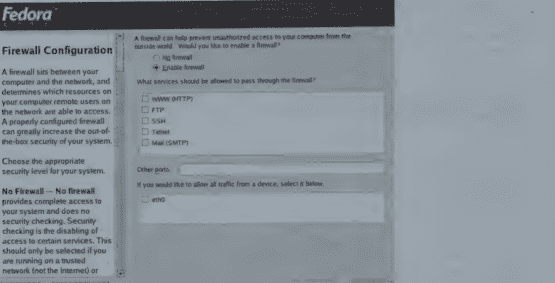

*图 30。防火墙配置界面允许您以多种方式配置个人防火墙。*

附加语言支持

选择一种语言作为默认语言。默认语言将是安装完成后系统使用的语言。如果您选择安装其他语言，可以在安装后更改默认语言。

安装程序可以安装和支持多种语言。要在系统上使用多种语言，请选择要安装的具体语言，或选择所有语言以在系统上安装所有可用语言。

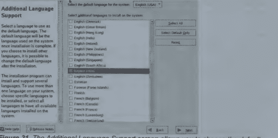

*图 31。附加语言支持界面允许您选择默认语言以及可选的附加语言。*

### 附加语言支持

每个系统都使用一种默认语言，该语言已在此界面中选定。如果您在此处安装附加语言，它们在系统运行后将作为切换选项可用。

**步骤 17。** 选择用于系统的默认语言。如果您希望日后可以将其作为选项使用，请选择附加语言。然后点击**下一步**以进入时区选择界面，如**图 32**所示。

### 时区选择

时区选择界面允许您以图形方式设置系统时间。

**步骤 18。** 选择世界地图上靠近您所在地区的那个点。或者，您可以滚动地图下方的下拉框中的条目。如果希望系统时钟考虑夏令时，请选中“系统时钟使用 UTC”复选框。然后点击**下一步**以进入设置根密码界面，如**图 33**所示。

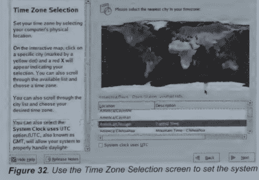

**图 32。** 使用*时区选择*界面以图形方式设置系统时间。

### 设置根密码

根密码提供对 root 用户账户的访问权限。“Root”类似于 Windows 系统中的“管理员”，但功能更强大，因为 Linux 系统中的 root 可以执行比 Windows 计算机上的管理员更多的功能。因此，为 root 用户设置一个非常强的密码非常重要。

**步骤 19。** 设置 root 密码，重复输入密码，然后点击**下一步**按钮。“读取软件包”对话框会显示片刻，随后被软件包安装默认设置界面替换，如**图 34**所示。

Fedora

**仅使用 root 账户进行系统管理。** 安装完成后，创建一个非 root 账户供日常使用，并使用 su -- 在需要快速修复问题时获取 root 访问权限。这些基本规则将最大限度地减少因打字错误或错误命令而损坏系统的可能性。


输入系统的 root（管理员）密码。

- Root 密码：
- 确认：

隐藏帮助 发行说明 上一步 下一步

**图 33。** 使用设置根密码界面为系统创建安全密码。

Fedora

**软件包安装默认设置**

安装程序自动选择要安装在系统上的软件包组。

选择“接受当前软件包列表”以接受默认软件包组并继续安装过程。

选择“自定义要安装的软件包集合”如果您希望选择不同或附加的软件包组。

默认安装环境包括我们推荐的软件包选择，包括：

- 桌面外壳 (GNOME)
- 办公套件 (OpenOffice)
- Web 浏览器 (Mozilla)
- 电子邮件 (Evolution)
- 即时消息
- 声音和视频应用程序
- 游戏

安装后，可以使用“添加/删除”工具添加或删除额外的软件。

如果您熟悉 Fedora Core，您可能希望手动安装某些特定软件包，或避免安装某些软件包。勾选下方的框以自定义您的安装。

- [ ] 安装默认软件包
- [ ] 自定义要安装的软件包

隐藏帮助 发行说明 上一步 下一步

**图 34。** 软件包安装默认设置界面允许您接受或修改默认软件设置。


## 软件包安装默认设置

在前面的步骤 10 中，所选的四种安装类型之一（见图 25）将驱动待安装软件包列表的组装。在此步骤中，你有机会修改该软件包列表。

**步骤 20.** 如果你希望接受默认的软件包集合，请保持“安装默认软件包”选项被选中。如果你希望能够修改软件包列表，请选择“自定义要安装的软件包”选项按钮。

在这两种情况下，请单击“下一步”。如果你选择了“安装默认”，请继续阅读步骤 22。否则，请继续下一步骤：软件包组选择。如果你正在自定义列表，你将看到软件包组选择界面，如**图 35**所示。

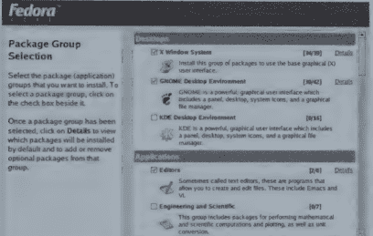

*图 35. 软件包组选择界面显示的是你在图 25 中为所选安装类型选定的软件包。*

### 软件包组选择

软件包组选择界面显示根据你在步骤 10 中选择的安装类型（如图 25 所示）默认选定的软件包。

你在此处选择的软件包纯属个人喜好和个性使然。有些人喜欢安装所有东西，认为随时都能拿到手边所需的任何东西非常方便。另一些人则希望保持最低限度，认为安装的软件越少意味着潜在的安全漏洞越少，并且由于需要处理的选择更少，使用系统也不那么令人困惑。你想走哪条路由你自己决定。完整安装大约需要 5 GB，而最小安装则接近 1 GB。你可以让安装程序选择最小配置，或者安装所有项目（包括一些未列在独立软件包组中的项目），如**图 36**所示。

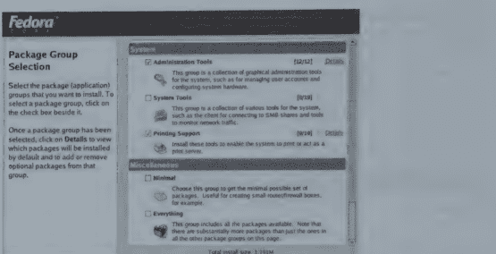

**图 36.** 使用软件包组选择界面底部的“最小”或“全部”复选框，可以快速做出“全有或全无”的选择。

话虽如此，我建议你可以考虑包含以下项目：

- KDE 桌面环境——所有软件包。KDE 附带许多实用的小部件。
- 办公/生产力软件包——GnuCash 类似于 Quicken。GPDF 和 XPDF 允许你查看 PDF 文件。（OpenOffice.org 应该已经选中。）
- 声音和视频——所有软件包。
- 管理工具——所有软件包。
- 系统工具——samba 客户端。这使你能与网络上的其他计算机通信。

> *如果你发现安装得过多（或过少），你可以在安装过程中的稍后阶段，甚至在使用系统时通过“系统设置 | 添加/删除软件包”选项添加或删除软件包。*

**步骤 21.** 选定你需要的软件包后，单击**下一步**以进入即将安装界面，如**图 37**所示。

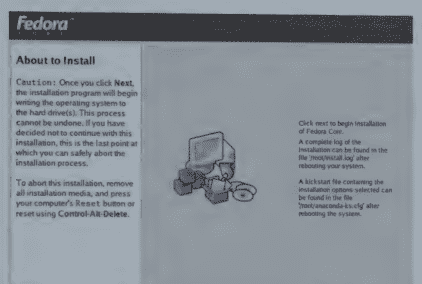

**图 37.** *即将安装界面是你中止安装的最后机会。*

### 即将安装

即将安装界面是安装向导的最后一步。向导声称此界面是你修改此前所做选择的最后机会，也是完全取消安装的时机，但向导在撒谎。

一旦安装开始，有关进度的说明将存储在一个名为“install.log”的文本文件中，并保存在 /root 目录中。如果安装过程中出现任何问题，你可以查看该文件以寻找可能发生的事情（或未发生的事情）的线索。**步骤 22.** 单击“下一步”以查看必需安装介质对话框，如**图 38**所示。

### 必需安装介质

必需安装介质对话框是你实际中止安装的最后机会。CD 列表取决于你选择了哪种安装类型以及在早期步骤中选择了哪些软件包。

**步骤 23.** 准备好你所需的 CD 后，单击“继续”以进入软件包安装界面，如图 39 所示。

### 软件包安装

当向导中的软件包安装界面出现时，会弹出一系列对话框。这些对话框包含进度条，并描述了为安装软件包而准备系统的步骤。**图 39 至 42**展示了这些对话框。


**图 38.** 必需安装介质对话框描述了安装期间需要哪些 CD。

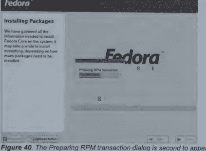

**图 40.** 第二个出现的对话框是准备 RPM 事务对话框。

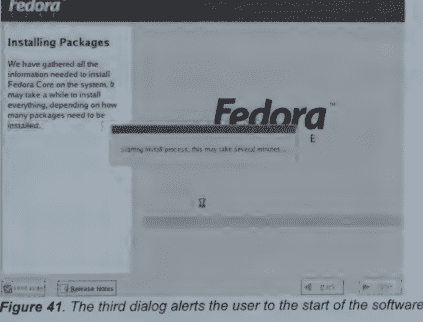

**图 41.** 第三个对话框提醒用户软件安装本身已开始。

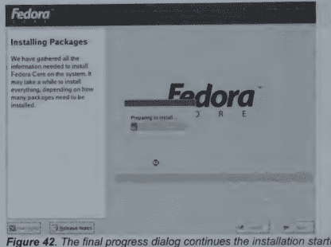

**图 42.** *最后一个进度对话框继续安装启动提醒。*

安装耗时在 40 到 90 分钟之间，具体取决于你机器的性能以及正在安装软件包的数量。进度对话框消失后，向导界面将显示另一个温度计条，指示安装进度，如**图 43**和**44**所示。在温度计条下方，随着每个软件包的安装，会列出其名称和描述。

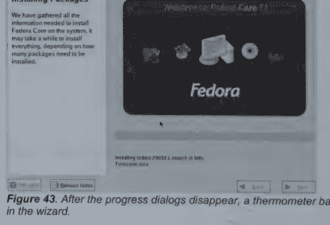

**图 43.** *进度对话框消失后，向导中会出现一个温度计条。*

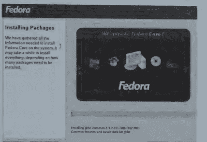

**步骤 24.** 最终，你会被要求插入 CD #2 和/或 CD #3。一旦安装程序完成所有软件包的安装，将出现另一个进度对话框，标识安装后配置步骤，如**图 45**所示。

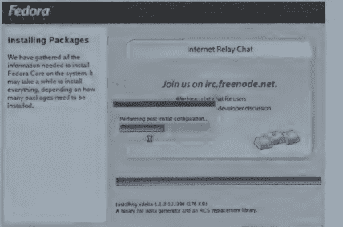

### 启动软盘创建

一旦软件包安装完成，就该执行最后一项维护任务——创建启动软盘——如图 46 所示。

启动软盘包含在硬盘上的信息（如主引导记录）损坏的情况下启动 Linux 机器所需的最少信息。

**步骤 25.** 由于这是你的第一台 Linux 机器，现在创建一张启动软盘是个好主意。这大约需要一分钟，请记住软盘上的所有信息都会被此过程覆盖。一旦启动软盘创建过程完成，将软盘从驱动器中取出，并标注今天的日期、计算机名称、发行版名称（如“Fedora Core 1”）以及“启动软盘”字样，以便你在三个月后需要它时能想起它的用途。将其与你的 Fedora Core CD 一起存放。

完成启动软盘创建后，单击**下一步**，你会看到恭喜界面，如图 47 所示。

### 恭喜！

完成了！嗯，其实还没有。还有几项维护任务要做，但首先你必须重启——这是整个安装过程中唯一一次也是第一次重启。

**步骤 26.** 将所有可移动介质（软盘和 CD）从驱动器中取出，然后单击**重新启动**。机器将重启，你会在重启期间看到类似于图 8 和图 18 中的提示。参见图 48。

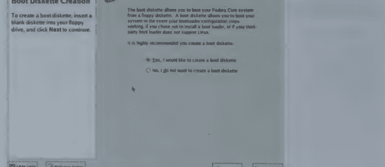

*图 46. 安装完成后，你会被提示创建启动软盘。*


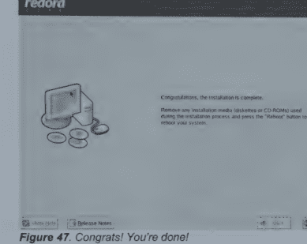

图 47. 恭喜！安装完成！

```
Restarting installation, The Fedora install program will be reboot the machine in:
Preparing For reboot now!  Please be patient...!
Shutting down network daemons.
Switching to user mode.
Unmounting cdrom media /iso/disk1.
Setting up system to start up after rebooting in user mode.
0 1 2 3 4 5 6 7 8 9 10 11 12 13 14 15
0% 10% 20% 30% 40% 50% 60% 70% 80% 90% 100%
[###]
Setting up system to stop network services...
Restarting kernel in 1 minutes.
Disabling mouse ...
Stopping mouse daemon...
Unmounting filesystems...
Cleaning up log files...
Disabling swap.
Disabling swap...
Restarting initrd kernel...
```

图 48. 重启后，提示信息将跟踪重启进程的进度。

## 最终设置

重启过程将从基于字符的提示切换到图形显示，并且在 Fedora Core 标志屏幕上会出现一个温度计条，如**图 49** 所示。

与以前的 Red Hat Linux 版本不同，FC 默认情况下会隐藏详细信息。不过，您可以点击温度计条左侧的“显示详细信息”超链接来查看相同的基于字符的进度提示。这样做会调出一个空白屏幕，如**图 50** 所示。

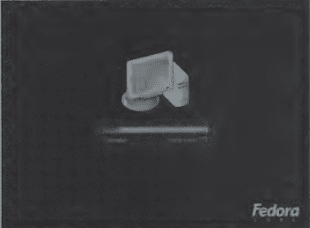

*图 49.* Fedora Core 启动屏幕显示一个温度计条，指示其进度。


*图 50.* 在显示任何结果之前，屏幕上会出现基于字符的进度提示。

随着启动继续，屏幕顶部的温度计条将向右移动，并且开始显示提示信息，如图 51 所示。每通过一个步骤，安装过程都会显示绿色的“OK”响应。如果启动操作失败，会出现相应的红色“FAILED”响应，如图 52 所示。（请注意，出现“FAILED”消息并不罕见。不要为此过于烦恼；偶尔会有程序或服务在启动时安装失败，但不会影响系统的运行。）

除非发生灾难性错误（在这种情况下，您需要检查根目录中的 install.log 文件以获取更多信息），否则将显示欢迎屏幕，如图 53 所示。

## 欢迎

欢迎屏幕类似于安装向导，不同的是剩余步骤列在左侧，所有说明文字都包含在右侧。

- **步骤 1.** 点击“下一步”移动到许可协议屏幕，如图 54 所示。

## 许可协议

许可协议屏幕虽然看起来与其他许多许可屏幕类似，但其作用仅仅是确认 Fedora Core 是在 GPL 下开发的，并解释 Red Hat 在此过程中的角色。您必须接受该协议才能继续，但这并不像专有软件许可协议那样让您放弃自己的权利。

- **步骤 2.** 点击“下一步”移动到日期和时间屏幕，如图 55 所示。

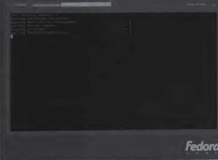

**图 51.** 基于字符的提示将开始在温度计条下方出现。

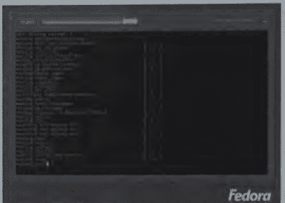

图 52. 如果启动操作失败，将显示红色错误消息。

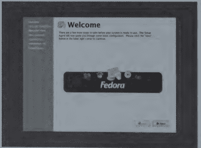

图 53. 最终设置过程的欢迎屏幕。

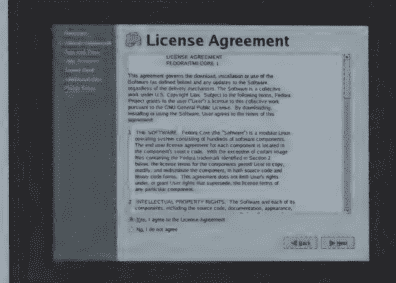

图 54. 许可协议屏幕要求您接受或拒绝该许可证。

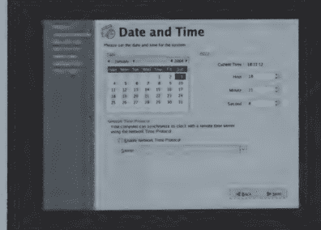

图 55. 日期和时间屏幕允许您确认系统时间，并配置系统与远程时间服务器同步。

## 日期和时间

在此屏幕上您可以执行三项任务。首先，您可以使用左侧的日历控件设置系统日期。其次，您可以使用右侧的小时、分钟和秒调节器设置系统时间。

第三，您可以使用底部的启用网络时间协议复选框和服务器框来配置系统自动与远程时间服务器同步。选中复选框将启用下拉框，如图 56 所示，并提供远程服务器的选项。

- **步骤 3.** 设置日期和时间，如需要，启用 NTP 并选择一个远程服务器。然后点击“下一步”移动到用户账户屏幕，如图 57 所示。

## 用户账户

root 用户仅应在执行计算机管理任务且无法通过其他方式完成时使用。对于一般使用，您应该拥有第二个账户。计算机的其他所有用户也应该使用该相同账户，或者更优选使用他们自己的账户。此屏幕用于创建一个或多个用户账户。

此账户存储在本地机器上。如果您想创建网络登录（例如，登录到 Linux 或 Windows 服务器），请点击“使用网络登录”按钮。我将在附录 B “连接到 Windows 网络” 中详细讲解这一点。

- **步骤 4.** 输入用户名、用户全名（可选，但如果多人使用计算机则建议填写）和密码。点击“下一步”移动到声卡配置屏幕，如图 58 所示。

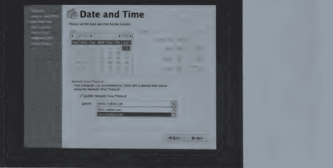

**图 56.** 服务器框提供预定义的远程时间服务器选项。

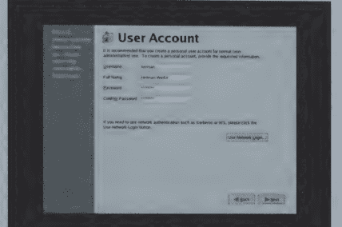

图 57. 用户账户屏幕允许您创建日常账户。

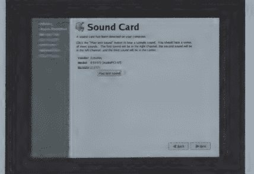

图 58. 声卡屏幕允许您确保机器上的声卡正常工作。

## 声卡

声卡配置屏幕允许您确认找到的声卡是否正常运行。如果检测到声卡，系统会标识它，并为您提供测试机会。

- **步骤 5.** 点击“播放测试声音”按钮。声音将依次从每个扬声器播放，然后从两个扬声器同时播放。然后会询问您是否正确听到了声音，如图 59 所示。

如果您正确听到了声音，请点击“是”；否则，请点击“否”。如果点击“否”，您将有机会手动配置声卡。

- **步骤 5a.** 完成后，点击“下一步”移动到附加 CD 屏幕，如图 60 所示。

## 附加 CD

如果您愿意，现在可以笑一笑。附加 CD 屏幕上写着“如果您有以下任何 CD……”，但下面并没有列出任何 CD。此屏幕是 Red Hat 9 及更早版本安装程序中遗留下来的错误项。

- **步骤 6.** 只需点击“下一步”移动到完成设置屏幕，如图 61 所示。

## 最终设置

最终设置屏幕仅确认安装已完成。

- **步骤 7.** 点击“下一步”完成安装并移动到登录屏幕，如图 62 所示。

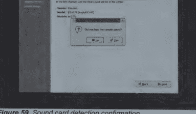

*图 59. 声卡检测确认。*


图 60. 附加 CD 屏幕是 Red Hat 9 时代遗留下来的错误项。


图 61. 最终设置——您几乎完成了！


**图 62.** Fedora Core 登录屏幕。

## 首次登录

就 Windows 而言，登录屏幕与习惯略有不同，因为只有一个用于输入用户名的文本框。一旦您输入用户名并按下**回车**或离开文本框，**用户名**文本框将被**密码**文本框替换，如图 63 所示。

- **步骤 1.** 输入用户名并按**回车**。


**图 63.** 用户名文本框变为密码文本框。

与用户名文本框一样，密码文本框比大多数人需要的都要长（是否遇到过那些偏执狂使用 57 字符密码的情况？）。

- **步骤 2.** 要登录，请输入您的密码并按下回车。如果用户名和密码被接受，图标将开始在 Fedora Core 标志屏幕底部出现，如图 64 所示。

这些图标代表各种服务的启动——如果仔细观察，您会看到每个服务的描述显示在图标行下方。最后，默认的 Fedora Core 桌面将显示出来，如图 65 所示。


要关闭系统，请点击屏幕左下角的 Red Hat 图标，并选择“注销”菜单选项。你可以选择直接注销、重启计算机，或者完全关闭计算机。

如果你注销，用户名登录屏幕将显示出来，与图 62 中显示的一样。如果你选择重启，或者在关闭计算机后再次开机，你会看到启动菜单屏幕，如图 66 所示。

如果你没有在 10 秒内按下回车键，Fedora Core 将自动启动，很快你就会看到之前描述的用户名登录屏幕。

就是这样！


图 66. 重启或开机时出现启动菜单屏幕。

## 高级主题/替代方案/选项

安装过程并不是一条简单、笔直的路。如前所述，你可以在过程中做出许多选择，例如分区设置、设置 IP 地址等。在本节中，我将讨论这些替代方案。

### 修改自动分区的选项

在“执行安装”章节的步骤 12 中，你选择查看（并修改）安装例程的自动分区机制所做的选择。当时，你只是接受了默认设置并继续下一步。现在我将解释如何修改这些选择并建议一些替代方案。

如果你在图 27 中选中“查看选项”复选框，Fedora Core 的安装例程将创建三个分区，然后当你点击步骤 12 中的“下一步”按钮时，会显示这些分区。该显示看起来类似图 67。


**图 67.** 磁盘设置屏幕，显示 FC 创建的默认分区。

该屏幕右侧面板分为两部分。第一部分是位于面板顶部的驱动器栏，以图形方式显示硬盘如何被划分为分区。（如果你的计算机有多个硬盘，每个硬盘都会有一个单独的栏，上下堆叠，每个栏都横跨整个屏幕。）

第二部分是位于右侧面板下半部分的设备、驱动器和每个驱动器上分区的列表。图 67 显示了一个带有三个分区的硬盘。第一行显示设备名称，随后的每一行标识每个分区，并提供有关该分区的信息。

如果有第二个磁盘，它将列在第一个磁盘的最后一个分区之后，其下方会有针对该磁盘本身的一行，以及其每个分区及其信息的行。在设备列表中选中一个分区，也会突出显示驱动器栏中的该分区，如**图 68**所示。

自动分区默认创建三个分区：一个用于*交换空间*，一个用于 `/boot`，一个用于 `/`，如图 68 所示。如果你想修改此配置，可以使用驱动器栏和分区列表之间的按钮。例如，假设你想创建另一个分区。假设没有可用的磁盘空间，你需要调整其中一个现有分区的大小以释放一些可用空间，然后在该新释放的空间中创建一个新分区。

具体来说，以下步骤用于通过占用 `/` 的一部分空间来创建第四个 `/home` 分区。首先，在设备列表中突出显示 `/` 分区，如图 68 所示。其次，点击 **编辑** 按钮以打开*编辑分区*对话框，如**图 69**所示。


**图 68. 在磁盘设置屏幕中选择分区也会突出显示屏幕顶部的驱动器栏中的该分区。**


**图 69. 编辑分区对话框允许你更改现有分区的属性。**

编辑分区对话框允许你修改分区的属性，包括大小、大小的确定方式、挂载点等。就本例而言，请将 3679 MB 的 `/` 分区大小减少一半千兆字节。这将释放半千兆字节的空闲空间，你可以使用它来创建另一个分区。（从实用性角度看，根据你计划在系统中安装的软件量，留下 3179 MB 用于 `/` 分区可能不够。）点击确定，你将返回到磁盘设置屏幕。

接下来，点击“新建”按钮再次调出编辑分区对话框。（是的，我知道你并不是在编辑现有分区，但对话框上就是这么写的。）因为你正在创建一个全新的分区，你应该检查对话框中的每个对象。首先，从列表中选择挂载点，如图 70 所示。在本例中，挂载点是 `/home`。


> **图 70.** *挂载点列表允许你为正在编辑的分区分配挂载点。*

其次，点击“固定大小”选项按钮。然后在“大小（MB）”文本框中输入 “500”。第三，点击确定返回到磁盘设置屏幕。

作为补充说明，请记住，单个硬盘最多只能有四个主分区。如果你想创建超过四个分区，只要你拥有足够的磁盘空间，你可以继续点击“新建”并为你的系统添加分区。Disk Druid 将根据需要自动创建扩展分区以及该扩展分区内的逻辑分区。如果你创建的某个分区绝对必须是一个主分区，请在编辑分区对话框中选中“强制为主分区”复选框。现有的某个主分区将被转换为逻辑分区。

### 自定义引导加载器选项

关于引导加载器，我要提到的两件事在你的第一次（甚至第五次）安装中并不是必须的。然而，了解这些很有帮助，并且随着你经验的增长，它们可能会派上用场。

#### 写入主引导记录

第一个项目是确定此次安装是否会将引导加载器写入主引导记录（Master Boot Record）。这在“执行安装”章节的步骤 14 中完成。如果你现在不理解写入引导加载器的概念，别担心——把它留待以后再看。点击图 28 中屏幕右上角的“更改引导加载器”按钮，以打开“更改引导加载器”对话框，如图 71 所示。


图 71. “更改引导加载器”对话框允许你阻止将引导加载器写入主引导记录。

如果你想将 GRUB 安装到主引导记录中作为此次安装的引导加载器（这是默认设置），在这个对话框中什么也不用做。但是，如果你*不*想为此次 Fedora Core 安装将引导加载器安装到主引导记录中，请选择“不安装引导加载器”选项按钮，然后点击确定。如果你正在一台已经拥有自带主引导记录中的引导加载器的操作系统（如 Windows）的机器上安装 Fedora Core，并且不想动它，这个选项会很有用。

#### 编辑引导加载器的标签

第二个有用的项目是编辑当前引导加载器的标签。当安装完成并启动你的机器时，你会看到一个启动菜单，如本章前面图 66 所示。如你所见，只有一个可用的选择，且其上的文本已经确定。

你可能有几种理由想要更改文本。也许你只是想要自己定制。更常见的原因是，如果你安装了其他操作系统，或者如果你为这个 Linux 安装安装了更新，启动菜单中会有多个选项，如下所示：

- Fedora Core (2.6.08-1.0189.npt1)
- Fedora Core (2.4.24-1.2222.npt1)
- Fedora Core (2.4.22-1.2115.npt1)

你可能想要更具描述性的文本标签，以便提醒你各种选择之间的区别，如下所示：

- FC 1 - 第二个 2.6 内核 (2.6.08-1.0189.npt1)
- FC 1 - 新的 NVIDIA 驱动程序 (2.4.24-1.2222.npt1)
- FC 1 - 原始安装 (2.4.22-1.2115.npt1)

要更改文本，请突出显示右侧面板中间列表框中的 Fedora Core 行，然后点击列表框右侧紧邻的“编辑”按钮。如图 72 所示，将出现图像对话框。要更改启动菜单中显示的内容，请更改“标签”文本框中的值，然后点击确定。


**图 72. 更改启动菜单中操作系统标题的描述。**

### 分配静态 IP 地址而不是使用 DHCP

在“执行安装”章节的步骤 15 中，你假设将使用 DHCP，以便你的计算机在需要时自动由另一台机器分配 IP 地址。如果你想要手动为计算机分配 IP 地址并始终保持不变——换句话说，如果你想使用静态 IP 地址，该怎么办？

从技术上讲，IP 地址并不是分配给你的计算机，而是分配给你计算机内部连接到网络的以太网卡的。如果你的计算机中有多个以太网卡，那么图 29 上半部分的网络设备列表框中就会有多个条目。


要为特定的以太网接口分配静态 IP 地址，请在网络设备列表框中高亮显示目标接口，然后点击图 29 右上角的“编辑”按钮，打开如图 73 所示的“编辑接口”对话框。


图 73. 使用“编辑接口”对话框为计算机的网卡分配静态 IP 地址。

你可以使用此对话框为在“网络配置”屏幕中高亮显示的特定以太网接口输入数据（你可以在图 73 的“编辑接口”对话框后面看到这一点）。这就是为什么该对话框的标题栏中标识了设备名称。

首先，取消勾选“使用 DHCP 配置”复选框。这样做将启用下方的 IP 地址和子网掩码文本框。

其次，输入你想要分配给以太网接口的静态 IP 地址以及该设备的子网掩码。图 74 提供了一个示例。


图 74. 输入以太网接口的静态 IP 地址。

最后，点击“确定”返回到网络配置屏幕，如图 75 所示。


图 75. 网络配置屏幕，已准备好输入手动填写的主机名。

下一步是为你正在操作的机器分配一个名称，而不是让机器自动获取名称（通过 DHCP）。点击“主机名”区域的“手动”选项按钮。这样做将启用主机名文本框以及“其他设置”标签下的所有文本框。

为机器输入一个主机名。你可以简单输入一个标签，如图 76 所示，或者输入完全限定域名（如屏幕示例所示：host.domain.com）。


图 76. 手动输入的主机名和网关地址。

你还可以输入网络中网关机器的 IP 地址（例如你的路由器的 IP 地址）以及你的 DNS 服务器的 IP 地址。

然后点击“下一步”按钮，静态 IP 地址的设置就完成了。

### 网络配置

系统中的任何网络设备都会被安装程序自动检测并显示在“网络设备”列表中。

要配置网络设备，首先选择该设备，然后点击“编辑”。在“编辑接口”屏幕中，你可以选择由 DHCP 配置 IP 和网络信息，也可以手动输入。你还可以选择在启动时激活该设备。

如果你没有 DHCP 客户端访问权限，或者不确定这些信息是什么，请释放 DHCP 租约并手动配置。

## 摘要

桌面 Linux 已经为高级用户做好了准备。在 2004 年，在 PC 上安装 Fedora Core 是一件轻而易举的事。FC 能识别大量硬件，且其向导的用户界面是我在 Linux 世界中遇到的最流畅、最无错误的界面之一。虽然其中一些术语在我将其交给完全的新手之前还需要进一步打磨，但就高级用户而言，该安装过程绝对已具备实用价值。

本章的目的是帮助你在桌面上开始使用 Linux，但当然，这里无法涵盖所有内容。此外，Fedora Core 的新版本会定期发布。我会通过撰写新文章以及发布与该本书相关的更新来让你保持最新状态。这些资料可以在 Hentzenwerke 的网站 www.hentzenwerke.com 上找到。点击“目录”并导航至《Linux Transfer for Windows Power Users》页面。

## 第 3 章：更新 Fedora Core

除非你安装的是全新版本的软件，否则总会有可用的更新，Fedora Core 也不例外。使用最新的补丁、错误修复和安全更新来更新你的系统，将使你的系统尽可能平稳且无问题地运行。由于 Fedora Core 是 Linux，更新系统的方式不止一种。在本章中，我将解释 Fedora Core 基本更新过程的工作原理以及如何利用可用的各种机制。

软件更新已经成为一个几乎微不足道的过程。在早期，许多软件制造商不会自动发布补丁和更新。相反，他们将修复内容整合到一个更新或升级中，而这些更新或升级可能免费也可能收费。你不得不等待邮递送来补丁光盘，或者更糟糕的是，在偶然发现其可用性后才请求获取光盘。

随着公告板的普及以及通信软件和硬件的进步，一些制造商将补丁文件发布在他们的公告板上，或发布在 CompuServe 等第三方公告板上，并在各种电子论坛上发布关于补丁可用性的通知。

在 20 世纪 90 年代初网站出现后，公司开始将其补丁和更新迁移到公司支持站点，并开始使用电子邮件来通知用户更新可用。

即便如此，仍然需要用户足够主动地去获取和安装更新。这并不总是容易的，某些用户缺乏专业知识以及软件公司指示不连贯的结合，使这经常成为一个有风险的过程。

如今，软件“回拨”制造商以检查是否有可用更新，如果有则提醒用户，已成为常态。某些软件可以配置为自动查找和安装更新，无需用户干预。是否利用这一功能取决于你。许多 Windows 系统用户会配置他们的防病毒产品进行自动更新，但由于服务包和其他补丁的质量不稳定，他们不会让操作系统自动打补丁。

Fedora Core 通过 Red Hat Network 警报通知工具完成第一部分工作——检查是否有可用更新并通知用户，该工具作为一个图标显示在面板中，如图 1 所示。

当机器可以连接到互联网时，它将尝试查询网站以获取有关可用更新的信息。当图标为绿色时，表示 FC 目前正在查询更新，如图 2 所示。


图 1. 启动时，Red Hat Network 警报通知工具显示蓝色对勾，表示它没有意识到有任何新更新。


图 2. Red Hat Network 警报通知工具图标呈绿色，表示正在查询更新。

如果有可用的更新尚未应用，图标将变为红色，如图 3 所示。


图 3. 面板右下角的圆形红色图标表示有可用更新。

在所有可用更新应用完毕后，图标将再次变为蓝色，这意味着系统已保持最新状态，如图 4 所示。


图 4. 蓝色对勾表示没有可用更新。

如果你将鼠标移到图标上，提示将显示有多少个可用更新以及在最后一次更新会话中忽略了多少个更新。如果图 3 中的提示让你感到担忧（近 100 个可用更新），请记住 FC 系统上可能安装了数千个软件包。此外，自你用于安装的 ISO 发布以来的时间越长，且距最后一次更新会话的时间越长，可用的更新就越多。如果你使用旧文件安装 FC（或任何发行版），第一次执行更新时很可能会有很多更新需要安装，但随后的每次更新都会显著减少。

Fedora Core 提供了三种升级系统的机制。在我详细介绍具体机制之前，先谈谈三个项目：依赖关系、RPM 和 Red Hat Network。

### 依赖关系

没有人是一座孤岛，许多软件也是如此。许多应用程序不是单一的文件，而是依赖于其他文件或应用程序。例如，为了运行应用程序 A，必须同时安装应用程序 B。这种要求被称为“依赖关系”（即 A 依赖于 B）。

核心 Linux 操作系统，与所有操作系统一样，由数百个文件组成——如果你包括大多数发行版附带的应用程序，那就是数千个文件。其中许多具有依赖关系——包括多重依赖关系。例如，A 依赖于 B 和 C。B 依赖于 D，而 D 依赖于 E，C 依赖于 F。因此，为了安装 A，你必须安装 B、C、D、E 和 F。鉴于其他程序也有相互交织的依赖关系，你可以看出整个情况很快就会变得令人困惑。

在早期，你必须手动解决这些依赖关系。这并不吸引人。那时人们会编写脚本来自动化这些过程（想想“批处理文件”或“宏”）。这样好多了。但仍然是一种麻烦。

因此，Red Hat 创建了 Red Hat Package Manager，旨在为自动化依赖关系问题的脚本提供一个清晰的前端。

### RPM

RPM 是“Red Hat Package Manager”的缩写。它是一个工具，自动化了 FC 系统安装和卸载部分的大部分过程。RPM 工具有几个组成部分。

第一个是你自己系统上的一个数据库，其中包含有关软件包以及每个软件包所需文件的信息。当你安装或卸载软件包时，RPM 会在数据库中跟踪这些信息。假设你安装了一个使用文件 A 的软件包。后来，你安装了另一个也使用文件 A 的软件包。由于文件 A 是随第一个软件包安装的，它不会再次安装。如果你稍后卸载第一个软件包，文件 A 不会被删除，因为第二个软件包仍然需要它。所有这些都由 RPM 处理。

RPM 工具的第二个组成部分是提供多种功能以与该数据库协作的软件，例如安装、卸载以及有关软件包内容、当前安装状态等信息。

第三个组成部分是 RPM 软件包本身。每个 RPM 都有两个文件，一个头文件和一个软件包文件。头文件包含所有文件的列表、软件包的描述、要求和冲突列表，以及一些其他描述性信息。不同的更新机制以不同的方式使用你系统上的 RPM 数据库和 RPM 头文件。

Fedora Core 并不是唯一使用 RPM 系统的 Linux 发行版。显然，Red Hat 的企业产品使用了它，SuSE 和其他厂商也使用了它。

安装 RPM 软件包就像发出此命令一样简单：

```
rpm -i abc.1386.rpm
```

如果安装成功，将不会返回任何输出。你可以使用 -ivh 参数来获取关于安装的详细反馈。


如果安装失败，例如因为软件包存在未解决的依赖关系，命令返回的输出中会提供这些需求信息。`rpm` 命令实际上是一个相当复杂的工具；事实上，关于 RPM 已经撰写了整本书，单是命令自带的用于列出各种选项的帮助文档就长达 100 多行！如果不当使用 `rpm`，有可能将系统弄得面目全非，因此我建议你直到对相关内容更加熟悉之前，都沿用本章描述的 `up2date` 机制。

## Red Hat Network（红帽网络）

红帽公司过去提供过一种名为 Red Hat Linux 的 Linux 版本，你可以购买盒装套装（直接从红帽公司、在线经销商或实体商店购买），也可以从红帽网站免费下载。

Red Hat Linux 软件包的一部分是一项名为 Red Hat Network 的服务，该服务曾提供为期几个月的免费演示版。你可以通过每隔几个月填写一次调查问卷来延长免费订阅期。另一种选择是购买 Red Hat Network 的订阅服务。此类订阅的起始价格为每年 60 美元。

Red Hat Linux 可以被配置为连接到 Red Hat Network，下载可用更新并自动安装这些更新——整个过程无需用户进行任何操作。Red Hat Network 使用了一款名为 `up2date` 的软件工具，我稍后将会讨论。

随着 Fedora Core 的推出，Red Hat Network 的访问权限仅限于购买红帽企业产品的用户。Fedora Core 可以被配置为检查可用更新，但 Red Hat Network 的自动更新机制（即自动下载并安装更新）对 Fedora Core 用户不可用。稍后我们将详细探讨这一点。

基于上述背景，让我们来看看 Fedora Core 用户可用的具体机制。

## up2date

第一种更新机制是 Red Hat 更新代理，简称 “up2date”。`up2date` 也用于红帽网络的企业产品。Red Hat Network 版本的 `up2date` 与 Fedora Core 的实现之间的区别在于用户需要执行的操作。

Fedora Core 仍然保留着 Red Hat Network 警报通知工具（如图 1 前面所示），该工具在有新升级可用时会出现。然而，为了使用 `up2date`，你需要运行 `up2date` 工具来获取可用更新的标题信息。这些标题会以列表形式显示，你可以从中根据想要安装的软件包进行挑选。

选定感兴趣的软件包后，你将从红帽网站获取实际更新文件并将其下载到计算机中。下载完成后，`up2date` 将验证下载的文件是否完好，然后尝试安装它们。你也可以使用前面提到的 `rpm` 命令手动安装软件包。

`up2date` 的默认配置存在一些性能和可靠性问题。它默认尝试连接一台服务器，这意味着全球几乎每一位 FC 用户都在试图从同一台服务器获取更新。该服务器很容易因庞大的流量而超载，结果导致连接速度极慢，甚至经常超时，即使你本地的连接速度很快。错误信息令人困惑，故障也令人沮丧。解决这些问题是 FC 邮件列表中最受欢迎的话题之一。

我将解释的一件事是如何更改 `up2date` 的配置，使其从不同的服务器获取更新，从而提高性能并减少令人困惑的错误信息。

## yum

与 `up2date` 类似，`yum`（Yellow Dog Updater, Modified）是一个运行在被更新系统上的自动更新工具。像 `up2date` 一样，它确定依赖关系以及需要安装或卸载的内容。从最终用户的角度来看，它是安装在系统上的一个软件组件。（服务器端也有相应的软件组件，只有在你为 `yum` 更新创建存储库时才需要关心它。）

`yum` 可以配置为与任何 FTP 或 HTTP 服务器协同工作，这使其非常适合创建自定义配置或需要多个 RPM 存储库的网站。例如，如果你支持多组用户，每组用户都希望拥有自己定制的软件包配置，你可以为每组创建单独的存储库。然后，他们从自己的存储库获取更新，只有适用于其配置的更新才会可用。

与其他工具不同，`yum` 会复制服务器上 RPM 的标题信息。`yum` 客户端（在被更新的系统上）随后使用这些标题信息来确定需要安装或卸载的内容，而不是使用更新信息的自定义库或索引。在确定将执行的操作后，`yum` 依赖 RPM 来完成实际工作。

`yum` 具有高度可配置性，非常适合前面提到的场景，即管理员支持多组用户，每组用户负责自己网络的管理。我在这里无法完全阐述其精妙之处，如果你对这方面感兴趣，我向你推荐以下权威操作指南（请注意末尾重复的目录并非笔误）：  
http://www.phy.duke.edu/~rgb/General/yum\_HOWTO/yum\_HOWTO/

## APT

APT（高级打包工具）是更新 Fedora Core 的第三种机制。它同样是一个自动更新工具，能够确定依赖关系并处理安装和卸载，最初是为 Debian 发行版创建的。我在此提及它，是因为随着你对更新操作越来越熟练，你必然会接触到提及 APT 的人。虽然它是基于命令的（`apt-get <package name>`），但 APT 用户也有选择使用名为 Synaptic 的图形用户界面前端。

与 `yum` 一样，关于如何使用 APT 的完整描述超出了本章的范围。如果你感兴趣，可以在这里找到权威的操作指南：  
http://www.debian.org/doc/manuals/apt-howto/index.en.html

## 总结

该用哪一个？就像计算机领域的许多事物一样，没有清晰简单的答案——这在很大程度上取决于个人喜好和理念，因此推崇一种而贬低另一种很容易引发所谓的“宗教战争”。由于你刚开始接触 Linux，我将在本章中详细讨论如何使用 `up2date` 的图形界面。在你熟悉该流程并了解周边情况后，你可以去了解 `yum` 和 APT 等替代方案。

## 细节—逐步说明

在本节中，我将详细讨论如何使用 `up2date` 机制，因为这是最适合新 Fedora Core 用户的机制。

### 是否有可用更新？

当你右键单击 Red Hat Network 警报通知工具图标时，会出现一个提供多种更新选项的菜单，如**图 5**所示。


**图 5. 右键单击 Red Hat Network 警报通知工具图标会显示多个更新选项。**

由于 Fedora Core 1 是一个过渡版本——从 Red Hat Linux 过渡到完全由社区支持的发行版——商业版本中的某些项目仍然存在。Red Hat Network 警报通知工具中可用的 RHN 网站选项就是一个商业遗留物的例子。点击它仍然会带你前往 RHN 网站，但那里的信息与 Fedora Core 的更新毫无关系。

为了正确运行 `up2date`，你需要遵循三个步骤。首先，你将使用 Red Hat Network 警报通知工具配置 `up2date`。其次，你将把 `up2date` 指向不同于 Fedora Core 默认设置的镜像。第三，你将启动 `up2date` 并运行向导。完成一次此过程后，未来的 `up2date` 操作将仅涉及第三步，即检查（如果有则安装）更新。

### 配置

此菜单选项允许你配置 RHN 警报通知工具，包括代理设置。单击“配置”菜单选项打开欢迎屏幕，如**图 6**所示。单击“下一步”进入服务条款屏幕，如**图 7**所示。


**图 6.** Red Hat 网络警报通知工具的欢迎界面。


**图 7.** 浏览一下 *服务条款* 界面是个好主意，偶尔换换口味也不错。

与大多数许可证不同，这个许可证包含一些有用的信息。你实际上应该通读一遍服务条款的段落。你还可以通过点击编辑框下方的 *从面板中移除* 按钮，将 Red Hat 网络警报通知工具从面板中移除。（如果你这样做，之后想重新添加该工具，请单击 *系统工具 | Red Hat 网络警报图标*。）然后单击 *下一步* 按钮以打开 *代理配置* 界面，如 **图 8** 所示。


**图 8.** Red Hat 网络警报通知工具的代理配置界面。

如果你需要通过代理，你肯定以前配置过类似这些设置，并且知道在你的特定环境中应该输入什么。如果不是，你可以忽略此界面。无论哪种情况，当你完成后，单击下一步移至如 **图 9** 所示的“配置完成”界面。


**图 9.** “配置完成”界面允许你立即检查更新。

你只需单击应用按钮即可检查可用更新，或者通过单击标题栏右上角的关闭框来关闭该工具。为了本章的目的，我将在下一节讨论更新。

这个向导只是帮你入门。可以通过 Red Hat 网络配置对话框访问许多高级选项。要打开此对话框，请遵循以下步骤：

- 打开一个终端窗口。
- 输入命令 `up2date --configuration`
- 当提示输入 root 密码时，请输入 root 密码。
- 将出现 Red Hat 网络配置对话框，如 **图 10** 所示。


**图 10.** *Red Hat 网络配置对话框的常规标签页处理代理设置。*

Red Hat 网络配置对话框的常规标签页允许你设置想要使用的服务器，以及系统的代理设置，类似于前面讨论的向导。

检索/安装标签页展示了各种定制功能，如图 11 所示。


在这里，你可以指定是否在下载包后自动安装它们，在你修改了这些包的配置文件后是否要升级这些包（因为升级通常会覆盖你所做的更改），以及是否获取该包的源代码。

中间的框允许你自动运行 GNU 隐私守护程序（GPG），这是一个免费的 Pretty Good Privacy (PGP) 类似工具，用于验证下载的包是否安全到达，并且确实是你要下载的原始包。如果你选择了此选项但尚未安装 Red Hat 公钥，那么第一次尝试下载和安装时，系统会提示你获取密钥（见图 12）。


第三个框允许你在安装后自动删除（或不删除）RPM 包，并指定是否希望针对正在更新的包具有回滚能力。

最后，你可以选择在哪里存储正在下载的包——如果你的系统硬盘空间有限且 /var 中的默认分区没有空间，这一点很重要。

第三个标签页，**包例外**，允许你指定哪些包你不希望包含在标准更新操作中，如图 13 所示。


**图 13.** *包例外标签页允许你选择哪些包不希望包含在标准更新操作中。*

默认情况下，更新会获取服务器上所有可用的包。你可能事先知道某些包你并不打算经常更新。例如，Linux 内核会定期更新。但许多人不希望安装每一个单独更新，更喜欢等待那些影响他们的更新。因此，以名称“kernel*”开头的包默认属于包例外组。（星号表示以“kernel”六个字母开头的每个包，包括内核本身、文档和源代码。）

你可以使用此功能来定制在安装过程中恰好显示的内容，但你也可以在特殊情况下覆盖你的默认选择。

完成所有更改后，只需单击确定。

# 将 up2date 指向本地镜像

如前所述，Fedora Core 的 up2date 被配置为指向单个网站以获取更新。结果是，该网站通常负载过重，导致几个常见问题。一个是传输速度异常缓慢，如 **图 14** 所示。

你会注意到，此屏幕上的数据传输率为 11 KB/秒，考虑到接收端是一条不受限制的 T1 线路，这有点慢。另一个常见错误在获取软件包后显示在 **图 15** 中。


**图 14.** *正在获取软件包* 对话框向你显示数据传输率等信息。


**图 15.** “*无效的 GPG 签名*”错误通常是文件下载中断的结果。

很可能发生的情况是，该文件并未被篡改，只是损坏了，因为下载被终止且未恢复，留下了一个损坏的文件。

这两个问题每天都发布在 Fedora Core 邮件列表上。你可以通过访问不同的镜像来避免它们。up2date 从其配置信息中获取一个名为 /etc/sysconfig/rhn/sources 的纯文本文件。在这一步中，你将修改此文件并将网站以获取文件的 URL 更改。以下是详细步骤。

首先，寻找一个地理位置靠近你的镜像。浏览 http://fedora.redhat.com/download/mirrors.html 上的镜像列表。本例中我将使用 http://www.gtlib.gatech.edu/pub/fedora.redhat/linux/core/，但鼓励你使用不同的镜像，以免这本书的所有读者都过载该服务器！当你访问该 URL 时，你不会看到文件列表。相反，你会看到类似于 **图 16** 中所示的目录结构。


图 16. 钻取到目录列表中的更新节点。

导航到以下目录——updates, 1, 和 i386——直到你到达 http://www.gtlib.cc.gatech.edu/pub/fedora.redhat/linux/core/updates/1/i386/ 目录，如图 17 所示。地址栏中的 URL 就是你稍后将放入 sources 文件中的信息。

是的，这目前还不够友好，但在未来的 Fedora Core 版本中会改善。

其次，打开一个终端窗口并切换到超级用户，如图 18 所示。


图 17. 钻取目录结构后的最终目的地是更新文件列表。


图 18. 以超级用户身份编辑 Red Hat 网络 sources 文件。

在 sources 文件中，查找以下行：

```
yum updates-released http://fedora.redhat.com/updates/released/fedora-core-1
```

虽然第一个词是 "yum"，但它对 up2date 和 yum 都有效。用如下行替换它（由于在此文档中出版需要换行，该行分为两行）：

```
yum updates-released http://www.glilb.cc.gatech.edu/pub/fedora.redhat/linux/core/updates/1/i386
```

你会注意到还有另外两行，一行写着

```
yum fedora-core-1 http://fedora.redhat.com/releases/fedora-core-1
```

另一行写着

```
yum updates-testing http://fedora.redhat.com/updates/testing/fedora-core-1
```

如果你有兴趣更改核心文件和测试更新文件的服务器，可以对这些行进行类似的修改。

无论哪种情况，保存文件，你就准备好启动 up2date 了。

# 启动 up2date

up2date 是实际机制，它访问镜像站点，获取文件并在你的机器上安装它们，所有这些都在一个方便的界面中完成。

从 Red Hat 网络警报通知工具中点击 "启动 up2date" 菜单选项。你将看到图 19 中的对话框，请求你以 root 身份登录。


图 19. 首先，请以 root 身份登录以运行 up2date。

成功登录后，你将看到 Red Hat 更新代理向导的欢迎界面，如图 20 所示。


图 20. Red Hat Update Agent 的欢迎界面。

没什么特别要看的。继续前进，点击“下一步”按钮进入通道界面，如**图 21**所示。


图 21. 更新代理向导中的通道界面显示了哪些通道与哪种类型的软件更新相关联。

通道是一种用于保存特定类型软件的机制。例如，图 21 显示屏幕上半部分的列表中列出了两个通道。第一个通道用于原始 Fedora Core 软件包，而第二个通道用于更新。

换句话说，Fedora Core 的原始 ISO 映像位于 fedora-core-1 通道中，而更新位于 updates-released 通道中。还有其他通道，例如用于测试待发布更新的“beta”版本构建。

在列表中选中某个通道，可以显示该通道关联的网站。从图 21 中可以看到，fedora-core-1 文件位于 fedora.redhat.com 网站上。在列表中选择“updates-released”行时，将显示我们之前在源文件中输入的 gatech.edu 网站，如**图 22**所示。


图 22. updates-released 通道指向 gatech.edu 网站。

点击“下一步”按钮以启动进程。更新代理所做的第一件事是从通道界面中识别的网站下载头文件，如**图 23**所示。


图 23. 第一个进度对话框提供关于头文件获取情况的反馈。

一旦头部信息被下载，每个可用更新的头部也会被下载。此操作的进度显示在另一个进度对话框中，如**图 24**所示。


图 24. 第二个进度对话框提供关于单个头部获取情况的反馈。

一旦所有头部都成功获取，将根据系统的配置情况显示以下几个屏幕之一。

如果您在配置对话框的“软件包例外”选项卡中选择了某些软件包或文件（参见图 13），您将看到的下一个屏幕将类似于**图 25**，其中列出了被标记为跳过的软件包。


图 25. “被标记为跳过的软件包”屏幕允许您覆盖默认设置。

在此屏幕中，您可以选择覆盖默认选项，并选择一个或多个软件包在本次运行期间进行安装。无论您是否选择了任何软件包，请点击“下一步”进入“可用软件包更新”屏幕，如**图 26**所示。


“可用软件包更新”屏幕将在两种情况下出现。第一种情况是配置对话框的“软件包例外”选项卡（图 13）中未列出任何软件包。在这种情况下，将完全跳过图 24 所示的屏幕。第二种情况是在“被标记为跳过的软件包”屏幕完成后。

无论哪种情况，请在此屏幕中选择您要下载和安装的软件包，然后点击“下一步”按钮。接下来会出现一个进度条，指示正在处理软件包集合和依赖项，如**图 27**所示。


很快，此对话框将消失，并被“获取软件包”屏幕（参见图 28）取代，该屏幕有两个温度计条。顶部条显示单个软件包下载的进度，而底部条显示整个下载的进度。偶尔，为了解决某种复杂的依赖项，需要获取和安装其他软件包，即使它们不是原始文件集的一部分。在这种情况下，您将看到一个列出这些软件包的屏幕，如图 29 所示。


**图 28.** “获取软件包”屏幕显示每个软件包以及整体下载的进度。

如果您不想安装这些软件包（例如，如果您知道它们会与系统上的其他软件包发生冲突），您可以点击“返回”按钮，并尝试取消选择需要这些软件包的其他软件包。

当所有软件包下载完成后，会出现“全部完成”的消息，如图 30 所示。

点击“下一步”按钮开始安装软件包，如图 31 所示。

### 解决依赖所需的软件包

由于您选择的一些软件包依赖于以下软件包，因此需要这些软件包。它们将被添加到您选择的软件包集合中。

| 名称       | 版本    | 引用  |
| :--------- | :------ | :---- |
| fontmatrix | 3.0.0   | 21:3  |

您可以按“返回”以修改软件包选择，或按“下一步”继续。

> *图 29. 如果需要额外的软件包来解决依赖关系，它们将列在一个中间屏幕中。*

### 获取软件包。

正在获取: xboard-4.2.7-1.i386.rpm

X 窗口系统图形棋盘。

Xboard 是一个基于 X 窗口系统的图形棋盘，可以配合 GNUChess 和 Crafty 国际象棋程序使用，也可以配合互联网国际象棋服务器（ICS）、电子邮件国际象棋或您保存的游戏使用。

```
276 of 276 kB transferred at 179 kB/sec
Package transfer time: 00:00:01 (00:00:00 remaining)
```

总进度：

全部完成。点击“下一步”继续。

> *图 30. 当下载完成时，“获取软件包”屏幕显示“全部完成”消息。*


**图 31.** *安装软件包* 屏幕显示进度的方式与*获取软件包* 屏幕类似。

一旦重新打包完成（什么是重新打包？鉴于他们正在执行此操作，它必须很重要，但这似乎确实是用户无需了解的细节，对吧？），安装将开始，如**图 32**所示。最后，会出现“全部完成”屏幕（参见**图 33**）。


**图 32.** 在重新打包之后，*安装软件包* 屏幕显示进度。


*图 33. “全部完成”屏幕列出了所有成功安装的软件包。*

如果需要额外的软件包（请回看图 29），这些软件包将出现在列表的底部（而不是按字母顺序排列），如图 34 所示。


*图 34. foomatic 软件包未按顺序列出，因为它由于依赖要求而被安装。*

无论哪种情况，点击**完成**按钮即可大功告成！

除非您正在更新内核本身，否则下次使用已更新的应用程序时，您应用的更新立即可用。如果您更新了内核，您将需要重新启动机器，并如**图 35**所示，从启动菜单屏幕中选择新的内核。


图 35. 更新内核后，您将在启动菜单中看到多个选项。

如果您正在运行任何服务器，您需要通过点击**主菜单 | 系统设置 | 服务器设置 | 服务**来重启它们。或者，如果您无法忍受几天或几周不重启机器，重启机器也可以起作用。

上述讨论均基于右键点击**Red Hat Network Alert Notification**工具图标后，然后选择菜单选项之一时出现的各种选项。如果您只是点击图标，您将会看到两个重叠的对话框，如**图 36**所示。

顶部的**Red Hat Network Registration**对话框是一个奇怪的小东西——这是对 Red Hat Linux 商业版本的回顾。如果您点击**"Register with RHN"** 按钮，您将按要求输入 root 密码，如图 19 所示，然后您将看到**"Welcome to Red Hat Update Agent"** 屏幕，如图 20 所示。

另一方面，如果您点击**取消**，**Red Hat Network Alert Notification** 工具的**可用更新**选项卡将出现，如**图 37**所示。


**图 36.** 点击（左侧）Red Hat Network 警报通知工具图标时出现的对话框。


**图 37.** Red Hat Network 警报通知工具是 Red Hat Linux 遗留下来的功能。

然后，当你点击“Launch up2date”按钮时，系统会提示你输入 root 密码，接着你将会看到相同的“Welcome to Red Hat Update Agent”界面——就好像你在上一个界面中点击了“Register with RHN”按钮一样。真是让人费解。

### 总结

Fedora Core 的更新机制可能是其鲜为人知的优点之一。我曾听 Windows 用户吹嘘其优越性，尽管那个操作系统不断被发现存在安全漏洞——理由是“Windows 更新很简单；只需点击‘Windows Update’，搞定！”

实际上，Fedora Core 的机制更好，一方面是因为只有当内核被修改时才需要重新启动，另一方面是因为更新来源分布在互联网上的许多服务器上。如果你花时间去配置适合你所在位置的 up2date，那么更新将变得极其简单！

本章旨在帮助你开始在桌面上使用 Linux，但当然还有这里无法涵盖的更多内容。此外，Fedora Core 的新版本会定期发布。我会通过撰写新文章以及发布与本书相关的更新来让你保持信息同步。这些资料可以在 Hentzenwerke 的网站 [www.hentzenwerke.com](https://www.hentzenwerke.com) 上找到。点击“Catalog”，然后导航到 *Linux Transfer for Windows Power Users* 页面。

## 第 4 章 获取帮助

也许在未来某天，我们会拥有真正具备自我修复功能的计算机，它们可以自行修复故障。在那之前，我们人类在出现问题时不得不介入。作为你计算机的主人，这项任务落在了你的肩上，而且通常你无法独自完成它。Fedora Core 提供了几种获取帮助的机制：在线帮助文件、网站以及邮件列表和相关的归档。对于一个不习惯依赖一组社区资源的 Windows 用户来说，利用这些资源可能会让人望而生畏。在本章中，我将结合实际例子讨论在遇到问题时如何使用这些资源。

回到 20 世纪 60 年代，开车的人大致分为两类：一类是能对自己的爱车进行一些简单维护的人，另一类则是无助地站在路边，等待别人来修补爆胎或往散热器里加水的人。

你是一位高级用户。当你第一次遇到麻烦时，你不会闲坐一旁自怨自艾地说：“天哪！我毫无办法！”你会深入挖掘并亲手修好该死的故障。但为了做到这一点，你需要知道去哪里寻求帮助。

帮助的基本来源有两类：静态文件（如在线帮助、FAQ、网站等）以及交互式论坛和邮件列表。

### 静态帮助

长期以来，软件最大的弱点之一就是文档，开源项目也不例外。幸运的是，有一支开源志愿者队伍，他们的使命是通过额外的资源来支持和增强文档。静态帮助文件有几个来源，从随产品安装的文档开始，到网络上海量的网站为止。

### 在线帮助

这可能让你惊讶，但 Fedora Core 附带了一系列针对 GNOME 接口各个组件的在线文档。不幸的是，这些帮助文件参差不齐、不完整，且通常缺乏全面的实用性。当然，Windows 也有类似的功能可能会让你感到意外，尽管它们的帮助作用也很有限。

我讨厌贬低帮助文件，因为编写它们的人员花了很多时间在一个艰难且不受感激的工作上，而这往往是任何人“重要待办事项”清单上的最后一名。尽管如此，在这方面直言不讳很重要，以免你产生不切实际的期望。

你可以通过点击面板中的 Red Hat 按钮并选择 Help 来访问 GNOME 帮助。这样会显示主帮助屏幕，如图 1 所示。


**图 1.** Fedora Core 帮助系统的初始屏幕。

注意帮助是按对象组织的——如果你想参考界面中的特定控件，这很有帮助——而不是按任务组织的。用户通常根据他们试图完成的任务来查找信息，而只有在试图弄清楚屏幕上某个特定对象是什么时才会偶尔查阅对象信息。

你可以深入特定的主题领域，但每个领域中可用的帮助文件分布不均。此外，即使你安装了 KDE 特定的文件，帮助文件不幸地仅为 GNOME 组件提供。你必须切换到 KDE 桌面才能访问 KDE 帮助。

深入例如应用程序，如图 2 所示，提供两组链接：一组是类别，另一组是文档——即针对单个应用程序的帮助文件。例如，这里提供了 Evolution 和 Balsa（一对邮件客户端）的完整用户指南。然而，如果你深入办公类别，只有一个链接，指向 Gnumeric 电子表格应用程序。OpenOffice.org 和 KOffice 的帮助不可用。（你必须加载这些应用程序才能访问其帮助。）

Fedora Core 帮助菜单选项最大的障碍在于帮助仅关注 GNOME 界面。涉及操作系统本身的问题完全无法获取。

在早期版本的 Red Hat Linux 中，你可以单独安装文档文件。此功能尚未在 FC 的首个发布版本中完成。安装指南计划在未来的版本中提供。


**图 2.** 深入 Fedora Core 帮助系统的应用程序部分。

此外，还有一套供 FC 1 使用的发布说明，可在 [http://fedora.redhat.com/docs/](http://fedora.redhat.com/docs/) 获取。如果你感兴趣，请考虑加入 Fedora 文档项目并为社区做出贡献。许多不写代码的人发现编写文档是回馈社区的一种方式。像你一样的用户可以指出（并贡献给！）他们希望自己能找到的章节。

## Linux 文档项目

Linux 文档项目（也称为 TLDP）始于 20 世纪 90 年代中期，当时 Linux 社区中的许多人意识到缺乏良好的文档是 Linux 接受度提高的严重障碍。

TLDP 的贡献者（数百人之多）多年来生产了大量材料，并且仍在定期添加更多内容。访问 [http://www.tldp.org/](http://www.tldp.org/) 并准备好花些时间浏览那里丰富的资源。作为一位新的高级用户，你可能会发现一些帮助文件超出了你的理解范围。一些作者假设读者具备一定程度的 Linux 熟悉度，他们会说诸如“然后你可以 grep 查找该字符串”。由于你是 Linux 新用户，这在现阶段可能没有帮助，但不要气馁——你会惊讶地发现，那些看似天书的内容在很短的时间内变得多么容易理解。

## Fedora Core 网站

有大量的以 Linux 为取向的网站。仅通过 Google 或其他搜索引擎进行搜索，通常就会产生多得你无法以实际方式处理的结果。确实，搜索“Linux tutorials”产生了近 300 万条结果。由于 Fedora Core 是一个流行的 Linux 发行版，并且在大多数地方遵循标准的 Linux 做法，因此你不必将搜索限制在 Fedora Core 范围内。

许多流行的 Linux 网站提供各种类型的教程和 HOWTOS（操作指南）。以下是一些包含大量额外信息的网站抽样：

- [http://www.linuxgazette.com/](http://www.linuxgazette.com/)
- [http://www.linux-tutorial.info/](http://www.linux-tutorial.info/)
- [http://www.linux.org/](http://www.linux.org/)
- [http://www.linuxplanet.com/](http://www.linuxplanet.com/)
- [http://www.linuxbeginner.org/](http://www.linuxbeginner.org/)

如果你在网络上搜索，仔细考虑关键词会很有帮助。模糊、通用的关键词如“Linux”和“GNOME problems”会产生大量结果。如果你能提供可能与你正在处理的情况独特的具体文本，你找到直接与你试图解决的问题相关的小数量结果的机会要大得多。

例如，假设你在尝试某个操作时收到特定错误，如“device driver conflict: no dma available”。如果你搜索“Linux device driver problem”，你会得到大量结果。如果你搜索确切的错误消息——使用引号括住消息文本——你更有可能找到适用的结果，因为它们至少与该确切错误消息有关。当然，你可能会最终找到一堆来自其他邮件列表或电子论坛的帖子，它们都在问同一个问题（没有人收到回答），但更有可能的是，你也会找到相关的回答，或者至少是处理该问题的建议。

另一个越来越受欢迎、流量越来越多的网站是非官方常见问题解答（FAQ）站点，位于 [http://fedora.artoo.net/faq/](http://fedora.artoo.net/faq/)。

## 交互式帮助

静态帮助只能起到有限的作用，而且往往远远不够。真正没有替代品的是向另一个人提问题的能力。许多电子论坛和邮件列表专门服务于 Linux，包括 Fedora Core 项目自己的邮件列表和相关归档。

在本节中，我将讨论如何最好地利用 Fedora Core 的邮件列表和归档。

## 邮件列表

Fedora Core 的“官方”邮件列表托管在 Red Hat 网站上，地址为 [http://www.redhat.com/mailman/listinfo/](http://www.redhat.com/mailman/listinfo/)。有几十个公共邮件列表可用，如图 3 所示。


**图 3。** *红帽支持的公共邮件列表的部分列表。*

当前专门针对 Fedora Core 的列表包括（但不限于）：

- fedora-announce-list：Fedora 项目相关公告
- Fedora-config-list：关于 Fedora 配置工具的讨论
- Fedora-de-list：德语 Fedora 讨论
- Fedora-desktop-list：关于 Fedora 桌面开发的讨论
- fedora-devel-list：与 Fedora Core 开发相关的讨论
- fedora-docs-list：面向文档项目参与者
- Fedora-legacy-list：Fedora Legacy 项目讨论
- fedora-list：面向 Fedora Core 发行版用户
- Fedora-test-list：面向 Fedora Core 开发版测试人员
- Fedora-trans-list：Fedora 翻译项目列表

作为一个高级用户，你最感兴趣的列表可能是“fedora-list”邮件列表，当然，欢迎根据自己的意愿加入其他列表。该列表涵盖用户（相对于从事编程、管理、测试和质量保证或文档工作的人员）感兴趣的主题。你可以提出问题并寻求帮助，也可以为其他 Fedora Core 用户提供帮助。

## 订阅

要订阅，请点击左侧栏中的“fedora-list”链接，打开如图 4 所示的订阅页面。


此页面包含管理您对邮件列表订阅所需的所有信息。第一个链接指向邮件列表存档（稍后会详细介绍）。第二个链接包含向列表发布消息的说明，第三个部分允许您进行订阅。

撰写本文时，fedora-list 邮件列表每天产生 100 到 250 条消息。有些人觉得消息量很大，而另一些人则没有那么畏惧。（我过去加入的一个列表每天几乎产生 1,000 条消息，所以 200 条对我来说完全不成问题！）根据经验和个性，你可能会决定将邮件列表消息转移到电子邮件客户端中的单独文件夹（如果你以前没有这样做过，请查看“过滤”选项），以免收件箱被不断填满（以及你不断分心）。

订阅后，你将收到一封确认电子邮件，你需要对此进行回复。（这样做的目的是为了防止你的“朋友”恶作剧般地替你订阅该列表，就像小孩在杂志上填写学校校长地址的回邮卡一样。）一旦你回复，你开始接收来自该列表的消息。

哦，另外，如果你决定某个特定的邮件列表不适合你，请不要向列表发送“请取消订阅我”的消息。每个列表消息底部都有一个“取消订阅”链接。

## 有效地获取帮助

订阅后，你会想阅读一些消息并熟悉该列表的感觉。每个邮件列表都有自己的特色，fedora-list 也不例外。如果你不急于获得答案，请花几天时间阅读消息，了解正在被询问的问题以及哪些人显得知识渊博等。

如果你是使用邮件列表进行技术支持的新手（或缺乏经验），并且必须立即发布一个问题，你需要了解一些基本规则，以便充分利用该列表。

1. **保持友善。**

列表通常由和你一样的人频繁参与——大多是志愿者，他们希望通过贡献时间来帮助社区，正如他们过去得到帮助一样。

不幸的是，两个因素促使需要帮助的人以敌意的方式寻求帮助。首先，他们承受着压力，处于紧张状态，这通常会让人变得烦躁。其次，有些人似乎认为缺乏面对面的接触使他们可以无视正常的礼貌。

结果，人们有时会在请求帮助时表现得不可理喻。这是一个坏主意，既因为这样做是错误的，也因为如果你这样表现，你得到帮助的可能性会大大降低。即使你正在遇到问题，也要保持礼貌，人们也会以同样的方式回应。

2. **先证明你已经做过功课。**

经常参与邮件列表的人最终会看到相同的问题反复出现，并逐渐对回答这些问题感到厌倦。这导致这些问题被忽略或以简短（换句话说，帮助不大的）方式回答。第一次有人询问某个问题时，某人很可能会回复详细的回答，包括要采取的每个步骤以及指向其他资源的链接。当同一问题被问到第 20 次时，那个人不太可能提供同样详细的答案。

证明你做了研究：你阅读了帮助文档（如果适用），你搜索了邮件列表存档，看该问题是否已经被提出过（请参阅下一节了解如何搜索及示例），并对该主题进行了一般性的网络搜索。

3. **提供关于问题的详细信息。**

这是一个经典的步骤，即使那些理应知道更多的人也经常忽略。像这样的帖子：

> “我的图形驱动程序不起作用。请帮忙。”

是完全无用的。其他人无法针对此帖子提供任何有用的帮助。*什么机器？什么发行版？什么版本？什么图形驱动程序？哪里不起作用？* 你确定最初是图形驱动程序的问题吗？在这种情况下，任何人都无法提供实质性的建议。提供如下的帖子会好得多：

```
在我将 Super Duper Zannboook 4000Z 的内核从 .2115 升级到 .2160 后，启动时出现消息“Invalid ShowFast video driver: Load failed.”。图形启动过程开始加载然后失败，我被困在一个基于字符的“boot:”提示符中。
```

4. **更多建议。**

Eric S. Raymond 撰写了一篇有趣的论文，题为“如何聪明地提问”。有时它看起来有点强硬，但这只是因为它是关于在线世界现实情况的看法。即使是经验丰富的在线参与者也能在这里发现有趣的信息：[http://www.catb.org/~esr/faqs/smart-questions.html](http://www.catb.org/~esr/faqs/smart-questions.html)

## 邮件列表存档

前一节的步骤 2 建议说明你为自行解决问题已经做了什么。这当然假设你实际上已经做过功课。一个关键的步骤是搜索存档，看看是否有人遇到过同样的问题——这种情况出现在令人惊讶的多的情形中。

这样做——首先搜索存档——提供两个好处。首先，如果你能找到答案，你就节省了大量时间。你立即找到了答案，而不是发布问题后还得等待回复。如果答案在存档中，那很可能是一个本来不会得到的答案，因为人们不愿意麻烦去帮助那些懒得自己稍作功课的人。

其次，如果你搜索存档但没找到答案，你仍然可能找到足够的信息，以便在发布问题时提供更多信息——这可能是别人准确回答你的问题并解决你的问题，或只是胡乱猜测或提出愚蠢建议之间的区别。（“你试过单脚站立并在启动时按 Alt-Q 吗？还有试过摇晃机器吗？”）

## 在哪里搜索

Fedora Core 存档可在 [http://www.redhat.com/archives/fedora-list/](http://www.redhat.com/archives/fedora-list/) 找到。导航到此 URL 会打开如图 **图 5** 所示的主 fedora-list 存档屏幕。


## 图 5. fedora-list 邮件列表归档的主屏幕。


记不住 URL？如果你订阅了该邮件列表，每个发布消息的签名中都会包含此 URL，如**图 6**所示。


**图 6. 邮件列表 URL 包含在每个发布到邮件列表的消息底部。**

签名中写着“退订”，但该链接会带你到列表的主页面，那里有该列表的所有链接。

### 如何搜索

现在你到达了主屏幕。接下来怎么办？这里有一个实际例子。

正如第 3 章“更新 Fedora Core”中提到的，在邮件列表上被问得最多的问题之一与更新有关。如果用户依赖默认服务器获取更新文件，可能会发生各种错误。在错误消息的确切文本上进行搜索是寻找与此问题相关的消息的一种方法。如果能做到这一点，那就太好了。

然而，这并不总是可能的，要么是因为你计划着计划着就忘记准确地抄写下来消息，要么是因为 [它] 在屏幕上闪过太快而无法抄写下来，要么是因为消息过于通用，导致在 Web 搜索中返回了数百万条结果。

不过这并不意味着你运气不佳。归档并不那么庞大，以至于搜索通用术语不会得到一些 [好的] 匹配结果。例如，当我搜索“update”和“strange error”时，找到了图 7 中显示的消息。这条消息立即提供了问题的答案。它提供了如何配置 update 和 yum 以连接到镜像来下载更新，而不是依赖 Fedora Core 提供的默认设置的说明。


图 7. 在 fedora-list 归档中搜索“update”和“strange error”文本的示例结果。

不要假设听起来通用的消息会自动产生如此多的命中，以至于搜索结果毫无用处。例如，在早期 Fedora Core 时代，另一个常见的错误与尝试通过 System Settings | Add/Remove Applications 访问的 RPM 工具安装包有关。

该操作会失败，并生成如图 8 所示的错误消息。


**图 8. 起初，通用的错误消息对于有针对性的搜索并没有太大希望。**

这是一个糟糕的错误消息——比 Windows 系统中常见的经典消息好不了多少，比如“安装失败”和“发生意外错误”。

这条消息不仅毫无帮助（程序员就不能做点什么来帮助用户一点吗？），而且如此通用，以至于确实没有足够的信息可供搜索，难道不是吗？然而，令人惊讶的是，这足以作为起点。对“Fedora”和“存在安装包错误的消息。”进行 Google 搜索产生了 70 个命中。Google 搜索结果的第一页如图 9 所示。


**图 9. 对“Fedora”和一个通用错误消息进行搜索产生了可管理数量的命中。**

第四个链接，指向一个 Bugzilla bug 报告，结果竟然包含了解决这个看似晦涩问题的答案。

Bugzilla？Bugzilla 是 Fedora Core 项目用来跟踪与 FC 相关的各种问题的软件工具，包括 bug、异常和功能增强请求。Bugzilla 的内容可在 Web 上访问，因此会被主要搜索引擎索引。

所涉及的 bug 报告显示在**图 10**中。

Bugzilla 错误报告的内容是另一回事；在这种情况下，解决方案是下载一个新包并手动安装，以修复路径问题。这对于某些用户来说可能要求过高，他们最终会进行完全重新安装，或者只是等待新包通过 Red Hat Network Alert Notification Tool 可用下载。

尽管如此，Bugzilla 报告仍然提供了安慰，因为错误现在是可理解的，并且可以处理，而不是让用户困惑不解。


**图 10.** Bugzilla bug 报告解开了通用错误消息“存在安装包错误的消息。”之谜。

## 总结

获取帮助有许多途径，但它们都需要比普通用户通常愿意付出的更多主动性。然而，作为一个高级用户，你会把寻找解决你遇到问题时的帮助视为领先一步的乐趣的一部分。在人们帮助你之后，务必通过帮助社区中的其他人来回报他们！

> 本章的目的是帮助你开始在桌面上使用 Linux，但当然还有远超我在这里所能涵盖的内容。此外，Fedora Core 的新版本定期发布。我会通过撰写新文章以及发布与本书相关的更新来保持你的信息更新。这些材料可以在 Hentzwerke 的网站 **www.hentzwerke.com** 上找到。点击“目录”并导航到 *Linux Transfer for Windows Power Users* 页面。

## 第 5 章

### 配置你的桌面

你安装了 Fedora Core，你登录了，正面对着一个图形用户界面桌面。接下来怎么办？你有两个选择。要么保持原样，只学习如何使用面前的内容；要么自定义它——让它顺从你的意愿。嘿，我知道！让我们两者都做！在这一章中，我将解释如何使用桌面“开箱即用”，然后通过展示我如何自定义我自己的桌面来向你展示如何自定义它。

正如前面章节提到的，人们所称的“Linux”实际上是多个协同工作的组件。

所有计算机软件的核心是 Linux 内核——提供构成操作系统核心服务的软件。

你可以以几种方式处理内核提供的服务。一种方式是通过终端窗口和一组文本命令来操作机器，就像老式 PC 用户使用 DOS 工作一样。

但许多人不想这样做。他们更喜欢在内核之上有一个图形用户界面，这样他们就不必记住命令或长长的繁琐参数——事实上，他们甚至不必知道如何打字！

在 Windows 中，操作系统和其上的图形用户界面结合得非常紧密，以至于几乎不可能在没有图形用户界面的情况下运行操作系统。此外，在 Windows 中，你没有图形用户界面的选择。Linux 并非如此。

X 窗口系统（通常简称为“X”）是在 Linux 内核之上运行并提供窗口功能的软件。X 经历了多个版本，最终第 11 版获得了关键质量并得到广泛接受。这个版本被称为“X11”。你可能已经见过对它的引用。X11 经历了多次升级，每次都试图保持向后兼容性。当前发布号是 6，所以你也可能看到“X11R6”的引用。第一次看到那个字符串——X11R6——时，它可能显得晦涩到令人分心，但现在没那么糟糕了，不是吗？

X 是一个基础，人们可以创建利用这些窗口功能的软件应用程序。一种特定的应用程序被称为“窗口管理器”——有许多人和团体创建了它们。因此，Linux 不仅仅有一种可用的图形用户界面；可能有多种——总共大约十二种。你可能听说过的一些流行窗口管理器的名字包括 Enlightenment、Metacity、Fawish 和 WindowMaker。但这些只是窗口绘制包——它们处理窗口如何绘制、如何呈现、如何相互交互等等。屏幕上显示的一切都出现在窗口中，窗口管理器只是提供控制窗口的引擎。

但桌面不仅仅是窗口。正如你已经看到的，有菜单系统和面板，仅举两三个明显的例子。还有为操作系统提供图形用户界面接口（不仅仅是最终用户应用程序）的工具。窗口管理器数量的增加带来了一类被称为桌面环境的“超级类”工具。这些提供对操作系统的完整接口，包括菜单、面板、实用工具和应用程序，以及所有其他有趣的东西。两个最受欢迎的桌面


是 GNOME 和 KDE，并且流行的发行版至少包含这两种桌面环境中的一种（通常两者都包含）。

例如，SuSE 默认附带 KDE 环境。当红帽公司发布 Red Hat Linux 8.0 时，它向用户展示了 GNOME 和 KDE 的组合，使用两者的组件并应用于一个名为“Bluecurve”的主题，这惹恼了很多用户。Fedora Core 沿袭了这一传统，使用 Bluecurve 作为默认环境和主题。

在安装过程中，你可以选择安装 GNOME 或 KDE，或者两者都安装。根据你的选择，你将获得适合所选桌面环境的应用程序。例如，如果你选择了 GNOME，你将获得 OpenOffice.org；如果你选择了 KDE，你将获得 KOffice。如果你两者都选择，你将获得来自这两个桌面环境的所有应用程序。

在这本书中，我将重点介绍 GNOME 和 Bluecurve，并在适当的地方提及 KDE。如果你对其他窗口管理器感兴趣，可以在 http://www.xwindow.org/ 找到一个中央资源库。

## 直接使用桌面

无论你是在安装过程中选择 GNOME 还是 KDE，你首先会注意到的是标准 Fedora Core 桌面环境相当简洁。由于各个桌面组织背后都没有以营利为目的的公司，你不会看到桌面上布满了那些为了赚取可观利润而特意放置的图标。

相反，你会看到三个默认图标：一个引导你进入主目录，一个用于回收站，还有一个（“从这里开始”）为你提供了存放通常最常使用的项目的便捷位置。图 1 展示了基本的 GNOME 桌面。

KDE 桌面环境并不比这更复杂（见图 2）。


**图 1.** 默认的 Fedora Core GNOME 桌面环境相当简洁。


**图 2.** *默认的 Fedora Core KDE 桌面环境与 GNOME 一样简洁*。

屏幕底部的条带被称为“面板”，其工作方式与 Windows 中的任务栏非常相似。你可能已经注意到，图 1 和图 2 中屏幕底部的样子差别很大，但这并不是因为 GNOME 和 KDE 有那么大的不同。事实上，是因为我个人使用 GNOME 作为默认环境，并根据自己的喜好定制了面板。图 1 展示了加载了我喜欢并经常使用的各类功能的面板。此外，我正在 Fedora Core 上使用 OpenOffice.org 撰写这本书，因此由于我在写作过程中不断截取屏幕截图，面板中出现了许多应用程序。相反，KDE 面板上的项目较少，因为我并不经常使用它，也没有理由对其进行大量定制。

## 在桌面环境之间切换

Fedora Core 预装了 GNOME 和 KDE，且 GNOME 是默认环境。如果你想从 GNOME 切换到 KDE，请单击 **主菜单 | 首选项 | 更多首选项 | 桌面切换工具**（参见 **图 3**）。


**图 3.** 桌面切换工具允许你从一个桌面环境切换到另一个。

一旦你选择了另一个桌面环境并点击了 **确定**，你会发现桌面并不会自动改变。相反，你必须执行一项称为“重启 X 窗口服务器”的操作，或者更简洁地称为“重启 X”。你可能会问，这该怎么做呢？

最简单且最可靠的方法是注销然后重新登录。当你重新登录时，你所选择的桌面环境将开始生效。

## 桌面的基本操作

由于 GNOME 是默认设置，我将详细地介绍它。然而，我还会讨论一些 KDE 的小工具和功能。因此，本讨论假设你已按照第 2 章“安装 Fedora Core”部分第 21 步的建议安装了所有的 GNOME 和 KDE 组件。

GNOME 桌面环境有四个主要组件：

- 桌面是屏幕上除了底部条带以外的整个区域。
- 面板（Linux 中对 Windows 任务栏的称呼）是底部包含各种图标和小部件的条带。
- 主菜单（Linux 版本中的 Windows 开始菜单）通过点击面板最左侧的红色 fedora 图标显示。
- 系统小部件，提供了操作系统使用图形界面，可以通过主菜单的各种菜单选项找到。

### 桌面

GNOME 桌面的外观和感觉与其他图形桌面非常相似，具备图标、壁纸（在 Fedora Core 中被称为桌面背景）、屏保，以及应用程序打开时的窗口。双击桌面上的图标会运行该程序或打开与图标关联的文件。在桌面空白处右键点击会显示一个上下文菜单，你可以从中选择不同的背景。

可以通过点击 主菜单 | 首选项 | 屏保 来配置屏保，如图 4 所示。


**图 4.** 屏保首选项对话框提供访问数十种屏保的功能。

GNOME 中的窗口操作方式与 Windows 中的非常相似。右上角的图标用于最小化、最大化（或恢复原始大小）以及关闭窗口。

左上角的窗口菜单包含你在使用 Microsoft Windows 时期望看到的最小化、最大化、移动、调整大小和关闭选项。收起（rollup）菜单项在 Windows 中并不存在，但在 Mac OS 中被称为“窗口遮罩”。窗口菜单中的下一个几个选项，如“放在所有工作区”和“移到工作区 1/2/3/4”，指的是工作区，这是 Linux 特有的功能，在 Windows 中不存在。我将在后面章节中讨论这一点。你可以通过使用边缘和角落来调整窗口大小，同时点击并拖动标题栏可以移动窗口。GNOME 有一些你在 Windows 中找不到的贴心设计，这些可以通过 主菜单 | 首选项 | 窗口首选项 进行配置，如图 5 所示。

你可以选择仅通过鼠标悬停在窗口上方就自动选择该窗口。（我尝试过这种设置，因为它不会将选中的窗口带到最前面，所以总是让我很困扰，但这只是我个人的偏好。）双击标题栏可以收起窗口（像遮罩一样）或最大化它。你可以通过按住你选择的某个键然后拖动窗口来移动窗口，并可以在按住同一键的同时按住鼠标中键来调整窗口大小。这两个操作的默认键都是 Alt，但你可以在窗口首选项对话框中更改它。


**图 5.** 窗口首选项对话框允许你配置与标准窗口的交互方式。

### 面板

面板是一个明智且出色的工具。就像 Windows 中的任务栏一样，它被划分为多个区域。**图 6 和图 7** 展示了我定制的面板。我将其分成两半，因为一张屏幕截图会显得太宽太短，导致图像中的内容看不清。


**图 6.** 我在 GNOME 中面板的左半部分。


**图 7.** 我在 GNOME 中面板的右半部分。

在图 6 的最左侧，主菜单图标（红色 fedora）用于显示一个菜单，该菜单可启动各种功能和应用。主菜单图标旁边是一系列常用应用程序的图标。安装过程中，面板会自动填充一些应用程序启动器，例如 Mozilla 浏览器和 OpenOffice。图 6 展示了我在面板上定制了最常使用的应用程序图标后的样子。我将在本章稍后讨论如何定制面板。

我面板的右半部分，如图 7 所示，也包含一些标准项和一些定制项。最左侧的第一个图标是工作区切换器小工具。旁边是系统监视器小工具。继续向右是一系列代表正在运行的应用程序的方框。包含所有这些方框的面板区域被称为任务栏。最后，面板的最右侧是通知区域，许多图标会根据情况在此显示。让我们更详细地看看这些部分。

工作区切换器（参见 **图 8**），在安装时始终放置在面板上，对于 Windows 用户来说是一个新机制，但一旦你习惯了它，你就会纳闷以前没有它是如何生存的。你可能已经习惯了拥有太多窗口的问题


打开桌面窗口后，人们很容易混淆哪个窗口是做什么的——当你有 15 个或 20 个窗口列表时，使用 Alt+Tab 在窗口间切换也不够方便。想象一下，如果你可以为窗口组创建单独的桌面会怎样。与单个项目相关的所有窗口都位于一个桌面上，而你始终打开的窗口——例如电子邮件客户端、网络浏览器，以及可能是一个音乐播放机或即时通讯应用——则包含在一个单独的窗口中。工作区就是这样一种东西：你可以为一个特定目的设置的完整桌面。工作区切换器允许你在一个工作区和另一个工作区之间切换。

如果你仔细观察图 7 中的工作区切换器，你会看到四个正方形排列在一个较大的正方形中。每个正方形代表一个工作区。你会看到左上角框内有许多小盒子；这些是该工作区桌面上的单独应用程序窗口。如果我在其他工作区打开了应用程序，你也将在那些工作区框中看到迷你窗口，如图 8 所示。

你可以通过鼠标点击在工作区之间导航，也可以使用键盘。为此，按下 Ctrl+Alt 调出一个显示所有窗口的对话框，如图 8 所示。保持按住 Ctrl+Alt 键，使用上/下/左/右箭头键移动到你想要切换到的窗口。请注意，焦点不会自动从一行移动到下一行；如果你想从右上角移动到左下角，你需要按左箭头和下箭头，而不是右箭头。

系统监视器小部件（见图 9），即工作区切换器右侧的四个方框组成的集合，通常不放在面板上；我将在本章稍后的“自定义桌面”部分对此进行介绍。

任务栏为每个正在运行的应用程序显示一个方框，如图 10 所示。


取决于面板的高度（你可以进行自定义），任务栏部分中的应用方框可能显示为一行或多行。随着方框数量增加，条形会缩小，以至于图例可能不再可读。将鼠标悬停在特定方框上会显示包含全名的工具提示。

通知区域默认显示时间和红帽网络警报通知工具，如图 11 所示。此区域还显示其他操作期间的其他图标。例如，当你打印某物时，会出现一个打印机图标；当你获得 root 身份验证（稍后解释）时，会显示一个钥匙图标。你还可以将其他通知类型工具添加在那里；我将在本章稍后介绍天气报告小部件。

### 主菜单

单击主菜单图标会打开一个分层菜单栏，如图 12 所示。单击任何带有指向右侧箭头的菜单项都会打开一个辅助菜单，依此类推。正如你可以看到的，菜单项是根据功能区域分组的，而不是将所有内容分组在一个巨大的程序文件选项下，或隐藏在很少使用的菜单面板后面。


**图 11。** *面板中的通知区域。*


**图 12。** *主菜单的项目级联到子菜单。*

然而，由于在任何功能区域都安装大量应用程序是可能的，安装程序会将所选桌面环境中常用的程序放在主菜单中，并将其余的移到“更多...应用程序”子菜单中。例如，如果你的桌面环境是 GNOME，但你也安装了 KDE 应用程序，KDE 程序将放在“更多...”菜单中。

### 小部件

你可以使用位于各种菜单选项下的 **GUI** 小部件来控制和管理你的计算机系统，类似于 Windows 控制面板中的小部件。在这里，情况又略有不同：小部件是根据功能分离的，而不是将所有内容塞在一个地方。例如，你可以通过更改主菜单 | 首选项下的各种选项来选择桌面界面的外观。另一方面，系统设置位于（惊讶地）主菜单 | 系统设置下。

如果你同时打开主菜单 | 首选项和主菜单 | 系统设置，你会看到许多看起来相似或完全相同的选项。例如，考虑首选项下的登录照片选项和系统设置下的登录屏幕；以及首选项下的网络代理和设置下的网络。两边都有“键盘”和“鼠标”选项。然而，这些选项通向提供不同类型选择的对话框。**图 13** 显示了鼠标首选项，在那里你可以看到使用左手鼠标和设置双击速度的选项。

在 **图 14** 的鼠标配置对话框中，你可以选择计算机使用的是哪种类型的鼠标。


**图 13。** 鼠标首选项对话框允许你配置鼠标的反应方式。


*图 14. 鼠标配置对话框允许你定义连接到计算机的鼠标类型。*

作为一个高级用户，你不需要一个“这是电源开关”的指南，在这些小部件上对你指手画脚。当你浏览它们时，其用法会很明显。因此，我建议花费几分钟时间滚动浏览首选项、系统设置和系统工具下的各种菜单选项，以了解通过面向 GUI 的小部件可获得什么。我稍后将更详细地介绍其中的一些。顺便说一下，再次强调这些仅仅是图形界面，用于提供配置和自定义系统能力的程序。你在菜单中通过小部件执行的每个功能也可以通过命令完成。事实上，在许多情况下，命令提供了尚未迁移到图形小部件的额外选项。

## 自定义桌面

一旦你熟悉了基本界面的操作，你很可能会想要改变某些东西。在某些情况下，进行更改的过程是显而易见的，但在其他情况下，过程可能晦涩难懂。

### 桌面

我个人倾向于保持桌面整洁，没有图标。如你在图 1 和图 2 中看到的，除了标准安装带来的内容外，我桌面上什么也不保留。然而，其他人喜欢在他们的桌面上保留各种好东西。

有几种方法可以为菜单上的应用程序添加快捷方式。最简单的方法是打开菜单（但不要打开应用程序），然后将菜单项从菜单拖到桌面上。（当你打开菜单时，你需要让桌面可见；拖入文档窗口会导致奇怪的事情发生，但奇怪的程度取决于打开的是什么类型的窗口。）

你还可以将应用程序图标从面板拖到桌面上；面板中的原始图标将保留在那里，而副本将被放在桌面上。第三种方法虽然复杂得多，是在桌面上右键单击并从出现的上下文菜单中选择创建启动器选项。创建启动器对话框，如图 15 所示，如果你不知道启动桌面所需应用程序的程序名称，填写起来可能很有难度。


> 图 15. 创建启动器对话框类似于 Windows 中的创建快捷方式功能。

名称字段中的值将在鼠标悬停在面板中的图标上时显示在工具提示中，但面板上安装的默认图标不使用“通用名称”字段。你还可以将特定文档的图标添加到桌面，如果你经常使用特定文件，这会非常方便。例如，我有一个 HTML 页面，其中包含几十个我定期使用的 URL。每当我想打开这些 URL 之一时，我点击桌面上的 HTML 页面图标，网络浏览器就会打开并加载该 URL 页面。

将文档快捷方式添加到桌面最简单的方法是打开文件管理器（如 Nautilus 或 Konqueror），导航到相关文档，并将其拖到桌面上。

你还可以更改桌面图标下方的图例以及图标本身。为此，右键单击图标，然后选择属性以打开属性对话框，如图 16 所示。你可以通过在名称文本框中输入新值来更改图例，并通过点击左下角的“选择自定义图标”按钮来选择不同的图标。

### 面板

我更喜欢在面板中进行大部分自定义，因为我的工作窗口通常覆盖桌面，但面板始终可见。如果你也这样认为，这里有一些技巧。

首先，在面板的左侧，你可以添加和删除可启动的应用程序。要删除，右键单击有问题的图标，并选择从面板中移除菜单项，如图 17 所示。


*图 16。计算器属性对话框允许你自定义桌面上计算器图标的显示效果。*


*图 17。从面板中移除图标。*

在图 17 中，你会注意到另外两个选项：锁定（Lock）和移动（Move）。如果你想重新排列面板中图标的顺序，不能简单地通过点击并来回拖拽它们来实现。如果你尝试这样做，你会发现自己在将一个图标拖到另一个图标上方，这实际上会尝试将第一个图标作为文档加载到第二个图标代表的应用程序中。

例如，假设 The GIMP（一个图形程序）的图标位于 Mozilla 网络浏览器图标的右侧，但你希望将其移动到左侧。如果你将 The GIMP 图标拖到 Mozilla 网络浏览器图标上，期望两者交换位置，你会非常失望。相反，The GIMP 的系统参数将以 HTML 格式显示在 Mozilla 网络浏览器窗口中——这绝对不是你想要达到的效果。

相反，要将 The GIMP 图标移动到 Mozilla 的左侧，请右键单击 The GIMP 图标，然后选择“移动”。接着将鼠标移到 The GIMP 的图标上，鼠标指针会变成一个四向箭头。当你沿面板左右移动鼠标时，The GIMP 的图标会随之移动，其他图标会避让——这次正是你寻找的效果。一旦图标到达你想要的位置，单击该图标，移动操作即生效。对于那些不希望图标被移动的情况，请选择“锁定图标”选项。

你可以通过许多不同的方式向面板添加图标。第一种方法是右键单击面板中的空白区域，然后选择“添加到面板”菜单项，如**图 18**所示。

选择“从菜单启动器”菜单项，整个主菜单将出现在子菜单中。在那里，你可以选择要添加到面板的应用程序。

另一种方法是通过红色的 Fedora 帽子打开主菜单，导航到你感兴趣的程序的菜单项，右键单击它以打开上下文菜单，然后从上下文菜单中选择“将此启动器添加到面板”，如**图 19**所示。


应用程序并不是你可能想要添加到面板的唯一内容。另一类项目称为“动作”（actions），有很多实用的选项，如图 20 所示。

我总是在面板中添加“锁定”和“显示桌面”动作。“锁定”动作允许你通过单击鼠标一次来锁定工作站——类似于在 Windows 计算机上按 Ctrl-Alt-Del 并选择“锁定计算机”。“显示桌面”动作通过一次单击鼠标即可最小化桌面上的所有窗口——如果你想清除所有杂乱并找到那一个特定的窗口，这非常方便。如果你的桌面上有很多图标，我想“显示桌面”会更方便。我发现使用“显示桌面”一次性最小化所有窗口很方便。如果有人在我办公室，而我的屏幕上有一些与他们无关的内容，我可以用一次按键清空屏幕。

附件菜单中的菜单项，如图 21 所示，也很实用。


图 20。动作上下文菜单提供了许多可以添加到面板的实用选项。


图 21。有许多附件可供添加到面板中。

正如你在这整章中可能已经注意到的，我在通知区域添加了时钟和天气报告附件。天气报告特别有趣；右键单击其在面板中的图标并选择“首选项”，可以配置天气报告的地点以及指定更新显示的频率及其外观，如图 22 所示。是的，我知道——你们中有些人可能会想：“嗯，威尔，看看窗外！”——但在密尔沃基，每年 1 月 1 日之后的那些阳光明媚的日子可能会欺骗你；外面看起来可能很美，但实际上温度可能低至零下 10 度。


**图 22。** 天气首选项对话框提供了许多配置选项。


**图 23。** 启动器属性对话框允许你编辑现有启动器的属性。

面板中的每个项目都有一个“属性”或“首选项”菜单项。通常，应用程序启动器有一个“属性”菜单项，通过它可以编辑在“创建启动器”对话框中找到的项，如图 23 所示。

小工具通常有一个“首选项”菜单项，通过它可以配置小工具。当然，可配置的选项因小工具而异。

你甚至可以自定义面板本身。右键单击面板的空白区域并选择“属性”，如图 24 所示。将出现“面板属性”对话框，如图 25 所示。


**图 24。** 面板编辑上下文菜单还有一个用于编辑面板自身属性的菜单选项。


**图 25。** *面板属性*对话框允许你自定义面板的外观和操作。

你可以控制面板显示的位置（我更喜欢在底部，但我见过相当多其他人喜欢将其放在顶部或两侧之一），以及它的高度（或宽度）。

选中*展开*复选框将使面板横跨整个屏幕，即使没有足够的图标来填满所有空间。不勾选*展开*会导致面板在两侧被截断，这是我不太喜欢的效果。

你可以设置当鼠标光标移开面板并移动到桌面时，面板消失，将鼠标移回屏幕底部（或面板所在位置）时，面板再次出现。

“*显示隐藏按钮*”菜单项会在面板两侧显示按钮（可选带有箭头）。单击其中一个按钮会导致面板消失——不是向下滚动消失，而是向侧面消失。

你还可以通过*主菜单 | 首选项 | 更多首选项 | 面板*设置一些面板首选项，如**图 26**所示。


图 26。面板首选项对话框允许你控制面板的其他首选项。

现在我已经向你展示了如何操作和自定义面板，那么关于那些从别人肩头看到的提示呢？每个人的工作需求和习惯都不同，但我会分享我是如何选择在面板上的应用程序的，希望你也因此找到一些有用的应用程序。

参考图 6，你会看到锁定小工具就在主菜单图标右侧。我是一个急躁的人；为什么要花时间去等待主菜单显示，然后再花几秒钟尝试选择“锁定屏幕”菜单选项，而直接单击大的锁定图标就能达到同样的效果呢？

接下来是文本编辑器应用程序。在某些圈子里，“编辑器大战”（“我使用的编辑器比你使用的好得多”^{\circled{8}}）很时尚，但没时间理会这些。GNOME 的默认图形编辑器（gedit）是一个简单的文本编辑器，这也是我所需的全部。

第三个是 Shop 桌面小工具，我在本节前面已经讨论过。在它右边是主文件夹小工具，它加载 Nautilus 文件管理器，如图 27 所示。


图 27。主文件夹图标启动 Nautilus，并显示我主文件夹和整个文件系统的目录树。


这是一个非常实用的工具，帮助我在文件系统中进行导航。我是一个以数据为导向的人，因此我希望能够以图形化的方式轻松访问我的数据，而文件管理器正是实现这一目标的方式。主文件夹图标会打开 Nautilus，并在左侧窗格的树状视图中自动加载两个文件夹：我自己的主文件夹，以及我计算机上的整个文件系统。我将在第 6 章“文件、目录结构和文件管理器”中更多地谈论文件、文件管理器和文件系统。

主文件夹图标旁边是两个浏览器的启动器：Mozilla 和 Konqueror。万维网在许多方面仍然是一片“狂野世界”（Wild, Wild Web），因此，网页在不同的浏览器中渲染效果各不相同。我发现，如果某个我访问的网站在一个浏览器中无法正常渲染，那么在另一个浏览器中看起来通常没问题，所以我两个都留着备用。

有时候，拥有一个可用的终端窗口会很有用，因此我面板上的下一项就是终端启动器。

下一个图标，即夹文件夹，是另一个 Nautilus 的副本，它被配置为打开我最近正在使用的文件夹。由于我的目录结构可能变得相当深，有时达到五到六层，总是从主文件夹的顶层开始意味着我不得不花费时间浏览文件夹。这个启动器让我可以直接回到我上次工作的位置。我只需将 Nautilus 打开到相关文件夹，然后将窗口拖到面板上即可。

接下来的七个图标都是主要应用程序。GOCRViewer 是一个图像查看器，我经常使用它来在章节中的屏幕截图之间切换。两个带有信封和邮票的图标是电子邮件客户端，一个是 Evolution，另一个是 Kmail。带有海鸥图案的文档是 OpenOffice.org Writer，你可以猜到我用它很多次（我所有的写作都是在 OpenOffice.org 中完成的）。屏幕截图和其他图形任务由 The GIMP 处理，音乐通过 XMMS 播放，音量控制图标还允许我调整扬声器的音量级别。

## 菜单

你可以向面板添加自己的菜单启动图标，类似于添加常规应用程序或插件图标的方式。假设你想创建一个附件菜单，以便可以直接从面板访问。为此，打开主菜单 | 附件，然后右键单击以打开附件菜单的上下文菜单。然后选择底部的“整个菜单”选项，如**图 28**所示。

点击“将此添加为菜单到面板”，你就将在面板中获得一个新图标。点击新图标将显示一个附件菜单，该菜单复制了主菜单 | 附件菜单，如**图 29**所示。

从技术上讲，可以编辑菜单，无论是通过面板上的红色 Fedorahat 访问的那些菜单，还是添加到的那些菜单。编辑包括添加新项、删除现有项以及更改项的顺序。（添加和删除项的菜单选项显示在**图 30**中。）


图 28. 你可以将整个菜单添加为启动器。


图 29. 附件菜单作为其自身的启动器添加到面板。


图 30. 编辑菜单的选项。

然而，截至 Fedora Core 1，由于底层引擎存在一些未解决的问题，不建议自定义菜单。有关该错误的详细信息在此处找到：[http://bugzilla.redhat.com/bugzilla/show_bug.cgi?id=81215](http://bugzilla.redhat.com/bugzilla/show_bug.cgi?id=81215)。

一种变通方法（风险自负且极大）在此处：[http://www.wse.jhu.edu/newnotes/main_file.php/ sysadmin/55/](http://www.wse.jhu.edu/newnotes/main_file.php/ sysadmin/55/)。

## 插件

Fedora Core 附带了许多实用的插件，可以添加到面板中。哪些对你有用，当然取决于个人偏好。以下是我觉得不可或缺的三个插件。

### 通知工具

每个人都应该在其面板上拥有的插件是 Red Hat 警报通知工具：红/蓝/绿图标，指示系统是否有可用的更新。该插件的使用在第 3 章“更新 Fedora Core”中进行了详细讨论。

在自定义各个区域时随意摆弄菜单，警报通知工具图标可能会消失，这可能会引起相当多的困惑。（例如，点击第 3 章中图 6 所示的**退出**菜单项会使图标消失。）以下是如何找回它的方法。

首先，Red Hat 网络警报通知工具图标位于面板中称为**通知区域**的区域。这个区域本身也可能消失，这非常令人沮丧。要找回通知区域，在面板的空白区域右键单击以打开面板编辑上下文菜单，如本章前文提到的图 24 所示。

有时很难找到一个空白区域。正如你在图 6 和图 7 中看到的，我的面板塞满了图标，几乎不可能找到空白区域。如果你很难找到显示面板编辑上下文菜单的空白区域，请尝试关闭所有正在运行的应用程序，以在面板左侧打开一个区域。如果不起作用，请尝试缩小面板的大小（例如，从 30 像素高缩小到 20 像素高）。此操作的结果之一是缩小面板中的图标，从而在它们之间留出空间。

一旦在面板中找到了空白区域，右键单击，选择“添加到面板”选项（列表中的顶部菜单项），然后选择实用工具 | **通知区域**。面板左侧将出现一个新区域。

一旦通知区域可用，在其中右键单击，再次选择**添加到面板** | 从菜单添加启动器 | **系统工具** | **Red Hat 网络警报图标**。这将添加一个略显过大的图标，如**图 31**所示。

不幸的是，这还不是你想要的。然而，它确实为你提供了一种找回真正的**RHN 警报通知工具**的方法。点击警报图标，你会看到真正的通知工具图标出现在它旁边，如**图 32**所示。

图标最初是蓝色的，因为它尚未连接以查明是否有可用更新。

此时，你可以右键单击大的绿色警报图标，选择“从面板移除”，你就回到了想要的状态。耶！


图 31. 将 Red Hat 网络警报图标添加到面板。


图 32. 将 Red Hat 网络警报通知工具图标添加到面板。

### 系统监视器

另一个我保持打开的插件是系统监视器。要访问它，请单击添加到面板 | 实用工具 | 系统监视器。该插件将添加到面板中，位于工作区切换器旁边，本章前文已对此进行过讨论。

首先，你需要配置系统监视器。在面板中右键单击该插件并选择首选项以打开系统监视器首选项对话框，如图 33 所示。

顶部的复选框允许你选择哪些资源将在面板中的插件中显示。当我得到一台新机器时，我会勾选前四个——处理器、内存、网络和交换空间——并在日常工作中观察它们数周，以查看机器表现如何。

处理器监视器很少显示大量活动，因为这台拥有 2 GHz 处理器的工作站主要用于写作、发送电子邮件、浏览网络和偶尔创建屏幕截图。没有重型编译或其他计算密集型活动。


图 33. 使用系统监视器首选项对话框配置面板中的系统监视器插件。

内存（1 GB）开始时的使用量很小，但随着一天的进行，越来越多的内存开始被使用。各种 Linux 邮件列表上的一个常见问题涉及内存使用情况：“我有 512 MB 的 RAM，而 Linux 几乎用完了它！怎么了？”答案是没有什么问题！Linux 正在做它应该做的事情——利用它可以访问的内存来缓存程序和数据。它并不是由于行为不当的程序导致内存泄漏，也不是在非必要任务上浪费。如果你仍然不确信，不妨从相反的角度看。假设你的计算机有很多内存，但你的操作系统和应用程序几乎不使用任何内存。购买那么多内存的意义何在？这就好比买了一栋 18,000 平方英尺的豪宅，但只使用其中一个 250 平方英尺的房间。

我保持打开的第三个监视器监视网络流量。看到网络流量峰值时很有趣——偶尔它会提醒我，缓慢的文件保存或其他看似迟缓的操作仅仅是因为线上突然出现大量流量。

第四个监视器查看交换空间使用情况，在拥有 1 GB 内存的情况下，交换空间几乎从未被使用。我可能会很快关闭该监视器，因为它不再提供有用的信息。

在系统监视器首选项对话框底部，你可以选择要在每个监视器中使用的颜色。这些颜色的默认值彼此非常接近，所以我花了一点时间调整它们，使它们更具区分度。

配置完系统监视器后，你需要使用它。你可以将鼠标光标悬停在某个监视器上，它会给你一个描述所监控资源当前负载的工具提示。例如，将鼠标悬停在内存监视器上会导致出现“内存：100% 使用中”的工具提示，如图 34 所示。

右键单击系统监视器插件并选择打开系统监视器可以获取更多关于各种资源的信息。进程列表选项卡，如图 35 所示，显示所有进程的列表，包括用户、进程占用的内存、CPU 负载和进程 ID。

你可以使用对话框右上角的“视图”下拉列表来更改显示的进程。

由于你的机器上可能运行着大量的进程，请注意你可以垂直扩展窗口以显示你希望看到的尽可能多的进程。另外请注意，你可以使用主要进程左侧的箭头来展开或收缩某些项目的子进程。例如，The GIMP 有 script-fu 子进程——如果你不想看到该信息，点击箭头，script-fu 行将被折叠。


图 34. 系统监视器插件各自具有工具提示，提供资源使用情况的快速摘要。


> *图 35。系统监视器小程序提供了关于计算机上运行进程的多个视图。*

**资源监视器**选项卡提供了 CPU 负载的图形化显示，以及与时间对应的内存和交换历史，如**图 36**所示。存储设备的使用情况显示在**设备**列表中；这是通过一目了然的方式查看磁盘空间使用量的最快方法——无论是本地驱动器还是网络驱动器。

当我刚开始接触时，我发现这个小应用程序对于更多地了解我的机器非常有用，我至今仍使用它来关注异常情况——某种程度上这是一种“例外管理”的方法。

## 时钟

该面板预装了时钟小程序，它显示时间。你可以右键单击该小程序并选择**首选项**来配置此小程序，从而弹出如**图 37**所示的**时钟首选项**对话框。


你有四种时钟类型可供选择：12 小时制、24 小时制（我最喜欢这种）、Unix 时间以及互联网时间。前两种显而易见，但后两种可能不是。Unix 时间显示自 1970 年 1 月 1 日以来经过的秒数。程序员（和其他极客）是 Unix 时间的主要用户。对于“互联网时间”这一短语，你可能会想象一个时钟，其时针和分针疯狂旋转，事实上，我也在想为什么还没人做出这样的时钟。然而，互联网时间的实际定义参考的是比埃平均时间（Biel Mean Time），这是一种全球时间。比埃平均时间在世界各地都是相同的，它使用瑞士比埃（Swatch 总部所在地）的子午线作为参考。换句话说，在比埃平均时间下，世界各地都是同一时间。不再有有时区或其他任意时间差异的分界。一天被分为 1000 个节拍（beats），因此 1 个节拍是 1 分 26.4 秒。当前的互联网时间由符号 @ 加上三位数字表示，范围从 @000 到 @999。因此，瑞士的一个人、佛罗里达的一个人和夏威夷的一个人都可以在比埃平均时间 750 时进行电话会议，这对第一个人来说是当地下午 6 点，对第二个人来说是东部标准时间正午，对第三个人来说是凌晨 1 点。

你还可以配置是否显示秒（如果合适）、日期以及世界协调时间（格林威治平均时间）。你可以通过时钟小程序上下文菜单中的“调整日期和时间”菜单项来设置日期和时间。你需要以 root 身份登录才能做到这一点，因为你在更改系统属性。这样会弹出日期/时间属性对话框，如**图 38**所示。

你有两种选择：要么手动设置日期和时间，并希望你的计算机能正确计时；要么让你的计算机连接到远程时间服务器，以与原子钟同步。要做到这一点，请选中**启用网络时间协议**复选框。使用此选项需要互联网连接。


**图 38。** *日期/时间属性对话框允许你配置你的时钟小程序如何知道当前的日期和时间。*

在这个时代，似乎什么都钟：微波炉、VCR 和 DVD，甚至冰箱和你的运动鞋。正如罗伯特·安东·威尔逊（Robert Anton Wilson）所说：“带一块表的人知道时间，带两块表的人却从未完全确定。”因此，知道至少*我的计算机*是准确的，这是我乐意知道的事情。


**图 39。** 天气首选项对话框有两个选项卡，允许你配置天气报告小程序的各个方面。


**图 40。** *天气报告小程序有三个选项卡（图中显示了两个），它们显示选定地区的天气信息。*

当前状况选项卡显示了在首选项中指定的位置的天气摘要，而雷达地图则显示了相关地区最近的扫描结果。预报选项卡（未显示）仅仅是关于天气预报的详细文字描述。

天气报告小程序会根据你在首选项对话框中配置的更新频率进行更新，但你可以通过右键单击小程序图标并从上下文菜单中选择“更新”来强制立即更新。

## 总结

Fedora Core 提供了几乎无限的方法来自定义界面，而我只简单介绍了我修改系统的几种方式。计划花一些时间浏览各个首选项对话框中的众多选项，以自定义你自己的桌面，并让它符合你的喜好！

本章的目的是让你开始在桌面上使用 Linux，但当然，这里所能涵盖的内容远不止这些。此外，Fedora Core 的新版本会定期发布。我会持续更新并撰写新文章，以及发布与此书相关的更新。这些材料可以在 Hentzenwerke 网站上找到，**www.hentzenwerke.com**。点击“目录”并导航到 *Linux 传输给 Windows 高级用户* 的页面。

# 第 6 章
# 文件、目录结构和文件管理器

一切关于数据。你的数据。除了那些在机场拿着 5000 美元笔记本电脑只用来玩纸牌游戏和偶尔看 DVD 的倒霉蛋之外，人们使用计算机是为了处理数据。而且很多时候，这些数据会存储在你的计算机上。在本章中，我将讨论关于处理计算机数据文件你需要知道的事项——Linux 上的文件有何不同，Linux 的目录结构看起来如何以及什么放在哪里，以及如何使用流行的文件管理器操作文件。

即使在 2004 年，大多数软件制造商对数据的漠视仍让我感到惊讶。数据毕竟是我们使用计算机的全部原因。我们花费时间学习软件并不是为了学习软件本身——我们想要能够使用该软件来操作数据。数据的定义涵盖了广泛的使用场景，从信函和提案等文字处理文档，到包含本月财务预测的电子表格，到下周销售会议或小组实验报告的演示文稿，再到简单的电子邮件消息、音乐文件和孙辈的照片。

在一个完美的世界里，你的数据只是“在那里”，你不需要确切知道“那里”在哪里，也不需要担心它；它总是“在那里”。事实上，我对涅槃的个人定义是，无论我在哪里或当时手头有什么设备，我都能访问我所有的数据。

但世界还不完全完美——至少目前是这样。因此，我们必须知道我们的数据在哪里，它是如何组织的，以及如何访问它。

从哪里开始？本章有一种“先有鸡还是先有蛋”的感觉。为了谈论文件，你大致需要为它们提供一个上下文，比如目录（或“文件夹”）结构。但为了谈论目录结构，你又大致需要一张图来演示，而还有什么比图形文件管理器更能提供图的呢？但如果没有文件和目录，文件管理器也没多大用处，所以我们又回到了起点。这意味着你可能需要读几遍本章。第一遍阅读时，我可能会要求你对某些事情持信任的态度，但第二遍阅读时，其中许多内容就会变得有意义了。

## 文件：数据本身

Linux 计算机上的文件与 Windows 计算机上的文件很相似，但并不一定完全相同。让我们先看看相似之处。

在 Linux 上，与 Windows 一样，文件可以代表一个连贯的数据块（这听起来有点拗口吗？），例如备忘录、电子表格、数字图像、音乐文件或数据库表。你使用文件来存储应用程序的数据，也用于存储程序本身。

现在谈谈那些差异。首先，Linux 的命名方案与 Windows 不同。程序——那些通常带有 EXE 扩展名的文件——通常根本没有扩展名。文本文件——TXT 文件——通常也没有扩展名。你可以创建


包含空格和长文件名的文件——对 Windows 用户来说，这些能力自 20 世纪 90 年代中期以来就并非什么新鲜事——但 Linux 用户从未有过不同的体验。某些类型文件的扩展名有所不同：在 Windows 中，压缩档案使用 ZIP 扩展名；而在 Linux 中，则有多种，包括 bzip、gzip、tar 和 gz，有时一个文件甚至可以使用多个扩展名。这是另一回事：在 Windows 中，句号是文件名和扩展名之间的分隔符；而对于 Linux 文件，由于各种原因，经常会出现一个文件中有多个句期的情况。

第二个主要区别在于大小写敏感。有时候，MYFILES.abc.xyz 与 myfiles.ABC.XYZ 是不同的，这让许多新的 Linux 用户感到烦恼。

最大的区别在于，在 Linux 中，文件也可以代表其他实体，如文件夹、磁盘驱动器、打印机、进程、内存、CPU 以及所有其他事物。等等，你会说。这是怎么可能的？

简短的回答是，“文件”实际上由两部分组成：指向实际实体的表项，以及实际实体本身——即数据块。指针表存储在一个计算机磁盘上的特定位置，而实际实体——数据本身——则位于磁盘的其他位置。因此，我们认为是“文件”的东西实际上是指“指针”。如果指针指向磁盘特定位置的一系列 1 和 0，或者指向另一个类型的对象，比如硬盘，有什么区别呢？

## 符号链接

在结束这一节之前，我需要提到 Linux 中另一种特殊类型的文件，称为“符号链接”，简称为“symlink”。你会到处遇到它们，虽然你可以对它们一无所知而勉强应付，但最好不要走这条捷径。毕竟，你是高级用户，对吧？

符号链接本质上是 Windows 快捷方式的 Linux 版本。就这些。没有什么特别神奇或晦涩的地方。

为什么要使用符号链接？为什么不用原始文件？一个例子是桌面上的一个符号链接，它指向另一个文件。而不是制作该文件的第二个副本并将其放在桌面上（你当然不想这样做，因为那样你就有了两个文件副本），桌面上的符号链接允许你操作原始文件，无论是打开文档还是执行程序。

另一个例子是，当某个程序需要在一个位置（例如某个目录）可访问，但该目录没有足够的空间（因为该目录所在的分区或磁盘正在耗尽空间）时。因此，你可以在程序必须可访问的目录中创建一个符号链接，并将该符号链接指向位于其他位置的程序。

安装程序在软件安装过程中以及升级过程中也经常使用符号链接——当程序正在工作时，符号链接不会挡路，但*它们*确实*在那里*。

例如，当你安装 Python 编程环境的新版本时，旧版本会被保留在原地。新版本不会覆盖安装到旧版本之上。然后，“python”命令是指向你安装的最后一个 Python 解释器的符号链接；如果你需要运行特定版本的 Python，比如在安装了 2.3 之后需要运行 2.2 版本，你可以通过输入“python2.2”而不是仅仅输入“python”来实现。

有关如何创建和操作符号链接的信息，请参阅第 14 章“引擎盖下”。

## 目录结构

我将使用 Nautilus 文件管理器来演示目录结构，但直到稍后才会讨论各种文件管理器的细节。

当首次安装 Fedora Core 时，它会创建一组标准目录，如图 1 所示。


脑海中立刻涌现出许多问题。首先，该死的 C 盘在哪里？其次，文件夹名称都很短且难以理解；称它们为“晦涩”已经是客气的说法了。它们的名称是什么意思？每个文件夹里放什么？第三——哇，我被文件夹名称分神了一下。我在哪里找到我的驱动器，就像我在 Windows 中做的那样？我会逐一回答这些问题。

### C 盘在哪里？

由于在 Windows 环境中长大，我们已习惯将代表个人电脑系统的一组互不相连的对象视为“正确的方式”。在硬盘驱动器（或彩色显示器！）出现之前的旧时代，个人电脑通常有两个软盘驱动器，操作系统（MS-DOS 或 PC-DOS）将这些驱动器称为 A 驱和 B 驱。当个人电脑添加硬盘时，它自然获得了“C 驱”的名称。当添加其他存储设备，如额外的硬盘或可移动介质（如磁带备份、Bernoulli 盒、Zip 驱动器和 CD-ROM）时，它们也被分配字母来指代。一台配置齐全的 PC 可以轻松拥有七个或八个驱动器，例如：

- A 驱——软盘
- B 驱——第二张软盘
- C 驱——硬盘
- D 驱——CD-ROM 驱动器
- E 驱——第二块硬盘
- F 驱——Zip 驱动器
- G 驱——磁带驱动器

此外，如果你连接到网络，你可能会有一些随机分配的网络驱动器。

计算机组件通常以树状结构组织，如**图 2**所示。


额外的硬盘启动了面向计算机的接口的分裂。一些程序和数据存储在 C 驱，而其他数据（可能还有某些程序）存储在 D 驱。然而，不清楚什么应该放在哪里；因此，本应隐藏于用户之外的硬件问题现在变成了用户的使用问题。

树状结构现在有两个节点（C 驱和 D 驱）用于存储计算机内部的数据。这种区分实际上是任意的，也是不必要的，因为它向用户暴露了硬件设置，而用户通常并不关心。想象一下，如果你为每一组物理 RAM 芯片或 SIMM 模块都使用单独的名称，并且必须告诉计算机将程序加载到哪个组中？

此外，为了使事情对用户“更容易”，微软开始向树状结构添加人为的界面。桌面节点只是 C 驱目录中某些信息的不同视图。控制面板，据推测是与上方显示的驱动器同类型的对象，实际上是一系列程序的启动器。我的数字相机和 MacroMedia FTP 及 RDS 节点也似乎是类似驱动器的对象，但是它们是否如此却值得怀疑。实际上，我甚至没有在这台电脑上连接数字相机——为什么会有一个针对不存在设备的节点？

因此，如你所见，Windows 用于访问 PC 组件的界面有些捉襟见肘。

在 Linux 中，计算机上的一切都通过文件表示：文件、目录（或文件夹），甚至诸如磁盘、相机、打印机等设备。这可能需要一点时间来适应——你可能会想，软盘怎么可能是文件？你需要做的智力飞跃在于文件可以包含文件。因此，目录可以包含文件，你可以将文件复制到软盘，因为由软盘表示的文件也可以包含文件。不过，最好不要去担心这种区别，就像不要担心穿过计算机芯片的电流知道往哪里去一样。Linux 处理这些细节。

因此，Linux 计算机的树状结构比相应的 Windows 计算机整洁得多。顶级节点由单个斜杠（/）表示，称为“根”，树的其余部分从根流出。这就是为什么你看不到 C 驱、D 驱等的单独节点。计算机上的物理设备都由树状结构中的文件表示——没有人为的或不均匀的界面。例如，拥有两个软盘驱动器的机器将在 /mnt 目录下有两个子目录：“/mnt/floppy1”和“/mnt/floppy2”。稍后将详细介绍这一点。

让我们更深入地查看这些文件和文件夹。

### 文件夹名称的含义？

根目录下有一系列文件夹，包括 /etc、/home 和 /usr。请注意，Linux 中使用的斜杠是正斜杠，而 Windows 中使用的是反斜杠。（我通过提醒自己 Windows 是我过去所在的位置，而 Linux 代表我要去的地方——面向未来——来区分哪个是哪个。）

乍一看，文件夹名称难以理解，但就像任何事物一样，学习新东西只需要一点时间。最容易的方法是集中关注你最常使用的前几个文件夹，然后根据需要向你的知识库中添加更多内容。我发现按字母顺序列出这些解释很快就会变得令人困惑，而以其他顺序排列则是一种任意且随机的做法。因此，我将按字母顺序列出它们，然后在最后添加一些编辑评论，关于你最经常使用哪些。


# /bin

  /bin 包含系统管理员、普通用户和脚本（可类比为 Windows 中的“批处理文件”）所使用程序或符号链接（可类比为 Windows 中的“快捷方式”）。这些程序与 /sbin 和 /usr/bin 中的程序不同之处在于，它们在其余目录可供使用之前是必需的。（你可能会听到有人用 Linux 术语将这种需求描述为“在挂载任何其他文件系统之前”。）如果你要创建一个软盘来引导 Linux，/bin 的内容将会很有用。

  /bin 中的程序示例包括 cp（一个复制文件的实用工具）、mkdir（一个创建目录的实用工具）、sh（Bourne 命令 shell）和 su（一个更改用户 ID 的实用工具）。

# /boot

  /boot 包含机器引导所需的所有文件和数据，以及引导过程中不需要的配置文件。

# /dev

  /dev 包含映射到连接到计算机的设备的文件（明白我的意思了吗？）。

# /etc

  /etc 文件夹存储操作系统以及计算机上程序的配置文件。有些（但并非全部）配置文件带有 “.conf” 扩展名，但与 Windows 不同，许多 Linux 文件根本没有扩展名。例如，文件 “/etc/fstab” 是一个包含文件系统表（f.s. table——明白我的意思了吗？）的配置文件。另一个例子是文件 “/etc/gimp/1.2/gimpirc”——GIMP（GNU 图像处理程序）的配置文件。Windows 的对应物是 Windows 注册表。

# /home

  对你来说最重要的文件夹是 /home，因为它存储普通用户数据，包括你的数据。它在某种程度上类似于 Windows 上的“我的文档”。Linux 计算机上的每个普通用户（相对于 root 或管理员用户）在 /home 下都有自己的文件夹，且每个用户在登录时只能访问 /home 下的自己的文件夹。因此，例如，如果在 Linux 计算机上设置了三个普通用户——Al、Barb 和 Connie，/home 下将有三个文件夹，如下所示：

```
/home/al
/home/barb
/home/connie
```

  当 Al 登录时，他可以访问自己的文件夹，但不能访问 /home/barb 或 /home/connie。

  /home 类似于 C:\Documents and Settings，因为在每个用户下面都有一个目录，并且每个用户的目录包含用户特定的配置文件和（通常）用户数据。

# /initrd

  当 Linux 启动时，会创建一个包含操作系统子集的 RAM 磁盘。“initrd” 文件存储在此 RAM 磁盘中，并作为一个临时操作系统，为计算机其余部分的启动指明方向。你绝不需要担心这个目录，也绝不应该去动它。

# /lib

  /lib 包含用于启动系统以及运行位于 /bin 和 /sbin 中的命令的库文件。这是这些文件的集中存放位置，有点像 C:\winnt\system32。

# /lost+found

  这是在进行文件系统检查时，“丢失”的文件和/或目录被倾倒到的地方。

# /misc

  /misc 听起来是什么就是什么——一个用于杂项的位置。你可能永远不会自己发现需要它。

# /mnt

  /mnt 是一个空目录，供临时挂载文件系统使用。这是一种委婉的说法，意思是“这是找到软盘和 CD-ROM 驱动器的地方”。当前主流 Linux 发行版如 Fedora Core 会自动识别软盘和 CD 何时被插入驱动器，并在桌面上放置一个驱动器图标，如**图 3.**所示。CD 的上下文菜单中提供了诸如打开（在默认图形文件管理器中显示内容）和弹出（将 CD 从驱动器中弹出）等功能。

  一些文件管理器（如 Nautilus）也会识别软盘和 CD，如**图 4.**所示。


  **图 3.** 当前的 Linux 发行版自动检测 CD-ROM 并在桌面上放置一个图标。


  你还会在目录树下的 /mnt 下找到你的可移动存储设备，如图 5 所示。

  有些人建议将挂载远程文件系统共享（换句话说，映射的网络驱动器）的条目放置在 /mnt，但我不同意。我认为它们应该放在 /home/<用户> 下，以便于更轻松地访问数据。我在附录 B“连接 Windows 网络”中对此进行了更详细的介绍。


  *图 5. 可移动存储设备位于 /mnt 目录下。*

# /opt

  /opt 保留给用户安装的应用程序。

# /proc

  /proc 是一个虚拟文件系统，存储当前内存中系统的副本。这种机制提供了一种轻松获取有关内核和当前运行进程信息的方式，而无需深入挖掘内存本身。你可能永远不会需要去动这个文件夹。

# /root

  /root 文件夹仅仅是 root 用户的家目录。出于安全原因，它没有被放在 /home 文件夹中——你可以将 /home 放在单独分区，但仍然可以在该分区挂载之前拥有 root 用户的家目录可用。

# /sbin

  /sbin 包含用于系统管理的实用工具。涉及引导机器以及修复损坏安装和恢复损坏文件的程序位于此处。还有一个位于 /usr 下的 /sbin 目录，称为 /usr/sbin，其中包含在启动过程中 /usr 挂载后执行的类似程序。

# /tmp

  /tmp 保留给创建或使用临时文件的程序，就像 Windows 中的 C:\temp（或 C:\Documents and Settings<用户>）一样。请注意，/tmp 的内容会在启动过程中被删除，因此不要指望 /tmp 中的任何东西五分钟后还在那里。

# /usr

  /usr 大致相当于 Windows 中的“程序文件”。它有六个主要子目录。

  /usr/bin 包含系统普通用户使用的、不在 /bin 中的程序。/usr/include 和 /usr/lib 包含未在 /lib 中找到的库。/usr/local 在初始安装后是空的，但最终会填充用户安装的程序。/usr/sbin 已在 /sbin 描述中提及。/usr/share 用于存储创建后不再修改的数据。例如，创建密钥或其他类型指纹文件的程序可能会将其放在 /usr/share/<程序> 中。

# /var

  到现在，你大概已经习惯了这些缩写——因此 /var 用于可变数据文件并不令人惊讶。示例包括邮件和打印假脱机、日志文件、锁文件、系统重启期间保存的临时文件以及特定应用程序的缓存。

# 哪些是重要的？

  这些是对这些文件夹的简要描述。你可以在 http://www.pathname.com/fhs 找到更精确的定义和关于这些文件夹子目录的详细信息。

  你会发现，一些发行版，如 Fedora Core，包含其他顶级目录，如 /libboot。不用担心它们。

  那么，既然我们已经浏览了定义，哪些是重要的？你可以长期使用 Linux 而只处理三个目录：/home、/etc 和 /usr。如果必须的话，你可能会对 /bin、/sbin、/tmp 和 /var 感兴趣。

  如果你使用不同的发行版，你会发现许多这些目录与其他发行版中的相同；事实上，差异相当微小——很像你在 Windows 95 和 Windows NT 的目录结构之间找到的差异，例如，目录“Windows”被更改为“WINNT”（然后在 Windows XP 中又改回来，咳咳！）。

# 关于多个驱动器

  在上一节的讨论中，我快速跳过了“我的 C: 驱动器在哪里？”的问题，只是谈论了“/”文件夹下的文件夹结构。如果你只有一个硬盘，你可以简单地假设“/”就位于该硬盘上，就像“C:”一样，并接受你将在 /mnt 下找到软盘和 CD-ROM 驱动器这一事实。但如果你有一个以上的硬盘呢？在这种情况下，文件夹的树结构是什么样子的？

  答案：完全一样！


# 怎么可能？

暂且假设你的硬盘是矩形的——高而不宽。现在想象一下你的文件和目录结构一行接一行地排布，如下所示：

```text
/
/bin
/boot
/dev
/etc
/home
/initrd
/lib
/misc
/mnt
/opt
/proc
/root
/sbin
/tmp
/usr
/var
```

这一切都位于一块硬盘上。现在假设你有两块硬盘。Linux 会将部分目录完整地放在第二块硬盘上，如下所示：

```text
Disk 1:
/
/bin
/boot
/dev
/etc
/home
/initrd
/lib
/misc
/mnt
/opt

and

Disk 2:
/proc
/root
/sbin
/tmp
/usr
/var
```

对你（用户）来说，`/tmp` 究竟物理上位于 Disk 1 还是 Disk 2，真的重要吗？当然不重要。你仍然可以通过文件夹结构访问所有内容。早期 DOS 系统由于缺乏规划，对不同的磁盘使用独立的盘符，Windows 用户为此付出的代价一直延续至今。

从实际应用来看，哪些目录位于哪块磁盘上确实有所不同。如果有第二块磁盘可用，你通常会在上面找到 `/home`（可能还有 `/tmp` 和 `/var`）。但核心理念是一样的。当你深入 `/home` 时，你并不关心（甚至不知道）自己是在操作第 1 块还是第 2 块硬盘，也不关心里面是否有一个留着灰白胡须的小个子正拼命在一本极小的本子上记录数据。Linux 透明地处理了从硬件获取数据的具体细节。

如果你想了解更多，附录 A“分区”中有关于这一工作原理的长篇且详尽的描述。

## 文件管理器

既然你对数据及其在磁盘上的结构有了一些了解，你该如何去操作它们？

长期以来，关于使用计算机程序处理数据一直有两种学派。一种学派依赖于“名词-动作”或“以应用程序为中心”的范式，即你打开一个程序，然后使用该程序导航到某份数据，例如备忘录或电子表格。另一种学派则相反——采用“动作-名词”或“以文档为中心”的范式——即你导航到数据，然后依赖计算机系统知道该使用哪个程序来处理它。

不同类型的适合不同的方法，因此同时使用这两种方法其实很常见。例如，电子邮件程序通常将其数据存储在特定位置。因此，你会打开电子邮件客户端，并期望它知道数据在哪里。你不会导航到某封特定的电子邮件，然后从该邮件启动客户端，因为你很可能想处理多封邮件。

音乐播放程序也是如此。为了听一堆音乐，你通常会启动音乐播放器，然后创建一个新的播放列表或指向现有的音乐播放列表。通常你不会导航到某首特定的歌曲并加载它，因为你很可能想处理（即收听）多首歌曲。

另一方面，当你正在处理，比如说，电子表格时，通过文件夹导航，找到你感兴趣的电子表格，然后启动与该类型文件相关的计算机程序，这是一种相当常见的做法。

在计算机的早期，将程序与文件类型关联的能力并不存在，但随着基于字符和图形的文件管理器变得流行（在硬盘引入之后，人们硬盘上的数据量超过了盒装软盘里的数据量），这种技术变得越来越常见，直到如今它已成为 Windows 和 Linux 操作系统上的标准技术。

20 世纪 80 年代末，我开始使用一种提供文件和目录图形视图的软件工具（因此它提供了在其中启动应用程序的能力），从此便不再回头。我最初使用过几个基于字符的程序，它们以层次结构图的形式显示目录结构，如下所示：

```text
c:\
 +-~Directory1
 | +~fileA
 | +-~fileB
 |
 +-~Directory2
 +-~Directory3
 +-~file1
 +-~file2
```

Windows 推出后，我开始使用 Windows 资源管理器来导航系统中的文件，然后在 PowerDesk 发布后，开始将其作为资源管理器的替代品使用。因此，我长期使用图形文件管理器已有深厚的偏好。

与任何软件类别一样，主流 Linux 发行版附带了多种图形文件管理器。Fedora Core 包含三种流行的文件管理器。Nautilus 是 GNOME 的默认图形文件管理器，Konqueror 是 KDE 的默认图形文件管理器，而 Midnight Commander 是一个流行的基于字符的、可通过命令行调用的文件管理器。

我将简要介绍 Nautilus 和 Midnight Commander，然后花更多时间介绍 Konqueror，因为它迅速成为了我的个人首选。

### Midnight Commander

Midnight Commander，或如许多人所称的“MC”，是一个基于字符的文件管理器，它模拟了许多功能齐全的图形文件管理器所具备的功能。如果你是老牌的 DOS 用户，你可能会注意到它与 DOS Norton Commander 有明显的相似之处，这也是有充分理由的。

要运行 MC，打开一个终端窗口并输入 `mc`。MC 会出现在一个窗口中，如图 6 所示。


**图 6. Midnight Commander 是一个流行的基于字符的文件管理器。**

MC 具有惊人的健壮性，功能强大。因为它不是 GUI（图形用户界面），所以不需要占用大量的系统资源。单是关于 MC 就可以写一本小书，但这超出了本次讨论的范围。相反，我将带你快速浏览一遍。

尽管它是一个基于字符的工具，但 MC 可以通过键盘和鼠标访问，也可以结合两者使用，因此无论你的个人风格如何，它都能适应你。

屏幕分为四个区域，其中两个目录面板占据了大部分空间。另外两个区域是顶行，包含菜单栏，以及底部的几行，包含 shell 命令输入行和功能键标签。

当前目录显示在左侧面板中；你可以滚动浏览它，也可以通过单击父目录（标记为 `../`）和子目录（标记为 `/some_subdir`）来导航到更高或更低的目录。右侧面板通常用作命令的目标（例如复制和移动命令，如果事先未指定目标，MC 会发出警告，所以不用担心）。

你可以配置面板如何显示信息，既包括排序顺序，也包括信息类型。

正如你所料，你可以执行任何你能想到的文件操作，包括复制、移动、重命名、删除、查找、压缩和解压缩、比较、编辑、执行、更改所有权或权限——并且你可以通过几种不同的方式做到这一点。File（文件）菜单提供了对这些所有功能的访问，如图 7 所示，而功能键则执行更常见的命令。


**图 7.** 你可以通过菜单和键盘快捷键访问 Midnight Commander 的许多功能。

你还可以通过按 F2（用户菜单）键访问“快速菜单”，并通过编辑其中一个 MC 配置文件来自定义此菜单。

### Nautilus

你几乎不可能不对 Nautilus 有稍微的了解（在本章前面图 1 中已展示过），因为它是 GNOME 使用的默认文件管理器，而 GNOME 又是 Fedora Core 的默认桌面环境。

由于许多菜单项和命令使用 Nautilus 作为其默认引擎（例如，从主菜单打开主文件夹），了解一些关于它的知识是个好主意。

Nautilus 以双窗格显示打开，左侧窗格显示当前用户主目录的树视图节点、机器的整个文件系统以及任何可移动存储设备。**图 8** 显示了前两个标准节点，以及一个 CD-ROM 的节点。


默认情况下，你可以遍历左侧的树视图，展开和收缩节点以显示文件夹的内容，并在文件夹和文件之间导航。

你首先想要做的应该是查看 Nautilus 的偏好设置，以便根据自己的风格进行设置。单击 Nautilus 菜单中的 **Edit | Preferences**（编辑 | 偏好设置）调出文件管理偏好设置屏幕，如图 9 所示。

我的偏好是将大量数据压缩到尽可能小的空间中。在 Views（视图）选项卡上，我将“View new folders using”（使用...查看新文件夹）设置为 List View（列表视图），我勾选“Sort folders before files”（文件夹排在文件之前排序）复选框，并取消勾选“Show hidden and backup files”（显示隐藏和备份文件）复选框。我还确保该选项卡底部的 Tree View Defaults（树视图默认值）部分中选中了“Show only folders”（仅显示文件夹）复选框。

在 Behavior（行为）选项卡上，我勾选“Include a Delete command that bypasses Trash”（包含绕过回收站的删除命令）复选框，因为能够一次性通过一次按键或鼠标点击完全删除文件而不被提示是很好的。


*图 9. 文件管理偏好设置对话框允许你按照自己的意愿调整 Nautilus 的行为。*

最后，请注意预览选项卡中的“计算项目数量”选项。这决定了右侧窗格列表中的文件夹行是否显示该文件夹中的文件数量。选择“本地文件夹”或“始终”可能会根据你的硬件配置和文件数量对性能产生负面影响。

Nautilus 是一个可以接受的 文件管理器。事实上，当我刚开始使用 Linux 时，它完全够用。然而，有一天朋友向我展示了 Konqueror，正如童话里说的那样，从此我的生活在也不同了。请继续阅读，享受乐趣。

## Konqueror

我把最好的（在我看来）留到了最后。Konqueror 是 KDE 的集网页浏览器和图形化文件管理器于一身的软件，它在我的任务面板和桌面上占据着一个永久位置。

与 Nautilus 类似，它也采用双窗格布局，左侧是树视图（“导航面板”），右侧是文件列表。*图 10* 显示 Konqueror 正在显示我的主目录（Home 目录），而不是如图 5 中所示的计算机文件系统。

你首先可能会注意到的是，Konqueror 的显示比 Nautilus 紧凑得多，这看起来可能有点傻，但对我来说是一个关键优势。当我试图导航到某个特定文件时，如果有一种方法可以避免滚动多个页面，我不会介意。


*图 10. 默认情况下，Konqueror 显示当前用户的主目录，例如 /home/whl。*

你立刻会注意到的第二件事是屏幕底部的摘要信息：23 个项目——14 个文件（总计 213 MB）——9 个目录。这是 Windows 上 PoPDesk 的一个特性，我之前在 Nautilus 中很想念它。

我想指出的下一件事是一个极其优雅的机制，它让 Konqueror 仅需鼠标点击就能呈现出多种不同的面貌。导航面板左侧列中的图标（它们被称为“标签”）允许你显示不同的视图。

点击第二个标签（我稍后会回到第一列的第一个标签）会以树视图显示你的书签，如图 11 所示。

还记得我说过 Konqueror 是集网页浏览器和文件管理器于一体的吗？点击左侧窗格中的书签会在右侧窗格中打开网页。在图 11 中，我导航到了 Milwaukee Linux 用户组的网页书签。

第三个标签是你的浏览器历史记录；我没有包含截图，因为我不想泄露我经常访问的所有关于 Heather Locklear、Space Ghost 和 KISS 纪念网站的列表。抱歉。

列表中的第四个标签，那个前面有一个小房子的棕色文件夹，是你的主文件夹，如图 10 所示。

第五个标签是侧边栏媒体播放器，我不太使用它，更倾向于使用 XMMS（参见第 10 章“多媒体：音频和视频”）。第六个标签是网络视图，显示各种面向 KDE 的 Web 和 FTP 站点。

第七个标签，那个红色的文件夹，显示整个文件系统，从“/”文件夹开始，如图 5 在本章前面所示。最后，最后一个标签显示你的计算机上正在运行的服务，如图 12 所示。


*图 11. Konqueror 导航面板中的第二个标签显示你的 Web 书签。*


*图 12. Konqueror 的服务标签显示各种节点。*

该列中的第一个标签，也就是我开头跳过的那个，是配置按钮。它提供了一些功能，包括新建、多视图，以及控制是否显示配置按钮和标签显示位置等选项。

好了，仅仅是对于这组视图，Konqueror 对我来说就非常有用。但正如人们所说，且慢，还有更多！首先，你可以分割窗格（反复操作）以显示多个视图。例如，假设你想比较一个包含许多文件的文件夹顶部和底部的文件。你可以点击工具栏中的一个按钮来创建一对窗格，一个在另一个上方，并在每个窗格中独立滚动。

Konqueror 工具栏中的按钮提供了如此精妙的功能，值得简要描述一下。在图 10 中，为了节省屏幕空间，我将两个工具栏（主工具栏和扩展工具栏）放在了同一层级。（我曾经尝试将位置工具栏和书签工具栏放在同一层级，但地址栏最终被截短得让我很不满意。妥协，妥协……）

在图 13 中，我展示了主工具栏的左半部分。（扩展工具栏从图 15 中的第五个图标开始。）


正如你可以猜到的，前几个按钮是类似于 Mozilla 和 Microsoft Internet Explorer 等浏览器中的“后退”和“前进”按钮，第四个按钮会把你带回主目录。第五个按钮只是重新加载窗口内容，无论是网页还是文件列表。与其他浏览器一样，按 F5 键执行相同的功能。圆圈里的 X 执行“停止加载”操作。

接下来的四个按钮是剪切、复制、粘贴和打印——它们的功能基本上是你所期望的。

打印右侧的按钮，带有几个灰色文件夹和一个黄色星星，是“新建标签”。标签式浏览几年前由 Mozilla 普及；Konqueror 内置了相同的功能，但它适用于所有功能，而不仅仅是浏览 Web。例如，你可以让主文件夹在一个标签上，而“/”文件系统的子目录在另一个标签上，如图 14 所示。或者你甚至可以在各个标签上显示网页。真正很棒。

“新建标签”旁边的按钮是“关闭标签”，当打开的标签超过一个时，它会变为可用状态。“增加图标大小”按钮（带加号的放大镜）会放大右侧窗格中文件列表的字体大小，而“减少图标大小”按钮则起相反作用。

图 15 显示了主工具栏的右半部分以及整个扩展工具栏。

第一个按钮“图标视图”和第二个按钮“详细列表视图”提供了右侧窗格的不同视图。

Cervisia 是 CVS 客户端软件包的图形前端，CVS 是一种在许多开源软件项目中使用的版本控制系统。砖墙按钮会在左侧窗格中当前选定的目录如果是 CVS 目录时，在 Cervisia 中打开该目录。

主工具栏中的最后一个按钮，中间带有 K 字样的齿轮，是一个进度指示器，提供关于 Konqueror 中数据加载的反馈。

扩展工具栏的内容根据右侧窗格中的内容而变化。当窗格中列出文件时，有六个按钮；当右侧窗格显示网页时，会出现额外的特定于浏览器的按钮。


*图 14. Konqueror 完全支持在右侧面板中出于任何目的使用标签。*


*图 15. Konqueror 主工具栏的最后几个按钮，以及整个扩展工具栏。*

第一个按钮，“显示导航面板”，是一个切换开关，用于显示或隐藏导航面板。第二个按钮，“查找文件”，如其所述。接下来的两个按钮，*分割视图上/下* 和 *分割视图左/右*，如本节前面所述，将右侧窗格分割为多个窗口。*移除活动视图* 按钮会关闭其他两个图标创建的多个窗口。

工具栏中的最后一个按钮，*过滤器*（*仅显示特定类型的文件...*），根据用户提供的标准在右侧面板中仅显示选定的文件。

Konqueror 的内容远不止我在篇幅有限能涵盖的这些。帮助文件写得非常好，组织良好，并且信息量极大。更好的是“这是什么？”功能，可以在帮助菜单中找到，或者只需按下 *Shift-F1*。当你按下 *Shift-F1* 时，会出现一个指针；将其移动到 Konqueror 窗口内的某个位置然后点击，会显示一个详细的工具提示，解释该特定的用户界面对象。试试 Konqueror 窗口右下角的小盒子。

## 文件关联

Windows 和 Macintosh 操作系统预装了许多程序，当在文件管理器（如 *Windows 资源管理器*）、桌面以及其他地方（如 *Microsoft* 的电子邮件客户端 *Outlook Express* 和 *Outlook*）中双击具有特定扩展名的文件时，这些程序会自动启动。

在 Mac 上，当某人创建文档时，关于创建该文档的​​程序的信息会存储在 Mac 文件系统中。然后，当你双击文档时，操作系统知道与该文档关联的是哪个程序，并自动使用正确​​的应用程序打开该文档。由于这些信息存储在不易察觉的地方，断开文件关联很困难，但使用它既简单又万无一失。


另一方面，Windows 的做法不同。它将文件的扩展名与特定应用程序关联，并将这种关系存储在 Windows 注册表中。因此，仅更改文件扩展名就可能破坏文件关联。但这也意味着用户有更多控制权来更改文件关联。

Linux 从内核 2.2 版本（很久以前）开始，具备相同的基本功能，但实现方式略有不同，可以说是结合了两种系统的优势。Linux 现在支持多种可在命令提示符下运行的文件格式，类似于可执行文件。例如，您可以将所有文本文件与特定的编辑器关联。此时，只需输入文本文件的名称，系统就会自动加载该编辑器并在其中打开该文本文件。

您可以通过打开您喜欢的文件管理器并右键单击一个文件（如**图 16**所示）来查看文件关联是如何处理的。


图 16. 在文件管理器中右键单击文件，会显示该类型文件的主要文件关联。

在“打开方式”上下文菜单中，您可以找到已自动与该应用程序的文件类型关联的应用程序。在图 16 中，该文件是图像文件（扩展名为 .tif），因此列出了默认的图像查看器应用程序。列表中的第一个应用程序将在您直接双击文件或选择上下文菜单顶部的任何“打开”选项时自动使用。

不过，文件关联并不是仅基于扩展名的。在**图 17**中，我展示了一个没有扩展名的文件的上下文菜单和“打开方式”子菜单。

如您所见，Konqueror 已经将其识别（“检测”）为一个大小为 9 字节的“纯文本”文件。（在创建示例时，我可真是不惜成本！）上下文菜单中有许多关联程序，其中包括 gedit（GNOME 的 g 图形文本编辑器）、KWrite（KDE 的程序员文本编辑器）以及 Emacs（经典的 Linux 文本编辑器之一），仅举几例。


图 17. 无扩展名文件的“打开方式”子菜单。

有趣的是，不仅是不需要扩展名的文本文件。如果您从 Copper.tif 中删除“.tif”扩展名然后右键单击，"打开方式"子菜单下仍会显示相同的选项。这是怎么做到的？

正如我之前提到的，Linux 使用 Windows 和 Macintosh 机制的组合来处理文件关联。Linux 计算机上的每个文件都有两个属性：文件类型和文件扩展名。（如果不存在文件扩展名，则它是一个空的文件扩展名。）文件类型可以是简单的“文本文档”或“QuickTime 电影”，也可以是相对晦涩的“H.323 网络电话”或“InterTrust DigFile”。

大多数文件的前几个字节包含特殊编码，用于指定文件类型，而不管扩展名是什么。这就是为什么您可以从“Copper.tif”中删除扩展名，而文件关联仍然会显示。“Copper.”被识别为 tiff 文件，因此 tiff 文件的应用程序仍然会显示出来。

然而，如果您将“Copper.tif”的扩展名更改为“.xls”，右键单击该文件将显示 .xls 文件的文件关联，包括 Microsoft Excel 和 OpenOffice.org Calc。

那么，如果我想用 The GIMP 打开 Copper.tif 怎么办？我该如何添加该文件关联？或者如果我希望默认应用程序是 ImageView 而不是 Kuickshow 怎么办？

在 Konqueror 中，从菜单中选择 设置 | 配置 Konqueror，然后单击左侧窗格中的“文件关联”图标，打开“配置文件关联”选项卡。建议您加宽窗口，如图 18 所示，因为右侧窗格中会显示大量信息。

前面提到的文件类型都列在选项卡左侧的“已知类型”树视图列表中。它们被组织成功能组，例如图像、文本和视频。查找您正在寻找的文件类型可能有些棘手，因为如果您不熟悉某些功能组，它们可能并不明显。


**图 18. Konqueror 提供了一个易于使用的图形界面来管理您的文件关联。**

这里有一些查找特定文件关联的提示。首先，大多数文件类型列在“应用程序”下。浏览所有文件类型可能需要一段时间，而且并非所有类型的名称都如您所想。例如，您可能知道 OpenOffice.org 是 Sun 的 StarOffice 办公套件的开源分支。因此，您可能会认为在图 19 中，OpenOffice.org Writer 文件类型是“vnd.stardivision.writer”是合理的。


图 19. vnd.stardivision.writer 文件类型与 OpenOffice.org 的 .sxx 扩展名不直接对应。

然而，事实并非如此，您可以看到 OpenOffice.org Writer 的原生文件扩展名“sxx”并未列在选项卡右上角的文件名模式中。

那么这里是第二个提示。如果您对至少一个文件扩展名有概念，可以使用“已知类型”树视图上方的“查找文件名模式”文本框来查找文件类型。只需在文本框中输入“sx”，如图 20 所示，就会显示所有与以“sx”开头的文件扩展名关联的文件类型，您即可找到并确认 OpenOffice.org Writer 文本文档的文件类型。

回到我们最初的探索——将 The GIMP 与“Copper.tif”（以及所有其他 tiff 文件）关联。

这项任务比应用程序节点中的众多操作要简单一些。单击 image 节点，向下滚动到“tiff”文件类型。然后单击“添加”，调出“为 image/tiff 选择应用程序”对话框，如图 21 所示。

现在只需在“已知应用程序”树视图中导航，首先选择 Graphics 节点，然后选择 The GIMP 节点，并单击“确定”。The GIMP 将被添加到应用程序偏好顺序列表框中。单击包含 The GIMP 的行，然后几次单击“上移”以将其调整为默认应用程序，如图 22 所示。


图 22. 重新排列应用程序偏好顺序，使 The GIMP 成为打开 tiff 文件的默认应用程序。

现在，当您双击 tiff 文件，或右键单击并选择任一“打开”菜单项时，将使用 The GIMP 打开该文件。

最后，如果您想使用的程序不在“已知应用程序”树视图中怎么办？在这种情况下，您需要使用图 21 中位于“已知应用程序”树视图上方的控件，指定磁盘上的程序本身。如果您知道程序名称，可以直接在组合框中输入；否则，您可以使用组合框左侧的文件夹图标，手动浏览硬盘的文件夹结构以查找可执行程序。（我知道，说起来容易做起来难，特别是对于 Linux 及其难以捉摸的文件夹和文件名称。有关提示，请参阅第 14 章“内部机制”。）

# 从 Windows 到 Linux 的数据迁移

本章涵盖了与数据相关的各种主题，因为，正如我所说，这是您的数据。我还没有涉及一个主题——一个微妙但很重要的问题。您现有的数据怎么办？毕竟，作为一个高级用户，你不会启动一台 Linux 计算机然后重新开始。你已经拥有大量的数据（“在外面”——如果没有更好的说法，你是如何将这些数据“带入 Linux”的？）。

好消息是，通常您不需要做任何事！

在 Linux 计算机上使用现有的 Windows 数据有两个层次。第一是将文件本身放到或访问您的 Linux 计算机。第二是实际打开或处理这些文件（一旦它们可访问）——这意味着使用 Linux 程序来打开您的“Windows”数据。


## 在 Linux 计算机上访问 Windows 文件

文件本身并没有什么神奇之处，使其只能存放在 Windows 计算机上。你可以将 Windows 计算机上的文件复制到 Linux 计算机上，而不会有任何副作用或损坏文件的担忧。这一过程并不像试图在 IBM PC 的软驱中读取苹果 II 的软盘那样困难。文件中并不存在任何将其标记为“仅限 Windows”的秘密代码。

你可以通过网络连接，或者使用软盘、Zip 磁盘、CD-ROM 将 Windows 数据文件复制到 Linux 计算机。或者，你可以将 Linux 计算机连接到一个拥有 Windows 计算机或服务器的网络，从而远程访问你的 Windows 数据。事实上，我的网络中仍然有一台 Windows 文件服务器，而我正在从我运行 Fedora Core 的工作站上处理存储在该服务器上的文件。有关将你的 Linux 工作站连接到 Windows 文件服务器的详细信息，请参阅附录 B，“连接到 Windows 网络”。

## 使用 Linux 程序打开你的 Windows 文件

一旦你能够“获取”你的 Windows 数据，在运行 Linux 时你会如何处理它？毕竟，你通常运行的是 Linux 程序，而不是 Windows 程序。你有 Microsoft Office 格式的文件，存储在 Microsoft Outlook 或 Outlook Express 文件中的电子邮件，以 MP3 格式存储的音乐文件，以及使用随数码相机提供的专用 Windows 软件保存为 JPG 格式的家庭照片。

答案是，就像许多计算机相关的事情一样，“视情况而定”。一般来说，你可以直接使用 Linux 来处理由流行的 Windows 应用程序创建的文件。

在许多情况下，Linux 程序被设计用来处理 Microsoft 试图使用以维持其垄断地位的专有格式。例如，OpenOffice.org 可以轻松打开 Microsoft Office 的 Word、Excel 和 PowerPoint 文件。事实上，Microsoft MVP 在各个 Office 电子论坛中反复给出的建议是，使用 OpenOffice.org 来修复 Office 本身已无法再打开的损坏的 Office 文件！

在某些情况下，Windows 程序使用行业标准文件格式，如 HTML、MP3、PDF 等，这些格式也被 Linux 程序使用，因此你可以透明地处理这些文件。

最后，在少数情况下，Windows 程序使用的格式无法被 Linux 程序原生读取。你通常需要将数据导出为类似 Linux 程序可读的格式。例如，Microsoft Outlook 使用专有格式存储其 PST 邮件和地址文件。但是，你可以将数据导出为 Linux 邮件程序（如 Evolution、KMail 或 Mozilla Mail）可读的格式。其他程序使用的格式也可以被其他程序读取。例如，Mozilla 的邮件客户端 Thunderbird 可以完美无缺地导入 Outlook Express 地址簿和电子邮件。

在接下来的各个章节中，这些章节涵盖各个单独的应用程序，我将讨论与将数据从 Windows 迁移到 Linux 相关的具体问题。

> 本章的目的是帮助你开始在桌面上使用 Linux，但当然这里所能涵盖的内容远远不止于此。此外，Fedora Core 的新版本定期发布。我将通过撰写新文章以及发布与本书相关的更新来让你保持信息同步。这些材料可以在 Hentzenwerke 的网站上找到，www.hentzenwerke.com。点击“Catalog”（目录），然后导航到 Linux Transfer for Windows Power Users 页面。

## 第 7 章
### 电子邮件和网络浏览

迄今为止，人们在个人计算机上进行的最常见的活动是使用互联网发送电子邮件和浏览万维网。在本章中，我将介绍这两种功能的一些流行工具，并帮助你开始使用它们。

在“三大杀手级应用”——电子表格、文字处理程序和数据库出现多年后，人们一直在寻找下一个“必备”应用程序，结果它却就在眼前，并且不受任何单一机构的控制。互联网，凭借其交换电子邮件和接口万维网的能力，是本十年的杀手级应用。

本章假设你已经拥有互联网的物理连接，并且之前已经使用你的 Windows 计算机在使用它。我并不能帮你选择宽带运营商或与服务提供商签约。选项和替代方案太多，无法一一识别，甚至无法识别其中很大一部分。我也假设你已按照第 2 章“安装 Fedora Core”中的指示，记录了你的网络和 ISP 设置。

### 网络连接

电子邮件和网络浏览都假设你拥有互联网的物理连接。为了利用该连接，你必须配置计算机的设置以识别它。

这应该在安装过程中的网络配置步骤（以及第 2 章中“分配静态 IP 地址而不是使用 DHCP”部分）中完成。但如果你跳过了该步骤，因为你没有信息、没有连接，或者只是不想麻烦——或者如果你需要做出更改——我将解释如何在常规使用过程中更改这些设置。

首先，选择 主菜单 | 系统设置 | 网络 以调出网络配置对话框（如图 4 所示）。不过，在对话框出现之前，你会看到图 1 所示的 root 密码对话框。

更改机器的网络配置不是最终用户应该执行的任务——它需要 root 权限，因为它影响的是整个机器，而不仅仅是单个用户的设置。因此，你会被提示输入 root 用户的密码，以证明你拥有 root 用户权限。

成功输入密码后，面板上会出现一组钥匙，如图 2 所示。

该图标是一个提醒，表明此应用程序正在以 root 身份运行。在完成需要该权限的操作或进程后，终止该授权是个好主意。为此，点击钥匙图标以打开你的授权对话框，如图 3 所示。


图 1. 当你尝试执行的操作需要 root 权限时，会出现 root 密码对话框。


图 2. 面板中的钥匙图标表明你拥有 root 授权。


图 3. 点击面板中的钥匙图标会显示一个授权对话框。

显然，点击“保留授权”不会改变任何内容，而点击“忘记授权”将移除授权并将你的权限恢复为普通用户。

现在，回到网络设置。一旦你获得 root 访问权限，就会出现网络配置对话框，如图 4 所示。

该对话框允许你管理计算机中的所有网络设备。大多数时候你只有一个网卡，但如果你有第二个——例如，第二个网卡或无线网卡——这就是你要配置它的地方。

默认显示的是“设备”选项卡。在列表框中选择一个设备（在图 4 中，只有一个设备 eth0，并且被高亮显示）。然后点击对话框顶部菜单中的“编辑”按钮（或双击设备名称），以显示如图 5 所示的“以太网设备”对话框。

“常规”选项卡允许你设置几个参数，并提供一个唯一标识你计算机的特定 IP 地址。

设备名称显示在“昵称”文本框中；如果你有几个设备，你可以给它们赋予比默认名称“eth0”、“eth1”等更有意义的不同名称。例如，你可能希望将最初的以太网卡称为“以太网卡”，将无线设备称为“无线卡”。

大多数时候，你希望计算机启动时激活该设备。对于希望在其激活时拥有更多控制权的无线设备，你可能不希望发生这种情况。


## 网络配置


**图 4.** 网络配置对话框显示了多种设置信息。


**图 5.** 以太网设备对话框允许您编辑特定设备的网络设置。

如果您的计算机连接到 DHCP 服务器（由于您的 Windows 网络设置中会有相应指示，您应该知道这一点），请选择“使用 DHCP 自动获取 IP 地址设置”选项。DHCP 表示 IP 地址由另一台机器提供。

另一方面，如果您想自己设置机器的 IP 地址，请选择“静态设置 IP 地址”选项。此时三个文本框将变为可用状态；请输入您从 Windows 网络设置中收集到的数值。

作为提醒，“地址”值是您正在使用的计算机的 IP 地址，“子网掩码”也指代您正在使用的计算机。“默认网关”地址是直接连接到互联网的计算机的 IP 地址。它可能是您网络中的一台服务器或路由器。再次强调，这些设置对应于您 Windows 网络配置中的类似设置。

子网掩码还告诉您的计算机哪些地址位于本地网络中；尝试访问其他地址时会通过网关进行。例如，值为 255.255.255.0 意味着 IP 地址与您 IP 地址的前三位数字（例如 192.168.0）匹配的计算机被视为本地网络的一部分，并且可以直接访问，而无需通过网关。

硬件选项卡如图 6 所示，允许您配置计算机中特定的网卡。

通常情况下，Fedora Core 已经识别了该网卡，因此您无需进行进一步操作，但如果您需要手动调整，这就是您操作的地方。

第三个选项卡 DNS 用于确定您的计算机查找哪些机器（称为“名称服务器”）以解析域名，如图 7 所示。


**图 6.** 网络配置对话框中的硬件选项卡允许您识别并配置特定的网卡。


**图 7.** 使用 DNS 选项卡设置您的计算机将使用的名称服务器。

您可以使用与您的 Windows 计算机相同的设置作为主要 DNS 和次要 DNS。如果您可以访问第三（即“第三级”）DNS，请也将其输入。

主机名（Hostname）字段用于标识您的机器——如果您在安装期间在此处输入了内容，它将会显示在登录屏幕的右下角（参见第 2 章中的图 63）。它还在当前不重要的其他上下文中使用，但您网络上的其他人可能会在某个时刻看到它，因此保持一定的美观品味可能是一个好主意。

Hosts（主机）选项卡包含网络中可被此计算机识别的其他计算机的信息；如果此处假设您的机器不在网络中，这些设置就不适用。如果您处于网络环境中，并且希望通过网络名称而不是 IP 地址访问网络上的其他机器，您应使用 Hosts 选项卡输入名称和 IP 地址的映射。

完成设置后，选择“文件” | “保存”，重启网络服务，即可完成任务。

## 电子邮件

Linux 上有很多电子邮件客户端。我将介绍两款常用的客户端——Evolution 和 Kmail，以助您入门。如果您想探索更多，请查看主菜单 | 互联网 | 更多互联网应用程序。图形化电子邮件客户端，如 Balsa、Mozilla Mail 和 Sylpheed，以及基于文本的电子邮件客户端，如 elm、mutt 和 pine 都包含在 Fedora Core 中。（不过它们可能未被安装。您可以通过查看主菜单 | 系统设置 | 添加/删除应用程序来检查。）

### Evolution

由 Ximian 公司开发的 Evolution（参见 www.ximian.com）不仅仅是一个电子邮件客户端；它是一个完整的群件解决方案，与 Microsoft Outlook 正面对抗。Evo（用户给 Evolution 起的昵称）拥有日历、待办事项列表和通讯录。还有一个名为 Connector 的独立 Ximian 组件，使 Evolution 能够与 Microsoft Exchange 配合使用。

Evo 的电子邮件客户端是 Fedora Core 的默认图形化电子邮件应用程序——安装完成后，其图标会显示在面板中，并且它是互联网菜单中的主要电子邮件客户端，如图 8 所示。


**图 8.** Evolution 是 Fedora Core 的默认电子邮件客户端。

打开 Evolution 后，您会发现一个常见的三窗格界面，类似于 Microsoft Outlook 和其他图形化电子邮件客户端，如图 9 所示。

左侧窗格有一个树形视图，其中包含所有电子邮件文件夹的列表，以及其他群件功能（如日历、联系人、任务等）的节点。右侧顶部的窗格显示消息列表，每条消息占一行。您可以自定义列，包括哪些列会显示（右键单击列标题会出现提供此功能的上下文菜单）、列的显示顺序（只需将列拖动到您想要的位置）、列的宽度以及消息的显示顺序（单击列标题）。

### Evolution 设置

如果您没有先进行设置，很难收到电子邮件。在 Evolution 内部点击“工具” | “设置”以打开 Evolution 设置对话框，如图 10 所示。

# 第 7 章：电子邮件与网页浏览


**图 9.** Evolution 的电子邮件客户端采用了流行的三窗格界面。


**图 10.** Evolution 设置对话框中的“邮件账户”选项卡。

左侧的图标作为不同屏幕之间的导航辅助工具，类似于选项卡式对话框。单击“邮件账户”图标会显示账户列表（如图 10 所示），而单击其他图标则会显示完全不同的屏幕。

您可以配置 Evolution 以处理多个邮件账户——例如，如果您在家里和工作单位都有账户，即使邮件由不同的服务器处理，Evolution 也可以从这两个账户获取邮件。您拥有多个邮件账户的另一个原因可能是您设置了一个个人账户（例如“whil.hentzen@hentenzerwerke.com”），以及另一个用于在网站上注册时使用的账户（例如“whil_register@hentenzerwerke.com”）。所有这些账户都将显示在 Evolution 设置对话框中间的列表中。

选择一个账户，然后单击“编辑”按钮，会弹出 Evolution 账户编辑器对话框，如图 11 所示。

您需要填写 Evolution 账户编辑器中前四个选项卡中某些字段的值。其他三个选项卡包含可选字段。

第一个选项卡“身份（Identity）”是填写您将要使用的电子邮件地址的地方。您还应该将您的真实姓名包含在“全名”字段中；没有什么比一个聪明的、以计算机为名的别名如“deathruler”更快地说明您是一个“13 岁心理异常的脚本小子”。并填写您的全名——专业人士不会以“jim”的名义发送电子邮件；而且鉴于现在垃圾邮件的数量之多，来自“jim”的消息会立即进入自动删除文件夹。

您可以在“名称”字段中输入任何值，因为它将作为图 10 中此账户的标识。

接收邮件选项卡（如图 12 所示）用于配置您连接的邮件服务器，以获取其他人发送给您的邮件。

按照第 2 章的要求，您应该已经抄写了您的电子邮件设置，以便知道这些字段中应填什么。关键字段是服务器类型、主机名和用户名。


**图 11.** Evolution 账户编辑器显示了用于配置特定账户的六个选项卡。


图 12. 使用“接收邮件”选项卡来配置 incoming mail 服务器。

服务器类型通常是 POP，除非您确定自己使用的是 IMAP 服务器。主机（Host）可以是两种类型的值之一。它可能是图 12 中显示的 IP 地址，也可能是一个完全限定域名。如果您使用的是第三方 ISP，您的电子邮件主机名可能是一个如 “mail.pop3.pacbell.net” 或类似的字符串。

最后，用户名（Username）是您登录邮件服务器时使用的名称。它不是您的电子邮件地址，但在某些情况下，电子邮件地址的第一部分和您的账户名称可能相同。如果您使用的是第三方 ISP 邮件账户，那就是他们提供给您的账户名称。当您第一次尝试连接时，系统会提示您输入与该账户名称对应的密码。

您可以跳过如图 13 所示的第三个选项卡“接收选项”，但它提供了处理邮件的有用选项。

有些人喜欢白天不断被打扰，因此会勾选“每 N 分钟自动检查新邮件”复选框。如果您经常出差并使用多台计算机，您可能还需要勾选“将消息保留在服务器上”复选框。这样，您可以在旅途中下载消息的副本到您的笔记本电脑，并将原始邮件保留在邮件服务器上，然后当您回到办公室（或家里）时，您可以再次下载它们，处理未读消息，然后让您的桌面客户端删除它们。

除非您非常害羞，否则您可能希望不仅能接收邮件，还能发送邮件。使用如图 14 所示的第四个选项卡“发送邮件”来配置您用于发送邮件的服务器。

此选项卡中只有两个关键字段：服务器类型和主机。服务器类型通常将是 SMTP，除非您特别知道它有所不同。主机（Host）字段的填写方式应与“接收邮件”选项卡上的主机字段类似。不过，由于某些组织使用不同的电子邮件服务器来处理传入和传出电子邮件，以分散负载，因此具体的值可能会有所不同。

例如，接收邮件的 IP 地址可能是 192.168.2.1，而发送邮件的 IP 地址可能是 192.168.2.2，或者它们可能是 “mail.pop3.pacbell.net” 和 “mail.smtp.pacbell.net”。再次说明，旧 Windows 机器上的设置将有助于您。


图 13. 使用“接收选项”选项卡来配置接收邮件。


图 14. 使用“发送邮件”选项卡来配置出站电子邮件。

## 使用 Evolution

虽然 Evo 是一个多用途应用程序，但我将只介绍其基本的电子邮件功能：发送和接收。

发送邮件只需点击“新建”按钮，填写“收件人”和“主题”字段，输入备注，然后点击“发送”按钮。如果您创建了多个账户，可以通过点击图 15 中显示的“发件人”组合框来选择要使用的账户。

接收邮件同样简单。点击“发送/接收”按钮，驻留在入站邮件服务器上的消息将被带到收件箱。您可以创建过滤器来处理接收到的邮件并执行您指定的操作。点击“工具 | 过滤器”打开过滤器对话框，然后点击“添加”使用“添加规则”对话框，如图 16 所示。


图 15. 您可以选择从多个 Evo 账户发送消息。


图 16. 您可以创建自定义规则来处理传入或传出电子邮件。

您会发现，您可以创建包含一个或多个条件的各种规则。这些条件会针对消息进行评估，如果满足条件，则执行一个或多个操作。在图 16 中，传入条件检查主题行中是否包含字符串 “Linux ThinkPad”；如果找到，消息将移动到 LTP 文件夹。

有时从头创建消息条件可能会很麻烦；您可以基于当前选中消息中的信息创建过滤器，如 **图 17** 所示。

右键单击单个消息，选择“从消息创建规则”，然后选择“根据过滤器”菜单项之一。如果消息来自邮件列表，将有一个特殊的菜单项来处理它。


图 17. 您可以基于特定消息创建过滤器。

## KMail

KMail 是 KDE 的默认图形电子邮件客户端。与 Evolution 不同，KMail 只做一件事——处理电子邮件——而且做得很好。

### KMail 设置

KMail 拥有与 Evolution 和其他图形电子邮件客户端相同的三窗格界面，但与 Evolution 一样，在设置之前它并没有太大用处。点击“设置 | 配置 KMail”打开“配置”对话框，如 **图 18** 所示。


**图 18. 使用“配置”对话框来设置使用 KMail 的偏好设置。**

界面与 Evolution 相似，左侧的图标控制对话框中各种屏幕的外观，中间的列表框显示电子邮件账户。点击“新建”创建新账户，或突出显示现有账户并点击“修改”以更改其属性。“重命名”按钮仅允许您编辑“身份名称”列中的值。

您创建的第一个账户自动成为默认邮件账户；一旦拥有多个账户，您可以通过突出显示某个账户并点击对话框右侧的“设为默认”按钮来使另一个账户成为默认账户。

“编辑身份”对话框提供基本功能和高级功能选项卡，如 **图 19 和 20** 所示。您需要根据前一部分中针对 Evolution 提出的相同建议，填写“您的姓名”和“电子邮件地址”字段的值。

高级选项卡，如图 20 所示，允许您设置与 Evolution 设置对话框中各种可选选项卡相同的选项。

您会注意到“编辑身份”对话框中没有传入和传出服务器设置的地方。相反，您需要选择左侧的网络图标，然后如图 21 所示，使用列表框中的项目和右侧的命令按钮进行操作。您会看到可以在列表框下编辑常用选项。选择突出显示的账户并点击“修改”按钮将打开“修改传输”对话框，如图 22 所示。


*图 19. 在发送电子邮件之前，您必须在“常规”选项卡上填写姓名和电子邮件地址。*


*图 20. “高级”选项卡允许您指定自动地址和默认文件夹。*


**图 21.** “配置”对话框中的“网络”选项卡允许您控制传入和传出邮件服务器的设置。


**图 22.** 传入电子邮件服务器的“修改传输”对话框。

至少，您需要输入主机（Host）和端口（Port）的值。主机值与 Evolution 配置部分中描述的一样——要么是 IP 地址，要么是域名。默认端口号是 25，但您可以更改它以适应您的具体情况。

点击图 21 中的“接收”选项卡，选择一个账户，然后点击“修改”将打开用于获取电子邮件的“修改账户”对话框，如 **图 23** 所示。

您至少需要提供登录名、密码和主机字段的值，就像 Evolution 一样。并且如 **图 22** 所示，如果需要，您可以更改端口号。此对话框中还有一些便捷设置。例如，`Exclude from 'Check Mail'` 复选框会将此账户从自动检索邮件中移除——当您需要手动从某个账户检索邮件时非常有用。


图 23. 传入电子邮件的“修改账户”对话框。

### 使用 KMail

KMail 与其他图形客户端一样易于使用。要发送消息，请点击工具栏中的“新消息”图标，或选择“消息 `新消息'”。在“编写器”对话框中填写发件人、收件人和主题的值，然后输入消息正文。

KMail 的一个特别好的功能是，它允许您从最近使用的地址列表中选择电子邮件地址，即使它们不在您的地址簿中。例如，我删除了地址簿中的所有电子邮件地址，然后点击省略号（“收件人：”文本框右侧带有三个点的按钮）打开一个空的“地址簿”对话框，如 **图 24** 所示。


勾选“显示最近地址”复选框将显示你使用过的最近地址列表，即使你尚未将这些名字添加到通讯录中。

接收邮件同样简单：点击工具栏中的“检查邮件”图标，或选择“文件 | 检查邮件”。积压在收件邮件服务器上的邮件会被带入 KMail 的收件箱。你还可以创建筛选器，针对传入的电子邮件执行指定的操作。点击“工具 | 创建筛选器”打开筛选器对话框，或者右键点击某封邮件并选择“创建筛选器”。与 Evolution 类似，对于来自邮件列表的邮件，有特殊的菜单项用于方便地创建筛选器，如**图 25**所示。


Evolution 和 KMail 之间一个有趣的区别在于，后者具有一组专门针对邮件列表的选项，例如“向邮件列表发送新消息”和“回复邮件列表”。¹²这些选项需与通过设置文件夹属性来关联邮件列表的文件夹配合使用。

## Web 浏览

在 2004 年，关于设置或使用 Web 浏览器没有太多可说的，除了提及你在 Linux 和 Fedora Core 上有选择权，而不同于那些坚持“浏览器是操作系统的组成部分”并强行向你灌输浏览器的其他操作系统（无论你是否想使用它）。

尽管有许多浏览器可用，我将只介绍其中两种最流行的——Mozilla 和 Konqueror——就像我在本章的电子邮件部分所做的那样。

### Mozilla

Mozilla 是网景（Netscape）Navigator Web 浏览器的开源后继者。我实际上在我开始使用 Fedora Core 之前就开始使用它了，因为 Windows 版本的 Mozilla 已经可用了几年。因此，将使用它迁移到 Fedora Core 是一件轻松且自然的事情，并且它是首选的浏览器。

Mozilla 是 GNOME 桌面的默认 Web 浏览器，其外观与大多数优秀的图形化 Web 浏览器类似，如**图 26**所示。


**图 26. Mozilla 是 Fedora Core 的默认浏览器。**

所有标准功能显而易见：用于导航 URL 的地址栏、后退、前进、重新加载和主页按钮等。因此，你首先要做的第一件事就是更改偏好设置，使 Mozilla 按照你期望的方式工作。

#### Mozilla 偏好设置

为了更改你的偏好设置，请从 Mozilla 菜单中选择“编辑 | 偏好设置”。偏好设置屏幕将出现，如**图 27**所示。


左侧的类别树形视图提供了对各种功能组的访问。根据你的时间和意愿逐一浏览它们；我将花点时间指出一些我通常会立即设置的偏好选项。

首先，在 Navigator 节点中，你可以控制浏览器启动时发生的情况。我设置 Mozilla 加载默认主页，并将该主页设置为计算机上包含我经常访问的网站列表的 HTML 文件。

其次，在 Internet Search 下，我将默认搜索引擎设置为 Google，并在 Tabbed Browsing（选项卡式浏览）中勾选“当只有一个选项卡打开时隐藏选项卡栏”复选框。

如果你不熟悉选项卡式浏览，花些时间去学习它可能非常有价值。许多人经常打开多个浏览器窗口，当你屏幕上突然有六个或更多浏览器窗口时，这可能会令人烦恼和困惑。Mozilla 开创了选项卡式浏览的使用，你可以在现有的浏览器窗口中的新选项卡上打开新的网站，而不是打开全新的窗口。参见**图 28**。


*浏览器窗口中的选项卡允许你在不离开当前浏览器窗口的情况下从一个网站切换到另一个网站。*

浏览器中有一个新元素，就在浏览器窗口本身的上方。寻找两个宽矩形盒子左侧的图标。“打开新选项卡”图标所做的正是它名字所暗示的。此图标在两种情况下消失：当只有一个要显示的选项卡时，以及当上面提到的“隐藏选项卡栏”复选框被选中时。

那两个宽矩形盒子就是选项卡；在图 28 中，第一个是隐藏的 Fedora Project 选项卡，第二个是显示 SuSE 主页的可见窗口。

你可以通过使用“文件 | 新建 | Navigator 窗口”命令，或按 Ctrl-N 来创建一个新的浏览器窗口。使用“文件 | 新建 | Navigator 选项卡”命令，或按 Ctrl-T 在现有的浏览器窗口中创建一个新的选项卡。

当显示多个选项卡时，选项卡栏的最右侧会出现一个关闭框（X 图标），以便你可以关闭特定的选项卡，而不必关闭整个浏览器窗口。

在 Privacy and Security（隐私与安全）节点中，你会发现许多有用的设置，如图 29 所示。例如，在 Cookies（ Cookie）节点下，你可以管理存储的 Cookie，并指定如何处理新 Cookie 的默认行为。使用 Popup Windows（弹出窗口）节点以你选择的方式处理弹出窗口，并使用 Forms and Passwords（表单和密码）节点指定 Mozilla 是否记忆你输入的数据和密码。


图 29. Cookies 标签页是你可以找到管理存储的 Cookie 功能的地方。

在 Advanced（高级）节点的 Scripts and Plugins（脚本和插件）节点下，你控制脚本允许执行的操作。例如，你可以开启或关闭脚本的以下能力：

- 移动或调整现有窗口的大小
- 提升或降低窗口层级
- 隐藏状态栏
- 更改状态栏文本
- 更改图像
- 创建或更改 Cookies
- 读取 Cookies

并且在 Software Installation（软件安装）节点下，你可以控制是否启用软件安装，以及你的机器查找 Mozilla 更新的频率——如果有的话。

使用 Mozilla 的一个最便捷的技巧（它在 Windows 中也有效）是一对键盘快捷键：Ctrl-+ 和 Ctrl--。按住 Ctrl 键然后按下加号键（在数字键盘上更容易，因为你不需要同时按住 Shift 键）会将文本大小放大一级。按住 Ctrl 键并按下减号键会缩小文本大小。

Konqueror 是 KDE 桌面的默认 Web 浏览器和全方位的“瑞士军刀”。我在第 6 章中花了相当多的时间讨论 Konqueror，但略过了与浏览器相关的特定项目。

当你打开 Konqueror 时，浏览器会自动出现，如**图 30**所示。

与 Mozilla 一样，你很可能首先想要做的是设置一些偏好。点击“设置 | 配置 Konqueror”，并向下滚动左侧的图标列表，直到你找到 Behavior（行为）图标。在这里你可以开始配置浏览器行为，如**图 31**所示。

通过浏览各项，你可以看到 Konqueror 也支持多个选项卡。你需要查看其他标签页中的项目，例如 Java & JavaScript、Web Shortcuts（Web 快捷方式）、Cookies 等。一个 Konqueror 特有的有趣功能是控制你在访问网站时如何识别自己，如**图 32**所示。

Browser Identification（浏览器标识）标签页具有允许你隐藏你的标识或甚至完全阻止发送浏览器 ID 的功能。并且你可以针对每个网站或域名自定义此功能。这对于其代码需要特定浏览器、操作系统或浏览器版本的网站非常方便。


**图 30.** KDE 默认的 Konqueror Web 浏览器。


图 31. Konqueror Web 浏览器的设置标签页。


图 32. 浏览器标识标签页允许你控制你在访问网站时如何识别自己。


## 概述

开源软件——尤其是 Linux 的一个主要好处在于你拥有选择权。而且这些选择并不是被特定制造商想要的默认设置所经常挤压的、伪装得很薄弱的选项。

Linux 上有数十种电子邮件客户端和 Web 浏览器可用，而且它们通常能很好地相互协作。如果你感到有需求的话，你最大的挑战将是找到时间去评估所有这些。

> 本章的目的是让你开始在桌面上使用 Linux，当然这里所能涵盖的内容远不止于此。此外，Fedora Core 的新版本会定期发布。我将通过撰写新文章以及发布与此书相关的更新来让你保持最新状态。这些材料可以在 Hentzenwerke 的网站上找到，www.hentzenwerke.com。点击“Catalog”（目录）并导航到 *Linux Transfer for Windows Power Users*（面向 Windows 高级用户的 Linux 迁移）页面。

# 第 8 章
## 办公与生产力应用程序

大多数人使用计算机的两个主要原因之一（第一个已在第 7 章中讨论过）是为了使用“办公和生产力应用程序”来创建和管理文档。这些应用程序包括字处理软件、电子表格、或许还有演示文稿软件、笔记软件和财务管理软件。在本章中，我将带你快速浏览 Fedora Core 系统上原生的最流行的办公和生产力应用程序。

众所周知，Linux 是服务器室中多种需求的优秀操作系统——Web 服务器、文件服务器、打印服务器、邮件服务器、DNS 服务器等等。但多年来专家们一直说，Linux 永远无法在桌面领域取得突破。主要原因在于：Linux 缺乏能够取代常见最终用户工具的应用程序，例如 Microsoft Office 生产力套件和 Intuit 的 Quicken 个人理财软件。

然而，这个理由已经消失了。Microsoft Office 正面临来自 OpenOffice.org 的严峻竞争，这是一个开源软件套件，它正面对竞争并常常胜出。GnuCash 是 Quicken 和 QuickBooks 的卓越替代品。

虽然本章不可能完全展示这些及其他生产力工具的辉煌，但我可以向你介绍它们，并展示它们是主要竞争者，值得你的关注。

## 编辑器

有时你只是想写一个简单的短笔记，而不想为此启动一个完整的字处理软件。或者你想处理一个简单的文本文件，例如脚本（更多 Shell 脚本内容请参见第 14 章）或其他类型的程序，或者一个 HTML 页面。又或者你收到了一封看起来像垃圾邮件或病毒的奇怪电子邮件，但你不确定。你不希望用电子邮件客户端打开它并冒着激活病毒或安装间谍软件或 Cookie 的风险（如果它最终是一个 HTML 消息的话）。因此，你可以将电子邮件保存为文件，并使用文本编辑器安全地打开该文件。

使用简单文本编辑器的另一个原因是为了自动删除文本块中不必要的格式。例如，我经常打开一个编辑窗口作为临时工作区。我会从另一个应用程序（如字处理文件、Web 页面或 PDF 文件）中获取一小块内容，以便打印它或将其放入电子邮件中，但数据会被控制代码、HTML 格式或其他无关且分散注意力的信息所格式化。当我将该块粘贴到纯文本编辑器中时，那些特殊的格式会自动消失，然后我从编辑器中剪切并粘贴到另一个应用程序的文件中。

Windows 自带两个基本编辑器：Notepad（记事本），尽管微软花了近十年时间才添加“Ctrl-S”键盘快捷键来保存文件，它仍然是我的首选工具；以及 WordPad（写字板），它具有更多格式功能，但也可能会破坏你的数据，因为它可以对文件应用自己的格式。

Linux 自带多种文本文件编辑器，如 **图 1** 所示；实际上，编辑器的选择是 Linux 社区经常参与的最受欢迎的“宗教战争”之一（仅次于“哪个发行版”和“哪个桌面管理器”的争论）。


**图 1. Fedora Core 通过上下文菜单中的“Open With”（打开方式）命令提供了多种潜在的文本文件编辑器。**

Fedora Core 附带两大类编辑器。

第一类包括经典的 Unix 风格编辑器，如 emacs 和 vi，这些是程序员们长期以来一直在使用的工具。这些编辑器功能强大、灵活、可自定义，而且...可能相当难以学习，因为它们不依赖于 Windows 用户习惯的软件中常见的键击命令，例如 Ctrl-S 保存文件，Ctrl-C 和 Ctrl-V 复制和粘贴对象等。如果你是一个硬核 Windows 程序员或管理员，并希望深入传统 Linux 世界，你可能会发现自己不可抗拒地被这些工具之一吸引。但对于普通 Windows 高级用户来说，这些编辑器对我来说过于晦涩，我不推荐它们，因此这里也不会详细介绍它们。

第二类包括新的图形化风格编辑器，很像 Windows 上的 Notepad 和 WordPad。

我个人的首选是 gedit，GNOME 的图形化编辑器，你可以通过点击 主菜单 | 配件 | 文本编辑器 来打开它，也可以在右键点击文本文件时从上下文菜单中打开。

虽然它是一个简单的文本编辑器，但 gedit 工作起来像简单的字处理软件。启动后，会出现一个编辑窗口，输入区域上方的 gedit 菜单以熟悉的方式显示基本的文本编辑功能，如 **图 2** 所示。


**图 2. gedit 菜单以熟悉的方式排列了常用功能。**

打开、保存和打印位于文件菜单下；剪切、复制、粘贴和首选项显示在编辑菜单下；配置选项（如打开和关闭工具栏和状态栏）位于视图菜单下；多种搜索机制位于搜索菜单下；文档菜单的作用类似于许多其他 GUI 应用程序中的窗口菜单。

它具有许多基本但有用的功能，使它成为我日常随手记写的工具选择。事实上，当我不希望被全功能字处理软件的所有功能（这是委婉说法，意为“被分散注意力”）所困扰时，我会使用 gedit 快速起草较长的文章草稿。一个特别有用的功能是 gedit 如何处理多个文件：它不是打开多个窗口，而是在同一主编辑窗口下的选项卡中打开每个文件，如图 3 所示。

另一个方便的功能是文件名的右侧出现的星号；这发生在文件已被编辑但更改尚未保存时。我再也记不清上次按 Ctrl-S 是什么时候了。

工具菜单一开始有点令人困惑，因为当你第一次启动 gedit 时那里什么都没有。你可以通过在 编辑 | 首选项 | 插件管理器 中打开它们来向工具菜单添加项，如图 4 所示。


**图 3. gedit 在同一窗口中的不同选项卡下打开多个文件。**


**图 4. 首选项对话框中的插件管理器允许你为 gedit 添加功能。**

一旦你选择了适当的插件，功能就会在工具菜单中可用，如图 5 所示。选择文档统计插件会添加一个文档统计菜单选项，而选择拼写检查器插件则会在工具菜单中添加几个项。

此外，一些插件会影响其他菜单。选择用户名和插入日期/时间插件会导致新的菜单选项被放置在编辑菜单本身中，如图 6 所示。


**图 5. 选择相应的插件后，工具菜单中的选项将显示出来。**


**图 6.** 在你选择相应的插件后，编辑菜单中的插入选项才会显示出来。

Gedit 实际上远不止一个简单的记事工具，它拥有众多配置选项，可针对 Java、LaTeX、HTML、XML 和 Perl 等格式进行优化，但相关内容超出了本书的讨论范围。

你会发现，尽管图 1 中“打开方式”菜单的选项列表中有九个编辑器，但并非所有编辑器都能通过主菜单访问。如果你想使用其他编辑器，你需要做几件事，将其作为图标显示在桌面或面板上，以便可用。

首先，你需要知道运行该编辑器的命令，这可能需要进行一些深入挖掘。通常，命令就是编辑器的名称，例如 "gedit" 或 "kate"。然后，你需要找到程序本身的位置（即具有该名称的文件）。它通常位于 /usr/bin 目录下，如果不是，第 14 章“幕后机制”中有关于如何查找文件的说明。最后，只需按照第 6 章“文件、目录结构和文件管理器”中的描述，在你的桌面或面板上创建一个图标即可。

## OpenOffice.org

直到大约两年前，阻碍 Linux 被考虑作为桌面操作系统的一个主要障碍可能是缺乏 Microsoft Office 的替代品。随着当时 OpenOffice.org 1.0 的引入，这一障碍被消除了。

OpenOffice.org（或简称“OOo”）已迅速成为全世界标准的开源办公套件（我这样说并非因为我们自己也出版了好几本 OOO 的书！）。它是每个主流 Linux 发行版的一部分，并得到 Sun Microsystems 的支持，该公司资助了 OOO 的前身 StarOffice，并仍提供大量的编程支持。

OOO 套件由几个主要应用程序组成，包括文字处理器（Writer）、电子表格（Calc）和演示文稿管理器（Impress）。此外，OOO 还有绘图包（Draw）、公式编辑器（Math），以及功能极其强大的宏编辑器和数据库访问功能。由于各平台上都有许多优秀的电子邮件客户端，因此 Ooo 不包含自己的电子邮件客户端。

对于文本编辑器而言，仅凭本章无法彻底介绍 Ooo。事实上，有许多书籍专门介绍 Ooo。Solweig Haugland 的 1040 页著作 *OpenOffice.org 资源指南*（Prentice-Hall 出版）是使用 OpenOffice.org 的最终详尽资源，而 Tamar Granor 的 *OooSwitch：关于从 Microsoft Office 切换到 OpenOffice.org 的 501 件事*（Hentzenwerke Publishing 出版）则从经验丰富的 Office 用户视角详细介绍了 Ooo。

不过，我可以给你做一次简要介绍，并指出一些亮点。使用 Ooo 有几个关键优势，你需要立即了解。

首先，Ooo 是完全跨平台的。这意味着真正的跨平台——它适用于 Windows、Linux 和 Macintosh——就像 Microsoft 使用“跨平台”一词指代 Windows ME 和 Windows XP 那样。由于 Ooo 是跨平台的，你可以在 Linux 机器上以及 Windows 或 Macintosh 上使用它，并且软件将读写相同的数据文件。当你的组织中有多种操作系统，或者家中和工作场所使用不同的操作系统时，这是一个非常出色的功能。

第二个关键特性恰恰就是——数据文件。Ooo 可以以两种不同的格式保存文件——其自身原生的、有公开文档说明的文件格式，以及专有的 Microsoft Office 格式。并且这些文件格式也可以跨平台交换。这意味着你拥有极大的灵活性。

例如，你可以在 Linux 机器上使用 OpenOffice.org Writer 编写文档，以 OpenOffice.org 的 .sxw 文件格式保存该文件，然后使用 Windows 或 Macintosh 计算机上 OpenOffice.org 的人可以打开并编辑该文件。此外，由于 .sxw 文件格式有完善的文档说明，其他应用程序也可以打开并可靠地处理这些文档。

同样适用于 OpenOffice.org 的其他文件格式——电子表格（.sxc）、演示文稿（.sxi）和绘图（.sxd）。

OpenOffice.org 还可以读取和写入以 Microsoft 专有文件格式保存的文件，因此 OpenOffice.org 用户可以与使用 Microsoft Office 的人交换文件。例如，你可以在 Linux 或 Windows 计算机上使用 OpenOffice.org Impress 创建演示文稿，然后使用 Microsoft PowerPoint（当然是在 Windows 计算机上）的人可以打开并编辑该文件。

在 Hentzenwerke Publishing，我们依赖这两种能力。作者使用其选择的工具和平台撰写原始草稿——无论是 Microsoft Word 还是 OpenOffice.org，无论是 Windows 还是 Linux。章节随后会在技术编辑过程中来回流转，技术编辑使用他们最熟悉的工具和平台。同样的过程也用于校对和排版；我们的大多数校对人员和排版人员使用 OpenOffice.org（在任一平台上），但偶尔会有自由撰稿人使用 Microsoft Word。

使用 OpenOffice.org 的第三个好处是，你可以直接从 Writer 文档、Calc 电子表格或 Impress 演示文稿生成 PDF。从 1.1 版本开始，Ooo 的功能工具栏上有一个“导出为 PDF”按钮，用于生成 PDF 文件。这些文件的质量足够好，我们 Hentzenwerke Publishing 直接生成 PDF 并以电子方式发送给我们的图书印刷商，并且在印刷书籍之前不需要任何手动预印工作。

一个类似的功能是将 Impress 演示文稿导出为 Macromedia Flash (.swf) 文件的能力，然后你可以在浏览器中运行这些文件，无需任何单独的运行时引擎（除了 Flash 播放器插件）。

考虑到这些内容，让我们快速浏览一下 OpenOffice.org。

## 安装

OpenOffice.org 默认随 Fedora Core 的桌面安装一起安装。如果你因某种原因未安装它，请使用“系统设置”下的“添加/删除应用程序”菜单项。安装完成后，OpenOffice.org 每个工具的菜单项都可以在“主菜单 | Office”下找到，如图 7 所示。

每个 OoO 应用程序的图标也可以在面板中找到；除了 Writer 之外，我删除了所有其他图标，因为我不怎么使用其他的，而我面板上的空间很宝贵。


> 图 7. Office 菜单默认显示所有 OpenOffice.org 工具。

## 配置和选项

一旦你开始创建文档，你就会想要执行一些操作——其中一些操作可以根据你的喜好进行配置。因此，在我讨论文档处理之前，让我们花一点时间设置 OoO，使其按照你想要的方式运行。

有两个地方可以按你的意愿调整 OoO 的行为——一个是在“工具 | 选项”下，你可以在此控制 OoO 的功能。我们将首先在此处花费时间。

一旦你创建了一个文档，你就会想保存它。OpenOffice.org 文档的默认保存路径是你的家目录（例如，在我的机器上是 /home/whil）。

如果你在网络上，你可能想将此路径更改为网络驱动器。无论你是否保留原来的保存路径，你都可能希望立即更改其他一些设置。以下是我每次在新机器上安装 OOO 时都会更改的设置。

首先，这一点非常重要，你需要设置保存新文档的默认文件格式。在安装期间，OpenOffice.org 会询问默认应使用哪种文件格式（OpenOffice.org 或 Microsoft Office），但根据 OpenOffice.org 邮件列表中的问题，许多人跳过了该选择，结果后来对 OOO 的行为感到困惑。

在选项对话框中，选择“加载/保存”节点和“常规”子节点，如图 8 所示。

将注意力集中在“常规”页面底部的“标准文件格式”控件上。你需要为每种文档类型指定默认文件格式——这不是非此即彼的选择。在列表中选择“文本文档”，然后使用“始终保存为”框选择新文本文档要保存的文件格式类型。务必仔细阅读此框中的选项，因为有些选项看起来很相似，例如“OpenOffice.org 文本文档”和“OpenOffice.org 文本文档模板”。


选定文本文档的默认文件格式后，突出显示“文档类型”列表中的下一项，在“始终保存为”框中更改其文件格式，并继续处理剩余的文档类型。

如果你选择将最初在 Microsoft Office 中创建的文件保存为 OpenOffice.org 中的 Microsoft Office 文件格式，在实际执行保存时可能会收到警告。此警告提醒你可能丢失某些格式。出现此警告是因为 Microsoft Office 格式是专有的，因此 OpenOffice.org 开发人员不得不逆向工程文件格式，以创建与 Microsoft Office 兼容的文件。实际上，你可以忽略该警告；它只是“以防万一”而存在，

……提醒你注意那千分之一的特殊情况，而是因为你确实应当对此保持警惕。实际上，我发现微软 Office 格式的文件与 OpenOffice.org 的兼容性，往往比与其他版本的微软 Office 还要好！

如果你打算使用 OpenOffice.org 的修订跟踪功能（位于“编辑”|“更改”菜单下），你可能希望在 OpenOffice.org 节点下的“用户数据”子节点中设置一些首选项。如果你没有至少输入你的名字和姓名缩写，你的更改在其他用户看来将由“未知用户”所做，而这可能并非你的本意。

在 OpenOffice.org 节点下还有“路径”子节点。在此界面中，你可以定义 OOO 查找文件的位置。你可以根据自己的特定需求调整其中的一些路径。我已经讨论过默认的保存路径——即“我的文档”类型。如果你使用自己的文档模板，可能不希望将它们存储在默认位置 `/usr/lib/openoffice/share/template/english`。我不这样做的理由在于，将自己的数据深埋在程序目录的内部并不明智。我将自己所有的模板都保存在文件服务器的一个目录中，那里所有人都可以访问，我也能方便地进行备份。

默认目录中已经有一些由 OOO 安装程序提供的模板。你未必想失去对这些模板的访问权限；幸运的是，你可以将自己模板的路径添加到现有路径中。从列表中选中“模板”类型，点击“编辑”以显示“选择路径”对话框，然后点击“添加”。使用文件目录选择框选中你要添加到路径中的文件夹。参见**图 9**。


**图 9.** 你可以将自己模板的目录添加到模板路径中。

我通常不折腾其他选项，因为它们一般已设置为符合我的工作习惯。你应该浏览一下这些选项，看看是否有需要更改以符合你偏好的具体设置。

### 配置

你可以用来配置 OOO 的另一种机制位于“工具”|“配置”菜单下。在这里，你可以自定义 OOO 屏幕界面的外观以及键盘的工作方式。你可以确定哪些工具栏可见、它们上面有哪些按钮、哪些键盘快捷键对应哪些操作，甚至可以自定义现有菜单并创建你自己的菜单。

同样，我尽量避免花太多时间进行自定义，因为如果我需要在别人的机器上工作，这种精细调整反而会成为一种阻碍。我只有两处更改。第一处是修改位于 OpenOffice.org 桌面顶部的功能工具栏（就是那个带有“新建”、“保存”、“打印”等图标——你知道的，常用功能——的工具栏）。我添加了“文档属性”和“插入图形”按钮，因为我在写作时经常使用这些功能。我还将几个键盘快捷键的映射更改为我经常执行的操作。

要在功能工具栏上添加按钮，请选中“工具”|“配置”（或在任意工具栏上右键点击并选择“配置”）。在配置对话框中选中“工具栏”选项卡，高亮显示“功能栏”项目，然后点击右侧的“自定义”按钮以打开“自定义工具栏”对话框。在左侧的“可用按钮”列表中向下滚动至“插入”节点，然后如**图 10**所示高亮显示“插入图形”。

注意，你可以通过两种方式从工具栏中移除按钮。第一种是简单地取消勾选复选框。按钮将保留在列表中，但不会显示在工具栏上。这种技巧对于临时隐藏按钮非常有用。如果你非常确定不再想要该按钮，可以高亮显示“使用中按钮”列表中的按钮标签，然后点击“移除”按钮。（你可以通过从头添加的方式来找回它，正如我之前讨论“插入图形”按钮时所述。）


**图 10.** 向工具栏添加按钮。

我经常使用“编辑”|“重复”命令，但我不喜欢使用键盘或鼠标来执行。我更希望直接按一个功能键。因此，我将 F12 键重新分配为执行“编辑”|“重复”命令。重新分配按键的界面略显繁琐。为了修改这样的键盘快捷键，请通过“工具”|“配置”菜单选项打开配置对话框，然后选中“键盘”选项卡。

接下来，在“快捷键”列表中，高亮显示你想分配给某个命令的按键。在列表右侧，你可能会看到该按键已分配的命令。使用键盘选项卡下半部分的“功能”区域来选择你想要分配的命令。首先，从“类别”列表中选择一个类别（在本例中，那就是“编辑”）。根据你选择的类别，“功能”列表中显示的选择项会随之变化。然后选择一个功能（在本例中，那就是“重复”）。此时，配置对话框的样子如图 11 所示。


**图 11.** 将“编辑”|“重复”命令分配给 F12 键。

最后，点击“修改”按钮，你会看到两件事。首先，你选择的按键（在本例中为 F12）将显示在“按键”列表中。其次，F12 键将在键盘选项卡上半部分的“快捷键”列表中关联一个命令。参见图 12。


*图 12.* 新分配的 F12 键现在将执行“编辑”|“重复”命令。

你可以通过使用配置对话框中的其他选项卡，对菜单和状态栏进行类似的修改。

### OpenOffice.org 界面

OpenOffice.org 的界面看起来与其他任何图形化办公套件差不多，在工作区上方有一个菜单栏和一个或多个工具栏，无论该空间是写作区域、电子表格单元格网格，还是演示文稿或绘图画布。

OpenOffice.org 还有一个额外的工具栏，称为“主”工具栏，它位于工作区的左侧。其具体功能因你正在使用的应用程序类型而异。在 Calc 中，主工具栏中的图标提供了一键访问“插入”、“插入单元格”、“插入对象”、“拼写检查”、“查找”、“筛选”和“排序”等功能。然而，在 Writer 中，图标代表不同的功能，例如“插入表格”、“插入自动文本”、“拼写检查”、“查找”、“显示非打印字符”、“显示图形”和“显示在线布局”。

某些菜单项的有效性取决于你在各个工具栏中选择了哪些功能。例如，如果你选择了“显示在线布局”，你的文档将显示为一个长文档，没有分页符——就好像你在一卷毛巾上打字一样。在此模式下，你无法执行打印预览。

虽然 OpenOffice.org 套件中似乎有上百万（上下浮动几个）图标、菜单选项、功能和其他好东西，但其中两个特定功能的实现值得特别提及。

标准功能栏最后两个图标是导航器（螺旋状的星星）和样式工具栏（手指推两个按钮中的一个）。我先介绍样式工具栏，因为它的其中一个功能需要配合导航器使用。

### 样式工具栏

如果你不熟悉样式和模板，那么进行一次简短的了解是合适的，而且这会非常值得。段落样式是一组格式属性的集合，被赋予了一个特定的名称。例如，你可以为段落创建一种自定义外观，指定 28 号字体、加粗并左对齐。不必手动将这些属性应用到每个希望呈现该外观的段落，你只需将样式应用到段落即可，瞧！该段落现在拥有了所有这些属性。更棒的是，如果你决定所有这些段落实际上应该是 30 号字体而不是 28 号，你只需更改样式，段落本身会自动继承新属性。本书每章的标题都有一个名为 "chaptitle" 的样式，具有上述属性。

你可以创建一种特殊的文档类型，称为模板，其中包含一组样式——例如，用于本书的模板包含各级标题、紧跟标题的段落、正文段落、图表标题等样式。使用模板使得创建长文档（或多个文档）变得容易得多，因为你只需将样式应用到段落，就知道它将与使用相同格式的所有其他段落保持一致。

样式工具栏是一个帮助你使用样式（无论是 OpenOffice.org 原生样式还是你自己创建的样式）的工具。点击样式工具栏按钮（或选择“格式”|“样式工具栏”，或按 F11）会显示一个列表，如**图 13**所示。


**图 13.** OpenOffice.org 样式工具栏显示可用样式列表。


首次查看样式集时，你可能会认为它的界面有点不寻常。它在一个列表框中显示 OpenOffice.org 的固有样式，该列表框构成了窗口的主体部分，集合名为“自动”。窗口底部有一个下拉框，其中包含所有样式集合的列表，包括一个名为“自定义样式”的集合。

如果你已经为文档应用了模板（其功能与 Microsoft Office 模板非常相似），那么“自定义样式”集合将列出该模板中的所有样式。你可以使用下拉框切换到“自定义样式”集合并查看所有这些样式。然后，你可以选中文档中的一个段落，通过双击样式名称为其应用自定义样式，如图 14 所示。

一旦样式被应用到文档中的段落，样式名称就会显示在对象工具栏最左侧的“应用样式”框中。在图 14 中，“chaptertitle” 是应用于文档中 “Chapter 7” 段落的样式名称。

图 13 中显示的“已应用样式”集合是一个有用的提醒——它仅显示当前文档中正在使用的样式。顺便说一下，这些样式也是唯一显示在对象工具栏“应用样式”框中的样式。


**图 14. 你可以使用样式集为段落应用特定样式。**

## 导航器

接下来是导航器，这可能是 OpenOffice.org 中我最喜欢的写作辅助工具。点击导航器按钮（或选择 编辑 | 导航器，或按 F5）会显示如图 15 所示的对话框。


*图 15. OpenOffice.org 导航器显示文档中各种对象的轮廓。*

导航器是一个独立的窗口，显示文档中各种对象的轮廓。例如，插入文档中的每张图像都列在图形节点下，而每个 URL 都列在超链接节点下。对我特别有用的是标题节点。每个标记有标题样式的对象（如在大纲编号对话框中识别的）将以缩进轮廓格式显示在标题节点下。

这可能有点棘手，让我进一步解释一下。一个 OpenOffice.org 文档可以有最多 10 级编号，你可以将特定样式分配给编号级别。默认情况下，OpenOffice.org 文档使用其固有的标题样式，从“标题 1”到“标题 10”，并且这些标题也被分配给大纲编号对话框中的级别。因此，将其中一个样式分配给对象（通常是段落标题）会导致该对象在导航器中以适当的级别显示和缩进。*图 16* 中的文档使用了几个 OpenOffice.org 固有样式。


**图 16.** *导航器以缩进方式显示分配给大纲编号级别的段落。*

标题 “Paragraph 1 Heading” 使用“标题 1”样式，你可以看到在对象工具栏最左侧的“应用样式”框中。标题 “Subparagraph 2 Heading” 使用“标题 2”样式。因此，在导航器中，你可以看到 “Paragraph 1 Heading” 未在标题节点下缩进，而 “Subparagraph 2 Heading” 缩进了一级。

你可能希望使用自己的样式，而不仅仅依赖 OpenOffice.org 的固有样式。你在大纲编号对话框（选择 工具 | 大纲编号）中将这些样式分配给大纲编号级别，如图 17 所示。

点击对话框左侧级别列表中的一个数字，会显示分配给该级别的属性。在图 17 中，级别 1 被分配给段落样式 "_subhead 1"，这是我们在章节中用于主要标题的样式。你可以看到我们将样式 "_subhead 2" 到 "_subhead 4" 分配给对话框右侧列表中的级别 2 到 4。

结果是，你可以通过导航器中标题节点下缩进的标题直接看到文档的轮廓。这很像 Microsoft Word 中的大纲工具，虽然就我使用的经验而言，我认为它实际上比 Word 更灵活。

除了查看文档的整体情况，你只需在导航器中双击所需项目，即可移动到文档中的某个位置。这不仅适用于标题节点下的项目，也适用于任何节点下的项目——图形、URL、书签等。非常方便。

你可以通过在导航器中右键单击并选择大纲级别，然后选择要查看的级别数来控制显示多少级大纲，如图 18 所示。

导航器比我在这个简短讨论中涵盖的内容要多得多，但我希望我已经激发了你的兴趣，促使你进一步自行探索。


**图 17.** 使用 *大纲编号* 对话框将大纲编号级别映射到特定的段落样式。


**图 18.** 你可以选择在导航器中显示多少级标题。

## 创建、打印和保存文档

你可以通过点击主菜单中相应的菜单项来创建新的文档、电子表格、演示文稿或其他 Ooo 文件。一个微妙的小技巧是，一旦你打开了任何类型的 Ooo 文档，你都可以通过 文件 \ 新建 菜单创建任何类型的新文档。参见图 19。


创建文档，无论是文字处理文档、电子表格还是演示文稿，其工作原理与其他办公套件大致相同。一些功能位于不同的位置，一些过程的工作方式也略有不同。但基本操作——输入文本、加粗、更改字体和大小、构建公式、拼写检查、插入图形等——任何能阅读工具栏按钮提示的人都能弄明白。

一旦你创建了文档，你可能想要打印它。你肯定还想保存它。文件 \ 打印 (Ctrl-P) 和 文件 \ 保存 (Ctrl-I) 的工作方式正如你所期望的那样。正如我之前所说，即使是一本千页的书也不足以完全详尽地介绍 OpenOffice.org。这一节的宗旨仅仅是向你展示 Linux 提供了 Microsoft Office 的一个可行竞争者。

## KOffice

KDE 桌面环境长期以来一直伴随着它自己的桌面套件 KOffice。KOffice 由半打与 OpenOffice.org 相似的工具组成，还配备了一个名为 KOffice 工作区的“控制中心”，它充当所有 KOffice 应用程序的启动平台，如图 20 所示。


图 20. KOffice 工作区充当 KOffice 应用程序的启动器。

菜单和工具栏会根据你正在处理的文档类型而变化。例如，当你打开一个 KWord 文档时，菜单选项包括格式、框架和表格；当你打开一个 Kontour 绘图文档时，菜单选项变为布局和样式。在设置菜单下，你可以选择要显示哪些对象，该对象列表再次根据你正在处理的文档类型而变化。KWord 设置包括表格、插入、段落、格式、边框和公式工具栏，而 Kontour 包括一些相同的工具栏，但也包括图层、大纲、画笔和变换面板。

同时，无论使用哪个应用程序，诸如保存、打印、编辑和显示等常见功能都位于菜单中的相同位置。

KOffice 工作区的一个不错功能是，一旦你打开了至少一个文档，所有 KOffice 文档都会显示在文档工作区域中，如图 21 所示。


图 21。在 KOffice 工作区中点击“文档”栏会显示所有 KOffice 应用程序中打开的文档列表。

如果你想切换回应用程序，请点击工作区左侧“文档”栏上方的“部件”栏。

KOffice 未能获得广泛采用的最大障碍可能是，虽然它能读取 Microsoft Office 文件，但无法保存为 Microsoft Office 格式。有趣的是，它可以保存为许多其他格式，包括 WordPerfect、Lotus AmiPro、富文本、AbiWord 以及多种纯文本格式。因此，如果你与使用 Microsoft Office 文件格式（即几乎所有人）的人交换文档，KOffice 并不是一个很好的选择。

KOffice 的文档通常非常出色，尽管在原始发行版中有几处缺失。在这些情况下，帮助文件会展示一个页面，指引你前往 KDE 网站获取文档更新。

## Gnumeric

Gnumeric 是一款广受欢迎的开源电子表格应用，出现在许多 Linux 发行版中——当然也包括 Fedora Core。要加载 Gnumeric，请选择 主菜单 | Office | 更多 Office 应用程序 | Gnumeric 电子表格（见图 22）。


*图 22。Gnumeric 是一款受欢迎的开源电子表格应用。*

尽管 Gnumeric 的功能不如 OpenOffice.org 的 Calc 甚至 KOffice 的 KSpread 丰富，但凭借其“只包含重要内容”的实用设计，它依然赢得了大量追随者。此外，Gnumeric 的开发团队因其响应速度而备受赞誉；当人们发现他们实现的某些重要统计函数存在 bug 时，团队在几周内就修复了这些问题；相比之下，Microsoft Excel 在长达半个十年的多个主要版本中一直保留着相同的 bug。（详情请参阅 [http://www.csdassn.org/software_reports/gnumeric.pdf](http://www.csdassn.org/software_reports/gnumeric.pdf)。）

与其他应用程序一样，你要做的第一件事之一通常是设置一些首选项。选择 格式 | Gnumeric 以打开 Gnumeric 首选项对话框（*图 23*）。


*图 23。你可以设置各种首选项来自定义 Gnumeric 电子表格。*

就个人而言，我喜欢一次性在屏幕上看到大量数据，因此我会更改默认大小和字体，这样我就不必为创建每个新的电子表格而更改它们了。

## GnuCash

在关于在 Linux 上运行 Microsoft Office 的问题之后，许多人接下来的问题是：“我能在 Linux 上运行 Quicken 吗？” 严格的回答是“不能”，因为 Quicken 是一款 Windows 产品。然而，这并不意味着你就不走运了，就像你因为访问的通用汽车经销商不卖福特 Escort 而买不起车一样并不走运一样。如果你正在寻找汽车交通工具，那家通用汽车经销商仍然有很多选择。

同样，Linux 上个人财务软件的选择是备受推崇的 GnuCash，你可以在 主菜单 | Office | 更多 Office 应用程序 下找到它。

第一次运行 GnuCash 时，你可以选择导入 QIF 格式的个人财务文件，如图 24 所示。

Quicken、QuickBooks、Microsoft Money 以及许多竞争性个人财务程序使用的 Quicken 交换格式文件，可以在初始设置时或稍后通过 文件 | 导入 | 导入 QIF 菜单选项导入到 GnuCash。

如果你是 GnuCash 的新手，或者想了解它是如何工作的，以及它与你当前在 Windows 上使用的个人财务程序有何不同，你可能会决定（惊讶地）阅读说明。虽然开源软件在文档方面通常名声不好，但你会发现 GnuCash 让人耳目一新——其文档编写良好且充满了帮助内容，如图 25 所示。

同时，该程序布局精美且设计良好。例如，新建账户向导会引导你完成创建账户的任务（类似于 Quicken 中的“类别”），如图 26 所示。

例如，图 26 显示了两个账户集的选择。第一个集合，“简单的支票簿”，包含使用 GnuCash 所需的最少账户集合，如支票账户。第二个集合，“常见账户”，包含相当广泛的家庭典型账户。图 26 显示了几个账户，包括典型的水电气等家庭公用事业支出。一旦设置好你的账户，你可能希望为它们分配初始值，向导的最后一步会提示你这样做，如图 27 所示。

为了举例说明，我跳到了账户列表的最底部，并输入了一个支票账户余额为 $1,425.00。


图 24。你第一次运行 GnuCash 时可以导入你的 QIF 文件。

### 2.1. 会计概念

GnuCash 的使用非常简单，你不需要完全理解会计原则就能发现它的有用之处。然而，你会发现一些基本的会计知识将证明是无价的，因为 GnuCash 是以这些原则为模板设计的。强烈建议你在继续之前理解本指南的这一部分。

### 2.1.1. 5 个基本账户

基本的会计规则将所有与财务相关的事物分为 5 种基本类型的“账户”。也就是说，会计处理的所有内容都可以归入这 5 个账户之一：

- **资产** - 你拥有的东西
- **负债** - 你欠的东西
- **权益** - 整体净资产
- **收入** - 增加你账户的价值
- **支出** - 减少你账户的价值

很明显，可以将你的财务世界归类到这 5 个组中。例如，你银行账户中的现金是资产，你的抵押贷款是负债，你的工资单是收入，昨晚晚餐的费用是支出。


大多数用户将希望仅选择这一组账户：

- 包含（通常）这些账户：（支票、储蓄、现金、信用卡、收入、常见支出）。


*图 27。新建账户向导的最后一步提示你设置初始余额。*

完成新建账户向导后，GnuCash 的主窗口将打开——这是你大多数时间都会使用的窗口。如图 28 所示，它列出了你的账户和当前余额。

从这里，你可以通过 Actions 菜单下的选项输入计划交易，并通过 Reports 菜单下的选项生成报告。若要处理特定账户的台账，请在主屏幕上选择该账户，如图 29 所示。


*图 28。GnuCash 的主屏幕列出了你的账户。*


*图 29。在主屏幕中打开特定账户。*

然后你可以打开该账户的台账，要么双击该项目，要么右键点击并选择“打开账户”。然后你将在台账中处理交易，如 **图 30** 所示。

当然，你需要阅读文档以了解细节。毕竟，那是你的钱。


*图 30。账户的台账屏幕显示该账户的详细信息。*

## 总结

可用的桌面应用程序一直是阻碍人们将 Linux 作为日常计算环境使用的症结所在。Fedora Core 包含多种常见的办公和生产率应用程序，使典型的 Windows 高级用户能够以最小的麻烦从他们的 Windows 应用程序转移到兼容的 Linux 工具。Linux 现在真正为桌面做好了准备。


本章旨在帮助你在桌面上开始使用 Linux，当然，这里能涵盖的内容有限。此外，Fedora Core 的新版本会定期发布。我会通过撰写新文章以及发布与本书相关的更新来让你随时了解最新动态。这些材料可以在 Hentzenwerke 的网站 www.hentzenwerke.com 上找到。点击“目录”，然后导航到面向 Windows 高级用户的《Linux 传输》页面。

## 第 9 章
### Fedora Core 实用工具

有一类人坚持收集那些只能用于最复杂和最专业化目的的工具。有些人拥有工作室、车库或厨房，里面存放着仅在去年某个特定项目中使用过一次的七年前的工具。这些人坚持要求等价交换——如果你要我再做一个家庭维修项目，我的条件是我们必须一起去五金店，并用我们的联名支票本支付费用。对于这类人来说，像 Fedora Core 这样流行的 Linux 发行版简直就是天堂，因为它包含的软件工具多得哪怕用一生都用不完。本章将审视 Fedora Core 中一些更流行的工具。

一些 Windows 狂热者指出，程序的多样性和丰富性是选择 Windows 而非其他操作系统的一个重要原因。虽然在某些情况下这一说法有道理——例如，垂直市场应用程序（如牙科诊所计费软件或运费计算工具）在 Windows 上更多——但在实用工具和系统工具方面，这种说法并无意义。在 Windows 上可能有 250 个编辑图标的工具，而 Linux 上只有十几个。你真的需要 250 个“跟风”程序来筛选吗？在某个点上，单调重复所消耗的时间会超过选择和多样性的有用性。

Linux 正进入 Windows 多年前所处的阶段：拥有足够的用户基数和日益壮大的普通用户群体，使得编写面向最终用户的软件并将其分发供公众使用变得颇有回报。我们现在正处于一个令人兴奋的阶段，高级用户的声音将越来越响亮，他们期望并要求软件设计良好、安装简便且可靠。许多这些工具已成为流行发行版的一部分：例如，考虑 File Roller（相当于 WinZip 的 Linux 版本）和 xpdf（Adobe Reader 的开源替代品）。

让我们来看看。

## File Roller

File Roller 是一个图形界面工具，用于执行文件压缩和归档功能。

在早期，如果你是通过调制解调器以电子方式发送文件，文件压缩软件是必需的实用工具，以减少在线花费的时间（和金钱）。尽管由于高速连接的普及，文件压缩不再像过去那样重要，但它仍然有用，特别是如果你已经升级到通过 Internet 发送大型文件。

归档是将多个文件放入一个文件中的集合。这些文件可以都在同一个目录中，也可以跨多个目录和子目录。归档现在可能比过去更有用，因为似乎每个人都有一块装满了很少使用但又不敢完全删除的文件的硬盘。归档不一定要压缩，但通常会被压缩。

Linux 长期以来拥有许多执行这些功能的命令行工具，如 tar、zip、gzip 和 bzip2。然而，每个工具都需要自己的语法，一旦出错可能会破坏文件。File Roller 为这些实用工具提供了一个友好且更防错的前端。

与 Windows 不同（在 Windows 中，压缩和归档文件最终都变成 ZIP 文件），这些 Linux 功能中的每一个都有自己的文件格式。此外，当你结合这两种功能时，结果要么是两种输入的组合，要么是第三种文件格式。

### 格式

归档文件扩展名通常以“ar”结尾。例如，最常见的 Linux 归档格式，tar 归档，其扩展名为“.tar”。在 Windows 机器上创建的 ZIP 文件具有“.zip”扩展名（并且可以由 File Roller 读取），而使用 gzip 压缩的 tar 归档具有“.tgz”扩展名或“.tar.gz”的双重扩展名。File Roller 帮助文件列出了归档文件格式及匹配的扩展名，如表 1 所示。

| 格式 | 文件扩展名 |
| :--- | :--- |
| ARJ 归档 | .arj |
| Enterprise 归档 | .ear |
| Java 归档 | .jar |
| LHA 归档 | .lzh |
| 资源适配器归档 | .rar |
| 未压缩的 tar 归档 | .tar |
| 使用 bzip 压缩的 tar 归档 | .tar.bz \| .tbz |
| 使用 bzip2 压缩的 tar 归档 | .tar.bz2 \| .tbz2 |
| 使用 gzip 压缩的 tar 归档 | .tar.gz \| .tgz |
| 使用 lzop 压缩的 tar 归档 | .tar.lzo \| .lzo |
| 使用 compress 压缩的 tar 归档 | .tar.Z \| .taz |
| Web 归档 | .war |
| PKZIP 或 WinZip 归档 | .zip |

**表 1. 常见的 Linux 归档和压缩文件格式。**

请注意，Java 归档“格式”（JAR、WAR 和 EAR）只是名称不同的 ZIP 文件。你不需要特殊工具来处理它们。

换句话说，你可以创建一个归档而不压缩其中的文件。结果将是一个简单的归档文件，如 YourArchive.tar。或者，你也可以使用 gzip 等工具压缩文件，在这种情况下，结果将是一个压缩归档，如 YourCompressedArchive.tar.gz。但是，你不能用 File Roller 在不创建归档的情况下仅仅压缩一个文件（当然，你可以使用命令行压缩工具来做到这一点）。

### 使用 File Roller

你可以使用 File Roller 执行两个相反的功能。第一个是创建归档，可选地在归档过程中压缩文件。显然，第二个是从归档中提取文件。

### 创建归档

通过点击主菜单 | 附件 | File Roller（见图 1）运行 File Roller。


*图 1. 添加文件到归档之前的 File Roller 主屏幕。*

要创建归档，你做的第一件事是创建归档。哈哈，真是喜欢这么说。使用 WinZip，你可以在选择一批文件后即时创建归档，或者通过创建一个归档文件来创建，有点像是一个空壳。使用 File Roller，你不能同时拥有这两个选项；你需要先创建归档文件。然后你将文件添加到其中。

要创建归档文件，首先点击工具栏上的“新建”按钮（从菜单中选择 归档 | 新建，或按 Ctrl-N），以打开新建归档对话框。输入归档文件的名称，然后通过打开*图 2*中所示的归档类型组合框来选择归档类型。

如果你在名称中输入了扩展名，请保持归档类型设置为“自动”，File Roller 将自动根据你使用的扩展名确定归档类型。如果你选择了一种归档类型，不要在文件名中包含扩展名，一旦创建归档，就会自动添加相应的扩展名。在任何一种情况下，点击“确定”返回到*图 3*中所示的 File Roller 主对话框。

你可以在标题栏中看到归档的名称。在*图 3*中，归档名为“SampleArchive.tar.gz”。如果你决定在将文件添加到归档文件之前放弃归档过程，File Roller 将删除新创建的归档文件。

既然你已经开始了归档文件，现在将文件添加到其中。点击工具栏上的“添加”按钮（或使用菜单或键盘快捷键组合）以打开*图 4*中所示的添加文件对话框。你还可以从 Nautilus 将文件拖拽到 File Roller 中。

在*图 4*中，我高亮显示了目录 /home/whill/RollerStuff 中四个文件中的三个。

在*图 4*中，我高亮显示了目录 /home/whill/RollerStuff 中四个文件中的三个。点击“确定”按钮将把这些文件添加到归档中，得到*图 5*中所示的 File Roller 主对话框。

请注意，在*图 2*中，你可以选择一个简单的归档，不进行压缩，例如“未压缩 tar (.tar)”选项。这样做将生成一个名为 SampleArchive.tar 的文件。

一旦你向归档中添加了文件，*图 4*中被禁用的选项就会变得可用。你可以从各种高级选项中选择。例如，你可以根据你输入到选择文本框中的文件名掩码（如 *.txt 仅添加具有 .txt 扩展名的文件）来选择特定的文件。另一个选项是仅在归档中不存在较新版本的文件时才添加文件。


图 2. 你可以通过“新建归档”对话框中的“归档类型”组合框来选择要创建的归档类型。


图 3. 在添加文件之前的新创建的归档文件。


选择要添加到归档中的文件。


添加文件后的归档。

你还可以选择排除匹配特定文件名掩码的文件（例如，*.zip，以排除其他压缩归档），并指示 File Roller 在处理文件掩码时忽略大小写。

如果你选中“包含子文件夹”复选框，File Roller 将深入子目录结构。如果这样做，生成的显示可能会让人困惑。例如，假设在“/home/will/RollerStuff”下有一个名为“RollerSubdirectory”的目录。如果你创建一个归档并包含该子目录，File Roller 窗口将如图 6 所示。


图 6. 包含子目录的归档的默认形式是显示文件夹本身，而不是其内容。

当归档包含子目录时，其主窗口显示的是文件夹本身，而不是文件夹的内容（文件）。这是 File Roller 的默认行为。我不喜欢这样，因为我对文件夹的关注程度很少超过对其内容的关注程度。你可以通过选择“视图 | 查看所有文件”来更改视图。这样做将改变 File Roller 窗口的显示，如图 7 所示。

图 7 中的视图好处在于你能兼得两者之长。你既能看到文件本身，又能在窗口的最后一列中看到目录位置。在图 7 中，你可以看到文件“EvenMoreImportantDataFile.txt”位于“RollerSubdirectory”目录中，这是符合预期的。请注意，“位置”列中的“/”表示文件位于归档的根目录，而不是文件系统的根目录。


图 7. 选择“视图 | 查看所有文件”后，无论目录位置如何，都会显示归档中的文件。

## 提取文件

那么反过来呢——从归档中提取文件？

如果归档文件是用 File Roller 创建的，无论归档类型和/或压缩方式如何，你都可以使用 File Roller 提取一个或多个文件。通过点击**主菜单** | **附件** | **File Roller** 运行 File Roller，你将看到如图**1**所示的主屏幕。

接下来，点击**“打开”按钮**（或选择**归档** | **打开**，或按 Ctrl-O），并选择你要处理的归档文件。**File Roller** 将显示归档中的文件，类似于**图 5**。

选择你要提取的文件，然后点击**“提取”按钮**（或**编辑** | **提取到**，或 Ctrl-X，或右键点击并选择**提取到**）以查看如图**8**所示的“提取”对话框。


首先要指定你要将文件提取到哪里。注意，默认操作是“重新创建文件夹”。这意味着，如果你正在处理一个包含原本带有目录结构进行归档的文件，那么当你提取文件时，该文件夹结构将被重新创建。

你可能需要考虑是否要重新创建该结构。例如，我经常收到作者发送的文件，这些归档中包含了他们文件的原始路径。我不想在四或五层深的目录结构中挖掘，所以我在提取文件之前取消选中“重新创建文件夹”复选框。你怎么知道某人是否包含了目录结构？如果你在 File Roller 主窗口中选择了“视图 | 查看所有文件”菜单选项，你会很快看到是否有需要处理的目录。

你并不限于使用 File Roller 处理由 Linux 程序创建的归档。你可以使用 File Roller 从 PKZIP 或 WinZip 压缩归档中提取文件，并且通常可以使用那些（及其他）Windows 程序从 File Roller 归档中提取文件。

## KAlarm

并非所有 Linux 实用工具都像 File Roller 那样复杂。KAlarm 是一个随 KDE 桌面环境提供的简单闹钟实用工具。它在桌面上的独立窗口中运行。要打开它，请选择 主菜单 | 附件 | 更多附件 | KAlarm（见图 9）。选择 操作 | 新建 菜单选项（或按 Insert 键）将打开“新建闹钟”对话框，如图 10 所示。


*图 9. KAlarm 主窗口。*


*图 10. 创建一个新的闹钟，以免我把洗好的衣服在洗衣机里过一夜。*

在图 10 中，我创建了一个项目，它将在一小时零五分钟后弹出一个窗口，提醒我把当前一桶湿衣服放入烘干机。一旦闹钟创建完成，闹钟列表看起来如图 11 所示。

有多种自定义选项可供使用。你可以指定要打开的文件或要运行的命令，而不仅仅是显示一个窗口；你可以要求在进行确认操作后才消除闹钟；你还可以通过多种方式控制重复（或不重复）。如果你选中“重复”选项组中的“循环”选项按钮，则“重复性”选项卡上的控件将被启用；这些控件允许你确定闹钟重复的频率以及循环何时结束。


图 11. 包含已激活闹钟的 KAlarm 窗口。

## KArm

作为一名软件开发人员，我想我的朋友和熟人中可能每个人都创建了自己定制的时间和计费软件，以便他们可以跟踪时间并向客户发送准确的发票。

与 KAlarm 同属于一批实用工具的是 KArm，一个简单的计时器。在你因试图弄清楚这个名字背后的首字母缩写或隐藏含义而抓狂之前，放轻松——“karm”这个词在作者 Sirtaj Singh Kang 的母语旁遮普语中意味着“工作”。你可以通过点击 主菜单 | 附件 | 更多附件 | KArm 来启动 KArm。图 12 显示了输入了几个任务的 KArm 窗口。


图 12. 包含几个任务和子任务的 KArm 窗口。

你可以输入顶级任务（例如“面向高级用户的 Linux 迁移”）、子任务（例如“第 8 章——生产力”）的组合，然后在“第 9 章——实用工具”任务下级联子任务（如 File Roller、KAlarm 和 KArm 任务）。

要创建一个任务，请选择 任务 下的菜单选项——根据情况选择“新建”或“新建子任务”。你可以在 KArm 窗口中当前高亮的任务下创建子任务。相同的对话框允许你编辑任务名称，并为任务花费的时间获取一个初始值。例如，选择 任务 | 编辑 将打开如图 13 所示的对话框。


“编辑绝对值”和“编辑相对值”两个选项按钮可能会让人困惑。它们用于向你刚创建的任务添加已经流逝的时间。“编辑绝对值”允许你用你输入的值替换那里已有的任何值，而“编辑相对值”允许你向现有时间量添加更多时间。例如，为了创建图 12，我为第 8 章创建了一个任务，然后在该任务中输入了绝对时间 23:51。但是，我在我开始工作大约七分钟后才开启了 KArm 任务。因此，为了得到图 12 中的 12 分钟值，我在“编辑相对值”框中输入了 5 分钟。

一旦你设置好一个任务，你就想针对特定任务启动计时器。最简单的方法是简单地点击该任务或子任务。当你这样做时，如图 14 所示，经过时间的左侧会出现一个小时钟。

当你想从一个任务切换到另一个任务时，只需点击那个新任务——你不能让计时器同时在一个以上的任务上运行。


## PDF 查看器

Adobe Acrobat 的 PDF（便携式文档格式）文件格式已成为交换只读文档领域的事实*标准*。随着过去一年里微软 Word 存在的隐藏信息问题逐渐暴露，人们开始转向使用 PDF，作为一种安全且不可篡改的信息提供方式。

我之前已经提到过，OpenOffice.org 具有一种内置的 PDF 生成功能，可通过主工具栏上的按钮访问。但那是用于*创建* PDF 的。一旦你*拥有*了一个 PDF 文件，该如何阅读它呢？

Fedora Core 自带了不止一个，也不止两个，而是四种不同的 PDF 查看器。尽管 PDF 文件格式已公开，使得第三方（如 OpenOffice.org）既能创建也能阅读 PDF 文件，但该格式仍在不断演变；截至今日，版本 6 是最新的。此外，即使是较早的版本也包含各种可能无法在特定阅读器中正常工作的功能。而且，Fedora Core 随附的一些阅读器并未保持更新。

因此，不同的阅读器在处理不同的 PDF 文件时可能表现不同。如果在使用某个 PDF 查看器时遇到问题，不妨尝试其他查看器以获得更好的结果。

这四种查看器分别是 Ghostview、Kghostview（基于 Ghostview 的 KDE PDF 查看器）、xpdf 以及基于 xpdf 的 GNOME PDF 查看器。Fedora Core 自带的 Ghostview 查看器已经有些过时，通常无法正确显示近期的 PDF 文件，甚至可能根本无法打开它们。

基于 xpdf 的查看器则稳健得多，能够完美处理由 Adobe Acrobat 和 OpenOffice.org 创建的 PDF。**图 15** 展示了使用 Adobe Acrobat 创建的 300 页 PDF 文件在 GNOME PDF 查看器中的效果，而**图 16** 则展示了在 Linux 上运行的 OpenOffice.org 创建的 PDF 文件在 xpdf 中的显示效果。


**图 15. 使用 Adobe Acrobat 创建并通过 GNOME PDF 查看器查看的 PDF 文件。**


在 Fedora Core 中，GNOME PDF 查看器和 xpdf 均可通过主菜单 | 图形菜单访问，也可通过 Konqueror 中的“打开方式…”上下文菜单访问。Nautilus 仅在其“打开方式…”上下文菜单中显示 GNOME PDF 查看器选项。

## 首选项小工具

首选项菜单中有许多实用的小工具，可帮助你自定义系统。以下是我觉得有用的四个：控制中心和键盘快捷键（位于首选项菜单下），以及 CD 数据库和会话（位于更多首选项菜单下）。

控制中心（见图 17）与 Windows 的某些控制面板功能有些相似；它提供了一个单窗口入口来访问用户首选项。如果你花了大量时间调整首选项，建议使用此窗口，而不是反复打开主菜单。


**图 17. 控制中心提供了一站式服务，涵盖所有用户首选项设置。**

键盘快捷键小工具非常出色。借助它，你可以为特定的桌面和窗口管理操作配置多种键盘快捷键，如图 18 所示。例如，你可以浏览窗口管理操作，直到找到默认未定义的“切换到工作区 1”操作。只需按下你希望用于此操作的键盘快捷键即可；我在定义的两个工作区之间切换时，使用的是 <Control>-1 和 <Control>-2。


**图 18. 使用键盘快捷键小工具，你可以为自己经常执行的操作定义自定义加速器。**

CD 数据库小工具（如图 19 所示）允许你指定机器指向一个数据库以获取歌曲信息，这些信息将被 Grip 和其他 CD 刻录器使用。（查看 Config | DiscDB | Primary Server 选项卡即可看到其用途。）

第四个小工具是会话首选项工具。它允许你指定启动会话时要启动哪些应用程序，以及是否希望在下次启动时保存并恢复当前桌面打开应用程序的状态。

如图 20 所示的会话选项选项卡包含几个实用选项。第一个是“注销时提示”，这意味着当你结束会话时，会弹出一个确认对话框。该对话框中有一个“保存当前设置”复选框，允许你手动保存当前会话的设置，这受接下来讨论的“自动保存会话更改”选项的约束。


会话选项选项卡上的另一个选项是“自动保存会话更改”，该选项会在你注销时保存会话状态，无需你做任何操作。如果选中此选项，注销确认对话框中的“保存当前设置”选项将不会显示。如图 21 所示的当前会话选项卡允许你指定各种应用程序的启动顺序以及额外属性。这是一个高级选项卡，对于初学者来说，你可能不希望去动它。


如图 22 所示的启动程序选项卡允许你列出哪些程序会自动启动。图 22 展示了添加 The GIMP 后列表的样子。这个对话框的一个缺点是，它没有像其他工具那样提供通过主菜单进行友好的导航树。相反，你必须知道要添加的程序名称，然后导航到其位置（很可能在 /usr/bin 中）。


## 系统工具小工具

首选项菜单并不是 Fedora Core 存放功能宝藏的唯一地方。系统工具菜单中也有几个。

硬件浏览器允许你浏览系统中的硬件。要这样做，请选择主菜单 | 系统工具 | 硬件浏览器。你会被要求输入 root 密码，然后硬件浏览器对话框将显示硬件和驱动程序的列表。某些屏幕包含额外信息。硬盘屏幕还会显示已使用的磁盘空间量，如图 23 所示。


在各大电子论坛和邮件列表发布求助查询时，一个常见的建议是“检查日志”。那么，这些“日志”在哪里，以及如何“检查”它们呢？通过主菜单 | 系统工具 | 系统日志可访问的系统日志查看器（你需要输入 root 密码）提供了访问系统中由各种应用程序创建的日志的途径，如图 24 所示。

系统日志查看器仅显示系统中存在的日志；如果你的系统没有与我相同的应用程序，你系统上可用的日志可能会有所不同。

你可以通过系统日志查看器中的编辑 | 首选项菜单选项，为日志文件设置自己的首选项。如图 25 所示的日志文件选项卡允许你为每个日志指定特定的路径和文件名。假设你还有一个生成日志文件的应用程序。你可以通过点击首选项对话框中日志文件选项卡上的添加按钮，将其添加到系统日志查看器中。


当日志文件变大时，很容易漏掉指出特定警报或警告的那一行。首选项对话框中的警报和警告选项卡允许你指定在包含你选择单词或短语的日志文件行旁边显示图标。因此，日志中包含特定用户名或模块名的行就可以轻易被发现。

在第 5 章中，我讨论了随 GNOME 附带的系统监视器。还有另一个系统监视器，显示的大部分信息相同，但界面有所不同，非常有趣。你可以在主菜单 | 系统工具 | 更多系统工具 | GKrellM 系统监视器中找到它；它看起来像**图 26**。

尽管 GKrellM 监视器的尺寸极小，但其中包含大量信息。它实际上是许多监视器堆叠在一起的组合，你可以选择要显示哪些监视器。右键点击标题栏（在图 26 中显示为“freedom”的地方），或者在监视器窗口激活时按 F1，你将看到 GKrellM 配置屏幕，如图 27 所示。


你还可以通过右键单击特定的监视器来配置每个具有图形显示的监视器外观。例如，右键单击图26中“Disk”标签上方的区域，将打开 **图28** 所示的 GKRellM 图表配置对话框。


图28. GKRellM 图表配置对话框用于配置监视器的显示属性。

请注意，我们也可以通过选择 GKRellM 配置对话框中“Monitors”列表中的 General（常规）选项来配置整个监视器的显示。

如今，硬盘容量从 40 GB 到 120 GB 甚至更大，人们可能认为硬盘空间不足会是最后需要担心的问题。然而，Linux 的一个优势在于它能够在配备小容量硬盘的旧机器上运行，而在这些机器上磁盘空间非常宝贵。KDiskFree 监视器可以让你一目了然地查看磁盘空间的使用情况。通过 主菜单 | 系统工具 | 更多系统工具 | KDiskFree 打开该监视器，你将看到如图 **29** 所示的监视器界面。

系统上连接的每个存储设备（包括已挂载的驱动器）都有独立的显示区域。你可以点击 设置 | 配置 来设置更新频率和挂载命令。


图29. KDiskFree 监视器显示系统中连接的每个存储设备的空间使用情况。

## 摘要

这份列表甚至只是冰山一角——只需查看 `/usr/bin` 目录，就会发现成百上千个程序。然而，许多实用的 Linux 工具并没有 GUI 界面。在第14章“底层原理”中，我将讨论如何使用 shell 窗口并在命令行中运行更多工具。

> 本章的目的是让你开始在桌面上使用 Linux，但当然这里能涵盖的内容远不止于此。此外，Fedora Core 的新版本会定期发布。我会通过撰写新文章以及发布与此书相关的更新来保持信息的时效性。这些材料可以在 Hentzenwerke 的网站上找到：www.hentzenwerke.com。点击“目录”，导航至“面向 Windows 高级用户的 Linux 迁移”页面。

# 第10章
## 数字图像

处理数字图像是个人计算机最新的主流应用，Linux 拥有各种工具来帮助你完成这项工作。在本章中，我将介绍一系列应用程序，帮助你从数码相机下载图片、截取计算机屏幕的截图，或进行手绘（这应该称为“自由鼠标”吗？）。然后，我将展示如何修改结果以满足你的需求，最后，如何逐张或幻灯片式地查看这些图像。

我非常喜欢我的数码相机。家里有一群孩子，他们参加了成千上万种活动，如果我还像过去那样使用银盐胶片，每月产生的胶片费用是我绝对无法承受的。使用数码相机和一张 512 MB 的闪存卡，我可以在活动期间拍摄数百张照片，知道我唯一的成本只是几个误入的电子和可充电电池微小的损耗。

当相机制造商最终将这种功能集成到一个非常小巧但功能齐全、大小约为扑克牌三分之二的相机中时，我便可以随身携带相机到处走——而且我确实这么做了。我出门从不离开钥匙、手机和相机。这样一来，我总是带着相机——这意味着我总是能拍下那关键的一张照片，而以前我会对自己说：“哎呀，要是我有相机就好了……” 不过，将数码相机连接到 Linux 电脑并非总是最容易的事情。在软件不成熟和硬件兼容性问题的双重影响下，人们必须付出巨大的努力才能连接数码相机，然后运行必要的软件来下载其照片。然而，使用 Fedora Core，Linux 上的数码摄影已经成熟可用了。事实上，我发现它实际上比使用 Windows 更简单、更可靠。

但照片并不是我在电脑上处理的唯一类型的数字图像。如你所想，我花大量时间截取计算机屏幕的截图，以配合我写的内容，偶尔我还会手绘草图。

一旦图像进入计算机，就可以对它们做很多事情——当然可以修改和调整它们，还要为其他人查看进行设置。以下是如何在 Linux 上开始使用数字图像的方法。

## 连接并从数码相机下载图像

Fedora Core 附带的一个工具——名为 gtkam——是一个简单直观的应用程序，允许你将图像从数码相机下载到计算机。使用它只需几个步骤。

首先，通过选择 主菜单 | 图形 | 数码相机工具 来打开该工具。会出现一个空的 gtkam 窗口，如图1所示。

接下来，将相机插入计算机，并打开相机电源，确保其设置为下载图片模式。当然，具体设置将取决于相机的具体型号。大多数最近的数码相机都附带一根可以直接插入 USB 端口的线缆，我的相机虽然已经有几岁了，但也一样。我确实遇到了计算机无法识别我相机的问题，当我尝试将其插入笔记本电脑扩展坞的 USB 端口时出现了这个问题；当我将计算机从扩展坞断开时，计算机正常识别了相机。有趣的是，同一家制造商的基于 Windows 的笔记本电脑也发生同样的情况：该计算机的扩展坞（稍有不同的型号）的 USB 端口不起作用，但将相机直接插入计算机的 USB 端口则运行正常。

在 gtkam 中，选择 相机 | 添加相机 以打开“选择相机”对话框（图2）。“选择相机”对话框提供两个选项。你可以从预填充的列表中选择相机，或者让 gtkam 尝试自动检测你的相机。


*图1. 添加相机之前的 gtkam 窗口。*


*图2. 你可以从预填充的列表中选择相机，或者 gtkam 可以尝试检测它。*

gtkam 提供的列表非常广泛——至少有几百种型号——所以我想如果能找到我的型号就把它选上。不出所料，我的相机——佳能 Powershot S400——在列表中，但当我尝试手动选择它时，gtkam 告诉我它无法找到物理连接在计算机上的该型号。嗯，真令人沮丧。当然，我的心沉了下去。然而，当我让 gtkam 检测我的相机时，它找到了物理设备，并将其识别为佳能 Digital IXUS 400 型号，如 **图3** 所示。真是令人费解。

在“选择相机”对话框中点击“应用”按钮后，该型号将显示在相机列表中，如 **图4** 所示。

一旦相机被识别，gtkam 将在相机中查找图片并下载缩略图。按照 **图5** 所示在树形视图控件中向下钻取以查看缩略图。


**图3.** gtkam 的“检测”功能将我的相机识别为略有不同的型号，但它起作用了。


**图4.** 一旦找到并识别了相机，它将在 gtkam 窗口中的相机列表中显示。


**图5.** 一旦相机成功连接，你的图片缩略图即可用。

选择你实际上要从相机下载的图片。你可以在右侧窗格中高亮显示选中的图片，或者，如果你想选择所有图片，打开“选择”菜单并点击“全部”。选中的图像通过高亮的文件名进行标识（参见 **图6**）。

下一步是启动下载过程。为此，点击 文件 | 保存选定照片（参见 **图7**）。此对话框提供几种功能。首先，你可以导航到你想要保存文件的文件夹，如果该文件夹不存在，你可以不离开对话框就创建一个新的文件夹。


右侧窗格中的选定图片以高亮文件名显示。


“保存照片...”对话框允许你确定保存哪些属性以及如何在硬盘上命名文件。


其次，你可以决定要保存哪些属性。我只保存照片本身，但你可以选择同时保存其他内容。

最后，你可以选择文件的命名方式。磁盘上的文件名为 IMG_nnnn.JPG，其中 nnnn 从 0001 到 9999。我使用自定义命名方案，前几位字符为 CCYYMMDD 格式的日期，如**图 8**所示。

如果不这样处理，每次下载照片时我都会得到一个名为 IMG_0001.JPG（以此类推）的文件。有了自定义命名方案，我就无需为了避命名冲突而将文件放在单独的文件夹中。


**图 8.** *我在相机文件名前添加日期。*

只要你在“保存照片...”对话框中点击“确定”按钮，gtkam 就会开始下载过程，如**图 9**所示。

gtkam 窗口底部的温度计条形图显示每个文件的下载进度以及整个收藏集的进度。状态栏中还会显示一个指示器，表明正在下载哪个文件，这个指示器起初可能会产生误导。它显示的是相机上的文件名，而不是在计算机上保存的文件名。因此，如果你在“保存照片...”对话框中选择了自定义文件命名方案，这些自定义名称不会出现在 gtkam 窗口的状态栏中，但你计算机硬盘上的文件会按照你希望的方式命名。

gtkam 工具还有其他几个有趣的菜单选项。“相机 | 摘要”菜单项会显示一个关于相机的信息对话框，包括其存储媒体上的空间量。当我为**图 10**制作屏幕截图时，我的 Powershot 相机的 256 MB 闪存卡上有八张照片。


图 9. gtkam 窗口显示每个文件的下载进度以及总体下载进度。


图 10. gtkam 摘要对话框显示相机存储媒体上的空间量。

略显失望的是，“相机 | 首选项”菜单项并没有提供像我们在许多软件应用程序中习惯看到的满屏自定义选项。相反，它只是显示有关相机和驱动器的信息（见图 11）——实际上没什么可选的。


图 11. gtkam 相机和驱动器配置对话框实际上没有提供太多可选内容。

一旦图像从相机下载完成，你可以通过点击“文件 | 删除照片”选择将其从相机中删除，但我从不使用此功能。相反，我首先将相机从计算机上断开。然后我打开 GQVView 并确保照片已安全保存。一旦我确认照片已正确下载，我就使用相机自身的删除功能将其从相机中删除。这可能没有必要，但我觉得这样太容易出错，意外删除相机中那些因某种原因未成功下载的照片。

## 截取屏幕截图

对于许多高级用户来说，一个常见的任务是从计算机屏幕上复制看到的内容以便进行操作，例如将其放置在文档或网页上。这种操作称为截取屏幕截图，你有几种方式可以实现。

最简单的方法是使用两种按键组合之一来捕获单个窗口或整个屏幕的内容。

按下键盘上的 <PrtScn> 键（它通常位于 ScrLk 和 Pause 键旁边的组中）会导致短暂出现一个沙漏，然后弹出一个对话框，询问你想对生成的图像做什么，如图 12 所示。

你可以将图像（目前仅存在于计算机内存中）保存到磁盘上的文件，或者直接保存到桌面。默认文件名巧妙地命名为“Screenshot”，默认文件格式为 PNG（便携式网络图形）。如果愿意，你可以导航到硬盘上的其他位置。

有时你并不想要真正的“屏幕截图”；相反，你想要的是“窗口截图”——即屏幕上某个窗口的图像。按 Alt-PrtScn 来捕获活动窗口，如图 13 所示。


图 12. 按下键盘上的 PrtScn 键可捕获整个屏幕。

当你只捕获一个窗口时，文件名默认为“Screenshot-”，然后加上窗口名称作为文件名的一部分。默认文件格式仍然是 PNG。图 13 中捕获的屏幕的默认文件名是“Screenshot-Gnome-keybinding-properties.png”。

GIMP 是一款随所有主流 Linux 发行版附带的高级图像编辑程序，它拥有更高级的屏幕截图捕获功能。本章稍后对此进行讨论。


图 13. Alt-PrtScn 仅捕获活动窗口。

## 使用 KPaint 绘制手绘图像

创建图像的另一种途径是亲自绘制。Fedora Core 附带一个名为 KPaint 的开源工具，它模拟你可能使用过的 Windows 绘画程序。要打开 KPaint，请选择“图形 | 更多图形应用程序 | 绘画程序”。图 14 显示了生成的 KPaint 窗口。

打开空白画布后，你首先可能想做的第一件事是更改其大小。默认画布大小为宽 320 像素、高 200 像素（你可以通过查看状态栏的最左侧或通过“图像 | 信息”菜单命令得知，如果状态栏不可见）。选择“图像 | 调整大小”以打开“新画布大小”对话框，如图 15 所示。

如果你没有勾选“保持图片比例”复选框，你可以独立地在“宽度”和“高度”文本框中输入数值，创建一个比例不同于 320 x 200 的新画布。如果你勾选该复选框，“高度”文本框将变为禁用状态，你可以在“宽度”文本框中输入新值。高度将自动调整。

你需要做的第二件事是选择你想使用的绘图颜色。默认颜色显示在屏幕上半部分两个颜色框中的左侧。你可以使用对话框右上象限中的多用途颜色选择器控件来自定义颜色。点击“最近颜色”框以显示一组选项，用于填充其下方的颜色选择框，如图 16 所示。

组合框中的每个项目都有自己的一组颜色选择，范围从 40 种基本颜色到“Web 安全”颜色选择，再到你自己定制的自定义颜色集合。

第三步是选择一个要使用的工具。第二行的工具栏，即紧挨在绘图画布上方，包含各种简单的绘图工具，从直线、椭圆、圆形、矩形和圆角到钢笔、喷枪和文本。

该行最后一个工具是“区域选择”工具；它允许你选择画布上的一个区域，你可以对其执行复制或剪切操作。

除了“文本”和“区域选择”工具外，你可以为所有工具设置线条属性。如果你使用的是包含区域的工具，例如圆形或矩形，你可以点击“工具属性”按钮，设置对象填充方式的属性。**图 17**显示了这两组属性的工具属性对话框。


**图 14.** KPaint 是随 Fedora Core 附带的开源绘画程序。


**图 15.** 新画布大小对话框允许你更改画布的维度。


**图 16.** *右上象限中的组合框允许你填充预设颜色选择的控件。*


**图 17.** *工具属性对话框的“线条属性”和“填充属性”选项卡允许你设置当前所选工具的属性。*

你可以使用主工具栏中的缩放框将画布的查看大小从 10% 设置为 1000%。KPaint 的一个不错功能是，无论当前激活的缩放百分比是多少，画布的完整图像快照都会显示在左上象限。你可以将绘图保存为多种流行格式，包括 BMP、JPG、Windows 图标、X 位图和 PNG 文件。然而，如何操作并不直观。大多数图形程序会询问你想保存的文件类型，但 KPaint 有一个非

标准的“另存为”对话框用于确定文件类型。选择“文件 | 另存为”，然后导航到您想要保存图像的目录。接着在对话框底部的“筛选器”框中选择文件类型。最后，输入文件名并点击“保存”。您还可以使用 KPaint 将图像从一种文件格式转换为另一种格式，方法是先在 KPaint 中打开该文件，然后以不同的格式保存该文件。

## 使用 KIconEdit 绘制图标

一种非常专业的图形文件类型是图标——即附加在桌面或面板上的程序快捷方式上的图片。图标具有某些特性，这使得使用某些绘图程序会变得很困难（在某些情况下甚至不可能）。例如，您可以按照上一节中描述的方法使用 KPaint 创建图标，但您必须知道图标是 16 或 32 像素的正方形，并且您需要知道在 Linux 下应该使用哪种文件格式（PNG 是最佳选择）。此外，您必须能够通过目测来绘制图形，因为 KPaint 没有网格叠加层，无法让您逐个像素进行计数。

Fedora Core 附带了 KIconEdit，这是一个专门用于创建和操作图标文件的程序，它不仅解决了上述问题，还提供了额外的功能。通过点击“图形 | 更多图形应用程序 | 图标编辑器”来打开编辑器窗口。您将会看到空的图标编辑器窗口，如图 18 所示。

图标是特定尺寸的简单位图；KIconEdit 默认配置为 32 像素见方的绘图区域。您可以通过点击工具栏中的“网格”按钮或选择“设置 | 显示网格”来切换网格的开启和关闭。这非常方便——开启网格时更容易数像素，而关闭网格时则查看最终效果。


侧边的工具栏提供了自由手绘或创建预定义形状（如矩形、圆形和椭圆，均可以是填充或空心的）以及直线或斜线的功能。您还可以使用喷枪或填充工具，并擦除已绘制的区域。

侧边的取色器提供了一组固定的颜色，但也允许您创建自定义颜色的调色板；双击“自定义颜色”取色器中的任一色块将打开 KDE 标准的“选择颜色”对话框，如图 19 所示。

右上角“系统颜色”取色器上方的“预览”框显示了您图标的 1:1 实时效果。您可以通过点击“设置 | 配置 KIconEdit”来更改预览框的背景，如果您喜欢的话，可以提供更高的对比度。

最后，您可以通过点击“文件 | 另存为”来保存您的图标。“另存为”对话框已默认选中 PNG 筛选器，但如果您愿意，也可以选择不同的文件格式。


> 图 19。“选择颜色”对话框是许多 KDE 工具使用的标准组件。

## 使用 The GIMP 修改图像

The GIMP（GNU 图像处理程序）是一个与 PC Paintbrush、Paint Shop Pro 和 Photoshop 有点相似的应用程序。它提供了广泛的图像和照片处理功能。例如，我的许多作者都在 Linux 上使用它来捕获和修改书中的屏幕截图。

但 The GIMP 的功能远不止于此；实际上，有 900 页的书专门涵盖 The GIMP 的各个角落。除了屏幕截图工作之外，它的一些通用图像处理功能包括各种工具，如清晰和模糊的绘图工具、喷枪、填充、反转、透明度以及图章；以及选择工具，如自由选区、矩形、椭圆、模糊和智能剪刀。您可以旋转、缩放、错切、翻转、调整大小、重采样、羽化和放大图像，并使用多种替代方法裁剪它们。

The GIMP 还支持通过 Perl、Python 等进行高级脚本编写；您可以使用这些脚本访问 GIMP 内部函数。此外，一个全面的插件系统允许您通过新的功能、滤镜、文件格式和其他扩展来增强 The GIMP。

如您所见，The GIMP 非常强大，但其界面使其成为那些经典的开源工具之一：人们要么喜爱它，要么讨厌它；实际上，很多人既喜爱它又讨厌它。

很多人打开 The GIMP，折腾了一会儿就放弃了，感到完全沮丧。在本节中，我将向您展示如何开始使用 The GIMP。

### The GIMP 界面

通过选择“主菜单 | 图形 | The GIMP”来加载 The GIMP。两个主要的 GIMP 窗口之一（工具箱）出现，如**图 20**所示。

另一个主要的 GIMP 窗口（图像）在您有要处理的图像后会出现。选择“文件 | 打开”并导航到您感兴趣的图像。然后您将在图像窗口中看到该图像，如**图 21**所示。

图像窗口是操作发生的地方——您将在其中完成大部分工作。图 21 显示了我写这一章时桌面的截图；OpenOffice.org Writer 占据了左侧的大部分空间，The GIMP 的工具箱窗口在右下角，而 GQView 中部分被遮挡的图片窗口在右上角。

即使您刚开始使用 The GIMP，也偶尔会使用另外两个窗口：颜色选择和画笔选择，如**图 22**所示。

通过点击工具箱窗口左下角的任一大型彩色矩形来打开颜色选择窗口。通过点击工具箱窗口右下角区域的圆点来打开画笔选择窗口。点击圆点右侧的彩色方块将打开图案选择窗口，点击画笔选择圆点下方或图案方块下方的矩形将打开渐变选择窗口，如**图 23**所示。

The GIMP 界面的最后一个主要部分是图像窗口的菜单。打开图像窗口后，在图像中任意位置右键单击以显示上下文菜单，如**图 24**所示。


图 20. The GIMP 工具箱窗口。


图 21. The GIMP 的第二个主要窗口是图像窗口。


图 22. 颜色选择和画笔选择窗口是 The GIMP 界面的重要组成部分。


图 23. The GIMP 中的图案选择和渐变选择窗口。


图 24. 在图像窗口中右键单击会显示上下文菜单。

图像窗口中的主上下文菜单包含典型的“主菜单”选项，如文件、编辑、选择和查看。选择任何菜单项都会打开第二个辅助上下文菜单，在某些情况下，这可以导致第三个上下文菜单，您可以从图 24 中看出。很多人对这种界面设计感到困惑——我花了几周时间才记住图像窗口中还有另一层功能可用。

关于使用 The GIMP 进行的一般性陈述，您将遵循三个步骤来操作图像。首先，您将在图像窗口中加载一个图像。其次，您将在工具箱窗口中选择您的工具，并可能进行颜色、画笔、图案和渐变的选择。最后，您将使用图像窗口中的上下文菜单命令对图像本身执行操作。

让我们看看一些常见的任务。

## 捕获屏幕截图

正如我在本章开头提到的，获取屏幕上看到的内容副本并将其放入文档中，对许多高级用户来说是一个常见任务。The GIMP 具有获取整个屏幕或特定窗口副本的能力。

在工具箱菜单中，选择“文件 | 获取 | 屏幕截图”以调出屏幕截图对话框，如**图 25**所示。（*挡路了* | GIMP）来捕获它自己的屏幕。自我指涉的文档！

如果您只想捕获单个窗口，请选择**单窗口**选项按钮。如果您取消选中*带装饰*复选框，则窗口左上角和右上角的标题栏和按钮将不会被捕获，而只捕获窗口的内容。

如果您想捕获整个屏幕，请选择**全屏幕**选项按钮。当我想一次捕获多个窗口时，我经常使用此功能。首先，我打开一个具有空白白色背景的应用程序，例如 gedit 编辑器窗口。然后我将要捕获的窗口彼此相邻放置，位于空白窗口之上，使它们位于白色背景上。最后，我执行全屏幕截图并裁剪我感兴趣的区域。这就是我创建图 22 和图 23 的方法。您也可以分别捕获每个窗口，然后在第三个文件中将它们拼接起来，但这通常比简单地移动窗口并抓取一张屏幕截图要麻烦得多。

如果您想捕获一个选定了菜单项的窗口（见**图 24**）或打开了组合框的窗口（见**图 16**），即使您只处理一个窗口，也需要执行全屏幕捕获。

您可以使用“**NN 秒延迟后**”旋转控件来选择在捕获实际发生前等待多长时间——如果您必须打开菜单或操作窗口中的控件，这提供了所需的延迟。在捕获发生前大约一秒半，您会听到两声蜂鸣。


一旦捕获了窗口或屏幕，图像就会在图像窗口中显示（参见图 24）。由于计算机就是计算机，你首先想要做的就是保存该文件。在图像窗口中右键单击以调出上下文菜单；然后选择“文件 | 保存”（File | Save），以弹出“保存图像”（Save Image）对话框，如图 **26** 所示。

你首先要做的是导航到你想要保存文件的位置。然后，在“确定文件类型”（Determine File Type）框中，选择你想要创建的文件类型。GIMP 几乎可以保存你所能想到的任何格式。最后，你需要为文件命名。文件应根据你在“确定文件类型”框中选择的文件类型自动分配扩展名，但如果未自动分配，请手动添加扩展名。


## 裁剪图像

无论你捕获的是整个桌面，还是只想裁剪屏幕的一部分，裁剪图像都是一项常见（但不一定直观）的任务。

首先，在图像窗口中单击。此时，你可能想要放大图像，以便更紧密地裁剪并避免侧面留下太多多余空间。要做到这一点，可以右键单击图像窗口并选择“视图 | 放大”（View | Zoom In），或者按下数字键行上的等号键（=）（通常位于退格键旁边）。如果你想查看图像的更多部分，尽管视图会变小，可以选择“视图 | 缩小”（View | Zoom Out）或按下等号键旁边的减号键（-）。

当你调整图像大小，使要裁剪的部分尽可能多地占据屏幕后，右键单击图像窗口并选择“工具 | 变换工具 | 裁剪和调整大小”（Tools | Transform Tools | Crop and Resize）。光标将显示为十字准线，如图 **27** 所示。


**图 27。** 十字准线代表要裁剪区域的一个角。

十字准线代表要裁剪区域的一个角。单击并拖动鼠标以围绕要裁剪的区域创建矩形。矩形内的所有内容都将包含在新裁剪的图片中，而矩形外的所有内容都将消失。例如，假设你想创建一个包含图 27 中“appears once you have an image to”单词的图像。保持十字准线位于图 27 所示的位置，向下和向右拖动鼠标以创建矩形，如图 **28** 所示。


**图 28。** 在矩形区域内裁剪图像。

当你开始拖动鼠标时，“裁剪和调整大小信息”（Crop and Resize Information）对话框会出现——希望它不会挡住你要裁剪的区域。一旦你选定了要裁剪的区域，单击对话框中的“裁剪”（Crop）按钮，图像窗口的内容将更改为仅显示你选择的区域。

请注意，这张新图像仅存在于内存中，因此你可以通过右键单击并选择“编辑 | 撤销”（Edit | Undo）来恢复更改，或者简单地调用磁盘上已保存的图像。如果你喜欢裁剪后的版本，请务必保存它。

## 逐像素编辑图像

偶尔，图像几乎完美，除了一个小细节。你不一定想要重新拍摄图像，或者也许你无法做到——也许你需要添加、删除或修改某个特征，而这无法简单地通过捕获另一个屏幕截图来完成。进行此类更改的一种方法是在 The GIMP 中逐像素修改图像。

在图像窗口中打开你想要修改的图像，然后放大（通过前面描述的“编辑 | 放大”（Edit | Zoom In）菜单项）。放大到足够大的程度，以便可以看到图像中的单个像素，如图 29 所示。

下一步是激活像素编辑工具。在工具箱窗口中，选择铅笔工具（如图 15 中第三行从左数第四个，工具提示为“绘制尖利的铅笔笔触”（Draw sharp pencil strokes））。然后选择你想要使用的笔刷大小。最小的笔刷大小将使你能够绘制单个像素。

一旦你将光标移动到图像窗口上方，你就可以开始绘制像素，可以通过单击逐像素绘制，或者通过单击并拖动以线条形式绘制。由于 The GIMP 无法原生捕获鼠标光标，我使用此功能绘制了图 27 中的十字准线。


## 单独查看图像或作为幻灯片放映

一旦你整理好图像，你很可能想要展示它们。Fedora Core 附带了几个图像查看程序，包括 Eye of Gnome、KView 和 Kquickshow，所有这些都可以从“主菜单 | 图形 | 更多图形应用程序”（Main Menu | Graphics | More Graphics Applications）访问。然而，我的两个最爱是用于查看和排列静态图像的 GQView，以及用于创建幻灯片放映的 gThumb Image Viewer。注意，这两个程序并非互斥——GQView 具有幻灯片放映机制，而 gThumb Image Viewer 也有许多图像处理功能。

### GQView

正如你之前所见，我使用 GQView 的频率足够高，以至于我将其保留在面板上。它是一个图像查看程序，我发现它在创建文档并决定哪些屏幕截图将放入文档中以何种顺序排列时非常有用。它包括缩放、缩略图、幻灯片放映、全屏、图像比较和文件操作功能。

通过单击“主菜单 | 图形 | GQView”（Main Menu | Graphics | GQView）打开 GQView。使用左上窗格中的文件夹导航树视图选择包含你文件的目录。文件本身将显示在左下窗格中，如图 **30** 所示。

当处理目录中的一组图像时，我经常在进行编辑时重新排列它们。按 Ctrl-R 打开重命名对话框，以便我可以更改文件名以匹配章节中的图表编号。类似的键盘组合允许你复制、移动和删除文件。

工具栏中的按钮提供了各种有用的一键功能。第一个按钮将左下部分的文件列表切换为缩略图，以便你可以快速查看整体情况。请注意，如果你有很多大型图像，第一次切换到缩略图可能需要几分钟。


下一个按钮（带有房子图标）将你切换到主目录（废话！），第三个位置的绿色圆形箭头刷新文件列表，如果你经常进行重命名，这会很方便。

两个放大镜按钮用于放大和缩小，右侧的另外两个按钮要么将图像适应右侧窗格，要么将其恢复为实际比例。最后两个按钮允许你访问偏好设置，并将左侧窗格从图像窗格分离出来。

在“编辑”（Edit）菜单下还有更多功能，例如旋转、镜像和翻转图像，以及在 The GIMP 和 Electric Eye 等程序中进行编辑。“视图”（View）菜单也有很多实用功能，例如将左上窗格更改为文件夹结构的树视图，全屏查看图像，切换幻灯片放映，以及隐藏或显示各种界面组件。

我发现 GQView 即使对于巨大的（40 MB）文件也非常快速，尽管偶尔图像在渲染时会带有锯齿状线条，直到你刷新屏幕。没有它我无法生活。

### gThumb Image Viewer

要打开这个图像查看程序，请选择“主菜单 | 图形 | gThumb Image Viewer”（Main Menu | Graphics | gThumb Image Viewer）。你会在**图 31** 中看到它默认配置为三个窗格。左上窗格显示你硬盘的树视图，你可以用它来浏览目录。右侧窗格显示当前选中目录中所有图像的缩略图，左下窗格显示右侧窗格中选中缩略图的较大版本。


gThumb 具有一些典型的缩略图查看器功能。在右侧窗格中右键单击任何图像会打开一个上下文菜单，其中包含允许你为图像添加注释、搜索重复项、创建目录或将图片附加到类别（包括你自己的自定义类别）的选项，如图 **32** 所示。

gThumb 的工具栏上有用于更改窗格中显示视图的按钮。例如，“目录”（Catalogs）按钮将视图切换为仅显示属于选定目录的图片。

工具栏中的其他按钮（当然也在“视图”菜单中）允许你以全屏模式查看图片，并将一系列图片作为幻灯片放映。


gThumb 还具有通过“图像”菜单中的函数处理单张图像的能力。你可以向左或向右旋转图像，翻转（绕水平轴旋转）或镜像（绕垂直轴旋转），调整大小，以及更改颜色、色调和亮度/对比度属性，这里仅列举几项功能。

你还可以通过“工具 | 转换格式”菜单选项将图像从一种格式转换为另一种格式，这将打开“转换格式”对话框，如**图 33**所示。

“转换格式”功能具有极高的灵活性，它不仅提供四种流行格式之间的转换，还提供了几种处理原始文件的选项。


**图 32.** 在 gThumb 图像查看器中添加自定义类别。


**图 33.** “转换格式”功能允许您将图像转换为另一种格式，然后决定如何处理原始文件。

## 摘要

数字图像领域正变得越来越受欢迎。硬件的进步是原因之一：数字口袋摄像机正迅速接近银盐胶片的质量，而处理所需大量数据所需的计算机处理能力也在持续增长。图片的另一部分是日益复杂和强大的软件。我在此仅触及了其中的可能性，但正如你所见，Linux 桌面在这个领域完全可以胜任。

本章的目的是帮助你开始在桌面上使用 Linux，当然，这里的篇幅有限，无法涵盖所有内容。此外，Fedora Core 的新版本会定期发布。我会通过撰写新文章以及发布与本书相关的更新来让你保持信息更新。这些材料可以在 Hentznerwerke 的网站上找到，[www.hentznerwerke.com](http://www.hentznerwerke.com)。点击“Catalog”（目录），导航到 *Linux Transfer for Windows Power Users* 的页面。

# 第 11 章

## 多媒体：音频（和视频）

多媒体应用的经典例子是听音乐（音频）和看电影（视频）。与其他流行的终端用户应用（如文字处理、电子表格和电子邮件）不同，多媒体会给硬件带来压力，并且需要比简单的办公套件或 Web 浏览器更复杂、更强大的软件。因此，Linux 在这个领域并非总是能与 Windows 保持同步。在本章中，我将探讨高级用户如今在多媒体方面能做什么。

过去一年，媒体一直在热议好莱坞正大规模向 Linux 转移：每个月都有新的报道，说明主要制片厂或项目如何利用由现成 Linux 机器组成的集群来替代他们之前的（拼写为“昂贵”的）数字媒体工作站。确实，2003 年见证了皮克斯（Pixar）、工业光魔（Industrial Light and Magic）和梦工厂（Dreamworks）等动画工作室全部迁移到运行 Linux 的基于 Intel 的计算机上。然而，这些安装系统并非胆小者所能胜任；例如，皮克斯的迁移涉及八台包含 1024 个 2.8 GHz Xeon 处理器的刀片服务器。在许多情况下，还涉及大量自定义软件。

这些迁移所涉及的技术复杂度细节——有时在报道这些故事的热忱中会被忽视，从而导致普通计算机用户产生不切实际的期望。

在 Linux 桌面上部署多媒体功能仍然好坏参半。音频——听你最喜欢的 Led Zeppelin 歌曲，下载最新的 Enya 演示，或回顾朋友刚刚为你抓取的古老 Firesign Theatre 节目——无论你在哪里，都已完全准备就绪。但视频功能却参差不齐且不成熟。介于 Beta 版质量的软件、相互竞争的格式以及拙劣的数字版权管理（或如某些人称之为“数字限制管理”）技术之间，你究竟能否顺利播放远房表亲在斐济婚礼的 MPEG 视频（他在离开蜜月前发布在其网站上），还是新的《黑客帝国》再版 DVD 是否能正常显示，都还是个问题。

但我们正在接近目标。记住，几年前，所有专家都表示 Linux 永远无法在桌面上使用。

## 音频

如今，收听音乐或其他音频文件几乎是计算机使用的先决条件；事实上，我已经有几年没在立体声系统上播放音乐了。自然，你希望能够在你的 Fedora Core 系统中使用音频。以下是你需要做的操作。

### 测试声卡

你要做的第一件事是确保你的声卡正常工作并被 Fedora Core 识别。我把这件事说得好像是个很大的问题，但其实并非如此；通常你是在安装过程中进行声卡检测的，不会有任何问题。如果你在安装过程中跳过了这一步，或者你后来更换了声卡需要再次检查，方法如下。

选择“主菜单 | 系统设置 | 声卡检测”。系统会提示你输入 root 密码，因为你在修改的是系统整体设置，而不仅仅是你自己的设置。输入密码后，你将看到图 1 所示的“音频设备”屏幕。


图 1. Fedora Core 的“音频设备”对话框允许你测试声卡。

如果在计算机中找到了物理设备，它将被识别，你可以点击“播放测试声音”按钮，查看 Fedora Core 是否可以通过该设备发送声音。你应该先听到右扬声器的音调，然后是左扬声器的音调，最后是左右扬声器同时发出的音调。

然后系统会问你：“你听到示例声音了吗？”

如果是，你就设置好了；如果否，你会看到一条消息：“声卡自动检测失败。系统将无法使用音频。请点击 OK 继续。”

两年里，我只有一台机器的声卡检测失败了，那是一台非常古老的机器，配有一块极其过时的声卡。我去当地的电脑店花 30 美元买了一块新的 Sound Blaster，一切又恢复正常了。

### 使用 CD 播放器播放 CD

在 Fedora Core 上播放 CD 基本上是一个微不足道的过程。将 CD 放入 CD-ROM 驱动器，等待几秒钟让驱动器启动，CD Player 小工具就会出现，如图 2 所示。


图 2. 随 Fedora Core 提供的 CD Player 小工具。

如果你以前用过 CD 播放器或录像机，你很快就会明白这些控制按钮的用法。屏幕底部的 CD 式控制按钮提供标准功能：上一首、倒带、播放/暂停、停止、快进、下一首和弹出。控制按钮上方有 **Track**（曲目）编辑器按钮，它打开 CDBB **Track**（曲目）编辑器屏幕，如**图 3**所示；**Preferences**（偏好设置）按钮；以及一个下拉组合框，允许你选择并播放 CD 上的特定曲目。

这三个按钮上方的滑块是一个进度条，显示播放器在歌曲中移动到的位置。右上角的滑块是音量控制，显示屏则显示当前曲目的信息。

如果你忘记了这些功能，可以将鼠标悬停在控件上并阅读工具提示来重新了解它们。

如果在驱动器中有 CD 时关闭 CD Player，你可以通过“主菜单 | 声音和视频 | CD Player”再次打开它。


*图 3. 作为 CD Player 一部分的 CDBB 曲目编辑器。*

### 将 CD 移至磁盘，以便随身携带

虽然有些人满足于将 CD 放入和取出驱动器，但另一些人更喜欢将 CD 的内容复制到硬盘上。这样做不仅可以避免携带一大堆 CD（我认识一些硬盘上有几百张 CD 的人），还可以减少驱动器的磨损。从 CD 获取曲目（我不称它们为“歌曲”，因为这也适用于其他类型的数字音频，如波士顿 pops 管弦乐团的录音和乔治·卡林（George Carlin）的喜剧段子）并保存到硬盘，并不像复制其他类型的数据文件那样简单，只需从 CD 复制文件即可。

音频 CD 上的文件通常存储为 CDDA 格式，扩展名为 CDA。如果你查看音频 CD 的内容，你会看到一系列名称如 Track01.cda、Track02.cda 等的文件列表，文件大小通常为 44 字节。其余的


数据对用户不可见。复制 .cda 文件即使可行，也无法提供“令人满意的用户体验”，因此还需要其他软件。

相反，人们使用一种称为“光盘抓取器”的软件，该软件提取光盘上的原始数字音频文件，并创建一种新的音频文件类型，即波文件（WAV），通常存储在硬盘上。这些 WAV 文件在很多方面都非常优秀，包括音质和广泛的通用性，但它们的体积也非常大。例如，Bob Seger 现场演绎的《Nuthush City Limits》是一首时长 4:37 的曲目，会变成一个 49 MB 的 WAV 文件。这是相当多的 1 和 0。大多数人随后会将 WAV 文件转换为另一种听起来同样好但占用空间小得多的格式，例如 MP3 或 OGG。“Nuthush”在 OGG 格式下仅占用 4.3 MB。然而，一些抓取工具会绕过创建 WAV 文件的步骤，直接生成 MP3 或 OGG 文件。

## 音频格式

在讨论抓取过程之前，我需要更详细地讨论文件格式。

如前所述，音频文件可以保存为多种格式——事实上，在网络上快速搜索会生成包含 100 多种格式列表。流行格式包括 CDA（CD 音频曲目）、MP3（运动图片专家组音频层）、OGG（Ogg Vorbis）、RA、RAM 和 RPM（RealNetworks Real Audio 压缩流数据的不同版本）、WAV（来自 Microsoft 和 IBM 的波形音频格式）以及 WMA（Windows 媒体音频）。以下是关于这些格式的一些补充信息：

-   CDA 是光盘上的原生格式，对于 Nautilus 和 Konqueror 等文件管理程序是透明的。
-   MP3 是一种压缩格式，具有非常好的音质。它需要插件或辅助应用程序。作为一种专有格式，MP3 需要支付授权费，无法被开源项目使用。
-   RA、RAM 和 RPM：这些格式压缩率极高，但音质较差。它们需要插件，且属于专有格式。
-   WAV 格式具有非常好的音质，且支持广泛，但会导致文件体积非常大。音质之所以如此好，是因为该文件是光盘上数字数据的精确 1:1 副本。
-   OGG 在压缩格式中提供了非常好的音质。Vorbis 没有专利保护，没有像 MP3 或 WMA 等专有格式那样的许可问题。
-   WMA 是来自 Microsoft 的高质量专有格式，最新版本具有数字版权管理功能。WMA 文件扩展名（与 ASF 相对）表示该文件仅包含音频。

## 应该选择哪种格式？

面对如此多的选择，你应该选哪个？MP3 是既定的领导者，因为它是首个上市的格式，但它是一项专有技术，这意味着它无法包含在开源项目中。类似的问题限制了 WMA 格式的使用。许多开源用户已转向 Ogg Vorbis 格式，该格式提供相似（在某些情况下甚至更优）的性能，且没有专有格式相关的许可问题。

使用 Ogg Vorbis 文件的缺点是，许多便携式音频播放器制造商（如 Apple iPOD 和 Creative 系列的 USB 播放器）目前尚不支持 OGG 文件。

本章将使用 Ogg Vorbis 格式；如果你选择使用其他开源格式，其概念和过程是相似的。如果你选择使用专有格式，由于格式所有者要求支付授权费，你很可能需要付费购买产品。

### 使用 Grip 进行抓取

Fedora Core 附带了一个名为 Grip 的光盘抓取程序，该程序允许将光盘抓取为包括 WAV 和 OGG 在内的多种流行格式。以下是 Grip 的使用方法。

1.  将音频光盘放入光驱，如果 CD 播放机窗口自动出现，请将其关闭。
2.  通过选择 主菜单 | 声音和视频 | 更多声音和视频应用程序 | Grip 来启动 Grip。Grip 窗口将出现，如 图 4 所示。


图 4. 主 Grip 屏幕，光驱中已加载一张 Rolling Stones 的光盘。

3.  配置 Grip。默认情况下，Grip 将创建 WAV 文件并将其存储在主目录下的“ogg”目录中，例如 /home/whf/ogg。（无论你选择什么文件格式，这都是默认目录。）我暂时接受默认设置，稍后在走完基本流程后再回来讨论这一步。
4.  在主屏幕的 Tracks 选项卡中，右键点击你想抓取的曲目（或多条曲目）进行选择，如 图 5 所示。


图 5. 右键点击 Tracks 选项卡以选择要抓取的曲目。

如果开始时未选择任何曲目（将在下一步讨论中提及），系统会提示你是否要抓取整张光盘，如 图 6 所示。


图 6. 如果不选择任何曲目，你可以一次性抓取整张光盘。

5.  准备好抓取时（呃，抱歉！），点击 Rip 选项卡。你有两个选择。如果你只是想要抓取光盘，自动创建 WAV 文件（记住，它们每分钟播放时间约 10 MB），请点击 Rip Only 按钮。如果你想在抓取时将默认的 WAV 文件转换为其他格式，请改为点击 Rip+Encode 按钮。光驱可能需要几秒钟来启动，然后过程将开始。Rip 选项卡下半部分的两组温度计条形图将显示进度。每对条形图中的顶部条会先滚动，如 图 7 所示，表示正在抓取曲目。


**图 7. 顶部和底部条形图分别显示单条曲目和总进度。**

一旦曲目被抓取完毕，底部条将随着曲目编码而滚动。无论是否同时编码曲目，抓取过程都会创建一个 WAV 文件。Grip 的默认行为是在将 WAV 文件编码为其他格式后删除该 WAV 文件，以免填满你的硬盘。

但是，请注意，WAV 文件是首先全部被抓取的。对于一张装满音乐的 CD（有些可以容纳超过 70 分钟的内容），在它们全部被编码成另一种较小的格式之前，你可能会产生 500 到 700 MB 的临时 WAV 文件。

如果你先创建了一个 WAV 文件，随后又决定对同一曲目执行 Rip+Encode，Grip 将使用磁盘上已有的 WAV 文件，而不是重新创建 WAV 文件。

## Grip 配置选项

Grip 作为许多抓取和编码程序的前端，因此有许多可能的配置选项。在主 Grip 屏幕中点击 Config 选项卡会显示一组七个子选项卡，其中一些子选项卡还有自己的子选项卡。总的来说，有 60 多个选项可供选择。以下是我发现的一些有用选项。

CD 选项卡以及 Rip 选项卡下的两个子选项卡的默认设置选择得很好，我从未有理由更改它们。Rip | Options 选项卡中有一个选项（抓取前的延迟），如果你遇到错误，可能会发现它有用。有时，光盘抓取过程在 CD-ROM 光驱达到全速旋转之前就开始了。

另一方面，Encode 选项卡提供了多种选择。Encoder 选项卡允许你选择使用哪个编码程序——我将其保留为“oggenc”，但如果你想更换为其他程序，可能需要找到对应的编码程序（如果该程序有附带的话，称为“编解码器”）。如果你希望文件存储在主目录下的默认“ogg”目录之外的其他位置，请使用“Encode file format”文本框进行更改。标签写着“file format”，但它也包含目录，例如“~/.ogg/%Aa/%dd/%n.ogg”。

如果你想将文件存储在主目录下的“music”驱动器中，你会将其更改为“~/music/%Aa/%dd/%n.ogg”。

这些看似奇怪的参数是什么意思？它们在帮助文件中有详细说明，但为了免去你查找的麻烦，%Aa 参数会被替换为艺术家名称，%dd 会被替换为专辑名称，而当然，%n 会被替换为曲目编号。

Grip 从哪里获取这些信息？Grip 使用大多数音轨中包含了签名在互联网上查找 ID3。DiscDB 选项卡包含 Grip 默认使用的在线数据库链接。

ID3 和 Proxy 选项卡包含我从未需要担心的专门选项，但如果你有特殊需求，可能需要查看它们。Misc 选项卡包含我非常喜欢的两个选项：“Do not lowercase filenames”（不要将文件名小写）和“Do not change spaces to underscores”（不要将空格改为下划线）。当然，你的偏好可能有所不同。

## 用于转换格式的工具

如果你已经将 Barry Manilow 和 John Tesh 的整个收藏以 MP3 或 WMA 等格式抓取完毕该怎么办？我内心的愤世嫉俗者可能会建议你按下 Delete 键并获取一些 Bruce Springsteen 和 Rush 的音乐，但那样的话，我的妻子会让我在接下来十年左右的时间里睡在沙发上。

与图像一样，有许多工具可用于将音频文件从一种格式转换为另一种格式。然而，这种做法通常不受欢迎。原因是像 MP3 和 OGG 这样的压缩格式通过消除曲目中冗余的部分或人类听不见的部分来实现其大部分益处。但是，MP3 和 OGG 使用不同的算法，因此，从本质上说，它们各自删除了数据的不同部分。因此，将其中一种格式转换为另一种格式会导致数据丢失的“双重叠加”，这可能损害最终的曲目播放效果。

如果你坚持要这样做，以下网站列出了一些第三方工具：

[http://freshmeat.net/search/?q=convert%20ogg%20mp3](http://freshmeat.net/search/?q=convert%20ogg%20mp3)

从这里开始，你就得自己看着办了。

## 从硬盘播放抓取的曲目

一旦你在硬盘上有了曲目，如何播放它们？是的，你可以使用 Grip 来播放曲目，但这不是它的主要用途，因此其功能相当有限。播放功能主要存在于那里，以便你可以验证抓取过程是否正常工作。

Fedora Core 附带了几个功能远超简单播放的音乐播放器；你选择哪一个主要取决于你的个人喜好和厌恶。

Rhythmbox 是为 GNOME 编写的文件和电台音乐播放器，可通过 主菜单 \ 声音和视频 \ 音乐播放器 访问，而 XMMS 是一个跨平台多媒体播放器，能很好地处理音乐（以及视频）。XMMS 可通过 主菜单 \ 声音和视频 \ 音频播放器 访问。

这两个播放器都具有作为点唱机的功能。你将曲目添加到主库中，然后通过从库中选择单个曲目来创建播放列表。你可以创建一个播放列表作为工作时背景音乐，另一个则用于周五午餐时的乒乓球比赛。


## Rhythmbox

Rhythmbox 具备两种截然不同的功能：点唱机功能和互联网广播电台播放功能。实际上，它还具有第三种功能，即 CD 抓轨器，但其功能有限，且我在使用时体验参差不齐。

将 Rhythmbox 用作点唱机时，您首先需要通过选择“文件 | 添加到库”并将导航至曲目存储位置，将曲目添加到库中。一旦添加了某些曲目，它们就会出现在浏览器窗口中，如**图 8**所示。

创建播放列表的步骤有些反直觉。首先，选择“库”源，以便在浏览器窗口中显示曲目，如图 8 所示。其次，选择您想要添加到播放列表中的曲目，如**图 9**所示。


**图 8. 加载了曲目的 Rhythmbox 点唱机。**


**图 9. 在创建播放列表之前选择曲目。**

第三，选择“文件 | 新建播放列表”以打开新建播放列表对话框。输入播放列表的名称，然后勾选“将选定的歌曲添加到新播放列表”复选框，如图 10 所示。

新播放列表将被添加到左侧的源列表中。高亮显示该播放列表时，浏览器中将会显示其中的曲目，如图 11 所示。

如果您遗漏了某首曲目并想稍后将其添加到播放列表怎么办？或者，如果您的库很大，无法在创建播放列表前滚动并选中所有项目怎么办？您可以将曲目添加到现有播放列表，但同样，其操作并不完全直观。

在源列表中选中“库”，滚动到所需项目。然后高亮显示该曲目并将其拖拽到目标播放列表中，如图 12 所示。

您可以通过在浏览器中右键单击有问题的曲目并从上下文菜单中选择“删除”来从播放列表中（或顺便说一下，从库中）删除项目。

广播电台功能的工作方式类似于不带播放列表的库。要添加互联网广播电台，请从源列表中选择“广播”，这将显示广播电台列表。在图 13 中，已经有一个属于“大学”类型的广播电台。


**图 10. 新建播放列表对话框，准备向播放列表添加曲目。**


**图 11. 高亮显示播放列表会在浏览器中显示其中的曲目。**


**图 12. 向现有播放列表添加（拖拽）曲目。**


**图 13. 添加第一个电台后的互联网广播电台源。**

添加广播电台并不像向库中添加曲目那样简单。首先，您需要知道一个正在互联网上广播的电台的 URL。在 http://www.radio-locator.com/ 上有一份相当大的列表。如果那不符合您的需求，请尝试在网络上搜索“互联网广播电台”。找到电台后，请访问其页面。您需要在该站点上找到一个类似“立即收听”、“流媒体”或“现场广播”的链接。

在该链接下方，您会看到一个类似这样的 URL：

```
http://35.8.90.127:8080/zamen/encoder/thefix.rm
```

拿到该 URL 后，选择“文件 > 新建互联网广播电台”以显示新建互联网广播电台对话框。输入电台名称、可选的类型（Genre）以及 URL，如图 14 所示。点击“确定”，该电台就会被添加到列表中。要播放，只需选中该电台并点击“播放”按钮。几秒钟后，会出现一个带有“加载中”温度计条的对话框。一旦电台的音频流跟上节奏，Rhythmbox 就会开始广播。


## XMS

你曾有过这样的处境吗？不得不从两个漂亮的女孩中选择哪一个去约会？（或者被两位英俊的小伙子约在同一晚？）。嗯，我从未有过，但我听说其他人遇到过。我能想象那种感觉，因为要在 Rhythmbox 和 XMMS 之间做选择可能与此类似。

自从我在一台台式机安装 Linux 以来，我就一直使用 XMMS，但最近因为其广播电台功能开始使用 Rhythmbox。不过，就像初恋情人一样，我总是不停地回到 XMMS。

XMMS 的界面有三个主要窗口。主窗口包含播放器控件，播放列表编辑器窗口显示曲目名称和时长，均衡器窗口提供类似立体声均衡器的控件（以及吸引那些喜欢亮闪闪事物者的视觉享受）。图 15 显示了所有三个窗口。主窗口位于左上方，均衡器位于主窗口下方，播放列表编辑器占据了整个右侧。


主窗口由几个部分组成，很像 Rhythmbox 的界面。左上角显示当前曲目已播放的时间，以及声音本身的一个酷小的可视化。右侧是被播放曲目的信息，包括艺术家姓名、曲目名称、总时长和采样率（该曲目每秒播放多少比特）。标题窗口下方，从左到右分别是音量和扬声器滑块控件，以及显示或隐藏均衡器和播放列表编辑器窗口的按钮。如果你用过 WinAmp，你会发现很多相似之处。

横跨整个窗口宽度的长滑块显示曲目已播放了多少。滑块下方的 VCR 控件允许您跳至上一首、播放、暂停、停止以及跳至下一首。RAND 按钮会打乱播放列表窗口中曲目的播放顺序，而 REP 按钮会在播放列表末尾到达时重复播放。

时间显示左侧的五个字母似乎并不拼写什么单词或构成可识别的首字母缩写。相反，它们各自提供通常由按钮代表的功能。

点击 O 显示选项菜单，我稍后会详细介绍。

点击 A 切换窗口的“始终置顶”功能。如果 A 被高亮，窗口将始终显示在所有其他窗口之上，即使其他某个窗口拥有焦点。

点击 I 显示当前曲目的文件信息框，如图 16 所示。


**图 16. XMMS 中的文件信息对话框。**

D 充当另一个切换开关，这次用于窗口大小。图 16 显示所有窗口均为“双倍大小”；如果您视力好或拥有大屏幕显示器，此开关可缩小窗口尺寸。

最后，点击 V 显示可视化菜单，我稍后也会讨论这一点。

您还可以通过点击窗口左上角或右键单击主窗口中大部分其他位置来打开 XMMS 主菜单。主菜单以及我在音乐品味上的完全缺乏，如图 17 所示。


**图 17. XMMS 主菜单和选项菜单。**

如您所见，主菜单为通过主窗口可用的许多常见功能提供了键盘快捷方式。“选项”菜单项展开后可访问大量附加功能；该二级菜单与通过主窗口上的 O 按钮显示的选项菜单相同。“播放”和“可视化”菜单项提供类似的二级菜单；可视化菜单与通过主窗口上的 V 按钮显示的菜单相同。

可视化是对正在播放的音频文件的图形表示。首先，打开可视化菜单，选择一个可视化模式（第一个菜单项）——分析器或示波器。然后，按照需要浏览其他菜单选项。注意，某些插件可能会大量消耗 CPU 资源！

播放列表编辑器窗口仅显示当前正在播放的曲目列表，但还提供用于操纵曲目并以“迷你模式”运行播放器的控件。左下角的 +FILE 按钮允许您向当前播放列表添加曲目，可以是每次一个文件、每次一个目录，或通过 URL。其右侧的 -FILE 按钮执行相同操作，但方向相反。继续向右，SEL ALL 按钮提供选择播放列表中各种组合项目的功能，以便执行其他操作，如将它们从播放列表中移除。最后，MISC OPT 按钮包含显示文件信息的选项，与主窗口中的 I 按钮类似，以及排序播放列表的选项，如图 18 所示。


## 图 18


*图 18. MISC OPT（杂项选项）按钮可以访问一个上下文菜单，该菜单可以按多种顺序对播放列表进行排序。*

在这四个按钮的右侧，是主窗口中 VCR（摄像机录像机）控件的微缩版本。最后，LOAD LIST（加载列表）按钮提供了创建新播放列表、将现有文件列表保存为播放列表，或加载现有播放列表的功能。

播放列表编辑器窗口还提供了一种保存曲目集合以便稍后播放的能力，就像 Rhythmbox 一样。你可以右键单击窗口，并通过上下文菜单操作播放列表，如**图 19**所示。

## 图 19


*图 19. 播放列表编辑器的上下文菜单允许你操作播放列表。*

菜单项允许你执行与播放列表窗口左下角按钮相同的功能，如前所述。

播放列表本质上是一个存储在硬盘上的文本文件，包含关于该列表的识别信息以及曲目列表本身。然后，你可以通过各种“加载列表”选项加载此文本文件，以便稍后重新播放。

当你创建一个播放列表时，你可以选择以 M3U 或 PLS 格式保存。M3U 格式看起来像这样：

```
#EXTM3U
#EXTINF:301,B.B. King - Ain't Nobody's Business /home/whil/ogg/bb_king/live_at_san_quentin/aint_nobodys_bisnis...
/home/whil/ogg/bb_king/live_at_san_quentin/every_day_i_have...
#EXTINF:272,B.B. King - Into The Night /home/whil/ogg/bb_king/live_at_san_quentin/into_the_night.ogg
```

而 PLS 格式看起来像这样：

```
[playlist]
NumberofEntries=4
File1=/home/whil/ogg/acdc/live/dirty_deeds_done_dirt_cheap.ogg
File2=/home/whil/ogg/acdc/live/thunderstruck.ogg
File3=/home/whil/ogg/acdc/live/tnt.ogg
File4=/home/whil/ogg/acdc/live/we_who_rog
```

这些格式与 WinAmp 兼容，因此你的 Windows 计算机上可能已经有一些可以立即在 XMMS 中使用的播放列表。很巧妙，对吧？播放列表编辑器和均衡器窗口可以独立于主窗口浮动，也可以停靠在主窗口的旁边或下方。当它们停靠在主窗口时，移动主窗口会带动停靠的窗口一起移动。但是，移动停靠的窗口会使其从主窗口解除停靠。若要停靠播放列表编辑器或均衡器窗口，只需将其拖动到主窗口旁边即可。图 15 显示播放列表停靠在右侧，而均衡器则未停靠。

你还可以通过双击标题栏来将三个窗口中的任何一个卷起（像百叶窗一样）。这样做会在主窗口和均衡器窗口的标题栏中显示最少的控件，而播放列表编辑器窗口仅显示当前曲目的标题和时间。再次双击标题栏会展开窗口。

XMMS 长期以来因提供通过称为“皮肤”的插件来更改界面外观的能力而闻名。皮肤只是一个文件，它通过覆盖窗口和控件，并改变其颜色、形状和位置来改变播放器的外观。**图 20**分别展示了应用了 “Aretic” 和 “Marble” 皮肤后的 XMMS 主窗口。

那么你在哪里获取皮肤呢？请访问 www.xmms.org 并点击左侧的 Skins（皮肤）链接。浏览列表（里面有数百个），并下载几个你觉得有吸引力的皮肤。如果你有 root 权限，可以将其下载到 /usr/share/xmms/Skins，这样计算机上的每个用户都可以使用它们。如果你只想让它们对你可用，或者没有 root 权限，请将其下载到你主文件夹下的 .xmms/Skins 目录中，例如 /home/whil/xmms/Skins。“.xmms” 前面的“.”表示这是一个隐藏文件夹，因此你需要显示隐藏文件夹才能完全导航进入该目录。

## 图 20


*图 20. 具有两种不同皮肤的 XMMS。*

皮肤有几种格式，包括 .zip 和 .tar.gz。有趣的是，XMMS 可以“原样”读取这些文件格式——你不需要执行解包归档文件的额外步骤。

要打开皮肤选择器窗口，请单击“选项 | 皮肤浏览器”（或按 Alt-S）。在那里，你可以挑选并选择一个可用的皮肤来显示在 XMMS 上。

## 视频

不幸的是，虽然音频文件的处理在 Linux 上已经成熟，但视频方面却没有取得同样的进展。Fedora Core 发行版中没有基于 GUI 的工具。考虑到主菜单选项写着“声音和视频”，这有点愚蠢，不是吗？

有许多开源工具（以及少数专有工具）提供了各种 CD、DVD 和 VCD 播放功能。不幸的是，它们存在同样的基本问题。由于它们不包含在 FC 发行版中（原因与 Fedora Core 不包含 MP3 编解码器相同——专有许可限制），你必须额外安装它们。这本身不是问题；使普通 Windows 用户转移到 Linux 时无法使用它们的是，它们在安装和配置方面都需要相当水平的用户参与。如果你有兴趣进行一些冒险并且比平均拥有更多的耐心，以下是两款值得探索的播放器。

- **xine**（[http://www.xinehq.de](http://www.xinehq.de)）是一个免费的多媒体播放器，可以播放 CD、DVD 和 VCD；解码包括 AVI、WMV 和 MP3 在内的格式；并可以显示通过 Internet 流式传输的多媒体内容。

Fedora Core 没有可用的二进制文件，因此 xine 要求你下载并安装 xine-lib，这要求你下载一些 tarball（在 Windows 术语中是 .ZIP 文件），然后为各个文件发出一系列 export/configure/make 命令。一旦你编译了 xine，你需要下载并安装一个前端。你选择的前端取决于你打算如何使用 xine——是纯媒体播放器，还是浏览器或其他文件管理器的插件。

- MPlayer（[http://www.mplayerhq.ru](http://www.mplayerhq.ru)）是另一个拥有相当多追随者的开源工具；但同样，使用它并不像下载文件并安装那么简单。你需要弄清楚要下载哪些文件并安装它们，同时处理所有依赖关系，并解决适当的编解码器问题（编解码器是允许你播放特定类型文件（如 MPG、QuickTime、Real 等）的软件）。

在网络上搜索可以发现其他许多工具。在决定投入其中之前要小心；有些工具相当老旧且未得到维护，而其他工具有繁琐的许可问题。当然，也有可能你会找到完美的工具，结果却发现连 Linus Torvalds 本人如果不掉几把头发都无法成功安装。

> 本章的目的是帮助你在桌面上开始使用 Linux，但当然，这里能涵盖的内容远不止于此。此外，Fedora Core 的新版本会定期发布。我会通过撰写新文章以及发布与本书相关的更新来让你保持最新状态。这些材料可以在 Hentzenwerke 的网站 www.hentzenwerke.com 上找到。点击“目录”并导航到 Linux Transfer for Windows Power Users 页面。

# 第 12 章
设备：打印机、扫描仪、CD 刻录机

尽管本书的大部分篇幅都集中在标准 Fedora Core 包中附带的功能上，但有一件你肯定会用到且 Fedora Core 并未附带的事情：设备。本书其他部分已经涵盖了一些设备：我在第 2 章讨论了一个快速、逐步的 CD-ROM 刻录过程，并在第 10 章讨论了类似的从数码相机下载文件的过程。在本章中，我将继续向你展示如何在你的 Linux 桌面上使用各种常见设备。我将向你展示如何连接本地打印机以及如何配置打印队列，如何使用 Fedora Core 的 GUI 应用程序刻录 CD，以及如何连接扫描仪。

作为一名软件开发者，我在许多场合与其他程序员打交道。我们共同的座右铭一直是：“如果没有该死的硬件，我们的工作会容易得多。”作为一个高级用户，你自己可能也得出了同样的结论。尽管如此，硬件至少还会存在一段时间，所以我们必须学会与之相处。幸运的是，有一群非常聪明的程序员喜欢与硬件交互，他们的努力使我们在打印机、扫描仪和 CD 刻录机方面的生活变得更容易了。

# 打印机

Linux 在处理硬件时被认为具有敌意，这给它招来了不好的名声；在某些情况下，这种名声是站得住脚的。但在过去几年中，Kudzu——Red Hat 的硬件检测守护进程——取得了巨大进步，它能够自动发现并配置连接到系统的新硬件。Fedora Core 对本地打印机特别友好。

我将分三个阶段讨论如何将本地打印机连接到你的 Fedora Core 计算机。首先，我将讨论当你只是将新打印机插入计算机时 Kudzu 的工作原理，以及你可以期望得到的结果。然后，我将描述如何设置打印队列。最后，我将向你展示打印队列如何与机器上的典型软件一起工作。

如果你不让 Kudzu 为你配置打印机怎么办？如你所见，这并不重要。你可以同时配置打印机并添加打印队列。

# Kudzu

如果你将打印机插入计算机并启动它，Kudzu 守护进程通常会检测到新硬件已添加（或移除），并主动提供继续配置。你也可以当时跳过配置，并从命令提示符手动运行 Kudzu。你必须以 root 身份登录才能运行此命令：

```
/usr/sbin/kudzu
```


有关如何手动运行此类命令的更多信息，请参阅第 14 章，“幕后揭秘”。

无论哪种情况，您都会看到一个类似于**图 1**的屏幕，该屏幕出现在启动后手动运行 Kudzu 时。在正常启动过程中的自动检测期间，该屏幕会略有不同，即您还可以选择跳过 Kudzu 配置并稍后运行。

无论哪种情况，如果您继续通过 Kudzu 进行配置，下一个屏幕将识别特定硬件并提供几种后续操作路径，如**图 2**所示。

第一个选项“配置（Configure）”会将您的计算机与新硬件（无论是鼠标、打印机还是外部驱动器）进行配置。完成后，您将被返回到 Kudzu 启动前的状态。每次运行 Kudzu 时，您几乎都会使用此选项。


第二个选项“忽略（Ignore）”允许您永久忽略该设备。如果从命令提示符运行 Kudzu，以后可以自动检测该设备。如果您想在运行 Kudzu 之前先调查要添加的硬件，或者想自己手动配置该设备，此选项非常有用。当您临时添加了一个即将移除的设备时，也会使用此选项。

第三个选项“不执行任何操作（Do Nothing）”听起来与“忽略”相似，但实际上并非如此。它允许您暂时忽略该设备；下次启动计算机时，Kudzu 将再次运行，就像第一次一样。如果您添加了设备但不想现在花时间配置它，可能会使用此选项。这通常不会花很长时间（几秒钟到半分钟），但如果某些东西不起作用，您可能会花费比计划更多的时间使其正常工作，此时能够忽略检测会非常方便，以防您还没有准备好投入时间。

## 添加打印队列

安装打印机后，您的第二步是创建一个打印队列——即定义如何从计算机与该打印机通信。

选择主菜单 | 系统设置 | 打印，由于您正在更改系统范围的设置，系统将要求输入 root 密码。成功输入密码后，将出现“打印机配置”对话框（参见**图 3**）。

点击“新建”按钮以启动“添加新打印队列”向导，如图**4**所示。

点击“下一步”按钮，因为这个界面上没有太多有趣的内容，然后您将看到“队列名称”对话框，如图**5**所示。

队列名称在系统中打印时广泛使用，因此您希望提供一个简短但具有描述性的名称。“LocalHP400”或“MyCanon1200”是很好的名字，而“BozoMan”和“MyPrinter”可能就不太好了。具体使用什么取决于您可能可以访问的打印机种类。如果您有多台不同的激光打印机，图 5 中使用的本地队列名称就不会有足够的描述性，但如果您只有一台激光打印机和一台喷墨打印机，那么那个半通用的名称就足够了。

如果需要，您可以在“简短描述”框中添加有关打印队列的更多信息。最好至少标识制造商和型号，可能还有位置（尽管一些打印机经常移动），以及任何其他特定于打印机或队列的信息。

点击“下一步”按钮以查看“队列类型”对话框，如图**6**所示。


**图 3.** 设置与打印机连接的定义。


*图 4. 该向导帮助使用现有打印机创建打印队列。*


*图 5. 此对话框帮助您唯一地标识队列。*


*图 6. 此对话框显示打印机型号并允许您选择队列类型。*

由于您已允许 Kudzu 识别并配置打印机，打印机名称将出现在“队列类型”对话框中。您的下一步是使用“选择队列类型”框确定队列类型。如图 6 所示，第一个选项是“本地连接（Locally-connected）”，而其他选项都与网络打印机有关，因此超出了本书的范围。Hentzeuerweke 网站上可用的白皮书介绍了 Linux 在不同形式下的网络打印。

点击“下一步”以打开“打印机型号”对话框，如图 7 所示。奇怪的是，即使 Kudzu 已检测到打印机，向导仍要求您选择打印机的制造商和型号。因此，通过 Kudzu 进行操作的真正意义不大，因为您将需要在打印队列设置过程中再次识别您的打印机。

从“打印机型号”对话框顶部的下拉框中选择您的打印机制造商，该制造商的可用打印机列表将显示在下方的列表中，如图 8 所示。


> 图 7. 您必须重新识别正在为其设置队列的打印机。


> 图 8. 选择制造商后，您将看到特定于该制造商的型号。

一些制造商的型号非常多，滚动列表可能会是一项繁琐的工作。尝试调整对话框大小，使其高度与屏幕一致，这样更容易找到您的打印机型号。是的，这个列表最好以树视图的形式呈现，所有 LaserJet 型号在一个节点下，等等。也许下个版本吧！

然后点击“下一步”，您将看到完成对话框，如图 9 所示。点击“完成”按钮，向导将询问您是否要打印测试页，如图 10 所示。现在这样做是个好主意，以确保所有连接都正常工作。事后排查故障打印机会很麻烦。

如果打印机打印了该页，您将有机会确认一切正常，如图 10 所示。请注意，根据打印机的不同，打印该页可能需要一两分钟。

如果打印机没有物理连接到计算机（或者反过来），您将获得一个类似于图 11 所示的错误对话框。


如果您能够将测试页发送到打印机但打印机未打印，请在图 10 所示的确认对话框中回答“否”。如果回答“否”，您将不会收到一个仅仅写着“打印失败”并提供一个写着“确定”按钮的有用对话框（您可能会在其他操作系统中习惯看到这种对话框）。相反，为了帮助您排查问题，它将显示一个包含打印错误日志中记录的信息的消息对话框。图 12 展示了一个示例。

完成测试打印后，您将返回到“打印机配置”屏幕，如图 13 所示。


这里是操作的核心。在列表中选择打印队列，然后点击“编辑”按钮，您将进入“编辑打印队列”对话框，如图 14 所示。


*图 14. “编辑打印队列”对话框允许您继续配置打印队列。*

此对话框允许您为打印队列设置各种高级选项。例如，“队列选项”选项卡允许您设置可打印区域的页边距，以及为作业的开始和结束选择横幅页——如果有多人使用打印机，这在识别哪个打印作业属于谁时可能很有用。如图 14 所示，“驱动程序选项”选项卡包含您可能需要根据特定需求修改的许多设置。正如您所看到的，您可以更改诸如分辨率、副本数和手动送纸等参数。因此，您可以为同一物理打印机设置多个仅属性不同的队列，然后在想要以特殊方式打印时选择适当的选项，而无需每次都更改这些属性。


您可以利用此功能为“草稿”打印设置 300-dpi 队列，为“最终打印”设置 600-dpi（或 1200-dpi，取决于您的打印机）队列。同样，您可以在彩色打印机上为草稿设置“灰度”队列，以节省彩色墨水。


## 使用打印队列

设置多个打印队列的另一个原因是，如果你有多台物理打印机——比如一台迟钝的彩色喷墨打印机和一台迅捷的黑白激光打印机——都连接在你的计算机上。

如果你设置了多个打印队列，可以通过选择某台打印机，然后单击工具栏中的“默认”按钮，来选择应用程序中的默认打印机。这样操作后，默认打印机将在“打印机配置”对话框的“默认”列中显示一个对勾。

现在你已经设置好了一个打印队列。然后呢？你能用它做什么？简而言之，当你使用应用程序打印时，该打印队列将可供你选择。行为良好的应用程序也应该尊重“默认”打印队列设置。

**图 15** 展示了 GIMP 中的打印对话框。你会看到右上角的打印机名称框，其中“(local)”被选为当前图像的默认打印机。另一方面，OpenOffice.org 似乎并不尊重默认打印队列设置，但打印队列在打印对话框中可用，如 **图 16** 所示。


**图 16.** 当前版本的 OpenOffice.org 并不尊重默认打印队列设置。

## 扫描仪

仔细想想，扫描仪其实只不过是一个反向的打印机，对吧？所以设置扫描仪的过程也大致相似。插上扫描仪后，选择“主菜单 | 图形 | 扫描”。这将启动 XSane 扫描软件。第一次加载 XSane 时，你会被要求接受许可协议，如 **图 17** 所示。


**图 17.** XSane 许可协议仅在你首次启动 XSane 时出现。

单击 **接受** 后，XSane 将尝试定位连接在计算机上的扫描仪，并显示一个对话框告知你这一情况，如 **图 18** 所示。

如果 XSane 无法定位或连接到扫描仪，你会看到类似 **图 19** 中显示的消息。我特别提到这一点，因为点击“帮助”按钮非常重要。与许多声称提供帮助的错误对话框不同（你知道，那种建议是“软件无法连接到设备。请查阅随设备提供的文档以获取更多。”），在这里点击“帮助”按钮会打开一个包含多种建议的对话框，这些建议可能证明非常有帮助。参见 **图 20**。


**图 18**. XSane 会告诉你它正在查找设备。


**图 19**. 如果未找到设备或不可用连接，你将看到类似此处的错误消息。


**图 20**. XSane 的帮助比许多其他软件包更有用。

诚然，某些选项可能仍然晦涩难懂，但考虑到设备和连接的广泛多样性，很难精确定位每一种可能组合的确切原因。在这个特定案例中，我正在连接的 USB 端口是损坏的，因此软件无法检测任何现有设备——就好像 USB 端口根本不存在一样。

假设你的扫描仪被正确检测到（在我更换 USB 端口后，尽管我的扫描仪已经有 7 年历史，但它被毫无阻碍地检测到了），XSane 界面将会出现。通常，会显示三个窗口，如 **图 21** 所示。XSane 主窗口位于 **图 21** 的左上角，并作为该软件的中心控制台。 **图 22** 中展示了该窗口的更大视图。


**图 21.** XSane 扫描工具的界面包含三个窗口。


**图 22.** XSane 主窗口允许你设置要执行的扫描类型。

虽然略显稀疏，但主窗口包含了扫描和调整图像所需的所有功能。其余窗口只是提供更多功能。我会先短暂查看它们，然后回到主窗口执行实际扫描。

主窗口下方的 **标准选项** 窗口，如 **图 23** 所示，允许你设置影响扫描生成图像的参数。

**预览窗口** 位于图 22 中主窗口的左侧，也显示在 **图 24** 中，允许你获取图像的预览，以便在必要时调整原始图像。


图 23. 在这里你可以控制图像的亮度和对比度。


图 24. 在执行完整扫描之前，你可以先预览一下图像。

主窗口中的“视图”菜单提供了访问其他 XSane 窗口的途径，包括直方图、批量扫描和高级选项。

要扫描某个项目，首先需要使用主窗口中的“首选项 | 设置”菜单选项来设置任何适用的偏好。XSane 设置对话框有八个选项卡（如 图 25 所示）；你使用哪些选项卡取决于你在处理扫描内容时的具体操作。

“保存”选项卡允许你配置图像文件和目录的权限，并指定扫描图像的命名方式。“图像”选项卡提供 JPEG 质量、PNG 图像压缩和 TIFF 图像处理选项。其他选项卡则包含与这些功能相关的专门选项——例如复制和传真、创建 OCR 图像以及处理显示。

一旦按你的要求设置好 XSane，回到主窗口并选择你要工作的模式（查看器、保存、复制、传真或电子邮件），如 图 26 所示。然后，在下一个框中，选择你要扫描的图像类型（线画、半色调、灰度或彩色），如 图 27 所示。


图 25. 扫描前，使用“首选项 | 设置”选项来配置 XSane。


图 26. 你可以选择使用哪种模式处理扫描图像。


图 27. 选择彩色图像进行扫描。

选择好模式和图像类型后（并且在你将图像放入扫描仪¹之后），单击“扫描”按钮开始扫描过程。主窗口的进度如 图 28 所示。

扫描完成后，查看器窗口将显示扫描图像，如 图 29 所示。根据图像大小和所选缩放级别，你可能无法看到完整的扫描图像。

至此，你已准备好根据需要对该图像进行操作——如果结果不完全符合你的期望，你可以操作并调整设置；或者保存图像，然后在另一个程序（如 GIMP）中对其进行操作。


*图 28. 主窗口在扫描过程中显示进度。*


尺寸 2510 × 5187 像素，8 位/颜色，1 颜色，300 dpi × 300 dpi，25.8 MB

*图 29. 扫描图像出现在查看器窗口中。*

## CD-ROM 刻录机

在 Fedora Core 中，有几种将数据文件从硬盘复制到 CD 的方法。我在第 2 章讨论安装 Fedora Core 之前刻录 ISO 时，已经向你展示了第一种方法。必须输入复杂的命令，这有点显而易见，如果你正在从多个目录复制文件，那可能既耗时又令人困惑。

复制数据文件的第二种方法是使用 Fedora Core 自带的图形用户界面工具。它被称为 X-CD-Roast，可通过“主菜单 | 系统工具 | CD 刻录机”访问。不幸的是，它，呃，尚未完全准备好投入使用。是的，它有 GUI 界面，所以理论上比我在第 2 章中向你展示的在命令提示符下输入命令要容易。然而，“理论上”是一个很大的假设。如果你在 Windows 中刻录过 CD，你知道这个过程应该很简单：打开一个包含两个列表框的窗口。一个列表框包含硬盘的目录结构，另一个列表框包含要写入 CD 的文件列表。使用该工具应该只需从左侧列表将文件或目录拖到右侧列表即可。

然而，X-CD-Roast 首先要求你通过设置屏幕，无论 Fedora Core 是否知道你的 CD-ROM 刻录机。然后你必须打开一个“创建 CD”屏幕，并穿过几个不同的窗口和选项卡，操作那些散落各处且命名未必良好的控件。

我从 20 世纪 90 年代初就开始刻录 CD，当时我使用了一台价格接近 2,000 美元的独立驱动器。人们可能会认为我对该怎么做有个粗略的概念，但我费了很大劲才让这个程序正常工作。这是人们在嘲笑 Linux 是由技术人员为技术人员设计时喜欢指出的软件类型。而其文档（可在 http://www.xcdroast.com 获取）是那种典型的看起来像是由程序员编写的文档。别误会——X-CD-Roast 功能极其强大，可以精细调整和自定义以满足你梦想中的大多数需求，但在易用性方面，如果你想通过一两下鼠标点击将一些数据文件或音轨复制到 CD 上，它仍然太难用了。

第三种方法远不如 X-CD-Roast 那么复杂，但绝对是快速轻松地将文件复制到 CD 的好方法。此方法使用 Nautilus 文件管理器；你打开两个窗口，将文件从一个窗口拖到另一个窗口，然后单击“写入 CD”按钮，就大功告成了。以下是详细步骤。

-   首先，打开一个 Nautilus 副本。通过在右侧窗格中高亮显示来选中要复制到 CD 的文件夹或文件，如 图 30 所示。接下来，打开第二个 Nautilus 副本，并在“位置”框中输入“burn://”（参见 图 31）。

-   你会看到工具栏中出现一个新按钮——最右侧的“写入 CD”。

-   第三，将文件和文件夹从第一个 Nautilus 窗口拖入第二个 Nautilus 窗口的右侧窗格。完成后，它们的副本将出现在第二个 Nautilus 窗口中，如 图 32 所示。

-   单击第二个窗口中的“写入 CD”按钮。将出现“将文件写入 CD 刻录机”对话框（参见 图 33）。

-   通常，你不想更改对话框中的前两个参数。你可能想在“CD 名称”文本框中提供自定义标签，并根据你的个人偏好勾选或取消勾选三个复选框。我喜欢勾选“完成后弹出 CD”复选框，这样我就有一个视觉线索（以及明确的提醒）表明刻录过程已完成。


当准备就绪时，点击“将文件写入 CD”按钮。经过 15 到 45 秒后，一系列信息对话框将记录进度，如 **图 34** 所示。

当所有文件写入完成后，CD 将会弹出（如果你在图 33 中勾选了该复选框）。将 CD 重新插入，稍等片刻，CD 就会像其他 CD 一样出现在桌面上，如 **图 35** 所示。现在，你可以像操作其他 CD 一样操作新刻录 CD 上的文件。


## 摘要

过去几年里，Linux 在连接各种硬件方面取得了巨大进步，而更好的兼容性也是大多数开源项目的首要目标。事实上，如今最大的障碍是那些固执己见、不愿意向 Linux 开发者开放其 API 的供应商，但这类公司的数量每天都在减少。生活很美好，而且只会越来越好。

本章旨在帮助你开始在桌面上使用 Linux，但当然，这里涵盖的内容远不止这些。此外，Fedora Core 的新版本也会定期发布。我会通过撰写新文章以及发布与本书相关的更新来保持信息的新鲜度。这些资料可以在 Hentzenwerke 的网站上找到，网址为 www.hentzenwerke.com。点击“目录”，然后导航到面向 Windows 高级用户的 Linux 迁移页面。

# 第 13 章 安全性

在第 1 章中，我提到关于 Linux 的十大迷思之一是：“因为 Linux 更安全，所以你不需要担心安全性。”确实，这是一个迷思：你必须担心安全性。唯一完全安全的计算机是那一台关机、拔掉插头并锁在房间中央盒子里的计算机。在本章中，我将从高级用户的角度讨论各种涉及安全性的话题：从强密码和独立用户账户到病毒防护和防火墙。

安全性如今是一个热门话题，我不打算与微软阵营的人们大吵一架，争论哪个操作系统更安全。网络上和各大咨询公司提供的大量资料可供研究；其中一些资料会让你认为 Windows 更安全，而另一些则会让你认为 Linux 更安全。显然，我持有偏见。我在 Windows 上开发软件超过十年，现在正将一切迁移到 Linux 上。

我能提供的只是我过去几年同时运行 Windows 和 Linux 服务器及工作站的个人经验。我经历过针对 Windows 机器的攻击，其规模比针对 Linux 计算机的攻击大几个数量级。无论是攻击者寻找 Windows 服务器软件中的漏洞，瞄准桌面软件和应用中的弱点，还是依赖 Windows 用户的无知，事实是，针对 Windows 的尝试要比针对 Linux 的多。我的 Web 服务器日志充满了针对 Windows 漏洞的数万种攻击；我尚未被 Linux 漏洞击中（当然，我不敢说永远不会有）。而我的 Windows 工作站整天遭到病毒以十几种不同方式的无休止攻击，通过电子邮件病毒、网站仿冒以及其他手段。我尚未通过电子邮件收到过基于 Linux 的病毒，即使收到，那也将是一个 shell 脚本——据我所知，没有哪个 Linux 邮件客户端默认允许执行附件。

这是因为，通常攻击者希望造成最大的影响，而他们会通过攻击拥有最大安装基数且易受攻击人群最多的系统来实现这一目标。目前，这个目标就是 Windows。但随着 Linux 变得更受欢迎，它将成为一个越来越有吸引力的目标，毫无疑问，那里会有人希望成为设计首次大规模 Linux 攻击的人而闻名。因此，不要因当前被攻击的可能性微乎其微而自满。

## 你个人的密码

安装 Fedora Core 时，假设你按照说明创建了自己的用户账户，而不是仅仅以“root”身份运行。（如果你没有这样做，我将在接下来的部分向你展示如何创建用户账户。）

创建用户账户时，你也创建了一个密码。在某个时刻，你可能想要更改它。方法如下：选择 主菜单 | 首选项 | 密码，然后你会被提示输入当前登录用户的密码，如图 1 所示。

为什么要这样做？显然你知道你的密码，否则你怎么能登录？答案是……也许你现在不在这台计算机前。当你去喝咖啡时，某人可能溜过你的机器并更改了你的密码，而你毫不知情——直到第二天你尝试登录并发现密码失效时才会知道。那会破坏你一天的好心情。

输入你的密码（或显示的用户——也许你正在为此机器上的孩子之一更改密码——的密码）后，系统会询问新密码（见图 2）。Linux 会对你输入的密码进行一些检查。例如，如果你输入“mouse”或“herman”，你会收到错误提示（见图 3）。


所以请输入一个好的密码。什么是一个好密码？天哪，有很多因素。首先，要足够长。Fedora Core 不允许你输入两个或三个字母的密码；它必须至少五个字符长。

好密码的第二个属性是完全随机的字母和字符组合。尽管电影会让你相信（我特指《太空炮弹》），“12345”不是一个好密码。相反，“j4$R83_dT”要好得多，因为它包含了人们建议的所有元素：小写和大写字母、数字，甚至还包含一个符号以增加强度。问题在于它很难记忆和输入。

一个好的折衷方案是字母和数字的组合，这些组合对你有意义，但以随机方式组合在一起。例如，假设你小时候踢足球守门员，住在 1026 号北榆树大道。结合这些属性可以生成如“so1026cCelmer”这样的密码，或者更好一点的“go10NEal26!”。

但是，你不想把它设置得那么难，以至于你忘记了使用的小技巧，最终把它写在便条纸上粘在显示器上。

输入一个安全密码后，系统会提示你重新输入（见图 4）。如果你没有以相同的方式重新输入（你可能输错了，但你必须以同样的错误方式误输两次），你会收到警告，如图 5 所示。

这就是全部了。你不需要任何特殊权限，但你必须知道原始密码。


*图 4。重新输入你的密码可以确保你第一次没有输入错误。*


*图 5。如果你没有正确重复密码，你会收到通知。*

## 更改 root 密码

与你的用户密码一样，你可能会发现需要更改 root 密码。一个常见的原因是，当人们刚开始使用 Linux 时，他们为 root 提供一个“弱”密码，以便轻松记住并继续熟悉新操作系统。过了一段时间后，你会意识到确实该创建更强的 root 密码了。方法如下。

选择 主菜单 | 系统设置 | Root 密码，系统会提示你输入 root 密码，如 **图 6** 所示，这与你更改自己的密码时非常相似。在这种情况下，你正在运行一个需要 root 访问权限的应用程序。

输入当前的 root 密码后，系统会提示你输入并重新输入新密码，如 **图 7** 所示。

与用户密码相同的过程适用：例如，新密码必须匹配。再次，这就是全部了。


图 6。你必须知道 root 密码才能更改它。


图 7。输入并重新输入新的 root 用户密码。

## 用户和组

正如我反复提到的，使用 root 作为你的日常账户是暴露自己于安全问题、让自己容易意外破坏系统并招致了解内情的朋友嘲笑的一种确定方式。但由于你一直在使用 Windows，在那里以管理员身份运行是常见做法，也许你还没有将这些警告放在心上。如果没有，现在是时候为你的日常使用创建一个用户账户了。


选择 **主菜单 | 系统设置 | 用户和组** 以打开用户管理窗口，如 **图 8** 所示。然后单击“添加用户”按钮（或“文件 | 添加用户”菜单项），弹出“创建新用户”对话框，如 **图 9** 所示。


**图 8。** *这是用于管理用户和组的控制中心。*


**图 9。** *正在添加新用户。*

**用户名** 的值是你用于登录的文本字符串，因此不要将其设置得过长，也不要包含大量奇怪的字符。**全名** 的值仅用于标识用户名归属。 **密码** 和 **确认密码** 的值是为用户添加设置的。其余的值可以保持不变。单击 **确定**，新用户将被添加到用户管理窗口中。

如果你的计算机上只有一个或少数几个用户，那么你实际上只需要做这么多。你可能会问，“为什么要费心创建多个用户？”拥有独立用户有一些优势。首先，每个用户可以根据自己的意愿自定义界面，包括面板和桌面上安装的程序以及应用程序，以及桌面管理器的视觉组件。

另一个优势是每个用户都会在 /home 目录下拥有自己的目录。在图 8 中，你可以看到每个用户的主目录。例如，herman 的主目录是 /home/herman，而 Igor 的是 /home/Igor。对该目录的访问权限仅限于该用户；为了证明这一点，请在你的机器上创建另一个用户，然后以你自己登录，并尝试在该其他用户的目录中保存文件。

这意味着你可以确保每个人的数据都是隔离的。你不希望任何人（无论是意外还是恶意）破坏其他人的数据。这也意味着未知的用户（例如获得你机器访问权限的攻击者）所能造成的损害是有限制的。如果他们因你执行的某个操作（例如访问一个充满恶意的网站）而控制你的机器，他们仅拥有与你相同的访问权限。如果你以 root 身份运行，他们将拥有你机器的完全控制权：这是另一个不在日常任务期间以 root 用户运行的理由。

这段讨论一直围绕用户展开，但章节标题说的是“用户和组”。什么是组，为什么你应该关心它？组是具有一组共同属性、需求和要求的用户集合。创建组的最常见原因是让多个用户可以共享一组文件。由于每个单独用户的文件仅由该用户拥有，因此一个用户通常无法访问另一个用户的文件。虽然有一些方法可以绕过这一点，但这些方法笨拙、不方便，并且通常是个坏主意。

更好的解决方案是创建一个“联合使用”（joint use），其文件可以被赋予特殊权限的其他人访问。这个“联合使用”的另一个名称是组。基本思想是你创建一个组，然后将用户添加到该组中。当用户作为该组的一部分创建文件时，该组的其他任何成员都可以访问这些文件。

具体来说，这是实现方法。假设 Herman 和 Igor 需要共享文件。你可以通过打开用户管理器并选择“添加组”来创建一个组，例如“theboys”。输入组名，如图 10 所示。完成后，新组将列在用户管理窗口的“组”选项卡中，如图 11 所示。你会注意到，每个用户都有自己的组，或者从另一个角度思考，每次你创建一个用户时，都会创建一个包含且仅包含该用户一个成员的组。这就是为什么每个用户只能访问其自己的文件的原因。

你还会注意到“theboys”组目前还没有成员。在列表中选择该组，“属性”按钮将变为可用；单击它以打开“组属性”对话框。在“组属性”对话框中选择“组成员”选项卡，如图 12 所示，你会看到一个有资格加入该组的用户列表。向下滚动并同时选择 Herman 和 Igor。


你会发现列表中的许多条目不是用户。这些细节超出了本书的范围，但总体思想是，运行在计算机上的单个进程（类似于程序）也可以有资格加入组，以便它们可以访问特定的文件或目录。此外，这可以防止如果某个服务被破坏，该进程成为安全漏洞。

选择 Herman 和 Igor 后，他们将作为组成员显示在用户管理窗口中，如图 13 所示。


现在该做什么了？Herman 和 Igor 都在 /home 下拥有自己的主目录。但我们想要的是一个单独的目录，称为 /home/theboys，所有“theboys”组的成员都可以访问它，就像 Herman 可以访问 /home/herman 且 Igor 可以访问 /home/igor 一样。但是，除了“theboys”组的成员外，没有人可以访问 /home/theboys。

以下是实现方法。打开命令窗口并输入以下命令，如图 14 和下面的列表所示：

```
$ su
Password:
# cd /home
# mkdir /home/theboys
# chown herman /home/theboys
# chgrp theboys /home/theboys
# chmod 770 /home/theboys
# chmod g+s /home/theboys
```


暂时，请将这些命令视为一种信念；我将在第 14 章“内部机制”中更详细地描述它们。简而言之，成为 root 后，你正在创建一个名为 /home/theboys 的目录，将其所有权分配给 herman（原始所有者是 root），然后将目录和组映射在一起。

如果你查看 Konqueror 等文件管理器，你会看到新目录的所有者和组，如图 15 所示。

唯一允许访问“theboys”目录的人是“theboys”组的成员——目前只有 Herman 和 Igor。当他们改变态度，让这个小俱乐部变得更友好，让 Sandra 加入时，只需要做两件事。首先，需要在用户管理器中添加用户“sandra”。然后需要将 Sandra 添加到“theboys”组。一旦完成这两项任务，Sandra 就可以访问“theboys”组中的文件，并且可以因为该组名字起得不好而让他们日子难过。

请注意，组名和目录名不需要相同；我只是为了方便使它们保持一致。


图 15。新的“theboys”目录由“herman”所有，并关联到“theboys”组。

## 身份验证

菜单中有一个听起来很有趣的条目，正急切地呼唤着去探查一番。如果你单击 **主菜单 | 系统设置 | 身份验证**，你会看到一个对话框，其“身份验证”选项卡如图 16 所示。


图 16。身份验证配置对话框中的“身份验证”选项卡对桌面用户没有任何相关内容。

尽管它具有吸引力，但对于桌面用户来说，这个对话框中确实没有什么有用的内容，除非你正在连接支持 LDAP、Kerberos 或 SMB 的网络。如果你是这样做的，网络管理员会为你处理这些设置。

## 病毒扫描器

每个人都知道 Linux 没有病毒，对吧？好吧，600 年前每个人都认为世界是平的，100 年前每个人都认为重于空气的飞行是不可能的。事物在变化，你可以肯定地说，迟早（而且很可能更早知道），Linux 将遭遇其第一个大规模病毒。

因此，你需要做好准备，并习惯于在桌面系统上安装并运行病毒扫描器。当第一个大流行病毒来袭时，你将比那些最终会说“我没想到它会发生在我身上”的人处于更好的状态。

本书的其余部分涵盖了作为标准 Fedora Core 分发一部分的软件，但 FC 并不附带病毒扫描器。此功能重要到足以让我破例一次，向你展示如何下载、安装和运行第三方软件。

F-Prot ([http://www.f-prot.com](http://www.f-prot.com)) 提供一款供个人在工作站上免费使用的病毒扫描器。它提供三种类型的软件包，包括一个 2.3 MB 的 RPM。还有压缩的 TAR 文件和 Debian/GNU 版本。

### 下载和安装

访问 [http://www.f-prot.com](http://www.f-prot.com) 并查找适用于 Linux 家庭用户的下载链接。（它们也为 Windows、BSD 和 DOS（是的，DOS！）制作版本，所以确保你获取了正确的版本。）


由于本书使用的是 Fedora Core，请将 RPM 文件下载到一个目录中。我专门在用户主目录下保留了一个子目录，用于存放我下载的软件安装文件——`/home/whil/zips`——我会将 F-Pro 的 RPM 文件放在这里。在 RPM 文件的下载链接页面上，通常也会有一个 MD5SUM 文件的链接。接下来点击该链接。应该会打开一个浏览器窗口，如图 17 所示。


*图 17. 点击 MD5SUM 链接后，浏览器中会显示 md5sum 字符串。*

打开一个命令窗口，并切换到保存 RPM 文件的目录。对我来说，执行以下命令即可：

```
cd /home/whil/zips
```

但你的命令可能有所不同。然后输入以下内容：

```
md5sum fp-
```

接着按下 Tab 键。系统会自动补全命令的剩余部分。按下 Enter 键，你下载文件的 md5sum 值就会显示在命令窗口中。将此值与你下载的 md5sum 值进行比对，如果两者匹配，则一切正常。（如果不匹配，请尝试重新下载 RPM 文件；最可能的原因是文件在下载过程中损坏了。）

现在安装它。F-Pro 的文档指导你在命令窗口中使用“rpm”命令，如下所示：

```
rpm -Uvh /path/to/fp-linux-ws-VERSION.rpm
```

但你不必这样做。因为这是一个 RPM 文件，你只需在 GNOME 或 Konqueror 中双击该 RPM 文件即可。如果你从文件管理器运行 RPM，系统将进入标准的 RPM 安装流程。首先，它会要求输入 root 密码，因为你正在安装一个系统级软件包。见图 18。

软件包将开始安装，你会看到几个进度窗口，如图 19 所示。最后一个屏幕出现和消失得都非常快。然后……什么都没有了。那么现在该怎么办？它安装好了吗？它在运行吗？它正常工作吗？


*图 18. 输入 root 密码以安装软件包。*


*图 19. RPM 安装过程会显示几个进度窗口。*

## 测试与运行

要回答第一个问题，请查看 `/usr/local/f-prot` 目录。你应该会看到十几个文件和三个目录：分别用于文档、man 手册页（参见第 14 章“命令”部分）和工具。

接下来，打开一个命令窗口并输入以下命令：

```
f-prot -verno
```

你应该会收到反馈，列出已安装的版本和已安装的病毒特征文件，如图 20 所示。

然后，输入以下命令来检查 `/etc` 目录下的 passwd 文件：

```
f-prot /etc/passwd
```

图 20 的下半部分展示了结果应有的样子。

接下来，你需要更新病毒特征文件。再次打开一个命令窗口，但这次使用“su”命令变为 root，然后输入：

```
/usr/local/f-prot/tools/check-updates.pl
```

如果有可用的文件，它们将被下载并安装。如果你已经拥有最新的文件，你会看到一条消息，内容为：“没有可执行的操作...”。

```
while@freedom:~$

$ f-prot -verno

F-PROT ANTIVIRUS

Program version: 4.4.1

Engine version: 3.14.11

VIRUS SIGNATURE FILES

SIGN.DEF created 29 March 2004

SIGN2.DEF created 29 March 2004

MACRO.DEF created 24 March 2004

[while@freedom wh]$

f-prot /etc/passwd

Virus scanning report - 30 March 2004 @ 16:53

F-PROT ANTIVIRUS

Program version: 4.4.1

Engine version: 3.14.11

VIRUS SIGNATURE FILES

SIGN.DEF created 29 March 2004

SIGN2.DEF created 29 March 2004

MACRO.DEF created 24 March 2004

Search: /etc/passwd

Action: Report only

Files: "Rmb" scan of all files

Switches: -ARCHIVE -PACKED -SERVER

Results of virus scanning:

Files: 1

MBs: 0

Boot sectors: 0

Objects scanned: 1

Time: 0:00

No viruses or suspicious files/boot sectors were found.

[while@freedom wh]$
```


**图 20. 测试 f-prot 是否正在运行的结果。**

定期运行此命令来获取更新可能会很麻烦。手动扫描系统也一直是个麻烦事。如果你希望定期自动执行上述操作中的任意一项（或两者），你可以使用名为“cron”的 Linux 实用工具来实现。在第 14 章“内部机制”中，我将详细讨论如何使用 F-Prot 作为实际案例来创建“cron 任务”。

最后，文档也可以在 F-Prot 网站上找到；参见 Linux 页面右上角的链接，如图 **图 21** 所示。


**图 21**. F-Prot 网站上 F-Prot 文档的链接。

# 防火墙

病毒只是坏人打扰你和你的计算机的一种方式。如果你的计算机连接到互联网，对方可能会尝试各种方式来联系、进入并最终控制你的计算机。请记住，你对互联网的访问并非单向的。正如你可以利用你的连接从计算机访问互联网一样，其他人也可以利用你的连接进入你的计算机。

当建立与某台计算机的连接时，首先通过其 IP 地址识别该计算机。之后，它尝试通过称为“端口”的设备进行连接，端口大致相当于 IP 地址的扩展。你计算机的 IP 地址就像总机号码，而端口号则是各个分机号。一台典型的计算机拥有超过 65,000 个端口。虽然这听起来很多，但其中大部分都自动关闭了，其余的则用于特定的常见用途。例如，如果你正在运行 Web 服务器，端口 80 用于 HTTP 流量。端口 25 和 110 常用于电子邮件。即便如此，仍有数十个甚至数百个端口，其中任何一个都可能处于开放状态，允许外部访问。

为了防止坏人通过这些端口连接，你可以设置防火墙，以阻止除特定端口号以外的所有连接。你可以通过硬件或软件来实现防火墙。Fedora Core 自带一个软件防火墙，你可以对其进行配置，以阻止针对所有未明确允许端口的传入流量。

防火墙配置是安装过程的一部分；参见第 2 章“安装 Fedora Core”中的步骤 15 和图 30。你可能跳过了那部分，如果是这样，你现在需要配置它；或者你可能想看看它是如何设置的。因此，要配置你的防火墙，请通过点击 **主菜单 | 系统设置 | 安全级别** 打开安全级别配置屏幕。系统会提示你输入 root 密码，然后显示安全级别配置屏幕，如图 **图 22** 所示。

如果你正在使用工作站，应保持“安全级别”组合框设置为“启用防火墙”，并取消勾选所有受信任的服务和设备。这乍一看可能有些反直觉；毕竟，你不希望选中“WWW (HTTP)”以便访问 Web 吗？但那些选项是为了设置*服务器*。如果你正在运行一个将被外部访问的 Web 服务器，你会选中 WWW 复选框。如果你正在运行邮件服务器，你会选中“Mail (SMTP)”复选框。


**图 22. 安全级别配置屏幕允许你开启或关闭防火墙，并指定应开放哪些端口。**

如果你之前勾选了这些选项中的任意一个，你就在对外部世界开放了不必要的连接。现在取消勾选它们会更安全。Telnet 和 FTP 特别不安全，因为你的密码是以明文形式发送到另一台计算机的，这意味着窃听你网络的人（这比你想象的更容易！）可以轻易获取它们。

## 摘要

安全是善与恶之间永无止境的战斗。与文字处理和绘图等常规应用程序不同，由于安全环境不断变化，你需要紧跟安全动态。保持你的机器更新（如第 3 章“更新 Fedora Core”所述），安装并使用病毒扫描器，并密切关注重大新动态。计算机社区仍将经历几年的动荡期——这很像美国边疆的蛮荒西部——然后才会稳定下来。你需要保持警惕。

> 本章的目的是帮助你开始在桌面上使用 Linux，但当然还有更多内容是我无法在此涵盖的。此外，Fedora Core 的新版本定期发布。我会通过撰写新文章以及发布与此书相关的更新来让你保持信息同步。这些资料可以在 Hentzwerke 的网站 www.hentzwerke.com 上找到。点击“Catalog”并导航到“Linux Transfer for Windows Power Users”页面。


## 第 14 章 深入内部（Under the Hood）

到目前为止，我们所做的几乎一切都通过运行在 Linux 之上的图形用户界面（GUI）完成。我们使用 GUI 完成几乎一切操作，从修改系统配置到启动程序。然而，GUI 是 Linux 世界较新的组成部分。许多核心且经验丰富的用户从不使用 GUI，并且 Linux 有很多用途是不适合使用 GUI 的。你肯定已经听说过这种术语：一种位于 GUI 下方的接口，可以通过类似 Windows 命令窗口或 DOS 提示符的工具进入。在本章中，我将讨论如何使用 Linux 命令窗口深入内部。你还将学习使用命令窗口执行某些操作的原理和方法。

Linux 命令窗口有许多名称；参加 Linux 用户组会议时，你会听到诸如“命令行”、“命令提示符”、“Shell”或“Shell 提示符”、“终端窗口”、“命令行”和“控制台”等术语，甚至可能还听到误用的“DOS 提示符”。

严格来说，“命令行接口”（CLI）是用于向系统发出命令的软件设备的通用术语。根据你使用的操作系统以及访问系统的方式不同，CLI 有不同的名称。例如，Unix 系统称其为“Shell”。如果你直接物理访问机器，“控制台”是恰当的用法。Fedora Core 和 Macintosh OS X 操作系统上的应用程序称为“终端”，因此常见术语指的是“打开另一个终端”或“打开另一个终端窗口”。

由于我们使用的是 Linux，你会经常遇到“Shell”这个术语。“Shell”是一个通用术语，指提供 CLI 功能的一类程序。大多数 Linux 发行版都附带多个 Shell 程序，包括 Korn Shell (ksh)、C Shell (csh) 和 Bourne Again Shell (bash)。在 Fedora Core 中，默认的 Shell 程序是 bash；要访问它，请选择主菜单 | 系统工具 | 终端。

要查找系统上所有可用的 Shell，请键入：

```
cat /etc/shells
```

这些 Shell 中的每一个执行相同的功能，但它们理解不同的命令并提供不同的内置功能——考虑 OpenOffice.org Calc、Microsoft Excel 和 Lotus 1-2-3，它们都是电子表格，但具有不同的菜单结构和内置电子表格功能。

相比之下，Windows 只有一个 Shell，称为“command.com”，通过程序文件 | 附件 | 命令提示符访问。你可以在这里找到关于 Shell 的大量额外信息：[http://www.faq.org/faqs/unix-faq/shell-shell-differences/](http://www.faq.org/faqs/unix-faq/shell-shell-differences/)

回到定义讨论……那么，常见术语通常指的是“打开一个 Shell”。当你在 Linux 中打开如 bash 这样的 CLI 时，你会看到一个包含操作系统提示符的窗口，如下所示：

```
[will@freadom ~]$
```

你输入一个命令，按 Enter，系统（希望如此）会响应命令，产生某种输出，或者另一个 Shell 提示符。例如，如果我输入命令“ls -al”来列出当前目录中的文件，我可能会看到类似以下内容：

```
[whil@freedom whil]$ ls -al
drwx------   58 whil    whil          8192 Apr  1 18:19 .
drwxr-xr-x    8 root    root          4096 Mar 31 13:48 ..
drwxr-xr-x    3 whil    whil          4096 Mar 23 14:16 Desktop
drw-rw-r-- 2 whil    whil          4096 Mar  2 20:36 evolution
drw-rw-r-- 2 whil    whil      1324820 Mar  7 18:27 installation.pdf
drw-rw-r-- 2 whil    whil          4096 Feb 25 18:01 mail
drw-rw-r-- 1 whil    root        4096 Mar 19 12:08 music
drw-rw-r-- 2 whil    whil          4096 Mar 22 16:34 RollerStuff
drw-rw-r-- 4 whil    whil          4096 Mar 30 18:32 zips
[whil@freedom whil]$
```

并非所有命令都会返回响应；许多 Linux 命令在成功时不产生输出，因此你只会看到另一个提示符。

操作系统提示符通常被称为“命令行”或“命令提示符”。设计为在操作系统提示符处输入命令运行的程序通常称为“命令行实用工具”。

在这本书中，我以不同的名称称呼 Fedora Core 命令行接口。在本章中，我将把选择主菜单 | 系统工具 | 终端时出现的应用程序称为命令窗口，并将命令窗口内专门输入命令的地方称为命令提示符。你可以随意称呼它。

### 关于命令窗口你需要知道的 10 件事

命令窗口是一个丰富、强大且可编程的工具，许多书籍专门涵盖了这一主题。以下是我发现关于命令窗口的 10 个最有用的要点。以下讨论假设你正在使用 bash 作为你的 Shell 程序。

#### 1. 命令窗口标题栏

标题栏中的字符串默认为当前用户名称，与主机名（机器名称）和当前目录连接。如果你打开一个命令窗口并切换到不同的目录，例如：

```
cd /home
```

标题栏中的字符串会改变。

#### 2. 命令提示符

前面的字符串是提示符。默认的 bash 提示符包括用户、主机名和当前目录。通常，你的命令窗口会启动在你的主目录，因此

```
[whil@freedom whil]$
```

意味着

```
[wh11@freedom /home/wh11]$ 
```

如果你在主目录的“zips”子目录中（例如，/home/wh11/zips），你会看到：

```
[wh11@freedom zips]$ 
```

#### 3. root 用户与普通用户的命令提示符

提示符以美元符号 ($) 或井号 (#) 结尾。$ 表示你以普通用户身份登录。# 表示你以 root 身份登录。你再次听到这一点，但请注意，如果你在命令窗口中以 root 身份登录，一个排版错误就容易损坏或破坏你的系统。

#### 4. 自定义你的提示符

你可以通过修改某些配置文件来自定义提示符。

命令窗口的行为（更具体地说，是 Shell 的行为）取决于几个配置文件中的值。Linux 首先查看 /etc/profile 文件，然后是 ~/.bash_profile 文件，再然后是 ~/.bashrc 文件。（如果你使用的是不同的 Shell，这些文件会有所不同。）

第一个文件是一个通用的系统范围文件，无论哪个用户登录都会运行，只有系统管理员可以修改此文件。如你所见，每个用户的主目录中都有第二个文件的副本，并且每次该用户登录时都会运行。因为每个用户都有自己的 ~/.bash_profile 文件，所以可以按用户自定义命令窗口。

第三个文件也存在于每个用户的主目录中，同样按用户运行，每当打开新的命令窗口时都会运行，除了初始登录期间。由于拥有独立的 .bash_profile 和 .bashrc 文件，每个用户可以仅在初始登录期间运行特定的自定义设置，或者为除了初始登录之外的所有命令窗口运行。你可能认为，虽然这种复杂的机制提供了极好的灵活性，但如果你想为特定用户运行一些自定义设置，同时也为每个命令窗口运行，那就会很麻烦，因为你必须将相同的自定义设置添加到两个文件中。哈哈！Gotech 已经考虑到了这一点：Fedora Core 的默认 .bash_profile 文件附带了一个简短的脚本，看起来像这样：

```
# Get the aliases and functions
if [ -f ~/.bashrc ]; then
. ~/.bashrc
fi
```

不要担心它是如何工作的；重要的是，这个脚本使 bash 在 .bash_profile 脚本运行时始终运行用户主目录中的 .bashrc 文件。因此，如果你将所有自定义设置放在 .bashrc 中，它们将为每个 Shell 运行。但你仍然需要在登录时运行的自定义设置，请将它们放在 .bash_profile 中此行之上。

将需要明显时间量的任何内容放在 .bash_profile 中是个好主意，这样通过在 .bashrc 中只做最少的工作，子 Shell 可以非常快启动。

当然，这也适用于 root 用户以及其他所有用户。root 用户的 .bash_profile 和 .bashrc 文件当然位于 /root 中。


## 4. 自定义提示符

现在进入正题，开始讲解自定义提示符，毕竟这是我们一开始就提到的话题。我将讨论的所有命令都要写入 `~/.bashrc` 文件，对吧？更改提示符命令的基本结构如下（请注意，等号两侧不能有空间）：

```bash
PS1='Hello world!'
```

将这个字符串输入到你的 .bashrc 文件中，保存该文件，然后打开一个命令窗口。命令行提示符将简单显示为：

> Hello World!

这大概没什么用，尽管我见过不少俏皮的变化，其中最好的是：

> Yes, Master?

你会注意到，如果字符串中包含空格，必须用引号将其括起来，这应该不难理解。如果你的字符串中已经包含引号，你需要使用不同的定界符，例如这样：

```bash
PS1="Whil's computer awaits direction:"
```

有许多特殊字符可以显示特定类型的信息，例如当前登录用户的用户名、计算机名称、当前目录、日期、时间等等。**表 1** 列出了一些常见的特殊字符。在命令行提示符处输入 "`man bash`" 可以获取特殊字符的完整列表。

### 表 1. 可用于自定义提示符的特殊字符。

| 特殊字符 | 文本输出 |
| :--- | :--- |
| \a | ASCII 响铃字符 (07) |
| \d | 日期，格式为“星期 月份 日期”（例如，“Tue May 26”） |
| \e | ASCII 转义字符 (033) |
| \h | 主机名，直到第一个 '.' 为止 |
| \H | 完整的主机名 |
| \n | 换行符 |
| \r | 回车符 |
| \s | Shell 的名称 |
| \t | 当前时间，24小时制 HH:MM:SS 格式 |
| \T | 当前时间，12小时制 HH:MM:SS 格式 |
| \@ | 当前时间，12小时制 am/pm 格式 |
| \u | 当前用户的用户名 |
| \v | bash 的版本（例如，2.00） |
| \w | 当前工作目录的全名（除了您的主目录，主目录将显示为 "~"） |
| \W | 当前工作目录的基本名（例如，'/etc/cups' 显示为 'cups'，'~' 显示为 'whil'） |
| \V | 该命令的历史编号 |
| \# | 该命令的命令编号 |
| \$ | 如果有效 UID 为 0，则为 #；否则为 $ |
| \\ | 反斜杠 |
| \[ | 开始一个非打印字符序列，可用于将终端控制序列嵌入提示符 |
| \] | 结束一个非打印字符序列 |

以下是几个供您入门的示例。请注意，您可以直接在命令行提示符中输入命令；您不必每次都修改并保存您的 .bashrc 文件。

| 此命令 | 产生这些结果 |
| :--- | :--- |
| `PS1='[\w]` | `[~]`（当您在主目录时） <br> `[/etc/cups/interfaces]`（当您在 /etc/cups/interfaces 目录时） |
| `PS1='[\w Dude?'` | `[~ Dude?]`（当您在主目录时） |
| `PS1='[\u@\h \w Dude?'` | `[whil@ffreedom cups] Dude?`（当您在 /etc/cups 目录时） |
| `PS1='[\t] [\u@\h:\w]\$'` | `[21:52:01] [whil@ffreedom:~]$` |

## 5. 在命令窗口内切换至 root

在打开命令窗口后，您可以通过两种方式切换到 root。第一种方法是使用 "su" 命令：

```bash
[whil@ffreedom whil]$ su
Password:
[root@ffreedom whil]#
```

请注意，您仍然位于 /home/whil 目录中，但现在您是 root。（回顾第一点，您会注意到标题栏也已更改，这意味着您拥有“神一般”的权限。您可以对系统进行任何更改，安装软件，删除文件，进入任何人的主目录，等等。这也意味着，正如我早先所说，您可以造成大量破坏。例如，“rm -rf /” 将在大约五秒内摧毁您计算机上的所有文件。）

切换到 root 的第二种方法是使用 “su -” 命令：

```bash
[whil@ffreedom whil]$ su -
Password:
[root@ffreedom root]#
```

如果您使用此方法，您会注意到提示符字符串和标题栏都发生了变化。还要注意，您现在位于 **root 目录**（即 root 用户的主目录）中。这样不同的原因是，“su” 命令后的 “-” 会携带 root 的环境。什么是环境？它是一组属于特定用户的设置，例如提示符、系统变量等。例如，主目录就是一种设置，命令行提示符字符串是另一种。这些设置对于不同的用户可能不同（而且往往确实不同）。

当您使用 “su” 命令时，您只是获得了 root 权限，但您仍然在原始用户的环境中工作——拥有原始用户的路径、提示符、主目录等。

当您使用 “su -” 命令时，您将环境切换为 root 的环境，这就是为什么您会突然进入 root 的主目录。顺便说一下，“su -” 是 “su -i” 或 “su --login” 的缩写。

## 6. 命令对大小写敏感

有一个命令是 “ls”（列出）。在命令行提示符处输入 “ls”，您将获得目录列表。输入 “LS”（或 “lS” 或 “Ls”），您将获得类似的响应：“bash: LS: command not found.”

## 7. 浏览命令历史

您可以使用向上和向下箭头键浏览命令历史。您也可以输入 “history n”，其中 “n” 是一个数字，用于显示最后 “n” 条命令。由于 bash 默认存储最后 1000 条命令，您可能希望包含一个相对较小的数字（也许小于命令窗口中的行数）。

```bash
history 10
```

## 8. 字符串补全

按下 Tab 键可以补全字符串。正如您在第 13 章中所见，您可以使用 Tab 键来补全长文件名，而不是手动输入（从而避免拼写错误）。如果您没有阅读第 13 章，想要尝试此功能，请切换到一个包含许多长文件名的目录。如果您在主目录下创建了一个 “zips” 目录来保存您下载的 zips 和 rpms，您的 zips 目录可能看起来像这样：

```text
fp-linux-ws.rpm
mozilla-1.606-pc-linux-gnu-1.6-installer.tar.gz
rp9.yesenseer-1.0.4-1.i386.rpm
rpl9.linux20.1ibc6.1386.cs2.rpm
rv9_libc6_1386_cs2.gz
VMware-workstation-4.0.5-6030.i386.rpm
xams-mikmod-1.2.8-1.i386.rpm
xmms-mp3-1.2.8-3.2.fr.i386.rpm
```

假设您想对 VMWare rpm 包运行 “rpm” 命令，而不是通过图形文件管理器进行操作。根据 VMWare 文档，命令看起来可能像这样：

```bash
rpm -Uhv VMware-<xxx>.rpm
```

其中 `<xxx>` 是字符串 “workstation-4.0.5-6030.i386”。您当然不想输入所有这些数字、句号和连字符。相反，您可以输入以下命令：

```bash
rpm -Uhv VM
```

然后按下 Tab 键。字符串将被扩展为：

```bash
rpm -Uhv VMware-workstation-4.0.5-6030.i386.rpm
```

此时光标将停在行尾，等待您进行额外编辑；或者您可以直接按 Enter 键执行命令。

唯一的注意事项是，您必须输入足够的字符串，以便 Shell 能够唯一识别您感兴趣的文件。如果您输入的内容不足以识别文件，系统将显示匹配的部分，然后您可以继续输入，直到足以产生另一个唯一匹配。

## 9. 多个命令窗口

您可以同时打开多个命令窗口。这在几个方面都很方便。首先，某些命令会接管命令窗口，使其无法用于其他用途，直到命令完成。例如，如果您想编辑配置文件，可以在命令窗口内调用 gedit，如下所示：

```bash
gedit /etc/estab
```

然而，只要 gedit 正在运行，您就无法访问启动编辑器会话的那个命令窗口。如果您想运行另一个命令，需要打开第二个命令窗口。

打开多个命令窗口的第二个原因是，您可以在不登录为 root 的情况下执行需要 root 权限的操作。如果您已经以一个日常用户身份打开了一个命令窗口，您不必关闭它。只需打开第二个命令窗口，并在该窗口中切换至 root 即可。

## 10. 命令窗口属性

您可以更改命令窗口的属性。命令窗口属性的集合构成了它的“配置文件”（profile），您可以创建多个配置文件，每个由不同的用户使用。当您需要在 root 身份下运行一个命令窗口时，这特别有用。当然，提示符会改变，但很容易（特别是当我们的视力过了某个特定年龄段，比如我）错过那个微小的视觉线索。（这就是为什么我也把我的 root 命令提示符改为与其他所有提示符截然不同的样子。）


**图 1.** *在这里，你可以创建一个新的配置文件，并可选择基于现有的配置文件进行设置。*


**图 2.** *“编辑配置文件”对话框允许你管理多个配置文件。*

最终，“新建配置文件”对话框并没有做什么特别有趣的事情。真正精彩的是“编辑配置文件”对话框，如**图 3** 所示，其中包含了所有主要操作。


**图 3.** *此对话框包含六个选项卡，用于描述配置文件的属性。*

你还可以通过选择“编辑”|“当前配置文件”，或“编辑”|“编辑配置文件”，然后选择感兴趣的配置文件并点击“编辑”按钮来进入“编辑配置文件”对话框。或者，你可以在命令窗口中右键单击，并从上下文菜单中选择“编辑当前配置文件”。

在“常规”选项卡中，配置文件图标是当命令窗口运行时在面板中显示的图像。你最好不要更改字体，因为默认选项“等宽字体 12”看起来不错，并且能很好地渲染固定间距的字符串。将其更改为比例字体（例如 Arial）可能会使某些字符难以区分（例如小写字母“l”和数字“1”）。

在“标题和命令”选项卡中，你可以控制标题栏中显示的内容。选项包括配置文件名称的各种组合，默认字符串为“用户名、主机名和当前目录”。

## 环境变量

环境变量是在操作系统中设置的值，既可用于交互操作，也可供程序使用。例如，在命令窗口中运行的 shell 程序存储在一个环境变量中，你可以使用“echo”命令对其进行查询。在我的系统中，如果我输入：

```
echo $SHELL
```

它会返回：

```
/bin/bash
```

当我在开发软件时，我会设置几个环境变量来为我的软件提供标识。这些变量表明程序正在开发机器上运行，而不是在用户的生产计算机上运行。当我的软件运行时，它会查找这些环境变量。如果找到它们，某些“仅限开发人员”的功能（如调试工具）将可用。如果软件未找到这些变量，软件将像在用户计算机上一样运行。通过使用环境变量，我可以在同一台机器上以开发和生产模式运行软件。

Linux 具有与 Windows 中可用的环境变量类似的环境变量。许多环境变量会自动设置，你也可以自行设置更多变量。

你可以输入“env”查看系统环境变量列表，输入“set”显示所有环境变量、shell 函数和别名。你还可以通过使用前面提到的“echo”命令来查看任何其他命令。请注意，环境变量名称区分大小写，因此虽然：

```
echo $PATH
```

返回：

```
/usr/kerberos/bin:/usr/local/bin, etc.
```

但命令：

```
echo $path
```

不返回任何内容。

以下是一些有用的环境变量：

-   **HOME**—当前用户的 home 目录
-   **HOSTNAME**—机器名称
-   **MAIL**—邮件暂存区名称
-   **PATH**—系统查找用户输入的命令所搜索的路径
-   **SHELL**—当前正在执行的 shell 程序
-   **USER**—当前用户名称

你可以通过使用类似于本章前面提到的更改 shell 提示符的命令来设置自己的环境变量。例如：

```
PYDEV='whil'
export PYDEV
```

创建环境变量 PYDEV 并为其分配值 "whil"——但这仅适用于当前 shell。export 命令随后使其对后续程序可用。如果你希望环境变量在计算机启动时自动创建，请将命令与 "PS1=" 命令一起放入 ~/.bashrc 文件中。

## 命令

是时候谈谈命令本身了。可以在命令提示符处输入两组命令。虽然这种差异对用户应该是透明的，但偶尔你可能会遇到由这种差异引起的问题。

第一种类型的命令称为“内置命令”（在 DOS 中称为“内部命令”）。这些命令是 shell 本身的一部分，运行它们不需要单独的程序文件。例如，“cd”命令（用于更改到不同的目录）是 shell 的一部分——它们不是磁盘上某个位置的单独的“cd”可执行文件。无论你如何登录或处于哪个目录，你都可以执行内置命令。

第二种类型的命令是外部命令——运行它们需要程序。你在命令提示符处执行的大多数命令都是外部命令。问题在于查找这些命令，这就引出了“路径”的话题。

### Linux 路径

“路径”是 Linux 在执行文件时查找的目录列表。例如，普通用户的典型路径可能是：

```
/usr/local/bin:/usr/bin:/bin:/home/whil/bin
```

你可以使用以下命令确定自己的路径：

```
echo $PATH
```

“echo”命令和 PATH 变量都区分大小写。

请注意，当前工作目录（"."）不是路径的一部分。在 Windows 中，如果可执行文件位于当前目录中，你只需输入文件名即可执行该程序。这是一个安全风险，因此这不是 Linux 的默认行为。

为什么这是一个安全风险？假设一个用户访问了一个恶意网站，该网站暗中将名为“ls”的程序下载到用户的 home 目录中。如果当前目录是路径的一部分，下次该用户在 home 目录中执行“ls”时，执行将是伪装的“ls”副本，而不是 /bin 中的合法版本。这种行为只是使得接管 Linux 计算机比接管 Windows 计算机更困难的原因之一。

正如我们在第 6 章“文件、目录结构和文件管理器”中看到的那样，/bin 和 /usr/bin 目录包含数百个程序和脚本，因此它们通常是每个用户路径的一部分。但是，假设安装例程未将其可执行文件、脚本或符号链接放入这些目录中。此时，当你在命令提示符输入命令时，会得到“未找到命令”的响应。在本节的后面，我将讨论如何找到这些程序。

全局路径设置存储在 /etc/profile 文件中。然后你可以通过添加到现有路径来设置个别路径。例如，~/.bash_profile 中的以下命令将用户 home 目录下的 /bin 目录添加到路径中：

```
PATH=$PATH:$HOME/bin
```

你还可以将你自己的目录添加到路径中。例如，假设你编写了一些自定义程序或脚本（Linux 版本的 Windows“批处理文件”——我将在本章后面介绍）。你可以在 home 目录下创建一个名为“/scripts”或“/myprogs”的目录，并像这样将该目录添加到你的路径中：

```
PATH=$PATH:$HOME/scripts
```

（请注意，每个单独的文件路径由冒号分隔。）现在，无论你在哪里，只需输入文件名而不是明确识别整个路径，就可以执行这些程序或脚本。

## 命令提示符下最有用的 10 个命令

好吧，也许不止 10 个。有数百个命令和程序，要浏览它们全部可能令人望而生畏，更不用说记住其中的任何一个了。所以你不必去趟浑水。我汇编了一份典型高级用户日常会发现有用的命令列表。我将它们按功能领域分组，还有一个“不属于其他地方”的组。如果命令带有参数，或者具有不寻常的输出特性，我会包含一两个语法示例。

其中一些命令（如“locate”和“df”）可能产生非常长的列表。请使用 Ctrl-C 中断列表显示。

## 帮助命令

-   **help**—显示所有内置命令的列表。当内置命令的名称用作参数时，会出现简短的帮助主题。
    ```
    help
    help echo
    ```

-   **man**—显示外部命令的手册页。
    ```
    man grep
    ```


**info**—显示外部命令的信息页面。信息页面通常比“man”手册页更长且描述更详尽。

```
info grep
```

## 目录导航与操作

`./`—指代当前目录。常用于从当前目录运行程序。

```
./someprogram
```

`~`—指代当前登录用户的主目录（与你所在的路径无关；它是 `/home/<username>` 的简写）。要列出用户主目录的内容，无论当前在何处，请使用：

```
ls ~
```

`~<name>`—指代 `<name>` 用户的主目录。例如，

```
ls ~bob
```

将列出 /home/bob（假设你有权限执行此操作）。

**ls**—列出目录内容，包括权限和所有者信息。

```
ls -l
```

若要包含所有隐藏文件（以“.”开头的文件）：

```
ls -a
```

**cd**—更改工作目录。

```
cd /etc/ppp
cd ~
```

**pwd**—打印工作目录的绝对路径。

```
pwd
```

返回 “/home/whil”。

**mkdir**—创建目录。

```
mkdir herman
```

**rmdir**—删除空目录。

```
rmdir herman
```

## 文件操作

cp—复制一个或多个文件。

```
cp installation.pdf ~/newfiles

cp installation.pdf ~/newfiles/dummy.pdf

cp installation.pdf ~/xips/installation.pdf

cp *.pdf olderversions
```

mv—移动（重命名）文件。以下命令将 ~/x.pdf 移动到 ~/temp/x.pdf：

```
mv x.pdf temp
```

以下命令将 ~/x.pdf 重命名为 ~/y.pdf：

```
mv x.pdf y.pdf
```

rm—删除文件。当与 “-r”（递归）一起使用时，该命令具有危险性。如果你以 root 身份运行并使用了 “-r”，那将非常危险。经验丰富的 Linux 用户认为，“Oh S***!”（噢，该死！）这句话最初是在某位以 root 登录的用户在一台大型服务器上误执行了 “rm -r” 命令之后被创造的。

```
rm *.pdf

rm -R *.pdf
```

## 查找工具

apropos—当你在学习 Linux 时，这是一个绝佳的命令，因为它可以帮助你找到那些你模糊不清的记忆中的其他命令。它会生成一个命令列表，这些命令的关键词包含输入的命令参数。

```
apropos concatenate
```

返回：

```
Tcl_Concat(3) - concatenate a collection of strings
Tcl_Concat(Concat)(3) - concatenate a collection of strings
cat(1) - concatenate files and print on the standard output
g3cat(1) - concatenate multiple g3 documents
ospent(1) - Concatenate entities
pncat(1) - concatenate portable anymaps
strcat(3) - concatenate two strings
stconcat(stcat)(3) - concatenate two strings
tac(1) - concatenate and print files in reverse
wccat(3) - concatenate two wide-character strings
wcconcat(3) - concatenate two wide-character characters
```

find—根据大量不同的信息查找文件。以下命令返回空结果：

```
find he
```

但以下命令：

```
find he*
```

返回：

```
herman
herman/x.pdf
```

locate—查找包含字符串 "x" 的文件名。这指的是字符串中的任何位置，而不仅仅是开头。

```
locate x
```

whereis—使用此命令在标准位置查找实用程序。

```
whereis grep
grep: /bin/grep /usr/share/man/man1/grep.1.gz
```

whatis—提供命令的一行摘要。

```
whatis grep
grep       (1) - print lines matching a pattern
```

which—用于在搜索路径中查找实用程序，并返回该实用程序的绝对路径。

```
which ls
alias ls='ls --color=tty'
/bin/ls
```

## 处理文件

grep—在文件内查找字符串。以下命令执行不区分大小写的搜索：

```
grep -i pattern files
```

以下命令返回本地文件中包含单词 "hello"（不区分大小写）的所有文件：

```
grep -i HELLO *
```

以下命令执行区分大小写的搜索，并在输出中显示文件名和行号：

```
grep -n pattern files
```

less—一次显示一屏文本文件。可以向前和向后翻页。

```
ls | less
```

## 权限

**chmod**—设置文件/目录的权限。

```
chmod 755 my_file.txt
```

**chown**—更改文件的所有者。（你必须拥有超级用户权限才能执行此命令。）要将 my_file.txt 的所有者从当前所有者更改为 “bob”：

```
chown bob my_file.txt
```

你可以在这里找到关于权限的精彩讨论： http://www.start-linux.com/articles/article_161.php.

## N.E.C.（未在其他类别中列出）

**who**—显示谁已登录。

```
who
whill :0 Apr 1 21:30
whill pts/1 Apr 4 13:55 (:0.0)
whill pts/2 Apr 4 19:32 (:0.0)
```

**whoami**—显示当前登录用户的信息。

**cal**—显示日历。

```
cal 02 2004
cal 2004
```

**clear**—清屏命令窗口。

**df**—显示所有挂载设备的总容量和可用容量。

**du**—显示磁盘使用情况。

**echo**—打印关于环境变量（或者任何其他内容，这对于在 shell 脚本中提供反馈很有用）的信息。

```
echo $PATH
```

**env**—显示当前环境变量。

**file**—根据文件包含的数据类型显示文件的分类。以下命令：

```
file abc.txt
```

返回：

```
abc.txt: ASCII text
```

以及以下命令：

```
file temp
```

返回：

```
temp: directory
```

最后，此命令：

```
file keybinding.png
```

返回：

```
keybinding.png: PNG image data, 679 x 467, 8-bit/color RGBA, non-interlaced
```

uptime—显示你的系统已运行多长时间、用户数量等。

这个命令列表仍然很长。我建议每次学习一批命令。例如，在一张便利贴上写下不超过六个命令，然后贴在显示器上。利用每一个机会使用这些命令，直到你对它们感到熟悉为止。然后，将另一张写有下一批命令的便利贴贴在第一张上面，并重复此过程。我推荐将一张便利贴叠在另一张上面（而不是替换第一张），因为你可能会忘记第一张列表中的几个命令，而随时可以查阅它们会很方便。

一旦你对这一整套命令感到熟悉，你就可以通过高级资源进一步探索。请记住，Linux shell 是一个极其强大的工具。一些命令，如 “ls” 和 “locate”，拥有大量可用的开关参数，而另一些则更加复杂。像 “sed”、“awk” 和 “grep” 这样的单个 Linux 命令甚至都有专门的书籍来讲述它们！

## Shell 脚本（仅仅是批处理文件）

Shell 是交互式的。你在命令提示符下输入内容，它会做出响应。你输入其他内容；它再次响应。Shell 脚本是一个文本文件中的一系列一个或多个命令，可以自动依次执行，而不必手动逐个执行。Windows 用户将 shell 脚本称为批处理文件。

使用 shell 脚本有几种原因。首先，shell 脚本不必包含多个命令。一个命令可能很长且复杂，带有许多繁琐的参数和严格的拼写要求。使用包含单个复杂命令的 shell 脚本可以确保你不会输入错误。

其次，shell 脚本可以包含多个命令，从而自动化输入多个命令的过程。第三，你可以自动运行 shell 脚本，在指定时间运行，或在机器启动或关闭时运行。

要创建 shell 脚本，请使用文本编辑器，如 gedit（或者，如果你想走硬核 Linux 用户的路子，可以使用 vi 或 emacs）。打开编辑器并输入你的命令，每行一个命令。使用井号 (\#) 来表示注释。

```
#!/bin/bash
# My first shell script
clear
echo "Hello World!"
```

第一个命令，虽然标记为注释，但是一种特殊类型的注释。“\#” 之后的 “!” 表示你正在标识应该执行此脚本的 shell 程序，而该行的其余部分指向 shell。技术上，这通常是不必要的，因为 Fedora Core 的默认 shell 是 bash。但是，正如在 “case” 结构中包含 “otherwise”（否则）子句是一种良好的编程习惯一样，考虑到那种百分之一的情况（某人或某物试图用另一个 shell 运行此脚本），包含这一行也是一个好主意。

第二，将此脚本保存为 “m1ss”（我的第一个 shell 脚本），位于你的主目录中，用于本示例。

第三，打开一个命令窗口并执行以下命令：

```
chmod 755 m1ss
```

这会更改文件的权限，使其可以执行。最初，权限是：

```
-rw-rw-r--
```

“chmod 755” 命令为所有者设置读/写/执行权限，为组设置读/执行权限，为其他用户设置读/执行权限，如下所示：

```
-rwxr-xr-x
```

最后，输入以下内容来执行你的 shell 脚本：

```
./m1ss
```

请记住，你的当前目录不在你的路径中，因此你必须明确指向当前目录才能在其中运行程序。如果你只输入这个：

```
m1ss
```

你会得到来自 shell 的响应，内容类似于：

```
bash: m1ss: command not found
```

假设你正确输入了所有内容，你的命令窗口将看起来像这样：

```
Hello World
[which@freedoom ~] Dude?
```


脚本中的第一行仅清除了窗口，第二行回显了“Hello World”字符串，然后你被返回到了命令提示符。

接下来该去哪里？这取决于你想用 Shell 脚本做什么。网上有很多关于高级 Shell 脚本的教程，内容涵盖从自动备份到修改 Shell 环境再到抓取和解析邮件文件等各个方面。虽然听起来有点陈词滥调，但你的想象力才是唯一的限制。

## 创建 cron 作业

一旦你熟悉了 Shell 脚本，你就会发现自己希望定期运行它们以及其他程序。实现这一点的机制是一个名为“cron”的 Linux 实用工具。在第 13 章“安全”中，我提到了定期更新病毒扫描器 F-Prot 的特征文件作为创建 cron 作业的一个示例。

操作系统中有许多名为“守护进程”（在某些地区发音为“DEE-monz”，在其他地区发音为“DAY-monz”）的程序，它们一直在运行。其中之一是 cron 守护进程，即 crond。它唯一的职责是查询系统时钟，并在每分钟检查一个表的内容，以确定是否需要执行任何操作。这个表被称为“crontab”，系统中的每个用户都有自己的 crontab，存储在 /var/spool/cron 目录中。

crontab 是一个简单的文本文件，其中包含了要运行的 cron 作业的计划表。与你可能查看或编辑过的其他配置文件不同，不能直接编辑 crontab 文件。相反，你需要使用一个名为“crontab”的特殊工具来处理该文件。此外，crontab 必须使用系统变量中指定的编辑器。

要为某个用户创建或编辑 crontab，请在命令窗口中切换到该用户，然后输入以下命令：

```
crontab -e
```

Fedora Core 的默认文本编辑器是 vi，crontab 文件将在此编辑器中打开。vi 一开始可能比较难用，但它在整个 Linux 世界中无处不在，所以熟悉其基础知识是很好的。我在本章中附带了一个关于 vi 的两分钟教程作为侧边栏。


```
export EDITOR=gedit
export VISUAL=gedit
```

> 这条命令将变量赋值和 export 命令合并在一行中。为什么要同时设置 EDITOR 和 VISUAL 环境变量？这是早期 Unix 版本的遗留问题，其中一些程序依赖 EDITOR，而另一些则查看 VISUAL。我们只能接受这种现状。

crontab 文件中的每一行代表一个独立的 crontab 条目，并执行一个独立的任务。这些任务中的每一个都被称为“cron 作业”。

每行至少包含六个部分。每个部分由一个空格分隔。前五个部分不能包含空格，但第六个部分可以包含。

第六个位置包含 cron 作业的定义——即要运行的命令——而前五个部分是确定何时运行该作业以及运行频率的值（相对于本地计算机的系统时钟）。

（如果运行 cron 作业的计算机处于关机状态，在该停机期间计划的作业将被简单地跳过；它们不会排队等待，直到计算机重新上线后才运行。）

以下是前五个部分的布局：

| 部分 | 字段 | 范围 |
| :--- | :--- | :--- |
| 1 | 分钟 | 0–59 |
| 2 | 小时 | 0–23 (0 = 午夜) |
| 3 | 日期 | 1–31 |
| 4 | 月份 | 1–12 |
| 5 | 星期 | 0–6 (0 = 星期日) |

用星号替代数值表示将使用该值的所有实例。例如，在第五个位置使用星号意味着该作业将每周七天都运行，而在第二个位置使用星号意味着该作业将在每小时的每一天运行。在第一个位置添加星号之前，你可能需要仔细考虑一下。

你可能会有一些希望一天运行多次，但不会每小时都运行的作业类型。你可以通过包含每个期望的时间段，并用逗号分隔，来使用特定时间段的一个以上实例。例如，假设你想让一个 cron 作业每天运行四次，在每小时的第 15 分钟。该 cron 作业的前两部分将如下所示：

```
15 2,8,14,20
```

该作业将在凌晨 2:15、上午 8:15、下午 2:15 和下午 8:15 运行。

### 使用 vi

vi 有两种模式：插入模式（当你正在输入时）和命令模式（当你发出指令以执行某些操作，如保存或退出时）。当你启动 vi 时，你处于命令模式。键入“:”以启动命令，后跟命令的字母，然后按 Enter。例如：

- 键入“:q”并按 Enter 将退出 vi。
- 键入“:w”并按 Enter 将保存你的文档。

要在插入模式和命令模式之间切换：

- 从命令模式切换到插入模式：键入以下任一字母：i a o c s（大写或小写均可）。
- 从插入模式切换到命令模式：按 Esc。

如果你想了解更多，请查看这里两页的教程：http://www.tectututorials.com/tutorials/unix/vi.shtml

关于更长篇的、20 页的教程，请参见：http://www.eng.hawaii.edu/Tutor/vi/html#before

一旦你保存了 crontab 文件，cron 作业就可以准备运行了。你不需要运行一个程序来启动 cron 进程，虽然你应该确保 cron 守护进程已启动。（选择主菜单 | 系统设置 | 服务器设置 | 服务，并向下滚动服务列表，确保“crond”已勾选并正在运行。）

cron 守护进程会向创建 crontab 的用户发送电子邮件消息，通知用户该作业已运行（或未能运行）。所以，回到最初的作业：如果你想每天两次检查 F-Prot 更新，分别在凌晨 4:10 和下午 6:10，那么如下的 cron 作业就可以完成这项工作：

```
10 4,18 * * * /usr/local/f-prot/tools/check-updates.pl -cron
```

请注意，创建这个 cron 作业时你必须以 root 身份登录，因为你需要 root 文件系统权限来更新病毒数据库。

## 总结

命令窗口为高级用户提供了一整个新世界；事实上，一些用户一旦接触过后，就再也不会回到 GUI 了。本章涵盖了各种重要主题，向你介绍了命令窗口，并为你开始在日常工作中使用它奠定了基础。

> 本章的目的是让你开始在桌面上使用 Linux，当然这里能涵盖的内容远远有限。此外，Fedora Core 的新版本会定期发布。我将继续通过撰写新文章以及发布与此书相关的更新来保持你的信息与时俱进。这些材料可以在 Hentzenwerke 的网站 www.hentzenwerke.com 上找到。点击“Catalog”并导航到 Linux Transfer for Windows Power Users 页面。

# 附录 A
## 分区是如何工作的

附录 A，“分区是如何工作的”，以电子下载形式提供。更多信息，请参见本书开头的第 xvii 页“如何下载文件”。

# 附录 B
## 连接到 Windows 网络

附录 B，“连接到 Windows 网络”，以电子下载形式提供。更多信息，请参见本书开头的第 xvii 页“如何下载文件”。

# 索引

请注意，你可以从 www.hentzenwerke.com 下载本书的 PDF 文件（参见本书开头的“如何下载文件”部分）。该 PDF 文件完全可搜索，并提供索引中不实用的额外关键词查找功能。

**A**

- About to Install 屏幕，41, 42
- 附件菜单，120, 124–125
- Actions 上下文菜单，120
- 添加文件对话框，215
- 添加/删除软件包选项，40
- 附加光盘屏幕，54–55
- 地址值，166
- 管理工具，40
- Adobe Acrobat，PDF 文件，223–224
- 闹钟实用工具，220–221
- 警报通知工具图标，126
- 小部件。另见 *Red Hat Network 警报通知工具*
  - 优点，115–116
  - 自定义，126–133
- apropos 命令，323
- 归档
  - 添加文件到，217
  - 高级选项，216
  - 创建，215–218
  - 默认视图，218
  - 定义，213
  - 文件扩展名，214
  - File Roller，214–214
  - 邮件列表，100–104
  - 包含子目录，218
- ARJ 归档，214
- 音频
  - 将 CD 移动至磁盘，259–264
  - 播放 CD，258–259
  - Rhythmbox，265–268
  - 测试声卡，257–258
  - XMMS，268–273
- 音频设备屏幕，258
- 音频格式，260–261
- 身份验证，303–304
- 授权对话框，163–164
- 自动分区，32–34
- AVI 文件格式，273

- 计费软件包，KArm，221–222
- /bin 文件夹，140
- Bluecurve 主题，108
- 启动磁盘，46–47
- /boot 文件夹，140
- 启动加载器配置，34–35, 61–63
- Bourne Again Shell (bash)，311
- 创建浏览器窗口，182
- 浏览器。参见 *Web 浏览器*
- Bugzilla 错误报告，104
- bzip 文件，214
- bzip2 文件，214

**B**

- C:
  - 驱动器，137–139
- C Shell (csh)，311
- 计算器属性对话框，118
- 相机。参见 *数字图像*
- 大小写敏感性
  - 命令窗口，316
  - PATH 环境变量上的 echo 命令，320
  - 文件名，136
  - “case”结构，327
- cd 命令，322
- CD 数据库小部件，224–227
- CD-ROM 刻录机，291–293
- CDA 文件扩展名，259–260
- CDBB 曲目编辑器，259
- CDRECORD 命令，17–21
- CD
  - 附加光盘屏幕，54–55
  - 刻录，16–21
  - 检查错误，24
  - 创建，11–12
  - 使用 Fedora Core，31
  - 移动至磁盘，259–264
  - 播放，257–258
  - 测试声卡，258–259
- Cervices，CVS 系统，153
- 更改启动加载器对话框，62
- chroot 命令，325, 327
- chown 命令，325
- clear 命令，325

**B**

- .bash_profile 文件，313
- 贝尔标准时间，131


## 索引

### C
- 时钟小部件，120，129–132
- 编解码程序，263–264
- 颜色选项
  - GIMP 界面，245–248
  - KPaint，240–241
- 命令历史，316
- 命令行
  - 易用性，6–7
  - 实用程序，312
- 命令行界面（CLI），311
- 命令提示符
  - 自定义，313–315
  - 定义，312–313
  - Kudo，277
- 命令窗口
  - 属性，317–319
  - 大小写敏感性，316
  - 命令历史，316
  - 定义，311
  - 多窗口，317
  - 打开，315–316
  - 字符串补全，316–317
  - 标题栏，312
- 命令。参见 特定命令名称
  - 注释，327
  - cron 守护进程，328–329，330
  - 目录导航和操作，322
  - 文件操作，323
  - 查找其他命令，323–324
  - 帮助命令，321
  - info 页面，322
  - N.E.G.（未分类），325–326
  - 权限，325，327
  - 手动运行，276
  - Shell 脚本（Linux 批处理文件），327–328
  - 类型，320
  - 文件处理，324
  - 带注释的命令，327
- 压缩文件，214
- 压缩归档，214
- 配置完成屏幕，74
- 控制中心小部件，224–227
- 转换格式功能，gThumb，254
- Cookie，管理，182–183
- cp 命令，323
- 创建启动器对话框，117
- cron 守护进程，328–329，330
- crontab 守护进程，328
- 裁剪图像，249–251
- 跨平台系统，192
- Crossover Office，WINE 程序，6
- 当前天气，133
- 当前目录，引用（.），322，327
- 当前会话，高级选项，227

### D
- 守护进程，328
- 数据。参见 数据：文件
  - 定义，135
  - 从 Windows 到 Linux 的迁移，160–161
- 数据文件，192
- 日期和时间屏幕，51–52
- 日期/时间属性对话框，131
- Debian，下载，9
- 桌面配置
  - 自定义
    - 小部件，126–133
    - 桌面，116–117
    - 菜单，124–126
    - 面板，117–124
  - 默认桌面，108–116
  - 界面考虑因素，107–108
- 桌面切换工具，109–110
- df 命令，140
- DHCP（动态主机配置协议），63。参见 IP 地址
- DHCP 服务器，166
- 数字图像
  - 优点，233
  - 从数码相机下载，233–239
  - The GIMP
    - 裁剪图像，249–251
    - 编辑图像，251
    - 功能，244–245
    - 界面，245–248
    - 屏幕截图，248–249
  - KPaint，240–243
  - 屏幕截图，239–240
  - 查看
    - 使用 GView，124，252–253
    - 使用 qThumb，253–254
- 目录导航和操作，322
- 目录结构
  - C: 驱动器，137–139
  - 文件夹名称，139–144
  - 多驱动器，144–146
  - 路径考虑因素，321
  - 更新，79
- Disk Druid 工具，32
- 磁盘分区，32–33，58–61
- 磁盘设置屏幕，Fedora Core，59–60
- DNS（域名服务器），166–167
- 无操作选项，277
- 文档模板，195
- 硬件文档，22
- 绘图
  - 使用 KPaint 绘制 Fredhand 图像，240–243
  - 使用 KIconEdit 绘制图标，243–244
- 驱动程序选项，打印机，282
- du 命令，325

### E
- echo 命令，320，325
- “编辑打印队列”对话框，282
- 编辑界面对话框，64
- 编辑分区对话框，60–61
- 编辑 | 重复命令，OpenOffice.org，197–198
- 编辑
  - 图标，243–244
  - 图像，251
  - 菜单，125
  - 打印队列，282
  - 任务或子任务，222
- 编辑器
  - 基本功能，187–191
  - gedit，188–191
  - 播放列表编辑器，271，272
  - vi，328，329–330
- 电子邮件客户端
  - Evolution，168–174
  - 图标，124
  - KMail，175–180
  - 网络连接，163
  - 选择，167
- 编码器程序，263–264
- 企业归档，214
- env 命令，325
- 环境变量，319–320
- 等号键（=），裁剪图像，248
- 均衡器，XMMS，268，272
- 错误消息
  - 命令未找到，327
  - 打印机断开连接，281
  - 通用，102–103
  - 无效的 GPG 签名，78
  - 扫描仪，285
  - up2date，70–71
- /etc 文件夹，140
- 以太网设备对话框，165
- 以太网接口，65
- 全选复选框，软件包组选择，40
- Evolution
  - 基本功能，173–174
  - 图标，124
  - 界面，168
  - 设置，168–172
  - 扩展面板，122
  - Eye of Gnome，252

### F
- F-Prot，304
- FAILED 消息，49–50
- Fedora Core。参见 安装；多媒体；Red Hat 网络警报通知工具；Red Hat 软件包管理器
  - 优点，5，213
  - APT（高级软件包工具），71–72
  - 归档，100–104
  - 音频设备，258
  - bash，profile 文件，313
  - 刻录 CD，16–21
  - 配置
    - 引导加载器，34–35，61–63
    - 引导菜单，89
    - 日期和时间屏幕，51–52
    - 防火墙，35–36
    - 键盘和鼠标，29–30
    - 语言支持，37
    - 监视器，31
    - 网络，35
    - root 密码，37–38
    - 时区选择，37
    - 用户帐户，52–53
  - 决策过程，167
  - 默认设置
    - 桌面，57–58，108–116
    - 电子邮件客户端，168
    - Shell 程序，311
  - 发行版，31–32
  - 下载，9，13–16
  - 帮助系统，93–95
  - ISO 文件，11–12
  - 登录屏幕，56
  - Mozilla Web 浏览器，180–184
  - PDF 查看器，223–224
  - 首选项小部件，224–227
  - 系统工具小部件，228–232
  - Unix 风格编辑器，188
  - 更新，70–71，76
  - 升级，69–69
  - 用户名文本框，56–57
  - vi 文本编辑器，328，329–330
  - 网站，95–100
  - 欢迎屏幕，29–30
- X-CD Roast，291
- yum，71
- 文件关联，154–160
- file 命令，325–326
- 文件压缩软件，213
- 文件格式
  - 归档，214
  - 音频，260–261，272
  - CDDA，259–260
  - 考虑因素，194–195
  - 音频格式转换，264
  - 数字图像，242–243
  - 专有格式，192
  - xine 多媒体播放器，273
- 文件管理首选项对话框，150
- 文件管理器
  - 功能，146–147
  - Konqueror，150–154，156
  - Midnight Commander，147–148
  - Nautilus，148–150
- 文件掩码，217
- File Roller
  - 归档，214–218
  - 基本功能，213–214
  - 提取文件，219
  - 格式，214
- 文件。*参见* 数据；编辑器；OpenOffice.org
  - 访问，161
  - 添加到归档，217
  - 音频，259–261
  - 大小写敏感性，136，316，320
  - 执行程序，321
  - 使用 File Roller 提取，219
  - 导入 OIF 文件，208
  - 操作，323
  - 命名约定，135–136
  - 打开，161
  - PDF 文件，192
- 过滤器，电子邮件，174
- Find 命令，323–324
- 完成对话框，打印机设置，280
- 防火墙配置，35–36，308–309
- 文件夹，命名约定，139–144
- foomatic 软件包，88
- 预测对话框，132–133
- 功能工具栏，OpenOffice.org，196

### G
- 网关地址，66
- gedit，188–191，189
- Gentoo，下载，10
- Ghostview，PDF 查看器，223–224
- GIMP（GNU 图像操作程序）
  - 裁剪图像，249–251
  - 编辑图像，251
  - 功能，244–245
  - 界面，245–248
  - 节点，158–160，227
  - 打印对话框，283
  - 屏幕截图，248–249
- GikRelM 系统监视器，230
- 全局路径设置，321
- GNOME 界面，93–94，109–116。*参见* gedit
- Nautilus
- Rhythmbox，264，265–268
- RPM 文件，305
- GNU 隐私卫士（GPG），76。*参见* GIMP
- GnuCash，40，187，208–211
- Gnumeric，206–209
- GQViewer，124，252–253
- 图形风格，编辑器，188。*参见* gedit
- 图形用户界面（GUI），107–108
- 图形。*参见* 数字图像
- 灰度队列，282
- grep 命令，324
- Grip 程序
  - 配置，263–264
  - 格式转换，264
  - 功能，261–263
- 组属性对话框，300
- 组，密码，298–303
- gThumb，252，253–254
- gk 工具，23，23–234
- GUI（图形用户界面），107–108
- gzip 文件，214

### H
- 硬件浏览器，228
- 硬件文档，22
- 标题级别，OpenOffice.org，203
- 帮助命令，321
- 帮助文件
  - Fedora Core 网站，95–100
  - GnuCash，209
  - 交互式帮助，96
  - 邮件列表
    - 归档，100–104
    - 资源，96–98
    - 订阅，98–100
  - 在线帮助，93–95
  - 静态帮助，93
  - TLDP，95
- 主目录，引用，322


# H

- HOME 环境变量，320
- /home 文件夹，140
- 主文件夹图标，123
- 主机名 (Host) 字段，171
- HOSTNAME 环境变量，320
- 主机名 (Hostname) 字段，167

# I

- 主机名 (hostnames)
  - 分配，35
  - 与 IP 地址，64
  - 手动输入，66

- 图标 (icons)
  - 使用 KIconEdit 绘制，243–244
  - 重新排列，118–119

- ID3 选项，264

- 图像查看器，124。*另见* 数字图像

- 图像查看程序，252

- 图像 (images)。*另见* 数字图像；GIMP；扫描仪
  - 模式与类型选项，289–290
  - 打印前预览，287
  - 查看，124, 252

- info 命令，322

- /initrd 文件夹，140–141

- 安装 (installation)
  - 即将安装屏幕，41, 42
  - 启动软盘创建，46–47
  - 磁盘分区，32–34, 58–61
  - 反馈，27–28
  - 最终设置，48–49, 54–56
  - IP 地址，35, 63–66
  - 许可协议，49, 51
  - 软件包组选择，39–41
  - 软件包安装默认设置屏幕，38–39
  - 软件包，41–46
  - 准备 RPM 事务对话框，43
  - 过程，21–29
  - 必需安装介质对话框，41
  - 步骤，12–13
  - 温度计进度条，44–45
  - 欢迎屏幕，49–50

- 界面 (interfaces)
  - 人工界面，139
  - Evolution，168–174
  - OpenOffice.org，198

- 互联网电台播放器，265, 267

- IP 地址 (IP addresses)
  - 地址值，166
  - 分配，35, 63–66
  - 以太网接口，65

# J

- ISO 文件
  - 下载，13–16
  - 与 Fedora Core 配合使用，11–12

- MP3 校验和，15

- 更新，68

- Java 存档，214

- 点唱机 (jukebox)，264, 265

# K

- KAlarm，220–221

- KArm，221–222

- KDE 桌面环境，40, 109–110, 150–154。*另见* KOffice

- KDiskFree 监视器，232

- 键盘配置屏幕，30

- 键盘快捷键
  - OpenOffice.org，196
  - XMMS，270

- 键盘快捷键小工具，224–227

- Kghostview，PDF 查看器，223–224

- KIconEdit，243–244

- KMail
  - 基本功能，178–180
  - 图标，124
  - 选项，180
  - 设置，175–178

- Knope5，下载，9

- KOffice
  - 编辑器，108
  - 特性，204–206

- Konqueror
  - 文件关联，156
  - 文件管理器，150–154
  - RPM 文件，305
  - Web 浏览器，184–185

- Korn Shell (ksh)，311

- KPaint，240–243

- Kudzu 守护进程，275–277

- Kuicksnow，252

- KView，252

# L

- 语言选择屏幕，29–30

- 语言支持，37

- 启动器，118–119, 121

- 图例，更改，117

- less 命令，324

- Lib 存档，214

- Lib 文件夹，141

- 媒体库 (Library)
  - 播放列表，266–268
  - xine 多媒体播放器，273

- 许可协议，49, 51

- Linux。*另见* 命令窗口；目录结构；Fedora Core；文件；OpenOffice.org
  - 访问文件，161
  - 优势，2–4, 231
  - 应用程序，8
  - 制作 CD，11–12
  - 发行版，1–2, 8–10
  - 编辑器，187–191
  - 与现有操作系统并行安装，12
  - 内存要求，127
  - 从 Windows 迁移数据，160–161
  - 神话，4–8
  - 打开 Windows 文件，161
  - 高级用户，66
  - Red Hat 网络，70
  - Shell 脚本（Linux 批处理文件），326–328
  - “Live CD”发行版，9

- LOAD LIST 按钮，XMMS，271

- 本地镜像，77–80

- locate 命令，324

- 锁定选项，120

- 登录屏幕，56

- 日志，查看，228–229

- /lost+found 文件夹，141

- ls 命令，322

- lzop 文件，214

# M

- M3U 文件格式，272

- Macintosh 操作系统，文件关联，154–160

- MAIL 环境变量，320

- 邮件列表 (mailing lists)
  - 存档，100–104
  - 资源，96–98
  - 订阅，98–100

- 主菜单图标，114–115

- mandrake，下载，9

- 手动分区，32

- 映射的网络驱动器，142

- 主引导记录，62

- MC。*参见* Midnight Commander

- MDSUM 文件，14–15

- 媒体检查对话框，24–27

- 内存要求，127

- 菜单，自定义，124–126

- Midnight Commander，147

- 迷你模式，XMMS，270

- 最小化复选框，软件包组选择，40

- /misc 文件夹，141

- MISC OPT 按钮，XMMS，271

- 杂项设置标签，64

- mkdir 命令，322

- /mnt 文件夹，141–143

- 监视器配置，31

- 挂载点列表，61

- 鼠标配置，29–30

- 鼠标操作，选择窗口，111

- 鼠标首选项对话框，115–116

- Mozilla Web 浏览器，180–184

- MP3 文件格式，260, 264, 273

- MPlayer，274

- 多媒体 (multimedia)
  - 音频
    - 将 CD 复制到磁盘，259–264
    - 播放 CD，258–259
    - RhythmBox，264, 265–268
    - 测试声卡，257–258
    - XMMS，268–273
  - 视频软件包，40, 273–274

- 多个驱动器，144–146

- 音乐播放器，265–268

- mv 命令，323

# N

- 名称服务器，166–167

- 命名约定
  - 文件，135–136
  - 文件夹，139–144

- Nautilus，123, 148–150。*另见* X-CD Roast

- 网络配置，35, 165–166

- 网络连接，更改，163–167

- 网络设备列表框，64

- 网络驱动器，映射的，142

- 网络配置屏幕，65

- 新建存档对话框，216

- 新建互联网电台对话框，267–268

- 通知区域，114, 126。*另见* Red Hat 网络警报通知工具

# O

- 办公生产力软件包，40

- OGG 文件扩展名，260, 264

- Ogg Vorbis 文件格式，261

- 在线帮助，93–95

- 开源软件，2–4

- OpenOffice.org。*另见* GNOME 界面；GnuCash；Gnumeric；KOffice
  - 优势，187
  - 配置，193–198
  - 桌面环境，108
  - 文档，204
  - 特性，191–192, 198
  - 文件格式，192
  - 函数工具栏，196
  - 安装，193
  - 界面，198
  - 导航器，201–204
  - 选项对话框，194–195
  - 资源，192
  - 样式表编辑器，199–200
  - Writer 文件类型，158

- /opt 文件夹，143

- 选项对话框，OpenOffice.org，193–196

- “否则”条款，327

- 大纲级别，OpenOffice.org，202–203

# P

- 软件包组选择，39–41

- 软件包安装默认设置屏幕，38–39

- 标记为跳过的软件包屏幕，83

- 软件包，安装，41–46

- 面板，GNOME 界面，112–114, 117–124

- 面板首选项对话框，122–123

- 面板属性对话框，121–122

- 分区，使用 Disk Druid 工具，32

- 密码
  - 音频设备，258
  - 创建，297, 302–303
  - 提示输入，295–296
  - root 密码，37–38, 277, 298
  - 用户和组，298–303

- PATH 环境变量，320

- 路径子节点，OpenOffice.org，195

- PDF（便携式文档格式）文件，192

- PDF 查看器，223–224

- 权限，325, 327

- 个人理财软件，208–211

- 照片。*参见* 数字图像

- PKZIP 存档，214, 218

- 播放选项，XMMS，270

- 播放列表 (playlist)
  - 创建，266–268
  - 排序，270
  - 曲目，265

- 播放列表编辑器 (Playlist Editor)
  - 上下文菜单，271
  - 文件格式，272
  - XMMS，268

- PLS 文件格式，272

- 插件管理器，gedit，190

- 高级用户，66

- 首选项小工具，224–227

- 首选项对话框，gedit，190

- 首选项菜单，121

- Pretty Good Privacy (PGP)，76

- 主 DNS，167

- 打印队列
  - “添加打印队列”向导，280
  - 添加，277–283
  - 特性，283–284

- 打印机
  - 配置，276
  - Kudzu 守护进程，275–277
  - 设置，277–279
  - 故障排除，281

- /proc 文件夹，143

- 处理器监视器，127

- 属性对话框，117

- 属性菜单，121

- 代理配置屏幕，74

- 代理选项，264

- 公钥，76

- 发布过程，192

- pwd 命令，322

# Q

- QIF（Quicken 交互格式），208

- 队列名称对话框，277

# R

- RA 文件扩展名，260

- 雷达地图，133

- 电台。*参见* 互联网电台播放器

- RAM 文件扩展名，260

- RAND 按钮。录像机控制，269

- 接收电子邮件
  - 使用 Evolution，173–174
  - 使用 KMail，179–180

- Rec Hot 选项，KAlarm，221

- Red Hat Enterprise。9。*另见* Fedora Core

- Red Hat 网络。7

- Red Hat 网络警报通知工具。
  - *另见* 更新
  - 可用更新选项卡，89
  - 配置菜单，72–77
  - 对话框，90
  - 特性，70–71
  - 通用选项卡，75
  - 软件包例外选项卡，77


## 索引

### R
- 移除，73–74
- 检索/安装选项卡，75–76
- 检索软件包对话框，77–78
- 服务条款屏幕，73
- 更新选项，72
- 欢迎屏幕，73

- Red Hat Network 注册对话框，89
- Red Hat 软件包管理器，69–70
- Red Hat 更新代理
  - 全部完成屏幕，88
  - 频道屏幕，81
  - 自动包，85
  - 安装软件包屏幕，87
  - 检索软件包屏幕，85–86
  - 欢迎屏幕，81

- 远程文件系统，142
- 可移动存储设备，142

- REP 按钮，VCR 控制，269
- 所需安装介质对话框，41
- 资源适配器存档，214
- 资源监视器，129–130
- 检索软件包对话框，77–78
- 审查选择复选框，磁盘分区，58–59

- Rhythmbox，264, 265–268
- 已抓取的音轨，播放，264–273
- 抓取工具，文件格式及，260, 261

- rm 命令，323
- rndr 命令，322
- root 授权，164
- /root 文件夹，143
- root 密码，37–38, 277, 298
- root 密码对话框，164

- RPM 文件扩展名，260, 305
- RPM 迁移，43

### S
- samba 客户端，系统工具，40
- /sbin，144
- 扫描仪，XSané 扫描软件，284–290
- 屏幕截图，124, 239–240, 248–249
- 屏幕保护程序偏好设置对话框，111
- 屏幕保护程序，110–111
- 辅助 DNS，167
- 安全问题
  - 另见密码认证，303–304
  - *echo* 命令，320–321
  - 防火墙，35–36, 308–309
  - 误解，7
  - 开源软件，3–4
- 选择相机对话框，234–239
- 发送电子邮件
  - 使用 Evolution，173–174
  - 使用 KMail，178–179
- 服务器类型字段，171
- 会话小部件，224–227
- SHELL 环境变量，320
- Shell 脚本（Linux 批处理文件），326–328
- Shell，内置函数，311
- 快捷键列表，OpenOffice.org，197
- 显示桌面小部件，120, 123–124
- 显示详细信息超链接，最后一步，48
- “显示/隐藏按钮”菜单项，122
- 皮肤链接，XMS，272–273
- 幻灯片放映，252
- 声卡屏幕，53–54
- 声卡，测试，253–258
- 声音包，40
- 特殊字符，用于命令提示符，314–315
- 旋转控件，248
- 电子表格，207
- StarTUp，191
- 启动程序，Fedora Core，227
- 静态帮助，93
- 存储设备
  - 其显示，231
  - 可移动设备，142
  - 类型，137–139
- Stylist，199–200
- 子目录，存档，218
- Sun Microsystems，StarOffice，191
- SuSE Personal，下载，9
- SuSE Professional，下载，9
- symlink 链接，136
- 系统日志查看器，228–229
- 系统监视器，112–113
- 系统监视器偏好设置对话框，127, 128
- 系统工具，samba 客户端，40

### T
- 任务栏，113
- 技术支持，误解，7
- 文本编辑器，123
- 文本编辑器，187–188, 327
- 拇指图标，44–45
- 缩略图查看器，252, 253–254
- 波浪号 (~)，引用登录用户的家目录，322
- 时间追踪器，KArm，221–222
- 时区选择，37
- 标题栏，命令窗口，312
- TLDP (The Linux Documentation Project)，95
- tmp 文件夹，144
- 工具箱菜单，捕获屏幕截图，248–249
- 工具菜单，geda，190
- 音轨编辑器，259
- 音轨，添加到播放列表，267
- 树状结构，138–139
- 故障排除
  - Fedora Core 菜单，126
  - 菜单，126
  - 打印机，281

### U
- 未压缩的 tar 存档，214
- 协调世界时，131
- Unix 风格编辑器，188, 328
- up2date
  - 另见 yum
  - 配置，70–71, 76
  - 目录结构，79
  - 启动，80–90
  - 本地镜像，77–80
  - 标记为跳过的软件包屏幕，83
- uptane 命令，326
- USB 端口，233–234
- 用户账户，52–53
- USER 环境变量，320
- 用户管理器对话框，300–301
- 用户名文本框，56–57
- 用户，密码，298–303
- /usr 文件夹，144
- 实用工具，使用 whereis 命令查找，324

### V
- /var 文件夹，144
- VCR 控制，269, 271
- vi 文本编辑器，328, 329–330
- 视频包，40, 273–274
- 查看菜单，XSané，288–290
- 病毒扫描器
  - 下载和安装，304–306
  - F-Prot，304, 307
  - 测试和运行，306–307
- 可视化菜单，XMMS，270

### W
- WAV 文件扩展名，260
- 波形文件，260
- 天气偏好设置对话框，120–121
- 天气报告小部件，132–133
- Web 存档，214
- Web 浏览器
  - Konqueror，150–154, 156, 184–185
  - Mozilla，180–184
  - 网络连接及，163
- 欢迎屏幕，Fedora Core，29–30, 49–50
- whatis 命令，324
- whereis 命令，324
- which 命令，324
- 白皮书，使用 Linux 打印，279
- who 命令，325
- whoami 命令，325
- WinAmp 兼容性，272
- 窗口管理器，107–108
- 窗口菜单，111–112
- Windows 操作系统
  - 访问文件，161
  - 编辑器，187
  - 文件关联，154–160
  - 数据迁移到 Linux，160–161
  - 打开 Linux 文件，161
- WINZ 程序，CrossOver Office，6
- WinZip 存档，214, 218
- WMA 文件扩展名，260
- WMV 文件格式，273
- 工作区切换器，112–113
- 写入 CD 对话框，293

### X
- X-CD Roast，291
  - 另见 Nautilus
- X 窗口系统
  - 优点，107–108
  - 重启，109–110
- 收件箱，Evolution，168–174
- xine 媒体播放器，273
- XMMS，268–273
- xpdf，PDF 查看器，223–224
- XSané 扫描软件，284–290

### Y
- yarrow-1386 文件，14
- yum
  - 另见 up2date
  - yum (Yellow Dog Updater, Modified)，71

### Z
- 放大菜单，251

---

*“世界是平的。” “我建议关闭美国专利局，因为一切有价值的东西都已经发明了。” “我可以看到对某种需求，也许某天世界上会有五台计算机。” “Linux 永远不会出现在桌面上。”*

*人们常说各种各样的话，而这些话在事后看来显得相当荒谬。Linux，特别是 Red Hat 的 Fedora Core 发行版，正日益登陆更多 Windows 用户的桌面。这些桌面拥有成熟的、功能齐全的 Linux 版本，适用于日常使用，不仅包含完整的操作系统，还包括与 Microsoft Office 兼容的应用程序套件以及大量可免费下载的额外工具。*

*但如今经验丰富的计算机用户没有时间独自设置和学习新的操作系统和程序。本书向那些习惯使用 Microsoft Windows 及相关流行应用程序的高级用户展示了 Linux 的工作原理，以及它的使用在许多方面与他们当前的软件相似。*

*然后，它引导他们进入流行 Linux 应用程序的精彩世界，这些应用程序执行他们在 Windows 计算机上习惯的日常功能——文字处理、电子表格、演示文稿、图形处理、电子邮件、互联网浏览、数字图像、音乐和视频等。书中还涉及文件兼容性、如何连接到 Windows 网络，以及对于技术能力稍强或好奇的人来说，内部机制是如何运作的。*

*计算机用户发现，他们不必花数百美元购买操作系统，然后再花数百美元购买常用应用程序，而且替代方案更便宜且更安全。但市面上有很多选择。这本书帮助经验丰富的用户熟悉这些选择及其使用方法。*

美国 $29.95  
加拿大 $44.95

# **你拥有的是印刷版书籍。**  
**现在获取电子版！**

本书的电子版（PDF 格式）可在我们的网站上获取：

www.hentzenwerke.com

只需点击“下载”即可继续！

（内部“如何下载文件”部分中提供了详细说明。）

**本书的网站还提供以下内容：**

- 勘误表
- 更新
- 常见问题解答

只需点击“目录”，然后点击指向本书的链接即可。

ISBN 143031942-5


