# Windows 网络管理员 Linux 迁移指南：Linux 文件和打印服务器构建指南

作者：Michael Jang

技术编辑：Elizabeth Zinkann

文字编辑：Elena Frazier

封面设计：“Network” 作者 Todd Gnacininski, 密尔沃基 WI

## 我们与读者的约定

在书中，我们组成 `Hentzenwerke Publishing` 的人员描述了你——读者对本书以及对我们所期待的。

你好！

自 1974 年以来我一直在职业写作（换句话说，最终拿到了稿费），并自 1992 年以来编写软件开发。作为一名作者，我与六家出版社合作过，并与数千名读者交流。作为一名软件开发者和全能极客，我还积累了 100 多本与软件相关的书籍。

因此，五年前当我戴上出版社的帽子制作 `1997 开发者指南` 时，我对出版社那里喜欢的（和不喜欢的）、读者喜欢的（和不喜欢的）以及我作为读者喜欢的（和不喜欢的）有了一些的想法。

现在，随着我们 2003 年的新书出版，我们进入了第六赛季。（对于跟进的人来说，`'97 Dev` 是我们的第一个赛季，尽管是简略版的，`'Visual FoxPro 6.0 Essentials'` 是我们的第二个赛季，按照体育类比，我们在 2000 年至 2003 年出版的书成了我们的第三及后续赛季。）

UCLA 篮球教练 John Wooden 曾说，团队是不稳定的；它们总是在变得更好——或者更糟。我们希望变得更好……

本赛季的目标之一是与你——读者建立更密切的关系。为了做到这一点，我们需要知道你对我们的期待是什么。

- 你可以期待你的订单被快速、准确地生产，并且你的书以完完交付给你。

- 你可以期待本书的内容在技术上是准确且实时的，解释清晰，布局易于阅读和遵循，没有废话或胡言。

- 你可以期待通过网站访问源代码、勘误表、常见问题（`FAQs`）以及与本书相关的其他信息。

- 你可以期待通过网站获取纸质书籍的电子版本。

- 你可以期待向我们报告错误，我们会及时回复，并在本书的勘误表和或常见问题中包含适当说明。

自然地，我们会遇到一些局限性。这里涉及人类，而人类会犯错。一本 500 页的书平均包含 15 万字和几兆字节的源代码。无法通过多次编辑和重新编辑来捕捉每一个拼写错误和打字错误，也不可能在每种开发环境和操作系统的组合上测试源代码。

正如 Groucho Marx 曾经观察到的：“在狗外面，书是人最好的朋友。在狗里面，太黑看不见了。”

Wil Hentzen

`Hentzenwerke Publishing`

2003年9月

## 第 1 章：基础 Linux

- 基础文件服务器功能
- 选择发行版
- `Red Hat Linux`
- `United Linux`
- 其他 Linux 发行版
- Linux 安装指南
    1. 检查硬件
    2. 分区规划
    3. 理解文件系统层次结构标准 (`FHS`)
    4. 选择文件系统格式
    5. 为双启动准备分区和硬盘
    6. 安装 `Red Hat Linux` 的步骤
- 总结

## 第 2 章：安装 Linux 作为文件服务器

- 术语
- 安装细节
- 剩余步骤
- 配置防火墙
- 配置通过防火墙的通信
- 认证
- `Samba` 认证
- 安装必要的组件
    - 基础组件
    - 基础组件增强
    - 选项
- 其他网络服务
- 安装后操作
    - 首次启动
    - `Red Hat Linux` GUI
    - `Red Hat` 网络
    - `Rawhide`
    - 其他更新
    - 软件包管理
    - 安装和升级 `RPMs`
    - 使用 `rpm` 命令
    - `rpm` 命令详情
    - 卸载不需要的内容
    - 检查已安装的服务
    - 获取更多信息
    - 卸载服务
    - 禁用服务
- 结论

## 第 3 章：设置你的服务器文件系统

- 微软 `CIFS`
    - 背景
    - 基础外观与感觉
- `NFS` 替代方案——概述
    - 基础管理
    - 进程管理
    - 用户分类
- 配置 `Samba` 服务器
    - 获取 `Samba`
    - `Samba` 配置文件
    - `Samba` 与防火墙
    - 红帽 `Samba` 配置器
    - `Samba` Web 管理工具
    - 详细配置 `Samba`
        - 在 GUI 中打开 `smb.conf`
        - 全局设置
        - 定义共享目录和打印机
- 结论

## 第 4 章：设置你的服务器用户

- 用户与账户
    - Linux 用户和组账户
    - 配置 `Samba` 用户
    - 域中的用户
        - 使用微软用户数据库
        - 设置 `Samba PDC` 数据库
- 文件和目录管理
    - Linux 权限
        - 默认权限
        - Linux 文件所有权
        - 对访问控制列表 (`ACL`) 的有限支持
    - Linux 组
        - 红帽 Linux 的私有组
        - 创建特殊组
    - 配额管理
        - 启动过程
        - 配置配额配置文件
        - 为用户配置配额
        - 为组配置配额
        - 设置宽限期
        - 激活配额
- 结论

## 第 5 章：连接 Linux 工作站

- 配置工作站
    - `Samba` 客户端包
    - 连接到域
    - 查找共享目录
    - 挂载目录
    - Linux 登录批处理文件
- 对等工作组
    - 设置账户
    - `PDC` 和 Windows 域成员服务器
        - Windows `PDC` 和 Linux 域成员服务器
        - Linux `PDC` 和 Linux 域成员服务器
- 结论

## 第 6 章：连接 Windows 工作站

- 准备账户
- 登录脚本
- 配置文件
- 配置微软工作站
    - 将 Windows 95/98/ME 工作站连接到域
    - 创建 Windows 95/98/ME 工作组共享
    - Windows NT 4 工作站
    - Windows 2000 专业
    - Windows XP 专业
- 文本模式网络命令
- 故障排除
    - `Samba` 语法
    - `Samba` 日志
- 结论

## 第 7 章：配置打印机

- 软件包
    - `CUPS` 软件包
    - `LPD` 软件包
- 配置本地打印机
    - 检查服务
    - 配置打印服务
    - 使用 `CUPS` Web 客户端配置打印机
- 网络打印机
    - 创建网络打印机
    - 通过网络共享打印机
    - 从工作站连接到网络打印机
- 连接客户端
    - 从 Windows 客户端连接到 Linux 打印服务器
    - 从 Windows 客户端连接到 Windows 打印服务器
    - 从 Linux 客户端连接到 Linux 打印服务器
    - 从 Linux 客户端连接到 Windows 打印服务器
- 结论

## 第 8 章：管理与维护

- Shells
    - 基础导航命令
    - 基础文件管理命令
    - 文本编辑
- 重复任务的脚本
    - `cron` 调度器
    - `cron` 日志日志
    - `cron` 帮助查找文件
    - 单次任务
- 管理工具
    - 管理安装文件
    - 管理 Linux 启动过程
    - 红帽救援模式
    - 普通用户任务
- 结论

## 第 9 章：系统备份

- 备份策略与类型
    - 备份策略
    - 备份类型
- `RAID`
- 备份选项
    - 介质选项
    - 系统备份
- 备份与恢复命令
    - `tar` 归档
    - `cpio` 归档
    - 全备、增量备份和差异备份
    - 刻录到 CD 和 DVD
- 网络备份
    - 从 Windows 客户端备份
    - 从 Linux 客户端备份
- 计划备份
    - 备份脚本
- 其他命令
- 结论

## 附录 A：Samba 预览

## 附录 B：Samba 配置文件

## 致谢


感谢所有对本书提供帮助的人。Linux 的世界包含了许多尝试。例如，内核、GUI 和打印服务器。感谢 `Will Hentzen` 领导这项工作。通过 `Samba`，我们可以帮助 `Windows` 管理员和开发人员适应 `Linux`。`Elizabeth Zinkann` 是出色的技术编辑。`Jeana Frazier` 让本书保持良好良好。`Lori Lathrop` 为本书编写了出色的索引。

我希望可以。

## 关于作者

### Michael Jang

`Michael Jang` (`RHCE`, `LCP`, `MCSE`) 目前是一位全职作家，专注于操作系统和网络。他对计算机的经验可以追溯到打孔时代。他写过多本书，包括《`Red Hat 9`》、《`Linux+ Exam Cram`》和《`Mastering Windows Professional`》。

### Elizabeth Zinkann

`Elizabeth Zinkann` 是一位自由编辑和独立顾问。她曾担任 `Sys Admin Magazine` 的编辑和专栏作家。作为一名独立顾问，她构建过数据库。在过去，她曾在 `AT&T` 网络系统编写通信功能。

## 如何下载文件

`Hentenwerke` 通常为其书籍提供两套文件。第一套是文中提到的源代码。注意，某些书籍没有源代码，在这种情况下提供一个占位文件以提醒。第二套是书籍的电子书版本。根据书籍的不同，我们提供编译 `HTML Help` (`.CHM`)、`Adobe Acrobat` (`.PDF`) 格式或两者都有。获取方法如下：

1. 使用 Web 浏览器访问 `www.hentzenwerke.com`。

2. 找到名为“Download”的链接。

3. 显示描述下载过程的页面。该页面有两个部分：

   - 第一部分：如果你直接从 `Hentenwerke Publishing` 获取了用户名/密码，可以在此处输入。

   - 第二部分：如果你没有从 `Hentenwerke Publishing` 获取用户名/密码，不要担心！只需输入你的电子邮件别名并查找关于你书籍的问题。注意在回答问题时你需要你的实质书。

4. 显示列出相应下载链接的页面。

注意，电子书文件受与印刷书籍相同的版权法保护。复制或分发这些文件是违法的。

# 引言

随着微软（`Microsoft`）许可费的增加，微软管理员正在寻找替代方案。在服务器领域，微软 `Windows` 的主要替代方案是那些与 `Unix` 相关的操作系统。通过 `Samba`，`Unix` 风格的操作系统可以取代微软工作站或服务器，在基于微软的网络中运行。`Linux` 脱颖而出，是因为它是免费提供的。红帽 `Linux`（`Red Hat Linux`）是目前最受欢迎的 `Linux` 发行版。

本书面向微软管理员。作为一名 `MCSE` 和 `RHICE`，我认为我懂得如何用微软网络管理员的语言来使用 `Linux`。在本书中，我假设读者对 `Linux` 已经了如。我不会涵盖那些对于普通 `Windows` 管理员来说太难的 `Samba` 元素。

通过少量的调整，你就可以在微软网络上设置一台 `Linux` 计算机。你可以将其设为工作站或服务器。你可以将 `Linux` 设置为微软风格域中的成员，或主域控制器（`PDC`）。本书将重点阐述如何使用红帽 `Linux 9` 实现这些操作，你可以从各种互联网网站下载它。红帽是由红帽公司开发并封装的最优秀的 `Linux` 发行版。

红帽 `9` 附带 `Samba 2.2.7`，本书基于该软件编写。如果你选择升级到 `Samba 3.0`，我建议你使用来自 `ftp.redhat.com` 红帽 `FTP` 服务器上红帽 `Wide Release` 目录的软件包。

不要让 `SCO` 的诉讼让你望而却步。`Linux` 社区内有一项共识：即使 `Linux` 内核中存在任何可疑代码，他们也能快速替换代码，然后你可以轻松地将其安装并用于包括红帽在内的各种发行版上。

本书是你在这微软计算机网络上开始使用红帽 `Linux` 所需要的全部内容。从精神上讲，第 1 章“基础 `Linux` 安装”和第 2 章“将 `Linux` 安装为文件服务器”将引导你完成安装过程。一旦你完成了这些章节，你将拥有了在微软网络上设置 `Linux` 计算机所需的所有技能。

第 3 章“设置你的文件系统”和第 4 章“设置你的文件服务器”将向你如何在 `Linux` 计算机上设置 `Samba`。在第 3 章中，你将检查红帽附带的图形化工具，这些工具可以帮助你在微软网络上配置 `Linux`。在第 4 章中，你将看到如何结合网络中的用户和组来实现这一点。在这两个章节中，你将看到这些如何作用于主的 `Linux` 配置文件。

在第 5 章“连接工作站”和第 6 章“连接 `Windows` 工作站”中，你将看到新网络上的设置。

在客户端/服务器网络中，文件服务器和打印服务器是结合的。在第 7 章中，你将看到如何在红帽 `Linux` 上配置 `CUPS` 作为网络中的客户端和服务器。

最后，第 8 章“管理与维护”和第 9 章“系统备份”说明了你作为新 `Linux` 管理员将使用的一些生存技能。如果你认真对待 `Linux`，这些章节提供的信息是不够的，但它提供了一个起点。

你可以从《`Linux 迁移`》系列中的其他书籍，或者从作者由 `Syb` 出版的另一本书——《`Mastering Red Hat Linux 9`》中学习成为高级 `Linux` 管理员所需的技能。

在阅读本书的过程中，你将作为一个 `Linux` 管理员工作。虽然红帽 `Linux` 的 `GUI` 工具有了很大改进，但你将从命令行界面运行许多实用。

此外，`Linux` 社区渴望提供帮助。如果你表明自己是微软 `Windows` 管理员，我发现 `Linux` 用户会竭尽全力帮助你设置红帽 `Linux`。红帽还维护许多活跃的邮件列表，你可以在那里找到针对特定需求的帮助。参见 `www.redhat.com/mailing/listinfo`。

当你用最新的可用软件更新红帽时，你看到的可能与我在书中演示的略有不同。正如微软 `Windows` 更新一样，已安装软件的细微甚至差异是生活的常态。

# 本书中使用的图标

在本书中，你将看到以下图标用于指出特殊说明、提示和警告。

此图标表示特别感兴趣的信息、相关主题或重要注释。

提示——由此图标标记——包括快捷方法的想法、完成任务的替代方法（可以让你的生活更轻松或节省时间），或者并非显而易见的技巧。


此警告图标表示需要留意的陷阱，例如能够删除你计算机上所有文件的命令。

## 第 1 章：基础 Linux 安装

在本书，我将涵盖你于 `Linux` 计算机上创建文件和打印服务器所需的工具。第一章帮助你弄清楚将文件移动到 `Linux` 需要什么。它解释了文件服务器和 `Linux` 发行版，并说明了为 `Linux` 准备计算机的基础级步骤。有很多 `Linux` 发行版可用，但本书侧重于红帽 `Linux`。

在本章中，我们回顾了文件服务器的基本用途，以帮助定义你真正需要什么。我还需要查看 `Linux` 发行版。红帽 `Linux` 是流行的 `Linux` 发行版，也是本书所使用的。我还需要查看 `Linux` 发行版。红帽 `Linux` 是最流行的 `Linux` 发行版。许多选项为了确保 `Linux` 像 `Windows 2000/2003` 那样工作。

一旦你确定了要使用的计算机，最好提前计划。在 `Linux` 中，文件系统和交换空间是组织在硬盘上的。一旦你选择了分区，你就可以准备好硬盘。最后，你可以将这些内容整合在一起。第 2 章，“将 `Linux` 安装为文件服务器”。

红帽 `Linux` 包含了许多你可以配置 Web 服务器、防火墙以及更多功能的工具。本书涵盖了你于 `Linux` 计算机上创建文件和打印服务器所需的工具。

### 文件功能

在进入 `Linux` 世界之前，你要对 `Linux` 做些什么？在第 7 章，“配置打印机”。

- `Shell`：包含让你导航、命令和配置 `Linux` 的命令和实用程序。`Shell` 允许你与内核交互。
- 网络服务：`Linux` 是 `Unix` 的克隆，它是为了互联网的前身设计的。因此，`Linux` 非常适用于客户端/服务器网络。
- 守护进程：`Linux` 服务在后台运行并按需启动。允许 `Linux` 在 `Windows` 网络上通信的 `Samba` 守护进程是 `smbd`，位于 `/usr/bin` 目录。如果你想使用 `Windows/2000` 用户名和密码数据库，你还可以激活 `winbind` 守护进程。（守护进程的文件通常以 `'d'` 结尾。）
- 存储：许多组织需要中央存储。
- 文件共享：红帽 `Linux` 包含了许多你可以配置 Web 服务器、防火墙以及更多功能的工具。拥有文件共享很有用。
- 安全：`Linux` 是内核，允许用户与硬件工作。
- 组织：`Linux` 发行版由不同的公司、组织甚至志愿者小组创建。

### 选择发行版

图形用户界面（`GUI`）构建在与 `X Window` 程序模块之上。严格来说，你不需要 `GUI` 来让 `Linux` 运行得像 `Windows` 主域控制器（`PDC`）。由于大多数人更熟悉微软 `Windows`，我在书中尽可能使用 `GUI` 工具将 `Linux` 配置为文件和打印服务器。

`Linux` 发行版还包含其他操作系统中通常找不到组件，例如全功能办公套件、图形程序、多媒体应用等。


> 严格来说，Linux 是内核，它允许操作系统的其余部分处理硬件、分配资源等。Linux 操作系统的许多其他组件是由自由软件基金会开发的，代号为 `GNU`。因此，Linux 社区的许多人将该操作系统称为 `GNU/Linux`。

### 第 1 章：Linux 基础安装

#### 红帽 (Red Hat) Linux

红帽发布了多个不同的发行版，每种都针对不同的客户群体，例如小型用户或大型企业。虽然这些红帽 Linux 发行版的编号系统不同，功能也有所异，但就本书而言，这些发行版中的软件功能是相同的。

#### 红帽 Linux 9

在编写本文时，红帽 Linux 9 是红帽发布的最新发行版。该操作系统实际上有两个版本：个人版（`Personal`）和专业版（`Professional`）。你可以从 `ftp.redhat.com` 或 `www.redhat.com/download/mirror.html` 列出的任一镜像站点下载红帽 Linux 9 版本的软件和源代码。安装软件通过非常大的 `ISO` 文件免费提供，适合复制到可刻录的 `CD` 盘中。

或者，你可以购买个人版或专业版，这些版本附有有限的支持以及 `Red Network` 的订阅。专业版包含更多支持，并以多媒体 `CD` 的形式提供。

红帽 Linux 的另一个优势是，个人版配备了针对不同 `CPU` 定制的各种内核，包括两个版本的对称多处理（`SMP`）内核。换句话说，你可以在拥有多个 `CPU` 的计算机上安装红帽 Linux 9。

#### 红帽企业 Linux (Red Hat Enterprise Linux)

红帽还包含了几个专注于企业的发行版。这些发行版旨在为大型（多 `CPU`）计算机在任务关键型系统上的性能提供而设计。红帽企业 Linux 有三个基本版本：

- `Red Hat Enterprise Linux WS`：该操作系统专为与其它红帽企业发行版联网的网络工作站设计，并适用于配备最高 32 位或 64 位 `CPU` 的桌面级型计算机。

- `Red Hat Enterprise Linux ES`：这种入门级操作系统适用于较大的网络，并针对配备最多两个 32 位或 64 位 `CPU` 的计算机进行了优化，但它是。

- `Red Hat Enterprise Linux AS`：这种红帽高级操作系统针对具有最多 32 位或 64 位 `CPU` 以及 16GB 内存的大型服务器进行了优化。

这些产品中的每一个都包含了来自红帽各个级别的支持。

#### 统一 Linux (United Linux)

统一 Linux 是由四个不同的 Linux 发行版组成的联盟，试图创建一个对抗红帽 Linux (`www.linux.com`) 的可行竞争对手。它们包括 `SuSE`、`SCO`、`Turbolux` 和 `Connectiva`。因此，他们的共同努力专注于与 `SuSE Linux Enterprise 8.1` 的竞争上。虽然红帽目前是市场领导者，但请关注统一 Linux。其成员公司之一 `SuSE` 在欧洲拥有领先的市场份额，并得到 `IBM` 的支持。根据 `SCO` 最近发起的诉讼，如果到本书出版时他们仍然统一 Linux 联盟的一部分，我将感到惊讶。

红帽和 `Ubuntu Linux` 并非唯一的可用 Linux 发行版。在编写本文时，`www.linux.org` 列出了近 200 种不同的 Linux 发行版。我在这里描述其中几个发行版的优势。

- `Debian`：`Debian` (`www.debian.org`) 是一个由志愿者创建并支持的发行版。它在最忠实的 Linux 用户中非常流行。`Debian` 包含自己的用于软件安装的包系统，作为红帽软件包管理器 (`RPM`) 的替代方案。

- `Linux`：`Linux` (`www.linux.com`) 是专注于桌面的 Linux 发行版之一；你可以在沃尔玛的计算机上获得预装版本。遗憾的是，它不像大多数 Linux 发行版那样免费下载。

- `Mandrake`：`Mandrake` (`linux-mandrake.com`) 是与红帽松散相关的发行版，包含了 Linux 通用许可 (`GPL`)。

- `SUSE`：虽然红帽占据市场领先地位，但 `SUSE` (`www.suse.com`) 在欧洲的市场份额领先，并由 `IBM` 支持。它是 Linux。

- `Turbolux`：与 `SUSE` 类似，`Turbolux` (`www.turbolux.com`) 在亚洲非常受欢迎。它使用了桌面系统。

- `Xandros`：基于 `Debian`，`Xandros` (`www.xandros.com`) 是另一个 Linux 发行版。它提供了大多数 Linux 发行版中的免费下载。

#### 安装 Linux 的简要指南

本节提供了安装 Linux 的路线图。在安装 Linux 时，本章节提供了关于 Linux 的指南。在安装 Linux 时，我将介绍如何安装 Linux。Linux 与硬件运行良好。在安装 Linux 时，你应该遵循以下步骤：

字体 检查硬件。Linux 与硬件运行良好。

- 规划分区。在后续章节中，我将介绍如何安装 Linux。

- 确保分区符合文件系统层次结构标准 (`FHS`)。

- 选择适当的分区格式。在本章节中，我将介绍磁盘工具。

- 如果你计划与 `Windows` 进行双启动，请划分现有分区。

- 了解与安装 Linux 相关的。

- 继续安装。

#### 检查硬件

Linux 与硬件运行良好。在安装红帽 Linux 时，大多数情况下你只需要插入安装 `CD`，设置计算机从 `CD` 引导并按照提示操作。大多数硬件在安装过程中会自动检测并配置。

然而，Linux 并不适用于所有硬件。（事实上，最新的操作系统也不适用于所有硬件。）因此，如果你计划在一组计算机上安装 Linux，检查硬件是否符合兼容性列表 (`HCL`) 是值得的。

红帽 Linux 提供了硬件兼容性指南。该页面包含了与红帽 Linux 兼容的数据库，还包含了与大多数 Linux 发行版兼容的列表。许多组件不在 `HCL` 中，但在红帽 Linux 上运行良好。这些这些信息总结在 Linux 硬件兼容性 `HOWTO` 文档中，可以在 `tldp.org/HOWTO/Hardware-HOWTO` 获取。

#### 最低要求

对于红帽 9，你的 `PC` 需要至少满足以下要求：

- `Pentium CPU`：文本模式需要至少 200 MHz；如果你想使用 Linux GUI，则需要 400 MHz 的 `Pentium II` 或更高内核。如果你在为多个用户配置服务器，要求将相应增加。

- 内存 (`RAM`)：如果你需要在工作站上使用文本模式 Linux，至少需要 64MB。对于图形工作站，你应该至少拥有 128MB；建议 192MB。如果你在为多个用户配置服务器，要求将相应增加。

- 硬盘空间：至少 475MB 磁盘空间。如果你安装红帽 Linux 9 `CD` 上的所有包，你需要超过 5GB 的磁盘空间。你可能还需要为分区（内存的两倍）、第三方应用程序和用户文件留出磁盘空间。

- 一个“支持的”显卡和显示器：你可以在许多带有“不支持”的显卡和显示器的计算机上安装 Linux，只要它们支持 `Super VGA` 模式（也称为 `VESA` 模式）。你可能还需要知道最大分辨率以及水平垂直刷新率。

- 键盘和鼠标：红帽 Linux 可以识别许多 `USB` 键盘和指向设备为鼠标。

# 6 为 Windows 网络管理员准备的 Linux 迁移

请记住，这些是最低要求。对于一个带有 GUI 桌面并可以与 `Microsoft Windows` 共享文件的文件和打印服务器，`Red Hat Linux` 需要大约 1GB 的空间。如您所见，我选择了一个相当精简的配置，安装大约 1.5GB 的文件。您需要为交换分区（`swap partition`）留出额外空间，通常是电脑内存容量的两倍。您还需要为第三方应用程序留出空间。您可能还需要为用户家目录以及组用户共享的目录留出空间。这不包括交换分区所需的额外空间、您可能共享的文件、用户家目录或您可能选择安装的任何额外应用程序。这些信息在第 2 章“将 Linux 安装为文件服务器”中有更详细的描述。

# 硬件检查清单

根据可用数据库检查您的硬件并不困难。遗憾的是，`Red Hat Linux` 不包含搜索 `Windows 2000` 就绪性分析器或 `Windows XP` 升级顾问的工具。如果您想确保你的电脑硬件能够兼容 Linux，您应该选择自己的硬件数据库作为检查清单：

- `CPU` 类型、速度

- 内存（单位：MB）

- 硬盘大小/可用空间

- `CD/DVD` 类型

- 键盘样式

- 指示设备（鼠标）、`USB`/串口/`PS2` 连接、按钮数量

- `SCSI` 适配器品牌/型号

- 网卡品牌/型号/速度

- 电话调制解调器品牌/型号/速度

- 显卡品牌/型号/内存

- 显示器品牌/允许的垂直和水平刷新率

您的电脑可能包含其他类型的硬件。信息可以从多个来源获取，包括表 1 中列出的来源。

表 1. Linux 硬件信息来源。

| 组件 | 网站 | 描述 |
|---|---|---|


| 相机 | gphoto.sourceforge.net | Linux 数字照相机软件开发人员的主页。 |

| 火线 (IEEE1394) | www.linux1394.org | 最新 IEEE1394 硬件来源，也称为 FireWire 或 iLink。这在 Linux 内核中处于实验阶段，但许多 IEEE1394 组件工作良好。 |

| 笔记本电脑 | www.linux-laptop.net | 在各种笔记本电脑上安装和配置 Linux 的提示。 |

## 第 1 章：基础 Linux 安装

| 组件 | 网站 | 描述 |
|---|---|---|
| 移动设备 | tuxmobil.org/howtos.html | 关于在各种移动设备（包括笔记本电脑、手机等）上使用 Linux 的信息。 |
| 调制解调器 | www.linmodems.org | 包括许多 Winmodems 的最新支持信息。 |
| 网卡 | www.scyld.com/network | 包含 Linux 上网卡的最新支持信息。 |
| 打印机 | www.linuxprinting.org | 最新打印驱动程序的主页。 |
| 扫描仪 | www.mostang.com/sane | 扫描仪驱动和配置帮助的来源。 |
| 声卡 | www.alsa-project.org | 高级音频架构（ALSA）项目的主页。 |
| USB 设备 | www.linux-usb.org | 最新 Linux 支持 USB设备的来源，包括对 USB 2.0 硬件的实验性支持。 |

### 寻找 Linux 驱动程序

如果电脑硬件已有相应的 Linux 驱动程序，它已经整合到您的 Linux 发行中了。然而，对于最新的硬件，这可能无法实现。

某些制造商意识到了 Linux 的重要性，并在新硬件附带的磁盘中包含驱动，或者在他们网站的支持页面上提供驱动。少数公司包含了由 Linux 社区开发的驱动程序。

如果您的某个组件的制造商不支持 Linux，请不要绝望。从表 1 列出的某些网站中，大量由 Linux 开发者提供的驱动程序已供下载，并经过他人的测试。如果所有尝试都失败了，请访问 `www.google.com` 并使用品牌或型号进行搜索。

### 特殊问题

如果电脑硬件已有相应的 Linux 驱动程序并就绪，它已经整合到您的 Linux 发行中了。然而，对于最新的硬件，这可能无法实现。某些制造商意识到了 Linux 的重要性，并在新硬件附带的磁盘中包含驱动，或者在他们网站的支持页面上提供驱动。少数公司包含了由 Linux 社区开发的驱动程序。

如果您的某个组件的制造商不支持 Linux，请不要绝望。从表 1 列出的某些网站中，大量由 Linux 开发者提供的驱动程序已供下载，并经过他人的测试。如果所有尝试都失败了，请访问 `www.google.com` 并使用品牌或型号进行搜索。

### 特殊问题

如果电脑硬件已有相应的 Linux 驱动程序并就绪，它已经整合到您的 Linux 发行中了。然而，对于最新的硬件，这可能无法实现。某些制造商意识到了 Linux 的重要性，并在新硬件附带的磁盘中包含驱动，或者在他们网站的支持页面上提供驱动。少数公司包含了由 Linux 社区开发的驱动程序。

如果您的某个组件的制造商不支持 Linux，请不要绝望。从表 1 列出的某些网站中，大量由 Linux 开发者提供的驱动程序已供下载，并经过他人的测试。如果所有尝试都失败了，请访问 `www.google.com` 并使用品牌或型号进行搜索。

### 特殊问题

如果电脑硬件已有相应的 Linux 驱动程序并就绪，它已经整合到您的 Linux 发行中了。然而，对于最新的硬件，这可能无法实现。某些制造商意识到了 Linux 的重要性，并在新硬件附带的磁盘中包含驱动，或者在他们网站的支持页面上提供驱动。少数公司包含了由 Linux 社区开发的驱动程序。

如果您的某个组件的制造商不支持 Linux，请不要绝望。从表 1 列出的某些网站中，大量由 Linux 开发者提供的驱动程序已供下载，并经过他人的测试。如果所有尝试都失败了，请访问 `www.google.com` 并使用品牌或型号进行搜索。

### 特殊问题

如果电脑硬件已有相应的 Linux 驱动程序并就绪，它已经整合到您的 Linux 发行中了。然而，对于最新的硬件，这可能无法实现。某些制造商意识到了 Linux 的重要性，并在新硬件附带的磁盘中包含驱动，或者在他们网站的支持页面上提供驱动。少数公司包含了由 Linux 社区开发的驱动程序。

如果您的某个组件的制造商不支持 Linux，请不要绝望。从表 1 列出的某些网站中，大量由 Linux 开发者提供的驱动程序已供下载，并经过他人的测试。如果所有尝试都失败了，请访问 `www.google.com` 并使用品牌或型号进行搜索。

### 特殊问题

如果电脑硬件已有相应的 Linux 驱动程序并就绪，它已经整合到您的 Linux 发行中了。然而，对于最新的硬件，这可能无法实现。某些制造商意识到了 Linux 的重要性，并在新硬件附带的磁盘中包含驱动，或者在他们网站的支持页面上提供驱动。少数公司包含了由 Linux 社区开发的驱动程序。

如果您的某个组件的制造商不支持 Linux，请不要绝望。从表 1 列出的某些网站中，大量由 Linux 开发者提供的驱动程序已供下载，并经过他人的测试。如果所有尝试都失败了，请访问 `www.google.com` 并使用品牌或型号进行搜索。

### 特殊问题

如果电脑硬件已有相应的 Linux 驱动程序并就绪，它已经整合到您的 Linux 发行中了。然而，对于最新的硬件，这可能无法实现。某些制造商意识到了 Linux 的重要性，并在新硬件附带的磁盘中包含驱动，或者在他们网站的支持页面上提供驱动。少数公司包含了由 Linux 社区开发的驱动程序。

如果您的某个组件的制造商不支持 Linux，请不要绝望。从表 1 列出的某些网站中，大量由 Linux 开发者提供的驱动程序已供下载，并经过他人的测试。

### Linux 驱动程序

如果电脑硬件已有相应的 Linux 驱动程序并就绪，它已经整合到您的 Linux 发行中了。然而，对于最新的硬件，这可能无法实现。某些制造商意识到了 Linux 的重要性，并在新硬件附带的磁盘中包含驱动，或者在他们网站的支持页面上提供驱动。少数公司包含了由 Linux 社区开发的驱动程序。

如果您的某个组件的制造商不支持 Linux，请不要绝望。从表 1 列出的某些网站中，大量由 Linux 开发者提供的驱动程序已供下载，并经过他人的测试。如果所有尝试都失败了，请访问 `www.google.com` 并使用品牌或型号进行搜索。

### 特殊问题

如果电脑硬件已有相应的 Linux 驱动程序并就绪，它已经整合到您的 Linux 发行中了。然而，对于最新的硬件，这可能无法实现。某些制造商意识到了 Linux 的重要性，并在新硬件附带的磁盘中包含驱动，或者在他们网站的支持页面上提供驱动。少数公司包含了由 Linux 社区开发的驱动程序。

如果您的某个组件的制造商不支持 Linux，请不要绝望。从表 1 列出的某些网站中，大量由 Linux 开发者提供的驱动程序已供下载，并经过他人的测试。

### 特殊问题

如果电脑硬件已有相应的 Linux 驱动程序并就绪，它已经整合到您的 Linux 发行中了。然而，对于最新的硬件，这可能无法实现。某些制造商意识到了 Linux 的重要性，并在新硬件附带的磁盘中包含驱动，或者在他们网站的支持页面上提供驱动。少数公司包含了由 Linux 社区开发的驱动程序。

如果您的某个组件的制造商不支持 Linux，请不要绝望。从表 1 列出的某些网站中，大量由 Linux 开发者提供的驱动程序已供下载，并经过他人的测试。

### Linux 驱动程序


如果电脑硬件已有相应的 Linux 驱动程序并就绪，它已经整合到您的 Linux 发行中了。然而，对于最新的硬件，这可能无法实现。某些制造商意识到了 Linux 的重要性，并在新硬件附带的磁盘中包含驱动，或者在他们网站的支持页面上提供驱动。少数公司包含了由 Linux 社区开发的驱动程序。

如果您的某个组件的制造商不支持 Linux，请不要绝望。从表 1 列出的某些网站中，大量由 Linux 开发者提供的驱动程序已供下载，并经过他人的测试。

### Linux 驱动程序

如果电脑硬件已有相应的 Linux 驱动程序并就绪，它已经整合到您的 Linux 发行中了。然而，对于最新的硬件，这可能无法实现。某些制造商意识到了 Linux 的重要性，并在新硬件附带的磁盘中包含驱动，或者在他们网站的支持页面上提供驱动。少数公司包含了由 Linux 社区开发的驱动程序。

如果您的某个组件的制造商不支持 Linux，请不要绝望。从表 1 列出的某些网站中，大量由 Linux 开发者提供的驱动程序已供下载，并经过他人的测试。

### Linux 驱动程序

如果电脑硬件已有相应的 Linux 驱动程序并就绪，它已经整合到您的 Linux 发行中了。然而，对于最新的硬件，这可能无法实现。某些制造商意识到了 Linux 的重要性，并在新硬件附带的磁盘中包含驱动，或者在他们网站的支持页面上提供驱动。少数公司包含了由 Linux 社区开发的驱动程序。

如果您的某个组件的制造商不支持 Linux，请不要绝望。从表 1 列出的某些网站中，大量由 Linux 开发者提供的驱动程序已供下载，并经过他人的测试。

### Linux 驱动程序

如果电脑硬件已有相应的 Linux 驱动程序并就绪，它已经整合到您的 Linux 发行中了。然而，对于最新的硬件，这可能无法实现。某些制造商意识到了 Linux 的重要性，并在新硬件附带的磁盘中包含驱动，或者在他们网站的支持页面上提供驱动。少数公司包含了由 Linux 社区开发的驱动程序。

如果您的某个组件的制造商不支持 Linux，请不要绝望。从表 1 列出的某些网站中，大量由 Linux 开发者提供的驱动程序已供下载，并经过他人的测试。

### Linux 驱动程序

如果电脑硬件已有相应的 Linux 驱动程序并就绪，它已经整合到您的 Linux 发行中了。然而，对于最新的硬件，这可能无法实现。某些制造商意识到了 Linux 的重要性，并在新硬件附带的磁盘中包含驱动，或者在他们网站的支持页面上提供驱动。少数公司包含了由 Linux 社区开发的驱动程序。

如果您的某个组件的制造商不支持 Linux，请不要绝望。从表 1 列出的某些网站中，大量由 Linux 开发者提供的驱动程序已供下载，并经过他人的测试。

### Linux 驱动程序

如果电脑硬件已有相应的 Linux 驱动程序并就绪，它已经整合到您的 Linux 发行中了。然而，对于最新的硬件，这可能无法实现。某些制造商意识到了 Linux 的重要性，并在新硬件附带的磁盘中包含驱动，或者在他们网站的支持页面上提供驱动。少数公司包含了由 Linux 社区开发的驱动程序。

如果您的某个组件的制造商不支持 Linux，请不要绝望。从表 1 列出的某些网站中，大量由 Linux 开发者提供的驱动程序已供下载，并经过他人的测试。

### Linux 驱动程序

如果电脑硬件已有相应的 Linux 驱动程序并就绪，它已经整合到您的 Linux 发行中了。然而，对于最新的硬件，这可能无法实现。某些制造商意识到了 Linux 的重要性，并在新硬件附带的磁盘中包含驱动，或者在他们网站的支持页面上提供驱动。少数公司包含了由 Linux 社区开发的驱动程序。

如果您的某个组件的制造商不支持 Linux，请不要绝望。从表 1 列出的某些网站中，大量由 Linux 开发者提供的驱动程序已供下载，并经过他人的测试。

### Linux 驱动程序

如果电脑硬件已有相应的 Linux 驱动程序并就绪，它已经整合到您的 Linux 发行中了。然而，对于最新的硬件，这可能无法实现。某些制造商意识到了 Linux 的重要性，并在新硬件附带的磁盘中包含驱动，或者在他们网站的支持页面上提供驱动。少数公司包含了由 Linux 社区开发的驱动程序。

如果您的某个组件的制造商不支持 Linux，请不要绝望。从表 1 列出的某些网站中，大量由 Linux 开发者提供的驱动程序已供下载，并经过他人的测试。

### Linux 驱动程序

如果电脑硬件已有相应的 Linux 驱动程序并就绪，它已经整合到您的 Linux 发行中了。然而，对于最新的硬件，这可能无法实现。某些制造商意识到了 Linux 的重要性，并在新硬件附带的磁盘中包含驱动，或者在他们网站的支持页面上提供驱动。少数公司包含了由 Linux 社区开发的驱动程序。

如果您的某个组件的制造商不支持 Linux，请不要绝望。从表 1 列出的某些网站中，大量由 Linux 开发者提供的驱动程序已供下载，并经过他人的测试。

### Linux 驱动程序

如果电脑硬件已有相应的 Linux 驱动程序并就绪，它已经整合到您的 Linux 发行中了。然而，对于最新的硬件，这可能无法实现。某些制造商意识到了 Linux 的重要性，并在新硬件附带的磁盘中包含驱动，或者在他们网站的支持页面上提供驱动。少数公司包含了由 Linux 社区开发的驱动程序。

如果您的某个组件的制造商不支持 Linux，请不要绝望。从表 1 列出的某些网站中，大量由 Linux 开发者提供的驱动程序已供下载，并经过他人的测试。

### Linux 驱动程序

如果电脑硬件已有相应的 Linux 驱动程序并就绪，它已经整合到您的 Linux 发行中了。然而，对于最新的硬件，这可能无法实现。某些制造商意识到了 Linux 的重要性，并在新硬件附带的磁盘中包含驱动，或者在他们网站的支持页面上提供驱动。少数公司包含了由 Linux 社区开发的驱动程序。

如果您的某个组件的制造商不支持 Linux，请不要绝望。从表 1 列出的某些网站中，大量由 Linux 开发者提供的驱动程序已供下载，并经过他人的测试。

### Linux 驱动程序

如果电脑硬件已有相应的 Linux 驱动程序并就绪，它已经整合到您的 Linux 发行中了。然而，对于最新的硬件，这可能无法实现。某些制造商意识到了 Linux 的重要性，并在新硬件附带的磁盘中包含驱动，或者在他们网站的支持页面上提供驱动。少数公司包含了由 Linux 社区开发的驱动程序。

如果您的某个组件的制造商不支持 Linux，请不要绝望。从表 1 列出的某些网站中，大量由 Linux 开发者提供的驱动程序已供下载，并经过他人的测试。

### Linux 驱动程序

如果电脑硬件已有相应的 Linux 驱动程序并就绪，它已经整合到您的 Linux 发行中了。然而，对于最新的硬件，这可能无法实现。某些制造商意识到了 Linux 的重要性，并在新硬件附带的磁盘中包含驱动，或者在他们网站的支持页面上提供驱动。少数公司包含了由 Linux 社区开发的驱动程序。

如果您的某个组件的制造商不支持 Linux，请不要绝望。从表 1 列出的某些网站中，大量由 Linux 开发者提供的驱动程序已供下载，并经过他人的测试。

### Linux 驱动程序

如果电脑硬件已有相应的 Linux 驱动程序并就绪，它已经整合到您的 Linux 发行中了。然而，对于最新的硬件，这可能无法实现。某些制造商意识到了 Linux 的重要性，并在新硬件附带的磁盘中包含驱动，或者在他们网站的支持页面上提供驱动。少数公司包含了由 Linux 社区开发的驱动程序。

如果您的某个组件的制造商不支持 Linux，请不要绝望。从表 1 列出的某些网站中，大量由 Linux 开发者提供的驱动程序已供下载，并经过他人的测试。

### Linux 驱动程序

如果电脑硬件已有相应的 Linux 驱动程序并就绪，它已经整合到您的 Linux 发行中了。然而，对于最新的硬件，这可能无法实现。某些制造商意识到了 Linux 的重要性，并在新硬件附带的磁盘中包含驱动，或者在他们网站的支持页面上提供驱动。少数公司包含了由 Linux 社区开发的驱动程序。

如果您的某个组件的制造商不支持 Linux，请不要绝望。从表 1 列出的某些网站中，大量由 Linux 开发者提供的驱动程序已供下载，并经过他人的测试。

### Linux 驱动程序


# 第 1 章：基础 Linux 安装

## Linux 驱动程序

如果电脑硬件已有相应的 Linux 驱动程序并就绪，它已经整合到您的 Linux 发行中了。然而，对于最新的硬件，这可能无法实现。某些制造商意识到了 Linux 的重要性，并在新硬件附带的磁盘中包含驱动，或者在他们网站的支持页面上提供驱动。少数公司包含了由 Linux 社区开发的驱动程序。

如果您的某个组件的制造商不支持 Linux，请不要绝望。从表 1 列出的某些网站中，大量由 Linux 开发者提供的驱动程序已供下载，并经过他人的测试。

| 组件 | 网站 | 描述 |
| :--- | :--- | :--- |
| 移动设备 | `tuxmobil.org/howtos.html` | 关于在各种移动设备（包括笔记本电脑、手机等）上使用 Linux 的信息。 |
| 调制解调器 | `www.linmodems.org` | 包括许多 Winmodems 的最新支持信息。 |
| 网卡 | `www.scyld.com/network` | 包含 Linux 上网卡的最新支持信息。 |
| 打印机 | `www.linuxprinting.org` | 最新打印驱动程序的主页。 |
| 扫描仪 | `www.mostang.com/sane` | 扫描仪驱动和配置帮助的来源。 |
| 声卡 | `www.alsa-project.org` | 高级音频架构（ALSA）项目的主页。 |
| USB 设备 | `www.linux-usb.org` | 最新 Linux 支持 USB设备的来源，包括对 USB 2.0 硬件的实验性支持。 |

### 寻找 Linux 驱动程序

如果电脑硬件已有相应的 Linux 驱动程序并就绪，它已经整合到您的 Linux 发行中了。然而，对于最新的硬件，这可能无法实现。某些制造商意识到了 Linux 的重要性，并在新硬件附带的磁盘中包含驱动，或者在他们网站的支持页面上提供驱动。少数公司包含了由 Linux 社区开发的驱动程序。

如果您的某个组件的制造商不支持 Linux，请不要绝望。从表 1 列出的某些网站中，大量由 Linux 开发者提供的驱动程序已供下载，并经过他人的测试。如果所有尝试都失败了，请访问 `www.google.com` 并使用品牌或型号进行搜索。

### 特殊问题

如果电脑硬件已有相应的 Linux 驱动程序并就绪，它已经整合到您的 Linux 发行中了。然而，对于最新的硬件，这可能无法实现。某些制造商意识到了 Linux 的重要性，并在新硬件附带的磁盘中包含驱动，或者在他们网站的支持页面上提供驱动。少数公司包含了由 Linux 社区开发的驱动程序。

如果您的某个组件的制造商不支持 Linux，请不要绝望。从表 1 列出的某些网站中，大量由 Linux 开发者提供的驱动程序已供下载，并经过他人的测试。

## 分区与存储

### 表 2. 分区设备名称示例

| 设备 | 分区 |
| :--- | :--- |
| `/dev/hda2` | 连接到主控制器的主 IDE 硬盘上的第二个主分区。 |
| `/dev/sdb` | 第二个 SCSI 驱动器；可能是物理硬盘或 CD 驱动器。 |
| `/dev/hdc` | 次级 IDE 控制器上的主分区；可能是物理硬盘或 CD 驱动器。 |
| `/dev/sdc5` | SCSI 硬盘上的第一个逻辑分区。 |

### 交换分区

Linux 使用的虚拟内存结构通常与 Microsoft Windows 不同。虽然操作系统会在一个或多个分区上的交换文件中存储较少 own 使用的数据，但 Linux 通常会使用一个专门的交换分区。

交换分区可以在一定程度上补充系统的 `RAM`（运行内存）。请记住，由于交换分区位于硬盘上，其访问速度远比存储在内存中慢得多。如果你观察到性能缓慢并听到硬盘正在剧烈工作，请考虑为你的电脑安装更多内存。

交换分区的大小非常有争议。通常情况下，如果你的内存较小（例如 128MB），你可能考虑创建一个大小是内存四倍的分区。相反，如果你有大量的内存（例如 1GB），那么一个同样大小的交换分区就足够了。

但正如可能出现的情况，情况因人而异。最适合你的交换分区取决于你的硬件条件以及系统中其他计算机的需求。

### RAID 和 LVM

在创建分区时，需要考虑的两个要点是安全性和灵活性。正确的独立冗余磁盘阵列（RAID）可以确保即使在硬盘故障时，你的电脑也能继续工作。RAID 在第 9 章“系统备份”中有更详细的介绍。

逻辑卷管理（LVM）允许你以“块”的形式设置分区。通过这种方式，它在功能上与第三方工具 `System Commander Magic` 类似，该工具也可以对格式化为 `ext2` 或 `ext3` 文件系统的 Linux 分区进行调整调整。

在本章中，我将简要介绍创建 RAID 和 LVM 阵列的过程。

### 3. 理解文件系统层次结构标准 (FHS)

在为分区制定良好的计划之前，你需要了解文件和目录是如何组织的。你可以选择合适的 Linux 目录将其挂载到分区、RAID 阵列或 LVM 卷上。

文件系统层次结构标准（FHS）是包括 Linux 在内的 Unix 风格操作系统组织目录和文件的基础。更多信息请参阅 `www.pathname.com/fs`。Red Hat Linux 中的并非所有目录都符合 FHS。虽然表 3 中的信息看起来很长，但请通读它。它能帮助你避免导致 Linux 电脑无法运行的错误。

有几个目录是不应该分开存放的；例如，如果你将 `/bin` 挂载到单独的分区，你可能无法使用该目录中的命令从损坏的系统中恢复你的数据。

### 表 3. Red Hat 基础目录

| 目录 | 功能 |
| :--- | :--- |


| `/` | 顶层目录称为“根”（`root`）。所有其他目录都是子目录。任何未挂载在独立分区上的目录都包含在根（`/`）分区。 |
| `/bin` | 包含可以在命令行运行的基本实用程序，如 `ls`、`cp` 和 `mv`。永远不要将此目录挂载到独立分区。 |
| `/boot` | 包含 `Linux` 启动过程的关键文件，包括 `Linux` 内核和引导加载程序。你通常应该将此目录挂载到独立分区。 |
| `/dev` | 用于添加设备。例如，`/dev/sda1` 是第一个 IDE 硬盘上第一个分区的设备。已安装设备的驱动程序存储在 `/lib` 目录。永远不要将此目录挂载到独立分区。 |
| `/etc` | 大多数配置文件的位置。例如，`/etc/passwd` 包含基础用户信息。 |
| `/home` | 用户的家目录。 |
| `/initrd` | 包含 `Linux` 内存磁盘文件。 |
| `/lib` | 包含共享的库文件。 |
| `/lost+found` | 磁盘检查恢复的孤立文件。 |
| `/misc` | 杂项目录。 |
| `/mnt` | 挂载点。 |
| `/opt` | 用于可选应用程序的目录。 |
| `/proc` | 包含内核相关的虚拟目录。 |
| `/root` | 根目录。 |
| `/sbin` | 包含许多用于系统管理的可执行实用程序。 |
| `/tmp` | 临时文件目录。 |
| `/usr` | 包含程序和工具。 |
| `/var` | 变量数据，如日志。 |

#### XFS

`XFS` 文件系统由 `Silicon Graphics` (`SGI`) 开发，最初作为 `SGI` 的 `IRIX` 操作系统系统的早期日志文件系统。`IRIX` 是 `Unix` 的克隆版本。与 `Linux` 不同，`IRIX` 主要用于配备 64 位处理器的计算机。`SGI` 已将 `XFS` 移植或适配到 `Linux`。与 `ext3` 相比，`XFS` 有许多优势。其最大文件大小是允许的 `ext3` 最大的 9 x 4,500,000 倍。如果你觉得这个限制太小了，`SGI` 计划在未来的 `XFS` 版本中消除这一限制。该文件系统也非常适用于高带宽传输。

不要将 `XFS` 文件系统与 `Linux` 字体服务器（`X Font Server`）混淆；请使用相同的小写缩写：`xfs`。

#### 与其他文件系统一起

一旦你在网络中连接了 `Linux` 和 `Microsoft Windows` 计算机，两者之间的文件传输几乎是无缝的。你需要注意几点区别。

- `Linux` 文件名是区分大小写的。例如，`Linux` 将 `Chapter1.doc` 和 `chapter1.doc` 视为不同的文件。
- `Linux` 名称不需要特定的扩展名。例如，`Linux` 执行程序是用 `program.exe` 还是 `program`，并不取决于 `EXE` 扩展名，而是取决于与文件相关的权限。
- 如果在同一台计算机上同时安装了 `Linux` 和 `Microsoft Windows`，`Linux` 可以看到 `Windows` 目录中的文件。然而，`Microsoft` 无法看到 `Linux` 分区的文件。

> 如果你在同一台计算机上安装了 `Linux` 和 `Microsoft Windows`，请勿从 `Linux` 向 `NTFS` 分区写入任何文件。你可能会轻易损坏 `NTFS` 分区上的数据。如果是向远程计算机上的 `NTFS` 分区写入，则不适用。

供你参考，这些文件系统总结在表 4 中。

#### 表 4. 在小型硬盘上安装 Linux 的分区。

| 文件系统格式 | 描述 |
|---|---|
| `ext2` | 第二扩展文件系统是一种旧的 `Linux` 文件系统，在 `Red Hat Linux` 7.2 中常用。 |
| `ext3` | 第三个扩展文件系统是目前开发的 `Red Hat Linux` 文件系统；它本质上与 `ext2` 相同，但有一个日志，用于从突然故障中快速恢复。 |
| `reiserfs` | `Reiser` 文件系统支持快速日志，由于其“平衡树”结构速度更快，并且更有效地利用了空间。 |
| `swap` | `Linux` 交换分区。硬盘上用于虚拟内存的专用区域。 |
| `vfat` | `Microsoft Windows` `FAT16` 或 `FAT32` 文件系统的通用描述。（这种差异对 `Linux` 而言无关紧要。） |

## 第 1 章：基础 Linux 安装

| 文件系统格式 | 描述 |
| --- | --- |
| `xfs` | `xfs` 文件系统是为 64 位操作系统开发的，对文件大小没有实际限制。 |
| `LVM` | 逻辑卷管理文件系统可以组织成若干块，这些块可以在不同分区之间重新分配。 |
| `RAID` | `Red Hat Linux` 支持软件 `RAID`，它将硬件 `RAID` 的基本规则应用于单个分区。 |

### 典型分区场景

本节说明了你在配置 `Linux` 服务器时可能用到的四种场景：配备小型硬盘的计算机；配备中等大小硬盘且你想限制用户在其主目录中可用空间的计算机；配备中等大小硬盘且已安装 `Microsoft Windows` 的计算机；最后，一台硬盘被分为许多分区的计算机。

本节中的场景在功能上等同于 `Windows` 管理员将硬盘划分为 `C:`、`D:\` 以及用于某些类别软件的其他驱动器的方式。

此外，`Red Hat Linux` 通常将挂载了目录的分区格式化为 `ext3` 文件系统。它将交换分区格式化为 `Linux` 交换系统。

#### 场景 1

在第一种场景中，你正在尝试 `Linux`。你有一台配备 2GB 硬盘和 128MB 内存的计算机。这空间足以安装 `Red Hat Linux`。对于 `Linux` 来说，保留 `/boot` 分区是一个好主意。在这种情况下，你会在硬盘上格式化空间，如表 5 所示。

#### 表 5. 在小型硬盘上安装 Linux 的分区。

| 分区分配 | 大小 |
| --- | --- |
| `/boot` | 100MB |
| `swap` | 256MB |
| `/` | 5GB |

#### 场景 2

在第二种场景中，你正在安装 `Linux`。你有一台配备 200GB 硬盘和 1GB 内存的计算机。这空间足以安装 `Red Hat Linux`。然而，你希望限制用户在其主目录中的可用空间。在这种情况下，你会在硬盘上格式化空间，如表 6 所示。

#### 表 6. 在中等大小硬盘上安装 Linux 的分区。

| 分区分配 | 大小 |
| --- | --- |
| `/boot` | 100MB |
| `swap` | 1GB |
| `/` | 99GB |
| `/home` | 100GB |

#### 场景 3

在下一种场景中，你正在尝试 `Linux`。你有一台配备 300GB 硬盘和 256MB 内存的计算机。这空间足以安装 `Microsoft Windows`。对于 `Linux` 来说，这仍然是双启动配置。在这种情况下，你会在硬盘上格式化空间，如表 7 所示。

#### 表 7. 在双启动配置下安装 Linux 的分区。

| 分区分配 | 大小 |
| --- | --- |
| `Microsoft Windows` | 15GB |
| `/boot` | 100MB |
| `swap space` | 512MB |
| `/` | 14.5GB |

#### 场景 4

在最后一种场景中，你正在在生产计算机上安装 `Linux`。你有一台配备 400GB 硬盘和 1024MB 内存的计算机。这空间足以安装 `Red Hat Linux`。在这种情况下，你会在硬盘上格式化空间，如表 8 所示。

#### 表 8. 安装 Linux 资源的分区。

| 分区分配 | 大小 |
| --- | --- |
| `/boot` | 100 MB（这是兆字节） |
| `/home` | 100 GB |
| `/opt` | 50 GB |
| `/var` | 100 GB |
| `/tmp` | 100 GB |
| `/swap space` | 2000MB |

与其他开源产品一样，它完全不提供任何保证，因此请自担风险！尽管如此，我已经使用过多次，没有出现过问题。

```
GRUB version 0.93 (638K lower / 120960K upper memory)

Red Hat Linux (2.4.28-9)

Microsoft Windows Server

使用 ^ 和 v 键选择高亮的条目。

按回车启动所选的操作系统，按 'e' 编辑启动前的命令，按 'a' 修改启动前的内核参数，或按 'c' 进入命令行。
```


**图 1.** GRUB，作为红帽 Linux 的默认引导加载程序，允许你在 Linux 和 Microsoft Windows 之间进行双启动。

以下步骤假设你尚未用完所有的四个主分区，并且硬盘上没有扩展分区。它还假设你将分割第一个主分区，该分区在 Microsoft Windows 中被分配给 `C` 盘。

1. 从 DOS 提示符运行 `FIPS.EXE` 命令。如果你需要终止实用程序，可以随时按 `Ctrl-C`。
2. 在 Microsoft Windows 中准备你的硬盘。使用 Windows 操作系统上的微软磁盘碎片整理程序。这可以最大化分区末尾的可用空间。
3. 准备一个 DOS 启动盘。为此，它通常与 Windows 98 关联。你可以从 `www.bootdisk.com` 获取此启动盘的副本。将 `FIPS.EXE` 和 `RESTORRB.EXE` 复制到该盘。在 Red Hat Linux 中，这些文件位于第一张安装光碟的 `/dos` 目录中。

你可能还想打印 `FIPS.DOC` 文件，它与 `FIPS.EXE` 位于同一目录下。其中包含了使用 `RESTORRB.EXE` 的说明。

## 第 1 章：基础 Linux 安装

4. 在软驱中插入 DOS 启动盘并重启电脑。

5. 当你的电脑启动到 `A:` 盘时，运行 `FIPS.EXE` 命令。在提示时按任意键。如果 `FIPS.EXE` 检测到你的电脑上有两个硬盘，你将被要求在驱动器之间进行选择。（你无法从第三块物理硬盘启动 Linux）

6. 你应该看到一个列出硬盘上分区的表格，类似于图 2。如你所见，在这个特定的驱动上只配置了一个主分区。如果有多个主分区，将提示你进行选择。如果四个槽位都已配置，`FIPS.EXE` 将终止，因为它会分割分区。

| 分区 (Part.) | 可启动 | 道:扇:头 | 道:扇 | 扇区 (Sectors) | 数量 | MB |
| :--- | :--- | :--- | :--- | :--- | :--- | :--- |
| 1 | 是 | 1 | 0 | 01: Bch1 | 259 | 63: 4176837 ( 2839) |
| 2 | | 1 | 0 | 01: 08h | 0 | 01: 0 |
| 3 | 否 | 1 | 0 | 01: 08h | 0 | 01: 0 |
| 4 | 否 | 1 | 0 | 01: 08h | 0 | 01: 0 |

检查根扇区 ... OK
按任意键

> 图 2 `FIPS.EXE` 检查硬盘的主分区。

7. `FIPS.EXE` 扫描所选分区。在列出基本信息后，它提议对你的硬盘的根扇区和启动扇区制作备份。接受建议吧！让 `FIPS.EXE` 将备份存储在你的启动软盘上。记住文件名 `a:\boot.000`。这是错误的最佳保障。

8. 根据你可用的空间，现在可以分割所选分区。使用方向键在旧分区之间分配空间。你将看到类似的屏幕：

| 旧分区 | 道 (Cylinder) | 新分区 |
| :--- | :--- | :--- |
| 4150.6 MB | 290 | 6120.3 MB |

9. 如果你的分区包含 Windows 媒体，记住为交换文件和碎片留出足够的空间。如果你对结果满意，按 `Enter`。

10. `FIPS.EXE` 测试新分区。如果一切正常，你将看到一个类似于图 2 的修订分区表。你可以使用 `c` 或 `r` 命令继续或重新编辑分区。

11. 写入你的新分区磁盘方案。如果一切顺利，将在 Linux 安装过程中识别此分区。或者，你可以使用 Linux 版本的 `fdisk` 删除并重新配置与新分区的空间。

### 基础文件系统术语

查看以下术语。它们可以帮助你理解分区、RAID 和 LVM。

`卷 (Volume)`：磁盘空间区域，例如 Microsoft 驱动器 `C:` 或 Linux 目录 `/boot`。卷通常等于分区，除非你配置了两个或多个分区在 RAID 0 阵列中工作。

`挂载点 (Mount point)`：用于挂载分区、RAID 设备或逻辑卷的目录，例如 `/boot`。

`RAID`：磁盘冗余阵列。对于硬件 RAID，有两个或多个物理硬盘共同工作。硬件 RAID 需要第三方软件。

`软件 RAID (Software RAID)`：使用分区而非硬盘的 RAID。为了生效，软件 RAID 阵列中的每个分区应位于不同的硬盘上。

`RAID 设备 (RAID device)`：可以挂载分区的阵列。RAID 阵列有几种配置方式：RAID 0、RAID 1 和 RAID 5。在 Red Hat Linux 中，RAID 设备命名为 `/dev/md0`、`/dev/md1` 等。

`RAID 0`：快，但不安全数据。RAID 0 允许你结合两个或更多分区和硬盘的空间。被称为“条带”（stripping）。

`RAID 1`：慢，但为了数据安全。RAID 1 复制两个独立分区或硬盘上的数据。被称为“镜像”（mirroring）。

`RAID 5`：数据安全性极高；速度中等。RAID 5 包含额外的校验位，可以帮助从任何损坏的分区或硬盘恢复数据。

`物理卷 (Physical Volume, PV)`：为卷管理 (LVM) 分配的主分区或逻辑分区。

`物理区 (Physical Extent, PE)`：每个 LE 对应一个 PE。物理区然后组织成卷。

`逻辑卷 (Logical Volume, LV)`：一组的 LV，可以挂载目录——就像分区一样。

`卷组 (Volume Group, VG)`：系统的所有 LV  用于卷组。

> RAID 0、RAID 1 和 RAID 5 是红帽支持的版本。

### 使用 fdisk 添加和删除分区

Linux 中添加和删除分区的标准工具是 `fdisk`。该程序的微软版本 `FDISK.EXE` 可创建多个分区。由于 Linux 包含了此工具，因此不再需要使用 `fdisk` 准备分区。该磁盘实用程序可以管理 100 多种不同类型的分区，包括各种 Microsoft、Novell 以及 Linux 类型。在向你展示如何创建新区的示例之前，请查看表 9 列出的五种基础分区类型。与每个类型关联的数字是 `fdisk` 中的标记。

#### 表 9. Linux 分区类型。

| 类型 | 十进制代码 | 用途 |
| :--- | :--- | :--- |
| Linux | 83 | 适用于标准的 Linux 数据格式，包括 `ext2`, `ext3`, `ReiserFS` 和 `xfs`。 |
| Linux Extended (扩展) | 85 | 与包含逻辑分区的扩展分区相关。 |
| Linux LVM | 8e | 用于将空间分配给 LVM 卷的分区。 |
| Linux RAID | fd | 分配给软件 RAID 阵列中的分区。 |
| Linux swap (交换) | 82 | 用于 Linux 交换的分区。 |

现在让我们在新硬盘上配置分区。例如，如果你安装了一个新的 SCSI 驱动器并运行 `fdisk -l` 命令，你应该看到驱动器上配置的分区表，类似于图 3。

```
[root@NoPaws root]# fdisk -l

Disk /dev/sda: 4293 MB, 4294967296 bytes

255 heads, 63 sectors/track, 522 cylinders

Units = cylinders of 16065 * 512 = 8225280

    Device Start Blocks Id System

/dev/sda * 13 104091 83 Linux

/dev/sdb 14 474 3075282 81 Linux

/dev/sdc 475 522 385560 82 Linux swap

Disk /dev/sdd: 2146 MB, 2147483648 bytes

128 heads, 32 sectors/track, 1023 cylinders

Units = cylinders of 4096 * 512 = 2097152

Disk /dev/sdd doesn't contain a valid partition table

[root@NoPaws root]#
```

#### 图 3. 检查分区。

> 根据你用户的默认设置，可能会遇到“找不到命令”错误。在这种情况下，使用命令的完整路径，例如 `/sbin/fdisk /dev/sdb`。例如，如果我想找到 `fdisk` 的完整路径，运行命令 `locate fdisk | more`。


你也可以从图 3 看到在安装新硬盘后发生了什么。注意这个名称；它是 `/dev/sdb`。根据本章早些的讨论，你应该意识到它是电脑上的第二块 SCSI 硬盘器。现在使用以下命令开始配置该硬盘：

```
fdisk /dev/sdb
```


# Windows 网络管理员的 Linux 迁移指南

启动 `fdisk` 后会出现以下提示：

```
Command (m for help): n
```

现在按照以下步骤操作：

1. 在 `fdisk` 命令提示符处，输入 `n` 命令（表示创建新分区）。（其他重要的 `fdisk` 命令选项见表 7。）
   - 命令操作
   - `e` 扩展分区 (extended)
   - `p` 主分区 (primary partition) (1-4)
2. 按 `p` 开始在新硬盘上创建分区。在出现提示时，选择第一个可用分区编号，对于新安装的硬盘，这通常是 `1`。
3. 为所需的分区分配第一个磁道（cylinder）。`fdisk` 会自动从第一个可用磁道开始给定的范围。您应该看到类似这样的提示：
   `Last cylinder or +size or +sizeM +sizeK (1-1023, default 1023):`
4. 有几种方法可以定义第一个分区的大小。假设您的硬盘硬盘空间足够，只需输入所需的分区大小；例如，输入 `+5000M` 命令会提示 `fdisk` 创建一个 5000MB 的分区。
5. 重复步骤 1–4，在新硬盘上创建额外的分区。您可以在 `fdisk` 提示符处使用 `p` 命令查看更改。
6. 如果您对更改感到满意，使用 `w` 命令将分区表写入硬盘；使用 `q` 命令退出 `fdisk` 且不更改分区表。

额外的命令选项列在表 10 中。

#### 表 10. `fdisk` 提示符中的主要命令选项。

| 选项 | 功能 |
| :--- | :--- |
| `a` | 切换启动标志（boot flag）。您需要在挂载 `/boot` 目录的分区上设置此标志。 |
| `d` | 开始删除分区的过程。系统会提示输入分区编号。 |
| `i` | 列出 `fdisk` 已知的分区。 |
| `m` | 列出可用的 `fdisk` 命令。 |
| `n` | 开始创建新分区的过程。系统会提示分区编号和大小。 |
| `p` | 显示当前配置的分区。 |
| `q` | 不保存更改退出 `fdisk`。 |
| `t` | 开始更改分区类型的过程。 |

# 第 1 章：Linux 基础安装

默认情况下，`fdisk` 创建的分区可以被您格式化为 Linux 原生类型，如 `ext2`、`ReiserFS` 或 `xfs`。格式化新分区很容易。例如，如果您想将 `/dev/db1` 格式化为默认的 Red Hat Linux `ext3` 文件系统，只需运行以下命令：

```
mkfs.ext3 /dev/db1
```

但您可能想设置不同类型的分区。假设想将新硬盘上的第一个分区设置为交换分区（`swap partition`）。`图 4` 所示的命令重新配置了第二个 `SCSI` 硬盘上的分区为交换分区。

```
[root@noPaws root]# fdisk /dev/sdb

Command (m for help): p

Disk/dev/sdb: 2146 MB, 2146798080 bytes

128 heads, 32 sectors/track, 1023 cylinders

Units = cylinders of 4096 * 512 = 2097152 bytes

1

/dev/sdb      239 489456 83 Linux

2/dev/sdb      240 1026048 83 Linux

Command (m for help): t

Partition number (1-4): 1

Hex code (type L to list codes): 82

Changed system type of partition 1 to 82 (Linux swap)

Command (m for help): p

Disk/dev/sdb: 2146 MB, 2146798080 bytes

128 heads, 32 sectors/track, 1023 cylinders

Units = cylinders of 4096 * 512 = 2097152 bytes

1/dev/sdb      239 489456 82 Linux swap
```


2/dev/sdb      240 1026048 83 Linux

**图 4。** 分配 Linux 交换分区。

#### Red Hat 磁盘向导

如果您正在安装 Red Hat Linux，有一个 `fdisk` 的替代方案，被称为磁盘向导（Disk Wizard）。它可以帮助您创建格式化 `ext3` 和交换分区。当图形化安装 Red Hat 时，您将看到**图 5** 所示的磁盘向导（文本模式安装 Red Hat 9 支持 LVM）。

使用磁盘向导，您可以添加、编辑和删除所需的分区。您还可以配置 RAID 阵列和 LVM 卷。书中没有足够的空间解释每个步骤的功能；以下部分列出了每个对话框中需要填写的信息。


磁盘向导。`Delete` 按钮一目易懂；如果您想删除一个分区，选中它并点击 `Delete`。如果操作失误，可以点击 `Reset` 还原配置。

#### 添加或编辑分区

当在磁盘向导界面点击 `New`（新建）或 `Edit`（编辑）时，可以使用硬盘上的任何可用空间添加或编辑分区。要添加或编辑分区，您需要以下信息：

- **挂载点（Mount point）：** 您挂载分区的目录，例如 `/boot` 或 `/home`。
- **文件系统类型（File type）：** 您想要格式化此分区的方式。默认是 `ext3`。选项包括 `ext2`、`LVM`、软件 RAID 和 `swap`。这些选项见**表 11**。
- **可用驱动器（Available drives）：** 如果您在多个驱动器上设置 Linux，可以指定此特定分区所在的硬盘。
- **大小（Size）：** 自然，您将需要知道挂载在该分区的数据需要多少空间。
- **使用空空间（Use empty space）：** 当向硬盘添加分区时如果有空空间，可以让其增长到特定大小或填充硬盘的所有可用空间。

# 第 1 章：Linux 基础安装

**主分区（Primary partition）：** 如果您挂载了 `/boot` 目录，它必须位于主分区上。

**坏块（Bad blocks）：** Red Hat Linux 安装软件包之前，它会检查坏块并格式化您的分区。

### 软件 RAID

如果您想创建一个软件 RAID 设备，第一步是创建两个多个软件 RAID 分区。它们的大小应相等。每个分区最好位于不同的硬盘上。一旦您使用磁盘向导创建了足够的 RAID 分区，点击 `RAID`。这将打开 RAID 选项对话框。选择“Create a RAID device”（创建 RAID 设备）并点击 `OK`。这将打开**图 6** 所示的设备对话框。


图 6. 配置软件 RAID 设备。

现在您可以设置 RAID 0、RAID 1 或 RAID 5 设备，并在系统上挂载选择的目录。图 6 显示的选项总结在表 11 中。

#### 表 11. 配置软件 RAID 设备时的选项。

| 选项 | 目的 |
| :--- | :--- |
| 挂载点 (Mount Point) | 挂载在 RAID 设备上的目录。 |
| 文件系统类型 (File System Type) | RAID 设备上使用的格式。包括 `ext2`、`ext3`、`LVM`、`swap` 和 `vfat`。 |
| RAID 设备 (RAID Device) | 与此 RAID 设备关联的名称；范围从 `md0` 到 `md15`。 |
| RAID 级别 (RAID Level) | Red Hat Linux 允许您从 RAID 0、RAID 1 或 RAID 5 中选择。 |
| RAID 成员 (RAID Members) | 列出所有已配置和空的 RAID 分区。 |
| 备用数量 (Number of spares) | RAID 1 至少需要两个分区；RAID 5 至少需要三个分区。任何备用会自动替换损坏的分。 |

# Windows 网络管理员的 Linux 迁移指南

### LVM

当您点击 `LVM` 时，Red Hat 打开 LVM 卷组对话框，列出已配置的 LVM 物理卷。点击 `Add`（添加）创建一个逻辑卷，您可以在其中挂载选择的目录，如图 7 所示。如之前所述，逻辑卷是灵活的；`LV` 中配置的分区可以很容易调整大小。

| 挂载点: |
| :--- |
| 文件系统类型: `ext3` |
| 逻辑卷名称: `LogVol00` |
| 大小 (MB): 976 (最大大小为 976 MB) |

**图 7。** 创建逻辑卷。

正如我之前提到的，挂载点是挂载在卷上的目录。文件系统选项限于 `ext2`、`ext3` 和 `swap`。您可以设置选择的逻辑卷名称。您在该 `LV` 上未使用的任何空间可供另一个 `LV` 使用。

### 安装 Red Hat Linux 的基本步骤

安装 Red Hat Linux 并不困难。除了我刚刚涵盖的配置分区内容，我认为任何人都可以根据本节和下一章的指导在他们的计算机上安装 Red Hat Linux。从 CD 安装 Red Hat 的步骤与从网络源安装此操作系统的步骤略有不同。

#### 本地安装步骤

当启动 Red Hat 安装程序时，基本步骤非常直观。在大多数情况下，安装程序会自动检测您的硬件；您只需确认选择。以下步骤基于 Red Hat 9，但与之前的 Red Hat 版本相比没有很大变化。如果您没有使用 Red Linux，这 9 个步骤并不准确。

记住，这些只是从 CD 安装的初始步骤；我在第 2 章“作为文件服务器安装 Linux”中更详细地描述安装的内部。

1. 设置电脑的 BIOS 从 CD 启动。

> 如果无法从 CD 启动，可以创建软盘。在 Microsoft Windows 中运行 `RAWWRITEN.EXE` 工具；它第一个 Red Hat 安装 CD 上，位于 `/dosutils/rawwritein` 目录。


#### 第 1 章：Linux 安装 25

2. 将第一张安装光盘插入驱动器并重启计算机。
3. 当你看到“`boot:`” 提示符时，按回车键。如果你的计算机不支持至少 SVGA 图形，请输入文本并按回车以文本模式运行 Red Hat Linux 安装程序。这些步骤几乎相同。
4. 你将看到一系列场景，将帮助你配置 Linux 安装。在许多屏幕上，左侧面板提供了可用信息。当你完成每个屏幕上的任务后，点击“Next”（下一步）。


在大多数情况下，在 Red Hat Linux 安装过程中你可以坚持默认选项。它会自动检测大多数硬件，且默认设置允许你在大多数硬件配置下充分地安装 Red Hat Linux。

5. 选择一个在安装过程中使用的语言。这并不一定是随操作系统一起安装的语言。
6. 从可用的键盘中选择。如果 Red Hat 检测到你的键盘，它应该已经被高亮。
7. 选择与你的硬件密切匹配的鼠标。如果你有鼠标滚轮，按下它。如果它可以点击，你就可以将其作为第三个按钮使用。否则，如果你有一个普通的双键鼠标，请选择“Emulate 3 buttons”（模拟 3 按钮）选项。
8. 如果你尝试在安装了 Linux 的计算机上安装 Red Hat Linux，你可能需要一个升级界面。（这些步骤假设你正在安装一份全新的 Red Hat）。
9. 从四种可用的安装类型中选择：Desktop（桌面）、Workspace（工作空间）或 Server（服务器）。服务器或自定义安装非常适合 Linux 文件和打印服务器。为了此目的，请选择 Custom（自定义）安装。
10. 允许 Red Hat Linux 自动对你的硬盘进行分区。你可以使用 Disk Druid 更改它们。安装程序将仅删除计算机上的 Linux 分区。选择“Review (and modify if needed) the partitions created”（检查并在需要时修改创建的分区）。

> 如果你选择服务器安装，Red Hat 默认会删除所有分区，即使你在其中一个分区上安装了 Microsoft Windows 或另一个操作系统。

11. 当你看到图 5 所示的 Disk Druid 屏幕时，检查 Red 自动分区所做的选择。可以根据本章描述的标准随时进行更改。
12. 配置引导加载程序，这是你启动计算机时看到的第一个菜单。如果你想在同一台计算机上访问第二个操作系统（如 Microsoft Windows），这一步尤为重要。Red Hat Linux 允许你配置默认操作系统和标签（labels）。如果你选择默认的 GRUB 引导加载程序，用密码保护它是一个好主意；否则，破解者（cracker）可以入侵你的系统并更改你的管理员密码（该密码属于 root 用户）。

> 在 Linux 世界中，破解者是那些意图破坏你系统的人。不要将破解者与 Linux 黑客混淆，黑客是钻研你软件的好人。

13. 配置任何检测到的网卡。你可以配置网卡从本地或远程网络（通过 BOOTP）获取 IP 地址信息，你也可以手动设置 IP 地址。
14. 为你的计算机配置防火墙，这将在第 2 章“安装 Linux 作为文件服务器”中进行更详细的描述。为这台计算机配置语言支持。安装后，你可以使用 `redhat-config-languages` 工具在 Red Hat Linux 中切换默认语言。
15. 设置与你的计算机关联的时区。在第 2 章中，我将向你如何将计算机与中央时间服务器同步。

其他步骤，包括密码服务器（身份验证）、防火墙、软件选择和图形配置，将在第 2 章中介绍。

#### 网络安装步骤

你也可以通过网络安装 Red Hat。如果你的互联网连接足够快，理论上你可以直接从 Red Hat FTP 站点或其中一个镜像站进行安装。你只需要将目录路径复制到 `/RedHat` 目录即可。在标准的“高速”连接下，该过程会非常慢。而且，当其他人需要带宽时，无法在 Red Hat FTP 服务器上使用带宽。

你也可以建立自己的 FTP 或 HTTP 服务器。如果你已经有一台运行 Linux 或 Unix 的计算机，你还可以建立一个 NFS 服务器。基本步骤非常直观；你只需要在你的服务器上准备一个 `/RedHat` 目录。从第一张安装光盘的 `/RPM` 和 `/base` 子目录复制文件。将光盘复制到你创建的 `/RedHat/RPM` 目录。我将在第 8 章“管理与维护”中详细介绍这一过程。

> 对于 Red Hat 9，如果你通过网络安装并使用的是默认 Red Hat Linux vFTP 服务器以外的任何工具，你将需要通过 NFS 或 HTTP 服务器进行安装。

一旦你配置并激活了 HTTP 或 FTP 服务器，请确保你可能拥有的任何防火墙（例如 Microsoft 的 Internet Firewall 或 Linux 的 `iptables`）都没有阻止与该服务器的通信。然后按照以下步骤操作：

1. 使用第一张安装光盘或你在本章稍早使用 `RAWWRITE.EXE` 工具创建的引导软盘启动计算机。
2. 当你看到“`boot:`” 提示符时，输入 `askmethod` 并按回车以文本模式运行 Red Hat Linux 安装程序。这允许你选择网络安装。

#### 第 1 章：Linux 安装 27

除非你通过 NFS 服务器安装 Red Hat Linux 9，否则你只能通过使用文本模式安装 Linux。

3. 你将看到一系列帮助你配置 Linux 安装的场景。在许多屏幕上，左侧面板提供了可用信息。当你完成每个屏幕上的任务后，点击下一步。如果 Red Hat 检测到了你的键盘，它应该已经被高亮。


在大多数情况下，在 Red Hat Linux 安装过程中你可以坚持默认选项。它会自动检测大多数硬件，且默认设置允许你在大多数硬件配置下充分地安装 Red Hat Linux。

4. 选择一个在安装过程中使用的语言。这并不一定是随操作系统一起安装的语言。在文本模式下，使用 Tab 键和箭头键在选项之间切换。
5. 选择安装方法。如果你从磁盘安装，你将看到一个友好的屏幕，可以在其中选择语言。
6. 从可用的键盘中选择。如果 Red Hat 检测到了你的键盘，它应该已经被高亮。
7. 选择与你的硬件密切匹配的鼠标。如果你有鼠标滚轮，按下它。如果它可以点击，你就可以将其作为第三个按钮使用。否则，如果你有一个普通的双键鼠标，请选择“Emulate 3 buttons”（模拟 3 按钮）选项。
8. 如果你尝试在安装了 Linux 的计算机上安装 Red Hat Linux，你可能需要一个升级界面。（这些步骤假设你正在安装一份全新的 Red Hat）。
9. 从四种可用的安装类型中选择：Desktop（桌面）、Workspace（工作空间）或 Server（服务器）。服务器或自定义安装非常适合 Linux 文件和打印服务器。为了此目的，请选择 Custom（自定义）安装。
10. 允许 Red Hat Linux 自动对你的硬盘进行分区。你可以使用 Disk Druid 更改它们。安装程序将仅删除计算机上的 Linux 分区。选择“Review (and modify if needed) the partitions created”（检查并在需要时修改创建的分区）。

> 如果你选择服务器安装，Red Hat 默认会删除所有分区，即使你在其中一个分区上安装了 Microsoft Windows 或另一个操作系统。

11. 当你看到图 5 所示的 Disk Druid 屏幕时，检查 Red 自动分区所做的选择。可以根据本章描述的标准随时进行更改。
12. 配置引导加载程序，这是你启动计算机时看到的第一个菜单。如果你想在同一台计算机上访问第二个操作系统（如 Microsoft Windows），这一步尤为重要。Red Hat Linux 允许你配置默认操作系统和标签。如果你选择默认的 GRUB 引导加载程序，用密码保护它是一个好主意；否则，破解者可以入侵你的系统并更改你的管理员密码（该密码属于 root 用户）。

> 在 Linux 世界中，破解者是那些意图破坏你系统的人。不要将破解者与 Linux 黑客混淆，黑客是钻研你软件的好人。

13. 配置任何检测到的网卡。你可以配置网卡从本地或远程网络（通过 BOOTP）获取 IP 地址信息，你也可以手动设置 IP 地址。
14. 为你的计算机配置防火墙，这将在第 2 章“安装 Linux 作为文件服务器”中进行更详细的描述。为这台计算机配置语言支持。安装后，你可以使用 `redhat-config-languages` 工具在 Red Hat Linux 中切换默认语言。
15. 设置与你的计算机关联的时区。在第 2 章中，我将向你如何将计算机与中央时间服务器同步。

其他步骤，包括密码服务器（身份验证）、防火墙、软件选择和图形配置，将在第 2 章中介绍。

#### 网络安装步骤

你也可以通过网络安装 Red Hat。如果你的互联网连接足够快，理论上你可以直接从 Red Hat FTP 站点或其中一个镜像站进行安装。你只需要将目录路径复制到 `/RedHat` 目录即可。在标准的“高速”连接下，该过程会非常慢。而且，当其他人需要带宽时，无法在 Red Hat FTP 服务器上使用带宽。

你也可以建立自己的 FTP 或 HTTP 服务器。如果你已经有一台运行 Linux 或 Unix 的计算机，你还可以建立一个 NFS 服务器。基本步骤非常直观；你只需要在你的服务器上准备一个 `/RedHat` 目录。从第一张安装光盘的 `/RPM` 和 `/base` 子目录复制文件。将光盘复制到你创建的 `/RedHat/RPM` 目录。我将在第 8 章“管理与维护”中详细介绍这一过程。

> 对于 Red Hat 9，如果你通过网络安装并使用的是默认 Red Hat Linux vFTP 服务器以外的任何工具，你将需要通过 NFS 或 HTTP 服务器进行安装。

一旦你配置并激活了 HTTP 或 FTP 服务器，请确保你可能拥有的任何防火墙（例如 Microsoft 的 Internet Firewall 或 Linux 的 `iptables`）都没有阻止与该服务器的通信。然后按照以下步骤操作：

1. 使用第一张安装光盘或你在本章稍早使用 `RAWWRITE.EXE` 工具创建的引导软盘启动计算机。
2. 当你看到“`boot:`” 提示符时，输入 `askmethod` 并按回车以文本模式运行 Red Hat Linux 安装程序。这允许你选择网络安装。

#### 第 1 章：Linux 安装 27

除非你通过 NFS 服务器安装 Red Hat Linux 9，否则你只能通过使用文本模式安装 Linux。

3. 你将看到一个蓝色的，可以在其中选择语言。在文本模式下，使用 Tab 键和箭头键在选项之间切换。
4. 从可用的键盘中选择。如果 Red Hat 检测到了你的键盘，它应该已经被高亮。
5. 选择安装方法。如果你从磁盘安装，你将看到一个友好的屏幕，可以在其中选择语言。
6. 如果你从软盘开始安装，Red Hat 可能会提示你使用软盘。选择“Use a drive”（使用驱动器）选项。
7. 选择与你的软盘关联的驱动器；`fd0` 对应第一个软盘。
8. 插入光盘并继续：Red Hat 正在你的磁盘上寻找需要的网络、SCSI 或 PCMCIA 驱动程序。根据提示重复这些步骤。
9. 因为你从网络源安装，安装过程需要为你分配一个 IP 地址。如果你网络中有 DHCP 服务器（可以是 Windows 服务器），你可以使用动态配置；否则，你必须静态设置 IP 地址。

如果你通过 NFS 或 HTTP 服务器安装 Red Hat，你需要的信息是相同的。一旦 Red Hat 找到远程服务器，它将读取安装文件并启动安装过程。你在文本模式下需要的信息与图形模式下相同。

# 结

本章探讨了文件服务器的目的，以指导你安装 Linux。虽然本书关注 Red Hat Linux，但有很多发行版可用。

虽然 Red Hat 在大多数计算机上安装得没有问题，但建议收集你的硬件信息，特别是当你要在几台计算机上安装 Linux 时。有很多资源可以支持 Linux。

# Windows 网络管理员的 Linux 迁移

欢迎使用 Red Hat Linux

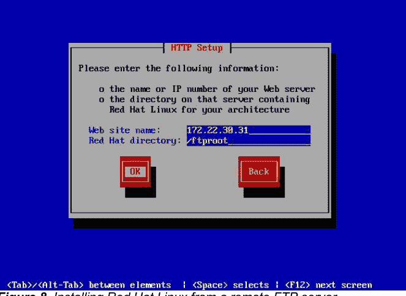

**图 8.** 从远程 FTP 服务器安装 Red Hat Linux。

定义你的硬件可以帮助你定义计算机硬盘上 Linux 的可用空间。你有多种方法可以在文件系统层级标准内的分区上组织 Linux。然后你可以使用 `FIPS.EXE`、`Idisk` 和 Red Hat 的 Disk Druid 配置并格式化所需的分区。这些工具可以帮助你与 Microsoft Windows 建立双启动配置。

最后，本章检查了 Red Hat Linux 安装过程的第一部分需要的信息——来自本地安装光盘以及来自远程服务器。在下一章中，我将详细介绍剩余的安装过程。这将帮助你安装在 Linux 上设置文件和打印服务器所需的软件。

> 本章的更新和更正可以在 Hentzenwerke 网站 www.hentzenwerke.com 上找到。点击“Catalog”并导航到此书的页面。

## 第 2 章：安装 Linux 作为文件服务器

当你安装任何操作系统时，最好的方法是安装你需要的软件。你不希望浪费可以用于实际需要的空间。如果你安装了过多的软件，可能会留下安全漏洞，黑客可以利用这些漏洞侵入你的系统。在完成本章后，你将学会如何在计算机上安装 Linux，并且只安装你需要的软件，并在需要时随时可用。

本章的重点是安装将 Red Hat Linux 配置为文件服务器所需的软件。我将在第 7 章中详细介绍将此台计算机转换为打印服务器的要求。本章的第一部分是第 7 章“配置打印机”的延续，介绍了你能够且应该为系统做出的软件选择。它将引导你对防火墙和身份验证做出关键选择。

如果你安装并配置了 Red Hat Linux 以图形界面登录，会有一个被称为“首次启动”（First Boot）的过程。在这种情况下，Red Hat 会连接到 Red Hat 网络（RHN），通过该网络，你可以确保已安装的软件已更新到最新的安全增强版本。

有时你需要安装或删除额外的软件。红帽软件包管理器（RPM）允许你通过安装光盘或网络资源进行安装。许多第三方软件都符合红帽软件包管理器（RPM）系统。你需要了解几个关键命令，以确保每次启动 Linux 时相关服务都是激活状态。

当你在计算机上安装 Linux 时，你获得的是一个专为网络设计的操作系统。Linux 是 Unix 的克隆，而 Unix 是许多开发了最终成为互联网的公共网络的人士设计的。下一节包含了你需要了解的基础网络理论术语。如果你熟悉 Microsoft Windows 网络，你可能已经熟悉大部分术语。

### 基础术语

- **身份验证（Authentication）：** 所有与用户名、密码以及任何相关数据库相关的话题。
- **DNS：** 域名服务（Domain Name Service）是一个域名数据库，例如 **`www.hentzenwerk.com`**，以及 IP 地址，例如 `10.11.12.13`。
- **DHCP：** 动态主机配置协议用于为不同的计算机分配 IP 地址和其他网络信息，通常在系统启动期间进行。
- **防火墙（Firewall）：** 一种软件服务，用于检查进出网络的数据，可以配置为阻止某些类型的数据。
- **FTP：** 文件传输协议（File Transfer Protocol），旨在优化文件传输。
- **HTTP：** 超文本传输协议（HyperText Transfer Protocol），与网页相关。

### Linux 网络传输基础术语

- **LAN：** 局域网（Local Area Network）由两或多台相互连接的计算机组成。
- **NFS：** 网络文件系统（Network File System）是 Linux 和 Unix 计算机共享目录的标准方式。
- **NIS：** 网络信息服务（Network Information Service）支持 Linux 和 Unix 计算机之间的身份验证。
- **POP3：** 邮局协议（Post Office Protocol）与收到的邮件相关。
- **SMB：** 服务消息块（Server Message Block），也称为 Samba，在 Linux 中的一种实现。
- **SMTP：** 简单邮件传输协议（Simple Mail Transfer Protocol）与发送邮件相关。
- **SSH：** 安全外壳（Secure Shell）允许通过网络进行加密访问。
- **TCP/IP：** 指计算机在网络上通信的一组协议，它是互联网的默认协议。

### 安装剩余步骤

本节本质上是第 1 章的延续，解释了安装 Red Hat Linux 的基本步骤。现在我将涵盖剩余过程，涉及设置防火墙、指定身份验证服务器、配置图形硬件以及安装所需的软件。

在第 1 章中，我介绍了在计算机上安装 Red Hat Linux 的基本步骤。剩余步骤如下：

- 选择防火墙。你可以根据需要在网络卡上激活防火墙。
- 选择安装 Red Hat Linux 的额外语言。你将能够使用 `redhat-config-languages` 工具在语言之间切换。
- 为你的计算机设置时区。如果 Linux 是唯一的操作系统，请激活“使用 UTC”选项。这会将你的时钟设置为格林尼治时间。

> 
> 如果你在与 Microsoft Windows 相同的计算机上安装 Linux，请不要激活“使用 UTC”选项，因为 Microsoft Windows 不理解它。

- 指定 root 密码，这是该计算机的管理员密码。它是你系统中最重要的密码。
- 为你的系统配置身份验证。你可以为 Linux 或 Unix 甚至是 Microsoft Windows 服务器设置加密。
- 选择要安装的软件包。在本章稍后的部分，我将指定所需的软件包组以创建一个与 Microsoft Windows 计算机交互的文件和打印服务器。
- Red Hat 继续安装。一旦安装了所需的软件包，就会为你的安装创建一个自定义启动软盘。
- 假设你安装了 GUI，你可以配置与系统相关的显卡。在大多数情况下，Red Hat 会自动检测显卡的相关设置；你只需确认选择。
- 选择连接到系统的显示器。在大多数情况下，Red Hat 会自动检测此显示器。
- 选择默认分辨率；你的选择取决于图形硬件的能力。如果你选择服务器或自定义安装（见第 1 章），你可以在文本和图形登录界面之间进行选择。在本章中，我假设你选择了图形登录界面。
- 完成！Red Hat 重启。如果你选择了图形登录界面，将进入本章稍后描述的首次启动。

### 配置防火墙

要理解防火墙如何工作，请回退并简单地查看 Linux 网络理论。

TCP/IP 协议就像电视机通道。当你设置防火墙时，你正在阻止许多（如果不是大部分）通道。对于用户来说，这是一种审查；对于想要进入你系统的黑客来说，这让生活变得更加困难。

当你在网上设置 Linux 计算机时，默认语言被称为 TCP/IP。它恰好是计算机在互联网上使用的语言。它是大量的协议或通信规则。TCP/IP 协议的一些示例包括用于网页的 HTTP、用于邮件的 POP3 和用于文件传输的 FTP。概念上，它就像一个巨大的双向集，拥有 65536 个端口来锁定双向通道。遗憾的是，黑客可以尝试通过这些通道中的任何一个进入你的系统。

在 Red Hat 安装过程中配置防火墙时，你会看到类似于图 1 的屏幕。

如你所见，红帽防火墙有三种基本的安全级别：

- **高安全性（High-security）：** 防火墙阻止进入你网络的流量，来自 DNS 服务器的流量除外。DNS 服务器主要用于将如 `www.mommbears.com` 的域名转换为如 `192.168.0.33` 的 IP 地址。你仍然可以从外部网络获取请求的数据，例如互联网网页。
- **中等安全（Medium）：** 中等安全防火墙阻止通过常用 TCP/IP 通道（1 到 1023 之间）的入流量。它还阻止 NFS 和远程 GUI 连接的通信。
- **无防火墙（No firewall）：** 你可以禁用本地计算机上的防火墙。这对于位于已有防火墙保护的局域网内部的计算机是合适的。

# Windows 网络管理员的 Linux 迁移指南

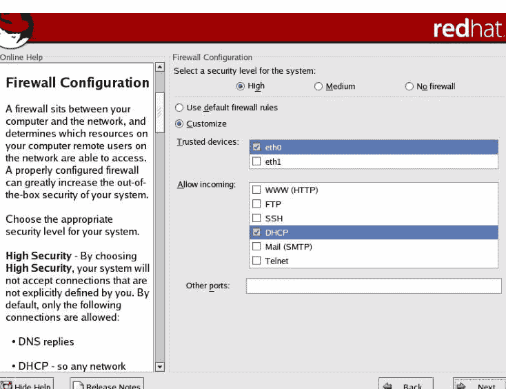

### 配置防火墙通信

你的计算机与网络之间的防火墙决定了网络上的远程用户能够访问你计算机上的哪些资源。配置恰当的防火墙可以增加系统的开箱安全性。

为你的系统选择合适的安全级别。

高安全性 - 通过选择“高安全性”，你的系统将不会接受任何未由显式定义的连接。默认情况下，只允许以下连接：

- DNS 响应
- DHCP - 适用于任何网络

图 1. 在 Red Hat 安装期间配置防火墙。

一旦你了解了可用的过滤器类型，你就可以在 Linux 安装后重新配置防火墙。Red Hat 包含了一系列优秀的工具来帮助这一过程。启动这些工具的命令是 `lokkit` 和 `redhat-config-firewall`。它们的界面不同，但你每个工具所需的信息本质上是相同的。

有时，你希望不仅仅是从你的计算机上浏览互联网。你可能想要搭建一个 Web 服务器。而且，是的，你可能想要共享文件。如图 1 所示，Red Hat 提供了一套你可以在防火墙中配置的标准服务。

**信任设备：** 某些计算机作为网关位于两个不同的网络之间。一个网卡（称为 `eth0`）连接到我的局域网（LAN）。另一个网卡（`eth1`）连接到互联网。我信任来自局域网的数据，我将 `eth0` 设置为“信任设备”。图 1 中定义的防火墙仅适用于来自互联网的流量，这保护了我的局域网。

**允许入站：** 如如图 1 所示，有很多可以通过防火墙的默认服务。这些仅对入站请求启用。例如，你不需要激活 WWW (HTTP) 框来允许你（或网络上的用户）浏览互联网。以下是默认服务：

### 第 2 章：安装 Linux 文件服务器

- WWW (HTTP): 允许防火墙外的用户访问你计算机上的 Web 服务器。
- FTP: 允许外部用户访问你计算机上的 FTP 服务器。
- SSH: 允许防火墙外的用户通过安全 Shell (SSH) 访问你的计算机。
- DHCP: 允许防火墙外的 DHCP 服务器为你的计算机提供 IP 地址信息。
- Mail (SMTP): 允许防火墙外的计算机使用你计算机上的邮件服务器。
- Telnet: 允许防火墙外的用户通过 Telnet 服务访问你的计算机。这是不安全的；SSH 是首选的替代方案。

### 身份验证

如果你为 Red Hat 选择了“服务器”或“自定义”配置，你正在设置一台可以存储网络用户名和密码的计算机——或者至少是响应者的请求。在某些情况下，你需要按照图 2 所示配置身份验证。


> 如果你在“个人桌面”或“工作站”配置下安装 Red Linux，你正在配置一台并非设计用于存储或处理组或域用户用户名和密码的计算机，因此你不会看到图 2。

在 Red Linux 安装过程中，你可以通过多种方式设置身份验证。首先，Red Hat 默认支持高达 256 个字符的密码。它还设置了影子密码（shadow passwords），这些密码加密在只有 root 用户可以访问的文件中（见第 3 章，“设置你的服务器文件系统”）。如你所示，身份验证方案包含了 NIS、LDAP 和 Kerberos 5 的表。我会简要介绍这些内容，但这些主题是本书的范围：

- NIS: 网络信息系统可以为 Linux 和 Unix 计算机提供通用的身份验证数据库。你可以配置 NIS 来存储网络上所有 Linux 和 Unix 计算机使用的通用密钥。
- LDAP: 轻量级目录访问协议对 Linux 和 Unix 计算机的功能来说非常简单。遗憾的是，在编写本文时，最新版本的 Samba 还不支持 LDAP，这是你无法将 Linux 计算机配置为 Windows 2000 原生模式网络上的域控制器的主要原因。我相信这个问题将在 Samba 3.0 发布时得到解决。
- Kerberos 5: 由 MIT 开发的 Kerberos 系统旨在消除在网络上发送密码的需求。遗憾的是，它与前面描述的默认影子密码或其他 Linux 身份验证系统无法工作。

# 34 Windows 网络管理员的 Linux 迁移指南

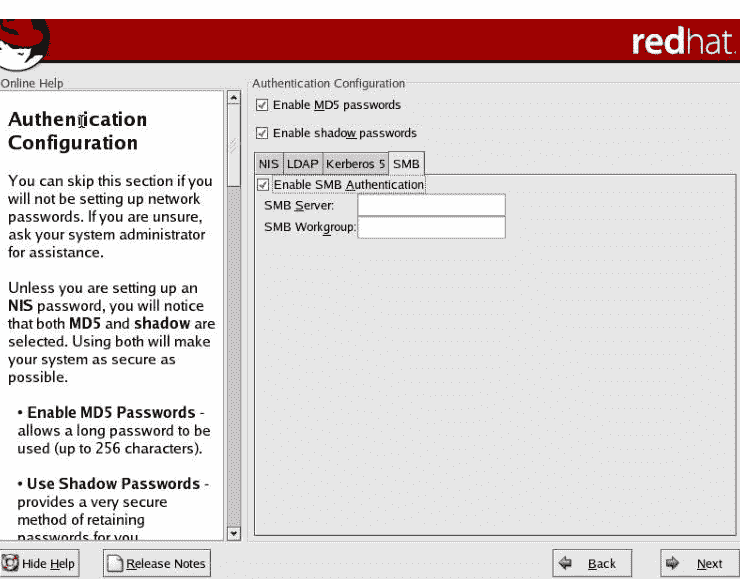

图 2. 在 Red Hat 安装期间设置身份验证。

### Samba 身份验证

你可以在图 2 中的 SMB 标签页上配置 Samba 身份验证。这需要安装本章描述的 Windows 文件服务器组。如果你不熟悉 Samba，可以随时跳过此节。你可以在第 3 章“设置你的服务器文件系统”中的 SMB 标签页上配置所有设置。

尽管引用“SMB 工作组”，但你可以配置 Samba 服务器将请求引用到微软域中的主域控制器 (PDC)。以下是可使用的三个选项：

- **启用 SMB 验证**: 允许你将此 Linux 计算机设置为查看用户名密码数据库。
- **SMB 服务器**: 允许你将此 Linux 计算机作为服务器。
- **SMB 工作组**: 允许你将此 Linux 计算机作为工作组的一部分。

### 第 2 章：安装 Linux 文件服务器

35

### 安装必要内容

在 Red Hat 安装过程中，你可以选择所需的软件包组。这些组安装了从 GUI 到数据库服务器的所有内容。如果你的驱动器很小，或者你非常担心安全，你可能会只想安装系统所需的最小内容。Red Hat Linux 需要的最小空间少于 500MB，与 Windows XP 上安装的 2GB 软件相比，这非常有吸引力。

事实上，Red Hat Linux 的最小安装允许与其他 Linux 和 Unix 计算机建立网络。它包含了让 Linux 健壮的基本工具和命令。但对于那些从 Microsoft Windows 转换的用户来说，这可能不够。最小安装不包含 GUI，也不包含与网络上的 Windows 计算机共享文件或打印机的工具。

### 基本组件

为了利用 Linux 能为你提供的功能，最好学习命令行界面。文本命令看起来可能晦涩，但它们通常是管理计算机最快、最有效的方法。然而，在 Microsoft Windows 网络上配置 Linux 计算机或服务器不再需要命令行技能。在本章的后半部分，我将描述你可以在命令行中执行的一些技巧。

### 基本组件+

很快，我将说明一个带有 GUI 和支持文件打印服务器服务的相当最小配置。该配置将为你的计算机安装约 1.5GB。

### 选项

Red Linux 有许多可选软件包组。软件包组只是一组常用软件包的集合。例如，打印系统属于打印软件组；这些被称为 CUPS 和 LPD，并在第 7 章“配置打印机”中进行了描述。

当你以标准图形模式安装 Red Hat Linux 时，最终会看到一个类似于图 3 所示的屏幕，显示了你可以安装的软件包组。如果你选择安装 X Window System 软件包组，可以点击详细信息链接或取消选择某些内容。相同的模式适用于此窗口中的其他软件包组。

不同的软件包组总结在表 1 中，与你在 Red Hat Linux 9 图形安装过程中看到的顺序相同。为了本书的目的，我不会安装这些中的大部分内容，但你可以选择其中一些组，将你的计算机配置为用于不仅仅是文件打印的服务。

#  Windows 网络管理员的 Linux 迁移

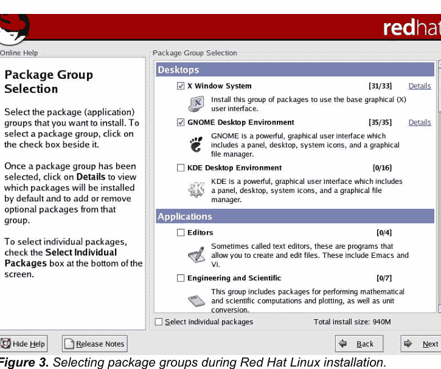

### 软件包组选择

选择您想要安装的软件包（应用程序）组。选择每个软件包组，点击其旁边的复选框。

一旦选择了某个软件包组，点击 **Details**（详情）可以查看默认将安装哪些软件包，并从组中添加或删除可选软件包。

若要选择单个软件包，请勾选屏幕底部的 **Individual Packages**（单个软件包）框。

| 桌面环境 | 详情 |
|---|---|
| ☑ Windows 系统 | [31/33] |
| 安装此组软件包以使用图形 (X) 界面。 | |
| ☑ Gnome 桌面环境 | [35/35] |
| Gnome 是一个强大的图形界面，包含面板、桌面、系统图标和文件管理器。 | |
| ☐ KDE 桌面环境 | [0/16] |
| KDE 是一个强大的图形界面，包含桌面、系统图标和文件管理器。 | |
| 应用程序 | |
| ☐ 编辑器 | [0/4] |
| 某些被称为文本编辑器，这些程序允许您创建和编辑文件。这些编辑器包括 Emacs 和 Vi。 | |
| ☐ 工程与科学 | [0/7] |
| 此组包含了用于执行数学和科学计算、绘图以及单位转换的软件包。 | |
| ☐ 选择单个软件包 | 总大小：94M |

**图 3.** 在安装 Red Hat Linux 期间选择软件包组。

| 软件包组 | 内容 |
|---|---|
| Windows 系统 | 基础软件包包括图形化软件、字体和配置文件。额外的软件包包括相关的管理和配置实用程序。 |
| Gnome 桌面环境 | GNOME 基础软件包包含一个 GUI 窗口和会话管理器，以及您可能在任何 GUI 中预期的某些基础界面。额外软件包括小型的 GUI 程序，例如 FTP 客户端。GNOME 是 Red Hat Linux 的默认 GUI。 |
| KDE 桌面环境 | KDE 是 GNOME 的替代方案，其基础软件包和额外软件包的模式相同。KDE 是许多其他 Linux 发行版的默认 GUI。 |
| 编辑器 | 许多，也许管理员更倾向于使用 KDE 而不是在文本编辑器中编辑配置文件。编辑器组包含了流行的文本编辑器，以及对第 8 章“管理与维护”中介绍的更基础文本编辑器的增强。 |
| 工程与科学 | 可以随 Red Hat Linux 的组件安装若干种工程和科学工具。 |
| 图形化网络 | 您可以安装许多不同的浏览器、电子邮件、聊天和视频会议应用程序。 |

### 第 2 章：将 Linux 安装为文件服务器 37

| 软件包组 | 内容 |
|---|---|
| 文本网络 | 如果您无法处理图形界面，可以安装许多文本浏览器、电子邮件阅读器和 FTP 客户端。 |
| 办公/生产力 | 虽然 Red Hat Linux 通常带有 OpenOffice 套件，但您可以安装另外两个办公套件的组件，以及几个额外的图形软件包。 |
| 音频和视频 | 在此软件包组的帮助下，您可以配置 CD 播放器、音频合成器以及 CD 和 DVD 录制机等。 |
| 与出版 | 此软件包组包含了与 Linux 和 Unix 密切相关的工具，例如 TeX 和 doct。 |
| 图形 | 许多 Linux 兼容应用程序可以帮助您创建和处理图形图像。 |
| 游戏和娱乐 | Linux 可以安装各种计算机游戏。 |
| 服务器配置工具 | 这是一个关键组，包含了各种图形化管理工具。 |
| Web 服务器 | Linux 是与互联网上最流行的 Web 服务器 Apache 关联平台。您可以安装 Apache、相关模块以及基于内核的 Web 服务器作为内容加速器（Red Content Accelerator）或 Tux。 |
| 邮件服务器 | Linux 也是 sendmail 等邮件服务的流行平台。 |
| Windows 文件服务器 | 此项的关键组允许您配置您的 Linux 计算机，使其看起来像 Microsoft Windows 上的服务器。 |
| DNS 名称服务器 | 在 Linux 上为您的网络设置 DNS 非常简单。 |
| FTP 服务器 | 如果您想使用 FTP 接口与客户端共享文件，此软件包将安装 Red Hat 非常安全的 FTP 守护进程——vsFTP。 |
| SQL 数据库服务器 | 如果您正在管理数据库，可能在使用基于结构化查询语言 (SQL) 的数据库。Linux 可以安装与 PostgreSQL 和 MySQL 数据库系统相关的软件包。 |
| 新闻服务器 | Red Hat Linux 自带一个新的新闻服务器。 |
| 网络服务器 | Linux 的配置不仅限于 Windows 文件服务器；该软件包包含了用于 DHCP、RSH、NIS、Telnet 等等的服务器。 |
| 开发工具 | 如果您从事软件开发或重新配置 Linux 内核的工作，您将需要此软件包中的一些工具。 |
| 内核开发 | 需要特殊的软件包来针对不同的设置重新配置并取回内核。 |
| X 软件开发 | 如果您想开发图形界面或字体，您将需要此软件包中的软件库。 |
| GNOME 开发 | 如果您想开发与 GNOME 环境相关的应用程序，您将需要此组中的库。 |
| KDE 开发 | 如果您想开发与 KDE 环境相关的应用程序，您将需要此软件包中的库。 |
| 管理工具 | 一个关键组。它包含了许多可以使用来配置您的 Linux 计算机的图形化工具。 |
| 系统工具 | 多种工具。它们包括用于某些功能的客户端。 |
| 打印支持 | Red Hat Linux 支持两种不同的打印系统，在第 7 章“配置打印机”中进行了详细介绍。 |

# Windows 管理员的 Linux 迁移

由于本书是为从 Microsoft Windows 转换的用户编写的，我安装了以下软件包组。在书的剩余部分中，我将引用这些组中的软件。

- **X Window 系统**: 此组包含了 Linux GUI 的基础软件包。
- **GNOME 桌面环境**: GNOME 是 Red Hat Linux 的默认 GUI，并支持后续章节介绍的 GUI 工具。如果您愿意，可以替换或添加 KDE 桌面环境。
- **图形化网络**: Linux 包含了许多作为该组部分的 GUI 应用程序。第 3 章“设置您的文件系统”中介绍的 Samba 管理工具 (SWAT) 需要浏览器。
- **服务器配置工具**: Red Hat 开发了许多用于各种服务（如 Samba）的 GUI 工具，用于与 网络和打印管理器进行共享。
- **管理工具**: Red Hat 开发了一组基础 GUI 管理工具，可以帮助您配置 Linux 计算机、管理用户、查看日志文件等。

如果您想要运行在 Windows 网络上的文件服务器，您需要添加以下软件包组（每个组中的默认软件包已足够）：

- **Windows 文件服务器**: 如表所示，Windows 文件服务器软件包允许将您的计算机配置为服务器、PDC 或 Microsoft 网络。
- **系统工具**: 此组中有一个必需软件包 **`samba-client`**。它允许您作为客户端连接。
- **打印支持**: Red Hat Linux 关联的默认打印服务是 CUPS；虽然 LPS 是此组的一部分，但您不需要它，且默认未安装。

# 第 2 章：将 Linux 安装为文件服务器 39

- **音频和视频：** Red Hat Linux 包含许多实用程序，可以帮助你混合不同的声音、播放音乐以及在 CD 和 DVD 上录制声音数据。
- **图形：** Red Hat Linux 包含了许多应用程序，很多人认为这些程序的功能至少与 Paint Shop Pro 这样的商业软件相当。例如，书中的一张截图就是使用 GIMP（也称为 GNU 图像处理程序）创建的。

与所选组关联的默认包很好地满足本书的需求；对于我列出的软件包组，Red Hat 默认会安装 1.5GB 的文件。

### 其他网络服务

在安装 Red Hat Linux 时，你会发现还有其他网络服务对你很有用。你可以从“软件包选择”窗口安装它们（见图 3）。这些软件包是各种软件包组的一部分。

如果你不需要这些服务，请不要安装。如果你确实需要，它们可能会为黑客进入你的计算机提供通道。你可以随时再安装这些服务。请注意，这些服务的额外信息超出了本书的范围。

这些服务包括：

- **Amanda：** 高级马里兰网络磁盘备份（Advanced Maryland Network Disk Archiver）定期支持从 Linux 服务器进行计划备份。
- **Apache：** Apache Web 服务器是目前互联网上流行的 Web 服务器。它允许你设置安全的网站、数据库、脚本、代理等。

> 有关 Windows 管理员视角的 Apache 信息，请参阅本系列的另一本书《Windows Web 服务器管理员的 Linux 迁移，2003》。


- **bind：** 伯克利互联网域名（bind）提供了允许 Linux 充当 DNS 服务器的软件。也称为 nammaster。
- **caching-nameserver：** 缓存名称服务器，可以存储来自远程 DNS 服务器的最近请求。
- **CIPE：** 加密 IP 封装（Crypto IP Encapsulation）通过互联网等不安全网络在私有网络之间提供安全连接。也称为虚拟专用网络（VPN）。
- **Finger：** 用于查询本地或远程计算机用户的管理工具。
- **MySQL：** 一个开源数据库管理系统。可以配合 Apache 用于 Web 应用程序。
- **InterNews：** 新闻服务器，通常用于 Usenet（一种与互联网消息组相关的公告板系统）。
- **NIS：** 网络信息服务（Network Information Service）如前所述，提供身份验证文件等等内容的公共数据库。
- **Postfix：** sendmail 的常见替代方案，你可以将其配置为处理入站邮件的服务。
- **postgreSQL：** 一个开源数据库管理系统。可以配合 Apache 用于 Web 应用程序。

##  Windows 网络管理员的 Linux 迁移

- **PXE：** 支持预启动执行环境，允许远程 Linux 计算机从磁盘镜像启动。
- **RSH：** 远程 shell 为远程用户连接到本地命令行界面提供方法。不安全。
- **sendmail：** 一种流行的收发电子邮件的服务器。你可以设置像 Mozilla、Evolution 这样的邮件客户端，甚至使用 Microsoft Outlook 连接到 sendmail 邮件服务器。
- **SSH：** 安全外壳（Secure Shell）允许加密远程登录，类似于 Telnet。
- **Telnet：** Telnet 服务器支持登录到本地命令行界面。不安全。
- **Tux：** Apache 的替代 Web 服务器；为某些类型的文件（如图片）提供服务。它可以配置为与 Apache 配合处理不同类型的文件。
- **VNC：** 当你设置虚拟计算服务器时，远程用户可以连接并控制你的 GUI。
- **vsFTP：** 一个非常安全的 FTP 服务器允许你设置文件服务和匿名用户。当你连接到 `ftp.redhat.com` 时，你正连接到一个 vsFTP 服务器。

回顾一下，你可以创建一个启动盘，Red Hat 会在你的计算机上安装软件。然后你可以创建启动盘、配置图形硬件，并选择图形或文本登录屏幕。为了这些目的，我假设你选择了图形登录屏幕。Red Hat 会重启你的计算机。


如果你在“个人桌面”或“工作站”配置中安装了 Red Hat，Red Hat 不给你提供选择。它会自动启动图形登录界面。

### 首次安装

一旦安装了 Red Hat，就有一些事情需要配置。在首次登录 Linux 之前，Red Hat 会引导你通过“首次启动”（First Boot）过程。一旦你通过首次启动设置了基本参数，就可以连接到 Red Hat Network 来保持计算机更新。


你在本节中采取的步骤取决于你选择了图形还是文本登录屏幕。

如果你不连接到 Red Hat Network，可以先跳过此步，稍后处理。在本节中采取的步骤取决于你选择了图形还是文本登录屏幕。

*(注：原文后续部分存在大量重复的无效句子，此处已根据逻辑精简)*

### 第2章：将 Linux 安装为文件服务器

如前所述，本节假设你已经在安装过程中选择了图形化登录界面。如果你选择了文本登录界面，我假设你对 Linux 有所了解，并且对命令行界面略有认识。

从文本登录界面进入“首次启动”（First Boot）的简短步骤如下：以 root 用户身份登录，运行 `init 5` 命令，在图形界面登录以启动 GUI，然后在 Linux GUI 内部的命令行窗口运行 `firstboot` 命令。

现在你已经配置好了 Linux 计算机，是通过红帽网络（Red Hat Network）检查软件状态的好时机。你可以使用 Red Hat Linux GUI 来完成。

## Red Hat Linux GUI

默认的红帽 GUI 被称为 GNOME，即 GNU 网络对象模型环境。从概念上讲，许多界面与 Microsoft Windows 相似。如图 6 所示，GNOME 在桌面上包含多个图标和一个任务栏（在 Linux 中称为“panel”）。

桌上有三个图标。在左上角，“root 主目录”（root’s Home）图标可以带你进入当前用户的目录——在这种情况下是 root。“在此处”（Start Here）图标提供了一个类似于 Microsoft Windows 资源管理器的应用程序和首选项界面。“垃圾箱”（Trash）图标自言自明；它就像一个用于从 GUI 内部删除的文件的回收站。

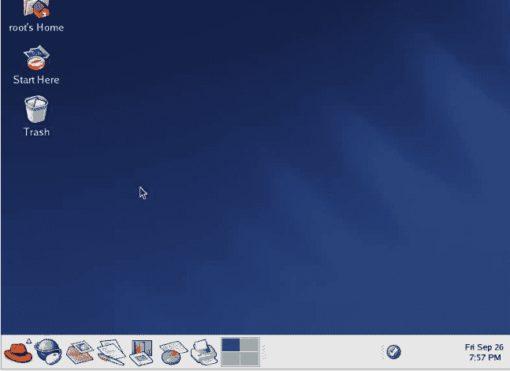

图 6。默认的 Red Hat Linux GUI。

## Windows 网络管理员的 Linux 转换指南

如果你已经在相应的驱动器中“挂载”了 CD 或软盘，你也会桌面上看到允许你访问其文件的图标。双击这些图标之一，将在图形化的 Nautilus 界面打开驱动器，该界面看起来像简化版的 Windows 管理器。

桌面左下角的红色帽子相当于 Microsoft 开始按钮。在 Red Linux 中，它被称为主菜单（Main Menu）按钮。你可以用它访问许多程序和实用程序。

GUI 中一个重要的 Linux 工具是命令行界面。用鼠标右键点击桌面。在弹出的菜单中，选择“新建终端”（New Terminal）。在 Red Linux 中，这将启动一个命令行窗口，你可以在其中输入普通命令，以及用于打开各种 GUI 工具和应用程序的命令。

### 红帽网络 (Red Hat Network)

红帽网络（RHN）提供了你的计算机与 `rhn.redhat.com` 上更新服务器之间的连接。它在概念上类似于 Microsoft Windows 更新工具，因为它会检查你的系统是否有与该操作系统相关的最新软件。

自然地，要连接到 RHN，你需要计算机与互联网之间的连接。如果你的计算机位于已经连接到互联网的局域网（LAN）上，红帽在安装过程中应该配置好了你的计算机。RHN 的不同之处在于，它为与红帽发行全系列 Linux 软件提供更新。例如，它支持关键应用程序（如 Evolution 邮件管理器）的定期更新。然而，RHN 也要求你注册你的系统。

要开始注册过程，点击“Main Menu | System Tools | Red Hat Network”打开红帽网络工具。第一次运行此程序时，你应该看到图 7 所示的红帽网络配置。

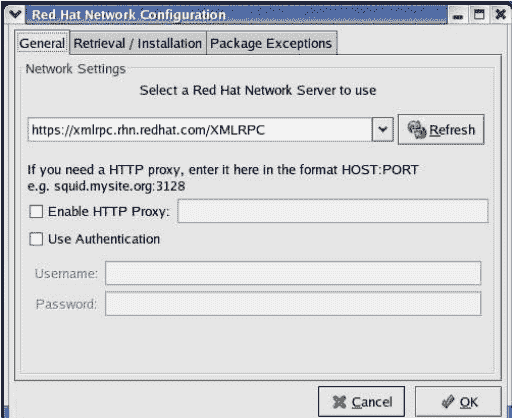

图 7。配置你的系统连接到红帽网络。

### 第2章：将 Linux 安装为文件服务器

此窗口包含三个选项页：

- 通用（General）：要连接到 RHN，你需要指定服务器。通常默认值是合适的。如果你的网络上有代理服务器，你将需要输入该服务器连接所需的设置。

> 随着红帽向 Fedora 项目转型，与红帽网络相关的程序可能会发生变化。请关注 `fedora.redhat.com` 和 `rhn.redhat.com` 以获取更多信息。

- 获取/安装（Retrieval/Installation）：此选项页上的设置允许你指定何时安装包，以及是否想要使用 PGP 验证下载包的完整性。

> 漂亮隐私加密（PGP）的 Linux 实现被称为 GNU 隐私卫士（GPG）。更多信息请参阅 `www.gnuppg.org`。

- 软件包异常（Package Exceptions）：你可以指定不自动升级的包。例如，更新后的内核通常不会被安装。

这些选项页的默认设置符合大多数用户。点击 OK 继续。按照以下步骤操作：

1. 假设你已接受默认的 GPG 选项，系统会询问你是否安装 GPG 密钥环来验证下载的红帽包。这是一个极好的主意。点击 Yes 继续。
2. 在红帽更新代理（Red Hat Update Agent）界面上，点击 Forward（前进）。
3. 你的计算机连接到红帽网络。第一次启动更新代理时，你将审查当前的隐私声明。阅读它，假设你接受，点击 Forward 继续。
4. 红帽更新代理将带你进入图 8 所示的登录界面。如你所示，有两种方式连接 RHN。如果你有现有账户 way可用“权限”（entitlement），请使用你当前的 RHN 用户名和密码登录。
5. 下一个屏幕列出了你已安装的包。

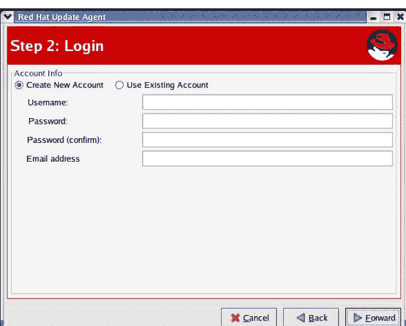

图 8。登录更新代理。

6. 红帽更新代理进入下载包。
7. 如果准备就绪，点击 Forward。
8. 红帽更新代理构建更新包列表。
9. 示例如图 9 所示。
10. 选择想要更新的包。
11. 就本章而言，我接受了所有建议的。
12. 红帽更新代理检查所选包的依赖关系。
13. 安装完成后，你会看到以下消息：“全部完成”（All finished）。点击 Forward 继续。

### 第2章：将 Linux 安装为文件服务器

对于 Microsoft Windows 网络。如果你已经配置了 Samba，在激活更新之前将至少保存配置文件。理想情况下，你应该用测试计算机测试更新后的软件，以查看更改是否对你的网络产生任何影响。

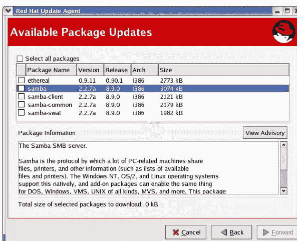

图 9。更新代理列出了你系统中可以更新的包。

#  Windows 网络管理员的 Linux 转换指南

还有另一种更新你 Linux 计算机上已安装的软件包组的方法：你可以使用 Rawhide。

### Rawhide

虽然软件包的最新版本应该可以通过 RHN（红帽网络源）获取，但你看到的列表并不完整。例如，通过更新代理程序（Update Agent）提供的某些软件可能只解决安全问题，而 Rawhide 可能包含对实际软件的升级。

你可以通过使用红帽 FTP 服务器或镜像站点上的 Rawhide 目录来检查与 Red Hat Linux 相关的软件最新版本。你可以在 `/pub/redhat/rawhide` 目录下找到 Rawhide。子目录与不同的 CPU 关联；你可以从 `i386` 子目录下载与 Intel 32 位兼容的包。

### 其他更新

特别是在安全方面，红帽在更新软件包方面非常认真，并会及时通过更新代理程序和 Rawhide 提供这些包。然而，如果你对安全格外关注，可以去 `www.samba.org` 查找安全更新、SysAdmin、审计以及安全 (SANS) 学院。

熟悉除了在 Windows 网络上创建 Linux 文件服务器所需的软件以外的组织也是很有帮助的。基础软件 Samba 主要由一组志愿者开发。他们的工作文档记录在 `www.samba.org` 上。

Red Hat Linux 的默认打印服务与之前一样是 CUPS。有关其赞助商 Easy Software Products 的更多信息和最新更新请访问 `www.cups.org`。


> Red Hat Linux 包含的 CUPS 和 Samba 版本都受 Linux 操作系统相同的许可证保护，即通用公共许可证 (GPL)。更多信息和该许可证的副本可以从自由软件基金会处通过 `www.gnu.org/copyleft/gpl.html` 获取。

### 软件包管理

一旦 Linux 安装在你的计算机上，还有其他方法可以保持你的系统更新。诸如 Red Hat 等发行版是基于红帽软件包管理器 (RPM) 系统构建的。一个 RPM 是一个集成文件组。当使用 `rpm` 命令打开时，它会安装或升级特定的软件组件。或者，你也可以在 Linux 图形界面 (GUI) 中安装 RPM。

为了维护 Red Hat Linux，需要的不仅仅是红帽更新代理程序。某些时候，你需要从命令行安装或升级特定的软件包。为了做到这一点，详细查看 `rpm` 命令非常重要。

## 安装和升级 RPMs

当你向计算机上安装 Red Hat Linux 时，你实际上安装了一系列 RPM 软件包。三张 Red Hat 9 安装光盘上有 1,400 多个 RPM。你可以在 `/var/log/rpmpkgs` 文件中查看已安装 RPM 的列表。

Hat Linux 文件是文本文件，你可以在文本编辑器中打开它们。在 Red Hat Linux 9 的 GUI 中，你可以通过点击桌面左下角的菜单菜单（红帽）来选择文本编辑器。这会打开 GNOME 主菜单，从那里你可以选择“应用程序 | 文本编辑器”（Accessories | Text Editor），这会打开一个功能与 Microsoft Windows 记事本相似的编辑器。

当你处于 GNOME GUI 时，可以很容易地从 Red Hat Linux CD 中安装或删除附加包。将第一张 CD 插入相应的驱动器。在提示时选择“自动运行”（autorun）。这将启动软件包管理工具。点击“下一步”（Forward）继续。

如果自动运行没有在你的计算机上自动启动，请点击“主菜单 | 系统设置 | 添加/删除应用程序”，或从 GUI 内部的命令行窗口运行 `redhat-config-packages` 命令。

红帽软件包管理器会检查 `/var/log/rpmpkgs` 中的 RPM 列表。这会打开图 10 所示的“添加或删除软件包”屏幕，它看起来应该很眼熟。它包含了你在 Red Hat 安装过程中看到的相同信息和界面（见图 3）。

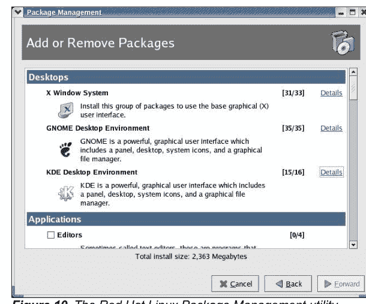

如果你以前选择过软件包组，你可以在这里选择它进行安装。例如，你可以像图 10 所示那样选择“编辑器”（Editors）软件包组。对于已安装的软件包组，如果你点击“详细信息”（Details），你可以选择或取消勾选任何非“强制性”（mandatory）的包。完成后，点击“下一步”（Forward）并按照提示操作。软件包管理会检查所选 RPM 的依赖关系，并将这些包添加到待安装列表中。

如果你想安装或删除不在列表中的 RPMs，你需要了解几个 `rpm` 命令。如前所述，在 GUI 中打开命令行界面。右键点击桌面，并选择“新建终端”（New Terminal）。

### 使用 rpm 命令

红帽软件包通常以 `.rpm` 扩展名结尾。从安装 CD 中安装的一个有用 RPM 是 `rpmdb-redhat`。它可以帮助你识别你尚未安装的任何文件的源 RPM。在 Red Hat Linux 9 中，该包的完整名称是 `rpmdb-redhat-9-0.200301386.rpm`。你可以在第三张 Red Hat Linux 9 安装光盘上找到它。

要安装此特定软件包，请按照以下步骤操作：

1. 插入相应的红帽安装 CD。对于 Red Hat Linux 9，恰好是第三张 CD。如果你在 GNOME 中，选择以下操作。
2. 右键点击桌面并选择“新建终端”。
3. 如果你在 GNOME 中，选择以下操作。
4. 在如所述的命令行界面中选择以下。
5. 如果你在 GNOME 中，选择以下操作。
6. 如果你在 GNOME 中，选择以下操作。
7. 软件包管理器检查系统。

红帽软件包通常以 `.rpm` 扩展名结尾。从安装 CD 中安装的一个有用 RPM 是 `rpmdb-redhat`。它可以帮助你识别你尚未安装的任何文件的源 RPM。在 Red Hat Linux 9 中，该包的完整名称是 `rpmdb-redhat-9-0.200301386.rpm`。你可以在第三张 Red Hat Linux 9 安装光盘上找到它。

要安装此特定软件包，请按照以下步骤操作：

1. 插入相应的红帽安装 CD。对于 Red Hat Linux 9，恰好是第三张 CD。如果你在 GNOME 中，选择以下操作。
2. 右键点击桌面并选择“新建终端”。
3. 如果你在 GNOME 中，选择以下操作。
4. 在如所述的命令行界面中选择以下。
5. 如果你在 GNOME 中，选择以下操作。
6. 如果你在 GNOME 中，选择以下操作。
7. 软件包管理器检查系统。

红帽软件包通常以 `.rpm` 扩展名结尾。从安装 CD 中安装的一个有用 RPM 是 `rpmdb-redhat`。它可以帮助你识别你尚未安装的任何文件的源 RPM。在 Red Hat Linux 9 中，该包的完整名称是 `rpmdb-redhat-9-0.200301386.rpm`。你可以在第三张 Red Hat Linux 9 安装光盘上找到它。

要安装此特定软件包，请按照以下步骤操作：

1. 插入相应的红帽安装 CD。对于 Red Hat Linux 9，恰好是第三张 CD。如果你在 GNOME 中，选择以下操作。
2. 右键点击桌面并选择“新建终端”。
3. 如果你在 GNOME 中，选择以下操作。
4. 在如所述的命令行界面中选择以下。
5. 如果你在 GNOME 中，选择以下操作。
6. 如果你在 GNOME 中，选择以下操作。
7. 软件包管理器检查系统。

红帽软件包通常以 `.rpm` 扩展名结尾。从安装 CD 中安装的一个有用 RPM 是 `rpmdb-redhat`。它可以帮助你识别你尚未安装的任何文件的源 RPM。在 Red Hat Linux 9 中，该包的完整名称是 `rpmdb-redhat-9-0.200301386.rpm`。你可以在第三张 Red Hat Linux 9 安装光盘上找到它。

要安装此特定软件包，请按照以下步骤操作：

1. 插入相应的红帽安装 CD。对于 Red Hat Linux 9，恰好是第三张 CD。如果你在 GNOME 中，选择以下操作。
2. 右键点击桌面并选择“新建终端”。
3. 如果你在 GNOME 中，选择以下操作。
4. 在如所述的命令行界面中选择以下。
5. 如果你在 GNOME 中，选择以下操作。
6. 如果你在 GNOME 中，选择以下操作。
7. 软件包管理器检查系统。

红帽软件包通常以 `.rpm` 扩展名结尾。从安装 CD 中安装的一个有用 RPM 是 `rpmdb-redhat`。它可以帮助你识别你尚未安装的任何文件的源 RPM。在 Red Hat Linux 9 中，该包的完整名称是 `rpmdb-redhat-9-0.200301386.rpm`。你可以在第三张 Red Hat Linux 9 安装光盘上找到它。

要安装此特定软件包，请按照以下步骤操作：

1. 插入相应的红帽安装 CD。对于 Red Hat Linux 9，恰好是第三张 CD。如果你在 GNOME 中，选择以下操作。
2. 右键点击桌面并选择“新建终端”。
3. 如果你在 GNOME 中，选择以下操作。
4. 在如所述的命令行界面中选择以下。
5. 如果你在 GNOME 中，选择以下操作。
6. 如果你在 GNOME 中，选择以下操作。
7. 软件包管理器检查系统。

红帽软件包通常以 `.rpm` 扩展名结尾。从安装 CD 中安装的一个有用 RPM 是 `rpmdb-redhat`。它可以帮助你识别你尚未安装的任何文件的源 RPM。在 Red Hat Linux 9 中，该包的完整名称是 `rpmdb-redhat-9-0.200301386.rpm`。你可以在第三张 Red Hat Linux 9 安装光盘上找到它。

要安装此特定软件包，请按照以下步骤操作：

1. 插入相应的红帽安装 CD。对于 Red Hat Linux 9，恰好是第三张 CD。如果你在 GNOME 中，选择以下操作。
2. 右键点击桌面并选择“新建终端”。
3. 如果你在 GNOME 中，选择以下操作。
4. 在如所述的命令行界面中选择以下。
5. 如果你在 GNOME 中，选择以下操作。
6. 如果你在 GNOME 中，选择以下操作。
7. 软件包管理器检查系统。

红帽软件包通常以 `.rpm` 扩展名结尾。从安装 CD 中安装的一个有用 RPM 是 `rpmdb-redhat`。它可以帮助你识别你尚未安装的任何文件的源 RPM。在 Red Hat Linux 9 中，该包的完整名称是 `rpmdb-redhat-9-0.200301386.rpm`。你可以在第三张 Red Hat Linux 9 安装光盘上找到它。

要安装此特定软件包，请按照以下步骤操作：

1. 插入相应的红帽安装 CD。对于 Red Hat Linux 9，恰好是第三张 CD。如果你在 GNOME 中，选择以下操作。
2. 右键点击桌面并选择“新建终端”。
3. 如果你在 GNOME 中，选择以下操作。
4. 在如所述的命令行界面中选择以下。
5. 如果你在 GNOME 中，选择以下操作。
6. 如果你在 GNOME 中，选择以下操作。
7. 软件包管理器检查系统。

`rpmdb-redhat` 软件包可以帮助你识别任何尚未安装的文件的源 RPM。

```
rpm -ivh /mnt/cdrom/RedHat/RPM/samba-swat-*
```

该命令从指定目录安装 `samba-swat-*`。

示例. 请替换为你选择的软件包。如果该包不在当前目录，请确保包含完整的目录名称，例如 `/mnt/cdrom/RedHat/RPMS`。

## 表 2. 常用的 rpm 开关。

| 开关 | 用法 |
|---|---|
| -e | 要删除如 `samba-swat` 这样的包，使用 `rpm -e samba-swat` 命令。不要在包名末尾添加版本号。 |
| -h | 在安装时添加 -h 开关，使用哈希标记（#）来跟踪安装进度。这必须与 -l 或 -U 等安装类开关配合使用。 |
| -i | 要安装如 `samba-swat` 这样的包，请使用 `rpm -i samba-swat*` 命令，其中 `*` 是代表软件包版本号的通配符。 |
| -q | 要检查是否安装了如 `samba-swat` 的包，使用 `rpm -q samba-swat` 命令。不要在包名末尾添加版本号。 |
| -qi | 如果你想查看 `samba-swat` 包的描述，请使用 `rpm -qi samba-swat` 命令。 |
| -ql | 如果你想获取 `samba-swat` 包包含的文件列表，请使用 `rpm -ql samba-swat` 命令。 |
| --redhatrovides | 如果你想识别与文件 `/etc/passwd` 相关的 RPM 软件包，请运行 `rpm -redhatrovides /etc/passwd` 命令。注意该开关使用的是双横杠。 |
| -U | 如果你不确定系统上是否存在旧版本的 `samba-swat`，使用 `rpm -U samba-swat*` 命令，它会升级任何旧版本的包，或者在未安装时安装所引用的包。请注意，这里使用的是大写字母 U。 |
| -v | 如果你想从开关的输出中获取更多信息，请添加 -v。它不能单独使用。 |

这是一个你可以配合 `rpm` 命令一起使用的短开关列表。完整列表可以在 `rpm` 手册中查找到，你可以在命令行中通过以下命令打开它：

```
```


### man rpm

通过阅读手册，你可以学习到许多命令行命令的知识。例如，如果你想学习如何列出文件，请运行`man ls`


## 卸载不需要的内容

如果你有一个大硬盘，你可能不会过多考虑安装 Red Hat Linux 9 安装光盘上的所有内容。与可用的更大的硬盘相比，5GB 的空间似乎完全不是什么问题。

然而，额外的软件意味着额外的漏洞。你可能并没有使用已安装的每一个服务。未使用的服务对于寻找进入系统路径的黑客来说，几乎是敞开的大门。你有两种方法来处理这个问题：你可以卸载需要的内容，或者禁用一个已安装的服务。但首先，让我们来看一眼可能已安装的服务。

## 第 2 章：将 Linux 安装为文件服务器

### 检查已安装的服务

在 Red Hat Linux 中，网络服务通过两个目录激活。主要服务通过`/etc/rc.d/init.d`目录中的脚本激活。其他网络服务可以在`/etc/xinetd.d`目录找到。从命令行，你可以找到这些目录中的列表。图 11 展示了安装了多少服务。

```
[root@localhost ~]# /etc/rc.d/init.d

amacron firstbirth irda named ntpd sasld ssh

apmd functions idn netsfs pcmia sendmail syslog

atd gpm kctrate portmap single winbind

autofs halt keytable random smb xfs

count httpd kill nfsock radevices xineted

cups iptables rhnd snmptrapd ybind

[root@localhost ~]# /etc/xinetd.d

chargen cups-ld daytime-up echo-up servers sgi_fam time-up

charg-upd daytime rsync services time
```


图 11. 无论多还是少，这个列表都是 Red Hat 计算机上剩余的安装选项。

信你否，这个列表在本章的前面已经提到过。例如，即使你没有安装 Web 服务器软件包组，Apache 脚本`httpd`仍然被安装了。


> Red Hat 经常安装“额外”软件。在本章前面的部分，我选择在带有默认服务器配置工具软件包组的情况下安装 Red Hat Linux。此组包含了`redhat-config-httpd`，这是一个配置 Apache 的 GUI 工具。因此，Red Hat 假设我忘记在安装列表中包含 Apache Web 服务器，并“方便地”将该软件添加到了操作系统中。

在判断是否要安装或禁用某个服务之前，你可能想先了解一下这些服务。我将图 11 中的服务列在表 3 中。这并不是完整列表；它是基于本章前面描述的典型安装。请注意，网络目录中的某些脚本和服务可能位于其他地方。除非你确定自己在做什么，否则不要禁用任何与网络相关的服务。

## 表 3. /etc/rc.d/init.d. 中的服务脚本。

| 脚本 | 服务 | RPM 软件包 |
|---|---|---|
| acron | Cron 任务 | anacron |
| apmd | 电源管理 | apmd |
| atd | 定时任务 | atd |
| autofs | 自动挂载 | autofs |
| halt | 关机 | halt |
| count | 统计信息 | count |
| cups | 打印服务 | cups |
| firstboot | 首次启动 | firstboot |
| functions | 功能 | functions |
| gpm | 磁盘管理器 | gpm |
| keytable | 键盘布局 | keytable |
| httpd | Web 服务器 | httpd |
| iptables | 防火墙 | iptables |
| irda | 红外服务 | irda |
| kctrate | 键盘速率 | kctrate |
| kill | 进程终止 | kill |
| named | DNS 服务器 | named |
| netfs | 网络文件系统 | netfs |
| ntpd | 时间同步 | ntpd |
| pcmia | PCMC 支持 | pcmia |
| portmap | 端口映射 | portmap |
| random | 随机数 | random |
| radevices | 设备列表 | radevices |
| sasld | 安全认证 | sasld |
| sendmail | 邮件传输 | sendmail |
| ssh | 安全外壳 | ssh |
| smb | Samba 服务 | smb |
| single | 单用户模式 | single |
| winbind | Windows 集成 | winbind |
| xfs | XFS 文件系统 | xfs |
| xineted | 扩展服务 | xineted |
| ybind | NIS 绑定 | ybind |
| redhatrovides | Red Hat 特定信息 | redhatrovides |
| rhnd | Red Hat 守护 | rhnd |
| snmptrapd | SNMP 陷阱 | snmptrapd |

## 第 2 章：安装 Linux 作为文件服务器

| 脚本 | 服务 | RPM 软件包 |
|---|---|---|
| snmpd | 控制与简单网络管理协议（SNMP）相关的程序，对于诊断网络问题非常重要。请勿卸载。 | net-snmp |
| snmptrad | 支持 SNMP。请勿卸载。 | net-snmp |
| sshd | 控制安全外壳（SSH）服务，支持到远程计算机的加密连接。这是一个非常优秀的工具，你应该保留它。 | openssh-server |
| syslog | 控制支持日志的程序。在`/var/log`中记录日志对于 Linux 系统管理员至关重要。请勿卸载。 | syslog |
| winbind | 支持访问微软 Windows 用户名和密码数据库。为了此项功能，请保持安装状态。 | samba-common |
| xfs | 配置 X 前 Server，与 X Window 组紧密相关。 | xfree86-xfs |
| xinetd | 配置扩展 Internet 服务，它控制后文描述的许多其他网络服务。 | xinetd |
| ybind | 允许连接到 NIS 客户端。如果你不计划使用这种方法创建自定义密码数据库。 | ybind |

如果你想卸载表 3 中列出的服务之一，请记住相关 RPM 软件包的名称。稍后你将如何使用`rpm`命令和 RPM 软件包名来卸载 Apache。

如图 11 所示，与`xinetd`关联的位于`/etc/xinetd.d`目录下的许多脚本非常基础；你不需要卸载任何相关包。如果你在该目录下提供了额外的服务，请阅读下一节的说明，它们可以帮助你决定是否需要该服务。

### 获取信息

如果你安装了 Red Hat Linux 9 安装光盘上的所有内容，那么`/etc/rc.init.d`目录下的脚本数量将是原来的两倍。你应该学习如何获取每个脚本的更多信息，以便自行决定是否卸载或停用该包。按照以下步骤操作：

1. 在文本编辑器中读取你选择的脚本。你可以点击 GNOME 桌面上的“主 | 应用程序 | 文本编辑器”来使用之前描述的文本编辑器。或者，你也可以像第 8 章“管理与维护”描述的那样，从命令行使用`vi`编辑器。文件开头通常会有解释其用途的注释。
2. 找到与脚本关联的 RPM 软件包。假设你已经安装了本章讨论的`rpm-db` RPM，那么找到包名很容易。例如，要找到与 Apache (`httpd`) 脚本关联的包，请运行以下命令。注意我包含了文件的完整路径：

```
# rpm --redhatprovides /etc/rc.d/init.d/httpd
```

如果存在父 RPM 软件包，你将在输出中看到它。它包含了包名和版本号。如果你刚刚安装了 Red Hat Linux 9，你将看到：

```
httpd-2.0.40-21
```

3. 每个 RPM 都应该包含一个描述。你可以使用以下命令找到`httpd`软件包的描述。注意我运行此命令时没有带上修订号：

```
# rpm -qi httpd
```


现在你已经知道如何确定安装了哪些内容，可以对是否卸载或停用某项服务做出自己的决定了。我在表 3 中列出了几个可以安全卸载或停用的服务。

### 卸载服务

如果你确定永远不会在本地计算机上设置 Web 服务器，你可以卸载相关的软件包。对于上述目录中带有脚本的其他服务也是如此。

卸载软件包很容易。例如，如果你想卸载 Apache，只需运行带有包名 (`httpd`) 的 `rpm` 命令即可：

```
rpm -e httpd
```

但可能会出现问题。如果其他软件包依赖于你正尝试卸载的内容，卸载尝试将失败。你可能会收到关于依赖关系的消息。示例如图 12 所示。

```
[root@localhost]# rpm -e httpd

error: Failed dependencies:

d needed by (installed) redhat-config-httpd-1.0.1-18

[root@localhost]# rpm -e httpd redhat-config-httpd

[root@localhost]#
```


图 12. 卸载 Apache 及其依赖项。

有一个简单的解决方案。如图 12 所示，你可以使用相同的命令同时卸载两个包。对于图 11 所示的配置，我重复了此命令来卸载 DNS (`bind`)、`sendmail`、`lrda-utils` 和 `isdn4k-utils` RPM 软件包。你可以对你选择的 RPM 软件包重复此命令。

### 停用服务

如果你计划将来使用某项服务，可以停用它而不是卸载它。黑客无法进入停用的服务。因为这本书是为转向 Linux 的微软 Windows 管理员编写的，所以从 GUI 开始，此处使用“服务配置”工具。点击“主菜单 | 系统设置 | 服务器服务”启动它，这将打开图 13 所示的服务配置窗口。

如图所示，Apache 正在运行，并设置为下次启动计算机时启动。如果你想停用 Apache，需要采取以下步骤：

1. 选中该服务并点击“停止”。
2. 取消勾选该服务。这将确保它在下次启动时不会运行。
3. 如果你做了更改，请务必保存。
4. 对关键运行级别重复此过程。

## 第3章：设置你的服务器文件系统 59

在第 2 章中，我向你展示了如何在 Linux 电脑上安装 Samba。使用 Samba，你可以让 Linux 看起来像基于 Microsoft Windows 的网络中的计算机。在本章中，你将学习如何在 Linux 电脑上设置 Samba。我将向你展示需要配置哪些内容，以便使带有 Samba 的 Linux 可以在基于 Microsoft Windows 的网络中作为成员服务器或主域控制器（PDC）运行。

Linux 和 Unix 计算机可以相互共享文件和打印机。Microsoft Windows 计算机也可以相互共享文件和打印机。遗憾的是，每个操作系统原生的网络文件系统是不兼容的。这就是 Samba 存在的本质原因，它允许 Linux 计算机理解 Microsoft Windows 网络文件系统的语言。

本章重点关注于将 Linux 系统配置为 Microsoft 网络上的文件和打印机服务器的细节。由于文件系统不同，我在本章开头首先回顾了 Microsoft Windows 计算机之间网络的基础，以定义工作组（Workgroups）和域（Domains）的不同概念。

或者，你也可以使用 Microsoft Unix 服务（Microsoft Services for Unix）在 Linux 和 Unix 计算机网络上设置 32 位的 Microsoft Windows 操作系统。遗憾的是，这项 Microsoft 服务不支持 Windows 9XE 计算机。本章还涵盖了一些基础知识。我将解释与 Samba 相关的基本服务，以及 Linux 中如何组织用户和用户组。

Samba 包含了许多配置文件。你也将学习如何配置它们。配置 Samba 最简单的方法是使用 Red Hat 的 Samba 服务器配置工具，我口语中称之为 Samba 服务器配置，遗憾的是，它无法让你充分利用 Samba 在 Microsoft 网络上的所有功能。Samba 网页管理工具（SWAT）可以为你提供帮助，但它既冗长又复杂。最后，你可以编辑 Samba 主配置文件 `smb.conf`。

最后，我将详细介绍 Samba 如何通过其主配置文件 `smb.conf` 运行的细节，以及关于如何让你的 Linux 电脑在工作组或域中看起来像 Microsoft Windows 服务器的建议。通过 Samba，你还可以将 Linux 电脑转换为 Windows 内部命名服务（WINS）服务器和域主浏览器。我将向你展示如何直接编辑 `smb.conf` 来配置共享目录和打印机。

本节中的大多数命令都需要使用 Linux 管理账户 `root`。如果你是以普通用户身份登录的（你应该这样做），你可以通过以下命令获取 `root` 用户访问权限：

### Microsoft CIFS

简而言之，Microsoft Windows 通用互联网文件系统（CIFS）描述了 Windows 网络如何通过 TCP/IP 网络进行通信。虽然它完全基于服务器消息块（SMB）协议，但 Microsoft 使用 CIFS 来强调其网络与互联网的互连性。

Windows 计算机网络化背后有一段很长的历史。虽然以下描述是“过度简化的”，但它们能让你对 Windows 网络的复杂性有所了解。然而，Windows 网络的图形用户界面（GUI）具有共同的视觉和感受。网络可以组织成被称为工作组（Workgroups）的小型计算机组，以及具有集中式系统的较大组，即域（Domains）。

在继续之前，请确保你理解了应用于 Microsoft Windows 网络的工作组和域概念。

**工作组（Workgroup）：** 存储在网络中连接在一起的一组计算机。工作组中的任何计算机都没有用户和密码的集中式数据库。工作组是组织 10 台或以下计算机网络的常用方法，也被称为“点对点”网络。

**域（Domain）：** 在 Microsoft 世界中，这是一组在网络中连接在一起的计算机，拥有用户和密码的集中式数据库。这类网络通常使用针对用户和计算机的通用策略进行管理。这与互联网上的域名不同；那些名称与该网络上的层次结构化计算机相关。

### 背景

网络由两台或多台相互通信的计算机组成。通常，网络用于共享文件和打印机。当 Microsoft 最初想要建立文件和打印机服务器时，它借用了 IBM 的操作系统工作，并适配了 NetBIOS（网络基本输入输出系统）。计算机名称限制为 15 个字符。Microsoft 还适配了 IBM 的增强型 NetBIOS 系统 NetBEUI（NetBIOS 扩展用户界面），它支持多达 255 台计算机的用户独立网络。

NetBEUI 的弱点是它是不可路由的；换句话说，你无法设置 NetBEUI 让两个不同的网络相互通信。互联网的发展促使 Microsoft 将其网络接口推向不同的方向发展，这导致了 CIFS 的产生。因为基于 SMB，CIFS 留存了它与 Samba 的兼容性。

在现代网络中，有客户端和服务器。服务器提供与网络上其他计算机共享目录和打印机的服务。客户端连接并使用这些“共享”。

### 我的网络

在本书中，我设置了多台带有各种 Microsoft Windows 操作系统的计算机，从 Windows 95 到 Windows XP 专业版。我还设置了三台运行不同角色的 Red Hat Linux 9 计算机。我将它们设置在一个名为 Darkstar 的点对点工作组和一个名为 Grateful 的域中。表 1 列出的每台计算机都以各种 Grateful Dead Bean Bears（豆熊）命名。

表 1. 我网络上的计算机。

| 计算机名称 | 操作系统 | 角色 |
|---|---|---|
| `sugaree` | Windows NT 4 Server | PDC |
| `cosmmic` | Red Hat Linux 9 | PDC |
| `tennjed` | Windows 2000 Server | 域成员服务器 |
| `allaccess` | Windows XP Professional | 客户端 |
| `reuben` | Windows 98 | 客户端 |
| `stephen` | Windows 2000 Professional | 客户端 |
| `nopaws` | Red Hat Linux 9 | 域成员服务器 |
| `samson` | Windows 98 | 客户端 |
| `daisy` | Windows NT Workstation | 客户端 |
| `ripple` | Windows 95 | 客户端 |
| `althea` | Windows ME | 客户端 |
| `delilah` | Red Hat Linux 9 | 客户端 |

该网络中的客户端可以是 Darkstar 点对点工作组或 Grateful 域的一部分。我可以与它们共享本地目录或打印机。这里的许多计算机是使用 VMware (`www.vmware.com`) 安装的“虚拟机”。虽然我将 Windows 和 Linux 配置为 PDC，但我并没有同时运行这两台电脑。

## 基本视觉和感受

在各种 Windows 操作系统中，有三种查看网络上的计算机和共享的基本方法。旧的 Microsoft 操作系统（即 Windows 95/98）支持一个名为“网络邻域”（Network Neighborhood）的查看器。图 1 显示的是连接到 Darkstar 工作组和 Grateful 域的示例。

你会注意到工作组和域在 GUI 中看起来相似。但正如你作为 Microsoft 管理员所知，计算机组由一组规则管理。域用户名、密码和配置文件存储在集中位置。

较新的 Windows 操作系统包括 Windows ME，使用略不同的网络视图，被称为“我的网络”（My Network Places）。如图 2 所示，这是一个更广泛的网络视图，有趣的是，它可以包括 Linux 和 Unix 计算机原生 NFS（网络文件系统）网络。我将在本章稍后详细讨论它。

## Windows 管理员的 Linux 迁移


图 1. Microsoft Windows 网络邻域，显示 Darkstar 工作组和 Grateful 域。


图 2. 我的网络。

虽然 Microsoft Windows 中查看网络的标准方法基于 GUI 界面，但你可以将 Microsoft 网络工具追溯到命令行提示符处运行的文本命令。

在任何版本的 Microsoft Windows 中，打开命令行界面。点击开始 | 运行并在文本框中输入 `cmd`。在命令窗口中，尝试以下命令：

```bash
# 此处原文本未提供具体命令，保留结构
```


`C:\ net view`

如果你的计算机连接到 Microsoft Windows 网络，你将根据权限看到工作组或域中的计算机。在你的个人 Windows 工作组计算机上，该命令会产生如下输出：

### 第 3 章：设置你的服务器文件系统 63

| 服务器名称 | 备注 |
| :--- | :--- |
| `\\ALLACCESS LaptopWin` | |
| `\\COSMICCC Samba Svr` | |
| `\\\TENNJED w2000s successfully.` | |

此输出包含了 Darkstar 工作组（Workgroup）中计算机的名称。如果你在域（Domain）中的计算机上运行相同的命令，你将获得连接到该域的计算机列表。例如，以下 DOS 命令列出了你 Great Domain 域中的计算机：

```
C:\> net view /Domain:grateful
```

当你为 Linux 计算机配置 Samba 时，你可以选择它是客户端还是服务器——并将其连接到 Microsoft 工作组或域中。在向你展示如何在 Windows 网络上配置 Linux 计算机之前，我将先向你展示另一种替代方案：在 Windows 计算机上配置 NFS。

## NFS 替代方案————概述

网络文件系统（NFS）设计用于在 Linux 和 Unix 计算机之间共享目录。NFS 是 Linux 的原生支持，因此如果你的局域网（LAN）上只有 Linux 和 Unix 计算机，使用 NFS 会更高效。你可以在 Linux 和 Unix 计算机之间建立 Samba 网络，但为什么要安装你不需要的软件呢？NFS 存在安全问题，但你可以使用适当的防火墙来保护 NFS 局域网。

但本书的重点是在带有 Linux 和 Microsoft Windows 计算机的网络上建立通信，这就是为什么我关注 Samba。

微软提供了一种与 NFS 网络通信的方法：Unix 服务 3.0（Microsoft Services for Unix 3.0）。每台计算机额外支付 99 美元，你就可以将 32 位 Windows 计算机配置为 NFS 网络上的客户端和服务器。然而，在没有额外第三方软件的情况下，这不支持 Windows 9x。它在 Windows XP 操作系统上同样无效。

因此，除非你愿意将网络上的 Microsoft Windows 客户端限制在 Windows NT、2000 和 XP，否则 Professional Services for Unix 不是一个可行的方案。我专注于 Samba 作为一种帮助 Linux 在带有 Windows 计算机的网络上进行通信的方法。

### 基础管理

当你管理 Linux 计算机时，你需要理解进程和用户。像 Samba 等服务是以进程运行的。当你配置 Samba 时，通常需要配置一个文件，将 Microsoft Windows 用户与 Linux 用户关联起来。

正如你将在第 4 章“设置你的服务器用户”中看到的，你可以在 Linux 服务器上设置相同的用户名，并使用 Samba 命令让它们可读。如果你无法设置相同的用户名，你可以添加一个数据库，以匹配你在 Linux 域上的用户名以及网络上 Microsoft 计算机的用户名。

### 进程管理

推测你已经按照第 2 章“安装 Linux 作为文件服务器”中的描述，作为 Linux 安装的一部分安装了 Samba。现在你需要知道如何管理 Samba 进程——特别是如何启动和停止 Samba，以及重新加载 Samba 配置文件。你可以从 GUI 应用程序或从命令行界面管理服务。

## 从 GUI 管理服务

要在 GUI 中管理 Samba，首先启动在第 2 章中首次描述的“服务配置（Service Configuration）”工具。点击“主菜单 | 系统设置 | 服务器设置 | 服务”。你可以向下滚动运行中的服务列表，以检查 Samba 和 Winbind 服务的状态，如图 3 所示。

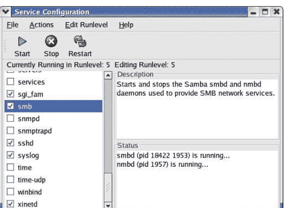

图 3。检查 Samba 状态。

正如从第 2 章中看到的，“服务配置”工具正在运行级别 5 中检查状态。当你登录到 GUI 界面时，我在状态面板中突出显示了 `smbd`：在这里，你可以看到与 Samba (`smbd`) 和 NetBIOS (`nmbd`) 守护进程相关的状态和进程 ID（PID）。这些是 `/usr/sbin` 目录中实际在 Linux 上运行 Samba 的程序。

> 进程 ID (PID) 可以帮助你防止崩溃的程序导致系统崩溃。你可以选择一个进程并结束它，如图 4 所示；你也可以运行 `kill -HUP PID` 命令进行优雅关闭（或运行 `kill -9 PID` 立即关闭，这可能会导致进程仍在运行）。

你可能注意到 `winbind` 服务不是激活状态。如果你还想让 Linux 成员使用 Microsoft Windows 用户和密码数据库，你将需要通过 `/sbin/winbind start` 命令激活此守护进程。我将在第 4 章“设置你的文件服务器用户”中更详细地讨论这个守护进程。

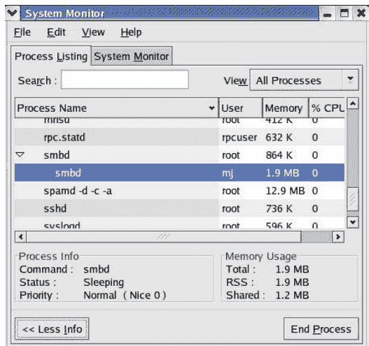

图 4. 监控系统进程。

你可能还想检查各种服务使用的内存和 CPU。在 Red Hat Linux 中，你可以使用系统监视器（System Monitor）来实现，它的功能与 Microsoft Windows 任务管理器类似。要启动系统监视器，点击“主菜单 | 系统工具 | 系统监视器”。看看图 4 中的这个工具。很容易识别与 Samba 守护进程 `smbd` 相关的内存量和进程 ID。

注意列表中与 `root` 用户关联的两个 `smbd` 进程；你还可以看到有人以用户 `mj` 的身份连接到了共享的 Samba 目录。

> 经验丰富的 Linux 用户认为，知晓如何从命令行界面管理进程非常重要。例如，如果发生了影响 GUI 的崩溃，你仍然可以在不重启的情况下保持服务器运行。你可以使用 `ps aux` 命令查看进程。此外，你还可以使用 `top` 命令监控当前运行的进程。

### 用户分类

当你管理服务器时，你的工作之一是管理用户账户。像任何 Windows 服务器一样，Linux 依赖用户名和密码。Linux 将用户分为稍微不同的类别，你可以通过查看主文件 `/etc/passwd` 看到：

- Linux 管理员用户是 `root`。
- 服务关联它们自己的名称，如 `mail`、`news` 和 `apache`。
- 个人用户有自己的 UID，默认从 500 开始。每个用户都被分配到一个组。

正如你将在第 4 章“设置你的文件服务器用户”中看到的，可以使用 Red Hat 用户管理器设置用户。你还将看到关于创建 Samba 用户数据库的细节。

### 配置 Samba 服务器

你可能在安装 Red Hat Linux 时已经安装了 Samba 包。你可能从 Red Hat 站点或 Rawhide 开发者那里获取更新版本的 Samba。更多信息请参见第 2 章“安装 Linux 作为文件服务器”。一旦安装了 Samba，你就会了解关键配置文件。如果你的 Samba 服务器位于防火墙之后，你需要 Samba 可以通过。

然后你可以使用两个工具之一配置 Samba 本体：Samba 服务器配置器或 Samba Web 管理工具 (SWAT)。在本章的后半部分，我将向你展示如何从命令行界面直接编辑 Samba 配置。

### 获取 Samba

这是检查你是否成功安装所需的 RPM 包的最方法。运行以下命令：

```
rpm -qa samba
```

如果成功，你将在输出中看到以下软件包。你可能会看到不同的版本号；这些软件包来自 Hat Linux 9 安装光盘。

```
samba-client-2.2.7a-7.9.0
samba-2.2.7a-7.9.0
samba-swat-2.2.7a-7.9.0
samba-common-2.2.7a-7.9.0
redhat-config-samba-1.0.4-1
```

# 第 3 章：设置你的服务器文件系统 67

如果你的计算机上没有所有这些软件包，你可以从安装光盘、Red Hat FTP 服务器上的 Rawhide 目录，或者通过 Red Hat Update Agent进行安装。例如，如果你想从 Red Hat 9 安装光盘安装 `samba-swat`，请以 `root` 用户身份遵循以下步骤：

- 将第一张光盘插入驱动器。如果你在 Linux 图形用户界面中，Linux 通常会自动挂载驱动器，并打开 Nautilus 窗口显示该驱动器中的文件和目录。

- 打开命令行界面。如果光盘未挂载，请运行以下命令：

```
mount /mnt/cdrom
```

- 要安装 `samba-swat` RPM，运行以下命令：

```
rpm -i /mnt/cdrom/RedHat/RPMS/samba-swat*
```


Samba 最新版本还有另一个来源；你可以直接从 `samba.org` 下载。遗憾的是，该网站上的软件包是以源代码形式组织的，这要求你在安装之前使用适当的选项将其编译为二进制代码。对于不熟悉 Linux 的人来说，这个过程可能很困难；如果你感兴趣，请阅读 `hr.uoregon.edu/david/samba/` 中的非官方 Samba HOWTO。我更倾向于从 Red Hat RPM 安装 Samba，它们针对你的 Linux 发行版进行了优化。

现在你已经安装了相应的软件包，是时候查看关键部分了。

### Samba 配置文件

与 Samba 相关的五个配置文件，位于 `/etc/samba` 目录。它们定义了你的 Linux 计算机如何与基于 Microsoft Windows 网络交互。

- `lmhosts` 包含 IP 地址和 NetBIOS 名称的数据库。它类似于你在 Windows 服务器上找到 `LMHOSTS` 文件。它很少被使用，查找计算机的可用替代方案包括：Windows 命名服务 (WINS) 服务器、DNS 服务器或 `/etc` 目录下的 `hosts` 文件。

- `secrets.tdb` 包含你的 Samba 计算机的微软风格安全标识符 (SID)。它是二进制代码，你无法通过文本编辑器读取它。


> 如果你需要或升级到 Samba 3.0.x 版本，可以使用 `getlocalid` 命令找到你的 SID。在编写本文时，这可以通过 `ftp.redhat.com` 的 Rawhide 仓库下载。

- `smb.conf` 是 Samba 的主配置文件。你将使用 GUI 工具详细配置此文件，并在本章中分析该文件。

- `smbpasswd` 包含与每个 Microsoft Windows 用户名关联的加密密码，如 `smusers` 文档所示。该文件中的密码可能与相应 Linux 账户的密码不同。从 Microsoft Windows 工作站连接的（包括 Linux 计算机上的 Samba 客户端）的用户需要此密码。

- `smusers` 包含本地计算机的用户数据库以及相应的 Microsoft Windows 用户名。它还包括可能连接到此网络的 Microsoft 计算机的机器账户。

正如你在第 4 章“设置你的文件服务器用户”中看到的，你还可以在 Samba 上设置一个域成员服务器，它可以与 Linux 或 Microsoft PDC 配合。

### Samba 与防火墙

本节将展示如何在 Linux 文件服务器上创建防火墙。标准的 Red Hat 防火墙不允许与 Microsoft Windows 网络进行通信。我将向你展示如何自定义标准、中级或高安全防火墙以支持通信。

在大多数情况下，你会在已经受防火墙保护的网络上的 Linux 计算机上安装 Samba。你不需要在本地计算机上设置另一个防火墙。你可以通过服务配置工具通过禁用 `ipt` 脚本来禁用本地防火墙——或者按照第 2 章“安装 Linux 作为文件服务器”所述删除 `iptables` RPM。

> 不要允许不安全的网络（如互联网）访问 Samba。Samba 使用与 Microsoft Windows 相同的互联网端口，这些端口众认为是易受到互联网攻击的。

如果你负责几个网络，你可能正在使用防火墙保护它们免相互影响。你可以通过这些内部防火墙配置 Samba 服务。本质上，你需要确保 65,536 个 TCP/IP 端口中的 5 个是开放的，以便 Windows 和 Linux 客户端通过防火墙与你的 Samba 服务器通信。

虽然我可以深入讨论与 `iptables` 相关的规则，但创建这种防火墙最简单的方法是使用 `localhost` 工具。打开命令行界面，并以 root 身份运行 `/usr/sbin/localhost` 命令。这将打开图 5 所示的小屏幕，你可以在其中创建高安全或中级安全防火墙。假设你确实需要在这台特定的计算机上使用防火墙，请选择最能反映你网络安全级别的级别。

> 如果你的 Linux 计算机已经有一个防火墙，请不要使用 `localhost`。它会删除你之前可能配置的任何规则，例如第 2 章中描述将计算机同步到远程时间服务器的规则。相反，你需要包含本节末尾出的规则。

一旦选择了防火墙，按 Tab 键突出 `Customize` ，然后按 Enter。这将打开图 6 所示的 `Customize` 窗口，你可以在其中至少允许进入你的 Samba 服务器。可用选项与第 2 章“安装 Linux 作为文件服务器”在安装过程中描述的服务有关。


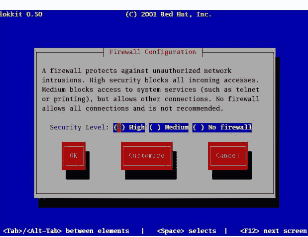

`图 5。` 使用 `lokkit` 配置高安全或中级安全防火墙。

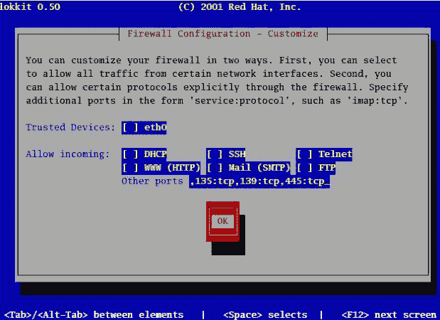

`图 6。` 使用 `lokkit` 自定义防火墙。

## Windows 网络管理员的 Linux 传输

为了支持 Microsoft Windows 客户端的 Samba 流量，你需要在“Other ports”文本框中输入以下行：

```
135:udp,137:udp,138:udp,1512:udp,135:tcp,139:tcp,445:tcp,1512:tcp
```

这允许 `lokkit` 设置支持与网络外部客户端进行 Samba 通信所需的防火墙规则。关于这些每个端口号的更多信息，请参见表 2。

### 表 2. 配置防火墙的 Samba TCP/IP 端口。

| 端口 | 功能 |
| --- | --- |
| 135 | 远程过程调用 (RPC) 映射。支持来自客户端。 |
| 137 | NetBIOS 名称服务。允许传输 NetBIOS 名称。 |
| 138 | NetBIOS 数据报服务。不需要响应的通信。 |
| 139 | NetBIOS 会话服务。支持可靠的数据传输。 |
| 445 | 支持 Windows 2000/XP 客户端。 |
| 1512 | 支持与 WINS 服务器通信。 |

对于熟悉 `iptables` 的人，你可以在防火墙文件中添加这些命令以允许通过防火墙通信（在 Red Hat Linux 中，默认防火墙配置文件为 `/etc/sysconfig/iptables`）：

```bash
iptables -A RH-Lokkit-0-50-INPUT -p udp --dport 135 -j ACCEPT
iptables -A RH-Lokkit-0-50-INPUT -p udp --dport 137 -j ACCEPT
iptables -A RH-Lokkit-0-50-INPUT -p udp --dport 139 -j ACCEPT
iptables -A RH-Lokkit-0-50-INPUT -p udp --dport 1512 -j ACCEPT
iptables -A RH-Lokkit-0-50-INPUT -p tcp --dport 135 --syn -j ACCEPT
iptables -A RH-Lokkit-0-50-INPUT -p tcp --dport 139 --syn -j ACCEPT
iptables -A RH-Lokkit-0-50-INPUT -p tcp --dport 445 --syn -j ACCEPT
iptables -A RH-Lokkit-0-50-INPUT -p tcp --dport 1512 --syn -j ACCEPT
```

还有一种访问 Samba 的方法：通过在 `smb.conf` 配置文件中使用 `hosts allow` 和 `deny`。此默认版本限制访问具有以下 IP 网络地址的网络：`192.168.1.0` 和 `192.168.2.0`，以及用于从本地计算机访问的回环地址 `127.0.0.1`。以下是它的默认版本：

```
; hosts allow = 192.168.1.0 192.168.2.0 127.
```


我们将稍后再次查看此命令。

# Red Hat Samba 配置

Red Hat 有非常简单的方法来配置 Samba 服务器。虽然它包含了配置功能，但在许多方面都是有限的。该工具包含在 `redhat-config-samba` RPM 软件包中。你可以通过点击主菜单 | 系统设置 | 服务器设置 | Samba 服务器从图形界面启动 Samba 配置器。见图 7。

## 第 3 章：设置您的服务器文件系统

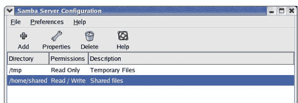

图 7。Hat Samba 服务器配置器。

在开始之前，请备份 Samba 配置文件 `/etc/samba.conf`。它包含一些优秀的注释，你可以利用它们来学习许多 Samba 变量。要配置 Samba 服务器，首先学习几个基本变量是非常重要的：

- `security`：对应 Samba 的 **身份验证模式（Authentication Mode）**。选项有：`share`（共享）、`server`（服务器）和 `domain`（域）。如其名所示，如果你在 Microsoft 网络上将 Samba 服务器设置为主域控制器 (PDC)，你将希望将此模式用于：
  - `share`：支持 Windows 9x 通用的工作组（Workgroups）共享目录；共享目录仅受密码保护。
    > Linux 安全基于用户名和密码。如果你设置了共享级安全，你的系统可能会被任何了解关键密码的人所危及。
  - `user`：访问服务器或域上的共享目录需要用户名和密码。通过本地数据库进行身份验证。适用于点对点工作组中的成员服务器——或域控制器。例如，如果你正在将计算机配置为 PDC，你希望远程用户使用本地用户名和密码作为域的权威依据。
  - `server`：访问服务器或域上的共享目录需要用户名和密码。通过远程计算机上的数据库进行身份验证。如果与远程计算机的连接断开，它将回退到 `security = user`。通常你不会在域上使用此选项。
  - `domain`：访问服务器或域上的共享目录需要用户名和密码。通过远程域控制器上的数据库进行身份验证。如果与远程计算机的连接断开，它将回退到 `security = server`。适用于域上的 Linux 成员服务器或工作站客户端。不适用于 PDC，因为你希望 PDC 对域内的用户名和密码拥有最终决定权。

- `password server`：如果身份验证数据库在远程计算机上，则被称为身份验证服务器，对应 Samba 密码服务器变量。换句话说，如果你在域上设置 Samba 成员服务器，你在此处列出 PDC 的 NetBIOS 名称。

- `encrypt passwords`：密码在 Windows 网络上默认应该是加密的。这会导致运行旧版本 Microsoft Windows 的计算机出现问题，例如 Windows for Workgroups 3.11 或 Windows 9 Service Pack 2（也称为 OSR2，发布于 1996 年）。对应 Samba 的 `encrypt passwords` 变量。（如果你在使用这些旧的 Microsoft 系统，并愿意在网络上接受明文密码，你可以将此变量设置为 `no`。我将在第 6 章“连接 Windows 工作站”中解释如何设置文本密码。）

- `guest account`：如果你配置了共享级安全，你将希望设置客账户作为默认用户。在分配客账户之前，我建议你为此创建一个专用账户。有关创建账户的更多信息，请参阅第 4 章“设置您的文件服务器”。

现在你已经有了 Samba 安全的基础知识，可以配置一个 Samba 服务器供两个用户访问项目；在以下示例中，我配置的 Windows 用户名为 `Nancy` 和 `Michael`。你的 Linux 用户名为 `nc` 和 `mj`。他们将共享访问 `/home/project` 目录。要进行此设置，请遵循以下步骤：

1. 在 Samba 服务器配置对话框中，点击 `Preferences | Server Settings` 打开 `Server Settings` 窗口。在 `Basic` 选项卡上，你将看到 `Workgroup`（工作组）和 `Description`（描述）文本框。在 `Workgroup` 文本框中，输入你想让此 Samba 加入的 Windows 工作组或域名称。在 `Description` 文本框中，输入你的注释。然后点击图 8 所示的 `Security` 选项卡。

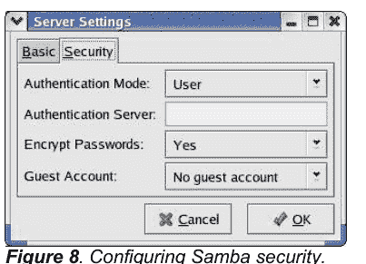

在本节之前，我描述了可选的安全选项。在 `Security` 选项卡上进行任何所需的更改，并点击 `OK` 返回 Samba 服务器配置窗口。

3. 配置 Samba 用户。你需要一份来自 `/etc/passwd` 的 Linux 计算机用户列表，以及来自域控制器或单独工作站的 Microsoft Windows 用户。当你拥有这些信息后，点击 `Preferences | Samba Users` 打开 `Samba Users` 对话框。

4. 点击 `Add User` 打开 `Create New Samba User` 窗口。

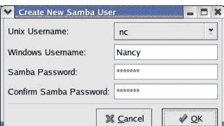

图 9. 设置 Linux 和 Windows 用户数据库。

> 在 Linux 文档中，“Unix”和“Linux”术语是可以互换的。记住，Linux 是 Unix 的克隆，因此它们的功能相同。

5. 你可以将计算机上的每个 Linux 用户映射到网络上的 Microsoft Windows 用户名。Linux 用户名必须已经存在。你可以从 `Unix Username` 下拉文本框中选择此类用户名。Windows 用户可能是新的，也可能已存在于外部计算机。`Unix` 用户名是网络用户将使用的名称。

6. 在 Samba 服务器配置对话框中，点击 `Preferences | Server Settings` 打开 `Server Settings` 窗口。在 `Basic` 选项卡上，你将看到 `Workgroup` 和 `Description` 文本框。在 `Workgroup` 文本框中，输入你想让此 Samba 加入的 Windows 工作组或域名称。在 `Description` 文本框中，输入你的注释。然后点击图 8 所示的 `Security` 选项卡。

7. 在 Samba 服务器配置对话框中，点击 `Preferences | Server Settings` 打开 `Server Settings` 窗口。在 `Basic` 选项卡上，你将看到 `Workgroup` 和 `Description` 文本框。在 `Workgroup` 文本框中，输入你想让此 Samba 加入的 Windows 工作组或域名称。在 `Description` 文本框中，输入你的注释。然后点击图 8 所示的 `Security` 选项卡。

8. 在 Samba 服务器配置对话框中，点击 `Preferences | Server Settings` 打开 `Server Settings` 窗口。在 `Basic` 选项卡上，你将看到 `Workgroup` 和 `Description` 文本框。在 `Workgroup` 文本框中，输入你想让此 Samba 加入的 Windows 工作组或域名称。在 `Description` 文本框中，输入你的注释。然后点击图 8 所示的 `Security` 选项卡。

9. 在 Samba 服务器配置对话框中，点击 `Preferences | Server Settings` 打开 `Server Settings` 窗口。在 `Basic` 选项卡上，你将看到 `Workgroup` 和 `Description` 文本框。在 `Workgroup` 文本框中，输入你想让此 Samba 加入的 Windows 工作组或域名称。在 `Description` 文本框中，输入你的注释。然后点击图 8 所示的 `Security` 选项卡。

10. 在 Samba 服务器配置对话框中，点击 `Preferences | Server Settings` 打开 `Server Settings` 窗口。在 `Basic` 选项卡上，你将看到 `Workgroup` 和 `Description` 文本框。在 `Workgroup` 文本框中，输入你想让此 Samba 加入的 Windows 工作组或域名称。在 `Description` 文本框中，输入你的注释。然后点击图 8 所示的 `Security` 选项卡。

11. 在 Samba 服务器配置对话框中，点击 `Preferences | Server Settings` 打开 `Server Settings` 窗口。在 `Basic` 选项卡上，你将看到 `Workgroup` 和 `Description` 文本框。在 `Workgroup` 文本框中，输入你想让此 Samba 加入的 Windows 工作组或域名称。在 `Description` 文本框中，输入你的注释。然后点击图 8 所示的 `Security` 选项卡。

# Windows 网络管理员的 Linux 迁移指南

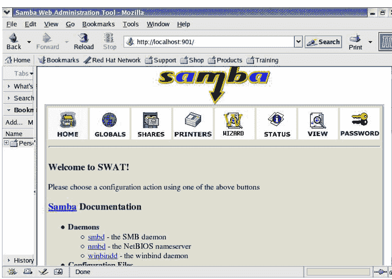

图 12. `SWAT` 主菜单。

## 表 3. `SWAT` 菜单选项。

| 选项 | 功能 |
| --- | --- |
| `Home` (首页) | 返回 `SWAT` 主菜单，其中包含文档链接。 |
| `Globals` (全局) | 允许你配置基础 Samba 服务器参数，包括工作组/域成员身份和安全性。 |
| `Shares` (共享) | 允许你配置共享目录。 |
| `Printers` (打印机) | 让你共享已安装的打印机。 |
| `Wizard` (向导) | 允许你配置基础 Samba 服务器。 |
| `Status` (状态) | 提供一个查看 Samba 进程状态和任何挂载目录的界面。 |
| `View` (查看) | 允许你查看 `smb.conf` 文件。 |
| `Password` (密码) | 支持管理本地和远程用户名及密码的界面。 |

## `SWAT` 全局菜单

点击 `SWAT` 主页上的 `Globals`。如图 13 所示，此屏幕允许你配置 Samba 服务器的基础参数。它包含了你在 Samba 配置工具的 `Server Settings` 窗口中（图 8）看到的选项，以及许多更多选项。

# 第 3 章：设置你的服务器文件系统 77

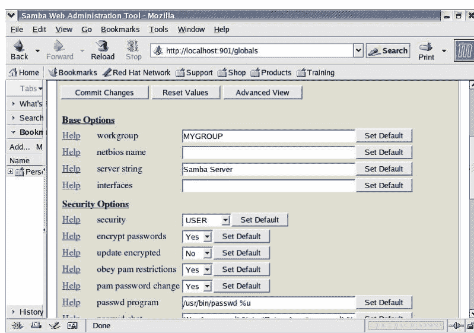

你最可能更改两个默认值是 `workgroup`（工作组）和 `security`（安全性）。工作组可以是你的 Microsoft Windows 工作组或域名称。安全性如之前在 Samba 服务器配置器中描述的，可以是 `share`、`user`、`server` 或 `domain`。你还应该设置 NetBIOS 名称，以便你的计算机在 Microsoft Windows 网络上可见。

除了 Samba 服务器配置器的功能之外，还有几个特别感兴趣的选项：

- `Security Options`（安全选项）：虽然密码参数很少更改，但你可以通过 `hosts allow` 和 `hosts denies` 限制特定网络的访问。例如，如果你想限制只有 `172.22.30.0`（以及本地计算机）的计算机访问，请在 `hosts allow` 文本框中输入以下值：

```
172.22.30.0 127.
```

- `Browse Options`（浏览选项）：Microsoft Windows 网络维护着一个计算机 NetBIOS 名称列表。你可以将你的 Samba 计算机设置为浏览器主（browser master）。如果你的计算机是 PDC（主域控制器）且你绝对希望你的 Samba 服务器成为该域的浏览器主，请设置以下参数：

图 13. `SWAT` 全局菜单。

```
os level = 255
preferred master = yes
local master = yes
domain master = yes
```

> 注意：当你配置 Samba 时，默认的 `os level = 20` 通常足够了，除非你将此台计算机配置为 PDC。我将在本章稍后描述标准的 `os level` 选项。

- `WINS Options`（WINS 选项）：Windows 内部命名服务 (WINS) 收集 Microsoft 网络上的计算机名称和 IP 地址。如果你设置了 `dns` 代理，Samba 也可以通过 DNS 服务器搜索你网络上的计算机。如果你在网络上有一个远程 `wins` 服务器，请指定其 IP 地址和完全限定域名名 (FQDN)。或者，你可以通过以下参数将本地计算机设置为 WINS 服务器：

```
wins support = yes
```

> 注意：不要在局域网内设置多一个基于 Linux 的 WINS 服务器。你可能想在同一域的相邻局域网上设置其他的 WINS 服务器。

## `SWAT` 共享菜单

现在要配置共享目录，点击 `Shares`。从 `Choose` 下拉列表中选择一个现有的共享并点击 `Choose Share` 按钮。或者，你可以通过输入名称并点击 `Create Share` 来创建一个新共享。基础 Web 界面如图 14 所示。这些选项比你在 Samba 服务器配置器的 `Create Share` 窗口中看到的要详细得多。

自然地，你会想要指定共享目录的路径，以及一个帮助用户理解目录内容的注释。默认情况下，共享的 Samba 目录是只读（`read only = yes`），你可以通过设置 `read only = no` 让授权用户对共享目录进行写。

你可以为每个单独的共享设置安全选项。例如，你可以通过 `hosts allow` 和 `hosts deny` 限制特定计算机或网络的访问。另外两个基本变量是：`browseable`（可浏览）和 `available`（可用）。可浏览的共享可以通过 Microsoft Windows 的“网络邻”或“我的网络位置”看到。如果 `available = no`，客户端将无法挂载共享。

如果你觉得限制限制特定用户的访问，那么点击 `Advanced View`（高级视图）按钮时看到的变量会很有趣。它们还支持自定义文件锁（不允许多个用户同时写入同一个文件）以及文件命名选项（这有助于你区分 Linux 的大小写敏感和 Microsoft Windows 的不大小写敏感的区别）。

# 第 3 章：设置你的服务器文件系统 79

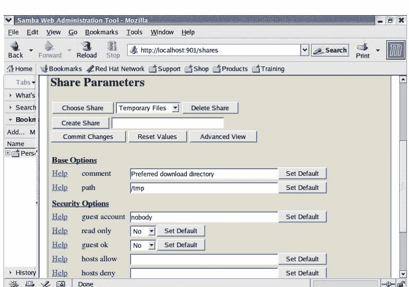

图 14. 通过 `SWAT` `Shares` 菜单配置共享。

Red Hat Linux 9 一起发布的内核并未完全支持访问控制列表 (ACL)。当你检查 `Advanced View` 的值时，你会发现 Samba 默认开启了 `nt acl` 支持。换句话说，与 Linux 文件关联的权限会自动转换为 Windows NT 风格的 ACL。

## `SWAT` 打印机菜单

现在你已经检查了共享，点击 `Printers`。从 `Choose` 下拉列表中选择一个现有的共享并点击 `Choose Share` 按钮。或者，你可以通过输入名称并点击 `Create Share` 来创建一个新共享。基础 Web 界面如图 14 所示。这些选项比你在 Samba 服务器配置器的 `Create Share` 窗口中看到的要详细得多。

自然地，你会想要指定共享目录的路径，以及一个帮助用户理解目录内容的注释。默认情况下，共享的 Samba 目录是只读（`read only = yes`），你可以通过设置 `read only = no` 让授权用户对共享目录进行写。

你可以为每个单独的共享设置安全选项。例如，你可以通过 `hosts allow` 和 `hosts deny` 限制特定计算机或网络的访问。另外两个基本变量是：`browseable` 和 `available`。可浏览的共享可以通过 Microsoft Windows 的“网络邻”或“我的网络位置”看到。如果 `available = no`，客户端将无法挂载共享。

如果你觉得限制限制特定用户的访问，那么点击 `Advanced View`（高级视图）按钮时看到的变量会很有趣。它们还支持自定义文件锁（不允许多个用户同时写入同一个文件）以及文件命名选项（这有助于你区分 Linux 的大小写敏感和 Microsoft Windows 的不大小写敏感的区别）。

如果你的计算机是 PDC（主域控制器）且你绝对希望你的 Samba 服务器成为该域的浏览器主，请设置以下参数：

图 13. `SWAT` 全局菜单。

```
os level = 255
preferred master = yes
local master = yes
domain master = yes
```

> 注意：当你配置 Samba 时，默认的 `os level = 20` 通常足够了，除非你将此计算机配置为 PDC。我将在本章稍后描述标准的 `os level` 选项。

- `WINS Options`（WINS 选项）：Windows 内部命名服务 (WINS) 收集 Microsoft 网络上的计算机名称和 IP 地址。如果你设置了 `dns` 代理，Samba 也可以通过 DNS 服务器搜索你网络上的计算机。如果你在网络上有一个远程 `wins` 服务器，请指定其 IP 地址和完全限定域名名 (FQDN)。或者，你可以通过以下参数将本地计算机设置为 WINS 服务器：

```
wins support = yes
```

> 注意：不要在局域网内设置多一个基于 Linux 的 WINS 服务器。你可能想在同一域的相邻局域网上设置其他的 WINS 服务器。

# Windows 网络管理员的 Linux 迁移指南


### 打印机参数

重要说明：
打印框中标记为 `[*]` 的名称没有影响。

图 15. `SWAT` `Printers` 菜单。

虽然你可以为 Linux 设置许多打印系统，默认是 `cups`，我在第 7 章中介绍。如果你是 Linux 专家并且更习惯传统系统，最易配置的替代方案是 `lpr`。

### 配置向导

如果你没有任何需要配置的目录，可以通过向导将你的 Linux 配置到 Microsoft Windows 网络。点击主菜单上的 `Wizard`。你会看到三个需要指定的关键项：

- 选择服务器类型。`Stand Alone`（独立）服务器通常与工作组相关；`Domain Member`（域成员）是不是控制器的服务器；`Domain Controller`（域控制器）包含身份数据库。
- 选择 `WINS` 配置。如果你在网络上使用 WINS 服务器，你可以将本地计算机设置为 WINS 服务器，或者你可以为你的网络指定远程 `wins` 服务器。
- 你可以允许用户访问本地计算机上的主目录。

# 第 3 章：设置你的服务器文件系统 81

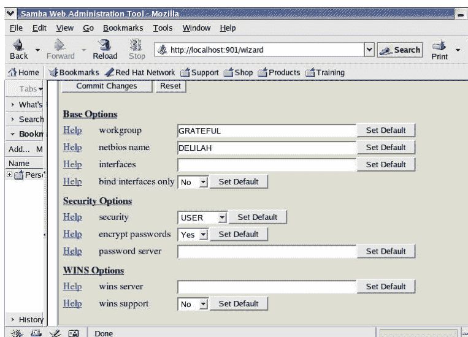

欲需更多信息，请点击 `Edit Parameter Values` 按钮。这将打开关键 Samba 变量列表，如图 16 所示。虽然这些大多数变量看起来都很熟悉，但花点时间将它们总结在表 4 中是值得的。

表 4. Key Samba 变量。

| 变量 | 功能 |
| --- | --- |
| `workgroup` | 加入的 Microsoft 工作组或域。 |
| `netbios name` | 为此计算机分配名称，以便在 Microsoft 网络邻域或“我的网络位置”中查看。 |
| `interfaces` | 指定允许的网接口（例如 `eth0`）或网络（例如 `192.168.20.`）；如果你指定了允许的网络，记得添加 `127` 以允许本地计算机访问。 |
| `bind interfaces only` | 如果你想限制访问某些接口，将其设置为 `yes`。 |
| `security` | 配置基础安全选项：`share`、`user`、`server`、`domain`. |

图 16. `SWAT` 向导变量。

## 82 针对 Windows 网络管理员的 Linux 迁移

| 变量 | 功能 |
| --- | --- |
| `encrypt passwords` | 当通过网络发送密码时启用加密；适用于大多数 Microsoft Windows 计算机的访问（Windows for Workgroups 和早期版本的 Windows 95 除外）。 |
| `password server` | 如果有远程计算机（如 PDC）负责你网络上的用户名和密码，请在此处指定。 |
| `wins server` | 如果你的网络有一个 WINS 服务器器，请指定其 IP 地址或名称。 |
| `wins support` | 如果你想将本地计算机设置为 WINS 服务器器，请将此变量设置为 `yes`。如果网络中已经有了另一个 WINS 服务器，请不要这样做。 |

## `SWAT` 状态菜单

一旦你配置了服务器，就可以使用 `SWAT` 对其进行维护。点击 `Status`（状态）打开状态菜单。在图 17 中的菜单中，你可以重启 Samba 以使你所做的更改生效。你还可以监控并切断与你服务器的连接。


图 17。你可以通过状态菜单维护和监控 Samba。

### 第 3 章：设置你的服务器系统 83

每当你更改 Samba 配置时，更改在重启 Samba 服务器之前不会生效。在状态菜单上，点击“Restart `smbd`”（重启 `smbd`）按钮。任何当前连接到你计算机的用户都会被切断连接并需要重新连接。

如你在 `Active Connections`（活动连接）下看到的，有三台客户端计算机当前连接到我的 Samba 服务器：`reuben`、`sugaree` 和 `allacess`。作为管理员，你可以点击 `kill`（终止）列中的 X 按钮来切断连接。在 `Active Shares`（活动共享）下，你可以监控从这些计算机挂载的目录以及它们相关的用户名。在菜单下方，你可以检查通过网络打开的文件。

## `SWAT` 视图菜单

一旦你更改了 Samba 配置，你可能想要查看 Samba 配置文件 `smb.conf`。你可以从命令行界面执行此操作，也可以只需点击 `SWAT` 菜单的顶部。这将打开 `smb.conf` 的视图。如果你想查看 `smb.conf` 中所有的 Samba 变量，请点击 `Full View`（全视图）按钮。

## `SWAT` 密码菜单

在用户通过 Microsoft Windows 网络连接到 Samba 服务器之前，他们需要在你的计算机上有一个用户名。点击 `Password`（密码）打开密码菜单。如图 18 所示，这里有两个子菜单。

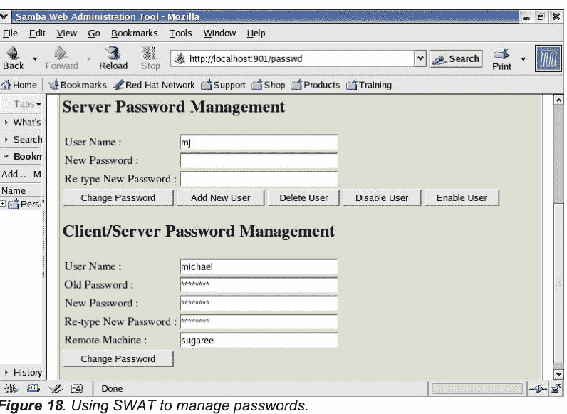

## 84 针对 Windows 网络管理员的 Linux 迁移

在 `Server Password Management`（服务器密码管理）子菜单中，你可以管理与本地计算机关联的 Samba 用户。你可以添加、删除、禁用或启用用户；或者你可以更改现有用户的密码。

在 `Client/Server Password Management`（客户端/服务器密码管理）子菜单中，你可以更改远程服务器的密码，即使它是一个 PDC。图 18 中显示的条目是不言自明的；例如，`Remote Machine`（远程机器）对应于你尝试更改的带有用户名/密码数据库的计算机名称。

现在是时候换一种方式思考了：Samba 配置文件 `/etc/samba/smb.conf` 的内部。请阅读此文件，特别是如果你不熟悉编辑配置文件。即使你主要使用 Red Hat Samba Configurator 或 `SWAT` 来将计算机配置为 Samba 服务器，理解此文件的内容也是重要的。

## 详细配置 Samba

Red Hat Server Configurator 和 `SWAT` 本质上只是“前端”。换句话说，你在 GUI 工具中的选择本质上是作为 `smb.conf` 配置文件的智能编辑器。

- 附录 B 包含了域成员服务器和 PDC 的 Samba `smb.conf` 配置文件。

有超过300个 Samba 变量；检查 `samba-common` RPM 软件包附带的 `smb.conf` 文件是有意义的。它包含了你想要配置的大部分变量，某些变量还包含了有用的注释——对于更熟悉 Linux 的人来说非常有帮助。

我在在本节中分析的 `smb.conf` 文件是基于 Red Hat Linux 9 自带的 Samba 版本。不同版本的 Samba 可能包含带有变量的 `smb.conf` 文件。

如果你想从 `samba-common` RPM 还原原始的 `smb.conf` 和 `lmhosts`，请找到正确的 RPM；否则你可能会覆盖新版本的 Samba。如果你使用的是 Red Hat Linux 9 的原始文件，请插入相应的 Red Hat Linux 9 (#1)。挂载光盘后，运行以下命令：

```bash


### cd

### mount /mnt/cdrom

### rpm2cpio /mnt/cdrom/RedHat/RPMS/samba-common* | cpio -ivdu

```
通常，samba 配置文件分为两个部分：global（全局），你可以在其中配置 Linux 计算机作为 Microsoft Windows 网络上服务器的能力；以及 shares（共享），你可以在其中定义如何共享网络上已安装的目录和打印机。

在 Linux 配置文件中，开始注释有两种基本方式：使用井号 (#) 或分号 (;)。例如，以下两行代码都是不被 Samba 处理的注释：
```

## 第 3 章：设置你的服务器文件系统

```
; password server = *

### workgroup = NT-Domain
```

以下几行代码都是不被 Samba 处理的注释：

```
; password server = *

### workgroup = NT-Domain
```

以下几行代码都是不被 Samba 处理的注释：

```
; password server = *

### workgroup = NT-Domain
```

以下几行代码都是不被 Samba 处理的注释：

```
; password server = *

### workgroup = NT-Domain
```

以下几行代码都是不被 Samba 处理的注释：

```
; password server = *

### workgroup = NT-Domain
```

...以下命令允许所有网络地址为 10.0.0.0 的计算机访问，但网络地址为 10.44.0.0 的除外。

```bash
hosts allow = 10. EXCEPT 10.44.
```

# 第3章：设置你的服务器文件系统 87

`printcap name = cups`

如你从注释所示，Samba 可以与多个不同的打印系统配合。除非你正在为 Unix 或 Linux 的其他替代方案（如伯基标准发行版 BSD）配置 Samba，否则 `cups` 和 `lprng` 是你唯一需要的系统。

除非你的打印系统是非标准的，否则没有必要指定打印系统类型。目前支持的打印系统包括：`bsd`, `sysv`, `lprng`, `aix`, `hypux`, `qnx`, `cups`。

如果你在点对点工作组（`Workgroup`）上设置 Samba，则没有用于用户名和密码的中央服务器。目录受密码保护。但在 Linux 计算机上，你仍然需要一个用户。默认情况下，没有任何用户，即访客（`guest`）。自然地，如果你想为名为 `pguest` 的用户设置服务器，可以激活此命令：

```
; guest account = pguest
```

你还需要使用类似 `useradd` 的命令创建 `pguest` 用户，我将在第4章“设置你的文件服务器”中描述该命令。这种类型访客账户的一种用途可能是存储公共信息的目录。

当我在 Samba 上遇到问题时，首先查找的地方是日志文件。默认情况下，以下命令为每个连接到你 Samba 服务器的客户端配置单独的日志文件：

```
log file = /var/log/samba/%m.log
```

`%m` 是与客户端“机器名称”关联的变量。在 Samba 中，这对应于客户端计算机的 NetBIOS 名称。例如，我的其中一台计算机的 NetBIOS 名称为 `Stephen`，Samba 会在 `/var/log/samba` 目录下创建一个名为 `stephen.log` 的连接日志文件。

如果你有大日志，可能希望限制每个文件的数据量。默认显示没有限制；默认限制为 5000KB。

```
max log size = 0
```


在 Red Hat Linux 中通常不需要日志文件限制。默认情况下，日志文件每周轮一次。旧日志文件以数字扩展名保存（如 `.1`, `.2`, `.3` 和 `.4`），最多保留四周的存档日志。

在本章前面，我涵盖了安全变量的可能值。提醒你一下，选项有 `share`, `user`, `server` 和 `domain`：

```
security = user
```

如果你指定了 `security = server` 或 `domain`，你正在将用户名和密码请求传递给不同的服务器，可能是一个 PDC（主域控制器）。你将需要通过激活以下命令之一来指定该 PDC：

```
# password server = My_PDC_Name [My_BDC_Name] [My_Next_BDC_Name]

### password server = *

### password server = <NT-Server-Name>
```

第一个命令可以搜索 PDC 或 BDC（备用域控制器）。如果你想为 Linux PDC 备份，请阅读第9章“系统备份”中的备份回顾。如果你正在设置 Samba 域成员服务器，可以使用此命令查查找 Microsoft PDC 和 BDC 上的用户名和密码数据库。

一旦你将 Samba 设置为 PDC，备份控制器通常是不需要的。Linux 比 Microsoft Windows 可靠得多，因此很少需要重启。如果你绝对需要一个 BDC，请阅读 `ut3.samba.org/samba/ftp/docs/samba-BDC-HOWTO.html` 上的非官方 Samba BDC HOWTO 文档。

第二个命令搜索网络上带有身份验证数据库的域控制器。第三种选项指定一个服务器，该服务器不必是域控制器。

在 Microsoft Windows 网络中混合 Linux 的问题之一是密码和用户名的敏感性。Linux 密码和用户名是区分大小写的。而 Microsoft Windows 9x/ME 的密码和用户名不区分大小写。如果激活了以下命令，将检查最多八个字符的密码和用户名的大小写版本：

```
; password level = 8

; username level = 8
```

激活这些命令可能会影响你的网络性能。这意味着当有人登录你的服务器时，将检查每个密码和用户名的大写和小写变体。

如所述，密码默认是加密的。人们可能用于登录你的 Samba 服务器（或 PDC）的用户名和密码通常存储在特定文件中，由以下命令记录：

```
encrypt passwords = yes

smb passwd file = /etc/samba/smbpasswd
```

如果你的网络中有计算机运行着 Windows 95（OSR2 之前）、Windows NT 4 Workstations（Service Pack 3 之前）或 Windows for Workgroups (3.11)，请设置 `encrypt passwords = no`。你还需要禁用网络上所有其他计算机的加密。或者，你可以安装 Service Pack 2（或更高版本）以启用预-OSR Windows 95 计算机的加密。

# 第3章：设置你的服务器文件系统 89

某些 Samba RPM 包（不包括与 Red Hat Linux 9 关联的版本）带有安全套接层（SSL）支持进行安装。如果你遇到 SSL 错误，请激活以下内容：

```
; ssl certificate = /usr/share/ssl/ca.crt
```

根据定义，`openssl` 包允许安全通信。以下命令限制对特定网卡的访问：

```
unix = yes
```

你可以使用以下命令调节与你的 Samba 服务器之间的文件传输速度。对于大多数用户来说，默认设置已经足够；优化性能需要尝试，并且超出了本书的范围。

```
- socket options = TCP_NODELAY SO_RCBUF=8192 SO_SNDBUF=8192
```

### 第3章：设置你的服务器文件系统

如果你激活此特定命令，它会将你的浏览器列表与 IP 地址为 `192.168.3.25` 的计算机同步。它还会发送一条广播消息，在 IP 地址为 `192.168.5.0` 的网络上查找并与主浏览器同步。

如果其他网络上的用户在查找你的 Samba 时遇到困难，你也可以告诉他们你的浏览器列表。如果激活以下命令，它将向 IP 地址为 `192.168.1.0` 的远程网络以及地址为 `192.168.2.44` 的主浏览器发送广播消息。

```
remote announce = 192.168.1.255 192.168.2.44
```


默认情况下，Samba 服务器会参与局域网（`LAN`）上的浏览器主“选举”。如果你已经准备好了一个作为 `PDC`（首选域控制器）的首选浏览器，则你应该激活此命令：

- `local master = no`

在浏览器位于 `PDC` 所在计算机的 Microsoft Windows 局域网可能会出现问题。如果 `PDC` 位于远程局域网，则没有这个问题。

如果你想参与浏览器主选举，可以给它一定的票数。默认的 `os level` 为 `20`；如果你已将 Linux 计算机配置为 `PDC`，则你应该激活此命令。`os level` 可以设置得高达 `255`。

- `os level = 33`

浏览器选举分两个阶段进行。第一阶段取决于操作系统，如表 5 所示。

表 5 浏览器选举值。

| 操作系统 | 数值 |
|---|---|
| Windows for Workgroups (3.11) | 1 |
| Windows 95/98/ME | 1 |
| Windows NT/2000/XP/2003 | 16 |
| Windows NT/2000/2003 PDC | 32 |

如果出现平局——例如，如果有多个 `os level` 为 `33` 的 Samba 服务器，选举将进入第二阶段。如表 6 所示，浏览器选举的数值层级高度取决于其在网络上的当前角色。

表 6 平局情况下的额外浏览器值。

| 当前浏览器角色 | 数值 |
|---|---|
| 当前备份浏览器 | 1 |
| 上一个备份浏览器 | 2 |
| 本地主浏览器 | 4 |
| 首选主浏览器 | 8 |
| WINS 客户端 | 32 |
| 域主浏览器 | 128 |

## Windows 网络管理员的 Linux 迁移指南

虽然你可以将 `os level` 设置为高达 `255`，除非是在你正在配置为 `PDC` 的计算机上，否则你不应这样做。正如前面所述，Microsoft 服务器使用 `32` 的 `os level` 来赢得浏览器选举以作为 `PDC`。

如果 `PDC` 和域主浏览器在不同的计算机上，你将观察到错误，因为浏览器列表未在网络计算机上运行。然而，如果你正在将本地计算机配置为 `PDC` 和域主浏览器，你应该激活以下命令：

```
domain master = yes
```

如果局域网内没有 `PDC`，你仍然需要主浏览器。在这种情况下，可以通过激活以下命令将你的计算机设置为首选主浏览器：

```
preferred master = yes
```

如果你正在将本地服务器配置为 `PDC` 且域上有 Windows 95/98/ME 计算机，你需要激活此项。请记住，因为 `encrypt passwords = yes`，除非安装了 Microsoft Service Pack 2 (OSR2 或更高版本)，否则 Windows 95 无法登录此域。并且正如本章解释，你需要将 `security` 设置为 `user`（而不是 `server` 或 `domain`）。

```
domain logons = yes
```

如果你正在将本地服务器配置为 `PDC`，你可以通过 `NetBIOS` 名称 (`%m.bat`) 或用户名 (`%U.bat`) 设置登录。请确保激活以下命令中的适当一个：

```
logon script = %m.bat

logon script = %U.bat
```

如果你正在从 Microsoft Windows `PDC` 迁移，可以使用你在 Windows `NETLOGON` 共享等目录中创建的任何脚本。如果你想通过变量 (`%m`) 配置登录脚本，请激活第一个命令并按 `NetBIOS` 名称设置脚本。如果你想通过用户 (`%U`) 配置登录脚本，请激活第二个命令并按用户名设置脚本。你可以在此文件的 `[netlogon]` 标签下定义这些脚本的目录。

当从位于 `NT 4` 上的 Microsoft Windows `PDC` 迁移时，你应该能够直接从 Windows `PDC` 的 `NETLOGON` 共享中复制适当的文件，通常是 `%C:\WINNT\system32\Replimport` 目录。

正如 Microsoft Windows 管理员所知，漫游配置（`roving profile`）为登录网络上不同工作站的用户提供了一致的视觉体验。例如，如果你激活该命令，登录配置文件将存储为 `smb.conf` 文件中的 `[profiles]` 标签。

```
logon path = \\%L\Profiles\U
```

在这种情况下，`%L` 也定义了计算机的 `NetBIOS` 名称，而 `%U` 再次定义了用户名。

### 第3章：设置你的服务器文件系统


了解配置文件，请阅读 `[profiles]` 标签。

如果你想设置配置文件，请激活以下命令：

```
logon path = \\%L\Profiles\U
```

在这种情况下，`%L` 也定义了计算机的 `NetBIOS` 名称，而 `%U` 再次定义了用户名。

## 第 3 章：设置你的服务器文件系统

对于主目录，你希望限制仅所有者访问。在 Linux 计算机上，主目录的名称（例如 `/home/mj`）与用户名 (`mj`) 相对应。由于下面的命令将 `valid users` 变量设置为共享名称 (`%S`)，它实际上是将其设置为主目录的名称。

```
valid users = %S
```

所有 Linux 文件都与文件所有者、组所有者以及计算机上的所有其他用户关联权限。`create mode` 命令指定了你复制的文件的权限，在本例中，是指复制到 Linux 计算机主目录下的文件。我将在第 4 章“设置你的文件服务器”中详细解释这些权限数字。

```
create mode = 0664
```

与文件一样，所有 Linux 目录都有权限。此命令为你复制或创建的所有目录分配权限：

```
directory mode = 0775
```

除非计算机位于网域（`Domain`）中，否则在 Linux 计算机上没有有效账户的人将无法登录到主目录。如果你激活了此命令，不在你的 Samba 系统中的用户将自动映射到宾客用户，正如之前在 Samba 配置中在本节描述的 `guest account` 变量定义的那样。

```
; map to guest = bad user
```

如果你将 Linux 计算机配置为网域成员服务器，即使主目录不存在，用户也会映射到主目录。例如，假设 `Wil` 在 `PDC`（主网域控制器）上有一个账户，但在成员服务器上没有账户或 `/home/wil` 主目录。默认共享使得 Linux 就像在成员服务器上有一个主目录。因此，你可能希望禁用 Linux 网域成员服务器的“Home Directories”（主目录）段落。

## 网域网络登录

下一个标签 `[netlogon]` 允许你在配置为 `PDC` 的 Samba 服务器上设置网络登录服务（Network Logon Service）。这假设你已经在文件的早期部分设置了以下命令：

```
security = user

domain master = yes

domain logons = yes
```

然后，为了为用户登录脚本设置 `NETLOGON` 共享，你需要根据需要进行修改，并激活以下命令。不要忘记通过删除标签前面的分号来激活 `[netlogon]` 标签：

```
; [netlogon]
```

## 给 Windows 网络管理员的 Linux 传输

通常情况下，为每个网络共享添加注释是一个良好习惯；如果共享是可见的，以下注释将向你的用户标识该共享。

```
comment = Network Logon Service
```

网络登录脚本没有强制路径；你可以随时将 `path` 变量更改为你选择的目录。由于登录基于 Samba 的 `PDC` 会将用户重定向到其主目录，许多管理员会将此替换为 `path=/home/netlogon`。

```
path = /usr/local/samba/lib/netlogon
```

你可能希望将此默认值改为 `guest ok = no`，以防止没有账户的用户读取启动脚本。

```
guest ok = yes
```

如果你不想让个人重写他们的登录脚本，请激活以下命令：

```
writable = no
```

尽管该命令位于默认 Samba 文件中，但没有理由激活它。如果你激活它，它将禁用文件锁定，这将允许不同计算机上的多个用户同时读取同一个文件。

```
share modes = no
```

用户不需要浏览 `[netlogon]` 共享。破解客可能会利用它来查找你网域上的用户列表。他们可能会为你的系统带来各种麻烦。因此，我建议你再添加一个命令来防止浏览：

```
browseable = no
```


### 漫游配置文件

从网域中不同工作站登录的用户通常希望在不同的计算机上具有相同的外观和感受。这就是漫游配置文件大显用场的地方。在 `Microsoft Windows` 中，注册表的用户部分可以存储在远程服务器上的文件中。正如管理员所知，对于 `Windows 9x/ME` 计算机，以及对于 `NT/2000/XP` 计算机，该文件通常是 `NTUSER.DAT`。当该用户登录网域时，相应的文件会被下载到当前的工作站。

我们不会过多使用 `smb.conf` 配置中标准的 `[profiles]` 段落，因为如果以下命令处于激活状态，将导致配置文件受到网域内宾客和其他用户的攻击：

```
; path = /usr/local/samba/profiles
; browseable = no
; guest ok = yes
```

相反，我们将激活以下命令来配置共享的配置文件目录。首先，与其他共享一样，你需要在配置文件中列出该段落：

### `[Profiles]`

你可以添加注释以进一步向管理员标识该共享，例如：

```
comment = Roving Profiles
```

自然地，你将为配置文件定义 `path` 变量，它与你之前设置的 `logon` 命令配合使用。例如，通过 `login path = \\LA\Profiles\%U` 和以下命令，你可以为你的配置文件设置路径变量：

```
path = /home/profiles
```

不要忘记按照 `path` 变量创建目录（`/home/profiles`）；你希望通过以下命令赋予所有用户对该目录的完全权限。（不要将这些命令包含 `Samba` 配置文件中；从命令行界面运行它们。）

```
### mkdir /home/profiles
### chmod 777 /home/profiles
```

`NT/2000/XP` 计算机存储在 `/home/profiles/%U` 中，其中 `%U` 对应于用户名。如果 `mj` 和 `ej` 属于 `staff` 组，你需要让 `staff` 成为 `/home/profiles` 的组所有者，并确保该组的成员有权限写入 `/home/profiles`。关于此过程的更多信息，请参见第 4 章“设置你的文件服务器”。

```
read only = no
```

```
create mode = 0600
directory mode = 0700
```

```
browseable = no
guest ok = no
```

## 给 管理员的 Linux 传输

### 公共目录

你可能为网络上的所有用户需要一个公共目录。一种常见做法是使用 `/tmp` 进行共享。如果你打算出于这两个目的之一使用 `/tmp`，你可能在安装 `Linux` 时将其挂载在单独的分区上。默认 `Samba` 配置提供了标准命令，供你所有用户共享 `/tmp`。记住，要激活这些命令，删除行首的分号。自然地，该段落以标签开始：

```
; [tmp]
```

与共享目录一样，你输入的注释将显示在 `Windows` 网络（`Neighborhood`）或我的网络位置（`My Network Places`）中，并帮助用户理解共享的用途。根据意愿更改 `comment` 变量的值。

```
; comment = Temporary file space
```

自然地，如果你希望所有用户都能共享此目录中的文件，你需要将其设置为可写。`writable = yes` 命令等同于以下内容：

```
; read only = no
```

如果你有宾客用户，可以使用以下命令让他们访问该目录：

```
; public = yes
```

### 组目录

你可以为特定的用户组设置目录。以下命令段落如果被激活，将创建一个对特定用户组可写的目录，而对连接到你 `Samba` 服务器的其他人是只读的。一如既往，该段落以一个特定的标签开始：

```
; [public]
```

再次，该段落跟随一个注释命令，帮助解释共享的用途：

```
; comment = Public Staff
```

`path` 定义了共享目录。当你创建此目录时，访问权限取决于 `Linux` 对此目录的所有权。如果用户 `mj` 和 `ej` 属于 `staff` 组，你需要让 `staff` 成为 `/home/samba` 的组所有者，并确保该组的成员有权限写入 `/home/samba`。

```
path = /home/samba
```

### 第 3 章：设置你的服务器文件系统 99

你可以使用以下命令设置目录和内容，对连接到你的 `Samba` 服务器的所有用户可见：

```
public = yes
```

在任何用户可以向 `/home/samba` 写入内容之前，你需要包含以下命令：

```
writable = yes
```

以下命令可能不是关键的，除非你有一个可能使用该目录存放打印文件的打印机：

```
printable = no
```

你可以使用 `write list` 命令指定允许向此目录写入的用户和组。如果你激活了以下命令，`staff` 组中的用户将获允许写入 `/home/samba` 目录下的文件。

```
write list = @staff
```

或者，你可以在 `write list` 中指定一个用户列表，例如：

```
write list = mj ez
```

当用户向 `/home/samba` 目录写入文件时，`Linux` 会将该文件的所有权分配给该用户。例如，如果 `mj` 将 `Chapter3.doc` 文件复制到 `/home/samba`，只有用户 `mj` 可以覆盖它。

### 共享打印机

你无法使用 `Samba` 来配置打印机；你将在第 7 章中学习这一过程。然而，你可以使用 `Samba` 根据通过 `/etc/printcap` 文件收集的列表来共享已安装的打印机。当然，这从 `printers` 段的名称开始：

### `[printers]`

根据你目前为止看到的这些，默认 `smb.conf` 配置中的两个命令曾经很重要，但现在不再产生任何影响。`comment` 命令不再驱动 `Windows` 网络邻域或“我的网络位置”中与共享打印机相关的命令显示。换句话说，你可以删除以下命令，它没有任何影响：

```
comment = All Printers
```

标准的 `Microsoft Windows` 和 `Linux` 打印系统都基于 `spool` 文件工作。换句话说，它们通过过滤器处理打印作业；打印作业被处理为 `spool` 目录中的一个文件。在 `Samba` 中，`spool` 目录由 `path` 变量定义：

```
path = /var/spool/samba
```

虽然打印机对访客用户不可见，但它们对 `Windows` 网络邻域或“我的网络位置”中的授权用户是可见的。因此，除非你有访客用户，否则以下命令无效：

```
browseable = no
```

如果你确实想授权访客用户使用你的打印机，请将以下行改为 `guest ok = yes`。

```
guest ok = no
```

打印 `spool` 目录是只读的。尽管有以下行，你的打印机仍然可以将作业发送到 `/var/spool/samba` 目录。在 `Samba` 中，`writable = no` 的作用与 `read = yes` 完全相同。

```
writable = no
```

以下命令允许你的打印机向 `spool` 目录写入作业，取代 `writable = no` 命令。

```
printable = yes
```

### 专用打印机

将打印机的使用限制在一个或多个用户上是可能的。例如，如果你激活了以下命令，你可以为名为 `Fred` 的用户设置一个专用打印机。前几个命令现在应该很熟悉了；它们包含该段的标签和一个针对打印机的注释：

- `; <fedsprn>`
- `; comment = Fred's Printer`
- `; valid users = fred`
- `; path = /home/fred`

`Fred` 的家目录是一个很好的选择，根据定义，`Fred` 拥有此目录的访问权限。如果你使用多个打印机，你将希望指定分配给 `Fred` 的打印机。根据之前的命令，以下命令假设 `freds_printer` 是 `/etc/tcpprintconf` 文件中打印机的名称。

以下命令可以防止其他人在浏览列表中看到 `fred_printer`。

- `; printer = freds_printer`
- `; public = no`

### 第 3 章：设置你的服务器文件系统 101

该段中的最后两个命令与 `[printers]` 段中的相同，它允许有效用户使用这台打印机：

```
writable = no
printable = yes
```


### 私有目录

你计算机上的用户有自己的私有目录——他们的家目录。除了 Red Linux 以外的许多发行版将用户组织为 `users` 组的一部分。在这种情况下，其他用户可以看到并读取所有 `/home` 目录下的文件。

在这种情况下，需要特殊命令来给用户 fred 提供一个私有目录。例如，你可以激活以下命令来设置一个仅 Fred 可见且访问的私有目录：

```
comment = Fred's Service
path = /usr/somewhere/private
valid users = fred
public = no
writable = yes
printable = yes
```

为了让这些命令生效，你需要创建由 `path` 变量指定的目录。你需要将 fred 设置为 `/usr/somewhere/private` 目录的用户和组所有者。

# 按客户端划分目录

由于 `[homes]` 共享是按用户划分的，你可以根据网络上客户端计算机的 NetBIOS 名称设置特殊目录。例如，我的其中一台计算机的 NetBIOS 名为 StStephen，因此我为 `/home/stephen` 设置了一个家目录。我修改了从默认 Samba 配置文件中的路径，并在以下段中配置了 NetBIOS 客户端目录：

```
comment = PC Directories
path = /home/%m
public = no
writable = yes
```

记住，`%m` 对应计算机的 NetBIOS 名称。因此，`/home/stephen` 目录对登录到你的 Samba 服务器的用户可见。当你创建特定目录时，你需要让所有用户都可访问。否则，用户可能无法向该目录写入。如第 4 章“设置你的用户”所描述，你可以通过以下命令实现这一点：

```
chmod 777 /home/stephen
```

# 102 Windows 管理员 Linux 传输

### 所有用户作为访客

你可以为所有用户设置一个公共目录。以下段设置了一个所有人都可以覆盖文件的目录。我将 `path` 变量更改为 `/home` 部分。

```
[public]
path = /home/public
public = yes
only guest = yes
writable = yes
```

关键命令是 `only guest = yes`，它将所有登录重定向到访客账户。在 Samba 服务器上，无论你如何登录此共享目录，创建的任何文件都属于访客账户。任何登录该访客账户的人都可以删除创建的文件。

### 小组

最后的段允许你为两个用户设置一个私有目录。它与之前的“组目录”部分描述的目录类似，但这个目录是私有的。你仍然需要设置一个由组拥有的独立目录。

你需要为共享目录设置完整的组权限，在这种情况下仅允许 mary 和 fred。每个用户对其放在共享目录中的任何文件保留个人所有权。例如，如果 Fred 创建了 `chapter4.doc` 文件，Mary 无法删除该文件。

```
[myshare]
comment = Mary's and Fred's stuff
path = /home/maryfred
valid users = mary fred
public = no
writable = yes
printable = no
create mask = 0765
```

### 总结

你可以配置 Samba，将你的 Linux 计算机设置为 Microsoft Windows 网络上的客户端、服务器或域控制器。在这样做之前，你需要了解 Microsoft CIFS 的背景。在该系统中，你可以在 Microsoft 网络中设置客户端和服务器计算机，按工作组和域进行组织。

还有另一种方案；你可以在 Microsoft Windows 计算机上设置 Microsoft Services for Unix。遗憾的是，这是昂贵的，而且不支持局域网上的 Microsoft Windows 9/ME 计算机。相比之下，Samba 是免费可靠的，因此它是本书的核心。

在配置 Samba 之前，你需要了解如何启动和管理 Samba 进程。

### 第3章：设置你的服务器文件系统

计算机。在 Red Hat Linux 中，`/etc/samba` 目录下有几个基本的 Samba 文件。

你可以使用两个 GUI 工具来配置 Samba。Red Hat 创建了 Samba 服务器配置器（Samba Server Configurator），它可以帮助你设置带有基础配置的 Samba 服务器。还有一个更完整的实用程序被称为 Samba 网页管理工具（SWAT）。

但要真正理解 Samba 的工作原理，你需要深入主 Samba 配置文件 `smb.conf` 的细节，它包含了全局参数（`global`）和共享参数（`share`）。我详细分析了该文件的默认版本，这样你就可以更智能地决定如何在你自己的计算机和网络上配置 Samba。

> 本章的更新和更正可以在 Hentzenwerke 的网站 `www.hentzenwerke.com` 上找到。点击“Catalog（目录）”并导航到该书的页面。

## 第4章：设置你文件服务器的用户

计算机网络围绕用户和组展开。用户可以登录到计算机和网络，并访问他们拥有的文件和目录。在基于微软的网络中，管理员通常会与组共享额外的文件和目录。虽然微软和 Linux 的用户和组数据库是不同的，但本章将展示它们如何协同工作。完成本章后，你将能够在基于微软或基于 Linux 的 PDC（主域控制器）上设置用户和组。

如果你要建立 Linux PDC，你需要按照第3章描述的方法了解如何设置 Linux 用户和组；你还需要在 Linux PDC 上有一个相应的 Samba 用户数据库，以便从微软 Windows 计算机访问。

当你配置单一用户名和密码数据库时，可以配置 `winbind` 进程，允许网络上的 Linux 计算机与微软 Windows PDC 配合。或者，你可以配置一个带有 Samba 的 Linux 计算机作为 PDC，并为微软工作站自定义登录配置文件。

登录 Linux PDC 的用户至少可以访问家目录。额外的共享在 Linux PDC 的 `smb.conf` 文件中定义，并受到 Linux 文件和目录所有权及权限模型的限制。连接到 Linux 成员服务器的用户也可以根据每个成员服务器的 `smb.conf` 文件进行连接。

> 你可以在附录 B 中找到 PDC 和成员服务器的 `smb.conf` 配置。


尽管 Samba 不完全支持微软的访问控制列表（`ACL`），但你仍然可以在选择的目录上为自定义组配置访问控制。本章基于第3章“设置你的文件系统”中描述 `smb.conf` 设置。在较大的网络中，监管每个用户和组使用的资源是非常重要的；我将向你展示如何使用 Linux 配额系统来实现。

由于这是为管理员编写的章节，以下几乎所有的命令和实用程序都需要访问你设置为 PDC 或成员服务器的 Linux 计算机上的管理员账户。换句话说，以普通用户身份登录后，运行以下命令启动 Linux 管理员账户；输入 root 用户密码

```bash
su
password:
```


## 给 Windows 网络管理员的 Linux 传输

Linux 不像微软服务器操作系统那样提供细粒度的默认管理控制。只有一个默认的 Linux 管理员：`root`。

### 用户和账户

在本节中，我将详细展示如何设置和配置 Linux 用户和组。经验丰富的 Linux 用户可能会使用 Red Hat 用户管理器来创建和管理用户与组，或者倾向于使用命令行工具。无论你选择哪种方法，Red Hat 用户和组都获得加密密码。你可以规范用户和每个密码的寿命。如有必要，你可以禁用特定用户。

因此，在 Windows 网络上设置 Linux 作为 `Samba` 服务器之前，你需要先设置一个模拟的 Windows 用户和密码数据库。这一过程在第 3 章中描述过。最后，如果你正在设置 Linux PDC，你还需要在模拟的 Windows 数据库中设置账户。

### Linux 用户和组账户

在第 3 章中，我描述了三种组账户：管理员账户、与服务相关的账户以及个人账户。你可以根据选择将用户组织成组。你可能已经使用第 2 章“安装 Linux 作为文件服务器”中描述的 `First Boot` 实用程序创建了一个普通用户。

你可以通过命令行界面使用各种实用程序创建和管理用户，也可以使用 Red Hat 用户管理器。你将学习如何创建具有不同 ID 的用户和组。我还将展示如何管理每个账户的密码和允许的活动。

### Red Hat 用户管理器

Red Hat 最近创建了一个用于管理用户和组的 GUI，称为 Red Hat 用户管理器。要从中启动，点击 `Main Menu`（主菜单） > `System Settings`（系统设置） > `Users and Groups`（用户和组）。见图 1。

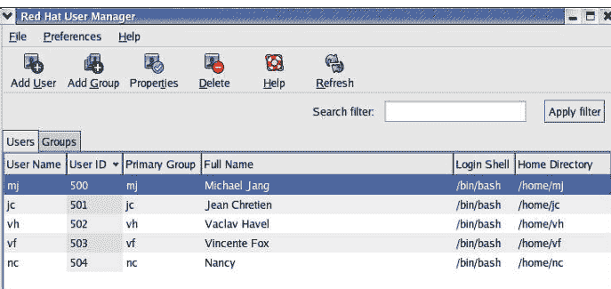

图 1. Red Hat 用户管理器帮助你管理用户和组。

如果你打算在 Linux 计算机上创建一个用户名和密码认证数据库，你需要了解如何设置用户和组。如果你接受了默认为用户创建私有组，你还会在 `Groups`（组）选项卡上看到一个新条目。点击 `User` 将打开图 2 所示的 `New User`（新用户）窗口。

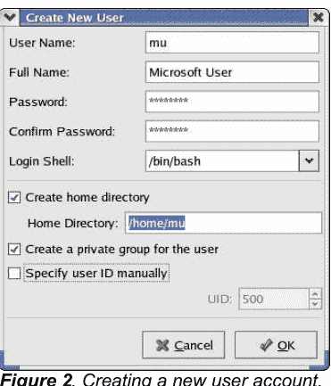

如果你要在 Linux 计算机上创建一个用户名和密码认证数据库，点击 `User` 会打开图 2 所示的 `New User` 窗口。

1. 点击 `Add`（添加）。这打开图 2 所示的 `New User` 窗口。
2. 按提示配置用户。
3. 点击 `OK` 完成操作。你应该能在列表中看到该用户。

**表 1. 创建新用户。**

| 条目 | 描述 |
| :--- | :--- |
| `User Name` | 登录名；Linux 支持 32 个字符。不允许包含空格和标点符号。 |
| `Full Name` | 全名；在此框中输入你选择的信息；它作为用户的注释。 |
| `Password` | 为用户输入预期的密码；用户可以使用 `passwd` 命令更改。 |
| `Login Shell` | 文本提示符的解释器；默认 shell 为 `/bin/bash`。或者，如果你为从不登录 Linux（即仅用于 Windows）的用户配置账户，可以设置为 `/sbin/nologin`。 |
| `Home Directory` | 默认是 `/home/%U`，其中 `%U` 对应用户名。根据需要可以设置不同的目录。 |
| `Create a private group` | 默认情况下，Red Hat 为所有用户设置私有组。除非特殊需要，请保留此设置；这有助于保护个人家目录的文件。 |
| `UID` | 用户 ID；如果 `UID` 框未变灰，你可以分配指定的数字。要小心；不要输入已分配给他人的 `UID`。 |

> 在 Linux 中，每个用户都有一个 ID 号。管理员用户 `root` 获得的 ID (UID) 为 0。其他服务用户获得的 `UID` 在 1 到 99 之间。在 Red Hat Linux 中，用户 ID 号从 500 开始并连续编号。

**表 2. 用户属性。**

| 条目 | 描述 |
| :--- | :--- |
| `Create a private group` | 默认情况下，Red Hat Linux 为所有用户设置私有组。除非特殊需要，请保留此设置；这有助于保护个人家目录的文件。 |

你可以执行以下操作来配置用户账户。突出你刚刚创建的用户，然后点击 `Properties`（属性）。这将打开图 3 所示的属性窗口。它包含了账户的四个设置选项卡。

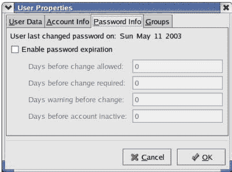

图 3. 配置用户账户。

### 第 4 章：设置文件服务器用户

**表 2. 配置用户账户。**

| 选项卡 | 设置 |
|---|---|
| `User Data`（用户数据） | 包含你已为此账户配置的基本信息：用户名、密码、主目录和登录 shell |
| `Account Info`（账户信息） | 允许你禁用该账户，或让其在特定日期过期。 |
| `Password Info`（密码信息） | 支持密码有效期。如图 3 所示，你可以让此用户在固定天数后更改密码。 |
| `Groups`（组） | 允许将此特定用户分配为你选择的组的成员。 |

假设你是按顺序创建用户的，他们应该是自己所属组的成员。例如，用户 `mj` 默认是名为 `mj` 的组的唯一成员。用户 ID (UID) 和组 ID (GID) 应该是相同的，如图 4 所示。

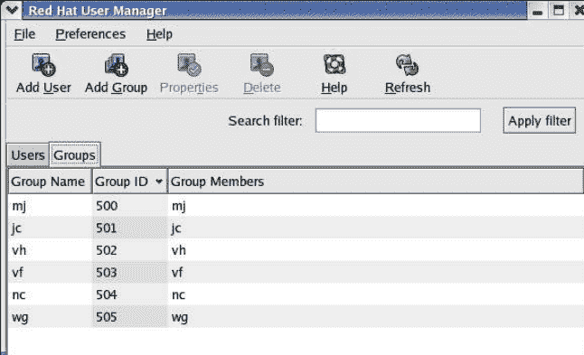

**图 4.** 标准 Red Hat Linux 私有组。

现在，你可以为组织创建所需的任何特殊组。例如，假设用户 `je` 和 `vf` 被设置为用于促进加拿大和墨西哥之间的贸易，并在你的系统上交换文件。你可以设置一个名为 `canmex` 的组，并将这些用户设置为该组的成员。实现此目标的一种方法如下：

1. 在 Red Hat 用户管理器 (Red Hat User Manager) 中，点击“添加组”(`Add Group`)。
2. 在“组名”(`Group Name`) 框中，输入新组所需的名称，在此情况下为 `canmex`。
3. 选择“手动指定组 ID”(`Specify group ID manually`)。设置一个普通用户 ID 范围之外的组 ID (GID)。例如，如果你的系统中有 100 个用户，`UID` 数字不会超过 600，那么 `GID` 1000 即可使用。点击 `OK` 继续。
4. 在“组”(`Group`) 选项卡中，高亮 `canmex` 组并点击 `OK`。
5. 在“组”选项卡中，你将看到来自 `/etc/passwd` 文件的可用用户列表。选择你想要的用户；在此情况下，你选择了用户 `jc` 和 `vf`。

该私有组现在已为共享目录准备就绪，类似于第 3 章“设置你的文件系统”中为用户 `mary` 和 `fred` 描述的内容。

### 在命令行创建用户和组

与其他 Linux GUI 一样，Red Hat 用户管理器是你可以从命令行界面运行的实用程序的简单入口。在大多数情况下，命令行工具比 GUI 工具更直观、更快速。如果你想向系统添加用户 `jc`，你将以 `root` 用户身份运行以下命令：

```bash
/usr/bin/useradd jc
passwd jc

Changing password for user jc

New password:
Retype new password:

passwd: all authentication tokens updated successfully.
```

创建新用户后，使用文本编辑器打开表 3 中列出的文件。这些文件包含用户、组和相关设置。

**表 3. 用户和组配置文件。**

| 文件 | 功能 |
|---|---|
| `/etc/passwd` | 主配置文件；包含用户名、用户 ID、组 ID、主目录和登录 shell。在 Red Hat Linux 中，这还包含一个指向 `/etc/shadow` 的链接，用于存储加密密码和有效期信息。 |
| `/etc/shadow` | 安全配置文件；包含用户名、加密密码以及密码和账户有效期信息。 |
| `/etc/group` | 主组配置文件；包含组名、组 ID、指向 `/etc/gshadow` 的组密码链接，以及组成员列表。 |
| `/etc/gshadow` | 安全配置文件；包含组名、加密密码、组管理员和组成员。 |

有时你可能想禁用一个用户。某人请假、被停职或忘记缴费。你可以通过 Red Hat 用户管理器禁用用户，或者简单地替换 `/etc/passwd` 中的 `x`。例如，用户 `mj` 在 `/etc/passwd` 中的正常条目如下：

```
mj:x:500:500:Michael Jang:/home/mj:/bin/bash
```


如果你在使用该用户时遇到问题，用文本编辑器打开 `/etc/passwd` 并将 `x` 替换为星号 (`*`)。如果用户 `mj` 尝试登录，正确的密码将不再被接受。

## 第 4 章：设置文件服务器用户

如果你想禁用一个用户，某人请假、被停职或忘记缴费。你可以通过 Red Hat 用户管理器禁用用户，或者简单地替换 `/etc/passwd` 中的 `x`。例如，用户 `mj` 在 `/etc/passwd` 中的正常条目如下：

```
mj:x:500:500:Michael Jang:/home/mj:/bin/bash
```

如果你在使用该用户时遇到问题，用文本编辑器打开 `/etc/passwd` 并将 `x` 替换为星号 (`*`)。如果用户 `mj` 尝试登录，正确的密码将不再被接受。

## 第 4 章：设置文件服务器的 113

| Unix_name | SMB_name | SMB_name2 |
| :--- | :--- | :--- |
| root | administrator | |
| body | guest pciquest smiquest |
| c | jean | |
| vh | vaclav | |
| nc | nancy | |
| egon | egon | |

第一列中的名称是 Linux 用户。第二列列出了对应的用户 ID（UID）。第三列中的字母和数字列表是 Samba 密码，格式适用于 Windows 9x/ME 计算机登录。计算机（在 `[UX]` 之前）是 Samba 密码，格式适用于 Windows NT/2000/XP 计算机登录。但 `smbpasswd` 文件中列出的所有用户并不都在 `smbususers` 文件中：...

`smbususers` 文件中列出的用户在 Microsoft Windows 计算机上具有不同的用户名。例如，`administrator` 是标准的 Microsoft 管理用户名。我使用 `smbpasswd` 命令为 `mj` 创建了 Samba 密码，因此它不会包含在 `smbususers` 文件中。

在第 5 章和第 6 章中，你将使用这些密码从 Linux 和微软工作站登录到域或基于 Windows 的网络。

### 配置计算机账户

在从 Windows NT/2000/XP 计算机连接到域之前，你需要设置计算机账户。如果域由 Linux PDC（主域控制器）管理，你应该在 `smb.conf` 配置文件中添加一行 `[global]` 配置：

```bash
add user script = /usr/sbin/useradd -d /dev/null -g 100 -s /bin/false -M %u
```

当你使用 Windows 工作站连接到域时，你将有机会创建一个计算机账户，正如第 6 章“连接 Windows 工作站”中所描述。这个 `add user script` 命令执行以下操作：

- `/usr/sbin/useradd` 命令带有指定的开关添加用户。
- `-d /dev/null` 选项设置新的家目录。
- `-g 100` 选项将账户分配给组 ID 100。
- `-s /bin/false` 选项设置默认 shell，这样任何进入此账户的人都无法运行任何 Linux 命令。
- `-M` 开关防止 `/usr/sbin/useradd` 命令创建家目录。
- 最后，`%u` 选项获取计算机的 NetBIOS 名称，添加美元符号 (`$`)，并将其设置为 `/etc/passwd` 文件中的用户名。以下是我已配置为 PDC 的 Linux 计算机上 `/etc/passwd` 文件中的计算机账户行示例：

```text
::$x:506:100::/dev/null:/bin/false
```

由于这是 Samba，你还会在 `/etc/samba/smbpasswd` 文件中看到对应的行，具有相同的名称和 UID。如果你将来要为普通用户创建额外账户，你可能希望将计算机账户的 UID 更改为不同的数字范围；例如，你可以将 UID 506 更改为 1506。如果这样做，请记住更改两个文件中的 UID：`/etc/passwd` 和 `/etc/samba/smbpasswd`。

自然地，你也可以使用我在本章中向你展示的命令 `/usr/bin/useradd` 和 `smbpasswd` 来创建计算机账户。如果你的工作站已经连接到 Windows PDC，则有替代方法。你可以从命令行界面创建单个计算机账户。例如，你可以使用以下命令为名为 `daisy` 的计算机创建前述的账户：

```bash
/usr/bin/useradd -d /dev/null -g 100 -s /bin/false -m daisy
smbpasswd -am daisy
```


> 如果你的网络上有大量的计算机，直接从命令行界面添加计算机账户可能是危险的。黑客可以在你将计算机连接到网络之前，通过新的计算机账户登录到你的网络。

### 域上的用户

如果你的网络上有大量的计算机，直接从命令行界面添加计算机账户可能是危险的。黑客可以在你将计算机连接到网络之前，通过新的计算机账户登录到你的网络。

尽管听起来很奇怪，但 `smb.conf` 文件使用 `workgroup` 变量来识别工作组或域。由于你正在处理一个域，你需要告诉 Samba 在何处找到 PDC。你可以指定其 NetBIOS 名称或 IP 地址。如果你不知道，可以通过替换星号 (`*`) 通过广播消息来设置。我的 Windows PDC 的 NetBIOS 名称是 `sugary`。

```text
password server = sugary
```

为了确保来自 Windows PDC 的用户和组不会干扰你的 Linux 计算机，你应该告诉 Samba 如何配置用户和组。以下命令超出了 Samba 配置器（Samba Configurator）的功能范围，添加了超出正常 Linux 用户和组范围的用户 ID 和组 ID：

```bash
### 设置新的用户和组 ID 范围，不会干扰 Linux 用户和组的正常 ID 范围。
winbind uid = 5000-6000
winbind gid = 5000-6000
```

## 设置文件服务器的 113

正如该章所述，保存你的更改并进行语法测试。以下步骤解释了这一过程：

1. 编辑 `nsswitch.conf` 文件。
2. 编辑 Samba 主配置文件。
3. 启动 `winbind` 守护进程。

## 第 4 章：设置你的文件服务器用户

如果 PDC 位于 Linux 计算机上，请将 `administrator` 替换为 `root`。

> 如果此命令不起作用，你可能忘记在 PDC 上设置 WINS 服务，或者防火墙可能阻止了 Microsoft 或 Linux 计算机上的流量。正如第 3 章“设置你的文件系统”中所讨论的，WINS 通过 TCP/IP 端口 1512 进行通信。

现在，你可以使用以下命令启动 `winbind` 服务了：

```bash
/sbin/winbind winbind start
```

现在，网络上任何计算机上的有效域用户都可以从这个基于 Samba 的域成员服务器上访问受授权的用户。现在是时候运行一些命令来检查 `winbind` 是否正常工作了。首先，此命令检查 `winbind` 的状态：

```bash
wbinfo -p
```

你应该会收到类似“ping” to `winbind` succeeded 的的消息；否则，`winbind` 服务可能没有正确启动。接下来，你可以检查 PDC 是否识别来自此域成员服务器的计算机账户：

```bash
wbinfo -t
```

你应该能看到“Secret is good.”的消息。现在，你可以通过以下命令看到 `winbind` 正在从 PDC 读取域用户和组的列表：

```bash
wbinfo -u
wbinfo -g
```

最后，你可以通过以下命令看到 `winbind` 如何将其与你的 `/etc/passwd` 和 `/etc/group` 文件结合：

```bash
getent passwd
getent group
```


### 设置 Samba PDC 数据库

你应该能看到本地身份数据库文件与来自 PDC 的相应数据库的组合。例如，`getent passwd` 命令列出了 `/etc/passwd` 文件，随后是一份来自 PDC 的用户列表。

> 如果你添加了另一个用户，下一个用户 ID 编号将排在从 PDC 分配给域用户的编号之后。根据本章所示命令，如果有四个域用户，他们将获得用户 ID 5000、5001、5002 和 5003；你创建的下一个用户（无论是在本地还是在 PDC 上）将获得默认为 5004 的用户 ID。

你可以使用一个正确配置了 Samba 的 Linux 计算机来替换 Microsoft PDC。如果你准备好进行转换，你需要对 `/etc/samba/smb.conf` 文件进行一些更改，我在第 3 章“设置你的服务器系统”中描述过。你还需要为连接到你域的每个计算机和用户准备账户。

要将配置 Samba 的 Linux 计算机设置为 PDC，请采取以下基本步骤。由于我已经详细涵盖了每个主题，我在这里总结了操作。

1. 在 Linux 计算机上设置你的账户。你可以使用命令 `/usr/sbin/useradd username`，或者使用 Red Hat 用户管理器。Linux 用户名限制为 32 个字符。


> 注意。Linux 不允许用户名以数字开头。Linux 也不允许大写字母。

2. 如果你已经有了 Microsoft Windows 用户，可能想保留它们。如果你有 Linux 用户名并知道对应的 Microsoft 用户名，运行以下命令来匹配两者，并在提示时输入 Microsoft 用户名的密码。你也可以使用第 3 章“设置你的文件系统”中的 Samba 服务器配置器来设置映射。

```
smbadduser username:microsoftusername
```


> 一旦设置了 Samba 密码，你可以使用 `smbpasswd useradd` 命令来更改它。

3. 为网络上将连接到启用 Samba 的 Linux PDC 的每个计算机配置账户。如前所述，你可以使用 `/usr/sbin/useradd` 命令在 `/etc/passwd` 中设置计算机账户，然后使用以下命令将其添加到 Samba 数据库。

```
smbpasswd -am computername
```


你可以远程管理 Linux PDC。如果你在网络上的另一台 Linux 计算机上，可以使用 `ssh mj@pdc_computer` 命令以用户 `mj` 的身份登录。由于这是安全壳，SSH 通信是加密的。如果你在网络上的 Windows 计算机上，从 `www.networksimplicity.com/openssh` 下载 Windows 版 OpenSSH 软件包，然后运行相同的 `ssh` 命令。

### 重新检查 Samba 主配置文件

4. 重新检查 Samba 主配置文件。表 4 总结了设置 PDC 需要的关键命令。

**表 4.** `smb.conf` 中用于设置 Samba PDC 的关键命令。

| 命令 | 功能 |
| --- | --- |
| `workgroup` | 设置你的 Microsoft Windows 域名称。 |
| `netbios name` | 将此分配给你计算机的 NetBIOS 名称。 |
| `server string` | 使用此注释命令识别 PDC。 |
| `security` | 对于 PDC，将其设置为 `user`。 |
| `encrypt passwords` | 设置为匹配来自 Windows 95 OSR2 及更高版本的加密方式。 |
| `smb password file` | 设置为存储 Linux 用户名和 Windows 密码的文件。 |
| `unix password sync` | 当用户更改密码时，确保 Linux 计算机上的密码也发生更改。 |
| `local master` | 支持在本地网络上选举为主浏览器（`master browser`）。 |
| `os level` | 指定域主浏览器所需的级别；对于具有 Windows 2000/XP 环境的 PDC，将其设置为 63 或 64。 |
| `domain master` | 支持为 Microsoft Windows 域选举为主浏览器。 |
| `preferred master` | 当此 Linux 加入域时设置浏览器选举。 |
| `domain logins` | 允许此 PDC 管理域登录。 |
| `login path` | 指定来自 Windows NT/2000/XP 计算机的漫游文件（`roving files`）的目录。 |
| `wins support` | 在 PDC 上设置 Windows 命名服务（WINS）服务器。 |

现在你已准备好使用 Samba 开始 Linux PDC 了。如果你有一个新网络，可以设置你的 Windows 工作站登录到你的新 PDC。此主题在第 6 章“连接 Windows 工作站”中涵盖。

### 登录脚本

登录脚本用于配置 Windows NT/2000/XP 计算机的节点命令，例如挂载网络驱动器。假设 PDC 位于名为 `nopaws` 的计算机上，设置：

```
net use T: \nopaws\project
```

对于 Windows 工作站，PDC 使用 `/home/netlog`。在 `smb.conf` 中设置以下内容：

```
[netlog]

comment = Network Logon Service

path = /home/netlog

guest ok = no

writable = yes
```

当用户登录域时，PDC 使用 `%U` 变量来查找 `nc`。因此，你需要在 `/home/netlog` 中设置所需的脚本：

```
logon script = %U.bat
```

下一次用户从 Windows 工作站登录域时，Samba 会发送 `nc.bat` 到客户端运行。

> 你可以使用 Linux 编辑器设置批文件，但 Windows 工作站需要以 Microsoft 格式保存的文件。我将在第 6 章“连接 Windows 工作站”中详细介绍如何设置此。


### 漫游配置

漫游配置提供了用户桌面、背景、开始菜单项等在中央服务器（通常是 PDC）上的快照。当拥有漫游的用户登录到网络上的任何工作站时，将获得相同的快照。

如果你网络中有漫游配置，文件的实际位置取决于计算机是 Windows 95/ME 还是 Windows NT/2000/XP。Windows 9x/ME 客户端的漫游配置存储在 Linux PDC 上的用户主目录中，根据第 3 章“设置你的用户文件系统”中描述的命令。

相比之下，来自 Windows NT/2000/XP 计算机的漫游配置的位置取决于登录路径变量。根据以下变量的值，Windows NT/2000/XP 计算机的漫游配置存储在 `/home/profiles/username` 目录中。

例如，如果用户想登录到 Windows 2000 专业版计算机，你配置的漫游配置存储在 `/home/profiles/nc` 目录。

要详细查看如何在 Linux PDC 上为 Windows 工作站设置漫游配置的方法，请参阅第 6 章“连接 Windows 工作站”。

## 第 4 章：设置你的文件服务器用户

### 文件和目录管理

对于那些不太熟悉 Linux 的人，理解文件、目录、所有权和权限的本质非常重要。在展示 Linux 和 Windows 权限如何协同工作之前，我需要解释这些概念在 Linux 中是如何工作的。

在 Linux 中，一切都由文件表示。目录、驱动程序和链接只是文件的特殊版本。每个文件都与该文件所有者和所属组的权限相关。

### Linux 权限

查看你 Linux 计算机上的权限。最好的起点是你的家目录。我可以通过运行以下命令来查看我家目录的权限（要查看你家目录的权限，请将 `mj` 替换为你的用户名）：

```
ls -l /home/mj
```

以下是我 Linux PDC 上家目录中的三条条目：

```
drwx-xr-x 3 mj  mj       4096 May 14 16:45 Start Menu

-rw-r--r-- 1 mj  mj       106528 May 14 19:24 USER.DAT

-rwx-xr-x 1 mj  project  46528 May 14 19:24 script
```


## 文件和目录管理

对于那些不太熟悉 `Linux` 的人，理解文件、目录、所有权和权限的本质非常重要。在展示 `Linux` 和 `Windows` 权限如何协同工作之前，我需要解释这些概念在 `Linux` 中是如何工作的。

在 `Linux` 中，一切都由文件表示。目录、驱动程序和链接只是文件的特殊版本。每个文件都与该文件所有者和所属组的权限相关。

### Linux 权限

查看你 `Linux` 计算机上的权限。最好的起点是你的家目录。我可以通过运行以下命令来查看我家目录的权限（要查看你家目录的权限，请将 `mj` 替换为你的用户名）：

```
ls -l /home/mj
```

以下是我 `Linux` PDC 上家目录中的三条条目：

```
drwx-xr-x 3 mj  mj       4096 May 14 16:45 Start Menu
-rw-r--r-- 1 mj  mj       106528 May 14 19:24 USER.DAT
-rwx-xr-x 1 mj  project  46528 May 14 19:24 script
```

这些文件的权限列在每个条目的左侧。对这些细节进行分析非常重要。第一个字母表示类型；其他字母是 `r`、`w` 或 `x`，如表 5 所示。

### 表 5. 文件权限。

| 字母 | 功能 |
| :--- | :--- |
| `c` | 驱动程序 |
| `d` | 目录 |
| `l` | 指向另一个文件的链接 |
| `r` | 读取 |
| `w` | 写入 |
| `x` | 执行 |
| | 空字符；当位于第一位置时，表示普通文件 |

剩余的字母与三个实体的权限相关：文件的所有者、拥有该文件的组以及系统上的所有其他人。

每个文件都标识了拥有该文件的用户和组。拥有每个文件的用户显示在第三列。拥有每个文件的组显示在第四列。在 `/home/mj` 目录中，每个文件的所有者是 `mj`；拥有该文件的组是 `project`。

考虑上述 `script` 文件的权限。第二、第三和第四个字母是 `rwx`，它们与该文件的所有者 `mj` 相关。这意味着你可以读取、写入和执行此脚本。

接三个字母与拥有该文件的组的文件权限相关。`project` 组中的用户可以读取和执行，但不能向脚本文件写入。
最后三个字母定义了系统上所有其他用户的文件权限，在这种情况下，他们只能读取脚本文件中的内容。

### 默认权限

每当你在 `Linux` 中创建一个文件时，该文件都会获得一组默认权限。在 `Red Hat Linux` 9 中，这些权限是：

```
-rw-rw-r--
```

在 `Linux` 中，这些字母被翻译为表 6 定义的数字代码。

### 表 6. 文件权限数值值。

| 权限 | 数值 | 描述 |
| :--- | :--- | :--- |
| `r` | 4 | `r` 被赋值为 4 |
| `w` | 2 | `w` 被赋值为 2 |
| `x` | 1 | `x` 被赋值为 1 |
| `wx` | 3 | 设置为 `w + x = 3` |
| `rx` | 5 | `r + x = 5` |
| `rw` | 6 | `r + w = 6` |
| `rwx` | 7 | `r + w + x = 7` |

查看来自我家目录 `/home/mj` 的文件列表。在该目录中，我可以将 `USER.DAT` 的权限翻译为数字代码 `664`。换句话说，拥有 `USER.DAT` 的用户和组可以读取和写入该文件；计算机上的其他人可以读取或从文件中复制。

现在你已经知道这种工作原理了，你就可以更改与文件相关的权限。例如，以下命令可以防止脚本被该系统上的任何人执行：

```
chmod 644 /home/mj/script
```

当你运行 `ls -l /home/mj` 命令时，你再次可以看到权限已经发生了变化：

```
-rw-r--r-- 1 mj project 46528 May 14 19:24 script
```

如你所见，文件左侧消失了 `x`，这意味着 `script` 不再由文件所有者 `mj` 或 `project` 组的任何成员执行。

### Linux 所有权

权限定义了用户、组和网络上的每个其他用户对文件可以做什么。你可以更改拥有该文件的用户和组。`chown` 命令将文件的所有权从一个用户转移到另一个用户。考虑共享目录上的 `script` 情况。用户 `mj` 和 `nc` 都在处理它。如果你运行以下命令，用户 `nc` 将获得 `script` 的所有权：

```
chown nc /home/script
```

如下输出显示了这一点：

```
-rw-r--r-- 1 nc project 46528 May 14 19:24
```

假设有人决定将 `script` 的所有权从 `project` 重新分配给 `mfg` 组。你可以通过以下命令进行设置：

```
chgrp mfg /home/script
ls -l /home/script
-rw-r--r-- 1 nc mfg 46528 May 14
```


如你所见，文件左侧消失了 `x`，这意味着 `script` 不再由文件所有者 `mj` 或 `project` 组的任何成员执行。

### Linux 所有权

权限定义了用户、组和网络上的每个其他用户对文件可以做什么。你可以更改拥有该文件的用户和组。`chown` 命令将文件的所有权从一个用户转移到另一个用户。考虑共享目录上的 `script` 情况。用户 `mj` 和 `nc` 都在处理它。如果你运行以下命令，用户 `nc` 将获得 `script` 的所有权：

```
chown nc /home/script
```

如下输出显示了这一点：

```
-rw-r--r-- 1 nc project 46528 May 14 19:24
```

假设有人决定将 `script` 的所有权从 `project` 重新分配给 `mfg` 组。你可以通过以下命令进行设置：

```
chgrp mfg /home/script
ls -l /home/script
```

输出结果：

```
-rw-r--r-- 1 nc mfg 46528 May 14
```

## 访问控制列表的有限支持

访问控制列表 (ACL) 是指定用户、组对文件可以做什么的权限的细节。在 `Samba 2.7` 中，它对 `ACL` 的支持是改进的。

在 `Linux 9` 版本中，`Samba` 对 `ACL` 的支持是改进的。

> `Samba` 不支持使用仅位于 `Windows` 或 `Linux PDC` 上的账户登录 `Linux`。

随后，我将向你展示如何设置 `Samba` 密码，这些用户在登录到 `Domain` 上的工作站时会输入这些密码。在未来的发行版中，这种情况将会改变。

### Linux 组

`Windows` 默认包含了一系列组，如备份操作员、高级用户等。

### Linux 的私有组

在某些情况下，每个 `Linux` 用户都属于自己的私有组。通过查看 `/etc/passwd` 和 `/etc/group` 文件可以发现这一点。其他 `Linux` 发行版通常对所有用户具有某些访问权限。

### 创建特殊组

经常，网络会将需要对单个目录中的文件具有访问权限的用户聚集在一起。在 `Linux` 中进行这种设置并不困难。

假设你想为飞机座椅工程师 `Gabe`、`Wayman`、`Padma` 和 `Diane` 设置一个私有目录。首席工程师是 `Gabe`。为了使之工作，请按照以下步骤操作：

1. 登录 `PDC`。在 `Red Hat` 用户 `Manager` 中点击主菜单 | 系统设置 | 用户和组。点击添加用户打开图 2 所示的新用户窗口。为工程师创建一个账户。或者，你可以使用以下命令为座椅工程师创建用户账户：

```
/usr/sbin/useradd gabe
/usr/sbin/useradd wayman
/usr/sbin/useradd padma
/usr/sbin/useradd diane
```

2. 如果你的座椅工程师想直接登录 `Linux` 工作站，请使用 `passwd username` 命令为该工作站上的每个用户创建一个密码。如果他们只是使用 `Windows` 工作站，你不需要为每个用户创建 `Linux` 密码。稍后，我将向你展示如何设置 `Samba` 密码。

3. 为座椅工程师设置组。在 `Red Hat` 用户 `Manager` 中，点击添加组。在图 5 所示的创建新组窗口中，设置一个适当的组名称。最好也手动设置组 ID，使其位于普通用户 ID 范围之外，正如之前解释的那样。


## 第 4 章：设置文件服务器用户 125

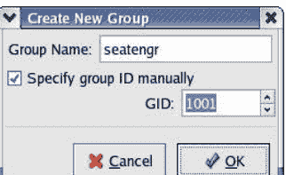

**图 5。** 创建一个特殊组。

4. 为座椅工程师创建一个特殊目录。将用户所有权分配给首席工程师 (`Gabe`)，将组所有权分配给座椅工程师组。允许用户和组在该目录中拥有完全权限。

5. 配置该目录，使其文件属于该特殊组。防止其他用户读取此目录（`Linux` 管理员用户 `root` 仍然具有访问权限）。在命令行界面执行此操作最为简单：

```bash
mkdir /home/seatengr
chown gabe /home/seatengr
chgrp seatengr /home/seatengr
chmod 770 /home/seatengr
chmod g+s /home/seatengr
```

> `chmod g+s /home/seatengr` 命令会在 `/home/seatengr` 目录中复制或创建的任何文件上设置组 ID 位，使其继承该目录的组所有。换句话说，`seatengr` 组成员对 `/home/seatengr` 目录下的所有文件具有完全的默认权限。

6. 在 `Red Hat` 用户管理器中，点击“组”选项卡。选中你的 `seatengr` 组并点击“属性”。在属性窗口中，点击图 6 所示的“组”选项卡。从列表中选择你的座椅工程师，然后点击“确定”。如果你有一个特殊目录 `/home/seatengr`，访问将仅限于你的座椅工程师。

7. 为每个用户设置 `Windows` 登录。你可以通过两种方式实现。如果你想使用 `Red Hat Samba` 配置器，点击“主菜单 | 系统设置 | 服务器设置 | Samba 服务器”。在 `Samba` 服务器工具中，点击“首选项 | Samba 用户”。在 `Samba` 窗口中，为每个座椅工程师点击“将用户添加到 Samba 数据库条目”。图 7 展示了 `Waymon` 的 `Windows` 用户名为 `waymonww`。

## 126 面向 Windows 网络管理员的 Linux 传输

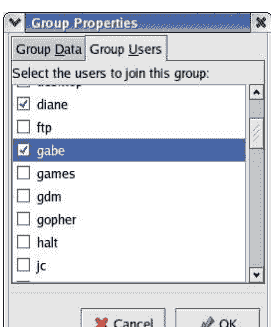

**图 6。** 为组选择用户。

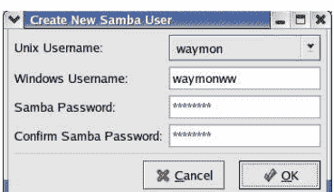

**图 7。** 为 `Windows` 域登录创建 `Samba` 用户。

8. 此外，你可以在命令行中使用 `smbadduser` 命令执行此操作。对于图 7 所示的情况，运行以下命令：

```bash
smbadduser waymon:waymonww
```

系统会提示你输入 `Waymon` 从微软工作站登录时将使用的密码。

9. 向 `Samba` 文件中添加共享。将访问权限限制为座椅工程师组的成员。根据第 3 章的讨论，你可以通过在 `Samba` 配置文件的末尾添加以下命令来实现这一点：

```ini
[seatengr]
comment = 座椅工程师目录
path = /home/seatengr
valid users = @seatengr
public = no
writable = yes
printable = no
create mask = 0770
```

10. 使用 `testparam` 命令检查更改的语法。解决 `testparam` 指出的任何问题。使用以下命令重启 `Samba` 守护进程：

```
/etc/rc.d/init.d/smb restart
```


现在你的域已准备就绪，并为一组座椅工程师进行了配置。

### 配额 (Quotas)

配额可以防止用户自私、无组织或粗心。它们可以限制任何单个用户或组占的空间或文件数量。占用空间过多的用户可能会挤占其他用户空间、数据空间，甚至是启动 Linux 计算机所需的空间。如果你在 Linux 计算机上配置了家目录且没有无限磁盘空间，你就设置配额。

你可以如第 1 章“基础 Linux 安装”中所述，通过分区来限制特定用户造成的破坏。即使你为 `/home` 目录设置了单独分区，仍然存在用户挤占他人的可能。遗憾的是，Red Hat 9 没有安装可以帮助你配置配额的 GUI。

红色 Linux 配额 RPM 是默认安装的。因此，设置和分组配额你只需要执行以下步骤：

1. 设置主 Linux 分区配置文件 (`/etc/fstab`)，以便在下次挂载目标目录时启动配额。
2. 重新挂载目标目录，以便无需重启 Linux 即可启用配额。
3. 为用户或组设置配额配置文件。
4. 为挂载目录创建或修改配额文件。
5. 为一组用户或组配置你创建的配额。
6. 根据需要修改配额周期。
7. 使用 `quota` 命令激活配额。

一旦配置了配额，你可以使用 `quota` 和 `repquota` 命令来检查用户。在接下来的章节中，我将详细解释过程的每一步。

分配给每个用户的数据量取决于硬盘上的可用空间以及你在业务中的工作。如果用户只是创建办公套件文件，他们需要的空间远少于创建航空公司厨房的 3D 实体设计模型的空间。

# Windows 网络管理员的 Linux 迁移指南

在最新版本的 Linux 中，文件数量有一些实际的限制，因此文件配额限制并不常见。（当前限制被编码在 Linux 内核的 `/proc/sys/fs/file-max` 中。）

软限制（soft limit）定义了与该用户关联的最大数量或文件数。如果设置了宽限（grace period），用户必须减少其使用的文件数量和或空间。默认宽限为七天；稍后我会描述如何更改它。

如果你设置了宽限，则硬限制（hard limit）将生效。宽限结束后，除非用户将空间和文件数量减少到限制之下，否则 Linux 将锁定账户。
我在表 **7** 中总结了每一列。

### 表 7. 用户配额。

| 列 | 功能 |
|---|---|
| 1 | 文件系统，定义带有配额的分区。你定义的配额适用于挂载在该分区上的任何目录。 |
| 2 | 用户在指定文件系统中当前占用的空间，单位为千字节。对于上面的示例，用户 `jkp` 目前在 `/home` 目录下占用了 68KB 的文件。 |
| 3 | 第一个软限制定义了用户允许在 `/home` 目录下存储的空间（单位为 KB）。 |
| 4 | 硬限制定义了在宽限结束后，用户在 `/home` 目录下可以存储的空间（单位为 KB）。 |
| 5 | inodes 计数统计用户在 `/home` 目录下拥有的文件数量。 |
| 6 | 第二个软限制定义了用户在 `/home` 目录下可以存储的文件数量。 |
| 7 | 第二个硬限制定义了在宽限结束后，用户在 `/home` 目录下可以存储的文件数量。 |

现在让我们开始编辑配额。在这个示例中，我将为用户 `jkp` 设置一个 100MB 的硬限制；我还会包含 10% 的余量。由于很少需要 inode 配额，因此我不会为此设置它们。如需编辑用户 `jkp` 的配额文件，请执行以下步骤：

1. 启动命令行界面。使用 `/usr/sbin/edquota -u jkp` 命令打开用户 `jkp` 的配额文件。
2. 我为用户配额任意地设置了 10% 的余量。你可以设置你选择的限制。软限制将是 110MB。因为信息单位是 KB，我将在第一个“soft”列下输入 11000。我假设你已经在 vi 编辑器中打开了配额文件。
3. 将光标移动到文件中所需的位置，然后输入 `i` 命令（进入“插入模式”）。
4. 在通常随 Red Hat Linux 安装的 vi 版本中，你可以使用退格键、删除键、箭头键和其他键盘键进行所需的更改。
5. 完成后，按 Esc 键（返回“命令模式”）。

# 第 4 章：设置你的文件服务器用户 131

6. 目标预期的限制是 100MB。在第一个“hard”列中，输入 10000，即 KB 为单位的 100MB。使用光标移动到文件中所需的位置，再次输入 i 命令。对软限制重复此过程。完成后，文件看起来应该像这样：

```
Disk quotas for user jkp (uid 506)
| Filesystem | blocks | soft | inodes | soft | hard |
| /dev/sdb2 | -68 | 110000 | 100000 | 9 | 0 |
```

7. 使用 `:wq` 命令保存并写入更改。这会写入文件，关闭 vi 编辑器并返回命令行界面。

> 对于目前无法在 GUI 编辑器中打开 Linux 配额文件对于习惯了 GUI 编辑器的任何人来说，该编辑器可能会令人敬畏。

你可以通过以下命令确认对用户 `jkp` 的更改：

```
# quota jkp
```

## 为组配置配额

现在你可以重复此过程来为组配置配额。基本命令基本相同，只有细微差别。你已经设置了基础配额配置文件 `/home/aquota.group`。如果你想为之前描述的 seat engineering 组设置配额，请执行以下步骤：

1. 运行以下命令打开组配额文件，在此例中为 seatengroup。

```
# /usr/sbin/edquota - seatengr
```

2. 编辑器默认打开。打开后，根据需要修改硬、软限制。如上一节所述，使用 `i` 命令进入“插入模式”，你可以在其中根据需要使用键盘插入和删除。按 Esc 键完成。
3. 运行 `:wq` 命令写入文件并关闭 vi 编辑器。
4. 通过以下命令确认组配额的更改：

```
# quota -g seatengr
```

### 设置宽限

现在你可以重复此过程来为组配置配额。基本命令基本相同，只有细微差别。你已经设置了基础配额配置文件 `/home/aquota.group`。如果你想为之前描述的 seat engineering 组设置配额，请执行以下步骤：

1. 运行以下命令打开组配额文件，在此例中为 seatengroup。

```
# /usr/sbin/edquota - seatengr
```

2. 编辑器默认打开。打开后，根据需要修改硬、软限制。如上一节所述，使用 `i` 命令进入“插入模式”，你可以在其中根据需要使用键盘插入和删除。按 Esc 键完成。
3. 运行 `:wq` 命令写入文件并关闭 vi 编辑器。
4. 通过以下命令确认组配额的更改：

```
# quota -g seatengr
```

### 激活配额

现在你可以重复此过程来为组配置配额。基本命令基本相同，只有细微差别。你已经设置了基础配额配置文件 `/home/aquota.group`。如果你想为之前描述的 seat engineering 组设置配额，请执行以下步骤：

1. 运行以下命令打开组配额文件，在此例中为 seatengroup。

```
# /usr/sbin/edquota - seatengr
```


## 第 5 章
# 连接 Linux 工作站

那款在服务器领域声名大起的 `Red Hat Linux` 也可以配置为强大的桌面和工作站计算机。自然地，你可以将 `Linux` 计算机连接到由 `Microsoft Windows` 和 `Linux` 计算机组成的网络。事实上，对于想要尝试 `Linux` 的 `Windows` 用户来说，将 `Linux` 配置为工作站是一个自然的选择。

你不需要安装所有的 `Samba` 包就可以将 `Linux` 计算机作为工作站连接。你只需要 `Samba` 客户端包来连接到你选择的共享目录。但如果你还想从你的 `Linux` 工作站共享目录或打印机，则需要运行 `Samba` 服务包。

在 `Microsoft Windows` 域上运行 `Linux` 工作站的一个缺点是，你无法使用 `Microsoft Windows` 或 `Linux PDC`（主域控制器）中的 `Windows` 验证数据库登录到本地工作站（可以使用网络信息系统 `NIS` 或轻量级目录访问协议 `LDAP` 来建立单一验证数据库；这些技术超出了本书的范围）。

然而，一旦你登录到 `Linux` 工作站，就可以连接到基于 `Windows` 的网络上的共享目录。当你建立连接时，需要输入域或成员服务器的用户名和密码。如果工作站是某个域的一部分，用户名和密码也可以来自该域的任何用户。

你可以在 `Linux` 启动文件中设置域名和密码。这样，登录 `Linux` 的用户将自动连接到域上的共享目录和打印机。在本章，我将向你展示如何为单个用户进行此类设置。


> 许多关于 `Samba` 的书籍可以帮助你通过 `/etc/fstab` 文件配置自动连接。我在书中避免了这一点，因为你无法通过网络使用它来让用户自定义挂载目录。

连接共享目录或打印机的步骤略有不同。在本章的末尾，我将向你展示如何将你的 `Linux` 工作站连接到基于 `Windows` 域上的 `PDC` 或域成员服务器。步骤取决于你是连接到 `Windows` 服务器还是 `Linux` 服务器的共享资源。

如果你在连接 `Samba` 服务器或 `PDC` 时遇到问题，每台连接的计算机都有许多日志文件。它们可能对你有帮助。使用标准的 `smb.conf` 文件，`/var/log/samba` 目录下每个细节都有单独的日志文件。我将在第 6 章“连接 Windows 工作站”中详细描述这些文件。来自这些日志文件的信息非常适用于 `Linux` 工作站。

在本章描述的许多命令需要管理员或 `root` 用户权限。如果你是以普通用户登录的（你本应该这么做），可以使用以下命令获取 `root` 用户权限：

### 配置工作站

```bash
$ su

Password:

#
```

就像你可以从 `Microsoft` 域中配置共享资源一样，你也可以在域上的 `Linux` 工作站上配置共享资源。然而，要从 `Linux` 工作站共享目录或打印机，你还需要安装 `Samba` 服务器软件。

> **注意**
> 当我谈到基于 `Microsoft Windows` 的网络时，我指的是与 `Microsoft` 操作系统相关的标准网络方案。

### Samba 客户端包

连接到基于 `Microsoft Windows` 的网络上的共享目录，只需要 `samba-client` 和 `samba-common` RPM 包。如果你遵循了第 2 章的安装说明，那么你已经安装了系统工具（`System Tools`）软件包组，该组默认包含了这些 RPM。你可以使用以下命令检查这些包是否已安装：

```bash
$ rpm -q samba-client

$ rpm -q samba-common
```

如果安装了这些包，你将看到类似下面的输出：

```
samba-common-2.2.7a-8.9.0

samba-client-2.2.7a-8.9.0
```

或者，你可能会看到类似“`package-samba-client is not installed`”的消息。在这种情况下，你可以从第一张 `Red Hat Linux 9` 光盘安装这些包。以 `root` 用户身份将其插入驱动器，并在命令行界面运行以下命令：

```bash
### mount /mnt/cdrom

# rpm -Dvh /mnt/cdrom/RedHat/RedHat/RPM/samba-common*

# rpm -Dvh /mnt/cdrom/RedHat/RedHat/RPM/samba-client*
```

然而，如果你不计划从 `Linux` 工作站共享目录或打印机，请不要安装 `Samba` 服务器。安装你不使用的软件可能会带来安全风险。

### 连接到域

通过 `Linux` 计算机，你可以连接到由 `Windows` 或 `Linux PDC` 辖的域。如果你还想从 `Linux` 客户端进行共享，则需要第 3 章描述的额外 `Samba` 服务器包，并需要按照第 4 章描述的方法将你的计算机配置为域成员。一旦安装了所需的包，你还需要完成以下几件事：

- 使用以下命令确保 `Samba` 守护进程正在运行：

```bash
/sbin/service smb status
```

- 使用以下命令确保 `Winbind` 守护进程正在运行：

```bash
/sbin/service winbind status
```

如果守护进程出现问题，请重启它。例如，以下命令 `/sbin/service winbind restart` 会停止并启动 `Winbind` 守护进程。如果你get“`locked`”错误，请尝试将你的工作站加入域。

img/6ee4859e736a0839007ea9afb576c195_157_0.png

### 查找共享目录

在 `Linux` 工作站上查找共享目录并不困难。作为管理员，你应该知道如何在命令行界面运行此命令。有了这项技能，你就可以建立域连接。如果 `allacces` 是域中的一台计算机，上述 `smclient` 将 `PDC` 验证数据库中搜索 `michael`。一旦你输入正确的密码，就会获得可以访问的共享目录列表。

### Windows 管理员的 Linux 传输

`Linux` 版本的登录文件通常将 `Windows` 工作站连接到共享目录。允许你浏览共享目录的命令是 `smclient`。以下来自 `Linux` 工作站的示例列出了 `Microsoft XP` 计算机上的共享目录和打印机：

```bash
# smclient -L \allacces -U michael
```

基础 `smclient` 与 `Windows` 网络上的任何服务器通信。这包括网络上任何共享目录或打印机的 `Linux` 计算机。

`-L` 参数引导 `smclient` 查看网络上特定计算机的共享。在这种情况下，该计算机是 `allacces`。命令末尾的 `-U michael` 指定了 `allacces` 计算机的用户名或域用户名。系统提示输入用户密码。

> 你也可以将密码包含在用户名中，格式如下：`-U michael$password`。但这会让密码暴露给可能看到的人。

我计算机的输出如图 1 所示。

```
[mj@Delilah mj]$ smclient -i \allacces -U michael

added interface=ip172.22.30.30 bcast=172.22.30.255 nmask=255.255.255.255.0

Password:

Domain=[DARKSTAR] 0S=[Windows 5.1] Server=[Windows 2000 LAN Manager]
```


### 第 5 章：连接 Linux 工作站

#### 图 1. 查找共享目录和打印机列表

`img/6ee4859e736a0839007ea9afb576c195_158_0.png`

图 1 展示了当前共享目录和打印机的列表。每个项目都包含共享名称以及你在创建共享时指定的注释。图 2 显示了如何从`allaccess`计算机上的`Hetzen`共享进行此操作。

#### 图 2. 从 Windows 目录配置 Hetentzen 共享

`img/6ee4859e736a0839007ea9afb576c195_159_0.png`

#### 挂载目录

一旦你学会了从命令行界面挂载目录，就可以为每个用户设置登录文件。这些批处理文件将运行命令，在每个用户下次登录 Linux 时自动挂载目录。

只要你已经下载了本章开头介绍的`Samba`客户端包，就可以使用`smbmount`命令挂载共享网络目录。当然，你需要指定计算机名称、共享名称，通常还需要指定用户名和密码。

考虑第 4 章中的一个示例，当时你为一组飞机座椅生成器设置了共享目录。在你的 Linux 域服务器上，该共享目录位于`grateful`域中`nopaws`计算机的`/home/seatngr`。

这是一种使用`Red Hat`自定义的`GUI`可能会更快的情况。在`GUI`中，点击主菜单（`Main Menu`）|网络服务器（`Network Servers`）。这将打开`Nautilus`浏览器，查看与 Windows 网络上计算机的连接。如果你的 Linux 识别`NetBIOS`广播，它应该能够查看网络上的工作组（`Workgroups`）和域（`Domains`），如图 3 所示。

你可以通过在`Nautilus`浏览器的位置文本框中输入`smb:///`来查看 Windows 网络。这是一个统一资源标识符（`URI`），它可以定位网络上所有带有`Samba`服务器的 Windows 和 Linux 计算机。

自然，当你双击`GRATEFUL`图标时，你会看到`GRATEFUL`域内的服务器和工作站列表。你会看到所有配置为在该域共享文件和打印机的 Windows 和 Linux 计算机。在我的域中，我的`PDC`是`cosmicc`，我的 Linux 成员名为`nopaws`。

## Windows 网络管理员的 Linux 迁移

`img/6ee4859e736a0839007ea9afb576c195_160_0.png`

#### 图 3. 在 Linux GUI 中查看域

当我双击`nopaws`计算机时，系统会提示我输入用户名和密码，如图 4 所示。我可以在`PDC`或服务器成员上输入任何 Windows 用户名。你记得第 4 章提到的，Linux 计算机在`/etc/samba/smbusers`文件中存储了用户名数据库，该文件通过`smb.conf`文件中的以下命令激活：

```
username map = /etc/samba/smbusers
```

我输入了 Windows 用户名`waymonww`。在`PDC`上，我在`/etc/samba/smbusers`文件中将`waymonww`与 Linux 用户`waymon`关联。我可以使用第 3 章“设置你的服务器文件系统”中描述的`smbadduser`命令来实现此。如果`PDC`或服务器成员识别了你的用户名和密码，`Nautilus`然后将导航到共享目录。对于`nopaws`计算机，这包括在它的本地`smb.conf`配置文件中定义的共享目录。这些共享如图 5 所示。如你所见，这包括`smb.conf`文件末尾的共享，以及基本的主目录共享。在这种情况下，Linux 用户名是`waymon`，共享来自`/home/waymon`目录。

`img/6ee4859e736a0839007ea9afb576c195_160_1.png`

#### 图 4. 使用用户名和密码连接

`img/6ee4859e736a0839007ea9afb576c195_161_0.png`

#### 图 5. nopaws 计算机的共享目录

> 如果你以域用户身份连接，你将在`Nautilus`中看到其后的共享名称——即使该用户在目标服务器上没有主目录。

假设`PDC`或成员服务器验证了你的凭据，`Nautilus`将带你进入该域共享目录的图形视图。我将在**图 6**中说明其工作原理，它是`nopaws`计算机上`[seatengr]`共享文件的图形列表。

`img/6ee4859e736a0839007ea9afb576c195_161_1.png`

#### 图 6. 来自共享目录的文件

你现在可以通过图形化方式管理此目录下的文件。例如，你可以通过将文件拖到桌面上的垃圾桶图标来删除文件。你可以将文件复制到`Nautilus`窗口中打开的目录。`Nautilus`会识别扩展名，双击文件将在适当的应用程序（如`GNOME`文本编辑器）中打开它。

但作为管理员，你希望为你的用户设置适当的登录文件。首先，让我们测试一些你可以使用的命令。例如，如果我想挂载来自`nopaws` `[seateng]`共享的`/home/seateng`目录，我可以运行以下命令：

```
# mount -o username=waymonwn //nopaws/seateng /home/seateng

password:
```

此命令挂载了`[seateng]`共享的`/home/seateng`。我可以在`/home/seateng`运行以下命令，这可以让你看到`smb.conf`文件中的共享。对于`nopaws`计算机，这包括在其本地`smb.conf`配置文件中定义的共享。这些共享如图 5 所示。如你所见，这包括`smb.conf`文件末尾的共享，以及基本的主目录共享。在这种情况下，Linux 用户名是`waymon`，共享来自`/home/waymon`目录。

但作为管理员，你希望为你的用户设置适当的登录文件。首先，让我们测试一些你可以使用的命令。例如，如果我想挂载来自`nopaws` `[seateng]`共享的`/home/seateng`目录，我可以运行以下命令：

```
### mount -s /home/seateng
```

在 Linux 中，`umount`命令会卸载共享。挂载和卸载命令有一个缺点：它们只能以`root`用户身份执行。为了在 Windows 网络中，你可以以`root`用户身份执行以下步骤，以允许普通用户挂载和卸载目录：

1. 以`root`用户执行：

```
### chmod +s /bin/smbmnt
# chmod +s /bin/smbmount
```

2. 现在你已经看到`smbmnt`和`smbmount`命令对普通用户有效，你可以执行：

```
$ smbmount //nopaws/seateng /home/seateng -o username=waymon

password:

$ ls /home/seateng
```


- 3. 现在你已经看到 `smbmnt` 和 `smbmount` 命令对普通用户有效，你可以设置每个用户的启动文件自动连接共享目录。

## 第 5 章：连接 Linux 工作站 143

### Linux 批文件

在 Windows 工作站上，你可以设置 `username.bat` 或 `login.bat` 文件来自动连接共享目录。你可以为 Linux 工作站设置相同的功能。

默认情况下，当用户登录 Linux 时，Linux 会运行该用户的启动文件。启动文件的名称取决于你是登录 GUI 还是命令行界面。

# GUI 登录设置

你可以设置登录到 GUI 时运行的命令。从 GNOME 桌面，点击主菜单（Main Menu）|偏好（Preferences）|更多偏好（More Preferences）|会话（Sessions）。这将打开会话对话，启动会话管理器。点击启动程序（Startup Programs），如图 7 所示。

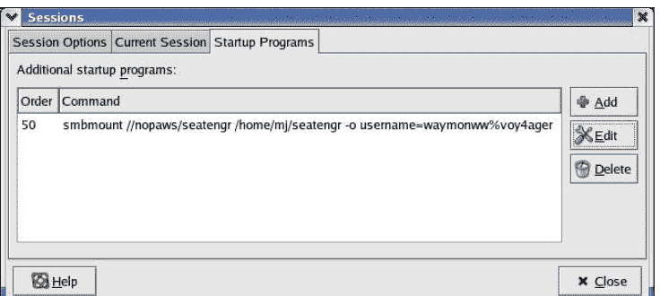

**图 7.** 设置启动程序。

如果你想添加启动程序，点击“添加”（Add）。在添加启动程序对话框中，在启动命令框输入你选择的命令。如图 7 所示，我使用之前描述的 `smbmnt` 命令进行了设置。我还为命令添加了密码（`voy4ager`）。如果你正在配置多个启动命令，可以通过赋予更高的顺序数字来设置第一个运行的命令。

> 注意：如果你没有添加密码，GUI 会话管理器将无法挂载目录。你可以通过图 7 示例中的 `%` 字符来实现这一点，`wayman` 的密码是 `voyagerager`。

使用会话管理器设置的任何命令都会保存在每个用户的主目录下。例如，如果我作为 `mj` 运行会话管理器，我添加的命令保存在 `/home/mj/.gnome2` 目录下的 `session-manual` 文件。

在 Linux 中，以点（.开头的文件和目录是隐藏的。因此，`.gnome2` 目录通常是不可见的。

你可以使用以下命令从命令行界面浏览隐藏文件和目录：

```
ls -a
```

如果你想用 GNOME 文本编辑器 `gedit` 打开隐藏目录中的文件，请按照以下步骤操作：

1. 点击主菜单（Main Menu） | 附件（Accessories） | 文本编辑器（Text Editor）。
2. 在 `gedit` 中，点击“打开”（Open）。
3. 在选择（Selection）文本框中输入 `.gnome2` 并按回车；这将让你看到隐藏的 `/home/mj/.gnome2` 目录下的文件，如图 8 所示。

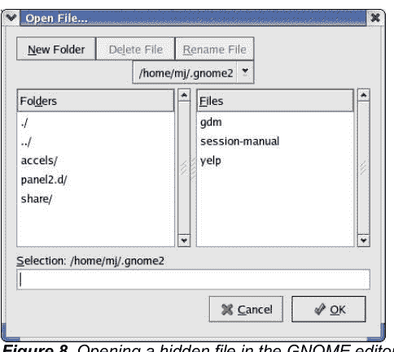

4. 打开你选择的文件。要打开 GNOME 启动脚本，突出显示 `session-manual` 文件并点击确定（OK）。现在你可以添加你喜欢的批处理命令。下一次用户登录 GUI 时，GNOME 将运行此文件中的命令。

## 文本登录批量设置

如果你以文本模式登录 Linux 工作站，启动 Linux 电脑后看到的第一个界面应该类似于以下内容：

```
Red Hat Linux release 9 (Shrike)
Kernel 2.4.20-9 on an i686

Delilah login:
```

本地登录，然后运行以下命令查看你主目录下的所有文件：

```
ls -a
```

Red Hat Linux 主目录下的关键启动文件是 `.bash_profile`。当你在文本控制台登录计算机时，Linux 默认在 `bash` shell 中启动，这是一个与一组类似于 MS-DOS 的命令关联的命令行界面。`.bash_profile` 文件是 Red Hat 管理员为每个用户使用自定义登录脚本的地方。

你可以使用任选的文本编辑器打开此文件。由于本书面向 Microsoft Windows 用户，我假设你可能想在 GUI 中打开它。要在文本模式下进入 GUI，请输入以下命令：

```
startx
```

一旦 GUI 打开，你就可以在在前文中描述的 GNOME 编辑器中打开 `.bash_profile`。点击主菜单（Main Menu） | 附件（Accessories） | 文本编辑器（Text Editor）。点击“打开”，然后如图 9 所示输入 `.bash_profile` 文件的名称。不要忘记文件开头的点（.）。你可以在编辑器中添加你喜欢的命令。在图 10 中，我添加了与上一节相同的命令，但没有密码。

一旦保存了此文件，下次你登录时，Linux 将自动运行自定义的 `smbmount`。下次你以文本模式登录时，系统会提示输入两个密码：第一个用于用户，第二个用于验证与共享目录的连接：

```
Red Hat Linux release 9 (Shrike)
Kernel 2.4.20-9 on an i686

Delilah login: padma

Password:

Last login: Wed Jun 4 08:36:32 on tty1

Password:
```

可能处理起来太麻烦了。如果你不在意潜在的安全风险，可以将密码包含在 `.bash_profile` 脚本中；只需在命令末尾添加密码（在此例中为 `voyager4`），如下：

```
smbount //nopaws/seateng /home/$USER/seateng -o username=waymonww%voyager
```

如果你在 `padma` 的 `.bash_profile` 文件中输入了密码，她登录文本控制台时就不需要输入第二个密码了。如果你有很多用户，编辑每个用户的 `.bash_profile` 文件是相当低效的。你可以为多个不同的用户 `.bash_profile` 文件添加相同的命令。例如，以下命令在用户 `padma` 主目录的 `.bash_profile` 文件中设置了相同的挂载：

```bash
# echo 'smbount //nopaws/seateng /home/$USER/seateng -o username=waymonww' \
>> /home/padma/.bash_profile
```

> 在上一个命令中，第一行末尾的反斜杠（\）是延续字符；它告诉 Linux 将两行合并作为一个命令一起读取。

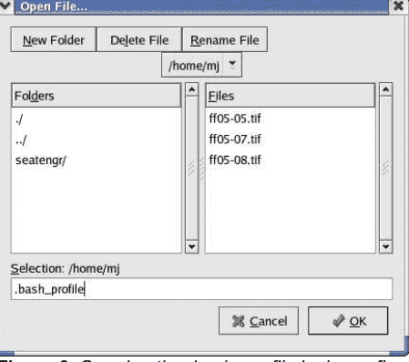

图 9。打开 `.bash_profile` 登录配置文件。

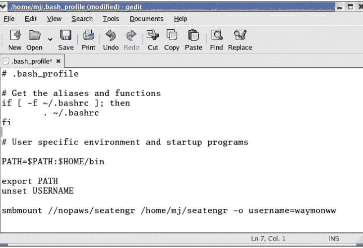

```bash
.bash_profile

## 获取别名和函数

if [ -f ~/.bashrc ]; then

    ~/.bashrc

fi

# 用户特定环境和启动程序

PATH=$PATH:$HOME/bin

export PATH

unset USERNAME

smbmount //nopaws/seateng /home/mj/seateng -o username=waymonww
```

图 10。编辑 `.bash_profile` 配置文件。

自然，你可以重复此命令，将你选择的主目录替换为 `/home/padma`。关于此命令，我需要解释五点：

- `echo` 命令复制引号内的信息。
- 单引号包围了我想想要添加到 `.bash_profile` 文件中的命令。
- `$USER` 变量默认为当前用户。
- 反斜杠“转义”了回车符；换句话说，Linux 读取前一个命令就像它是一行一样。
- 在图 10 中，我添加了与上一节相同的命令，没有密码。

一旦保存了此文件，下次你登录时，Linux 将自动运行自定义的 `smbmount`。下次你以文本模式登录时，系统会提示输入两个密码：第一个用于用户，第二个用于验证与共享目录的连接：

```
Red Hat Linux release 9 (Shrike)
Kernel 2.4.20-9 on an i686

Delilah login: padma

Password:

Last login: Wed Jun 4 08:36:32 on tty1

Password:
```

可能处理起来太麻烦了。如果你不在意潜在的安全风险，可以将密码包含在 `.bash_profile` 脚本中；只需在命令末尾添加密码（在此例中为 `voyager4`），如下：

```
smbount //nopaws/seateng /home/$USER/seateng -o username=waymonww%voyager
```

如果你在 `padma` 的 `.bash_profile` 文件中输入了密码，她登录文本控制台时就不需要输入第二个密码了。如果你有很多用户，编辑每个用户的 `.bash_profile` 文件是相当低效的。你可以为多个不同的用户 `.bash_profile` 文件添加相同的命令。例如，以下命令在用户 `padma` 主目录的 `.bash_profile` 文件中设置了相同的挂载：

```bash


# 连接 Linux 工作站

你可以使用以下命令从命令行界面浏览隐藏文件和目录：

```bash
ls -a
```

如果你想用 GNOME 文本编辑器 `gedit` 打开隐藏目录中的文件，请按照以下步骤操作：

1. 点击主菜单（`Main Menu`） > 附件（`Accessories`） > 文本编辑器（`Text Editor`）。
2. 在 `gedit` 中，点击“打开”（`Open`）。
3. 在选择（`Selection`）文本框中输入`.gnome2`并按回车；这将让你看到隐藏的`/home/mj/.gnome2`目录下的文件，如图 8 所示。


4. 打开你选择的文件。要打开 GNOME 启动脚本，突出显示`session-manual`文件并点击确定（`OK`）。现在你可以添加你喜欢的批处理命令。下一次用户登录 GUI 时，GNOME 将运行此文件中的命令。

## 文本登录批量设置

如果你以文本模式登录 Linux 工作站，启动 Linux 电脑后看到的第一个界面应该类似于以下内容：

```
Red Hat Linux release 9 (Shrike)
Kernel 2.4.20-9 on an i686

Delilah login:
```

本地登录，然后运行以下命令查看你主目录下的所有文件：

```bash
ls -a
```

`Red Hat Linux`主目录下的关键启动文件是`.bash_profile`。当你在文本控制台登录计算机时，Linux 默认在`bash shell`中启动，这是一个与一组类似于`MS-DOS`的命令关联的命令行界面。`.bash_profile`文件是`Red Hat`管理员为每个用户使用自定义登录脚本的地方。

你可以使用任选的文本编辑器打开此文件。由于本书面向`Microsoft Windows`用户，假设你可能想在 GUI 中打开它。要在文本模式下进入 GUI，请输入以下命令：

```bash
startx
```

一旦 GUI 打开，你就可以在前文中描述的 GNOME 编辑器中打开`.bash_profile`。点击主菜单（`Main Menu`） > 附件（`Accessories`） > 文本编辑器（`Text Editor`）。点击“打开”，然后如图 9 所示输入`.bash_profile`文件的名称。不要忘记文件开头的点（`.`）。你可以在编辑器中添加你喜欢的命令。在图 10 中，我添加了与上一节相同的命令，但没有密码。

一旦保存了此文件，下次你登录时，Linux 将自动运行自定义的`smbmount`。下次你以文本模式登录时，系统会提示输入两个密码：第一个用于用户，第二个用于验证与共享目录的连接：

```
Red Hat Linux release 9 (Shrike)
Kernel 2.4.20-9 on an i686

Delilah login: padma

Password:

Last login: Wed Jun 4 08:36:32 on tty1

Password:
```

可能处理起来太麻烦了。如果你不在意潜在的安全风险，可以将密码包含在`.bash_profile`脚本中；只需在命令末尾添加密码（在此例中为`voyager4`），如下：

```bash
smbount //nopaws/seateng /home/$USER/seateng -o username=waymonww%voyager
```

如果你在`padma`的`.bash_profile`文件中输入了密码，她登录文本控制台时就不需要输入第二个密码了。如果你有很多用户，编辑每个用户的`.bash_profile`文件是相当低效的。你可以为多个不同的用户`.bash_profile`文件添加相同的命令。例如，以下命令在用户`padma`主目录的`.bash_profile`文件中设置了相同的挂载：

```bash
# echo 'smbount //nopaws/seateng /home/$USER/seateng -o username=waymonww' \ >> /home/padma/.bash_profile
```

> 在上一个命令中，第一行末尾的反斜杠（`\`）是延续字符；它告诉 Linux 将两行合并作为一个命令一起读取。


图 9。打开`.bash_profile`登录配置文件。


```bash
.bash_profile

## 获取别名和函数

if [ -f ~/.bashrc ]; then

    ~/.bashrc

fi

# 用户特定环境和启动程序

PATH=$PATH:$HOME/bin

export PATH

unset USERNAME

smbmount //nopaws/seateng /home/mj/seateng -o username=waymonww
```

图 10。编辑`.bash_profile`配置文件。

自然，你可以重复此命令，将你选择的主目录替换为`/home/padma`。关于此命令，我需要解释五点：

- `echo`命令复制引号内的信息。
- 单引号包围了我想想要添加到`.bash_profile`文件中的命令。
- `$USER`变量默认为当前用户。
- 反斜杠“转义”了回车符；换句话说，Linux 读取前一个命令就像它是一行一样。

## 第5章：连接 Linux 工作站

（网络。）你可以使用上一节描述的命令来挂载选择的共享目录。由于连接到 Linux 计算机需要用户名和密码，以下选项在点对点工作组（`Workgroup`）中同样适用：

```ini
security = =
```


### 设置账户

如果你在域中拥有 Linux 工作站，Samba 处理用户账户的方式取决于与工作站、PDC（主域控制器）和域成员服务器相关联的操作系统。本章假设你正在使用 Linux 工作站。这留下了四种可能的情况：

- Windows PDC 和 Windows 域成员服务器
- Linux PDC 和 Windows 域成员服务器
- Windows PDC 和 Linux 域成员服务器
- Linux PDC 和 Linux 域成员服务器

我将检查这些配置中的每一种。无论域是由 Linux 还是 Windows PDC 管理，你连接到 Windows 域成员服务器的方法都是相同的，我将前两种情况合并到了一个章节中。在阅读本章剩余内容时，请记住 Linux 工作站运行在 Samba 上；它们无法直接登录到 Linux 或 Windows PDC 数据库。


> 可以使用网络信息服务（NIS）或轻级目录访问协议（LDAP）为 Linux 用户和密码设置单一数据库。涵盖这些选项需要高级 Linux 技能，并且超出了本书的范围。更多信息请参见 Linux Documentation Project 提供的相应 HOWTO 文档：`www.tld.org/HOWTO/HOWTO-INDEX/html`。

## PDC 和 Windows 域成员服务器

你刚刚开始接触 Linux，而且还没有准备好在你的网络上将其配置为服务器。在具有 Linux 或 Microsoft Windows PDC 以及 Microsoft Windows 成员服务器的域中，配置是直观的。

令人惊讶的是，一旦你用用户和组（例如复制器 `Replicators` 和备份操作员 `Backup operators`）替换了 Windows PDC，连接工作方式就是一样的了。

假设 `donna` 登录到 Linux 工作站。她可以使用 PDC 上的账户连接到 PDC 或 Windows 域成员服务器上的共享目录。她想从名为 `stephen` 的 Windows 成员服务器访问 "stepdocs" 共享目录。她在 PDC 上没有账户；她想使用 `michael` 的账户。`donna` 需要做的只是运行以下命令：

```bash
# smount //stephen/stephdocs /home/donna/shared -o username=michael
Password:
```

这将 Windows 域成员服务器上的“stephdocs”目录挂载到 `/home/donna/shared` 目录。`donna` 使用了 `michael` 的用户名连接到该共享。当她完成后，`donna` 可以使用以下命令挂载该共享：

```bash
# smount /home/donna/shared
```

作为管理员，假设你想设置 `donna` 在下次登录时自动挂载此目录。你修改的文件取决于 `donna` 是以文本模式还是图形模式启动 Linux。如果 `donna` 登录到控制台，你可以在 `/home/donna/bash_profile` 文件中添加适当的 `smount` 命令。如果 `donna` 登录到 GUI，你可以在图 7 所示的 `Sessions` 对话中添加适当的 `smount` 命令。

## Windows PDC 和 Linux 域成员服务器

假设你对 Linux 越来越自信，并准备好在你的域中设置成员服务器。在具有 Microsoft Windows PDC 和 Linux 域成员服务器的域中，连接是相当直观的。

从工作站，你可以通过 PDC 连接到 Windows PDC 或 Linux 域成员服务器上的共享目录。假设你已经在 Linux 域成员服务器上激活了 Samba 和 Winbind 域。

假设用户 `nancy` 登录到本地 Linux 工作站。她想连接到名为 `nopaws` 的 Linux 域成员的 `[shared]` 目录。她在 PDC 上没有账户；她使用 `elizabeth` 的账户。`nancy` 在命令行需要做的只是运行以下命令：

```bash
# smount /nopaws/home/nancy/shared -o username=elizabeth
Password:
```

这将 Linux 域成员服务器上的 `[shared]` 目录挂载到 `/home/nancy/shared` 目录。用户 `nancy` 使用用户 `elizabeth` 的账户连接到该共享。当 `nancy` 在该目录工作完成后，她可以使用以下命令卸载该共享：

```bash
# smount /home/nancy/shared
```

作为管理员，假设你想设置用户 `donna` 在下次登录时自动挂载此目录。你修改的文件取决于 `donna` 是以文本模式还是图形模式启动 Linux。如果 `donna` 登录到控制台，你可以在 `/home/donna/bash_profile` 文件中添加适当的 `smount` 命令。如果 `donna` 登录到 GUI，你可以在图 7 所示的 `Sessions` 对话中添加适当的 `smount` 命令。

作为管理员，假设你想设置用户 `nancy` 在下次登录时自动挂载此目录。你修改的文件取决于 `nancy` 是以文本模式还是图形模式启动 Linux。如果 `nancy` 登录到控制台，你可以在 `/home/nancy/bash_profile` 文件中添加适当的 `smount` 命令。如果 `nancy` 登录到 GUI，你可以在图 7 所示的 `Sessions` 对话中添加适当的 `smount` 命令。

## 第5章：连接Linux工作站 151

## Linux PDC 和 Linux 域成员服务器

现在你进一步发展了网络，并且拥有了 Linux 工作站、Linux 成员服务器和一个 Linux PDC。在这种配置下，Samba 的性能不如域上的 Microsoft Windows Server。

在这种配置下，你可以使用 Linux 域账户浏览域成员的计算机、共享目录和打印机。你可以在 Linux PDC 上设置域的计算机。遗憾的是，你无法使用 Linux PDC 上的认证数据库挂载 Linux 成员服务器的共享目录。这种功能可能等到 Samba 3.0 发布后可用。

> 也可以使用前面的 NIS 或 LDAP 为你的 Linux 计算机设置单一的用户名密码数据库。

从工作站，你可以通过域账户连接到域 PDC。你可以使用该账户连接到 Linux 成员服务器上的共享目录。

例如，如果你在 Linux PDC 上配置了 `waymon`，你可以使用 `waymon` 的用户名和密码浏览 Linux 成员服务器上的共享。但是，除非你在成员服务器上添加了 `waymon` 的用户名和密码，否则你无法从 Linux 成员服务器挂载共享目录。

或者，你使用 `mj` 登录到本地工作站。Linux 域成员服务器上没有 `mj` 用户。你使用用户 `randy` 的账户该成员服务器。你可以从名为 `nopaws` 的 Linux 成员服务器访问 `[shared]` 共享目录。从命令行运行以下命令：

```bash
# smount /nopaws/shared/home/mj/shared - username=randy
Password:
```

这将 Linux 域成员服务器上的 `[shared]` 目录挂载到 `/home/mj/shared` 目录。用户 `mj` 使用 `randy` 的用户名连接到该共享。当他完成后，他可以使用以下命令卸载该：

```bash
# smount /home/mj/shared
```


如果你想设置 `mj` 在下次登录时自动挂载此目录，你可以在`/home/mj/bash_profile`文件中为文本日志添加适当的`smbmount`命令。

对于图形化登录，你可以向图 7 中的会话（Sessions）对话框添加相应的`smbmount`命令。

## 结论

你可以在 Microsoft Windows 风格的域或工作组中设置 Linux 工作站。虽然你可以使用 GUI 工具 `Nautilus` 或文本命令`smbclient`来浏览共享目录和打印机，但作为管理员，你仍然需要学习如何使用文本命令，因为你可以为单个用户设置登录脚本。

当 Linux 用户登录时，Linux 会根据用户是从文本控制台还是图形控制台登录来运行不同的登录脚本。你可以通过编辑每个用户家目录下的隐藏`bash_profile`文件来设置登录脚本。你也可以通过 GNOME 中的会话（Sessions）管理器设置 GUI 登录脚本。这两者都要求你为所有用户配置具有适当权限的`smbmount`命令。

你还可以在点对点网络中设置 Linux 工作站。如果你从 Windows 9x/ME 计算机连接到共享，你只需要该共享的只读或全访问访问密码。如果你从 Windows NT/2000/XP 或另一台 Linux 计算机连接到共享，你需要来自该目标计算机的授权用户名和密码。

在下一章中，我们将查看如何配置连接到 Linux 服务器的网络的 Microsoft Windows 工作站。

> 本章的更新和更正可访问 Hentzenwerke 网站`www.hentzenwerke.com`。点击“Catalog”（目录）并导航到该书页面。

## 第 6 章：连接 Windows 工作站

### 第 6 章
连接 Windows 工作站

由于这是一本关于在基于 Microsoft Windows 的网络上使用 Linux 的书，本章将介绍如何将各种 Microsoft Windows 工作站连接到基于 Linux 的 PDC。你已经在第 3 和第 4 章配置了基于 Linux 的 PDC 和成员服务器。在本章中，我将展示如何将 Windows 9x/NT 风格的工作站连接到 Microsoft 风格的工作组或域中的这些计算机。

如果你在域上设置工作站，第一步是重新检查作为 Linux PDC 的计算机。在某台计算机上，你需要确保计算机连接、账户登录脚本和配置文件已准备就绪。你还需要从 PDC 记录一些基本网络设置，以帮助你配置 Windows 工作站。

> 本书面向 Microsoft Windows 网络的管理员。如果这描述的就是你，那么本章中的所有内容看起来应该都很熟悉。本章中的许多指令实际上看起来是基础性的。然而，Linux 管理员也会阅读这些，并在处理 Microsoft Windows 工作站时需要额外的帮助。

在本章中，我将向展示如何为每个 Windows 工作站设置网络属性。当你重启时，就可以通过 Linux PDC 连接并登录域。我假设你的工作站有一张已经被你的 Windows 工作站检测到的标准网卡。

如果你以前管理过 Microsoft 网络，本章中的许多技术对你来说应该很熟悉。虽然这本书的大部分内容面向丰富的 Microsoft 管理员，但本章更侧向于不太熟悉 Microsoft 工作站的 Linux 管理员。

无论你使用什么操作系统，都可以通过`/var/samba`目录下的此域日志文件观察并排排除通信故障。

### 准备账户

本节基于你在第 3 和第 4 章中在 Linux 计算机上配置 PDC 的工作。Windows NT/2000/XP 工作站（如 Linux 工作站）除非在 PDC 上有计算机账户，否则无法连接到 PDC。每个连接到域的用户也都需要在该 PDC 拥有一个用户账户。

如第 4 章所述，计算机账户存储在`/etc/passwd`文件中，并通过`/etc/samba/smbpasswd`提供给 Microsoft Windows 网络。一旦你的 Windows 计算机连接到域，你将在两个文件中看到该计算机的账户。

## Windows 网络管理员的 Linux 传输

如果你尚未将 Windows 工作站连接到域，`smb.conf`配置文件中的`add_user_script`应该会很有帮助。根据设计，当你将工作站连接到域时，它会将计算机账户添加到这些文件中。或者，你可以手动添加计算机账户。欲需更多信息，请参阅第 4 章“设置你的文件服务器用户”。

### 登录脚本

登录脚本通常用于将用户连接到共享目录和打印机。它们应该位于`smb.conf`中`[logon]`共享定义的目录中。它们对所有 Windows 工作站有效，因为它们被保存为带有`.BAT`扩展名的 MS-DOS 文本文件。你可以通过 Microsoft Windows 记事本（Notepad）而不是 WordPad 以文本格式保存文件。


Microsoft Windows WordPad 在保存的文件中添加了换行符，而记事本和 Linux 文本编辑器（如 `gedit`）则不会。

因此，为了配置登录脚本，你需要网络上有一个 PDC 和一台 Microsoft Windows 计算机。在 Linux 计算机上安装 PDC 需要 Samba。在这种情况下，我将为名为`pilot`的用户设置脚本。一旦这些计算机可用，按照以下步骤操作：

- 在 Linux 计算机上，以 `root` 用户登录。打开 Samba 配置文件`/etc/samba/smb.conf`。确保激活`[logon]`共享。我假设你正在按照第 4 章描述的方式设置共享：
  ```
  [logon] = Network Logon Service

  path = /home

  guest ok = no
  ```
- 在 Samba 配置中，激活登录脚本。对于用户 `pilot`：
  ```
  login script = %U
  ```
- 使用`/sbin/service reload`命令加载 Samba。
- 在 Microsoft Windows 计算机上，以管理员或 `root` 用户登录。点击开始|运行并在文本框中输入`wordpad`。
- 在 WordPad 中，输入挂载`[tmp]`共享的命令：
  ```
  net use L: \\tmp
  ```
- 一旦创建了 `netlog` 文件，将其以文本格式保存。对于用户 `pilot`，你将其保存为`pilot.bat`。
- 返回 PDC。使用以下命令重启 Samba：
  ```
  /sbin/service smb restart
  ```


所有用户都必须登录域，这是访问`netlog`共享的前提。

## 第 6 章：连接 Windows 工作站 155

### 配置文件

如第 3 章所述，你可以为 Microsoft 工作站配置漫游配置文件。Windows 9x/ME 计算机的配置文件与 Windows NT/2000/XP 计算机不同，位置也不同。虽然 Windows 9x/ME 配置文件存储在用户目录中，但 Windows NT/2000/XP 配置文件由`smb.conf`中的`[Profiles]`共享和登录路径变量定义。

如果你按照第 4 章所述从基于 Microsoft 的 PDC 转换为基于 Linux 的 PDC，可以将漫游配置复制到相应的家目录。你可以直接将 9x/ME 配置文件复制到用户家目录。对于用户 `mj`，那就是 Linux PDC 上的`/home/mj`目录。


> 在 Linux PDC 上为 Windows 9x/ME 计算机使用漫游配置的一个缺点是用户可能会意外删除家目录中的配置文件。

对于 Windows NT/2000/XP 配置文件，有两个变量。在第 4 章中，我们将`[Profiles]`共享的路径变量定义为`/home/profiles`。我们将登录路径变量定义为`%\L\Profiles\%U`，这意味着该配置文件存储在`/home/mj`目录。

### 配置 Microsoft 工作站

Microsoft 工作站有两种基本类型。第一种运行在 16 位微软操作系统上：Windows 95、98 和 ME。从这些操作系统发起的连接不需要 PDC 上的计算机账户，因为 Windows 9x/ME 计算机实际上是域的完整成员。这不会改变 PDC 是 Windows 还是 Linux 计算机。

另一类型的微软工作站是基于 32 位微软操作系统的：Windows NT、2000 和 XP。这些工作站在名称和密码方面更具灵活性。

还有其他微软操作系统可供。由于带有 Samba 的 Linux 旨在作为 Windows 服务器操作系统的替代品，我不会在书中配置微软服务器操作系统。较旧的微软工作站（如基于 MS-DOS 和 Windows 组的设备）非常稀见，因此本书未涵盖它们。

在接下来的章节中，我将解释如何将每个微软工作站连接到域（Domain）。虽然这三个 16 位微软操作系统的技术上基本上相同，但我会重点介绍每个系统中的一些差异。我将重点关注连接到域，并在章的稍后部分介绍与对点工作组（Workgroup）的连接。

### 将 Windows 95/98/ME 工作站连接到域

将 Windows 95/98/ME 连接到域的方法对于这三个操作系统基本上是相同的。在接下来的章节中，我将说明如何连接到网络、设置漫游配置文件、连接到共享目录以及与网络中的其他计算机共享。

### Windows 95 与加密

如果你担心网络安全，你至少应该对密码等最关键的项目进行加密。通过以下命令，标准的 Samba 配置可以确保你正在使用加密密码的操作系统：

```
encrypt passwords = yes
```

从最新版本的 Windows 95 操作系统（称为 OSR2）发送的密码是加密的。如果你有一台 Windows 95 工作站，可以很容易找到它的版本。在 Windows 95 桌面上，右键点击“我的电脑”图标。这将打开“系统属性”对话。在图 1 所示的“常规”选项卡上，你应该看到 4.0.950 B，它对应于 OSR2。

| 常用 | 设备管理器 | 硬件配置 | 性能 |
|---|---|---|---|
| 系统：Microsoft Windows 95 4.0.950 B 注册所有：Michael Jang | | | |

图 1。检查 Windows 95 的版本。

## 第 6 章：连接 Windows 工作站 157

### 禁用加密

如果你想在网络上使用微软 Windows 95 操作系统，唯一的选择是禁用 PDC 以及网络上所有其他工作站的加密。Samba 包含了微软注册表文件，你可以将其用于各种微软工作站。在 Red Hat Linux 9 上，表 1 中描述的文件位于`/usr/share/doc/samba-2.2.7a/docs/registry/`

如果你已升级到 Samba 2.2 的后续版本，目录名称将相应更改。如果你找不到这些文件，以下命令应该会有帮助：

```
rpm -ql samba | grep .reg
```


### 表 1. 用于禁用加密的注册表文件

| 文件 | 操作系统 |
| --- | --- |
| `Win95_PlainPassword.reg` | Windows 95 OSR2 (4.00.950 B) |
| `Win98_PlainPassword.reg` | Windows 98 (所有版本) |
| `WinME_PlainPassword.reg` | Windows ME |
| `NT_PlainPassword.reg` | Windows NT Workstation |
| `Win2000_PlainPassword.reg` | Windows 2000 专业版/Windows XP 专业版 |
| `XP_SignOrSeal.reg` | 用于加入 Linux PDC 域的 Windows XP 专业版 |

要将注册表文件应用于特定的操作系统，请将其复制到目标工作站上的临时目录。然后通过 Windows 资源管理器等介质双击它，`REG` 文件的内容将自动合并到 Windows 操作系统注册表中。

在微软 Windows 上应用注册表文件时要小心。运行的任何 `REG` 文件都会立即生效。我建议在应用 Samba 修订版之前备份 Windows 注册表文件。

记住，如果你想在带有 Windows 95 OSR2 计算机（或更高版本）的网络上清除明文密码，你将需要按照表 1 所示的文件在每台工作站上禁用加密密码。

在网络上设置 Windows 9x/ME 计算机有两个基本方面。首先，你需要配置计算机的网络设置。然后，你可以配置连接到工作组或域的网络连接。

## 配置连接到网络的连接

要在网络上配置 Windows 95/98/ME，假设你已经准备好了 Windows 95/98/ME 光盘，然后执行以下步骤：

- 右键点击桌面上的“网络邻域”图标以打开“网络”对话框。

在图 2 所示的“配置”选项卡上，确保你至少安装了所注的组件，类似于相关文本框中所示。

``

图 2. Windows 网络配置。

- `客户端：` 微软网络客户端支持到域的登录连接。
- `适配器：` 连接到网络需要网络适配器；Windows 通常在安装时检测网络适配器。微软计算机上的硬件安装细节超出了本书的范范围。
- `协议：` `TCP/IP` 网络适用于默认的 Linux 网络。如果你有多个 `TCP/IP` 协议条目，请记录与你的网络适配器相关的那一个。

> 本书假设你在网络上使用 `TCP/IP`，因为这是 Linux 和大多数操作系统的默认设置。

- `服务：` 微软网络文件和打印共享允许你共享目录和打印机。

如果缺少这些组件中的任何一个，点击“添加”。在“选择类型”对话框中，选择缺失的组件（客户端、适配器或服务），点击“添加”，然后按照提示操作。根据需要重复。

- 突出显示“微软网络”。确保登录设置为域。

## 第 6 章：连接 Windows 工作站 159

### 配置到域的连接

现在我将向你展示如何将好的 9x/ME 计算机连接到域。接下来的步骤主要是上一节的延续，假设你仍打开网络对话框。

- 如果你想共享目录或打印机，点击“文件和共享”按钮。
- 突出显示“微软网络”并点击“属性”，这将打开图 3 所示窗口。如果你将计算机连接到域，勾选“登录域”复选框，然后输入由 `PDC` 管理的域名。做出选择后点击“确定”。

``

图 3. 设置连接。

- 你还需要设置 `IP` 地址。回到“配置”选项卡，突出显示 `TCP/IP`。如果你有多个网络适配器，确保选择与你的网络适配器相关的 `TCP/IP` 设置，然后点击“属性”（见图 4）。

``

图 4. 设置静态 `IP` 地址。

- 如果你没有使用 `DHCP` 服务器，你需要添加静态 `IP` 地址信息。为此，点击“`IP` 地址”选项卡并输入 `IP` 地址和子网掩码。
- 如果你在 Linux PC 上配置了 `WINS` 服务器，点击“`WINS` 配置”选项卡，并包含 `PDC` 的 `IP` 地址。

> 注意 如第 3 章“设置你的服务器文件系统”所述，可以通过 `smb.conf` 文件中激活 `wins` 支持在 Linux PC 上启用 `WINS`。

- 回到网络对话框（图 2），点击“标识”选项卡，你可以在此处定义此工作站的三个属性：
    - `计算机名称：` 工作组的 `NetBIOS` 名称；限制为 15 个字符。
    - `工作组：` 你要加入的工作组或域的名称。

## 第 6 章：连接 Windows 工作站 161

- `计算机描述：` 与此工作站相关的注释。

- 8. 点击“访问控制”选项卡。如果您正在连接到普通的对等工作组（`Workgroup`），请选择“共享级访问控制”。如果您正在连接到域（`Domain`），请选择“用户级访问控制”，然后输入域名称。完成后点击“确定”。

如果您正在连接到域，可能会收到类似“Windows 无法验证指定的提供程序”的消息。如果是这样，请点击“确定”并等待一会儿。Windows 9x/ME 工作站找到 `PDC`（主域控制器）可能需要一小段时间。

- 9. 如果需要，按照提示插入您的 Windows 95/98/ME 光。在提示时重启计算机。

- 10. Windows 95/ME 重启后，您将首次进入登录域；图 5 显示了登录 `GRATEFUL` 域的情况。（如果您正在连接到对等工作组，图 5 中不会显示域选项。）

``

图 5. 登录 `GRATEFUL` 域。

### 设置漫游配置文件

漫游配置文件允许用户无论登录到域中的哪一个 Windows 9x/ME 工作站，都能在桌面获得相同的外观和感受。漫游配置文件存储在 `PDC` 上，启用后，会通过网络发送到工作站。遗憾的是，Windows 9x/ME 的漫游配置与 Windows NT/2000/XP 的配置并不通用。

并不是所有的管理员都想要创建漫游配置文件，因为它们可能会变得很大。例如，我的 Windows XP 专业版工作站上的漫游配置文件近 300MB。从我的 `PDC` 通过以太网网络传输该配置文件到我的 Windows XP Pro 工作站需要很长时间。在此过程中，网络性能会受到影响。

如果您的用户拥有大型漫游配置文件并在工作日开始时登录，可能会轻易超出即使是快速网络的容量。您可能会认为为用户设置漫游配置文件并不是高效的。在这种情况下，您可能需要阅读以下内容以确保所有用户配置文件都是本地的。

要在 Windows 9x/ME 计算机上配置漫游配置文件，请遵循以下步骤：

- 1. 点击 `开始` | `设置` | `控制面板`。
- 2. 在控制面板窗口中双击“密码”。
- 3. 点击“用户配置文件”表格。按照图 6 所示进行选择。

``

图 6. 设置漫游配置文件。

如果您想禁用漫游配置文件，请选择图 6 中“用户配置文件”选项卡上的第一个选项：“此电脑上的所有用户使用相同的首选项和桌面设置。”

- 4. 注销您的系统。Windows 9x/ME 将您的用户配置文件传输到 `PDC`。在 `/etc/samba/smb.conf` 文件中，Windows 用户 `michael` 与 Linux 用户 `mj` 关联；因此，它保存在 `/home/mj` 目录中。

> 如果您正在连接到对等工作组，用户配置文件存储在本地。由于没有中央登录服务器，您无法设置漫游配置文件。

### 连接共享

从微软计算机连接到共享目录或打印机有三种基本方法。您可以通过“网络邻域”进行图形连接，将已知共享映射为网络驱动器，或从 `MS-DOS` 提示符连接。

通过 Windows 资源管理器查看“网络邻域”最高效的方法。要打开它，点击 `开始` | `程序` | `附件` | `Windows 资源管理器`。当您导航到网络邻域时，可以看到所在域中的计算机。图 7 显示了您的 `Grateful` 域中的计算机。

``

图 7. 域的网络邻域视图。

一旦您通过网络邻域连接到域，突出显示选择的计算机。查看 Windows 资源管理器右侧窗格发生了什么。您将看到从该计算机共享并可浏览的打印机和目录。如图 8 所示，我已经连接到了 `PDC` 上的主目录，在那里我可以看到与我的 Windows 9x/ME 配置文件相关的文件。由于您通过 `smb.conf` 文件和目录拥有适当的权限，您可以像使用工作站上的任何其他目录一样使用它。

``

图 8. 从 Linux 域成员使用共享目录。

## Windows 网络管理员的 Linux 传输

然而，通过网络邻域逐层查找以连接共享目录可能会很麻烦。更简单的选项是将该共享目录映射到驱动器号，例如 `E:.;` `F:.` 或 `G:`。一旦映射完成，驱动器号将与其他驱动器一起出现在 Windows 资源管理器中，使得访问共享目录更加方便。

指定驱动器挂载点很容易。在桌面上，右键点击“我的电脑”并选择“映射网络驱动器”。在“映射驱动器”对话框中，选择可用的字母。例如，图 9 展示了如何映射驱动器。

``

图 9. 映射驱动器。

``

图 10. 映射驱动器。

最后，您可以使用 `net use` 命令来映射驱动器。例如：

```
`net use Z: \\server\share /user:username password`
```

> 如果您正在连接到对等工作组，用户配置文件存储在本地。由于没有中央登录服务器，您无法设置漫游配置文件。

### 创建共享

现在已正确配置网络，可以从 Windows 创建共享。要创建共享，右键点击您想要共享的文件夹并选择“共享”。在共享对话框中，点击“高级共享”。如图 11 所示，您可以为用户设置权限。

``

图 11. 共享文件夹。

创建共享后，您可以自定义用户权限。如图 12 所示，您可以为用户设置权限。

``

图 12. 自定义用户访问权限。

## 第 6 章：连接 Windows 工作站 167

- Windows ME 包含了“我的网络位置”（`My Network Places`）而不是“网络邻域”。你可以右键点击“我的网络”图标来配置与域（`Domain`）或工作组（`Workgroup`）的连接。一旦你看到网络属性对话框，你执行的操作与 Windows 95/98 完全相同。

- 如果双击打开“我的网络”，你可以运行“添加网络位置”向导来浏览并连接到共享目录。

- 在“我的网络”中，“家庭网络”向导可以帮助你配置在域或点对点工作组中的计算机。它还可以帮助建立通过网络网关到远程网络（如 `Internet`）的连接。

- 如果你正在网络上设置明文（非加密）密码以适应较旧的、OSR2 之前的 Windows 95 计算机，请将表 1 中描述的 `WinME_PlainTextPassword` 应用于你的 Windows ME 注册表中。

### 创建 Windows 95/98/ME 工作组共享

如果你正在设置点对点工作组，从 Microsoft Windows 95/98/ME 工作站共享目录的步骤略有不同。主要区别是点对点 Windows 组仅使用密码。从这些 16 位操作系统连接到共享目录时不需要用户名。

要将 Linux 计算机作为 Samba 服务器包含在 Windows 工作组中，你需要更改 `/etc/samba/smb.conf` 配置文件中的变量：

```


`security = share`


自然地，你还需要更改其他变量，例如确保 `workgroup` 变量是点对点工作组的名字而不是域。在第 5 章“连接 Linux 工作站”中将更详细地描述这些差异。

在 Windows 9x/ME 目录上创建点对点共享非常简单。通过点击 开始 | 选择你想要共享的目录来打开 Windows 资源管理器。在弹出的菜单中，点击“共享”。这将打开一个以你共享的目录命名的属性窗口，类似于图 13 所示。


> 如果在右键点击文件夹时在弹出菜单中没有看到“共享”，请点击“属性”。如果你可以共享目录，请点击“共享”选项卡。如果你没有看到“共享”选项卡，你需要按照本章前面的介绍来配置网络。

你可以设置不同的密码来从文件夹中共享文件。一个密码将支持只读共享；第二个密码将支持全控制共享，连接的用户对文件和目录具有完全控制权。如果你设置了这类型的共享，必须使用不同的密码。

# 168 面 Windows 网络管理员的 Linux 传输

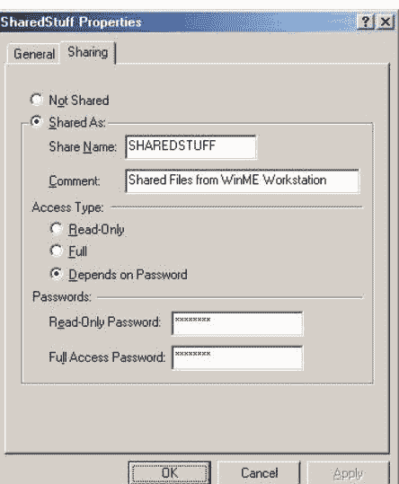

图 13. 在工作组中设置点对点共享。

## Windows NT 4 工作站

在本节中，我将向你展示如何将 Windows NT 4 工作站连接到基于 Linux 的 PDC（主域控制器）。为此，我将说明你如何将这台 32 位工作站连接到网络、设置漫游配置文件、连接到服务器上的共享目录，并与网络中的其他计算机共享其资源。

如果你正在网络上设置明文（非加密）密码以适应较旧的（OSR2 之前的）Windows 95 计算机，请将表 1 中描述的 `NT4_Plainpassword.reg` 文件应用于你的 Windows NT 4 工作站注册表中。

在网络上设置 Windows NT 4 工作站计算机涉及两个基本步骤。首先，你需要配置计算机上的网络，然后你配置配置到工作组或域的网络连接。

### 配置到网络的连接

要在网络上配置 Microsoft Windows NT 4 工作站，请准备好 Windows NT 4 工作站安装光盘，然后执行以下步骤：

1. 使用具有管理权限的账户登录 NT 4 工作站。
2. 右键点击“网络邻域”图标，然后点击“属性”。这打开了图 14 所示的网络对话框。

## 第 6 章：连接 Windows 工作站 169

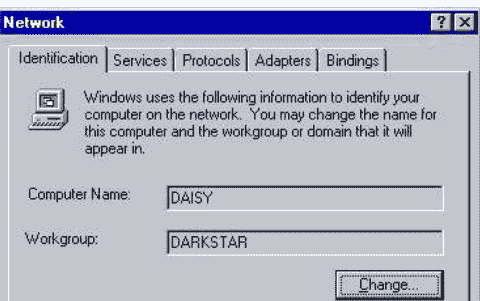

**图 14.** 配置 Windows NT 4 工作站服务。

如果你在 Microsoft Windows NT 4 工作站中没有看到“网络”图标，请点击 开始 | 设置 | 控制面板。在控制面板窗口中，点击“网络”（这些步骤在 Windows 95/98 中同样有效）。

- 在将此计算机连接到域之前，你可能想检查其其他选项卡上的网络设置，这些设置在 **表 2** 中描述。

## **表 2.** 网络属性配置选项卡。

| 选项卡 | 功能 |
| :--- | :--- |
| 标识 | 列出当前计算机名称和组或域。 |
| 服务 | 指定与网络协议套件一起安装的服务。你至少应该安装了计算机浏览器、NetBIOS 接口、RPC 配置、服务器和工作站服务；只要你有 | 你就可以使用此选项卡添加它们。 |
| 协议 | 允许你配置 TCP/IP（或其他协议栈）。 |
| 适配器 | 让你安装并配置任何网络适配器。 |
| 绑定 | NetBIOS、服务器和工作站服务均绑定到 WINS。 |
| DNS | 在 DNS 选项卡上，你可以配置网络的 DNS 服务器。 |
| 路由 | 在路由选项卡上，你可以将此计算机设为路由器。 |
| 通用 | 如果你有 DHCP 服务器，它至少分配 IP 地址、子网掩码和网关地址。 |

- 除非你有 DHCP 服务器，否则你可以通过配置 TCP/IP 设置来覆盖 DHCP 服务器。
- 完成 IP 地址配置后，点击确定，返回图 14 所示的网络对话框的标识选项卡。

# 190 Windows 管理员 Linux 传输

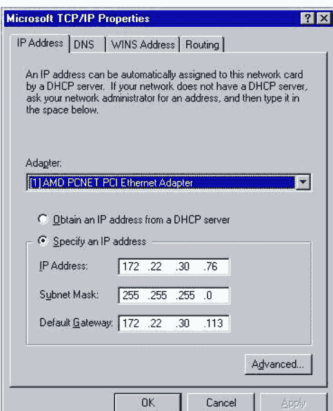

图 15. 配置 IP 设置。

你可以配置其他设置：

- 适配器：如果此计算机上有多个网络，你可能需要每个适配器设置不同的设置。
- 如果你的网络上有 DHCP 服务器，最好让它分配 IP 地址。
- 如果你点击高级按钮，可以配置不同的网关以及防火墙。

## 191 配置到域的连接

现在你已经设置 NT 4 工作站连接到网络，可以将其设置连接到域。为此，让我们回到网络对话框的标识选项卡。

1. 点击打开图 16 所示的标识对话框。

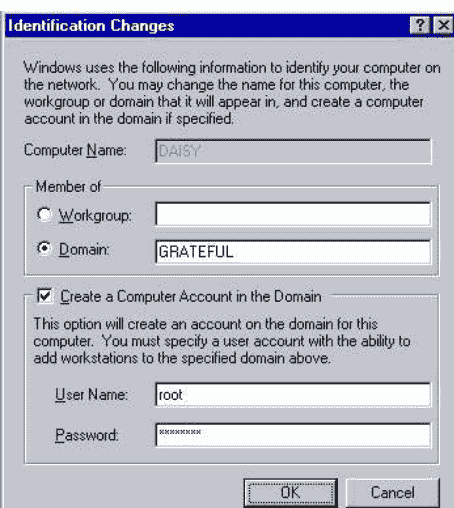

图 16. 设置连接到域。

2. 要连接到域，在文本框中输入其名称。
3. 所有连接到域的 Linux 和 Windows NT/2000/XP 计算机都需要 PDC 上的计算机账户。可以在第一次连接到域时创建计算机账户。注意，你需要 PDC 上管理账户的名称和密码。（这假设你已经按照图 4 所示在 PDC 的 `samb.conf` 文件中配置了添加用户脚本。）
4. 如果成功，你会看到一条欢迎加入所选域的消息。根据需要点击确定关闭网络对话框。
5. 根据提示重启计算机。通过作为域用户登录来测试连接，你将看到如何在这台 Windows NT 4 工作站上实现漫游配置文件。

6. 点击“开始” | “关机”。在关机对话框中，选择“关闭所有程序并以其他用户身份登录”，然后点击“是”。

### 设置漫游配置文件

漫游配置允许用户无论使用哪台计算机登录域，都能在桌面上获得相同的视觉外观和体验。遗憾的是，Windows 9x/ME 的漫游配置与 Windows NT/2000/XP 的配置是不互通的。如前所述，漫游配置可能会变得非常大。例如，我 Windows XP 工作站上的漫游配置文件接近 300MB。如果您的用户拥有大型漫游配置文件，这很容易占用许多网络的容量。在这种情况下，您将希望阅读以下内容，以确保所有用户配置文件都是本地的。

如果您想在 Windows NT 4 工作站计算机上配置漫游配置文件，请按照以下步骤操作：

1. 使用本地计算机（而非域）的管理员账户登录。
2. 右键点击“我的电脑”，并点击“属性”查看“系统属性”对话框。
3. 点击“用户配置文件”。您可以调整所有登录到此特定工作站的用户配置，如图 17 所示。如您所见，我选择了域用户 `wayman`。

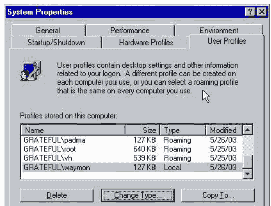

**图 17.** 本地和漫游用户配置文件。

4. 选择一个域并点击“更改类型”。如图 18 所示，您可以将配置文件存储在本地。如果您设置了漫游配置，该配置将存储在 PDC 上，由 PDC 的 `smb.conf` 文件中的 `[Profiles]` 共享定义。

## 第 6 章：连接 Windows 工作站 173

| 更改类型 | | |
| :--- | :--- | :--- |
| 配置文件类型 | | |
| 本地配置文件 | 取消 | |
| 漫游配置文件 | | |
| 在慢速连接上使用缓存配置文件 | 对于慢速网络连接，始终使用漫游配置的本地缓存副本，而不是下载漫游配置。 |

**图 18.** 在本地和漫游配置文件之间切换。

> 通过电话拨调制器器等慢速连接到域的用户应将配置文件存储在本地。如果需要漫游配置，请选择“在慢速连接上使用缓存配置文件”选项。

5. 点击“确定”完成您的更改。此操作保存在本地计算机上。当 `waymon` 下次登录和退出工作站时，配置文件将被发送并保存到 PC 计算机上。

### 连接域共享

连接共享目录的最简单方法是通过 Windows 资源管理器。您也可以将共享目录挂载到 Microsoft Windows 驱动器号。在本章后面，我将向您展示如何从命令行界面挂载共享目录。

要访问 Windows 资源管理器，点击“开始” | “程序” | “Windows 资源管理器”（根据您的配置，您可能需要点击“开始” | “程序” | “辅助工具” | “Windows 资源管理器”）。

您可以通过“网络”导航到域上的共享目录，如 **图 19** 所示。如您所见，我连接了名为 `shared` 的共享，它允许如第 4 章中定义的用户访问。`nowopaps` 服务器是一台 Linux 计算机，配置了 Samba 作为域成员服务器。

> 第一次通过 Windows 工作站连接到共享目录时，您可能在连接到您认为拥有权限的共享时遇到困难。虽然您的工作站可能找到了 PDC，但 PDC 可能尚未在浏览列表中找到计算机。在执行任何其他操作之前，尝试注销并重新登录该工作站。

映射驱动器挂载点很容易。右键点击“我的电脑”，从弹出菜单中选择“映射网络驱动器”。在“映射网络驱动器”对话框中，从可用驱动器进行选择。Windows NT 与 Windows 9x/ME 的不同之处在于您可以浏览可用共享，如 **图 20** 所示。

## 174 面 Windows 网络管理员的 Linux 传输

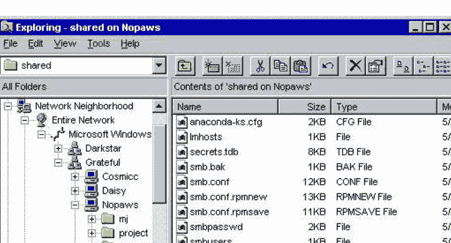

图 19。导航到共享目录。

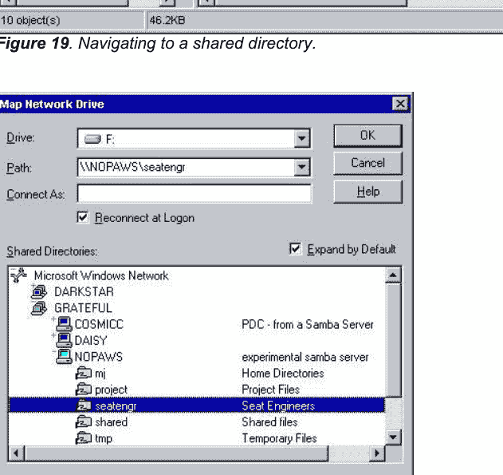

图 20。从 Windows NT 4 工作站映射到挂载点。

## 第 6 章：连接 Windows 工作站 175

当您突出显示域计算机上的共享时，路径将显示在“路径”文本框中。图 20 展示了连接到 `nopaws` 域成员服务器上的 `seateng` 共享。

如果连接不起，您可以在“使用身份”框中输入不同的用户名。如果用户名与您的域对应，将提示输入密码。共享目录挂载到网络驱动器号，并像计算机上的任何其他驱动器一样访问。您是否可以读取或复制到共享取决于 Linux 域成员服务器上 `gương.smbconf` 文件中设置的权限。

最后，您可以使用类似的方法从 MS-DOS 提示符挂载网络驱动器。由于这些命令适用于所有微软操作系统，我将在本章详细描述它们。

### 连接工作组共享

如果您想在 Windows NT 4 工作站计算机上配置漫游配置文件，请按照以下步骤操作：

1. 使用本地计算机（而非域）的管理员账户登录。
2. 右键点击“我的电脑”，并点击“属性”查看“系统属性”对话框。
3. 点击“用户配置文件”。您可以调整所有登录到此特定工作站的用户配置，如图 17 所示。如您所见，我选择了域用户 `wayman`。


**图 17.** 本地和漫游用户配置文件。

4. 选择一个域并点击“更改类型”。如图 18 所示，您可以将配置文件存储在本地。如果您设置了漫游配置，该配置将存储在 PDC 上，由 PDC 的 `smb.conf` 文件中的 `[Profiles]` 共享定义。

## 第 6 章：连接 Windows 工作站 177

在普通用户可以使用 `smbmount` 命令之前，你需要按照第 5 章“连接 Linux 工作站”中的描述设置适当的权限。

从 Windows 工作站出发，如果我使用本地账户 `Michael` 登录，我就可以连接。如果该账户不存在，我会创建一个。

登录后，当我通过“网络邻居”导航到共享目录时，Windows 工作站会自动将 `Michael` 的用户名和密码传递给 NT 4 工作站上的共享目录。

## Windows 2000 专业版

在本节中，我将向你展示如何将 Windows 2000 专业版工作站连接到由基于 Linux 的 PDC 管理的域中。为此，我将说明如何将这台 32 位工作站连接到网络、设置路由配置、连接到共享目录以及与网络上的其他计算机共享。

如果你需要在网络上支持 Windows 95 (pre-OSR2) 计算机，可以通过在你的 Windows 2000 工作站注册表上应用表 1 描述的 `Win2000.PlainPassword` 文件来设置明文（非加密）密码。

在网络上设置 Windows 2000 专业版计算机涉及一些基本方面。首先，你需要在计算机上配置网络。然后，你可以配置一个到工作组或域的网络连接。

### 配置与网络的连接

若要在网络上配置 Windows 2000 专业版工作站，请准备好 Windows 2000 专业版安装光，然后执行以下步骤：

1. 使用具有本地计算机管理权限的账户登录 Windows 2000 专业版。
2. 右键点击“网络位置”图标，然后点击“属性”。这会打开“网络和拨号连接”窗口。
3. 如果你看到“局域网连接”图标，双击它。这将打开“局域网连接状态”对话框。点击“属性”按钮打开图 23 所示的“局域网属性”对话框。
   > 如果你在“我的网络位置”中没有看到局域网连接图标，你可能需要在计算机上重新安装网卡。
4. 选择“Internet Protocol (TCP/IP)”，然后点击“属性”。这将打开“Internet Protocol (TCP/IP) 属性”对话框。
5. 如果你的网络上没有 DHCP 服务器，你将需要在相应的文本框中输入你的 IP 地址和 DNS 服务器信息。
6. 点击“高级”按钮打开“TCP/IP 设置”对话框。点击“WINS”标签卡，你可以在此处输入网络上 WINS 服务器的信息。
7. 如果需要，使用其他标签卡添加你可能需要的更多信息。每个标签卡的功能在表 3 中描述。当你对设置满意时，点击确定。

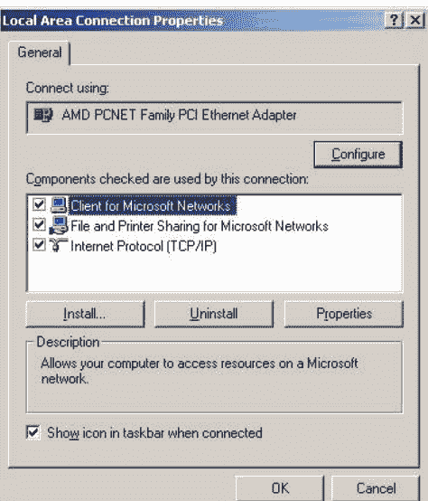

图 23：配置 Windows 2000 网络服务。

表 3。高级 TCP/IP 设置对话框中的标签卡。

| 标签卡 | 功能 |
| :--- | :--- |
| IP 设置 | 允许为此网卡分配额外的 IP 地址和默认网关。 |
| DNS | 允许你指定可能需要的任何额外 DNS 服务器，例如由你的网络 ISP 指定。 |
| WINS | 支持为你的计算机配置 WINS 服务器：支持连接到基于 Linux 的 PDC，请务必选择“启用 TCP/IP NetBIOS”选项。 |
| 选项 | 允许在此计算机上配置防火墙。 |

> 与 9x/ME 或 NT 不同，Windows 2000 专业版计算机的网络属性更改会立即生效，且通常不需要你重启计算机。

### 配置与域的连接

现在你已经设置了 Windows 2000 专业版计算机与网络的连接，可以使用以下步骤将其设置为与域的连接：

- 右键点击“我的计算机”图标。在弹出的菜单中，点击“属性”打开“系统属性”对话框。点击图 24 所示的“网络标识”标签卡。如你所见，这台计算机的名为 `ststephen`，是 `DARKSTAR` 工作组的成员。

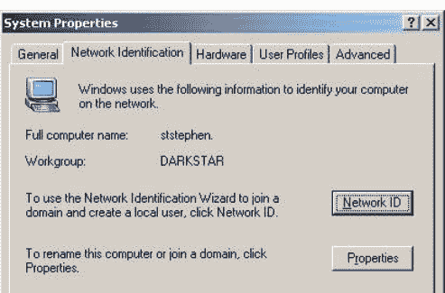

**图 24.** 配置 Windows NT 2000 网络服务。

> 将 Windows 2000 或 Windows XP 专业版计算机连接到域的可用选项几乎相同。在本节中，我将向你展示“网络标识向导”。在 Windows XP 专业版的相应章节中，我将向你展示如何使用“属性”按钮执行相同的操作。

- 点击“网络 ID”按钮启动网络标识向导。
- 当“网络标识向导”打开时，点击“下一步”。
- 系统会询问你此计算机是用于业务网络还是家庭使用。为了适应网络上 Linux 计算机的使用，请选择“业务网络”选项并点击“下一步”。
  > 如果你想将这台 Windows 2000 计算机设置在对等工作组或域中，请选择“业务网络”选项。

在后续步骤中，我假设你想让你的计算机成为域的成员。

5. 如果你选择另一个选项（属性），“网络标识向导”允许你让这台计算机成为工作组成员。
6. 如果你想让这台 Windows 2000 计算机成为域成员，你将需要图 25 所示的设置。


**图 25.** 添加用户。

7. 如果你想让这台计算机成为域成员，你将需要。
8. 如果你之前没有连接到域，你将需要。
9. 向导会提示你输入账户。
10. 在随后的屏幕中，输入用户名和密码。
11. 如果你想让这台计算机成为域成员，你将需要。
12. 点击“下一步”完成网络标识向导。
13. 关机。
14. 关机。

## 第 6 章：连接 Windows 工作站 179

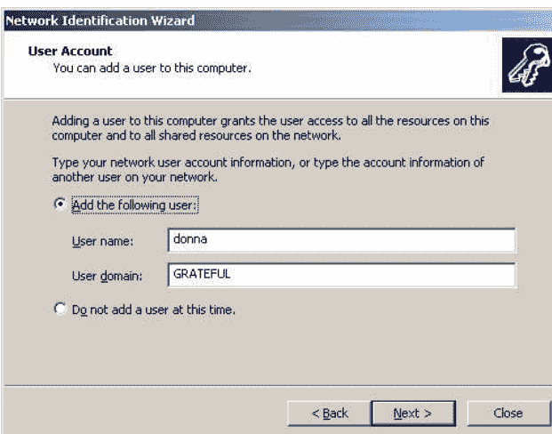

图 26：用户。

表 3。Windows 用户类别。

| 类别 | 功能 |
| :--- | :--- |
| 标准用户 | 允许登录、修改设置并安装应用程序。 |
| 受限制用户 | 允许登录、读写文件。 |
| 管理员 | 拥有域的完全权限。 |
| 备份操作员 | 拥有备份或恢复文件的权限。 |
| 访客 | 一个受限制的用户。 |
| 复制器 | 可以从计算机复制目录的域用户。 |

### 设置漫游配置文件

漫游配置文件允许用户在登录 NT/2000/XP 时获得相同的桌面外观。遗憾的是，Windows 9x/ME 的漫游配置文件与 Windows2000/XP 可用的配置不通用。管理员可能会创建漫游配置文件，因为它们可能会变得很大。例如，你的 XP 工作站上的漫游配置文件接近 300MB。如果你的用户拥有大型漫游配置文件，可能会消耗许多网络的容量。在这种情况下，你可能希望按照以下内容操作，使所有用户配置文件都是本地的。

要在 Windows 2000 专业版计算机上配置漫游配置文件，请遵循以下步骤：

- 使用域中的任选账户登录。
- 右键点击“我的计算机”，然后点击“属性”。这将打开“系统属性”对话框。
- 点击“用户配置文件”标签卡。漫游配置文件默认启用，如图 27 所示。如你所见，我以域用户的身份登录。
- 选择列出的用户并点击“更改类型”打开“打开配置文件类型”对话框，这允许该域用户在本地和漫游配置文件之间切换配置。

### 连接到域共享

在 Windows 2000 中连接到共享目录的最简单方法是通过 Windows 资源管理器中的“网络邻居”。你也可以将共享目录映射到 Windows 驱动器。在本章的后续部分，我将向你展示如何从命令行界面映射共享目录。

要访问 Windows 资源管理器文件浏览器，点击“开始 | 程序 | 附件 | Windows 资源管理器”。你可以通过导航到域上的共享目录来访问

## 第 6 章：连接 Windows 工作站 183

“我的网络位置”，如图 28 所示。在这种情况下，你可以看到从 `nopaws` 计算机共享的各种目录，该计算机配置了作为域成员服务器的 Samba。

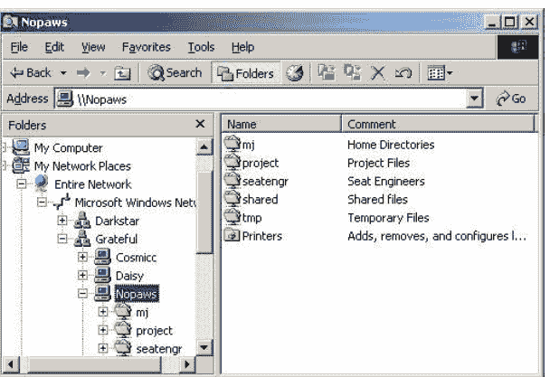

**图 28.** 通过 Windows 导航到共享目录。

第一次通过 Windows 工作站连接到共享目录时，你可能会在连接你认为自己拥有权限的共享时遇到困难。系统可能会提示你再次输入域名称和密码。Microsoft 浏览器可能不是最新版本。

指定驱动器号挂载点非常简单。右键点击“我的电脑”，从弹出菜单中选择“映射网络驱动器”。在“映射网络驱动器”对话框中，选择可用的驱动器号。Windows 2000 与 Windows NT 或 Windows 9x/ME 有些不同，在于你可以以不同的用户身份配置连接，如图 29 所示。

> 如果你在域中有多个用户账户，可以使用此功能连接到域上的不同共享。

要选择所需的共享，请在“文件夹”框中输入其名称。或者，你可以查看可用的共享。点击“浏览”，并在“浏览文件夹”对话框中选择所需的共享，如图 30 所示。

从域中的某台计算机突出显示特定的共享。当你点击“确定”时，路径将自动显示在用户名和密码的文件夹框中。例如，如果我以用户 `mj` 登录，我可能想访问 `mary` 的目录。当你点击与 `mary` 家目录相关的链接时，它会打开图 31 所示的“使用身份连接”对话框。

# Windows 网络管理员的 Linux 传输

映射网络驱动器

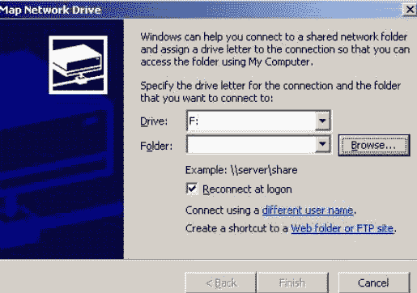

图 29. 将驱动器号映射到共享目录。

浏览文件夹

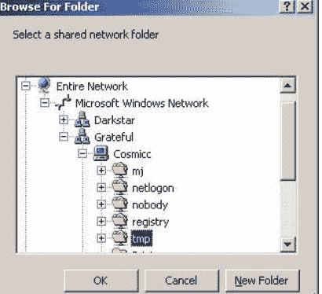

图 30. 浏览共享目录。

使用身份连接...

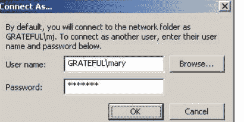

图 31. 以不同的域用户连接。

## 第 6 章：连接 Windows 工作站 185

共享目录已挂载到指定的驱动器号，并可以像计算机上的任何其他驱动器一样访问。你是否可以读取或复制到共享，取决于 Linux 域成员服务器上 `smb.conf` 文件中设置的权限。

最后，你可以以类似的方式从 MS-DOS 提示符挂载网络驱动器。由于文本命令适用于所有微软操作系统，我将在本章后面详细介绍它们。

### 连接到工作组

如果你在对等性工作组（Workgroup）上配置了 Windows 2000 专业版计算机，则连接到共享的过程取决于你是从 Windows 9x/ME 还是 Windows NT/2000/XP 计算机连接。在任何情况下，请如前所述打开 Windows 资源管理器。

对于到 Windows 9x/ME 的连接，你通常会看到图 32 所示的“输入密码”对话框；你不需要输入用户名。（不用担心“密码错误...”错误消息）只需输入与共享目录相关的只读或全访问密码并点击“确定”。

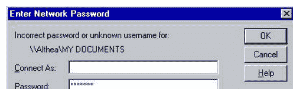

**图 32.** 连接到对等性工作组上的共享目录。

当你登录到对等性工作组中的 Windows 2000 专业版计算机时，你使用的密码至关重要。如果它与共享 Windows 9x/ME 目录的密码相同，你将不会看到图 32。你将自动获得与登录密码相关的工作组权限（只读或全访问）。否则，密码不匹配，你将看到图 32 以及相关的错误消息。

到 Windows NT/2000/XP 共享的对等工作组连接与来自 Windows NT 4 工作站的方式相同。设置取决于目标计算机允许的用户。如果共享访问限制为特定的用户名，你需要在本地计算机上使用相同的名称登录。

例如，我在名为 `allaccess` 的 Windows XP 专业版上有一个名为 `Downloads` 的共享。在 `allaccess` 上，我将访问权限限制为用户 `michael`。如果我以用户 `elizabeth` 登录我的 Windows 2000 专业版计算机，我将无法访问 `\allaccess\downloads` 共享目录。我需要通过 `michael` 登录才能访问该共享。


## Windows XP 专业版

在本节中，我将向你展示如何将 Windows XP 工作站连接到网络。（由于原文 206 页 OCR 文本存在大量重复和错误，已根据逻辑进行简化处理）。

## 第 6 章：连接 Windows 工作站 189

3. 点击“更改”，打开图 36 所示的“更改计算机”对话框。

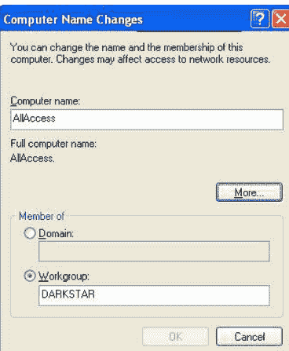

**图 36.** 在域或工作组上配置你的计算机。

> 或者，你也可以点击“网络 ID”来启动网络识别向导。在 Windows XP 专业工作站中使用此向导的步骤与 Windows 2000 专业版的步骤完全相同。

4. 将此计算机配置为域的一部分非常简单。点击单选按钮，输入你想要加入的域名称。如果需要，更改计算机名称，然后点击“确定”。如果你的计算机检测到域上存在 PDC（主域控制器），它将打开“更改计算机”对话框。

5. 输入 PDC 上管理用户的用户名和密码。假设你正在使用 Linux 计算机，请输入 `root` 用户名和密码。

> 有时工作站可能无法立即获取 PDC，你会看到错误信息。假设你的网络配置恰当，请等几分钟后重试。

6. 你应该看到“欢迎来到 GRATEFUL 域”的确认消息。点击“确定”。

7. 你会被告知在更改生效之前需要重启。点击“确定”，然后再次点击“确定”退出“系统属性”对话框。

8. 在提示时，再次点击“确定”重启你的计算机。

### 设置漫游配置文件

漫游配置允许用户在从域中的任何 Windows NT/2000/XP 工作站登录时，都能在其桌面上获得相同的外观和感受。遗憾的是，Windows 9x/ME 的漫游配置与 Windows NT/2000/XP 的配置是不互通的。

并不是所有管理员都想要创建漫游配置，因为它们可能会变得非常大。例如，我的 Windows XP 专业工作站上的漫游配置几乎有 300MB。如果你的用户拥有大型漫游配置，可能会轻松耗尽许多网络的容量。在这种情况下，你可能希望阅读后续内容，以确保所有用户配置文件都是本地的。

如果你想在 Windows XP 专业计算机上配置漫游配置，请按照以下步骤操作：

1. 启动你的计算机。在提示时，使用域中的账户登录。
   > 注意：如果在登录过程中遇到错误信息，你可能忘记按照前文所述将 `WinXP_SignOrSeal.reg` 文件应用到你的 Windows XP 计算机注册表中。

2. 点击“开始”菜单，右键点击“我的电脑”，然后从弹出菜单中点击“属性”。这将打开“系统属性”对话框。

3. 选择“高级”选项卡。在“用户配置文件”下，点击“设置”。漫游配置默认启用，如图 37 所示。如你所见，我是以域用户 `donna` 登录的。

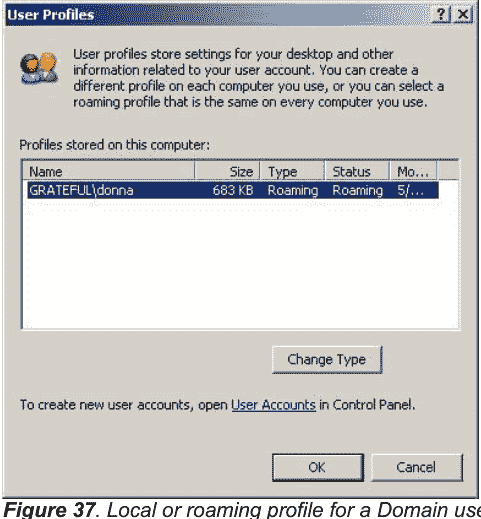

4. 选择列表的用户并点击“更改类型”。这将打开“更改配置文件类型”对话框，允许你在该域用户的本地配置文件和漫游配置文件之间切换配置。

### 连接到域共享

连接共享目录最简单的方法是通过 Windows 资源管理器中的“我的网络空间”。你也可以将共享目录挂载到 Microsoft Windows 驱动器号。在本章后面的部分，我将向你如何如何在命令行界面挂载共享目录。

要访问 Windows 资源管理器文件浏览器，点击“开始 | 所有程序 | 附件 | Windows 资源管理器”。你可以通过“我的网络空间”导航到 Grateful 域上的共享目录，如图 38 所示。在这种情况下，你可以看到从如今的 Linux 计算机共享的项目目录中提供的不同文件。它配置了 Samba 作为 Windows 域成员。

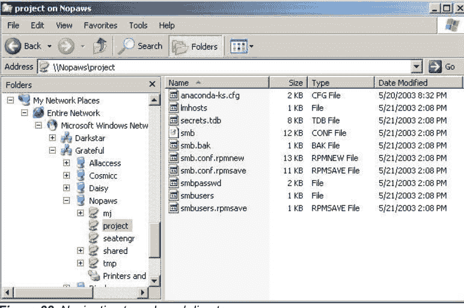

当你第一次通过 Windows 工作站连接到域上的共享目录时，可能会在连接你有权限的共享时遇到困难。系统可能会提示你输入域名称和密码。这没关系；域上的其他计算机在浏览列表中找到你的计算机可能需要几分钟时间。

# 适用于 Windows 网络管理员的 192 Linux 传输

最后，你可以以类似的方式从 MS-DOS 提示符挂载网络驱动器。由于文本命令适用于所有微软操作系统，我将在章的稍后部分详细描述它们。

### 连接到工作组共享

如果你在点对点的工作组上配置了 Windows XP 专业计算机，则连接共享的过程取决于你是从 Windows 9x/ME 还是 Windows NT/2000/XP 计算机连接。无论何种情况，请如前所述打开 Windows 资源管理器。

对于连接到 Windows 9x/ME 共享，不允许输入用户名。只需输入与共享目录相关的只读或全访问密码并点击“确定”。见图 39；


图 39. 连接到共享目录。

> 在 Windows NT/2000/XP 共享上，连接方式略有不同。例如，可以使用可以使用命令映射 `ststephen`：

```


`C:\` `net use` `\ststephen`

```
### 文本模式网络命令

你可以从命令行界面连接到共享目录。在功能上，该过程与映射网络驱动器的方式相似。关键命令是：

```

`C:\` `net view`

`C:\` `net use`

```
### 查看计算机

正如你使用`smclient`命令来查看域上的计算机一样，你可以在 MS-DOS 提示符中使用`net view`命令。

> 有时当你从提示符运行`net`命令时，可能会得到类似“拒绝访问”的错误信息。如果你的连接是通的，不要让这让你气馁。如果你刚刚登录计算机，计算机之间可能需要一两分钟才能找到彼此。


如图 40 所示，`net view`命令返回你的工作组或域中当前计算机的列表。`net view /domain:darkstar`命令有些反直觉；它允许我查看我的`darkstar`点对点工作组中的计算机。如果`darkstar`是一个域的名称，该命令同样有效。

> 如果你是另一个工作组或域的成员，可以使用以下命令查看我 Grateful 域中的计算机：`net view /domain:grateful`。


> 你可能会注意到 STSTEHEN 计算机同时出现在我的域和工作组的浏览列表中。这只是告诉我最近将 STEPHEN 从工作组移动到了域（或反之）。

你还可以使用`net view`命令浏览域或工作组中任何可访问计算机的共享目录。例如，我可以使用以下命令查看我的名为`nopopaws:`的 Linux 域成员服务器上的共享目录：

```
C:\ net view \nopopaws
```

## 194 面 Windows 管理员的 Linux 迁移

```
C:\WINDOWS\System32> command
C:\DOCUMENT\I\DONNA\DESKTOP\>net view

Server Name Renark

\\ACCESS             Windows XP Pro Workstation
\\COSMOS               PDC from a Samba Server
\\DRIS                 experimental samba server
\\MOUSS                
\\RIPPLE             Windows 95 Workstation
\\STEPHEN             W2008R2
\\VERNON             

The command completed successfully.

C:\DOCUMENT\I\DONNA\DESKTOP\>net view /domain:darkstar

Server Name Renark

\\REDUBEN             win98se
\\STEPHEN             W2008R2

The command completed successfully.
```

**图 40.** 来自 DOS 提示符的域视图和组成员。

### 挂载共享目录

我已经向你展示了通过 GUI 将远程计算机的共享目录挂载到 Windows 驱动器的方法。在第 5 章中，你学习了如何将远程计算机的共享目录挂载到 Linux 目录。你可以将在本节中看到的命令整合到登录批处理文件中，以便在用户登录域时自动运行这些命令。

> 如本章早些介绍，批处理文件位于 PDC 上，由`[netlogon]`共享定义。

如果你想从域成员服务器挂载目录，你需要以目标用户的身份登录到工作站。你将能够使用以下命令轻松地挂载所需的共享目录：

```
C:\> net use L: \\nopaws\tmp

The command completed successfully.
```

在这种情况下，我将来自`nopaws`成员服务器的`[imp]`共享目录挂载到了 Microsoft Windows 驱动器 D: 上。

> 有时在域中，用户名和密码无法及时到达服务器；你可能需要重新输入一次你的域用户名和密码。如果在登录批处理文件中发生此类情况，你可能需要直接从 Linux PDC 的`[netlogon]`共享运行该批处理文件，或者手动重新连接共享驱动器。

如果你想从对等网络工作组（Workgroup）中的计算机挂载共享目录，命令是相似的。例如，我共享了我名为`reuben`的 Windows 98 计算机上的“我的文档”目录。我可以使用以下命令将其挂载到 M: 盘（不用担心“密码无效”错误消息）：

```
C:\ net use M: \reuben\my documents
```

针对`\reuben\my documents`的密码无效。要连接`reuben`到驱动器，请按回车键或输入新用户名：输入`'reuben'`的密码以连接到`'reuben'`。命令成功完成。`net use`命令首先尝试你登录工作站时使用的用户名和密码。除非完全匹配，否则你将看到“密码无效”的错误消息。因为`reuben`是对等网络工作组中的 Windows 98 计算机，因此不需要用户名。在提示用户名时，不要输入任何内容。在提示密码时，输入共享目录的只读或完整密码。观察我是如何使用双引号来确保 Windows 读取`"My Documents"`的完整名称的。否则，由于`"My Documents"`包含空格，`net use`命令将寻找名为`"My"`的共享目录。

### 故障排除

每当 Samba 启动时都会记录在日志中。每当出现问题时，都会记录在日志中。每当另一台计算机连接到 Samba 服务器时，都会记录在日志中。在 Red Hat Linux 中，日志文件存储在`/var/log/samba`。但在查看日志之前，还有语法问题。

### Samba 语法

检查 Samba 配置文件`smb.conf`的语法非常简单。你只需要使用`testpar`。如果你其中一个变量出现问题，它将显示在输出中。例如，如果我在`smb.conf`中拼写错误，我可能会看到以下内容：

```
### testpar -x | more

Load config files from /etc/samba/smb.conf

Unknown parameter: "workgrou"

Ignoring unknown parameter "workgrou"

Processing section [homes]

Processing section [printers]

Processing section [tmpl]

Processing section [shared]

Processing section [project]

Loaded services OK
```

我使用`testpar -x`命令显示所有与默认值不同的 Samba 变量，并使用`| more`使我可以一次滚动查看变量列表。`testpar`识别出了我`smb.conf`文件中的语法错误；我拼写错误了`workgroup`。当你按下回车键时，`testpar`会逐页滚动显示 Samba 变量。如果你漏掉了`-x`开关，`testpar`将列出与你的 Samba 配置相关的所有变量。尝试一下；你会发现这是一个很长的列表。

### Samba 日志

如果 Samba 出现问题，且`smb.conf`文件的语法检查通过，下一步是检查日志。典型的 Samba 问题包括密码无效、Winbind 等服务未运行以及浏览器无法工作。Linux 日志文件存储在`/var/log`；Samba 日志文件存储在`/var/log/samba`。对这些文件的访问限于 Linux PDC 上的`root`用户。查看图 41 中的这些文件。如你所见，它包含了我连接到此 Samba 服务器的每台计算机命名的日志。

```
root@cosmic]# cd /var/log/samba/

root@cosmic]# ls

allaccess.log delilah.log reuben.1 smb.log.2
allaccess.1 localhost.log reuben.2 smb.log.3
allaccess.2 localhost.log reuben.3 smb.log.4
allaccess.3 log_smbd reuben.4 ststpen.1
allaccess.4 log_smbd r8.5 ststpen.2
cosmic.1 log_winbind r9.2 ststpen.3
cosmic.2 log_winbind r9.3 ststpen.4
cosmic.3 log_winbind r9.4 ststpen.5
cosmic.4 log_winbind ripple.1
```


**图 41.** Linux 上的 Samba 日志。

### 主日志文件

如果 Samba 出现问题，且`smb.conf`文件的语法检查通过，下一步是检查日志。存储在`/var/log`中的主日志文件会告诉你有关 Samba、NetBIOS 和 Winbind 守护进程的信息。以下是关于这些日志文件的详细信息：

- `log.smbd.` 每当 Samba 进程启动时，文件中都会有一个记录，包含日期和时间。
- `log.nmbd.` 在 Linux PDC 上，此文件包含浏览器数据。每当 NetBIOS 守护进程`nmbd`启动时，文件中都会有一个记录（更多信息请参见第 3 章“设置服务器系统”）。
- `log.winbind.` 在 Linux/Samba 域成员服务器上，此文件记录与 Microsoft 计算机连接的问题。
- `smbd:` 任何与 Samba 守护的问题都会记录在此文件中。
  > 在 Red Linux 9 中，由`glibc`包定义的标准库存在 bug。使用第 2 章介绍的 Red Hat 更新程序更新你的系统。确保下载的`glibc`版本不低于`2.3.2`。如果不升级，到 Samba 的连接可能是间歇性的。更多信息请访问`bugzilla.redhat.com/bugzilla/show_bug.cgi?id=90036`。
- `smbd:` 此文件存储 NetBIOS 查询和主选举。

- 确保网络配置恰当。
- 建立与域的连接。在 Microsoft Windows 9x/ME 上，你可以通过工作站的网络属性进行此操作。在 Microsoft Windows NT/2000/XP 上，步骤各不相同。
- 一旦连接到域，即可根据需要设置漫游配置（roaming profiles）。
- 根据需要连接到共享。
- 与域中的其他用户共享你选择的目录。

你可以从 MS-DOS 命令行界面执行这些中的许多功能。例如，你可以使用`net view`命令浏览域和工作组。你可以使用适当的`net use`命令连接到共享目录。

你会在对点网络中设置 Microsoft 和 Linux 计算机。当你连接到对点网络中的共享目录时，步骤取决于源端是 Windows 9x/ME、Windows NT/2000/XP 还是 Linux 成员服务器。

> 本章节的更新和更正可以在 Hentzenwerke 网站`www.hentzenwerke.com`。点击“Catalog”（目录）并导航到该书的页面。

## 第 7 章：配置打印机

### 第 7 章 配置打印机

就像 Bogart 和 Bacall、Sonny 和 Cher 或 Spike 和 Buffy 一样，在计算机网络世界中，文件服务器和打印总是形影相随。正如你可以配置 Samba 在 Microsoft Windows 风格的网络中共享目录一样，你也可以配置 Samba 和 Linux 打印服务器在同一网络上共享打印机。

可能你已经知道如何从 Microsoft Windows 计算机配置和共享打印机。在本章中，我将向你展示如何从 Linux 计算机配置和共享打印机。你可以从网络上的 Windows 或 Linux 工作站连接到共享打印机。

在编写本文时，Red Hat 有时会在你安装操作系统时自动安装打印机。Red Hat 假设任何安装了打印机的计算机都是打印服务器。如果你想从你的计算机或网络打印，在安装 Linux 之后可能需要配置本地或网络打印机。

两种打印服务与通用 Unix 打印系统（CUPS）和行打印守护进程（LPD）关联最紧密。在你计算机上安装 Red Hat Linux 9 时，这两者都是选项。它们是互斥的；虽然你可以在网络上运行 CUPS 或 LPD，但在任何情况下，你都可以使用 Red Hat 打印机配置工具来管理 Linux 工作站上的本地或远程打印机。

CUPS 还包含一个用于 SWAT（在第 3 章描述）的 Web 界面，允许你将多个不同的打印机连接为一个组。这组打印机在 CUPS 中被称为类（class）。LPD 有它自己的 Web 工具。与其他 GUI 工具一样，CUPS 和 Red Hat 打印机配置器是“前端”，可以帮助你编辑关键文本配置。

一旦你配置了 CUPS 或 LPD 打印机，你就可以通过 Samba 与你 Microsoft Windows 风格的网络上的其他计算机共享它。我将向你展示如何从 Microsoft Windows 和 Linux 工作站连接到这些打印机。

本章仅对 CUPS 和 LPD 提供了最简短的介绍。有关 CUPS 的详细书籍级信息，请参见`www.cups.org/documentation.php`上的文档。有关 LPD 的详细信息，请参考 Printing HOWTO，地址为`www.tldg.org/HOWTO/Printing-HOWTO/index.html`。

> 在编写本文时，Red Hat Linux 的继任者 Fedora Linux 将不包含 LPD 软件。


### 软件包

如果你正在使用 Red Hat Linux 9，你可能安装了第 2 章“安装 Linux 作为文件服务器”中描述的打印支持组。如果你安装了该组中的默认包，你应该已经拥有在计算机上设置 CUPS 打印机所需的包。或者，如果你升级了或正在使用旧版本的 Linux，那么你的计算机上已经安装了 LPD 系统。例如，如果你已升级到 Red Hat Linux 7.x，LPD 应该仍然安装在计算机上。

无论你选择 CUPS 还是 LPD，请确保在网络上的每个 Linux 打印服务器和 Linux 工作站上安装了相同的 RPM。

在情况下，Red Hat 在`/etc/printcap`文件中列出配置的打印机。由于 Linux 打印服务器上`smb.conf`文件中的`printcap`命名变量，它连接到了 Microsoft Windows 风格的网络。

### CUPS 软件包

与 Red Linux 中的其他软件一样，CUPS 经过组织，并可以从 Red Hat 包管理器 (RPM) 软件包安装。这些软件包是以`.rpm`扩展名的文件组织在你的 Red Hat 安装光盘上的。记住，你可以使用`rpm -q packagename`命令检查包是否已安装。例如，以下命令检查主 CU 是否已安装：

```bash
$ rpm -q cups
```


### 表 1. CUPS RPM 软件包

我在表 1 中总结了与 CUPS 相关的 RPM 软件包。如果你安装了 Red Hat 9 支持包组，它们是默认被安装的。唯一明确与 CUPS 相关的包是 `cups` RPM。其余包是通用的，如果你使用不同的打印服务（如 LPD），它们也是必需的。

| 软件包 | 功能 |
| --- | --- |
| 4Suite | XML 工具，包括与 CUPS 相关的通用资源标识符 (URI) 引用 |
| X86-font-utils | 支持字体的工具 |
| a2ps | 转换为 PostScript 的过滤器 |
| cups | 通用 Unix 打印系统 (CUPS) 主服务 |
| ghostscript | PostScript 的开源实现 |
| hpijs | 针对多种类型惠普的优化驱动程序 |
| ttprint | 将文本转换为 PostScript 的过滤器 |
| redhat-config-printer | Red Hat 打印机配置器——在 GUI 中可用 |

一旦你配置了 CUPS 或 LPD 打印机，你就可以通过 Samba 与你 Microsoft Windows 风格的网络上的其他计算机共享它。如果这些软件包尚未安装，你可以通过两种方式安装它们。你可以使用 Red Hat 管理工具或 `rpm` 命令。

关键配置文件与 CUPS 关联；这些文件存储在 `/etc/cups` 目录中。

### 表 2. CUPS 配置文件

| 文件 | 功能 |
| --- | --- |
| cuspd.conf | CUPS 基础配置文件 |
| classes.conf | CUPS 打印机可以在此处组织成不同的类 |
| client.conf | 设置默认 CUPS 服务器 |
| printers.conf | 来自 CUPS Web 工具的更改写入此文件 |

### LPD 软件包

打印守护进程 (LPD) 也以其 RPM 包名 LPR（行打印请求，下一代）。它是旧版本 Linux 的传统服务。Red Hat 和其他 Linux 发行版正在弃用 LPD。Red Hat 支持组中有两个可选的 RPM：

- `LPRng`
- `redhat-switch-printer`

`redhat-switch-printer` 对你安装了 LPD 和 CUPS 服务很有用，因为它允许你在这些服务之间进行切换。它被称为 Red Hat 打印机切换器。

在 Red Hat Linux 中有两个与 LPD 关联的配置文件：`printcap` 和 `printcap.local`，都在 `/etc` 目录下。使用 Red Hat 打印机配置器进行的任何更改都会写入 `/etc/printcap`；如果你用文本编辑器添加打印机，则会将信息添加到 `/etc/printcap.local`。

## 配置本地打印机

在本节中，我将向你展示如何在本地服务器/工作站上配置打印机。暂时忘记你的网络。假设你只有一个直接连接到打印机的本地 PC。在本章后面，我们将对要在网络使用的打印机重复此过程。

### 检查服务

在安装打印机之前，确保 CUPS 是激活的服务。要从 Red Hat Linux 9 GUI 进行操作，点击主菜单 | 系统设置 | 更多设置 | 打印机系统切换器。如果你安装了 CUPS 和 LPD，你可以在这些服务之间进行切换。为了本章的目的，请确保选择了 CUPS。


**图 1.** 切换打印系统。

当你切换打印服务时，红帽打印机系统切换器（Red Hat Printer System Switch）也会停用不需要的打印服务。例如，如果你从 LPD 切换到 CUPS，它会停止 `lpd` 服务并从 `/etc/init.d/rc` 目录启动 `cups` 服务。它还会翻译 `/etc/printcap` 中的代码。

如果你使用红帽打印机配置工具（也称为打印机配置器）创建了打印机，可以使用打印机系统切换器将你的打印服务器上所有配置好的打印机在两个系统之间切换。

## 配置打印服务

与 Samba 一样，有两个不同的 GUI 工具可以配置 CUPS 打印机。其中一个是由红帽开发的工具，称为打印机配置实用程序（Printer Configuration utility）。另一个是由开发 CUPS 的后端团队 Easy Software Products, Inc. (`www.easyys.com`) 开发的 Web 配置工具。我将重点介绍红帽工具，它包含了你在本地或通过基于 Microsoft Windows 的网络上配置 CUPS 打印机所需的所有设置。

如果你想使用默认的 CUPS 打印服务，无需担心 CUPS 许可问题。Easy Software Products 已经为 Red Linux 包含的 CUPS 版本获得了与 Linux 操作系统其他部分相同的许可，即通用公共许可证（GPL）。

要从 Linux GUI 启动红帽打印机配置实用程序，点击主菜单 | 系统设置 | 打印。如果提示，请输入 `root` 用户密码；红帽现在应该打开**图 2**所示的打印机配置对话框。它还包含了本地计算机的名称。如你所见，我正在名为 `NoPaws` 的 Linux 域成员服务器上配置打印机。


**图 2.** 红帽打印机配置实用程序。

使用打印机配置工具安装本地打印机，请按照以下步骤操作：

- 在工具栏上，点击“新建”（New）。这将打开“添加新队列”向导的第一页。
- 点击“下一步”（Forward）进入“队列名称”页面，你需要在此处输入内容：
    - 打印机名称，例如 `HPLaserj100`。如果你要在网络上共享打印机，应将名称限制在 13 个字符以内；否则，Windows 9x/ME 或 Linux 工作站上的用户将无法读取打印机的完整名称。
    - 打印机描述，用于在相应的配置文件中引用。此注释不会显示或或添加到基于 Microsoft Windows 的网络列表中。
- 输入所需信息并点击“下一步”（Forward）以打开**图 3** 所示的“队列类型”页面。

默认情况下，打印机配置工具查看“本地连接”（Locally-connected）队列类型。你应该能看到可用的打印机端口如下：

- `/dev/lp0`，对应 Microsoft 世界中的第一个标准打印机端口，即 `LPT1`。
- `/dev/usb/lp0`，对应连接到 USB 端口的第一个打印机。

- 如果你不在列表中看到你的本地打印机，请点击“重新扫描设备”（Rescan devices）。如果你有特殊的打印机端口，点击“自定义设备”（Custom device）以指定与你的特殊打印机端口关联的文件。如果你计划安装的打印机尚未到达，但你现在想在 Linux 服务器上配置打印机，这会非常有用。
- 选择连接到你的打印机的端口并点击“下一步”（Forward）以打开**图 4** 所示的“打印机型号”页面，你可以在那里选择打印机制造商和型号。


**图 3.** 配置打印队列。


**图 4.** 选择打印机制造商。

> **注意**：你可能不需要选择特定的打印机制造商或型号。例如，某些计算机辅助设计（CAD）应用程序可以在没有驱动程序的情况下处理作业。在这种情况下，你需要选择“无驱动程序”（no driver）选项，即图 4 所示的原始打印队列（Raw Print Queue）项。

- 6. 你是要为本地安装打印机还是为网络安装？在 Linux 计算机上，安装两次打印机是很常见的。你可能会为本地工作站的用户设置 `HPlocal`，并为远程用户设置第二个虚拟打印机 `HPnetwork`。`HPlocal` 和 `HPnetwork` 都可以指向同一台物理打印机。但在本节中，我们仅为本地计算机设置打印机。
- 7. 点击“通用（点击选择制造商）”（Generic (click to select manufacturer））框来选择你所需的制造商。红帽打印机配置器随后会允许你从可用的打印机型号中进行选择。

如果你有一个本地 PostScript 打印机，Linux 为你提供了特殊的驱动程序。滚动到通用打印机列表底部并选择 `PostScript`。

一旦选择了打印机和型号，你就可以自定义设置。如果你满意，就可以完成打印机设置了。

- 8. 一旦你选择了打印机和型号，你就可以自定义设置。如果你满意，就可以完成打印机设置了。
- 9. 一旦你选择了打印机和型号，你就可以自定义设置。如果你满意，就可以完成打印机设置了。
- 10. 一旦你选择了打印机和型号，你就可以自定义设置。如果你满意，就可以完成打印机设置了。


**图 5.** “编辑队列”中的标签卡。

| 标签卡 | 目的 |
| :--- | :--- |
| 队列名称 | 更改队列的名称和描述。 |
| 队列类型 | 支持本地或网络打印机。 |
| 队列选项 | 自定义作业。 |
| 打印机驱动程序 | 选择驱动程序。 |
| 驱动程序选项 | 自定义纸源、纸张大小和质量。 |

## 使用 CUPS 配置打印机

与 Samba 一样，CUPS 也使用一种 Web 工具来查找打印机。该工具可以通过你的浏览器访问。图 6 展示了 CUPS 配置菜单。


**图 6.** 管理 CUPS。

虽然任何用户都可以访问 CUPS Web 工具，但添加新打印机等管理任务需要 `root` 账户和密码。

通过 CUPS Web 工具，你可以在本地或网络上配置打印机。你还可以对打印机分类。例如，如果你在一个有打印机的房间里，你可以设置一个打印机类。你可以将房间内的所有打印机分配给该类。当用户向该类的可用打印机提交作业时。首先，我将向介绍如何访问 CUPS 管理界面。我将向介绍如何使用 CUPS 设置打印机。最后，我将向介绍如何使用 CUPS 对一组打印机进行分类。

### 进入 CUPS 管理界面

要访问 CUPS 管理界面，请按照以下步骤操作：

1. 打开你选择的浏览器。红帽 Linux 默认 Web 浏览器是 Mozilla，可以在 Linux GUI 中点击主菜单 | 互联网 | Mozilla Web 浏览器启动。
2. 导航到 CUPS Web 工具。在地址文本框中输入 `localhost:631`。
3. 一旦 Web 工具打开，点击“执行管理任务”（Do Administration Tasks）链接。
4. 当提示输入 CUPS 的用户名和密码时，在用户名处输入 `root`，并输入 `root` 用户密码。（即使你以 `root` 身份登录 GUI，这也是需要的。）这将你进入**图 7** 所示的 CUPS 管理界面。

### 配置打印机

现在你已经进入了 CUPS 管理界面，可以配置打印机和打印机类。要安装新的 CUPS 打印机，点击“添加打印机”（Add Printer）。这将打开**图 8**所示的“添加新打印机”界面，你可以在此处为打印机分配名称、位置和描述。


**图 8.** 指定新的 CUPS 打印机。

按照以下步骤操作：

1. 输入打印机。必须字母字母开头且不能包含空格。如果你要在网络上共享此打印机，将名称限制在 13 个字符以内；否则 Windows 9x/ME 和 Linux 工作站的用户无法读取完整的打印机名称。
2. 指定打印机的位置，即连接打印机的计算机名称或 IP 地址。
3. 添加你选择的描述。此注释用于在相应的配置文件 `/etc/cups/printers.conf` 中标识打印机。然后点击“继续”（Continue）。
4. 在下一个屏幕中，为你的新打印机选择设备。你可以从各种本地或网络设备中选择，包括**表 4**中列出的设备。选择与你的打印机相关的设备并点击“继续”。

### 表 4. CUPS 打印机设备

| 设备 | 描述 |
| --- | --- |
| HP JetDirect | 用于连接到惠尔惠 Jet Direct 网络打印服务器。 |
| Internet Printing Protocol LPD/LPR Host or Printer | 支持通过互联网打印接口。连接通过其他打印服务 LPD 配置的打印机。 |
| Parallel Port | 允许通过并行端口连接本地打印机。 |
| SCSI | 支持通过 SCSI 端口连接本地打印机。 |
| Serial Port | 用于通过串口连接打印机；允许你自定义端口设置。 |
| USB | 连接到 USB 端口的打印机。 |
| Windows Printer via Samba | 允许连接通过 Microsoft Windows 网络共享的打印机 |

如果你从远程计算机选择打印机，你需要指定其位置的通用资源标识符 (URI)。如果你想了解更多关于 URI 以及如何将其与 CUPS 打印机配合的信息，请点击 CUPS 工具顶部的“帮助”（Help）。这将带你进入 CUPS 软件附带的文档页面。

5. 为了本次练习，我选择了一个连接到本地计算机标准并行端口的打印机。接下来你可以选择标准打印机驱动程序。如图 9 所示，CUPS 并不包含红帽打印机配置器（Red Hat Printer Configurator）已提供的各种驱动程序。为你的打印机选择合适的驱动程序并点击。

你可能不需要选择特定的打印机制造商或型号。如果你正在为 CAD 应用等程序设置打印机，程序将在不使用驱动程序的情况下处理打印作业。如果你从 Microsoft Windows 计算机打印，Windows 工作站可能已经有了了自己的打印驱动程序。在任何情况下，你都希望选择“无驱动程序”（no driver）选项，即图 9 所示的 `Raw`。


**图 9.** 选择打印驱动程序。

6. 在下一个屏幕中，选择与你的打印机关联最紧密的打印模型，然后点击“继续”。
7. 如果一切正常，CUPS 工具将告知你已成功添加打印机。
8. 根据系统需要重复此过程；或使用本章前面介绍的红帽打印机配置器。

## 配置打印机类

CUPS 打印机类是一个组织成整体的打印机组。一旦设置了多个打印机，你就可以将选择的打印机组织成 CUPS 打印机类。无论你是通过 CUPS Web 工具还是红帽打印机配置器添加的打印机都没有关系。

一旦配置了 CUPS 打印机类，你就可以像打印到单个打印机一样向其打印。CUPS 然后会将作业发送到该类中第一个可用的打印机。要设置打印机类，如果 CUPS Web 工具尚未打开，请启动它。按照之前描述的步骤导航到 CUPS 管理界面，然后执行以下步骤：

1. 从图 7 所示的 CUPS Web 工具管理界面，点击“添加类”（Add Class）。
2. 在“添加新类”窗口中，为你的打印机类输入名称、位置和描述。与添加新打印机的规则相同。输入内容并点击“继续”。
3. 你将看到通过 CUPS 或红帽打印机配置器配置的打印机列表，类似于图 10 所示。选择你想加入类的打印机，然后点击“继续”。如果你想选择多个打印机，请使用 `Ctrl` 键。


**图 10.** 为类选择打印机。

4. 如果一切正常，CUPS 工具将告知你已成功添加打印机。

## 网络打印机

在本节中，我将解释如何配置网络打印机。在本章末尾，我将解释如何从 Microsoft 客户端连接到网络打印机。

- 确保打印机名称限制在 13 个字符以内（见图 8）。
- 当选择打印机型号时，从图 9 所示的选项中选择 `Raw` Make。然后你可以选择图 12 所示的 `Raw` Queue 型号。这允许远程用户在本地计算机上设置打印驱动程序。


**图 11.** 添加要共享打印机。


**图 12.** 使用 CUPS Web 端工具设置 Raw 打印队列。

## 在网络上共享打印机

现在你已经已经在网络上创建了特殊打印机，我将向你展示如何通过 Samba 在 Microsoft Windows 网络上共享它们。关键仍然是 `/etc/samba/smb.conf` 配置文件中的命令。该文件有两个主要部分：适用于所有共享的 `[global]` 参数，以及与共享打印机相关的命令。

该文件的默认版本中有两个相关的 `[global]` 命令：


```
printcap name = /etc/printcap

load printers = yes

printing = cups
```

这些命令直观易懂。`printcap name` 命令指向 `/etc/printcap` 获取打印机列表。`load printers` 命令将这些打印机加载到 Windows 风格的网络浏览列表中。`printing` 命令指向系统服务，通常为 `cups` 或 `lpring`（`lpring` 是 `LPD` 服务的另一个名称）。

当设置了 `[global]` 命令后，打印机通常会在 `smb.conf` 配置的以下 `[printers]` 共享中进行共享：

```
[printers]

comment = All Printers

path = /var/pool/samba

browable = no

# 设置 public = yes 以允许“访客账户”打印

guest ok = no

writable = no

printable = yes
```


## 共享打印机后的视图

一旦共享了打印机，你就可以从 Windows 共享目录和打印机的网络视图中查看效果。**图 13** 展示了在你大域（Great Domain）中的 `Windows 98` 工作站上的此视图。


图 13. `Windows 98` 工作站的共享目录和打印机视图。

你可以看到，共享列表并没有区分我创建的单个打印机（`WinPrint`, `WinPrint2`）和打印机类（`WinClass`）。一旦通过 `Samba` 共享打印机，网络用户就可以打印到单个打印机或打印机类。

现在你已准备好从工作组或域（Domain）中的不同工作站连接到网络打印机。

## 从工作站连接到网络打印机

当你配置了包含 `Linux` 和 `Windows` 计算机的混合网络时，你可能有一个 `Linux` 或 `Windows` 打印服务器。在本节中，我将向你展示如何从任何一种操作系统连接到网络打印机。自然，这导致了四种可能的配置：

- `Linux` 打印服务器和 `Windows` 客户端。
- `Windows` 打印服务器和 `Windows` 客户端。
- `Linux` 打印服务器和 `Linux` 客户端。
- `Windows` 打印服务器和 `Linux` 客户端。

当我提到 `Microsoft Windows` 客户端时，我假设你已经从 `Microsoft Windows` 安装光盘或打印机制造商获得了相应的 `Windows` 打印驱动程序。

对于你们中的 `Microsoft Windows` 管理员来说，本章其余部分的许多步骤应该非常熟悉。


> 你可以使用 `Microsoft Windows` 打印驱动程序设置 `Linux` 打印服务器。在此配置下，你可以直接在 `Microsoft` 工作站上安装打印驱动程序。有关此过程的详细信息超出了本书的范围。更多信息，请参阅 `http://us3.samba.org/samba/dev/docs/html/Samba-HOWTO-Collection.html#printing`。

### 从 Windows 客户端连接到 Linux 打印服务器

在本节中，假设你有一台直接作为打印服务器的 `Linux` 计算机。我将向你展示如何从 `Microsoft Windows` 客户端连接到该 `Linux` 打印服务器上的打印机。

从 `Microsoft Windows` 工作站连接到 `Linux` 打印服务器有三种基本方法：

- 来自远程 `Windows 9x/ME` 工作站的图形连接。
- 来自远程 `Microsoft Windows NT/2000/XP` 工作站的图形连接。
- 基于文本命令的连接。

#### 来自 Windows 9x/ME 工作站的连接

虽然这里的步骤对 `Microsoft Windows` 管理员来说非常熟悉，但本节是为首次从 `Microsoft Windows` 安装打印机的 `Linux` 管理员准备的。如果你从 `Microsoft Windows 9x/ME` 工作站连接，请按照以下步骤操作：

1. 点击“开始 | 设置 | 打印机”打开打印机窗口。
2. 双击“添加打印机”图标打开“添加打印机向导”。
3. 点击“下一步”。添加打印机向导的下一步允许你在连接到本地计算机的打印机和网络打印机之间进行选择。由于我们是从 `Microsoft Windows 9x/ME` 工作站连接，请按照以下步骤操作：
4. 点击“下一步”。添加打印机向导的下一步允许你在连接到本地计算机的打印机和网络打印机之间进行选择。
5. 点击“下一步”。添加打印机向导的下一步允许你在连接到本地计算机的打印机和网络打印机之间进行选择。
6. 点击“下一步”。添加打印机向导的下一步允许你在连接到本地计算机的打印机和网络打印机之间进行选择。

（注：原文后续存在大量重复步骤，此处已根据逻辑合并完成核心操作说明）


图 14. `Windows 98` 工作站的共享目录和打印机视图。

正如你所见，共享列表并没有区分我创建的单个打印机（`WinPrint`, `WinPrint2`）和打印机类（`WinClass`）。一旦通过 `Samba` 共享打印机，网络用户就可以打印到单个打印机或打印机类。

现在你已准备好从工作组或域中的不同工作站连接到网络打印机。


图 15. `Windows 98` 工作站的共享目录和打印机视图。

5. 点击“下一步”。如果您使用的是 `Windows NT 4 Workstation` 电脑，请跳过后续步骤。如果您使用的是 `Windows 2000 Professional` 或 `Windows XP Professional` 电脑，您三个选择，如图 17 所示。

- 您可以从可用打印机中选择。（在 `Windows 2000` 上进行时，不要输入任何名称，直接点击“下一步”即可。）
- 您可以在图 17 所示的“名称”框中输入远程打印机的直接路径。例如，到名为 `cosmic` 的 `Linux` 服务器上名为 `winprint1` 的打印机的直接路径为 `\\cosmic\winprint1`。
- 您可以输入远程打印机的 URL 路径。这适用于配置了 `CUPS` 打印机的 `Linux` 服务器。


图 17. 从 `Windows XP Professional` 添加网络打印机。

8. 在 `Windows XP Professional` 上，选择“浏览打印机”并点击“下一步”。在 `Windows 2000 Professional` 上，只需点击“下一步”。

9. 现在您将能够从所选电脑上选择可用打印机。图 18 展示了 `Grateful` 域中 `cosmic` 电脑上的打印机。

如图 18 所示，我选择了名为 `cosmic` 的电脑上的 `WinClass` 打印机。当我选择打印机时，“添加打印机向导”自动在“打印机”文本框中添加了位置。

# 适用于 Windows 网络管理员的 Linux 传输


**图 18.** 从 `Windows 2000 Workstation` 浏览打印机。

11. 点击“下一步。（在 `Windows NT Workstation` 上，点击“确定”。）

> 注意：在 `Windows XP Professional` 上，您将首先收到一个关于打印驱动程序可能错误的警告。假设您的 `PDC` 位于受信任的网络上，这不应该引起担心。准备好继续时点击“是”。

12. 假设您尚未在 `Linux` 服务器上安装 `Windows` 打印驱动程序，您将收到相应的警告。点击“确定”接受该警告。

13. 现在您可以根据图 16 所示的内容选择打印机制造商和型号。如果您在列表中没有看到打印机，请从制造商处获取驱动程序。驱动程序通常可以在关联的网站获得。点击“此磁盘”并导航到驱动程序文件的位置。导航到与打印机驱动程序相关的 `INF` 文件位置并点击“确定”。

如果您以前安装过打印驱动程序，`Windows NT/2000/XP` 会自动为您的新打印机使用相同的驱动程序。

14. 点击“下一步”。除非您有驱动程序，否则 `Windows NT/2000/XP` 将自动为您的新打印机使用相同的驱动程序。

除非您有驱动程序，否则 `Windows` 将提示您使用打印机驱动程序。插入 `Windows XP CD` 并点击“确定”。

在 `Windows XP` 上，您将首先看到可以浏览的打印机。


在 `Windows 2000 Professional` 上，只需点击“下一步”。

9. 现在您将能够从所选电脑上选择可用打印机。

11. 点击“下一步。（在 `Windows NT Workstation` 上点击“确定”。）

12. 假设您尚未在 `Linux` 服务器上安装 `Windows` 打印驱动程序，您将收到相应的警告。点击“确定”接受该警告。

13. 现在您可以根据图 16 所示的内容选择打印机制造商和型号。如果您在列表中没有看到打印机，请从制造商处获取驱动程序。驱动程序通常可以在关联的网站获得。点击“此磁盘”并导航到驱动程序文件的位置。导航到与打印机驱动程序相关的 `INF` 文件位置并点击“确定”。

如果您以前安装过打印驱动程序，`Windows NT/2000/XP` 会自动为您的新打印机使用相同的驱动程序。

14. 点击“下一步”。除非您有驱动程序，否则 `Windows NT/2000/XP` 将自动为您的新打印机使用相同的驱动程序。

在 `Windows XP` 上，您将首先看到可以浏览的打印机。


在 `Windows 2000 Professional` 上，只需点击“下一步”。

9. 现在您将能够从所选电脑上选择可用打印机。

如图 18 所示，我选择了名为 `cosmic` 的电脑上的 `WinClass` 打印机。当我选择打印机时，“添加打印机向导”自动在“打印机”文本框中添加了位置。

# 适用于 Windows 网络管理员的 Linux 迁移

# 第 7 章：配置打印机 添加网络打印机。

在 `Windows XP Professional` 上，选择“浏览打印机”并点击“下一步”。

在 `Windows 2000 Professional` 上，只需点击“下一步”。

9. 现在您将能够从所选电脑上选择可用打印机。图 18 展示了 `Grateful` 域中 `cosmic` 电脑上的打印机。

如图 18 所示，我选择了名为 `cosmic` 的电脑上的 `WinClass` 打印机。当我选择打印机时，“添加打印机向导”自动在“打印机”文本框中添加了位置。

# 面 Windows 网络管理员的 Linux 迁移


**图 21.** 连接到远程 `Linux` 打印服务器的 `Linux`。


**图 22.** `Red Hat` 打印机配置器识别出连接问题。

14. 完成。你现在准备好向远程打印机打印了。如果你在计算机上配置了多台打印机，你可能想将其设置为默认打印机。要这样做，请选中所需的打印机并点击工具栏上的 `Default`（默认）按钮。

## 从 Linux 客户端连接到 Windows 打印服务器

从 `Windows` 工作站连接到 `Windows` 打印服务器很容易。步骤与之前描述的本质相同。

然而，当你从 `Linux` 客户端连接到 `Windows` 打印服务器时，可能会遇到两个问题之一。如果你不知道如何解决这些问题，可能会带来困难。

某些管理员设置了 `Windows` 打印服务器，连接到远程网络上的其他打印机。`Windows` 管理员可以共享这些网络打印机，就像它们直接连接到 `Windows` 打印服务器上一样。问题是 `Samba` 无法在浏览列表中读取这些打印机。只要共享 `Windows` 打印服务器的名称，你仍然可以到这些打印服务器。

`Red Hat` 打印机配置器无法浏览从 `Windows NT/2000` 打印服务器共享的打印机。它对于从 `Windows XP` 打印服务器共享的打印机没有问题。你仍然可以使用适当 `smclient` 命令找到打印服务器的共享名称。例如，以下输出说明了如何浏览名为 `sugar` 的 `Windows NT 4` 服务器（该服务器同时也作为 `Windows` 打印服务器）的列表。此特定命令提示为配置的名称 `sugar` 输入 `michael` 的密码。


```
$ smclient -L sugar -U michael

added interface ip=172.22.30.103 bcast=172.22.30.255 nmask=255.255.255.0

Got a positive query response from 172.22.30.13 ( 172.22.30.13 ) )

Domain=[GRATEFUL] [Windows NT 4.0] Server-=[NT LAN Manager 4.0]

Password:
```

| 共享名称 | 类型 | 注 |
| --- | --- | --- |
| NETLOG | Disk | Logon server |
| Profiles | Disk | Profile Directory |
| ADMIN | Disk | Remote Admin |
| HPLaserwin | Printer | HP LaserJet 4L |
| IPC$ | IPC | Remote IPC |
| C$ | Disk | Default share |
| print$ | Disk | Printer Drivers |

| 服务器 | 注 |
| --- | --- |
| DELILAH | Linux / Samba Workstation |
| STSTEPHEN | W2000Pro |
| SUGAREE | w0NT4DPC |
| TENNJED | w2000svr |

| 工作组 | 主节点 |
| --- | --- |
| GRATEFUL | SUGAREE |

如你所示，共享打印机的共享名称是 `HPLaserwin`。在拥有这些信息的情况下，你仍然可以使用 Red Hat 配置器连接到这些打印机。这只需要对过程进行细小的更改。所需的步骤如下。由于大部分步骤与之前描述的相同，因此只需要特殊的共享项。

1.  从 Red Hat GUI 中，点击 Main Menu | System Settings | Printing。如果提示，输入 root 密码。这将打开 Red Hat 打印机配置窗口。
2.  点击工具栏上的 New。这将打开“Add a new print queue”（添加新打印队列）。
3.  点击 Forward 进入“Queue name”窗口。为打印机输入名称和描述。记住将打印机名称限制在 13 个字母数字以内。
4.  点击 Forward，点击“Select a queue type”下拉文本框，然后选择 Networked Windows (SMB)。
5.  点击 Specify 打开身份验证框。根据此部分中的信息，我按照图 23 所示填写了设置，并在表 5 中总结了这些要求。这与图 20 不同，因为你需要替换 Server 和 Share 框中的默认项。


图 23. 连接到由 Windows 打印服务器共享的打印机。

| 条目 | 说明 |
|---|---|
| Workgroup | 输入域或工作组的名称。 |
| Server | 输入打印服务器计算机的名称。 |
| Share | 如上述 `smclient` 命令的输出输入打印机名称。 |
| User name | 输入域上的用户名。 |
| Password | 输入所给用户名的密码。 |

表 5. 授权到共享打印机的连接。

6.  点击 OK 返回“Queue type”窗口。注意。不要选中任何其他打印机。
7.  点击 Forward 打开“Printer model”窗口。除非你正在安装通用（Generic）或 PostScript 打印机，否则点击“Generic (click to select manufacturer)”下拉框。
8.  选择打印机的制造商。你将看到与制造商相关的打印机型号列表。选择合适的型号。
9.  点击 Forward 查看你创建的设置。
10.  点击 Apply，系统将提示打印测试页。这是一个极好的主意。
11.  在点击 Yes 后，Red Hat 打印机配置器将应用你的更改。这可能需要几秒钟。完成后，配置器会将测试作业发送到新配置的打印机。
12.  检查网络打印机的结果并点击 Yes。

就是这样！你现在已从 Linux 工作站连接到连接到 Windows 打印服务器的打印机。

## 结论

共享目录和打印机一直是文件和打印服务器中配套使用的。就像从 Windows 服务器共享目录和打印机一样，你也可以在配置了 Samba 的 Linux 上这样做。

Red Hat Linux 包含了两种用于安装打印机的不同服务：CUPS 和 LPD。CUPS 是 Red Hat Linux 的默认选择。

# 230 面 Windows 网络管理员的 Linux 迁移

你在 shell 中键的命令执行速度更快，因为它们没有与 GUI 相关的“开销”。

安装 Red Hat bash 时，默认是 bash，它是 Bourne Again Shell（再次 Bourne 壳）的缩写。它本质上是 Stephen Bourne 为 AT&T 的原始 Unix 版本编写的原始命令行解释器的下一代产品。虽然有很多可选的 shell，但这些细节超出了本书的范围。

有很多关于各种 shell 和命令的书，例如 John Muster 写的《Unix 和 Linux 导论》，以及 Sriranga Veeraraghavan 写的《24 小时自学 Shell 编程》。


在本节中，我将向你展示数百个可以在 bash 中使用的基础命令，以便你可以在文件系统中穿行、管理你使用的文件，并在视觉编辑器（更通为人知的 vi）中编辑配置文件。

## 基础导航命令

在 shell 中移动意味着如何查看和导航 Linux 计算机中的文件和目录。使用 shell 导航目录有三个关键命令：`pwd`、`cd` 和 `ls`。在我开始之前，让我们复习 Linux 系统的结构。

## Linux 目录结构

Linux 文件和目录组织在文件系统层次结构（Filesystem Hierarchy）中，这在第 1 章“基础安装”中有详细描述。简而言之，你可以列出根目录（`/`）下的基本目录，如图 1 所示。

```
delilah$ ls -l /

total 158

drwxr-xr-2 root 4096 Jun 1 16:47 bin

drwxr-xr-4 root 1024 Jun 3 06:44 boot

drwxr-xr-20 root 118784 Jun 23 14:39 dev

drwxr-xr-2 root 4096 Jun 23 14:52 err

drwxr-xr-10 root 4096 Jun 4 16:20 home

drwxr-xr-2 root 4096 Jun 24 18:52 init

drwxr-xr-5 root 4096 Jun 15 16:51 lib

drwxr-xr-2 root 16384 May 22 15:15 lost-found

drwxr-xr-2 root 4096 Jun 27 20:12 m

drwxr-xr-2 root 4096 May 29 17:42 m

drwxr-xr-2 root 4096 Jun 24 18:52 opt

dr-xr-x-81 root 0 Jun 23 10:38 proc

drwxr-xr-2 root 4096 Jun 23 14:52 root

drwxr-xr-2 root 8192 Jun 1 16:47 sbin

drwxr-wx-wt-18 root 4096 Jun 23 14:53 tmp

drwxr-xr-x root 4096 May 22 12:53 usr

drwxr-xr-x-19 root 4096 May 22 19:30 var

delilah$
```


> **图 1.** 基础目录。

总结第 1 章的内容，这里是你最常操作的几个关键目录：

- `/boot`，包含启动文件，如 `grub.conf` 引导加载程序和 Linux 内核。
- `/etc`，包含许多 Linux 配置文件，如 `/etc/samba/smb.conf`。
- `/home`，除了管理员 `root` 用户之外的普通用户的家目录。
- `/root`，管理员 `root` 用户的家目录。
- `/tmp`，临时文件的标准位置。

本章将从这些目录中提取示例。为了跟上进度，你需要一个命令行界面。如果你已经在 GUI 中，可以通过以下三种方式之一打开命令行界面：

- 按 `Ctrl-Alt-F2`。这会打开下方的文本界面。默认情况下有五个文本终端，你可以通过 `Ctrl-Alt-Fx` 打开（其中 `x` 是 2 到 6 之间的数字）。每个终端都会填满屏幕。
- 在桌面右键点击并点击“终端（Terminal）”。你会看到与图 1 类似的命令行窗口。你可以在 GUI 中打开多个窗口。
- 点击主菜单 | 工具 | 终端。这会打开相同的命令行界面。当你登录时，Linux 通常带你进入命令行界面。例如，你登录为 `mj`，你会看到：

```
Delilah login:

Password:

Last login: Sep 23 14:42 on tty2

mj@Delilah ~$
```

注意提示符。它们会告诉你谁登录了系统。普通用户 `mj` 的提示符如下：

```
$
```

相比之下，`root` 用户提示符是：

本章中的有些命令看起来很熟悉。事实上，MS-DOS 和 Linux 命令相似。`pwd` 命令非常直观；它给出当前工作目录的位置。打开命令行界面并输入命令：

```
$ pwd
```

输出显示你当前位于 `/home/mj`，那里是家目录。现在你知道自己在哪里，可以导航到你选择的目录。在 Linux 中移动目录的标准方法是使用 `cd` 命令。要理解 `cd` 如何工作，你需要理解两个概念：绝对路径和相对路径。绝对路径从根目录开始。无论你从哪里开始，绝对路径始终得到相同的结果。例如，如果你想使用绝对路径导航到 `/etc/samba` 目录，可以运行以下命令：

```
$ cd /etc/samba
```

相对路径不以斜杠开头。如果你运行带相对路径的命令，结果取决于你的当前工作目录。例如，只有你有 `/home/mj/etc/samba` 目录时，以下系列命令才有效：

```
$ cd etc/samba
$ pwd
/home/mj/etc/samba
```

`cd` 命令有三个快捷方式。例如，你可以使用 `cd` 命令在目录树中向上移动一级。这种工作的示例如下：

```
$ cd ..
$ pwd
/home
```

注意 Linux 中的 `cd` 命令除非 `cd` 和两个点 (`..`) 之间有空格才能生效。由于某种原因不记得家目录的位置，波号 (`~`) 可以帮助。例如，`/etc/samba` 目录中的任何用户都可以使用 `cd ~` 导航回家目录。波号对于 Linux 脚本和程序非常有用。例如，你可以设置一个使用 `~` 从用户目录收集文件的脚本。

`ls` 命令的功能比列出文件多得多。使用正确的开关，你可以列出隐藏文件；列出带有大小和修订时间的文件；列出最后访问时间的文件；而命令本身很简单，它只列出当前目录中的非隐藏文件。例如，以下命令以“长列表”格式列出当前目录中的文件。这是 `ls` 与微软 `dir` 命令最相关的版本。如图 2 所示，它包含了许多其他类别。

```
$ ls ~

book ff05-07.tif ff05-09.tif ff05-11.tif ff07-07.tif

ff05-05.tif ff05-08.tif ff05-10.tif ff05-06.tif shared
```

```
[mj@Delilah mj]$ ls -l

total 6380

drwxr-xr-x 1 mj mj 4096 Jun 23 12:44 book

-rw-r---- 1 mj mj 646896 Jun 2 18:33 ff05-05.tif

-rw-r---- 1 mj mj 613712 Jun 3 11:22 ff05-07.tif

-rw-r---- 1 mj mj 506684 Jun 3 12:28 ff05-08.tif

-rw-r---- 1 mj mj 103210 Jun 3 17:43 ff05-09.tif

-rw-r---- 1 mj mj 772666 Jun 4 11:22 ff05-10.tif

drwxr-xr-x 2 mj mj 109093 Jun 17 09:26 ff07-06.tif

drwxr-xr-x 2 mj mj 109093 Jun 17 09:52 ff07-07.tif

[mj@Delilah mj]$ 4096 Jun 4 11:29 shared
```

**图 2.** 当前目录的文件长列表。

例如，图 2 中所示的关键类别对应表 1 中描述的信息。

**表 1.** 长输出。

| 项目 | 描述 |
| :--- | :--- |
| `-rw-r----` | 权限，第 4 章描述。 |
| `mj` (第一个) | 拥有文件的用户。 |
| `mj` (第二个) | 拥有文件的组。 |
| `646896` | 文件大小，单位为字节。 |
| `Jun 2` | 最后访问日期。 |
| `18:33` | 最后访问时间。 |
| `ff05-05.tif` | 文件名。 |

`ls` 命令还有许多其他变体。我使用文件 `ff05-05.tif` 的数据。

**图 3.** `/home/mj` 中所有文件（包括隐藏文件）的列表。

## 第 8 章：管理与维护 235

**表 2.** `ls` 命令示例。

| 命令 | 说明 |
|---|---|
| `ls /etc/samba` | 列出 `/etc/samba` 目录下的普通文件。 |
| `ls -a` | 按字母顺序列出当前目录下的所有文件，包括隐藏文件。 |
| `ls -F` | 按类型列出所有文件。文件名末尾的字符表示文件类型。正斜杠 (`/`) 表示该文件是目录，星号 (`*`) 表示该文件实际上是指向另一个文件的链接。 |
| `ls -l` | 列出当前目录下的所有文件，输出格式如表 1 所示。功能上等同于 MS-DOS 的 `dir` 命令。 |
| `ls -r` | 按字母反序列出文件。 |
| `ls -t` | 按最后修改时间列出文件；默认情况下，最近修改的文件排在前面。 |

你可以组合命令开关。例如，`ls -ltr` 命令列出所有文件 (`-l`)，按最后修改时间 (`-t`) 并反序排列 (`-r`)。

## 基础文件管理命令

一旦你学会了如何浏览和查看文件，就可以对文件系统进行探索了。你可以通过查看 `/etc/samba` 等许多目录中的文件来学习 Linux。但有许多不同的目录。你可能需要帮助来搜索 Linux 系统上的成千上万的文件。你可以使用两个命令：`find` 和 `locate`。

一旦你发现了一个感兴趣的文件，你可能想知道其内容。有多种命令可以以不同的方式查看文件，包括 `cat`、`more`、`less`、`head` 和 `tail`。

> 你可以通过手册了解更多关于 `bash` 命令的信息；例如，若想了解更多关于 `head` 命令的信息，请输入 `man head`。

随着对文件的不断学习，你将学会如何创建和删除所需的文件。例如，你可能想复制当前文件（如 `/etc/samba/smb.conf`）作为备份，或者作为尝试不同的配置。

### 文件搜索

在 Linux 服务器上，用户会不断添加和删除文件。你可以使用两个命令在你的计算机上查找文件：`find` 和 `locate`。这两个命令各有利优缺点。

### find

如果你想确定一个文件的具体位置，将需要使用 `find` 命令。它非常直观。例如，如果你想找到系统上 `Samba-PDC-HOWTO.html` 文件的位置，运行以下命令：

```
$ find -name Samba-PDC-HOWTO.html
```

`find` 命令有两个问题。首先，如果你以普通用户身份运行它，你没有权限访问也无法搜索 Linux 计算机上的所有目录。例如，以下信息表示你没有权限，因此无法搜索 `/root`（管理员 `root` 用户的家目录）：

```
/root: Permission denied
```

其次，`find` 命令需要时间来搜索计算机上的所有文件。如果有多个用户连接到这台运行较慢的计算机，`find` 命令可能会花费几分钟时间。

你可以在每次搜索时使用通配符。例如，如果你不知道完整文件名，可以使用星号作为通配符：

```
$ find -name *Samba-*.html
```

### locate

`find` 的替代方案是 `locate` 命令。`locate` 有两个优势：该命令运行速度非常快，因为它是在你计算机上已有的文件数据库中进行搜索。它会自动搜索文件名中任何位置包含搜索词的文件。例如，以下命令与之前带通配符的 `find` 命令搜索的是相同的文件：

```
$ locate Samba-
```


```
缺点是与 `locate` 命令关联的数据库可能不是最新的。正如我们在本章后面将看到的，它默认在每天早上 4:02 更新。
```

### 读取文件

大多数 Linux 服务通过文本文件进行配置。有许多方法可以快速查看你选择的文件。你可以使用五个基本命令之一来浏览文本文件：`cat`、`more`、`less`、`head` 和 `tail`。

#### cat

`cat filename` 将文件名的内容发送到屏幕上。例如，以下命令读取你的基本密码数据库文件内容：

```
$ cat /etc/passwd
```

你还可以连续读取几个文件；例如，以下命令会连续滚动 `/etc/passwd` 和 `/etc/group`。

```
$ cat /etc/passwd /etc/group
```

#### more and less

`more` 和 `less` 命令相似。它们允许你逐行或按屏查看较长的文本文件。`more filename` 命令非常直观；它允许你按屏或逐行查看文件内容。

```
$ more /etc/samba/smb.conf
```

按行滚动按 `Enter` 键；按屏滚动按空格键。遗憾的是，使用 `more` 命令时，你只能向前滚动。如果想向后滚动，可以使用 `less` 命令。

```
$ less /etc/samba/smb.conf
```

你可以使用方向键上下滚动。按 `q` 退出 `less` 命令。

#### head and tail

`head` 和 `tail` 命令相似。它们允许你查看文件的开头或结尾。`head filename` 命令显示文件的前几行。例如：

```
$ head -n 5 /etc/samba/smb.conf
```

`tail filename` 命令显示文件的最后几行。例如：

```
$ tail -n 5 /etc/samba/smb.conf
```

### 创建和删除文件

为了管理文件，你需要学会如何创建和删除它们。命令包括 `touch`、`cp`、`mv` 和 `rm`。

#### touch

`touch` 命令创建一个空文件。例如，以下命令创建一个名为 `quota` 的文件：

```
$ touch home/quota
```

#### cp

`cp` 命令几乎 `ls` 一样灵活。自然地，你可以通过以下命令将一个文件的内容复制到另一个：

```
$ cp file1 file2
```

你可以将一个或多个文件复制到目录。例如，如果你想将当前目录下的所有文件复制到名为 `backup` 的目录，运行以下命令：

```
$ cp * backup
```

如果文件已存在，系统会提示你是否要覆盖副本。例如，如果你运行 `cp backup` 命令，你将尝试覆盖已复制的文件。`shell` 会警告此问题，如 `cp/file1?`

你可以回答 `y` 或 `n`。或者，你可以使用 `-f` 开关自动覆盖现有文件。

#### mv

`mv` 命令用于移动或重命名文件。例如，将 `file1` 重命名为 `file2`，请使用：

```
$ mv file1 file2
```

你还可以将文件或目录移动到另一个位置。例如，将 `file1` 和 `file2` 移动到 `backup` 目录，使用：

```
$ mv file1 file2 backup/
```

#### rm

`rm` 命令用于删除文件。例如，删除名为 `file1` 的文件，请使用：

```
$ rm file1
```

使用 `rm` 命令时要小心，因为删除的文件是永久的。要删除目录及其内容，请使用 `-r` 开关：

```
$ rm -r directory/
```

### 第 8 章：管理与维护

#### mv

在 Linux 中，如果你重命名一个文件，实际上是将其从一个文件名移动到另一个文件名。因此，Linux 的重命名命令是 `mv`。例如，如果你运行以下命令：

```bash
# mv file1 file2
```

`mv` 命令会创建 `file2`，将 `file1` 的内容复制到 `file2`，然后删除 `file1`。`mv` 命令的选项与 `cp` 命令的选项相似。我在表 4 中说明了一些相关示例。

**表 4. `mv` 命令示例。**

| 命令 | 解释 |
| :--- | :--- |
| `mv file1 file2` | 建立一个名为 `file2` 的新文件，将 `file1` 的内容复制到 `file2`，然后删除 `file1`。 |
| `mv file1 file2 file3 dir1` | 在 `dir1` 子目录中创建新文件 `file1`、`file2` 和 `file3`，然后删除当前目录下的 `file1`、`file2` 和 `file3`。 |
| `mv -i file1 file2` | 将 `file1` 的内容复制到 `file2`。如果 `file2` 已经存在，`mv -f` 命令将自动覆盖它。然后删除 `file1`。 |
| `mv -i file1 file2` | 将 `file1` 的内容复制到 `file2`。如果 `file2` 已经存在，`mv -i` 命令在覆盖前会请求确认。然后删除 `file1`。 |

#### rm

要删除 Linux 中的一个文件，你可以使用 `rm` 命令将其从系统中移除。像系统上的任何删除命令一样，如果使用不当，它可能是危险的。例如，如果你想删除当前目录下所有以 `a` 开头的文件，可以运行以下命令：

```bash
# rm a*
```

一旦在 Linux 中删除了一个文件，就没有“撤销删除”功能来恢复它。例如，Red Hat 进行了了项配置，要求 `root` 用户在删除文件之前必须进行确认。例如，如果你以 `root` 用户身份运行 `rm*`，你会收到类似下面的信息：

```bash
rm: remove regular file 'abcd'
```

这种现象是因为 Linux 的*别名（aliases）*概念，即用一个命令替换另一个命令。默认情况下，Red Hat 在标准的 Red Hat `.bashrc` 配置中为 `root` 用户包含了别名：

```bash
# 用户特定别名和函数

alias rm='rm -i'

alias cp='cp -i'

alias mv='mv -i'
```

如果你以 `root` 用户身份登录，可能想用一个命令删除一组文件和目录。例如，如果你想删除 `/tmp/orbit-tr` 目录下的文件和目录，可以运行以下命令：

```bash
# rm -rf /tmp/orbit-tr
```

`-r` 和 `-f` 选项的作用与 `cp` 和 `mv` 等其他类似命令相同。换句话说，它们 (`-f`) 强制删除指定的文件而不进行提示，并且是递归地 (`-r`)，这意味着 `/tmp/orbit-tr` 的子目录也会被自动删除。

`rm` 命令可能非常危险。如果你作为 `root` 用户，不小心在第一个斜杠后包含了一个空格，结果产生的命令将删除你计算机上的所有文件，包括根目录；然后它会尝试删除 `/tmp/orbit-tr` 子目录中的所有文件：

```bash
# rm -rf / /tmp/orbit-tr
```

请极度小心地运行 `rm -rf`。一个简单的错误就会删除你 Linux 计算机上的每一个文件。

表 5 说明了 `rm` 命令的一些示例。

**表 5. `rm` 命令示例。**

| 命令 | 解释 |
| :--- | :--- |
| `rm file1 file2` | 删除 `file1` 和 `file2`。 |
| `rm file1 file2 file3 dir1` | 在 `dir1` 子目录中创建新文件 `file1`、`file2` 和 `file3`，然后删除当前目录下的 `file1`、`file2` 和 `file3`。 |
| `rm -f file1 file2` | 如果你设置了别名 `rm='rf'`，`-f` 将强制删除 `file1` 和 `file2` 而不提示。 |
| `rm -r dir1` | 递归删除 `dir1` 目录的内容；`dir1` 中的子目录和文件也会被删除。 |

#### mkdir 和 rmdir

在 Linux 中，目录是一种特殊类型的文件。你可以使用 `mkdir` 和 `rmdir` 命令创建和删除这些特殊文件。在两种情况下，你都可以使用 `-p` 选项来创建或删除多级目录。例如，以下命令允许你创建目录 `DirA` 和 `DirB` 作为当前目录的子目录，其中 `DirB` 是 `DirA` 的子目录：

```bash
$ mkdir -p DirA/DirB
```

只要目录是空的，你就可以相同的方式删除目录：

```bash
$ rmdir -p DirA/DirB
```

如果其中任一目录包含文件，命令将被拒绝并显示以下消息：

```bash
rmdir: 'DirA/DirB/: Directory not empty
```

### 向文件末尾添加信息

这里有一个示例，你可以使用 `cat` 命令将之前描述的别名添加到用户的 `.bashrc` 配置文件中。一旦添加，这些别名可以帮助防止意外的文件覆盖。

如果你想将之前的别名应用到用户的家目录，请以 `mj` 或 `root` 运行以下命令：

```bash


# 示例配置命令

`echo "Use information to the end of the file" >> /home/mj/.bashrc`

`echo "alias=rm -i" >> /home/mj/.bashrc`

## 第 8 章：管理与维护

| 命令 | 解释 |
| --- | --- |
| `i` | 在光标当前位置进入插入模式。 |
| `o` | 在光标当前位置正下方打开新行，然后进入插入模式。 |
| `O` | 在光标当前位置正上方打开新行，然后进入插入模式。 |
| `:q` | 进入执行模式并退出 `vi`。如果你对文件进行了更改，此命令将执行失败。 |
| `q!` | 进入执行模式并退出 `vi`，即使你对文件进行了更改。所有更改都将丢失。与 `wq` 命令对比。 |
| `w` | 写入当前文件。 |
| `wq` | 写入当前文件并退出 `vi`。 |
| `x` | 删除单个字符。 |
| `/search` | 在当前文件中查找单词 "search"，区分大小写。 |


有许多 `vi` 参考卡可用，包括由 `SSC` 为 `Linux Journal` 在 `www.ssc.com/ssc/productlist.html` 创建的一张。

# 重复性任务的脚本

计算机需要维护。由于维护会影响计算机和网络性能，大多数管理员会在半夜或活动最少的时间段维护网络。如果你正在管理一个计算机网络，你可以熬夜并设置一个脚本来自动维护它们。

`Red Linux` 通常会安装许多定期运行任务的脚本。这些脚本通过 `Linux` 的 `cron` 服务运行，并默认存储在以下目录中：

```
/etc/cron.hourly
/etc/cron.daily
/etc/cron.weekly
/etc/cron.monthly
```

我将向你展示这些目录中的脚本是如何调度的，带你了解两个标准的每日 `cron` 脚本，并向你展示如何使用 `at` 守护进程一次性运行作业。

# cron 调度器

默认情况下，`Red Linux` 在半夜运行许多维护任务。这些任务由 `Linux` 的 `cron` 服务运行，通过 `/etc/crontab` 配置文件进行配置。请看**图 5** 中该文件的默认版本。

虽然前面的命令看起来可能很神秘，但它们其实非常简单。就像你可以在代数中将 `x` 设置为某个数字一样，你也可以将变量设置为某些值。例如，以下命令将 `bash` 设置为默认的 `SHELL` 变量：

```
SHELL=/bin/bash
```

```
SHELL=/bin/bash
PATH=/bin:/sbin:/usr/sbin:/usr/bin
MAILTO=root
HOME=/

# run-parts
01 * * * root run-parts /etc/cron.hourly
02 4 * * root run-parts /etc/cron.daily
22 4 * * root run-parts /etc/cron.weekly
42 4 1 * * run-parts /etc/cron.monthly
```

# 图 5. cron 任务调度表。

如前所述，`PATH` 是 `Linux` 中默认的 shell。接下来的命令为命令设置搜索路径。这里使用的 `path` 命令告诉 `Linux` 按照列出的顺序，自动在指定的目录中查找给定的命令：

```
PATH=/bin:/sbin:/usr/bin
```

例如，如果你运行 `run-parts` 命令，`Linux` 会按照顺序在 `/sbin`、`/bin`、`/usr/sbin` 目录中搜索命令。它找到的第一个 `run-parts` 命令就是这些目录之一。
`MAILTO` 命令对管理员很有用；每当 `Linux` 运行 `cron` 作业时，命令会将消息发送给指定的管理员 `root`。你可以将其设置为你喜欢的名称。如果你设置了邮件服务器，可以设置为你的互联网电子邮件地址。

```
MAILTO=root
```

最后，`HOME` 变量设置了脚本中后续命令的起始目录——在本例中，是顶级根目录 (`/`)：

```
HOME=/
```

如前面的章节所述的，任何以井号 (`#`) 或分号 (`;`) 开头的命令都是注释：`#run-parts` 行只是对后续命令的注释。现在情况变得稍微复杂了一点点。在 `/etc/crontab` 文件中，命令有特定的格式。例如，该文件的默认版本在每天每小时的第 1 分钟运行 `/etc/cron.hourly` 目录：

```
01 * * * root run-parts /etc/cron.hourly
```

下一个命令在每天凌晨 4 点运行 `/etc/cron.daily` 目录中的脚本：

```
02 4 * * * run-parts /etc/cron.daily
```

第三个命令在每周日的凌晨 4 点运行 `/etc/cron.weekly` 目录中的脚本：

```
22 4 * * 0 run-parts /etc/cron.weekly
```

最后一个命令在每月 1 日凌晨 4 点运行 `/etc/cron.monthly` 目录中的脚本：

```
42 4 1 * * root run-parts /etc/cron.monthly
```

如你所见，这些命令都有一个特定的模式。前五列决定了 `cron` 运行命令的时间。用户 `root` 以所示的数据运行 `run-parts` 命令。在每情况下，`run-parts` 命令的输入都是目录。表 7 详细列出了这些每一列的含义，从左到右。

表 7. cron 作业的调度表列。

| 项目 | 解释 |
| --- | --- |
| 分钟 | 设置在 0 到 59 之间的分钟。 |
| 小时 | 设置在 0 到 23 之间的小时。 |
| 日期 | 设置在 1 到 31 之间的日期。 |
| 月份 | 设置在 1 到 12 之间的月份。 |
| 星期 | 设置在 0 到 6 之间的星期。 |
| 用户 | 运行命令的用户。 |
| 命令 | 要运行的命令。 |

# 维护脚本细节

`locate` 命令数据库。否则，当 `Linux` 下次运行 `slocate.cron` 脚本时，它将扫描任何已挂载 CD 上的文件。

更改非常简单；我在 `slocate.cron` 脚本的命令末尾添加了 `/mnt`：

```
/usr/bin/updatedb -f /usr/smbfs,nfs,proc,devpts own-e "/tmp,/var/tmp,/usr/tmp,/afs,/net"
```

## 一次性任务

如果你有一个需要大量计算机资源的大型数据库，且只想在周末运行它？你可以牺牲自己的周末亲自运行该任务。你可以设置一个 `cron` 任务；遗憾的是，如果你忘记停用该任务，`cron` 守护进程可能会运行它多次。

在 `Linux` 中，管理员通过 `at` 守护进程运行一次性任务。`at` 命令实际上会启动一个类似 shell 的界面，你可以在其中输入你选择的任务。假设你想在凌晨 1:00 开始通过 `/usr/sbin/kitchen` 脚本处理 `home/mj/gallery` 文件。如果今天是周三，你可以运行以下命令：

```
$ at 1:00 + 3 days
warning: commands will be executed using (in order) a) $SHELL b) login shell
c) /bin/sh
at /sbin/kitchen /home/mj/galley
at> <Ctrl>D
```

运行环境指定了 shell。默认情况下，`SHELL` 的值为 `/bin/bash`。你可以通过 `echo SHELL` 命令检查此值。正如书中前面描述的，默认的登录 shell 是 `bash`。正如本章前面提到的，`/bin/sh` 也会启动 `bash` shell。

之前的命令设置了任务，在三天后的凌晨 1:00 运行。你可以使用以下命令进行检查：

```
$ atq
2	2003-06-28 01:00
```

此命令告诉我，编号为 2 的 `at` 任务将在 2003 年 12 月 20 日凌晨 1:00 运行。你可以在 `/var/spool` 目录下查看 `at` 将如何执行此任务。相应的任务属于目标用户。你可以使用以下命令（以 `root` 身份）进行检查：

```
# ls -l /var/spool/at
total 12
-rw-r--r-- 1root	root	1794 Jun 25 14:27	a00001010cc08c
-rw-r--r-- 1mj	mj	1309 Jun 25 14:53	a00002010cc08c
drwxr-xr-x 2daemon	ddaemon	4096 Jan 24 16:54	spool
#
```

在这种情况下，用户 `mj` 的 `at` 任务存储在 `a00002010cc08c` 文件中。如果你需要，可以使用以下命令删除任务 2：

```
$ at rm 2
```


### 管理工具

作为一名 Linux 管理员，你有许多其他可用工具。本节涵盖的工具并不难使用，但可以在许多方面帮助到你。虽然我已经向你展示了如何挂载 Red Linux 安装 CD，但如果你能通过网络从单一源访问 Red Linux 安装文件，将会变得更容易。

换句话说你作为管理员的经历：错误总会发生。关键文件可能会丢失，或者缺乏经验的 Linux 管理员可能会犯错。为了理解可能出错的地方，我将向你介绍 Linux 启动过程的基础。然后我将向你展示如何使用 Linux 救援盘。最后，我将帮助你学习更详细地管理你的用户。

## 管理安装文件

第 2 章展示了如何使用 `rpm` 命令安装和删除 RPM 包。但对于系统管理员来说，该命令是不够的。有三张 Red Hat 安装 CD，你并不总是随身携带 CD。

## 创建安装源

一旦你将 Red Hat 安装文件复制到网络上的单一源，你就可以像连接其他 Samba 目录一样连接它。要复制 Red Hat 安装文件，首先创建一个共享目录，从第一张 CD 复制 `base` 和 `rpm` 子目录，然后从第二张和第三张安装 CD 复制 RPM 包。我假设你已经知道如何在 Microsoft 计算机（Windows）上执行这些操作。无论何种情况，你都需要一台拥有约 2GB 空闲空间的计算机。要在 Linux 计算机上设置此项，请遵循以下步骤：

1. 以 `root` 用户身份登录。如果你在 GUI 中，请打开一个命令行界面。在桌面上点击右键，并在弹出菜单中点击“新建终端”（New Terminal）。
2. 为安装文件创建一个单独的目录。为了练习，我将创建 `/mnt/source` 目录。

```
mkdir /mnt/source
```

3. 挂载 Red Hat 安装 CD。如果你在 GUI 中，插入 CD 时这会自动发生；否则运行以下命令：

```
mount /mnt/cdrom
```

4. 从第一张 CD 复制所需的文件和目录。记住，因为你正在传输数百 MB 的文件，这可能需要几分钟。如表 3 所示，以下命令将 `RedHat` 目录下的所有文件复制到 `/mnt/source`：

```
cp -r /mnt/cdrom/RedHat/* /mnt/source
```

5. 卸载第一张 CD 并插入第二张 CD。如果你在 GUI 中，插入 CD 时这会自动发生；否则运行以下命令：

```
umount /mnt/cdrom
mount /mnt/cdrom
```

6. 从第二张 CD 复制所需的文件和目录。记住，因为你正在传输数百 MB 的文件，这可能需要几分钟。如表 3 所示，以下命令将 `RedHat` 目录下的所有文件复制到 `/mnt/source`：

```
cp -r /mnt/cdrom/RedHat/* /mnt/source
```

7. 卸载第二张 CD 并插入第三张 CD。如果你在 GUI 中，插入 CD 时这会自动发生；否则运行以下命令：

```
umount /mnt/cdrom
mount /mnt/cdrom
```

8. 从第三张 CD 复制所需的文件和目录。记住，因为你正在传输数百 MB 的文件，这可能需要几分钟。如表 3 所示，以下命令将 `RedHat` 目录下的所有文件复制到 `/mnt/source`：

```
cp -r /mnt/cdrom/RedHat/* /mnt/source
```

## 第 8 章：管理与维护 251

```
# 由 anaconda 生成的 grub.conf
#
# 注意：修改此文件后，你不需要重新运行 grub
# 注意：你有一个 /boot 分区。这意味着
# 所有内核和 initrd 路径都是相对于 /boot/ 的，例如：
### root (hd0,1)
# kernel/vmlinuz-version ro=/dev/hda3
### initrd/initrd-version.img
#boot=/dev/hda3
default=0
timeout=30
splashimage=(hd0,1)/grub/splash.xgm
title Red Hat Linux 2.4.0-29
root (hd0,1)
kernel/vmlinuz-2.4.0-29 ro=LABEL; hd=ide-scsi
initrd/initrd-2.4.0-29
title Windows Server
root=(hd0,0)
chainloader +1
```

**图 6. 为双启动配置的 GRUB。**

与传统的启动引导加载程序（如 `LILO` 或 Windows 的 `NTLDR`）不同，你不需要编写引导加载程序来更改任何硬盘的引导记录（`MBR`）。正如你可能从第 1 章记得的，我在安装 Red Hat Linux 时将 `/boot` 目录挂载在单独的分区上。下面的通知表明 Linux 内核（`vmlinuz`）和初始 RAM 磁盘（`initrd` 文件）都存储在 `/boot` 目录中。

> **注意：你有一个 `/boot` 分区。这意味着**
> 所有内核和 `initrd` 路径都是相对于 `/boot/` 的，例如：
> `root (hd0,1)`
> `kernel/vmlinuz-version ro=/dev/hda3`
> `initrd/initrd-version.img`

现在这里很容易混淆。`root (hd0,1)` 注释告诉我 `/boot` 目录位于第一块硬盘 (0) 的第二个分区 (1) 上。`root=/dev/hda3` 注释告诉我，顶层目录（也称为“根目录”）位于第一块 IDE 硬盘的第三个分区上。

> Linux 对 `root` 的不同定义很容易让人迷失。有一种 `root` 用户（根用户），它是 Linux 计算机上的管理员用户。`root` 用户的家目录是 `/root`。`/root` 目录只是一个子目录。Linux 中的顶层目录 `/` 也称为根目录。在 GRUB 配置文件中，`root(hd0,1)` 变量代表包含 `/boot` 目录的分区。

最后，接下来的注释告诉我 Linux 的 `/boot` 目录位于我电脑上的第一块 IDE 硬盘上：

```
#boot=/dev/hda
```

如果 `/boot` 设备位于第一块 SCSI 硬盘上，那么这一行将读为：

```
#boot=/dev/sda
```


# 面向 Windows 网络管理员的 Linux 迁移

我们刚刚查看了注释。现在让我们看看 `grub.conf` 配置文件中的实际命令。第一个命令指向默认操作系统。换句话说，以下命令将 Red Hat Linux 设置为默认值：

```
default=0
```

如果我在此文件中将该变量改为 `default=1`，它将指向第二个配置段（stanza），从而将 Microsoft Windows Server 设置为默认值。下一个命令设置了超时；在这种情况下，如果我在 10 秒内没有运行命令或点击向上或向下箭头，GRUB 将自动启动默认操作系统。

```
timeout=10
```

Red Hat Linux 有它自己的标准图形图像，带有 GRUB 引导加载程序，这与 `splashimage` 命令相关。根据文件中早前的 `root(hd0,1)` 注释，`splash.xpm` 文件位于 `/boot/grub` 目录中。

```
splashimage=(hd0,1)/grub/splash.xpm.gz
```

你很快就会看到它是什么样的。首先，让我们看看第一个配置段。`title` 命令设置你在 GRUB 菜单中看到的标签：

```
title Red Linux (2.4.0-29)
```

下一行告诉 GRUB `/boot` 目录的位置。正如之前描述的，它在第一块 IDE 硬盘的第二个主分区上：

```
root (hd0,1)
```

接下来的行实际上代表了三个命令。命令的第一部分告诉我，GRUB 可以在 `/boot` 目录的 `vmlinuz-2.4.0-29` 文件中找到内核，并且它应该以只读 (`ro`) 文件的形式读取到操作系统。命令的下部分标记了 Linux 的顶层目录 `/`。命令的最后部分是发送给内核关于 `hdc` 的消息，通常代表 PC 上的 CD 驱动器。Linux 需要 `ide-scsi` 设备来读取某些 CD 驱动器，并且 Red Linux 安装过程会自动包含所需的驱动程序：

```
kernel /vmlinuz-2.4.0-29 ro root=LABEL=/hdc=ide-scsi
```

当 Red Hat Linux 启动你的系统时，它首先加载初始 RAM 磁盘，该磁盘从 Linux 加载其他驱动程序到你的计算机。下一行确定 `/boot` 目录中初始 RAM 磁盘的位置。

```
initrd /initrd-2.4.0-29.img
```


现在我们将看看另一个配置段，它启动某个版本的 Windows Server 操作系统。`title` 命令设置了标签：

```
title Windows Server
```

接下来的 `root` 命令告诉 `GRUB` `/boot` 目录的位置。如之前所述，它在第一块 IDE 硬盘的第二个主分区上：

```
root (hd0,1)
```

接下来的行实际上代表了三个命令。命令的第一部分告诉我 `GRUB` 可以在 `/boot` 目录的 `vmlinuz-2.4.0-29` 文件中找到内核，并且它应该以只读 (`ro`) 文件的形式读取到操作系统。命令的下部分标记了 Linux 的顶层目录 `/`。命令的最后部分是发送给内核关于 `hdc` 的消息，通常代表 PC 上的 CD 驱动器。Linux 需要 `ide-scsi` 设备来读取某些 CD 驱动器，并且 Red Hat Linux 安装过程会自动包含所需的驱动程序：

```
kernel /vmlinuz-2.4.0-29 ro root=LABEL=/ hdc=ide-scsi
```

当 Red Hat Linux 启动你的系统时，它首先加载初始 RAM 磁盘，该磁盘从 Linux 加载其他驱动程序到你的计算机。下一行确定 `/boot` 目录中初始 RAM 磁盘的位置。

```
initrd /initrd-2.4.0-29.img
```

## Windows 管理员的 Linux 迁移

`LABEL=/` `/boot` `ext3` `defaults` `1` `1`
`LABEL=/` `/boot` `ext3` `defaults` `1` `2`
`LABEL=/` `/home` `ext3` `defaults,usrquota,grpquota` `1` `2`

第三行在第 4 章中经过修改，添加了用户和组配额。最后两行与 Linux 启动后可以安装的驱动器有关：软盘和光驱：

`/devfd0` `/mnt/floppy` `auto` `noauto,owner,users` `0` `0`
`/devcdrom` `/mnt/cdrom` `udf,iso9660` `noauto,owner,users,ro` `0` `0`

你可以通过图 9 中的 `df`（磁盘空间）命令来查看它是如何工作的。它说明了挂载在特定目录上的分区文件。

```
[root@NoPaws root#] df

Filesystem  1024-blocks  Available  Use%  Mounted on

/dev/sda1      3644800    301040    92%  /
/dev/sdb1      101089     19571     81%  /boot
/dev/sdb2      1009912    657572    35%  /home
none               0       62992     0%  /dev/pts
/dev/fd0           1413      18      99%  /mnt/floppy
/dev/cdrom         653312   653312   100%  /mnt/cdrom

[root@NoPaws root#]
```

图 9. 挂载在目录上的文件系统。

例如，`/dev/sda1` 文件系统表示第一个 SCSI 硬盘上的第一个分区。只要此命令有效，它就能与 `/etc/fstab` 中的行协同工作：

```
# e2label /dev/sda1
#
# /
#
```

### 表 8 显示了 `/etc/fstab` 中每个条目的列内容。

| 列 | 项目 | 描述 |
| :--- | :--- | :--- |
| 1 | LABEL | LABEL 变量，例如 `/boot` 或要挂载的分区 `/dev/cdrom`。 |
| 2 | 挂载点 | LABEL 变量定义的分区挂载到的目录。 |
| 3 | 格式 | 文件类型：`ext3` 是 Red Hat 的默认格式；`vfat` 对应 FAT16 或 FAT32；`auto` 检测介质；`udf,iso9660` 对应光盘的标准格式。 |
| 4 | 挂载选项 | 自动挂载分区的默认挂载选项——可读写；此选项还有更多内容，用于启动 Linux。这超出了本书的范围。 |
| 5 | Dump 值 | 如果文件自动写入磁盘，如果为 0（如软盘驱动器），您应该使用 `sync` 命令将文件写入磁盘。 |
| 6 | 文件系统检查顺序 | Linux 定期使用 `fsck` 命令检查文件系统的完整性，这类似于微软的 `chkdsk` 命令。根目录 (`/`) 需要值为 1；所有其他目录需要值为 2。Linux 通常不会对软盘或光盘执行 `fsck`。 |

### 第 8 章：管理与维护

## Red Hat Linux 救援模式

如果你电脑上有一台可以启动的 Red Hat Linux，你可以使用安装过程中创建的启动软盘。在 Red Hat Linux 安装后，你仍然可以创建该启动软盘。例如，如果你看到类似下面的消息，可以插入救援软盘并正常进入 Linux 系统：

```
Booting 'Red Hat Linux (2.4.20-9)'

root(hd1,0)

Filesystem type unknown, partition type 0x83

kernel /linux-2.4.20-9 root=LABEL=/
```


## Error 17: Cannot mount selected partition

按任意键继续...

如果你按了任意键，将返回 GRUB 菜单。如果这台电脑上只有一个版本的 Linux，那这还够的。但你可以修复这个问题。如果你读过之前的章节，你就会知道问题出在 GRUB 配置文件 `/boot/grub/grub.conf` 中的 `root` 变量上。你可以通过从救援软盘启动电脑来启动系统。然后你可以编辑并修复 `/boot/grub/grub.conf` 或将其还原为备份。

如果你忘记创建或没有那个启动软盘，进入系统时会遇到更多麻烦。但并非一无是处。你可以通过从第一张 Red Hat Linux 安装光盘启动，进入所谓的 Linux 救援模式，来救援失败的 Red Hat Linux 系统。

### 救援磁盘

你应该有一份如第 2 章描述的《作为文件服务器安装 Linux》，但救援软盘有两个问题：它们容易丢失，而且它们是针对特定 Linux 内核定制的。例如，Red Hat 9 安装的内核版本是 `2.4.20-8`。

Red Hat 已经发布了你自定义 Linux 内核的版本。你可以使用第 2 章描述的 Red Hat Update Agent 升级到最新的 Red Hat 内核。如果你这样做了，你需要升级你的救援内核。例如，如果你升级到假设的内核版本 `2.4.21-2`，你可以创建一个新的救援软盘。向驱动器插入一张 `1.44MB` 的软盘并输入以下命令：

```bash
# mkboot 2.4.21-2
```

当从救援磁盘重启电脑时，你会看到类似下面的消息：

```text
SYSLINUX 2.00 10-25 Copyright (C) 1994-2002 Peter
```

按下 `<return>`（或等待 10 秒）从 `/dev/sda2` 启动 Red Hat Linux 系统。你可以通过输入 `"linux <params>"` 来覆盖默认内核参数。

## Linux 救援模式

如果你丢失了救援磁盘，它并没有丢失。你可以使用第一张 Red Hat Linux 安装光盘进入损坏的 Red Hat Linux 系统。你并没有重新安装 Linux；你只是救援一个无法启动的系统。Red Hat Linux 救援模式非常强大。最近我不小心删除了桌面的主引导记录。我在双系统配置中安装了 Windows 9。我测试了各种启动软盘，它们无法识别硬盘。本节介绍的救援模式帮助我快速地修复了硬盘。本节的步骤基于 Red Hat 9。如果你使用的是其他版本的 Red Hat Linux，步骤可能会有所不同。

要使用救援模式，步骤如下：

- 启动电脑。启动时检查 BIOS 菜单。根据你的电脑，你可以通过 `F1`、`F2` 或 `Delete` 完成。如果这些键无效，请检查电脑文档。
- 调整电脑启动顺序，使其首先从 CD 启动。
- 插入 Red Hat Linux 安装光盘，然后重启电脑。
- 如果你有 Red Hat 启动软盘，可以用它代替 Red Hat Linux 安装光盘。
- 当看到 Red Hat Linux 安装界面时，会在屏幕底部看到以下内容，输入救援命令：

```text
[F1-Main] [F2-Options] [F3-General] [F4-Kernel] [F5-Rescue]

boot: linux rescue
```

- Red Hat Linux 安装程序会在电脑上安装基础系统。在救援模式搜索系统之前，你需要通过几个安装步骤。在选择语言界面，选择一种语言并按回。
- 在键盘界面，选择最符合系统的键盘，然后按回。
- CD 开始运行。设置网络界面，使用 `Tab` 键高亮 `No`，然后按回。
- 你将看到图 10 所示的救援界面。这里有三个选择：`Read-Only` 和 `Skip` 需要超出本书范围的技能。因此，高亮 `Continue` 并按回。


图 10. 救援界面。

- Red Hat 的救援模式在你的硬盘分区上搜索 `/boot` 目录下的正确文件。如果找到了它们，你将看到图 11 所示的界面。


图 11. Red Hat 的救援模式找到了你的 Linux 安装。

- 按 `OK` 查看救援命令提示符，如下：

你的系统挂载在 `/mnt/chroot` 目录下。完成后，请退出 shell，系统将重启。

```bash
sh-205b#
```

- 现在，顶级根目录 `(/)` 实际上挂载为 `/mnt/chroot` 目录。如图 11 所示，你可以使用以下命令恢复 Linux 目录树：

```bash
sh-205b# chroot /mnt/chroot
```

- 现在你可以编辑或替换你选择的文件。对于本节开头描述，你想用备份替换 GRUB 配置文件。如果你没有可用备份，使用以下命令打开 `/boot/grub/grub.conf` 文件：

```bash
# vi /boot/grub/grub.conf
```

- 在 `grub.conf` 中进行所需的更改并保存。输入 `reboot` 命令重启电脑。
- 从驱动器移除 CD。如果你已经做了更改，Linux 现在应该可以正常启动。

### 常规用户任务

作为 Linux 管理员，你应该了解两个简单直接的任务。首先，你应该知道如何为你的用户设置密码策略。其次，在需要替换 Linux PDC 的罕见情况下，你应该知道如何同步密码数据库。可以使用 Red Hat User Manager 为特定用户设置密码策略。你可以通过 `/etc/login.defs` 配置文件进行通用设置。

### 密码策略

要为特定用户设置密码策略，你可以使用 `chage` 等命令，也可以使用第 4 章“设置你的文件服务器用户”中的 Red Hat User Manager。Red Hat User Manager 功能相当。要从 Linux GUI 启动它，点击主菜单 | 系统设置 | 用户组。

现在选择你想要的用户。要为该用户配置密码策略，点击属性按钮。这将打开用户属性窗口，你可以在其中点击账户信息选项卡。通过此，你可以：

- 为账户设置过期日期。
- 通过从 `/etc/shadow` 中删除密码来锁定账户。如果你重新激活账户，将重新设置密码。

### 第 8 章：管理与维护

你可以使用图 12 所示的“密码信息”选项卡对特定用户管理密码策略。在此选项卡下设置五个项目。我列出了几个变量，将在后面的章节中对其进行解释。


图 12. 为用户设置密码策略。

- 除非勾选“启用过期”复选框，否则特定用户的密码不会过期。
- 你可以在“允许更改前的天数”文本框中强制用户保留密码一天或更多天。图 12 中的用户在 6 月 28 日之前无法更改密码。这对应于 `PASS_MIN_DAYS` 变量。
- 你可以强制用户定期更改密码；该用户必须在 7 月 26 日之前更改密码。这对应于 `PASS_MAX_DAYS` 变量。
- 这台 Linux 计算机警告用户她需要在 7 月 22 日之前更改密码。这对应于 `PASS_WARN_AGE` 变量。
- 最后，如果她没有更改密码，账户将在 7 月 26 日之后的 10 天变为非活动。

你可以通过命令行界面使用 `change -l` 命令为 `waymon` 更改这些设置。但你是一个管理员。如果你负责大量的用户，你就不希望一个一个地设置策略。你可以通过 `/etc/defs` 配置文件为所有新用户设置默认密码策略。该文件的默认版本中有四个关键变量。它们非常直观，特别是对于图 12 所示的内容。我在这里列出了默认值，你可以作为 Linux 管理员 `root` 对其进行修改。

```bash
PASS_MAX_DAYS 99999
PASS_MIN_DAYS 0
PASS_MIN_LEN 5
PASS_WARN_AGE 7
```


- `PASS_MAX_DAYS` 是新用户允许保留相同密码的最大日数。
- `PASS_MIN_DAYS` 是用户必须保留相同密码的最少天数。
- `PASS_MIN_LEN` 是密码的最小长度，以字母数字字符计数。
- `PASS_WARN_AGE` 是用户在密码过期前获得警告的天数。

### 同步用户数据库

Linux 是可靠的。我坚持我的信念：Linux 是如此可靠的，而备份的域控制器却很少如此。但有些事情在 Linux 操作系统控制之外，它们可能要求你设置另一台计算机作为你网络的域控制器。例如，电源可能会故障，硬盘可能会出现坏道，或者网卡可能会老化。在这些任何一种情况下，你都可能被迫在网络上启动另一台计算机作为 PDC。

> 如果你需要为你的域控制器准备一台备份计算机，你可以在集群中设置 Linux DC。我将在第 9 章“系统备份”中简要描述集群化。

我假设你将从 Linux PDC 的备份中传输你所需的文件。而且我假设你定期进行备份。要设置另一台 Linux 计算机作为备份域控制器 (BDC)，你需要执行以下操作：

- 从 PDC 拷贝机器标识符。使用 `smbpasswd -S` 命令，该命令获取 PDC 的机器标识符并将其存储在本地的 `/etc/samba/secrt.td` 文件。（在 Samba 3.0 中，对应的命令是 `net rpc getsid`）。
- 从 PDC 拷贝用户数据库文件。这包括 `/etc/passwd`、`/etc/group`、`/etc/shadow` 和 `/etc/gshadow`。
- 从 PDC 拷贝 Samba 数据库文件。这包括 `/etc/samba/smbusers` 和 `/etc/samba/smbpasswd`。
- 拷贝 Samba 配置文件 `/etc/samba/smb.conf`。如果你打算将备份计算机作为 WINS 服务器，你可能需要更改此文件中的 `wins server` 变量。
- 确保你在 PDC 上配置的那些在备份计算机上同样可用。如果你在 PDC 上有 `[netlogin]` 脚本或配置文件，你还需要将这些文件拷贝到备份计算机。

在下一章中，我将向你展示如何备份你的 PDC。你可以从该备份中恢复这些文件。或者，你可以通过两种方式使用这些文件的复制。首先，你可以将备用的 PDC 设置为网络信息服务 (NIS) 从服务器，或作为轻级目录访问协议 (LDAP) 服务器。此过程的细节超出了本书的范围。更多信息，请参阅可在 `www.tldp.org/HOWTO/HOWTO-INDEX/howtos.html` 上的 NIS 或 LDAP HOWTO。

## 结论

虽然通过这样厚的一的书无法成为资深的 Linux 管理员，但你将需要知道使用基本的导航和文件管理命令。如果你曾经从故障中恢复过系统，你将永远无法访问 GUI，并需要知道如何使用 `vi` 文本编辑器。

一旦你掌握了基本的命令行技能，你就不需要留在办公室直到半夜来备份你的计算机。你可以设置脚本来自动执行这些任务。

如果你在 Linux 上遇到问题，现在你知道需要拷贝什么到备份中了。

## 第 9 章：系统备份

你的数据面临许多威胁。病毒和恶意用户的攻击可能会覆盖数据。电压浪涌可能会擦除数据。自然灾害和人为灾难会破坏计算机。硬盘是会故障的机械设备，这也会影响你的数据。由于这些原因，你作为系统管理员需要备份你的数据。

你如何备份计算机取决于你的可用时间和资金。如果你正在管理一个时间关键任务密集型的网络，你可能希望建立一个高速连接到远程站点以实时复制你的数据。如果你的数据并不昂贵，每周或每月的备份可能足够了。此外，我将向你展示两种 RAID 阵列，以实时保护你的数据。

本章中描述的命令都是管理性的；除非另有说明，否则假设你已以 `root` 用户身份登录到 Linux 计算机。

### 策略与类型

你如何备份计算机取决于你的可用时间和资金。如果你正在管理一个时间关键任务密集型的网络，你可能希望建立一个高速连接到远程站点以实时复制你的数据。如果你的数据并不昂贵，每周或每月的备份可能足够了。此外，我将向你展示两种 RAID 阵列，以实时保护你的数据。

在本章中，我假设你想备份 `/home` 目录的内容。虽然备份其他目录的内容会有帮助，但 `/home` 包含了大部分用户的数据。

在这种场景下，如果你丢失了文件服务器并需要从头恢复，你将采取以下基本步骤：

- 修复硬件。这可能意味着更换硬盘或配置新计算机。
- 在你的计算机上重新安装操作系统。这一基本过程在第 1 章和第 2 章中已涵盖。
- 3. 重新安装操作系统的任何更新。如果是 `Red Hat Linux`，您将需要使用第 2 章“安装 Linux 作为文件服务器”中描述的 `Red Hat Update Agent`。
- 4. 重新安装您已添加到操作系统的所有应用程序——以及您在安装 `Red Hat Linux` 时可能包含的任何应用程序（例如 `OpenOffice` 软件套）。
- 5. 恢复您已备份的数据，通常是来自 `/home` 目录。

### 备份策略

最直接的备份是复制硬盘上的所有数据。硬盘中可能包含数千字节（`GB`）或数太字节（`TB`）的数据。如果您想备份较大硬盘上的每一个字节数据，那可能需要几个小时。如果您想在远程计算机上备份硬盘，可能会产生流量，从而有效地导致您的用户网络瘫痪。

系统管理员的备份通常由四个因素驱动：

-   时机。在用户不需要您的文件服务器或网络的时间段内计划进行备份。
-   需求。您备份的内容取决于数据的重要性和及时性。
-   成本。备份硬盘上的所有内容将增加备份介质的成本，以及对网络的需求。
-   大小。备份文件越大，越越难以管理。取决于您的网络速度和硬盘大小，可能无法在过夜甚至一个周末内完全备份您的计算机。

### 备份类型

大多数管理员使用备份策略的组合。除非您使用了 `Red Hat Update Agent`，或者其他下载并安装了新的 `RPM` 包，否则与操作系统相关的文件不会发生变化。因此，您可能不需要每天都备份计算机上的所有文件。

在设置备份时，许多管理员会每周或每月备份一次硬盘上的所有内容。如果硬盘太大，他们可能会将备份限制为所有用户文件，在 Linux 计算机上这些文件可以在 `/home` 目录下找到。然后他们会更频繁地备份创建的文件。为了支持这些需求，有三种主要的备份类型：全备份、增量备份和差异备份。

## 全备份

对计算机进行全备份并不像听起来那么简单。全备份并不需要包含计算机上的每一个文件。全备份选项的选择取决于管理员。例如，您可以只对计算机上的单块硬盘创建全备份。您也可以对 Linux 计算机上的单条目录（例如 `/home`）创建全备份。

## 第 9 章：系统备份

### 增量备份

增量备份包含了自上次备份以来创建或更改的所有文件和目录。无论您是否有其他增量或差异备份都没有关系。随着时间的推移，创建或更改的文件越来越多，增量备份会变得越来越大。如果您想恢复系统，你需要从全备份和最新的增量备份中恢复文件。

### 差异备份

差异备份包含了上次全备份、增量备份或差异备份以来创建或更改的所有文件和目录。如果您每天运行差异备份，它们的大小通常保持不变。遗憾的是，从带有差异备份的系统进行恢复需要从最新的全备份、增量备份以及所有随后的差异备份中恢复文件。

## RAID

备份和恢复数据需要时间。如果发生灾难，您的用户可能需要等待您从备份中恢复数据。也有替代方案。几种不同类型的 `RAID` 阵列可以实时保存数据。即使单个硬盘故障，您的用户也可以访问其数据。

您可以设置硬件和软件 `RAID` 阵列。硬件 `RAID` 阵列由物理硬盘组成。因此，单个硬盘的故障不会导致您丢失该阵列中的所有数据。软件 `RAID` 阵列由同一块物理硬盘上的分区组成，我不建议这样做。如果您这样做，物理硬盘的任何问题都可能导致该阵列上所有数据的丢失。


> `RAID` 通常是不同术语的缩写：独立磁盘冗余阵（`Redundant Array of Independent Disks`）或廉价磁盘冗余阵（`Redundant Array of Inexpensive Disks`）。我更倾向于第一个缩写。除非磁盘是独立的，否则容错无法实现。

`Red Hat` 支持三种基本的 `RAID` 阵列，被称为 `RAID 0`、`RAID 1` 和 `RAID 5`。阵列是由两个硬盘或分区组合组。`RAID 0` 阵列用于将两个或多个硬盘或分区合并到一个卷中。虽然它的速度更快，但它不保护数据。`RAID 1` 阵列用于配置两个具有相同数据的硬盘或分区。`RAID 5` 阵列用于配置三个或更多硬盘或分区，以一种保护您的数据的方式。

### `RAID 0`

`RAID 0` 阵列是两个或多个分区或驱动器的组，这种分组被称为卷。如果您在 Linux 计算机上设置了 `RAID 0` 阵列，您可以在该卷上挂载单个目录，例如 `/home`。

如果您在两个不同的物理硬盘上设置了 `RAID 0` 阵列，您的计算机可以使用每个驱动器上的缓冲区。这可以提高该卷的读写速度。

## Windows 网络管理员的 Linux 传输

`RAID 0` 的缺点是它不备份您的数据。如果 `RAID 0` 阵列上的任何磁盘或分区故障，您将丢失存储在该特定阵列上的所有数据。`RAID 0` 也称为“条带”（`striping`）。

### `RAID 1`

`RAID 1` 阵列是两个硬盘或分区的组，这种分组被称为卷。如果您在 Linux 计算机上设置了 `RAID 1` 阵列，您可以在该卷上挂载单个目录，例如 `/home`。

如果您在两个不同的物理硬盘上设置了 `RAID 1` 阵列，您的计算机可以使用每个驱动器上的缓冲区。这可以提高该卷的读写速度。`RAID 1` 也称为“镜像”（`mirroring`）。

### `RAID 5`

`RAID 5` 阵列是三个或更多硬盘或分区的组，这种分组被称为卷。如果您在 Linux 计算机上设置了 `RAID 5` 阵列，您可以在该卷上挂载单个目录，例如 `/home`。

如果您在三个不同的物理硬盘上设置了 `RAID 5` 阵列，您的计算机可以使用每个驱动器上的缓冲区。这可以提高该卷的读写速度。`RAID 5` 也称为“带奇偶的条带”（`striping with parity`）。

# Windows 网络管理员的 Linux 迁移指南

7. 现在，你已经创建并格式化了 `RAID` 阵列，准备可以将选择的目录挂载到该阵列上了。例如，如果你通过添加分区来增加 `/home` 目录 `RAID` 阵列的大小，可以运行以下命令。这些命令会将 `/home` 目录的内容复制到 `/tmp` 目录，之后你就可以挂载新的 `RAID` 阵列。

```


### `cp -ar /home /tmp`

### `mount /dev/md2 /home`

8. 现在，你可以将文件从 `/tmp` 复制回原始位置了。

### `cp -ar /tmp/home /`

9. 最后，你可以在你的 `/etc/fstab` 配置文件中设置 `/home` 目录。这一过程的详细细节也超出了本书的范围。当你下一次启动 Linux 时，有必要确保 Linux 在适当的 RAID 阵列上启动你的 `/home` 目录。

### 备份选项

本节提供了 Linux 和 Windows 可用硬件备份选项的高级概述。许多硬件非常昂贵，而且命令取决于你可能购买的设备。对这些选项进行详细讨论很容易写满三本这本书厚的书。

### 介质选项

选择你想要备份数据的介质取决于你想要保护的数据量。处理文本文件的个人用户可能只需要与 `1.44MB` 软磁盘相关的空间。如果你正在备份 `/etc` 目录下的关键配置文件（如 `initab`、`fstab`、`grub.conf` 以及 `/etc/amba` 子目录中的文件），情况可能也是如此。

> `/etc/grub.conf` 文件实际上链接到 `/boot/grub/grub.conf`。你可以打开并编辑其中任何一个文件；结果会保存在 `/boot/grub.conf` 中。

Linux 计算机可以使用多种类型的介质。其变体是无穷无尽的；我仅列举了每种介质种的“典型”尺寸：

- Zip 驱动器（来自 `Iomega`）通常为 `100MB`，适用于备份来自 `/boot` 目录的其它关键文件（如内核）。如果你还还记得第 1 章的内容，标准的 Red Linux 安装程序为 `/boot` 目录分配了 `100MB`。

- `Bernoulli` 驱动器通常包含 `230MB` 空间，对于某些较小的网络，这可能足够备份 `/home` 目录下的用户文件。

- 可写 CD 介质可以存储 `650MB` 数据，这可以包含许多未安装 GUI 的专用 Red Hat Linux 服务器除数据文件以外的所有内容。

- 可写 DVD 介质的大小不一。它们可以包含 `4.7GB` 到 `17GB` 的数据，可用于备份许多 Linux 服务器，包括数据文件。

- 磁带驱动器有多种尺寸。在写本文时，我见过可以容纳高达 `300GB` 数据的单磁带驱动器。

你选择的介质取决于你的可可用资金以及你的备份硬件。你还需要考虑你的特定环境。例如，如果你存储备份的唯一地方包含许多磁场（例如工厂或市场摊位），你可能更倾向于使用 CD 或 DVD。

### 系统备份

有多种方法可以备份较大的文件服务器。最直接的方法是使用第三方硬件将服务器上的所有数据备份到某些高容量介质上。你可能还想备份与文件服务器相关的硬件。得益于两个不同的开源项目：高可用 Linux 项目（High Availability Linux）和 Linux 虚拟服务器项目（Linux Virtual Server），这是可以实现的。

### 第三方硬件

如果你使用的硬件（如 CD 或 DVD 刻录机）不够，还有许多第三方选项。例如，某些系统可以结合可写 CD、DVD 和磁带驱动器，以保存网络上每台计算机的数据。
有多种硬件选项可用。我在研究中使用了来自 `www.storagesearch.com` 的数据。该网站由英国的 `Applied Computer Science, Ltd` 出版。除了之前描述的，某些备份硬件还包括：

- FireWire（火线）：一种常见的选项是将个人电脑备份到便携高容量驱动器。这种类型的驱动器使用对应 `IEEE1394` 标准（也称为 `iLink`）的连接。这本质上是一种高速 `SCSI` 连接，用于以近 `400 Mbps` 的速度备份数据。不同类型的 FireWire 可以将数据写入其他介质，如可写 DVD。（在写本文时，Linux 对 FireWire 及其备选的 USB 2.0 设备的支持均处于实验阶段）

- 移动式硬盘：如果你配置了由移动式硬盘组成的 `RAID 1` 阵列，你可以移除阵列中的一个硬盘并将该硬盘存储在安全的远程位置。如果你在阵列中有一个备用硬盘，`RAID 1` 系统会自动将你的数据写入该硬盘。然后你可以设置一个新的硬盘作为备用。较大组的移动式硬盘通常被配置为机架式存储。

- 自动存储库机（Jukeboxes）：这些是“存储柜”，允许你组合多种介质类型的容量，例如可写磁带、DVD 和 CD。

- 存储区域网络 (`SAN`)：一种存储设备的高速网络；许多常用于高容量的 Linux 系统。虽然这不是一个显式的备份选项，但它是组织 `RAID` 系统的一种方式。

# 高可用 Linux 项目 (High Availability Linux project)

高可用 Linux 项目是将多台计算机设置为集群的方法之一。计算机集群对网络上的其他计算机看起来像单台服务器。它们通常共享一个外部存储介质。

如果集群中的一台计算机故障，另一台计算机会自动接管。由于集群中的计算机共享相同的外部存储，客户端不知道哪台计算机正在作为文件服务器工作。虽然这不备份你的数据，但它可以作为你硬件的备份。有关高可用 Linux 项目及其“心跳”（`heartbeat`）软件的更多信息，请访问 `www.linux-ha.org`。

### Linux 虚拟服务器项目 (Linux Virtual Server project)

Linux 虚拟服务器项目是将多台计算机设置为集群的另一种方法。计算机集群对网络上的其他计算机也看起来像单台服务器。它还可以配置外部存储介质。一个额外功能支持负载均衡。换句话说，如果有大量客户端在使用一台服务器，负载均衡会将客户端分配到繁忙的服务器。

就像高可用项目的心跳软件一样，如果一台计算机故障，其他计算机会自动接管。更多信息见 `www.virtualserver.org`。
红企业 Linux (`RHEL`) Advanced Server 支持其虚拟服务器项目。Red Hat 根据旧版本的 Red Hat 开发了其企业版以用于更高的系统。在写本文时，最新的 `RHEL Advanced` 版本是 `2.1`，它基于 Red Hat Linux `7.2`。

> `RHEL 3` 应该在本书出版时可用。`RHEL 3` 基于本书所使用的主要操作系统 Red Hat Linux `9`。

在某些情况下，Linux 备份涉及两个步骤的过程。首先，你需要创建一个文件，例如你想保存的文件或目录的归包。然后，你可以将归包保存到磁带驱动器或可写 CD 等介质。

> 无论你使用什么方法或介质进行备份，请确保你能够恢复它。在测试备份介质上花费少量时间，可以避免以后很多麻烦。

### `tar` 归档

`tar` 命令用于存档和记录一组文件，通常是目录的内容。通过正确的开关，你可以将一组文件收集到一个压缩归档文件中。通过这种方式，`tar` 命令类似于与 Microsoft Windows 相关的 `WinZip` 工具。用户可以运行 `tar` 命令来备份自己目录中的文件。例如，如果用户 `waymon` 想要将家目录下的文件备份到 `waymon.tar.gz`，他可以使用以下命令：

```bash
$ tar cvzf waymon.tar.gz /home/waymon
```

你可能发现 `tar` 命令有点奇怪；在它的开关中不需要短横线（dash）。有几个 Linux 命令也是这样工作的；`tar` 命令是我书中涵盖的此类此类唯一。

与此特定命令相关的有四个开关。它在归档文件 (`f`) `waymon.tar.gz` 中创建 (`c`) 备份。它以详细（`v`）方式运行命令，列出正在收集到归档中的文件。它压缩结果 (`z`)，从而减少归档占的空间。

你可能注意到 `tar` 归档与两个连续的文件扩展名相关联。`.tar` 表示它是由 `tar` 命令创建的。`.gz` 与压缩文件相关。

最后，考虑要归档目录的绝对路径非常重要。对于以第一个斜杠 `/` 开头的绝对路径，Linux 从根目录（`/`）开始读取。你可以从 Linux 目录树的任何位置恢复此归档；从绝对路径创建的归档会自动恢复到 Linux 目录层次结构中的相同位置。

自然地，你反过来执行该过程。以下命令从压缩的 `waymon.tar.gz` 归档中恢复：

```bash
$ tar tkvf waymon.tar.gz
```

此命令列出 (`t`) 归档中的文件。它不会覆盖 (`k`) 任何现有文件。它在详细 (`v`) 模式下运行，因此你可以观察 `tar` 如何从你的归档中恢复。它从压缩 (`z`) 归档工作，从引用的 (`f`) 文件 `waymon.tar.gz`。

`tar` 命令要复杂得多；要更多信息，请从命令行界面通过 `man tar` 命令打开 `tar` 手册。

74 用于 Windows 网络管理员的 Linux 传输

### `cpio` 归档

`cpio` 命令可以帮助你存档一组文件。该组可以在单个目录中，也可以包含具有单个字母数字模式的所有文件。`cpio` 命令非常字面化，因为它从输入复制 (`cp`) 到输出。

正如第 8 节所述，`find` 命令根据搜索词列出系统上的文件。例如，以下命令搜索计算机上所有 `.JPG` 扩展名的文件。

```bash
# find / -name *.jpg
```


你现在可以使用 `cpio` 命令来收集这些文件。以下命令将 `find` 和 `cpio` 结合。`find` 命令的输出被“管道（piped）”作为 `cpio` 命令的输入。管道是标准美国键盘上退格键旁边或下方的竖线。

```
# find / -name *.jpg | cpio
```

> `Linux` 的 `bash` shell 包含许多你可以用来连接不同命令输入和输出的字符。使用以下字符需要对标准输入、标准输出和错误有理解：`>`、`>>`、`|`、`2>`、`<` 此主题超出了本书的范围。你可以在我的另一本书《Mastering Red Linux 9》中找到更多信息。


但这个命令还没有完成。你有来自 `find` 命令的输入，但你需要输出输出。以下命令将输出 (`-o`) 发送到 `jpegs.cpio`：

```
# find / -name *.jpg | cpio -o > jegpe.cpio
```

或者，如果你的计算机连接了磁带驱动器，你可以将此输出直接发送到磁带驱动器。通常，`Linux` 上的磁带驱动器与 `/dev/st` 关联。因此，你可以通过以下命令归档所有文件：

```
# find / -name *.jpg | cpio -o > /dev/st
```

你可以通过 `cpio` 命令归档 `/etc/samba` 目录到软盘驱动器。`Linux` 上的第一个软盘驱动器与 `/dev/fd0` 关联。因此，你可以通过以下命令归档文件：

```
# find /etc/samba | cpio -o > /dev/fd0
```

`cpio` 命令复杂得多；更多信息请从命令行界面打开 `cpio` 手册。

75 第 9 节：系统备份

## 全、增量和差异备份

如果你想使用本节介绍的增量和差异备份方案，请使用 `dump` 和 `restore` 命令。如果数据量大于备份介质（例如磁带），目前 `Red Hat` 不支持在 `CD` 或 `DVD` 上使用这些命令。简而言之，`dump` 命令存档数据，而 `restore` 命令从归档复制数据。本节假设你的 `Linux` 计算机安装了磁带驱动器，你可以在自己的计算机 `/etc/fstab` 文件中检查这一点。

### `dump` 归档

你可以使用 `dump` 命令归档目录。你可以使用此命令设置全、增量或差异备份。通常序列的第一步是全备份。例如，如果你想对 `/home` 目录设置全备份，运行以下命令：

```
# dump 0 /dev/st0 /home
```

`0` 开关表示备份级别。“0”始终导致全备份。此数字可以在 0 到 9 之间变化。`dump` 命令创建增量还是差异备份取决于与一个 `dump` 命令关联的数字。记住，增量备份保存自上次备份以来创建的文件。这是一个例子：如果你想创建一个差异备份，你可以倒序运行 `dump` 命令中的数字：

```
# dump 9 /dev/st0 /home
# dump 8 /dev/st0 /home
# dump 7 /dev/st0 /home
# dump 6 /dev/st0 /home
# dump 5 /dev/st0 /home
```

你开始的数字并不重要。如果数字从 9 开始，下一个 `dump` 命令创建增量备份。相比之下，差异备份保存自任何类型的备份以来创建的文件。如果你想创建五个差异备份，你应该顺序运行数字：

```
# dump 1 /dev/st0 /home
# dump 2 /dev/st0 /home
# dump 3 /dev/st0 /home
# dump 4 /dev/st0 /home
# dump 5 /dev/st0 /home
```

数字不需要是有顺序的；重要的是与 `dump` 命令关联的数字比上一个 `dump` 命令使用的数字大。作为一个其如何工作的示例，让我们看看如果在软盘上创建 `/home/waymon` 目录的全备份会发生什么。你从以下命令开始：

```
# dump 0 /dev/fd0 /home/waymon
```

你会看到一系列与备份相关的消息。如果 `/home/waymon` 中的文件对于单个软盘驱动器来说太大，`dump` 返回以下消息：

```
DUMP: Change Volumes: Mount volume #2
DUMP: Is the new volume mounted and ready to go?: ("yes" or "no")
```

在提示时，插入新软盘并输入 `yes` 以继续全备份过程。`dump` 命令有许多选项，从压缩到日期标签应有尽。更多信息，你可以在命令行界面输入 `man dump` 读取 `dump` 手册。

## `restore` 归档

`dump` 命令的一个缺点是它假设你从目录树的顶端根目录（`/`）开始。因此，当你使用 `restore` 命令时，你需要确保你通过以下命令位于顶层根目录（`/`）：

```
# cd /
```

现在你可以用备份恢复设备。我可以从上一节中创建的 `/home/waymon` 目录备份中恢复。首先我插入备份的第一张软盘，然后运行以下命令：

```
# restore -rf /dev/fd0
```

此命令从指定位置 (`-f`) 恢复 (`-r`) 文件系统，在这种情况下，是第一个软盘驱动器 (`/dev/fd0`)。如果你没有将 `/home/waymon` 挂载到它的分区，你会看到一系列关于其他目录“未带上未找到”的警告。如果 `/home/waymon` 在它的分区上，`restore` 命令假设你正在恢复 `/home` 下的所有子目录。你可以安全地忽略这些消息。

一旦恢复完成，它会提示额外的驱动器。对于这个特定的备份，它给了我以下消息：

```
Mount volume 2
Enter "none" if there are no more volumes
otherwise enter volume name (default: /dev/fd0)
```

在这种情况下，我需要将备份的第二张软盘插入驱动器并按回车。如果备份的剩余部分在另一个设备（如 `/dev/st0`）上，我在“否则卷名称...”提示时输入该设备名称。

### 刻录 CD 和 DVD

`CD` 和 `DVD` 刻录机相当常见，通常随新计算机一起提供。它们处理相当大量的数据。如果你想将数据备份到可写 `CD` 或 `DVD`，你需要执行三个基本步骤：

## 第 9 章：系统备份 277

1. 确保 `Linux` 将你的硬件识别为一个可写的 `CD` 或 `DVD`。
2. 将你想保存的文件归档成一个适合写入 `CD` 或 `DVD` 的包。
3. 将归档文件写入可写的 `CD` 或 `DVD`。

当 `CD` 以 `IDE` 驱动器的形式连接时，`Linux` 只能向 `SCSI` 格式的 `CD` 驱动器写入数据。在大多数情况下，这并不是一个问题。当 `Red Hat Linux` 检测到你的系统上有一个可写的 `IDE` `CD` 驱动器时，它会设置 `SCSI` 仿真。在某些情况下，`Linux` 通过向 `GRUB` 启动加载程序发送以下消息来支持它，我在第 8 章中描述过它：

```
hdc=ide-scsi
```

如果 `Linux` 可以写入 `CD`，你应该应该能够通过 `cdrecord --scanbus` 或 `dvdrecord --scanbus` 命令看到 `Linux` 检测到该驱动器：

```bash
# cdrecord --scanbus
Cdrecord 2.0 (i686-pc-linux-gnu) Copyright (C) 1995-2002 J Schilling
Linux driver version: 3.1.04
Using libscsig version 'shily-0.7'
cdrecord: using unofficial libscsig transport code version (shily - Red Hat-scsi-linux.sg.c-1.75 RH #(@) scsi-linux.sg
1.75 02/10/2021 Copyright
1997 J. Schilling'.
```

| 0,0, 0) 'LG | 'CD-RW CED-8083B '1.09' Removable CD-ROM |
| :--- | :--- | :--- |
| 0,1, 0) * | | | |
| 0,2, 0) * | | | |
| 0,3, 0) * | | | |
| 0,4, 0) * | | | |
| 0,5, 0) * | | | |
| 0,6, 0) * | | | |
| 0,7, 0) * | | | |

一旦确认了正常的 `CD` 或 `DVD` 驱动器，你就可以继续下一步，将它们归档为一个 `ISO` 格式的单个文件。例如，如果我想将我的家目录保存到 `ISO` 文件中，我会运行以下命令：

```bash


## `mkisofs` 命令详解

`mkisofs -J -R -o /tmp/homecd.iso /home`

这个命令有点奇特。与其他命令不同，`mkisofs` 要求你使用单独的横杠来设置开关。它设置了 `-J` 文件系统，使得 CD 可以被微软操作系统读取。它整合了 Rock Ridge `-R` 扩展，这些扩展支持使用 Linux 文件。它保留了长文件名的使用，并将输出 `-o` 发送到命令所示的 ISO 文件中。请注意命令末尾的消息，以确保你归档的数据没有超过可写 CD 或 DVD 的容量。

由于你可能会使用此命令归档几个 GB 的文件，你可能想在将 ISO 文件写入 CD 或 DVD 之前检查结果。你可以使用以下命令将该文件像 CD 或 DVD 一样挂载：

`mount -t iso9660 -o loop /tmp/homecd.iso /mnt/cdrom`

此命令将 ISO 文件挂载到特定的文件系统 `-t`，即 `iso9660`。这是与 CD 和 DVD 数据关联的标准文件系统。使用选项 `-o loop`，它挂载的是文件而不是像 `/dev/cdrom` 这样的设备。记住，当你检查 ISO 文件时，应该用以下命令卸载它：

`umount /mnt/cdrom`

此命令的拼写是正确的。它是 `umount`，不是 `unmount`。最后，你已经准备好写入 CD 或 DVD。

# 第 9 章：系统备份


**图 4.** 在 Windows NT 4 Server 中定义用户系列和目录。


Windows NT 4 Server 的备份实用程序仅适用于磁带驱动器。如果您使用其他备份介质，将需要一个第三方工具来支持您的备份。在 Google Web 目录 `directory.google.com/Top/Computers/Software/Backup` 中列出了一系列似乎无尽的第三方备份工具。

## 从 Windows 客户端到 Linux 服务器的备份

在第 3 章和第 4 章中，我在主 Samba 配置文件 `/etc/samba/smb.conf` 中配置了许多命令。这些命令配置了主目录内的用户主目录和 Windows 配置文件。因此，登录到 Linux PDC（主域控制器）的用户可以将他们选择的文件保存到其主目录中。

一旦登录到 Linux PDC，您就可以通过 Windows “网络邻域”访问 PDC 上或任何 Linux 成员服务器上的主目录。如果您通过 Windows 资源管理器访问它，可以轻松地将选择的文件和目录备份到您的主目录中。**图 5** 展示了我从 Windows XP 工作站客户端连接到 `/home/mj` 目录的界面。

或者，如果您愿意从您的 Microsoft Windows 客户端创建一个额外的共享目录，可以使用 `smbmount` 命令从 Linux 服务器连接到它。一旦挂载了来自 Microsoft 客户端的共享目录，您就可以像处理 Linux 服务器本地目录一样处理共享的 Windows 目录。然后，您可以使用本章之前描述的文本命令备份该目录中的文件。如果您备份到可写光盘，甚至可以使用图 2 所示的 GUI 工具 `Nautilus`。

## 适用于 Windows 网络管理员的 Linux 传输

`mj` 在 PDC 上 -- 来自 Samba 服务器 (Cosmicc)


### 从 Linux 客户端备份

如第 5 章所述，当您登录到域上的 Linux 客户端时，用户名和密码通常是客户端本地的。因此，当您连接到域 PDC 或成员服务器时，您需要单独输入域用户名和密码。

例如，在 Linux GUI 中，您可以通过 `Nautilus` 连接域上的计算机。点击**主菜单（Main Menu） | 网络服务器（Network Servers）**。这将打开一个 `Nautilus` 窗口并显示 `smb://` 以查看域。一旦您点击域并选择 PDC 或成员服务器，系统将会在图 6 所示的“需要身份验证（Authentication Required）”对话框中提示您输入域用户名和密码。


一旦连接到文件服务器，您将可以访问您的主目录。您可以在图 7 中看到，有两个 `Nautilus` 窗口。左侧窗口包含本地 `/home/mj` 目录中的文件。右侧窗口包含来自 `cosmic` 中心 `mj` 共享中的文件。根据第 3 章和第 4 章描述的 `smb.conf` 中的 `[homes]` 共享，您应该识别出这是 `cosmic` 上 `/home/mj` 目录的共享。


**图 7.** 用户 `mj` 的本地与文件服务器目录并列显示。

您可以点击并拖动本地 `/home/mj` 目录的文件和目录拖到 `cosmic` 文件服务器上的 `/home/mj` 目录。对于图 7 所示的示例，您可以点击并将 `/home/mj/book` 目录拖到 `cosmic` 文件服务器。当您这样做时，`Nautilus` 需要时间通过您的网络复制这些文件。

### 定计划备份

在第 8 章中，我向您展示了 Linux 的 `cron` 服务定期运行脚本。现在我将向您展示如何让它用于备份。作为管理员，您将希望定期备份至少 `/home` 目录下的文件。根据您在第 8 章中学的知识，我可以向您展示如何创建所需的脚本。

### 创建文件服务器脚本

Linux 脚本是文本文件，可以使用 GUI 或命令行文本编辑器创建。如第 8 章所述，`/etc/cron.daily` 目录下的 `slocate.cron` 脚本以以下命令开头，该命令设置脚本使用 `bash` shell。

```bash
#!/bin/bash
```


# 附录 A

## Samba 3.0 预览

Samba 3.0 于 2003 年 9 月正式发布。它没有包含在 Red Hat Linux 9 中。你可以将其将 Linux 计算机与 Microsoft Windows 计算机进行更紧密的网络集成。Samba 的设计者包含了许多工具，允许 Linux 计算机作为 Active Directory 成员服务器与其他 Windows 2000/2003 服务器协同工作。你可以从 `www.samba.org` 和目前位于 `ftp.redhat.com` 的 Fedora Rawhide 数据库下载此软件。

在书中，我涵盖了使用 Red Hat 9 配合 Samba 3.2.7 在带有 Microsoft Windows 计算机的网络中作为文件和打印服务器的使用。该网络是标准的 Microsoft 网络，使用基于 NetBIOS 协议的服务器消息块（SMB）。你可以将 Linux 计算机作为对等网络工作组（Workgroup）或域（Domain）的客户端使用。你可以将该计算机配置为对等网络工作组或域的成员服务器。你甚至可以将其配置为域上的主域控制器（PDC）。该计算机可以取代 Microsoft Windows NT 4 PC。遗憾的是，它无法取代与 Windows 2000/2003 Server Active Directory 功能相关的网络中的域控制器。

由于 Samba 3.0 未包含在 Red Hat Linux 9 中，因此该软件的完整描述超出了本书的范围。

## Samba 3.0 的新功能

Samba 3.0 有许多新功能，将 Linux 引入与 Microsoft Windows 2000/2003 服务器相关的标准网络环境。Samba 3.0 已经活跃开发多年。随着微软在 Windows 2000/2003 中发布新功能，Samba 开发者一直致力于匹配这些功能。这些功能包括：

- 访问控制列表（ACL）。Samba 3.0 支持使用 ACL，只要你正在使用与 Linux 相关的 `ext3` 系统等格式。
- Active Directory 支持。Samba 3.0 允许 Linux 计算机作为成员服务器加入 Active Directory 领域。在 Samba 开发者为 `LDAP` 和 `Kerberos 5` 提供的支持下，这是可能的。
- 身份验证灵活性。Samba 3.0 允许 Linux 管理员通过 Samba 配置文件 `samba.conf` 管理启用 Samba 的用户、组和计算机。
- 文件名混淆支持（File name mangling）。文件名混淆是将文件名表示为 MS-DOS 文件的方式。例如，MS-DOS 中的文件名混淆将如 `linuxransferchapter1.doc` 的长文件名表示为 `linux-1.doc`。
- DOS 风格的 `net` 命令。Samba 3.0 包含了 `net` 命令，可以帮助你查看和管理网络上的用户、组和计算机。虽然它们与 MS-DOS 中的 `net` 命令不相同，但它们功能更强大。
- Microsoft Windows NT 风格错误代码。Samba 3.0 支持 Windows NT 错误代码和消息，例如当找不到计算机时显示“System error 53 has occurred”（发生系统错误 53）。
- 打印机详情。Samba 3.0 支持在活动目录中共享打印机的额外属性。
- `Winbind` 守护进程灵活性。Samba `winbind` 守护进程支持通过带有用户名和密码数据库进行身份验证。Samba 3.0 拥有一个升级的 `winbind`，具有两个线程。一个线程保持身份验证数据库更新。另一个线程回答缓存的请求。这种双线程配置有望提高性能。
- 更容易从 Windows NT 4 PDC 迁移。Samba 3.0 包含一个迁移脚本，减轻了从 Windows NT 4 PDC 转换为基于 Linux 计算机的 Samba 的负担。该脚本将转换用户和组，以及域的机器安全标识符（SID）。
- `Winbind` 架构映射。Samba 3.0 升级了 `winbind` 守护进程架构，以支持机器 `SID` 和组 `ID` 之间的映射。
- 备用用户名/密码数据库。对于单机服务器，Samba 3.0 支持在对等网络工作组中设置 `/etc/samba/passwd.tdb` 文件。
- 信任关系。Samba 3.0 支持在域之间创建信任。如果你有一个大型网络，你可能有多个域。其中一个 `net` 命令将支持创建信任。

## Samba 配置文件中的新变量

Samba 配置文件中包含许多新变量。Samba 3.0 的行为取决于主配置文件中的定义。在 Red Hat 9 中，该文件位于 `/etc/samba/smb.conf`。Samba 3.0 包含了许多新的默认值以及可配置变量。

以下要点将让你更多地了解 Samba 3.0 可以做什么：

- `encrypt passwords`：密码现在默认加密的。如果你想兼容无法处理加密密码的旧操作系统，你需要在 `smb.conf` 中添加以下行：

```
encrypt passwords = no
```


- `winbind uid`, `winbind gid`：这些变量已被`idmap uid`和`idmap gid`取代。新变量支持映射到 NT 用户组。

- `add user`：此命令已被`add machine`取代；该命令的默认版本不再将计算机分配给特定组。

当然，当你将 Samba 3.0 集成到网络时，可能会发现许多新变量。与用户名和密码的一些有趣的变量包括：

- `add group`：支持在 Linux 计算机上创建 Windows 组。与`delete group`命令密切相关。

- `add user group`：支持将启用 Samba 的用户添加到 Linux 计算机上的 Windows 组。与`delete user group`命令密切相关。

- `auth methods`：如果你有多个用户名/密码验证数据库，此变量允许你按顺序搜索。

- `passdb backend`：允许在密码数据库之间切换。默认使用`smbpasswd`命令。你可以设置此变量以为单机服务器查看`passwd.tdb`数据库，或符合 LDAP 的数据库。

- `realm`：让你指定用于与关联 LDAP 数据库进行验证的 Kerberos 5 服务器。

- `set primary group`：允许管理员设置主组。

- `hide special files`：Samba 包含了你不想共享的特殊文件。

- `hide unwriteable files`：通过隐藏不可写文件可以减少浏览列表时的困扰。

- `map acl inherit`：支持映射 ACL。

### 总结

两个主要因素使得 Samba 3.0 对你很有价值。它允许 Linux 用于 Microsoft Directory 网络，这使其适用于 Windows 2000/2003 服务器。

本书重点关注 Samba 2.7，它随 Red Hat 9 发布。它允许你将 Linux 配置为三种角色之一：客户端、成员服务器或 PDC。

```
# server string 等同于 NT Description 字段
server string = PDC - 来自自 Samba 服务器

# 如果你想自动加载打印机列表而不是
# 逐个设置它们，你需要此项
printcap name = /etc/printcap
lospinters = yes

### 除非你的系统是非标准的，否则不需要
# 列出打印系统类型。目前支持的打印系统包括：
# bsd, syev, plp, lprng, hpxux, qnx, cups
CUPS 是 RED HAT LINUX 90 的默认打印系统
CUPS = cups

# 如果你想使用访客账户，必须将此项添加到 /etc/passwd
# 否则将使用用户 "nobody"
guest account = pcogest

# 此命令用于为 LINUX 和 WINDOWS NT2000/XP 客户端添加计算机账户
# 以成为域的一部分；Windows 9X/ME 客户端不需要此
add user script = /usr/bin/useradd -d /dev/null -g 100 -s /bin/false -M %u

# 这告诉 Samba 为每个连接到此 Samba 服务器的机器
# 使用日志文件
# 这可以帮助解决特定计算机的连接问题
log file = /var/log/samba/sm.log

# 日志文件的大小限制（单位为 Kb）。
# 最大值 0 表示无限制
max size = 0

# 安全模式。大多数人将使用用户级安全。详情请参
# security.txt。
# PDC 要求此；成员服务器需要设置 security = domain
user security = yes

# 你可以使用密码加密。请阅读 Samba 文档中的
# ENCRYPTION.txt、Win5txt 和 Win6txt。
# 除非你想阅读这些文档，否则不要启用此选项
# 加密密码是 LINUX、WINDOWS 95（带 OSR2）、
# WINDOWS 98/ME、WINDOWS 2000/XP/2003 的默认设置
encrypt passwords = yes
smb password file = /etc/samba/smpasswd

# 以下项允许从 Windows 更改密码以
# 更新 Linux 系统密码。
# 注意：使用这些项可能不会“加密”密码，仅允许工作站更改
### 加密的 smpasswd。它们允许 Unix 密码
# 与 Samba 密码同步。
unix password = yes
passwd program = /usr/bin/passwd %u
passwd chat = *Newpassword* *retype*password* *n
*password:*all*authentication*tokens*updated*successfully*

# 你可以使用 PAM 的密码更改控制用于 Samba。如果
# 启用，当 SMB 客户端请求时，将使用 PAM 根据
# password program 中列出的程序更改密码。

# 附录 B：Samba 配置文件示例 293

# 可以在不更改 passwd 的情况下启用此

# pam password change = yes

# Unix 用户可以映射到不同的 SMB 用户名

# 没有此命令，Windows 用户将需要 LINUX 相同的用户名

username map = /etc/samba/smbusers

# 此参数将控制 Samba 是否遵守 PAM 的

# 账户和会话管理指令。默认行为是

# 使用 PAM 进行明文认证并忽略任何

# 账户或会话管理。注意，在设置 encrypt passwords = yes

# 的情况下，Samba 始终忽略 PAM 认证

# obey pam restrictions = yes

# 大多数人发现该选项提供了更好的性能。

# 详情请查看 see.txt 和手册页

socket options = TCP_NODELAY SO_RCBUF=8192 SO_SNDBUF=8192

# 浏览器控制选项：

# 如果你不希望 Samba 成为网络中的主

# 浏览器，请设置为 no。适用正常的选举规则

# 此将 PC 设置为局域网主

local master = yes

# OS 级别决定了此服务器在主浏览器

# 选举中的优先级。默认值应该是合理的

# 默认值为 20；NT PC 标准为 32；最大值 = 255

os level = 63

# 域主使 Samba 成为域浏览器。这

# Samba Samba 汇总子网之间的列表。如果你已经有# Windows 域控制器控制此工作，请不要使用此

domain master = yes

# 优选主使 Samba 在启动时强制进行本地浏览器选举，

# 并使其赢得选举的概率略高

preferred master = yes

# 如果你想让 Samba 成为 Windows95 工作站的域服务器，请启用此项

# 此命令适用于所有工作选项

domain logins = yes

# 如果你启用了域登录，你可能需要每个机器和

# 每次登录的脚本：

# 为每个工作站（机器）运行特定的登录批文件

login script = \tmp.bat

# 为每个用户名运行特定的登录批文件。

# 这些脚本的位置取决于 [Netlogon] 共享

login script = \%bat

# 存储 Win95 和 WinNT 配置文件的地方

# %L 是它们的 netervis 名称的子集，%U 是下方的用户名共享

# WINDOWS 9X 配置文件存储在用户的家目录中：

# WINDOW NT/2000/XP 配置文件存储在 /home/Profiles/$USER 目录；

login path = \%LProfiles\%U

login path = \%LProfiles\%M

# # Windows 域名命名服务部分：
# WINS 支持 - 告诉 Samba 的 NBMD 组件启用 WINS 服务器
# 这是你使用 Samba 激活 WINS 服务器所需的所有内容
wins support = yes

# DNS 代理 - 告诉 Samba 是否通过 dns lookup 解析
# NetBIOS 名字。1.9.17 版本的内置默认是 yes，
# 这在 1.98 版本中已改为 no
dns proxy = no

# ## 共享定义
# 这是用户家目录的标准共享
[homes]

comment = 用户家目录

browable = no

writable = yes

valid users = %

create mode = 0664

directory mode = 0775
```


```ini
# 如果你想让 Samba 不识别的用户映射到访客用户
# map to = bad user

# 此项为 /home/netlogon/username 下的用户批处理文件
### 设置登录目录
[netlogon]
comment = 网络服务
path = /home/netlogon
guest ok = no
writable = no

# 注意：使用这些项可能不会“加密”密码，仅允许工作站更改
### 加密的 smpasswd。它们允许 Unix 密码
# 与 Samba 密码同步。
# WINDOW NT/2000/XP 配置文件存储在 /home/Profiles/$USER 目录；
[profiles]
comment = 漫游配置文件
path = /home/profiles
browseable = no
writable = no

# 如果你想让 Samba 不识别的用户映射到访客用户
# map to = bad user
# 特别是在 /etc/printcap 中
[printers]
comment = 所有打印机
path = /var/spool/samba
browseable = no
writable = no

### 除非你的系统是非标准的，否则不需要
# 列出打印系统类型。目前支持的打印系统包括：
# bsd, syev, plp, lprng, hpxux, qnx, cups
# CUPS 是 RED HAT LINUX 90 的默认打印系统
printing = cups

# 如果你想使用访客账户，必须将此项添加到 /etc/passwd
# 否则将使用用户 "nobody"
# (此处后续为原文中重复的内容，已按要求不再进行重复翻译)

[tmp]
comment = 临时文件空间
path = /tmp
read only = no
public = yes

# 这是用户家目录的标准共享
[homes]
comment = 用户家目录
browsable = no
writable = yes
valid users = %U
create mode = 0664
directory mode = 0775

# Windows 网络管理员的 Linux 传输

# ========= 全局设置 ==========

[global]
# workgroup = NT 域名称或工作组名称
workgroup = grateful

# server string 等同于 NT 描述字段
server string = experimental samba server

# 此计算机的 NetBIOS 名称
netbios name = nowaps

# 如果你想自动加载打印机列表，
# 而不是逐个设置它们，则需要此项
printcap name = /etc/printcap
load printers = yes

# 除非你的打印系统是非标准的，否则不需要
# 明确列出打印系统类型。目前支持的打印系统包括：
# bsd, syev, plp, lprng, aix, hpxux, qnx, cups
# CUPS 是红帽 Linux 9 的默认值
printing = cups

# 这告诉 Samba 为每个连接的机器使用独立的日志文件
# 你可以在 /var/log/samba 目录中根据计算机名
# 查看连接日志
log file = /var/log/samba/%m.log

# 限制日志文件的大小（单位为 Kb）
# 0 表示不限制
log level = 0

# 安全模式。大多数人会需要级级安全。详情
# 请参阅 security level.txt。
# 对于任何属于域的服务器，此项是必须的
# 除非它是 PDC
security = domain

# 仅在使用 server = 时使用 password server 选项
# 参数列表可能包括：
# password server = My_PDC_Name [My_BDC_Name] [My_Next_BDC_Name]
# 或自动定位控制器/们
# password server =
### password server = *
### password server = <NT-Server-Name>
# # 指定 PDC 的名称：password server = * 也应该指定
password server = cosmic

# 这些命令从 PDC 的用户数据库中分配 UIDs 和 GIDS
# 需要运行的 winbind 守护进程
winbind uid = 5000-6000
winbind gid = 5000-6000

# 你可能希望使用密码加密。请阅读
# Samba 文档中的 ENCRYPTION.txt、Win95.txt 和 WinNT.txt。
# 除非你有这些文档，否则启用此选项
```


# 附录 B：示例 Samba 配置

```ini
# 加密密码是 Linux、Windows 95 (带 OSR2)、
# Windows 98/ME、带有 SP3 或更高版本的 Windows NT 4、Windows 2000/XP/2003 的默认设置
encrypt passwords = yes
smb password file = /etc/samba/smbpasswd

# 以下内容允许从 Windows 修改密码并同时 更新 Linux 系统密码。
# 注意：与上述 'encrypt passwords' 和 'smb password file' 使用。
# 注意 2：你不需要启用这些来仅更改加密的 SMB 密码。它们 允许 Unix 密码
# 与 SMB 密码保持同步。
unix sync = yes
passwd program = /usr/bin/passwd u
passwd chat = *Newpassword* *\n*Retype*newpassword* \n*password*="*all*authentication=tokens=updated=successfully*

# 你可以为 Samba 使用 PAM 密码控制标志。
# 如果启用，当客户端请求密码时，将使用 PAM 
# 而不是 pam program 中列出的组。
# 对于大多数设置，可以在不更改 passwd chat
# 参数的情况下启用此项。
pam password change = yes

# 用户可以映射到 SMB 用户名
# 支持不同的 Windows 和 Linux 用户名
username map = /etc/samba/smbus

# 此参数将控制 Samba 是否遵守 PAM 的
# 账户和会话管理指令。默认行为是
# 使用明文认证并忽略任何
# 账户或会话管理。注意 Samba 在加密密码 下始终忽略 PAM
encrypted passwords = yes
obey pam = yes

# 大多数人发现此选项性能更好。
# 详情请参考 Speed.txt 和手册页
socket options = TCP_NODELAY RCBUF=8192 SNDBUF=8192

# 配置远程列表同步：
# 从特定主机或本地子网（见下文）
sync = 192.168.1.25 192.168.1.52
# 使此项向子网广播
remote announce = 192.168.1.255 192.168.2.44

# 浏览器选项：
# 如果不想让 Samba 在你的网络中成为主，应用正常规则
# 假设你有一个不同的 PDC
local master = no

# Wins Server - 告诉 NMB 组件 Samba
# 注意：Samba 可以是 Wins Server，或者是 Wins Client，但不能两者兼顾
wins server = 172.22.30.4

# ============= 共享定义 =================

# 这是本地计算机目录的标准共享
[homes]
  comment = Home Directories
  browseable = no
  writable = yes
  create mode = 0664
  directory mode = 0775
  # 如果你想将用户映射到 guest
  map to guest = bad user

# 适用于 CUPS 或 LPD 打印机
[printers]
  comment = All Printers
  path = /var/pool/samba
  browseable = no
  writable = no
  # 设置 public = yes 以允许 guest 打印
  printable = yes

# 设置一个临时文件的共享
[tmp]
  comment = Temporary Files
  path = /tmp
  read only = no
  guest ok = yes

# 你可以为一组用户设置共享；此共享 
# 适用于用户
[shared]
  comment = Shared files
  path = /home/shared
  writable = yes
  valid users = elizabeth

# 这是另一个用户的共享
[project]
  comment = Project Files
  path = /home/project
  writable = yes
  valid users = elizabeth
```

# 索引

注意你可以从 `www.network.com` 下载本书的 PDF（见书开头的“如何下载文件”部分）。PDF 完全可搜索，并在索引中提供额外的关键词功能。

## 特殊字符

- `*` (星号)
  激活用户, 110
  使用 `rpm` 命令, 51
  在 Samba 配置文件, 116
- `\` (反斜杠字符), 命令的延续, 147
- `>>` (双箭头), 监控目录, 143
- `%` 变量, 87
- `.` (点), 隐藏目录, 143
- `#` (井号), `logrotate` 脚本, 245
- `;` (分号)
  激活用户, 95
  用于注释, 84
- `'` (单引号), 在 `bash_profile`, 147
- shell 值, 247

`USER` active, 147
32 位 操作系统, 59

- 4 软件包, 206
- 5, 命令中, 254
- 5G 命令, 242

## A

- `a` 命令, 242
- `A` 命令, 242
- `a2ps` 软件包, 200
- 账户信息设置, 109
- ACL (访问控制列表), 79, 123, 287
- Active Directory 脚本, 在 Samba 3.0 中, 287
- 适配器, 158

- `add group` 脚本, 289
- `add script` 命令, 289
- `add user script` 命令, 113–114, 289
- `add to group script` 命令, 289
- 管理工具软件包组, 37, 38
- 管理员, 105–106. 另见 `root` 密码
- `allowrives`, 22

Amanda (高级马里兰磁盘归档器), 39

- `anacron` 服务脚本, 53
- Apache Web 服务器, 39, 57
- `apmd` 服务脚本, 53
- `*` (星号)
  激活用户, 110
  使用 `rpm` 命令, 51
  在 Samba 配置文件, 116
- `at` 命令, 247
- `atd` 服务脚本, 53
- `auth methods` 变量, 289
- 认证
  配置, 30–33
  正定义, 29
  Microsoft 用户数据库, 114
  Samba, 71–72, 287
- 认证服务器, 72
- 创作与发布软件包组, 37
- `autofs` 脚本, 53
- `autorum` 命令, 49

### Windows 网络管理员的传输
- 浏览主节点 (`browse master`), 91–92
- 浏览选项 (`browse options`), 77–78

### C
- 缓存 (caching), 39
- 相机 (cameras), 信息资源, 6
- 大写敏感 (case sensitivity), 12
- 密码 (passwords), 88, Samba, 93, 229
- `cat` 命令, 236
- `cd` 命令, 232–233
- 集中存储命令 (central storage command), 57
- `chmod` 命令, 229
- `chown` 命令, 123
- CID (无类域间路由), 90
- CIFS (通用互联网文件系统), 60
- CIP (加密 IP 封装), 39
- 无类域间路由 (Classless Domain Routing), 90
- 客户端/服务器密码管理 (Client/Server Password Management), 158
- “command not found” 错误, 19
- 命令行界面 (command-line interface), 44
- 检查 (checking), 261
- 配置 Samba 用户 (configuring Samba users), 112
- 管理用户和账户 (managing users and accounts), 106
- 查看网络 (viewing networks), 62
- 命令 (commands)。参见特定命令
- 注释命令 (`comment` command), 99
- 注释变量 (`comment` variable), 74, 94
- 识别网络共享 (identifying network share), 84
- 通用目录 (common directory), 98
- 通用互联网文件系统 (Common Internet File System, CIFS), 113–114
- 计算机名称 (computer names), 61
- `cp` 命令, 237, 238
- `cron` 进程 (`cron daemon`), 247
- `cron` 调度器 (`cron scheduler`), 243–245
- `cron` 服务脚本 (`cron service script`), 54
- 配置文件 (configuration files), 201
- 配置打印机 (configuring printers), 206–211
- 安装 (installing), 199–201
- 版本 (versions), 48
- `cups` 服务脚本 (`cups service script`), 54
- CUPS (通用 Unix 打印系统) 系统, 87 
- `cw` 命令 (`vi`), 242

### D
- DARPA (美国国防高级研究计划局), 11
- 数据损坏 (data corruption), 12
- 日期时间 (date and time), 41
- `dd` 命令 (`vi`), 242
- 禁用服务 (deactivating services), 56–57
- 禁用用户 (deactivating users), 110
- 专用打印机 (dedicated printer), 100–101
- 默认分支变量 (`default case` variable), 93
- 从组中删除用户脚本 (`delete user from group` script), 289
- 开发工具 (Development Tools), 37
- DHCP (动态主机配置协议), 29, 33, 169–191
- 目录 (directories)。另见；共享目录
- 客户端 (by client), 101–102
- 复制所有文件到 (copying all files in), 248–249
- 挂载的文件系统在 (file systems mounted on), 256
- 组目录 (group directory), 98–99
- 目录 (`home directory`), 10, 14, 107
- 挂载 (mounting), 135–142, 255–256
- 组织 (organizing), 9–11
- 权限 (permissions), 95
- 结构 (structure), 230–232
- 禁用 (disabling), 31
- 签名 (signatures), 186
- 磁盘工具 (Disk Tool):
- 添加或编辑分区 (adding or editing partitions), 21–23
- `FDISK.EXE` 的替代方案, 18
- DNS (域名服务), 29
- DNS 名称服务器, TCP/IP 设置, 78
- 连接到 (connecting to), 137, 159–161, 171–172, 179, 188, 180
- 加入 (joining), 140
- 域认证 (domain authentication), 71
- 域登录命令 (`domain logons` command), 119
- 域主节点命令 (`domain master` command), 119
- 域成员服务器 (domain member server), 295–298
- 网络登录 (network logins), 95–96
- 域共享 (domain share), 165–166, 173, 191
- 域用户, DC (`domain users, DCs`), 114–120
- 双右箭头 (`>>`), 147
- 下载硬件信息 (downloading hardware information), 6–7
- 驱动程序 (`drivers`), 7–8
- 双系统配置 (dual-boot configuration), 14, 251

### F
- `fdisk` 命令，选项, 19–21
- `fdisk`, Linux 版本, 17
- `FDISK.EXE` 命令, 18–21
- Fedora Linux, 199
- Fedora Rawhide, 40, 48, 287
- 文件和打印服务器 (File and Print server), 配置, 59
- 文件管理命令 (`file management commands`), 235–241
- 文件名，大小写敏感 (`file names, case sensitivity`), 12, 3.0 版本中的 Samba, 287
- 文件权限 (`file permissions`), 95, 121–122
- 文件服务器 (file servers)，另见文件系统 (`file system`):
- 基本功能 (basic functions), 1
- Kerberos, 259
- Samba–RPM 服务器包 (`Samba–RPM server package`), 136
- Samba PDC 数据库 (`Samba PDC database`), 118–120
- 事项 (considerations), 105–106
- 文件和目录管理 (`file and directory management`), 121–123
- Linux 组 (Linux groups), 123–127
- Linux 用户和组账户 (`Linux user and group accounts`), 106–111
- 配额 (`quotas`), 123–137
- Samba 用户 (`Samba users`), 111–114
- WINS, 111
- 文件共享，密码 (`file sharing, passwords`), 167
- 文件系统类型 (`file system type`), 22
- 文件 (`file`)。另见 目录 (`directories`)；日志文件 (`log files`):
- 在末尾添加信息 (`adding information to end of`), 241
- 复制 (`copying`), 248–249
- 创建和删除 (`creating and deleting`), 237–241
- 隐藏 (`hidden`), 144
- 安装 (`installation`), 248–249
- 组织 (`organization`), 9–11
- 读取 (`reading`), 236–257
- 文件系统格式，选择 (`filesystem format, selecting`), 11–15, 术语, 18
- 文件系统层级标准 (FHS), 4, 8–91
- 文件系统，验证 (`Filesystems, verifying`), 132
- 挂载在目录上的文件系统 (`filesystems mounted on directories`), 256
- `find` 命令 (`find command`), 235–236
- Finger 工具 (Finger utility), 39
- `FIPS.EXE` 命令, 15–17

### E
- `echo` 命令，复制信息 (`echo command, copying information`), 147
- 编辑分区 (`editing partitions`), 21–23
- 打印队列 (`print queue`), 205–206
- 编辑器包组 (`Editors package group`), 36, 49
- `edquota` 命令 (`edquota command`), 127, 132–133
- 空闲空间，添加分区 (`empty space, adding partitions`)
- 加密命令 (`encrypt command`), 119
- 加密变量 (`encrypt variable`), 82, 88
- 加密密码 (`encrypt passwords`), 30, 72, 88, 106, 288
- 加密 (`encryption`), 95, 152–157
- 工程与科学包 (`Engineering and Scientific package`), 36
- 错误信息 (`error messages`):
- “Access is denied” 错误, 193
- “Command not found” 错误, 19
- “Subsys locked” 错误, 137
- `Esc` (`vi`), 242
- 扩展分区 (`extended partition`), 8
- 扩展文件系统格式 (`extended filesystem format`), 11

### G
- `getent passwd`, 117
- 关关 (`gateways`), 32
- `ghostscript` 包 (`ghostscript package`), 200
- 全局名 (`Globals, name`), 76–78
- GNOME 桌面环境 (`GNOME Desktop Environment`), 36, 44
- GNOME 网络模型 (`GNOME Network Model`), 43
- GNOME 软件包 (`GNOME Software package`), 36, 37
- GNOME 目录 (`GNOME directory`), 143
- GNOME/Linux 操作系统 (`GNOME/Linux operating system`), 2
- 宽限 (`grace periods`), 132
- 图形化包 (`Graphical package`), 37
- 格林威时间 (`Greenwich Time`), 30
- 组配置 (`group configuration`), 110
- 组设置 (`group settings`), 109
- GRUB 引导加载器 (`GRUB boot loader`), 15–16

### H
- `halt` 服务 (`halt service`), 54
- 硬盘空间 (`hard disk space`), 4, 9, 13–15
- `head` 命令 (`head command`), 237
- 十进制代码 (`hex codes`), 19
- 隐藏文件 (`hidden files`), 144
- 高速连接 (`high-speed connections`), 26
- 高安全性防火墙 (`high-security firewall`), 31
- 主目录 (`home directory`), 10, 14, 107
- 菜单 (`Home menu`), 76
- `hosts allow`, 70, 77, 78
- `hosts deny`, 70, 77, 78
- HOWTO 文档 (`HOWTO documents`), 149

### I
- 硬盘 (`hard disk`), 8
- `id` 组 (`id group`), 288
- `id` 变量 (`id variable`), 288
- `info` 命令 (`info command`), 43
- 安装 (`installation`), 249–250
- 接口 (`interfaces`), 81
- IP 地址 (`IP addresses`), 86
- IP 设置 (`IP Settings, TCP/IP`), 178
- `iptables` 服务脚本 (`iptables service script`), 54

### K
- KDE 桌面环境 (`KDE Desktop Environment`), 36, 44
- Kerberos 5 服务器 (`Kerberos5 server`), 33, 289
- 内核开发包 (`Kernel Development package`), 37
- 键盘 (`keyboard`), 5
- `keytable` 服务脚本 (`keytable service script`), 54
- `kill` 命令 (`kill command`), 64
- `kill-HUP` 命令 (`kill-HUP command`), 64

### L
- `LABEL` 命令 (`LABEL command`), 255
- 局域网 (`LAN (Local Area Network)`) 浏览主节点 (`browse master`), 91–92
- 笔记本电脑 (`laptop computers`), 信息资源, 6
- LDAP (轻量级目录访问协议), BDC (备份域控制器), as, 262–263
- 用户和密码数据库 (`database of users and passwords`), 151, 33, 149
- `less` 命令 (`less command`), 237
- `lib` 目录 (`lib directory`), 10
- Linux 发行版 (`Linux distributions`), 2, 4. 见 Red Hat Linux。
- Linux 文档项目 (`Linux Documentation Project`), 149
- Linux 扩展文件系统 (`Linux extended filesystems`), 11
- Linux 组 (`Linux groups`), 123–127
- Linux 安装 (`Linux installation`)。另见服务器 (`servers`):
- 身份验证 (`authentication`), 33–34
- 检查坏块 (`checking for bad blocks`), 23
- 与微软 Windows 共存 (`coexisting with Microsoft Windows`), 12, 14
- 文档 (`documentation`), 42
- 文件系统格式 (`filesystem format`), 11–15
- 硬件 (`hardware`): 检查清单–6, 注意事项 (`considerations`), 4, 驱动程序 (`drivers`), 7–8, 最小要求 (`minimum requirements`), 5–6, 本地 (`local`), 24–26, 网络 (`network`), 26–28
- Inhosts 文件 (`Inhosts file`), 67, 84
- 加载打印机 (`load printers command`), 214
- 本地主节点命令 (`local master command`), 119
- `locate` 命令 (`locate command`), 235, 236, 246–247
- 锁定账户 (`locking user accounts`), 260–261
- 日志文件 (`log files`), 主要, 196–197, 轮 (`rotated`), 245, 工作站 (`workstation`), 197
- 逻辑区 (`logical extent (LE)`), 18
- 逻辑分区 (`logical partition`), 8
- 逻辑卷 (`logical volume (LV)`), 18
- 日志名称 (`log name`), 107
- 日志脚本 (`log scripts`), 145
- 登录 shell (`login shell`), 107
- 日志路径命令 (`log path command`), 119
- 日志路径变量 (`log path variable`), 120, 155
- 日志脚本脚本 (`log script script`), 119–120, 154–155
- 日志脚本变体 (`log script variant`), 92
- `logrotate` 脚本 (`lgotate script`), 245, 246
- `lokkit` 命令 (`lokkit command`), 68–70
- 丢失的根目录 (`lost-root directory`), 10
- LPD (行打印守护进程) 替代方案, 201, 安装, 199
- `lprng` 系统 (`lprng system`), 87
- `is` 命令 (`is command`), 233–235
- LVM (逻辑卷管理), 9, 13, 18, 24

## 304 面 Windows 网络管理员的 Linux 传输

`map inherit` 变量, 289
MDS 密码, 33
中等安全防火墙, 31
内存 (`RAM`), 最低要求, 5
Microsoft 数据库, 114–118
Microsoft Windows
CIFS (通用文件系统), 60
与 Linux 共存, 14
双启动选项, 15
网络邻域, 61, 86
NTFS 分区, 12
`RAWWRITEWEX` 工具, 24
用户类别, 181
Windows XP 家庭版, 186
Microsoft Windows 域域，运行 Linux
工作站, 135
Microsoft 软件，见 Windows 工作站
Windows XP 专业版
配置, 186–192
在 Samba 3.0 中迁移, 288
磁盘目录, 237, 240
磁盘目录, 10
移动设备, 信息资源, 7
调制解调器, 信息资源, 7
显示器, 51
监控系统进程, 65
`more` 命令, 237
`mount` 命令, 128
挂载点, 18, 22, 174
挂载目录, 135–139, 255–256.
见共享目录
鼠标, 最低要求, 5
`mv` 命令, 237
我的网络位置, 61–63, 86
`MySQL`, 39, 也见 Apache Web 服务器

网卡, 7, 26
网络 ID, 189
网络接口, 90
`Network Legion` 服务, 95
网络邻域, 61, 86
网络打印机，见共享打印机
网络属性, Windows 2000 专业版, 178
网络服务器包组, 37
网络服务, 2, 39–40, 54
News 新闻服务器包组, 37
NFS (网络文件系统), 30, 61, 63
NFS 服务器，安装 Red Hat Linux, 27
`nfs` 服务脚本, 54
`nflock` 服务脚本, 54
NIS (网络信息服务)
配置, 33
用户名和密码数据库, 151
定义, 30, 39
密码, 149
从服务器, 262
`nscd` 服务脚本, 54
`nsswitch.conf` 文件, 115
NT 引导器, 253
NTFS 分区, 12, 15
NTP (网络时间协议), 41
`npd` 服务脚本, 54

# O

`o` 命令 (`vi`), 243
`O` 命令, 243
Office/效率工具包组, 37, 38
`only guest` 命令, 102
`opens` RPM, 80
操作系统, 61
`opt` 目录, 110
`os` 级命令, 119
OSR 密码, 156–157

# P

`named` 服务脚本, 54
Nautilus 接口, 44, 139, 140–141
导航命令, 230–235
`net` 命令, 193, 287
NetBEUI (NetBIOS 扩展用户接口), 60
`ethbios name` 命令, 119
`ethbios name` 变量, 81
NetBIOS (基本输入输出系统), 60, 116
`netfs` 服务脚本, 54
NETLOGON 共享, 95

包组, 35
包组选择窗口, 39–40
PAM (认证模块), 90
Partition Magic, 15
分区。见目录
添加或编辑, 21–23
检查, 19–21
考虑因素, 4, 8
双启动选项, 15
用于安装 Linux, 12–13
Linux 分区类型, 19
`nanning`, 6–9

# 索引 305

拆分, 15–17
策略, 11

主域控制器 (`PDC`), 2, 88, 105, 287, 291–298
典型场景, 13–15

主日志, 116–197
主分区, 8, 15–16, 23
打印队列, 205–206

# Q

`:q` 命令 (`vi`), 243
`:q!` 命令, 242, 243
用于共享文件, 127
Samba 用户, 112–113
SWAT, 83–84
Windows 95, 156–157
Windows 98, 196
Windows ME, 166–147

`quota` RPM, 127

激活, 132–133
启动过程, 127–128
配置文件, 128–129
配置组, 131
配置用户, 129–131
考虑因素, 127
宽限期, 132
`PATH` 命令, 96, 102
`pget` 用户, 87
`pcm` 服务脚本, 54
PDC (主域控制器), 2, 88, 105, 287, 291–295
对等工作站, 87, 147
CUPS 类, 5
百分比 (`%`) 字符计数, 143
周期 (`..`), 隐藏目录, 143
RAID (独立磁盘阵列), 9, 13, 18, 23
物理事件 (`PE`), 18
物理卷 (`PV`), 18
PID (进程 ID), 64
插件式认证模块 (PAM), 90
POP3 (邮局协议), 30
`portmap` 服务脚本, 55
Postfix 服务, 39
`postgresql`, 39, 也见 Apache Web 服务器
PostScript 打印机, 205

RAID 0, 23
RAID 1, 18, 23
RAID 5, 18, 23
RAID 设备, 18
RAID 选项, 23
随机服务脚本, 54
Raw 打印队列, 213
`devices` 服务脚本, 54

首选命令, 119

## 306 面 Windows 网络管理员的 Linux 传输

`RAWWRITE.EXE` 工具, 24
读取文件, 236–237
读取脚本, 55
`realm` 命令, 289
Red Hat 文档, 42
Red Hat Enterprise Linux, 版本, 3
Red Hat Linux。见 Disk 工具；服务器；软件管理工具
管理文件, 248–250
管理 Linux 启动过程, 250–263
常规任务, 256–260
恢复模式, 257–260
引导器, 15, 25–26
启动过程, 250–256
配置, 33
默认, 61
目录, 10–11
发行版, 3
“额外”软件, 53
首次启动过程, 29, 40–43
`GOME` (`GNU 网络模型环境`), 44–43
GUI 登录界面, 42–43
安装, 24–28
包组, 35–37
ID 版本支持, 18
恢复模式, 257–260
级别, 57
特殊组, 124
启动, 253–255
升级, 35
UID (用户标识符), 66
文本编辑器, 49
Red Hat 更新代理, 45–47
Red Hat 网络 (`RHN`), 4, 29, 48
Red Hat 包管理器 (`RPM`), 29, 48

Hat 配置器, 70–75, 111–114, 125
Red Hat 打印机配置, 202, 212, 225
Red Hat 用户管理器, 106–111
`redhat-config-languages` 工具, 26, 30
`redhat-config-printer` 包, 200
`redhat-switch-printer` 命令, 201
注册表文件
禁用加密, 157
禁用签名, 186
文件系统格式，安装 Linux, 12
远程鼠标, 90–91
`renice` 命令, 246
重复任务，脚本, 243
`repquota` 命令, 127
恢复模式, 257–260
安装设置, 45
RHCE (`Red Hat 认证工程师`), 229
RHN 服务脚本, 54
`rmdir` 命令, 237, 239–240
漫游文件, 96–128
设置, 161–162
Windows 2000 专业版, 182
Windows NT/2000/XP, 182
Windows NT 4 工作站, 172–173
Windows XP 专业版, 190–191
`root` 目录, 10
`root` 密码, 30, 105–106
`root` 进程, 207
`root` 用户, 110
`notify` 命令, 253
RPM。见 Red Hat 包管理器
`rpm` 命令, 48, 50–52
RSH (远程 `shell`), 40
级别, 57, 253–255
`run-parts` 命令, 244

# S

Samba。见 `SWAT`
认证, 34
大小写敏感, 93
客户端包, 106
配置文件, 46, 115–116
配置, 59, 63
连接到 Linux 打印服务器, 222–224
文档, 48
文件服务器, 111

## 索引 307

日志, 196–197
打印机配置工具, 202
过程管理, 64
示例配置
-成员服务器
主域控制器 (`PDC`), 291–298
语法, 195
用户账户, 111–114
变量, 81–82
Samba 3.0
新功能, 287–288
在配置中的变量, 288
Samba RPM 包, 148
Samba 服务器
配置
配置文件, 67–68
防火墙, 75
与 Windows Red Hat Samba 配置, 70–75
获取 Samba, 66–67
对等工作站, 87, 147
共享目录和指针, 94–102
变量, 84–85
`samba-client` 包, 136
`samba-common` RPM, 84
`samba-common` 包, 136
`samba-swat` 包, 75
`sasl` 服务脚本, 54
`smbd` 目录, 10
扫描仪, 信息资源, 7
脚本
迁移, 288
用于重复任务, 243
服务脚本, 52–57
SCS 硬盘分区, 8
`seatring` 命令, 142
`seatring` 密码命令, 142
`secrets.db` 文件, 67
安全套接层 (`SSL`), 89
安全命令, 119
加密, 156–157
限制网络, 86
NFS, 63
`samba`, 68–280
共享级安全, 149
SWAT, 77
更新, 48

变量, 71, 81, 87–88
分号 ()
激活标签, 95
注释, 84
邮件, 40
邮件服务脚本, 54
服务器认证, 71
服务器配置工具包组, 37, 38
服务器文件系统
`samba` 配置工具, 59
服务器类型, 80
用户类别, 65–66
变量, 81–82
安装 Red Hat Linux, 25

## Windows 网络管理员的 Linux 迁移

`shells`

- `SSH` (安全外壳), 30, 33, 40
- `sshd` 服务脚本, 55
- `SSL`, 安全套接层 (`Secure Socket Layer`)
- 启动命令, 143
- 状态菜单, SWAT, 76, 82–83
- 子网掩码, 90
- "subsys locked"错误, 137
- `SUSE`,可用性, 4
- 交换文件系统格式, 安装 Linux, 22
- 交换分区, 9
- 交换分区, 双系统配置, 14
- SWAT (`Samba Web 管理工具`),
  - 激活, 75
  - 优势, 59
  - 浏览选项, 77–78
  - 文档, 75
  - 菜单选项, 76
  - 密码, 83–84
  - 安全级别, 77
  - 安全选项, 77
- `switches`, `rpm` 命令, 52
- 同步用户数据库, 262–263
- `SysAdmin`, 审计、网络、安全 (`SANS`) 学院, 48
- `syslog` 服务脚本, 55
- `System Commander`, 15
- 系统崩溃, 65
- `System Tools` 包组, 37, 38
  - 定义, 229
  - 导航命令, 230–235
- SID (Microsoft 站点安全标识符), 67, 288
- 签名, 186
- 硅谷图形 (`SGI`), 12
- 单引号 (`''`), 在 `bash profile` 中, 147
- 单个服务脚本, 54
- 分区大小考虑, 22
- `smb` 密码文件命令, 119
- SMB (服务器消息块) 协议, 30, 34.
  - 另见 CIS
- `smb` 服务脚本, 54
- `smb` 状态命令, 137
- `smb` 工作组 (`Workgroup`), 34
- `smbadduser` 命令, 90, 126, 140
- `smbclient` 命令, 138, 147
- `smb.conf` 文件, 64, 85, 105, 116, 119
- `smbd` 进程, 65
- `smbcmunt` 命令, 142, 143
- `smbmount` 命令
  - 添加到 `bash profile`, 151
  - 添加到 `Sessions` 对话框, 150–151
  - 连接到, 148
  - 自定义, 148
  - 错误消息, 249
  - 挂载共享目录, 131
  - 点对点工作组, 147
- `smbpasswd` 命令, 113, 262–289
- `smbpasswd` 文件, 67–68
- `smbpasswd` 用户名命令, 118
- `smbpasswd-X` 命令, 67
- `smbunmount` 命令, 142, 148
- `smtp.file`, 68, 74, 113
- SMTP (简单邮件传输协议), 30, 33
- `smbnd` 服务脚本, 55
- `sntmpradt` 服务脚本, 55
- 安装
  - 添加或删除包, 49
  - 基础组件, 35
  - 网络服务, 39–40
  - 选项, 35–39
  - 包管理, 48–50
- `Rawhide`, 48
- 红帽网络 (`RHN`), 44–47
- `rpm` 命令命令, 50–52
- 卸载不需要的软件, 52–57
- 音和视频包, 37, 39
- 声卡, 资源, 7
- 特殊组, 124–127
- `splashimage` 命令, 252
- `SQL` 数据库服务器包, 37

## T

- `tail` 命令, 237
- TCP/IP (传输控制协议/网协议)
  - 配置, 169–171
  - 定义, 30
  - 防火墙端口, 70
  - 设置对话框, 178
- Telnet, 30, 40
- `testpart` 命令, 195–196
- 文本编辑器
  - GNOME, 142, 144
  - 服务脚本, 55
  - 选择, 49
  - `vi`, 241–243
- 文本登录设置, 144–147
- 基于文本的互联网包, 37
- 文本模式界面, 安装 Linux, 27
- 文本模式网络命令, 193–195, 231–232
- `title` 命令, 253
- `/tmp` 目录, 10

## Index

- `/` (根) 目录, 10, 14
- `touch` 命令, 129, 237, 238
- 排除
  - Samba, 195–197
  - 软件安装, 51
  - 信任, Samba 3.0, 288
  - 受信任设备, 32
- `tftprint` 包, 200
- Linuxux,可用性, 4
- Tux 服务器, 40

## U

- UID (用户 ID), 108
- 卸载不需要的软件, 52–57
- United Linux, 3
- `unix` 密码切换, 119
- Update Agent, 见 Red Hat Linux
- `updated` 命令, 246
- UPS (不间电源), 254
- URI (通用资源标识符), 209
- `USB` 设备, 7
- Usenet, News, 39
- 用户身份验证, 71
- 用户类别, Microsoft, 77
- 用户系统, 65
- 用户配置, 110
- 用户数据库, 262–263
- 用户设置, 109
- 用户组, 30
- 用户名/密码, 288, 260
- `useradd` 命令, 118
- 停用, 110
- `/user` 目录, 10

## V

- `/var` 目录, 10
- `vfat` 系统, 12
- 视频卡, 5
- `View` 菜单, SWAT, 76, 82
- VNC (虚拟计算), 40
- 卷, 10
- 卷组 (`VG`), 18

## W

- `wbinfo` 命令, 151
- Web 服务器组, 37
- Web 服务器, 另见防火墙
- 防火墙, 32
- Tux, 40
- 通配符, 81
- 灵活, 89
- IP 地址, 86
- 使用 `rpm` 命令, 52
- `winbind`, 10, 114
- `winbind` 连接, 137
- `winbind guid` 变量, 137, 288
- `winbind` 服务脚本, 55
- `winbind start` 命令, 119
- `winbind` 变量, 82, 262
- `winbind` 架构, Samba 3.0, 288
- `winbind` 映射, 105
- `winbind` 状态命令, 54
- Windows 文件服务器组, 37
- Windows 工作站, 153, 155
- 准备账户, Samba 3.0, 288
- 设置漫游配置文件, 172–173
- Windows 2000 专业, 182–185
- 文本模式网络命令, 193–195
- Samba 日志排除, 196–197
- Windows 语法, 195
- Windows 2000 专业, 177–185
- 连接到域, 179–181
- 连接到工作, 185
- Windows 95/98/ME 组
- Windows XP 专业, 188–189
- 调制调器, 7
- 打印机, 7
- `wins` 客户端变量, 137
- `WINS` 服务器, 111
- `WINS` 服务器变量, 82, 262
- `WINS` 设置, TCP/IP 设置对话框, 178
- `WINS` 支持命令, 119
- `WINS` 支持变量, 82
- WINS (Windows 互联网名称服务) 服务器
  - 激活, 93
  - 优势, 59
  - 配置, 80
  - 向导名称, SWAT, 76, 80–82
- `workgroup` 命令, 119
- 工作组共享, 175, 185, 192
- 工作组变量, 81, 86, 116
- `workgroupname`, 148
- 工作组, 1, 87, 147–149
- 工作站日志文件, 197

## X

- X 软件开发包组, 37
- X 窗口, 2, 35–36, 38
- Xundros,可用性, 4
- Xfree86 字体工具, 200
- `xfs` 文件系统, 12
- `xfs` 文件系统格式, 安装 Linux, 13
- `xfs` 服务脚本, 55
- `xinetd` 服务脚本, 55
- XML 工具, 200

## Y

- `ypbind` 服务脚本, 55
