# Linux 技巧与窍门 第 11 版 2022

# 概览：430 种秘密与黑客技巧

- 我们分享用于编码和编程的绝佳技巧和快捷方式
- 针对 Linux 编程和编码的高级指南与教程


## 想要精通你的代码吗？

那么现在不要错过 Readly 上我们全新的《编程与编码》杂志！

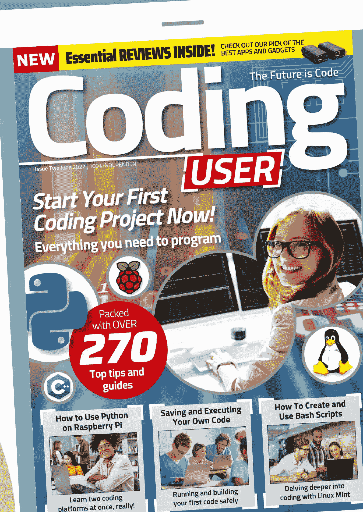

点击我们方便的链接立即阅读：https://bit.ly/30cL1zx


欢迎来到理解和扩展你用户体验的新境界！

对于某些人来说，精通新设备、软件或爱好的基础就足够了。但对许多像你这样的人来说，这仅仅是开始！提升你的技能集是所有消费技术用户的目标，而我们的长期行业专家团队将帮助你实现这一目标。在这一系列丰富的著作中，我们将更深入地探讨如何从最新的消费电子产品、软件、爱好和趋势中获得最大收益！我们将一步步引导你使用那些你之前可能一直畏惧于尝试的技术的所有高级方面。

让我们的专家指南帮助你建立对技术的理解，并获得让你从一个自信的用户变为经验丰富的专家的技能。

> 翻页后，我们的旅程将继续，我们将在每一个阶段陪伴你，为你提供建议、信息，并最终激励你走向更远。


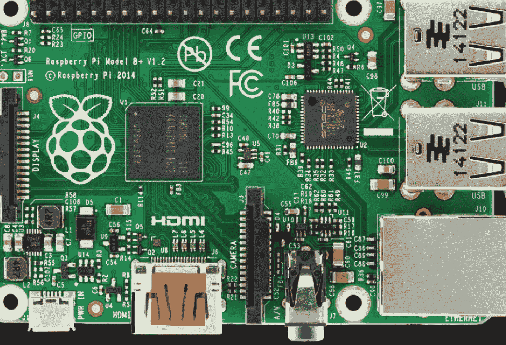


> “Linux 不仅仅是一个免费使用的操作系统。它独特的配置允许用户将操作系统定制和个性化为他们希望的任何形式。Linux 用户可以在一天之内改变操作系统的外观和感受，安装成千上万个免费提供的应用和程序，并夺回对电脑的控制权。”


## Linux 上的 Python

> “Python 是关于程序员需要多大自由的实验。太多的自由会导致没人能读懂别人的的代码；太少的自由会让表达力受到威胁。”
>
> Guido van Rossum（`Python` 编程语言开发者）


## Linux 上的 Python

`Python` 是一门极佳的编程语言，它结合了易用性和强大的功能，允许用户创建微型工具，也可以处理性能密集计算任务。

然而，`Python` 不仅仅是另一门编程语言。它背后有一个活力且充满活力的社区，他们分享知识、代码、项目想法，以及未来版本的错误修复方案。

我们在书的这一部分使用了树莓派（`Raspberry Pi`），因为它基于 `Linux`，是可用最好的编程平台之一。树莓派的特性和功能使其成为完美的 `Python` 编程伙伴，让我们开始吧。

# 为什么选择 `Python`？

现代计算机有许多不同的编程语言，8 位和 16 位计算机同样可用。在这些语言中，有些是为科学工作设计的，有些是为移动平台等的。为什么在所有语言中你选择了 `Python` 呢？

### `Python` 的力量

从最早计算机出现以来，爱好者和专业人士就投入了大量时间，在酷热中辛勤工作。为什么在所有语言中你选择了 `Python` 呢？现代计算机有许多不同的编程语言，8 位和 16 位计算机同样可用。在这些语言中，有些是为科学工作设计的，有些是为移动平台等的。为什么在所有语言中你选择了 `Python` 呢？

### `PYTHON` `POWER`

从最早计算机出现以来，爱好者和专业人士就投入了大量时间，在酷热中辛勤工作。为什么在所有语言中你选择了 `Python` 呢？现代计算机有许多不同的编程语言，8 位和 16 位计算机同样可用。在这些语言中，有些是为科学工作设计的，有些是为移动平台等的。为什么在所有语言中你选择了 `Python` 呢？

### 如何在 `Linux` 中安装 `Python`

虽然树莓派的操作系统包含了最新、稳定版本的 `Python`，但其他 `Linux` 发行版并没有预装 `Python` 3。如果你没有选择树莓派路线，这里有如何在 `Linux` 上检查和安装 `Python` 的方法。

#### `PYTHON` `PENGUIN`

`Linux` 是一个多功能的操作系统，因此很难界定某件事的唯一方法。不同的发行版以不同的方式安装软件，因此在本教程中，我们将使用 `Linux Mint`。

- **步骤 1** 首先需要确定你的 `Linux` 系统中当前安装了哪个版本的 `Python`。开始之前，从系统中进入终端（`Terminal`）或按下 `Ctrl+Alt+T` 键。
- **步骤 2** 接下来，在终端中输入 `python --version`。你应该能看到输出显示系统中的 `Python 2.x` 版本。默认情况下，大多数 `Linux` 发行版都带有 `Python 2` 和 `3`，因此有大量的适用于 `Python 2` 的代码可用。现在输入：`python3 --version`。
- **步骤 3** 在我们的案例中，我们同时安装了 `Python 2` 和 `3`；由于安装了 `Python 3.x`，代码也值得检查驱动程序是否已更新到最新版本，因此在系统输入：`sudo apt-get update && sudo apt-get upgrade`。
- **步骤 4** 一旦更新和安装完成，运行 `python3 --version` 查看 `Python 3.x` 是否已安装或更新；只要你有 `Python 3.x`，你运行的就是最新版本。3 之后的数字表示补丁和进一步的更新。如果你不确定，可以构建新元素。

```
File Edit View Search Terminal Help
david@david-mint: $ python --version
Python 2.7.15
david@david-mint: $ python3 --version
Python 3.6.7
```

```
File Edit View Search Terminal Help
david@david-mint: $ python --version
Python 2.7.15
david@david-mint: $ python3 --version
Python 3.6.7
```

```
File Edit View Search Terminal Help
david@david-mint: $ python --version
Python 2.7.15
david@david-mint: $ python3 --version
Python 3.6.7
```


```
sudo apt-get update
Reading package lists... Done
Get:1 http://archive.ubuntu.com/ubuntu focal Insecure amd64 In (Checking lists)
Get:2 http://archive.ubuntu.com/ubuntu focal-updates Insecure amd64 In (Checking updates)
Fetching 1.1 MB [110 kB]
Get:3 http://archive.ubuntu.com/ubuntu focal-security amd64 In (Checking security updates)
Fetching 2.2 MB [220 kB]

Installing linux-generic-5.4.0-101-1_amd64 [5.4.0-101.11]
Reading dependency tree... Done
Building dependency list... Done
The following NEW packages will be INSTALLED:
  linux-generic 5.4.0-101...
  linux-image 5.4.0-101 linux-modules 5.4.0-101...
After this action, 12 new packages will be installed and 145 MB of additional disk space will be used.
0 upgraded, 0 not installed.
Setting up linux-generic-5.4.0-101.11_amd64
Setting up linux-image-5.4.0-101.11_amd64
Setting up linux-image-5.4.0-101.11_amd64
Setting up linux-modules-5.4.0-101.11_amd64
Setting up linux-headers-5.4.0-101.11_amd64
Setting up linux-headers-5.4.0-101.11_amd64
Processing triggers...Done
david@david-mint: $
```

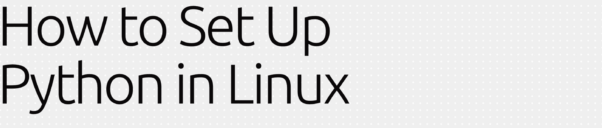

### 步骤 5

然而，如果你想要最新的前沿版本，需要从源码编译 Python。首先在终端中输入这些命令：

```
sudo apt-get install build-essential checkinstall
sudo apt-get install libreadline-dev gplv2-dev
ncurses5-dev libsqlite3-dev libz1-dev
libdbm-dev libdb66-dev
```

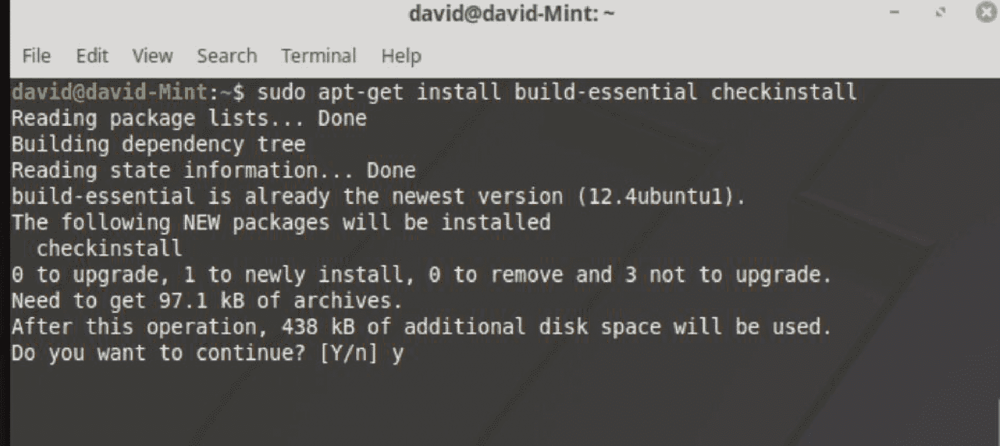

`David-Mint: $ sudo apt-get install build-essential checkinstall`

`Building dependency tree ...Done. latest version 12.4ubuntu`

`Building is already up to date. 0 to installed, 0 to upgrade, 0 new, 0 to remove and not to upgrade.`

`After this operation, 468 KB of additional disk space will be used.`

`Do you want to continue? [Y]`

### 步骤 6

打开你的 Linux 浏览器并访问 Python 页面：`www.python.org/downloads`。点击 `The Python Source` 按钮进入 `Downloads`。这将打开一个对话框；选择一个位置并下载源码。

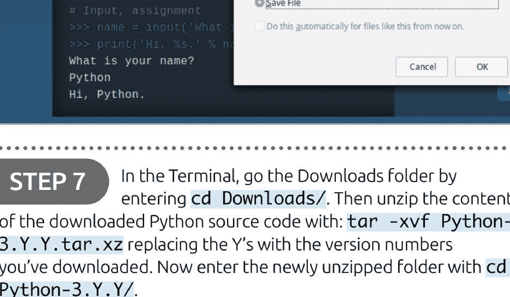

### 步骤 8

在 Python 文件夹内：

`./configure`

`sudo make altinstall`

这取决于你电脑的速度。完成后，运行 `python.7 --version` 检查版本。你安装了 Python 3.7，以及旧版本的 Python 3。

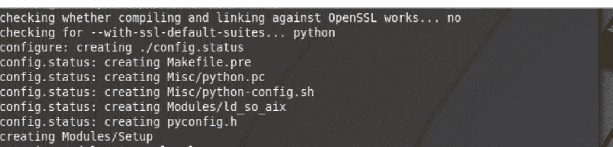

如果你想要带有所有静态优化的（MPD, LTO 等）的构建，运行 `--enable-optimizations`

### 步骤 9

对于 GUI IDE，你需要在终端输入命令：

```
sudo apt-get install idle3
```

使用 `idle3` 命令启动 IDE。注意 `idle` 版本与你安装的版本不同。

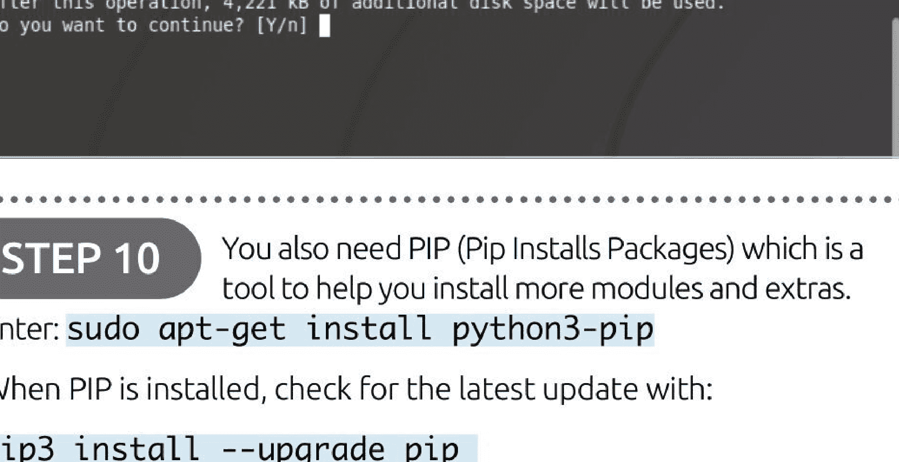

### 步骤 10

在终端中，我们将下载 tar 包。然后解压源码：`-xzvf python-3.Y.tar.gz` 将 Y 替换为你下载的版本。现在进入解压后的文件夹：`cd Python-3.Y/`

你还需要 `PIP` 来帮助你安装更多模块和扩展更新：

```
pip install --upgrade-pip
```

完成后，终端和 Python 3.x 将通过你发行版菜单中的 `Programming` 部分可用。

| `Python-3.7/objects/libobject.c.h` | `Python-3.7/objects/libast.c.h` | `Python-3.7/objects/libint.c.h` |
| `Python-3.7/objects/libunicode.c.h` | `Python-3.7/objects/libdbm.c.h` | `Python-3.7/objects/libdb66.c.h` |
| `Python-3.7/objects/libdict.c.h` | `Python-3.7/objects/module.c.h` | `Python-3.7/objects/collections.c.h` |
| `Python-3.7/objects/libfloat.c.h` | `Python-3.7/objects/liblong.c.h` | `Python-3.7/objects/libenum.c.h` |
| `Python-3.7/objects/libarray.c.h` | `Python-3.7/objects/libset.c.h` | `Python-3.7/objects/liblist.c.h` |
| `Python-3.7/objects/libmap.c.h` | `Python-3.7/objects/libstring.c.h` | `Python-3.7/objects/libbool.c.h` |
| `Python-3.7/objects/libmath.c.h` | `Python-3.7/objects/libsignal.c.h` | `Python-3.7/objects/libframe.c.h` |
| `Python-3.7/objects/libmethod.c.h` | `Python-3.7/objects/libclass.c.h` | `Python-3.7/objects/libtypes.c.h` |
| `Python-3.7/objects/libbuffer.c.h` | `Python-3.7/objects/libmemory.c.h` | `Python-3.7/objects/libhash.c.h` |
| `Python-3.7/objects/libbytes.c.h` | | |

### 首次启动 Python

如果你正在使用树莓派配合其最新版本的 Pi OS，你需要手动安装 Python IDLE。这是因为树莓派团队移除了核心 IDLE，转而使用自己的文本编辑器。

### 启动 Python

对于使用 Pi4 和新 Raspian 的用户，进入终端并使用：`sudo apt-get install idle3`。旧版本的 Raspian 预装了官方 IDLE。

在 Raspian 桌面上，点击菜单 `Programming > Python 3 (IDLE)`。Windows 和 Mac 用户可以通过 Windows 开始菜单和 Finder 找到 Python 3 IDLE。

例如，在 shell 中：`2+2`

按下回车键后，下一行显示答案：`4`。基本上，Python 接收了“代码”并产生了相应的输出。

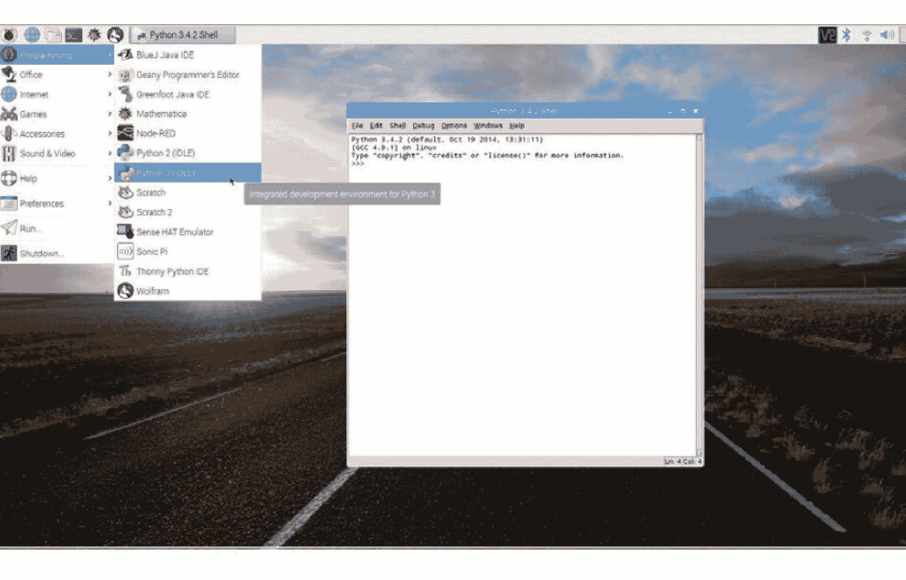

`Shell` 是你可以输入代码并看到你编写的代码的响应和输出的地方。这是一个沙箱，你可以在这里尝试一些代码和处理。


Python `Shell` 的作用非常像计算器，因为代码基本上是与系统的一系列数学交互。整数（无限数字序列）可以很容易地进行加、减、乘等。

```
File Edit View Search Terminal Help
david@david-mint: $ python --version
Python 3.4.2 (Default, Oct 19 2014, 13:31:11)
on Linux
>>> 'copyright', 'credits' or 'license' for more information.
>>> 4
4 >>>
```

```
File Edit View Search Terminal Help
david@david-mint: $ python --version
Python 3.4.2 (Default, Oct 19 2014, 13:31:11)
on Linux
>>> 'copyright', 'credits' or 'license' for more information.
>>> 4
4 >>>
>>> 8+6
14 >>>
>>> 2345*6445252
15089114440 >>>
>>> 977862442343-12343
>>> 9778624423*43034
50647282358
>>>
```

## 首次开始

第 5 步虽然很有趣，但并不是特别有趣。相反，尝试这个：

```python
print("Hello everyone!")
```

像你在之前的步骤中那样，将其输入 `IDE`。

第 8 步 `Python` `IDE` 是一个可配置的环境。如果你不喜欢颜色的表示方式，可以通过 `Options > IDE` 并点击 `Highlighting`（高亮）来更改任何。然而，我们不建议这样做，因为你看到的内容将与截图不一致。

```
Python 3.4.2
---
$ git clone shell github jenkins web pull
Python 3.4.2 (default, Oct 19 2014, 10:31:11)
(GCC 4.9.0) on Linux
[GCC 4.9.0]
>>> print("Hello world!\n")
>>> print("Credits" or "license" for example:
Hello world!
>>>
>>> 23453-645522
>>> 8878644522-12433
>>> 8878644522-25934
>>> 5064272358
>>> print("Hello everyone!")
>>> 
```

第 6 步这看起来像那么样了，因为你已经产生了了自己的段代码。`print` 命令是非常自言易懂的。有趣的是，`Python` 3 要求使用括号和引号来向屏幕输出内容，在这种情况下，我们看到了 `Hello everyone` 的结果：

```python
>>> print("Hello everyone!")
Hello everyone!
>>>
```

第 9 步就像大多数强大的应用程序一样，无论使用哪种操作系统，都有许多快捷键可用。我们没有空间列出所有键，但在 `Options > IDE` 和 `Keys` 选项卡中，你可以看到当前绑定的列表。

第 7 步你注意到了 `Python` `IDE` 内部的颜色编码。颜色代表 `Python` 代码的不同元素。它们是：

| 黑色 - 数据和变量 | 蓝色 - 用户函数 |
| :--- | :--- |
| 绿色 - 字符串 | 红色 - 注释 |
| 紫色 | 淡红色 - 错误消息 |
| 橙色 | |

第 10 步 `Python` `IDE` 是一个强大的接口，它实际上是用所有的所有的 `Shell` 编写的，我们建议你花几分钟查看 `www.python.org/library/idle.html`，它详细介绍了该 `IDE` 的许多功能。

| IDLE 颜色编码 | 颜色 | 用于 | 示例 |
| :--- | :--- | :--- | :--- |
| 黑色 | 数据与变量 | 23.4 area | |
| 绿色 | 字符串 | "Hello World" | |
| 紫色 | 函数 | isinstance() | |
| 橙色 | | for | |
| 蓝色 | 用户 | get_area() | |
| 深红色 | 注释 | #number | |
| 淡红色 | 错误消息 | SyntaxError: | |

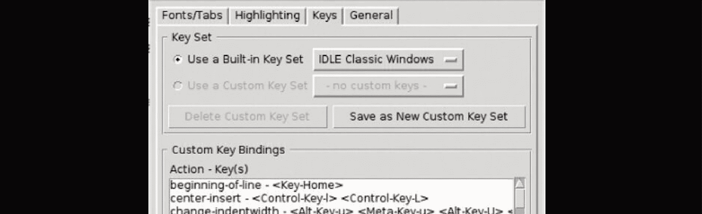


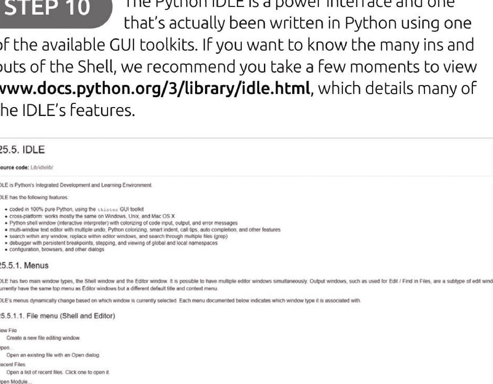

## 你的第一段代码

基本上，你已经通过上一个教程中的 `Hello everyone!` 函数编写了你的第一段代码。然而，让我们扩展一下，看看输入你的代码并尝试一些其他的 `Python` 示例。

## 玩转 Python

对于大多数语言，无论是计算机语言还是人类语言，关键在于在正确的情况下记住并应用正确的词汇。你并不是天生就知道这些的，所以你需要学习它们。

- **第 1 步** 如果你选择了 `Python` 3，请在你喜欢的任何操作系统中重新打开它。在 `Shell` 中，输入以下内容：

```python
print("Hello")
```

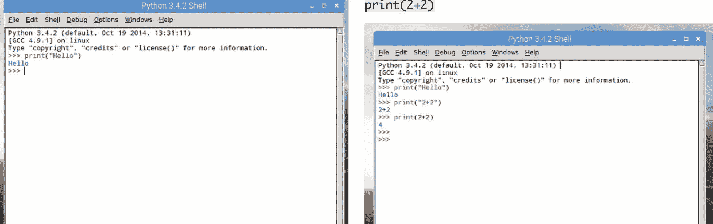

- **第 2 步** 正如预期的，单词 `Hello` 以文本形式出现在 `Shell` 中，表示来自字符串的输出。这非常直观，不需要太解释。现在尝试：

```python
print("2+2")
```

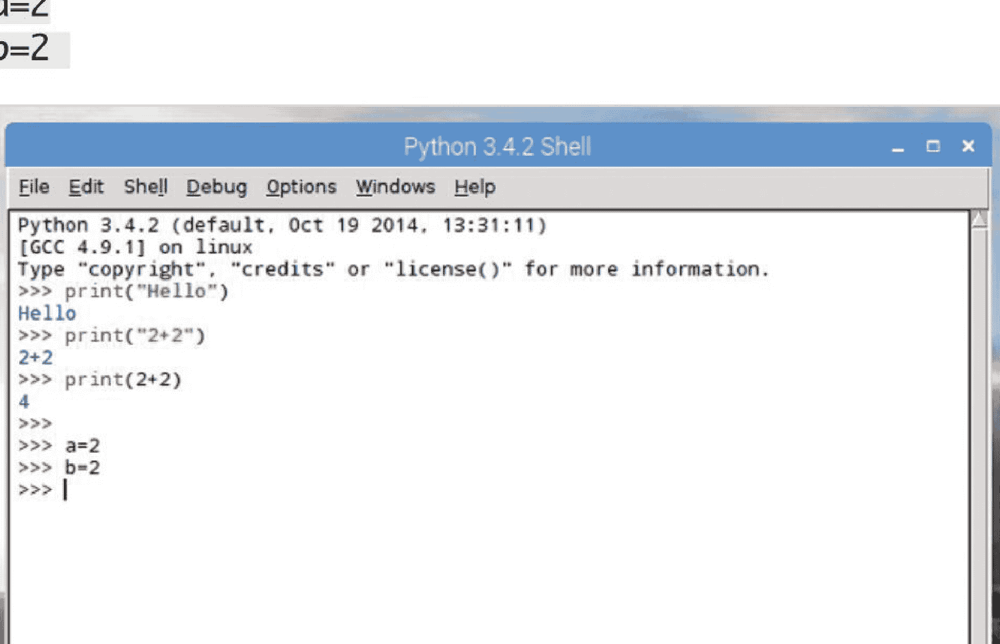

### 第 5 步

你在这里所的操作为字母 `a` 和 `b` 分配值：2。这些是变量，`Python` 可以调用它们进行输出、加法、减法等，只要它们的数字保持不变。尝试这个：

```python
### print(b)
```

```
Python 3.4.2 Shell

Python 3.4.2 (default, Oct 19 2014, 13:31:11)

>>> type="credits" or "license" for more information.

>>> name="David"

>>> print(name)

David

>>> a=2

>>> b=4

>>> print(a+b)

6

>>> print(a-b)

-2

>>> print(a*b)

8
```

### 第 8 步

现在我们添加一个姓氏：

```python
surname="Hayward"
print(surname)
```

你有两个变量包含一个名字和姓姓氏，你可以独立地打印它们。

```
Python 3.4.2 Shell

Python 3.4.2 (default, Oct 19 2014, 13:31:11)

>>> type="credits" or "license" for more information.

>>> name="David"

>>> print(name)

David

>>> surname="Hayward"

>>> print(surname)

Hayward
```

### 第 6 步

最后一步的输出清楚地显示了 `a` 和 `b` 的单独值，因为你要求分开打印。如果你想将它们相，可以使用：

```python
### print(a+b)
```

这段代码获取 `a` 和 `b` 的值，将它们相加并输出结果。

```
Python 3.4.2 Shell

Python 3.4.2 (default, Oct 19 2014, 13:31:11)

>>> type="credits" or "license" for more information.

>>> name="David"

>>> print(name)

David

>>> a=2

>>> b=4

>>> print(a+b)

6
```

### 第 9 步

如果我们在之前使用相同的程序，使用 `+`，名字将不会在 `Shell` 中正确显示。你尝试：

```python
### print(name-surname)
```

你需要在之间留一个空格，将它们定义为两个独立的值，而不是在数学上进行操作。

```
Python 3.4.2 Shell

Python 3.4.2 (default, Oct 19 2014, 13:31:11)

>>> type="credits" or "license" for more information.

>>> name="David"

>>> print(name)

David

>>> surname="Hayward"

>>> print(surname)

Hayward
```


### 第 7 步

你可以尝试不同类型的变量和函数。例如，你可以为某人的名字赋值：

```python
name="David"
print(name)
```

```
Python 3.4.2 Shell

Python 3.4.2 (default, Oct 19 2014, 13:31:11)

>>> type="credits" or "license" for more information.

>>> name="David"

>>> print(name)

David
```

### 第 10 步

在 Python 3 中，你可以用逗号分隔两个变量：

```python
print(name, surname)
```

或者，你可以自己添加空格：

```python
print(name+" "+surname)
```

使用逗号更好，你也可以看到 Python 的世界。

```
Python 3.4.2 Shell

Python 3.4.2 (default, Oct 19 2014, 13:31:11)

>>> type="credits" or "license" for more information.

>>> name="David"

>>> print(name)

David

>>> surname="Hayward"

>>> print(surname)

Hayward

>>> name="David"

>>> print(name, surname)

David Hayward

>>> name="David"

>>> print(name+" "+surname)

David Hayward
```

### 保存并执行代码

基本上，你已经通过上一个教程中的 `Hello everyone!` 函数编写了你的第一段代码。然而，让我们扩展一下，看看输入你的代码并尝试一些其他的 Python 示例。

## 玩转 Python

对于大多数语言，无论是计算机语言还是人类语言，关键在于在正确的情况下记住并应用正确的词汇。你并不是天生就知道这些的，所以你需要学习它们。

- **第 1 步** 如果你选择了 Python 3，请在你喜欢的任何操作系统中重新打开它。在 Shell 中，输入以下内容：

```python
print("Hello")
```


- **第 2 步** 正如预期的，单词 Hello 以文本形式出现在 Shell 中，表示来自字符串的输出。这非常直观，不需要太解释。现在尝试：

```python
print("2+2")
```


### 第 5 步

你在这里所的操作为字母 `a` 和 `b` 分配值：2。这些是变量，Python 可以调用它们进行输出、加法、减法等，只要它们的数字保持不变。尝试这个：

```python
print(b)
```

```
Python 3.4.2 Shell

Python 3.4.2 (default, Oct 19 2014, 13:31:11)

>>> type="credits" or "license" for more information.

>>> name="David"

>>> print(name)

David

>>> a=2

>>> b=4

>>> print(a+b)

6

>>> print(a-b)

-2

>>> print(a*b)

8
```

### 第 8 步

现在我们添加一个姓氏：

```python
surname="Hayward"
print(surname)
```

你有两个变量包含一个名字和姓姓氏，你可以独立地打印它们。

```
Python 3.4.2 Shell

Python 3.4.2 (default, Oct 19 2014, 13:31:11)

>>> type="credits" or "license" for more information.

>>> name="David"

>>> print(name)

David

>>> surname="Hayward"

>>> print(surname)

Hayward
```

### 第 6 步

最后一步的输出清楚地显示了 `a` 和 `b` 的单独值，因为你要求分开打印。如果你想将它们相加，可以使用：

```python
print(a+b)
```

这段代码获取 `a` 和 `b` 的值，将它们相加并输出结果。

```
Python 3.4.2 Shell

Python 3.4.2 (default, Oct 19 2014, 13:31:11)

>>> type="credits" or "license" for more information.

>>> name="David"

>>> print(name)

David

>>> a=2

>>> b=4

>>> print(a+b)

6
```

### 第 9 步

如果我们在之前使用相同的程序，使用 `+`，名字将不会在 Shell 中正确显示。你尝试：

```python
print(name-surname)
```

你需要在之间留一个空格，将它们定义为两个独立的值，而不是在数学上进行操作。

```
Python 3.4.2 Shell

Python 3.4.2 (default, Oct 19 2014, 13:31:11)

>>> type="credits" or "license" for more information.

>>> name="David"

>>> print(name)

David

>>> surname="Hayward"

>>> print(surname)

Hayward
```

### 第 7 步

你可以尝试不同类型的变量和函数。例如，你可以为某人的名字赋值：

```python
name="David"
print(name)
```

```
Python 3.4.2 Shell

Python 3.4.2 (default, Oct 19 2014, 13:31:11)

>>> type="credits" or "license" for more information.

>>> name="David"

>>> print(name)

David
```

### 第 10 步

在 Python 3 中，你可以用逗号分隔两个变量：

```python
print(name, surname)
```

或者，你可以自己添加空格：

```python
print(name+" "+surname)
```

使用逗号更好，你也可以看到 Python 的世界。

```
Python 3.4.2 Shell

Python 3.4.2 (default, Oct 19 2014, 13:31:11)

>>> type="credits" or "license" for more information.

>>> name="David"

>>> print(name)

David

>>> surname="Hayward"

>>> print(surname)

Hayward

>>> name="David"

>>> print(name, surname)

David Hayward

>>> name="David"

>>> print(name+" "+surname)

David Hayward
```

### 从终端执行代码

虽然我们在整本书中都在使用 GUI 版 IDLE，但值得关注一下 Python 的命令行处理。我们已经知道 Python 有一个命令行版本，但它也被用于执行代码。

## 命令行控制代码

使用我们在上一个教程中创建的代码（命名为 `hello.py` 的那一个），让我们看看如何在命令行级别运行在 GUI 中创建的代码。

- **步骤 1**：在 Linux 中，Python 有两种通过命令行执行代码的方法。其中一种是使用 Python 2，另一种是使用 Python 3 库等。首先，进入你操作系统的命令行或终端（Terminal）。

- **步骤 3**：现在你处于命令行界面了，我们可以启动 Python。对于 Python 3，你需要输入 Shell 版本的命令。这将让你进入带有三个向右箭头 (`->`) 的命令行界面。

```
pi@raspberry: ~

$ raspberrypi~$ python3

Python, Oct 19 2014, 13:31:11

(GC 4.9.1) on linux

>>> help('copyright', 'credits' or 'license') for more information.

>>>
```


- 步骤 2：就像之前一样，树莓派：Windows 用户需要点击开始按钮并搜索 `CMD`，然后点击命令行解释器搜索；macOS 用户可以通过点击“前往 > 实用工具 > 终端”来访问他们的命令行。

- 步骤 4：从这里，你可以输入之前看过的代码，如下：

```python
a=2
print(a)
```

你会发现它的工作原理完全一样。

```
pi@raspberry: ~
$ raspberrypi~$ python3
Python, Oct 19 2014, 13:31:11
(GC 4.9.1) on linux
>>> help('copyright', 'credits' or 'license') for more information.
>>> print(a)
2
```

- 步骤 5：现在输入：`exit()` 退出 Python 会话并返回命令行提示符。进入你保存上一个教程代码的目录并列出可用文件；希望你能看到 `hello.py`。

- 步骤 8：从 Python 2 代码运行 Python 3 代码的结果是显而易见的。它没有报错，但由于 Python 3 处理 `print` 命令的方式与 Python 2 的差异，结果并不符合我们的预期。使用 `Sublime` 打开，结果如下：

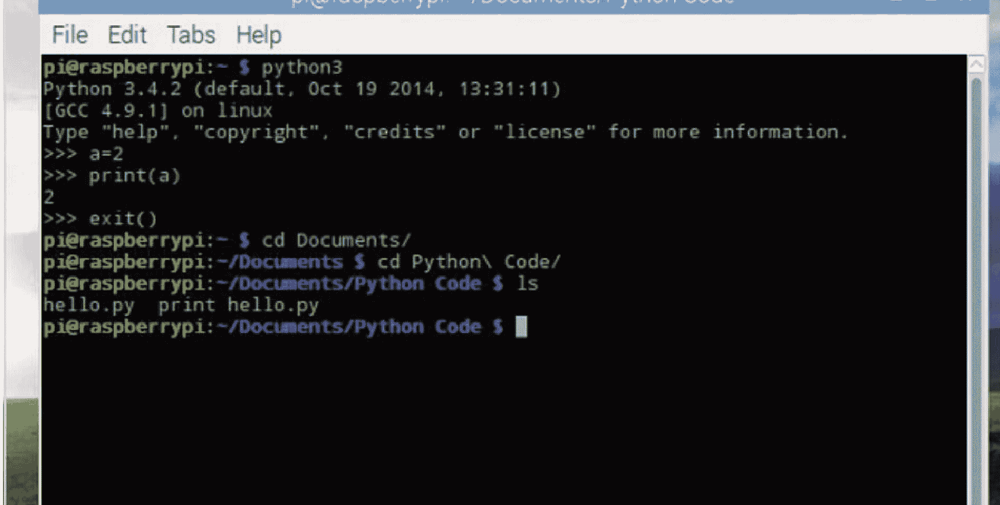

- 步骤 6：在你要运行的代码所在的相同文件夹中，输入以下行：

`python hello.py`

- 步骤 9：由于树莓派上没有 `Sublime Text`，你需要暂时离开树莓派，使用一个不需要使用 `Python IDLE` 的编辑器。在打开 `hello.py` 文件后，修改为以下内容

这将执行我们创建的代码，提醒你：

```python
a="Python"
b="is"
c="cool"
print(a, b, c)
name=input("What is your name?")
print("hello", name)
```

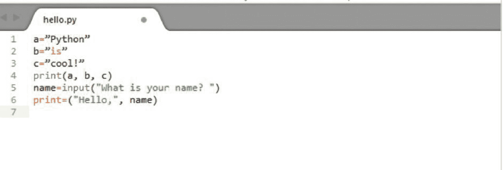

- 步骤 7：自然地，这是 Python 3 代码，使用的语法和布局与 Python 2 不同。如果你尝试通过输入 `python hello.py` 使用 Python 2 运行代码：

- 步骤 10：保存 `hello.py` 并回到命令行。现在执行新保存的 `python3 hello.py`

结果将是原始的 `Python.py is cool!` 加上你请求名称的输入命令，并在命令行窗口中显示它。

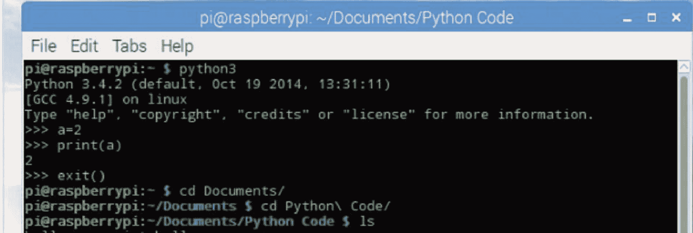

得分 1,337


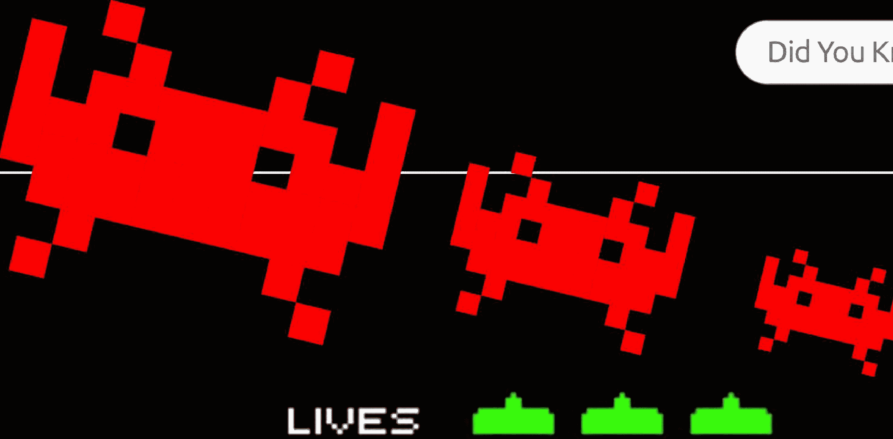

### 你知道吗...

当《太空入侵者》的创造者西川洋宏（Tomohiro Nishikawa）编写该游戏时，他必须创建自己的硬件和开发工具来编写游戏。此外，他随后发现由于编码和自定义硬件的结果，屏幕上的入侵者越少，处理器的渲染速度就越快。因此，当你杀死更多入侵者时，它们会变得越来越快。所以他并没有设计游戏来补偿速度的增加，而是决定将其作为一种具有挑战性的游戏机制。

> 入侵者越少，速度反而越快，这纯属意外。

### Python 与表达式

我们已经看到了一些 Python 的基础数学表达式，如简单的加法等。现在让我们扩展一下，看看 Python 作为计算器有多强大。你可以在 `IDLE Shell` 或编辑器中进行，任随你的喜意。

# 哥们，这全是数学

你可以利用 Python 的数学能力获得令人印象深刻的结果；大多数（并非所有）编程语言的数学都是代码背后的动力。

- 打开 Python 3 版本，如前面提到的，你可以使用 `Shell` 或编辑器。目前，你将使用 `Shell` 来锻炼你的数学肌肉（或者说，锻炼你的头脑）。

- 你可以使用所有的数学运算：除法、括号等。练习一下，例如：

`1/2`
`2+2`
`2*3`
`(1+2)+(3*4)`

```
Python 3.4.2 Shell

Edit Shell Debug Options help

Python 3.4.2 (default, Oct 19 2014, 13:31:11)

>>> help('copyright', 'credits' or 'license') for more information.

>>> 1/2
0.5

>>> 2+2
4

>>> 2*3
6

>>> (1+2)+(3*4)
15
```

在 `Shell` 中输入以下内容：

你可以看到 Python 可以处理一些大数字。

`1/2`
`6/2`

你，你注意到除法会产生小数。在 Python 中，这些被称为浮点数（`floats`）。但是，如果你需要整数，则使用双斜杠：等等。

```
Python 3.4.2 Shell

Edit Shell Debug Options help

Python 3.4.2 (default, Oct 19 2014, 13:31:11)

>>> help('copyright', 'credits' or 'license') for more information.

>>> 1/2
0.5

>>> 6/2
3.0

>>> 2+2
4

>>> (1+2)*(3*4)
36
```

## 数字与表达式

- 步骤 5：现在输入 `exit()` 退出 Python 会话并返回命令行提示符。进入你保存上一个教程代码的目录并列出可用文件；希望你能看到 `hello.py`。

- 步骤 8：从 Python 2 代码运行 Python 3 代码的结果是显而易见的。它没有报错，但由于 Python 3 处理 `print` 命令的方式与 Python 2 的差异，结果并不符合我们的预期。使用 `Sublime` 打开，结果如下：


- 步骤 6：在你要运行的代码所在的相同文件夹中，输入以下行：`python hello.py`

- 步骤 9：由于树莓派上没有 `Sublime Text`，你需要暂时离开树莓派，使用一个不需要使用 `Python IDLE` 的编辑器。在打开 `hello.py` 文件后，修改为以下内容

这将执行我们创建的代码，提醒你：

```python
a="Python"
b="is"
c="cool"
print(a, b, c)
name=input("What is your name?")
print("hello", name)
```


- 步骤 7：自然地，这是 Python 3 代码，使用的语法和布局与 Python 2 不同。如果你尝试通过输入 `python hello.py` 使用 Python 2 运行代码：

- 步骤 10：保存 `hello.py` 并回到命令行。现在执行新保存的 `python3 hello.py`

结果将是原始的 `Python.py is cool!` 加上你请求名称的输入命令，并在命令行窗口中显示它。


### 使用注释

在编写代码时，流程、每个变量的作用、整个程序将如何运行等都在你的脑子里。这可能会变得难以阅读。

### 注释！

程序员通过对某些部分进行注释来保持代码的可读性。如果使用了一个变量，程序员会注释它预期的作用，例如。这是一种良好的习惯。

- 步骤 1：从创建一个 `IDLE` 编辑器新实例（`File > New`）开始，创建一个简单的变量和打印命令：

```python
a=10
print("The value of A is,", a)
```

保存文件并执行代码。

- 步骤 3：解析代码并执行。你可以看到 `IDLE Shell` 中的输出仍然与之前一样，尽管增加了额外的行。简单来说，井号 (`#`) 表示程序员可以插入的额外文本，用以告知他们和其他人正在发生什么，而用户不会察觉。

- 步骤 2：运行代码将在 `IDLE` 窗口中返回：`The value of A is 10`，这正是我们预期的。现在，添加一些通常在代码中看到的注释：

```python
### 将 A 的初始值设置为 10
### 打印 A 的当前值
print("The value of A is,", a)
```

- 步骤 4：假设我们创建的变量 `A` 是游戏中的生命。每当玩家死去一次，值就会减少 1。程序员可以在以下内容中插入一条常规代码：

```python
a-=1
print("You've just lost a life!")
print("You now have,", a, "lives left!")
```


### 第 5 步

虽然我们知道变量 `A` 是活跃的，而且玩家刚刚失去了一个生命，但一个更清晰的时刻是代码有两万行，而不仅仅是七行。你可以看到注释有多么方便。

### 第 8 步

跟在代码段后面的行内注释。为了分开显示，我们使用上面的示例，而不是将代码插入到单独的：

```python
Python 3.4.2 Shell

>>> Wed Oct 25 10:33:11

>>> a=9 lives

>>> print("credits" or "license") for more information.

>>> RESTART

>>> a=10 # 将 A 的值设为 10

>>> print("The value of A is,", a) # 打印 a 的当前值

>>> a=9 # 玩家失去了一个生命！

>>> print("You now have", a, "lives left!") # 通知玩家，并向我们显示 A 的当前值
```

### 第 6 步

本质上，新代码结合注释可能如下：

```python
### 将 A 的起始值设为 10

### 打印 A 的当前值

print("The value of A is,", a)

### 玩家失去了一个生命！

a=9

### 通知玩家，并显示 A 的当前值（生命）

print("You just lost a life!")

print("You now have", a, "lives left!")
```

### 第 9 步

注释（井号符号）也可以用于解释你想要的代码段，例如，如果你想删除第一个语句，你会使用：

> `# 打印 A 的值是, a`

```python
### 将 A 的起始值设为 10

### 打印 A 的当前值

print("The value of A is,", a)

### 玩家失去了一个生命！

a=9

### 通知玩家，并显示 A 的当前值（生命）

print("You just lost a life!")

print("You now have", a, "lives left!")
```

### 第 7 步

你可以使用注释来解释为什么，例如，块注释是代码正在发生的大部分内容，告诉读者你正在做什么：

```python
### 这是最最棒的游戏，是由一个没睡了几周的 Python 专家小组开发的

### 因为非常困，代码至少

### 运行得非常好。
```

### 第 10 步

你还使用三个引号来注释掉一个块或多行注释。将它们放置在你想要注释的区域的前后：

```python
"""

### 这是最最棒的游戏，是由一个没睡了几周的 Python 专家小组开发的。因为非常困，代码至少

### 运行得非常好。

"""
```

```python
### 将 A 的起始值设为 10

### 打印 A 的当前值

print("The value of A is,", a)

### 玩家失去了一个生命！

a=9

### 通知玩家，并显示 A 的当前值（生命）

print("You just lost a life!")

print("You now have", a, "lives left!")
```

## 变量操作

我们在 Python 代码中已经看到了一些变量的示例，但通过[方式]了解它们的运行机制以及 Python 如何创建并为变量分配某些值始终是值得的。

## 变量

在本教程中，你将使用 Python 3 IDLE Shell。如果你还没有打开，请打开 Python 3 或关闭之前的 IDLE Shell 以清理任何旧内容。

- `第 1 步` 在某些编程语言中，你需要使用美元符号来表示字符串，这是一种由多个字符组成的变量，例如人的名字。在 Python 中，这不是必要的。例如，在 Shell 中输入：`name="David Howard"`（或你自己的名字，除非你真的叫 David Howard）。

- `第 3 步` 你之前已经看到变量名之间可以使用加号 `+` 进行拼接。在我们的示例中，我们可以使用：`print(name + ": " + title)`。引号之间的中间部分允许我们添加冒号和空格，而不会产生连接空格，所以我们需要手动添加它们。

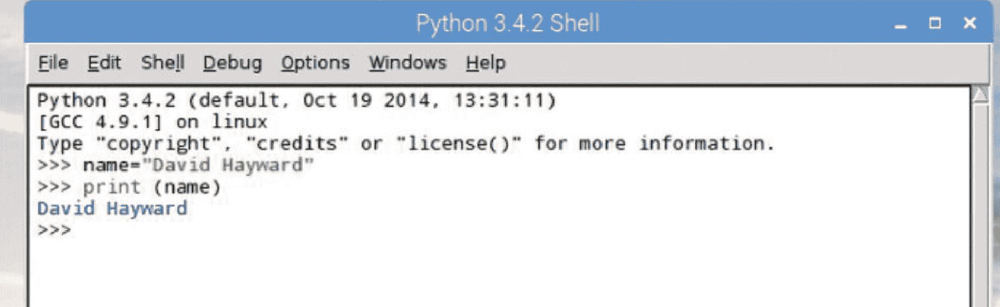
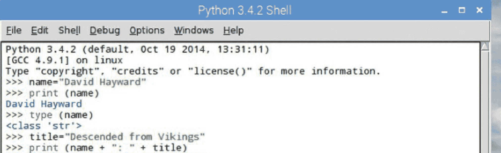

- `第 2 步` 你可以通过发布 `type()` 命令来检查变量类型，将变量名放在括号内。在我们的示例中，这将：`type(name)` `title="Descended from Vikings"`

- `第 4 步` 你还可以将变量组合在另一个变量中。例如，为了将 `name` 和 `title` 变量组合成新变量，我们使用：

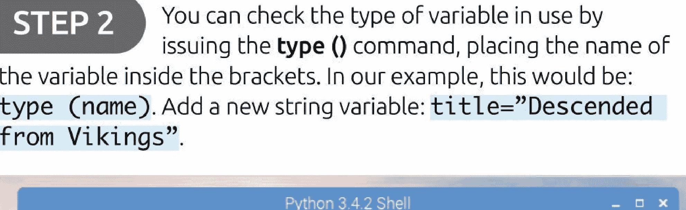

然后输出新变量的内容为：

```python
print(character)
```

数字存储在变量中：

```python
age=44
```

正如我们所知，有：
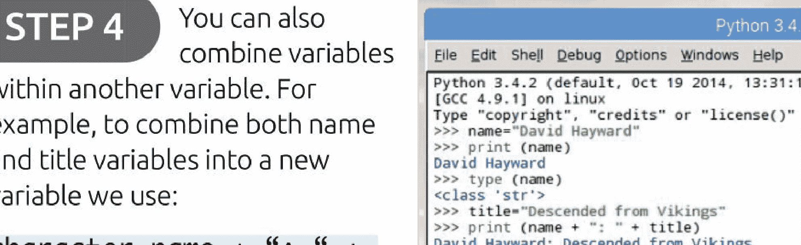

### 第 5 步

然而，你不能在同一个命令中组合字符串和整数变量，因为你需要将一个转换为另一个，反之亦然。当你尝试将两者结合时，会得到错误：

```python
print(name + age)
```

```python
Python 3.4.2

>>> name = 'David'

>>> age = 44

>>> type(name)

<class 'str'>

>>> type(age)

<class 'int'>

>>> name + age

Traceback (most recent call last):

  File "<stdin>", line 1, in <module>

TypeError: can only concatenate str (not "int") to str
```

### 第 8 步

当你想要处理一个用户输入的数字时，类型转换会出现一些问题，因为你需要将一个转换为另一个。例如：

```python
int(age)
```

```python
Python 3.4.2

>>> age = '44'

>>> int(age)

44
```

### 第 6 步

这种跟在代码段后面的行内注释。为了分开显示，我们使用上上面的示例，而不是将代码插入到单独的：

```python
# 
```

```python
Python 3.4.2
>>> name = 'David'
>>> age = 44
>>> print(name, "is", age)
David is 44
```

### 第 9 步

这种转换被称为类型转换，它在处理浮点数时非常重要，例如：

```python
float(age)
```

```python
Python 3.4.2
>>> age = '44.5'
>>> float(age)
44.5
```

### 第 7 步

你可以使用注释来解释为什么，例如，块注释是代码正在发生的大部分内容，告诉读者你正在做什么：

```python
# 
```

### 第 10 步

你还使用三个引号来注释掉一个块或多行注释。将它们放置在你想要注释的区域的前后：

```python
"""

"""
```

### 用户输入

`第 5 步` 你并不总是需要在你的输入命令中包含引用的文本。例如，你可以询问用户名，并在行中进行输入：

```python
print("Hello. What's your name?")
name=input()
```

```python
userinput.py - /home/pi/Documents/Python/Code/userinput.py
编辑 格式 运行 Windows 帮助
print("Hello. What's your name?")
name=input()
```

`第 8 步` 你在这里创建的是一个条件，我们很快就会涵盖。简而言之，我们使用用户的输入并将其与条件进行比较。如果用户输入的名称是 `David`，卫兵将让他们无损地通过。否则，如果他们输入了 `David` 以外的名字，卫兵将挑战他们战斗。

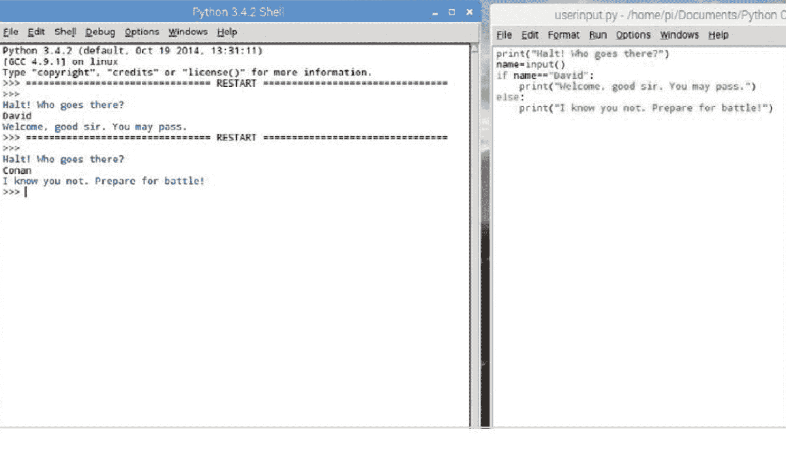

`第 6 步` 来自上一步的代码通常被认为比在输入命令中包含大量文本要好一点，但这并不是成不变的规则，所以你可以根据情况选择。扩展代码，尝试这个：

```python
print("Halt! Who goes there?")
name=input()
```


# 第 9 步

正如你之前学过的那样，来自用户的输入是一个字符串，因此你需要应用类型转换（`TypeCast`）来将其转换为其他类型。这为输入命令增加了一些有趣的特性。例如：

## 计算速率和距离

```python
print("A rate and a distance")
rate = float(input("Rate: "))
```

# 第 7 步

开始一个冒险游戏也许是一个很好的开始，对吗？现在你可以扩展它，并使用用户的原始输入来丰富内容：

```python
if name=="David":
    print("Hello, good sir. You may pass.")
else:
    print("I know you. Prepare for battle!")
```

# 第 10 步

为了完成速率和距离的计算添加：

```python
distance = float(input("Distance: "))

print("Time: ", (distance / rate))
```

保存代码并输入数字。使用 `Float` 元素，我们将告诉您任何输入的内容都是点数而不是整数：


# 创建函数

现在你已经使用了 `Python` 中大部分实用的功能以及用户输入，下一步是处理函数。你已经使用过一些函数，例如 `print` 命令，但现在 `Python` 允许你定义自己的函数。

## 趣函数

函数是你输入到 `Python` 中执行某些操作的命令。它是一小段自包含的代码，接收数据、对其处理并返回结果。

- **第 1 步** 函数处理的不只是数据。它们可以完成从一种格式到另一种格式的所有事情，并检查项的长度或类型。基本上，函数是一个后面跟着括号的短单词。例如，`len()`、`list()` 或 `type()`。

- **第 3 步** 你可以用同样的方式通过函数传递变量。假设你想知道某人姓氏中字母的数量，可以使用以下代码（为此示例进入文本编辑器）：

  ```python
  name=input("Enter your surname: ")
  print("Your surname has", len(name), "letters in it.")
  ```

  按 `F5` 保存并执行。

  ```text
  Python 3.4.2 (default), Oct 19 2014 13:31:11
  >>> 输入 "copyright", "credits" 或 "license" 获取更多信息。
  >>> len('disestablishmentarianism')
  28
  ```

- **第 2 步** 函数接收数据（通常是变量），根据函数的程序设定功能对其进行处理并返回值。在括号内处理的数据，如果你想知道 `establishmentism` 有多少个字母，那么你就输入：`len('arianism')`，然后将返回数字 `28`。

- **第 4 步** `Python` 内置了数十个函数

  ```text
  Python 3.4.2 (default), Oct 19 2014 13:31:11
  >>> 输入 "copyright", "credits" 或 "license" 获取更多信息。
  >>> len('disestablishmentarianism')
  28
  ```

# 第 5 步

按下 `F5` 并保存代码以执行。在 `Shell` 中输入一个四个字母的单词开始，你应该会收到返回消息，显示该单词是四个字母。现在按 `F5` 重新运行程序，这次输入一个五个字母的单词。`Shell` 将显示它是

# 第 6 步

现在扩展代码以包含另一个条件。最终，它可能会变得相当复杂。我们为三个字母的单词添加了一个条件：

```python
word=input("Please enter a four-letter word: ")
word_length=len(word)
if word_length==4:
    print(word, "is a four-letter word. Well done.")
elif word_length==3:
    print(word, "is a three-letter word. Try again.")
else:
    print(word, "is not a four-letter.")
```

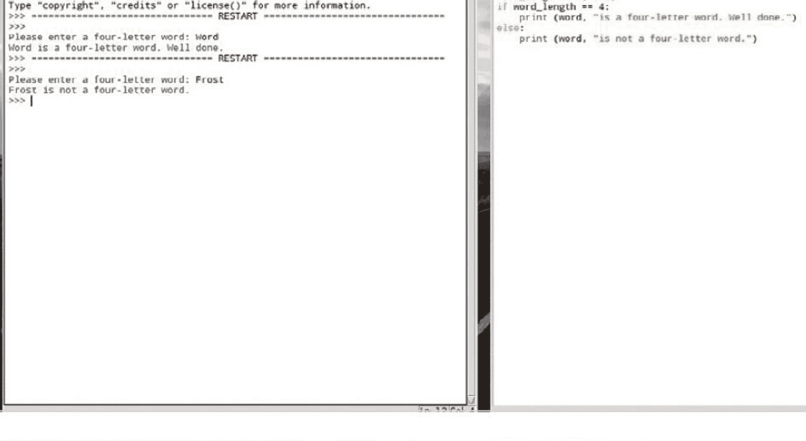

# 循环 (LOOPS)

循环看起来和条件很相似，但它们的运行方式有些不同。循环会运行相同的代码块多次，通常在条件的支持下。

## 第 1 步

让我们从简单的 `while` 语句开始。如果，这将检查某事是否为真（`TRUE`），那么缩进的代码：

## 第 3 步

`For` 循环是另一个例子。`For` 用于遍历数据范围，通常是方括号内的列表。例如：

```python
x = 0
while x < 10:
    print(x)
    x = x + 1
```

```python
words=["Cat", "Dog", "Unicorn"]
for word in words:
    print(word)
```

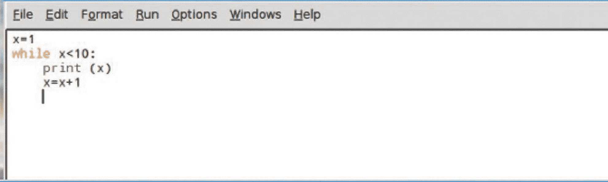

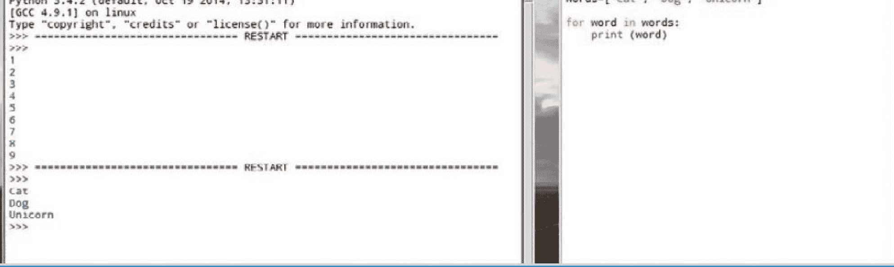

## 第 2 步

`if` 和缩进代码之间的区别在于，它会回到末尾并检查语句是否仍然为真。在例子中，如果 `x` 存在，则它会打印 `x` 的当前值，然后给该值加 `1`。当 `x` 不等于 `10` 时，它会停止。

## 第 4 步

`For` 循环也可以使用 `range` 函数用于计数示例。

```python
for x in range(1, 10):
    print(x)
```

这里不需要 `x=1` 部分，因为 `range` 函数会在使用的第一个数字和最后一个数字之间创建一个列表。


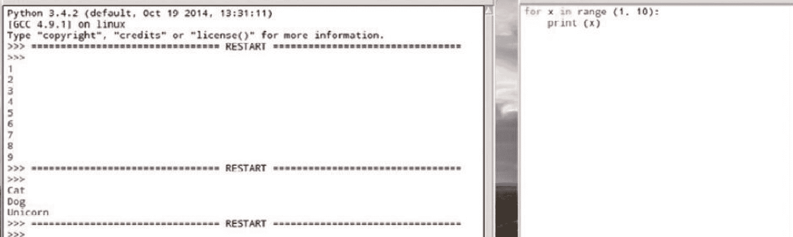

# Python 模块

将模块视为导入到 `Python` 代码中的扩展，以增强和扩展其功能。有无数模块可用，而树莓派预装了其中大部分模块；许多 `Linux` 发行版也是如此。

## 掌握模块 (MASTERING MODULES)

在此示例中，我们使用 `Windows 10` 来演示模块的安装，因为它们在 `Pi OS` 中已经存在。对于没有任何模块的 `Linux` 发行版同样适用于步骤，所以不必担心跨平台兼容性。

虽然 `Python` 内置函数是有限的，但使用模块允许我们编写更复杂的程序。如你所知，模块是被导入的 `Python` 脚本，例如 `import math`。

结果在 `IDLE Shell` 中未被识别/在 `Python` 中。要安装模块，我们可以使用 `PIP` (`Pip Installs Packages`) 或终端会话。在特权管理员命令提示符中输入：

```bash
pip install pygame
```

- 第 1 步


某些模块（特别是在树莓派上）是默认包含的，`Math` 模块就是一个很好的例子。遗憾的是，其他模块并不总是可用。一个非树莓派功能的良好例子是 `Pygame` 模块，它包含了许多创建游戏的方法。尝试：`import pygame`

- 第 2 步

由于要在不同的位置安装组件，`PIP` 安装需要提权状态。`Windows` 用户可以通过开始按钮搜索 `CMD` 并点击结果“以管理员身份运行”。`Linux` 和 `Mac` 用户可以使用 `sudo`，使用 `sudo pip install`。

- 第 3 步

```python
Python 3.6.2 (v3.6.2:033b3, Jul 8 2017, 04:14:34) [MSC v3.1900 32 bit (Intel)]
Type 'custom', 'credits' or 'license' for more information.
>>> import pygame
>>> Import the first class:
>>> print(pygame.__name__)
ModuleNotFoundError: No module named 'pygame'
```

```bash
Administrator Command Prompt
c:\Users\david pip install pygame
Microsoft Windows [Version 10.0.15063]
(c) 2017 Microsoft. All rights reserved.
pip install pygame
Collecting pygame
  Downloading pygame-1.9.6-py3-cp36-win32.whl (X MB)
Installing collected packages: pygame
Successfully installed pygame-1.9.6

c:\WINDOWS\system32>
```

```python
Python 3.6.2 (v3.6.2:033b3, Jul 8 2017, 04:14:34) [MSC v3.1900 32 bit (Intel)]
Type 'custom', 'credits' or 'license' for more information.
>>> import pygame
>>> Import the first class:
>>> print(pygame.__name__)
ModuleNotFoundError: No module named 'pygame'
```

- 第 1 步

某些模块（特别是在树莓派上）是默认包含的，`Math` 模块是一个主要的例子。遗憾的是，其他模块并不总是可用。一个非树莓派功能的良好例子是 `Pygame` 模块，它包含了许多创建游戏的方法。尝试：`import pygame`

- 第 2 步

`PIP` 安装需要权限，因为要在不同的位置安装组件。`Windows` 用户可以通过开始按钮搜索 `CMD` 并点击结果“以管理员身份运行”。`Linux` 和 `Mac` 用户可以使用 `sudo`，使用 `sudo pip install`。

- 第 3 步

```python
Python 3.6.2 (v3.6.2:033b3, Jul 8 2017, 04:14:34) [MSC v3.1900 32 bit (Intel)]
Type 'custom', 'credits' or 'license' for more information.
>>> import pygame
>>> Import the first class:
>>> print(pygame.__name__)
ModuleNotFoundError: No module named 'pygame'
```

```bash
Administrator Command Prompt
c:\Users\david pip install pygame
Microsoft Windows [Version 10.0.15063]
(c) 2017 Microsoft. All rights reserved.
pip install pygame
Collecting pygame
  Downloading pygame-1.9.6-py3-cp36-win32.whl (X MB)
Installing collected packages: pygame
Successfully installed pygame-1.9.6

c:\WINDOWS\system32>
```

```python
Python 3.6.2 (v3.6.2:033b3, Jul 8 2017, 04:14:34) [MSC v3.1900 32 bit (Intel)]
Type 'custom', 'credits' or 'license' for more information.
>>> import pygame
>>> Import the first class:
>>> print(pygame.__name__)
ModuleNotFoundError: No module named 'pygame'
```

- 第 5 步

结果在 `IDLE Shell` 中未被识别/在 `Python` 中。要安装模块，我们可以使用 `PIP` (`Pip Installs Packages`) 或终端会话。在特权管理员命令提示符中输入：

```bash
pip install pygame
```

- 第 1 步

某些模块（特别是在树莓派上）是默认包含的，`Math` 模块是一个主要的例子。遗憾的是，其他模块并不总是可用。一个非树莓派功能的良好例子是 `Pygame` 模块，它包含了许多创建游戏的方法。尝试：`import pygame`

- 第 2 步

`PIP` 安装需要权限，因为要在不同的位置安装组件。`Windows` 用户可以通过开始按钮搜索 `CMD` 并点击结果“以管理员身份运行”。`Linux` 和 `Mac` 用户可以使用 `sudo`，使用 `sudo pip install`。

- 第 3 步

```python
Python 3.6.2 (v3.6.2:033b3, Jul 8 2017, 04:14:34) [MSC v3.1900 32 bit (Intel)]
Type 'custom', 'credits' or 'license' for more information.
>>> import pygame
>>> Import the first class:
>>> print(pygame.__name__)
ModuleNotFoundError: No module named 'pygame'
```

```bash
Administrator Command Prompt
c:\Users\david pip install pygame
Microsoft Windows [Version 10.0.15063]
(c) 2017 Microsoft. All rights reserved.
pip install pygame
Collecting pygame
  Downloading pygame-1.9.6-py3-cp36-win32.whl (X MB)
Installing collected packages: pygame
Successfully installed pygame-1.9.6

c:\WINDOWS\system32>
```

```python
Python 3.6.2 (v3.6.2:033b3, Jul 8 2017, 04:14:34) [MSC v3.1900 32 bit (Intel)]
Type 'custom', 'credits' or 'license' for more information.
>>> import pygame
>>> Import the first class:
>>> print(pygame.__name__)
ModuleNotFoundError: No module named 'pygame'
```

- 第 5 步

按下 `F5` 并保存代码以执行它。在 `Shell` 中输入一个四个字母的单词开始，你应该会收到返回消息，显示该单词是四个字母。现在按 `F5` 重新运行程序，这次输入一个五个字母的单词。`Shell` 将显示它是

### 第 6 步

现在扩展代码以包含另一个条件。最终，它可能会变得相当复杂。我们为三个字母的单词添加了一个条件：


```python
word=input("Please enter a four-letter word: ")
word_length=len(word)
if word_length==4:
    print(word, "is a four-letter word. Well done.")
elif word_length==3:
    print(word, "is a three-letter word. Try again.")
else:
    print(word, "is not a four-letter.")
```


## 循环 (LOOPS)

循环看起来和条件很相似，但它们的运行方式有些不同。循环会运行相同的代码块多次，通常在条件的支持下。

### 第 1 步

让我们从简单的 `while` 语句开始。如果，这将检查某事是否为真（TRUE），那么缩进的代码：

### 第 3 步

`For` 循环是另一个例子。`For` 用于遍历数据范围，通常是方括号内的列表。例如：

```python
x = 0
while x < 10:
    print(x)
    x = x + 1
```

```python
words=["Cat", "Dog", "Unicorn"]
for word in words:
    print(word)
```


### 第 2 步

`if` 和缩进代码之间的区别在于，它会回到末尾并检查语句是否仍然为真。在例子中，如果 `x` 存在，则它会打印 `x` 的当前值，然后给该值加 1。当 `x` 不等于 10 时，它会停止。

### 第 4 步

`For` 循环也可以使用 `range` 函数用于计数示例。

```python
for x in range(1, 10):
    print(x)
```

这里不需要 `x=1` 部分，因为 `range` 函数会在使用的第一个数字和最后一个数字之间创建一个列表。


## Python 模块

将模块视为导入到 Python 代码中的扩展，以增强和扩展其功能。有无数模块可用，而树莓派预装了其中大部分模块；许多 Linux 发行版也是如此。

### 掌握模块 (MASTERING MODULES)

在此示例中，我们使用 Windows 10 来演示模块的安装，因为它们在 Pi OS 中已经存在。对于没有任何模块的 Linux 发行版同样适用于步骤，所以不必担心跨平台兼容性。

虽然 Python 内置函数是有限的，但使用模块允许我们编写更复杂的程序。如你所知，模块是被导入的 Python 脚本，例如 `import math`。

结果在 IDLE Shell 中未被识别/在 Python 中。要安装模块，我们可以使用 PIP (Pip Installs Packages) 或终端会话。在特权管理员命令提示符中输入：

```bash
pip install pygame
```

- 第 1 步

某些模块（特别是在树莓派上）是默认包含的，Math 模块是一个主要的例子。遗憾的是，其他模块并不总是可用。一个非树莓派功能的良好例子是 Pygame 模块，它包含了许多创建游戏的方法。尝试：`import pygame`

- 第 2 步

PIP 安装需要权限，因为要在不同的位置安装组件。Windows 用户可以通过开始按钮搜索 CMD 并点击结果“以管理员身份运行”。Linux 和 Mac 用户可以使用 `sudo`，使用 `sudo pip install`。

- 第 3 步

```python
Python 3.6.2 (v3.6.2:033b3, Jul 8 2017, 04:14:34) [MSC v3.1900 32 bit (Intel)]
Type 'custom', 'credits' or 'license' for more information.
>>> import pygame
>>> Import the first class:
>>> print(pygame.__name__)
ModuleNotFoundError: No module named 'pygame'
```

```bash
Administrator Command Prompt
c:\Users\david pip install pygame
Microsoft Windows [Version 10.0.15063]
(c) 2017 Microsoft. All rights reserved.
pip install pygame
Collecting pygame
  Downloading pygame-1.9.6-py3-cp36-win32.whl (X MB)
Installing collected packages: pygame
Successfully installed pygame-1.9.6

c:\WINDOWS\system32>
```

```python
Python 3.6.2 (v3.6.2:033b3, Jul 8 2017, 04:14:34) [MSC v3.1900 32 bit (Intel)]
Type 'custom', 'credits' or 'license' for more information.
>>> import pygame
>>> Import the first class:
>>> print(pygame.__name__)
ModuleNotFoundError: No module named 'pygame'
```

# 为什么选择 C++？

C++ 是当今最流行的编程语言之一。它最初被称为带有类的 C++（C++ with Classes），在1983年更名为 C++。它是原始 C 语言的扩展，是一个通用的面向对象（OOP）环境。

## 概述

由于该语言的复杂性以及其强大的功能和性能，C++ 通常用于开发游戏、程序、设备驱动程序甚至操作系统。

C++ 可以追溯到1979年，即个人计算时代的开始。C++ 或者确切说是 C 是丹麦计算机科学家比雅恩·斯特斯特鲁普（Bjarne Stroustrup）在读博士期间使用原始 C 语言时的结晶。C 语言在早期计算机实验室以及无法访问大型机和大型计算数据中心的普通人中广泛使用。

C++ 证明了自己在80年代的开发者中非常受欢迎，因为它是一个更容易上手的环境，更重要的是，它与原始 C 语言有 99% 的兼容性。这意味着它可以被主流开发者使用。

C++ 对数字世界的影响是巨大的。许多程序、应用程序、游戏甚至操作系统都是使用 C++ 编写的。例如，Adobe 的所有主要应用程序（如你上网时浏览器）是用 C++ 编写的，Windows 10、Microsoft Office 等也是用 C++ 编写的，它是 Google 搜索引擎的骨干。Apple 的 macOS 是用 C++ 编写的（某些 C++ 代码比 Python 快得多）。

```cpp
#include <iostream>
void main() {
    char ch;
    cout << "Enter a character to check if it is vowel or not";
    cin >> ch;
    switch (ch) {
        case 'a': case 'A':
            cout << ch << " is a Vowel";
            break;
        case 'e': case 'E':
            cout << ch << " is a Vowel";
            break;
        case 'i': case 'I':
            cout << ch << " is a Vowel";
            break;
        case 'o': case 'O':
            cout << ch << " is a Vowel";
            break;
        case 'u': case 'U':
            cout << ch << " is a Vowel";
            break;
    }
    default: 
}
```

# 为什么选择 C++？

安装 - Visual Studio Community 2017 (15.0.26223.1),异步

| 工作负载 | Individual组件 | 语言包 |


## Windows

| 组件 | 描述 |
|---|---|
| 通用 平台开发 | 使用 C#、VB、JavaScript 或 C++ 为通用 平台创建应用程序 |
| .NET 开发 | 使用 .NET Framework 构建 WPF、Windows Forms 和控制台应用程序 |
| 使用 C++ 开发 | 使用 C++ 工具集、ATL 以及 MFC 等其他功能构建基于经典的应用程序 |

## Web 与云

| 组件 | 描述 |
|---|---|
| ASP.NET Web 开发 | 使用 ASP.NET、ASP.NET Core、HTML、JavaScript 和 CSS 构建可扩展的 Web 应用程序 |
| Azure 开发 | 部署云应用和创建资源的项目 |

## 使用 C++ 开发

- `C++` 核心开发功能
- `VC++ 2017` 工具集 (`v141`) `x86`, `x64`
- `Windows SDK` (`10.0.14363.0`)
- `C++` 性能分析工具
- `C++` 工具
- `Windows XP` 对 `UCRT SDK` 的支持
- `Windows XP` 对 `C++` 的支持
- `C++ Visual Studio`
- 通用 `MFC`
- 标准库

可选


> `Microsoft` 的 `Visual Studio` 是一个学习 `C++` 的极佳免费环境。

根据功能等需求，`NASA`、`SpaceX` 和 `CERN` 等机构将 `C++` 用于各种应用程序、程序、控制和其他计算任务。

`C++` 极其高效，在各方面表现都非常出色，而且作为核心语言的扩展也更容易添加。与 `Python`、`BASIC` 和 `Swift` 等语言相比，这种更高水平的性能使其在使用上述广泛组件时，成为现代计算的理想开发环境。

虽然 `Python` 是一门非常棒的入门语言，但 `C++` 将开发者带入了一个更广阔的代码世界。通过掌握 `C++`，你可以在 `Microsoft`、`Apple` 和 `Google` 找到工作。通常，`C++` 开发者的薪水比其他一些语言高，由于这种特性，`C++` 程序员可以在工作和公司之间转换，而无需学习任何特定内容。然而，`C++` 是一门入门更容易的语言。如果你是编程完全新手，我们建议你从 `Python` 开始，花些时间了解通过编程找到解决方案的许多方法。你可以用一只手为电脑助力，另一只手揉背。当然，没有什么可以阻止你直接跳到 `C++`；如果你觉得能胜任，尽管去尝试。

使用 `C++` 像 `Python` 一样简单，因为你只需要在旅程中一套与计算机通信的工具。`C++ IDE` 是免费的，即使是 `Microsoft` 功能强大的 `Visual Studio` 也可以免费下载和使用。你可以从任何操作系统进入 `C++`，无论是 `macOS`、`Linux`、`Windows` 甚至移动平台。

就像 `Python` 一样，要回答“为什么 `C++` 是答案”的问题：它是快速、高效的，并且用于你大多数常用的应用程序。它是前沿的，是一门值得掌握的优秀语言。事实上，`C++` 代码比 `Python` 快得多。

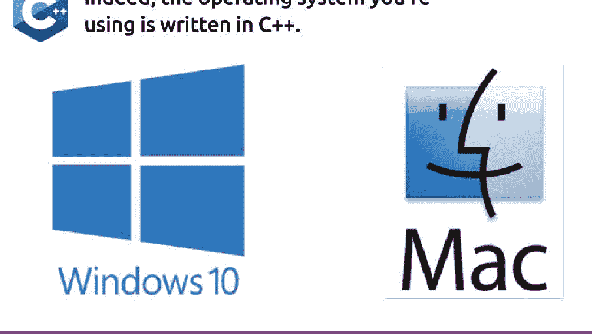

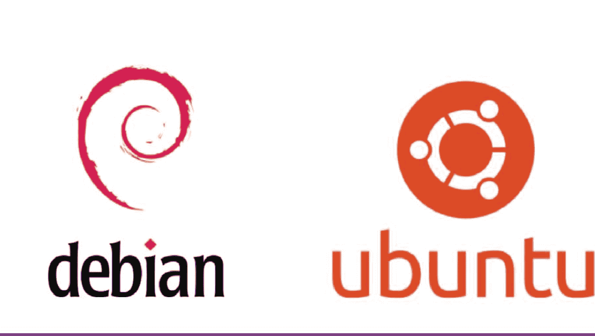

## 你的 C++ 程序

`Hello, World!`

第 1 步：如果你还没有这样做，建议创建一个空白文件来保存你的代码。你可以为 `Python` 和 `C++` 分别准备一个文件，或者简单地创建一个名为 `Code` 的文件夹，随你的喜好。这不是必须的，只是一个良好的习惯。

第 2 步：注意 `Geany` 自动创建了微小的缩进。这是由于 `C++` 的结构导致的，这也是输入代码主体的地方。

第 3 步：注意颜色变化。在上一步的行尾按回车键，然后输入：

第 4 步：注意 `Geany` 自动创建了微小的缩进。这是由于 `C++` 的结构导致的，这也是输入代码主体的地方。

第 5 步：在 `int()` 下的下一行创建一个大括号：

第 6 步：注意 `Geany` 自动创建了微小的缩进。这是由于 `C++` 的结构导致的，这也是输入代码主体的地方。

第 7 步：再次注意颜色变化。在上一步的行尾按回车键，然后输入：

第 8 步：现在你需要关闭代码，插入相反的大括号。

第 9 步：本质上，这些是你进入 `C++` 世界的第一步。我们将在接下来的几页中详细查看代码结构：但现在请点击由带有绿色箭头的文件柜表示的保存按钮。

第 10 步：如果你还没有这样做，建议创建一个空白文件来保存你的代码。

### C++ 程序的结构

`C++` 有着非常明确的结构和处理方式。漏掉任何部分，即使是一个微小的分号，你的整个程序将无法编译和执行。许多程序员都曾毁在粗糙的结构上。

### #include <iostream>

在学习编程基础知识时，你开始理解程序的结构。虽然命令在不同语言之间可能不同，但你可以开始看到代码是如何运作的。

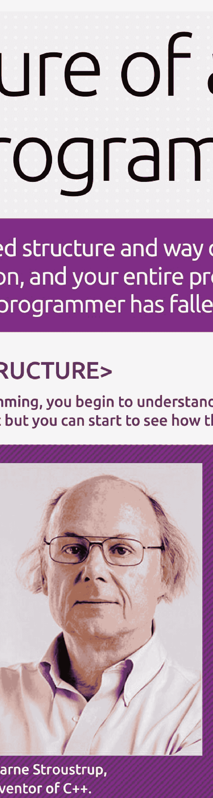

`C++` 是丹麦学生 `Bjarne Stroustrup` 于 1979 年发明的，最初作为他博士论文的一部分，命名为“带有类的 C++”（`C++ with Classes`），它在已经流行的 `C` 编程语言的基础上增加了新功能，同时通过新的结构使其成为一个更友好的环境。

`C++` 的发明者 `Bjarne Stroustrup`。

`int main()` 初始化一个函数的声明，该函数是名为 '`main'` 的一组代码语句。所有的 `C++` 代码都从 `main` 函数开始，无论它位于代码的哪个位置。

```cpp
helloworld.cpp
#include <iostream>
int main()
```

`C++` 程序的结构是精确的。每个 `C++` 代码都以指令开头：`#include <`。该指令指示预处理器包含一段标准的 `C++` 代码。例如：`#include <iostream>` 包含了 `iostream` 头文件用于处理输入/输出操作。

大括号（花括号）是你之前可能遇到过的东西，特别是如果你习惯了 `Python` 的话。大括号表示 `main` 函数的开始，并包含该函数的所有代码。

```cpp
helloworld.cpp
#include <iostream>
int main()
{
}
```

### C++ 程序的结构

`COMMENTS` 以双斜杠开头的行是注释。这意味着它们不会被执行，并且会被编译器忽略。注释的设计是为了帮助你或查看你代码的另一个程序员，解释正在发生什么。注释有两种类型：`//` 多行注释和 `/*` 单行注释。

`<<` 在这里使用的两个尖括号是插入运算符。这意味着尖括号后面后的任何内容都将插入到 `std::cout` 语句中。在这种情况下，它们是 '`Hello, world!'`，当你执行代码时，它们将显示在屏幕上。

```cpp
helloworld.cpp
#include <iostream>
int main() {

    // 我的第一个 C++ 程序
}
```

```cpp
helloworld.cpp
#include <iostream>
using namespace std;
int main() {

    // 我的第一个 C++ 程序
    cout <<;
}
```

`STD` 在 `C++` 中代表完全不同的含义，它的意思是标准（`Standard`）。它是 `C++` 标准命名空间（`Standard Namespace`）的一部分，包含许多不同的语句和命令。你可以在代码中省略 `std::` 部分，但必须在开头使用 `namespace std` 进行声明，不能两者都用。例如：

`OUTPUTS` 接下来，“`Hello, world!`” 是你希望在代码执行时出现在屏幕上的内容。你可以输入任何想要的内容，只要它在引号内。有时根据编译器的不同需要括号。`\n` 部分添加要插入的新行。

```cpp
#include <iostream>
using namespace std;
```

```cpp
helloworld.cpp
#include <iostream>
int main() {

    // 我的第一个 C++ 程序
    std::cout << "Hello, world!\n";
}
```

```cpp
// 我的第一个 C++ 程序
cout << "Hello, world!\n";
```

`COUT` 在这个例子中我们使用了 `cout`，它是标准命名空间的一部分，这就是为什么它在那里的，因为你请求使用它。使用 `std::cout` 可以显示或打印某些内容到屏幕上。如果你省略了它，必须在代码开头声明它。

`SEMICOLON AND BRACES` 最后，函数块内的（除了大括号本身）每一行都以分号结束；所有的 `C++` 语句末尾必须有一个分号。最后一行有一个右大括号表示函数的结束。


```cpp
helloworld.cpp
#include <iostream>
using namespace std;
int main() {

    // 我的第一个 C++ 程序
    cout << "Hello, world!\n";
}
```

### 编译与执行

你已经创建了第一个 C++ 程序，现在理解了它的结构基础。让我们开始操作，编译并执行，或者如果你愿意的话，看看它的样子。

### C++ 问候

在 `Geany` 中编译和执行代码非常简单，只需点击几个图标即可看到结果。这是如何操作：

- **步骤 1** 打开 `Geany`（如果你还没有打开的话），加载之前保存的 `Hello World` 代码。确保没有可见的错误，例如代码末尾缺少分号。

- **步骤 2** 如果你的代码准备好了，查看 `Geany` 窗口顶部的菜单栏。注意图标行中的红色图标。这是 `Build`（编译），它运行代码以检查是否有任何停止运行的错误。

- **步骤 3** 当你点击 `Build` 图标时，底部的面板会显示结果。如果一切顺利，你将看到编译成功；否则 `Geany` 会在该行抛出错误。

- **步骤 4** 代码编译成功后，是时候执行了。`Build` 图标旁边有一个纸飞机图标，这是 `Run`（运行）。你不能运行未编译或出错的代码。点击 `Run` 图标。

- **步骤 5** 当你点击 `Run` 时，会出现一个简单的 `Terminal` 窗口显示代码结果。在这种情况下，正如你所学的，你可以看到 `"Hello, world!"` 代码输出引号之间的内容。

- **步骤 6** 在命令行中按回车键关闭它，返回到 `Geany`。然后，删除代码中的 `std::` 部分。

- **步骤 7** 正如之前提到的，如果你已经在代码开头声明了命名空间，就不需要有 `std::`。现在，故意创建一个消息看看会发生什么。删除该行的分号，让它变为：

- **步骤 8** 现在再次尝试编译。这次，注意底部显示了错误。注意错误发生在第 8 行的第一个字符。这是因为在闭括号之前预期有一个分号。

- **步骤 9** 这次，注意底部显示了错误。

- **步骤 10** 替换行下的分号，为代码添加新行。编译并运行代码以显示结果。

```cpp
helloworld.cpp
#include <iostream>

int main() {

    // 我的第一个 C++ 程序
    std::cout << "Hello, world!\n";
}
```

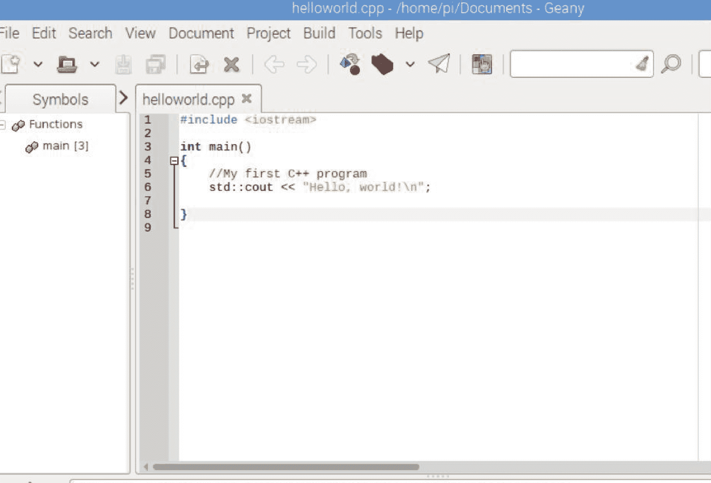

```cpp
int main() {
    // 我的第一个 C++ 程序
    std::cout << "Hello, world!\n";
}
```

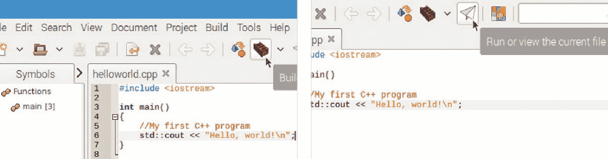

```cpp
cout << "Hello, world!";
```

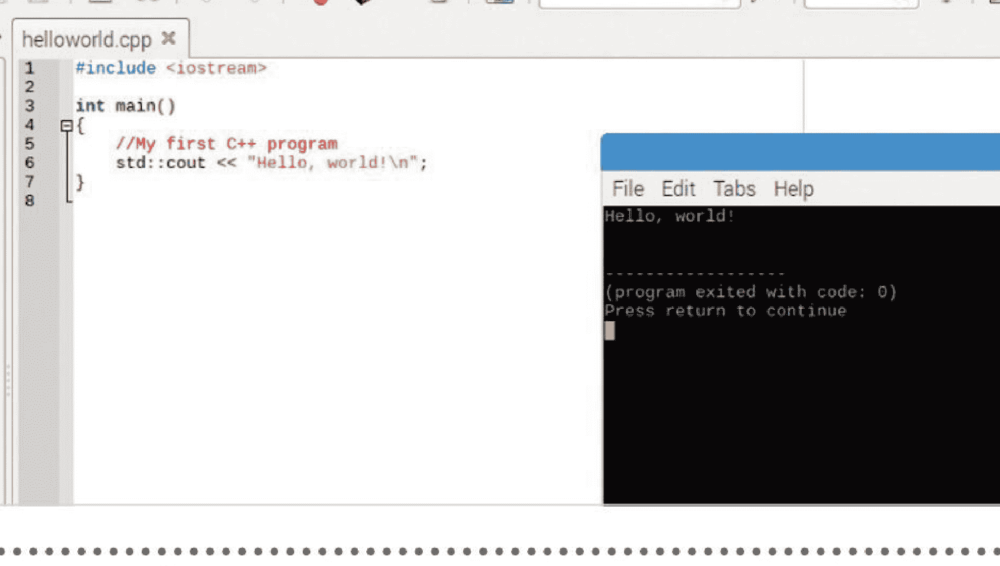

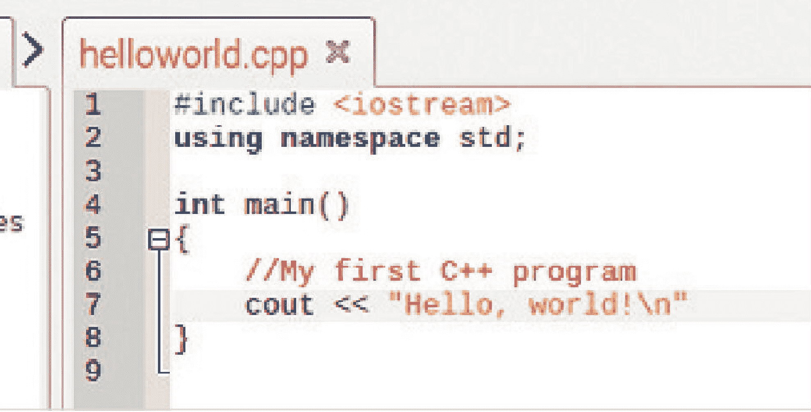

```cpp
cout << "Hello, world!";
```

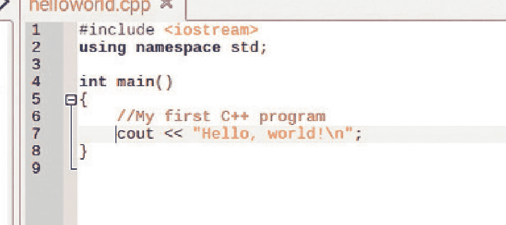

//c669af7066570063ff3a4577599ca4e_46_3.png)

### Linux 上的 C++

### 病毒！

你知道吗...

第一个从受控系统传播到野外的计算机病毒之一被称为 `Clone`，是 1982 年由 15 岁的 `Rich Ska` 编写的。`Clone` 被设计用于感染 `Apple DOS 3.3` 操作系统并附在一个游戏中。当游戏被玩五次时，病毒就会激活，它不是显示游戏而是破坏屏幕并显示：

`Clone: 一个具有个性的程序`

它将进入所有磁盘

它将渗透你的芯片

是的，它是 `Clone`！

它会像胶水一样粘着你

它还会修改 `RAM`

发送 `Clone` 进来！

```
010110000101
0100110011010101
00011001110101000000
11001001010101000000
0100000011010110001111
01111111111111111111
000000001110111011101110
000000001011101110101011
101010111010101010101000
010000001010101010101111
110110001100110011001001
101010101010101010101010
101110111011101110111010
100010001000100010000000
100010001000100010000000
011111111111111111111111
... (rest of binary data)
```

### 你知道吗..


### 使用注释

虽然对于编写游戏（甚至是一个操作系统）的数千行代码来说，注释似乎是一个微不足道的元素，但事实上，它们很可能是最重要的因素之一。

### 注释的重要性

代码内部的注释基本上是人类对代码在特定点所执行的描述。简而言之，所有代码都应该尽可能地注释，这样即使是一个完全不懂编程的人也能拿起你的代码，通过阅读来理解它的功能。

在专业环境中，注释对于代码的成功以及最终项目的成功至关重要。设想你处于某人的立场，他的工作是找出程序中的错误。该程序有数百行代码，分布在不同的模块中。你可能还需要原始程序员提供的良好帮助，其形式就是良好的注释。最好的注释总是简洁的，并在逻辑上连接代码，详细说明程序在某行或某部分触发了什么。你不需要注释每一行。诸如 `if x==0` 这样的内容就不需要注释，因为这对读者来说是显而易见的。如果 `x` 是对对用户产生剧烈变化的东西（例如当行数用尽时），它确实需要注释。如果代码是你的，当你与他人分享时，应该编写注释。这可以让你在之后回到代码时，理解它是做什么的或者哪些部分运行得非常出色。

注释是一种良好的习惯，一旦你学会了何时需要添加注释，它将变成你的本能。


### TSS:

| 命令 | 参数 |
| :--- | :--- |
| `DEF` | `80h` |
| `HERD` | `A, B` |
| `8S3A` | `A, B` |
| `HOMER` | `A, B` |
| `SET` | `save register` |
| `STAT` | `DEF 0,U1` |
| `CLR` | `CREEN BC17FF` |

> : 初始化代码

> : 清除屏幕位图

> : 标题界面位图

```
LOAD GA000 BC4000 BC4096
```

> : 上一个房间的属性（上三分之一）

```
DEF DA700 LC,ATSR BC512
```

> : 标题界面的属性（下三分之二）

```
LOAD ML080D LOAD U1 BC31
```

```
R HOR, (C)
R BA1, -03
SOB AND DISRF, -07 A
```

### C++ 注释

在 `C++` 中注释涉及使用双斜杠 `//` 或斜杠加星号 `/*`。你已经见过一些简短的示例，但这是它的工作原理：

以 `Hello World` 为例，你可以轻松使用双斜杠对代码的不同部分进行注释：

编写注释时要小心，特别是使用块注释时。很容易忘记添加结束的星号和斜杠，导致注释块内的任何代码被意外注释掉（失效）。

```cpp
helloworld.cpp
#include <iostream>
using namespace std;

int main() {
    // 我的第一个 C++ 程序
    cout << "Hello, world!"\n;
    cout << "Greetings from C++"\n;
}
```

然而，你也可以在代码行的末尾进行注释，以更好地描述其执行的内容：

`cout << "Hello, world!"\n // 这输了 'Hello, world.' 单词。\n 表示换行。`

显然，如果你构建并执行被块注释的代码，它会报错，因为缺少一个结束代码块的右括号 `}`。如果你移动了它，那么是时候回过头来纠正了。`Geanty` 使用的颜色可以区分注释和代码。

注意，不要在注释末尾加分号 `;`。这是因为该行会被编译器忽略。


```cpp
helloworld.cpp
#include <iostream>
using namespace std;

int main() {
    // 我的第一个 C++ 程序
    cout << "Hello, world!"\n // 这输出了 'Hello, world.' 单词。\n 表示换行。
}
```

你可以使用斜杠和星号 `/* ... */` 来注释多行：

对于块注释，在 C++ 中一种良好的做法是在注释块的每一行都添加一个星号。只要你记得在继续编写代码之前关闭注释块：

```cpp
helloworld.cpp
#include <iostream>
using namespace std;

int main() {
    // 我的第一个 C++ 程序
    cout << "Hello, world!"\n // 这输出了 'Hello, world.' 单词。\n 表示换行。
    /* 这条注释可以 * 覆盖单独的行 * 而无需添加更多斜杠 */
}
```

## 变量

使用 C++ 与 Python 相比变量略有不同，你可以简单地声明 `'a'` 等于 `10` 并给变量赋值。然而，在 C++ 中，变量在使用之前必须先声明其类型。

### 变量的声明

你可以通过代码中的语句来声明 C++ 变量。你可以声明几种不同类型的变量。以下是其工作原理。

- 步骤 1：打开一个新的空白的 C++ 文件并输入常用的代码头文件：

- 步骤 2：从创建两个变量 `a` 和 `b` 开始，值分别为 `10` 和 `5`。你可以使用数据类型 `int` 来声明这些变量。在花括号内：

```cpp
int a;
int b;
a = 10;
b = 5;
```

- 步骤 3：你可以构建并运行代码，但它对 `a` 和 `b` 没产生什么实际作用。忽略掉给整数 `a` 赋值除 `10` 和 `5` 以外的数值，赋值仍然有效。为了输出未使用的设置内容（输出变量的内容），添加：

```cpp
#include <iostream>
using namespace std;
int main() {
}
```

```cpp
cout << a;
cout << "\n";
cout << b;
```

| Variables.cpp |
| :--- |
| `#include <iostream>` |
| `using namespace std;` |
| `int main() {` |
| `int a;` |
| `int b;` |

| Variables.cpp |
| :--- |
| `#include <iostream>` |
| `using namespace std;` |
| `int main() {` |
| `int a;` |
| `int b;` |
| `cout << a;` |
| `cout << "\n";` |
| `cout << b;` |

- 步骤 4：自然你可以声明一个新变量，调用它并输出一些简单的算术结果：

```cpp
int result;
result = a + b;
cout << result;
```

按照截图将上述内容插入代码中。

```cpp
#include <iostream>
using namespace std;
int main() {
int a;
int b;
a = 10;
b = 5;
int result;
result = a + b;
cout << result;
}
```

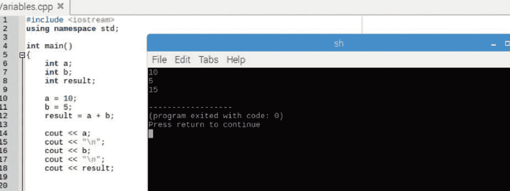

### 步骤 5

一旦声明了变量，你就可以给它赋值。你输入的代码可能像这样：

```cpp
int a = 10;
int b = 5;
int result = a + b;

cout << result;
```

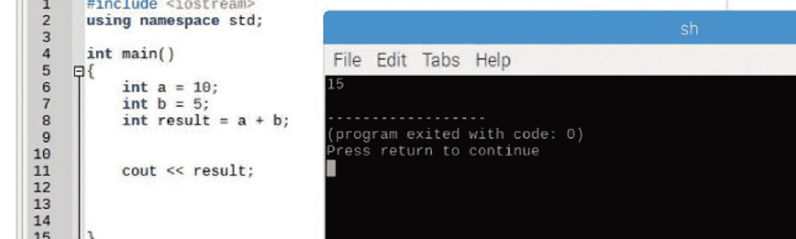

### 步骤 6

对于 C++ 特有的，你也可以根据需要使用以下方法为变量赋值：

```cpp
int a (100);
int b (5);
```

然后，从 C++ 2011 标准开始，使用花括号：

```cpp
int result = {a+b};
```

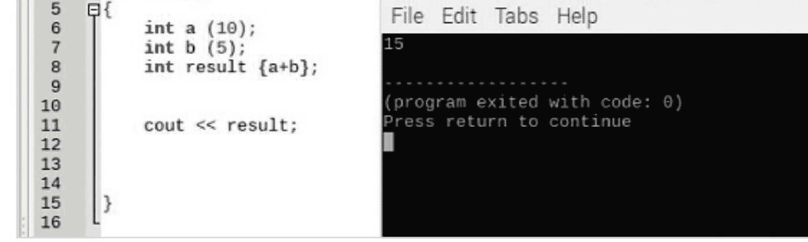

### 步骤 7

你可以声明全局变量，它们声明在任何函数之外，并可以在整个代码的任何函数中使用。你目前为止的是函数内部使用的变量：

```cpp
#include <iostream>
using namespace std;
int StartLives = 3;
```

```cpp
int main() {
```

```cpp
StartLives = StartLives - 1;
cout << StartLives;
```

```cpp
#include <iostream>
using namespace std;
int StartLives = 3;
```

### 步骤 8

之前的步骤创建了变量 `StartLives`，这是一个全局变量。在游戏中，例如玩家的生命取决于他们的表现好坏。当玩家重启游戏时，`StartLives` 回到默认状态：`3`。在这里我们减了 `1`。

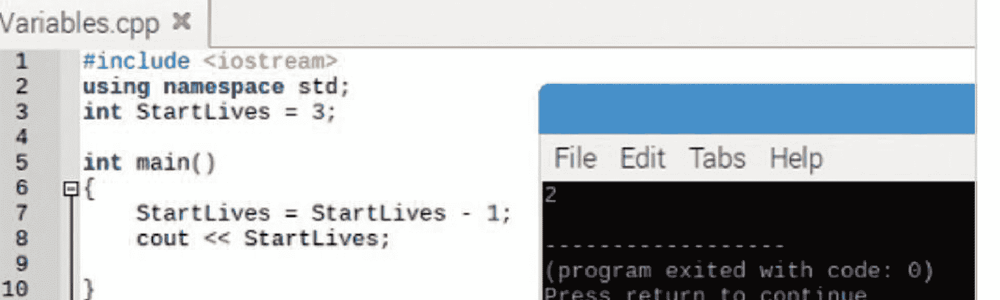

```cpp
#include <iostream>
using namespace std;
int StartLives = 3;
int main() {
```

```cpp
StartLives = 1;
程序退出，代码为 0
```

### 步骤 9

现代 C++ 编译器比大多数程序员提供的智能得多。尽管你可以声明许多数据类型，但事实上你可以使用它的功能：

```cpp
#include <iostream>
using namespace std;
auto pi = 3.141593;
```

```cpp
int main() {
double area, radius = 1.5;
area = pi * radius;
cout << area;
```

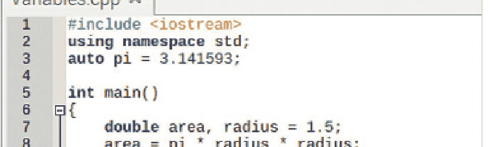

```cpp
#include <iostream>
using namespace std;
auto pi = 3.141593;
int main() {
```

```cpp
double area, radius = 1.5;
area = pi * radius;
cout << area;
```

尽管忽略步骤 10 中的警告，它们之间存在一个简单的差异。新的数据类型 `double` 双精度浮点值使得代码更准确。结果应该是 `7.0658`。本质上，你可以不处理错误。

### 步骤 10

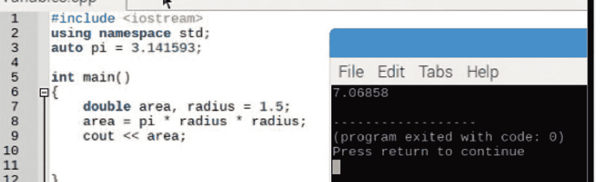

```cpp
#include <iostream>
using namespace std;
auto pi = 3.141593;
int main() {
double area, radius = 1.5;
area = pi * radius;
cout << area;
}
```

程序退出，代码为 `0`

# Linux C++ 数据类型

正如你所见，变量存储了程序员以后可以调用和操作的信息。变量仅仅是根据数据类型存储值的内存位置。

### 数据的值

C++ 中为程序员提供了许多不同类型，例如整数、浮点、布尔等。人们广泛接受有七种基本数据类型；但你可以通过添加 `cout.precision()` 函数在代码中创建自己的数据类型，并且仍然受限于 `double` 类型的精度。例如，这段代码：

```cpp
#include <iostream>
using namespace std;
double PI = 3.1415926535897238463;
```

| 类型 | 命令 |
| :--- | :--- |
| 整数 | `int` |
| 浮点 | `float` |
| 字符 | `char` |
| 布尔 | `bool` |
| 双精度 | `double` |
| 宽字符 | `wchar_t` |
| 无值 | `void` |

这些基础还可以使用修饰符扩展：`Long`、`Short` 和 `Unsigned`。基本上修饰符可以扩展每个数据类型的最小值和最大范围。例如，`int` 数据类型的默认值为 `-2147483648` 到 `2147483647`，你会同意这是一个合理的值。现在，如果你使用其中一个修饰符，结果如下：

- `Unsigned int` = `0` 到 `4294967295`
- `Signed int` = `-2147483648` 到 `2147483647`
- `Short int` = `-32768` 到 `32767`
- `Unsigned short` = `0` 到 `65535`
- `Signed short` = `-32768` 到 `32767`


### 数据类型范围

`Long int = -2147483648` 到 `2147483647`

`Unsigned long = 0` 到 `4294967295`

### 使用修饰符

自然你可以在配合修饰符使用基础类型，因为每个数据类型都提供了足够的范围。然而，在 C++ 编程实践中，被认为尽可能使用修饰符。

但是使用修饰符也存在问题。`Double` 代表双精度浮点值，你可以用它处理极其精确的数字，但这些数字只精确到小数点后 15 位。这也是 C++ 中显示数字的问题，你可以通过只输出前几位小数来解决。

```cpp
// DataTypes.cpp
#include <iostream>
using namespace std;
double PI = 3.1415926535897238463;

int main() {
  cout << PI;
}
```

构建并运行代码，你可以看到输出是 `3.14159`，这代表了示例中 `cout` 的限制。

### 提高精度

你也可以考虑上述函数以获得更高的精度。将精度一直提高到 22 位小数，使用以下代码：

```cpp
#include <iostream>
using namespace std;
double PI = 3.1415926535897238463;

int main() {
  cout.precision(22);
  cout << PI;
}
```

54 www.bdpublications.com


### 字符串

字符串是表示和持有字符序列的实例。例如，你可以在代码中有一个通用的欢迎语 `'Welcome'` 并将其赋值为字符串，以便在程序的任何地方调用。

### 字符串理论

有多种方法可以创建字符字符串，从历史上来看这些都继承自原始的 C 语言并由 C++ 支持。

#### 步骤 1

要创建一个字符串，使用 `char` 函数。打开一个新的 C++ 文件并以标准的头文件开始：

#### 步骤 2

编译并运行代码，“Welcome” 会出现在屏幕上。虽然这样做完全可行，但它并不是字符串。`String` 是一个类，定义了可以表示为字符流的对象，并且不需要像数组那样终止。因此，代码可以表示为：

```cpp
#include <iostream>
using namespace std;
int main() {
}
```

`strings.cpp`

```cpp
#include <iostream>
using namespace std;
int main() {
    char greet[] = "Welcome";
    cout << greet << "\n";
}
```

#### 步骤 3

很容易将字符串与数组混淆。这是一个数组，空字符终止：

```cpp
#include <iostream>
using namespace std;
int main() {
    char greet[8] = {'W', 'e', 'l', 'l', 'o', 'm', 'e', '\0'};
    cout << greet << "\n";
}
```

#### 步骤 4

在 C++ 中也有一种字符串，其工作方式相同。使用欢迎语代码：

```cpp
#include <iostream>
using namespace std;
int main() {
    string greet = "Welcome";
    cout << greet << "\n";
}
```

`strings.cpp`

```cpp
#include <iostream>
using namespace std;
int main() {
    char greet[] = "Welcome";
    cout << greet << "\n";
}
```

```cpp
#include <iostream>
using namespace std;
int main() {
    string greet = "Welcome";
    cout << greet << "\n";
}
```

### 字符串操作

#### 步骤 5

还有许多可以使用字符串函数执行的不同操作。例如，要获取字符串的长度，可以使用：

```cpp
#include <iostream>
using namespace std;
int main() {
    string greet = "Welcome";
    cout << "The length of the string is: ";
    cout << greet.size() << "\n";
}
```

#### 步骤 6

正如你预期的那样，你可以将整数和某些要存储的内容与字符串混合。如果你创建了一个 `int length`，它存储 `string size()` 的结果并输出到屏幕上：

```cpp
#include <iostream>
using namespace std;
int main() {
    int length;
    string greet1 = "Hello";
    string greet2 = "world!";
    string greet3 = greet1 + greet2;

    length = greet3.size();
    cout << "The length of the combined strings is: ";
    cout << length << "\n";
}
```

`strings.cpp`

```cpp
#include <iostream>
using namespace std;
int main() {
    string greet = "Welcome";
    cout << "The length of the string is: ";
    cout << greet.size() << "\n";
}
```

#### 步骤 7

你可以看到我们使用 `size()` 输出长度，即字符串内容的字符数量。当然，如果你调用的字符串不是 `greet`，那么你就需要更改命令以反映它的字符串名。运行并编译代码查看结果。

#### 步骤 8

使用可以使用字符串的可用操作，你可以操作并删除字符串中的字符，可以使用：

```cpp
#include <iostream>
using namespace std;
int main() {
    string str = "Hello is a long sentence in a string";
    cout << str << "\n";
    str.erase(10,5);
    cout << str << "\n";
    str.erase(str.begin() + 8);
    cout << str << "\n";
    str.erase(str.begin() + 9, str.end());
    cout << str << "\n";
}
```

#### 输出示例

字符串的长度为：

```
(程序以代码 0 退出)
按回车继续
```

#### 步骤 9

你可以将字符串相加，或者组合它们形成更长的字符串：

```cpp
#include <iostream>
using namespace std;
int main() {
    string greet1 = "Hello";
    string greet2 = "world!";
    string greet3 = greet1 + greet2;

    cout << greet3 << "\n";
}
```

#### 步骤 10

值得花时间玩玩这些数字，它们是字符串中的字符位置。你是否写对可能碰运气，所以练习会使其完美。看一眼屏幕查看代码的结果：

`strings.cpp`

```cpp
#include <iostream>
using namespace std;
int main() {
    string greet1 = "Hello";
    string greet2 = "world!";
    string greet3 = greet1 + greet2;

    cout << greet3 << "\n";
}
```

#### 文件编辑标签帮助

这是一个字符串中的长句子。

这是一个字符串中的句子。

这是一个字符串。

```
(程序以代码 0 退出)
按回车继续
```

### C++ 数学

编程在本质上是数学性的，正如你预期的那样，有许多内置范围可以处理深层数学计算。C++ 为将数学模型实现到代码中的人提供了很多可能。它可以非常复杂，也可以很简单。

### C++ 中的基本数学符号

C++ 中的基本数学符号与其他大多数编程语言相同。但是，通过使用 C++ 数学库，你还可以计算平方根、幂、三角函数等。

#### 步骤 1

C++ 的数学操作遵循学校里教的模式，乘法和除法的优先级高于加法和减法。你可以创建一个新文件并输入：


# 步骤 3

乘法和除法可以这样应用：

```cpp
#include <iostream>
using namespace std;
int main() {
    float numbers = 100;
    numbers = numbers * 10; // 这将 100 乘以 10
    cout << numbers << "\n";
    numbers = numbers / 10; // 这将 100 除以 10
    cout << numbers << "\n";
}
```

```cpp
#include <iostream>
using namespace std;
int main() {
    float numbers = 100;
    numbers = numbers + 10; // 在初始 100 上加上 10
    cout << numbers << "\n";
    numbers = numbers - 10; // 从新的 110 上减去 10
    cout << numbers << "\n";
}
```

## 用户交互

没有什么比创建一个能对你的输入做出响应的程序更有成就感了。这种基础的用户交互是任何语言中最常教授的方面之一，通过它，你可以做的比仅用名字问候用户多得多。

### 你好，戴夫

在我们的整个代码中，你已经使用了 `cout`（标准输出流）。现在，你将使用 `cin`（标准输入流）来编写一个响应。

- 第 1 步：任何你想让用户输入到系统内存中的内容都必须存储在某个地方，以便检索和使用。因此，输入必须首先声明为一个变量，以便用户准备好使用。从创建一个带有头文件的空白 C++ 文件开始。

- 第 2 步：输入的数据类型必须与你想要从用户获取的输入类型匹配。例如，为了询问你的用户，你会使用如下输入：

```cpp
#include <iostream>
using namespace std;

int main() {
int age;
cout << "What is your age: ";
cin >> age;
cout << "You are " << age << " years old.\n";
}
```

- 第 3 步：`cin` 命令的工作方式与 `cout` 命令相反。在第一个 `cout` 中，你通过尖括号符号 `<<` 向屏幕输出“What is your age?”（你几大了？）。`cin` 使用面向相反的尖括号 `>>`，表示输入。输入被放入整数 `age` 中，并在第二个 `cout` 计数中被调用。然后运行代码。

```cpp
#include <iostream>
using namespace std;

int main() {
int age;
cout << "What is your age: ";
cin >> age;
cout << "You are " << age << " years old.\n";
}
```

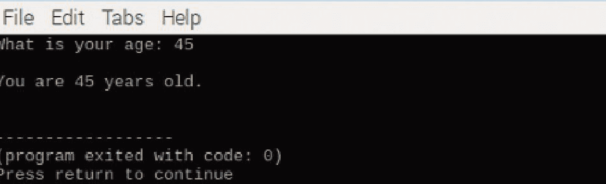

- 第 4 步：如果你在询问用户，你需要将输入存储为字符串；要询问用户姓名，你会使用：

```cpp
#include <iostream>
using namespace std;

int main() {
string name;
cout << "What is your name: ";
cin >> name;
cout << "\nHello, " << name << "! I hope you're well today\n";
}
```

## 用户交互

该原理与之前的代码相同。用户的输入存储在字符串中；它包含多个字符，并在第二行 `cout` 中被检索。只要变量 `name` 不改变，你可以在代码的任何地方调用它。

```
what is your name: David
Hello, David. I hope you're well today-

 executed with code: 0 {
 return to continue
}
```

你可以向用户输入请求，但请确保你开始时有一个有效的变量来存储输入。假设你想让用户输入两个数字：

```cpp
#include <iostream>
using namespace std;
int main() {
 int num1, num2;
cout << "Enter two numbers: ";
cin >> num1 >> num2;
cout << "You entered " << num1 << " and " << num2 << "\n";
}
```

```cpp
#include <iostream>
using namespace std;
int main() {
 string mystr;
cout << "Enter a sentence: \n";
getline(cin, mystr);
cout << "Your sentence is: " << mystr.size() << " characters long.\n";
}
```

```cpp
#include <iostream>
using namespace std;
int main() {
 int num1, num2;
cout << "Enter two numbers: ";
cin >> num1 >> num2;
cout << "You entered " << num1 << " and " << num2 << "\n";
}
```

```cpp
#include <iostream>
using namespace std;
int main() {
 int num1, num2;
cout << "Enter two numbers: \n";
cin >> num1 >> num2;
cout << "You entered " << num1 << " and " << num2 << "\n";
}
```

构建并执行，然后输入一个带空格的句子。当你删除该行并将其替换为 `cin >>` 并再次尝试时，结果将显示第一个句子的字符数。

同样，一旦将数据存储在变量中，就可以对其进行处理。例如，询问用户两个数字并对它们进行数学运算：

```cpp
#include <iostream>
using namespace std;
int main() { float num1, num2;
cout << "Enter two numbers: \n";
cin >> num1 >> num2;
cout << num1 << " + " << num2 << " is: " << num1 + num2 << "\n";
}
```

`getline` 是一个新的 C++ 程序员经常忘记使用的命令。当你试图弄清楚为什么代码不起工作时，末尾的空白字符非常烦人。未来最好使用 `getline(cin, variable)`：

```cpp
#include <iostream>
using namespace std;
int main() { string name;
cout << "Enter your full name: \n";
getline(cin, name);
cout << "Hello, " << name << "\n";
}
```

```cpp
#include <iostream>
using namespace std;
int main() { float num1, num2;
cout << "Enter two numbers: \n";
cin >> num1 >> num2;
cout << num1 << " + " << num2 << " is: " << num1 + num2 << "\n";
}
```

```cpp
#include <iostream>
using namespace std;
int main() { string name;
cout << "Enter your full name: \n";
getline(cin, name);
cout << "Hello, " << name << "\n";
}
```


```cpp
#include <iostream>
using namespace std;
int main() { float num1, num2;
cout << "Enter two numbers: \n";
cin >> num1 >> num2;
cout << num1 << " + " << num2 << " is: " << num1 + num2 << "\n";
}
```

```cpp
#include <iostream>
using namespace std;
int main() { string name;
cout << "Enter your full name: \n";
getline(cin, name);
cout << "Hello, " << name << "\n";
}
```

### 用户错误

用户输入往往是代码中一个致命的错误。例如，当用户本应该输入年龄数字时却输入了字母。用户的输入可能会导致内部缓冲区溢出，从而引发代码崩溃。请留意这些用户输入，并清晰地说明需要他们提供的内容。

```
输入一个整数
输入错误
输入错误
输入错误
sdfad212313123
输入错误
1232429323292329
数字是: 12
进程返回 (状态: 0x0) 执行时间: 21.49 s
按任意键继续。
```

### 备份

始终对你的工作进行备份，并对你所做的任何更改进行二次备份。如果发生故障，如果有良好的备份可以回溯，错误就可以被纠正。从你离开的地方重新开始，比从头开始要容易得多。


### 重造轮子

你可以花费几天时间尝试通过编写代码来来实现某个结果，这既令人沮丧又耗时。虽然自己解决问题同样很有成就感，但同样的代码已经在互联网上了。不要重造轮子，看看是否已经有人做过它。

### 数据安全

如果你正在编写处理用户名、密码或其他敏感数据的代码，请确保数据不是以明文形式存储的。学会创建一个函数，在数据输入到可能会传输或存储并被访问的数据库之前对其进行加密。


### 求助！

寻求帮助是我们大多数人过去都挣扎过的事情。人们会嘲笑我们吗？这会浪费大家的时间吗？默默忍受是一个人的常见错误。只要你的方法正确，任何论坛或规则都会很有礼貌，那么你的问题并不愚蠢。

### 数学

如果你的代码进行了多次计算，你需要确保背后的数学逻辑是严密的。有数千实例表明，糟糕的数学编码会对代码的预期功能产生灾难性的影响。简而言之，请反复检查你的代码公式。

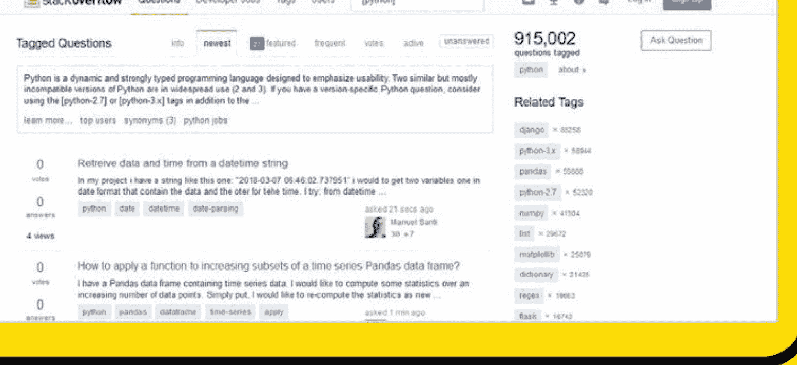

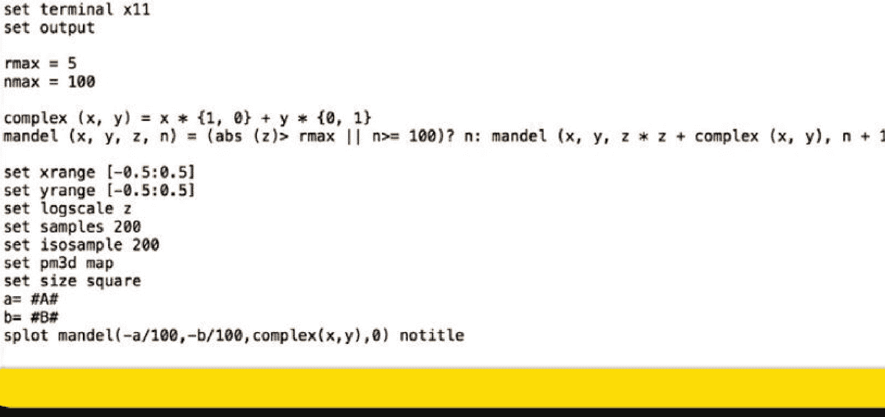

恭喜你，我们到达了你最新技术冒险的终点。在我们技术专家团队的帮助下，你已经回答了所有问题，建立了信心，并最终掌握了你遇到的任何问题。你现在可以自豪地宣布，在不断变化的消费技术和软件世界中，你通过最新的选择获得了最优质的体验。


无论我们的计划如何，我们在这里为你提供帮助。只需查看我们丰富的`技巧与贴士`以及`初学者`指南，我们相信你一定会找到正在寻找的内容。与我们的冒险可能结束了，但这并不意味着你的旅程已经结束。每一次新的硬件或软件更新都会带来新的功能和挑战，当然你已经知道我们在这里为你提供帮助。因此，我们期待很快再次见到你。

`Papercut`

`www.pclpublications.com`

# 想掌握你的 PC 吗？

那么不要错过现在就在 `Readly` 上我们全新的 `Windows` PC & 笔记本电脑杂志！


点击我们的便捷链接立即阅读：`https://bit.ly/3y7gwFG`

## 阅读更多

## 技巧与贴士

`Readly` 上提供的技术指南

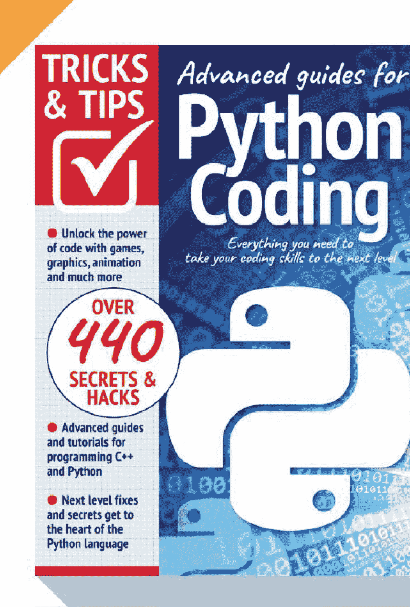

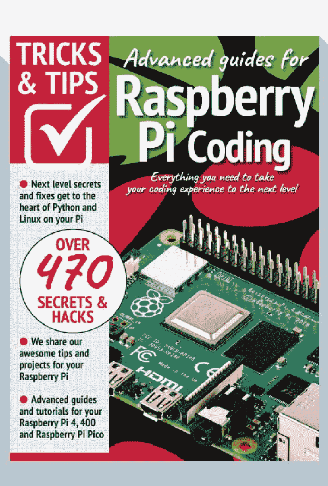


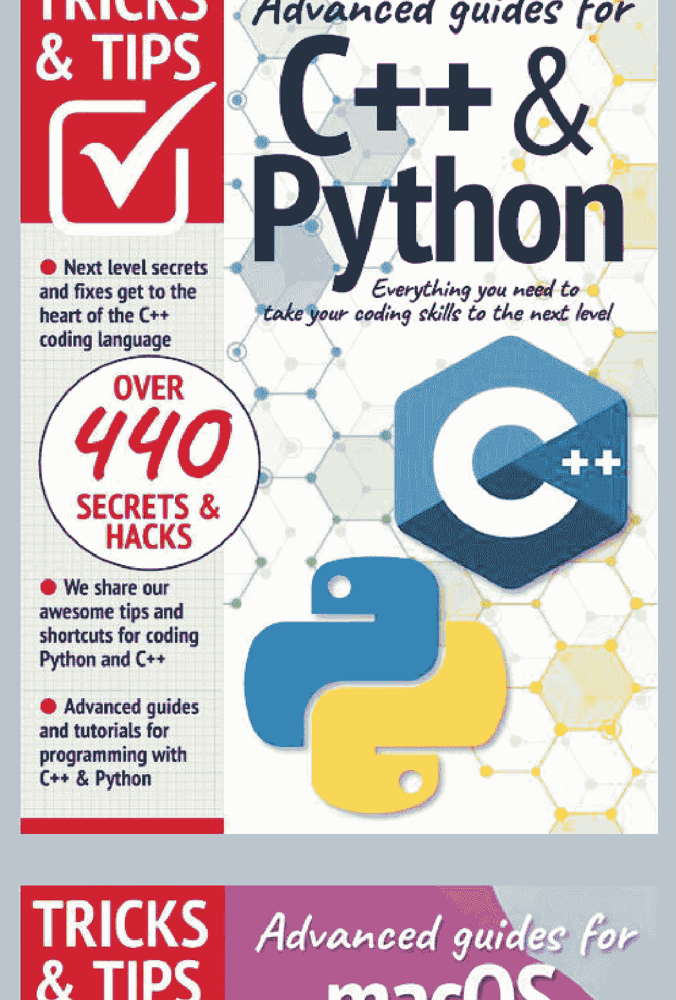


## Linux 技巧与贴士

第11版 | ISBN: `978-1-93186-76-1`

应用程序和软件将在任何设备上运行。出版者负责决定本书的质量。封面上的复制图像仅用于设计目的，并不代表出版者或商标所有者的认可。内容可能会更改。部分内容可能已以其他形式出版。

`Publisher Limited` 出版

©2022 `Paperback Limited` 版留。未经出版者书面许可，本书的任何部分不得以任何形式或方式（包括计算机程序）复制、存储或传输。除简短书评和学术文章外，此内容保留供任何形式的排版或使用。尽管我们力求提供高质量信息，但出版者对书中信息的准确性或完整性不作任何陈述或保证。

这是一本独立出版物，不反映书中包含的任何实体、组织或商标的观点或意见。所有商标和注册商标均为其所有者的财产。

在英格兰和威尔士注册，编号为 `09300133`

广告：广告咨询请联系：`rich-richard@paperlimited.com`

国际许可：`Paperback Limited` 拥有许多书目，所有出版物均在全球范围内许可。

# 想掌握苹果科技吗？

那么不要错过现在就在 `Readly` 上我们全新的 `iPhone`、`iPad` & `Mac` 杂志！


点击我们的便捷链接立即阅读：`https://bit.ly/3HDL9pw`
