# Linux 技巧与窍门 - 第 5 版 2021

欢迎回来……在完成我们独家的“初学者”数字指南后，我们已经教了你掌握新设备、软件或爱好所需的所有知识。

然而，这仅仅是个开始！

提升技能集是所有消费技术用户的目标，而我们的长期行业专家团队将帮助你准确实现这一目标。在这一系列丰富的书中，我们将更深入地探讨如何从最新的消费电子产品、软件、爱好和趋势中获得最大收益！我们将一步步引导你使用所有你之前可能一直畏于尝试的高级技术。让我们的专家指南帮助你建立对技术的理解，并获得让你从一个自信的用户变为资深专家的技能。

在接下来的页面中，我们的旅程将继续，我们会在每个阶段陪伴你，提供建议、信息，并最终激励你更远的发展。

> Linux 不仅仅是一个免费使用的操作系统。它独特的配置允许用户将操作系统自定义并个性化为他们希望的任何形式。Linux 用户可以在一天之内改变操作系统的外观和感受，安装数千个免费提供的应用程序和程序，并夺回对它们的控制权。

# 为什么选择 Python？

操作系统（如 Windows、macOS 和 Linux）通常是 C++、C 汇编和某些形式的视觉化程序的组合。通常情况下使用 C++，而网页则使用大量的可用语言，如 HTML、Java、Python 等。

Python 创建于三十年前，现已成为学习计算机编程的理想初学者语言。对于爱好者、狂热者、学生和老师来说，如果只需要在自己与外部硬件或计算机本身之间创建独特的交互，Python 是完美的选择。

通用编程用于创建程序、应用程序、软件或任何你想要创建的东西。它们被广泛应用于所有平台，并支持几乎可以想象的所有应用程序。某些的运行速度比其他的快，某些比其他的更容易学习。Python 就是其中一种通用语言。

Python 免费下载和安装，并适用于 Linux、Windows、macOS、MDA、OS2、IBM 系列机器。它被选为世界五大编程语言之一，并不断领先于硬件和互联网的发展演进。

Python 是所谓的“高级语言”，因为它相对于硬件和操作系统而言，使用了各种数组、变量、对象、子程序、循环和无数的交互。它不像低级语言那样可以直接处理内存地址、调用和寄存器，它是通用访问且易于学习的。

所以回答这个问题：为什么选择 Python？简单是因为它是免费的、易学的、极其强大的、通用的、高效的，并且是一种精神和教育工具。

```java
// Import java.lang.reflect.*;
class Class {
    public static void main(String[] args) {
        try {
            Class c = Class.forName(args[0]);
            Method m = c.getMethod(args[1], new Class[]{});
            Object obj = m.invoke(null, null);
        } catch (NoSuchMethodException e) {
            // 没有参数
        } catch (ClassNotFoundException e) {
            // 找不到类
        } catch (IllegalAccessException e) {
            // 无权限调用方法
        } catch (InvocationTargetException e) {
            // 在调用方法时发生了异常
        }
        System.out.println("method error: " + e.getTargetException().getMessage());
    }
}
```

| 40 LET PY=15 |
| --- |
| 70 FOR W=1 TO |
| 75 GET BY=INT (RND(+28)) |
| 80 DO D=1 TO 20 |
| 90 PRINT AT PY,BY,"U" |
| 110 PRINT AT PY,BY+2,"X=Y" |
| 120 IF Y<30 THEN NEXT PY=3 |
| 130 FOR N=1 TO 100, NEXT N |
| 140 IF X<20 THEN NEXT PY=27 |
| 150 LET BX=BX+1 |
| 160 LET BY=BY-1 |
| 170 IF (N=PY) THEN S=S+1 |
| 210 PRINT AT 10,10,"score": NEXT V |
| 300 FOR T=1000: NEXT V |

Java 是一种强大的语言，用于网页、机顶盒、电视甚至汽车。

BASIC 是早期 8 位计算机用户学习的起始语言。

```python
def guess_letter(letter):
    while (attempt <= 6 and letter is not guessed):
        print(f"Attempt {attempt} remaining")
        guess = input("Enter a letter: ").lower()
        if not guess.isalpha():
            print("That is not a valid letter. Try again.")
            continue
        elif len(guess) != 1:
            print("Please enter only one letter. Try again.")
            continue
        elif guess in guessed_letters:
            print(f"You have already guessed that letter. Try again.")
            continue
        else:
            guessed_letters.append(guess)
            if guess == letter:
                print(f"Correct! The letter was {letter}.")
                break
            else:
                print(f"Wrong! Try again.")
                attempt += 1
```

Python 是一种易于学习的现代语言，是理想学者编程语言。

# 如何在 Linux 中设置 Python

虽然树莓派的操作系统包含了最新版本的 Python，但其他发行版并没有预装 Python 3。如果你不打算走树莓派路线，这里是在 Linux 上检查和安装 Python 的方法。

## Python 🐧

Linux 是一个如此多功能的操作系统，以至于很难确定某事的唯一方法。不同的发行版以不同的方式安装软件，因此我们在本特定的教程中使用 Linux Mint。

- 步骤 1：首先，你需要确定你的 Linux 系统当前安装了哪个版本的 Python。要开始，从桌面进入终端会话或按下 `Ctrl+Alt+T` 键。
- 步骤 2：接下来在终端中输入 `python --version`。你应该会看到指示 Python 版本 x.x 的输出。默认情况下，大多数 Linux 发行版都带有 Python 2 和 3，所以仍有许多 Python 2 副本可供检查。现在输入 `python3 --version`。
- 步骤 3：在我们案例中，我们同时安装了 Python 2 和 3；只要安装了 Python 3.x.x，我们教程中的代码就可以运行。检查发行版是否已更新到最新版本总是值得的，因此输入 `sudo apt-get update && sudo apt-get upgrade` 来更新系统。
- 步骤 4：一旦更新和升级完成，运行 `python3 --version` 查看是否安装（甚至更新）了 Python 3.x；只要你有 Python 3.x，你运行的就是最新版本。3 之后的数字包含了补丁和更新。如果它们不是必需的但可以提供一些新元素。

```bash
david@david-Mint ~ $ python --version
Python 2.7.15
david@david-Mint ~ $ python3 --version
Python 3.6.7
david@david-Mint ~ $
```

如果你正在使用新的树莓派及其最新版本的 Pi OS，你需要手动安装 Python IDLE。这是因为树莓派团队已经移除了核心的 Python IDLE，转而使用他们自己的代码编辑器。

## 开始使用 Python

对于使用 PI4 和新款树莓派的用户，请进入终端并输入：`sudo apt-get install idle3`。旧版本的树莓派已经预装了官方的 Python IDLE。

### 步骤 1

加载树莓派桌面后，点击菜单按钮中的“编程 > Python 3 (IDLE)”。这将打开 Python 3 Shell。Windows 和 Mac 用户可以在 Windows 开始菜单或访达（Finder）中找到 Python 3 IDLE Shell。

### 步骤 2

Shell 是你输入代码并查看为 Python 编写的代码响应和输出的地方。这类似于沙箱，你可以在其中尝试一些代码和程序。

### 步骤 3

例如，在 Shell 中输入：`2+2`。按下回车键后，下一行将显示答案：4。Python 接收了“代码”并产生了相应的输出。

### 步骤 4

Python Shell 的作用非常像计算器，因为代码本质上与系统的一系列数学交互。整数（无限数字序列）可以进行加、减、乘等运算。

```
Python 3.4.2 (default, Oct 19 2014, 13:31:11)
help('copyright', 'credits' or 'license') for more information.
(C) 4.9.1 on Linux
```

```
Python 3.4.2 (default, Oct 19 2014, 13:31:11)
help('copyright', 'credits' or 'license') for more information.
>>> 2+2
4
>>> 23453*645452
15133933256
>>> 650000/12345
52.65249088761243
>>> 987652999*43024
424907623576
```

# 开始编写 Python

**步骤 5** 虽然这很有趣，但并不特别令人兴奋。尝试一下这个：

```python
print("Hello everyone!")
```

像你在之前的步骤中那样，将其输入 IDE 即可。

**步骤 6** 这就更有意思了，因为你写出了自己的第一段代码。如果你认为是的话，`print` 命令是自言易懂的。Python 3 需要括号和引号才能将内容输出到屏幕，然后你就能看到 'hello world'。

**步骤 7** 你注意到了 Python IDE 内部的颜色编码。这些颜色代表代码的不同元素。它们是：

| 颜色 | 用途 | 示例 |
| --- | --- | --- |
| 黑色 | 数据与变量 | 23 a |
| 绿色 | 字符串 | " |
| 紫色 | 函数 | () |
| 橙色 | 命令 | get_area() |
| 红色 | 注释 | # Variables |
| 浅红色 | 错误 | SyntaxError: |

**步骤 8** Python IDE 是一个可配置的环境。如果你不喜欢颜色的表示方式，可以通过“选项 > 配置 IDE”并点击“高亮”选项卡来更改。我们不建议这样做，因为你看到的将与截图不符。

**步骤 9** 就像大多数其他程序一样，无论操作系统是什么，都有许多快捷键。除非你使用“选项 > 配置 IDE > 键”选项卡，否则你无法记住所有的，在那里你可以看到当前的绑定列表。

**步骤 10** Python IDE 是一个强大的界面，所有的 GUI 工具包实际上都是用 Python 编写的。如果你想了解 Shell 的细节，我们建议你花时间查看 www.python.org/library/idle.html，那里详细介绍了 IDE 的许多功能。

```python
>>> print("Hello everyone!")
Hello everyone!
```

基本上，你已经通过上一个教程中的 `print("Hello everyone!")` 函数编写了第一段代码。然而，让我们扩展一下，看看如何输入代码并尝试其他 Python 示例。

对于大多数语言（无论是计算机语言还是人类语言），核心在于记忆并在正确的情况下应用正确的词汇。你并不是天生就知道这些的，所以你需要学习它们。

- **步骤 1** 如果你选择了 Python 3，请在你喜欢的任何操作系统版本中重新打开它。在 Shell 中输入以下内容：

```python
print("Hello
```

- **步骤 2** 正如预料的那样，单词 Hello 以蓝色出现在 Shell 中，表示来自字符串的输出。这非常直接，不需要太多解释。现在尝试：

```python
print("2+2")
```

- **步骤 3** 你会发现屏幕输出不是数字 4，而是你要求打印到 IDLE Shell 的 2+2；引号定义了要输出的内容，而不是 2+2 的总和，你需要移除引号。

```python
print(2+2)
```

- **步骤 4** 你可以继续这样向 Shell 打印 2+2、464+234 等。更简单的方法是使用变量，我们稍后会详细介绍。现在输入：

```python
a=2
b=2
```

- **步骤 5** 你在这里的操作赋值了字母 a 和 b：值 2 和 2。这些现在是变量，可以被 Python 调用进行输出、减法等，它们的数值保持不变。尝试这个：

- **步骤 6** Shell 是你可以输入代码并查看为 Python 程序的代码响应和输出的地方。这是一个沙箱，你可以在其中尝试一些代码和程序。

- **步骤 8** 现在让我们添加姓氏：`surname="Howard"` `print(surname)`

你有两个包含姓氏的变量。

```python
surname="Howard"
print(surname)
```


# 步骤 4

Python Shell 的作用非常像计算器，因为代码本质上与系统的一系列数学交互。整数（无限数字序列）可以进行加、减、乘等运算。

# 步骤 5

为你的代码输入一个名称，例如 `print hello`，然后点击保存按钮。一旦 Python 代码被保存，它就会被执行，输出结果将在 IDLE Shell 中详细显示。在这种情况下，输出为 `Hello everyone!`。

# 步骤 8

让我们扩展代码，并输入上一个教程中的几个示例：

```python
a=2
b=2
name="David"
surname="Hayward"
print(name, surname)
print(a+b)
```

如果你按下 `F5`，你将能够保存文件，因为之前已经对其进行修改。

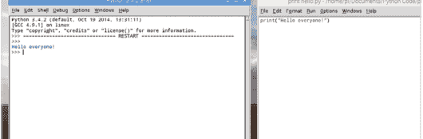
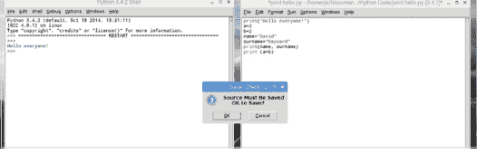

# 步骤 6

这是你编写大部分 Python 代码的地方。将其输入编辑器中，按下 `F5`，保存代码并查看 Shell 中的输出。根据你是否请求了变量，某些内容会有所不同，但本质上，这是我们在书中将一直使用的过程，除非另有说明。

# 步骤 9

如果你点击 `OK` 按钮，文件将被新的代码条目覆盖，并在 Shell 中执行输出。对于这几行代码来说不是问题，但如果你正在编辑文件，覆盖可能会变成问题。相反，使用编辑器内的 `File > Save As`（文件 > 另存为）来创建备份。

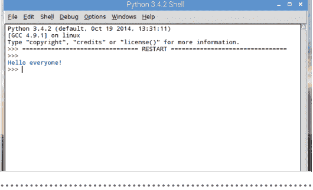
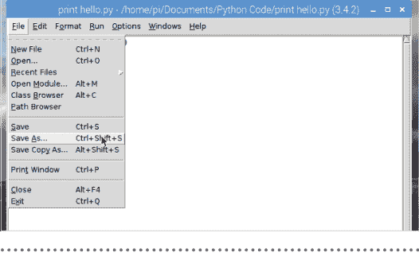

# 步骤 7

如果打开保存的 Python 代码文件，你会发现它以 `.py` 扩展结尾。这是 Python 的默认名称。你创建的任何代码可以是从网络资源下载的任何代码都属于你。只需确保代码是适用于 Python 3 的。

# 步骤 10

创建一个新文件。打开编辑器，创建一个新实例（`File > New File from the Shell`，文件 > 从 Shell 新建文件）。输入以下内容并保存为 `hello`：

```python
a="Python"
b="cool"
print(a, b, c)
```

你将在下一次教程中使用这段代码。

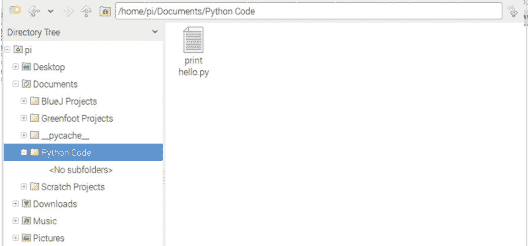
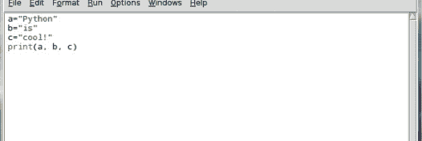

# 从终端执行代码

尽管我们在整本书中都在使用 GUI IDLE，但值得关注一下 Python 的命令行处理。我们已经知道有一个命令行版本的 Python，但它也被用于执行代码。

## 命令行执行代码

使用我们在上一个教程中创建的代码，让我们看看如何在命令行级别运行在 GUI 中创建的代码。

### 步骤 1

在 Linux 中，Python 有两种通过命令行执行代码的可能方法：另一种方法使用 Python 3 库等。首先，进入你操作系统的命令行界面或终端（`Terminal`）。

### 步骤 2

像以前一样，树莓派：Windows 用户需要点击开始按钮并搜索 `CMD`。返回命令行；macOS 用户可以通过点击 `Go > Utilities > Terminal`（前往 > 实用工具 > 终端）访问他们的命令行。

### 步骤 3

现在你处于命令行界面，我们可以启动 Python。对于 Python 3，你需要输入命令 `python` 并按回车。这将你进入命令行界面，光标显示为熟悉的三个向右的箭头 (`>>>`)。

### 步骤 4

从这里你可以输入之前看过的代码，例如：

```python
print(a)
```

你可以看到它的工作原理完全一样。

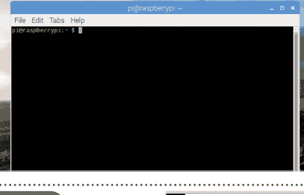
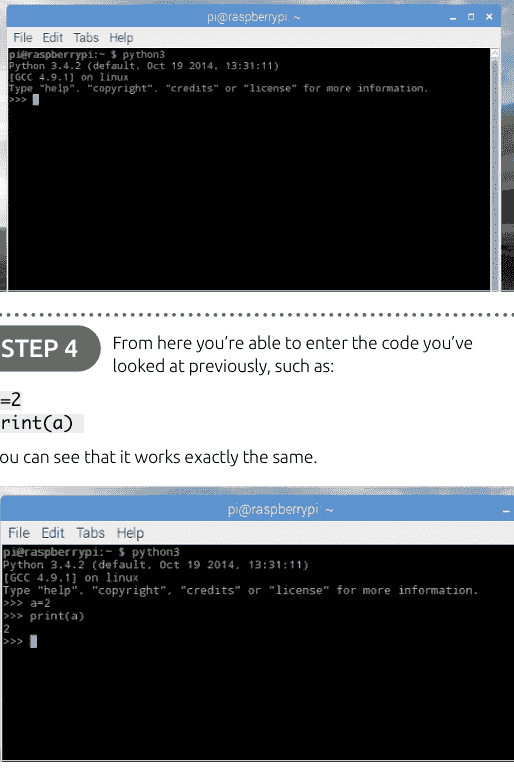

# 从终端执行代码（续）

### 步骤 5

现在输入：`exit()` 以退出 Python 行会话并返回命令行提示符。进入你保存上一个教程代码的文件夹并列出所有可用文件；希望你保存了 `hello.py`。

### 步骤 6

进入代码所在的相同文件夹。

### 步骤 7

自然地，这是 Python 3，当你尝试用 Python 2 运行代码时：

### 步骤 8

从 Python 2 代码运行 Python 3 代码的结果是非常显而易见的。由于 Python 3 处理 `Print` 的方式与 Python 2 的差异，虽然不会报错，但结果可能不如预期。使用 Sublime 进行监控，打开 `hello.py`。

```text
pi@raspberry:~/Documents/Python Code $ _
File Edit Tabs
python hello.py (default: Oct 10 2014, 13:31:11)
Python 2.7.8 (type 'help', 'credits' for more information)
>>> print('cool')
cool
>>> print('credits')
credits
>>> exit()
pi@raspberry:~/Documents/Python Code $ cat hello.py
pi@raspberry:~/Documents/Python Code $ _
```

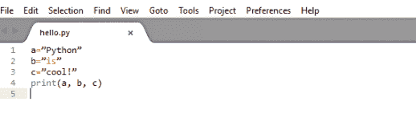

### 步骤 9

由于树莓派上没有 Sublime Text，你将暂时离开 Pi 并使用 Python IDLE。使用 `hello.py` 文件，打开它来提醒你：`python3 hello.py` 将执行我们创建的代码。

```python
name="What is your name?"
print("Hello,",

a="Python"
b="is"
c="cool"
print(a, b, c)
```

```text
C:\Users\Desktop\Documents\hello.py - Sublime Text (UNREGISTERED)
File Edit View Go Tools Preferences
hello.py
a="Python"
b="is"
c="cool"
print(a, b, c)
name="What is your name?"
print("Hello,",
```

### 步骤 10

保存 `hello.py` 文件并回到命令行。现在执行新保存的文件 `python3 hello.py`，原始输出是 `cool`，并在窗口中显示。

```text
pi@raspberry:~/Documents/Python Code $ _

File Edit Tabs

python hello.py (default: Oct 10 2014, 13:31:11)

Python 2.7.8 (type 'help', 'credits' for more information)

>>> print('cool')

cool

>>> print('credits')

credits

>>> exit()

pi@raspberry:~/Documents/Python Code $ cat hello.py

pi@raspberry:~/Documents/Python Code $ ls.py

pi@raspberry:~/Documents/Python Code $ _
```

```text
C:\Users\Desktop\Documents\hello.py - Sublime Text (UNREGISTERED)

File Edit View Go Tools Preferences

hello.py

Python is cool!

What is your name? David

Hello, David

pi@raspberry:~/Documents/Python Code $ _
```

# 入侵者大战

得分 1337


## 你知道吗...

当《入侵者大战》的作者西井浩在编写游戏时，他必须创建自己的硬件和开发工具来编写游戏。此外，他发现由于编码和自定义硬件的结果，屏幕上的入侵者得以渲染。因此速度更快，他决定保留游戏。

# 数字与表达式

我们看到了一些 Python 的基础表达式：加法、减法、乘法。

## 全是数学

### 步骤 1

打开 Python 3 的 Shell，如所述。

### 步骤 2

在后续输入：
`2*2`
`54356+3*273446421`

### 步骤 3

你可以使用所有的数学运算：除法、乘法、括号等。

### 步骤 4

你注意到除法会产生小数。这些被称为浮点数（`floats`）或浮点算术；然而，如果你需要整数转换为小数，可以使用双斜杠：

你可以看到 Python 可以处理很大的数字。

`1/2`
`6/2`

以此此类推。

```python
Python 3.4.2 Shell
Python 3.4.2 (default: Oct 19 2014, 13:31:11)
>>> type('help', 'credits' or 'license') for more information.
'str'
>>> 54356-3455245
99867344*2734468421
2730821022017024
>>> 1/2
0.5
>>> 2*3
6
>>> (1+2)+(3*4)
15
```

## STEP 5

你也可以使用运算符来获取除法留下的余数。例如：

### `10/3`

将显示 `3.333333333`，即 `3.3` 循环小数。如果你现在输入：

### `10%3`

这将显示 `1`，即 `10` 除以 `3` 得到的余数。

```text
27960110291170634
** 1/2
0.5
** 6/2
3
** 2*3
6
** (1+2)*4
12
** 1/2
0.5
** 10/3
3.3333333333333335
** 10%3
1
1000000000
```

## STEP 6

接下来我们使用幂运算符（或指数）来计算某个数值的幂，你可以在键盘上使用双乘号符号或连字符。

### `2**2`

### `10**10`

本质上，它是 `2x2`，但我们相信你已经了解数学运算符背后的基础。这在 Python 中是这样工作的：

```text
** 6/2
3
** 2*3
6
** (1+2)*4
12
** 1/2
0.5
** 10/3
3.3333333333333335
3
** 10**10
10000000000
```

## STEP 7

数字和表达式不仅于此。Python 有许多内置函数来处理数字、绝对值、复数以及各种数学和 Python 语言。例如，要将数字转换为二进制，使用：

### `bin(3)`

```text
** 1/2
0.5
** 6/2
3
** 2*3
6
** (1+2)*4
12
** 15
15
** 1/2
0.5
** 10/3
3.3333333333333335
3
** 10**10
10000000000
** bin(3)
'0b11'
```

## STEP 8

`format(3, 'b')`

`format` 命令将一个值 `3` 转换为由格式规范（`'b'` 部分）控制的格式化表达式。

```text
** 2**2
4
** (2+3)
5
** 1/2
0.5
** 6/2
3
** 3.3333333333333335
3
** 2**2
4
** SP**10
1000000000
'011'
** format(3, 'b')
3
```

## STEP 9

布尔值（`Boolean`）是一个逻辑真（`true`）或假（`false`）的逻辑语句。我们可以用它们来比较数据，查看它们是否小于或大于另一个。在新文件中：

```python
a = 6
b = 7
print(1, a == 6)
print(2, a == 7)
print(3, a == 6 and b == 7)
print(4, a == 7 and b == 7)
print(5, not a == 7 and b == 7)
print(6, a == 7 or b == 6)
print(7, a == 7 or b == 6)
print(8, not (a == 7 and b == 6))
print(9, not a == 7 or b == 6)
```

## STEP 10

执行步骤 9 中的代码，你可以看到一系列 `True` 或 `False` 语句，这取决于两个值（`6` 和 `7`）的结果！这是编程的一个重要部分。

```text
Python 3.4.2 Shell
Python 3.4.2 (default, Oct 19 2014, 13:31:11)
>>> type("credits") or "license") for more information.
'str'
>>> [ 1 True
>>> 2 False
>>> 3 True
>>> 4 True
>>> 5 False
>>> 6 True
>>> 7 True
>>> 8 False
>>> 9 False
>>> ]
```

# 使用注释

在编写代码时，流程、每个变量的作用以及整个程序将如何运行都在你的脑海中。另一个程序员可以逐行阅读代码，但随着时间的推移，代码可能会变得难以阅读。

程序员使用通过对某些部分进行注释的方法来保持代码的可读性。例如，如果使用了一个变量，程序员会注释其预期的作用。这只是一种良好的习惯。

### STEP 1

首先创建一个 IDLE 编辑器新实例（文件 > 新建文件），并创建一个简单的变量和打印命令：

```python
a=10
print("The value of A is", a)
```

保存文件并执行它。

### STEP 2

运行代码将在 IDLE Shell 窗口返回行：`The value of A is, 10`，这是我们预期的。现在，添加一些你通常在代码中看到的注释：

```python
# 设置 A 的初始值为 10
a=10
# 打印 A 的当前值
print("The value of A is", a)
```

### STEP 3

预留代码并执行它。你可以看到 IDLE Shell 中的输出仍然与之前相同，尽管增加了额外的行。简单来说，哈希符号（`#`）表示程序员可以插入的一行文本，用于在用户不察觉的情况下告知他们和他人正在发生什么。

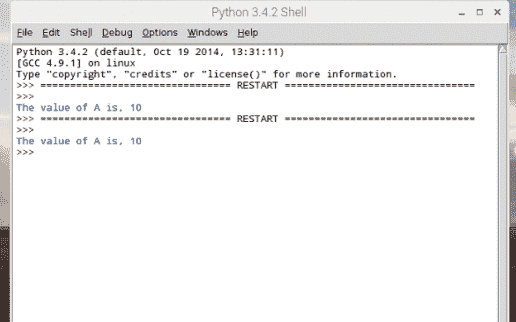

### STEP 4

假设我们创建的变量 `A` 是游戏中的生命次数。每当玩家死亡时，值就会减少 1。程序员可以在此处插入一条路由行：

```python
a=1
print("You've just lost a life!")
print("You now have,", a, "lives left!")
```

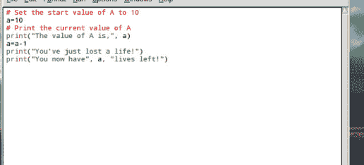

# 操作变量

### 第 5 步

然而，你不能在同一个命令中组合字符串和整数类型变量，因为你需要将其中一个输入到另一个中，反之亦然。当你尝试组合两者时，你会得到一个错误消息：

```text
Python 3.4.2 (default. Oct 19 2014, 13:01:55)
>>> David Howard
>>> print("credits" or "license" for more information.)
>>> name = "Howard"
>>> type(name)
<class 'str'>
>>> age = 44
>>> type(age)
<class 'int'>
>>> print("Descended from Vikings")
Descended from Vikings
>>> print(age)
44
>>> print("I am " + age + " years old.")
TypeError: can't concatenate 'int' to 'str' implicitly
```

### 第 8 步

当你想要处理用户输入的数字时，这就会产生问题，因为由于字符串和整数，`age + 10` 将无法工作。相反，你需要：

```python
int(age) + 10
```

这将 `age` 字符串转换为一个可以处理的整数。

```text
Python 3.4.2 (default. Oct 19 2014, 13:01:55)
>>> David Howard
>>> print("credits" or "license" for more information.)
>>> print("How old are you?")
>>> age = input()
>>> type(age)
```


# Python 编程基础

## 类型转换

```python
<class 'str'>

>>> age + 10
Traceback (most recent call last):
  File "stdin", line 1, in <module>
TypeError: can't concatenate sequence of 'str' and 'int' objects

>>> int(age) + 10
```

**第 6 步**：这个过程被称为类型转换（Typecasting）。Python 代码如下：

```python
print(character + " " + str(age) + " years old.")
```

注意，在最后一个例子中，使用逗号时不需要在单词之间添加空格，因为逗号会单独处理每个参数。

```python
>>> print(name, age)
Traceback (most recent call last):
  File "<stdin>", line 1, in <module>
TypeError: can't concatenate 'int' to 'str' implicitly

>>> print("is, " + age + " years old.")
David Howard: Descended from Vikings is 44 years old.
```

**第 9 步**：在处理浮点数算术（小数）时，也用到了类型转换。例如：

```python
19.99
```

现在输入 `type(shift)`，你会发现 Python 将该数字识别为 `'float'`，因为值包含小数点。

```python
Python 3.4.2 (default. Oct 19 2014, 13:01:55)
>>> David Howard
>>> print("credits" or "license" for more information.)
>>> type(shift)
<class 'float'>
```

**第 7 步**：当你被要求获取用户输入时，这是类型转换的另一个例子，例如：

```python
enter = input("How old are you?")
```

来自 `input` 命令的所有数据都是字符串变量。

**第 10 步**：当组合整数和浮点数时，Python 通常会将整数转换为浮点数，但请记住 Python 不会正确返回值。当将浮点数转换为整数时，Python 总是会舍入到最近的整数，这称为截断（truncating）；在 19.99 的情况下，它变为：

```python
Python 3.4.2 (default. Oct 19 2014, 13:01:55)
>>> David Howard
>>> print("credits" or "license" for more information.)
>>> How old are you? 44
>>> type(enter)
<class 'str'>
```

```python
Python 3.4.2 (default. Oct 19 2014, 13:01:55)
>>> David Howard
>>> print("credits" or "license" for more information.)
>>> How old are you? 44
>>> type(float(enter))
<class 'float'>
>>> int(float(enter))
<class 'int'>
```

## 用户输入

在之前的几个示例中我们已经看到了一些基础的用户交互，所以现在是专注于如何从用户那里获取输入并展示它的时机了。

你想要从用户处获取的输入类型很大程度上取决于你编写的程序类型。例如，游戏可能会询问角色的名字，而数据库可能会询问个人详情。

- **第 1 步**：如果尚未打开，请打开 Python 3 IDLE Shell，并在编辑器中新建一个文件（New File）。让我们从最简单的开始：

```python
print("Hello")
firstname = input("What is your first name?")
print("Thanks")
surname = input("And what is your surname?")
```

- **第 3 步**：现在我们已经将用户名存储在几个变量中，可以在需要时调用它们：

```python
print("Welcome", firstname, surname, ". I hope you're well today.")
```

- **第 2 步**：保存并执行代码，正如你所怀疑的那样，IDLE 程序会询问你的名字，将其存储在变量 `firstname` 中，然后询问你的姓，将其存储在自己的变量（`surname`）中：

```python
Python 3.4.2 Shell
Edit  Shell  Format  .  Debug  Options  Window  IDLE
Python 3.4.2 (Default, Oct 19, 2016, 10:31:11)
>>> Type help for
>>> type("credits" or "license" for more information.
>>> What is the first name?
David
>>> Thanks
>>> And what is your surname?
David
```

- **第 4 步**：运行代码，你会发现一个小问题，姓氏后面的句号有一个空格。为了消除这个问题，我们在代码的逗号处添加了加号：

```python
print("Welcome", firstname, surname + ". I hope you're well today.")
```

- **第 5 步**：你并不总是包含引号的文本。例如，我们……（此处省略重复内容）

```python
>>>
>>> What is your first name?
David
>>> What is your surname?
```

- **第 8 步**：当你想要处理用户输入的数字时，这就会产生问题，因为由于字符串和整数，`age + 10` 将无法工作。相反，你需要：

```python
int(age) + 10
```

这将 `age` 字符串转换为一个可以处理的整数。

- **第 6 步**：这个过程被称为类型转换（Typecasting）。Python 代码如下：

```python
print(character + " " + str(age) + " years old.")
```

注意，在最后一个例子中，使用逗号时不需要在单词之间添加空格，因为逗号会单独处理每个参数。

- **第 9 步**：在处理浮点数算术（小数）时，也用到了类型转换。例如：

```python
19.99
```

现在输入 `type(shift)`，你会发现 Python 将该数字识别为 `'float'`，因为值包含小数点。

- **第 7 步**：当你被要求获取用户输入时，这是类型转换的另一个例子，例如：

- **第 2 步**：函数接收数据（通常是变量），并根据函数编程返回返回值的方式进行处理。处理的数据放在括号内，所以如果你想知道 `antidisestablishmentarianism` 中有多少个字母，你需要输入：`len('antidisestablishmentarianism')`，并将返回数字 28。

- **第 4 步**：Python 内置了数十个函数，多到在这里有限的空间内无法介绍。然而，如果你想导航到 `docs.python.org/3/library/functions.html`，这些是预定义的，但由于用户也创建了更多，它们并不是唯一的选择。

- **第 3 步**：你可以以相同的方式通过函数传递变量。假设你想知道一个人姓氏的字母数量，可以使用以下代码（请为此示例进入文本编辑器）：

```python
name = input("Enter your surname: ")
count = len(name)
print("Your surname has,", count, "letters in.")
```

# 创建函数

现在你已经掌握了变量的使用和用户输入，下一步是处理函数。

## 趣味函数

函数是你输入的一个以执行某些操作的命令。它是一段短小的自包含代码，接收数据、对其进行处理并返回结果。

- **第 1 步**：如果尚未打开，请打开 Python 3 IDLE Shell，并在编辑器中新建一个文件（New File）。让我们从最简单的开始：

```python
print("Hello")
firstname = input("What is your first name?")
print("Thanks")
surname = input("And what is your surname?")
```

- **第 2 步**：一个短单词后跟着括号。例如，`len()`、`type()`。

- **第 3 步**：现在我们已经将用户名存储在几个变量中，可以在需要时调用它们：

```python
print("Welcome", firstname, surname, ". I hope you're well today.")
```

## 创建函数

**步骤 5**：模块可以通过模块（modules）向 Python 添加额外的函数。Python 拥有一系列编程任务。它们添加了函数并可以在需要时导入。例如，使用高级数学函数：

**步骤 6**：要使用来自模块的函数，请使用模块名后接句号（.），例如，使用 Math 模块，由于你刚刚将其导入 Python，现在你可以使用平方根函数。

```python
import math
```

一旦输入，你就可以使用所有的 Math 函数。

你可以看到生成的代码格式为：`module.function(data)`。

```python
math.sqrt(16)
```

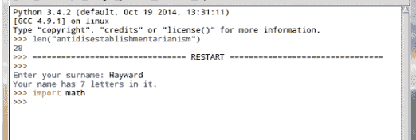

# 锻造函数

有许多可以从其他 Python 程序导入的不同函数，你将来无疑会遇到一些示例；你也可以用 `def` 命令创建自己的函数。

输入：

- **步骤 1**：在编辑器中选择“新建文件”（New File），让我们创建一个名为 `Hello` 的函数，用于向用户问好。

- **步骤 3**：要修改它，删除 `Hello("David")` 这一行（脚本的最后一行），按 `Ctrl+S` 保存新脚本。关闭编辑器并创建一个新文件（New File）。输入：

```python
def hello():
    print("Hello")
```

```python
from Hello import Hello
Hello("David")
Hello()
```

按 `F5` 保存并运行脚本。你可以在 Shell 中看到 `Hello`，输入 `Hello()`，它会返回该函数。

按 `F5` 保存并执行代码。

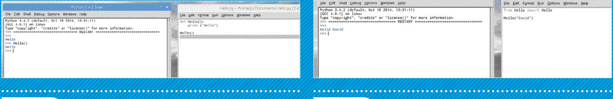

- **步骤 2**：让我们扩展函数以接受一个变量，将用户名作为变量。编辑你的脚本为：

- **步骤 4**：你所做的是从保存的 `Hello.py` 中导入 `Hello` 函数，并使用它向 David 问好。这就是函数的工作原理：先使用该函数，然后通过修改它来获得额外奖励。

```python
def hello(name):
    print("Hello " + name)
```

```python
def add(a, b):
    result = a + b
    return result

Hello("David")
```

现在它将接受变量名，否则它将打印 Hello David。在 Shell 中，输入：`name="Bob", hello(name)`。你现在可以通过参数传递函数。

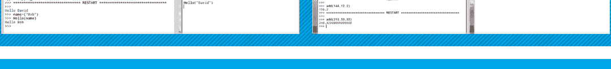

www.bdmppublications.com 31

# 条件与循环


条件和循环让程序变得有趣；它们可以很简单，也可以相当复杂。你如何使用它们很大程度上取决于程序试图实现的目标；它们可能是游戏中剩余的生命值，或者仅仅是显示倒计时。

## 真条件

开始时保持条件简单会让学习编程成为一种更快的体验。让我们从检查某物是否为真（TRUE），如果不是则执行其他（else）开始。

- **步骤 1**：让我们创建一个新的 Python 程序，要求用户输入一个单词，然后检查它是否为四个字母单词。从文件 > 新建文件（File > New File）开始，并输入：

```python
word = input("Please enter a four-letter word: ")
```

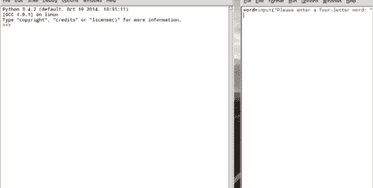

- **步骤 3**：现在你可以使用 `if` 语句检查单词长度是否等于四，如果符合规则，则打印一个友好的确认：

```python
word = input("Please enter a four-letter word: ")
word_length = len(word)
if word_length == 4:
    print(word, "is a four-letter word. Well done.")
```

双等号 `==` 意味着检查某物是否等于某物。

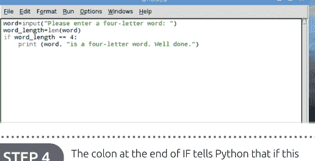

- **步骤 2**：我们可以创建一个新单词，然后使用 `len` 函数并将单词传递给它，以获取用户输入的字母总数：

```python
word = input("Please enter a four-letter word: ")
word_length = len(word)
```

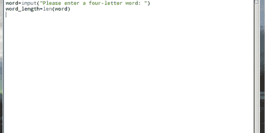

- **步骤 4**：`if` 结尾的冒号告诉 Python，冒号后缩进语句是 true。接下来，回到编辑器开头：

```python
word = input("Please enter a four-letter word: ")
word_length = len(word)
if word_length == 4:
    print(word, "is a four-letter word. Well done.")
else:
    print(word, "is not a four-letter word.")
```

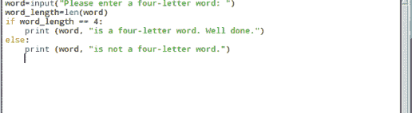

32 www.bdmpublications.com

# 条件与循环

**步骤 5**：按 `F5` 并保存代码以执行。在 Shell 中输入一个四字母单词；你应该收到返回该单词是四个字母的消息。现在按 `F5` 重新运行程序，这次使用一个五字母单词。Shell 将显示它不是四字母单词。

**步骤 6**：现在扩展代码以包含其他条件。最终，它可能会变得复杂。我们添加了一个三个字母单词的条件：

```python
word = input("Please enter a four-letter word: ")
if word_length == 4:
    print("word is a four-letter word. Well done.")
elif word_length == 3:
    print("word is a three-letter word. Try again.")
else:
    print("word is not a four-letter word.")
```

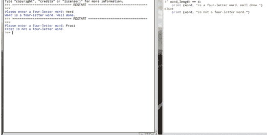

# 循环

循环看起来和条件非常相似，但在运行上有所不同。循环会多次运行代码块，通常在条件的支持下。

**步骤 1**：让我们从简单的 `While` 语句开始。如果这检查是否为真，则运行缩进的代码：

```python
x = 0
while x < 10:
    print(x)
    x = x + 1
```

**步骤 3**：`For` 循环是另一个例子。`For` 用于遍历数据范围，通常是存储在方括号中的列表形式变量。例如：

```python
words = ("Cat", "Dog", "Unicorn")
for word in words:
    print(word)
```

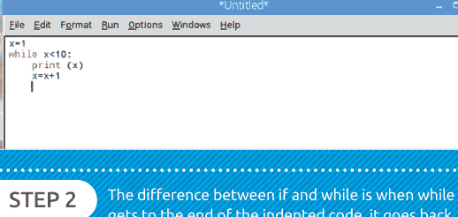

**步骤 2**：`If` 和 `while` 的区别在于，当到达缩进代码的结尾时，它会返回检查语句是否仍然为真。在我们的示例中 `x` 会打印 `x` 的当前值。

**步骤 4**：`For` 循环也可以配合 `range` 函数使用：

```python
for x in range(1, 10):
    print(x)
```

`range` 函数在第一个数字和最后一个数字之间创建一个范围。


# Linux Python

# 模块

将模块视为导入到你的 Python 代码中以扩展其功能。有无数模块可用，PI 已经包含了大部分。

# 精通模块

在此实例中我们使用 Windows 10 来演示模块的安装，因为它们在 PI OS 上已经有了。如你所知，模块是被导入的，例如 `import math`。

## 步骤 1

IDLE 中的结果是错误，因为 `Pygame` 模块未被识别或安装。要安装模块可以使用 `PIP`（Pip Install Packages）。关闭 IDLE shell 并进入命令行提示符，或 Terminal 会话。

## 步骤 3


一个很好的例子是 `Pygame`，它包含许多创建游戏的函数。尝试：`import pygame`

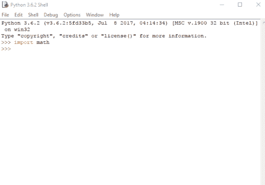

## 步骤 4

`PIP` 安装需要高级权限，因为包安装在不同的位置。Windows 用户可以通过“开始”按钮搜索 `CMD` 并右键点击结果“以管理员身份运行”。Linux 和 Mac 使用 `sudo`，配合 `sudo pip install`。

## Python 模块

### 第 5 步

关闭命令提示符或终端并重新启动 `IDLE Shell`。当你输入 `import pygame` 时，该模块将无问题地导入到代码中。你会发现从互联网下载或复制的代码将保持模块状态，除非执行时的错误通常是由于缺少模块导致的。

### 第 8 步

在你的代码中可以导入多个模块。

为了扩展你的示例，请使用：

```python
import random
import math
for i in range(5):
    print(random.randint(1, 25))
print(math.pi)
```

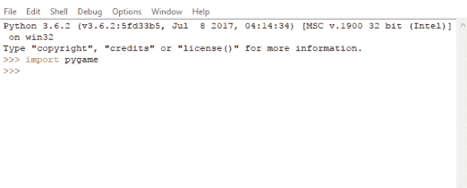

### 第 6 步

模块包含了在你自己的代码中实现特定结果所需的额外代码，正如我们之前实验过的那样：

```python
import random
```

从“随机数生成器”模块中引入。

你可以使用此模块来创建内容：

```python
for i in range(10):
    print(random.randint(1, 25))
```

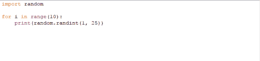

### 第 9 步

结果是一串数字，后面跟着从 `Math` 模块提取的 Pi 值。你也可以通过使用 `print` 和 `import` 命令从模块中调入函数，例如：

```python
from random import randint
for i in range(5):
    print(random.randint(1, 25))
```

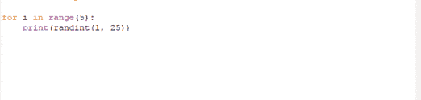

### 第 7 步

这段代码在保存并执行时，将显示 1 到 25 之间的随机数。你可以尝试显示更多或更少、范围更大或更小的数字：

```python
import random
for i in range(25):
    print(random.randint(1, 100))
```

### 第 10 步

这有助于创建更精简的编程方法。你也可以使用 `import *`，它会导入命名模块中的所有内容。然而，这通常被认为是资源的浪费，但它确实有效。模块可以作为别名导入：

```python
import math as m
print(m.pi)
```

当然，添加注释有助于告诉其他人正在发生什么。

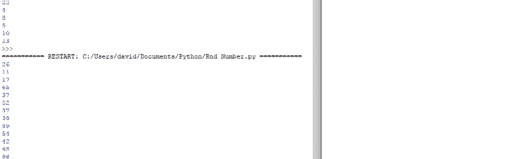


格蕾斯·霍珀（Admiral Grace Hopper），自 40 年代以来一直在调试计算机

## 你知道吗……

### 调试

你知道吗……在计算机术语中，“debugging”（调试）一词源于格蕾斯·霍珀，她在 40 年代工作时正在处理一台单体结构的哈佛 Mark II 型机电计算机。根据传说，霍珀发现了一只飞蛾卡在继电器中，导致系统无法工作。因此，移除那只飞蛾被称为“调试”。

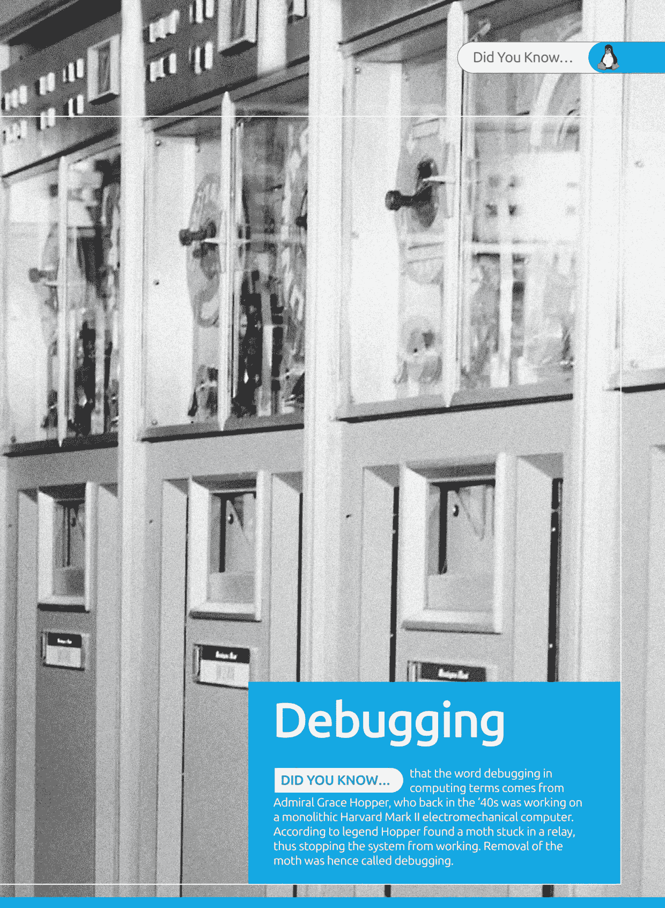

# Linux 上的 C++

> “软件开发最重要的单一方面是清楚你正在尝试构建什么。”
>
> — Bjarne Stroustrup (C++ 的开发者和创始人)


## 为什么选择 C++？

`C++` 是目前最流行的编程语言之一。它最初被称为“带有类的 C”（C with Classes），在 1983 年更名为 `C++`。它是原始 `C` 语言的扩展，是一个通用的面向对象 `OOP` 环境。

由于该语言可能具有复杂性，以及其强大的功能和性能，`C++` 常用于开发游戏、程序、设备甚至操作系统。

`C++` 追溯到 1979 年，即家用主机黄金时代的开始，`C++` 是丹麦计算机科学家 Bjarne Stroustrup 的心血结晶，他的计划是增强自 70 年代初以来被广泛使用的原始 `C` 语言。

它被计算实验室以及无法访问大型主机和计算数据中心的普通人使用。

`C++` 证明在 80 年代的开发者中非常受欢迎，因为它是一个更容易上手掌握的环境，更重要的是，它与原始 `C` 语言具有 99% 的兼容性。这意味着它可以在主流领域之外使用。

`C++` 在数字世界的影响是巨大的。许多程序、应用程序、游戏甚至操作系统都是使用 `C++` 编写的。例如，Adobe 的所有应用程序（如 `Photoshop`、`InDesign` 等），你会发现你使用的浏览器是用 `C++` 编写的，以及 `Windows`、`Microsoft Office` 和 `Google` 搜索引擎骨干。Apple 的 `macOS` 大部分是用 `C++` 编写的，带有一些 `C++` 代码比 `Python` 快得多。

```cpp
#include <iostream>
using namespace std;
void main() {
    char ch;
    cout << "输入一个字符判断是否为元音：";
    cin >> ch;
    switch (ch) {
        case 'a': case 'A':
            cout << "是元音";
            break;
        case 'e': case 'E':
            cout << "是元音";
            break;
        case 'i': case 'I':
            cout << "是元音";
            break;
        case 'o': case 'O':
            cout << "是元音";
            break;
        case 'u': case 'U':
            cout << "是元音";
            break;
        default:
            break;
    }
}
```

## 为什么 C++？

### 安装 - Visual Studio 2017 (15.0.26223.1)

| 工作负载 | 单个组件 | 语言包 |
| :--- | :--- | :--- |
| Windows (5) | 通用平台开发 (使用 C#, JavaScript 或 C++) | .NET 开发 (使用 .NET Framework 构建 WPF、Forms 和控制台应用程序) |
| | 使用 C++ 的开发 | |
| | Visual C++ 工具、ATL 以及其他功能如 MFC | |

## 总结

- 使用 `C++` 开发
- `Visual C++` 核心功能
- `C++` 工具集 (x64)

虽然 `Python` 是一个在更广泛世界范围内很好的编程语言。通过掌握 `C++`，你可以在微软、Apple 等公司找到工作。通常情况下，`C++` 开发者的薪水比其他语言的程序员高，而且由于灵活性，`C++` 程序员可以在不同工作之间转换而无需重新学习。然而，`Python` 是一个更容易入门的语言。如果你是编程初学者，我们建议你先学 `Python`。

使用 `C++` 和 `Python` 一样简单，你只需要正确的工具来与计算机通信并开始你的旅程。一个免费的 `C++ IDE`，特别是微软功能极其强大的 `Visual Studio` 可以下载和使用。你可以从任何操作系统进入 `C++`，无论是 `macOS`、`Linux`、`Windows` 还是移动平台。

就像 `Python` 一样，回答为什么 `C++` 是答案是因为它快速、高效，并且由你经常使用的大多数应用程序开发。它是一门前沿且非常值得掌握的语言。

## 事实上，你使用的操作系统是用 C++ 编写的

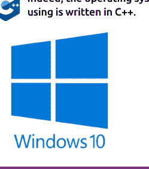
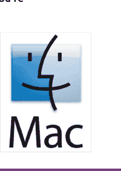

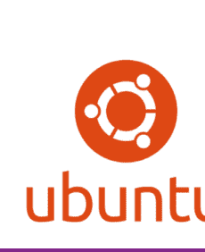

www.bdmpublications.com 41

## 你的第一个 C++ 程序

树莓派是学习 `C++` 的绝佳编程基础平台。你不需要任何复杂的第三方 `IDE`，也不需要安装额外的组件。启动所需的所有内容已经内置在树莓派中了。

### 你好，世界！

在编程中，第一段代码的传统做法是在屏幕上输出“Hello, World!”字样。有趣的是，这可以追溯到 1968 年使用的一种名为 `BCPL` 的语言。

你可以使用 `Geany` 编程编辑器在树莓派上编写、编译和执行你的 `C++` 代码。你可以在树莓派主菜单的“编程（Programming）”部分的第一项找到 `Geany`。点击 `Geany` 图标打开并开始编码。

目前它看起来没什么特别，但你可以研究代码中 `C++` 头文件的含义。`Geany` 使用语法高亮，这意味着它会根据语言对代码上色。激活此功能，点击“文件 > 另存为”来保存代码。现在将代码命名为 `helloworld.cpp` 并点击保存按钮。

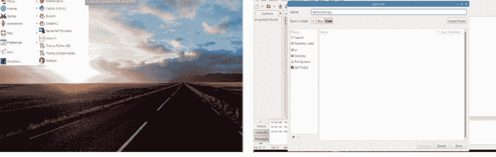

`Geany` 编辑器非常强大，且易于使用。你在主窗口中输入的所有代码都有行号，以帮助你跟踪代码。现在，在第 1 行输入：

```cpp
#include <iostream>
```

在编码时，颜色代码非常有帮助。现在按回车键，在第 3 行开始一个新命令。输入以下内容：

```cpp
int main()
```

注意：括号之间没有空格。

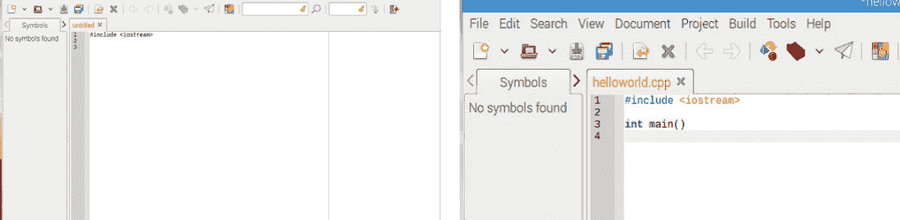

### 步骤 5

在下一行，即 `main()` 下方输入一个大括号 `{`：

这可以通过在英式键盘布局上按下 `Shift` 键和 `P` 键右侧的键来实现：

### 步骤 8

现在你需要结束代码，插入相反的反大括号 `}`。在第 7 行输入：

注意，你不需要退格键回到行首来删除缩进；通过输入大括号，`Geany` 会自动跳转到行的正确位置，从而结束代码块。

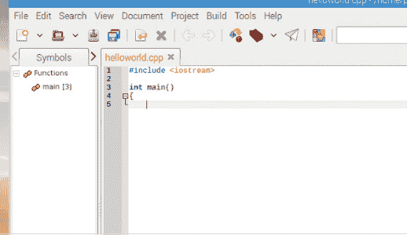

### 步骤 6

注意 `Geany` 自动创建了一个略微缩进。这是为了表示 `C++` 的结构，也是输入核心代码的地方。现在输入：

```cpp
// My first C++ program
```

### 步骤 9

本质上，这些是你迈入 `C++` 编程世界的第一步。我们将在接下来的几页中详细介绍代码的结构；现在，点击由带有绿色向下箭头的文件柜表示的保存按钮。

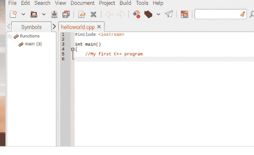
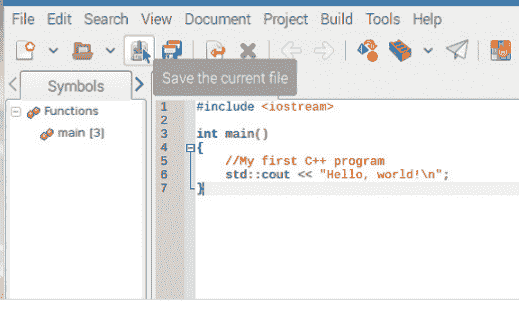

### 步骤 7

再次注意颜色的变化。在上一个步骤的结束处按回车键，然后输入：

```cpp
std::cout << "Hello, world!";
```

### 步骤 10

如果你还没有这样做，始终建议创建一个空文件夹来保存所有代码。你可以为 `Python` 和 `C++` 分别建立一个文件夹，或者用一个文件夹，取决于你的喜好。这并非必须的，只是一个良好的习惯。

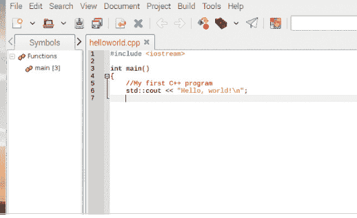
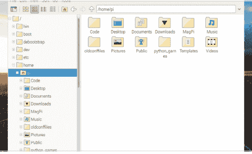

## C++ 程序的结构

`C++` 有着非常明确结构和处理方式。漏掉任何内容，即使是一个微小的分号，你的整个程序将无法编译和执行。许多专业程序员都因为结构疏松而栽过头。

### C++ 结构

学习编程基础后，你开始理解程序的结构。命令在不同语言之间可能不同，但你可以开始看到代码是如何运行的。

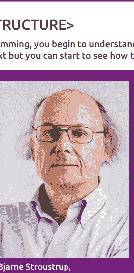

`C++` 是丹麦学生 Bjarne Stroustrup 在 1979 年发明的，最初作为他博士论文的一部分称为带类的 `C`（C with Classes），后来被称为 `C++`，它在已经流行的 `C` 语言基础上增加了功能，同时通过新的结构使其成为更加用户友好的环境。

`int main()` 初始化了一个函数的声明，它是 `main` 命名下的一组代码语句。无论它位于代码的什么位置，所有 `C++` 代码都从 `main` 函数开始。

```cpp
helloworld.cpp
1 #include <iostream>
2
3 int main()
```

**INCLUDE（包含）** `C++` 程序的结构非常精确。`C++` 代码以指令开头：`#include <`。该指令指示预处理器包含一段 `C++` 代码。例如：`#include <iostream>` 包含了支持输入输出操作的头文件。

**BRACES（大括号）** 大括号（花括号）是你可能没见过的东西，特别是如果你习惯了 `Python` 的话。大括号表示 `main` 函数以及所有属于该函数的代码的开始。

```cpp
helloworld.cpp
1 #include <iostream>
2
3 int main()
4 {
5
6
7
8 }
```

**COMMENTS（注释）** 以双斜杠开头的行是注释。这意味着它们不会被编译器执行。注释的设计是为了帮助你，或者查看你代码的另一个程序员解释正在发生什么。注释有两种类型：`//` 覆盖单行，`/* */` 覆盖多行。

**<<（插入运算符）** 这里使用的两个尖括号是插入运算符。这意味着紧随尖括号的任何内容都会插入到 `std::cout` 中。在这种情况下，它们是 'Hello, world!'，编译时显示在屏幕上。

## 编译与执行

你已经创建了第一个 `C++` 程序，现在你理解了背后的结构。让我们行动起来，编译并执行（或者如果你愿意，叫运行）程序，看看它是什么样子。

### 来自 C++ 的问候

在 `Geany` 内部编译和执行代码非常简单，只需点击几个图标并查看结果即可。操作方法如下：

- **步骤 1** 如果你还没有打开，打开 `Geany` 并加载之前保存的 `World` 代码。确保没有可见的错误，注意窗口顶部。

- **步骤 3** 当你点击图标时，`Geany` 界面底部的面板会显示结果。一切顺利，你将看到编译成功；如果没有，`Geany` 会在找到错误的行列出错误。

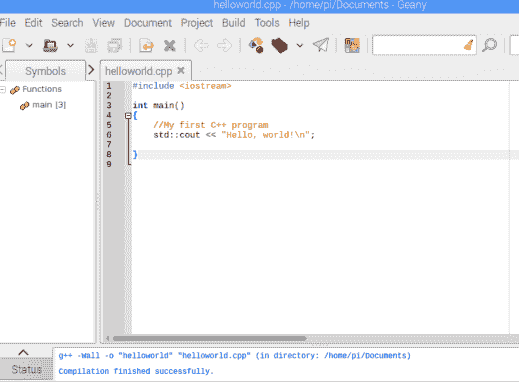

- **步骤 2** 如果你的代码已准备就绪，查看菜单栏图标行那里有一个红色砖块图标。这是“构建（Build）”，点击它可以运行代码，检查其是否符合 `C++` 标准以查看是否存在阻止运行的错误。

- **步骤 4** 成功构建后，是时候执行它了。在构建图标旁边有一个纸飞机图标，这是“运行（Run）”图标。你无法运行未构建或位置存在错误的代码。点击运行图标。

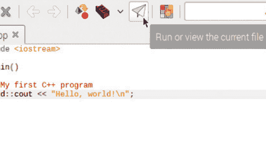

### 步骤 5

当你点击时，`C++` 代码就会执行，并出现一个简单的终端窗口，显示代码运行的结果。在这个简单的代码中，你可以看到世界中的词：Hello, world!；你已经学过了，代码正在编码（输出）`std::cout` 中引号之间的内容：

### 步骤 8

正如之前提到的，如果你已经声明了代码的开头，就不需要 `std::cout` 了。现在，让我们故意制造一个错误，看看会发生什么。删除该行末尾的分号，使其变为：

```cpp
cout << "Hello, world!\n"
```

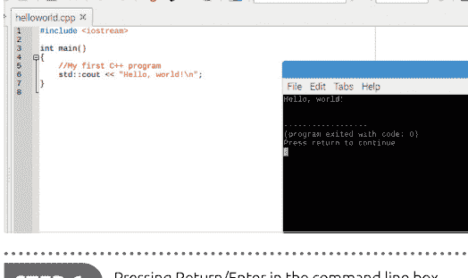

### 步骤 6

在命令行框中运行/回车会关闭它，返回 `Geany`。让我们稍微修改代码。在 `#include` 行下输入：

```cpp
using namespace std;
```

然后，删除代码行中的 `std::` 部分：

```cpp
cout << "Hello, world!\n"
```

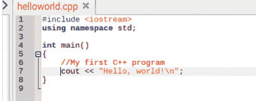

### 步骤 9

现在再次尝试构建代码。此时，注意到底部面板显示了一个关于分号的错误。注意该错误出现在第 8 行，大括号是圆的。这是因为在...之前出现了一个意外的分号。

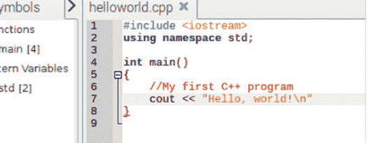

### 步骤 7

为了应用新的更改，你需要像以前一样保存过程，然后再次构建并执行它。检查代码，当然，在点击砖块图标、飞机图标时，不要更改你想修改的文件名。

### 步骤 10


```cpp
cout << "Greetings from C++!\n"
```

替换分号和 `cout` 行，在你的代码中输入新行：

`\n` 会在输出文本的最后一行添加一个新行。构建并运行，代码：

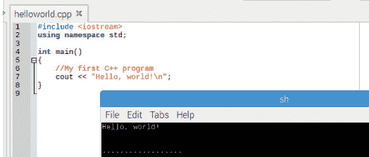

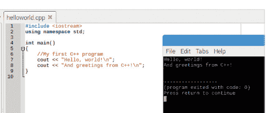

## Linux C++

## 病毒！

第一批在受控系统外（即进入野外）传播的程序病毒之一被称为 Elk Cloner，它是由 15 岁的 Rich Skrenta 在 1982 年编写的。

Elk Cloner 设计用于感染 Apple DOS 3.3 操作系统，并附带在一个游戏中。当游戏玩五十次时，病毒就会激活，它不会显示游戏，而是破坏屏幕并显示一诗：

> Elk Cloner: 一个具有个性的程序
>
> 它会粘着在你所有的磁盘上
>
> 它会渗透你的芯片
>
> 是的，它是 Cloner！
>
> 它会像胶水一样粘着你
>
> 它还会修改内存
>
> 让 Cloner 进来！

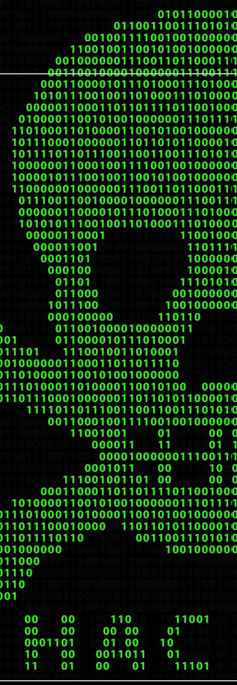

## 你知道吗...


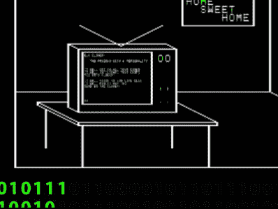

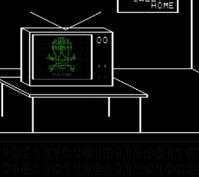

Elk Cloning 在 82 年作为恶作剧被开发，它是野外最早记录的病毒之一。

Linux C++

## 使用注释

虽然对于组成游戏、应用程序甚至整个操作系统的许多行代码来说，注释似乎只是一个微不足道的元素，但事实上，它们可能是最重要的因素之一。

## 注释的重要性

代码中的注释基本上是人类可读的描述，详细说明了代码在特定一点在做什么。它们听起来不是特别重要，但除非你是专业人士或初学者，否则没有注释将是令人沮丧的事情之一。

简而言之，代码应该以这种方式注释，以有效地描述一行、一个部分或单个元素的目的。你应该养成尽可能多注释的习惯，这样不了解编程的人也可以通过阅读来理解你在做什么。

在专业环境中，注释对于代码的成功以及最终公司或项目的成功至关重要。在一个组织中，许多程序员与工程师、开发人员、分析师和经理合作工作。如果你是负责为公司编写软件的团队成员，当你做错某事需要另一个团队接手并追踪线索内部时，你的注释将帮助节省大量时间。

最好的注释总是简洁的，并在逻辑上连接代码，详细说明程序运行到某行或某部分时发生了什么。你不需要注释每一行。像“如果 x 等于零则执行该操作”这样的话对读者来说是显而易见的。然而，如果 x 等于某个发生剧变的数值，对于用户来说，确实需要注释。

即使代码是公开共享的，你也应该在需要时编写注释。这种方式可以让你别人理解你哪里错了，或者哪里运行得很好。注释是良好的习惯，除非你站在别人的立场处去寻找你的 8000 行代码中哪里错了。


```assembly
...（此处汇编代码保持不翻译）
```

## C++ 注释

在 C++ 中编写注释涉及使用双斜杠 `//` 或斜杠加星号 `/*`。你已经看到过一些简短的示例，但这里是它们的工作原理。

### 第 1 步

以 Hello World 为例，你可以使用斜杠轻松对代码的不同部分进行注释：

```cpp
//My first C++ program
cout << "Hello, world!"
```

helloworld.cpp

```cpp
#include <iostream>
using namespace std;

int main() {
    // My First C++ program
    cout << "Hello, world!";

    cout << "And greetings from C++";
}
```

### 第 4 步

注释时要小心，尤其是使用注释时，很容易忘记添加结束的星号和斜杠来关闭注释块内的任何代码。

```cpp
#include <iostream>
using namespace std;

int main() {
    // My first C++ program
    cout << "Hello, world!" // 这将输出单词 'Hello, world.'
    /* 注释行 / 无需额外添加更多斜杠 */

    cout << "And greetings from C++";
}
```

### 第 2 步

然而，你也可以在代码行的末尾添加注释，这样写会更好继续：

`cout << "Hello, world!"; // 这将输出单词 'Hello. world.' The // 表示注释末尾换行。`

注意，你不要在末尾加分号。因为它是由编译器编译的一行代码。

```cpp
#include <iostream>
using namespace std;

int main() {
    // My first C++ program
    cout << "Hello, world!" // 这将输出单词 'Hello, world.' The // 表示换行
    cout << "And greetings from C++";
}
```

### 第 5 步

显然，如果你尝试构建这段代码，它会报错，提示块末尾缺少右括号 `}`。如果你尝试过几次，那么是时候回去并纠正它了。代码的颜色标记有助于你识别这段代码。

| 符号 | helloworld.cpp |
| :--- | :--- |
| Functions | `#include <iostream>\nusing namespace std;\nint main() {\n// My First C++ program\ncout << "Hello, world!" // 这将输出单词 'Hello, world.'\n/* 此注释可以覆盖几行 / 无需额外添加更多斜杠 */\ncout << "And greetings from C++";\n}` |

### 第 3 步

你可以使用斜杠和星号注释掉几行： `/*`

```cpp
/* 此注释
覆盖几行
无需额外添加更多斜杠 */
```

记得用相反的星号和斜杠来结束注释块。

### 第 6 步

使用注释时，在 C++ 中有一个良好的习惯是对代码块进行注释。这会在每行注释前添加一个星号，以便在继续代码之前记住注释块：

```cpp
#include <iostream>
using namespace std;

int main() {
    // My first C++ program
    cout << "Hello, world!" // 这将输出单词 'Hello, world.'
    /* 此注释
    * 覆盖几行
    * 无需额外添加更多斜杠 */

    cout << "And greetings from C++";
}
```

```cpp
/* 此注释_can
* 覆盖几行
* 无需额外添加更多斜杠 */
```

```
幸运的是，很多工具会自动完成此操作，但在 IDE 时请注意。
```

## 变量

使用 C++ 与 Python 相比，变量略有不同。在 Python 中，你可以简单地声明 `a` 等于 10 并赋值变量。然而，在 C++ 中，变量在使用之前必须用其类型进行声明。

## 变量的声明

你可以通过代码中的语句来声明 C++ 变量。你可以声明几种不同类型的变量。以下是其工作原理。

### 第 1 步

打开一个新的空白 C++ 文件，并输入通常的代码头文件：

```cpp
#include <iostream>

using namespace std;

int main() {

}
```

### 第 3 步

你可以构建并运行代码，但它不会做什么，除了将变量 10 和 5 存储在整数 `a` 和 `b` 中。忽略关于变量设置但未使用的警告，代码仍然可以运行。输出变量的内容，添加：

```cpp
cout << a;

cout << "\n";

cout << b;
```

`cout << "\n";` 部分在 10 和 5 的输出之间放置了一个新行。

```cpp
Variables.cpp

#include <iostream>

using namespace std;

int main() {

int a;

int b;

a = 10;

b = 5;

cout << a;

cout << "\n";

cout << b;

}
```

### 第 2 步

从创建两个变量 `a` 和 `b` 开始，一个值为 10，另一个值为 5。使用数据类型声明这些变量。在括号中使用：

```cpp
int a;

int b;

a = 10;

b = 5;
```

### 第 4 步

自然地你可以声明一个新变量，调用它并输出一些简单的算术运算：

```cpp
int result;

result = a + b;

cout << result;
```

将代码插入截图所示的代码中。

```cpp
Variables.cpp

#include <iostream>

using namespace std;

int main() {

int a;

int b;

a = 10;

b = 5;

int result;

result = a + b;

cout << a;

cout << "\n";

cout << b;

cout << result;

}
```

## 变量

### 第 5 步

你可以在声明变量的同时给它赋值。相反，你输入的代码可能像这样：

```cpp
int a = 10;

int b = 5;

int result = a + b;
```

```cpp
cout << result;
```

### 第 8 步

之前的步骤创建了变量 `StartLives`，这是一个全局变量。例如在游戏中，玩家的生命根据他们表现的好坏增加或减少。当玩家重启游戏时，`StartLives` 回到默认状态 3。在这里我们分配了 3 次生命，减去：

```cpp
Variables.cpp

#include <iostream>

using namespace std;

int StartLives = 3;

int main() {

StartLives = 1;

cout << StartLives;

}
```

### 第 9 步

现代 C++ 编译器比你创建的大多数程序员都要智能得多。虽然你可以为变量声明数据类型，但你可以在……

### 第 6 步

对于 C++ 特有的，你也可以使用以下方法在声明的同时进行赋值：

```cpp
int a (100);

int b (5);
```

然后，从 C++ 2011 标准开始，使用括号：

```cpp
Variables.cpp

#include <iostream>

using namespace std;

int main() {

int a (100);

int b (5);

int result (a + b);

cout << result;

}
```

```cpp
#include <iostream>

using namespace std;

auto pi = 3.141593;

int main() {

double area = 1.5;

area = pi * radius;

cout << area;

}
```

### 第 7 步

你可以创建全局变量（在任何函数之外声明）和局部变量。例如：

```cpp
#include <iostream>

using namespace std;

auto pi = 3.141593;

int main() {

double area = 1.5;

area = pi * radius;

cout << area;

}
```

```cpp
#include <iostream>

using namespace std;

auto pi = 3.141593;

int main() {

double area = 1.5;

area = pi * radius;

cout << area;

}
```

## 数据类型

C++ 中有许多不同的类型，例如整数、浮点、布尔、双精度和宽字符。这些类型在任何函数之外声明，或在函数内部局部声明。

## 数据的值

| 类型 | 命令 |
| :--- | :--- |
| 整数 | `int` |
| 浮点 | `float` |
| 布尔 | `bool` |
| 双精度 | `double` |
| 宽字符 | `wchar_` |
| 无值 | `void` |

## 数据类型

这主要是由于编译器中的二进制转换导致的，并且 IEEE 754 双精度标准占据了 64 位数据（其中 52 位用于浮点数的有效数字），大约有 3.5 位用于存储数字 0 到 9 的值。如果你将 53 除以 3.5，就会得到 15.14287，这相当于 15 位数字。

```cpp
DataTypes.cpp

#include <iostream>

using namespace std;

double PI = 3.141592653589723846;

int main() {

    cout.precision(22);

    cout << PI;

}
```

老实地说，如果你正在编写需要超过15位小数的代码，那么你不会使用 C++，你会使用某些特定的科学语言，而 C++ 仅作为这两种语言之间的连接组织。

你可以使用类似别名的系统 `typedef` 创建你自己的类型。例如：

```cpp
#include <iostream>

using namespace std;

typedef int metres;
```

```cpp
int main() {

    int distance;

    distance = 15;

    cout << "distance in meters is: " << distance;

}
```

再次运行代码，正如你从窗口行看到的，数字变量 `PI` 被定义为你想要 C++ 在变量中使用的数字。输出的 `PI` 值为 `3.1415926535897231598`，数字从第15位小数开始偏离。

```
(program exited with code: 0)

Press return to continue
```

## 科学

### 15.142871428571428571428571428

| DEG | HYP | F-E | | | | |
|---|---|---|---|---|---|---|
| MC | MR | M+ | - | M' | | |
| x² | x³ | sin | cos | tan | | |
| ✓ | 10ˣ | log | Exp | Mod | | |
| ↑ | CE | C | | | | |
| π | 7 | 8 | 9 | | | |
| n! | 4 | 5 | 6 | | | |
| ± | 1 | 2 | 3 | | | | |
| ( | ) | 0 | | | | |

```cpp
DataTypes.cpp

#include <iostream>

using namespace std;

typedef int metres;

int main() {

    int distance;

    distance = 15;

    cout << "distance in meters is: " << distance;

}
```

```
File Edit Tabs Help

Distance in meters is: 15

(program exited with code: 0)

Press return to continue
```

这段代码执行了一个新创建 `int` 数据类型。在主代码块中，有一个新变量 `distance`，它是一个整数；所以你是在告诉编译器它有另一个名字。我们将值 `15` 赋值给 `distance` 并以米为单位显示输出：15。

刚开始听起来可能有点困惑，但你越经常使用 C++ 并创建自己的类型，它就越容易。

## 字符串

字符串是表示并持有字符序列的对象。例如，你可以在代码中设置一个通用的问候语 `Welcome`，并将其赋值为字符串，以便在程序的任何地方调用。

## 字符串理论

创建字符字符串有不同的方法，这些方法在历史上都是继承自原始的 C 语言，并且仍然被 C++ 支持。

要创建一个字符串，请使用函数。打开一个新的 C++ 文件并从常用的头文件开始：

```cpp
#include <iostream>

using namespace std;

int main () {

}
```

编译并运行代码，`Welcome` 出现在屏幕上。虽然这完全可以，但它并不是字符串。字符串是一个类，它定义了可以表示字符流的对象，并且不需要像数组那样终止。因此，代码可以表示为：

```cpp
#include <iostream>

using namespace std;

int main () {

    char greet[] = "Welcome";

    cout << greet << "\n";

}
```

很容易将字符串与数组混淆。这里有一个数组，可以用空字符终止：

```cpp
#include <iostream>

using namespace std;

int main () {

    char greet[] = {'W', 'e', 'l', 'l', 'c', 'o', 'm', '\0'};

    cout << greet << "\n";

}
```


在 C++ 中还有一种字符串函数，其工作方式相同。再次使用问候代码：

```cpp
#include <iostream>

using namespace std;

int main () {
    string greet = "Welcome";
    cout << greet << "\n";
}
```

## 字符串

第 5 步还有许多可以应用于字符串函数的不同操作。例如，要获取字符串的长度，你可以使用：

第 8 步正如你所预期的，你可以混合一个整数并将字符串存储其中。在示例中，我们创建了 `int length`，它存储了 `string.size()` 的结果并输出给用户：

```cpp
#include <iostream>

using namespace std;

int main() {
    string greet = "Welcome";
    cout << "The length of the string is: " << greet.size() << "\n";
}
```

```cpp
#include <iostream>

using namespace std;

int main() {
    int length;
    string greet1 = "Hello";
    string greet2 = ", world!";
    string greet3 = greet1 + greet2;
}
```

```cpp
// strings.cpp
#include <iostream>

using namespace std;

int main() {
    string greet = "Welcome";
    cout << "The length of the string is: ";
    cout << greet.size() << "\n";
}
```

```cpp
length = greet3;
cout << "The length of the combined strings is: " << length << "\n";
```

第 6 步你可以使用 `get.size()` 来获取长度。

## C++ 数学

编程本质上是数学性的，正如你所预期的，C++ 为某些人提供了很多内容。

### C++ = MC

基础数学符号在 C++ 中适用于平方根、幂、三角函数等。

| DEG | HYP | F-E | | | | |
|---|---|---|---|---|---|---|
| MC | MR | M+ | - | M' | | |
| x² | x³ | sin | cos | tan | | |
| ✓ | 10ˣ | log | Exp | Mod | | |
| ↑ | CE | C | | | | |
| π | 7 | 8 | 9 | | | |
| n! | 4 | 5 | 6 | | | |
| ± | 1 | 2 | 3 | | | | |
| ( | ) | 0 | | | | |

第 2 步虽然简单，但它确实能让结果进入热身。现在我们使用 `float` 来表示变量。虽然你可以使用整数，但如果你突然开始使用小数，你可能需要更改为 `float`，取决于你所需的精确度。运行代码并查看结果。

第 3 步乘法和除法可以这样应用：

```cpp
#include <iostream>

using namespace std;

int main() {
    float numbers = 100;
    numbers = numbers * 10; // 这将 100 乘以 10
    cout << numbers << "\n";
    numbers = numbers / 10; // 然后将 1000 除以 10
    cout << numbers << "\n";
}
```

第 1 步数学运算遵循学校教授的相同模式，即乘法和除法的优先级高于加法和减法。

第 4 步再次执行简单的代码并查看结果。虽然不是特别有趣，但它是 C++ 数学的介绍。我们使用 `float` 包裹代码并乘以小数，以及除法、加法和减法。

第 1 步乘法和除法的优先级高于加法和减法。

第 8 步正如你所预期的，你可以混合一个整数并将字符串存储其中。在示例中，我们创建了 `int length`，它存储了 `string.size()` 的结果并输出给用户：

第 6 步你可以使用 `get.size()` 来获取长度。

第 9 步再次使用问候代码，

第 10 步它为某些人提供了很多内容。

## C++ 数学

STEP 5 当你调用几十个数学 C++ 库时，有趣的数学内容就出现了。这个头文件定义了函数以及其他操作。从计算平方根到带有两个参数的正切值，再到 Pi 值。你可以通过如下调用调用头文件：

STEP 8 计算数字的次方可以通过方式完成：

```cpp
#include <iostream>
#include <cmath>

using namespace std;

int main() {
  float number = 12;
  cout << "number to the power of 2 is " << pow(number, 2) << "\n";
  cout << "number to the power of 3 is " << pow(number, 3) << "\n";
  cout << "number to the power of 0.8 is " << pow(number, 0.8) << "\n";
}
```

```cpp
// maths.cpp
#include <iostream>
#include <cmath>

using namespace std;

int main() {
  cout << "the square root of " << sqrt(134) << "\n";
}
```

STEP 6 从获取一个数字的平方根开始：

```cpp
#include <iostream>
#include <cmath>

using namespace std;

int main() {
  float number = 134;
  cout << "the square root of " << sqrt(134) << " is: \n";
}
```

STEP 9 我们创建了一个名为 number 的 float 类型变量，其值为 12，并进行了 2 次方的计算。当然，你可以在不使用变量的情况下计算次方和平方根。例如，`pow(12, 2)` 输出的值与代码的第一行相同。

| 计算内容 | 结果 |
|---|---|
| 12 的 2 次方 | 144 |
| 12 的 3 次方 | 1728 |
| 12 的 0.8 次方 | 7.3037 |

```cpp
// maths.cpp
#include <iostream>
#include <cmath>

using namespace std;

int main() {
  float number = 134;
  cout << "the square root of " << sqrt(134) << " is: \n";
}
```

STEP 7 我们创建了一个新的 float 类型变量 number 来显示 134 的平方根，即变量的值。编译并运行代码，你的答案是 11.5758。

Pi 的值也存储在数学头文件库中。可以通过 `M_PI` 函数调用它，或者用它来：

```cpp
#include <iostream>
#include <cmath>

using namespace std;

int main() {
  double area, radius = 1.5;
  area = M_PI * radius * radius;
  cout << "area: " << area << "\n";
}
```

## 用户交互

没有什么比创建一个对你做出响应的程序更令人满足的。这种基础的用户交互是任何语言中最常教授的方面之一，通过它，你可以做比仅仅用你的名字问候用户多得多。

### 你好，DAVE

你已经在整个代码中使用了 `cout`（标准输出流）。现在你将使用 `cin`（标准输入流）来提示用户响应。

- 任何你想让用户输入到系统内存中的内容都需要存储在某处，以便可以检索和使用。因此，任何输入都必须先声明为供用户使用。开始创建一个带有头文件的空白 C++ 文件。

`cin` 命令的工作方式与 `cout` 命令相反。在第一行中你使用了尖括号。`cin` 使用面向的尖括号，表示输入。在屏幕上输出“你多大了？”，如尖括号所示。输入被放入整数 `age` 中，并在第二个 `cout` 命令中调用。编译并运行代码。

## Linux 上的 C++

## 常见编码错误

当你开始学习新事物时，不可避免地会犯错，这完全是因为缺乏经验，而这些错误本身就是极佳的老师。然而，即使是专家也会偶尔出差错。关键在于，尽可能从中吸取教训。

## 当 X=错误，打印 Y

程序员有许多需要注意的陷阱，多到无法在这里列出。能够识别并修复错误，是你开始进入更高级别领域并成为一名更出色的程序员的开端。即使是拥有三十多年经验的程序员也会犯错。从这些基础、常见的错误中学习，有助于编写出更优秀的代码。


## 分成小块学习

如果能像《矩阵》电影里的尼奥那样的工作就太好了。只需提问，你的操作员就会将其加载到你的内存中，你瞬间就能掌握该主题的所有知识。遗憾的是，我们做不到。主要的陷阱是试图过快地学习过多东西。因此，请将编码拆成小块，并慢慢来。

## 易读变量

为变量赋予有意义的名字是消除常见编码错误的关键。使用字母虽然可以，但当代码显示变量 `x` 存在问题时会发生什么？给变量命名并不困难，例如 `lively`、`player 1` 等。

## //注释

使用注释，这是一个简单的概念，但当你回过代码时，注释能为你节省很多麻烦。插入注释行可以帮助你快速筛选代码行以调试问题，在需要审查旧代码时也很有用。

```cpp
int x = 2;
target = 2;
#endif
int n;
if (n == 0)
return;
// Loop running, here is debug,
if ((n - 3) is the greatest multiple of 4
in the while loop, orig will move over
increment(n); end marks our boundary for not falling out
char *const end = orig * 2 - (n &3)
// x is aligned for writing in 64 bit
#if (X_SIZE == 8)
((aligned(x)) || defined(__x64
```

## 提前规划

虽然一个早上醒来决定写一个经典文本很棒，但如果没有良好的计划，这并不总是现实的。短代码片段不需要太多思考就能写，而更长、更深入的代码需要良好的计划来维持进度并帮助排除错误。

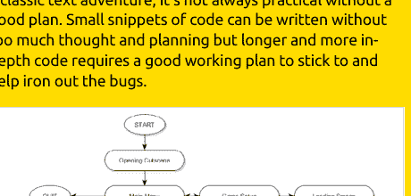

64 www.bdmpublications.com

## 用户错误

用户输入往往是代码中导致崩溃的错误。例如，用户应该输入年龄数字，却输入了字母。通常用户输入的内容过多会导致内部缓冲区溢出，从而引起代码崩溃。留意这些用户输入，并清除所需的任何状态。

```
Enter an integer number
You have entered wrong input
You have entered wrong input
You have entered wrong input
sdfas2312312
You have entered wrong input
1323s2x32x32x32x
The number is: 12
Process returned (0x0) execution time: 21.49 s
Press any key to continue.
```

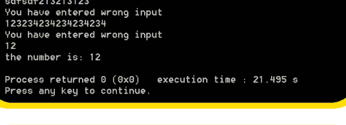

## 备份

始终对你的工作进行备份，并对你所做的任何更改进行二次备份。如果有良好的备份回溯，当出现问题时错误是可以纠正的。从上次离开的地方重新开始比从头开始容易得多。


## 重造轮子

你可能会花费好几天时间试图理解某部分代码以获得良好的结果，这既令人沮丧又往往浪费时间。虽然解决问题很有成就感，但互联网上通常已经有了相同的代码。不要重造轮子，看看是否已经有人做过了。

## 数据安全

如果你正在编写处理用户名、密码或其他敏感数据的代码，请确保数据不是明文的。学习创建一个函数，在将敏感数据输入可能会传输、存储或查看它的程序之前对其进行加密。


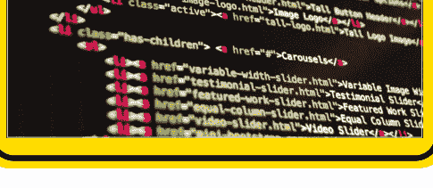

## 救命！

寻求帮助是我们大多数人过去挣扎过的事情。人们会嘲笑我们吗？能节省大家的时间吗？默默忍受是一种常见的错误。只要你的方式得当，遵守任何论坛规则或保持礼貌，你就无错。

| 提问问题 | | | | |
|---|---|---|---|---|
| 如何从 Python 列表中获取项 | 132 次查看 | 2 年前 | |
| 如何从 Python 字典中获取值 | 456 次查看 | 1 年前 | |
| 如何在 Python 中检查某项是否在列表中 | 890 次查看 | 3 年前 | |
| 如何在 python 列表中向列表末尾或开头添加项 | 210 次查看 | 2 年前 | |
| 如何对 pandas dataframe 中增加的列值应用函数 | 75 次查看 | 6 个月前 | |

# 数学

如果你编写数学计算，你需要确保数学逻辑是正确的。有数千个案例是因为糟糕的数学编码导致程序提供错误数据，根据代码的功能，这可能会产生灾难性的影响。双检你的代码方程。

```python
not terminal c
set bc
range = 5
complex(x,y) = (x+2, y+8)
for i in range(range):
    print(complex(i+1, i-1))
set range=0-5
set timescale 200
set de
set np
for i in range(0,0,100,10):
    print(i):
```

恭喜你，我们到达了你最新技术冒险的终点。在我们技术专家团队的帮助下，你已经回答了所有问题，建立了信心，并最终掌握了你遇到的任何问题。你现在可以自豪地宣布，你从不断变化的消费技术和软件世界中通过你的最新选择获得了最好的体验。

接下来是什么？你想开始一个新爱好吗？你正在寻找升级新设备吗？或仅仅是学习一项新技能？无论你的计划如何，我们都在这里提供帮助。只需查看我们丰富的入门指南，我们相信你将找到想要的。你与我们的冒险可能结束了，但并不意味着你的旅程结束了。每一个硬件或软件更新都会带来新功能和挑战，当然你已经知道我们会在这里提供。所以我们期待再次见到你。


# Black Dog Media

# 你的技术
从入门到专家

要了解更多技术信息请访问：
www.bdmpublications.com

# 免费技术指南


Apple iPhone、iPad、
Mac、MacBook & Watch

PC & Windows 10

Samsung & Android


摄影、
Photoshop & Lightroom


编程 Python、
树莓派 & Linux

# 我们的技术指南书
特惠优惠

- 印刷版与数字版
- 包含最新更新
- 由 BDM 专家编写的步骤步骤指南

查看我们的最新书籍！


# Ultimate Photoshop

bdmpublications.com/ultimate-photoshop
购买我们的 Photoshop 指南并免费下载素材！只需注册即可开启创意。


# 特别优惠
和额外内容

订阅我们的每月通讯邮件，
获取来自 BDM 的最新更新、优惠和新闻。我们在这里
帮助你掌握你的技术！
