# Linux 技巧与窍门

## Linux 编程与代码

Linux 编程技巧与提示是希望将技能提升到下一层级用户的完美数字出版物。你想增强用户体验吗？还是希望获得内幕知识？你想直接从该领域的专家那里学习吗？学习专业人士使用的众多快捷方式吗？在这本必不可少的高级用户指南的页面上，你将学会成为更自信、技能更娴熟且经验更丰富的所有者所需知道的一切。一个能充分享受编程使用并最终充分利用`Linux`本身的用户。你只需让我们专属地帮助你并教导你我们在数十年经验中获得的技能，即可实现这一成就。


> “Linux 不仅仅是个免费使用的操作系统。其独特的配置允许用户将操作系统定制和个性化为他们想要的任何形式。Linux 用户可以改变他们操作系统的外观和感受，从一天到另一天，安装数千个免费可用的应用程序和程序，并重新掌控他们的计算机。”


> “Python 是一个实验，看看程序员需要多少自由度。过多的自由度，没人能读懂别人的代码；过少的自由度，表达力就会受到危害。”
>
> – `Guido van Rossum`（`Python` 编程语言的开发者）

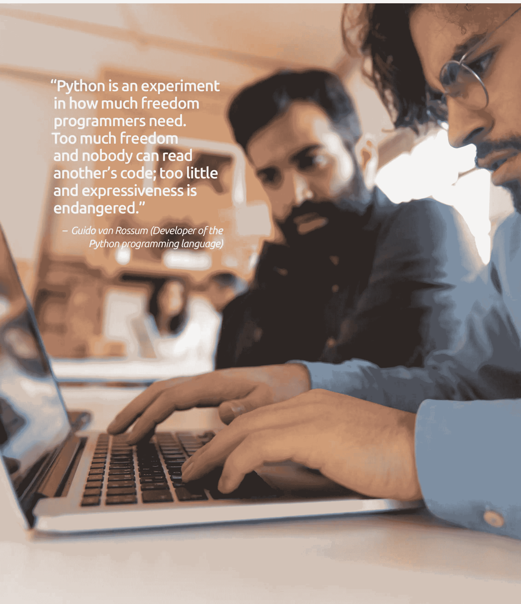

# Linux 上的 Python

`Python` 是一种很棒的编程语言，它结合了易用性和大量的功能，使用户能够创建小型实用程序或高性能计算任务。

然而，`Python` 不仅仅是另一种编程语言。它背后有一个充满活力的社区，分享知识、代码和项目创意，以及未来版本的 bug 修复。

我们在这本书的这一部分中使用了树莓派，因为它基于 `Linux` 并且是现有最好的编程平台之一。树莓派的功能使其成为完美的 `Python` 编程伙伴，所以让我们开始吧。

## 为什么选择 Python？

现代计算机有很多种不同的编程语言可用，有些仍然适用于较老的 8 位和 16 位计算机。其中一些语言用于科学工作，另一些用于移动平台等。那么，为什么要在其他语言中选择 `Python` 呢？

### Python 的力量

自从最早的家庭计算机问世以来，爱好者、用户和专业人士一直辛苦工作到深夜，在一堆发热的电路板上辛勤劳作，创造出类似魔法的东西。

这些编程先驱开辟了一条通往新领域的小径，锻造出小型例程，使字母“A”在屏幕上滚动。对于习惯了超高清图形和开放世界多人在线游戏的一代人来说，这可能听起来并不那么令人兴奋。然而，在四十多年前，它是令人目眩的辉煌。

自然，这些卧室程序员为今天我们使用的每件数字技术奠定了基础。有些人后来成为顶级软件公司的主开发者，而另一些人则将可用硬件推向极限，创立了不断令我们惊叹的十亿英镑游戏帝国。

无论你使用 `Android` 设备、`iOS` 设备、`PC`、`Mac`、`Linux`、智能电视、游戏机、`MP3` 播放器、汽车内置的 `GPS` 设备、机顶盒还是其他一千种互联和“智能”电器，它们背后都是编程。

上述所有数字设备都需要指令告诉它们做什么，并允许与之交互。这些指令构成了设备的编程核心，该核心可以使用各种编程语言构建。

当今使用的语言因情况而异，取决于其平台、设备的用途以及设备将如何与其

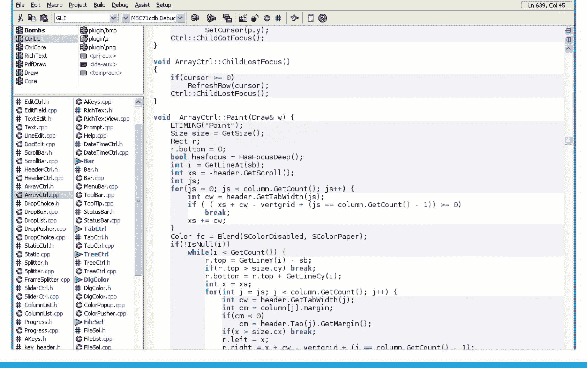

环境或用户交互。操作系统，如 `Windows`、`macOS` 等通常是一种 `C++`、`C#`、汇编和某种基于可视化的语言的组合。游戏通常使用 `C++`，而网页可以使用 `HTML`、`Java`、`Python` 等众多可用语言。

更通用的编程用于创建程序、应用程序、软件或你想称之为其他的任何东西。它们在所有硬件平台上广泛使用，并适用于几乎每一种可想象的应用。有些运行得比其他快，有些比其他更容易学习和使用。`Python` 是其中一种通用语言。

`Python` 被称为高级语言，因为它使用各种数组、变量、对象、算术、子例程、循环和无数更多交互与硬件和操作系统“对话”。虽然它不像低级语言那样流畅，低级语言可以直接处理内存地址、调用栈和寄存器，但其好处是它普遍可访问且易于学习。

```java
//File: Invoke.java
import java.lang.reflect.*;

class Invoke {
public static void main( string [] args ) {
try {
Class c = Class.forName( args[0] );
Method m = c.getMethod( args[1], new Class
[] { } );
Object ret = m.invoke( null, null );
System.out.println(
"Invoked static method: " + args[1]
+ " of class: " + args[0]
+ " with no args\nResults: " + ret );
} catch ( ClassNotFoundException e ) {
// Class.forName( ) can’t find the class
} catch ( NoSuchMethodException e2 ) {
// that method doesn’t exist
} catch ( IllegalAccessException e3 ) {
// we don’t have permission to invoke that
method
} catch ( InvocationTargetException e4 ) {
// an exception occurred while invoking that
method
System.out.println(
"Method threw an: " + e4.
getTargetException( ) );
}
}
```

`Java` 是一种强大的语言，用于网页、机顶盒、电视甚至汽车。


`Python` 是在二十多年前创建的，并演变为学习如何编程的理想入门语言。它非常适合业余爱好者、爱好者、学生、教师以及那些只需要在自身或外部硬件与计算机本身之间创建独特交互的人。

`Python` 可免费下载、安装和使用，适用于 `Linux`、`Windows`、`macOS`、`MS-DOS`、`OS/2`、`BEOS`、`IBM I` 系列机器，甚至 `RISC OS`。它被评为世界上前五的编程语言之一，并不断领先于硬件和互联网发展曲线。

所以，要回答这个问题：为什么选择 `Python`？简而言之，它是免费的，易于学习的，异常强大的，普遍接受的，有效的，以及绝佳的学习和教育工具。

```
40 LET py=15
70 FOR w=1 TO 10
75 CLE
80 LET b=INT ( RND*28)
80 LET bx=0
80 LET ds=1 TO 20
100 PRINT AT b, py;" U "
110 PRINT AT b, py;" O "
120 IF INKEY$="p" THEN LET py=py+1
130 IF INKEY$="u" THEN LET py=py-1
135 FOR n=1 TO 100: NEXT n
140 IF py<2 THEN LET py=2
150 IF py>27 THEN LET py=27
160 LET bx=bx+1
185 PRINT AT bx-1,by;" "
190 NEXT d
200 IF (by-1)=by THEN LET s=$+1
210 PRINT AT 10,10;"s;score=";s
220 NEXT v=1 TO 1000: NEXT v
300 NEXT w
@ OK, @: 1
```

`BASIC` 曾经是早期 8 位家用计算机用户学习的入门语言。


```python
print(f(HANGMAN))
attempts = 1n(HANGMAN)

while (attempts <= 9 and " 
in word_guessed):
    print(("You have ") + attempts_remaining)).format(attempts))
    joined_word = " ".join(word_guessed)
    print(joined_word)
    try:
        player_guess = input(("Please select a letter between A-Z" or "Uo")
        
    except:  # Check valid input.
        print("That is not valid input. Please try again.")
        continue

    else:
        if not player_guess.isalpha():  # Check if input is a letter. Also check a
            print("That is not a letter. Please try again.")
            continue
        elif len(player_guess) > 1:  # Check if input is only one letter
            print("That is more than one letter. Please try again.")
            continue
        elif player_guess in guessed_letters:  # Check if letter hasn't been guessed
            print("You have already guessed that letter. Please try again.")
            continue

        else:
            pass
        
    guessed_letters.append(player_guess)

    for letter in range(len(chosen_word)):
        if player_guess == chosen_word[letter]:
            word_guessed[letter] = player_guess  # replace all letters in the chosen

    if player_guess not in chosen_word:
```

Python 是对 BASIC 的更现代化解读，它易于学习，是理想的入门编程语言。

## 如何在 Linux 中设置 Python

虽然 Raspberry Pi 的操作系统包含最新稳定版的 Python，但其他 Linux 发行版并未预装 Python 3。如果你不打算采用 Pi 路线，以下是检查并在 Linux 中安装 Python 的方法。

### 企鹅与 PYTHON

Linux 是一个功能极其强大的操作系统，以至于往往很难确定某项操作的唯一执行方式。不同的发行版通过不同的方式安装软件，因此本教程将使用 Linux Mint。

- **步骤 1**  

首先，你需要确定当前 Linux 系统中安装了哪个版本的 Python。为此，可以从发行版的菜单进入终端会话，或按下 `Ctrl+Alt+T` 键。

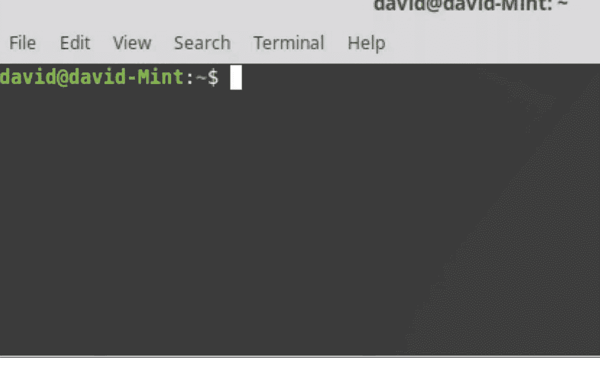

- **步骤 2**  

接着在终端中输入 `python --version`。你应该会在显示中看到与 Python 2.x 版本相关的输出。默认情况下，大多数 Linux 发行版同时自带 Python 2 和 3，因为目前仍有许多 Python 2 的代码可用。然后输入：`python3 --version`。

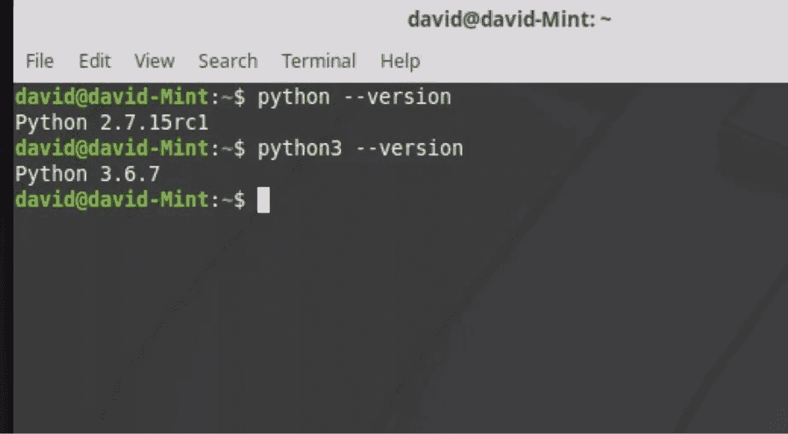

- **步骤 3**  

在我们这个案例中，Python 2 和 3 均已安装；只要安装了 Python 3.x，我们教程中的代码就可以运行。检查发行版是否已更新至最新版本总是值得的，因此输入 `sudo apt-get update && sudo apt-get upgrade` 来更新系统。

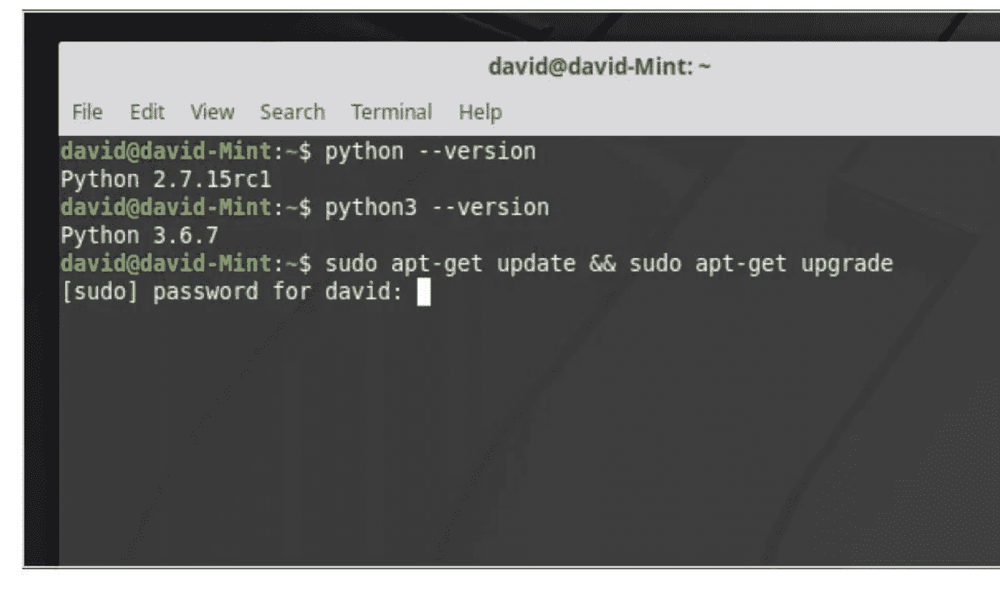

- **步骤 4**  

更新和升级完成后，再次输入 `python3 --version` 以查看 Python 3.x 是否已更新或安装；只要你拥有 Python 3.x，你就正在使用最新的重大版本。3. 后面的数字表示补丁和进一步的更新。通常这些是不必要的，但可能包含重要的新元素。

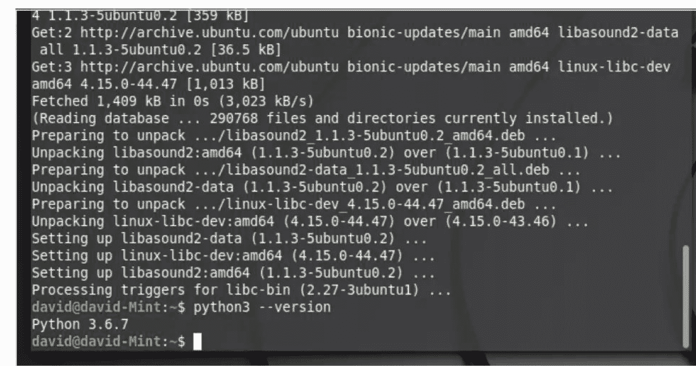

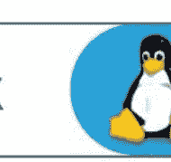

然而，如果你想要最新的前沿版本，你需要从源代码构建 Python。首先将这些命令输入到终端中：

- **步骤 5**

```bash
sudo apt-get install build-essential checkinstall
sudo apt-get install libssl-dev liblz2-dev libncurses5-dev libssl-dev libgdbm libsqlite3-dev tk-dev
libtcl-dev-dev libbz2-dev libg2z2-dev
```

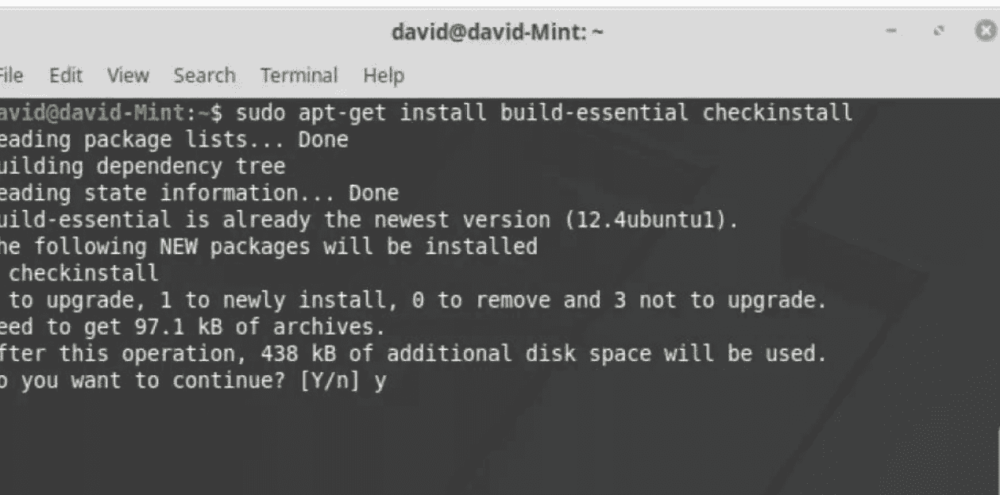

- **步骤 6**

打开你的 Linux 网络浏览器，前往 Python 下载页面：`www.python.org/downloads`。点击 `Downloads`，然后是 `Python Source` 窗口下方的按钮。这将打开一个下载对话框；选择一个位置并开始下载过程。

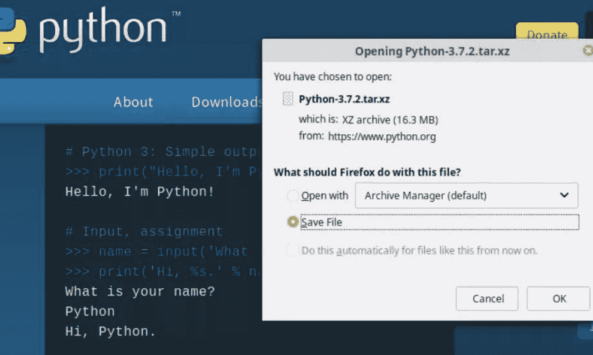

- **步骤 7**

在终端中，通过输入 `cd Downloads/` 进入 `Downloads` 文件夹。然后使用 `tar -xvf Python-3.Y.Y.tar.xz` 解压下载的 Python 源代码内容，将 `Y` 替换为你下载的版本号。现在使用 `cd Python-3.Y.Y/` 进入新解压的文件夹。

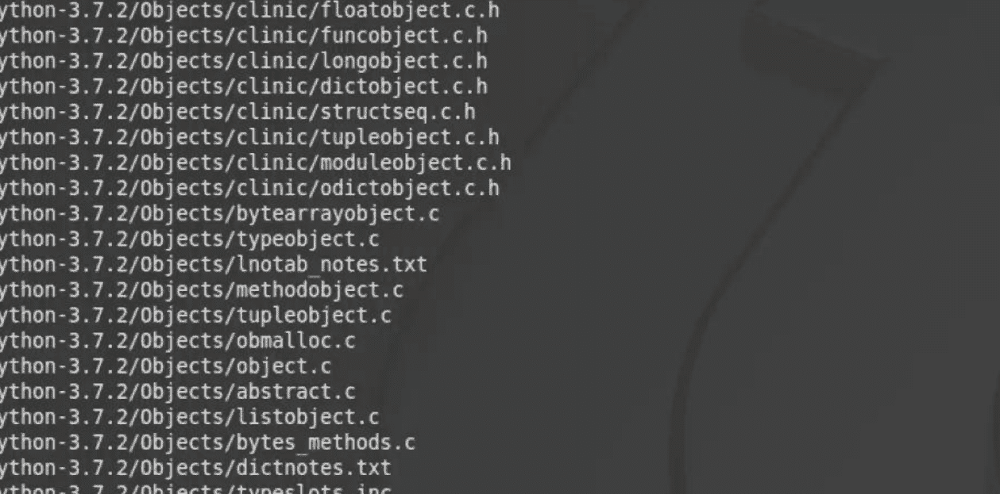

- **步骤 8**

在 `Python` 文件夹内，输入：

```bash
./configure
sudo make altinstall
```

根据计算机速度，这可能花费一些时间。完成后，输入 `python3.7 --version` 以检查安装的最新版本。你现在已安装了 Python 3.7，与较旧的 Python 3.x.x 和 Python 2 并存。

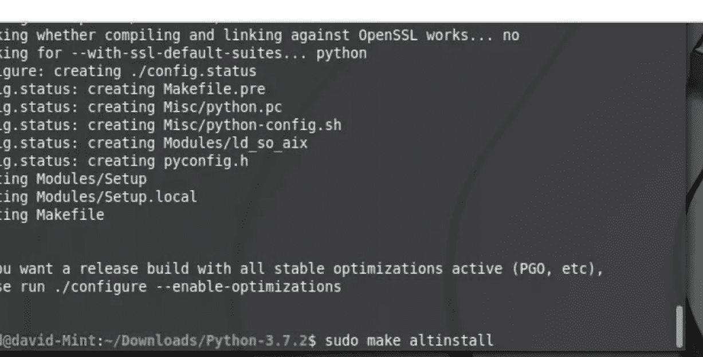

- **步骤 9**

对于 `GUI IDLE`，你需要在终端中输入以下命令：

```bash
sudo apt-get install idle3
```

然后可以使用命令 `idle3` 启动 `IDLE`。请注意，`IDLE` 运行的版本与从源代码安装的版本不同。

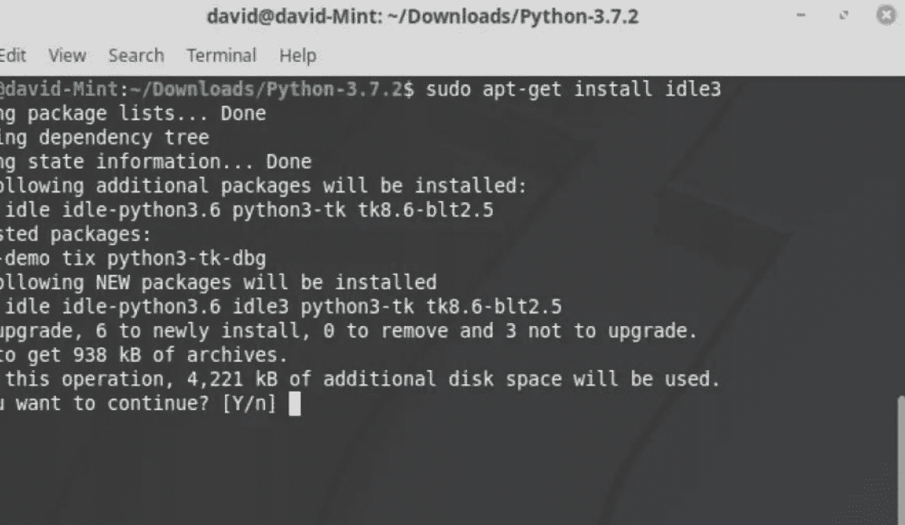

- **步骤 10**

你还需要 `PIP`（`Pip Installs Packages`），它是一个帮助你安装更多模块和附加组件的工具。

输入：`sudo apt-get install python3-pip`

当 `PIP` 安装完成后，使用以下命令检查最新更新：`pip3 install --upgrade pip`

完成后，关闭终端，`Python 3.x` 将通过发行版菜单中的 `Programming` 部分可用。

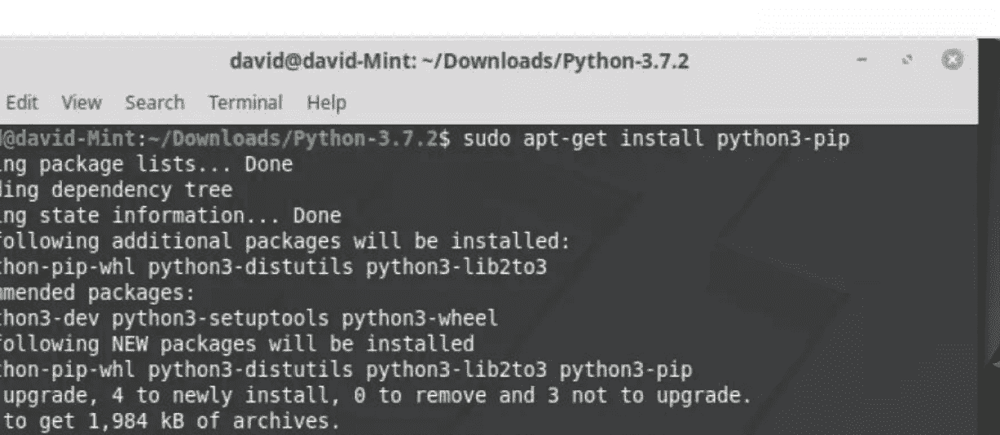

## 首次启动 Python

如果你使用的是新款 `Raspberry Pi` 及其最新发布的 `Pi OS`，你需要手动安装 `Python IDLE`。这是因为 `Pi` 团队移除了核心 `Python IDLE`，转而采用他们自己的代码文本编辑器。

### 启动 PYTHON

对于使用 `Pi4` 和新的 `Raspbian` 的用户，进入终端并输入：`sudo apt-get install idle3`。旧版本的 `Raspbian` 已预装官方 `Python IDLE`。

- **步骤 1**


## 加载 Raspbian 桌面

加载 `Raspbian` 桌面后，点击 `Menu` 按钮，然后选择 `Programming > Python 3 (IDLE)`。这将打开 `Python 3 Shell`。`Windows` 和 `Mac` 用户可以在 `Windows` 开始按钮菜单内以及通过 `Finder` 找到 `Python 3 IDLE Shell`。

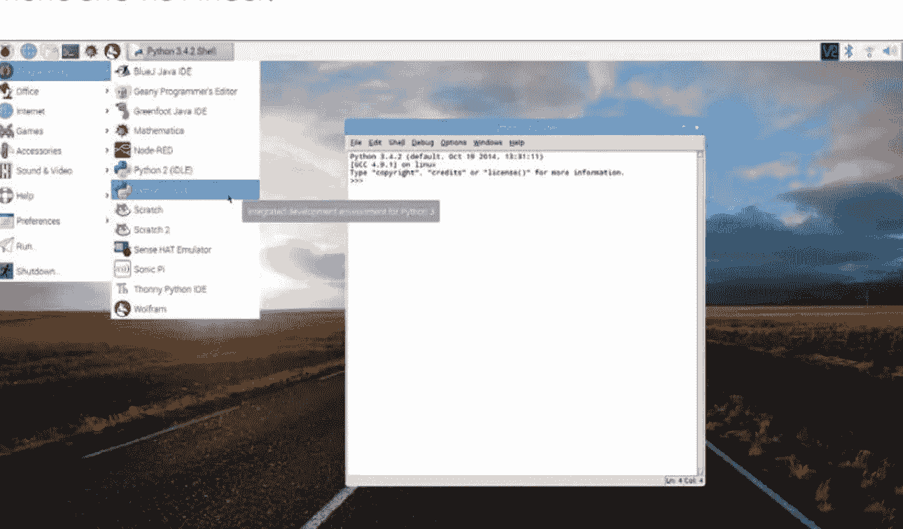

### 步骤 2

`Shell` 是你可以输入代码并查看代码响应和输出的地方。这是一种沙箱，你可以在此尝试一些简单的代码和过程。

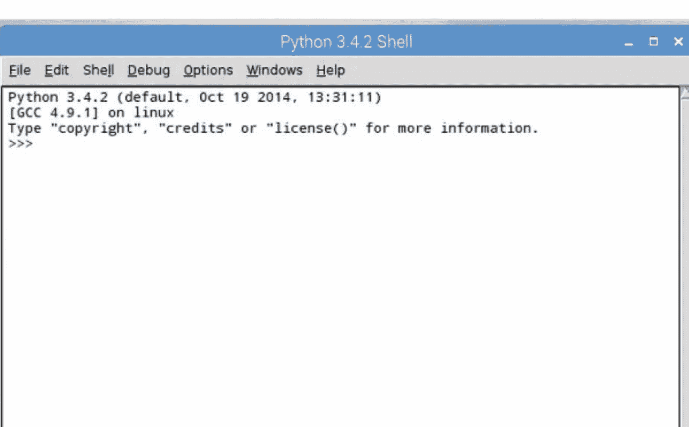

### 步骤 3

例如，在 `Shell` 中输入：`2+2`。按下回车后，下一行将显示答案：`4`。基本上，`Python` 接受了“代码”并产生了相关的输出。

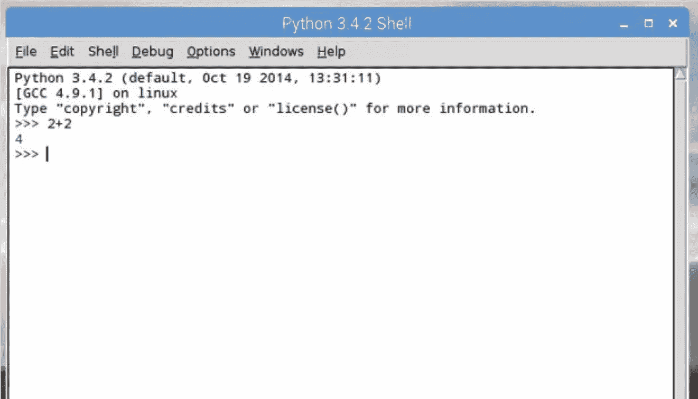

### 步骤 4

`Python Shell` 的行为非常像计算器，因为代码基本上是与系统的一系列数学交互。整数（无限序列的整数）可以轻松地相加、相减、相乘等。

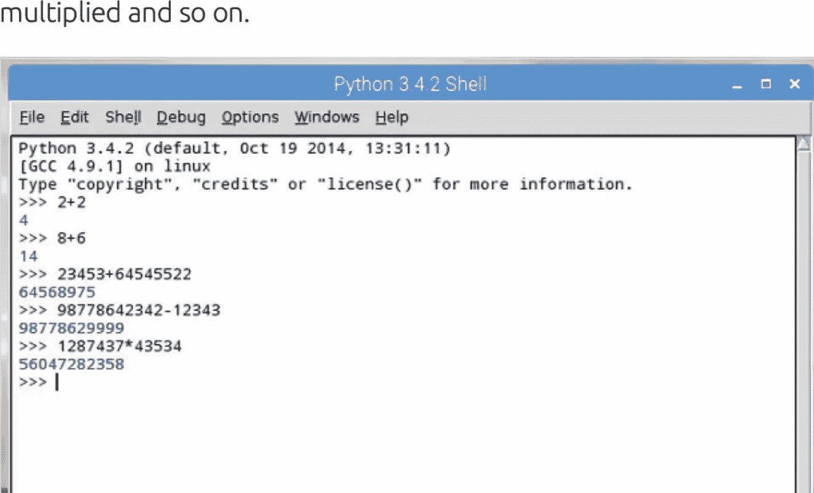

### 步骤 5

虽然这很有趣，但并不特别令人兴奋。相反，请尝试这个：

`print("Hello everyone!")`

只需像前几步一样将其输入到 `IDLE` 中即可。

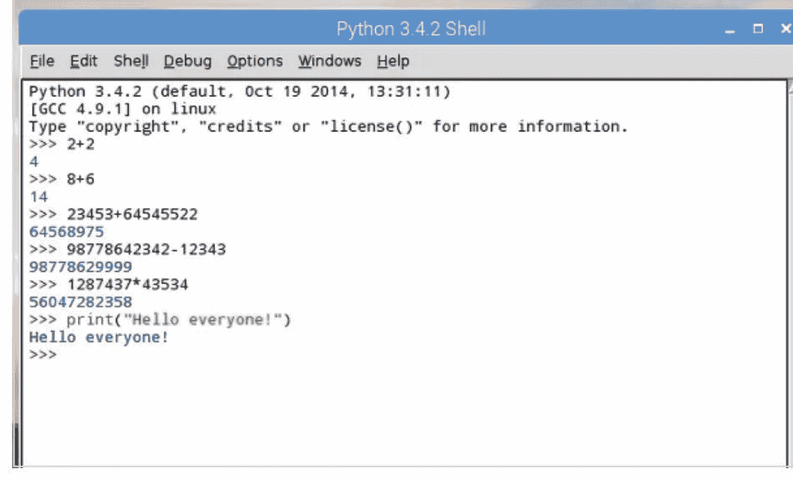

### 步骤 6

这更有意思，因为你刚刚编写了第一段代码。`Print` 命令相当直观，它打印内容。`Python 3` 需要括号和引号才能将内容输出到屏幕，在本例中是 `Hello everyone!` 部分。

```python
>>> print("Hello everyone!")
Hello everyone!
>>> 
```

### 步骤 7

你可能已经注意到 `Python IDLE` 内的颜色编码。这些颜色代表 `Python` 代码的不同元素。它们如下：

- `黑色` – 数据和变量
- `绿色` – 字符串
- `紫色` – 函数
- `橙色` – 命令
- `蓝色` – 用户函数
- `深红色` – 注释
- `浅红色` – 错误消息

#### IDLE 颜色编码

| 颜色 | 用途 | 示例 |
| :--- | :--- | :--- |
| 黑色 | 数据与变量 | `23.6` `<area` |
| 绿色 | 字符串 | `"Hello World"` |
| 紫色 | 函数 | `len()` `print()` |
| 橙色 | 命令 | `if` `for` `else` |
| 蓝色 | 用户函数 | `get_area()` |
| 深红色 | 注释 | `#Remember VAT` |
| 浅红色 | 错误消息 | `SyntaxError:` |

### 步骤 8

`Python IDLE` 是一个可配置的环境。如果你不喜欢颜色表示的方式，你始终可以通过 `Options > Configure IDLE` 并点击 `Highlighting` 选项卡来更改它们。然而，我们不建议你这样做，因为你看到的效果将与我们截图中的不同。

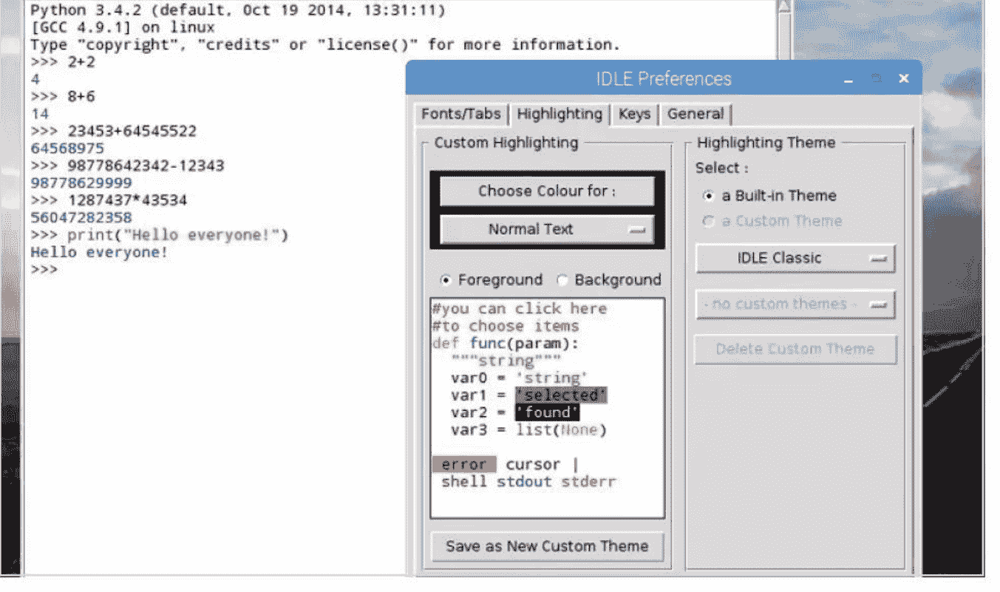

### 步骤 9

与大多数可用的程序一样，无论操作系统如何，都有许多快捷键可用。这里没有空间列出所有快捷键，但在 `Options > Configure IDLE` 的 `Keys` 选项卡下，你可以看到当前绑定列表。

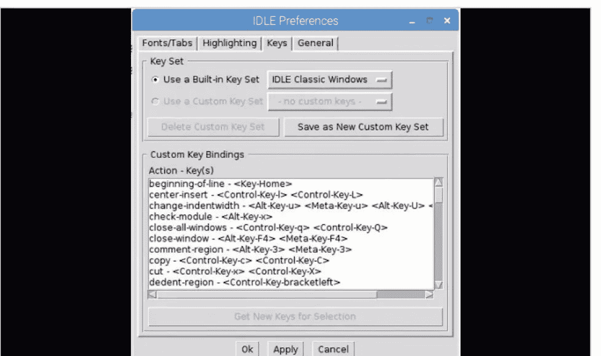

### 步骤 10

`Python IDLE` 是一个强大的接口，实际上是用 `Python` 编写的，使用了可用的 `GUI` 工具包之一。如果你想知道 `Shell` 的许多细节，我们建议花几分钟时间查看 `www.docs.python.org/3/library/idle.html`，其中详细说明了 `IDLE` 的许多功能。

```
25.5.5. IDLE
Source code: Lib/idle
This file is part of Python's Integrated Development and Learning Environment...
* **25.5.1. Main menu**
* **25.5.1.1. File menu (Shell and Editor)**
* **25.5.1.2. Edit menu**
```

## 你的第一段代码

严格来说，在上一教程中通过 `print("Hello everyone!")` 函数，你已经写过你的第一行代码了。不过，让我们在此基础上进一步拓展，看看如何输入代码，并尝试使用其他一些 `Python` 示例进行练习。

### 玩转 Python

对于大多数语言，无论是计算机语言还是自然语言，关键在于记住并在合适的情况下使用正确的词汇。你生来并不了解这些词汇，因此需要学习它们。

#### 步骤 1

如果你已经关闭了 `Python 3 IDLE`，请在你偏好的操作系统版本中重新打开它。在 `Shell` 中，输入以下熟悉的内容：

```python
print("Hello")
```

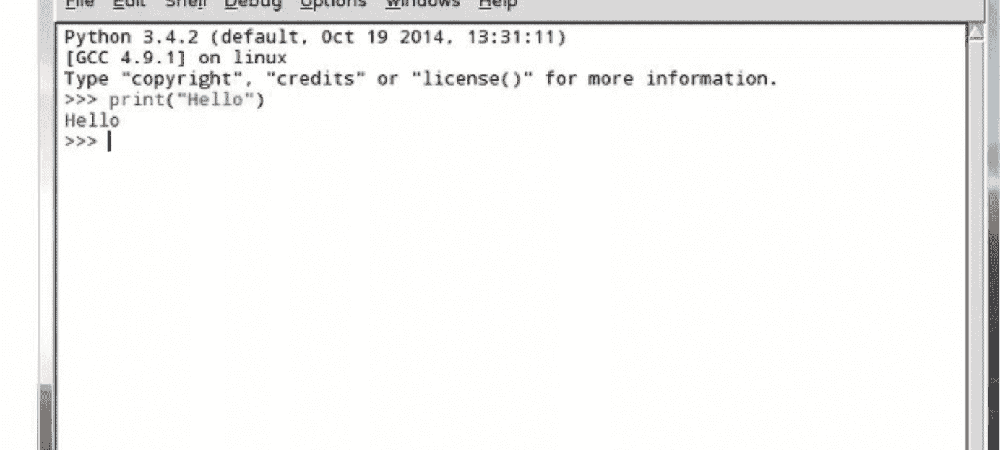

#### 步骤 2

正如预测的那样，单词 `Hello` 以蓝色文本的形式出现在 `Shell` 中，表明这是来自字符串的输出。这相当简单，不需要太多解释。现在尝试以下操作：

```python
print("2+2")
```

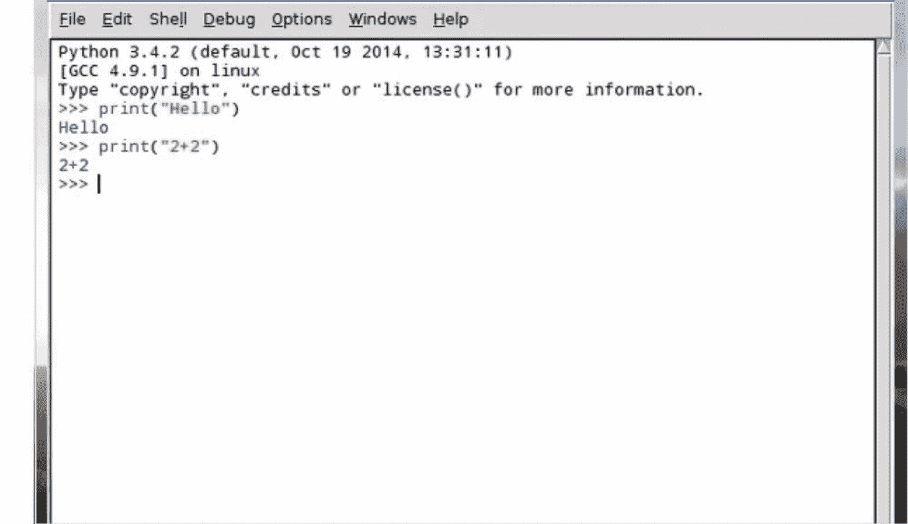

#### 步骤 3

你可以看到，输出结果并不是数字 `4`，而是你要求打印到屏幕上的 `2+2`。引号定义了要在 `IDLE Shell` 中输出的内容；若要打印 `2+2` 的总和，你需要去掉引号：

```python
print(2+2)
```

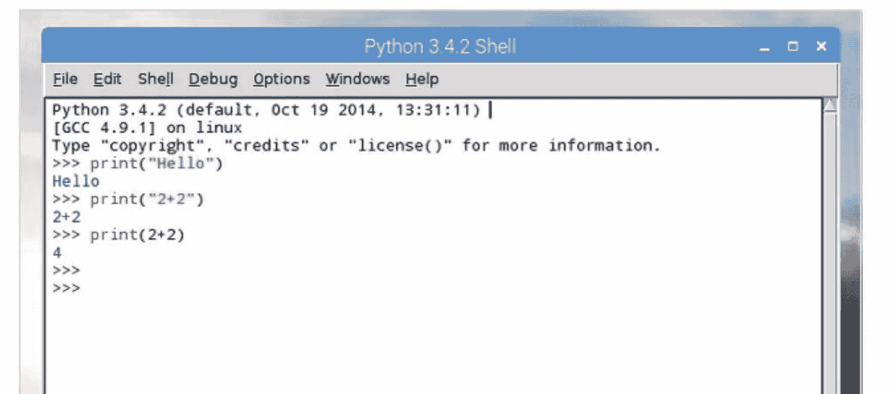

#### 步骤 4

你可以照此继续，将 `2+2`、`464+2343` 等内容打印到 `Shell` 中。一种更简便的方法是使用变量，我们将在后续章节中更深入地探讨变量。现在，请输入：

```python
a=2
b=2
```

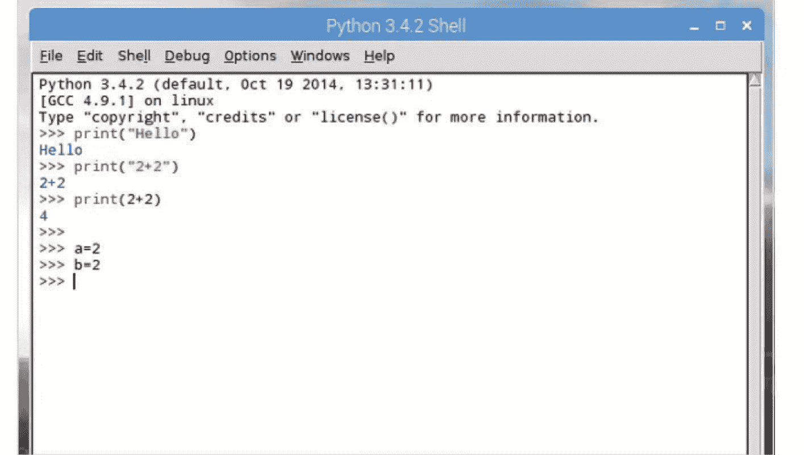

#### 步骤 5

你所做的是将字母 `a` 和 `b` 分别赋值为两个数值：`2` 和 `2`。它们现在成了变量，只要它们的数值保持不变，`Python` 就可以调用它们进行输出、加法、减法、除法等运算。试试这个：

```python
print(a)
print(b)
```

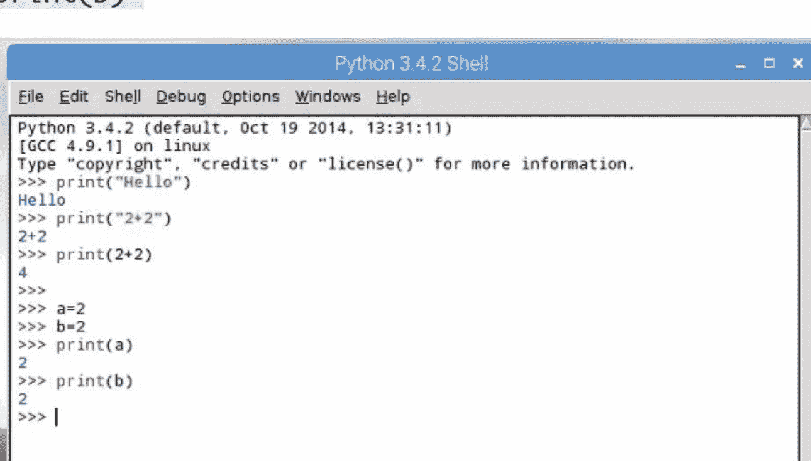

#### 步骤 6

上一步的输出分别显示了 `a` 和 `b` 的当前值，因为你让它们分别打印。如果你想把它们加起来，可以使用以下代码：

```python
print(a+b)
```

这段代码简单地获取 `a` 和 `b` 的值，将它们相加并输出结果。

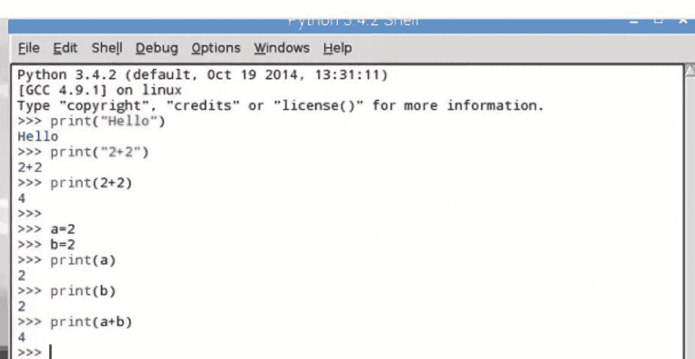

#### 步骤 7

你可以使用不同类型的变量和 `Print` 函数进行各种尝试。例如，你可以为某人的名字分配变量：

```python
name="David"
print(name)
```

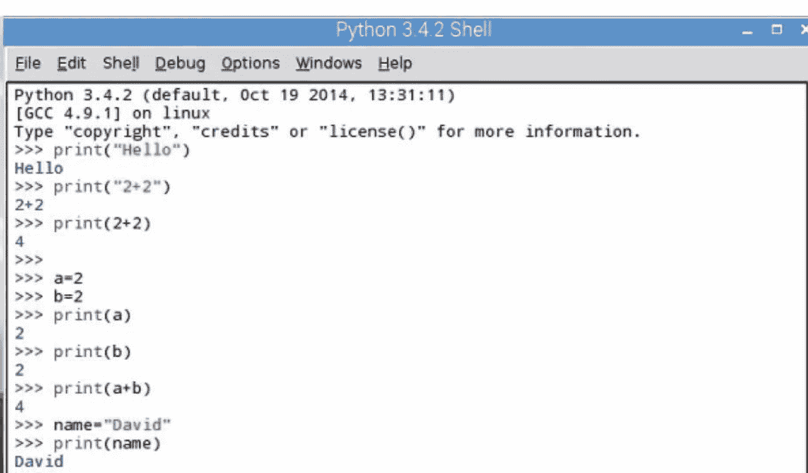

#### 步骤 8

现在让我们加上姓氏：

```python
surname="Hayward"
print(surname)
```

你现在拥有了两个变量，分别包含名字和姓氏，并且可以独立地打印它们。

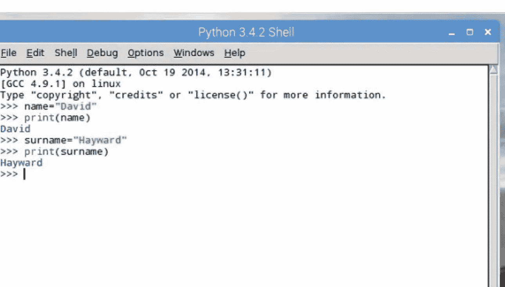

#### 步骤 9

如果我们套用之前的步骤，使用 `+` 号，名字不会在 `Shell` 的输出中正确显示。试试看：

```python
print(name+surname)
```

你需要在两者之间加一个空格，将它们定义为两个独立的值，而不是进行数学运算的对象。

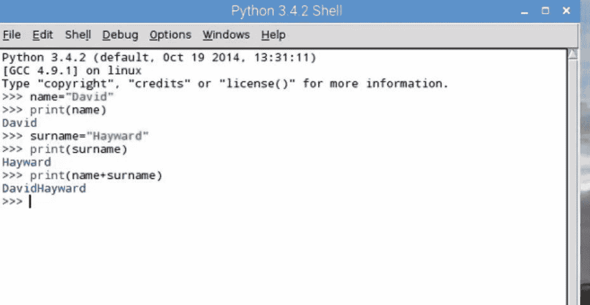

#### 步骤 10

在 `Python 3` 中，你可以使用逗号加空格来分隔两个变量：


```python
print(name, surname)
```

或者，你可以手动添加空格：

```python
print(name+" "+surname)
```

如图所示，使用逗号的方式要整洁得多。恭喜你，你迈出了进入广阔 Python 世界的第一步。

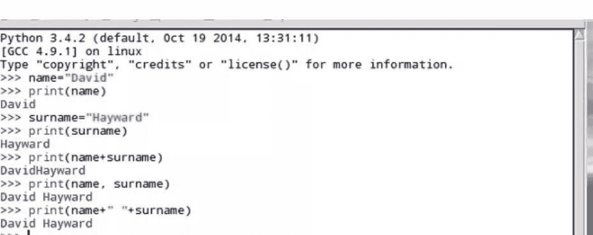

## 保存和运行你的代码

在 `IDLE Shell` 中处理短小代码片段完全没问题，但它并非为输入较长的程序列表而设计。在本节中，你将熟悉 `IDLE` 编辑器，从现在起你将在其中进行操作。

### 编辑代码

最终，你会达到必须停止向 `Shell` 输入单行代码的地步。相反，`IDLE` 编辑器允许你保存并运行你的 Python 代码。

- `步骤 1`

  首先，打开 Python `IDLE Shell`，当它启动后，点击“文件” > “新建文件”。这将打开一个名为“未命名”的新窗口。这就是 Python `IDLE` 编辑器，你可以在其中输入创建未来程序所需的代码。

- `步骤 2`

  `IDLE` 编辑器实际上就是一个具有 Python 特性（如颜色编码等）的简单文本编辑器，其风格类似于 `Sublime`。你在其中输入代码的方式与在 `Shell` 中相同，因此按照上一教程的示例，输入：

  ```python
  print("Hello everyone!")
  ```

- `步骤 3`

  你可以看到，`IDLE` 编辑器中也使用了与 `Shell` 相同的颜色编码，这有助于你更好地理解代码的运行情况。不过，要运行代码，你需要先保存它。按下 `F5` 键，会出现一个“保存...”选项框。

- `步骤 4`

  点击“保存”框中的“确定”按钮，并选择保存所有 Python 代码的位置。该位置可以是一个名为 `Python` 的专用文件夹，也可以是你喜欢的任何地方。不过请记住保持驱动器整洁，以便日后管理方便。

  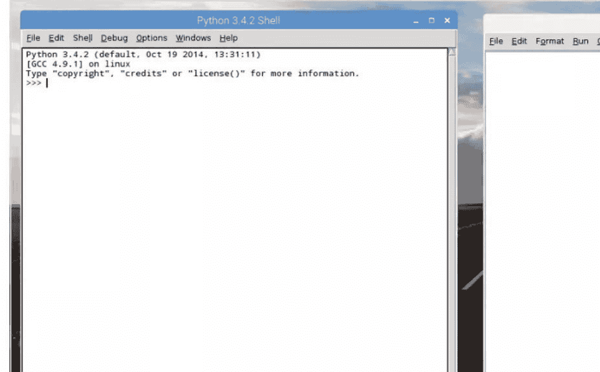

  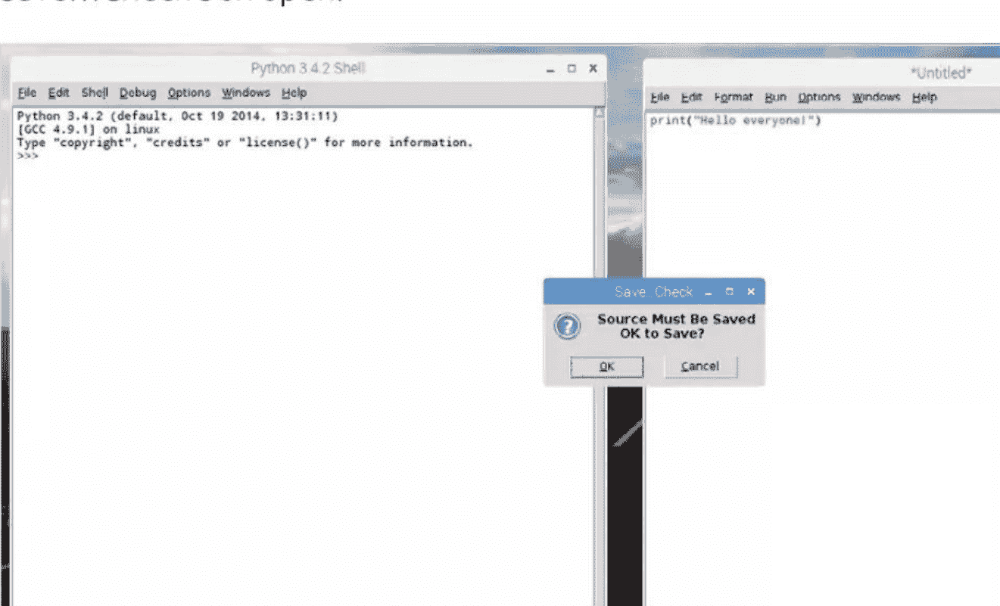

  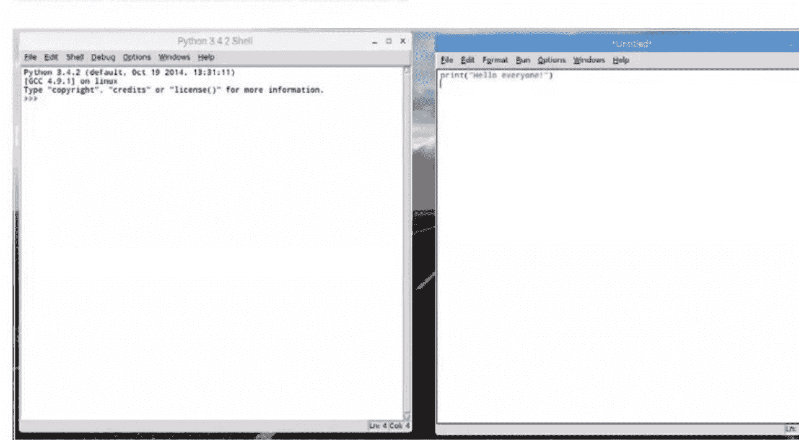

  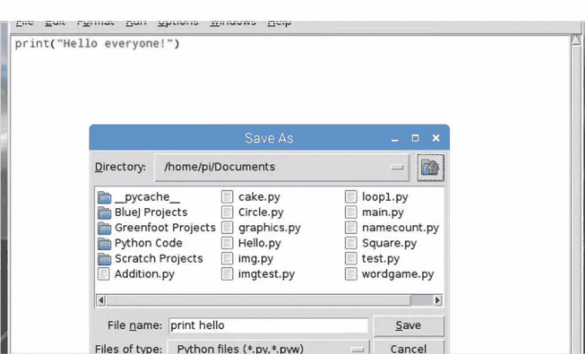

- `步骤 5`

  为你的代码输入一个名称，例如“print hello”，然后点击“保存”按钮。Python 代码保存后会自动运行，输出结果将显示在 `IDLE Shell` 中。在这种情况下，输出结果是单词“Hello everyone!”。

  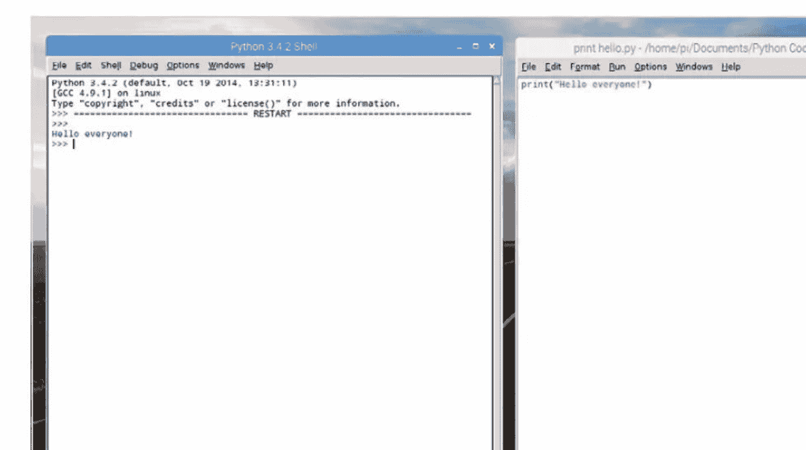

- `步骤 6`

  你绝大多数的 Python 代码都会按此流程处理：在编辑器中输入代码，按 `F5`，保存代码，并在 `Shell` 中查看输出。有时细节会有所不同，这取决于你是否请求了单独的窗口，但本质流程不变。除非另有说明，我们将在此书中全程使用这一流程。

  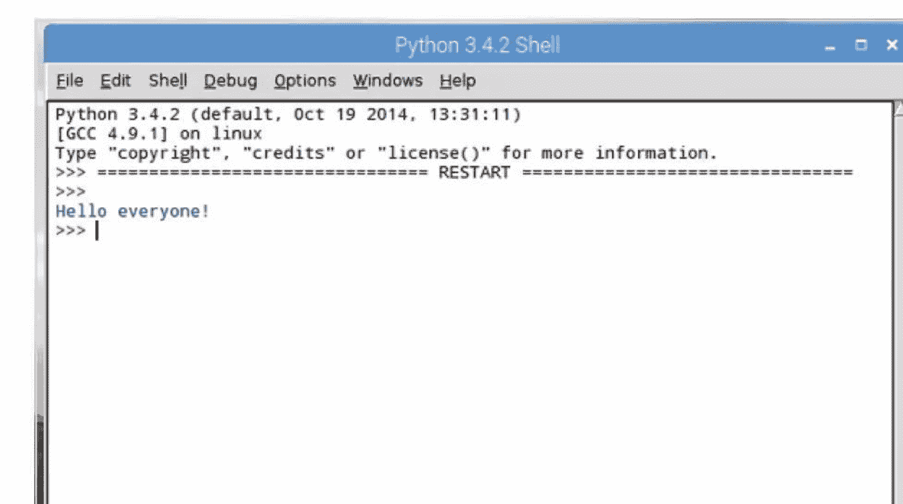

- `步骤 7`

  如果你打开已保存的 Python 代码的文件位置，可以看到它以一个 `.py` 扩展名结尾。这是默认的 Python 文件名。你创建的任何代码都将是 `whatever.py`，而从众多互联网 Python 资源网站下载的代码也都会是 `.py` 文件。只需确保代码是为 Python 3 编写的即可。

  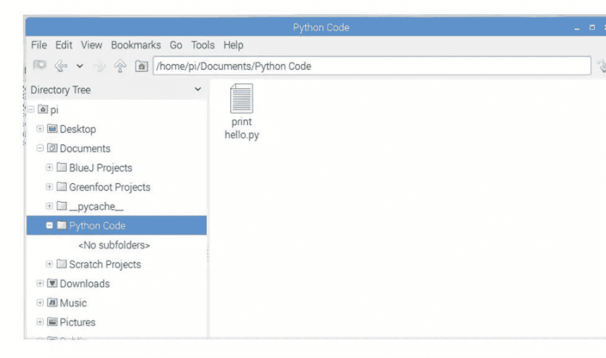

- `步骤 8`

  让我们扩展代码，并输入上一教程中的几个示例：

  ```python
  a=2
  b=2
  name="David"
  surname="Hayward"
  print(name, surname)
  print (a+b)
  ```

  此时如果你按下 `F5`，系统会再次提示你保存文件，因为它已被修改。

  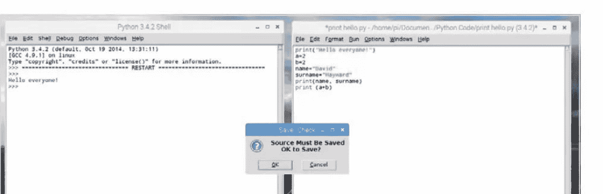

- `步骤 9`

  如果你点击“确定”按钮，文件将被新代码覆盖并执行，输出结果将显示在 `Shell` 中。虽然这里只有几行代码，问题不大，但如果你正在编辑一个较大的文件，覆盖旧文件可能会成为问题。相反，请在编辑器中使用“文件” > “另存为”来创建备份。

  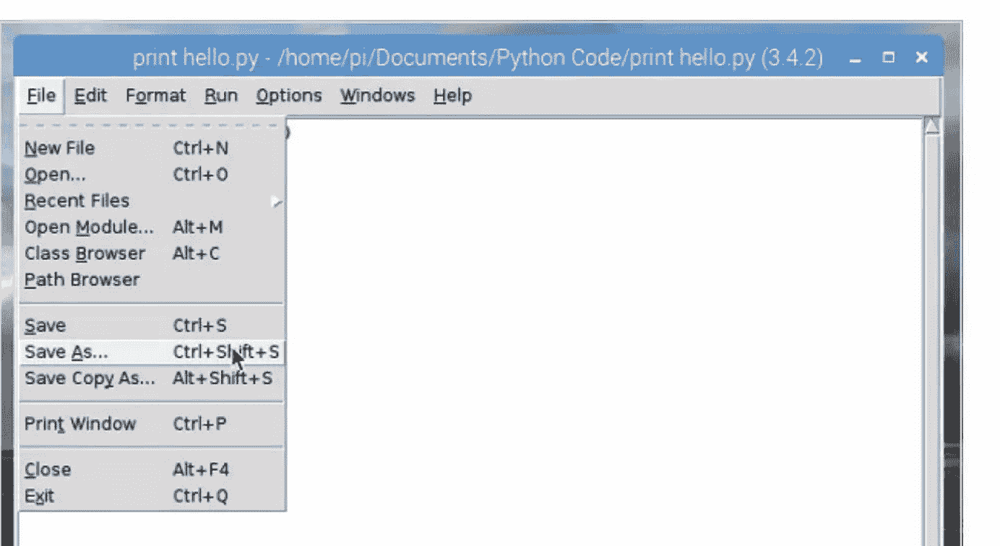

- `步骤 10`

  现在创建一个新文件。关闭编辑器，打开一个新实例（从 `Shell` 中选择“文件” > “新建文件”）。输入以下内容，并将其保存为 `hello.py`。

  ```python
  a="Python"
  b="is"
  c="cool!"
  print(a, b, c)
  ```

  你将在下一个教程中使用这段代码。

  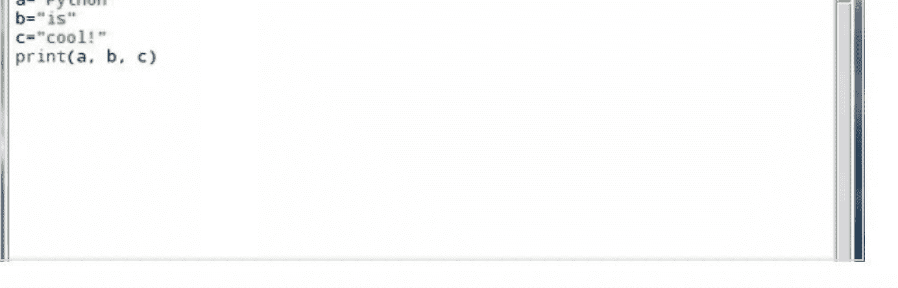

## 在 Linux 上使用 Python

### 从终端运行代码

虽然在本书中我们一直基于图形用户界面（`GUI`）的 `IDLE` 进行操作，但了解 Python 的命令行处理也是很有必要的。我们已经知道 Python 有命令行版本，它同样用于执行代码。

### 用命令控制代码

使用我们在上一教程中创建的代码（即我们命名为 `hello.py` 的文件），让我们看看如何在命令行层级运行在 `GUI` 中创建的代码。

- `步骤 1`

  在 `Linux` 系统中，Python 提供了两种通过命令行执行代码的方式。一种使用 Python 2，另一种则使用 Python 3 库等。首先，请进入你操作系统的命令行或终端。

  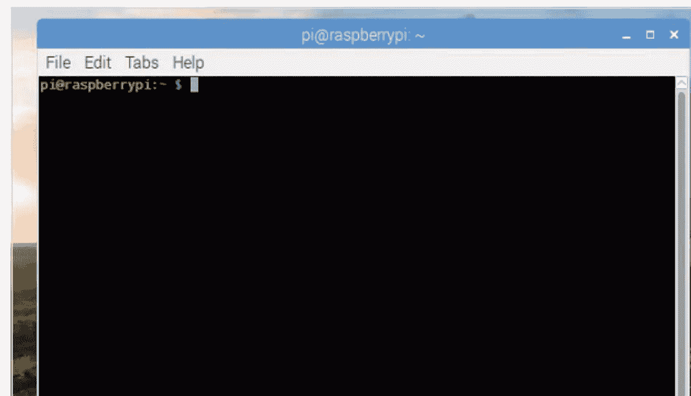

- `步骤 2`

  和之前一样，我们使用的是树莓派（`Raspberry Pi`）：`Windows` 用户需要点击“开始”按钮并搜索 `CMD`，然后点击搜索结果中的“命令行”；`macOS` 用户可以通过点击“前往” > “实用工具” > “终端”来访问命令行。

  

- `步骤 3`

  现在你已经进入命令行，可以启动 Python 了。对于 Python 3，你需要输入命令 `python3` 并按下回车键。这将把你带入 `Shell` 的命令行版本，光标是熟悉的三个向右箭头（`>>>`）。

  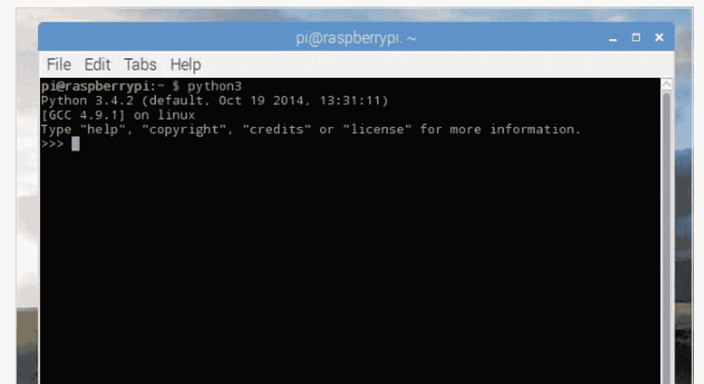

- `步骤 4`

  在此，你可以输入之前看过的代码，例如：

  ```python
  a=2
  print(a)
  ```

  你可以看到，它的运行方式完全相同。

  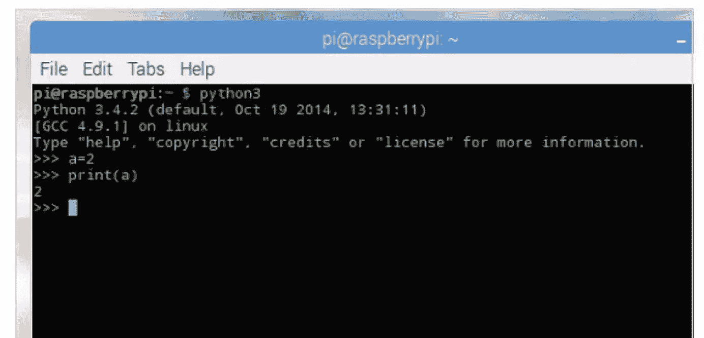

## 从终端执行代码

- `步骤 5`

  现在输入：`exit()` 以退出命令行 Python 会话并返回到命令提示符。进入你保存了上一教程代码的文件夹，并列出其中的可用文件；希望你应该能看到 `hello.py` 文件。

  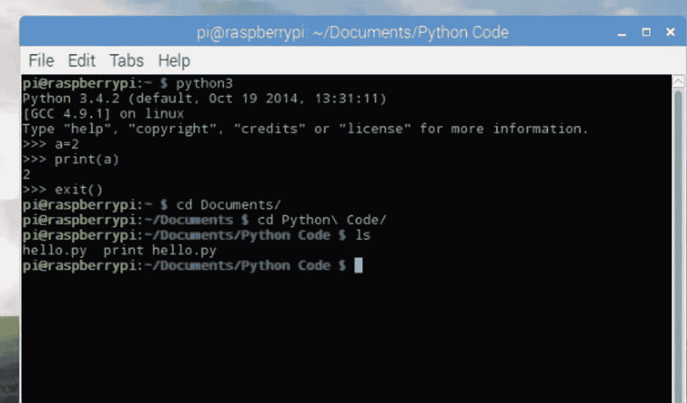

- `步骤 6`

  在与你要运行的代码相同的文件夹中，在命令行输入以下内容：

  ```
  python3 hello.py
  ```

  这将执行我们创建的代码，提醒你一下，它是这样的：

  ```python
  a="Python"
  b="is"
  c="cool!"
  print(a, b, c)
  ```

  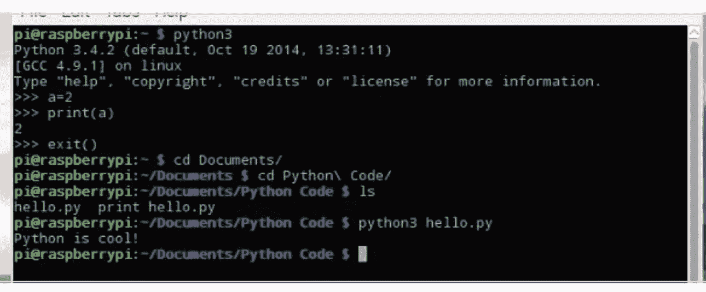

- `步骤 7`

  自然地，由于这是 Python 3 代码，使用了 Python 3 特有的语法和布局，它只在你使用 `python3` 命令时才有效。如果你愿意，可以尝试通过输入以下内容在 Python 2 中执行相同的操作：

  ```
  python hello.py
  ```

  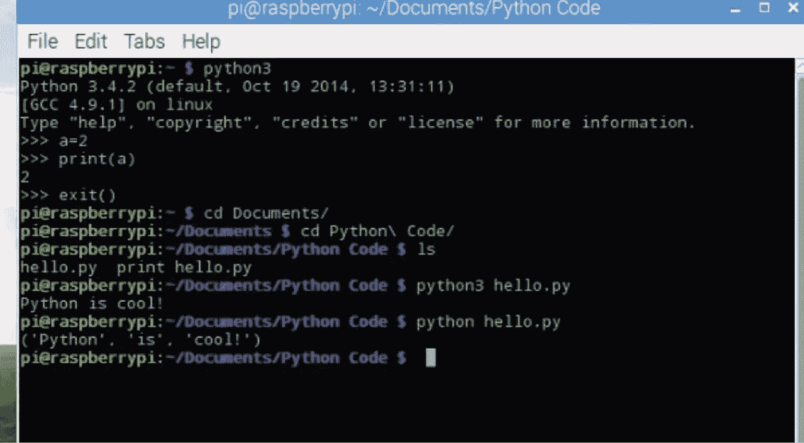

- `步骤 8`

  从 `python3` 命令行运行 Python 3 代码的结果是相当明显的。虽然它不会以任何方式报错，但由于 Python 3 处理 `Print` 命令的方式与 Python 2 不同，结果并不像我们预期的那样。暂时使用 `Sublime`，打开 `hello.py` 文件。

  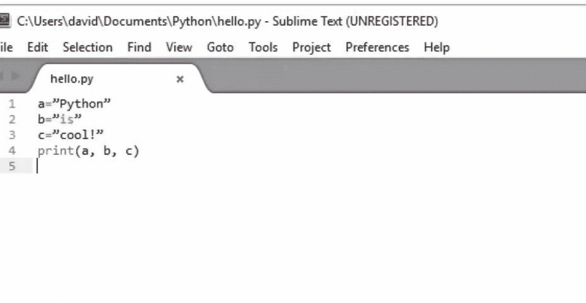


- **步骤 9** 由于 Sublime Text 在树莓派上不可用，你暂时会离开树莓派，使用 Sublime 作为一个示例，说明你并不一定要使用 Python IDLE。在打开 `hello.py` 文件后，将其修改为包含以下内容：

```python
name = input("What is your name? ")
print("Hello,", name)
```

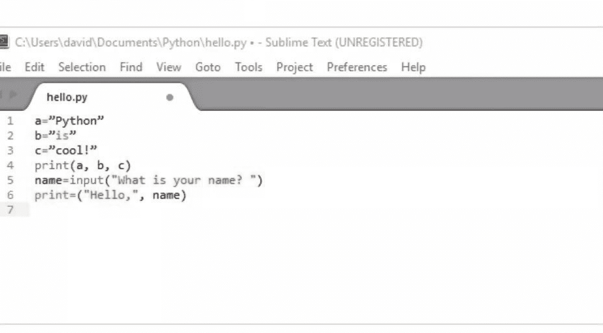

- **步骤 10** 保存 `hello.py` 文件并返回到命令行。现在使用以下内容执行新保存的代码：

```
python3 hello.py
```

结果将是原始的“Python is cool”语句，以及新增的 `input` 命令询问你的名字，并在命令窗口中显示它。

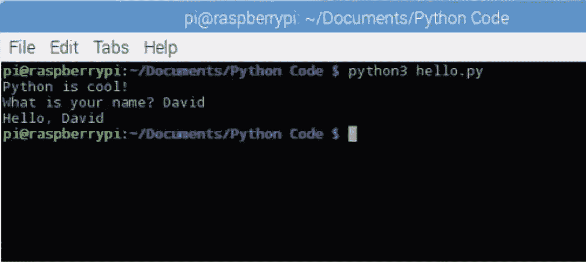

## 太空侵略者

得分 1,337

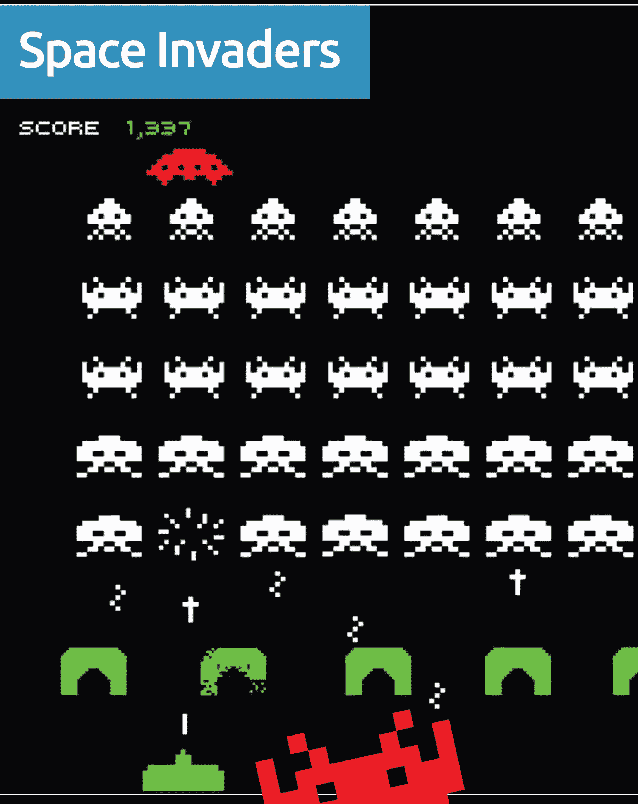


### 你知道吗……

当《太空侵略者》的创造者西角泰宏（Tomohiro Nishikado）编写《太空侵略者》时，他不得不创建自己的硬件和开发工具来编写该游戏。此外，他后来发现，由于编码和定制硬件的原因，屏幕上的侵略者越少，处理器渲染它们的速度就越快。因此，当你消灭更多的侵略者时，它们变得越快。所以，他没有设计游戏来补偿这种速度增加，而是决定保留它作为一种具有挑战性的游戏玩法机制。

> 侵略者变得越来越快，而屏幕上的数量却越来越少，这完全是个意外。

# Linux 上的 Python

### 数字和表达式

我们见过一些使用 Python 的基本数学表达式，如简单的加法等。现在让我们扩展一下，看看 Python 作为计算器有多么强大。你可以在 IDLE 外壳或编辑器中操作，看你个人喜欢哪一个。

### 这都是数学，伙计

你可以利用 Python 的数学能力获得一些真正令人印象深刻的结果；与大多数（如果不是全部的话）编程语言一样，数学是代码背后的驱动力。

- **步骤 1**

  打开 Python 3 的 GUI 版本，如上所述，你可以使用外壳（Shell）或编辑器。暂时，你将要使用外壳来热身我们的数学肌肉，我们认为这是位于大脑后部的一个小腺体（或者不是）。


- **步骤 2**

  在外壳中输入以下内容：

  > `2+2`
  >
  > `54356+34553245`
  >
  > `99867344*27344484221`

  你可以看到 Python 可以处理一些相当大的数字。


- **步骤 3**

  你可以使用所有常见的数学运算：除法、乘法、括号等等。练习一些，例如：

  > `1/2`
  >
  > `6/2`
  >
  > `2+2*3`
  >
  > `(1+2)*(3*4)`


- **步骤 4**

  你无疑已经注意到，除法会产生小数。在 Python 中，这些被称为浮点数（floats），或浮点算术。然而，如果你需要整数答案而不是小数答案，那么你可以使用双斜杠：

  > `1//2`
  >
  > `6//2`

  等等。


### 数字和表达式

- **步骤 5** 你还可以使用一个运算来查看除法后剩下的余数。例如：

  `10/3`

  将显示 3.333333333，这当然是 3.3 循环。如果你现在输入：

  `10%3`

  这将显示 1，即 10 除以 3 后留下的余数。


- **步骤 6** 接下来我们有幂运算符，如果你想更技术化一点，也可以称为指数运算。要计算某个东西的幂，你可以使用键盘上的双乘号或双星号：

  `2**3`

  `10**10`

  本质上，它是 2x2x2，但我们确信你都知道数学运算符背后的基本原理。这就是在 Python 中计算它的方法。


- **步骤 7** 数字和表达式并没有就此止步，Python 有许多内置函数来计算数字集合、绝对值、复数以及一系列数学表达式和勾股定理绕口令。例如，要将数字转换为二进制，请使用：

  `bin(3)`


- **步骤 8** 这将显示为 `'0b11'`，将整数转换为二进制并在前面添加前缀 `0b`。如果你想删除 `0b` 前缀，那么你可以使用：

  `format(3, 'b')`

  `Format` 命令根据格式说明（即 `'b'` 部分）将值（数字 3）转换为格式化表示。


- **步骤 9** 布尔表达式是一种逻辑语句，其结果要么为真，要么为假。我们可以使用这些来比较数据，并测试其是否等于、小于或大于。在一个新文件中尝试这个：


- **步骤 10** 执行步骤 9 中的代码，你可以看到一系列 `True` 或 `False` 语句，具体取决于两个定义值（6 和 7）的结果。这是你所查看内容的延伸，也是编程的重要组成部分。


## 使用注释

在编写代码时，流程、每个变量的作用、整体程序如何运作等等都在你的脑海中。另一位程序员可能逐行阅读代码，但随着时间的推移，阅读可能会变得困难。

### #注释！

程序员通过注释某些部分来保持代码可读性。如果使用了一个变量，程序员会注释说明它应该做什么，例如。这只是一个好的实践。

- **步骤 1**

  首先创建一个 IDLE 编辑器新实例（文件 > 新建文件），并创建一个简单的变量和打印命令：

```python
a=10
print("The value of A is,", a)
```

  保存文件并执行代码。


- **步骤 3**

  重新保存代码并执行它。你可以看到，尽管增加了额外的行，IDLE 外壳中的输出与之前相同。简而言之，井号符号（`#`）表示程序员可以插入的一行文本，用于告知他们（以及其他人）正在发生的事情，而用户无需用意。


- **步骤 2**

  运行代码将在 IDLE 外壳窗口返回一行：`The value of A is, 10`，这正是我们预期的。现在，添加一些你在代码中通常看到的注释类型：

```python
# Set the start value of A to 10
a=10
# Print the current value of A
print("The value of A is,", a)
```


- **步骤 4**

  假设我们创建的变量 `A` 是游戏中的生命值。每次玩家死亡时，该值减少 1。程序员可以插入一个类似以下的例程：

```python
a=a-1
print("You’ve just lost a life!")
print("You now have", a, "lives left!")
```


## 使用注释

**步骤 5**

虽然我们已知变量 `A` 是存活的，且玩家刚刚失去了一条命，但普通观众或检查代码的人可能并不知情。试想一下，如果代码有两万行长，而不仅仅是我们的七行，你就能明白注释有多么实用了。


**步骤 6**

本质上，新的代码加上注释可以如下所示：


## 处理变量

### 步骤 7

你可以用不同的方式使用注释。例如，`块注释`（`Block Comments`）是一大段文本，用于详细说明代码中的情况，比如告诉代码读者你计划使用哪些变量：

```python
# Set the start value of A to 10
a=10

# Print the current value of A
print("The value of A is", a)
# Player lost a life!
a=a-1

# Inform player, and display current value of A (lives)
print("You've just lost a life!")
print("You now have", a, "lives left!")
```


`块注释`（`Block Comments`）示例：

```python
# This is the best game ever, and has been
developed by a crack squad of Python experts
# who haven't slept or washed in weeks. Despite
being very smelly, the code at least
# works really well.
```


### 步骤 8

`行内注释`（`Inline comments`）是跟随在代码段后面的注释。以上面的例子为例，我们不必将注释单独放在一行，而是可以使用：

```python
a=10 # Set the start value of A to 10
print("The value of A is", a) # Print the current value of A
a=a-1 # Player lost a life!
print("You've just lost a life!")
print("You now have", a, "lives left!") # Inform player, and display current value of A (lives)
```


### 步骤 9

注释符，即井号符号（`#`），还可以用于注释掉你不想在程序中执行的代码段。例如，如果你想移除第一个打印语句，你会使用：

```python
# print("The value of A is", a)
```


### 步骤 10

你也可以使用三个单引号来注释掉块注释或多行注释区域。要在你需要注释的区域前后放置它们，这样它们才能生效：

```python
'''
This is the best game ever, and has been developed
by a crack squad of Python experts who haven't
slept or washed in weeks. Despite being very
smelly, the code at least works really well.
'''
```


我们已经在 `Python` 代码中看到了一些变量的例子，但了解它们的运作方式以及 `Python` 如何创建和分配某些值给变量总是很有价值的。

### 各种变量

在本教程中，你将使用 `Python 3 IDLE Shell`。如果你还没有这样做，请打开 `Python 3` 或关闭之前的 `IDLE Shell`，以清除任何旧代码。

**步骤 1** 在某些编程语言中，你需要使用美元符号来表示字符串，字符串是由多个字符组成的变量，例如一个人的名字。在 `Python` 中这是不必要的。例如，在 `Shell` 中输入：`name`=`David Hayward`（或者使用你自己的名字，除非你也叫 `David Hayward`）。


**步骤 2** 你可以通过发出 `type()`` 命令来检查正在使用的变量类型，将变量名放在括号内。在我们的例子中，这将是：`type(name)`。添加一个新的字符串变量：`title`=`"Descended from Vikings"`。


**步骤 3** 你之前见过变量可以使用加号在变量名之间进行拼接。在我们的例子中，我们可以使用：`print (name + ":" + title)`。引号之间的中间部分允许我们添加一个冒号和一个空格，因为变量连接时没有空格，所以我们需要手动添加它们。


**步骤 4** 你还可以将一个变量组合到另一个变量中。例如，要将 `name` 和 `title` 变量组合成一个新的变量，我们使用：`character`=`name` + `":"` + `title`。然后输出新变量的内容：`print (character)`。数字作为不同的变量存储：`age`=44 `Type (age)`，众所周知，它们是整数。


然而，你无法在同一条命令中同时组合字符串和整型变量，就像你处理一组相似变量那样。你需要将其中一种转换为另一种，或者反过来。当你尝试将两者组合时，你会收到错误消息：

`print (name + age)`

```
Python 3.4.2 (default, Oct 19 2014, 13:31:11)
[GCC 4.9.1] on linux
Type "copyright", "credits" or "license()" for more information.
>>> name='David Hayward'
>>> print (name)
David Hayward
>>> type (name)
<class 'str'>
>>> title='Descended from Vikings'
>>> print (name + " " + title)
David Hayward: Descended from Vikings
>>> character=name + ":" + title
>>> print (character)
David Hayward: Descended from Vikings
>>> age=44
>>> type (age)
<class 'int'>
>>> print (name+age)
Traceback (most recent call last):
  File "pyshell0", line 1, in <module>
print (name+age)
TypeError: Can't convert 'int' object to str implicitly
>>>
```

这是一个被称为类型转换（`TypeCasting`）的过程。`Python` 代码是：

```python
print (character + " is "+ str(age) + " years old.")
```

或者你可以使用：

`print (character, "is", age, "years old.")`

再次注意，在最后一个例子中，引号内的单词之间不需要空格，因为逗号将 `print` 的每个参数分开处理。

```
>>> print (name + age)
Traceback (most recent call last):
  File "pyshell0", line 1, in <module>
print (name + age)
TypeError: Can't convert 'int' object to str implicitly
>>> print (character + " is "+ str(age) + " years old.")
David Hayward: Descended from Vikings is 44 years old.
>>> print (character, "is", age, "years old.")
David Hayward: Descended from Vikings is 44 years old.
>>>
```

类型转换的另一个例子是当你请求用户输入时，例如名字。例如，输入：

`age= input ("How old are you? ")`


## 用户输入

### 字符串变量
从 `input()` 命令存储的所有数据都作为字符串变量存储。

```python
Python 3.4.2 Shell

File Edit Shell Debug Options Windows Help

Python 3.4.2 (default, Oct 19 2014, 13:31:11)
[GCC 4.9.1] on linux
Type "copyright", "credits" or "license()" for more information.
>>> age= input ("How old are you? ")
How old are you? 44
>>> type(age)
<class 'str'>
>>>
```

当你想处理由用户输入的数字时，这有点问题，因为 `age + 10` 不会起作用，因为一个是字符串变量，另一个是整数。相反，你需要输入：

```python
int (age) + 10
```

这将把 `age` 字符串类型转换为可以处理的整数。

```python
Python 3.4.2 Shell

File Edit Shell Debug Options Windows Help

Python 3.4.2 (default, Oct 19 2014, 13:31:11)
[GCC 4.9.1] on linux
Type "copyright", "credits" or "license()" for more information.
>>> age= input ("How old are you? ")
How old are you? 44
>>> type(age)
<class 'str'>
>>> age + 10
Traceback (most recent call last):
  File "pyshell0", line 1, in <module>
 age + 10
TypeError: Can't convert 'int' object to str implicitly
>>> int(age) + 10
54
>>>
```

### 类型转换
在处理浮点算术时，类型转换的使用也很重要；请记住：包含小数点的数字。例如，输入：

```python
shirt=19.99
```

现在输入 `type(shirt)`，你会发现 Python 将该数字分配为 `'float'`（浮点数），因为该值包含小数点。

```python
Python 3.4.2 Shell

File Edit Shell Debug Options Windows Help

Python 3.4.2 (default, Oct 19 2014, 13:31:11)
[GCC 4.9.1] on linux
Type "copyright", "credits" or "license()" for more information.
>>> shirt=19.99
>>> type(shirt)
<class 'float'>
>>>
```

当组合整数和浮点数时，Python 通常会将整数转换为浮点数，但反过来，如果将浮点数转换为整数，值得记住的是 Python 不会返回精确值。在将浮点数转换为整数时，Python 总是向下舍入到最近的整数，称为截断；在我们的例子中，`19.99` 变成了 `19`。

```python
Python 3.4.2 Shell

File Edit Shell Debug Options Windows Help

Python 3.4.2 (default, Oct 19 2014, 13:31:11)
[GCC 4.9.1] on linux
Type "copyright", "credits" or "license()" for more information.
>>> shirt=19.99
>>> type(shirt)
<class 'float'>
>>> int(shirt)
19
>>>
```

### 用户交互示例
在之前的一些示例中，我们已经看到了一些基本的用户交互代码，因此现在正是专注于如何从用户获取信息，然后存储和呈现信息的好时机。

#### 用户友好
你希望从用户那里获取的输入类型将很大程度上取决于你正在编写的程序类型。例如，一个游戏可能会询问角色的名字，而一个数据库可以询问个人详细信息。

- **第 1 步**

  如果尚未打开，请打开 Python 3 IDLE Shell，并在编辑器中创建一个新文件。让我们从非常简单的内容开始，输入：

  ```python
  print("Hello")
  firstname=input("What is your first name? ")
  print("Thanks.")
  surname=input("And what is your surname? ")
  ```

- **第 2 步**

  保存并运行代码，正如你无疑已经猜测到的那样，在 IDLE Shell 中，程序会询问你的名，并将其存储为变量 `firstname`，接着询问你的姓；也存储在其自己的变量中 (`surname`)。

- **第 3 步**

  现在，既然我们已将用户的名字存储在几个变量中，我们可以随时调用它们：

  ```python
  print("Welcome", firstname, surname, " I hope
  you're well today.")
  ```

- **第 4 步**

  运行代码，你会发现一个小问题，姓后面的句号跟着一个空格。为了消除这个问题，我们可以在代码中添加一个加号，而不是逗号：

  ```python
  print("Welcome", firstname, surname+" I hope
  you're well today.")
  ```

- **第 5 步**

  你并不总需要在输入命令中包含带引号的文本。例如，你可以询问用户的名字，并在下一行进行输入：

  ```python
  print("Hello. What’s your name?")
  name=input()
  ```

  

- **第 6 步**

  上一步中的代码通常被认为比在输入命令中包含大量文本更整洁，但这并非铁律，因此在这些情况下可以随你喜欢。基于该代码进行扩展，尝试这个：

  ```python
  print("Halt! Who goes there?")
  name=input()
  ```

  

- **第 7 步**

  这可能是一个文字冒险游戏的不错开端，或许？现在你可以进一步扩展它，并使用来自用户的原始输入来丰富游戏内容：

  ```python
  if name=="David":
      print("Welcome, good sir. You may pass.")
  else:
      print("I know you not. Prepare for battle!")
  ```

  

- **第 8 步**

  你在这里创建的是一种条件，我们很快就会详细讲解。简而言之，我们正在使用来自用户的输入并将其与一个条件进行测量。因此，如果用户输入 `David` 作为他们的名字，守卫将允许他们畅通无阻地通过。否则，如果他们输入除 `David` 以外的其他名字，守卫将挑战他们战斗。

  

- **第 9 步**

  正如你之前所学到的，任何来自用户的输入自动都是字符串，因此你需要应用类型转换（TypeCast）才能将其转换为其他类型。这为输入命令带来了一些有趣的扩展。例如：

  ```python
  # Code to calculate rate and distance
  print("Input a rate and a distance")
  rate = float(input("Rate: "))
  ```

  

- **第 10 步**

  为了完成速度和距离的代码，我们可以添加：

  ```python
  distance = float(input("Distance: "))
  print("Time:", (distance / rate))
  ```

  保存并运行代码，并输入一些数字。使用 `float(input)` 元素，我们已告知 Python 任何输入都是浮点数，而不是字符串。

  

## 创建函数

既然你已掌握变量和用户输入的使用，下一步就是攻克函数。你已经使用过一些函数，例如 `print` 命令，但 Python 允许你定义自己的函数。

### 古怪的函数


函数是你输入到 Python 中以执行某事的命令。它是一段小的自包含代码，接收数据，对其进行处理，然后返回结果。

*   **第 1 步** 不仅仅是数据由函数处理。它们在 Python 中可以做各种有用的事情，例如对数据排序，将项目从一种格式转换为另一种格式，以及检查项目的长度或类型。基本上，函数是一个后跟括号的短词。例如，`len()`、`list()` 或 `type()`。

    

*   **第 2 步** 函数接收数据，通常是一个变量，根据函数编程执行的内容对其进行处理，并返回最终值。被处理的数据位于括号内，因此如果你想知道单词 `antidisestablishmentarianism` 中有多少个字母，那么你可以输入：`len("antidisestablishmentarianism")`，数字 `28` 将会返回。

    

*   **第 3 步** 你可以以类似的方式通过函数传递变量。假设你想知道一个人姓氏的字母数，你可以使用以下代码（在此示例中进入文本编辑器）：

    ```python
    name=input("Enter your surname: ")
    count=len(name)
    print("Your surname has", count, "letters in it.")
    ```

    按 `F5` 保存代码以执行它。

    

*   **第 4 步** Python 内置了数十个函数，远不止于此，受限于此处可用的空间无法详细介绍。

    但是，要查看 Python 3 可用的内置函数列表，请访问 `www.docs.python.org/3/library/functions.html`。这些是预定义的函数，但由于用户创建了更多函数，它们并非唯一可用的。

    

*   **第 5 步** 可以通过模块将附加函数添加到 Python。Python 有各种可用的模块，可以涵盖许多编程任务。它们添加函数，并根据需要变得同样重要。例如，要使用高级数学函数，请输入：

    ```python
    import math
    ```

    输入后，你可以访问所有 `Math` 模块函数。

    

*   **第 6 步** 要使用模块中的函数，输入模块名称，后跟句点，然后是函数名称。例如，使用 `Math` 模块，既然你刚刚将其导入 Python，你可以利用平方根函数。为此，请输入：

    ```python
    math.sqrt(16)
    ```

    你可以看到代码显示为 `module.function(data)`。

    

### 锻造函数

你可以导入许多由其他 Python 程序员创建的不同函数，将来你肯定会遇到一些极好的例子；你也可以使用 `def` 命令创建自己的函数。

*   **第 1 步** 选择 `File > New File` 进入编辑器，让我们创建一个名为 `Hello` 的函数，用于向用户问好。输入：

    ```python
    def Hello():
        print("Hello")

    Hello()
    ```

    按 `F5` 保存并运行脚本。你可以在 Shell 中看到 `Hello`，输入 `Hello()` 并返回新函数。

    

*   **第 2 步** 现在让我们扩展该函数以接受变量，例如用户的名字。编辑你的脚本使其读取：

    ```python
    def Hello(name):
        print("Hello", name)

    Hello("David")
    ```

    现在这将接受变量 `name`，否则它会在 Shell 中打印 `Hello David`，输入：`name = "Bob"`，然后：`Hello(name)`。你的函数现在可以传递变量。

    

*   **第 3 步** 为了进一步修改，删除 `Hello("David")` 行，新的脚本，脚本的最后一行，并按 `Ctrl+S` 保存文件。进入编辑器并创建新文件（`File > New file`）。输入以下内容：

    ```python
    from Hello import Hello

    Hello("David")
    ```

    按 `F5` 保存并运行代码。

    

*   **第 4 步** 你刚刚做的是从保存的 `Hello.py` 程序导入 `Hello` 函数，然后使用它向 David 问好。这就是模块和函数的工作方式：你导入模块，然后使用函数。尝试这个，并修改它以获得额外分数：

    ```python
    def add(a, b):
        result = a + b
        return result
    ```

    

## 条件与循环

条件和循环让程序变得有趣；它们可以很简单，也可以相当复杂。如何运用它们很大程度上取决于程序试图实现的目标；它们可以是游戏中剩余的生命的数量，或者只是一个简单的倒计时显示。

### 真实条件

一开始保持条件的简单性会使学习编程成为一种更愉快的体验。那么让我们从检查某事物是否为 `TRUE`（真）开始，如果它不为真，则执行其他操作。

*   **步骤 1** 让我们创建一个新的 Python 程序，该程序将要求用户输入一个单词，然后检查它是否是一个四个字母的单词。从 `File > New File` 开始，并使用输入变量开始编写代码：

    ```python
    word=input("Please enter a four-letter word: ")
    ```

    

*   **步骤 2** 现在我们可以创建一个新的变量，然后使用 `len` 函数并将 `word` 变量通过它传递，以获取用户刚刚输入的字母总数：

    ```python
    word=input("Please enter a four-letter word: ")
    word_length=len(word)
    ```

*   **步骤 3** 现在你可以使用 `if` 语句来检查 `word_length` 变量是否等于 4，如果符合规则，则打印一条友好的确认信息：

    ```python
    word=input("Please enter a four-letter word: ")
    word_length=len(word)
    if word_length == 4:
        print (word, "is a four-letter word. Well done.")
    ```

    双等号 (`==`) 意味着检查某事物是否等于另一事物。

*   **步骤 4** `IF` 语句末尾的冒号告诉 Python，如果该语句为真，则执行冒号后面所有缩进的内容。接下来，将光标移回编辑器的开头：

    ```python
    word=input("Please enter a four-letter word: ")
    word_length=len(word)
    if word_length == 4:
        print (word, "is a four-letter word. Well done.")
    else:
        print (word, "is not a four-letter word.")
    ```

    

    

    

    

按下 `F5` 并保存代码以执行它。首先在 Shell 中输入一个四个字母的单词；你应该会收到返回的信息，表明该单词是四个字母。现在再次按下 `F5` 重新运行程序，但这次输入一个五个字母的单词。Shell 将显示它不是一个四个字母的单词。


现在扩展代码以包含另一个条件。最终，它可能会变得相当复杂。我们添加了一个针对三个字母单词的条件：


```python
word=input("Please enter a four-letter word: ")
word_length=len(word)
if word_length == 4:
    print(word, "is a four-letter word. Well done.")
elif word_length == 3:
    print(word, "is a three-letter word. Try again.")
else:
    print(word, "is not a four-letter word.")
```


### 循环

循环看起来与条件非常相似，但它们的运行机制有些不同。循环会将同一块代码运行若干次，通常需要在条件的支持下进行。


让我们从一个简单的 `While` 语句开始。与 `IF` 一样，它会检查某事物是否为 `TRUE`（真），然后运行缩进的代码：

```python
x = 1
while x < 10:
    print(x)
    x = x + 1
```


`For` 循环是另一个例子。`For` 用于循环遍历一系列数据，通常是一个存储在方括号内的列表中。例如：

```python
words=["Cat", "Dog", "Unicorn"]
for word in words:
    print(word)
```


`if` 和 `while` 的区别在于，当 `while` 到达缩进代码的末尾时，它会返回去检查该语句是否仍然为真。在我们的例子中，`x` 小于 `10`。每次循环都会打印 `x` 的当前值，然后为该值加一。当 `x` 最终等于 `10` 时，它会停止。


`For` 循环也可以通过使用 `range` 函数用于倒计时示例中：

```python
for x in range(1, 10):
    print(x)
```

这里的 `x=x+1` 部分不需要，因为 `range` 函数会创建一个在第一个数和最后一个数之间的列表。


## Python 模块

将模块想象成一种导入到 `Python` 代码中的扩展，以增强和扩展其功能。有无数可用的模块，`Pi` 已经预装了其中大多数；许多 `Linux` 发行版也是如此。

### 精通模块

在这个实例中，我们使用 `Windows 10` 来演示安装模块，因为它们在 `Pi OS` 中已经存在。同样的步骤也适用于那些没有预装任何模块的 `Linux` 发行版，所以不用担心跨平台兼容性问题。

- **步骤 1**

尽管很好，但 `Python` 内置的功能是有限的。然而，使用模块使我们能够编写更复杂的程序。如您所知，模块是导入的 `Python` 脚本，例如 `import math`。


- **步骤 2**

某些模块，特别是在树莓派（`Raspberry Pi`）上，是默认包含的，`Math` 模块就是一个典型的例子。不幸的是，其他模块并不总是可用的。一个在非 `Pi` 平台上的好例子是 `Pygame` 模块，它包含了许多帮助创建游戏的函数。尝试：`import pygame`。


- **步骤 3**

结果是在 `IDLE Shell` 中出现错误，因为 `Pygame` 模块未被识别或未在 `Python` 中安装。要安装模块，我们可以使用 `PiP` (`Pip Installs Packages`)。关闭 `IDLE Shell` 并进入命令行提示符或 `Terminal` 会话。在提权的管理员命令行提示符下，输入：`pip install pygame`


- **步骤 4**

`PiP` 安装需要提权状态，因为它要在不同的位置安装组件。`Windows` 用户可以通过开始按钮搜索 `CMD`，右键单击结果然后点击“以管理员身份运行”。`Linux` 和 `Mac` 用户可以使用 `Sudo` 命令，使用 `sudo pip install package`。


- **步骤 5**

关闭命令行提示符或 `Terminal` 并重新启动 `IDLE Shell`。现在你可以输入：`import pygame`，模块将毫无问题地导入到代码中。你会发现，从互联网下载或复制的大多数代码都包含模块；其中主流的这些模块通常是执行过程中错误的原因，因为它们缺失。


- **步骤 6**

模块包含在我们之前的实验中所需的额外代码，以实现你自己代码中的特定结果。例如：`import random`

引入了随机数生成器模块中的代码。然后你可以使用这个模块来创建类似以下内容：

```python
for i in range(10):
    print(random.randint(1, 25))
```


- **步骤 7**

这段代码保存并执行后，将显示 `10` 个 `1` 到 `25` 之间的随机数。你可以随意调整代码以显示更多或更少的数字，以及更大或更小的范围。例如：

```python
import random
for i in range(25):
    print(random.randint(1, 100))
```


- **步骤 8**

可以在代码中导入多个模块。为了扩展我们的例子，使用：

```python
import random
import math
for i in range(5):
    print(random.randint(1, 25))
print(math.pi)
```


- **步骤 9**

结果是一串随机数，随后是通过 `print(math.pi)` 函数从 `Math` 模块提取的 `Pi` 值。你也可以使用 `from` 和 `import` 命令从模块中提取特定的函数，例如：

```python
from random import randint
for i in range(5):
    print(randint(1, 25))
```


- **步骤 10**

这有助于创建一种更简洁的编程方法。你可以使用 `import module*`，这将导入指定模块中定义的所有内容。然而，这通常被视为浪费资源，尽管它仍然有效。最后，模块可以作为别名导入：

```python
import math as m
print(m.pi)
```

当然，添加注释有助于告诉其他人正在发生什么。


# Linux 上的 Python


格蕾丝·霍珀海军上将，自 20 世纪 40 年代起便开始调试计算机

### 你知道吗……

# 调试

**你知道吗……** 在计算机术语中，“调试”（`debugging`）一词源于格蕾丝·霍珀海军上将。早在 20 世纪 40 年代，她正在一台庞大的哈佛 `Mark II` 机电计算机上工作。根据传说，霍珀发现一只蛾子卡在了继电器中，导致系统停止工作。因此，移除这只蛾子的过程就被称为调试。

“软件开发中最重要的一个方面是明确你要构建什么。”

– 比约恩·斯特鲁普 `C++` 的开发者与创造者


# Linux 上的 C++

`C++` 是一种卓越的高级编程语言，广泛应用于多种技术中。从你最喜欢的移动应用、主机和 `PC` 游戏，到整个操作系统，其核心都使用了 `C++` 进行开发，并辅以一系列软件开发工具包（`SDK`）和自定义库。

`C++` 是你日常生活中使用的大多数技术背后的驱动力，这使其成为一种复杂且极其强大的语言，需要投入精力去掌握。它是 `Linux` 本身的代码基础，也是大多数（如果不是全部）操作系统中绝大多数场景驱动、库文件和控件的核心。

本节将展示如何在树莓派上使用 `C++` 开始编码。在此基础上，你可以开始创造伟大的事物。

# 为什么选择 C++？

> `C++` 是当今最流行的编程语言之一。最初被称为“带类的 `C`”（`C with Classes`），该语言在 1983 年被重命名为 `C++`。它是原始 `C` 语言的扩展，是一个通用的面向对象（`OOP`）环境。

### C 的所有功能

由于该语言的复杂性，以及其强大的功能和性能，`C++` 通常用于开发游戏、程序、设备驱动程序，甚至整个操作系统。

追溯到 1979 年，也就是家用计算机黄金时代的开端，`C++`（更准确地说是“带类的 `C`”）是丹麦计算机科学家比约恩·斯特鲁普（`Bjarne Stroustrup`）在其博士论文研究期间的产物。斯特鲁普的计划是进一步发展原始 `C` 语言，该语言自 20 世纪 70 年代初以来就被广泛使用。

`C++` 在 20 世纪 80 年代的开发者中广受欢迎，因为它比 `C` 语言更容易上手，更重要的是，它与原始 `C` 语言保持了 99% 的兼容性。这意味着它的使用不仅仅局限于主流计算实验室，普通民众在没有访问大型机和大型计算数据中心的情况下也可以使用它。

`C++` 在数字世界的影响是巨大的。许多程序、应用程序、游戏甚至操作系统都是使用 `C++` 编写的。例如，`Adobe` 的所有主要应用程序，如 `Photoshop`、`InDesign` 等，都是用 `C++` 开发的。你会发现你用来浏览互联网的浏览器也是用 `C++` 编写的，`Windows 10`、`Microsoft Office` 以及谷歌搜索引擎的骨干也是如此。苹果的 `macOS` 主要使用 `C++` 编写（根据功能不同混合了一些其他语言），`NASA`、`SpaceX` 甚至 `CERN` 也使用 `C++` 用于各种应用程序、程序、控制以及其他计算任务。

> `C++` 代码比 `Python` 快得多。

```cpp
#include<iostream>
using namespace std;
void main()
{
    char ch;
    cout<<"Enter a character to check it is vowel or not";
    cin>>ch;
    switch(ch)
    {
        case'a': case'A':
        cout<<ch<<" is a Vowel";
        break;
        case 'e': case'E':
        cout<<ch<<" is a Vowel";
        break;
        case 'i': case'I':
        cout<<ch<<" is a Vowel";
        break;
        case 'o': case'O':
        cout<<ch<<" is a Vowel";
        break;
        case 'u': case'U':
        cout<<ch<<" is a Vowel";
        break;
        default:
    }
}
```

# 为什么选择 C++？


# 微软的 Visual Studio 是一个学习 C++ 的绝佳且免费的环境。

`C++` 还极其高效，各方面表现良好，并且作为核心 `C` 语言的一个更简单的扩展。与其他语言（如 `Python`、`BASIC` 等）相比，这种更高的性能使其成为现代计算的理想开发环境，因此前述公司如此广泛地使用它。

虽然 `Python` 是一门很好的入门编程语言，但 `C++` 将开发者置于更广阔的编码世界中。通过精通 `C++`，你可能会发现自己为微软、苹果等公司开发代码。通常，`C++` 开发者的薪水比其他一些语言的程序员更高，而且由于其通用性，`C++` 程序员可以在不同工作和公司之间流动，而无需重新学习任何特定内容。然而，`Python` 是一门更容易入门的语言。如果你是编程新手，我们建议你


从 `Python` 开始，花些时间去熟悉编程结构以及通过编程解决问题的多种途径和手段。一旦你能轻松地上电脑并闭上一只手（比喻手法，意为轻松/单手操作，原文语境为 "with one hand tied behind your back"，意指非常轻松）写出一个 `Python` 程序，就可以转向 `C++` 了。当然，没有什么阻止你直接跳进 `C++`；如果你觉得准备好了，那就尽管去做。

开始使用 `C++` 和 `Python` 一样简单，你只需要一套合适的工具来与计算机通信。你可以在 `C++` 和 `IDE` 中开始你的旅程。`C++` 和 `IDE` 是免费的，甚至微软功能强大的 `Visual Studio` 也可以免费下载和使用。

你可以在任何操作系统上学习 `C++`，无论是 `macOS`、`Linux`、`Windows` 甚至是移动平台。

就像 `Python` 一样，回答“为什么是 `C++`”这个问题，答案是它速度快、效率高，且你经常使用的大部分应用程序都由它开发。它是前沿技术，也是一门值得精通的绝佳语言。

# 事实上，你正在使用的操作系统就是用 C++ 编写的。


# 你的第一个 C++ 程序

树莓派是学习 `C++` 的绝佳编码基础。你不需要任何复杂的第三方 `IDE` 或安装额外的组件。开始所需的一切已经内置于树莓派中。

## 你好，世界！

在编程中，传统上输入的第一段代码会将单词“`Hello, World!`”（你好，世界！）输出到屏幕上。有趣的是，这一惯例可以追溯到 1968 年，当时使用了一种名为 `BCPL` 的语言。

步骤 1：你可以使用自带的 `Geany` 程序员编辑器，在树莓派上编写、编译和运行你的 `C++` 代码。你可以在主树莓派菜单的“编程”部分找到 `Geany`，它是该部分的第一项。点击 `Geany` 图标即可打开并开始编码。


步骤 3：目前看起来没什么特别，但你稍后可以深入理解 `C++` 头文件命令的含义。`Geany` 使用语法高亮，这意味着它会根据语言（原文 "lodinge" 疑为 language 的拼写错误，此处按语言翻译）对代码进行颜色编码。要激活此功能，请通过点击“文件 > 另存为”来保存代码。现在将代码命名为 `helloworld.cpp` 并点击“保存”按钮。


步骤 2：`Geany` 编辑器功能强大且易于使用。你输入的所有代码都显示在主窗口中，并带有编号以帮助你跟踪代码。现在，在第 1 行输入：

`#include <iostream>`


步骤 4：颜色编码在编码时非常有帮助。现在按 `Enter` 键，在第 3 行开始新命令。输入以下内容：

`int main()`

注意：括号之间没有空格。


# 你的第一个 C++ 程序

步骤 5：

在下一行，即 `int main()` 下方，输入一个左花括号：

`{`

这可以通过按下 `Shift` 键和英语 `UK` 键盘布局中 `P` 键右侧的按键来实现。


步骤 8：

现在你需要通过插入相反的右花括号来关闭代码。在第 7 行输入：

`}`

注意你不需要按退格键删除缩进回到行首，只需输入花括号，`Geany` 会自动跳到行的正确位置，从而结束代码块。


步骤 6：

请注意 `Geany` 自动生成了轻微的缩进。这是由于 `C++` 的结构决定的，也是代码主体输入的位置。现在输入：

`//My first C++ program`


步骤 9


本质上，这是你进入 C++ 编码世界的第一步。我们将在接下来的几页中更详细地研究代码结构；不过现在，请点击由带绿色向下箭头的文件柜图标表示的“保存”按钮。


**步骤 7**

再次注意颜色编码的变化。在上一行末尾按 `Return` 键，然后输入：

```cpp
std::cout << "Hello, world!\n";
```


**步骤 10**

如果你还没有这样做，建议创建一个空白文件夹来保存你所有的代码。你可以分别为 Python 和 C++ 创建一个文件夹，或者简单地创建一个名为 `Code` 的文件夹，取决于你的喜好。这不是必须的，只是良好的文件管理习惯。


## C++ 程序的结构

C++ 具有非常明确的结构和做事方式。即使遗漏一个小小的元素，比如分号，整个程序也无法编译和执行。许多专业程序员都曾因结构松散而犯错。

### `#include` <C++ 结构>

在学习编程基础知识时，你开始理解程序的结构。命令可能因语言而异，但你可以开始了解代码是如何工作的。


*   **C++**

    C++ 由丹麦学生 Bjarne Stroustrup 于 1979 年发明，作为其博士论文的一部分。最初，C++ 被称为“带有类的 C”，它在已经很受欢迎的 C 编程语言的基础上增加了功能，同时通过新的结构使其成为更用户友好的环境。

*   **`int main()`**

    `int main()` 启动函数声明，这是一组名为 `main` 的代码语句。无论代码实际位于何处，所有 C++ 代码都从 `main` 函数开始。

    ```cpp
    helloworld.cpp
    1  #include <iostream>
    2
    3  int main()
    4
    5
    ```

*   **`#include`**

    C++ 程序的结构相当精确。每个 C++ 代码都从一个指令开始：`#include <...>`。该指令指示预处理器包含标准 C++ 代码的一个部分。例如：`#include <iostream>` 包含 `iostream` 头文件以支持输入/输出操作。

    ```cpp
    helloworld.cpp
    1  #include <iostream>
    2
    3
    4
    ```

*   **花括号**

    开括号（花括号）是你可能以前没接触过的东西，特别是如果你习惯使用 Python。开括号表示 `main` 函数的开始，并包含属于该函数的所有代码。

    ```cpp
    helloworld.cpp
    1  #include <iostream>
    2
    3  int main()
    4  {
    5
    6  }
    7
    8
    ```

### 注释

以双斜杠开头的行是注释。这意味着它们不会在代码中执行，并被编译器忽略。注释旨在帮助你，或帮助查看你代码的其他程序员，解释正在发生什么。有两种类型的注释：`//` 用于多行注释，`/*` 用于单行注释。


这里使用的两个尖括号是插入运算符。这意味着尖括号后面的任何内容都将插入到 `std::cout` 语句中。在这种情况下，它们是单词“Hello, world”，这些将在你编译和执行代码时显示在屏幕上。


`std` 虽然 `std` 代表完全不同的东西，但在 C++ 中它表示 Standard（标准）。它是 C++ 标准命名空间的一部分，涵盖了许多不同的语句和命令。你可以省略代码中的 `std::` 部分，但必须在开始时声明：`using namespace std;`，两者不能同时存在。例如：

```cpp
#include <iostream>
using namespace std;
```


**输出** 继续下去，“Hello, world!” 部分是当代码执行时你希望出现在屏幕上的内容。只要它在引号内，你可以输入任何喜欢的内容。根据编译器的不同，有时需要括号。`\n` 部分表示要插入一个新行。


**`cout`** 在这个例子中，我们使用 `cout`，它是标准命名空间的一部分，这就是它存在的原因，因为你要求 C++ 从该特定命名空间使用它。`cout` 表示 Character OUtput（字符输出），它显示或打印某些内容到屏幕上。如果你省略 `std::`，你必须像之前提到的那样在代码开头声明它。


**`};` 和 `}`** 最后你可以看到，函数代码块内的行（除了注释）以分号结尾。这标记了语句的结束；C++ 中的所有语句末尾必须有一个分号，否则编译器无法构建代码。最后一行有闭合括号，表示 `main` 函数的结束。


## 编译和执行

你创建了第一个 C++ 程序，现在你理解了其结构的基础知识。让我们行动起来，编译并执行（或者如果你更喜欢，运行）程序，看看它看起来怎么样。

### 来自 C++ 的问候

从 Geany 内部编译和执行代码非常简单，只需点击几个图标并查看结果。以下是操作方法。

**步骤 1**

打开 Geany（如果尚未打开），并加载你之前保存的 Hello World 代码。确保没有可见的错误，例如 `std::cout` 行末尾缺少分号。


**步骤 3**

当你点击构建图标时，Geany 界面底部的窗格会显示一些结果。如果一切正常，你将看到成功的编译；如果没有，Geany 会发出错误，并指出发现错误的行。


**步骤 2**

如果你的代码已准备好，请查看 Geany 窗口顶部的菜单栏。注意，在图标行中间有一个红色砖块图标。这是“构建”，点击它会对代码进行运行，对照 C++ 标准检查是否有阻止其运行的错误。


**步骤 4**

代码成功构建后，现在是执行它的时候了。在构建图标旁边有一个纸飞机图标，这是“运行”图标。你不能运行未之前构建或有错误的代码。点击运行图标。


**步骤 5**

当你点击运行时，C++ 代码执行，并出现一个简单的终端窗口显示代码的结果。对于这个简单的代码，你可以看到窗口中的单词：Hello, world!；如前所述，代码正在 `cout`（输出）`std::cout` 行中引号之间的内容。


**步骤 6**

在命令行框中按下 `Enter` 关闭它，返回 Geany。让我们稍微修改代码。在 `#include` 行下方，输入：

`using namespace std;`

然后，删除 `cout` 行中的 `std::` 部分；如下所示：

`cout << "Hello, world!\n";`


**步骤 7**

为了应用新的更改，你需要保存文件，构建它并再次执行它。像以前一样经历这个过程，当然，除非你想修改文件名，否则不需要修改文件名，然后点击砖块图标，再点击飞机图标。


**步骤 8**

正如之前提到的，如果你已经在代码开头声明了标准命名空间，就不需要 `std::cout`。现在，让我们故意制造一个错误，看看会发生什么。从 `cout` 行中删除分号，使其读取为：

`cout << "Hello, world!\n"`


**步骤 9**

现在再次尝试构建代码。这一次，注意到底部面板正在显示一个关于缺少分号的错误。注意错误显示在第 8 行，第一个字符，闭合花括号处。这是因为在闭合括号前缺少了一个预期的分号。


### 步骤 10

替换分号，并在`cout`行下方为你的代码输入一个新行：

```
cout << "And greetings from C++!\n";
```

`\n`只是在最后一行输出文本下方添加一个新行。构建并运行代码，以显示你的作品。


## 病毒！

### 你知道吗……

第一个在受控系统之外传播的编程计算机病毒之一，即进入野外，被称为`Elk Cloner`，它由 15 岁的学生`Rich Skrenta`在 1982 年编写代码。

`Elk Cloner`被编程用于感染`Apple DOS 3.3`操作系统，并附带在一个游戏中。当游戏玩到五十次时，病毒会被激活，病毒不会显示游戏，而是会清空屏幕并显示一首诗：

`Elk Cloner`:

The program with a

personality

It will get on all

your disks

It will infiltrate your

chips

Yes, it's `Cloner`!

It will stick to you

like glue

It will modify `RAM` too

Send in the `Cloner`!


```
0001011011
01010111100110110
0000010101111101100001
00000011000010111001001
00110111010010011001010110
0011011011010000100011100
0100011100001011000110101
1000111100100100000111000110
01000110010100100000011010110
01110110111010110110011001000
00000110001011001010111111001
00010110110001100101001000001
01010110010111010010100100000
000001010110111011000010110011
000001100001011101000111010011
001101101110100100110110011
00110110000101100010111001100
0100011110010010000011001101
000000111
011101
000001
000101
0101011
00000101 10101
000001100
11101 10101100
10110101100001101110
00001101000110110
1001001000001100
01110110110111110101111
00000
0001011100101101011100001100
000101101100110011001001000000110
010101101100101100101011001000
00000101011101100001001101
00
01
00
10
00
0101011011001000
00
011001011000001101
0111011011100101100101000001
0000011000101100101011100110101111010001
00010110110001
0101011100110 010011000010000001
1100110001001101
000001010 0001100001
10110111
0111010
010000
01 01 001000 011010
01 01 01 01 10
0110 011001 01 10
01 01 01 00 00
01 00 011001 011001
```


`Elk Cloner`于 1982 年作为一个恶作剧被开发出来，它是早期在野外记录在案的病毒之一。

## 使用注释

尽管注释对于构成游戏、应用程序甚至整个操作系统的众多代码行而言可能看起来只是一个次要元素，但事实上，它们可能是最重要的因素之一。

### 注释的重要性

代码中的注释基本上是对代码在特定点所执行操作的人可读性描述。听起来似乎并不特别重要，但缺乏注释的代码是编程中令人沮丧的领域之一，无论你是专业人士还是初学者。

简而言之，所有代码都应进行注释，以有效描述某行代码、某个代码段或单个元素的目的。你应该养成尽可能多写注释的习惯，想象一下，一个对编程一无所知的人拿到你的代码，仅仅通过阅读你的注释就能理解它将做什么。

在专业环境中，注释对于代码的成功至关重要，最终也关系到公司或项目。在一个组织中，许多程序员与工程师、其他开发人员、硬件分析员等一起组成团队工作。如果你属于为一个公司编写定制软件团队的成员，那么当出现问题且另一位团队成员需要接手并追踪以定位问题根源时，你的注释有助于节省大量时间。


请将自己放在某人的位置上，此人的工作是找出程序出了什么问题。该程序拥有超过 800,000 行代码，分布在几个不同的模块中。很快你就会明白，来自最初程序员的一条良好注释作为一点帮助是多么有必要。

最好的注释总是简洁的，并在逻辑上链接代码，详细说明当程序到达某一行或某个代码段时会发生什么。你不需要对每一行代码都写注释。例如：如果`x==0`并不要求你注释说“如果 `x` 等于 0 则执行某事”；那对读者来说显而易见。然而，如果`x`等于 0 是会对用户造成巨大改变的事情，例如，他们已耗尽生命数，那么肯定需要加以注释。

即使是代码是你自己写的，你也应该仿佛要公开与他人分享一样来写注释。这样，当你回到那段代码时，总是能理解你当时做了什么，或哪里出了错，或什么运行得非常好。

写注释是一种良好的实践，一旦你理解如何在需要时添加注释，很快就会变得如同第二天性。


```asm
DEFB    26h,30h,32h,26h,30h,32h,0,0,32h,72h,73h,32h,72h,73h,32h
        60h,61h,32h,40h,40h,32h,42h,45h,32h,42h,45h,32h,4C0
        52h,4Ch,52h,5Ch,5Dh,5Eh,5Fh,59h,5Ch,5Dh,5Eh,5Fh,5Ch
        66h,67h,32h,72h,73h,4C0,4C0,45h,45h,45h,57h,52h,50h,CC0h
        13h,80h,0,19h,80h,81h,32h,82h,80h,CC0h,0FFh

T$58C:
DEFB    80h,72h,66h,54h,56h,60h,56h,60h,51h,56h,51h,66h
        54h,56h,58h,5Ch,72h,56h,60h,56h,4Eh,54h,51h,60h,51h,51h
        5Eh,5Eh,56h,56h,50h,50h,72h,66h,60h,4Eh,5Ch,51h,56h,51h,66h
        51h,51h,54h,56h,54h,56h,56h,72h,4C0,60h,56h,4Eh,54h,60h
        56h,66h,60h,56h,56h,56h,5Eh,5Eh,56h

        ; Game restart point
        
START:  XOR     A
        LD      (RESET),A
        LD      (XEMP),A
        LD      (REDO),A
        LD      (B$458),A
        LD      (B$459),A
        LD      A,2           ;Initial lives count
        LD      (LIVES),A
        LD      HL,T$45C
        SET     0,(HL)
        LD      HL,SCREEN
        LD      DE,SCREEN+1
        LD      BC,77FB       ;Clear screen image
        LD      (HL),0
        LDIR
        LD      HL,0A000h     ;Title screen bitmap
        LD      DE,SCREEN
        LD      BC,4096
        LDIR
        LD      HL,SCREEN+80h + 1*32 + 29
        LD      DE,MAM03+44
        CALL        C,0
        LD      (EMPKP
        LD      HL,0FC00h   ;Attributes for the last room
        LD      DE,ATTR   ;top third
        LD      BC,716
        LDIR
        LD      HL,09E00h   ;Attributes for title screen
        LD      BC,512      ;(bottom two-thirds)
        LDIR
        LD      BC,31
        RET
B$6621:  XOR     A
        IN      E,(C)
        OR      E
        DJNZ    B$6621    ;8+03
        AND     230h
        JR      NZ,B$662F    ;8+07
        LD      A,1
```

## C++ 注释

在 C++ 中注释涉及使用双斜杠 `//` 或斜杠和星号 `/*`。你之前已经看过一些简短的示例，以下是它们的工作方式。

### 步骤 1

以 Hello World 代码为例，你可以轻松使用双斜杠对代码的不同部分进行注释：

```cpp
//My first C++ program

cout << "Hello, world!\n";
```


### 步骤 2

然而，你也可以在代码行的末尾添加注释，以更好地描述正在发生什么：

```cpp
cout << "Hello, world!\n"; //This line outputs the words ‘Hello, world!’. The `\n` denotes a new line.
```

注意，你不需要在注释末尾加分号。这是因为它是代码中被编译器忽略的一行。


### 步骤 3

你可以使用斜杠和星号注释掉多行代码：

```cpp
/* This comment can
cover several lines
* without the need to add more slashes */
```

只需记住用相反的星号和斜杠结束块注释。


### 步骤 4

注释时要小心，特别是对于块注释。很容易忘记添加闭合的星号和斜杠，从而否定落在注释块内的任何代码。


### 步骤 5

显然，如果你尝试构建并执行代码，它会报错，抱怨缺少用于结束代码块的右大括号 `}`。如果你犯了这个错误好几次，那么回头修正可能会很耗时。幸运的是，Geany 中的颜色编码有助于识别注释与代码。


### 步骤 6

对于块注释，在 C++ 中往每个新注释行添加一个星号是良好的实践。这也帮助你记得在继续代码之前关闭注释块：

```cpp
/* This comment can
* cover several lines
* without the need to add more slashes */
```

幸运的是，Geany 会自动完成此操作，但在使用其他 IDE 时请注意这一点。


# 变量

与使用 Python 相比，在 C++ 中变量的处理方式略有不同。在 Python 中，你只需简单声明 `a` 等于 `10`，变量即可被赋值。然而，在 C++ 中，变量在使用前必须声明其类型。

## 变量的声明

你可以通过在代码中使用语句来声明 C++ 变量。有多种不同的变量类型可以声明。以下是具体操作方法。

### 步骤 1

打开一个新的空白 C++ 文件，并输入常用的代码头文件：

```cpp
#include <iostream>
using namespace std;

int main()
{

}
```


### 步骤 2

从简单开始，创建两个变量 `a` 和 `b`，其中一个值为 `10`，另一个为 `5`。你可以使用数据类型 `int` 来声明这些变量。在大括号内输入：

```cpp
int a;
int b;

a = 10;
b = 5;
```


### 步骤 3

你可以编译并运行代码，但它除了将值 `10` 和 `5` 存储到整数 `a` 和 `b` 中之外，不会做太多事情。请忽略关于“变量已设置但未使用”的警告，代码仍然可以正常工作。为了输出变量的内容，请添加：

```cpp
cout << a;
cout << "\n";
cout << b;
```

`cout << "\n";` 部分只是在 `10` 和 `5` 的输出之间放置了一个新行。


### 步骤 4

当然，你可以声明一个新变量，命名为 `result` 并输出一些简单的算术运算：

```cpp
int result;
result = a + b;
cout << result;
```

按照截图所示，将上述内容插入到代码中。


### 步骤 5

你在声明变量时就可以立即为其赋值。你输入的代码可以替换为如下形式：

```cpp
int a = 10;
int b = 5;
int result = a + b;

cout << result;
```


**步骤 6** 在 C++ 中，你还可以使用以下语法在声明变量时立即为其赋值：

```cpp
int a (10);
int b (5);

然后，根据 C++ 2011 标准，使用大括号：

int result {a+b};
```


**步骤 7** 你可以创建全局变量，即在任何函数之外声明、并在整个代码的任意函数中使用的变量。你之前使用的是局部变量：即在函数内部使用的变量。例如：

```cpp
#include <iostream>
using namespace std;
int StartLives = 3;

int main()
{
	StartLives = StartLives - 1;
	cout << StartLives;
}
```


**步骤 8** 上一步创建了变量 `StartLives`，这是一个全局变量。例如在游戏中，玩家的生命值会随着表现好坏而增减。当玩家重新开始游戏时，`StartLives` 会返回其默认状态：3。在这里，我们分配了 3 条生命，然后减去 1，剩余 2 条生命。


**步骤 9** 现代 C++ 编译器比大多数程序员认为的要智能得多。虽然你可以为变量声明多种不同的数据类型，但实际上可以使用 `auto` 特性：

```cpp
#include <iostream>
using namespace std;
auto pi = 3.141593;

int main()
{
	double area, radius = 1.5;
	area = pi * radius * radius;
	cout << area;
}
```


**步骤 10** 虽然我们在步骤 3 中建议忽略警告，但警告和错误之间是有区别的。在这种情况下，这只是一个简单的警告。新的数据类型 `double` 表示双精度浮点值，这使得代码更加精确。结果应该是 `7.06858`。基本上，你通常可以带着警告工作，但不能带着错误工作。


# 数据类型

正如你所见，变量存储着程序员稍后可以调用和操纵的信息。变量只是预留的内存位置，用于存储程序员根据所使用的数据类型分配的值。

## 数据的值

在 C++ 中，程序员可以使用许多不同的数据类型，例如整数、浮点数、布尔值、字符等。人们普遍认为有七种基本数据类型，通常称为原生内置类型（Primitive Built-in Types）；不过，如果代码中需要，你也可以创建自己的数据类型。

| 类型 | 命令 |
|---|---|
| 整数 | `int` |
| 浮点数 | `float` |
| 字符 | `char` |
| 布尔值 | `bool` |
| 双精度浮点数 | `double` |
| 宽字符 | `wchar_t` |
| 无值 | `void` |

这些基本类型也可以使用以下修饰符进行扩展：长整型（Long）、短整型（Short）、有符号（Signed）和无符号（Unsigned）。基本上，这意味着修饰符可以扩展每种数据类型的最小和最大值范围。例如，`int` 数据类型的默认值范围是 `-2147483648` 到 `2147483647`，这是一个相当大的范围，你应该同意。

现在，如果你使用其中一个修饰符，范围将会改变：

- 无符号 `int` (Unsigned `int`) = `0` 到 `4294967295`
- 有符号 `int` (Signed `int`) = `-2147483648` 到 `2147483647`
- 短整型 `int` (Short `int`) = `-32768` 到 `32767`
- 无符号短整型 `int` (Unsigned Short `int`) = `0` 到 `65,535`
- 有符号短整型 `int` (Signed Short `int`) = `-32768` 到 `32767`
- 长整型 `int` (Long `int`) = `-2147483647` 到 `2147483647`
- 有符号长整型 `int` (Signed Long `int`) = `-2147483647` 到 `2147483647`
- 无符号长整型 `int` (Unsigned Long `int`) = `0` 到 `4294967295`

当然，你可以直接使用基本类型而不使用修饰符，因为每种数据类型都提供了足够的范围。然而，在可能的情况下使用修饰符被认为是良好的 C++ 编程实践。

不过，使用修饰符时也存在一些问题。`double` 代表双精度浮点值，你可以用它来表示极其精确的数字，但这些数字只有在第 15 位小数之前才是精确的。在使用 `cout` 函数在 C++ 中显示此类数字时还有另一个问题，`cout` 默认只输出前五位小数。你可以通过添加 `cout.precision()` 函数并在括号内添加值来克服这一点，但即便如此，你仍然受限于 `double` 数据类型的精度。例如，尝试这段代码：

```cpp
#include <iostream>
using namespace std;
double PI = 3.141592653589793238463;

int main()
{
    cout << PI;
}
```


编译并运行代码，你会发现输出仅为 `3.14159`，这体现了 `cout` 在此示例中的局限性。

你可以修改代码，包括前述的 `cout.precision` 函数，以获得更高的精度。将精度提高到 22 位小数，代码如下：

```cpp
#include <iostream>
using namespace std;
double PI = 3.141592653589793238463;

int main()
{
    cout.precision(22);
    cout << PI;
}
```

这主要是由于编译器中的二进制转换，以及 IEEE 754 双精度标准占用 64 位数据，其中 52 位用于尾数（浮点数中的有效数字），大约 3.5 位用于存储值 0 到 9。如果你用 53 除以 3.5，你会得到 15.142857 循环，即 15 位精度。

老实说，如果你创建的代码需要精确到超过 15 位小数，那么你不会使用 C++，你会使用某种专用的科学语言，并以 C++ 作为两种语言之间的连接组织。

你可以使用一种类似于别名的系统，称为 `typedef`，来创建自己的数据类型。例如：

```cpp
#include <iostream>
using namespace std;
typedef int metres;

int main()
{
    metres distance;
    distance = 15;
    cout << "distance in metres is: " << distance;
}
```


这段代码执行后创建了一个名为 `metres` 的新 `int` 数据类型。然后，在 `main` 代码块中，有一个名为 `distance` 的新变量，它是一个整数；所以你在告诉编译器 `int` 有另一个名字。我们将值 `15` 赋给 `distance` 并显示输出：`distance in metres is 15`（距离为 15 米）。

起初听起来可能有点令人困惑，但你越经常使用 C++ 并创建自己的代码，它就越容易掌握。


再次，编译并运行代码；正如你可以从命令行窗口中看到，变量 `PI` 所代表的数字与你告诉 C++ 在变量中使用的数字不同。输出将 `PI` 的值读取为 `3.141592653589793115998`，数字从第 15 位小数开始出现偏差。


## 字符串

字符串是表示和存储字符序列的对象。例如，你可以在代码中拥有一个通用的问候语 `Welcome`，并将其作为一个字符串分配给程序中的任意位置调用。

### 字符串理论

创建字符字符串有不同的方法，这些方法在历史上都是从原始 C 语言继承而来，并且至今仍被 C++ 支持。

- **步骤 1**

  要创建一个字符串，你需要使用 `char` 函数。打开一个新的 C++ 文件，并以常规的头文件开始：


```cpp
#include <iostream>
using namespace std;

int main ()
{
}
```

`strings.cpp`

```cpp
1. #include <iostream>
2. using namespace std;
3.
4. int main()
5. {
6. 
7. 
8. }
```

### 步骤 2

很容易将字符串与数组混淆。这里是一个数组，它可以用空字符结尾：

```cpp
#include <iostream>
using namespace std;

int main ()
{
    char greet[8] = {'W', 'e', 'l', 'c', 'o', 'm', 'e', '\0'};
    cout << greet << "\n";
}
```

`strings.cpp`

```cpp
1. #include <iostream>
2. using namespace std;
3.
4. int main()
5. {
6.    char greet[8] = {'W', 'e', 'l', 'c', 'o', 'm', 'e', '\0'};
7.    cout << greet << "\n";
8. }
```

### 步骤 3

构建并运行代码，屏幕上会出现 `Welcome`。虽然这完全没问题，但它不是一个字符串。字符串是一个类，它定义的对象可以表示为字符流，并且不需要像数组那样以特定方式结尾。因此，代码可以表示为：

```cpp
#include <iostream>
using namespace std;

int main ()
{
    char greet[] = "Welcome";
    cout << greet << "\n";
}
```

`strings.cpp`

```cpp
1. #include <iostream>
2. using namespace std;
3.
4. int main()
5. {
6.    char greet[] = "Welcome";
7.    cout << greet << "\n";
8. 
9. 
10. }
```

### 步骤 4

在 `C++` 中，还有一个 `string` 类型，其工作方式非常相似。再次使用问候代码，你可以输入：

```cpp
#include <iostream>
using namespace std;

int main ()
{
    string greet = "Welcome";
    cout << greet << "\n";
}
```

`strings.cpp`

```cpp
1. #include <iostream>
2. using namespace std;
3.
4. int main()
5. {
6.    string greet = "Welcome";
7.    cout << greet << "\n";
8. 
9. 
10. }
```

### 步骤 5

你还可以对 `string` 对象应用许多不同的操作。例如，要获取字符串的长度，你可以使用：

```cpp
#include <iostream>
using namespace std;

int main ()
{
    string greet = "Welcome";
    cout << "The length of the string is: ";
    cout << greet.size() << "\n";
}
```


### 步骤 6

可以看到，我们使用 `greet.size()` 输出了字符串内容的长度，即字符数。显然，如果你将字符串命名为 `greet` 以外的其他名称，则需要更改表达式以反映这一点。它始终是“字符串名称.操作”。构建并运行代码以查看结果。


### 步骤 7

当然，你可以将字符串加在一起，或者更准确地说，将它们组合以形成更长的字符串：

```cpp
#include <iostream>
using namespace std;

int main ()
{
    string greet1 = "Hello";
    string greet2 = ", world!";
    string greet3 = greet1 + greet2;

    cout << greet3 << "\n";
}
```


### 步骤 8

正如你所料，你可以混入一个整数并存储与字符串相关的某些内容。在这个例子中，我们创建了 `int length`，它存储了 `string.size()` 的结果并将其输出给用户：

```cpp
#include <iostream>
using namespace std;

int main ()
{
    int length;
    string greet1 = "Hello";
    string greet2 = ", world!";
    string greet3 = greet1 + greet2;

    length = greet3.size();
    cout << "The length of the combined strings is: ";
    cout << length << "\n";
}
```

### 步骤 9

使用 `string` 类附带的可用操作，你可以操作字符串的内容。例如，要从字符串中删除字符，你可以使用：

```cpp
#include <iostream>
using namespace std;

int main ()
{
    string strg ("Here is a long sentence in a string.");

    cout << strg << "\n";
    strg.erase (10,5);
    cout << strg << "\n";

    strg.erase (strg.begin()+8);
    cout << strg << "\n";

    strg.erase (strg.begin()+9, strg.end()-9);
    cout << strg << "\n";
}
```

### 步骤 10

花点时间玩玩这些数字（它们是字符串中的字符位置）是值得的。有时候，你无法确定是否正确，所以熟能生巧。查看截图以查看代码的结果。


## C++ 数学

编程在本质上是数学的，正如你可能预料的那样，它内置了进行相当激烈的数学运算的广阔空间。对于在代码中实现数学模型的人来说，`C++` 有很多可提供的内容。它可以非常复杂，也可以相对简单。

### C++ = MC2

基本数学符号在 `C++` 中与应用于大多数其他编程语言时相同。然而，通过使用 `C++` 数学库，你还可以计算平方根、幂、三角函数等。

#### 步骤 1

`C++` 的数学运算遵循与学校教授的模式相同的原则，即乘法和除法优先于加法和减法。不过，你可以改变这一点。暂时，创建一个新文件并输入：

```cpp
#include <iostream>
using namespace std;

int main ()
{
    float numbers = 100;

    numbers = numbers + 10; // This adds 10 to the initial 100
    cout << numbers << "\n";

    numbers = numbers - 10; // This subtracts 10 from the new 110
    cout << numbers << "\n";
}
```

#### 步骤 2


虽然简单，但它确实能热身一下旧的数学肌肉。注意我们为 `numbers` 变量使用了 `float`。虽然你可以愉快地使用整数，但如果你突然开始使用小数，就需要根据所需的精度更改为 `float` 或 `double`。运行代码并查看结果。


- **步骤 3**

乘法和除法可以这样应用：

```cpp
#include <iostream>
using namespace std;

int main ()
{
    float numbers = 100;

    numbers = numbers * 10; // This multiplies 100 by 10
    cout << numbers << "\n";

    numbers = numbers / 10; // And this divides 1000 by 10
    cout << numbers << "\n";
}
```

- **步骤 4**

同样，执行简单代码并查看结果。虽然没什么特别有趣的，但这是 C++ 数学的介绍。我们在这里使用了 `float`，所以你可以玩弄代码，不仅可以乘以小数位，还可以进行除法、加法和减法。


- **步骤 5**

当你调用 C++ 数学库时，就会出现有趣的数学内容。在这个头文件中，有数十个数学函数以及更多的操作。从计算余弦到双参数反正切，再到圆周率 Pi 的值。你可以这样调用该头文件：

```cpp
#include <iostream>
#include <cmath>
using namespace std;

int main ()
{
    
}
```


- **步骤 6**

从获取数字的平方根开始：

```cpp
#include <iostream>
#include <cmath>
using namespace std;

int main ()
{
    float number = 134;
    
    cout << "The square root of " << number << " is: " << sqrt(number) << "\n";
}
```

- **步骤 7**

在这里，我们创建了一个名为 `number` 的新 `float`，并使用 `sqrt(number)` 函数显示 134（变量 `number` 的值）的平方根。构建并运行代码，你的答案读取为 11.5758。


- **步骤 8**

计算数字的幂可以通过以下方式完成：

```cpp
#include <iostream>
#include <cmath>
using namespace std;

int main ()
{
    float number = 12;
    
    cout << number << " to the power of 2 is " << pow(number, 2) << "\n";
    cout << number << " to the power of 3 is " << pow(number, 3) << "\n";
    cout << number << " to the power of 0.8 is " << pow(number, 0.8) << "\n";
}
```


- **步骤 9**

在这里，我们创建了一个值为 12 的名为 `number` 的 `float`，而 `pow(变量, 幂)` 是发生计算的地方。当然，你不需要使用变量也可以计算幂和平方根。例如，`pow(12, 2)` 输出的值与代码中第一行 `cout` 相同。


- **步骤 10**

圆周率 Pi 的值也存储在 `cmath` 头文件库中。可以使用 `M_PI` 常量调出它。在代码中进入 `cout << M_PI;`，你会得到 3.14159；或者你可以用它来计算：

```cpp
#include <iostream>
#include <cmath>
using namespace std;

int main ()
{
    double area, radius = 1.5;
    
    area = M_PI * radius * radius;
    
    cout << area << "\n";
}
```

## 用户交互

没有什么比创建一个能够对你做出响应的程序更令人满足的了。这种基本的用户交互是任何编程语言中最常教授的内容之一，通过它，你能做的远不止简单地用名字问候用户。

### 你好，戴夫

你已经在我们的代码中多次使用了 `cout`（标准输出流）。现在，你将使用 `cin`（标准输入流）来提示用户响应。

- **步骤 1**

任何你想让用户输入到程序中的内容都需要存储在系统内存的某个地方，以便之后检索和使用。因此，任何输入都必须首先声明为一个变量，以便随时供用户使用。首先，创建一个带有头文件的空白 C++ 文件。


- **步骤 2**

变量的数据类型还必须与你想从用户那里获取的输入类型相匹配。例如，若要询问用户的年龄，你会使用类似以下的整数：

```cpp
#include <iostream>
using namespace std;

int main ()
{
    int age;
    cout << "What is your age: ";
    cin >> age;
    
    cout << "\nYou are " << age << " years old.\n";
}
```


- **步骤 3**

`cin` 命令的工作方式与 `cout` 命令相反。在第一行 `cout` 中，你将“What is your age?”（你多大了？）输出到屏幕上，如尖括号所示。`cin` 使用方向相反的尖括号，表示输入。该输入被放入整数变量 `age` 中，并在第二个 `cout` 命令中调用。编译并运行代码。


- **步骤 4**

如果你要问一个问题，你需要将输入存储为字符串。要询问用户的名字，你会使用：

```cpp
#include <iostream>
using namespace std;

int main ()
{
    string name;
    cout << "What is your name: ";
    cin >> name;
    
    cout << "\nHello, " << name << ". I hope you're well today?\n";
}
```


- **步骤 5**

其原理与前一段代码相同。用户的输入（他们的名字）被存储在一个字符串中，因为它包含多个字符，并在第二行 `cout` 中被调出。只要变量 `name` 不发生改变，你就可以在代码中的任何地方调用它。


- **步骤 6**

你可以向用户连续提出多个输入请求，但只需确保你有一个有效的变量来开始存储输入即可。假设你想让用户输入两个整数：


```cpp
#include <iostream>
using namespace std;

int main ()
{
    int num1, num2;
    
    cout << "Enter two whole numbers: ";
    cin >> num1 >> num2;
    
    cout << "You entered " << num1 << " and " << num2 << "\n";
}
```


- **步骤 7**

  同样，一旦将数据存储到变量中，就可以对其进行操作。例如，向用户索要两个数字并对它们进行一些数学运算：

```cpp
#include <iostream>
using namespace std;

int main ()
{
    float num1, num2;
    
    cout << "Enter two numbers: \n";
    cin >> num1 >> num2;
    
    cout << num1 << " + " << num2 << " is: " << num1 + num2 << "\n";
}
```


- **步骤 8**

  虽然`cin`在大多数输入任务中表现良好，但它确实有一个局限性。`cin`始终将空格视为终止符，因此它专为单个单词设计，而非多个单词。然而，`getline`将`cin`作为第一个参数，将变量作为第二个参数：

```cpp
#include <iostream>
using namespace std;

int main ()
{
    string mystr;
    
    cout << "Enter a sentence: \n";
    getline(cin, mystr);
    
    cout << "Your sentence is: " << mystr.size() << " characters long.\n";
}
```

- **步骤 9**

  编译并执行代码，然后输入一个包含空格的句子。完成后，代码读取字符数量。如果你移除`getline`并用`cin >> mystr`替换它，再试一次，结果将显示直到第一个空格之前的字符数量。


- **步骤 10**

  `getline`通常是新 C++ 程序员常常忘记包含的命令。当你无法弄清楚代码为什么不起作用时，末尾的空白字符就很烦人。简而言之，将来最好使用`getline(cin, variable)`：

```cpp
#include <iostream>
using namespace std;

int main ()
{
    string name;
    
    cout << "Enter your full name: \n";
    getline(cin, name);
    
    cout << "\nHello, " << name << "\n";
}
```


### 霍比特人

**你知道吗……** 于 1982 年发布在各个平台上的墨尔本屋（Melbourne House）出品的《霍比特人》是一部编程杰作。由 Philip Mitchell 和 Veronika Megler 博士开发，《霍比特人》独特地使用了名为“Inlish”的解析器进行编码，允许玩家输入完整的句子，例如“从甘道夫手中拿走剑，并用它杀死哥布林”。

此外，游戏中的每个物体都有特定的大小、重量和硬度；因此，如果你坐在凳子上，而某人拿起或扔掉了凳子，那么你的角色也会随之移动。而且，在游戏早期版本中，非玩家角色（NPC）经常会在地图上移动，甚至在玩家到达该阶段之前就会捕捉并杀死彼此。游戏中还设有一个随机化事件，每次游戏开始时，任何角色都可以从任何位置拾取一个随机物体。这意味着，有可能，索林会把你拾起并在整个冒险过程中携带你。对于一款占用内存不到 38KB 的游戏来说，这非常了不起。


## 先锋 48K ZX Spectrum


### 霍比特人

《霍比特人》是一个超级程序，是计算机软件史上的里程碑。你将以文字和图形的形式面临危险、刺激和冒险。与《霍比特人》中的所有角色见面，并用普通英语与他们交谈！《霍比特人》程序为你带来一个激动人心且充满挑战的奇幻未来！

#### 墨尔本屋

霍比特人，1982 年高级编码的奇迹。

## 常见编码错误

当你开始接触新事物时，你不可避免地会犯错，这纯粹是由于经验不足，而这些错误本身就是极好的老师。然而，即使是专家也会偶尔出错。关键在于，尽可能地从错误中吸取教训。

### X = 错误，输出 Y

程序员需要意识到许多陷阱，这里无法一一列举。能够识别错误并修复它是你开始进入更高级领域并成为更好编码者的标志。每个人都会犯错，即使是拥有三十年以上经验的程序员也是。从这些基本且常见的错误中吸取教训有助于建立更好的编码基础。

### 小模块

如果能像《黑客帝国》电影中的 Neo 那样工作就好了。只需询问，你的操作员就会将其加载到你的内存中，你立刻就会了解关于该主题的一切。遗憾的是，我们无法做到这一点。第一个主要陷阱是有人试图学得太多、太快。因此，要分小块学习编码，并从容不迫。


### 易读变量

为变量赋予有意义的名称是消除常见编码错误的关键。使用字母表中的字母是可以的，但如果代码显示 `x` 变量存在问题怎么办。给变量命名并不太难，例如 `lives`（生命）、`money`（金钱）、`player1`（玩家1）等等。

```javascript
var points = 1023;
var lives = 3;
var totalTime = 45;
write("Points: "+points);
write("Lives: "+lives);
write("Total Time: "+totalTime+" secs");
write("--------------------------------");
var totalScore = 0;
write("Your total Score is: "+totalScore);
```

### // 注释

使用注释。这是一个简单的概念，但给你的代码添加注释，当你下次回顾代码时会节省很多麻烦。插入注释行有助于你快速筛选出导致问题的代码部分；如果你需要审查较旧的代码段，这也很有用。

```c
52    orig am 2;
53    target = 2;
54    --Fj

56    #endif
57    if (m == 0)
58        return;
59
60    //
61    // Loop unrolling.  Here be dragons.
62    //
63
64    // (n & (~3)) is the greatest multiple of 4 le
65    // in the while loop ahead, orig will move ov
66    // increments (4 elements of 2 bytes).
67    // end makes our barrier for not falling out
68    char const * const end = orig + 2 * (n & (~3)

70    // See if we're aligned for writing in 64 o
71    #if ARCH_SIZEOF_LONG == 8 & \
72        ((defined( x_amd64 ) || defined( x_86_64
```

### 提前规划

虽然某天早晨醒来决定编码一个经典文本冒险游戏很棒，但没有良好的计划并不总是可行的。短小的代码片段可以在不太多加思考的情况下编写，但更长、更深入代码需要遵循良好的工作计划来帮助消除错误。


## 用户错误


用户输入通常会导致代码出现瘫痪性的错误。例如，当用户本应输入一个数字作为他们的年龄，却错误地输入了字母。此外，用户往往会在输入框中输入过多内容，导致内部缓冲区溢出，从而使代码崩溃。请务必密切关注这些用户输入，并清晰说明需要他们提供什么。

```
Enter an integer number
aasdfdsf
You have entered wrong input
g
You have entered wrong input
tgrt^gt^g
You have entered wrong input
sdvsdf213213123
You have entered wrong input
123234234234234234
You have entered wrong input
12
the number is: 12
Process returned 0 (xxx) execution time : 21.495 s
Press any key to continue.
```

## 备份

始终为你的工作创建备份，并为所做的任何更改制作二级备份。如果出了问题，只要有好的备份可供还原，错误是可以纠正的。从上次停下的地方重新开始，比从头开始要容易得多。


## 重新发明轮子

你很容易花上好几天时间去试图弄懂某段代码以实现特定的结果，这既令人沮丧，又常常是浪费时间。虽然自己解决问题同样有成就感，但往往同样的代码已经存在于互联网上的某个角落。不要试图重新发明轮子，先看看是否有人已经完成了它。


## 安全数据

如果你编写的代码涉及处理用户名和密码，或其他此类敏感数据，那么请确保数据不是明文形式。学习如何创建一个函数来加密敏感数据，然后再将其输入到可能传输或存储数据（以便某些人能够查看）的例程中。


## 求助！

向他人求助是大多数人过去都经历过的挣扎。我们的人会嘲笑我们吗？我是不是在浪费大家的时间？默默忍受是一个常见的错误。然而，只要你以正确的方式提问，遵守论坛规则并保持礼貌，你的问题就不愚蠢。


## 数学

如果你的代码包含多次计算，你需要确保其背后的数学逻辑是健全的。有成千上万的实例表明，程序基于糟糕的数学编码提供了错误的数据，这根据代码被设定执行的功能不同，可能会产生灾难性的影响。简而言之，请仔细检查你的代码方程。

```
let ternSum: x:11
set output:
max = 5
n = 100

let complex = (x, y) = (x:0, y = 0), {0, y, z = [001]} n: complex (x, y, z = complex [x, y], n = 1)
get range [-6.96:6.10]
set logscale 1
set logscale x
set logscale 2
plot gpid
set grid square
re p2p
#p2p

plot nunit *-1200., *0/200., complex(x,y), n! notitle
```


恭喜，你已经完成了你最新的技术冒险。在我们的技术专家团队帮助下，你能够回答所有问题，增强信心，并最终掌握你遇到的问题。现在你可以自豪地宣称，你正在从不断变化的消费技术和软件世界的最新选择中获得最大的收益。

> 那么接下来呢？  
> 
> 你想开始一个  
> 
> 新的爱好？你正在寻求升级  
> 
> 到新设备？或者只是想  
> 
> 学习一项新技能？

无论你的计划是什么，我们都在这里帮助你。只需查看我们庞大的技巧与提示和初学者指南系列书籍，我们确信你会找到你想要的内容。与我们的这段冒险可能已经结束了，但这并不意味着你的旅程就此终结。每个新的硬件或软件更新都会带来新的特性和挑战，当然，你知道我们随时准备提供帮助。因此，我们期待很快再次见到你。


`www.pclpublications.com`

# 想精通你的代码吗？

那么不要错过我们现在在 `Readly` 上推出的全新编程杂志！


## 新增超值 112 页 Linux 特别版！

未来即代码

## 编程用户

第四期 | 2022 年 12 月 | 100% 独立

## 终极 Linux 特别版

学习、编程、创造、精通！

## 350+ Linux 编码技巧与教程

内含额外小部件图库！

## 10 件你必须用 Linux 做的事！

完成你的安装清单。

## 使用 Linux 在线隐身！

隐藏你的互联网足迹。

## 获得终端的最佳使用体验

深入 Linux 机制！

点击我们的便捷链接立即阅读：`https://bit.ly/3Ocl1zx`

Linux 编程技巧与提示

第 13 版 | ISBN: 978-1-912847-76-1

出版商：Papercut 有限公司

数字分发商：`Readly AB`

© 2023 Papercut 有限公司。版权所有。未经出版商明确的书面许可，本出版物的任何部分不得以任何形式复制、存储于检索系统中或整合入任何其他出版物、数据库或商业程序中。在任何情况下，本出版物及其内容不得转售、借出或以任何形式用于贸易，除非获得出版商的书面许可。虽然我们自豪于所提供的信息质量，但 Papercut 有限公司保留不对本出版物文本中发现的任何错误或 inaccuracies 承担责任的权利。鉴于科技行业的性质，出版商无法保证所有应用程序和软件都能在设备的所有版本上正常工作。确定本书及其内容是否适用于任何目的完全由购买者独自负责。封面上重现的任何应用程序、硬件或软件图像仅用于设计目的，不一定代表内容。我们建议所有潜在买家在购买前查看列表以确认实际内容。所有在此处的额外意见均属于评论者——作为个人——不代表出版商或其任何关联公司。因此，出版商对编辑意见或内容不承担责任。这是一份独立出版物，因此不一定反映应用程序、软件或产品生产商的观点或意见。本出版物 100% 非官方，与任何其他公司、应用程序开发商、软件开发商或制造商没有关联或获得其批准。确认所有相关公司拥有的版权、商标和注册商标。相关图形图像经品牌、应用程序、软件和产品制造商许可复制。额外图像依据 `Shutterstock` 的许可复制。价格、国际可用性、评分、标题和内容可能会有所变更。部分内容可能已先前的其他版本中发布。所有信息在出版时均准确无误。

PAPERCUT 有限公司

在英国和威尔士注册，注册号：`04308513`

广告 - 如需获取我们最新的媒体包，请联系：`Richard Rowse` - `richard@landonmedia.co.uk`

`Will Smith` - `will@landonmedia.co.uk`

国际授权 - Papercut 有限公司拥有许多优秀的出版物，全部可供全球范围授权。

如需更多信息，请发送电子邮件至：`jp@cp-publications.com`

# 技巧与提示

可在以下平台获取技术指南


`Readly`

- `Adobe Photoshop`
- `Adobe Lightroom`
- 数字摄影
- `Instagram`
- `WhatsApp`
- `Adobe Elements`
- `Windows 10`
- 尼康相机与摄影
- 佳能相机与摄影

如需查看完整书目列表，请访问：

`www.pclpublications.com`
