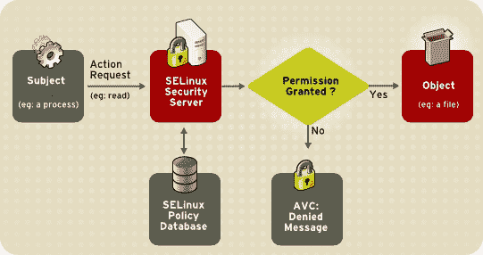
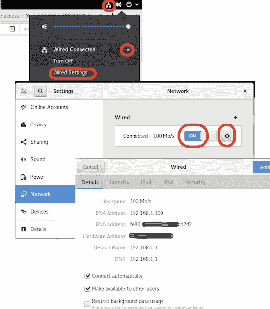
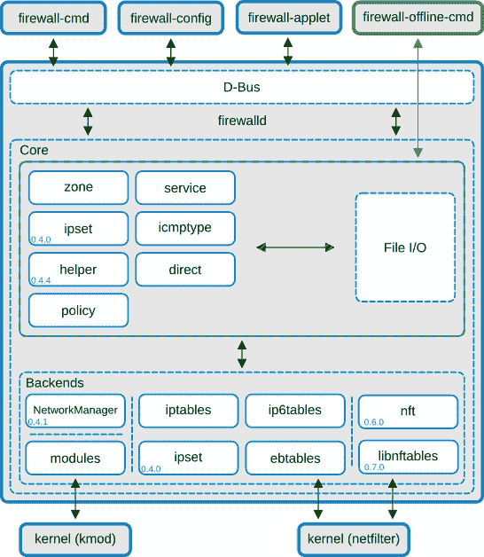

# Linux 教程：Herong 的教程示例


# Linux 教程：Herong 教程示例


1.20, 2020 杨世龙博士© 2020 杨世龙博士。版权所有。

本书汇集了作者在学习 Linux 系统期间编写的笔记和示例代码。主题包括使用网络配置和安全防火墙；管理 Linux 文件系统；安装 CentOS 系统；使用 SELinux（安全增强型 Linux）系统；DNF/YUM 软件包管理器；管理 MySQL 服务器；开发 Python 和 PHP 脚本；使用 GCC C/C++ 编译器；管理`vsftpd` - 高级安全 FTP 守护进程；运行`Conda` - 环境和软件包管理器。已于 2020 年更新（版本 1.20），包含 SELinux 教程。欲获取最新更新和免费示例章节，请访问`http://www.herongyang.com/Linux`。

## 目录

- 关于本书
- `uname` - 显示系统信息
- 进程管理
- 文件系统类型、ID 和格式
- CentOS 上的 SELinux 配置与状态
- 什么是 DNF
- 验证 Apache Web 服务器`httpd`
- 在 Linux 系统上运行 PHP 脚本：权限拒绝
- `/var/www/html`上的 SELinux 安全上下文

`-` 通过邮箱 herong_yang@yahoo.com 联系。

**分类：** 编程

**版本/编辑：** 1.20, 2020

**PDF 格式页数：** 157

**描述：** 本书汇集了作者在学习 Linux 系统期间编写的笔记和示例代码。主题包括使用网络配置和安全防火墙；管理 Linux 文件系统；安装 CentOS 系统；使用 SELinux（安全增强型 Linux）系统；DNF/YUM 软件包管理器；管理 MySQL 服务器；开发 Python 和 PHP 脚本；使用 GCC C/C++ 编译器；管理`vsftpd` - 高级安全 FTP 守护进程；运行`Conda` - 环境和软件包管理器。已于 2020 年更新（版本 1.20），包含 SELinux 教程。

**关键词：** C/C++, 文件系统, Linux, MySQL, PHP, Python, SELinux, Unix。

**版权：**

- 本书版权所有 © 2020 杨世龙博士。版权所有。
- 书中的材料不得以任何形式出版、广播、重写或重新分发。
- 示例代码按原样提供，不提供任何形式的保证。

### 修订历史

- 版本 1.20, 2020。添加了 SELinux 教程。
- 版本 1.00, 2019。完成第一版。

网页版：[`www.herongyang.com/Linux`](http://www.herongyang.com/Linux) - 提供免费章节、最新更新和读者评论。本书的网页版总浏览次数为：

- 截至 2019 年 12 月为 0 次。

PDF/EPUB 版本：[`www.herongyang.com/Linux/PDF-Full-Version.html`](http://www.herongyang.com/Linux/PDF-Full-Version.html) - 提供如何通过 PDF、EPUB 或格式获取完整本书的信息。

# Linux 系统介绍

提供 Linux 操作系统的介绍和教程。主题包括用于显示操作系统信息的`uname`命令。

## 核心要点

- `uname`命令可用于显示操作系统信息。

## `uname` - 显示系统信息

提供了一个如何在 Linux 系统上使用`uname`命令显示操作系统信息的教程示例。在新的 Linux 计算机上，你应该做的第一件事就是像本教程所示收集其系统信息。

1. 显示 Linux 操作系统信息最常用的命令是`uname`命令。

（在我的 CentOS 8 计算机上）

```bash
centos8$ uname -mprsv
Linux 4.18.0-147.el8.x86_64
    #1 SMP Wed Dec 4 21:51:45 UTC 2019 x86_64 x86_64
```

（在我的 CentOS 6 计算机上）

```bash
centos6$ uname -mprsv
Linux 2.6.32-696.20.1.el6.i686 #1 SMP Fri Jan 26 18:13:32 UTC 2018
    i686 i686 i386 GNU/Linux i386
```

（在我的 macOS 10 计算机上）

```bash
macos$ uname -mnprsv
Darwin 16.7.0 Darwin Kernel Version 16.7.0:
    Sun Jun  2 20:26:31 PDT 2019; root:xnu-3789.73.50~1/RELEASE_X86_64
    x86_64 i386
```

2. 在大多数 Linux 系统上，操作系统信息可以通过名为`/proc/version`的特殊文件访问。你可以使用`cat`命令来显示它：

（在我的 CentOS 8 计算机上）

```bash
centos8$ cat /proc/version
Linux version 4.18.0-147.el8.x86_64
    (mockbuild@kbuilder.bsys.centos.org)
    (gcc version 8.3.1 20190507 (Red Hat 8.3.1-4) (GCC))
    #1 SMP Wed Dec 4 21:51:45 UTC 2019
```

（在我的 CentOS 6 计算机上）

```bash
centos6$ cat /proc/version
Linux version 2.6.32-69.20.1.el6.i686
    (mockbuild@x86_64_01.bsys.centos.org)
    (gcc version 4.4.7 20120313 (Red Hat 4.4.7-18) (GCC))
    #1 SMP Fri Jan 26 18:13:32 UTC 2018
```

3. CPU 架构是安装 Linux 系统和应用程序时的关键参数。你可以使用`arch`命令来显示它：

（在我的 CentOS 8 计算机上）

```bash
centos8$ arch
x86_64
```

（在我的 CentOS 6 计算机上）

```bash
centos6$ arch
i686
```

（在我的 macOS 10 计算机上）

```bash
macOS$ arch
i386
```

## `free` - 显示空闲和已内存

提供了一个如何在 Linux 系统上使用`free`命令显示空闲和已内存信息的教程示例。关于你的 Linux 系统的另一个重要信息是内存。你可以使用`free`命令显示内存统计信息，包括空闲和已用内存大小。以下是我 CentOS 计算机上`free`命令输出的一些示例。

1. 使用默认选项`free`显示内存信息。内存计数以 kibibytes（1,024 字节）显示。注意，一个 kibibyte（1,024 字节）与 kilobyte（1,000 字节）略有不同。

```bash
herong$ free
             total      used      free  shared  buff/cache   available
Mem:       7789220   2047412   677256   297448   5064552     5145248
Swap:       8085500           0   8085500
```

2. 为了控制单位，你可以使用`free -b|k|m|g`选项。

```bash
herong$ free -m
             total      used      free  shared  buff/cache   available
Mem:       7789220   2047412   677256   297448   5064552     5145248
Swap:       8085500           0   8085500
```

3. 或者使用`free -h`以人类可读格式。

```bash
herong$ free -h
             total        used        free      shared  buff/cache   available
Mem:       7.5 |       1.9Gi       660M       290M       4.8Gi       4.9Gi
Swap:       7.7Gi                   0       7.7Gi
```

```text
herong    1345  0.0  0.0    9528  2192 pts/1    S+   05:17   0:00 more
herong   29872  0.0  0.0   24700  5372 pts/0    Ss   Aug24   0:00 -bash
herong   31723  0.0  0.0   25084  5704 pts/1    Ss   02:29   0:00 -bash
...
```

```bash
herong$ ps -u joe
```

...

## 使用`ps -el`命令以长格式显示系统上的所有进程

```text
F S    UID  PID  PPID  C PRI  NI ADDR SZ WCHAN  TTY       TIME CMD
4 S     0      1     0  0   80   0 - 61833 -       ?      00:03:09 systemd
1 S     0      2     0  0   80   0 -      0 -       ?      00:00:01 kthreadd
1 I     0      3     2  0   60 -20 -      0 -       ?      00:00:00 rcu_gp
1 I     0      4     2  0   60 -20 -      0 -       ?      00:00:00 rcu_par_gp
1 I     0      8     2  0   60 -20 -      0 -       ?      00:00:00 mm_percpu_wq
1 S     0      9     2  0   80   0 -      0 -       ?      00:00:00 ksoftirqd/0
1 I     0     10     2  0   80   0 -      0 -       ?      00:02:42 rcu_sched
...
```

Linux 教程 - Herong 的教程示例 ∟ 进程管理

## `jobs` - 管理后台作业

提供了一个关于如何使用`jobs`命令显示后台作业的教程示例，后台作业是指输入与键盘分离的进程。你可以通过在命令末尾添加取符符号（`&`）来启动后台作业。

### 什么是后台作业？

后台作业是指其输入与键盘设备分离的进程。它的输出可能仍然连接到屏幕。

前台作业是指其输入与键盘设备连接的进程。当你在 shell 提示符输入命令启动进程时，它将默认作为前台作业启动。键盘会被该前台作业占用直到它被终止。因此，你任何时候只能执行 1 个进程作业。

如果你想将进程作为后台作业启动以释放键盘，可以使用以下 2 选项：

1. 在命令行行末尾添加`&`。这将立即将该进程作为后台作业启动。例如，以下命令启动一个进程（ID=40120）作为后台作业（#=1）。

```bash
herong$ sleep 100000 &
[1] 40120
```

2. 在执行前台作业期间按下`ctrl-z`。这将停止前台作业并将其变为后台作业，同时保持其停止状态。

```bash
herong$ sleep 50000
ctrl-z
[2]+ Stopped
```

如果你想查看你自己的后台作业列表，可以使用`jobs`命令：

```bash
herong$ jobs
[1]- Running  sleep 10000 &
[2]+ Stopped  sleep 50000
```

如果你想在后台恢复已停止的作业，可以使用`bg`命令：

```bash
herong$ bg 2
[2]+ sleep 50000 &
herong$ jobs
[1]- Running  sleep 10000 &
[2]+ Running  sleep 50000 &
```

如果你想将后台作业带回前台，可以使用`fg`命令：

```bash
herong$ fg 2
sleep 100000
```

在后台运行命令的一个好点处是，即使你的 shell 会话断开/关闭，它也会继续运行。

Linux 教程 - Herong 的教程示例 ∟ 进程管理

## `tmux` - 终端复用器

提供了一个关于如何使用`tmux`工具在单个终端中将多个 shell 作为窗口和面板（panes）管理的教程示例。`tmux`在终端断开时会自动保持所有 shell 运行。

### 什么是`tmux`？

`tmux`是一个终端复用器。它允许你在一个终端中的多个程序之间轻松切换，将它们分离（detach）（它们会在后台继续运行）并重新连接（attach）到不同的终端。以下是`tmux`帮助页中的官方描述：

`tmux`是一个终端复用器：它允许从单个屏幕创建、访问和控制多个终端。`tmux`可以从屏幕中分离并继续在后台运行，稍后重新连接。

当启动`tmux`时代，它会创建一个带有单个窗口的新会话并将其显示在屏幕上。屏幕底部的状态行显示当前会话的信息，并用于输入交互命令。

会话是`tmux`管理下的单个伪终端集合。每个会话都有一个或多个与其链接的窗口。窗口占据整个屏幕，并可能被分成矩形面板，每个面板都是一个独立的伪终端（`pty(4)`手页文档了伪终端的节点细节）。任意数量的`tmux`实例都可以连接到同一个会话，会话中也可以存在任意数量的窗口。

一旦所有会话都被杀死，`tmux`退出。每个会话都是持久的，能够防止意外断开（例如`ssh(1)`连接超时）或故意的分离（使用`C-b d`组合键）。可以使用以下命令重新连接`tmux`：

```bash
$ tmux attach
```

在`tmux`中，会话由客户端显示在屏幕上，所有会话都由单个服务器管理。服务器和每个客户端是独立的进程，通过`/tmp`中的 socket 进行通信。

`tmux`是一个非常用的工具，它减少了远程`ssh`会话的数量，并节省了手动将进程推到后台以防止因连接超时而被杀死的时间。以下是我在 CentOS 计算机上尝试的尝试。

1. 安装`tmux`：

```bash
herong$ sudo dnf install tmux
Installed:
tmux-2.7-1.el8.x86_64
```

2. 使用`tmux`命令启动一个新的`tmux`会话，这会在`tmux`会话的第一个窗口的第一个面板启动一个 shell。

```bash
herong$ tmux
(in a child shell in "tmux")
herong$ exit
(back to the original shell)
```

3. 使用以下热键控制其窗口和标签：

- `ctrl-b, %`：从左到右将屏幕对分为二半
- `ctrl-b, "`：从上到下将屏幕对分为二半
- `ctrl-b, 方向方向键`：切换到不同方向的面板
- `ctrl-b, c`：创建一个新窗口
- `ctrl-b, 0|1|...`：切换到指定的窗口
- `ctrl-b, d`：从`tmux`分离，让其在后台运行

如果你想查看你自己的后台作业列表，可以使用`jobs`命令：

```bash
herong$ jobs
```

如果你想在后台恢复已停止的作业，可以使用`bg`命令：

```bash
herong$ bg 2
```

如果你想将后台作业带回前台，可以使用`fg`命令：

```bash
herong$ fg 2
```

如果你想重新连接已分离或断开的会话，使用`tmux ls|attach`：

```bash
herong$ tmux ls
0: 1 windows
$ tmux attach
(tmux is displayed again)
```

Linux 教程 - Herong 的教程示例 ∟ 进程管理

## Linux 文件系统

提供关于 Linux 文件系统的介绍和教程。主题包括使用`df`查看已挂载文件系统的剩余空间；`mount`连接 USB 驱动器文件系统；`fdisk`列出分区和文件系统类型；`dd`复制数据并测试 I/O 速度；`hdparm`用于管理硬盘参数。

- `df` - 显示文件系统的剩余空间
- `mount` - 挂载 USB 驱动器为文件系统
- `fdisk` - 格式化分区
- `dd` - 从到存储设备复制数据
- 使用`dd`命令测试 I/O 速度
- `hdparm` - 硬盘参数
- `du` - 显示目录的磁盘占用
- 挂载 Windows 文件系统
- W95 Ext'd (LBA) 分区
- 文件系统类型、ID 和格式化

### 知识点总结

- `df`命令用于显示已挂载文件系统的剩余空间。
- `mount`命令用于将文件系统分区上线。`umount`命令用于将其离线。
- `fdisk -l`命令用于列出给定存储设备的分区及其格式类型。
- `dd`命令用于以连续字节块的形式从一个设备复制到另一个设备，绕过文件系统结构。


`hdparm` 命令用于收集硬盘识别信息并获取/设置其单个参数。

# `df`：显示文件系统可用空间

本文提供了一个教程示例，介绍了如何使用 `df` 命令显示 Linux 系统上已挂载文件系统的可用空间。要查看已挂载文件系统的可用空间，你可以使用 `df` 命令。以下是我在 CentOS 8 电脑上运行 `df` 命令时的一些示例输出。

## 1. 使用 `df` 显示所有已挂载文件系统的可用空间

```bash
herong$ df

Filesystem           1K-blocks      Used Available Use% Mounted on
devtmpfs             3875992           0   3875992   0% /dev
tmpfs               3894608           0   3894608   0% /dev/shm
tmpfs               3894608      18192   3876416   1% /run
tmpfs               3894608           0   3894608   0% /sys/fs/cgroup
/dev/mapper/cl-root  52403200 6279684  46123516  12% /
/dev/mapper/cl-home  40813088  609176  40203912   2% /home
/dev/sda6             999320  148068    782440  16% /boot
tmpfs                778920      1168    777752   1% /run/user/42
tmpfs                778920      6960    771960   1% /run/user/1000
```

## 2. 使用 `df -m` 以兆字节（MB）为单位显示所有已挂载文件系统的可用空间

```bash
herong$ df -m

Filesystem           1M-blocks  Used Available Use% Mounted on
devtmpfs               3786           0      3786   0% /dev
tmpfs                   3804           0      3804   0% /dev/shm
tmpfs                   3804          18      3786   1% /run
tmpfs                   3804           0      3804   0% /sys/fs/cgroup
/dev/mapper/cl-root     5175         133      5043   2% /
/dev/mapper/cl-home     3987          95      3892   2% /home
/dev/sda6                 96          45       765  16% /boot
tmpfs                    761           2       760   1% /run/user/2
tmpfs                    761           7       754   1% /run/user/1000
```

## 3. 使用 `df --block-size=1G` 以吉字节（GB）为单位显示所有已挂载文件系统的可用空间

```bash
herong$ df --block-size=1G

Filesystem           1G-blocks  Used Available Use% Mounted on
devtmpfs                   4           0           4   0% /dev
tmpfs                       4           0           4   0% /dev/shm
tmpfs                       4           1           4   1% /run
tmpfs                       4           0           4   0% /sys/fs/cgroup
/dev/mapper/cl-root        50           6          44  12% /
/dev/mapper/cl-home        39           1          39   2% /home
/dev/sda6                   1           1           1  16% /boot
tmpfs                       1           1           1   1% /run/user/42
tmpfs                       1           1           1   1% /run/user/1000
```

# 将 USB 盘挂载为文件系统

本文提供了一个教程示例，介绍如何在 Linux 系统上将格式化后的 USB 盘分区挂载为文件系统。如果你有一个 USB 盘，可以将其插入 Linux 系统的接口中，并按照此教程将其挂载为新系统。

## 1. 检查表示为 `/dev/sd*` 的现有 SCSI 设备

```bash
herong$ ls -l /dev/sd*
brw-rw---- 1 root root 8 May 26 21:17 /dev/sda
brw-rw---- 1 root root 8 May 26 21:17 /dev/sda1
brw-rw---- 1 root root 8 May 26 21:17 /dev/sda2
brw-rw---- 1 root root 8 May 26 21:17 /dev/sda5
brw-rw---- 1 root root 8 May 26 21:17 /dev/sda6
brw-rw---- 1 root root 8 May 26 21:17 /dev/sda7
```

## 2. 将 USB 盘插入接口，再次检查 SCSI 设备

由于 USB 盘在 Linux 系统中被视为 SCSI 设备，你将看到检测到更多设备，它们被表示为 `/dev/sd*`。在我下方的示例中，我看到 `/dev/sdb` 代表整个 USB 盘，而 `/dev/sdb1` 代表第一个 FAT32 分区。

```bash
herong$ ls -l /dev/sd*
brw-rw---- 1 root root 8 May 26 21:17 /dev/sda
brw-rw---- 1 root root 8 May 26 21:17 /dev/sda1
brw-rw---- 1 root root 8 May 26 21:17 /dev/sda2
brw-rw---- 1 root root 8 May 26 21:17 /dev/sda5
brw-rw---- 1 root root 8 May 26 21:17 /dev/sda6
brw-rw---- 1 root root 8 May 26 21:17 /dev/sda7
brw-rw---- 1 root root 8 Apr 04 02:25 /dev/sdb
brw-rw---- 1 root root 8 Apr 04 02:25 /dev/sdb1
```

## 3. 在我的 CentOS 8 电脑的根文件系统中找到一个挂载点，并挂载格式化设备 `/dev/sdb1`

你可能会在其他 Linux 系统上看到不同的挂载点。顺便提一下，你不能挂载 `/dev/sdb`，因为它不是文件系统。

```bash
herong$ ls -l /
lrwxrwxrwx. 1 root root 7 May 10 2019 bin -> usr/bin
dr-xr-xr-x. 6 root root 4096 Mar 26 21:18 boot
drxr-xr-x. 20 root root 3700 Apr 04 08:25 dev
drxr-xr-x. 144 root root 8192 Mar 30 07:37 etc
drxr-xr-x. 3 root root 20 Mar 26 17:11 home
lrwxrwxrwx. 1 root root 7 May 10 2019 lib -> usr/lib
drxr-xr-x. 2 root root 6 May 10 2019 media
drxr-xr-x. 2 root root 6 May 10 2019 mnt
drxr-xr-x. 2 root root 6 May 10 2019 opt
...
herong$ ls -l /media
total 0
herong$ sudo mount /dev/sdb1 /media
```

## 4. 验证作为已挂载文件系统的 USB 盘格式化分区

```bash
herong$ df
Filesystem           1K-blocks      Used Available Use% Mounted on
...
/dev/sdb1             7813124 1146116  6667008  15% /media
```

## 5. 检查 `System Volume Information` 文件夹

它通常存在于任何 USB 盘的格式化分区上。

```bash
herong$ ls -l "/media/System Volume Information"
total 256
-rwxrwxrwx 1 root root 7 Apr 04 02:25
-rwxrwxrwx 1 root root 7 Apr 04 02:25
```

## 6. 拔出 USB 盘之前记得卸载它，以防止任何损坏

```bash
herong$ sudo umount /dev/sdb1
```

```text
/dev/sdc1       10392 15667199 15656808  7.5G  c W95 FAT32 (LBA)
```

# `dd`：从存储设备复制数据到存储设备

提供了一个教程示例，介绍如何使用 `dd` 命令从存储设备或到存储设备复制连续的字节数据块。可以跳过文件系统结构。如果你想将数据以连续字节块的形式从一个设备复制到另一个设备，可以使用本教程所示的 `dd (data duplicator)` 命令。如果在 `dd` 命令中使用了设备名称，则将不会遵循文件系统结构。

## 1. 从原始设备复制数据

这将从设备中连续读取数据，而不遵循分区和格式结构。（从 USB 闪存器复制第一个数据块（512 字节））

```bash
herong$ sudo dd count=1 if=/dev/sdb of=one-block

1+0 records in
1+0 records out
512 bytes copied, 6.1976e-05 s, 8.3 MB/s
```

## 2. 向原始设备复制数据

这将数据连续写入设备中，并覆盖分区和格式结构。此命令非常危险。设备名称中的一个拼写错误可能会损坏硬盘的 MBR（主引导记录），它表示为 `/dev/sda`。（将 CentOS 8 DVD 镜像复制到 USB 闪存器）

```bash
herong$ sudo dd if=CentOS-8.1.1911-x86_64-boot.iso of=/dev/sdb
```

（将 TAR（磁带存档）格式的备份文件复制到磁带设备）

```bash
herong$ sudo dd if=backup.tar of=/dev/sdc
```

（向磁带设备开头写入 1 GB 的 `0`）（这是移除旧磁带上敏感数据的好方法）

```bash
herong$ sudo dd if=/dev/zero of=/dev/sdc bs=64k count=16k
```

# 使用 `dd` 命令测试 I/O 速度

提供了一个教程示例，介绍如何使用 `dd` 命令配合不同的块大小测试硬盘和 USB 闪存器的 I/O 速度。`dd (data duplicator)` 命令也可用于测量给定存储设备的 I/O（输入/输出）速度。在我 CentOS 8.0 电脑上的测试。

## 1. 测试内置硬盘的输入（写入）速度

我发现向硬盘写入时，较大的块大小（`bs`）效率更高。

```bash
herong$ pwd
/home/herong
herong$ dd if=/dev/zero of=one-giga bs=64k count=16k

16384+0 records in
16384+0 records out
1073741824 bytes (1.1 GB, 1.0 GiB) copied, 0.255833 s, 4.2 GB/s

herong$ dd if=/dev/zero of=one-giga bs=1k count=1024k

1048576+0 records in
1048576+0 records out
1073741824 bytes (1.1 GB, 1.0 GiB) copied, 1.98674 s, 540 MB/s

herong$ ls -l one*
-rw-rw-r--. 1 herong herong 1073741824 Apr  5 03:23 one-giga
```

## 2. 测试内置硬盘的输出（读取）速度

我发现从硬盘读取数据时，较大的块大小（`bs`）效率更高。我还发现读取比写入慢一倍，这让我有点意外。

```bash
herong$ dd if=one-giga of=/dev/null bs=64k count=16k

16384+0 records in
16384+0 records out
1073741824 bytes (1.1 GB, 1.0 GiB) copied, 0.113039 s, 9.5 GB/s

herong$ dd if=one-giga of=/dev/null bs=1k count=1024k

1048576+0 records in
1048576+0 records out
1073741824 bytes (1.1 GB, 1.0 GiB) copied, 1.18922 s, 903 MB/s
```

## 3. 测试 USB 闪存器的输入（写入）速度

我发现 USB 闪存器上的输入速度在块大小为 1 KB 时与硬盘相似，这让我有点意外。（USB 闪存器挂载在 `/media` 上）

```bash
herong$ df /dev/sdc1
Filesystem      1K-blocks  Used Available Use% Mounted on
/dev/sdc1       15667199  10392 15656808  7% /media

herong$ cd /media
herong$ sudo dd if=/dev/zero of=one-giga bs=64k count=16k

16384+0 records in
16384+0 records out
1073741824 bytes (1.1 GB, 1.0 GiB) copied, 0.937841 s, 1.1 GB/s

herong$ sudo dd if=/dev/zero of=one-giga bs=1k count=1024k

1048576+0 records in
1048576+0 records out
1073741824 bytes (1.1 GB, 1.0 GiB) copied, 2.12935 s, 504 MB/s
```

## 4. 测试同一 USB 闪存器的输出（读取）速度

我发现 USB 闪存器上的输出速度在大小块大小下都与硬盘相似，这让我有点意外。

```bash
herong$ dd if=one-giga of=/dev/null bs=64k count=16k

16384+0 records in
16384+0 records out
1073741824 bytes (1.1 GB, 1.0 GiB) copied, 0.115699 s, 9.3 GB/s

herong$ dd if=one-giga of=/dev/null bs=1k count=1024k

1048576+0 records in
1048576+0 records out
1073741824 bytes (1.1 GB, 1.0 GiB) copied, 1.13126 s, 949 MB/s
```

# 在我的 macOS 10 电脑上的测试

## 1. 测试内置硬盘的输入（写入）速度

我发现我的 macOS 硬盘的输入速度比 CentOS 慢得多。

```bash
herong$ pwd
/Users/herong
herong$ dd if=/dev/zero of=one-giga bs=64k count=16k

16384+0 records in
16384+0 records out
1073741824 bytes transferred in 0.741450 secs (1,448,164 bytes/sec)

herong$ dd if=/dev/zero of=one-giga bs=1k count=1024k

1048576+0 records in
1048576+0 records out
1073741824 bytes transferred in .04608 secs (265,378 bytes/sec)
```

## 2. 测试内置硬盘的输出（读取）速度

我发现硬盘的输出速度比输入速度快得多，这是符合逻辑的。


```bash
herong$ dd if=one-giga of=/dev/null bs=64k count=16k

16384+0 records in
16384+0 records out
1073741824 bytes transferred in ..18341 secs (5,117,265 bytes/))

ongong$ dd if=one-iga=/dev/dev bs=1k count=1024k

1048576+0 records in
1048576+0 records out
1073741824 bytes transferred in 2.32091 secs (462,701, bytes/sec)
```

### 3. 测试同一 USB 驱动器的输入（写入）速度

我发现 macOS 上 USB 驱动器的输入速度比 CentOS 慢了 200 倍。我认为速度下降的主要原因是连接 USB 的电缆。（USB 驱动器挂载在`/Volumes`上。）

```bash
herong$ df
Filesystem      1K-blocks  Used Available Use% Mounted on
/dev/disk3s1    15626248  229480  13331440    15% /Volumes/NAME

herong$ sudo$ sudo dd if=/dev/zero of=one-giga bs=64k count=16k

16384+0 records in
16384+0 records out
1073741824 bytes transferred in 214.29878 secs (5,010,490 bytes/sec)

herong$ sudo dd if=/dev/zero of=one-giga bs=1k count=1024k

1048576+0 records in
1048576+0 records out
1073741824 bytes transferred in 208.1572 secs (5,158,326 bytes/sec)
```

### 4. 测试 USB 驱动器的输出（读取）速度

我发现 USB 驱动器上的输出速度比输入速度快 600 倍，这让我很惊讶。

```bash
herong$ dd if=one-giga of=/dev/null bs=64k count=16k

16384+0 records in
16384+0 records out
1073741824 bytes transferred in 0.353298 s (3,039,196,314 bytes/sec)
```

# `hdparm`：硬盘参数

提供了一个教程示例，介绍如何使用`hdparm`命令收集硬盘识别信息并获取或设置参数。`hdparm`命令在普通的 USB 驱动器上不起作用。

## 1. 以紧凑格式获取硬盘识别信息

```bash
herong$ sudo hdparm -i /dev/sda

/dev/sda:

 Model=WDC WD10EZEX-xxxxxx, FwRev=01.01A0, SerialNo=WD-xxxxxx

 Config={ HardSect NotMFM HdSw>15Sec SpinMotCt DTR>5Mbs FmtGapReq }

 RawCHS=16383/16/63, TrkSize=0, SectSize=0, ECCbytes=0

 BuffType=unknown, BuffSize=unknown, MaxMultSect=16, MultSect=16

 CurCHS=16383/16/63, CurSects=16514064, LBA=yes, LBAsects=1953525168

 IORDY=on/off, tPIO={min:120,w/IORDY:120}, tDMA={min:120,rec:120}

 PIO modes: pio0 pio3 pio4

 DMA modes: mdma0 mdma1 mdma2

 UDMA modes: udma0 udma1 udma2 udma3 udma4 *udma5

 AdvancedPM=no WriteCache=enabled

 Drive conforms to: Reserved: ATA/ATAPI-1,2,3,4,5,6,7
```

## 2. 使用`hdparm -I`命令以详细格式获取硬盘识别信息

我看到了很多有用信息。

```bash
herong$ sudo hdparm -I /dev/sda
```

```text
/dev/sda:

ATA device, with non-removable media

  Model Number:      WDC WD10EZEX-xxxxxx

  Serial Number:      WD-xxxxxx

  Firmware Revision:  01.01A01

  Transport:          Serial, SATA 1.0a, SATA II Extensions, ...

Standards:

  Used: unknown (minor revision code 0x001f)

  Supported: 9 8 7 6 5

  Likely used: 9

Configuration:

  Logical    max  current

  cylinders  16383  16383

  heads    16  16

  sectors/track  63  63

  --

  CHS current addressable sectors:     16514064

  LBA   user addressable sectors:  268435455

  LBA48  user addressable sectors:  1953525168

  Logical  Sector size:                   512 bytes

  Physical Sector size:                   4096 bytes

  device size with M = 1024*1024:      953869 MBytes

  device size with M = 1000*1000:      1000204 MBytes (1000 GB)

  cache/buffer size  = unknown

  Nominal Media Rotation Rate: 7200

Capabilities:

  LBA, IORDY(can be disabled)

  Queue depth: 32

  Standby timer values: spec'd by Standard, with device specific minimum

  R/W multiple sector transfer: Max = 16  Current = 16

  DMA: mdma0 mdma1 mdma2 udma0 udma1 mdma2 udma3 udma4 *udma5

        Cycle time: min=120ns recommended=120ns

  PIO: pio0 pio1 pio2 pio3 pio4

        Cycle time: no flow control=120ns  IORDY flow control=120ns

Commands/features:

  Enabled  Supported:

      *  SMART feature set

        Security Mode feature set

      *  Power Management feature set

      *  Write cache

      *  Look-ahead

      *  Host Protected Area feature set

      *  WRITE_BUFFER command

      *  READ_BUFFER command

      ...

Security:

  Master password revision code = 65534

    supported

  not  enabled

  not  locked

    frozen

  not  expired: security count

    supported: enhanced erase

  122min for SECURITY ERASE UNIT. 122min for ENHANCED SECURITY ERASE UNIT.

Logical Unit WWN Device Identifier: 5001xxxxxx

  NAA     : 5

  IEEE OUI  : 0014ee

  Unique ID  : xxxxx

Checksum: correct
```

## 3. 获取 USB 驱动器的详细识别信息

我没有看到任何有用信息。因此，`hdparm`命令并非为所有类型的存储设备设计的。

```bash
herong$ sudo hdparm -I /dev/sdb
```

```text
/dev/sdb:

SG_IO: bad/missing sense data, sb[]:  0 00 05 00 00 14 ...

ATA device, with non-removable media

Standards:

  Likely used: 1

Configuration:

  Logical    max  current

  cylinders  0  0

  heads    0  0

  sectors/track  0  0

  --

  Logical/Physical Sector size:                   512 bytes

  device size with M = 1024*1024:      0 MBytes

  device size with M = 1000*1000:      0 MBytes

  cache/buffer size  = unknown

Capabilities:

  IORDY not likely

  Cannot perform double-word IO

  R/W multiple sector transfer: not supported

  DMA: not supported

  PIO: pio0
```

## 4. 使用`hdparm -r`命令获取 USB 驱动器的只读标记

```bash
herong$ sudo hdparm -r /dev/sdb
```

```text
/dev/sdb:

  readonly   =0 (off)
```

## 5. 使用`hdparm -r 1`命令设置 USB 驱动器的只读标记

```bash
herong$ sudo hdparm -r 1 /dev/sdb
```

```text
/dev/sdb:

  setting readonly to 1 (on)

  readonly   =1 (on)
```

## 6. 验证 USB 驱动器的只读标记

我发现 USB 驱动器上的只读标记没有生效。（挂载了 USB 盘的唯一分区。）

```bash
herong$ sudo mount /dev/sdb1 /media

herong$ cd /media

（在 USB 驱动器上创建一个新文件）

herong$ sudo touch test.txt

herong$ ls -l test.txt

-rwxr-xr-x. 1 root root  0 Apr 1 05:38 test.txt
```

```bash
herong$ sudo hdparm -r /dev/sdb
```

```text
/dev/sdb:

  readonly   =1 (on)
```

# `du`：显示目录的磁盘使用情况

提供了一个教程示例，介绍如何在 Linux 系统上使用`du`命令显示任何给定目录的磁盘使用情况。要查看某个目录占用了多少空间，可以使用`du`命令。以下是我 CentOS 8 计算机上`du`命令的一些示例输出。

## 1. 使用`du`显示我主目录的磁盘使用情况

```bash
herong$ du ~
```

```text
124876  ./ftp/files

124876  ./ftp

124880  ./work/pytorch

0  ./work/r

124884  ./work

4  ./.cache/pip/http/6/8/c/5/e

4  ./.cache/pip/http/6/8/c/5

4  ./.cache/pip/http/6/8/c

...

104  ./.cache/pip/http/c

592  ./.cache/pip/http

596  ./.cache/pip

0  ./.cache/matplotlib/tex.cache

28  ./.cache/matplotlib

624  ./.cache

0  ./.config/matplotlib

0  ./.config

4  ./.keras

250420  .
```

## 2. 使用`du -d 0`显示没有任何子目录条目的磁盘使用情况

```bash
herong$ du -d 0
```

```text
250420  .
```

## 3. 使用`du -h`以人类可读单位显示磁盘使用情况

```bash
herong$ du -d 0 -h
```

```text
245M  .
```

## 4. 使用`du -k|m|g`以 KB、MB 或 GB 为单位显示磁盘使用情况

```bash
herong$ du -d 0 -k
```

```text
250420  .
```

# 挂载 Windows NTFS 文件系统

提供了一个教程示例，介绍如何挂载 Windows NTFS 文件系统。如果你有一个格式化为 NTFS 的磁盘分区，你可能需要 NTFS 驱动程序在 Linux 系统上挂载它。以下是我的操作步骤：

```bash
herong$ fdisk -l /dev/sda
```

```text
/dev/sda:

ATA device, with non-removable media

  Model Number:      WDC WD10EZEX-xxxxxx

  Serial Number:      WD-xxxxxx

  Firmware Revision:  01.01A01

  Transport:          Serial, SATA 1.0a, SATA II Extensions, ...

...

  device size with M = 1000*1000:      1000204 MBytes (1000 GB)

...

Capabilities:

...

  DMA: mdma0 mdma1 mdma2 udma0 udma1 mdma2 udma3 udma4 *udma5

  PIO: pio0 pio1 pio2 pio3 pio4

...
```

```text
/dev/sda1

SG_IO: bad/missing sense data, sb[]:  0 00 05 00 00 14 ...

ATA device, with non-removable media

Standards:
  Likely used: 1

Configuration:
  Logical    max  current
  cylinders  0  0
  heads    0  0
  sectors/track  0  0
  --

  Logical/Physical Sector size:                   512 bytes

  device size with M = 1024*1024:      0 MBytes

  device size with M = 1000*1000:      0 MBytes

  cache/buffer size  = unknown

Capabilities:
  IORDY not likely

  Cannot perform double-word IO

  R/W multiple sector transfer: not supported

  DMA: not supported

  PIO: pio0
```

太棒了。现在我可以在 CentOS 计算机上读取 Windows 磁盘上的旧文件了！

# W95 Ext'd（LBA）分区

对`W95 Ext'd LBA`（Windows 95 扩展逻辑块体系）区的快速介绍，它实际上是一个包含子分区的容器。如果你在使用从 Windows 计算机创建的硬盘，你可能会看到一个类型为`W95 Ext'd (LBA)`的特殊分区。`W95 Ext'd (LBA)`代表 Windows 95 扩展逻辑块体系。

`W95 Ext'd LBA`并不是文件系统分区。它实际上是一个包含子分区的容器。在 Windows 系统上，硬盘最多只能分为 4 个分区。`W95 Ext'd LBA`技术允许你从这 4 个主分区创建更多的子分区。如果你看到一个硬盘有超过 4 个分区，或者看到分区索引高于 4 的分区，你就知道该硬盘上使用了`W95 Ext'd LBA`。

例如，我的 CentOS 计算机上有以下分区：


```bash
herong$ sudo fdisk -l /dev/sda

Disk /dev/sda: 900.0 GiB
Units: sectors of 1 * 512 = 512 bytes
Sector size (logical/physical): 512 bytes / 4096 bytes
I/O size (minimum/optimal): 4096 bytes / 4096 bytes
Disklabel type: dos
Device     Boot       Start         End      Sectors    Size Id Type
/dev/sda1  *             2048  167776255  167774208     80G  7 HPFS/NTFS/exFAT
/dev/sda2             167776256 1953523711 1785747456 851.5G  f W95 Ext'd (LBA)
/dev/sda5             167778304 1748721663 1580943360 753.9G  7 HPFS/NTFS/exFAT
/dev/sda6             1748723712 1750820863     20971522      1G 83 Linux
/dev/sda7             1750822912 1953523711  202700800   96.7G 8e Linux LVM
```

输出告诉我：

* 硬盘只有 2 个主分区 `/dev/sda1` 和 `/dev/sda2`。
* `/dev/sda1` 有 80 GB 的 Windows NTFS 格式，并带有引导区以用于我的 Windows 系统。
* `/dev/sda2` 有 850 GB 的 `W95 Ext'd LBA` 格式，包含 3 个子分区：`/dev/sda5`、`/dev/sda6` 和 `/dev/sda7`。
* `/dev/sda5` 是 753 GB 的 Windows NTFS 格式子分区。
* `/dev/sda6` 是 1 GB 的 Linux 格式子分区，用于存放 Linux 的 `/root` 文件。
* `/dev/sda7` 是 96 GB 的 Linux LVM 格式子分区，用于我的 Linux 系统。

因此，不要尝试将 `W95 Ext'd LBA` 格式的 `/dev/sda2` 挂载到 Linux 系统，它不是真正的文件系统。

# 文件系统类型、ID 和格式

列出了 Linux 系统上常用的文件系统格式及其识别代码。如果你从朋友那里收到一个存储设备，你可能会在 Linux 计算机上挂载其分区时遇到困难。这是因为该存储设备可能是用 Linux 无法识别的文件系统格式创建的。为了帮助你处理这种情况，这里是常用文件系统格式列表及处理建议。

1. **Linux** - `Linux (ID: 83)` 用于识别一些旧的 Linux 原生文件系统，如 `xiafs`、`ext2`、`ext3`、`reiserfs` 等。它仍可能用于存放现代 Linux 系统（如 CentOS）上的 `/root` 文件。
2. **Linux LVM** - `Linux LVM (ID: 8e)` 用于识别 Linux LVM（逻辑卷管理器）分区。它在 CentOS 系统中作为主文件系统。
3. **Linux Swap** - `Linux Swap (ID: 82)` 用于识别 Linux 交换分区。
4. **FAT16** - `FAT16 (ID: 6)` 用于识别 16 位 FAT（文件分配表）分区，由旧的 DOS（磁盘操作系统）计算机使用。大多数 Linux 系统默认支持 FAT16。
5. **NTFS** - `NTFS (ID: 7)` 用于识别 NTFS（新技术文件系统）分区，由旧 Windows 计算机使用。你可能需要安装 `ntfs-3g` 设备来支持它。
6. **HPFS** - `HPFS (ID: 7)` 用于识别旧操作系统计算机使用的 HPFS（可安装文件系统）。你需要安装特殊的设备驱动来支持它。
7. **exFAT** - `exFAT (ID: 7)` 用于识别 exFAT（扩展文件分配表）分区，由旧 Windows Vista 使用。你可能需要安装 `fuse-exfat` 设备来支持它。
8. **W95 Ext'd LBA** - `W95 Ext'd LBA (ID: f)` 用于识别 Windows 95 扩展 LBA（逻辑块体系）分区。注意 `W95 Ext'd LBA` 不是文件系统。它实际上是一个包含子分区的容器。在 Windows 系统上，硬盘最多只能分为 4 个分区。`W95 Ext'd LBA` 技术允许你从这 4 个主分区创建更多的子分区。
9. **OpenBSD** - `OpenBSD (ID: a6)` 用于识别 OpenBSD（伯克利软件发行）分区，由 OpenBSD 计算机使用。你需要安装特殊的设备驱动来支持它。
10. **Mac OS-X** - `Mac OS-X (ID: a8)` 用于识别 Mac OS-X 分区，由 Mac OS-X 计算机使用。你需要安装特殊的设备驱动来支持它。

# 安装 CentOS

提供了安装 Linux 系统的教程。主题包括下载 CentOS ISO 文件；使用 `dd` 复制镜像文件创建可启动 USB 盘；从可启动 USB 盘安装 CentOS。

### 总结

* 你可以在 macOS 计算机上下载 ISO ISO 并使用 `dd` 命令创建可启动的 USB 盘。
* 如果硬盘上有足够的可用空间，从可启动 USB 盘安装 CentOS 系统是非常直接的。
* 你可以使用内置的磁盘工具删除现有分区以腾出空间。

## 创建可启动 USB

提供了一个如何在 macOS 计算机上下载完整的 CentOS ISO 文件并创建可启动 USB 盘的教程示例。CentOS 8 是 CentOS 系统的最新发布版本，它是 RHEL（红帽企业 Linux）的开源版本。如果你想尝试，可以按照下面的描述遵循我的做法来下载 CentOS 8.1 ISO 文件并创建可启动 USB 盘。

1. 访问 CentOS 下载网站 `https://wiki.centos.org/Download`。我看到了 CentOS 8、7 和 6 的下载选项。
2. 点击 `CentOS 8.1 (1911)` 旁边的 `mirrors` 按钮。我看到了下载镜像站列表。
3. 选择一个离你最近的站点，例如 `http://centos.les.net/`。我看到两个 ISO 镜像文件：`CentOS-8.1.1911-x86_64-boot.iso` 和 `CentOS-8.1.1911-x86_64-dvd1.iso`。它们适用于具有 `x86_64` CPU 架构的计算机。
   * `boot.iso` 要小得多，只包含可启动的 CentOS 8 内内核。使用 `boot.iso` 安装 CentOS 8 时，需要在线下载额外的系统和应用程序包。
   * `dvd1.iso` 要大得多，包含了所有系统包和基础应用程序包。你可以使用 `dvd1.iso` 安装 CentOS 8，而无需从互联网下载任何内容。
4. 点击 `CentOS-8.1.1911-x86_64-dvd1.iso` 并将其保存到我的 macOS 计算机。我选择了 `CentOS-8.1.1911-x86_64-dvd1.iso`，因为它匹配我想安装 CentOS 的联想计算机所使用的 CPU 架构 `x86_64`。你可以通过进入镜像站的父目录来选择其他架构的 ISO 文件。
5. 等待下载完成，这可能需要时间。
6. 在我的 macOS 计算机上使用 `dd` 命令将 `CentOS-8.1.1911-x86_64-dvd1.iso` 拷贝到 USB 盘。你也可以通过 `Etcher` 或 `Rufus` ISO 工具来完成，这比使用 `dd` 命令安全得多。

```bash
macOS$ df
```

```
/dev/disk1          29% 1024263 4293943016    0%    /
/dev/disk2s1          3%       0            0  100%   /Volumes/NO NAME
```

（将 ISO 文件复制到 USB 盘，`/dev/disk2`，而不是文件系统）

（使用 `64k` 的大块效率更高且耗时更短）

```bash
sudo dd if=CentOS-8.1.1911-x86_64-dvd1.iso of=/dev/disk2 bs=64k
```

7. 将此 USB 盘标记为 "CentOS 8.1 Bootable"。参考接下来的教程了解如何从此 USB 盘启动并在任何计算机上安装 CentOS。

## 从可启动的 USB 安装 CentOS

提供了一个教程示例，介绍了如何在联想电脑上通过 CentOS 可启动的 USB 盘安装 CentOS 操作系统。在创建了 CentOS 可启动 USB 盘后，你可以按照此教程在联想电脑上进行尝试。

1. 关闭联想电脑并移除所有 USB 盘。
2. 将 "CentOS Bootable" USB 盘插入联想电脑并重新启动。
3. 电脑完成从 USB 盘启动后，等待 CentOS 安装界面。如果它仍在从内部硬盘启动，你需要更改 BIOS 启动顺序，以确保 USB 盘列在内部硬盘之前。在启动过程开始时按 `F10` 可进入 BIOS 设置。
4. 从安装界面选择 "Install CentOS Linux"安装 CentOS Linux）。我看到了语言选择界面。
5. 从安装界面选择 "English"英语）并点击 "Continue”（继续）。我看到了安装摘要界面。
6. 如果你想使用默认配置，且硬盘上有足够的可用空间，请点击 "Begin Installation”（开始安装）。我看到了 root 用户设置界面。
7. 为 root 用户输入新密码，并创建一个具有管理员权限的新用户 "herong"。
8. 拔出 USB 盘并重启电脑。我看到 CentOS 8 运行在我的电脑上！太酷了。安装 CentOS 8 真的太简单了！！

## 通过删除现有分区安装 CentOS

提供了一个教程示例，介绍了如何在联想电脑上通过删除现有硬盘分区来释放空间以安装 CentOS 系统。如果硬盘上没有足够的可用空间（未分区空间），CentOS 安装程序将强制你选择要删除哪个现有分区，以为新的 CentOS 系统释放空间。以下是我在第二台联想电脑上的操作。

1. 从 CentOS 可启动的 USB 盘启动电脑。
2. 继续安装过程直到进入安装摘要界面。我看到系统部分的 "Installation Destination"安装目标被高亮并显示警告。
3. 点击 "Installation Destination"链接。我看到了"Installation Destination"配置页，列出了两个存储设备：内部硬盘和可启动的 USB。硬盘已完全分区，仅剩 `2.55 MB` 空闲空间。
4. 选择内部硬盘作为安装目标。勾选 "I would like to make additional space available"我想提供额外的空间）复选框。
5. 点击 "Done"完成）按钮。我看到一条警告信息，显示没有空间安装 CentOS。但我可以使用内置的空间回收工具来缩小或删除现有分区。
6. 点击 "Reclaim Space"回收空间）。我看到硬盘上列出了 3 个分区。
7. 选择第三个分区，它上面有垃圾数据。点击 "Delete"删除）以为 CentOS 系统释放足够的空间。
8. 再次点击 "Reclaim Space"回收空间）返回安装摘要界面。
9. 点击 "Begin Installation"开始安装以完成安装过程。

# SELinux - 安全增强型 Linux

提供 SELinux（Security-Enhanced Linux）的介绍和教程。主题包括 SELinux 基础概念介绍；用户、角色、域、类型、类和布尔值；类型强制（Type Enforcement）规则语法和数据库；修改 SELinux 策略规则；使用 SELinux 相关工具。

- 什么是 SELinux（安全增强型 Linux）
- CentOS 上的 SELinux 配置与状态
- 什么是 SELinux 用户
- 什么是 SELinux 角色
- 什么是 SELinux 类型
- 什么是 SELinux 域
- SELinux 策略规则
- 什么是 SELinux 布尔值
- SELinux 相关工具
- SELinux 错误信息
- SELinux 相关术语

### 核心要点总结

- **SELinux**: `SELinux` 是一种用于 Linux® 系统的安全架构，允许管理员对谁可以访问系统拥有更多控制权。
- **SELinux User**: `SELinux User` 是一个抽象概念，代表 Linux 系统上的一组真实用户，作为 SELinux 系统中的安全主体。
- **SELinux Role**: `SELinux Role` 是一个抽象概念，代表为特定功能角色分组在一起的一组权限。
- **SELinux Type**: `SELinux Type` 是一个抽象概念，代表一组分组在一起的文件/目录，以便安全策略可以应用在组级别，而不是单独地应用到文件/目录层级上。
- **SELinux Domain**: `SELinux Domain` 是一个抽象概念，代表一组分组在一起的运行进程，以便安全策略可以应用在组级别，而不是单独地应用到进程层级上。
- **Type Enforcement**: `Type Enforcement`（类型强制）策略规则的定义为 `allow "source" on "target" of "class" with "permissions"` 的形式。
- **SELinux Boolean**: `SELinux Boolean` 是一种布尔标志，可以添加到一个或多个 SELinux 策略规则中，用以开启或关闭这些规则。
- **semanage**: `semanage` 命令用于配置 SELinux 策略的某些元素，而无需修改或从策略源重新编译。
- **seinfo**: `seinfo` 命令用于打印 SELinux 策略信息。
- **sesearch**: `sesearch` 是一个 SELinux 策略规则搜索工具。
- **Logs**: SELinux 错误信息记录在 `/var/log/messages` 文件中。

# SELinux - 安全增强型 Linux

## 什么是 SELinux (安全增强型 Linux)

提供了 SELinux（安全增强型 Linux）的快速介绍，它由两个部分组成：安全服务器和策略数据库。它们共同工作，为想要访问 Linux 系统上给定对象的实体提供安全服务。

### 什么是 SELinux (安全增强型 Linux)？

SELinux 是针对 Linux® 系统的一种安全架构，允许管理员对谁可以访问系统拥有更多控制权。它最初由美国国家安全局（NSA）开发，是通过 Linux 安全模块（`LSM`）对 Linux 内核系列补丁。

SELinux 由两个部分组成：SELinux 安全服务器和 SELinux 策略数据库。如下所示，它们共同工作，为想要访问 Linux 系统上给定对象的实体提供安全服务（来源：mit.edu）：



### SELinux - 访问权限决策过程

当主体（例如，应用程序）尝试访问对象（例如，文件）时，内核中的策略执行服务器会检查访问向量缓存（`AVC`），其中缓存了主体和对象的权限。如果无法根据 AVC 中的数据做出决策，请求将继续传递到安全服务器，并在矩阵中查找应用程序和文件的安全上下文。然后授予或拒绝权限，如果权限被拒绝，则会在 `/var/log/messages` 中详细记录 `avc: denied` 消息。主体和对象的安全上下文应用自安装的策略，该策略还为填充安全服务器的矩阵提供信息。

当 SELinux 运行并强制执行时，你的 Linux 系统将有两个级别的安全控制同时运行，这会给你带来更多困惑，但会为你提供一个更安全的环境。

* **Linux 默认访问控制**：一种 DAC（自主访问控制）类型的权限系统，基于所有权（用户、组和其他其它用户）和访问类型（读、写和执行）的访问控制矩阵。
* **SELinux 访问控制**：一种 MAC（强制访问控制）类型的权限系统，基于存储在策略数据库中的显式访问规则。

因此，用户可能拥有 Linux 默认访问控制的读取文件的权限，但仍被 SELinux 访问控制拒绝。更多信息请参阅 “USING SELINUX” 指南。

## CentOS SELinux 配置和状态

提供了一个教程示例，说明如何通过查看 `/etc/sysconfig/selinux` 文件查看当前的 SELinux 配置，并通过运行 `/usr/sbin/sestatus` 命令查看当前的 SELinux 状态。

如果你正在运行 CentOS 8 系统，SELinux 默认安装并运行。你可以通过查看 `/etc/sysconfig/selinux` 文件查看当前的 SELinux 配置。以下是我 CentOS 8 上的配置：


以下文本展示了如何查看和修改 SELinux 配置，以及 SELinux 用户、角色和类型的基本概念。

首先，我们通过 `more /etc/sysconfig/selinux` 命令查看 SELinux 的配置文件。该文件定义了 SELinux 的运行模式（`SELINUX`）和策略类型（`SELINUXTYPE`）。

```
herong$ more /etc/sysconfig/selinux

# 此文件控制系统上 SELinux 的状态。
# SELINUX= 可以取以下三个值之一：
#      enforcing - 强制执行 SELinux 安全策略。
#      permissive - SELinux 打印警告而不是强制执行。
#      disabled - 不加载任何 SELinux 策略。
SELINUX=enforcing

# SELINUXTYPE= 可以取以下三个值之一：
#      targeted - 保护目标进程，
#      minimum - 修改目标策略。仅保护选定的进程。
#      mls - 多级安全保护。
SELINUXTYPE=targeted
```

因此，我们在"targeted"进程上以"enforcing"模式运行 SELinux。如果你想查看 SELinux 的当前状态，可以运行`/usr/sbin/sestatus`命令：

```
herong$ /usr/sbin/sestatus -v

SELinux status:               enabled
SELinuxfs mount:              /sys/fs/selinux
SELinux root directory:       /etc/selinux
Loaded policy name:           targeted
Current mode:                 enforcing
Mode from file:              enforcing
Policy MLS:                   enabled
Policy deny_unknown:         allowed
Memory protection:            (secure)
Max kernel version:           3
Process contexts:
Current context:              unconfined_u:unconfined_r:unconfined_t:s0-s0:c0.c123
Init context:                system_u:system_r:init_t:s0
File contexts:
Controlling terminal:          unconfined_u:object_r:user_pts_t:s0
/etc/passwd                   system_u:object_r:passwd_file_t:s0
/etc/shadow                   system_u:object_r:shadow_t:s0
/bin/bash                     system_u:object_r:shell_exec_t:s0
/bin/login                    system_u:object_r:login_exec_t:s0
/bin/sh                      system_u:object_r:bin_t:s0 -> system_u:object_r:shell_exec_t:s0
/sbin/agetty                  system_u:object_r:getty_exec_t:s0
/sbin/init                    system_u:object_r:bin_t:s0 -> system_u:object_r:init_exec_t:s0
/usr/sbin/sshd                system_u:object_r:sshd_exec_t:s0
```

## 什么是 SELinux 用户

此部分提供了关于 SELinux 用户的快速介绍，以及一个如何查看当前 SELinux 用户映射以及为特定用户更改 SELinux 用户映射的教程示例。SELinux 使用了几个基本概念：SELinux 用户、SELinux 角色、SELinux 域和 SELinux 类型。它们共同用于以以下形式定义 SELinux 安全策略：

*   "SELinux 用户"可以扮演"SELinux 角色"
*   "SELinux 角色"可以进入"SELinux 域"
*   "SELinux 域"拥有对"SELinux 类型"的访问权限

SELinux 用户是一个抽象概念，代表 Linux 系统上的一组真实用户，作为 SELinux 系统中的安全实体（subject）。默认情况下，SELinux 具有以下预定义的 SELinux 用户：

*   `guest_u`：供具有最低权限的用户使用。`guest_u` 用户没有网络访问权限，在`/home`中没有脚本执行权限，无法使用`sudo`或`su`命令获取更高权限。
*   `root`：供具有最高权限的 root 用户使用。
*   `staff_u`：供需要同时执行非管理和管理任务的用户使用。`staff_u` 用户具有 GUI、网络访问权限，并可以使用`sudo`命令。
*   `sysadm_u`：供仅执行管理任务的用户使用。`sysadm_u` 用户可以执行像`staff_u` 用户的所有任务，此外他可以使用`su`命令。
*   `system_u`：供运行系统的特殊用户使用。
*   `unconfined_u`：供除目标服务外几乎没有任何限制的用户使用。
*   `user_u`：供没有特殊权限的普通用户使用。
*   `xguest_u`：类似于`guest_u` 用户。`xguest_u` 用户拥有与`guest_u` 用户相同的权限，此外它可以访问 GUI 和网络，但仅通过 Firefox 浏览器。

以下是我在 CentOS 8 计算机上的操作，用于查看 Linux 用户是如何映射到 SELinux 用户的，并更改 "john" 的映射以禁止其使用互联网。要查看 Linux 用户如何映射到 SELinux 用户，请使用`semanage login -l`命令。在 CentOS 8 系统上，默认所有用户都映射到`unconfined_u` SELinux 用户。因此每个人都可以使用互联网。

```
herong$ sudo semanage login -l

Login Name      SELinux User    MLS/MCS Range      Service
__default__      unconfined_u    s0-s0:c0.c1023     *
root            unconfined_u    s0-s0:c0.c1023     *
```

2. 要添加将 "john"映射到`guest_u` SELinux 用户的新条目，请使用`semanage login -a`命令。

```
herong$ sudo semanage login -a -s guest_u john
```

```
herong$ sudo semanage login -l
```

| 登录名称 | SELinux 用户 | MLS/MCS 范围 | 服务 |
| :--- | :--- | :--- | :--- |
| __default__ | unconfined_u | s0-s0:c0.c1023 | * |
| john | guest_u | s0 | * |
| root | unconfined_u | s0-s0:c0.c1023 | * |

3. 要验证更改，让 "john"登录并尝试使用`ping`命令。他将收到"Permission denied"错误。

```
john$ ping google.com
ping: socket: Permission denied
```

4. 要移除 "john" 的 SELinux 用户条目，请使用`semanage login -d`命令。

```
herong$ sudo semanage login -d -s guest_u john
```

## 什么是 SELinux 角色 (Role)

此部分快速介绍什么是 SELinux 角色，并提供一个关于如何查看每个 SELinux 用户允许的 SELinux 角色，以及如何更改当前 SELinux 角色的示例教程。在上一个教程中，我们学习了什么是 SELinux 用户。现在让我们来看看 SELinux 角色。

### 什么是 SELinux 角色？

SELinux 角色是一个抽象概念，代表为特定功能角色分组在一起的一组权限。这使得系统能够灵活将多个角色关联到单个用户。因此，SELinux 系统是一个 RBAC（基于角色的访问控制）系统。

默认情况下，SELinux 具有以下预定义的 SELinux 角色：

- `guest_r` - 访客用户角色，权限最低。
- `user_r` - 普通用户角色，仅允许用户应用程序和其他非特权对象。
- `staff_r` - 与`user_r`角色类似，但可能允许比普通用户接收更多的系统信息。此角色通常分配给允许切换到其他角色的用户。
- `sysadm_r` - 系统管理员角色；这是一个非常强大的角色，因为它被允许访问目标对象。
- `system_r` - 系统角色，不用于直接切换。
- `unconfined_r` - 无限制的用户角色。
- `xguest_r` - 与`guest_r`角色类似，但可以访问 GUI。

以下是我在 CentOS 8 计算机上的操作，用于查看特定 SELinux 用户允许的 SELinux 角色，以及更改给定 SELinux 用户的 SELinux 角色。

1. 要查看每个 SELinux 用户允许的 SELinux 角色，请使用`semanage user -l`命令。

```
herong$ sudo semanage user -l
```

| SELinux 用户 | 前缀 | MCS 级别 | MCS 范围 | SELinux 角色 |
| :--- | :--- | :--- | :--- | :--- |
| guest_u | user | s0 | s0 | guest_r |
| root | user | s0 | s0 | staff_r sysadm_r system_r unconfined_r |
| staff_u | user | s0 | s0-s0-s0:c0.1023 | staff_r sysadm_r system_r unconfined_r |
| sysadm_u | user | s0 | s0-s0-s0:c0.1023 | sysadm_r |
| system_u | user | s0 | s0-s0-s0:c0.1023 | system_r unconfined_r |
| unconfined_u | user | s0 | s0-s0-s0:c0.1023 | system_r unconfined_r |
| user_u | user | s0 | s0 | user_r |
| xguest_u | user | s0 | s0 | xguest_r |

2. 要找出我的 SELinux 用户以及我扮演的 SELinux 角色，请使用`id`命令。注意，我的 SELinux 用户和我的 SELinux 角色列在`context`属性的前两个字段中。

```
herong$ id
uid=1000(herong) gid=1000(herong) groups=1000(herong),10(wheel)
context=unconfined_u:unconfined_r:unconfined_t:s0-s0:c0.1023
```

3. 要将我当前的 SELinux 角色从`unconfined_r`更改为`system_r`，请使用`newrole -r system_r`命令。这是允许的，因为`semanage user -l`的输出显示`system_r`和`unconfined_r`角色都允许`unconfined_u`用户使用。

```
herong$ newrole -r system_r
```

注意你可能需要安装`policycoreutils-newrole`来使用`newrole`命令。

## 什么是 SELinux 类型 (Type)

此部分快速介绍什么是 SELinux 类型，并提供一个关于如何查看文件/目录对应的 SELinux 类型，以及更改文件/目录 SELinux 类型的示例教程。

在之前的教程中，我们学习了什么是 SELinux 用户以及什么是 SELinux 角色。我们还学习了 SELinux 用户可以扮演哪些 SELinux 角色。现在让我们来看看 SELinux 类型。

### 什么是 SELinux 类型？

SELinux 类型是一个抽象概念，代表一组分组的文件/目录，这样安全策略就可以在组级别上应用，而不是单独应用到文件/目录层级。

默认情况下，SELinux 拥有一长长的预定义 SELinux 类型列表。下面列出了其中：

`default_t`, `bin_t`, `boot_t`, `device_t`, `etc_t`, `httpd_log_t`, `lib_t`, `man_t`, `mnt_t`, `public_content_t`, `shell_exec_t`, `sysfs_t`, `tmp_t`, `usr_t`, `var_lib_t`, `var_t`, `removable_device_t`, `sound_device_t`, `tape_device_t`, `tty_device_t`, `home_root_t`, `auth_home_t`, `config_home_t`, `mail_home_t`, `user_home_t`...

当创建新文件或目录时，SELinux 会根据一组预定义的设置将其分配给默认的 SELinux 类型。分配给文件/目录的 SELinux 类型存储在其 context 属性的第三字段中。在下面的示例中，文件`/home/herong/myfile`被分配给`user_home_t` SELinux 类型。

```
herong$ stat ~/myfile
File: /home/herong/myfile
Size: 0  Blocks: 0  IO Block: 4096  regular file
Device: 0/6477d  Inode: 6680  Links: 1
Access: (0644rw-r--) Uid: (1000(herong)) Gid: (1000(herong))
Context: unconfined_u:object_r:user_home_t:s0
Access: 2020-09-12 04:50:25.8507 -0400
Modify: 2020-09-12 04:50:25.8507 -0400
Change: 2020-09-12 04:50:25.8507 -0400
```

文件的 SELinux context 属性也称为 SELinux 标签。为文件分配 SELinux 类型的过程被称为 SELinux 标记（SELinux Labeling）。SELinux context（文件标签）以 5 个字段存储文件的完整安全信息，如下所示。

有几种方法可以查看和管理文件及目录的 SELinux 类型：

1. 使用`ls -Z`查看文件/目录上下文。

```
herong$ ls -Z ~/myfile
unconfined_u:object_r:user_home_t:s0 /home/herong/myfile
```

2. 使用`chcon -t`更改文件/目录的 SELinux 类型。

```
herong$ chcon -t user_tmp_t ~/myfile
herong$ ls -Z ~/myfile
unconfined_u:object_r:user_tmp_t:s0 /home/herong/myfile
```

3. 查看 SELinux 默认设置：

```
herong$ sudo semanage fcontext -l
```

| SEL fcontext | type | Context |
| :--- | :--- | :--- |
| / | | system_u:object_r:root_t:s0 |
| /.* | | system_u:object_r:default_t:s0 |
| /[^/]+ | | system_u:object_r:etc_runtime_t:s0 |
| /.autofs | | system_u:object_r:etc_runtime_t:s0 |
| /afs | | system_u:object_r:mnt_t:s0 |
| /bacula(/)? | | system_u:object_r:bacula_store_t:s0 |
| /bin | | system_u:object_r:bin_t:s0 |
| /bin/.* | | system_u:object_r:bin_t:s0 |
| /bin/alsaunmute | | system_u:object_r:alsa_exec_t:s0 |
| /bin/bash | | system_u:object_r:shell_exec_t:s0 |
| /bin/tcsh | | system_u:object_r:shell_exec_t:s0 |
| /boot | | system_u:object_r:boot_t:s0 |
| /boot/.* | | system_u:object_r:boot_t:s0 |
| /dev | | system_u:object_r:device_t:s0 |


| `/dev/(misc/)?agpgart` | | `system_u:object_r:agp_device_t:s0` |

| `/dev/(misc/)?psaux` | | `system_u:object_r:mouse_device_t:s0` |

`/home/[^/]+/.+ all files unconfined_u:object_r:user_home_t:s0`

...

4. 检查 SELinux 类型与默认值不同的文件/目录。它将打印出我之前修改过 SELinux 类型的 `~/myfile`。

`herong$ sudo fixfiles check ~`

是否要将 `/home/herong/myfile` 从 `unconfined_u:object_r:user_tmp_t:s0` 重新标记为 `unconfined_u:object_r:user_home_t:s0`？

5. 将文件/目录上的 SELinux 类型恢复为默认值：

`herong$ sudo fixfiles restore ~/myfile`

`herong$ ls -Z ~/myfile`

`unconfined_u:object_r:user_home_t:s0 /home/herong/myfile`

[Linux 教程 - Herong 的教程示例] [SELinux - 安全增强型 Linux]

## 什么是 SELinux 域 (Domain)

快速介绍什么是 SELinux 域。它是一个抽象概念，表示一组分组在一起的运行进程，以便安全策略可以在组级别上应用，而不是在进程级别逐个应用。在之前的教程中，我们学习了什么是 SELinux 用户、什么是 SELinux 角色以及什么是 SELinux 类型。现在让我们来看下 SELinux 域。

### 什么是 SELinux 域？

SELinux 域是一个抽象概念，表示一组分组在一起的运行进程，以便安全策略可以在组级别上应用，而不是在进程级别逐个应用。默认情况下，SELinux 拥有一长串预定义的 SELinux 域。其中一些列举所示：

`accountsd_t`, `alsa_t`, `auditd_t`, `avahi_t`, `boltd_t`, `chronyd_t`, `colord_t`, `crond_t`, `cupsd_t`, `dnsmasq_t`, `firewalld_t`, `fsdaemon_t`, `ftpd_t`, `fwupd_t`, `gssproxy_t`, `httpd_t`, `init_t`, `irqbalance_t`, `kernel_t`, `ksmtuned_t`, `lsmd_t`, `mcelog_t`, `modemmanager_t`, `mysqld_t`, `policykit_t`, `rngd_t`, `rpcbind_t`, `rtkit_daemon_t`, `sshd_t`, `syslogd_t`, `systemd_usd_t`, `systemd_logind_t`, `systemd_machined_t`, `tuned_t`, `udev_t`, `unconfined_t`, `virtd_t`, `xdm_t`, `xd_t`。

当创建一个新进程时，SELinux 会根据一组预定义的设置将其分配到默认的 SELinux 域。分配给进程的 SELinux 域存储在其上下文属性的第三字段中。在下面的示例中，进程 `bash` 被分配给了 `unconfined_t` SELinux 域。

`herong$ ps -Z | grep bash`

`unconfined_u:unconfined_r:unconfined_t:s0-s0:c1023 20713 pts/1 0:00 bash`

进程的 SELinux 上文属性也称为 SELinux 标签。为文件分配 SELinux 类型的过程称为 SELinux 标记化（Labeling）。SELinux 上文（进程标签）以 5 个字段存储进程的完整安全信息，如下所示：

SELinux 上文 = user:role:domain:level:category

实际上，如果我们将 SELinux 类型视为一组资源的表示，那么 SELinux 域可以被视为 SELinux 类型的一种特殊情况。文件和进程只是不同的类型而已。

## SELinux 策略规则

快速介绍 SELinux 策略规则以及如何使用 `sesearch` 命令来审查它们。在之前的教程中，我们学习了 SELinux 系统中最重要的四个实体：用户、角色、域和类型。它们用于以层次形式定义 SELinux 安全策略：`SELinux 用户`、`SELinux 角色`、`SELinux 域`、`SELinux 类型`。

现在让我们来看 SELinux 安全分级结构的底部部分，它也称为类型强制（Type Enforcement）：`SELinux 域`。SELinux 类型强制策略实际上是一组形式如下的策略规则：`allow "source" on "target" of "class" with "permissions"`，其中：

- `source`: 一个 SELinux 域

- `target`: 一个 SELinux 域或类型

- `permissions`: 允许的动作列表

- `class`: 作为目标子集的 SELinux 类

下面是一个通过 `sesearch` 命令检索的 SELinux 策略规则示例：

`herong$ sesearch --allow --source httpd_t --target httpd_log_t --class file`

`allow httpd_t httpd_log_t:file { append create getattr ioctl open ... };`

上述策略规则告诉我们，位于 `httpd_t` SELinux 域中的任何进程对 `httpd_log_t` SELinux 类型的 `file` 类具有 `append create getattr ioctl open ...` 权限。让我们验证哪些进程在 `httpd_t` SELinux 域中：

`herong$ ps -eZ | grep httpd_t`

`system_u:system_r:httpd_t:s0 3427 ? 00:02:43 php-fpm`

`system_u:system_r:httpd_t:s0 3428 ? 00:03:01 httpd`

这些进程可以向 httpd `access-log` 文件追加新的日志条目吗？答案是肯定的，因为它是 `httpd_log_t` SELinux 类型：

`herong$ sudo ls -Z /var/log/httpd/access_log`

`system_u:object_r:httpd_log_t:s0 /var/log/httpd/access_log`

`httpd_t` 进程可以在 `/var/www/html` 目录下创建新文件吗？答案是否，因为相关的策略规则中没有列出 `create` 权限：

`herong$ sudo ls -dZ /var/www/html`

`system_u:object_r:httpd_sys_content_t:s0 /var/www/html`

`herong$ sesearch --allow --source httpd_t --target httpd_sys_content_t --class dir`

`allow httpd_t httpd_sys_content_t:dir { getattr ioctl lock open read search };`

SELinux 类型强制策略规则在 SELinux 策略数据库中也称为 `allow` 规则。你可以使用 `sesearch --allow` 命令获取所有 `allow` 规则的列表：

`herong$ sesearch --allow | more`

`allow NetworkManager_etc_rw_t NetworkManager_etc_rw_t:filesystem associate;`

`allow NetworkManager_etc_t NetworkManager_etc_t:filesystem associate;`

`allow NetworkManager_exec_t NetworkManager_exec_t:filesystem associate;`

`allow NetworkManager_log_t NetworkManager_log_t:filesystem associate;`

`allow NetworkManager_log_t tmp_t:filesystem associate;`

`allow NetworkManager_log_t tmpfs_t:filesystem associate;`

...

## 什么是 SELinux 布尔值 (Boolean)

快速介绍 SELinux 布尔值。SELinux 布尔值是一种布尔标志，可以添加到一个或多个 SELinux 策略规则中以启用或禁用这些规则。

### 什么是 SELinux 布尔值？

SELinux 布尔值是一种布尔标志，可以添加到一个或多个 SELinux 策略规则中以启用或禁用这些规则。默认情况下，SELinux 拥有一长串预定义的 SELinux 布尔值。你可以使用 `semanage boolean -l` 查看它们及其设置：

`herong$ sudo semanage boolean -l`

| SELinux 布尔值 | 状态 | 描述 |

| :--- | :--- | :--- |

| `abrt_anon_write` | off | 允许 abrt 写入 |

| `abrt_handle_event` | off | 允许 abrt 处理事件 |

| `antivirus_scan_system` | off | 允许 扫描系统 |

| `antivirus_use_jit` | off | 允许 antivirus 使用 jit |

| `auditadm_exec_content` | on | 允许 auditadm 执行内容 |

| `authlogin_radius` | off | 允许 authlogin 使用 radius |

| `authlogin_yubikey` | off | 允许 authlogin 使用 yubikey |

| `boinc_execmem` | on | 允许 boinc 执行内存 |

| ... | ... | ... |

| `httpd_can_network_connect` | off | 允许 httpd 连接网络 |

...

如果一个 SELinux 策略规则受 SELinux 布尔值控制，该布尔标志将列在规则的末尾。下面的策略规则表示，只有当 `httpd_can_network_connect` 布尔值为 True 时，`httpd_t` 进程才能对 `port_type:tcp_socket` 类型执行 `name_connect`。

`herong$ sesearch --allow --source httpd_t | grep 'httpd_can_network_connect '`

`allow httpd_t port_type:tcp_socket name_connect; [ httpd_can_network_connect ]:True`

多种方法管理 SELinux 布尔值设置：

`semanage boolean -l`: 列出所有布尔值及其设置

`getsebool -a`: 列出所有布尔值及其设置

`setsebool boolean_name on`: 开启指定的布尔值

```
setsebool -P abrt_anon_write on
```

开启指定的布尔值并永久保存更改

`togglesebool` `boolean_name`

切换指定布尔值的状态

# SELinux - 安全增强型 Linux

提供了与 SELinux 相关的常用工具简要介绍。有几个重要的工具可以管理 SELinux 系统：

1. `semanage` - SELinux 策略管理工具。

```
herong$ semanage -h
```

`semanage` 用于配置 SELinux 策略的某些元素，而无需修改或重新编译策略源文件。

位置参数：

- `import`: 导入本地自定义配置

- `export`: 输出本地自定义配置

- `login`: 管理 Linux 用户与 SELinux 用户之间的登录映射

- `user`: 管理 SELinux 用户（SELinux 用户所属的角色和级别）

- `port`: 管理网络端口类型定义

- `ibpkey`: 管理 infiniband ibpkey 类型定义

- `ibendport`: 管理 infiniband 终端端口类型定义

- `interface`: 管理网络接口类型定义

- `module`: 管理 SELinux 策略模块

- `node`: 管理网络节点类型定义

- `fcontext`: 管理文件上下文映射定义

- `boolean`: 管理用于选择性启用功能的布尔值

- `permissive`: 管理进程类型强制模式

- `dontaudit`: 禁用/启用策略中的 dontaudit 规则

2. `seinfo` - SELinux 策略信息工具。`seinfo` 未包含在默认的 CentOS 8 系统中。你需要安装 `setools-console` 软件包来使用它。

```
herong$ seinfo
bash: seinfo: command not found...
Install package 'setools-console' to provide command 'seinfo'? [N/y] n
herong$ sudo dnf install setools-console
...
Installed:
  setools-console-4.2.2-2.el8.x86_64
herong$ seinfo -h
...
```

组件查询：

- `-a [ATTR], --attribute [ATTR]`: 打印类型属性。

- `-b [BOOL], --bool [BOOL]`: 打印布尔值。

- `-c [CLASS], --class [CLASS]`: 打印对象类。

- `-r [ROLE], --role [ROLE]`: 打印角色。

- `-t [TYPE], --type [TYPE]`: 打印类型。

- `-u [USER], --user [USER]`: 打印用户。

3. `sesearch` - SELinux 策略规则搜索工具。`sesearch` 未包含在默认的 CentOS 8 系统中。你需要安装 `setools-console` 软件包来使用它。

```
herong$ sesearch -h
usage: sesearch [-h] [--version] [-v] [--debug] [-A] [--allow] [--allowxperm]
    [--auditallow] [--auditallowxperm] [--dontaudit]
    [--dontauditxperm] [--neverallow] [--neverallowxperm] [-T]
    [--type_change] [--type_member] [--role_allow] [--role_trans]
    [--range_trans] [-s SOURCE] [-t TARGET] [-c TCLASS] [-p PERMS]
    [-x XPERMS] [-D DEFAULT] [-b BOOL] [-eb] [-ep] [-ex] [-ds]
    [-dt] [-rs] [-rt] [-rc] [-rd] [-rb]
    [policy]
```

4. `newrole` - 使用新的 SELinux 角色运行 shell。`newrole` 未包含在默认的 CentOS 8 系统中。你需要安装 `policycoreutils-newrole` 软件包来使用它。

```
herong$ newrole
bash: newrole: command not found...
Install package 'policycoreutils-newrole' to provide command 'newrole'? [N/y]
herong$ sudo dnf install policycoreutils-newrole
...
policycoreutils-newrole-2.9-9.el8.x86_64
Installed:
  policycoreutils-newrole-2.9-9.el8.x86_64
herong$ newrole
USAGE: newrole -r role ] -t type ] -l level ] -p ] -V ] [ args ]
```

5. `fixfiles` - 修复 SELinux 安全上下文。

```
herong$ man fixfiles
fixfiles [-v] [-f] relabel
fixfiles [-v] [-F] { check | restore } dir/file
fixfiles [-v] [-F] -B { check | restore }
fixfiles [-v] [-F] -C PREVIOUS_CONTEXT { check | restore } onboot
```

# SELinux 错误消息

提供了 SELinux 错误的简要介绍，这些错误记录在 `/var/log/messages` 文件中。你可以获取错误的更详细信息以及一些建议的解决方案。默认情况下，SELinux 错误消息记录在 `/var/log/messages` 中。以下是我 CentOS 8 计算机上的 SELinux 错误消息示例。


`php-fpm` 因 SELinux 类型错误无法运行 PHP 脚本。错误消息建议你运行`sealert`以获取更详细的信息。

```bash
herong$ sudo cat /var/log/messages | grep SELinux | more
...
SELinux is preventing /usr/sbin/php-fpm from read access on the file test.php. For complete SELinux messages run:
sealert -l 06a19151-14d3-4930-e18-4c0f0696350
herong$ sealert -l 06a19151-14d3-4930-e18-4c0f0696350
SELinux is preventing /usr/sbin/php-fpm from read access on file test.php.
***** Plugin catchall_boolean (89.3 confidence) suggests *****
If you want to allow httpd to read user content you must tell SELinux about this by enabling the 'httpd_read_user_content' boolean.
Do
setse -P httpd_read_user_content 1
```

附加信息：

- 源上下文：`system_u:system_r:httpd_t:s0`
- 目标上下文：`unconfined_u:object_r:user_home_t:s0`
- 目标对象：`test.php [ file ]`
- 源：`php-fpm`
- 源路径：`/usr/sbin/php-fpm`
- 主机：`localhost.localdomain`
- 源 RPM 包：
- 目标 RPM 包：
- 策略 RPM：`selinux-policy-3.14.3-20.el8.noarch`
- SELinux 启用：`True`
- 策略类型：`targeted`
- 强制模式：`Enforcing`

`httpd/php-fpm` 无法运行尝试调用`curl`接口的 PHP 脚本文件。建议的解决方案非常准确。

```bash
herong$ sudo cat /var/log/messages | grep SELinux | more
...
setroubleshoot[24609]: SELinux is preventing /usr/bin/curl from name_connect access on the tcp_socket. For complete SELinux messages run:
sealert -l 06a19151-14d3-4930-e18-4c0f0696350
herong$ sealert -l 06a19151-14d3-4930-e18-4c0f0696350
SELinux is preventing /usr/bin/curl from name_connect access on the tcp_socket.
***** Plugin catchall_boolean (89.3 confidence) suggests *****
If you want to allow httpd to read user content you must tell SELinux about this by enabling the 'httpd_read_user_content' boolean.
Do
setse -P httpd_read_user_content 1
```

附加信息：

- 源上下文：`system_u:system_r:httpd_t:s0`
- 目标上下文：`unconfined_u:object_r:user_home_t:s0`
- 目标对象：`test.php [ file ]`
- 源：`php-fpm`
- 源路径：`/usr/sbin/php-fpm`
- 主机：`localhost.localdomain`

# SELinux 相关术语

提供了与 SELinux 相关的常用术语列表。以下是一些与 SELinux 相关的常用术语：

- **ACL (Access Control List) 访问控制列表**：与对象关联的权限列表。例如，`rw-rw-r--` 是与文件关联 ACL：`-rw-rw-r-- . 1 herong herong 0 Sep 12 04:50 myfile`。它表示“herong”作为所有者可以读写，“herong”组的用户可以读写，其他用户可以读。
- **AVC (Access Vector Vache) 访问向量缓存**：存储主体和对象权限的缓存，以便快速访问。
- **DAC (Discretionary Access Control) 自主访问控制**：一种基于每个对象关联的 ACL（访问控制列表）的权限系统。Linux 默认安全使用 DAC。

# SELinux 核心概念

- `MAC (强制访问控制)`：一种基于存储在数据库中的显式安全策略集的权限系统。`SELinux` 使用了`MAC`。
- `MCS (多分类安全)`：权限系统将不同安全类别（例如：核心、实用程序、插件）关联到信息对象的能力。
- `MLS (多级安全安全)`：权限系统将不同安全级别（例如：未分类、机密、秘密、绝极机密）关联到信息对象的能力。安全级别具有层级关系。较高的安全级别通常允许的操作较少。
- `SELinux User (SELinux 用户)`：一种抽象概念，代表 Linux 系统上一组真实用户，作为`SELinux`系统中的安全主体。
- `SELinux Role (SELinux 角色)`：一种抽象概念，代表为特定功能角色分组在一起的一组权限。
- `SELinux Type (SELinux 类型)`：一种抽象概念，代表一组分组的文件/目录，以便安全策略可以应用于组级别，而不是单独地应用于文件/目录级别。
- `SELinux Domain (SELinux 域)`：一种抽象概念，代表一组运行在一起的进程，以便安全策略可以应用于组级别，而不是单独地应用于进程级别。
- `SELinux Class (SELinux 类)`：一种抽象概念，代表根据目标资源的性质划分的`SELinux Types`子集，如“文件”、“目录”、“socket”等。

# CentOS 网络连接

提供了关于 CentOS 系统上网络配置和防火墙的介绍和教程。主题包括：带有自动 DHCP 配置的以太网连接介绍；使用`ifconfig`查看当前网络配置；`firewalld`守护进程和`firewall-cmd` CLI 作为防火墙前端工具；`nftables`守护进程和`nft` CLI 作为防火墙后端工具；作为网络扫描器的`nmap`；作为网络活动监控器的`netstat`。

## 核心要点

- 以太网连接设置可以通过本地网络的`DHCP (动态主机配置协议)`服务自动完成。
- `ifconfig`命令可以查看 CentOS 系统上所有网络接口的当前网络配置。
- `firewalld`守护进程和`firewall-cmd` CLI（命令行界面）是管理 CentOS 系统上网络防火墙的前端工具。
- `nftables`守护进程和`nft` CLI（命令行界面）是管理 CentOS 系统上网络防火墙的后端工具。
- 在 CentOS 8 系统上，`iptables`命令被`nftables`守护进程和`nft` CLI 代替。
- `nmap (网络映射)`是一种网络探索工具和安全扫描器。
- `netstat (网络状态)`是网络活动监控工具。

# 在 CentOS 上设置以太网连接

提供了一个如何在 CentOS 8 系统上检查和排除以太网连接故障的教程示例。如果您在桌面计算机上运行 CentOS 系统，它很可能连接到了本地网络的以太网。以下是我在 CentOS 8 计算机上检查和设置以太网连接的操作。

1. 确保计算机已用以太网线连接到本地网络。您应该看到以太网端口旁边有两个灯。如果其中一个在闪烁，说明您的计算机和网络之间存在数据活动。
2. 从桌面屏幕检查以太网连接设置。
   - 点击屏幕右上角的以太网图标。
   - 点击打开“有线 (Wired)”连接。您应该看到网络设置屏幕。
   - 点击开关将其打开。
   - 点击设置图标。您应该看到有线连接详情。
3. 读取有线连接详情。默认情况下，您的 IP 地址、默认路由（网关）、DNS 是由本地网络的`DHCP (动态主机配置协议)`服务动态配置的。无需更改它们。
   - 链路速率：100 Mb/s
   - IPv4 地址：192.168.1.100
   - 硬件地址：...
   - 默认路由：192.168.1.1
   - DNS：192.168.1.1



4. 您也可以使用`ifconfig`命令验证以太网连接：

```bash
herong$ ifconfig

eno1: flags=4163<UP,BROADCAST,RUNNING,MULTICAST>  mtu 1500
     inet 192.168.1.100  netmask 255.255.255.0  broadcast 192.168.1.255
     inet6 fe80::...:fe80  prefixlen 64  scopeid 0x20<link>
     ether 39:39:...  txqueuelen 1000  (Ethernet)
     RX packets 1162982  bytes 31120747 (296.7 MiB)
     RX errors 0  dropped 61365  overruns 0  frame 0
     TX packets 247671  bytes 58741459 (56.0 MiB)
     TX errors 0  dropped 0 overruns 0  carrier 0  collisions 0
     device interrupt 20  memory 0xf7c00000-f7c20000
```

5. 使用`ping`命令验证互联网连接：

```bash
herong$ ping bing.com

PING bing.com (204.79.197.200) 56(84) bytes of data.
64 bytes from a-0001.a-msedge.net (204.79.197.200): icmp_seq=1 ttl=118 time=21.1 ms
64 bytes from a-0001.a-msedge.net (204.79.197.200): icmp_seq=2 ttl=118 time=20.9 ms
...
64 bytes from a-0001.a-msedge.net (204.79.197.200): icmp_seq=9 ttl=118 time=20.8 ms

^C
--- bing.com ping statistics ---
9 packets transmitted, 9 received, 0% packet loss, time 18ms
rtt min/avg/max/mdev = 20.658/21.993/30.929/3.163 ms
```

6. 如果`ping`命令失败，请检查以下内容：
   - 检查两端的以太网线连接。
   - 更换一根新的以太网线。
   - 将计算机移动到不同的以太网插座。
   - 验证本地网络网关防火墙设置。确保您的 IP 地址或 MAC 地址未被黑名单拦截。
7. 如果在安装 CentOS 期间遇到连接问题，可以下载`-dvd1.iso`版本，通过 ISO 镜像在没有网络连接的情况下安装 CentOS。

## CentOS 网络防火墙工具

本文简要描述了 CentOS 8 系统上 3 种主要的网络防火墙工具：`firewalld/fireall-cmd`、`nftables/nft`以及`iptables`。将 CentOS 系统连接到互联网后，你需要检查并修改防火墙设置以保护你的系统。CentOS 系统使用多种工具来管理网络防火墙，以下是三个主要的工具：

1. `firewalld`和`fireall-cmd`：一个防火墙守护和一个 CLI（命令行接口），共同工作作为前端工具管理网络防火墙。`firewalld`使用`nftables/iptables`作为后端引擎。
2. `nftables`和`nft`：一个防火墙守护和一个 CLI（命令行接口），共同工作作为数据过滤和分类的后端引擎。`nftables`使用`/etc/nftables`目录存储其规则。CentOS 8 默认安装了`nftables`以替换`iptables`。
3. `iptables`：Linux 内核中用于 IPv4/IPv6 数据包过滤和 NAT（网络地址转换）的基础管理工具。`iptables`使用`/usr/sbin/iptables`存储其规则。在 CentOS 8 系统上，`iptables`现在已被`nftables`替换。

以下是显示`firewalld`、`nftables/iptables`以及其他工具之间关系的图（来源：https://firewalld.org）。



## firewalld 和 firewall-cmd

提供一个如何在 CentOS 8 系统上使用`firewalld`守护进程和`firewall-cmd` CLI 管理网络防火墙的教程示例。`firewalld`是一个服务守护进程，与`firewall-cmd` CLI（命令行接口）协同工作，形成用于`nftables/iptables`工具控制互联网流量的前端工具。以下是我确保`firewalld`和`firewall-cmd`在我的 CentOS 8 计算机上运行所采取的操作。

1. 确保我已通过`dnf info`命令安装了最新版本的`firewalld`：

```bash
herong$ sudo dnf info firewalld

Installed Packages
Name: firewalld
Version: 0.7.0
Release: 5.el8
Architecture: noarch
Size: 1.9 M
Source: firewalld-0.7.0-5.el8.src.rpm
Repository: @System
From repo: anaconda
Summary: A firewall daemon with D-Bus interface providing a dynamic firewall
URL: http://www.firewalld.org
License: GPLv2+
Description: firewalld 是一个带有 D-Bus 接口的防火墙服务守护进程，提供动态可定制的防火墙。
```

2. 确保通过`systectl status`命令确认`firewalld`服务正在运行：

```bash
herong$ sudo systemctl status firewalld

firewalld.service - firewalld - dynamic firewall daemon
    Loaded: loaded (/usr/lib/systemd/system/firewalld.service; enabled;
             vendor preset: enabled)
    Active: active (running)
    Docs: man:firewalld(1)
    Main PID: 1360 (firewalld)
    Tasks: 3 (limit: 26213)
    Memory: 34.4M
    CGroup: /system.slice/firewalld.service
```

3. 使用`firewall-cmd`命令检查每个网络接口上激活的安全区域。我看到以太网接口应用了`public`区域的安全规则。

```bash
herong$ sudo firewall-cmd --get-active-zones

public
  interfaces: eno1
```

4. 检查`public`区域中定义了哪些安全规则。我看到两个 TCP 端口 80 和 3306 允许入站流量。`cockpit`、`dhcpv6-client`和`ssh`服务使用的端口也是开放的。

```bash
herong$ sudo firewall-cmd --zone=public --list-all
public (active)
  target: default
  icmp-block-version: no
  interfaces: eno1
  sources:
  services: cockpit dhcpv6-client ssh
  ports: 80/tcp 3306/tcp
  protocols:
  masquerade: no
  forward-ports:
  icmp-blocks:
  rich rules:
```

5. 添加一条新规则为 Tomcat 服务器开放 TCP 端口 8080。第一条命令允许来自互联网的所有 IP 地址访问 8080 端口。第二条命令永久保存更改。

```bash
herong$ sudo firewall-cmd --zone=public --add-port=8080/tcp
herong$ sudo firewall-cmd --runtime-to-permanent
```

6. 添加一条新规则为指定的 IP 地址开放所有端口。


```bash
herong$ sudo firewall-cmd --zone=public --add-source=192.168.1.11
herong$ sudo firewall-cmd --runtime-to-permanent
```

### 7. 开启流量转发和转发规则

```bash
herong$ sudo firewall-cmd --zone=external --add-masquerade
herong$ sudo firewall-cmd --zone=public --add-forward-port
```

### 8. 在 `public` 区域添加端口转发规则

```bash
herong$ sudo firewall-cmd --zone=public --add-forward-port=8080:8080:tcp
herong$ sudo firewall-cmd --runtime-to-permanent
```

### 9. 在 `external` 区域开启伪装功能

```bash
herong$ sudo firewall-cmd --zone=external --add-masquerade
herong$ sudo firewall-cmd --runtime-to-permanent
```

### 10. 在 `public` 区域添加服务

```bash
herong$ sudo firewall-cmd --zone=public --add-service=http
herong$ sudo firewall-cmd --runtime-to-permanent
```

### 11. 在 `public` 区域添加富规则

```bash
herong$ sudo firewall-cmd --zone=public --add-rich-rule='rule family="ipv4" source address="192.168.1.0/24" port port="80" protocol="tcp" accept'
herong$ sudo firewall-cmd --runtime-to-permanent
```

活动状态: active (active) (已退出)

文档: `man:nft(8)`

进程: `5226 ExecStart=/sbin/nft -f /etc/sysconfig/nftables.conf`

主 PID: `5226 (code=exited, status=0/SUCCESS)`

### 3. 使用 `nft` 命令列出所有表

```bash
sudo nft list tables
```

```text
table ip filter
table ip6 filter
table bridge filter
table ip security
table ip raw
table ip mangle
table ip nat
table ip6 security
table ip6 raw
table ip6 mangle
table ip6 nat
table bridge nat
table inet firewalld
table ip firewalld
table ip6 firewalld
```

### 4. 使用 `nft` 命令列出 `ip/firewalld` 表中的所有规则

```bash
sudo nft list table ip firewalld | more
```

```text
table ip firewalld {
  chain nat_PREROUTING {
    type nat hook prerouting priority -90; policy accept;
    jump nat_PREROUTING_ZONES
  }
  chain nat_PREROUTING_ZONES {
    iifname "virbr0" goto nat_PRE_libvirt
    iifname "eno1" goto nat_PRE_public
    goto nat_PRE_public
  }
  chain nat_POSTROUTING {
    type nat hook postrouting priority 110; policy accept;
    jump nat_POSTROUTING_ZONES
  }
  chain nat_POSTROUTING_ZONES {
    oifname "virbr0" goto nat_POST_libvirt
    oifname "eno1" goto nat_POST_public
    goto nat_POST_public
  }
  chain nat_PRE_public {
  ...
  }
```

如你所示，`nft` 使用的防火墙安全规则语法比 `firewall-cmd` 更复杂。

#### CentOS 上的 `iptables` 命令

提供了一个教程示例，说明如何使用 `iptables` 守护进程 CLI 在旧版 CentOS 系统上管理网络防火墙。在 CentOS 系统上管理网络防火墙的最佳工具是 `firewall-cmd` 前端工具。但如果你想使用后端工具，可以按照此教程使用 `iptables` 命令。

##### 1. 确保已通过 `dnf info` 命令安装了最新版本的 `iptables`

```bash
sudo dnf info iptables
```

```text
Installed Packages
Name         : iptables
Version      : 1.8.2
Release      : 16.el8
Architecture : x86_64
Size         : 2.3 M
Source       : iptables-1.8.2-16.el8.src.rpm
Repository   : @System
From repo    : anaconda
Summary      : 用于管理 Linux 内核数据包过滤能力的工具
URL          : http://www.netfilter.org/
License      : GPLv2 and Artistic 2.0 and ISC
Description  : iptables 工具控制 Linux 内核中的网络数据包过滤代码。如果你需要设置防火墙和/或 IP 伪装，你应该安装 nftables 或此程序包。
             注意：此包包含了基于 nftables 的 iptables 和 ip6tables 变体，它们是旧工具的直接替换品。
```

##### 2. 使用 `iptables` 命令检查所有安全规则的链

```bash
sudo iptables --list
```

```text
Chain INPUT (policy ACCEPT)
target  prot opt source                   destination
ACCEPT  udp  --where                   where      pt:domain
ACCEPT  tcp  --where                   where      pt:domain
ACCEPT  udp  --where                   where      pt:boot
ACCEPT  tcp  --where                   where      pt:boot
Chain FORWARD (policy ACCEPT)
target  prot opt source                   destination
ACCEPT  all  --where                   where
Chain OUTPUT (policy ACCEPT)
target  prot opt source                   destination
ACCEPT  udp  --where                   where      pt:boot
```

##### 3. 添加新规则以使我的电脑更安全

记住，`iptables` 规则是按顺序比较的。如果找到匹配项，将执行相应的操作。

```bash
# 允许访问 google.com
sudo iptables -A OUTPUT -p tcp -d google.com -j ACCEPT
# 禁止访问任何 HTTP 网站
sudo iptables -A OUTPUT -p tcp --dport 80 -j DROP
# 禁止访问任何 HTTPS 网站
sudo iptables -A OUTPUT -p tcp --dport 443 -j DROP
# 允许从我的笔记本通过 SSH 连接
sudo iptables -A INPUT -p tcp -s 192.168.1.11 --dport 22 -j ACCEPT
# 允许本地计算机访问 Web 服务器
sudo iptables -A INPUT -p tcp --src-range 192.168.1.2-192.168.1.100 --dport 80 -j ACCEPT
# 禁止所有人通过 SSH 连接
sudo iptables -A INPUT -p tcp -s 0.0.0.0/0 --dport 22 -j DROP
# 禁止所有人进入任何端口
sudo iptables -A INPUT -j DROP
```

#### 4. 永久保存对 `iptables` 中做的更改

```bash
sudo /sbin/iptables-save
```

注意，`iptables` 守护进程运行在旧版 CentOS 系统上，而不是 `firewalld`。你可以使用 `service` 命令检查其状态：

```bash
sudo service iptables status
```

```text
Table: filter
Chain INPUT (policy ACCEPT)
num  target  prot opt source                   destination
...
Chain FORWARD (policy ACCEPT)
num  target  prot opt source                   destination
...
Chain OUTPUT (policy ACCEPT)
num  target  prot opt source                   destination
...
```

#### CentOS `nmap` - Network Mapper

提供了一个教程示例，说明如何在 CentOS 系统上安装和使用 `nmap`（Network Mapper）作为网络探索工具和安全扫描器。另一个有用工具叫做 `nmap`（Network Mapper），它是一个网络探索工具和安全扫描器。以下是 `nmap` 的完整描述：

Nmap（“Network Mapper”）是一个用于网络探索和安全审计的开源工具。它被设计用于快速扫描大型网络，尽管它对单个主机也运行良好。Nmap 以新的方式使用原始 IP 包来确定网络上有哪些主机可用、这些主机提供哪些服务（应用程序名称和版本）、它们运行什么操作系统（以及操作系统版本）、使用了什么类型的数据包过滤器/防火墙，以及数十种其他特征。虽然 Nmap 常用于安全审计，但许多系统和网络管理员发现它对于日常任务（如网络清单、服务调度和主机运行时间监控）非常有用。

Nmap 的输出是扫描目标列表，并根据选项提供补充信息。其中关键信息是“有趣的端口表”。该表列出了端口号、协议、服务名称和状态。状态为 `open`、`filtered` 或 `closed`。`open` 表示目标机器上的应用程序正在监听连接/数据包。`filtered` 表示防火墙、过滤器或其他网络障碍阻止了端口，导致 Nmap 无法确定它是开放还是关闭。`closed` 端口没有应用程序，但它们随时可能打开。当端口对 Nmap 的探测有响应时，被分类为 `unfiltered`，但 Nmap 无法确定它是开放还是关闭。当 Nmap 无法确定哪种状态描述端口时，报告 `open|filtered`。如果请求了版本检测，端口表还可能包含软件版本详情。当请求 IP 扫描（`-sO`）时，Nmap 提供的是支持协议的信息，而不是监听端口。

# 说明：Nmap 是一个用于网络探索或安全审计的工具

## 1. 安装 `nmap`

```bash
sudo dnf install nmap
```

解析依赖。

已安装：

```text
nmap-2:7.70-5.el8.x86_64
```

完成！

## 2. 扫描 localhost 的 TCP 连接

```bash
sudo nmap -sT -O localhost
```

```text
Starting Nmap 7.70 ( https://nmap.org ) at 2020-03-30 08:12 EDT
Nmap scan report for localhost (127.0.0.1)
Host is up (0.00020s latency).
Other addresses for localhost (not scanned): ::1
Not shown: 995 closed ports
PORT      STATE SERVICE
22/tcp   open  ssh
80/tcp   open  http
111/tcp  open  rpcbind
631/tcp  open  ipp
3306/tcp open  mysql
Device type: general purpose
Running: Linux 3.X
OS CPE: cpe:/o:linux:linux_kernel:3
OS details: Linux 3.7 - 3.10
Network Distance: 0 hops
```

## 3. 扫描 localhost 的 UDP 连接

```bash
sudo nmap -sU -O localhost
```

```text
Starting Nmap 7.70 ( https://nmap.org ) at 2020-03-30 08:13 EDT
Nmap scan report for localhost (127.0.0.1)
Host is up (0.000022s latency).
Other addresses for localhost (not scanned): ::1
Not shown: 998 closed ports
PORT      STATE         SERVICE
111/udp  open           rpcbind
5353/udp open|filtered zeroconf
Warning: OSScan results may be unreliable because we could not find at least 1 open and 1 closed port
Device type: remote management|phone|general purpose|webcam|storage-misc
Network Distance: 0 hops
```

## 4. 使用 `-A -T4` 扫描远程计算机（激进 4 级计时：激进）

```bash
nmap -A -T4 192.168.1.100
```


```text
Starting Nmap 7.70 ( https://nmap.org ) at 2020-03-30 07:39 EDT
Nmap scan report for 192.168.1.100
Host is up (0.00018s latency).
Not shown: 996 closed ports
PORT      STATE SERVICE VERSION
22/tcp   open  ssh     OpenSSH 8.0 (protocol 2.0)
| ssh-hostkey:
|   3072 d4:33:...:6e:29 (RSA)
|   256 77:87:...:36:6e (ECDSA)
|_  256 e5:51:...:ec:6a (ED25519)
80/tcp   open  http    Apache httpd 2.4.37 ((centos))
| http-methods:
|_  Potentially risky methods: TRACE
|_http-server-header: Apache/2.4.37 (centos)
|_http-title: ...
111/tcp  open  rpcbind 2-4 (RPC #100000)
| rpcinfo:
|    program version   port/proto  service
|    100000  2,3,4         111/tcp  rpcbind
|_  100000  2,3,4         111/udp  rpcbind
3306/tcp open  mysql?
| fingerprint-strings:
|    DNSStatusRequestTCP:
|      8.0.17
|      mysql_native_password
|      packets out of order
...
1 service unrecognized despite returning data. 如果你知道该服务/版本，请在以下地址提交指纹：https://nmap.org/cgi-bin/submit.cgi?new-service :
SF-Port3306-TCP:V=7.70%I=7%D=3/30%Time=5E81DA9C%P=x86_64-redhat-linux-gnu%
...
Service detection performed.
Nmap done: 1 IP address (1 host up) scanned in 27.99 seconds
```

# 在 CentOS 上监控网络服务

本教程介绍如何使用不同的工具监控 CentOS 系统上的网络服务，包括 `netstat`（网络状态）、`lsof`（打开文件列表）和 `ss`（套接字统计）。在配置网络防火墙后，下一个任务是监控网络服务。以下是可以在 CentOS 8 系统上使用的工具。

## 1. `/etc/services`——网络服务列表文件

`/etc/services` 包含服务名称及其默认 IP 端口。

```bash
sudo cat /etc/services | more
```

```text
# Network services, Internet style
# IANA 服务版本: 最后更新于 2016-07-08
# 常用端口 (Well Known Ports) 范围为 0 到 1023
# 注册端口 (Registered Ports) 范围为 1024 到 49151
# 动态/私端口 (Dynamic/or Private Ports) 范围为 49152 到 65535
tcux     1/tcp          # 端口复用器
tcux     1/udp          # 端口复用器
je       5/tcp          # 远程入口
je       5/udp          # 远程入口
echo     7/tcp
echo     7/udp
discard  9/tcp          # 丢弃
discard  9/udp          # 丢弃
systat   1/tcp          # 用户
systat   1/udp          # 用户
daytime  13/tcp
daytime  13/udp
qotd     17/tcp          # 引用
qotd     17/udp          # 引用
chargen  19/tcp          # tytst 源
chargen  19/udp          # tytst 源
ftp-data 20/tcp
ftp-data 20/udp
ftp      21/tcp
ftp      21/udp          fsp fspd
ssh      22/tcp          # 安全外壳 (SSH) 协议
ssh      22/udp          # 安全外壳 (SSH) 协议
telnet   23/tcp
telnet   23/udp
```

## 2. 使用 `netstat` 命令列出活跃的 Internet 连接

```bash
netstat -atu
```

```text
Active Internet connections (服务器和已建立)
Proto    Recv-Q Send-Q Local Address             Foreign Address         State
tcp        0      0 0.0.0.0:rpc               0.0.0.0:*               LISTEN
tcp        0      0 localhost:domain             0.0.0.0:*               LISTEN
tcp        0      0 0.0.0.0:ssh               0.0.0.0:*               LISTEN
tcp        0      0 localhost:ipp               0.0.0.0:*               LISTEN
tcp        0      0 localhost:ssh             192.168.1.1:49256        ESTABLISHED
tcp        0      0 localhost:ssh             192.168.1.1:49600        ESTABLISHED
tcp6       0      0 [::]:rpc                   [::]:*               LISTEN
tcp6       0      0 [::]:http                  [::]:*               LISTEN
tcp6       0      0 [::]:ssh                   [::]:*               LISTEN
tcp6       0      0 [::]:ipp                   [::]:*               LISTEN
tcp6       0      0 [::]:mysqlx                 [::]:*               LISTEN
tcp6       0      0 [::]:mysql                  [::]:*               LISTEN
udp        0      0 0.0.0.0:domain             0.0.0.0:*
udp        0      0 0.0.0.0:boot              0.0.0.0:*
udp        0      0 localhost:boot              0.0.0.0:*
udp        0      0 0.0.0.0:rpc               0.0.0.0:*
udp        0      0 0.0.0.0:7044              0.0.0.0:*
udp        0      0 localhost:323               0.0.0.0:*
udp        0      0 0.0.0.0:mdns              0.0.0.0:*
udp6       0      0 [::]:rpc                   [::]:*
udp6       0      0 [::]:323                   [::]:*
udp6       0      0 [::]:4574                  [::]:*
udp6       0      0 [::]:mdns                  [::]:*
```

## 3. 使用 `lsof` 命令列出与 IP 连接相关的打开文件

```bash
sudo lsof -i
```

```text
COMMAND     PID USER      FD DEVICE NAME

systemd     1  root   436u IPv4  16254  TCP  *:rpc (LISTEN)

systemd     1  root   437u IPv4  16255  UDP  *:rpc

systemd     1  root   438u IPv6  16256  TCP  *:rpc (LISTEN)

systemd     1  root   439u IPv6  16257  UDP  *:rpc

rpcbind   1206  rpc     4u IPv4  16254  TCP  *:rpc (LISTEN)

rpcbind   1206  rpc     5u IPv4  16255  UDP  *:rpc

rpcbind   1206  rpc     6u IPv6  16256  TCP  *:rpc (LISTEN)

rpcbind   1206  rpc     7u IPv6  16257  UDP  *:rpc

avahi-da  ...  avahi   12u IPv4  29292  UDP  *:mdns

avahi-da  ...  avahi   13u IPv6  29293  UDP  *:mdns

avahi-da  ...  avahi   14u IPv4  29294  UDP  *:7044

avahi-da  ...  avahi   15u IPv6  29295  UDP  *:4574

chronyd    ...  root     5u IPv4  26492  UDP  localhost:323

chronyd    ...  root     6u IPv6  26493  UDP  localhost:323

NetworkMa  1451  root     22u IPv4  99441  UDP  localhost:bootpc

sshd      2941  root     5u IPv4  1007861  TCP  localhost.localdomain:ssh
->192.168.1.11:49600 (ESTABLISHED)

sshd      2945  herong    5u  IPv4 1007861  TCP localhost.localdomain:ssh
->192.168.1.11:49600 (ESTABLISHED)

mysqld    3392  mysql    32u  IPv6  557420  TCP *:mysql (LISTEN)

mysqld    3392  mysql    34u  IPv6  556565  TCP *:mysqlx (LISTEN)

cupsd     6882  root     9u  IPv6   59565  TCP localhost:ipp (LISTEN)

cupsd     6882  root     10u  IPv4   59566  TCP localhost:ipp (LISTEN)

httpd     14246  apache    4u  IPv6  291420  TCP *:http (LISTEN)

httpd     14247  apache    4u  IPv6  291420  TCP *:http (LISTEN)

httpd     14248  apache    4u  IPv6  291420  TCP *:http (LISTEN)

httpd     19007  root     4u  IPv6  291420  TCP *:http (LISTEN)
```

## 4. 使用 `ss` 命令导出套接字统计信息

```bash
herong$ sudo ss -lntu
```

```text
Netid State  Recv-Q Send-Q      Local Address:Port  Peer Address:Port

udp   UNCONN 0      0             192.168.122.1:53          0.0.0.0:*

udp   UNCONN 0      0             0.0.0.0%virbr0:67      0.0.0.0:*

udp   UNCONN 0      0             192.168.1.100%eno1:68  0.0.0.0:*

udp   UNCONN 0      0             0.0.0.0:111          0.0.0.0:*

udp   UNCONN 0      0             0.0.0.0:37044      0.0.0.0:*

udp   UNCONN 0      0             127.0.0.1:323        0.0.0.0:*

udp   UNCONN 0      0             0.0.0.0:5353      0.0.0.0:*

udp   UNCONN 0      0             [::]:11          [::]*

udp   UNCONN 0      0             [::]:23           [::]*

udp   UNCONN 0      0             [::]:574          [::]*

udp   UNCONN 0      0             [::]:353          [::]*

tcp   LISTEN 0      28            0.0.0.0:11          0.0.0.0

tcp   LISTEN 0      2             192.168.22.1:5      0.0.0.0

tcp   LISTEN 0      28            0.0.0.0:2           0.0.0.0

tcp   LISTEN 0      5             127.0.0.1:631      0.0.0.0

tcp   LISTEN 0      28            [::]:11           [::]*

tcp   LISTEN 0      28            *:80               *:*

tcp   LISTEN 0      28            [::]:22           [::]*

tcp   LISTEN 0      5             [::1]:631          [::]*

tcp   LISTEN 0      70            *:33060            *:*

tcp   LISTEN 0      128           *:3306             *:*
```

# CentOS 上的软件包管理器——DNF 和 YUM

本文介绍 CentOS 系统上的软件包管理器，并提供相关教程示例。主题包括 `DNF` 和 `YUM` 的介绍。

## 核心要点

- `DNF`，也称为 `Dandified YUM`，是基于 `RPM`（RedHat Package Manager）的 Linux 发行版的下一代 `YUM`（Yellowdog Update Modified）软件包管理器。
- `YUM`（Yellowdog Update Modified）是基于 `RPM`（RedHat Package Manager）的 Linux 发行版的软件包管理器。
- 你可以使用 `dnf search keyword` 搜索带有给定关键词的软件包。
- 你可以使用 `sudo dnf install package_name` 安装软件包。

## 使用方法

```bash
herong$ dnf [options]
```


### 主要命令列表

- `alias`：列出或创建别名
- `autoremove`：移除所有最初作为依赖安装的不再需要的包
- `check`：检查包中的问题
- `check-update`：检查可用的更新
- `clean`：缓存数据
- `deplist`：列出包的依赖关系及其提供者
- `distro-sync`：将已安装的包同步到最新版本
- `downgrade`：降级软件包
- `group`：显示或使用组信息
- `help`：显示帮助性的用法信息
- `history`：显示或使用事务历史记录
- `info`：显示关于包或一组包的详细信息
- `install`：在系统上安装一个或多个包
- `list`：列出包或包组
- `makecache`：生成元数据缓存
- `mark`：标记或取消标记已安装的包
- `module`：与模块交互
- `provides`：查找提供给定值的包
- `reinstall`：重新安装包
- `remove`：从系统中移除包
- `repolist`：显示配置软件仓库
- `repoquery`：搜索匹配关键词的包
- `repository-packages`：对给定仓库中的所有包运行命令
- `search`：为给定字符串搜索包详情
- `shell`：运行交互式 `DNF` shell
- `swap`：使用交互式 `dnf mod` 移除并安装一个 spec
- `updateinfo`：显示软件包公告
- `upgrade`：升级系统上的包或包
- `upgrade-minimal`：仅升级修复系统问题的“最新”包

### 示例对比

```bash
herong$ yum info make

Available Packages

Name:             make
Epoch:            1
Version:          4.2.1
Release:          9.el8
Architecture:     x86_64
Size:             498 k
Source:           make-4.2.1-9.el8.src.rpm
Repository:       BaseOS
Summary:          一个简化用户构建过程的 GNU 工具
URL:              http://www.gnu.org/software/make/
License:          GPLv3
Description:      从程序源文件生成可执行文件和其他非源文件的 GNU 工具。Make 允许用户在无需了解构建过程细节的情况下构建和安装包。关于如何构建程序的详细信息通过程序中的 makefile 提供给 make。

herong$ dnf info make

Available Packages

Name:             make
Epoch:            1
Version:          4.2.1
Release:          9.el8
Architecture:     x86_64
Size:             498 k
```

### 软件包信息

- **架构**：`x86_64`
- **大小**：498 k
- **来源**：`make-4.2.1-9.el8.src.rpm`
- **软件仓库**：`BaseOS`
- **摘要**：一个为用户简化构建过程的 GNU 工具
- **URL**：`http://www.gnu.org/software/make/`
- **许可证**：`GPLv3+`
- **描述**：一种用于从程序源文件控制生成程序可执行文件和其他非源文件的 GNU 工具。Make 允许用户在不了解构建过程详细细节的情况下构建并安装包。关于程序应如何构建的细节由程序中的 makefile 提供给 make 使用。

因此，你应该停止使用 `YUM` 并开始习惯使用 `DNF`。`YUM` 可能会在下一次 CentOS 发布中被移除。

## 在 CentOS 上安装和管理 Java 包

提供了一个教程示例，介绍了如何使用 `dnf/yum` 作为包管理器在 CentOS 8 系统上安装 OpenJDK 11 JRE（Java 运行环境）。如果你想在 CentOS Linux 系统上运行 Java 应用，可以按照我在 CentOS 8 计算机上的操作进行：

1. 以具有管理员权限的用户“herong”登录。
2. 运行 `dnf search` 来查找可用的 Java 包。我看到有可安装 OpenJDK 1.8 和 OpenJDK 11 包：

```bash
herong$ dnf search java

java-11-openjdk.x86_64 : OpenJDK Runtime Environment 11
java-11-openjdk-src.x86_64 : OpenJDK Source Bundle 11
java-11-openjdk-demo.x86_64 : OpenJDK Demos 11
java-11-openjdk-devel.x86_64 : OpenJDK Development Environment 11
java-11-openjdk-jmods.x86_64 : JMods for OpenJDK 11
java-1.8.0-openjdk.x86_64 : OpenJDK Runtime Environment 8
java-1.8.0-openjdk-src.x86_64 : OpenJDK Source Bundle 8
java-1.8.0-openjdk-demo.x86_64 : OpenJDK Demos 8
java-1.8.0-openjdk-devel.x86_64 : OpenJDK Development Environment 8
java-1.8.0-openjdk-javadoc.noarch : OpenJDK 8 API documentation
java-1.8.0-openjdk-headless.x86_64 : OpenJDK Headless Runtime Environment 8
...
```

3. 安装 OpenJDK 11 JRE（Java 运行环境）：

```bash
herong$ sudo dnf install java-11-openjdk

Dependencies resolved.

Package                     Architecture    Version
============================================================
Installing:
  java-11-openjdk             x86_64          1:11.0.6.10-0.el8_1

Installing dependencies:
  copy-jdk-configs            noarch          3.7-1.el8
  java-11-openjdk-headless     x86_64          1:11.0.6.10-0.el8_1
  javapackages-filesystem     noarch          5.3.0-1.module_el8.0.0+11...
  ttmkfdir                    x86_64          3.0.9-54.el8
  tzdata-java                 noarch          2019c-1.el8
  xorg-x11-fonts-Type1         noarch          7.5-19.el8
  lksctp-tools                x86_64          1.0.18-3.el8

Enabling module streams:
  javapackages-runtime        noarch          201801

Installed:
  java-11-openjdk-1:11.0.6.10-0.el8_1   x86_64
  copy-jdk-configs-3.7-1.el8             noarch
  java-11-openjdk-headless-1:11.0.6.10-0.el8_1   x86_64
  javapackages-filesystem-5.3.0-1.module_el8.0.0+11...
  ttmkfdir-3.0.9-54.el8                   x86_64
  tzdata-java-2019c-1.el8                 noarch
  xorg-x11-fonts-Type1-7.5-19.el8         noarch
  lksctp-tools-1.0.18-3.el8              x86_64

Complete!
```

4. 验证 OpenJDK 11 JRE（Java 运行环境）：

```bash
herong$ java -version

openjdk version "11.0.6" 2020-01-14 LTS
OpenJDK Runtime Environment 18.9 (build 11.0.6+10-LTS)
OpenJDK 64-Bit VM 18.9 (build 11.0.6+10-LTS), mixed mode, sharing
```

太酷了！我已经在 CentOS 上无问题地安装了 OpenJDK 11 JRE。

## 在 CentOS 上安装和管理 Perl 包

提供了一个教程示例，介绍如何使用 `dnf/yum` 作为包管理器在 CentOS 8 系统上安装 Perl 5.26。Perl（实用提取和报告语言）脚本引擎默认作为 CentOS 8 系统的一部分包含。你不需要手动安装它。但你仍然可以使用 `dnf` 包管理器安装额外的模块。

1. 以具有管理员权限的用户“herong”登录。
2. 查看当前安装的 Perl 版本：

```bash
herong$ perl -v

This is perl 5, version 26, subversion 3 (v5.26.3) built for x86_64-linux-thread-multi (with 51 registered patches, ...)

...
```

3. 运行 `dnf info perl` 查看 Perl 包信息：

```bash
herong$ dnf info perl

Available Packages

Name          : perl
Epoch         : 4
Version       : 5.26.3
Release       : 416.el8
Architecture  : x86_64
Size          : 72 k
Source        : perl-5.26.3-416.el8.src.rpm
Repository    : AppStream
Summary       : Practical Extraction and Report Language
URL           : http://www.perl.org/
License       : GPL+ or Artistic
Description   : Perl 是一种高级编程语言，源自 C、sed、awk 和 shell 脚本编写。Perl 擅长处理进程和文件，特别擅长处理文本。Perl 的特点是实用和高效。虽然它被用于许多不同的任务，但 Perl 最常见的应用是系统管理工具和 Web 编程。这是一个元包，包含了从 perl.org 上游 tar 包中找到的所有 Perl 碎片和核心模块。如果你只需要某个特定功能，可以安装特定的包。例如，要使用 `/usr/bin/perl` 处理 Perl 脚本，请安装 `perl-interpreter` 包。有关 Perl 包拆分的更多详细信息，请参见 `perl-interpreter`。
```

4. 安装 `perl` 包：

```bash
herong$ sudo dnf install perl

Installed:

  perl-4:5.26.3-416.el8                  x86_64
  perl-Encode-4:2.97-3.el8               x86_64
  perl-Env-1.04-395.el8                  noarch
  perl-DB-File-1.842-1.el8                x86_64
  perl-Data-OptList-0.110-6.el8           noarch
  perl-Data-Section-0.200007-3.el8        noarch
  perl-Devel-PPPort-3.36-5.el8            x86_64
  perl-Devel-Peek-1.26-416.el8            x86_64
  perl-Devel-SelfStubber-1.06-416.el8     noarch
  perl-Devel-Size-0.81-2.el8              x86_64
  perl-Digest-SHA-1:6.02-1.el8            x86_64
  perl-Encode-devel-4:2.97-3.el8          x86_64
  perl-Config-Perl-V-0.30-1.el8           noarch
  perl-CPAN-2.18-397.el8                 noarch
  perl-CPAN-Meta-2.150010-396.el8         noarch
  perl-CPAN-Meta-Requirements-2.140-396.el8 noarch
  perl-CPAN-Meta-YAML-0.018-397.el8       noarch
  perl-Compress-Bzip2-2.26-6.el8          x86_64
  perl-Compress-Raw-Bzip2-2.081-1.el8     x86_64
  perl-Compress-Raw-Zlib-2.081-1.el8      x86_64
  perl-Archive-Tar-1.30-2.el8             noarch
  perl-Archive-Zip-1.60-5.el8             noarch
  perl-Attribute-Handlers-0.99-416.el8    noarch
  perl-B-Debug-1.26-416.el8               noarch
```

5. 验证已安装的 Perl 包：

```bash
herong$ perl -v
```

好的。安装的 Perl 包与 CentOS 系统中预装的 Perl 版本相同。

Linux 教程 - Herong 的教程示例 ∟ CentOS 上的软件包管理器 - DNF 和 YUM ∟ 在 CentOS 上安装用于 GitHub 软件包的“git-core”

提供了一个关于如何在 CentOS 8 系统上安装 `git-core` 以管理 GitHub 软件包的教程示例。如果你经常从 GitHub 仓库下载包，你应该在你的 Linux 计算机上安装 `git` 工具。有很多 `git` 工具可用，但功能最少且依赖少的 `git-core` 对于初学者来说足够了。

1. 运行 `dnf info git-core` 查看包信息：

```bash
herong$ sudo dnf info git-core
```

```text
Name          : git-core
Version       : 2.18.4
Release       : 2.el8_2
Architecture  : x86_64
Size          : 4.0 M
Source        : git-2.18.4-2.el8_2.src.rpm
Repository    : AppStream
Summary       : git 的核心包，功能最简
URL           : https://git-scm.com/
License       : GPLv2
Description   : Git 是一个快速、可扩展、分布式版本控制系统，具有异常丰富的命令集，提供了高层操作和对内部的完全访问。git-core rpm 实际上安装了依赖最少的核心工具。安装 git 包以获取常用工具集。要安装所有 git 包（包括与其他 SCM 集成的工具），请安装 git-all 元包。
```

2. 安装 `git-core`：

```bash
herong$ sudo dnf install git-core

Installed:

  git-core-2.18.4-2.el8_2.x86_64
```

```bash
herong$ git version

git version 2.18.4
```

3. 尝试克隆 `git` 包本身：

```bash
herong$ git clone https://github.com/git/git

Cloning into 'git'...

remote: Enumerating objects: 291689, done.

Receiving objects:   9% (26899/291689), ...
```


# Linux 教程：在 Linux 系统上运行 Apache Web 服务器（httpd）

提供了 Linux 系统上 Apache Web 服务器（`httpd`）的介绍和教程。主题包括安装 Apache Web 服务器（`httpd`）。

## 验证 Apache Web 服务器（httpd）

### 要点

- Apache Web 服务器 `httpd` 默认作为 CentOS 8 系统的一部分包含。

提供了一个关于如何在 CentOS 8 系统上管理 Apache Web 服务器 `httpd`，以及如何发布 HTML 文档和 PHP 脚本的教程示例。

Apache Web 服务器 `httpd` 默认作为 CentOS 8 系统的一部分包含。你不需要自己安装它，但你需要按照此教程学习如何管理它。

### 1. 检查 Apache Web 服务器 `httpd` 包的状态

我看到安装了 `httpd 2.4`。

```bash
herong$ dnf info httpd
```

```text
Installed Packages
Name          : httpd
Version       : 2.4.37
Release       : 16.module_el8.1.0+256+ae790463
Architecture  : x86_64
Size          : 5.4 M
Source        : httpd-2.4.37-16.module_el8.1.0+256+ae790463.src.rpm
Repository    : @System
From repo     : AppStream
Summary       : Apache HTTP Server
URL           : https://httpd.apache.org/
License       : ASL 2.0
Description   : Apache HTTP Server 是一个强大、高效且可扩展的 Web 服务器。
```

### 2. 检查 Apache Web 服务器 `httpd` 的运行状态

```bash
herong$ sudo systemctl status httpd
```

```text
httpd.service - The Apache HTTP Server
Loaded: loaded (/usr/lib/systemd/system/httpd.service; disabled; ...
Drop-In: /usr/lib/systemd/system/httpd.service
Active: active (running) since Sat 2020-03-28 22:06:00 UTC; 3min ago
Main PID: 1907 (code)
Memory: 24.4M
Tasks: 21 (limit: 4096)
CGroup: /system.slice/httpd.service
Requests: 100/100; 1/1; 100/100;0
Memory: 24.4M (24.4M, 30M)
```

### 3. 检查默认页面

```bash
herong$ curl http://localhost
```

```html
<?xml version="1.0" encoding="UTF-8"?>

<!DOCTYPE html>

<html lang="en">

<head>

<meta charset="UTF-8">

<title>Apache HTTP Server</title>

</head>

<body>

<h1>It works!</h1>

<p>This server is a to test page.</p>

</body>

</html>
```

## PHP 包相关模块

- `php.x86_64`：用于创建动态网站的 PHP 脚本语言
- `php-common.x86_64`：PHP 的通用文件
- `php-fpm.x86_64`：PHP FastCGI 进程管理器
- `php-dbg.x86_64`：交互式 PHP 调试器
- `php-cli.x86_64`：PHP 的命令行界面
- `php-xml.x86_64`：用于 XML 的 PHP 模块
- `php-json.x86_64`：PHP 的 JavaScript 对象表示法（JSON）扩展

### 1. 安装 `php` 包

```bash
herong$ sudo dnf install php
```

```text
Package                         Architecture      Version
========================================================================
Installing:
 php                            x86_64            7.2.11-2.module_el8.1.0

Installing dependencies:
 apr                            x86_64            1.6.3-9.el8
 apr-util                       x86_64            1.6.1-6.el8
 centos-logos-httpd             noarch            80.5-2.el8
 httpd                          x86_64            2.4.37-16.module_el8.1.0
 httpd-filesystem               noarch            2.4.37-16.module_el8.1.0
 httpd-tools                    x86_64            2.4.37-16.module_el8.1.0
 mod_http2                      x86_64            1.11.3-3.module_el8.1.0
 nginx-filesystem               noarch            1:1.14.1-9.module_el8.0.0
 php-cli                        x86_64            7.2.11-2.module_el8.1.0
 php-common                     x86_64            7.2.11-2.module_el8.1.0

Installing weak dependencies:
 apr-util-bdb                   x86_64            1.6.1-6.el8
 apr-util-openssl               x86_64            1.6.1-6.el8
 php-fpm                        x86_64            7.2.11-2.module_el8.1.0

Enabling module streams:
 httpd                          2.4
 nginx                          1.14
 php                            7.2

...

Installed:
 php-7.2.11-2.module_el8.1.0
 apr-util-bdb-1.6.1-6.el8.x86_64
 apr-util-openssl-1.6.1-6.el8.x86_64
 php-fpm-7.2.11-2.module_el8.1.0
 apr-1.6.3-9.el8.x86_64
 apr-util-1.6.1-6.el8.x86_64
 centos-logos-httpd-80.5-2.el8.noarch
 httpd-2.4.37-16.module_el8.1.0
 httpd-filesystem-2.4.37-16.module_el8.1.0
 httpd-tools-2.4.37-16.module_el8.1.0
 mod_http2-1.11.3-3.module_el8.1.0
 nginx-filesystem-1:1.14.1-9.module_el8.0.0+184+e34fea2.noarch
 php-cli-7.2.11-2.module_el8.1.0
 php-common-7.2.11-2.module_el8.1.0
```

### 2. 验证 `php` 包

```bash
herong$ php -version
PHP 7.2.11 (cli) (built: Oct 9 2018 15:09:36) ( NTS )
Copyright (c) 1997-2018 The PHP Group
Zend Engine v3.2.0, Copyright (c) 1998-2018 Zend Technologies
```

太棒了！我在 CentOS 计算机上成功安装了 `php` 7.2 包，没有任何问题。

## `php -i`：转储 PHP 环境信息

提供了一个如何使用 `php -i` 命令转储 PHP 环境信息的教程示例。输出告诉我去哪里寻找不同类型的 PHP 程序文件。

安装 PHP 包后，你应该做的第一件事可能是使用 `php -i` 命令转储 PHP 环境信息，这实际上是调用内置的 `phpinfo()` 函数来完成任务的。这是我在 CentOS 8 计算机上的输出。

```text
herong$ php -i

phpinfo()
PHP Version => 7.2.11
System => Linux 4.18.0-147.el8.x86_64 #1 SMP Wed Dec 4 21:51:45 UTC 2019
Build Date => Oct 9 2018 15:09:36
Server API => Command Line Interface
Virtual Directory Support => disabled
Configuration File (php.ini) Path => /etc
Loaded Configuration File => /etc/php.ini
Scan this dir for additional .ini files => /etc/php.d
Additional .ini files parsed => /etc/php.d/20-bz2.ini, /etc/php.d/calendar.ini, /etc/php.d/ctype.ini, /etc/php.d/curl.ini, /etc/php.d/exif.ini, /etc/php.d/fileinfo.ini, /etc/php.d/ftp.ini, ...
Core
PHP Version => 7.2.11
Directive => Local Value => Master Value
allow_url_fopen => On => On
allow_url_include => Off => Off
error_log => no value => no value
extension_dir => /usr/lib64/php/modules => /usr/lib64/php/modules
```

现在我知道该去哪里寻找不同类型的程序文件了：

```bash
centos$ which php
/usr/bin/php
centos$ ls -l /usr/bin/php
-rwxr-xr-x 1 root root 588640 Nov 13 23:09 /usr/bin/php
centos$ ls -l /etc/php.ini
-rw-r--r-- 1 root root 62221 Nov 13 23:09 /etc/php.ini
centos$ ls -l /etc/php.d
total 80
-rw-r--r-- 1 root root 44 Nov 13 23:09 20-bz2.ini
-rw-r--r-- 1 root root 54 Nov 13 23:09 calendar.ini
-rw-r--r-- 1 root root 48 Nov 13 23:09 ctype.ini
-rw-r--r-- 1 root root 46 Nov 13 23:09 curl.ini
...
```

```bash
centos$ ls -l /usr/lib64/php/modules/

total 8744

-rwxr-xr-x 1 root root 34104 Nov 13 23:09 bz2.so
-rwxr-xr-x 1 root root 55304 Nov 13 23:09 calendar.so
-rwxr-xr-x 1 root root 18736 Nov 13 23:09 ctype.so
-rwxr-xr-x 1 root root 113680 Nov 13 23:09 curl.so
...
```

## 在 CentOS 上安装和管理 PHP 模块

提供了一个如何使用 `dnf/yum` 作为包管理器在 CentOS 8 系统上搜索并安装额外 PHP 模块的教程示例。如果你正在使用 PHP 脚本开发 Web 应用程序，可能需要像本教程所示安装额外的 PHP 模块。

### 1. 如果看到 `Call to undefined function json_decode()` 错误，安装 `php-json` 包

```bash
herong$ test-script.php

Call to undefined function json_decode()

herong$ sudo yum search php | grep json

php-json.x86_64 : JavaScript 对象表示法（JSON）扩展

...

herong$ sudo dnf install php-json

Installed:
 php-json-7.2.11-2.module_el8.1.0
```

### 2. 如果看到 `Call to undefined function mb_encoding()` 错误，安装 `php-mbstring` 包

```bash
herong$ test-script.php
Call to undefined function mb_encoding()
herong$ sudo yum search php | grep mb
php-embedded.x86_64 : 用于嵌入的 PHP 库
php-mbstring.x86_64 : 需要多字节字符串的 PHP 模块
...
herong$ sudo dnf install php-mbstring
Installed:
 php-mbstring-7.2.11-2.module_el8.1.0
```

### 3. 如果看到 `Call to undefined function mysqli_connect()` 错误，安装 `php-mysqlnd` 包

```bash
herong$ test-script.php

Call to undefined function mysqli_connect()

herong$ sudo yum search php | grep mysql

php-mysqlnd.x86_64 : 用于 MySQL 数据库的 PHP 模块

...

herong$ sudo dnf install php-mysqlnd

Installed:
 php-mysqlnd-7.2.11-2.module_el8.1.0
 php-pdo-7.2.11-2.module_el8.1.0
```

如果你看到更多未定义函数的错误，可以继续使用 `yum` 命令搜索并安装 PHP 模块。

## PHP `include` 语句使用的文件

提供了一个 PHP 引擎如何搜索 `include` 语句给出文件的教程示例。当你使用 `include` 语句执行存储在单独文件中的脚本时，PHP 引擎按照以下规则搜索并查找脚本文件。

### 1. 如果提供了绝对路径

PHP 引擎将仅在给定的绝对路径目录下搜索该文件。例如，以下代码将在 `/usr/share/php` 目录中搜索 `include_extra.php`。

```php
<?php
  include "/usr/share/php/include_extra.php";
?>
```

### 2. 如果提供了相对路径

PHP 引擎将相对于当前工作目录搜索该文件，而当前工作目录可能与调用脚本所在的目录不同。例如，以下代码将在代码执行所在的目录中搜索 `include_extra.php`。

```php
<?php
  include "./include_extra.php";
?>
```

### 3. 如果未提供路径

如果未同文件名一起提供路径，PHP 引擎将按照顺序在以下 3 个位置搜索文件：

- `include_path` 中指定的目录。
- 调用脚本所在的目录。
- 当前工作目录。

例如，以下代码将在多个位置搜索 `include_extra.php`。

```php
<?php
  include "include_extra.php";
?>
```

因此，使用 `include` 语句的最佳方法是仅提供文件名，并确保被包含的文件存储在 `include_path` 目录之一。


1. 验证 `PHP FPM (FastCGI Process Manager)`，即 `php-fpm` 是否正在运行。如果没有运行，请安装 `php-fpm` 软件包并启动 `php-fpm` 服务。PHP FPM 提供了 Apache Web 服务器与 PHP 引擎之间的接口。

```bash
herong$ systemctl status php-fpm
php-fpm.service - The PHP FastCGI Process Manager
    Loaded: loaded (/usr/lib/systemd/system/php-fpm.service; disabled;
    Active: active (running) since Thu 2020-03-26 23:00:41 EDT;
    Main PID: 21507 (php-fpm)
        ...: ...
```

2. 验证 Apache Web 服务器，`httpd` 是否正在运行。如果没有运行，请安装 `httpd` 软件包并启动 `httpd` 服务。

```bash
herong$ systemctl status httpd
httpd.service - The Apache HTTP Server
    Loaded: loaded (/usr/lib/systemd/system/httpd.service; disabled;
    Drop-In: /usr/lib/systemd/system/httpd.service.d
             |-php-fpm.conf
    Active: active (running) since Thu 2020-03-26 22:06:40 EDT;
    Main PID: 19007 (httpd)
        ...: ...
```

3. 将 PHP 脚本发布到 Apache Web 服务器的 HTML 文档目录。

```bash
herong$ cd /var/www/html
herong$ sudo mkdir test
herong$ ls -l
drwxr-xr-x. 2 root root  6 Mar 28 22:25 test
herong$ sudo chown herong test
herong$ ls -l
drwxr-xr-x. 2 herong root  6 Mar 28 22:25 test
herong$  cd /var/www/html/test
herong$ ls -l
-rw-r--r--. 1 herong herong 73 Mar 28 22:28 test.php
herong$ cat test.php
```

```html
<html>
<body>
<p>
<?php
print("Hello world!\n");
?>
</p>
</body>
</html>
```

4. 验证 PHP 脚本页面是否工作正常。

```bash
herong$ curl http://localhost/test/test.php
<html>
<body>
<p>
Hello world!
</p>
</body>
</html>
```

## 导出 PHP/Apache 环境信息

提供了一个关于如何在 CentOS Linux 系统上导出 Apache/PHP 环境信息的教程示例。在 Apache Web 服务器上运行 PHP 脚本的执行环境与从命令行运行不同。你需要按照本教程所示导出 Apache/PHP 环境信息。

1. 将以下脚本文件 `test_phpinfo.php` 发布到 Apache Web 服务器目录 `/var/www/html/test`：

```php
<?php phpinfo(); ?>
```

2. 在 Web 浏览器通过 `http://localhost/test/test_phpinfo.php` 将脚本文件作为网页查看。你应该能看到良好的格式看到 Apache/PHP 环境信息。

```text
HP Version 7.2.11
System  =>  Linux 4.18.0-147.el8.x86_64 #1 SMP Wed Dec 4 21:51:45 UTC 2019
Build Date  =>  10/09/18 03:09 PM
Server API  =>  FPM/FastCGI
Virtual Directory Support  =>  disabled
Configuration File (php.ini) Path  =>  /etc
Loaded Configuration File  =>  /etc/php.ini
Scan this dir for additional .ini files  =>  /etc/php.d
Additional .ini files parsed  =>  /etc/php.d/20-bz2.ini, ...
..
Directive  =>  Local Value  active    Master Value
cgi-fcgi
php-fpm  => active
cgi.discard_path  =>  0  =>  0
cgi.fix_pathinfo  =>  1  =>  1
cgi.force_redirect  =>  1  =>  1
cgi.nph  =>  0  =>  0
cgi.redirect_status_env  =>  no value  =>  no value
cgi.rfc2616_headers  =>  0  =>  0
fastcgi.error_header  =>  no value  =>  no value
fastcgi.logging  =>  1  =>  1
Core
allow_url_fopen  =>  On  =>  On
allow_url_include  =>  Off  =>  Off
...
error_log  =>  /var/log/php-fpm/www-error.log  =>  ...
extension_dir  =>  /usr/lib64/php/modules  =>  /usr/lib64/php/modules
...
```

现在我知道该去哪里寻找 Apache/PHP 错误日志文件了：

```bash
centos$ sudo ls -l /var/log/php-fpm
```

看起来 PHP-FPM 模块添加了一些额外的安全保护，以防止任何 PHP 脚本写回 Apache HTML 目录。为所有用户授予“rwxrwxrwx”写入权限对于 PHP-FPM 模块来说是不够的。一种变通是从 Apache PHP 脚本将文件写入 `/tmp` 或 `/var/log`。

## `/var/www/html` 上的 SELinux 安全上下文

提供了一个教程示例，说明如何更改 `/var/www/html` 内部子目录的 SELinux 安全上下文类型，以允许运行在 CentOS 系统 Apache Web 服务器上的 PHP 脚本创建新文件。

上一个教程中提到的“Apache PHP `file_put_contents()` 权限被拒绝”问题的根源，实际上是 `/var/www/html` 目录上的 SELinux 安全上下文设置。我们可以通过本教程所示的更改 SELinux 安全上下文类型来临时修复它。

1. 对比 `/var/www/html/test` 与 `/tmp` 的 SELinux 安全上下文。我发现它们的安全用户、组和类型是不同的。

```bash
herong$ ls -la --context /var/www/html/test
drwxrwxrwx. 2 herong root unconfined_u:object_r:httpd_sys_content_t:s0 .

herong$ ls -la --context /tmp
drwxrwxrwt. 15 root root system_u:object_r:tmp_t:s0 .
```

2. 将 `/var/www/html/test` 的 SELinux 安全上下文类型更改为匹配 `/tmp`，我的 PHP Web 脚本就可以创建文件。

```bash
herong$ cd /var/www
herong$ sudo chcon -t tmp_t test
herong$ ls -la --context test
drwxrwxrwx. 2 herong root   unconfined_u:object_r:tmp_t:s0 .
```

3. 在 Apache 服务器上重新运行测试脚本。我看到 `/var/www/html/test` 中创建了新文件。

```bash
herong$ curl localhost/test/test_file_put_contents.php

<html><body><pre>
Output from whoami:
apache

Output from getcwd():
/var/www/html/test

test file_put_contents(./tmp-cwd.tmp):
-rw-r--r--. 1 apache apache 26 Apr  1 02:29 ./tmp-cwd.tmp

test file_put_contents(/tmp/tmp-tmp.tmp):
-rw-r--r--. 1 apache apache 27 Apr  1 02:29 /tmp/tmp-tmp.tmp
</pre></body></html>
```

太酷了。我有一个临时解决方案，可以在带有“PHP-FPM”模块的 Apache Web 服务器上通过 PHP 脚本在 `/var/www/html` 目录下创建新文件。

## 将旧脚本迁移到新 PHP 版本

提供了一个教程示例，说明如何将旧 PHP 脚本迁移到新的 PHP 版本。如果你在较版本的 PHP 引擎上运行旧 PHP 脚本，可能会看到许多错误，因为某些模块或函数已弃用或删除。以下是它们的替换列表。

- `eregi('...', ...);` --> `preg_match(('/.../i', ...);`
- `mysql_*()` --> `mysqli_*()`
- `date(): ... not safe ...` --> `date_default_timezone_set('Europe/Paris');`

## 在 Linux 系统上运行 MySQL 数据库服务器

提供了 CentOS 系统 MySQL 数据库服务器的介绍和教程示例。主题包括在 CentOS 8 上安装 MySQL 8.0；启动和停止 `mysqld` 系统服务；设置 MySQL `root` 密码；MySQL 文件和数据位置；MySQL 日志文件；备份 MySQL 数据；MySQL socket 和 TCP/IP 连接；为 MySQL 连接开放防火墙。

### 核心点

- 在 CentOS 8 上，可以使用 `dnf install mysql-server` 命令安装 MySQL 服务器。
- 可以使用 `service mysqld start/stop` 命令启动和停止 MySQL 服务器。
- MySQL 服务器启动时 `root` 用户没有密码。你可以使用 `mysqladmin -u root -p password` 命令设置密码。
- MySQL 命令程序位于 `/usr/bin` 目录。
- MySQL 数据和日志文件位于 `/var/lib/mysql` 目录。
- 可以使用 `mysqldump` 命令备份 MySQL 数据。
- MySQL 可以通过 `general_log` 设置记录所有查询。
- MySQL 支持服务器上使用 `localhost` 作为主机名的客户端程序进行 socket 连接。
- MySQL 支持通过端口 3306 为远程客户端提供 TCP/IP 连接。
- 只有当使用其特定的 IP 地址创建用户时，MySQL 才允许远程用户访问。
- MySQL 要求服务器和网关开放端口 3306 的入站消息防火墙。
- 使用旧的 PHP `mysqli_connect()` 函数连接 MySQL 8.0 时会返回“Server sent charset unknown to the client”错误。
- 在默认设置下，我的 CentOS 上 MySQL 服务器比 macOS 慢 100 倍。

### 在 CentOS 上安装 MySQL 数据库服务器

提供了一个教程示例，说明如何使用 `dnf/yum` 作为包管理器在 CentOS 8 上安装 MySQL 8.0 服务器。如果你想在 CentOS 系统上使用 MySQL 数据库服务器，可以参考我在 CentOS 8 计算机上的操作：

1. 以具有管理员权限的 "herong" 登录。
2. 运行 `dnf search` 查看可用包。我看到 `mysql-server` 和一些相关模块可以安装：

```text
herong$ dnf search mysql
mysql-server.x86_64 : MySQL programs and shared libraries
grafana-mysql.x86_64 : Grafana datasource
postfix-mysql.x86_64 : Postfix map
rsyslog-mysql.x86_64 : MySQL support for rsyslog
dovecot-mysql.x86_64 : MySQL end for docot
perl-DBD-MySQL.x86_64 : MySQL interface for Perl
freeradius-mysql.x86_64 : MySQL support for freeradius
mysql-server.x86_64 : MySQL server and related files
mysql-test.x86_64 : test suite distributed with MySQL
```

3. 安装 `mysql-server` 包：

```text
herong$ sudo dnf install mysql-server
Package            Arch          Version                Repo      Size
===================================
Installing:
  mysql-server      x86_64        8.0.17-3.module_el8.0  22 M
Installing dependencies:
  mariadb-connector-c  noarch         3.0.7-1.el8             13 k
  mecab              x86_64        0.996-1.module_el8.0  397 k
  mysql             x86_64        8.0.17-3.module_el8.0  11 M
  mysql-common      x86_64        8.0.17-3.module_el8.0  143 k
  mysql-errmsg      x86_64        8.0.17-3.module_el8.0  557 k
  protobuf-lite    x86_64        3.5.0-7.el8               150 k
Enabling module streams:
  mysql                               8.0
...
Installed:
  mysql-server      x86_64        8.0.17-3.module_el8.0
  mariadb-connector-c  noarch         3.0.7-1.el8
  mecab              x86_64        0.996-1.module_el8.0
  mysql             x86_64        8.0.17-3.module_el8.0
```

完成！

3. 验证 "php" 包：

```bash
herong$ mysql --version

mysql  Ver 8.0.17 for Linux on x86_64 (Source distribution)
```

太棒了！我已经在 CentOS 计算机上安装了“mysql-server” 8.0，没有任何问题。MySQL 客户端程序 `mysql` 也可以运行。请查看接下来的教程，如何在 CentOS 系统上启动和停止 MySQL 服务。

# 在 CentOS 上管理 MySQL 服务 `mysqld`

提供了一个教程示例，介绍如何使用 `systemctl` 命令在 CentOS 8 系统上作为系统服务启动和停止 MySQL 服务器程序 `mysqld`。在使用 `yum` 命令在 CentOS Linux 系统上安装 MySQL 服务器后，你需要学习如何管理它。第一个任务是启动或停止 MySQL 服务器。以下是我在 CentOS 8 计算机上的操作。

### 1. 检查 MySQL 服务器状态

我看到一个错误信息，因为它没有运行。

```bash
herong$ mysqladmin status

mysqladmin: connect to server at 'localhost' failed

error: 'Can't connect to local MySQL server through socket ...

Check that mysqld is running and that the socket:

    '/var/lib/mysql/mysql.sock' exists!
```

### 2. 作为系统服务启动 MySQL 服务器

我看到一个错误信息，因为它在 CentOS 8 上没有被启用。

```bash


```bash
herong$ sudo systemctl start mysqld.service

Failed to start mysqld.service: Unit mysqld.service not found.
```

### 3. 将 MySQL 服务器设置为系统服务

```bash
herong$ sudo systemctl enable mysqld.service

Created symlink /etc/systemd/system/multi-user.target.wants/mysqld.service
    /usr/lib/systemd/system/mysqld.service.
```

### 4. 再次检查 MySQL 服务器状态

我看到服务器正在运行。而且“root”用户没有密码！

```bash
herong$ mysqladmin status -u root -p

Enter password: <Enter>

Uptime: 82  Threads: 2  Questions: 5  Slow queries: 0  Opens: 115
    Flush tables: 3  Open tables: 35  Queries per second avg: 0.060
```

### 5. 停止 MySQL 服务器

```bash
herong$ sudo systemctl stop mysqld.service
```

### 6. 再次启动 MySQL 服务器

```bash
herong$ sudo systemctl start mysqld.service
```

### 7. 使用`mysql`客户端程序连接 MySQL 服务器

```bash
herong$ mysql -u root -p

Enter password: <Enter>

...

mysql> show databases;

+--------------------+
| Database           |
+--------------------+
| information_schema |
| mysql              |
| performance_schema |
| sys                |
+--------------------+
```

太棒了。我可以在我的 CentOS 8 计算机上作为系统服务启动和停止 MySQL 服务器了。你也可以使用`service`命令（它实际上调用了`systemctl`命令）来启动和停止 MySQL 服务器：

```bash
herong$ sudo service mysqld start

herong$ sudo service mysqld stop
```

但不要尝试直接运行 MySQL 服务器程序`mysqld`。你会遇到错误。

```bash
herong$ sudo mysqld

[System] [MY-010116] [Server] /usr/libexec/mysqld (mysqld 8.0.17) starting
    as process 15754

[ERROR] [MY-010123] [Server] Fatal error: Please read "Security" section
    of the manual to find out how to run mysqld as root!

[ERROR] [MY-010119] [Server] Aborting

[System] [MY-010910] [Server] /usr/libexec/mysqld: Shutdown complete
    (mysqld 8.0.17)  Source distribution.
```

# 在 CentOS 上设置 MySQL 服务器“root”密码

提供了一个教程示例，如何在 CentOS 8 系统上的 MySQL 8.0 服务器设置或重置“root”密码，以防没有密码或你忘记了密码。在 CentOS 上安装 MySQL 数据库服务器时，它会创建一个“root”用户名来访问数据库内容。此“root”用户拥有访问数据库对象的所有权限。但它默认没有密码。因此，在向 MySQL 数据库添加任何数据之前，你应该为此“root”用户设置密码以保护你的数据。以下是我在 CentOS 8 计算机的 MySQL 8 服务器上的操作。

### 1. 使用无密码的“root”用户连接 MySQL 8 服务器

```bash
herong$ mysql -u root -p

Enter password: <Enter>

...

mysql>
```

### 2. 检查“root”的当前密码

我看到“root”用户没有密码：

```sql
mysql> select user, host, plugin, authentication_string from mysql.user;

+----------------+-------------+-----------------------+
| user              | host        | plugin                | authentication_string |
+----------------+-------------+-----------------------+
| information_schema | localhost | caching_sha2_password | $A005$...             |
| mysql.session       | localhost | caching_sha2_password | $A005$...             |
| mysql.sys           | localhost | caching_sha2_password | $A005$...             |
| root                | localhost | mysql_native_password | 8E4DE7FB...           |
+----------------+-------------+-----------------------+
```

### 3. 为当前登录用户“root”设置新密码

```sql
mysql> set password = 'TopSecret';

mysql> select user, host, plugin, authentication_string from mysql.user;

+----------------+-------------+-----------------------+
| user              | host        | plugin                | authentication_string |
+----------------+-------------+-----------------------+
| information_schema | localhost | caching_sha2_password | $A005$...             |
| mysql.session       | localhost | caching_sha2_password | $A005$...             |
| mysql.sys           | localhost | caching_sha2_password | $A005$...             |
| root                | localhost | mysql_native_password | 8E4DE7FB...           |
+----------------+-------------+-----------------------+
```

### 4. 断开并使用新密码连接

```bash
mysql> exit;

Bye

herong$ mysql -u root -p

Enter password: TopSecret<Enter>

...

mysql>
```

太棒了。我已经为我的 MySQL 8 服务器上的“root”用户添加了密码。并不是没有其他设置或重置“root”密码的方法：

- 使用`mysqladmin -u root -p password new_password`命令。
- 使用`alter user root identified by 'new_password';` MySQL 命令。
- 使用`update mysql.user set authentication_string = '' where user='root';` SQL 语句直接更新用户表，但这并不推荐。

如果你丢失了“root”密码，只有一种方法可以通过运行无密码保护的 MySQL 服务器来恢复它：

```bash
herong$ sudo service mysqld stop

herong$ sudo mysqld --skip-grant-tables &

herong$ mysql -u root

mysql> set password = 'TopSecret';

mysql> quit;

herong$ killall mysqld

herong$ sudo service mysqld
```

# CentOS MySQL 文件位置

提供了一个教程示例，如何为 CentOS 8 系统上的 MySQL 8.0 服务器查找和查看 MySQL 服务器文件位置。为了正确维护 MySQL 服务器，你需要知道 MySQL 服务器如何以及存储何处存储。例如，以下是我的 CentOS 8 计算机上 MySQL 服务器文件的位置：

### 1. MySQL 命令程序存储在 2 个目录中

```bash
herong$ ls -l /usr/sbin | grep mysql

lrwxrwxrwx. 1 root root 19 Oct 8 09:34 mysqld -> /usr/libexec/mysqld

herong$ ls -l /usr/bin | grep mysql

-rwxr-xr-x. 1 root root 7703224 Oct 8 09:37 mysql
-rwxr-xr-x. 1 root root 7474568 Oct 8 09:37 mysqladmin
-rwxr-xr-x. 1 root root 8198496 Oct 8 09:37 mysqlbinlog
-rwxr-xr-x. 1 root root 7495768 Oct 8 09:37 mysqlcheck
-rwxr-xr-x. 1 root root 674528 Oct 8 09:37 mysql_config_editor
-rwxr-xr-x. 1 root root 4392 Oct 8 09:24 mysqld_pre_systemd
-rwxr-xr-x. 1 root root 7587512 Oct 8 09:37 mysqldump
-rwxr-xr-x. 1 root root 7690 Oct 8 09:24 mysqldumpslow
-rwxr-xr-x. 1 root root 7473216 Oct 8 09:37 mysqlimport
-rwxr-xr-x. 1 root root 8380208 Oct 8 09:37 mysqlpump
-rwxr-xr-x. 1 root root 7458664 Oct 8 09:37 mysql_secure_installation
-rwxr-xr-x. 1 root root 7467968 Oct 8 09:37 mysqlshow
-rwxr-xr-x. 1 root root 7497168 Oct 8 09:37 mysqlslap
-rwxr-xr-x. 1 root root 733424 Oct 8 09:37 mysql_ssl_rsa_setup
-rwxr-xr-x. 1 root root 541152 Oct 8 09:37 mysql_tzinfo_to_sql
-rwxr-xr-x. 1 root root 7656336 Oct 8 09:37 mysql_upgrade
```

### 2. MySQL 服务器数据和日志文件

MySQL 服务器数据和日志文件位于`/var/lib/mysql`。每个数据库都存储在一个独立的子目录中：

```bash
ls -l /var/lib/mysql
```

```text
total 188988

-rw-r-----. 1 mysql mysql       56 Mar 26 22:02 auto.cnf
-rw-r-----. 1 mysql mysql 18315580 Mar 27 05:49 binlog.000001
-rw-r-----. 1 mysql mysql      178 Mar 27 06:13 binlog.000002
-rw-r-----. 1 mysql mysql      9995 Mar 28 08:14 binlog.000003
-rw-r-----. 1 mysql mysql      2785 Mar 28 08:33 binlog.000004
-rw-r-----. 1 mysql mysql       64 Mar 28 08:15 binlog.index
-rw-------. 1 mysql mysql      1680 Mar 26 22:02 ca-key.pem
-rw-r--r--. 1 mysql mysql      1112 Mar 26 22:02 ca.pem
-rw-r--r--. 1 mysql mysql      1112 Mar 26 22:02 client-cert.pem
-rw-------. 1 mysql mysql      1676 Mar 26 22:02 client-key.pem
-rw-r-----. 1 mysql mysql      4188 Mar 28 08:14 ib_buffer_pool
-rw-r-----. 1 mysql mysql 12582912 Mar 28 08:34 ibdata1
-rw-r-----. 1 mysql mysql 50331648 Mar 28 08:34 ib_logfile0
-rw-r-----. 1 mysql mysql 50331648 Mar 26 22:01 ib_logfile1
-rw-r-----. 1 mysql mysql 12582912 Mar 28 08:15 ibtmp1
drwxr-x---. 2 mysql mysql      187 Mar 28 08:15 #innodb_temp
drwxr-x---. 2 mysql mysql      143 Mar 26 22:02 mysql
-rw-r-----. 1 mysql mysql 24117248 Mar 28 08:33 mysql.ibd
srwxrwxrwx. 1 mysql mysql        0 Mar 28 08:15 mysql.sock
-rw-------. 1 mysql mysql        5 Mar 28 08:15 mysql.sock.lock
-rw-r--r--. 1 mysql mysql        7 Mar 26 22:02 mysql_upgrade_info
srwxrwxrwx. 1 mysql mysql        0 Mar 28 08:15 mysqlx.sock
-rw-------. 1 mysql mysql        6 Mar 28 08:15 mysqlx.sock.lock
drwxr-x---. 2 mysql mysql      8192 Mar 26 22:02 performance_schema
-rw-------. 1 mysql mysql      1676 Mar 26 22:02 private_key.pem
-rw-r--r--. 1 mysql mysql       452 Mar 26 22:02 public_key.pem
-rw-r--r--. 1 mysql mysql      1112 Mar 26 22:02 server-cert.pem
-rw-------. 1 mysql mysql      1680 Mar 26 22:02 server-key.pem
drwxr-x---. 2 mysql mysql      8192 Mar 26 22:02 sys
drwxr-x---. 2 mysql mysql       181 Mar 27 02:00 test
-rw-r-----. 1 mysql mysql 12582912 Mar 28 08:33 undo_01
-rw-r-----. 1 mysql mysql 12582912 Mar 28 08:32 undo_02
```

## CentOS 上的 MySQL 服务器备份

在使用 MySQL 服务器存储你自己的数据后，你需要进行数据备份并将其存储在另一台计算机上。可以使用本教程所示的`mysqldump`命令进行转储：

1. 将 MySQL 服务器上的所有数据库备份为 SQL 格式：

   ```bash
   mysqldump -u root -p --all-databases > mysql-bck-2020-03-28.sql
   ```

2. 压缩备份文件：

   ```bash
   zip mysql-bck-2020-03-28.sql mysql-bck-2020-03-28.sql
   ```

   （deflated 89%）

3. 将其发送到另一台计算机：


```bash
scp mysql-bck-2020-03-28.zip user@backup
```

4. 如果需要，使用`mysql`命令在另一个 MySQL 服务器上加载备份文件：

```bash
mysql -u root -p < mysql-bck-2020-03-28.sql
```

### MySQL 服务器日志文件

这是一个关于如何在 CentOS 8 系统上查看 MySQL 8.0 服务器日志文件设置和位置的示例。日志文件对于监控 MySQL 服务器性能和解决任何问题非常有用。你应该学习如何像本教程所示管理 MySQL 日志。

1. 注意 MySQL 8 支持 7 类型的日志文件：

   - `Error Log`（错误日志）：记录错误。由`log_error%`变量控制。
   - `Slow Query Log`（慢查询日志）：记录运行较长的查询。由`slow_query_log`变量控制。
   - `Binary Log`（二进制日志）：记录更改数据的语句（也用于复制）。由`binlog%`和`log_bin%`变量控制。
   - `General Query Log`（通用查询日志）：记录所有查询。由`general_log%`变量控制。
   - `DDL Log`（DDL 日志）：记录 DDL（数据定义语言）操作。由`metadata%`变量控制。
   - `Relay Log`（中继日志）：记录从主服务器接收的数据更改。由`relay_log%`变量控制。
   - `InnoDB Log`（InnoDB 日志）：由`innodb_log%`变量控制。

2. 检查“Error Log”文件的设置和位置。记住，“Error Log”总是开启的。

```bash
mysqladmin -u root -p variables | grep log_error
```

```text
+-----------------------+-------------------------------+
| Variable_name         | Value                         |
+-----------------------+-------------------------------+
| binlog_error_action   | ABORT_SERVER                  |
| log_error             | /var/log/mysql/mysqld.log    |
| log_error_services    | log_filter_internal; log_sink_internal |
| log_error_suppression_list |                           |
| log_error_verbosity   | 2                             |
+-----------------------+-------------------------------+
```

```bash
sudo ls -l /var/log/mysql/mysqld.log
```

```text
-rw-r-----. 1 mysql mysql 8735 Mar 28 08:20 /var/log/mysql/mysqld.log
```

```bash
sudo head -100 /var/log/mysql/mysqld.log
```

```text
[Server] /usr/libexec/mysqld (mysqld 8.0.17) initializing of server in progress as process 18690
[Server] root@localhost 已使用空密码创建！请考虑关闭 --initialize-insecure（非安全初始化）选项。
[Server] /usr/libexec/mysqld (mysqld 8.0.17) initializing of server
[Server] root@localhost 已使用空密码创建！请考虑关闭 --initialize-insecure（非安全初始化）选项。
[Server] /usr/libexec/mysqld (mysqld 8.0.17) initializing of server
[Server] root@localhost 已使用空密码创建！请考虑关闭 --initialize-insecure（非安全初始化）选项。
[Server] /usr/libexec/mysqld (mysqld 8.0.17) initializing of server
[Server] root@localhost 已使用空密码创建！请考虑关闭 --initialize-insecure（非安全初始化）选项。
[Server] /usr/libexec/mysqld (mysqld 8.0.17) initializing of server
[Server] root@localhost 已使用空密码创建！请考虑关闭 --initialize-insecure（非安全初始化）选项。
[Server] /usr/libexec/mysqld (mysqld 8.0.17) initializing of server
[Server] root@localhost 已使用空密码创建！请考虑关闭 --initialize-insecure（非安全初始化）选项。
[Server] /usr/libexec/mysqld (mysqld 8.0.17) initializing of server
[Server] root@localhost 已使用空密码创建！请考虑关闭 --initialize-insecure（非安全初始化）选项。
[Server] /usr/libexec/mysqld (mysqld 8.0.17) initializing of server
[Server] root@localhost 已使用空密码创建！请考虑关闭 --initialize-insecure（非安全初始化）选项。
```

要启用 General Log：

```bash
mysql> show variables like 'general_log%';
```

```text
+-----------------------+-------------------------------+
| Variable_name         | Value                         |
+-----------------------+-------------------------------+
| general_log           | OFF                           |
| general_log_file      | /var/lib/mysql/mysql.log      |
+-----------------------+-------------------------------+
```

```bash
mysql> set global general_log = on;
```

（运行你的 MySQL 应用）

```bash
sudo head -100 /var/lib/mysql/mysql.log
```

```text
/usr/libexec/mysqld, Version: 8.0.17 (Source distribution). started with:
Tcp port: 3306  Unix socket: /var/lib/mysql/mysql.sock
Time    Id Command Argument
...
... 34 Connect  herong@localhost on mydb using Socket
... 34 Query  SELECT COUNT(*) FROM Cases
... 34 Query  SELECT * FROM Cases ORDER BY ID DESC LIMIT 0, 30
... 34 Quit
... 35 Connect  herong@localhost on mydb using Socket
... 35 Query  SELECT * FROM Cases WHERE ID = 10001
... 35 Quit
```

### Socket 连接

Socket 连接（Socket Connection）按照以下规则工作：

1. 默认情况下，MySQL 8 服务器启用了 Socket 连接。

2. 在 CentOS 系统上，Socket 连接通过 socket 文件表示，并使用`mysqlx_socket`和`socket`变量指定其位置：

```mysql
mysql> show variables like '%socket';
```

```text
+---------------+----------------------------+
| Variable_name | Value                      |
+---------------+----------------------------+
| mysqlx_socket | /var/lib/mysql/mysqlx.sock |
| socket        | /var/lib/mysql/mysql.sock  |
+---------------+----------------------------+
```

3. 用户必须创建主机名为`localhost`的用户才能使用 Socket 连接。例如，根据`mysql.user`记录，`root`和`herong`是可以使用 Socket 连接的用户：

```mysql
mysql> select user, host from mysql.user;
```

```text
+------------------+-----------+
| user             | host      |
+------------------+-----------+
| mysql.infoschema | localhost |
| mysql.session    | localhost |
| mysql.sys        | localhost |
| root             | localhost |
| herong           | localhost |
+------------------+-----------+
```

4. 客户端程序必须使用`localhost`作为主机名来使用 Socket 连接。例如，以下 PHP 语句将使用 Socket 连接到 MySQL 服务器：

```php
$conn = mysqli_connect("localhost", 'herong', 'TopSecret');
```

5. MySQL 客户端工具使用默认的`-h localhost`选项通过 Socket 连接 SQL 服务器。见下例：

```bash
herong$ mysql -u herong -p
Enter password: junk<Enter>
ERROR 1045 (28000): Access denied for user 'herong'@'localhost' ...
```

Socket 连接更安全。但它只允许来自 MySQL 服务器同一主机的连接。要允许来自远程主机的连接，你需要使用下一个教程所示的 TCP/IP 连接。

MySQL 服务器支持来自客户端程序的两种类型连接：

- Socket 连接或命名管道连接（Named Pipe Connection）：允许本地主机上的客户端程序在不使用 TCP/IP 协议的情况下访问服务器。
- TCP/IP 连接：允许来自任何主机上的客户端程序使用 TCP/IP 协议访问服务器。

### TCP/IP 连接

TCP/IP 连接按照以下规则工作：

1. 默认情况下，MySQL 8 服务器启用了 TCP/IP 连接。

2. MySQL 服务器监听在`bind_address`变量指定的服务器主机的 IP 地址上。如果服务器有多个 IP 地址，可以指定用逗号分隔的 IP 列表。可以指定通配符`*`来监听服务器上所有的 IP 地址。对于 CentOS 8 MySQL 8.0 服务器，`bind_address`默认设置为`*`。

```mysql
mysql> show variables like '%bind_address';
```

```text
+---------------------+-------+
| Variable_name       | Value |
+---------------------+-------+
| bind_address        | *     |
| mysqlx_bind_address | *     |
+---------------------+-------+
```

3. `bind_address`是只读变量，你需要在 MySQL 服务器配置文件`/etc/my.cnf.d/mysql-server.cnf`中设置它，该文件包含在`/etc/my.cnf`文件中。例如，你可以将`bind_address`改为特定的 IP 地址以提高服务器安全性。修改配置文件后，请重启 MySQL 服务器。

```bash
herong$ sudo cat /etc/my.cnf.d/mysql-server.cnf
[mysqld]
# 仅监听环回 IP 地址，因此只有来自服务器主机
# 的客户端程序可以使用 TCP/IP 连接。
# bind_address=127.0.0.1
# 仅监听本地 IP 地址，因此来自其他本地 IP 地址
# 192.168.1.* 的客户端程序可以使用 TCP/IP 连接
# bind_address=192.168.1.100
# 默认 - 监听服务器主机上所有的 IP 地址。
bind_address=*
```

4. MySQL 服务器监听在`port`变量指定的 IP 端口 3306，该变量也是只读的。如果你需要更改，必须在 MySQL 服务器配置文件`/etc/my.cnf.d/mysql-server.cnf`中设置，该文件包含在`/etc/my.cnf`中。

5. 用户必须以 IP 地址作为主机名创建才能使用 TCP/IP 连接。来自给定 IP 地址的用户格式为`'user'@'ip_address'`。你可以在 IP 地址中使用通配符字符来表示 IP 地址范围。例如，`'herong'@'127.0.0.1'`允许我从 IP 地址为`192.168.1.11`的计算机连接到服务器。`'herong'@'192.168.1.%'`允许我从局域网上的任何计算机连接到服务器。`'herong'@'%'`允许我从互联网上的任何计算机连接到服务器。参考下方的 MySQL 命令创建多个用户以便不同主机使用 TCP/IP 连接：

```mysql
mysql> # 在同一主机上使用 TCP/IP 连接
mysql> create user 'herong'@'127.0.0.1' by 'TopSecret';
mysql> # 允许来自我的电脑的 TCP/IP 连接
mysql> create user 'herong'@'192.168.1.11' by 'TopSecret';
mysql> # 允许来自局域网内任何计算机的 TCP/IP 连接
mysql> create user 'herong'@'192.168.1.%' by 'TopSecret';
mysql> # 允许来自互联网上任何计算机的 TCP/IP 连接
mysql> create user 'herong'@'%' by 'TopSecret';
mysql> select user, host from mysql.user;
```

```text
+------------------+--------------+
| user             | host         |
+------------------+--------------+
| herong           | localhost    |
| herong           | 127.0.0.1   |
| herong           | 192.168.1.11 |
| herong           | 192.168.1.% |
| herong           | %            |
+------------------+--------------+
```

6. 客户端程序可以指定 MySQL 服务器监听的 IP 地址和端口号以建立 TCP/IP 连接。例如，以下 PHP 语句将使用 TCP 连接到 MySQL 服务器：

```php
# MySQL 正在 127.0.0.1:3306 监听：
$conn = mysqli_connect("127.0.0.1", 'herong', 'TopSecret');
# MySQL 正在 192.168.1.100:3306 监听：
$conn = mysqli_connect("192.168.1.100", 'herong', 'TopSecret');
# MySQL 正在 192.168.1.100:3307 监听：
$conn = mysqli_connect("192.168.1.100:3307", 'herong', 'TopSecret');
```

7. MySQL 客户端工具使用给定的`-h ip_address`和`-P port_nunber`选项通过 TCP/IP 连接 SQL 服务器。见下例：

```bash
herong$ mysql -u herong -h 192.168.1.100 -p
herong$ mysql -u herong -h 192.168.1.100 -P 3307 -p
```

8. 使用 TCP/IP 连接时遇到的最后一个问题可能是网络防火墙。防火墙可能会在 4 处阻止你的 TCP/IP 连接：

   - 你的计算机上的防火墙必须允许向 MySQL 服务器的 TCP 出站请求。
   - 你的计算机局域网上的防火墙必须允许你的 TCP 请求出站。


- MySQL 服务器局域网网关上的防火墙必须允许你的 TCP 请求进入。
- MySQL 服务器上的防火墙必须开放，以接受来自你 IP 地址的 TCP 入站请求。

```text
inet 192.168.1.100 netmask 255.255.255.0 broadcast 192.168.1.255
...
```

```bash
herong$ mysql -u root -p

mysql> show variables like 'bind_address';

+---------------------+-------+
| Variable_name       | Value |
+---------------------+-------+
| bind_address        | *     |
+---------------------+-------+
mysql> show variables like 'port';

+---------------+-------+
| Variable_name | Value |
+---------------+-------+
| port          | 3306  |
+---------------+-------+
```

## 2. 确保我的 MySQL 用户账户涵盖了我的电脑 IP 地址

我看到我的电脑 IP 地址 `192.168.1.11` 已经在范围内了（服务器上）。

```bash
herong$ mysql -u root -p

mysql> select user, host from mysql.user;

+------------------+--------------+
| user             | host         |
+------------------+--------------+
| herong           | localhost    |
| herong           | 127.0.0.1    |
| herong           | 192.168.1.%  |
+------------------+--------------+
```

（我的电脑上）

```bash
herong$ ifconfig

en0: flags=8863<UP,BROADCAST,SMART,RUNNING,SIMPLEX,MULTICAST> mtu 1500
inet 192.168.1.11 netmask 0xffffff00 broadcast 192.168.1.255
```

## 3. 检查从我的电脑到服务器的 IP 地址和端口连接

我看到电脑可以到达服务器，但无法访问端口 `3306`。（我的电脑上）

```bash
herong$ ping 192.168.1.100

PING 192.168.1.100 (192.168.1.100): 56 data bytes
64 bytes from 192.168.1.100: icmp_seq=0 ttl=64 time=4.548 ms
64 bytes from 192.168.1.100: icmp_seq=1 ttl=64 time=2.308 ms
...

herong$ telnet 192.168.1.100 3306

Trying 192.168.1.100...
telnet: connect to address 192.168.1.100: Connection refused
telnet: Unable to connect to remote host
```

## 4. 在 MySQL 服务器上开放 3306 端口的防火墙

这些命令为互联网上的所有电脑开放 `3306` 端口。我稍后需要添加更多限制。（服务器上）

```bash
herong$ sudo firewall-cmd --zone=public --add-port=3306/tcp
herong$ sudo firewall-cmd --runtime-to-permanent
```

## 5. 再次检查从我的电脑到服务器的 IP 地址和端口连接

我看到 TCP/IP 连接已开启。

```bash
herong$ telnet 192.168.1.100 3306

Trying 192.168.1.100...
Connected to 192.168.1.100.
Escape character is '^]'.
J
8.0.17/1TZi76?l...
```

## 6. 最后，从我的客户端电脑连接到 MySQL 服务器

```bash
herong$ /usr/local/mysql/bin/mysql -u herong -h 192.168.1.100 -p

Enter password: TopSecret<Enter>
mysql>
```

酷酷！我成功设置了 MySQL 服务器和防火墙，实现了从客户端电脑的 TCP/IP 连接。

---

## “服务器向客户端发送未知字符集 (Server sent charset unknown to the client)”错误

提供了一个教程示例，说明如何解决在连接 CentOS 8 系统上运行的 MySQL 8.0 时，PHP `mysqli_connect()` 调用收到的“Server sent charset unknown to the client”错误。如果你在客户端电脑上运行旧版本的 PHP，并尝试使用 `mysqli_connect()` 函数连接到 CentOS 系统上的 MySQL 8.0，你将得到“Server sent charset unknown to the client”错误：

```bash
herong$ php --version
PHP 5.6.30 (cli) (built: Oct 29 2017 30:32)

herong$ php test.php
PHP Warning: mysqli_connect(): Server sent charset (255) unknown to the client. Please, report to the developers in /Users/herong/test.php on line 10.
PHP Warning: mysqli_connect(): (HY000/2054): Server sent charset ...
```

根据互联网上的报告，上述问题是由默认设置 `character_set_client = utf8mb4` 引起的，旧版本的 `mysqli` 模块无法识别它。我尝试了互联网上建议的多种解决方案，对我无效。组合使用也没有效果：

- 在 MySQL 8.0 服务器上运行 `set global character_set_client = 'utf8';`
- 在 MySQL 8.0 服务器上运行 `set global character_set_results = 'utf8';`
- 在 MySQL 8.0 服务器上运行 `set global character_set_connection = 'utf8';`
- 使用 `skip-character-set-handshake` 选项重启 MySQL 8.0 服务器。
- 使用 `character_set_client=utf8` 选项重启 MySQL 8.0 服务器。

对我唯一有效的解决方案是升级 PHP：

```bash
herong$ php --version
PHP 7.2.1 (cli) (built: Oct 9 2018 15:09:36) NTSTS

herong$ php test.php
mysqli_get_server_info() = 8.0.17
mysqli_get_host_info() = 192.168.1.100 via TCP/IP
```

---

## 向 MySQL 插入整数的性能

提供了一个教程示例，说明如何使用 PHP `mysqli` 函数测试向 MySQL 数据库插入整数的性能。在我的 CentOS 和 macOS 电脑上，MySQL 服务器的速度慢了 100 倍。如果你正在处理大量数据集，那么你需要了解 MySQL 服务器的性能。以下是我在运行 CentOS 8 和 macOS 电脑的 MySQL 服务器上收集的数据。创建一个 PHP 脚本来测量向数据库插入的速度。

```php
<?php
# speed-of-insert-integer.php
# Copyright (c) Herong.com. All Rights Reserved.

$count = 100;
if (count($argv) > 1) $count = $argv[1];
$binLog = "on";
if (count($argv) > 2) $binLog = $argv[2];

print("Testing parameters:\n");
print("Number of operations: $count\n");
print("Binary log = $binLog\n");

$con = mysqli_connect("127.0.0.1", 'herong', 'TopSecret', "test");
$sql = "SET sql_log_bin = $binLog";
$res = mysqli_query($con, $sql);
$sql = "CREATE TABLE Tests (Quantity INTEGER);
$res = mysqli_query($con, $sql);
$startTime = round(microtime(true)*1000);

$i = 0;
while ($i < $count) {
    $sql = "INSERT INTO Tests VALUES ($i)";
    $res = mysqli_query($con, $sql);
    $i++;
}
$endTime = round(microtime(true)*1000);
$exeTime = $endTime - $startTime;

print("Testing result:\n");
print("Execution time in milliseconds = $exeTime\n");
print("Milliseconds per operation = ".round($exeTime/$count)."\n");

$sql = "SELECT COUNT(*) FROM Tests";
$res = mysqli_query($con, $sql);
$row = mysqli_fetch_array($res);
print("Records inserted = $row[0]\n");

$sql = "DROP TABLE Tests";
$res = mysqli_query($con, $sql);
mysqli_close($con);
?>
```

### 2. 为我的 CentOS 8 电脑上的 MySQL 服务器建立性能基准

我看到向数据库插入一个整数大约花费 55 毫秒。这太慢了，需要调查。

```bash
centos$ php speed-of-insert-integer.php 100
Testing parameters:
Number of operations: 100
Binary log = on
Testing result:
Execution time in milliseconds = 5295
Milliseconds per operation = 53
Records inserted = 100

centos$ php speed-of-insert-integer.php 1000
Testing parameters:
Number of operations: 1000
Binary log = on
Testing result:
Execution time in milliseconds = 59162
Milliseconds per operation = 59
Records inserted = 1000
```

### 3. 检查二进制日志对我的 CentOS 8 电脑上 MySQL 服务器的影响

我看到关闭二进制日志并没有提高性能。这让我很意外。

```bash
centos$ php speed-of-insert-integer.php 100 off
Testing parameters:
Number of operations: 100
Binary log = off
Testing result:
Execution time in milliseconds = 5586
Milliseconds per operation = 56
Records inserted = 100
```

### 4. 与我的 macOS 10 电脑上的 MySQL 服务器进行性能对比

我看到我的 macOS 电脑快了 100 倍！这太让我惊讶了！

```bash
macOS$ php speed-of-insert-integer.php 100
Testing parameters:
Number of operations: 100
Binary log = on
Testing result:
Execution time in milliseconds = 47
Milliseconds per operation = 0
Records inserted = 100

macOS$ php speed-of-insert-integer.php 1000
Testing parameters:
Number of operations: 1000
Binary log = on
Testing result:
Execution time in milliseconds = 397
Milliseconds per operation = 0
Records inserted = 1000
```

每次操作毫秒数 = 0

插入记录 = 1000

Linux 教程 - Herong 的教程示例 ∟ 在 Linux 系统上运行 MySQL 数据库

## 插入整数与字符串的性能比较

提供了一个教程示例，演示了如何检查向 MySQL 数据库插入整数与插入字符串的性能比较。作为对比，我创建了另一个 PHP 脚本来测量向数据库插入字符串的速度。

```php
<?php

# speed-of-insert-string.php

# Copyright (c) HerongYang.com. All Rights Reserved.

$count = 100;
if (count($argv)>1) $count = $argv[1];
$binLog = "on";
if (count($argv)>2) $binLog = $argv[2];
$charset = "utf8mb4";
$collate = "utf8mb4_0900_ai_ci";
if (count($argv)>3) $charset = $argv[3];
if ($charset=="utf8") {
    $collate = "utf8_unicode_ci";
} else if ($charset=="utf8mb4") {
    $collate = "utf8mb4_0900_ai_ci";
} else {
    print("Unknown character set: $charset\n");
    die;
}
print("Testing parameters:\n");
print("    Number of operations: ".$count."\n");
print("    Binary log = $binLog\n");
print("    Character set = $charset\n");
$con = mysqli_connect("127.0.0.1", 'herong', 'test');
$sql = "SET sql_log_bin = $binLog";
$res = mysqli_query($con, $sql);
$sql = "CREATE TABLE Tests (Message CHAR(4))" . " ENGINE=InnoDB CHARSET=$charset COLLATE=$collate";
$res = mysqli_query($con, $sql);
$startTime = round(microtime(true)*1000);
$i = 0;
while ($i < $count) {
    $str = substr(val(1000+$i), -4);
    $sql = "INSERT INTO Tests VALUES ('$str')";
    $res = mysqli_query($con, $sql);
    $i++;
}
$endTime = round(microtime(true)*1000);
$exeTime = $endTime - $startTime;
print("Testing result:\n");
print("    Execution time in milliseconds = ".$exeTime."\n");
print("    Milliseconds per operation = ".round($exeTime/$count)."\n");
$sql = "SELECT COUNT(*) FROM Tests";
$res = mysqli_query($con, $sql);
$row = mysqli_fetch_array($res);
print("    Records inserted = ".$row[0]."\n");
$sql = "DROP TABLE Tests";
$res = mysqli_query($con, $sql);
mysqli_close($con);
?>
```


## MySQL 插入字符串与整数的性能比较

1. 在我的 CentOS 8 上比较了向 MySQL 服务器插入字符串与插入整数的性能。我发现插入字符串的时间与插入整数的时间差不多。

```bash
$ php speed-of-insert-string.php 100
```

**Testing parameters:**

```text
Number of operations: 100
Binary log = on
Character set = utf8mb4
```

**Testing result:**

```text
Execution time in milliseconds = 5303
Milliseconds per operation = 53
Records inserted = 100
```

```bash
$ php speed-of-insert-string.php 1000
```

**Testing parameters:**

```text
Number of operations: 1000
Binary log = on
Character set = utf8mb4
```

**Testing result:**

```text
Execution time in milliseconds = 60823
Milliseconds per operation = 61
Records inserted = 1000
```

```bash
$ php speed-of-insert-integer.php 100
```

**Testing parameters:**

```text
Number of operations: 100
Binary log = on
```

**Testing result:**

```text
Execution time in milliseconds = 5295
Milliseconds per operation = 53
Records inserted = 100
```

```bash
$ php speed-of-insert-integer.php 1000
```

**Testing parameters:**

```text
Number of operations: 1000
Binary log = on
```

**Testing result:**

```text
Execution time in milliseconds = 59162
Milliseconds per operation = 59
Records inserted = 1000
```

## MySQL 二进制日志的影响

2. 在我的 CentOS 8 电脑上检查了在 MySQL 数据库中存储字符串时二进制日志的影响。我发现关闭二进制日志几乎没有影响。

```bash
$ php speed-of-insert-string.php 100 off
```

**Testing parameters:**

```text
Number of operations: 100
Binary log = off
Character set = utf8mb4
```

**Testing result:**

```text
Execution time in milliseconds = 5319
Milliseconds per operation = 53
Records inserted = 100
```

## MySQL 字符编码的影响

3. 在我的 CentOS 8 电脑上检查了在 MySQL 数据库中存储字符串时字符编码的影响。我发现从 utf8mb4 切换到 utf8 几乎没有影响。

```bash
$ php speed-of-insert-string.php 100 on utf8
```

**Testing parameters:**

```text
Number of operations: 100
Binary log = on
Character set = utf8
```

**Testing result:**

```text
Execution time in milliseconds = 5245
Milliseconds per operation = 52
Records inserted = 100
```

# 在 CentOS 上安装和管理 Python 环境

Linux 教程 - Herong 的教程示例 ∟ 在 Linux 系统上运行 Python ∟ 在 CentOS 上安装和管理 Python 环境

提供了一个教程示例，演示如何使用 `dnf/yum` 包管理器在 CentOS 8 系统上安装 Python 3.6。Python 脚本引擎是 CentOS 8 系统默认的一部分。你不需要安装。

```bash
$ python3 --version
Python 3.6
```

```bash
$ dnf search python3
...
```

```bash
$ sudo dnf install python36
Package python36-3.6.8-18.el8.4.x86_64 is already installed.
Dependencies resolved.
Nothing to do.
Complete!
```

Linux 教程 - Herong 的教程示例 ∟ 在 Linux 系统上运行 Python 提供了关于 Linux 系统上运行 Python 脚本的介绍和教程示例。主题包括在 CentOS Linux 系统上安装 PHP 环境；使用 `pip3` 命令安装缺失的 Python 包/模块。

## 要点

- Python 3 脚本引擎是 CentOS 8 系统默认的一部分。
- `pip3` 命令是 Python 3 外部包/模块管理器。
- MySQL Connector/Python 允许你从 Python 脚本访问 MySQL 数据库服务器。
- 运行旧的 Python 脚本仍然需要 Python 2 脚本引擎。

## 变量和用户配置

- `-v`、`--verbose` 提供更多输出。该选项是累加的，且最多可以使用 3 次。
- `-V`、`--version` 显示版本并退出。
- `-q`、`--quiet` 提供更少的输出。该选项是累加的，且最多可以使用 3 次（对应 `WARNING`、`ERROR` 和 `CRITICAL` 日志级别）。
- `--log <path>` 详细追加日志的路径。

### 获取已安装的 Python 3 程序包列表

```bash
herong$ pip3 list
asn1crypto (0.24.0)
blivet (3.1.0)
Brlapi (0.6.7)
cffi (1.11.5)
chardet (3.0.4)
chrome-gnome-shell (0.0.0)
configobj (5.0.6)
coverage (4.5.1)
cryptography (2.3)
...
```

### 搜索处理 JSON 字符串的包

我看到了一系列 JSON 包列表。我不确定哪个更好。

```bash
herong$ pip3 search json
json-escape (1.0.0)            - Json escape
json-websocket (0.2.1582880480) - json-websocket
json-dotenv (0.0.21)           - json-dotenv
mo-json (3.57.20089)           - More JSON Tools!
json-mindiff (0.1)             - Minimize json diffs
linaro-json (2.0.1)            - JSON Schema Validator
json-logging (1.0.6)           - JSON Python Logging
json-repository (0.2.0)        - A simple json repository
pygments-json (0.1)             - Pygments JSON formatter
pretty-json (1.2.0)             - make pretty json
...
```

### `pip3` 命令的网络连接问题

有时，`pip3` 命令可能会因为网络连接问题而失败。请稍后重试。

```bash
herong$ pip3 search json
Retrying (Retry(total=4, connect=None, read=None, redirect=None, ...
...
Exception:
Traceback (most recent call last):
  File "/usr/lib/python3.6/site-packages/pip/_vendor/urllib3/connection.py"
  ...
OSError: [Errno 101] Network is unreachable
```

### 升级 `pip3`

如果你认为你的 `pip3` 命令过旧，可以使用 `pip3` 来升级它本身。

```bash
herong$ pip3 install --upgrade pip
```

### 使用 `python3 -m pip` 运行 `pip3`

使用 `python3 -m pip` 命令运行 `pip3`。这之所以有效，是因为 `pip` 实际上是一个 Python 3 模块。

```bash
herong$ python3 -m pip help
Usage:
  /usr/bin/python3 -m pip <command> [options]
  ...
```

# 在 CentOS 上安装 MySQL Connector/Python

提供了一个如何在 CentOS 系统上安装 MySQL Connector/Python 的教程示例。如果你想从 Python 脚本访问 MySQL 数据库服务器，可以按照我在 CentOS 8 计算机上的操作来安装 MySQL Connector/Python 模块。

### 使用 `pip3` 命令安装 MySQL Connector/Python

```bash
herong$ sudo pip3 install mysql-connector-python
Collecting mysql-connector-python
  Downloading https://files.pythonhosted.org/packages/d8/29/...
Collecting dnspython==16.0 (from mysql-connector-python)
  Downloading https://files.pythonhosted.org/packages/ec/d3/...
Collecting protobuf==3.6.1 (from mysql-connector-python)
  Downloading https://files.pythonhosted.org/packages/c2/f9/...
Requirement already satisfied: six>=1.9
Requirement already satisfied: setuptools
Installing collected packages: dnspython, protobuf, mysql-connector-python
Found existing installation: protobuf 3.11.3
Successfully uninstalled protobuf-3.11.3
Successfully installed dnspython-16.0 mysql-connector-python-8.0.19 protobuf-3.6.1
```

### 如果 `pip3` 命令失败，使用 `dnf/yum` 命令安装

```bash
herong$ sudo yum install mysql-connector-python
...
```

### 使用 RPM 安装 MySQL Connector/Python

如果 `dnf/yum` 命令失败，前往 MySQL Connector/Python 下载网站 `https://dev.mysql.com/downloads/connector/python/` 下载“Red Hat Linux 8 / Oracle Linux 8 (x86_64-bit) RPM”。然后运行 `rpm` 命令进行安装。

```bash
herong$ sudo rpm -i ....
```

### 测试 MySQL Connector/Python

使用以下 Python 代码测试 MySQL Connector/Python：

```python
herong$ python3
>>> import mysql.connector
>>> con = mysql.connector.connect(user='herong', password='Secret', host='localhost')
>>> con.close()
```

阅读 `https://dev.mysql.com/doc/connector-python/` 上的 MySQL Connector/Python 开发者指南以了解更多信息。

# 在 CentOS 上安装 Python 2 引擎

提供了一个如何在 CentOS 系统上安装 Python 2 以运行旧版 Python 脚本和程序的教程示例。如果你仍有一些 Python 2 语言编写的旧 Python 脚本，你需要按照此教程安装该模块。

### 检查 Python 2 程序包

```bash
herong$ dnf search python2
python2.x86_64 : An interpreted, interactive, object-oriented programming language
python2-jinja2.noarch : General purpose template engine for python2
python2-test.x86_64 : The test modules from the main python2 package
python2-docutils.noarch : System for processing plaintext documentation for python2
python2-urllib3.noarch : Python2 HTTP library with thread-safe connection pooling and file
```

### 安装 Python 2

```bash
herong$ sudo dnf install python2
...
Installed:
  python2-2.7.16-12.module_el8.1.0+219+cf9eac9.x86_64
  python2-pip-9.0.3-14.module_el8.1.0+219+cf9eac9.noarch
  python2-setuptools-39.0.1-11.module_el8.1.0+219+cf9eac9.noarch
  python2-libs-2.7.16-12.module_el8.1.0+219+cf9eac9.x86_64
  python2-pip-wheel-9.0.3-14.module_el8.1.0+219+cf9eac9.noarch
  python2-setuptools-wheel-39.0.1-11.module_el8.1.0+219+cf9eac9.noarch
Complete!
```

### 验证 Python 2 安装

```bash
herong$ python2
Python 2.7.16 (default, Nov 17 2019, 00:07:27) [GCC 8.3.1 20190507 (Red Hat 8.3.1-4)] on linux2
>>> <Ctrl-D>
herong$ pip2 --version
pip 9.0.3 from /usr/lib/python2.7/site-packages (python 2.7)
```

太酷了。我已经安装并准备好了 Python 2 引擎和包管理器，可以运行任何 Python 2 脚本。

# vsftpd - 非常安全的 FTP 守护进程

提供了关于 `vsftpd`——非常安全的 FTP 守护程序的介绍和教程示例。主题包括安装 `vsftpd`；配置 `vsftpd` 以允许本地用户访问；测试本地和远程 FTP 访问；启用基于 SSL/TLS 的 FTP 以加密连接。

## 基本信息

- URL：`https://security.appspot.com/vsftpd.html`
- 许可证：`GPLv2 带有异常条款`
- 描述：`vsftpd` 是一个非常安全的 FTP 守护进程。它完全从零开始编写。

## 安装 `vsftpd`

```bash
herong$ sudo dnf install vsftpd

...

下载包:

vsftpd-3.0.3-28.el8.x86_64.rpm   2.5 MB/s | 180 kB   00:00

...

安装:

vsftpd-3.0.3-28.el8.x86_64

完成！
```

### 启用 `vsftpd`，使其在系统启动时自动启动

```bash
herong$ sudo systemctl enable vsftpd
```

创建符号链接 `/etc/systemd/system/multi-user.target.wants/vsftpd.service` -> `/usr/lib/systemd/system/vsftpd.service`。

### 启动 `vsftpd` 并检查其状态

```bash
herong$ sudo systemctl start vsftpd
herong$ sudo systemctl status vsftpd
```

```text
vsftpd.service - Vsftpd ftp daemon

  Loaded: loaded (/usr/lib/systemd/system/vsftpd.service; enabled; ...)

  Active: active (running)
```


`Process: 26802 ExecStart=/usr/sbin/vsftpd /etc/vsftpd/vsftpd.conf`

`Main PID: 26803 (vsftpd)`

`Tasks: 1 (limit: 23087)`

`Memory: 540.0K`

`CGroup: /system.slice/vsftpd.service`

`| 26803 /usr/sbin/vsftpd /etc/vsftpd/vsftpd.conf`

`Jun 23 16:59:40 systemd[1]: Starting Vsftpd ftp daemon...`

`Jun 23 16:59:40 systemd[1]: Started Vsftpd ftp daemon.`

## vsftpd 服务器配置

提供了一个教程示例，介绍如何配置 `vsftpd` 服务器，允许某些本地用户使用 FTP 客户端程序在其自己的私有目录下上传和下载文件。安装 `vsftpd` 后，下一步是检查并更新其配置。我想实现的是允许某些本地用户使用 FTP 客户端程序在其私有目录下上传和下载文件。

### 1. 找到 vsftpd 配置文件并创建备份

```bash
herong$ cd /etc/vsftpd
herong$ ls -l

total 20
-rw------- 1 root root  125 May 14  2019 ftpusers
-rw------- 1 root root  361 May 14  2019 user_list
-rw------- 1 root root 5098 May 14  2019 vsftpd.conf
-rwxr--r-- 1 root root  348 May 14  2019 vsftpd_conf_migrate.sh

herong$ sudo cp vsftpd.conf vsftpd.conf.bck
```

### 2. 打开 `vsftpd.conf`，如下所示更新或添加设置

```bash
herong$ sudo vi vsftpd.conf
```

```ini
# 注消此注释以允许本地用户登录。
# 当 SELinux 强制执行时，检查 SE bool ftp_home_dir
local_enable=YES

# 注消此注释以启用任何形式的 FTP 写入命令。
write_enable=YES

# 本地用户的默认 umask 为 077。如果你的用户需要，你可以将其更改为 022，
# (大多数其他 ftpd 使用 022)
local_umask=022

...

# 激活上传/下载日志记录。
xferlog_enable=YES

# 如果你需要，可以覆盖日志文件的存储位置。默认值如下所示。
xferlog_file=/var/log/xferlog

# 如果需要，可以让日志文件采用标准的 ftpd xferlog 格式。
# 注意在这种情况下默认的日志文件位置是 /var/log/xferlog。
xferlog_std_format=NO

# 你可以指定一个本地用户列表，将其 chroot() 到其主目录。
# 如果 chroot_local_user 为 YES，则此列表将变为
# 不 chroot 的用户列表。
# (警告！chroot 可能非常危险。如果使用 chroot，请确保
# 用户对 chroot 内的顶级目录没有写入权限)
chroot_local_user=YES

...

# 允许 vsftpd.user_list 列表中的用户访问服务器
userlist_enable=YES
userlist_file=/etc/vsftpd/user_list
userlist_deny=NO

# 当用户连接到服务器时，重定向到他们的 "ftp"
user_sub_token=$USER
local_root=/home/$USER/ftp

# 指定被动连接的端口范围
pasv_min_port=30000
pasv_max_port=31000
```

### 3. 重启 `vsftpd`

```bash
herong$ sudo systemctl restart vsftpd
```

`vsftpd` 服务器已就绪。请参阅下一个关于如何设置用户目录和权限的教程。

## 为本地用户设置子目录

提供了一个教程示例，介绍如何在系统中为本地用户设置 `ftp` 子目录，并允许他们使用 `vsftpd` 上传和下载文件。根据上一个教程提供的 `vsftpd` 配置，我已经准备好在家目录下创建一个 `ftp` 目录用于上传和下载文件。

### 1. 创建 `ftp` 子目录作为我的 FTP 目录，并更改其所有权和权限以允许 `vsftpd` 访问

```bash
herong$ sudo mkdir /home/herong/ftp
herong$ sudo chown nobody:nobody /home/herong/ftp
herong$ sudo a-w /home/herong/ftp
herong$ sudo ls -l /home/herong

dr-xr-xr-x 2 nobody 6 Jun 23 17:03 ftp
```

### 2. 创建具有私有权限的 `ftp/files` 子目录，用于上传和下载文件

```bash
herong$ sudo mkdir /home/herong/ftp/files
herong$ sudo chown nobody:nobody /home/herong/ftp/files
herong$ sudo ls -l /home/herong

dr-xr-xr-x 2 nobody 6 Jun 23 17:03 ftp
drwxr-xr-x 2 nobody root 0 Jun 23 17:03 files
```

### 3. 将用户添加到 `vsftpd.user_list` 列表中

```bash
herong$ cd /etc/vsftpd
herong$ echo "herong" >> user_list
herong$ cat user_list
```

输出：

```text
herong
```

### 4. 重启 `vsftpd`

```bash
herong$ sudo systemctl restart vsftpd
```

`vsftpd` 服务已重启。

## 在 CentOS 上本地测试 FTP

提供了一个教程示例，介绍如何使用 `ftp` 客户端在 CentOS 系统上本地访问 `vsftpd` 服务器。在更新了 `vsftpd` 配置并设置了用户目录后，我已准备好在本地计算机上测试 `vsftpd` 服务器。

### 1. 确保 `ftp` 程序可用

```bash
herong$ dnf info ftp

最后元数据过期检查: 6:29:59 以前，于周二 07 Jul 2020 11:12:35 PM EDT

可用包

Name:          ftp
Version:       0.17
Release:       78.el8
Architecture:  x86_64
Size:          112 k
Source:        ftp-0.17-78.el8.rpm
Repository:     @System
AppStream
Summary:       标准的 Unix FTP（文件传输协议）客户端
URL:           ftp://ftp.linux.org.uk/pub/linux/Networking/netkit
License:       BSD with advertising

Description:   ftp 包提供了标准的命令行 FTP（文件传输协议）客户端。FTP 是一种广泛用于在互联网传输和存档文件的协议。如果你的系统在网络上，你应该安装 ftp 以进行文件传输。

herong$ sudo dnf install ftp
...
下载包:
ftp-0.17-78.el8.x86_64.rpm   373 kB/s |  70 kB   00:00

安装:
ftp-0.17-78.el8.x86_64

完成！
```

### 2. 连接到本地 FTP 服务器

```bash
herong$ ftp localhost
```

```text
尝试 ::1...

已连接到 localhost (::1)。

220 (vsFTPd 3.0.3)

用户名 (localhost:herong): herong

331 指定密码。

密码:

230 登录成功。

远程系统类型为 UNIX。

使用二进制模式传输文件。

ftp> dir

229 进入扩展被动模式 (|||30675|)

150 正在发送目录列表。

dr-xr-xr-x  2 1000    1000           6 Jun 23 09:08 files

226 目录发送完成。
```

### 3. 将文本文件上传到 `./files` 子目录

不要向 FTP 主目录上传任何文件，该目录仅配置供 `vsftpd` 守护进程访问。

```text
ftp> put test.txt

local: test.txt remote: test.txt

229 Entering Extended Passive Mode (|||30283|)

150 Ok to send data.

226 Transfer complete.

637 bytes sent in 4e-05 secs (1592.00 Kbytes/sec)

ftp> dir

229 Entering Extended Passive Mode (|||30217|)

150 Here comes the directory listing.

-rw-r--r--     1 1000      1000           637 Jul 11 10:03 test.txt

226 Directory send O

ftp> cd ..

250 Directory successfully changed.

ftp> put test.txt

local: test.txt remote: test.txt

229 Entering Extended Passive Mode (|||30871|)

553 Could not create file.

ftp> exit

221 Goodbye.
```

### 4. 检查日志文件

它可能是 `/var/log/xferlog` 或 `/var/log/xferlog:herong$`。

```bash
sudo tail /var/log/xferlog

... 1 ::ffff:192.168.1.11 0 /some.pdf b _ i r joe ftp 0 * i

herong$ sudo tail /var/log/vsftpd.log

... [pid 21901] CONNECT: Client "::ffff:192.168.1.11"

... [pid 21900] [herong] OK LOGIN: Client "::ffff:192.168.1.11"

... [pid 21969] [herong] OK UPLOAD: Client "::ffff:192.168.1.11",
   "/files/test.txt", 3547 bytes, 218.68Kbyte/sec
```

酷了！`vsftpd` 守护进程现在在本地运行。请查看下个教程，了解如何配置防火墙允许用户进行远程 FTP。

---

# 在 CentOS 上测试远程 FTP 访问

提供了一个教程示例，说明如何在 `vsftpd` 服务器（如果它是在云端提供，则为其防火墙网关）上更新防火墙，为入站连接开放 21 和 30000-31000 端口。为了允许用户远程上传和下载文件，我需要打开防火墙，允许用户通过我 CentOS 上的 `vsftpd` 服务器远程上传和下载文件。

### 1. 找到防火墙的活动区域

```bash
herong$ sudo firewall-cmd --get-active-zones

public

  interfaces: eno1
```

### 2. 在活动区域 `"public"` 中添加预定义的 `"ftp"` 设置，以接收传入的 FTP 连接

```bash
herong$ sudo firewall-cmd --zone=public --add-service=ftp

success
```

### 3. 在活动区域中开放端口范围，以接收传入的 FTP 被动连接

```bash
herong$ sudo firewall-cmd --zone=public --add-port=30000-31000/tcp

success
```

### 4. 列出活动区域 `"public"` 中的所有设置

```bash
herong$ sudo firewall-cmd --zone=public --list-all

public (active)

  target: default
  icmp-block-inversion: no
  interfaces: eno1
  sources:
  services: cockpit dhcpv6-client ftp http ssh
  ports: 80/tcp 3306/tcp 30000-31000/tcp
  protocols:
  masquerade: no
  forward-ports:
  source-ports:
  icmp-blocks:
  ...
```

### 5. 将防火墙更改持久化到配置文件

```bash
herong$ sudo firewall-cmd --runtime-to-permanent
```

### 6. 验证远程访问

通过在同一网络的另一台电脑上运行 FTP 客户端程序验证远程访问，假设 `192.168.1.3` 是 `vsftpd` 服务器电脑的 IP 地址。

```text
herong$ ftp 192.168.1.3

Connected to 192.168.1.3.

220 (vsFTPd 3.0.3)

Name (192.168.1.3:herong): herong

331 Please specify the password.

Password:

230 Login successful.

Remote system type is UNIX.

Using binary mode to transfer files.

ftp> dir

229 Entering Extended Passive Mode (|||30445|)

150 Here comes the directory listing.

drwxr-xr-x     2 1000      1000           22 Jul 11 10:03 files

226 Directory send OK.

ftp> cd files

250 Directory successfully changed.

ftp> dir

229 Entering Extended Passive Mode (|||30768|)

150 Here comes the directory listing.

-rw-r--r--     1 1000      1000           637 Jul 11 10:03 test.txt

226 Directory send OK.

ftp> get test.txt

local: test.txt remote: test.txt

229 Entering Extended Passive Mode (|||30283|)

150 Ok to send data.

226 Transfer complete.

637 bytes sent in 4e-05 secs (1592.00 Kbytes/sec)

ftp> exit

221 Goodbye.
```

太棒了！`vsftpd` 守护进程现在可以本地工作了。

状态：正在初始化 TLS...  
状态：正在验证证书...  
状态：TLS 连接已建立。  
状态：已登录  
状态：正在检索目录列表...  
状态：`"/"` 目录列表成功

太棒了！我的 FTP 连接现在已经安全了。

## 为 FTP 用户禁用 SSH 访问

提供了一个教程示例，介绍如何在 CentOS 系统上禁用某个用户的 SSH 登录访问，并允许其仅使用 FTP 服务进行文件的上传和下载。某些时候，你可能想创建一个用户，并允许其仅使用 FTP 服务，而不允许其使用 SSH（安全外壳）服务登录到你的 CentOS 系统。这可以通过在 `sshd`（SSH 守护进程）配置中禁用其访问来实现。以下是我创建 `"john"` 作为 FTP 用户并在 `sshd` 配置中禁用其访问的操作。

### 1. 创建用户 `"john"`

```bash
herong$ sudo useradd john
herong$ sudo passwd john

正在为用户 john 更改密码。
```

### 2. 为 John 启用 FTP 访问

```bash
herong$ sudo vi /etc/vsftpd/user_list

...

herong
john
herong

herong$ sudo systemctl restart vsftpd
```

### 3. 为 John 创建 FTP 家目录

```bash
sudo mkdir /home/john/ftp
sudo chown nobody:nobody /home/john/ftp
sudo mkdir /home/john/ftp/private
sudo chown john:john /home/john/ftp/private
```


### 4. 为 John 禁用 SSH 访问

```bash
herong$ sudo vi /etc/ssh/sshd_config

...

# ForceCommand cvs server

UseDNS no

AddressFamily inet

SyslogFacility AUTHPRIV

PermitRootLogin yes

PasswordAuthentication yes

DenyUsers guest john

herong$ sudo systemctl restart sshd
```

### 5. 验证 SSH 访问。它应该被拒绝。

```bash
FYIs-MacBook-Pro:src herong$ ssh john@192.168.1.3

john@192.168.1.3 的密码:

权限被拒绝，请重试。

john@192.168.1.3 的密码:
```

现在 John 可以在我的 CentOS 计算机上远程上传下载文件。但他不能远程 SSH 登录。

# Linux 系统上的 GCC - C/C++ 编译器

提供了关于 GCC C/C++ 编译器的介绍和教程示例。主题包括安装 GCC C/C++ 编译器；GCC 编译步骤和设置；用于包含头文件的 `g++ -I`；用于静态/动态库文件的 `g++ -l`；用于构建共享对象（动态库）文件的 `g++ -shared`；用于检查动态库依赖的 `ldd`；用于自动化的 `make` 工具。

### 核心点

- 在 CentOS 系统上，可以使用 `dnf install gcc` 和 `dnf install gcc-c++` 命令安装 GCC C/C++ 编译器。
- 使用 `php -i` 命令可以输出 PHP 环境信息。
- 头文件包含路径可以通过 `g++ -I...` 选项或 `CPATH` 环境变量指定。
- 静态库和动态库文件可以通过 `g++ -l... -l...` 选项指定。
- 在链接时，可以通过 `g++ -L...` 选项或 `LIBRARY_PATH` 环境变量指定静态库和动态库文件路径。
- 在执行加载时，可以通过 `LD_LIBRARY_PATH` 环境变量指定动态库路径。
- 使用 `ldd` 命令可以列出任何可执行程序的动态库依赖。
- C/C++ 程序的构建（编译、链接等）可以通过 `make` 工具自动化，该工具使用 `Makefile` 来定义构建过程中涉及的任务。

## 安装 GCC C/C++ 编译器

提供了一个关于如何在 CentOS 系统上安装 GCC C/C++ 编译器的教程示例。如果你想开发自己的 C/C++ 或编译第三方 C/C++ 源代码，你需要按照本教程所示安装 GCC C/C++ 编译器。

### 1. 安装 GCC 编译器

```bash
herong$ dnf info gcc

可用软件包

Name:         gcc

Version:      8.3.1

Release:      4.5.el8

Architecture: x86_64

Size:         23 M

Source:       gcc-8.3.1-4.5.el8.rpm

存储库:       AppStream

Summary:      各种编译器 (C, C++, Objective-C, ...)

URL:          http://gcc.gnu.org

License:      GPLv3+ and GPLv3+ with exceptions and GPL2+ with ...

Description:  gcc 包包含第 8 版本的 GNU 编译器集。你需要此包来编译代码。

herong$ sudo dnf install gcc

...

已安装:

  gcc-8.3.1-4.5.el8.x86_64

  annobin-8.7.el8.x86_64

  cpp-8.3.1-4.5.el8.x86_64

  isl-0.16.1.el8.x86_64

  glibc-devel-2.28-72.el8.x86_64

  glibc-headers-2.28-72.el8.x86_64

  kernel-headers-4.18.0-147.5.1.el8_1.x86_64
```

### 2. 验证 GCC 安装

```bash
# 预处理器

herong$ cpp --version

cpp (GCC) 8.3.1

# C 编译器

herong$ gcc --version

gcc (GCC) 8.3.1

# GNU 项目

herong$ gcc --version

gcc (GCC) 8.3.1

# 别名

herong$ ls -l /usr/bin/cc

lrwxrwxrwx 1 root root 7 May  5 23:36 /usr/bin/cc -> gcc
```

### 3. 编译并运行 C 程序

```c
herong$ vi hello.c

#include<stdio.h>

int main(void) {

  printf("Hello world!\n");

  return 0;

}

herong$ gcc hello.c

herong$ ./a.out

Hello world!
```

### 4. 安装 GCC C++ 编译器

```bash
herong$ dnf info gcc-c++

可用软件包

Name:         gcc-c++

Version:      8.3.1

Release:      4.5.el8

Architecture: x86_64

Size:         12 M

Source:       gcc-c++-8.3.1-4.5.el8.rpm

存储库:       AppStream

Summary:      C++ support for GCC

URL:          http://gcc.gnu.org

License:      GPLv3+ and GPLv3+ with exceptions and GPL2+ with ...

Description:  此包为 GNU 编译器集增加了 C++ 支持。它包含了大多数 C++ 规范。

herong$ sudo dnf install gcc-c++

...

已安装:

  gcc-c++-8.3.1-4.5.el8.x86_64
```

### 5. 验证 GCC 安装

```bash
# C++ 编译器

herong$ g++ --version

g++ (GCC) 8.3.1
```

### 6. 编译并运行 C++ 程序

```cpp
herong$ vi hello.cpp

#include <iostream>

int main(void) {

  std::cout << "Hello world from C++.\n";

  return 0;

}

herong$ g++ hello.cpp

herong$ ./a.out

Hello world from C++.
```

## `g++ --verbose` - GCC 编译步骤和设置

提供了一个教程示例，介绍如何使用 `g++ --verbose` 选项导出 GCC 编译步骤和设置。如果你在使用 GCC C++ 编译器时遇到问题，可能想使用 `g++ --verbose` 导出所有当前设置。

```bash
herong$ g++ --verbose hello.cpp

...

目标: x86_64-redhat-linux

配置为: ../configure --enable-bootstrap --enable-languages=c,c++,fortran,lto ...

/usr/libexec/gcc/x86_64-redhat-linux/8/cc1plus -quiet -v -D_GNU_SOURCE hello.cpp

  -quiet -dumpbase hello.cpp -mtune=generic -march=x86-64 -auxbase hello -version

  -o /tmp/cceaNqFM.s

忽略不存在的目录 "/usr/lib/gcc/x86_64-redhat-linux/8/include-fixed"

忽略不存在的目录 "/usr/x86_64-redhat-linux/include"

# include "..." 搜索开始:

# include <...> 搜索开始:

/usr/include/c++/8
/usr/include/c++/8/x86_64-redhat-linux
/usr/include/c++/8/backward
/usr/lib/gcc/x86_64-redhat-linux/8/include
/usr/local/include
/usr/include

搜索列表结束。

as -v --64 -o /tmp/ccGgvc09.o /tmp/cceaNqFM.s

COMPILER_PATH=/usr/libexec/gcc/x86_64-redhat-linux/8/: ...
LIBRARY_PATH=/usr/lib/gcc/x86_64-redhat-linux/8/:...

/usr/libexec/gcc/x86_64-redhat-linux/8/collect2 -plugin \
    /usr/libexec/gcc/x86_64-redhat-linux/8/liblto_plugin.so ...
```

因此 `g++` 命令实际上运行了 3 个命令：`cc1plus`、`as` 和 `collect2`。

## `g++ -I...` 和 `CPATH` 环境变量

提供了一个关于如何使用 `g++ -I...` 选项和/或 `CPATH` 环境变量为 GCC 编译器指定头文件路径的教程示例。如果你正在编译一个使用自定义头文件的 C/C++ 程序，你需要需要指定头文件所在的路径。

1. 创建一个简单的头文件，`./include/myheader.h`：

```cpp
herong$ vi ./include/myheader.h

#define Name "herong"
```

2. 创建一个使用该头文件的 C++ 程序文件：

```cpp
herong$ vi HeaderTest.cpp

#include "iostream"

#include "string"

#include "myheader.h"

int main(void) {

  std::string who (Name);

  std::cout << "Hello " << who << "!" << std::endl;

  return 0;

}
```

3. 在不指定包含路径的情况下进行编译：

```bash
herong$ g++ HeaderTest.cpp

HeaderTest.cpp:3:10: fatal error: myheader.h: No such file or directory

  #include "myheader.h"

             ^~~~~~~~~~~~

compilation terminated.
```

4. 使用 `-I ...` 选项指定包含路径进行编译：

```bash
herong$ g++ -I ./include -v HeaderTest.cpp

...

#include "..." search starts here:

#include <...>  search starts here:

  ./include

/usr/include/c++/8

/usr/include/c++/8/x86_64-redhat-linux

/usr/include/c++/8/backward

/usr/lib/gcc/x86_64-redhat-linux/8/include

/usr/local/include

/usr/include

搜索列表结束。

...

herong$ ./a.out

Hello herong!
```

5. 使用 `CPATH=...` 环境变量指定包含路径进行编译：

```bash
herong$ export CPATH=./include

herong$ g++ -v HeaderTest.cpp

...

#include "..." search starts here:

#include <...>  search starts here:

  ./include

/usr/include/c++/8

/usr/include/c++/8/x86_64-redhat-linux

/usr/include/c++/8/backward

/usr/lib/gcc/x86_64-redhat-linux/8/include

/usr/local/include

/usr/include

搜索列表结束。

...

herong$ ./a.out

Hello herong!
```

现在我知道 `-I ...` 选项或 `CPATH` 环境变量是在向 GCC 默认列表添加更多路径，以搜索包含头文件。

## `g++ -l...` 链接库文件

提供了一个关于如何使用 `g++ -static` 和 `g++ -l...` 选项将你的程序与静态或动态库文件链接的教程示例。GCC C/C++ 编译器支持 2 类型的库文件：

1. **静态库文件 (Static Library Files)**：静态库文件也称为存档文件（Archive files），在 Linux 系统上具有 `.a` 后缀。当你将程序与静态库文件链接时，程序中引用的所有对象都将被验证并复制到最终执行文件中。这使得可执行文件大得多。但它让执行变得更容易，因为执行时不再需要静态库文件。
2. **动态库文件 (Dynamic Library Files)**：动态库文件也称为共享对象文件（Shared Object files），在 Linux 系统上具有 `.so` 后缀。当你将程序与动态库文件链接时，程序中引用的所有对象将被验证但不会复制到最终执行文件中。这使得可执行文件小得多。但执行变得更困难，因为动态库文件需要与你的执行文件一起加载到 CPU。

GCC C/C++ 编译器允许通过 `-static` 和 `-l...` 选项控制使用哪种库文件并指定库文件。注意，实际的库名是从 `-l...` 选项中指定的带有 `lib` 前缀和 `.a` 或 `.so` 后缀计算出的。

示例 1 - 以下命令链接了当前目录下的 2 个库文件，`libabc.a` 和 `libxyz.a`：

```bash
herong$ g++ -static -labc -lxyz myProgram.cpp
```

示例 2 - 以下命令链接了当前目录下的 2 个库文件，`libabc.so` 和 `libxyz.so`：

```bash
herong$ g++ -labc -lxyz myProgram.cpp
```

## `g++ -c` 和 `ar cs` 构建静态库

提供了一个关于如何使用 `g++ -c` 和 `ar cs` 命令在 Linux 系统上编译代码并构建库文件的教程示例。如果你想构建自己的库文件，你需要分两个步骤完成：

- 使用 `g++ -c` 编译源代码并生成对象代码文件。
- 使用 `ar cs` 从对象代码文件构建存档文件作为库文件。

以下是我构建第一个静态库文件 `libMyStatic.a` 的操作：

1. 创建一个源代码文件，`MyStatic.cpp`：

```cpp
herong$ cat MyStatic.cpp

#include "iostream"

void myStaticFunc() {

  std::cout << "RunningStaticFunc()..." << std::endl;

}
```

2. 将源代码文件 `MyStatic.cpp` 编译为对象代码文件 `MyStatic.o`：

```bash
herong$ g++ -c MyStatic.cpp

herong$ ls -l MyStatic.*

-rw-rw-r-- 1 herong 17 Apr 10 23:50 MyStatic.cpp

-rw-rw-r-- 1 herong 2744 Apr 10 23:52 MyStatic.o
```

3. 从对象代码文件 `MyStatic.o` 创建静态库文件 `libMyStatic.a`：

```bash
herong$ ar cs libMyStatic.a MyStatic.o

herong$ ls -l libMyStatic.*

-rw-rw-r-- 1 herong 2898 Apr 10 23:54 libMyStatic.a

-rw-rw-r-- 1 herong 17 Apr 10 23:50 MyStatic.cpp

-rw-rw-r-- 1 herong 2744 Apr 10 23:52 MyStatic.o

herong$ ar t libMyStatic.a MyStatic.o
```

4. 创建一个调用程序 `MyStaticTest.cpp`：

```cpp
herong$ cat MyStaticTest.cpp

#include "iostream"

extern void myStaticFunc();

int main() {

  std::cout << "CallingStaticFunc()..." << std::endl;

  myStaticFunc();

}
```

5. 直接用 `MyStatic.o` 链接 `MyStaticTest.cpp` 以确认程序正常：

```bash
herong$ g++ MyStatic.o MyStaticTest.cpp

herong$ ./a.out
```


`CallingStaticFunc()`...

`RunningStaticFunc()`...

6. 在不提供路径的情况下将`MyStaticTest.cpp`链接到`libMyStatic.a`：

```bash
herong$ g++ -lMyStatic MyStaticTest.cpp
/usr/bin/ld: cannot find -lMyStatic
```

7. 使用`g++ -L ...`选项指定`libMyStatic.a`。我也可以使用`LIBRARY_PATH`环境变量代替`g++ -L ...`：

```bash
herong$ g++ -L . -lMyStatic MyStaticTest.cpp
/tmp/cciFWV0h.o: In function `main`:
MyStaticTest.cpp:(.text+0x21): undefined reference to `myStaticFunc()`
```

8. 强制 GCC 进行静态库链接：

```bash
herong$ g++ -static -L . -lMyStatic MyStaticTest.cpp
/usr/bin/ld: cannot find -lstdc++
/usr/bin/ld: cannot find -lm
/usr/bin/ld: cannot find -lc
collect2: error: ld returned 1 exit status
```

看来我仍然缺少让 GCC 处理静态库文件的方法。顺便说，你可以使用`LIBRARY_PATH`环境变量来指定静态库路径，而不是使用`g++ -L ...`选项。

## "g++ -shared" 构建动态库

提供了一个关于如何使用`g++ -shared`命令在 Linux 系统上编译代码并构建库文件的教程示例。如果你想构建自己的动态库文件，你需要使用`g++ -shared`命令。

以下是我构建第一个动态库`libMyDynamic.so`的操作：

1. 创建一个源代码文件，`MyDynamic.cpp`：

```cpp
herong$ cat MyDynamic.cpp
#include "iostream"

void myDynamicFunc() {
```

```cpp
std::cout << "Running myDynamicFunc()..." << std::endl;
}
```

### 2. 将源文件`MyDynamic.cpp`编译为动态库文件：

```bash
herong$ g++ -shared -o libMyDynamic.so MyDynamic.cpp
/usr/bin/ld: /tmp/ccG05g0J.o: relocation R_X86_64_32 against `.rodata' can not be used when making a shared object; recompile with -fPIC
/usr/bin/ld: final link failed: Nonrepresentable section on output
```

### 3. 根据建议，使用"-fPIC"选项重新编译：

```bash
herong$ g++ -shared -fPIC -o libMyDynamic.so MyDynamic.cpp
```

```bash
herong$ ls -l *MyDynamic*
-rwxrwxr-x. 1 herong herong 8872 Apr 13 01:57 libMyDynamic.so
-rw-rw-r--. 1 herong herong  120 Apr 13 01:53 MyDynamic.cpp
```

### 4. 创建一个调用程序`MyDynamicTest.cpp`：

```bash
herong$ cat MyDynamicTest.cpp
// MyDynamicTest.cpp
#include "iostream"

extern void myDynamicFunc();

int main() {
  std::cout << "Calling myDynamicFunc()..." << std::endl;
  myDynamicFunc();
}
```

### 5. 在不提供路径的情况下将`MyDynamicTest.cpp`与`libMyDynamic.so`链接：

```bash
herong$ g++ -lMyDynamic MyDynamicTest.cpp
/usr/bin/ld: cannot find -lMyDynamic
```

### 6. 使用`g++ -L ...`选项提供路径，将`MyDynamicTest.cpp`与`libMyDynamic.so`链接。我也可以使用环境变量`LIBRARY_PATH`来替代`g++ -L ...`。

```bash
herong$ g++ -L . -lMyDynamic MyDynamicTest.cpp
herong$ ./a.out
Calling myDynamicFunc()...
Running myDynamicFunc()...
```

### 7. 注销并重新登录再次运行程序。我如预期得到了一个错误，因为`libMyDynamic.so`不再加载到 CPU 中，程序加载器不知道去哪里寻找它。

```bash
herong$ ./a.out
./a.out: error while loading shared libraries: libMyDynamic.so:
    cannot open shared object file: No such file or directory
```

### 8. 将`LD_LIBRARY_PATH`设置为动态库路径再次运行：

```bash
herong$ export LD_LIBRARY_PATH=.
herong$ ./a.out
Calling myDynamicFunc()...
Running myDynamicFunc()...
```

很酷。在 Linux 系统，GCC C/C++ 编译器处理动态库比处理静态库简单得多。

## ldd - 动态库依赖检查器

提供了一个如何使用`ldd`工具列出任何可执行文件的动态库依赖教程示例，包括 Linux 系统上的动态库文件。大多数可执行程序使用动态库是因为有两个主要优点：

- 使可执行程序文件更小，因为依赖的程序代码存储在外部动态库文件中。
- 减少加载时间和内存占用，因为依赖的程序代码是单独加载的并可以被多个程序共享。

如果你想知道一个可执行程序使用了哪些动态库，你可以在 Linux 系统上使用`ldd`命令。这里是`ldd`命令的一些用法示例。

### 1. 列出`ls`系统命令程序的动态库依赖项。我看到了 8 个系统库。

```bash
herong$ which ls
  /usr/bin/ls
herong$ ldd /bin/ls
  linux-vdso.so.1 (0x00007ffd037900)
  libinux.so.1 => /lib64/libinux.so.1 (0x00007fe8a1cd00)
  libcap.so.2 => /lib64/libcap.so.2 (0x00007fe8a1c700)
  libc.so.6 => /lib64/libc.so.6 (0x00007fe8a130400)
  libpcre2-8.so.0 => /lib64/libpcre2-8.so.0 (0x00007fe8a108000)
  libdl.so.2 => /lib64/libdl.so.2 (0x00007fe8a0e7c00)
  /lib64/ld-linux-x86-64.so.2 (0x00007fe8a1d1b00)
  libpthread.so.0 => /lib64/libpthread.so.0 (0x00007fe8a0c5c00)
```

### 2. 列出由`hello.c`编译的 C 程序的动态库依赖。我看到了 2 个系统库和 1 个 C 库。

```bash
herong$ gcc -o hello hello.c
herong$ ./hello
Hello world! From C.
herong$ ldd hello
  linux-vdso.so.1 (0x00007ffd5fc6000)
  libc.so.6 => /lib64/libc.so.6 (0x00007fe8a1f2600)
  /lib64/ld-linux-x86-64.so.2 (0x00007fe8a1f3200)
```

### 3. 列出由`hello.cpp`编译的 C++程序的动态库依赖。我看到了 3 个库。

```bash
herong$ g++ -o hello hello.cpp
herong$ ./hello
Hello world! From C++.
herong$ ldd hello
  linux-vdso.so.1 (0x00007fedec3c2000)
  libstdc++.so.6 => /lib64/libstdc++.so.6 (0x00007fe8a58c000)
  libm.so.6 => /lib64/libm.so.6 (0x00007fe8a5b0000)
  libgcc_s.so.1 => /lib64/libgcc_s.so.1 (0x00007fe8a3a4000)
  libc.so.6 => /lib64/libc.so.6 (0x00007fe8a7f2000)
  /lib64/ld-linux-x86-64.so.2 (0x00007fe8a7f9100)
```

### 4. 列出使用自有动态库的程序的动态库依赖。我在列表中看到了动态库`libMyDynamic.so`。

```bash
herong$ g++ -L . -lMyDynamic -o MyDynamicTest MyDynamicTest.cpp
herong$ export LD_LIBRARY_PATH=.
herong$ ./MyDynamicTest
Calling myDynamicFunc()...
Running myDynamicFunc()...
herong$ ldd MyDynamicTest
  linux-vdso.so.1 (0x00007ffd01126000)
  libMyDynamic.so => ./libMyDynamic.so (0x00007ffd04c1700)
  libstdc++.so.6 => /lib64/libstdc++.so.6 (0x00007ffd04c82000)
  libm.so.6 => /lib64/libm.so.6 (0x00007ffd04bf0000)
  libgcc_s.so.1 => /lib64/libgcc_s.so.1 (0x00007ffd04bce800)
  libc.so.6 => /lib64/libc.so.6 (0x00007ffd04c92500)
  /lib64/ld-linux-x86-64.so.2 (0x00007ffd04c81900)
```

### 5. 如果环境变量`LD_LIBRARY_PATH`设置不正确，某些动态库将被列为"not found"（未找到）。

```bash
herong$ export LD_LIBRARY_PATH=/tmp
herong$ ldd MyDynamicTest
  linux-vdso.so.1 (0x00007ffd9e734000)
  libMyDynamic.so => not found
  libstdc++.so.6 => /lib64/libstdc++.so.6 (0x00007ffd9e33e000)
  libm.so.6 => /lib64/libm.so.6 (0x00007ffd9e35bc00)
  libgcc_s.so.1 => /lib64/libgcc_s.so.1 (0x00007ffd9e3a4000)
  libc.so.6 => /lib64/libc.so.6 (0x00007ffd9e72fe100)
  /lib64/ld-linux-x86-64.so.2 (0x00007ffd9ecd300)
```

### 6. "ldd" 也适用于动态库文件（*.so 文件），因为它们是可执行文件。

```bash
herong$ g++ -shared -fPIC -o libMyDynamic.so MyDynamic.cpp
herong$ ldd libMyDynamic.so
  linux-vdso.so.1 (0x00007ffd7f35d000)
  libstdc++.so.6 => /lib64/libstdc++.so.6 (0x00007ffd7f9e271900)
  libm.so.6 => /lib64/libm.so.6 (0x00007ffd7f9b000)
  libgcc_s.so.1 => /lib64/libgcc_s.so.1 (0x00007ffd7f97700)
  libc.so.6 => /lib64/libc.so.6 (0x00007ffd7f9a000)
  /lib64/ld-linux-x86-64.so.2 (0x00007ffd7f9b000)
```

### 7. 抱歉，"ldd" 不作用于目标文件（.o），因为它们不是可执行文件。

```bash
herong$ g++ -c -o hello.o hello.cpp
herong$ ldd hello.o
ldd: warning: you do not have permission for './hello.o'
not a dynamic executable
```

`make` 允许用户构建并安装包，而无需大量了解构建过程的细节。关于程序如何构建的细节由程序中的`makefile`提供给`make`。

### 2. 验证 "make" 版本

```bash
herong$ make --version
GNU Make 4.2.1
Built for x86_64-redhat-linux-gnu
Copyright (C) 1988-2016 Free Software Foundation, Inc.
```

### 3. 创建包含一个任务的 "Makefile"

```bash
herong$ cat Makefile
compile: hello.cpp
  g++ -o hello hello.cpp
```

### 4. 运行 "Makefile" 中指定的任务

```bash
herong$ make compile
g++ -o hello hello.cpp
```

### 5. 验证结果

```bash
herong$ ./hello
Hello world! From C++.
```

好了。现在我可以使用`make`工具在我的 CentOS 8 计算机上自动化任何任务了。

---

# Conda - 环境与包管理器

Conda 提供了关于 Conda 环境的介绍和教程示例。主题包括从 Miniconda 安装包安装 Conda；启动/结束 Conda `base` 环境；安装 Conda 包。

### 核心要点
- `Conda` 是一个强大的开源环境和包管理器，允许你为多个版本的软件包及其依赖项安装多个环境，并在它们之间轻松切换。
- `Miniconda` 是 `Conda` 最小的发行包。
- `Conda` 发行包包含一个 `base` Conda 环境。
- `Conda` 环境是一个针对特定版本 Python 脚本引擎及其库的独立 shell 环境。
- `Conda` 命令允许你管理 Conda 环境并创建新环境。

## 什么是 Conda

Conda 提供了关于 Conda 的快速介绍，它是一个强大的开源环境和包管理器，允许你为多个版本的软件包及其依赖项安装多个环境，并在它们之间轻松切换。

什么是 Conda？`Conda` 是一个强大的开源环境和包管理器，允许你为多个版本的软件包及其依赖项安装多个环境，并在它们之间轻松切换。`Conda` 最初开发是为了解决复杂的 Python 包管理挑战。

`Conda` 包含在两个发行包中：
- `Miniconda`：包含 `Conda` 及其依赖项（包括 Python）。
- `Anaconda`：包含 `Conda` 和 7,500 个流行的开源软件包，包括 Python、R、Jupyter/IPython、ggplot2、NumPy、SciPy、Pandas 等。

对于大多数用户来说，下载并安装 `Miniconda` 就足够了。如果你需要任何额外的包，可以从 Conda 包仓库单独下载并安装。更多信息请访问 Conda 网站 `https://www.anaconda.com`。

## 安装 Miniconda 3

提供关于如何安装 Miniconda 3 的教程示例。安装完成后，你可以像 Linux shell 一样启动和结束 Conda `base` 环境。要开始使用 Conda，你可以按照此教程安装 `Miniconda`。

### 1. 下载 Miniconda 安装脚本

```bash
herong$ export miniconda=Miniconda3-latest-Linux-x86_64.sh
herong$ curl https://repo.anaconda.com/miniconda/$miniconda > $miniconda
herong$ ls -l
  93052469 Aug 24 02:06 Miniconda3-latest-Linux-x86_64.sh
```

### 2. 运行安装脚本
```bash


herong$ bash `Miniconda3-latest-Linux-x86_64.sh`

...

为了继续安装过程，请审阅许可协议。

请按 `ENTER` 继续

`>>> ENTER`

你接受许可条款吗？[yes|no]

[no] >>> yes

Miniconda3 现在将安装到此位置：

`/home/herong/miniconda3`

- 按 `ENTER` 确认位置
- 按 `CTRL-C` 取消安装
- 或在下方指定不同的位置

`[/home/herong/miniconda3]` >>> ENTER

```
PREFIX=/home/herong/anaconda3
```

将安装以下新包：
- `_libgcc_mutex` pkgs/main/linux-64::`_libgcc_mutex-0.1-main`
- `ca-certificates` pkgs/main/linux-64::`ca-certificates-2020.1.1-0`
- `certifi` pkgs/main/linux-64::`certifi-2020.4.5.1-py38_0`
- `cffi` pkgs/main/linux-64::`cffi-1.14.0-py38he30daa8_1`
- `chardet` pkgs/main/linux-64::`chardet-3.0.4-py38_1003`
- `conda` pkgs/main/linux-64::`conda-4.8.3-py38_0`
- `conda-package-handling` pkgs/main/linux-64::`conda-package-handling-1.6.1-py38h7b64c_0`
- `cryptography` pkgs/main/linux-64::`cryptography-2.9.2-py38hba5d50_0`
- `idna` pkgs/main/noarch::`idna-2.9-py_1`
- `ld_impl_linux-64` pkgs/main/linux-64::`ld_impl_linux-64-2.33.1-h53a64e_7`
- `libedit` pkgs/main/linux-64::`libedit-3.1.201829-hc05e9b_0`
- `libffi` pkgs/main/linux-64::`libffi-3.3-he6710b_1`
- `libgcc-ng` pkgs/main/linux-64::`libgcc-ng-9.1.0-hdf63c60_0`
- `libstdcxx-ng` pkgs/main/linux-64::`libstdcxx-ng-9.1.0-hdf63c60_0`
- `ncurses` pkgs/main/linux-64::`ncurses-6.2-he6710b_1`
- `openssl` pkgs/main/linux-64::`openssl-1.1.1-h7b644c_0`
- `pip` pkgs/main/linux-64::`pip-20.0.2-py38_3`
- `pycosat` pkgs/main/linux-64::`pycosat-0.6.3-py38h7b64c_1`
- `pyparser` pkgs/main/noarch::`pyparser-2.20-py_0`
- `pyopenssl` pkgs/main/linux-64::`pyopenssl-19.1.0-py38_0`
- `pysocks` pkgs/main/linux-64::`pysocks-1.7.1-py38_0`
- `python` pkgs/main/linux-64::`python-3.8.3-hcff3b4d_0`
- `readline` pkgs/main/linux-64::`readline-8.0-h7b644c_0`
- `requests` pkgs/main/linux-64::`requests-2.23.0-py38_0`
- `ruamel_yaml` pkgs/main/linux-64::`ruamel_yaml-0.15.87-py38h7b644c_0`
- `setuptools` pkgs/main/linux-64::`setuptools-46.4.0-py38_0`
- `six` pkgs/main/linux-64::`six-1.14.0-py38_0`
- `sqlite` pkgs/main/linux-64::`sqlite-3.31.1-h62c2be_1`
- `tk` pkgs/main/linux-64::`tk-8.6.8-hbc83047_0`
- `tqdm` pkgs/main/noarch::`tqdm-4.46.0-py_0`
- `urllib3` pkgs/main/linux-64::`urllib3-1.25.8-py38_0`
- `wheel` pkgs/main/linux-64::`wheel-0.34.2-py38_0`
- `xz` pkgs/main/linux-64::`xz-5.2.5-h7b64c_0`
- `yaml` pkgs/main/linux-64::`yaml-0.11-had0918_2`

安装完成。你希望安装程序通过运行 `conda init` 来初始化 Miniconda3？[yes|no]

[no] >>> yes

```bash
no change `/home/herong/miniconda3/condabin/conda`
no change `/home/herong/miniconda3/bin/conda`
no change `/home/herong/miniconda3/bin/conda-env`
no change `/home/herong/miniconda3/bin/activate`
no change `/home/herong/miniconda3/bin/deactivate`
no change `/home/herong/miniconda3/etc/profile.d/conda.sh`
no change `/home/herong/miniconda3/etc/fish/conf.d/conda.fish`
no change `/home/herong/miniconda3/shell/condabin/Conda.psm1`
no change `/home/herong/miniconda3/shell/condabin/conda-hook.ps1`
no change `/home/herong/miniconda3/lib/python3.8/site-packages/xontrib/conda.xsh`
no change `/home/herong/miniconda3/etc/profile.d/conda.csh`
modified `/home/herong/.bashrc`
```

==> 要使更改生效，请关闭并重新打开当前的 shell。 <==

如果你希望启动时不激活 conda 的 base 环境，请将 `auto_activate_base` 参数设置为 `false`：

`conda config --set auto_activate_base false`

感谢安装 Miniconda3！

### 3. 如果你不小心跳过了初始化步骤，可以通过 `conda` 命令进行初始化：
```bash
herong$ ~/miniconda3/bin/conda init
```

# Conda 环境介绍

提供关于 Conda 环境、文件目录和命令程序的简要介绍。介绍验证 Python 版本和安装新包的步骤。在安装 Miniconda 后，我们应该对它提供的“base” 环境进行快速浏览。

## 1. Conda "base" 环境程序文件

Conda "base" 环境程序文件位于 `~/miniconda3`。它们看起来非常像一个微操作系统。

```
drwxrwxr-x.  2 herong herong  4096 bin
drwxrwxr-x.  2 herong herong     30 compiler_compat
drwxrwxr-x.  2 herong herong     19 condabin
drwxrwxr-x.  2 herong herong  4096 conda-meta
drwxrwxr-x.  2 herong herong      6 envs
drwxrwxr-x.  4 herong herong    35 etc
drwxrwxr-x.  9 herong herong  4096 include
drwxrwxr-x. 15 herong herong  4096 lib
-rw-r--r--.  1 herong herong 11245 May 19 15:29 LICENSE.txt
drwxrwxr-x. 61 herong herong  8192 pkgs
drwxrwxr-x. 10 herong herong    116 share
drwxrwxr-x.  3 herong herong    22 shell
drwxrwxr-x.  3 herong herong   146 ssl
drwxrwxr-x.  3 herong herong    21 x86_64-conda_cos6-linux-gnu
```

## 2. 命令

Conda 提供的命令（部分命令会覆盖系统命令）位于 `~/miniconda3/bin`。

```
lrwxrwxrwx. 1 herong herong          8 2to3 -> 2to3-3.8
-rwxrwxr-x. 1 herong herong        114 2to3-3.8
-rwxrwxr-x. 1 herong herong        197 activate
lrwxrwxrwx. 1 herong herong          3 captoinfo -> tic
-rwxrwxr-x. 1 herong herong        243 chardetect
-rwxrwxr-x. 2 herong herong      14288 clear
-rwxrwxr-x. 1 herong herong        524 conda
-rwxrwxr-x. 1 herong herong        161 conda-env
-rwxrwxr-x. 1 herong herong        247 cph
-rwxrwxr-x. 1 herong herong       6214 c_rehash
-rwxrwxr-x. 1 herong herong        285 deactivate
-rwxrwxr-x. 1 herong herong        252 easy_install
lrwxrwxrwx. 1 herong herong          7 idle3 -> idle3.8
-rwxrwxr-x. 1 herong herong        112 idle3.8
-rwxrwxr-x. 2 herong herong      63512 infocmp
lrwxrwxrwx. 1 herong herong          3 infotocap -> tic
lrwxrwxrwx. 1 herong herong          2 lzcat -> xz
...
-rwxrwxr-x. 2 herong herong      21216 lzmadec
-rwxrwxr-x. 1 herong herong      21128 lzmainfo
lrwxrwxrwx. 1 herong herong          6 lzmainfo -> xz
-rwxrwxr-x. 1 herong herong          3 
-rwxrong-x. 1 herong herong      31
-r-
-x. 1 herong herongong33-config
-rwxrwxr-x. 1 herong herong        161 pip
-rwxrwxr-x. 1 herong herong        247 c_re--
-
-wxr-x. 1 herong herong        1
1 1 1 herong herong -> 3.8
-rwxrwxr-x. 1 herong herong        252 python
-rwxrwxr-x. 2 herong herong      63512 python
-rwxrwxr-x. 1 herong herong        112 python3
-rwxrwxr-x. 2 herong herong      14288 python
-rwxrwxr-x. 1 herong herong        524 python3.8
-
```

## 4. 注销与登录

注销并重新登录以使用 Conda 环境。默认情况下，“base”环境会在登录时激活。系统添加或更新了几个环境变量来控制此环境。

```
(base) herong$ set | grep miniconda3
CONDA_EXE=/home/herong/miniconda3/bin/conda
CONDA_INTERNAL_OLDPATH=/home/herong/miniconda3/condabin:/home/herong/...
CONDA_PREFIX=/home/herong/miniconda3
CONDA_PYTHON_EXE=/home/herong/miniconda3/bin/python
PATH=/home/herong/miniconda3/bin:/home/herong/miniconda3/condabin:...
SYSP=/home/herong/miniconda3
```

## 5. 退出激活

要退出此 Conda "base" 环境并回到正常的 Linux 环境，请运行 `conda deactivate` 命令。

```
(base) herong$ conda deactivate
herong$
```

## 6. 激活

要再次进入 Conda "base" 环境，请运行 `conda activate` 命令。

```
herong$ conda activate
(base) herong$
```

## 7. 禁用自动激活 base

如果你希望在启动时不要自动激活 conda 的 base 环境，请将 `auto_activate_base` 参数设置为 `false`：

```
(base) herong$ conda config --set auto_activate_base false
```
（注销并登录）

herong$

