# Linux 解锁指南


### 专家洞察

本书深入解析了 Linux 的核心功能，包括：

- 安装和配置 Linux 以满足您的需求
- 全面涵盖系统管理和网络知识
- 使用 Linux 的编程工具帮助您实现目标

### 功能强大的软件

两张 CD-ROM 光盘中包含：

- Red Hat Linux 5.1 及实用工具！
- 完整的源代码

### 权威建议

来自畅销书作者蒂姆·帕克的专家建议，帮助您满足所有 Linux 需求


### Unleashed（完全掌握）

全面解决方案


### Unleashed（完全掌握）


| 角色 | 姓名 |
| :--- | :--- |
| 执行编辑 | Jeff Koch |
| 收购编辑 | Jane Brownlow |
| 开发编辑 | Mark Cierzniak |
| 管理编辑 | Sarah Kearns |
| 项目编辑 | Mike La Bonne |
| 文字编辑 | Suzanne Rose |
| 索引编制者 | Cheryl A. Jackson |
| 技术编辑 | Eric Richardson, Sriranga Veeraraghavan, Jan Walter |
| 软件开发专家 | Jack Belbot |
| 制作 | Terri Edwards, Brad Lenser, Donna Martin |


- 15. FTP 和 Telnet 285


    - 打印机 ...17


    - 光盘刻录机 (CD Writers)


- 在手册页中查找关键词

- 父目录和子目录


- 输出重定向 ... 234


- 下标和上标 . . . . . . . . . . . . . . . . . . . . . . . . . . . . . . . . . . . . . . . 333


- 使用 PC 扬声器 . . . . . . . . . . . . . . . . . . . . . . . . . . . . . . . . . . . . . . . . . . . . . . . . . . . . . . . . . . . . . . 373


- 文件、记录与字段 ... 440


- Tcl 是什么？ ... 524
- Tcl 语言 ... 527
- Ada ... 538
- DSP ... 539
- 实现者 ... 553
- 更改浏览器
- 精选功能选项
- 在浏览器中编辑


- root 账户
- 从软盘启动


- 使用 `kill` ... 616
- 杀死子进程 ... 617
- 杀死权限 ... 617
- 摘要 ... 617

## 35 用户和登录
619

- 超级用户账户 ... 620
- 用户账户：`/etc/passwd` ... 621
- 用户名 ... 623
- 密码 ... 624
- 用户 ID ... 625
- 组 ID ... 625
- 注释 ... 625
- 主目录 ... 626
- 登录命令 ... 626
- 默认系统用户名 ......... 627
- 添加用户 ........................ 627
- 删除用户 ....................... 630
- 组 ................................ 631
- 默认系统组 .............. 633
- 添加组 ....................... 633
- 将用户添加到新组 ........ 634
- 删除组 ..................... 634
- su 命令 ...................... 635
- 摘要 ................................ 635

## 36 SCSI 设备支持
637

- 较新的 SCSI 标准 .................. 638
- 支持的 SCSI 设备 ............... 640
- SCSI 设备驱动程序 ................... 640
- 硬盘 .......................... 640
- CD-ROM 设备 ....................... 641
- 磁带驱动器 ........................... 642
- 其他设备 ......................... 642
- SCSI 设备故障排除 ........... 643
- 摘要 ................................ 644

## 37 网络
645

- TCP/IP 是什么？ ......................... 646
- 硬件要求 ................. 648
- 配置 Linux 文件 .............. 649
- 开始之前您需要的 ... 649
- 设置虚拟接口 ....... 652
- 配置文件 .................... 653
- 测试和故障排除 ......... 660
- netstat 命令 ............... 660
- ping ................................... 662
- 摘要 ................................ 662

## 38 SLIP 和 PPP
665

- 设置虚拟接口 ....... 666
- 设置 SLIP ......................... 667
- 配置 SLIP ........................ 667
- dip ..................................... 669
- 设置 PPP ......................... 671
- 设置 PPP 账户 .............. 671
- 使用 chat 拨出 ................... 672
- 运行 ppp...................................................................................................................673
- 检查问题 ..........................................................................................................674
- PPP 认证 .......................................................................................................675
- 使用 DNS 配合 SLIP 和 PPP .....................................................................................678
- 摘要............................................................................................................................679

## 39 UUCP
681

- UUCP 配置 ........................................................................................................682
- Taylor UUCP 配置 ..........................................................................................683
- HDB UUCP 配置 .............................................................................................688
- UUCP 连接 .........................................................................................................690
- 直接连接........................................................................................................691
- 登录脚本...................................................................................................................691
- 更改访问时间..................................................................................................692
- UUCP 安全性.................................................................................................................693
- 使用 UUCP......................................................................................................................694
- 使用 UUCP 发送电子邮件.......................................................................................696
- 使用 UUCP 传输文件.................................................................................696
- 检查传输.................................................................................................698
- 摘要.........................................................................................................................699

## 40 配置 Linux 用于邮件
701

- 电子邮件如何工作...............................................................................................................702
- 配置 sendmail......................................................................................................703
- sendmail.cf 文件.......................................................................................................704
- 配置表位置...................................................................................706
- 从 sendmail.m4 构建 sendmail.cf...................................................................708
- 使用 sendmail 版本 8...........................................................................................709
- smail.........................................................................................................................710
- 设置 smail.......................................................................................................710
- 配置 smail 用于 UUCP.......................................................................................712
- 修改 smail 的行为.......................................................................................715
- 摘要.........................................................................................................................717

## 41 配置 Linux 用于新闻
719

- Usenet 和新闻............................................................................................................720
- NNTP..............................................................................................................................722
- 安装 NNTP 服务器程序.........................................................................723
- 配置 nntpd...................................................................................................724
- 配置新闻阅读器.....................................................................................725
- 配置 trn.....................................................................................................726
- 配置 tin...................................................................................................727
- 摘要.........................................................................................................................727


## 42 网络安全
729

- 弱密码 ....... 730
- 文件安全 ....... 731
- 调制解调器访问 ....... 731
  - 回拨调制解调器 ....... 731
  - 调制解调器线路问题 ....... 732
  - 调制解调器如何处理呼叫 ....... 732
- UUCP ....... 733
- 局域网访问 ....... 734
- 跟踪入侵者 ....... 734
- 为最坏情况做准备 ....... 735
- 摘要 ....... 735

## 43 NFS
737

- 为 NFS 配置 Linux ....... 738
- 配置 Linux 服务器 ....... 739
- 配置其他 Linux 服务器 ....... 741
- 设置 Linux 客户端 ....... 741
- 摘要 ....... 743

## 44 NIS 和 YP
745

- 设置 NIS 域 ....... 747
- NIS 守护进程 ....... 748
- 设置 NIS 主服务器 ....... 748
- 设置 NIS 从服务器 ....... 750
- 设置 NIS 客户端 ....... 751
- 摘要 ....... 752

## 45 备份
753

- 为什么要进行备份？ ....... 754
- 备份介质 ....... 755
- 设置备份计划 ....... 755
- 备份日志 ....... 758
- 使用 tar 进行备份 ....... 759
- 摘要 ....... 762

## 46 cron 和 at
763

- 使用 cron ....... 764
- 创建 crontab 文件 ....... 765
  - 提交和管理 crontab 文件 ....... 767
  - 复杂的 cron 命令 ....... 769
- at 程序 ....... 769
- 摘要 ....... 772

## 第七部分 设置互联网网站
773

## 47 设置互联网网站
775

- 连接到互联网 776
- 你需要的服务 777
- 通过网关直接连接 778
- 通过另一个网关连接 778
- 使用服务提供商 779
- 摘要 780

## 48 设置 FTP 和匿名 FTP 站点
781

- 什么是 FTP？ 782
- 使用 FTP 782
- FTP 如何使用 TCP 787
- 配置 FTP 789
- 设置 ftpd 790
- FTP 登录 791
- 设置目录 791
- 设置权限 792
- 测试系统 793
- 更安全的 FTP 794
- 保护匿名 FTP 系统 794
- 摘要 795

## 49 配置 WAIS 站点
797

- 编译和安装 freeWAIS 800
- 设置 freeWAIS 802
- 启动 freeWAIS 805
- 构建你的 WAIS 索引 806
- WAIS 索引文件 807
- waisindex 命令 808
- 高级用法 810
- 摘要 811

## 50 设置 Gopher 服务
813

- Gopher 和 Linux 814
- 配置 Gopher 817
- gopherd.conf 文件 817
- gopherdlocal.conf 文件 819
- 设置 Makefile 821
- WAIS 和 Gopher 825
- 设置你的 Gopher 目录 826
- 启动 Gopher 829
- 让世界知道 831
- 摘要 831

## 51 配置 WWW 站点
833

- Web 服务器软件 834
- 解压 Web 文件 835
- 编译 Web 软件 836
- 配置 Web 软件 837
- 启动 Web 软件 841
- Apache 843
- 使用 make 配合 Apache 软件 843
- 编辑配置文件 846
- Apache httpd 命令标志 847
- 为简单网站设置 Apache 847
- 摘要 848

## 52 CGI 脚本
849

- 什么是 CGI？ 850
- CGI 和 HTML 851
- CGI 和 Perl 852
- 摘要 855

## 53 HTML 编程基础
857

- HTML 作者工具 858
- 在 Windows 上开发 Web 页面 859
- 在 Linux 上进行 HTML 开发 862
- 维护 HTML 864
- HTML 编程基础 866
- HTML 看起来是什么样？ 866
- 开始 HTML 文档 868
- 段落 870
- 超链接 872
- 列表 873
- 更改字符外观 875
- 其他一些标签 876
- 摘要 878

## 54 Java 和 JavaScript 基础
879

- 你需要什么 881
- Java 语言 882
- JavaScript 和 HTML 883
- 摘要 884

## 55 创建一个稳固的网站
887

- 系统响应 888
- 保持你的 Web 页面整洁 889
- 在页面顶部传达你的信息 889
- 使用多个页面 890
- 使用图标 890
- 正确使用链接 891
- 正确使用 HTML 标签 891
- 摘要 892

## 第八部分 高级编程主题
893

## 56 源代码控制
895

- make 896
- 示例 makefile 897
- 基本 makefile 格式 898
- 构建程序的不同版本 900
- 强制重新编译 901
- 宏 901
- 后缀规则 904
- RCS 905
- Deltas（增量） 906
- 创建 RCS 文件 907
- 检索 RCS 文件 908
- 使用关键字 908
- 从 RCS 文件检索版本信息 909
- 管理访问 910
- 比较和合并修订版 910
- 将一切结合在一起：使用 make 和 RCS 912
- 摘要 912

## 57 操作内核
915

- 升级和安装新的内核软件 917
- 从源代码编译内核 918
- 向内核添加驱动程序 920
- 升级库 921
- Linux C 编译器 922
- 调试和分析选项 924
- 使用 gdb 调试 gcc 程序 924
- 摘要 925

## 58 编写设备驱动程序
927

- 设备驱动程序 928
- 中断 929
- Linux 设备驱动程序解剖 931
  - 头文件 931
  - 打开设备 932
  - 关闭设备 933
  - strategy 函数 933
  - write() 函数 934
  - read() 函数 934
  - start 和 ioctl 例程 935
- 使用新的设备驱动程序 935
- 摘要 937

## 59 Wine 项目
939

- Wine 的当前状态 940
- 设置 Wine 940
  - 系统要求 940
  - 哪里可以获得 Wine 发行版 941
  - 如何安装 Wine 942
  - 如何构建前配置 Wine 942
  - 如何构建 Wine 944
- 使用 Wine 944
  - 指定配置参数 944
  - 使用命令行选项 945
  - Wine 调试器 947
- Wine 如何工作 948
  - Wine 如何加载程序 948
  - Wine 库 949
- Wine 在哪里结束，MS-Windows 在哪里开始？ 950
- Wine 的局限性 951
  - 可运行的软件 951
  - 使用 winestat 分析 Windows 程序 951
  - Wine 中缺失的主要部分 953
  - 不太可能运行的软件 953
- 摘要 953

## 60 HylaFAX
955

- 安装 HylaFAX 956
- 编译 HylaFAX 957
- 添加调制解调器 958
- 发送传真 961
- sendfax 选项 961
- 传真封面 962
- 接收传真 962
- 摘要 963

## 61 游戏
965

- 你安装了哪些游戏？ 966
- X 游戏 966
- xdm 根菜单中的游戏 967
- 基于字符的游戏 973
- 文本冒险游戏 974
- 文字游戏 976
- 卡片游戏 976
- 棋盘游戏 977
- 模拟游戏 978
- “视频”游戏 978
- 数学游戏和实用工具 979
- 多人游戏：Hunt 980
- 全图形游戏：Sasteroids 980
- 其他益智游戏 981
- 杂项演示和实用工具 982
- 摘要 982

## 62 ADABAS-D 和其他数据库
985

- 兼容 dBASE 的数据库 986
- 什么是 xBase？ 986
- 什么是 FlagShip？ 988
- 安装 FlagShip 990
- 使用 FlagShip 991
- 移植现有应用程序 992
- dbMan 993
- Adabas-D 994
- 安装 Adabas-D 995
- LINCKS 997
- 其他数据库产品 997
- 摘要 998

## 63 StarOffice
999

- 安装 StarOffice 1000
- 启动 StarOffice 1001
- StarWriter 1003
- StarCalc 1004
- StarImpress 1004
- 导入和导出文件 1005
- 摘要 1006

## 64 Lone Star Software 的 Lone-Tar
1007

- 什么是 Lone-Tar？ 1008
- 使用 Lone-Tar 的界面 1009
- 安装 Lone-Tar 1010
- 使用 Lone-Tar 进行备份 1012
- 验证文件 1015
- 恢复文件 1016
- 实用工具和环境：调整 Lone-Tar 1017
- 摘要 1018

## 第九部分 附录
1021

## A Linux FTP 站点和新闻组
1023

- FTP 站点 1024
  - 什么是 FTP？ 1024
  - 使用 FTP 连接和下载文件 1025
  - 使用 ftpmail 1027
  - Linux FTP 归档站点 1028
- 公告板 1029
  - 与 LINUX 相关的 BBS 1029
- Usenet 新闻组 1034

## B Linux 的商业供应商
1037

- Debian Linux 发行版 1038
- Yggdrasill 即插即用 Linux CD-ROM 和 Linux 圣经 1038
- 来自 Nascent 的 Linux CD-ROM 1039
- Unifix 1.02 CD-ROM 1039
- Fintronic Linux 系统 1039
- InfoMagic 开发者资源 CD-ROM 工具包 1040
- Linux Quarterly CD-ROM 1040
- Linux 系统实验室 1040
- Sequoia International Motif 开发包 1041
- Takelap Systems Ltd. 1041
- Trans-AmericaTech Linux 加上 BSD CD-ROM 1041
- Caldera OpenLinux 1041

## C Linux 文档项目
1043

## D GNU 通用公共许可证
1045

- GNU 通用公共许可证，第 2 版，1991 年 6 月 1046
- E.1 前言 1046
- E.2. GNU 通用公共许可证：复制、分发和修改的条款和条件 1047
- 如何将这些条款应用于你的新程序 1052


## E 版权信息 1055

## F CD-ROM 内容 1061

**屡获殊荣的操作系统** ...................................................................1062

**桌面环境** ....................................................................................1062

**互联网服务器** ..............................................................................1062

**学习平台** ....................................................................................1062

**关于软件** ....................................................................................1062

# 作者简介

蒂姆·帕克博士（Dr. Tim Parker）撰写了 40 多本涵盖计算机行业各个方面的书籍。他是《SCO 世界杂志》的技术编辑，也是数十种杂志的常客撰稿人，包括《UNIX Review》、《加拿大计算机转售商》、《UNIQUE：UNIX 系统信息源》、《Windows NT Systems》等。帕克博士是世界上出版著作最多的 UNIX 作者。在不忍受那些脾气暴躁的电脑的时候，他喜欢飞行、潜水，并骑着他心爱的摩托车。

# 致谢

这一本献给你，伊冯娜（Yvonne）。我还能说些什么呢？爱必胜万物（Amor vincit omnia）。

# 鸣谢

与《Linux Unleashed》之前的版本一样，这本书由 Sams 的杰出团队出色地管理。简·布朗洛（Jane Brownlow）和马克·切尔尼亚克（Mark Cierzniak）与我合作，共同完成了这本让我们都引以为傲的巨著。感谢技术审稿人花时间提出极佳的改进建议，感谢文字编辑确保每一句话都通顺合理。如果没有这些人在非常紧迫的截止日期下工作，我们将无法完成这样一本内容更薄弱的书。

感谢 Caldera 的工作人员，他们不仅提供了多个版本的 Linux 发行版，还提供了多个应用程序供收录。也感谢 Lone Star 和 Cactus 提供它们的 Lone-Tar 产品。在个人层面上，感谢我的父母容忍我再次无法拜访的几个月的时间。感谢“那帮家伙”在周四晚上带来的欢乐消遣。最后，感谢伊冯娜理解我为什么不得不再次将早晨、白天和晚上的时间花在我的电脑前，而不是陪在她身边。

## 告诉我们你的想法！

作为本书的读者，你是我们最重要的批评者和评论者。我们珍视你的意见，并希望知道我们做对了什么，什么可以做得更好，你希望我们在哪些领域出版更多书籍，以及你愿意传递给我们的任何其他睿智之言。

作为 Macmillan Computer Publishing 操作系统团队执行编辑，我欢迎你的评论。你可以传真、电子邮件或直接写信给我，让我知道你喜欢或不喜欢本书的哪些方面，以及我们如何能让我们的书籍更优秀。

*请注意，我无法帮助你解决与本书主题相关的技术问题，并且由于我收到的邮件数量庞大，我可能无法回复每一封信。*

当你写信时，请确保包含本书的书名和作者姓名，以及你的姓名和电话或传真号码。我将仔细审阅你的评论，并与参与本书制作的作者和编辑分享。

传真：317-581-4663
电子邮件：opsys@mcp.com
邮寄地址：执行编辑
操作系统
Macmillan Computer Publishing
201 West 103rd Street
Indianapolis, IN 46290 USA

# 引言

## 第一部分

## 本部分内容

- Linux 简介 5
- Linux 的类型 25
- 安装 Linux 39
- 使用 LILO 67
- 完成安装 89

## Linux 简介

*作者：蒂姆·帕克*

### 本章内容

- 什么是 Linux？ 6
- Linux 的历史 9
- Linux 能为你做什么 10
- 运行 Linux 所需条件 12
- 最低系统要求 12
- 版权 18
- 获取帮助 19
- Usenet 新闻组 20
- 本书内容简介 22

你看过几十本关于它的书。你读过关于它的杂志文章。Usenet 新闻组每天有成百上千条消息，成千上万的 Linux 归档 CD-ROM 在售，还有更多 Windows 用户在徘徊，试图弄清这个 Linux 现象究竟是什么。尽管这款操作系统很受欢迎，但仍有许多（如果不是数百万的话，也是成千上万）用户对 Linux 感到好奇，但却不敢迈出第一步：安装并折腾这个系统。本书旨在帮助解决这一问题。我们将引导你一步步完成安装过程，展示如何使用 Linux，并总体向你介绍这个美妙的 UNIX 世界。

不过，在开始之前，简单说一下“Linux”的发音问题。关于“Linux”中 *i* 的发音，有两种观点；由于 Linux 与 UNIX 相似，且最初由一位名叫林纳斯（Linus）的程序员开发，许多人认为长音 *i*（如 “line-ucks”）是正确的发音方式。另一方面，Linux 实际上是为了替代一种名为 Minix（短音 *i*）的 UNIX 工作负载而开发的，因此 Linux 社区的其他人将操作系统称为 “lih-nixes”。哪个是正确的？最初的开发者使用后者的发音，而大多数北美人选则前者的发音。请选择你喜欢的任意一种。无论如何，我们都知道你指的是什么。

# 什么是 Linux？

对于那些至今尚未弄明白的人来说，Linux 是一个自由发布的、多任务、多用户的操作系统，其行为类似于 UNIX。Linux 专为 PC（Intel CPU）平台设计，并利用其架构提供类似于高端 UNIX 工作站的性能。Linux 向其他硬件平台的一些移植版本也已出现，它们的运行方式与我们将重点介绍的 PC 版本非常相似。

首先，让我们把 Linux 操作系统看作一个软件包。安装 Linux 时，你会得到什么？这里有一个快速列表，其中大部分将在后续章节中扩展。

## Linux 的内核

Linux 是一个完整的多任务、多用户操作系统，在内核行为和外围设备支持方面类似于 UNIX 操作系统。Linux 具备 UNIX 的所有功能，加上几个最近的扩展，为 Linux 增添了新的通用性。Linux 及其实用程序的所有源代码均可免费获取。

Linux 内核最初是为 Intel 80386 CPU 的保护模式开发的。80386 最初设计时就考虑到了多任务（尽管大多数


的 Intel CPU 被用于单任务 DOS 环境），而 Linux 充分利用了 CPU 指令集中内置的高级功能。内存管理在 80386 处理器上表现尤为强大（与早期 CPU 相比）。浮点仿真例程使得 Linux 能够在没有数学协处理器的机器上运行。

Linux 允许共享可执行文件，因此如果加载了同一个应用程序的多个副本（无论是单个用户运行多个相同任务，还是多个用户运行相同任务），所有任务都可以共享相同的内存。这个过程称为写时复制页，这使得 RAM 的使用效率大大提高。

Linux 内核还支持*按需分页*，这意味着只有程序必要的部分才会被读入 RAM。为了进一步优化内存使用，Linux 使用统一的内存池。这使得系统中所有空闲内存都可以用作磁盘缓存，从而有效加速对常用程序和数据访问。随着内存使用量的增加，缓存量会自动调整。

为了在物理 RAM 量有限的情况下支持大内存需求，Linux 支持*交换空间*。交换空间（这个术语有些误导性）允许将内存页面写入磁盘的保留区域，并将其视为物理内存的扩展。通过在交换空间和 RAM 之间来回移动页面，Linux 可以表现得好像拥有比实际更多的物理 RAM，尽管由于硬盘访问速度较慢，速度会有一定损失。

Linux 广泛使用*动态共享库*。动态共享库为许多不同的应用程序使用共同的库部分，从而有效减少了每个应用程序的大小。Linux 允许完整的库链接（称为*静态链接库*），以提供对可能没有动态库的机器的移植性。

为了使 Linux 获得广泛接受，它支持多种不同的文件系统，包括与 DOS 和 OS/2 兼容的文件系统。Linux 自己的文件系统称为*ext2fs*，旨在优化磁盘使用。

Linux 非常适合应用程序开发和新语言实验。作为发行版软件的一部分，它包含几种不同的编译器，包括 C、C++、Fortran、Pascal、LISP、Ada、BASIC 和 Smalltalk。许多 Linux 编译器、工具、调试器和编辑器来自自由软件基金会的 GNU 项目。

## GNU 软件

GNU（“Gnu's Not UNIX”的递归缩写）由自由软件基金会（FSF）开发，旨在为程序员和开发者提供免版税软件。自创建以来，许多程序员包和工具包已被开发并分配给 FSF 进行分发。大多数 GNU 软件对应于市售软件（通常附带高额许可费），在许多情况下甚至是改进版本。

Linux 包含许多 GNU 实用工具，包括前面提到的语言、调试器、编译器等。文本处理、打印实用程序和其他 GNU 工具也包含在大多数 Linux 发行版中。

## X

X（有时称为 X Window）是一种图形用户界面，最初由麻省理工学院设计，旨在跨不同平台提供可移植的 GUI 应用程序。Linux 附带的 X 版本称为 XFree86，它是标准 X11R5 系统向基于 80386 架构的直接移植。XFree86 经过增强，提供了与其他一些 GUI 的兼容性，包括 Open Look。

XFree86 支持多种视频卡，在多种分辨率下提供高分辨率图形界面。任何 X 应用程序都可以重新编译以在 Linux 下正确运行，并且已经开发和提供了许多游戏、实用程序和附加应用程序作为 X 系统的一部分。

XFree86 系统还包含应用程序开发库、工具和实用程序。这使程序员能够专门为 X 编写应用程序，而无需投资昂贵的软件开发工具包或库。

## DOS 和 Windows 界面

由于 Linux 是为 PC 设计的，作为操作系统的一部分提供与微软 MS-DOS 的某种兼容性是合理的。Linux 在分发系统中提供了一个 DOS 模拟器，这使得许多 DOS 应用程序可以直接在 Linux 内部执行。不过，不要期望 DOS 应用程序具有完全的移植性，因为有些应用程序编写得访问外围设备或磁盘驱动器的方式是 Linux 无法处理的。WINE 项目为 Linux 开发了一个 Microsoft Windows 模拟器。这使得 Windows 应用程序也可以在 Linux 内部运行。一种更好的方法称为 WABI，需额外付费。WABI 允许 Linux 在 X 下运行 Windows 应用程序。

Linux 允许您在 DOS 和 Linux 文件系统之间无缝传输文件，如果这样配置，可以直接访问硬盘上的 DOS 分区。这使得在两个操作系统之间来回移动文件和应用变得容易。

## TCP/IP

TCP/IP（传输控制协议/互联网协议）是 UNIX 和 Linux 使用的主要网络系统。TCP/IP 是一个完整的协议族，最初为互联网开发，当您访问互联网时必须使用 TCP/IP。如果您希望与其他 UNIX 机器互连，可能也必须使用 TCP/IP。

Linux 的 TCP/IP 实现提供了通常与商业 UNIX TCP/IP 包相关的所有网络软件和驱动程序。借助它，您可以创建自己的局域网，连接到现有的以太网局域网，或连接到互联网。

网络是 Linux 的一个强大功能，将在本书后面部分详细讨论。当然，您不必对 Linux 系统进行网络化，但网络安装便宜且简单，并且是系统之间传输文件的绝佳方法。您也可以通过网络调制解调器进行联网，这样可以将朋友们的 Linux 机器置于一个网络中。

## Linux 的历史

Linux 作为 UNIX 的自由分发版本而开发。UNIX 是世界上使用最广泛的操作系统，长期以来一直是高性能工作站和大型服务器的标准。UNIX 最早于 1965 年开发，拥有一个支持该操作系统的强大的面向程序员的用户群体。

然而，由于 UNIX 是一种商业产品，必须为它将运行的每个平台购买它。PC 机器上的 UNIX 版本许可费从几百美元到几千美元不等。为了让那些想要尝试 UNIX 的人能够免费广泛获得它，多年来开发了许多公共领域的 UNIX 系统。

早期的 UNIX 类似系统之一是 Minix，由 Andy Tanenbaum 编写。虽然功能不全，但 Minix 提供了一个可以在 PC 机器上使用的小型操作系统。为了扩展 Minix，许多用户开始开发一个增强型且功能更全面的操作系统，该操作系统将利用 80386 CPU 的架构。这个后来被称为 Linux 的系统的主要开发者之一是来自赫尔辛基大学的 Linus Torvalds，他在 1991 年发布了 Linux 的早期版本。第一个商业“几乎无错误”的版本于 1992 年 3 月向编程社区发布。

很快，许多程序员都在开发 Linux，随着开发一个不断增长的 UNIX 类似系统带来的挑战和兴奋感传播开来，Linux 以惊人的速度增长。随着程序员将原本作为商业 UNIX 产品编写的功能和程序改编到 Linux，Linux 继续增长。Linux 或其工具的新版本正以惊人的速度出现。甚至每周出现一个新版本也不罕见。随着开发 Linux 的开发者数量增加，整个 UNIX 类似操作系统最终得以完成（如果算不上完善的话），并现在包含您将在商业 UNIX 产品中找到所有工具。

为了避免对 Linux 收取任何费用，Linux 开发者不使用其他 UNIX 系统的任何代码。Linux 操作系统不涉及许可费，其使命的一部分是使其自由可用。一些公司承担了组装和测试 Linux 版本的任务，他们将这些版本打包在 CD-ROM 上，通常以最低的价格销售。

## Linux 能为您做什么

为什么你应该费心使用 Linux？这是一个公平的问题，而且很难回答。如果你对 UNIX 或其他操作系统感到好奇，那么 Linux 为你提供了一个很好的环境进行实验，成本非常合理——甚至免费。如果你需要比 Windows 或 DOS 更强的硬件功能，那么 Linux 是可以提供这些功能的操作系统。如果你需要为公司互联网或万维网服务提供一个稳健可靠的服务器，Linux 可以很好地完成这一任务，而且非常便宜。但是，如果你不想学习新东西，不想利用现有硬件，并且喜欢 Windows 经常崩溃的体验，那么忘掉 Linux 吧！

## 通过 Linux 学习 UNIX

让我们从一开始就明确一件事。尽管 Linux 不叫 UNIX，但它是一个完整的 UNIX 实现。它符合与即插即用、真正的、地道的 UNIX 的许多相同标准（实际上比许多商业 UNIX 版本更好），即使是资深的 UNIX 用户也很难在没有使用指定系统身份的工具的情况下，知道他们正在使用 Linux 还是 UNIX。为什么 Linux 不叫 UNIX？版权原因。

因为 Linux 除名称外就是 UNIX，它是学习 UNIX 的好方法。Linux 不仅可以运行在你地下室里闲置的大多数 PC 上（试着用大多数商业 UNIX 版本做这件事；大多数需要 Pentium 或高速 80486），其成本仅是完整 UNIX 的一小部分。您在 Linux 上所学的任何东西都可以直接转移到


UNIX 平台。在 Linux 下编写的应用程序通常可以在 UNIX 下重新编译并完美运行。

话虽如此，Linux 显然是体验 UNIX 乐趣的最佳途径。UNIX 是最强大的操作系统之一，常被大型企业和专注于研究与开发的公司使用。原因很简单：UNIX 将最强大的功能置于开发者的指尖。它也是连接大量机器的最佳方式。虽然你现在可能不需要了解 UNIX，但未来可能会出现什么你无从知晓。它写在你的简历上也很漂亮。

## 经营业务

你确实可以在使用 Linux 的系统上经营业务。UNIX 是使用最广泛的商业操作系统，因此 Linux 也能做到这一点合情合理。使用一组通过网络连接起来的 Linux 服务器连接到其他任何类型的客户端机器（Windows、DOS、Macintosh 或其他 UNIX 工作站）来控制你的整个业务是完全可行的。

在 Linux 开发的早期，这被认为有风险，因为操作系统还不够稳定。公司无法承受服务器反复崩溃的损失。自那以来，Linux 已经成熟，变得更加稳健，并提供了除商用 UNIX 提供的极高安全等级之外的所有功能。Linux 系统在几年内无需关闭或死机并不罕见（尽管你应该偶尔重启 Linux 系统以清理临时文件目录和日志）。这是很少有其他操作系统能够做到的。（过去几个月你的 Windows 系统崩溃了几次？）

在你的业务中使用 Linux 或商用 UNIX 的真正区别归结为两个问题：Linux 更便宜，但商用 UNIX 拥有更好的技术支持。显然，如果你的业务资金充裕（至少不在完整商用 UNIX 平台所需的数千美元范围内），那么第一个问题就不适用。技术支持很重要，尤其是对于企业而言，因此仅为了这一特性，支付商用 UNIX 版本的费用通常也是有益的。话虽如此，通常你在互联网上获得的 Linux 技术支持比商用 UNIX 的帮助热线所提供的要好！

## 互联网服务器

Linux 非常适合为你的家庭、办公室或组织运行 Web 服务器、FTP 服务器或电子邮件服务。这主要是因为 UNIX 的传统。所有这些服务最初都是在 UNIX 下出现的，并且该操作系统非常适合这些任务。Linux 可以轻松配置为互联网服务器，你将在第 47 章“设置互联网站点”中看到这一点。

与 Windows NT、UNIX 或 Macintosh 相比，Linux 作为互联网服务器更好吗？也许“更好”这个词不太准确。它肯定不比其他的差，而且成本更低。此外，Linux 拥有大量公有领域软件可供使用，以支持互联网服务，并且有许多使用 Linux 的小型 ISP 经验可供借鉴。

## 运行 Linux 所需

Linux 操作系统对许多用户具有吸引力，因为它在旧的和新的基于 Intel 的机器上都能提供 UNIX 工作站环境。除非你打算从事应用开发和大量使用 GUI，否则硬件要求并不高。地下室里有一台旧的 80386？为什么不把它转换为 Linux 平台呢。它会运行得很好。准备好升级你旧的 80486 或早期 Pentium 但又舍不得扔掉新机器？一个完美的 Linux 平台正等着你。

本章讨论 Linux 安装所需的基本硬件。讨论了最低要求，以及大多数外设的支持。使用新硬件扩展系统将在本书的系统管理章节中涵盖。

## 最低系统要求

由于 Linux 主要由 PC 用户开发，因此操作系统内置的硬件支持对于 PC 来说相当典型。除非程序员花时间编写并随后将其发布给 Linux 社区，否则几乎没有冷门设备拥有驱动程序。第三方向 Linux 提供硬件附件（如多端口板）的供应商也很少见，但随着 Linux 使用的普及，这种情况正在缓慢改变。

Linux 的最低系统要求是 80386SX 或更高，2MB RAM 或更多，软盘驱动器，40MB 或更多的硬盘，以及视频卡和显示器。话虽如此，大多数用户的系统配置更好。要从非 GUI（基于字符的）Linux 安装中获得逼真的性能，你需要一台带有 8MB RAM 的 80386。如果你想运行 X 或 Motif，带有 16MB RAM 的快速 80486 或 Pentium 就足够了。

让我们更详细地查看 Linux 系统的各个组件部分。

### 主板要求

设置 Linux 系统所需的硬件与典型的 PC 安装相仿。它从主板开始，主板应为 Intel 80386 或更高版本（或 Intel 兼容品，如 AMD）。令人惊讶的是，Linux 即使在缓慢的 80386SX 上也能运行，尽管“缓慢”是你在这些旧系统上尝试做任何事情时的关键词。

然而，对于应用开发工作，由于编译器和链接器的高 CPU 使用率，建议使用 80486DX 或更高版本。对于 X 用户也是如此，因为 X 是出了名的 CPU 资源消耗大户。你可以在 80386 上编译应用程序，也可以在其上运行 X，但性能有时可能会恶化到令人恼火的程度。

如果你有浮点单元，Linux 可以利用它（它们内置于 DX 和 Pentium 系列芯片中）。如果没有安装 FPU，Linux 将提供一个基于内存的模拟器，具有合理的性能。支持 Intel 或兼容的外接 FPU，尽管有一些第三方浮点单元（如 Weitek 芯片）报告存在问题。

Linux 支持 ISA（工业标准体系结构）、EISA（扩展工业标准体系结构）和 PCI（外围组件互连）主板，但不支持 MCA（IBM 的微通道体系结构）。也支持 VESA 局部总线主板，它允许外围卡直接访问主板组件，如果你手头有这些早期单元的话。

RAM 要求因你想要运行的 Linux 系统大小而异。最小 Linux 系统在 2MB 下可以很好地执行，尽管涉及大量的交换。4MB RAM 应被视为有效的最低标准，更多的内存将带来更快的性能。对于开发工作和 X 用户，8MB 是一个良好的工作最低标准（尽管 X 在 4MB 下可以工作，但有大量交换）。要避免交换，合理的性能需要 16MB。

将拥有多个用户的 Linux 系统应增加 RAM 数量。每个用户的负载决定了所需的 RAM 数量。例如，8MB 轻松支持两个用户，甚至两个都在运行 X。使用支持八用户的第三方多端口多处理器板时，16MB RAM 是一个不错的选择，尽管它们无法运行 X。对于 X 用户，一个好的经验法则是每个用户至少 4MB，除非 Linux 机器可以在客户端-服务器布局中将其 X 处理卸载到用户机器上。

Linux 使用机器上所有可用的 RAM。它不像 DOS 和其他一些操作系统那样对内存施加任何架构限制。任何可用内存都被完全使用。

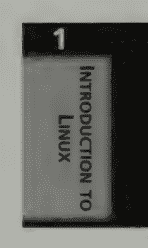

为了扩展系统中的物理 RAM 量，建议使用 Linux 交换分区。交换空间用作实际内存的较慢扩展，数据可以在交换空间和物理 RAM 之间交换。即使在 RAM 密集型系统中，也应该创建交换空间。交换空间的大小取决于系统中的 RAM 数量、用户数量和典型使用情况。

### 硬盘

Linux 可以完全从软盘运行，无需硬盘，尽管它不能提供一个真正有用的环境。Linux 主要为硬盘使用而设计，并支持所有常见的硬盘控制器系统，包括 IDE（集成驱动器电子）、EIDE（扩展集成驱动器电子）、ESDI（增强型小设备接口）、RLL（运行长度限制）和 SCSI（小型计算机系统接口）。Linux 支持较旧的 8 位原始 PC 控制器，尽管如今大多数控制器都是 16 位 AT 或 PCI 设计。

Linux 对硬盘的制造商和类型并不挑剔。作为一般规则，如果 DOS 能处理驱动器，Linux 也能处理。这适用于除 SCSI 驱动器外的所有驱动器，后者需要特殊处理。然而，Linux 仍然受限于较旧的 PC BIOS 版本，这些版本对扇区、磁头和柱面的数量施加了限制。带有这些较旧 BIOS 芯片的驱动器存在 1,024KB 的有效大小限制，甚至一些较小的驱动器由于 BIOS 问题也无法被 Linux 或 DOS 正确处理。一些设备驱动程序现在使这些驱动器对 DOS 和 Linux 可访问，但你必须四处寻找正确的驱动程序。如果你找不到合适的驱动程序并且拥有较旧的 BIOS 芯片，BIOS 会将驱动器的容量降级为可接受的格式之一，实际上使其无法使用磁盘空间（例如，你崭新的 8GB 驱动器可能对于你的机器来说只有 1GB，浪费了 7GB 的磁盘空间）。偶尔，你可以通过替换 BIOS 本身来解决这些 BIOS 限制，尽管旧机器的升级很少见。

Linux 支持大多数标准设备的 SCSI，但市场上有许多不同的 SCSI 控制器和协议，并非所有都很好地兼容 Linux。不过，Linux 确实支持最常见的 SCSI 控制器。其他一些控制器通过在 PC 主板上安装增强型 BIOS 芯片得到支持。较旧的 BIOS 版本仍然对 SCSI 驱动器的大小施加限制，因此 2GB 驱动器只有 1GB 可供 Linux 和 DOS 使用。其他 UNIX 系统，如 SCO UNIX，在大多数情况下可以使用驱动器的其余部分。

Linux 所需的磁盘空间大小取决于安装的操作系统部分。一个有效的最小系统应视为 20MB，这为基本实用程序提供了足够的空间，但不包括 X。如果你想加载整个基本


Linux 系统，包括开发工具和 X，你应当仅为文件预留至少 250MB 的空间。在这些数值之外，还需加上你的个人文件和 Linux 临时存储所需的额外空间。一条好的经验法则是将空间需求加倍。

在用户空间之上，记得还要预留交换空间。尽管交换空间的大小取决于系统的用途和目的，但一个合适的数值是 40MB 到 64MB。

可以使用不止一个硬盘，但 Linux 分区应放在第一个硬盘上。如果需要，DOS 和 Windows 也必须安装在第一个硬盘上，因为如有必要，其他硬盘也可以放置分区。支持的硬盘数量取决于硬盘控制器和 BIOS。IDE 系统通常限制为两个硬盘，而 EIDE 可以处理四个硬盘。ESDI 和 RLL 控制器通常限制为两个硬盘。SCSI 控制器每个控制器可以处理多达七个硬盘（在较新的 SCSI 标准下可达 15 个），并且单个系统中可以配置多个控制器。SCSI 是最多功能的（也是最昂贵的）系统。

由于硬盘如今价格低廉，获取大容量驱动器相对容易。Linux 最多可以与另外三个操作系统共享一个硬盘（甚至通过一些技巧可以支持更多），因此，例如，如果你计划安装 DOS、Windows 95 和 Linux，请为每个操作系统分配足够的空间。

## 视频系统

Linux 可以使用几乎任何在 DOS 和 Windows 下无需特殊驱动程序即可工作的视频卡。这包括 CGA、EGA、VGA 和 Super VGA，以及 Hercules 视频卡。一些增强分辨率的显卡也在 Linux 下得到支持，例如 Cirrus Logic、Diamond、ATI 和 Trident 显卡。不过，由于市面上有数百种视频卡，因此并没有足够的驱动程序覆盖所有型号和特殊视频模式。由于大多数显卡支持默认 VGA 和 SVGA 模式，因此在几乎所有情况下都可以使用这些模式。

X 提出了其自身的视频卡要求，这需要高分辨率显卡的位图能力。尽管 X 可以在 VGA 或 SVGA 系统上运行，但为了获得最佳效果，需要高分辨率显卡。因此，在购买新视频卡之前，请确保有适用于 Linux 的视频驱动程序，或者该卡与已有驱动的旧卡兼容。

## 鼠标

Linux 在基于字符的会话中不使用鼠标，但对于 X 来说这是必需的。Linux 支持几乎所有拥有 DOS 或 Windows 驱动程序的鼠标和轨迹球类型。这包括 Microsoft、Logitech、Mouse Systems 以及其他厂商的产品，以及兼容产品。总线和串行端口鼠标均得到支持。

其他一些指点设备，如手写笔，以及用于光标移动的一些游戏手柄也得到支持。

## 磁带机

任何具有 Linux 识别的控制器 SCSI 磁带机均可使用。还有其他使用专有接口的磁带机，这需要专用的硬件卡。在大多数情况下，如果 IRQ、DMA 和内存地址可以配置到 Linux 中，磁带机就可以访问。

一些 QIC 和类似的小型卡式驱动器正变得越来越流行，它们由软盘控制器卡或并行端口驱动。某些这些磁带机的驱动程序是可用的，但并非所有都得到支持。由于许多小型 QIC 驱动器依靠专有的压缩方案来提高磁带的数据密度，你可能无法向这些驱动器写入超过原始卡式容量的数据。

## CD-ROM

由于大多数 CD-ROM 使用 SCSI 或 EIDE 接口，你需要 SCSI 或 EIDE 控制器卡。早期的 CD-ROM 驱动器曾由各种卡驱动，例如声卡。对于这些，你需要一个合适的 Linux 驱动程序。只要 SCSI 控制器卡被识别，基于 SCSI 的 CD-ROM 驱动器就会被 Linux 识别和支持。

Linux 无法读取所有格式的 CD-ROM。目前，它仅处理 ISO-9660 格式的文件系统。虽然 ISO-9660 被广泛使用，但并非所有 CD-ROM 都使用此格式写入，因此如果 DOS 或 Macintosh CD-ROM 无法正确挂载，请不要感到惊讶。

## 可移动介质

Linux 中的可移动介质支持取决于介质所使用的接口类型。大多数基于 SCSI 的系统（如 Iomega 的 Jaz 和 SCSI ZIP 驱动器，以及 SyQuest SCSI 卡匣）都可以使用，但在文件系统加载期间更换介质很少得到正确支持。Iomega 的 Bernoulli 系统和 LaserSafe Pro 磁光盘卡匣系统都可以在 Linux 上无特殊驱动程序地使用，只要卡匣可以格式化即可。其他一些磁光和可移动磁介质系统也能正常工作。

某些可移动介质需要特殊驱动程序，特别是那些不使用 SCSI 而依赖专用硬件卡的介质。Linux 对这类设备的支持非常有限；现有的支持大多由编写了驱动程序供自己使用并随后将其公开到公共领域的程序员提供。

## 打印机

几乎所有并行和串行端口打印机都作为非智能设备得到广泛支持。某些流行打印机（如 Hewlett-Packard LaserJets 和 DeskJets）有专用驱动程序可用，但仍有许多打印机尚未拥有专用驱动程序。如果不存在针对你的打印机的驱动程序，它将作为仅支持 ASCII 的设备运行。

你通常可以通过编写转换表或设备驱动程序，为不支持的打印机编程自己的接口。

## 调制解调器

Linux 支持大多数串行异步调制解调器，以及一些同步设备。也提供对 ISDN 调制解调器的支持。一般规则是，如果 DOS 和 Windows 可以使用调制解调器，Linux 也可以。

Linux 支持所有波特率，包括较新的压缩方案，如某些需要安装驱动的 56K 系统。系统支持多个调制解调器。事实上，你可以连接尽可能多的调制解调器，数量取决于你拥有的串行端口数量。

## 终端

Linux 支持通过串行端口或多端口卡连接的基于字符的终端。大多数现有的基于字符的终端都可以使用，并且可以为拥有控制代码的任何终端添加支持。在 UNIX 意义上的图形终端使用简单的 ASCII 图形字符，并且不具备 X 功能。

X 终端得到支持，尽管并非所有 X 终端都能正常工作。X 终端通常需要高速连接才能正确显示图形（通过串行端口或网络端口）。运行 X 客户端软件的 PC 也可以作为 X 终端使用。

## 多端口卡

一些基于 UNIX 的多端口卡可以与 Linux 配合使用，因为供应商或用户已经发布了驱动程序。不过，在购买多端口卡之前，请检查驱动程序的可用性。一些多端口卡提供扩展并行端口以及串行端口，这些也需要驱动程序。

一些多端口卡可以通过 SCSI 控制器卡连接，而不是作为插入扩展槽的专用卡构建。即使是基于 SCSI 的扩展卡，Linux 也需要驱动程序才能正确利用它们。基于网络的多端口卡，包括远程访问服务器，通常无需特殊驱动程序即可工作，因为卡上的每个端口都表现得像网络设备。

## 网卡

由于 Linux 是一个 UNIX 系统，其主要网络协议是 TCP/IP。其他协议也可以用于 Linux，但由于 TCP/IP 包含在每个 Linux 软件包中并且是默认的网络协议，因此它的使用最为广泛。TCP/IP 作为互联网协议的角色也使其非常流行。TCP/IP 通常用于以太网，因此 Linux 中大多数网络系统都是围绕以太网设计的。

市场上有许多可用的以太网网络接口卡（NIC，也称为网络适配器）。来自 3Com、Novell、Western Digital、Hewlett-Packard 和 Intel 的最流行以太网卡都能与 Linux 良好配合。许多来自其他供应商的兼容以太网 NIC 也能正常工作。

## 版权

仅仅因为 Linux 免费分发，并不意味着该软件没有版权。Linux 在 GNU 通用公共许可证（GPL）下拥有版权，该许可证在编程社区被称为“保留作品”（copyleft）而非“版权”，因为它允许你将完整的源代码与 Linux 软件一起重新分发给任何想要的人。然而，组件的原始所有者保留对该软件的版权。

Linux 不提供任何形式的保修。即使你向某人购买 Linux 软件并支付维护费用，你也永远无法直接与 Linux 程序员打交道。他们根本不对功能性做任何声明。例如，如果 Linux 摧毁了你所有的会计数据，那就只能算你倒霉。你需要承担风险。然而，事实也证明 Linux 非常稳定，没有因非用户错误而导致严重数据损坏的案例！看待这个问题的另一种方式是


如果你打算将自己的业务寄托于 Linux，那么购买一套带有保修服务的商业 UNIX 系统可能对你更有利。

根据 GNU GPL（通用公共许可证），只要有人愿意付费，你甚至可以销售 Linux。你可以修改任何代码并以你希望的方式重新打包。然而，你并不拥有该软件，也不能声称拥有版权，即使你修改了源代码。GNU GPL 施加的一项条件是，如果你以营利为目的销售该系统，你必须提供所有源代码，以便他人也能进一步修改和销售。

Linux 的作者和开发人员不会获得任何版税或共享软件费用。在很大程度上，他们向最终用户提供软件，纯粹是出于对编程的真正热爱，并与其他欣赏这些代码的程序员分享他们的代码。

## 获取帮助

Linux 没有电话支持热线。从某种意义上说，当安装 Linux 时，你得依靠自己。另一方面，有数千名 Linux 用户愿意帮助从新手到经验丰富的程序员中的每一个人。你所需要知道的只是去哪里寻求帮助。资源主要有两个：书面文档和用户社区。

大多数人接触 Linux 的第一个途径是 Linux INFO-SHEET（信息表），这是一份相对简短的 ASCII 文档，可从 Usenet、BBS（电子公告板系统）以及许多用户组获取。INFO-SHEET 是 Linux 的简要摘要，并定期发布到 Usenet 上的 Linux 新闻组。

Linux 文档项目的创建旨在为 Linux 提供一套完整的公共领域文档。从几年前几份粗糙的安装说明开始，文档已扩展到近一千页，其中一些非常优秀，另一些则一般。目前可用或即将发布的主要文档包括：

- Linux 安装指南——如何安装和配置 Linux
- Linux 用户指南——面向首次使用者的指南
- Linux 系统管理员指南——系统管理各方面的指南
- Linux 网络管理指南——设置和使用网络
- Linux 内核黑客指南——修改 Linux 内核的指南

除了这些主要文档外，还有大约十几份关于 Linux 特定或深奥方面的小型指南。这些小型指南被称为“如何”（How to）文档。

它们共同构成了一个不断增长的文档套件，涵盖了 Linux 的几乎所有方面。并非所有文档都是最新的，因为自它们最初编写以来，操作系统已经发生了变更。

Linux 文档由多个不同的人编写，因此风格和排版并不一致。然而，这些文档随大多数软件发行版一起提供。Linux 文档项目的一套装订成册的印刷版文档可供购买，由 Linux Systems Labs 出版。

通过 Usenet 上的 Linux 新闻组以及作为发行版套装的一部分，可以获得多份常见问题解答（FAQ）文件。FAQ 通常是快速解决问题的小节，旨在让你免于翻阅许多页的在线文档。有一篇名为 META-FAQ 的 FAQ 文件提供了关于 Linux 的基本信息、获取途径以及配套文档。它同样定期发布到新闻组。

有一个名为 Linux 软件映射（LSM）的文件，其中包含 Linux 中许多组件的列表。不幸的是，LSM 不完整，并且缺少大量数据。但是，如果你想查看 Linux 包含什么，它是一个不错的起点。LSM 会定期更新，可以从 Usenet、Linux FTP 站点或许多发行版套装中获取。

最后，还有 Linux 邮件列表，任何拥有互联网电子邮件的人（或由有权限的人转发）都可以使用。有关 Linux 邮件列表（数量相当多）的信息可以从 Usenet 新闻组或 BBS 获取。

## Usenet 新闻组

Usenet 上的 Linux 新闻组是关于 Linux 信息和问答的有用论坛。有几个不同的 Linux 新闻组，你应该使用新闻阅读器软件搜索标题中包含“linux”一词的所有新闻组。CompuServe 和 Delphi 等许多在线服务都允许访问这些新闻组，有些服务还设有自己的 Linux 用户论坛。专门针对 Linux 的电子公告板系统（BBS）（无论是全部还是部分相关）也在出现，许多 BBS 会摘录 Usenet 上的对话，供无法访问 Usenet 的 BBS 用户使用。

Usenet 是可供 Internet 用户使用的讨论组（称为“新闻组”）的集合。每天有超过 10,000 个新闻组生成数百兆字节的流量。在所有这些新闻组（涵盖所有可想象的主题）中，有几个专门用于 Linux。

### Linux 入门

你可以使用新闻阅读器软件访问 Usenet 新闻组，该软件可访问 Internet 或本地站点（称为 newsfeed，即新闻馈送）。或者，CompuServe、America Online 和 Delphi 等大多数在线服务也提供对 Usenet 的访问作为其服务的一部分（有时需额外付费）。

Usenet 新闻组分为三类：主要新闻组，对所有用户都很容易获取；本地新闻组，分发范围有限（通常基于地理区域）；以及替代新闻组，由于礼仪规则较为宽松，可能不被所有新闻服务器处理。编写本书时，对 Linux 用户感兴趣的主要新闻组包括：

- `comp.os.linux.admin`——涉及 Linux 系统管理
- `comp.os.linux.advocacy`——Linux 系统的支持者发声
- `comp.os.linux.announce`——对 Linux 社区重要的公告（这是一个经过审核的新闻组，意味着在你看到帖子之前，有人先批准了这些帖子）
- `comp.os.linux.answers`——关于 Linux 问题的问答
- `comp.os.linux.development`——Linux 的一般持续开发工作
- `comp.os.linux.development.apps`——Linux 应用程序的持续开发工作
- `comp.os.linux.development.system`——Linux 操作系统的持续开发工作
- `comp.os.linux.hardware`——Linux 与硬件支持相关的问题
- `comp.os.linux.help`——关于 Linux 的问题和建议
- `comp.os.linux.misc`——其他组未涵盖的 Linux 特定主题
- `comp.os.linux.networking`——Linux 网络问题
- `comp.os.linux.setup`——Linux 的设置和安装问题

除非系统管理员因某些原因将其过滤掉，否则这些主要新闻组应在所有 Usenet 站点可用。其他 Linux 新闻组往往变化频繁，主要是因为它们是区域性的或由意见强烈的用户组成。`.alt`（替代）新闻组在这方面尤其糟糕。编写本书时，有一个正在运行的 `.alt` 新闻组是 `alt.uu.comp.os.linux.questions`。

如果你有权限访问 Usenet，请定期扫描新闻组的添加和删除，以检查是否有新的 Linux 新闻组或已合并的现有组。关于新闻组变更的通知通常发布到所有现有组，但偶尔会有通知悄无声息地发布。提供 Usenet 访问的在线服务通常维护所有活跃新闻组的列表，可以快速搜索。

这些大多数 Linux 新闻组上的流量涉及安装、配置、管理或使用操作系统的问题和事项。新闻组中迅速传递着许多有价值的信息，因此请定期检查。处理特定主题（称为“线程”）的最有趣信息通常会收集并存储为存档，以便通过 FTP 站点访问。

## 本书内容

本书旨在指导你完成 Linux 的安装和配置，从系统管理的角度设置和使用系统，并一步步引导你从 UNIX 和 Linux 的新手转变为熟练用户。在本书中，我们涉猎了大量材料，有些深入探讨，其他主题则仅做表面处理，让你了解该主题以及 Linux 能做什么。

本书不是一本无所不包的参考书。没有任何一本不到 10,000 页的书能告诉你你需要知道的一切。例如，我们不能指望教会你 C 或 C++ 编程，尽管我们可以向你展示如何设置环境和使用包含的编译器。我们也不可能带你走过未来几年使用 Linux 过程中可能出现的每个问题或事项，但我们可以为你提供足够的背景知识和适当的工具来处理这些问题。我们还会告诉你去哪里寻找答案。

所以，享受使用 Linux 和阅读本书的乐趣吧。我们努力使其成为一段愉快的阅读体验，希望你学到很多。最重要的是，玩得开心。Linux 是一个伟大的操作系统！

## 摘要

既然我们已经涵盖了 Linux 的基础知识，我们可以继续探讨可用的 Linux 类型、安装你选择的系统，以及熟悉操作系统。本书这一部分的其余内容涉及安装和基本配置。接下来的部分将引导你使用 Linux。如果你已经安装了操作系统，可以跳过阅读“认识 Linux”部分。否则，请阅读接下来的几章，以帮助你正确安装系统。


以下章节将有助于你学习如何：

- 安装 Linux，请参阅第 3 章，“安装 Linux”。
- 使用 Linux，请参阅第二部分，从第 6 章“入门”开始。
- 安装 X 软件包，请参阅第 22 章，“安装和配置 XFree86”。
- 管理你的 Linux 系统，从第 32 章“系统管理基础”开始。

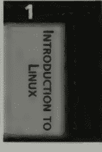


# Linux 类型

作者：Tim Parker

## 本章内容

- 在哪里获取 Linux 26
- 什么是 Linux 发行版？ 35
- Linux 发行版和磁盘集 35
- 更新现有的 Linux 系统 37

本章涵盖了一些在安装 Linux 之前你需要了解的主题。如果你手头没有可安装的 Linux，或者你想要获取与现有版本不同的版本，本章的第一部分将解释在哪里以及如何获取 Linux。本章的其余部分解释了安装 Linux 需要哪些磁盘集，以及每个磁盘集的作用。当你向 Linux 系统添加功能时，需要了解这些信息。

市场上有许多不同版本的 Linux：包括 Slackware、Red Hat、Caldera、SLS（Softlanding Linux System）、TAMU（德克萨斯农工大学）、Yggdrasil 以及另外约十几个版本。各版本之间存在差异——有些显著，有些则不明显。最适合你的版本很难提前预测。你会发现 Linux 版本之间的许多差异是累积的小细节：更好的安装例程和管理工具、技术支持、更好的硬件驱动程序等。虽然你可以在一定程度上进行混合搭配，但大多数人会选择一种版本并坚持下去。虽然你始终可以重新加载另一个 Linux 版本，但在麻烦去做之前，应该有非常充分的理由。

## 在哪里获取 Linux

如果你知道去哪里找，Linux 很容易（且免费）获取。由于 Linux 的发布没有受中央组织控制（不像商业 UNIX 版本），因此没有单一的责任方来保持 Linux 的更新和易于获取。完全由你来寻找软件来源，并确保你收到的版本包含所有你需要的组件。你还必须谨慎选择版本，因为许多分销商（如书籍和电脑超级市场）通常储备多个不同的版本（往往来自同一个 Linux 分销商），其中一些可能不是最新的。

有几种方法可以获取 Linux 的副本。根据你的优先级，选择最方便或最经济的方法。获取完整 Linux 二进制文件和实用工具的最常见方法是通过 CD-ROM，例如随本书附带的光盘，或从 Workgroup Solutions 等分销商提供的多光盘包装套装。购买 CD-ROM 的替代方案包括从 FTP 站点和公告板系统（BBS）下载，大多数提供免费副本（尽管你需要承担下载时间费用，如果有的话）。你也可以从某些来源获取邮寄给你的 Linux 副本。

你选择的获取 Linux 副本的方法也在一定程度上决定了软件集的完整程度。例如，CD-ROM 版本通常包含磁盘上可用的所有 Linux 软件，而一些 BBS 和 FTP 站点只提供基本发行版，足以安装并作为基本系统使用。例如，小型系统可能不包含所有可用的语言编译器和 X 软件。

## CD-ROM Linux

在撰写本书时，有十几个不同的制造商和分销商提供基于 CD-ROM 的 Linux 版本。这些软件包在磁盘上包含的 Linux 软件发布号以及随操作系统捆绑的材料数量上有所不同。你可以购买包含大多数软件的单光盘和双光盘软件包，或包含大量支持材料、Usenet 帖子、辅助文档和备用内核构建的四光盘和六光盘集合。

大多数发行版包含许多相同的基本产品，但组织方式不同。每个分销商附加功能的价值也有巨大差异，例如新的安装文档和实用工具或系统管理工具。由于大多数 Linux 发行版即使是 6 盘套装价格也远低于 100 美元，请选择不适合你的最佳软件集和 Linux 版本。

检查你购买的磁盘，确保你拥有最新版本的 Linux 内核（比较可用 CD-ROM 之间的版本号）以及你想要的所有附加组件。大多数 CD-ROM 的封面说明书会给你一个关于发布号（如 Slackware 3.4 或 Red Hat 5.0）和包含软件（如 XF86、编译器等）的大致概念。有时很难从某些 CD-ROM 集合封面上简略的标识中识别出内容，因此你可能会不知不觉地购买过时或不完整的材料。幸运的是，Linux CD-ROM 通常价格不贵。

一些供应商通过增加实用工具或启动磁盘来美化他们的 Linux 集合，使安装变得更加容易。添加预编译的游戏、应用程序和用户实用工具使这些 CD-ROM 更具吸引力。通常，供应商对这些版本收费略高，但通常多花几美元，你会获得编写良好的手册，有时还能获得技术支持。Caldera 是一个流行的优质软件包的好例子（虽然“优质”在这里是个不准确的术语，因为 Caldera 的软件成本往往低于一些较大的共享软件 CD-ROM 集合）。

## FTP 站点

文件传输协议（FTP）是一种广泛使用的 Internet 协议（TCP/IP 协议族的一部分），允许你从远程机器传输文件。有几个匿名 FTP 站点分发 Linux 软件（匿名意味着你不需要在远程机器上拥有账户即可访问文件；你以“guest”或“anonymous”登录，并使用你的姓名或电子邮件地址作为密码）。如果你可以访问 Internet，无论是直接访问还是通过 CompuServe 或 America Online 等在线服务提供商，你都可以访问这些 Linux 发行站点。

要使用 FTP，你必须在一台支持 TCP/IP 的机器上。这可以是运行 DOS 或 Windows 软件包的现有 PC，或者是 UNIX 或 Linux 工作站，两者都连接到提供 FTP 功能的 Internet 服务。FTP 连接的两端都必须运行提供 FTP 服务的程序，但如果你正在拨入的系统是一个 FTP 站点，可以肯定地说他们正在运行 FTP！要从远程系统下载文件，你必须启动 FTP 软件并指示其连接到在远程机器上运行的 FTP 软件。

Internet 有许多 FTP 存档站点。这些机器旨在允许任何人连接并下载软件。在许多情况下，FTP 存档站点互为镜像，因此它们拥有完全相同的软件。你连接到最容易访问或响应速度最快的站点。用于 Linux 软件的最常用 FTP 站点是 sunsite.unc.edu。sunsite 的存档包含可用的 Linux 软件、较旧的内核、驱动程序和实用工具的综合列表。你可以在商店购买的许多 CD-ROM 集合只是 sunsite 内容的副本。如果你正在通过 FTP 寻找 Linux，sunsite.unc.edu 是开始的最佳地点之一。

### 使用 FTP 连接和下载文件

使用 FTP 连接到 Linux FTP 站点非常简单（当然，假设你可以访问 Internet）。你可以通过指定要连接的远程系统名称来启动 FTP，或者在启动 FTP 后输入它（前者更简单）。如果你直接连接到 Internet，请输入带有远程站点名称的 ftp 命令，例如：

```
ftp sunsite.unc.edu
```

在这种情况下，我们使用的是命令行界面，尽管也有一些非常有用的基于图形界面的 FTP 客户端，例如带有 Windows X 客户端软件包的那些。使用这种类型的界面比命令行 FTP 友好得多，因为它模仿了 Windows 资源管理器界面。你只需选择要在远程机器上的文件，并将它们拖到机器上的文件夹中。像 eXceed 这样的软件包可用于从局域网上的其他机器访问你的 Linux X 服务器。

如果你使用 CompuServe 或 Delphi 等在线服务，通常必须访问它们的 Internet 服务区域，并从中调用 FTP。大多数在线服务允许你在提示符处输入 FTP 站点名称。少数服务对可以传输的流量数量施加限制，因此除非你乐于承受高额附加费，否则使用这些服务下载 Linux 可能会很麻烦。


由于许多人使用基于命令行的 FTP 来获取他们的 Linux 软件，因此本节将使用这种版本。在与你的 ISP 建立互联网连接后，即可启动 FTP。如果你使用的是 Windows 机器，DOS 窗口通常是最简单的连接方式。打开一个 DOS 窗口，并在 ftp 命令行中输入你要访问的服务器的名称。

一旦你发出 FTP 命令，你的系统将尝试连接到远程机器。当连接成功完成后，远程机器会提示你输入用户 ID。除非该系统支持匿名 FTP（所有 Linux FTP 站点都支持），否则你必须拥有该系统的有效用户 ID 和密码。当你首次连接且在登录之前，通常会显示一条消息，告知你远程系统支持匿名 FTP。例如，下面对 Linux FTP 存档站点 sunsite.unc.edu 的登录过程立即告诉你匿名登录是可以接受的：

```
ftp sunsite.unc.edu
331 Guest login ok, send your complete e-mail address as password.
Enter username (default: anonymous): anonymous
Enter password [tparker@tpci.com]:
!FTP] Open
230-            WELCOME to UNC and SUN's anonymous ftp server
230-            University of North Carolina
230-            Office FOR Information Technology
230-            SunSITE.unc.edu
230 Guest login ok, access restrictions apply.
FTP>
```

匿名 FTP 站点的登录名通常是“guest”或“anonymous”。登录消息通常会告诉你使用的是哪一个，或者你可以尝试两者。在大多数情况下，远程机器会提示你输入密码。有些系统不需要你提供密码，而有些系统则要求你输入你的用户名或电子邮件地址。这仅用于跟踪目的，并且不会带来任何安全问题（除非你在你的本地账户上没有设置密码！）。

登录过程完成后，当你提供了登录名和密码后，你会看到提示符“FTP>”。这表明系统已准备好接受 FTP 命令。有些系统在登录时会显示一条简短的消息，其中包含下载文件的说明以及作为匿名 FTP 用户所受到的任何限制。还可能显示有关有用文件位置的其他信息。例如，你可能会看到来自 FTP 站点 sunsite.unc.edu 的此类消息：

要获取二进制文件，请输入：BINARY，然后输入：GET "File.Name" newfilename
要获取文本文件，请输入：ASCII，然后输入：GET "File.Name" newfilename

名称必须完全匹配大小写。请如所示使用"引号"。要获取目录，请输入：DIR。要更改目录，请输入：CD "Dir.Name" 要读取短文本文件，请输入：GET "File.Name" TT 更多内容，请输入 HELP 或查看 gopher 中的 FAQ。要退出，请输入 EXIT 或 Control-Z。

230- 如果你向 info@sunsite.unc.edu 发送电子邮件，你会收到有关如何使用 sunsite 提供的不同服务的帮助信息
230- 我们使用 Wuarchie 实验性 ftpd。如果你"get" <directory>.tar.Z
230- 或 <file>.Z，它将即时进行压缩和/或 tar 打包。使用".gz"代替
230- ".Z" 将使用 GNU zip (/pub/gnu/gzip*)，这是一种更优越的
230- 压缩方法。

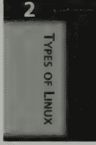

一旦你进入了远程系统，你可以使用 Linux（UNIX）命令来显示文件内容并在目录之间移动。要显示目录的内容，使用命令 ls 或 DOS 等效命令 dir。要切换到子目录，使用 cd <dir> 命令。要返回父目录（当前目录的上层目录），使用命令 cd ... 与 Linux 不同，FTP 没有键盘快捷键，因此你必须完整（且正确）地输入文件或目录的名称。

当你在目录中移动并找到想要转移到你的系统的文件时，使用 FTP 的 get 命令，例如：
get "file1.txt"

get（下载）和 put（上传）命令是相对于你的本地机器而言的，而不是相对于远程机器。当你发出 get 命令时，你是在告诉你的系统的 FTP 软件从远程机器获取文件。put 命令告诉 FTP 将本地机器上的文件放到远程机器上。记住哪个命令朝哪个方向移动文件非常重要，否则你可能会意外覆盖文件。

在大多数版本的 FTP 中，文件名周围的引号是可选的，但它们确实为远程版本提供了特定字符（防止 shell 扩展）。这可以防止来自 FTP 的错误消息或意外传输许多文件而不是仅传输一个文件，因此使用引号是一个有用的惯例。

当你发出 get 命令时，远程系统会将数据转移到你的本地机器，并在完成后显示状态消息。在传输大文件期间没有进度指示，因此要有耐心。这是一个 get 命令的示例记录：

```
FTP> get "file1.txt"
200 PORT command successful.
150 BINARY data connection for FILE1.TXT (27534 bytes)
226 BINARY Transfer complete.
27534 bytes received in 2.35 seconds (12 Kbytes/s).
```

FTP 提供两种文件传输模式：ASCII（7 位字符）和 Binary（8 位字符）。有些系统会自动在这两种模式之间切换，但手动设置模式以确保不浪费时间是个好主意。你必须以 Binary 模式下载所有 Linux 发行版文件。要将 FTP 设置为二进制传输模式（对于任何可执行文件），输入命令

```
binary
```

你可以使用命令 ASCII 切换回 ASCII 模式。如果你在 ASCII 模式下传输二进制文件，它将无法执行。以 Binary 模式传输 ASCII 文件不会影响文件的内容，因此 Binary 是一个良好的默认传输模式。

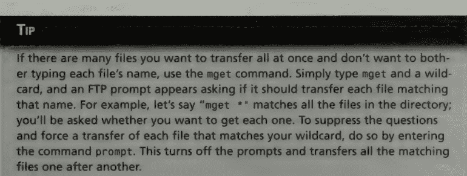

要退出 FTP，输入命令 quit 或 exit。这两个命令都会关闭你在远程机器上的会话，然后终止你本地机器上的 FTP。

请记住，Linux 存档非常大，使用异步调制解调器传输即使是小的发行版也需要一段时间。如果你使用慢速调制解调器（9,600 波特或更低），你可能需要考虑替代方法，因为你的连接必须保持长达数小时。一些远程站点限制你可以保持连接的时间。

## Linux FTP 存档站点

Linux FTP 存档站点的列表变化缓慢，但以下列出的站点在本书付印时都是有效且可访问的。其中许多站点是镜像站点，提供与主站点完全相同的内容。Linux FTP 存档的主站点（也称为 home 站点）是 tsx-11.mit.edu、sunsite.unc.edu 和 nic.funet.fi。大多数新软件的加载始于 home 站点。上一列表中大多数站点都是这三个站点之一的镜像。

你可以通过使用站点名称末尾的国家/地区标识符（uk=英国，fr=法国等）找到离你最近的站点。大多数版本的 FTP 允许使用机器名称或 IP 地址，但如果名称无法被本地互联网网关解释，IP 地址是最佳的寻址方法。确保你正确输入了 IP 地址的四个组件。表 2.1 显示了在本书付印时是 Linux 材料良好来源的站点。

### 表 2.1 Linux FTP 站点及其 IP 地址。

| 站点名称 | IP 地址 | 目录 |
|---|---|---|
| tsx-11.mit.edu | 18.172.1.2 | /pub/linux |
| sunsite.unc.edu | 152.2.22.81 | /pub/linux |
| nic.funet.fi | 128.214.6.100 | /pub/OS/Linux |
| ftp.mcc.ac.uk | 130.88.200.7 | /pub/linux |
| fgb1.fgb.mw.tu-muenchen.de | 129.187.200.1 | /pub/linux |
| ftp.informatik.twmuemchen.de | 131.159.0.110 | /pub/Linux |
| ftp.dfv.rwth-aachen.de | 137.226.4.105 | /pub/linux |
| ftp.informatik.rwth-aachen.de | 137.226.112.172 | /pub/linux |
| ftp.ibp.fr | 132.227.60.2 | /pub/linux |
| kirk.bu.oz.au | 131.244.1.1 | /pub/OS/Linux |
| ftp.uu.net | 137.39.1.9 | /systems/unix/linux |
| warchive.wustl.edu | 128.252.135.4 | /systems/linux |
| ftp.win.tue.nl | 131.155.70.100 | /pub/linux |
| ftp.stack.urc.tue.nl | 131.155.2.71 | /pub/linux |
| ftp.ibr.cs.tu-bs.de | 134.169.34.15 | /pub/os/linux |
| ftp.denet.dk | 129.142.6.74 | /pub/OS/linux |

如果你在连接到一个站点时遇到困难，请尝试连接另一个站点。如果困难持续存在，你的互联网访问可能存在问题。


## 万维网

  每个人都在使用万维网（WWW），你可以利用它从多个不同的网站之一获取 Linux 的副本。主要的 FTP 站点通过以下 URL 提供 Web 访问：

`http://sunsite.unc.edu/mdw/linux.html`

你可以使用任何 Web 客户端软件，例如 Mosaic 或 Netscape，来访问该网站，并使用基于菜单的系统下载一份 Linux 文件的副本。大多数 Linux 网站也提供文档文件。

如今互联网上有许多不同的 Linux 支持网站，多到无法一一列举。使用你喜欢的搜索引擎（例如 `yahoo.com` 或 `altavista.digital.com`）并使用关键词“Linux”。你将得到一个压倒性的匹配列表。通常你可以使用诸如“二进制文件”或特定版本（例如“Slackware”）等关键词来缩小搜索范围。

### 电子邮件

如果你无法通过互联网的 FTP 或 Web 服务访问 Linux 发行版站点，只要你拥有电子邮件，仍然可以让文件传输给你。这是针对那些使用允许 Internet 邮件但不允许直接访问 FTP 站点的在线系统的用户的替代方案，也是针对某些不允许直接拨号访问 FTP 站点但可以传输电子邮件的企业系统的替代方案。要从 FTP 站点通过电子邮件获取 Linux，你可以使用该站点的 `ftpmail` 实用工具。

上文 Linux FTP 站点列表中提到的所有站点都支持 `ftpmail`。要获取有关使用 `ftpmail` 的完整说明，你只需向其中一个站点的 `ftpmail` 登录地址发送一封电子邮件（例如，将你的电子邮件地址设为 `ftpmail@sun-site.unc.edu`）。电子邮件消息的主体应只包含单词“help”（帮助）。任何其他评论都可能导致 `ftpmail` 实用工具错误地处理你的请求。因此，你可能需要抑制自动附加到电子邮件的任何签名文件。

在收到你的请求后，`ftpmail` 会向你发送关于如何使用该服务的说明。在大多数情况下，你将要在远程站点执行的 FTP 命令嵌入在你的邮件消息主体中。例如，要获取 Linux 目录的目录列表，请发送一封主体如下所示的邮件消息：

```
open sunsite.unc.edu
cd /pub/Linux
ls
quit
```

远程站点的 ftpmail 实用工具会处理这些命令，就好像它们是直接输入到 FTP 中一样。要通过电子邮件将文件传输给你自己，请发送以下邮件消息：

```
open sunsite.unc.edu
cd /pub/Linux
binary
get README
quit
```

这通过电子邮件发送了文件 README。ftpmail 系统比 FTP 慢，因为你必须等待电子邮件到达目标机器，由远程系统的 ftpmail 实用工具进行处理，格式化回复，然后将返回消息发送给你。尽管如此，ftpmail 确实为没有 FTP 连接的人提供了一种有用的访问方法，并且提供了一种简单的方式来检查几台机器上 Linux 目录的内容，而无需登录到这些机器。当你偶尔想要检查软件更新时，这会很有用。

一个注意事项：你要传输的文件可能会超过你的邮件系统的最大文件大小限制。一些邮件系统会将文件拆分成较小的块，并允许你在接收时重新组装它们，但一些电子邮件系统对电子邮件施加了较小的大小限制，使得使用 ftpmail 获取如完整 Linux 软件发行版这样的大文件变得不切实际。

### 公告板系统 (BBS)

世界各地有数百个公告板系统（BBS），它们现在提供对 Linux 发行版软件的访问，并支持 Linux 讨论组。一些 BBS 定期从 FTP 主站点下载新的 Linux 发行版，而另一些则依靠 BBS 的用户来更新软件。

任何包含 Linux 软件的 BBS 列表都会很长并且很快就会过时，因此获取此信息的最佳方法是从 Zane Healy 那里获取当前 BBS 站点的列表，他维护了一份提供 Linux 材料的 BBS 完整列表。要获取 BBS 列表，请发送电子邮件请求 Linux 列表到 `healyzh@holonet.net`。如果你无法访问电子邮件，尝试一些当地公告板系统并发布消息询问提供 Linux 软件的当地站点，或者让有 Internet 访问权限的人帮你发布电子邮件。许多 BBS 也会有该列表，尽管列表的准确性可能有所不同。

## 什么是 Linux 发行版？

对于大多数用户来说，Linux 发行版有两个含义。第一个含义与提供 Linux 的供应商或发行商有关。例如，Slackware 和 Red Hat 都是 Linux 发行版。如本章前面所述，某些发行版之间的差异很细微，但确实存在差异。

发行版的第二个含义与你使用的 Linux 版本有关。例如，Slackware 2.3 和 Slackware 2.4 都是 Linux 的发行版。更准确地说，这些应该是同一发行版（Slackware）的*版本*，但自 Linux 早期以来，术语“发行版”一直被用于指代 Linux 提供的每一套新的内核和工具。当有人问你使用哪个 Linux 发行版时，这有点令人困惑，因为你不确定他们指的是供应商还是版本，所以大多数人通过提供两者来解决这个问题（例如，“我正在运行 Slackware 2.0.33”）。

你需要拥有最新版本的 Linux 发行版吗？很可能不需要。大多数版本升级之间的差异通常很小，尤其是对于 2.3 到 2.4 这样的增量发行版。除非你确实需要最新版本中某些功能或驱动程序支持，否则升级通常不值得麻烦。主要版本升级之间的差异要大得多，例如从 1.X 系列到 2.X 系列内核。主要内核升级几乎总是值得安装的，尽管在主要版本更新时你可能需要从头重新安装所有内容。

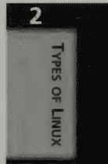

> **注意**
>
> 避免每当有新的 Linux 发行版可用时就升级你的系统这一常见陷阱。有些人必须在其系统上运行每个软件包的最新版，但从 2.0.33 升级到 2.0.34 的影响在大多数系统上很可能无法检测到。升级的真正动机应该是为了获得更好的性能、硬件驱动程序或主要版本升级。如果你确实患上了“版本症”，你将花费更多时间升级系统的每个组件，而不是使用（或玩）它。通常，你最终也会重新加载你的整个系统。

## Linux 发行版和磁盘集

发行版是足以安装和运行整个操作系统的 Linux 软件集合。该发行版由多个软件集合组成，称为磁盘集（即使它们可能不在磁盘上）。大多数 Linux 系统在你获取发行版软件时都包含多个磁盘集。

尽管大多数 CD-ROM 和 FTP 站点具有相同的软件，但少数站点会以不同的方式标记磁盘集。为了说明 Linux 中可用的磁盘集，可以使用较受欢迎的 CD-ROM 版本之一 Slackware 作为示例。Slackware Linux 发行版中当前可用的磁盘集系列是：

- **磁盘集 A** — 基础系统。这包含内核和一组基本实用工具，包括 shell、编辑器和用户实用工具。磁盘集 A 是唯一能装在一块高密度软盘上的磁盘集。这让你甚至可以从软盘安装和运行 Linux！
- **磁盘集 AP** — Linux 应用程序，包括许多不同的编辑器、所有标准的 UNIX 命令实用工具、man 页面以及像 GhostScript 这样的 GNU 附加组件。
- **磁盘集 D** — 程序开发。该磁盘集包括 GNU 语言、开发实用工具、库和编译器工具。还有大量用于自定义 Linux 内核的库的源代码。
- **磁盘集 E** — GNU emacs 编辑器。
- **磁盘集 F** — FAQ（常见问题解答）文件和其他 Linux 帮助文件。
- **磁盘集 I** — GNU 软件的文档文件。
- **磁盘集 IV** — Interviews 库、包含文件和文档。Interviews 是一个 C++ GUI 开发包。
- **磁盘集 N** — 网络软件。该磁盘集包括 TCP/IP 协议集、UUCP、邮件实用工具、新闻系统以及几个实用工具。
- **磁盘集 OI** — ParePlace 对象构建器和对象接口库。这些是 ParePlace 为 Linux 开发者提供的商业开发包。
- **磁盘集 OO** — 面向对象编程（OOP）工具，包括 GNU Smalltalk 编译器和 Smalltalk 到 X 的接口（STX）。
- **磁盘集 Q** — Linux 内核和启动镜像的源文件。
- **磁盘集 T** — TeX 和 LaTeX2 测试排版系统。TeX 广泛用于排版。
- **磁盘集 TCL** — Tcl 语言集，包括 Tcl、Tk、TclX 和实用工具。
- **磁盘集 Y** — 游戏集合。
- **磁盘集 X** — XFree86，包括 X 系统和几个窗口管理器。
- **磁盘集 XAP** — X 应用程序，包括文件管理器、GhostView、一些库、游戏和实用工具。
- **磁盘集 XD** — X 开发工具包，包括 X 库、服务器链接工具包和 PEX 支持。如果你打算开发基于 X 的应用程序，这个磁盘集是必需的。


- 磁盘集 XV——X 的窗口管理器。该磁盘集包含 XView 库和 Open Look 窗口管理器。这些可以替代磁盘集 X 中包含的窗口管理器。

虽然磁盘集 A 允许你从软盘安装 Linux 系统，但对于完整安装（基于硬盘并包含标准实用程序），你应该拥有磁盘集 A、AP、D 和 F。这组磁盘集可以为你提供一个基于字符界面的 Linux 系统。如果你想要运行 X，还需要磁盘集 X 和 XAP。程序员需要加载开发磁盘集（D 以及用于 X 应用程序的 XD）。

## 更新现有 Linux 系统

如果你已经安装并运行了 Linux，可能到了升级系统的时候了。在大多数情况下，升级运行中的系统就像将新软件复制到目录中并重新构建内核以链接现有的驱动程序一样简单。在某些情况下，升级系统意味着从头加载所有内容（通常仅在主要版本变更或 Linux 供应商变更时需要）。

大多数你购买的 Linux 版本并不是设计用来自动升级现有软件的（例如 Windows 版本那样）。相反，通常期望你备份磁盘上的所有内容，安装新版本，然后从备份中恢复文件。幸运的是，通常你只需要将几个内核文件复制到现有的目录结构中并重新编译，即可升级大多数内核。我们将在下一章中更详细地讨论升级现有系统的问题。

## 摘要

在本章中，我们查看了 Linux 发布的组成部分、获取 Linux 软件的渠道，以及关于构成整个 Linux 的磁盘集的信息。现在你可以准备好软件，进行下一步，即安装和配置 Linux。以下是包含相关信息的章节列表：

- 如何安装 Linux，参见第 3 章“安装 Linux”和第 5 章“完成安装”。
- 如何使用 Linux，参见第二部分内容，包括第 6 章“入门”和第 11 章“bash”。
- 如何安装和配置 X 服务器系统，参见第 22 章“安装和配置 XFree86”。
- 系统管理问题，参见第六部分的各章，包括第 32 章“系统管理基础”。

# 第 3 章 安装 Linux

作者 *Tim Parker*

**本章内容**

- 使用 Linux 40
- 引导盘和根盘 42
- 安装程序：快速指南 47
- 分区硬盘 50
- 安装 Linux 分区 55
- 安装 Linux 60
- 设置引导过程 61
- 查看已安装的软件文件 61
- 故障排除 62
- SCSI 问题 65

## 使用 Linux

你可能已经安装了 Linux。即便如此，你对安装结果可能并不满意，要么是因为组织混乱，要么是因为你一直在尝试不同的配置并希望重新以更合适的配置进行安装。本章探讨了你在首次安装 Linux（或根据需要重新安装）时应关注的问题，以及如何通过新的软件发布更新你现有的 Linux 安装。

请记住，本章采用通用方法，使用三个流行的 Linux 版本（Slackware、Red Hat 和基于 Slackware 的 OpenLinux）来介绍 Linux 的安装。根据你安装的 Linux 版本和发布版本，你的提示和选项可能有所不同。幸运的是，大多数内容很容易理解，因为一旦你进入软件包安装例程，所有 Linux 版本的提示都相当直接。

安装 Linux 的过程很简单，尽管散落着许多可能导致麻烦的小问题。不要相信发行版软件中许多“轻松安装”的说法！在安装 Linux 之前，几个步骤仍然需要耐心、实验以及对正在发生的事情的了解。安装 Linux 的基本步骤如下：

- 创建 Linux 的引导盘和根盘。
- 分区硬盘。
- 从软盘引导 Linux。
- 创建交换文件。
- 创建 Linux 文件系统。
- 安装 Linux 软件。
- 配置内核。
- 设置引导过程。
- 从硬盘引导进入 Linux。

我们将详细查看这些步骤中的每一个。从 CD-ROM 安装和从磁盘（例如来自 FTP 站点）安装的过程非常相似。由于 CD-ROM 是最常见的安装形式，我们在本章中使用该过程作为示例。

如果你是从软盘安装并且已下载发行版文件（或从 CD-ROM 复制而来），你需要为发行版磁盘集中的每个磁盘准备一张 DOS 格式的软盘。你可以使用标准的 DOS 复制命令将磁盘集文件复制到软盘中，每个发行版集中的文件对应一张软盘。文件都有编号，因此你知道哪个软盘属于哪个集，以及它们的顺序应该是什么。

### 无软盘安装

如果你的硬盘已经安装了 DOS 等操作系统，或者像 Windows 那样提供 DOS 窗口，你可以尝试直接从 CD-ROM 安装。引导进入你现有的操作系统，切换到 CD-ROM 驱动器，寻找一个带有 .COM 或 .EXE 扩展名的可执行单文件程序。例如，某些 Red Hat Linux 版本有一个名为 RED HAT 的可执行文件，它可以为你处理安装过程。如果是这种情况，请在 DOS 提示符下（或该可执行文件的名称）输入以下命令：

```
RED HAT
```

程序会向你询问一系列问题，以帮助它确定最适合的引导内核图像。你也可以在此阶段提供特殊的启动安装命令。

> **提示**
>
> 不要在 Windows 3.1、Windows 95 或 OS/2 会话内部运行无软盘安装过程。请将系统引导至 DOS 或 DOS 模式，并在那里运行。

无软盘安装例程通过显示所有可能的菜单选项并提示你输入答案，引导你完成内核确定过程。该过程直观易懂，任何知道系统上安装了哪种硬件的人都可以使用。如果你不确定硬件配置，你仍然可以尝试无软盘安装；最坏的情况是你不得不使用不同的设置再次尝试。

如果安装过程检测到一些硬件配置问题，它可能会提供关于设置参数或进行更改的建议。这些建议大多只是建议而已。如果你不想，可以不采纳这些建议。在某些情况下，建议很有意义（例如解决 IRQ 冲突），在这种情况下，你应该处理该问题。（本章稍后有一张常用 IRQ 表。）

### 引导盘和根盘

即使你是从 CD-ROM 安装，你仍然需要两张大容量软盘（1.2MB 或 1.44MB）。这些是引导软盘和根软盘。引导软盘保存用于首次启动 Linux 的内核，从而引导到你的安装过程。根软盘保存一个包含安装所需实用程序的小型文件系统。这两个磁盘组成了一个完整且非常小的 Linux 实现。这两张软盘上的系统足以实际操作 Linux，尽管许多实用程序缺失。

> **提示**
>
> 如果你拥有一台较新的系统，可能根本不需要引导软盘和根软盘。当前的 BIOS 版本允许从 CD-ROM 驱动器引导，特别是当系统完全基于 SCSI 时。一些基于 IDE 的 CD-ROM 系统也允许从 CD-ROM 驱动器引导。如果你的系统支持 CD-ROM 引导，你只需插入 Linux CD 并重启系统即可。CD 软件会自动选择正确的引导和根图像使用。

在大多数情况下，引导软盘和根软盘是从称为“图像”的现有文件复制而来。图像是系统的重新编译版本，你将其复制到软盘上，从而省去了从头开始的步骤。CD-ROM 和 FTP 发行版包含几个引导和根图像的目录，具体取决于你的系统硬件。你必须选择最匹配你硬件的图像，将它们复制到磁盘，然后使用这些磁盘启动你的系统。

你可以在 DOS 下完成这些步骤中的大多数，但你不能 DOS 复制命令来创建引导软盘和根软盘。这些软盘必须使用忽略 DOS 格式化的实用程序创建。这个通常称为 RAWRITE.EXE 的实用程序包含在大多数 Linux 软件发行版中。

### 选择引导内核和根图像

CD-ROM 通常在根目录下有名为 bootdisks.144 和 rootdisks.144（用于 3.5 英寸 1.44MB 软盘）以及 bootdisks.12 和 rootdisks.12（用于 5.25 英寸 1.2MB 软盘）的目录，分别包含引导和根图像。你

应使用软盘或硬盘上的分区从 DOS 启动以检查 CD-ROM。如果您正在从 FTP 站点复制文件，您可以在连接到远程 FTP 机器时选择所需的启动和根镜像，并仅将您需要的镜像传输到本地机器。

内核镜像目录中的一个文件描述了通常可用的启动内核类型。这些镜像的命名反映了内核中安装了驱动程序的硬件。例如，名为“scsi”的内核镜像在内核中包含基于 SCSI 的系统的驱动程序，如果您使用的 PC 配有 SCSI 控制器、硬盘和 CD-ROM，那么这就是您想要复制到启动软盘的镜像。

可用的启动镜像数量相当多。大多数 CD-ROM 和 FTP 站点提供的主要镜像及其设计处理的硬件如下：

-   **aztech**。包含 IDE 和 SCSI 硬盘驱动程序，以及 Aztech 非 IDE CD-ROM 支持。包括 Aztech、Okana、Orchid 和 Wearnes 非 IDE CD-ROM 驱动器。
-   **bare**。仅包含 IDE 硬盘驱动程序（无 CD-ROM 支持）。
-   **cdu31a**。包含 IDE 和 SCSI 硬盘驱动程序，以及 Sony CDU31 或 Sony CDU33a CD-ROM 驱动器。
-   **cdu535**。包含 IDE 和 SCSI 硬盘驱动程序，以及 Sony 535 或 Sony 531 CD-ROM 驱动器。
-   **idecd**。包含 IDE 和 SCSI 硬盘驱动程序，以及 IDE 或 ATAPI CD-ROM 驱动器。此驱动程序适用于基于 IDE 的 CD-ROM 驱动器。
-   **mitsumi**。包含 IDE 和 SCSI 硬盘驱动程序，以及 Mitsumi CD-ROM 驱动器。
-   **net**。包含 IDE 硬盘驱动程序和以太网网卡驱动程序。
-   **sbpcd**。包含 IDE 和 SCSI 硬盘驱动程序，以及 Sound Blaster Pro 或 Panasonic CD-ROM 驱动程序。适用于由 Sound Blaster 声卡驱动的 CD-ROM 驱动器（许多 Sound Blaster 多媒体套件中提供的类型）。
-   **scsi**。包含 IDE 和 SCSI 硬盘驱动程序，以及 SCSI 外围设备（CD-ROM 驱动器）。
-   **scsinet1**。包含 IDE 和 SCSI 硬盘驱动程序、SCSI CD-ROM 驱动程序以及用于网络的以太网驱动程序。SCSI 驱动程序支持 Adaptec 152X、1542、1740、274x 和 284x 适配器、Buslogic 适配器、EATA-DMa 适配器（如 DPT、NEC 和 AT&T 卡）、Seagate ST-02 适配器，以及 Future Domain TCC-8xx 和 16xx 适配器。与这些卡中任何一种兼容的 SCSI 适配器也可以使用。
-   **scsinet2**。包含 IDE 和 SCSI 硬盘驱动程序、SCSI CD-ROM 驱动程序以及用于网络的以太网驱动程序。SCSI 驱动程序支持基于 NCR5380 的适配器、NCR 53C7 和 8xx 适配器、Alwags IN2000 适配器、Pro Audio Spectrum 16 适配器、Qlogic 适配器、Trantor T128、T128F 和 T228 适配器、Ultrastor 适配器，以及 7000 FASST 适配器。这些卡中任何一种的兼容产品也应该可以使用。
-   **xt**。包含 IDE 和 IBM PC-XT 兼容的硬盘驱动程序。

在一些发行版中，会在内核镜像名称后添加一个扩展名以指示软盘类型。例如，如果内核镜像适用于 1.44MB 软盘，其名称中的一部分将是文件类型“.144”。同样，文件类型“.12”表示 1.2MB 镜像。您不能互换使用这些镜像，否则磁盘将不可用（换句话说，您不能将 .12 镜像加载到 1.44MB 磁盘上）。大多数发行版不遵循这一约定，因为文件位于适合磁盘大小的相应目录中。

根软盘镜像的选择较少。大多数发行版包含四个基本镜像，尽管偶尔也会出现一些更晦涩的镜像。基本的根软盘镜像如下：

-   **color**。提供一个全屏基于颜色的安装脚本，用于安装 Linux。
-   **tape**。设计用于支持从盒式磁带安装 Linux。撰写本文时，此内核仍未正常工作。
-   **tty**。一种无颜色和图形的哑终端安装版本。
-   **umsdos**。用于安装 UMSDOS，它允许您将在现有的 MS-DOS 分区中安装 Linux。安装脚本会创建它所需的子目录。UMSDOS 不如专用的 Linux 分区高效或快速，但您可以保留当前的磁盘分区。

每个根镜像的文件名都包含磁盘大小作为其名称的一部分（例如 color144 和 color12）。

如果您从 FTP 或 BBR 站点获取了启动和根镜像，文件可能是经过压缩和归档的。如果是这样，它们将以文件类型 .gz 结尾。在您将镜像安装到软盘之前，必须使用 gzip 实用程序进行解压缩。

**提示**
color 根镜像比 tty 镜像更具吸引力，并使 Linux 安装过程稍微友好一些。然而，color 镜像对输入错误容忍度低，并不总是能顺利推进。除非您确切知道如何安装 Linux，否则在大多数情况下值得一试。color 过程往往需要更多的用户交互，在许多阶段都需要点击 OK 按钮。

确定您要使用的启动和根镜像后（如果不确定，请选择最符合您硬件配置的启动镜像，以及 color 或 tty 根镜像），您可以创建启动和根软盘。如果您错误地选择了启动和根镜像，请不要担心。最坏的情况只是无法安装 Linux，您可以重新开始整个过程。

## 创建启动和根软盘

您可以从 DOS 或 UNIX（或 Linux）创建启动和根软盘。如果您尚未运行 DOS 且没有 DOS 启动盘，您必须使用另一台机器来创建这两张软盘。由于基于 DOS 的软盘创建最为常见，我们首先介绍它。

要创建启动和根软盘，您必须使用一个实用程序将镜像写入磁盘。如果您的镜像文件经过压缩（它们将带有 .gz 扩展名），必须首先使用 gzip 实用程序进行解压缩（通常位于 /bin 或 /usr/bin 目录中，在大多数 Linux 安装中默认包含在您的路径中）。如果您从 CD-ROM 操作，必须将文件复制到 DOS 硬盘，因为您不能将解压缩后的镜像写入 CD-ROM。即使您以未压缩的文件开始，也可能更容易将镜像复制到临时的 DOS 目录，因为这可以省去处理目录路径名的麻烦。

要解压缩 .gz 文件，请输入以下命令，其中 `filename` 是压缩文件的名称（包括 .gz 扩展名）：

```
gzip -d <filename>
```

-d 选项告诉 gzip 解压缩该文件。完成后，.gz 文件被删除，只剩下未压缩的文件（文件名相同，去掉了 .gz 扩展名）。您应该解压缩启动和根镜像。例如，您可以发出以下命令来解压缩 scsi.144 和 color144 镜像：

```
gzip -d scsi.gz
gzip -d color144.gz
```

现在可以将这些镜像写入高密度软盘。这两张软盘不必是空白的，因为 RAWRITE 实用程序不遵循 DOS 格式约定。RAWRRITE 通常包含在 CD-ROM Linux 发行版之一的顶级目录中。不过，两张软盘必须都是高密度的。在某些 Linux 发行版中，您可以混合使用类型（换句话说，您可以使用 1.2MB 启动软盘和 1.44MB 根软盘），但在大多数系统中不推荐这样做。保持所有磁盘大小相同要容易得多。磁盘必须使用 DOS 的 format 程序进行格式化。启动盘的大小必须与系统的启动软盘驱动器相匹配（在 DOS 术语中为 A:）。

要将镜像写入两张软盘，您需要 RAWRITE 实用程序和两张格式化为 DOS 的软盘。RAWRITE 是一个 DOS 程序，它逐块将镜像写入软盘。要使用 RAWRITE 程序，只需输入其名称。RAWRITE 会提示您输入要复制的文件名称和目标驱动器号。然后 RAWRITE 会复制镜像。完成后，DOS 无法读取该磁盘。为了方便起见，请将磁盘标记为启动盘和根盘。

如果您可以访问 UNIX 或 Linux 系统，您可以在该操作系统内创建启动盘。您需要将两个镜像文件放在 UNIX 或 Linux 系统上，并使用 dd 实用程序将它们复制到软盘。首先，确保镜像已解压缩（没有 .gz 扩展名）。如果没有，请使用 UNIX gunzip 实用程序解压缩（这是一个 GNU 实用程序，如果发行版中未包含，您可能需要从其他来源获取）。

要在 UNIX 或 Linux 中解压缩文件，请输入此命令，其中 `filename` 是带有 .gz 扩展名的镜像文件名称：

```
gunzip <filename>
```

gunzip 实用程序会删除压缩文件，并在原位置保留一个未压缩版本。

要将镜像复制到软盘，您需要知道软盘在操作系统中的设备名称。对于大多数系统，第一个软盘驱动器是 `/dev/fd0`，第二个软盘驱动器是 `/dev/fd1`。（某些系统将软盘驱动器视为原始设备，其名称为 `/dev/rd0` 和 `/dev/rd1`。）使用此命令将镜像文件复制到软盘，其中 `filename` 是未压缩镜像的名称：

```
dd if=<filename> of=/dev/fd0 obs=18k
```

dd 命令转换文件格式。命令中的 if 和 of 部分指示输入和输出文件名或设备。命令中的 obs 部分指示输出块大小（在本例中为 18KB）。

例如，要将 scsi 和 color144 镜像复制到第一张软盘（3.5 英寸 1.44MB），请发出以下两个命令：

```
dd if=scsi of=/dev/fd0 obs=18k
dd if=color144 of=/dev/fd0 obs=18k
```

这两张软盘现在已准备就绪，可以为您引导一个最小化的 Linux 系统。


## 安装例程：快速指南

本节为您提供了一个关于许多 Linux 版本所使用的安装例程的快速概述（本节使用的模型是 Red Hat，但其他大多数版本也适用）。本节适用于有 Linux 经验或硬件配置非常简单的用户。如果在安装过程中遇到任何问题，请查看本章后面更详细的章节。

一旦你成功从磁盘或 CD-ROM 加载了引导映像和根映像，就会进入安装例程。Red Hat Linux 发行版拥有一个非常有用的菜单驱动安装例程，它比许多其他 Linux 版本更宽容错误。通常情况下，你只需阅读屏幕内容并做出合乎逻辑的选择，安装过程就能正常继续。许多步骤是自动化的，无需你干预即可发生。

如果自动安装例程中出现导致错误的情况，屏幕上会显示警告，并且你会被引导到手动安装例程。手动安装例程可以像自动例程一样轻松使用；只是花费的时间稍长一些。同样，菜单驱动选项使这个过程变得无痛。

你可能完全可以基于自动安装例程在你的系统上安装 Linux。如果是这样，你可以继续阅读本书的其他章节。本章的其余部分详细说明了设置和安装 Linux 系统中一些最重要的步骤。如果你在安装过程中遇到问题或希望更改配置，可以查看本章后面的相应章节。此刻，我们快速看一下自动安装过程中的每个步骤。

## 选择文本或图形安装

Red Hat Linux 提供两种安装选择：基于文本或基于 X。如果你以前安装过 Linux 或熟悉操作系统，你可以同样放心地使用其中任何一种。使用 X 的图形界面安装过程在视觉上更令人愉悦，这是 Red Hat Linux 的一个整洁方面。

另一方面，基于文本的安装过程更为传统，资深 Linux 用户对此更熟悉。如果你不确定如何使用 X，或者对你的系统相对于鼠标和视频卡的配置不确定，你应该坚持使用基于文本的安装。它通过屏幕上的完整描述引导你完成每个步骤。

## 设置你的硬盘

如果你以前没有在系统中设置过 Linux，或者你需要在系统中为 Linux 分配分区，你需要使用磁盘分区方案。Red Hat Linux 提供两种磁盘分区工具供选择：`fdisk` 和 `cfdisk`。`fdisk` 工具类似于 DOS 的 `fdisk` 程序。本章后面的“安装 Linux 分区”部分将更详细地介绍它。

`cfdisk` 工具类似于 `fdisk`，但它是全屏的。许多人发现 `cfdisk` 比 `fdisk` 更容易使用，因为它使用简单的助记符命令来执行每个功能。分区工具的选择完全取决于你；它们都完成同样的工作。

如果你为 Linux 在硬盘上设置了新分区，你必须重启系统才能使它们生效（在退出 `fdisk` 或 `cfdisk` 时，不要忘记将分区表写入磁盘！）。重启后，从你的引导软盘或 CD-ROM 重新开始安装过程，新的磁盘分区将被 Linux 识别。

## 格式化分区

设置好磁盘分区后，Red Hat 试图检测你的交换分区。安装例程显示一个窗口，列出所有交换分区的设备名称。要格式化交换分区，请从列表中选择一个分区（如果你只设置了一个交换分区，则选择唯一的条目），并从菜单中选择“是”以开始格式化。该过程大约需要一分钟，具体时间取决于交换分区的大小。

交换分区格式化完成并可供内核使用后，安装例程会检测任何 Linux 数据分区。这些分区会显示出来，并提供格式化选项。对于新安装，你应该使用此屏幕格式化 Linux 分区。

## 设置以太网

在交换区和 Linux 数据格式化过程中，Red Hat 会询问你是否现在要安装以太网。如果你的机器中有以太网卡，并且希望在安装过程运行期间设置它，你可以这样做。如果你没有以太网卡，或者希望稍后延迟安装，那也没关系，你可以跳过几个步骤。

如果你选择现在设置以太网，系统会要求提供机器名称和域名。之后，系统会提示你输入机器的 IP 地址和子网掩码（它会自动生成，可能不需要更改）。可能会显示其他一些配置设置（例如是否使用网关和 NFS 服务器）。同样，默认设置对几乎每个系统都适用。

系统会询问你的机器是否使用网关。如果你使用另一台机器访问互联网或其他网络，请回答“是”。如果你不打算将机器用作网关，请回答“否”。如果你使用网关，系统会要求提供其标识信息。

系统还会询问该机器是否要使用名称服务器。如果你的网络有一个执行 IP 地址转换的 DNS（域名系统）服务器，请回答“是”并提供其标识信息。否则，请回答“否”。系统启动并运行后，你随时可以添加名称服务器。

## 设置鼠标

在关于 Red Hat Linux 附带的 Metro-X 服务器的信息以及选择要使用的显卡类型（如有疑问，请选择标准 VGA 或 SVGA）之后，系统会询问连接到你的系统的鼠标类型。（鼠标并不专门绑定到 Metro-X；这仅仅是安装例程的工作方式。）选择与你使用的鼠标类型匹配的条目，或选择一种与你的鼠标兼容的条目。然后系统会询问你的鼠标连接到哪个设备。在大多数情况下，鼠标连接到 COM1（/dev/ttyS0）或 COM2（/dev/ttyS1）。选择正确的条目。如果你不确定鼠标使用哪个端口，请选择 COM1——这是最常见的配置。

## 配置 X

如果你选择了基于 X 的安装例程，Red Hat Linux 会试图确定你的视频系统，以便它能启动 X。如果你使用的是基于文本的安装例程，此过程暂时会被跳过。

在大多数情况下，Red Hat Linux 通过检查你拥有的显卡类型来尝试设置 X 系统。你通常会看到一个询问你是否希望安装例程*自动探测*的消息，这意味着它试图确定你机器上安装的显卡类型和视频芯片组。如果你有特定原因不进行自动探测（某些显卡如果收到错误序列会挂起），你必须手动提供配置信息。如果你不确定是否应该允许自动探测，就让系统尝试。通常最坏的结果（通常）是系统挂起，你必须重启。

自动探测后，安装例程会显示它发现的视频芯片组类型以及它认为卡在上的内存量。对于大多数系统，除非你确切知道芯片组和板载 RAM 的类型，否则接受默认值即可。

正确回答完所有问题后，X 启动，你就可以看到基于 X 的安装过程。

## 选择要安装的软件包

无论你是使用 X 还是基于文本的安装，都会出现一个列出 Linux CD-ROM 上所有软件包的屏幕。你可以选择在设置过程中要安装的软件包。你可以安装这些软件包中的任意数量。如果你愿意，可以稍后再安装其中许多。

选择要安装的软件包后，你会看到一条消息，询问你是否希望显示单个软件包的内容以供选择。这让你可以只选择更通用软件包的部分进行安装。如果你选择此选项，你必须留在屏幕旁并定期提供输入。如果你希望 Linux 安装软件包中的所有组件，请对此提示回答“否”，然后你可以离开系统让它自行安装。

选定要安装的软件包后，Red Hat 的安装例程开始安装软件。随着过程的进行，你可以在屏幕上看到状态消息。

# 使用 LILO

在安装过程格式化磁盘分区并将你选择的所有软件包复制到数据分区后，系统会询问你是否要运行 LILO 来为该磁盘设置引导系统。如果你有一个仅专用于 Linux 的磁盘驱动器，或者它是一个分开的 DOS/Linux 驱动器，你可以运行 LILO 并设置驱动器以引导进入任一操作系统。

如果你正在运行其他操作系统，如 UNIX 或 OS/2，你可以选择不使用 LILO，而是创建一个引导软盘。第 4 章“使用 LILO”中详细介绍了 LILO。

## 划分硬盘

硬盘被划分为*分区*，即专用于操作系统的区域。一个硬盘最多可以有四个主分区，其中一些分区可以被操作系统软件进一步划分为更多逻辑驱动器。关于分区的更完整讨论在第 4 章中。


## Linux 交换空间分区

如果你使用 UM MSDOS 根文件系统映像从 DOS 分区运行 Linux，则无需担心重新分区你的驱动器。系统将使用你现有驱动器的分区。然而，由于与 Linux 相比，UM MSDOS 的文件系统性能较差，你可能希望创建自己的 Linux 分区。有关设置 UM MSDOS 的信息，请参阅后文“使用 UM MSDOS”章节。

Linux 实际上需要两个分区：一个用于 Linux 交换空间（swap space），另一个用于 Linux 软件文件系统本身。交换空间被用作机器物理 RAM 的扩展，因此可以相当小。Linux 文件系统分区通常相当大，因为它们必须容纳所有 Linux 软件。你可以拥有多个 Linux 文件系统分区，但必须指定其中一个作为引导分区（内核和主要实用工具所在位置）。

如果你使用的是已安装操作系统的现有硬盘，必须重新分区硬盘以为 Linux 腾出空间。这通常是一个破坏性的过程，意味着硬盘上的任何数据都将被销毁。如果你想保留现有数据，请务必备份！

硬盘的分区使用 `fdisk` 实用程序完成。如果你曾在 DOS 中使用过 `fdisk`，Linux 版本执行相同的任务，尽管菜单完全不同（且复杂得多）。许多基于 PC 的 UNIX 系统也使用 `fdisk` 来对硬盘进行分区。

**提示**
名为 FIPS 的 DOS 实用程序有时允许非破坏性地更改分区，前提是要重新分区的区域上没有数据。FIPS 可从许多来源获取，包括大多数 Linux FTP 站点和部分 Linux CD-ROM。不过，以防万一，你仍应进行备份。

你必须在开始之前决定为不同分区分配多少空间，因为改变主意意味着销毁你已保存到磁盘上的所有数据。Linux 交换空间分区的大小取决于系统中的 RAM 量、预期的用户数量以及你将进行的开发类型。

如果你打算在同一磁盘上保留 DOS 分区，必须平衡两个操作系统的磁盘空间需求与磁盘总容量。最小的 Linux 文件系统分区大约为 20MB，但对于完整的基于 X 的安装，接近 100MB 是必要的。

交换空间分区应该多大？不幸的是，没有一个统一的大小适用于所有安装。一般来说，由于交换空间被用作物理 RAM 的扩展，你拥有的 RAM 越多，所需的交换空间就越少。你可以将交换空间量与 RAM 量相加，得到 Linux 将使用的 RAM 总量。例如，如果你机器的主板上有 8MB 的 RAM 和一个 16MB 的交换空间分区，Linux 的行为将如同拥有总共 24MB RAM 一样。

Linux 通过将物理 RAM 的页面移动到交换空间来使用交换空间（当它当前不需要该页面时），反之亦然（当它需要内存页面时）。那么，为什么不做一个非常大的交换空间，让 Linux 以为它身处天堂呢？因为交换空间的访问时间比 RAM 慢得多，而且存在一个临界点，在该点处，交换空间的大小反而会损害 Linux 系统的效率，而不是提高效率。

如果你拥有大量 RAM，甚至可能不需要交换空间。例如，如果你拥有 16MB 物理 RAM，且不打算进行应用程序开发或运行 X，你不会大量使用交换空间，因为 Linux 可以在 16MB 内存中容纳其所需的一切。（不过，你仍应保留一个小的交换空间，以防万一。）

如果你正在运行 X、开发应用程序或运行内存密集型应用程序（如数据库），即使拥有大量物理 RAM，交换空间也至关重要。即使是 16MB RAM 对于 X 来说也不够，因此你需要交换空间。

一条好的规则是创建一个最大限制为 16MB 的交换空间。除非你的硬盘容量非常小，否则这不会对你的资源造成重大消耗，并且为 Linux 提供了充足的工作空间。如果你不想分配这么多交换空间，一条好的规则是保持总共 16MB 的 RAM（交换空间加物理 RAM）。不过，除非你拥有大量 RAM，否则不要完全取消交换空间。至少，设置 4MB 的交换空间。RAM 耗尽可能导致 Linux 死锁或崩溃，那可不是什么好看景象！

## 设置分区

由于 DOS、OS/2、UNIX 和 Linux 中的 `fdisk` 版本各不相同，我们将不费心解释所有步骤。`fdisk` 实用程序非常容易使用，因此如果你使用 PC 有一段时间了，这将不会成为问题。请记住，`fdisk` 会销毁磁盘上的现有数据！你可以从 DOS 或 Linux 内部设置 Linux 磁盘分区。使用哪种方法其实并不重要，尽管 DOS 的 `fdisk` 程序比 Linux 的稍易使用。如果你使用 DOS 的 `fdisk` 对驱动器上的 DOS 区域进行重新分区，不妨也用它来设置 Linux 交换空间和文件系统分区。

要为 Linux 设置分区，请先删除现有分区（除非你想保持它们原样）。如果你打算在 Linux 的同一系统上使用 DOS，DOS 应为磁盘上的第一个分区，以便它能引导。（使用 LILO 有几种方法可以绕过这一点，但保留 DOS 作为第一个分区仍然是一个很好的规则。）如果你保留现有 DOS 分区，请将第一个分区保留为 DOS。

你应该创建一个 DOS 启动磁盘，它可以重新格式化并将 DOS 内核传输到硬盘，无论你是保留现有 DOS 分区还是创建新分区。要创建启动磁盘，请使用以下 DOS 命令（假设 A: 是磁盘所在的驱动器）：

```
format a:/s
```

/s 选项用于传输操作系统内核。接下来，将实用程序 FDISK、FORMAT、SYS 和 CHKDSK 复制到启动软盘。你还应复制一个编辑器（如 EDIT）以及现有的 CONFIG.SYS 和 AUTOEXEC.BAT 文件（尽管你可以重命名它们）。此磁盘让你可以格式化任何新的 DOS 分区。或者，如果你从零开始使用新的 DOS 分区，当准备好格式化 DOS 分区时，你可以简单地从原始磁盘重新加载 DOS。

如果你要删除现有的 DOS 分区并重新创建一个较小的分区（如果在 Linux 进入你的生活之前整个磁盘都是 DOS，你就会这样做），请在备份 DOS 数据后，遵循以下步骤：

- 1. 删除现有的 DOS 分区。
- 2. 将新的主 DOS 分区创建为第一个分区。
- 3. 使 DOS 分区处于活动状态。
- 4. 从启动软盘（或 DOS 磁盘）重新启动系统。
- 5. 格式化 DOS 分区并传输 DOS 内核（COMMAND.COM）。
- 6. 将备份文件恢复到 DOS 分区（这可以随时进行）。

接下来，通过创建适当大小的分区来设置 Linux 交换空间分区。你可以从 DOS 执行此步骤，或者从启动和根软盘引导 Linux 后执行。本章假设你是从 DOS 设置分区，尽管无论哪种方式过程都是相同的。

大多数版本的 fdisk 允许你以兆字节为单位输入分区大小，该实用程序会计算适用的扇区号。将 Linux 交换空间的大小设置为你决定的大小，最大为 16MB。不要使该分区处于活动状态，也不要格式化它！你可以在扩展磁盘分区中设置交换空间分区，但如果你的磁盘支持，主分区是更好的选择。

最后，创建 Linux 文件系统分区，设置为你想要的大小，或者如果这是唯一缺失的分区，则设置为磁盘剩余部分。再次强调，不要激活或格式化该分区。当运行 Linux 安装程序时，你将正确识别并格式化交换空间和文件系统分区。

## 使用 UMSDOS

UMSDOS 使你能够使用现有的 DOS 分区来容纳你的 Linux 系统（并非所有版本的 Linux 都支持 UMSDOS；实际上，大多数最新版本不支持，但旧版本支持）。由于你强制 Linux 使用 DOS 磁盘布局，与创建专用的 Linux 分区相比，你会受到一些性能限制。另一方面，UMSDOS 让你可以保持磁盘驱动器原样，避免了重新分区和重新格式化驱动器的麻烦。如果你只想在完全安装系统之前进行一段时间的实验，UMSDOS 也是一种快速且简单的安装 Linux 的方式。

重要的是要意识到 UMSDOS 不允许你同时运行 DOS 和 Linux。UMSDOS（UNIX in MS-DOS）仅在格式化为 DOS 的分区下创建 Linux 文件系统，尽管它经过修改以支持长文件名、Linux 文件权限等。启动系统时，你仍必须在引导 Linux 或 DOS 作为操作系统之间做出选择。如果你启动 DOS，则无法使用扩展的 Linux 文件名，尽管你可以浏览目录。不过，由于从长 Linux 文件名压缩为 DOS 兼容文件名，文件名可能没什么意义。

正如我们已经提到的，UMSDOS 的唯一限制是 DOS 文件系统的设计不如 Linux 文件系统完善，这导致了一些性能下降。这并不真正是个大问题，因为大多数人不会注意到差异，除非他们正在运行文件密集型应用程序（如 X 或编译程序）。你可以始终从 UMSDOS 开始，如果你决定足够喜欢 Linux，你可以备份 Linux 数据并重新分区驱动器以创建真正的 Linux 文件系统。

如果你想使用 UMSDOS，在设置磁盘时需要执行一些额外的步骤。你仍须创建启动磁盘和根磁盘，但你需要一个支持 UMSDOS 的根映像。大多数发行版都有名为 umsds144 和 umsds12 的根映像用于此目的。

当你引导 Linux 且它询问使用哪个分区作为文件系统时，指定 DOS 分区。UMSDOS 随后会为你初始化文件系统。之后，安装其余 Linux 的过程与专用 Linux 分区相同。


## 安装 Linux 分区

Linux 安装过程从系统通过启动软盘启动时开始。在内核加载完成后，系统会提示您移除启动软盘并插入根文件系统软盘。当根文件系统读取完成后，系统会直接引导至安装脚本，或显示登录提示符。请以 root 用户登录。由于系统尚未设置密码，因此无需输入密码。

第一步是使用 fdisk 设置磁盘分区，如果您尚未这样做的话。如果您有多块硬盘，可以将 Linux 分区放置在任意一块硬盘上。不过，如果您计划保留 DOS 分区，请确保它是第一块硬盘上的第一个分区。Linux 并不那么挑剔。如果您希望干净地引导 Linux，请在第一块硬盘上放置 Linux 文件系统。您也可以在第二块硬盘上创建 Linux 文件系统。Linux 交换分区可以位于任意一块硬盘上，但最好将其与第一个文件系统保留在第一块硬盘上。

### Linux 的 fdisk

Linux 的 fdisk 程序与 DOS 中的不同，因此您应经常检查菜单以确定正确的命令。调用 Linux 的 fdisk 的方式与 DOS 相同。如果您未指定驱动器，fdisk 默认使用系统中的第一块硬盘。否则，您可以在命令行中指定设备名称来明确指示要分区的磁盘驱动器，如下所示，该命令针对第二块硬盘调用 fdisk：

```
fdisk /dev/hdb
```

如果您的系统使用 IDE、ESDI 或 RLL 驱动器，则第一块为 /dev/hda，第二块为 /dev/hdb。SCSI 驱动器为 /dev/sda、/dev/sdb 等。由于单个控制器可以支持七个 SCSI 驱动器，因此最多可能达到 /dev/sdg。（如果添加另一个控制器卡，编号可以更高，但很少有 Linux 系统需要这样做！）

**警告**
您不应使用 Linux 的 fdisk 实用程序为除 Linux 以外的其他操作系统创建分区。例如，如果您想在磁盘上创建 DOS 分区，请使用 DOS 的 fdisk 创建。Linux 不会为其他操作系统正确写入分区表！

如前所述，Linux 的 `fdisk` 命令与 DOS 的 `fdisk` 命令不同。基本上，运行 Linux `fdisk` 实用程序所需的命令如下：

- d 删除现有分区
- l 列出所有已知的分区类型
- n 创建新分区
- p 显示当前分区表
- q 退出 `fdisk` 且不保存更改
- t 更改分区类型代码
- v 验证分区表
- w 将当前分区表写入磁盘并退出

设置分区的流程是首先检查分区表，以确保现有分区正确。如果驱动器上有 DOS 分区，它应显示在分区表中。如果您在 DOS 的 `fdisk` 中创建了 Linux 交换区和文件系统分区，它们也应显示在分区表中，尽管分区类型可能不正确。

### 设置 Linux 分区

要创建 Linux 交换空间，请使用 `n` 命令并输入起始扇区号。通常，这位于现有 DOS 分区（或其他已安装的操作系统）之后的位置。Linux 的 `fdisk` 允许通过提供结束扇区号或给出兆字节大小来指定分区大小。后者更容易操作，因此在设置 Linux 交换空间分区大小时（请记住交换空间大小最大为 16MB），只需输入兆字节大小即可。格式通常为 +XXM，其中 XX 是兆字节数（例如 +16MB）。您也可以指定千字节，但不建议创建小于 1MB 的交换分区。

> **提示**
>
> 大多数较旧的 PC BIOS 无法处理超过 1,024 个柱面的磁盘驱动器。您可能无法创建超出第 1,023 个柱面的 DOS 或 Linux 分区或文件系统（编号从零开始）。某些其他操作系统，如 SCO UNIX，允许使用超出 1,024 限制的柱面。Linux 可以使用超出 1,024 限制的分区，但无法从它们启动。如果硬盘有超过 1,023 个柱面，请确保主 Linux 分区在 1,023 之前结束。您可以在该柱面之后创建其他分区并将其挂载为第二个文件系统。

`fdisk` 程序会询问您是否要创建主分区还是扩展分区。如果要创建主分区，它需要编号（一到四——请记住 DOS 分区必须是 1 号才能引导）。在大多数情况下，除非您有很大的磁盘驱动器，否则应只创建主分区。扩展分区可用于在其内部添加逻辑驱动器，就像 DOS 创建逻辑驱动器一样。在 Linux 中，扩展分区与扩展文件系统不同！

创建 Linux 分区后，您应该分配其类型。某些版本的 `fdisk` 会立即提示您输入类型；其他版本则允许您从 `fdisk` 菜单中选择分配文件系统类型的选项。无论哪种情况，字母 1 都会显示所有已知的文件系统类型。选择指定 Linux 交换空间（编号 82）的类型，并检查分区表。您的 Linux 交换空间分区应显示正确的大小和分区类型。实际上，Linux 不关心分区类型编号，并完全忽略它们。然而，某些其他操作系统会记录这些编号，因此正确标记它们是防止未来问题的良好做法。这也有助于保持分区表的整洁。

接下来，以相同方式创建主 Linux 文件系统分区。如果您希望使用硬盘的剩余部分作为该分区，可以输入驱动器的结束扇区号（Linux 的 `fdisk` 会告诉您可以使用的范围）。如果硬盘上有 DOS、Linux 交换空间和 Linux 文件系统分区，这通常是默认设置。创建 Linux 文件系统后，您应将其文件类型识别为 83，即“Linux 原生”类型。

您应该在某处记下交换空间和文件系统分区的大小（以块为单位），因为稍后需要这些信息。您可以直接从分区表中读取此信息。

创建 Linux 分区并对分区表布局满意后，保存并退出 `fdisk`。如果您未保存信息，必须重复该过程。

## 启用安装用的交换空间

Linux 安装例程需要大量 RAM 才能继续进行。如果 RAM 在 4MB 或更少，除非让内核使用交换空间，否则在安装 Linux 时会出现问题。（如果系统中只有 4MB 或更少的 RAM，交换空间应至少为 8MB，最好为 16MB。）如果尝试安装 Linux 并收到内存错误消息，那是因为 RAM 不足，需要交换空间。

> **提示**
>
> 如果已启用交换空间但在尝试安装 Linux 时仍收到错误消息，则需要更多物理 RAM 或更大的交换空间。现在增加交换空间并安装 Linux 比以后再重做更好。要增加交换空间分区的大小，可能需要移除现有的 Linux 分区并使用 fdisk 重新创建它们。

如果 RAM 很少，应启用交换空间以帮助安装过程。即使有很多 RAM，现在也没有理由不启用交换空间。要启用交换空间，请发出以下命令，其中 partition 是分区名称，size 是以块为单位的分区大小：

```
mkswap -c partition size
```

您可能在设置分区表时已注意到此数字。如果没有，可以重新启动 fdisk 并从分区表显示中读取以块为单位的大小。

例如，如果在分区 /dev/hda2（第一块非 SCSI 驱动器上的第二个主分区）上设置了 Linux 交换空间，且大小为 13,565 块，则应发出以下命令：

```
mkswap -c /dev/hda2 13565
```

-c 选项告诉 mkswap 实用程序检查分区中的坏块。如果启用此选项，创建交换分区所需时间稍长，但交换分区中的坏块可能导致整个系统崩溃，因此值得等待。如果 mkswap 在交换空间中发现任何错误，它将生成错误消息。然而，由于 mkswap 会将坏块标记为保留，您可以忽略这些消息，除非有相当多的错误，这意味着硬盘有太多的坏块！

交换分区格式化后，使用 swapon 命令启用 Linux 交换空间分区。通常需要指定分区，尽管某些版本可以从分区表自动识别分区。不过，明确指定总没错。要启用刚刚格式化的交换分区，请输入命令：

```
swapon /dev/hda2
```

如果您创建了多个交换分区，请对每个交换分区重复格式化和 swapon 命令。swapon 命令执行后，Linux 内核立即开始将新的交换空间作为物理 RAM 的扩展使用。


## 创建 Linux 文件系统分区

在交换空间配置完成并正常工作后，您可以设置 Linux 文件系统。此步骤可能由某些 Linux 安装脚本自动完成，也可能需要您手动执行。无论哪种情况，本节都将解释其中涉及的原理。

您已经分配了分区表以支持 Linux 文件系统。现在，您可以使用 `mkfs`（make filesystem，创建文件系统）命令创建文件系统。该命令的具体格式取决于您要设置的文件系统类型。最受欢迎的文件系统（因其速度和灵活性而广受欢迎）被称为 Second Extended 文件系统（这与硬盘上的扩展分区毫无关系）。要创建 Second Extended 文件系统，请执行以下命令，其中 partition 是设备名称，size 是分区的大小（以块为单位，取自 `fdisk` 中的分区显示信息）：

```bash
mke2fs -c <partition> <size>
```

例如，要在 `/dev/hda3` 上创建一个大小为 162,344 个块的文件系统，命令如下：

```bash
mke2fs -c /dev/hda3 162344
```

在指定分区大小时，请务必使用块（blocks）而不是扇区（sectors）或柱面（cylinders）。使用错误的值会导致错误，或者只有您分区的一小部分被使用。

`mke2fs` 实用工具会检查分区中的坏块（`-c` 选项），然后在该分区中正确设置文件系统。如果您正在设置一个大分区，磁盘检查可能需要几分钟，但除非您确定磁盘状况良好，否则不应忽略此步骤。

Linux 可用的其他文件系统包括 Xia 文件系统、Extended 文件系统和 Minix 文件系统。Xia 文件系统不错，但不如 Second Extended 普及。Extended 文件系统是 Second Extended 的较旧版本，而 Minix 文件系统与旧的 Minix 操作系统兼容（Linux 正是为了取代 Minix 而编写的）。您可以使用以下命令创建这些文件系统：

- Extended—`mkfs`
- Minix—`mkfs`
- Xia—`mkxfs`

这三个命令都接受与 Second Extended 文件系统命令相同的参数。Minix 文件系统限制在 64MB 以内。

所有的 `mkfs` 命令都不会格式化文件系统，只是进行设置。在安装过程中，您会被提示输入文件系统格式。

## 安装 Linux

在分区创建并格式化，以及文件系统创建完成后，您可以安装 Linux 软件。根据您 Linux 发行版中包含的安装程序，此步骤可能是自动化的。大多数版本的 Linux 都包含一个名为 `setup` 的实用工具，它可以为您安装软件。在 Linux 提示符下，输入以下命令：

```bash
setup
```

如果您运行的是彩色 root 镜像，您将获得用于安装过程的图形化全屏窗口。其他 root 镜像使用基于字符的安装消息。两种方式都能完成相同的任务，许多经常安装 Linux 的用户会避免使用彩色 root 镜像，因为回答脚本提出的所有问题可能需要稍长的时间，而且某些键盘输入错误很难轻松纠正。

无论您选择哪种 root 镜像，仔细阅读每个屏幕都是一个好主意。安装过程中会向您展示许多选项，虽然默认选项对大多数人来说都是正确的，但您每次都应确认。

`setup` 安装脚本会要求提供若干信息。您可以选择让 Linux 在您不提示的情况下安装所有内容，除非在更改 Disk Set 时除外，但这仅适用于您确切知道磁盘上发生什么的情况。如果您是第一次安装 Linux，或者想要通过检查每个软件包的描述来选择要安装的软件，请使用详细（verbose）选项来显示所有消息并让您控制该过程。

您还会被询问软件来源。如果您有 CD-ROM，只要驱动程序与您的硬件兼容，它应该已在启动过程中激活。选择 CD-ROM 选项。您可能需要进一步缩小系统中 CD-ROM 的类型范围。选择正确的条目（或最接近的条目），并期望一切顺利！如果您正从另一个磁盘驱动分区（例如另一个 Linux 分区或 DOS 分区）进行安装，请提供完整的设备和路径名称。

您会被提示输入安装目标。这是您希望安装软件的位置。新创建的 Linux 分区可能是您想要的位置，因此请输入分区名称。您可能会被询问是否要格式化该分区，您应该回答“是”。（运行 `mkfs` 或其变体不会为您格式化分区。）

最后，Linux 会显示您可以安装的 Disk Set 列表。选择您需要的。某些 `setup` 版本允许您在安装 Disk Set 时进一步细化实用工具列表。作为最后一步，验证信息，然后让 Linux 安装自身。注意消息和提示，并遵循任何屏幕说明。如果您从软盘安装，您会定期收到提示以更换 Disk Set 中的下一张磁盘。

在安装例程结束时，您可能会被询问是否要创建启动盘。这个启动盘允许您随时启动系统，尤其是在正常启动过程失败时。创建启动盘是一个好主意。这个磁盘与您之前用于启动安装过程的启动软盘不同（后者仅在从头重新安装时有用）。

## 设置启动过程

Linux 安装的最后一步是设置启动设备。大多数时候，Linux 通过一个名为 LILO（Linux Loader，Linux 加载器）的实用工具来启动。LILO 可以通过几种不同的方式启动您的系统，这取决于您是否想使用其他操作系统。大多数时候，您会希望 LILO 启动系统进入 Linux，并保留加载 DOS（如果您的系统上有 DOS）的选项。

LILO 屏幕很好地解释了大多数选项，但 LILO 有一些怪癖。这就是为什么下一章专门详细介绍它，解释 LILO 的作用以及如何让它正常工作。现在，如果您不耐烦，请遵循默认设置，但不要允许 LILO 覆盖您硬盘的主引导记录（Master Boot Record）。这样会导致当您想启动 DOS 时遇到一些麻烦。不过，您可以允许 LILO 在您的 Linux 分区写入引导扇区，然后使用 `fdisk` 使 DOS 或 Linux 处于活动状态。

如果您对 LILO 该怎么做不太确定，暂时可以忽略它。您有一个启动软盘可以让您启动机器，当您更好地理解 LILO 后，可以按照您的要求设置它。

作为安装过程的最后一步，重新启动您的机器，让 Linux 从启动软盘或 LILO（如果您安装了它）启动。如果一切启动正常，您可以像往常一样继续使用 Linux。如果启动时遇到问题，请查看错误消息并检查安装过程，以找出哪部分出了问题。只要您有启动盘，您应该能够毫无问题地进入 Linux。

## 查看已安装的软件文件

当 Linux 启动并运行后，您可能需要安装或移除 Disk Set 和其他软件。您也可以检查 Disk Set 的组件是否正确安装。

有几个不同的实用程序可用于此任务，但最常见的是名为 `pkgtool` 的工具。

当您在 shell 提示符下输入 `pkgtool` 命令名时，您会看到一个菜单，允许您安装新软件、移除现有软件或查看软件包中已安装的文件。

要查看软件包的内容，请从 `pkgtool` 主菜单中选择 **View**（查看），然后从显示的列表中选择软件包名称。该列表应包括您已安装的所有 Disk Set 工具，以及初始安装后安装的任何附加软件。选择工具名称后，`pkgtool` 会检查该软件中应包含的所有文件并报告其状态。

有时，软件包中的软件列表可能需要一些时间才能显示出来。请耐心等待。`pkgtool` 提供的列表通常包含工具的简要描述以及安装中所有文件的列表。

## 故障排除

在设置和安装 Linux 系统时可能会出现许多不同的问题，尽管大多数问题可以通过错误消息自我解释。然而，有几个常见的问题可以轻松处理，因此我们将简要查看它们。

### 软件安装

在安装 Linux 时，您可能会遇到一些错误。如果您收到 `device full` 消息，这意味着您的磁盘空间已用完，需要要么将安装分成几个分区，要么安装较少的组件。如果您还没有安装基本系统，则需要更多的磁盘空间。您必须删除您的分区并重新开始安装过程，为 Linux 分配更多空间。

诸如 `read error`、`file not found` 和 `tar: read error` 之类的错误表明您安装用的磁盘介质或 Disk Set 不完整存在问题。这些问题通常发生在软盘上，并且倾向于表明磁盘损坏。在大多数情况下，您只能将磁盘更换为新的。

### 硬盘和磁盘控制器

当 Linux 启动时，它会显示几条消息，其中最重要的一条是分区检查。您将看到类似这样的消息：

```text
Partition check:
hda: hda1 hda2 hda3
hdb: hdb1 hdb2
```

在这个示例中，第一个非 SCSI 磁盘有三个分区，而第二个磁盘有两个。当然，你系统的输出可能有所不同。如果你没有看到任何分区信息，那么要么硬盘控制器没有被正确识别，要么磁盘驱动器本身不可访问。这些问题有多种潜在原因，包括显而易见的：

-   检查计算机内部的线缆。硬盘线缆应从适配卡连接到每个驱动器的连接器。确保线缆连接方式正确（线缆上的红色条纹位于连接器的 1 号引脚处）。
-   检查电源连接器是否已连接到每个磁盘驱动器。没有电源，你的驱动器无法启动，Linux 也无法访问它。
-   检查分区表，以确保你正确地创建了一个 Linux 分区。

之后，如果驱动器在 Linux 下工作不正常，但在启动 DOS 时运行良好，那么很可能是硬盘的 kernel 驱动程序出了问题。例如，某些 IDE 驱动器并不像其他驱动器那样“守规矩”（即不符合 IDE 标准），你的 IDE kernel 驱动程序可能无法与你的驱动器通信。尝试使用不同的 kernel 映像，看看问题是否自行解决。如果你使用的是 SCSI kernel 和适配器，并且驱动器未被识别，请使用随 SCSI 适配卡提供的工具来强制检查硬盘。它们的 SCSI ID 可能设置不正确。

## 设备冲突

最常见的问题之一是硬件未被正确识别。这可能发生在 CD-ROM、网卡甚至硬盘上。这通常是由 IRQ（中断）、DMA（直接内存访问）或 I/O 地址设置冲突引起的。当两个设备在以上三个特性中的任何一个上具有相同的设置时，Linux 和 BIOS 可能无法正确与该设备通信。

这个问题的一个症状可能是，正如启动信息中解释的那样，Linux 在尝试查找特定设备时挂起。Linux 启动时，会在控制台上生成详细的说明其操作的消息。例如，如果你看到它正在尝试连接网卡的讯息，并且一直卡在该点无法前进，那么很可能网卡与其他设备存在冲突。（完全故障的卡非常罕见，通常不会停止启动过程，因为 Linux 会忽略它无法访问的设备。而带有冲突设置的工作正常的卡的问题是，Linux 正在从两个行为不一致的设备接收消息。）

要检查冲突，你应该在 DOS 下运行诊断工具，例如 MSD 或 Norton Info。这些工具可以显示当前的 IRQ、DMA 和 I/O 地址，并精确定位任何冲突。它们还可以用于查找可用的设置。

或者，你应该检查系统中每个设备的设置是否存在冲突。通常，网卡会与声卡、非 SCSI 磁带驱动器卡、视频卡以及类似的附加卡发生冲突。大多数卡使用 DIP 开关或跳线来设置这些参数，因此请对照文档进行检查。为了帮助隔离问题，请移除不必要的卡，例如声卡，并查看启动过程是否能通过导致挂起的设备。

可能发生的另一个问题是涉及 SCSI 设备（以及少数其他设备，尽管这种情况更为罕见），这些设备必须在 kernel 映像中拥有特定的设置。某些 kernel 是在使用适配器或磁盘驱动器的默认值进行编译的，如果设置已被更改，kernel 将会挂起。这种情况通常出现在为非常规适配器开发的专用 kernel 中。要检查此类问题，请查阅随 kernel 映像提供的任何文档。

PC 中最常见的设备（COM 端口、并行端口和软盘驱动器）及其 IRQ、DMA 和 I/O 地址见表 3.1。这些是 PC 的默认值，但用户可能会更改它们。由于 DOS 通常只支持两个 COM 端口（串行端口），它们共享 IRQ 值。不过，它们的 I/O 地址是不同的。两个软盘驱动器共享相同的 I/O 地址、IRQ 和 DMA。

**表 3.1. PC 中常见的设备及其 IRQ、DMA 和 I/O 地址。**

| **设备** | **IRQ** | **DMA** | **I/O 地址 (十六进制)** |
| :--- | :---: | :---: | :---: |
| COM 1 (/dev/ttyS0) | 4 | N/A | 3F8 |
| COM 2 (/dev/ttyS1) | 3 | N/A | 2F8 |
| COM 3 (/dev/ttyS2) | 4 | N/A | 3E8 |
| COM 4 (/dev/ttyS3) | 3 | N/A | 2E8 |
| LPT 1 (/dev/lp0) | 7 | N/A | 378-37F |
| LPT 2 (/dev/lp1) | 5 | N/A | 278-27F |
| 软盘 A (/dev/fd0) | 6 | 2 | 3F0-3F7 |
| 软盘 B (/dev/fd1) | 6 | 2 | 3F0-3F7 |

网卡、SCSI 适配器、声卡、视频卡和其他外围设备都必须具有唯一的 IRQ、DMA 和 I/O 地址，这在系统满配的情况下很难安排。有关可用值的更多信息，请查阅设备或卡片的安装手册以获取建议值和潜在冲突。

## SCSI 问题

SCSI 是最多功能的接口之一，而多功能性也意味着潜在的种种问题。Linux 通常很善于报告 SCSI 设备的问题，尽管错误消息可能会让你对问题的真正原因感到困惑。

表 3.2 列出了许多常见的 SCSI 错误及其可能的原因。在此表中找到与 Linux 显示的错误消息密切匹配的消息，以确定你的纠正步骤。

**表 3.2. 常见的 SCSI 错误及其可能原因。**

| **错误** | **原因** |
| :--- | :--- |
| 所有可能 ID 上的 SCSI 设备 | 一个或多个设备与控制器具有相同的 SCSI ID。请检查并更改设备 ID。控制器的 ID 应为 7。 |
| 感知错误 (Sense errors) | 可能由错误的终结器引起。请检查 SCSI 链的两端是否已终结。如果这不是问题，则可能是线缆故障。 |
| 超时错误 (Timeout errors) | 通常由 DMA、IRQ 或 I/O 地址冲突引起。有关更多信息，请参阅上一节。 |
| 未检测到 SCSI 适配器 | BIOS 已禁用或 kernel 未识别 SCSI 适配器。请检查驱动程序。 |
| 柱面数超过 1024 | 你的磁盘具有超过 1,024 个柱面，PC BIOS 无法处理。Linux 可以使用超过 1,024 个柱面，但无法从跨越该柱面边界的分区启动。 |
| 未识别 CD-ROM 驱动器 | 某些 CD-ROM 需要在驱动器中插入 CD 才能被正确识别。请插入 CD 并重新启动。 |

## 启动 Linux

如果你已经安装了 Linux，但系统无法从硬盘正常启动，这可能是 LILO 或分区的问题。如果你创建了启动软盘，请从中启动。如果这样没有问题的启动，请通过执行 fdisk 来检查分区表。确保 Linux 分区是活动的。如果分区是活动的，你仍然无法从硬盘启动，请从软盘启动并再次运行 LILO 以配置引导扇区。有关 LILO 的更多信息，请参阅第 4 章。

有时会出现一个问题，即 Linux 找不到主 Linux 分区。从软盘启动，并按住 Shift 或 Control 键。这将生成一个菜单，允许你明确指定启动设备。这个问题通常可以用 LILO 来修正。

## 摘要

如果你以前安装过 Linux，本章的许多内容对你来说可能很熟悉，尽管有些用户确实不知道自动化安装脚本运行时发生了什么。了解该过程并掌握情况有助于防止 Linux 安装过程中出现问题。

下一步是使用 LILO 正确配置引导系统，这是一个常被误解和误用的过程。下一章将探讨 LILO。欲了解有关安装及相关主题的更多信息，你可以跳转到其他章节：

-   要了解如何使用新的 Linux 系统，请阅读第二部分，从第 6 章“入门”开始。
-   要了解如何安装和配置 X 以便使用图形界面，请参阅第 22 章“安装和配置 XFree86”。
-   要了解如何管理你的系统，请阅读第六部分，从第 32 章“系统管理基础”开始。


# 使用 LILO

作者：Kamran Husrain

## 本章内容

- 安装 LILO 68
- Linux 与硬盘布局 71
- 引导扇区 72
- 引导过程 74
- 映射安装程序 80
- 引导镜像 84
- 移除或禁用 LILO 86
- LILO 故障排除 87

LILO（即 *Linux Loader*，Linux 引导加载程序）是 Linux 用于加载操作系统内核的引导加载程序。LILO 功能强大：它可以引导来自任何类型文件系统的 Linux 内核，包括软盘以及其他操作系统。

本章将介绍 LILO、Linux 下的硬盘布局、引导过程，以及最常见的引导过程及其与 LILO 的交互方式。这有助于你高效且有效地安装和使用 LILO。

目前市面上有多种版本的 LILO。大多数当前版本支持两种不同的目录结构之一。更传统（且较旧）的结构位于 /etc/lilo 目录中。较新的结构则分散在包括 /etc、/sbin 和 /boot 在内的多个目录中。由于旧的 /etc/lilo 结构最为常见，本章的示例将使用它。如果你使用的是新结构（请检查 /etc/lilo 是否存在），请根据必要替换为新的路径名。

## 安装 LILO

大多数系统已经安装并配置好了 LILO。如果你的系统已安装 LILO，且不希望更新版本，则可以跳过本节。

在大多数 Linux 版本中，都提供了一种快速安装程序，用于安装 LILO 所需的最小文件集。这在 Linux 的某些版本（并非所有版本）中通过 `QuickInst.old` 或 `QuickInst.new` 文件进行说明。`QuickInst` 例程仅可用于首次安装 LILO 或替换现有的 LILO 集合。它们不应用于更新，因为这会覆盖现有的配置信息。

> **注意**
>
> 在 LILO 可以被编译使用前，必须通过执行 `makeconfig` 来配置内核。为了 LILO 能正确编译，所有内核头文件必须位于 `/usr/include/linux` 目录中。LILO 的安装和编译过程应在 Bourne shell（或完全兼容的 shell）中运行。据报告，在编译 LILO 时，Korn shell 的某些版本存在问题，因此请使用 `/bin/sh` 或 `/bin/bash`。

完整安装 LILO 要求将 LILO 发行包中的所有文件（通常称为 `lilo.xxx.tar.gz`，其中 *xx* 是版本号）解压到 /etc/lilo 以外的目录中。（这是因为如果最终目标目录与源目录相同，安装将失败。）当发行文件位于临时目录后，请遵循以下步骤：

1. 检查 `Makefile` 中的有效配置信息（参见后文的“LILO `Makefile`”章节）。
2. 编译 LILO。如果你想使用旧的 `/etc/lilo` 目录结构，请输入下方的第一条命令。如果你想使用新的目录结构，请输入第二条命令。
   ```
   make -f Makefile.old
   make -f Makefile.new
   ```
3. 使用以下命令之一，根据选择的是新目录结构还是旧目录结构，将所有 LILO 文件复制到目标目录：
   ```
   make -f Makefile.old install
   make -f Makefile.new install
   ```
4. 检查 `lilo` 目录。你应该能看到以下文件：`any_d.b`、`boot.b`、`chain.b`、`disktab`、`lilo`、`os2_d.b`。

如果文件不存在或过程中生成了错误，请重新开始安装。你应该检查 `Makefile` 以获取准确信息。当 LILO 正确安装后，你可以使用它来安装引导过程。

## 处理磁盘问题

某些系统可能会遇到无法读取磁盘参数（磁头数、每磁道扇区数、柱面数）的硬盘。如果生成关于“坏几何结构”的错误消息，或者 LILO 安装因磁盘错误而失败，磁盘参数可能是问题的根源。这在 SCSI 磁盘和容量为 1GB 或更大的硬盘上尤为常见。

在这种情况下，必须手动将磁盘参数输入到 `disktab` 文件中。本章后文的“磁盘参数表”章节将对此进行更详细的讨论。按照说明编辑 `disktab` 文件以包含磁盘参数，然后遵循以下步骤，通过将其复制到软盘并从中引导来测试新的 LILO 配置：

1. 打开 LILO 目录（通常是 `/etc/lilo`）。
2. 执行以下命令将 LILO 配置复制到软盘。在“image”参数后替换内核镜像名称。（如果你不想覆盖系统中的现有映射文件，请在 `lilo` 命令中添加 `-m` 选项，使用另一个映射文件名进行写入。）
   ```
   echo image=kernel1_name | ./lilo -C - -b /dev/fd0 -v -v -v
   ```
3. 从软盘重新启动你的系统。

如果配置正确，LILO 将从软盘读取引导加载程序，然后从硬盘加载内核。如果所有功能正常引导且你可以操作文件系统，则磁盘参数是正确的。如果你无法访问硬盘文件系统，则参数不正确，应重新输入。

# LILO Makefile

LILO 安装文件提供的 LILO Makefile 对于大多数安装都是有效的，尽管你应该仔细检查所有条目。LILO 使用 Makefile 或另一个名为 /etc/lilo/config.defines 的文件。如果存在 config.defines 文件，Makefile 将被忽略。对于大多数用途来说，编辑 Makefile 就足够了，但如果你打算大量使用 LILO，config.defines 文件是更好的选择，因为它不会被 LILO 的新版本覆盖。

在你继续之前，Makefile 中有许多参数需要检查。表 4.1 总结了这些参数并解释了它们的作用。

**表 4.1. LILO MAKEFILE 参数。**

| 参数 | 含义 |
|---|---|
| IGNORECASE | 使映像名称不区分大小写。默认处于活动状态。 |
| NO1STD1AG | 在引导加载程序遇到读取错误时不生成诊断消息。默认禁用。 |
| NOINSTDEF | 如果命令行中省略了 install 选项，则不安装新的引导扇区。相反，修改旧的引导扇区。默认禁用。 |
| ONE_SHOT | 如果按下任意键，禁用命令行超时。默认禁用。 |
| READONLY | 防止覆盖映射文件的默认命令行扇区。默认禁用。 |

# 更新 LILO

如果你想用较新的版本更新现有的 LILO 版本，过程与首次安装相同，只是现有配置文件会自动重命名为 .old。例如，chain.b 将被重命名为 chain.old。如果新版本的 LILO 运行正常，可以删除 .old 文件。

每次更新 LILO 版本时，必须更新引导扇区以添加新的位置和映射文件格式。要更新引导扇区，只需运行 LILO 即可。

# Linux 与硬盘布局

要理解 LILO 如何工作，有必要理解硬盘是如何布局的。你很可能已经知道，硬盘本质上是一组同心磁道，从磁盘盘片的中心向外辐射。每个磁道被划分为多个扇区。

硬盘通过盘片数量（或更准确地说，磁头数量：由于一个或多个表面——通常是顶部和底部——可能不用于数据存储，因此盘片数量可能大于磁头数量）、每英寸磁盘盘片的磁道数（径向测量）以及每磁道扇区数来标识。每个扇区的容量通过将每磁道扇区数、磁道数和带磁头的盘片数相乘，得出磁盘的总容量。

Linux 通常与 DOS 紧密相关，因此了解 DOS 如何使用硬盘是有用的。单用途（例如单个 DOS 操作系统）硬盘（以及大多数软盘）有一个引导扇区，后跟一个包含管理块的数据区域。

引导扇区是硬盘上的第一个扇区，在系统启动加载操作系统时读取。引导扇区基本上包含一个引导代码，用于指示机器执行启动例程。

管理块通常是数据区域的一部分，尽管用户通常无法直接访问。管理区域包含显示文件位置的管理表，位置以 *磁头/磁道/扇区* 表示。DOS 使用文件分配表（FAT），而 UNIX 和 Linux 使用超级块或 i 节点表。通常直到引导过程开始后才读取管理表。

数据区域用于存储文件（包括操作系统启动代码）。硬盘上的每个文件在管理块中都有一个条目，指示文件名和硬盘上的物理位置。通常也在管理块中存储其他信息（例如所有者、权限、日期和时间等，具体取决于操作系统）。

当硬盘上有大量空间时，你可能想安装多个分区（可能支持多个操作系统，例如在同一磁盘上提供 DOS 和 Linux）。你可以在 DOS 磁盘上创建多达四个“主”分区。


# 警告

某些操作系统允许创建四个以上的分区，但如果你打算在同一块硬盘上使用 DOS，请勿创建超过四个的主分区。扩展分区可用于提供四个以上的逻辑磁盘驱动器。扩展分区是进一步细分的主分区。

分区表被写入每个包含分区表详情的硬盘的第一个扇区（引导扇区）（注意是硬盘，而非每个盘片）。这个扇区有时被称为主引导记录或 MBR。主引导记录与引导扇区之间的唯一区别在于，MBR 包含分区信息。硬盘的引导扇区通常被称为 MBR，而软盘则是有引导扇区但没有 MBR，尽管这两个术语经常互换使用。当硬盘上存在扩展分区时，每个扩展分区的开头也会写入一个分区表。Linux 的引导扇区由一个名为 map 安装器的程序创建。

当硬盘上使用多个分区时，Linux 会将其引用为 /dev/hda1、/dev/hda2，等等。扩展分区将被编号为 /dev/hda5、/dev/hda6，等等（因为只允许四个主分区）。整个硬盘被称为 /dev/hda。第二块硬盘将是 /dev/hdb（其分区为 /dev/hdb1、/dev/hdb2，等等）。根据硬盘类型及其适配器的不同，磁盘名称中可能会使用其他字母。例如，SCSI 硬盘可能被称为 /dev/sda1 而不是 /dev/hda1（后者用于 IDE 和 EIDE 驱动器）。

## 引导扇区

为了理解 Linux 的启动过程，有必要查看 DOS 引导扇区。图 4.1 展示了 DOS 引导扇区的布局。程序代码是操作系统的引导加载程序。磁盘参数包括文件分配表（FAT）。

LILO 引导扇区与 DOS 引导扇区相似，除了磁盘参数部分未被使用，且代码区之间的边界不同。Linux 引导扇区的布局如图 4.2 所示。这两种引导扇区之间的差异可能会导致 DOS 出现问题，因为如果将 Linux LILO 引导扇区写入 DOS 磁盘的主引导记录，DOS 将无法正确加载。

两种引导扇区布局中提到的魔数是一个双字节数字，用于某些操作系统验证读取的扇区是否为引导扇区。

### 图 4.1

DOS 引导扇区布局。

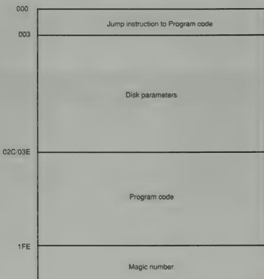

### 图 4.2

Linux LILO 引导扇区布局。

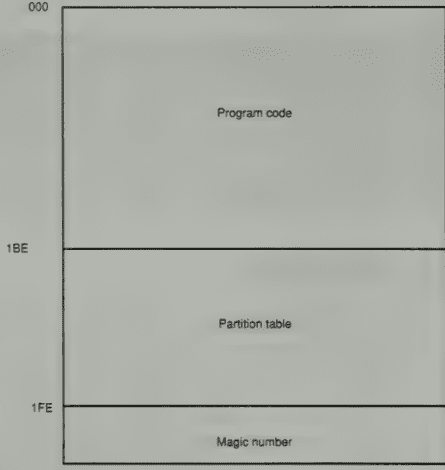

理论上，Linux LILO 引导扇区可用于引导 DOS，因为引导记录中的分区表区域可以包含 DOS FAT 文件，但在实践中，启动过程通常失败。最好使用写入 Linux 分区的引导扇区。

> **警告**
>
> 由于 DOS 和 Linux LILO 引导扇区存在差异，你应先安装 DOS 再安装 Linux。这将确保 DOS 引导扇区被写入硬盘。如果你先安装 Linux 且 Linux LILO 引导扇区被写入硬盘，则 DOS 无法启动。

LILO 引导扇区可以保存在启动软盘上、硬盘的主引导记录中、Linux 分区的引导扇区中，或扩展分区的引导扇区中。它不能存储在任何非 Linux 分区中，也不能存储在第一块硬盘之外的任何硬盘上。

请注意，虽然 DOS 无法处理扩展分区中的引导扇区，但 Linux 可以通过 fdisk 的扩展功能或一个名为 *activate* 的工具程序来处理。

> **警告**
>
> LILO 的一个常见问题是，它会在任何地方写入 LILO 引导扇区，甚至包括操作系统无法访问的位置。请确保将 LILO 引导扇区写入有效位置。如果你已经安装了 Linux 并正在进行修改，请随身携带一张启动软盘。

## 启动过程

在启动过程中，引导扇区被读取以获取操作系统的引导加载程序。对于 DOS 而言，主引导记录或引导扇区被读取，然后加载 COMMAND.COM。COMMAND.COM 是 DOS 操作系统内核。

尽管通常在遵循 Linux 安装过程时会进行设置，但你可能想要更改 Linux 使用的启动系统。根据你的需求和机器硬盘配置，有几种方法可以使用。我们可以查看几个典型的配置示例，以展示如何修改启动过程。

### 专用 Linux 硬盘

对于专用的 Linux 安装或默认通过 Linux 启动（即使硬盘上有其他操作系统），主引导记录可以被替换为 Linux LILO 引导扇区。然后，LILO 将直接从主引导记录启动进入 Linux，而不涉及分区引导扇区。不过，在某些情况下，你可能必须显式指定引导扇区，在 `boot:` 提示符下，如果默认值不起作用，你可能需要指定 `boot=/dev/hda`（或任何持有修改后的主引导记录的设备）。

> **警告**
>
> 如果你用 LILO 替换了专用 Linux 系统的主引导记录，随后又删除了 Linux，那么在驱动器可被 DOS 等其他操作系统使用之前，你必须对硬盘进行低级格式化或恢复旧的 MBR。

要将 LILO 安装为专用 Linux 启动，请遵循以下步骤：

- 1. 像往常一样启动 Linux。确保手头有启动软盘以防出现问题。
- 2. 将现有的主引导记录复制到软盘上以防出现问题。使用 512 字符块（默认值）从主驱动器（`/dev/hda`）复制 MBR 到软盘的命令是：
  ```
  dd if=/dev/hda of=/fd/MBR bs=512 count=1
  ```
- 3. 使用 setup 或 LILO 安装程序将 LILO 复制到引导扇区，将 LILO 设置在主引导记录中。
- 4. 重启机器以从主引导记录启动。

你的机器应该自动加载 Linux。如果 Linux 未启动，请使用启动软盘启动 Linux，并重复该过程或使用以下命令从软盘恢复原始主引导记录：

```
dd if=/fd/MBR of=/dev/hda bs=446 count=1
```

### 使用 BOOTACTV

对上一个启动过程的微小修改是用一个名为 BOOTACTV 的工具替换 MBR，该工具会提示选择从哪个分区启动。这需要写入一个非 DOS 兼容的引导扇区副本，因此它仅应在 Linux 将是主要操作系统且 LILO 未能正确引导其他操作系统的情况下使用。

当安装到位后，主引导记录持有一个 BOOTACTV 副本。启动时，BOOTACTV 允许你选择要启动的操作系统。然后 BOOTACTV 可以从分区读取引导扇区以加载该操作系统。

要安装 BOOTACTV，请遵循以下步骤：

- 1. 像往常一样启动 Linux。确保手头有启动软盘以防出现问题。
- 2. 将现有的主引导记录复制到软盘上以防出现问题。使用 512 字符块（默认值）从主驱动器 (/dev/hda) 复制 MBR 到软盘的命令是：
- 3. 使用 setup 或 LILO 安装程序将 LILO 复制到 Linux 分区的引导扇区（而非主引导记录）。
- 4. 将 BOOTACTV 安装到主引导记录中。BOOTACTV 工具通常被称为 bootaclv.bin，在使用以下命令将其安装到 MBR 时，它应在当前目录中：
- 5. 重启机器以从主引导记录启动 BOOTACTV。

你的机器应该加载 BOOTACTV 并允许你启动分区上的任何其他操作系统。如果 Linux 或其他操作系统未启动，请使用启动软盘启动 Linux。如果只有 Linux 未启动，则 Linux 分区的引导扇区 LILO 未正常工作，可以使用 setup 或 LILO 配置工具重写。如果没有任何分区可以启动，使用以下命令用旧的 MBR 替换以移除 BOOTACTV：

```
dd if=/fd/MBR of=/dev/hda bs=446 count=1
```

如果你有一个 DOS 启动软盘，还可以从 DOS 内部重新安装主引导记录。在 DOS 中，发出以下命令：

```
fdisk /mbr
```

### 提示

> 如果你不想更改主引导记录，但有一个以上的分区专门用于 Linux，你可以在其中一个分区的引导扇区上安装 BOOTACTV，并使用 *fdisk* 工具切换活动分区。但是，如果硬盘被重新分区或文件系统大小被更改，启动


扇区必须被重写。例如，若要向第四个主硬盘分区写入 BOOTACTV，请将现有的 MBR 复制到该分区的引导扇区，然后使用以下命令安装 BOOTACTV：

```
dd if=/dev/hda of=/dev/hda4 bs=512 count=1
```

```
dd if=bootactv.bin of=/dev/hda4 bs=446 count=1
```

## DOS 和 Linux

大多数 Linux 安装环境与 DOS 共存，并使用 DOS 的主引导记录（Master Boot Record, MBR）。在这种情况下，MBR 会被读取，活动分区（由 fdisk 设置）会自动启动。这是最安全的安装方法之一，因为不会对 DOS 安装的 MBR 进行任何更改，并且可以随时轻松删除或重新配置分区，而无需担心与 MBR 的兼容性问题。

> **注意**
>
> 较新版本的 DOS（6.00 或更高版本）如果在 Linux 之后安装，会覆盖现有的 MBR。这使得无法从 MBR 启动 Linux，尽管 DOS 可以启动。可以通过再次运行 LILO 或设置 Linux 分区为活动分区来修复此问题。

使用 fdisk 实用程序或 Linux 的 activate 工具随时可以更改活动分区。Linux 内部的设置程序通常也可以更改启动分区。一个硬盘上同一时间只能有一个活动分区。一些操作系统，包括 Linux，在读取活动分区后允许您更改要启动哪个操作系统的决定，前提是启动过程中预留了延迟。例如，Linux 可以显示 boot: 提示符，并等待用户响应或超时发生，然后再开始启动 Linux。

若要为此方法在 Linux 中使用此方法，只需将 LILO 安装到 Linux 分区的引导扇区中。为了使其可启动，运行 fdisk 并将该分区号设置为活动分区。重启机器后将启动活动分区。

当 Linux 被替换或删除时，新操作系统的引导扇区会覆盖 Linux 分区的引导扇区，无需对 MBR 进行任何更改。

## 使用 BOOTLIN

在使用 Linux 的 **BOOTLIN** 配置（这也是一种常见的安装形式）时，不会对主引导记录（Master Boot Record）进行任何更改。在启动过程中，主引导记录被读取，然后决定加载哪个操作系统。这个决定通常基于用户提示。本质上，这与普通的 DOS 启动相同，只是在 `CONFIG.SYS` 或 `AUTOEXEC.BAT` 文件中调用了程序 **BOOTLIN**。然后可以执行一个程序，让您选择要加载的操作系统。例如，程序 `BOOT.SYS` 可用于显示一个菜单，让您在 Linux 和 DOS 启动之间进行选择。

要在您的 DOS 分区中安装 **BOOTLIN**，请遵循以下步骤：

- 启动 Linux。确保您有一个启动软盘以防出现问题。
- 通过 DOS 或其中一个 Linux 工具，将 Linux 内核的副本放到您的 DOS 分区中。您只需将内核文件复制到 DOS 分区的 home 目录（或任何子目录）中。甚至可以从软盘完成此操作。
- 使用与 Linux 内核相同的过程，将 `BOOT.SYS` 和 `BOOTLIN.SYS` 复制到 DOS 分区。
- 将 `BOOT.SYS` 和 `BOOTLIN.SYS` 文件都添加到您的 `CONFIG.SYS` 文件中。
- 确保 DOS 是活动分区，然后重启机器。

当 DOS 启动时，**BOOT** 设备驱动程序应该会给您提供启动 DOS 或 Linux 的选项。如果出现问题，只需从 `CONFIG.SYS` 文件中移除 `BOOT.SYS` 和 `BOOTLIN.SYS` 文件，即可恢复正常。

使用 `BOOT.SYS` 程序有一个有用的优点：无需修改引导扇区以支持多个操作系统。这使得从硬盘加载和移除操作系统变得容易。具有活动分区的主引导记录方法和 `BOOT.SYS` 方法可以结合使用，这样硬盘会启动带有活动标志的操作系统，然后暂停并等待用户确认（或等待超时）。在这种情况下，无需对主引导记录进行任何更改。

## 启动参数

无论使用哪种启动过程，当 Linux 启动时，LILO 会短暂暂停，以检查 Shift、Control 和 Alt 键是否未被按下，以及 CapsLock 和 ScrollLock 是否已设置。如果没有任何按键被按下且锁定键已开启，LILO 会显示 boot: 提示符。此时，LILO 正在等待输入引导映像的名称，或者如果按下超时或 Enter，则加载默认引导映像。引导映像是将要加载的操作系统内核，包括 DOS。

如果您想启动默认之外的映像，可以在 boot: 提示符下输入其名称。要获取所有已知引导映像的列表，请输入问号或按 Tab 键（具体取决于映像和键盘设置）。默认引导映像名称位于 /etc/rc 或 /etc/lilo.conf 文件（取决于 Linux 版本）中读取的那一行

```
BOOT_IMAGE=
```

您还可以从 boot: 提示符指定内核参数。通过在 boot: 提示符后输入参数来指定一个参数。除非被覆盖，否则参数在默认映像启动时使用。有效参数因 Linux 版本略有不同，但大多数版本支持以下参数：

- **no387**：禁用任何板载浮点单元（FPU）。
- **root**：从 root 参数后指定的设备启动，例如 `root=/dev/sda1`。root 命令需要设备的完整路径名的十六进制设备号。
- **ro**：将根文件系统挂载为只读。
- **rw**：将根文件系统挂载为读写。
- **single**：将 Linux 系统启动到单用户（系统管理员）模式。

root 参数允许使用十六进制设备号。设备号根据设备类型分配。对于软盘驱动器，编号从 200 开始，因此 `/dev/fd0` 是 200，`/dev/fd1` 是 201，`/dev/fd2` 是 202，等等。硬盘根据设备类型分配编号。对于大多数硬盘，编号从 301 开始（因为不存在 `/dev/hd0` 所以不从 300 开始）：`/dev/hda1` 是 301，`/dev/hda2` 是 302，等等。当使用第二个硬盘时，编号跳到 340：`/dev/hdb1` 是 341，`/dev/hdb2` 是 342，等等。对于 `/dev/sda` 设备，编号从 801 开始：`/dev/sda1` 是 801，`/dev/sda2` 是 802，等等。第二块硬盘从 811 开始：`/dev/sdb1` 是 811，`/dev/sdb2` 是 812，等等。由于软盘和硬盘通常是唯一起作用的引导设备，这些编号足以满足除可移动媒体外的所有情况。

如果参数之间用空格分隔，则可以组合使用。例如，在 boot: 提示符下，以下行启动位于设备 `/dev/hda2` 上名为 `image5` 的内核：

```
image5 root=/dev/hda2 single ro
```

文件系统将作为只读设备挂载。仅启动单用户模式。

## Map 安装程序

**map 安装程序**是更新引导扇区并创建 map 文件的程序。map 安装程序通常是文件 `/etc/lilo/lilo`。每当 map 安装程序运行时，它都会检查引导扇区中的错误。如果检测到错误，则不会将更改写入引导扇区，并且安装程序将终止。

当 map 安装程序成功更新引导扇区时，旧的引导扇区内容会被复制到目录 `/etc/lilo` 中，名称为 `boot_hex_num`，其中 `hex_num` 是被重写分区的十六进制设备号。（十六进制设备号在前一节中已提及。）当 map 安装程序写入分区的引导扇区时，旧的引导扇区副本会存储在一个名为 `part_hex_num` 的文件中。同样，`hex_num` 是设备号。

map 安装程序的行为可以通过在调用安装程序时提供的命令行参数或配置文件 `/etc/lilo/config` 中的条目来修改。许多选项既可以在命令行上提供，也可以在配置文件中提供。
在查看 map 安装程序的执行和启动示例之前，我们应该先看看配置选项。

## Map 安装程序命令行语法

LILO map 安装程序实用程序接受命令行上的许多选项。许多命令行选项由下一节讨论的配置变量镜像。允许的选项见表 4.2。

**表 4.2. MAP 安装程序允许的选项。**

| 选项 | 含义 |
| :--- | :--- |
| `b dev` | 使用 `dev` 作为引导设备。如果没有指定值，则使用引导配置变量给出的默认设备。 |
| `c` | 开启紧凑模式，将相邻扇区的读取请求合并为一个请求以减少加载时间。通常用于启动软盘。也可以使用 compact 配置变量来指定此选项。 |
| `C file` | 使用 `file` 作为配置文件。如果没有指定文件，则使用 `/etc/lilo/config` 作为默认值。 |
| `d secs` | 在启动第一个映像之前等待的秒数（以十分之一秒为单位）。也可以在配置变量 `delay` 中指定。 |
| `f file` | 使用 `file` 作为磁盘参数表（称为 *disktab*）的名称。如果省略文件名，则使用文件 `/etc/lilo/disktab`。 |


# 映射安装程序配置文件选项

映射安装程序的配置选项可以存储在 `/etc/lilo/config` 文件中。该文件由多组参数-值对组成，尽管某些选项不需要值。参数、等号和值之间可以使用空白字符。可以通过在行首加上井号来包含注释。换行符将终止该注释。

通常，变量名称不区分大小写，而值通常区分大小写。不过，好的做法是保持所有条目为小写（这也是 UNIX 的惯例）。

表 4.3 中显示的选项可以放入映射安装程序配置文件 `/etc/lilo/config` 中。

**表 4.3. 映射安装选项。**

| 选项 | 含义 |
| :----- | :------ |
| i sector | 将内核安装为新的引导扇区。可以从安装配置变量中读取。 |
| I name | 显示 name 内核映像文件的路径。如果未找到匹配的 name，则生成错误。可以在 name 后添加选项“v”以验证映像文件是否存在。此选项使用 `BOOT_IMAGE` 环境变量。 |
| l | 生成线性扇区地址，而不是默认的 `sector/head/cylinder` 地址。也可以通过配置变量 `linear` 指定。 |
| m file | 使用 `file` 作为映射文件的位置。如果未给出文件名，则使用 `/etc/lilo/map`。 |
| P fix | 允许 LILO 使用表文件调整扇区/磁头/柱面地址。也可以通过 `fix table` 配置变量指定。 |
| P ignore | 覆盖扇区/磁头/柱面地址的校正。也可以通过 `ignore table` 配置变量指定。 |
| q | 显示当前映射的文件。 |
| r dir | 在继续之前对 `dir` 执行 `chroot` 命令。如果根文件系统挂载位置与映射安装程序命令不同，这是必需的。由于当前目录通过此命令改变，因此必须使用所有文件的绝对路径名。 |
| R words | 在映射文件中存储供引导加载程序使用的 words。这些 words 是引导过程作为默认命令行的一部分使用的参数。第一个 word 必须是引导映像的名称。 |
| s file | 将原始引导扇区复制到 `file`，而不是 `/etc/lilo/boot.hex_num`。 |
| S file | 与 `s` 相同，但如果旧文件存在则覆盖它。 |
| t | 通过执行整个安装过程（除了写入映射文件和引导扇区）来进行测试。理想情况下与 `v` 选项一起使用，以验证映射安装程序的准确行为。 |
| u dev | 恢复 `dev` 的引导扇区备份副本。如果未指定设备，则使用默认值，或者在缺少有效值时使用当前根设备。在写入完成之前，备份副本会检查时间戳。 |
| U dev | 与 `u` 相同，但不检查时间戳。 |
| v level | 使用指定的详细输出级别来显示消息。 |
| V | 显示映射安装程序的版本号，然后退出。 |
| alias=name | 允许映像除了其常规文件名外，还可以通过字符串 name 调用。 |
| append=string | 将 string 附加到传递给内核的命令行。主要用于传递关于内核未自动检测到的硬件设备的引导参数。 |
| backup=file | 将原始引导扇区复制到 file，而不是 /etc/lilo/boot.hex_num。也可以是设备（如 /dev/null）。 |
| boot=dev | 指定包含引导扇区的设备。如果未指定名称，则使用当前挂载的根分区。 |
| compact | 将相邻扇区的读取请求合并为单个读取请求，从而减少加载时间和文件大小。这通常用于软盘。 |
| delay=secs | 指定在引导映像前等待的延迟时间（以十分之一秒为单位）。如果未给出延迟，则立即引导。 |
| disktab=file | 给出磁盘参数表的名称。如果未给出文件名，则使用 /etc/lilo/disktab。 |
| fix-table | 让 LILO 调整扇区/磁头/柱面地址。通常用于可能会更改这些地址的操作系统。如果指定了 fix-table，LILO 将重新调整错误的条目。 |
| force-backup=file | 类似于 backup，但会覆盖任何现有文件。如果在配置选项中使用了 force-backup，则任何 backup 选项都将被忽略。 |
| install=sector | 将映像安装在指定的引导扇区。如果未给出值，则使用 /etc/lilo/boot.b。 |
| label=name | 将映像重命名为备用字符串 name。 |
| linear | 生成线性扇区，而不是扇区/磁头/柱面地址。线性地址独立于磁盘几何形状，并在实时翻译。线性引导磁盘可能不具有可移植性。 |
| literal=string | 类似于 append 变量，但删除其他选项，仅使用 string 中指定的那些。 |
| map=file | File 是映射文件的位置。如果未给出值，则使用 /etc/lilo/map。 |
| message=file | 使用文件内容作为在 boot: 提示之前显示的消息。消息不能大于 64Kb。如果消息更改或移动，必须重新构建映射文件。 |
| optional | 使映像变为可选。如果无法定位映像文件，则不引导它。这对于测试新内核很有用。 |
| password=password | 为所有映像设置密码。如果存在受限制选项，则只有在引导配置文件引用的映像时才需要密码。 |
| prompt | 强制显示 boot: 提示，而不检查任何按键。通常与 timeout 组合使用以强制无人值守重启。 |
| ramdisk=size | 将可选 RAM 磁盘设置为 size。设置为零会禁用 RAM 磁盘。 |
| read-only | 将根文件系统以只读方式挂载。 |
| read-write | 将根文件系统以读写方式挂载。 |
| restricted | 放松密码保护。 |
| root=dev | 指定要挂载为根文件系统的设备。如果使用值 current，则根设备是当前挂载根文件系统的设备（除非使用 -r 命令行选项更改）。 |
| serial=params | 设置控制用的串行线，初始化该线并接受来自该线（以及控制台）的输入。参数的格式为 port, baud_rate, parity, bits。当设置 serial 时，除非被覆盖，否则 delay 值会自动设置为 20。 |
| timeout=secs | 设置加载映像前等待键盘输入的十分之一秒数。也用于指定密码输入超时。默认值为无限。 |
| verbose=level | 显示进度消息。级别越高，消息越多。如果还包含 -v 命令行选项，则使用较高级别。 |
| vga=mode | 设置引导期间使用的 VGA 文本模式。有效值为 normal（80x25 文本模式）；extended 或 ext（80x50 文本模式）；ask（在引导期间提示模式）；以及任何有效的文本模式值。要获取可用模式的列表，使用参数 vga=ask 引导，并在询问值时按 Enter。vga 选项的值不区分大小写。 |

如果任何参数未在命令行或配置文件中指定，则使用默认值。某些值也保留在内核映像中（例如 ramdisk、root 和 vga）。

# 引导映像

LILO 可以从多个位置引导内核映像，例如根文件系统上的常规文件或其他已挂载文件系统、软盘等块设备，或另一个分区或磁盘的引导扇区。引导类型由配置文件中的条目决定。

引导映像配置文件可以定义多个变量，这些变量之前均已提及。有效的配置文件变量为 alias、label、optional、password、ramdisk、read-only、read-write、restricted、root 和 vga。

要从文件引导内核映像，配置文件中唯一需要的是映像的名称。例如，以下行将引导名为 linux_main 的映像：

```
image=/linux_main
```

要从其他设备引导映像，必须指定该设备上需要读取的扇区。有几种提供扇区信息的方法。必须提供起始扇区，然后可以指定要读取的扇区数量（start+length）或结束扇区号（start-finish）。如果只提供一个数字（起始扇区），则只读取该扇区。

例如，此配置文件的内容从软盘引导内核，从第 1 扇区开始并读取接下来的 512 个扇区：

```
image=/dev/fd0
range=1+512
```

可以为一个映像指定多个配置，因为 LILO 将值存储在一个映像描述文件中，而不是存储在映像本身中。例如，配置文件可以包含以下条目：


```
image=/linux_main
    label=linux-hda1
    root=/dev/hda1
image=/linux_main
    label=linux-hda3
    root=/dev/hda3
image=/linux_main
    label=linux-flop
    root=/dev/fd0
```

此代码为同一个 Linux 内核（linux_main）提供了三种配置，但拥有不同的根设备以及三个不同的替代名称。该镜像的启动设备分别为 /dev/hda1、/dev/hda3 和 /dev/fd0。配置文件中的空白字符会被忽略，因此缩进仅为了方便阅读。

### 磁盘参数表

LILO 通常能够通过读取内核获取关于系统中硬盘和软盘的信息。然而，在某些系统中（特别是某些 SCSI 适配器以及不表现为标准 IDE 或 SCSI“正常”设备的适配器），这种情况无法实现。当 LILO 无法获取磁盘参数信息时，它会生成关于“bad geometry”（无效几何参数）的错误消息。

当 disktab 文件存在时，LILO 可以从文件 /etc/lilo/disktab 物理读取磁盘参数，且其优先级高于任何自动检测到的值。disktab 文件包含设备号（十六进制）、BIOS 代码和磁盘几何参数。一个示例 disktab 文件可能包含以下条目：

```
# /etc/lilo/disktab - LILO disk parameter table
#
## Dev. num  BIOS code  Secs/track  Heads/cyl  Cyls  Part. Offset
#
0x800       0x80       32          64         1714  0
0x801       0x80       32          64         1714  1001
```

这显示了一个具有两个分区的 SCSI 磁盘。第一个分区 /dev/sda1 的设备号为 800，第二个分区 /dev/sda2 的设备号为 801。两个分区的 BIOS 代码均为 80。设备号和 BIOS 代码都必须以十六进制格式给出，因此前面有前缀“0x”。该磁盘每道有 32 个扇区，每柱面有 64 个头，共有 1,714 个柱面。由于两个分区位于同一磁盘上，因此这些参数是相同的。

分区偏移量是一个可选字段。第一个分区从偏移量 0 开始，第二个分区从偏移量 1001 开始（即从磁盘开始处的扇区数）。仅当内核无法获取该信息时，才需要显式给出分区偏移量。大多数硬盘（包括可移动磁盘和光盘）不需要分区偏移量，但 CD-ROM 有时需要。

### 提示

在填写 /etc/lilo/disktab 文件时，你不需要让细节完全准确。大多数系统会将驱动器参数重新映射为每道 32 个扇区和 64 个头，无论这些数值是否正确。（这是 BIOS 的行为。）柱面数量必须至少等于或高于实际柱面数量，以避免操作系统识别的磁盘空间被截断。

某些 BIOS 版本不允许磁盘超过特定值。这通常是针对设计用于具有较小（<1 GB）磁盘驱动器和早期 BIOS 版本的 DOS 系统的 IDE 和 SCSI 控制卡的问题。设备驱动程序允许使用一些高容量驱动器，尽管某些系统在访问 1 GB 限制以外的文件时可能会遇到问题。

### 移除或禁用 LILO

为了防止 LILO 启动系统，必须禁用引导扇区（通过使用 fdisk 更改活动分区）或完全将其移除。大多数版本的 LILO 可以使用以下命令快速禁用：

`/etc/lilo/lilo -u`

如果你使用的是较新的目录结构，请根据需要替换路径名。

在移除磁盘主引导记录（MBR）中的 LILO 引导扇区时，必须用另一个记录替换 MBR。如果你希望用从已启动的 DOS 磁盘获取的 DOS MBR 替换 MBR，请输入以下命令：

`fdisk /mbr`

由于每当 LILO 创建新版本时都会创建引导扇区的备份副本，因此可以将旧版本的引导扇区复制回原位（假设它们仍然可用）。例如，要还原保存在名为 boot.0000 的文件中的主引导记录（800 是 SCSI 驱动器的设备号），请执行以下命令：

`dd if=/etc/lilo/boot.0000 of=/dev/sda bs=446 count=1`

如果你使用的是其他设备，请替换保存的引导文件名和设备名称。

### 排除 LILO 故障

当 LILO 无法正常运行时，它会显示错误消息。这些错误消息应足以识别问题。表 4.4 列出了最常见的错误消息及其解决方案。

| 消息 | 解决方案 |
| :--- | :--- |
| 无法将引导扇区放到逻辑分区 X 上 | LILO 试图将引导扇区放入逻辑分区上的正确根文件系统。默认情况下，MBR 只能启动主分区。使用 -b 选项和显式的启动分区值进行覆盖，或使用配置变量 boot=device。 |
| 获取无效的几何参数 | 磁盘控制器（大多数为 SCSI）不支持自动几何参数检测。使用文件 /etc/lilo/disktab 提供磁盘参数。 |
| 无效分区表，条目 X | 分区的第一个扇区的扇区/头/柱面地址与线性地址不匹配。这通常发生在操作系统创建未按道对齐的分区时。尝试使用 fix table 选项。 |
| 第一个扇区没有有效的引导签名 | 该设备的第一个扇区似乎不是有效的引导扇区。检查设备名称或重新运行 LILO 以安装引导扇区。 |
| 柱面号过大 | 文件位于第 1,024 个柱面之后，由于 BIOS 限制，LILO 无法访问该位置。 |
| XXX 没有有效的 LILO 签名 | 找到了 XXX，但它不是有效的 LILO 条目。如果 XXX 是引导扇区，你应该使用 -i 选项或 install 选项来安装 LILO 引导扇区。 |
| XXX 包含无效的 stage 代码 | XXX 处的条目已损坏。重新运行 LILO。 |
| 内核 XXX 太大 | 内核大于 512 KB，LILO 无法处理。移除一些未使用的驱动程序并重新编译内核。 |
| 未找到分区条目 | 该分区不在分区表中。 |
| 抱歉，不知道如何处理设备 XXX | LILO 无法确定磁盘参数。使用文件 /etc/lilo/disktab 指定它们。 |


## 总结

本章包含了安装和使用 LILO 为 Linux 创建引导扇区所需的所有信息。LILO 非常灵活，可以轻松处理多种不同的配置。它允许你根据使用方式调整安装，以最佳方式启动系统。

尽管 LILO 仅用于首次设置 Linux 系统以及在更改内核之后，但你应该了解其操作的基本知识，以便知道你的硬盘及其引导扇区正在发生什么。当你在同一系统上使用其他操作系统时，这一点尤其重要。从这里开始，你可能希望跳至其他章节：

- 若要开始使用你的 Linux 系统，请阅读第 6 章，“入门”。
- 若要配置 X，以便你可以使用图形界面（GUI）代替基于字符的终端工作，请参阅第 22 章，“安装和配置 XFree86”。
- 若要管理你新安装的 Linux 系统，请参阅第 32 章，“系统管理基础”。

## 5. 完成安装

作者：Tim Parker

**本章内容**

- 启动 Linux 90
- 安装附加软件 92
- 多个 CD-ROM 设备 96

现在你已经安装了 Linux 并配置 LILO 以你想要的方式启动系统，一切应该都运行正常。不幸的是，计算机操作系统有时会不按预期工作，即使你已做了所有正确的事情。本章讨论几个问题：检查你的系统以确保其安装正确且运行正常，以及使用软件包安装工具向系统添加新软件。我们将在本章最后探讨如何在系统上使用多个 CD-ROM 驱动器。

### 启动 Linux

如果你已经完成了前两个章节的操作，你应该已经安装了 Linux（很可能来自 CD-ROM）和 LILO。当你进行冷重启（关机，然后再开机）时，你的系统应该重新启动进入 Linux（或者根据你设置系统的方式，提供启动 Linux 的选项）。如果没有，最可能的原因与 LILO 有关。

通常的罪魁祸首是主引导记录或启动分区没有写入 Linux 的启动指令。LILO 章节解释了如何修复此问题。

你的系统通常能正确启动进入 Linux，但其中一些设备可能无法正常工作。硬盘、软盘和 CD-ROM 未被识别的情况非常罕见，因为所有这些都在安装过程中被检测和配置。然而，声卡、网卡、外部 SCSI 设备以及打印机和扫描仪等外围设备在系统重启后有时找不到。这通常是配置问题，内核不知道如何与该设备正确通信。

### 紧急启动程序

如果你安装了 Linux，使用了 LILO（或者也许你忘记了），并重启了机器会发生什么？要么你启动了磁盘上的另一个操作系统，要么收到了机器 BIOS 令人沮丧的“No OS”消息。你必须从头开始吗？幸运的是，不需要。如果你拥有首次安装 Linux 时创建的启动磁盘和根磁盘，你是安全的。

使用安装（启动）磁盘启动系统。系统会给你熟悉的 `boot:` 提示符。告诉 Linux 启动磁盘从安装了内核的硬盘加载（而不是从磁盘开始并重新开始）的方法是指定内核的位置。这通常使用分区名称完成，例如对于第一个


磁盘上的分区。要在该分区启动，需要在引导提示符处输入如下命令：

```
boot ro root=/dev/hda1
```

这告诉 LILO 在该分区上查找要启动的内核。当然，你应该使用正确的分区名称，并且那里必须有一个可供读取的 Linux 内核。

当你通过软盘启动系统后，运行 LILO 以按照你想要的方式设置启动顺序。

## 使用 dmesg

如果在启动后某些设备未被正确识别，你应该检查系统生成的引导消息。你可以在 shell 提示符下输入命令 `dmesg` 来查看所有消息。如果某个设备未被正确识别，你将看到 `dmesg` 输出中关于该设备的一行或多行信息。例如，如果你的网卡未被正确检测，你可能会看到类似这样的消息：

```
loading device 'eth0'... 
ne.c:v1.10 9/23/94 Donald Becker (becker@cesdis.gsfc.nasa.gov)
NE*000 ethercard probe at 0x300: 00 00 6e 24 1e 3e
eth0: NE2000 not found at 0x300
eth0 not loaded
```

如前所述，此错误几乎总是因为你提供了错误的配置信息所致。在上述网卡的情况下，卡上的 IO 地址是 330H 而不是 300H。再次运行 setup 实用程序可以让你更改这些参数。

## 更改磁盘分区

无论你的系统在安装 Linux 之前是否安装了 Windows 或 DOS，或者现在可能只安装了 Linux，在未来你可能希望修改磁盘驱动器的布局，以允许加载其他操作系统。如果你想要修改分区的大小，有一些商业产品（例如 PowerQuest 公司的 PartitionMagic）可以完成这项工作，但我们在前几章中看过的一个工具在 DOS 和 Windows 下运行得也很好——FIPS。FIPS 允许你调整现有分区的大小，而不需要完整的备份-格式化-恢复操作。

你已经看过如何在 DOS 或 Windows 提示符下运行 FIPS。在运行 FIPS 之前，你应该使用 DOS 或 Windows 附带的用于该任务之一的实用程序对文件系统进行碎片整理，然后运行 FIPS 创建新分区或删除现有分区。


如果你已经安装了 Linux，情况也没有那么糟糕：你可以从软盘启动，并使用 Linux CD-ROM 运行 FIPS，或者在 Linux 环境中将 FIPS 复制到你的启动软盘上。你可以使用这种技术将全 Linux 磁盘转换为共享的 Linux-Windows 磁盘。你不应该从 Linux 目录运行 FIPS，即使是在像 Wabi 这样的模拟软件包下，因为结果是不可预测的。

### 安装附加软件

你的 Linux 系统已经运行起来了，但你想要更多的软件？有几个来源你可以用来加载额外的软件到系统中，包括 CD-ROM、WWW 页面和 FTP 站点。你也可以从供应商那里购买软件。在某些情况下，软件包含一个安装实用程序，需要运行它以正确安装包。商业软件通常就是这样，当我们查看书中第八部分的一些商业应用程序时你就会看到。

对于其他应用程序，特别是那些包含在大多数 Linux CD-ROM 版本附带磁盘集中的应用程序，你必须使用像 *installpkg*、*pkgtool* 或 *pkgadd* 这样的包工具。该工具的名称因你的 Linux 版本和发行版而异，因此你应该查阅随系统提供的文档，以获取添加软件的确切名称和必要操作。作为流程的一个例子，我们可以看看两个不同的工具。第一个是 RPM（Red Hat 包管理器），第二个是 *installpkg*（在许多版本的 Linux 中可用）。

#### RPM

RPM 并不局限于 Red Hat Linux；它已经出现在多个不同的 Linux 版本中。RPM 是一个基于字符的系统，允许你构建、安装、查询、验证、更新和卸载软件包。（在 Linux 术语中，软件包由一组文件的归档以及关于该包的信息组成，如包名称、版本号和一个简短描述。）RPM 有十种操作模式，每种都有不同的选项集。这使得 RPM 使用起来可能有点令人困惑，尽管大多数用途都很直观。RPM 的模式及其用途见表 5.1。

**表 5.1. RPM 的模式及其用途。**

| 模式名称 | 命令行 | 用途 |
|---|---|---|
| 构建 | `rpm -[bit]0` | 构建一个包 |
| 修复权限 | `rpm --setperms` | 修复包的权限 |
| 安装 | `rpm -i` | 添加新软件 |
| 查询 | `rpm -q` | 检查已安装了哪些包和文件 |
| 重建数据库 | `rpm --rebuilddb` | 重建包数据库 |
| 设置所有者和组 | `rpm --setugids` | 设置包的所有者和组 |
| 显示 RC | `rpm --showrc` | |
| 签名检查 | `rpm --checksig` | 检查包以确保没有错误 |
| 卸载 | `rpm -e` | 移除一个包 |
| 验证 | `rpm -Vl-yi` / `--verify` | 验证包是否已正确安装（所有文件已安装） |

我们不会涉及所有这些选项的许多细节，因为大多数选项都是不言自明的，并在文档中有所覆盖，但一些常见的使用示例将有助于你更熟悉 RPM。要使用 RPM 安装软件，你需要指定想要安装的包名称。安装命令的语法如下：

```
`rpm -i [install-options] <package_filename>`
```

有数十种可能的安装选项，其中大多数除了稍微修改 RPM 的行为外并没有做多少事。RPM 一些更有用的安装选项包括：

- **allfiles.** 安装或升级包中的所有文件。
- **force.** 等同于同时使用 *replacepkgs*、*replacefiles* 和 *oldpackage*。
- **h** 或 **--hash.** 当包归档被解包时显示 50 个哈希标记，以显示系统正在工作（配合 `-v` 选项可获得格式良好的状态显示）。
- **includedocs.** 安装文档文件（通常默认执行）。
- **ignores.** 如果 RPM 和宿主机的操作系统不相同，强制安装或升级。
- **keep-temps.** 保留在安装过程中创建的临时文件，这对于调试安装问题很有用。
- **percent.** 显示文件解包时的进度百分比（旨在使 RPM 易于从脚本中运行）。
- **quiet.** 显示最小的一组消息（但包含所有错误消息）。
- **replacefiles.** 即使新文件替换了已安装包中的文件，也安装包。
- **replacepkgs.** 即使包已安装，也安装包。
- **test.** 不安装，但检查冲突。

查看 man 页以获取完整的选项列表。要添加的包名称通常作为完整路径给出，尽管在许多 RPM 版本中 URL 也是可能的。要安装一个名为 Xgames 的包，命令应该像这样给出：

```
`rpm -i /mnt/cdrom/col/install/Xgames.rpm`
```

在这种情况下，包名为 Xgames.rpm，并给出了包的完整路径（这个包位于 CD-ROM 的 col——collections——目录中）。

RPM 命令的验证模式对于确保包的所有部分都已安装并仍然存在于你的系统中非常有用。在安装可能覆盖现有包部分的其他包之后，有时需要这样做。当你验证一个包时，RPM 将包中已安装文件的信息与从原始包提取并存储在 RPM 数据库中的文件信息进行比较。除了其他内容外，验证会比较每个文件的文件名、大小、校验和、权限、类型、所有者和组。比较中的任何不一致都会显示在屏幕上。

要使用 RPM 的验证模式，请使用带有 -w 选项和包名的命令。RPM 将使用以下八个字符之一来显示某项测试失败：

- 5: MD5 校验和
- S: 文件大小不正确
- L: 符号链接不正确
- T: 时间不正确
- D: 设备不正确
- U: 用户所有者不正确
- G: 组所有者不正确
- M: 模式不正确（包括权限和文件类型）

如果你在包中发现错误，通常最简单的方法是重新安装该包。


## installpkg

`installpkg` 工具是 UNIX 系统的遗留产物，已经存在多年。`installpkg` 工具的功能与 RPM 类似，可用于安装软件包。安装软件包 Xgames 的命令为

```
installpkg /usr/col/Xgames
```

默认情况下，`installpkg` 寻找扩展名为 `.tgz` 的软件包。如果你有不同扩展名的软件包，且知道 `installpkg` 可以处理它，请在命令行中指定包含扩展名的完整软件包名称。对于上述命令，`installpkg` 工具会提取软件包 /usr/col/Xgames.tgz 中的所有文件，并在提取过程中进行解包。

`installpkg` 用作安装基准目录的目录是当前目录，因此在上例中，当我们发出 `installpkg` 命令时所在的目录，就是 Xgames 软件包的安装位置。

## 其他安装命令

许多版本的 Linux 都自带了各自的包管理系统。这些系统可能是基于字符界面的，如 `installpkg` 和 RPM，也可能是图形化的。此类工具的一个良好示例是 LISA（Linux Installation and System Administration，Linux 安装与系统管理），它是 Caldera OpenLinux（一个 Slackware 发行版）和其他一些 Linux 版本自带的工具。LISA 可以从字符终端或 X 终端运行。LISA 提供了一个菜单驱动的接口，使你无需担心那些会使 RPM 和 `installpkg` 变得繁琐的众多命令行选项。

当你启动 LISA 时，初始菜单允许你选择系统管理任务或包管理（参见图 5.1）。使用键盘上的箭头键可以在选项之间切换。

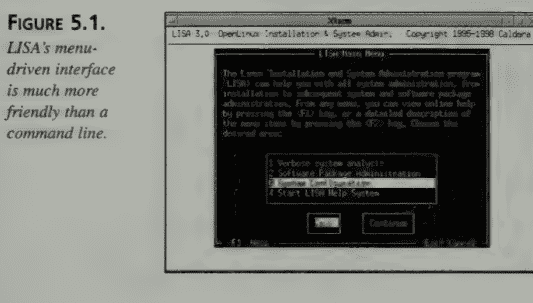

从主菜单中，选择“软件包管理”选项，会出现一个新菜单，允许你查看已安装的软件包或添加新的软件包，如图 5.2 所示。

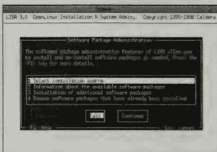

**图 5.2。**
LISA 允许你查看已安装的软件包或添加新的软件包。

如果你选择查看可用软件包，LISA 将显示 Linux 所知的默认软件包列表。图 5.3 显示了可用软件包的主列表。关于每个软件包中文件的更多信息可以从每个软件包选项中获取。你可以通过插入介质（如 CD-ROM 或提供路径名）并让 LISA 检查新的软件包选项来添加其他软件包。在那里，你可以选择要安装的软件包，LISA 将处理其余部分，就像 RPM 和 `installpkg` 所做的那样。

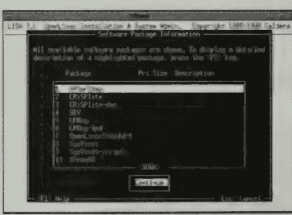

**图 5.3。**
随此版本 Linux 附带的主要发行版软件包。

## 多个 CD-ROM 设备

从理论上讲，Linux 系统可以处理的 CD-ROM 设备数量没有实际限制。只要存在设备号（主设备号和次设备号在第 33 章“设备”中讨论），该设备就是合法的。那么，为什么有人要在系统中使用多个 CD-ROM 设备呢？原因有很多：CD-ROM 换片器、CD-ROM 刻录机和 CD-ROM 库都很常见。我们可以逐一查看这些设备。

## CD 换片器

使用多个 CD-ROM 设备最常见的原因是使用了 CD-ROM 换片器。CD-ROM 换片器允许你在换片器机箱内放置三张、六张或其他数量的 CD，但在任一时刻，读取机制只使用一张 CD-ROM。一款流行的 CD-ROM 换片器的良好示例是 NEC Multispin 系列，其内部和外部设备都允许将多个 CD-ROM 插入换片器，并通过前面板按钮或软件命令单独访问它们。

当在 Windows 系统中配置时，CD-ROM 换片器通常为换片器中可能存在的每个 CD-ROM 设置不同的驱动器盘符。例如，当在 Windows 95 下安装一个六盘位的 NEC Multispin 时，设备编号从最后一个硬盘驱动器开始向上编号：如果你有一个硬盘 `c:`，CD-ROM 驱动器将是 `d:` 到 `i:`。你不能同时读取两个 CD-ROM 驱动器，但在 Windows 中更改驱动器盘符会改变换片器中加载的 CD-ROM。

Linux 以两种方式使用换片器：你可以将换片器配置为单个 CD-ROM 驱动器，并使用前面板按钮手动更换光盘，或者你可以为每个 CD-ROM 设置不同的设备。这是你的选择，而不是 Linux 的强制规定。两者中，前者更容易，但后者提供了更多的灵活性。由于 Linux 不喜欢在 CD-ROM 挂载后更换光盘，无论你选择哪种选项，在更换 CD 之前都应该卸载 CD-ROM。要将换片器配置为多个 CD-ROM 设备，请遵循与单个 CD-ROM 相同的程序，但递增设备号（`/dev/cd0`、`/dev/cd1`、`/dev/cd2` 等等）。这些设备中只有一个可以同时链接到 `/dev/cdrom`。

## CD 刻录机

CD 刻录机是在 Linux 系统中安装多个 CD-ROM 驱动器的另一个原因。CD 刻录设备允许你烧制自己的 CD-ROM，通常是一次性的方法，尽管可重写 CD 设备的价格正在逐渐变得合理。虽然 CD 刻录机制造商（如惠普的 SureStore 系列）不直接支持 Linux，但有一些可用于 Linux 的驱动程序，主要是由其他用户开发的。

在 Linux 下，CD 刻录机可以作为只读的标准 CD-ROM 设备使用，无需特殊配置。由于大多数 CD 刻录设备基于 SCSI，将其配置为 SCSI CD-ROM 很简单。如果你确实想将其配置为可写设备，你需要使用前面提到的驱动程序之一，通常在 FTP 站点上可以获取。由于复制 CD-ROM 是 CD 刻录机最常见的用途之一，你通常会在第一个正常 CD-ROM（*dev/cd0*）之后将 CD 刻录机配置为第二个设备（*dev/cd1*）。你可以同时激活 IDE 和 SCSI CD-ROM 设备。

## CD 库

最后，多个 CD-ROM 设备的常见用途是作为库子系统。假设你有一组必须通过网络访问的大量数据，或者你有一些希望通过互联网提供的参考资料。无论原因如何，使用多个 CD-ROM 驱动器代替高容量硬盘驱动器来提供资料有很多理由（其中最基本的就是成本）。

在这种情况下配置多个 CD-ROM 很简单：按顺序设置设备（*dev/cd0, dev/cd1* 等等），并在 Linux 文件系统的正确位置挂载每个 CD-ROM。访问服务器的用户会根据挂载情况被引导到正确的 CD-ROM 驱动器。

## 更换 CD

每当 CD-ROM 需要向系统提供时，它会通过类似以下的命令挂载到文件系统上：

```
mount type device mount_point
```

*type* 是适用于 CD-ROM 的任何特殊说明（如 ISO9660 文件系统或只读），*device* 是设备名称，*mount_point* 是 CD-ROM 内容在 Linux 文件系统中的放置位置。例如，要在第一个 CD 设备 *dev/cd0* 上挂载一个 ISO9660（这是 CD-ROM 内容的标准）CD 到挂载点 *usr/cdrom*，你会发出以下命令：

```
mount -t ISO9660 /dev/cd0 /usr/cdrom
```

从此，对 *usr/cdrom* 目录及其子目录的所有查询都会被引导到 CD-ROM 及其内容。当你想要更换为另一张 CD 时，你不应只是弹出第一张并插入第二张（事实上，如果磁盘正在使用中，许多 CD-ROM 驱动器将不允许你这样做）。相反，你必须使用 *umount* 命令卸载 CD，指定挂载点或设备。以下两条命令中的任何一条都可以卸载由前一个命令挂载的 CD-ROM：

```
umount /dev/cd0
umount /usr/cdrom
```

两条命令都完成相同的任务。

## 总结

本章讨论了一些问题，包括使用包管理工具向系统添加新软件以及使用多个 CD-ROM 驱动器。本章圆满结束了本书的安装部分。从这里开始，我们将继续查看如何使用你刚刚安装的 Linux 系统。你可能想跳过一些内容并查找其他有用信息，而不是按顺序继续阅读。

- 若要了解如何安装声卡并将其与系统配合用于多媒体应用，请参阅第 21 章“多媒体 Linux”。
- 若要了解如何安装和配置 XFree86（即为你提供 Linux 图形用户界面的 X 服务器），请参阅第 22 章“安装和配置 XFree86”。
- 若要了解 CD-ROM 设备、主设备号和次设备号，以及如何添加新设备（如多个 CD-ROM），请参阅第 33 章“设备”。


# 了解 Linux

## 本部分

- 入门
- 基本 Linux 命令
- 使用文件系统
- 文件和目录权限
- GNU 项目工具
- bash
- pdksh
- tcsh
- Shell 编程
- FTP 和 Telnet

# 第 6 章：入门

**作者：Ed Tiejels 和 Tim Parker**

## 本章内容

- 启动和停止你的 Linux 系统
- 什么是“登录”？
- 密码
- 创建新登录
- 注销
- 试用你的新登录
- who 命令
- 虚拟终端
- 命令和程序

## 启动和停止你的 Linux 系统

Linux 的启动阶段取决于你在安装 Linux 时选择的 LILO 配置。在最简单的情况下，Linux 会自动从硬盘或启动软盘启动。如果你的系统安装了多个版本的 Linux 或其他操作系统，你需要输入一个启动字符串来启动 Linux。

当你的 Linux 系统启动时，你会看到许多 Linux 初始化消息在屏幕上滚动。这些是系统消息，表明 Linux 识别并配置的硬件，以及它在启动时加载的所有软件驱动程序。当 Linux 完成其启动序列时，你应该看到一个类似的提示符：

```
darkstar login:
```

你很可能会在登录提示符之前看到另一个名称，这在大多数 Linux 版本中是在安装软件时设置的。一些 Linux 系统还会在显示登录提示符时显示软件的当前版本号，例如：

```
Welcome to Linux 1.2.13
darkstar login:
```

如果你的提示符不完全是这样，请不要担心，因为每个 Linux 版本的做法略有不同。不过，每个版本都会显示某种提示符——例如美元符号。

> **警告**
>
> Linux 系统必须始终正确关机。不正确的关机，通常是由于直接通过电源开关关闭系统引起的，可能会对你的 Linux 文件系统造成严重损坏！当你使用完 Linux 系统后，你必须按照下一节所述正确关机。如果你开始启动 Linux 然后改变主意，应该让系统完全启动，然后遵循关机程序。如果不遵循此建议，你可能会失去文件甚至整个系统！

你已经知道如何启动 Linux，但知道如何正确关机甚至更加重要。像 UNIX 和 Windows NT 等许多多用户系统一样，如果 Linux 未正确断电，可能会导致个别文件甚至整个文件系统损坏。这是由于 Linux 为了加快磁盘访问速度，在内存中保持磁盘内容表（也称为 I-node 表）的较新版本。当你正确关闭系统时，I-node 表的内存版本会在系统停止之前写入磁盘。如果你在没有将 I-node 表的内存版本写入磁盘的情况下断电，磁盘内容可能不正确，文件可能会丢失。此外，由于 Linux 即使你未使用系统时也在持续使用磁盘驱动器，当你手动断电时，磁盘写保护操作可能会被中断。正确关闭系统会停止所有磁盘写入操作。

确保正确关机的最简单方法是同时按下 Ctrl+Alt+Delete 键。（这是 DOS 和 Windows 中著名的 Ctrl+Alt+Delete “三指敬礼”。）按下 Ctrl+Alt+Delete 会导致显示若干警告消息和 Linux 关机消息。当 Linux 关机过程完成后，你的监视器会在关闭计算机之前显示初始“加电”屏幕或关机消息。由于关机过程仅需 Linux 几秒钟，这并不费时。它快速且简单，并维持系统的完整性。

一个简短的警告：如果你在 Linux 系统上执行 Ctrl+Alt+Delete 序列时有任何用户登录，他们将被强制注销，并可能失去他们正在处理的工作。请谨慎使用 Ctrl+Alt+Delete 序列，并尝试告知所有正在使用系统的人注销。你可以使用 who 命令来查看谁已登录（见本章后面的“who 命令”部分）。

### Linux 关机命令

关机还有其他几种方法，但 Ctrl+Alt+Delete 序列可能是最简单的。其他一些命令也可以激活关机过程，但这取决于你使用的 Linux 版本。常用命令是 `shutdown`、`haltsys` 和 `fasthalt`。请针对你的特定 Linux 版本进行实验，以确定支持哪些命令。

除了 Ctrl+Alt+Delete，关机 Linux 的次常用方法是 `shutdown` 命令。其语法通常允许你指定几个参数，例如 Linux 关机前的等待时间以及是否立即重启。几乎所有 Linux 版本的 `shutdown` 都需要一个参数，指示在开始关机程序前等待的秒数。例如，命令：

```
shutdown -t 45
```

告诉 Linux 在开始关机过程前等待 45 秒。时间参数通常需要前置 `-t` 选项，但有些版本假定任何数字都是秒数。如果你想立即开始关机过程，你可以将秒数设为零或在某些系统中输入单词 **now**：`shutdown now`。

`-r` 选项告诉 Linux 在关机后重启。当你想要加载新的配置信息（如设备驱动程序）时，这可能很方便。`shutdown` 支持几个其他选项。通常，你只需输入 **shutdown** 且不带任何参数，并查看出现的错误消息即可找到它们。或者，man 页面也会列出支持的选项。

`fasthalt` 和 `haltsys` 命令是从其他版本的 UNIX 遗留下来的，但在某些 Linux 发行版中已实现。这两个命令如其名所示，快速关闭系统。

## 什么是“登录”？

系统启动后，Linux 等待登录。登录只是你提供给 Linux 以向操作系统识别自己的名称。Linux 会记录哪些名称被允许登录系统，并只允许有效用户访问。其他所有用户都会被拒绝访问。

系统上的每个登录名称都是唯一的，通常每个登录名称都分配有一个密码。这个秘密密码就像你使用银行卡证明你是你自己时使用的识别号码。此外，你可以使用你的登录执行的操作——登录的特权——由 Linux 控制；不同的登录具有不同的特权级别。一些登录可以对系统做任何它们想做的事，而其他人可能无法做太多事情。系统管理员（或创建登录的人）分配这些特权。

> **警告**
>
> 通常，登录名称反映人的真名。在大型系统中，登录名称通常由名和姓组成，例如 `tparker` 或 `rmaclean`。小型系统往往不那么正式，因此你可能只有名字或名字加首字母，例如 `tim`、`tmp` 或 `tjp`。一些管理员基于其他完全无关的东西设定登录名称，例如 `wizard` 或 `goblin`，但这些名称对于单台机器之外的其他人来说意义很小。

虽然你的系统上不能有重名的两个登录，但你可以通过更改一两个字符轻松为同名（真名）用户创建登录。例如，登录名称 `suej` 和 `suek` 在 Linux 中被视为完全不同的登录。

相反，一个人（例如你）没有理由不能有两个、三个或十几个登录名称。事实上，因为你将成为 Linux 系统的系统管理员，你将有一个或多个管理登录和一个或多个普通用户登录。

在登录提示符处，输入你的名字、你狗的名字或任何其他你想到的随机名称。这些都不是有效的登录（至少目前不是）。系统会要求你提供密码；你输入什么并不重要，所以只需按 Enter 或输入一串随机字符。由于这些登录在系统上无效，Linux 不会让你进入。它会显示消息 **Login incorrect**，告诉你输入的名称或密码无效。

安装后，你的 Linux 系统上唯一有效的登录很可能是 Linux 提供的最强大也最危险的登录：`root`。在本章后面“创建新登录”部分，我们将为你创建一个安全的登录。这个安全登录可以是你的名字、你狗的名字，或你选择的任何名称。一些 Linux 版本会在安装过程中提示你创建用户登录，因此你有两个可用的登录（root 和一个用户名）。

> **警告**
>
> 即使登录名称无效，Linux 为什么还要费事询问密码？这是因为 Linux 使用一个名为 `login` 的程序，该程序被指示首先获取你的登录和密码，然后检查有效用户列表。然后登录程序显示一条消息，表明你是否被拒绝访问，或者让你进入启动用户会话的下一个程序。

### 为什么你不应该使用 root 登录

你有时必须使用 root 登录。有些事情如果不以 root 身份登录，在 Linux 系统上根本无法完成。然而，你不应该将 root 登录用作你的常规用户登录。如果你正在探索


系统，四处乱摸并尝试可能并非如你所想的新命令。你可能会对操作系统安装造成损害，不得不从头重新安装。

正如你已知晓，Linux 是一个多用户、多任务的操作系统。多用户意味着可以同时有多人使用 Linux（当然，你需要在系统上添加一些额外的终端，否则键盘周围会变得非常拥挤）。多任务意味着 Linux 可以一次做不止一件事。例如，你可以在下载远程系统信息的同时对文档进行拼写检查。（多用户隐含了多任务，因为所有用户必须能够同时处理自己的工作。）因此，Linux 非常擅长同时处理所有这些任务，防止它们相互干扰，并提供安全措施，使你无法损坏系统或其他用户的工作。

> **警告**
>
> root 登录不会以任何方式限制你。这意味着通过一条简单的命令，无论是有意还是无意，你都可以彻底破坏你的整个 Linux 安装。因此，仅在必要时使用 root 登录。避免在登录为 root 时随意尝试命令。

当你以 root 身份登录时，你*成为*了系统。root 登录有时也被称为*超级用户*登录，且理由充分。打个比方，你不再仅仅是飞机上的乘客，而是突然拥有了飞行机组、机械师和客舱机组的全部权力和责任。当以 root 身份登录时，“嗯，这是什么？”这句话变得极其危险。

UNIX 传说中最古老的故事之一讲述了新用户在 root 身份下登录，并在十次按键内彻底且不可逆地摧毁他们的系统。但如果你小心遵循此处给出的步骤，并在输入命令前停下来思考片刻，那么那些“需要多少个新用户才能炸毁一个系统？”的笑话就不会适用于你！

> **注意**
>
> 系统管理员是你经常会看到的另一个术语。系统管理员是实际设置和维护 Linux 系统的人。系统管理涉及的工作量因系统而异。在一个拥有几台高性能机器、许多用户、打印机和磁带驱动器等外设，并且连接到网络的办公室中，可能需要一名全职系统管理员。你的 Linux 系统很可能不需要那种程度的投入！
>
> 由于系统管理涉及创建或删除登录等敏感事项，因此需要超级用户权限。这些权限由 root 登录提供。因此，系统管理员是一个实际的人，通过登录为 root 而获得超级用户权限。

## 你的首次登录

尽管有关于使用 root 登录的诸多警告，让我们以 root 身份登录。因为 root 是新安装的 Linux 系统上唯一授权的、有权创建其他账户的登录方式，这是不可避免的。此外，我们将执行几个需要 root 权限的重要步骤。但是，在此首次登录后，我们将创建一个可以防止对操作系统造成意外损害的用户 ID。

在登录提示符 `darkstar login:` 处输入 `root` 并按 Enter 键。在安装 Linux 时，你可能被要求为 root 登录设置密码，或者根本没有出现这个问题。如果是后者，root 登录没有密码，因此系统不会提示你输入。如果确实在安装期间设置了密码，请在提示符处输入密码并按 Enter。别忘了你的 root 密码——如果你忘记了，你必须重新安装整个系统。

### 提示

Linux 是*区分大小写*的（所有 UNIX 版本都是）。大写 R 对于 Linux 来说与小写 r 是完全不同的字母。输入 Linux 命令时，你必须使用正确的大小写，否则 Linux 将无法理解。大多数 Linux 命令以小写字母输入。这包括登录名 `root`；如果你输入 `Root` 或 `rOOT`，Linux 将拒绝登录。密码 `pepper`、`Pepper` 和 `PEPPER` 对 Linux 来说也都是不同的。

不过有一个奇怪的例外。如果你输入全大写的登录名，系统将接受它——但从那时起，你屏幕上的所有内容都将是大写字母！这是由早期某些终端只有大写字母时遗留下来的操作系统代码造成的。虽然这些终端已不再使用，但登录程序保留了这个历史趣闻。不过，我们建议你不要使用大写字母，因为在这种模式下系统看起来非常奇怪。

如果你输入了错误的登录名或密码，Linux 将拒绝访问。再试一次。因为你在主控制台上，你可以尝试任意多次（或者直到手指酸痛）。一些系统可以在多次登录失败后锁定终端，但主系统控制台几乎总是允许无限次尝试。

以 root 身份登录后，系统会为你启动一个用户会话。此时，你应该在屏幕上看到类似以下内容：

```text
darkstar login: root
Last login: Sun Dec 11 17:26:18 on tty1
Linux 1.2.13 (POSIX).
You have mail.
```

```text
If it's Tuesday, this must be someone else's fortune.
darkstar:~#
```

有些系统在成功登录时根本不会告诉你任何事情，你看到的只是一行带有井号字符的行。对于上述系统，Linux 会告诉你该用户上次登录的时间（此信息可能在你第一次登录时不会出现），然后提供一些版本信息。Linux 还会告诉你该登录有待阅读的邮件消息。最后，如果你的系统安装了游戏，Linux 可能会给出一句机智的谚语或格言（由名为 `fortune` 的程序生成）。你可能会看到上述信息的某种组合，或者完全不同的东西。Linux 厂商对其系统的定制化程度很高，因此很难预测登录时会看到什么。

如果系统显示了该信息，好的做法是扫描以 `Last login` 开头的行，并检查给定的时间是否正确。如果你的 Linux 系统被其他用户访问，或通过调制解调器或网络连接到其他系统，这一点尤为重要。如果给定的时间看起来不对，可能是有人正在使用你的登录凭据入侵你的系统，或者未经许可使用你的用户名。为了防止这种情况，请更改密码。（我们将很快展示如何更改密码。）

让我们稍后再阅读等待我们的邮件消息，先处理一些重要步骤。（如果你好奇的话，在大多数系统上，该邮件消息是在安装操作系统过程中由安装程序发送的，涉及 Linux 的注册事宜。）

你的“预言”是从长列表中随机选择的，因此不要期待看到前面例子中显示的那一条。如果在 Linux 安装例程期间未安装游戏软件包，你将看不到预言。如果你真的想要这个功能，可以随时安装游戏软件包。

你在屏幕上看到的最后一行（以井号结尾）是系统提示符。此提示符表示 Linux 正在等待你输入命令——它在提示你输入。系统提示符

```text
darkstar:~#
```

还显示了一些其他有用的信息，帮助你了解你身在何处：

- **darkstar** 是系统名称。
- `~` 字符表示你在文件系统中的位置（在第 8 章“使用文件系统”中有解释）。
- `#` 字符通常表示你已登录为 **root**（尽管某些操作系统使用 `$` 符号，这使得快速判断你是登录为 **root** 还是普通用户变得困难）。根据 UNIX 约定，普通用户提示符是 `%` 或 `$`，具体取决于 shell，而 `#` 保留给 **root**。这些符号被称为 shell 提示符，因为它们用于 shell 提示你输入命令。

## 密码

在 Linux（以及几乎所有其他 UNIX 系统）中，超级用户登录名为 **root**。无论系统多么简陋或庞大，如果你能以 **root** 身份登录，系统就对你完全开放，你可以为所欲为。显然，允许任何人以 **root** 身份登录是不可接受的，因为这会使系统面临潜在的严重损害。


## 安全最佳实践与密码管理

为了防止未授权访问，root 登录应始终设置密码，且该密码必须安全可靠。你可能已经注意到，在某些系统中 Linux 并没有要求输入 root 密码。这是因为在系统安装期间，root 密码被设置为*空字符串*，即一个没有任何字符的“词”。对于 root 及其他任何登录，如果密码是空字符串，Linux 通常不会麻烦地去要求输入密码。另一方面，如果在安装过程中你被要求设置 root 密码，那么在出现密码提示时，你就必须输入它。

空字符串是安全性最差的密码，因为任何知道有效用户名（例如*root*）的人都可以访问系统。更改密码取决于你自己。Linux 允许你选择新的密码，并会不加抱怨地接受它。不幸的是，这可能会导致虚假的安全感。

众所周知，过去用户经常选择容易记忆的密码，例如宠物的名字、生日、家乡、配偶的名字等。问题在于，这些密码也很容易被破解，无论是通过猜测还是更复杂的手段。这导致一些系统管理员坚持使用难以破解的、随机选取的密码（例如 `8t6WLk`）。人们完全无法记住这些密码，于是把它们写在纸上并放在办公桌上。那些试图入侵系统的其他人会找到这些密码，从而获取该登录的使用权。

因此，系统管理员建议你选择一个既不是个人标识符，也不是字典中可查单词的密码。这是因为一些密码破解程序会简单地扫描大型字典，逐个检查单词。尝试将字母和数字混合在一起。例如，不要选择密码 pepper，而是尝试 pep4per。对于密码破解程序来说，在字典中的每个单词与数字的所有可能组合中获取所有排列是非常困难的。

最好的密码是那些由大写和小写字母以及数字组成的组合，且仍然容易记住。`Fri13th`、`22§kidoo` 和 `20t4u` 只是几个例子。这些难以猜测的密码被称为*强*密码，而容易猜测的密码则被称为*弱*密码。

为了获得最佳安全性，应定期更改密码。许多系统管理员建议每两到三个月更改一次是合理的。这可以防御基于字典的猜测攻击，并且当密码已被破解但尚未被利用时，也能将损害降到最低。

### 注意

- 在你登录期间，不要无人看管终端。闲置的恶意人员可能会利用这个机会对你的文件进行更改，或者向你不想疏远的人发送恶意的电子邮件消息。离开时务必注销或锁定你的终端。当然，如果你的系统在地下室或备用卧室，家里没有其他人在，且你没有联网或连接到在线调制解调器，那么你不必太担心入侵或恶意破坏。不过，离开办公桌时注销是一个良好的习惯，并为通过万维网和互联网向全世界开放系统做准备。

当然，你需要的系统安全程度取决于对你系统的访问程度以及其中信息的敏感程度。root 密码始终应该是一个良好且安全的密码。除此之外，它能阻止你随意以 root 身份登录，特别是如果你将其他用户登录保留为空密码的情况下。

如果你是在家使用 Linux 进行实验，之前提到的许多安全担忧似乎可能很愚蠢。然而，使用良好的安全措施总没有坏处，并且这种实践可以延伸到工作中更大的 UNIX 系统上。

我们使用 Linux 命令 `passwd` 为 root 登录（或其他任何登录）更改或分配密码。该命令的拼写源于 UNIX 发展历史，当时为了减少需要输入的字符数量，避免使用如 `password` 这样的长命令。只有登录为 root 的人可以更改 root 登录（没有其他登录拥有此权限），但 root 登录可以更改其他任何登录的密码。除非系统管理员禁止该操作，否则用户几乎总是可以更改自己的登录密码。

要在系统提示符处更改 root 密码，请以 root 身份登录（如果尚未登录），并输入命令 `passwd`。你将看到以下消息：

```text
darkstar:~# passwd
Changing password for root
Enter new password:
```

在提示符处，输入你的新安全密码。你输入的内容不会在屏幕上显示。这可以防止任何人在你身后查看（称为“肩窥”）并阅读你刚刚输入的密码。

# 警告

- 确保你缓慢且仔细地输入密码。如果其他任何用户的密码丢失或忘记，可以由 root 登录重置。但是，如果 root 密码丢失或忘记，你必须重新安装 Linux。

由于密码输入正确至关重要，系统会要求你再次输入以双重检查密码拼写：

```text
Retype new password:
```

同样，你输入的内容不会在屏幕上显示。如果你的两次密码输入匹配，你会看到以下内容：

```text
Password changed.
darkstar:~#
```

密码现在已在系统的配置文件中更改。更改立即生效，旧密码被丢弃。

如果你输入的两个密码不完全匹配（记住，大小写很重要），Linux 会给出类似以下的消息：

```text
You misspelled it. Password not changed.
```

并且不会更改密码。你需要从头开始重新执行 passwd 命令。

### 提示

- 如果你想立即退出某个程序并返回 shell 提示符，请尝试 Ctrl+C（按住 Ctrl 键并按 C；这有时写作 ^C）。这通常会终止你正在运行的程序（通常没有不良后果）并重新显示 shell 提示符。例如，如果你正在开始更改密码但还没想好一个好的，当 Linux 询问你的新密码时按下 Ctrl+C 将终止例程，且旧密码保持不变。

## 创建新登录

现在你已经为 root 账户分配了密码，下一步是创建一个登录，你可以用它安全地探索 Linux 系统并尝试后续章节中涵盖的一些基本命令。一些 Linux 系统在系统安装时要求你创建用户账户，但大多数不要求。即使你在安装过程中创建了用户登录，你很可能希望为朋友、家人或用于其他目的添加更多登录。

Linux 有一个名为 `adduser` 实用程序，它简化和自动化了向系统添加新用户的过程。（这并不是在古老的好时光里那样做的。你应该感到庆幸——过去，必须手动编辑文件来添加用户及其所有关联信息，这是一个繁琐且容易出错的过程。）

要创建用户，请在 shell 提示符下输入命令 `adduser`：

```text
darkstar:~ # adduser
Adding a new user. The username should not exceed 8 characters in length, or you may run into problems later.
Enter login name for new account (^C to quit):
```

你系统中的提示可能略有不同，但它们都以相同的方式处理添加用户登录的任务。一些 Linux 版本具有全屏实用程序用于执行相同任务，或者提供在图形窗口系统下可用的实用程序，后者外观更加吸引人，但核心内容是所需的相同信息且必须由你输入。

登录名称用于所有有效的系统用户。你可以为自己创建一个永久使用的登录，或者创建一个临时登录用于探索系统，稍后再删除它。与某些多用户系统（如 Windows NT）不同，你可以尽可能频繁地创建和删除登录，甚至可以反复使用相同的登录名称。

每个账户的关键是登录名称。登录名称可以由你想要的任何字符或数字字符串组成，尽管通常应将名称长度限制在八个字符以内（这允许在网络和互联网上的可移植性）。通常，登录名称与用户的真实名称相似，因此 Joe Smith 的登录名称可能是 joe、jsmith 或 joes。保持命名原则的一致性是个好主意，特别是如果你将在系统上有多个用户（你会惊讶于有多少朋友想要在你的 Linux 系统上拥有账户！）。

在某些版本的 Linux 中，你必须在与 `adduser` 相同的行上指定你要创建的登录名称：

```text
adduser joes
```

如果你的系统要求这样做，当你尝试单独使用 adduser 命令时，你会看到错误消息。


在 adduser 提示符处，输入您想要创建的登录名。建议使用全小写字母以避免混淆。此时不要超过八字符的限制。（虽然混合大小写的登录名对于干扰试图入侵您系统的人可能有用，但当您的系统试图通过网络与其他系统通信时，这会引发问题。）

对于本章中的示例用户账户，让我们创建用户 **fido**。（毕竟，正如那个玩笑所说：“在互联网上，没人知道你其实是一条狗！”）当然，您可以将屏幕上的选项替换为您自己选择的登录名（除非您真的喜欢 fido 这个登录名）。

```
Enter login name for new account (^C to quit): **fido**
Editing information for new user [fido]
Full Name:
```

在输入登录名后，adduser 实用程序通常会显示一条状态消息，随后是关于新用户以及用户登录时要呈现给该账户的环境类型的一系列问题。（问题的确切顺序可能有所不同，但通常都会要求提供相同的大部分信息。）

在之前显示的示例中，adduser 例程正在等待输入用户的真实姓名。在此提示符处，请输入用户的完整姓名。大写、小写、混合大小写以及空格都是可以的。此信息不是强制性的，但系统会将其用于其他一些任务。当您身处网络中时，其他用户也可以通过此姓名来识别您。

```
Full Name: **Fido Dog**
GID [100]:
```

系统正在等待您提供一个 GID 或 *Group Id*（组标识符），有关其详细讨论请参见第 35 章“用户和登录”。提示符的最后一部分 [100] 表示建议的 GID 为 100。这是默认选项，对于大多数系统来说都是合适的，除非您是一个实施了命名策略的大型网络的成员。对于大多数用户来说，使用默认值是一个很好的开始，如果需要，您稍后可以随时更改。

### 提示

在 adduser 实用程序以及许多其他 Linux 程序中，默认选项以方括号表示。只需按 Enter 键即可接受默认值，或者如果您不希望接受默认值，请输入新的值。

有时（您在 adduser 实用程序的后文中会看到），您会收到两个选项——通常是 y 表示是，n 表示否——由 / 或 | 字符分隔。大写字母表示默认选项，您可以按 Enter 键来选择它。另一个选项必须明确输入。在以下示例中，yes 始终是默认选项：[Y/n], [Y;n], [Yn]。

给出组 ID 后，adduser 程序还需要更多的信息：

```
GID [100]:
Checking for an available UID after 100
First unused uid is 101
UID [101]:
```

如果您只是按 Enter，adduser 实用程序不会将您选择的组 ID 回显到屏幕上。如果您不习惯这种方式，这可能会让您感到有点不安，特别是如果您回头看试图弄清楚自己做了什么的时候。如果您没看到任何输出，则使用了默认值。大多数 Linux 命令不会回显您的操作，所以这是一个适应它的不错时机。

adduser 实用程序现在要求提供一个用户 ID 或 UID。在这种情况下，Linux 建议默认值为 101。同样，在此情况下默认值是可以的，因此只需按 Enter 即可。您可以选择任何未使用的数字，但除非您有特定的组织原因，否则更改 GID 或 UID 并没有太大意义。

### 注意

Linux 在引用您所做的任何操作时都会使用用户 ID。操作系统设计为使用数字而不是完整的登录名，因为数字占用空间更少，且更易于操作。用户 ID 非常重要，系统中的每个登录都有自己独特的数字。按照惯例，小于 100（在某些版本中为 500）的 UID 是特殊的系统 UID；root 的 UID 是 0。普通用户的 UID 从 100（或 500）开始。

### 注意

少数版本的 Linux，例如 Caldera's OpenLinux，在使用 adduser 命令时甚至不会询问您任何问题。adduser 例程只是找到下一个 GID 和 UID，并对其余所有信息假设默认值。虽然这样做快速且简单，但它使得配置具有非标准特征的登录变得更加困难。

adduser 实用程序随后显示另外两个提示，分别询问用户的主目录和 shell：

```
Home Directory [/home/fido]:
Shell [/bin/bash]:
```

为主目录和 Shell 选择默认值。您将在第 9 章“文件和目录权限”中更多地了解目录，并在第 11 章“bash”、第 12 章“pdksh”和第 13 章“tcsh”中查看不同的 shell。默认值适用于大多数用户 ID。

作为最后一步，adduser 程序要求为新用户设置密码。在提示符处，输入合适的密码。如果您不按任何其他键直接按 Enter，密码将被设置为与登录名相同的字符串或空密码，具体取决于 Linux 的版本。然而，不推荐这两种方法，因为它们很容易猜测。即使是一个简单的密码也比没有密码要好。

```
Password [fido]:

Information for new user [fido]:
Home directory: [/home/fido] Shell: [/bin/bash]
uid: [501] gid: [100]

Is this correct? [y/N]:
```

adduser 程序现在会验证您对已输入的所有信息是否满意。如果满意，请输入 y 表示是，并按 Enter。默认值（由大写字母表示）是 N，表示否。如果您选择默认值，则是在告诉脚本显示的信息不正确，您必须重新整个过程。

当您回答“Is this correct?”（这正确吗？）为 y 时，adduser 程序将创建新用户目录并将用户信息添加到系统配置文件中。当 adduser 实用程序工作时，您可能会在屏幕上看到以下信息。当实用程序完成后，您会再次看到 Linux shell 提示符：

```
Adding login [fido] and making directory [/home/fido]

Adding the files from the /etc/skel directory:
./.kermrc -> /home/fido/.kermrc
./.less -> /home/fido/.less
./.lessrc -> /home/fido/.lessrc
./.term -> /home/fido/.term
./.term/termrc -> /home/fido/.term/termrc
darkstar:~#
```

我们将在第 35 章“用户和登录”中查看如何从 /etc/passwd 文件中移除不需要的用户。

## 注销

既然您已经创建了一个新用户，您可以在接下来的几章中使用它来探索 Linux。要结束您作为 root 的会话，请输入 logout 来从系统注销：

```
darkstar:~# logout

Welcome to Linux 1.2.13
darkstar login:
```

您会再次看到登录提示符显示。此时，您可以以 root 或刚刚创建的新用户身份重新登录。

某些系统允许您使用 Ctrl+D 序列来注销。如果您使用的 shell 支持 Ctrl+D 作为注销命令，登录提示符将重新出现。否则，您可能会看到类似这样的消息：

```
Use "logout" to leave the shell.
```

如果您以前使用过其他 UNIX 系统，您可能习惯于使用 Ctrl+D 来注销。Linux 使用的默认 shell 不支持 Ctrl+D，除非更改键位映射以允许它。某些版本的 Linux 也允许 logoff 命令在大多数 shell 中使用。

## 试用您的新登录

现在您可以试用您的新登录。我们还可以查看 Linux 的一些有趣的功能和能力。

在登录提示符处，输入您刚刚创建的登录名。如果您认真行事并给新登录分配了非零长度的密码，请在提示时输入密码。

您现在应该看到以下内容（或类似内容）：

```
darkstar login: fido
Password: 
Last login: Sun Dec 11 19:14:22 on tty1
Linux 1.2.13 (POSIX).

Quiet! I hear a hacker....
darkstar:~$
```

消息大部分与您以 root 身份登录时相同。有些系统只显示 shell 提示符，什么都不显示给您，但您可以更改这一点。请注意，您的提示符与 root 提示符或英镑符号不同。$ 提示符表明您是一个在 bash shell（这是 adduser 程序提供的默认选项）下运行的普通用户。此外，没有“You have mail”（您有邮件）消息（因为您没有邮件）。

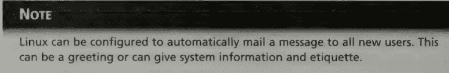

要查看 root 登录和普通用户登录之间的差异示例，请在 shell 提示符处输入 **adduser** 并按 **Enter**。

```
darkstar:~$ adduser
bash: adduser: command not found
```

您得到的消息看起来有些晦涩难懂。然而，它具有典型的 Linux 错误消息结构，所以现在花点努力理解它是值得的。

### Linux 错误消息

首先，在之前显示的错误消息中有相当多的信息。给您显示消息的程序是您的 shell，*bash*。因此，它用 *bash*: 来宣告自己，有点像剧本中的人物。接下来是 shell 的“mono-”“logo”。作为一个“强壮且沉默”类型的角色，*bash* 的独白非常简洁且切中要点。它声明了导致问题的程序（adduser）以及该程序的具体问题：找不到该命令（adduser）。

如果将错误消息扩展为真正的英语，它会读起来像这样：“嗨，我是 *bash*。您给我那个 adduser 命令，对吧？我到处找 adduser，但没找到，所以我无法执行 adduser 本应指定的任何操作。”随着时间推移，您将非常擅长理解 Linux 错误消息的语法。

### 搜索路径

为什么 root 能找到 adduser，而普通用户却找不到？Linux 有很多目录，每个目录可以容纳许多文件（其中之一可能是难以捉摸的 adduser）。从理论上讲，Linux 可以搜索整个文件系统直到找到 adduser。但如果 root 不小心将 adduser 错拼为 asuser，Linux 将不得不翻找


……每个角落和缝隙，最终才放弃搜索。这可能需要好几秒钟，并会对你的硬盘造成不必要的磨损（更不用说，每次你输入任何内容时都要搜索所有文件，这会让你发疯）。

因此，Linux 拥有用于查找命令的搜索路径（我们将在第 8 章中详细讨论）。通常，Linux 搜索路径上仅包含整个 Linux 文件系统的一小部分。由于 root 使用了许多系统管理程序（如 adduser），因此存放这些程序的目录包含在 root 的搜索路径中。普通用户的搜索路径中则没有系统管理目录。

> **提示**
> Linux 的搜索路径与您可能了解的 DOS 或 Windows 的搜索路径非常相似。路径的语法和目录的写法有所不同，但方法是相同的。

虽然没有找到不在搜索路径中的文件这一问题确实存在，但还是有办法绕过它的。如果你明确告诉 Linux 文件在哪里，它就不必遍历其搜索路径了。事实上，在大多数 Linux 系统中，adduser 位于 /sbin 目录中。尝试运行 /sbin/adduser。

```
darkstar:~$ /sbin/adduser
bash: /sbin/adduser: Permission denied
```

这一次，bash 能够找到 adduser（因为你确切告诉它去哪里找），但发现普通用户没有权限运行 adduser。正如你所见，Linux 将登录用户的操作限制在其权限级别内，而只有 root（至少在此时）可以运行 adduser。（我们将在第 9 章讨论权限。）

## who 命令

一个非常简单的 Linux 命令，也是当你学习更多关于 shell 和 shell 编程的知识时最常使用的命令之一，就是 who 命令。这个简单的命令只执行一项任务：显示当前谁已登录。who 命令在 Linux 中比较特殊，因为它不接受任何参数。你在命令行单独使用它即可。下面是一个示例命令及其输出：

```
$ who
  tparaker   tty02     May 18 18:29
  root       tty01     May 15 15:18
  root       tty03     May 15 15:17
  bills      tty0      May 18 18:29
  ychow      tty1      May 25 17:31
```

who 命令为系统中每个用户显示三列信息。首先显示用户正在使用的登录名。第二列显示用户正在使用的终端（这是一个设备名称，我们稍后将在第 33 章“设备”中详细介绍）。第三列显示用户登录的时间。

如果用户在多个终端或虚拟终端上登录（我们将在下一节讨论虚拟终端），则每个登录都会显示。在上面的输出中，你可以看到 root 在两个不同的终端上登录了两次。

who 的输出是在每次运行该命令时生成的，因此如果有用户注销，who 的输出在你发出命令的那一刻起就是准确的。

## 虚拟终端

如前所述，Linux 是一个多用户、多任务系统。这意味着多个登录可以同时访问系统，并且每个登录可以同时执行一项或多项不同的任务。一个严肃的多用户系统通常配备几个通过有线或网络连接连接到主计算机单元的终端（由键盘和显示屏组成）。

虽然你的系统可能没有连接任何终端，但你仍然可以使用同一个键盘和屏幕，以相同或不同的登录名多次登录。这种“魔法”是通过使用虚拟终端实现的，它使你的单个屏幕和键盘表现得像十几个不同的终端，每个终端由键盘顶部的一个功能键标识。

例如，按下 Alt+F2。此时，屏幕上的一切应该都会消失，被以下内容取代：

```
Welcome to Linux 1.2.13
darkstar login:
```

使用你的“常规”登录（不是 root）进行登录。当 shell 提示符显示后，在提示符处输入 who 并按下 Enter。你应该看到类似以下内容：

```
darkstar:~$ who
fido  tty2  Dec 14 01:42
fido  tty1  Dec 14 01:40
```

当你运行 Linux 命令 who 时，你的屏幕会显示当前登录到系统中的所有登录名、它们从哪里登录以及它们登录的时间。（当然，在上面的示例中，你的登录名会显示在那里，而不是 fido。）

按照惯例，tty1 是主控制台屏幕。它是 Linux 启动后出现的“正常”屏幕（除非你启动时使用了图形界面），因此你无需执行任何特殊操作即可看到它。如果你已切换到其他虚拟控制台，可以通过按下 Alt+F1 返回 tty1。

那么，你想知道系统中有多少个虚拟屏幕处于活动状态吗？尝试按顺序浏览所有的 Alt+F n 键。或者，在某些系统上，你可以使用 Alt+右箭头键向上浏览虚拟屏幕，或使用 Alt+左箭头键向下浏览。大多数 Linux 系统启动时定义了六个、十个或十二个虚拟控制台。你可以更改这个数量，但你可能永远不会使用超过三四个，所以默认值就足够了。

为什么要使用虚拟控制台？经常你会发现自己在做某件事——也许是一个漫长而复杂的程序——然后意识到自己应该先做另一件事。只需切换到另一个虚拟终端，做你要做的事即可。这就像你同时运行两个终端一样。

虚拟终端的另一个实用场景是，当你通过实验或其他原因导致屏幕冻结或按下按键时开始显示奇怪的符号。你可以从另一个虚拟终端尝试排除故障或重新启动系统（如有必要）。

Linux 还自带了一个功能强大的多任务图形环境，称为 X。安装和运行 X 窗口系统在本书的后半部分有所描述（参见第 22 章“安装和配置 XFree86”）。

## 命令和程序

“运行 who 命令”和“运行 who”是比“在提示符处输入 who 并按下 Enter”更常见的表达方式。只要含义清晰，我们就使用较短的表达。有时，熟悉 Linux 的人甚至会省略“运行”一词，因此一个用户可能会告诉另一个用户：“我试了 who，但没有看到什么异常。”根据上下文，大家会明白当他们“试了 who”时，实际上是指“运行”了它。

如果你仔细阅读，可能还会注意到似乎既有 Linux 程序又有 Linux 命令。命令是你在 shell 提示符处输入的内容。因此，shell 提示符和你输入的内容组合在一起通常被称为命令行。当你按下 Enter 键时，Linux 会获取你输入的命令并尝试执行它。Linux 系统对某些命令具有内置响应；对于其他命令，它会在硬盘上找到相应名称的程序并执行该程序。

从严格意义上说，命令是你输入的内容，而程序是执行你命令的内容。然而，像 *who* 这样结果直接、非常简单的程序通常被称为命令，尽管实际上你的硬盘上确实有一个 *who* 程序。更复杂的程序，通常是交互式的（如 `adduser`）或开放式的（如文本编辑器），则按照传统意义被称为程序。因此，你可能听到一个有经验的用户对另一个用户说：“adduser 程序运行正常。15 分钟后我尝试了 who 命令，发现新用户已经登录了。”

## 摘要

在本章中，我们为 root 登录分配了一个密码，并创建了一个新的用户 ID，将在接下来的几章中使用。我们学到了一些有用的 Linux 术语技巧，这将有助于我们未来更好地理解和使用 Linux。此时，你可以确保已注销所有虚拟终端，或者直接进入下一章。

有一些章节详细解释了我们刚刚涵盖的内容，你现在可能想阅读它们以获取更多信息：

- 若要了解更多关于你常规使用的 Linux 命令，请参见第 7 章“基本 Linux 命令”。
- 若要了解更多关于你默认使用的 Bourne Again Shell，请参见第 11 章。
- 若要了解更多关于文件权限及其如何影响你可以读取哪些文件，请参见第 9 章。


# 第 7 章
### 基础 Linux 命令

作者：Ed Treijs 和 Tim Parker

### 本章内容

- Linux 命令的工作方式 126
- 用于描述 Linux 命令的符号约定 133
- Linux 中可用的在线帮助 134
- Linux 手册页（man pages） 134
- 通配符：* 和 ? 138
- 环境变量 138
- 进程以及如何终止它们 140
- 扮演其他人：su 命令 145
- grep 命令 146

### Linux 命令的工作方式

大多数 Linux 命令都非常灵活。当你输入一条 Linux 命令时，有几种方法可以根据具体需求对基本命令进行定制。我们将探讨修改命令效果的两种主要方式：

- 指定或重定向命令的输入和输出
- 使用命令选项

想象一个 Linux 命令所做的事情，一个简单的比喻是将其视为一条组装线上的一部分——一个黑盒子。物品通过传送带进入黑盒子，经过某种处理，从黑盒子中出来，并被另一条传送带带走。命令选项允许你微调黑盒子内部发生的基本过程。命令重定向允许你指定哪条传送带向黑盒子提供物品，以及哪条传送带带走最终产品。这个比喻看似简单，但却是理解 UNIX 和 Linux 一些复杂概念的一种 surprisingly effective（出奇有效）的方式。

一旦你理解了重定向和命令选项是如何工作的，你就能够（至少在原则上）使用任何 Linux 或 UNIX 命令。这是因为 UNIX 基于几个简单的设计原则。对我们而言，这些原则中最重要的一个是：命令是简单且单一用途的，同时对于从哪里获取信息以及完成后将信息放在哪里也具有很强的灵活性。因此，所有的 Linux 命令都应该以一致的方式工作。当然，在 UNIX 存在的 35 年左右的时间里它不断演化，设计原则有时会被各种变化所掩盖。但它们仍然构成了基础，因此像 Linux 这样的基于 UNIX 的系统在工作方式上表现出惊人的连贯性和一致性。

> **提示**
>
> 在按下 Enter 键之前的任何时刻按下 Ctrl+U，都可以清除你在命令行上输入的所有内容。当你在打字的最开始发现错误，或者在决定最终不想运行某个特定命令时，都可以使用此功能。你也可以使用退格键（Backspace）通过擦除字符来“后退”（事实上，这几乎是一种反射动作），但通常更快地方式是直接擦除整行命令并重新开始。或者，你可以使用 Ctrl+C 组合键取消当前输入的内容并显示一个新的 shell 提示符。

也许在命令行提示符下最有用的键是在支持它们的 shell 版本中的方向键。左右箭头非破坏性地移动光标。如果你在行初输入了拼写错误，可以用左箭头键移动到该字符位置并输入更正。此外，上下箭头允许你在最近使用的几条命令列表中进行跳转（类似于 DOS 的 DOSTKEY 实用程序）。

### 命令选项

你可以使用命令选项来微调 Linux 命令的行为。很多时候，Linux 命令几乎但并不完全做你想让它做的事。Linux 不需要你学习第二条命令，而是允许你通过使用选项来修改命令的基本或默认行为。一个简单的例子是当你想要将姓名列表排序时。Linux 有一个 sort 命令可以为你完成这项任务，但也许你想反转排序顺序，使 Z 排在 A 之前。Linux 没有专门的“反向排序”命令，而是通过一个单字母选项来反转排序顺序。有些命令有很多选项，有些则较少。

`ls` 命令是一个拥有众多选项的优秀且实用的示例。`ls` 命令列出在 Linux 系统硬盘上找到的文件。这听起来很简单，不是吗？尝试输入以下命令：

```text
darkstar:~$ ls
darkstar:~$
```

嗯，在这种情况下似乎没有发生什么，大多数系统在你使用全新的用户登录时都会这样响应。

现在尝试输入 `ls -a`。请严格按照所示方式输入。`ls` 和 `-a` 之间的空格是必需的，并且 `-` 和 `a` 之间不能有空格。

```text
darkstar:~$ ls -a
./. .bash_history .kernelrc .lessrc
```

这里你通过添加一个命令选项——在本例中是 `-a`——修改了 `ls` 的行为。默认情况下，`ls` 只列出不以句点开头的文件。然而，`-a` 告诉 `ls` 列出所有文件，包括那些以句点开头的文件。（这些通常是 Linux 为你创建的特殊文件。因为 Linux 不能像某些操作系统那样隐藏文件，所以它将任何以句点开头的文件视为特殊的配置文件，这些文件不会出现在常规的列表命令中。）目前，你目录中的所有文件都以句点开头，因此单独的 `ls` 不列出任何文件；你必须添加 `-a` 才能查看当前拥有的所有文件。

`ls` 命令还有许多其他选项。你可以一次使用多个选项。例如，尝试输入 `ls -al`：

```text
darkstar:~$ ls -al
total 10
drwxr-xr-x 3 fido  users       1024 Dec 21 22:11 ./
drwxr-xr-x 6 root  root       1024 Dec 14 01:39 ../
-rw-r--r-- 1 fido  users        353 Dec 21 22:11 .bash_history
-rw-r--r-- 1 fido  users        163 Dec 7 14:31 .kerrrc
-rw-r--r-- 1 fido  users         34 Jun 6  1993 .lessrc
-rw-r--r-- 1 fido  users        114 Nov 23 1993 .lessrc
drwxr-xr-x 2 fido  users       1024 Dec 7  13:36 .term/
```

现在你会看到包含关于文件的更多详细信息的列表。（这些将在第 8 章“使用文件系统”中进行解释。）`1` 选项可以单独使用；`ls -1` 提供关于不以句点开头的文件的详细描述。有时文件名太长，无法在一行内显示；Linux 只是将剩余部分换行到下一行。

> **注意**
>
> 严格来说，连字符 (-) 并不是命令选项的一部分。连字符只是告诉 Linux 将紧随其后的每个字母理解为命令选项。连字符*必须*前有空间，连字符和构成命令选项的字母*必须*没有空间。如果要在命令行后续输入其他内容，命令选项*必须*后有空间。

你可以像我们在 `ls -al` 中那样，在连字符后输入多个命令选项。在这种情况下，我们同时指定了 `a` 和 `l` 选项。指定选项的顺序通常无关紧要；`ls -al` 和 `ls -la` 产生相同的结果。并非所有 Linux 命令都支持组合选项；只有那些使用单字母指定每个选项的命令才支持。

也可以单独指定多个选项，每个选项前都有一个连字符，并用空格与其他选项分隔——例如，`ls -a -l`。这通常只在某个选项需要额外参数时使用。

默认情况下，`ls` 按字母顺序列出文件。有时你可能更关心文件的创建或最后修改时间。`t` 选项告诉 `ls` 按日期而非文件名字母顺序对文件进行排序，并首先显示最新的文件。因此，当你输入 `ls -alt` 时，你会看到以下结果：

```text
darkstar:~$ ls -alt
total 10
drwxr-xr-x 3 fido  users       1024 Jan  2 13:48 ./
-rw-r--r-- 1 fido  users        353 Dec 21 22:11 .bash_history
drwxr-xr-x 6 root  root        1024 Dec 14 01:39 ../
-rw-r--r-- 1 fido  users        163 Dec  7 14:31 .kernelrc
drwxr-xr-x 2 fido  users       1024 Dec  7 13:36 .term/
-rw-r--r-- 1 fido  users       3016 May 13  1994 .emacs
-rwxr-xr-x 1 fido  users        114 Nov 23  1993 .lessrc
-rw-r--r-- 1 fido  users         34 Jun  6  1993 .lessrc
```

`r` 选项告诉 `ls` 产生反向输出。这通常与 `t` 选项一起使用。

以下是输入 `ls -altr` 时显示的示例：

```text
darkstar:~$ ls -altr
total 10
-rw-r--r-- 1 fido  users         34 Jun  6  1993 .lessrc
-rw-r--r-- 1 fido  users        114 Nov 23  1993 .lessrc
-rw-r--r-- 1 fido  users       3016 May 13  1994 .emacs
drwxr-xr-x 2 fido  users        1024 Dec  7 13:36 .term/
-rw-r--r-- 1 fido  users         163 Dec  7 14:31 .kernelrc
drwxr-xr-x 6 root  root         1024 Dec 14 01:39 ../
-rw-r--r-- 1 fido  users         353 Dec 21 22:11 .bash_history
drwxr-xr-x 3 fido  users        1024 Jan  2 13:48 ./
```

许多其他选项可以与 `ls` 一起使用，尽管你刚刚使用的是最常用的几个。需要记住的重要事情是，你通常可以通过使用一个或多个命令选项来自定义 Linux 命令。

> **注意**
>
> 对于基本的 Linux 命令，大小写很重要！例如，`ls` 有一个 `R` 选项（递归：也显示子目录中的文件），其结果与 `r` 选项有很大不同。

> **提示**
>
> 你可以将 `a` 视为“所有文件”选项，`l` 视为“长列表”选项，`t` 视为“按时间排序”选项，`r` 视为“反向排序”选项，等等。事实上，Linux 中大多数选项都是*助记*的——选项字母代表一个单词或短语。许多不同的 Linux 命令中，某些选项字母具有相同的含义。例如，`v` 通常意味着 *verbose*（详细模式）——换句话说，“给我提供大量细节”。

然而，不要假设在不熟悉的命令上，某些选项会以“常规”方式工作！例如，`r` 是许多 Linux 命令的递归选项；然而，对于 `ls` 而言，反向排序更常用，因此它被分配给更容易输入的小写 `r`，而递归则保留给大写 `R`。按下 Shift 键以获得大写字母似乎并没有增加多少额外工作，但请尝试输入一串四五个选项，其中有一个是大写的！


## 其他参数

Linux 命令通常使用非实际命令选项的参数。这些参数（例如文件名或目录）之前不带连字符。

例如，默认情况下 `ls` 列出当前目录中的文件。但是，你只需在命令行中添加目录，就可以让 `ls` 列出任何其他目录中的文件。例如，`ls /bin` 会列出 `/bin` 目录中的所有内容。这可以与命令选项结合使用，因此 `ls -l /bin` 会给出 `/bin` 中文件的详细列表。试试看吧。你会对 `/bin` 目录中文件的数量印象深刻！

你还可以通过输入文件名来指定 `ls` 列出关于某个特定文件的信息。例如，`ls -la .lessrc` 仅显示关于 `.lessrc` 文件的详细信息。如果文件不存在，Linux 不会显示任何内容。

## 输入和输出重定向

许多 Linux 命令允许你指定它们要操作的文件或目录，正如我们之前在使用 `ls -l /bin` 示例中所见。

你还可以将命令的输出“管道”传输，使其成为另一个命令的输入。这是通过输入两个或多个由 `|` 字符分隔的命令来实现的。（这个字符通常位于与 `\` 字符相同的键上。你必须按住 Shift 键，否则会得到 `\` 而不是 `|`）。`|` 字符的含义是“将上一个命令的输出用作下一个命令的输入”。因此，输入 `command_1 | command_2` 会按顺序执行这两个命令，然后才给你结果。

使用我们的装配线比喻，物品正在通过两个黑盒进行处理，而不仅仅是一个。当我们使用管道时，就像是连接第一个命令的输出传送带，使其成为第二个命令的输入传送带。

> **提示**
> 虽然 Linux 并不关心 `|` 是否由空格隔开，但如果你觉得 `command_1 | command_2` 比 `command1|command2` 更易于阅读和理解，那么请在 `|` 周围使用空格。

你可能已经注意到，`ls -l /bin` 的输出有很多行，导致在你阅读之前，大量信息就滚出屏幕了。你可以将此输出管道传输到一个名为 **more** 的格式化程序中，该程序以屏幕大小的块显示信息。

当你输入 `ls -l /bin | more` 时，你将看到以下内容：

```
darkstar:~$ ls -l /bin | more

        total 1611
        -rwxr-xr-x   1 root    bin            1248 Sep 17 04:25 arch*
        -rwxr-xr-x   1 root    bin          295940 Sep  5 01:45 bash*
        -rwxr-xr-x   1 root    bin           4840 Nov 24  1993 cat*
        -rwxr-xr-x   1 root    bin           9220 Jul 20 12:06 chgrp*
        -rwxr-xr-x   1 root    bin          13316 Jul 20 12:06 chmod*
        -rwxr-xr-x   1 root    bin          13316 Jul 20 12:06 chown*
        lrwxrwxrwx   1 root    root              17 Dec  7 13:37 compress ->
        /usr/bin/compress
        -rwxr-xr-x   1 root    bin           21508 Jul 20 12:06 cp*
        -rwxr-xr-x   1 root    bin          41988 May  1  1994 cpio*
        lrwxrwxrwx   1 root    root               4 Dec  7 13:40 csh -> tcsh
        -rwxr-xr-x   1 root    bin           5192 Nov 24  1993 cut
        -rwxr-xr-x   1 root    bin          19872 Mar 23  1994 date
        -rwxr-xr-x   1 root    bin          17412 Jul 20 12:06 dd
        -rwxr-xr-x   1 root    bin          13316 Jul 20 12:06 df
        -rwxr-xr-x   1 root    bin          66564 Jun  9  1994 dialog*
        -rwxr-xr-x   1 root    bin           1752 Sep 17 04:25 dmesg
        lrwxrwxrwx   1 root    root               8 Dec  7 13:37 dnsdomainname -> hostname
        -rwxr-xr-x   1 root    bin          13316 Jul 20 12:06 du
        -rwxr-xr-x   1 root    bin           3312 Mar 23  1994 echo
        -rwxr-xr-x   1 root    bin          36684 May  4  1994 ed
        -rwxr-xr-x   1 root    bin            326 Mar 23  1994 false
        --More--
```

屏幕底部的 **--More--** 告诉你还有更多内容。要转到下一屏文本，请按下空格键。每次按下空格键，**more** 都会显示另一屏文本。当最后一屏文本显示完毕后，**more** 会返回 Linux 提示符。

> **提示**
> **more** 命令还可以做很多其他事情。例如，要一次向前移动一屏，请按下 **b** 键表示“back”（后退）。（并非所有版本的 **more** 都支持 **b** 选项。）另一个有用的命令是 **q** 键，表示“quit”（退出）。这让你可以立即离开，而无需遍历所有剩余的文本屏幕。**Ctrl+C** 也能做到同样的事情。
>
> 在 **more** 中，按下 **h** 键获取“help”（帮助）。这会列出 **more** 内部可用的命令。

### 注意

Linux 有时包含命令 `less` 而不是 `more`。你会注意到的一个区别是，与 `more` 不同，`less` 要求你输入 `q` 才能返回命令行，即使你处于待显示文本的末尾也是如此。这可能会显得繁琐，但它防止你因多次按空格键而意外退出程序。

名称 `less` 是对 `more` 的戏仿。最初，`less` 被设计为拥有许多 `more` 缺乏的功能。然而，大多数 Linux 系统包含的 `more` 版本已经具备了这些功能中的大部分。

稍后将讨论的 Linux `man` 程序使用 `less` 来显示文本。大多数其他 UNIX 系统默认使用 `more`。不要混淆。只需记住按 `q` 键从 `less` 中退出！

你可以在 Linux 中做的另一件事是将输出发送到文件而不是屏幕。你之所以想要这样做有很多不同的原因。也许你想保存命令输出在某个时刻的“快照”，或者你想保存命令的输出以便进一步检查。你也可能想保存运行时间很长的命令的输出，等等。

要将输出发送到文件，请使用 `>` 符号（位于键盘上的句号上方）。例如，你可以输入 `ls -l /bin > output`，将 `ls -l /bin` 命令的输出放入名为 `output` 的文件中。同样，`>` 周围的空格是可选的，也不是严格必需的，但它们确实使命令更易于阅读。

如果你现在输入 `ls` 或 `ls -l` 命令，你会发现你已经在自己的目录中创建了一个名为 `output` 的新文件。

要查看文件内容，你可以再次使用 `more` 命令。只需指定你要查看的文件名即可。在这种情况下，输入 `more output`。

# 警告

小心！当你使用 `>` 时，你指定的输出文件（如果该文件存在）的先前内容会被完全覆盖。例如，如果我们目录中已经有一个名为 `output` 的文件，其旧内容将被 `ls -l /bin` 的输出完全替换。Linux 不会警告你即将这样做！

> 如果你不在通常的目录中，或者你是以 root 身份登录的，请特别小心。例如，你可能不小心覆盖了一个 Linux 程序。在使用 `>` 之前检查输出文件是否已存在是个好主意。在我们的示例中，我们可以事先输入 `ls -l output`。如果没有显示信息，则该文件不存在。

你可以使用 `>>` 指定将输出添加到文件末尾，而不是替换文件内容。输入 `who >> output` 将 `who` 命令的输出添加到文件 *output* 中已有的文本末尾。

你可以使用 `more` 或 `less` 翻页到文件末尾，或使用 Linux 命令 `tail` 来检查结果，该命令显示指定文件的最后几行。在这种情况下，输入 `tail output` 以查看文件 *output* 的最后几行。试试使用 `tail`！

## 用于描述 Linux 命令的符号约定

有一套被接受的符号约定，用于以简洁且一致的方式描述任何给定 Linux 命令的正确语法。这规定了你必须使用哪些选项或参数，你可以或不可以使用哪些选项或参数，等等。有时这套约定用于给出命令语法的完整且详尽的列表，显示每个可能的命令和参数。有时它用于使特定示例更通用，并使命令的基本用法更清晰。你将在手册、man 页面和其他信息来源中遇到这些符号表示。

如果你记住以下五条基本规则，原则上你将能够理解任何 Linux 或 UNIX 命令的语法。

### Linux 符号表示的六条基本规则

1.  任何独立存在且不在 `[ ]`、`< >` 或 `{ }` 内部的文本，必须按照显示的样子准确输入。
2.  方括号 `[]` 内的任何文本都是可选的。你可以输入它，也可以不输入它。例如，语法 `ls [-1]` 意味着你必须输入 `ls`（根据第一条规则），而添加 `-1` 是可选的但不必要。不要输入方括号本身！在我们的示例中，输入 `ls` 或 `ls -1`。不要输入 `ls [-1]`。


## Linux 中的在线帮助

Linux 提供了在线帮助设施。如果你忘记了某个命令的确切用法，不确定某个选项的含义，或者在寻找合适的命令，答案可能直接来自 Linux 本身。我们将尝试使用的两种帮助设施是 `bash` shell 的 `help` 命令和 `man` 命令，后者几乎在所有 UNIX 系统（包括 Linux）上都可用。

### Linux man 手册页

"man pages"（man 手册页）中的 "man" 代表 "manual"（手册）。（一如既往，UNIX 的创造者将一个冗长但描述性强的词缩短为一个简短而晦涩的词！）输入 `man <command>` 可以让你查看关于特定命令的手册页。

尝试输入 `man passwd`，查看 Linux 手册对 `passwd` 命令的描述。

man 手册页的一般布局如下：

```
COMMAND(1)                Linux Programmer's Manual           COMMAND(1)

NAME
        command - summary of what command does

SYNOPSIS
        <complete syntax of command in the standard Linux form>

DESCRIPTION
        More verbose explanation of what "command" does.

OPTIONS
        Lists each available option with description of what it does

FILES
        lists files used by, or related to, command

SEE ALSO
        command_cousin(1), command_spouse(1), etc.

BUGS
        There are bugs in Linux commands??

AUTHOR
        J. S. Goobly (goobly@hurrdly-gurdly.boondocks)

Linux 1.0         22 June 1994                   1
```

`passwd` 的 man 手册页其实相当容易理解。不过请注意，man 手册页通常以一种非常正式且程式化的方式撰写，有时与常规英语相去甚远。这样做的目的不是为了让人困惑，而是为了在尽可能简短的描述中包含大量的信息。例如，尝试输入 `man ls`。你会发现 `ls` 有多少可用选项，以及解释它们需要多长时间。

虽然理解 man 手册页可能需要练习（以及仔细的阅读！），但一旦你习惯了它们，当你遇到一个不熟悉的命令时，你做的第一件事就会是调用该命令的 man 手册页。

### 在 Man 手册页中查找关键词

有时你知道自己想做什么，但不知道应该使用哪个命令。通过输入 `man -k <keyword>` 使用关键词选项，`man` 程序会返回所有其 `name` 条目（包含非常简短的描述）中包含该关键词的命令名称。

例如，你可以搜索 `manual`：

```
darkstar:~$ man -k manual
darkstar:~$ man 5 passwd
```

不过，你务必小心地指定关键词！例如，使用 `directory` 作为关键词问题不大，但使用 `file` 会返回比你想查看的更多的条目。

> **注意**
> 你可能注意到，命令后面似乎跟着括号中的数字，通常是 `(1)`。这指的是手册章节。在 UNIX 手册还是印刷装订卷的时候，普通命令在第 1 章，管理员使用的文件在第 5 章，编程例程在第 3 章，等等。因此，有些 man 手册页根本不是关于命令的，而是关于 Linux 中使用的文件或系统调用！如果某个条目出现在多个章节中，`man` 默认会显示编号最低的条目。你可以通过指定章节编号来查看编号较高的条目。例如，第 5 章有一个关于 `passwd` 文件的手册条目。要查看这个而不是 `passwd` 命令的手册条目，请输入 `man 5 passwd`。

通常，`man <n> <entry>` 会在第 `<n>` 章中找到 `<entry>` 的 man 手册页。

### Bash Shell 帮助设施

当你在提示符下输入命令时，shell 程序会读取你输入的内容，按需进行解释，并将结果传递给 Linux 操作系统。然后 Linux 执行请求的操作。许多 Linux 命令需要 Linux 查找并启动一个新程序。然而，shell 本身也能执行许多功能。

这些功能可以是简单且常用的命令，从而消除启动独立程序的开销；也可以是使 shell 环境更友好、更有用的设施。其中一个设施是 **help** 命令，它提供 **bash** shell 内置函数的信息。

在提示符下输入 **help**。你会看到至少以下部分内容：

```
GNU bash, version 1.14.15(1)
Shell commands that are defined internally. Type 'help' to see this list.
Type 'help name' to find out more about the function 'name'.
Use 'info bash' to find out more about the shell in general.
```

名称旁边的星号 (*) 表示该命令已被禁用。

```
%[DIGITS | WORD] [&] . [filename] : [arg...] alias [ name[=value] ... ] bg [job_spec] bind [-lvd] [-m keymap] [-r filena break [N] builtin [Shell-builtin [arg ...]] case WORD in [PATTERN [; PATTERN]. cd [dir] command [-pvV] [command [arg ...]] continue [n] declare [-frx] name[=value] ... dirs [-1] echo [-nE] [arg ...] enable [-n] [name ...] eval [arg ...] exec [-] file [redirection ...] exit [n] export [-n] [-f] [name ...] or exp fc [-e name] [-nlr] [first] [last fg [job_spec] for NAME [in WORDS ... ;] do COMMA function NAME { COMMANDS ; } or NA getopt optstring name [arg] hash [-r] [name ...] help [pattern ...] history [n] [ -awrn] [filename] if COMMANDS; then COMMANDS; [elif jobs [-lnp] [jobspec ...] | jobs - kill [-S sigspec | -sigspec] [pid let [arg ...] local name[=value] ... logout popd [+n ! -n] pushd [dir | +n ! -n] pwd read [-r] [name ...] readonly [-n] [-f] [name ...] or r return [n] select NAME [in WORDS ... ;] do CO set [--abefhknoutvXhDCP] [-o opti shift [n] source filename suspend [-f] test [expr] times trap [arg] [signal_spec] type [-all] [-type ! -path] [name typeset [-frxij] name[=value] ... ulimit [-SHacdmtfnpuv [limit]] umask [-S] [mode] unalias [-a] [name ...] unset [-f] [-v] [name ...] until COMMANDS; do COMMANDS; done variables - Some variable names an wait [N] while COMMANDS; do COMMANDS; done { COMMANDS }
```

你需要将 **help** 的输出管道传输到 **more**（**help** ! **more**），以防止第一部分从屏幕上滚动过去。

### 通配符：* 和 ?

在许多深夜的纸牌游戏中，大小王会被混入牌堆。大小王是 *wild-cards*（通配牌），可以变成你选择的任何牌。这显然非常有用！Linux 也有通配符（wildcards）。它们比纸牌游戏中的大小王更有用。

Linux 有几个通配符。通配符在指定命令要操作的文件（或目录）时，是一种方便且强大的快捷方式。我们将简要介绍两个最常用的通配符：* 和 ?。（Linux 支持相当多的其他通配符，但它们很少使用，在此处讨论只会使问题复杂化。）

最常用的是 *，它代表任何由一个或多个字符组成的组合。例如，`c*` 匹配所有以 c 开头的文件名。你可以通过输入 `ls /bin/c*` 来亲眼看到这一点。如果你在命令行输入 `ls /bin/c**t` 会发生什么？那在命令行输入 `ls /bin/*t` 呢？

? 通配符比 * 更具限制性。它只代表 *一个* 任意字符。你可以通过比较 `ls/bin/d*` 和 `ls/bin/d?` 来理解这一点。

> 注意
> 通配符只能用于匹配文件名和目录名。例如，你不能在 Linux 提示符下输入 `pass*` 并期望 Linux 为你运行 `passwd` 程序。

> 警告
> 在使用通配符配合危险命令（例如用于永久删除文件的命令）时要非常小心！一个好的检查方法是使用你计划使用的通配符运行 `ls`，并检查生成的文件列表，看看通配符组合是否按预期执行。此外，在按下 Enter 键 *之前* 也要仔细检查是否输入正确！

## 环境变量

当你登录时，Linux 在后台保留了许多有用的数据项，以备系统使用。实际的数据保存在称为 *environment variable*（环境变量）的对象中，其名称通常具有描述性或助记性。实际上，这与…


你和我都能记住事情。我们知道，总有一个称为“星期几”（环境变量）的信息片段；然而，随着日子一天天过去，我们会改变这个变量中的数据，从周一到周二再到周三，依此类推。

要查看*已导出的*环境变量列表，请输入`env`。**env**命令的典型输出如下所示：

```bash
$ env
FMHOME=frame
HOME=/usr/tparker
HUSHLOGIN=FALSE
HZ=100
LOGNAME=tparker
MAIL=/usr/spool/mail/tparker
PATH=:/frame/bin:/bin:/usr/bin:/usr/tparker/bin:.
SHELL=/bin/sh
TERM=ansi
TZ=EST5EDT
```

环境变量的名称位于左侧，而该变量持有的值位于右侧。这里的“exported”一词有特殊的含义：当一个环境变量被导出时，它对你启动的系统中每一个程序和工具都是可用的。这种可用性将持续到你注销登录为止。你可以定义仅对单个程序生效的变量，或者定义那些与已导出变量效果不同的变量。

最需要注意的是**PATH**变量，其值是你的*搜索路径*。我们将在下一章中看到，当你输入一个命令时，Linux 会在你的搜索路径中列出的所有位置查找该命令。

命令**set**会显示一个更长的环境变量列表，除了前面展示的变量外，还包含几个新变量。以下是同一系统上 set 命令的输出：

```bash
$ set
FMHOME=frame
HOME=/usr/tparker
HUSHLOGIN=FALSE
HZ=100
IFS=
 
LOGNAME=tparker
MAIL=/usr/spool/mail/tparker
MAILCHECK=600
OPTIND=1
PATH=:/frame/bin:/bin:/usr/bin:/usr/tparker/bin:.
PS1=$
PS2=>
SHELL=/bin/sh
TERM=ansi
TZ=EST5EDT
```

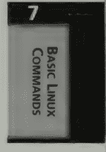

列表中出现的这些新变量是局部的：它们没有被标记为导出。有关导出变量的更多信息，请参阅第 10 章。你可以将局部变量视为仅在特定时间或地点需要的信息项。例如，记住“我在哪一层楼”这个变量，在你离开大楼后就不再是必要的信息了！在某些情况下，你可能会看到 set 和 env 命令的输出相同，但实际上它们报告的内容略有不同。

## 进程以及如何终止它们

在上一章中，我们了解了 who 命令，它会显示所有登录到系统中的用户的登录名称。who 程序实际上是从 Linux 系统获取信息的，系统会维护并更新当前用户列表。

事实上，Linux 不仅记录谁登录了系统，还保存了关于系统上正在发生什么事件的更详细的记录。由于 Linux 是一个多任务系统，其中许多程序或程序线程可能同时运行，因此 Linux 会跟踪单个任务或进程。每次你输入一个命令，那就是一个进程。每当系统做任何事情时，那也是一个进程。本质上，Linux 所做的每一件事都称为进程，且同一时间可能有几十个进程在运行。

## 进程状态命令：ps

要查找正在运行的进程，我们使用 ps 命令。“ps” 代表 “process status”（进程状态），而不是你可能在信末写的 “post script”（附言）。请记住，ps 和所有 Linux 命令一样，都是小写的。

仅输入 ps 会给你一个你自己进程的简练列表。当你没有为 ps 指定任何选项时，这就是默认行为，即列出你自己的进程：

```bash
darkstar:~$ ps
  PID TTY STAT TIME COMMAND
   41 v01 S  0:00 -bash
  134 v01 R  0:00 ps
```

第一列标题为 PID 的信息很重要。这是进程 ID 号，是分配给每个进程的唯一编号，Linux 用它来识别该特定进程。你必须知道进程的 PID 才能将其杀死。系统中的每个进程都有一个 PID，编号范围从 0 到 65,535，然后从头重新开始，确保每个编号在任何时刻只使用一次。Linux 对每个进程使用数字而不是名称，因为这样更快、更简单。

**TTY** 列显示进程是从哪个终端启动的。当你尝试 **ps** 命令时，你会看到自己的终端被列出。

**STAT** 列给出进程的状态。状态列中两个最常见的条目是**S 代表休眠（sleeping）**和**R 代表运行（running）**。休眠进程是指当前未处于活动状态的进程。不过，不要误解。一个休眠进程可能只是在打一个非常短的瞌睡！事实上，进程每秒可以在休眠和运行之间切换多次。

**TIME** 列显示进程所使用的系统时间。显然，我们的两个进程都没有占用多少系统时间！在现代机器上这种情况很常见，因为大多数进程执行得如此快速，以至于时间列几乎不会超过一位数字。

最后，**NAME** 列包含你正在运行的程序名称。这通常是你/command line 上输入的命令。然而，有时你输入的命令会启动一个或多个称为子进程（children）的进程，在这种情况下，你也会看到这些额外的进程，尽管你从未亲自输入过它们。你的**登录**shell 前面会有一个 -，如前例中的 **-bash**。这有助于将此*主要* shell 与你可能从它进入的其他 shell 区分开来。其他 shell 前面不会有这个 -。

### 注意

如果你以*root*身份登录，你会看到系统中*所有*进程的列表。这是因为*root*用户名作为超级用户，拥有在 Linux 系统上发生的一切。

如果你是“普通”用户，但在另一个终端（包括通过按 Alt+Fn 选择的另一个虚拟终端，如第 6 章“入门”中所述）上也登录了，你也会看到你在其他终端（或多个终端）上运行的进程。

如果你使用*ps*时看到略有不同的信息列，请不要担心。输出通常会有些许差异，尤其是在使用选项和不同版本的 Linux 时。不过，基本信息大致相同。

**ps** 的一个有用选项是 **u**。虽然它代表“user”（用户），但它实际上除了用户名之外，还添加了相当多的其他信息列：

```bash
darkstar:~$ ps -u
USER PID %CPU %MEM SIZE RSS TTY STAT START TIME COMMAND
fido 41 0.1 6.8 364 472 v01 S 23:19 0:01 -bash
fido 138 0.0 3.3 72 228 v01 R 23:34 0:00 ps -u
```

除了 **USER** 列中的用户名外，其他有趣的新项目包括 **%CPU**，它显示该进程正在使用计算机处理能力的百分比，以及 **%MEM**，它显示该进程正在使用计算机内存的百分比。

如果你想查看系统中运行的所有进程，而不仅仅是由你自己的用户名启动的进程，可以使用 **a** 命令选项。（**root** 登录会自动查看所有用户的进程，因此不需要使用 **a**，所以 **root** 只需输入 **ps** 即可获得以下输出。）

```bash
darkstar:~$ ps -a
PID TTY STAT TIME COMMAND
62 v03 S 0:00 /sbin/agetty 38400 tty3
63 v04 S 0:00 /sbin/agetty 38400 tty4
64 v05 S 0:00 /sbin/agetty 38400 tty5
65 v06 S 0:00 /sbin/agetty 38400 tty6
330 v02 S 0:00 -bash
217 v01 S 0:00 -bash
217 v01 S 0:00 ps -a
```

正如你看到的，系统中正在发生很多“其他”进程！事实上，我们在这里看到的大多数进程，无论是否有人实际登录到 Linux 系统，它们都在运行。所有列示在 **tty** 上运行的进程实际上是系统进程，并且在你每次启动 Linux 系统时都会启动。形式为 /sbin/agetty 38400 tty6 的进程是运行在特定终端上的登录进程，正在等待你的登录。

结合 **a** 和 **u** 选项可能很有用（如果你不是 **root**）。

```bash
darkstar:~$ ps -au
USER PID %CPU %MEM SIZE RSS TTY STAT START TIME COMMAND
root 72 0.0 3.6 390 532 v01 S 17:55 0:01 -bash
root 74 0.0 1.5 41 224 v03 S 17:55 0:00 /sbin/agetty 38400 tty3
root 75 0.0 1.5 41 224 v04 S 17:55 0:00 /sbin/agetty 38400 tty4
root 76 0.0 1.5 41 224 v05 S 17:55 0:00 /sbin/agetty 38400 tty5
root 77 0.0 1.5 41 224 v06 S 17:55 0:00 /sbin/agetty 38400 tty6
```


# 进程终止命令：**kill**

虽然这些进程通常由 Linux 管理得井井有条且表现良好，但有时它们可能会失控。如果程序遇到 Bug、其内部代码或提供的数据存在缺陷，或者你错误地输入了错误的命令或命令选项，这种情况就可能发生。

能够识别这些行为异常的进程，然后能够终止或 *kill*（杀死）它们，对于*所有* Linux 用户来说都是必备的知识。（显然，当 **kill** 命令被开发并命名时，这个世界并没有现在这么友善。）当你自己充当系统管理员时，就像我们的情况一样，能够终止那些出故障或锁死的进程就显得尤为重要！

`kill` 命令用于终止那些无法通过其他方式停止的进程。

### **注意**

在进行以下操作之前，如果你被困在某个程序中，请确保你无法通过按下 Ctrl+C 或 `q` 等按键组合来停止或退出该程序。

1. 切换到另一个虚拟控制台，并以 `root` 身份登录。
2. 运行 `ps -u` 并识别出问题的进程。记下该进程的进程 ID (PID) 号。你将在下一步中使用它的 PID。
3. 通过输入 `kill <PID>` 来使用 `kill` 程序，其中 *PID* 是你想要终止的进程 ID。确保你正确识别了问题进程！作为 `root`，你可以终止任何用户进程，包括如果你误读或打错 PID 而终止的那个错误进程。
4. 通过再次使用 `ps -u` 来验证进程是否已被终止。你可以输入 `ps -u <PID>`，这将仅显示指定 PID 的状态。如果结果为空，且你只看到 Linux 提示符，说明该 PID 已死，因此转到第 8 步。但是，如果完整的 `ps -u` 列表不太长，最好还是查看完整的列表。有时问题进程会以新的 PID 重新出现！如果是这种情况，请转到第 6 步。
5. 如果进程仍然存活且拥有相同的 PID，请使用 `kill` 的 `9` 选项。输入 `kill -9 <PID>`。按照第 4 步中的方式进行检查。如果这无法终止该进程，请转到第 7 步。如果进程现在已经终止，请转到第 8 步。
6. 如果问题进程以新的 PID 重新出现，这意味着它正被其他某个进程自动创建。现在唯一需要做的就是终止父进程，那才是真正的问题所在！如果 `kill -9` 不起作用，你可能也需要终止父进程。
7. 使用 `ps -1` 来识别问题进程的 PPID。这是父进程的 PID。在按照第 3 步所述使用 `kill` 命令中的*父*进程 PID 来终止它之前，你应该通过输入 `ps -u <Parent PID>` 更仔细地检查父进程的身份。你应该继续执行第 4 步，如有必要，执行第 5 步，确保父进程已被终止。
8. 进程已终止。记得注销。不要让 **root** 登录在虚拟控制台上，因为你可能忘记那里有 **root** 登录会话。

### **注意**

有时进程根本无法被终止！在这种情况下，你最好的选择是关闭 Linux 系统并重新启动。

Linux 阻止普通用户（与 **root** 相对）终止其他用户的进程（无论是恶意的还是非恶意的）。例如，如果你是一个普通用户并尝试终止 **init** 进程（其 PID 始终为 1），你会看到类似这样的消息：

```
darkstar:~$ kill 1
kill:  (1) - Not owner
```

实际上，即使是 **root** 也无法终止 **init** 进程，尽管没有错误消息。**init** 进程是前面讨论过的那种“不可终止”的进程之一，因为它是一个关键的进程。这是最好的安排！

# 变成别人：su 命令

通常，当你想临时变成另一个用户时，你只需切换到另一个虚拟终端，以该用户身份登录，完成后注销，然后返回到你的“主”虚拟终端。但是，有时这样做是不切实际或不方便的。也许你所有的虚拟终端都已经在使用中，或者你可能处于没有虚拟终端可用的环境中（例如通过电话和调制解调器登录）。

在这些情况下，你可以使用 **su** 命令。“su”代表“super user”（超级用户）。如果你单独输入 **su**，系统会提示你输入 **root** 密码。如果你成功输入了 **root** 密码，你将看到 **root #** 提示符，并拥有 **root** 的所有权限。

你还可以通过输入 **su <username>* 变成其他任何用户。如果你在输入 **su <username>* 时是 **root** 用户，系统不会要求你输入该用户的密码，因为原则上你本来就可以从 **root** 登录界面更改该用户的密码或检查该用户的所有文件。如果你是一个“普通”用户并试图切换到另一个普通用户，系统会要求你输入你试图变成 的那个用户的密码。

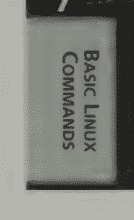

### **注意**

虽然 **su** 赋予你与登录为该用户时所能获得的所有权限，但请注意，你并不会继承该登录会话的确切环境，也不会运行该登录会话的启动文件（如果有的话）。这意味着 **su** 并不真正适合执行扩展的工作，而且对于排查该登录会话的问题也完全不适用。

# grep 命令

你问道：“**grep** 到底是什么意思？”这是一个合理的问题。**grep** 肯定是 UNIX 中最具代表性的缩写，因为即使拼写全称也难以理解！**grep** 代表 *Glocal Regular Expression Parser*（全局正则表达式解析器）。你会立刻理解这个命令的用途，但当“Glocal Regular Expression Parser”本身变成一个令人舒适的短语时，你可能应该考虑休息一下。

本质上，**grep** 的功能是查找并显示文件中包含你指定模式的行。换句话说，它是一个用于检查子字符串的工具。

使用 **grep** 有两种基本方法。**grep** 的第一个用途是过滤其他命令的输出。一般语法为 `<command> | grep <pattern>`。例如，如果你想要查看系统上每个正在运行的进程，请键入 `ps -a | grep R`。在这个应用中，**grep** 只传递包含该模式的行（在这种情况下，是单个字母）R。请注意，如果有人正在运行一个名为 *Resting* 的程序，即使其状态是 $（表示睡眠），它也会显示出来，因为 **grep** 会匹配 **Resting** 中的 R。解决这个问题的一个简单方法是键入 `grep " R "`，这明确告诉 **grep** 搜索两侧都有空格的 R。每当你要搜索包含一个或多个空格的模式时，必须使用引号。

**grep** 的第二个用途是搜索指定文件中包含指定模式的行。这里的语法是 `grep <pattern> <filename>`。小心。很容易错误地先指定文件名，后指定模式！同样，你应该尽可能具体地指定要匹配的模式，以避免“虚假”匹配。

## 总结

到这一点为止，你应该已经尝试了足够多的不同 Linux 命令，从而开始熟悉（如果尚未完全适应）典型的 Linux 使用惯例。


能够使用 Linux 提供的在线 man 手册页（man pages）非常重要。此时一个很好的练习是调出我们在前两章中查看过的所有命令的 man 手册页：**login, passwd, who, adduser** 等等。如果“另请参阅：”列出的任何命令看起来很有趣，请务必也查看一下它们的 man 手册页！

在第 8 章中，我们将离开“家”目录，并在 Linux 文件系统中四处探索。作为系统管理员，我们应该知道我们的硬盘里包含什么！例如，有一些特殊的“仅限管理员”目录，里面塞满了好东西。

还将介绍更多“基本”命令。到下一章结束时，你将已经看到并尝试过大多数重要的 Linux“用户”命令，并尝鲜一些“管理员”命令。如果你对其他类似问题感兴趣，可以跳转到以下章节：

- 关于使用 Linux 附带编辑器的讨论见第 16 章，“文本编辑器：vi 和 emacs。”
- 关于配置 X 以便使用 GUI 的讨论见第 22 章，“安装和配置 XFree86。”
- 关于在 Linux 下编程的讨论见第五部分，从第 25 章“gawk”开始。

## 使用文件系统

作者：Ed Tittel 和 Tim Parker

### 本章内容

- 文件：概述 150
- 目录：概述 152
- 导航 Linux 文件系统 154
- 创建和删除文件 158
- 移除文件和目录 165
- Linux 文件系统中的重要目录 169

# 第 8 章

为了理解 Linux 的工作机制并在超越表面的层面使用该系统，你必须熟悉 Linux 关于文件的概念以及它们被组织成的文件系统。如果你之前使用过其他操作系统，如 DOS 或 Windows，你已经见过这些概念，因为这两个操作系统的文件、目录和文件系统方法都是基于 UNIX 的。你会发现，UNIX 和 Linux 在处理文件系统方面比 DOS 和 Windows 相对严格和有限的方式拥有更多的灵活性。

## 文件：概述

文件最基本的概念——你可能已经从其他计算机系统中熟悉这一点——将*文件*定义为你在硬盘上找到的一个独立的信息块。*独立*意味着有许多分开的文件，每个文件都有其特定的内容。为了防止文件相互混淆，每个文件必须有一个唯一的身份标识。在 Linux 中，你通过文件的名称和位置来识别每个文件。在每个位置或*目录*中，对于特定名称的文件只能有一个。因此，例如，如果你创建一个名为 **novel** 的文件，并且你有了第二个好主意，要么你得给它起一个不同的名字，比如 **novel2**，要么把它放在不同的目录中，以防止*覆盖*你原始 **novel** 中已有的内容。

### 常见的文件类型

文件可以包含各种类型的信息。以下三种类型在 Linux 系统中对你来说将最为熟悉：

- 用户数据：你创建和更新的信息。最简单的用户数据是纯文本或数字。你将在学习本章的后续部分如何创建这些简单的文件。更复杂的用户数据文件可能需要通过另一个程序进行*解释*才能有意义。例如，如果你直接查看电子表格文件，它看起来像乱码。要处理电子表格，你必须启动电子表格程序并读取该电子表格文件。
- 系统数据：信息，通常以纯文本形式存在，由 Linux 系统读取和使用——例如，用于记录哪些用户被允许进入系统。作为系统管理员，你负责更改系统数据文件。例如，当你创建新用户时，你会修改包含用户信息的 `/etc/passwd` 文件。普通用户通常不关心系统数据文件，除了他们自己的私有启动文件。
- 可执行文件：这些文件包含你的计算机可以执行的指令。这组指令通常被称为*程序*。当你告诉计算机执行它们时，你就是在告诉它*执行*给它的指令。在人类眼中，可执行文件包含无意义的乱码——显然你的计算机不像你那样思考！创建或修改可执行文件需要特殊的工具。你将在第五部分“Linux 程序员指南”中学习如何使用这些编程工具。

虽然我们决定文件有三种不同的类型，但你需要意识到，就 Linux 文件系统而言，文件类型之间没有区别。每个文件都是磁盘驱动器上的一块包含信息的数据。**对于 Linux 来说，在每个文件内部是什么并不重要，直到你试图使用文件时。** 例如，我们一直在使用的 **bash** shell 可以运行任何可执行文件，但可能无法确定用户数据或系统数据文件中包含什么类型的数据。文件的内容仅与使用它们的应用程序相关，而与作为操作系统的 Linux 无关。这个一般陈述的唯一例外是 Linux 在启动和运行系统时使用的系统数据文件。在这种情况下，Linux 知道如何自己读取文件的内容。

### 文件名

Linux 允许文件名长达 256 个字符。这些字符可以是小写字母、大写字母、数字和其他字符，通常包括连字符 (-)、下划线 (_) 和句点 (.)。虽然 Linux 允许你在文件名中使用 256 个字符，但有两件事需要牢记。

首先，并非所有字符都是显著的。如果你有两个文件名都长达 250 个字符，并且仅在最后一个（第 250 个）字符上有所不同，对 Linux 来说这两个文件具有相同的名称。这是因为 Linux 只将文件名的前 32 或 64 个字符（取决于 Linux 的版本）视为显著。文件名的其余部分是为了你的方便而存在的，Linux 会跟踪这些信息，但通常不认为第 33 或 65 个字符之后的部分对其自身使用很重要。

其次，记住你必须输入所有这些长名称。当然，你可以用一个 256 个字符长的名称来命名文件，但当你想要访问文件时，你也必须输入它（除非你使用元字符或通配符）。常识表明你应该使用合理短且描述性强的文件名。如果你的文件包含一月的统计数据，你可以将该文件命名为 `Jan_stats` 或简单地命名为 `data_Jan`，这比文件名 `statistical_data_for_January` 容易输入得多。不过，没有什么阻止你使用长名称。

文件名通常不包括保留的*元字符*，如星号、问号、反斜杠和空格，因为这些对 shell 都有含义。我们在前一章讨论通配符时遇到了一些元字符。其他元字符将在 Linux shell 章节中介绍。（虽然可以创建包含元字符的文件，但它们往往会给操作系统和应用程序带来问题。）

## 目录：概述

Linux 像许多其他计算机系统一样，将文件组织到目录中。你可以把目录想象成文件文件夹，其内容就是文件。然而，Linux 文件系统和办公室归档系统之间有一个绝对关键的区别。在办公室，文件文件夹通常不包含其他文件文件夹。在 Linux 中，文件文件夹可以包含其他文件文件夹。事实上，没有 Linux“文件柜”——只有一个巨大的文件文件夹，其中装有一些文件和其他文件夹。这些文件夹反过来包含文件并可能包含其他文件夹，以此类推。

### 父目录和子目录

想象一个场景，你有一个目录 A，其中包含另一个目录 B。那么，目录 B 是目录 A 的*子目录*，而目录 A 是目录 B 的*父目录*。你会经常看到这些术语，既在这本书中也在其他地方。

在 Linux 中，你的系统上的目录和子目录数量没有真正的限制。文件数量也是如此。只要硬盘上有空间，Linux 就能保存文件和目录。一个目录可以有无限数量的子目录，而这些子目录本身又可以有无限数量的子目录，以此类推。每个目录和子目录可以有无限数量的文件。理解 Linux 组织文件和目录方式的关键在于认识到只有一个顶级目录，所有其他目录都是其子目录。

### 根目录

在 Linux 中，容纳所有其他目录的目录被称为*根目录*。这是终极的父目录；每个其他目录都是某个层级的子目录。根目录有一个特殊符号 /，用于表示它是最高层级。在接下来的几节中，你将看到所有其他子目录如何从根目录分支出来。

从根目录开始，整个目录套目录的结构像一棵电子榆树一样萌芽和生长。这被称为*树结构*，因为从单一的*根目录*开始，目录和子目录像树枝一样分叉。你还会


听到这个被称为**层次目录结构**，因为目录存在多个层级的层次，最高层是根目录。

关于文件系统只需简单提一下。你会在整本书中看到*文件系统*这个词。这是因为 UNIX 一直将目录结构称为文件系统。这背后有着相当长的历史，但你 Linux 系统上的所有目录都是该系统的文件系统。Linux 就是在这里存储文件的。

## 目录的命名规则

目录的命名方式与文件类似，可以包含大写字母、小写字母、数字以及诸如 `-`、`.` 和 `_` 等字符。从本质上讲，对于 Linux 来说，目录名就是一个文件，因为它不区分这两者。你可以使用相同的名称来命名目录，只要它们不在同一个父目录下即可（以防止在同一个父目录下出现两个名为"data"的目录），但是只要不共享父目录，你可以在文件系统中拥有任意数量名为"data"的目录。

斜杠（/）字符用于显示其他目录内的文件或目录。例如，**usr/bin** 意味着**bin** 位于 **usr** 目录中。请注意，从本例中你无法判断 **bin** 是文件还是目录，尽管你知道 **usr** 必须是目录，因为它包含另一个条目——即目录 **bin**。当你看到 **usr/bin/grep** 时，你知道 **usr** 和 **bin** 都必须是目录，但再次强调，你无法确定 **grep** 是什么。**ls** 程序通常会显示目录后跟一个反斜杠（有时这需要 -F 选项）——例如，为了显示 *fido* 是一个目录，**ls** 会将其显示为 **fido/**。这种表示法意味着，例如，你可以拥有 *fido/file*；因此，**fido** 必须是一个目录。


如前所述，根目录简单地用符号 / 表示，而不是通过名称提及。很容易分辨 / 是用于分隔目录还是用于表示根目录。如果 / 前面没有名称，它就代表根目录。例如，/usr 意味着在根目录中找到了 usr 子目录，而 /usr/bin 意味着在 usr 目录中找到了 bin，并且 usr 是根目录的子目录。请记住，根据定义，根目录不能是子目录。

## 主目录

Linux 为每个用户提供一个属于其本人的目录，称为*主目录*（home directory）。在这个主目录中，用户可以存储自己的文件并创建子目录。用户通常对其主目录中发现的内容拥有完全的控制权。由于你的主目录中通常没有 Linux 系统文件或其他用户的文件，因此你可以随心所欲地创建、命名、移动和删除文件和目录。

# 警告

你的主目录不提供隐私！通常，任何用户都可以进入另一个用户的主目录并读取（甚至复制！）存储在那里的文件（尽管他不能删除或更改这些文件）。当 Linux 创建你的主目录时，它实际上为你提供了一个开放式的办公室隔板，其中的书桌和文件柜抽屉都是解锁的。

你*必须*锁定所有你想保留私密的内容。（此主题在第 9 章“文件和目录权限”中有详细讨论。）在别人的主目录里翻找通常被认为是不礼貌或爱管闲事的行为，正如在别人不在办公桌时翻找他们的办公室是不礼貌或爱管闲事的行为一样，但世界上到处都有爱管闲事和不礼貌的人，所以你必须采取预防措施！

请注意，任何以 root 身份登录的人都可以读取并操纵系统中的*所有*文件，包括用户已锁定的文件。如果你不信任系统管理员（他们通常拥有 root 密码），请不要使用该系统！

用户主目录的位置由 Linux 指定，用户无法更改。这样做既是为了保持整洁，也是为了维护系统安全。你的主目录的位置取决于你使用的 Linux 版本以及系统安装方式，但通常类似 `/home/tim` 或 `/usr/tim`，其中"tim"是登录名称。当你登录到系统时，默认会将你放置在你的主目录中。

## 导航 Linux 文件系统

幸运的是，导航 Linux 文件系统很简单。只有两个命令需要学习，其中一个绝对没有任何选项或参数！

### pwd 命令：我在哪里？

在 Linux 命令提示符下输入 `pwd`。你会看到

```
darkstar:~$ pwd
/home/fido
darkstar:~$
```

这告诉你你当前在目录 `/home/fido` 中。（如果你使用不同的用户名登录，你会看到该名称取代 fido。）这是你的主目录。正如我们之前提到的，当你登录时，Linux 总是将你放置在你的主目录中。

"pwd"这三个字母代表"print working directory"（打印当前工作目录）。再次强调，命令的名称或功能已被缩减为几个易于键入的字符。（你经常看到术语*当前目录*用来代替*工作目录*。）

你可能会想知道"工作目录"或"在某个目录中"到底意味着什么。它只是意味着 Linux 命令默认在你的工作目录中执行其操作。例如，当你运行 `ls` 时，它只显示你工作目录中的文件。如果你想创建或删除文件，它们将在你的工作目录中被创建或删除。你可以使用 `cd` 命令更改你的工作目录，你很快就会看到。

### 绝对文件名和相对文件名

如果你只指定文件名，Linux 会在你的工作目录中查找该文件。例如，`more myfile` 允许你读取文件 **myfile** 的内容。但 **myfile** 必须在当前工作目录中，否则 `more` 命令无法找到它。

有时你想指定一个不在当前目录中的文件。在这种情况下，你还需要指定文件所在的目录名称以及文件本身的名称。例如，如果你的当前目录有一个名为 **novel1** 的子目录，其中包含一个名为 **chapter_1** 的文件，你可以输入 `more novel1/chapter_1`，这告诉 `more` 它应该在子目录 **novel1** 中查找文件 **chapter_1**。这被称为*相对文件名*。你正在指定 **chapter_1** 相对于你当前位置（在子目录 **novel1** 中，而该子目录又位于你的当前目录中）的位置。如果你更改了工作目录，相对文件名将不再有效。

两个特殊的目录说明是 `"."` 和 `".."`。单个点号 `"."` 始终代表你当前所在的目录，而 `".."` 代表你当前目录的父目录。（你将在本章稍后看到 `"."` 和 `".."` 的用法。）任何包含 `"."` 或 `".."` 的文件名，根据定义都是相对文件名。

在任意位置都有效的文件名被称为*绝对文件名*。绝对文件名始终以 `/` 开头，表示根目录。因此，如果你将文件名为 `/home/fido/novel1/chapter_1`，那么文件所在位置毫无疑义。系统中的每个文件都有一个唯一的绝对文件名。你可以使用绝对文件名来了解当你指定文件名时 Linux 正在做什么。在前面的例子中，Linux 将从根目录 `/` 开始，查找名为 **home** 的子目录。Linux 临时将 `/home` 设为当前目录并查找名为 **fido** 的目录，然后将该目录设为当前，查找 **novel1** 并将其设为当前。一旦进入 **novel1**，Linux 查找名为 **chapter_1** 的文件或目录。你可以将绝对文件名读成一张路线图，告诉你如何导航 Linux 文件系统。

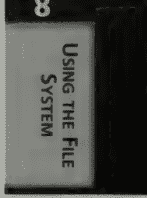


系统中的其他人可能也有一个名为 `novel` 的主目录。也许其中甚至包含一个名为 `chapter_1` 的文件。在这种情况下，使用相对文件名 `novel/chapter_1` 无法区分这两个文件。然而，绝对文件名*将会*不同——例如，`/home/fido/novel/chapter_1` 与 `/home/mary/novel/chapter_1`。`/home/fido` 中的 `novel` 子目录*并不*是 `/home/mary` 中 `novel` 目录的一部分！这两者位于完全不同的位置，只是碰巧拥有相同的名称。这两个文件的内容也完全不同。

## 前往各处：`cd` 命令

`cd`（change directory，改变目录）命令允许你更改当前工作目录。你可以将其想象为移动到另一个目录。如果你曾使用过 DOS 或 Windows 中的 DOS 提示符，你以前见过这个命令（是的，它是从 UNIX 那里“偷”来的！）。

`cd` 命令的语法是：

```
cd <directory>
```

`cd` 和目录说明之间必须有一个空格。你应该只指定要进入的一个目录名称。目录说明可以是绝对的，也可以是相对的。例如，输入 `cd ..`，然后输入 `pwd`：

```
darkstar:~$ pwd
/home/fido
darkstar:~$ cd ..
darkstar:/home$ pwd
/home
darkstar:/home$ cd ..
darkstar:/$ pwd
/
darkstar:/$ cd ..
darkstar:/$ pwd
/
```

如前例所示，我们从 `/home/fido` 开始（这是绝对路径名），然后使用 `..` 命令上移一层目录。这使我们在 `/home` 中。再次移动到父目录，我们就在根目录中了。我们无法再比根目录更高，因为根目录没有父目录。在根目录中输入 `cd ..` 只会让你留在根目录。

请注意，Linux 命令提示符通常会显示你当前所在的目录，因此你不必总是输入 `pwd`。（为了清晰起见，我们仍将继续使用 `pwd`。）并非所有 Linux 系统都在 Shell 提示符中显示当前目录，因为系统管理员可能已经为你自定义了提示符。

假设你要进入主目录的一个子目录。我们可以先**cd**回到你的主目录，然后**cd**进入一个名为**book**的子目录：

```
darkstar:/$ cd /home/fido
darkstar:~$ pwd
/home/fido
darkstar:~$ cd book
darkstar:/book$ pwd
/home/fido/book
```

在这种情况下，我们使用**cd**返回**home**（通过**pwd**命令验证），然后告诉 Linux 将子目录**book**设为当前目录。我们知道目录**book**位于主目录之下，因此我们使用相对文件名进入它。我们也可以指定绝对路径名，但这要麻烦得多。为了避免混淆或错误，在使用**cd**命令时，请使用绝对目录名称：

```
darkstar:/$ cd /usr/bin
darkstar:/usr/bin$ pwd
/usr/bin
```

当你输入一个绝对目录名称时，无论从哪里开始，你都会进入该目录。当你输入**cd ..**时，最终到达的位置取决于起始位置。

要查看更改工作目录的效果，请输入**ls**。文件列表长到第一部分会滚出屏幕。**ls**命令向你显示当前目录的内容（一如既往），但此时你的当前目录是 /usr/bin，它包含的文件比主目录多得多。

## 家是最温馨的港湾

这里有一个许多 UNIX 和 Linux 用户都不常使用的手艺。输入**cd**而不带任何目录说明：

```
darkstar:/usr/bin$ cd
darkstar:~$ pwd
/home/fido
```

单独输入**cd**总是让你返回主目录，无论你在哪里输入**cd**。在探索文件系统时，你有时会误入子目录的死胡同。输入**cd**即可快速返回主目录，或输入**cd /**返回根目录。

提示符中的“-”是另一个特殊字符。它代表你的主目录。当**cd**一样有效且更容易输入时，没有理由输入**cd -**。单独的波浪号（“~”）表示你自己的主目录。

Linux 还使用 ~ 符号表示用户目录的父目录。当你输入 `cd ~<user>` 时，你将移动到该用户的主目录。这是一个非常有用的技巧，特别是在具有许多用户且目录结构比简单的 `/home/<user>` 更复杂的大型系统上。

当你要切换到较远的目录时，分几步走通常是个好主意。如果你拼写错误一个非常长的目录说明，你将不得不重新输入整个说明。有时甚至不清楚 `cd` 为什么会报错！采取较短的多个步骤意味着出错时重新输入的内容更少。考虑这个例子：

```
darkstar:~$ cd /usr/docs/faq/unix
bash: /usr/docs/faq/unix: No such file or directory
```

你相当确信这个路径是正确的。让我们一步一步地更改目录：

```
darkstar:~$ cd /usr
darkstar:/usr$ cd docs
bash: docs: No such file or directory
```

**docs** 有问题。该目录的实际名称是 **doc**：

```
darkstar:/usr$ ls
bin/  doc/  games/  info/  man/  sbin/  spool/
darkstar:/usr$ cd doc
darkstar:/usr/doc$ cd faq/unix
darkstar:/usr/doc/faq/unix$ pwd
/usr/doc/faq/unix
```

# 创建和删除文件

Linux 有很多创建和删除文件的方法。事实上，其中一些方法如此简单，以至于你必须小心，以免意外覆盖或删除文件！

> ### **警告**
>
> 请仔细查看以下章节。你应该以“普通”用户名登录，*而不是以 root 身份*！只有在你绝对确定自己完全理解这些章节时，才应以 *root* 身份登录使用这些命令。
>
> Linux 中没有“撤消删除”命令！请确保你知道自己在做什么！

输入**cd**返回你的主目录。运行**pwd**确保你位于 /home/<user> 目录中。

在上一章中，你通过输入**ls -l /bin > output**创建了一个文件。记住，> 符号意味着“将所有输出重定向到以下文件名。”请注意，在你输入此命令之前，文件**output**并不存在。当你重定向到文件时，如果文件尚不存在，Linux 会自动创建该文件。

如果你想向文件中输入文本，而不是某个命令的输出怎么办？快速且粗略的方法是**cat**命令。

## cat：那只有用的猫

**cat** 命令是 Linux 中最简单却最有用的命令之一。（它肯定比任何活着的猫都要能干！）**cat** 命令基本上接受所有输入并将其输出到文件或屏幕等其他源。默认情况下，**cat** 从键盘获取输入，并将其输出到屏幕。在命令提示符中输入**cat**：

```
darkstar:~$ cat
```

光标移动到下一行，但似乎没有其他事情发生。现在 **cat** 正在等待一些输入，所以输入几行短文本：

```
hello
hello
what
what
asdf
asdf
```

你输入的任何内容一按 Enter 就会在屏幕上重复显示！

如何退出？在行首输入 ^D（Ctrl+D）。（换句话说，按住 Ctrl 键并按 D。）如果你不在行首，你必须输入两次 ^D。^D 是 Linux 的“文件结束”字符。当 **cat** 等程序遇到 ^D 时，它会假设当前文件已结束，并继续处理下一个文件。在这种情况下，如果在空行上单独输入 ^D，就没有下一个文件可以继续处理，**cat** 将退出。

在这个简单的练习中，**cat** 从键盘接受输入并将其显示在屏幕上。到目前为止，这不是一个很有用的命令，不是吗？幸运的是，**cat** 有更多的灵活性。


## 注意

当你说一个程序“退出”时，你是指它已经运行完毕，并且你回到了 Linux 命令提示符。从你作为用户的角度来看，似乎是“你”退出了程序，这样说起来可能有点奇怪。这种说法源于 UNIX 的早期，是由编写该系统的程序员们创造的。他们是从程序的角度来看待事情的，而不是从用户的角度！

那么，如何使用 **cat** 来创建一个文件呢？很简单！你只需将 **cat** 的输出从屏幕重定向到一个文件：

```
darkstar:~$ cat > newfile
Hello world
Here's some text
```

你可以输入任意多的内容。完成后，单独在一行按下 ^D；你就回到了 Linux 提示符。相反于在屏幕上逐行显示你输入的内容，**cat** 将它们重定向到了名为 **newfile** 的文件中。

现在你想查看 **newfile** 的内容。你可以使用 **more** 或 **less** 命令，但在这里，让我们使用 **cat**。是的，你可以通过提供一个文件名来使用 **cat** 查看文件：

```
darkstar:~$ cat newfile
Hello world
Here's some text
darkstar:~$
```

酷！你还可以使用 `>>` 在文件末尾追加内容。无论使用 **cat** 还是其他任何命令，只要使用 `>>`，输出总是*追加*到指定的文件中。（请注意，^D 字符不会在屏幕上显示。在示例中显示它只是为了清晰起见。）

```
darkstar:~$ cat >> newfile
Some more lines
^D
darkstar:~$ cat newfile
Hello world
Here's some text
Some more lines
darkstar:~$
```

要弄清楚 **cat** 究竟代表什么，让我们创建另一个文件。

```
darkstar:~$ cat > anotherfile
Different text
^D
darkstar:~$
```

现在，尝试一下这个：

```
darkstar:~$ cat newfile anotherfile > thirdfile
darkstar:~$ cat thirdfile
Hello world
Here's some text
Some more lines
Different text
darkstar:~$
```

**cat** 代表 concatenate（连接）：**cat** 接收所有指定的输入，并将它们作为一个整体重新输出。我们将 **newfile** 和 **anotherfile** 连接在一起形成了 **thirdfile**。单凭这一点可能没什么有趣的，但结合 Linux 中可用的各种输入和输出重定向形式，你就拥有了一个强大且实用的工具。

有时你想只修改文件中的一行，或者你正在创建一个庞大而复杂的文件，并不想依赖 **cat**（它不允许你更正错误）。为此，你应该使用 Linux 中可用的编辑程序之一。这些工具在第 16 章《文本编辑器：vi 和 emacs》中有所讨论。

## 创建目录

要创建新目录，请使用 **mkdir** 命令。语法为 `mkdir <name>`，其中 `<name>` 替换为你希望目录的名称。这会在当前目录下创建一个指定名称的子目录：

```
darkstar:~$ ls
anotherfile    newfile    thirdfile
darkstar:~$ mkdir newdir
darkstar:~$ ls
anotherfile    newdir     newfile    thirdfile
```

> **提示**
>
> 如果你使用过 MS-DOS 系统，那么**mkdir**命令对你来说已经很熟悉了。在 MS-DOS 中，你可以将**mkdir**简写为**md**。你可能会认为**md**在 Linux 中也能用，因为毕竟，我们见过的大多数命令名称都非常简洁。然而，Linux 并不识别**md**；它坚持使用完整的**mkdir**。
>
> 如果你经常在 Linux 和 MS-DOS 之间切换，你可能希望在两个系统中都使用**mkdir**。但请注意，你可能会开始将其他 Linux 命令输入到 MS-DOS 中——例如，输入**ls**而不是**dir**！

**mkdir** 命令会在 Linux 的所有文件和目录表（称为 I-node 表）中为该子目录创建一个条目。当 Linux 创建目录名称时，实际上并没有向磁盘驱动器写入任何内容，因为直到你向其中保存文件之前，目录名称没有物理内容。目录被 Linux 用作方便用户的一种机制。

你可以使用相对路径名和绝对路径名与 **mkdir** 一起使用，例如：

```
$ pwd
/usr/tparker/temp
$ ls
$ mkdir book1
$ ls
book1
$ mkdir /usr/tparker/temp/book2
$ ls
book1
book2
```

在第一种情况下，我们使用相对名称在当前目录下创建了一个名为 **book1** 的目录。在第二个示例中，我们使用绝对寻址在同一位置创建 **book2**。我们可以使用更方便的格式。两种方法都达到相同的结果。

## 移动和复制文件

你经常需要移动或复制文件。**mv** 命令用于移动文件（这与重命名相同），而 **cp** 命令用于复制文件。这两个命令的语法相似：

```
mv <source> <destination>
cp <source> <destination>
```

你可以看到，**mv** 和 **cp** 是非常简单的命令。这里有一个示例：

```
darkstar:~$ ls
anotherfile      newdir     newfile    thirdfile
darkstar:~$ mv anotherfile movedfile
darkstar:~$ ls
movedfile      newdir     newfile    thirdfile
darkstar:~$ cp thirdfile xyz
darkstar:~$ ls
movedfile      newdir     newfile    thirdfile    xyz
```

你可以随时使用 **cat**（或 **more** 或 **less**）来验证 **anotherfile** 是否变成了 **movedfile**，以及文件 **xyz** 的内容是否与 **thirdfile** 的内容相同。

如果你从一个目录移动或复制文件到另一个目录，情况可能会变得更令人困惑。这是因为文件的实际名称包括其绝对路径——例如，/home/fido/newfile。然而，Linux 允许你省略文件名称的一部分，因为引用 **newfile** 比 /home/fido/newfile 更方便。

例如，假设你想将 **newfile** 从当前目录移动到 **newdir** 子目录中。如果你希望文件保持相同的名称，你可以输入：

```
darkstar:~$ mv newfile newdir/newfile
```

然而，更常见的是输入：

```
darkstar:~$ mv newfile newdir
```

主要是因为这样更短一些。在这种情况下，由于你输入了目录名称作为目标，Linux 假设你想将文件放置到指定的目录中，并保持与现有文件相同的名称。

你还可以使用 **cd** 更改到你要移动文件的目录：

```
darkstar:~$ cd newdir
darkstar:~newdir$ cp ../newfile .
```

这个示例比前两个稍微不那么直观。你指定源为 `../newfile`，这意味着“当前目录的父目录中的文件 **newfile**”。目标简单地指定为 `.`，这是“当前目录”的简写。换句话说，你正在告诉 **mv** “向上提升一级，抓取 **newfile**，并将其移动到此处”。由于这不太直观，你可能会发现自己自动地将文件从当前目录推送到另一个目录，而不是将另一个目录中的文件拉取到当前目录。

你还可以通过指定所需的新名称，在移动或复制文件到另一个目录时更改文件的名称。以下只是可能的方法之一：

```
darkstar:~$ cp newfile newdir/anothername
```

这会在目录 **newdir** 中创建 **newfile** 的副本，并将复制的文件命名为 **anothername**。

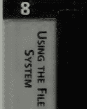

# 警告

在目录之间移动或复制文件时，应始终仔细检查文件的目标目录是否存在，并验证目录的名称。否则，你的命令结果可能会出乎意料，如下面的两个例子所示。

在刚才展示的示例中，假设你将 `newdir` 错误输入为 `newdir`。那么，由于 `newdir` 是一个目录，`mv` 命令会将文件 `newfile` 移动到 `newdir` 中。然而，如果你输入了 `mv newfile m`，如果存在名为 `m` 的目录，它会将 `newfile` 移动到该目录中；如果不存在，它会创建一个名为 `m` 的文件，其中包含 `newfile` 的数据。

另一种获得意外结果的情况是，如果你没有意识到目录 `newdir` 已经存在，却输入了 `cp newfile newdir`。在这种情况下，你期望在当前目录中创建一个名为 `newdir` 的相同文件。但实际上，你正在子目录 `newdir` 中创建一个名为 `newfile` 的 `newfile` 副本。

`mv` 命令比 `cp` 命令效率高得多。当你使用 `mv` 时，文件的内容完全不会移动；相反，Linux 会做一个笔记，表明该文件现在位于文件系统目录结构中的其他位置。

当你使用 `cp` 时，你实际上是在制作文件的第二个物理副本并将其放置在磁盘上。这可能更慢（尽管对于小文件，你不会注意到任何差异），并且会对你的电脑造成更多的磨损。当你真正只想移动文件时，不要制作文件的副本！

## 使用通配符进行移动和复制

如果一个目录中有 20 个文件，并且你想将它们复制到另一个目录，逐个使用 `cp` 命令将非常繁琐。幸运的是，你可以使用通配符 `*` 和 `?` 一次复制多个文件。

如果你想移动或复制目录中的所有文件，请使用通配符 `*`：

```
darkstar:~$ cp * /tmp
```

此命令将当前目录中的每个文件复制到目录 `/tmp`。

你可以将 `*` 与其他字符一起使用，以仅匹配某些文件。例如，假设你有一个目录，其中包含文件 `book1`、`book_idea`、`book-chapter-1` 和 `poem.book`。要仅复制前三个文件，你可以输入 `cp book* /tmp`。当你输入 `book*` 时，你是在要求 Linux 匹配所有以 `book` 开头的文件。在这种情况下，`poem.book` 不以 `book` 开头，因此 `book*` 无法匹配它。（请注意，如果你的文件名是 `book.poem`，则 `book*` 会匹配它。）


正如你一开始所见，**mv** 和 **cp** 是非常简单的命令。真正复杂的部分是指定文件！如果这些事情看起来仍然令人困惑，别担心。即使是专家有时也会搞砸“简单”的移动和复制操作。跟随示例，尝试任何你能想到的不同方法。关于如何指定要移动和复制的文件，有着明确的逻辑。熟悉这种逻辑需要一段时间，你可能需要练习一段时间，这些东西才会变得直观。

## 移动目录

要移动目录，请使用 **mv** 命令。语法是 **mv** _<directory>_<destination>_。在下面的示例中，让我们将当前目录中找到的 **newdir** 子目录移动到 _/tmp_ 目录：

```bash
darkstar:~$ mv newdir /tmp
darkstar:~$ cd /tmp
darkstar:/tmp$ ls
newdir
```

目录 **newdir** 现在是 _/tmp_ 的子目录。

当你移动目录时，它所有的文件和子目录都会随之移动。

你可以使用 **mv** 命令在不移动目录的情况下重命名目录。例如，如果你想将目录 **newdir** 重命名为 **olddir** 而不复制它，命令

```bash
mv newdir olddir
```

即可完成该任务。现在 **newdir** 中的所有文件都在 **olddir** 之下。

## 删除文件和目录

现在你已经知道如何创建文件和目录，是时候学习如何撤销你的操作了。

要删除（或移除）一个文件，请使用 **rm** 命令（**rm** 是 _remove_ 的非常简洁的拼写）。语法是 **rm** _<filename>_。例如，命令：

```bash
darkstar:~$ rm dead_duck
```

会从你的当前目录中删除文件 **dead_duck**。

```bash
darkstar:~$ rm /tmp/dead_duck
```

会从 _/tmp_ 目录中删除文件 **dead_duck**。

你可以使用通配符配合 **rm** 命令，就像在所有其他 Linux 命令中一样。如果你在不正确的位置输入该命令，这可能会给你带来很多麻烦。

例如，命令
`darkstar:~$ rm *`
会从你的当前目录中删除所有文件。没有撤销删除文件的方法，因此如果你意外输入了此命令，那就倒霉了。故事的寓意是，在使用 `rm` 命令配合通配符时要非常小心！

你可以将通配符和目录路径组合使用。例如，命令
`darkstar:~$ rm /tmp/*duck`
会从 /tmp 目录中删除所有以 **duck** 结尾的文件。

一旦文件被删除，它就*消失了！*在删除文件之前，务必考虑清楚你要做什么。你可以使用以下选项之一，以避免在使用通配符时遇到麻烦：

-   使用与 `rm` 命令相同的文件规范运行 `ls`。例如：
    ```text
    darkstar:~$ ls *duck
    dead_duck    guiduck    lame-duck
    :~$ rm *duck
    ```
    在这种情况下，*你* *认为*你想删除所有匹配 `*duck` 的文件。为了验证情况确实如此，列出了所有 `*duck` 文件（通配符在所有命令中工作方式相同）。列表看起来没问题，所以你继续删除了这些文件。

-   使用 `i`（交互）选项配合 `rm`：
    ```text
    darkstar:~$ rm -i *duck
    rm: remove 'dead_duck'? y
    rm: remove 'guiduck'? n
    rm: remove 'lame-duck'? y
    darkstar:~$
    ```
    当你使用 `rm -i` 时，命令会逐一遍历要删除的文件列表，提示你确认是否删除该文件。如果你输入 `y` 或 `Y`，`rm` 会删除该文件。如果你输入任何其他字符，`rm` 则不会删除它。使用这种交互模式的唯一缺点是，当要删除的文件列表很长时，它会非常繁琐。

## 删除目录

rm 命令主要作用于文件。如果你尝试用 rm 删除目录，会显示一条错误信息。通常用于删除（移除）目录的命令是 rmdir。语法是 rmdir <directory>。

在删除目录之前，它必须是空的（目录中不能包含任何文件或子目录）。否则，你会看到

```text
rmdir: <directory>: Directory not empty
```

这是你在 Linux 中能看到的接近安全特性的功能！

下面这个例子可能会让你困惑：

```bash
darkstar:/home$ ls
zippy/
darkstar:~/home$ ls zippy
core kazoo stuff
darkstar:~/home$ rm zippy/*
darkstar:~/home$ ls zippy
darkstar:~/home$ rmdir zippy
rmdir: zippy: Directory not empty
darkstar:~/home$
```

出现“Directory not empty”（目录非空）信息的原因是，以 . 开头的文件通常是特殊的系统文件，通常对用户隐藏。要列出以 . 开头的文件，你必须使用 `ls -a`。要删除这些文件，请使用 `rm .*`：

```bash
darkstar:~/home$ ls -a zippy
/ ... .bashrc .profile
darkstar:~/home$ rm zippy/*
rm: cannot remove '...' or '...'
darkstar:~/home$ ls -a zippy
/ ...
darkstar:~/home$ rmdir zippy
darkstar:~/home$ ls
darkstar:~/home$
```

在系统管理员角色中，你最常遇到这种情况。

有时你想要删除一个包含多层子目录的目录。逐一清空并删除所有子目录非常繁琐。Linux 提供了一种方法，可以轻而易举地一步删除目录及其包含的所有文件和子目录。这就是 rm 命令的 r（递归）选项。语法是 rm -r <directory>。目录及其所有内容将被移除。

> **警告**
>
> 只有在绝对必要时才使用 `rm -r`。借用一句老话：“这只是一个捷径，直到你犯错误为止。”例如，如果你以 root 身份登录，以下命令会删除硬盘上的所有文件，然后就是“你好，安装程序”的时候了（不要输入以下命令！）：
> `rm -r /`
>
> 相信与否，人们经常这样做。别加入这个俱乐部！

# 对压缩的恐惧：无压缩文件

大多数 Linux 文件都以压缩形式存储在安装 CD-ROM 上。这允许存储更多信息。如果你使用 DOS 或 Windows，你可能已经看到过将文件压缩到较大库中的实用工具。诸如 PKZIP 和 WINZIP 之类的实用工具在这些操作系统中非常流行。UNIX 几十年来一直使用相同类型的技术，只是使用了不同的名称和压缩技术。

安装 Linux 时，安装程序会解压缩许多传输到硬盘上的文件。但是，如果你仔细查看，你会发现压缩文件！

任何以 .gz 结尾的文件——例如，squashed.gz——都是压缩文件。要解压缩这种类型的文件，输入 `gunzip <file>`。对于这个示例，输入 `gunzip squashed.gz`。gunzip 程序会创建一个未压缩的文件，并移除 .gz 扩展名。因此，你最终会得到一个名为 squashed 的普通文件。要压缩文件，请使用 `gzip` 命令。输入 `gzip squashed` 会压缩 squashed 并将其重命名为 squashed.gz。

你可能看到的另一种压缩文件以扩展名 .zip 结尾。使用 `unzip` 来解压缩这些文件。要创建此类型的文件，请使用 `zip`。

Linux 还有另外两种压缩系统。这些系统提供以 .Z 或 .z 结尾的压缩文件（这两者不是由同一个压缩工具产生的）。

## Linux 文件系统中的重要目录

存放 Linux 系统文件的大多数目录都是“标准的”。其他 UNIX 系统会有相同的目录，内容相似。本节总结了你的 Linux 系统中一些更重要的目录。

## /

这是根目录。它包含实际的 Linux 程序，以及子目录。不要用你的文件弄乱这个目录！

## /home

这个目录存放用户的家庭目录。在其他 UNIX 系统中，这可能是 /usr 或 /u 目录。

## /bin

这个目录存放许多基本的 Linux 程序。bin 代表二进制文件（binaries），这些是可执行的、仅计算机能理解的文件，而不包含文本。

## /usr

这个目录存放许多面向用户的其他目录。下面几节描述了其中一些最重要的目录。/usr 中找到的其他目录包括：

-   **docs**：各种文档，包括有用的 Linux 信息
-   **man**：通过输入 `man <command>` 访问的手册页
-   **games**：有趣的东西！

## /usr/bin

这个目录存放面向用户的 Linux 程序。

## /usr/spool

这个目录有几个子目录。mail 存放邮件文件，spool 存放待打印的文件，uucp 存放 Linux 机器之间复制的文件。

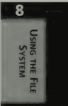


## /dev

Linux 将一切视为文件！`/dev` 目录中包含设备。这些是特殊的文件，充当访问物理计算机组件的网关。例如，如果你向 `/dev/fd0` 复制数据，实际上你是在向系统的软盘驱动器发送数据。你的终端是 `/dev/tty` 文件之一。硬盘上的分区形式为 `/dev/hd0`。甚至系统内存也是一个设备！

有一个著名的设备是 `/dev/null`。这有时被称为“无底洞”（bit bucket）。发送到 `/dev/null` 的所有信息都会消失——就像被扔进了垃圾桶。

## /usr/sbin

该目录包含系统管理文件。你必须以 root 用户身份才能运行其中大多数命令。

## /sbin

该目录包含通常由 Linux 系统自动运行的系统文件。

## /etc

该目录及其子目录包含许多 Linux 配置文件。这些文件通常是文本文件，可以编辑它们来更改系统配置（前提是你知道自己在做什么！）。

## 总结

现在你应该对 Linux 的操作感觉更自在了。理解和能够导航 Linux 文件系统非常重要，因为 Linux 仅仅由一些以相当标准方式组织的文件组成。

你仍然可能会在某些文件或目录问题上感到困惑。请记住，在线 man 手册页可以协助你。Linux 在创建文件、指定绝对或相对名称以及设置权限方面提供了很大的灵活性。不要害怕进行实验（作为普通用户，在你的主目录中）。完成任务的方式多种多样，这里无法一一列举或详尽描述。不要拘泥于写在纸上的死板配方。你通过尝试来学习！

参阅第 9 章“文件和目录权限”、第 10 章“GNU 项目工具”直至第 13 章“tcsh”，特别是如果你希望使用系统命令文件创建程序或宏，或者想了解有关 Linux shell 中内置用户界面特性的更多信息。第 16 章也包含关于编辑文本文件的非常有用的信息。

当你熟悉 shell 并练习操作文件和目录后，你可以继续本书第三部分“编辑、排版及其他”直至第八部分“高级编程主题”中的高级主题。如果你对其他主题感兴趣，你可以从这里跳转到：

- 第 16 章“文本编辑器：vi 和 emacs”讨论使用 Linux 自带的编辑器。
- 第 22 章“安装和配置 XFree86”讨论配置 X 以便你可以使用 GUI（图形用户界面）。
- 第六部分讨论管理你的 Linux 系统，从第 32 章“系统管理基础”开始。

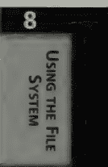

# 第 9 章 文件和目录权限

作者：Tim Parker

## 本章内容

- 文件和目录的所有权 174
- UMASK 设置 179
- 更改文件权限 180
- 更改目录权限 183

如果说有一个主题容易让 UNIX 和 Linux 的新手感到困惑，那就是文件权限。这个主题之所以令人困惑，是因为它很少得到恰当的解释。一旦你理解了其中的原理以及文件权限命令的作用，你就能轻松地掌握这个主题。花点时间仔细学习这部分材料，你会发现它相当清晰且易于理解。

你已经看到，当使用 `ls -l` 命令执行长目录列表时，除了文件名外，还显示了大量信息。例如，查看这个长目录列表：

```
-rwxr-xr-x    2 tparker group        4512 May   9 09:20 book1
-rwxr-xr-x    2 tparker group        5727 May   9 09:20 book
```

此目录列表中有七个数据字段。从左到右依次是：

- 一组权限（稍后会解释）
- 链接数（我们将在另一章中讨论这个问题）
- 拥有该文件的用户 ID（在此例中为 tparker）
- 拥有该文件的组（在此例中为 group）
- 文件的字节大小
- 文件创建日期和时间
- 文件的名称

在本章中，我们将重点讨论文件的权限、所有者和组。

每个 Linux 文件和目录都有所有者和组，以及一组权限。你可以更改文件和目录的权限和所有权，以提供更大或更小的访问权限。文件权限还决定文件是否可以作为命令执行。

## 文件和目录的所有权

当你创建一个文件时，默认情况下你是该文件的所有者，你的登录名会出现在目录列表的第三列中。创建文件时你所在的组会放在第四列中。（我们还没有讨论组，但它们只是一组具有相似组名的用户 ID，以便共同访问文件和目录。）作为文件的所有者，你拥有更改文件权限或所有权的特权。当然，一旦你将所有权更改为另一个用户，你可能就无法再更改所有权或权限了。

## 用户和所有权

文件所有者是在系统安装过程中设置的。Linux 系统文件的所有者 ID 包括 root、uucp 和 bin。不要更改这些文件的所有权，即使你以 root 身份登录。这是因为在 Linux 安装软件时权限设置是正确的，如果你更改它们，可能会阻止系统正常访问该文件。

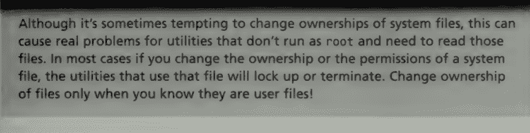

> 虽然有时你会很想更改系统文件的所有权，但这可能会给那些不以 root 身份运行且需要读取这些文件的应用程序造成真正的问题。在大多数情况下，如果你更改系统文件的所有权或权限，使用该文件的应用程序将锁定或终止。只有在你知道它们是用户文件时，才更改文件的所有权！

你可以使用 `chown`（change ownership，更改所有权）命令来更改文件的所有权。`chown` 命令的语法为：

```
chown <owner> <filename>.
```

`owner` 表示插入将拥有该文件的用户 ID 的位置，`filename` 表示你设置所有权的文件名称。你可以使用通配符与 `chown` 命令一起使用，以同时指定多个文件。

在下面的示例中，你将 myfile 的所有权更改为登录名 bill：

```
darkstar:~$ ls -l myfile
-rw-r--r-- 1 fido users 114 Dec 7 14:31 myfile
darkstar:~$ chown bill myfile
darkstar:~$ ls -l myfile
-rw-r--r-- 1 bill users 114 Dec 7 14:31 myfile
```

在你更改文件所有者的登录名之前，Linux 会进行检查以确认该用户存在。在更改文件所有权后，你可能无法对该文件执行其他操作，因此请务必小心。要对文件 myfile 进行任何进一步的更改，或将其 `chown` 回 fido，你必须使用 `su` 或登录为 bill 并使用 `chown` 命令将所有权设置回你。

**注意**

> 虽然 Linux 显示拥有文件和目录的登录名，但它实际上是通过用户 ID 号码（如 101）来跟踪此信息的。Linux 更喜欢数字而不是字符，因为它们更容易操作。

**注意**

> 有可能存在由不存在的用户拥有的文件。这通常发生在系统管理员删除某个用户时。该用户 ID 拥有的所有文件仍然标记有该所有权，因为 Linux 在删除用户时不会扫描文件系统并更改这些名称。对于不存在的文件所有者，通常只有 root 登录用户可以更改所有权。

## 组

文件（和用户）也属于*组*。组通常用于大型安装环境，你可能永远不需要担心它们。但请记住，*组*是一种为多个用户提供文件访问权限的便捷方式，但不是为系统中的每个用户都提供。例如，参与某个特殊项目的用户都可以属于*project*组。整个组使用的文件也将属于*project*组，从而赋予这些用户特殊的访问权限。

组通常用于逻辑用户组。上面的示例使用项目作为分组，但组也可以用于不同的部门、不同类型的用户（管理员、会计、程序员等），或者用于大型网络中的不同位置。

你始终都是一个组的成员。当你登录时，你会被放入你的默认组，该组在 root 创建你的用户账户时设置。你可以属于许多不同的组，但一次只能登录到一个组。要更改你所处的组，请使用 `newgrp` 命令。例如，如果你属于名为*users*的组，也属于名为*programmers*的组，并且你需要切换到*programmers*组，因为他们对编译器有特殊的访问权限，请发出此命令：

```
newgrp programmers
```


Linux 不会告诉你当前所在的用户组。通常，要确定哪个用户组处于活动状态，唯一的方法是保存一个文件，然后查看其权限。如果你尝试使用 `newgrp` 命令切换到一个你不属于的用户组，Linux 会给出如下友好的警告：

```
newgrp programmers
newgrp: Sorry
```

## 更改组所有权

你已经见过如何更改文件的所有权。你可能也希望更改组的所有者。要更改组的所有权，你不必属于该组，但你必须是文件的所有者。在开始之前，Linux 首先会检查该组是否存在。

`chgrp` 命令用于更改文件所属的组。它的工作原理与 `chown` 完全相同：

```
chgrp <group> <filename>
```

例如，要将文件 `book` 的所有权更改为名为 `editors` 的组，请执行以下命令：

```
$ ls book*
-rwxr-xr-x   2 tparker  group    4512 May  9 09:20 book
$ chgrp editors book
$ ls book*
-rwxr-xr-x   2 tparker  editors  4512 May  9 09:20 book
```

你既可以使用 `chown` 也可以使用 `chgrp` 配合通配符，如下例所示：

```
$ ls book*
-rwxr-xr-x   2 tparker  group    4512 May  9 09:20 book1
-rwxr-xr-x   2 tparker  group    4625 May  9 09:21 book2
-rwxr-xr-x   2 tparker  group    7834 May  9 09:22 book3
$ chown bills book*
$ ls book*
-rwxr-xr-x   2 bills  group     4512 May  9 09:20 book1
-rwxr-xr-x   2 bills  group     4625 May  9 09:21 book2
-rwxr-xr-x   2 bills  group     7834 May  9 09:22 book3
$ chgrp editors book*
$ ls book*
-rwxr-xr-x   2 bills  editors   4512 May  9 09:20 book1
-rwxr-xr-x   2 bills  editors   4625 May  9 09:21 book2
-rwxr-xr-x   2 bills  editors   7834 May  9 09:22 book3
```

请注意，`chgrp` 和 `chown` 命令不会影响文件的任何其他属性，例如创建日期和时间，或第一个字段中的权限。

## 文件权限

从早期开始，UNIX 一直试图建立一套灵活、强大且简单的文件访问权限集，在安全性和便利性之间取得平衡。UNIX（因此也包括 Linux）所采取的方法是简单的。它只设置了三种不同的访问类型（称为权限），你可以对文件或目录拥有这些权限。这些权限是读、写和执行权限。

拥有文件的读权限使您可以查看文件的内容。对于目录而言，读权限允许您使用 `ls` 列出目录的内容。

写权限使您能够修改（或删除）文件，即使您不是该文件的所有者。对于目录而言，您必须拥有写权限才能在该目录中创建、移动或删除文件。

执行权限使您能够通过输入其名称来执行文件。如果文件的内容无法被应用程序理解，则执行权限没有作用。例如，对于一个包含统计数据的文件，拥有执行权限并不能让您运行它。另一方面，如果该文件是一个统计分析程序，则需要执行权限才能运行它。对于目录，执行权限使您可以使用 `cd` 进入其中。

因此，我们有三种权限：读、写和执行。UNIX 根据文件或目录的所有权将系统上的所有用户分为三类。有一组权限（读、写、执行）归所有者所有，另一组权限（读、写、执行）归拥有该文件的组中的任何人使用，还有一组权限（读、写、执行）归系统上的其他人使用（称为 other 或 world）。这三组权限按照一致的格式依次书写。权限始终按读、写、执行的顺序排列；首先是所有者，然后是组，最后是其他人。

这就是指示文件或目录权限的九个位的信息。这些位始终出现在一个由十个字符组成的块中，并且是在长目录列表中所看到的第一部分。第一个字符是特殊的，它指示该条目是文件还是目录（还有其他几个有效值，但我们现在暂且不提）。作为一个具体的例子，让我们再看一下 `myfile` 的长目录列表：

```
-rw-r--r--  1 fidio  users    163 Dec  7 14:31 myfile
```

权限的第一个字符是 `-`，表示这是一个普通文件。如果这是一个目录，第一个字符将是 `d`。接下来的九个字符被分为三组，每组三个字符，分别赋予所有者、组和其他人的权限。每个三位组合依次给出读、写和执行权限，顺序始终如此。读权限由第一位的 `r` 表示，写权限由第二位的 `w` 表示，执行权限由第三位的 `x` 表示。如果缺少某项特定权限，其位置将由 `-` 填充。

对于 `myfile`，所有者拥有 `rw-`，这意味着具有读和写权限。由于没有执行权限，因此在 Linux 提示符下输入 `myfile` 无法执行该文件。组的权限是 `r--`，这意味着 `users` 组的成员可以读取该文件，但不能修改或执行它。同样，所有人的权限也是 `r--`，即只读。

## UMASK 设置

当您创建一个文件（例如通过重定向）时，Linux 如何知道要分配哪些文件权限？答案是，一个名为 UMASK（用户文件创建掩码）的变量包含了您创建的每个文件的指令。系统管理员可以为任何用户或整个系统上的所有用户设置 UMASK 设置。您可以更改自己的 UMASK 设置，但不能更改他人的设置（除非您以 root 身份登录）。

在任何时候，您都可以通过在 shell 提示符下输入命令 `umask`（小写，以区别于环境变量 UMASK）来显示 UMASK 的值：

```
$ umask
022
```

您可能看到四个数字而不是三个，但第一个数字没有意义，因此只需忽略它。这些数字意味着什么？它们是一组八进制数，指示用户、组和其他人的权限。`umask` 命令中有效的数字集如表 9.1 所示。

**表 9.1. UMASK 使用的八进制值及其含义。**

| 八进制数 | 授予的权限 |
| :--- | :--- |
| 0 | 读和写（对于目录还包括执行） |
| 1 | 读和写 |
| 2 | 读（对于目录还包括执行） |
| 3 | 读 |
| 4 | 写（对于目录还包括执行） |
| 5 | 写 |
| 6 | 仅限目录的执行 |
| 7 | 无权限 |

在之前所示的 UMASK 设置 022 中，根据此表，简单的翻译是：用户具有读和写权限（对于目录还包括执行），而组和其他人具有只读权限（对于目录还包括执行）。这对应于以下目录块：

```
rw-r--r--
```

关于目录执行的列显示，如果您使用此 UMASK 设置创建目录，权限将包括执行权限（这允许使用 `cd` 更改到该目录）。使用这组 umask 值创建的目录的权限块将如下所示：

```
rwxr-xr-x
```

请注意，使用文件创建掩码自动为文件分配执行权限的方法是行不通的。这是有意为之的，以便您作为系统管理员必须手动为文件设置执行权限。

要更改您的 UMASK 设置，请指定您想要使用的三个新值。例如，设置 077 移除了组和所有人的所有权限：

```
$ umask
0022
$ who > file1
$ ls -1
total 2
-rw-r--r--   1 tparker group    37 May  9 11:18 file1
$ umask 077
$ who > file2
$ ls -1
total 4
-rw-r--r--   1 tparker group    37 May  9 11:18 file1
-rw-------   1 tparker group    37 May  9 11:18 file2
```

请注意，`file2` 的权限设置不授予组中的成员或系统上的其他用户任何访问权限。只有所有者可以访问此文件。您的 UMASK 设置在您注销之前一直有效。

## 更改文件权限

在一段时间内，您可能对文件的默认权限感到满意。但最终，您会想要更改它们，例如为您拥有的程序添加执行权限（以便您可以运行它），或允许其他人获得更好或更受限的访问权限。要更改文件权限，UNIX 使用 `chmod`（更改文件模式）命令。


## chmod 命令的语法

`chmod` 命令的语法为 `chmod <specification> file`。

编写权限规格有两种方式。一种是使用权限的数字编码系统（称为*绝对设置*），另一种是使用字母（称为*符号设置*）。后者更容易理解，因此我们从它开始讲起。

使用权限的符号设置时，你需要从 u（用户）、g（组）、o（其他）或 a（所有）这四个可能的集合中指定要更改哪些权限。你也可以将这些字母进行任意组合，以仅更改组和其他权限，而保持用户权限不变。在这组字母之后，用 + 添加权限，或用 - 移除权限。接着是代表要添加或移除的权限，这些权限由字母 r（读）、w（写）或 x（执行）表示，也可以是这三个字母的任意组合。

这种方法的通用语法如下：

```bash
chmod [u|g|o][+|-][r|w|x] filename
```

命令中符号权限部分的三个部分之间没有空格，但 `chmod` 之后和文件名之前必须有一个空格。通过几个例子可以更清楚地说明这一点。要为组和其他人添加执行权限，请输入：

```bash
chmod go+x myfile
```

要从用户、组和其他人中移除读和写权限，请使用以下命令之一：

```bash
chmod ugo-rw filename
chmod a-rw filename
```

关于更改这些权限，有几点重要说明：并非所有系统都支持用 `a` 表示所有人。如果不支持，你就必须指定 `ugo`，如前一个例子所示。你可以在命令行中指定任意数量的文件，方法是逐一列出并用空格分隔，或使用通配符。最后，当你使用此方法更改权限时，无论命令执行前权限是开启还是关闭状态，因为 `chmod` 命令会覆盖这些权限。但是，如果你没有指定某组特定的权限（用户、组或其他），那么这些权限将保持不变。例如，查看以下命令：

```bash
$ ls -l
total 4
-rwxrw-rw-  1 tparker group      37 May  9 11:18 file1
-rw-------  1 tparker group      37 May  9 11:18 file2
$ chmod go-rw file*
$ ls -l
total 4
-rwx--x--x    1 tparker    group        37 May  9 11:18 file1
-rw-------     1 tparker    group        37 May  9 11:18 file2
```

`chmod` 命令按要求更改了 `file1` 的权限，而保留了用户权限不变。由于 `file2` 最初没有读或写权限，因此该命令完全没有改变其权限。然而，命令确实正常运行了。

# 注意

任何有文件读取权限的人都可以复制该文件。当文件被复制时，副本的所有者是执行复制操作的人。他或她随后可以更改所有权和权限、编辑文件等。

# 警告

不要假设没有写权限就意味着文件是安全的！移除文件的写权限并不能防止该文件被删除。它只是能防止文件被意外删除，因为 Linux 会询问你是否要覆盖文件权限。你必须回答 `y`，否则文件不会被删除。

更改权限的另一种方法是使用绝对设置。在这种方法中，你确切指定用户、组和其他权限应设置为何种状态。这是通过一组八进制数字来实现的，奇怪的是，这些数字与你之前看到的 `umask` 命令中的那些数字正好相反。允许的值为：

- 0 或 `---`：无权限
- 1 或 `--x`：执行
- 2 或 `-w-`：仅写
- 3 或 `-wx`：写和执行
- 4 或 `r--`：仅读
- 5 或 `r-x`：读和执行
- 6 或 `rw-`：读和写
- 7 或 `rwx`：读、写和执行

你必须指定用户、组和其他权限分别对应这八个数字中的哪一个。例如，要将文件设置为默认权限：用户为读写，组和其他人为只读，请使用设置 644。以下是使用八进制绝对设置配合 `chmod` 的几个例子：

```bash
darkstar:-$ ls -l myfile
-rw-r--r--     1 fido     users       114 Dec   7 14:31 myfile
darkstar:-$ chmod 345 myfile
darkstar:-$ ls -l myfile
--wrx--r-x     1 fido     users       114 Dec   7 14:31 myfile
darkstar:-$ chmod 701 myfile
darkstar:-$ ls -l myfile
-rwx-----x     1 root     users       114 Dec   7 14:31 myfile
```

使用八进制数字的这种方法的优点在于，它是以绝对而非相对的方式指定权限。此外，告诉别人“将文件权限更改为 755”比说“将文件权限更改为读写执行、读执行、读执行”要容易得多。

八进制寻址的主要问题是，除非你经常使用，否则很难记住所有的组合。而且，如果你只是想添加单个权限，例如用户的执行权限或组的写权限，你仍然必须计算出所有数值，而不是使用更简单的符号表示法。

你在 `chmod` 中使用哪种方法，往往取决于你对 Linux 的使用经验。随着你对系统的使用增多，你会发现你开始更频繁地使用八进制寻址，但在进行简单更改时，偶尔还是会回退到使用符号法。

## 更改目录权限

你使用 `chmod` 更改目录权限的方式与更改文件权限的方式完全相同。Linux 将目录与文件完全等同对待，因此这种方法是合理的。请记住，如果目录没有执行权限，你就无法 `cd` 进入该目录，因此给予或移除目录的执行权限对用户可能有重要影响。

> 任何在目录中具有写权限的用户都可以删除该目录中的文件，无论该用户是否拥有这些文件或对这些文件拥有写权限。
>
> 因此，大多数目录的权限都设置为 `drwxr-xr-x`。这确保只有目录的所有者才能在该目录中创建或删除文件。
>
> 给所有用户授予目录的写权限尤其危险！

# 警告

你可以使用八进制或符号模式更改目录权限，如以下例子所示：

```bash
$ mkdir bigdir
$ ls -l
total 2
drwxr-xr-x 2 tparker group 512 May 9 12:10 bigdir
$ chmod go+w bigdir
$ ls -l
total 2
drwxrwxrwx 2 tparker group 512 May 9 12:10 bigdir
$ chmod 755 bigdir
$ ls -l
total 2
drwxr-xr-x 2 tparker group 512 May 9 12:10 bigdir
```

使用你觉得最方便的方法即可。

> **提示**
>
> 如果你熟悉二进制系统，可以将 `rwx` 视为一个三位二进制数，以便更容易计算绝对寻址值。如果允许权限，对应的位为 1。如果拒绝权限，该位为 0。因此 `r-x` 即为二进制数 101，即 4+0+1，也就是 5。`--x` 则为 001，即 0+0+1，也就是 1，等等。

## 本章小结

现在，你应该对更改文件和目录的权限以及所有者和组变得更加得心应手了。正如我们在本章开头提到的，这是让大多数 Linux 用户感到困惑的主题；我们希望通过缓慢的讲解，你能够掌握这些命令背后的理念。你现在可以继续阅读接下来的几章，这些章节将更详细地介绍 Shell 和 Shell 实用程序。更多信息，请参见以下章节：

- * 鲍恩再次壳（Bourne Again Shell，你的 Linux 默认接口）在第 11 章“bash”中进行了讨论。
- 用于扩展接口功能的外置 Shell 编程命令在第 14 章“Shell 编程”中进行了探讨。
- 用于创建文件的文本编辑器在第 16 章“文本编辑器：vi 和 emacs”中进行了描述。
- X 接口在第 22 章“安装和配置 XFree86”中进行了讨论。

# GNU 项目实用程序

**作者：彼得·麦金农（Peter MacKinnon）**

## 本章内容

- 当前可用的 GNU 软件 186

由自由软件基金会（FSF）管理的 GNU 项目，旨在提供形式为源代码的软件，任何想要使用的人都可以自由获取。该项目有一份冗长的宣言，解释了这一自由主义事业背后的动机（我们都应该对此表示感谢，因为 GNU 拥有一些市面上最好的软件！）。该宣言中的一个关键理念是，高质量软件是与生俱来的人类权利，就像我们呼吸的空气一样。虽然 GNU 软件是免费分发的，但它不属于公共领域，并受 GNU 通用公共许可证的保护。该许可证的主要目的是保持 GNU 软件处于自由状态。

有关 FSF 的更多信息，你可以写信至：

自由软件基金会  
675 Massachusetts Avenue  
Cambridge, MA 02139

你还可以通过向 gnu@prep.ai.mit.edu 发送电子邮件来索取 GNU *简报* 的副本。

本书 CD-ROM 上分发的 Linux 版本包含了几乎所有当前可用的 GNU 程序。它们使用 `tar` 程序进行归档，并使用 GNU `gzip` 实用程序进行压缩。`gzip` 通常比标准的 UNIX 压缩实用程序 `compress` 压缩效果更好。使用 `gzip` 压缩的文件以 .gz 后缀结尾，而 `compress` 压缩的文件以 .Z 结尾。然而，`gzip` 也可以解压 `compress` 压缩的文件及其自身压缩的文件。

这些压缩文件中的每一个都在其文件名中包含了版本号，以便你可以确定哪个版本是最新的。在解压缩并解除 GNU 文件的 tar 归档后，可以在你的系统上编译和安装该程序。大多数文件都附带了自己的 `makefile`。大多数程序都是标准 Linux 实用程序（如 `make` 和 `bc`）的改进版。

## 当前可用的 GNU 软件

通过自由软件基金会开发或提供的软件数量如此之多，以至于无法详细描述每个程序。以下部分简要介绍了随此 Linux 分发版本一起包含的 GNU 实用程序和程序。这些摘要是基于 GNU 提供的程序描述。


acm

acm 是一款专为 X 窗口系统设计的多人空中战斗游戏，可在局域网环境中运行。玩家使用导弹和大炮进行模拟的空对空战斗。

Autoconf

Autoconf 可以生成 shell 脚本，用于自动配置源代码包（例如 GNU 的包）。Autoconf 根据列出软件包可利用的操作系统特性的文件，为软件包创建脚本。Autoconf 需要 GNU m4 来生成运行所需的宏调用。

bash

名为 **bash** 的 shell 是 Bourne shell 的增强版（因此得名，即 Bourne Again Shell，意为“再次使用 Bourne”）。它提供了 **csh** 和 **ksh** 中常见的许多扩展功能。**bash** shell 还具有作业控制、csh 风格的命令历史记录，以及内置的 **Emacs** 和 **vi** 模式的命令行编辑功能。参见第 11 章，“**bash**”。

bc

bc 是一种代数语言，可通过 shell 命令行交互使用，也可通过输入文件使用。GNU bc 具有类似 C 语言的语法，并包含多项扩展，包括多字符变量名、else 语句以及完整的布尔表达式。与标准 bc 不同，GNU bc 不需要独立的 dc 程序，dc 是另一个 GNU 计算器工具。

BFD

*Binary File Descriptor*（二进制文件描述符，BFD）库允许操作目标文件的程序（如 *ld* 或 *gdb*）高效地支持多种不同格式。BFD 提供可移植的接口，因此只有 BFD 需要了解特定格式的细节。其中一个结果是，所有使用 BFD 的程序都支持诸如 *a.out*（默认 C 可执行文件）和 COFF 等格式。

Binutils

Binutils 包含一组开发程序，包括 ar、c++filt、demangle、gprof、ld、nlmconv、objcopy、objdump、ranlib、size、strings 和 strip。

Binutils 2 版本完全重写，以使用 BFD 库。GNU 链接器 ld 会为多重定义的符号和未定义的引用发出带源代码行号的错误消息。nlmconv 将目标文件转换为 Novell NetWare 可加载模块（NLM）。objdump 程序可以显示 BFD 理解的任意文件格式中的数据（如符号）。

Bison

Bison 是解析器生成器 yacc 的向上兼容替代方案。Bison 接收以文法形式描述的标记描述，并生成以 C 程序形式呈现的解析器。

GNU C Compiler

GNU C 编译器（gcc）2 版本支持三种语言：C、C++ 和 Objective-C。所选语言取决于源文件后缀或编译器选项。Objective-C 程序所需的运行时支持现在随 gcc 分发。GNU C 编译器是一款支持完整 ANSI C、传统 C 和 GNU C 扩展的可移植优化编译器。GNU C 已扩展以支持诸如嵌套函数和非局部 goto 语句等功能。此外，gcc 可以生成多种格式的目标文件和调试信息。有关 C 语言支持的更详细信息，请参见第 27 章，“C 语言编程”。

GNU C Library

GNU C 库支持 ANSI C 并添加了一些自己的扩展。例如，GNU stdio 库允许你定义新类型的流以及自己的 printf 格式。

GNU C++ Library

GNU C++ 库（libg++）是一个庞大的 C++ 类集合，一个新的用于输入/输出例程的 iostream 库，以及用于配合 g++ 使用的支持工具。支持的类包括多精度整数和有理数、复数以及任意长度的字符串。也存在原型文件，用于生成常见的容器类。

Calc

Calc 是一种在 GNU Emacs 内使用的电子计算器和数学工具。Calc 可以用作基本计算器，但提供了额外的功能，包括选择代数或逆波兰表示法（RPN）、对数函数、三角函数和金融函数、复数、向量、矩阵、日期、时间、无穷大、集合、代数简化、微分和积分。

GNU Chess

GNU Chess 让你与计算机进行完整的国际象棋比赛。它具有常规终端、curses（一种用于 C 的全屏幕接口库）和 X 终端接口。GNU Chess 实现了许多专业功能，包括复杂的启发式方法，这将挑战你最好的 Bobby Fischer 棋步。

CLISP

CLISP 是 Common Lisp 的一种实现，Common Lisp 是一种在人工智能应用中广泛使用的列表处理语言。CLISP 包含一个解释器和一个字节码编译器，并提供英语和德语用户界面，可在编译时选择。

GNU Common Lisp

GNU Common Lisp（gcl）具有针对 Common Lisp 的编译器和解释器。它具有高度可移植性、极高的效率，并拥有针对解释代码的源代码级 Lisp 调试器。gcl 还具有剖析工具和 X11b 接口。

cpio

cpio 是一个用于将文件归档复制到磁带或磁盘（或从磁带/磁盘复制）的程序。它还可用于将文件复制到更大的归档文件中或其他目录中。

CVS

Concurrent Version System（CVS，并发版本系统）在多线程、多目录、多组环境中管理软件修订和版本控制。它与 RCS 配合使用，RCS 是另一个源代码控制程序。

dc

dc 是一种逆波兰表示法（RPN）计算器，可交互使用或通过输入文件使用。

DejaGnu

DejaGnu 是一个用于编写脚本以测试任何程序的框架。它包括可嵌入的脚本语言 Tc1 及其衍生产品 expect，后者可以运行模拟用户输入的脚本。

Diffutils

Diffutils 软件包包含文件比较程序 diff、diff3、sdiff 和 cmp。GNU diff 以多种格式显示逐行更改来比较文件，比其传统版本更高效。

ecc

ecc 是一个使用 Reed-Solomon 算法的纠错检查程序。它可以纠正 255 字节块中总共三个字节错误，并可以检测更严重的错误。

ed

ed 是标准的基于行的文本编辑器。

Elisp

这是一个小型的 Emacs Lisp 函数库，包括使用双向链表的例程。

GNU Emacs

GNU Emacs 是由 Richard Stallman 开发的这个极受欢迎的编辑器的第二种实现。它集成了 Lisp 以编写扩展，并提供对 X 的接口。除了其自身强大的命令集外，Emacs 还具有模拟其他流行编辑器（如 vi 和 EDT（DEC 的 VMS 编辑器）的扩展。有关 Emacs 的更多信息，请参见第 16 章，“文本编辑器：vi 和 emacs”。

GNU Emacs 19

Emacs 19 是 Emacs 编辑器的一个更丰富版本，对 X 窗口系统有广泛支持。它包括对 X 资源管理器的接口，支持 X 工具包，具有良好的 RCS 支持，并包含许多更新的库。来自 FSF 的 Emacs 19 在基于字符的终端上和 X 环境下表现同样出色。

es

es 是一个基于 rc 的 shell，具有异常系统，并支持返回除数字以外值的函数。它既适用于交互式操作，也适用于脚本，特别是因为其引号规则比 C 和 Bourne shell 更简单。

Fileutils

Fileutils 是一组标准的（及不那么标准的）GNU Linux 文件工具集，包括 chgrp、chmod、chown、cp、dd、df、dir、du、install、ln、ls、mkdir、mkfifo、mknode、mv、rmdir、touch 和 vdir。

find

find 是一个程序，可交互或在 shell 脚本中使用，根据特定条件查找文件，然后对其执行操作（如 rm）。此程序包含 xargs，它将命令应用于文件列表。

finger

finger 显示一个或多个 Linux 用户的信息。GNU finger 支持充当指代服务器主机的单个主机，适用于具有多个主机的站点。此主机收集有关谁登录到该站点其他主机的信息。因此，对其他站点任何机器的查询都会返回有关该站点任何用户的完整信息。以下是一些 finger 命令的示例输出：

```
# finger tparker@tpci.com
Login: tparker			Name: Tim Parker
Directory: /usr/tparker		Shell: /bin/sh
On since Sat Jun  6 11:33 on tty02, idle 51 days 21:22 (messages off)
On since Sun Jun  7 15:42 on ttyP0, idle 0:02
On since Sat Jun  6 11:33 on ttyP1, idle 21 days 10:01
Mail last read Tue Jun 16 18:38:48 1998
```


如您所见，这个版本的 `finger`（输出会根据操作系统和版本略有不同）显示了 `/etc/passwd` 的详细信息（登录名、注释行、主目录和 shell）以及一些会话信息。

## flex

flex 是 lex 扫描器生成器的替代品。flex 程序生成的扫描器比 lex 更高效。flex 程序还有一个优势，即它生成的是 C 代码。扫描器用于从输入中识别令牌。

## Fontutils

Fontutils 为使用 Ghostscript 或 TeX 创建字体。它还包含通用转换程序和其他实用工具。Fontutils 中的部分程序包括 bpltohzr、bzrto、chspace、fontconvert、gsrenderfont、imageto、imgrotate、limn 和 xbfe。

## gas

gas 是 GNU 汇编器，它将汇编代码转换为目标文件。原生汇编适用于许多系统，包括 Linux。

## gawk

gawk 与 awk 程序向上兼容，后者使用模式匹配来修改文件。它还提供了其他 awk 实现（awk、nawk）中未发现的几种有用扩展，例如用于转换匹配字符串大小写的函数。有关更详细的信息，请参阅第 25 章“gawk”。

## gdb

gdb 是一个具有命令行用户界面的调试器。使用 BFD 库读取目标文件和符号表，这使得单个副本的 gdb 能够调试多种目标文件格式的程序。其他新功能包括命令语言改进、通过串行线路或 TCP/IP 进行的远程调试，以及观察点（当表达式的值发生变化时触发的断点）。还提供了一个名为 xxgdb 的 gdb X 版本。

## gdbm

gdbm 库是传统 dbm 和 ndbm 数据库库的 GNU 替代品。它使用基于哈希表的查找来实现数据库。

## Ghostscript

Ghostscript 是 GNU 的 PostScript 兼容图形语言。它接受 PostScript 命令，并通过直接写入打印机、在 X 窗口中绘制或写入您稍后可以打印的文件（或您可以使用其他图形程序编辑的位图文件）来执行这些命令。

Ghostscript 包含一个可以从 C 调用的图形库。这使得客户端程序无需了解 PostScript 语言即可使用 Ghostscript 的功能。有关更多信息，请查阅第 24 章“Ghostscript”。

## Ghostview

Ghostview 用作基于 X 的多页文件预览器，这些文件由 Ghostscript 解释。

## gmp

GNU mp（gmp）是一个用于有符号整数和理数任意精度算术运算的广泛库。

## GNats

GNU 问题追踪系统（GNats）是一个问题报告系统。它采用中心站点或组织接收问题报告并通过电子邮件管理其解决的模型。尽管它主要用作软件缺陷追踪系统，但也可用于处理系统管理问题、项目管理以及多种其他应用。

## GNU Graphics

GNU Graphics 是一组从 ASCII 或二进制数据生成图表的程序。它支持输出到 PostScript 和 X 窗口系统，包含使用 graph 和 plot 的 shell 脚本示例，并具有统计工具包。

## GNU Shogi

将棋（Shogi）是一种类似于国际象棋的日本游戏，区别在于被吃掉的棋子可以重新投入游戏。GNU Shogi 基于 GNU Chess 的实现；它实现了相同的功能并使用类似的启发式方法。作为一个新特性，可以引入部分棋盘模式序列，以帮助程序朝着特定的开局模式玩好步数顺序。它既有字符界面也有 X 显示界面。

## gnuplot

gnuplot 是一个用于绘制数学表达式和数据的交互式程序。它处理曲线（二维）和曲面（三维）。

## Gnugo

Gnugo 玩围棋（也称为 Wei-Chi）。

## gperf

gperf 是一个用于生成“完美”哈希表的实用工具。有针对 C 和 C++ 的 gperf 实现，可为这两种语言生成哈希函数。

## grep

此软件包包含 GNU grep、egrep 和 fgrep。这些用于在文件中搜索正则表达式的实用工具，其执行速度比传统对应工具快得多。

## Groff

Groff 是一个文档格式化系统，包含 PostScript 驱动程序、TeX dvi 格式，以及 eqn、nroff、pic、refer、tbl、troff 以及 man、ms 和 mm 宏的实现。这些程序用 C++ 编写，可以使用 GNU C++ 2.5 版本或更高版本进行编译。

## gzip

gzip 可以解压缩 LZW 压缩文件，但使用一种不同的压缩算法，通常会产生比传统 compress 程序更好的结果。它还可以解压缩使用 pack 程序压缩的文件。

## hp2xx

GNU hp2xx 读取 HPGl 文件，将所有绘图命令分解为基本向量，并将它们转换为多种矢量格式（包括封装 PostScript、Metafont、各种与 TeX 相关的特殊格式以及简化 HPGl）和光栅输出格式（包括 PBM、PCX 和 HP-PCL）。

## indent

GNU *indent* 按照 GNU 编码标准格式化 C 源代码，但可选地也可以使用 BSD 默认格式、K&R 格式以及其他格式。也可以定义您自己的格式。*indent* 可以处理 C++ 注释。

## Ispell

*Ispell* 是一个交互式拼写检查器，建议其他拼写相似的单词作为未识别单词的替换词。*Ispell* 可以使用系统和个人词典，并且也提供独立使用和 GNU Emacs 界面。

## m4

GNU *m4* 是传统 C 宏处理器的一个实现。它具有处理超过九个位置宏参数的扩展功能，包括文件、运行 shell 命令以及执行算术运算。

## make

GNU *make* 为用于管理相关文件之间依赖关系的传统程序添加了扩展。GNU 扩展包括长选项、并行编译、灵活的隐式模式规则、条件执行以及强大的文本处理函数。最近版本改进了错误报告，并添加了对流行的 += 语法的支持，用于向变量定义追加更多文本。有关 *make* 的进一步信息，请参阅第 56 章“源代码控制”。

## mtools

*mtools* 是一组公共领域程序，允许 Linux 系统读取、写入和操作 MS-DOS 文件系统（通常是磁盘）上的文件。

## MULE

*MULE* 是 GNU Emacs 18 的多语言增强功能。它可以同时处理许多字符集，包括日语、中文、韩语、越南语、泰语、希腊语、ISO Latin-1 到 Latin-5 字符集、乌克兰语、俄语以及其他西里尔字母。*MULE* 中的文本缓冲区可以包含这些语言字符的混合。要输入这些字符中的任何一个，您可以使用 *MULE* 本身提供的各种输入方法。

## NetFax

*NetFax* 是一个免费提供的传真排队系统，为网络化的 Linux 系统提供 Group 3 传真传输和接收服务。它需要一个接受 Class 2 传真命令的传真调制解调器。

## NetHack

NetHack 是一个以显示为导向的冒险游戏，支持 ASCII 和 X 显示。

## NIH Class Library

NIH 类库是一个便携的 C++ 类集合，类似于 `Smalltalk-80` 中的类，由国家卫生研究院（NIH）的 Keith Gorlen 使用 C++ 编程语言开发。

## nvi

`nvi` 是 `vi` 文本编辑器的免费实现。它对 `vi` 进行了增强，包括具有多个缓冲区的分屏、处理八位数据的能力、无限的文件和行长度、标签栈、无限撤销以及扩展正则表达式。

## Octave

Octave 是一种高级语言，主要用于数值计算。它提供方便的命令行界面，用于数值求解线性问题和非线性问题。

Octave 对实数和复数标量及矩阵执行算术运算，求解非线性代数方程组，在有限和无限区间上对函数进行积分，以及积分常微分方程和微分代数方程系统。

## Oleo

`Oleo` 是一个电子表格程序，支持 X 显示和基于字符的终端。它可以输出电子表格的封装 PostScript 渲染，并使用类似 Emacs 的可配置按键绑定。在 X 和 PostScript 输出中，`Oleo` 支持可变宽度字体。

## p2c

`p2c` 将 Pascal 代码翻译为 C。它识别许多 Pascal 变体，包括 Turbo、HP、VAX 和 ISO，并生成完全可用的 C 源代码。如果您使用旧机器并有一些遗留应用程序，p2c 可能是一个非常方便的应用程序，因为它可以节省您从头重新编码所有旧 Pascal 应用程序的麻烦。


# patch

patch 是一个程序，它接收 `diff` 的输出，并将结果中的差异应用到原始文件中，以生成修改后的版本。如果有人感兴趣的话，它在开发源代码控制系统时会非常有用。

# PCL

PCL 是 CLOS（通用 Lisp 对象系统）大量子集的一个免费实现。它可以在 CLISP（前文提及）下运行。

# perl

perl 是由 Larry Wall 开发的一种编程语言，它结合了 sed、awk、shell 编程和 C 语言的特性与功能，同时还提供系统调用和许多 C 库例程的接口。对于不依赖复杂数据结构的复杂应用程序，perl 已变得非常流行。GNU Emacs 19 包含用于编辑 perl 代码的 "perl" 模式。

# ptx

GNU ptx 是传统置换索引生成器的 GNU 版本。它一次可以处理多个输入文件，产生与 TeX 兼容的输出，并且无需使用 nroff 程序即可生成可读的 KWIC（关键词在文中）索引。

# rc

rc 是一个具有类 C 语法（甚至比 csh 更甚）的 shell，并且拥有比 C 和 Bourne shell 更好的引用规则。它可以交互使用或用于脚本中。

# RCS

修订控制系统（RCS）用于软件项目的版本控制和管理。当与 GNU diff 一起使用时，RCS 可以处理二进制文件，如可执行文件和目标文件。有关 RCS 的更多信息，请参见第 56 章。

# recode

GNU *recode* 在字符集和用法之间转换文件。当无法进行精确转换时，它会删除任何违规字符或回退到近似值。该程序识别或生成近 150 种不同的字符集，并能够几乎在任何两个字符集之间转换文件。

# regex

regex 是 GNU 正则表达式库，其例程已在许多 GNU 程序中使用。现在它最终可以单独使用了。*sed* 编辑器附带了此库的一个更快版本。

# Scheme

Scheme 是一种与 LISP 相关的语言。主要区别在于，Scheme 可以将函数作为参数传递给另一个函数，可以将函数作为函数调用的结果返回，并且函数可以是表达式的值，而无需在特定名称下定义。

# screen

screen 是一个终端多路复用器，可以在单个物理字符终端上运行多个独立的“屏幕”（ttys）。每个虚拟终端都模拟 DEC VT100 及额外功能。*screen* 会话可以闲置，并在稍后不同类型的终端上恢复。

# sed

sed 是 *ed* 的非交互式、面向流的版本。它经常在 shell 脚本中使用，对于对一组文件应用重复编辑或创建转换程序非常有用。GNU sed 附带 rx 库，它是 *regex* 的一个更快版本。

# Shellutils

Shellutils 可以交互使用或在 shell 脚本中使用，并包括以下程序：*basename、date、dirname、echo、env、expr、false、groups、id、nice、nohup、printenv、printf、sleep、stty、su、tee、test、true、tty、uname、who、whoami* 和 *yes*。

# Smalltalk

GNU Smalltalk 是用 C 编写的解释型面向对象编程语言系统。Smalltalk 本身最近已在程序员中变得极其流行，并倾向于被视为一种“纯粹”的面向对象实现语言。

GNU Smalltalk 的特性包括二进制映像保存功能、调用用户编写的 C 代码并向其传递参数的能力、GNU Emacs 编辑模式、可以在 Smalltalk 内部调用的 X 协议版本，以及自动加载的每个用户初始化文件。它实现了 Smalltalk-80 中的所有类和协议，除了与图形用户界面（GUI）相关的类。

# Superopt

Superopt 是一个函数序列生成器，它使用重复的生成-测试方法来查找给定函数的最短指令序列。接口很简单：你向 GNU 超级优化器 gso 提供一个函数、要生成代码的 CPU 以及你接受的指令数量。

# tar

GNU tar 是一个文件归档程序，包括多卷支持、自动归档压缩/解压缩、远程归档，以及允许 tar 用于增量和完整备份的特殊功能。

# Termcap Library

GNU Termcap 库是 **libcrtmcap**.a 库的替代品。与大多数其他 Termcap 库不同，它不对 Termcap 条目的大小设置任意限制。

# TeX

TeX 是一个处理复杂排版（包括数学）的文档格式化系统。它是 GNU 的标准文本格式化器。有关 TeX 的更多信息，请参见第 19 章 “TeX 和 LaTeX”。

# Texinfo

Texinfo 是一组实用程序，可生成印刷手册和在线超文本风格文档（称为 “Info”）。也存在用于阅读在线 Info 文档的程序。第 3 版既包括 GNU Emacs Lisp，也包括用 C 或 shell 脚本编写的独立程序。GNU Emacs 的 texinfo 模式使 texinfo 文件的编辑和更新变得容易。提供的程序包括 makeinfo、info、texi2dv1、texindex、tex2patch 和 fixfonts。

# Textutils

TextUtils 程序操作文本数据，包括以下传统程序：cat、ckssum、comm、csplit、cut、expand、fold、head、join、nl、od、paste、pr、sort、split、sum、tac、tail、tr、unexpand、uniq 和 wc。

# Tile Forth

Tile Forth 是用 C 编写的 Forth-83 标准的 32 位实现。传统上，Forth 实现是用汇编器编写的，以尽可能优化地使用底层硬件，但这也使它们的可移植性较差。

# time

time 用于报告进程使用的用户时间、系统时间和实际时间的统计信息（通常来自 shell）。

# tput

tput 是 shell 脚本使用特殊终端功能的一种可移植方式。GNU tput 使用 Termcap 数据库，而不是许多其他工具使用的 Termio。

# UUCP

此版本的 UUCP（UNIX-to-UNIX copy）支持 f、g、v（在所有窗口和包大小下）、G、t、e、Zmodem 以及两个新的双向（i 和 j）协议。如果你有 Berkeley sockets 库，它可以建立 TCP 连接。如果你有 TLI 库，它可以建立 TLI 连接。

# uuencode/uudecode

uuencode 和 uudecode 用于通过仅支持简单 ASCII 数据的传输介质传输二进制文件。这两个实用程序最常见的用途是在 Usenet 新闻组中。

# wdiff

wdiff 是 GNU diff 程序的另一个接口。它比较两个文件，找出在创建第二个文件时第一个文件中删除或添加了哪些单词。它有许多输出格式，并与终端和诸如 more 等程序很好地交互。当两个文本仅相差几个单词且段落已被重新填充时，wdiff 特别有用。

## Summary

GNU 项目向所有人免费提供类 UNIX 软件，条件是如果分发给他人，它必须保持免费。GNU 软件可以为许多不同类型的系统进行编译，包括 Linux。许多 GNU 实用程序是现有 Linux 对应物的改进版，并包括 shell、C 编译器以及代码调试器的新实现。其他类型的 GNU 软件包括游戏、文本编辑器、计算器和通信实用程序。每个实用程序都可以单独解压缩、解 tar 并自行编译。

从这里，你可以阅读相关主题：

- 使用 vi 和 Emacs 等文本编辑器编写自己的文档在第 16 章 “文本编辑器：vi 和 emacs” 中介绍。
- 在连接的打印机上打印文档在第 20 章 “打印” 中介绍。
- 使用 awk 语言进行编程，这对于管理文件和匹配模式非常有用，在第 25 章 “gawk” 中介绍。

# CHAPTER 11

# bash

作者：Rick McMullin 和 Tim Parker

# 本章内容

- Shell 简介 204
- 再次 Bourne shell 207
- 自定义 bash 220
- bash 命令摘要 221


本章及后续两章将更详细地介绍 Linux 下可用的 shell。大多数 Linux 系统都附带多个 shell，包括 **bash**、**pdksh** 和 **tcsh**。我们将从 **bash**（Bourne Again Shell）开始，因为它是 Linux 的默认 shell，也是新用户最流行的 shell。我们还将介绍最常用 bash 命令以及 bash 使用的环境变量。读完本章后，你应该能够更快速、更高效地使用 bash。

## Shell 简史

什么是 shell？在 Linux 中，这个词似乎被频繁使用，但对于许多新用户（甚至一些老手）来说，其确切含义仍然模糊。本节将解释什么是 shell 程序，以及为什么它在 Linux 使用中如此重要。

### 什么是 Shell？

Shell 是一个用于在你（用户）和 Linux（或更准确地说，你和 Linux 内核）之间进行交互的程序。图 11.1 说明了用户、shell 和 Linux 内核之间的关系。你在屏幕提示符处输入的每条命令都会由 shell 解释，然后传递给 Linux 内核。


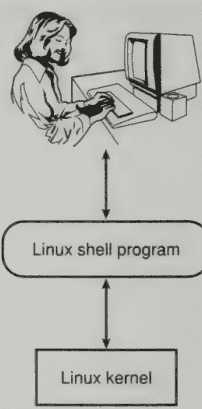

**注意**
如果你熟悉 MS-DOS，你会意识到这种关系与 DOS 用户和 COMMAND.COM 程序之间的关系几乎相同。唯一的实质区别在于，在 DOS 世界中，没有对 COMMAND.COM 程序和 DOS（或更准确地说，DOS 内核）进行区分。

Shell 是一个命令语言解释器。它拥有一套内置的 shell 命令。Shell 还可以利用系统中所有可用的 Linux 实用程序和应用软件。

每当你输入一条命令时，它都会由 Linux shell 进行解释。例如，在前面的章节中，当你开始了解 Linux 文件和目录操作命令时，在命令提示符处输入的所有示例命令都是由你所使用的 Linux shell 进行解释的。

有些命令，如打印工作目录（pwd）命令，是内置于 Linux bash shell 中的。其他命令，如复制命令（cp）和删除命令（rm），则是作为独立的可执行程序存在于文件系统的某个目录中。作为用户，你并不关心（或可能不关心）该命令是内置于 shell 的还是一个独立的程序。图 11.2 展示了 shell 如何执行这种命令解释。

**图 11.2.**
*Shell 的命令解释。*

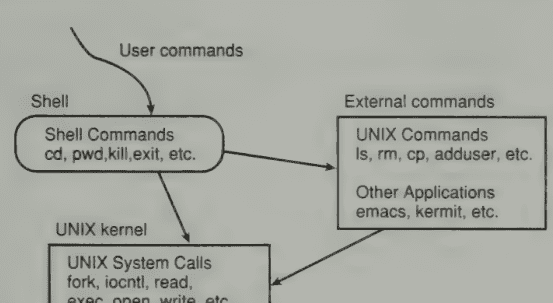

图 11.2 说明了 shell 决定如何处理用户命令（如 *cd* 或 *pwd*）所执行的步骤。如果该命令不属于这些内置项之一，shell 会检查它是否是一个应用程序。应用程序可以是 Linux 自带的实用程序，如 *ls* 和 *rm*，也可以是作为商业软件（如 *xv*）或公共领域软件（如 *ghostview*）发行的应用程序。

Shell 通过搜索所有位于搜索路径中的目录来尝试查找这些应用程序。正如我们在前面章节中提到的，*path*（路径）是一个列出了可找到可执行程序的目录列表。如果输入的命令既不是内部 shell 命令，也不是路径中的可执行文件，系统会显示类似的错误信息：

```bash
$ doit
doit: not found
```

在成功执行命令的最后一步，shell 的内部命令和所有应用程序最终会被分解为系统调用，并传递给 Linux 内核。

Shell 的另一个重要方面是它包含一个非常强大的解释型编程语言。这种语言在功能上类似于 MS-DOS 的解释语言，但灵活得多。Shell 编程语言支持高级语言中常见的大多数编程结构，如循环、函数、变量和数组。

### Shell 如何启动

在本章前面，你已经了解到，shell 是用户与 Linux 内核交互的主要方式。但此程序是如何初始化的呢？shell 在你成功登录系统后启动，并持续作为用户与内核之间交互的主要方式，直到你注销。

系统中的每个用户都有一个默认 shell。每个用户的*默认 shell*在系统密码文件（称为 */etc/passwd*）中指定。*系统密码文件*包含（除其他内容外）每个用户的用户 ID、每个用户密码的加密副本，以及用户登录系统后立即运行的程序名称。密码文件中指定的程序不一定是 Linux shell，但几乎总是如此。

## 最常见的 Shell

Linux 和 UNIX 系统上有几种不同的 shell。最常见的是 Bourne shell（称为 sh）、C shell（csh）和 Korn shell（ksh）。这三种 shell 各有其优缺点。

*The Bourne shell* 由 Steven Bourne 编写。它是原始的 UNIX shell，在现有的每个 UNIX 系统上都可用。Bourne shell 被认为非常适合 UNIX shell 编程，但它处理用户交互的能力不如其他一些可用的 shell。

*The C shell* 由 Bill Joy 编写，对用户交互的反应更加灵敏。它支持 Bourne shell 中没有的功能，例如命令行补全。许多人认为 C shell 的编程接口不如 Bourne shell 好，但由于其编程语言的语法与 C 语言相似，因此被许多 C 程序员使用。这也是它被称为 C shell 的原因。

*The Korn shell (ksh)* 由 Dave Korn 编写。他提取了 C shell 和 Bourne shell 的最佳特性，并将它们结合成一个与 Bourne shell 完全兼容的版本。ksh 高效，既拥有良好的交互界面，也拥有良好的编程接口。

**注意**

关于 Bourne、C 和 Korn shell 有许多高质量的参考书籍。如果你想使用这些 shell 而不是本章及后续两章中讨论的三个 shell，你可能需要找到一本关于你偏好的特定 shell 的好参考书。由于 Linux 自带的 shell 是大多数人使用的，我们将重点介绍这些 shell。

除了这些 shell，许多其他 shell 程序从一个或多个现有 shell 中提取了基本特性，并将它们组合成一个新版本。本书中讨论的三种较新的 shell 是 tesh（csh 的扩展）、Bourne Again Shell（bash，sh 的扩展）和 Public Domain Korn Shell（pdksh，ksh 的扩展）。bash 是大多数 Linux 系统的默认 shell。

## Bourne Again Shell

Bourne Again Shell（bash），顾名思义，是 Bourne shell 的扩展。bash 与 Bourne shell 完全向后兼容，但包含了许多 Bourne shell 中没有的增强功能和额外特性。bash 还包含 C shell 和 Korn shell 中许多最佳特性。bash 拥有一个非常灵活且强大的编程接口，以及用户友好的命令接口。

为什么使用 bash 而不是 sh（原始的 Bourne shell）？Bourne shell 最大的缺点在于它处理用户输入的方式。在 Bourne shell 中输入命令可能非常繁琐，特别是如果你经常使用它并输入大量命令。bash 提供了若干功能，使输入命令变得更加容易。

## 命令行补全

通常，当你在 bash（或任何 shell）中命令时，并不一定需要输入命令的完整文本，shell 就能确定你想让它做什么。例如，假设当前工作目录包含以下文件和子目录：

```text
News/ bin/ games/ mail/ samplefile test/
```

如果你想从当前工作目录切换到 test 子目录，请输入命令：

```bash
cd test
```

虽然这条命令工作得很好，但 bash 允许你以一种略有不同（且更快）的方式完成同样的事情。由于 test 是目录中唯一以字母 *t* 开头的文件，bash 应该能够在你只需输入 *t* 后就弄清楚你想做什么：

```bash
cd t
```

在输入字母 *t* 后，你可能指的是唯一的 *test* 子目录。为了让 bash 帮你完成命令，请按 Tab 键：

```bash
cd t<tab>
```

执行此操作时，bash 会完成命令并将其显示在屏幕上。命令不会实际执行，直到你按下回车键，以确认 bash 生成的命令确实是你打算执行的命令。

对于这样短的命令，你可能看不到使用命令行补全的很大价值。对于短命令，使用此功能起初可能会降低你的速度。但是，当你习惯了使用命令行补全，并且你输入的命令稍长一些时，你会想知道没有这个功能时别人是怎么生活的。


如果一个目录中有多个文件以字母*r*开头，会发生什么？如果你想要使用命令行自动补全功能，看起来这会带来问题。让我们看看当目录内容如下时会发生什么：

`News/  bin/  mail/  samplefile  test/  tools/  working/`

现在，你的目录中有*两个*文件以字母*t*开头。假设你仍然希望`cd`进入`test`子目录，你如何利用命令行自动补全功能做到这一点？如果你像之前那样输入`cd t<tab>`，*bash*不知道你想切换哪个子目录，因为你提供的信息不唯一。

*bash*会发出蜂鸣声，通知你它没有足够的信息来补全命令。发出蜂鸣声后，*bash*会将已输入的命令保留在屏幕上。这允许你输入更多信息，而无需重新输入已键入的内容。在这种情况下，你只需输入**e**并再次按下**Tab**键。这就给了*bash*足够的信息，使其能够在命令行上补全命令供你确认：

```
cd test
```
相反，如果你决定要`cd`进入`tools`子目录，你可以输入：

```
cd t<tab>
```
这同样给了*bash*足够的信息来补全命令。

每次在输入命令时按下**Tab**键，*bash*都会尝试为你补全命令。如果它无法补全命令，它会填入尽可能多的内容，然后发出蜂鸣声，通知你需要提供更多输入。你可以输入更多字符并再次按下**Tab**键，重复此过程，直到*bash*显示所需的命令。

## 通配符

*bash*使键入命令更简单化的另一种方式，是允许用户在命令中使用通配符。*bash* shell 支持三种类型的通配符：

- `*` 匹配任意字符和任意数量的字符。
- `?` 匹配任意单个字符。
- `[...]` 匹配括号内包含的任意单个字符。

`*` 通配符可以以类似于命令行自动补全的方式使用。例如，假设当前目录包含以下文件：

`News/  bin/  games/  mail/  samplefile  test/`

如果你想要进入 test 目录，可以输入 `cd test`，或者使用命令行自动补全：

```
cd t<tab>
```
这将使 bash 为你补全命令。现在，还有第三种做同样事情的方法。由于只有一个文件以字母 t 开头，你也可以使用 * 通配符来切换到该目录。为此，请键入以下命令：

```
cd t*
```
* 匹配任意字符和任意数量的字符，因此 shell 会将 t* 替换为 test（目录中唯一匹配通配符模式的文件）。

只有当目录中只有一个文件以字母 t 开头时，这种做法才可靠。如果目录中有多个文件以字母 t 开头，shell 会尝试将 t* 替换为目录中匹配通配符模式的文件名的列表。cd 命令会切换到该列表中的第一个目录，该列表按字母顺序排列，可能也可能不是预期的文件。

使用 * 通配符的一个更实际的场景，是当你想要对具有相似文件名的多个文件执行相同命令时。例如，假设当前目录包含以下文件：

```
ch1.doc      ch2.doc    ch3.doc       chimp   config   mail/   test/
tools/
```
如果你想打印所有扩展名为 .doc 的文件，可以通过键入以下命令轻松实现：

```
lpr *.doc
```
在这种情况下，bash 将 *.doc 替换为目录中匹配该通配符模式的所有文件名。在 bash 执行此替换后，处理的命令是：

```
lpr ch1.doc ch2.doc ch3.doc
```
lpr 命令可以以 ch1.doc、ch2.doc 和 ch3.doc 作为参数被调用。

> **注意**
>
> 根据前一个示例中使用的目录内容，有几种方法可以打印所有扩展名为 .doc 的文件。以下任何命令也都可以工作：
>
> - `lpr \*doc`
> - `lpr \*oc`
> - `lpr \*c`

? 通配符的工作方式与 * 通配符完全相同，只是 ? 通配符只匹配单个字符。使用与前一个示例中显示相同的目录内容，可以通过键入以下命令使用 ? 通配符来打印所有扩展名为 .doc 的文件：

```
lpr ch?.doc
```
[ . . . ] 通配符允许你指定要匹配的特定字符或字符范围。使用 [ . . . ] 通配符打印示例中所有扩展名为 .doc 的文件，请输入以下两个命令之一：

```
lpr ch[123].doc
```
使用命令指定字符范围，请输入：

```
lpr ch[1-3].doc
```

## 命令历史

bash 还支持命令历史。这仅仅意味着 bash 会跟踪先前输入到 shell 中的若干条命令。命令的数量由名为 HISTSIZE 的 shell 变量给出。有关 HISTSIZE 的更多信息，请参见本章后面“bash 变量”一节。

bash 将前一条命令的文本存储在一个历史列表中。当你登录到账户时，历史列表从历史文件初始化。历史文件的文件名可以使用 HISTFILE bash 变量设置。历史文件的默认文件名是 .bash_history。此文件通常位于你的主目录中。（请注意，该文件以句点开头。这意味着该文件是隐藏的，只有在使用 `ls` 命令的 -a 或 -A 选项时，才会出现在目录列表中。）


仅仅将以前的命令存储到历史文件中并不是那么有用，因此 **bash** 提供了几种方法来回忆它们。使用历史列表最简单的方法是向上和向下箭头键，它们会滚动浏览以前输入的命令。

按下向上箭头键会使最后一次输入的命令出现在命令行上。再次按下向上箭头键会使上上一次的命令出现在命令行上，依此类推。如果你在命令缓冲区中向上移动到了你想要的命令之前，你可以通过按向下箭头键一次向下移动历史列表中的一条命令来移动。（这与 DOS doskey 实用程序使用的过程相同。）

通过历史列表显示在命令行上的命令，如有必要，可以对其进行编辑。**bash** 支持一套复杂的编辑功能，这超出了本书的范围，但对于小型和简单的更改，有一些简单的方法来编辑命令行。你可以使用左右箭头键在命令行中移动。你可以在命令行的任意位置插入文本，并使用 Backspace 或 Delete 键删除文本。大多数用户会发现这些简单的编辑命令就足够了。

> **注意**
>
> bash 提供的那套复杂的编辑命令类似于 emacs 和 vi 文本编辑器中使用的命令。

使用历史文件的另一种方法是使用内置于 **bash** 中的 **history** 和 **fc**（fix command）命令来显示和编辑列表。history 命令可以通过两种不同的方法调用。第一种方法使用命令：

`history [n]`

当不带选项使用 history 命令时，历史列表的完整内容会被显示。显示在屏幕上的列表可能类似于以下列表：

```
1 mkdir /usr/games/pool
2 cp XpoolTable-1.2.linux.tar.z /usr/games/pool
3 cd /usr/games/pool/
4 ls
5 gunzip XpoolTable-1.2.linux.tar.z
6 tar -xf XpoolTable-1.2.linux.tar
7 ls
8 cd Xpool
9 ls
10 xinit
11 exit
12 which zip
13 zip
14 more readme
15 vi readme
16 exit
```
使用 n 与 history 命令只会显示历史列表中的最后 n 行。因此，例如，history 5 只显示最后五个命令。

使用 history 命令的第二种方法是修改历史文件或历史列表的内容。该命令具有以下命令行语法：

`history [-r|-w|a; n] [filename]`

在这种形式中，-r 选项告诉 history 命令读取历史文件的内容并将其用作当前历史列表。-w 选项使 history 命令将当前历史列表写入历史文件（覆盖文件中的当前内容）。-a 选项将当前历史列表追加到历史文件的末尾。-n 选项使历史文件中的行被读取到当前历史列表中。

history 命令的第二种形式的所有选项都可以使用 filename 选项作为历史文件的名称。如果未指定文件名，history 命令将使用 HISTFILE shell 变量的值。

fc 命令可以通过两种不同的方式来编辑命令历史。在第一种方式中，使用以下命令行语法输入 fc 命令：

`fc [-e editor_name] [-n] [-l] [-r] [first] [last]`

其中大括号中给出的所有选项都是可选的。-e editor_name 选项用于指定用于编辑命令的文本编辑器。first 和 last 选项用于从历史列表中选择一个命令范围。first 和 last 指的是历史列表中命令的编号，或者是 fc 将尝试在历史列表中查找的字符串。

-n 选项用于在列出历史命令时抑制命令编号。-r 选项按相反顺序列出匹配的命令。-l 命令将匹配的命令列出到屏幕上。在所有情况下——除非使用 -1 命令选项——匹配的命令会被加载到文本编辑器中。


## 注意

使用 `-e editor name` 选项时，`fc` 所使用文本编辑器的值取自 `editor name`。如果未使用此选项，`fc` 将使用由变量 `FCEDIT` 指定的编辑器。如果该变量不存在，`fc` 将使用 `EDITOR` 变量的值。最后，如果这些变量都不存在，默认将选择 `vi` 作为编辑器。

## 别名

Bash 让用户生活更轻松的另一种方式是支持命令别名。命令别名是用户可以指定的命令。别名命令通常是其他命令的缩写，旨在减少按键次数。

例如，如果你经常输入以下命令，你可能会倾向于为其创建一个别名以节省输入：

```
cd /usr/X11/lib/X11/fvwm/sample-configs
```

代替每次想要进入 sample-configs 目录时都输入这个命令，你可以创建一个名为 `gocconfig` 的别名，它将执行较长的命令。要设置这样的别名，必须使用 bash 的 `alias` 命令。要创建 `gocconfig` 别名，请在 bash 提示符下输入以下命令：

```
alias gocconfig='cd /usr/X11/lib/X11/fvwm/sample-configs'
```

现在，直到你退出 bash，`gocconfig` 命令将执行原始的较长命令，就像你刚刚输入它一样。

如果你在输入别名后决定不需要它，可以使用 bash 的 `unalias` 命令来删除该别名：

```
unalias gocconfig
```

大多数用户会发现一些有用的别名非常有帮助。这些可以写入一个文件中，该文件在你登录时执行，从而避免每次都要输入它们。你可能想要定义的一些别名如下：

- `alias ll='ls -l'`：允许你使用双字符“l”命令获取长目录列表
- `alias lo='logout'`：为你提供快速输入 logout 命令的方法
- `alias ls='ls -F'`：为所有目录名称添加斜杠，使它们更容易识别

如果你是 DOS 用户并且习惯于使用 DOS 文件命令，你可以使用 `alias` 命令定义以下别名，使 Linux 像 DOS 一样工作：

- `alias dir='ls'`
- `alias copy='cp'`
- `alias rename='mv'`
- `alias md='mkdir'`
- `alias rd='rmdir'`

> **注意：** 定义别名时，不要在等号两侧包含空格，否则 shell 无法正确确定你想做什么。只有当引号内的命令包含空格或其他特殊字符时，才需要引号。

如果输入不带任何参数的 `alias` 命令，它将显示所有已定义的别名。以下列表展示了 `alias` 命令的示例输出：

```
alias dir='ls'
alias ll='ls -l'
alias ls='ls -F'
alias md='mkdir'
alias net='term < /dev/modem > /dev/modem 2> /dev/null'
alias rd='rmdir'
```

## 输入重定向

输入重定向更改命令的输入源。当在 bash 中输入命令时，该命令期望某种形式的输入以完成其工作。一些较简单的命令必须接收通过命令行传递的所有所需信息。例如，`rm` 命令需要在命令行上提供参数。你必须告诉 `rm` 在命令行上要删除哪些文件，否则它会发出提示告诉你输入 `rm -h` 以获取帮助。

其他命令需要的输入比简单的目录名称更复杂。这些命令的输入可以在文件中找到。例如，`wc`（字数统计）命令计算输入中字符、单词和行的数量。如果在命令行输入 `wc` <enter>，`wc` 将等待你告诉它应该统计什么，然后命令行上会出现提示要求更多信息。因为提示有时不容易识别，所以可能不太清楚正在发生什么。（甚至可能出现 bash 已经停止的情况，因为你输入的内容都显示在屏幕上，但似乎没有其他事情发生。）

实际上发生的是 `wc` 命令正在为自己收集输入。如果你按下 **Ctrl+D**，`wc` 命令的结果将显示在屏幕上。如果你如以下示例所示，将文件名作为参数传入 `wc` 命令，`wc` 将返回该文件中包含的字符、单词和行数：

```
wc test
11 2 1
```

另一种将 `test` 文件内容传递给 `wc` 的方法是将 `wc` 命令的输入从终端重定向到 `test` 文件。这将产生相同的输出。Bash 使用 `<` 符号表示“将输入从指定文件重定向到当前命令”。因此，将 `wc` 的输入从终端重定向到 `test` 文件可以通过输入以下命令完成：

```
wc < test
11 2 1
```

输入重定向的使用并不频繁，因为大多数需要文件输入的命令都有在命令行上指定文件名的选项。然而，当你遇到一个不接受文件名作为输入参数的程序，但你想要提供的输入却存在于文件中时，你可以使用输入重定向来解决这个问题。

## 输出重定向

输出重定向比输入重定向更常用。*输出重定向* 允许你将命令的输出重定向到文件中，而不是在屏幕上显示输出。

有许多情况下这会很有用。例如，如果命令的输出很大且无法在屏幕上显示，你可能想将其重定向到文件中，以便稍后使用文本编辑器查看。也可能有情况你希望保留命令的输出以展示给他人或打印结果。最后，如果你想将一个命令的输出作为另一个命令的输入，输出重定向也很有用。（使用一个命令的输出作为第二个命令的输入还有更简单的方法。这在“管道”部分中展示。）

输出重定向的执行方式与输入重定向类似。不使用 `<` 符号，而是使用 `>` 符号。

## 提示

记住哪个符号是输入或输出重定向的最好方法是，将 `<` 想象成将输入引入命令的漏斗（因为接收输入的命令在 `<` 的左侧），将 `>` 想象成将命令输出引入文件的漏斗。

作为输出重定向的例子，你可以使用以下命令将 `ls` 命令的输出重定向到名为 `directory.out` 的文件中：

```
ls > directory.out
```

## 管道

*管道*（通常称为*流水线*）是将一系列命令串联起来的方法。这意味着流水线中第一个命令的输出被用作流水线中第二个命令的输入。流水线中第二个命令的输出被用作流水线中第三个命令的输入，依此类推。流水线中最后一个命令的输出才是实际显示在屏幕上的输出（或者如果命令行指定了输出重定向，则输出到文件中）。

可以通过输入由竖线或“管道”字符 `|` 分隔的两个或更多命令来告诉 bash 创建一个管道。以下示例说明了管道的用法：

```
cat sample.text | grep "High" | wc -l
```

此管道获取 `cat` 命令的输出（列出文件内容），并将其发送到 `grep` 命令。`grep` 命令在其输入中搜索单词“High”的每次出现。`grep` 命令的输出由包含单词“High”的文件中的每一行组成。此输出随后被发送到 `wc` 命令。带有 `-l` 选项的 `wc` 命令打印其输入中包含的行数。

为了在真实文件上显示结果，假设 `sample.text` 的内容如下所示：

```
Things to do today:
Low: Go grocery shopping
High: Return movie
High: Clear level 3 in Alien vs. Predator
Medium: Pick up clothes from dry cleaner
```

然后管道返回结果 2，表明你今天有两件重要的事情要完成：

```
cat sample.text | grep "High" | wc -l
2
```


## 提示符

bash 有两级用户提示符。第一级提示符是当 bash 等待输入命令时显示的内容。（通常在与 bash 交互时，你看到的就是这一级提示符。）

默认的初级提示符是 % 字符。如果你不喜欢使用 % 字符作为提示符，或者希望自定义提示符，你可以通过设置 `PS1` 变量的值来实现。例如：

```
PS1="Please enter a command"
```

将 bash shell 的提示符设置为指定的字符串。

二级提示符在 bash 期望你提供更多输入以完成命令时显示。二级提示符的默认值是 >。如果你想更改二级提示符，可以设置 `PS2` 变量的值，如下所示：

```
PS2="I need more information"
```

除了在命令提示符中显示静态字符串（如前两个示例所示）外，你还可以使用一些预定义的特殊字符。这些特殊字符会将当前时间等信息放入提示符中。表 11.1 列出了最常用的特殊字符代码。

**表 11.1. 提示符特殊字符代码**

| 字符 | 含义 |
| :--- | :--- |
| \! | 显示当前命令的历史编号。 |
| \# | 显示当前命令的命令编号。 |
| \$ | 除非用户是 root，否则在提示符中显示 $。如果用户是 root，则显示 #。 |
| \\ | 显示反斜杠。 |
| \d | 显示当前日期。 |
| \h | 显示运行该 shell 的计算机的主机名。 |
| \n | 打印换行符。这会导致提示符跨越多行。 |
| \nnn | 显示对应于八进制数值 nnn 的字符。 |
| \s | 正在运行的 shell 的名称。 |
| \t | 显示当前时间。 |
| \u | 显示当前用户的用户名。 |
| \w | 显示当前工作目录的基名。 |
| \W | 显示当前工作目录。 |

这些特殊字符可以组合成几个有用的提示符，为你提供关于当前所在位置的信息。（当然，它们也可以以非常奇怪的方式组合！）以下是设置 PS1 提示符的几个示例：

```
PS1="\t"
```

这会使提示符呈现以下外观（提示符后没有空格）：

```
02:16:15
```

提示符字符串

```
PS1=\t
```

会使提示符呈现以下外观：

```
t
```

这说明了将字符序列包含在引号中的重要性。提示符字符串

```
PS1="\t\  "
```

会使提示符看起来像这样：

```
02:16:30\
```

在这种情况下，提示符后有一个空格，因为引号内包含了一个空格。

## 作业控制

*作业控制* 指的是控制当前运行进程执行行为的能力。具体来说，你可以挂起一个正在运行的进程，并使其稍后恢复运行。bash 会跟踪它启动的所有进程（由用户输入引起），并允许你在该进程生命周期的任何时刻挂起正在运行的进程或重启已挂起的进程。（有关进程的更多信息，请参见第 34 章“进程”。）

按下 Ctrl+Z 会挂起正在运行的进程。`bg` 命令在后台重启已挂起的进程，而 `fg` 命令在前台重启进程。

当用户希望以后台方式运行某个命令但意外地在启动时将其设为前台运行时，这些命令最常使用。当命令在前台启动时，它会锁定 shell，直到命令执行完毕前无法进行任何进一步的用户交互。这通常不是问题，因为大多数命令只需几秒即可执行完毕。然而，如果你正在运行的命令耗时较长，请在后台启动该命令，以便你可以继续使用 bash 在前台输入其他命令。

例如，如果你在前台启动命令 `find / -name "test" > find.out`（该命令扫描整个文件系统以查找名为 test 的文件并将结果存储在名为 find.out 的文件中），根据你的文件系统大小和系统上的用户数量，你的 shell 可能会被占用数秒甚至数分钟。如果你发出此命令并希望继续以后台方式执行以便能再次使用系统，请输入以下内容：

```
control-z
bg
```

这首先挂起 find 命令，然后在后台重启它。find 命令继续执行，你再次获得了 bash。

## 自定义 bash

本章已经描述了许多自定义 bash 的方法。到目前为止，你所做的更改仅影响当前的 bash 会话。一旦退出，所有自定义设置将会丢失。然而，你可以将自定义设置存储在 bash 初始化文件中，使其变得更加持久。

你可以将每次启动 bash 时希望执行的任何命令放入此初始化文件。该文件中通常包含 alias 命令和变量初始化。

bash 初始化文件的名称是 .profile 或 .bash_profile，具体取决于你使用的 Linux 版本。为了简单起见，我们假设使用 .profile，尽管你应该替换为你 Linux 系统使用的名称。每个使用 bash 的用户在其主目录中都有一个 .profile 文件。bash 每次启动时都会读取此文件，并执行其中包含的所有命令。

许多 Linux 系统使用一个默认配置文件（注意文件名前没有点）。该文件位于 /etc 目录中，并在你启动 bash 时读取。如果你想为 bash 添加自己的自定义设置，你必须将此文件复制到你的主目录中（如果尚未存在），并将其命名为 .profile。

**注意**

某些设置程序在创建你的登录时会自动为你在主目录中复制一份 .profile 文件。但是并非所有例程都会这样做，因此你应该先检查你的主目录。请记住，所有以点开头的文件都是隐藏文件，只能通过 `ls -A` 或 `ls -a` 命令显示。


## bash 命令摘要

表 11.2 总结了内置于 bash shell 中的一些最有用的命令。

**表 11.2. 本章中我们使用的 BASH 命令。**

| bash 命令 | 用途 |
|---|---|
| alias | 用于设置 bash 别名（用户可定义命令昵称）。 |
| bg | 后台命令。强制已挂起的进程在后台继续执行。 |
| cd | 更改工作目录。此命令将当前工作目录更改为指定为参数的目录。 |
| exit | 终止 shell。 |
| export | 使变量的值对属于当前 shell 的所有子进程可见。 |
| fc | 修复命令。用于编辑当前历史记录列表中的命令。 |
| fg | 前台命令。强制已挂起的进程在前台继续执行。 |
| help | 显示 bash 内置命令的帮助信息。 |
| history | 显示在命令提示符下输入的最近 n 个命令的列表，其中 n 是一个可配置变量，指定要记住的命令数量。 |
| kill | 用于终止另一个进程。 |
| pwd | 打印工作目录。打印用户当前正在工作的目录。 |
| unalias | 用于删除使用 alias 命令定义的别名。 |

bash 拥有的命令远不止这里列出的这些，但这些都是最常用的。要查看 bash 提供的其他命令以及列表中命令的更多细节，请参见 bash 手册页（输入 `man bash`）。

## bash 变量

bash 使用许多变量。这些变量中最有用的几个，包括变量名称和简要描述，如表 11.3 所示。

**表 11.3. 最常用的 BASH 变量。**

| 变量名 | 用途 |
| :--- | :--- |
| `EDITOR`, `FCEDIT` | `fc`/`bash` 命令的默认编辑器。 |
| `HISTFILE` | 用于存储命令历史的文件。 |
| `HISTSIZE` | 历史记录列表的大小。 |
| `HOME` | 当前用户的 `HOME` 目录。 |
| `OLDPWD` | 上一个工作目录（进入当前目录之前的那个目录）。 |
| `PATH` | bash 在查找可执行文件时使用的搜索路径。 |
| `PS1` | 显示在命令行上的初级提示符。 |
| `PS2` | 当命令期望更多输入时显示的二级提示符。 |
| `PWD` | 当前工作目录。 |
| `SECONDS` | 自当前 bash 会话启动以来经过的秒数。 |

bash 拥有的变量远不止这里列出的这些，但这里展示的是最常用的。要了解 bash 提供的其他变量，请使用命令 `man bash` 调出手册页。

## 总结

在本章中，你了解了一些 Bourne Again Shell（bash）的有用功能。你已经看到命令补全、别名和作业控制如何结合在一起，使你在与 bash 工作时更加高效和有条理。


在下一章中，我们将探讨另一种流行的 Linux Shell——公共领域 Korn Shell（*pdksh*）。它同样提供了许多有用的功能，为您提供多种 Shell 选择。如果您想跳读以了解其他主题，请随意：

- 了解 Shell 编程以及如何利用它增强您对 bash 的使用体验，见第 14 章“Shell 编程”。
- 了解如何使用编辑器创建和编辑文件，见第 16 章“文本编辑器：*vi* 和 *emacs*”。


## pdksh

作者：Rick McMullin 和 Tim Parker

### 本章内容

- 公共领域 Korn Shell (pdksh) 226
- Shell 提示符 235
- 作业控制 236
- 按键绑定 236
- 定制您的 pdksh 239
- pdksh 命令 240
- pdksh 变量 240

在上一章中，您详细了解了 Bourne Again Shell（bash）。并非所有人都希望使用 bash Shell，因此大多数 Linux 系统都包含其他几种 Shell。其中之一就是 **pdksh**，它是 Korn Shell 的一个变体。我们还将探讨如何定制您的 **pdksh** 副本，以及该 Shell 使用的几个重要命令和变量。

### 公共领域 Korn Shell (pdksh)

Korn Shell 由 David Korn 编写，是继 Bourne Shell 和 C Shell 之后第三个主流的 UNIX Shell。因此，它结合了 Bourne Shell 和 C Shell 的许多功能。Korn Shell 通常不随所有 UNIX 版本分发，因此许多用户没有机会使用它。尽管如此，Korn Shell 对 UNIX 用户来说仍然很重要，因为它将 C Shell 中许多重要的新功能构建到更古老的 Bourne Shell 中，同时保持与 sh 的完全兼容性。由于 Korn Shell 在 UNIX 用户中非常受欢迎，因此开发了一个用于 Linux 的版本，称为公共领域 Korn Shell，即 **pdksh**。

当前版本的公共领域 Korn Shell 不支持商业版 Korn Shell 中的所有功能。不过，它支持大多数主要功能，并添加了一些自己的新功能。

### 命令行自动补全

通常，当您在命令行中输入命令时，并不一定需要输入命令的完整文本，**pdksh** 就能确定您想要执行的操作。命令行自动补全允许您输入部分命令，然后通过输入特定的键序列，让 **pdksh** 尝试为您完成该命令。

**pdksh** 默认不允许用户执行命令行自动补全。您必须输入一条命令来告知 **pdksh** 您希望使用命令行自动补全功能。为了启用命令行自动补全，请输入以下命令之一：

```bash
set -O emacs
set -O vi
```

这将使 **pdksh** 接受类似 *emacs* 或 *vi* 的命令编辑。请选择您最熟悉的编辑器，并使用基本的编辑器命令进行命令行编辑。

> **注意**
>
> 大多数人发现 *emacs* 编辑模式比 *vi* 编辑模式更用户友好。

在使用 *vi* 命令行编辑时，当输入任何编辑命令时，必须处于命令模式。您可以通过按下 *Esc* 键进入命令模式。进入命令模式后，直到进入编辑模式之前，您不能在命令行上输入任何字符。进入编辑模式的方法有很多，通常的方式是按 *i*（插入）键。

启用命令行自动补全功能后，您可以按两次 *Esc* 键（如果使用 *emacs* 命令行编辑）或按 `\` 键（如果使用 *vi* 命令行编辑）来执行命令行自动补全。例如，如果您的当前目录包含以下文件：

- `News/`
- `bin/`
- `games/`
- `mail/`
- `sample.text`
- `test/`

并且您想使用 *vi* 文本编辑器编辑文件 `sample.text`，请输入以下命令：

```bash
vi sample.text
```

在输入 “s” 之后，您唯一可能指代的文件是 `sample.text`，因为它是当前目录中以字母 “s” 开头的唯一文件。如果您使用 *emacs* 风格的命令编辑，要让 *pdksh* 完成命令，在输入 **s:** 后按两次 *Esc* 键：

```bash
vi s<escape><escape>
```

如果您使用 *vi* 命令编辑，要让 *pdksh* 完成命令，在输入 **s:** 后按 `\` 键：

```bash
vi s\
```

这两个命令中的任何一个都会让 *pdksh* 为您完成该行，并在屏幕上显示结果。该命令只有在您按下 *Enter* 键后才会执行。这是为了给您一个确认机会，确保 *pdksh* 显示的命令确实是您意图执行的命令。

如果 `sample.text` 不是目录中唯一以字母 “s” 开头的文件，*pdksh* 会尽可能多地完成命令，然后发出蜂鸣声，表示它需要更多信息来完成命令。

> **注意**
>
> 按 Esc 键的键盘等效方式是 Ctrl+[，通常写作 ^[。脱字符（^）是 Ctrl 键的缩写。使用 Ctrl+[ 序列按两次 Esc 会写作 ^[。您可能会在书籍或 man 手册页中看到这种约定。

### 通配符

pdksh Shell 通过允许用户使用通配符使输入命令变得更加容易。pdksh 支持与 bash 相同的通配符：

- `*` 匹配任意字符和任意数量的字符。
- `?` 匹配任意单个字符。
- `[...]` 匹配括号内的任意单个字符。

`*` 通配符可以以类似命令行自动补全的方式使用。例如，如果当前目录包含以下文件：

```bash
News/ bin/ games/ mail/ sample.text test/
```

并且您想使用 vi 文本编辑器编辑 sample.text 文件，可以使用以下通配符来执行此任务：

```bash
vi s*
```

`*` 匹配任意字符（以及任意数量的字符），因此 pdksh 将 `s*` 替换为 `sample.text`（目录中唯一匹配该通配符模式的文件）。

如果目录中只有一个文件以字母 “s” 开头，这种方法可以可靠地工作。如果有多个文件以相同的字母开头，Shell 会尝试将 `s*` 替换为匹配通配符模式的文件名列表，并对列表中的第一个文件运行 vi。在您退出编辑第一个文件后，列表中的第二个文件会被加载到 vi 中，依此类推，处理每个匹配通配符模式的文件。如果您打算编辑多个文件，这没有问题，但如果您只想编辑 `sample.text` 文件，该命令将无法按您需要的方向工作。

使用 `*` 通配符更实际的情况是，当您希望对具有相似文件名的多个文件执行相同命令时。例如，假设当前目录包含以下文件：

```bash
News/ bin/ games/ mail/ sample.text
temp1.out
temp2.out temp3.out test/
```

如果您想删除所有扩展名为 .out 的文件，可以输入以下命令：

```bash
rm *.out
```

在这种情况下，pdksh 将 `*.out` 替换为目录中所有匹配通配符模式的文件的名称。在 pdksh 执行此替换后，将处理以下命令：

```bash
rm temp1.out temp2.out temp3.out
```

rm 命令被调用，其参数为 temp1.out、temp2.out 和 temp3.out。

`?` 通配符的功能与 `*` 通配符类似，不同之处在于 `?` 通配符只匹配单个字符。假设与前一个例子相同的目录内容，可以通过输入以下命令使用 `?` 通配符来删除所有扩展名为 .out 的文件：

```bash
rm temp?.out
```

`[ ... ]` 通配符允许您指定要匹配的字符或字符范围。要打印前一个例子中所有扩展名为 .doc 的文件，请输入以下两个命令之一：

```bash
rm temp[123].out
rm temp[1-3].out
```

### 命令历史

pdksh Shell 支持命令历史的方式与 bash 非常相似。pdksh Shell 会跟踪最近输入的 HISTSIZE 条命令（HISTSIZE 是一个可由用户定义的 pdksh 变量）。

pdksh 在历史列表中存储最近 HISTSIZE 条命令的文本。当您登录时，历史列表会从历史文件中初始化。历史文件的文件名可以使用 HISTFILE pdksh 变量进行设置。历史文件的默认文件名是 .ksh_history，位于您的主目录中。请注意，该文件名以 . 开头，意味着该文件是隐藏的，只有在使用 ls 命令的 -a 或 -A 选项时才会出现在目录列表中。

Shell 提供了多种访问历史列表的方式。最简单的方法是浏览先前输入的命令。在 pdksh 中，这取决于您使用的是 emacs 还是 vi 命令编辑，具体操作方式有所不同。


如果你正在使用 emacs 命令编辑，按 Ctrl-r+p 可以向上滚动历史记录列表，按 Ctrl-r+. 可以向下滚动列表。如果你正在使用 vi 命令行编辑，按 k 或 - 键可以向上滚动历史记录列表，按 j 或 + 键可以向下滚动列表。

> **注意**

在使用 vi 命令编辑时，键命令必须处于命令模式下才能生效。按 Esc 键即可进入命令模式。

命令行上的命令是可以编辑的。pdksh shell 支持一组复杂的编辑功能（其中大部分超出了本书的范围）。你可以使用左箭头和右箭头键在命令行上移动。你可以使用 Backspace 或 Delete 键在任意位置插入文本或从命令行中删除文本。大多数用户应该会发现这些简单的编辑命令已经足够：对于需要更多功能的用户，还有许多其他更复杂的编辑命令行的方法。

> **注意**

pdksh 提供的复杂编辑命令集类似于 emacs 或 vi 文本编辑器中包含的命令（你可以使用 set -o emacs 或 set -o vi 命令来设置 emacs 或 vi 模拟）。如果你熟悉 emacs（或 vi），这些命令对你来说会非常熟悉。

使用历史记录文件的另一种方法是使用 fc（fix command，修复命令）来显示和编辑它，这是 pdksh shell 的内置命令。如果你阅读了第 11 章 “bash”，你可能还记得 bash 支持另一个名为 history 的命令，它允许你查看和修改历史记录文件。pdksh shell 中省略了 history 命令，因为其所有功能都可以通过 fc 命令提供。

> **提示**

尽管 pdksh 中未内置 history 命令，但该命令通常仍然有效，因为它通常被设置为 fc -1 命令的别名。例如，.kshrc 文件通常包含如下行：alias history='fc -1'，它提供了与其他 shell 中内置的 history 命令几乎相同的行为。

fc 命令用于编辑命令历史。它有许多选项，如下面的命令语法所示：

```
fc [-e ename] [-n|-r] [first] [last]
```

花括号中给出的所有选项都是可选的。命令中的 -e 部分用于指定用于编辑命令历史中命令的文本编辑器。

first 和 last 选项用于选择历史记录列表中要提取的命令范围。first 和 last 可以指历史记录列表中命令的编号，也可以指 fc 试图在历史记录列表中查找的字符串。

-n 选项在列出与指定范围匹配的历史命令时抑制命令编号。-r 选项按相反顺序列出匹配的命令。

-l 命令将匹配的命令列表显示在屏幕上。除了 -l 选项外，匹配的命令都会加载到文本编辑器中。

fc 使用的文本编辑器是通过获取 ename 的值来确定的，如果使用了 -e 选项。如果没有使用此选项，fc 使用变量 FCEDIT 指定的编辑器。如果该变量不存在，fc 使用 EDITOR 变量的值。最后，如果这些变量都不存在，则选择的编辑器是 vi。

如果你不带任何参数输入 fc 命令，它将把最后输入的加载到编辑器中。请记住，当你退出编辑器时，fc 会尝试执行编辑器中的任何命令。

理解 fc 命令做什么的最简单方法是查看几个例子：

- fc 将最后一个命令加载到默认编辑器中。
- fc -l 列出最后输入的 16 个命令。
- fc -l 5 10 列出历史编号在 5 到 10 之间（包括 5 和 10）的命令。
- fc 6 将历史命令编号 6 加载到默认编辑器中。
- fc mo 将最近以字符串 mo 开头的命令加载到默认编辑器中。

## 别名

pdksh 让你生活更轻松的另一个方式是支持命令别名。命令别名是你指定和执行的命令。别名命令通常是其他命令的缩写。

你告诉 pdksh 每当遇到该别名时执行一个 Linux 命令。例如，如果你的目录中有一个文件，其中列出了你每天必须做的事情，而你通常每天早晨都会编辑该文件以更新它，那么你可能会发现自己经常输入以下命令：

```
vi things-to-do-today.txt
```

由于你经常输入这个命令，你可能希望为其创建一个别名以节省打字。因此，每次你想编辑该文件时，你不必每次输入这个长命令，而是可以创建一个名为 ttd 的别名，使该长命令得以执行。

要设置这样的别名，请使用 pdksh 的 alias 命令。要创建 ttd 别名，请在 pdksh 命令提示符下输入以下命令：

```
alias ttd='vi things-to-do-today.txt'
```

从你输入 alias 命令的那一刻起，直到你退出 pdksh 为止，ttd 命令将执行较长的命令。如果你在输入别名后决定不再需要该别名，可以使用 pdksh 的 unalias 命令删除该别名：

```
unalias ttd
```

使用 unalias 命令删除别名后，该别名将不再存在，尝试执行它会导致 pdksh 显示“Command not found”（命令未找到）。

以下是一些你可能想要定义的别名：

```
alias ll='ls -l'
alias log='logout'
alias ls='ls -F'
```

如果你是 DOS 用户，并且更喜欢使用 DOS 文件命令，你可能还想定义以下别名：

```
alias dir='ls'
alias copy='cp'
alias rename='mv'
alias md='mkdir'
alias rd='rmdir'
```

> **注意**

在定义别名时，等号两侧不能有空格。只有当其中的命令包含空格或其他特殊字符时，引号才是必需的。

如果你不带任何参数输入 *alias* 命令，它会向屏幕打印出已定义的所有别名。有一种方法可以确保每次启动 *pdksh* 时都执行你的所有 *alias* 命令。这是通过使用初始化文件来实现的，我们将在本章后面的“自定义 *pdksh*”部分中讨论这一点。

## 输入重定向

输入重定向用于更改命令的输入源。通常，在 *pdksh* 中输入命令时，该命令需要某种输入才能完成其工作。一些简单的命令必须通过命令行向其传递所需的所有信息。例如，*rm* 命令要求你在命令行上告诉它你想删除哪些文件；如果你未指定任何文件，它会发出提示，让你输入 *rm -h* 以获取帮助。

其他命令需要的输入比简单的目录名更复杂。这些命令的输入通常位于文件中。例如，*wc*（字数统计）命令计算输入中字符、单词和行数。如果你将文件名作为参数输入 *wc* 命令，*wc* 将返回该文件中包含的字符数、单词数和行数。一个例子是：

```
wc test
11 2 1
```

将 *test* 文件的内容传递给 *wc* 作为输入的另一种方法是改变（或重定向）*wc* 命令的输入，从终端改为 *test* 文件。这会产生相同的输出。*pdksh* 使用 `<` 字符将当前命令的输入从该字符后的文件重定向过来。因此，将 *wc* 的输入从终端重定向到 *test* 文件是通过输入以下命令完成的：

```
wc < test
11 2 1
```

输入重定向使用得不太频繁，因为大多数需要从文件读取输入的命令都有一个选项来在命令行上指定文件名。然而，有时你会遇到一个程序，它不接受文件名作为输入参数，而你想要提供给命令的输入却存在于一个文件中。每当出现这种情况时，你可以使用输入重定向来解决这个问题。


## 输出重定向

输出重定向比输入重定向更常用。输出重定向允许您将命令的输出重定向到文件中，而不是在屏幕上显示。

在许多情况下，这种功能都非常有用。例如，如果某个命令的输出非常大且无法在屏幕上显示，您可能希望将其重定向到文件，以便稍后使用文本编辑器查看。输出重定向的执行方式与输入重定向非常相似。不使用 `<` 符号，而是使用 `>` 符号。

要将 `ls` 命令的输出重定向到名为 `directory.out` 的文件中，请使用以下命令：

```
ls > directory.out
```

## 管道

管道是将一系列命令串联起来的方式。这意味着管道中第一个命令的输出被用作第二个命令的输入。您可以输入由 `|` 字符分隔的两个或多个命令，来指示 `pdksh` 创建管道。以下是使用 `pdksh` 管道的示例：

```
cat test.file | sort | uniq
```

这是一个相当常见的管道。在这里，`test.file` 的内容（`cat` 命令的输出）被送入 `sort` 命令的输入中。`sort` 命令在没有选项的情况下，按输入中第一个字段的字母顺序对输入进行排序。排序后的文件随后通过管道传入 `uniq` 命令。`uniq` 命令会删除输入中的重复行。如果 `test.file` 包含以下行：

```
Sample dialog
Hello there
How are you today
Hello there
I am fine
```

那么管道的输出如下：

```
Hello there
How are you today
I am fine
Sample dialog
```

文件中的所有行都已按行首单词排序，并且由于 `uniq` 命令，其中一行 `Hello` there 被删除了。

## Shell 提示符

pdksh 具有三个级别的用户提示符。第一级别是当 shell 等待输入命令时用户看到的内容。（通常在使用 shell 时看到的就是这个。）默认提示符是 $ 字符。如果您不喜欢美元符号作为提示符，或者希望自定义提示符，可以通过设置 `PS1` pdksh 变量的值来实现。

要设置变量，请给出名称、等号以及您想要设置的字符串。请确保等号两侧不要有任何空格，否则 shell 将无法正常解释您的命令。例如，这一行：

```
PS1="! Tell me what to do"
```

将 shell 提示符设置为字符串 `! Tell me what to do`。pdksh shell 会跟踪自启动以来输入的命令数量。这个数字存储在名为 `!` 的 shell 变量中。当您在提示符中包含 `!` 时，它会在提示符中显示当前的命令编号。前面的提示符命令会导致每次 pdksh 等待您输入命令时，在命令行上显示命令编号后跟字符串 `Tell me what to do`。

第二级别提示符在 pdksh 需要您提供更多输入以完成命令时显示。第二级别提示符的默认值是 `>`。如果您想更改第二级别提示符，可以通过设置 `PS2` pdksh 变量的值来实现，如下例所示：

```
PS2=" I need more information"
```

这会导致每当 pdksh 需要您提供内容以完成命令时，在命令行上显示字符串 `I need more information`。

pdksh 不支持 bash 支持的高级提示符选项。没有预定义的一组转义码，您可以将其放入 pdksh 提示符变量中以显示时间或当前工作目录等项。但是，您可以将其他 pdksh 变量放入提示符变量中。例如，以下两个提示符是有效的：

```
PS1=" (LOGNAME) "
PS1=' ($PWD )'
```

第一个示例使您的提示符等于您的 UNIX 用户名。第二个示例使您的提示符等于当前工作目录。这里需要使用单引号，以确保 `PWD` 变量的值仅在变量第一次执行时被分配，而不是每次提示符刷新时都重新评估。如果您使用双引号，`PWD` 变量只在命令首次输入时被评估。（提示符将始终是您输入命令时所在目录的名称。）单引号确保 `PS1` 变量的值等于 `PWD` 变量的当前值。关于使用这些引号的更多信息，请参阅第 14 章，“Shell 编程”。

## 作业控制

作业控制是控制当前运行进程执行行为的能力。具体来说，您可以挂起一个正在运行的进程，并在稍后让它恢复运行。`pksh` shell 会跟踪其启动的所有进程，您可以在该进程的生命周期内随时挂起正在运行的进程或重启已挂起的进程。

按下 `Ctrl+Z` 键序列会挂起正在运行的进程。`bg` 命令在后台重启已挂起的进程，而 `fg` 命令在前台重启进程。

当用户希望在后台运行某个命令但意外在前台启动时，这些命令最常用。当命令在前台启动时，shell 会被锁定，直到命令执行完成期间不允许进一步的交互。这通常不是问题，因为大多数命令只需几秒钟即可完成。如果您运行的命令需要很长时间，您通常会在后台启动该命令，以便在运行完成时继续通过 `pksh` 输入其他命令。

如果您在前台启动了一个需要很长命令，您的 shell 可能会被占用几分钟。如果您这样做了并希望继续在后台执行该命令，请输入以下内容：

```
control-z
bg
```

这会挂起该命令并在后台重启它。命令继续执行，您可以控制 `pksh`。

## 按键绑定

`pksh` 支持的一个有用功能（而 Bourne Again Shell 缺乏此功能）是*按键绑定*。此功能允许您更改按键组合的行为，以便进行命令行编辑。

例如，如果您不喜欢必须使用 *emacs* 键序列 Ctrl+P 在历史缓冲区中向上移动这一事实，您可以将该命令的键序列更改为其他内容。执行按键绑定的语法如下：

```
bind <key sequence> <command>
```

此功能实际上允许您定制 *pdksh*，使其具有您想要的精确感觉。最常用的按键绑定之一是将*上*、*下*、*左*和*右箭头*绑定为在 *bash* 中使用的功能（用于在历史列表中上下滚动，以及在命令行中左右移动）。此绑定通常位于您的 .kshrc 文件中，这是 shell 的启动文件（shell 每次启动时都会读取它）。

创建这些绑定所需的 *bind* 命令如下：

```
bind '^[''=prefix-2
bind '^XA'=up-history
bind '^XB'=down-history
bind '^XC'=forward-char
bind '^XD'=backward-char
```

表 12.1 列出了一些用于绑定按键的最有用的编辑命令，包括默认绑定及每个命令的说明。您可以输入不带任何参数的 *bind* 命令来获取 *pdksh* 支持的所有编辑命令列表。

### 表 12.1. PDKSH 的有用按键绑定。

| 击键 | 含义 |
| :--- | :--- |
| abort (^G) | 用于中止另一个编辑命令。最常用于停止历史列表搜索。 |
| backward-char (^B) | 将光标向后移动一个字符。此命令通常绑定到左箭头键。 |
| backward-word (^[b) | 将光标向后移动到单词的开头。 |
| beginning-of-line (^A) | 将光标移动到命令行的开头。 |
| complete (^[\^) | 指示 pdksh 尝试完成当前命令。 |
| copy-last-arg (^[_) | 导致前一个命令的最后一个单词插入到光标位置。 |

*继续*


## 表 12.1（续）

| 按键 | 含义 |
| :--- | :--- |
| delete-char-backward (ERASE) | 删除光标左侧的字符。 |
| delete-char-forward | 删除光标右侧的字符。 |
| delete-word-backward (^[ERASE) | 删除光标左侧的字符，直到遇到第一个空白字符。 |
| delete-word-forward (^[(d) | 删除光标右侧的字符，直到空白字符之后的第一个字符为止。 |
| down-history (^N) | 在历史记录列表中向下移动一行。此命令通常绑定到向下箭头键。 |
| end-of-line (^E) | 将光标移动到当前行的末尾。 |
| forward-char (^F) | 将光标向前移动一个字符。此命令通常绑定到向右箭头键。 |
| forward-word (^F) | 将光标向前移动到单词末尾。 |
| kill-line (KILL) | 删除当前行。 |
| kill-to-eol (^K) | 删除当前行上光标右侧的所有字符。 |
| list (^[?) | 使 pksh 列出所有可以完成当前光标所在单词的完整命令名称或文件名。 |
| search-history (^R) | 在历史记录列表中向后搜索第一个包含已输入字符的命令。 |
| transpose-chars (^T) | 交换光标两侧的字符。如果光标位于命令行末尾，则交换该行的最后两个字符。 |
| up-history (^P) | 在历史记录列表中向上移动一条命令。此命令通常绑定到向上箭头键。 |

## 自定义您的 pdksh

本章中已经描述了 pdksh 的许多自定义方法。然而，到目前为止，您所做的更改仅影响当前的 pdksh 会话。一旦您退出 pdksh，所做的一切自定义设置都会丢失。不过，有一种方法可以使这些自定义设置更加持久。

这是通过将您的所有自定义设置存储在一个 pdksh 初始化文件中来实现的。用户可以将希望每次启动 pdksh 时都执行的命令放入此文件中。在此文件中通常找到的命令示例包括别名和变量初始化（例如提示符）。

为了设置您的自定义文件，必须告诉 pdksh 去哪里查找初始化文件。这与 bash 不同。bash shell 自动知道去哪里查找其自定义文件。为了告诉 pdksh 去哪里查找自定义文件，需要在家目录中创建一个名为 .profile 的文件。每次登录系统时，该文件都会被读取，并且文件中的所有命令都会被执行。

你应该放在 .profile 文件中的命令示例如下：

```sh
export ENV=$HOME/.kshrc
EDITOR=emacs
```

.profile 文件中的第一行设置了 ENV 变量。这是 pdksh 用来查找应使用的初始化文件的变量。如果你打算自定义 pdksh，你应该告诉 pdksh 去查找家目录中的文件。.kshrc 常用作 pdksh 的初始化文件名，但你可以选择其他名称。

如果你不打算自定义 pdksh，可以将 ENV 变量设置为等于系统默认的 pdksh 初始化文件。该文件位于 /etc 目录中，名为 ksh.kshrc。

.profile 文件中的第二行设置了 EDITOR 变量。.kshrc 初始化文件使用此变量来确定在会话中使用什么类型的命令行编辑命令。如果你更喜欢使用 vi 命令行编辑，可以将此变量设置为 vi。

> **提示**
> 你可以选择不将文件复制到你的家目录，而是在家目录中创建一个调用系统默认文件的新文件，然后在此基础上添加自定义设置。

## pdksh 命令

pdksh shell 中有许多可用的命令，但大多数你都不需要。表 12.2 展示了一些最有用的内置 pdksh 命令。

### 表 12.2. 有用的 PDKSH 命令及其功能。

| 命令 | 功能 |
| :--- | :--- |
| . | 读取并执行文件的内容。（这将在第 14 章中详细讨论。） |
| alias | 用于设置别名，即用户可以定义命令昵称。 |
| bg | （后台命令）强制挂起的进程在后台继续执行。 |
| cd | （更改工作目录）将当前工作目录更改为指定的目录。 |
| exit | 终止 shell。 |
| export | 使变量的值对属于当前 shell 的所有子进程可见。 |
| fc | （修改命令）用于编辑当前历史记录列表中的命令。 |
| fg | （前台命令）强制挂起的进程在前台继续执行。 |
| kill | 用于终止另一个进程。 |
| pwd | （打印工作目录）在屏幕上打印用户当前正在工作的目录。 |
| unalias | 用于删除之前使用 alias 命令定义的别名。 |

## pdksh 变量

表 12.3 列出了一些最有用的 pdksh 变量，包括变量名称、简短描述和默认值（如果存在）。

### 表 12.3. 有用的 PDKSH 变量及其功能。

| 变量名称 | 含义 |
| :--- | :--- |
| EDITOR, FCEDIT | fc bash 命令的默认编辑器。 |
| HISTFILE | 用于存储命令历史信息的文件名称。 |
| HISTSIZE | 历史记录列表的大小。 |
| HOME | 当前用户的 HOME 目录。 |
| OLDPWD | 之前的工作目录（进入当前目录前所在的目录）。 |
| PATH | bash 在查找可执行文件时使用的搜索路径。 |
| PS1 | 在命令行上显示的第一级提示符。 |
| PS2 | 当命令期待更多输入时显示的第二级提示符。 |
| PWD | 当前工作目录。 |
| SECONDS | 自当前 bash 会话开始以来经过的秒数。 |

## 总结

我们浏览了公共领域 Korn Shell (pdksh) 的许多功能。它在很多方面类似于 Bourne Again Shell (bash)，但也添加了一些新的实用工具。

在下一章中，我们将介绍 tcsh，它是随 Linux 提供的一种 C shell 版本。在了解了这三个 shell 的功能和使用方法后，你就能够决定哪个 shell 最适合你日常使用。当然，你可以通过输入其名称在任何时候使用任何 shell。在进入 C shell 之前，你可能还想了解其他主题。

- 了解 shell 编程以及如何用它来增强你的 bash 使用体验，参见第 14 章“Shell 编程”。
- 了解使用编辑器创建和编辑文件，参见第 16 章“文本编辑器：vi 和 emacs”。
- 了解使用 X GUI，参见第 22 章“安装和配置 XFree86”。

# 第 13 章

# tcsh

作者：Rick McMullin

## 本章内容

- tcsh 简介 244
- 命令补全 244
- 命令历史 246
- 输入和输出重定向 249
- 管道 250
- 提示符 251
- 作业控制 252
- 按键绑定 253
- 其他实用功能 254
- 自定义 tcsh 257
- tcsh 命令总结 258
- tcsh 变量 259

前两章向你介绍了 Bourne Again Shell (bash) 和公共领域 Korn Shell (pdksh)。本章将介绍第三种 shell，tcsh。除了这些主题，我们还将看到如何根据你的喜好自定义 tcsh。你还将被介绍几个重要的 tcsh 命令和变量。

本章的最后部分将介绍 tcsh 提供的几个有趣的特性，这些特性在我们讨论过的其他 shell 程序中是不可用的。

## tcsh 简介

tcsh 是 C shell (csh) 的改进版本。它与 csh 完全向后兼容，但包含许多新功能，使用户交互变得更加容易。相对于 csh，最大的改进在于命令行编辑和历史记录导航方面。

### 命令补全

与 pdksh 和 bash 一样，tcsh 支持命令行补全。你在 tcsh 中调用命令行补全的方式与在 bash 中完全相同：在输入命令的任何时候按下 Tab 键。

当你按下 Tab 键时，tcsh 试图通过将已输入的内容与命令所引用的目录中的任何文件进行匹配来补全命令。例如，假设你输入以下命令，然后按下 Tab 键：

```bash
emacs hello
```

在此处，tcsh 试图将字母 hello 与当前目录中的任何文件（或子目录）进行匹配。如果当前目录中只有一个以字母 hello 开头的文件，tcsh 就会为你补全文件名的其余部分。现在让我们看看当你输入以下命令并按下 Tab 键时会发生什么：

```bash
emacs /usr/bin/hello
```

在这种情况下，tcsh 将尝试将字母 hello 与 /usr/bin 目录中的任何文件进行匹配。通过这些示例，你可以看到，在要求 tcsh 为你补全命令之前，必须给它一些线索。

使用命令行补全的另一个示例如下：假设你当前所在的目录包含这些文件：

```
News/ bin/ mail/ sample.txt testfile ttd.txt
```


如果要打印 sample.txt 文件，请键入以下命令：

```
lpr sample.txt
```

利用命令行补全功能，您只需键入以下命令并按 Tab 键即可：

```
lpr s
```

此时，tcsh 会尝试补全该命令，并发现唯一可能与当前已输入内容匹配的文件是 sample.txt。随后，tcsh 通过在下方的命令行上输入以下文本来完成命令补全：

```
lpr sample.txt
```

现在，您可以通过按 Enter 键来确认这是您打算执行的命令，或者如果这不是您想要的命令，您可以对其进行编辑。请注意，在某些命令（特别是 `rm`）中使用这些快捷键时要小心，以免意外删除比预期更多的文件！

## 通配符

tcsh 允许您在命令中使用通配符。它支持 bash 和 ksh 相同的三种通配符：

- `*` 匹配任何字符或任意数量的字符。
- `?` 匹配任何单个字符。
- `[...]` 匹配括号内的任何单个字符。

可以使用 `*` 通配符来执行部分类似于命令行补全功能的操作。如果您输入类似以下的命令

```
cd t*
```

并且当前目录中只有一个子目录以字母 t 开头，那么该命令的行为将与通过按 Tab 键使用命令行补全时相同。

`*` 匹配任何字符或任意数量的字符，因此 shell 会将 `t*` 替换为目录中符合该通配符模式的文件。

只有当目录中只有一个以字母 “t” 开头的文件时，这种方法才可靠。如果目录中有多个以字母 “t” 开头的文件，shell 会尝试将 `t*` 替换为目录中所有符合该通配符模式的文件名列表，并且 `cd` 命令会将该列表中的第一个目录作为工作目录。这最终会是按字母顺序排列的第一个文件，该文件可能是也可能不是您 intended 的文件。

更适合使用 `*` 通配符的情况是您想对多个具有相似文件名的文件执行相同操作。例如，假设当前目录包含以下文件：

```
Mail/ atc1.stk atc2.stk bin/ borl.stk cdrom.txt lfi.stk temp/
```

如果您想打印出以 atc 开头且以 .stk 扩展名结尾的两个文件，可以通过键入以下内容来实现：

```
lpr a*.stk
```

由于目录中没有其他以字母 "a" 开头且具有 .stk 扩展名的文件，因此该命令可以完成任务。

使用 `?` 通配符，以下命令可以实现相同的效果：

```
lpr atc?.stk
```

使用 `[...]` 通配符，您可以输入以下命令来打印相同的文件：

```
lpr atc[12].stk
```

## 命令历史记录

tcsh shell 提供了一种访问命令历史记录的机制，类似于 bash 和 ksh 中提供的机制。shell 会记住最近输入 shell 的历史命令数量（其中 history 是用户可定义的 tcsh 变量）。

tcsh 将最近的历史命令文本存储在一个历史列表中。当您登录到账户时，历史列表会根据历史文件进行初始化。历史文件的默认文件名为 .history，但您可以使用 histfile tcsh 变量来更改它。该文件位于您的主目录中。请注意，该文件名以句点开头。这意味着该文件是一个隐藏文件，只有在使用 ls 命令的 -a 或 -A 选项时，它才会出现在目录列表中。

> 为了使历史列表保存到历史文件中，请确保 savehist 变量设置为您想要保存的命令数量。关于此变量的设置示例，请参阅本章 “定制 tcsh” 部分中的 .login 文件列表。

使用历史列表最简单的方法是使用向上和向下箭头键滚动浏览之前输入的命令。按向上箭头键会使最后一条输入的命令显示在命令行上。再次按向上箭头键会使之前的一条命令显示在命令行上，依此类推。如果您在命令缓冲区中向上滚动超过了您想要的命令，可以通过按向下箭头键每次在历史列表中向下移动一条命令。

命令行上的命令可以进行编辑。您可以使用左移和右移箭头键在命令行上移动，并可以在任何位置插入文本。您还可以使用 Backspace 或 Delete 键删除命令行中的文本。大多数用户会发现这些简单的编辑命令已经足够，但对于那些不这样认为的用户，tcsh 还广泛支持等效的 emacs 和 vi 编辑命令。有关 vi 和 emacs 命令行编辑的更多信息，请参阅本章的 “按键绑定” 部分。

使用历史文件的另一种方法是使用 tcsh 提供的许多其他编辑命令来显示和编辑历史列表。history 命令可以通过三种不同的方法调用。第一种方法的命令行语法如下：

```
history [-hr] [n]
```

这种形式的 history 命令将历史列表显示在屏幕上。n 选项用于指定要显示的命令数量。如果未使用 n 选项，history 命令将显示整个历史列表。-h 选项使 history 移除通常在 history 命令输出中出现的命令编号和时间戳。-r 选项告知 history 以反向顺序显示命令，从最近的命令开始。以下命令显示最后输入的五条命令：

```
history 5
```

调用 history 命令的第二种方法用于修改历史文件或历史列表的内容。其命令行语法如下：

```
history -S ! -L ! -M [filename]
```

-S 选项将历史列表写入文件。-L 选项将历史文件追加到当前历史列表中。-M 选项将历史文件的内容与当前历史列表合并，并根据每个命令中包含的时间戳对生成的列表进行排序。

> **注意**
> 第二种 history 命令形式的所有选项都使用 *fileName* 选项作为历史文件的名称。如果未指定文件名，history 命令将使用 `histfile` 变量的值。如果未设置 `histfile` 变量，则使用 `~/.history`（主目录）文件。

使用带有 -c 选项的 history 命令可以清除当前的历史列表。

除了 history 命令及其选项外，*tcsh* 还包含许多历史导航和编辑命令。以下命令用于在历史列表中导航：

- `!n` 重新执行历史编号为 n 的命令。
- `!-n` 重新执行距离历史列表末尾 n 个命令处的命令。
- `!!` 重新执行最后输入的命令。
- `!c` 重新执行历史列表中以字母 c 开头的最后一条命令。
- `!?c?` 重新执行历史列表中包含字母 c 的最后一条命令。

历史编辑命令允许您替换之前输入的命令中的单词和字母，以及将单词添加到之前输入的命令末尾。有关这些编辑命令的更多信息，请参阅 *tcsh* man 页面。您可以通过在 shell 提示符下键入以下命令来查看该 man 页面：

```
man tcsh
```

## 别名

命令别名是您可以指定并执行的命令。别名命令通常是其他 Linux 命令的缩写。您告诉 *tcsh* 每当遇到别名时执行一个 Linux 命令。例如，如果您输入以下别名命令：

```
alias ls 'ls -F'
```

每次使用 `ls` 命令时，都会用 `ls -F` 命令替换 `ls` 命令。

如果在输入别名后，您决定不再需要或想要该别名存在，您可以使用 **tcsh** 的 *unalias* 命令来删除该别名：

```
unalias cd
```

在使用 unalias 命令移除别名后，该别名不再存在，尝试执行该别名会导致 tcsh 返回一条“找不到命令”的错误消息。

您可能想要定义的一些别名如下：

- `alias ll 'ls -l'`
- `alias ls 'ls -F'`

如果您是 DOS 用户，并且习惯于使用 DOS 文件命令，您可能还希望定义以下别名：

- `alias dir 'ls'`
- `alias copy 'cp'`
- `alias rename 'mv'`
- `alias md 'mkdir'`
- `alias rd 'rmdir'`

### 注意

定义别名时，只有当引号内的命令包含空格或其他特殊字符时，才需要使用引号。

如果您不加任何参数输入 alias 命令，它会将在屏幕上打印出所有已定义的别名。以下列表展示了 alias 命令的示例输出：

```
alias ls 'ls -F'
alias dir 'ls'
alias ll 'ls -l'
alias md 'mkdir'
alias rd 'rmdir'
```

## 输入和输出重定向

命令的标准输入和输出可以使用 bash 和 ksh 中使用的相同语法进行重定向。`<` 字符用于输入重定向，且


# 输入重定向

字符用于输出重定向。以下命令将 `cat` 命令的标准输入重定向到 `.cshrc` 文件：

```bash
cat < .cshrc
```

在实际应用中，输入重定向使用得并不频繁，因为大多数需要从文件获取输入的命令都支持将文件名作为参数传递给命令。

输出重定向的使用则频繁得多。以下命令将 `cat` 命令的标准输出重定向到名为 `cshenv` 的文件（其效果是将 `.cshrc` 和 `.login` 文件的内容存储在一个名为 `cshenv` 的文件中）：

```bash
cat .cshrc .login > cshenv
```

> **警告**
>
> 如果输出重定向的目标文件不存在，系统将创建该文件；如果文件已存在，则会被无警告地覆盖。

# 管道

csh 的管道，就像 bash 和 pdksh 的管道一样，是将一系列 Linux 命令串联起来的方法。这意味着管道中第一个命令的输出被用作管道中第二个命令的输入。管道中第二个命令的输出被用作第三个命令的输入，依此类推。管道中最后一个命令的输出是用户实际看到的输出。此输出会显示在屏幕上（如果在命令行中指定了输出重定向，则会写入文件）。

你可以通过输入两个或多个由 `|` 字符分隔的命令，让 csh 创建管道。以下命令演示了使用 csh 管道的示例：

```bash
cat file1 file2 | wc -l
```

在此管道中，`cat` 命令将 file2 追加到 file1 的末尾，并将生成的文件传递给 `wc` 命令。`wc` 命令在屏幕上打印生成的文件中包含的行总数。

# 提示符

csh 有三个级别的用户提示符。一级提示符是 csh 等待你输入命令时看到的内容。默认提示符是 `%` 字符。可以通过将新值分配给 `prompt` csh 变量来自定义此提示符：

```bash
set prompt="%$"
```

此示例将一级提示符更改为当前时间后跟一个美元符号。

二级提示符在 csh 在 `while` 或 `for` 循环（用于 Shell 编程，在第 14 章“Shell 编程”中讨论）中等待输入时显示。二级提示符的默认值是 `%?`，其中 `%?` 是一个显示解析器状态的特定字符序列。你可以通过设置 `prompt2` csh 变量的值来更改二级提示符。例如：

```bash
set prompt2="?"
```

将二级提示符更改为问号。

三级提示符用于 csh 在自动拼写校正生效时显示已修正的命令行。此提示符使用 `prompt3` 变量进行设置，其默认值为 `CORRECT> %R (y/n) ?`。有关此功能的更多信息，请参阅本章稍后出现的“修正拼写错误”部分。

csh 在其提示符变量中支持特殊字符代码。这些代码类似于 bash 在其提示符中支持的代码。两者之间的主要区别在于使用它们的语法不同。表 13.1 列出了最常用的特殊字符代码。

**表 13.1. csh 提示符特殊字符代码。**

| 字符代码 | 含义 |
|---|---|
| %/ | 显示当前工作目录。 |
| %h, %!, ! | 这些代码均显示当前历史编号。 |
| %t, %@ | 这些代码均显示一天中的时间。 |
| %n | 显示用户名。 |
| %d | 显示当前星期几。 |
| %w | 显示当前月份。 |
| %y | 显示当前年份。 |

以下是设置提示符变量的示例：

```bash
set prompt="%h %/"
```

此命令设置提示符以显示当前命令的历史编号，后跟当前工作目录。

# 作业控制

作业控制指的是控制当前运行进程执行行为的能力。具体而言，你可以暂停正在运行的进程，并在稍后使其恢复运行。csh 会跟踪它因用户输入而启动的所有进程。在进程生命周期内，你随时可以暂停正在运行的进程或重启已暂停的进程。

按下 **Ctrl+Z** 键序列会暂停正在运行的进程。**bg** 命令在后台重启已暂停的进程，而 **fg** 命令在前台重启进程。

当你希望后台运行某个命令但误在前台启动时，这些命令最常被使用。当命令在前台启动时，它会锁定 shell，禁止进一步的用户交互，直到命令执行完毕。通常这不成问题，因为大多数命令只需几秒钟即可执行。如果你运行的命令需要很长时间，你可能希望将命令放在后台启动，以便继续使用 csh 输入其他命令。

例如，如果你在前台启动了一个需要很长时间运行的命令，例如：

```bash
find / -named "test" > find.out
```

你的 shell 将会被占用几分钟。如果你已经这样做并希望让 `find` 命令继续在后台执行，你可以输入以下内容：

```bash
Ctrl-z
bg
```

这会暂停 `find` 命令，然后在后台重启它。`find` 命令继续执行，而你重新获得 csh 的控制权。

# 按键绑定

与 pdkshs 一样，csh 提供了更改和添加按键绑定的功能。csh 的按键绑定实现比 pdkshs 中的按键绑定方式更强大。

在 csh 中，你可以将非内置编辑器命令的内容绑定到按键。这意味着你可以将按键绑定到 UNIX 命令，例如。此外，csh 允许你绑定 vi 编辑命令，而 pdkshs 仅允许绑定 emacs 编辑命令。

按键绑定可能非常有用，特别是当你使用除 emacs 或 vi 之外的其他首选编辑器时。定义按键绑定的基本语法是：

```bash
bindkey [option] <instring or keyname> <outstring or command>
```

本书不讨论 `bindkey` 支持的选项。如果你想了解 `bindkey` 选项，请参阅 csh 的手册页。`bindkey` 命令的基本功能是将包含在第一个参数中的按键序列绑定到包含在第二个参数中的命令。

以下列表列出了一些你可以将按键序列绑定到的最有用编辑命令，以及该命令的默认按键绑定。你可以通过输入不带任何参数的 `bindkey` 命令来列出 csh 中定义的所有绑定。

- beginning-of-line (^A)：将光标移动到命令行的开头。
- backward-char (^B)：将光标向后移动一个字符。
- end-of-line (^E)：将光标移动到命令行的末尾。
- forward-char (^F)：将光标向前移动一个字符。
- backward-delete-char (^H)：删除光标左侧的字符。
- kill-line (^K)：删除光标右侧的所有字符。
- clear-screen (^L)：从 shell 窗口中移除所有文本。
- down-history (^N)：在历史列表中向下移动一个命令。
- up-history (^P)：在历史列表中向上移动一个命令。
- kill-whole-line (^U)：删除当前行上的所有字符。

无论你处于 emacs 模式还是 vi 插入模式，所有这些命令都是相同的。csh 支持比此处列出的更多编辑命令。要了解这些命令，请参阅 csh 的手册页。

以下是设置按键绑定的示例：

```bash
bindkey ^W kill-whole-line
bindkey ^S beginning-of-line
```

# 其他实用功能

csh 支持其他书中讨论的 shell 均不支持的几个实用功能。本节列出了这些扩展功能中一些最实用的功能。

## 修正拼写错误

此功能在本书讨论的其他 shell 中不可用，对许多人（包括我自己）来说简直是梦想成真。如果你经常因反复出现的拼写错误而困扰，仅凭此功能就可能让你选择使用 csh 而非其他 shell。你可以告诉 csh 修正你输入命令中的拼写错误，还可以告诉它自动尝试修正它无法识别的命令。

第一种功能并不是特别有用，因为你必须在实际执行命令之前就知道自己犯了打字错误。此功能通过在执行命令前按命令行的 Esc+8 来调用。

例如，假设你想切换到 /usr/X386/X11/bin 目录，因此在命令行输入以下命令：

```bash
cd /usr/X387/X11/bun
```

如果在执行命令（按 Enter 键）之前发现打字错误，你可以通过按 Esc+8 来修正错误。然后 csh 尝试修正命令的拼写，并将命令更改为：

```bash
cd /usr/X386/X11/bin
```

现在你可以按 Enter 键，命令就会按你的期望执行。显然，由于 shell 无法（目前）读取你的心思，此命令有一些局限性，但对于简单的字符换位或大小写错误，其效果非常好。

指示 csh 对你的命令执行拼写校正的第二种方法是设置 `correct` csh 变量。此变量根据你使用的选项，告知 csh 尝试修正命令名称中或命令任何位置中的拼写错误。设置 `correct` 变量的语法是以下之一：

```bash
set correct=cmd
# 或
set correct=all
```


设置好正确的变量后，每当您输入一个 tcsh 无法识别的命令时，它会自动检查该命令是否存在拼写错误。如果它发现可能的拼写错误，它会给出修正后的命令，并询问新的命令是否是您本意想要输入的。例如，如果您使用 all 选项设置了正确的变量，然后输入以下命令：

```
cd /usr/gmes
```

tcsh 会在命令行上显示以下提示：

```
CORRECT>cd /usr/games (y/n/e)?
```

如果您通过按 y（是）键响应此提示，tcsh 将执行修正后的命令。如果您通过按 n（否）键响应此提示，tcsh 将执行您最初输入的命令，这将导致显示一条错误消息。

如果您通过按 e（编辑）键响应此提示，tcsh 会将您输入的命令放回命令行，并允许您对其进行编辑。

## 前置命令

tcsh 支持在显示每个命令提示符之前执行命令的方式。这是通过使用一个名为 precmd 的特殊变量来实现的。如果设置了 precmd 变量，则在其显示到屏幕之前，会先执行该变量所设置的命令。例如，假设您使用以下命令设置了 precmd 变量：

```
alias precmd time
```

声明此别名后，time 命令总是在命令提示符显示到屏幕之前执行。

## 目录更改命令

tcsh 还支持目录更改命令。这些命令仅在当前目录发生变化时（通常是由于执行 cd 命令的结果）才会执行。这种类型的命令可能比前面提到的前置命令更有用，因为有时候您可能想了解刚刚进入的目录的相关信息。

此功能的支持方式与前置命令类似，不同之处在于您必须为另一个变量提供别名。用于此目的的变量是 cwdcmd。如果该变量被别名为某个命令，那么每次您更改当前工作目录时，该命令都会被执行。

此变量的一个常见用途是将当前目录显示在屏幕上。这可以通过输入以下命令来实现：

```
alias cwdcmd 'pwd'
```

每次进入新目录时，这都会显示新目录的名称。

> **警告**
>
> 您不应将 `cd` 命令放入 `cwdcmd` 中。这样做可能会导致无限循环，使您失去对 `tcsh` 的控制。

## 监控登录和注销

`tcsh` 提供了一种机制，允许您监视系统中登录或注销的任何用户。它是通过一个名为 `watch` 的 `tcsh` 变量来实现的。

`watch` 变量包含一组用户 ID 和终端编号对。这些对可以包含通配符，也可以包含单词“any”，该单词告诉 `tcsh` 匹配任何用户或终端。设置 `watch` 变量的语法如下：

```
set watch=(<user> <terminal>)
```

此命令中的 `user` 指的是 Linux 用户 ID。`terminal` 指的是 Linux 终端设备编号。

大多数人使用此功能来监视朋友登录系统。例如，如果您正等待用户名为 `jules` 的人早上来上班，您可以设置如下 `watch` 变量：

```
set watch=(jules any)
```

此命令随后会在用户 ID 为 `jules` 的人员在任何终端上登录系统时通知您。`tcsh` 默认每 10 分钟检查一次定义的监视对象。如果您希望以更高或更低的频率获取信息，您可以通过将两次检查之间等待的分钟数作为第一个参数传递给 `watch` 变量来更改此默认设置。例如，要每五分钟检查一次“jules”是否已登录，您可以使用以下 `watch` 变量：

```
set watch=(5 jules any)
```

这与第一个命令执行相同的功能，除了它每 5 分钟检查一次（而不是每 10 分钟）以查看“jules”是否已登录。在负载较重或缓慢的 Linux 系统上使用此类型的命令时要小心，因为您正在增加系统负载。如果您是出于特定目的在短时间范围内使用这些命令，那没问题，但不要让它们无休止地运行，否则您将在没有正当理由的情况下增加系统负载。

## 自定义 tcsh

在本章中，我们展示了自定义 tcsh 的许多方法。如果您只是在命令行中输入我们讨论过的命令，那么您所做的更改在每次注销系统时都会丢失。本节描述如何将这些更改存储在每次启动 tcsh 时都会执行的文件中。

> **提示**
>
> 如果您在编辑 tcsh 文件时即使犯下微小的错误，也可能导致登录时出现问题。因此，在编辑前请制作安全备份副本，并在保存新文件之前仔细验证您的每一处编辑。

tcsh 有两个重要的初始化文件。第一个称为登录文件。当首次登录到 Linux 时，此文件中的命令会执行。默认登录文件的内容如下：

```
if ($?prompt) then
#this means that the shell is interactive
umask 022
set cdpsh = ( /usr/spool )
set notify
set history = 100
set histfile = .history
# The savehist variable is set to tell tcsh to
# save the history list to the history file on
# logout. The value of 25 means that tcsh will
# save the last 25 commands to the history file.
set savehist = 25
setenv OPENWINHOME /usr/openwin
setenv MANPATH /usr/local/man:/usr/man/preformat:/usr/man:/usr/X11/man:/usr/openwin/man
setenv MINICOM "-c on"
setenv HOSTNAME "`cat /etc/HOSTNAME`"
set path = ( $path /usr/X11/bin /usr/andrew/bin $OPENWINHOME/bin /usr/games .)
end
# I had problems with the Backspace key installed by 'tset,' but you might
# want to try it anyway, instead of the `setenv term...` below it.
# eval `tset -sQ "$term"`
# setenv term console
if ! $?TERM setenv TERM console
set prompt = "%m:%~-%# "
alias ls 'ls -F'
if ( { tty --silent } ) then >& /dev/null
 echo "";fortune;echo ""
endif
```

这个名为 `csh.login` 的文件可以在 `/etc` 目录中找到。如果您想要更改 `csh.login` 中的任何设置，请将其复制到您的主目录，并在那里进行您想要的更改。

`tcsh` 使用的另一个文件是 `cshrc`。此文件中的命令在每次运行 `tcsh` 程序的副本时都会执行。通常出现在此文件中的命令类型示例包括别名和变量声明。这个名为 `csh.cshrc` 的文件也包含在 `/etc` 目录中。如果您想要对此文件进行修改，请将其复制到您的主目录并在那里进行修改。

首次登录到 Linux 时，`tcsh` 先执行 `/etc/csh.cshrc` 文件，然后执行 `/etc/csh.login` 文件。接着它检查您的主目录，查看您是否拥有 `csh.cshrc` 文件的个人副本。此文件可以命名为 `.tcshrc` 或 `.cshrc`。如果您的主目录中有这些文件之一，`tcsh` 接下来会执行它。

然后 `tcsh` 检查您是否在主目录中拥有自己的 `csh.login` 文件副本。此文件必须命名为 `.login`。如果您的主目录中有一个 `.login` 文件，它将接下来被执行。

每当您在登录系统后启动另一个 `tcsh` 副本时，它会执行 `/etc/csh.cshrc` 文件中的命令，然后检查您的主目录，查看那里是否有一个 `.tcshrc` 或 `.cshrc` 文件。

## tcsh 命令摘要

以下是一些最实用的 `tcsh` 命令：

- `alias`：用于设置和显示别名，即用户可设置的命令昵称。
- `bg`：后台命令。强制已挂起的进程在后台继续运行。
- `bindkey`：允许用户更改与按键序列相关的编辑操作。
- `cd`：将当前工作目录更改为指定的目录。
- `exit`：终止 shell。
- `fg`：前台命令。强制已挂起的进程在前台继续运行。
- `history`：允许用户显示和修改历史列表和历史文件的内容。
- `kill`：终止另一个进程。
- `logout`：终止登录 shell。
- `set`：用于设置 tcsh 变量的值。
- `source`：读取并执行文件的内容。此命令在第 14 章中有更详细的讨论。
- `unalias`：用于移除使用 alias 命令定义的别名。

## tcsh 变量

以下是一些最实用的 tcsh 变量：

- `autocorrect`：如果已设置，tcsh 会自动尝试更正命令行拼写错误。
- `histfile`：用于存储命令历史的文件名称。
- `history`：历史列表的大小。
- `home`：用户的主目录。
- `path`：tcsh 在查找可执行程序时使用的搜索路径。
- `prompt`：显示在命令行的第一级提示符。
- `prompt2`：当 for、foreach 或 while 循环期待输入时显示的第二级提示符。
- `prompt3`：当 tcsh 尝试更正命令中的拼写错误时显示的第三级提示符。
- `savehist`：如果您希望 tcsh 在注销时保存历史列表，则此变量必须设置为您想要保存的历史命令数量。
- `watch`：包含要监视登录和注销的用户终端对列表。

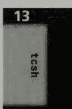


## 摘要

前三章介绍了三种最流行的 UNIX shell 的基本命令和概念。在介绍的几种 shell 中，tcsh 功能最为丰富，但这并不一定意味着它是最适合你使用的 shell。最终，这一决定很可能取决于你的个人偏好，而非所提供功能的多少。

下一章将探讨我们所讨论的每种 shell 提供的编程语言。在继续学习 C shell 之前，你可能想先了解其他主题。要了解以下内容：

- 使用编辑器创建和编辑文件，请阅读第 16 章“文本编辑器：vi 和 emacs”。
- 在 Linux 下将输出发送到打印机，请参阅第 20 章“打印”。

## Shell 编程

作者：Rick McMullin

### 本章内容

- 创建和运行 shell 程序 262
- 使用变量 264
- 引号的重要性 266
- test 命令 269
- 条件语句 272
- 迭代语句 276
- 函数 281

前三章描述了如何使用最常见的 Linux shell 程序；现在让我们更详细地看看这些 shell 程序内置的强大解释型编程语言。

本章描述了 shell 编程的基础知识，并比较了 bash、pdksh 和 tcsh 编程语言。本章涵盖以下主题：

- 创建和运行 shell 程序
- 使用 shell 变量
- 引号的重要性
- test 命令
- 条件语句
- 迭代语句
- 函数

本章包含几个小型 shell 程序示例。每个引入的新概念或命令都附有一些示例代码，以进一步解释所呈现的内容。

## 创建和运行 Shell 程序

在最简单的层面上，shell 程序就是包含一个或多个 shell 或 Linux 命令的文件。这些程序可用于简化重复性任务、用单个命令替代总是同时执行的两个或多个命令、自动化安装其他程序，以及编写简单的交互式应用程序。

要创建 shell 程序，你首先必须使用文本编辑器创建一个文件，并将要执行的 shell 或 Linux 命令放入该文件中。例如，假设你的 Linux 系统上挂载了一个 CD-ROM 驱动器。该 CD-ROM 设备在系统首次启动时已挂载。如果之后你更换了驱动器中的 CD，必须强制 Linux 读取新的目录内容。实现此目的的一种方法是将新 CD 放入驱动器，使用 Linux umount 命令卸载 CD-ROM 驱动器，然后使用 Linux mount 命令重新挂载驱动器。这一系列步骤由以下命令展示：

```
umount /dev/cdrom
mount -t iso9660 /dev/cdrom /cdrom
```

每次更换驱动器中的 CD 时，你不必每次都输入这两个命令，你可以创建一个 shell 程序来为你执行这两个命令。为此，将这两个命令放入一个文件，并将该文件命名为 remount（或你想要的其他名称）。

remount 文件中包含几种执行这些命令的方法。实现此目的的一种方法是使文件可执行。这是通过输入以下命令完成的：

```
chmod +x remount
```

该命令更改文件的权限，使其变为可执行文件。现在你可以通过在命令行输入 remount 来运行你的新 shell 程序。

> **注意**
> remount shell 程序必须位于你的搜索路径中的目录中，否则 shell 将无法找到要执行的程序。此外，如果你使用 tcsh 编写程序，shell 程序的第一行必须以 # 开头，以便 tcsh 将其识别为 tcsh 程序文件。

执行 shell 程序的另一种方法是运行编写该程序所对应的 shell，并将该程序作为参数传递给 shell。在 tcsh 程序中，这是通过输入以下命令完成的：

```
tcsh remount
```

该命令启动一个新的 shell，并指示其执行 remount 文件中找到的命令。

执行 shell 程序文件中命令的第三种方法是使用 . 命令（在 pdksh 和 bash 中）和 tcsh 中的 source 命令。该命令告诉 shell 执行作为参数传递给该命令的文件中的所有命令。例如，以下命令可用于指示 bash 或 pdksh 执行 remount 文件中的命令：

```
. remount
```

要在 tcsh 中执行相同操作，请输入以下命令：

```
source remount
```


以下示例描述了一种简单 shell 程序可以节省大量时间的另一种情况。假设你在目录中正在处理三个不同的文件，并且每天结束时你想将这三个文件备份到软盘上。为此，只需输入一系列类似于以下命令的内容：

```
mount -t msdos /dev/fd0 /a
cp file1 /a
cp file2 /a
cp file3 /a
```

正如示例中所述，实现此目的的一种方法是挂载软盘驱动器，然后输入三个复制命令，每个要复制的文件对应一个。更简单的方法是将这四个命令放入一个名为 backup 的文本文件中，然后在需要将这三个文件复制到软盘驱动器时执行 backup 命令。

**注意**

在执行该命令之前，你仍须确保 backup shell 程序是可执行的，并且位于你的路径中的目录中。

## 使用变量

与几乎所有语言一样，在 shell 程序中变量的使用非常重要。你已经在介绍性的 shell 章节中见过一些使用 shell 变量的方式。介绍的两个变量是 PATH 变量和 PS1 变量。这些是内置 shell 变量或由你使用的 shell 程序定义的变量的示例。本节描述如何创建自己的变量并在简单的 shell 程序中使用它们。

### 为变量赋值

在之前讨论的所有三种 shell 中，你只需输入变量名，后跟等号以及要分配给变量的值，即可为变量赋值。例如，如果你想为变量 count 赋值 5，请在 bash 或 pdksh 中键入以下命令：

```
count=5
```

使用 tcsh 时，你必须键入以下命令才能获得相同的结果：

```
set count = 5
```

**注意**

在使用 bash 和 pdksh 设置变量的语法时，请确保等号两侧没有空格。对于 tcsh，无论是否有空格都无所谓。

请注意，你不需要像在 C 或 Pascal 中编程那样声明变量。这是因为 shell 语言是一种非类型的解释型语言。这意味着你可以使用同一个变量来存储你用来存储整数的字符串。你向变量存储字符串的方式与向变量存储整数的方式相同。例如，要将名为“name”的变量设置为值“Garry”，请使用这些命令：

```
name=Garry    （用于 pdksh 和 bash）
set name = Garry    （用于 tcsh）
```

### 访问变量的值

将值存储到变量后，你如何将值取回？在 shell 中，你通过将变量名前加美元符号（$）来实现这一点。如果你想在屏幕上打印存储在 count 变量中的值，请键入以下命令：

```
echo $count
```

**提示**

如果省略上述命令中的 $，echo 命令将在屏幕上显示单词 count。

### 位置参数和其他内置 Shell 变量

shell 了解一种称为位置参数的特殊变量。位置参数用于引用通过命令行传递给 shell 程序或 shell 函数由 shell 脚本调用的参数。当你运行需要或支持许多命令行选项的 shell 程序时，每个这些选项都存储在一个位置参数中。第一个参数是

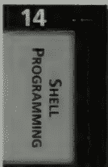


存储到一个名为 1 的变量中，第二个参数存储到一个名为 2 的变量中，依此类推。这些变量名称被 shell 保留，因此你不能用它们作为你定义的变量名。要访问存储在这些变量中的值，你必须像处理你定义的变量一样，在变量名前加上美元符号 ($)。

下面的 shell 程序期望被调用时带有两个参数。该程序获取这两个参数，先打印在命令行上输入的第二个参数，再打印在命令行上输入的第一个参数。

```
#program reverse, prints the command line parameters out in reverse order
echo "$2" "$1"
```

如果你输入以下命令来调用此程序：

```
reverse hello there
```

程序将返回以下输出：

there hello

在进行大量 shell 编程时，了解其他几个内置的 shell 变量非常重要。表 14.1 列出了这些变量，并简要说明了每个变量的用途。

### 表 14.1. 内置 SHELL 变量

| 变量 | 用途 |
|---|---|
| $# | 存储传递给 shell 程序的命令行参数数量。 |
| $? | 存储最后执行的命令的退出值。 |
| $0 | 存储输入命令的第一个单词（shell 程序的名称）。 |
| $* | 存储命令行输入的所有参数 ($1 $2 ...)。 |
| "$@" | 存储命令行输入的所有参数，分别引用（'$1' '$2' ...）。 |

## 引号的重要性

在 shell 编程中，使用不同类型的引号非常重要。三种类型的引号和反斜杠字符都被 shell 用于执行不同的功能。双引号（`"`）、单引号（`'`）和反斜杠（`\`）都用于隐藏特殊字符，使其不被 shell 解析。这些方法以不同程度隐藏特殊字符。

双引号是这三种方法中功能最弱的。当你用双引号包围字符时，所有空白字符对 shell 隐藏，但所有其他特殊字符仍会被 shell 解释。这种类型的引用在你将包含多个单词的字符串赋值给变量时最有用。例如，如果你要将字符串 `hello there` 赋值给变量 `greeting`，请输入以下命令：

```
greeting="hello there" (for bash and pdksh)
set greeting = "hello there" (for tesh)
```

该命令将 `hello there` 字符串作为一个单词存储到 `greeting` 变量中。如果你在不使用引号的情况下输入此命令，你将无法获得想要的结果。bash 和 pdksh 将不会理解该命令并会返回错误消息。tesh 会将值 `hello` 赋值给 `greeting` 变量并忽略命令行其余部分。

单引号是最强大的引用形式。它们隐藏所有特殊字符，使其不被 shell 解析。如果你输入的命令是 intended 给 shell 以外的其他程序，这将非常有用。

由于单引号最强大，你可以使用单引号来编写 `hello there` 变量赋值。但你并不总是希望这样做。如果赋值给 `greeting` 变量的字符串包含另一个变量，你必须使用双引号。例如，如果你想在问候语中包含用户名，请输入以下命令：

```
greeting="hello there $LOGNAME" (for bash and pdksh)
set greeting="hello there $LOGNAME" (for tesh)
```

> **提示**  
> 请记住，`LOGNAME` 变量是一个 shell 变量，它包含登录到系统的用户的 Linux 用户名。

如果你以 root 身份登录到 Linux，这会将值 `hello there root` 存储到 `greeting` 变量中。如果你尝试使用单引号编写此命令，它将不起作用，因为单引号会将美元符号从 shell 中隐藏，shell 不知道它应该执行变量替换。如果你使用单引号编写命令，`greeting` 变量将被赋值 `hello there $LOGNAME`。

使用反斜杠是隐藏特殊字符的第三种方法。与单引号方法一样，反斜杠隐藏所有特殊字符，但每次只能隐藏一个字符，而不是字符组。你可以使用以下命令，用反斜杠代替双引号重写问候示例：

```
greeting=hello\ there (for bash and pdksh)
set greeting=hello\ there (for tcshe)
```

在此命令中，反斜杠将空格字符从 shell 中隐藏，字符串 `hello there` 被赋值给 `greeting` 变量。

反斜杠引用最常在你只想隐藏单个字符时使用。这通常是在你想在字符串中包含特殊字符时进行的。例如，如果你要将一盒计算机磁盘的价格存储到名为 `disk_price` 的变量中，请使用以下命令：

```
disk_price=$5.00 (for bash and pdksh)
set disk_price = \$5.00 (for tcsh)
```

在此示例中，反斜杠将美元符号从 shell 中隐藏。如果没有反斜杠，shell 将尝试查找名为 5 的变量并执行变量替换。假设没有定义名为 5 的变量，shell 将为 `disk_price` 变量赋值 `.00`。这是因为 shell 将 `$5` 变量替换为 null 值。

> **注意**  
> `disk_price` 示例也可以使用单引号来将美元符号从 shell 中隐藏。

反引号（`` ` ``）执行不同的功能。当你想在另一个命令中使用命令的结果时使用它们。例如，如果你要将变量 `contents` 的值设置为当前目录中的文件列表，请输入以下命令：

```
contents='ls' (for bash and pdksh)
set contents = 'ls' (for tcshe)
```

此命令执行 `ls` 命令并将命令结果存储到 `contents` 变量中。正如你将在接下来的“迭代语句”部分中看到的那样，当你想编写一个 shell 程序，针对另一个命令的结果执行某些操作时，此功能会非常有用。

## test 命令

在 bash 和 pdksh 中，有一个名为 `test` 的命令用于评估条件表达式。通常，你使用 `test` 命令来评估用于条件语句的条件，或评估迭代语句的进入或退出标准。`test` 命令的语法如下：

```
test expression
or
[ expression ]
```

有几种内置运算符可以与 `test` 命令一起使用。这些运算符可分为四类：整数运算符、字符串运算符、文件运算符和逻辑运算符。

shell 整数运算符执行与字符串运算符类似的功能，但作用于整数参数。表 14.2 列出了 `test` 命令的整数运算符。

### 表 14.2. test 命令的整数运算符

| 运算符 | 含义 |
| :--- | :--- |
| int1 -eq int2 | 如果 int1 等于 int2，则返回 True。 |
| int1 -ge int2 | 如果 int1 大于或等于 int2，则返回 True。 |
| int1 -gt int2 | 如果 int1 大于 int2，则返回 True。 |
| int1 -le int2 | 如果 int1 小于或等于 int2，则返回 True。 |
| int1 -lt int2 | 如果 int1 小于 int2，则返回 True。 |
| int1 -ne int2 | 如果 int1 不等于 int2，则返回 True。 |

字符串运算符用于评估字符串表达式。表 14.3 列出了三种 shell 编程语言支持的字符串运算符。


### 表 14.3. test 命令的字符串运算符

| 运算符 | 含义 |
|---|---|
| str1 = str2 | 如果 str1 与 str2 相同，则返回 True。 |
| str1 != str2 | 如果 str1 与 str2 不相同，则返回 True。 |
| str | 如果 str 不为空，则返回 True。 |
| -n str | 如果 str 的长度大于零，则返回 True。 |
| -z str | 如果 str 的长度等于零，则返回 True。 |

`test` 命令的文件运算符用于执行诸如检查文件是否存在以及检查作为参数传递给 `test` 命令的文件类型等功能。表 14.4 列出了 `test` 命令的文件运算符。

### 表 14.4. test 命令的文件运算符

| 运算符 | 含义 |
|---|---|
| -d filename | 如果文件 filename 是目录，则返回 True。 |
| -f filename | 如果文件 filename 是普通文件，则返回 True。 |
| -r filename | 如果进程可以读取文件 filename，则返回 True。 |
| -s filename | 如果文件 filename 的长度不为零，则返回 True。 |
| -w filename | 如果进程可以写入文件 filename，则返回 True。 |
| -x filename | 如果文件 filename 可执行，则返回 True。 |

`test` 命令的逻辑运算符用于组合两个或更多整数、字符串或文件运算符，或否定单个整数、字符串或文件运算符。表 14.5 列出了 `test` 命令的逻辑运算符。

### 表 14.5. test 命令的逻辑运算符

| 命令 | 含义 |
|---|---|
| ! expr | 如果 expr 不为真，则返回 True。 |
| expr1 -a expr2 | 如果 expr1 和 expr2 均为真，则返回 True。 |
| expr1 -o expr2 | 如果 expr1 或 expr2 为真，则返回 True。 |

## tcsh 中 test 命令的等价物

tcsh 没有 `test` 命令，但它使用表达式支持相同的功能。tcsh 支持的表达式运算符与支持的运算符几乎相同

由 C 语言定义。这些表达式主要用在 `if` 和 `while` 命令中，稍后将在本章的“条件语句”和“迭代语句”部分进行介绍。

`tcsh` 表达式支持与 `bash` 和 `pdksh` test 命令相同类型的运算符。这些包括整数、字符串、文件和逻辑表达式。`tcsh` 表达式支持的整数运算符列于表 14.6 中。

### 表 14.6. TCSH 表达式的整数运算符。

| 运算符 | 含义 |
| :--- | :--- |
| int1 <= int2 | 如果 int1 小于或等于 int2，则返回 True。 |
| int1 >= int2 | 如果 int1 大于或等于 int2，则返回 True。 |
| int1 < int2 | 如果 int1 小于 int2，则返回 True。 |
| int1 > int2 | 如果 int1 大于 int2，则返回 True。 |

`tcsh` 表达式支持的字符串运算符列于表 14.7 中。

### 表 14.7. TCSH 表达式的字符串运算符。

| 运算符 | 含义 |
| :--- | :--- |
| str1 == str2 | 如果 str1 等于 str2，则返回 True。 |
| str1 != str2 | 如果 str1 不等于 str2，则返回 True。 |

`tcsh` 表达式支持的文件运算符列于表 14.8 中。

### 表 14.8. TCSH 表达式的文件运算符。

| 运算符 | 含义 |
| :--- | :--- |
| -r file | 如果文件可读，则返回 True。 |
| -w file | 如果文件可写，则返回 True。 |
| -x file | 如果文件可执行，则返回 True。 |
| -e file | 如果文件存在，则返回 True。 |
| -o file | 如果文件归当前用户所有，则返回 True。 |
| -z file | 如果文件大小为 0，则返回 True。 |
| -f file | 如果文件是普通文件，则返回 True。 |
| -d file | 如果文件是目录文件，则返回 True。 |

`tcsh` 表达式支持的逻辑运算符列于表 14.9 中。

### 表 14.9. TCSH 表达式的逻辑运算符。

| 运算符 | 含义 |
| :--- | :--- |
| exp1 \|\| exp2 | 如果 exp1 为真或 exp2 为真，则返回 True。 |
| exp1 && exp2 | 如果 exp1 为真且 exp2 为真，则返回 True。 |
| ! exp | 如果 exp 不为真，则返回 True。 |

## 条件语句

`bash`、`pdksh` 和 `tcsh` 各有两种形式的条件语句。即 `if` 语句和 `case` 语句。这些语句用于根据特定条件是否为真来执行 shell 程序的不同部分。与大多数语句一样，这些语句在不同 shell 中的语法略有不同。

### if 语句

所有三种 shell 都支持嵌套的 `if-then-else` 语句。这些语句提供了一种在 shell 程序中执行复杂条件测试的方法。`if` 语句的语法在 `bash` 和 `pdksh` 中是相同的，如下所示：

```
if [ expression ]
then
    commands
elif [ expression2 ]
then
    commands
else
    commands
fi
```

> **注意**
>
> `elif` 和 `else` 子句都是 `if` 语句的可选项。另外请注意，`bash` 和 `pdksh` 在其大多数复杂语句中使用语句名称的反义词来标记语句的结束。在此语句中，使用 `fi` 关键字来标记 `if` 语句的结束。

`elif` 语句是 `else if` 的缩写。只有当与 `if` 语句或其之前的任何 `elif` 语句相关的表达式都不为真时，才会执行此语句。只有当与 `if` 语句或任何 `elif` 语句相关的表达式都不为真时，才会执行与 `else` 语句关联的命令。

在 `tcsh` 中，`if` 语句有两种不同的形式。第一种形式提供了与 `bash` 和 `pdksh` `if` 语句相同的功能。这种形式的 `if` 语句具有如下语法：

```
if (expression1) then
commands
else if (expression2) then
commands
else
commands
endif
```

`tcsh` 提供的第二种 `if` 语句形式是第一种 `if` 语句的简单版本。这种形式的 `if` 语句只评估单个表达式。如果表达式为真，它执行单个命令；如果表达式为假，则不执行任何操作。这种形式的 `if` 语句的语法如下：

```
if (expression) command
```

该语句可以通过编写没有 `else` 或 `else if` 子句的 `if` 语句来使用第一种 `if` 语句形式来编写。这种形式只是节省了一些打字工作。

以下是一个 `bash` 或 `pdksh` `if` 语句的示例。该语句检查当前目录中是否存在 `.profile` 文件：

```
if [ -f .profile ]
then
    echo "There is a .profile file in the current directory."
else
    echo "Could not find the .profile file."
fi
```

使用 `tcsh` 语法编写的相同语句如下所示：

```
#
if ( { -f .profile } ) then
    echo "There is a .profile file in the current directory."
else
    echo "Could not find the .profile file."
endif
```

> **注意**
>
> 请注意，在 `tcsh` 示例中，第一行以 `#` 开头。这是为了让 `tcsh` 识别包含命令的文件为 `tcsh` 脚本文件所必需的。

### case 语句

`case` 语句允许你将一个模式与多个其他模式进行比较，并在找到匹配项时执行一段代码。shell 中的 `case` 语句比 Pascal 中的 `case` 语句或 C 语言中的 `switch` 语句强大得多。这是因为在 shell 的 `case` 语句中，你可以比较包含通配符的字符串，而在 Pascal 和 C 的对应语句中，你只能比较枚举类型或整数值。

再次强调，`case` 语句的语法在 `bash` 和 `pdksh` 中是相同的，而在 `tcsh` 中是不同的。`bash` 和 `pdksh` 的语法如下：

```
case string1 in
    str1)
        commands;;
    str2)
        commands;;
    *)
        commands;;
esac
```

`string1` 与 `str1` 和 `str2` 进行比较。如果这些字符串之一与 `string1` 匹配，则执行直到双分号（`;;`）之前的所有命令。如果 `str1` 和 `str2` 都不与 `string1` 匹配，则执行与星号关联的命令。这是默认的 case 条件，因为星号匹配所有字符串。

`bash` 和 `pdksh` `case` 语句的 `tcsh` 等价物被称为 `switch` 语句。该语句的语法紧密遵循 C 语言 `switch` 语句的语法。如下所示：

```
switch (string1)
    case str1:
        statements
    breaksw
    case str2:
        statements
    breaksw
    default:
        statements
    breaksw
endsw
```

其工作方式与 `bash` 和 `pdksh` `case` 语句相同。关键字 `case` 后的每个字符串都与 `string1` 进行比较。如果这些字符串中有任何一个与 `string1` 匹配，则代码执行直到遇到 `breaksw` 关键字。如果没有字符串匹配，则代码执行直到遇到 `default` 关键字后的 `breaksw` 关键字。

以下代码是一个 `bash` 或 `pdksh` `case` 语句的示例。该代码检查第一个命令行选项是否是 `-i` 或 `-e`。如果是 `-i`，程序将统计由第二个命令行选项指定的文件中以字母 `i` 开头的行数。如果第一个选项是 `-e`，程序将统计由第二个命令行选项指定的文件中以字母 `e` 开头的行数。如果第一个命令行选项不是 `-i` 或 `-e`，程序将在屏幕上打印一条简短的错误消息。

```
sh
case $1 in
    -i)
        count=`grep '^i' $2 | wc -l`
        echo "The number of lines in $2 that start with an i is $count"
        ;;
    -e)
        count=`grep '^e' $2 | wc -l`
        echo "The number of lines in $2 that start with an e is $count"
        ;;
    *)
        echo "That option is not recognized"
        ;;
esac
```

使用 `tcsh` 语法编写的相同示例如下所示：

```
sh
# remember that the first line must start with a # when using tcsh
switch ($1)
    case -i | i:
        set count = `grep '^i' $2 | wc -l`
        echo "The number of lines in $2 that begin with i is $count"
        breaksw
    case -e | e:
        set count = `grep '^e' $2 | wc -l`
        echo "The number of lines in $2 that begin with e is $count"
        breaksw
    default:
        echo "That option is not recognized"
        breaksw
endsw
```


# 迭代语句

Shell 语言还提供了一些迭代或循环语句。其中最常用的是 for 语句。除了 for 循环外，还有其他几种（如 while 和 until），但它们都是同一种方法的变体。for 循环在 Shell 程序中迄今为止是最常用的。

## for 语句

for 语句执行其包含的命令指定次数。bash 和 pdksh 有两种形式的 for 语句。for 语句在 bash 和 pdksh 中的语法相同。

bash 和 pdksh 支持的第一种 for 语句形式具有以下语法：

```bash
for var1 in list
do
    commands
done
```

在此形式中，for 语句针对列表中的每一项执行一次。该列表可以是一个包含由空格分隔的几个单词的变量，也可以是直接输入到语句中的一组值。每次循环时，变量 var1 被赋值为列表中的当前项，直到处理完最后一项。

第二种形式的 for 语句具有以下语法：

```bash
for var1
do
    statements
done
```

在此形式中，for 语句针对变量 var1 中的每一项执行一次。当使用这种 for 语句语法时，Shell 程序假设 var1 变量包含了传入 Shell 程序的所有位置参数（即在命令行中传入的参数）。

通常，这种形式的 for 语句等同于编写以下 for 语句：

```bash
for var1 in "$@"
do
    statements
done
```

tcsh 中与 for 语句等效的称为 foreach 语句。它的行为与 bash 和 pdksh 中的 for 语句相同。foreach 语句的语法如下：

```tcsh
foreach name (list)
    commands
end
```

下面是 bash 或 pdksh 风格 *for* 语句的一个示例。此示例将任意数量的文本文件作为命令行选项。该程序读取这些文件中的每一个，将所有字母转换为大写，然后将结果存储在一个同名但扩展名为 .caps 的文件中。

```bash
for file
do
    tr a-z A-Z < $file >$file.caps
done
```

用 *tosh* Shell 语言编写的相同示例如下所示：

```tcsh
#
foreach file ($*)
    tr a-z A-Z < $file >$file.caps
end
```

## while 语句

Shell 编程语言提供的另一个迭代语句是 *while* 语句。该语句在提供的条件表达式为真时执行代码块。bash 和 pdksh 中 *while* 语句的语法如下：

```bash
while expression
do
    statements
done
```

*while* 语句在 *tosh* 中的语法如下：

```tcsh
while (expression)
    statements
end
```

下面是 bash 和 pdksh 风格 *while* 语句的一个示例。该程序列出传入程序的参数及其参数编号。

```bash
count=1
while [ -n "$*" ]
do
    echo "This is parameter number $count $1"
    shift
    count=`expr $count + 1`
done
```

如您将在“shift 命令”部分所见，shift 命令将命令行参数向左移动一位。

用 tcsh 语言编写的相同程序如下所示：

```tcsh
#
set count = 1
while ( "$*" != "" )
    echo "This is parameter number $count $1"
    shift
    set count = `expr $count + 1`
end
```

## until 语句

until 语句在语法和功能上与 while 语句非常相似。两者之间唯一的真正区别在于，until 语句在其条件表达式为假时执行其代码块，而 while 语句在其条件表达式为真时执行其代码块。bash 和 pdksh 中 until 语句的语法是：

```bash
until expression
do
    commands
done
```

用于 while 语句的相同示例也可用于 until 语句。要使其工作，您只需取反条件。以下代码展示了这一点：

```bash
count=1
until [ -z "$*" ]
do
    echo "This is parameter number $count $1"
    shift
    count=`expr $count + 1`
done
```

此示例与 while 语句示例之间的唯一区别是，去掉了 -n 测试命令选项（意味着字符串长度非零），并代之以 -z 测试选项（意味着字符串长度为零）。

在实践中，until 语句并不是很有用，因为您编写的任何 until 语句都可以重写为 while 语句。tcsh 没有 until 语句的等效物，除非将其重写为 while 循环。

## shift 命令

bash、pdsh 和 tcsh 都支持一个名为 `shift` 的命令。`shift` 命令将存储在位置参数中的当前值向左移动一个位置。例如，如果当前位置参数的值为：

$1 = -r, $2 = file1, $3 = file2

并执行 `shift` 命令：

`shift`

结果的位置参数如下：

$1 = file1, $2 = file2

通过为 `shift` 命令指定数字，您还可以将位置参数移动超过一个位置。以下命令将 `shift` 位置参数两个位置：

`shift 2`

当您有一个需要解析命令行选项的 Shell 程序时，这是一个非常有用的命令。这是因为选项通常由一个连字符和一个表示该选项用途的字母组成。由于选项通常在某种循环中被处理，一旦确定下一个应该是哪个选项，您通常希望跳过当前的位置参数以到达下一个位置参数。例如，以下 Shell 程序期望两个命令行选项——一个指定输入文件，另一个指定输出文件。该程序读取输入文件，将输入文件中的所有字符转换为大写，然后将结果存储在指定的输出文件中。以下示例是使用 bash、pdsh 语法编写的。

```bash
while [ "$1" ]
do
    if [ "$1" = "-i" ]; then
        infile="$2"
        shift 2
    elif [ "$1" = "-o" ]; then
        outfile="$2"
        shift 2
    else
        echo "Program $0 does not recognize option $1"
    fi
done

tr a-z A-Z $infile $outfile
```

## select 语句

pdksh 提供了一种 bash 和 tcsh 都不提供的迭代语句，即 select 语句。这实际上是一个非常有用的语句。它与其他迭代语句有很大不同，因为它并不重复执行一块 Shell 代码直到条件为真或假。select 语句的作用使您能够自动生成简单的文本菜单。select 语句的语法是：

```bash
select menuitem [in list_of_items]
do
    commands
done
```

其中方括号用于包围语句的可选部分。

当执行 select 语句时，pdksh 会为 list_of_items 中的每个元素创建一个带编号的菜单项。此 list_of_items 可以是一个包含多个项的变量（例如 choice1 choice2），也可以是命令中键入的一组选项。例如：

```bash
select menuitem in choice1 choice2 choice3
```

如果未提供 list_of_items，select 语句将像 for 语句一样使用位置参数。

当包含 select 语句的程序用户通过输入与之关联的数字选择其中一个菜单项后，select 语句将所选项的值存储在 menuitem 变量中。do 块中包含的语句然后可以对此菜单项执行操作。

以下示例说明了 select 语句的一个潜在用途。此示例显示三个菜单项，当用户选择其中一项时，它会询问这是否是预期的选择。如果用户输入 y 或 Y 以外的任何内容，菜单将再次显示。

```bash
select menuitem in pick1 pick2 pick3
do
    echo "Are you sure you want to pick $menuitem"
    read res
    if [ $res = "y" -o $res = "Y" ]; then
        break
    fi
done
```

此示例引入了几个新命令。read 命令用于获取用户的输入。它将用户输入的任何内容存储到指定的变量中。break 命令用于退出 while、until、repeat、select 或 for 语句。


## 重复语句（repeat Statement）

tcsh 具有一种迭代语句，在 pdksh 或 bash 中并没有等效的语句，这就是 repeat 语句。repeat 语句会将单个命令执行指定的次数。repeat 语句的语法如下：

```text
repeat  count  command
```

下面是一个 repeat 语句的示例。它接收一组数字作为命令行选项，并在屏幕上打印相应数量的句点。这个程序充当一个非常原始的图形绘制程序。

```text
#
foreach num ($*)
    repeat $num echo -n "."
    echo ""
end
```

**注意**
任何 repeat 语句都可以改写为 while 或 for 语句。repeat 语法只是更方便而已。

## 函数（Functions）

Shell 语言允许你定义自己的函数。这些函数的行为与你用 C 或其他编程语言定义的函数非常相似。使用函数而不是将所有 Shell 代码直接编写在程序中的主要优势在于组织性。使用函数编写的代码通常更容易阅读和维护，并且也往往更短，因为你可以将通用代码分组到函数中，而不是在需要的地方到处放置。tcsh 不支持函数。

在 bash 和 pdksh 中创建函数的语法如下：

```text
fname () {
    shell commands
}
```

pdksh 还允许以下语法：

```text
function fname {
    shell commands
}
```

这两种形式的行为完全相同。

一旦你使用上述任一形式定义了函数，你可以通过输入以下命令来调用它：

```text
fname [parm1 parm2 parm3 . . . ]
```

注意，你可以向函数传递任意数量的参数。当你向函数传递参数时，它们会像你在命令行上向 Shell 程序传递参数时那样，被函数视为位置参数。例如，以下 Shell 程序包含几个函数，每个函数都执行与某个命令行选项相关的任务。此示例说明了本章涵盖的许多主题。它读取所有在命令行上传递的文件，并根据使用的选项——将文件全部以大写字母写出，或将文件全部以小写字母写出，或者打印文件。

```text
upper () {
shift
for i
do
tr a-z A-Z <$1 >$1.out
rm $1
mv $1.out $1
shift
done; }

lower () {
shift
for i
do
tr A-Z a-z <$1 >$1.out
rm $1
mv $1.out $1
shift
done; }

print () {
shift
for i
do
lpr $1
shift
done; }

usage_error () {
echo "$1 syntax is $1 <option> <input files>"
echo ""
echo "where option is one of the following"
echo "p -- to print frame files"
echo "u -- to save as uppercase"
echo "1 -- to save as lowercase"; }

case $1
in
p | -p)    print $@;;
u | -u)    upper $@;;
1 | -1)    lower $@;;
*)         usage_error $0;;
esac
```

## 摘要（Summary）

本章向你介绍了 bash、posh 和 tcsh 编程语言的许多特性。随着你对使用 Linux 的熟悉，你会发现你使用 Shell 编程语言的频率越来越高。

虽然 Shell 语言非常强大且相当容易学习，但你可能会遇到一些情况，在这些情况下，Shell 程序并不适合你要解决的问题。在这些情况下，你可能希望探索使用 Linux 下可用的其他语言的可能性。此时，有许多其他编程语言值得你查看。要了解更多信息：

-   关于 awk，它对于处理搜索模式和大数值列很有用，请参见第 25 章，“gawk”。
-   关于 Perl，它对于许多快速脚本任务以及 Web 页面很有用，请参见第 28 章，“Perl”。
-   关于 Smalltalk/X，它用于在 X GUI 下编写面向对象的程序，请参见第 31 章，“Smalltalk/X”。

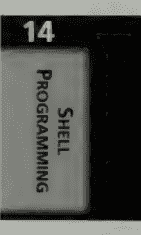


## FTP 和 Telnet

*作者：Tim Parker*

### 本章内容（IN THIS CHAPTER）

-   FTP 286
-   设置 FTP 服务器服务 287
-   使用 FTP 289
-   简单文件传输协议（TFTP） 294
-   使用 Telnet 295

与其他 Linux 和 UNIX 系统（或者任何操作系统）通信的两个最有用的工具是 FTP（用于传输文件）和 Telnet（用于登录其他系统）。在本章中，我们将看看如何使用这两个工具，并提及 TFTP，它是 FTP 的一个简化版本。

## FTP

使用 FTP 和 TFTP 有两种不同的方式：通过命令行或通过图形用户界面。除非你找到共享软件或商业的图形用户界面产品，否则大多数 Linux 系统仅限于基于字符的命令。基于图形用户界面的 FTP 客户端在 Windows 机器上更常见。字符版和图形用户界面版都完成完全相同的任务（将文件从一台机器传输到另一台机器），但通过不同的用户界面实现。由于这是大多数 Linux 系统提供的功能，我们将在这里集中介绍基于字符的版本。

说到 FTP 的功能以及 FTP 做什么，它的名字基本上说明了一切：文件传输协议（File Transfer Protocol）。FTP 专门开发出来提供将文件从一台机器传输到另一台机器方法，而不需要 XMODEM、YMODEM、ZMODEM 或 Kermit 等复杂的通信协议，同时也消除完全登录到远程机器的需要。FTP 提供快速登录远程机器、在文件系统中移动（当然受权限限制）以及快速将文件传输到远程系统或从远程系统传输文件的方法。

要使用 FTP 传输文件，你正在运行的机器（客户端）必须具有 FTP 客户端软件。Linux 和 UNIX 机器几乎总是将 FTP 客户端软件作为其基本分发系统的一部分包括在内。连接的另一端——你想要连接的机器——被称为服务器，它必须运行一个接受传入 FTP 请求的程序。这被称为 FTP 服务器，通常必须始终运行才能使 FTP 连接正常工作。

像 Linux 这样的多任务操作系统通常将 FTP 服务器程序作为基本分发的一部分包括在内。在大多数情况下，该服务器被称为“ftpd”，即 FTP 守护进程的意思。（守护进程是在机器运行时在后台运行的程序。）ftpd 守护进程几乎总是作为 Linux 启动过程的一部分自动加载，除非系统管理员明确将其移除。

如果你正在连接到 PC（运行 OS/2、Windows、Windows 95、NetWare 或类似操作系统）或 Macintosh 服务器，那么服务器很可能默认没有运行 FTP 服务器软件。安装这些操作系统时，它们缺少大多数 TCP/IP 服务。系统管理员必须明确启用它们。如果没有在 PC 上运行服务器软件，你就不能用你的 FTP 客户端连接到服务器。

大多数用于 PC 和 Macintosh 的 TCP/IP 包都包含用于 FTP 的服务器程序，使其他用户能够连接到该机器。事实上，大多数 TCP/IP 包都包含 FTP 客户端和 FTP 服务器软件作为分发的一部分，使你可以将你的机器设置为既是客户端又是其他用户的服务器（假设你希望允许其他人访问你的文件系统）。

### 设置 FTP 服务器服务（Setting Up FTP Server Service）

在查看如何从另一台机器（服务器）连接和传输文件之前，我们应该提及如何设置你的机器作为 FTP 服务器。你也可能需要在远程机器上这样做。每个需要接受传输请求的机器都必须激活 FTP 服务器软件。正如你稍后所见，这很容易做到。你还可以将现有的机器设置为 FTP 服务器，允许网络上的其他机器连接到你的系统并传输文件。

你可能需要的所有客户端和服务器软件程序都作为 Linux 分发的一部分包括在内（当然必须安装它）。无论你是在设置访问控制 FTP 服务还是匿名 FTP 服务都没有关系，因为你安装和配置 FTP 守护进程的基本步骤是相同的。

配置过程从选择一个 FTP 站点名称开始。你实际上并不需要站点名称，尽管它可以使远程用户更容易找到你的系统，特别是如果他们使用匿名登录时。FTP 站点名称通常采用以下一般格式：

```text
ftp.domain_name.domain_type
```

其中 domain_name 是 FTP 服务器域名（或其别名），domain_type 是通常的 DNS 扩展。例如，如果你的 FTP 站点名为：

```text
ftp.tpc1.com
```

那么很明显，这是访问 tpc1.com 域的任何人的 FTP 服务器。

称为 ftpd 的 FTP 守护进程必须启动。通常，inetd 进程通过监视 TCP 命令端口（通道 21）是否有到达的连接请求来启动 FTP 守护进程。然后它启动 ftpd 来处理该请求。


> **注意**
请检查 `inetd` 配置文件（通常是 `/etc/inetd.conf`），确保其中有一行类似以下内容，以便在需要时 `ftpd` 可以由 `inetd` 启动：

```
ftp    stream    tcp    nowait    root    /etc/ftpd    ftpd
```

如果此条目不存在，请添加它。在大多数 Linux 和 UNIX 系统中，`inetd` 配置文件中已经存在此行，尽管它可能被注释掉了——如果是这种情况，你应该移除注释符号。

`inetd` 配置文件中的 ftp 条目告知 `inetd`，FTP 使用 TCP，并且每次有新连接到 ftp 端口时，它都应启动 `ftpd`。`ftpd` 守护进程可以附加 `-l` 选项启动，该选项启用日志记录。你可以忽略此选项，因为日志文件会很快变得相当大。

如果你打算建立一个基于用户的 FTP 服务，其中每个访问你系统的人都有一个有效的登录名和密码，你必须像在 Linux 系统中为直接用户创建账户一样，在 `/etc/passwd` 文件中为每个用户创建一个账户。要设置匿名 FTP 服务器，你必须为匿名用户 ID 创建一个登录账户。这在正常过程中通过向 `/etc/passwd` 文件添加用户来完成。登录名称应该是你希望人们在访问你的系统时使用的名称。通常这个名字是 "anonymous" 或 "ftp"。你需要为匿名用户选择一个登录目录，该目录可以受到文件系统中其他部分的保护。典型的 `/etc/passwd` 条目如下所示：

```
ftp:*:400:51:Anonymous FTP access:/usr/ftp:/bin/false
```

这设置了用户名为 **ftp** 的匿名用户。星号密码阻止任何人访问该账户。用户 ID 号（400）对于系统是唯一的。组 ID（51）显示了 ftp 登录所属的组。

为了更好的安全性，建议单独创建一个组仅用于匿名 FTP 访问（编辑 `/etc/group` 文件以添加新组），然后将 FTP 用户设置到该组。只有匿名 FTP 用户应该属于该组，因为它可以用来设置文件权限以限制访问并使你的系统更安全。上述示例中的登录目录是 `/usr/ftp`，虽然你可以选择任何目录，只要它属于匿名 FTP 用户即可（再次出于安全原因）。上述示例中显示的启动程序是 `/bin/false`，这有助于保护你的系统，防止访问没有强密码保护的账户和实用程序。

## 使用 FTP

无论你是在 Linux 系统、UNIX 机器、Windows PC 还是 Macintosh 上都没有关系。当你准备好使用 FTP 传输文件时，你启动一个客户端 FTP 软件包，指定你想要连接的远程系统的名称，然后让两台机器建立 FTP 会话。连接后，你可以开始传输文件。

基于字符的 FTP 通常使用目标机器的名称或 IP 地址启动。基于图形用户界面（GUI）的 FTP 客户端通常先显示一个窗口，你可以从中选择连接选项，或者从列表中远程系统的名称或 IP 地址。如果你使用机器名称，例如“darkstar”或“superduck”，该名称必须能够由你的系统解析为 IP 地址，以便 FTP 连接。

当 FTP 成功连接到远程机器时，通常你必须使用有效的用户登录名和密码登录。一些系统允许匿名或来宾登录。在大型网络中，如果使用了 Yellow Pages (YP) 或 Network Information Services (NIS) 等系统，通常允许跨网络登录到大多数机器。如果在你的局域网中没有使用 YP 或 NIS，你必须包含在远程机器的有效用户文件中才能获得 FTP 访问权限（当然，匿名 FTP 除外）。你可以使用与本地机器登录不同的用户 ID 登录到远程机器。要在两个系统之间传输文件，你必须在这两个系统上都有适当的权限。

这里有一个非常重要的观点：在使用 FTP 登录后，你实际上并不在远程机器上。你在逻辑上仍然在你的客户端机器上，所有关于文件传输和目录移动的指令都是相对于你的本地机器，而不是远程机器。这与 Telnet 相反，这一差异常常让刚接触 FTP 和 Telnet 的人感到困惑。

**警告**

请记住，所有对文件和目录的引用都是相对于发起 FTP 会话的机器而言的。如果你不仔细，可能会意外覆盖现有文件。

### 通过 FTP 连接

你需要登录名和密码来连接到远程机器（服务器），并且你的本地机器准备运行 FTP（客户端）。你从远程机器看到的屏幕外观和提示语差异很大，具体取决于每个系统运行的操作系统和 FTP 软件。

在 UNIX 或 Linux 系统以及许多 DOS TCP/IP 系统上，你可以使用远程系统的名称或其 IP 地址启动 FTP；基于字符的 FTP 客户端使用远程机器的 IP 地址启动，在提供用户 ID 和密码后，你就已连接。

### FTP 命令

一旦你连接到远程系统，你就希望浏览目录结构并传输文件。FTP 用户可以使用许多命令；最常用的命令总结如下表 15.1。这些命令通常仅用于基于字符的 FTP 客户端，因为基于图形用户界面（GUI）的客户端使用菜单项来实现这些功能。

**表 15.1. FTP 用户命令。**

| FTP 命令 | 描述 |
| :--- | :--- |
| ascii | 切换到 ASCII 传输模式 |
| binary | 切换到二进制传输模式 |
| cd | 在服务器上更改目录 |
| close | 终止连接 |
| del | 删除服务器上的文件 |
| dir | 显示服务器目录 |
| get | 从服务器获取文件 |
| hash | 为每个传输的块显示一个井号 |
| help | 显示帮助 |
| lcd | 在客户端更改目录 |
| mget | 从服务器获取多个文件 |
| mput | 向服务器发送多个文件 |
| open | 连接到服务器 |
| put | 向服务器发送文件 |
| pwd | 显示当前服务器目录 |
| quote | 直接提供 FTP 命令 |
| quit | 终止 FTP 会话 |

主要的文件传输命令是 get 和 put。请记住，所有命令都是相对于客户端（你发出命令的机器）的，因此 get 命令将文件从服务器移动到客户端，而 put 命令将文件从客户端放到服务器。

基于字符的 FTP 客户端很容易展示其工作原理。考虑以下示例：

```
get autoexec.bat
705 bytes received in 0.1 seconds (0.00 kbytes/s)
```

这里用户已登录到远程机器，然后发出 get 命令以从远程机器（这是一台 Windows FTP 服务器）将文件 autoexec.bat 传输到本地客户端。如你所见，FTP 客户端会发出状态报告，显示文件大小和传输所花费的时间。

mget 和 mput 命令类似于 get 和 put，但它们一次传输多个文件。例如，命令：

```
mget config.*
```

将从 FTP 服务器传输所有名为 config.* 的文件到本地客户端的目录。对于每个匹配该模式的文件，服务器都会提示以确认你希望传输它。

你可以使用 cd 命令更改目录，并使用 pwd 打印当前目录（这些是 UNIX 命令）来在远程机器上移动。注意，如果你是在客户端 UNIX 机器上，必须使用 UNIX 的 / 而不是 DOS 的 \ 字符来表示目录更改。再次强调，你必须了解远程机器的操作系统以防止出现问题。

在文件传输和进入其他目录时，FTP 总是考虑文件访问权限和权限。如果你没有服务器设置的正确权限，你就无法执行该操作，并且会看到错误消息。

## 文件传输模式

FTP 是在 TCP/IP 的早期开发的，当时几乎所有的文件都是 ASCII 格式。当必须传输二进制文件时（二进制定义为任何非...


拥有常规 ASCII 字符），传输模式必须从 ASCII（通常称为文本）手动更改为二进制。FTP 支持多种格式的文件传输，这些格式通常依赖于系统。大多数系统（包括 UNIX 系统）只有两种模式：文本和二进制。一些大型机安装支持 EBCDIC，而许多站点具有本地类型，专为本地网络机器之间的快速传输而设计。（本地类型可能使用 32 位或 64 位字。）

若要更改文件传输格式以允许你移动除文本文件以外的任何文件，你必须首先使用此命令确保 FTP 处于二进制模式：

```
bin
```

你可以使用以下命令返回字符模式：

```
ascii
```

意识到你当前处于哪种模式很重要。Linux FTP 默认通常以字符（ASCII）模式启动。

文本传输使用由回车符和换行符分隔的 ASCII 字符，而二进制模式允许传输字符时不进行转换或格式化。二进制模式比文本模式更快，并且也支持传输所有 ASCII 值（对非文本文件是必要的）。在大多数系统上，FTP 以文本模式启动，尽管现在许多系统管理员为了方便用户而将 FTP 设置为二进制模式。FTP 无法传输文件权限，因为这些权限并未作为协议的一部分进行指定。某些 FTP 客户端和服务器可以检测文件类型并相应地调整自身。如有疑问，请使用二进制模式。

通常，FTP 没有键盘快捷键（例如，按 Tab 键自动补全匹配的名称）。这意味着你必须完整且正确地输入文件或目录的名称。如果你拼错文件或目录名称，你将收到错误消息并必须重试。幸运的是，如果你通过 X 窗口或 Windows 环境执行 FTP 会话，你可以从会话早期复制和粘贴行。

## 匿名 FTP 访问

FTP 需要用户 ID 和密码以启用文件传输功能，但存在一种更宽松的方法允许通用访问文件或目录，称为*匿名 FTP*。匿名 FTP 取消了对远程机器登录账户的要求，通常允许使用*guest*或用户实际登录名作为密码进行匿名登录。以下会话展示了匿名 FTP 系统的使用：

```
ftp> ftp uofc.edu.  
连接到 uofc.edu.
220 uofc.edu FTP 服务器准备就绪。
Name (uofc:username): anonymous
331 来宾登录成功，请发送 userID 作为密码。
Password: tparker
230 来宾登录成功，访问限制适用。
ftp>
```

如果远程系统设置为允许匿名登录，你有时会被提示输入密码，然后收到关于访问限制的警告。如果远程系统上有你需要的文件，get 命令将传输该文件。随着对互联网兴趣的扩展，匿名 FTP 站点正变得普遍。

如果远程系统支持匿名 FTP，通常会有一条消息明确告知你这一点。下面显示的登录是针对名为 sunsite.unc.edu 的 Linux FTP 存档站点：

```
ftp sunsite.unc.edu
331 来宾登录成功，请发送你的完整电子邮件地址作为密码。
Enter username (default: anonymous)
Enter password [tparker@tpci.com]:
|FTP| 打开
230- 欢迎使用 UNC 和 SUN 的匿名 FTP 服务器
230- 北卡罗来纳大学
230- 信息技术办公室
230- SunSITE.unc.edu
230 来宾登录成功，访问限制适用。
FTP>
```

完成登录过程后，你会看到提示符 FTP>，表明远程系统已准备好接受命令。

当你登录某些系统时，你可能会看到一条简短的消息，其中包含下载文件的说明，解释对匿名 FTP 用户施加的任何限制，或者关于有用文件位置的信息。例如，你可能会看到这样的消息（取自 Linux FTP 站点）：

```
要获取二进制文件，请输入： BINARY，然后： GET "文件名" 新文件名
要获取文本文件，请输入： ASCII，然后： GET "文件名" 新文件名
名称必须精确匹配大小写。使用引号，如所示。
要获取目录，请输入： DIR。要更改目录，请输入： CD "目录名"
要读取短文本文件，请输入： GET "文件名" TT
更多内容，请输入 HELP 或在 gopher 中查看 FAQ。
要退出，请输入 EXIT 或 Control-Z。
```

```
230- 如果你发送邮件到 info@sunsite.unc.edu，你将收到帮助
*信息
230- 关于如何使用 sunsite 提供的不同服务。
```

我们使用 warchive 实验性 ftpd。如果你"获取" <目录>.tar.Z 或 <文件>.Z，它将即时压缩和/或打包。使用".gz"代替".Z"将使用 GNU zip (/pub/gnu/gzip*)，这是一种更优越的压缩方法。

大多数匿名 FTP 站点设置为只读，不允许你向它们上传文件（put 文件）。通常，你在他们的文件系统中能去的地方也非常受限。

## 简单文件传输协议 (TFTP)

简单文件传输协议 (TFTP) 在两个主要方面与 FTP 不同：它不登录远程机器，并且使用无连接传输协议用户数据报协议 (UDP) 而不是 TCP。TFTP 通常不用于可以使用 FTP 的机器之间的文件传输，尽管当涉及无盘终端或工作站时，TFTP 很有用。通常，TFTP 用于从非常繁忙的服务器请求文件，或者当文件可以在任何时候传递时。使用 TFTP 很像使用电子邮件：你发送一条请求文件的消息，最终文件会传回你的系统。

TFTP 通过施加自己的限制来处理访问和文件权限。在大多数系统上，只有当文件对所有用户可访问时，才能使用 TFTP 传输文件。由于访问法规宽松，大多数系统管理员对 TFTP 施加更多控制或完全禁止其使用。

TFTP 命令集的主要指令见表 15.2。虽然它们看起来类似于 FTP 命令集，但由于 TFTP 协议的无连接特性，它们在几个重要方面有所不同。最明显的是 connect 命令，它只是确定远程地址，而不是发起连接。

表 15.2. TFTP 的命令集。

| TFTP 命令 | 描述 |
| :--- | :--- |
| binary | 传输时使用二进制模式 |
| connect | 确定远程地址 |
| get | 从远程检索文件 |
| put | 将文件传输到远程 |
| trace | 显示协议代码 |
| verbose | 显示所有信息 |

TFTP 支持文本和二进制传输。与 Telnet 和 FTP 一样，TFTP 使用服务器进程（在 UNIX 系统上是 tftpd）和可执行文件，通常称为 tftp。由于 TFTP 的性质，Windows 和类似的基于 PC 的操作系统通常不支持它。在大多数情况下，TFTP 用于 UNIX 机器之间。

下面展示了一个基于字符的 TFTP 会话示例，开启了完整的跟踪选项和二进制传输：

```
> tftp
tftp> connect tpci_hpw54
tftp> trace
数据包跟踪已开启。
tftp> binary
二进制模式已开启。
tftp> verbose
详细模式已开启。
tftp> status
已连接到 tpci_hpw54.
模式：八进制 详细：开启 跟踪：开启
重传间隔：5 秒，最大超时：25 秒
tftp> get /usr/rmaclean/docs/draft1
从 tpci_hpw54:/usr/rmaclean/docs/draft1 获取到 /tmp/draft1 [八进制]
发送 RRQ <文件=/usr/rmaclean/docs/draft1，模式=八进制>
接收 DATA <块1，512 字节>
发送 ACK <块=1>
接收 DATA <块2，512 字节>
发送 ACK <块=3>
接收 DATA <块4，128 字节>
发送 ACK <块=3>
接收 1152 字节，耗时 0.2 秒 [46000 位/秒]
tftp> quit
```

在某些情况下，如果网络状况不佳或服务器不接受标准 FTP，你可能不得不使用 TFTP。不过，通常情况下，FTP 应该是你的协议选择。

## 使用 Telnet

Telnet 赋予你登录远程服务器并表现得好像物理连接到该机器及其所有资源的能力。如果服务器拥有强大的 CPU，你可以使用该 CPU 代替你较弱的本地处理器。如果服务器有一些特殊设备，例如扫描仪、CD 刻录机或磁光盘存储设备，你可以使用它们。你还可以使用远程服务器的文件系统。

使用 Telnet 非常简单，因为协议为你处理所有的配置和设置过程。作为其启动的一部分，Telnet 在客户端和服务器之间传递一系列消息，以建立终端标识和你...

允许使用终端。实际上，你所要做的就是告诉 Telnet 你想要登录哪台机器，然后提供用户 ID 和密码。

实际上，几乎每一种操作系统都有可用的 Telnet 实现程序。这些实现包括商业产品（通常作为 TCP/IP 套件的一部分）以及专为 Telnet 仿真设计的公共领域或共享软件。选择哪种 Telnet 程序很大程度上是个人偏好，因为所有这些程序执行的任务都是相同的。

启动 Telnet 很简单。如果你处于命令提示符下（例如在 Linux 系统中），你通常输入 telnet 命令，后接你想要登录的远程机器的名称。你可以为远程机器提供名称或 IP 地址，不过名称必须能通过 TCP/IP 解析为 IP 地址。某些系统可能会对 Telnet 施加安全限制，因此如果你不确定访问权限，请咨询你的系统管理员。

telnet 命令支持许多可以定制服务行为的选项，尽管在典型的 Telnet 会话中很少使用这些选项。支持的选项往往因 Telnet 版本和操作系统而异，因此如果你想修改 Telnet 的默认行为，可能需要查阅随操作系统提供的文档。大多数人发现标准应用已经足够好，不需要使用选项。

## 使用 Telnet 和图形界面

如果你想连接到一个远程图形界面系统并在你的本地机器上显示图形，你需要指示连接的双方如何显示图形。如果你是从一台 Linux 机器连接到另一台，这个过程非常简单，因为 Linux 具有重定向窗口输出功能，且几乎不需要额外操作。例如，如果你从一台 UNIX 或 Linux 机器连接到另一台运行 Motif 的机器，第一步是允许远程机器在你的终端上打开窗口。这是通过 xhost 命令完成的。命令

```
xhost +
```

指示 Linux 允许远程机器在你的显示器上打开窗口。（这是一个包含性命令，允许任何远程机器在你的终端上打开窗口。这可能并非总是期望的结果，因此你可以选择在加号后面指定远程机器名称来限制访问，如果你愿意的话。）

建立与基于图形界面的远程系统的 Telnet 连接后，你需要指示它在你本地机器上打开所有窗口。在 Linux 中，你可以使用 `DISPLAY` 环境变量来实现这一点。如果你使用的是 C Shell，发出如下命令：

```
setenv DISPLAY tcpicws:0.0
```

其中 **tcpicws** 是你本地终端的名称。命令中本地终端名称后的 **:0.0** 部分必须提供，否则图形界面无法正确打开窗口。`setenv` 命令用于在 C Shell 中设置 Motif 和 X 使用的环境变量 `DISPLAY`。在 Bourne 和 Korn shell 中，你必须更改命令以反映这些 shell 的语法。

## TN3270 和其他

根据你登录的系统类型，Telnet 可能无法为你提供合适的终端特性。这对于需要 IBM 3270 终端仿真的机器（如 IBM 大型机和某些小型机）尤其如此。基本的 Telnet 程序无法提供此功能，因此通常随 `telnet` 一起提供 TN3270 这个特殊版本的 Telnet。TN3270 提供正确的 IBM 3270 终端仿真。一些 TCP/IP 套件还包括 TN5250，这是一种比 3270 功能更强的终端。3270 和 5250 终端均支持全彩显示。

只要服务器能够仿真这些终端类型，TN3270 和 TN5250 就可以与任何类型的服务器一起使用。例如，你可以使用 TN3270 在连接到较小的 UNIX 服务器时获取颜色，而普通 Telnet 则无法提供此功能。大多数 TN3270 和 TN5250 系统允许你随意更改屏幕字体和颜色。

## 摘要

FTP 和 Telnet 在局域网中极其有用，尤其是在许多应用程序驻留在不同机器上的情况下。Telnet 非常容易开始使用、启动和操作。你只需要远程机器的 IP 地址以及通过网络（通过 TCP/IP）的连接。从这里开始，有一些相关主题你可能想要阅读。要了解：

- 在 Linux 系统上安装 X，请参阅第 22 章，“安装和配置 XFree86”。
- 系统管理和其上的进程，请参阅第六部分，从第 32 章“系统管理基础”开始。
- 包含 Linux 二进制文件的 FTP 站点，请参阅附录 A，“Linux FTP 站点和新sgroups”。

# **部分**

**III**

# 编辑、排版及其他

## 本部分

- 文本编辑器：vi 和 emacs 301
- groff 319
- geqn 和 gtbl 331
- TeX 和 LaTeX 345
- 打印 363
- 多媒体 Linux 371

# 文本编辑器：vi 和 emacs

作者：Peter MacKinnon

## 本章内容

- 什么是编辑器，我为什么需要一个？ 302
- 编辑功能 302
- vi 编辑器 304
- emacs 编辑器 312

# 什么是编辑器，我为什么需要一个？

*文本编辑器* 是 Linux（或几乎所有）操作系统提供的最基本工具之一。使用编辑器，你可以创建和修改具有广泛应用的文本文件：

- 用户文件，如 .login 和 .cshrc
- 系统文件
- Shell 程序
- 文档
- 电子邮件消息

这只是你在使用 Linux 工作时将使用的许多不同类型文本文件中的少数几个。基本上，编辑器使你能够插入、删除、移动和搜索文本，范围从单个字符到数千行。

Linux 系统中最受欢迎的两个编辑器是 *emacs* 和 *vi*。这两个编辑器都是全屏文本编辑器；简而言之，它们使用终端屏幕的每一行和每一列来显示文件的文本内容。这两个编辑器都具有一组丰富的命令。操作文本的基本命令可以相当快地学会；更复杂的命令可能需要稍长时间才能掌握。然而，当你看到这些强大工具能为你节省多少时间时，你很可能感激这一投入。

选择一个编辑器而不是另一个可能是个人口味的问题。*emacs* 和 *vi* 都高效，且可以处理几乎任何大小的文件。*emacs* 编辑器更适合复杂的编辑任务，并带有一个在线帮助设施，但对于简单的编辑工作，两个编辑器同样好。最终取决于你使用哪个更觉得舒适。

# 编辑功能

尽管 Linux 有多种具有不同界面的文本编辑器，但它们基本上做相同的事情。任何有用的文本编辑器至少应支持以下功能。

## 插入和删除文本

文本编辑器最基本的功能是允许你随心所欲地输入和擦除字符。这也意味着你可以完全控制光标的移动及其在文本中的位置。

## 读取和写入文件

由于你希望保存创建的文本文件以便将来使用，编辑器可以将你的文本写入外部文件。每当你需要修改文件时，编辑器可以从磁盘读取该文件。一个不错的特性是文本编辑器被设计为适应 ASCII 格式的文件，因此一个编辑器（如 emacs）可以读取由另一个编辑器（如 vi）编写的任何文件，反之亦然。

## 搜索文本

逐行扫描大文件以寻找特定单词的实例，要么是提高你专注力绝佳方法，要么是自我折磨的练习。这就是为什么文本编辑器提供高级搜索功能。这些包括使用正则表达式，以及固定字符串。请记住，正则表达式包含元字符（如 ., ?, 和 *），用于替换和扩展未知的文本模式。

编辑器还支持搜索和替换功能，允许你用一条命令更改字符串模式的多个实例。

## 复制和移动文本

由于没有保证文本最初输入文件的方式就是它应该永远保持的方式，编辑器为你提供复制、剪切和移动（或粘贴）文本块的手段。这些块的大小可以从几页到单个字符不等。复制和剪切文本的区别在于，剪切在将选定的文本块复制到缓冲区后会删除该文本块，而复制则不会。

## 编辑缓冲区

你可能会问，缓冲区是什么？*缓冲区* 是编辑程序内存中的位置，当你修改文件时文本可以驻留于此。例如，第一次编辑文件时，你输入的文本实际上存在于一个缓冲区中，当你执行保存操作时，该缓冲区会被写入外部文件。缓冲区还可以在编辑过程中的其他时间使用，特别是在需要暂时将文本块移动到内存时


更改（换句话说，就是剪切和粘贴）。许多编辑器允许你同时管理多个缓冲区。

这些编辑器拥有许多本章未完全详述的命令。在进行任何漫长且艰难的编辑任务之前，请咨询你所使用的编辑器的 man 手册页。也许有比你想要执行的操作更简单的方法。随着你越来越熟悉编辑器，你会发现一些便捷的快捷键和功能来执行你最乏味的编辑任务。

## vi 编辑器

vi 编辑器安装在几乎每一个现有的 UNIX 系统中。因此，许多人认为 vi 是 UNIX 系统（Linux 基于其之上）的默认文本编辑器。vi 具有两种操作模式和简明的命令，这两者都使得它比 emacs 更难上手。然而，如果你的 Linux 系统上未安装 emacs，学习 vi 还是一个非常有用的选择。

### 启动 vi

你通过在命令行中输入以下内容来调用 vi：

```
vi
```

屏幕会清空，最左边的一列会出现一列波浪号（~）。你现在正在编辑一个空白的、未命名的文件。你放入此文件的任何文本都将存在于缓冲区中，直到你将缓冲区的内容写入某个已命名的文件。波浪号是 vi 告诉你该行没有文本的方式。

vi 也可以启动并带有要编辑的文件或文件列表：

```
vi filename1 filename2 filename3 ...
```

通常，你每次 vi 会话可能只会编辑一个文件。如果你正在编辑一个文件列表，vi 将按照它们出现在命令行上的顺序逐个编辑它们。

或者，vi 可以从命令行作为以下方式调用：

```
vi +n filename
```

其中 $n$ 代表 vi 将在 filename 中放置光标的行号。这对于需要快速跳转到已知包含错误的行的大型源代码文件的程序员来说非常有用。

另一个示例有助于说明 vi 编辑器。在命令行输入 `vi asong` 让我们看看会发生什么。

### vi 模式

在屏幕底部左下角，你会看到 `"asong" 0 lines, 0 characters`。

显示在此状态线上的消息告诉你 vi 正在做什么或刚刚做了什么。在这种情况下，vi 正在告诉你它打开了一个空缓冲区，其内容（每次你保存时）都保存为文件 asong。

此时，你处于 vi 的命令模式。这是使用该编辑器所需的主要概念跨越。在编辑文本时，你必须记住你是处于命令模式还是文本模式。在*命令模式*中，你输入的任何字符序列都被解释为 vi 命令。在*文本模式*中，你输入的每个字符都会放入缓冲区并作为文本显示在屏幕上。

四条命令会在屏幕底部的状态线上回显：

- `/`: 向前搜索
- `?`: 向后搜索
- `:`: 一个 ex 命令（ex 是用于 vi 内部的独立基于行的编辑器）
- `!`: 调用 shell 命令

这些类型的状态行命令中的每一个都必须按 Return 键输入。这对其他类型的 vi 命令并不适用，例如那些执行插入操作的命令。

> **提示**
>
> 要确定你处于命令模式，请使用本章后面“设置偏好”部分描述的 `showmode` 偏好设置。

### 插入文本

既然你知道你处于命令模式，让我们插入一些文本。基本上，有两个命令用于在当前行输入文本：字母 **i** 和 **a**。这些小写字母将文本插入（i）光标左侧或附加（a）在光标右侧。与许多 vi 命令一样，这些字母的大写版本具有相似但略有不同的效果：大写 I 和 A 分别在当前行的开头和结尾插入和附加，而与光标位置无关。

当你输入这些字母中的任何一个后，你会被置于输入模式。此后输入的任何文本都会显示在屏幕上。

按 i 并输入以下内容：

```
Down I walk<Enter>
by the bay,<Enter>
Where I can<Enter>
hear the water.<Enter>
Down we walk<Enter>
by the bay,<Enter>
My hand held<Enter>
by my daughter.<Enter>
```

要从输入模式退出，请按下 Esc。注意，在你输入文本之前，字母 i 不会显示，这意味着 i 被正确解释为命令。另外，需要注意的是，在按下 i 进入输入模式后，不需要再按 Return 键。

### 退出 vi

既然你的文件已经有了文本，让我们退出编辑器以查看结果。用于保存文件和退出 vi 的命令与编辑文本时使用的 i 和 a 命令略有不同；你必须用冒号（:）作为命令的前缀。

在这种情况下，你想要保存并退出，而这实际上结合在一条命令中。输入 : ，屏幕左下角会出现一个冒号。vi 识别到你即将输入一个 ex 命令，它会回显冒号后命令的剩余字符。输入 wq 并按 Return。vi 会迅速通知你已将文件写入磁盘，并告诉你它包含多少行。vi 退出，你发现自己回到了 shell 提示符。另一种保存并退出的方法是输入 ZZ。这种方法与使用 wq 的区别在于，ZZ 仅在文件自上次保存后经过修改的情况下才将文件写入磁盘。

如果对你打开的文件没有进行任何更改，你可以通过简单输入 :q 来退出 vi。如果文件已被修改，这将不起作用。如果你确定不想保存你所做的更改，请输入 :q!。此命令强制 vi 退出，无论是否有编辑。

为了确保 vi 正确保存了文件 asong，请使用 cat 命令快速查看文件内容：

```
% cat asong
Down I walk
by the bay,
Where I can
hear the water.
Down we walk
by the bay,
My hand held
by my daughter.
%
```

文件中的一切正如你输入的那样，所以这里没有意外。

### 移动光标

在 vi 中移动光标基本上涉及以下四个键：

- `h`: 将光标向左移动一个空格
- `j`: 将光标向下移动一行
- `k`: 将光标向上移动一行
- `l`: 将光标向右移动一个空格

只有当 vi 处于命令模式时，这些键才能执行其操作。为了方便起见，大多数 vi 实现将这四个键映射到键盘上的方向键。

vi 也允许你以更大的“跨度”在文件中移动。以下是一些一次滚动多于一行的命令：

- `Ctrl+u`: 向上滚动半屏
- `Ctrl+d`: 向下滚动半屏
- `Ctrl+f`: 向下滚动一整屏
- `Ctrl+b`: 向上滚动一整屏

这些移动的大小主要取决于终端设置。

也可以将光标移动到文件中的特定行。如果你想移动到第五行，在命令模式下输入 5G 或 :5。单独的 G 将光标移动到文件末尾。如果给定的数字不适用（例如，在八行的文件中输入 :10），光标不会移动。

vi 还允许你一次移动一个单词。单词定义为非空白字符的任意序列。要移动到当前行下一个单词的开头，请按下 w。按下 b 将光标移动到当前或前一个单词的开头。

## 删除文本

vi 有用于删除字符、行和单词的命令。删除意味着选定的文本从屏幕上移除，但被复制到一个未命名的文本缓冲区中，该缓冲区可以从中检索。

要删除一个单词，请使用 dw 命令。如果你想删除光标右侧的单词，请输入 dw。你也可以一次删除几个单词。例如，命令 4dw 删除当前行上的接下来四个单词。

行可以单独删除，也可以通过指定要删除的行范围来删除。要删除当前行，请输入 dd。命令 4dd 删除四行（当前行及其下方的三行）。dG 删除从当前行到文件末尾的所有行。

在当前行上，你可以向任一方向删除：d^ 向前删除到行首；d$（或 D）向后删除到行尾。

要删除单个字符，x 删除光标下方的字符，而 X 删除光标左侧的字符。这两个命令都接受数字修饰符：例如，4x 删除当前字符及其右侧的四个字符。

诸如删除等不需要的更改可以立即通过 u 命令撤销。这“回滚”了最后一次编辑。

## 复制和移动文本

在文件中移动文本部分基本上需要三个步骤：

1. 将文本“Yank”（复制到）缓冲区。
2. 将光标移动到你想要插入文本的位置。
3. 将缓冲区中的文本放置在新位置。

Yank 文本意味着将其复制到命名或未命名缓冲区。未命名缓冲区是内存中的临时存储空间，被连续的 yank 操作不断覆盖。vi 有 26 个命名缓冲区，对应于字母表中的每个字母。

要将当前行 yank 到未命名缓冲区，命令是 yy 或 Y。这些命令可以通过数字修饰，指示要 yank 光标下方多少行。例如，命令：

```
3yy
```


在你的文件 `asong` 中（光标位于首行），以下命令会将下列文本提取到临时缓冲区：

```
Down I walk
by the bay,
Where I can
```

以下命令也可以将这段文本提取到命名缓冲区 `a` 中：

```
'a3yy
```

双引号（`'`）告诉提取命令使用命名缓冲区 `a` 的内容。如果你输入大写字母 `A` 而不是小写字母 `a`，这三行文本将被追加到缓冲区 `a` 的末尾。这种覆盖与追加的概念适用于所有命名缓冲区。

如果使用 `:$` 命令将光标移动到文件末尾，你可以将未命名缓冲区的内容粘贴到文件末尾。这是通过使用 `p` 命令完成的，它将缓冲区内容粘贴到光标的右侧（`P` 将内容粘贴到光标的左侧）。粘贴命令还可以像提取命令一样指定命名缓冲区：

```
'ap
```

还可以使用命令 `yw` 对单词进行提取。该命令也可以使用命名缓冲区并接受数字修饰符。

## 搜索和替换文本

vi 中的文本搜索可以向前或向后进行。搜索总是从当前光标位置开始，并根据你使用的方向继续到文件的顶部或底部。换句话说，搜索会在文件中“循环换行”。

你可以使用文件 `asong` 来说明搜索。要在 `asong` 中向前搜索单词 “bay”，请输入 `/bay` 并按回车键。请注意，这是一个状态行命令。命令 `/bay` 会回显在状态行上，光标会移动到在字符串 “bay” 的向前方向中找到的第一个出现位置。想找到另一个 “bay” 的实例吗？输入 `/` 字符。此命令继续向前搜索 “bay” 并将光标定位到 “bay” 的下一个实例上。每次你输入 `/` 键时，vi 都会尝试找到之前字符串模式的一个实例。当到达文件末尾时，vi 会循环回到文件开头并继续搜索。


在 vi 中，你还可以使用 `?` 命令向后搜索字符串。它的运作方式与 `/` 命令完全相同，但方向相反。通过在 `asong` 中输入 `?I` 来尝试，指示 vi 向后搜索 “I” 的实例。正如你可能猜测的那样，通过输入 `?` 可以重复此搜索。你可以通过按 `n` 继续搜索，这总是继续在同一方向上进行与上次搜索相同的搜索。然而，输入 `N` 会使用相同的搜索字符串，但在相反的方向上进行搜索。

如前所述，通过使用正则表达式，搜索可以变得非常强大。搜索命令的提供方式与之前描述的一样（`/` 或 `?`），但添加了方括号，以指示 vi 对括号内的字符进行正则表达式扩展。例如，从第一行开始向前搜索 `asong` 中包含子字符串 “er” 的所有字符串。输入 `/*]er[*]`。vi 找到的第一个匹配字符串是 “Where”。如果你输入 `n`，vi 会将光标移动到 “watermelon”，等等。你还可以指定字符集合或字符范围进行匹配。尝试输入以下内容： `/[a-z]y`

此命令在 `asong` 中用于查找字符串 “by” 和 “my”，以及包含这些字符串的任何单词（例如 “bay”）。这是可行的，因为给定的字符范围被视为 ASCII 值的枚举范围。因此，你也可以包含数字范围（例如，0-9）。现在尝试以下命令： `/[Mm]y`

这将定位字符串 “My” 和 “my”。

在 vi 中，没有正则表达式的搜索仅查找所提供模式的精确匹配（包括模式中字母的大小写）。显然，正则表达式可以用于增强许多类型的搜索，在这些搜索中你可能不知道模式在文件中确切是如何出现的。

搜索更常见的应用之一是用另一个单词（或模式）替换一个单词（或模式）的实例。这是通过以冒号开头的 ex 命令完成的。要在整个 `asong` 文件中搜索字符串 “Down” 并将其替换为字符串 “Up”，请输入 `:%s/Down/Up/g`

`s` 表示这是一个搜索操作，`%` 表示要搜索整个文件，“Down” 是要查找的模式，“Up” 是新模式，`g` 告诉 vi 搜索应继续直到没有更多的模式匹配。如果没有 `g`，vi 只会替换它找到的第一个匹配项。此命令还支持出现在搜索模式和替换模式中的正则表达式。

## 设置偏好

vi 是*可配置的*，这意味着你可以设置选项来控制你的编辑环境。这些选项初始化为默认值，你可以随时在 vi 中修改它们。使用 `set` 命令来配置 vi。`set` 命令前必须加冒号，并按回车键输入。例如，要在编辑器中显示行号，请输入 `:set number`

下表描述了几个更常见的 `set` 命令。

| 选项 | 描述 |
| :--- | :--- |
| all | 显示所有可用 set 选项及其当前状态的列表 |
| errorbells | 发生错误时发出终端铃声 |
| ignorecase | 搜索不区分大小写 |
| number | 在屏幕最左列显示行号（这些不会写入文件） |
| showmode | 如果你处于插入模式、更改模式、替换模式等，屏幕右下角会出现指示器 |

如果不接受值的 `set` 命令，可以通过在 `set` 参数前插入前缀 `no` 来关闭。例如，命令 `:set nonumber` 关闭行编号。命令 `:set` 仅显示你已更改的选项。

你在 vi 会话中使用的设置在每次退出 vi 时（不幸的是）都会丢失。如果你不喜欢每次使用 vi 时都要重置这些选项的想法，有一种更容易的方法来执行此初始化。使用名为 `.exrc` 的 vi 初始化文件。vi 每次调用时都会在你的主目录中搜索此文件。如果找不到此文件，它将使用 vi 程序中的默认 `set`。正如你在以下示例中看到的，`.exrc` 文件还可以用于定义 vi 宏。

`.exrc` 文件的示例如下所示：

```
set number
set errorbells
set showmode
```

请注意，在 `.exrc` 文件中，`set` 命令前的冒号不是必需的。

# 基本命令摘要

表 16.1 是本章描述的更重要命令的摘要。关于许多其他 vi 命令的更多细节，请参阅 vi 手册页。

**表 16.1. 基本 vi 命令。**

| **命令** | **作用** |
| :--- | :--- |
| i | 在光标处开始插入文本 |
| h | 将光标向左移动一个字符 |
| j | 将光标向下移动一行 |
| k | 将光标向上移动一行 |
| l | 将光标向右移动一个字符 |
| Ctrl+f | 向前滚动一屏 |
| Ctrl+b | 向后滚动一屏 |
| ndd | 删除接下来的 *n* 行 |
| nyy | 将接下来的 *n* 行提取到未命名缓冲区 |
| p | 将未命名缓冲区的内容放到光标的右侧 |
| u | 撤消上一次的更改 |
| :wq | 写入更改并退出 vi |
| :q! | 不保存更改退出 vi |
| :set all | 显示所有 set 参数及其值 |
| /string | 向前搜索 *string* |

# emacs 编辑器

由于在线帮助设施和大量编辑命令，emacs 已成为许多用户的首选编辑器。对于程序员来说，emacs 特别具有吸引力，因为它可以配置为格式化各种语言的源代码，如 C、C++ 和 Lisp。emacs 比 vi 更容易学习，但它也拥有更大的一组命令。

## 启动 emacs

通过在命令行输入 `emacs` 来调用 emacs。要启动 emacs 并编辑一个文件，请输入 `emacs filename`。

如果你使用文件启动 emacs，屏幕将从第一行开始显示内容。注意屏幕底部的两行。其中第一行称为模式行，显示正在编辑的文件名称以及你正在查看的文件部分（例如，TOP，20%，BOT）。屏幕上的最后一行是回显行，emacs 用它来显示系统消息并作为更多输入的提示。

## 控制键和元键

此时，你完全可以开始将文本输入到光标位置的编辑缓冲区。然而，你可能在想，“我如何移动光标？” 在解释这个小细节之前，你应该知道两个键：控制键和元键。控制键用于 emacs 中的大多数命令，但有些命令使用元键代替。emacs 中的命令由控制键或元键与其他字符的组合组成。按下下一个字符时需要按住控制键，而元键可以在输入下一个字符之前按下并释放。对于 PC，元键通常是 Alt 键。

## 移动光标

既然你了解了控制键，我们可以谈谈光标移动命令。你需要记住的基本命令是：

- Ctrl+f 将光标向前移动一个字符
- Ctrl+b 将光标向后移动一个字符
- Ctrl+p 将光标移动到上一行
- Ctrl+n 将光标移动到下一行
- Ctrl+a 将光标移动到行首
- Ctrl+e 将光标移动到行尾


大多数 emacs 实现都方便地将前四个移动命令映射到键盘上的方向键。让我们编辑一个名为 asong2 的新文件。在 shell 中输入以下命令以启动 emacs：
`emacs asong2<Enter>`

现在将以下文本输入到缓冲区中：
This is a file for edit
And you have to give emacs some credit
It's really quite swell
And all you have to do is spell
emacs works, if you let it!

现在使用 Ctrl+b 命令在这首美妙的诗中向后移动。注意光标在到达前一行开头后如何跳转到该行的末尾。使用 Ctrl+f 命令时，其工作方式相反，效果相同。

另一种有用的移动方式是逐屏滚动文件。命令 Ctrl+v 将光标一次向前移动一屏。命令 META+v 将光标向相反方向移动。

与 vi 类似，emacs 将一系列非空白字符视为一个单词。你可以使用 META+f 命令一次向前移动一个单词。META+b 命令则向后移动一个单词。

## 退出 emacs

此时，你可以停止编辑，将缓冲区的内容保存到你的文件 asong2 中。为此，请发出命令序列 Ctrl+x Ctrl+s。在输入此命令时，注意当你输入时命令如何显示在 echo 行上。要退出 emacs 并返回到 shell，请输入命令 Ctrl+x Ctrl+c。如果你进行了尚未使用 Ctrl+x Ctrl+s 保存的更改，emacs 在退出前会要求确认。

## 删除文本

你可以以多种方式删除文本。Backspace（或 Delete）键用于擦除光标之前的字符。命令 Ctrl+d 删除光标下方的字符，而 Ctrl+k 删除（或“杀死”）从光标到行末的所有字符。也可以删除单词：META+d 删除光标当前所在的单词，而 META+Del（Delete 键）删除当前单词之前的那个单词。

如果你发现你进行了不想要的编辑，只需按 Ctrl+u 即可撤销上次的编辑更改。

> **提示**
> 改变了对某个命令的看法？按 Ctrl+g 以中止当前的命令操作。

## 处理多个文件

emacs 允许你在一会话中编辑多个文件，每个文件都包含在自己的缓冲区中。要将外部文件复制到新缓冲区，请使用 Ctrl+x Ctrl+f 命令。输入此命令后，你将在 echo 行上看到以下提示：

Find file: ~/

emacs 在查找文件时很智能。它支持*文件名补全*，这意味着你只需输入文件名的几个字符，emacs 就会尝试将你已输入的内容与文件（或多个文件）进行匹配。为此，输入 `.log` 并按 Tab 键。emacs 会将其扩展为 `~/.login`，你可以通过按 Return 键在新缓冲区中查看你的 `.login` 文件。如果有两个或更多文件匹配提供的模式，按 Tab 键将循环遍历它们。

将新文件加载到 emacs 后，你可以使用 Ctrl+x b 命令后跟你要切换的缓冲区名称在缓冲区之间切换。缓冲区的名称就是加载到其中的文件名称。Ctrl+x b 命令也使用*文件名补全*，因此你在提供几个相关字符后，可以使用 Tab 键循环遍历你的编辑缓冲区。

当你完成一个缓冲区的编辑后，你可以决定使用 Ctrl+x Ctrl+s 命令保存内容，或者你可能认为并不真的想保留你所做的编辑。你可以通过输入命令 Ctrl+x k 来杀死当前缓冲区。然后 emacs 会提示你输入要杀死的缓冲区名称，但你只需按 Return 即可杀死当前缓冲区。接下来，emacs 会要求确认，你可以通过输入 *yes*（如果你确定）并按 Return 来响应。

> **提示**
> 无论何时，当你只处理两个缓冲区时，你只需在输入 Ctrl+x b 命令后按 Return 即可切换到另一个缓冲区。

## 复制和移动文本

为了在 *emacs* 中复制和移动文本块，你必须通过标记文本块的起点和终点来定义文本区域。这是通过移动光标到你希望块开始的位置，并使用 Ctrl+Space 命令进行标记来实现的（在这种情况下，Space 意味着按空格键）。块的终点由你在之后放置光标的位置定义。要复制该块，输入命令 META+w。块内的文本被复制到 *emacs* 的内部剪贴板，然后可以使用 Ctrl+y 命令粘贴到其他位置。或者，你可以使用 Ctrl+w 而不是 META+w 将块剪切到剪贴板。当然，剪切会从当前位置删除文本。

让我们在缓冲区 *asong2* 上尝试一下这些技术。使用 META+< 命令跳转到缓冲区开头。输入 Ctrl+Space 以标记块的起始位置，然后使用 Ctrl+n 向下移动一行。使用 Ctrl+w 将块剪切到剪贴板，使用 META+> 将光标移动到缓冲区末尾，并使用 Ctrl+y 粘贴。结果类似于：

```
It's really quite swell
And all you have to do is spell
emacs works, if you let it!
This is a file for edit
And you have to give emacs some credit
```

## 搜索和替换文本

你可以使用 Ctrl+s 和 Ctrl+r 命令分别向前和向后搜索文本。这些命令，就像 *emacs* 中的许多命令一样，使用*命令补全*。这与文件名补全的概念相同：你提供几个字符，*emacs* 尝试填充剩余部分。然而，在这种情况下，*emacs* 将光标移动到你提供的字符串的每个实例。

当你输入更多字符时，*emacs* 会进一步缩小搜索范围。当你找到正确的匹配项时，按 Return 或使用任何光标移动命令来停止搜索。

与 *vi* 一样，搜索在任意方向上都会绕过文件开头或结尾，具体取决于搜索方向。但是，当 *emacs* 到达文件顶部或底部时，它会告知你搜索失败。你可以相应地按 Ctrl+s 或 Ctrl+r 继续搜索，*emacs* 将继续使用当前字符串。

为了说明 *emacs* 中搜索的工作方式，让我们在文件 *asong2* 中向后搜索。输入 Ctrl+r 并输入 s。*emacs* 将光标移动到“works”中的“s”。接着输入 w。*emacs* 现在试图找到与字符串 sw 匹配的模式。光标最终停在“swell”中的“w”上。你可以使用 Backspace 或 Delete 键编辑搜索字符串。删除 w 并输入 p。会发生什么？

搜索和替换是通过输入 query-replace 命令完成的。这由 META-x 命令限定，该命令告知 emacs 后面的文本是一个完整命令，而不是按键组合。输入 query-replace 命令后，emacs 会提示你输入要查找的字符串。输入字符串并按 Return。然后 emacs 会提示你输入替换字符串。输入替换字符串后，emacs 会搜索第一个字符串的每个实例，如果找到，会询问是否应将其替换为第二个字符串。

# 在缓冲区中使用模式

emacs 足够灵活，可以处理许多不同类型的编辑任务。它允许你将模式关联到缓冲区，以便你可以拥有特定于你的编辑应用的文本格式。如果输入命令 Ctrl+x m，emacs 进入邮件模式，该模式使用 To: 和 Subject: 字段格式化缓冲区，以及邮件消息正文的空间。完成后，emacs 甚至可以为发送邮件消息（通过输入 Ctrl+c Ctrl+c）。

emacs 还支持许多不同编程语言的模式，例如 C。当加载扩展名为 .c（C 源代码）或 .h（C 头文件）的文件到 emacs 时，缓冲区会自动设置为 C 模式。该模式了解 C 程序如何格式化，按 Tab 键会根据其在程序中的位置正确缩进行（例如，在另一个 for 循环内的 for 循环）。

# emacs 中的在线帮助

emacs 编辑器的最佳功能之一是，如果你遇到困难或完全被它搞得不知所措，帮助只按几下键盘就能到达——而且有很多！如果你需要一个简短的 emacs 教程，只需输入 Ctrl+h t。如果你想了解特定按键支持什么功能，输入 Ctrl+h k，然后按下该键。帮助选项有许多不同的主题。使用 Ctrl+h i 加载 info 文档阅读器，并阅读关于所有可用帮助类型的信息。

# 基本命令摘要

与 vi 编辑器一样，emacs 拥有如此丰富的命令集，以至于本章只能涵盖其中的一部分。表 16.2 是你在 emacs 中进行基本编辑所需的严格基本命令的摘要。有关完整 emacs 命令集更全面的描述，应查阅 emacs man 页。


## Emacs 快捷键

| 命令 | 功能 |
| :--- | :--- |
| Ctrl+b | 向左移动一个字符 |
| Ctrl+d | 删除当前字符 |
| Ctrl+f | 向右移动一个字符 |
| Ctrl+g | 取消当前命令 |
| Ctrl+h | 进入 Emacs 在线帮助 |
| Ctrl+n | 移动到下一行 |
| Ctrl+p | 移动到上一行 |
| Ctrl+s | 向前搜索字符串 |
| Ctrl+v | 向前翻页（滚动一屏） |
| META+v | 向后翻页（滚动一屏） |
| Ctrl+x u | 撤销最后一次编辑 |
| Ctrl+x Ctrl+c | 退出 Emacs |
| Ctrl+x Ctrl+s | 将缓冲区保存到文件 |

## 摘要

Linux 系统有许多可用的文本编辑器。其中最受欢迎的两个是 vi（实际上它是 elvis 编辑器的别名）和 Emacs。两者都提供基本的编辑功能，如插入和删除文本、读取和写入外部文件、文本搜索以及复制和移动文本。vi 是一个全屏编辑器，具有两种模式：命令模式和文本模式。Emacs 是一个可扩展且功能强大的编辑器，具有高度的可配置性，以适应各种编辑任务（如编程、文档编写以及更改用户或系统文件）。

从这里，你可以找到相关材料阅读。若想深入了解 groff（一种文本格式化实用工具），请阅读第 17 章，“groff”。

若要了解 TeX 和 LaTeX，更灵活的文本编辑器和格式化器，请阅读第 19 章，“TeX 和 LaTeX”。

若要设置系统以使用 X 窗口系统，请阅读第 22 章，“安装和配置 XFree86”。

# 第 17 章：groff

作者：Tim Parker

### 本章内容

- 嵌入命令 320
- 控制字符外观 321
- 宏 325
- 使用 mm 326

groff 程序是 nroff 和 troff 的 GNU 版本，这两种文本格式化语言在 UNIX 系统中已使用多年。groff 系统包含 troff、nroff、eqn、tbl 以及其他 UNIX 文本格式化实用工具的版本。groff 语言主要用于将编写并以 groff/nroff 格式存储的手册页（man pages）编译成可打印或在屏幕上显示的形式。

nroff 语言的设计是为了在行式打印机上提供文本格式化，而 troff 则是为照排机（phototypesetters）开发的。这两种语言中的命令是相同的，尽管一些无法由行式打印机处理的命令会被 nroff 忽略。在大多数情况下，你不会直接使用 nroff 或 troff，而是使用宏包来访问它们。

在很大程度上，随着强大文字处理器和桌面出版软件包的发展，nroff 和 troff 已逐渐被弃用。它们目前仅剩的用途是格式化手册页，而这些手册页仍在被广泛使用。

nroff 和 troff 都有许多你永远不会用到的命令。因此，在本章中，我们将探讨使用这两种语言的 groff 版本所需的基本命令集，以及它们如何用于手册页特定的应用。如果你真的想用 groff 进行高级文本格式化，你应该找一本专门的书籍。

## 嵌入命令

groff 的一个方面可能需要适应一下，即你在文件中输入行的方式并不一定是最终输出中显示的方式。groff 系统会尽可能地将文本行合并在一起。例如，源文件

```
This is fine stuff.
It is really interesting and
could keep me busy for hours.
```

在源文件中占据三行，但经过格式化后，groff 将它们合并为如下显示：

```
This is fine stuff. It is really interesting and could keep me busy for hours.
```

并根据页面布局在必要处换行。这有一个优点，即你不必担心在源代码中让一切都看起来格式正确。然而，缺点是直到你看到输出之前，你对输出的样子没有一个准确的概念。

查看 **groff** 源文件可以发现，它全是 ASCII 字符，包含显示输出的常规文本和一组以句点开头的命令，如下所示：

```
This is a bunch of text that will be displayed.
Here is even more text.
.ps 14
```

上面的一行是一个 **groff** 命令，由行首第一列的句点标识。

大多数 **groff** 命令单独占一行，但少数命令可以嵌入在行的任何位置。这些命令通常以反斜杠开头，类似于 shell 使用反斜杠作为转义字符。一个包含嵌入命令的行示例如下：

```
This \fBline\fR has two embedded \fIgrot\fR commands.
```

尽管有时你会想使用嵌入命令，但使用的大多数命令将是单独占一行，以句点开头的。

## 控制字符外观

**groff** 语言有一些命令用于控制字符在打印或显示时的外观。这些包括改变字符的大小和行距，以及控制字体。

### 大小和行距

字符大小和行距在屏幕显示文本时通常没什么用，除非你使用的是点阵终端。但它们用于打印文档。你可以使用 .ps（磅值）命令来改变文本的大小：

```
This is the default 10-point size.
.ps 14
This is now in fourteen-point size.
.ps 20
This is a point size of twenty.
.ps 6
And this is a really small point size of six.
```

> **注意**
> 一点（point）是 1/72 英寸，因此 36 磅的字符高度为半英寸。最常用的 12 磅字符高度为 1/6 英寸。不同版本的 groff 支持不同的磅值，但大多数版本支持 6、7、8、9、10、11、12、14、16、20、24、28 和 36 磅。如果你设置了一个不支持的值，它会向上舍入到下一个较高的值（最大为 36）。默认的磅值为 10。如果你在不带参数的情况下使用 .ps 命令，groff 会恢复之前的值。

在句子中，可以使用行内嵌入命令 \s 后跟磅值来改变磅值。例如：

```
This is in 10-point, while \s20this is in twenty,\s10 and back to 10 again.
```

\s 命令后面必须跟一个合法的磅值。特殊命令 \s0 会使 groff 恢复之前的值。也支持相对变化，因此你可以嵌入诸如 \s+2 和 \s-2 的命令，但只能指定一位数字（因此你不能改变超过 9 磅）。

*行距*是行之间的垂直间距。垂直间距不随磅值绑定，因此需要手动调整。一般规则是，使用比磅值大约 20% 的垂直间距。默认垂直间距为 11。

行距由 .vs（垂直间距）命令控制。在下一个示例中，我们改变磅值和垂直间距，以便字符能清晰打印而不重叠：

```
This is in normal 10-point, 11 vertical space size.
.ps 12
.vs 14
This is in 12-point with 14 vertical spacing.
```

如果你在不带参数的情况下使用 .vs 命令，groff 会恢复之前的值。

如果你想出于某种原因强制间距，例如分隔文本部分，请使用 .sp（空格）命令。不带参数使用时，.sp 给出一个空行。它也可以接受 i（英寸）和 p（磅）作为参数：

```
This is default 10-point 11 vertical spaced text.
.sp
We have a blank line above this because of the command.
.sp 3.5i
This is three and a half inches below the previous line.
```

你可以在大多数 groff 命令中使用分数，如本例所示。

# 字体

更改字体需要 .ft（字体类型）命令。在 troff 的早期，只支持四种字体：罗马体、罗马粗体、罗马斜体以及一组特殊字符。其他字体必须在照排机上特别加载。因此，groff 默认使用罗马体。

要切换到罗马粗体，使用命令 .ft B，而 .ft I 则令人毫无意外地切换到罗马斜体。要返回正常的罗马字体，使用命令 .ft R，尽管在大多数系统上，单独使用 .ft 就足够了：

```
This is in normal Roman font.
.ft B
This is bold.
.ft I
This is italic.
.ft
This is back to normal Roman font.
```

你也可以使用行内嵌入命令切换字体，使用 \f 后跟 I 或 B，使用 R 切换回正常字体：

```
This is normal, \fBbold\fR and \fIitalics\fR.
```

由于大多数系统打印机不支持下划线，带下划线的文本被转换为斜体。下划线命令 .ux 会将接下来的 x 行文本设为斜体。

由于我们现在要比仅仅罗马体多得多可用的字体，我们必须能在 groff 中更改字体。更改字体的命令是 .fp（物理安装的字体），它还需要一个数字来指示字体在照排机中安装的位置（这是老式的东西了，不是吗？）。例如，如果 Helvetica 字体安装在字体位置 3，我们通过字体字母 H 来引用它，那么命令

```
.fp 3 H
```

将指示照排机切换到字体位置 3 的 Helvetica。groff 仍然保留这些旧式命令。

### 缩进和行长度

在 groff 中，行长度默认设置为 6.5 英寸。要覆盖此值，使用 .ll（行长度）命令并指示单位的参数。例如，命令

```
.ll 7i
```


`groff` 将行宽切换为 7 英寸。通常接受的最大长度约为 7.5 英寸，因此，如果要使用比这更宽的纸张，你必须使用 `.po`（页面偏移）命令移动左边距以进行补偿。值 `.po 0` 将左边距移动到尽可能靠右的位置。

要缩进文本，使用 `.in`（缩进）命令。它接受一个数值和单位指示符作为参数，如下例所示：

```
This is normal stuff.
.in 0.75I
This is indented three-quarters of an inch.
```

要将右边距向左移动，以便在常规文本块中创建一个独特的文本块，请使用前面介绍的 `.ll`（行宽）命令：

```
This is normal text, and goes on and on.
Even more text that continues the transition.
.in 1i
.ll -1i
This is now indented one inch to the left, and the
right margin is indented one inch from the normal right
margin. This makes the text stand out a little.
.in -1i
.ll +1i
And this is back to normal. The block will stand out nicely
amongst all this normal text.
```

请注意，在这个示例中，使用加号和减号进行相对移动以使操作更简便。这样，我们就不必测量页面。要恢复原始值，也可以使用不带参数的 `.in` 和 `.ll` 命令。

缩进和行宽更改的有效性持续到下一个命令更改它为止。然而，有时你只想影响单行。如果只想缩进单行，请使用 `.ti`（临时缩进）命令：

```
This is really fine stuff. You can tell, 'cause I'm
still awake.
.ti 3i
This line is temporarily indented by three inches, but the
next line will be back to normal.
```

制表符用于设置列输出。通常，制表符仅用于 `groff` 中的未填充文本，即显示在列中的材料。默认情况下，制表位每半英寸设置一次。要覆盖这些值，请使用 `.ta`（制表位）命令。该命令

```
.ta 1i 2i 3i 4i 5i 6i
```

改为将制表位设置在每英寸处。你可以将 `groff` 中制表位的设置想象成在打字机上从左到右进行的操作。制表符通常用于数字或表格的列，但 `groff` 宏 `gtbl` 在处理此任务时更为出色。（你将在下一章中看到 `gtbl` 的介绍。）

## 其他字符控制

`groff` 系统具有用于控制单个字母大小以及公式和特殊字符（如希腊字母）的专用指令。然而，由于如今不太可能使用 `groff` 来生成此类输出，我们将忽略这些功能。如果你想了解如何提供这些特殊功能的更多信息，请查阅 `groff` 手册页或参考一本优秀的 `troff` 书籍。

# 宏

*宏* 是一组命令或字符串的简写形式。用于编写手册页的许多命令都是宏。为了给出一个 `groff` 宏的实际示例，假设我们希望每个段落都以空行和半英寸的临时缩进开始。执行此操作的 `groff` 命令是

```
.sp
.ti +.5i
```

代替在每段中输入这两行，我们可以定义一个由一个字符（或多个字符）组成的宏来为我们执行此操作。

要定义宏，使用 `.de`（定义）命令，后跟宏的名称和命令。它看起来像这样，放置在源代码顶部的某个位置：

```
.de PP
.sp
.ti +.5I
..
```

最后两行中的两个点表示定义的结束。现在，每当使用命令 `.PP` 时，它将作为宏中的行执行。

> **注意**
>
> 确保你定义的宏不使用保留的 `groff` 命令名称，否则宏将不会执行。

## 使用 mm

mm（备忘录宏）包实际上并不是 nroff 或 troff 的一部分，尽管两者都可以使用它。mm 程序读取源文件的方式与 groff 类似，并将其转换为输出。许多 mm 宏用于手册页。事实上，许多用户认为 nroff 和 troff 命令过于笨拙或复杂，而 mm 完全能够满足他们所有基本的格式化需求。

要添加 mm 命令，使用第一列中的句点，与 groff 相同。mm 宏通常相当简单且易于操作。让我们在这里看看其中最重要的几个。

### 段落和标题

与 groff 一样，mm 在重新格式化时将文本连接在一起，无论源文件中是否有换行符。要强制新段落，请使用 `.P` 命令。它强制换行并在输出中添加空行。段落通常格式化后左对齐。

标题通过 `.H` 命令创建。例如，命令

```
.H This is a Heading
```

创建一个换行，以粗体输出标题文本，并在标题及其后的文本之间留出一点空间。

可以有七个级别的标题；1 是最高级别，7 是最低级别。要指定标题级别，在 `.H` 命令后将数字作为第一个参数添加：

```
.H 2 This is a level 2 heading
```

mm 标题宏会自动对标题进行编号，但你也可以使用 `.HU`（无编号标题）命令抑制编号。要重置编号（例如在章节中断处），使用 `.nr`（编号寄存器）命令，后跟标题级别和要使用的数字。例如，命令

```
.nr H2 1
```

将二级标题的编号重置为 1。

### 列表

在 mm 中，使用 `.LI`（列表）命令和 `.LE`（列表结束）命令可以轻松创建列表。这创建一个项目符号列表。例如，命令

```
.LI
thing 1
.LI
thing 2
.LE
thing 3
```

创建一个包含这三个文本片段的项目符号列表。你可以使用 `.DL`（破折号列表）命令创建带有破折号而不是项目符号的列表。标记列表命令 `.ML` 创建一个带有你选择的字符的列表。

如果你想要一个编号列表，请使用 `.AL`（自动列表）命令。没有参数的列表使用阿拉伯数字创建。要创建字母列表（A、B、C 等），请使用宏命令 `.AL A`。罗马数字（i、ii、iii、iv、v 等）可以使用 `.AL I` 命令。

可以根据需要嵌套列表类型。例如，命令

```
.AL I
.LI
groff
.AL
.LI
macros
.LI
mm
.LE
.LI
gtbl
.LI
gcqn
.LE
```

创建如下所示的输出：

```
I.     groff
      1. macros
      2. mm
II.    gtbl
III.   gcqn
```

在终止每个列表时，务必小心使用 `.LE` 命令，以确保终止正确的列表。实验和练习有助于你掌握这一点。你可能已经注意到，制作一个小列表需要许多命令！

## 字体更改

使用 mm 更改字体非常简单。在处理句点命令时，命令 `.B`（粗体）创建粗体文本，直到 `.R`（恢复）命令，而 `.I`（斜体）则在 `.R` 命令之前执行相同操作。如果你只想粗体或斜体显示一个单词，可以在句点命令之后这样做，如下例所示：

```
This is normal text
.B
This is bold.
So is this.
.R
This is normal.
This is a single
.BBold
word, though.
```

当你只更改一个单词时，不需要 `.R` 命令。

可以在文本内部以与 groff 相同的方式执行更改：

```
This is an \fIitalics set of words\fR until here.
```

## 脚注

要创建脚注，使用 `.FS`（脚注开始）和 `.FE`（脚注结束）命令。页面上的每个脚注将被收集并打印在底部。除非你指定其他字符，否则脚注会自动编号：

```
This is normal text.
.FS
This is a footnote with its proper number in front of it.
.FE
This is more normal text.
.FS *
But this is a footnote marked with an asterisk.
.FE
This is even more normal text. At the bottom of the page will be a numbered footnote and an asterisked footnote.
```

你可以使用任何有效的字符作为可选的脚注标记，包括 groff 支持的特殊字符。

## 总结

正如你所料，关于 *groff* 和 *mm* 还有很多我们尚未涉及的内容。由于 *groff* 如今很少使用，我们仅涵盖了最重要的方面。如前所述，如果你想更多地了解 *groff* 或 *mm*，请找一本该主题的优秀参考书。从这里你可以进一步了解：

- *geqn 和 gtbl 用于更详细的文本格式化，参见第 18 章，“geqn 和 gtbl”。*
- *TeX 和 LaTeX，两种强大的文本格式化器，参见第 19 章，“TeX 和 LaTeX”以及第 20 章，“打印”。*
- *为 Linux 系统设置多媒体功能，参见第 21 章，“多媒体 Linux”。*


## geqn 和 gtbl

作者：Tim Parker

### 本章内容

- g eqn 332
- gtbl 338


现在你已经对 *groff* 感到熟悉了，可以看看 *groff* 的两个实用附加组件：*geqn* 和 *gtbl*。在本章中，你将学习到：

- *geqn* 和 *gtbl* 是什么？
- 如何轻松创建复杂的方程式。
- 如何为 *groff* 文档设置表格格式。

在上一章中，你看到了 *groff* 如何被用来生成屏幕和打印机可用的格式化文档。不幸的是，对于表格和方程式等复杂问题，*groff* 并不是最容易使用的包，因此开发了一组用于这些任务的宏。

工具 *gtbl* 和 *geqn* 是预处理器，这意味着你照常编写源代码，然后 *gtbl* 和 *geqn* 程序会扫描并替换它们特定的命令为 *groff* 命令。除了这些特定命令外，不会对文本或 *groff* 命令进行其他更改。

## geqn

*geqn* 预处理器旨在格式化复杂方程式并打印特殊符号。只有当使用 *groff* 创建包含此类嵌入字符的文档时，你才需要 *geqn*。

虽然 *groff* 拥有足够的处理能力提供简单方程式，但对于单行之外的内容来说，它并不特别友好或强大。另一方面，*geqn* 非常容易使用。*geqn* 的大多数方面都被设计成看起来像等效的英文命令或单词。

你可以快速浏览 *geqn* 的重要部分。你会发现，它使用起来非常简单。

### 执行 geqn

*geqn* 预处理器在 *groff* 格式化器之前调用。通常，这是通过一个简单的管道命令实现的：

```
geqn filename | groff
```

这将 *filename* 通过 *geqn* 处理，*geqn* 将 *geqn* 命令转换为等效的 *groff* 命令，然后将结果发送给 *groff* 进行处理。

命令

```
geqn file1 file2 file3 | groff
```

处理三个文件并将它们全部发送给 *groff*。

请记住，许多控制台无法正确显示方程式，因为它们不是位图显示且没有可用的字符集。你可能需要将结果输出到打印机才能看到尝试练习的效果。

### 方程式

你必须使用命令 .EQ（方程式开始）和 .EN（方程式结束）来告诉 geqn 方程式的开始和结束位置。在这两个命令之间，输入的任何内容都被视为方程式。例如，命令

```
.EQ
b=C^ (d+x)
.EN
```

被格式化为方程式
b=C^ (d+x)

如果你尝试没有方程式指示符的那一行，直接将其输入 groff，你得到的输出结果不会相同，因为 groff 无法正确解释这些字符。

你可以像技术文档中经常要求的那样对方程式进行编号，方法是在 .EQ 命令后放置一个数字。例如，命令

```
.EQ 15
b=C^ (d+x)
.EN
```

将数字 15 放在方程式旁边的左页边距处。

### 下标和上标

要在方程式中放置上标和下标，使用 sup 和 sub 命令。sup 和 sub 这两个词必须被空格包围。例如，命令
E=mc sup 2
产生爱因斯坦最著名的方程式。

要表示下标或上标的结束并继续正常字符，使用空格或波浪号（`~`）字符。例如，命令
x=(z sup 2)+1
给你最终输出
x=(z^{2})+1

这可能不是你想要的。相反，使用以下命令之一：

```
x=(z sup 2 )+1
x=(z sup 2~)+1
```

在这些命令中，空格或波浪号表示上标的结束。这给你以下输出：

```
x=(z²)+1
```

你可以通过简单地组合格式来对下标进行下标，对上标进行上标：

```
y sub x sub 3
```

你还可以使用这两个命令一起在同一字符上产生下标和上标：

```
x sub y sup 3
```

由于使用空格来表示下标或上标的结束，当希望空格作为方程式的一部分或用于分隔要转换的单词时，这可能会引起问题。为了解决这个问题，使用花括号将下标或上标包围起来：

```
w sup {x alpha y}
```

这表明希腊字母也是可用的，就像在 groff 中一样。花括号内也可以有花括号：

```
omega sub {2 pi r sup {2 + rho}}
```

尝试这些命令并自行实验以查看输出。

> **注意**
>
> 起初你可能会认为希腊字母仅用于复杂方程式，但字母在许多简单的数学公式中也很方便。了解如何生成常见的每个字母及其在纸张上的样子是非常值得的。

### 分数

要创建外观正确的分数，使用关键字 over。eqn 预处理器会自动调整分隔部分线的长度。例如，命令

```
a = 2b over {3c alpha}
```

产生一个带有水平线分隔两个组件的方程式，就像你在纸上写出该方程式一样。

当然，你可以组合 *geqn* 的所有其他元素来创建看起来更复杂的方程式：

```
{alpha + beta * gamma sup 3} over {3 sub {4 + alpha}}
```

当你将 sup 和 sub 与 over 结合时，*geqn* 首先处理 sup 和 sub，然后处理 over，就像实际写出方程式一样。

### 平方根

要绘制平方根符号，使用关键字 sqrt，*geqn* 确保平方根符号正确绘制以包围所有被标记为属于平方根部分的方程式部分。例如，覆盖很多行上大量内容的大平方根符号在打印时看起来并不特别美观。你可能想要考虑使用上标 0.5 代替。

你可以很容易地使用 sqrt。例如，命令

```
sqrt a+c - 1 over sqrt {alpha + beta}
```

显示第一个平方根符号在 a+c 之上，第二个在花括号内的部分之上。

### 求和、集合论和积分

要产生求和，使用关键字 sum 和关键字 from 和 to 来显示命令的上部和下部。例如，使用命令

```
sum from x=1 to x=100 x sup 2
```

来创建对 1 到 100 范围内 x 平方的求和公式。如果你想使用特殊单词，使用花括号：

```
sum from x=1 to {x= inf} x sup 2
```

这是相同的命令，除了求和从 1 到无穷大。花括号确保 to 组件被正确解释。如果没有指定 from 或 to 组件，它们将不会打印。

要使用积分，使用关键字 int，它再次可以接受 from 参数：

```
lim from n=1 xy sup 3 = 9
```

*geqn* 的其他保留关键字用于集合论。你可以使用关键字 union 和 inter 分别表示集合的并集和交集。

### 括号、竖线和堆叠

随着方程式变得复杂，你需要使用更多的括号和花括号。可以使用 `left` 和 `right` 命令根据需要生成方括号 `([])`、花括号 `({})` 和圆括号 `((()))`：

```
left { b over d+1} = left( alpha over {beta + gamma} )
```

这产生大花括号，并且需要圆括号包围项。当然，你可以嵌套这些，`geqn` 会正确调整大小。花括号通常可以比方括号和圆括号大。

对于地板和天花板字符，使用 `left floor`、`right floor`、`left ceiling` 和 `right ceiling` 命令。例如：

```
left ceiling x over alpha right ceiling > left floor beta over 2 right floor
```

绘制带有适当竖线和天花板和地板标记的方程式。

要创建元素的堆叠，使用保留字 `pile`。以下示例最佳地展示了用法：

```
X = left [ pile { a above b above c } right ]
```

这产生输出，其中三个元素 a、b 和 c 垂直堆叠在大括号内。

### 矩阵

制作矩阵需要多花一点功夫。你可能可以使用 `pile` 命令制作矩阵，但如果元素高度不相等，它们将不会对齐。因此，使用关键字 `matrix`。一般格式为

```
matrix {
 ccol { elements }
 ccol { elements }
}
```

其中 `ccol` 产生居中对齐的列。对于左对齐列，使用 `lcol`；`rcol` 产生右对齐列。元素单独指定。例如，命令

```
matrix {
 ccol { x sub 1 above y sub 1 }
 ccol { x sub 2 above y sub 2 }
}
```

产生矩阵

```
x_1 x_2
y_1 y_2
```


所有矩阵的每列必须具有相同数量的元素，否则 geqn 无法正确处理该矩阵。

## 注意

某些数学软件包允许矩阵各列的元素数量不同。这是一种不良实践，因为这样的表格不再是真正的矩阵。每一列都应具有完全相同的元素数量，每一行也应如此。

## 引号内文本

放在引号内的任何字符都不会被 geqn 解释。这对于可能包含保留字的文本字符串非常有用，例如：

```
italics "beta" = beta + gamma
```

在此处，单词 beta 将以斜体显示，而不会被转换为 beta 字符。

## 字符更改

你可以使用 geqn 以与 groff 几乎相同的方式更改字体和字号。默认设置通常是 10 号罗马字体。如果你想设置粗体字符，请使用关键词 bold；*italic* 设置斜体字体。

```
x=y bold alpha
```

你还可以使用关键词 fat，它可以加宽字符（对于诸如 grad 字符之类的元素非常有用）。这些保留字仅影响紧随其后的内容，因此，如果更改区域超过单个字符块，你必须使用花括号。

```
x=y*2 bold {alpha + gamma}
```

要更改字符大小，请使用 size 关键词：

```
size 16 {alpha + beta}
```
这将以 16 号字体设置括号内的文本。增量更改是可以接受的。

要影响整个方程，你可以在 geqn 块的开头使用 gsize（全局大小）和 gfont（全局字体）命令：

```
.EQ
gsize 14
gfont H
...
```
这使你能够轻松地按意愿格式化方程。

## 使用 geqn

如你所见，`geqn` 非常友好且易于使用，特别是如果你习惯了手写方程。你应该熟悉该系统并学习其不同功能。`geqn` 中还有更多可用命令，但主要命令已经向你展示。如需更多信息，请查阅 man 手册页或包含 `eqn` 的良好的 `groff` 书籍。

## gtbl

`gtbl` 例程旨在帮助准备图表、多列列表以及任何其他以表格形式呈现的材料。`gtbl` 命令操作起来并不困难，但学习起来可能有些棘手，因此研究示例是最佳方法。

要使用 `gtbl`，需要使用两个特殊命令来指示 `groff` 在两个命令之间的区域应作为 `gtbl` 指令进行处理。这两个关键命令是 `.TS`（表格开始）和 `.TE`（表格结束）。位于这两个命令之间的指令首先由 `gtbl` 处理，它将 `gtbl` 命令转换为 `groff` 命令；然后，源文件被传递给 `groff`。

使用 `gtbl` 时，各表格彼此独立，这意味着每个表格必须包含格式化表内数据所需的所有信息，而不能依赖先前的格式。表格包含三种类型的信息：表格本身的文本、控制 `gtbl` 行为的选项，以及用于布局表格本身的格式化命令。`gtbl` 源代码段的一般格式如下：

```
.TS
options;
format.
data
.TE
```
首先让我们看看 `gtbl` 布局的重要部分，然后看看它们如何组合以生成完成的表格。

### 执行 gtbl

由于 `gtbl` 是预处理器，它在源文件上调用，然后结果传递给 `groff`。最简单的方法是使用命令

`gtbl filename | groff`

其中 `gtbl` 预处理器针对 *filename* 中的源文件运行，然后将输出发送到 `groff`。如果你一次处理多个文件，或者需要将 gtbl 的输出发送到另一个预处理器（如 eqn），则稍有不同的管道用法。命令

`gtbl filename | eqn | groff`

将输出发送到 eqn，然后发送到 groff。

### 选项

.TS 命令之后可以有一行影响整个表格的选项。任何选项都必须跟随 .TS 命令。如果指定了多个选项，它们必须以空格、逗号或制表符分隔，并以分号结束。gtbl 接受以下选项：

| 选项 | 描述 |
| :--- | :--- |
| **center** | 居中表格（默认为左对齐）。 |
| **expand** | 使表格宽度和当前行长度一致。 |
| **box** | 将表格框在框内。 |
| **allbox** | 将表格的每个元素框在框内。 |
| **doublebox** | 将表格框在两个框内。 |
| **tab (n)** | 使用 *n* 代替制表符来分隔数据。 |
| **linesize (n)** | 使用字号 *n* 用于线条或边框。 |
| **delim (mn)** | 使用 *m* 和 *n* 作为方程定界符。 |

当 gtbl 尝试布局表格时，它会尽力将整个表格保留在一页上，即使它必须将前一页部分弹出。这有时会导致问题，因为 gtbl 在生成表格之前估计表格大小时可能会出现错误，特别是如果存在影响间距或字号的嵌入行命令时。为避免此问题，一些用户会用显示宏 .DS（显示开始）和 .DE（显示结束）将整个表格包围起来。除非你开始在数据中嵌入命令，否则对于大多数表格可以忽略这一点。

### 格式

表格结构的格式部分指示列应如何布局。格式部分中的每一行对应完成表格中的一行数据。如果指定的格式行不足以匹配所有数据行，则最后一个指定的格式行将用于表格的其余部分。这允许你对表头使用特定格式，对表格其余部分使用单个格式行。格式部分以句点结束。

格式部分中的每行都包含表格中每列的一个关键字。关键字之间应用空格或制表符分隔每列，以增强可读性。

## 第三部分

关键字不区分大小写（因此你可以使用大写或小写字母作为关键字，或两者混合，而不影响布局）。支持的 gtbl 关键字如下：

- `l` 左对齐条目
- `r` 右对齐条目
- `c` 居中对齐条目
- `n` 按单位对齐的数字条目
- `a` 左对齐，使最宽的条目居中
- `s` 上一列格式应用于该列的剩余部分

格式部分的示例由每列的一个字母组成，除非条目在页面上重复。格式部分的示例看起来像这样：

```
c       s       s
l       n       n .
```
在此示例中，表格的第一行格式化为第一、第二和第三列居中（s 重复前面的条目）。第二行及后续行将第一个条目设为左对齐，接下来两个条目按数字对齐。句点结束格式部分。如果你愿意，可以将所有这些格式关键字放在一行上，使用逗号分隔各行：

```
c s s, l n n .
```
由这组命令格式化的表格看起来像这样（插入了随机数字以显示对齐方式）：

```
        Centered_Title
Entry1  12.23     231.23
Entry2   3.23      45.2
Entry3   45     123.2344
Entry4   3.2      2.3
```
数字数据通常对齐，使小数位位于垂直列中。然而，有时你可能想通过强制移动来覆盖此格式。特殊字符 `\&` 用于移动小数点。当表格打印时，特殊字符会消失。为了展示此特殊字符的效果，以下示例显示了正常格式和嵌有该特殊字符的条目（第一列是源输入，第二列是生成的输出）：

```
14.5           14.5
13             13
1.253          1.253
3\&1.21        31.21
53.2           53.2
6\&2.23        62.23
```
可以看到，数字通常对齐，小数点位于垂直行中，除了被 `\&` 字符移开的位置。即使数字未指定小数点（如示例中的第二行），它也会像最后一个数字后存在小数点一样对齐。

以下是一些可用于创建特殊格式并使表格更具吸引力的其他关键字：

| 符号 | 描述 |
| :--- | :--- |
| `-` | 在列条目处绘制水平线。 |
| `=` | 在列条目处绘制双水平线。 |
| `|` | 在列条目之间，在两列之间绘制垂直线。在第一个关键字之前，在表格左侧绘制线条。在最后一个关键字之后，在表格右侧绘制线条。 |
| `||` | 在列条目之间，绘制双垂直线。 |
| `e/E` | 设置等宽列。所有关键字后跟 e 或 E 的列均设置为相同宽度。 |
| `f/F` | 后跟字体名称或编号，将条目更改为指定的字体。 |
| `n` | 关键字后的任意数字。指示列之间的间距量。 |
| `p/P` | 后跟数字，将条目的字号更改为指定数字。增量可接受。 |
| `t/T` | 垂直跨项从顶行开始。通常，垂直跨项（表格中多于一行）在垂直范围内居中。 |
| `v/V` | 后跟数字，提供垂直行距。 |
| `w/W` | 后跟数字，设置宽度。 |

格式行上这些字符的顺序并不重要，但每个格式标识符之间的间距仍须遵守。可以使用多个字母。条目

`np14w(2.5i)fi`

将数字条目（n）设置为*斜体*（fi），字号为 14（p14），最小列宽为 2.5 英寸（w(2.5i)）。

你可能需要在表格中途更改格式——例如，为了呈现摘要。如果你必须更改格式，请使用 `.T&`（表格继续）命令。


## 数据

在所有的格式规范完成后，输入表格数据。列数据通过制表符或选项 `tabs` 中指定的其他字符分隔。每一行数据对应表格的一行。如果需要换行显示较长的数据行，可以在行末使用反斜杠字符。

任何以句号开头且后跟非数字字符的行都被视为 groff 命令，并被预处理器忽略。如果数据中的某一行仅由下划线或等号字符组成（单行或双行），它将被视为延伸至表格的整个宽度。

你可以使用文本命令 T{（文本开始）和 ;T（文本结束）在表格中嵌入文本块。这允许你输入那些无法轻松用制表符分隔的字符串表示的内容。

## 示例

理解如何使用 gtbl 的最佳方法是查看一些简单的示例。这是一个基本的表格命令：

```groff
.TS
doublebox;
c c c, l l n.
Name                Dept                Phone
Joe                 8A                  7263
Mike                9F                  2635
Peter               2R                  2152
Yvonne              2B                  2524
.TE
```

数据部分的所有条目都由制表符分隔。这会产生一个包含三列的表格，第一行是居中文本。表格的其余部分中，第一列和第二列左对齐，最后一列按小数点右对齐（在此例中没有小数点）。整个表格被两个框包围。

一个稍微复杂一点的示例使用了表格标题，接着是一行列标题，然后是数据。在这种情况下，每个元素之间用框分隔：

```groff
.TS
allbox;
c s s
c c c
n n n .
Division    Results
East        West                North
15          12                  14
12          36
. TE
12          15                  18
24
```

试着输入这些示例，或创建自己的示例，以查看不同命令产生的效果。当你开始使用 gtbl 时，你会发现它并不难。

## 总结

尽管文字处理软件使得 geqn 和 gtbl 这样的工具不如以前流行，但仍有一些资深的 UNIX 用户喜欢使用它们。有时，你可能无法用你偏爱的文字处理软件生成你想要的公式，这时你可能不得不回归基础。此外，由于支持复杂公式的文字处理软件往往价格昂贵，像 geqn 和 gtbl 这样的工具非常适合偶尔使用且不想在很少使用的工具上花太多钱的用户。从这里，你可以了解更多关于以下内容的使用：

1. **gawk**，一种对高级用户和系统管理员来说既方便又快速的编程语言，见第 25 章“gawk”。
2. **Perl**，另一种在基于 Web 的脚本编写中非常流行的编程语言，见第 28 章“Perl”。
3. **Smalltalk/X**，一种基于 X 的面向对象编程语言实现，见第 31 章“Smalltalk/X”。

## TeX 和 LaTeX

作者：Peter MacKinnon

### 本章内容

-   排版与写作 346
-   TeX 346
-   LaTeX：TeX 的增强 356
-   VirTeX 和 IniTeX 362


Tex（发音为 tech）是由 Donald Knuth 发明的一种文本格式系统。它允许你通过在普通 ASCII 文本文件中嵌入 TeX 命令来生成专业排版的文档。然后，该文本文件可以转换为所谓的 dvi（设备无关文件），可以通过名为 xdvi 的 X Window 程序在屏幕上进行预览，或转换为 PostScript 文件用于打印。

Tex 是一个强大的程序，因为它允许你定义特定的排版命令（如字体大小、页面大小或行间距）。它还作为一种编程语言工作，使你能够创建宏来定义更抽象的文本单元，如文档、标题和段落。这些高级宏的好处在于，它们使你能够专注于文档的写作，而不是排版。对于工程师和科学家来说，TeX 的主要吸引力在于它支持复杂数学公式的排版。

### 排版与写作

文档的实用性可能受限于其外观。考虑两个文档：一个是组织良好、文本单元清晰定义的（如章节、标题和段落）；另一个没有段落换行，行之间也没有间距。第一个文档对读者更具吸引力，而第二个文档读起来简直痛苦。因此，尽管作者尽了最大努力创作巨著，甚至是草莓果酱食谱，但文字背后的含义可能会淹没在排版的深渊中。

在图书出版中，作者通常不负责其文字天才之外的任何事情。他们通常将书籍的设计和制作留给书籍设计师。然后，这个设计师将设计模板交给页面排版技术人员。Tex 为你承担了这种书籍设计和排版的工作，使作为作者的你可以成为自己的出版商。它让你控制自己材料的出版，同时仍然允许你专注于你本该写的主题！

### TeX

可以使用任何 Linux 文本编辑器（如 vi 或 emacs）创建 TeX 文件。你可以将文本输入名为 arkana.tex 的文件，如下所示：

```
Do you suppose that Alfred Hitchcock would have had as successful a
career if he did not have the considerable talents of actors Cary Grant
and
James Stewart in his most popular films? That's a tough one to answer...
\bye
```

保存文件后，使用 TeX 程序通过以下命令将其转换为 dvi 文件：

```sh
$ tex arkana
```

生成的 arkana.dvi 文件包含你的文本。该文件可用于不同的输出设备（因此得名），以进行查看或打印。例如，如果你想将 dvi 文件打印到 PostScript 打印机，请将其转换为 ps 格式，并使用 dvi2ps 工具进行打印：

```sh
$ dvi2ps arkana.ps ; lp
```

这假设默认打印机支持 PostScript。如果你只想预览文本的外观，请使用 X 应用程序 xdvii：

```sh
$ xdvii arkana.dvi &
```

tex 命令还会生成一个名为 arkana.log 的日志文件，其中包含任何错误和警告消息，以及其他信息，如输出页数。所有这种 TeX 输出的间接表示方式的好处在于，TeX 源文件及其生成的 dvi 文件具有非常好的可移植性，特别是从 Linux 到其前身 UNIX。

### 简单文本格式

创建 TeX 文档的大部分工作在于输入讨论你所写主题的文字。如前所述，创建一个装饰简单的 TeX 文件相当简单：你使用的唯一特殊命令是 \bye。该命令告诉 TeX 程序它已达到文档的末尾。\bye 命令使用了 TeX 特别关注的几种字符之一，具体来说是反斜杠或 *转义* 字符。以下是 TeX 识别的一组特殊字符：\, { }, . , #, $, %, &, 以及空格字符。这些字符的含义将在后续内容中讨论。

TeX 的主要便利之一是其处理文本的智能方式。单词是由空格字符分隔的任何字符序列。单词之间空格字符的数量无关紧要，因为 TeX 将它们视为一个字符。句子通过最后一个单词前面的 . , ? , ! , 或 : 来识别。段落通过句子后面的空行来区分。类似于单词之间的空格，TeX 将多余的空行视为冗余并忽略它们。因此，文本

How do you compare these two terrific leading men? James Steward had that good-natured, All-American charm mixed with a surprising element of vulnerability, uncommon among other major Hollywood actors.


另一方面，卡里·格兰特（Cary Grant）演技多变，在许多电影中既能饰演反派，也能饰演风流倜傥的英雄。

通过 TeX 格式化如下：

```
How do you compare these two terrific leading men? James Stewart had that good-natured, All-American charm mixed with a surprising element of vulnerability, uncommon among other major Hollywood actors. 

Cary Grant, on the other hand, was versatile enough to play the villain as well as the suave hero in many Hitchcock films.
```

你还可以使用 $\%$ 字符在 TeX 文件中插入注释。在 $\%$ 字符后面的文本被视为注释，不会成为 TeX 输出的一部分。文本

```
From her% Nothing to do with Hitchcock

% ...nothing at all

e to there
```

被格式化为

```
From here to there
```

TeX 有几个用于操作段落的命令。 \par 命令开始一个新段落，其效果与插入一个空行相同。

```
From here \par to there
```

上一行被格式化为：

```
From here 

to there
```

\noindent 命令告诉 TeX 不要缩进段落：

```
I grew up on Newcastle Street. 

\noindent That was close to Hazlehurst.
```

输出如下：

```
I grew up on Newcastle Street. 

That was close to Hazlehurst.
```

你还可以在空格前使用转义字符，以强制插入额外的空格：

```
I think that I need an extra \\ \\ space or two. 

I'm sure of it.
```

这变成了

```
I think that I need an extra space or two.
I'm sure of it.
```

# 字体

字体是共享相似大小和样式的字符表示。TeX 使用的默认字体是 roman（罗马体）。你可以通过使用 TeX 与外部加载字体相关联的内部名称来覆盖此设置。你还可以添加新的字体定义。TeX 默认知道的定义包括：\rm（罗马体）、\tt（打字机体）、\bf（粗体）、\sl（斜体）和 \it（斜体）。TeX 继续使用最后指定的字体（包括默认字体），直到被指示使用其他字体。因此，文本

```
This is roman, but I think I will switch to \tt typewriter for a while;
then again, maybe \it italic would be nice. Now back to \rm roman.
```

显示如下：

```
This is roman, but I think I will switch to typewriter for a while; then again, maybe italic would be nice. Now back to roman.
```

你可以使用类似以下命令来添加字体并改变其大小：

```
\font \fontname=auxiliary font
```

要使用 12 磅的罗马体字体，请重新定义 \rm 定义以使用 cmr12 辅助字体，如下所示：

```
\font\rm=cmr12
We are changing from this font \rm to that font.
```

这格式化为：

```
We are changing from this font to that font.
```

字体最多包含 256 个不同的符号，包括你最经常使用的标准数字、大写字母和小写字母字符符号。使用标准键盘无法表示的符号可以通过 \char 命令访问。该命令使用其后的整数作为字符代码，索引到字体的字符表中。例如，文本

```
TeX would interpret \char 37 as a comment symbol
but it would not
care about a \char 43 sign.
```

被 TeX 处理如下：

```
TeX would interpret % as a comment symbol but it would not care about a + sign.
```

# 控制间距

你已经看到了如何在 \TeX 文件中插入单独的额外空格。现在，让我们看看如何更大地控制较大文本部分的间距。\TeX 有一系列命令，识别以下测量单位：

| 单位 | 含义 |
|---|---|
| em | 大致是字符 M 的宽度，具体取决于使用的字体 |
| in | 英寸 |
| pt | 点（1 英寸等于 72.27 点） |
| mm | 毫米（1 英寸等于 25.4 毫米） |

这些单位与小数一起使用，以指定所需的间距量。 \hskip 命令可以在行中插入水平空格，如下所示：

```
\tt From here \hskip 0.5in to there
```

这产生以下输出：

From here to there

你还可以提供负数，这将把 \hskip 命令后面的文本向左（负方向）移动。 \hfil 命令在有可用空间时，在段落中分配水平空间。\hfil 命令有趣的地方在于，\TeX 会为每个段落隐式插入一个。考虑到这个细节，你可以使用此命令将文本左对齐或右对齐，或在行上居中，如下所示：

```
\noindent \hfil Some centered text. \par
```

输出如下：

Some centered text.

\vskip 命令可以使用给定的测量单位在段落之间插入垂直空格（类似于 \hskip）。命令

```
\vskip 40mm
```

在其前面的段落和后面的段落之间放置 40 毫米的垂直空格。\TeX 还提供方便的单位垂直跳过命令：\smallskip、\medskip 和 \bigskip。

\hfil 的垂直等效命令是 \vfil，它可以在有额外空间（非文本）可用时，在段落之间分配垂直空格。\TeX 在文档末尾假设有一个隐式的 \vfil 命令。

你还可以使用 \break 命令显式地在文档中添加换行和分页。如果此命令出现在段落内，TeX 会插入换行。如果它出现在段落之间，则插入分页。相反，你可以指定文档中的位置，希望在此处将文本保持在一起，不跨行或分页断开。这通过使用 \nobreak 命令完成。

# 页面布局

页面由页眉、页脚和正文组成。页眉和页脚包含诸如章节标题、小节标题和页码等信息。正文是文档中主要信息出现的地方。通过改变此信息在 TeX 文档中的排列顺序，实际上你正在设计最终产品的外观。

\headline 和 \footline 命令都接受指定其内容的参数。这些命令的格式如下：

```
\headline=(parameters)
```

参数可以是页码命令和 \hfil 命令等事物的列表：

```
\headline={\hfil \the\pageno}
\footline={\hfil}
```

这一对命令在每个页面上创建右对齐的页码和空页脚。

你可以使用 \hsize 命令改变 TeX 用于段落的文本框大小。例如，文本

```
\hsize=2in
This text is 2 inches wide but we could choose to make it wider or thinner.
```

产生以下结果：

```
This text is 2 inches wide but
we could choose to make it
wider or thinner.
```

可以使用 \leftskip 和 \rightskip 命令分别向内或向外调整页边距。通过向这些命令提供正值，它们将根据你指定的侧面（左或右）向内移动页边距。正如你可能预期的那样，负值具有相反效果：它们将页边距向外移动。缩进通过类似地使用 \parindent 命令来控制。

\baselineskip 和 \parskip 命令控制行和段落之间的常规垂直间距，如下所示：

```
\baselineskip=0.15in
\parskip=0.3in
```

*基线*（Baseline）指的是连续行中字符底部之间的距离（例如 $i$）。

# 使用组

通常，TeX 会继续使用字体和文本样式，直到你显式更改格式。TeX 的分组功能使你能够定义对特定文本部分局部的更改。处理完组后，最初指定的格式会被恢复。

指定文本分组的方式有两种。一种是使用 \begingroup 和 \endgroup 命令对。另一种是使用花括号 { 和 }。虽然这两者都执行分组角色，但花括号也用于指定命令的参数，因此必须谨慎使用。

作为在 TeX 中使用组的示例，文本

```
Let's see \begingroup \it how {\bf this grouping stuff} really works \endgroup, shall we?
```

产生以下结果：

```
Let's see how this grouping stuff really works, shall we?
```

你可能已经从示例中注意到，实际上组可以包含其他组。

# 数学符号

TeX 最强大的功能之一是其通过方便的命令生成公式正确数学符号的能力。这是 TeX 在工程师和科学家中受欢迎的主要原因之一。

TeX 区分必须出现在常规文本中的公式（行内公式）和必须单独出现在自己行中的公式（显示公式）。你必须使用 $ 符号表示行内公式，如下所示：

```
The equation $2+3=x$ must evaluate to $x=5$.
```

生成如下：

```
The equation 2+3=x must evaluate to x=5.
```


然而，显示的公式使用两个连续的 $ 符号来表示，如下所示：

等式 $$2+3=x$$ 必须计算为 $$x=5$$，其结果如下：

等式

2+3=x

必须计算为

x=5。

表 19.1 展示了 TeX 可以生成的一些数学符号、其相关命令以及它们的含义。

**表 19.1. TeX 可以生成的一些数学符号。**

| 符号 | TeX 命令 | 含义 |
| :--- | :--- | :--- |
| [185] | \pi | Pi |
| [183] | \sum | Sum |
| [   | \{ | Open bracket |
| ]   | \} | Close bracket |
| [186] | \int | Integral |
| [178] | \leq | Less than or equal to |
| [179] | \geq | Greater than or equal to |
| [173] | \neq | Not equal to |
| [165] | \bullet | Bullet |
| [201] | \ldots | Horizontal ellipses |
| [215] | \diamond | Diamond |
| [198] | \Delta | Delta |

TeX 使用特定的字体来生成公式。这些字体可以通过常规方式覆盖，但更改仅适用于字母和数字。

## 在文档中使用图形

在 TeX 外部绘制的图形可以插入到它们自己的空间中。这个空间是“浮动”的。换句话说，TeX 知道随着周围文本的添加或删除，它必须跟踪图形的空间。这种灵活性意味着，作为作者的你，无需担心你的图形在文档中的确切位置。

要插入必须出现在页面顶部的图形，请使用以下命令：

```
"\topinsert figure \endinsert"
```

在这里，figure 可以是外部引用或内部定义。TeX 会尝试将图形放置在下一页顶部有足够空间的位置。

你还可以通过使用此命令告诉 TeX，你希望图形单独出现在一页上：

```
"\pageinsert figure \endinsert"
```

# 宏

宏使 TeX 成为一个高度可扩展的系统。它们本质上通过将一个宏名称与现有命令和文本序列相关联，从而让你能够创建新命令。定义后，这些宏可以在文档的其他部分使用，以替换重复的文本片段，或封装抽象操作。

宏使用以下格式定义一次：

```
"\def macroname {new text}"
```

在这种情况下，macroname 是一个名称或由反斜杠字符前面的 TeX 命令。对任何此宏名称的引用将在整个文档中替换为新文本。例如，宏定义

```
"\def\brg{burger}  
Ham\brg, cheese\brg, lim\brg."
```

输出如下：

```
Hamburger, cheeseburger, limburger.
```

宏可以引用其他宏，如下所示：

```
"\def\tig{a tigger }  
\def\wond{a wonderful thing }  
\def\pooh{\wond is \tig cause \tig is \wond}  
\pooh\par"
```

生成以下结果：

```
a wonderful thing is a tigger cause a tigger is a wonderful thing
```

> **警告**
>
> 你必须注意递归宏定义：即在定义中引用自身名称的宏。这类宏定义会导致 TeX 持续（且徒劳地）评估该宏，从而导致无限循环。以下是此情况的示例：
> ```
> \def\itself{\itself}
> \itself
> ```

TeX 宏具有一个附加功能，即在扩展时接受参数，如果在宏定义中指定了形式参数列表。要使用参数创建宏，你需要使用此格式：
```
\def macroname (list of formal parameters) {new text}
```

这里，参数列表指定为 #1、#1#2、#1#2#3 等。这是宏的一个强大方面，因为它可以根据使用的参数改变扩展宏的输出。例如，代码

```
\def\parm#1{This is the #1 time I'll say this.}
\parm{first}
\parm{second}
\parm{last}
```

生成以下结果：

```
This is the first time I'll say this.
This is the second time I'll say this.
This is the last time I'll say this.
```

每个使用的参数必须通过将其包含在花括号中单独传递，如下所示：

```
\def\family#1#2{My #1 is #2.}
\family{wife}{Cindy}
\family{sister}{Sheila}
\family{father}{Myles}
```

这将产生以下输出：

```
My wife is Cindy.
My sister is Sheila.
My father is Myles.
```

# OK - 提示

你必须在宏定义中指定适当数量的参数。宏定义

```
\def\mistake#1{This is wrong because of #2.}
```

是不正确的，因为它引用了形式参数列表中未指定的第二个参数。

宏可以在你的文档中重新定义，但你应该意识到只有最近的定义才会生效。此外，在组内定义的宏仅在组的范围内有效。

宏定义可以嵌套在彼此之中，如下所示：

```
\def\hey{Hey\def\hey{hey}}
\hey, \hey, \hey.
```

这会产生以下输出：

Hey, hey, hey.

正如本书中的许多主题一样，我们只考察了 TeX 的一些亮点。还有更多要学习的内容，但在涵盖了有关宏的基础知识后，你现在可以查看 TeX 最流行的扩展，该扩展使用宏来增强文档创建。这个扩展是 LaTeX。

## LaTeX：TeX 的增强

LaTeX 是一个宏集合，建立在 TeX 的功能之上，并为文档创建提供更高水平的抽象。它本质上是一个样式库，鼓励跨文档的统一格式化和排版。LaTeX 宏将重点从诸如“将文本设置为 8 点斜体”等细节转移到作者更容易识别的概念上，例如单词或短语的强调。因此，LaTeX 宏的名称更具代表性，反映了作者写作时的*思考*方式。

由于 LaTeX 是 TeX 的扩展，假设你有一些 TeX 经验，你会发现很快就能在 LaTeX 中变得富有成效。空格和段落间距的处理方式与 TeX 相同。TeX 中的特殊字符在 LaTeX 中也是相同的，并且使用 % 字符来表示注释。

当你更多地了解定义文档布局的宏时，TeX 和 LaTeX 之间的主要差异就会显现出来，这些宏以方便的方式定义文档布局。

## 定义 LaTeX 文档

每个 LaTeX 文档都以 `\documentclass` 命令开始。传递给此命令的参数指定你想要编写哪种类型的文档。基本文档类在表 19.2 中描述。

表 19.2. 文档类。

| 文档类 | 描述 |
| :--- | :--- |
| *article* | 用于简短报告、参考卡片、演示文稿、科学期刊等。 |
| *book* | 用于完整的书籍。 |
| *report* | 用于具有多章的报告、论文等。 |

要创建一个非常基本的 LaTeX 文档，只需在两个命令 `\begin{document}` 和 `\end{document}` 之间放置一些单词。在 `\begin{document}` 命令之前的文本称为*前导*，而之后的文本称为*正文*。因此，你可以创建像下面这样非常简单的文档：

```latex
\documentclass{article}
\begin{document}
What a small document this is.
\end{document}
```

要处理此文档（你将把它编辑在名为 `gloves.tex` 的文件中），请使用以下命令：

```latex
% latex gloves
```

这会产生一个 `dvi` 文件和一个日志文件，方式与 **TeX** 相同。`dvi` 文件可以转换为 PostScript，或者直接使用 `x` `dvi` 查看。

你可以使用以下格式在 `\documentclass` 命令中指定文档类型的选项：

```latex
\documentclass[option]{document class}
```

这些选项与文档的物理结构相关。表 19.3 列出了一些更常见的选项。


| 选项 | 描述 |
| :--- | :--- |
| 10pt, 11pt, 12pt | 文档的默认字体，如果没有其他说明，默认为 10pt。 |
| fleqn | 将公式显示为左对齐，而不是居中对齐。 |
| leqno | 在左侧对公式编号。 |
| letterpaper, a4 paper | 纸张大小，默认为 letterpaper。 |
| openright, openany | 在右侧开始章节的第一页，或在下一个可用页面开始。 |
| titlepage, notitlepage | 在标题后开始或不开始新页面。 |
| twocolumn | 将每页分为两栏（对新闻通讯很有用）。 |
| twoside, oneside | 生成双面或单面输出。 |

文档类之间的一些差异由它们为上述选项使用的默认值封装。例如，文章和报告默认为单面，而书籍则不是。文章不使用标题页和右侧开始章节的选项，因为它们不理解什么是章节。因此，LaTeX 中的文档类足够智能，能够根据你所需的文档类型进行相应的布局。

# 包

LaTeX 还有 \usepackage 命令，它允许你通过使用外部*包*来进一步扩展 LaTeX 的功能。格式如下：

`\usepackage{package name}`

*package name* 可以是几个可用包中的任意一个。例如，**doc package** 用于 LaTeX 程序的文档化，而 **makeidx package** 提供生成索引的支持。

你还可以通过使用 \pagestyle 命令来控制 LaTeX 应用于文档的页面样式。表 19.4 描述了可用的基本页面样式。

| 样式 | 描述 |
| :--- | :--- |
| empty | 将页眉和页脚设置为空。 |
| headings | 在每页上打印当前章节标题和页码，页脚为空。 |
| plain | 在页脚中间打印页码（默认页面样式）。 |


你还可以使用 `\thispagestyle` 命令来变更文档中的页面样式。此命令仅将指定的页面样式应用于当前页面。

## 使用特殊字符

LaTeX 支持使用国际字符，例如分音符（''）和抑扬符（^）。这些字符通过使用针对字母本身的命令变体来生成。例如，文本

```
What a na\"i ve fj\o rd you are!
```

将生成以下内容：

```
What a naïve fjörd you are!
```

也可以使用 `\frenchspacing` 命令来应用国际间距规则。此命令指示 LaTeX 不要在句号后插入通常的额外空格。

## 为 LaTeX 文档添加结构

LaTeX 拥有使文档在结构上更容易增强的命令，从而使读者更容易消化内容。对于 *article* 文档类，命令如下：

- \section
- \subsection
- \subsubsection
- \paragraph
- \subparagraph，以及
- \appendix。

这些命令（除了 `\appendix` 之外）接受标题作为参数，并声明在其所代表的正文文本之前。LaTeX 会处理其余部分；它会设置章节之间的适当间距、章节编号和标题字体。`\appendix` 命令使用字母递增来为随后的附录章节编号。

对于 *report* 和 *book* 类，还有两个额外的命令：`\part` 和 `\chapter`。`\part` 命令允许你插入一个部分而不影响章节的编号序列。你可以通过在 section 命令中插入 * 字符来抑制该 section 在目录中的显示，如下所示：

```
\section*{I don't want to know about it}
```

你可能希望为你的文档添加一个标题。这是通过指定 `\title` 命令的参数然后调用 `\maketitle` 命令来完成的：

```
...\title{Confessions of a LaTeX Enthusiast}\author{Me}\date\begin{document}\maketitle...
```

要在文档中插入目录，请在你希望表格出现的位置发出 `\tableofcontents` 命令（不出所料）。当你使用 \LaTeX 处理你的文档时，它需要两次遍历：一次用于记录所有章节编号，另一次用于根据第一次遍历收集的信息构建目录。

## 添加其他结构元素

你可以为文档添加交叉引用，将相关元素（如文本、图表和表格）与文档其他部分的文本连接起来。使用 `\label` 命令设置你要引用的点，并给它一个你选择的任何名称作为参数。然后，可以使用 `\ref` 和 `\pageref` 命令引用该名称，以生成包含章节编号和章节标题所在页码的交叉引用。

你可以轻松地使用 `\footnote` 命令添加脚注，该命令接受脚注文本作为参数。

可以通过控制显示在章节标题之间的文本呈现方式，来增强文档的结构。使用 \LaTeX 环境可以轻松管理这一点。环境通过用 `\begin` 和 `\end` 命令包围一部分文本，并向每个命令传递一个环境名称来指定，如下所示：

```
\begin{hostileenvironment}Looks like we're surrounded, said Custer.\end{hostileenvironment}
```

\LaTeX 具有许多用于实际应用预定义环境，如表 19.5 所述。

表 19.5. 预定义环境。

| 环境 | 描述 |
| :--- | :--- |
| center | 使文本居中。 |
| description | 用于呈现描述性段落。 |
| enumerate | 用于编号或项目符号列表。 |
| flushleft | 段落左对齐。 |
| flushright | 段落右对齐。 |
| itemize | 用于简单列表。 |
| quote | 用于引用单个段落。 |
| quotation | 用于跨越多个段落的较长引用。 |
| tabular | 排版表格，带有可选的行和列分隔符。 |
| verbatim | 生成打字文本。例如，用于表示编程代码很有用。 |
| verse | 用于控制诗歌中的换行。 |

## 处理图片和表格

LaTeX 还支持在文档中可变放置（或“浮动”）图片和表格，使用 `table` 和 `figure` 环境。可以如下指定一个图片：

```latex
\begin{figure}[!hbp]
\makebox[\textwidth]{\framebox[2in]{\rule[0pt]{2in}}}
\end{figure}
```

传递给 `\begin{figure}` 命令的选项是放置说明符，指示你对图片位置的偏好。LaTeX 必须利用这些偏好以及内部准则（例如每页允许的最大浮动对象数）来权衡文档中浮动图片和表格的放置。在此示例中，你告诉 LaTeX 将图片与其相邻文本保持在一起 (h)，在下一个适用页面的底部 (b)，或者，如果不行，在一个带有其他浮动图片的专用页面上 (p)。`!` 字符覆盖了 LaTeX 放置图片的最佳意图，这可能不一定与你使用其他放置说明符所说的相一致。

表格和图片可以使用 `\caption` 命令进行标记，该命令必须在 `table` 或 `figure` 环境中发出。

这些只是使用 LaTeX 的一些基础知识，但希望它们足以让你开始走
让文档更具视觉吸引力的道路。你大概已经注意到，LaTeX 比 TeX 本身更容易操作，因为它向你隐藏了许多细节。

## VirTeX 和 IniTeX

另外两个与 \TeX 相关的程序协同工作但执行略有不同的角色。IniTeX 程序用于创建包含字体定义和宏的 \TeX 格式（.fmt）文件。VirTeX 程序随后可以快速加载此预编译的格式文件，速度比 \TeX 快得多。使用格式文件的命令如下：

```
$ virtex \&myformat sometexfile
```

& 字符对于 VirTeX 识别它首先正在加载格式文件是必需的；& 必须使用 \\ 字符进行转义，以免使 shell 困惑。VirTeX 和 IniTeX 之间的区别在于 VirTeX 不能用于创建 \TeX 格式文件，但其执行速度快得多。

## 总结

\TeX 是一个用于 Linux 的文档格式化系统，它使作者能够制作自己的高质量出版物。它生成的文档可在打印机或显示屏等输出设备之间传输。
\TeX 支持许多排版功能，特别适合格式化正确的数学符号。它包含可用于增强其基本命令集功能的宏。LaTeX 是 \TeX 最受欢迎的扩展之一，它使用复杂的宏来帮助你根据内容组织和排版你的文档。从这里，你可以了解：

- 使用 gawk，一种对高级用户和系统管理员来说实用且快速的编程语言，在第 25 章“gawk”中。
- 使用 Perl，另一种在基于 Web 的脚本编写中非常流行的编程语言，在第 28 章“Perl”中。
- 使用 Smalltalk/X，一种基于 X 的对象导向编程语言实现，在第 31 章“Smalltalk/X”中。

# 第 20 章

## 打印

作者：*Tim Parker*

### 本章内容

- 设置打印机 364
- Linux 打印命令 367


## Linux 下的打印

在前几章中，你见过一些关于打印的内容，我们将在后续章节中从系统管理员的角度来探讨这个话题。然而，花些时间了解一下如何在 Linux 下打印文件、有哪些可用的设备、如何设置打印机，以及 Linux 打印系统中的一些特殊性，是值得一做的。

值得记住的是，Linux 中使用的许多打印程序继承自 30 年的 UNIX 历史。在早期，每个桌面都有一台打印机是不可想象的。在大多数情况下，大型网络中所有人共用一台打印机或一个打印机池。UNIX 的打印程序是基于这种模式编写的，尽管它已经被升级并适应了我们今天的系统，但在打印程序中仍然可以发现许多过时的做法。

### 设置打印机

在大多数情况下，Linux 的安装程序会在你安装操作系统时询问你是否要设置打印机。此时你通常会看到一份可供选择的打印机型号列表，Linux 会询问你的打印机连接到哪个端口。如果你选择在此时配置打印机，它应该能正常工作。如果你跳过了该安装选项，或者没有机会选择它（某些版本的 Linux 不会费心去询问），则必须手动配置打印机。

在配置打印机之前，你需要掌握两条信息。第一条是了解你正在使用的打印机类型（全称，以及可能的兼容型号）。你需要知道兼容型号名称的原因很简单：Linux 仅识别极少数打印机。如果你刚买了一款配有 Windows 驱动程序的最新款高科技打印机，那对 Windows 来说很好。Linux 无法使用这些驱动程序，而且你可以肯定，打印机制造商没有费心去提供一张带有 Linux 驱动程序的 CD！幸运的是，你今天购买的大多数打印机都兼容 Linux 所识别的旧型号。例如，最新的惠普（Hewlett-Packard）LaserJet 系列没有 Linux 驱动程序，但所有最新型号都与较旧的 LaserJet 型号向后兼容，因此可以使用旧的 Linux 驱动程序。你可能无法使用新打印机的所有功能，但至少可以使用该设备！

你需要配置打印机的另一条信息是它所在的端口。打印机通常有三种不同的连接类型：并行端口、串行端口和网络端口。你从 Windows 和 DOS 环境中熟悉并行和串行端口，但网络端口通常仅用于大型系统。并行端口最容易，因为并行端口的通信参数是固定不变的。你只需要知道是否使用的是 PC 上的第一个或第二个并行端口（大多数 PC 只有一个并行端口：LPT1）。

串行端口打印机很常见，需要一根 RS-232 电缆。你不仅需要了解端口号（COM1、COM2 等），还需要了解打印机通信的速度以及它使用的位数。你经常会看到诸如 9600 波特率、8 位之类的设置。必须配置打印机和串行端口以相同的速度运行，否则你将收到乱码，或者更糟，什么也收不到。

网络端口实际上比串行端口更容易配置。网络上的每台打印机都有一个 IP 地址，你只需要告诉 Linux 打印机在哪里以及使用哪种驱动程序即可。

### 端口名称

Linux 使用的设备名称与 DOS 和 Windows 不同。我们将在第 33 章“设备”中更详细地查看设备名称及其用法，因此这里保持简单。DOS 的 LPT1 端口在 Linux 中称为 `/dev/lp0`，LPT2 称为 `/dev/lp1`。名称中的 `/dev` 部分指示系统从哪里获取有关该设备的信息，而 `lp0` 和 `lp1` 表示这些设备是并行端口。Linux 从 0 开始为所有事物编号，因此第二个端口是 `lp1`。

串行端口也适用同样的规则。DOS 的 COM1 端口在 Linux 中被称为 `/dev/ttyS0`，COM2 是 `/dev/ttyS1`，COM3 是 `/dev/ttyS2`，COM4 是 `/dev/ttyS3`。Linux 允许许多串行端口，命名约定因许多多端口卡而异，但对于你的 COM1 和 COM2 端口，使用 `/dev/ttyS0` 和 `/dev/ttyS1` 是安全的，因为大多数 PC 的主板上都有这两个串行端口。

> **提示**
> Linux 系统中的每个串行端口实际上有两个名称。例如，COM1 既被称为 `/dev/ttyS0`，也被称为 `/dev/ttys0`。第二种格式用于诸如调制解调器之类的全双工设备。不要将 `/dev/cua*` 设备用于打印机。

### 打印机驱动程序

Linux 系统上的每台打印机都必须有一个打印机驱动程序。打印机驱动程序本质上告诉 Linux 如何向该打印机发送指令。它会包含诸如“要弹出纸张，执行此操作”和“要将颜色更改为红色，执行此操作”等一系列指令代码。

Linux 附带了一系列打印机驱动程序，还可以从网络和 FTP 站点获取更多。你需要找到一个适用于你的打印机或其兼容打印机的驱动程序。如果你使用了不兼容的打印机驱动程序，你的打印机可能会出现各种奇怪的行为！

Linux 从一个名为 `/etc/printcap` 的文件中读取有关打印机及如何与其通信的所有信息。`/etc/printcap` 文件相当大，通常设置为只有 root 才能修改。`/etc/printcap` 文件中的每个条目都描述了如何对打印机执行不同的操作。一些 Linux 系统禁止以任何方式访问 `/etc/printcap` 文件，并坚持要求你使用工具来修改它。例如，图 20.1 显示了当你尝试使用 `more` 显示 `/etc/printcap` 文件内容时，RedHat 5.0 系统的输出。在这种情况下，RedHat 希望使用基于 X 的打印工具来修改 `/etc/printcap` 文件。并非所有版本的 Linux 都如此谨慎，有些允许你随心所欲地修改（并搞乱）该文件。

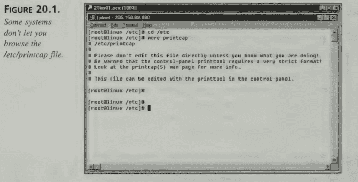

你可以编辑 `/etc/printcap` 文件并填入所有打印机的代码（这是我们过去常用的方法），但这样做缓慢、笨拙且容易出错。相反，寻找适用于打印机的兼容驱动程序并让它为你处理这些问题会更好。

除了告诉 Linux 如何与打印机通信的驱动程序外，每次打印时可能还涉及其他设备。当你的打印机使用页面描述语言（PDL），例如 PCL 或 PostScript 时，通常会发生这种情况。当涉及 PDL 打印时，你的应用程序或 shell 将待打印数据先发送给 PDL，PDL 充当过滤器，将数据转换为适合打印的正确格式。然后，使用打印机驱动程序将此格式化数据发送给打印机。

如果你有一台可以处理多种不同 PDL 的打印机，则可能会涉及多个过滤器。每个过滤系统都是单独为打印机设置的。例如，如果你有一台既支持 PCL 又支持 PostScript 的惠普 LaserJet，你可能会定义一台使用 PCL 过滤器然后使用 LaserJet 设备驱动程序的打印机，以及另一台使用 PostScript 过滤器然后使用相同 LaserJet 设备驱动程序的打印机。两台打印机使用相同的设备驱动程序和端口，这对 Linux 来说没问题。它允许你定义任意数量的打印机，使用任意组合的端口和过滤器。当你向打印机发送内容时，你的命令告诉 Linux 使用哪个打印机定义（过滤器、设备驱动程序和端口）。一些打印机，特别是较旧的点阵打印机和菊花轮打印机，不需要过滤器，这些打印机直接从应用程序接收数据到设备驱动程序。

### Linux 打印命令

由于 Linux 基于 UNIX，你的版本可能可以使用多种打印命令和实用工具。最常用的打印命令是 `lp`、`lpd` 和 `lpc`。这三个打印实用工具都略有不同，配置它们以正常工作往往比配置 Linux 系统的其他部分更麻烦！

当你打印文件时（例如从 Emacs 或字处理程序），会调用打印实用工具。它们将待打印数据复制到 spool（暂存）目录，并将内容存储在一个文件中。这样做有两个原因：立即释放你的应用程序，让你可以继续工作（你不必等待打印完成才能继续），并且允许 Linux 实用工具通过优先级、打印机类型、所需格式和其他属性来管理打印请求。spool 目录通常是 `/usr/spool/lp` 或 `/var/spool/lp`，尽管一些 Linux 版本使用其他目录路径。通常每个在系统上定义的打印机都有一个单独的子目录，例如对于定义了台打印机的系统，会有 `/usr/spool/lp/laserjet` 和 `/usr/spool/lp/bubblejet`。

每次提交打印请求时，Linux 都会返回一个打印请求 ID 号。有时应用程序会抑制显示该 ID，但从命令行打印时通常会显示。从 shell 提示符打印文件的命令通常是在 `lp` 命令后跟文件名或通配符，例如：

```
lp file1.txt
```

当执行此命令时，系统会返回打印请求 ID 号：

```
request id is hplj-307 (1 file)
```

在这种情况下，请求 ID 号是 `hplj_307`，它告诉你打印机的名称（`hplj`），以及这是自计数器从零开始以来该打印机处理的第 307 个打印请求。请求 ID 后的总数表示要打印的文件数量（在这种情况下，一个）。如果使用通配符，该数字可能不同，如下例所示：

```
lp text*.doc
request id is hplj_308 (12 files)
```

[/content]
</think>

[content]

## Linux 下的打印

在前几章中，你见过一些关于打印的内容，我们将在后续章节中从系统管理员的角度来探讨这个话题。然而，花些时间了解一下如何在 Linux 下打印文件、有哪些可用的设备、如何设置打印机，以及 Linux 打印系统中的一些特殊性，是值得一做的。

值得记住的是，Linux 中使用的许多打印程序继承自 30 年的 UNIX 历史。在早期，每个桌面都有一台打印机是不可想象的。在大多数情况下，大型网络中所有人共用一台打印机或一个打印机池。UNIX 的打印程序是基于这种模式编写的，尽管它已经被升级并适应了我们今天的系统，但在打印程序中仍然可以发现许多过时的做法。

### 设置打印机

在大多数情况下，Linux 的安装程序会在你安装操作系统时询问你是否要设置打印机。此时你通常会看到一份可供选择的打印机型号列表，Linux 会询问你的打印机连接到哪个端口。如果你选择在此时配置打印机，它应该能正常工作。如果你跳过了该安装选项，或者没有机会选择它（某些版本的 Linux 不会费心去询问），则必须手动配置打印机。

在配置打印机之前，你需要掌握两条信息。第一条是了解你正在使用的打印机类型（全称，以及可能的兼容型号）。你需要知道兼容型号名称的原因很简单：Linux 仅识别极少数打印机。如果你刚买了一款配有 Windows 驱动程序的最新款高科技打印机，那对 Windows 来说很好。Linux 无法使用这些驱动程序，而且你可以肯定，打印机制造商没有费心去提供一张带有 Linux 驱动程序的 CD！幸运的是，你今天购买的大多数打印机都兼容 Linux 所识别的旧型号。例如，最新的惠普（Hewlett-Packard）LaserJet 系列没有 Linux 驱动程序，但所有最新型号都与较旧的 LaserJet 型号向后兼容，因此可以使用旧的 Linux 驱动程序。你可能无法使用新打印机的所有功能，但至少可以使用该设备！

你需要配置打印机的另一条信息是它所在的端口。打印机通常有三种不同的连接类型：并行端口、串行端口和网络端口。你从 Windows 和 DOS 环境中熟悉并行和串行端口，但网络端口通常仅用于大型系统。并行端口最容易，因为并行端口的通信参数是固定不变的。你只需要知道是否使用的是 PC 上的第一个或第二个并行端口（大多数 PC 只有一个并行端口：LPT1）。

串行端口打印机很常见，需要一根 RS-232 电缆。你不仅需要了解端口号（COM1、COM2 等），还需要了解打印机通信的速度以及它使用的位数。你经常会看到诸如 9600 波特率、8 位之类的设置。必须配置打印机和串行端口以相同的速度运行，否则你将收到乱码，或者更糟，什么也收不到。

网络端口实际上比串行端口更容易配置。网络上的每台打印机都有一个 IP 地址，你只需要告诉 Linux 打印机在哪里以及使用哪种驱动程序即可。

### 端口名称

Linux 使用的设备名称与 DOS 和 Windows 不同。我们将在第 33 章“设备”中更详细地查看设备名称及其用法，因此这里保持简单。DOS 的 LPT1 端口在 Linux 中称为 `/dev/lp0`，LPT2 称为 `/dev/lp1`。名称中的 `/dev` 部分指示系统从哪里获取有关该设备的信息，而 `lp0` 和 `lp1` 表示这些设备是并行端口。Linux 从 0 开始为所有事物编号，因此第二个端口是 `lp1`。

串行端口也适用同样的规则。DOS 的 COM1 端口在 Linux 中被称为 `/dev/ttyS0`，COM2 是 `/dev/ttyS1`，COM3 是 `/dev/ttyS2`，COM4 是 `/dev/ttyS3`。Linux 允许许多串行端口，命名约定因许多多端口卡而异，但对于你的 COM1 和 COM2 端口，使用 `/dev/ttyS0` 和 `/dev/ttyS1` 是安全的，因为大多数 PC 的主板上都有这两个串行端口。

> **提示**
> Linux 系统中的每个串行端口实际上有两个名称。例如，COM1 既被称为 `/dev/ttyS0`，也被称为 `/dev/ttys0`。第二种格式用于诸如调制解调器之类的全双工设备。不要将 `/dev/cua*` 设备用于打印机。

### 打印机驱动程序

Linux 系统上的每台打印机都必须有一个打印机驱动程序。打印机驱动程序本质上告诉 Linux 如何向该打印机发送指令。它会包含诸如“要弹出纸张，执行此操作”和“要将颜色更改为红色，执行此操作”等一系列指令代码。

Linux 附带了一系列打印机驱动程序，还可以从网络和 FTP 站点获取更多。你需要找到一个适用于你的打印机或其兼容打印机的驱动程序。如果你使用了不兼容的打印机驱动程序，你的打印机可能会出现各种奇怪的行为！

Linux 从一个名为 `/etc/printcap` 的文件中读取有关打印机及如何与其通信的所有信息。`/etc/printcap` 文件相当大，通常设置为只有 root 才能修改。`/etc/printcap` 文件中的每个条目都描述了如何对打印机执行不同的操作。一些 Linux 系统禁止以任何方式访问 `/etc/printcap` 文件，并坚持要求你使用工具来修改它。例如，图 20.1 显示了当你尝试使用 `more` 显示 `/etc/printcap` 文件内容时，RedHat 5.0 系统的输出。在这种情况下，RedHat 希望使用基于 X 的打印工具来修改 `/etc/printcap` 文件。并非所有版本的 Linux 都如此谨慎，有些允许你随心所欲地修改（并搞乱）该文件。


你可以编辑 `/etc/printcap` 文件并填入所有打印机的代码（这是我们过去常用的方法），但这样做缓慢、笨拙且容易出错。相反，寻找适用于打印机的兼容驱动程序并让它为你处理这些问题会更好。

除了告诉 Linux 如何与打印机通信的驱动程序外，每次打印时可能还涉及其他设备。当你的打印机使用页面描述语言（PDL），例如 PCL 或 PostScript 时，通常会发生这种情况。当涉及 PDL 打印时，你的应用程序或 shell 将待打印数据先发送给 PDL，PDL 充当过滤器，将数据转换为适合打印的正确格式。然后，使用打印机驱动程序将此格式化数据发送给打印机。

如果你有一台可以处理多种不同 PDL 的打印机，则可能会涉及多个过滤器。每个过滤系统都是单独为打印机设置的。例如，如果你有一台既支持 PCL 又支持 PostScript 的惠普 LaserJet，你可能会定义一台使用 PCL 过滤器然后使用 LaserJet 设备驱动程序的打印机，以及另一台使用 PostScript 过滤器然后使用相同 LaserJet 设备驱动程序的打印机。两台打印机使用相同的设备驱动程序和端口，这对 Linux 来说没问题。它允许你定义任意数量的打印机，使用任意组合的端口和过滤器。当你向打印机发送内容时，你的命令告诉 Linux 使用哪个打印机定义（过滤器、设备驱动程序和端口）。一些打印机，特别是较旧的点阵打印机和菊花轮打印机，不需要过滤器，这些打印机直接从应用程序接收数据到设备驱动程序。

### Linux 打印命令

由于 Linux 基于 UNIX，你的版本可能可以使用多种打印命令和实用工具。最常用的打印命令是 `lp`、`lpd` 和 `lpc`。这三个打印实用工具都略有不同，配置它们以正常工作往往比配置 Linux 系统的其他部分更麻烦！

当你打印文件时（例如从 Emacs 或字处理程序），会调用打印实用工具。它们将待打印数据复制到 spool（暂存）目录，并将内容存储在一个文件中。这样做有两个原因：立即释放你的应用程序，让你可以继续工作（你不必等待打印完成才能继续），并且允许 Linux 实用工具通过优先级、打印机类型、所需格式和其他属性来管理打印请求。spool 目录通常是 `/usr/spool/lp` 或 `/var/spool/lp`，尽管一些 Linux 版本使用其他目录路径。通常每个在系统上定义的打印机都有一个单独的子目录，例如对于定义了台打印机的系统，会有 `/usr/spool/lp/laserjet` 和 `/usr/spool/lp/bubblejet`。

每次提交打印请求时，Linux 都会返回一个打印请求 ID 号。有时应用程序会抑制显示该 ID，但从命令行打印时通常会显示。从 shell 提示符打印文件的命令通常是在 `lp` 命令后跟文件名或通配符，例如：

```
lp file1.txt
```

当执行此命令时，系统会返回打印请求 ID 号：

```
request id is hplj-307 (1 file)
```

在这种情况下，请求 ID 号是 `hplj_307`，它告诉你打印机的名称（`hplj`），以及这是自计数器从零开始以来该打印机处理的第 307 个打印请求。请求 ID 后的总数表示要打印的文件数量（在这种情况下，一个）。如果使用通配符，该数字可能不同，如下例所示：

```
lp text*.doc
request id is hplj_308 (12 files)
```


在这种情况下，尽管我们已经打印了 12 个文件，但只有 一个打印请求 ID 被分配给这一组。这是正常的：Linux 的打印实用程序将每个单独的打印请求（无论涉及多少个文件或页面）视为一个单一请求。

当应用程序提交打印请求且数据已复制到 spool（临时存储）目录后，打印守护程序会查看目录内容并安排按顺序打印文件。此打印守护程序始终在运行，只需查看 spool 目录以检查是否有新到数据。当有新数据到达时，守护程序会检查目标打印机是否可用，然后将数据发送到打印机。如果打印机忙碌或因其他原因不可用，守护程序将保留该打印请求，直到其可以被加入队列。如果用户指示，打印守护程序还可以对打印请求进行优先级排序。

有许多有用的命令可以让你查看已排队到打印机的内容以及打印请求 ID 是多少，并且它们允许你稍微管理一下队列。系统管理员可以管理任何打印请求和队列，但用户通常只能管理自己的打印请求。Linux 版本支持的多个命令所做的功能大多相同，因此请检查你自己的系统以查看提供了哪些命令。

要查看打印队列中（存储在 spool 目录中）的所有打印请求，你可以使用 `lpq` 命令。运行时，`lpq` 会显示打印机中的文件及其在队列中的当前位置。这能让你判断你的任务需要多长时间才能打印完成。某些系统允许 `lpstat` 命令显示相同的内容。如果你的队列中没有内容，`lpstat` 不会显示任何信息。除非你使用 `-t` 选项，否则它仅显示你的请求；如果使用 `-t` 选项，`lpstat` 将显示完整的打印队列，以及关于系统已知每个打印机的状态消息。许多 Linux 系统使用 `lpc` 命令来显示所有打印机的当前状态。

要从队列中删除打印请求，大多数 Linux 系统在 `lprm` 命令后跟打印请求 ID 号，如下所示：

```
lprm hp1j-307
```

某些系统允许你以相同方式使用 `cancel` 命令：

```
cancel hp1j-307
```

你通常会收到来自系统的消息，告诉你打印任务已被取消或从队列中 rm-ed：

```
request "hp1j-307" canceled
```

## 摘要

在本章中，你了解了 Linux 如何处理打印机和设备驱动程序，以及过滤器如何参与。Linux 有脚本可以自动为你安装打印机，因此将跳过手动安装打印机、设置队列以及检查文件和目录权限的繁琐且麻烦的过程。从这里开始，可能有很多章节你想阅读以了解更多信息：

- 要了解用于替代 Linux 上 PostScript 的 Ghostscript 和 Ghostview 实用程序，请阅读第 24 章，“Ghostscript”。
- 要了解有关设备和设备驱动程序的更多信息，请参见第 33 章，“设备”。
- 要了解有关在网络上使用打印机的更多信息，请参见第 37 章，“网络”。

## 多媒体 Linux

作者：Tim Parker

### 本章内容

- 声卡 372
- 游戏杆 384

早期几个版本的 Linux 的一个局限性是它缺乏对声卡、游戏杆和其他多媒体输入/输出例程的支持。然而，Linux 最近的几个发布在这个方面发生了重大变化，现在 Linux 可以像 Windows 98 一样完全具备多媒体功能。本章探讨如何为你的 Linux 系统配置多媒体应用程序。

## 声卡

声卡的功能不仅仅是当你打开窗口、做错事或关闭系统时播放几声滴答声和预录的声音。声卡非常适合玩游戏，因为它可以生成音乐和音效。它可以用来将声音和语音录制到文件中，并稍后回放。声卡可以让你在 CD-ROM 驱动器中播放音频 CD，这样你可以在工作时听音乐。此外，声卡可以作为某些设备（如 CD-ROM 或 SCSI 设备链）的接口。

所有声卡都采用数字方式工作：它们使用离散的数据块来告诉声卡芯片生成什么音调、音量多大，以及其他定义声音的参数。声卡可以以不同的速率生成这些数据块；生成得越快且细节越多，听起来的声音质量就越好。例如，大多数 CD 以每秒 44.1 千次的速率采样数据，每个样本使用 16 位。如果你算一算，这意味着在一小时内，产生 CD 质量声音需要大约 600 MB 的数据。几年前的一些声卡无法处理如此大量的数据。相反，它们每个样本使用 8 位数据，采样率低至每秒 8 千次。如果你通过不错的立体声收听，这两种之间的差异是清晰可闻的；但通过小型廉价的 PC 扬声器收听时则更难区分。

今天的声文件以多种格式提供。每种格式在采样率、每个样本的位数、是否使用压缩算法以及使用的声道数（单声道是一个声道，立体声是两个，等等）方面有所不同。最常见的形式总结在表 21.1 中。

**表 21.1.** **常见声音文件格式特征。**

| 文件扩展名 | 声道 | 样本大小 | 采样率 | 备注 |
| :--- | :--- | :--- | :--- | :--- |
| .au | 2 | 8 位 | 8 KHz | Sun UNIX 格式 |
| .mod | 2 | 8 位 | 取决于算法而异 | |
| .raw | 2 | 8 位 | 22 KHz | |
| .voc | 1 | 8 位 | 22KHz | |
| .wav | 1 | 8 位 | 22KHz | |
| .wav | 2 | 16 位 | 44KHz | |

当前版本的 Linux 附带了一些声卡驱动程序。这些都是由卡的所有者为 Linux 编写的驱动程序，他们拥有设备驱动程序编程的经验，并努力支持他们的卡片。他们慷慨地将这些驱动程序提供给所有使用 Linux 的人。（你无法使用随声卡附带的驱动程序，因为它们通常是 DOS 或 Windows 专用的，并且操作系统的架构不通用。）即使你没有针对特定卡片的 Linux 驱动程序，它也可能通过兼容的卡片驱动程序得到支持。例如，许多声卡与 SoundBlaster 兼容，因此 SoundBlaster 驱动程序可能会起作用（但也不一定）。

### 使用 PC 扬声器

你还没有声卡。你并未完全走投无路。有一个驱动程序适用于几乎所有 PC 机箱中内置的小扬声器。虽然这可能听起来作用不大，但该驱动程序竟然能从小型设备中产生令人惊讶的良好 16 位立体声效果，让你可以玩像 Doom 这样的游戏。如果你擅长布线，还可以将一对电线连接到外部扬声器，而不是内部扬声器，尽管你必须记住主板上的放大器功率非常低。如果你想使用 PC 扬声器驱动程序，你需要下载它，因为很少有 Linux 版本将其作为发行版的一部分包含在内。

> **提示**
>
> 要获取 Linux 的最新版本的 PC 扬声器驱动程序，请检查 FTP 站点 ftp.informatik.hu-berlin.de/pub/os/linux/hu-sound 或附录 A“Linux FTP 站点和新闻组”中列出的 Linux FTP 存档之一。撰写本章时，该驱动程序的最近版本为 0.9。

PC 扬声器驱动程序附带一套说明，指导你完成安装和配置过程。随分发软件包包含的示例文件让你可以测试扬声器，以确保其工作正常。


## 配置声卡

部分 Linux 版本附带了可链接声卡支持的例程。通常，你会在安装过程中通过菜单选择声卡类型，安装例程会自动处理其余工作。如果是这种情况，声卡应该能正常工作，你可以跳过本节。如果你的 Linux 版本在安装时未询问声卡情况，或者声卡无法正常工作，你需要按照本节的描述完成安装和配置步骤。

### 注意

部分 Linux 软件的 CD-ROM 中包含声卡配置例程，但只有在操作系统安装完成后才能访问。例如，Red Hat 5.0 包含名为 `sndconfig` 的实用工具，它可以为你配置大多数 SoundBlaster 及兼容声卡。请查阅你的 CD-ROM 文档，了解提供了哪些（如果有）实用工具。

为 Linux 设置声卡的第一步是安装声卡本身。这需要遵循声卡附带的说明进行操作。除了确保 IRQ（中断）、DMA（直接内存地址）和 I/O 地址是唯一的（这在 DOS 和 Windows 下是必需的）之外，没有其他特殊的步骤需要在 Linux 下配置声卡。如果你已经安装了声卡，可以从控制面板或其他实用工具中获取这些设置。一些较旧的声卡使用跳线帽或 DIP 开关来设定这些参数。无论通过何种方式设定，你都需记录这些参数以便在 Linux 下进行配置。

### 提示

如果你使用的是支持即插即用（Plug and Play, PNP）的声卡，建议先在 Windows 或 DOS 下安装，因为在大多数情况下 Linux 无法为这些声卡设置参数。在 Windows 或 DOS 下安装声卡后，使用控制面板或类似工具显示为声卡选定的设置并记录下来。在 Linux 下设置声卡时，你需要输入这些值。

如果你打算配置 Linux 声卡，请在系统 BIOS 中禁用 PNP 选项，因为这可能导致即插即用声卡的配置信息被重置为默认值或被完全更改。通常，BIOS 会有一个类似“PNP OS？”的选项，默认设置为 Yes。为了在 Linux 上获得最佳效果，请将此选项设置为 No。

安装声卡后，你需要将正确的声卡设备驱动程序链接到内核中。如果你之前没有操作过内核，这个过程并不可怕。你很可能在安装 Linux 时不需要链接内核，因为大多数发行版都附带了预构建的内核，其中缺少声卡支持。你需要将所有驱动程序（包括声卡驱动程序）重新编译到一个全新的内核中。

如果你从网站或 FTP 站点下载了声卡设备驱动程序，很有可能会随驱动程序附带某种 README 文件。务必阅读此文件，以了解驱动程序的要求（如特定的 DMA 或 I/O 地址）以及内核重编译期间所需的特殊步骤。

每个版本的 Linux 内核重编译例程略有不同，但通常步骤很简单：

- 以 root 身份登录
- 进入 `/usr/src/linux` 目录
- 输入命令 `make config`

或者，某些 Linux 版本提供基于 X 的实用工具来重建内核。对于这些系统，打开一个窗口并进入正确的目录，然后使用命令 `make xconfig`。

在重建内核时，你必须始终以 root 身份登录；否则你将无法访问编译内核所需的目录和实用工具。大多数 Linux 版本将重编译的 makefile 保存在 `/usr/src/linux` 中，如果你的版本不同，请查阅随软件提供的文档或 README 文件。

当你运行 config 例程时，它会询问一系列关于是否要包含某些组件的问题，如 图 21.1 所示。在大多数情况下，除非你有特殊情况，否则应接受默认值。一个好的例子是当 config 询问你是否要包含声卡时（通常位于一长串问题的末尾）。你应该选择 yes。然后，config 例程会询问许多关于要包含哪种声卡的问题，如 图 21.2 所示。

### 图 21.1

config 例程询问你是否要在重编译 Linux 内核时包含某些组件。

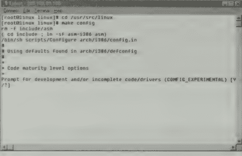

### 图 21.2

config 例程询问了许多关于你想支持哪种声卡的问题。

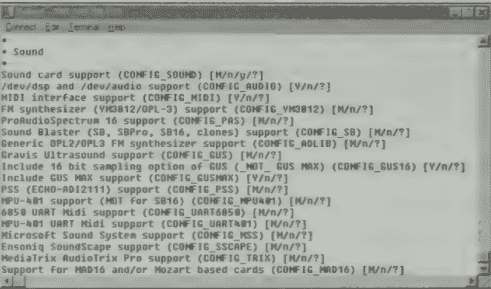

当被问及每种类型的声卡时，对你确定未使用的声卡回答 N，对你想使用的声卡回答 Y。不要让 Linux 猜测你的声卡，因为它 invariably 都会猜错。

### 注意

如果内核中预配置了声卡，config 会通过类似以下的问题询问你是否要使用它：
Old configuration exists in /etc/soundconf. Use it [Y/n]?
如果你之前声卡工作正常，则回答 Y。如果声卡未能正常工作，则回答 N。

在浏览完可能看似非常长的声卡列表后，系统会询问一些适用于许多声卡的通用问题，例如 /dev/dsp 和 /dev/audio 支持 [N/y]?

你应对此项回答 Y，因为提到的这两个设备通常被声卡实用工具使用。系统还会询问你是否需要使用 MIDI 接口设备支持和 FM 合成器支持：

- MIDI 接口支持 [N/y]
- FM 合成 (YM2813/OPL-3) 支持 [N/y]

如果你的声卡有 MIDI 接口，应对第一项回答 Y。许多声卡使用 Yamaha FM 合成芯片来生成声音，在这种情况下，你应对第二项回答 Y（有些声卡同时支持 MIDI 和 FM 合成）。

声卡问题的最后一部分涉及声卡的 IRQ、DMA 和 I/O 地址。你应输入之前记录的声卡数值：

- SB 的 I/O 基地址
默认值为 220
输入值：200
- SoundBlaster IRQ
默认值为 7
输入值：5
- SoundBlaster DMA
默认值为 1
输入值：1

根据声卡驱动程序的不同，可能会问你更多问题。请仔细输入数值，因为出错意味着你必须重新进行整个 config 过程。

为了结束声卡配置例程，系统会询问你是否要保存这些详细信息：

The sound card has been configured.
Save copy of this configuration in /etc/soundconf [Y/n]

请保存配置，以便未来在重建内核时避免麻烦。

在关于要编译到新内核中的组件的几个提示之后，系统开始编译过程。根据机器上 LILO 的配置方式，某些系统在此处包含额外步骤。编译时间从几分钟到三十分钟不等，取决于机器速度和需要编译的组件数量。

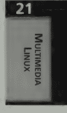

你还没完成！在重新编译内核后，你必须正确配置设备文件。再次强调，此过程可能在随声卡驱动程序提供的 README 中有所说明。与其手动配置设备文件，更好的方法是查找通常存储在 `/usr/src/linux/drivers/sound` 目录中的 `README.linux` 文件。该文件底部包含一个简短的 shell 脚本，可以轻松地为你完成设备文件设置。将这些行剪切并粘贴到另一个文件中，使其可执行，然后运行该脚本。在内核重新编译并配置好设备文件后，你可以重新启动机器。

应该运行的脚本（从 `README.linux` 文件剪切而来）看起来像这样（为清晰起见，已删除多余的注释行）：

```bash
#!/bin/sh
AUDIOPERMS=622
# Create the devices

# Mixer devices

if [ -e /dev/mixer ]; then
	 rm -f /dev/mixer
fi

if [ -e /dev/mixer0 ]; then
	 rm -f /dev/mixer0
fi

mknod -m 666 /dev/mixer0 c 14 0
ln -sf /dev/mixer0 /dev/mixer
if [ -e /dev/mixer1 ]; then
	 rm -f /dev/mixer1
fi
mknod -m 666 /dev/mixer1 c 14 16

# Sequencer (14, 1)
#
if [ -e /dev/sequencer ]; then
	 rm -f /dev/sequencer
fi
mknod -m 666 /dev/sequencer c 14 1

if [ -e /dev/patmgr0 ]; then
	 rm -f /dev/patmgr0
fi
mknod -m 666 /dev/patmgr0 c 14 17
if [ -e /dev/patmgr1 ]; then
	 rm -f /dev/patmgr1
fi
mknod -m 666 /dev/patmgr1 c 14 33
```


# 音乐 (14, 8)

```bash
if [ -e /dev/Music ]; then
    rm -f /dev/Music
fi

mknod -m 666 /dev/music c 14 8
if [ -e /dev/sequencer2 ]; then
    rm -f /dev/sequencer2
fi
ln -s /dev/music /dev/sequencer2

# Midi devices

if [ -e /dev/midi ]; then
    rm -f /dev/midi    # Old name. Don't use it
fi
if [ -e /dev/midi00 ]; then
    rm -f /dev/midi00
fi
mknod -m 666 /dev/midi00 c 14 2
ln -sf /dev/midi00 /dev/midi

if [ -e /dev/midi01 ]; then
    rm -f /dev/midi01
fi
mknod -m 666 /dev/midi01 c 14 18

if [ -e /dev/midi02 ]; then
    rm -f /dev/midi02
fi
mknod -m 666 /dev/midi02 c 14 34

if [ -e /dev/midi03 ]; then
    rm -f /dev/midi03
fi
mknod -m 666 /dev/midi03 c 14 50

# DSP (14, 3)

if [ -e /dev/dsp ]; then
    rm -f /dev/dsp
fi
if [ -e /dev/dsp0 ]; then
    rm -f /dev/dsp0
fi
mknod -m $AUDIOPERMS /dev/dsp0 c 14 3
ln -s /dev/dsp0 /dev/dsp

# DSPW (14, 5)

if [ -e /dev/dspW ]; then
    rm -f /dev/dspW
fi
if [ -e /dev/dspW0 ]; then
    rm -f /dev/dspW0
fi
mknod -m $AUDIOPERMS /dev/dspW0 c 14 5
ln -s /dev/dspW0 /dev/dspW
if [ -e /dev/dspW1 ]; then
    rm -f /dev/dspW1
fi
mknod -m $AUDIOPERMS /dev/dspW1 c 14 37

# SPARC compatible /dev/audio (14, 4)

if [ -e /dev/audio ]; then
    rm -f /dev/audio
fi
if [ -e /dev/audio0 ]; then
    rm -f /dev/audio0
fi
mknod -m $AUDIOPERMS /dev/audio0 c 14 4
ln -s /dev/audio0 /dev/audio

# DSP1 (14, 19) /dev/dsp for the second soundcard.
# Also the SB emulation part of the PAS16 card.

if [ -e /dev/dsp1 ]; then
    rm -f /dev/dsp1
fi
mknod -m $AUDIOPERMS /dev/dsp1 c 14 19

# SPARC audio1 (14, 20)
# /dev/audio for the second soundcard.
# Also the SB emulation part of the PAS16 card.

if [ -e /dev/audio1 ]; then
    rm -f /dev/audio1
fi
mknod -m $AUDIOPERMS /dev/audio1 c 14 20

# /dev/sndstat (14,6) For debugging purposes

if [ -e /dev/sndstat ]; then
    rm -f /dev/sndstat
fi
mknod -m 666 /dev/sndstat c 14 6

exit 0
```

## 排查安装和配置问题

与任何设备一样，在安装和配置声卡后，可能会出现需要修正的问题。当然，如果你的系统运行完美，可以跳过本节。

如果在重新编译内核后没有声卡支持，并且在启动序列中没有关于声卡的消息，那么很有可能你并不是从新内核启动的。以下命令显示正在启动的内核的详细信息。

```bash
uname -a
```

检查时间和日期，看是否与重新编译的时间一致。如果不一致，你可能需要使用 LILO 将新内核安装到启动设备上，或者再次重复整个重新编译过程。

> **提示**
> 大多数 Linux 系统上的 `/proc/version` 文件包含与 `uname -a` 命令相同的信息。你可以使用其中任意一种方法来检查内核版本。

假设内核版本是你刚刚编译的那个，你需要检查声卡是否已链接到内核本身。`/proc/devices` 文件列出了内核包含的字符设备和块设备。查找“sound”（通常为数字 14）的条目。如果那里没有，说明声卡组件未链接到此内核，你需要重做配置例程。

如果 `/proc/devices` 文件看起来正常，并且在启动过程中看到了关于声卡的消息（你可以使用 `dmesg` 命令或查看 `/var/adm/messages` 文件来重放所有这些消息），那么很有可能你正在使用一张“兼容”卡，但它并不是非常兼容。这种情况在使用 SoundBlaster 兼容卡时很常见，其中真实声卡的驱动程序无法找到兼容卡。检查驱动程序附带的 README 文件，看看是否有关于你特定声卡及其问题的提及，并检查制造商的 Web 或 FTP 站点。

另一种检查声卡安装状态的方法是查看 `/dev/sndstat` 文件。如果你找不到这个文件，说明你还没有运行 `/usr/src/linux/drivers/sound/Readme.Linux` 文件末尾的声卡安装脚本。从文件中剪切该脚本，使其可执行，然后运行它。然后你应该会看到一个生成的 /dev/sndstat 文件。

在 /dev/sndstat 中可能会看到几条错误消息，有助于你确定声卡的问题。表 21.2 显示了最常见的消息、产生原因以及可能的解决方案。在每种情况下，错误消息前都有设备名称。

**表 21.2.** /dev/sndstat 错误消息。

| 错误消息 | 产生原因及解决方案 |
| :--- | :--- |
| No such device | 内核不包含声卡驱动程序。重建内核。 |
| No such device or address | 声卡驱动程序无法在指定配置中找到声卡。检查配置设置。 |

## 声卡应用

根据你想要做的事情，有许多应用程序可以与你的声卡配合使用。这些应用程序中的大多数可以通过 FTP 站点获取，或者包含在你的 CD-ROM Linux 发行版中。要检查这些文件是在你的系统还是 CD-ROM 上，请使用 find 命令查找可执行程序的文件名。

我们不会逐一介绍 Linux 上可用的每个应用程序，因为有好几十种。相反，我们将挑选几个具有代表性的示例。查看 FTP 站点可以让你了解所有其他可用的应用程序。

### vplay, vrec, splay, and srec

vplay 实用工具及其三个合作伙伴是由 Hannu Savolainen 和 Michael Beck 开发的一组名为 snd-util 的声卡工具。这些是早期 Linux 开发阶段开发的简单的声音录制和播放实用工具，但即使今天，如果你愿意使用命令行界面而不是华丽的 GUI，它们仍然运行良好。srec 工具录制声音，splay 回放声音。（要录制，你需要一个麦克风或其他输入设备，如来自 CD 的馈送。）

> **提示**
> snd-util 3.0 软件包（本书付印时的当前版本）最容易通过 FTP 获取：
> `ftp.sunsite.unc.edu/pub/Linux/apps/sound/snd-util-3.0.tar.gz`

srec 实用工具允许你指定录制时间和采样率。声音以原始文件格式（.raw 文件扩展名）存储。要使用 21KHz 采样率录制 20 秒的声音样本，并将输出存储在 sample.raw 文件中，请使用此命令：
`srec -t 20 -s 21000 sample.raw`

要回放刚刚录制的声音，你需要 splay 实用工具，并且必须指定文件名和采样率：
`splay -s 21000 sample.raw`

如果你选择了错误的采样率，你会立刻注意到，因为声音将不像原始声音。

vplay 和 vrec 命令分别基于 splay 和 srec，但增加了将文件保存为 .wav 格式和 .voc 格式（SoundBlaster 声卡使用）的功能。

### WAVplay

WAVplay 是由 Andre Fuechsel 开发的图形化声音录制和播放实用工具。WAVplay 让你可以看到声音在录制和播放时的波形。你可以通过点击 GUI 上的选项来改变采样速度和每个样本的位数。可以录制立体声和单声道信号。WAVplay 仅录制 .wav 文件。

> **提示**
> WAVplay 的最新版本是 2.1，可以从 FTP 站点获取：
> `ftp.sunsite.unc.edu/pub/Linux/apps/sound/players/wavplay021w1.tar.z`

### Sound Studio

Sound Studio 由 Paul Sharpe 编写。它是一个基于 X 的应用程序，提供你几乎可以想到的用于声音录制和播放的所有工具。Sound Studio 允许你录制、编辑和播放多种格式的声音文件。用 Tcl/Tk 为 Linux 编写（以及一些 C 代码），Sound Studio 展示了这个操作系统所能做到的事情。

> **提示**
> Sound Studio 的最新版本是 0.21，可以从 FTP 站点获取：
> `ftp.sunsite.unc.edu/pub/Linux/apps/sound/players/studio.0.1.tgz`

### MiXViews

MiXViews 与 Sound Studio 类似，因为它也是基于 X 的，但它是在 UNIX 工作站上开发的，并移植到 Linux 上。作者是 Douglas Scott。MiXViews 允许录制和播放大多数格式的声音文件。你可以使用 MiXViews 在屏幕上编辑声波。与这里提到的其他工具不同，MiXViews 通过允许声音的滤波、缩放和混合来扩展声卡的功能。

> **提示**
> MiXViews 的最新版本可以从 FTP 站点获取：
> `ftp.ccs.ucsbedu/pub/MixViews`

### 操纵杆

有些游戏如果使用操纵杆而不是鼠标和键盘来玩会更有乐趣。由于大多数计算机都内置了操纵杆端口（在主板或带有串行或并行端口的多功能板上），利用该端口将是一个不错的选择。不幸的是，Linux 没有内置操纵杆驱动程序。幸运的是，已经发布了几种操纵杆驱动程序。当然，操纵杆仅对支持该设备的游戏有用。不支持操纵杆的游戏可能无法用操纵杆玩。


## 摘要

在本章中，我们探讨了声卡和游戏杆的安装与配置。既然你的系统中已经可以正常使用光驱，那么你就已经准备好使用当前 Linux 上几乎所有可用的多媒体应用程序了。接下来，你可能想要阅读一些相关主题，例如：

- 学习如何安装 X，以便你可以在第 22 章《安装和配置 XFree86》中基于 X 的声音文件应用程序中进行操作。
- 在第 23 章《Wabi》中了解 Wabi，它允许你在 X 环境下运行 Windows 应用程序。
- 在第 57 章《内核操作》中了解如何重新编译内核以包含你的声卡驱动程序。

## GUI

## 第四部分

### 本部分包含

- 安装和配置 XFree86 389
- Wabi 415
- Ghostscript 和 Ghostview 423

## 安装和配置 XFree86

*作者：Tim Parker*

### 本章内容

- 什么是 XFree86？ 390
- XFree 软件分发 392
- 配置 XFree86 396
- 详细讲解 Xconfig 和 XF86Config 文件 401
- .xinitrc 文件 412

大多数 Linux 用户希望使用作为系统一部分分发的 X 图形用户界面（GUI）。大多数 Linux 软件包中提供的 X 版本是 XFree86，它是麻省理工学院（MIT）开发的 X 窗口系统的一个实现。XFree86 适用于多种不同的 PC UNIX 版本（包括 Linux），并相较于传统的 X 系统进行了扩展，以涵盖 PC 机器中使用的各种硬件。

Linux 上至少有两种主要版本的 XFree86。某些发行版包含稍旧的 2.X 版本，但大多数发行版现在都提供最新的 3.X 版本。在本章中，我们将探讨这两个版本 XFree86 的安装和初步配置，尽管大多数示例将使用 XFree86 3.X 版本。

> **提示**
> 在实际安装软件之前，理解完整的 XFree86 安装过程非常重要。在某些情况下，如果选择了不合适的驱动程序，可能会对硬件和已安装的 Linux 软件造成损害！

### 什么是 XFree86？

*XFree86* 是 MIT 开发的 X11 窗口系统的一个公共领域版本，其版权现归 MIT 联盟所有。本着 Linux 开发者希望操作系统中不包含需要许可授权的版权代码的愿望，XFree86 是专门为 PC 架构开发的。XFree86 可与许多基于 PC 的 UNIX 系统配合使用，包括 Linux，尽管它并不局限于 Linux。

现有多个版本的 XFree86 可用，它们都基于不同的 X 版本。Linux 中最常用的 XFree86 版本是 2.X 版，它基于 X11 第 5 版（为简便起见简称为 X11R5）。XFree86 的最新版本是 3.X 版，基于 X11 第 6 版（X11R6），这是 X 窗口系统的最新版本。小工具的 bug 修复和细微变化通常以增量版本号的形式提供。这些更新可以下载并覆盖安装到相同编号的版本上。例如，如果你安装了 XFree86 v2.1 并获取了修复版本 2.1.1，必须将其覆盖安装在 2.1 之上，而不能独立安装。Bug 修复版本并不包含完整系统——仅包含更新内容。

**警告**

不要使用 XFree86 2.0 版本！它有几个严重的 bug。相反，至少使用 2.1 或 2.1.1 版本。早期版本（1.X 系列）在功能、稳定性和能力方面远不如 2.X 和 3.X 系列，因此也要避免使用最早的那些版本。

一些术语说明：该 GUI 的官方名称是 X。它通常也被称为 X Window 或 X Windows，尽管后者用法非常不推荐。（后者听起来很像微软的 MS-Windows 产品。）在大多数情况下，术语 X、X11、XFree86 和 X Window 可以互换使用，但请避免使用 X Windows。这是激怒资深 UNIX 用户以及让自己看起来像初学者或粗鲁无礼者的确定方法！

在 XFree86 开发的早期出现了一些问题，主要原因是官方 X 联盟（控制 X 标准的组织）缺乏信息。为了解决这个问题，XFree86 项目公司（XFree86 Project Inc.）成立并成为 X 联盟成员，从而得以在新版本向公众发布之前提前获得相关信息。XFree86 现在是 XFree86 项目公司的商标。

许多 Linux 版本的 XFree86 包含指向名为 X386 的产品的目录和引用。X386 是 X11R5 在 PC 架构上的早期版本，XFree86 保留了许多 X386 的目录和文件命名约定。然而，X386 和 XFree86 是不同的产品，它们之间没有联系（除了命名约定之外）。

XFree86 运行至少需要机器中有 8MB 的 RAM 和至少 16MB 的虚拟内存。换句话说，对于 8MB RAM 的机器，你需要至少 8MB 的交换空间，尽管强烈建议更多。如果你有 16MB RAM，则不需要交换空间，但为了安全起见（特别是如果你打算运行占用内存较多的应用程序）应该使用它。如果你打算大量使用 X，请将系统设置为拥有 32MB 虚拟 RAM 以获得最佳性能（最好至少 16MB RAM，其余为交换空间）。

XFree86 2.X 版本可以调整以在 4MB RAM 中运行，尽管这是一个缓慢的过程（无论是调整还是运行），因此不推荐。XFree86 3.X 版本无法在 4MB 中正常运行（虽然通过大量努力可以强行安装，但运行速度之慢以致于毫无用处）。XFree86 3.X 版本可以在 8MB RAM 中运行，尽管 16MB 更合适。同样，建议至少有 16MB 的总虚拟内存，32MB 更佳。

### XFree86 软件分发

大多数 XFree86 分发版是作为 Linux CD-ROM 或磁盘组中软件的一部分提供的。由于 CD-ROM 是最常见的分发形式，我们将全程使用它作为示例。然而，这些说明同样适用于磁盘分发版以及从 FTP 或 BBS 站点获取的软件包。

通常，XFree86 软件位于一组名为 x1, x2, x3 等的目录中。例如，Slackware 发行版的目录多达 x14。其他发行版的目录数量可能有所不同。还有一组名为 xap1, xap2 等目录中存储着 XFree86 应用程序。软件通常以 gzip 压缩格式提供。每个目录的内容通常显示在一个文本文件中，其中列出了文件名并概述了其用途。

在安装 XFree86 软件之前，首先验证它是否能与你现有的 Linux 软件配合工作。XFree86 发行版依赖于特定版本的 Linux 内核、C 库（libc）和 ld.so 版本。分发目录中的一个文件应说明运行 XFree86 所需的最小版本号。或者，如果你获取的是与 Linux 发行版一起打包的 XFree86 软件，在大多数情况下它是兼容的，你可以跳过验证阶段。

XFree86 软件可以通过手动安装：解压每个文件，然后提取存档中的文件。然后必须将这些文件正确加载到最终目录中。这可能是一个非常繁琐和漫长的过程，除非是真正的受虐狂或那些想要确切了解发生了什么的人，否则应避免这样做。相反，请使用 Linux 供应商提供的安装例程，例如 setup。

XFree86 2.X 版本使用的目录倾向于镜像 X386 软件产品使用的目录。对于大多数 Linux 系统，主要目录是 /usr/X386。为了与期望更常见的 X11R5、X11R6 或 X11 目录的软件包和实用工具保持一致，Linux 通常会在 X386 目录和其他目录之间创建必要的链接。这些链接通常由 Linux 安装例程创建。

> **提示**
>
> XFree86 3.X 版本放弃了 `/usr/X386` 目录约定，转而采用更常见的 X 位置 `/usr/X11R6`。在将 XFree86 2.X 版本升级到 3.X 版本时，请记住目录名称的变化，并更改链接或完全移除旧的 `/usr/X386` 版本。同时也请确保更改你的路径。


## 注意

为简化 XFree86 的目录结构，通常会创建指向名为 `/usr/X11` 的目录的链接，该目录可以被链接到 `/usr/X386` 和 `/usr/X11R6`。请检查您的目录结构以确定您系统上存在哪些链接。此外，请检查您的 `PATH` 环境变量以查看搜索路径中包含哪个目录（如果确实添加了的话）。

## 选择 X 服务器

在安装 XFree86 之前，您必须决定使用哪种类型的服务器。XFree86 服务器是视频系统的驱动程序（因为 X 是一个图形用户界面，它大量使用了系统中的显卡）。为您的显卡选择错误的服务器类型可能导致整个系统行为异常（在某些情况下甚至会损坏您的显卡或显示器！）。请务必确保服务器与您的硬件相匹配。

在大多数 XFree86 发行版中，有几种可用的驱动程序，且文件名通常指示其适用的显卡类型。例如，您可能在大多数 XFree86 版本中遇到以下服务器文件：

- XF86_Mono：单色显卡（通用）
- XF86_VGA16：16 色 VGA 显卡（通用）
- XF86_SVGA：彩色 SVGA 显卡（通用）
- XF86_S3：适用于基于 S3 芯片组显卡的加速服务器
- XF86_Mach8：适用于 Mach8 显卡的加速服务器
- XF86_Mach32：适用于 Mach32 显卡的加速服务器
- XF86_8514：适用于 8514/A 显卡的加速服务器

上述列表中的通用标识意味着该服务器没有特定于卡片的指令，而其他服务器则有特定于卡片的显卡要求。例如，XF86_S3 服务器只能用于使用 S3 芯片组的显卡。请查阅您的显卡文档（或使用诊断实用程序）来确定您的显卡芯片组。您的 XFree86 发行版可能包含其他特定服务器版本，因此请查阅文档以了解兼容性详情。

通用服务器驱动程序适用于大多数支持 VGA 和 SVGA 的显卡。然而，由于通用驱动程序仅提供基本的 VGA 和 SVGA 视频指令，您的显卡可能具备的高级功能或额外性能将不会被使用。这正是开发特定于卡片的服务器原因所在：它们允许您使用高级显卡的全部功能。

# 警告

安装带有错误特定显卡驱动程序的 X 服务器可能会损坏您的系统！如果您不确定显卡的芯片组，请使用通用驱动程序。大多数显卡都能毫无问题地处理 VGA 和 SVGA 通用驱动程序。如果不确定，请使用通用的！

大多数 XFree86 发行版在配置文件中预写了标准 VGA 系统的默认配置。在某些情况下，您可以使用此默认设置而无需担心其他配置项，但在首次运行 XFree86 之前，最好手动检查配置文件。

通过修改 XFree86 bin 目录下名为 X 的文件的符号链接来更改 XFree86 要使用的服务器名称（例如 `/usr/X386/bin/X` 或 `/usr/X11R6/bin/X`）。您可以通过创建指向所需服务器文件的新链接来随时更改服务器。例如，如果您想在当前配置为 VGA 服务器的系统上使用 SVGA 服务器，请执行以下命令：

```
rm /usr/X11R6/bin/X
ln -s /usr/X11R6/bin/XF86_SVGA /usr/X11R6/bin/X
```

第一行删除当前链接，第二行在 XF86_SVGA 和 X 之间添加链接。XFree86 基础目录的目录名称可能会随您运行的 XFree86 版本而变化（但如果它们被链接在一起，更改哪一个都无关紧要）。

## 手动安装 XFree86

如本节前面所述，您可以在不使用安装脚本的情况下安装 XFree86。在某些情况下，如果您需要跨目录安装或将文件放置在其他默认值之外的目录中，您可能希望这样做。有些用户喜欢手动安装 XFree86，以便了解每个步骤发生了什么：这是学习 X 操作系统细微差别的好方法（尽管这可能是一个漫长的操作）。

要手动安装 XFree86 发行版软件，您必须使用 gzip 命令将文件解压到正确的目录中。一般过程非常简单：

- 以 root 身份登录。您必须以超级用户身份安装 XFree86。
- 创建目录 `/usr/X386`。您的系统中可能已经存在此目录，因为它是由某些 Linux 安装脚本创建的。
- 切换到 `/usr/X386` 目录。
- 对于发行版集中的每个文件，使用 `gzip` 实用程序解压并安装其内容。命令的一般格式如下：`gzip -dc tarfile | tar xovf -`
- 对 XFree86 产品集中的每个文件重复此过程。您需要手动切换到每个发行版目录（例如在 CD-ROM 或不同的磁盘上），并对该目录中的每个归档文件使用 `gzip`。

前面命令行中显示的 `tar` 实用程序标志确保保留文件的原始所有权，并且在屏幕上显示输出供您查看。一旦所有 XFree86 文件都安装到正确的目录中，您就可以继续配置过程。

## 使用脚本安装 XFree86

大多数用户希望自动化安装过程。这样更快，需要用户的交互更少，且出错的可能性要小得多。因此，大多数 XFree86 发行版要么包含安装脚本，要么使用 Linux setup 程序。

当使用 Linux 发行版提供的 Linux 安装脚本（或类似实用程序）进行安装时，通常会在初始 Linux 安装期间提示您是否希望安装 XFree86。如果您对此问题给出了肯定回答，XFree86 的二进制文件将已安装。如果您未收到 XFree86 安装的提示，则它可能已自动安装。检查目录 `/usr/X386/bin` 或 `/usr/X11R6/bin` 中的文件。如果任一目录中有大量文件，则 XFree86 已为您安装。

XFree86 从发行版媒体自动安装并不意味着您可以立即使用它。您仍然应该通过使用 `configXF86` 或 `fx86config` 实用程序或手动编辑 `xconfig` 或 `XF86Config` 文件（具体取决于 XFree86 的版本）来完成配置过程。大多数自动安装都包含预配置的默认 VGA 或 SVGA 文件，但在尝试运行 XFree86 之前，检查 `xconfig` 或 `XF86Config` 文件的内容仍然是一个好主意。

## PATH 环境变量

将 XFree86 二进制目录放入您的路径中非常重要，这由环境变量 PATH 或 path 控制（具体取决于 shell）。该变量定义的位置取决于您使用的 shell 类型以及您通常用于运行 XFree86 的登录方式。通常，您只需将 `/usr/X386/bin`（XFree86 版本 2.X）或 `/usr/X11R6/bin`（XFree86 版本 3.X）添加到路径定义语句中即可。

例如，如果您主要使用 bash，则在登录时读取 `.profile` 文件以设置环境变量。如果您以 root 以外的用户身份登录，`.profile` 文件保存在您的主目录中。如果您使用 root 登录，`.profile` 可能保存在 root 目录中，或者您可能正在使用位于 `/etc/profile` 文件中的默认系统 `.profile`（请注意当文件位于 /etc 中时没有前导点：这是一种约定，用于表示它是全局可用的 `.profile`）。

如果路径中尚未包含 XFree86 bin 目录，请将其添加到 path 或 PATH 变量定义中。添加 XFree86 目录后，bash 的 `.profile` 文件可能包含以下行：

`PATH="/sbin:/usr/bin:/bin:/usr/X11/bin:/usr/openwin/bin"`

对于 C shell 用户（包括 tssh），除了 root 用户外，语法略有不同。启动文件 `.login` 或 csh.`.login` 包含一行定义路径。添加 XFree86 目录只需将其附加到定义中：

`set path = ( /sbin /usr/bin /bin /usr/X11/bin /usr/openwin/bin . )`

当然，您的确切路径定义行可能有所不同，但只要您将 XFree86 bin 目录添加到路径中，然后注销并重新登录，shell 就应该能够正确找到二进制文件。

## 配置 XFree86

在运行 XFree86 之前，应指定一些配置信息。这部分往往让 XFree86 的新手感到沮丧，因为要使配置文件完全正确并允许 XFree86 正确执行可能是一个复杂的过程。希望，几个简单的分步说明将使这个过程更加顺畅。

许多 Linux 和 XFree86 发行版都提供了一个名为 **ConfigFX86** 或 **fx86config** 的实用程序，它简化了整个 XFree86 安装过程，但这仅适用于拥有受支持的显卡的用户。**ConfigFX86** 和 **fx86config** 支持的显卡列表通常包含在 Linux 发行版软件中提供的 Hardware HOWTO 文件中。如果您找不到 HOWTO 文件，可以从大多数 FTP 和 BBS 站点获取。请确保该文件版本与您运行的 Linux 版本相对应。关于 **ConfigFX86** 和 **fx86config** 的更多细节将在后面的部分“使用 ConfigFX86 和 fx86config”中提供。（在某些情况下，您可以提供足够的信息，以便 ConfigFX86 和 fx86config 在使用未列出的显卡进行安装时使用它。这将在下一节中讨论。）


## 手动配置 XFree86

如果您没有硬件 HOWTO 文档，或者您的显卡不在列表中且不想使用通用驱动程序，则必须手动配置 XFree86。即使您使用 `ConfigXFree` 或 `xf86config` 脚本来安装 XFree86，您可能仍需要进行手动修改来调整您的安装设置。

XFree86 2.X 版本的大多数配置细节包含在一个名为 `Xconfig` 的文件中，而 XFree86 3.X 版本则根据具体版本使用名为 `XF86Config` 或 `xconfig` 的文件。设置 `Xconfig` 或 `XF86Config` 文件的基本指令分散在 XFree86 发行版套装中附带的几个文本文件中。在大多数情况下，您应该检查 `README`、`VideoModes.doc`、`README.Config` 和 `README.Linux` 文件。这还不止于此：您还必须阅读 `Xconfig`、`XF86Config`、XFree86 和 `XFree86bd` 的手册页。最后，如果提供了对应的手册页，您还应检查当前运行的服务器版本的手册页。（打印出这些手册页以便参考是个好主意。）

要正确完成 `xconfig` 或 `XF86Config` 文件，您需要了解一些信息。在开始配置 XFree86 之前，请花点时间记录以下详细信息：

- 要使用的 XFree86 服务器。
- 系统上鼠标的类型及其连接的端口。
- 显卡的品牌名称和芯片组。如果不确定芯片组，请查阅文档或使用 `SuperProbe`（Linux）或 `MSD`（DOS）等实用程序。
- 显示器品牌和型号，以及显示器的尺寸。知道最大水平和垂直扫描频率也有帮助，这些通常可以从显示器的文档中获取。
- 如果不使用美国通用键盘，您打算使用的键盘类型。大多数用户使用的是美国类型，但某些国家拥有需要不同按键映射的自定义键盘。

如果您不知道某些信息，并且没有简便方法（例如实用程序）来获取，则应检查随 XFree86 提供的文档。许多发行版包含一个目录，例如 `/usr/X11/lib/X11/doc`（通常链接到 `/usr/X88/lib/X11/doc` 或 `/usr/X11R6/lib/X11/doc`），其中包含许多描述 XFree86 支持的显卡和显示器以及基本配置信息（例如显示器扫描速率，由于您总是想不起手册放在哪里，因此这些很难确定）的文件。

当您记录了所有这些配置信息后，就可以开始配置 XFree86 了。这一切始于 `Xconfig` 或 `XF86Config` 文件。

### 放置 Xconfig 或 XF86Config 的位置

*Xconfig* 或 *XF86Config* 文件可以位于 Linux 文件系统中的几个位置。通常，它位于 `/usr/X386/lib/X11` 目录中，这也是通常可以找到 *Xconfig* 或 *XF86Config* 示例文件的地方。如果您可以轻松访问 `/usr/X386/lib/X11` 目录，这是放置 *Xconfig* 或 *XF86Config* 文件的最佳位置。（正式来说，该文件在 `/usr/X11R6/lib/X11` 或 `/etc` 中引用，但由于 `/usr/X386` 链接到 `/usr/X11R6`，这两个目录指向同一位置。您可能会遇到文档中引用的 X11R6 目录，但只要 X386 目录的链接存在，您可以使用其中任何一个。）

**注意**

除非您正在手动安装配置信息，否则不必担心应该使用 *Xconfig* 还是 *XF86Config*。自动安装脚本将使用正确的文件。如果您正在进行手动配置，请对 XFree86 版本 2.X 使用 *XConfig*，对 XFree86 版本 3.X 使用 *XFConfig*。

如果您无法使用 `/usr/X386/lib/X11`（可能是只读的或位于远程服务器上），或者因为需要自定义版本的 *Xconfig* 文件而不想使用它，该文件也可以放置在 `/etc` 目录或您的主目录中。如果 *Xconfig* 文件位于您的主目录中，它将仅应用于您的会话，其他用户的配置信息将无效。将 XFree86 *Xconfig* 文件放在 `/etc` 目录意味着配置信息适用于所有用户。

您也可以将 *Xconfig* 文件放在特定主机机器的目录 `/usr/X386/lib/X11` 中。为此，*Xconfig* 文件名后需附加主机机器名称。例如，文件 `*Xconfig*.merlin` 将仅将配置信息应用于从机器“merlin”登录的用户。

Linux 约定将 *Xconfig* 文件放置在 `/etc` 目录中。由于这不是 XFree86 安装的常见位置，必须创建一个指向 `/etc/Xconfig` 文件的链接到 `/usr/X386/lib/X11` 或您的主目录。这允许 XFree86 正确找到 *Xconfig* 文件。

### SuperProbe

*SuperProbe* 是一种试图确定许多 PC 系统中显卡类型（以及该显卡上安装的显存容量）的实用程序。它在 ISA、EISA 和 VLB（本地总线）架构上工作，但在 MCA 或 PCI 架构上不适用（尽管在您阅读本书时，这些系统的 SuperProbe 版本可能已经可用）。如果您已经知道拥有的显卡型号，那么 SuperProbe 对您用处不大。SuperProbe 通过探测其认识的每张显卡上某些已知的唯一寄存器来尝试识别显卡。这有一个缺点：SuperProbe 执行的一些指令可能会导致您的机器死机！虽然由于 SuperProbe 导致损坏的可能性不大，但如果必须重置机器，文件系统将被清理。因此，请确保您是机器上唯一的用户。备份您的系统也是强烈建议的。

> **提示**
> 单独运行 SuperProbe 几乎肯定会锁死任何机器，因此请谨慎使用，并按照本节中的说明给 SuperProbe 一个关于应执行哪些测试的基本概念。

SuperProbe 作为 XFree86 发行版套装的一部分包含在许多 CD-ROM 中，可以从提供 Linux 软件的 FTP 和 BBS 站点获取。SuperProbe 并非 Linux 独有，但可以运行在许多其他 PC UNIX 系统上。SuperProbe 有可用的手册页。

SuperProbe 使用许多命令行选项来指定其行为。虽然确切的选项随着软件的每个新版本而变化，但您感兴趣的基本选项仅限于以下几项：

- `-bios` 指定显卡 BIOS 的地址，通常设置为 C0000。如果您应将 BIOS 地址设置为其他值，将使用此选项指定。
- `-info` 显示 SuperProbe 所知道的所有显卡列表以及 SuperProbe 识别的显卡名称。
- `-no_16` 禁用 16 位测试。仅用于旧的 8 位显卡。
- `-no_bios` 禁用显卡 BIOS 测试，并假设显卡是 EGA、VGA、SVGA 或更新类型。如果您的显卡较新，这是一个防止许多 BIOS 导致系统死机的有用选项。
- `-no_dac` 禁用 RAMDAC 类型测试。这可防止潜在的死机，可用于 VGA 和 SVGA 显卡。
- `-no_mem` 跳过对显卡上安装的显存容量的测试。
- `-order` 指定测试芯片组的顺序。如果您认为知道芯片组类型但希望得到确认，这很有用。或者，如果您怀疑显卡具有少数几种芯片组之一，您可以仅列出这些。
- `-verbose` 在屏幕上显示 SuperProbe 的操作和结果信息。这是一个在所有情况下都应使用的有用选项，以显示进度和潜在问题。

采取的第一步之一是显示 SuperProbe 所知道的所有显卡列表。发出以下命令：

```
SuperProbe -info
```

您将看到一个显示 SuperProbe 可以识别的显卡、芯片组和 RAMDAC 的列表。请注意，实用程序名称 SuperProbe 是混合大小写，S 和 P 为大写。这对于 Linux 系统来说不寻常，经验丰富的 UNIX 和 Linux 用户可能需要一点时间来适应。

如果您有较旧的 8 位显卡，可以使用以下命令确定芯片组：

```
SuperProbe -no16 -verbose
```

如果您有一个 16 位（或更高）显卡，并怀疑它是 S3、Cirrus Logic 或 Tseng 芯片组，例如，您可以使用 -order 选项简化测试（并防止潜在问题）：

```
SuperProbe -order S3,Cirrus,Tseng -verbose
```

在 order 选项后指定的芯片组之间没有空格。verbose 选项让您可以看到正在发生的事情。建议以这种方式缩小芯片组的搜索范围以防止死机。即使您确切知道系统中的显卡型号，也不要假设 SuperProbe 会正常运作。SuperProbe 有一个令人烦恼的习惯，会因为与其他卡或设备的冲突而挂起系统。请谨慎使用。

## 使用 ConfigFX86 和 fx86config

ConfigFX86 和 fx86config 使用简单的界面让您选择支持的显卡和视频监视器。如果您的显卡受 ConfigFX86 或 fx86config 实用程序支持（请检查 Hardware HOWTO 和 XFree86 README 文件），您可以使用 ConfigFX86 和 fx86config 安装例程极大地简化配置过程。如果随您的 XFree86 发行版提供，ConfigFX86 和 fx86config 将位于 `/usr/X386/bin` 目录中。ConfigFX86 由 Stephen Zwasca 编写。


## 详解 Xconfig 和 XF86Config 文件

ConfigFX86 和 fx86config 都有可用的文档，通常与可执行文件一起放置在 /usr/X386/bin 目录下。不过，某些版本的 Linux 和 XFree86 并不提供这些文档。文档通常以多种格式提供。有一个 ASCII 版本名为 ConfigFX86.txt，还有一个 PostScript 版本名为 ConfigFX86.ps（或 fx86config 的对应版本）。

当您运行 ConfigFX86 或 fx86config 时，系统会显示一些通用信息，然后提示您输入之前收集的关于系统的信息。在大多数情况下，系统会显示一个受支持值的列表，并要求您选择其中一个。按顺序完成这些选择后，该工具就会获得构建 Xconfig 文件所需的正确信息。

例如，xf86config 工具会询问您的鼠标类型、是否要启用鼠标的特殊功能（如三键鼠标的中键）、鼠标连接的设备、显示器的水平和垂直同步范围、显示器的名称、视频卡使用的芯片组、要运行的服务器、链接到服务器的文件位置、视频卡上安装的 RAM 量、是否要设置时钟芯片，以及视频卡支持的分辨率顺序。在您回答了所有问题后，xf86config 会询问该工具是否应创建 XF86Config 文件。

使用脚本创建 XF86Config 或 Xconfig 文件后，您应该克制立即启动 X 的冲动。相反，请花点时间手动检查该文件，以防止因设置不正确而对硬件造成任何潜在损坏。接下来关于手动配置 Xconfig 或 XF86Config 文件的章节将解释所有设置。当您对一切都满意后，使用命令 startx 启动 X。

如果您手动将配置信息输入 Xconfig 或 XF86Config 文件，您需要了解这些文件的布局以及如何输入您的具体细节。所有版本的 XFree86 都至少有一个示例配置文件，通常名为 Xconfig.sg 或 XF86Config.sg，位于 lib 目录中。您应该使用此文件作为创建自己配置文件的模板。将示例文件复制到一个不带 .eg 扩展名的新文件中，并进行以下描述的更改。

Xconfig 和 XF86Config 文件并不短，但其中散布着大量注释。配置文件的格式是一组部分，每个部分对应 XFree86 配置的各个方面。部分的一般顺序如下：

-   二进制文件和屏幕字体的路径名
-   键盘信息
-   鼠标信息
-   服务器文件
-   视频信息

让我们更详细地查看每个部分。如果您已运行过自动配置文件生成工具（如 xf86config 或 XF86Config），请检查生成文件中的条目。如果您正在手动编辑文件，请缓慢且有条理地进行操作，以防止出错。

**注意**

本节其余部分显示的代码摘录来自 XFree86 版本 3.X 创建的 XF86Config 文件，因为它是最新版本，并且通常包含在新的软件发行版中。XFree86 版本 2.X 的 Xconfig 文件类似，通过检查 Xconfig 文件，您在执行相同步骤时不应遇到任何问题。

请注意，Xconfig 或 XF86Config 文件中的每个部分都以关键字 "section" 开头，随后是该部分的名称。部分以关键字 "EndSection" 结束。这使得查找您要操作的部分更容易。文件中的注释都以井号（#）开头。

### 路径名

在大多数情况下，除非您将 XFree86 安装在默认值以外的目录中，否则配置文件中提供的路径名无需更改。XFree86 用于屏幕字体和其他文件的路径在配置文件的以下部分中给出：

```
Section "Files"

# The location of the RGB database. Note, this is the name of the
# file minus the extension (like ".txt" or ".db"). There is normally
# no need to change the default.

RgbPath "/usr/X11R6/lib/X11/rgb"

# Multiple FontPath entries are allowed (which are concatenated together),
# as well as specifying multiple comma-separated entries in one FontPath
# command (or a combination of both methods)
	FontPath 	"/usr/X11R6/lib/X11/fonts/misc/"
	FontPath 	"/usr/X11R6/lib/X11/fonts/Type1/"
	FontPath 	"/usr/X11R6/lib/X11/fonts/Speedo/"
	FontPath 	"/usr/X11R6/lib/X11/fonts/75dpi/"
	FontPath 	"/usr/X11R6/lib/X11/fonts/100dpi/"

EndSection
```

上述代码定义了屏幕字体和 RGB 数据库的搜索路径。如果您将 XFree86 安装到默认目录，或让安装例程使用默认值继续，则此处不应更改任何内容。

请注意，此 XF86Config 文件中引用的目录遵循 X 的正式命名约定，使用 /usr/X11R6。然而，由于在大多数安装中，这些目录链接到 /usr/X11、/usr/X386，以及潜在的其他目录，因此可以沿链接到达目标文件。请通过依次进入每个目录并检查其中包含的文件，以验证这些目录是否确实指向屏幕字体。如果目录不存在或为空，XFree86 将无法正确加载字体，并可能崩溃或生成错误消息。

如果您向 XFree86 安装中添加新字体，它们应放在 XF86Config 文件中指定的某个字体目录中。

### 键盘设置

在大多数安装中，键盘设置默认为标准的美国 101 键键盘及其标准键映射。这对大多数计算机系统都是有效的。不过，对文件进行一些微调有助于简化您的生活，因此不应完全忽略键盘部分。以下代码显示了 XF86Config 文件中的键盘部分：

```
Section "Keyboard"

	Protocol 	"Standard"

# when using XQUEUE, comment out the above line, and uncomment the
# following line

# Protocol 	"Xqueue"

	AutoRepeat 	500 5

# Let the server do the NumLock processing. This should only be required
# when using pre-R6 clients
#	ServerNumLock

# Specify which keyboard LEDs can be user-controlled (eg, with xset(1))
# Xleds			1 2 3
# To set the LeftAlt to Meta, RightAlt key to ModeShift,
# RightCtl key to Compose, and ScrollLock key to ModeLock:

#	LeftAlt	Meta
#	RightAlt	ModeShift
#	RightCtl	Compose
#	ScrollLock	ModeLock

EndSection
```

Protocol 应保留为 “standard”。Xqueue 行被注释掉，除非您为 XFree86 实现了一个 Xqueue，否则应保持这种状态。autorepeat 设置告诉 XFree86 在生成多个按键动作之前等待按键按下的时长（例如，如果您按住 “x” 键超过一定毫秒数，它将开始打印多个 x）。

ServerNumLock 控制 XFree86 启动时 NumLock 键是开还是关。ServerNumLock 选项在大多数示例配置文件中默认是注释掉的。如果您正在运行 XFree86 版本 2.X（或更早版本），取消注释该行是个好主意。这有助于使您的键盘在 XFree86 下更好地工作。对于 XFree86 版本 3.X，您可以保持其注释状态，因为服务器将处理 NumLock 行为。

理论上，您可以使用 Xleds 设置来允许编程大多数键盘上的 LED 按钮（用于 Num Lock、Caps Lock 和 Scroll Lock）。由于 LED 很少用于用户反馈，因此请保持其注释状态。

该部分的其余内容控制 Alt、Ctrl 和 Shift 键的行为。某些 UNIX 应用程序期望称为 “meta” 键的特殊按键组合，即按住一个特殊键同时按下另一个键（如在 DOS 或 UNIX 中的 Ctrl+C）。这些条目让您控制哪些键被解释为 Alt、Meta、Control 和 ModeLock。大多数安装中这些行都被注释掉是没有问题的，因为需要特殊按键的 Linux 应用程序数量很少（且这些应用程序分布有限）。

您可以使用 XFree86 自动将按键转换为国际字符。在大多数情况下，键盘布局由 XFree86 从内核读取，尽管您可以覆盖此设置。X11 标准仅允许修改四个键表，远少于 Linux。

### 鼠标定义

XFree86 大量使用鼠标，因此您必须指定系统上的鼠标类型及其连接方式。XFree86 支持大多数流行版本的鼠标，并且任何类型的


不被直接支持的鼠标通常可以通过模拟更常见的类型（例如 Microsoft 或 Logitech）来使用。XF86Config 文件中的鼠标部分标记为 "pointer"（源自 pointing device，即指点设备），其外观如下：

```
Section "Pointer"
    Protocol "Microsoft"
    Device "/dev/mouse"

# When using XQUEUE, comment out the above two lines, and uncomment
# the following line.
# Protocol "Xqueue"

# Baudrate and SampleRate are only for some Logitech mice
# BaudRate 9600
# SampleRate 150

# Emulate3Buttons is an option for 2-button Microsoft mice
# Emulate3Buttons

# ChordMiddle is an option for some 3-button Logitech mice
# ChordMiddle

EndSection
```

Protocol 部分是鼠标名称或要使用的模拟类型。支持的鼠标系统名称列在 xconfig 或 XF86Config 的手册页（man page）中，因此，如果你使用的鼠标来自 Microsoft 或 Logitech 以外的供应商，请查阅手册页或其他随附文档以查找要指定的协议名称。识别鼠标类型的另一种方法是在 Linux 启动时观察启动信息：它通常会识别出鼠标的类型。

Microsoft 鼠标必然使用 Microsoft 协议。许多 Logitech 鼠标设备与 Microsoft 兼容，而较新的版本则使用 MouseMan 协议。Dexxa 以及许多其他鼠标设备供应商都模拟 Microsoft 鼠标，因此可以使用 Microsoft 协议。

Device 条目使用 Linux 设备术语指定鼠标连接的端口。在大多数情况下，条目 `/dev/mouse` 就足够了，因为 Linux 安装过程通常已经配置好了鼠标。如果你使用的是在 IBM PS/2 型号的 PS/2 端口上配置的鼠标，请使用 PS/2 设备驱动程序，而不是串口设备驱动程序。有效的设备驱动程序的列表可以在手册页或随 XFree86 提供的文档文件中找到，但大多数版本支持以下设备：

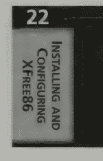

- `/dev/mouse`：使用 Linux 默认鼠标驱动程序
- `/dev/importbm`：仅适用于 Microsoft 总线鼠标
- `/dev/logibm`：仅适用于 Logitech 总线鼠标
- `/dev/psaux`：PS/2 端口鼠标

总线鼠标需要在 XFree86 和内核中都设置特定的 IRQ。请确保这两处的 IRQ 相同。

与键盘一样，xqueue 用户也有一个选项。由于大多数 XFree86 安装不使用 Xqueue，因此请保留该行处于注释状态。正如注释所示，波特率（baud rate）和采样率（sampling rate）行仅适用于一些较旧的 Logitech 鼠标设备。大多数鼠标设备不需要这些行，因此请保持它们被注释掉。如果你的鼠标没有这些设置就无法工作，请尝试 9600 波特率，如果不起作用，再尝试 1200 波特率。XFree86 的某些早期版本倾向于指定波特率，但请先尝试不指定该项。

Emulate3Buttons 选项对于拥有两键鼠标的用户很有用。启用后，Emulate3Buttons 允许你通过同时按下左右鼠标按钮来模拟按下中间按钮。许多 Linux（和 UNIX）应用程序会利用鼠标的三个按钮，因此这对于 Microsoft 及兼容鼠标用户来说是一个有用的选项。

最后，ChordMiddle 选项用于某些 Logitech 鼠标型号。如果使用 Logitech 驱动程序，请尝试在 XFree86 下不开启此选项的情况下使用鼠标。如果鼠标行为不正常，请尝试取消该行的注释。大多数 Logitech 鼠标设备不需要开启 ChordMiddle。

## 显示器型号

正确设置显示器是配置 XFree86 的重要步骤，而且很容易出错。如果某些设置不正确，可能会损坏显示器，因此请小心！耐心和良好的判断力会有所帮助，但显示器的操作手册是一个更好的信息来源。

如果不确定任何设置，请选择最基础的级别，直到获取更多信息为止。例如，如果不确定显示器是否支持高分辨率，请坚持使用 VGA 或 SVGA，直到得到确认。

XFree86Config 文件中的显示器部分为了方便起见被划分为更小的子部分。我们可以更详细地查看这些子部分。第一个部分询问关于显示器类型和型号的信息。该子部分如下所示：

```
Section "Monitor"
    Identifier "Generic Monitor"
    VendorName "Unknown"
    ModelName "Unknown"
```

此部分中的条目仅为文本字符串，对 XFree86 没有实际的配置值。只有在 XFree86 启动时文本字符串被回显给你，或者某个实用程序显示配置信息时，才会使用它们。你可以输入这些项目的适当值，使 XFree86 在使用上更加友好。

下一个子部分处理显示器的水平带宽。这是一个重要的部分，你应该尝试查找显示器的实际数值。随 XFree86 提供的文档中列出了特定品牌的一些设置，特别是在 Monitors 和 VideoModes.doc 文档中。请检查你的发行版目录中的任何规范文档文件。如果你找不到这些设置的具体数值，除非你知道你的显示器能够支持更高的值，否则使用最低设置作为默认值。带宽部分如下所示：

```
# Bandwidth is in MHz unless units are specified

Bandwidth 25.2
```

```
# HorizSync is in KHz unless units are specified.
# HorizSync may be a comma separated list of discrete values, or a
# comma separated list of ranges of values.
# NOTE: THE VALUES HERE ARE EXAMPLES ONLY. REFER TO YOUR MONITOR'S
# USER MANUAL FOR THE CORRECT NUMBERS.

HorizSync 31.5 # typical for a single frequency fixed-sync monitor

# HorizSync 30-64 # multisync
# HorizSync 31.5, 35.2 # multiple fixed sync frequencies
# HorizSync 15-25, 30-50 # multiple ranges of sync frequencies
```

带宽设置旁边有很好的注释，如前面的代码所示。例如，如果你正在安装多同步（multisync）显示器，你可以注释掉 31.5K Hz 行，并取消 30-64 KHz 行的注释。

垂直刷新率在另一个子部分中设置，它对显示器的健康状况至关重要，其重要性与带宽相当。再次，请查阅文档以获取更多信息。垂直刷新率子部分的代码如下所示：

```
# VertRefresh is in Hz unless units are specified.
# VertRefresh may be a comma separated list of discrete values, or a
# comma separated list of ranges of values.
# NOTE: THE VALUES HERE ARE EXAMPLES ONLY. REFER TO YOUR MONITOR'S
# USER MANUAL FOR THE CORRECT NUMBERS.

VertRefresh 60 # typical for a single frequency fixed-sync monitor

# VertRefresh 50-100 # multisync
# VertRefresh 60, 65 # multiple fixed sync frequencies
# VertRefresh 40-50, 80-100 # multiple ranges of sync frequencies
```

文件中的注释再次提供了帮助，显示了最常见的设置。这些可以作为参考，但你应该查阅文档以获取具体细节。

正确设置视频模式非常重要，因为过高的视频分辨率可能会导致雪花、黑屏或系统崩溃。前面提到的 SuperProbe 实用程序可以帮助确定支持的视频模式，尽管大多数显示器在其文档中都有良好的支持模式列表。XFree86 的 Monitors 文件也列出了许多流行显示器及其模式。设置视频模式的子部分如下：

```
# Modes can be specified in two formats. A compact one-line format, or
# a multi-line format.

# A generic VGA 640x480 mode (hsync = 31.5kHz, refresh = 60Hz)
# These two are equivalent

# Modeline "640x480" 25.175 640 664 760 800 480 491 493 525

Mode "640x480"
    DotClock 25.175
    HTimings 640 664 760 800
    VTimings 480 491 493 525
EndMode

# These two are equivalent

# Modeline "1024x768i" 45 1024 1048 1208 1264 768 776 784 817 Interlace

Mode "1024x768i"
    DotClock 45
    HTimings 1024 1048 1208 1264
    VTimings 768 776 784 817
    Flags "Interlace"
EndMode
```

上述示例显示了标准 VGA（640×480）分辨率和高分辨率（1,024×768）。你可以修改这些条目以匹配你特定的分辨率需求。从上面的代码中可以看出，你需要知道显示器和视频卡的点时钟（dot clock）以及水平和垂直时序。请查阅文档！请注意，你可以在单行中指定模式的所有详细信息，但更详细的列表更容易阅读和操作。


## 视频卡

XF86Config 文件的下一个子部分涉及你的系统所使用的视频卡。你可以定义多张具有不同分辨率的卡，或者简单地输入你最常使用的那一张。例如，以下子部分定义了一个 VGA 和一个 SVGA 通用驱动程序：

```
Section "Device"
Identifier "Generic VGA"
VendorName "Unknown"
BoardName "Unknown"
Chipset "generic"
VideoRam 256
Clocks 25.2 28.3
EndSection
```

```
Section "Device"
# SVGA server auto-detected chipset
Identifier "Generic SVGA"
VendorName "Unknown"
BoardName "Unknown"
EndSection
```

`Identifier`、`VendorName`、`BoardName` 以及可选的 `Chipset` 条目均为字符串，仅用于识别目的。`VideoRam`（视频板上的 RAM 数量）和 `Clocks` 条目用于指定视频卡的特定行为。应仔细检查这些信息以核实其准确性，因为非法条目可能会导致某些视频板损坏。

如果你拥有一块具有特殊功能的特定视频板，你可以为该板创建一个 Device 条目。例如，以下条目用于 Trident TVGA 板：

```
Section "Device"
Identifier "Any Trident TVGA 9000"
VendorName "Trident"
BoardName "TVGA 9000"
Chipset "tvga9000"
VideoRam 512
Clocks 25 28 45 36 57 65 50 40 25 28 0 45 72 77 80 75
EndSection
```

`VideoRam` 和 `Clocks` 行中的信息取自随 XFree86 提供的文档文件，也可以手动从视频卡的文档中输入。

某些视频板需要更多细节，这些细节由 devices 子部分中的额外条目提供。例如，以下配置适用于带有 2MB 板载 RAM 的 Actix GE32+ 视频卡：

```
Section "Device"
    Identifier    "Actix GE32+ 2MB"
    VendorName    "Actix"
    BoardName     "GE32+"
    Ramdac        "ATT20C490"
    Dacspeed      110
    Option        "dac_8_bit"
    Clocks        25.0 28.0 40.0 0.0 50.0 77.0 36.0 45.0
    Clocks        130.0 120.0 80.0 31.0 110.0 65.0 75.0 94.0
EndSection
```

你会看到，该条目中添加了 `Ramdac` 和 `Dacspeed` 选项，以及一个 `Option` 行。此子部分中允许的条目会随着 XFree86 的每个版本发布而变化，因此，如果你想充分利用你的视频卡，请查阅手册页或文档文件以获取更多详细信息。

### XFree86 服务器

在本章的前文中，我们查看了 XFree86 服务器，并展示了如何为你的 X 服务器选择特定的服务器。Xconfig 或 XF86Config 文件中的服务器部分就是服务器规格所在的位置。XF86Config 文件中的服务器子部分如下所示：

```
Section "Screen"
    Driver        "svga"
    Device        "Generic SVGA"
    Monitor       "Generic Monitor"
    Subsection "Display"
        Depth     8
        Modes     "640x480"
        ViewPort  0 0
        Virtual   800 600
    EndSubsection
EndSection
```

上述部分显示了一个通用的 SVGA 驱动程序。该卡支持 VGA 640×480 和 SVGA 800×600 分辨率。如果你拥有更强大的视频卡和显示器组合，如果存在特定服务器文件，你可以使用它，例如支持 2MB RAM 的 Actix GE32+ 卡的驱动程序，如下所示：

```
Section "Screen"
    Driver        "accel"
    Device        "Actix GE32+ 2MB"
    Monitor       "Generic Monitor"
    Subsection "Display"
        Depth     8
        Modes     "640x480"
        ViewPort  0 0
        Virtual   1280 1024
    EndSubsection
    Subsection "Display"
        Depth     16
        Weight    565
        Modes     "640x480"
        ViewPort  0 0
        Virtual   1024 768
    EndSubsection
EndSection
```

此卡设置为使用 Actix 卡的专用加速服务器文件，支持最高 1,280×1,024 的分辨率。请查看服务器列表，看看是否有专门为你视频卡设计的服务器。如果你不确定，请默认使用通用驱动程序！

此子部分中的选项并不适用于所有卡，但如果你知道它们的值，可以设置它们。最重要（也是最常用）的选项如下：

- *Depth*：颜色平面数（每像素位数）。通常深度为 8，但 VGA16 服务器的深度为 4，单色显示器的深度为 1。加速视频卡的深度可以为每像素 16、24、32 位，甚至 64 位，通常作为型号名称的一部分指示（例如，Diamond Stealth 24 卡的像素深度为 24，但在假定卡的型号名称确实是深度之前请予以核实！）。
- *Modes*：在 Monitor 部分的 `ModeLine` 选项中定义的显示模式名称列表。这显示了卡支持的所有模式以及你希望使用的模式。列表中的第一个模式是 XFree86 启动时的默认值。然后，当 XFree86 运行时，你可以切换到其他模式。
- *Virtual*：虚拟桌面大小。利用视频卡上的额外 RAM，你可以拥有比屏幕显示更大的虚拟桌面，然后使用鼠标在虚拟桌面上滚动。例如，你可以拥有一个 1,024×768 的虚拟桌面，但只显示 800×600（SVGA）。对不同虚拟桌面大小的支持取决于你使用的 RAM 量和深度。例如，视频卡上的 1MB RAM 支持深度为 8 的 1,024×768。2MB RAM 支持相同大小但深度为 16，或者深度为 8 的 1,280×1,024 桌面。要使用真正的虚拟桌面，请使用 fvwm 窗口管理器（通常默认使用）。
- *ViewPort*：与虚拟桌面一起使用，用于定义 XFree86 启动时虚拟桌面左上角的坐标。

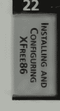

## 测试 XFree86 配置

现在 `Xconfig` 或 `XF86Config` 文件已完成，是时候采取大胆行动并启动 XFree86 了。使用命令 `startx`，X 启动脚本应加载所有必需的驱动程序和守护进程，清除屏幕，然后显示基本的 X Window 会话。如果 XFree86 无法加载，它通常会在终止过程中显示错误消息。检查这些消息以确定问题的线索。通常，XFree86 会遇到受支持的显示模式问题。（对于习惯在其他系统上使用 UNIX 的人来说，`startx` 是 `xinit` 的前端实用程序，通常用于启动 X。）

如果你无法快速让 XFree86 运行起来，最简单的调试方法是将所有配置信息降低到最低公倍数，例如简单的 VGA 系统。如果那样可行，那么你可以升级到更复杂的分辨率和配置。这通常有助于隔离问题的原因。如果通用 VGA 驱动程序不起作用，那么通常是配置问题导致的。请仔细检查配置文件。

## .xinitrc 文件

`.xinitrc` 是 X 的启动文件（类似于 shell 的 `.profile` 或 `.cshrc` 启动文件）。它通常包含对 `Xconfig` 或 `XF86Config` 文件中定义的配置的本地修改，以及 XFree86 启动时启动特定应用程序或窗口管理器的说明。如果你使用 `startx` 或 `runx` 命令启动 XFree86，则 `.xinitrc` 会被重命名以去掉点号（因此它将被称为 `xinitrc`）。

系统的 `xinitrc` 文件通常保存在 `/usr/lib/X11/xinit/xinitrc` 或 `/etc/X11/xinit/xinitrc` 中。对于 XFree86 和 Linux，后一种路径更为常见，而前者是 X 的路径。（Linux 将文件放在 `/etc/X11` 目录结构中，而不是 `/usr/lib`，因为某些 Linux 安装偏好将 `/usr` 目录挂载为只读，并且有时它们位于 CD-ROM 上。）

系统的默认 `.xinitrc` 文件可以通过将副本放置在你的主目录中来覆盖。当 XFree86 启动时，它首先检查你的主目录中的 `.xinitrc` 文件，然后如果在未找到该文件时读取默认启动文件。如果你想自定义 XFree86 会话的行为，请将系统文件复制到你的主目录并使用任何编辑器对其进行编辑。`startx` 和 `xinit` 的手册页解释了启动文件的一些详细信息。


下面展示了一个 `.xinitrc` 文件的示例。这是从普通的 XFree86 安装中获取的默认启动文件。该文件被切分为更小的部分，以便对每个子部分进行更详细的检查。第一个子部分涉及设置路径：

```
userresources=$HOME/.Xresources
usermodmap=$HOME/.Xmodmap
sysresources=/usr/X11R6/lib/X11/xinit/.Xresources
sysmodmap=/usr/X11R6/lib/X11/xinit/.Xmodmap
```

这些路径通常是在 XFree86 软件中设置好的，但你应该检查它们以确保其有效。如果存在指向其他目录的链接，请记得跟随链接。这些变量就是 XFree86 所需的全部内容。

下一个子部分检查某些系统资源是否存在，并根据检查结果执行操作。除非你对 X 会话有非常特殊的需求，否则这些检查中的大多数（如果不是全部）都不需要修改。

```
# 合并默认设置和键盘映射

if [ -f $sysresources ]; then
    xrdb -merge $sysresources
fi

if [ -f $sysmodmap ]; then
    xmodmap $sysmodmap
fi

if [ -f $userresources ]; then
    xrdb -merge $userresources
fi

if [ -f $usermodmap ]; then
    xmodmap $usermodmap
fi
```

`.xinitrc` 文件中的最后一个子部分如果存在 xsetroot 程序，则运行它以设置背景颜色（在这种情况下，设置为钢蓝色）。最后，执行 fvwm 窗口管理器并启动你的会话：

```
# 启动一些不错的程序
xsetroot -solid SteelBlue
fvwm
```

如果你想使用另一种窗口管理器，例如 Motif 的 mwm 管理器，请更改此子部分中的最后一行。确保窗口管理器文件在搜索路径中，以便启动例程能够找到它。

如果你想从 `.xinitrc` 文件中创建一个 xterm 会话（你需要一个 xterm 或其他实用程序来在 XFree86 中启动其他任务），请添加以下行：

```bash
xterm -e /bin/bash
```

在这种情况下，`bash`  shell 在 xterm 中调用。当然，你可以使用任何你想要的 shell。

如果你为自己创建 `.xinitrc` 文件，请将其放在你的主目录中。例如，你可以使用像这样的 `.xinitrc` 文件：

```bash
#!/bin/sh

xterm -fn 7x13bold -geometry 80x32+10+10 &
xterm -fn 7x13bold -geometry 80x32+30+50 &
oclock -geometry 70x70-7+7 &
xsetroot -solid SteelBlue &
exec fvwm
```

这会启动两个 xterm 和一个时钟，并将它们放置在桌面上，然后设置背景颜色为钢蓝色，最后启动桌面管理器。两个重要的注意事项：脚本中的最后一个命令前面带有 `exec` 命令，且最后一个命令不被发送到后台。如果你将最后一个命令发送到后台或忘记 `exec` 命令，X 启动后立即关闭！

## 总结

上述所有步骤将帮助你正确设置 XFree86，按照这些步骤操作后，你的 XFree86 会话应该能毫无问题地启动。有关使用 X 的具体细节超出了本书的范围。如果你不确定如何使用 X，请查看随发行版提供的文档文件，或咨询面向用户的书籍。

然而，如果你按照前面概述的步骤操作，你的 X 系统现在应该是可用的，你可以开始使用 X 系统作为你与 Linux 的主要接口。在 X 中工作之后，很难再回到基于字符的终端！

从这里开始，你可以前往与该主题相关的多个章节：

- Wabi，一种在 Linux 下运行 Windows 应用程序的方式，在第 23 章“Wabi”中讨论。
- Ghostscript，允许你在屏幕上查看 PostScript 文件并将其发送到打印机，在第 24 章“Ghostscript 和 Ghostview”中讨论。
- Linux 下的编程在第 V 部分讨论，从第 25 章“gawk”开始。
- 系统管理在第 VI 部分讨论，从第 32 章“系统管理基础”开始。


## Wabi

*作者：Tim Parker*

### 本章内容

- Wabi 能做什么？ 416
- 安装 Wabi 418
- 运行 Windows 3.x 应用程序 419

Wabi（Windows 应用程序二进制接口）是一款为允许 Microsoft Windows 3.X 应用程序在 X 和 Motif 下运行而开发的 Linux 和 UNIX 应用程序。Wabi 充当 Microsoft Windows 窗口命令与 X 下对应功能之间的翻译器。通过运行 Wabi，你的 Linux 系统可以获得对大多数 Windows 应用程序的访问权限，同时保留 Linux 的所有特性（包括其防崩溃能力、更好的性能和窗口切换）。

并非所有 Windows 应用程序都能在 Wabi 下正常运行。为了在 Wabi 下干净地执行，Windows 应用程序必须是“行为端正”的，这意味着应用程序必须符合 Microsoft 为应用程序制定的所有标准。大多数标准应用程序，如文字处理程序和电子表格，行为端正，在 Wabi 下工作良好。一些软件包，特别是游戏和一些图形工具，为了从图形卡中获得更好的性能而偏离 Microsoft Windows 标准，这些软件在 Wabi 下无法可靠运行（如果还能运行的话）。此外，在 Wabi 的 2.1 版本（当前发行版）中，你无法运行 Windows 95 应用程序。

# 提示

一份已经过测试并被认证为能在 Wabi 下正常运行的应用程序列表可以从包括大多数 Linux FTP 站点在内的多个站点获取。其中一个站点是：

http://wabiapps.psgroup.com

不要因为你最喜欢的软件不能全部在 Wabi 下运行而感到气馁。大多数 Windows 3.x 应用程序都可以运行，主要例外是游戏。想在 Linux 下运行 CorelDraw？没问题。想运行 Microsoft Office？同样，小菜一碟。本质上，如果它是办公生产力工具，它就能运行（因为这些工具很少需要偏离 Windows 编程标准）。

### Wabi 能做什么？

如前所述，Wabi 位于 Windows 应用程序和 X 管理器之间的一层。当运行在 Wabi 下的 Windows 应用程序发出窗口请求时，例如打开新窗口、更改标题或修改字体，Wabi 会拦截该请求并将其转换为 X 等效操作。当 X Windows 进程想要向 Windows 应用程序发送消息时，Wabi 将 X 消息转换为 Windows 消息。只要应用程序遵循标准的 Windows 机制，Wabi 就可以处理转换并允许该应用程序在 X 下运行。

Wabi 本身并不做太多事情。没有真正的可供交互的 Wabi 应用程序，除了某些配置工具。然而，Wabi 确实拥有大量特性，允许在 X 下执行你在 Windows 或基于 Windows 的环境中熟悉的操作，例如：

- Windows 应用程序之间的剪切和粘贴
- 对 CPU 的增强模式支持
- DOS 格式磁盘访问
- Windows 应用程序之间的 OLE（对象链接和嵌入）
- Windows 应用程序之间的 DDE（动态数据交换）
- 网络支持
- Windows sockets 编程

Wabi 将大多数这些特性扩展到 X 环境，因此你可以在 Windows 和 X 应用程序之间进行剪切和粘贴，与两者下的网络应用程序交互，并允许同一应用程序上的多个用户。

对大多数用户而言，Wabi 不能做什么可能更重要。这个列表很短，但对于某些 Windows 应用程序来说确实有一些重要的考量。Wabi 不支持：

- MIDI（乐器数字接口）
- AVI（音频视频接口）
- IPX/SPX 网络
- 共享 Wabi 目录
- 基于 VGA 的视频驱动程序
- DOS 磁盘格式化
- (VDx) 虚拟设备驱动程序

这些不支持的特性中的一些，如 IPX/SPX 和 MIDI，可以通过其他 Linux 子系统提供。Wabi 也在不断通过新功能进行改进，因此未来可能会添加对这些项目支持。

由于版权限制，Wabi 不包含 Microsoft Windows 3.x，因此你除了 Wabi 还需要购买支持的 Windows 副本（尽管大多数用户某处都有 Windows 副本）。


## 安装 Wabi

Wabi 至少需要 16MB 内存，尽管建议使用 32MB。至少需要 20MB 的交换空间，虽然 40MB 更好（更多则更佳）。根据版本和支持的 Windows 版本不同，Wabi 的目录空间大约为 25MB。

Wabi 包含一个安装脚本，该脚本负责处理您通常必须手动完成的所有步骤。只需回答安装脚本的提示，Wabi 软件即可正确安装。如果您使用的是从非 CD-ROM 来源获取的 tar 文件，在一个空的临时目录中解压缩该文件将为您提供所有必需的文件，包括安装脚本。Wabi 安装完成后，它会提示您选择要使用的 Windows 3.x 版本。支持 Windows 3.1 和 Windows 3.11。

默认情况下，Wabi 安装在 `/opt/wabi` 目录中，所有二进制文件都存储在 `/opt/wabi/bin` 目录中。您可以更改这些默认设置，但最好保持原样。每次运行 Wabi 系统时，都会使用一个个人目录，通常位于您的主目录下，命名为 wabi。顾名思义，个人目录对每个登录用户都是唯一的，任何运行 Wabi 的用户都会拥有一个个人目录。在 wabi 目录下面有一个 windows 目录，其中包含 Microsoft Windows 3.x 程序。这意味着每个用户都有自己的一份 Windows 副本，并且此应用程序无法共享。虽然有一些方法可以绕过这一点，但最好坚持 Wabi 的设计初衷。您可以将 wabi 和 wabi/windows 目录类比为 PC 上的 `C:\` 和 `C:\WINDOWS` 目录。

## 故障排除

如果您正在运行 Metro X 3.1.2 并尝试运行 Wabi，您的 Metro X 会话将会挂起。问题不出在 Wabi，而在于该版本的 Metro X。较新版本的 Metro X 3.1.5 不会出现这些问题。升级版本通常可以从 Metro X 的供应商 Metro Link 处获得。一种解决大部分问题的变通方法（但会产生性能影响）是在命令行中添加 `-fs` 选项来启动 Wabi。

当前版本的 Wabi 仅支持 8 位颜色深度（256 色），但有一个不受支持的中间版本支持 24 位颜色深度。为了获得最佳性能，您应该将 X 会话设置为使用 8 位颜色。

## 运行 Windows 3.x 应用程序

如前所述，Wabi 仅支持 Windows 3.x 应用程序。这些应用程序在您的 Linux 系统上安装并启动，方式与在独立 Windows 系统上一样。启动 Wabi 时，您将在窗口中看到一个与 Windows 3.x 看起来完全相同的环境。从此以后，Windows 的行为正如您所期望的那样。Wabi 会为您处理所有设备（如软驱和目录）的映射。

通过在 X 终端窗口中输入以下命令来启动 Wabi：

```bash
wabi &
```

实际上您并不真正需要末尾的 ampersand（`&`），该符号强制 Wabi 会话在后台运行，但它会在您的 X 终端窗口中返回 shell 提示符，使您可以继续使用该终端，而不是拥有一个锁定的窗口。当您发出 `wabi` 命令时，带有 Wabi 徽标的“闪屏”会出现，如图 23.1 所示。窗口底部的滚动条显示 Wabi 加载所需所有字体的过程，然后主窗口打开。

**图 23.1。**
带有底部状态栏的 Wabi 闪屏。


如果您正在运行 X11 系统（Metro X 和 XFree86 都是 X11 系统），Wabi 会启动一个自己的字体服务器，称为 wabifs。

## 提示

Sun Microsystems 原本计划在 1997 年发布支持 Windows 95 应用程序的 Wabi 3.0。然而，Sun 决定停止开发 Wabi。截至本书撰写时，没有其他供应商决定获得 Wabi 3.0 的许可证并继续开发。Windows 95 应用程序无法在任何现有版本的 Wabi 下运行。

图 23.2 显示了安装 Windows 3.1 后的主 Wabi 窗口。如您所见，它与标准的 Windows 界面看起来相同，区别仅在于 Motif 风格的窗口元素（窗口右上角不同的最小化和最大化按钮）以及左上角的 Wabi 四格窗口图标。安装 Windows 时，Wabi 会创建一个 Wabi 程序组。Wabi 程序组包含发行说明和一些文档。

**图 23.2。**
Wabi 界面看起来与标准 Windows 界面相同。

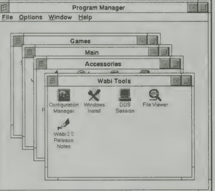

加载新应用程序与在 Windows 中一样简单：如果您使用软驱，请选择 **运行** 命令，输入 **A:SETUP** 或安装程序名称。在这方面，Wabi 的行为与 Windows 完全相同。只有在涉及网络时，您才会发现 Windows 和 Wabi 下的 Windows 之间存在主要差异，因为两者使用不同的网络模型。

**帮助** 可通过两种来源在 Wabi 中获取：在线帮助（类似于常规 Windows）和 man 手册页。man 手册页描述了命令行选项，展示了各种启动模式示例，并列出了 Wabi 使用的环境变量。

## 摘要

Wabi 是在 Linux 下运行旧版 Windows 3.x 应用程序的有效方式。这使您无需购买新的 Linux 版本即可使用许多现有的应用程序，例如文字处理器、电子表格和实用程序。从这里开始，有若干章节可能会让您感兴趣：

- 要了解有关 awk 语言编程的更多信息，该语言适用于执行文件操作和处理数据列，请参阅第 25 章“gawk”。
- 要了解有关 Perl 的更多信息，这是一种功能完整的编程语言，易于学习且适合快速实用程序，请参阅第 28 章“Perl”。
- 要了解有关系统管理以及如何保持 Linux 系统平稳运行的更多信息，请参阅从第 32 章“系统管理基础”开始的部分 VI。
- 要了解有关将您的 Linux 系统用作进入互联网的网关的更多信息，请参阅第 47 章“设置互联网站点”。


## 第 24 章

### Ghostscript 和 Ghostview

作者：*Tim Parker*

### 本章内容

- 在哪里获取 Ghostscript 424

PostScript 是一种流行的页面描述语言（PDL），被许多应用程序包使用。PostScript 的一个优势在于，PostScript 格式的文件可以在任何理解该语言的打印机上打印，无论其操作系统或打印机制造商如何。这使得您可以使用应用程序生成文件，该文件可以在世界上每台 PostScript 兼容打印机上打印，而无需为 HP LaserJet II、爱普生点阵打印机、佳能 Bubblejet 打印机等分别创建不同的文件。

就 Linux 而言，PostScript 有一个主要问题：它是一个受版权保护的名称，其所有者 Aladdin Systems, Inc. 对其使用施加了多项限制。Ghostscript 旨在开发一种实用程序，以解决那些问题同时完成相同的任务。正如您可以推测的那样，Ghostscript 与 PostScript 非常相似，但它没有相关的版权问题（因此也没有许可费、法律顾虑等）。实际上，Ghostscript 是一个受版权保护的实用程序，由开发者所有，但他们允许在 GNU 通用公共许可证下分发它，使其在 Linux 中容易获取和使用。

> **提示**
> Ghostscript 由 Aladdin Enterprises（该实用程序的开发商）版权所有。如果您想获取更多关于 Ghostscript 的信息或希望获取该实用程序的许可证，请联系 Aladdin Enterprises, P.O. Box 60264, Palo Alto, CA 94306 或通过电子邮件 ghost@aladdin.com 联系。

Ghostscript 页面描述语言可以由大多数应用程序生成。一个名为 Ghostview 的实用程序允许您在屏幕上查看 Ghostscript 格式的文件，这是一个非常实用的功能。Ghostscript 不是一个单一的程序，而是一组程序。这里我们最关心的两个程序是 PostScript 语言的解释器和一组可以链接到应用程序中以提供类似 PostScript 功能的 C 函数。

### 在哪里获取 Ghostscript

您的 Linux 发行版套装（如 CD-ROM）中很可能已经提供了 Ghostscript。Ghostscript 是大多数 Linux 版本中 AP Disk Set（应用程序）的一部分。如果您在安装 Linux 时决定安装 AP Disk Set（大多数人都会这样做），您的系统上已经安装了 Ghostscript 的文件。如果您没有安装 AP Disk Set，您可以随时进行安装并指定仅安装


具体取决于您的 Linux 版本及其包含的安装工具，可能是 Ghostscript 实用程序或完整的磁盘集。

要检查系统中是否已安装 Ghostscript，通常您需要搜索二进制文件和库，因为某些 Linux 版本将它们安装在不同的位置。查找 Ghostscript 是否安装的最简单方法是使用 `find` 命令搜索名为 `gs` 的二进制文件：

```
find / -name gs -print
```

如果您的系统返回了一些匹配项（通常在 `/usr/bin` 中），那么 Ghostscript 可能已经安装。为了验证完整的文件集已加载，您需要找出您的 Linux 版本将所有文件放置在哪里。文件数量因 Ghostscript 版本而异，但所有版本都包含以下文件名：

- `bdftops.ps`
- `decrypt.ps`
- `font2c.ps`
- `gs_dbt_e.ps`
- `gs_dps1.ps`
- `gs_fonts.ps`
- `gs_init.ps`
- `gs_lev2.ps`
- `gs_statd.ps`
- `gs_sym_e.ps`
- `gs_type0.ps`
- `gsI p.ps`
- `impath.ps`
- `landsca p.ps`
- `level11.ps`
- `prfont.ps`
- `ps2ascii.ps`
- `ps2epsi.ps`
- `ps2image.ps`
- `pstoppm.ps`
- `quit.ps`
- `showpage.ps`
- `type1ops.ps`
- `wrfont.ps`
- `ugIyr.gsf`
- `Fontmap`

通常，Ghostscript 文件存储在 `/usr/lib/ghostscript` 或 `/usr/share/ghostscript` 中。安装目录通常会附带版本号，这使问题变得复杂。再次使用 `find` 命令来定位其中一个 Ghostscript 实用程序：

```
find / -name gs_statd.ps -print
```

在这种情况下，我们搜索的是文件 `gs_statd.ps`，它应该是每个 Ghostscript 安装的一部分。在某些 Linux 系统中，该文件位于 `/usr/lib/ghostscript`，而在其他系统中，它可能位于 `/usr/share` 下。在 Caldera OpenLinux 系统上，输出如下所示：

```
[root@linux /root]# find / -name gs_statd.ps -print
/usr/share/ghostscript/3.33/gs_statd.ps
```

在这种情况下，Ghostscript 文件位于名为 `/usr/share/ghostscript/3.33` 的目录中。要检查文件集中的所有文件是否已加载，请列出您搜索到的文件所在目录的内容。如果 Ghostscript 已安装，您会看到一组文件，如图 24.1 所示。

**图 24.1。**
Ghostscript 目录的内容。

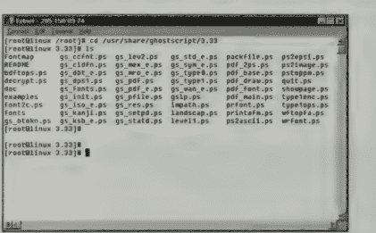

Ghostscript 所需的所有字体都存储在主 Ghostscript 目录下的某个目录中，在本例中为 `/usr/local/ghostscript/3.33/fonts`。大多数发行版都包含大量字体。

如果您的 Linux 版本未包含 Ghostscript 实用程序的副本，您可以从 Linux 的任何标准发行点下载该集合。请参阅第 2 章“Linux 类型”以了解如何获取发行版。您也可以从 Aladdin Enterprises 获取 Ghostscript 集合。

## 使用 Ghostscript

Ghostscript 集合中的主要程序是 `gs`，它是 Ghostscript 解释器。`gs` 实用程序读取您告诉它的任何文件，并为您解释它们，在 X 窗口中显示格式正确的文档。从字符终端运行 `gs` 几乎不起作用，因为需要图形窗口来显示其操作结果。

要在 X 窗口中显示一个或多个文件，请输入以下命令，其中 `file1.ps` 是文件名（通常带有 .ps 扩展名，以显示它是 PostScript 格式文件）：

```
gs file1.ps
```

您可以指定多个文件名，每个文件将按顺序显示。当您输入 `gs` 命令时，您会看到一条类似“正在初始化...”的消息以及来自 Ghostscript 解释器的一系列消息，然后一个包含文件内容的窗口将打开。确切的 X 窗口消息和外观因您的 Ghostscript 版本而异。图 24.2 显示了在 Xterm 中输入 `gs` 命令时的输出，图 24.3 显示了 Ghostscript 显示的窗口，其中选定的文件内容被正确格式化。

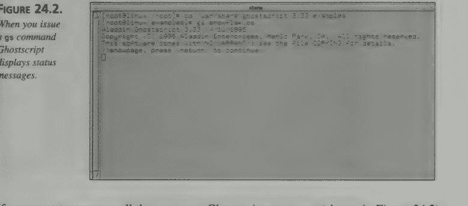

如果您想抑制 Ghostscript 生成的所有消息（如图 24.2 所示），请使用 `-q`（安静）选项，该选项将抑制除主要消息以外的所有消息。

您可以通过 man 页面获取有关 `gs` 命令的帮助，这些页面通常难以阅读，或者使用 `-h` 或 `?` 选项从命令行获取。当您使用任一选项时（两者显示相同的屏幕输出），您将看到 `gs` 命令的所有可用选项和命令用法。由于帮助屏幕的输出超过一页，您应该将输出通过管道传输到 `more` 命令，如下所示：

```
gs -h | more
```

您将看到如图 24.4 中的屏幕。要移动到下一页帮助，请按空格键。要退出 `more` 实用程序，请使用 `q` 命令或 Ctrl+C。

## 为 X 配置 Ghostscript

某些 Linux 版本预装了经过修改的 X 系统以处理 Ghostscript 输出，但大多数并未这样做。Ghostscript 使用一组 X 资源，这些资源通常存储为程序名 `ghostscript` 和类名 `Ghostscript` 在 `.Xdefaults` 文件中。您的 `.Xdefaults` 文件至少应有三项条目，如下所示：

```
Ghostscript*geometry:             -0+0
Ghostscript*xResolution:        72
Ghostscript*yResolution:        72
```

如果这些条目缺失于您的 `.Xdefaults` 文件中，请使用编辑器输入它们，并通过重启服务器或发出以下命令（假设您在您的主目录中）重新加载默认设置：

```
xrdb -merge ./.Xdefaults
```

如果没有，请指定您的 `.Xdefaults` 文件的路径。

**图 24.3。** Ghostscript 在窗口中显示 PostScript 文件供您直接查看。


**图 24.4。** 使用 more 命令显示 gs 命令的帮助屏幕。

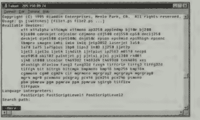

Ghostscript 可以利用 `.Xdefaults` 文件中的许多资源，但由于默认设置效果良好，大多数对您没什么用。可以在 Ghostscript 中设置资源如表 24.1 所示。

### 表 24.1. GHOSTSCRIPT 支持的 X 资源。

| 资源名称 | 资源类 | 默认值 |
| :--- | :--- | :--- |
| background | Background | 白色 |
| foreground | Foreground | 黑色 |
| borderColor | BorderColor | 黑色 |
| borderWidth | BorderWidth | 1 |
| geometry | Geometry | NULL |
| xResolution | Resolution | 计算得出 |
| yResolution | Resolution | 计算得出 |
| useExternalFonts | UseExternalFonts | true |
| useScalableFonts | UseScalableFonts | true |
| logExternalFonts | LogExternalFonts | false |
| externalFontTolerance | ExternalFontTolerance | 10.0 |
| palette | Palette | Color |
| maxGrayRamp | MaxGrayRamp | 128 |
| maxRGBRamp | MaxRGBRamp | 5 |
| useBackingPixmap | UseBackingPixmap | true |
| useXPutImage | UseXPutImage | true |
| useXSetTitle | UseXSetTitle | true |
| regularFonts | RegularFonts | none |
| symbolFonts | SymbolFonts | none |
| dingbatFonts | DingbatFonts | none |

## 重定向 Ghostscript 输出

Ghostscript 允许您将输出重定向到其他设备时具有相当大的灵活性。在命令行上，您可以使用 `-sDEVICE` 选项指定打印机等设备。例如，如果您有一个名为 `HPLaser` 的设备，您可以使用以下命令将 `gs` 命令的输出重定向到该打印机：

```
gs -sDEVICE=HPLaser filename.ps
```

如果您发出此命令，您不会在窗口中看到任何输出，因为输出已被重定向。如果您在命令行上指定了多个文件，如下例所示，所有文件都将发送到 `HPLaser`：

```
gs -sDEVICE=HPLaser file1.ps file2.ps file3.ps
```

重定向一直有效，直到命令终止。当然，您重定向到的设备必须存在，否则 `gs` 将返回“未知设备”消息。您可以使用以下命令查看所有已知设备的列表：

```
gs -h
```

屏幕上的很大一部分（如图 24.4 所示）列出了 Ghostscript 知道的设备。

您可以利用参数顺序对 Ghostscript 进行一些操作。由于参数给出的顺序对 Ghostscript 很重要，您可以发出如下命令，该命令在您的 X 会话中显示 `file1.ps` 和 `file2.ps`，然后将 `file3.ps` 发送到设备 `HPLaser`：

```
gs file1.ps file2.ps -sDEVICE=HPLaser file3.ps
```

如果需要，您可以在命令行上多次更改设备，因此下一个命令将把 `file1.ps` 发送到设备 `HPLaser`，把 `file2.ps` 发送到设备 `CanonBJet`：

```
gs -sDEVICE=HPLaser file1.ps -sDEVICE=CanonBJet file2.ps
```

在某些情况下，直接发出单独的命令可能更容易；否则 `gs` 命令行会变得相当复杂。

Ghostscript 还内置了其他几种功能用于修改输出设备。如果您拥有一台较旧的点阵打印机，并且它支持多种分辨率（如草稿模式和最终模式），您可以定义不同的选项让 Ghostscript 触发相应的设备。例如，以下命令告诉 Ghostscript 使用可用的最高分辨率（24 针）在 Epson 设备上打印：

```
gs -sDEVICE=Epson -r360x180
```

由于这些较旧的硬件设备正在逐渐消失，这些命令选项也很少被普遍使用。

如果出于某种原因您不想使用打印机或屏幕作为输出，您可以使用 `-sOutputFile` 选项重定向 Ghostscript 的输出，方法如下：

```
gs -sOutputFile out1.ps file1.ps file2.ps
```

尽管 Linux 允许您使用功能更强大的管道和重定向，但这项功能被包含进来是为了那些功能不如 Linux 强大的操作系统！

## 更改纸张大小

默认情况下，Ghostscript 使用 `gs\_statt//.` 文件中指定的纸张尺寸，该文件是打印实用程序的一个配置文件。该文件为您预定义了数十种纸张样式，例如所有欧洲和美国的标准尺寸。若要使用默认以外的尺寸，请使用 `-sPAPERSIZE` 选项，后面跟上 `gs\_statt//.` 文件中指示您想要使用的尺寸的名称。例如，要使用欧洲 A4 尺寸，请使用以下命令：

```
gs -sPAPERSIZE=a4 -sDEVICE=HPLaser file1.ps
```

如果您想要使用的纸张尺寸未在 `gs\_statt//.` 文件中定义，您可以修改现有的条目或创建自己的条目。


> **提示**
有时即使您使用 `-sPAPERSIZE` 选项更改纸张尺寸，您仍会发现 Ghostscript 使用了另一种纸张尺寸。这是因为 PostScript（因此 Ghostscript 也）允许在 PostScript 文件的内容中嵌入特定的纸张尺寸。即使您在命令行中指定了纸张尺寸，文件的内容也会覆盖此设置。解决此问题的唯一方法是手动编辑 PostScript 文件。

## Ghostscript 环境变量

Ghostscript 使用一组可以改变其行为的环境变量。Ghostscript 使用的环境变量及其功能如表 24.2 所示。

**表 24.2. GHOSTSCRIPT 变量及其含义。**

| 变量 | 功能 |
| :------- | :----------- |
| `GS_DEVICE` | 定义默认输出设备。 |
| `GS_FONTPATH` | 指定用于扫描字体的目录列表。 |
| `GS_LIB` | 提供初始化和字体的搜索路径。搜索路径中的目录由冒号分隔。 |
| `GS_OPTIONS` | 定义在处理实际命令行指定的参数之前要处理的命令行参数列表。 |
| `TEMP` | 定义临时文件的目录名称。 |

`GS_OPTIONS` 变量可用于更改 Ghostscript 的行为方式。例如，`GS_DEVICE` 选项可用于将设备设置为某个值，而无需您在每条命令行上都进行指定。`GS_OPTIONS` 可以包含参数和选项。

`TEMP` 变量在 Linux 系统上通常指向 `/tmp` 目录，但您可以更改此设置。当 Ghostscript 创建临时文件时，文件名以 `gs_` 开头。不幸的是，Ghostscript 并不总是能正确删除这些文件，因此您偶尔需要进入 `/tmp` 目录并删除任何以 `gs_` 开头的文件。如果您经常使用 Ghostscript，该目录的大小可能会迅速大幅增长，因此请密切关注它。

## Ghostview

Ghostview 是一个用于在屏幕上显示 PostScript 文件的实用程序。Ghostview 由 Tim Theisen 编写，而非由 Aladdin Enterprise 编写，并且可自由在互联网和 CD-ROM 合集中获取。Ghostview 使用 Ghostscript 显示内容，但无需先安装 Ghostscript。

Ghostview 实用程序很容易运行。要在您的 X 屏幕上显示文件 `chapter1.ps` 的内容，您可以发出以下命令：

```
ghostview chapter1.ps
```

大多数用户会学会将 `ghostview` 命令重命名或设置别名为更短的名称（例如 `gv`），以使使用更方便且输入更快。例如，要在 tesh shell 中将命令 `ghostview` 别名为 `gv`，只需输入：

```
alias gv ghostview
```

Ghostview 的主窗口比 Ghostscript 显示的简单输出窗口稍微复杂一些。Ghostview 的主窗口如图 24.5 所示。

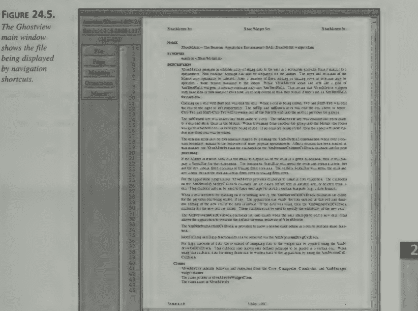

## Ghostview 面板

如您所见，您正在显示的文件位于窗口的右页，其外观与使用 Ghostscript 时一样（实际上正是如此，因为 Ghostview 在此例程的这一部分调用了 Ghostscript）。右边距中的滚动条可让您快速浏览文件，您也可以使用左侧的页码快速跳转到任何一页。

左侧面板中有五个按钮：

- **File（文件）**。允许您打开、重新打开或打印文件，以及显示版权信息并退出 Ghostview。
- **Page（页面）**。控制查看面板中显示的页面。有一些选项很直观：“Next” 移动到下一页，“Previous” 移动到上一页，“Redisplay” 重绘屏幕，“Mark” 在目录中标记页面，“Unmark” 移除标记。
- **Magstep（放大步骤）**。更改 Ghostview 窗口右侧部分面板的放大倍数。
- **Orientation（方向）**。允许您在横向和纵向模式之间切换，以及将图像倒置或旋转 90 度。
- **Media（介质）**。允许您更改纸张大小。

使用几次后，您会发现 Ghostview 快速且易于操作。Ghostview 窗口的顶部显示版本号，左侧面板的顶部显示您正在显示的文档的标题（如果有）（PostScript 允许在页面描述语言中嵌入文档标题）。如果未找到标题，则显示文件名。标题下方的日期是嵌入在 PostScript 文件中的日期，或者是文件的修改日期。

> Ghostview 的一个功能可能会让您困惑片刻，那就是页面在最小化后再次展开时的显示方式。当您将 Ghostview 窗口缩小为图标时，Ghostview 会在内存中保留文件的所有图像。然而，当您展开窗口时，Ghostview 会先检查文件自最小化以来是否已更改。这可能导致窗口再次出现时略有延迟，尤其是在处理非常大的文档时。尽管存在延迟，但这仍然是一个非常有用的功能——它意味着您始终看到的是文档的最新版本。

尽管 Ghostview 窗口看起来很简单，但它支持大量选项。这些选项往往替代了 Ghostview 文档中解释的 X 资源或环境变量选项。

## Ghostview 字体

默认情况下，Ghostview 附带一组 PostScript 1 型和 3 型字体，这应该能覆盖您可能遇到的任何文档。但是，您可以将自己的字体添加到 Ghostview 的资源库中。这些字体需要放置在 Ghostscript 字体子目录中，例如 `/usr/share/ghostscript/3.33/fonts`。

您还必须编辑 `Fontmap` 文件，以告知 Ghostview 和 Ghostscript 关于新字体的信息。`Fontmap` 中每个条目的格式很简单，显示字体名称和包含它的文件，如下所示，其中 `funnyfont` 是字体名称，`fun_fnt.pfb` 是 PostScript 定义文件：

```
funnyfont (fun_fnt.pfb);
```

## Ghostview X 资源

与大多数使用 X 的应用程序一样，Ghostview 也有一套可使用的 X 资源。这些 X 资源与 Ghostscript 使用的不同。表 24.3 列出了 Ghostview 识别的 X 资源。

表 24.3. GHOSTVIEW X 资源。

| 资源名称 | 资源类别 | 默认值 |
| :--- | :--- | :--- |
| showTitle - 显示标题 | Labels | true |
| showDate - 显示日期 | Labels | true |
| showLocator - 显示定位器 | Labels | true |
| autoCenter - 每当页面大小更改时，在视口中居中对齐页面 | AutoCenter | true |
| horizontalMargin - 应保留给水平窗口装饰的像素数 | Margin | 20 |
| verticalMargin - 应保留给垂直窗口装饰的像素数 | Margin | 44 |
| minimumMagstep - 可显示的最小放大步骤 | Magstep | -5 |
| maximumMagstep - 可显示的最大放大步骤 | Magstep | 5 |
| magstep - 默认放大步骤 | Magstep | 0 |
| orientation - 默认方向 | Orientation | Portrait |
| page - 初始显示的页面 | Page | |

*续*


| 资源名称 | 资源类别 | 默认值 |
| :--- | :--- | :--- |
| pageMedia - 默认页面介质 | PageMedia | Letter（信纸大小） |
| forceOrientation - 强制指定方向 | Force | false（否） |
| forcePageMedia - 强制指定页面介质 | Force | false（否） |
| swapLandscape - 交换“横向”和“纵向”的含义 | SwapLandscape | false（否） |
| printCommand - 用于打印的命令 | PrintCommand | |
| printerVariable - 打印机环境变量的名称 | Printer Variable | PRINTER |
| busyCursor - 向窗口绘制时显示的指针 | Cursor | |
| cursor - 空闲时显示的指针 | Cursor | cross hair（十字准线） |
| safer - 是否以更安全模式运行 | Safer | true（是） |

## 总结

在本章中，我们介绍了 Ghostview 和 Ghostscript 这两个非常实用的 PostScript 格式文件处理工具。使用 Ghostview 快速浏览文件而无需打印是非常有用的，因此 Ghostview 已成为许多 UNIX 系统（包括 Linux）上使用最频繁的工具之一。从这里开始，请查看一些相关章节。

- 要了解在 Linux 下配置打印机的内容，请参见第 20 章“打印”。
- 要了解在 Linux 下进行编程的内容，请参见从第 25 章“gawk”开始的第五部分。
- 要了解设置设备（包括打印机）的内容，请参见第 33 章“设备”。

## 第五部分

## 面向程序员 Linux

### 本部分内容

- gawk 439
- C 语言编程 463
- C++ 语言编程 485
- Perl 503
- Tcl 和 Tk 简介 523
- 其他编译器 537
- Smalltalk/X 543

# 第 25 章

## gawk

作者：Tim Parker

### 本章内容

- 什么是 gawk 语言？ 440
- 文件、记录和字段 440
- 模式-动作对 442
- 调用 gawk 程序 453
- 控制结构 457

*awk* 编程语言由三位人士创建，他们将自己的姓氏首字母赋予了这门语言：Alfred Aho、Peter Weinberger 和 Brian Kernighan。Linux 中包含的 *gawk* 程序是该编程语言的 GNU 实现版本。

*gawk* 语言不仅仅是一门编程语言；对于许多系统管理员和 UNIX 程序员来说，它几乎是不可或缺的工具。这门语言本身易于学习，易于掌握，并且异常灵活。一旦你习惯了使用 *gawk*，你会惊讶地发现它可以用于系统中多少常规任务。

为了帮助你理解 *gawk*，我们将按照一个简单的顺序介绍编程语言的要素，并展示一些良好的示例。当然，鼓励大家随着章节的进展进行实验。本章无法涵盖 *gawk* 的所有不同方面和功能，但我们将介绍语言的基础知识，并尽可能多地展示内容以激发你的好奇心。

## 什么是 gawk 语言？

*gawk* 旨在成为一种易于使用的编程语言，允许你处理存储在文件或通过管道传入的信息。*gawk* 的主要优势在于它具备以下能力：

- 显示文件的部分或全部内容，根据需要选择行、列或字段。
- 分析文本中单词的频率、出现次数等。
- 基于文件中的信息准备格式化输出报告。
- 以非常强大的方式过滤文本。
- 使用文件中的数字信息进行计算。

*gawk* 并不难学。在很多方面，*gawk* 是理想的入门编程语言，因为它规则简单、格式基础且用法标准。经验丰富的程序员会发现 *gawk* 用起来格外轻松。

## 文件、记录和字段

通常，*gawk* 处理存储在文件中的数据。这通常是数字数据，但 *gawk* 也可以处理字符信息。如果数据未存储在文件中，则通过管道或其他形式的重定向提供给 *gawk*。只有 ASCII 文件（文本文件）才能被 *gawk* 正确处理。虽然它具备处理二进制文件的能力，但结果往往不可预测。由于 Linux 系统中的大多数信息都存储在 ASCII 中，因此这并非问题。

以一个 *gawk* 处理的简单文件为例，假设是一本电话簿。它由许多条目组成，所有条目都具有相同的格式：姓氏、名字、地址、电话号码。整本电话簿是一种数据库，尽管没有复杂的搜索例程。确实，电话簿依赖纯字母顺序使用户能够搜索所需数据。

电话簿中的每一行都是独立的一组完整数据，称为记录。例如，电话簿中“Smith, John”的条目，包括他的地址和电话号码，就是一个记录。

记录中的每个信息部分——姓氏、名字、地址和电话号码——被称为字段。对于 *gawk* 语言而言，字段是单个信息片段。因此，记录是涉及单个项目的多个字段的集合。一组记录构成一个文件。

在大多数情况下，字段由仅用于分隔字段的字符分隔，例如空格、制表符、冒号或其他特殊符号。这个字符称为字段分隔符。一个很好的例子是文件 `/etc/passwd`，其外观如下：

```
tparker:t36s62hsh:501:101:Tim Parker:/home/tparker:/bin/bash
etreijs:2ys639dj3h:502:101:Ed Treijs:/home/etreijs:/bin/tcsh
ychow:1h27sj:503:101:Yvonne Chow:/home/ychow:/bin/bash
```

如果你仔细查看该文件，你会发现它使用冒号作为字段分隔符。`/etc/passwd` 文件中的每一行都有七个字段：用户名、密码、用户 ID、组 ID、注释字段、主目录和启动 shell。每个字段由冒号分隔。冒号仅用于分隔字段。查找任意行中第六个字段的程序只需数五个冒号（因为第一个字段前面没有冒号）。

*就是在这里，我们遇到了与 *gawk* 在电话簿示例中定义字段相关的问题。考虑电话簿中的以下行：

```
Smith, John    13 Wilson St.        555-1283
Smith, John    2736 Artside Dr, Apt 123    555-2736
Smith, John    125 Westmount Cr     555-1728
```

我们“知道”这里有四个字段：姓氏、名字、地址和电话号码。但 *gawk* 并不这么看。电话簿使用空格字符作为字段分隔符，因此在第一行中，它将“Smith”视为第一个字段，“John”视为第二个，“13”视为第三个，“Wilson”视为第四个，等等。对于 *gawk* 而言，使用空格字符作为字段分隔符时，第一行有六个字段。第二行有八个字段。前面示例中的空白符（空格和制表符）被 *gawk* 忽略，视为没有特殊含义的普通字符。除非你将字段分隔符更改为空格或制表符字符，否则空白符对 *gawk* 没有意义。

**提示**

使用编程语言时，你必须按照语言看待数据的方式来考虑数据。请记住，编程语言是按字面意义处理事物的。

为了以我们想要的方式理解电话簿，我们必须找到另一种结构数据的方法，以便在部分之间有一个字段分隔符。例如，以下示例使用斜杠字符作为字段分隔符：

```
Smith/John/13 Wilson St./555-1283
Smith/John/2736 Artside Dr, Apt 123/555-2736
Smith/John/125 Westmount Cr/555-1728
```

默认情况下，除非指示使用其他字符，*gawk* 使用空白字符（空格或制表符）作为字段分隔符。如果 *gawk* 使用空格，那么连续有多少个空格都无关紧要；它们被视为用于查找字段的单个块。当然，也有方法可以覆盖这种默认行为。

## 模式-动作对

*gawk* 语言几乎对所有指令都有一个特定的格式。每条命令由两部分组成：一个模式和对应的动作。每当匹配到模式时，*gawk* 会执行与该模式匹配的动作。

模式-动作对可以用更常见的术语来理解其工作原理。想象你指示某人如何到达邮局。你可能会说：“走到街道尽头然后右转。在停止标志处左转。在街道尽头右转。”通过这些指示，你创建了三个模式-动作对：

```
end of street: turn right
stop sign: turn left
end of street: turn right
```


## 模式-动作对简介

当满足这些模式时，将执行相应的动作。你不会在到达街道尽头之前右转，也不会在到达街道尽头后才右转，因此，为了执行动作，模式必须精确匹配。这个说法有点过于简化，但它能让你掌握基本概念。

在 gawk 中，要匹配的模式被包含在一对斜杠中，而动作则包含在一对花括号中：

```
/pattern1/{action1}
/pattern2/{action2}
/pattern3/{action3}
```

这种格式使得识别模式的开始和结束位置，以及动作的开始和结束位置变得非常容易。所有 gawk 程序都是由这些模式-动作对组成的，一个接一个地排列。请记住，这些模式-动作对是在文本文件上工作的，因此典型的一组模式可能匹配一组字符串，而动作可能是打印出匹配行中的部分内容。

假设没有模式会怎样？在这种情况下，模式始终匹配，动作每次都执行。如果没有动作，gawk 会原样复制匹配到的整行。

考虑以下示例：

```
gawk '/tparker/' /etc/passwd
```

gawk 命令查找 /etc/passwd 文件中包含模式 tparker 的每一行并将其显示出来（这里没有动作，只有模式）。该命令的输出是 /etc/passwd 文件中包含字符串 tparker 的那一行。如果文件中有多个包含该模式的行，它们都会被显示。在这种情况下，gawk 的行为与 grep 实用程序完全相同！

这个示例向你展示了关于 gawk 的两个重要点：它可以通过提供要处理的模式-动作对和文件名，从命令行调用；并且它喜欢用单引号将模式-动作对括起来，以便将其与文件名区分开来。

gawk 语言在匹配方面非常字面化。字符串 cat 会匹配包含 cat 的任何行，无论单词 “cat” 是独立存在还是作为另一个单词的一部分（例如 “concatenate”）。为了精确匹配，请在单词的两侧插入空格。此外，大小写也很重要。稍后在章节的“元字符”部分，我们将看到如何扩展匹配。

稍微跳 ahead 一点，我们可以引入一个 gawk 命令：

```
gawk '{print $3}' file2.data
```


前一个命令只有一个动作，因此它对文件 `file2.data` 中的每一行执行该动作。动作是 `print $3`，它告诉 gawk 打印每行的第三个字段。默认字段分隔符（空格）用于确定字段的开始和结束。如果我们在 `/etc/passwd` 文件上尝试相同的命令，什么也不会显示，因为该文件使用的字段分隔符是冒号。

我们可以将这两个命令组合起来，展示一个完整的模式-动作对：

```
gawk '/UNIX/{print $2}' file2.data
```

此命令逐行搜索 `file2.data`，寻找字符串 UNIX。如果找到 UNIX，它就打印该行（记录）的第二列。

### 提示
包围整个模式-动作对的引号非常重要，不应省略。如果没有引号，命令可能无法正确执行。请确保引号匹配（不要开头用单引号，结尾用双引号）。

你可以在一个命令中组合多个模式-动作对。例如，命令

```
gawk '/scandal/{print $1} /rumor/{print $2}' gossip_file
```

扫描 `gossip_file` 中所有出现模式 “scandal” 的地方并打印第一列，然后从顶部重新开始，搜索模式 “rumor” 并打印第二列。每当有新的模式-动作对时，扫描都会从文件顶部开始。

## 简单模式

你可能已经猜到了，gawk 会对记录中的所有字段进行编号。第一个字段是 $1，第二个是 $2，依此类推。整个记录被称为 $0。作为一种简写形式，gawk 允许你在简单命令中忽略 $0，因此以下每条指令都会产生相同的输出（后一条指令是因为没有动作，导致整行被打印）：

```
gawk '/tparker/{print $0}' /etc/passwd
gawk '/tparker/{print}' /etc/passwd
gawk '/tparker/' /etc/passwd
```

假设你想做的不仅仅是匹配简单的字符字符串。gawk 语言有许多强大功能，但我们只介绍其中几个。例如，我们可以将某个字段与某个值进行比较：

```
gawk '$2 == "foo" {print $3}' testfile
```

前一个命令指示 gawk 比较 testfile 中每个记录的第二个字符串 ($2)，检查它是否等于字符串 foo。如果是，gawk 就会打印第三列 ($3)。

此命令演示了几个重要要点。首先，模式周围没有斜杠，因为我们不是在匹配模式，而是在求值。斜杠仅用于字符匹配。其次，== 符号表示“等于”。我们必须使用两个等号，因为单个等号用于赋值，你很快就会看到。最后，我们在 foo 周围加上双引号，因为我们希望 gawk 按字面意思解释它。只有需要按字面意思解释的字符字符串才必须以这种方式加引号。

### 注意
不要将用于字面字符的引号与用于包围命令行上模式-动作对的引号混淆。如果你对两者使用相同的引号，gawk 将无法正确处理命令。

## 比较和算术

任何编程语言的一个基本组成部分是能够比较两个字符串或数字，并评估它们是相等还是不同。gawk 程序包含几种比较，包括 ==，你刚在示例中看到过。表 25.1 展示了重要的比较运算符。

**表 25.1. 重要的比较运算符。**

| 比较 | 描述 |
| :--- | :--- |
| `==` | 等于 |
| `!=` | 不等于 |
| `>` | 大于 |
| `<` | 小于 |
| `>=` | 大于或等于 |
| `<=` | 小于或等于 |

你可能通过算术和其他你可能见过的编程语言对这些比较运算符很熟悉。由此你可以推断，以下命令将显示 *testfile* 中第四列值大于 100 的每一行：

```
gawk '$4 > 100' testfile
```

所有的标准算术命令都可用，包括加、减、乘和除。还有更高级的函数，如指数和余数（也称为 *模数*）。表 25.2 显示了 *gawk* 支持的基本算术运算。

**表 25.2. 基本算术运算符。**

| 运算符 | 描述 | 示例 |
| :--- | :--- | :--- |
| + | 加法 | 2+6 |
| - | 减法 | 6-3 |
| * | 乘法 | 2*5 |
| / | 除法 | 8/4 |
| ^ | 指数 | 3^2 (=9) |
| % | 余数 | 9%4 (=1) |

你也可以结合列号和数学运算：

```
{print $3/2}
```

此动作将第三列的数字除以 2。

还有一组用于三角函数和生成随机数的算术函数（见表 25.3）。

**表 25.3. 随机数和三角函数。**

| 函数 | 描述 |
| :--- | :--- |
| sqrt(x) | x 的平方根 |
| sin(x) | x 的正弦值（以弧度为单位） |
| cos(x) | x 的余弦值（以弧度为单位） |
| atan2(x,y) | x/y 的反正切 |
| log(x) | x 的自然对数 |
| exp(x) | 常数 e 的 x 次方 |
| int(x) | x 的整数部分 |
| rand() | 0 到 1 之间的随机数 |
| srand(x) | 将 x 设置为 rand() 的种子 |

运算顺序对 gawk 很重要，就像对常规算术一样。gawk 遵循的规则与算术相同：所有乘法、除法和余数运算都先于加法和减法执行：

```
{print $1+$2*$3}
```

前一个命令将第二列乘以第三列，然后将结果加到第一列。如果你想先强制进行加法，请使用括号：

```
{print ($1+$2)*$3}
```

因为这些是你从小学生时代就熟悉的规则，它们不应该给你造成任何困惑。记住，如果不确定，请在适当位置添加括号以强制指定运算顺序。

## 字符串和数字

如果你使用过其他任何编程语言，这些概念对你来说会很熟悉。如果你是编程新手，你可能会觉得它们很明显，但令人惊讶的是，许多人在应该使用数字时使用字符串，结果把事情搞得一团糟。

*字符串* 是一组字符，需要由 gawk 按字面意思解释。字符串被引号包围。数字不被引号包围，并被作为实际值处理：

```
gawk '$1 != "Tim" {print}' testfile
```

此命令打印 testfile 中第一列没有单词 Tim 的任何行。如果我们省略了 Tim 周围的引号，gawk 将无法正确处理该命令。以下命令显示包含字符串 50 的任何行：

```
gawk '$1 == "50" {print}' testfile
```

它不会尝试查看第一列存储的值是否与 50 不同；它只是进行字符检查。就 gawk 而言，字符串 50 不等于数字 50。


## 格式化输出

我们已经学习了如何在前面讨论过的命令中执行简单操作，但你可以在一个动作中做许多事情：

```
gawk '$1 !="Tim" {print $1, $5, $6, $2}' testfile
```

上面的命令会打印 testfile 中每一行中第一列不等于 "Tim" 的第一、第五、第六和第二列。你可以在 print 命令中放置任意数量的这些列。

实际上，你也可以在 print 命令中放置字符串：

```
gawk '$1 !="Tim" {print "The entry for ", $1, "is not Tim. ", $2}' testfile
```

该命令按所示方式打印字符串和列。print 命令的每个部分都由逗号分隔。字符串末尾也有空格，以确保字符串和被打印列的值之间有一个空格。

你可以使用额外的格式化指令让 gawk 正确格式化输出。这些指令借鉴自 C 语言，它们使用 printf（格式化打印）命令而不是 print。

printf 命令使用占位符方案，但 gawk 语言知道如何根据占位符格式化条目，并在命令行后部查找要插入的内容。一个例子有助于澄清这一点：

```
{printf "%5s likes this language\n", $2}
```

该行中的 %5s 部分指示 gawk 如何格式化字符串，在本例中使用五个字符串字符。要放置在该位置的值在行末给出，即第二列。引号部分末尾的 \n 是换行符。如果一个四行文件的第二列包含姓名，printf 将按以下格式输出：

```
   Tim likes this language
  Geoff likes this language
   Mike likes this language
    Joe likes this language
```

请注意，"%5s" 格式意味着右对齐列条目。这可以防止 awkward 的间距。

gawk 语言支持几种格式占位符。它们显示在表 25.4 中。

### 表 25.4. 格式占位符

| 占位符 | 描述 |
| :--- | :--- |
| c | 如果是字符串，则是字符串的第一个字符；如果是整数，则是与第一个值匹配字符 |
| d | 整数 |
| e | 科学计数法表示的浮点数 |
| f | 常规表示法表示的浮点数 |
| g | 科学计数法或常规表示法表示的浮点数，取较短者 |
| o | 八进制格式的无符号整数 |
| s | 字符串 |
| x | 十六进制格式的无符号整数 |

当你使用格式字符之一时，你可以在字符前放置一个数字来表示要使用的位数或字符数。因此，格式 "6d" 将使用整数的六个数字。一行可以有多个格式，但每个格式在行末必须有一个值，如下例所示：

```
{printf "%5s works for %5s and earns %2d an hour", $1, $2, $3}
```

在这里，第一个字符串是第一列，第二个字符串是第二列，第三组数字来自文件中的第三列。输出看起来像这样：

```
Joe works for Mike and earns 12 an hour
```

一些小技巧很有用。考虑以下命令：

```
{printf "%5s likes this language\n", $2}
```

如前例所示，字符串是右对齐的，因此该命令产生以下输出：

```
   Tim likes this language
Geoff likes this language
 Mike likes this language
 Joe likes this language
```

要左对齐姓名，请在格式语句中放置一个减号：

```
{printf "%-5s likes this language\n", $2}
```

这将产生以下输出：

```
Tim   likes this language
Geoff likes this language
Mike  likes this language
Joe   likes this language
```

请注意，姓名现在是左对齐而不是右对齐。

处理数字时，你可以指定要使用的精度：

```
{printf "%5s earns $.2f an hour", $3, $6}
```

前面的命令使用第三列中的字符串，将其中的五个字符放入第一个占位符，然后取第六列的值并将其放入第二个占位符，小数点后两位。命令的输出看起来像这样：

```
Joe earns $12.17 an hour
```

美元符号在 `printf` 命令的引号内，不是由系统生成的。在引号内它没有特殊含义。如果你想限制小数点右侧的数字位数，也可以这样做：

```
{printf "%5s earns $6.2f an hour", $3, $6}
```

此命令在小数点前放置六个数字，小数点后放置两个数字。

最后，我们可以对输出行本身施加一些格式。在前面的例子中，你看到了 "\n" 用于添加换行符的使用。这些被称为转义码，因为反斜杠被 gawk 解释为反斜杠以外的含义。表 25.5 显示了 gawk 支持的重要转义码。

### 表 25.5. 转义码

| 代码 | 描述 |
| :--- | :--- |
| \\a | 响铃 |
| \\b | 退格 |
| \\f | 换页 |
| \\n | 换行 |
| \\r | 回车 |
| \\t | 制表符 |
| \\v | 垂直制表符 |
| \\ooo | 八进制字符 ooo |
| \\xdd | 十六进制字符 dd |
| \\c | 任意字符 c |

例如，你可以使用序列 `\"` 来转义引号，这会在字符串中放置一个引号，而不会将其解释为具有特殊含义：

```
{printf "I said \"Hello\" and he said \"Hello\"."}
```

看起来可能有点麻烦，但这是避免问题所必需的。在本章后面的例子中，你将看到更多的转义字符的使用。

## 更改字段分隔符

如前所述，默认字段分隔符始终是空白字符（空格或制表符）。正如我们在 /etc/passwd 文件中发现的那样，这通常不方便。你可以使用 `-F` 选项后跟你要使用的分隔符来在 `gawk` 命令行上更改字段分隔符：

```
gawk '-F:' '/tparker/{print}' /etc/passwd
```

此命令将字段分隔符更改为冒号，并在 /etc/passwd 文件中搜索包含字符串 tparser 的行。新的字段分隔符放在引号中以避免任何混淆。此外，`-F` 选项（必须是大写 F）位于包围模式-动作对的第一对引号之前。如果在之后，则不会应用。

## 元字符

前面我提到过 `gawk` 对模式匹配习惯很挑剔。字符串 cat 匹配该行上具有这三个字母的任何内容。有时你希望匹配更精确。如果你只想匹配单词 "cat" 而不是 "concatenate"，请在模式两侧加上空格：

```
/ cat / {print}
```

关于匹配不同大小写呢？这就是 or 指令发挥作用的地方，它用垂直线表示。

```
/ cat | CAT / {print}
```

前面的模式将匹配行上的 "cat" 或 "CAT"。然而，"Cat" 呢？这就是我们也需要在模式内指定选项的地方。在 `gawk` 中，我们用方括号来做这个。要匹配 "cat" 的任何大小写组合，请这样写模式：

```
/ [Cc][Aa][Tt] / {print}
```
这可能会变得相当麻烦，但通常没有必要。例如，要匹配仅 "Cat" 和 "cat"，请使用以下模式：

```
/ [Cc]at / {print}
```

一个有用的匹配运算符是波浪号（^）。当你想在记录的特定字段中查找匹配时使用它。考虑以下示例：

```
$5 ^ /tparker/
```

此模式匹配第五字段为 tparser 的任何记录。它类似于 == 运算符。匹配运算符可以取反，因此

```
$5 !^ /tparker/
```

此模式查找第五字段不等于 tparser 的任何记录。

一些字符（称为元字符）对 gawk 有特殊含义。这些元字符中的许多对 shell 用户都很熟悉，因为它们是从 UNIX shell 继承过来的。表 25.6 中显示的元字符可用于 gawk 模式。

### 表 25.6. 元字符

| 元字符 | 含义 | 示例 | 示例的含义 |
| :--- | :--- | :--- | :--- |
| `^` | 字段的开头 | `$3 ^ /\^b/` | 如果第三个字段以 b 开头则匹配 |
| `$` | 字段的结尾 | `$3 ^ /b$/` | 如果第三个字段以 b 结尾则匹配 |
| `.` | 匹配任何单个字符 | `$3 ^ /i.m/` | 匹配第三个字段值为 i、另一个字符、然后 m 的任何记录 |
| `;` | 或。 | `/cat;CAT/` | 匹配 cat 或 CAT |
| `*` | 零个或多个字符重复 | `/UNI*X/` | 匹配 UNX, UNIX, UNiIX, UNIIX 等 |
| `+` | 一个或多个字符重复 | `/UNI+X/` | 匹配 UNIX, UNIIX 等，但不匹配 UNX |
| `\{a,b\}` | 介于 a 和 b 之间的重复次数（均为整数） | `/UNI\{1,3\}X/` | 仅匹配 UNIX, UNIIX, 和 UNiIX |


## 表：元字符

| 元字符 | 含义 | 示例 | 示例含义 |
| :--- | :--- | :--- | :--- |
| `?` | 字符串的零次或一次重复 | `/UNI?X/` | 仅匹配 UNIX |
| `[I]` | 字符范围 | `/I[BDG]M/` | 匹配 IBM、IDM 和 IGM |
| `I^` | 不在集合中 | `/I[^DE]M/` | 匹配所有以 I 开头、以 M 结尾的三字符集合，但不包括 IDM 和 IEM |

其中一些元字符被频繁使用。你将在本章稍后看到一些示例。

## 调用 gawk 程序

从命令行一次运行一两个模式-动作对会很困难（且耗时），因此 gawk 允许你将模式-动作对存储在文件中。gawk 程序（称为脚本）是存储在 ASCII 文件中的一组模式-动作对。例如，这可能是一个有效的 gawk 脚本的内容：

```awk
/t:parser/{print $6}
$2 != "foo" {print}
```

第一行查找 `t:parser` 并打印第六列，第二行从文件顶部重新开始，查找第二列不等于字符串“foo”的行，然后显示整行。编写脚本时，你无需像使用命令行那样担心模式-动作对周围的引号，因为执行此脚本的新命令清楚地界定了模式-动作对的开始和结束位置。

保存程序中的所有模式-动作对后，使用 gawk 命令行的 `-f` 选项来调用它们：

```bash
gawk -f script filename
```

此命令使 gawk 从文件 `script` 中读取所有模式-动作对，并对名为 `filename` 的文件进行处理。这是编写大多数 gawk 程序的方式。不要混淆 `-f` 和 `-F` 选项！

如果你想在命令行中指定不同的字段分隔符（也可以在脚本中指定，但需使用稍后将介绍的特殊格式），`-F` 选项必须跟在 `-f` 选项之后：

```bash
gawk -f script -F":" filename
```

如果你想使用脚本处理多个文件，只需追加文件名称：

```bash
gawk -f script filename1 filename2 filename3 ...
```

默认情况下，gawk 命令的所有输出都显示在屏幕上。你可以使用通常的 Linux 重定向命令将其重定向到文件：

```bash
gawk -f script filename > save_file
```

还有另一种方法可以在脚本内部指定输出文件，我们稍后会讨论。

## BEGIN 和 END

gawk 支持的两个特殊模式在编写脚本时非常有用。BEGIN 模式用于指示在 gawk 开始处理文件之前应执行的任何操作。这通常用于初始化值、设置参数（如字段分隔符）等。END 模式用于在文件完全处理完毕后执行任何指令。通常用于总结或完成通知。

BEGIN 和 END 模式后的指令用花括号括起来，以标识哪些指令属于这两个模式。BEGIN 和 END 必须大写。下面是一个使用 BEGIN 和 END 的简单 gawk 脚本示例，尽管它仅用于向终端发送消息：

```awk
BEGIN { print "Starting the process the file" }
$1 == "UNIX" {print}
$2 > 10 {printf "This line has a value of %d", $2}
END { print "Finished processing the file.  Bye!"}
```

在这个脚本中，首先打印一条消息，然后每一行中第一列包含单词 UNIX 的行都会被回显到屏幕上。接下来，文件再次被处理以查找第二列大于 10 的任何行，并生成包含当前值的消息。最后，END 模式打印出程序已完成的消息。

## 变量

如果你之前使用过任何编程语言，你就知道*变量*是存储值的位置。每个变量都有一个名称和一个关联的值，该值可能会改变。

在 gawk 中，使用赋值运算符（=）为变量分配值：

```awk
var1 = 10
```

这将值 10（数字，非字符串）分配给变量 `var1`。在 gawk 中，你不需要在使用变量之前声明变量类型，这与大多数其他语言不同。这使得在 gawk 中处理变量变得容易。

> **注意**
> 不要混淆赋值运算符 `=`（分配值）和比较运算符 `==`（比较两个值）。这是一个常见的错误，需要一些练习才能克服。

gawk 语言允许你在操作中使用变量：

```awk
$1 == "Plastic" { count = count + 1 }
```

此模式-动作对检查第一列是否等于字符串 "Plastic"，如果是，则将 `count` 的值增加 1。在此行之前的某个位置，我们应为变量 `count` 设置一个初始值（通常在 BEGIN 部分），否则我们将在向一个不可识别的数字加上 1。

> **注意**
> 实际上，gawk 在第一次使用变量时会将其值赋为 0，因此你确实不需要在使用前定义其值。然而，初始化变量仍然是良好的编程实践。

下面是一个更完整的示例：

```awk
BEGIN { count = 0 }
$5 == "UNIX" { count = count + 1 }
END { printf "%d occurrences of UNIX were found", count }
```

在 BEGIN 部分中，变量 `count` 被设置为 0。然后，处理 gawk 模式-动作对，每次出现 "UNIX" 都会使 `count` 的值加 1。整个文件处理完毕后，END 语句显示总数。

变量可以与列和值结合使用，因此以下所有语句都是合法的：

```awk
count = count + $6
count = $5 - 8
count = $5 + var1
```

变量也可以是模式的一部分。以下两者均作为模式-动作对有效：

```awk
$2 > max_value {print "Max value exceeded by ", $2 - max_value}
$4 - var1 < min_value {print "Illegal value of ", $4}
```

有两个特殊运算符用于将变量递增或递减 1，因为这些是常见操作。这两个特殊运算符都源自 C 语言：

| 运算符 | 描述 |
| :--- | :--- |
| `count++` | 将 count 递增 1 |
| `count--` | 将 count 递减 1 |

## 内置变量

gawk 语言有一些内置变量，用于表示诸如已处理记录总数等内容。当你想要获取总数时，这些变量非常有用。表 25.7 显示了重要的内置变量。

表 25.7. 重要的内置变量。

| 变量 | 描述 |
| :--- | :--- |
| NR | 迄今为止读取的记录数 |
| FNR | 从当前文件读取的记录数 |
| FILENAME | 输入文件的名称 |
| FS | 字段分隔符（默认是空格） |
| RS | 记录分隔符（默认是换行符） |
| OFMT | 数字的输出格式（默认是 %g） |
| OFS | 输出字段分隔符 |
| ORS | 输出记录分隔符 |
| NF | 当前记录中的字段数 |

如果你只处理一个文件，NR 和 FNR 的值相同，但如果你处理多个文件，NR 是所有文件的累计总数，而 FNR 仅是当前文件的总数。

FS 变量很有用，因为它控制输入文件的字段分隔符。例如，要对 /etc/passwd 文件使用冒号，在脚本中通常作为 BEGIN 模式的一部分使用以下命令：

```awk
FS = ":"
```

你可以像使用其他变量一样使用这些内置变量。例如，以下命令提供了一种方法来检查正在处理的文件中的字段数，并在值不正确时生成错误消息：

```awk
NF <= 5 {print "Not enough fields in the record"}
```

## 控制结构

已经涵盖了足够的细节，使我们开始进行真正的 gawk 编程。虽然我们没有涵盖 gawk 的所有模式和操作注意事项，但我们已经看到了所有重要材料。现在我们可以查看编写控制结构。

如果你有任何编程经验或尝试过编写 shell 脚本，许多这些控制结构将显得很熟悉。如果你没有做过任何编程，常识应该会有所帮助，因为 gawk 布局清晰，没有奇怪的语法。跟随示例并尝试编写自己的几个测试程序。

顺便说一下，gawk 允许你在脚本的任何位置放置注释，只要注释以 # 符号开头。如果脚本中的操作没有立即显而易见，你应该使用注释来说明。

### if 语句

if 语句用于让 gawk 测试某个条件，如果为真，则执行一组命令。if 语句的一般语法如下：

```awk
if (expression) {commands} else {commands}
```

表达式始终被评估以确定其为真或假。对于 if 表达式不计算其他值。下面是一个简单的 if 脚本：

```awk
# a simple if loop
if ($1 == 0) {
    print "This cell has a value of zero"
}
else {
    printf "The value is %d\n", $1
}
```


请注意，这里使用了花括号来以可读的方式排版程序。当然，这一切也可以一行输入，gawk 也能理解，但以整洁的格式化方式书写，有助于理解正在发生的情况，并在需要时方便调试程序。

在这个简单的脚本中，我们测试第一列，查看其值是否为零。如果是，则打印一条说明该情况的提示信息。如果不是，则 `printf` 语句会打印该列的值。

`if` 语句的流向非常易于理解。每个部分都可以包含多条命令，只要花括号标明了开始和结束即可。`else` 部分并非必需。如果需要，可以完全省略。例如，下面是一个完整且有效的 gawk 脚本：

```
if ($1 == 0){
    print "This cell has a value of zero"
}
```

gawk 语言为了与其他编程语言兼容，允许在只进行简单比较时使用一种特殊的 `if` 语句格式。这种快速但粗糙的 `if` 结构对初学者来说更难阅读，如果你是该语言的新手，我不推荐你使用它。例如，以下是正确写法下的 `if` 语句：

```
# a nicely formatted if loop
if ($1 > $2){
    print "The first column is larger"
}else {
    print "The second column is larger"
}
```

以下是快速粗糙的方法：

```
# if syntax from hell
$1 > $2{
    print "The first column is larger"
}{
    print "The second column is larger"
}
```
你可能会注意到，`if` 和 `else` 关键字被省略了。总体结构得以保留：表达式、真命令和假命令。但是，如果你不知道这是一个 `if` 语句，这就更难读懂了！并非所有版本的 gawk 都允许这种使用 `if` 的方法，因此如果它不起作用，请不要感到太惊讶。此外，为了可读性，你应该使用更冗长但完整的 `if` 语句写法。

## while 循环

`while` 语句允许只要某个条件为真，就重复执行一组命令。每次程序循环时，都会对条件进行求值。`gawk while` 循环的一般格式如下：

```
while (expression) {
	commands
}
```
例如，`while` 循环可用于计算某项投资在多年后的价值程序（计算公式为 `value=amount*(1+interest_rate)^years`）：

```
# interest calculation computes compound interest
# inputs from a file are the amount, interest_rate, and years
{var = 1
while (var <= $3) {
	printf("%f\n", $1*(1+$2)^var)
	var++
}
}
```
在这个脚本中，可以看到在进入 `while` 循环之前，我们将变量 `var` 初始化为 1。如果这样做不执行，`gawk` 会赋予其零值。我们要使用的三个变量的值是从输入文件中读取的。自增命令用于在每次执行该行时将 `var` 加 1。

## for 循环

当你想要初始化一个值然后忽略它时，`for` 循环非常常用。`gawk for` 循环的语法是

```
for (initialization; expression; increment) {
	command
}
```
初始化只执行一次，然后被忽略，表达式在每次循环执行时求值，递增在每次循环执行时运行。通常递增是某种类型的计数器，但它可以是任何一组有效命令。下面是一个 `for` 循环的示例，它基本程序与上面展示的 `while` 循环相同：

```
# interest calculation computes compound interest
# inputs from a file are the amount, interest_rate, and years
{for (var=1; var <= $3; var++) {
	printf("%f\n", $1*(1+$2)^var)
}
}
```
在这种情况下，*var* 在 *for* 循环开始时初始化。表达式被求值，如果为真，则循环运行。然后 *var* 的值增加，表达式再次被测试。

如果你之前没有接触过编程语言，*for* 循环的格式看起来可能很奇怪，但它与例如 C 语言中使用的 *for* 循环是一样的。

## next 和 exit

*next* 指令告诉 *gawk* 处理文件中的下一条记录，无论它正在做什么。例如，考虑这个脚本：

```
{ command1
    command2
    command3
    next
    command4
}
```
一旦读取到 *next* 语句，*gawk* 就会移动到文件中的下一条记录，并从当前脚本块（由花括号给出）的顶部开始。在这个例子中，*command4* 永远不会执行，因为 *next* 语句每次都会回到 *command1*。

*next* 语句通常用在 *if* 循环内部，当你希望在某些条件满足时执行返回到脚本开始时。

*exit* 语句使 *gawk* 表现得好像它已经到达文件末尾，然后执行任何 *END* 模式（如果存在）。如果文件中存在错误，这是一种中止处理的有用方法。

## 数组

*gawk* 语言支持数组，并让你轻松访问数组中的任何元素。数组不需要特殊的初始化，因为 *gawk* 像处理其他变量一样处理它。声明数组的一般格式如下：

```
var[num]=value
```
作为示例，考虑以下脚本，它读取输入文件并生成一个输出文件，其中行的顺序相反：

```
# reverse lines in a file
{line[NR] = $0 }  # remember each line
END {var=NR          # output lines in reverse order
while (var > 0){
    print line[var]
    var--
}
}
```
在这个简单的程序中（试着在其他任何编程语言中做同样的任务，看看 gawk 有多高效！），我们使用了 NR（记录数）内置变量。将每一行读入数组 `line[ ]` 后，我们从最后一条记录开始，再次打印它们，每次通过数组向下递进。我们不需要声明数组或对其进行特殊处理，这是 gawk 的一个强大功能。

## 摘要

我们只是浅尝了 gawk 能力的皮毛，但你可能已经注意到，这是一种相对容易操作的编程语言，对程序员没有特殊要求。这是 gawk 经常被用于快速编程的原因之一。例如，它非常适合编写快速脚本来计算目录中所有文件的总大小。在 C 语言中，这需要许多行代码，但在 gawk 中，少于十几行代码就可以完成。

如果你是系统管理员，或者仅仅是一个高级用户，你会发现 gawk 是你手头所有其他工具的绝佳补充，尤其是因为它可以接受来自管道或重定向的输入。有关 gawk 的更多信息，请查阅 man 手册页或现有的少数几本 gawk 书籍。

有关编程的信息，请参阅以下章节：

-  [Linux 下的 C 语言](https://example.org/chapter-26) 在第 26 章“C 语言编程”中讨论。
-  Perl，另一个 Linux 包含的实用工具，在第 28 章“Perl”中讨论。
-  [Tcl 和 Tk](https://example.org/chapter-29)，另一种具有 X 和 Motif 额外功能的编程语言，在第 29 章“Tcl 和 Tk 简介”中讨论。


# C 语言编程

作者：Rick McMullin

## 本章内容

-  什么是 C？ 464
-  GNU C 编译器 465
-  使用 gdb 调试 GCC 程序 467
-  其他 C 编程工具 474

Linux 发行版附带了广泛的软件开发工具。其中许多工具支持 C 和 C++ 应用程序的开发。本章描述了在 Linux 下开发和调试 C 应用程序时可用的工具。其目的并不是作为 C 编程语言的教程，而是描述如何使用 C 编译器以及 Linux 附带的一些其他 C 编程工具。

我们将查看 Linux 发行版附带的一些有用的 C 工具。这些工具包括美观排版程序、额外的调试工具以及自动函数原型生成器。

> **提示**
> 美观排版程序是自动重新格式化代码使其具有 consistent 缩进的程序。

## 什么是 C？

C 是一种通用编程语言，自 UNIX 操作系统的早期就存在了。它最初是由贝尔实验室的 Dennis Ritchie 创建，以协助开发 UNIX。UNIX 的第一个版本是使用汇编语言和一种名为 B 的语言编写的。C 的开发是为了克服 B 的一些缺点。自那以后，C 已成为世界上最广泛使用的计算机语言之一。

为什么 C 在编程界获得了如此多的支持？C 如此常用的原因包括以下几点：

-  它是一种非常可移植的语言。你几乎可以想到的任何计算机至少都有一个 C 编译器可用，并且语言语法和函数库在平台之间是标准化的。这对开发者来说是一个非常吸引人的特性。
-  用 C 编写的可执行程序速度快。
-  C 是所有版本 UNIX 的系统语言。


在过去20年里，C语言发生了相当大的演变。在20世纪80年代末，美国国家标准化协会（ANSI）发布了C语言的标准，即ANSI C。这通过使C语言在不同平台间更加一致，进一步确保了C语言的未来。20世纪80年代还出现了一种面向对象的C语言扩展，称为C++。C++将在下一章“C++编程”中进行介绍。

在Linux上可用的C编译器是GNU C编译器，简称为GCC。该编译器是在自由软件基金会的编程许可证下创建的，因此可以自由分发。你可以在随书附赠的CD-ROM中找到它。

## GNU C编译器

Slackware Linux发行版中打包的GNU C编译器（GCC）是一个功能完整、兼容ANSI C的编译器。如果你熟悉其他操作系统或硬件平台上的C编译器，你将能够非常快地学会使用GCC。本节描述了如何调用GCC，并介绍了一些常用的GCC编译器选项。

### 调用GCC

通过向GCC编译器传递一系列选项和若干文件名来调用它。调用gcc的基本语法如下：

```
gcc [options] [filenames]
```

由命令行选项指定的操作将在命令行中指定的每个文件上执行。下一节将描述你最常使用的选项。

### GCC选项

可以传递给GCC的编译器选项有100多个。你可能永远不会使用其中的许多选项，但你会经常使用其中的一些。许多GCC选项由多个字符组成。因此，你必须使用各自的连字符来指定每个选项，而不能像大多数Linux命令那样在单个连字符后组合选项。例如，以下两个命令并不相同：

```
gcc -p -g test.c
gcc -pg test.c
```

第一个命令告诉GCC编译test.c，为prof命令生成性能分析信息，并将调试信息存储在可执行文件中。第二个命令则简单地告诉GCC编译test.c，为gprof命令生成性能分析信息。

当你使用gcc且不带任何命令行选项编译程序时，它会创建一个可执行文件（假设编译成功），并将其命名为a.out。例如，以下命令在当前目录中创建一个名为a.out的文件：

```
gcc test.c
```

如果要为可执行文件指定a.out以外的名称，可以使用-o编译器选项。例如，要将名为count.c的C程序文件编译为名为count的可执行文件，请输入以下命令：

```
gcc -o count count.c
```

> **提示**
> 当使用-o选项时，可执行文件名必须紧跟在命令行中的-o之后。

还有一些编译器选项允许你指定编译要进行的程度。-c选项告诉GCC将代码编译为对象代码，并跳过编译过程中的汇编和链接阶段。这个选项使用相当频繁，因为它使多模块C程序的编译更快且更易于管理。GCC创建的对象代码文件默认具有.o扩展名。

-S编译器选项告诉GCC在生成C代码的汇编器文件后停止编译。GCC生成的汇编器文件默认具有.s扩展名。-E选项指示编译器仅对输入文件执行预处理阶段。当使用此选项时，预处理器的输出会被发送到标准输出，而不是存储在文件中。

### 优化选项

当你使用GCC编译C代码时，它试图以最少的编译时间编译代码，并试图生成易于调试的编译后代码。使代码易于调试意味着编译后代码的顺序与源代码的顺序相同，并且没有代码被优化掉。有许多选项可以用来告诉GCC以牺牲编译时间和调试便利性为代价，生成更小、更快的可执行程序。在这些选项中，你通常使用的是-O和-O2选项。

-O选项告诉GCC对源代码执行基本优化。在大多数情况下，这些优化会使代码运行得更快。-O2选项告诉GCC使代码尽可能快和小。与使用-O选项相比，-O2选项会使编译速度变慢，但通常会导致代码执行得更快。

除了-O和-O2优化选项外，还有许多低级选项可用于使代码更快。这些选项非常具体，只有在你完全理解这些选项对编译后代码的后果时才应使用。有关这些选项的详细说明，请在命令行输入man gcc参考GCC的手册页。

### 调试和性能分析选项

GCC支持几个调试和性能分析选项。在这些选项中，你最可能使用的是-g选项和-pg选项。

-g选项告诉GCC生成调试信息，以便GNU调试器（gdb）可以使用这些信息来帮助你调试程序。GCC提供了一项许多其他C编译器不具备的功能。使用GCC时，你可以将-g选项与-O选项（生成优化代码）结合使用。如果你试图调试尽可能接近最终产品状态的代码，这会非常有用。当同时使用这两个选项时，你应该意识到，当你编写的一些代码在GCC优化时可能会被修改。有关调试C程序的更多信息，请参见本章中“使用gdb调试GCC应用程序”一节。

-pg选项告诉GCC向你的程序添加额外的代码，当执行这些代码时，会生成gprof程序可以用来显示关于你程序的计时信息的性能分析信息。有关gprof的更多信息，请参见本章中“gprof”一节。

### 使用gdb调试GCC程序

Linux包含名为gdb的GNU调试程序。gdb是一个非常强大的调试器，可用于调试C和C++程序。它使你在程序执行期间能够查看程序的内部结构或正在使用的内存。gdb为你提供的功能包括：

- 它允许你监视程序中包含的变量的值。
- 它允许你设置断点，以便在特定的代码行处停止程序。
- 它允许你逐行遍历代码。

你可以在命令行输入gdb并按Enter键来运行gdb。如果你的系统配置正确，gdb将启动，你会看到一个类似于以下内容的屏幕：

```
GDB is free software and you are welcome to distribute copies of it
under certain conditions; type "show copying" to see the conditions.
There is absolutely no warranty for GDB; type "show warranty" for details.
GDB 4.12 (i486-unknown-linux), Copyright 1994 Free Software Foundation,
Inc.
(gdb)
```

当你启动gdb时，可以在命令行上指定许多选项。你可能会以如下方式运行gdb：

```
gdb <fname>
```

以这种方式调用gdb时，你正在指定想要调试的可执行文件。这告诉gdb加载名为fname的可执行文件。还有其他启动gdb的方式，可以告诉它检查由正在检查的可执行文件创建的核心转储文件，或将gdb附加到当前正在运行的进程。要获取这些其他选项的列表和简要说明，你可以参考gdb的手册页或在命令行输入gdb -h。

### 为调试编译代码

为了让gdb正常工作，你必须编译你的程序，使编译器生成调试信息。生成的调试信息包含程序中每个变量的类型以及可执行程序中的地址与源代码中行号之间的映射关系。gdb使用此信息将可执行代码与源代码关联起来。

要启用调试信息来编译程序，请使用-g编译器选项。

### gdb基本命令

gdb支持许多命令，允许你执行不同的调试操作。这些命令的复杂程度从非常简单的文件加载命令到允许你检查调用栈内容的复杂命令不等。


表 26.1 描述了你在使用 gdb 进行调试时需要使用的命令。若要了解所有 gdb 命令的说明，请参阅 *gdb* 手册页。

## 表 26.1. 基本 gdb 命令。

| 命令 | 描述 |
| :--- | :--- |
| file | 加载要调试的可执行文件。 |
| kill | 终止当前正在调试的程序。 |
| list | 列出用于生成可执行文件的源代码片段。 |
| next | 在当前函数中推进一行源代码，但不进入其他函数。 |
| step | 在当前函数中推进一行源代码，并进入其他函数。 |
| run | 执行当前正在调试的程序。 |
| quit | 终止 gdb。 |
| watch | 允许你在程序变量的值发生变化时检查该值。 |
| break | 在代码中设置断点；每当程序执行到达此点时，程序的执行将被暂停。 |
| make | 允许你在不退出 gdb 或使用另一个窗口的情况下重新编译可执行程序。 |
| shell | 允许你在不离开 gdb 的情况下执行 UNIX shell 命令。 |

*gdb* 环境支持许多与 UNIX shell 程序相同的命令编辑功能。你可以像在使用 *bash* 或 *tcsh* 时那样，通过按下 Tab 键来让 *gdb* 自动补全唯一的命令。如果你输入的内容不唯一，你可以再次按下 Tab 键，让 *gdb* 打印出所有匹配你目前输入的 commands 列表。你还可以通过按下向上和向下箭头键来滚动查看你之前输入的命令。

## gdb 会话示例

本节逐步演示了一个示例 *gdb* 会话。被调试的示例程序非常简单，但足以说明 *gdb* 的典型用法。

我们将首先展示待调试程序的列表。该程序名为 *greeting*，旨在显示一个简单的问候语，随后显示该问候语的反序打印结果。

```c
#include <stdio.h>

main ()
{
    char my_string[] = "hello there";

    my_print (my_string);
    my_print2 (my_string);
}

void my_print (char *string)
{
    printf ("The string is %s\n", string);
}

void my_print2 (char *string)
{
    char *string2;
    int size, i;

    size = strlen (string);
    string2 = (char *) malloc (size + 1);
    for (i = 0; i < size; i++)
        string2[size - i] = string[i];
    string2[size+1] = '\0';
    printf ("The string printed backward is %s\n", string2);
}
```

要编译上述程序，请使用 gcc 命令后跟文件名。若要重命名生成的二进制文件（而不是使用默认的 a.out 文件名），请使用 -o 选项后跟二进制文件名，例如：

```bash
gcc -o test test.c
```

执行程序时，显示以下输出：

The string is hello there
The string printed backward is

第一行输出显示正确，但第二行打印了意想不到的结果。第二行输出本应是：

The string printed backward is ereht olleh

由于某种原因，my_print2 函数没有正常工作。让我们使用 gdb 查看这个问题。首先我们需要启动 gdb，指定 greeting 程序为要调试的程序。通过输入以下命令来完成：

```bash
gdb greeting
```

> **注意：** 请记住，你必须使用编译器调试选项开启的状态来编译 greeting 程序。

如果你忘记在启动 gdb 时作为参数传递要调试的程序，可以在 gdb 启动后在 gdb 提示符下使用 file 命令加载它：

```bash
(gdb) file greeting
```

此命令加载 greeting 可执行文件，效果等同于在命令行中告诉 gdb 加载该文件。

接下来，让我们通过输入 gdb 的 run 命令来运行 greeting。当从 gdb 内部执行程序时，结果应类似于以下内容：

```bash
(gdb) run
Starting program: /root/greeting
The string is hello there
The string printed backward is
Program exited with code 041
```

greeting 程序的输出与我们在 gdb 外部执行程序时相同。问题是，为什么反向打印不起作用？为了找到问题，让我们在 my_print2 函数中 for 语句之后的那一行设置断点。为此，在 gdb 提示符下输入 list 命令三次以列出源文件：

```bash
(gdb) list
(gdb) list
```

> **注意：** 在 gdb 提示符下仅按 Enter 键将重复执行上一条输入的命令。

```bash
(gdb) list
```

首次输入 list 命令，输出类似于以下内容：

```text
1    #include <stdio.h>
2
3    main ()
4    {
5      char my_string[] = "hello there";
6
7      my_print (my_string);
8      my_print2 (my_string);
9   }
10
```

按下 Enter，gdb 再次执行 list 命令，显示以下输出：

```text
11   my_print (char *string)
12   {
13      printf ("The string is %s\n", string);
14   }
15
16   my_print2 (char *string)
17   {
18      char *string2;
19      int size, i;
20
```

再按一次 Enter，将列出 greeting 程序的其余部分：

```text
21   size = strlen (string);
22   string2 = (char *) malloc (size + 1);
23   for (i = 0; i < size; i++)
24      string2[size - i] = string[i];
25   string2[size+1] = '\0';
26   printf ("The string printed backward is %s\n", string2);
27   }
```

通过列出文件，我们可以看到我们需要设置断点的位置在第 24 行。现在，要设置断点，请在 gdb 命令提示符下输入以下命令：

```bash
(gdb) break 24
```

gdb 现在应该打印出类似于以下内容的响应：

```text
Breakpoint 1 at 0x139: file greeting.c, line 24
(gdb)
```

现在让我们输入 run 命令再次运行程序。此命令将产生以下输出：

```text
Starting program: /root/greeting
The string is hello there

Breakpoint 1, my_print2 (string = 0xbffffdc4 "hello there") at greeting.c
==>24
24    string2[size-i]=string[i]
```

我们可以通过设置一个监视点来查看程序实际出了什么问题，该监视点会告知 string2[size - i] 变量表达式的值。

为此，请输入：

```bash
(gdb) watch string2[size - i]
```

gdb 返回以下确认信息：

Watchpoint 2: string2[size - i]

随附于本书的 CD-ROM 中提供的 gdb 版本会将提示符更改为 Hardware Watchpoint，但这只是 gdb 命名约定的变化。现在我们可以使用 next 命令逐步执行 for 循环：

```bash
(gdb) next
```

在循环第一次执行后，gdb 显示以下消息告知我们 string2[size - i] 的值为 'h'：

```text
Watchpoint 2, string2[size - i]
Old value = 0 '\000'
New value = 104 'h'
my_printf(string = 0xbffffdc4 "hello there") at greeting.c:23
23	for (i=0; i<size; i++)
```

这是我们预期的值。再循环几次会显示类似的结果。一切看起来都运行正常。当到达 i=10 的位置时，string2[size - i] 表达式的值等于 'e'，size - i 表达式的值等于 1，此时程序位于要复制到新字符串的最后一个字符处。

再循环一次，很明显 string2[0]（即字符串的第一个字符）没有赋值。由于 malloc 函数将其分配的内存初始化为空，string2 中的第一个字符是空字符。这解释了我们尝试打印 string2 时为什么没有输出。

既然我们找到了问题，修复起来应该相当容易。我们必须编写代码，使进入 string2 的第一个字符被放入 string2 的 size - 1 偏移量处，而不是 size 偏移量处。这是因为 string2 的大小是 12，但编号从 0 偏移量开始。字符串中的字符应从 0 偏移量开始，一直到 10 偏移量，11 偏移量保留给空字符。

有很多方法可以修改这段代码使其正常工作。一种方法是保持一个单独的大小变量，比原始字符串的实际大小小 1。以下代码展示了该解决方案：

```c
#include <stdio.h>

main ()
```


```c
char my_string[] = "hello there";

my_print (my_string);
my_print2 (my_string);
}

my_print (char *string)
{
    printf ("The string is %s\n", string);
}

my_print2 (char *string)
{
    char *string2;
    int size, size2, i;

    size = strlen (string);
    size2 = size - 1;
    string2 = (char *) malloc (size + 1);
    for (i = 0; i < size; i++)
        string2[size2 - i] = string[i];
    string2[size] = '\0';
    printf ("The string printed backward is %s\n", string2);
}
```

## 其他 C 语言编程工具

Slackware Linux 发行版包含许多尚未介绍的 C 语言开发工具。本节将描述其中许多额外工具及其典型用法。

### xxgdb

xxgdb 是基于 X 窗口系统的 gdb 图形用户界面。gdb 命令行版本中存在的所有功能在 xxgdb 中也都有提供。xxgdb 允许你通过按下按钮而不是输入命令来执行许多最常用的 gdb 命令。它还图形化地表示断点设置的位置。

通过在 Xterm 窗口中输入以下内容来启动 xxgdb。

```
xxgdb
```

启动 xxgdb 时，可以指定 gdb 可用的任何命令行选项。xxgdb 还有一些自己的命令行选项。这些选项在表 26.2 中有说明。

**表 26.2. xgdb 的命令行选项。**

| 选项 | 描述 |
|---|---|
| db_name | 指定要使用的调试器名称。默认值为 `gdb`。 |
| db_prompt | 指定调试器提示符。默认值为 `gdb`。 |
| gdbinit | 指定初始 `gdb` 命令文件的文件名。默认值为 `.gdbinit`。 |
| nx | 告诉 `xgdb` 不执行 `.gdbinit` 文件。 |
| bigicon | 使用较大的图标大小作为 `xgdb` 图标。 |

当启动 xgdb 时，屏幕上会打开一个窗口。此窗口如图 26.1 所示。

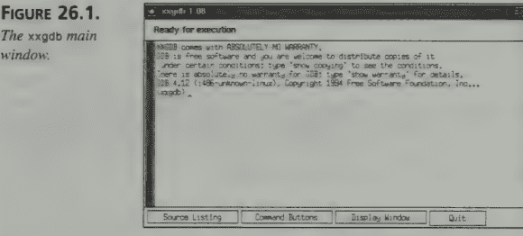

xgdb 主窗口包含一条消息，类似于启动 gdb 命令行版本时屏幕上显示的内容。在 xgdb 主窗口的底部附近有四个按钮。Source Listing（源列表）、Command Buttons（命令按钮）和 Display Window（显示窗口）按钮在激活时各自会弹出一个附加窗口。Quit（退出）按钮终止 xgdb 程序。

Source Listing 按钮会弹出一个显示正在调试的程序源代码的窗口。此窗口如图 26.2 所示。

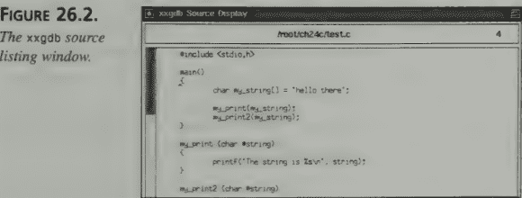

Command Buttons 按钮会弹出一个包含另外 26 个按钮的窗口。这些按钮各自执行一个 gdb 命令。gdb 命令按钮窗口如图 26.3 所示。

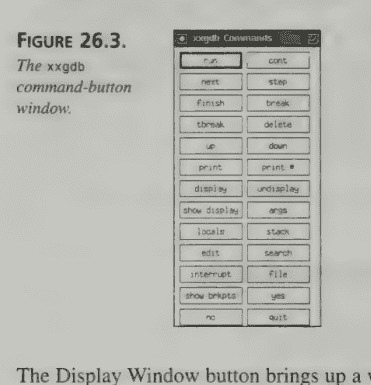

Display Window 按钮会弹出一个用于显示任何 display 命令结果的窗口。你可以通过从源列表中选择一个变量或表达式，然后单击命令按钮窗口中的 Display 按钮，来告诉 xxgdb 显示哪个变量或表达式。显示窗口如图 26.4 所示。

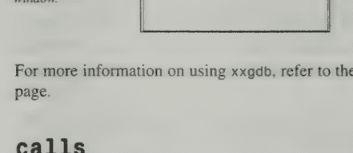

有关使用 xxgdb 的更多信息，请参考 **xxgdb** 手册页和 **gdb** 手册页。

### calls

calls 是一个程序，未包含在随本书提供的 Linux CD-ROM 中，但你可以在 sunsite FTP 站点的 `/pub/Linux/devel/lang/c/calls.tar.z` 目录下获取副本。一些较旧的 Linux CD-ROM 发行版包含此文件。由于它是一个有用的工具，我们将在这里介绍它。如果你认为它对你有用，请从 FTP 或 BBS 站点或另一个 CD-ROM 获取副本。calls 在命令行传递给它的文件上运行 GCC 预处理器，并显示这些文件中函数的函数调用树。

**提示**

要在系统上安装 calls，请以 root 身份登录并执行以下步骤：

1. 解压并解包该文件。
2. cd 到解包命令创建的 calls 子目录。
3. 将名为 calls 的文件移动到 /usr/bin 目录。
4. 将名为 calls.1 的文件移动到 /usr/man/man1 目录。
5. 删除 /tmp/calls 目录。

这将在系统上安装 calls 程序和手册页。

当 calls 打印调用跟踪时，它会在函数名称后的括号中包含找到该函数的文件名。

```
main [test.c]
```

如果函数不在传递给 calls 的文件中，它不知道该函数位于何处，因此只打印函数名称。

```
printf
```

calls 还在其输出中注明递归函数和静态函数。递归函数以以下方式表示：

```
fact <<< recursive in factorial.c >>>
```

静态函数的表示如下：

```
total [static in calculate.c]
```

作为示例，假设使用以下程序作为输入执行 calls：

```c
#include <stdio.h>
main ()
{
    char my_string[] = "hello there";
    my_print (my_string);
    my_print2(my_string);
}

my_print (char *string)
{
    printf ("The string is %s\n", string);
}

my_print2 (char *string)
{
    char *string2;
    int size, size2, i;

    size = strlen (string);
    size2 = size - 1;
    string2 = (char *) malloc (size + 1);
    for (i = 0; i < size; i++)
        string2[size2 - i] = string[i];
    string2[size] = '\0';
    printf ("The string printed backward is %s\n", string2);
}
```

这会产生以下输出：

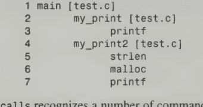

calls 识别许多命令行选项，使你能够指定输出的外观以及显示哪些函数调用。有关这些命令行选项的更多信息，请参考 calls 手册页或在命令行输入 `calls -h`。

### cproto

cproto 是另一个未包含在此 Linux CD-ROM 中但可从 FTP 和 BBS 站点轻松获取的程序。cproto 读取 C 源文件并自动为所有函数生成函数原型。使用 cproto 可以省去为程序中编写的所有函数输入函数定义的工作。

**提示**

要在系统上安装 cproto，请以 root 身份登录并执行以下步骤：

1. 解压并解包该文件。
2. cd 到解包命令结果创建的 cproto 子目录。
3. 将名为 cproto 的文件移动到 /usr/bin 目录。
4. 将名为 cproto.1 的文件移动到 /usr/man/man1 目录。
5. 删除 /tmp/cproto 目录。

这将在系统上安装 cproto 程序和手册页。

通过 cproto 程序运行以下代码：

```c
#include <stdio.h>

main ()
{
    char my_string[] = "hello there";
    my_print (my_string);
    my_print2(my_string);
}

my_print (char *string)
{
    printf ("The string is %s\n", string);
}

my_print2 (char *string)
{
    char *string2;
    int size, size2, i;

    size = strlen (string);
    size2 = size - 1;
    string2 = (char *) malloc (size + 1);
    for (i = 0; i < size; i++)
        string2[size2 - i] = string[i];
    string2[size] = '\0';
    printf ("The string printed backward is %s\n", string2);
}
```

以下输出显示为：

```c
/* test.c */
int main(void);
int my_print(char *string);
int my_print2(char *string);
```

此输出可以重定向到包含文件，并用于定义所有函数的原型。

### indent

indent 工具是另一个随 Linux 提供的编程工具。此程序以最简单的形式重新格式化或美化打印你的 C 代码，使其具有一致的缩进，并且所有开始和结束括号都具有一致的表示。有许多选项可以指定你希望 indent 如何格式化你的代码。有关这些选项的信息，请参考 indent 手册页或在命令行输入 `indent -h`。

以下示例显示了 indent 程序的默认输出。

运行 indent 前的 C 代码：

```c
#include <stdio.h>

main() {
    char my_string[] = "hello there";
    my_print(my_string);
    my_print2(my_string); }

my_print (char *string)
{
    printf ("The string is %s\n", string);
}

my_print2         (char *string) {
    char *string2;
    int size, size2, i;

    size = strlen (string);
    size2 = size - 1;
    string2 = (char *) malloc (size + 1);
    for (i = 0; i < size; i++)
        string2[size2 - i] = string[i];
    string2[size] = '\0';
    printf ("The string printed backward is %s\n", string2);
}
```

运行 indent 后的 C 代码：

```c
#include <stdio.h>

main()
{
    char my_string[] = "hello there";
    my_print (my_string);
    my_print2(my_string);
}

my_print (char *string)
{
    printf ("The string is %s\n", string);
}

my_print2 (char *string)
{
    char *string2;
    int size, size2, i;

    size = strlen (string);
    size2 = size - 1;
    string2 = (char *) malloc (size + 1);
    for (i = 0; i < size; i++)
        string2[size2 - i] = string[i];
    string2[size] = '\0';
    printf ("The string printed backward is %s\n", string2);
}
```


size2 = size - 1;
string2 = (char *) malloc(size + 1);
for (i = 0; i < size; i++)
	string2[size2 - i] = string[i];
string2[size] = '\0';
printf("The string printed backward is %s\n", string2);
}

缩进不会改变代码的编译方式；它只是改变源代码的外观。它使代码更具可读性，这始终是一件好事。

## gprof

gprof 是安装在 Linux 系统 /usr/bin 目录下的一个程序。它允许你对编写的程序进行性能分析（profiling），以确定大部分执行时间花在了哪里。

gprof 会告诉你程序中使用的每个函数被调用了多少次，以及程序在每个函数中花费的总执行时间的百分比。如果你试图提高程序的性能，这些信息会非常有用。

要在你的某个程序上使用 gprof，你必须使用 `-pg` gcc 选项来编译该程序。这会导致程序每次执行时都创建一个名为 gmon.out 的文件。gprof 使用 gmon.out 文件生成性能分析信息。

在你运行程序并创建了 gmon.out 文件后，你可以通过输入以下命令来获取其性能分析数据：

gprof <program_name>

program_name 参数是创建 gmon.out 文件的程序的名称。

### 提示

gprof 显示在屏幕上的性能分析数据量相当大。如果你想查看这些数据，应该将 gprof 的输出重定向到一个文件中。

## f2c 和 p2c

f2c 和 p2c 是两个源代码转换程序。f2c 将 FORTRAN 代码转换为 C 代码，p2c 将 Pascal 代码转换为 C 代码。两者都包含在安装 GCC 的 Linux 安装程序中。

如果你有一些使用 FORTRAN 或 Pascal 编写的代码，想要重写为 C，那么 f2c 和 p2c 可能会证明是非常有用的程序。这两个程序生成的 C 代码通常可以直接由 GCC 编译，而无需人工干预。

如果你转换的是小型、简单的 FORTRAN 或 Pascal 程序，你应该可以不加任何选项地使用 f2c 或 p2c 就搞定。如果你转换的是由许多文件组成的非常大的程序，你可能必须使用转换程序提供的一些命令行选项。

要在 FORTRAN 程序上调用 f2c，请输入以下命令：
`f2c my_fortranprog.f`

> **提示**
> f2c 要求被转换的程序必须具有 `.f` 或 `.F` 扩展名。

要将 Pascal 程序转换为 C，请输入以下命令：
`p2c my_pascalprogram.pas`

这两个命令都会创建 C 源代码文件，除了扩展名从 `.f` 或 `.pas` 变为 `.c` 之外，文件名与原始文件相同。

有关 f2c 或 p2c 可用的具体转换选项的更多信息，请参阅它们各自的 man 手册页。

## 总结

本章介绍了 GNU C 编译器以及你在编译 C 代码时通常会用到的许多选项。它还介绍了使用 GNU 调试器调试代码的概念，并说明了 Linux CD-ROM 中包含的一些其他 C 实用程序的使用价值。

> **提示**
> 如果你要编写 C 代码，那么花费时间学习如何使用 gdb 和本章提到的其他一些工具，最终节省下来的时间将会远超所付出的努力。

下一章将讨论许多相同的主题，但重点在于 C++ 开发而非 C 开发。除了转向 C++，你还可以阅读其他章节：

- 第 28 章“Perl”讨论了 Perl，一种实用的脚本语言。
- 第 29 章“Tcl 和 Tk 简介”讨论了 Tcl 和 Tk，这对宏非常有用。
- 第 30 章“其他编译器”讨论了 Linux 上可用的编译器。
- 第 31 章“Smalltalk/X”讨论了 Smalltalk。

# 第 27 章

## C++ 编程

作者：Rick McMullin

### 本章内容

- 什么是 C++？ 486
- 对象类和方法 488
- GCC 选项 488
- 调试和性能分析选项 490
- 调试 C++ 应用程序 491
- 调试虚函数 492
- 调试异常处理器 493
- gdb C++ 特定命令摘要 494
- GNU C++ 类库 495

## 什么是 C++？

C++ 是 C 编程语言的一种面向对象的扩展。它于 20 世纪 80 年代初在贝尔实验室开发，并迅速成为计算机行业的首选语言。如今市面上有数十种 C++ 编译器。对于基于 PC 的系统，其中最常见的是 Borland C++、微软的 Visual C++、Zortech C++ 和 Watcom C++。这些编译器可以编译 MS-DOS 和 MS Windows 应用程序，其中一些还可以编译在 OS/2 和 Windows NT 上运行的代码。除了基于 DOS 的机器上可用的 C++ 编译器数量之外，还有许多其他硬件架构的编译器。

大多数 UNIX 系统都有系统供应商提供的 C++ 编译器。Linux 也附带了一个 C++ 编译器。这就是 GNU C++ 编译器。GNU C++ 编译器与 GNU C 编译器（GCC）关系非常密切。事实上，自 GCC 2.0 版发布以来，GNU C++ 编译器已与 GCC 集成。在 GCC 2.0 版之前，GNU C++ 编译器是一个名为 g++ 的独立程序。GCC 2.0 版的一项主要增强功能就是合并了这两个编译器。

GCC 现在包含一个 C 编译器、一个 C++ 编译器和一个 Objective C 编译器。你仍然可以在系统中找到 g++ 可执行文件，但它现在是一个脚本文件，调用 GCC 并使用所有标准的 C++ 选项。

## 为什么选择 C++？

C++ 和面向对象编程（OOP）并不是偶然出现的。从结构化编程转向 OOP 有许多根本原因。在计算机编程的早期阶段，当时 PDP-8 仍然在地球上大量存在的时候，编程方式从机器语言编码转向汇编语言编码。这是因为当时的计算机比它们的 predecessor 稍微强大一些。程序员希望通过将部分编程负担转嫁给计算机来使生活更轻松。

随着岁月的流逝和计算机变得更加强大，新的、更高级的语言开始出现。这些语言的例子包括 FORTRAN、COBOL、Pascal 和 C。随着这些语言的出现，出现了一种被称为结构化编程的编程方法论。结构化编程通过允许程序员将问题分解为小部件，然后使用正在使用的任何语言将这些部件实现为函数或过程，从而帮助简化正在设计的系统。

结构化编程方法对于小到中等规模的软件应用效果很好，但随着系统达到一定规模时，它开始分崩离析。OOP 试图解决结构化编程造成的一些问题。它通过扩展一些结构化编程概念并引入一些自己的概念来实现这一点。

OOP 关注的主要概念如下：

- 数据封装
- 继承
- 多态性

## 数据封装

在结构化编程中，每当有多个不同代码片段共用的数据结构时，问题往往就会出现。一段代码可以访问该数据，而另一段代码却不知道正在发生任何事情。

数据封装是一个将常用数据分组、将其存储到数据类型中，并为此数据提供一致接口的过程。这确保没有人可以在不通过为该数据定义的用户接口的情况下访问该数据。

这种机制提供的最大好处是，它保护了直接管理此数据之外的代码，使其不受数据结构变化的影响。这大大降低了大型软件系统的复杂性。

C++ 通过使用类来实现数据封装。

## 继承

继承是代码复用的一种形式，你可以继承或使用其他代码片段的数据和行为。继承通常仅在软件在逻辑上具有与另一软件许多相同特征时使用，例如当一个对象是另一个对象的特化时。

在 C++ 中，通过允许对象被其他对象作为子类来实现继承。

## 多态性

当语言允许你定义根据对象类型执行不同操作的函数时，就会发生多态性。其真正的威力在于，你可以向基类发送一条消息，该消息可以传递到其每个子类，并且对每个类意味着不同的事情。

在 C++ 中，多态性通过使用虚函数来实现。


## 对象和类的分类

在 C++ 中，类可以被视为 C 结构体，其中不仅包含数据字段，还包含可以针对这些数据字段执行的操作。这个概念的一个简单例子是几何图形。几何图形可以是很多东西，例如矩形、三角形或圆形。所有几何图形都有一些共同的属性，包括面积和体积。你可以用以下方式在 C 中定义一个名为 *shape*（形状）的结构体：

```c
struct shape{
    float area;
    float volume;
}
```

如果你为这个结构体添加一些共同的行为，你就拥有了 C++ 类的等价物。其编写方式如下：

```cpp
class shape {
public:
    float area;
    float volume;
    float calc_area();
    float calc_volume();
};
```

现在你已经定义了一个 C++ 类。calc_area 和 calc_volume 项被称为该类的*方法*（在 C 中称为函数）。假设你定义了一个类型为 *shape* 的变量：

```cpp
shape circle;
```

你就创建了一个 circle 对象。对象是类的实例，或者是定义为类类型的变量。

## GCC 选项

本节介绍一些最常用的 GCC 选项。首先，我们将讨论一些在 C 和 C++ 中都可使用的选项，然后讨论 C++ 特有的选项。你在 C 中使用的任何编译器选项也可以用于 C++，但其中一些在 C++ 编译上下文中可能没有意义。如果你指定了没有意义的选项，编译器会直接忽略它们。

> **提示**
> 在编译 C++ 程序时，使用 g++ 脚本是最简单的。它为你设置了所有默认的 C++ 选项，因此你无需手动设置。

可以向 GCC 传递大量的编译器选项。其中许多选项是特定于某个硬件平台的，或用于对生成的代码进行微调。你可能永远不会使用这些类型的选项。本章涵盖的选项是你日常工作中会定期使用的那些。

许多 GCC 选项由多个字符组成。因此，你必须使用单独的连字符指定每个选项，而不能像大多数 Linux 命令那样在单个连字符后组合选项。

当你使用 GCC 编译程序时，如果不使用任何命令行选项，它会创建一个可执行文件（假设编译成功）并将其命名为 a.out。例如，以下命令会在当前目录创建一个名为 a.out 的文件：

```bash
gcc test.c
```

要为可执行文件指定除 a.out 以外的名称，可以使用 -o 编译器选项。例如，要将名为 count.c 的 C++ 程序文件（使用大写的 C 表示 C++ 代码，以区别于表示 C 代码的小写 c）编译为名为 count 的可执行文件，请键入以下命令：

```bash
gcc -o count count.c
```

> **警告**
> 不要在 -o 选项后留空格！使用 -o 选项时，可执行文件名必须直接跟在命令行中的 -o 之后。

其他编译器选项允许你指定编译希望进行到什么程度。-c 选项告诉 GCC 将代码编译为对象代码，并跳过编译的汇编和链接阶段。此选项使用相当频繁，因为它使多个 C++ 程序的编译更快且更易于管理。GCC 创建的对象代码文件默认具有 .o 扩展名。

-S 编译器选项告诉 GCC 在生成 C 代码的汇编文件后停止编译。GCC 生成的汇编文件默认具有 .s 扩展名。-E 选项指示编译器仅对输入文件执行预处理器编译阶段。使用此选项时，预处理器的输出会被发送到标准输出，而不是存储在一个文件中。

## 调试和分析选项

GCC 支持几个调试和分析选项。在这些选项中，你最有可能在 C++ 程序中使用的是 -gstabs+ 选项和 -pg 选项。

-gstabs+ 选项告诉 GCC 生成 stabs 格式的调试信息，GNU 调试器（gdb）可以使用这些信息来帮助调试程序。有关调试 C++ 程序的更多信息，请参见本章后面的“调试 C++ 应用程序”部分。

-pg 选项告诉 GCC 向程序添加额外的代码，这些代码在执行时将生成分析信息，gprof 程序可以使用这些信息来显示程序的计时信息。有关 gprof 的更多信息，请参见第 26 章“C 编程”中的“gprof”部分。

## GCC C++ 特定选项

控制 C++ 程序编译的 GCC 选项列于表 27.1 中。

**表 27.1. GCC 选项。**

| 选项 | 含义 |
| :--- | :--- |
| -fall-virtual | 将所有可能的成员函数视为虚拟函数。这适用于除构造函数和 new 或 delete 成员函数之外的所有函数。 |
| -fdollars-in-identifiers | 接受标识符中的 $。你也可以使用 -fno-dollars-in-identifiers 选项来禁止在标识符中使用 $。 |
| -felide-constructors | 告诉编译器在尽可能的时候省略构造函数。 |
| -fenum-int-equiv | 允许 int 到枚举类型的隐式转换。 |
| -fexternal-templates | 为模板声明生成较小的代码。这是通过让编译器仅在模板函数定义处生成每个模板函数的单个副本来实现的。 |
| -fmemoize-lookups | 使用启发式方法以更快速度编译。这些启发式方法默认未启用，因为它们仅对某些输入文件有效。 |
| -fno-strict-prototype | 以 C 处理无参数函数声明的方式处理它。这意味着编译器将没有参数的函数原型视为将接受未知数量参数的函数。 |
| -fno-null-objects | 假设通过引用到达的对象不为空。 |
| -fsave-memorized | 与 -fmemorize-lookups 相同。 |
| -fthis-is-variable | 允许对“this”进行赋值。 |
| -nostdinc++ | 不在特定于 C++ 的标准目录中搜索头文件。 |
| -traditional | 此选项的效果与 -fthis-is-variable 相同。 |
| -fno-default-inline | 不假设在类范围内定义的函数是内联函数。 |
| -Wenum-clash | 警告不同枚举类型之间的转换。 |
| -Woverloaded-virtual | 当派生类中的函数声明可能在定义虚拟函数时出错时发出警告。在派生类中定义虚拟函数时，其签名必须与基类中的函数相同。此选项指示编译器警告你，如果你定义了一个与基类中定义的函数同名但签名不同的函数。 |
| -Wtemplate-debugging | 如果你正在使用模板，此选项会在调试尚不可用时警告你。 |
| -eN | 控制虚拟函数定义的使用方式。 |
| -gstabs+ | 告诉编译器使用 GNU 扩展生成 stabs 格式的调试信息，这些扩展仅被 GNU 调试器理解。此选项生成的额外信息对于确保 gdb 正确处理和解析 C++ 程序是必要的。 |

## 调试 C++ 应用程序

开发 C++ 程序的一个非常重要部分是能够高效地调试它们。第 26 章中介绍的 GNU 调试应用程序也可以用于调试 C++ 应用程序。本节介绍了调试 C 应用程序和调试 C++ 应用程序之间的一些差异。

第 26 章中介绍的基本 gdb 命令为了方便起见再次列于表 27.2 中。

**表 27.2. 基本 GDB 命令。**

| 命令 | 描述 |
| :--- | :--- |
| file | 加载要调试的可执行文件。 |
| kill | 终止你当前正在调试的程序。 |
| list | 列出用于生成可执行文件的源代码片段。 |
| next | 在当前函数中前进一行源代码，但不步入其他函数。 |
| step | 在当前函数中前进一行源代码，并步入其他函数。 |
| run | 执行当前正在调试的程序。 |
| quit | 终止 gdb。 |
| watch | 允许你在程序变量值发生变化时检查其值。 |
| break | 在代码中设置断点；每当执行到达此点时，程序的执行将暂停。 |
| make | 此命令允许你在退出 gdb 或使用另一个窗口的情况下重新生成可执行程序。 |
| shell | 允许你在不离开 gdb 的情况下执行 UNIX shell 命令。 |

从程序员的角度来看，调试 C++ 代码时比调试 C 代码时需要关注更多的细节。这是因为 C++ 的特性，如虚拟函数和异常处理。gdb 已添加了支持调试这两种 C++ 特定特性的功能。

### 调试虚拟函数

正如本章“多态”部分所述，虚拟函数是 C++ 实现多态的方式。这意味着程序中可能存在多个同名的函数。区分这些函数的唯一方法是通过它们的签名。函数签名由函数的所有参数的类型组成。例如，具有以下原型的函数，其签名 int, real：

```cpp
void func(int, real);
```


你可以看出这会给 gdb 带来一些问题。例如，如果你定义了一个包含名为 `calculate` 的虚拟函数的类，并创建了两个对该函数有不同定义的对象，你该如何设置断点以在该函数上触发？在 C 语言中，你通过指定函数名作为 gdb `break` 命令的参数来设置断点，如下所示：

```
(gdb) break calculate
```

在虚拟函数的情况下，这种方法是行不通的，因为调试器无法判断你想在哪个 `calculate` 上设置断点。gdb 在几个方面进行了扩展，以便能够处理虚拟函数。解决此问题的第一种方法是输入函数名时同时指定其原型。方法如下：

```
break 'calculate (float)'
```

这为 gdb 提供了足够的信息，以决定断点是针对哪个函数设置的。gdb 支持的另一种解决方案是使用断点菜单。断点菜单允许你指定函数的名称。如果该函数有多个定义，它会提供一个选择菜单。菜单中的第一个选项是中止 `break` 命令。第二个选项是在 `break` 命令匹配的所有函数上设置断点。其余选项对应于匹配 `break` 命令的每个函数。以下代码展示了一个断点菜单的示例：

```
(gdb) break shape::calculate
[0] cancel
[1] all
[2] file: shapes.C line number: 153
[3] file: shapes.C line number: 207
[4] file: shapes.C line number: 247
> 2 3
Breakpoint 1 at 0xb234: file shapes.C, line 153
Breakpoint 2 at 0xa435: file shapes.C, line 207
Multiple breakpoints were set
Use the "delete" command to delete unwanted breakpoints
(gdb)
```

## 调试异常处理器

异常是程序内部发生的错误。异常处理器是为处理错误和潜在错误而编写的代码片段。例如，如果你正在编写一个 C 程序并调用 `malloc` 函数来获取内存块，通常会检查 `malloc` 的返回码以确保内存分配成功。如果 C 语言支持异常处理，你可以指定一个接收或捕获异常的函数，如果发生异常，`malloc` 函数就会向你的函数发送或抛出异常。

`gdb` 增加了两个新命令以支持 C++ 异常处理：`catch` 命令和 `catch info` 命令。`catch` 命令用于在活动异常处理器中设置断点。该命令的语法如下：

```
catch exceptions

exceptions 是要捕获的异常列表。
```

`catch info` 命令用于显示所有活动的异常处理器。

## `gdb` C++ 专用命令摘要

除了为支持 C++ 中包含的一些新语言特性而添加的 `gdb` 命令外，还有一些新的 `set` 和 `show` 选项。这些选项列在表 27.3 中。

**表 27.3. `gdb` 的 C++ `SET` 和 `SHOW` 选项。**

| 命令 | 描述 |
| :--- | :--- |
| `set print demangle` | 以源形式而非传递给汇编器的编码或修饰形式打印 C++ 名称。 |
| `show print demangle` | 显示 `print demangle` 是开还是关。 |
| `set demangle-style` | 设置修饰输出的风格。选项有 `auto`、`gnu`、`lucid` 和 `arm`。 |
| `show demangle-style` | 显示正在使用的修饰风格。 |
| `set print object` | 在显示指向对象的指针时，识别对象的实际类型。 |
| `show print object` | 显示 `print object` 是开还是关。 |
| `set print vtbl` | 打印 C++ 虚拟函数表。 |
| `show print vtbl` | 显示 `print vtbl` 是开还是关。 |

## GNU C++ 类库

GNU C++ 附带了一个庞大的类库。类库是一组可重用的类，可用于执行指定的功能集。类库的一些典型示例包括处理数据库访问的类库、处理图形用户界面编程的类库，以及实现数据结构的类库。

图形用户界面类库的其他示例包括 Microsoft 基础类（MFC）和 Borland 对象 Windows 库，两者都是用于开发 Windows 应用程序的类库。

本节介绍了 GNU C++ 类库提供的几个特性。

### 流

GNU iostream 库，称为 `libio`，实现了 GNU C++ 的标准输入和输出功能。该库与其他 C++ 编译器提供的 I/O 库类似。iostream 库的主要部分是输入流、输出流和错误流。这些对应于 C 语言中找到的标准输入、输出和错误流，分别称为 `cin`、`cout` 和 `cerr`。可以使用 `<<` 运算符进行输出，使用 `>>` 运算符进行输入来写入和读取流。

以下程序使用 iostream 库进行输入和输出：

```
#include <iostream.h>
int main()
{
    char name[10];
    cout << "Please enter your name.\n";
    cin >> name;
    cout << "Hello " << name << " how is it going?\n";
}
```

### 字符串

GNU 字符串类扩展了 GNU C++ 的字符串操作功能。字符串类基本上取代了 C 语言中存在的字符数组定义以及伴随字符数组的所有字符串函数。

字符串类将 UNIX  shell 类型的字符串运算符添加到 C++ 语言中，以及大量的额外运算符。表 27.4 列出了字符串类可用的许多运算符。

**表 27.4. 字符串类运算符。**

| 运算符 | 含义 |
| :------- | :------- |
| `str1 == str2` | 如果 `str1` 等于 `str2`，则返回 `TRUE` |
| `str1 != str2` | 如果 `str1` 不等于 `str2`，则返回 `TRUE` |
| `str1 < str2` | 如果 `str1` 小于 `str2`，则返回 `TRUE` |
| `str1 <= str2` | 如果 `str1` 小于或等于 `str2`，则返回 `TRUE` |
| `str1 > str2` | 如果 `str1` 大于 `str2`，则返回 `TRUE` |
| `str1 >= str2` | 如果 `str1` 大于或等于 `str2`，则返回 `TRUE` |
| `compare(str1, str2)` | 在不考虑字符大小区别的比较 `str1` 和 `str2` |
| `str3 = str1 + str2` | 将 `str1` 与 `str2` 连接的结果存储在 `str3` 中 |

字符串类还提供许多其他运算符，用于执行不同类型的字符串比较、连接以及子字符串提取和操作。

### 随机数

GCC C++ 类库中提供了类，允许你生成几种不同类型的随机数。用于生成这些数字的类是 `Random` 类和 `RNG` 类。

### 数据收集

类库提供了两种执行数据收集和分析功能的类。这两个类是 `SampleStatistic` 和 `SampleHistogram`。`SampleStatistic` 类提供了一种收集样本的方法，并提供了许多可以对收集的数据进行计算的统计功能。可执行的计算包括均值、方差、标准差、最小值和最大值。

`SampleHistogram` 类派生自 `SampleStatistic` 类，并支持按分桶区间收集和显示样本。

### 链表

GNU C++ 库支持两种类型的链表：由 `SLLlist` 类实现的单向链表，以及由 `DLLlist` 类实现的双向链表。这两种类型的链表都支持所有标准的链表操作。这些类支持的操作摘要如表 27.5 所示。

**表 27.5. 列表运算符。**

| 运算符 | 描述 |
| :--- | :--- |
| `list.empty()` | 如果 `list` 为空，则返回 `TRUE` |
| `list.length()` | 返回 `list` 中的元素数量 |
| `list.prepend(a)` | 将 `a` 放在 `list` 的前面 |
| `list.append(a)` | 将 `a` 放在 `list` 的末尾 |
| `list.join(list2)` | 将 `list2` 附加到 `list`，在此过程中销毁 `list2` |
| `a = list.front()` | 返回指向存储在 `list` 头部的元素的指针 |
| `a = list.rear()` | 返回指向存储在 `list` 末尾的元素的指针 |
| `a = list.remove_front()` | 删除并返回存储在 `list` 前面的元素 |
| `list.del_front()` | 删除第一个元素而不返回它 |
| `list.clear()` | 删除 `list` 中的所有项目 |
| `list.ins_after(i, a)` | 在 `list` 中的位置 `i` 之后插入 `a` |
| `list.del_after(i)` | 删除 `list` 中位置 `i` 之后的元素 |

双向链表还支持表 27.6 中列出的操作。

**表 27.6. 双向列表运算符。**

| 运算符 | 描述 |
| :--- | :--- |
| `a = list.remove_rear()` | 删除并返回存储在 `list` 末尾的元素 |
| `list.del_rear()` | 删除最后一个元素，而不返回它 |
| `list.ins_before(i, a)` | 在 `list` 中的位置 `i` 之前插入 `a` |
| `list.del(i, dir)` | 删除当前位置的元素，然后如果 `dir` 为正，则向前移动一个位置；如果 `dir` 为 0 或负数，则向后移动一个位置 |


## Plex 类

Plex 类是行为类似于数组但功能更强大的类。Plex 类具有以下特性：

- 它们具有任意上下界索引。
- 它们可以在下界和上界两个方向上动态扩展。
- 元素可以通过索引访问。与典型的数组不同，边界检查是在运行时执行的。
- 只有那些被专门初始化或添加的元素才可以被访问。

定义了四种不同类型的 Plex：FPlex、XPlex、RPlex 和 MPlex。FPlex 是一种只能在其声明的边界内缩小或增长的 Plex。XPlex 可以在任何方向上动态增长，没有任何限制。RPlex 与 XPlex 几乎相同，但它具有更好的索引功能。最后，MPlex 与 RPlex 相同，只不过它允许元素被逻辑删除和恢复。

表 27.7 列出了适用于所有四种 Plex 的部分有效操作。

### 表 27.7. 为 Plex 定义的操作。

| 操作 | 描述 |
| :--- | :--- |
| Plex b(a) | 将 Plex a 的副本分配给 Plex b |
| b = a | 将 Plex a 复制到 b |
| a.length() | 返回 a 中的元素数量 |
| a.empty() | 如果 a 没有元素，则返回 TRUE |
| a.full() | 如果 a 已满，则返回 TRUE |
| a.clear() | 从 a 中删除所有元素 |
| a.append(b) | 将 Plex b 追加到 a 的高位部分 |
| a.prepend(b) | 将 Plex b 前置到 a 的低位部分 |
| a.fill(z) | 将 a 中的所有元素设置为等于 z |
| a.valid(i) | 如果 i 是 a 的有效索引，则返回 TRUE |
| a.low_element() | 返回指向 a 中最低位置元素的指针 |
| a.high_element() | 返回指向 a 中最高位置元素的指针 |

Plex 是一个非常有用的类，GNU C++ 类库中的许多其他类都是基于它构建的。*Stack*、*Queue* 和 *Linked list* 类型中的一些是构建在 *Plex* 类之上的。

## 堆栈

*Stacks* 类实现了标准的后进先出（LIFO）堆栈。GNU C++ 类库提供了三种不同的堆栈实现：*VStack*、*XPStack* 和 *SLStack*。*VStack* 是固定大小的堆栈，这意味着你在最初创建它时必须指定堆栈大小的上限。*XPStack* 和 *SLStack* 都是动态大小的堆栈，它们以略有不同的方式实现。

表 27.8 列出了可以应用于 *Stacks* 类的操作。

### 表 27.8. 堆栈类运算符。

| 运算符 | 描述 |
| :--- | :--- |
| *Stack* st | 声明 st 为一个堆栈 |
| *Stack* st(sz) | 声明 st 为一个大小为 sz 的堆栈 |
| st.empty() | 如果堆栈为空，则返回 TRUE |
| st.full() | 如果堆栈已满，则返回 TRUE |
| st.length() | 返回堆栈中的元素数量 |
| st.push(x) | 将元素 x 放入堆栈顶部 |
| x = st.pop() | 从堆栈中移除并返回顶部元素 |
| st.top() | 返回指向堆栈中顶部元素的指针 |
| st.del_top() | 从堆栈中删除顶部元素，但不返回该元素 |
| st.clear() | 从堆栈中删除所有元素 |

## 队列

*Queue* 类实现了标准的先进先出（FIFO）队列。GNU C++ 类库提供了三种不同类型的*queue*：*VQueue*、*XPQueue* 和 *SLQueue*。*VQueue* 是固定大小的队列，因此你在最初创建这种类型的队列时必须指定大小上限。*XPQueue* 和 *SLQueue* 都是动态大小的队列，因此不需要上限。*Queue* 类支持的操作列于表 27.9。

### 表 27.9. 队列类运算符。

| 运算符 | 描述 |
| :--- | :--- |
| Queue q | 声明 q 为一个队列 |
| Queue q(sz) | 声明 q 为一个大小为 sz 的队列 |
| q.empty() | 如果 q 为空，则返回 TRUE |
| q.full() | 如果 q 已满，则返回 TRUE |
| q.length() | 返回 q 中的元素数量 |
| q.enq(x) | 将元素 x 添加到 q |
| x = q.deq() | 从 q 中移除并返回一个元素 |
| q.front() | 返回指向 q 前端的指针 |
| q.del_front() | 从 q 中移除一个元素，并且不返回结果 |
| q.clear() | 从队列中移除所有元素 |

除了本节讨论的常规类型队列外，GNU C++ 类库还支持双端队列和优先队列。这两种队列的行为都与常规队列相似。双端队列添加了用于返回指向队列尾部的指针以及从队列尾部删除元素的运算符。优先队列的排列方式使得用户能够快速访问队列中的最小元素。它们支持额外的运算符，允许在队列中搜索元素。

## 集合

Set 类用于存储信息组。对该信息唯一的限制是不允许重复元素。类库支持几种不同的集合实现。所有实现都支持相同的运算符。这些运算符显示在表 27.10 中。

### 表 27.10. Set 类运算符。

| 运算符 | 描述 |
| :--- | :--- |
| Set s | 声明一个名为 s 的集合，初始为空 |
| Set s(sz) | 声明一个名为 s 的集合，初始为空，且集合最大大小为 sz |
| s.empty() | 如果 s 为空，则返回 TRUE |
| s.length() | 返回 s 中的元素数量 |
| i = s.add(z) | 将 z 添加到 s，并返回其索引值 |
| s.del(z) | 从 s 中删除 z |
| s.clear() | 从 s 中移除所有元素 |
| s.contains(z) | 如果 z 在 s 中，则返回 TRUE |
| s.(i) | 返回指向由 i 索引的元素的指针 |
| i = s.first() | 返回集合中第一个项目的索引 |
| s.next(i) | 使 i 等于 s 中下一个元素的索引 |
| i = s.seek(z) | 如果 z 在 s 中，则设置 i 为 z 的索引，否则为 0 |
| set1 = set2 | 如果 set1 包含与 set2 完全相同的元素，则返回 TRUE |
| set1 != set2 | 如果 set1 不全部包含与 set2 相同的元素，则返回 TRUE |
| set1 <= set2 | 如果 set1 是 set2 的子集，则返回 TRUE |
| set1 \|= set2 | 将 set2 的所有元素添加到 set1 |
| set1 -= set2 | 从 set1 中删除包含在 set2 中的所有元素 |
| set1 &= set2 | 从 set1 中删除出现在 set1 中但未出现在 set2 中的所有元素 |

类库还包含一个类似于集合的类。这个类被称为 bag（袋）。bag 是一组元素，其顺序可以是任意的（就像集合一样），但其中也可以有重复项。Bags 使用集合使用的所有运算符，除了 ==、!=、|=、<=、!=、-= 和 &= 运算符。此外，bags 添加了两个用于处理在 bag 中出现多次的元素的运算符。这些新运算符显示在表 27.11 中。

### 表 27.11. Bags 的额外运算符。

| 运算符 | 描述 |
| :--- | :--- |
| b.remove(z) | 从 b 中删除 z 的所有出现 |
| b.nof(z) | 返回 b 中 z 的出现次数 |

GNU C++ 类库中可用的许多其他类提供了此处未列出的其他功能。除了随编译器附带的内容外，许多其他可自由获得的类库也很有用。

## 摘要

C++ 相比 C 提供了许多优势。其中一些优势来自面向对象编程的概念，另一些则来自可供 C++ 程序员使用的高度灵活的类库。本章简要介绍了面向对象编程，并讨论了存在于 GNU C 编译器和 GNU 调试器中的 C++ 特性。

C++ 长期存在的一个问题是缺乏可自由获得的 C++ 开发工具。你可能会注意到，可用于 C++ 编程的自由工具数量远少于 C，但局势正在发生转变。随着越来越多的人选择 C++ 而不是 C，可用的工具和类库数量不断增加。工具支持已经达到了一个阶段，在 Linux 环境中学习 C++ 是一件你可以享受而不是回避的事情。有关相关信息，请参阅以下章节：

- 在 Linux 下编程 C 在第 26 章“在 C 中编程”中讨论。
- Perl，一种用于快速编程任务的句柄语言，在第 28 章“Perl”中讨论。
- Linux 可用的编译器在第 30 章“其他编译器”中讨论。


## 第28章 Perl

作者：Tim Parker

### 本章内容

- 什么是 Perl？504
- 创建和运行 Perl 程序 505
- 处理 Perl 中的数据 505
- 数组 510
- Perl 编程结构 513
- 函数 519
- Perl 运算符 521
- 将程序转换为 Perl 521

Perl，全称为实用提取和报告语言（Practical Extraction and Report Language），是一种由 Larry Wall 开发的解释型编程语言。Perl 最初的设计目的是使扫描和操纵文本文件比在 awk 等语言中更容易。本章包含以下主题：

- 什么是 Perl
- 创建和运行 Perl 程序
- 数据、变量和数组
- Perl 编程结构
- Perl 函数

阅读完本章后，你应该熟悉 Perl 相比其他编程语言提供的一些优势。你还应该能够编写简单的 Perl 程序，以帮助你在日常 Linux 交互中更高效地工作。

### 什么是 Perl？

如前所述，Perl 最初创建的初衷是为了简化文本文件的扫描和操纵。熟悉 awk 编程语言的人（参见第 25 章，“gawk”）可能会发现，Perl 从 awk 借用了许多功能，这并不会感到惊讶。Perl 还包含 C、sed 以及诸如 bash 和 tcsh 等 UNIX shell 语言的一些最佳特性。

Perl 在语法和功能上与 shell 编程语言都非常相似。然而，有一些差异值得提及。Perl 工作方式与 shell 程序工作方式之间的一个主要区别是，Perl 并非纯粹的解释型语言。Perl 程序实际上会被完整读取并存储为中间形式，然后才执行。Shell 程序则是一次读取并执行一条命令。这为 Perl 相比 shell 程序带来了两个优势。首先，Perl 程序运行速度远快于 shell 程序。这是因为 Perl 解释器在开始执行代码之前就已经完成了所有的语法检查和注释剥离。其次，由于代码在开始执行前已被完全解析，因此无需担心大型 shell 程序因语法错误而在执行过程中半途停止。

Perl 不是纯粹解释型语言这一事实也存在一个缺点。对于那些执行时间不长的短小程序，使用 Perl 所涉及的额外编译时间实际上使其比使用 shell 语言更慢。这是一个相对较小的问题，而且很少有人实际注意到。

### 创建和运行 Perl 程序

创建和运行 Perl 程序所采取的步骤与创建和运行 Linux shell 程序的步骤非常相似。Perl 程序由一条或多条放入文本文件中的 Perl 命令组成。创建 Perl 程序的第一步是创建一个文件来存放 Perl 命令。你可以使用你喜欢的任何文本编辑器来完成此操作。让我们从一个非常简单的 Perl 程序示例开始。下面名为 `hello` 的 Perl 程序会在屏幕上打印一条问候语。

```
#!/usr/bin/perl
print "Hi there!\n";
```

关于这个示例，有几点值得提及。第一点是程序第一行看起来比较奇怪的命令。这一行告诉 shell 程序使用哪个程序来执行文件中包含的代码。

程序的第二行在屏幕上打印 `Hi there!`，随后换行。C 程序员会注意到这一行代码与 C 代码有多相似。

在程序实际运行之前，你还必须执行另一个步骤，即更改文件权限使其可执行。通过输入以下命令来实现：

```
chmod +x hello
```

现在你可以通过在命令行输入以下内容来运行该程序：

```
hello
```

运行此程序会调用 Perl 解释器。Perl 解释器解析整个程序，然后执行编译后的代码。

这是运行 Perl 程序的标准方式。你也可以通过调用命令行上的 Perl 并将 `hello` 代码作为命令行参数传递给它来运行 `hello` 程序。通过输入以下命令来实现：

```
perl hello
```

### 处理 Perl 中的数据

在最基本的层面上，Perl 处理两种不同种类的数据：**数字**和**字符串**。本节描述 Perl 如何处理这两种形式的数据，以及它们在 Perl 程序中的用法。让我们从描述 Perl 程序如何使用变量开始。


### 变量

Perl 中的变量在功能和语法上与 shell 编程语言中的变量相似。最大的区别在于，在 shell 语言中，你需要在变量名前加美元符号 `$` 来获取变量的值，而在给变量赋值时，则直接使用变量名，前面不加美元符号。

在 Perl 中，无论你是给变量赋值还是获取变量的值，变量名前*总是*使用美元符号。以下命令将值 *hello* 分配给名为 *greeting* 的变量。

```
$greeting="hello";
```

在 shell 语言中，此命令写作如下：

```
greeting="hello"
```

或者

```
set greeting = "hello" (当使用 tcsh 时)
```

等号两侧的空白对 Perl 来说并不重要（与 shell 编程语言不同），因此你可以使用对你来说最舒适、最熟悉的方法。另一个区别是，你可以直接对变量执行整数运算，而无需使用像 *expr* 这样的其他命令。例如，命令

```
$a = 1 + 2;
```

将值 3 分配给变量 $a。如果你输入以下两个命令：

```
$a = 1 + 2;
$b = 3 * $a;
```

变量 $b 会被分配值 9。

这是预期结果，但 Perl 是如何知道 $a 是数值而不是字符串的？答案是它并不知道。每当变量或字面量作为数值运算符的操作数使用时，它都会被转换为数字。在这种情况下，因为存储在 $a 中的值是一个数字，所以没有问题。然而，如果存储在 $a 中的值是一个包含诸如 b 等字符的字符串，那就会有问题，因为这种类型的字符串无法转换为数值。Perl 处理这种情况的方式并不优雅。如果该值无法转换为数字，它简单地将其置为 0。默认情况下，Perl 甚至不会警告你这种转换。不过，如果你使用 -w 命令行选项调用 Perl，当发生这种类型的转换时，它会向你发出警告。

### 数字

Perl 将所有数值数据存储为浮点值。你可以在 Perl 程序中使用整数，但 Perl 将所有整数都视为浮点数。

Perl 提供了一组运算符，可用于执行两个数值之间的比较以及对数字执行标准数学运算。表 28.1 列出了 Perl 为数值数据提供的一些运算符。

**表 28.1. 数值运算符。**

| 运算符 | 描述 |
| :--- | :--- |
| `$a = op1 + op2` | 将 op1 加上 op2 的值存入 `$a` |
| `$a = op1 - op2` | 将 op1 减去 op2 的值存入 `$a` |
| `$a = op1 * op2` | 将 op1 乘以 op2 的值存入 `$a` |
| `$a = op1 / op2` | 将 op1 除以 op2 的值存入 `$a` |
| `$a = op1 ** op2` | 将 op1 的 op2 次幂的值存入 `$a` |
| `$a = op1 % op2` | 将 op1 模 op2 的值存入 `$a` |
| `op1 == op2` | 如果 op1 等于 op2，则返回 True |
| `op1 != op2` | 如果 op1 不等于 op2，则返回 True |
| `op1 < op2` | 如果 op1 小于 op2，则返回 True |
| `op1 > op2` | 如果 op1 大于 op2，则返回 True |
| `op1 <= op2` | 如果 op1 小于或等于 op2，则返回 True |
| `op1 >= op2` | 如果 op1 大于或等于 op2，则返回 True |

### 字符串

字符串是一个或多个字符的序列。通常，字符串包含字母数字字符（如数字 0 到 9）、大写字母、小写字母以及少量的标点符号。Perl 不区分这些可打印字符和非打印字符。这意味着你可以实际使用 Perl 来扫描二进制文件。

字符串在 Perl 程序中以两种方式之一表示：你可以将字符串用双引号括起来，或者用单引号括起来。当字符串用双引号括起来时，其行为类似于 C 语言中用双引号括起来的字符串。在双引号字符串中，可以使用反斜杠来表示特殊的控制字符。表 28.2 列出了反斜杠特殊控制字符列表。


## 表 28.2. PERL 的特殊控制字符。

| 字符 | 描述 |
| :--- | :--- |
| \a | 产生可听见的蜂鸣声 |
| \b | 插入退格符 |
| \cD | 允许在字符串中放入控制字符（在此情况下为 Ctrl+D） |
| \f | 插入换页符 |
| \e | 插入转义字符 |
| \E | 终止 \L 或 \U 特殊控制字符 |
| \l | 使下一个字母变为小写 |
| \L | 使其后的所有字符直到下一个 \E 之前都变为小写 |
| \n | 插入换行字符 |
| \r | 插入回车字符 |
| \t | 插入制表符 |
| \\ | 插入反斜杠字符 |
| \" | 插入双引号字符 |
| \u | 使下一个字母变为大写 |
| \U | 使其后的所有字符直到下一个 \E 之前都变为大写 |

在双引号括起来的字符串中也可以发生变量替换。例如，如果你定义一个变量为

```
$name="Doreen";
```

那么你可以通过输入以下 Perl 命令，将该变量替换并显示在屏幕上的问候语中：

```
print "Hello $name, how are you?\n";
```

该命令会在屏幕上显示以下输出：

```
Hello Doreen, how are you?
```

单引号括起来的字符串与双引号括起来的字符串不同，因为单引号会将大多数特殊字符隐藏起来，不让 Perl 解释器识别。单引号没有完全隐藏的特殊字符只有单引号字符 ('') 和反斜杠字符 (\\)。当 Perl 在单引号括起来的字符串中遇到单引号字符时，它假定这是字符串的结尾。这意味着，如果你想在单引号括起来的字符串中包含一个单引号，必须在其前加一个反斜杠。同样，如果你想在单引号括起来的字符串中放入一个反斜杠，也适用同样的规则。

例如，如果你想通过单引号括起来的方式将字符串 **Don't do that!** 打印到屏幕上，请输入以下命令：

```
print 'Don\'t do that!','\n';
```

### 注意

请记住，如果你在一个单引号字符串中放入一个换行字符，它只是打印 `\n`，而不会插入一个换行字符。

就像数字一样，Perl 提供了几个可用于操作和比较字符串的运算符。**表 28.3** 列出了 Perl 的字符串运算符。

## 表 28.3. PERL 的字符串运算符。

| 运算符 | 描述 |
| :--- | :--- |
| op1 . op2 | 连接 op1 和 op2 |
| op1 x op2 | 重复 op1，共 op2 次 |
| op1 eq op2 | 如果 op1 等于 op2，则返回 True |
| op1 ge op2 | 如果 op1 大于或等于 op2，则返回 True |
| op1 gt op2 | 如果 op1 大于 op2，则返回 True |
| op1 le op2 | 如果 op1 小于或等于 op2，则返回 True |
| op1 lt op2 | 如果 op1 小于 op2，则返回 True |
| op1 ne op2 | 如果 op1 不等于 op2，则返回 True |

## 文件运算符

与 shell 编程语言类似，Perl 有许多仅用于测试目录和文件中存在的特定条件的运算符。其中最常用的运算符列于 **表 28.4** 中。

### 表 28.4. PERL 文件运算符。

| 运算符 | 描述 |
| :--- | :--- |
| -B | 文件是二进制文件 |
| -d | 文件是目录 |
| -e | 文件存在 |
| -f | 文件是普通文件 |
| -r | 文件可读 |
| -s | 文件大小非零 |
| -T | 文件是文本文件 |
| -w | 文件可写 |
| -x | 文件可执行 |
| -z | 文件大小为零 |

这些文件运算符可用于任何 Perl 表达式。例如，下面的代码使用 if 语句来判断当前目录中是否存在 .profile 文件。

```
if (-e ".profile") {
    print ".profile is there\n";
}
```

## 数组

数组是带索引的数据元素列表。Perl 提供两种不同类型的数组。第一种数组类似于大多数高级语言中可用的数组。这种数组将单个数据元素（数字或字符串）存储在一个可以存储任意数量元素的变量中。你可以通过使用你试图查找的元素的偏移量值来获取存储在此变量中的元素。这意味着，你可以将数字或字符串值分配给数组中的一个偏移量，然后稍后使用该偏移量来检索该值。例如，下面的 Perl 语句将字符串 January、1st、1999 分配给名为 date 的数组

```
@date = ("January", "1st", "1999");
```

**注意**

你可以在数组中拥有的元素数量受限于你系统上的内存量。

如果你稍后想检索你已放入 date 数组中的某个值，可以通过指定数组名称和你想要该元素的偏移量来实现。当你检索数组元素的值时，必须在数组名称前加上 $，而不是定义数组时使用的 @。这是因为你此时正在引用单个数组元素，这实际上与常规变量相同。例如，要将数组中第一个元素 January 的值赋给名为 month 的变量，请编写以下命令：

```
$month=$date[0];
```

### 注意

与许多 Linux 实用程序以及 C 和 C++ 一样，Perl 的数组索引从偏移量 0 开始。这意味着一个长度为 5 的数组将具有元素 [0]、[1]、[2]、[3] 和 [4]。

Perl 中可用的第二种数组称为关联数组（在 Perl 5 及更高版本中也被称为哈希）。关联数组与普通数组类似——它们存储数据元素并具有索引。与普通数组不同，关联数组的索引或键由用户定义，可以是数字或字符串。

由于你可以为关联数组定义键值以及与每个键值关联的数据，因此将数据分配给关联数组和从中访问数据的方式与普通数组略有不同。要将值分配给关联数组，还必须提供你希望该值关联的键。与普通数组一样，关联数组有一个特殊的符号，用于在对整个关联数组执行操作时使用。通常，你只对关联数组的元素进行变量分配，而不是一次性处理整个数组。下面的命令将值 hello 分配给名为 words 的关联数组，键值为 greeting：

```
$words{"greeting"} = "hello";
```

应用于整个关联数组的操作看起来如下：

```
%words2= %words;
```

此命令将 words 关联数组的全部内容分配给 words2 关联数组。

要从 `words` 关联数组中检索值，请使用以下命令：

```
$value=$words{ "greeting"};
```

这将字符串 `hello` 分配给 `value` 变量。

除了可以在普通数组上执行的分配操作外，关联数组还有四个额外的操作：`keys`、`values`、`delete` 和 `each`。

`keys` 运算符返回指定关联数组中定义的所有键的列表。以下命令的结果是 `keyarray` 等于 ("greeting", "greeting2")。

```
$words("greeting") = "hello";
$words("greeting2") = "good-bye";
@keyarray = keys(%words);
```

前两条命令将值分配给关联数组 `words` 中的单独元素。第一条命令将键值为 `greeting` 的 `hello` 分配给数组，第二条命令将键值为 `greeting2` 的 `good-bye` 分配给数组。

最后一条命令将 `words` 关联数组中包含的所有键值分配给名为 `keyarray` 的普通数组。请注意 `keys` 运算符中 `words` 变量前的 `%`。这意味着正在执行的操作适用于整个关联数组，而不仅仅是数组的一个元素。

### 注意

前几行命令返回的 `keyarray` 的值实际上可能是 (`greeting2`, `greeting`)，因为关联数组中的值并没有按特定顺序存储。

用于关联数组的另一个运算符是 `values` 运算符。`values` 运算符返回指定关联数组中包含的所有值的列表。以下命令的结果是 `valuearray` 等于 (123.5, 105) 或 (105, 123.5)。

```
$cost{"regular"} = 123.5;
$cost{"sale"} = 105;
@valuearray = values(%cost);
```

前两条命令再次将值分配给 `cost` 关联数组中的单独元素。最后一条命令在 `cost` 关联数组上执行 `values` 运算符，并将结果分配给名为 `valuearray` 的普通数组。


`delete` 运算符允许你从关联数组中删除元素。你在单个关联数组元素上调用 `delete` 运算符，它会同时删除该元素的值及其键值。以下命令展示了 `delete` 运算符的工作原理。

```perl
%coffee = ('instant', 5.35, 'ground', 6.99);
delete $coffee{'ground'};
```

第一条命令向关联数组 `coffee` 分配两个元素。其中一个元素的键值为 `instant`，值为 `5.35`；另一个元素的键值为 `ground`，值为 `6.99`。`delete` 运算符会删除 `coffee` 数组中键值为 `ground` 的元素的键值和值。

`each` 运算符允许你轻松地遍历存储在关联数组中的每个元素。当你在关联数组上运行 `each` 运算符时，它会返回数组的第一个元素。对同一数组连续调用 `each` 会返回数组中的下一个元素，直到到达最后一个元素为止。以下代码遍历了上例中使用的 `coffee` 数组的步骤，并显示存储在数组中每种咖啡的价格。

```perl
while (($type, $cost) = each(%coffee)) {
	print "The price of $type coffee is $cost\n";
}
```

## Perl 编程结构

Perl 提供了与所有高级编程语言中常见的相同编程结构。本节描述了 Perl 提供的每种编程结构。

### 语句块

Perl 语句块由一个或多个用花括号包围的 Perl 语句组成。以下代码展示了 Perl 语句块的示例语法：

```
{
	statement1;
	statement2;
	...
}
```

语句块可以在任何可以使用单个 Perl 语句的地方使用。它们通常用于将作为迭代语句（如 `for` 或 `while` 语句）的一部分执行，或作为条件语句（如 `if` 语句）的一部分执行的语句分组。

### if 语句

Perl 的 if 语句用于有条件地执行语句块。if 语句的语法与 C 语言中使用的 if 语句语法相似。该语法如下所示：

```
if (expression) {
    statements;
}
```

在此形式中，if 语句计算表达式，如果计算结果为真，则执行语句块中包含的语句。如果表达式计算为假，则语句块中的语句不会被执行。

if 语句可以可选地附带一个或多个 else if 子句和一个 else 子句。包含两个 else if 子句和一个 else 子句的语句的语法在以下代码中展示：

```
if (expression1) {
    statements;
} elsif (expression2) {
    statements;
} elsif (expression3) {
    statements;
} else {
    statements;
}
```

在此形式中，if 语句计算 expression1，如果计算结果为真，则执行第一个语句块中的语句。如果 expression1 计算为假，则计算 expression2。如果 expression2 计算为真，则执行第二个语句块中的语句。如果 expression2 计算为假，则对第三个表达式重复此过程。如果 expression3 计算为假，则执行最后一个语句块中的语句。这里需要记住的重要点是，有且仅有一个语句块被执行。

**注意**

在 Perl 中，如果表达式的值不为零，则评估为真；如果值为零，则评估为假。这与诸如 *test* 等实用工具不同，后者恰恰相反。产生这种差异的原因是 Perl 使用 C 语言的语法以确保编程语言之间的一致性。

以下示例说明了 if 语句的使用：

```perl
print "Please enter your name or \help\" for a \n";
print "description of this program\n";
$name=<STDIN>;
chop($name);
if ( $name eq "" ) {
    print "This program cannot proceed without your name.\n";
    exit;
} elsif ( $name eq "help") {
    print "This program reads in the user's name and \n";
    print "prints a welcome message on the screen if the\n";
    print "name that was entered was not null.\n";
} else {
    print "Hello $name, welcome to Perl.\n";
}
```

该程序通过向屏幕显示提示并等待你在命令行输入名字来询问你的名字。程序的第三行将你在命令行输入的任何内容分配给 $name 变量。然后 if 语句检查你是否在要求输入名字时输入了某些内容。如果 $name 变量为空，程序会打印一条信息，告诉你如果想继续则必须输入你的名字。接下来，该语句检查你是否在命令行输入了 help 这个词。如果是，程序会在屏幕上显示自身的描述。如果你输入的名字不为空且不是 help，程序会打印欢迎信息。

此示例引入了一个新命令 chop。chop 命令会移除传递给它的参数的最后一个字符。在这个示例中，你需要这样做，因为输入名字的最后一个字符是一个换行符。如果你不删除换行符，假设你在命令行输入名字 John，你的最后一个 print 命令将打印以下输出：

```
Hello John
, welcome to Perl.
```

### unless 语句

Perl 的 unless 语句与 Perl 的 if 语句相反。它计算一个表达式，如果表达式返回假值，则执行其语句块。unless 语句的语法如下：

```
unless (expression) {
    statements;
}
```

你可以使用 **unless** 语句编写的任何语句也可以使用 **if** 语句编写。唯一的区别是，当将其重写为 **if** 语句时，你必须否定该表达式。因此，**unless** 语句并不经常使用。以下代码说明了 **unless** 语句的一种可能用法。

```perl
print "Please enter your account number.\n";
$account = <STDIN>;
unless ($account < 1000) {
    print "Since you are a preferred customer you will\n";
    print "get a 10% discount\n";
}
```

该程序要求输入你的账号，如果账号大于或等于 1000，它会显示一条消息，表明你有资格获得 10% 的折扣。如果你的账号小于 1000，程序将在 **unless** 语句结束后继续处理。

### for 语句

到目前为止，我们看过的 Perl 编程结构只有条件语句。**for** 语句是 Perl 迭代语句的一个示例。它用于使语句块迭代指定次数。**for** 语句的语法如下：

```perl
for (initialize_expression; test_expression; increment_expression) {
    statements;
}
```

initialize_expression 用于初始化由该语句使用的 *增量* 变量。此表达式仅在 **for** 语句第一次执行时求值。*test_expression* 评估一个条件表达式，用于确定是否执行语句块。如果 *test_expression* 评估为真，则执行语句块；如果评估为假，则不执行语句块。*test_expression* 在 **for** 语句的每次迭代之前执行。**for** 语句中的最后一个表达式是 *increment_expression*。此表达式通常用于更改 *增量* 变量。此表达式在每次执行语句块之后运行。

以下示例说明了 **for** 语句执行的处理过程：

```perl
for ($i = 0; $i < 20; $i = $i + 2) {
    print $i * 2, " ";
}
print "\nBedeba bedeba, That's all folks.\n"
```


该程序在每次循环迭代时都会打印 `$i * 2` 的值。在循环第一次执行之前，`$i` 被赋值为 0。接下来，`$i` 的值与 20 进行比较，由于其小于 20，因此执行语句块。该语句块会在屏幕上打印 `0`，后跟一个空格。现在计算增量表达式。这将导致 `$i` 被赋值为 2。`for` 语句将继续以这种方式执行，直到 test_expression 的求值结果为 `False`（当 `$i` 不再小于 20 时）。当这种情况发生时，程序将继续执行 `for` 语句之后的下一条语句——在本例中，即 "That's all folks" 打印语句。

运行此程序产生的输出如下：

```
0  4  8  12  16  20  24  28  32  36
Bedebea bedeabe, That's all folks.
```

`for` 语句通常与固定大小的数组一起使用。这是因为 `for` 语句的迭代性质天生适合打印此类数组以及执行其他计算。例如，以下代码片段可用于将大小为 50 的数组中的所有值打印到屏幕上：

```perl
for ($i=0; $i < 50; $i = $i + 1) {
     print $array[$i], "\n"
     }
```

当你不知道数组的大小时（在编写 Perl 程序时这很常见），`foreach` 或 `while` 语句在数组操作方面更为实用。

## foreach 语句

Perl 中可用的另一个迭代语句是 `foreach` 语句。该语句与 `bash` 和 `pothash` 语言中的 `for` 语句以及 `tosh` 语言中的 `foreach` 语句非常相似。它针对作为第二个参数指定的列表中的每个元素执行其语句块。`foreach` 语句的语法如下：

```perl
foreach $i (@list) {
     statements;
     }
```

`@list` 变量可以作为变量传递，也可以作为直接键入的元素列表传递到 `foreach` 语句的第二个参数中。以下是 `foreach` 语句的一个示例：

```perl
@myarray = (5,10,15,20,25);
foreach $i (@myarray) {
     print $i * 3, " ";
     }
print "\n";
```

此程序遍历 @myarray 中的每个元素，并将该数组元素的三倍结果打印到屏幕上。运行此程序产生的输出如下：

15 30 45 60 75

`foreach` 语句的另一个有趣用途是用于更改数组中的所有值。这可以通过为 `foreach` 语句所使用的变量赋值来完成。例如，以下代码将数组中的每个数组元素乘以三，并实际上将此结果存储回数组中。

```perl
@myarray = (5,10,15,20,25);
foreach $i (@myarray) {
    $i = $i * 3;
}
```

在此代码执行之后，@myarray 等于 (15,30,45,60,75)。

## while 语句

`while` 语句是 Perl 提供的另一种形式的迭代语句。`while` 语句在条件表达式为 True 时执行其语句块。`while` 语句的语法如下：

```perl
while (expression) {
    statements;
}
```

当 `while` 语句执行时，它会求值其表达式。如果结果为 True，则执行语句块中包含的语句。如果表达式的结果为 False，Perl 会跳转到 `while` 语句块之后的第一行并在那里继续。以下是 `while` 语句的一个示例：

```perl
$i = 0;
@temparray = (1,2,3,4,5,6,7);
while ($temparray[$i]) {
    print $temparray[$i];
    $i = $i + 1;
}
```

此示例简单地将 @temparray 中包含的每个数组元素打印到屏幕上。请注意，你不需要知道数组中有多少个元素。`while` 语句将持续执行，直到 $temparray[$i] 的值变为 undefined，这发生在其尝试访问超出数组边界的元素时。

## until 语句

`until` 语句与 `while` 语句非常相似。区别在于，`until` 语句仅在其条件表达式变为 True 之前执行其语句块，而 `while` 语句在其条件表达式为 True 时执行其语句块。以下程序包含一个 `until` 语句的示例：

```perl
$i = 0;
until ($i > 10) {
    print "$i ";
    $i = $i + 1;
}
```

此语句将继续执行并打印 $i 的值，直到 $i 大于 10。该命令的输出为

0 1 2 3 4 5 6 7 8 9 10

任何 `until` 语句都可以写成 `while` 语句。因此，`until` 语句使用得并不频繁。上文展示的 `until` 语句示例可以重写为 `while` 语句，如以下代码所示：

```perl
$i = 0;
while ($i <= 10) {
    print "$i ";
    $i = $i + 1;
}
```

## 函数

你已经看到了一些内置的 Perl 函数，例如 print，但你还没有看到如何创建自己的函数。Perl 称你创建的函数为子例程（subroutines）。创建子例程的语法如下：

```perl
sub subroutine_name {
    statements;
}
```

subroutine_name 是你提供的名称，也是你在 Perl 代码中调用该子例程时使用的名称。语句块中的语句是你每次调用子例程时执行的语句。

为了熟悉创建函数的语法，请查看以下函数，它在每次被调用时都会将存储在变量 $num1 和 $num2 中的值相乘。

```perl
sub mult {
    print "The result of $num1 * $num2 is ", $num1 * $num2, "\n";
}
```

要调用此函数，必须在函数名称前加上一个与号（&）。例如，以下程序为 $num1 和 $num2 变量赋值并调用 mult 函数。

```perl
$num1 = 5;
$num2 = 10;
&mult;
```

运行此程序会在屏幕上显示以下输出：

```
The result of 5 * 10 is 50
```

如果函数只能做到这些，它们就不会具有难以置信的实用性。函数的真正威力只有在开始定义使其能够接受参数并返回值的函数时才得以发挥。

## 向函数传递参数

向函数传递参数极大地增加了它们的实用性。这是因为如果参数是通过传入的方式提供的，你就不需要知道函数使用的变量名称。如果你重写 mult 函数使其接受参数，你就可以用它来相乘任意两个数字，而不仅仅是存储在 $num1 和 $num2 变量中的数字。以下是重写为使用参数后的 mult 函数：

```perl
sub mult2 {
    print "The result of $_[0] * $_[1] is ", $_[0] * $_[1], "\n";
}
```

变量 `$_[0]` 和 `$_[1]`，即 `@_` 数组的第一个和第二个元素，用于存储传递给函数的前两个参数的值。以下代码行使用新的 mult2 函数将两个数字相乘：

```perl
&mult2(14, 20);
```

当执行此命令时，第一个参数传递给 mult2（14）并被放入 `@_` 数组的第一个元素中；第二个参数（20）被放入 `@_` 数组的第二个元素中。mult2 函数在屏幕上打印以下消息：

```
The result of 14 * 20 is 280
```

## 使用返回值

如果你不想要将 `mult2` 函数的结果打印到屏幕上，而是希望在你的程序中使用该结果怎么办？Perl 通过使用返回值来处理这个问题。你在 Perl 中编写的每个函数都有一个返回值。默认情况下，返回值等于在函数中求值的最后一个语句的结果。`mult2` 函数返回 Perl `print` 函数的结果，如果一切正常，该结果等于 1。你可以再次重写 `mult` 函数，使其返回乘法的结果。

```perl
sub mult3 {
    $_[0] * $_[1];
}
```

以下代码使用 `mult3` 函数来查找乘法的结果：

```perl
$num1 = 5;
$num2 = 10;
$result = &mult3($num1, $num2);
print "The answer is $result\n"
```

当执行程序时，由 `mult3` 函数执行的乘法结果被返回并存储在 `result` 变量中。然后程序将结果打印到屏幕上。

## Perl 运算符

在本章的示例中，你已经看到了许多 Perl 运算符。本章中一直使用的 `print` 命令就是 Perl 运算符的一个例子。你还看到了用于对关联数组执行操作的 Perl 运算符 `keys`、`values`、`each` 和 `delete`。Perl 实际上提供了数量惊人的运算符。要了解可用的运算符或获取 Perl 运算符的完整列表，请参阅 Perl 手册页。

## 将程序转换为 Perl

Perl 语言在功能上类似于随 Linux 提供的其他编程语言。其中最重要的语言是 `gawk` 和 `sed`。Perl 发行版包含两个允许你将 `sed` 和 `gawk` 程序转换为 Perl 程序的实用程序。由于 Perl 是这两种语言的超集，因此可以用 `gawk` 或 `sed` 编写的任何程序也可以用 Perl 编写。执行这些转换的两个程序被称为用于将 `gawk` 程序转换为 Perl 的 `a2p` 和用于将 `sed` 程序转换为 Perl 的 `s2p`。


# **注意**

gawk 到 Perl 的转换工具之所以名为 a2p 而不是 g2p，是因为 gawk 是另一个名为 awk 程序的 GNU 版本。

要运行 a2p 程序，只需输入以下命令：

```
a2p gawk_program >perl_program
```

gawk_program 是你想要转换为 Perl 的 gawk 程序，而 perl_program 是你想要赋予新 Perl 程序的名称。

要运行 s2p 程序，请输入以下命令：

```
s2p sed_program >perl_program
```

sed_program 是你想要转换为 Perl 的 sed 程序的名称，而 perl_program 是你想要赋予新 Perl 程序的名称。

## 摘要

本章介绍了 arguably 可以说在 Linux 上可用的最强大的语言。Perl 是一门庞大的语言。它包含运算符，几乎可以满足你在 Linux 环境中想要执行的任何功能。这门语言的规模使得成为 Perl 专家程序员变得困难，但与此同时，学习使用 Perl 完成更简单的任务并非难上加天。

虽然本章提供了相当完整的 Perl 语言概览，但它仅仅触及了 Perl 中可用功能的表面。如果你想更多地了解 Perl，请参阅 Perl 手册页。你也可以阅读更多关于与 Perl 配合使用的其他编程语言，或在其他章节中找到相关材料。

- awk，一种强大的模式-动作语言，与 Perl 相辅相成，在第 25 章“gawk”中进行了讨论。
- Tcl 和 Tk，两者都是便捷的脚本工具，在第 29 章“Tcl 和 Tk 简介”中进行了讨论。
- CGI 编程，Perl 特别擅长此领域，在第 52 章“CGI 脚本”中进行了讨论。

# Tcl 和 Tk 简介

作者 *Tim Parker*

## 本章内容

- Tcl 是什么？ 524
- Tk 是什么？ 525
- Tcl 语言 527
- Tk 语言扩展 534

# Tcl 是什么？

Tcl 是 Tool Command Language（工具命令语言）的缩写。（它读作“tickle”。）它是一种脚本语言，类似于第 14 章“Shell 编程”中介绍的 shell 脚本语言。Tcl 可用于快速编写基于文本的应用程序。

Tcl 由加州大学伯克利的 John Ousterhout 开发。Tcl 是一种解释型语言，因此具有所有解释型语言通常的优点和缺点。解释型语言的主要缺点是它们比编译型语言执行速度慢得多。解释型语言最大的优点是使用它们开发应用程序通常比使用编译型语言快得多。这是因为程序员无需等待代码编译，并且几乎可以即时看到对代码所做的任何更改。

Tcl 拥有一套核心内置函数，提供其编程语言的基本功能。然而，Tcl 的真正力量在于它易于扩展。应用程序程序员可以向 Tcl 添加函数，甚至可以直接将 Tcl 函数库嵌入到他们的应用程序中。这使得程序员能够直接在自己的应用程序中包含交互式脚本语言，而无需进行开发该语言的任何工作。这意味着你可以为应用程序用户提供 Tcl 中存在的任何命令，以及你创建并添加到 Tcl 库中的任何命令。

调用 Tcl 命令是通过启动 Tcl shell（称为 tclsh，或在某些系统上称为 tcl）完成的。一旦 tclsh 启动，我们就可以直接在其中输入 Tcl 命令。稍微偏离几乎每本入门语言教材中都能找到的“Hello world”示例，下面的示例展示了如何在屏幕上打印 Hello there：

```
puts stdout "Hello there"
```

此命令包含三个独立的单词。命令中的第一个单词是实际的命令名称，即 puts。puts 命令是 put string 的缩写：它只是将某些内容写入命令第二个单词中指定的设备。在这种情况下，第二个单词告诉 puts 写入标准输出设备，通常这是屏幕。puts 命令中的第三个单词是 "Hello there"。引号告诉 Tcl 将其中包含的所有内容解释为一个单词。

> **注意**
> 默认输出设备是 stdout（标准输出，通常是屏幕），因此如果你打算使用 puts 命令写入 stdout，则第二个参数是可选的。

即使这是一个非常简单的示例，它说明了 Tcl 语言的基本命令语法。显然，Tcl 中包含许多其他命令，但所有 Tcl 命令的基本语法都是相同的：

```
command parameter1 parameter2 ...
```

该命令可以是任何内置的 Tcl 命令，也可以是用户定义的 Tcl 过程形式的 Tcl 命令集扩展。无论哪种情况，基本语法都保持不变。

# Tk 是什么？

Tk 也由 Ousterhout 开发，是 Tcl 的图形用户界面扩展。Tk 基于 X Window 系统，允许应用程序开发人员比其他 X Window 工具包（如 Motif 或 Open Look）更快地开发基于 X Window 的应用程序。在许多方面，你可以将 Tk 视为类似于基于 Windows 的 Visual 语言系列（例如 Visual Basic）。

与 Tcl 类似，Tk 也有一个 shell，允许你输入要解释的命令。Tk shell 是 Tcl 命令 shell 的超集。这意味着你可以在 Tcl 命令 shell 中做的任何事情，也可以在 Tk 命令 shell 中完成。两者之间最大的区别在于，Tk 命令 shell 旨在让你能够为你应用程序构建 X Window 前端。

Tk 命令 shell 被称为 *wish*，意为 windowing shell（窗口化 shell）。当你调用 *wish* 时，必须正在运行 X Window 应用程序。这是因为当 *wish* 被调用时，它会弹出一个窗口，显示它所解释的任何图形命令的结果。

现在我们看到了 Tk 环境的样子，让我们尝试通过显示 *wish* 窗口中按钮里的 Hello there 来增强前面的“Hello there”示例。为了完成这一点，我们首先必须确保 *wish* 已经启动。只需在 Xterm 窗口中输入以下命令即可轻松完成：

```
wish
```

此命令弹出 *wish* 窗口，并在 Xterm 窗口中执行 Tk 解释器。我们现在可以直接在 Xterm 窗口中输入 Tcl 或 Tk 命令。在 *wish* 窗口中按钮里打印 Hello there 所需的命令如下：

```
button .b -text "Hello there." -command exit
pack .b
```

请注意，第一行命令的语法基本上与 `puts` 命令的语法相同。它包含命令名称，后跟若干参数。第一个参数是我们赋予新按钮的名称。传递给 button 命令的其他参数与“Hello there”示例 Tcl 版本中显示的参数略有不同。这些参数每个由两部分组成。第一部分告诉 Tk 参数名称是什么，第二部分告诉 Tk 参数的值。

第二个参数的名称是 `text`，参数值是我们希望在按钮中显示的字符串。第三个参数的名称是 `command`，用于指定按下该按钮时我们要执行的命令。在这个示例中，我们不希望按下按钮时发生任何事情，因此我们只是简单地告诉 `wish` 退出当前脚本。

button 命令创建了一个我们称为 `.b` 的按钮部件。为了让按钮出现在 `wish` 窗口中，我们必须告诉 Tk 显示该按钮。这是通过 pack 命令完成的。

在这个示例中，pack 命令只有一个参数：第一个命令中创建的按钮的名称。当执行 pack 命令时，一个显示 Hello there 字符串的按钮出现在 wish 窗口中。

关于此示例有两点值得详细讨论。第一点是我们为什么将按钮称为 `.b` 而不是 `b`、`bob` 或 `button1`。重点不在于按钮名称中的实际文本（事实上，它可以是 `bob` 或 `button1`），而在于名称前面的句点（`.`）。

句点符号用于表示部件层次结构。每个部件都包含在另一个部件中。根部件，或最高层部件，包含在 `wish` 窗口中，并被称为 `.`（这类似于 Linux 目录结构，其中每个目录都有一个所有者或父目录，根目录或最高层目录名为 `/`）。每次创建新部件时，我们必须告诉 Tk 新部件应该包含在哪个部件中。在“Hello there”示例中，为按钮部件指定的容器是 `.`，即根部件。

第二个感兴趣的点是输入 pack 命令后发生的 `wish` 窗口调整大小。`wish` 窗口缩小到刚好能容纳我们创建的按钮的大小。Tk 使 `wish` 窗口默认调整为刚好容纳其内部内容的尺寸。可以使用许多命令来改变这种行为并定制屏幕上的显示方式。你将在本章后面看到其中的一些命令。


## Tcl 语言

既然您已经看到了 Tcl 和 Tk 的实际示例，现在退后一步，更详细地研究其底层 Tcl 语言是合适的。Tcl 包含了一套丰富的编程命令，支持大多数高级语言中的功能。本节将讨论其中许多功能，并给出示例来说明如何使用它们。

### Tcl 变量与变量替换

与 UNIX shell 编程语言类似，Tcl 支持变量的概念。变量是用于保存程序在稍后某时需要之信息的临时存储位置。在 Tcl 中，变量名可以由任何可打印字符的组合组成。

通常，变量名是描述所存储信息的有意义名称。例如，用于保存某产品月度销售额的变量可能有以下名称之一：

- `Monthly_sales`
- `"Monthly sales"`

> 引号会使得 Tcl 忽略变量名中的空白字符（空格和制表符），并将其视为一个单词。这一点将在本章的“引号”部分中讨论。

放入变量中的值也可以是任何可打印字符的组合。`Monthly_sales` 变量的可能值包括：

- `"40,000"`
- `40000`
- `"refer to table 3"`

Tcl 的 `set` 命令用于将值赋给变量。`set` 命令可以接受一个或两个参数。当向 `set` 命令传递两个参数时，第一个被视为变量名，第二个是要分配给该变量的值。

当仅使用一个参数调用 `set` 命令时，Tcl 期望该参数是一个变量的名称，并且 `set` 命令将返回该变量的值。以下命令将值 40000 赋给变量 `Monthlysales`，然后将该值回显到屏幕上：

```tcl
set Monthlysales 40000
```

要将 `Monthlysales` 变量的值打印到屏幕上，请输入：

```tcl
set Monthlysales
```

分配给变量的所有值都作为字符串存储。如果我们定义一个变量等于整数 40，如下面命令所示：

```tcl
set num 40
```

那么值 40 将被表示为字符串 "40"，而不是整数。

到目前为止，您已经看到了如何设置变量以及如何将它们的值显示到屏幕上，但尚未看到它们如何在 `set` 命令以外的命令中使用。要在其他命令中使用变量的值，必须在变量名之前加上未加引号的美元符号（$）。这告诉 Tcl 期望一个变量名，并将该变量的值替换变量名。以下示例展示了变量替换的简单用法：

```tcl
set Monthlysales 40000
expr $Monthlysales * 12
```

第一个命令将值 40000 赋给变量 `Monthlysales`。`expr` 命令用于执行表达式的数学求值。在这种情况下，它获取变量 `Monthlysales` 的值并将其乘以 12。

### Tcl 命令替换

命令替换提供了一种将 Tcl 命令（或多个命令）的结果替换到另一个命令的参数中的方法。命令替换的语法是将要替换的命令包含在方括号中，如下所示：

```tcl
set Monthlysales 40000
set Yearlyforecast [ expr $Monthlysales * 12 ]
```

第一个命令再次将变量 `Monthlysales` 设置为值 40000。第二个命令利用命令替换，将 `Yearlyforecast` 的值设置为方括号中命令的结果。

在这个示例中，替换部分仅包含一个命令。Tcl 允许替换部分由任何有效的 Tcl 脚本组成，这意味着它可以包含任意数量的 Tcl 命令。

### 引号

有时，您可能希望使用包含特殊字符的命令，但不希望 Tcl 解释这些字符。通过引用这些特定字符，可以将其隐藏于 Tcl 解释器之外。

Tcl 脚本中可以使用三种引用方式。第一种是使用双引号（"）进行引用。这种引用方式用于向 Tcl 解释器隐藏空白字符和命令分隔符。

每当有两个或更多您希望 Tcl 视为单个单词的单词时，可以通过在单词周围加上引号来实现。这种引用类型的一个良好示例是当您想要创建包含多个单词的变量名，或者想要向变量分配包含多个单词的值时，如下所示：

```tcl
set "Monthly sales" 40000

set Header1 "Description of item"
```

第二种引用方式使用反斜杠字符（\）。这种引用方式可以向解释器隐藏任何单个字符。这种引用形式最常用于隐藏特殊字符，例如 $。以下示例说明了反斜杠引用的必要性：

```tcl
set Header1 "The cost is \$3.50"
```

在这个示例中，`Header1` 变量被分配的值是 `The cost is $3.50`。引号是必要的，以隐藏字符串中包含四个独立单词的事实。该命令中的反斜杠告诉 Tcl 解释器将 `$` 视为普通字符，而不是变量替换字符。如果该命令中未使用反斜杠，解释器将尝试将名为 `3.50` 的变量替换到命令中。这将导致错误，因为没有定义该名称的变量。

Tcl 中可用的第三种引用类型使用花括号（{}）。这种引用比使用引号或反斜杠进行引用更强大。使用花括号进行引用不仅向 Tcl 解释器隐藏空白字符和命令分隔符，还隐藏其他任何类型的特殊字符。这种引用类型可用于消除字符串中对反斜杠引用的需求。用于反斜杠引用的示例可以写成使用花括号引用如下：

```tcl
set Header1 {The cost is $3.50}
```

花括号引用的最重要用途是延迟特殊字符的求值。这意味着特殊字符不会立即由 Tcl 解释器处理，而是传递给自行处理这些特殊字符的命令。使用延迟求值的一个示例是在 `while` 命令中：

```tcl
set count 0
while {$count < 3} {
    puts "count equals $count"
    set count [expr $count + 1]
}
```

`while` 命令必须在每次循环迭代时对其两个参数进行求值。因此，解释器需要忽略这两个参数中的特殊字符，并将这些字符的求值留给 `while` 命令。

现在，我们已经解决了语言的基础知识，让我们继续探讨一些更高级的 Tcl 命令。

### if 命令

`if` 命令与其他语言一样，对表达式进行求值，并根据表达式的结果执行一组命令。`if` 命令的语法如下：

```tcl
if {expr} {commands}
```

`if` 命令期望两个参数。第一个参数是一个用于确定是否执行第二个参数中包含的命令的表达式。表达式参数通常是求值为 True 或 False 的表达式。例如：

- `$i < 10`
- `$num = 2`

> **注意**
>
> Tcl 将任何求值为零的表达式视为 False，将任何求值为非零值的表达式视为 True。与 C 和 Perl 等其他编程语言一样，这与 Linux 实用程序（如 `test`）相反。您只需要熟悉每种情况并了解哪些是哪个。

以下表达式虽然在语法上有效，但在 `if` 命令的上下文中意义不大：

- `$i + $b`
- `10 * 3`


`if` 命令的第二个参数是一个 Tcl 脚本，该脚本可以包含任意数量的 Tcl 命令。如果包含在第一个参数中的表达式求值为真（True），则执行该脚本。

`if` 命令可以关联一个或多个 `elseif` 命令以及一个 `else` 命令。这些命令的语法如下所示：

```
if {expr} {
    commands
}
elif {expr} {
    commands
}
elif {expr} {
    commands
}
else {
    commands
}
```

与第一个求值为真（True）的 `if` 或 `elseif` 关联的命令将被执行。如果所有这些表达式都没有求值为真，则执行与 `else` 命令关联的命令。

> **警告**
左花括号必须与其前面的关键字位于同一行。这是因为换行符被视为命令分隔符。如果你输入一个 `if` 命令，其中命令的 `if {expr}` 部分出现在一行，而其余部分出现在下一行，它将被视为两个独立的命令。

## for 命令

Tcl 中的 `for` 命令提供了一种实现 for 循环的方式。Tcl 的 for 循环与其他语言（如 C）中的 for 循环非常相似。`for` 命令期望接收四个参数。第一个参数是一个用于初始化计数器的脚本。第二个参数是一个表达式，每次循环迭代时都会对其进行求值以确定是否继续。第三个参数用于定义计数器的增量。第四个参数是在每次循环迭代中要执行的命令集合。

```
for { set i 0} {$i < 10} {incr I 1} {
    puts [expr 2 * $i]
}
```

上述循环执行十次。计数器 `i` 初始设置为 0。当 `i` 小于 10 时，`for` 循环执行，并且每次循环迭代时 `i` 的值增加 1。每次循环迭代中执行的命令是 `puts` 命令。该命令每次循环都计算 2 * i 并将结果打印到屏幕上。运行此命令产生的输出如下所示：

0
2
4
6
8
10
12
14
16
18

## while 命令

`while` 命令用于在 Tcl 中实现 while 循环。while 循环与 for 循环非常相似。两者之间唯一的实质区别在于，for 循环提供了更多用于控制循环进入和退出条件的增强功能。while 循环的语法在以下示例中展示：

```
set I 0
while {$i < 10} {
    puts [expr 2 * $i]
    set i [expr $i + 1]
}
```

这个 while 循环执行与描述 for 循环部分中展示的示例相同的功能。它每次循环都计算 2 * i 并将结果打印到屏幕上。请注意，在这个示例中，你需要自己处理计数器的递增。而在 for 循环中，计数器的递增由 for 命令自动处理。

## switch 命令

`switch` 命令提供了与具有多个 `elseif` 子句的 if 语句相同的功能。`switch` 命令将一个值（该值通常存储在变量中）与任意数量的模式进行比较，如果找到匹配项，则执行与匹配模式关联的 Tcl 代码。

```
switch $thing {
    car {puts "thing is a car"}
    truck {puts "thing is a truck"}
    default {puts "I don't know what this thing is"}
}
```

`Tcl switch` 命令等同于 Pascal 和其他一些语言中的 `case` 语句。此 `switch` 命令将存储在 `thing` 变量中的值（当然，在这些语句之前必须设置该变量）与字符串 `car` 和字符串 `truck` 进行比较，以检查是否匹配其中之一。如果 `thing` 变量的值等于 `car`，则屏幕上显示 `thing is a car`。如果 `thing` 变量的值等于 `truck`，则屏幕上显示 `thing is a truck`。如果这些情况都不成立，则执行 `default` 子句，屏幕上显示 `I don't know what this thing is`。

> **提示**
每当需要检查变量是否等于一系列值中的某一个时，请使用 `switch` 命令，而不是使用带有多个 `elseif` 子句的 `if` 命令。这使代码更容易阅读和理解。

## 注释

在任何你编写的 Tcl 代码——或者实际上在任何其他语言中编写的代码——中包含注释始终是个好主意。如果以下任何情况可能发生，这一点尤为重要：

- 其他人需要查看或维护你的代码。
- 你的程序变得庞大。
- 在编写代码后的很长一段时间内，你都不会再回顾所写的代码。

很有可能，在你编写的 Tcl 代码中，至少会出现上述情况中的一种。

注释不能放置在命令中间。它们必须出现在命令之间。井号（#）用于通知 Tcl 期望一个注释。

```
# This is a valid comment

set a 1 ;  # This is a valid comment

set a 1    # This is an invalid comment
```

此处显示的第三个注释是无效的，因为它出现在命令中间。请记住，Tcl 将换行符或分号之前的所有内容解释为命令的一部分。

## Tk 语言扩展

在本章前面，一个 Tk 的简单示例在 wish 窗口的一个按钮中显示了“HELLO there”。Tk 比该示例展示的要强大得多。除了按钮部件（widget）外，Tk 还提供商了许多其他部件，包括菜单、滚动条和列表框。本节概述了其他一些 Tk 部件，并提供了简短示例说明如何使用这些部件。

## 框架（Frames）

框架部件是其他部件的容器。它们没有其他 Tk 部件那样有趣的行为。框架部件可以设置的唯一可见属性是颜色和边框外观。你可以为框架部件指定三种不同的边框外观：扁平（flat）、凸起（raised）和凹陷（sunken）。你可以实验不同的框架部件以查看它们的外观。

扁平边框框架部件并不特别有趣。它看起来与默认 wish 窗口完全相同（因为默认边框外观是扁平的）。

## 按钮（Buttons）

按钮部件用于从用户获取特定输入。Tk 程序的用户可以通过将鼠标指针移动到按钮上然后按下鼠标左键来开启或激活按钮。Tk 提供以下三种按钮部件：

- 按钮（Button）
- 复选按钮（Check button）
- 单选按钮（Radio button）

按钮部件用于触发某些特定操作。按钮通常有一个描述按下按钮后所产生的动作的名称，例如“Load file”（加载文件）。

复选按钮部件用于允许程序用户打开或关闭程序选项。当复选按钮呈阴影状态时，程序选项处于开启状态；当复选按钮未呈阴影状态时，程序选项处于关闭状态。

单选按钮类似于复选按钮，不同之处在于它们定义在组中，一组单选按钮中仅允许一个成员在同一时间处于开启状态。这意味着如果一组单选按钮中的一个按钮处于开启状态，该组中的其他单选按钮不能被开启。当单选按钮呈阴影状态时，它处于开启状态；当单选按钮未呈阴影状态时，它处于关闭状态。

## 菜单和菜单按钮（Menus and Menu buttons）

菜单部件用于实现下拉菜单、级联菜单和弹出菜单。菜单是一种顶级部件，包含一组菜单项，这些菜单项关联有值或命令。菜单中可以使用五种类型的项：

- 级联项（Cascade entries）在鼠标指针悬停在上面时显示子菜单。级联项在功能上类似于菜单按钮部件。
- 命令项（Command entries）在被激活时调用 Tcl 脚本。命令项在功能上类似于按钮部件。
- 复选按钮项（Check button entries）在打开和关闭之间切换程序选项。当复选按钮呈阴影状态时，选项处于开启状态；当复选按钮未呈阴影状态时，选项处于关闭状态。复选按钮项在功能上类似于复选按钮部件。
- 单选按钮项（Radio button entries）切换程序选项。单选按钮项与复选按钮项的区别在于，单选按钮通常定义在组中，并限制组中只有一个单选按钮可以同时处于活动状态。单选按钮项在功能上类似于单选按钮部件。
- 分隔线项（Separator entries）在菜单中显示一条水平线。这仅用于外观目的。分隔线项没有任何关联行为。

菜单项和按钮部件之间的主要区别在于，按钮部件可以独立存在，而菜单项必须存在于菜单部件的上下文中。

菜单按钮部件类似于按钮部件。两者之间唯一的实质区别在于，当调用菜单按钮时，它们会调出菜单，而不是像按钮部件那样执行 Tcl 脚本。菜单按钮的名称通常描述了菜单按钮激活的菜单中包含的菜单项类型。这意味着你会在“File”（文件）菜单中找到执行某种文件操作的菜单项。

你可以通过将鼠标指针移动到菜单按钮部件上并按下鼠标左键来激活菜单。这会激活与菜单按钮关联的菜单，并将包含在该菜单中的菜单项显示在屏幕上。此时，你可以将鼠标指针向下移动到菜单项列表中选择你想要的一项。

File 菜单包含两个命令项（Open 项和 Quit 项）、一个级联项（Save As 项）和一个分隔线项。通过在 Save As 级联项上点击鼠标指针后弹出的菜单包含三个命令项：Text 项、Ver 1 file 项和 Ver 2 file 项。


## 列表框

列表框控件使 Tk 应用程序的用户能够从由一个或多个项组成的列表中选择项目。如果要在列表框中显示的项目数量多于列表框的行数，则可以附加滚动条以访问额外的项目。

## 滚动条

滚动条控件用于控制其他控件中显示的内容。滚动条控件附着在其他控件上，允许用户在控件所包含的信息中上下滚动。通常，你会在任何被设计为包含任意行数信息的控件（例如列表框）或包含行数超过其大小所能显示的行数的控件上放置滚动条。

## 摘要

本章首先介绍 Tcl 和 Tk 工具包，并描述了两者的用途。尽管本章包含大量信息，但它仅触及了 Tcl 和 Tk 工具包所提供的编程工具的皮毛。

Tcl 拥有比本书描述得更多的编程特性。其中一些最显著的特性包括数组、列表和过程。也并非所有的 Tk 控件都在此处有所描述。我们未深入介绍的一些控件包括画布、刻度、标签、消息和文本编辑控件。如果你对深入学习 Tcl 和 Tk 感兴趣，请查阅相关主题的书籍。

Tk 只是 Tcl 扩展的一个示例。还有许多其他可用的扩展，它们以不同的方式扩展了 Tcl 的行为。其中一些扩展如下：

- **Ak**：一个用于 Tcl 的音频扩展，Ak 提供了用于声音录制和播放的众多命令。
- **XF**：一个针对 Tk 的交互式图形用户界面开发器。
- **Tcl-DP**：一个帮助程序员使用 Tcl 开发分布式应用程序的 Tcl 扩展。

要了解更多信息

- 关于 Linux 上支持的其他编译器，请参见第 30 章，“其他编译器”。
- 关于 CGI 编程（Perl 特别适合此项），请参见第 52 章，“CGI 脚本”。

## 其他编译器

作者：Tim Parker

### 本章内容

- Ada 538
- COBOL 538
- DSP 539
- Eiffel 539
- FORTRAN 539
- LISP 540
- Modula-3 540
- OGI 语音工具 541
- Scheme 541
- Scilab 541

在本节中，迄今为止我们已查看了一些流行编程语言及其在 Linux 下的支持情况。也许你并不是 C、C++、awk、Perl 或 Tcl 的忠实粉丝。也许你真的很想在你的 Linux 机器上使用 Ada 或 FORTRAN 进行编程。不要灰心。Linux 拥有种类繁多的语言编译器和支持工具，它们已被移植以在此操作系统下工作。本章将简要介绍你可以找到的语言以及获取它们的途径。

我们不可能希望涵盖 Linux 上可用的每一种语言：新的移植和语言开发几乎每周都在发生。然而，我们已经列出了一些最受欢迎的语言，并以此为出发点。

### Ada

Ada 语言在军事应用中得到广泛使用，并在过去十年中获得了认可。随着该语言在国防相关应用程序程序员中日益流行，针对 Linux 出现几个 Ada 移植版本是必然的。Linux 上最流行的 Ada 版本是 GNAT（Gnu Ada Translator）软件包，该包由纽约大学开发并主要提供支持。有关 GNAT 项目或 GNAT 最新版本的信息，请发送电子邮件至 gnat-request@cs.nyu.edu。当前版本的 GNAT 可从多个 FTP 站点获取，并需要使用 GNU C 编译器在你的 Linux 系统上编译。

> **提示**
> 多个 FTP 站点镜像了 NYU GNAT 归档。你可以在 FTP 站点 tsx-11.mit.edu 的目录 `/pub/linux/packages/ada` 中找到最新版本的 GNAT。

GNAT 涵盖了 Ada83 和 Ada90 Ada 语言标准，并与一些商业 Ada 编译器兼容。

### COBOL

COBOL 已经存在了几十年，世界上编写的 COBOL 代码很可能比任何其他语言都多。有几个针对 Linux 的商业 COBOL 编译器移植版本可用，其中最著名的是来自 Acucobol 的 COBOL-85 移植版本（更多信息请见 http://www.acucobol.com）。迄今为止，没有公共领域的 COBOL 编译器版本可用于 Linux，尽管从 Linux FTP 站点可以获得几种 COBOL 工具。

### DSP

一个名为 ObjectProDSP 的数字信号处理（DSP）包可用于 Linux。ObjectProDSP 是一个基于 X 的对象化数字信号处理开发工具，对许多工程和科学应用非常有用。

> **提示**
> 多个 FTP 站点提供针对 Linux 的 ObjectProDSP。你可以在 FTP 站点 tsx-11.mit.edu 的目录 /pub/linux/packages/dsp 中找到几个版本。如果你使用 Web 浏览器进行 FTP 访问，请使用 URL ftp://tsx-11.mit.edu/pub/linux/packages/dsp。

ObjectProDSP 的作者可通过电子邮件 mtnmath@mtnmath.com 联系。

### Eiffel

Eiffel 是一种面向对象编程语言，具有很高的代码重用能力。自 Bertrand Meyer 在 20 世纪 80 年代后期开发以来，Eiffel 已建立了一支忠实的追随者群体。Eiffel 已进入公共领域，并由非营利国际 Eiffel 联盟（NICE）管理。作为面向对象语言，Eiffel 具有你预期中的所有特性，表现出色。

> **提示**
> Linux 版 Eiffel 可在多个 FTP 站点以及通过 Web http://www.cm.cf.ac.uk/Tower 找到。

### FORTRAN

FORTRAN（公式翻译器）是 60 年代和 70 年代的标准编程语言之一，特别是在科学与工程领域。在 Linux FTP 站点上有几个 FORTRAN77 版本的 FORTRAN 移植版本可用，FORTRAN90 的非商业发布移植版本也开始出现。

多个 FTP 站点提供 Linux 版 FORTRAN。你可以在 FTP 站点 tsx-11.mit.edu 的目录 `/pub/linux/packages/fortran` 中找到几个版本。那里也有几个 Linux FORTRAN 支持工具。

除了 FORTRAN 编译器外，还有几个已转换为在 Linux 下运行的支持工具。其中大多数可通过上述 FTP 站点获取，包括从 FORTRAN 到 C 的转换器。

toolpack 软件包对 FORTRAN 程序员很有用。它包含许多用于简化输出格式化和打印任务的实用工具。mpfun 软件包允许进行最高达 1600 万位精度的 FORTRAN 多精度计算（对大多数人来说绰绰有余！）。还有几个可用的工具，用于检查你的 FORTRAN 代码是否符合 FORTRAN77 和 FORTRAN90 标准以及可移植性。

### LISP

LISP 是典型的人工智能语言，于 1950 年代后期开发，用于研究人工智能领域。一个名为 clisp 的 LISP 编译器包含在大多数 Linux CD-ROM 中，并可以从提供 Linux 软件的所有标准 FTP 站点获取。

### Modula-3

Modula-3 语言是由 Digital Equipment Corporation 对流行的 Modula-2 语言（本身是 Pascal 的发展）进行开发的。Modula-3 是一种用于开发多处理器分布式应用程序的面向对象语言。Modula-3 基于 X，并使用了有吸引力的 GUI。

多个 FTP 站点提供 Linux 版 Modula-3。你可以在 FTP 站点 gatekeeper.dec.com 的目录 `/pub/DEC/Modula-3` 以及站点 ftp.vlsi.polytml.ca 的目录 `/pub/m3/binaries/LINUX/m3` 中找到几个版本。Modula-3 的 Web 主页是 http://www.research.digital.com/SRC/。

Modula-3 会不定期发布新版本，因此请检查上述目录中每个版本的子目录和 tar 文件。

### OGI 语音工具

顾名思义，OGI 语音工具是一种用于语音处理的语言，用于多种目的，包括语音分析和信号操纵。OGI 工具由口语理解中心开发。使用 OGI 语音工具，你可以构建口语单词的解析器和数据库，从而为 Linux 构建语音接口。OGI 语音工具在 Linux 下运行需要声卡。

> **提示**
> 多个 FTP 站点提供 Linux 版 OGI 语音工具。你可以在 FTP 站点 sunsite.unc.edu 的目录 /pub/Linux/apps/sound 或站点 tsx-11.mit.edu 的目录 /pub/Linux/packages/ogi 中找到最新版本。

OGI 语音工具（相当复杂）的文档位于 FTP 目录中。

### Scheme

Scheme 是一种与 LISP 相关的人工智能语言，但融入了一些 C 元素。Scheme 是一种灵活的编程语言，学习和使用起来出奇地容易。从 FTP 归档站点可获得 Scheme 的几个版本，以及转换为其他语言的转换工具。

### Scilab

Scilab 是一个数学软件包，旨在允许科学家和工程师进行矩阵操作、绘图和功能设计。Scilab 是一个公共领域软件包，旨在与昂贵的商业数学软件包竞争，尽管后者通常具有更好的功能和支持。Scilab 由法国的计算机科学与自动化研究所（INRIA）开发。


**提示**

Scilab 可以从 FTP 站点 ftp.inria.fr 的 /INRIA/Projects/Meta2/Scilab 目录中下载。通常有几种版本可用，建议获取最新的发行版。

Scilab 非常容易上手，即使对于那些从未使用过交互式数学语言的人来说也是如此。它运行在 X 窗口中，具有惊人的灵活性和强大的功能。

## 摘要

这只是可用于 Linux 的众多流行编程语言中的一小部分。浏览附录 A《Linux FTP 站点和新闻组》中列出的任何 FTP 站点，你可能会发现更多可供你探索的语言。如果你在寻找特定的语言，可以使用搜索引擎尝试定位它。很可能已经有人为你改编了它。从这里，你可以阅读以下相关章节：

- 关于 Smalltalk 语言及其 Linux X 实现的讨论在第 31 章“Smalltalk/X”中。
- 设置 Linux 系统以允许邮件进出你的站点（这对于与其他用户交流你最喜爱的编译器尤其有用）在第 40 章“配置 Linux 邮件系统”中描述。
- 从 Usenet 下载和阅读新闻组，有助于你跟踪你所使用的每种语言的最新动态，这在第 41 章“配置 Linux 新闻系统”中有讨论。

# 第 31 章
## Smalltalk/X
作者：Rick McMullin

### 本章内容

- 什么是 Smalltalk/X？ 544
- 如何安装 Smalltalk/X 544
- 调用 Smalltalk/X 545
- 在 ST/X 中导航 546
- 浏览器选项 547
- 工作区选项 556
- 文件浏览器选项 556
- 项目选项 559
- 实用工具选项 559
- 趣味功能选项 560
- 游戏与演示选项 561
- 在浏览器中编辑 561
- 使用检查器 562
- 使用调试器 563

本章描述了 Linux CD-ROM 中包含的 Smalltalk/X (ST/X) 应用程序。ST/X 是 Smalltalk-80 编程环境相当完整的实现。任何使用过 Smalltalk-80 或其他版本 Smalltalk 的人都会对这一免费实现印象深刻。本章还介绍了 Smalltalk/X 应用程序的概览。阅读本章后，你将熟悉 Smalltalk/X 提供的功能，并能够导航 Smalltalk/X 用户界面。

## 什么是 Smalltalk/X？

在描述 Smalltalk/X 时，可能适合先从描述 Smalltalk 本身开始。Smalltalk 是一种面向对象编程语言，自 20 世纪 70 年代初以来一直是 ParcPlace Systems 的持续发展项目。虽然它不是第一个面向对象的语言，但它是第一个在行业中获得广泛使用的面向对象语言。

Smalltalk 已经存在大约 15 年了，但直到最近它才开始变得流行。许多大学现在将 Smalltalk 课程作为其标准计算机科学课程的一部分，许多公司也看到了 Smalltalk 在快速开发方面带来的价值。

Smalltalk/X 由 Claus Gittinger 开发，并于 1988 年首次发布。它与 Smalltalk 80 对 Smalltalk 语言的实现行为几乎完全相同。Smalltalk/X 附带了应用程序启动器、用于浏览 Smalltalk 类层次结构的几种不同浏览器以及非常强大的调试工具。Smalltalk/X 的独特之处在于它还可以作为 Smalltalk 到 C 的翻译工具。这是一个非常有用的功能，这意味着你可以结合 Smalltalk 提供的开发速度与 C 提供的执行速度。

## 如何安装 Smalltalk/X

虽然 Smalltalk/X 位于随本书提供的 Linux CD-ROM 上，但它不是默认安装脚本的一部分。Smalltalk/X 文件可以在 CD-ROM 的 devel/smalltalkx 目录中找到。要安装 Smalltalk/X，请以 root 身份执行以下步骤。

1. 创建一个名为 `/usr/local/lib/smalltalk` 的目录。
2. 将以下文件复制到 `/usr/local/lib/smalltalk` 目录中。
   - bitmaps.tar.Z
   - doc.tar.Z
   - exe.tar.Z
   - goodies.tar.Z
   - source.tar.Z
3. 输入以下命令解压缩并解包这些文件：
   ```
   uncompress \*.Z
   tar -xf bitmaps.tar
   tar -xf doc.tar
   tar -xf exe.tar
   tar -xf goodies.tar
   tar -xf source.tar
   ```
4. 现在可以通过输入以下命令删除所有 tar 文件：
   ```
   rm \*.tar
   ```

Smalltalk/X 程序现在应该已经安装并准备就绪。如果你没有 `/usr/local/lib` 目录的写入权限，你可以通过遵循上述列出的相同步骤将 Smalltalk/X 安装到其他目录中。如果你这样做，必须将 `SMALLTALK_LIBDIR` 变量设置为等于新目录。

## 调用 Smalltalk/X

通过在 Xterm 窗口中输入 `smalltalk` 来调用 Smalltalk/X。当 ST/X 启动时，它会检查是否有可用的映像文件。如果找不到映像文件，它使用名为 `smalltalk.rc` 的文件来设置环境的默认行为。默认加载的映像文件名为 `st.img`，包含你上次退出时 ST/X 环境的状态快照。这允许你从上次离开的确切位置继续。你可以使用 `.img` 扩展名保存任意名称的快照。要在提示符处输入以下命令以调用除 `st.img` 以外的映像的 ST/X：

```
smalltalk -i nameofImage.img
```

## 在 ST/X 中导航

一旦调用 ST/X，会出现两个窗口或视图。Transcript（记录）视图和 Launcher（启动器）菜单。Transcript 视图如图 31.1 所示。

**图 31.1.**
*Transcript 视图。*

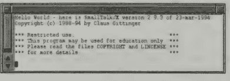

Transcript 是显示相关系统信息的控制台。Launcher 菜单如图 31.2 所示。

**图 31.2.**
*Launcher 菜单。*

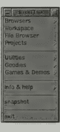

Launcher 允许访问编写应用程序所需的工具。表 31.1 给出了 Launcher 中可用的选项及其简要描述。

**表 31.1.** LAUNCHER 菜单选项。

| 选项 | 描述 |
| :--- | :--- |
| 浏览器 | 此选项的右拉菜单允许你访问浏览器、发送者和实现者。 |
| 工作区 | 此选项打开工作区视图。 |
| 文件浏览器 | 此浏览器允许检查和操作文件和目录。 |
| 项目 | 此选项允许你选择现有或新的项目。 |
| 实用工具 | 此选项包含针对你编程需求特定的工具。 |
| 趣味功能 | 此选项包含其他与非编程相关的工具。 |
| 游戏与演示 | 此选项包含一些示例程序和可玩的游戏。 |
| 信息帮助 | 此选项包含提供 ST/X 环境信息和 Smalltalk 编程帮助的条目。 |
| 快照 | 此选项拍摄当前 ST/X 环境的快照，并要求输入希望存储快照的映像文件名。 |
| 退出 | 此选项允许你立即退出 ST/X，或退出并保存当前环境的快照。 |

以下部分详细描述了这些选项中的大部分。

## 浏览器选项

Launcher 菜单中的浏览器选项让你可以访问不同的浏览器或编辑器，它们允许你读取和操作类、方法、更改、发送者和实现者。可用的子选项包括：

- 系统浏览器
- 类层次结构浏览器
- 实现者
- 发送者
- 更改浏览器
- 目录浏览器

本节的每一部分将详细讨论这些子选项。

### 系统浏览器

标准系统浏览器包含五个子视图：

- 类类别列表
- 类列表
- 方法类别列表
- 方法列表
- 代码视图

系统浏览器如图 31.3 所示。

**图 31.3.**
*系统浏览器。*

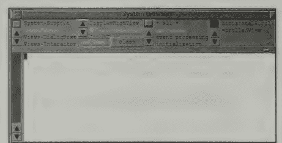

在 ST/X 系统中，类被分配给类别。类别只是一个用于对类进行分组以便更容易处理的属性。要选择类类别，请单击类类别列表中类别的名称。这是系统浏览器顶部一半最左侧的部分。这会在类列表子视图中显示属于该类别的所有类。类列表子视图是系统浏览器从最左侧数第二个部分。你还可以选择两个特殊类别之一：`*all*`，选择所有类并按字母顺序列出；以及 `hierarchy`，按继承关系以树形式列出所有类。

如果你在类列表中选择一个类，该类的所有方法类别都将显示在方法类别列表中，这是系统浏览器顶部一半从右侧数第二个部分。与类类别一样，方法类别仅用于根据功能对方法进行分组。当你选择一个方法类别时，该类别中的所有方法都会显示在浏览器最右侧部分的方法列表视图中。特殊的 `*all*` 类别按字母顺序显示所有方法。从方法列表中选择一个方法会在代码视图中显示对应方法的源代码，代码视图是系统浏览器的下半部分。

浏览器允许你更改类或其元类。在浏览器的类列表视图部分有两个切换按钮：类（class）和实例（instance）。实例是默认选项，使更改影响类。选择类（class）会使更改影响元类。

在每个视图中都可以通过在该视图中按下鼠标中间按钮或菜单按钮来访问弹出菜单。类类别视图中可用的弹出菜单如图 31.4 所示，每个功能的目的见表 31.2。


**表 31.2. 类分类弹出菜单功能。**

| 功能 | 描述 |
|---|---|
| fileOut | 将当前选定的类分类中的所有类保存到一个名为 classCategory.st 的源文件中。 |
| fileOut each | 保存所有类，但将每个类放入一个名为 className.st 的单独文件中。 |
| printOut | 将所有选定类的打印表示发送到打印机，包括方法源代码。 |
| printOut protocol | 将类分类中所有类的仅协议表示发送到打印机，不包含方法的源代码。 |
| spawn | 在当前选定的类分类上启动一个类分类浏览器，不包含类分类列表。 |
| spawn class | 启动一个完整的类浏览器，允许你在一个视图中编辑选定类的所有代码。 |
| update | 重新扫描系统中的所有类，并更新显示的列表。 |
| find class | 弹出一个对话框，以输入你希望搜索并显示的类的名称。 |
| rename | 重命名一个类分类，并更改当前选定类分类中所有类的类分类属性。 |
| remove | 删除当前类分类中的所有类和子类。 |

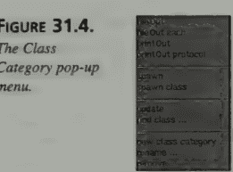

当在类列表视图中按下菜单鼠标按钮时，会出现类列表弹出菜单。此菜单中可用的功能如图 31.5 所示，并在表 31.3 中解释。

## 第五部分

**表 31.3. 类列表弹出菜单功能。**

| 功能 | 描述 |
|---|---|
| fileOut | 将当前选定类的源代码保存在名为**className**.st 的文件中。 |
| printOut | 将当前选定类的源代码发送到打印机。 |
| printOut protocol | 将当前选定类的协议描述发送到打印机。输出将包含类描述、类注释以及类的协议和方法注释。 |
| spawn | 在当前选定的类上启动类浏览器。 |
| spawn hierarchy | 在当前选定类的所有子类上启动浏览器。 |
| hierarchy | 在代码视图中显示当前选定类的层次结构。 |
| definition | 在代码视图中显示类定义，并允许你更改类定义。 |
| comment | 在代码视图中显示类注释，并允许你编辑它。 |
| class instvars | 显示选定类的类实例变量，并允许你编辑它们。 |
| variable search | 提供一种搜索功能，以查找不同的变量引用以及引用所搜索变量的所有方法。 |
| new class | 允许你使用当前选定的类作为模板创建新类。 |
| new subclass | 与 new class 相同，但创建当前选定类的子类。 |
| rename | 更改当前选定类的名称。 |
| remove | 删除当前选定类及其所有子类。 |


当在方法分类视图中按下菜单鼠标按钮时，会出现方法分类弹出菜单。此菜单中可用的功能如图 31.6 所示，并在表 31.4 中解释。

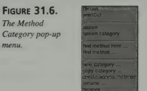

**表 31.4. 方法分类弹出菜单功能。**

| 功能 | 描述 |
| :--- | :--- |
| fileOut | 将当前选定的方法分类的源代码保存在名为 `className-category.st` 的文件中。 |
| printOut | 将当前选定的方法分类的源代码发送到打印机。 |
| spawn | 在当前选定类的当前选定方法分类上启动方法分类浏览器。 |
| spawn category | 在具有与当前选定项相同分类的类的所有方法上启动浏览器。 |
| find method here | 搜索实现指定选择器的方法。 |
| find method | 在类层次结构中向上搜索，查找实现对话框中指定的选择器的第一个类。 |
| new category | 允许你将新分类添加到列表中。 |
| copy category | 允许你将类分类中的所有方法复制到当前选定的类中。 |
| create access methods | 创建用于访问实例变量的方法。 |
| rename | 重命名当前选定的方法分类。 |
| remove | 删除当前选定类中属于当前选定方法分类的所有方法。 |

当在方法列表视图中按下菜单鼠标按钮时，会出现方法列表弹出菜单。此菜单中可用的功能如图 31.7 所示，并在表 31.5 中解释。

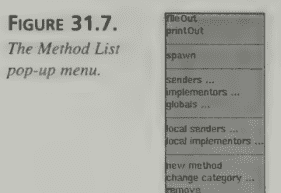

**表 31.5. 方法列表弹出菜单功能。**

| 功能 | 描述 |
| :--- | :--- |
| fileOut | 将当前选定的方法保存在名为 className-selector.st 的文件中。 |
| printOut | 将当前选定方法的源代码发送到打印机。 |
| spawn | 启动用于编辑此方法的浏览器。 |
| senders | 在发送特定消息的所有方法上启动新浏览器。 |
| local sender | 与 senders 相同，但将搜索限制在当前类及其子类中。 |
| implementors | 在实现特定消息的所有方法上启动新浏览器。 |
| globals | 在访问全局（无论是全局变量还是符号）的所有方法上启动新浏览器，以及在发送相应消息的所有方法上启动新浏览器。 |
| new method | 允许你在代码视图中从模板创建新方法。 |
| change category | 允许你更改选定方法的分类。 |
| remove | 删除当前选定的方法。 |

当你向系统类描述添加或删除实例变量，并*确认*（即保存更改）时，系统会创建新类而不是更改旧类。原始类仍然存在，以便为该类现有的实例提供有效的类，尽管它不再能通过名称访问。更改后，你无法再编辑旧类。

> **注意**
>
> 建议不要更改系统类的定义，只更改私有类的定义。使用*复制类分类*功能将现有类及其方法复制到新类并修改新类是更安全的做法。这对于系统本身使用的类尤为重要，因为更改可能导致 ST/X 环境操作出现问题。

代码视图是系统浏览器的下半部分。你在这里可以修改类或实例定义以及方法。此区域的弹出菜单是出现在 ST/X 中每个文本编辑视图中的编辑菜单。此菜单中的功能在本章的“在浏览器中编辑”部分中讨论。

### 类层次结构浏览器

当选择类层次结构浏览器时，会出现一个询问*类名称*的对话框。如果输入有效的类，则该类会出现类层次结构浏览器。这与系统浏览器相同，只是没有类分类列表，因为这是针对特定单个类的。每个子视图的弹出菜单与系统浏览器中的相同。

### 实现者

当选择实现者选项时，会出现一个询问选择器的对话框。选择器是消息要求接收者执行的操作类型的名称。

如果输入有效的选择器，将显示实现者视图。此视图类似于图 31.8 所示的视图。

**图 31.8。**
*实现者视图。*

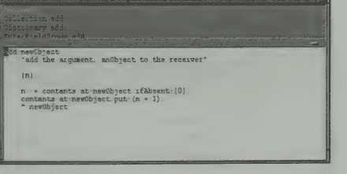

实现者视图包含实现选择器指定的方法的列表。实现者视图上半部分的弹出菜单与方法列表子视图的弹出菜单相同，该内容在本章的“系统浏览器”部分中讨论。

### 发送者

当选择发送者选项时，会出现一个询问选择器的对话框。如果输入有效的选择器，将显示发送者视图。此视图类似于图 31.9 所示的视图。

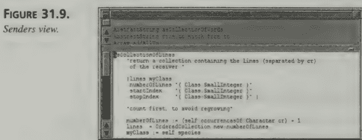

发送者视图包含发送选定消息的方法的列表。发送者视图上半部分的弹出菜单与方法列表子视图的弹出菜单相同，该内容在本章的“系统浏览器”部分中讨论。

### 更改浏览器

每次你对类层次结构或方法做出更改时，ST/X 都会将记录写入更改文件。更改浏览器允许你检查和操作更改文件。更改浏览器中有两个子视图：更改列表和内容视图。更改列表按时间顺序给出所有更改的列表。图 31.10 显示了一个更改浏览器的示例。

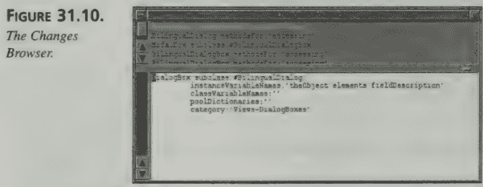

要显示更改，请从更改列表中选择一个更改。然后，更改浏览器会在内容视图中显示该更改的内容。


更改列表的弹出菜单具有表 31.6 中描述的功能。

### 表 31.6. 更改列表弹出菜单。

| 功能 | 描述 |
| :--- | :--- |
| apply change | 应用当前选定的更改。 |
| apply to end | 从当前选定的更改开始，应用更改文件中直到末尾的所有更改。 |
| apply all changes | 应用文件中的所有更改。 |
| delete | 从列表中删除当前选定的更改。 |
| delete to end | 删除从当前选定的更改到文件末尾的所有更改。 |
| delete changes for | 删除影响同一类的所有更改。 |
| delete all changes | 删除文件中与当前选定更改属于同一类的所有更改。 |
| update | 重新读取更改文件。 |
| compress | 压缩更改列表，并移除针对某个方法的多个更改，仅保留与当前更改相比最新的更改。 |
| version | 将更改中方法的源代码与该方法的当前版本进行比较，并在 Transcript 视图中输出消息。 |
| make a change patch | 将该更改追加到补丁文件的末尾，该文件将在 ST/X 启动时运行并自动应用。 |
| update sourcefile | 此功能目前尚未实现。 |
| from change | |
| writeback | 将更改列表写回 changefile 更改文件。除非执行此操作，否则在更改浏览器中执行的所有删除/压缩操作不会影响更改文件。 |

可通过重新应用自上次快照条目以来所做的所有更改，利用更改浏览器从系统崩溃中恢复。为了控制更改文件的大小，建议定期应用压缩。这将移除某个方法的所有旧更改，仅保留最新的更改。

## 目录浏览器

当选择目录浏览器选项时，将显示一个包含五个子视图的浏览器。浏览器的上半部分显示当前目录及其包含的所有子目录和文件。如果选择某个目录，它将在右侧下一个部分中展开，占据浏览器上半部分的剩余空间。如果选择某个文件，则文件的显示在浏览器的下半部分显示。目录区域的弹出菜单仅有两个功能：

- `up`——移动到所选目录的上层目录
- `goto` 目录——允许你转到指定目录

内容视图拥有与其他所有文本编辑器相同的编辑菜单，并在本章的“在浏览器中编辑”一节中讨论。典型的目录浏览器如图 31.11 所示。

**图 31.11.**
目录浏览器。

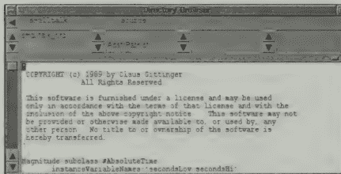

## 工作区选项

工作区选项显示一个视图，从中可以输入并编译 Smalltalk 代码。工作区通常用作编码时的测试区域或草稿纸。你可以使用它来测试你的 Smalltalk 代码，然后再使用系统浏览器代码视图将其构建到代码库中。

## 文件浏览器选项

文件浏览器赋予你检查和操纵文件及目录的能力。文件浏览器如图 31.12 所示。

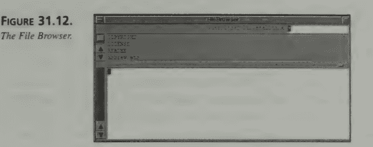

它由四个子视图组成，描述见表 31.7。

### 表 31.7. 文件浏览器子视图。

| 子视图 | 用途 |
| :--- | :--- |
| path-label field | 显示当前目录的名称。 |
| file pattern field | 允许输入搜索模式以选择文件列表中的文件。 |
| file list | 显示文件和目录名称列表。 |
| contents view | 显示所选文件的内容。 |

要查看文件内容，请在文件列表中文件名上双击鼠标左键。要更改目录，请在目录名称上双击。目录名称始终显示在文件列表中。

你可以使用文件模式字段来显示与指定模式匹配的文件列表。默认值为 *，显示所有文件。通过将指针移动到该字段，编辑模式，然后按 enter 键或从文件模式弹出菜单中选择 accept 来更改搜索模式。

正如我们讨论过的其他浏览器一样，每个子视图都有一个通过菜单鼠标按钮激活的弹出菜单。路径标签弹出菜单如图 31.13 所示。


此菜单中可用的功能描述见表 31.8。

### 表 31.8. 路径标签弹出菜单功能。

| 功能 | 用途 |
| :--- | :--- |
| copy path | 将当前路径名复制到剪切和粘贴缓冲区。 |
| change directory | 打开一个对话框以输入要切换到的目录名称。 |
| change to home dir | 将文件列表更改为您的主目录。 |

文件列表弹出菜单如图 31.14 所示。


此菜单中可用的功能描述见表 31.9。

### 表 31.9. 文件列表弹出菜单功能。

| 功能 | 用途 |
| :--- | :--- |
| spawn | 在当前目录或文件列表中选择的目录上启动另一个文件浏览器。 |
| get contents | 在内容视图中显示当前选定文件的内容。 |
| show info | 显示当前选定文件或目录的类型、大小、访问权限和所有者信息的视图。 |
| show full info | 显示与上述相同但包含更多详细信息，如最后访问时间、最后修改日期和时间。 |
| fileIn | 通过读取和评估 Smalltalk 表达式将选定的文件加载到系统中。 |
| update | 重新读取目录并更新文件列表。 |
| execute UNIX command | 允许通过弹出框执行任何 UNIX 命令。 |
| remove | 删除选定的文件或目录。 |
| rename | 重命名选定的文件。 |
| display long list | 在文件列表中显示文件信息。此选项与 display short list 互换，后者是默认设置。 |
| show all files | 显示所有文件，包括隐藏文件。此选项与 hide hidden files 互换，后者是默认设置。 |
| create directory | 创建新目录。 |
| create file | 创建新文件。 |

内容视图的弹出菜单与其他文本编辑器相同的编辑菜单，并在本章的“在浏览器中编辑”一节中讨论。

## 项目选项

启动器菜单的项目选项允许你创建新项目或选择以前创建的项目。当选择新项目功能时，会自动为你创建一个新项目，并且新对象出现在屏幕上。如果选择选择项目功能，将出现一个包含现有项目列表的对话框供你选择。只需选择一个项目，它就会被加载到环境中。

## 实用工具选项

实用工具选项提供 13 个协助你在 ST/X 环境中编程的工具。表 31.10 简要描述每个工具。

### 表 31.10. 实用工具选项。

| 实用工具 | 描述 |
| :--- | :--- |
| Transcript | 打开 Transcript 视图。 |
| Window tree | 显示所有在请求时处于活动或等待状态的窗口的窗口层级的图形树表示。 |
| Class tree | 显示系统类层级的图形树表示。 |
| Event monitor | 显示监控事件的视图。 |
| Process monitor | 显示有关当前所有活动或等待进程信息的视图。随着进程状态的变化，这些信息也会随之改变。 |
| Memory monitor | 显示当前内存使用情况的图表，并随内存使用情况的变化而变化。 |
| Memory usage | 显示类表及每个类的实例数量、平均大小、字节数和每个类所占内存百分比。 |
| collect Garbage | 运行生成式清除算法以收集并销毁短期对象。如果对象存活时间足够长，它将被移动到内存区域，直到用户请求其收集为止。 |
| collect Garbage & compress | 与回收垃圾相同，但还会压缩以恢复空间。 |
| fullscreen hardcopy | 拍摄屏幕截图并询问具有 .tiff 扩展名的文件名以保存图像。 |
| screen area hardcopy | 与全屏硬拷贝相同，但仅针对屏幕的特定区域。 |
| view hardcopy | 与全屏硬拷贝相同，但仅针对一个特定视图。 |
| ScreenSaver | 允许你从三种不同的屏幕保护程序中选择一个在 ST/X 环境中使用。 |

## 小工具选项

启动器菜单的小工具选项提供一个拉出式菜单，包含六种随时都有用的工具，而不仅仅是在 Smalltalk 编程时。小工具描述见表 31.11。

### 表 31.11. 小工具。

| | | | | 时钟 | 在方形中显示模拟时钟，带有秒针切换开关。 | | | | | 圆形时钟 | 与时钟相同，但是圆形的，且最小化时仍然可见。 | | | | | 目录视图 | 以图形方式表示文件和目录。文件夹代表目录，文档代表文件。 | | | |


# 游戏与演示选项

| 小工具 | 描述 |
|---|---|
| 邮件工具 | 用于管理电子邮件的工具。 |
| 新闻工具 | 用于存储新闻、信息和文档的仓库。 |
| 绘图工具 | 一个相当全面的工具，用于绘制图表、图形、图片等。 |

该选项的右侧弹出菜单中包含了供您娱乐的游戏以及可能有用的示例应用程序。游戏与演示选项菜单如图 31.15 所示。


# 在浏览器中编辑

所有显示文本的视图都允许通过弹出菜单对该文本进行常规编辑功能。该菜单中可用的功能如表 31.12 所述。

表 31.12。编辑功能。

| 功能 | 描述 |
|---|---|
| 再次（again） | 重复上一次的编辑。 |
| 复制（copy） | 复制选定的文本。 |
| 剪切（cut） | 将选定的文本从文件中剪切出来。 |
| 粘贴（paste） | 将在选择粘贴选项之前复制或剪切的文本粘贴到指针当前位置。 |
| 接受（accept） | 完成编辑后，必须使用此选项将更改保存到文件；否则更改不会写入文件。 |
| 执行（doIt） | 计算高亮显示的文本。 |
| 打印（printIt） | 打印当前光标位置处求值结果的表示形式。 |
| 检查（inspectIt） | 对结果调用检查器视图。 |
| 搜索...（search...） | 允许您搜索特定的字符串。 |
| 跳转到...（goto...） | 允许您移动到文件中的特定位置。 |
| 字体...（font...） | 允许您更改文件的字体。 |
| 缩进...（indent...） | 允许您更改文件的缩进。 |
| 另存为...（save as...） | 允许您将文件以不同的名称保存。 |
| 打印（print） | 打印文件。 |

要选择或高亮显示文本，请在第一个字符上按住鼠标左键，然后移动鼠标（同时按住鼠标按钮）到您要选择文本的末尾，然后释放鼠标按钮。如果您再次按住鼠标左键，高亮显示将被移除，您可以选择其他内容。

要滚动文本，请使用视图左侧的滚动条。通过点击滑块下方或上方，文本每次点击滚动一页。如果您在点击的同时按下 Shift 键，文本将滚动到滚动条中指针所在的位置。这对于快速浏览长文档非常有用。

# 使用检查器

检查器允许您检查对象。它由两个子视图组成，一个显示对象的实例变量名称，另一个显示所选实例变量的值。您可以通过使用编辑菜单上的 inspectIt 功能，或者向对象发送以下消息之一来启动检查器：

```
anObject inspect
```

或

```
anObject basicInspect
```

basicInspect 命令将打开一个通用检查器，显示对象中实际存在的实例变量。inspect 命令在某些类中被重新定义，以打开一个显示对象逻辑内容的检查器。

# 使用调试器

每当 Smalltalk 代码中出现错误时，调试器就会显示。它显示错误发生的位置以及系统是如何到达该位置的。调试器运行于三种模式之一；*普通*、*模态*和*检查*。

在*普通*模式下，如果在一个不是事件处理程序的进程中发生错误，调试器会在发生错误的进程上方启动。这会阻塞与受影响进程及其视图的所有交互。其他视图仍然处于活动状态并按正常方式响应。

如果在 Smalltalk 事件处理程序进程中发生错误，调试器将以*模态*模式启动。当模态调试器处于活动状态时，您无法与其他任何视图进行交互。

可以通过过程监视器中的弹出菜单进入*检查*模式，并允许检查其他进程的状态。但由于被调试的进程可能继续运行，因此只能检查受影响进程的快照。

调试器包含四个子视图：

- 上下文回溯列表（Context Walkback List）显示导致错误的上下文链。
- 方法源视图（Method Source View）显示导致错误的方法。
- 接收者检查器（Receiver Inspector）允许检查所选消息的接收者。
- 上下文检查器（Context Inspector）提供有关此上下数的参数和局部变量的信息。

调试器如图 31.16 所示。


每个视图共有的功能显示为上下文回溯列表下方的一组按钮。这些功能如表 31.13 所述。

| **按钮** | **描述** |
|---|---|
| `continue` | 继续执行。 |
| `terminate` | 终止发生错误的进程。 |
| `abort` | 如果可能，中止当前活动。 |
| `step`（单步） | 让进程继续执行，直到当前选定上下文中执行下一个 `send`。 |
| `send`（单发） | 让进程继续执行一次消息 `send`。 |
| `return` | 继续执行，就好像选定上下文已返回一样。 |
| `restart` | 通过重新启动选定上下文来继续执行。 |

回溯子视图有一个弹出菜单，其中包含表 31.14 中描述的功能。

| **功能** | **描述** |
|---|---|
| `exit smalltalk` | 退出 S/T/X 而不保存映像。 |
| `show more` | 显示回溯中另外 50 个上下文。 |
| `breakpoints` | 尚未可用。 |
| `trace on/off` | 尚未可用。 |
| `trace step` | 尚未可用。 |

如果调试器本身内部发生错误，则会进入 miniDebugger（微型调试器）。这是一个逐行调试器，允许在没有图形用户界面的情况下进行有限的调试。它通过输入在启动 S/T/X 的 Xterm 窗口中的命令来控制。如果您在 miniDebugger 提示符处输入 ?，您将得到在此简化版调试器中可用的命令列表。

## 摘要

本章向您介绍了由 Smalltalk/X 应用程序提供的 Smalltalk 环境。如果您对使用 Smalltalk 进行编程感兴趣，并且无法访问 Smalltalk 的商业版本之一，那么 Smalltalk/X 非常适合您。Smalltalk/X 不仅包含了本章中提到的所有工具和编程辅助功能，还包含许多示例和一些相当完整的文档，这将使您更容易学习 Smalltalk。

值得一提的是，Linux 还附带 GNU 版本的 Smalltalk，称为 mst。本章专门讨论 Smalltalk/X，因为它比 GNU Smalltalk 更完整。从这里，您可以了解：

- 关于 Perl 编程语言，它用于许多即席编程任务，见第 28 章，“Perl”。
- 如何备份您的系统，以免您的所有 Smalltalk/X 程序丢失，请阅读第 45 章，“备份”。
- 如何配置您的 Linux 系统以便互联网上的人可以访问您的系统，请阅读第 47 章，“建立互联网站点”。

566

# 第六部分

# Linux 系统管理

# 本部分内容

- 系统管理基础 569
- 设备 583
- 进程 609
- 用户和登录 619
- SCSI 设备支持 637
- 网络 645
- SLIP 和 PPP 665
- UUCP 681
- 配置 Linux 用于邮件 701
- 配置 Linux 用于新闻 719
- 网络安全 729
- NFS 737
- NIS 和 YP 745
- 备份 753
- cron 和 at 763

# 第 32 章

# 系统管理基础

作者 Tim Parker

# 本章内容

- root 账户 570
- 启动和停止系统 571
- 挂载文件系统 574
- 使用 gzip 和 compress 压缩文件 577
- 使用 tar 578
- 备份 580
- 设置您的系统 580

到目前为止，在本书中，您已经看到了如何使用 Linux 完成许多不同的任务。然而，有些问题我们尚未处理，因为它们很少被使用，或者仅由单个管理员（可能是唯一的用户）使用。本章涉及简单的系统管理任务，包括以下内容：

- 正确启动和关闭系统
- 管理磁盘分区
- 制作备份
- gzip、compress 和 tar
- 当日信息（Message of the day）
- 紧急启动软盘

当然，我们无法涵盖您高效运行系统所需知道的所有内容。相反，我们将查看基本信息和实用工具，并留给您自行实验。欲了解更多细节，请查看随 Linux 操作系统提供的文档文件。更好的是，考虑购买一本好的 UNIX 系统管理书籍，例如 *Linux System Administrator's Survival Guide*（Sams Publishing, 1995）。UNIX 系统管理书籍中的许多信息也适用于 Linux。

# root 账户

正如您可能知道的，root 登录没有任何限制。它可以在任何地方做任何事情，访问它想要的任何文件，并控制任何进程。然而，这种力量是有代价的：任何错误都可能是一场灾难，有时甚至会导致整个操作系统损坏。

在 UNIX 社区中，root 登录建立了一种神秘感，因为它拥有对系统的无限权力。使用此超级用户登录的倾向对许多人来说是不可抗拒的。然而，在错误的位置一个简单的 `rm` 命令可能会导致数小时的麻烦，甚至导致整个 Linux 系统需要重新加载。

因此，root 账户应仅用于有限的系统用途，并且仅在其力量必要时（例如在重建内核、安装新软件或设置新文件系统时）。一般来说，您不应使用 root 账户执行例行任务。

自然，许多人使用 root 进行他们的日常 Linux 会话，因为他们认为他们不会犯错而忽略任何建议。事实上，每个人偶尔都会犯错误。问问任何 UNIX 系统管理员，您会发现 root 账户会发生意外。（我曾经不止一次删除了整个文件系统


在试图同时做两件事的时候。）尽管许多人忽视了“仅在必要时使用 root”这一规则，但大多数人最终都会明白这条规则为何重要！

## 启动和停止系统

有多种方式可以引导（boot）Linux 操作系统，也有几种方式可以安全地关闭它。本书前面已经提到了一些。由于 Linux 可以以许多不同的方式安装，因此没有单一的“正确”的操作系统引导方法，所以我们需要查看基于硬盘和基于软盘的引导程序。

### 从软盘启动

引导软盘（boot floppy），顾名思义，是一种用于引导 Linux 内核的软盘。引导软盘在软盘本身上而不是在硬盘上安装了根分区（尽管两者可以共存）。如果没有根分区，Linux 将找不到操作系统其余部分所在的硬盘。

你可以使用操作系统大多数发行版中附带安装程序来创建 Linux 引导软盘。如果有随你的 Linux 发行版附带文档或信息文件，请检查这些文件。或者，大多数 Linux 安装实用程序都有一个菜单驱动的界面，当你在重新构建或重新配置内核时，它会提示你设置引导软盘。你应该使用此程序来制作引导软盘，它在紧急情况下也很有用。

在大多数情况下，引导软盘仅在系统无法正常启动的紧急情况下使用。引导软盘使你能加载 Linux，然后挂载导致问题的硬盘以检查损坏。幸运的是，这种情况并不经常发生。如果你没有使用 LILO 来选择启动分区或将默认启动顺序设置为 Linux，你可能需要引导软盘来启动 Linux。在这种情况下，引导软盘非常像 DOS 引导软盘。

你可以通过从硬盘复制内核镜像来从头创建一个引导软盘。内核镜像通常位于文件 `vmlinuz`、`vmlinux`、`Image` 或 `/etc/Image` 中，具体取决于 Linux 的发行版。Slackware 发行版使用 `vmlinuz`，这是一个压缩的内核（因此名称中有 z）。压缩内核在启动时加载到内存时会自行解压。`vmlinuz` 镜像会扩展为 `vmlinux`。（压缩内核占用的磁盘空间更少；这就是使用它们的原因。）

在确定内核后，你可以将内核镜像中的根设备设置指向软盘或硬盘上的根分区。在这种情况下，我们需要的是软盘。根分区是使用 `rdev` 命令设置的，其格式如下：

```
rdev kernelName device
```

`kernelName` 是内核镜像的名称，`device` 是 Linux 根分区的名称。要为系统中的第一块软盘使用文件 vmlinuz 设置软盘引导设备，命令如下：

```
rdev vmlinuz /dev/fd0
```

如果你想在启动时更改系统默认设置，也可以使用 `rdev` 设置其他参数。请查阅 `rdev` 的手册页以获取 `rdev` 帮助文件的完整信息。

创建引导软盘的最后一步是将内核镜像复制到软盘。你应该使用预先格式化的磁盘（如有必要请用 DOS 格式化），以便让 Linux 例程识别磁盘类型及其密度。要将 vmlinuz 内核复制到第一个软盘驱动器，请使用此命令：

```
cp vmlinuz /dev/fd0
```

此时软盘应该已准备好引导系统。如果你更改了根分区的位置，可能无法在没有软盘的情况下引导系统。在完成引导软盘后，你可以使用 `rdev` 命令将根分区改回硬盘，这使你能从任一设备启动。当你有用于多种不同引导配置的磁盘时，这很有用。你也可以从 Linux 安装程序创建引导软盘。

### 使用 LILO 启动

LILO 是一个驻留在硬盘引导扇区中的程序，允许在告知它之后或经过默认秒数后从硬盘引导 Linux。

LILO 也可以与 OS/2 和 DOS 等其他操作系统一起使用。如果你将 LILO 设置为自动引导（autoboot）Linux，你必须在启动开始时按 Ctrl、Alt 或 Shift 键来中断该过程。这将显示一个引导提示，使你能指定另一个操作系统。如果 LILO 设置为在引导进入 Linux 之前允许一定时间，你可以使用 Ctrl+Alt+Shift 组合键在计时器到期且 Linux 开始加载之前中断引导过程。最后，如果 LILO 设置为不自动引导进入 Linux 而是等待明确指令，你必须按 Enter 键来引导 Linux 或输入其他操作系统的名称。

某些 Linux 发行版在 /etc/lilo 目录中有一个配置文件，可以编辑该文件以提供引导信息，而其他版本的 Linux 在安装过程中配置 LILO。如果是后一种情况，你可以使用安装实用程序更改设置。某些版本的 Linux 使用配置文件 /etc/lilo.conf 代替 /etc/lilo。

## 关闭 Linux

你不能直接关掉电源开关！这可能会损坏文件系统，有时是不可逆的。因为 Linux 同时保持许多文件打开，以及多个进程，所以在你对设备循环电源之前，必须正确关闭所有这些。关闭 Linux 系统有几种方法，但正式方法是使用 shutdown 命令。shutdown 的语法如下：

```
shutdown [minutes] [warning]
```

minutes 是在关闭系统前等待的分钟数，warning 是显示给当前所有登录用户的可选消息。某些版本的 shutdown 允许使用单词 now 代替时间，而其他版本要求不带参数或数字 0 立即关闭系统而不等待。可以通过添加参数 -r（代表 reboot）让 shutdown 在关机后重启系统。

如果你的系统上有其他用户，使用 shutdown 是最好的，因为它给他们一个警告，提示他们应该注销，并且防止信息丢失。也可以用它来自动化稍后（例如在午夜）的关机，在该时间之前出现的消息会警告任何仍登录的用户。

如果你不想等待并想立即关闭系统，请使用 halt 命令或“三指礼”（Ctrl+Alt+Delete）。这会立即关闭所有进程并尽可能快地停止系统。然后可以关闭电源。


某些 Linux 发行版不支持 Ctrl+Alt+Delete，少数旧发行版使用它立即停止系统而不正确终止进程。这可能会造成损坏。请检查文档或手册页以获取信息。

## 挂载文件系统

文件系统在被挂载到 Linux 主文件系统上之前是不可用的。即使硬盘也必须被挂载，因为在挂载其余文件系统之前，只有根文件系统对 / 目录可用。mount 命令用于挂载文件系统。

在启动过程中，mount 命令从启动文件（如 /etc/rc 文件或 /etc/rc.d 目录下的文件）中调用，以挂载维护在 /etc/fstab 文件中的所有文件系统。你可以查看该文件以了解其中维护的信息类型。每个在启动过程中挂载的文件系统都有一个条目，给出其设备名称、挂载目录（称为挂载点）、文件系统类型以及适用的任何选项。

使用 mount 命令，你可以从硬盘、CD-ROM、软盘或任何提供 Linux 支持的文件系统的其他类型设备添加新的文件系统。格式如下：

```
mount filesystem mountpoint
```

filesystem 是设备的名称，mountpoint 是在 Linux 文件系统中应挂载的位置。例如，如果你想将 SCSI CD-ROM 挂载到文件系统的 /usr/cdrom，请发出以下命令：

```
mount /dev/cd0 /usr/cdrom
```

必须在发出命令之前创建目录 /usr/cdrom，否则 mount 命令会产生一个模棱两可的错误。你应该用你的 CD-ROM 设备驱动的名称（大多数非 SCSI CD-ROM 驱动器为 /dev/cd0，SCSI CD-ROM 驱动器为 /dev/cd0）替换 /dev/cd0。当文件系统正确挂载后，切换到 /usr/cdrom 可以让你访问 CD-ROM 上的所有文件，就好像它们是常规文件系统的一部分一样。

如果你的 /etc/fstab 文件中尚没有任何条目，你必须使用略有不同的语法来挂载文件系统：

```
mount -t fstype filesystem mountpoint
```

fstype 是文件系统的类型（如 ISO9660、MSDOS 等）。其余参数与上面的示例相同。当要挂载的文件系统在 /etc/fstab 文件中尚没有条目时，使用 -t 选项。


## 挂载软盘

  你可以使用与刚才讨论的 CD-ROM 示例类似的命令来挂载软盘。若要在目录 `/mnt` 中挂载位于第一个软驱中的软盘，请输入以下命令：

```
mount /dev/fd0 /mnt
```

  大多数软驱设备名称以 fd 开头，以明确表明其设备类型（就像大多数硬盘以 hd 开头一样）。如果文件系统不是 Linux 使用的默认值，则必须指定文件系统类型。例如，若要使用 ext2 文件系统挂载软盘，请使用 mount 命令的 -t 选项：

```
mount -t ext2 /dev/fd0 /mnt
```

## 创建新的文件系统

  要在软盘上创建文件系统（以便其可以被挂载），应根据 Linux 版本使用工具 mke2fs 或命令 mkdev fs。例如，要使用 mke2fs 在 1.44MB 的 3.5 英寸软盘上创建软盘文件系统，请输入以下命令：

```
mke2fs /dev/fd0 1440
```

## 卸载文件系统

  若要将从 Linux 文件系统挂载的文件系统分离，请使用 umount 命令并指定设备名称。例如，若要卸载位于 /dev/fd0 的软盘，请输入以下命令：

```
umount /dev/fd0
```

  软盘将从挂载点移除。请务必输入 umount 而不是 unmount！

  如果你想移除当前软盘并更换另一张，不能直接互换。必须先卸载当前软盘，然后挂载新的软盘。若未遵循此流程，可能导致数据损坏或目录列表错误。

## 检查文件系统

  时不时地，文件可能会损坏，或者文件系统的 inode 表可能与磁盘内容不同步。出于这些原因，定期备份文件系统是个好主意。根据 Linux 版本的不同，有多种实用工具可以检查文件系统。某些系统可用 fsck 工具，而 e2fsck 工具则是专为 Linux 的 ext2fs 文件系统设计的。许多 Linux 版本包含针对其他文件系统的工具，如 `xfsck` 和 `efsck`。在许多情况下，`fsck` 命令链接到各个特定文件系统的版本。

  若要使用 `efsck` 检查文件系统，请带设备名称及选项 `a`（自动修正错误）和 `v`（详细输出）发出命令：

```
efsck -av /dev/hda1
```

  此命令检查并修复 `/dev/hda1`（或你指定的任何设备驱动程序）分区上的任何问题。如果对分区进行了任何修正，应尽快重启机器，以便系统重新同步其表格。

  在可能的情况下，最好在检查文件系统之前将其卸载，因为这可以防止涉及打开文件的问题。当然，你在从主根分区运行时无法卸载它，但你可以从包含检查工具的启动软盘启动系统，并从软盘开始运行这些工具。

## 使用文件作为交换空间

  安装 Linux 时，你的安装程序可能设置了一个专门用于交换空间的分区的分区。原始安装完成后，你可以设置 Linux 使用文件而不是分区，从而释放该分区的磁盘空间。

  通常，使用文件会有性能下降，因为涉及文件系统，尽管在快速的磁盘和 CPU 上这种影响可以忽略不计。然而，当你需要增加更多交换空间时，例如当你临时想要运行一个对交换空间需求较大的应用程序（如编译器）时，这是一种很有用的技术。

  要创建用作交换空间的文件，请输入以下命令：

```
dd if=/dev/zero of=/swap bs=1024 count=16416
```

  这将创建一个（名为 `swap`）用于交换空间的文件，大约为 16MB（在此情况下为 16,416 个块）。如果你想要不同的尺寸，请将 `count` 后面的数字替换为以字节为单位的正确值。接下来，使用以下命令物理创建 `swap` 文件：

```
mkswap /swap 16416
```

  该数字应与之前确定的块数匹配。使用以下命令启用交换空间：

```
swapon /swap
```

  如果你想删除交换文件并使用交换分区，请使用以下命令，随后使用标准的 `rm` 命令删除文件：

```
swapoff /swap
```

  在大多数 Linux 版本中，交换文件不能大于 16MB，但在你的系统上可以拥有多达八个交换文件和分区。

## 使用 gzip 和 compress 压缩文件

  UNIX 系统上有大量文件，占用了大量的磁盘空间。除了删除文件外，另一种选择是压缩它们，以便占用更少的空间。UNIX 和 Linux 系统有几种可用的压缩实用工具。最常用的是 compress 和较新的 GNU *gzip*。

  对文件运行时，*compress* 创建一个较小的带有扩展名 `.z` 的文件，这立即识别该文件为已压缩。要压缩文件，请使用以下命令：

```
compress filename
```

  你还可以使用通配符一次压缩多个文件。*compress* 支持许多选项，但大多数并不常用。默认情况下，当文件被压缩时，未压缩的原文件会被删除，虽然这可以通过命令行选项更改。

  要解压缩已压缩的文件，运行 *uncompress* 程序：

```
uncompress filename
```

  或者，你可以使用通配符（如 `*.z`）解压缩所有压缩文件。请记住，在指定文件名时要包含 `.z` 后缀。

  *gzip* 实用程序是一种新的压缩工具，使用与 *compress* 不同的算法。*gzip* 程序有一些额外的功能，这是在 *compress* 发布后添加的，例如可调节的压缩（所需的压缩程度越高，压缩所需时间越长）。要使用 *gzip*，请指定要压缩的文件名和压缩类型：

```
gzip -9 filename
```

  *-9* 选项指示 *gzip* 使用最高压缩因子，这很可能是你使用最多的选项。或者，关闭此选项，让 *gzip* 使用其默认设置工作。*gzip* 压缩文件的扩展名是附加的 *.gz*，并且原文件被删除。要解压缩 gzip 文件，请使用 *gunzip* 实用程序。

## 使用 tar

  tar（磁带归档器）实用程序在 UNIX 系统上已使用多年。不幸的是，它不太友好，有时脾气很大，特别是当你不熟悉让 tar 做有用事情所需的语法时。

  tar 程序被设计成创建单个归档文件，类似于 ZIP 实用程序对 DOS 所做的。使用 tar，你可以将许多文件合并成一个较大的文件，这使得移动集合或将其备份到磁带变得更容易。tar 使用的一般语法如下：

```
tar [options] [file]
```

  可用的选项冗长且有时晦涩难懂。可以带或不带通配符指定文件。创建 tar 归档文件的简单示例如下：

```
tar cvf archive1.tar /usr/tparker
```

  此命令将 `/usr/tparker` 中的所有文件合并到一个名为 `archive1.tar` 的 tar 归档中。`c` 选项告诉 tar 创建归档；`v` 告诉它详细输出，在执行过程中显示消息；`f` 告诉它使用文件名 `archive1.tar` 作为输出文件。

  扩展名 `.tar` 不由 tar 自动附加，但它是有助于识别文件为归档的用户惯例。虽然这一惯例并未被广泛使用，但由于它有助于识别文件，因此应该使用它。

  `c` 选项创建新的归档。（如果文件之前存在，它会被删除。）`u`（更新）选项用于将新文件附加到现有归档中，或在归档不存在时创建归档。如果你在持续添加文件，这很有用。`x` 选项用于从归档中提取文件。要提取先前示例中归档中的所有文件并使用 tar 命令，请使用以下命令：

```
tar xvf archive1.tar
```

  无需指定文件名，因为文件名和路径在归档被解压时会保留。重要的是要记住，路径与文件一起保存。因此，如果你归档了 `/usr/tparker`，然后进入 `/usr/tparker` 并发出提取命令，文件将相对于当前目录提取，这将它们放置在 `/usr/tparker/usr/tparker`。你必须非常小心地正确提取文件。如果你想强制提取的文件使用新的目录路径，命令行选项允许这样做。

  tar 系统在文件被打包到归档中时不会删除原始文件，也不在文件被提取时删除归档文件。这些步骤必须手动执行。


你可以通过指定设备名称和 `f` 选项作为设备名称，使用 `tar` 将文件复制到磁带或软盘上。要将 `/usr/tparker` 中的文件归档到第一个驱动器的软盘中，可以使用以下命令：

```
tar cvf /dev/fd0 /usr/tparker
```

然而，如果软盘容量不足，这可能会引发问题，因此 `tar` 允许你使用 `k` 选项指定容量。在这种情况下，对于 1.44MB 的软盘，命令如下：

```
tar cvfk /dev/fd0 1440 /usr/tparker
```

如果软盘在归档完全复制之前已满，`tar` 会提示你插入另一张软盘。保持参数顺序正确非常重要。你注意到 `f` 在 `k` 之前，因此设备名称必须在容量之前。所有参数的关键字母集中在一起，而不是逐个发出并跟随其值，这是 `tar` 中非常令人困惑的一个方面。

在备份到软盘的最后一个问题上，有时需要告知 `tar` 程序所使用的块大小（blocking 标识设备上每块信息使用多少个块）。软盘通常具有 4 的块因子，因此命令变为：

```
tar cvfkb /dev/fd0 1440 4 /usr/tparker
```

关于 `tar` 的最后一个问题是，它并不总能处理像 `/dev/fd0` 这样的通用设备，必须明确告知磁盘类型。

有关 `tar` 使用的所有选项的完整信息，请查阅手册页或更好的是一本科好的系统管理书籍。

你也可以以同样的方式使用 `tar` 来归档压缩文件。你还可以毫无问题地压缩 `tar` 文件。在这些情况下，你可能会得到类似以下这样的文件名：

```
fileName.tar.gz
```

像这样的文件名表明，你应该先运行 `gunzip` 以恢复 `tar` 文件，然后运行 `tar` 以提取归档中的文件。你可以通过管道一起运行这些命令：

```
gunzip fileName.tar.gz | tar xvf -
```

管道符号后代表 `tar` 文件名的连字符是标准的 UNIX 术语，表示从管道（stdin）获取输入。`tar` 命令有很多其他选项，其中许多已过时或很少使用。我们将在第 45 章“备份”中更详细地讨论 `tar`。

## 备份

系统管理的三条规则是：备份、备份、再备份。这听起来可能有些傻气和平淡，但备份可以在你对文件系统做一些愚蠢的操作或出现问题时拯救你。在 UNIX 中，大多数备份是使用 tar 制作到磁带设备上的，尽管许多 Linux 用户没有可用的磁带单元，不得不退而求其次使用软盘。

如前所述，备份是使用 tar 实用程序制作的。程序与前面展示的完全相同。要在软盘上备份整个系统，命令如下：

```
tar cvfbk /dev/fd0 1440 4 /
```

要备份到比文件系统容量更大（因此不需要容量限制）的高容量磁带设备，称为 /dev/rct0，命令是

```
tar cvfk /dev/rct0 20 /
```

在许多情况下，你不想备份整个系统，因为从 CD-ROM 重新安装更容易。然而，你应该通过备份整个 /usr 目录或专门备份你自己的主目录来备份你的用户文件。

要恢复备份，你再次使用 tar 命令：

```
tar xvrf /dev/rct0
```

这将从磁带设备 /dev/rct0 恢复所有文件。如果需要，你可以显式恢复特定文件。

有几款商业产品提供自动备份，尽管你可以使用 cron 命令轻松地完成这一点。

## 设置你的系统

你可以执行一些小任务来微调或优化你的 Linux 系统，尽管在许多情况下，它们取决于你运行的版本以及其他共存的应用程序。我们可以在这里查看一些杂项任务。

### 设置系统名称

系统名称包含在一个名为 /etc/HOSTNAME 的文件中。它只是系统用于标识自己的名称，如果你将 Linux 机器与其他机器进行网络连接，这将特别有用。你的系统名称（也称为主机名）是其他机器识别你机器的方式，因此请使其具有唯一性和描述性。你可以将系统命名为任何你想要的名字。

要设置你的系统名称，你可以编辑系统文件（这应随后重启以使更改生效）或使用 hostname 命令。以下命令将机器名称设置为 `hellfire`：

`hostname hellfire`

### 使用维护磁盘

每个系统都应该有一个维护磁盘，它可以让你检查根文件系统、从某些磁盘问题中恢复并解决诸如忘记 root 密码等简单问题。紧急磁盘（也称为引导/根软盘）在大多数 Linux 发行版中通过 setup 程序创建，当配置发生变化时。

通常，你可以从系统随附的 CD-ROM 创建紧急引导磁盘，也可以从 FTP 站点获取必要的文件。

在使用紧急磁盘引导机器后，你可以使用 `mount` 命令挂载磁盘分区。

### 忘记 root 密码

这是一个令人尴尬且恼人的问题，但幸运的是在 Linux 中很容易解决。（如果其他 UNIX 系统也能这么容易就好了！）要从 root 密码问题中恢复，请使用引导软盘并引导系统。挂载根分区，并编辑 `/etc/passwd` 文件以删除 root 的任何密码；然后，从硬盘重新启动。

系统启动后，你可以再次设置密码。

> **警告**
>
> 这指出了 Linux 的一个主要安全问题：任何拥有引导软盘的人都可以不受限制地访问你的系统！

### 设置登录消息

如果系统中多于一个用户，你可以在名为 `/etc/motd`（message of the day，今日消息）的文件中显示关于系统、其维护或变更的信息。每当有人登录时，该文件的内容都会显示。

要更改 `/etc/motd` 文件，请使用任何文本编辑器并将内容保存为 ASCII。你可以使内容尽可能长，但读者通常欣赏简洁。/etc/motd 文件有助于通知用户停机时间、备份或新增内容。你也可以用它来赋予系统更个性化的感觉。

## 摘要

系统管理不是一个复杂的话题，除非你想深入了解操作系统及其配置的细枝末节。对于大多数将操作系统用于个人实验的 Linux 用户来说，本章中解释的管理步骤对于大多数目的来说应该是足够的。如果你想了解更多细节，请查阅一本好的 UNIX 系统管理书籍。从这里，你可能想了解以下主题：

- SCSI（Small Computer Systems Interface，小型计算机系统接口）设备以及它们如何增加 Linux 系统的灵活性在第 36 章“SCSI 设备支持”中讨论。
- 在 Linux 系统上设置电子邮件在第 40 章“配置 Linux 以发送邮件”中讨论。
- tar 命令、备份以及制作系统备份副本的重要性在第 45 章“备份”中讨论。

# 设备

作者 Tim Parker

## 本章内容

- 字符模式和块模式设备 584
- 打印机管理 587
- 终端 596
- 添加调制解调器 607

## 第 33 章

本章专门介绍可能连接到你的 Linux 系统的设备，如终端、调制解调器和打印机。它向你展示了如何添加和管理不同的设备，并且还考察了正确管理系统所需的许多 Linux 命令。

如果你希望系统平稳运行，所有这些必要的信息都是必需的。即使你没有打算添加终端或调制解调器，你也应该了解启动过程以及配置文件的处理方式。

## 字符和块模式设备

连接到运行 Linux 的计算机上的所有物品都被操作系统视为设备。无论该设备是终端、硬盘、打印机、CD-ROM 驱动器还是调制解调器，都无关紧要。所有接受或向操作系统发送数据的东西都是设备。

将系统中的一切都视为设备是 UNIX 架构的优势之一。每个设备在内核中都有一个特殊的部分，称为设备驱动程序，其中包含 Linux 与设备通信所需的所有指令。当开发新设备时，可以通过编写设备驱动程序来在 Linux 上使用它，这通常是一组解释如何发送和接收数据的指令。

设备驱动程序允许 Linux 内核仅包含操作系统和支持软件。通过在与设备通信的指令位于一组文件中，它们可以在需要时加载（对于很少使用的设备）或在操作系统启动时始终保持在内存中。随着外围设备的改进，对设备驱动程序文件的小幅修改可以链接到内核中，以保持操作系统了解新的功能和特性。

当应用程序指示设备执行操作时，Linux 内核不需要担心机制。它只是将请求传递给设备驱动程序并让其处理通信。同样，当你在键盘上打字时，你的终端设备驱动程序接受按键输入并将其传递给 shell 或应用程序，通过将内核不知道如何处理的特殊代码转换为内核可以执行的内容来过滤掉它们。

Linux 默认和惯例上将在 /dev 目录中保存设备文件。允许在文件系统的任何位置保存设备文件，但将所有文件保存在 /dev 中使很明显它们是设备文件。

Linux 系统中的每个类型的设备都以两种方式之一进行通信：逐字符或以预定义块或数据组的形式。终端、打印机和

异步调制解调器是字符设备，它们每次发送一个字符，并由另一端回显。另一方面，硬盘和大多数磁带驱动器使用数据块，因为这是发送大块信息最快的方式。根据其通信方式，这些外围设备被称为*字符模式*或*块模式*设备。

> **注意**
> 区分字符模式和块模式设备的另一种方法在于对设备缓冲的处理方式。字符模式设备希望自行进行缓冲处理。块模式设备通常以 512 或 1,024 字节的块进行通信，由内核执行缓冲处理。
> 某些设备可以同时作为字符模式和块模式设备。例如，某些磁带驱动器可以处理字符和块两种模式，因此拥有两个不同的设备驱动程序。所使用的设备驱动程序取决于用户希望向设备写入数据的方式。

设备文件包含有关该设备是字符模式还是块模式设备的所有详细信息。判断外围设备类型的方法很简单：查看显示文件权限的*列表*命令的输出（例如 `ls -1`）。如果第一个字符是 b，则该设备是块模式设备；如果是 c，则指示该设备是字符模式设备。

设备文件通常以其所指的设备类型来命名。例如，大多数终端都有一个名称为 tty 后跟两个或更多字母或数字的设备驱动程序，如 tty1、tty1A 或 tty04。字母 tty 标识该文件为终端（tty 代表 teletype），而数字或字母则标识所引用的特定终端。与目录名称 /dev 组合后，完整的设备驱动程序名称变为 `/dev/tty01`。

## 主要和次要设备编号

系统中可能存在多个同类型的设备。例如，你的 Linux 系统可能有一张多端口卡（多个串行端口），其上连接了 10 个 Wyse 60 终端。由于它们都是同一种类型的设备，Linux 可以为每个终端使用相同的设备驱动程序。

然而，必须有一种方法让操作系统区分你想要访问的这 10 个终端中的哪一个。这就是设备编号用武之地。每个设备由两个设备编号标识：主要编号（major number）标识要使用的设备驱动程序，而次要编号（minor number）标识设备编号。例如，多端口卡上的 10 个 Wyse 60 终端都可以使用具有相同主要编号的设备文件，但每个终端将拥有不同的次要编号，从而在操作系统中唯一地标识它。

系统上的每个设备都被分配了主要和次要设备编号，以确保它们的唯一性。如果两个设备被分配了相同的编号，Linux 无法与它们正确通信。

某些设备以奇怪的方式使用主要和次要设备编号。例如，某些磁带驱动器使用次要编号来标识磁带的密度，并以此方式调整其输出。

设备文件使用 **mknod**（make node）命令创建，并使用标准的 rm 命令删除。

## **mknod** 命令

**mknod**（make node）命令在 Linux 中有几种不同的用途。它可以创建 FIFO（先进先出）管道，或者字符或块模式设备文件。该命令的格式为：

```
mknod [options] device b|c|p|u major minor
```

选项可以是以下之一：

- **-help** 显示帮助信息，然后退出。
- **-m [mode]** 将文件模式设置为 *mode*，而不是默认的 **0666**（仅允许使用符号表示法）。
- **-version** 显示版本信息，然后退出。

设备或路径名参数后面的参数指定该文件是块模式设备（b）、字符模式设备（c）、FIFO 设备（p）还是无缓冲字符模式设备（u）。命令行中必须存在这些参数之一。

在文件类型参数之后，是为新文件分配的主要和次要设备编号的两个数字。UNIX 系统上的每个设备都有一个唯一编号，用于标识设备类型（主要编号）和特定设备本身（次要编号）。对于任何新的块、字符或无缓冲模式设备，必须指定主要编号和次要编号。对于 p 类型设备，不指定设备编号。

本章节后续部分展示了使用 **mknod** 命令的示例，当时当向系统添加设备时会用到。

## 打印机管理

打印机是常用设备，可能会给系统管理员带来一些问题。只要了解硬件知识，配置起来非常容易。管理打印队列也很简单，但和 Linux 中的许多事物一样，你必须了解一些技巧才能让系统为你轻松工作。

Linux 基于 BSD 版本的 UNIX，不幸的是，在打印机管理方面，它并不是最具才华的 UNIX 版本。然而，由于 Linux 系统不太可能用于拥有许多打印机的大型网络，管理任务可以简化为基础操作。但请注意，BSD UNIX 的打印机管理和维护命令以行为怪异和不一致而闻名！

### lpd 打印守护进程

Linux 系统上的所有打印都由 lpd 守护进程处理，该守护进程通常在系统启动时开始运行。在启动过程中，lpd 守护进程读取 /etc/printcap 文件，以识别适用于已知连接到系统的打印机的部分。lpd 守护进程使用两个其他进程，称为 listen 和 accept，来处理传入的打印请求，并将其复制到暂存区域。

在大多数情况下，你不需要修改 lpd 守护进程。但是，可能有必要手动停止并重启它。加载 lpd 的命令是：

```
lpd [-l] [port]
```

-l 选项调用日志系统，记录每个打印请求。在调试打印机系统时，该选项可能很有用。lpd 命令行中允许的端口号用于指定 Internet 端口号，如果需要覆盖系统配置信息。你可能永远不需要使用它。

打印暂存区域的大小由每个暂存目录中 minfree 文件中的条目设置（每个打印机都有自己的暂存目录）。minfree 的内容显示需要保留的磁盘块数，以便在暂存大型请求时不会占满硬盘。可以使用任何编辑器修改文件内容。

用户请求打印访问 lpd 守护进程必须通过一个快速的验证例程。涉及两个文件：/etc/hosts.equiv 和 /etc/hosts.lpd。如果发送用户的机器名不在任一文件中，打印请求将被拒绝。由于本地机器始终在 hosts.equiv 中（作为 localhost），Linux 机器上的用户的打印请求应始终被授权。

## 跟踪打印请求

为了理解打印守护进程如何工作，以及 Linux 如何管理打印请求，跟踪一个打印请求是有教育意义的。当用户使用 `lpr` 命令请求打印作业时，`lpr` 组装要打印的数据并将其复制到暂存队列，以便 `lpd` 可以找到它。

> **注意**
> `lpr` 程序是 Linux 系统中唯一能够实际将文件放入打印队列的程序。其他提供打印功能的程序都是通过调用 `lpr` 来实现的。

作为其暂存任务的一部分，`lpr` 还会检查打印文件的说明。它可以从三个来源获取信息：命令行（作为参数提供）、环境变量（由 shell 或用户设置）或系统默认值。

由于目标打印机指定，`lpr` 程序知道应将打印请求放入哪个暂存区。打印机目标可以在 `lpr` 命令行或通过环境变量指定。当确定目标打印机名称后，`lpr` 检查文件 `/etc/printcap` 以查找打印机的信息，包括暂存目录。暂存目录通常采用 `/usr/spool/printer_name` 的形式，例如 `/usr/spool/lp1`。

在暂存目录中，`lpr` 创建两个文件。第一个文件以字母 `cf`（控制文件）开头，后跟一个打印 ID 号。`cf` 文件包含有关打印作业的信息，包括所有者的名称。第二个文件以 `df`（数据文件）开头，包含要打印文件的实际内容。当 `lpr` 完成创建 `df` 文件后，它向 `lpd` 发送一个信号，通知守护进程暂存目录中有一个打印作业在等待。

当 `lpd` 收到来自 `lpr` 的信号时，它检查文件 `/etc/printcap`，以查看打印机是本地打印机还是远程打印机。如果打印作业是针对远程打印机（连接到网络上另一台机器的打印机），`lpd` 会打开到远程机器的连接，传输控制和数据文件，并删除本地副本。

如果打印作业是针对本地打印机的，`lpd` 会检查确保打印机存在且处于活动状态，然后将打印请求发送到运行该队列的打印守护进程。


## /etc/printcap 文件与暂存目录

  `/etc/printcap` 文件被用户的 `print` 命令 `lpr` 和 `lpd` 打印守护进程所查阅。它包含了有关 Linux 机器上所有可访问打印机的信息。

  `/etc/printcap` 的格式很直观（并且类似于用于终端描述的 `/etc/termcap` 文件）。以下是 `/etc/printcap` 的一个摘录：

```
## HP Laserjet
lp|hp1j|laserjet-acctng|HP LaserJet 4M in Room 425:\
    :lp=/dev/lp0:\
    :sd=/usr/spool/lpd:\
    :lf=/usr/spool/errorlog:\
    :mx#0:\
    :of=/usr/spool/lp0/hp1j:\
```

  每个条目中的第一个字段是该打印机所有允许名称的列表。这些名称可以结合用户 shell 或系统设置的环境变量使用，也可以与指定了目标打印机的 `lpr` 命令行选项一起使用。有效名称由竖线分隔。

  通常，每个条目至少包含三个名称：一个四个字符或更短的名称（如 `hp1j`）；如果需要，一个带有所有者的更完整的名称（如 `laserjet-acctng`）；以及一个包含识别打印机所需的其他信息的完整描述性名称（如 Room 425 中的 HP LaserJet 4M）。

> **注意**
> 如果提交的打印作业没有指定目标名称，且无法从环境变量值中确定，该作业将被路由到打印机 `lp`。因此，其中一个打印机（通常是系统默认打印机）的标识符中也应包含名称 `lp`。

  文件中的注释以井号（有时称为哈希标记）作为第一个字符显示。打印机名称之后是一组供打印机使用的双字符参数和值。这些条目的格式始终是以下之一：

- `NN` 布尔值
- `NN=string` 设置为等于 string
- `NN#number` 设置为不等于 number

  当使用布尔值时（双字符标识符后没有赋值），默认情况下值设置为 True（零返回代码）。如果需要 False 值（非零返回代码），则描述中将不包含该双字符标识符。
  为了增强可读性并使打印实用程序更容易解析文件，大多数赋值显示为以冒号开始和结束每个定义。空值是将两个冒号放在一起使用的有效赋值。
  `/etc/printcap` 文件中的某些参数值得重点介绍，因为它们对于管理目的很有用。并非所有参数在每个 `/etc/printcap` 文件的打印机定义中都会出现，但大多数都会出现：

- `sd` 暂存目录
- `lf` 错误消息的日志目录
- `af` 记账日志文件
- `mx` 确定可以打印的文件类型
- `of` 打印时要使用的输出过滤器程序

  所有打印机都应拥有自己的暂存目录，通常位于打印机名称下的 /usr/spool 中，例如 /usr/spool/hp1j。远程和本地打印机都需要暂存目录。当向系统添加新打印机时，可能需要手动创建暂存目录（使用 mkdir）。暂存目录的权限应设置为 775。目录必须由 root 或 daemon 拥有。组 ID 也应设置为 root 或 daemon。在这两种情况下，daemon 在理论上作为用户和组都是更好的 ID，尽管 root 也可以使用。
  错误日志文件可以位于系统上的任何位置。如果希望，它可以由所有打印机共享，因为每个日志条目都包含打印机名称。
  记账日志文件用于记录在用户需要收费系统中的打印输出。如果系统不使用记账记录，则完全忽略 /etc/printcap 文件中的该条目。不过，该文件也可用于生成统计数据。一些使用率高的系统可能希望即使用户未产生费用，也保留用于这些目的的记账文件。打印作业完成后，会向记账日志文件写入一条记录。可以使用 Linux pac 命令显示账户信息。（使用 man pac 命令显示 man 页面以获取关于 pac 的更多信息。）
  mx 字符允许你识别要打印的文件类型。通常设置为 mx#0，这意味着对文件类型没有限制。
  输出过滤器修改发送到打印机的文件格式，以符合其要求。例如，许多激光打印机无法处理每页 66 行，因此输出过滤器会重新分页为 60 行（或设置为每页的行数）。有时，必须添加特殊代码以强制换行、字体更改或纸盒选择。所有这些项目都是输出过滤器的一部分。还有其他几种类型的过滤器可用，但输出过滤器是最常见的。

  在每个暂存目录中，可能有两个状态文件：status 和 lock。每个文件只有一行长，并且可以用编辑器修改。这些文件包含打印机当前状态的描述。它们由 lpd 打印守护进程创建和管理，并由几个打印机命令用于状态信息。

### 使用 mknod 添加打印机设备

  Linux 支持并行和串行打印机设备。并行和串行打印机都是字符模式设备。不幸的是，大多数 Linux 发行版不像许多 UNIX 版本那样拥有易于使用的打印机安装和配置实用程序。相反，必须手动创建和设置打印机设备。

  并行打印机根据它们使用的并行端口的地址，被称为设备 lp0、lp1 或 lp2。（最常见的是 PC 上的单个并行端口，即 /dev/lp0。）有效的并行端口设备、它们的地址及其在 MS-DOS 下通常的等价物如下：

| 设备 | 地址 | MS-DOS 等价物 |
|---|---|---|
| /dev/lp0 | 0x03bc | LPT1 |
| /dev/lp1 | 0x0378 | LPT2 |
| /dev/lp2 | 0x0278 | LPT3 |

> **注意**
> 要确定并行端口的地址，可以使用诊断实用程序（如 DOS 的 MSD.EXE）。某些 BIOS 版本在系统启动时会显示端口地址。如果不确定，请尝试从 /dev/lp0 开始，等待查看是否可能打印输出。PC 上的第一个并行端口通常设置为地址 0x03bc。

  Linux 使用 mknod（创建节点）命令来创建并行打印机设备文件。创建设备后，必须更改设备驱动程序文件的所有权为 root 或 daemon。

  以下是一个命令，用于在第一个并行端口（/dev/lp0）上创建并行打印机设备：

```
mknod -m 620 /dev/lp0 c 6 0
chown root.daemon /dev/lp0
```

  在此示例中，文件权限设置为模式 620，创建设备 /dev/lp0，并将其设置为主要设备号为 6、次要设备号为 0 的字符模式设备。通常，次要设备号从 0 开始并向上递增；因此，由于这是添加的第一个打印机，次要设备号设置为 0。

> **注意**
> 所有权 root.daemon 是 root 运行的守护进程的一个特殊 Linux 约定。条目 root.daemon 不出现在 /etc/passwd 文件中。这使用了一种约定，该约定允许条目的第一部分（句号之前）指示用户，第二部分（句号之后）代表组。

  如果配置了不同的设备，必须将设备名称本身更改为设备号。对于每个可能的并行端口，mknod 命令如下：

```
mknod -m 620 /dev/lp0 c 6 0
mknod -m 620 /dev/lp1 c 6 1
mknod -m 620 /dev/lp2 c 6 2
```

  在这些示例中，次要设备号已递增以对应端口号。这并非必要，但有助于识别。

  在执行了 mknod 和 chown 命令后，建议手动检查以确保所有权设置正确，并且已创建暂存目录。如果暂存目录不存在，必须手动创建它。暂存目录的权限和所有权要求在前面的部分“/etc/printcap 文件与暂存目录”中已给出。

### 使用 lpc 管理打印机

  通过一个名为 lpc 的实用程序控制打印机。lpc 程序允许你执行与 Linux 系统上使用的打印机相关的几项重要功能：

- 显示打印机状态信息
- 启用或禁用打印机
- 启用或禁用打印机队列
- 从打印机队列中删除所有打印请求


- 将特定的打印请求移至队列顶部
- 对 `lpd` 打印机守护进程进行修改

`lpc` 程序不能用于远程打印机。它仅影响直接连接并配置在本地机器上的打印机。

> **警告**

请注意，`lpc` 是 Linux 操作系统中附带的最不可预测且最不可靠的程序之一！它可能会因不明原因挂起，也可能会显示错误的状态信息。在某些情况下，修复严重故障的打印机系统的唯一方法是完全重置机器！

在没有提供任何参数时，`lpc` 会提示您输入命令。以下是几个有效的 `lpc` 命令及其参数（垂直线表示参数的选择）：

- `abort` *`printer_name`* `|` `all`：这与 `stop` 命令类似，不同之处在于它不允许当前正在打印的作业完成后再停止打印机。如果使用 `all` 参数，所有打印机都会被停止。任何被 `abort` 命令异常终止的作业在打印机再次启动时会被重新排队。有关打印机守护程序和锁定文件的详细信息，请参阅 `stop` 命令。
- `clean` *`printer_name`* `|` `all`：这会清除所有排队的打印作业，包括任何活动的打印作业。在许多情况下，当前正在打印的作业会继续正常进行，因为它已经传递给打印机守护程序或打印机的缓冲区。但是，所有其他作业都会被移除。如果使用 `all` 参数，所有打印机的打印队列都会被清理。
- `disable` *`printer_name`* `|` `all`：这会禁用向打印机（或所有打印机，取决于参数）的打印请求转储。已经排队的作业不受影响。任何尝试向禁用的打印机发送打印作业的用户都会收到一条消息，指示打印机已禁用，打印作业被拒绝。打印机通过更改转储目录中的 `lock` 文件来启用或禁用。
- `down` *`printer_name`* `message`：这用于将打印机完全离线，通常用于较长时间段。如果包含消息，它可以任意长。该消息放置在转储目录的状态文件中，并显示给尝试向该打印机排队的用户。当打印机出现严重问题且需要从系统中移除超过一天时，通常使用 down 命令。
- `enable` `printer_name` `|` `all`：这会启用向打印机或所有打印机的打印请求转储。
- `exit`：这退出 `lpc`（与 `quit` 相同）。
- `help` 或 `?`：这会显示所有 `lpc` 命令的简短列表。如果提供了参数，它会显示该命令的单行描述（例如 `help abort`）。
- `quit`：这退出 `lpc`（与 `exit` 相同）。
- `restart` `printer_name` `|` `all`：这会重启打印机守护程序，通常在打印机守护程序因不明原因死亡后使用（BSD 打印机守护程序倾向于这样）。如果提供参数 `all`，所有打印机守护程序都会被重启。
- `start` `printer_name`：这会启动打印机，允许其打印请求。此命令启动该打印机的打印机队列守护程序。
- `status` `printer_name`：这会显示打印机名称，是否启用了转储队列，是否启用了打印，打印队列中的条目数，以及该打印机守护程序的状态。如果队列中没有条目，则没有打印机守护程序处于活动状态。但是，如果队列中有条目且打印机守护程序显示没有守护程序存在，则守护程序已死亡，必须使用 `restart` 命令再次启动。
- `stop` `printer_name`：这会停止打印机。打印请求仍然可以转储，但在打印机启动之前不会打印。如果在发出 `stop` 命令时有作业正在打印，该作业将完成打印过程，然后停止打印。`start` 和 `stop` 命令会更改打印转储目录中 `lock` 文件的内容。`stop` 命令还会终止该打印机转储的守护程序。
- `topq` `printer_name` `print_ID`：这会将具有 `print_ID` 的打印请求移至打印队列顶部。
- `topq` `printer_name` `username`：这将由 `username` 拥有的所有打印请求移至队列顶部。（这对不想等待的系统管理员非常有用！）
- `up` `printer_name`：这用于重新激活之前停机的打印机。有关更多信息，请参阅 `down` 命令。

`lpc` 工具用户友好性不高，但它是 Linux 中处理打印机及其队列的唯一方式。一些前端菜单驱动工具开始出现，简化了这项任务。

## 使用 lpq 和 lprm 管理打印机队列

某些命令帮助你专门管理打印机队列，而不是依赖 `lpc` 命令。系统管理员通常需要两项任务：显示当前队列和移除队列中的打印作业。

要显示任何打印机的当前打印队列，请使用 `lpq` 命令。它的语法如下：

```
lpq [ -l ] [ -P printer_name ] [ job_ID . . . ] [ username . . . ]
```

如果不提供任何参数，`lpq` 将显示关于当前打印机队列的信息。`lpq` 命令通常显示谁排了打印作业、它在队列中的位置、正在打印的文件以及文件的总大小。`-l` 选项显示关于打印机队列中每个条目的更多信息。通常，只显示一行信息。

可以使用 `-P` 选项后跟打印机名称来显示特定打印机。如果没有提供名称，则显示默认的系统打印机。如果提供了一个或多个 `job_IDs` 或 *usernames*，则只显示该用户排队的作业的信息。

> **注意**

由于用户无法访问 Linux 打印机转储目录，他们只能使用 `lprm` 命令移除排队的打印作业。如果你是系统管理员，你可能希望让所有系统用户了解如何使用此命令，以防止不需要的打印作业被打印。

`lprm` 命令用于从打印机队列中移除文件。此命令常被误输入为 `lpr`，后者不会从队列中移除文件。要使用 `lprm`，你必须知道打印作业 ID；或者，如果你以 *root* 身份登录，你可以移除特定打印机的所有作业。`lprm` 命令的语法如下：

```
lprm [ -P printer_name ] [ - ] [ job_ID . . . ] [ username . . . ]
```

如果使用单连字符参数，`lprm` 将移除发出命令的用户拥有的所有作业。如果你以 *root* 身份登录，所有打印作业都会被移除。可以使用 `-P` 选项移除特定打印机的作业。例如，命令

```
lprm -Phplj -
```

将移除在打印机 `hplj` 上排队的由发出命令的用户打印的所有作业，如果是 `root` 发出，则移除该打印机的所有打印作业。

> **警告**

当你以 `root` 身份使用 `lprm` 命令时，很容易意外移除打印机的所有打印作业。请小心使用正确的语法，否则你可能会因为必须重新排队所有作业而感到沮丧！

如果提供了打印作业 ID 或用户名作为参数，`lprm` 将移除该作业或该用户提交的所有作业。如果完全不提供参数，将删除用户当前提交的活跃作业。

当 `lprm` 从队列中移除文件时，它会向显示输出回显一条消息。如果没有文件要移除，则没有回显（你可能会困惑发生了什么，如果有的话）。

如果你尝试在正在打印的作业上使用 `lprm`，它可能无法正确终止，因为文件可能已经存在于打印机缓冲区中。在某些情况下，终止当前正在打印的作业可能会导致打印机锁定，因为某些输出格式文件无法处理终止指令，当转储目录中的锁定文件更改时会冻结。在这种情况下，必须使用 `ps` 命令找到输出过滤器进程 ID，然后终止它。

> **注意**

在打印机锁定似乎无法通过 `lpc` 工具解决的情况下，尝试终止 `lpd` 守护程序并重新启动它。如果不起作用，你可能必须重新启动整个系统。

## 终端

大多数 Linux 系统仅使用随 PC 提供的系统控制台（PC 的屏幕和键盘充当系统控制台）。你不需要对 Linux 进行任何配置更改就能有效使用系统控制台。

一些系统管理员希望添加远程终端，以便其他用户能够同时使用 Linux（毕竟这是一个多用户系统）。可以通过两种方式向系统添加新终端：通过 PC 背面的串行端口，或通过具有多个串行端口的多端口卡。


## 使用多端口卡

多端口卡为向系统添加大量串行端口提供了一种简单且有效的方法。数十家供应商提供不同配置的多端口卡。它们每块卡可提供 2 到 32 个额外的串行端口（用于终端、调制解调器或打印机），并可使用几种不同类型的连接器（例如 DB25 25 针连接器、DB9 9 针连接器或 RJ11 宽电话式插孔）。

如果你打算使用多端口卡，请确保能找到配有专为 Linux 设计的软件设备驱动程序的一款。未经修改，你无法使用专为其他版本的 UNIX（或 Xenix）设计的任何多端口卡。由于多端口卡的设备驱动程序是复杂的二进制文件，修改超出了大多数人的编程能力范围。

多端口卡附带了安装多端口卡设备驱动程序以及配置终端的完整说明。由于配置的细节会根据多端口卡制造商的不同而变化，因此应查阅随卡提供的文档以获取更多信息。

## 添加串行端口终端

你可以使用 PC 上的串行端口来添加远程终端。终端可以是专用终端，也可以是运行终端仿真软件的另一台 PC。Linux 并不真正关心远程机器的身份，除非涉及到发送屏幕显示指令。

远程终端与托管 Linux 操作系统的 PC 之间的电缆布线取决于两端的连接器类型。在大多数情况下，电缆是 DTE（数据终端设备）到 DTE 类型，尽管某些终端和 PC 串行端口需要 DCE（数据通信设备）布线。一般规则是，终端和远程计算机使用 DTE，而调制解调器使用 DCE。DTE 和 DCE 布线的区别在于导线从每个连接器端引出的方式。

然而，在连接终端时，某些引脚必须交叉以允许信号正确传输。这种电缆（通常称为空调制解调器电缆或硬连线电缆）的布线需要几次交叉或短路以使连接有效。PC 上的串行端口连接器要么是 DB9（9 针）连接器，要么是 DB25（25 针）连接器。并非 25 针（甚至 9 针）电缆中的所有导线都是终端设备所必需的。一个完整的终端电缆可以仅由三个引脚（发送、接收和地）组成，尽管 Linux 还使用载波检测线来判断终端是否已连接并处于活动状态。

典型的 DCE 电缆（如用于调制解调器的电缆）采用直通布线，这意味着 PC 端的引脚 1 连接到调制解调器端的引脚 1，引脚 2 连接到引脚 2，等等。这被称为*直通电缆*（有些人也称为*调制解调器电缆*）。DTE（计算机到终端）25 针电缆的重要引脚及其含义如表 33.1 所示。对于 9 针连接器，电缆编号会改变，但交叉方式相同。

### 表 33.1 25 针连接器的 DTE 电缆。

| 终端引脚 | 计算机引脚 | 含义 |
|---|---|---|
| 1 | 1 | 地 |
| 2 | 3 | 发送数据 / 接收数据 |
| 3 | 2 | 接收数据 / 发送数据 |
| 4 | 4 | 就绪发送 |
| 5 | 5 | 清除发送 |
| 6 | 20 | 数据设备就绪 / 数据终端就绪 |
| 7 | 7 | 地 |
| 8 | 20 | 载波检测 / 数据终端就绪 |
| 20 | 6, 8 | 数据终端就绪 / 数据设备就绪，载波检测 |

由于大多数用户希望购买预制电缆来连接远程终端，因此我们不会讨论自制电缆。相反，只需前往当地的电脑商店，说明两端的设备，以及每端是使用 DB9（9 针）还是 DB25（25 针）连接器。还要注意每端的连接器是公头（引脚突出）还是母头（无引脚）。通常，PC 具有公头串行端口连接器（需要电缆上的母头），而终端具有母头连接器（需要电缆上的公头）；但是，如果你正在连接远程 PC，则两端都需要母头连接器。

**注意**

如果电缆的布线没有明确指示，并且供应商不知道它是直通电缆还是空调制解调器电缆，你可能需要购买一个空调制解调器设备。空调制解调器是一个短的连接器，内部包含引脚交叉，实际上将直通电缆转换为空调制解调器电缆，反之亦然。

## 登录过程

为了理解终端配置中涉及的文件，查看每次发生登录时出现的流程是有用的。

该过程始于 `/etc/init` 守护程序在 Linux 系统启动时执行。`init` 守护程序负责为连接到系统的每个终端运行 `/etc/getty` 程序。`init` 守护程序通过两个文件中的条目知道是否连接了终端：`/etc/ttys` 和 `/etc/inittab`。`/etc/ttys` 文件列出了系统上的所有端口以及连接的终端类型。`/etc/inittab` 文件包含所有终端及其参数的完整列表。我们将在后面的“终端文件：`/etc/ttys` 和 `/etc/inittab`”部分中更详细地查看这两个文件。

当 `/etc/ttys` 和 `/etc/inittab` 文件指示终端已连接并处于活动状态时，`init` 守护程序为该终端运行 `/etc/getty` 程序。`getty` 程序设置终端的通信参数，并在屏幕上显示登录提示符。

当用户在终端上登录时，`getty` 进程执行 `login` 程序以请求密码。然后 `login` 程序根据 `/etc/passwd` 文件中的条目验证用户名和密码。如果登录有效，`login` 程序显示当日消息（存储在文件 `/etc/motd` 中），并执行用户应运行的 shell（在 `/etc/passwd` 中指定）。最后，`login` 程序设置 `TERM` 环境变量并退出。

当登录过程结束时，shell 继续执行并读取启动文件；然后，它生成 shell 提示符并等待用户发出指令。

如你所见，启动过程涉及许多文件，都在 `/etc` 目录中。我们可以更详细地查看重要文件（至少是终端特性相关的文件）。

## /sbin/getty 和 /etc/gettydefs 是什么？

`sbin/getty`（在某些系统上为 `/etc/getty`）程序在处理终端时被大量提及，但人们通常不清楚该程序的作用。简单来说，`/sbin/getty` 是一个二进制程序，用于设置 Linux 与终端之间的通信参数，包括速度、协议以及对电缆的特殊处理。

当用户登录时，`/sbin/getty` 程序由 `/etc/init` 调用。被调用时，`/sbin/getty` 打开到终端的串行端口或其他连接，并根据文件 `/etc/gettydefs`（getty 定义）中的信息设置通信参数。然后 `getty` 进程在远程终端上生成登录提示符。

getty 进程提供许多特殊处理和命令选项，但其中大部分对用户和普通的系统管理员兴趣不大。如果你想要 getty 命令的完整信息，请查阅随 Linux 提供的 man 手册页。

`/etc/gettydefs` 文件用于提供 getty 使用的通信设置。gettydefs 文件中每行的格式如下：

```
标签: 初始标志: 最终标志: 登录提示符: 下一个标签
```

*标签*用于识别每一行，因此当 /sbin/getty 以参数启动时（通常如此，对用户是透明的），该参数用于匹配*标签*并提供配置信息。*初始*和*最终*标志用于在*login*程序执行前后设置连接的行为。

*登录提示符*是在终端上显示的提示符。通常它只是*login*，但可以是任何字符串。最后，*下一个标签*用于在无法使用当前行时将 getty 发送到另一行。这通常用于调制解调器线路，它们从高速开始（例如 9600 波特率），依次尝试以 4800、2400 和 1200 连接。对于终端，*下一个标签*通常是指向该行的第一个*标签*的指针。

`/etc/gettydefs` 文件样本摘录如下所示：

```
console# B19200 OPOST ONLCR TAB3 BRKINT IGNPAR ISTRIP IXON IXANY PARENB 
-ECHO
ECHOE ECHOK ICANON ISIG CS8 CREAD # B19200 OPOST ONLCR TAB3 BRKINT IGNPAR 
-ISTRIP
IXON IXANY PARENB ECHO ECHOE ECHOK ICANON ISIG CS8 CREAD #Console Login:
##console

9600H# B9600 # B9600 SANE IXANY PARENB TAB3 HUPCL #login: #4800H

4800H# B4800 # B4800 SANE IXANY PARENB TAB3 HUPCL #login: #2400H

2400H# B2400 # B2400 SANE IXANY PARENB TAB3 HUPCL #login: #1200H

1200H# B1200 # B1200 SANE IXANY PARENB TAB3 HUPCL #login: #300H

300H# B300 # B300 SANE IXANY PARENB TAB3 HUPCL #login: #9600H
```

如果你查看随 Linux 系统提供的文件，你会发现有许多更多的行，但它们都具有与前面示例相同的格式。最容易查看的行是较短的行（前面摘录中的最后五行），但它们都具有与前面示例相同的格式。


这些行是为调制解调器配置的，起始速率为 9600 波特。初始标志被设置为 B9600，这将波特率设定为 9600。最终标志用于连接建立后，它们设置了线路的特性（例如 TAB 键代表三个空格）。最后，末尾字段指向下一个较低的速度，以提供对较慢的调制解调器或导致无法快速登录的不良线路的检查。

上述摘录中的第一行是典型的终端配置。它设置了控制终端行为的许多初始和最终标志。行尾的引用指回同一个定义，因为终端是通过硬连线连接到系统的。

## 注意

你不需要修改 `gettydefs` 文件中的条目，因为默认文件包含许多不同的配置。你应该仔细检查该文件，以找到一个适用于你所使用终端的条目。如果你确实对 `gettydefs` 文件进行了修改，你应该运行命令 `getty -c gettydefs` 以使更改生效。

## 终端文件：/etc/ttys 和 /etc/inittab

终端配置信息存储在文件 `/etc/ttys` 和 `/etc/inittab` 中。这些文件可以使用任何编辑器进行修改。现在出现了一些由菜单驱动的程序，它们可以替你修改这些文件。

# 警告

在对终端配置文件进行任何更改之前，请制作一份安全副本，以防更改无效且文件无法轻松恢复至原始状态。只需将两个文件复制为新的名称，例如 `/etc/tty.original` 和 `/etc/inittab.original`。

`/etc/ttys` 文件有两列。第一列显示终端类型，第二列显示设备名称。一个新安装的 Linux 系统中典型的 `/etc/ttys` 文件看起来像这样：

```
console tty1
console tty2
console tty3
console tty4
console tty5
console tty6
vt100 tty0
vt100 tty1
vt100 tty2
vt100 tty3
```

除非你覆盖了该值，否则第一列中的终端类型会在你登录时用于设置 `TERM` 环境变量。

`/etc/inittab` 文件用于设置每个终端的行为。`/etc/inittab` 文件的格式遵循以下模式：

`ID:runlevel:action:process`

`ID` 是一个唯一的标识该条目的单字符或双字符字符串。在大多数情况下，这对应于设备名称，例如 `tty1` 对应 1。

`runlevel` 决定了终端在 Linux 操作系统可以处于的各种状态（运行级别从 0 到 6，以及 A、B 和 C）下的能力。如果没有提供条目，则支持所有 `runlevel`。字段中可能提及多个 `runlevel`。

`action` 部分展示了如何处理 `process` 字段。`action` 字段有以下几个有效条目：

| 操作 | 描述 |
| :--- | :--- |
| boot | 在 inittab 首次读取时运行 |
| bootwait | 在 inittab 首次读取时运行 |
| initdefault | 设置初始运行级别 |
| off | 如果进程正在运行则终止它 |
| once | 启动进程一次 |
| ondemand | 始终保持进程运行（与 respawn 相同） |
| powerfail | 当 init 接收到电源故障信号时执行 |
| powerwait | 当 init 接收到电源等待信号时执行 |
| sysinit | 在访问控制台之前执行 |
| respawn | 始终保持进程运行 |
| wait | 启动进程一次 |

`action` 指示了系统启动时以及终端上 `getty` 进程终止时终端设备的行为。

一个简单的 `/etc/inittab` 文件（为了清晰起见，取自 Linux 的较早版本，因为最新版本使这些行稍微复杂了一些）看起来像这样：

```
## inittab for Linux
id:1:initdefault:
rc:bootwait:/etc/rc
1:1:respawn:/etc/getty 9600 tty1
2:1:respawn:/etc/getty 9600 tty2
3:1:respawn:/etc/getty 9600 tty3
4:1:respawn:/etc/getty 9600 tty4
```

前两行（在注释之后）在系统启动时使用。第二行告诉系统运行 `/etc/rc` 以完成启动。其余行表明，应以 9600 波特率为 tty1 到 tty4 启动 getty 进程。

## 终端定义：/etc/termcap 文件

`/etc/termcap` 文件保存了与不同终端通信的指令。操作系统支持的大多数终端在此文件中都有一个条目。termcap（终端能力）文件可能会相当大。如果你要进行更改，请先将一个版本复制到安全文件名中。

termcap 文件的内容类似于打印机定义文件 `/etc/printcap`。termcap 文件中的每个条目都有一个带有多种变体的名称，以及一组用于不同终端特性的代码和值。由于终端使用许多不同的代码来执行不同的操作，因此许多代码都可以用于一些功能较强的终端。


termcap 文件的一个摘录显示了两个相当简单的终端定义，即 Wyse 30 和 Wyse 85：

```
w0|wy30-vb|wyse30-vb|wyse 30 Visible bell:\
:vb=\E '8' \E '9' \\
:tc=wy30:\
wc|wy85|wyse85|Wyse 85 in 80 column mode, vt100 emulation:\
:is=\E[61p\E[131E>\E[211\E[731E[?7h\E[?61E\E?5W:\
:co#80:\E[?24:am:c1=\E;\H\E[2J:bs:cm=\E[%i%d@%d:nd=2\E[A:up=2\E[A:\
:ce=\E[0K:cd=\E[0J:so=2\E[?m:so=2\E[m:us=2\E[4m:ue=2\E[m:\
:ku=\E[A:kd=\E[B:kr=\E[C:kl=\E[D:\
:kh=\E[H:xn:\
:im=CO=\E[?25h:CF=\E[?25l:ic=\E[1@:dc=\E[1P:\
:dl=\E[M:al=\E[1L:GS=EF:GE=\E[
```

大多数用户和系统管理员对每组代码的具体含义并不感兴趣。只有当你添加一个在 termcap 文件中尚不存在的终端类型时，你才需要开始修改或重写终端条目。

`/etc/termcap` 文件中的终端特性被 `/etc/ttys` 文件使用。`ttys` 文件的第一列给出了用于设置 `TERM` 环境变量的默认终端类型。本质上，启动例程使用模式匹配工具在 termcap 文件中查找匹配的行，然后读取随后的代码。

## 注意

大多数终端提供多种模拟模式。如果你在 termcap 文件中找不到终端类型，请寻找一种受支持的模拟模式。模拟另一种终端比为新类型编写 termcap 条目更容易。

## 添加终端

终端添加到 Linux 的方式与打印机非常相似——使用 `mknod` 命令。要添加一个终端，你必须决定终端将连接到哪个端口。PC 上的串行端口在 Linux 中被称为 `/dev/ttyS0`（对应 DOS 中的 COM1）、`/dev/ttyS1`（对应 COM2），等等。

大多数 PC 系统有一或两个串行端口，尽管最多可以容纳四个（ttyS0 到 ttyS3）。Linux 根据串行端口在 BIOS 中的地址来使用它们。串行端口的常用地址如下：

- ttyS0 (COM1): 0x03f8
- ttyS1 (COM2): 0x02f8
- ttyS2 (COM3): 0x03e8
- ttyS3 (COM4): 0x02e8

如果你不确定哪个串行端口是哪个，你可能需要使用基于 DOS 的诊断工具（例如 MS-DOS 的 MSD.EXE），或者从最低地址开始逐个测试终端。如果 PC 只有一个端口，它几乎总是被配置为 COM1。

要创建一个新的终端设备，你必须运行 `mknod`（make node）命令来创建新的设备驱动程序文件，然后更改文件的权限，使其能被 root 或 daemon 运行。大多数 Linux 发行版已经包含了终端设备。`mknod` 命令在本章前面已详细涵盖。请参阅“The mknod Command”部分。

创建新终端设备的典型命令是：

```bash
mknod -m 660 /dev/ttyS0 c 4 64
```

`-m 660` 设置了文件的权限。`/dev/ttyS0` 指定机器上的第一个串行端口（COM1）。`c` 表示终端是一个字符设备（除了非常高速的高端型号外，几乎所有终端都是字符设备）。主设备号设置为 4，次要设备号设置为 64。对于 PC 上的其他串行端口（COM2 到 COM4），命令如下：

```
mknod -m 660 /dev/ttyS1 c 4 65
mknod -m 660 /dev/ttyS2 c 4 66
mknod -m 660 /dev/ttyS3 c 4 67
```

前面不同命令中次要设备号的变化不是必须的，但每个终端必须有一个唯一的次要设备号。

在 `mknod` 命令执行后，必须将设备驱动设置为正确的属主。执行命令 `chown root.tty /dev/ttyS0`，将 `/dev/ttyS0` 替换为命令所适用的任何设备。属主设置为 `root.tty`。

你还想更改 `/etc/ttys` 文件中的条目，以包含你添加的终端类型和设备，以便正确执行终端的启动。由于 `/etc/inittab` 文件已经包含了标准串行端口的条目，你可以（如果需要）编辑新终端端口的条目，以设置波特率和其他可能需要的参数。

## 使用 stty 和 tset

`stty` 命令允许你更改和查询终端选项。`stty` 命令非常复杂，有数十个选项可以修改终端设备驱动程序的行为。幸运的是，只有最热衷的系统管理员才需要使用这些众多选项，因此在本章中我们将忽略大多数细节。

要查看终端的当前设置，请使用不带任何参数的 `stty` 命令。它显示一组参数。你可以使用此操作来验证终端是否从 `/etc/inittab` 和 `/etc/gettydefs` 文件中正确读取了配置信息。

与 `stty` 类似，`tset` 命令也有许多选项，其中大多数很少使用（特别是如果你不处理奇怪的终端和奇异的连接器）。`tset` 命令用于初始化终端驱动程序。如果 `tset` 命令被给予特定参数，则使用该参数；否则，使用 `TERM` 环境变量中的值。


你可以使用 `tset` 命令在那些总是通过远程终端（通过调制解调器）登录的用户启动文件中。如果在 shell 启动文件（.profile、.cshrc 等）中放入命令

```
`tset -m dialup:vt100`
```

那么每次通过调制解调器建立连接时，终端类型都会设置为 **vt100**。当然，即使某人没有使用 **vt100** 终端，此操作也会设置终端类型，因此你可以使用命令

```
`tset -m dialup:?vt100`
```

让通过调制解调器连接的用户被提示输入终端类型。提示看起来像这样：

```
`TERM=(vt100)?`
```

如果用户按下 Enter，**TERM** 变量将被设置为 **vt100**。如果用户不想使用该值，她可以在提示符处输入正确的字符串。

到目前为止，`tset` 看起来相当简单，但实际上，在处理硬接线终端时，它具有非常复杂的结构。要正确配置通过串行端口连接的终端，你需要类似这样的命令：

```
`eval `tset -s -Q -m dialup:?vt100 -m switch:z29'`
```

对于大多数系统管理员来说，此类命令的完整细节并不重要。如果你想要更多信息，请查阅随 Linux 系统提供的 `tset` 和 `stty` 的手册页。

## 重置故障终端

通过串行端口连接的终端有时会发生故障（screwy），表现为不显示提示符或产生乱码。有两种快速方法可以尝试重置终端。如果这些方法不起作用，应该关闭并重启终端。（你可能需要终止在该终端上运行的进程。）

第一种方法是在故障终端上发送一组 Ctrl+J 字符，然后键入 **stty sane**，再跟随另一个 Ctrl+J。**stty sane** 命令应该将终端特性重置为正常状态。你可能看不到正在键入的字母，因此请小心输入。

如果此时终端行为仍不正常，请尝试键入 **reset** 并按 Enter 或 Ctrl+J。如果这不起作用，终端已挂起，应手动重置。

## 添加调制解调器

添加调制解调器的过程与添加终端非常相似。在大多数情况下，可以遵循前文“添加终端”中概述的步骤。

调制解调器在 Linux 系统中用于多个目的，如网络、连接远程系统以及接收传入呼叫。如果调制解调器要作为远程终端进入 Linux 系统的通道，则遵循“添加终端”中给出的步骤，除了 /etc/inittab 文件中将要选择的条目外。对于调制解调器，请找到一组行，以遍历调制解调器支持的不同波特率。

用于通过 UUCP 工具进行网络的调制解调器将在第 37 章“网络”和第 39 章“UUCP”中讨论。其中包括有关正确设置不同配置文件的详细信息。

对于用于从系统向外拨号的调制解调器，Linux 提供了一个菜单驱动的配置实用程序，它是 `setup` 命令的一部分，可以自动设置正确的配置信息。

## 摘要

本章向你展示了设备、设备管理的基础知识，以及如何向 Linux 系统添加新设备。所提供的信息适用于大多数 Linux 发行版，尽管随着不同实用工具的增强或简化，选项和参数可能会有些细微变化。如果你想要关于任何命令的更多信息，请参阅随 Linux 提供的 手册页，或查阅综合的系统管理书籍。从这里，你可以了解更多信息：

- 第 36 章“SCSI 设备支持”中的 SCSI（小型计算机系统接口）设备及其如何增加你的 Linux 系统的灵活性。
- 第 40 章“配置 Linux 邮件”中在你的 Linux 系统上设置电子邮件的方法。
- 第 41 章“配置 Linux 新闻”中为 Usenet 设置新闻服务器的方法。
- 第 45 章“备份”中的 `tar` 命令、备份以及制作系统备份副本的重要性。


# 进程

作者：Tim Parker

## 本章内容

- 关于进程你需要知道什么 610
- 使用 `ps` 命令 611
- 使用 `kill` 616

在 Linux 系统上运行的一切都是进程——每个用户任务、每个系统守护进程——一切皆进程。知道如何管理 Linux 系统上运行的进程是系统管理中重要（甚至可以说是关键）的一个方面。本章将详细探讨进程。在讨论进程的过程中，我们不会去研究进程分配机制或 Linux 内核如何时间片轮转所有进程以运行多任务操作系统。相反，我们将着眼于你需要掌握的过程控制的繁琐细节，以保持系统平稳运行。

在处理多任务操作系统时，你可能会遇到 *process*（进程）和 *job*（作业）这两个术语。就大多数目的而言，这两个术语都是正确的。然而，*job* 通常是由 shell 启动的进程（可能涉及许多进程），而 *process* 是单个正在执行的实体。为了准确起见，我们将全程使用“进程”这一术语。

# 关于进程你需要知道什么

进程的正式定义是：它在自己的虚拟地址空间中运行单个程序。这意味着在 Linux 下运行的一切都是进程。这与作业相对，作业可能涉及按顺序执行的一系列命令。或者，在 shell 提示符下发出的单个命令行可能涉及多个进程，特别是在涉及管道或重定向时。例如，以下命令将启动三个进程，每个命令对应一个进程：

```
nroff -man ps.1 | grep kill | more
```

## 进程类型

Linux 操作系统涉及几种类型的进程。每种都有自己独特的功能和属性。与 Linux 相关的进程如下：

- *交互进程*：由 shell 发起（并受其控制）的进程。交互进程可以处于前台或后台。
- *批处理进程*：不与终端关联，而是提交到队列中顺序执行的进程。
- *守护进程*：通常在 Linux 启动时发起，并在后台运行直到被需要的进程。

## 使用 `ps` 命令

查找系统上运行哪些进程的最简单方法是使用 `ps`（process status，进程状态）命令。`ps` 命令有许多选项和参数，但大多数系统管理员只使用几种常见的命令行格式。我们可以先从查看 `ps` 命令的基本用法开始，然后检查一些有用的选项。

`ps` 命令对所有系统用户以及 root 都可用，尽管输出会根据你发出命令时是否以 root 身份登录而略有不同。

当你以普通系统用户（也就是说，除了 root 之外的任何登录）身份登录并在命令行上单独发出 `ps` 命令时，它会显示你正在运行的每个进程的信息。例如，发出命令时你可能会看到以下输出：

```
$ ps
PID TTY STAT TIME COMMAND
41 v01 S 0:00 -bash
134 v01 R 0:00 ps
```

## `ps` 命令输出

`ps` 命令的输出始终按列组织。第一列标记为 PID，意味着“Process ID”（进程 ID）号。系统中的每个进程都必须有一个唯一的标识符，以便 Linux 知道它正在处理哪些进程。Linux 通过为每个进程分配一个唯一编号来处理进程，这个编号称为进程 ID 号（或 PID）。系统启动时 PID 从零开始，每运行一个进程递增一，直到某个系统确定的数字（例如 65,564），届时它会再次从零开始编号，忽略那些仍然活跃的进程。通常，编号最小的进程是系统内核和守护进程，它们在 Linux 启动时开始，并在 Linux 运行期间保持活跃。当你与进程（例如终止它们）工作时，你必须使用 PID。

`ps` 命令输出中的 TTY 列向你显示进程是从哪个终端启动的。如果你以用户身份登录，这通常将是你的终端或控制台窗口。如果你在多个控制台窗口上运行，你将看到你在每个窗口中启动的所有进程显示出来。


## STAT 列
`ps` 命令输出中的 STAT 列显示进程的当前状态。状态列中最常见的两个条目是 *S*，代表“睡眠”，以及 *R*，代表“运行”。一个*运行*的进程是指当前正在 CPU 上执行的进程。一个*睡眠*的进程是指当前不活跃的进程。进程每秒可能在睡眠和运行状态之间切换许多次。

TIME 列显示进程迄今为止所使用的系统（CPU）总时间。由于大多数进程只需很短时间即可完成，因此这些数值通常很小。TIME 列下的数字是 CPU 时间的总和，而不是进程存活的时间长度。

最后，COMMAND 列包含正在运行的命令行的名称。这通常是你使用的命令行，尽管一些命令会启动其他进程。这些被称为“子”进程，它们在 `ps` 输出中显示得好像你是将它们作为命令输入的一样。

## 登录 Shell

作为一种通用惯例，登录 shell 的名称前会放置一个连字符（例如前文中输出中的 -*bash*），以帮助你区分启动 shell 和你随后启动的任何 shell。输出中出现的其他 shell 名称前没有连字符，如下例所示：

```bash
$ ps
 PID TTY STAT TIME COMMAND
 46 v01 S 0:01 -bash
 75 v01 S 0:00 pdksh
 96 v01 R 0:00 bash
123 v01 R 0:00 ps
```

此输出显示用户的启动 shell 是 *bash*（PID 46），并且他或她随后启动了 Korn shell（*pdksh*，PID 75）和另一个 Bourne shell（*bash*，PID 96）。

请注意在上面的输出中，实际上显示进程状态的命令 *ps* 出现在输出中，因为它是当你发出命令时正在运行的。*ps* 命令总是出现在输出中。

## 对于超级用户

当普通用户发出 *ps* 命令时，他们只能看到自己的进程。如果你以超级用户身份登录（通常是 root，但你也可以更改名称）并发出 *ps* 命令，你将看到系统中的所有进程，因为 root 登录拥有所有正在运行的内容。这可能产生非常长的输出，特别是在有多个用户的系统上，所以你可能会希望将 `ps` 命令的输出通过管道传输到分页过滤器（如 *more* 或 *less*），或将输出保存到文件中以便进一步检查。这两个命令都显示如下：

```bash
ps | more
ps > /tmp/ps_file
```

## 有用的 ps 选项

一个有用的 *ps* 选项，用于检查用户进程，是 *-u*，它向 *ps* 命令的输出添加了几列。使用此选项的用户（非 root）命令的输出看起来像这样：

```bash
$ ps -u
USER       PID %CPU %MEM SIZE  RSS TTY STAT START      TIME COMMAND
bill        41  0.1  6.8  364  472 v01 S   23:19      0:01 -bash
bill       138  0.0  3.3   72  228 v01 R   23:34      0:00 ps -u
```

输出中最重要的新增项是 *USER* 列，它显示了谁启动并拥有该进程。*USER* 列下列出的名称是用户的登录名，可在 */etc/passwd* 文件中找到。（*ps* 会在 */etc/passwd* 文件中查找，将用户 ID 号—UID—转换为正确的用户名。）

此选项还添加了标记为 *%CPU* 的列，显示进程迄今为止使用的 CPU 时间百分比。*%MEM* 列显示进程当前使用的系统内存百分比。这些数字对于查找消耗过多 CPU 或内存的进程非常有用，大多数管理员称之为“CPU 消耗者”和“内存消耗者”。如果你看到某个用户进程的使用率非常高，值得检查以确保它是一个有效的进程，而不是一个失控的进程，后者将持续消耗系统的资源。

当你以 *root* 身份登录并发出此命令时，你会看到系统中正在运行的所有进程。与之前一样，你应该考虑对输出进行分页以使其可读。在某些 Linux 版本的 *ps* 命令中，你还可以通过添加每个用户名使用 *-u* 选项来指定用户的进程。例如，如果你以 *root* 身份登录，只想查看 Yvonne 的进程，你可以发出以下命令：

```bash
ps -u yvonne
```

*-u* 选项的这种格式适用于 System V 版本的 *ps*，但不适用于大多数 Linux 发行版（包括 CD-ROM 中的那个）中包含的基于 BSD 的 *ps* 版本。你可以在 FTP 和 BBS 站点上获取其他版本的 *ps*。大多数用户也可以发出此命令来检查其他用户的进程。这让他们可以发现谁在占用所有的 CPU 时间！这也让超级用户能够看到用户报告问题时正在运行的进程，而无需费力浏览所有系统进程。

使用 -a 选项，用户也可以看到系统中正在运行的所有进程（而不仅仅是他们启动的进程）。由于超级用户本来就能看到系统上的所有进程，因此 root 不需要使用此选项，尽管使用它仍然是合法的。但是，此输出不会改变。当由用户（非 root）发出时，-a 选项产生以下输出：

```bash
$ ps -a
PID TTY STAT TIME COMMAND
     1  ?  S   0:00 init
     6  ?  S   0:00 update (sync)
    23  ?  S   0:00 /usr/sbin/crond -l10
    29  ?  S   0:00 /usr/sbin/syslogd
    31  ?  S   0:00 /usr/sbin/klogd
    33  ?  S   0:00 /usr/sbin/lpd
    40  ?  S   0:00 selection -t ms
    42 v02 S   0:01 -bash
    43 v03 S   0:00 /sbin/getty 38400 tty3
    44 v04 S   0:00 /sbin/getty 38400 tty4
    45 v05 S   0:00 /sbin/getty 38400 tty5
    46 v06 S   0:00 /sbin/getty 38400 tty6
    41 v01 S   0:01 -bash
   140 v01 R   0:00 ps -a
```

这是一个相对简短的输出，显示了一个负载非常轻的系统。大多数条目是 Linux 操作系统内核和守护进程，以及串行端口 getty 进程。只有最后两个命令是由发出 `ps` 命令的用户启动的。当然，你无法从这种输出中看出是谁启动了每个进程，因此你可以结合使用 -u 和 -a 选项（注意你只使用一个连字符，后面跟着选项字母）：

```bash
$ ps -au
USER    PID %CPU %MEM   SIZE   RSS TTY      STAT  START TIME  COMMAND
root      64   0.0   1.5    41   224 v02   S  22:25  0:00  /sbin/getty 38400 tty2
root      65   0.0   1.5    41   224 v03   S  22:25  0:00  /sbin/getty 38400 tty3
root      66   0.0   1.5    41   224 v04   S  22:25  0:00  /sbin/getty 38400 tty4
root      67   0.0   1.5    41   224 v05   S  22:25  0:00  /sbin/getty 38400 tty5
root      68   0.0   1.5    41   224 v06   S  22:25  0:00  /sbin/getty 38400 tty6
root      69   0.0   1.5    56   228 s00   S  22:25  0:00  gpm -t man
root      71   0.3   3.6   388   532 p0    S  22:26  0:02  -bash
root     155   0.0   1.5    77   220 p0    R  22:37  0:00  ps -au
t Parker    119   0.4   3.5   372   520 v01   S  22:32  0:01  -bash
t Parker    132   0.1   2.2   189   324 v01   S  22:33  0:00  vi test
```

-au 选项产生一个包含与 -u 选项完全相同列的列表，但显示系统中正在运行的所有进程。输入选项的顺序无关紧要，因此 `au` 在功能上与 `ua` 相同。当你添加多个选项时，这会很方便。

其他一些 `ps` 命令行选项偶尔有用。`-l` 选项添加了关于哪个进程启动了每个进程的信息（当你想要识别子进程时很有用）：

```bash
$ ps -l
F UID PID PPID PRI NI SIZE RSS WCHAN STAT TTY TIME COMMAND
 0 501 41 1 15 0 364 472 114d9c S v01 0:00 -bash
 0 501 121 41 29 0 64 208 R v01 0:00 ps -l
```

PPID（父进程 ID）列显示了哪个进程启动了该特定进程。你会在前面的输出摘录中看到，`ps` 命令本身是由一个 `bash` 进程启动的，因为 shell 是所有用户命令的父实体。你还看到登录 Bourne shell 的 PPID 是 PID "1"，这是操作系统的 `init` 进程。（如果你思考这意味着什么，它暗示如果 `init` 终止，所有其他进程也会死亡。简而言之，当 `init` 死亡时，整个系统就会关闭。）


### 注意
Linux 版本的 `ps` 命令有一些怪癖。选项前的连字符并非严格必要，因此 `ps u` 将与 `ps -u` 以相同方式工作。然而，由于 UNIX 惯例（以及大多数 UNIX 版本）要求使用连字符，你应该使用它们。

### 对于系统管理员
大多数系统管理员使用三个版本的 `ps` 命令就够用了（当以 `root` 登录时）。要显示有关整个系统的信息，以下命令行显示了关于进程几乎一切可以知道的内容：
- ps -ax
- ps -aux
- ps -le

本节前文已提及这两个命令输出中主要列的含义。其余列要么从其简短形式即可看出，要么不那么重要。有关更多信息，请参阅 `ps` 手册页（不幸的是，它并不完全准确或完整）。


## 使用 kill

偶尔，你会发现某个进程锁定了终端，或者什么都没做，这通常被称为“挂起”的进程。有时，用户会有一个无法正确终止的进程（这在程序员中尤为常见）。这些就是“失控”的进程。在这两种情况下，要移除该进程并恢复系统的一些正常状态，唯一的方法是完全终止该进程。这是通过 `kill` 命令完成的。

> **警告**
>
> 当你正在“杀死”进程且以 root 身份登录时，请务必输入正确的 PID，否则你可能无意中终止了另一个进程。请仔细检查 PID！此外，除非你清楚系统进程的功能及其终止原因，否则不要终止任何系统进程。

要使用 `kill`，你必须拥有访问另一个窗口或控制台的权限，以便在其中发出命令。如果你的终端完全锁定，你必须找到另一个登录入口。作为用户，你只能终止自己的进程——你不能影响其他用户或系统正在运行的任何进程。作为 root，你可以使用 `kill` 命令终止任何进程。

为了使用 `kill` 命令，你需要获取要终止的进程的进程 ID 号（PID）。你必须使用 `ps` 命令获取 PID，并记下该 PID。接下来，使用 `kill` 命令并附带 PID 作为参数。例如，以下终端会话显示了一个由 Walter 启动并名为 `bad_prog` 的用户进程，该进程已挂起并需要被终止。PID 是通过显示所有系统进程及其用户名获得的（为了简洁，我们省略了 `ps` 命令输出中的其他行）：

```bash
$ ps -u
USER     PID %CPU %MEM  SIZE   RSS TTY  STAT  START   TIME COMMAND
walter    561 0.1 6.8 364   472 v01  S   13:19 0:01 -bash
walter    598 9.3 4.1 2736  472 v01  R   15:26 2:01 bad_prog
$ kill 598
```

当你发出 `kill` 命令时，如果操作正常，你不会收到任何返回消息。验证进程是否已被正确终止的唯一方法是发出另一个 `ps` 命令，并查找该 PID 或进程名称。

### 终止子进程

由于某些进程会生成具有不同 PID 的子进程，你必须确保所有子进程都已被终止。做到这一点的最佳方法是观察运行中进程的 name 几分钟，以确保子进程并非处于休眠状态，只是稍后重新出现。这个问题通常发生在子进程由父进程生成时。你应该检查 PPID 列（使用 `ps -l` 选项）来确定哪个是父进程，并终止该父进程。

如果进程无法通过 `kill` 命令正常终止，你需要采取更严厉的措施。`kill` 命令实际上有几个操作级别。当不带除 PID 以外的其他参数发出时，`kill` 会尝试优雅地终止进程（这意味着会关闭任何打开的文件，通常 `kill` 对进程很“礼貌”）。如果这不起作用，你应该使用 `-9` 选项，它在尝试终止进程时稍微更强制一些。例如，要强制终止 PID 为 726 的进程，请发出以下命令：

```bash
kill -9 726
```

如果这也没用，那么该进程可能无法被终止。这种情况在 Linux 中偶尔会发生，唯一的解决方案是关闭并重启机器。

### 终止权限

为了防止用户终止其他用户的进程，`ps` 会检查进程所有者。如果用户尝试终止另一个用户的进程，将显示类似以下的消息：

```bash
kill: - Not owner
```

超级用户不会收到此消息，因为超级用户登录可以终止任何进程。

## 摘要

本章向你展示了如何获取当前在 Linux 系统上运行的进程列表，以及在需要时如何终止它们。尽管你可能不需要经常使用这些知识，但每个操作系统都难免会出现某些事情失控的情况，此时你需要进行控制。随着用户数量的增加，问题也会成倍增加。与其重新启动 Linux 系统，不如使用进程命令来修正问题，而无需终止操作系统。

有关相关信息，请参阅以下章节：

- 第 36 章“SCSI 设备支持”中讨论了 SCSI（小型计算机系统接口）设备及其如何增加 Linux 系统的灵活性。
- 第 40 章“配置 Linux 用于邮件”中讨论了如何在 Linux 系统上设置电子邮件。
- 第 41 章“配置 Linux 用于新闻”中讨论了如何为 Usenet 设置新闻服务器。
- 第 45 章“备份”中讨论了 `tar` 命令、备份以及制作系统备份副本的重要性。

# 用户和登录

*作者：Tim Parker*

### 本章内容

- 超级用户账户 620
- 用户账户：`/etc/passwd` 621
- 默认系统用户名 627
- 添加用户 627
- 删除用户 630
- 组 631
- `su` 命令 635

所有对 Linux 系统的访问都是通过用户账户进行的。每个用户都必须由系统管理员设置，唯一的例外是 root 账户（以及用户很少或从未使用的一些系统账户）。虽然许多 Linux 系统只有一个用户，但该用户不应使用 root 账户进行日常访问。大多数系统允许多个用户通过主控制台上的多个用户、调制解调器或网络、或硬接线终端获得访问权限。知道如何设置和管理用户账户及其关联的目录和文件是 Linux 系统管理的一个重要方面。

本章讨论以下主题：

- root（超级用户）账户
- 如何创建新用户
- 新用户所需的文件
- 什么是用户组
- 管理组

### 超级用户账户

安装 Linux 软件时，会自动创建一个主登录。这个名为 root 的登录被称为 *超级用户*，因为该登录可以访问或执行任何事物。虽然 Linux 系统上的大多数用户账户都设置为防止用户意外销毁所有系统文件（例如），但 root 登录可以用一条简单命令摧毁整个 Linux 操作系统。从本质上讲，root 登录没有限制。

> **警告**
>
> root 登录的巨大权力可能令人上瘾。当你以 root 身份登录时，你不必担心文件权限、访问权限或软件设置。你可以在任何时间做任何事情。这种权力对刚接触该操作系统的初学者非常有吸引力，他们倾向于在 root 登录状态下做所有事情。只有当系统受损后，root 登录的问题才会变得明显：没有任何保护机制！作为一条规则，你应仅使用 root 登录进行系统维护功能。不要将超级用户账户用于日常使用！

root 登录应仅保留用于确实需要的目的。更改 root 账户的登录提示是一个好主意，以明确显示你以 root 身份登录，并希望你在发出使用该登录的命令时三思。你可以使用在“第 14 章”“Shell 编程”中讨论的 `PS` 环境变量来更改登录提示。如果你在独立系统上销毁了整个文件系统，受影响的只有你。然而，如果你在多用户系统上坚持使用 root 进行通用访问，当你损坏操作系统时，将有不少非常愤怒的用户。

因此，在所有这些严峻的警告之后，你在新系统上应该做的第一件事就是为你的日常使用创建一个登录。将 root 密码设置为系统其他用户（如果存在的话）不易猜测的内容，并频繁更改密码以防止窥探。

你还可以为那些不需要完全开放访问的系统管理任务（如磁带备份）创建特殊登录。你可以设置一个登录，使其对整个文件系统具有 root 只读访问权限，但没有损坏的潜在风险。这让你能够正确地备份系统，但不会意外地擦除内核。可以为电子邮件访问、互联网网关等设置类似的特殊登录。仔细考虑每个任务所需的权限，并为该任务创建特殊登录——你的系统将更安全，且意外损坏的可能性更小。

准确地说，超级用户账户不必名为 root。它可以使用任何名称。超级用户账户始终定义为用户 ID 号为零的账户。用户 ID 号定义在 `/etc/passwd` 文件中。

### 用户账户：/etc/passwd

即使你是 Linux 系统上唯一的用户，你也应该了解用户账户和管理用户。这是因为你应该有一个自己的账户（除了 root）用于日常任务。因此，你需要能够创建新用户。如果你的系统允许其他人通过直接方式或通过调制解调器访问操作系统，你应该为所有希望访问的人创建用户账户。你可能还希望为只是需要偶尔访问的朋友提供一个更通用的访客账户。

每个使用你 Linux 系统的人都应拥有自己独特的用户名和密码。唯一的例外是访客账户，或者也许是访问特定应用程序（例如只读数据库）的账户。通过为每个


用户的安全会更严格，并且您将更清楚地了解谁在访问您的系统以及他们在做什么。用户与账户之间的一一对应使得跟踪活动变得更容易。

有关用户账户的所有信息都存储在 `/etc/passwd` 文件中。`/etc/passwd` 文件应仅由 root 拥有，并将组 ID 设置为零（通常是 `/etc/group` 文件中定义的 root 或 system 组）。`/etc/passwd` 文件的权限应设置为仅允许 root 写入，但其他所有人可以拥有读取权限。（我们将在本节稍后讨论组和权限。）`/etc/passwd` 文件中的行被划分为严格的格式：

```
username:password:user ID:group ID:comment:home directory:login command
```

通过查看一个示例 `/etc/passwd` 文件，可以最好地理解这种格式。当 Linux 系统新安装时创建的 `/etc/passwd` 文件显示在清单 35.1 中。

# **清单 35.1.** 当 Linux 首次安装时创建的 `/etc/passwd` 文件。

```
root:0:0:root:/root:/bin/bash
bin:*:1:1:bin:/bin:
daemon:*:2:2:daemon:/sbin:
adm:*:3:4:adm:/var/adm:
lp:*:4:7:lp:/var/spool/lpd:
sync:*:5:0:sync:/sbin:/bin/sync
shutdown:*:6:0:shutdown:/sbin:/sbin/shutdown
halt:*:7:0:halt:/sbin:/sbin/halt
mail:*:8:12:mail:/var/spool/mail:
news:*:9:13:news:/usr/lib/news:
uucp:*:10:14:uucp:/var/spool/uucppublic:
operator:*:11:0:operator:/root:/bin/bash
games:*:12:100:games:/usr/games:
man:*:13:15:man:/usr/man:
postmaster:*:14:12:postmaster:/var/spool/mail:/bin/bash
nobody:*:-1:100:nobody:/dev/null:
ftp:*:404:1::/home/ftp:/bin/bash
```

`/etc/passwd` 文件中的每一行由七个字段组成，由全冒号分隔。如果某个字段没有内容，则该字段留空，但保留冒号以确保每行有七个字段（这也意味着每行将包含六个冒号）。七个字段（从左到右每行如下）：

- **username**：用户的唯一标识符
- **password**：用户的密码（经过加密，因此用户不可读）
- **user ID (UID)**：向操作系统标识用户的唯一数字
- **group ID (GID)**：标识用户组（用于文件权限）的唯一数字
- **comment**：通常是用户的真实姓名，但有时是电话号码、部门等
- **home directory**：用户登录时放置的目录
- **login command**：用户登录时执行的命令，通常是一个 shell

让我们更详细地看看每个字段。你应该知道每个字段的作用以及其他程序如何在你的 Linux 系统上使用它们。请注意，这种类型的用户文件几乎用于世界上所有的 UNIX 系统，因此一旦你了解了 Linux，你就了解大多数 UNIX 版本。

## 用户名

用户名是单个字符串，通常不超过八个字符，用于唯一标识每个用户。由于用户名是用户与其他机器之间大多数通信的基础，因此你使用（或分配给他人）的用户名应该简单明了。通常，这意味着是用户真实姓名的变体。典型的用户名可能是用户名字和姓氏的组合，如 `tparker` 或 `timp`。前一个例子由名字首字母和姓氏组成，在大型网络中相当常见。

请注意，这些示例中的字符均为小写。在 Linux（与所有 UNIX 版本一样）中，大小写很重要，因此 `tparker` 和 `Tparkers` 是两个不同的登录名。由于大多数 Linux 命令都是小写的，惯例也建议用户名保持小写。允许使用下划线、句号、数字和一些特殊字符，但应避免使用。

小型系统，如单台机器，可能使用更熟悉的名称，如仅用户名字。小型系统可能有名为 `tim`、`bill`、`yvon` 等的用户。如果两个用户拥有相同的名字，则必须找到某种方法来区分这两个用户（例如 `bill` 和 `billy`）。

一些用户喜欢创建反映其爱好、昵称、宠物、生活方式或个性的晦涩用户名。你可能会发现诸如 `vader`、`grumpy`、`wizard` 和 `hoops` 这样的用户名。这种命名方式在一两个用户使用的小型系统上是没问题的，但在其他用户可能不知道同事用户名的较大系统中会迅速变得笨拙。总的来说，如果你的系统被多于一两个人使用，请避免这种类型的用户名。

## 密码

系统在此字段中存储用户的加密密码。（实际上，密码是编码的，而不是加密的，尽管惯例一直使用“加密”一词。）此字段对更改非常敏感，任何修改都可能使登录无效，直到系统管理员执行密码更改。用户的密码只能通过系统管理员在登录为 root 时使用 `passwd` 命令来更改（或由用户本人更改）。

**注意**

由于潜在的安全问题，某些 UNIX 版本不会在 `*/etc/passwd*` 文件中保留密码。如果你系统上的密码字段全部设置为 *x*，则使用了另一个文件（称为 *shadow password* 文件）。
然而，目前所有可用的 Linux 版本都正常使用此字段。
运行 Yellow Pages 或 NIS（网络信息服务）的系统，两者都依赖于用户名和密码的中央文件，不使用此字段。然而，很少有 Linux 系统使用 YP 或 NIS，因此这种区别可以暂时忽略。

当用户登录时，`login` 程序在逻辑上将用户输入的密码与零块进行比较，然后将该结果与密码字段中的条目进行比较。如果匹配，则授予用户访问权限。任何偏差都会导致 `login` 拒绝访问。

此字段可用于限制对系统的访问。如果你希望某个登录从未用于访问，例如像 `lp` 或 `sync` 这样的系统登录，请将此字段两个冒号之间放置一个星号。这限制了所有访问。在之前显示的示例 `*/etc/passwd*` 文件中，你可以看到许多系统登录名有一个星号作为它们的密码，有效地阻止了访问。

此字段也可用于通过留空允许无限制访问。如果没有密码，任何使用该用户名的用户都会立即被授予访问权限，无需请求密码。这是一个非常糟糕的习惯！除非你使用 Linux 系统纯粹是为了你自己的乐趣，并且文件系统中没有任何有价值的东西，否则不要留下开放密码。

不要试图在密码字段中放入密码——你无法重新创建加密方法，最终会导致用户被锁定。此时，只有系统管理员能够更改密码并允许访问。

## 用户 ID

每个用户名都有相关联的唯一用户 ID。用户 ID，也称为 UID，由 Linux 用于标识与用户相关的所有内容。用户 ID 优于用户名，因为数字比名称中的字符更容易处理，并且占用更少的空间。例如，Linux 通过用户 ID *而不是* 用户名来跟踪用户启动的所有进程。在某些实用程序中可以进行转换以显示用户名，但该实用程序通常检查 `/etc/passwd` 文件以将 UID 匹配到名称。

用户 ID 编号通常分配在特定范围内。例如，大多数 UNIX 系统将 0 到 99 的数字分配给机器特定的登录，并将 100 及以后的用户 ID 编号分配给用户。这是一个很好的工作模型，并使你的系统与其他系统保持一致。在之前显示的示例 `/etc/passwd` 文件中，你可以看到 root 的 UID 为 0，而其他系统创建的登录名具有递增的编号。登录名 “nobody” 是用于 NFS（网络文件系统）的特殊登录名，其 UID 为 -1，是一个无效的数字。分配用户 ID 编号时，按顺序分配是一个好主意，因此第一个用户是 100，第二个是 101，等等。

## 组 ID

组 ID (GID) 用于跟踪用户的启动组（换句话说，是用户登录时所属组的 ID）。如你稍后所见，组用于组织目的以设置文件权限，尽管许多组织不麻烦于此。组 ID 编号从零开始向上。Linux 系统为此目的分配了一个名为 users 的组，组号为 100。

GID 由系统在跟踪文件权限、访问和文件创建及修改规范时使用。如果你的系统只有一个用户组，则你不必担心 GID。如果你处理多个组（如大型系统上可能实施的），则你需要检查 `/etc/group` 文件。

## 注释

此字段用于系统管理员添加任何必要的信息，以使条目更具自解释性。通常，此区域用于输入用户的完整姓名，尽管一些系统管理员喜欢添加部门或分机号以便捷。（此字段有时称为 GECOS 字段，以第一个使用它的操作系统命名。）


注释字段用于某些工具显示有关用户的信息，因此请确保不要在那里放置任何敏感信息。例如，电子邮件系统可以访问该字段以显示谁在发送邮件。虽然你不必使用该字段，但在较大的系统中，当管理员和其他用户能够发现用户名所属者的真实姓名时，它可以让他们的工作轻松许多。

## 主目录

主目录字段指示登录过程在用户登录时将用户放置在哪里。这通常是*他们*的主目录。系统中的每个用户都应该拥有自己的专用主目录，然后启动文件会将环境变量 HOME 初始化为此值。该字段中指示的目录只是用户的初始工作目录，并且对用户没有限制（除非文件权限已设置以限制移动）。

在大多数情况下，用户主目录位于公共区域。Linux 倾向于使用 `/home` 目录，因此你会找到诸如 `/home/parker`、`/home/ychow` 等主目录。其他版本使用 `/usr`、`/user` 或 `/u` 作为用户主目录。在某些系统管理员有另一种使用备用目录结构的 UNIX 经验的案例中，你可能会发现主目录被更改，以使该管理员的生活更轻松（也更熟悉）。就 Linux 而言，它并不关心主目录的名称是什么，只要它能被输入即可。

## 登录命令

登录命令是在登录终止时执行的命令。在大多数情况下，这是启动的一个 shell 命令，例如 C Shell 或 Bourne Shell，以向用户提供 shell 环境。在某些情况下，它可能是一个限制用户可执行操作的单一应用程序或前端系统。例如，`uucp` 登录（用于电子邮件和其他简单的网络任务）仅执行 `uucp` 命令。如果登录命令字段留空，操作系统通常默认使用 Bourne shell（尽管这可能取决于操作系统的配置方式而有所变化）。

许多版本的 Linux 允许用户使用命令 `csh` 或 `passwd -s` 更改其登录 shell。当使用该命令时，系统会搜索文件 `/etc/shells` 以查找匹配项。只有 `/etc/shells` 文件中的命令才允许在用户尝试更改其启动 shell 时作为有效条目。（你可以使用任何编辑器来添加或删除 `/etc/shells` 文件中的行。）这有助于你加强对系统的安全控制。超级用户账户在该字段（或任何其他用户的字段）的条目上没有限制。如果你的系统使用 `/etc/shalls` 文件，请确保它具有与 /etc/passwd 文件相同的文件权限和所有权，否则用户可能通过修改其登录的启动命令来绕过系统安全。

## 默认系统用户名

前一节中显示的 /etc/passwd 文件摘录列出了十几个系统相关的主机名。这些在 Linux 系统中都服务于特殊目的。其中一些登录值得关注，因为它们对操作系统和系统管理员具有特定用途：

| 用户名 | 描述 |
| :--- | :--- |
| root | 超级用户账户（UID 0），拥有无限制访问权限，并拥有许多系统文件。 |
| daemon | 用于系统进程。此登录仅用于拥有进程并正确设置其权限。 |
| bin | 拥有可执行文件。 |
| sys | 拥有可执行文件。 |
| adm | 拥有记账和日志文件。 |
| uucp | 用于 UUCP 通信访问和文件。 |

其他系统登录用于特定目的（例如，postmaster 用于邮件，等等），通常不言自明。你不应该更改任何系统登录。在大多数情况下，它们的密码字段中都有一个星号，以防止其用于登录目的。

## 添加用户

向系统添加用户有两种方法：手动编辑 /etc/passwd 文件，或使用自动化脚本提示你输入新用户的详细信息并为你将新行写入 /etc/passwd 文件。对于那些对编辑像 /etc/passwd 这样重要的文件感到不安的新系统管理员，或者当你需要添加多个用户且错误风险因此增加的那些场合，自动化方法非常方便。当以 root 身份登录时，你必须修改 /etc/passwd 文件。

> **警告**
>
> 在对 /etc/passwd 文件进行更改之前，请制作一份副本！如果你损坏了 /etc/passwd 文件，你将无法登录，即使以 root 身份登录，你的系统在系统管理模式下也几乎无效。在紧急情况下，请在紧急软盘或启动软盘上保留 /etc/passwd 文件的一份副本。

要向 /etc/passwd 文件添加条目，请使用任何以 ASCII 保存信息的编辑器。将新用户添加到文件末尾，每个用户使用新的一行。确保为每个用户使用唯一的用户名和用户 ID（UID）。例如，要向系统添加一个名为“bill”的新用户，UID 为 103（请记住为了方便保持 UID 连续），GID 为 100（默认组），主目录为 /home/bill，启动 shell 为 Bourne shell，请将以下行添加到 /etc/passwd 文件：

```
bill::103:100:Bill Smallwood:/home/bill:/bin/sh
```

注意，我们将密码留空，因为你不能自己输入加密的密码。一旦你保存了对 /etc/passwd 的更改，请通过运行以下命令为该账户设置密码：

```
passwd bill
```

此命令会提示你输入初始密码。将密码设置为 Bill 可以使用的某个字符串，并要求他在首次使用系统时更改密码。许多系统管理员将初始密码设置为通用字符串（例如“password”或登录名），然后强制新用户在首次登录时更改密码。如果用户很快登录，使用通用字符串通常是可以接受的，但不要让带有通用登录字符串的账户闲置太久——其他人可能会使用该账户。

在将必要的行添加到 /etc/passwd 文件后，你应该创建用户的主目录。创建后，你必须设置所有权，使该用户拥有该目录。对于前面的示例，你将发出以下命令：

```
mkdir /home/bill
chown bill /home/bill
```

所有用户必须属于一个组。如果你的系统只定义了一个组，那么将用户的用户名添加到代表该组的 /etc/group 文件中的那一行中。如果新用户应该属于多个组，则将用户名添加到 /etc/group 文件中的每个组中。/etc/group 文件和组将在本章稍后的“组”部分中讨论。

最后，应将用户 shell 的配置文件复制到其主目录中，并设置允许其进行自定义的访问权限。例如，如果你从另一个名为“yvonne”的用户复制 Bourne shell 的 .profile 文件，你将发出以下命令：

```
cp /home/yvonne/.profile /home/bill/.profile
chown bill /home/bill/.profile
```

你还应手动检查配置文件，以确保没有会在用户登录时错误设置的环境变量。例如，可能有一行定义了 HOME 环境变量或打印机和邮件的 spool 目录。使用任何 ASCII 编辑器检查配置文件。如果你使用 Korn shell 或 C shell，还有其他需要复制和编辑的配置文件。Bourne shell 兼容版本只需要 .profile，而 C Shell 及其兼容版本需要 .login 和 .cshrc。Korn shell 及其兼容版本需要 .profile，通常还需要一个嵌入了环境变量的其他文件。

通常，手动向系统添加新用户的流程如下：

1. 在 /etc/passwd 文件中添加用户条目。
2. 创建用户的主目录并设置所有权。
3. 复制 shell 启动文件并编辑其设置和所有权。

一些 Linux 系统发行版保留了来自 Berkeley BSD UNIX 版本的遗留命令。命令 vipw 调用 vi 编辑器（或系统默认编辑器），并编辑 /etc/passwd 文件的临时副本。临时文件和文件锁的使用充当一种锁机制，防止两个不同的用户同时编辑该文件。当文件保存时，vipw 会对更改的文件进行简单的完整性检查，如果一切正常，/etc/passwd 文件将被更新。

Linux 的自动化脚本通常命名为 useradd 或 adduser。运行时，它们会提示你输入 /etc/passwd 文件所需的所有信息。这两个版本都允许你随时退出以避免更改 /etc/passwd 文件。自动化脚本通常还会询问初始密码，你可以将其设置为任何内容或留空。自动化脚本的一个优势是它们会自动复制所有受支持 shell 的配置文件，并在某些情况下为你进行环境变量更改。这可以显著简化添加用户的过程。

> **注意**
>
> 关于密码的一个快速说明——它们对系统安全至关重要。除非你使用没有拨号调制解调器的独立 Linux 机器，否则每个账户都应该有一个安全的密码。密码通过 passwd 命令分配和更改。超级用户可以更改系统中的任何密码，但用户只能更改自己的密码。


## 删除用户

与添加新用户类似，删除用户可以通过自动化脚本或手动方式进行。自动化脚本 `deluser` 或 `userdel` 会询问你要删除哪个用户，然后从 `/etc/passwd` 文件中移除该条目。一些脚本如果你愿意的话，还会清理交换（spool）和主目录文件。当你以 root 身份登录时，必须对 `/etc/passwd` 文件进行任何删除操作。

如果你手动删除用户，只需从 `/etc/passwd` 文件中移除他们的条目即可。然后你可以清理他们的目录以释放磁盘空间。你可以使用以下命令完全删除他们的所有文件及其主目录：

```bash
rm -r /home/userdir
```

/home/userdir 是该用户主目录的完整路径名。在彻底删除之前，请确保该目录中没有你希望保留的文件！

接下来，你应该删除用户的邮件 spool 文件，它通常保存在 /usr/spool/mail/username 中。例如，要删除用户 walter 的邮件文件，请发出以下命令：

```bash
rm /usr/spool/mail/walter
```

spool 文件是一个单个文件，因此该命令能正确地清理条目。为了完成邮件清理，请检查该用户在邮件别名文件（通常是 /etc/aliases）中是否还有条目，或者你可以强制将该用户的所有邮件转发到另一个登录账户（例如 root）。要使对 `/etc/aliases` 文件的任何更改生效，你必须运行 `newaliases` 命令。

最后，清理用户的 `cron` 和 `at` 任务。你可以使用 `crontab` 命令显示用户的 `crontab` 文件。

如果你因为某种原因需要保留该用户（例如文件所有权、通用访问账户或会计目的），你可以通过在 `/etc/passwd` 文件的密码字段中放置一个星号来完全禁用登录。一旦密码字段中包含星号，该登录名就永远无法使用了。如果需要重新激活该账户，只需运行 `passwd` 命令即可。

手动删除用户（或使用不会清理目录和文件的自动化脚本）的流程如下：

1. 从 `/etc/passwd` 和 `/etc/group` 中移除用户条目。
2. 删除用户的邮件文件和任何邮件别名。
3. 删除任何 *cron* 或 *at* 任务。
4. 如果你不希望保留其中包含的文件，请删除主目录。

有时，你可能希望临时禁用用户的账户，例如当用户请长假或度假时。如果你想临时禁用登录但希望未来随时能够恢复，请在加密密码的第一个字符位置添加一个星号。不要更改现有密码中的任何字符，只需在开头添加星号即可。当你想要重新激活该账户时，移除该星号，密码将恢复为你在更改之前设置的值。

## 组

在 UNIX 和 Linux 系统中的每个用户都属于某个组。组是出于某种原因汇集在一起的个人集合。组内的用户可能都在同一个部门工作，可能需要访问特定的编程工具，或者可能都有权使用特殊设备，如扫描仪或彩色激光打印机。组可以出于任何原因建立，用户可以属于任意数量的组。然而，用户一次只能是一个组的成员，因为组用于确定文件权限，且 Linux 在任何时间点只允许每个用户有一个组 ID。

可以设置组的权限，使得该组的成员可以访问设备、文件、文件系统或整台机器，而其他不属于该组的用户可能受到限制。例如，当你有一个会计部门，且该部门的所有成员都需要访问公司的账户时，这会非常有用。然而，你并不希望非财务人员去翻查财务报表，因此创建一个拥有访问会计系统权限的特殊组是有意义的。

许多小型 Linux 系统只有一个组，即默认组，因为这是管理系统的简单方式。然后，每个用户对设备和文件的访问由设备或文件的权限控制，而不是由组控制。然而，当你开始将几个不同的用户进行逻辑分组时，组开始变得更加有意义。你甚至可以使用组来控制你的朋友或孩子对你家庭 Linux 系统中某些区域的访问权限。

组信息维护在文件 /etc/group 中，其布局与 /etc/passwd 文件类似。新安装的 Linux 系统的默认 /etc/group 文件如清单 35.2 所示。

### 清单 35.2. 默认的 /etc/group 文件。

```text
root::0:root
bin::1:root,bin,daemon
daemon::2:root,bin,daemon
sys::3:root,bin,adm
adm::4:root,adm,daemon
tty::5:
disk::6:root,adm
lp::7:lp
mem::8:
kmem::9:
wheel::10:root
floppy::11:root
mail::12:mail
news::13:news
uucp::14:uucp
man::15:man
users::100:games
nogroup:::-1:
```

文件中的每一行有四个字段，由冒号分隔。两个冒号连在一起表示该字段为空且未指定值。文件中的每一行都遵循以下格式：

*组名*:*组密码*:*组 ID*:*用户*

每个组在文件中都有自己的一行。/etc/group 文件中的字段（从左到右）如下列出：

- **组名** — 一个唯一的名称，通常不超过八个字符（通常仅为标准字母数字字符）。
- **密码** — 通常留为星号或空白，但可以分配一个用户必须输入才能加入该组的密码。并非所有版本的 Linux 或 UNIX 都使用此字段，保留该字段是为了向后兼容的原因。
- **组 ID (GID)** — 用于标识每个组的唯一数字，由操作系统使用。
- **用户** — 属于该组的所有用户 ID 列表。

每个 Linux 系统都有许多属于操作系统的默认组，通常称为 bin、mail、uucp、sys 等。你可以看到清单 35.2 中默认 /etc/group 文件里依赖系统的组。在该文件中，除最后两个条目外，其他都是系统组。你不应该允许用户属于这些组中的任何一个，因为这会赋予他们可能等同于 root 的访问权限。只有系统登录账户才应该有权访问这些操作系统组。

### 默认系统组

你可能已经注意到，在清单 35.2 中显示的启动 /etc/group 文件中定义了多个组。这些组用于为许多实用程序设置文件权限和访问权限。花一点时间快速了解一些最重要的组及其功能是值得的：

| 组 | 描述 |
|---|---|
| root/wheel/system | 通常用于允许用户使用 su 命令获取 root 访问权限，它拥有大多数系统文件。 |
| daemon | 用于拥有 spooling 目录（邮件、打印机等）。 |
| kmem | 用于需要直接访问内核内存的程序（包括 ps）。 |
| sys | 拥有一些系统文件；在某些系统上，该组的行为与 kmem 相同。 |
| tty | 拥有所有与终端相关的特殊文件。 |

前面显示的 SlackWare Linux 版本的 /etc/group 文件中的默认组名为 users，其 GID 为 100。（许多 UNIX 系统将默认组称为 group，组 ID 为 50，这是一种惯例。）

### 添加组

你可以手动编辑 /etc/group 文件中的信息，使用任何 ASCII 编辑器，或者使用如 addgroup 或 groupadd 等 shell 实用程序，它们会为你完成这一过程。作为系统管理员，你可能会发现手动进行更改更容易，因为在你编辑时可以查看整个组文件。并非所有版本的 Linux 都有 addgroup 或 groupadd 实用程序。

要手动向 /etc/group 文件添加组，首先制作该文件的备份副本。使用任何 ASCII 编辑器，为你想要创建的每个新组在文件中添加一行。请务必仔细遵循文件的语法，因为错误的条目会阻止用户属于该组。在以下行中，创建了两个新组：

```text
accounts::101:bill
scanner::102:yvonne
```

这两个组的 GID 分别为 101 和 102，与用户 ID 一样，GID 应按顺序分配以便于管理。属于该组的用户被追加在后面。在这些情况下，每个组只有一个用户。你将在下一节中了解如何将多个用户分配到一个组中。组不需要按 GID 或组名排序


名称，尽管为了方便起见，文件通常按 GID 排序。你可以在文件的任何位置添加新行。

在修改 `/etc/group` 文件后，应检查该文件的权限和所有权。该文件的所有者应为 root，组所有者应为 root（或 system，具体取决于 GID 为 0 的组）。文件权限应禁止除 root 以外的任何人对文件进行写入操作。

### 将用户添加到新组

用户可以属于多个组，在这种情况下，他们的用户 ID 应列在文件 `/etc/group` 中他们所属的每个组行中。`/etc/group` 文件中每一行上的每个用户名之间用逗号分隔。理论上，属于一个组的用户数量没有限制，但实际上，Linux 系统的行长度（255 个字符）起到了有效的限制作用。虽然有方法可以绕过此限制，但很少有系统需要这样做。

以下是从 `/etc/group` 文件中提取的摘录，显示了多个具有多成员的组：

```
accounts::52:bill,yvonne,tim,roy,root
prgming::53:bill,tim,walter,gita,phyllis,john,root
cad::54:john,doreen,root
scanner::55:john,root,tim
```

每一行上的用户名不需要遵循特定的顺序。Linux 会沿每一行搜索以找到它所需的用户名。

用户在登录期间一次只能是一个组的成员，因此他们必须使用命令 `newgrp` 来在所属组之间进行切换。用户登录时所属的起始组由 `/etc/passwd` 文件中的 GID 字段给出。

### 删除组

如果您决定不再需要某个特定组存在，您只需从 `/etc/group` 文件中删除该组名即可。您还应检查 `/etc/passwd` 文件，看看是否有用户将该组 ID 作为其启动 GID，并将其更改为他们所属的其他组。如果您不更改 GID，用户将无法登录，因为他们没有有效的组成员资格。您还应该扫描整个文件系统，查找属于该组的文件和目录，并将其更改为另一个组。如果未进行此更改，可能会阻止对该文件或目录的访问。

某些 Linux 版本包含 shell 脚本，可为您从 `/etc/group` 文件中删除组行。该实用程序通常称为 `delgroup` 或 `groupdel`。然而，大多数 Linux 版本并不提供此实用程序。

## su 命令

有时您可能希望以其他用户的身份执行命令。如果您以超级用户身份登录并想创建具有 bill 的权限和所有权的文件，以 bill 身份登录比以 root 身份工作然后重置所有参数更容易。同样，如果您以普通用户身份登录并需要暂时成为超级用户，您将不得不注销并重新登录以进行更改。替代方案是 su 命令。

su 命令会更改您的有效用户名，并授予该用户名的权限。su 命令接受您想要切换到的用户名作为参数。例如，如果您以典型用户身份登录并想成为 root，您可以发出以下命令：

```
su root
```

Linux 系统会提示您输入 root 密码。如果输入正确，在发出 Ctrl+D 退出该账户并返回初始状态之前，您将保持 root 身份。同样，如果您以 root 身份登录并想成为普通用户，您可以指定用户名发出命令，例如：

```
su tparker
```

从 root 切换到其他用户时，您不会收到密码提示，因为您拥有超级用户权限。当您使用 Ctrl+D 退出登录时，您将以 root 身份返回。但是，如果您以普通用户身份登录并希望切换到另一个非 root 登录状态，则必须提供密码。

## 总结

在本章中，我们介绍了 `/etc/passwd` 和 `/etc/group` 文件的基础知识，这两个文件与用户对 Linux 的访问密切相关。如您所见，这些文件很简单，系统管理员可以随时轻松地修改它们以添加用户和组。请始终牢记，这些是至关重要的文件，在每次编辑后，它们都应被复制到备份文件名，仔细编辑并检查其权限。从这里，您可以探索以下主题：

- 在第 36 章“SCSI 设备支持”中，了解有关 SCSI（小型计算机系统接口）设备的更多信息，以及它们如何增加 Linux 系统的灵活性。
- 在第 40 章“配置 Linux 邮件”中，了解有关在 Linux 系统上设置电子邮件的更多信息。
- 在第 45 章“备份”中，了解有关 tar 命令、备份以及制作系统备份副本的重要性的更多信息。


# SCSI 设备支持

*作者：Tim Parker*

### 本章内容

- 较新的 SCSI 标准 638
- 受支持的 SCSI 设备 640
- SCSI 设备驱动程序 640
- SCSI 设备故障排除 643

SCSI（Small Computer System Interface，小型计算机系统接口），读音类似“scuzzy”，是计算机与外设之间接口的一种标准方法。与其他互连系统（如 IDE）相比，它具有许多优势，尽管通常价格更高。

SCSI 使用计算机内部的专用控制器卡，可以连接设备链。所有 SCSI 设备均使用扁平电缆（内部）或屏蔽电缆（外部）连接。在较早的 SCSI 标准中，每个 SCSI 链支持七个设备。每个设备的 SCSI ID 编号为 0 到 7。通常，控制器卡设置为使用编号 7，而可引导的 SCSI 硬盘设置为使用 SCSI ID 0。其他编号可用于其他设备，尽管每个 ID 只能由一个设备使用。较新的 SCSI 标准允许多达 15 个设备和控制器卡，设备编号为 0 到 15。

SCSI 的优势主要在于其高速度。此外，对于大多数 SCSI 设备，控制它们所需的所有电子元件都连接在设备上，这使得设备之间的通信更容易。SCSI 的另一个主要优势是，您无需进行任何特殊配置即可设置系统。当您插入具有唯一 SCSI ID 的新 SCSI 设备（如扫描仪）时，系统控制器卡会自动识别它，因为板载电子元件会自动向卡片标识设备类型。

SCSI 设备必须在链路的两端都有终结器。终结器是一组电阻器，提供电信号指示该链路在此处结束。每个 SCSI 链路上应只有两个终结器，分别位于两端。大多数 SCSI 控制器卡都有一套开关或一组可移除的电阻器，用于终结一端，而 SCSI 设备则拥有开关或电阻器，允许该设备自动终结链路。有些设备足够智能，能够感知自己是链路中的最后一个 SCSI 设备，并在无需干预的情况下进行终结。

SCSI 设备可以通过链路快速相互通信。扫描仪可以直接向硬盘发送指令，磁带驱动器可以将信息直接转储到另一个 SCSI 设备，而无需过多涉及操作系统。这有助于提高速度，使 SCSI 设备特别灵活。

### 较新的 SCSI 标准

几年前，只有一种类型的 SCSI 系统。现在，至少有五种不同的 SCSI 版本，有些彼此兼容，有些则不兼容。这五种 SCSI 类型实际上分为三类，称为 SCSI-I、SCSI-II 和 SCSI-III。SCSI-I 是传统的 8 位宽 SCSI 链路，支持七个设备。SCSI-I 设备上的连接器是宽大的 50 针矩形接口。SCSI-I 在速度方面有限制，因此出现了几种更快的系统。重要的是不要混淆 SCSI 系统的名称及其使用的连接器类型，因为两者并不总是对应的。SCSI-II 通常允许链路上有 15 个设备，并且其设备的连接器更小，为 D 形 50 针。SCSI-II 也允许 15 个设备，但比 SCSI-II 有更宽的 68 针 D 形连接器。

您可能会听到许多与 SCSI 相关的术语，例如 Fast 和 Wide、UltraWide 等等。这些术语与内部 SCSI 连接是 50 针还是 68 针有关，以及外部连接是 40 针还是 68 针。内部和外部连接的宽度可以不同，这使得情况有点令人困惑。表 41.1 展示了不同的 SCSI 标准及其特性：

**表 41.1. SCSI 标准、名称及特性。**

| 名称 | 主机总线 | 内部 SCSI 连接器 | 外部 SCSI 连接器 | 最大速度 (Mbps) |
| :--- | :--- | :--- | :--- | :--- |
| SCSI (SCSI-I) | EISA/ISA/PCI | 50 | 50 针 | 10 |
| Fast Wide (SCSI-II) | EISA | 50 和 68 | 68 | 20 |
| Fast-20 Wide (SCSI-II) | EISA | 50 和 68 | 68 | 20 |
| Fast Wide (SCSI-III) | PCI | 68 | 68 | 20 |
| Fast-20 Wide (SCSI-III) | PCI | 68 | 68 | 20 |
| Differential Fast-20 Wide (Differential SCSI) | PCI | 68 | 68 | 20 |

有一些 40Mbps 的 SCSI 系统可用，但在该速度下它们往往与太少的设备兼容。表中最后一行提到的差分 SCSI（Differential SCSI）是一种特殊类型的 SCSI，它对电缆中的电压处理方式不同。这允许更长的 SCSI 链路和更快的速度。目前，可用的差分 SCSI 设备只有少数几个，尽管 CD-ROM 和磁带驱动器正在逐渐出现。差分 SCSI 设备往往比标准 SCSI 设备更昂贵。差分 SCSI 设备不能与非差分设备混合在同一链路上。

我们不会详细介绍 SCSI 连接和架构的所有细节，因为在 Linux 中您不需要知道这些细节。如果需要更多信息，大多数 SCSI 控制器卡随附的文档中都会包含关于该理论的详细说明。


## 支持的 SCSI 设备

不能假设既然 Linux 支持 SCSI，那么任何 SCSI 设备都能正常工作。大多数操作系统版本在发行版中都有一个硬件兼容性文件，该文件列出了所有经过测试并已知能与 SCSI 系统正常配合工作的设备。在购买新设备或控制器卡之前，请仔细检查此文件！某些设备和卡根本无法在 Linux 上运行。

一些 SCSI 设备随附专用的内核补丁。你需要确保这些补丁对应于你正在使用的 Linux 内核版本，然后使用新安装的驱动重新编译内核。如果设备没有 Linux 内核补丁，请咨询制造商或 Linux 发行版网站。

## SCSI 设备驱动程序

Linux 系统中的每个设备都必须有一个设备文件，SCSI 设备也不例外。在许多情况下，Linux 发行版附带了一套完整的 SCSI 设备文件，只需正确配置即可使用。你应该了解一些关于设备驱动程序、设备文件以及主要和次要设备编号的知识。更多详情请参阅第 33 章“设备”。

### 硬盘

SCSI 磁盘驱动器始终是块设备，并且始终应使用主要设备编号 8。尽管 Linux 与支持原始 SCSI 设备的 BSD UNIX 有相似之处，但 Linux 通常不支持“原始”SCSI 设备。

每个 SCSI 磁盘设备分配了 16 个次要设备编号。次要设备编号 0 代表整个磁盘驱动器，次要编号 1 到 4 是四个主分区，次要编号 5 到 15 用于任何扩展分区。

在 Linux 中，SCSI 磁盘的次要设备编号是动态分配的，从最低的 SCSI ID 号开始。SCSI 硬盘的标准命名约定是 `/dev/sd{字母}` 表示整个磁盘设备（例如 `/dev/sda` 或 `/dev/sdb`），`/dev/sd{字母}{分区}` 表示该设备上的分区（例如 `/dev/sda1` 或 `/dev/sda2`）。

在分区 SCSI 磁盘时，Linux 存在一些问题，因为 Linux 直接与 SCSI 接口通信。每个磁盘驱动器都被视为 SCSI 主机所看到的，块编号从 0 到最高块编号。它们都被假设为无错误的。这意味着获取磁盘几何结构的方法很简单。（相比之下，DOS 需要磁头-柱面-扇区映射，虽然效率不如前者，但允许直接操作。）

要对驱动器进行分区，你必须将整个磁盘用于 Linux（在这种情况下，安装过程会处理此事），或者你可以首先使用 DOS 或 Linux 的 `fdisk` 程序为其他操作系统创建分区。此外，对于同时支持 SCSI 硬盘和 IDE 硬盘的系统，你可能需要在机器的 BIOS 中重新配置系统，以识别 SCSI 驱动器作为主（启动）设备。

### CD-ROM 设备

块大小为 512 或 2,048 字节的 SCSI CD-ROM 驱动器可以与 Linux 配合使用，但其他块大小则不行。由于大多数 CD-ROM 驱动器和 CD-ROM 磁盘具有 512 或 2,048 字节的块，因此这通常不会导致问题，除非驱动器来自其他块大小为标准的来源。

CD-ROM 磁盘以几种不同的格式提供，并非所有格式都可以在 Linux 系统上读取。国际标准称为 ISO 9660，但并非所有 CD-ROM 都符合此标准，因为该标准是在 CD-ROM 流行之后很久才采用的。

SCSI CD-ROM 使用主要设备编号 11，次要设备编号是动态分配的。找到的第一个 CD-ROM 驱动器是次要 0，第二个是次要 1，依此类推。Linux 使用的命名约定是 `/dev/sr{数字}`，例如第一个和第二个安装的 CD-ROM 驱动器分别为 `/dev/sr0` 和 `/dev/sr1`。或者，某些 Linux 发行版将设备命名为 `/dev/scd0`、`/dev/scd1` 等。

在正确设置 CD-ROM SCSI 地址后（系统应在 SCSI 卡启动时识别该设备），必须挂载 CD-ROM 设备。这可以手动完成，也可以嵌入启动序列中，以确保驱动器始终可用。

要挂载 CD-ROM 设备，通用命令如下：

```
mount /dev/sr0 /mount_point
```

`mount_point` 是一个可用的目录。你必须事先创建该目录才能使挂载生效。为方便起见，使用 CD-ROM 的大多数系统应创建一个名为 `/cdrom` 的目录，它始终是挂载点。

如果你的 CD-ROM 无法通过此命令正确挂载，原因可能是磁盘类型，或者是文件 `/etc/fstab` 中缺少将 CD 标识为 ISO 9660 设备的条目。挂载 ISO 9660 CD-ROM（也称为 High-Sierra）的正确语法如下：

```
mount -t iso9660 /dev/sr0 /mount_point
```

要使其正确工作，内核必须设置为支持 ISO 9660 文件系统。如果未执行此操作，请添加此选项并重新编译内核。

Linux 在挂载磁盘时会尝试锁定 CD-ROM 驱动器门。这是为了防止因介质更换而导致文件系统混乱。并非所有 CD-ROM 驱动器都支持门锁定，但如果你发现无法弹出 CD-ROM，很可能是因为磁盘已挂载（即使它未处于使用状态）。

### 磁带驱动器

Linux 支持几种 SCSI 磁带驱动器。不过，在购买之前，你应查阅硬件配置指南以确保兼容性。最受欢迎的 SCSI 磁带型号，包括 Archive Viper QIC 驱动器、Exabyte 8mm 驱动器以及 Wangtek 5150S 和 DAT 磁带驱动器，均已知运行良好。

SCSI 磁带使用字符设备主要编号 9，次要编号是动态分配的。通常，倒带磁带设备的编号从 0 开始，因此第一个磁带驱动器是 `/dev/rst0`（字符模式，主要编号 9，次要编号 0），第二个设备是 `/dev/rst1`（字符模式，主要编号 9，次要编号 1），依此类推。非倒带设备的次要编号中设置了高位，因此第一个非倒带磁带驱动器是 `/dev/nrst0`（字符模式，主要设备 9，次要设备 128）。

SCSI 磁带驱动器的标准命名约定是：非倒带设备为 `/dev/nrst{数字}`（例如 `/dev/nrst0`、`/dev/nrst1` 等），倒带设备为 `/dev/rst{数字}`（例如 `/dev/rst0` 和 `/dev/rst1`）。

一般来说，只要块长度小于驱动程序缓冲区长度（在大多数 Linux 发行版源代码中设置为 32K，尽管这可以更改），Linux 就支持使用固定长度或可变长度块的磁带设备。磁带驱动器参数，如块大小、缓冲处理和磁带密度，通过 `ioctls` 设置，可由 `mt` 程序发出。

### 其他设备

还有许多其他 SCSI 设备，例如扫描仪、打印机、可移动卡带驱动器等。这些由 Linux 通用 SCSI 设备驱动程序处理。通用 SCSI 驱动程序提供了一种向所有 SCSI 设备发送命令的接口。

SCSI 通用设备使用字符模式和主要编号 21。次要设备编号从第一个设备的 0 开始动态分配，依此类推。通用设备的名称为 `/dev/sg0`、`/dev/sg1`、`/dev/sg2` 等。

### SCSI 设备故障排除

SCSI 设备的许多常见问题都很容易解决。找到问题原因通常是最困难的一步。阅读操作系统在启动或尝试使用 SCSI 设备时显示的诊断信息通常很有帮助。

以下是 SCSI 设备遇到的最常见问题、可能的原因以及可能的解决方案：

- *SCSI 设备在所有可能的 SCSI ID 上显示*——你将设备配置为与控制器相同的 SCSI 地址，通常设置为 SCSI ID 7。将跳线设置更改为另一个 SCSI ID。

- *SCSI 设备在所有可能的 LUN 上显示*——该设备可能有损坏的固件。文件 `/usr/src/linux/drivers/scsi/scsi.c` 在变量 `blacklist` 下包含一个不良设备列表。你可以尝试将该设备添加到列表中，看看是否会影响其行为。如果没有，请联系设备制造商。

- *你的 SCSI 系统超时*——确保控制器卡的中断正确启用，并且系统中其他板卡没有 IRQ、DMA 或地址冲突。

- *从无错误的设备获得“感知错误”*——这通常是由不良电缆或链路上的不正确终止引起的。确保 SCSI 链路两端使用外部或板载终止器进行终止。不要在链路中间终止，因为这也会导致问题。你通常可以使用被动终止，但对于带有多个设备的长链路，尝试使用主动终止以获得更好的行为。

- *磁带驱动器在启动时未被识别*——尝试在驱动器中插入磁带进行启动。

- *网络内核无法与新 SCSI 设备配合工作*——许多网络驱动程序的自动探测程序不是被动的，可能会干扰某些 SCSI 驱动程序。尝试禁用网络部分以找出有问题的程序，然后重新配置它。

- *检测到 SCSI 设备，但系统无法访问它*——你可能没有该设备的设备文件。设备驱动程序应位于 `/dev` 中，并配置为正确的类型（块或字符）以及唯一的主要和次要设备编号。为该设备运行 `mknod`。

- *SCSI 控制器卡在使用内存映射 I/O 时失败*——这个问题在 Trantor T128 和 Seagate 板上很常见，原因是内存映射 I/O 端口被错误地缓存。你应在 CMOS 设置中将板的地址空间标记为不可缓存。如果无法这样做，请禁用缓存并查看板卡是否正常工作。


您的系统无法找到 SCSI 设备，且在系统启动时会出现诸如 `scsi : 0 hosts` 或 `scsi\*d : type:` 之类的消息。控制器卡上的自动探测例程依赖于系统 BIOS 的自动探测，并且无法正确启动。这种情况在以下 SCSI 适配器中尤为普遍：Adaptec 152x, Adaptec 151x, Adaptec AIC-6260, Adaptec AIC-6360, Future Domain 1680, Future Domain TMC-950, Future Domain TMC-8xx, Trantor T128, Trantor T128F, Trantor T228F, Seagate ST01, Seagate ST02, 以及 Western Digital 7000。请检查您的 BIOS 是否已启用，并且不与任何其他外围设备 BIOS（例如某些适配器卡上的）发生冲突。如果 BIOS 已正确启用，请通过运行 DOS 的 `DEBUG` 命令来查找板卡的“签名”，以检查板卡是否正在响应。例如，使用 `DEBUG` 命令 `d=c800:0` 来查看板卡是否回复确认信号（假设您已将控制器卡设置为使用地址 `0xc8000`；如果没有，请将 `DEBUG` 命令替换为正确的地址）。如果板卡没有响应，请检查地址设置。

有时 SCSI 系统会完全锁定。原因可能有很多，包括主适配器出现问题。请使用随板卡提供的任何诊断工具检查主适配器。尝试使用不同的 SCSI 电缆，看看问题是否出在那里。如果锁定似乎发生在多个设备同时使用时，可能存在固件问题。请联系制造商，看看是否有可用的升级版本来修正此问题。最后，检查磁盘驱动器，确保没有可能影响设备文件、缓冲区或交换空间的坏块。

## 摘要

SCSI 因难以操作而名声在外，但实际上，它是目前最易使用且功能最多样化的系统之一。一旦您熟悉了其术语，SCSI 就为 Linux 用户提供了许多实用功能。事实上，大多数经验丰富的 UNIX 用户更喜欢使用 SCSI，因为它容易与 UNIX 内核配合使用，这一点同样适用于 Linux。从这里开始，您可能希望了解以下主题：

- 在[第 14 章 “Shell 编程”](#)中，讨论了 Shell 编程以及如何使用它来增强您在 bash 上的体验。
- 在[第 47 章 “设置 Internet 站点”](#)中，讨论了如何在您的 Linux 系统上设置 Internet 服务器。
- 在[第 56 章 “源代码控制”](#)中，讨论了如何使用源代码控制系统来维护文件的先前版本。

# 网络

作者：**Tim Parker**

## 本章内容

- 什么是 TCP/IP？ 646
- 硬件要求 648
- 配置 Linux 文件 660
- 测试与故障排除 660


## 什么是 TCP/IP？

Linux 提供了 TCP/IP（传输控制协议/因特网互联协议）的完整实现，这是 Internet 上广泛使用的协议，也常见于涉及 UNIX 机器的局域网中。要创建一个网络或将您现有的机器添加到 TCP/IP 网络中，您只需要一张网卡以及对 Linux 系统中已有文件的一些修改。

无论您是设置房间内的两台机器相互通信，还是将您的 Linux 机器添加到现有包含 5,000 个工作站的网络中，过程都是相同的。

TCP/IP 是一个*开放*的网络协议，这意味着该协议所有方面的技术描述都已公开。任何人都可以将其实现在自己的硬件和软件上。这种开放性帮助 TCP/IP 变得非常普及。如今，TCP/IP 的版本几乎存在于每一种硬件和软件平台上，这有助于使 TCP/IP 成为世界上最广泛使用的网络协议。对于网络操作系统而言，TCP/IP 的优势很简单：对于您可能想要添加的任何类型的操作系统和硬件平台，互操作性都是可能的。

TCP/IP 不是单个协议，而是由十几个协议组成的集合。TCP/IP 系列中的每个协议都专门用于不同的任务。组成 TCP/IP 的所有协议都使用 TCP/IP 的主要组件来发送数据数据包。

传输控制协议和因特网互联协议是 TCP/IP 系列中的两个主要协议。组成 TCP/IP 系列的不同协议和服务可以根据其目的进行分组。这些组及其协议如下：

- **传输。** 这些协议控制两台机器之间数据的移动。
    - TCP（传输控制协议）。一种基于连接的服务，意味着发送和接收机器始终彼此通信。
    - UDP（用户数据报协议）。一种无连接服务，意味着两台机器不通过恒定连接彼此通信。
- **路由。** 这些协议处理数据寻址并确定到目的地的最佳路由。它们还处理大消息在目的地分解和重组的方式。
    - IP（因特网互联协议）。处理数据的实际传输。
    - ICMP（因特网控制报文协议）。处理 IP 的状态消息，例如可能影响路由的错误和网络变更。
    - RIP（路由信息协议）。确定最佳路由方法的几种协议之一。
    - OSPF（开放最短路径优先）。一种确定路由的替代协议。
- **网络地址。** 这些服务处理机器寻址的方式，既通过唯一数字，也通过更常见的符号名称。
    - ARP（地址解析协议）。确定网络上机器的唯一数字地址。
    - DNS（域名系统）。从机器名称确定数字地址。
    - RARP（反向地址解析协议）。确定网络上机器的地址，但方式与 ARP 相反。
    - BOOTP（启动协议）。通过从服务器读取启动信息来启动网络设备。BOOTP 常用于无盘工作站。
- **用户服务。** 这些是用户可以访问的应用程序。
    - FTP（文件传输协议）。这将文件从一台机器传输到另一台机器，且没有过多的开销。FTP 使用 TCP 作为传输层。
    - TFTP（简单文件传输协议）。一种使用 UDP 作为传输层的简单文件传输方法。
    - TELNET。允许远程登录，使一台机器上的用户可以连接到另一台机器，并表现得好像他们正坐在远程机器的键盘前一样。
- **网关协议。** 这些服务帮助网络通信路由和状态信息，并处理本地网络的数据。
    - EGP（外部网关协议）。传输外部网络的路由信息。
    - GGP（网关到网关协议）。在 Internet 网关之间传输路由信息。
    - IGP（内部网关协议）。传输内部网络的路由信息。
- **其他。** 这些服务不属于上述类别，但通过网络提供重要服务。
    - NFS（网络文件系统）。允许一台机器上的目录挂载在另一台机器上，然后用户可以像目录位于本地机器上一样访问它们。
    - NIS（网络信息服务）。在网络上维护用户账户，简化登录和密码维护。
    - RPC（远程过程调用）。允许远程应用程序使用函数调用彼此通信。
    - SMTP（简单邮件传输协议）。用于在机器之间传输电子邮件的协议。
    - SNMP（简单网络管理协议）。用于获取关于 TCP/IP 配置和软件的状态消息。它要求回环处于就位状态才能正确运行。

如果您希望将您的 Linux 机器连接到网络，您需要一张网卡。Linux 使用以太网，这是一种旨在提供 TCP/IP 支持的网络系统。您会经常看到一个术语*数据包*，它使 TCP/IP 能够在不离开机器的情况下与另一部分通信。本质上，您是在由 TCP/IP 和以太网组装的数据及路由指令包与回环之间创建一个循环（简单网络管理协议），这是一种管理员服务，用于发送关于网络及其连接设备状态的消息。

所有 TCP/IP 协议定义由 Internet 组织的一部分标准机构维护。虽然当开发出新功能或执行旧功能的更好方法时，协议偶尔会发生变化，但新版本几乎都是向后兼容的。

## 硬件要求

实际上，您可以使用称为回环的技术，在没有网卡或网络连接的情况下配置 Linux 以使用 TCP/IP。*回环*是一种指令方法，使 TCP/IP 的部分能够在不离开机器的情况下与另一部分通信。本质上，您是在软件出口和软件入口之间创建一个循环。回环常用于测试 TCP/IP 配置，某些软件需要回环就位才能正确运行。回环驱动器的 IP 地址始终为 127.0.0.1。

如果您希望将您的 Linux 机器连接到网络，您需要一张网卡。Linux 使用以太网，这是一种旨在提供 TCP/IP 支持的网络系统。您会经常看到一个术语*数据包*，它是由 TCP/IP 和以太网组装的数据和路由指令的包，用于通过网线发送。所有消息都被分解为数据包，然后在目的地正确重组。


目前大多数可用的以太网卡都兼容 Linux，但你应查阅文档或厂商的支持操作系统列表，以确保不会购买到无法正常工作的网卡。一般来说，所有 95 种流行的网卡（包括为 Windows 95 设计的即插即用型号）都可以与 Linux 配合使用，尽管其中一些需要手动设置正确的 IRQ 和内存 I/O 地址。

如果你计划通过电话线进行网络连接（使用串口和调制解调器），则无需网卡，但需要一个与你要使用的服务兼容的快速调制解调器。例如，要使用 SLIP（串行线路接口协议），通常需要支持至少 V.32bis 速率（14.4 kbps）的调制解调器。

## 配置 Linux 文件

假设你有一台典型的 PC 和一块以太网卡，并且希望设置你的机器以在网络中运行 TCP/IP。在大多数情况下，下面描述的程序有效。然而，由于 Linux 的版本众多，与其他卡和软件可能存在许多潜在冲突，且某些系统有独特的软件要求，因此这应仅视为指南。

如果在按照这些说明操作后，你的 TCP/IP 网络无法正常工作，那么现在是时候仔细检查所有配置文件和错误信息，以寻找问题的线索了。此外，别忘了 Linux USENET 新闻组、Linux 用户组以及其他关于 Linux 的信息来源，你可以从这些地方获得帮助。

为了配置 TCP/IP 文件，你必须已在系统上安装了网络软件。如果你没有安装发行版中的网络部分，必须在继续之前完成安装。你的内核也必须已配置并重新编译以添加网络支持。这通常在安装过程中完成，尽管如果用户以非标准方式安装了软件，某些用户可能需要手动强制重新编译内核。

首先，我们将讨论如何使用网卡，然后查看如何更改基本过程以处理通过串口和调制解调器的 SLIP。

## 开始之前你需要什么

在开始修改系统文件之前，你应该花几分钟时间确定一些你需要的基本信息。建议将这些内容写下来放在手边，以便需要时参考，同时避免在两个文件中输入两个不同的值，从而导致系统出现重大问题。

### IP 地址

首先你需要一个 IP 地址，这是你机器的唯一编号。网络上的每台机器都必须被唯一标识，以便进行适当的路由。基于 TCP/IP 的网络使用 32 位地址来唯一标识网络以及位于该网络中的所有设备。这些地址被称为*互联网地址*或*IP 地址*。

IP 地址的 32 位被分为四个 8 位部分。每个 8 位部分的取值范围可以从 0 到 255。在 IP 地址中，这四个 8 位数由句点分隔，这种表示法称为*点分十进制*。点分十进制 IP 地址的示例是 255.25.25.16 和 147.14.123.8。

为了便利，IP 地址被分为两部分：网络号和该网络内的设备号。这种分为两个组件的方式允许不同网络中的设备拥有相同的主机号。然而，由于网络号不同，设备仍然被唯一标识。

为了连接互联网，IP 地址由互联网网络信息中心（NIC）根据网络规模分配。任何希望连接互联网的人都必须向 NIC 注册，以避免网络地址重复。如果你不打算连接互联网，你可以自由创建自己的编号方案，但未来的扩展和与使用互联网的网络的整合可能会造成严重问题。

为了获得最大的灵活性，IP 地址根据网络规模分配。网络分为三类：A 类、B 类和 C 类。这三种网络类别将 32 位 IP 地址分为不同大小的网络标识和主机标识。

A 类地址使用一个字节作为网络地址，三个字节作为设备地址，允许超过 1600 万个不同的主机地址。B 类网络使用两个字节作为网络地址，两个字节作为主机地址。由于 16 位允许超过 65,000 个主机，只有少数大型公司会受到此类类别的限制。C 类地址使用三个字节作为网络地址，一个字节作为主机数量。这最多提供 254 个主机（数字 0 和 255 保留），但有许多不同的网络 ID。大多数网络是 B 类和 C 类。

你对第一个值有限制。A 类网络的第一个数必须在 0 到 127 之间，B 类地址在 128 到 191 之间，C 类地址在 192 到 223 之间。这是因为第一个字节的划分方式，前端的一些位被保留用于标识网络的类别。此外，你不能在任何部分使用值 0 和 255，因为它们保留用于特殊目的。

使用 TCP/IP 发送的消息使用 IP 地址来标识发送和接收设备，以及消息报头中的任何路由信息。如果你要连接到现有网络，你应该找出它们的 IP 地址以及你可以使用的数字。如果你正在为自己设置一个网络，但计划在某时连接互联网，你应该联系网络信息中心获取 IP 地址。另一方面，如果你正在为自己设置一个网络，并且不计划拥有与其他网络（包括互联网）更多的电话连接，你可以自己编造 IP 地址。

如果你只设置回环驱动程序，你甚至不需要 IP 地址。回环驱动程序的默认值是 `127.0.0.1`。

### 网络掩码

接下来，你需要一个网络掩码。如果你已经选定了 IP 地址，这很容易。网络掩码是将 IP 地址的网络部分设置为值 255，并用于屏蔽网络部分以确定路由。

如果你有 C 类 IP 地址（三个字节用于网络，一个用于设备），你的网络掩码是 `255.255.255.0`。B 类网络的网络掩码是 `255.255.0.0`，A 类网络掩码是 `255.0.0.0`。

如果你只配置回环驱动程序，你的网络掩码是 `255.0.0.0`（A 类）。

### 网络地址

严格来说，网络地址是 IP 地址与网掩码进行按位与运算的结果。用英语来说，这意味着它是你 IP 地址的网络部分，因此，如果你的 IP 地址是 `147.120.46.7` 并且它是 B 类网络，那么网络地址是 `147.120.0.0`。

要获得你自己的网络地址，只需丢弃 IP 地址中设备特定的部分并将其设置为零。具有 IP 地址为 `201.12.5.23` 的 C 类网络，其网络地址为 `201.12.5.0`。

如果你只使用回环地址工作，你不需要网络掩码。

### 广播地址

当机器希望向网络上的所有设备发送相同的数据包时，使用广播地址。要获取你的广播地址，你将 IP 地址的设备部分设置为 255。因此，如果你有 IP 地址 `129.23.123.2`，你的广播地址将是 `129.23.123.255`。你的网络地址将是 `129.23.123.0`。

如果你只配置回环驱动程序，你不必担心广播地址。

### 网关地址

网关地址是作为网络通往其他网络（如互联网）网关的机器的 IP 地址。只有当你的网络有专用的外出网关时，你才需要网关地址。如果你正在为自己设置一个小网络，并且没有专用的互联网连接，你不需要网关地址。

通常，网关具有与你机器相同的 IP 地址，但它们将数字 1 作为设备号。例如，如果你的 IP 地址是 **129.23.123.36**，那么网关地址很可能是 **129.23.123.1**。自 TCP/IP 早期以来，这种惯例一直被使用。

回环驱动程序不需要网关地址，因此，如果你只为回环配置系统，请忽略此地址。

### 名称服务器地址

许多大型网络有一台机器，其目的是将 IP 地址翻译成类似英语的名称，反之亦然。称呼机器 *bobs_pc* 比称呼 **123.23.124.23** 容易得多。这种翻译是通过称为域名系统（DNS）的系统完成的。如果你的网络有名称服务器，那就是你需要其地址的服务器。如果你希望你的机器充当名称服务器（这需要此处未提及的额外配置），请使用回环地址 **127.0.0.1**。

回环驱动程序不需要名称服务器，因为机器只与自身通信。因此，如果你只配置回环驱动程序，可以忽略名称服务器地址。

### 设置虚拟接口

*什么是虚拟接口？* 这是一种技巧，当你的机器仅使用 SLIP 和 PPP 接口时，为其提供一个可工作的 IP 地址。虚拟接口解决了独立机器（没有网卡将其连接到其他机器）的问题，其唯一的有效 IP 地址用于发送数据是回环驱动程序（**127.0.0.1**）。虽然 SLIP 和 PPP 可用于将你的机器连接到外部世界，但当接口不活动且没有内部 IP 地址可供应用程序使用时，问题就出现了。

这个问题出现在一些需要有效 IP 地址才能工作的应用程序中。例如，某些文字处理器和桌面布局工具需要 TCP/IP 系统处于

针对目标机器的 IP 地址进行配置。dummy 接口实际上为你的本地机器设置了一个在 TCP/IP 协议层面有效的 IP 地址，除了欺骗应用程序外，该地址并不会真正被使用。

创建 dummy 接口非常简单。如果 /etc/hosts 文件中已经为你的机器分配了 IP 地址，你只需要设置接口并创建路由即可。需要执行以下两条命令：

```
ifconfig dummy machine_name
route add machine_name
```

其中 `machine_name` 是你本地机器的名称（例如 darkstar）。这将创建一个指向你自己 IP 地址的链接。如果 /etc/hosts 文件中没有你机器的 IP 地址，你应该在创建 dummy 接口之前先添加一个。

## 配置文件

为 Linux 配置 TCP/IP 并不困难，因为只需要在少数几个配置文件中添加有关 IP 地址等信息即可。你可以使用任何编辑器来完成这项任务，只要该编辑器能将文件保存为 ASCII 格式即可。建议在修改之前对配置文件进行备份，以防万一不小心破坏了文件格式。

在大多数 UNIX 版本（包括大多数 Linux 版本）中，这些文件的结构都相似，仅有一两个细微的名称差异。如果你曾经配置过 UNIX 系统（或者仔细查看过系统内部），这些文件和步骤可能会让你感到熟悉。如果你以前从未接触过 Linux 或 UNIX，请一步一步来，并遵循说明操作。

## rc 文件

Linux 在系统启动时读取 rc（run command，运行命令）文件。init 程序启动这些文件的读取过程，它们通常用于启动邮件、打印机、cron 等进程。它们也用于初始化 TCP/IP 连接。大多数 Linux 系统将其 rc 命令文件存放在 /etc/rc.d 目录中。

与 TCP/IP 相关的两个文件是 rc.inet1（用于设置网络参数）和 rc.inet2（用于启动 TCP/IP 使用的守护进程）。在某些系统中，这两个文件被合并为一个较大的文件，称为 rc.inet 或 rc.net。

若要配置 rc.inet 文件以启动 TCP/IP 网络，首先必须确保这些文件确实被 init 程序读取。这是由 /etc/inittab 和 /etc/rc.d/rc.M 文件处理的，其中有一行或多行控制 rc.inet 文件的读取。

某些 Linux 版本仅使用 /etc/inittab 文件来启动 TCP/IP 守护进程。不过，Slackware 版本在 /etc/inittab 文件中有一行，指示 init 程序在运行多用户模式时读取 /etc/rc.d/rc.M 文件。当系统处于单用户模式时，不会启动 TCP/IP 守护进程。

无论涉及哪个文件，请查找指向 rc.inet1、rc.inet 或 rc.net 文件的一行。在某些情况下，该行会被注释掉（以井号作为第一个字符），以防止系统在不需要的情况下尝试运行 TCP/IP。如果该行被注释掉了，请移除注释符号。例如，Linux 的 Slackware 版本在 rc.M 文件中有一个 if 循环，其中包含以下几行：

```
/bin/hostname `cat /etc/HOSTNAME | cut -f1 -d .`
/bin/sh /etc/rc.d/rc.inet1
/bin/sh /etc/rc.d/rc.inet1
```

请确保这些行（以及这些行所在的 if 循环部分）没有被注释掉。你希望这些行在 if 条件为真时每次都执行。在 Slackware 版本中，该 if 条件检查 rc.inet1 文件是否存在。

如果你在 /etc/inittab 中找不到对 rc.inet 文件的引用，或者找不到指向引用了这些文件的另一个文件（如 Slackware 的 /etc/rc.d/rc.M）的指针，你就必须手动将这些行添加到 /etc/inittab 文件中。对于 Linux 新手来说，这可能会让人有些畏惧，因此请制作文件的副本，以便随时可以恢复。拥有一个紧急启动软盘也总是很方便的。

通常，启动文件中有一套很好的注释，可以帮助你配置系统。有一个部分涉及 TCP/IP 以太网支持，其中经常有多行被注释掉。它包含类似以下的行：

```
#IPADDR="127.0.0.1"
#NETMASK=""
#NETWORK="127.0.0.0"
#BROADCAST=""
#GATEWAY=""
```

显然，这些对应你之前确定的信息片段。因此，取消这些行的注释并输入有关你机器的信息。如果你缺少某项信息，例如网关地址，请保留该行的注释状态。在 rc.inet1 文件中，请注意有若干处引用了 ifconfig 和 route 程序。这些程序控制 TCP/IP 通信。ifconfig 配置网络设备接口，而 route 配置路由表。

在 rc.inet1 文件（或你的 Linux 版本中使用的其他文件）的顶部附近，有几行代码同时调用 ifconfig 和 route 来处理回环驱动程序。这些行看起来可能如下所示：

```
/sbin/ifconfig lo 127.0.0.1
/sbin/route add -net 127.0.0.0
```

这两行都不应被注释掉。它们是设置回环驱动程序所必需的，而回环驱动程序必须存在于系统中，TCP/IP 才能正常工作。

在你的机器 IP 地址设置下方，可能有多行被注释掉的代码，并附有说明，指示你取消其中一行的注释。这些行之间的区别在于是否包含广播和子网掩码变量。首先，尝试取消类似于以下这行的注释：

如果这在系统启动过程中导致问题，请将取消注释的那行切换为读取

`eth0` 是你系统上第一张以太网卡的第一个设备，被称为 `eth0`。

最后，如果你的网络上有一台网关机器，`rc.inet1` 文件中的一个部分允许你输入网关的 IP 地址。同样，这些行不应被注释。你可能希望在设置网关之前先让系统正常运行，因为潜在问题越少，调试就越容易。

`rc.inet2` 文件启动 TCP/IP 使用的守护进程。在大多数情况下，你不需要修改此文件，因为最重要的守护进程通常无论如何都会被启动。查找调用 `inetd` 程序的一行，这是所有 TCP/IP 守护进程中最重要的一个。启动它的行不应该有任何注释。它可能看起来像这样：

```
if [ -f ${NET}/inetd ]
  then
    echo -n " inetd"
    ${NET}/inetd
  else
    echo "no INETD found. INET cancelled."
    exit 1
  fi
```

如果你读过第 14 章“Shell 编程”，或者你对其他语言的编程略知一二，这段简短的代码可能会让你明白其含义。此例程检查 `inetd` 文件是否存在，如果存在则启动它。如果不存在，则会在显示器上生成一条错误消息（请记住这是在启动过程中），并退出 `rc.inet2` 文件。

在 inetd 下方可能列出了更多被注释掉的守护进程，例如 named（将主机名转换为 IP 地址的名称服务器守护进程）、routed（用于路由）以及其他几个守护进程。除非你知道需要激活其中某个守护进程，否则暂时保持它们的注释状态。

你可能还希望运行的另一个守护进程是 syslogd。它通常设置为自动执行。这是系统日志守护进程，用于收集其他应用程序的日志消息并将其存储到日志文件中。日志文件的位置（你可以随心所欲地更改）在 /etc/syslog.conf 文件中给出。

目前对 rc 文件的修改就到这里。在 TCP/IP 安装并测试通过后，可以依次启动其余的守护进程（routed、named 等），以确保它们正常工作。首要任务是让 TCP/IP 能够与其他机器正常通信。然后你再对其进行微调！

## /etc/hosts

/etc/hosts 文件是一个简单的 IP 地址及其对应主机名的列表。这是一个列出所有你常用机器的好地方，这样你就可以使用名称，并让系统查找 IP 地址。在非常小的网络上，你可以将所有机器都添加到这里，从而避免运行 named 守护进程的需求。

每个 /etc/hosts 文件都有一个 localhost（也称为 loopback，IP 地址 127.0.0.1）的条目，如果你在安装软件时为机器命名，可能还会有你机器的一个条目。如果你当时没有提供名称，且除了 localhost 外没有其他行，你可以现在添加。使用编辑器设置你的 IP 地址和机器名称。在你确定网络正常运作之前，不要急于添加太多其他机器！以下是一个 /etc/hosts 文件示例：

```
127.0.0.1		localhost
147.12.2.42		merlin.tpci merlin
```

你会注意到格式非常简单：一列是 IP 地址，另一列是名称，中间用制表符分隔。如果机器可能有多个名称，请提供所有名称。在示例中，使用了随机数字作为 IP 地址，机器 147.12.2.42 的名称是 merlin。由于它也是名为 tpci 的较大网络的一部分，因此该机器可以被称为 merlin.tpci。行上的两个名称确保系统可以将任一名称解析为同一个地址。

如果需要，你可以通过添加本地网络上的其他机器，或者你经常通信的机器，来稍微扩展该文件：

```
127.0.0.1		localhost
147.12.2.42		merlin.tpci merlin
147.12.2.43		wizad.tpci wizard
```


## /etc/hosts

```
147.12.2.44 arthur.tpci arthur bob's_machine
147.12.2.46 lancetot.tpci lancetot
```

在这个示例中，有几台机器来自同一个网络（相同的网络地址）。其中一台机器有三个不同的名称。

如果你只使用回环驱动，那么文件中应该只有一行，该行包含 IP 地址 `127.0.0.1`，名称为 `localhost`，后面跟随你的机器名称。

### /etc/networks

`/etc/networks` 文件列出了你自己的网络以及其他你经常连接的网络的名称和 IP 地址。该文件由通过 `rc.inet1` 文件启动的 `route` 命令使用。这个文件的一个优点是，它允许你通过名称调用远程网络，因此你不需要输入 `149.23.24`，而是可以输入 `eds_net`。

`/etc/networks` 文件应为每个将与 `route` 命令一起使用的网络提供条目。如果没有条目，将产生错误，并且网络将无法正常工作。

下面展示了一个使用随机 IP 地址的 `/etc/networks` 文件示例。请记住，你只需要远程机器 IP 地址的网络地址部分，而不需要设备部分，尽管你必须用零填充其余部分。

```
loopback 127.0.0.0
localNet 147.13.2.0
eds_net 197.32.1.0
big_net 12.0.0.0
```

至少，文件中必须包含一个回环（loopback）和一个 localNet 地址。

### /etc/host.conf

系统使用 `host.conf` 文件来解析主机名。它通常包含两行，如下所示：

```
order hosts, bind
multi on
```

这些配置告诉系统在尝试解析名称时，先检查 `/etc/hosts` 文件，然后再检查名称服务器（如果存在）。`multi` 条目允许你在 `/etc/hosts` 文件中为机器设置多个 IP 地址（这种情况通常发生在网关或位于多个网络上的机器上）。

如果你的 `/etc/host.conf` 文件看起来像这两行，那么你完全不需要进行任何更改。

## /etc/resolv.conf

*resolv.conf* 文件由名称解析程序使用。它提供你的名称服务器的地址（如果你有的话）和你的域名（如果你有的话）。如果你在 Internet 上，你就拥有域名。

以下是系统 *merlin.tpci.com* 的 *resolv.conf* 文件示例，其中包含一个域名条目，即 *tpci.com*（*merlin* 是单台机器的名称）：

```
domain tpci.com
```

如果在你的网络中使用了名称服务器，你应该添加一行，提供其 IP 地址：

```
domain tpci.com
nameserver 182.23.12.4
```

如果有多个名称服务器（在较大的网络中并不罕见），每个名称服务器都应单独放在一行上。

如果你的系统没有域名，你可以暂时安全地忽略此文件。

## /etc/protocols

UNIX 系统使用 */etc/protocols* 文件来识别系统上可用的所有传输协议及其各自的协议编号。（TCP/IP 支持的每个协议都有一个特殊的编号，但这在现阶段并不重要。）通常，此文件不会被修改，而是由系统维护，并在安装新软件时作为安装过程的一部分自动更新。

*/etc/protocols* 文件包含协议名称、其编号以及该协议可能使用的任何别名。*/etc/protocols* 文件的一个示例看起来像这样：

```
# Internet protocols (IP)
ip		0	IP
icmp		1	ICMP
ggp		3	GGP
tcp		6	TCP
egp		8	EGP
pup		12	PUP
udp		17	UDP
hello		63	HELLO
```

如果你的条目与此不匹配，不要担心。你不需要对此文件进行任何更改，但你应该知道它的功能。

## /etc/services

/etc/services 文件标识现有的网络服务。此文件由软件在安装或配置时维护。

此文件由服务名称、端口号和协议类型组成。端口号和协议类型之间用斜杠分隔，遵循前面章节中提到的约定。任何可选的服务别名名称随后列出。以下是 /etc/services 文件的一个简短摘录：

```
# network services

echo 7/tcp
echo 7/udp

discard 9/tcp sink null
discard 9/udp sink null

ftp 21/tcp
telnet 23/tcp
smtp 25/tcp mail mailx
tftp 69/udp

# specific services

login 513/tcp
who 513/udp whod
```

你不应该更改此文件，但你需要知道它是什么以及它为什么在那里，这有助于你更好地理解 TCP/IP。

## /etc/hostname 或 /etc/HOSTNAME

文件 /etc/hostname 或 /etc/HOSTNAME 用于存储你所登录系统的名称。（Slackware Linux 使用名称的大写版本。）此文件应包含你本地机器的名称：

`merlin.tpci`

这就足够了。主机名被系统中大多数协议和许多应用程序使用，因此对于系统的正常运行非常重要。可以通过编辑系统文件并重新启动机器来更改主机名，尽管许多发行版都提供了实用程序，以确保此过程正确执行。

Linux 系统有一个名为 `hostname` 的实用程序，它显示系统名称的当前设置，还有 `uname` 程序，它可以通过命令 `uname -n` 给出节点名称。当发出 `hostname` 和 `uname` 命令时，它们会回显本地机器名称，如下面的示例会话所示：

```
$ hostname
merlin.tpci.com
$ uname -n
merlin
```

某些 Linux 版本的 `hostname` 只显示名称，而不附带域名。所有 TCP/IP 功能所需的配置文件现在都已正确设置，因此你应该能够重新启动机器并查看会发生什么。

## 测试和故障排除

为了测试 TCP/IP，请重新启动你的机器，并仔细查看屏幕上显示的消息。如果你看到任何错误消息，它们可能有助于引导你找到有问题的文件或进程。否则，你会看到 TCP/IP 守护程序一个接一个地加载。

### netstat 命令

检查 TCP/IP 状态的最佳方法可能是使用 *netstat* 命令，该命令提供所有网络连接及其状态的许多不同摘要。*netstat* 程序提供综合信息。它是管理员最常用的快速诊断 TCP/IP 问题的程序。

除了下一节中提到的选项外，还有更多 *netstat* 选项。要了解有关 *netstat* 的更多信息，请从 Linux 系统上的 man 页开始，然后查阅一本好的 UNIX 网络书籍。

### 通信端点

不带选项的 *netstat* 命令显示所有活动的通信端点（数据正在实际传输或通信已建立的地方）的信息。要显示所有端点（活动和非活动），*netstat* 使用 `-a` 选项。

*netstat* 输出格式为列，显示协议（*Proto*）、接收和发送队列中的数据量（*Recv-Q* 和 *Send-Q*）、本地和远程地址，以及连接的当前状态。以下是一个截断的示例输出：

```
merlin> netstat -a
Active Internet connections (including servers)
Proto Recv-Q Send-Q Local Address           Foreign Address         State
ip    0      0   *.*                     *.*
tcp   0      2124  tpci.login          oscar.1034          ESTABLISHED
tcp   0      0   tpci.1034             prucid.login        ESTABLISHED
tcp   11212  0   tpci.1035             treijs.1036         ESTABLISHED
tcp   0      0   tpci.1021             reboq.1024          TIME_WAIT
tcp   0      0   *.1028              *.*                     LISTEN
tcp   0      0   *.*                   *.*                     CLOSED
udp   0      0   localhost.1036        localhost.syslog
udp   0      0   *.1034              *.*
udp   0      0   *.*                   *.*
udp   0      0   *.*                   *.*
```

此摘录有三个活动的 TCP 连接，由状态 ESTABLISHED 标识，其中有一个连接正在发送数据（如 Send-Q 列所示）。星号表示该地址尚未关联任何端点。

### 网络接口统计

网络接口（例如网卡）的行为可以通过 `netstat -i` 选项显示。这可以快速让管理员知道网络连接是否存在主要问题。

`netstat -i` 命令显示接口名称、数据包可以包含的最大字符数（MTU）、无错接收的输入数据包数量（RX-OK）、接收到的有错误的数据包数量（RX-ERR）、接收到的被丢弃的数据包数量（RX-DRP），以及未能接收的数据包数量（RX-OVR）。随后是发送数据包相同的统计信息。以下是 `netstat -i` 命令的一个示例输出：

```
merlin> netstat -i
 Kernel Interface table
  Iface  MTU Met   RX-OK  RX-ERR RX-DRP RX-OVR  TX-OK TX-ERR TX-DRP TX-OVR
 Flags
  lo     2000  0     0      0      0      0       12    0     0      0
 BLRU
 eth0   1500  0     218    0      0      0       144   0     0      0
 BRU
```

### 路由表信息

路由表不断更新以反映与其他机器的连接。要获取有关路由表（如果你的系统上有的话）的信息，使用 `netstat -r` 选项。

列显示目标机器、要使用的网关地址、一个标志以显示路由是否处于活动状态（U）以及它是通往网关（G）还是机器（H 代表 host）、指定多少活动连接可以同时使用该路由的引用计数器（Refs）、通过该路由发送的数据包数量（Use），以及接口名称。

```
merlin> netstat -r
 Kernel routing table
 Destination  Gateway          Genmask    Flags Metric Refs Use  Iface
 localnet     *                255.255.0.0 U     0     0    262 eth0
 loopback     *                255.0.0.0   U     0     0    12 lo
 default      *                0.0.0.0     U     0     0    0 eth0
```


## ping

ping（Packet Internet Groper，互联网分组探测器）程序用于查询另一台系统并确认连接处于活动状态。ping 程序通过向目标机器发送请求以获取回复来工作。如果目标机器的 IP 软件接收到该请求，它会立即发出回复。

发送机器持续发送请求，直到通过中断序列终止 ping 程序。终止后，ping 会显示一组统计信息。一个典型的 ping 会话示例如下：

```
prudie> ping merlin
PING merlin: 64 data bytes
64 bytes from 142.12.130.12: icmp_seq=0. time=20. ms
64 bytes from 142.12.130.12: icmp_seq=1. time=10. ms
64 bytes from 142.12.130.12: icmp_seq=2. time=10. ms
64 bytes from 142.12.130.12: icmp_seq=3. time=20. ms
64 bytes from 142.12.130.12: icmp_seq=4. time=10. ms
64 bytes from 142.12.130.12: icmp_seq=5. time=10. ms
64 bytes from 142.12.130.12: icmp_seq=6. time=10. ms
--- merlin PING Statistics ---
7 packets transmitted, 7 packets received, 0% packet loss
round-trip - min/avg/max = 10/12/20
```

如果 ping 无法连接到远程机器，它会显示错误消息。你也可以 ping 本地主机（localhost），这可以检查回环驱动程序配置文件中是否存在错误。

ping 程序非常有用，因为它提供了四个重要信息：TCP/IP 软件是否正常工作，本地网络设备是否可以寻址（验证其地址），远程机器是否可以访问（再次验证地址并测试路由），以及验证远程机器上的软件。

## 摘要

在本章中，你了解了如何安装、配置和测试 Linux 机器的以太网连接。下一章将介绍许多 Linux 机器用于连接 ISP（互联网服务提供商）的 SLIP 和 PPP 协议。在 Linux 机器上通常还能找到的另一种网络进程是使用 UUCP（UNIX-to-UNIX Copy，UNIX 到 UNIX 复制），这在第 44 章“NIS 和 YP”中进行了描述。

如果你想安装一个网络来连接你的多台机器（假设你拥有一台以上），你会发现这相当简单且实用。如果你有两台机器，只要另一台机器运行 TCP/IP，将 Linux 机器与 DOS 或 Windows 机器连接起来是非常快速且高效的。Windows 有 TCP/IP 的共享软件版本，DOS 和 Windows 也有许多商业实现版本。

从这里，你可以阅读下一章以了解 SLIP 和 PPP，或者跳读以下内容：

- 如何在第 42 章“网络安全”中配置网络以获得适当的安全性。
- 如何分别在第 43 章“NFS”和第 44 章“NIS 和 YP”中配置 NFS、NIS 和 YP。
- 如何在第 47 章“设置互联网站点”中利用你已联网的 Linux 系统设置互联网站点。


# SLIP 和 PPP

作者：Tim Parker

### 本章导读

- 设置虚拟接口 666
- 设置 SLIP 667
- 设置 PPP 671
- 使用 DNS 配合 SLIP 和 PPP 678

大多数希望通过 ISP 或网关连接到互联网的 UNIX 或 Linux 系统，均使用串行线路互联网协议（SLIP）或点对点协议（PPP）。SLIP 和 PPP 均通过拨号调制解调器（无论是异步、同步还是 ISDN）与远程系统建立链接。Linux 同时提供了 SLIP 和 PPP，以及 SLIP 的增强版本 CSLIP（压缩 SLIP）。

你可以配置 Linux TCP/IP 时执行 SLIP 和 PPP 的配置，也可以等到需要设置互联网访问时再进行。大多数互联网服务提供商倾向于让小系统使用 SLIP 或 PPP 访问，因为它们提供快速、高效的传输。因此，如果你计划使用 ISP，最终你很可能需要自己配置这些协议。

在 Linux 系统上设置 SLIP 或 PPP 的步骤并不太复杂。按照本章所示的过程，你可以在几分钟内完成 SLIP 或 PPP 的设置。

### 设置虚拟接口

虚拟接口（也称为回环接口或设备）用于在机器仅使用 SLIP 和 PPP 接口时，为其提供一个可用的 IP 地址。虚拟接口解决了独立机器没有网卡连接到其他机器的问题。大多数 TCP/IP 服务和应用程序需要一个 IP 地址，而在独立配置中通常缺乏这一点。因此，回环驱动程序被配置有一个标准的 IP 地址（127.0.0.1）。

创建虚拟接口很简单。如果你的机器在 /etc/hosts 文件中已经分配了 IP 地址，你只需设置接口并创建一个路由即可。对于 Linux，所需的两个命令如下：

```
ifconfig dummy machine_name
route add machine_name
```

machine_name 是你的本地机器名称。这会创建一个指向你自己 IP 地址的链接。如果你机器的 /etc/hosts 文件中没有 IP 地址，你应该在创建虚拟接口之前手动编辑 /etc/hosts 文件并添加一行，如下所示：

```
127.0.0.1    loopback
```

一些 Linux 系统不使用 ifconfig 和 route 实用程序，而是依赖菜单驱动的用户界面来设置相同的参数。在大多数 Linux 情况下，安装 Linux 时会自动为你添加回环驱动程序。请检查 /etc/hosts 文件中是否有 IP 地址为 127.0.0.1 的行。如果不存在，请使用你的 Linux 版本用于设置新链路的例程，或者简单地使用编辑器将其添加到文件中，然后重新启动机器以使更改生效。

### 设置 SLIP

SLIP 可用于许多拨号 ISP，也可用于与其他配备 SLIP 的机器进行网络连接。当你要与另一台机器建立 SLIP 连接时，调制解调器照常建立连接，然后 SLIP 接管并为你维护该会话。SLIP 驱动程序通常作为操作系统内核的一部分进行配置，因此如果尚不存在，需要添加它。大多数 Linux SLIP 驱动程序也可以处理 CSLIP，这是一种提供更高吞吐量的压缩版 SLIP。（并非所有 ISP 都支持 CSLIP，因此你在为其连接进行配置之前应先与他们确认。）

对于使用 SLIP 进行连接的许多 Linux 操作系统，必须为此专门指定一个串行端口。这意味着串行端口必须专门配置为使用 SLIP，而不能用于任何其他目的。内核使用一个通常称为 SLIPDISC（SLIP 规约）的特殊程序来控制串行端口，并阻止非 SLIP 应用程序使用该端口，即使该端口未被 SLIP 使用也是如此。

### 配置 SLIP

在 SLIP 连接中，涉及两个 Linux 程序：dip 和 slattach。这两个程序都可以用于启动 SLIP 连接。由于 SLIP 使用特殊的系统调用，因此你无法使用标准的通信程序拨号连接到 SLIP 线路。

dip 和 slattach 具有不同的用途。slattach 程序仅连接到串行设备，在存在到 SLIP 服务器的永久连接时使用（无需调制解调器或设置握手）。dip 程序处理连接的发起、登录以及连接握手。如果你使用调制解调器连接到 SLIP 服务器，应使用 dip。dip 程序还可以用于将你的系统配置为 SLIP 服务器，允许其他人拨入连接。

SLIP 是一种相当简单的网络协议，因为只涉及两个设备：你的设备和服务器设备。连接建立后，SLIP 会发送一个用于该连接的 IP 地址。一些系统使用相同的 IP 地址（静态），而另一些系统在每次建立连接时使用不同的 IP 地址（动态）。每种类型的配置略有不同。


将串行端口专门用于 SLIP 的最简单方法是 slattach 程序。大多数 Linux 版本都支持此命令。slattach 命令将串行端口的设备名称作为参数。例如，要将第二个串行端口（取决于操作系统，为 /dev/cua1 或 /dev/ttyS1）专门用于 SLIP，请发出以下命令或类似命令，用正确的设备名称代替 /dev/cua1（这是 Linux 对调制解调器串行端口的约定）：

```
slattach /dev/cua1 &
```

slattach 命令通过 ampersand（&）发送到后台模式。如果未发送到后台，意味着发出该命令的终端或控制台在进程终止之前将不可用。如果你愿意，可以将 slattach 命令嵌入启动文件中，例如 rc 文件或会话 shell 启动文件。

一旦 slattach 命令成功执行，串行端口将设置为第一个 SLIP 设备（通常为 /dev/sl0）。如果你使用多个串行端口用于 SLIP 线路，需要为每个线路发出命令。默认情况下，大多数 Linux 系统将 SLIP 端口设置为使用 CSLIP（压缩 SLIP）。如果你想覆盖此操作，请使用 -p 选项和此设备名称：

```
slattach -p slip /dev/cua1 &
```

确保连接的双方使用相同形式的 SLIP 至关重要。存在 slip6（SLIP 的 6 位版本）和自适应 SLIP（调整以适应连接另一端的内容）。例如，你不能将你的设备设置为 CSLIP 并与另一台运行 6 位 SLIP 的机器通信。

串行端口设置为 SLIP 使用后，使用与普通网络连接相同的程序配置网络接口。对于 Linux，使用的命令是 ifconfig 和 route。例如，如果你的机器名为 merlin，并且你要呼叫远程机器 arthur，请发出以下命令：

```
ifconfig sl0 merlin-slip pointopoint arthur
route add arthur
```

上面的 ifconfig 命令将接口 merlin-slip（SLIP 接口的本地地址）配置为与 arthur 的点对点连接。route 命令将名为 arthur 的远程机器添加到路由表中。

如果你要使用 SLIP 端口访问互联网，它必须拥有 IP 地址并且在 /etc/hosts 文件中有条目。这使 SLIP 系统在互联网上拥有有效的条目。

在 ifconfig 和 route 命令执行后，你可以测试和使用你的 SLIP 网络。如果你决定在未来移除 SLIP 接口，你必须首先移除


路由条目，使用 `ifconfig` 命令关闭 SLIP 接口，然后终止 `slattach` 进程。前两步通过以下命令完成：

```bash
route del arthur
ifconfig sl0 down
```

终止 `slattach` 进程必须先找到 `slattach` 的进程 ID（PID）（使用 `ps` 命令），然后发出 `kill` 命令。（如果您对终止进程的方法不确定，请参阅第 34 章“进程”以获取更多信息。）

如果您拥有到 SLIP 服务器的专用连接并希望使用 `slattach`，需修改 `rc.inet1` 文件，使其包含以下行：

```bash
IPADDR="123.12.3.1"            # 您机器的 IP 地址
REMADDR="142.12.3.12"           # SLIP 服务器 IP 地址

slattach -p cslip -s 19200 /dev/ttyS0  # 按需设置波特率和端口
/etc/ifconfig sl0 $IPADDR pointoppint $REMADDR up
/etc/route add default gw $REMADDR
```

这些行，或非常相似的行，通常出现在大多数 `rc.inet1` 或 `rc.inet` 文件中，一般是被注释掉的。请修改这些信息以显示正确的 IP 地址、端口和波特率。`slattach` 的 `cslip` 参数指示程序使用带头部压缩的 `slip`。如果这导致问题，请将其更改为 `slip`。

如果您连接的 SLIP 服务器动态分配 IP 地址，则无法在配置文件中填写 IP 地址，因为它每次连接都会改变。大多数 SLIP 服务器在连接时会显示一条包含 IP 地址的消息，`dip` 可以捕获这些数值并相应地调整系统参数。

## dip

`dip` 程序大大简化了与 SLIP 服务器的连接。要使用它，您需要一个聊天脚本，其中包含登录期间与 SLIP 服务器建立通信所需的所有命令。聊天脚本通常还包括您的登录名和密码，从而自动化登录过程。

`dip` 手册页中包含一个示例 `dip` 聊天脚本，请显示并阅读手册页内容，然后保存该文件（通过重定向或复制手册页源文件）并编辑脚本。以下是一个示例聊天脚本，必要时您可以手动输入，当然要确保填入您自己的数据：

```bash
# SLIP 连接脚本
# 获取目标主机的 IP 地址。

main:
# 设置所需的串行端口和速度。
port /dev/cua0
speed 38400
# 重置调制解调器和终端线路。
reset
# 准备拨号。
send ATZ1\r
wait OK 4
if $errlvl != 0 goto error
dial 666-0999		## 更改为您的服务器号码！
if $errlvl != 0 goto error
wait CONNECT 60
if $errlvl != 0 goto error
# 已连接。登录到系统。
login:
sleep 3
send \r\n\r\n
wait merlin> 20	## 更改为您的服务器提示符
if $errlvl != 0 goto error
send login\n
wait name: 10	## 等待用户名：提示
if $errlvl != 0 goto error
send login_name\n		## 更改为您自己的用户名
wait ord: 10		## 等待密码提示
if $errlvl != 0 goto error
send my_password\n		## 更改为您自己的密码！
wait merlin> 10
if $errlvl != 0 goto error
send slip\n		## 更改以适配您的服务器
wait SLIP 30		### 等待 SLIP 提示
if $errlvl != 0 goto error
get $local remote 10	## 假设服务器在您输入 slip 后立即发送您的 IP..
if $errlvl != 0 goto error	## 地址。
get $remote merlin	## 从 /etc/hosts 获取 slip 服务器地址
done:
print CONNECTED to $remote with address $rmtip we are $local
default
mode SLIP
goto exit
error:
print SLIP to $host failed.
exit:
# 结束 dip 脚本
```

目前有多种不同变体的聊天脚本可供选择，包括大多数 CD-ROM 发行版中附带的一些脚本。如果您可以访问互联网，可以在某些 FTP 站点或 Linux 新闻组上找到它们。

## 设置 PPP

PPP 是比 SLIP 更强大的协议，对于大多数用途来说更受青睐。PPP 功能分为两部分；一部分用于高级数据链路控制（HLDC）协议，有助于定义两台机器之间发送 PPP 数据报的规则；另一部分用于名为 `pppd` 的 PPP 守护进程，它在 HLDC 系统建立通信参数后处理该协议。

与 SLIP 一样，PPP 在两台机器之间建立调制解调器链路，然后将线路控制权移交给 PPP。在建立 PPP 链路之前，必须建立回环驱动程序。即使使用 `/etc/hosts` 文件或简单的仅缓存 DNS 名称服务器，你也应该拥有一个正在运行的名称解析系统。（请参阅本章后面“使用 DNS 进行 SLIP 和 PPP”一节。）

## 设置 PPP 账户

如果你允许人们通过 PPP 拨入你的系统，出于安全原因，最好使用一个名为 PPP 的特殊用户账户来运行 PPP。如果你只是向外拨号，则无需这样做，你可以轻松地从任何用户账户使用 PPP；但为了更安全的操作，考虑仅为 PPP 创建一个新用户，特别是在允许拨入时。首先，你需要向系统添加一个新用户。你可以使用操作系统通常使用的任何脚本（如 `newuser`、`adduser`，或直接编辑 `/etc/passwd` 文件）。

一个 PPP 账户（UID 设置为 201，GID 设置为 51）的 `/etc/passwd` 条目示例如下：

```bash
ppp:*:201:51:PPP account:/tmp:/etc/ppp/pppscript
```

在这种情况下，账户没有设置密码（因此没有人可以登录到该账户），并且由于没有创建文件，所以使用 `/tmp` 作为主目录。启动程序设置为 `/etc/ppp/pppscript`，这是您创建的一个包含配置信息的文件。（你可以使用任何文件名代替 `pppscript`。）

`pppscript` 文件的示例如下：

```bash
#!/bin/sh
msg n
stty -echo
exec pppd -detach silent modem crtscts
```

第一行强制脚本在 Bourne（或 bash）shell 中执行，无论您当前运行的是哪种 shell（详见第 14 章“Shell 编程”）。第二行关闭了所有尝试写入 PPP 账户 tty 的行为。第三行的 `stty` 命令是必要的，用于阻止远程发送的所有内容再次被回显到屏幕上。最后，最后一行的 `exec` 命令运行 `pppd` 守护进程（它处理所有 PPP 流量）。您稍后将在本节中了解 `pppd` 守护进程及其选项。

## 使用 chat 向外拨号

PPP 要求在接管并处理通信之前，必须先与远程机器建立调制解调器连接。目前有几种实用程序可以执行此操作，但最常用的是 `chat`。`chat` 程序很受欢迎，因为它使用类似于 UUCP 的脚本风格。

要使用 `chat`，请组装一个与 UUCP `/etc/Systems` 文件条目几乎相同的命令行。例如，要使用 Hayes 兼容调制解调器（使用 AT 命令集）呼叫号码 555-1234 的远程机器，请使用以下命令。它格式化为 UUCP 风格的 chat 脚本：

```bash
chat "" ATZ OK ATDT5551234 CONNECT "" login: ppp word: secret1
```

所有条目都采用 UUCP 的发送-期望格式，发送的内容位于从指定远程接收到的内容之后。chat 脚本始终以期望字符串开始，该字符串必须设置为空，因为如果没有信号发给调制解调器，它不会响应。在空字符串之后，首先发送 ATZ（重置）命令并等待来自调制解调器的 OK，然后发送拨号命令。收到来自调制解调器的 CONNECT 消息后，将执行远程机器的登录脚本，过程如下：首先发送一个空白字符，然后出现 login:（登录）提示符，接着发送登录名 `ppp`，等待 word:（密码）提示符，最后发送密码（当然要替换为您的登录名和密码）。登录完成后，`chat` 终止但保持线路开启。

如果连接的另一端在调制解调器应答时没有立即以登录脚本响应，您可能需要强制通过线路发送 BREAK 命令以唤醒远程端。这通过以下命令完成：

```bash
chat -v "" ATZ OK ATDT5551234 CONNECT "" ogin:-BREAK-ogin: ppp word: secret1
```

这种类型的 chat 条目存在安全问题，因为任何执行 `ps -ef` 命令的用户都能看到整条命令行（包括其中的密码）。如果您是系统中唯一的用户，这不是问题，但为了避免麻烦，您可以将命令中的脚本部分嵌入到文件中，并将该文件读取到 `chat` 中。这会导致脚本不出现在 `ps` 输出中。要调用文件供 `chat` 使用，请使用 `-f` 选项：

```bash
chat -f chat_file
```


`chat_file` 将包含以下行：

```
"" ATZ OK ATDT5551234 CONNECT "" login: ppp word: secret1
```

聊天脚本可以帮助你检测常见的错误状况，例如线路忙或连接未建立。你的调制解调器发送的消息（标准 Hayes 命令集分别使用 BUSY 和 NO CARRIER 消息）通过 ABORT 选项嵌入聊天脚本中，这允许你在这些错误状况之一发生时优雅地退出聊天脚本。为了处理这些中止条件，在正常的聊天脚本之前嵌入聊天关键字 ABORT 以及应触发的中止消息。例如，若要修改上述聊天脚本以在调制解调器返回 BUSY 或 NO CARRIER 消息时中止，脚本如下所示：

```
ABORT BUSY ABORT 'NO CARRIER' "" ATZ OK ATDT5551234 CONNECT "" login: ppp word: secret1
```

我们需要两个 ABORT 命令，因为每个命令只接受一个参数。聊天脚本的其余部分保持不变。注意 NO CARRIER 消息周围的引号，否则中间的空格会使脚本感到困惑。

## 运行 pppd

如果你已经建立了一个 PPP 连接，并且你的机器使用 PPP 账户登录到远程机器，你可以启动 pppd 守护进程来控制 PPP 会话。如果由于你的机器使用设备 /dev/cua1（Linux 中用于带调制解调器控制的第一串行端口）进行 38400 波特率的 PPP 连接，请使用以下命令启动 pppd 守护进程：

```
pppd /dev/cua1 38400 crtscts defaultroute
```

该命令指示内核将 /dev/cua1 上的接口切换为 PPP，并与远程机器建立 IP 链接。crtscts 选项（通常用于任何高于 9600 波特率的 PPP 连接）开启握手功能。

除非在 pppd 命令行中指定了本地 IP 地址（这很少需要，因为本地主机的 IP 地址对于 PPP 线路来说通常是正确的），否则本地系统将使用取自本地主名的 IP 地址。如果你想强制本地或远程 IP 地址不是机器的默认值，你可以通过向 pppd 添加地址选项来实现。一般格式是指定本地 IP 地址，一个冒号，然后是远程 IP 地址：

```
147.23.43.1:36.23.1.34
```

当添加到 `pppd` 命令行中时，前面的选项将本地 IP 地址设置为 147.23.43.1，远程 IP 地址设置为 36.23.1.34，无论本地值是什么。如果你只想修改其中一个 IP 地址，请将另一部分留空：

```
147.23.43.1:
```

此命令设置本地 IP 地址，并接受机器发送的任何远程 IP 地址。

你可以使用 chat 来首先建立连接，这使得你可以将 chat 命令嵌入 pppd 命令中作为一部分。最好从文件（使用 -f 选项）读取聊天脚本的内容来完成此操作。例如，你可以发出 pppd 命令：

```
pppd connect "chat -f chat_file" /dev/cua1 38400 -detach crtscts modem defaultroute
```

`chat_file` 持有前面提到的期待-发送序列。你会注意到除了引号内的 chat 命令外，pppd 命令还有几处修改。-detach 命令告诉 pppd 不要与控制台分离并移到后台。modem 关键字告诉 pppd 监视调制解调器端口（以防线路过早断开），并在通话结束时挂断线路。

pppd 守护进程开始通过交换 IP 地址与远程设置连接参数，然后设置通信值。完成后，pppd 通过设置接口为 /dev/ppp0（如果是机器上第一个活跃的 PPP 链接）来让网络层使用 PPP 链接。最后，pppd 建立内核路由表条目，指向 PPP 链接另一端的机器。

## 检查问题

pppd 守护进程将所有警告和错误消息回显到 syslog 设施。如果你在聊天脚本中使用 -v 选项，chat 的消息也会发送到 syslog。如果你的 PPP 连接出现问题，你可以检查 syslog 中的详细信息并尝试隔离问题。关于 -v 选项的一个警告：所有内容都会回显到日志中，包括用户名和密码。这是一个选项，除非出于调试目的，否则应避免使用。

除非 /etc/syslog.conf 文件中有一个条目将传入的错误和警告消息重定向到另一个文件，否则消息会被 syslog 丢弃。要保存来自 pppd 和 chat 的消息，请在 /etc/syslog.conf 文件中添加此行：

```
daemon.* /tmp/ppp-log
```

此条目告诉 syslog 将来自守护进程的任何传入消息保存到 `/tmp/ppp-log` 文件。你可以使用任何你想要的文件名代替 `/tmp/ppp.log`。许多 Linux 版本的 `syslog.conf` 文件坚持使用制表符而不是空格来分隔列。当你的脚本正常工作后，记得删除此行，否则日志文件会变得相当大！

## PPP 身份验证

PPP 是一种非常适合基于调制解调器通信的协议，但它有一个主要问题：它的安全漏洞大得足以让一辆公交车通过。如果配置稍微不正确，任何人都可以使用 PPP 线路进入你的机器或使用 PPP 线路访问其他系统。为了防止这种情况，通常使用*身份验证*。身份验证基本上确保连接的每一端都是其声称的人，并被允许使用链接。

PPP 使用两种身份验证方案：密码身份验证协议（PAP）和挑战握手身份验证协议（CHAP）。PAP 非常类似于登录过程。当一台机器向另一台机器发送登录名和密码时，接收机器使用其端的数据库验证信息。虽然简单，但 PAP 有一个主要缺陷：任何人都可以接入线路并监视发送的密码。

CHAP 解决了这个问题，因此是 PPP 链路最受欢迎的身份验证形式。CHAP 允许一台机器向另一台机器发送一个随机字符串，连同其主机名。另一端使用主机名查找正确的回复，将其与第一个字符串结合，加密，然后将它连同其主机名重新发送回第一台机器。第一台机器对其最初发送的随机字符串执行类似的操纵，如果两个回复匹配，则身份验证完成。由于 CHAP 不仅在启动时进行身份验证，而且在连接期间的随机间隔也进行身份验证，它甚至更强大。

当两台机器连接时，除非明确指示，否则它们不使用身份验证。（参见前面讨论的 `/etc/ppp/options` 文件中的 auth 条目。）当身份验证处于活动状态时，一端先尝试使用 CHAP；如果因为另一端不支持 CHAP 而失败，它将使用 PAP。如果另一端不支持任何身份验证方案，连接将被终止。如果你打算对所有 PPP 连接使用身份验证，请在 `/etc/ppp/options` 文件中放入 auth 条目。如果你的连接并不都支持身份验证，那么如果指定了 auth，这些连接将会失败。

CHAP 和 PAP 所需的信息分别保存在名为 `/etc/ppp/chap-secrets` 和 `/etc/ppp/pap-secrets` 的两个文件中。当身份验证处于活动状态时，一端检查这些文件的另一端，首先尝试 CHAP。如果你打算对所有连接使用身份验证（这是一个非常好的主意），你可以构建 `chap-secrets` 和 `pap-secrets` 文件。如果你配置了 `chap-secrets` 和 `pap-secrets` 并在 `/etc/ppp/options` 中指定了 auth 选项，任何未经身份验证的主机都无法连接到你的机器。

`/etc/ppp/chap-secrets` 文件由四列组成：客户端名称、服务器名称、秘密密码字符串以及可选的 IP 地址列表。系统行为根据本地机器是被挑战以进行自我身份验证还是向远程发出挑战而有所不同。当本地机器需要自我身份验证时，pppd 在 `/etc/ppp/chap-secrets` 文件中查找客户端字段中与本地主机名匹配且服务器字段等于远程主机名的条目，然后使用该字符串构建身份验证消息。`/etc/ppp/chap-secrets` 文件中的这样一个条目看起来像这样：

```
# client        server        string        addresses
merlin.tcpi.com   big_guy.big_net.com   "I hate DOS"
```

此条目使用字符串 "I hate DOS" 构建身份验证消息回复给 big_guy.big_net.com。文件中的字符串周围的引号是必需的。（我们稍后会看看 addresses 列。）如果你正在设置你的系统以连接三个不同的 PPP 远程机器，你需要为每个服务器创建一个条目，因此你的文件可能看起来像这样：

```
# client        server        string        addresses
merlin.tcpi.com   big_guy.big_net.com   "I hate DOS"
merlin.tcpi.com   chatton.cats.com  "Meow, Meow, Meow"
merlin.tcpi.com   roy.sailing.ca  "Hoist the spinnaker"
```

当你的机器发送挑战时，过程是相反的。pppd 守护程序在客户端字段中查找远程主机名，在服务器字段中查找本地主机名，并使用字符串来比较加密结果与远程发送回的字符串。`/etc/ppp/chap-secrets` 文件中用于此目的的条目看起来像这样：

```
# client        server        string        addresses
big_guy.big_net.com   merlin.tcpi.com   "Size isn't everything"
```

同样，你需要为可能需要身份验证的每个远程机器创建一个条目。你可以看到，对于你连接的每台机器，客户端和服务器字段最终都会有镜像条目（因为任何一端都可能在任何时间要求身份验证）。然而，一个简单的 `/etc/ppp/chap-secrets` 文件看起来像这样：

```
# client        server        string        addresses
merlin.tcpi.com   big_guy.big_net.com   "I hate DOS"
big_guy.big_net.com   merlin.tcpi.com   "Size isn't everything"
```


merlin.tpci.com | chatton.cats.com | "Meow, Meow, Meow"（喵喵喵）
chatton.cats.com | merlin.tpci.com | "Here, Kitty, Kitty"（过来，小猫，小猫）
merlin.tpci.com | roy.sailing.ca | "Hoist the spinnaker"（升起球帆）
roy.sailing.ca | merlin.tpci.com | "Man overboard"（有人落水）

文件大小可能会变得相当大，因此 CHAP 允许你使用通配符匹配，通常仅针对你的本地机器：

```
#  客户端          服务器                字符串           地址
merlin.tpci.com    big_guy.big_net.com   "I hate DOS"（我讨厌 DOS）
big_guy.big_net.com merlin.tpci.com      "Size isn't everything"（尺寸并不是一切）
merlin.tpci.com    chatton.cats.com      "Meow, Meow, Meow"（喵喵喵）
chatton.cats.com   merlin.tpci.com       "Here, Kitty, Kitty"（过来，小猫，小猫）
merlin.tpci.com    roy.sailing.ca        "Hoist the spinnaker"（升起球帆）
*                  merlin.tpci.com       "Man overboard"（有人落水）
```

在这个 `/etc/pp/chap-secrets` 文件中，最后一项允许任何连接到本地主机并要求进行身份验证的其他机器使用相同的字符串。当然，远程端必须在它的 `chap-secrets` 文件中拥有相同的字符串。这与为每个远程端设置专用字符串相比安全性稍低，但在很少使用大量机器时，这是一种便捷的省时方法。

地址字段在上述示例中未使用，它允许你为客户端列出符号名称或 IP 地址。如果远程端希望使用其正常地址以外的 IP 地址，这是必要的，这通常会导致身份验证失败。如果地址字段为空（如所有示例所示），则允许任何 IP 地址。字段中的连字符表示禁止与该客户端使用任何 IP 地址。

`/etc/ppp/pap-secrets` 文件与 `chap-secrets` 文件非常相似。`pap-secrets` 文件中的字段是客户端（在 `pap-secrets` 格式中称为用户）和服务器名称、秘密字符串以及有效的地址别名。然而，该文件的外观不同，因为客户端和服务器名称不是完整域名，且秘密字符串是单块文本。一个示例 `pap-secrets` 文件如下所示：

```
# /etc/ppp/pap-secrets
#  用户      服务器      字符串        地址
merlin       darkstar    yG55SI29      darkstar.big_net.com
darkstar     merlin      5Srg7S        merlin.tpci.com
merlin       chatton     MeowMeow      chatton.cats.com
chatton      merlin      73wrh6S       merlin.tpci.com
```

在此示例中，前两行显示了到机器 `darkstar` 的连接。第一行是身份验证来自 `darkstar` 的请求的方法，第二行是身份验证我们到他们那里请求的方法。第一列中的用户名是发送到远程端的名称，而服务器字段是它们对我们的标识。这带来一个问题：`pppd` 守护进程无法知道远程主机的名称——它只获得一个 IP 地址。你可以将 IP 地址放在文件的地址列中，或者在 pppd 命令行末尾指定远程主机名，如下所示：
`pppd ... remotename chatton user merlin`
这表示远程端名为 chatton，而我们的本地主机是 merlin。如果指定了最后一个部分（给出本地主机名），它将覆盖默认值。

## 在 SLIP 和 PPP 中使用 DNS

如果你使用 SLIP 或 PPP 连接到 Internet 以完成超出简单任务（如下载电子邮件和新闻）的工作，你可能需要使用 DNS。为 SLIP 和 PPP 连接使用 DNS 最简单的方法是将你可以访问的名称服务器的 IP 地址放入 /etc/resolv.conf 文件。例如，如果你可以访问 IP 地址为 145.2.12.1 的名称服务器，请对你的 /etc/resolv.conf 文件进行以下添加：

```
# /etc/resolv.conf
domain      merlin.com    # 本地域
nameserver   145.2.12.1   # Internet 名称服务器
```

建立此条目后，SLIP 或 PPP 将向名称服务器发送地址解析请求并等待回复。名称服务器越易访问，性能越好。因此，选择一个相对接近（在网络术语中）的名称服务器。

然而，使用这种方法存在问题：所有地址解析尝试都必须通过 SLIP 或 PPP 线路发出。这可能会减慢应用程序的速度，并增加 SLIP 或 PPP 线路上的网络流量，有时会对其他应用程序产生不利影响。

解决此问题的一种方法是在你的机器上设置一个仅缓存的名称服务器。要设置仅缓存的名称服务器，你需要修改 /etc/named.boot 文件。要将你的本地机器设置为仅缓存的名称服务器，你的 named.boot 文件将如下所示：

```
; /etc/named.boot
directory     /var/named
cache         .db.cache           ; 仅缓存
primary       0.0.147.in-addr-arpa db.cache ; 环回
```

上述文件使用 IN-ADDR-ARPA 格式中的本地网络名称来指定环回驱动程序，并且缓存指向文件 db.cache，其中包含根名称服务器的列表。

## 摘要

在 Linux 机器上配置 PPP 和 SLIP 并非过于复杂，尽管修改文件时需要适当关注细节。不过，设置完成后，PPP 和 SLIP 可用于 Internet 访问，以及一对一方式访问其他机器。有关此主题的更多信息，请参阅以下章节：

- Linux 上的通用网络在第 37 章“网络”中讨论。
- NIS 和 YP，它们为网络上的 Linux 机器增加了灵活性，在第 44 章“NIS 和 YP”中讨论。
- 设置你自己的 Internet 站点在第 VII 部分从第 47 章“设置 Internet 站点”开始讨论。

# UUCP

作者：Tim Parker

## 本章内容

- UUCP 配置 682
- UUCP 连接 690
- 直接通信 691
- 登录脚本 691
- 更改访问时间 692
- UUCP 安全性 693
- 使用 UUCP 694

UUCP（UNIX 到 UNIX 复制）旨在为 UNIX 系统提供一种简单的拨号网络协议。如今它最常用作电子邮件传输系统，允许未联网的机器通过调制解调器连接轻松传输电子邮件。它还可以用于 USENET 新闻和访问不需要专用连接的类似服务。UUCP 是你的 Linux 机器和另一台运行 UUCP 的机器之间的双机连接。UUCP 不能用作远程系统访问系统（如 FTP 或 Telnet），也不能用作标准登录，因为协议不支持这种交互行为。UUCP 确实具有足以应对大多数目的的安全功能，但由于大多数系统管理员不费心正确设置安全系统，UUCP 是许多系统被入侵的主要原因。

Linux 可以运行几种不同的 UUCP 版本，其中大多数在合理程度上相互兼容，除非在配置和安装程序方面。许多 Linux 版本让你选择 **Taylor UUCP** 版本和 **HDB (HoneyDanBer) UUCP** 之间的单一版本。你可以使用随你的 Linux 软件提供的任一单独版本，或者如果你拥有两者，你可以选择其中一个（或者根据心情使用两个版本）。许多 Linux 用户更喜欢 **Taylor UUCP** 实现，而曾在其他 UNIX 系统上工作过的用户更喜欢 **HDB**，因为它较新。我们将在本章中查看这两个版本。（还有更多的 UUCP 版本，但我们将忽略它们，因为它们很少在 Linux 下使用。）本章的第一部分讨论配置 UUCP，其余部分涵盖使用它。

## UUCP 配置

UUCP 所需的大多数配置发生在 `/usr/lib/uucp` 目录下。有若干文件由 UUCP 使用，其中大多数需要管理员直接修改才能正确设置。虽然配置过程对从未做过的人看起来很复杂，但实际上只有少数几个文件需要更改，并且每个文件中只有一两个条目。

**Taylor UUCP** 和 **HDB UUCP** 的配置过程完全不同，因此我们将分别查看它们。不过，你不必担心连接远程端运行的 UUCP 版本，因为两者都可以相互通信（至少通常如此），只要正确设置了配置文件。

某些版本的 Linux 具有半自动化的 UUCP 配置脚本。这些脚本在 **HDB UUCP** 中比在 **Taylor UUCP** 中更常见，但一些有用的脚本也是


后者的可用性。如果你拥有这些脚本之一，请尽管使用，但之后务必手动检查文件。

对于下文讨论的配置过程，我们将假设宿主机的名称为 merlin，并且我们要通过 UUCP 连接到另一个名为 arthur 的 Linux 系统。在进行配置时，请留意按照示例中相同的格式输入信息，但切勿混淆 Taylor 和 HDB UUCP 的信息。

## Taylor UUCP 配置

我们可以先快速浏览一下 Taylor UUCP 系统中涉及的相关配置文件。以下是这些文件名及其主要用途：

- `/usr/lib/uucp/config`——定义本地机器名称。
- `/usr/lib/uucp/sys`——定义远程系统及其呼叫方式。
- `/usr/lib/uucp/port`——描述用于拨出的每个端口及其参数。
- `/usr/lib/uucp/dial`——描述用于拨出的拨号器。
- `/usr/lib/uucp/dialcodes`——用于包含符号拨号码的扩展，但在存在直接电话连接时很少使用。
- `/usr/lib/uucp/call`——可以包含远程系统的登录名和密码，但现在很少使用。
- `/usr/lib/uucp/passwd`——包含远程系统连接到本地机器时使用的登录名和密码。仅当 `uucico` 使用密码检查而非登录过程时使用。

为了简化配置过程，我们将忽略所有的理论和背景信息，直接进行示例配置。你只需修改条目以适应你自身的名称、电话号码、设备文件等，配置过程将保持不变。然后，可以针对你想要连接的任意数量的系统重复此过程。

第一个需要修改的文件包含你的系统名称和其他通用参数。文件 `/usr/lib/uucp/config` 需要一行关于你系统名称的条目，例如：

```
nodename merlin
```

关键字 `nodename` 必须位于行首，后跟空白（空格或制表符），然后是你的机器名称。此文件中的信息可能在安装 Linux 时已经填写完毕，但你应手动检查内容以确保正确。如果系统名称未正确设置，与远程系统的连接将无法正常工作。


> **提示**
> 使用 UUCP 必须有一个系统名称。为了与大多数版本的 UUCP 保持兼容，请将名称保持在七个字符或更少。理想情况下，UUCP 名称应与你配置时分配给主机的名称相同。名称不必遵循某种约定（例如 TCP/IP 互联网访问使用的系统名称），但如果你使用其他网络协议，请保持名称一致性。如果你有域名（用于 TCP/IP 访问），请使用机器完整 TCP/IP 名称的第一个组件作为 UUCP 名称。例如，如果你的完整域名是 `merlin.wizards.com`，则使用 UUCP 名称 `merlin`。

你还需要有关你想要连接的远程系统的信息。文件 `/usr/lib/uucp/sys` 保存了有关远程系统的所有信息。此文件通常包含几个示例条目，你可以复制或修改它们。请确保不要在第一列留下注释标记（井号或数字符号），否则这些条目将被忽略。远程机器 `merlin` 的 `/usr/lib/uucp/sys` 条目看起来像这样：

```
# system: arthur (Bill Smallwood's Linux system)
system  arthur
time  Any
phone  555-1212
port  com1
speed  9600
chat  login: merlin password: secret1
```

前述摘录的第一行是注释行。大多数系统管理员喜欢添加一行注释来标识每个系统。接下来的行标识了远程系统的不同方面，包括其名称（`arthur`）、可呼叫的时间（在此情况下为 `Any`，意味着无限制）、电话号码（包括任何区号或必须拨出的特殊数字）、用于连接的串行端口（在此情况下为 `com1`）、连接速度（9600 波特率）以及聊天脚本或登录过程。在此情况下，聊天脚本指示 UUCP 等待直到看到字符串 `login:`；然后发送 `merlin`，等待提示 `password:`，最后发送 `secret1`。

大多数登录脚本需要登录名和密码，并且必须放在配置文件中，因为 UUCP 不允许交互式会话。这可能有点问题，因为它允许你系统上的其他用户看到远程机器的登录密码，但由于它只能由 UUCP 使用，因此这不是主要顾虑。此外，UUCP 配置文件的文件权限可以设置为防止任何系统用户（除 `root` 外）查看文件内容。

> **提示**
> 并非所有远程站点都需要密码即可通过 UUCP 进入。例如，一些公共存档允许使用 `uucp` 登录名且无需密码即可登录并检索文件。一些站点使用现成的密码，例如 `uucp`。

`/usr/lib/uucp/sys` 条目中使用的端口名称不必与 Linux 系统上的设备名称匹配，因为另一个文件用于将该条目匹配到物理设备。此文件是 `/usr/lib/uucp/port`，对于 9600 波特率调制解调器，它需要类似的条目，例如：

```
# com1 device port
port       com1
type       modem
device     /dev/cua0
speed      9600
dialer     Hayes
```

在 `/usr/lib/uucp/port` 文件中，`/usr/lib/uucp/sys` 文件中使用的端口名称在第一行进行标识。要使用的连接类型（通常是调制解调器）在下一行。与实际端口名称对应的 Linux 设备作为设备驱动程序指定（在许多 Linux 系统中，这可以是链接到串行端口设备驱动程序的 `/dev/modem`）。

接下来是调制解调器连接速度，显示调制解调器可用的最大速度。最后，输入一个拨号器的名称。这是对早期调制解调器无法自行拨号，而使用另一个设备（称为 `dialer`）来建立连接的那个时代的回顾。

`/usr/lib/uucp/port` 文件中的拨号器条目随后与文件 `/usr/lib/uucp/dial` 中的条目匹配，该文件告知调制解调器如何拨号。这是一个简单的条目：

```
# Hayes modem
dialer      Hayes
chat        "" ATZ OK ATDT\T CONNECT
```

这显示了系统用于与 Hayes 调制解调器通信的脚本。在此情况下，命令行中的 `\T` 将被替换为要呼叫的电话号码。一些 Linux 系统将 `/usr/lib/uucp/port` 和 `/usr/lib/uucp/dial` 文件的使用简化为 `/usr/lib/uucp/sys` 文件中的单个条目，该条目直接指定调制解调器文件。

连接的远端（在此情况下为系统 `arthur`）必须具有针对 `merlin` 的对应条目。这些文件将类似，仅名称、电话号码以及（可能）设备名称和聊天脚本有所不同。除非两端都正确配置，否则你无法在两台机器之间建立连接。

某些带有 Taylor UUCP 的 Linux 系统有一个名为 `uuchck` 的工具，它验证 UUCP 配置文件中的语法并打印摘要信息。如果你没有 `uuchck` 工具，可以从许多 FTP 和 BBS 站点下载。请查看附录 A“Linux FTP 站点和新闻组”，了解一些可能的站点。

默认情况下，Taylor UUCP 允许远程系统在登录你的系统时仅执行有限数量的命令。通常，远程系统仅被允许执行 `rmail` 和 `rnews`，分别用于传输邮件和新闻。如果你想允许执行额外的程序，请在 `/usr/lib/uucp/sys` 文件中添加一行，包含远程系统可以执行的所有命令。例如，以下条目指定系统 `chatten` 可以执行 `commands` 关键字后给出的四个命令中的任意一个：

```
system       chatten
...
commands       rmail rnews rsmtp rdataupdate
```

请注意，所有四个命令必须位于 UUCP 实用程序使用的常规搜索路径中（实际上是 `uuxqt`）。

如果你打算在两台机器之间传输文件，你也必须修改配置文件。当远程系统向你的机器发送文件时，出于安全预防措施，文件通常应存储在目录 `/usr/spool/uucppublic`（一些系统使用 `/var/spool/uucppublic`）中。你不希望允许远程系统在文件系统的任何位置写入文件，因为它们可能会覆盖关键系统文件。大多数 UUCP 系统的约定是使用 `/usr/spool/uucppublic` 或 `/usr/spool/uucp/system`（其中 `system` 是远程系统的名称）作为传输目录。

你可以在 `/usr/lib/uucp/sys` 文件中指定传输和接收目录。例如，针对远程系统 `chatten` 的以下条目已被修改，以包含用于文件传输的具体目录：

```
system       chatten
...
local-send      ~/send
local-receive   ~/receive
```

在此配置中，你本地机器上的用户可以将 `uucp` 目录下 `send` 目录中的任何文件发送出去（`~/send`，这意味着要发送的任何文件...


远程系统必须先将其传输到那里），而从远程系统传入的任何文件都会存储在 `uucp` 目录下的*接收*目录中。如果你希望允许从用户的 home 目录进行传输，你可以指定 `/usr` 目录作为起点。多个条目由空格分隔，因此以下条目允许从 `uucp` 目录下的*发送*目录或 `/usr` 下的任何目录进行传输：

```
local-send	~/send /usr
```

上面一行仅涉及由你的机器请求或发送的文件传输。如果你想启用来自远程机器的传输请求，你需要再添加两行：

```
remote-send	/usr/lib/uucppublic
remote-request	/usr/lib/uucppublic
```

这强制远程机器仅请求文件并将其发送到 `/usr/lib/uucppublic` 目录。同样，如果你愿意，可以提供多个选项，只要它们之间用空格分隔即可。

最后，UUCP 允许机器通过其他机器转发数据，这一过程称为*跳跃（hopping）*。换句话说，如果你想向系统 `warlock` 发送邮件，但只能通过系统 `wizard` 到达，你必须指示 UUCP 你的本地系统可以通过 `wizard` 访问 `warlock`。你在 `/usr/lib/uucp/sys` 文件中添加一个 forward 命令：

```
system	wizard
...
forward	warlock
```

然后你应该为 `warlock` 系统添加一个条目，告知 UUCP 发给你的一些邮件将通过 `wizard` 返回。对应的条目是

```
system	warlock
...
forward-to	merlin
```

`forward-to` 条目是必要的，以便 `warlock` 返回的任何文件都传递给本地主机 `merlin`。否则，UUCP 会将其视为不可路由而丢弃。

默认情况下，Taylor UUCP 不允许转发，因此系统管理员应仔细考虑是否允许转发，因为被滥用的可能性很高。

## HDB UUCP 配置

HDB UUCP 是 UUCP 的较新版本，其配置文件有所不同。在很多方面，HDB 配置比 Taylor UUCP 更容易，尽管一旦你了解基本流程，两者都不难。

本地系统的名称不是通过 UUCP 配置文件设置的，而是通过 Linux 主机名本身设置的。要设置系统名称，请使用 hostname 命令。

远程系统的名称存储在文件 `/usr/lib/uucp/Systems` 中（一些较旧版本使用名称 `/usr/lib/uucp/L.sys`）。每个你将要连接的远程系统都有一行。每行的格式如下：

```
sitename schedule device_type speed phone login_script
```

*sitename* 是远程机器的名称，*schedule* 是可以连接的时间，*device_type* 是用于呼叫远程系统的设备类型，*speed* 是可以用于连接的速度（或速度范围），*phone* 是电话号码，*login_script* 是建立连接时使用的脚本（例如 Taylor UUCP 中的聊天脚本）。例如，为了呼叫远程系统 arthur，`/usr/lib/uucp/Systems` 文件中将有一行如下：

```
arthur Any ACU 9600 555-1212 login: uucp password: secret1
```

schedule 字段中的 Any 条目告诉 UUCP 它可以在任何时间呼叫。device 字段中的 ACU 条目告诉 UUCP 使用在 `/usr/lib/uucp/Devices` 文件中定义的 ACU（自动呼叫单元）。

`/usr/lib/uucp/Devices` 文件（在一些较旧版本中为 `/usr/lib/uucp/L.devices` 文件）包含关于可用于呼叫远程系统的设备的信息。Devices 文件遵循以下语法：

```
devicetype ttyline dialerline speed dialer [token Dialer ...]
```

*devicetype* 是设备的名称（应与 `/usr/lib/uucp/Systems` 文件中的设备名称匹配），*ttyline* 是用于连接端口的设备驱动（通常是一条串行线路，如 `/dev/tty2a` 或 `/dev/modem`），*dialerline* 是一个作为连字符保留的过时字段，*speed* 是设备的速度范围，*dialer* 是告知 UUCP 如何使用该设备的文件名称。一条用于通过系统的第二个串行端口连接的 Hayes 9600 波特调制解调器的示例行，可能在 `/usr/lib/uucp/Devices` 文件中具有如下条目：

```
ACU tty2A - 9600 dialHA96
```

这将 ACU 条目标识为通过 /dev/tty2A 的 9600 波特连接（在 HDB UUCP 中不需要名称中的 /dev 部分），并使用一个名为 dialHA96 的程序来处理调制解调器的设置和拨号。通常，对于大多数流行的调制解调器，都有可用的程序自动设置调制解调器配置参数，从而将 Linux 排除在该过程之外。

如果没有可用的调制解调器程序来处理调制解调器，可以使用文件 /usr/lib/uucp/Dialers 中的条目。Dialers 条目的格式为

```
dialer translation expect send ...
```

*dialer* 是拨号器的名称（与 Devices 文件匹配）。*translation* 是用于电话号码的转换表（在必要时将字符转换为暂停、蜂鸣等），*expect* 和 *send* 条目是用于设置调制解调器的聊天脚本。脚本中的空白字符会被忽略，除非它们位于引号内。Dialers 文件中的一条示例行看起来像这样：

```
hayers1200 = , . , '' AT\r\c OK\r \E\ATDT\T\r\c CONNECT
```

这是 Hayes 1200 Smartmodem 的条目，由名称 hayers1200 标识，包含 = 和 - 字符的转换，随后是用于设置调制解调器的 AT 命令。由于这些条目通常针对大多数流行调制解调器在 Dialers 文件中提供，我们就不详细说明了。

与 Taylor UUCP 相比，HDB UUCP 的文件传输权限稍微复杂一些，因为 HDB UUCP 增加了许多用于特殊处理的特性。与其查看所有文件传输权限，不如查阅关于 UUCP 的专业书籍，因为仅这一主题就可能占用 100 页！因此，我们将只介绍基本概念——足以让你正确配置。

远程系统访问和文件传输的权限由文件 /usr/lib/uucp/Permissions 处理。该文件中条目的一般格式为

```
MACHINE=remotename LOGNAME=uucp \
    COMMANDS=rmail:rnews:uucp \
    READ=/usr/spool/uucppublic:/usr/tmp \
    WRITE=/usr/spool/uucppublic:/usr/tmp \
    SENDFILES=yes REQUEST=no
```

MACHINE 标识远程机器的名称，LOGNAME 是他们用于登录的名称（或者你用于登录他们系统的名称）。COMMANDS 是他们在你本地系统上可以执行的命令，READ 是他们可以从中读取文件的目录列表，WRITE 是他们可以写入文件的目录列表，SENDFILES 意味着他们可以发送文件（是或否），REQUEST 意味着他们可以从你的系统请求文件（是或否）。注意前四行末尾使用的斜杠，表示这实际上是一条为可读性而拆分的长行。这是典型的 UNIX 约定。

远程系统 *wizard* 的完整条目表明，它被允许发送和接收文件，但仅限于从 `/usr/spool1/uucppublic` 目录进行，并且只能执行 *mail* 和 *uucp* 命令（后者传输文件）：

```
MACHINE=wizard LOGNAME=uucp1 \
COMMANDS=rmail: uucp \
READ=/usr/spool1/uucppublic: \
WRITE=/usr/spool1/uucppublic: \
SENDFILES=yes REQUEST=yes
```

为了防止远程系统发送文件，将 `SENDFILES` 改为 no。为了防止远程系统请求文件，将 `REQUEST` 改为 no。

## UUCP 连接

当 UUCP 连接到远程机器时，它遵循一系列特定的步骤。通过跟踪典型会话，你可以更好地理解 UUCP 使用的配置文件和涉及的过程。UUCP 使用一个名为 *uucico*（UUCP 呼叫入/呼叫出）的进程来处理连接和发送信息的过程。可以通过在 *uucico* 命令后加上远程系统名称来启动 UUCP 连接，例如：

```
uucico -s arthur
```

当 *uucico* 启动时，它会检查 `/usr/lib/uucp/sys` 文件（Taylor UUCP）或 `/usr/lib/uucp/Systems`（HDB UUCP），以查看远程系统名称是否存在于此。当找到正确的远程系统名称时，*uucico* 读取该系统的其余条目，包括要使用的端口。从这里开始，*uucico* 使用 `/usr/lib/uucp/port` 和 `/usr/lib/uucp/dial`（Taylor UUCP）或 `/usr/lib/uucp/Devices` 和 `/usr/uucp/Dialers`（HDB UUCP）来启动调制解调器连接（当然，假设使用的是调制解调器来建立会话）。当调制解调器在使用时，*uucico* 在设备上创建锁定，以防止其他应用程序使用它（该锁定是一个以 `LCK..` 开头后跟设备名称的文件，如 `LCK..cuа0`）。

一旦用于设置和拨号调制解调器的聊天脚本执行完毕并且远程系统已连接，*uucico* 使用 `/usr/lib/uucp/sys` 或 `/usr/lib/uucp/Systems` 文件中的聊天脚本登录到远程系统。一旦登录，远程机器启动其 *uucico* 副本，两个 *uucico* 过程在它们之间建立握手。最后，在握手建立后，*uucico* 继续处理排队的所有传输。

会话完成后，本地机检查以确保远程没有其他内容要发送，然后断开连接。最后，*uucico* 终止。


## 直连

如果你的两台机器通过串口直接连接（例如，连接中不涉及调制解调器），你可以使用 UUCP 作为简单的网络协议进行文件传输。之前提到的配置文件中，唯一的改动在于端口规范。不使用调制解调器设备，而是指定一个直连。例如，在 `/usr/lib/uucp/sys` 文件（Taylor UUCP）中，创建一个如下条目：

```
port        direct1
```

在 `/usr/lib/uucp/port` 文件中包含一个匹配的条目，如下所示：

```
port        direct1
type        direct
speed       38400
device      /dev/cua1
```

指定直连的速度以及使用它的端口。HDB UUCP 版本的条目类似，使用 `/usr/lib/uucp/Systems` 和 `/usr/lib/uucp/Devices` 文件。

## 登录脚本

构成 `/usr/lib/uucp/sys` 或 `/usr/lib/uucp/Systems` 文件部分的登录脚本可能是 UUCP 连接中最难正确设置的部分。如果你登录的目标机器是一个典型的 UNIX 系统，那么通常只需要担心普通的登录提示和 password 提示。其他系统可能需要一些特殊处理才能获取访问权限。因此，登录脚本值得快速浏览一下。

通常，登录脚本的布局是“模式-动作”对，其中模式来自远程机器，而动作来自本地。一个简单的登录如下所示：

```
login: merlin password: secret1
```

在这种情况下，本地系统会等待，直到看到来自远程的字符串 `login:`，然后发送 `merlin`，等待 `password:`，接着发送 `secret1`。你可以通过截去远程的部分字符来简化脚本，因为你真正需要的只是最后几个字符和冒号。脚本可以写成这样：

```
gin: merlin word: secret1
```

这种类型的脚本有很好的用途。假设远程系统发送的是 `Login:` 而不是 `login:`；那么缩短的形式将起作用，而较长的匹配则不会。

uucico 登录脚本的一个有用功能是能够等待远程机器重置自身（或者更有可能的是启动一个 getty 进程）。这是通过在脚本中使用连字符和单词 BREAK 来实现的，它告诉 uucico，如果远程站点未能在及时的时间段内做出响应，则发送一个 break 序列。例如，脚本将类似于以下内容：

```
ogin: -BREAK-ogin: merlin sword: secret1
```

在这种情况下，如果远程机器在短时间内未以 login: 提示响应，本地机器将发送一个 break 序列并再次等待提示。

登录脚本中可以使用一些特殊字符。对于大多数 UUCP 用途来说，最重要的是以下几个：

- `\\c` 抑制发送回车符（仅发送）
- `\\d` 延迟一秒（仅发送）
- `\\p` 暂停零点几秒（仅发送）
- `\\t` 发送制表符（发送和接收）
- `\\r` 发送回车符（发送和接收）
- `\\s` 发送空格（发送和接收）
- `\\n` 发送换行符（发送和接收）
- `\\\\` 发送反斜杠（发送和接收）

有时，你需要使用一个或多个这些字符来使远程机器响应调制解调器登录。例如，以下脚本在开始匹配字符之前发送一对回车-换行符：

```
\\r\\p ogin: merlin word: secret1
```

这通常足以使远程机器在该端口上启动 getty。

## 更改访问时间

Taylor 和 HDB UUCP 版本都允许你指定调用远程系统的时间。虽然目前的示例都显示为 Any（意味着系统可以在任何时间、白天或夜晚被调用），但你可能会希望将调用限制在本地资费时间段或一周中的特定几天。限制调用的原因可能在于你这边（例如成本），或者在远程（例如一天中有限的访问时间）。

要指定允许通话的一周中的特定几天，请使用两位的日期缩写（Mo, Tu, We, Th, Fr, Sa, Su），Wk 代表工作日（周一到周五），Any（代表任何时间），或 Never（代表不允许连接）。你可以使用日期的任意组合，稍后你会看到例子。连接时间指定为 24 小时格式的范围，当需要时间跨度时。如果没有给出时间，则假设一天中的任何时间都允许。

日期和时间连在一起写，中间没有空格，而后续的条目则用逗号分隔。受限访问时间的示例如下：

```
Wk1800-0730

MoWeFr

Wk2300-2400, SaSu
```

第一个示例允许仅在工作日的下午 6 点到早上 7:30 之间连接。第二个允许在周一、周三或周五的任何时间连接。最后一个示例仅允许在工作日晚上 11 点到午夜之间连接，以及周末的任何时间。你可以构建任何想要的时间和日期规范。这些适用于 Taylor 和 HDB UUCP 版本。

## UUCP 安全性

UUCP 配置文件的权限必须仔细设置，以便 UUCP 能够正常功能，同时也为系统提供更好的安全性。简而言之，所有文件的所有者都应该是 uucp，在拥有 /etc/group 文件中该组的系统中，组也应该是 uucp。可以通过以 uucp 身份登录并进行所有文件更改来设置所有权，或者以 root 身份设置更改，然后在 /usr/lib/uucp 目录中发出以下命令：

```
chown uucp *
chgrp uucp *
```

作为一种安全措施，如果你的系统中有 uucp 登录，你应为该 uucp 登录设置一个强密码。一些 Linux 版本默认不提供密码，这使得系统对任何能在登录提示符处键入 uucp 的人大开绿灯！

文件权限应设置得非常严格，最好仅允许所有者（uucp）进行读写（目录还包括执行权限）。组和 other 权限应清空，因为读取权限可能会向他人泄露有价值的登录信息，甚至包括密码。

当 UUCP 登录到远程系统时，它需要一个密码和登录名。这些信息包含在 /usr/lib/uucp/sys 或 /usr/lib/uucp/Systems 文件中，应该通过设置文件所有权和权限（如前所述）来保护，以防止未经授权的窥探。

如果你有多个系统连接到你的系统，它们都可以使用相同的 uucp 登录名和密码，你可以根据需要分配新的登录名和密码。你只需要为每个登录创建一个新的 /etc/passwd 条目（使用与 uucp 不同的登录名，例如 uucp1, uucp_arthur 等），并设置唯一的 passwd。远程系统然后可以使用该登录名访问你的系统。当你在 /etc/passwd 中创建新的 UUCP 用户时，强制他们仅使用 uucico，以防止访问你系统的其他区域。例如，这里显示的登录名 uucp1 强制 uucico 作为启动命令：

```
uucp1::123:52:UUCP Login for Arthur:/usr/spool/uucppublic:/usr/lib/uucp/uucico
```

主目录被设置为 uucppublic 目录，而 uucico 是唯一可以运行的启动程序。对远程机器使用不同的登录名还允许你为每个系统授予不同的访问权限，从而防止未预期的访问。

你还应该仔细控制远程系统可以在你的本地机器上执行的命令。这是通过本地访问文件的权限字段来实现的，并且应该仔细监控以防止滥用和未经授权的访问。类似地，如果你允许通过你的系统转发文件，你应该控制谁被允许转发以及转发到哪里。

最重要的是确保任何定期访问你的系统的人是你希望授权访问的人。不要让你的系统对任何人开放，因为你保证了自己会遭遇灾难。仔细监控登录，并确保文件权限和所有权始终正确设置。

## 使用 UUCP

一旦你配置了 UUCP，你就可以使用它来传输文件和邮件。为了使用 UUCP，你必须知道地址语法，这与你可能从互联网了解到的不同。UUCP 地址语法是

```
*机器!*目标*
```

*机器* 是远程机器名，*目标* 是你试图访问的用户或文件名称。例如，要发送邮件到机器 arthur 上的用户 yvonne，使用 *mail* 命令并采用以下目标用户名：

```
mail arthur!yvonne
```

UUCP 允许你穿过几台机器到达目标。这可以帮助节省电话费，或者让你从少数几台中获得一个更广泛的网络可用


## UUCP 地址结构与多跳连接

连接。假设你想向一个名为 warlock 的系统上一个叫 bill 的用户发送邮件，但 warlock 不在你的配置文件中，却可以通过 arthur 连接。如果你有权限通过 arthur 系统（称为 hop 或跳点）发送邮件，可以使用以下命令发送：

```
mail arthur!warlock!bill
```

当 UUCP 解码这个地址时，它会读取第一个系统名（arthur）并将邮件发送到该系统。arthur 上的 UUCP 进程随后检查地址的剩余部分，意识到邮件需要转发到 warlock。如果你有权限通过 arthur 转发，arthur 上的 UUCP 会帮你将邮件转发到 warlock。地址中可以有多个跳点，只要每个你连接的系统都允许通过并且能连接到列表中的下一台机器即可。例如，地址会依次通过 arthur、warlock、chaboton 和 vader 传输数据，最后发送到用户 alex：

```
arthur!warlock!chaboton!vader!alex
```

地址必须按正确的跳点顺序指定，否则地址将失效。这种多跳寻址在多个朋友拥有与其他机器的本地连接时非常有用，允许你轻松建立复杂的网络。困难的部分通常是追踪涉及的系统名称。（地址中的感叹号称为 bang，因此上面的地址读作 "arthur-bang-warlock-bang-chaboton-bang-vader-bang-alex"。）

> **提示**
>
> 一些 shell 不喜欢 bang 字符，因为它们将其解释为特殊的 shell 命令。例如，C Shell 使用感叹号来调用以前的命令，因此你必须将 bang 替换为 `\!` 以防止 shell 的解释。地址则变为 `arthur\!chaboton\!ivyone`。这看起来很奇怪，但你会习惯的。

根据你的 UUCP 系统设置，它可能在每次提交数据时调用地址中的其他系统，或者如果呼叫时间受限，数据可能会被队列存储直到允许呼叫。你之前已经看到如何在 `/usr/lib/uucp/sys` 和 `/usr/lib/uucp/Systems` 文件中设置呼叫时间。

关于依赖 UUCP 进行信息传递的快速警告：如果使用的系统未设置为在队列中有内容时立即呼叫，你的数据可能需要很长时间才能到达目的地。例如，如果地址中的一个跳点


地址中的下一台机器每天只呼叫一次，你可能会遇到 24 小时的投递延迟。网络中的每台机器都可能加剧这种情况。

> **提示**
>
> 不要依赖通过 UUCP 发送的数据内容保持机密。一旦到达远程系统，任何对队列有访问权限的用户都可能窥探你的数据。理想情况下，文件权限阻止除超级用户以外的任何人访问数据，但并非所有系统都保持严格的安全措施。如果你必须发送敏感数据，请对其进行加密，并通过另一种格式（而不是邮件消息！）告知接收者解密密钥。

UUCP 将所有传输视为任务（jobs），这是一个在使用 UUCP 及其文档时会经常遇到的术语。*任务* 是将在远程系统上执行的命令、传输到远程或从远程传输的文件，或者希望在两个系统之间执行的任何其他操作。

### 使用 UUCP 发送邮件

大多数实用工具如邮件包都理解 UUCP 地址，因此你不必担心电子邮件无法到达正确的目的地。通常你不需要对运行在 Linux 下的应用程序进行任何更改，让它们理解这种 UUCP 地址格式。在上一节中，你看到了如何使用具有 UUCP 地址的 mail 包。

你可以使用 `mail` 命令的任何常规选项来修改包的行为。例如，要将文件 `data_1` 的内容通过系统 `arthur` 发送到系统 `chatter` 上的用户 `yvonne`，并为邮件添加主题标题，请发出以下命令：

```
mail -s "Data file" arthur!chatter!yvonne < data_1
```

Linux 上可用的大多数邮件包，包括基于 X 的邮件程序，都能很好地与 UUCP 地址以及更常见的互联网地址配合使用，但在采用新的邮件包之前最好检查一下。

### 使用 UUCP 传输文件

UUCP 最常见的用途是在一台机器和另一台机器之间传输文件。使用 UUCP 传输文件时，你使用 `uucp` 命令。`uucp` 命令的语法是

```
uucp [options] source destination
```

`uucp` 支持的选项根据 UUCP 实现的版本和类型略有不同，但大多数版本支持以下有用的选项：

-   `-c`：在发送前不将文件复制到 spool 目录。默认操作是复制到 spool 目录，使用 `-c` 选项显式指定非默认行为。
-   `-f`：如果需要时不在远程系统上创建目录。默认操作是按需创建目录，可以使用 `-d` 选项显式指定。
-   `-m`：复制完成时向发出 `uucp` 命令的人发送电子邮件。
-   `-u <user>`：复制完成时向远程系统的用户发送电子邮件。

默认行为通常对大多数用户来说就足够了，尽管在需要确认操作时，你可能希望使用邮件选项。

源（source）和目的地（destination）都是文件或目录的名称，类似于 `cp` 命令。但是，当你处理源或目的地的远程系统时，你需要使用有效的 UUCP 地址格式来格式化文件或目录。例如，要将文件 `data_1` 从本地机器的当前目录发送到机器 `arthur` 上的目录 `/usr/spool/uucppublic`，请使用以下命令：

```
uucp data_1 arthur!/usr/spool/uucppublic
```

注意远程机器名称被前置到了完整的目标目录名称之前。在大多数情况下，当你将文件传输到远程系统时，你会希望使用 uucppublic 目录，因为你很可能没有权限将文件传输到文件系统中的其他位置。一旦文件到达远程系统的 `/usr/spool/uucppublic` 目录，由远程系统的用户负责找到该文件并将其复制到预期的目标目录。

如果你想将同一文件发送到远程机器上的用户 `bill`，并将其存储在名为 `/usr/spool/uucppublic/bill` 的子目录中，并在复制完成时给自己和 `bill` 都发送电子邮件，请发出此命令：

```
uucp -m -u bill data_1 arthur!/usr/spool/uucppublic/bill/
```

要从远程机器复制文件到你的机器，你需要指定远程的位置。记住，你必须拥有该文件所在目录的访问权限（以及文件的读取权限），或者让发送方将它们复制到 uucppublic。以下命令将机器 chatton 上 `/usr/tmp` 目录中的 *bigfile* 文件传输到你的 `/usr/t_parker` 目录：

```
uucp chatton!/usr/tmp/bigfile /usr/t_parker/
```

UUCP 允许使用通配符，但为了防止 shell 解释，必须用引号将其括起来。例如，要将远程机器 *warlock* 的 *`/usr/bill/book`* 目录中所有以 chap 开头的文件（假设你有权限）复制到你的 *`/usr/bigbook`* 目录，请发出此命令：

```
uucp "warlock!/usr/bill/book/chap*" /usr/bigbook/
```

你也可以通过在命令中添加额外的机器名称来指定机器传输中的跳点。这需要设置所有跳点将经过的机器的权限，这种情况很少见。虽然你可能也不希望这样做，但你可以通过在命令行上指定它们的名称来实现从一个远程系统到另一个远程系统的文件传输，如下所示：

```
uucp arthur!/usr/lib/uucppublic/bigfile warlock!/usr/lib/uucppublic/
```

这将文件从 *arthur* 系统发送到 *warlock* 系统。在大多数情况下，两个远程系统中的用户都会发出命令，从而缓解一些文件权限问题。

### 检查传输状态

你可以使用 *uustat* 命令检查已安排但尚未发生的传输状态。发出 *uustat* 命令时，所有排队的 UUCP 传输将被列出。列表的格式如下：

```
jobID system user date command size
```

*jobID* 是 UUCP 任务的 ID，*system* 是传输到的系统名称（当发生多个跳点时，是地址中的第一个系统），*user* 是排队该任务的用户名，*date* 是任务排队的日期，*command* 是要执行的确切命令，*size* 是以字节为单位的传输大小。

如果作为用户（而非超级用户）发出该命令，则只列出你的任务。超级用户列出所有排队的任务。如果你是以普通用户身份登录并希望查看所有任务，请使用 *-a* 选项：

```
uustat -a
```


要取消队列中的作业，请使用 `ustat` 命令的 `-k` 选项并附上作业 ID。例如，要取消作业 ID 为 17 的作业，请输入以下命令：

```
ustat -k 17
```

除非你以超级用户身份登录，否则你只能取消自己的作业；以超级用户登录时，你可以取消任何作业。

## 摘要

只要遵循规则，UUCP 的设置其实相当简单。配置文件正确设置后，UUCP 提供了一种简便的方式，将电子邮件、新闻和文件传输到其他系统。UUCP 也是建立低流量网络最简单的方法之一，因为你只需要一个调制解调器或一条直接连接。使用 UUCP 传输邮件和文件就像使用普通的 `mail` 和 `cp` 命令一样简单。

尽管由于局域网（LAN）的流行，UUCP 如今已不再那么热门，但它确实为那些只需连接少数几台机器的用户提供了简单且成本极低的网络方案。它也非常适合将你的机器与朋友们的机器连接起来，实现邮件互发，真正让你的 Linux 系统像一个连接良好的工作站那样工作。

从这里，你可以在以下章节中学习相关主题：

- 配置系统以支持电子邮件在第 40 章“为邮件配置 Linux”中讨论。
- 新闻组（News groups）和 Linux 在第 41 章“为新闻配置 Linux”中讨论。
- 防止系统入侵问题在第 42 章“网络安全”中讨论。
- 备份这一极其重要的主题在第 45 章“备份”中讨论。


## 为邮件配置 Linux

*作者：Tim Parker*

### 本章内容

- 电子邮件的工作原理 702
- 配置 `sendmail` 703
- 使用 `sendmail` 8 版本 709
- `smail` 710
- 修改 `smail` 的行为 715

Linux 上的电子邮件系统由两个部分组成：邮件用户代理（称为 MUA），它是你与邮件包交互的接口，用于撰写和阅读邮件；以及底层的邮件传输代理（称为 MTA），负责邮件的发送和接收。

Linux 上常用的两种 MTA 分别称为 `sendmail` 和 `smail`，此外还有数十种可用的 MUA。除了编辑器外，Linux 上可能没有比电子邮件 MTA 和 MUA 拥有更多版本的其他软件应用程序了。Linux 上最广泛使用的电子邮件 MTA 系统是 `sendmail`，它基于加利福尼亚大学伯克利分校开发的电子邮件系统。Linux 上有几种版本的 `sendmail`，每种版本的功能略有不同。Linux 上另一种常用的电子邮件系统是 `smail`，由 Curt Noll 和 Ronald Karr 开发。同样，目前 Linux 上也有几种版本的 `smail`。

由于大多数 Linux CD-ROM 发行版都附带了 `sendmail` 和 `smail`，你可能不确定应该使用哪个邮件系统。对于小型安装环境（例如典型的独立或联网 Linux 机器），两者都能良好运行。在某些方面，`smail` 的配置和使用稍微简单一些，主要因为它是一个更现代的产品。然而，对于大型系统或有特殊配置需求的系统，`sendmail` 更加灵活，并提供更多的配置能力。

### 电子邮件的工作原理

当你在 Linux 系统上使用某个邮件用户代理（MUA）用户界面程序（如 Elm、Pine 或 mail）撰写邮件消息时，应用程序会将消息传递给邮件传输代理（MTA），例如 `sendmail` 或 `smail`。你可以运行多个 MTA（例如，一个用于基于局域网的邮件投递，另一个用于 UUCP 投递），但大多数系统出于便利只使用一个。MUA 实际上并不是直接将消息传递给 `sendmail` 或 `smail`，而是传递给一个通用的投递传输程序，称为 `rmail`，它通常被别名为你希望使用的特定 MTA。

如果邮件消息是发给局域网中的某人（甚至是同一台机器上的用户），MTA 应该能够从地址中推断出这些信息。此外，MTA 还必须能够理解别名机制，以防你使用不同的名称来称呼机器、网络或用户。如果消息是发给远程系统用户的，MTA 必须能够建立与路由上某台邮件机器的连接并传输邮件。连接可以是基于 UCP 或基于 TCP 的。如果使用后者的方式，通常会采用一种称为简单邮件传输协议（SMTP）的传输协议。MTA 还必须能够处理邮件投递过程中出现的问题，例如当目标机器不可用或用户不存在时。在这种情况下，邮件会被“反弹”或退回给发件人，并附带一条错误消息。

邮件消息投递到目标地的路由是 MTA 软件的一个重要方面，具体方式取决于使用的寻址方案。对于基于 TCP 的寻址（通常使用域名），MTA 的默认操作是根据 IP 地址将消息投递到目标机器，而忽略路由过程，将路由任务留给 TCP/IP 驱动程序中的 IP 软件处理。

### 配置 sendmail

最常用的电子邮件程序是大多数 Linux 版本都附带的 `sendmail`。`sendmail` 系统极其强大且灵活，但也正因为这些特性，有时它会令人烦恼且难以配置和管理。然而，本章将向你展示，针对大多数常见电子邮件任务设置和管理 `sendmail` 其实相当简单。对于选择使用 `sendmail` 作为邮件系统的读者，你会发现本章提供了足够的信息，足以满足除最复杂的联网系统以外的所有需求。

由于 `sendmail` 的复杂性，它通常与一个名为 `IDA` 的工具配合使用，组合产品通常被称为 `sendmail+IDA`。`IDA` 使 `sendmail` 变得更加易用，是 Linux 上使用 `sendmail` 最常见的方法。事实上，有了 `IDA` 的支持，`sendmail` 成为了 Linux 上最容易使用的邮件传输包。

> **提示**
> 如果你的系统没有 `sendmail+IDA` 而只提供 `sendmail`，你可能需要考虑从 FTP 或 BBS 站点获取 `sendmail+IDA`。`sendmail+IDA` 提供的便利性远远超过了获取这些文件可能带来的麻烦。一些当前的 Linux 发行版提供 `sendmail` 版本 8，通常不包含 `IDA`。请查阅 FTP 或 BBS 站点，以获取更多关于该版本（及后续版本）中 `sendmail+IDA` 的信息。

单独的 `sendmain` 系统（不含 `IDA`）主要通过一个文件进行配置，该文件通常存储为 `/etc/sendmail.cf`（尽管有些系统将其放置在 `/usr/lib/sendmail.cf` 或其他位置）。`sendmail.cf` 文件所使用的语言与其他配置文件完全不同，且非常复杂。不妨亲自查看一下 `sendmail.cf` 文件，尝试理解其内容！

`sendmail.cf` 文件处理 `sendmail` 系统的默认操作。配置中还涉及其他几个文件，包括：

- `decnetxtable`：将通用地址转换为 DECnet 地址
- `genericfrom`：将内部地址转换为通用地址
- `mailerctable`：定义对远程主机和域名的特殊处理
- `pathtable`：定义到远程机器和域名的 UUCP 路径
- `uucpextable`：强制通过 DNS 地址投递 UUCP 邮件
- `uucprelays`：允许到远程主机的快捷方式
- `xaliases`：将通用地址转换为内部地址

我们稍后会详细介绍这些表格。如前所述，手动编辑所有 `sendmail` 配置文件都很困难。使用 `sendmail+IDA` 会让生活轻松许多，因为 IDA 通过表驱动选项来处理配置。每个选项的语法都比 `sendmail.cf` 文件使用的简单得多。

`sendmail+IDA` 系统使用预处理器（如 `m4` 或 `dbm`）在你指定许多参数值后生成正确的配置文件。在预处理器之后，使用 makefile 来创建最终的配置文件。

#### sendmail.cf 文件

在使用 `sendmail+IDA` 时，`sendmail.cf` 文件不会直接编辑。相反，使用一个配置过程来生成变更。该配置例程由一个名为 `sendmail.m4` 的文件驱动，该文件提供关于系统名称、系统中使用的路径名以及默认邮件器的基本信息。虽然 `sendmail.m4` 文件可能变得相当长，但对于大多数使用 UUCP 或 SMTP 进行邮件传输的 Linux 安装环境，该文件只需要基本信息即可。

`sendmail.m4` 文件的一个重要部分是目录定义。该区域通常以定义 `LIBDIR` 的一行开始，看起来像这样：

```
dn1 #define(LIBDIR, /usr/local/lib/mail)
```

`LIBDIR` 目录是 `sendmail+IDA` 查找配置文件和路由表的地方。这通常保持原样，因为默认值是所有 Linux 邮件系统的通用位置。如果 `sendmail.m4` 文件中显示的路径是正确的，请不要修改该文件。此条目通常硬编码在 `sendmail` 二进制文件中，不需要由 `sendmail.m4` 文件（或其生成的 `sendmail.cf` 文件）进行覆盖。如果需要更改此值，你必须删除行首的 "dn1"（这使得该行实际上变成了一行注释），然后添加正确的路径并重新构建 `sendmail.cf`。


**sendmail** 使用的本地邮件定义在包含变量 **LOCAL_MAILER_DEF** 的那一行中，其形式如下：

```
define(LOCAL_MAILER_DEF, mailers.linux)dnl
```

这一行是必要的，因为 **sendmail** 实际上并不处理邮件投递。相反，由另一个程序负责此步骤。默认情况下，本地邮件代理（几乎总是 *deliver*）的值包含在一个名为 *mailers.linux* 的文件中。该文件在 *sendmail.m4* 文件的 **LOCAL_MAILER_DEF** 条目中被引用。这要求你检查同一子目录（通常是 */usr/local/lib/mail*）中的 *mailers.linux* 文件，以确保 *deliver* 程序（或你使用的任何投递代理）已正确录入。典型的 *mailers.linux* 文件看起来像这样：

```
# mailers.linux
Mlocal, P=/usr/bin/deliver, F=$1sm$DMP, S=10, R=25/10, A=deliver $u Mprog, P=/bin/sh, F=1sDFMeuP, S=10, A=sh -c $u
```

*deliver* 邮件投递代理也在文件 *Sendmail.mc* 中指定，该文件用于构建 *sendmail.cf*。如果你的投递代理的名称不是 *deliver*，也需要检查这个 *Sendmail.mc* 文件。（如果你正在使用 *deliver*，则无需担心此文件。）*Sendmail.mc* 文件非常重要，必须在处理 *sendmail.m4* 时被读取。*sendmail.m4* 中通常有一行确保发生这种情况。该行通常出现在 *sendmail.m4* 文件的顶部，形式如下：

```
include(Sendmail.mc)dnl
```

你可能需要在 **PSEUDODOMAINS** 变量中指定一些条目。此变量用于处理无法正确扩展为域名名的系统，通常是 UUCP 网络。**PSEUDODOMAINS** 字段中的条目告知 *sendmail+IDA* 不要对这些网络使用 DNS（这将总是失败）。通常，**PSEUDODOMAINS** 变量设置为以下值：

```
define(PSEUDODOMAINS, BITNET UUCP)dnl
```

你可以使用 **PSEUDONYMS** 字段来隐藏你的机器名称对外部世界的可见性。这意味着邮件是从 *merlin.tpci.com* 还是 *chatten.tpci.com* 发送的并不重要：其他网络上的接收者只看到地址 *tpci.com*。这被称为“*隐藏*”本地机器。当使用时，*sendmail* 接受来自 **PSEUDONYMS** 变量中识别的所有机器的邮件。**PSEUDONYMS** 字段通常如以下行所示使用：

```
define(PSEUDONYMS, tpci.com)dnl
```

此条目允许任何具有网络类型 *tpci.com* 的机器通过 *sendmail* 发送邮件。

要定义本地机器的名称，请使用 DEFAULT_HOST 变量。这通常定义为与你的邮件服务器相同的名称（或者如果你不在网络上，则为你基础机器的名称）。例如，以下条目可用于设置默认邮件服务器的名称：

```
define(DEFAULT_HOST, merlin.tpci.com)dnl
```

如果你没有为 DEFAULT_HOST 变量设置有效的名称，邮件将无法正确返回到系统。

如果你的系统不是通往互联网（或可从你的局域网访问的其他网络）的邮件网关，你可以设置 Linux 系统将邮件转发到另一台机器进行处理。这是通过在 sendmail.m4 中设置 RELAY_HOST 和 RELAY_MAILER 变量来实现的。这些变量设置了所有邮件应转发的邮件服务器名称。例如，要将本地系统设置为将所有出站邮件路由到名为 wizard 的机器，将这两行设置为如下形式：

```
define(RELAY_HOST, wizard)dnl
define(RELAY_MAILER, UUCP=A)dnl
```

RELAY_MAILER 行指定用于将消息转发到 RELAY_HOST 的邮件代理。

## 配置表位置

sendmail.m4 文件中有几行定义了配置表。在大多数情况下，这些配置文件位于由 LIBDIR 定义的目录下。sendmail.m4 文件的这部分包含大约七个配置文件定义，其形式如下：

```
define(ALIASES, LIBDIR/aliases)dnl
define(DOMAINTABLE, LIBDIR/domaintbl)dnl
```

等等。如果你愿意，可以更改其中任何一个值，但务必将文件本身移动到指定位置。总体而言，最好将文件保留在其默认位置。

文件 decnetxttable 用于将域名转换为 DECnet 样式的名称。这是早期版本 sendmail 的遗留物，对于 Linux 用户来说可能永远不需要（除非你的 Linux 机器在 DECnet 系统上）。

domaintable 文件用于强制 sendmail 在使用 DNS 后执行特定指令。该文件在 Linux 系统中几乎从未使用，允许你提供短格式名称的扩展。例如，假设你经常向主机 reallylongname.reallybignet.com 发送邮件，但不希望每次都输入该条目。你可以在 domaintable 文件中放置如下形式的条目：

```
reallylongname.reallybignet.com        big.com
```

这样，每当向 bill@big.com 发送邮件时，sendmail 都会将其扩展为 bill@reallylongname.reallybignet.com。域名表文件还可以用于纠正常见的排版错误。例如，如果你发现许多用户向 abcdef.com 而不是 abcdefe.com 发送邮件，你可以在域名表文件中添加一行来纠正域名。这样的一行看起来像这样：

```
abcdef.com        abcdefe.com
```

该文件的格式始终是先给出正确的域名，后跟错误的（或简化的）域名。

*genericfrom table* 通过将本地用户名转换为与用户名无明显联系的通用 ID，从而隐藏本地用户名和机器地址。它很少被 Linux 系统使用，因为通常惯例是在电子邮件和类似数据中使用真实名称。配套文件 *xaliases* 在邮件从外部世界返回时执行通用到真实的转换。

*mailertable* 表用于定义对主机或域名的特殊处理。大多数时候，*mailertable* 用于指定如何访问某些域名或主机以及使用哪种协议。如果你的系统仅使用 UUCP，则此文件不需要修改，但如果你使用 SMTP 或 DNS，则应验证其内容。

*mailertable* 文件从第一行开始向下读取，并且 *sendmail* 根据文件中的每一行处理邮件。因此，将最具体的规则放在文件顶部，更一般的规则放在其后。规则以指定连接方法，然后是远程系统或域名的格式指定。语法如下：

```
mailer delimiter relayname     remote
```

其中 *mailer* 是要使用的传输方式，*delimiter* 是一个特殊字符，*relayname* 是要将邮件传递给的系统名称，而 *remote* 是远程主机或域名。*mailer* 可以是以下值之一：

- **TCP-A**	使用互联网样式地址的 TCP
- **TCP-U**	使用 UUCP 样式地址的 TCP
- **UUCP-A**	使用互联网样式地址的 UUCP

*delimiter* 具有特殊含义，并且必须是以下字符之一：

- **!**	在转发前从地址中剥离主机名
- **,**	完全不修改地址
- **:**	仅当指定了中间主机时才移除主机名

当向远程邮件服务器转发邮件时，可以很容易地构建 mailertable 规则。例如，要强制 sendmail 通过名为 wizard 的远程邮件服务器使用 UUCP 连接到远程系统 roy.sailing.org，向 mailertable 文件添加如下规则：

```
UUCP-A,wizard   roy.sailing.org
```

在更一般的层面上，你可以拥有一条如下规则

```
TCP-A,wizard    chatton.com
```

这将任何目的地为远程网络 chatton.com 的邮件通过 TCP 转发到本地邮件服务器 wizard。

pathtable 表用于定义到远程主机和网络的显式路由。pathtable 文件中每行的格式使用类似于 UUCP 路径别名的语法，条目在文件中按字母顺序排列。由于大多数 Linux 系统可以在没有显式指令的情况下处理路由，因此 pathtable 文件的使用很少。

uucprelays 文件用于在存在更好的路径时短路到远程站点的 UUCP 路径。例如，如果你的用户经常使用路径 wizard!bignet!merlin!tcpy 并且你创建到 tcpi 的直接链接，你可以使用 uucprelays 重定向邮件。Linux 系统用户很少使用此文件。

uucpxtable 文件用于在必须使用 UUCP 样式地址进行邮件投递的情况。该文件提供了将 DNS 格式地址转换为 UUCP 格式地址的指令。如果你使用的是除当前机器之外的邮件服务器，或者出于可靠性因素想要使用 UUCP 连接特定机器，则此表是必要的。

此文件包含具有特定格式的多个条目，该格式给出 UUCP 样式名称，后跟域名，例如：

```
chatton       chatton.com
```

这告知 sendmail 任何针对 chatton.com 的邮件都应通过 UUCP 重路由到 chatton（UUCP 样式寻址）。这强制邮件地址，例如 yvonne@chatton.com，被重写为 chatton!yvonne，从而可以由 UUCP 处理。

## 从 sendmail.m4 构建 sendmail.cf

现在你已经配置了 sendmail.m4 文件及其依赖文件，可以生成 sendmail.cf 文件了。这是通过 m4 处理器完成的。当 sendmail.m4 文件准备好被处理时，发出以下命令：

```
make sendmail.cf
```


或者，如果您重命名了 sendmail.m4 文件以反映您的站点名称，则可以替换为您的站点名称（换句话说，如果您创建了一个名为 tcp1.m4 的文件，则应在命令中指定 tcp1.cf）。

文件处理完成后，将其复制到 /etc 目录（这是文件通常存放的位置），并使用以下命令启动 sendmail：

```
/usr/lib/sendmail -bd -q1h
```

或者重新启动您的机器（因为 sendmail 通常是从 rc 启动文件中启动的）。确切的文件路径可能在您的系统中有所不同，因此请检查这些配置文件的存储位置。

## 使用 sendmail 8 版本

大多数 Linux 系统提供的新版本 sendmail 是 8 版本。如果您没有看到 6 或 7 版本，请不要担心：它们从未存在过。sendmail 系统直接从 5.X 版本跳到了 8 版本。（sendmail 8 版本的重要新增功能之一是反垃圾邮件过滤器，它可以帮您删除垃圾邮件。如果您收到大量垃圾邮件，仅这一项功能就值得您花精力进行升级！）

在很大程度上，sendmail 8 版本的配置细节与其他版本的 sendmail 相似。其中一个变化是包含四种不同的 UUCP 邮件例程。根据以下特性，请选择四种 UUCP 版本之一：

- uucp-old（同“uucp”）经典的 UUCP，使用“bang”式地址，且每次只能向一个地址发送（当指定多个收件人时，会发送重复的消息）。仅当您需要真正与旧式 UUCP 系统保持兼容时，才应使用此版本。
- uucp-new（原称“suucp”）与 UUCP 相同，但提供 rmail 命令以允许设置多个收件人。此版本相比 uucp-old 并无太大改进。
- uucp-dom 允许使用域名式寻址。可能与您需要连接的某些系统不兼容。
- uucp-udom 结合 uucp-new 和 uucp-dom，提供两者的最佳特性。允许使用“bang”式和 DNS 式地址，并正确处理消息头。

无论您选择哪个版本的 UUCP，它都应复制或链接到 Linux 系统上常规的 UUCP 二进制文件。

## smail

smail 邮件系统在大多数操作上与 sendmail 系统相似，尽管配置过程不同。在某些方面，smail 比 sendmail 更容易操作，且对于较小的系统是一个不错的选择。如果您选择使用 smail 作为邮件传输代理，您将需要对配置文件进行一些手动修改，因为可用的自动化或脚本例程很少。

smail 系统拥有许多选项和配置细节，其中大多数从未被使用过。我们将重点介绍大多数 Linux 用户需要的主要控制参数，并基本上忽略那些在实际情况中极少使用（如果曾使用过）的参数。有关本章中跳过的选项和配置控制的其他信息，请参阅 man 手册页或 smail 文档。我们将本章的重点放在展示如何快速轻松地启动并运行 smail，以处理大多数 Linux 系统会遇到的情况。

### 设置 smail

smail 系统需要存在几个链接，以便 smail 能够正确执行。两个最重要的链接指向文件 `/usr/bin/rmail` 和 `/usr/lib/sendmail`（有时位于 `/usr/sbin/sendmail`，具体取决于 Linux 版本）。这些链接是必要的，因为大多数用户邮件应用程序将发出的邮件发送给 rmail 或 sendmail（取决于邮件软件），而这必须重定向到 smail。链接允许此重定向在不改变用户邮件应用程序的情况下透明发生。

您应该验证 rmail 和 sendmail 文件是否已链接到 smail，如果没有，则建立链接。通常建立的链接是符号链接，将在目录列表中显示为类似这样的条目：

```
lrwxrwxrwx 1 root root 6 Sep 16:35 file1 -> file2
```

箭头（->）表示存在符号链接。（有关链接和符号链接的更多信息，请参见第 8 章，“使用文件系统。”）检查 rmail 和 sendmail 二进制文件的这些符号链接。如果符号链接尚不存在，请使用以下命令创建它们：

```
ln -s /usr/local/bin/smail /usr/bin/rmail
ln -s /usr/local/bin/smail /usr/lib/sendmail
```

当然，您应将 smail、sendmail 和 rmail 在系统中有效的目录路径名替换为相应内容。创建链接后，通过显示目录并查找前面提到的符号链接表示法来验证其存在。

如果邮件有可能通过 SMTP 通道进入或离开您的系统，您还应建立 smail 程序与 SMTP 系统之间的链接。使用以下命令：

```
ln -s /usr/local/bin/smail /usr/sbin/smtpd
```

来设置链接（替换为您系统的相应路径）。接下来，必须允许通过 TCP 配置文件启用 SMTP 服务。这是通过设置 /etc/services 文件以特别允许 SMTP 连接来实现的。/etc/services 文件中有一行看起来像这样：

```
smtp 25/tcp # Simple Mail Transfer Protocol
```

您应验证该行未被注释掉（由第一个字符为井号表示）。这允许建立作为 TCP 端口 25（默认值）的 SMTP 链接。

如果您打算将 smail 保留为守护进程（随系统启动自动启动），请确保在 rc 文件（如 rc.inet2）中启动了 smail 守护进程。smail 守护进程的常规命令行如下所示：

```
/usr/local/bin/smail -bd -q15m
```

-bd 选项会开启 smail 的守护进程操作，而 -q15m 则告知 smail 每十五分钟处理一次消息。如果您希望更频繁地投递邮件，请更改 rc 文件中的值。或者，如果您希望减少邮件处理频率以缓解高负载系统，请增加该值。

如果您决定不运行 smail 守护进程，并希望每当邮件到达时由 inetd 生成它，请注释掉 rc 文件（通常是 rc.inet2）中的守护进程行。您不能同时运行 smail 的守护进程模式和生成模式。接下来，您应修改 /etc/inetd.conf 文件，使其包含如下的条目：

```
smtp stream tcp nowait root /usr/sbin/smtpd smtpd
```

此命令要正常功能，必须有 smtpd 和 smail 程序之间的符号链接。

smail 所需的配置文件更改取决于您用于获取邮件的连接系统。换句话说，如果您使用 UUCP（这是最容易设置的）或网络上的 TCP 连接，配置将有所变化。我们可以分别查看每个配置过程。如果您允许通过两种方法传输邮件，您可以同时遵循两者。

## 为 UUCP 配置 smail

配置 smail 系统以用于 UUCP 传入和传出邮件消息非常简单。您需要编辑默认的 smail 配置文件，通常存储为 /usr/lib/smail/config。某些版本的 smail 包含诸如 config.sample 之类的示例配置文件，位于同一目录中。您可以将其中任何一个作为 UUCP 修改的模板。

使用任何 ASCII 编辑器编辑 /usr/lib/smail/config（您发行版中的路径可能不同）。需要进行四处更改。这些更改针对以下变量：

- visible_domain: 您的站点所属的域名
- visible_name: 您站点的完整域名
- uucp_name: 您站点的基于 UUCP 的名称（通常与 visible_name 相同）
- smart_host: UUCP 主机的名称

/usr/lib/smail/config 文件中的每个参数都使用相同的 variable=value 格式。任何行中等号的两侧都不应有空格。文件中的注释以井号开头。

### 设置本地域名

从设置本地机器的域名开始。找到 /usr/lib/smail/config 文件中定义 visible_domain 变量的行，通常看起来类似于这样：

```
# Our domain name
visible_domain=tpci
```

visible_domain 变量设置您站点所属的域名，通常是完全限定域名以及任何可能生效的别名。smail 使用此字段来确定邮件的收件人是否为本地用户。smail 系统获取邮件并提取收件人地址，将其与本地机器名称（来自 hostname 命令）和 visible_domain 变量中指定的所有值进行比较。如果匹配这些名称中的任何一个，则邮件是发给本地收件人的。如果未匹配，则邮件会被路由到外部。

如果本地域名有多个有效值，这些值用冒号分隔，如下例所示：

```
visible_domain=tpci:tpci.com:tpci.UUCP
```


如果你的站点在 UUCP 映射表中已正确注册，也请将域名 "uucp" 添加到有效值列表中。在此示例中，我们属于 tpci 域（来自完整域名 tpci.com）以及 uucp：

```text
visible_domain=tpci:tpci.com:uucp
```

如有需要，你可以在 `visible_domain` 行中列本地域名的几种变体，以应对拼写错误。

## 为传出邮件设置本地域

当消息需要路由出本地机器时，`smail` 系统会将本地机器的完整域名作为路由信息的一部分附加在邮件上。本地机器的完整名称在 `/usr/lib/smail/config` 文件中涉及 `visible_domain` 变量的行中定义。该行看起来可能如下所示：

```text
# Our domain name for outgoing mail
visible_name=tpci.com
```

一般规则是，`visible_domain` 的值必须是主机名与 `visible_domains` 变量中给出的某个域名的组合；否则，`smail` 系统可能会将作为从你的站点发出的邮件的回复而发出的传入邮件退回，将其视为无法识别。

`visible_name` 的值通常是你拥有完整限定域名（如果有的话）或者存在于其他路由表中的域名。

## 备用 UUCP 名称

`/usr/lib/smail/config` 文件有时包含一个名为 `uucp_name` 的变量条目。只要变量 `visible_domain` 和 `visible_name` 已正确填写，此变量通常是可选的。当由 hostname 命令返回的系统名称不是注册在 UUCP 映射表中的名称时，会使用 `uucp_name` 变量。例如，你的 UUCP 映射名称可能是 "darkstar"，但你可能出于各种原因将机器名称更改为 "vader"。可以使用 `uucp_name` 变量来修正此更改，而无需更新 UUCP 映射表。

要为 `uucp_name` 变量设置值，请查找（或创建，如果尚不存在）定义该变量的行。通常，这些行看起来像这样：

```text
# UUCP mapping name
uucp_name=tpci.com
```

如果你的名称已正确注册为 `visible_name` 变量中设置的值，你只需在 `uucp_name` 变量中重复该值即可，不会产生不良后果。如果你的站点名称已更改，请输入正确的值。

## 设置 UUCP 智能主机

一些系统使用另一台机器作为智能主机，该主机负责处理与其他网络之间的消息路由。如果你正在使用智能主机，应将它的名称放在 `/usr/lib/smail/config` 文件中 `smart_host` 变量旁边。在文件中查找类似于这些行的条目：

```text
# Smart host
smart_host=merlin
```
在这种情况下，`smail` 会将发往其他网络的所有邮件转发到机器 `merlin`（基于 `smart_host` 和 `visible_name` 变量，全解析域名为 `merlin.tpci.com`）。然后，该机器可以负责将邮件路由出网络。`smart_host` 字段中给出的任何机器名称都必须可通过 UUCP 访问，这意味着具有相应的 UUCP 配置条目。（更多信息参见第 39 章“UUCP”。）

## 配置 smail 使用 TCP

如果你打算使用网络连接传输邮件，则需要对 `/usr/lib/smail/config` 文件进行修改，以指定连接类型和主机名。配置邮件系统用于网络的方法有多种，包括使用 NFS（网络文件系统）让所有机器共享单个配置文件，使用 POP（邮局协议）或 IMAP（交互式邮件访问协议）在中心站点处理邮件，以及将每台机器设置为独立的邮件处理器。所有这些方法的配置过程大致相同，区别在于配置文件是位于网络中的每台机器上，还是位于由其他机器通过 NFS 或 SMTP 访问的单一机器上。

通过建立本地域名来开始配置过程，使用 `visible_domain` 和 `visible_name` 变量。这些变量已在前面关于配置 `smail` 用于 UUCP 的章节中详细讨论过，因此我们将限制解释为展示这两个变量的最终示例。这些变量定义的示例看起来像这样：

```text
# Our domain name
visible_domain=tpci.com
# Our domain name for outgoing mail
visible_name=tpci.com
```
这设置了本地域名和域名解析名称。`visible_domain` 的条目由 smail 使用，以附加到所有传出邮件包中（而不是使用由 hostname 命令生成的任何名称）。`visible_domain` 和 `visible_name` 通常相同。

下一个配置步骤是设置处理网络外消息的智能主机名称。如果你不使用智能主机，或者你的机器本身处理网络连接，则无需输入这些值。设置智能主机所涉及的变量是 `smart_path` 和 `smart_transport`。`smart_path` 设置智能主机的主机名（必须能从 `visible_domain` 中给出的域名解析）。`smart_transport` 指定用于连接到智能主机的协议类型。由于大多数智能主机至少通过 SMTP 进行邮件通信，因此这是最常用的值，如 `/usr/lib/smail/config` 文件中的此摘录所示：

```text
# smart host routing
# smart host name
smart_host=merlin
# communications protocol to smart host
smart_transport=smtp
```
`smart_transport` 的值 "smtp"（仅限小写字母）用于标识 SMTP 连接协议。

## 修改 smail 的行为

前面提到的配置文件和过程适用于大多数 Linux 系统，许多系统无需执行除已涵盖内容之外的进一步操作。然而，如本章前面所述，smail 中的三个组件（路由器、director、传输）可以进一步配置以修改其行为。这可以帮助你微调或修改你的 smail 安装，以满足特定的网络需求。我们真正需要详细研究的组件只有路由器，因为 director 和传输在典型的 Linux 安装中很少需要定制。

在大多数情况下，每个 smail 组件的行为由位于 smail 配置目录（通常为 `/usr/lib/smail`）中的一个文件（或几个文件）处理。许多示例配置文件可从 Linux 发行版 CD-ROM 和 FTP 站点获取，展示了不同的配置，获取其中一个示例文件并根据你的主机特定细节进行修改，比从头开始构建文件更容易。选项和细节的数量随 smail 版本的变化而变化，因此请检查你是否有完整的版本。

smail 的路由器组件负责解析目标地址、将消息路由到下一个邮件主机进行进一步转发，以及确定应使用哪种传输来发送消息。路由器组件执行多项任务，首先确定消息是针对本地机器还是远程机器（使用在 /usr/lib/smail/config 中定义的变量值）。如果消息是针对本地机器，消息会移交给 director。

如果消息是针对远程机器，则消息的地址会被提供给路由器驱动程序，以确定应将该消息转发到哪个主机。路由器驱动程序在 routers 文件（通常为 /usr/lib/smail/routers）中指定。该文件包含路由器驱动程序的名称，每个驱动程序（按 routers 文件中呈现的顺序）都被给予消息目标地址，以查看它们是否有关于发送消息所需的特定路由的信息。

在大多数情况下，你无需指定默认配置之外的其他路由器。默认设置按顺序使用以下路由器步骤：

-   使用 gethostbyaddr 库调用直接通过点分四组 IP 地址进行解析
-   使用 gethostbyname 库调用通过符号名称进行解析
-   使用 pathalias 数据库进行解析（在文件 /usr/lib/smail/paths 中给出——参见下文）
-   对于 UUCP 地址，解析以查看目标是否为 UUCP 邻居
-   当其他名称解析方法失败时，路由到智能主机（如果存在）

这些默认路由适用于大多数系统，但如果你的系统未正确配置以处理 UUCP，你应该注释掉 UUCP 路由器（否则，你会收到大量错误消息）。如果你不打算使用 UUCP 进行邮件传输，你也应该注释掉此路由器行以简化整个 smail 系统。

还需要处理另外两种常见情况。如果你已连接到互联网，则存在一个问题，即 smail 的路由器不识别 MX 记录格式。为了正确支持互联网邮件，请注释掉默认路由器，并改用 BIND 路由器。（如果你的 Linux 版本不支持 BIND，你可以从 FTP 和 BBS 站点获取并链接到更新版本。）

如果你同时使用 SLIP/PPP 和 UUCP 连接，可能会遇到 smail 等待连接时间过长的问题。为了简化此类安装，请重新排列路由器检查顺序，使在检查解析器路由器之前先检查 paths 文件。在许多情况下，由于 UUCP 比通过 SLIP/PPP 线路的 SMTP 更有效且更快，你可以完全禁用基于解析器的路由器。


# 第 40 章

## 摘要

当路由器识别到通往目标机器的最佳路由时，它也会提供与该机器邮件路由器通信所需的传输方式。实际路径在此时可能会进行更改。例如，如果通过 UUCP 连接比通过 SMTP 能更好地到达远程机器 chatton@bigcat.com，路由器可能会将目标地址修改为 bigcat!chatton（UUCP 风格的寻址）。或者，目标地址可能会变得更具体。例如，如果该地址能更高效地投递消息，地址 chatton@bigcat.com 可能会被解析为特定机器，如 chatton@whiskers.bigcat.com。

`/usr/lib/smail/paths` 文件被某些 UUCP 路由器用于确定路径别名。paths 文件仅包含 ASCII 字符，并包含一个按排序好的条目列表，这些条目有两列，由制表符分隔：目标站点名称及其 UUCP 感叹号路径。文件中不允许包含注释。

本章探讨 sendmail 和 smail 邮件系统针对基于 UUCP 和 TCP 的邮件连接配置。你在 Linux 机器上选择使用哪个系统是个人选择（也是一个备受争议的话题）。这两个系统都运行良好，并且应为你提供无故障的邮件服务。从这里开始，有几个章节你可能想阅读以获取更多信息。要了解以下内容：

- 设置你的 Linux 系统以访问和显示 Usenet 新闻组，请参阅第 41 章，“配置 Linux 以支持新闻”。
- 加固你的网络并防止外部访问，请阅读第 42 章，“网络安全”。
- 备份以及如何执行备份（以免你再次需要重新安装邮件服务器！），请阅读第 45 章，“备份”。
- 安排任务自动运行而无需你的干预，请阅读第 46 章，“cron 和 at”。

# 第 41 章

## 配置 Linux 以支持新闻

*作者：Tim Parker*

## 本章内容

- Usenet 和新闻 720
- NNTP 722
- 配置新闻阅读器 725

如果你有互联网连接，最终你会想要访问 Usenet 及其新闻组。Usenet 是互联网最动态（且经常引发争议）的方面之一。虽然你可以通过互联网访问来设置、访问和处理新闻组，但大多数 Linux 用户可能更专门对使用 Usenet 感兴趣。

Usenet 最初开发是为了促进讨论组（在 Usenet 行话中称为“新闻组”）的提供。新闻组允许任何具有系统访问权限的用户与其他所有人进行公共对话。Usenet 在数百万个网络、数百个国家中得到支持，并触及数亿用户。

任何能够直接或间接通过网关或转发服务（如在线服务提供商）连接到互联网的机器都可以成为 Usenet 的一部分。使用 Usenet 所需的全部是下载和上传新闻组邮件的软件，以及让用户阅读和撰写文章的阅读器包。

实现 Usenet 消息在局域网内从一台机器传递到另一台机器的软件是网络新闻传输协议（NNTP）。使用 NNTP，你的 Linux 机器可以与任何处理新闻的其他机器进行交互。NNTP 软件是大多数 Linux 版本的组成部分，因此无需购买或寻找额外软件。

## Usenet 和新闻

对于任何 Linux 机器来说，新闻服务有两个组成部分：实际上将新闻组获取到你的机器是传输软件（通常是 UUCP 连接的 CNews 或 TCP 连接的 NNTP）的责任，然后新闻阅读器将文章组装并呈现给用户。原始的新闻系统完全依赖 UUCP，因此许多新闻软件最初是为 UUCP 设计的，后来经过修改以适应替代方法。由于你们大多数人将使用 TCP/IP，我们将在本章重点介绍 NNTP。

为了将新闻从一台机器传输到另一台机器，使用了一种称为 *flooding*（泛滥）的技术。一台机器呼叫另一台机器并传输所有新闻文章。刚刚接收到新闻的机器呼叫另一台机器并再次传输文章。新闻文章以这种方式在网络中流动，从一台机器移动到另一台机器，而不是所有机器轮询单一的主新闻源。每台机器维护一个它可以通过其传输邮件的其他站点列表。到另一台机器的每个连接都称为新闻馈送（newsfeed）。

每台机器都可以随着系统用户与新闻组的交互生成新文章。当创建新文章时，机器检查其新闻馈送列表并呼叫它们以传输新邮件。由于新闻阅读器生成的每篇文章都包含它经过的机器列表（称为 Path），本地机器就知道其新闻馈送列表上的远程站点是否已经看到该文章。当文章从一台机器移动到另一台机器时，每台机器使用 UUCP 感叹号风格符号将其自己的标识符添加到文章的 Path 字段中。

可以通过头部中 Distribution 字段的条目对可以接收文章的机器施加限制。例如，如果你撰写了一篇希望仅保留在本地局域网内的文章，你可以在撰写时在消息的 distribution 字段中指定这一点。然后，当创建到本地局域网外部机器的新闻馈送时，Distribution 字段将阻止发送该文章。

为了帮助防止文章副本在 Usenet 中流通，每篇文章都有自己唯一的识别号码，称为消息 ID（位于文章头部的 Message-Id 字段中）。消息 ID 是唯一数字和文章最初发布的机器名称的组合。

当建立到新闻馈送的连接时，每台机器使用这些消息 ID 编号。每个系统上有一个名为 history 的文件，包含本地系统拥有的所有文章 ID 编号列表。当两台机器相互通信时，它们可以检查 history 文件以确定是否应发送该消息。这涉及一种称为 ihave/sendme 的新闻传输协议。

使用 ihave/sendme 协议，一台机器发送它当前拥有的所有消息 ID 编号列表，并等待另一台机器识别它想要的那些。这些文章在响应“sendme”消息时逐个传输。然后，过程可以反转以更新另一台机器。这种类型的协议工作得很好，但在通信过程中涉及大量开销。由于这个原因（加上 UUCP 调制解调器链接通常使用的线路速度较慢），当需要定期传输非常大的新闻组时，很少使用 ihave/sendme 协议。例如，你不会希望使用 ihave/sendme 每天传输 100MB 的文章，因为它太慢了。

用于大量传输的替代方案是文章分批，即一台机器简单地将其所有内容发送给另一台。接收机器然后检查新到达的文章，看看是否已经拥有它们。通过比较消息 ID 编号，机器可以丢弃重复项。这往往是更快的传输方法，尽管接收机器在处理新到达的批次时会有更多的处理开销。

对于基于网络的新闻访问，有三种方式从另一台机器获取文章。使用 NNTP，你的机器可以使用类似于 ihave/sendme 协议的技术下载你需要的文章（称为推送新闻）。你的机器还可以根据到达日期请求远程的特定新闻组或文章（称为 *拉取* 新闻）。或者，你可以与远程进行逐篇文章交互，而不会将文章下载到本地机器。这称为交互式新闻阅读，仅在你有可以登录的新闻馈送时有效（现在这很常见）。

## NNTP

NNTP 可以工作在两种模式下：主动和被动。如前所述，主动模式通常称为推送，与 CNews 的 `ihave/sendme` 协议非常相似，其中发送方（客户端）提供特定文章并等待接收方（服务器）接受或拒绝该文章。推送模式对服务器有一个缺点，即开销较高，因为必须依次检查每篇文章。

被动模式，或 *拉取*，由接收机器请求自指定日期以来在特定新闻组中到达的所有文章列表。这是通过 `newnews` 命令完成的。当接收机器拥有所有文章后，它使用 `article` 命令丢弃任何重复或不需要的项目。这对发送机器来说要简单得多，因为它只是发送大量文章，但存在一个安全问题，即服务器必须确保它发送的信息是允许传递给接收方的。

NNTP 在 Linux 系统上通过由 Stan Barber 和 Phil Lapsley 开发的 NNTP 守护程序实现，几乎普遍被称为“参考实现守护程序”或 nntpd。通常，你只有 Linux 发行版提供的 NNTP 守护程序的源代码，因为必须将多个站点特定的细节链接到二进制文件中。

nntpd 系统由一个服务器程序和两个不同的客户端程序组成（一个用于推送，一个用于 *拉取*）。此外，大多数 Linux nntpd 系统包含 `inews` 程序的替代程序。

nntpd 的替代方案是由 Rich Salz 开发的 INN（InterNetNews）包。许多 Linux 发行包也提供了 INN。INN 允许基于 UUCP 和网络的新闻馈送，但它是专为大型机器设计的。如果你预期有很多新闻组访问，INN 可能是比 nntpd 更好的选择，尽管 nntpd 处理完全的新闻馈送几乎同样好。由于 INN 相对稀缺且仅适用于较大网络，我们将在本章重点介绍 nntpd。如果你想了解更多关于 INN 的信息，请阅读随软件提供的文档文件，或从 FTP 或 BBS 站点下载它们。INN FAQ 经常发布在 Usenet 的 Linux 新闻组上。


当 NNTP 从远程机器接收到一篇文章时，它会将其传递给必须处于就绪状态的一个新闻子系统。通常，该子系统是 news 或 inews。（你也可以使用 NNTP 进行文章的批处理，如本章前面所述，在这种情况下，relaynews 程序会处理这批文章。）NNTP 使用 /usr/lib/news/history 文件来正确执行某些协议传输，因此必须正确配置该文件。

## 安装 NNTP 服务器程序

NNTP 服务器 nntpd 通常仅以源代码形式提供，如前所述。通常，必须在你的机器上对其进行编译，以包含机器特定的信息。nntpd 的配置是通过一个通常存储为 /usr/lib/news/common/conf.h 的实用程序完成的。你可以使用以下命令搜索该程序：

```
find / -name conf.h -print
```

运行该程序（它由一系列宏组成）并回答有关你系统的所有问题。

通过创建一个 nntpd 可用于存储传入文章的目录来开始 NNTP 安装过程。你应该将该目录创建为 /usr/spool/news/.tmp（或 /var/spool/news/.tmp）。该目录的所有者必须设置为 news。执行这些步骤的两个命令如下：

```
mkdir /usr/spool/news/.tmp
chown news.news /usr/spool/news/.tmp
```

NNTP 服务器可以配置为两种不同的模式之一。第一种是作为独立服务器运行，它在 Linux 系统启动时从 rc 启动文件（通常是 rc.inet2）自行启动。或者，可以将 nntpd 配置为通过 inetd 进行管理，而不是持续运行。

如果你配置 nntpd 作为独立守护进程运行，请确保 /etc/inetd.conf 文件中没有调用该守护进程的行（稍后将会讨论）。检查 /etc/inetd.conf 文件，查看是否存在与在 rc 文件中启动的 nntpd 守护进程的潜在冲突。

如果你希望配置 nntpd 通过 inetd 运行，这可以减少系统的整体负载，除非需要处理新闻，你需要在 inetd 配置文件中添加一个条目，该文件通常存储为 /etc/inetd.conf。应在该文件中添加以下行（使用 ASCII 编辑器）：

```
nntp     stream     tcp     nowait     news     /usr/etc/in.nntpd     nntpd
```

inetd.conf 文件中可能已经存在这样一行，但被注释掉了。在这种情况下，请验证该行是否与上述行相同，并移除注释符号。

# 41
为新闻配置 LINUX

无论你配置 nntpd 独立运行还是由 inetd 启动，你都需要验证 /etc/services TCP 文件中是否有 nntp 服务的行。该文件中应该有类似以下的一行：

```
nntp 119/tcp readnews untp
```

在 /etc/services 文件中。安装大多数版本的 Linux 时，该行很可能被注释掉了，因此请移除注释符号。

## 配置 nntpd

一旦通过运行 conf.n 文件创建了 nntpd 二进制文件，你就可以配置 /usr/lib/news/nntp_access 文件，以控制哪些远程机器可以使用你系统上的 NNTP。该文件由一组行组成，每行对应一个远程机器，格式如下：

```
sitename read;xfer;both;no post;no except
```

其中 sitename 是可以由站点名称、完全限定域名或 IP 地址识别的远程机器名称。NNTP 允许域名和 IP 地址的部分匹配，这对于提供有关新闻组的多个信息行非常有用。如果远程机器的名称或 IP 地址与 sitename 完全匹配，则只读取该一行（文件其余部分将被忽略）。如果匹配只是部分的，则读取该行，然后检查文件的其余部分以找到进一步的匹配。如果你想匹配所有远程机器，可以使用 sitename *default*。

站点的访问权限在第二个字段中定义。有四个合法值，其含义如下：

- **read**：远程可以获取文章（拉取）
- **xfer**：远程可以发送文章（推送）
- **both**：允许发送和接收文章
- **no**：无法访问文章

第三个字段指示远程站点是否可以发布文章。如果使用关键字 **post**，远程可以发送文章，本地 NNTP 系统将完成头部信息。如果关键字 **no** 出现在第二个或第三个字段中，远程无法发布文章。

最后一个字段识别远程被拒绝访问的任何新闻组。该字段以逗号分隔，并以前导的感叹号开头（你将在 C News 中频繁看到这种格式）。例如，条目：

```
chatton.bignet.com both post !alt,local
```

允许远程机器 chatton.bignet.com 发送和接收除 alt 和 local 新闻组层级中的文章之外的所有文章。远程还可以发布文章。

你可能希望设置 /usr/lib/news/nntp_access，使得所有机器都有一个默认值，然后为你希望交互的机器设置特定条目。例如，请参考此 /usr/lib/news/nntp_access 文件：

```
# 默认条目
default           xfer      no
# 允许 chatton 完全访问
chatton.bignet.com  both    post
# 允许 brutus 读取但不能发布
brutus.bignet.com   read    no
```

这允许除了明确指定的机器之外的任何机器将文章传输到你的机器，但不能发布文章，而 chatton 和 brutus 则有明确的指令，分别允许它们读取和发布，以及只读。

一些 NNTP 版本已实现授权系统，以确保你的机器不会误以为连接的另一端是另一台机器。对于大多数版本的 nntpd，授权系统运行得并不好，因此目前最好不予理睬。有关授权过程的更多信息，请查阅 nntpd 的未来版本。

## 配置新闻阅读器

新闻阅读器是新闻下载程序（如 NNTP 或 CNews）所存储的新闻组的用户界面。新闻阅读器允许用户读取、打印、保存新闻组，并对新闻组执行许多其他操作，包括回复文章。在新闻组级别，新闻阅读器允许用户检查新闻组的列表和主题，订阅或取消订阅新闻组，并总体管理他们的新闻访问。

新闻阅读器的差异很大，从简单到非常复杂，从基于字符到图形化，从有用到糟糕。目前有许多新闻阅读器可用于 Linux 发行版，随着程序员将他们喜爱的基于 UNIX 或 DOS 的新闻阅读器转换为在 Linux 下工作，越来越多的新闻阅读器正在出现。

虽然我们无法查看目前可用的每一种新闻阅读器，但我们可以向你展示最常用的新闻阅读器的基本配置要求。这些信息与新新闻阅读器随附的文档相结合，应有助于你设置 Linux 系统，使新闻系统达到最佳行为。由于大多数 Linux 系统随附 trn 和 tin（两者都是线程式新闻阅读器），它们是本章节主要关注的包。


## 配置 trn

`trn` 新闻阅读器被 UNIX 用户广泛使用，它是基于经典新闻阅读器 `rn`（read news）的。与 `rn` 相比，`trn` 的主要优势是能够遵循线程（通过主题相关的文章）。除非用户希望使用线程，否则大多数系统可以在不修改文件的情况下运行 `trn`。

为了启用线程遵循，`trn` 需要能够构建线程数据库，显示文章之间的相互关系。`trn` 新闻阅读器无法自行完成此操作，依赖于一个名为 `mthreads` 的程序（通常存储为 `/usr/local/bin/rn/mthreads`）。`mthreads` 实用程序最好定期在 `crontab` 文件中运行（通常与你下载完整新闻源的频率相同）。如果没有 `mthreads`，`trn` 仍然可以使用，但无法遵循线程。

没有参数时，`mthreads` 仅为所有新闻组中最新到达的文章生成线程数据库的索引文件。要从头开始索引所有新闻组，请发出以下命令：

```
mthreads all
```

此命令会检查 `/usr/lib/news/active` 文件并重新索引该文件中的每个新闻组。

如果你只想索引少数几个新闻组，可以提供新闻组名称作为参数（在 `crontab` 文件中或从 shell 提示符输入）。例如，命令：

```
mthreads rec.auto.antique
```

重新索引 `rec.auto.antique` 线程数据库。你可以通过用逗号分隔名称来一次重新索引多个新闻组。你还可以指定仅重新索引整个层级结构。例如，命令：

```
mthreads alt
```

重新索引所有 `alt` 新闻组。如果你想排除某些新闻组，请在它们前面加上感叹号。例如，此命令：

```
mthreads rec.auto,rec.audio,!rec.audio.tech
```

重新索引所有 `rec.auto` 新闻组，以及除 `rec.audio.tech` 外的所有 `rec.audio` 新闻组。

如果你的站点新闻流量非常大，你可以运行 `mthreads` 的 `daemon` 模式。这意味着 `mthreads` 不需要定期启动，并且它立即


处理到达的文章。然而，这确实会占用系统资源。要在守护进程模式中设置 `nthreads`，请使用 `-d` 选项。默认情况下，`nthreads` 会每 10 分钟检查一次新闻组。如果愿意，你可以将此命令放置在 `rc` 启动文件中。

## 配置 tin

与 `trn` 不同，`tin` 新闻阅读器不需要被告知在特定间隔重新索引线程数据库。`tin` 新闻阅读器会在用户每次进入新闻组时生成线程索引。除非新闻组中有 500 篇文章左右，否则重新索引速度相当快。

当 `tin` 重新索引新闻组时，它会将索引文件存储在该用户的主目录下，路径为 `.tin/index/newsgroup_name`。如果用户阅读了大量新闻组或系统中有很多用户，所有这些索引文件的总大小可能会变得相当可观。防止这种情况的简单方法是强制 `tin` 在所有用户都可以访问的一个位置保存单个主索引。要设置单个索引，请使用以下命令将 `tin` 的所有者设置为 news：

```
chown news.news tin
```

（当然，前提是你位于 `tin` 目录中）。这样，`tin` 会将索引文件存储在 `/usr/spool/news/.index`（或 `/var/spool/news/.index`）下。

你可以安装一个名为 `tind` 的守护进程，使索引文件保持持续更新。`tind` 守护进程的源代码随某些版本的 Linux 提供，但很少有提供编译好的版本，因此你需要一个编译器和 `make` 工具来为你的系统构建一个版本。

## 摘要

一旦你完成了 NNTP 系统以及新闻阅读器的编译和配置，你就可以开始使用了。Linux 出现了许多新的新闻阅读器，例如 `nn`，它也是一个线程化的新闻阅读器。选择哪种阅读器是一个个人喜好的问题。请自行尝试并找到你想使用的那一个。

从这里开始，有许多相关章节可能引起你的兴趣。要了解如何：

- 保护你的网络免受黑客攻击，请阅读第 42 章“网络安全”。
- 备份你安装的所有已配置软件，请阅读第 45 章“备份”。
- 自动化诸如夜间下载新闻等任务，请阅读第 46 章“cron 和 at”。

# 第 42 章

# 网络安全

作者 Tim Parker

## 本章内容

- 弱密码 730
- 文件安全 731
- 调制解调器访问 731
- UUCP 733
- 局域网访问 734
- 跟踪入侵者 734
- 为最坏情况做准备 735

若要涵盖关于安全的方方面面，需要好几卷书，因此本章只能查看基础知识。我们将快速查看你需要的主要防御措施，以保护你自己免受通过电话线（调制解调器）的未授权访问，以及一些网络连接方面的内容。我们不会涉及那些难以实施的复杂解决方案，因为它们可能需要大量的知识，且仅适用于特定的配置。

相反，我们可以看看保护你的 Linux 系统的基本方法，其中大多数都非常简单且有效。许多系统管理员要么不知道保护系统免受未授权访问需要什么，要么他们低估了发生入侵的可能性。这种情况发生的频率令人担忧，所以请采纳业界的建议：不要冒险。保护你的系统。

## 弱密码

信不信由你，通过网络、通过调制解调器连接或坐在终端前入侵系统的最常见方法就是利用弱密码。弱（意味着容易被猜中）密码非常常见。当系统用户使用这些弱密码时，即使是最先进的安全系统也无法防止入侵。

如果你管理着一个有多个用户的系统，你应该实施一项政策，要求用户定期设置密码（通常每六到八周是一个好主意），并且使用非英语单词。最好的密码是字母和数字的组合，且不在字典中。

然而，有时仅有关于弱密码的政策是不够的。你可能需要考虑通过使用公用领域或商业软件来强制使用更强大的密码，这些软件可以检查潜在密码的易受攻击性。这些软件包通常以源代码形式提供，因此可以毫无问题地针对 Linux 进行编译。

## 文件安全

安全始于文件权限级别，并应仔细执行。无论你想保护文件免受未授权入侵者的窥探，还是其他用户的窥探，你都应仔细设置你的 umask（文件创建掩码），以将你的文件设置为最高安全级别。

当然，这真正重要的是仅当你系统上有多个用户，或者你需要考虑向某些用户隐藏信息时。但是，如果你在一个有多个用户的系统上，请考虑强制为每个人设置 umask，并仅为用户设置读写权限，对其他所有人没有任何权限。这是你能在文件安全方面达到的最佳状态。

对于非常敏感的文件（如会计或员工信息），请考虑使用简单的实用程序对其进行加密。有许多此类程序可用。大多数只需一个密码即可触发加密或解密。

## 调制解调器访问

对于大多数 Linux 用户来说，保护你的系统免受通过互联网网关访问并不重要，因为很少有用户将具有互联网访问功能的机器直接连接到他们的 Linux 机器。相反，关注点应放在保护自己免受系统入侵者最容易利用的方法——调制解调器——带来的入侵。

调制解调器是每个 Linux 系统中最常用的接口（除非你运行完全独立的系统或在封闭网络上）。调制解调器用于远程用户访问，也用于网络和互联网访问。保护你的系统的调制解调器线路免受入侵简单且足够有效，可以阻止随意的浏览者。

### 回叫调制解调器

防止通过调制解调器未授权访问的最安全技术是采用回叫调制解调器。回叫调制解调器允许用户像往常一样连接到系统；然后挂断，并查阅有效用户及其电话号码列表，之后回拨用户以建立呼叫。回叫调制解调器相当昂贵，因此这对许多系统来说不是一个实际的解决方案。

回叫调制解调器也有一些问题，特别是当用户经常更换地点时。此外，由于现代电话交换机的呼叫转移功能，回叫调制解调器容易遭受滥用。

## 调制解调器线路问题

典型的电话调制解调器如果未在用户会话结束后正确挂断线路，可能会成为问题的来源。通常，这是调制解调器布线或配置设置的问题。

布线问题听起来可能微不足道，但有许多系统使用手工接线的调制解调器电缆，这些电缆没有正确控制所有引脚，导致系统可能遗留一个未正确关闭的调制解调器会话和未完成注销。呼叫该调制解调器的任何人都会继续上一个用户结束时的位置。

为了防止这种问题，请确保连接调制解调器到 Linux 机器的电缆是完整的。用构造正确的商业电缆替换你不确定是否完好的手工接线电缆。此外，当几个会话完成时，观察调制解调器，以确保线路正确挂断。

配置问题也可能导致线路无法挂断。检查调制解调器文档，以确保你的 Linux 脚本可以在连接断开时挂断电话线路。对于最常用的调制解调器，这很少是一个问题，但与支持调制解调器没有真正兼容性的非品牌调制解调器可能会引发问题。同样，在通话结束后观察调制解调器，以确保它正确挂断。

防止入侵的一种方法是在不需要时将调制解调器从电路中移除。由于不受欢迎的入侵者通常会在正常工作时间之后试图通过调制解调器访问，因此你可以使用 cron 来更改调制解调器连接的串行端口的状态，或者在下班后完全禁用这些端口。

对于大多数系统，这不实际，但对于许多企业来说，这是一个足够简单的解决方案。如果需要夜间访问，可以从池中保留一到两条调制解调器线路处于活动状态。一些较大的系统保留一个专用于下班后调制解调器线路的号码，通常与正常的调制解调器线路号码不同。

## 调制解调器如何处理呼叫

为了让用户通过调制解调器线路访问 Linux，系统使用 getty 进程。getty 进程本身由 init 进程为每个串行线生成。getty 程序负责获取用户名、设置通信参数（例如波特率和终端模式）以及控制超时。在 Linux 中，串行和多端口板端口由 /etc/ttys 文件控制。


某些 *Linux* 系统允许实现拨号密码系统。这会强制通过调制解调器拨号的用户输入第二个密码，以验证通过调制解调器的访问权限。如果您的系统支持此功能，拨号密码通常在名为 `/etc/dialups` 的文件中设置。

Linux 系统使用 `/etc/dialups` 文件来提供提供拨号密码的端口列表，而第二个文件（例如 `/etc/d_passwd`）则存储调制解调器线路的密码。访问权限由用户所使用的 shell 类型决定。同样的程序可以应用于 UUCP 访问。

## UUCP

UUCP 程序在设计时就考虑了良好的安全性。然而，它是在很多年前设计的，自那以后安全需求已经发生了巨大变化。多年来，UUCP 被发现存在许多安全问题，其中许多问题已经通过系统的更改和补丁得到了解决。尽管如此，UUCP 仍需一些系统管理方面的注意，以确保其正常且安全地运行。

如果您不打算使用 UUCP，请完全从 `/etc/passwd` 文件中删除 `uucp` 用户，或者提供一个无法被猜出的强密码（在 `/etc/passwd` 的密码字段中，将第一个字符设置为星号即可有效禁用登录）。从 `/etc/passwd` 文件中删除 `uucp` 不会影响 Linux 系统的其他部分。

您应该将所有 UUCP 目录（通常为 `/usr/lib/uucp`、`/usr/spool/uucp` 和 `/usr/spool/uucppublic`）的权限设置为尽可能受限。大多数系统中这些目录的权限往往较为宽松，因此请使用 `chown`、`chmod` 和 `chgrp` 来限制访问权限，仅允许 `uucp` 登录用户访问。所有文件的组和用户名都应设置为 `uucp`。请定期检查文件权限。

UUCP 使用几个文件来控制谁被允许进入。这些文件（例如 `/usr/lib/uucp/Systems` 和 `/usr/lib/uucp/Permissions`）应仅由 `uucp` 登录用户拥有并可访问。这可以防止入侵者使用其他登录名进行篡改。

`/usr/spool/uucppublic` 目录可能是入侵的常见目标，因为所有访问该目录的系统都需要对其进行读写访问。为了保障此目录的安全，请创建两个子目录：一个用于接收文件，另一个用于发送文件。如果您愿意做到这种程度，还可以为有效用户列表中的每个系统创建进一步的子目录。

## 局域网访问

大多数局域网（LAN）并不被认为存在安全问题，但它们往往成为进入系统的最简单方法之一。如果网络中的任何一台机器存在薄弱访问点，那么网络中的所有机器都可以通过该机器上的网络服务被访问。PC 和 Macintosh 通常安全性较低，特别是在通过拨号调制解调器时，因此它们可以以类似的方式被利用来访问网络服务。关于局域网的一个基本规则是，不可能让一台安全的机器与不安全的机器处于同一网络中。因此，针对某一台机器的任何解决方案都必须应用于网络中的所有机器。

理想的局域网安全系统会强制对任何连接进行身份验证，包括机器名和用户名。一些软件问题导致了身份验证困难。*信任主机* 的概念在 Linux 中得以实现，它允许一台机器假设其名称位于主机（Linux 机器）上的某个文件中，就可以无麻烦地连接。在大多数情况下，甚至不需要密码！入侵者只需确定信任主机的名称，然后使用该名称进行连接即可。请务必仔细检查 `/etc/hosts.equiv`、`/etc/hosts` 和 `.rhosts` 文件中可能引起问题的条目。

一种现在被广泛使用的网络身份验证解决方案是 *Kerberos*，这是一种最初由麻省理工学院开发的方法。Kerberos 使用一台“非常安全”的主机，作为身份验证服务器。通过在机器之间的消息中使用加密来防止入侵者检查报头，Kerberos 对网络上的所有消息进行身份验证。

由于大多数网络的特性，大多数 Linux 系统容易受到懂行的入侵者的攻击。TCP/IP 系列工具中实际存在数百个已知问题。保护系统的一个良好第一步是禁用您从不使用的 TCP/IP 服务，因为其他人可以利用这些服务来访问您的系统。

## 跟踪入侵者

许多入侵者对您的系统感到好奇，但不想造成任何损害。他们可能会定期登上您的系统，四处窥探，玩几个游戏，然后在不更改任何东西的情况下离开。这使得很难知道您正在被入侵，并且如果入侵者决定造成损害或利用您的系统作为跳板进入其他系统，您将处于他的控制之下。

您可以通过调用 *审计*（一种记录用户每次连接和断开系统日志的过程）来轻松跟踪您系统的用户。并非所有 Linux 版本都支持审计，因此请查阅您的 man 手册页和系统文档以获取更多信息。

如果您依赖审计，您应该经常扫描日志。编写一个快速的摘要脚本程序来汇总每个用户在系统上的总时间可能是值得的，这样您可以观察异常值以及与您对用户连接时间的个人了解不符的数字。一个简单的 shell 脚本可以用来分析日志，并可以用 gawk 编写。此外，还有一些公共领域的审计报告系统可供选择。

## 做好最坏打算

假设确实有人闯入了系统，你能做什么？显然，系统的备份很有帮助，因为它们允许您恢复任何损坏或删除的文件。除此之外，你应该怎么做？

首先，查明入侵者是如何进入的，并保护该访问方法，使其无法再次被使用。如果您不确定访问方式，请关闭所有调制解调器和终端，并仔细检查所有配置和设置文件中的漏洞。肯定存在一个漏洞，否则入侵者无法进入。还请检查密码和用户列表，查看是否有薄弱或过时的内容。

如果您是反复攻击的受害者，请考虑启用审计系统，以跟踪入侵者是如何进入的以及他们做了什么。一旦看到入侵者登录，就立即强制将其下线。

最后，如果入侵行为持续发生，请联系当地当局。闯入计算机系统（无论是在大型企业还是家庭中）在大多数国家都是非法的，而且当局通常知道如何追溯用户的拨打地点。他们在闯入您的系统，不应让他们得逞！

## 摘要

遵循本章概述的简单步骤，将为您提供足够的安全性，保护您的系统免受除最坚决和最懂行的破解者之外的所有攻击。上述步骤不会造成任何伤害，因此您可以对所有具有调制解调器或网络连接的所有 Linux 系统执行这些步骤。从这里，您可以了解以下主题：

-   网络文件系统（NFS）的设置在第 43 章“NFS”中讨论。
-   备份在第 45 章“备份”中讨论。
-   将您的 Linux 系统设置为 Web 服务器涉及的内容在第 47 章“设置互联网站点”中讨论。
-   修改内核在第 57 章“使用内核”中讨论。

## 第 43 章：NFS

**作者：Tim Parker**

### 本章内容

-   配置 Linux 以支持 NFS

网络文件系统（NFS）由 Sun Microsystems 创建，用于在 UNIX 操作系统之间共享文件和目录。使用 NFS，当文件或目录被共享时，它看起来像是您系统的一部分，而不是位于某台远程机器上。例如，如果您在地下室有一台 Linux 机器，其文件系统里装满了游戏，NFS 允许您将该游戏文件系统设置为您自己机器上标准目录结构的一部分。每次您访问游戏区域时，您实际上是通过网络连接到另一台机器，但除了时间延迟外，这一切对您都是透明的，这要归功于 NFS。

NFS 可以与支持不同类型的网络配合使用，但它真正是为配合 TCP/IP 工作而设计的。NFS 仍然最常通过 TCP/IP 网络使用。由于其普及程度，NFS 的实现已创建在其他操作系统上，以便在异构网络间共享目录。

在 UNIX 和 Linux 下，NFS 以点对点模式运行。这意味着您的计算机既可以作为另一台机器上 NFS 服务的客户端，也可以作为网络上其他机器的服务器，或者两者同时具备。

许多人喜欢在工作场所使用网络文件系统服务，但害怕在家中的 Linux 系统上自行配置。他们认为这个过程一定很复杂、繁琐，并且需要对操作系统有大量的了解。出于这个原因，许多人不愿费心去处理 NFS，这很遗憾，因为它是 TCP/IP 提供的最有用服务之一。如您在本章中看到的，实现 NFS 网络并不难。只需要一点时间即可。当然，为了利用该服务，您的网络上应该有一台以上的机器。


## 配置 Linux 以支持 NFS

NFS 服务大量使用远程过程调用（RPC）服务。因此，为了实现 NFS，RPC 服务器守护进程必须正在运行。在某些 Linux 系统中，您可以通过在 shell 提示符下发出以下命令来检查 RPC 是否处于活动状态：

```
rpcinfo -p
```


执行此操作后，你应该会看到当前运行在机器上的所有 RPC 服务器列表，例如：

```
[root@linux_tapker]# rpcinfo -p
    program vers proto   port
      100000    2    tcp    111  portmapper
      100000    2    udp    111  portmapper
      300019    1    udp    737
      100001   13    udp    791  rstatd
      100001    3    udp    791  rstatd
      100001    2    udp    791  rstatd
      100001    1    udp    791  rstatd
      100001   13    tcp    796  rstatd
      100001    3    tcp    796  rstatd
      100001    2    tcp    796  rstatd
      100001    1    tcp    796  rstatd
```

如果 RPC 运行正常，你会至少看到四个 rpcbind 列表条目（UDP 和 TCP 各两个）以及 NFS 守护进程 portd 的条目。在上面的示例中，没有 *portd* 条目，因此我们知道 NFS 守护进程尚未激活。

要想在系统中运行 NFS，必须在安装 Linux 时加载了 NFS 例程（运行安装脚本时，Linux 通常会提示你希望是否激活 NFS）。如果初始程序加载时未加载它，则需要通过你的 Linux 版本提供的任意磁盘集安装例程在需要时添加。某些系统（例如 Caldera 的 OpenLinux 和许多 Slackware 版本）在系统启动时会自动加载 NFS，无论你是否使用它。

## 配置 Linux 服务器

在大多数版本的 Linux 中，NFS 由名为 `/etc/nfs` 的脚本启动和停止。通过将该文件链接到启动例程，可以在系统启动时自动加载 NFS，即把 `/etc/nfs` 文件链接到 `/etc/rc2.d/Sname` 文件。为了正确关闭 NFS，还需要将 `/etc/nfs` 链接到 `/etc/rc0.d/Kname` 文件。如果希望手动启动和停止 NFS 守护进程，可以使用以下命令：

- `/etc/nfs start`
- `/etc/nfs stop`

> **注意**
> 某些版本的 Linux 使用不同的文件和目录来存储 NFS 脚本和配置信息。如果本章中提到的文件似乎不存在，请尝试使用 `/etc/rc.d/init.d/nfs` 或 `/etc/init.d/nfs` 作为启动脚本文件。

/etc/nfs 命令在发出适当指令时启动和关闭 NFS 服务器守护进程。发出启动命令时，激活的守护进程会回显到屏幕上：

```
$ /etc/nfs start
Starting NFS services: exportfs mountd nfsd pcnfsd biod(x4)
Starting NLM services: statd lockd
```

使用停止命令时，你会看到守护进程和服务器已关闭的消息：

```
$ /etc/nfs stop
NFS shutdown: [NFS Shutdown Complete]
```

要使 Linux 机器上的文件系统对其他系统上的 NFS 客户端可用，该文件系统必须列在 /etc/exports 文件中。在某些版本的 Linux 中，如果启动时存在 /etc/exports 文件，NFS 守护进程会自动启动。这将调用一个名为 exportfs 的程序，该程序将文件系统设置为可用于 NFS。如果在系统运行时对 /etc/exports 文件进行了更改，可以发出另一个 exportfs 命令或简单重启机器以使更改生效。

/etc/exports 文件的格式如下：

```
directory [ -option, option ... ]
```

directory 是被 NFS 共享（在 NFS 术语中称为导出）的目录或文件的路径名，options 可以从以下选项中选择：

- `ro` 将目录导出为只读。（默认值是导出为读写。）
- `rw=hostnames` 将目录导出为大多数情况只读，即对大多数机器只读，但对特定指定的机器可读可写。
- `anon=uid` 如果 NFS 请求来自未知用户，则使用 uid 作为所有权和权限的有效用户 ID。
- `root=hostnames` 允许指定机器的 root 用户获得 root 访问权限。
- `access=client` 授予每个列出的客户端挂载访问权限。客户端可以是主机名或网络组。

一个 /etc/exports 文件的示例有助于展示这些选项的用法。行首的井号（pound sign，即 #）表示注释。以下是一个 /etc/exports 文件示例：

```
/usr/stuff -ro # 向任何人导出为只读
/usr -access=clients # 向名为 clients 的组导出
/usr/public # 向任何人导出为可读可写
```

如果对 `/etc/exports` 文件进行了更改，请关闭 NFS 服务器守护进程并重新启动。发出 `exports` 命令，系统应该会显示所有导出文件系统的名称。此时，NFS 已准备好在你的服务器上使用了。

> **警告**
> 你可能会注意到，某些版本的 Linux 会创建一个名为 `/etc/xtab` 的新文件，其中包含文件系统信息。不要编辑此文件！你不应该修改其内容，否则 NFS 服务器将无法正常工作。`/etc/xtab` 文件是由 `exportfs` 命令生成的。

## 配置其他 Linux 服务器

某些版本的 Linux 使用 `share` 命令来设置用于导出的目录。（许多版本的 Linux 不支持 `share` 命令，因为该功能已在 `/etc/exports` 文件中重复实现。）`share` 命令的语法如下：

```
share -F nfs -o options -d description path
```

其中，`-F` 选项表明在 `path` 中给出的目录或文件将被设置为 NFS 文件系统。`-o` 后面的选项以与上述 `/etc/exports` 文件相同的方式设置访问类型。`-d` 选项后可以跟随一段描述性语句，供客户端描述导出的文件系统。例如，要将目录 `/usr/public` 共享为可读可写（默认），可以发出以下命令：

```
share -F nfs -d "Server public directory" /usr/public
```

你可以结合使用选项，如本例所示：

```
share -F nfs -o ro=artemis,anon=200 -d "Book material" /usr/tparker/book
```

此命令共享目录 `/usr/tparker/book`，并标记描述为"Book material"，对所有人提供可读可写访问，除了名为 `artemis` 的机器（对该机器为只读）。任何访问该系统的匿名用户都使用 UID 200。

单独使用 `share` 命令通常会显示所有已导出文件系统的列表。

## 设置 Linux 客户端

Linux 可以使用 `mount` 命令挂载来自另一台机器的 NFS 导出文件系统。挂载 NFS 文件系统的语法如下：


```
mount -F nfs -o options machine:filesystem mount-point
```

-F 选项告诉 mount 命令该文件系统是 NFS 文件系统，machine:filesystem 是要挂载的远程机器名称和文件系统，mount-point 是远程文件系统在当前文件系统中的挂载位置。某些版本的 Linux 对语法做了一些更改。例如，某些版本使用小写 f 和大写 NFS 来表示类型。请查阅手册页以获取你的版本的确切语法。

在实际使用中，mount 很容易操作。例如，以下命令在本地机器的 /usr/artemis 目录中挂载名为 artemis 的远程机器上的 /usr/public 文件系统：

```
mount -F nfs artemis:/usr/public /usr/artemis
```

挂载点（在本例中为 /usr/artemis）必须存在，挂载才能成功。

mount 命令的 -o 可选组件可用于设置以下列表中的选项：

- `rw` 将挂载设置为可读可写（默认值）。
- `ro` 将挂载设置为只读。
- `timeout=x` 在放弃之前尝试挂载的超时值，单位为 0.1 秒。
- `retry=x` 在放弃之前重试 x 次。
- `soft` 如果未收到远程确认，则强制客户端放弃挂载尝试。
- `hard` 客户端继续尝试挂载文件系统，直到成功为止。
- `intr` 允许键盘中断挂载请求；否则，尝试将无限期进行。

这些选项中的任何一个都可以在一个 mount 命令中结合使用，就像在 share 命令中一样。例如，以下命令行尝试将 artemis 上的 /usr/public 目录挂载为只读，但如果 artemis 未确认挂载尝试，则放弃：

```
mount -F nfs -o soft,ro artemis:/usr/public /usr/artemis
```

单独使用 mount 命令通常会显示所有已挂载的文件系统。


还有一种更简单的方法来挂载常用目录。将目录名称及其挂载点放入 `/etc/fstab` 或 `/etc/vfstab` 文件中（使用哪个文件取决于 Linux 的版本）。然后，你只需输入挂载点名称即可挂载这些文件。例如，以下命令将正确的文件系统挂载为 `/skunk`：

`mount /skunk`

## 摘要

正如本章所示，作为客户端或服务器，NFS 的设置并不复杂。只需几分钟的工作，你就可以开始共享目录并访问其他机器上的目录。NFS 是访问远程机器上的应用程序和复制文件的一种非常快速且简单的方法。虽然配置取决于操作系统版本，但快速查看帮助屏幕或 man 页面将向你展示本章中使用的命令的正确格式。

从这里你可以找到相关信息：

- NIS 和 YP，它们允许你在全网范围内管理密码，在第 44 章“NIS 和 YP”中讨论。
- 使用 cron 实用工具自动执行系统上的进程，这对系统管理员非常方便，在第 46 章“cron 和 at”中讨论。
- 设置互联网服务器在第 47 章“设置互联网站点”中讨论。


## 第 44 章
# NIS 和 YP

*作者：Tim Parker*

## 本章内容

- 设置 NIS 域 747
- NIS 守护进程 748
- 设置 NIS 主服务器 748
- 设置 NIS 从服务器 750
- 设置 NIS 客户端 751

网络信息服务（NIS）提供了对通常本地文件的网络范围访问，为用户和管理员提供了极大的访问便利性。NIS 的主要用途是保持一个全网络范围的 /etc/passwd 文件，这样你就不必在每台机器上单独更改密码；相反，你可以使用 NIS 主密码文件来允许对网络上任何机器的全局访问。

> **注意**
>
> YP 代表黄页（yellow pages），是 NIS 的前身。由于版权原因，名称不得不改为 NIS。NIS 中仍保留了许多来自 YP 的旧术语。例如，我们仍然谈论 ypmasters 和 ypslaves，而不是 NIS 的对应术语。

在本章中，你将学习如何在简单网络上设置 NIS。存在许多网络架构和配置的变体，其中一些对于网络管理员来说变得非常复杂。尽管设置 NIS 和 NIS 域的原则在所有网络中都是相同的，但在非常复杂的设置中需要一些额外的步骤。在很大程度上，本章坚持基础内容，因为大多数 Linux 网络都是直接明了的。

通常由 NIS 处理的文件列表见 表 44.1。

### 表 44.1. NIS 处理的文件

| 文件 | 用途 |
|---|---|
| /etc/ethers | 以太网 MAC 到 IP 地址的映射 |
| /etc/group | 组访问信息 |
| /etc/hosts | IP 地址到主机名的映射 |
| /etc/netmasks | IP 网络掩码 |
| /etc/passwd | 用户访问信息 |
| /etc/protocols | 网络协议和编号映射 |
| /etc/rpc | RPC 编号 |
| /etc/services | 端口号到 TCP/IP 协议的映射 |

在设置 NIS 主服务器和 NIS 从服务器时，你将查看最常用的文件，并查看想要使用 NIS 的任何客户端机器上需要更改什么。

## 设置 NIS 域

NIS 使用域的概念将机器组织成逻辑组。NIS 域有一个被指定为 NIS 主服务器的系统，以及一个或多个被指定为 NIS 从服务器的机器。如果 NIS 主服务器因任何原因（如系统崩溃或网络问题）不可用，NIS 从服务器将接管处理 NIS 请求的任务。设置 NIS 从服务器的开销很小，你应该在每个网络中至少有一个从服务器，以便在主服务器宕机时不会禁用登录。如果需要，NIS 从服务器也可以回答登录验证请求以及主服务器，以最大程度地减少 NIS 对主服务器的影响。主服务器负责文件更改，并在发生更改时将副本发送给从服务器。

NIS 域不必与互联网域相同，尽管对于大多数网络它们是相同的（换句话说，整个网络就是 NIS 域）。NIS 域必须有一个名称，如果你愿意，它也可以对应于你的互联网域名。或者，你可以为大型公司中的小型逻辑组设置子域，例如用于会计、研发和市场的域。

要设置 NIS 域，你需要决定域名，并知道 NIS 主服务器和任何 NIS 从服务器的 IP 地址。如果你建立了多个 NIS 域，你需要知道哪些机器由哪个 NIS 主服务器处理。域上的每台机器（无论建立了一个还是多个域）都必须进入配置文件，以允许客户端机器使用 NIS。

要设置 NIS 域，你需要登录网络上的每台客户端机器，并使用以下命令设置域名，其中 `domain` 是该机器将使用的域名：

```bash
domainname domain
```

你需要以 root 或拥有 root 工具访问权限的管理员账户登录才能设置这些值。由于此类型的命令仅在机器重启前有效，最好在启动 rc 脚本之一中输入域名。这些脚本因 UNIX 版本而异，因此你应该检查你的 rc 命令以确定在哪里嵌入域名。通常它将在 /etc/rc.d 目录下的某个文件中。

一些 Linux 系统使用自动脚本来完成类似的任务。例如，Caldera OpenLinux 使用一个工具，提示输入 NIS 域名，然后是 NIS 服务器（主服务器和从服务器）的 IP 地址。在这个版本的 Linux 中，只能输入三个 IP 地址（一个主服务器和两个从服务器）。


## NIS 守护进程

NIS 在服务器和所有客户端上使用多个守护进程来启用 NIS 系统。在 NIS 主服务器和任何 NIS 从服务器上，守护进程通常被称为 **ypserv**。ypserv 守护进程等待传入的客户端服务请求并处理它们。

在客户端上，使用进程 **ypbind**。它负责在机器启动时与 YP 主服务器连接，并确定处理由 NIS 处理的登录和其他网络配置信息所需的任何解析步骤。ypbind 用于连接到 NIS 主服务器并建立程序的进程被称为*绑定*，因为客户端通过请求绑定到主服务器。

绑定过程始于 ypbind 发送广播消息，以便网络上的任何 NIS 主服务器都回应其 IP 地址和用于发送请求的端口号。如果多个 NIS 主服务器响应请求，则仅使用第一个接收到的回复。如果由于某种原因 ypbind 发现没有收到来自 NIS 主服务器的回复，它假设主服务器已崩溃，并重传对主服务器的请求。

你可以使用命令 **ypwhich** 找出任何客户端机器绑定到了哪个 NIS 主服务器。它通常返回 NIS 主服务器的名称，例如

```bash
$ ypwhich
merlin
```

## 设置 NIS 主服务器

设置 NIS 主服务器通常很直接。首先，验证主机器上的现有文件，例如 `/etc/passwd` 和 `/etc/group`，以确保信息准确且最新。例如，你应该删除任何过期或不需要的帐户，并验证所有登录目录和命令是否正确。在检查 `/etc/passwd` 文件时，请确保所有帐户都有密码。如果没有，要么分配密码，要么删除该帐户。有了全网络范围的 NIS 系统，任何人都可以利用这些安全漏洞访问网络上的任何机器，包括 NIS 主服务器和网关机器。

在文件准备好用于 NIS 映射生成后，确保你已登录为 root，以便设置正确的所有权并确保对文件系统的完全访问。NIS 映射使用 **ypinit** 命令和 -m 选项从标准 UNIX 文件生成。-m 选项表示该机器将是 NIS 主服务器。从 root 提示符发出以下命令：

```bash
/usr/sbin/ypinit -m
```


**ypinit** 程序在你的 UNIX 系统上的路径可能不同。如果执行命令时产生错误消息，请检查路径。

当执行 **ypinit** 命令时，它会扫描 /var/yp 文件中列出的所有 NIS 文件，并生成客户端进程使用的 NIS 映射。/var/yp 文件在某些系统上可能具有不同的目录名称，例如 SCO UNIX 使用 /etc/yp 作为所有 NIS 文件的目录。请查阅你的 UNIX 系统文档或手册页（man pages）以获取正确的文件位置。/var/yp 文件包含要生成的所有映射列表，通常你完全不需要对此文件进行任何更改。

将创建一个新目录（通常称为 /var/yp/*domainname*，其中 *domainname* 是 NIS 域名）。映射将放置在这个新的域名目录下。如果你正在设置由同一台 NIS 主服务器管理的一个以上的域名，那么每个域名的映射都将位于该域名子目录下。

**ypinit** 的最后一步是询问哪些机器是 NIS 从服务器，此时你应该输入它们的名称。从服务器名称将保存在域名目录下的一个文件中。

> **提示**
> 在某些版本的 Linux 中，NIS 实用程序并不位于本章中提到的相同目录中。少数版本将它们移动到了其他位置。要验证正确的位置，请使用 **find** 命令加上程序名称。

在映射正确生成后，你可以启动 **ypserv** 守护进程。最好通过编辑启动 rc 文件来自动完成此操作，以便在机器启动时自动执行。rc 文件中有一个部分（通常是启动 RPC 的那部分）看起来像这样：

```bash
if [ -f /etc/yp/ypserv -a -d /var/yp/`domainname` ]
    then
        /etc/yp/ypserv
    fi
```

此脚本检查目录 /var/yp/*domainname* 是否存在，其中 *domainname* 是你 NIS 域的域名。第一行中 *domainname* 所在的位置必须使用单个反引号，这意味着 shell 应执行 domainname 命令并使用其结果。如果目录存在，则启动 **ypserv** 守护进程。你应该将目录路径替换为你 UNIX 系统使用的路径。

要手动启动 ypserv 守护进程，请以 root 身份登录并执行以下命令，或者使用你 ypserv 守护进程的实际路径：

/etc/yp/ypserv

接下来，你还需要在服务器上启动 ypbind 守护进程（否则 ypserv 无法找到映射）。同样，这通常通过 rc 启动脚本完成，其中包含类似以下的条目：

```bash
if [ -d /var/yp ]
then
    /etc/yp/ypbind
fi
```

同样，你应该检查目录路径是否正确。你可以通过以 root 身份登录并在命令行上执行该命令来手动启动 ypbind 守护进程。执行时请确保目录路径正确。

如果你想对 NIS 守护进程进行快速测试，请在命令行上执行如下所示的命令：

ypmatch tparser passwd

yPMATCH 命令要求 NIS 使用映射将下一个参数与第三个参数名称的映射进行匹配。在此示例中，yPMATCH 被指示在 passwd 文件（passwd 是 passwd.byname 的别名）中查找 tparser 的条目。你应该得到匹配的行。使用任何你确定存在的映射别名和条目的组合来测试 NIS 服务器守护进程。

## 设置 NIS 从服务器

要设置 NIS 从服务器，NIS 主服务器必须已配置并正在运行。一旦确认主服务器操作正常，请以 root 身份登录到将被设置为 NIS 从服务器的机器。在配置继续之前，从服务器的域名必须正确设置，因此请检查启动 rc 命令中设置 domainname 变量的条目，或使用 domainname 命令设置域名。

要设置 NIS 从服务器并将 NIS 文件从主服务器传播到从服务器，请执行以下命令，并用你系统上正确的路径替换相应部分：

/etc/yp/ypbind

通过执行 `ypwhich` 命令来检查与主服务器的绑定是否正确。它应该返回 NIS 主服务器名称。

最后，执行此命令，其中路径正确且 servername 是你的 NIS 主服务器名称：

```bash
/etc/yp/ypinit -s servername
```

`ypbind -s` 选项将本地机器设置为从服务器。`ypbind` 命令在本地机器上创建目录，并将所有映射从主服务器传输到从服务器。

设置完成后，你可以使用上一节中显示的 `ypmatch` 命令来测试从服务器设置。

要在固定间隔更新从服务器上的映射，在从服务器上使用 `ypxfer` 命令，后跟要传输的映射名称。例如，此命令将 `passwd.byname` 文件从主服务器传输到从服务器：

```bash
ypxfer passwd.byname
```

大多数管理员要么创建一组 cron 条目，以固定间隔（如每晚）传输所有 NIS 文件，要么使用网络管理员执行的脚本文件。

## 设置 NIS 客户端

设置 NIS 客户端要求你正确设置域名，通过 `domainname` 命令或 rc 启动文件中的条目，并且正确执行了 `ypbind` 命令，从而 NIS 客户端绑定到 NIS 服务器。

当 `/etc/passwd` 或 `/etc/group` 文件中的条目需要搜索匹配时，首先检查本地文件，如果未找到匹配项，则查询服务器。为了指示你的客户端前往 NIS 主服务器以匹配登录，你需要将以下条目添加到 `/etc/passwd` 文件的底部：

```bash
+:::0:0:::
```

如果你了解 `/etc/passwd` 文件条目的格式，你会认识到这是一个合法但未指定信息的条目。用户名字段中的加号用于指示 `ypbind` 查询 NIS 主服务器。这被称为*标记条目*。加号条目可以位于文件中的任何位置。当读取到该条目时，将使用 NIS，如果未找到匹配项，则按之前的方式读取文件。

## 摘要

如你所见，设置 NIS 并不是特别困难。该过程最困难的部分通常是将 NIS 用于生成映射的文件整理到正确的格式，移除旧条目并确保安全得到维持。设置主服务器和一个从服务器可能不到半小时即可完成，因为大多数步骤都是自动化的。实际上，找到 NIS 实用程序的路径往往比设置服务器更复杂！从这里你可以阅读更多关于以下内容：

- 第 43 章“NFS”中介绍的设置网络文件系统（Network File System）以在整个网络共享目录。
- 第 46 章“cron and at”中介绍的设置 cron 和 at 以自动化后台处理。
- 第 47 章“Setting up an Internet Site”中介绍的设置你自己的 Internet 服务器或 WWW 服务器。

## 备份

*作者 Tim Parker*

### 本章内容

- 为什么要进行备份？ 754
- 备份日志 758
- 使用 tar 进行备份 759

# 第 45 章

系统管理有三条规则：1) 备份！，2) 备份！，和 3) 备份！虽然这听起来可能很琐碎，但丢失重要或宝贵数据的人数——更不用说他们花数天时间纠正的所有配置信息——是巨大的。即使你没有磁带驱动器或其他备份存储设备，你也应该养成备份数据的习惯。本章探讨如何正确地进行备份。

让我们首先将本章放在上下文中：如果你运行的是一个具有许多用户、网络访问、电子邮件等等的系统，那么备份应该是日常工作中非常重要的一部分。如果你的系统更多用于自己的娱乐，而非任何重要文件，那么备份的重要性相对较低，仅作为一种恢复配置和设置信息的方式。无论哪种情况，你都应该进行备份——唯一的区别是你进行备份的频率以及你为生成备份所付出的努力程度。

### 为什么要进行备份？

备份是文件系统或文件系统中部分文件在另一种介质上的副本，该介质可用于稍后重新创建原始文件。在大多数系统中，备份使用的介质是磁带，但也可以使用了软盘或次级和可移除硬盘。

现代计算机系统的潜在损害源如此之多，有时似乎会让你不知所措。你的硬盘及其文件系统和数据的损害可能源于硬件故障、电源中断或输入错误的命令。拥有备份有时是你找回丢失信息的唯一机会。虽然强迫自己进行备份的实际过程可能令人疲劳且耗时，但这通常会被出问题时需要找回任何丢失信息所花费的时间所超越。借助 *cron* 等实用程序，备份任务也可以变得更轻松。

Linux 中潜在损害（因而需要备份）的一部分原因在于操作系统本身的性质。由于 Linux 是一个多用户和多任务操作系统，在任何时刻都有许多系统文件是打开的。以最小的毫秒增量，数据正在被写入或从硬盘读取（即使系统上没有用户或用户启动的后台进程时也是如此）。

此外，Linux 在内存中保留大量关于其当前状态和文件系统状态的信息。这些信息必须频繁地写入磁盘。当 CPU 进程被中断时，内存中的系统文件和表可能会丢失。磁盘文件可能会处于临时状态，与真实的文件系统状态不一致。


尽管文件系统可能会因许多原因而损坏——并非所有原因都在系统管理员的控制之下——但确保系统尽可能快地恢复到可工作状态是管理员的职责。

这引出了关于备份的最后一个方面：使用完备份介质后应将其存放在何处。对于大多数家庭用户而言，唯一的选项是将磁带、驱动器、软盘或其他介质存放在 Linux 机器所在的同一位置。请确保该位置远离磁场（包括电话、调制解调器、电视、扬声器等）。对于非纯娱乐用途的系统，请考虑将副本存放在远离主机的地方，最好位于不同的物理位置。这种“异地备份”方式可确保在发生火灾等灾难性事件并摧毁您的系统和备份介质库时，您仍能恢复数据。

### 备份介质

迄今为止，最常用于备份的介质是磁带，尤其是磁带盒。磁带之所以受到青睐，是因为其成本相对较低，存储要求简单，且速度适中。从磁带写入和读取数据的过程是可靠的，并且磁带可以在不同机器之间便携使用。当然，您所需要的仅是一个磁带驱动器。如果您没有磁带驱动器，则需要寻找其他可用的备份介质。

可能的替代介质包括许多不同类型的可移动硬盘，例如 Iomega Bernoulli 驱动器或 ZIP 驱动器。这些是磁盘盘片系统，通常位于保护性的卡盒中，可以从系统中完全取出并存储在其他地方。随后，可以像循环使用磁带一样循环使用这些磁盘中的若干张。

另一种可能性是使用另一个硬盘。随着硬盘价格不断下降，您可以向系统（或通过网络连接的任意其他系统）添加一个专门用于备份的硬盘，并将其用作完整备份。流行的可写 CD-ROM 和 WORM（一次写入，多次读取）驱动器也是可行的替代方案。

软盘驱动器通常被视为大型文件系统的最后手段备份设备，尽管它非常适合备份小文件。目前高容量软盘驱动器开始问世，但由于缺乏 Linux 驱动程序，它们在大多数备份情况下无法使用。

### 设置备份计划

进行备份的最重要方面之一是定期执行。这对于支持许多用户且文件系统不断变化的系统尤为重要。如果您的 Linux 机器仅用于个人目的，您可以在觉得有需要备份的内容时再执行备份。

对于大多数只有少数用户、具有持续的互联网访问（用于电子邮件或新闻组）以及类似日常文件系统变化的系统，每日备份计划至关重要。这并不意味着您必须每天对硬盘上的所有内容进行一次完整备份；请考虑使用增量备份，只复制自上次备份以来新增或发生变化的那些文件。

大多数 UNIX 系统管理员倾向于在夜间或清晨执行备份，因为此时登录的用户较少，CPU 负载较低，且同一时间打开的文件数量最少。由于使用 `cron`（参见第 46 章，“cron 和 at”）可以很容易地实现备份自动化，因此可以设定确切的备份时间，以最大程度地减少对系统可能运行的其他后台处理任务的影响。由于您无需手动启动备份过程，因此可以在任何时间执行。对于这种备份计划，系统管理员只需检查备份是否成功完成、更换备份介质并记录备份日志即可。

对于单用户或负载较轻的 Linux 系统，备份几乎可以在任何时间进行，但如果您的系统始终处于开启状态，自动执行备份是一个好主意。如果您的 Linux 系统仅在您需要使用时才活跃，您应养成在系统上执行其他任务的同时进行备份的习惯。

许多从 DOS 或 Windows 用户转为使用 UNIX 备份时存在一种不良做法：他们只保留一条磁带（或其他介质），并在每次备份时不断循环使用该单个单元。仅保留一份系统备份副本是鲁莽的行为，因为这会阻碍您回滚到之前的备份。例如，假设您一周前删除了一个文件，而当时它安全地存储在备份磁带上。当您重新使用该备份磁带时，旧内容会被擦除，您将永远无法找回旧文件。

理想情况下，备份副本在被重用前应保留数天甚至数周。在具有多个用户的系统上，这一点更为重要，因为用户通常会在您已经循环使用磁带几次后，才想起需要两个月前删除的某个文件。有一些备份调度方法可以帮助规避这个问题，您稍后会看到。理想的备份例程因系统管理员关于备份的理念而异，但一个全面的备份系统至少需要两周的每日增量备份以及每周一次的完整备份。

完整备份是文件系统上所有内容（包括所有文件）的完整映像，所需的备份介质通常接近文件系统的总大小。例如，如果您的文件系统使用了 150MB，您需要大约 150MB 的磁带或其他介质来进行备份。通过压缩算法，某些备份系统可以将需求大幅降低，但压缩并非始终可用。此外，根据备份单元的容量，单次完整备份可能需要多个卷的介质。如果您的磁带驱动器每张磁带盒只能存储 80MB，而您需要备份 150MB，则需要在一次备份中依次使用两盘磁带。由于 Linux 系统的 cron 实用程序无法自动更换磁带，跨多个卷的完整备份需要一定的人工干预。显然，在低容量介质（如软盘）上执行完整的系统备份是一项漫长且枯燥的任务，因为必须切换许多卷。

增量备份（有时也称为差异备份）仅备份自上次备份以来已更改或创建的文件。并非所有操作系统都有显示哪些文件已被备份的文件指示器（例如，DOS 就有）。Linux 就是其中之一，尽管可以使用修改日期来有效地充当备份指示器。

在 Linux 中执行增量备份有时比较困难，除非您将自己限制在文件系统中可能发生变化的特定区域。例如，如果您的所有用户都在 /usr 目录中，您可以只备份该文件系统区域，而不是整个文件系统。这通常被称为部分备份，因为只保存了文件系统的一部分。（在任何操作系统下，都可以使用记录所有文件更改到主列表的后台进程来创建增量备份，然后使用主列表创建备份。然而，这种方案的开销通常不值得付出相应的努力。）

您应该多久备份一次？通常的规则是：每当您无法承受信息丢失时，就应该进行备份。对许多人来说，这是每天进行。想象一下，如果您一直在撰写文档或程序，却丢失了自上次备份以来的所有工作：重写这些内容需要多长时间（如果可能的话）？如果重写丢失内容的麻烦程度大于执行备份所需的时间，那么请进行备份！在本节其余部分，我们将使用磁带作为备份介质，但您可以替换为任何其他您想要的设备。

那么，假设您希望定期保存内容，如何有效地为系统安排备份呢？如果我们假设您的系统有多个用户（通过调制解调器拨入的朋友或家庭用户）和合理数量的更改（例如，电子邮件、新闻组、文字处理文件、数据库或您正在编写的应用程序），那么您可能需要考虑每日备份。对于小型、中等数据量的系统，最常见的备份计划需要 10 到 14 盘磁带，具体取决于是否在工作日执行备份。

所有备份磁带都应贴上反映其用途的名称标签。例如，将您的磁带标记为“每日 1”、“每日 2”等，直至每日使用磁带的总数。

45

## 备份


例如“Daily 1”。这些每日使用的磁带会依次循环使用，在所有磁带都用完后重新开始循环（因此“Daily 1”紧随“Daily 10”之后）。使用这么多磁带，你拥有两周的备份供应（在此情况下忽略周末备份），这使得你可以恢复过去两周内的任何数据。如果你有更多可用的磁带，使用它们来延长备份周期。大型企业和机构也使用这种相同的方法，因为它在速度、备份安全性、可恢复性和介质成本之间提供了最佳平衡。

根据需求，备份可以是全量的或部分量的。良好的实践是每进行四或五次部分备份，就进行一次全量备份，例如，你可以在周一对整个文件系统执行全量备份，而在本周的其他日子仅备份 `/usr` 目录。如果你对 Linux 配置进行了更改，你应该在此过程中做出例外处理，以便通过全量备份捕获这些更改。你可以使用备份日志来跟踪备份，我们稍后会对此进行介绍。

许多管理员（包括作者在内）更喜欢这种每日备份方案的扩展形式，即每日和每周备份循环。这将磁带的数量划分为每日使用和每周使用。例如，如果你有三十四条磁带，使用十条用于每日循环，如前所述。这些磁带仍然可以被称为“Daily 1”到“Daily 10”。另外四条磁带用于双周循环，命名为“Week 1”、“Week 2”，依此类推直到“Week 4”。

使用这种备份系统，你执行前面提到的每日备份，但当到达每日循环的末尾时，你使用下一条周磁带。然后再次循环使用每日磁带，接着使用下一条周磁带。（你的备份循环是“Daily 1”到“Daily 10”、“Week 1”、“Daily 1”到“Daily 10”、“Week 2”，依此类推。）

与简单的每日循环相比，这种备份循环有一个主要优点。当整个循环进行时，将有十个每日备份，覆盖两周的时间范围。还有双周磁带，它们向前延伸，覆盖完整的四个每日循环或八周。这样就可以从两个月前的文件系统状态恢复文件或一组文件，而不仅仅是两周。这为你提供了更多的灵活性来恢复那些未被立即注意到缺失或损坏的信息。如果有更多的磁带可用，可以延长每日或双周循环，或者添加每月备份。

## 备份日志

许多系统管理员从定期执行备份开始他们的职业生涯，这也是应该做的。然而，当他们需要进行从备份磁带恢复文件时，他们却不知道哪些磁带包含该文件，或者哪些磁带在什么日子被使用。一些系统管理员通过在每条磁带上放置一张写有日期和内容的小纸条或便利贴来解决这个问题。不过，这意味着你需要翻阅磁带才能找到你想要的那一条，当磁带数量很多时，这可能很麻烦。因此，应始终保留备份日志。（这对所有备份都是个好主意，包括 Linux、DOS 和其他操作系统。）

每次执行备份时，都应更新备份日志。备份日志不需要复杂或华丽。你可以使用笔记本背面，画上几列垂直列；使用计算机上的表格（当然你应该定期打印出来）；或者使用活页夹，里面装几份打印好的表格。典型的备份日志需要包含以下信息：

- 备份日期
- 备份磁带名称（例如 Daily 1）
- 被备份的文件系统
- 执行的是全量还是部分备份，如果是部分备份，备份了哪些目录

这只是四个容易记录的信息点，几秒钟即可完成。对于更大的系统，可以添加几项其他信息以完整的备份记录：

- 谁执行的备份
- 备份是自动的（cron）还是手动的
- 磁带存储位置

备份日期有助于你跟踪最后一次备份执行的时间，并作为文件恢复的索引。如果你的某个系统用户知道他们在一周前不小心删除了一个文件，可以从备份日志的日期确定用于文件恢复的正确备份磁带。

备份日志应放在系统附近以方便使用，尽管一些管理员更喜欢将日志与备份介质存储放在同一位置。一些系统管理员在另一个站点保留备份日志的副本，以防发生灾难性问题。

## 使用 tar 进行备份

tar（磁带归档程序）通常是用于将文件和目录保存到归档介质并在以后恢复它们的命令。tar 命令通过创建归档文件来工作，该文件是一个单一的大型实体，其中包含许多文件（例如，在 DOS 中类似于 PKZIP 的作用）。tar 命令仅适用于其创建的归档。

命令的格式有点别扭，需要习惯一下，但幸运的是，用户需要了解的变体并不多。tar 命令的格式如下：

```
tar switch modifiers files
```

命令中的 files 部分指示你要归档或恢复哪些文件或目录。通常这是完整文件系统，如 `/usr`，或者在恢复情况下，是单个文件，如 `/usr/tparker/big_file`。

switch 控制 tar 如何读取或写入备份介质。每次只能使用一个 switch。有效的 switch 有：

- c 创建新的归档介质
- r 写入现有归档的末尾
- t 列出归档中文件的名称
- u 如果未修改或已归档，则添加文件
- x 从归档中提取

可以添加多个 modifiers 到 tar 命令中，以控制归档以及 tar 如何使用它。有效的 modifiers 包括：

- A 抑制绝对文件名
- b 提供阻塞因子（1-20）
- e 防止文件跨卷分割
- f 指定归档介质设备名称
- F 指定包含 tar 参数的文件名称
- k 给出归档卷的大小（以千字节为单位）
- l 如果链接未解析则显示错误消息
- m 不恢复修改时间
- n 指示归档不是磁带
- p 提取文件时保留其原始权限
- v 详细输出（在控制台上列出文件）
- w 显示归档操作并等待用户确认

除非指定了 "A" switch，否则 tar 命令在大多数操作中使用的都是绝对路径名。

一些例子将有助于解释 tar 命令和 tar switch 的使用。如果你使用名为 `/dev/tape` 的磁带驱动器，且要归档的整个文件系统总量小于磁带容量，你可以使用以下命令创建磁带归档：

```
tar cf /dev/tape /
```

“f” 选项用于指定设备名称，在此情况下为 `/dev/tape`。整个根文件系统被归档到新的归档文件中（由 “c” 指示）。当创建新归档时，磁带上现有的内容会被自动覆盖（它不会询问你是否确定要删除磁带的现有内容，因此请确保你正在覆盖的是你不再需要的材料）。如果在命令中包含了 “v” 选项，tar 会在归档时将文件名及其大小回显到控制台。

现在，如果你需要从上面例子中使用的磁带恢复整个文件系统，请发出以下命令：

```
tar xf /dev/tape
```

由于没有指定用于恢复的具体目录，这会恢复磁带上的所有文件。当未指定文件或目录时，默认是整个磁带归档。另一方面，如果你想从磁带恢复单个文件，命令如下：

```
tar xf /dev/tape /usr/tparker/big_file
```

这仅恢复文件 `/usr/tparker/big_file`。

有时你可能想要获取磁带归档中所有文件的列表。你可以使用以下命令实现：

```
tar tvf /dev/tape
```

这使用了 “v” 选项来显示来自 tar 的结果。如果列表很长，你可能希望将命令重定向到一个文件中。

既然你已经看到了 tar 的基本用法，我们应该看看一些实际例子。大多数磁带在创建归档时需要一个阻塞因子，但对于 tar 来说，在读取磁带时指定阻塞因子是不必要的，因为 tar 可以自动识别。阻塞因子告诉 tar 在磁带上一次写入多少数据。在向磁带归档时，阻塞因子通过 “b” modifier 指定。例如，命令：

```
tar cvfb /dev/tape 20 /usr
```

在 `/dev/tape` 上创建一个新的归档，阻塞因子为 20，包含 `/usr` 中的所有文件。大多数磁带可以使用阻塞因子 20，除非你的磁带驱动器明确不支持该值，否则可以假设这是默认值。唯一其他更改阻塞因子的情况是用于软盘和其他硬盘卷。请注意


修饰符后面的参数顺序与修饰符的顺序一致。“f”位于“b”修饰符之前，因此参数顺序是设备先于阻塞因子。参数必须与修饰符保持相同的顺序，这有时可能会引起一些混淆。

另一个常见问题是磁带可能不够大以容纳整个归档，在这种情况下需要多于一盘磁带。要告知 tar 每盘磁带的容量，你需要使用“k”选项。它使用一个参数来指定以千字节为单位的容量。例如，命令：

```
tar cvbfk 20 /dev/tape 122880 /usr
```

告诉 tar 对设备 /dev/tape 使用“20”的阻塞因子。磁带容量为 122,880 千字节（约 120MB）。再次注意参数顺序与对应修饰符的匹配关系。

软盘给 tar 带来了另一个问题，因为阻塞因子通常不同。当使用软盘时，归档通常需要多于一张软盘，并使用“k”选项来指定归档卷的容量。例如，要将 /usr/tparker 目录备份到 1.2MB 的软盘上，命令如下：

```
tar cnfk /dev/fd0 1200 /usr/tparker
```

其中 /dev/fd0 是软盘驱动器的设备名称，1200 是以千字节为单位的磁盘大小。“n”修饰符告诉 tar 这不是磁带，如果省略该修饰符，tar 的运行效率会稍低一些。

## 摘要

本章介绍了备份的基础知识。你应该维护备份日志并定期执行备份，以保护你的工作成果。虽然 tar 的使用略显繁琐，但尝试几次后，它几乎就会变得像本能一样自然。

目前开始出现许多脚本，旨在自动化备份流程或提供菜单驱动的备份系统界面。这些工具通常不在通用发行版中，但你可以在 FTP 和 BBS 站点上查找能简化备份工作的实用工具。从本章出发，你可以前往以下章节获取更多相关信息：

-   关于自动化系统备份例程，请参阅第 46 章。
-   关于配置 Linux 系统以提供互联网服务，请参阅第 47 章，“设置互联网站点”。
-   关于可在 Linux 下运行的应用程序，请参阅从第 62 章“Adabas-D 及其他数据库”到第 64 章“Lone Star Software’s Lone-Tar”。


# 章节

# cron 和 at

作者 Tim Parker

## 本章内容

-   使用 cron 764
-   at 程序 769

自动化任务是保持系统顺畅运行的最佳方式之一。如果你将所有需要定期执行的重复性系统管理命令在后台自动运行，而无需你直接参与，系统管理就会变得轻松许多，不再那么繁重和令人烦恼。正是出于这个简单原因，开发了 *cron* 和 *at* 这些实用工具。它们都允许你在指定时间自动执行命令，而无需你做任何操作。

## 使用 cron

*cron*（*chronograph* 的缩写）实用程序旨在允许在特定时间执行命令，而无需任何人直接启动。为此，Linux 在系统启动时将 *cron* 加载为时钟守护进程。（*cron* 实用程序通常由 *rc* 文件条目启动，可以通过注释掉启动它的行来禁用。）在运行时，*cron* 从一个称为 *crontab* 的文件中读取它应该执行任务的日期和时间。

每当 *crontab* 文件中的日期和时间说明与系统日期和时间匹配时，*cron* 守护进程就开始执行该命令。*cron* 实用程序不仅仅执行一次任务：每当日期和时间匹配时，任务都会重新运行。这种持续进行，直到 *cron* 实用程序被终止或 *crontab* 文件被修改为止。任务的自动执行意味着 *cron* 非常适合自动化常规系统管理任务、磁带备份、数据库重组以及一般性的文件清理（例如*清空日志文件和队列*）。

在大多数系统中，*cron* 的访问权限仅限于系统管理员，尽管可以轻松地为系统中的部分或所有用户激活它。系统管理员通过两个不同的文件之一（通常称为 `/usr/lib/cron/cron.allow` 或 `/usr/lib/cron/cron.deny`）来控制谁可以将进程发送给 *cron* 执行。许多 Linux 系统使用名称 `/etc/cron.d/cron.allow` 和 `/etc/cron.d/cron.deny`。这两个文件每行包含一个用户名（与 `/etc/passwd` 中的条目匹配）。

文件 `/usr/lib/cron/cron.allow`（或 `/etc/cron.d/cron.allow`）可以包含所有允许使用 *cron* 的用户名列表。例如，此文件仅允许登录名 *tparker*、*yvonne* 和 *bill*（以及超级用户）向 *cron* 提交内容：

```
tparker
yvonne
bill
```

或者，文件 /usr/lib/cron/cron.deny 可以包含不允许使用 *cron* 的用户名列表。例如，以下文件允许除了登录名 walter 和 anne 之外的任何人使用 *cron*：

- walter
- anne

通过使用这两个可选文件之一，系统管理员可以控制 *cron* 的使用。如果 *cron.allow* 和 *cron.deny* 文件都不存在，则只有超级用户（root）可以向 *cron* 提交进程。为了允许所有用户使用 *cron*，请创建一个空的 *cron.deny* 文件。

## 注意

> 你可能会想知道，既然可以在 shell 提示符下输入这些命令，为什么还要使用 *cron*。确实如此，但你必须记得去执行，需要你在场输入，并且必须等待它们终止。*cron* 系统提供了一种方法，可以将最常用的例程放入文件中，然后忘掉它们。这比遍历备份、清理目录等长命令列表的步骤要容易得多。

## 创建 crontab 文件

要指示 *cron* 在特定日期和特定时间处理命令，你需要使用一个名为 *crontab* 的实用程序。*crontab* 程序读取包含你希望 *cron* 执行内容详情的文件并将其排队。此外，*crontab* 还执行其他一些管理任务，例如显示当前的 *cron* 任务列表、删除列表以及添加新任务。

*crontab* 读取以确定你要提交给 *cron* 的内容的文件通常为了方便命名为 *crontab*，尽管它可以是任何名称。*crontab* 实用程序有一个命令选项，允许你指定要作为指令处理的文件名。否则，*crontab* 实用程序读取默认文件名 *crontab*。

*crontab* 指令文件结构简单，尽管需要几分钟才能习惯。该文件由完整的行组成，每行代表要提交的一个进程，指定运行进程的时间和要执行的命令。每行的格式如下：

```
minute hour day-of-month month-of-year day-of-week command
```

crontab 文件的两行示例摘录如下所示：

```
20  1  *  *  *  /usr/bin/calendar -
0   2  *  *  *  /bin/organize_data
```

crontab 文件中的每行都有六列，由空白字符（空格或制表符）分隔。从左到右的各列是：

-   小时中的分钟（0–59）
-   一天中的小时（0–23）
-   月份中的日期（1–31）
-   月份（1–12）
-   星期几（Sun=0, Mon=1, ... Sat=6）
-   在指定日期和时间要执行的程序

这种看似奇怪（乍一看）的格式是必要的，以便你可以精确指定进程运行的时间。如果没有这些五个不同的日期和时间类别，你就无法精确指定在一个月内随机时间发生的事件。如你稍后将看到的，填写这些列非常容易。

最后一列包含要执行的命令或脚本文件名。要执行的脚本可以有很多行并调用其他脚本，也可以只是一行。当 crontab 文件匹配日期和时间时，第一个进程启动。提供命令的绝对路径名很重要（即使它在你的 *PATH* 中），因为 cron 作业不会继承你的环境变量，因此不知道该在哪里查找命令。此外，你必须拥有该实用程序或脚本的执行权限。如果你是以用户（而非超级用户）身份提交 crontab 文件，你必须设置文件权限或所有权以允许正常访问，因为 cron 会假设你拥有这些进程并以此身份执行它们。

crontab 文件中的每个时间和日期列可以包含有效数字范围内的单个数字、用连字符分隔的两个数字（表示包含范围，如 1–5 表示一到五）、用逗号分隔的数字列表（表示明确指定的所有值），或者星号（表示所有合法值）。

让我们再次查看 crontab 文件的例子，看看这是如何工作的。在下面的例子中指定了三个不同的进程：

```
20   1  *  *  *  /usr/bin/calendar -
0    2  1  *  0  /bin/organize_data
10,30,50  9-18  *  *  *  /bin/setperms
```


第一个命令是 `/usr/bin/calendar -`（连字符是命令的重要组成部分）。该进程在每天凌晨 1 点 20 分执行（采用 24 小时制），每周七天及每年每一天都执行。星号表示所有值，因此具有“每一天”的含义。

在凌晨 2:00，名为 `/bin/organize_data` 的脚本文件会在每月的第一天（第三列中的 1）以及每个星期日（第五列中的 0）执行。如果第一天是星期日，则当然只执行一次。

第三行显示，名为 `/bin/setperms` 的脚本在上午 9:00 至下午 6:00（或 18:00）之间的每小时 10 分、30 分和 50 分执行，每周七天每天都执行。

`crontab` 文件中的条目不需要遵循任何特定顺序。只要每个条目单独占一行，并且正确指定了所有六个字段，`cron` 就会自行组织信息以供使用。如果 `crontab` 文件存在错误，`cron` 在处理该文件时会发送电子邮件通知您问题所在。（如果您将存在错误的条目设置为频繁执行，这可能会令人困扰，因为 `cron` 每次尝试执行该条目并发现问题时都会向您发送电子邮件。您的收件箱会很快被 `cron` 错误消息填满。）

最好将 `crontab` 文件保存在您的主目录中，并将其命名为 `crontab`，除非您希望拥有多个版本，在这种情况下，您可以使用任何命名约定。不过，保持名称简单有助于您识别希望 `cron` 执行的是哪个文件。

## 提交和管理 crontab 文件

现在您已编写好 `crontab` 文件，可以将其提交给 `cron` 执行。提交 `crontab` 文件时，会制作该文件的副本并保存在 `cron` 目录中，通常是 `/usr/spool/cron/crontabs`。该文件将使用提交用户的用户名命名（例如，由 yvonne 提交的 `crontab` 文件将命名为 `/usr/spool/cron/crontabs/yvonne`）。超级用户提交的任何 `crontab` 文件通常命名为 `root`。

要将您的 `crontab` 文件提交给 `cron`，请在 `crontab` 命令后跟上包含 `cron` 命令的文件名。例如，该命令将当前目录中名为 `crontab` 的文件提交给 `cron`：

```
crontab crontab
```

如果您之前提交过 `cron` 文件，旧文件将被删除，并使用新文件替代。


> 始终使用 `crontab` 文件和编辑后的 ASCII 文件向 `cron` 提交更改。切勿直接修改 `/usr/spool/cron/crontabs` 中的文件。

您可以使用 `-l`（list）选项查看已提交给 `cron` 的内容。这会显示 `cron` 实用程序知道的所有 `crontab` 条目（基本上显示 `/usr/spool/cron/crontabs` 中带有您用户名的文件内容）。例如，该命令显示提交命令的用户的所有 `cron` 任务：

```
crontab -l
```

如果您想删除 `crontab` 文件且不替换它，可以使用 `-r`（remove）选项轻松完成。这只会从 `/usr/spool/cron/crontabs` 目录中擦除带有您用户名的文件。要删除您的 `crontab` 文件，请发出以下命令：

```
crontab -r
```

最后，`crontab` 允许您调出当前 `cron` 文件并启动编辑器（由环境变量或系统默认变量定义的默认编辑器），方法是使用 `-e`（editor）选项。发出以下命令时，`crontab` 会读取现有的 `crontab` 文件并将其加载到默认编辑器（如 `vi`）中：

```
crontab -e
```

当您保存文件时，它会自动提交给 `cron`。

对 `crontab` 文件的更改通常在最多五分钟内生效，因为 `cron` 至少每五分钟读取一次 `/usr/spool/cron/crontab` 文件的内容，而且往往更频繁（大多数 Linux 系统每分钟检查一次目录）。这也意味着提交给 `cron` 的进程执行有时可能会延迟几分钟，因此不要依赖 `cron` 精确按时执行。系统负载越重，预期的执行延迟就越大。

在某些系统上，系统管理员可以通过修改 `/etc/default/cron` 文件中的条目来记录所有 `cron` 使用情况。该文件中应有一行包含变量 `CRONLOG`。将其值设置为 `YES`，`cron` 就会将其采取的每个操作记录到文件 `/usr/lib/cron/log` 中。并非所有版本的 Linux 都允许 `cron` 记录。如果您确实启用了 `cron` 记录，请经常检查日志文件，因为它可能会迅速增长到很大尺寸。

# 复杂的 cron 命令

*crontab* 文件可以包含任何类型的命令或 shell 脚本，只要该行是有效的（换句话说，可以从 shell 提示符执行即可）。许多 shell 命令的常见问题是生成输出，尤其是错误消息，这些消息会被邮寄给您，并迅速塞满您的收件箱。因此，如果您预期会有错误消息输出（例如来自编译器），可以将输出重定向到 `/dev/null`。例如，以下命令每小时整点将 *date* 命令的输出发送到名为 `/tmp/test1` 的文件，并将任何错误消息发送到 `/dev/null`（这基本上会丢弃此类消息）：

```
0 * * * * date > /tmp/test1 2>/dev/null
```

如果需要，您也可以对标准输出执行相同操作，或者将其重定向到其他位置。例如，*cron* 命令将 `/usr/tparker` 中以“chapter”开头的所有文件连接成一个名为 `/usr/tparker/archive/backup` 的大文件：

```
30 1 * * * cat /usr/tparker/chapter* > /usr/tparker/archive/backup
```

同样，标准错误也可以被重定向。

您还可以在 *crontab* 文件中进行管道操作。例如，如果 `/tmp/userlist` 文件中有一个在白天登录系统的用户列表，您可以拥有一个看起来像这样的 `crontab` 条目：

```
0 1 * * * sort -u /tmp/userlist | mail -s "users for today" root
```

此行对 `/tmp/userlist` 的输出进行排序，以便每个用户只有一个条目（使用 `-u` 或 unique 选项），并将其邮寄给 `root`。

关于 *cron* 需要记住的一个重要点是，默认情况下，所有命令都在 Bourne shell（或者，如果您的系统上 *sh* 等价物是 *bash*，则在 *bash* 中）中执行。如果您使用 *C shell* 命令，*cron* 任务将会失败。

# at 程序

*at* 程序与 *cron* 非常相似，不同之处在于它只在预先指定的时间执行一次命令（而 *cron* 会持续执行）。*at* 命令的格式为：

```
at time date < file
```

与 *at* 命令一起使用的大多数参数可以用几种方式指定，基本上是为了使 *at* 更加通用。例如，时间可以指定为绝对时间（18:40 或 22:00），也可以指定为两位数字，被视为小时（因此 10 意味着上午十点，因为默认采用 24 小时制）。您可以在时间后加上“a.m.”或“p.m.”以明确您指的是哪个，因此 10 p.m. 明确指晚上。

*at* 命令处理几个代替时间指定的特殊单词。该命令识别“noon”（正午）、“midnight”（午夜）、“now”（现在）、“next”（下一个）和“zulu”（格林威治标准时间转换）等单词。（某些 *at* 版本在您尝试将时间设置为“now”执行命令时会生成错误消息。）

日期是一个可选字段，当时间不够具体时应使用它。换句话说，当未提供日期时，命令将在指定的时间下一次发生时执行；而指定了日期时，日期也必须匹配。日期可以指定为月份名称后跟日期数字（如 May 10）或星期几（全称或缩写为三个字符）。如果需要，您可以指定年份，但这很少必要。

与时间一样，*at* 命令识别两个特殊单词：“today”（今天）和“tomorrow”（明天）（尽管“today”一词是多余的，因为如果时间设置正确，命令将在今天执行）。

作为 *at* 命令输入读取的文件可以是任何包含命令的文件。或者，您可以在键盘上输入命令，以 `Ctrl+D` 终止，但由于出错的可能性很高，不建议这样做。

假设您有一个名为 `reorg.data` 的文件，其中包含以下命令，并且该文件被设置为可执行：

```
/usr/tparker/setperms
/usr/tparker/sort_database
/usr/tparker/index_database
/usr/tparker/clean_up
```

如果您想在晚上 8:30 执行此文件，可以使用 *at* 发出以下任何一条命令：

```
at 20:30 < reorg.data
at 8:30 pm < reorg.data
at 20:30 today < reorg.data
```

还有更多可能的变体，但您可以看到语法结构。如果您希望命令在星期五执行，请以下列格式之一发出命令：

```
at 8:30 pm Friday < reorg.data
at 20:30 Fri < reorg.data
```


有些版本的 at 功能更为强大，能够处理特殊关键词。例如，以下命令将安排命令在下周一执行：

```
at 0900 Monday next week < reorg.data
```

并非所有版本的 at 都能处理这些复杂的格式。

当你向 at 提交程序以执行时，你会收到一个作业 ID 号。该作业 ID 唯一标识你刚刚发布的 at 命令。例如，请看以下 at 命令的输出：

```
$ at 6 < do_it
job 827362.a at Wed Aug 31 06:00:00 EDT 1995
```

在这种情况下，作业 ID 是 827362.a，而要对作业进行任何更改，都需要这个 ID。

你可以使用 -l（列表）选项列出所有已排队等待 at 执行的作业。输出通常会告诉你命令被设定何时执行，但不会显示命令本身：

```
$ at -l
user = tparker job 827362.a at Wed Aug 31 06:00:00 EDT 1995
user = tparker job 829283.a at Wed Aug 31 09:30:00 EDT 1995
```

某些版本的 Linux 可能支持使用 atq（显示 at 队列）的较短命令形式。如果你在发出 atq 命令时收到错误消息，则必须使用 at -l 格式。

要从系统中移除一个 at 作业，你需要作业 ID 和 at -r（移除）命令。例如，以下命令将移除指定的作业：

```
at -r 2892732.a
```

Linux 不会返回消息来指示该作业已被取消，但如果你列出队列，会看到该作业已消失。你只能移除自己的作业（除了 root，root 可以移除任何作业）。某些 Linux 版本还支持 atrm 命令，除了 -r 选项外。

所有排入 at 队列的作业都保存在目录 /usr/spool/cron/atjobs 中，并以作业 ID 号作为文件名。与 cron 一样，在 /usr/lib/cron 或 /etc/cron.d 目录中有一个 at.allow 和 at.deny 文件，用于控制谁可以使用 at，谁不可以。与 cron 一样，如果你希望系统中的所有用户都能使用 at，请创建一个空的 cron.deny 文件。

当 at 作业执行时，所有输出（标准输出和错误消息）都会通过电子邮件发送回提交作业的用户名，除非它们已被重定向。at 命令会保留用户的所有环境变量和目录设置。如果你查看 /usr/spool/cron/atjobs 中排队的作业，你会发现命令即将执行之前定义的所有变量。

## 总结

正如你所见，cron 和 at 都相当易于使用。它们也是系统管理员的好朋友，因为你可以使用 cron 或 at 来自动化繁琐的任务，例如数据库清理、磁盘空间检查、刷新日志文件以及磁带备份。虽然 cron 和 at 无法为你做所有事情，但它们可以轻松地处理重复性任务。

大多数 Linux 系统随操作系统附带了一些示例 cron 文件。检查这些文件（或以 root 身份登录时列出当前的 crontab 文件），查看操作系统希望定期执行什么内容。以这些命令作为起点，并添加你自己的命令。从这里，你可以参考以下章节获取相关信息：

- 备份你的系统在 *第 45 章，“备份”* 中有讨论。
- 设置你的 Linux 系统以服务于互联网在 *第 47 章，“设置互联网站点”* 中有讨论。
- 你可以在 Linux 下运行的应用程序在 *第 62 章，“Adabas-D 和其他数据库”* 到 *第 64 章，“Lone Star Software's Lone-Tar”* 中有讨论。

# 设置互联网站点

## 第七部分

### 本部分包含

- 设置互联网站点 775
- 设置 FTP 和匿名 FTP 站点 781
- 配置 WAIS 站点 797
- 设置 Gopher 服务 813
- 配置 WWW 站点 833
- CGI 脚本 849
- HTML 编程基础 857
- Java 和 JavaScript 基础 879
- 创建坚固的网站 887

# 第 47 章

# 设置互联网站点

*作者：Tim Parker*

## 本章内容

- 连接到互联网 776

Linux 非常适合连接到互联网以及使用许多互联网服务。我们指的不仅仅是使用 Linux 浏览网络或使用 FTP 从归档站点传输文件到机器，而是使用 Linux 作为你自己的服务器。你可以提供自己的万维网页面，提供自己的 FTP 站点，或者作为 Gopher 主机，而只需对你的 Linux 系统进行最少的配置。你不需要任何特殊软件，只需要发行版 CD-ROM 或存档。本章将探讨你可以连接到互联网的方式。接下来的章节将向你展示如何将你的 Linux 系统设置为四个流行服务的服务器。

如果你只是想使用你的 Linux 系统访问其他服务器，你就不必担心接下来四章中的任何内容（尽管你可能仍然希望阅读本章以了解如何连接网络）。另一方面，与他人共享系统资源——无论是在局域网、一个小朋友圈，还是全球互联网社区——通常是最大的乐趣所在。

如果你打算使用你的 Linux 系统提供一些互联网服务（如 FTP、WWW 或 Gopher），但不希望让每个人都能访问（也许只有几个朋友），你可能不需要担心连接到互联网。不过，你仍然需要设置服务器软件。

## 连接到互联网

有许多不同的方式来连接到互联网。你的方法选择主要取决于你的使用习惯和你想要访问的服务。可能看起来有无穷无尽的公司提供互联网接入或服务。实际上，只有四种方式可以连接到互联网。

简而言之，连接到互联网的选项如下：

- 直接连接到互联网——这种方法使用专用机器（网关）通过高速电话连接（如 T1 线路（1.544Mbps）或 ISDN（128kbps））接入互联网骨干。这种方法可以让你完全访问所有服务，但设置和维护成本很高。
- 通过别人的网关连接——这通常涉及获得许可使用别人的机器以完全访问所有互联网服务。
- 使用直接服务提供商——这种方式使用专业公司的网关，你的机器可以访问该网关以提供有限或完全的互联网服务访问。这些公司与在线服务不同，因为它们只是作为互联网的网关。通常，这种类型的服务提供商使用调制解调器或专用电话连接，配合高速线路以提供快速服务。你连接的公司将成为你的互联网服务提供商（ISP）。
- 使用间接服务提供商——这涉及使用在线公司（如 Delphi 或 CompuServe）来访问互联网的部分或全部服务。这通常仅适用于低流量使用，而且完全没有利用 Linux 的优势。

如果你是一个公司的一部分，或者与许多朋友分摊成本，在线服务提供商通常无法提供你支持电子邮件、FTP 和其他互联网服务所需的性能级别。在线服务的另一个负面方面是大多数不允许你拥有自己的域名。

除非你愿意分摊网关成本，否则很难找到一个你可以“借用”来访问的网关。大多数拥有网关的公司都不愿意让许多外部人员使用他们的系统。

因此，只剩下两种选择：直接拥有自己的互联网网关或使用服务提供商。这两种选择之间的决定通常归结为连接成本的问题。设置自己的网关很昂贵，但如果流量很大，可能比与服务提供商安排账户更便宜。

如果你想要为自己或非常小的公司获得访问权限，拥有专用的网关是不合理的。对于个人来说，与服务提供商开设账户是一个可能的选择，但有时成本和机器开销太高。

服务提供商通常被小公司使用，如果你预计互联网使用量高，没有理由不使用服务提供商。

## 你需要的服务

在决定你想使用哪种方法来访问互联网时，需要考虑的重要项目之一是你想要从互联网获得的服务类型。如果你只需要电子邮件，那么任何形式的访问都可以提供它，但对于所获得的服务来说，某些方式可能昂贵得离谱。

作为一个起点，决定以下哪些服务是必要的，哪些是次要的：

- 电子邮件——向其他互联网用户发送和接收邮件。
- Telnet——远程登录到互联网上的其他机器。
- FTP——机器之间的文件传输。
- 万维网（WWW）访问——一种流行的基于超文本标记语言（通常基于图形）的信息服务。


- Usenet 新闻组——一个用于讨论许多不同主题的公告板集合。
- Gopher——一种信息搜索和检索系统。
- WAIS——一种基于菜单的文档搜索和检索系统。
- Archie——一种查找待传输文件的方法。
- 互联网中继聊天（IRC）——一种类似 CB 电台的对话系统。

任何直接通过网关连接到互联网的系统（你自己的网关、借用的网关或大多数直接服务提供商）都将提供对所有列出服务的完整访问权限。一些直接服务提供商支持所有服务，但速度比网关慢。如果你打算使用并提供图形（而不仅仅是文本），较慢的速度可能会成为万维网使用的限制因素。一些服务提供商将其访问限制在电子邮件和新闻组，因此需要进行一些调研。

## 通过网关直接连接

直接连接（通常称为专用连接）是指通过一台称为网关或 IP 路由器的专用机器接入互联网骨干网。该连接通过一条专用电话线进行，该线路具备高速传输能力（通常为每秒 1.44Mb 或更快）。网关将成为互联网架构的一部分，并且必须始终保持在线。然后，你可以使用网关网络上的任何其他计算机来访问互联网服务。

通常，专用连接意味着高流量，并且需要线路速度绝对最低为 9,600 波特率的系统，尽管具备 45Mbps 速度能力的高速光纤线路并不罕见。个人或小型公司不太可能拥有直接网关访问权限，主要原因是高昂的安装和维护成本要求。

要创建直接访问系统，你必须与互联网网络信息中心（NIC）合作，在你的域名的互联网骨干网上设置合适的网关。此类系统的前期投入很高，既包括初始的硬件和软件，也包括持续的支持。一条能够支持高速数据传输的专用电话线可能还涉及高额费用。常见的高速连接包括 T1（1.544Mbps）、T3（4Mbps）以及性价比更高的 ISDN（128kbps）。

## 通过其他网关连接

通过网关连接互联网的另一种替代方法依赖于使用“友好”的机器或网络。在这样的系统中，拥有互联网网关的公司或教育机构可能会允许你通过他们的系统访问互联网。由于这种类型的访问给予了你在他们网络上的自由度，许多组织现在拒绝这种“搭便车”式的访问。

如果你足够幸运，能找到一家允许你使用其网络的公司或学校，你只需拨打该网络或网关上的通信端口，然后通过网关路由到互联网。在很多方面，这就像你是提供商网络中的一台机器。通常，你可以无限访问互联网服务，尽管有些公司确实设置了限制。

## 使用服务提供商

服务提供商是拥有共享互联网网关的公司，尽管网关对用户通常是透明的。这种类型的连接通常被称为“拨号”，并使用 SLIP（串行线接口协议）或 PPP（点对点协议）。一些服务提供商为电子邮件提供 UUCP 连接。

服务提供商通常对会员收取固定费用，并根据传输的时间量或字符数收取额外费用。加入这些服务之一非常简单。通过许多服务提供商也可以注册域名，因此即使你使用提供商，也可以使用自己的域名。

直接服务提供商的主要优势在于，实际上你是直接连接到互联网的。与服务提供商网关的所有互操作性都隐藏在操作系统的设置中，使其对用户透明。缺点是，你并不总能安排对互联网的完全访问。例如，一些服务不允许你通过他们的网关 FTP 到另一个互联网站点。

如果你正在考虑使用直接服务提供商，你应该询问你所在地区的提供商他们提供哪些服务，是否需要特殊的硬件或软件，费用是多少，费用是基于固定的月费还是基于使用量，以及如果你遇到麻烦时可以获得何种技术支持。

使用商业服务提供商的一种替代方法是依赖在主要城市涌现的命令行访问系统之一。此类系统通过他们自己的网关提供免费的互联网访问（由公司或政府补贴）或以最低成本提供。这种类型的一个受欢迎的访问提供商是 FreeNet，这是一个国际组织，通过 FreeNet 域为用户分配唯一的用户名。FreeNet 目前仅在部分城市可用，但它确实提供了一种极其廉价且便捷的互联网接入方式。你只需要一个账户（通常只需一个电话即可办理）、一个调制解调器和通信软件。

## 摘要

选择连接互联网的方法由你自己决定，但大多数个人发现，直接服务提供商在成本和功能之间达到了最佳平衡，前提是你计划让你的系统大部分时间都在运行。一旦你连接到互联网，就可以设置你的服务器，如接下来四章所述。从这里，你可以学习如何：

- 在第 48 章“设置 FTP 和匿名 FTP 站点”中设置你的机器作为 FTP 服务器运行。
- 在第 50 章“设置 Gopher 服务”中设置和使用 Gopher。
- 在第 51 章“配置 WWW 站点”中设置你自己的 Web 服务器和主页。
- 在第 53 章“HTML 编程基础”中为你的 Web 页面编写程序。

# 第 48 章

## 设置 FTP 和匿名 FTP 站点

作者：Tim Parker

### 本章内容

- 什么是 FTP？ 782
- 配置 FTP 789
- 更安全的 FTP 794
- 保护匿名 FTP 系统 794

快速提问：使用最广泛的 TCP/IP 和互联网服务是什么？如果你回答的是 FTP，你是对的。（如果你没有选择 FTP，这可能会让你有点惊讶。事实是，FTP 仍然是使用最广泛的服务；尽管万维网正在迅速赶上。）FTP 的普及很容易理解：每个版本的 UNIX 和 Linux 都附带 FTP 软件；它易于安装、配置和使用；并且它让用户以极少的努力获得大量信息的访问权限。最近，万维网的流行提供另一种面向 FTP 的接口：Web 浏览器。大多数浏览器，如 Netscape Navigator，都允许你使用它们进行到 FTP 站点的文件传输。

如果你只是想使用 FTP 连接到另一台机器并传输文件，那么你除了启用系统上的 FTP 服务外不需要做太多事情。对许多用户来说更有趣的是将你的 Linux 机器变成一个 FTP 站点，使他人能够连接并获取你提供的文件。这是本章的主要重点——在你的 Linux 机器上设置 FTP 站点。不过，我们将从快速查看如何使用 FTP 以及 FTP 如何在 TCP 上运行开始。这些信息应该帮助你理解 FTP 的工作原理以及它如何与 TCP/IP 交互。

## 什么是 FTP？

文件传输协议（FTP）是 TCP/IP 族中用于在运行 TCP/IP 的机器之间传输文件的一种协议。（也有一些其他协议有类似的程序可用。）文件传输协议允许你来回传输文件并管理目录。FTP 并非设计用于让你访问另一台机器以执行程序，但它是文件操作的最佳工具。要使用 FTP，连接的两端都必须运行提供 FTP 服务的程序。发起连接的一端（客户端）调用另一端（服务器）并通过一系列握手指令建立 FTP 协议。

通常，当你通过 FTP 连接到远程系统时，必须登录。这意味着你必须是一个有效用户，拥有该远程机器的用户名和密码。由于不可能为希望访问机器的每个人提供登录，并且这样会让任何人获得访问权限，许多系统改为使用“匿名 FTP”。匿名 FTP 允许任何人使用登录名“ftp”或“anonymous”登录到系统，密码可以留空，或者使用其本地系统的电子邮件地址作为密码。

## 使用 FTP

使用 FTP 连接到远程站点很简单。你可以通过互联网（直接或通过服务提供商）或局域网访问远程机器


# 网络：如果远程机器可以直接访问。

要使用 FTP，请启动 FTP 客户端软件并提供您想要连接到的远程系统名称。例如，假设您可以通过网络（LAN）或互联网（由于域名服务 (DNS) 的存在，网络了解远程机器）访问远程机器，请执行以下命令：

```
ftp chattou.com
```

这指示您的 FTP 软件尝试连接到远程机器 chattou.com 并建立 FTP 会话。

当连接完成时（并假设远程系统允许 FTP 登录），远程系统会提示输入 userID。如果系统支持匿名 FTP，通常会有一条消息明确告知您这一点。以下是 Linux FTP 归档站点 sunsite.unc.edu 的示例：

```text
ftp sunsite.unc.edu
331 Guest login ok, send your complete e-mail address as password.
Enter username (default: anonymous): anonymous
Enter password [tparker@tpci.com]:
;FTP; Open
230-                WELCOME to UNC and SUN's anonymous ftp server
230-                University of North Carolina
230-                Office FOR Information Technology
230-                SunSITE.unc.edu
230 Guest login ok, access restrictions apply.
FTP>
```

登录过程完成后，您会看到提示符 FTP>，表示远程系统已准备好接受命令。

当您登录某些系统时，可能会看到一条包含以下内容的短消息：下载文件的说明、对匿名 FTP 用户施加的限制，或有关有用文件位置的信息。例如，您可能会看到这样的消息（取自 Linux FTP 站点）：

```text
To get a binary file, type: BINARY and then: GET "File.Name" newfilename
To get a text file, type: ASCII and then: GET "File.Name" newfilename
Names MUST match upper, lower case exactly. Use the "quotes" as shown.
To get a directory, type: DIR. To change directory, type: CD "Dir.Name"
To read a short text file, type: GET "File.Name" TT
For more, type HELP or see FAQ in gopher.
To quit, type EXIT or Control-Z.

230- If you email to info@sunsite.unc.edu you will be sent help information
230- about how to use the different services sunsite provides.
230- We use the WuarCmive experimental ftpd. if you "get" <directory>.tar.Z
230- or <file>.Z it will compress and/or tar it on the fly. Using ".gz" instead
230- of ".Z" will use the GNU zip (/pub/gnu/gzip*) instead, a superior
230- compression method.
```

登录到远程系统后，您可以使用熟悉的 Linux 命令来显示文件内容并在目录间移动。例如，要显示目录的内容，请使用命令 `ls`（某些系统支持 DOS 等效命令 `dir`）。要切换到子目录，请使用 `cd` 命令。要返回父目录（当前目录的上一级），请使用命令 `cd ..`。如您所见，这些命令与您在本机机器上使用的相同，只是现在您是在远程系统上进行导航。

FTP 没有键盘快捷键（例如按 TAB 键自动补全匹配的名称）。这意味着您必须完整（且正确）地输入文件或目录的名称。如果您拼错文件或目录名称，您将收到错误消息并需要重试。幸运的是，如果您通过 X Window 执行 FTP 会话，您可以从会话较早的部分剪切和粘贴行。

文件传输是 FTP 的主要目的，因此您需要知道如何从远程系统检索文件，以及如何将新文件放到那里。当您浏览了远程系统的目录并找到想要传输到本地系统的文件后，请使用 `get` 命令。该命令后跟文件名。例如：

```
get "soundcard_driver"
```

将文件 `soundcard_driver` 从远程机器传输到本地机器上的当前目录。当您发出 `get` 命令时，远程系统会将数据传输到您的本地机器，并在完成时显示状态消息。当传输大文件时，没有进度指示，因此请耐心。大多数 FTP 版本允许您使用 `hash` 选项，该选项在每传输一千字节信息时显示一个井号。这可用于显示传输正在进行，但不提供预计完成时间。

```
FTP> get "file1.txt"
200 PORT command successful.
150 BINARY data connection for FILE1.TXT (27534 bytes)
226 BINARY Transfer complete.
27534 bytes received in 2.35 seconds (12 Kbytes/s).
```

如果您想将文件反向传输（从您的机器到远程，假设您被允许写入远程机器的文件系统），请同样使用 `put` 命令。命令：

```
put "comments"
```

将文件 comments 从本地机器上的当前目录（您可以指定完整路径名）传输到远程机器上的当前目录（除非您更改路径）。

命令 `get`（下载）和 `put`（上传）始终相对于您的本地机器。您是在告诉您的系统从远程获取文件并放到本地机器上，或者从本地机器将文件放到远程机器上。（这与 `telnet` 完全相反，后者的一切都是相对于远程机器的。记住哪个命令朝哪个方向移动很重要，否则您可能会意外覆盖文件。）

在前面示例中，文件名周围的引号对于大多数 FTP 版本来说是可选的，但它们可以防止 shell 展开字符，因此最好使用它们。对于大多数文件，不需要引号，但养成使用引号是个好习惯。

某些 FTP 版本使用命令 `mget` 和 `mput` 提供通配符功能。FTP 的 `get` 和 `put` 命令通常每次只传输一个文件，并且必须完全指定（不使用通配符）。`mget` 和 `mput` 命令允许您使用通配符。例如，要传输所有扩展名为 .doc 的文件，请执行命令：

```
mget *.doc
```

您需要尝试 `mget` 和 `mput` 命令，以查看它们是否适用于您的 FTP 版本。（某些 FTP 的 `get` 和 `put` 命令也允许通配符，因此您也可以尝试在命令行中使用通配符，看看是否有效。）

FTP 允许以几种格式进行文件传输，这通常取决于系统。大多数系统（包括 Linux 系统）只有两种模式：ASCII 和二进制。一些大型机安装增加了对 EBCDIC 的支持，而许多站点具有为局域网机器之间快速传输而设计的本地类型（本地类型可能使用 32 位或 64 位字）。

二进制模式和 ASCII 模式之间的区别很简单。文本传输使用 ASCII 字符，由回车符和换行符分隔。二进制模式允许传输字符而不进行任何转换或格式化。二进制模式比文本更快，并且允许传输所有 ASCII 值（非文本文件所必需的）。FTP 无法传输文件权限，因为权限不是协议的一部分。

Linux 的 FTP 提供两种文件传输模式：ASCII 和二进制。某些系统在识别出文件是二进制格式时会自动在这两种模式之间切换，但除非您之前测试过并知道它有效，否则不要指望自动切换。为了保险起见，手动设置模式是个好主意。默认情况下，大多数 FTP 版本以 ASCII 模式启动，尽管少数以二进制模式启动。

### **注意**

> 确保您使用正确的模式。

大多数用户犯的最大错误是使用 ASCII 模式传输二进制文件。如果您通过二进制模式发送 ASCII 文件，问题不大，但除非您喜欢屏幕出现乱码，否则请在需要时切换到二进制模式！

要将 FTP 设置为二进制传输模式（用于任何可执行文件或嵌入特殊字符的文件，如电子表格、文字处理器、图形等），请输入命令 **binary**。

您可以使用命令 **ascii** 切换回 ASCII 模式。由于您最有可能是在远程站点检查新的二进制文件或源代码库，因此对大多数传输使用二进制模式是个好主意。如果您以 ASCII 模式传输二进制文件，它将无法在您的系统上使用。

ASCII 模式仅包括有效的 ASCII 字符，不包括存储在二进制文件中的 8 位值。以二进制模式传输 ASCII 文件不会影响内容，除非在极少数情况下。

要退出 FTP，请输入命令 **quit** 或 **exit**。两者都会关闭您在远程机器上的会话，然后终止您本地机器上的 FTP。用户在大多数 FTP 版本中可以使用许多命令。以下列表概述了最常用的命令：

| 命令 | 功能 |
| :--- | :--- |
| ascii | 切换到 ASCII 传输模式 |
| binary | 切换到二进制传输模式 |
| cd | 在服务器上更改目录 |
| close | 终止连接 |
| del | 删除服务器上的文件 |
| dir | 显示服务器目录 |
| get | 从服务器获取文件 |
| hash | 为每个传输的块显示一个井号 |
| help | 显示帮助 |


| 命令 | 描述 |
| --- | --- |
| lcd | 更改客户端目录 |
| mget | 从服务器获取多个文件 |
| mput | 向服务器发送多个文件 |
| open | 连接至服务器 |
| put | 向服务器发送一个文件 |
| pwd | 显示当前服务器目录 |
| quote | 直接提供 FTP 命令 |
| quit | 终止 FTP 会话 |

对于大多数版本，FTP 命令对大小写敏感，使用大写字母会显示错误信息。某些版本会为您执行转换，因此无论使用哪种大小写都没有关系。由于 Linux 在其他所有方面都使用小写作为主要字符集，因此您可能也应该在所有版本的 FTP 中使用小写字母。

## FTP 如何使用 TCP

文件传输协议使用两个 TCP 通道：TCP 端口 20 用于数据，端口 21 用于命令。要使 FTP 正常工作，您的 Linux 系统必须启用这两个通道。使用两个通道使 FTP 区别于大多数其他文件传输程序。通过使用两个通道，TCP 允许同时传输 FTP 命令和数据。FTP 在前景中工作，不使用后台传输或队列。

FTP 使用一个持续运行的服务器守护进程和一个在客户端上执行的独立程序。在 Linux 系统中，服务器守护进程被称为 `ftpd`。客户端程序是 `ftp`。

在建立客户端和服务器之间的连接期间，以及每当用户向 FTP 发出命令时，两台机器都会传输一系列命令。这些命令是 FTP 独有的，被称为内部协议。FTP 的内部协议命令是由换行符终止的四个字符 ASCII 序列，其中一些命令需要参数。使用 ASCII 字符作为命令的一个主要优势是用户可以观察命令流并轻松理解它。这有助于调试过程。此外，知识渊博的用户可以直接使用 ASCII 命令与 FTP 服务器组件通信，而无需调用客户端部分（换句话说，在不使用本地机器上的 `ftp` 的情况下与 `ftpd` 通信），尽管除了调试（或炫耀）时，这种情况很少被使用。

使用 FTP 登录到远程机器后，实际上您并不在远程机器上。您在逻辑上仍然在客户端，因此所有关于文件传输和目录移动的操作指令都必须相对于您的本地机器，而不是远程机器。FTP 在建立连接时遵循的过程是：

- 1. 登录—验证用户 ID 和密码
- 2. 定义目录—识别起始目录
- 3. 定义文件传输模式—定义传输类型
- 4. 启动数据传输—允许用户命令
- 5. 停止数据传输—关闭连接

这些步骤按顺序为每个连接执行。

可以通过在命令后添加 `-d` 选项从 FTP 命令行访问调试选项。这会显示命令通道指令。来自客户端的指令以箭头作为第一个字符显示，而来自服务器的指令前面有三个数字。命令行中的 PORT 表示客户端等待服务器回复的数据通道地址。如果未指定 PORT，则使用通道 20（默认值）。不幸的是，在调试模式下无法跟踪数据传输的进度。下面展示了一个启用调试选项的示例会话：

```
$ ftp -d tpci_hpws4
Connected to tpci_hpws4.
220 tpci_hpws4 FTP server (Version 1.7.109.2
Tue Jul 28 23:32:34 GMT 1992) ready.
Name (tpci_hpws4:tparker):
---> USER tparker
331 Password required for tparker.
Password:
---> PASS qwerty5
230 User tparker logged in.
---> SYST
215 UNIX Type: L8
Remote system type is UNIX.
---> Type I
200 Type set to I.
Using binary mode to transfer files.
ftp> ls
---> PORT 54,80,10,28,4,175
200 PORT command successful.
---> TYPE A
200 Type set to A.
---> LIST
150 Opening ASCII mode data connection for /bin/ls.
total 4
-rw-r----- 1 tparker tpci  2803 Apr 29 10:46 file1
-rw-rw-r-- 1 tparker tpci  1286 Apr 14 10:46 file5_draft
-rw-r-----  2 parker  tpci   15635 Mar 14 23:23 test_comp_1
-rw-r-----  1 parker  tpci     52 Apr 22 12:19 xyzzy
Transfer complete.
--> TYPE I
200 Type set to I.
ftp> <Ctrl-d>
$ 
```

您可能已经注意到，在上面的列表中，为了发送目录列表，模式从二进制更改为 ASCII，然后又变回二进制（系统默认值）。

## 配置 FTP

无论您决定提供匿名 FTP 站点还是用户登录 FTP 系统，您都需要执行一些基本配置步骤，以使 FTP 守护进程处于活动状态，并正确设置目录系统和文件权限，以防止用户破坏或访问他们不应访问的文件。该过程可以从选择 FTP 站点名称开始。您实际上不需要站点名称，尽管有了它其他人访问您的机器可能会更容易（尤其是匿名访问）。FTP 站点名称的格式为：

`ftp.domain_name.domain_type`

其中 *domain_name* 是 FTP 服务器域名的域名（或别名），*domain_type* 是常规的 DNS 扩展。例如，您可以拥有名为

`ftp.tpci.com`

的 FTP 站点名称，表示这是任何访问 tpci.com 域名的用户的匿名 FTP 访问。通常不建议使用特定的机器名称来命名您的 FTP 站点，例如：

`ftp.merlin.tpci.com`

因为这使得将来将 FTP 服务器迁移到另一台机器变得困难。相反，使用别名指向 FTP 服务器所在的实际机器。如果您是单台机器通过服务提供商连接到互联网，例如，这并不是问题，但在较大的网络中通常很必要。如果您使用 DNS，设置别名很容易。在 DNS 数据库中用如下行设置别名：

`ftp    IN    CNAME    merlin.tpci.com`

这一行将任何访问机器 ftp.tpci.com 的人指向真实机器 merlin.tpci.com。如果出于任何原因机器 merlin 必须退出其 FTP 服务器角色，修改此行中的机器名称将使 ftp.tpci.com 访问指向新的服务器。（通过 DNS 进行的别名更改可能需要一些时间才能生效，因为更改必须通过所有 DNS 数据库传播。）

## 设置 ftpd

FTP 守护进程 `ftpd` 必须在 FTP 服务器上启动。通常，该守护进程由 *inetd* 而不是 *rc* 启动文件处理，因此 `ftpd` 仅在有人需要时处于活动状态。对于除了负载最重的 FTP 站点之外的所有站点，这都是最佳方法。使用 *inetd* 启动时，*inetd* 守护进程监视 TCP 命令端口（通道 21）是否有到达的数据包请求连接，然后生成 `ftpd`。

通过检查 *inetd* 配置文件（通常是 */etc/inetd.config* 或 */etc/inetd.conf*）中的以下类似行，确保 *inetd* 可以启动 `ftpd` 守护进程：

`ftp stream tcp nowait root /usr/etc/ftpd ftpd -l`

如果该行不存在，请将其添加到文件中。在大多数 Linux 系统中，该行已经存在于文件中，尽管它可能被注释掉了。如果这种情况属实，请移除注释符号。FTP 条目本质上指定 *inetd* 使用 TCP 进行 FTP，并且每当新的连接建立到 FTP 端口时，它都应生成 `ftpd`。在上面的示例中，`ftpd` 守护进程使用 `-l` 选项启动，该选项启用日志记录。如果您愿意，可以忽略此选项。您应该将路径名 */usr/etc/ftpd* 替换为您 FTP 守护进程的位置。

您可以向 */etc/inetd.config* 行添加几个 `ftpd` 守护进程选项，以控制 `ftpd` 的行为。以下列表包含最常用的选项：

- `-d` 将调试信息添加到 syslog。
- `-l` 激活会话日志记录（仅记录失败和成功的登录，不记录调试信息）。如果指定两次 `-l` 选项，则也会记录所有命令。如果指定三次，则还会添加所有获取和放入文件传输的大小。
- `-t` 在会话结束后设置 `ftpd` 终止前的超时时间段（默认为 15 分钟）。该值在 `-t` 选项后以秒为单位指定。
- `-T` 设置客户端可以请求的最大超时时间段（以秒为单位）。默认值为两小时。这使得客户端可以因某种原因更改正常的默认超时。
- `-u` 为上传到本地系统的文件设置 umask 值。默认 umask 为 022。客户端可以请求不同的 umask 值。


## FTP 登录

如果你打算设置基于用户的 FTP 服务，即每个访问你系统的用户都有有效的登录名和密码，那么你必须为 `/etc/passwd` 文件中的每个用户创建一个账户。如果你不允许匿名 FTP 访问，请不要创建任何人可用的通用登录名。

要设置匿名 FTP 服务器，你必须为匿名用户 ID 创建一个登录（如果尚不存在；许多 Linux 版本在安装时已预置了该条目）。这通过向 `/etc/passwd` 文件添加用户的常规过程完成。登录名称是希望用户在访问你的系统时使用的内容，例如 anonymous 或 ftp。你需要为匿名用户选择一个登录目录，该目录应能受保护，与其他文件系统隔离。典型的 `/etc/passwd` 条目看起来像这样：

```
ftp:*:400:51:Anonymous FTP access:/usr/ftp:/bin/false
```

这设置了登录名为 ftp 的匿名用户。星号密码阻止任何人获得该账户的访问权限。用户 ID 号（400）当然在整个系统中是唯一的。为了提高安全性，创建一个专门用于匿名 FTP 访问的独立组是个好主意（编辑 `/etc/group` 文件以添加新组，然后将 ftp 用户设置到该组中）。只有匿名 FTP 用户应属于该组，因为这可用于设置文件权限以限制访问并使你的系统更安全。前一个示例中的登录目录是 `/usr/ftp`，但你可以选择任何目录，只要它属于 root（出于安全原因）。前一个示例中显示的程序是 `/bin/false`，这有助于保护你的系统，防止访问没有强密码保护的账户和实用程序。

## 设置目录

如你在下一节“设置权限”中将会看到的，你可以尝试让整个匿名 FTP 子目录结构成为一个独立的文件系统，不允许匿名用户访问 `/usr/ftp`（或你用于匿名 FTP 访问的任何目录）以外的任何地方。因此，你需要为匿名 FTP 访问创建一个微型文件系统，其中包含任何登录用户所需的常规目录名称和基本文件。

设置匿名 FTP 登录所需目录的过程很简单，只需创建一些目录并将文件复制进去。基本步骤如下：

- 1. 创建 bin 目录（例如 `/usr/ftp/bin`），并复制用户查看目录和文件详情所需的目录列表命令 `ls`。
- 2. 创建 etc 目录（例如 `/usr/ftp/etc`），并将 passwd 文件（/etc/passwd）和 group 文件（/etc/group）复制到其中。我们稍后会编辑这些文件。
- 3. 创建 lib 目录（例如 `/usr/ftp/lib`），并将文件 `/lib/ld.so` 和 `/lib/libc.so.X`（其中 X 是 libc 文件的版本号）复制到其中。这些文件由 `ls` 使用。只有当你的 `ls` 命令需要这些文件时才执行此步骤；大多数 Linux 版本不具有此依赖关系。
- 4. 创建 pub 目录（例如 `/usr/ftp/pub`）以存放可访问的文件。我们稍后将更详细地查看此目录。
- 5. 创建 dev 目录（例如 `/usr/ftp/dev`），并使用 `mknod` 命令复制 `/dev/zero` 文件。你需要保留与 `/dev` 中的 `/dev/zero` 文件相同的主要和次要设备号。此设备文件由 `ld.so`（因此也是 `ls`）使用。只有当 `ls` 需要上述 `/lib` 目录中的文件时才执行此步骤。

`/etc/passwd` 和 `/etc/group` 文件的副本被复制到 `/ftp/etc` 目录中。你应该编辑这些文件以删除所有密码并替换为星号。除了匿名 FTP 登录使用的条目（通常仅为 anonymous 和 bin）外，删除 /etc/passwd 和 /etc/group 中的所有条目。

`/ftp/pub` 目录结构可用于存放你希望允许匿名用户访问的文件。将它们复制到该目录中。你可以根据需要创建子目录以进行组织。创建位于 `/ftp/pub` 目录结构某处的上传目录（具有写权限）可能很有用，这样用户只能将文件上传到该上传区域。

> **注意**
>
> 如果你允许远程用户访问你的系统，你可能想通过发布警告来保护你的法律权益，告知他们在你系统上的活动可能会被记录或日志记录。不幸的是，在当今世界，你必须采取一切必要措施以防止被起诉！

## 设置权限

你可以使用 `chroot` 命令来帮助保护你的系统。`chroot` 命令使根目录在文件系统中看起来不像 `/`。例如，由于匿名 FTP 登录总是设置 `chroot`，因此每当匿名用户输入 `cd` 命令时，它始终相对于其主目录。换句话说，当他们输入 `cd /bin` 时，如果根被设置为 `/usr/ftp`，他们实际上会切换到 `/usr/ftp/bin`。这有助于防止访问文件系统除 FTP 目录结构以外的其他区域。

如果你确实创建了上传区域，你可能希望设置权限以允许执行和写入，但不允许读取（以防止另一个用户下载别人上传的文件）。

设置 `/ftp` 下所有目录的权限，以防止用户、组或其他人写入。确保 `/ftp` 下的目录和文件设置为允许匿名登录读取（将其所有权和组权限设置为 root 登录和用户组 ID），并且只设置读取权限。目录需要执行和读取权限，以便匿名用户能够进入它们并获得目录列表。这提供了相当好的安全性。`/ftp` 目录结构中的所有目录都应使用以下命令设置权限：

```
chmod 555 dir_name
```

这只设置了读取-执行权限。例外是上传目录，它可以具有前面提到的写入权限。

## 测试系统

在让其他人进入你的 Linux FTP 系统之前，你自己登录并尝试访问你不应该能够访问的文件，进入 `/ftp` 结构之外的目录，以及在不应该的地方写入文件。这将提供对权限和目录结构的有用测试。花几分钟时间尝试读取和写入文件。确保你的系统已严密封锁：否则，别人会发现漏洞并利用它们。

为 FTP 管理员设置一个邮箱是很有用的想法，这样其他系统中需要帮助或信息的用户可以给你发邮件。在文件 `/etc/aliases` 中创建诸如 `ftp-admin` 的邮件别名（并运行 `newaliases` 使其生效）。

由于这是一本系统管理书籍，一些有用的提示可能会有帮助。首先，决定你希望存放在 FTP 目录中的内容，并逻辑地组织结构。例如，如果你要提供你编写的程序，请为每个程序设置独立的目录。每个目录中的 README 文件有助于向浏览者展示其内容。`/ftp` 目录中的主 README 或 INSTRUCTIONS 文件可以帮助解释你的网站是如何设置的以及其内容是什么。


## 更安全地 FTP

前面各节讨论的 FTP 系统，即几乎每个 Linux 发行版都提供的基本系统，需要做一些工作才能使其安全。然而，它仍然很容易受到非常经验丰富的黑客的攻击。如果你对你的系统安全非常在意，有一个更好的选择：WU FTP。WU FTP 由华盛顿大学开发，为标准的 FTP 系统增加了一些额外功能：

- 更好地控制用户和组 ID
- 更好地跟踪上传和下载
- 自动关闭
- 文件的自动压缩和解压缩

如果这些功能听起来有用，你可以从几个站点获取 WU FTP 源代码的副本，尽管主要站点是 *wuarchive.wustl.edu*。查找文件 `/packages/wuarchive-ftp/wu-ftpd-X.X.tar.Z`（其中 *X.X* 是最新版本号）。你将获得需要在你的 Linux 系统上编译的源代码。

WU FTP 使用许多环境变量来控制服务，随附的文档帮助你正确设置它。设置 WU FTP 比标准 FTP 复杂得多，额外的安全性虽然有用，但对于你可能在家中或工作环境中设置许多 FTP 站点机器来说可能是不必要的（除非你有敏感信息）。

## 保护匿名 FTP 系统

匿名 FTP 速度快，相对容易使用，但如果你没有仔细设置你的系统，它就是一个巨大的安全问题。以下列表总结了设置更好的匿名 FTP 站点的几个简单步骤：

- 1. 创建一个名为 **ftp** 的用户账户。手动编辑 `/etc/passwd` 文件，将第二个字段中的密码替换为星号。这阻止任何人通过 **ftp** 账户获得访问权限。
- 2. 如果在创建账户时未为 **ftp** 用户创建主目录，请为 **ftp** 用户的独占用途设置主目录（例如 `/home/ftp`）。
- 3. 设置 **ftp** 主目录，使 **root** 用户成为所有者：
  ```
  chown root /usr/ftp
  ```


4. 使用以下命令使 FTP 主目录对任何人不可写：

   ```
   chmod ugo-w /usr/ftp
   ```

5. 在 FTP 主目录下创建一个 bin 目录：

   ```
   mkdir ~ftp/bin
   ```

6. 使 ~ftp/bin 目录归 root 所有，并且对其他人不可写：

   ```
   chown root ~ftp/bin
   chmod ugo-w ~ftp/bin
   ```

7. 将列表命令（以及你希望匿名 FTP 用户使用的任何其他命令）的副本放入 bin 目录：

   ```
   cp /bin/ls ~ftp/bin
   ```

8. 在 FTP 主目录下创建一个 etc 目录，并使其归 root 所有且不可写：

   ```
   mkdir ~ftp/etc
   chown root ~ftp/etc
   chmod ugo-w ~ftp/etc
   ```

9. 将 /etc/passwd 和 /etc/group 文件复制到 ~ftp/etc 目录中。编辑这两个文件，删除除 ftp（及其组）以外的所有用户账户。（至少，通过在密码字段中放置星号来移除其他所有账户的密码。）

10. 创建目录 ~ftp/pub/incoming，并使其归 root 所有。然后，使该目录对任何人可写：

   ```
   mkdir ~ftp/pub/incoming
   chown root ~ftp/pub/incoming
   chmod ugo+w ~ftp/pub/incoming
   ```

11. 将希望匿名 FTP 可访问的任何文件放入 ~ftp/pub 目录。通过匿名 FTP 登录的用户将能够传输这些文件。允许用户向该目录写入文件可能并非期望的结果，因此请更改权限或经常检查文件。

遵循这些步骤（根据你自己的特定需求进行修改），你可以创建一个安全站点，让你稍微放心一些。

## 摘要

本章中的信息使你可以将系统设置为一个完整的匿名 FTP 站点，或者仅设置为你希望允许其获得访问权限的用户的站点。尽管过程很简单，但你必须小心确保文件权限设置得当。一旦你的 FTP 站点启动，你可以让互联网上或你局域网中的其他人知道你在运行该站点，以及你在系统上存储的资料类型。然后，坐后并分享吧！

从这里开始，你可能还想阅读其他几个章节以了解相关主题。要了解以下内容：

- 在 FTP 传输前后正确设置所有权和文件权限，请阅读第 9 章，“文件和目录权限”。
- 编程你的 Linux shell 以便通过单个命令传输文件，请参阅第 14 章，“Shell 编程”。
- 设置你的 Linux 系统使用局域网（以便你可以将文件 FTP 传输到其他机器），请阅读第 37 章，“网络”。

## 第 49 章
## 配置 WAIS 站点
作者：Tim Parker

### 本章内容
- 编译和安装 freeWAIS 800
- 设置 freeWAIS 802
- 启动 freeWAIS 805
- 构建你的 WAIS 索引 806

WAIS（广域信息服务）是一种基于菜单的工具，使用户能够搜索你系统上可用的文档数据库中的关键字。WAIS 最初是为 Thinking Machines 开发的，但在它变得极其流行后，分裂到一个名为 WAIS Incorporated 的独立公司。WAIS 的一个免费版本被提供给网络信息发现与检索中心（CNIDR），称为 freeWAIS，这是 Linux 系统中最常发现的版本。

WAIS 允许用户输入一些关键字或短语，并在数据库中搜索这些术语。典型的 WAIS 搜索屏幕如图 49.1 所示。（此屏幕来自主要 WAIS 服务器 http://www.wais.com。该服务器是查找 WAIS 用法示例的好地方。）在这个示例中，我们搜索了关键字“hubble”和“magnitude”（WAIS 通常忽略大小写）。在搜索其已知的所有数据库索引后，WAIS 显示其结果，如图 49.2 所示。

# 图 49.1
你可以在 WAIS 搜索行中输入复杂或简单的搜索条件。


WAIS 生成的显示（通常在这些图中显示在 WWW 浏览器或 WAIS 浏览器中）列出每个匹配项及其 0 到 1,000 的分数，表明关键字与索引匹配的方式（数字越高，匹配度越好）。用户随后可以优化列表、扩展列表或查看列出的文档。在图 49.3 中，搜索结果中列出的一个文档在 WWW 浏览器窗口中显示。WAIS 可以处理多种文件格式，包括文本和文档、音频、JPEG 和 GIF 文件以及二进制文件。

# 图 49.2
WAIS 以带有分数的形式显示搜索结果。


# 图 49.3
选择 WAIS 搜索结果中的任何条目即可查看文件。


与 Linux 常用联用的 WAIS 版本称为 freeWAIS。本章探讨如何在你的 Linux 机器上设置 freeWAIS 服务器。如果你处理大量想要公开可用的信息，提供 WAIS 是一项有用的服务。这可能是产品信息、爱好详情或实际上其他任何类型的数据。你要做的只是让其他人在你的局域网或整个互联网上都可以访问它。

freeWAIS 软件包由三部分组成：一个索引器、一个 WAIS 服务器和一个客户端。索引器处理数据库信息并生成包含关键字以及指示单词出现位置的表的索引。服务器组件执行用户请求与索引文件之间的匹配。客户端是用户访问 WAIS 的工具，通常是一个 WAIS 或 WWW 浏览器。WWW 浏览器通常比 WAIS 浏览器有优势，因为后者无法显示 HTML 文档。

目前有一种向后兼容的 WAIS 系统处于 beta 版本，称为 ZDIST。ZDIST 的行为与 freeWAIS 非常相似，文档中注明了任何变更。ZDIST 增加了一些新功能，并且比 freeWAIS 稍小且稍快。由于 ZDIST 不稳定的 beta 性质，我们将重点介绍 freeWAIS。

## 编译和安装 freeWAIS

freeWAIS 软件通常包含在完整的 Linux 发行版 CD-ROM 中，但也很容易从许多 FTP 和 BBS 站点获得。或者，可以通过 CNIDR 站点 ftp.cnidr.org 进行匿名 FTP 获取。freeWAIS 系统位于目录 /pub/NIDR.tools/freewais/freeWAIS-X.X.tar.Z 中，其中 X.X 是最新版本号。CNIDR 站点提供适用于不同机器的许多二进制文件，以及可以针对许多不同系统进行定制的通用源代码。

发行软件中的一个文件是用于创建程序的 Makefile，应将其放置在目标目录中。如果你自己编译 freeWAIS 源代码，请检查 Makefile 以确保变量设置正确。大多数变量默认值没问题，指向标准的 Linux 实用程序。以下是一些你可能需要调整的例外情况：

- **CC** 你使用的 C 编译器的名称（通常是 cc 或 gcc）。
- **CURSELIB** 设置为你系统上当前版本的 curses 库。
- **TOP** freeWAIS 源代码目录的完整路径。

CFLAGS 选项允许你在编译 freeWAIS 源代码时指定编译器标志。支持许多选项，所有选项都在随源代码提供的文档文件中进行了说明。在 Linux 系统中，大多数标志设置可以保留其默认值。不过，有几个特定的标志可能值得提及并加以更改。最有用的是索引器标志，其中两个潜在有用：

- **-DBIO** 用于允许对生物符号和术语进行索引。仅当你的站点处理生物文档时使用。
- **-DBOOLEANS** 允许你将 AND 和 NOT 用作布尔值。此标志对于扩展搜索功能非常有用。

-DBOOLEANS 标志处理逻辑搜索。例如，如果你正在查找关键字“green leaf”，WAIS 默认会分别搜索 *green* 和 *leaf* 这两个单词，并独立地对两个单词进行匹配判断。设置 -DBOOLEANS 标志后，这两个单词可以 AND 在一起，因此匹配必须是与双词术语“green leaf”匹配。

对 freeWAIS 站点可能有用的另外几个标志涉及系统整体的行为：

- **-DBIGINDEX** 当有大量（数千）文档需要索引时，应设置此标志。
- **-DLITERAL** 允许对字符串进行字面搜索，而不是使用字符串组成词的部分匹配。
- **-DPARTIALWORD** 允许使用星号作为通配符进行搜索（例如 auto*）。
- **-DRELEVANCE_FEEDBACK** 设置为 ON 时，允许客户端使用之前的搜索结果作为新搜索的条件。这是一个有用的选项。

发行软件中包含许多目录，其中大多数意图显而易见（bin 用于二进制文件，man 用于手册页等）。freeWAIS 在其默认配置中使用的目录如下：

- `bin` 二进制文件
- `config.c` 配置 C 源代码
- `doc` 文档文件、帮助文件和常见问题解答
- `include` 编译器使用的头文件
- `lib` 库文件
- `man` 手册页
- `Src` freeWAIS 源代码
- `Wais-Sources` 互联网服务器目录
- `Wais-Test` 示例索引器和服务脚本


## 配置 freeWAIS

一旦您完善了配置文件信息，就可以使用 `make` 命令编译 freeWAIS 源代码：

```
make linux
```

默认情况下，`make` 实用程序会编译两个名为 `swais` 和 `waisq` 的客户端。如果您想编译 WAIS 的 X 版本 `xwais`（如果您希望允许从 X 终端或控制台访问，这将非常有用），请取消 `Makefile` 中以 `makeX` 结尾的那一行的注释。

当编译好的 freeWAIS 组件已正确安装并配置后，您就可以开始为系统中可用的文档设置 WAIS 索引文件。通常，这是通过创建名为 `w index` 的默认索引目录来完成的。该目录通常位于文件系统的根目录下（即 `/w index`），但许多管理员喜欢将其放在为 WAIS 软件保留的区域中（例如 `/usr/wais/w index`）。如果难以定位索引文件，用户在尝试查找它们时可能会遇到问题。

安装 freeWAIS 时创建的 `wais-test` 目录包含一个名为 `test.waisindex` 的脚本，它可以自动为您创建四个 WAIS 索引文件。这些文件用于测试 WAIS 安装的功能是否正常，同时也向您展示如何使用 freeWAIS 的不同搜索和索引功能。以下是这四个索引文件：

- `test-BOOL`：使用布尔功能和同义词对三个示例文档建立的索引
- `test-Comp`：演示压缩源文件处理的索引
- `test-Docs`：对 `doc` 目录中的文件建立的索引，展示了递归目录搜索
- `test-Multi`：对 GIF 图像和多重文档功能建立的索引

在基于图形（通常是基于 X）的浏览器能够处理 `Multi` 文档格式之后，虽然任何类型的浏览器都应该能够处理其他三种索引格式。

在验证索引系统正常工作且 freeWAIS 的所有组件均已正确安装后，您需要为系统中可用的文档构建索引文件。使用 `waisindex` 命令执行此操作。`waisindex` 命令允许您通过 `-t` 选项后跟以下关键字之一，以两种方式对文件进行索引：

- `one_line`：索引文档的每一行，以便匹配结果可以显示发生匹配的具体行。
- `text`：索引方式使得匹配结果显示整个文档，而不指示发生匹配的具体行。这是默认选项。

`waisindex` 命令接受参数，指定目标索引文件的名称（`-d` 后跟文件名）以及要索引的目录或文件。例如，要将名为 `/usr/sales/sales_lit` 的目录索引到一个名为 `sales` 的目标索引文件中，并使用 `one_line` 索引方法，您需要发出以下命令：

```
waisindex -d sales -t one_line /usr/sales/sales_lit
```

由于示例中未为 `sales` 索引文件提供路径，因此它将被存储在当前目录中。

在您的 WAIS 服务器运行之后（参见标题为“启动 freeWAIS”的部分），您可以使用 `waissearch` 命令测试索引。例如，要在索引文件中查找单词“WAIS”，请发出以下命令：

```
waissearch -p 210 -d index_file WAIS
```

其中 `-p` 指定端口号（默认值为 210），`-d` 是索引文件的路径。如果搜索成功（且存在匹配项），您将看到关于返回记录数以及每个匹配项得分的消息。如果您看到错误消息或没有任何输出，请检查配置信息和索引文件。

如果您希望 Internet 用户能够访问您的 freeWAIS 系统，可以采取的最后一步是发出以下命令，其中 `Filenames` 是索引的名称：

```
waisindex -export -register Filenames
```

这会注册到 `cndir.org` 和 `quake.think.com` 的服务器目录中。使用 `-register` 选项会自动到达这些地址。仅当您希望所有 Internet 用户都能访问您的 WAIS 服务时，才执行此步骤。（我们将很快更详细地介绍 `waisindex` 命令。）

如果您希望客户端能够通过 WWW 浏览器（如 Mosaic 或 Netscape）连接到您的 freeWAIS 系统，则必须发出以下命令：

```
waisindex -d WWW -T HTML -contents -export /usr/resources/*html
```

将 `/usr/resources` 路径替换为您 HTML 文件的路径。此行还允许 WAIS 客户端对 HTML 文档执行关键字搜索。

如果您愿意，可以设置 WAIS 仅允许特定域连接。这是在 `ir.h` 文件中完成的，其中有一行如下所示：

```
#define SERVSECURITYFILE "SERV_SEC"
```

您必须将现有的 `SERV_SEC` 文件的副本或您自己创建的文件放置在 WAIS 索引文件所在的同一目录中。如果没有可供 WAIS 访问的 `SERV_SEC` 文件，则允许所有域访问。（当然，您可以更改文件名，只要 `ir.n` 中的条目与带引号的 filename 匹配即可。）

`SERV_SEC` 文件中的每个 ASCII 条目都遵循严格的格式，用于定义被允许访问 WAIS 的域。每行的格式为：

```
domain     [IP address]
```

每行包含您希望授予访问权限的主机域名，其 IP 地址是可选的附加信息。如果域名和 IP 地址不匹配也没有关系，因为 WAIS 允许匹配名称或地址中的任意一个。一个 `SERV_SEC` 文件示例如下：

```
chatton.com
roy.sailing.org
bighost.bignet.com
```

这三个域名中的每一个都可以访问 WAIS，而没有这些域名的任何主机连接都会被拒绝。

`SERV_SEC` 文件应仅由运行 freeWAIS 系统的用户拥有并可访问（它不应以 root 身份运行，以避免安全问题），且该文件应仅可由 root 修改。

与 `SERVSECURITYFILE` 变量类似的是 `DATASECURITYFILE`，它控制对数据库的访问。`ir.n` 文件中有一行如下所示：

```
#define DATASECURITYFILE     "DATA_SEC"
```

其中 `DATA_SEC` 是一个列出每个数据库文件及其具有访问权限的域的文件。该文件应位于索引文件所在的同一目录中。`DATA_SEC` 文件的格式如下：

```
database     domain     [IP address]
```

其中 `database` 是权限所指的数据库名称，`domain` 和可选的 `IP address` 与 `SERV_SEC` 文件相同。一个 `DATA_SEC` 文件示例如下：

```
primary     chatton.com
primary     bignet.org
primary     roy.sailing.org
sailing     roy.sailing.org
```

在这个例子中，三个域名被授予访问名为 `primary` 的数据库的权限（注意 `primary` 只是一个文件名，没有特殊含义），而一个域名除了 `primary` 外还特别允许访问名为 `sailing` 的数据库。如果您想允许所有有权访问系统的域（由 `SERV_SEC` 控制）访问特定数据库，可以在域名和 IP 地址字段中使用星号。例如，以下条目允许任何有权访问 WAIS 的人使用 `primary` 数据库，仅允许一个域名访问 `sailing` 数据库：

```
primary    *    *
sailing    roy.sailing.org
```

在 `SERV_SEC` 和 `DATA_SEC` 文件中，您必须小心处理 IP 地址，以免无意中授予您不想要的主机的访问权限。例如，如果您在文件中指定 IP 地址 `155.12`，那么任何从 `155.12` 到 `155.120`、`151.121` 等的 IP 地址也被授予访问权限，因为它们匹配 IP 组件。请明确指定 IP 地址以避免此问题。

## 启动 freeWAIS

与 FTP 服务一样，您可以使用 `rc` 文件在系统启动时设置 freeWAIS 自动启动，或者让 `inetd` 在服务请求到达时启动进程。如果您想从命令行启动 freeWAIS，则需要指定一些选项。一个示例启动命令行如下：

```
waisserver -u username -p 210 -I 10 -d /usr/wais/wais_index
```

`-u` 选项告诉 `waisserver` 以用户 `username` 身份运行（这必须是 `/etc/passwd` 中的有效用户），`-p` 选项告诉 `waisserver` 使用哪个端口（默认是 210，如 `/etc/services` 文件中所示），`-d` 选项显示 WAIS 索引的默认位置。如果您想调用会话日志记录到文件，请使用 `-e` 选项后跟日志文件名。

您应该以另一个用户而不是 `root` 运行 `waisserver`，以防止 WAIS 系统中的漏洞被黑客利用。如果服务以标准用户（如 `wais`）身份运行，那么只有该用户有权访问的文件才会面临风险。

如果 `waisserver` 的端口设置为 210，则该服务对应于 Internet 标准访问。如果您将值设置为其他端口，可以将系统配置为仅用于局域网访问。如果端口号小于 1023，WAIS 服务必须由 `root` 启动和管理，但任何超过 1023 的端口都可以由普通用户处理。如果您打算使用端口 210，则不需要在命令行中指定该数字，但仍必须使用 `-p` 选项。


如果您希望让 inetd 处理 waisserver 的启动，您需要确保 /etc/services 文件中包含 WAIS 的条目。/etc/services 文件中的该条目看起来如下所示，其中 210 是 WAIS 使用的端口号，tcp 是协议：

```
z3955 210/tcp #WAIS
```

在修改或验证 /etc/services 中的条目后，您需要向 inetd.conf 文件添加一个 WAIS 条目，以便在端口 210（或您使用的其他任何端口）收到请求时启动 waisserver。该条目看起来如下所示，其中的选项与上述提到的命令行启动方式相同：

```
z3955 stream tcp nowait root /usr/local/bin/waisserver/waisserver.d -u username -d /usr/wais/wais_index
```

在 inetd 模式下启动时，使用守护进程 waisserver.d，而不是 waisserver。同样，您可以使用 -e 选项将活动记录到文件中。

## 构建您的 WAIS 索引

当 freeWAIS 服务器准备就绪且一切看起来正常运行时，是时候为您的 WAIS 系统提供一些内容了。通常，文档是 WAIS 的主要信息来源，尽管您可以对任何类型的文件建立索引。提供 WAIS 服务的关键步骤是使用 waisindex 命令构建 WAIS 索引。waisindex 命令有时可能有点晦涩难懂，但稍加练习和一些反复试验的摸索将帮助您掌握其略显笨拙的行为。

waisindex 程序通过检查您想要创建索引的文件的文件中的所有数据来工作。根据检查结果，waisindex 通常生成七个不同的索引文件（取决于内容和您的命令）。每个文件保存文档中唯一单词的列表。然后，这些不同的索引文件被合并到一个大型数据库中，通常称为“源”（或“WAIS 源”）。每当客户端 WAIS 包提交搜索时，搜索字符串会与源进行比较，并显示带有准确性分析（匹配得分）的结果。

> 使用 waisindex 可以使客户端搜索进行得更快，因为数据文件中的关键词已经被提取。然而，索引文件中的数据量可能相当大，因此请为 WAIS 服务器的工作预留充足的磁盘空间。（对于一个典型的 WAIS 站点，假设至少需要源文件所需空间的两倍。）

### WAIS 索引文件

freeWAIS 索引文件通常无法被系统用户直接读取（尽管其中一两个文件可以成功读取）。通常，waisindex 会创建七个索引文件，尽管数量可能会根据要求而有所不同。每个索引文件都有一个特定的文件扩展名来显示其用途，基于一个根名称（在 waisindex 命令行中指定，或默认为 index）。索引文件及其用途如下：

- `index.doc` 文档文件，包含一个表格，其中有文件名、来自文件的标题（headline）、条目的第一个和最后一个字符的位置、文档长度、文档中的行数以及文档创建的时间和日期。
- `index.dct` 字典文件，包含所有文件中每个唯一单词的列表，并与倒排文件交叉索引。
- `index.fn` 文件名文件，包含一个表格，其中有文件名列表、它们在索引中创建的日期以及文件类型。
- `index.hl` 标题文件，包含所有标题（headline）的表格。当发生匹配时，标题会显示在搜索输出中。
- `index.inv` 倒排文件，包含一个表格，将所有文件中的每个唯一单词与指向这些文件本身的指针以及单词的重要性（由单词在文件中距开头的距离、单词在文档中出现的次数以及单词在文档中出现的百分比决定）关联起来。
- `index.src` 源描述文件，包含对已索引信息的描述，包括主机名和 IP 地址、WAIS 监视的端口、源文件名、服务的任何费用信息、服务的标题、源的描述以及管理员的电子邮件地址。源描述文件可以用 ASCII 编辑器编辑。我们稍后会详细查看这个文件。
- `index.status` 状态文件，包含用户定义的信息。

源描述文件是一个标准的 ASCII 文件，waisindex 会定期读取它以查看信息是否发生变化。如果变化重大，waisindex 会更新其内部信息。一个示例源文件看起来像这样：

```lisp
(:source
 :version 2
 :ip-address "147.120.0.10"
 :ip-name "wizard.tpci.com"
 :tcp-port 210
 :database-name "Linux stuff"
 :cost 0.00
 :cost-unit "free"
 :maintainer "wais_help@tpci.com"
 :subjects "Everything you need to know about Linux"
 :description "If you need to know something about Linux, it's here."
)
```

在设置 freeWAIS 时，您应该编辑此文件，因为默认的描述相当稀疏且无用。

### waisindex 命令

waisindex 命令允许使用许多选项，其中一些您已经在本章前面看到过。以下列表包含大多数用户感兴趣的主要 waisindex 选项：

- `-a` 将数据追加到现有的索引文件（用于更新索引文件，而不是在每次添加新文档时重新生成它们）。
- `-contents` 对文件内容进行索引（默认操作）。
- `-d` 给出索引文件的文件名根（例如，-d /usr/wais/foo 将所有索引文件命名为 /usr/wais/foo.xxx）。
- `-e` 给出错误信息日志文件的名称（默认是 stderr——通常是控制台——尽管您可以指定 -s 为 /dev/null）。
- `-export` 将主机名和 TCP 端口添加到描述中，以便于互联网访问。
- `-l` 给出日志消息的级别。有效值如下：
    - 0，无日志
    - 1，仅记录高优先级的错误和警告
    - 5，记录中等优先级的错误和警告，以及索引文件名信息
    - 10，记录每个事件
- `-M` 链接多种类型的文件。
- `-mem` 限制索引过程中的内存使用（指定的数字越大，索引过程越快，使用的内存越多）。
- `-nocontents` 防止文件被索引（仅索引文档头和文件名）。
- `-nopairs` 指示 waisindex 忽略相邻的大写单词一起被索引。
- `-nopos` 在确定分数时忽略关键词在文档中的位置。
- `-pairs` 将相邻的大写单词作为单个条目进行索引。
- `-pos` 根据关键词的位置确定分数（关键词的邻近程度会增加分数）。
- `-r` 递归子目录索引。
- `-register` 在 WAIS 服务目录中注册您的索引。
- `-stdin` 使用键盘输入的文件名，而不是命令行上的文件名。
- `-stop` 指示包含停用词（太常见以至于不被索引的单词）的文件，通常在 `src/ir/stoplist.c` 中定义。
- `-t` 数据文件类型指示器。
- `-T` 设置数据类型为其后跟随的值。

必须告诉 waisindex 程序文件中的信息类型；否则它可能无法正确生成索引。freeWAIS 目前定义了许多文件类型，您可以通过不带参数输入此命令来显示它们：

```
waisindex
```

虽然 freeWAIS 支持许多不同的类型，但只有一些真正常用。freeWAIS 支持的最常见的文件类型如下：

- `filename` 与 text 相同，但使用文件名作为标题。
- `first_line` 与 text 相同，但使用文件中的第一行作为标题。
- `ftp` 包含用户可用于从另一台机器获取信息的 FTP 代码。
- `GIF` GIF 图像，每个文件一个图像。文件名用作标题。
- `mail` 或 `rmail` 将 mbox 邮箱内容作为单独的项目进行索引。
- `mail_digest` 标准电子邮件，作为单独的消息进行索引。主题字段是标题。
- `netnews` 标准 Usenet 新闻，每篇文章作为一个单独的项目。主题字段是标题。
- `one_line` 将文档中的每个句子单独进行索引。
- `PICT` PICT 图像，每个文件一个图像。文件名用作标题。
- `ps` 一个包含一个文档的 PostScript 文件。
- `text` 将文件作为单个文档进行索引，路径名作为标题。
- `TIFF` TIFF 图像，每个文件一个图像。文件名用作标题。


若要告知 waisindex 要检查的文件类型，请在 `-t` 选项后加上相应的类型。例如，若要为标准的 ASCII 文本建立索引，可以使用以下命令：

```
waisindex -t text -r /usr/waisdata/*
```

该命令会递归地为 /usr/waisdata 中的所有文件建立索引，假设它们都是 ASCII 文件。

> 一旦文档被索引，文档中的任何变更都不会反映在 WAIS 索引中，除非执行完整的重新索引。使用 `-a` 选项并不会更新现有的索引条目。相反，请再次启动索引过程。作为常规操作，您应该定期执行此操作。

## 锦上添花

您可以通过多种方式为您的免费 WAIS 服务的用户提供一些额外功能。虽然本节绝非详尽无遗，但它展示了两种易于实现的功能，这些功能可以增强 WAIS 站点的吸引力。

首先，假设您希望在某个特定主题上提供视频、图形或音频。例如，假设您的站点涉及乐器，并且您有关于小提琴的多份文档。您可能想提供一段小提琴演奏的音频片段、一段小提琴制作过程的视频，或者一张斯特拉迪瓦里小提琴的图形图像。为了让这些额外文件可用，您应确保所有文件具有相同的文件名但不同的扩展名。例如，如果您关于小提琴的主要文档名为 violins.txt，您在 WAIS 目录中可能拥有以下文件：

- **violins.TEXT** 描述小提琴的文档
- **violins.TIFF** 斯特拉迪瓦里的图像
- **violins.MPEG** 小提琴琴身制作过程的视频
- **violins.MIDI** 小提琴演奏的 MIDI 文件

所有这些文件应具有相同的根名称（violins），但类型不同（由 waisindex 识别）。然后，您需要将这些多媒体文件与文档文件关联起来。可以使用以下命令完成：

```
waisindex -d violin -M TEXT,TIFF,MPEG,MIDI -export /usr/waisdata/violin/*
```

这告诉 waisindex 需要处理所有四种类型的文件。当用户搜索关键词“violin”时，所有四种类型的文件都会被匹配，浏览器上的选项可能允许用户播放、查看或收听非文本组件。

另一个常见功能是使用同义词来适应描述同一主题的不同方法。例如，科学家可能使用关键词“feline”（猫科动物），而普通人可能使用“cat”（猫）。您希望能够将这些两个词匹配到同一事物上。这是通过一个名为 SOURCE.syn 的文件来实现的，该文件会在搜索引擎工作时自动读取。SOURCE.syn 文件的格式如下，其中 word 是用于搜索数据库的词，synonym 是应与之匹配的词：

```
word    synonym [synonym ...]
```

例如，如果您的 WAIS 站点涉及家养宠物，SOURCE.syn 文件中可能包含以下条目：

```
cat     feline

dog     canine hound pooch

bird    parrot budgie
```

当人们使用不同的术语指代同一事物时，同义词文件会非常有用。检查是否需要同义词的一个简单方法是将 waisindex 的日志记录选项设置为 10，持续一段时间，查看用户在您的站点上使用的词汇。但是，不要长时间开启此功能，因为即使有少量流量，日志文件也可能变得极其庞大。

## 摘要

现在 WAIS 已在您的服务器上运行，您可以着手构建索引文件并允许其他人访问您的服务器。WAIS 管理起来相当简单，并为其他用户访问系统文档提供了一种良好方式。对于基于文本的系统，另一种替代方法是 Gopher，我们将在下一章中介绍。从这里出发，还有若干章节供您获取更多详细信息：

- 要了解如何在您的 Linux 机器上设置万维网服务器，请参见第 51 章“配置 WWW 站点”。
- 要了解如何通过 HTML 编程为网络设置主页，请参见第 53 章“HTML 编程基础”。
- 要了解如何使用 Java 为首页提供更大的灵活性，请参见第 54 章“Java 和 JavaScript 基础”。

# 第 50 章

# 设置 Gopher 服务

作者：Tim Parker

## 本章内容

- Gopher 与 Linux 814
- 配置 Gopher 817
- 设置您的 Gopher 目录 826
- 启动 Gopher 829
- 让世界知道 831

Gopher 是现有的最实用的互联网服务之一，因为它被初学者和资深用户广泛使用。Gopher 是一个基于文本的文件定位系统，通过一系列分层菜单引导您查找特定想要的文件。设置 Gopher 站点基本上只是配置 Gopher 服务器软件并创建许多以 Gopher 格式索引文件的逻辑目录结构。

Gopher 的工作原理是让用户启动的客户端程序连接到 Gopher 服务器，并检索关于互联网上（如果 Gopher 服务器仅限于该区域，则为局域网中）可用文件的信息。截至 1995 年底，互联网上有超过 6,000 个 Gopher 服务器，任何拥有 Gopher 客户端的人都可访问。虽然此后数量略有下降（主要是因为万维网替代了一些站点），但仍有很多 Gopher 站点。这些服务器包含超过 1000 万条信息，涵盖从文本文件到电影、声音、图像以及多种类型的应用二进制文件。Gopher 允许您显示和操作文件列表，寻找您感兴趣的条目。

如果您或您的 Linux 系统的用户希望连接到其他 Gopher 服务器，您需要一个 Gopher 客户端。Linux 发行版、FTP 和 BBS 站点以及通过其他几个来源都提供多种客户端。如果您不希望允许用户（或您自己）启动 Gopher 客户端，可以使用 Telnet 连接到被称为公共 Gopher 客户端的站点。这些站点允许您以匿名用户身份登录并访问 Gopher 系统。大多数 Gopher 客户端软件包提供的不仅仅是 Gopher 程序。典型的 Gopher 客户端允许您访问 WAIS 索引、使用 FTP，并在一定程度上与万维网互操作。

本章探讨如何设置 Gopher 服务器，使他人能够访问您机器的 Gopher 列表。虽然我们不会详细说明应如何构建 Gopher 服务，但您将看到如何配置您的软件。

## Gopher 与 Linux

目前 Linux 系统有两种可用的 Gopher 版本：Gopher 和 Gopher+（Gopher Plus）。Gopher 是免费提供的，但 Gopher+ 是一款商业产品。两者之间的区别在于功能。如果 Gopher+ 的额外功能对您和您的 Gopher 站点很重要，您可能需要考虑购买该产品。基本上，Gopher+ 添加了以下功能：

- 提供扩展的文件信息
- 提供文件的描述
- 一次检索文件的多个版本（例如同时检索 ASCII 和 PostScript）
- 允许根据用户确定的搜索条件检索文件

Gopher+ 可以与 Gopher 协同工作，但 Gopher 无法使用 Gopher+ 的高级功能。Gopher+ 和 Gopher 都与 WWW 浏览器兼容。Gopher+ 的许可证费用通常在 100 美元到 500 美元之间，具体取决于站点的条件。

通常随 Linux 提供的 Gopher 版本来自两个来源之一：明尼苏达大学的 Gopher 和 Gopher+，或 GNU 公共许可证 Gopher。明尼苏达大学 Gopher 的最新公共版本是 1.3 版（2.13 版仅对教育机构免费），但该大学不再开发免费软件的 Gopher 产品，而是专注于商业产品 Gopher+。GNU 公共许可证 Gopher 包含 WWW 服务，但目前未提供完整功能。

Gopher 使用一种名为 Gopher 协议的 TCP/IP 族协议，令人惊讶的是，它的名字就叫 Gopher 协议。这是一种相当简单的请求-应答协议，为速度而实现。当 Gopher 传输其知道的关于文件的信息（称为 Gopher 菜单文件）时，它遵循一组格式。Gopher 使用的格式是：

```
<type><display_name><selector_string><hostname><port>
```

Gopher 菜单文件中的字段具有以下含义：

- **type**—该条目的一字符描述（有关有效代码，请参阅以下项目列表）。
- **display_name**—菜单或显示名称，后跟制表符。
- **selector_string**—每个服务器上文档的唯一标识符（通常基于文件名）。选择器字符串后跟制表符。
- **hostname**—文件驻留的主机，后跟制表符。
- **port**—访问主机的端口，后跟回车/换行符对（通常为端口 70）。

该系统的 Gopher+ 版本为每一行添加了一些新属性，包括负责该服务的系统管理员姓名、文档类型的简单描述（例如文本）、文件使用的语言、文件最后更新的日期以及以字节为单位的大小。

当用户希望通过 Gopher 系统检索文件时，使用主机名和端口创建到远程服务器的连接，而选择器字符串可用于标识要下载的文件。


Gopher 支持多种类型的文件，每种类型都分配了一个唯一的一字符类型代码。以下是有效代码的列表：

- 0 纯文本文件
- 1 目录
- 2 CSO 电话簿服务器（主机名是连接的机器，选择器字符串为空）
- 3 错误
- 4 BinHex Macintosh 文件
- 5 二进制 DOS 归档文件
- 6 UNIX uuencoded 文件
- 7 索引搜索服务器
- 8 指向基于文本的 Telnet 会话的指针（主机名是要连接的机器名称，选择器字符串是登录名）
- 9 二进制文件
- g GIF 文件
- h HTML 文档
- l 图形图像
- i 不可选择的内联文本
- M MIME 封装邮件文档
- P Adobe PDF 文件
- s 声音
- T 指向 3270 Telnet 会话的指针（主机名是要连接的机器，选择器字符串是登录名）
- t n3270 或类似的 3270 仿真器——用于 Telnet 3270 连接。
- kermit 或 zmodem 通信程序——用于下载文件。二进制文件通常称为 kermit、sz、sb 和 sx。
- 图形实用程序——如果你允许显示图形，你需要一个图形实用程序，例如 xv。

Gopher 系统在 Linux 系统上使用许多其他文件，所有这些文件都必须存在。Gopher 所需的文件如下：

如果你拥有一个私有站点（例如用于你的局域网），你可以修改这些要求，但如果你提供开放访问，则应该具备所有组件。

## 配置 Gopher

安装和配置 Gopher（以及 Gopher+）涉及在编译系统软件之前设置大量配置选项（通常不会预先编译好供你使用），并配置一些标准文件。Gopher+ 的配置方式相同，尽管会有些额外参数。由于 Gopher 比 Gopher+ 更可能出现在 Linux 站点上，我们将重点介绍 Gopher。

在本节中，我们将使用不带完整路径扩展名的文件名，因为只要目录路径设置正确，你将 Gopher 软件安装在哪里其实并不重要。目录位置并没有真正的标准配置，因此请自由选择最适合你的方案。

### gopherd.conf 文件

Gopher（以及 Gopher+）的配置参数位于名为 gopherd.conf 的文件中，该文件由 Gopher 守护进程 gopherd 读取。默认设置通常需要进行一些修改，尽管许多更改仅仅是将注释掉的行改为非注释，反之亦然。

第一步是为机器上的 Gopher 服务创建一个别名。通过定义 hostalias 的那行来完成此步骤。文件中应该有一行看起来像这样：

```
hostalias: tpci
```

别名用于在系统中查找 Gopher 服务器，因此不应直接绑定到真实的机器，这样你就可以随时进行修改。最好的方法是创建一个别名，并通过 DNS 将其绑定到物理机器。如果你运行的是独立机器，可以使用绑定到机器名的别名，或直接使用机器名。

你还可以控制允许同时建立的 Gopher 连接数量。为了防止系统因用户负载过大而卡死，有时这是必要的。Gopher 允许的最大连接数在文件中给出，通常位于 PIDS_Directory 目录中。gopherd.conf 文件中的一行通常将此变量注释掉，因为早期版本没有正确实现或该功能不稳定。如果你想启用此功能，请移除注释符号，并确保该目录包含适用于你版本的 Gopher 所需的文件。该行通常看起来像这样：

```
#PIDS_Directory: /pids
```


处理系统负载的更好方法是使用 MaxConnections 关键字，它设置你支持的同时客户端数量。你需要通过实验来确定系统负载和用户服务之间的最佳平衡。对于快速的 Linux 系统（80486 或 Pentium CPU），一个好的起始点是 15 到 25 个用户。如果你打算同时运行 Web 服务器，虽然可能要减少这个数字以节省系统资源。该变量的设置如下：

```
MaxConnections: 15
```

如果用户数超过限制，尝试连接时会生成错误消息。你可以为系统设置多个文件解码器。当用户从 Gopher 请求文件并添加压缩或归档工具的扩展名（如 .Z、.gz 或 .zip）时，会使用解码器。解码器识别用户提供的扩展名，并调用适当的工具以正确解码文件发送。大多数 gopherd.conf 文件在设置中已经包含以下解码器行：

```text
decoder: .Z /usr/ucb/zcat
decoder: .gz /usr/gnu/bin/zcat
#decoder: .adpcm /usr/openwin/bin/adpcm_dec
#decoder: .z /usr/gnu/bin/zcat
```

最后两个解码器被注释掉了，如果你想通过 Gopher 提供这些格式的文件，可以取消注释。你还可以通过添加包含二进制名称（及其完整路径）的新行来添加其他扩展名。

此外，缓存文件保持有效的时间量也应设置。这通过使用关键字 Cachetime 的行来控制。将此值设置为合理的数值，例如 180 秒。gopherd.conf 文件中应该有一行看起来像这样：

```
Cachetime: 180
```

你可以使用 gopherd.conf 文件中的 ignore 关键字来限制对系统中某些文件的访问。通常，gopherd.conf 文件定义了若干忽略项，例如：

```text
ignore: lib
ignore: bin
ignore: etc
ignore: dev
```

任何具有此类扩展名的文件都会被忽略。如果你有特定想要保护的文件扩展名，请将其添加到列表中。例如，如果你的会计系统使用扩展名 .acct，你可以让 Gopher 客户端忽略所有这些文件，方法是添加这一行：

```
ignore: acct
```

请注意，这些 ignore 语句仅对文件扩展名有效。为了更广泛地控制，你可以使用通配符和关键字 ignore_patt（即忽略模式）。例如，下面这行：

```
ignore_patt: ^usr$
```

将忽略名称以 usr 开头的任何文件。

## gopherlocal.conf 文件

在 gopherlocal.conf 文件中，你需要进行两处小修改以标识系统管理员，否则系统会生成许多烦人的提示。gopherlocal.conf 文件中的行默认看起来像这样：

```
Admin: blank
AdminEmail: blank
```

如果你不将这些条目更改为实际值，Gopher 可能会生成各种奇怪的错误消息。Admin 字段通常包含管理员的姓名，有时还包括电话号码。例如，文件可以填写如下：

```
Admin: Yvonne Chow, 555-1212
AdminEmail: ychow@chattton.com
```

另一个你应该在 gopherlocal.conf 文件中提供的设置是 Abstract，即你的特定 Gopher 服务提供内容的简短描述。如果你不更改默认设置，用户会收到一条提示其请求 Abstract 的消息，因此最好立即完成。Abstract 值中的多行通过反斜杠表示继续。一个示例 Abstract 设置如下：

```
Abstract: This server provides sound and graphics files \
collected by the administrator on a recent trip to Outer \
Mongolia.
```

关于你站点的一般信息通过一组通用设置提供，包括站点名称、运营该站点的机构、你机器的地理位置、你站点的纬度和经度，以及时区设置。如果你想，可以将这些留空，但提供这些信息会使 Gopher 站点更加完整。示例 gopherlocal.conf 文件中的设置看起来像这样：

```
Site: Explore_Mongolia
Org: Mongolia Tourist Bureau
Loc: North Bay, Ontario, Canada
Geog: blank
TZ: EDT
```


`GeoQ` 的 `blank` 设置会使该设置保持无值状态。显然，系统管理员不知道纬度和经度的设置。

您可以设置一个语言选项，供 Gopher 客户端显示您站点上可用的大多数文档所使用的语言。方法如下：

```
Language: En_US
```

这指的是美式英语。

设置 `BummerMsg` 用于向超出最大并发用户数或在访问系统时导致错误的用户显示简短的文本字符串。默认值如下：

```
BummerMsg: Sorry, we have exceeded the number of permissible users
```

您可以将其更改为您想要的任何消息。但请注意措辞，因为您永远不知道谁会看到这条消息。

修改 `gopherdlocal.conf` 文件的最后一步是为登录您的 Gopher 服务器的用户设置访问程序。限制能够访问您服务器的用户是通过关键字 `access` 的条目来实现的。访问行的一般格式是：

```
access: hostname permissions num_users
```

其中 *hostname* 是连接到您服务器的主机的名称或 IP 地址，*permissions* 是这些用户的权限集，*num_users* 是可以同时连接到该服务的最大用户数。

权限通过使用以下四个单词的任意组合来设置，或者在这些单词前加上感叹号表示“不允许”。权限关键字如下：

- **browse** — 可以查看目录内容。如果禁止此权限，用户可以访问条目，但无法获取目录内容。
- **ftp** — 允许服务器作为 FTP 服务的网关。
- **read** — 可以访问文件。如果被禁止，用户请求文件时会收到 `BummerMsg`。
- **search** — 可以访问索引（输入 7 项）。如果被禁止，则不允许访问索引。这主要与 Gopher+ 一起使用。

例如，要设置访问权限以允许来自网络 chatton.com 的多达 10 个用户以完全权限访问您的 Gopher 服务器，请添加如下行：

```
access: chatton.com    browse ftp read search 10
```

每个条目之间至少有一个空格，包括权限之间也是如此。此访问条目：
```
access: bignet.org !browse !ftp read search 3
```
允许来自 bignet.org 的三个并发用户访问 Gopher 服务器并执行读取和搜索，但不允许使用 FTP 网关或浏览目录列表。

如果您使用 IP 地址，可以使用 IP 地址的子集来表示整个网络。例如，如果 bignet.com 的网络地址是 147.12，您可以使用如下一行表示整个网络：
```
access: 147.12. !browse !ftp read search 3
```

您必须在 IP 地址中指定的最后一组数字后跟一个点，否则 147.120 到 147.129 也将具有相同的权限（因为它们匹配指定的数字）。

如果您希望允许来自特定机器的访问，也可以这样做。例如，要允许您朋友的 darkstar 机器以完全权限访问您的 Gopher 服务器，请添加如下一行：
```
access: darkstar.domain.name browse ftp read search 1
```

大多数通用 Gopher 服务器倾向于允许任何人连接，因此它们使用默认条目来引用未被其他访问条目明确定义的人。默认设置通常如下：
```
access: default !browse !ftp read search 15
```
这允许任何人读取和搜索 Gopher 目录，但不允许他们遍历目录或将您的机器用作 FTP 网关。

## 设置 Makefile

为了使编译过程正确进行，需要修改两个文件。这两个文件是 `Makefile.config` 和 `conf.h`。由于在 Linux 系统上有许多版本的 Gopher，这些文件所需的配置参数可能已经设置好了，但您应仔细检查数值以防止出现问题。

`Makefile.config` 文件（由 Makefile 用于构建可执行文件）是一个很长的文件，因此在浏览它时要小心，以避免意外更改。需要检查的重要区域是目录定义以及服务器和客户端设置。以下部分将分别介绍这些内容。

您可能希望更改的一项设置是调试工具，它在大多数系统中默认启用。这可以帮助您正确运行系统，但当操作正常时，您应重新编译源代码并移除调试功能，以使过程更快、更小，并减少调试信息开销。要移除调试功能，请注释掉 `DEBUGGING` 行，使其看起来像这样：

```
#DEBUGGING = -DDEBUGGING
```

默认情况下，该行可能未被注释。

目录定义通常在一个包含五到七个条目的块中，具体取决于 man 页面的条目数量。典型的目录定义块看起来像这样：

```
PREFIX = /usr/local
CLIENTDIR = $(PREFIX)/bin
CLIENTLIB = $(PREFIX)/lib
SERVERDIR = $(PREFIX)/etc

MAN1DIR = $(PREFIX)/man/man1
MAN5DIR = $(PREFIX)/man/man5
MAN8DIR = $(PREFIX)/man/man8
```

大多数 `Makefile.config` 文件的主要更改是 `PREFIX`，它用于设置 Gopher 的基本目录。默认值通常是 `/usr/local`，尽管您可以将其更改为任何您想要的值（例如 `/usr/gopher`）。其余变量定义了主要 Gopher 目录下的子目录，通常保持原样即可。您可以将子目录保持原样，也可以根据您的需求进行更改。如果您愿意，可以将所有文件放在一个目录中。每个变量的含义如下列表所示：

- `CLIENTDIR` Gopher 客户端软件
- `CLIENTLIB` 客户端帮助文件（gopher.hlp）
- `MAN1DIR` Gopher 客户端的 Man 页面
- `MAN8DIR` gopherd 的 Man 页面
- `SERVERDIR` Gopher 服务器（gopherd）和配置文件（gopherd.conf）

为了让 Gopher 客户端在您的系统上正确运行，您必须修改 `Makefile.config` 文件中的 `CLIENTOPTS` 行。控制 `CLIENTOPTS` 行行为的两个选项如下：

- `-DNOMAIL` 禁止远程用户通过邮件发送文件。
- `-DAUTOEXITONIU` 允许使用 u 命令以及 q 命令退出 Gopher 客户端。

要使用这些选项中的一个或两个，请像这样将它们添加到 `CLIENTOPTS` 行：

```
CLIENTOPTS = -DNOMAIL -DAUTOEXITONIU
```

与 Gopher 服务器相关的四个变量也必须设置。这些指定主机域名、Gopher 应使用侦听连接的端口、数据文件的位置以及选项标志。

域名通过 `DOMAIN` 变量设置。名称中应有一个前导点，例如：

```
DOMAIN = .tcpi.com
```

如果 hostname 命令返回服务器的完全限定域名，则无需设置此变量。在这种情况下，请留空该值。

`SERVERPORT` 变量定义了 Gopher 用于等待服务的端口，通常设置为 TCP 端口 70。此行通常看起来像这样：

```
SERVERPORT = 70
```

如果您不允许互联网用户对您的 Gopher 站点进行通用访问，您可以更改此值。但是，如果您希望允许互联网用户（即使是一个非常小的子集）访问，您应该保持端口为 70。如果您只为小网络设置 Gopher 站点，那么可以选择任何您想要的端口号（介于 1024 和 9999 之间），并确保所有 Gopher 客户端也使用该号码。

`SERVERDATA` 变量定义了您的 Gopher 服务器提供的数据位置。其默认设置通常如下：

```
SERVERDATA = /gopher-data
```

将变量设置为您用于 Gopher 项目的文件位置。

`SERVEROPTS` 变量接受多个关键字，这些关键字会改变 Gopher 服务的行为。典型的条目看起来像这样：

```
SERVEROPTS = -DSETPROCTITLE -DCAPFILES #-DBIO -DDL
```

井号后的关键字在 Makefile 运行时会被忽略，因此如果变量顺序允许这种简单方法，您可以调整其位置来设置所需的选项。以下列出了 `SERVEROPTS` 条目中允许的不同关键字的含义：

- `-DADD_DATE_AND_TIME`
  在标题中添加日期和时间。
- `-DBIO`
  仅用于 Don Gilbert 开发的 WAIS 版本（wais8b5）。


## DDL 提供支持 dl 数据库实用工具
-   **-DDL** 提供支持 `dl` 数据库实用工具的功能（需要在名为 `DLPATH` 的目录变量中包含 `dl` 系统，并且取消注释 `DLOBJS` 行以显示文件 `getdesc.o` 和 `enddesc.o` 的位置）。
-   **-DCAPFILES** 提供与 `cap` 目录的向后兼容性。
-   **-DLOADRESTRICT** 基于并发用户数量限制用户访问权限（参见下一节）。
-   **-DSETPROCTITLE** 设置由 `ps` 命令显示的名称（仅限基于 BSD UNIX 的系统）。

`conf.h` 文件在编译过程中用于设置关于 Gopher 服务的其他参数。对于设置 Gopher 服务而言，重要的设置至少包括那些与查询数量和超时变量相关的设置。这些设置通常位于 `conf.h` 文件的末尾。

`WAISMAXHITS` 变量定义了查询 WAIS 数据库时可以提供结果的最大命中数，通常设置为 40 左右。该变量的定义如下：

```c
#define WAISMAXHITS 40
```

请注意，由于这是用 C 语言编写的，井号不是注释符号。井号是预处理器指令的重要组成部分，应保留原样。定义中也没有等号。

如果 `Makefile.config` 中的 `SERVEROPTS` 变量使用了 `-DLOADRESTRICT` 关键字，则使用 `MAXLOAD` 变量。`MAXLOAD` 定义了 Gopher 服务响应请求的最大平均负载（此值可以通过命令行覆盖）。通常的定义如下：

```c
#define MAXLOAD 10.0
```

`READTIMEOUT` 和 `WRITETIMEOUT` 变量设置了服务在超之前等待网络读或写操作的时间。默认设置通常就足够了。这些行看起来如下：

```c
#define READTIMEOUT (1*60)
#define WRITETIMEOUT (3*60)
```

Gopher 客户端的配置很简单。首先通过 `CLIENT1_HOST` 和 `CLIENT2_HOST` 条目定义本地机器连接的 Gopher 服务器。当 Gopher 客户端启动时，它会选择这两个中的一个（如果两者都已定义）。这些条目看起来如下：

```c
#define CLIENT1_HOST "gopher_serv.tpci.com"
#define CLIENT2_HOST "other_gopher_serv.tpci.com"
```

用于连接主机的端口由这些选项定义：

```c
#define CLIENT1_PORT 70
#define CLIENT2_PORT 70
```

如果您有一个本地服务且不想使用端口 70（例如为了防止来自互联网的访问），请设置相应的端口值。如果只使用一个 Gopher 服务器，请将第二个值设置为 0。

通过从多个选项中选择一个值来定义 Gopher 客户端将使用的语言。默认值是美式英语，由以下命令设置：

```c
#define DEFAULT_LANG "En_US"
```

其他语言定义在此行下方被注释掉。如果您想更改默认语言，请注释掉美式英语设置并取消注释您想要的内容。

当完成所有配置更改后，您可以使用以下命令启动客户端和服务的编译过程：

```sh
make client
make server
```

或者，您可以使用不带参数的 `make` 命令同时处理客户端和服务系统。还必须使用以下命令安装程序和数据文件：

```sh
make install
```

## WAIS 和 Gopher

Gopher 客户端具有使用 WAIS 索引搜索文档的能力，但系统必须配置为允许此功能。我们在第 49 章“配置 WAIS 站点”中讨论了 WAIS，因此为了向 Gopher 提供 WAIS 索引访问，我们假设您已正确安装 WAIS 并且已准备好供 Gopher 使用的 WAIS 索引。

要通过 Gopher 提供 WAIS 服务，您可能需要对 WAIS 源代码进行更改。检查 WAIS 源代码，寻找如下所示的行：

```c
if (gLastAnd) printf("search_word: boolean 'and' scored\n");
```

为了提供 Gopher 服务，应注释掉此行，因此如果未注释，请在该行前后添加 C 注释符号，如下所示：

```c
/* if (gLastAnd) printf("search_word: boolean 'and' scored\n"); */
```

如果该行已经注释掉（或不存在），则您不需要进行任何更改。但是，如果您更改了该行，必须通过进入 WAIS 顶层目录并运行 makefile（输入命令 `make`）重新编译 WAIS。

接下来，检查 Gopher 的 `Makefile.config` 文件并查找 `WAISTYPE` 变量。它应该在如下所示的行中定义：

```sh
WAISTYPE = #-DFREEWAIS_0_4
```

然后，您必须链接 Gopher 和 WAIS 服务。假设您的 Gopher 源目录是 `/usr/gopher/source`，WAIS 源目录是 `/usr/wais/source`。您可以通过输入以下命令来链接这些服务：

```sh
cd /usr/gopher/source
ln -s /usr/wais/source/include ./ir
ln -s /usr/wais/source/client/ui .
ln -s /usr/wais/source/bin .
```

当 Gopher 重新编译时，它建立 Gopher 和 freeWAIS 之间的链接，并允许这两个服务互操作性。

## 设置您的 Gopher 目录

Gopher 目录和文件非常简单设置，大部分遵循标准的命名约定。但是，在开始之前，您应该知道哪些文档和文件将通过 Gopher 提供给其他用户，并且您应该能够编写每个文件的简短描述。（如果您不知道文件的内容，请阅读它或让作者为您总结文件。）为了简单起见，让我们假设您只使用单个目录来存放所有的 Gopher 文档。

首先，切换到您用于 Gopher 目录的顶层目录（如果尚未创建，您可能需要创建它）。为方便起见，此目录不应是放置 Gopher 源代码和配置文件的地方。只需选择一个有用的名称并创建目录。例如，要创建 Gopher 主目录 `/usr/gopher/data`，请发出标准的 `mkdir` 命令：

```sh
mkdir /usr/gopher/data
```

切换到您的 Gopher 目录，并将您想要使其可用的文件复制到其中。完成此操作后，您可以为每个文件创建描述性文件名（而不是通常使用的晦涩文件名），长度最多为 80 个字符。例如，如果您有一个名为 `q1.sales` 的文件，您可能希望将其重命名为 `Company_Sales_1887_01`，以便用户更容易识别内容。

提供更好文件名的过程是首先在你的 Gopher 主目录（例如 `/usr/gopher/data/.cap`）下创建一个 `.cap` 目录。对于主目录中的每个文件，您希望在 `.cap` 目录中创建一个具有相同名称但带有名称和编号的文件。例如，假设您在 `/usr/gopher/data` 中有一个名为 `q1.sales` 的文件。在 `/usr/gopher/data/.cap` 中，您将创建一个具有相同名称 `q1.sales` 的文件，其内容如下：

```text
Name=Company Sales for the First Quarter, 1887
Numb=1
```

`Name` 条目可以包含空格或其他特殊符号，因为它作为一个完整字符串被回显。`Numb` 条目用于该条目在您 Gopher 菜单上的位置。例如，假设您有前面的条目和另外两个文件，使用 `cat` 显示其内容如下：

```sh
$ cat q1.sales
Name=Company Sales for the First Quarter, 1887
Numb=1

$ cat q2.sales
Name=Company Sales for the Second Quarter, 1887
Numb=2

$ cat q3.sales
Name=Company Sales for the Third Quarter, 1887
Numb=3
```

当这些条目在 Gopher 菜单中显示时，它们看起来像这样：

1. 1887 年第一季度公司销售
2. 1887 年第二季度公司销售
3. 1887 年第三季度公司销售

`.cap` 目录中文件名的顺序不重要，但您不应该让相同的 `Numb` 条目出现多次。

使用 `.cap` 目录方法（允许轻松添加新文件）的一种替代方法是为每个使其可用的文档使用单个主文件。该文件位于您的 Gopher 顶层目录中，称为 `.names`。以下是刚才提到的同样三个文件的 `.names` 文件：

```sh
$ cd /usr/gopher/data
$ cat .names
# My Gopher main .names file

Path=./q1.sales
Name=Company Sales for the First Quarter, 1887
```


Numb=1
Path=./q2.sales
Name=1887 年第二季度公司销售数据

Numb=2
Path=./q3.sales
Name=1887 年第三季度公司销售数据

Numb=3

如您所见，此格式包含相同的信息，但增加了文件名（由于文件名相同，.cap 中不需要此信息）。使用 .names 文件的一个优势是，您只需处理一个文件而非多个文件，因此可以更容易地重新排列菜单项。此外，.names 文件允许您添加一个描述该文件的摘要。例如，您可以在 .names 文件中拥有以下条目：

Path=./gopher
Name=如何设置 Gopher 服务
Numb=16
Abstract=本文档展示了设置 Gopher 服务所需的步骤。

您可以让 Gopher 变得更复杂，使菜单项指向另一个菜单或完全另一台机器。这是通过链接完成的，由链接文件控制，该文件以 .link 结尾。一个 .link 文件包含五部分信息，格式与本例相同：

Name=更多销售信息
Type=1
Port=70
Path=/usr/gopher/data/more_sales
Host=wizard.tpci.com

Name 条目是用户在 Gopher 菜单上看到的内容，可以是您想要的任何类型的描述，无论链接文件中包含什么其他内容。Type 字段有一个数字，显示该文件链接到的文档类型。以下均为有效数字：

- 0 文本
- 1 目录
- 2 CSO 名称服务器
- 7 全文索引
- 8 Telnet 会话
- 9 二进制
- h HTML 文件
- I 图像文件
- M MIME 文件
- s 声音文件

这些类型与本章前面列出的 Gopher 支持的文件类型相同，只是这里稍短一些。

*端口* 字段是连接到远程系统（如果链接指向该处）的端口，而 *路径* 字段是文件在本地或远程服务器上的位置。不出所料，*主机* 字段是文件所在主机的名称。如果您正在通过 FTP 或 WAIS 设置指向另一台机器的链接，您需要指定包含服务名称和任何参数的路径。例如，如果您的 Gopher 菜单通过 FTP 将用户引导到另一台机器上的文件，您的链接文件可能如下所示：

```
Name=More Sales Info
Type=1
Port=+
Path=ftp:chatton.bigcat.com@/usr/gopher/cats
Host=+
```

*端口* 和 *主机* 字段中使用的加号指示远程机器上的 FTP 服务使用默认端口（例如 FTP 的 TCP 端口 21）将结果返回到此机器。对于指向 WAIS 目录的链接，格式为：

```
Name=More Sales Info
Type=7
Port=+
Path=waisrc:/usr/wais/data
Host=+
```

最后，您可能希望菜单项执行一个程序。您可以通过让 *路径* 字段使用 *exec* 命令来实现：

```
Path=exec: "args" : do_this
```

其中 *do_this* 是您想要执行的程序，*args* 是传递给 *do_this* 的任何参数。如果没有要传递的参数，请保留引号为空。此格式有点麻烦，但确实有效。

## 启动 Gopher

Gopher 服务器可以通过 *rc* 启动文件、命令行或 *inetd* 守护进程启动。从命令行或 *rc* 文件，您需要类似以下的命令行：

```
/usr/local/etc/gopherd /usr/gopher/gopher-data 70
```


这以启动 Gopher 菜单所在的目录和连接端口号来启动守护进程。

gopherd 命令行接受许多可选标志来控制其行为，尽管大多数镜像配置条目在配置文件中。有效标志如下：

- -C 禁用目录缓存。
- -c 在没有 chroot 限制的情况下运行。
- -D 启用调试。
- -I 使用 inetd 调用 gopherd。
- -L 后跟最大平均负载的值。
- -1 记录连接的日志文件（文件名跟随选项）。
- -o 指定 gopherd.conf 之外的备用配置文件（文件名跟随选项）。
- -u 设置运行 gopherd 的所有者名称（选项后必须跟随有效的用户名）。

为了帮助保护系统安全，使用 chroot 为 Gopher 区域创建独立的文件系统结构（就像您对 FTP 做的那样；参见第 48 章，“设置 FTP 和匿名 FTP 站点”）。-c 选项不如在 chroot 激活状态下运行 gopherd 安全。此外，应使用 -u 选项使 gopherd 作为标准用户的进程运行，而不是作为 root。这有助于防止黑客利用守护进程中的漏洞。

如果您希望 Gopher 在 inetd 下运行（每当收到该服务的请求时启动），请修改 /etc/services 和 /etc/inetd.conf 文件，包含 Gopher 的一行。通常，/etc/services 中的条目如下：

```
gopher  70/tcp
```

而 /etc/inetd.conf 中的条目如下：

```
gopher    stream    tcp     nowait    root
/usr/local/etc/gopherd gopherd -I -u username
```

其中 username 是运行 gopherd 的用户名称（您可以在 /etc/passwd 中为 gopher 设置一个具有标准权限的特定账户）。

一旦 Gopher 服务器进程启动并运行，您就可以测试您的 Gopher 安装。不过，首先需要 Gopher 客户端。然后使用 Gopher 客户端连接到您的 Gopher 服务器（使用您的主机名），您应该能看到 Gopher 资源的顶层目录。测试 Gopher 系统的另一种方法是使用 Telnet。使用 Telnet 连接到 Gopher 端口，使用如下的命令：

```
telnet gopher 70
```

如果连接正确建立，您将在屏幕上看到您的 Gopher 系统。

测试系统的另一种替代方法是使用程序 `gopherls`，它需要 Gopher 源所在的目录名称。要启动 `gopherls`，请发出如下命令：

```
gopherls /usr/wais/gopher/data
```

指定您的 Gopher 数据目录。您可以使用此技术在开发时测试新的 Gopher 目录。

## 告知世界

因为您花了很多时间设置 Gopher 服务，现在您可以让互联网上的其他所有人知道它。（当然，只有当您的 Gopher 服务准备好，并且您希望允许通用访问时才这样做。如果您仅向少数人或局域网授予访问权限，请勿遵循这些步骤。）

要在主要的 Gopher 服务目录中列出您的 Gopher 服务，请向以下地址发送电子邮件：

gopher@boombox.micro.umn.edu

并包含 Gopher 服务在其主菜单上显示的全名、您的主机名称和 IP 地址、Gopher 使用的端口号（对于通用互联网访问应为 TCP 端口 70）、Gopher 管理员的电子邮件账户，以及一段描述您服务的短段落。如果您愿意，还可以提供给出数据目录路径的字符串，但由于大多数 Gopher 系统从根目录开始，除非您有用于不同目的的子菜单，否则此字符串并非必要。

## 摘要

在所有这些之后，您的 Gopher 服务已准备就绪。您确实需要设置 Gopher 文件条目，但那超出了本章的范围。查阅一本好的互联网或 Gopher 书籍，以获取有关 Gopher 目录、文件和条目的更多信息。如果您有大量的信息想要共享，Gopher 是一个便捷的工具，尽管配置过程可能需要一段时间，但一旦完成，Gopher 系统往往运行得非常出色。欲了解更多信息：

- 如何在您的 Linux 机器上设置万维网服务器，请参见第 51 章，“配置 WWW 站点”。
- 如何通过 HTML 编程来设置您的网络主页，请参见第 53 章，“HTML 编程基础”。
- 如何使用 Java 为您的主页提供更大的灵活性，请参见第 54 章，“Java 和 JavaScript 基础”。
- `make` 和 `makefile` 工具，请参见第 56 章，“源代码控制”。

# 配置 WWW 站点

作者：Tim Parker

## 本章内容

- Web 服务器软件 834
- Apache 843

第 51 章


几乎地球上每个人都听说过万维网（World Wide Web）。它是互联网中备受关注的话题。随着 Web 的普及，越来越多的系统用户通过建立自己的 WWW 服务器和“主页”加入其中。现在已经有许多成熟的软件包可以为多种操作系统充当 Web 服务器。基于 UNIX 的 Linux 拥有提供 Web 服务器所需的软件。

你不需要华而不实的软件来建立网站，只需要一点时间和正确的配置信息即可。这正是本章的内容。我们将研究如何在你的 Linux 系统上设置万维网服务器——无论是为了朋友、局域网，还是整个互联网。

除了多媒体功能外，Web 吸引用户并使其如此强大的主要方面是超链接的使用。超链接允许通过单击鼠标一次就从一份文档移动到另一份，从一个站点移动到另一个站点，从图形到视频等。移动的所有指令都内置于 Web 代码中。

万维网主要有两个方面：服务器和客户端。客户端软件，如 Mosaic 和 Netscape，可能最为熟悉。然而，除了这两个之外，还有许多不同的 Web 客户端软件包，有些专门用于 X 或 Linux。

## Web 服务器软件

在 Linux 下运行有三个主要版本的 Web 服务器软件。它们分别来自 NCSA、CERN 和 Plexus。最容易获得的系统来自 NCSA，NCSA 也生产 Mosaic。NCSA 的 Web 系统速度快且体积小，可以在 inetd 下运行或作为独立的守护进程运行，并提供相当好的安全性。在本章中，我们将使用 NCSA 的 Web 软件，尽管你可以轻松地使用其他两种软件包中的任何一种（当然，配置信息会有所不同）。还有许多流行的 Web 服务器软件包 Apache 版本也可从众多 Linux 资源中获得。我们将在本章稍后的部分讨论 Apache，在此之前会先处理更传统的 Web 服务器系统。

> **注意**

这三个 Web 服务器软件中某一个的软件可通过匿名 FTP 或此处列出的 WWW 站点获得，具体取决于你想要的服务器软件类型：

- CERN: ftp://ftp.w3.org/pub/httpd (FTP)
- NCSA: ftp.ncsa.uiuc.edu/web/httpd/unix/ncsa\_httpd (FTP)
- http://hoohoo.ncsa.uiuc.edu/WWW/
- Plexus: ftp://austin.bsd.com/pexus/2.2.1/dist/Plexus-2.2.1.tar.Z (WWW)

NCSA Web 软件在 Linux 上有编译版和源代码版两种形式。使用编译版容易得多，因为你不需要为 Linux 平台配置和编译源代码。二进制文件通常以压缩和打包的形式提供，你需要解压并提取 tar 库。或者，许多 CD-ROM 提供即开即用的软件。如果你确实获得了 Web 服务器软件的压缩形式，请按照安装说明或 README 文件将 Web 软件放置在正确的位置。

### 解包 Web 文件

如果你从 FTP 或 BBS 站点获取了源代码库或二进制文件，你可能首先需要将其解包和解压。（如果存在 README 文件，请先查看；否则你可能白做这一步。）通常，你通过为 Web 软件创建一个目录，然后进入该目录并使用类似以下命令来扩展库：

```
zcat httpd_X.X_XXX.tar.Z | tar xvf -
```

软件通常以发布版本和目标平台命名，例如 httpd_1.5_linux.tar.Z。使用你的 tar 文件在上述命令行中的实际名称。安装说明有时在单独的 tar 文件中，例如 Install.tar.Z，你需要获取并使用以下命令解压：

```
zcat Install.tar.Z
```

不过，发出这些命令时，请确保你处于目标目录中，否则你将不得不移动很多文件。你可以将文件放在任何地方；但是，通常创建一个专门用于 Web 软件的区域并控制其权限是个好主意，例如 /usr/web、/var/web 或类似名称。

一旦你提取了 Web 服务器发行版的內容并且库文件已放在正确的目录中，你可以查看自动创建的内容。你应该找到以下子目录：

- cgi-bin: 通用网关接口二进制文件和脚本
- conf: 配置文件
- icons: 主页图标
- src: 源代码和（有时）可执行文件
- support: 支持应用程序

## 编译 Web 软件

如果你不需要修改 Linux 的源代码并重新编译（因为你的软件是 Linux 版本），你可以跳过本节后剩余部分提到的配置细节。另一方面，你可能仍然想了解源代码中正在发生的事情，因为这样可以更好地理解 Linux 如何与 Web 服务器代码协作。如果你获得了一个通用的、未修改的 NCSA Web 服务器版本，你需要配置该软件。

首先通过编辑 `src/Makefile` 文件来指定你的平台。有几个变量需要检查以获取正确信息：

| 变量 | 描述 |
| :--- | :--- |
| **AUX_CFLAGS** | 取消注释 Linux 的条目（通常由注释行和符号标识）。 |
| **CC** | C 编译器的名称（通常是 `cc` 或 `gcc`）。 |
| **EXTRA_LIBS** | 添加任何需要链接的额外库（Linux 不需要任何库）。 |
| **FLAGS** | 添加链接所需的任何标志（大多数 Linux 链接器不需要任何标志）。 |

最后，查找 `CFLAGS` 变量。`CFLAGS` 的一些值可能已经设置。以下是 `CFLAGS` 的有效值：

| 标志 | 描述 |
| :--- | :--- |
| **-DSECURE_LOGS** | 防止 CGI 脚本干扰服务器软件写入的任何日志文件。 |
| **-DMAXIMUM_DNS** | 以牺牲性能为代价提供更安全的解析系统。 |
| **-DMINIMAL_DNS** | 不允许反向名称解析，但提高性能。 |
| **-DNO_PASS** | 防止生成多个子进程。 |
| **-DPEM_AUTH** | 启用 PEM/PGP 身份验证方案。 |
| **-DXBITHACK** | 提供对 HTML 文件执行位的服务检查。 |
| **-O2** | 优化标志。 |

你不太可能需要更改 `CFLAGS` 部分中的任何标志，但现在你至少知道了它们的作用。检查完 `src/Makefile` 的内容后，你可以编译服务器软件。发出以下命令：

```
make linux
```

如果你看到错误消息，请仔细检查配置文件。最常见的问题是文件中选择了错误的平台（或选择了多个平台）。

## 配置 Web 软件

一旦软件位于正确的目录中并为你的平台编译完成，是时候配置系统了。从 httpd.conf.dist 文件开始。将其复制到 httpd.conf 文件名下，这是服务器软件寻找的文件。此文件处理 httpd 服务器守护进程。在编辑文件之前，你必须决定是将 Web 服务器软件安装为守护进程运行还是由 inetd 启动。如果你预计会频繁使用，请将软件作为守护进程运行。对于偶尔使用，两种方式都可以。

httpd.conf 中有几个变量需要检查或输入值。配置文件中的所有变量都遵循以下语法：

`variable value`

变量名和分配给它的值之间没有等号或特殊符号。例如，几行可能看起来像这样：

```
FancyIndexing on
HeaderName Header
ReadmeName README
```

提供路径名或文件名时，它们通常是相对于 Web 服务器目录的，除非明确声明为完整路径名。你需要在 httpd.conf 中提供以下变量：

| 变量 | 描述 |
| :--- | :--- |
| **AccessConfig** | access.conf 配置文件的位置。默认值是 conf/access.conf。你可以使用绝对路径或相对路径。 |
| **AgentLog** | 记录用于访问你服务器的浏览器类型和版本详情的日志文件。默认值是 logs/agent_log。 |
| **ErrorLog** | 记录错误的文件名称。默认值是 logs/error_log。 |
| **Group** | 服务器应以其运行的组 ID（仅在服务器作为守护进程运行时使用）。可以是组名或组 ID 号。如果是数字，必须以前缀 # 开头。默认值是 #-1。 |
| **MaxServers** | 允许的最大子进程数。 |
| **PidFile** | 你想要记录每个 httpd 副本进程 ID 的文件。默认值是 logs/httpd.pid。仅在服务器处于守护进程模式时使用。 |


## Port
httpd 应监听客户端的端口号。默认端口为 80。如果您不希望 Web 服务器普遍可用，请选择其他数字。

## ResourceConfig
srv.conf 文件的路径，通常为 conf/srv.conf。

## ServerAdmin
管理员的电子邮件地址。

## ServerName
服务器的完全限定主机名。

## ServerRoot
用户不能移动的路径之上（通常是 Web 服务器顶层目录或 /usr/local/etc/httpd）。

## ServerType
独立（守护进程）或 inetd。

## StartServers
守护进程执行时启动的服务器进程数量。

## TimeOut
等待客户端请求的秒数，超过该时间后将断开连接（默认为 1,800，建议减少）。

## TransferLog
访问日志位置的路径。默认为 logs/access_log。

## TypesConfig
MIME 配置文件位置的路径。默认为 conf/mime.conf。

## User
定义服务器应以哪个用户身份运行（仅在作为守护进程运行时有效）。可以是名称或数字，如果是数字，前面必须加 #。默认为 #-1。

接下来需要检查的配置文件是 srv.conf，它用于处理服务器资源。srv.conf 文件中需要检查或设置的变量如下：

## AccessFileName
提供访问权限的文件（默认为 .htaccess）。

## AddDescription
提供一种文件类型的描述。例如，条目可以是 AddDescription PostScript file *.ps。允许多个条目。

## AddEncoding
指示具有特定扩展名的文件以某种方式编码，例如 AddEncoding compress z。允许多个条目。

## AddIcon
指定为每种类型文件显示的图标名称。

## AddIconType
使用 MIME 类型来确定使用的图标。

## AddType
覆盖扩展名的 MIME 定义。

## Alias
将一个路径名替换为另一个路径名，例如 `Alias data /usr/www/data`。

## DefaultType
默认 MIME 类型，通常为 `text/plain`。

## DefaultIcon
当 FancyIndexing 开启时使用的默认图标（默认为 `/icons/unknown.xbm`）。

## DirectoryIndex
当 URL 仅针对您的服务时返回的文件名。默认值为 `index.html`。

## DocumentRoot
HTML 文档目录的绝对路径。默认为 `/usr/local/etc/httpd/htdocs`。

## FancyIndexing
为索引的文件列表添加图标和文件名信息。默认开启。（此选项用于与 HTTP 首次发行版的向后兼容性。）

## HeaderName
在正在索引的文件列表顶部使用的文件名。默认为 `Header`。

## IndexOptions
索引参数（包括 FancyIndexing、IconsAreLinks、ScanHTMLTitles、SuppressLastModified、SuppressSize 和 SuppressDescription）。

## ReadmeName
脚注文件显示在目录索引中。默认为 `README`。

## Redirect
将一个路径映射到另一个 URL。

## ScriptAlias
类似于 Alias，但用于脚本。

## UserDir
用户可用于 httpd 访问的目录。默认为 `public_html`。通常设置为用户的主页目录。可以设置为 DISABLED。

第三个需要检查和修改的文件是 `access.conf-dist`，它定义了可供 WWW 浏览器使用的服务。通常，浏览器可以访问所有内容，但您可能希望修改该文件以加强安全性或禁用您的 Web 网站不支持的一些服务。`conf-dist` 文件的格式与前两个配置文件不同。它使用由尖括号界定的一组“分节指令”。条目的通用格式为：

```
<Directory Dir_Name> ...
</Directory>
```

开头和结尾定界符（分别为 `<Directory>` 和 `</Directory>`）之间的内容是指令。实际上，由于文件中可能存在多种变体，事情并没有那么简单。定制 access.conf-dist 文件的最佳方法是遵循典型 Web 服务器安装步骤：

1.  定位 Options 指令并移除 Indexes 选项。这可以防止用户浏览 httpd 目录。稍后讨论有效的 Options 条目。
2.  定位第一个 Directory 指令并检查 cgi-bin 目录的路径。默认路径是 `/usr/local/etc/httpd/cgi-bin`。
3.  找到 AllowOverride 变量并将其设置为 None（这可以防止其他人更改设置）。默认为 All。稍后讨论 AllowOverride 变量的有效值。
4.  找到 Limit 指令并设置为您想要的值。

Limit 指令控制对服务器的访问。Limit 指令的有效值如下：

-   **allow**：允许在 allow 关键字后指定的特定主机名访问该服务。
-   **deny**：拒绝在 deny 关键字后指定的特定主机名访问该服务。
-   **order**：指定评估 allow 和 deny 指令的顺序（通常设置为 deny, allow，但也可以是 allow, deny）。
-   **require**：要求通过 AuthUserFile 条目中指定的用户文件进行身份验证。

Options 指令可以有多个条目，每个条目都有不同的用途。Options 的默认条目是：
`Options Indexes FollowSymlinks`
您在上述自定义过程的第一步中从 Options 指令中移除了 Indexes 条目。这些条目均应用于 Options 字段所在的目录。Options 指令的有效条目如下：

-   **All**：启用所有功能。
-   **ExecCGI**：可以从此目录执行 cgi 脚本。
-   **FollowSymlinks**：允许 httpd 跟随符号链接。
-   **Includes**：启用服务器的包含文件。
-   **IncludesNoExec**：启用服务器的包含文件，但禁用 exec 选项。
-   **Indexes**：允许用户获取服务器生成的索引（不影响预编译索引）。
-   **None**：不启用任何功能。
-   **SymLinksIfOwnerMatch**：仅当符号链接的用户 ID 与文件的用户 ID 匹配时才跟随符号链接。

AllowOverride 变量默认设置为 All，这应该更改。AllowOverride 有多个有效值，但对于大多数 Linux 系统，推荐的设置是 None。AllowOverride 的有效值如下：

-   **All**：由每个目录中的配置文件控制访问。
-   **AuthConfig**：启用某些身份例程。有效值：AuthName（设置目录的授权名称）；AuthType（设置目录的授权类型，尽管只有一个合法值：Basic）；AuthUserFile（指定包含用户名和密码的文件）；以及 AuthGroupFile（指定包含组名的文件）。
-   **FileInfo**：启用 AddType 和 AddEncoding 指令。
-   **Limit**：启用 Limit 指令。
-   **None**：不允许访问文件。
-   **Options**：启用 Options 指令。

完成上述操作后，配置文件应已正确设置。虽然语法有点令人困惑，但阅读默认值可以告诉您在更改条目时应使用的正确格式。接下来，您可以启动 Web 服务器软件。

## 启动 Web 软件

配置完成后，是时候尝试 Web 服务器软件了。在配置文件中，您决定了 Web 软件是作为守护进程（独立）运行还是从 inetd 启动。每种方法的启动程序略有不同（这是意料之中的），但两种启动程序都可以在命令行中使用以下三个选项之一：

-   **-d**：服务器文件根目录的绝对路径（仅当默认位置无效时使用）。
-   **-f**：如果不是 httpd.conf 的默认值，则读取的配置文件。
-   **-v**：显示版本号。

如果您使用 inetd 启动 Web 服务器软件，需要对 /etc/services 文件进行修改以允许 Web 软件。向 /etc/services 文件添加类似以下的一行：

```
http port/tcp
```

其中 *port* 是您的 Web 服务器软件使用的端口号（通常为 80）。

接下来，修改 /etc/inetd.conf 文件以包含 Web 服务器的启动命令，其中最后一项是 httpd 二进制文件的路径：

```
httpd stream tcp nowait nobody /usr/web/httpd
```

完成后，通过杀死并重启 inetd 进程或重启系统来重启 inetd，服务应可通过您在 /etc/services 中指定的任何端口访问。

如果您将 Web 服务器软件作为守护进程运行，可以随时通过以下命令从命令行启动它：

```
httpd &
```

更好的做法是将启动命令添加到正确的 rc 启动文件中。条目通常看起来像这样：

```
# start httpd
if [ -x /usr/web/httpd ]
then
    /usr/web/httpd
fi
```

当然，要替换 httpd 二进制文件的正确路径。重启您的机器应在默认端口号上启动 Web 服务器软件。

要测试 Web 服务器软件，请使用任何 Web 浏览器并在 URL 字段中输入以下内容：

```
http://machinename
```

其中 *machinename* 是您的 Web 服务器的名称。您可以通过连接 Internet 或从网络上的另一台机器（如果您有的话）执行此操作。如果您看到根 Web 目录的内容或 `index.html` 文件，则一切正常。否则，请检查日志文件和配置文件以寻找问题的线索。

如果您尚未安装 Web 浏览器，可以使用 telnet 检查 Web 服务器是否正在运行。发出类似以下的命令，替换您的服务器名称（如果 Web 端口号不同于 80，也替换端口号）：

```
telnet www.wizard.tpci.com 80
```


如果 Web 服务器运行正常，你应该会看到类似这样的消息：

```
Connected to wizard.tpci.com
Escape character is '^]'.
HEAD/HTTP/1.0
HTTP/1.0 200 OK
```

你还会看到一些更多行，显示日期和内容的详细信息。你可能无法访问任何内容，但这表明 Web 软件运行正常。

# Apache

Apache 是一个近年来变得非常流行的 Web 服务器软件包。Apache 受欢迎的原因在于它在许多平台上容易获得且功能多样。Apache 基于本章前面提到的 Mosaic Web 服务器，但添加了相当多新代码。Apache 是作为公共领域软件编写的，任何人都可以免费使用。网络上有一个相当大的支持社区，本地书架上也有多本专门介绍该主题的书籍。

**TIP**

在编写本书时，Apache 的最新版本是 1.2。有许多较旧的版本可用，但 1.2 版本对软件进行了许多重要更改，如果你没有安装它，值得花时间下载。有一个专门用于 Apache 的网站在 http://www.apache.org，你可以从大多数 Linux FTP 站点获取 Apache Web 服务器的代码。

# 在 Apache 软件中使用 make

当你获得 Apache 软件时，你可能只拥有源代码形式，且未针对你的系统进行编译。一些 Linux 的 CD-ROM 版本确实包含预编译的 Apache 版本，因此如果是这种情况，你无需担心此步骤。不过，如果你从 FTP 站点或网页下载，则很可能需要自己编译该软件。但这并不是一个大问题，因为整个过程已经通过一个名为 *make* 的实用程序自动化了。我们将在第 56 章“源代码控制”中详细探讨 *make* 实用程序，但跟随本节并不需要了解太多细节。

首先，让我们确保 Apache 软件已准备好。如果你已下载文件，你将拥有一个单独的压缩文件（通常命名为 *apache.tar*，后缀为 .z 或 .gz）。将文件复制到临时目录（任何目录名称均可）。

你可以使用以下两个命令之一解包文件：

```
uncompress apache.tar.Z
gunzip apache.tar.gz
```

根据你的文件扩展名选择相应命令。（我们在第二部分“了解 Linux”和第六部分“用于系统管理员的 Linux”中介绍了 Linux 使用的压缩系统。）

**Tip**

如果你使用的是 GNU tar 版本（大多数 Linux 系统都包含它），你可以使用单个命令进行解压缩和解 tar 操作：

```
tar zxvf apache.tar.gz
```

文件解压缩后将被命名为 apache.tar（或者与压缩文件相同的名称，但不带 .Z 或 .gz 扩展名；本节的示例将使用 *apache.tar*，但如果文件名不同，请当然替换为实际文件名）。*tar* 文件包含 Apache 所需的所有文件，必须使用以下命令解 tar：

```
tar xvf apache.tar
```

这将解开 *tar* 文件并留下一堆独立的文件，主要是小写名称，但有几个大写名称，如 *README*。*README* 文件在你准备好时会告诉你如何编译 Apache。在编译之前，你必须确保系统已根据你的硬件和软件正确配置。这是通过配置文件完成的，该文件必须使用 ASCII 编辑器进行编辑。

配置文件稍显棘手。配置文件中有很多细微之处和强大的功能，其中大部分在这里解释起来过于复杂。幸运的是，你很可能永远不需要其中的大部分内容。配置文件被一个名为 *Configure* 的特殊脚本使用，该脚本生成一个名为 *Makefile* 的文件，供 *make* 实用程序用于编译 Apache。此文件中有四种类型的行：

- 注释——任何以 # 开头的行都是注释。
- 给 *make* 的命令——以空格开头的行。
- 模块——任何一组以关键字 *Module* 开头的行。
- *rules*——任何以单词 *Rule* 开头的行。

**TIP**

不要直接编辑 *Makefile* 文件。你对该文件所做的任何更改在运行 *Configure* 脚本时都会被覆盖并丢失。*Makefile* 是由 *Configure* 工具在读取 Configuration 文件中的所有行时自动生成的。

在 Linux 的几乎所有情况下，你只需从 Configuration 文件的一些行中移除注释符号或在其他行中添加即可。在你开始调整系统之前，可以忽略所有的规则和模块。如果你查看 Configuration 文件，你会发现大多数注释都位于 Module 部分之前。删除这些注释可以在 *Makefile* 生成期间触发包含该 Module。Linux 的标准版本 Apache 已经为你选择了所有正确的选项，但你可以通过阅读 Configuration 文件了解不同的选项。

**TIP**

虽然取消 Configuration 文件中大部分部分的注释危害不大，但有三个部分应保持注释状态。*cern_meta_module* 用于与旧 CERN 服务器的向后兼容性。*dld_module* 用于代码的动态链接加载，Linux 不支持此功能。最后，*msql_auth_module* 用于管理大型用户密码文件的 SQL 管理，除非你正在运行 Minerva SQL，否则基本上毫无用处。

要从 *Configuration* 开始生成 *Makefile*，你需要发出 *Configure* 命令（注意，大写字母通常是特定的，如果在目录列表中出现，输入时必须保留）。要运行 *Configure*，请确保你以 root 身份登录，并只需输入该实用程序名称：

Configure

你会看到几条消息，很可能只有这两条：

```
Using Configuration as config file
Configured for FreeBSD platform
```

根据你获得的 Apache 版本不同，第二行可能会略有不同。要完成此过程，你需要调用 *make* 实用程序（这取决于你是否已安装 C 编译器和实用程序）：

```
make
```

默认情况下，make 会查找名为 Makefile 的文件并运行它。你可能会收到编译器发出的错误消息或简单的状态消息（假设能找到编译器），然后你会得到 shell 提示符。这一切的最终结果是单个可执行文件 httpd，即 HTTP 守护进程。如果你尝试运行 httpd 程序，你可能会收到文件缺失的消息。httpd 抱怨的文件是 Apache 运行时配置文件（通常名为 httpd.conf）。

## 编辑配置文件

无论你是否自行编译了 Apache 守护程序 httpd，或者它是由 Linux CD-ROM 提供的即用版本，你现在都必须设置配置文件，通常名为 httpd.conf。在 Apache 目录下应该有一个名为 conf 的子目录。在此目录内应该有称为 srm.conf-dist、access.conf-dist 和 httpd.conf-dist 的三个配置文件。这些文件必须使用以下命令复制为新的文件名：

```
cp srm.conf-dist srm.conf
cp access.conf-dist access.conf
cp httpd.conf-dist httpd.conf
```

使用任何 ASCII 编辑器打开 httpd.conf。httpd.conf 文件包含有关服务器的通用信息，例如要使用的端口、以哪个用户名运行等。大多数信息保持原样即可，但你可以根据需要自定义。接下来，打开 srm.conf，用于设置主页的文档树以及特殊的 HTML 说明。同样，大多数设置保持原样即可。最后，access.conf 文件用于设置访问系统的基本级别，你可以根据需要编辑它或保留默认值。

**TIP**

Apache 默认提供三个配置文件，但它不一定需要这三个。实际上，为了便于定制和配置 Apache，通常更容易只使用一个文件。如果你确实使用单个文件，应使用 httpd.conf 文件。要告诉 Apache 忽略 access.conf 和 srm.conf 文件并将这些命令放入 httpd.conf 文件，请使用以下配置：

```
AccessConfig /dev/null
ResourceConfig /dev/null
```

从目录中删除 access.conf 和 srm.conf 这两个文件。

要使用你准备好的配置文件启动 httpd，请使用以下命令：

```
httpd -f path/httpd.conf
```


上述路径应当是 httpd.conf 文件的完整路径。-f 选项告诉 httpd 从哪里读取服务器配置文件。这将启动 httpd 服务器守护进程，你可以使用 ps 命令进行验证。

### Apache httpd 命令标志

上面你已经看到了其中一个 httpd 命令标志。涉及 httpd 命令的标志并不多。它们包括：

- -d 指定文档根目录
- -f 指定服务器配置文件
- -h 列出当前生效的指令（来自配置文件）
- -v 显示版本号
- -X 用于调试

随着 Apache 每个新版本发布的添加了一些其他标志，但大多数除了用于调整系统行为或调试外并不常用。要查看完整的标志列表，请输入命令：

```
httpd -?
```

或者查看 man 页面，或访问 apache.org 网站下 /docs 目录中的文档。

### 为简单网站设置 Apache

为了简化问题，假设你想使用 Apache 作为你局域网的服务器。你网络中的机器将通过浏览器登录 Apache 服务器以访问网页。这个简单示例展示了如何为简单的网络设置 Apache，并可以稍作修改以用于互联网 Web 服务器。

我们首先设置 Web 服务器的根目录。假设我们正在为一个名为 darkstar 的网络进行设置。Apache 使用的惯例是将此站点称为 site.darkstar。site.darkstar 的配置文件将位于 site.darkstar 目录下的 conf 目录中（例如 /usr/web/site.darkstar/conf）。

使用 httpd 命令的 -d 选项设置该站点的文档根目录：

```
httpd -d /usr/web/site.darkstar
```

你所有的网页文档都应存储在文档根目录及其子目录中。为此，你需要进行 HTML 编码。

Apache 还有更多功能，可以显著地自定义服务器，但这有点耗时，解释起来需要上百页篇幅。如果你想了解有关 Apache 的所有知识，请阅读 apache.org 网站上的文档，或购买市面上的一本 Apache 书籍。

## 摘要

设置你的主页需要你使用 HTML 创作工具，或者直接在编辑器中编写 HTML 代码。HTML 语言超出了本书的范围，但你可以在书店找到几本优秀的 HTML 指南。HTML 相当容易学习。凭借本章的信息，你应该能够设置你的网站，以便互联网上的任何人都可以连接到你。享受 Web 吧！

从这里出发，根据你要查找的信息类型，你可以转向许多不同的章节。若要学习：

- 为你的网页编写 CGI 脚本，请参阅第 52 章“CGI 脚本”。
- HTML，Web 主页的语言，请参阅第 53 章“HTML 编程基础”。
- Java，可用于增强网页的外观和功能性，请参阅第 54 章“Java 和 JavaScript 基础”。

## CGI 脚本
作者 Tim Parker

### 本章内容

- 什么是 CGI？ 850
- CGI 与 HTML 851
- CGI 与 Perl 852

### 第 52 章

如果你对万维网进行任何工作，都会遇到 CGI（通用网关接口）这个术语。虽然在一章中我们无法涵盖你关于 CGI 需要知道的所有内容，但我们可以了解 CGI 是什么、做什么，为什么你想使用它，以及如何开始使用它。

如果你参与的工作不仅仅是简单的网页设计（我们将在接下来的几章中讨论 HTML 和 Java），最终你总会以某种方式使用 CGI，通常是为了给你的网页提供额外的功能。出于这个原因，并且为了让你知道这个术语的确切含义，我们需要对 CGI 进行一些详细的探讨。

### 什么是 CGI？

你现在知道 CGI 代表什么——通用网关接口——但这并不能帮助你理解 CGI 的作用。这个名称有点误导性。本质上，CGI 涉及一个应用程序，该应用程序的起始命令来自网页。例如，你的网页上可能有一个按钮，它启动一个程序来显示有多少人访问过你的网站的统计数据。当按钮被点击时，一个 HTML 命令会启动一个为你执行计算的程序。CGI 涉及 HTML 代码和应用之间的接口，并允许你在 HTML 代码和其他不一定是网页部分的应用程序之间来回传递信息。

CGI 做的不仅仅是这些，但它通常涉及网页和非 Web 程序之间的接口应用程序。CGI 程序甚至不必从网页启动，但它们通常是由网页启动的，因为 CGI 程序拥有一套特殊的环境条件，这些条件涉及组件之间的交互，而其他方式很难模拟这些交互。

这到底意味着什么？当你运行用 HTML 编写的网页时，Web 服务器会设置一些控制服务器操作方式的环境变量。这些环境变量用于控制和向程序传递信息，以及执行许多其他操作。当某个人点击你网页上的按钮以启动外部应用程序时，这些环境变量被用来向程序传递参数（例如谁正在启动应用程序，当前时间是什么等等）。当应用程序向 Web 服务器发送信息时，该信息通过变量传回。

因此，当我们谈论 CGI 编程时，我们实际上指的是编写涉及 HTML 和其他程序之间接口的程序。CGI 处理的是 Web 服务器和应用之间的接口（因此名称中包含“接口”）。

这有什么令人兴奋的？实际上，在 HTML 网页中可以编码的行为数量是有限制的。CGI 让你能够突破这些界限，编写几乎任何你想要的东西，并使其与网页正确交互。因此，如果你需要根据客户端数据在网页上运行自定义统计数据，你可以通过 CGI 完成，CGI 将信息传递给数值处理应用，然后将结果传回 HTML 以在网页上显示，这是一个简单的例子。事实上，当你开始使用 CGI 时，即使是最简单的网页也能做很多事情，这就是它如此受欢迎的原因。

CGI 通常内置在 Web 服务器中，尽管并不要求所有 Web 服务器都必须包含它。幸运的是，市场上几乎每个服务器（除了非常早期的服务器和一些精简版服务器）都包含 CGI 代码。来自 NCSA、Netscape、CERN 以及许多其他公司的最新 Web 服务器版本都内置了 CGI。

### CGI 与 HTML

为了从网页运行 CGI 应用程序，你需要向 Web 服务器发出请求以运行该 CGI 应用程序。该请求通过一种特定方法发出，该方法负责调用 CGI 程序。（*方法*是过程或函数。）许多方法内置于 *HTTP（超文本传输协议*，万维网使用的协议）中，用于调用 CGI 应用程序的方法取决于你想要传输的信息类型。在我们看看 CGI 代码如何嵌入网页 HTML 之后，我们稍后会回来讨论方法。

正如下一章所解释的那样，HTML 涉及使用大量 *标签*。要调用 CGI 程序，使用的标签会给出程序名称以及 HTML 代码执行时在网页上显示的文本。例如，以下 HTML 标签在网页上显示“点击此处显示统计数据”的消息：

```
<a href="crunch_numbers"> Click here to display statistics </a>
```

当用户点击该处时，将调用名为 *crunch_numbers* 的程序。（`<a>` 和 `</a>` HTML 标签是 *锚* 标签，表示指向其他内容的链接。无论该标签在其余 HTML 代码中的位置如何，都决定了页面在 Web 浏览器上的确切外观。）

正如我们将在下一章讨论 HTML 时所见，你甚至可以使用超链接来调用另一台机器上的程序，方法是提供域名。例如，以下 HTML 标签将在代码运行的任何网页上显示“显示统计数据”的消息：

```
<a href="www.tcpil.com/stats.cgi"> Display Statistics </a>
```


当用户选中该项时，Web 服务器 www.tpci.com 上的程序 stats.cgi 会被定位并运行。这可能发生在千里之外——只要引用能够被解析，这对于 HTML 或 CGI 来说都无关紧要。

通常使用三种方法来调用 CGI 应用程序：GET、HEAD 和 POST 方法（它们都是 HTTP 的一部分）。它们在使用的时机上略有不同。我们可以简要了解一下每种方法，以便知道它们的作用及何时使用。

- **GET 方法用于 CGI 应用程序接收存储在名为 QUERY_STRING 的环境变量中的数据时**。应用程序会读取并解码此变量，以解释执行其操作所需的信息。GET 方法通常用于 CGI 应用程序需要获取信息但不改变任何内容的情况。

- **HEAD 方法**与 GET 方法非常相似，区别在于服务器仅向客户端传输 HTTP 头部。消息主体中的任何信息都会被忽略。例如，当你只需要处理用户 ID 时，这可能会很有用。

- POST 方法更加灵活，它使用 stdin（标准输入）来接收数据。一个名为 CONTENT_LENGTH 的变量告诉应用程序标准输入中有多少数据是重要的，从而让应用程序知道何时所有数据已到达。POST 方法是为了允许对服务器进行更改而开发的，但许多程序员几乎在所有任务中都使用 POST，以避免 GET 方法中可能出现的 URL 截断问题。

CGI 使用了许多环境变量，其中大多数在 CGI 编程书中都有更详细的介绍。在此处描述所有变量而不展示如何使用它们会有些浪费。

## CGI 与 Perl

如果你涉足 CGI 编程，你可能会发现其中大部分工作都是使用 Perl 编程语言完成的（我们在第 28 章“Perl”中探讨过）。CGI 编程可以用任何语言完成（许多 Web 页面设计者喜欢 C、C++ 或 Visual Basic，因为他们对这些语言更熟悉），但 Perl 似乎已成为 UNIX Web 程序员的首选。

当了解 Perl 语言后，人们很容易理解其受欢迎的原因：它功能强大，相当简单，且易于操作。Perl 还具有可移植性，这让你可以在一台机器上开发 CGI 程序，并在不做任何更改的情况下将其移动到另一个平台。

在 Web 上可以找到大量的 Perl CGI 脚本。使用 AltaVista 等搜索引擎快速搜索通常会显示数百个可以下载和研究示例。例如，最常用的 Perl 脚本之一是名为 GuestBook 的脚本。它的作用是让 Web 站点的用户在留言簿上签名并留下关于你 Web 页面的评论。通常，留言簿会记录用户的姓名、电子邮件地址、所在地（通常是城市和省/州）以及他们想要做的任何评论。留言簿是获取 Web 页面反馈的好方法，也能让页面显得更友好一些。

运行时，GuestBook CGI 程序会显示一个表单，用户可以填写，然后为你更新服务器数据库。在 Web 上可以找到许多版本的 GuestBook，但在图 52.1 中展示了显示 GuestBook Perl CGI 脚本的示例浏览器显示效果。

### 图 52.1。

一个示例 GuestBook 程序，向请求有关...信息的 Perl CGI 脚本发送数据


每个 GuestBook Perl 脚本看起来略有不同，但图 52.1 中显示的是典型的脚本。用户输入的信息存储在服务器数据库中供管理员阅读。

图 52.2 显示了另一个 Web 页面，其中包含从菜单启动的一堆示例 CGI 程序。图 52.2 中显示的域名查找选择会导致 CGI 应用程序向服务器和客户端执行一系列标准 HTTP 请求，并显示如图 52.3 所示的结果。你可以看到，图 52.3 中显示的输出采用标准字体和字符大小，并没有真正尝试产生华丽的格式。这对于简单的 CGI 应用程序通常就足够了。

## 第七部分


### 图 52.2。

一个包含一些示例 CGI 应用程序的 Web 页面，混合了 Perl 和 C，域名 CGI 示例已准备就绪，随时可以启动。


### 图 52.3。

域名查找 Perl CGI 脚本在作者的机器上产生此屏幕结果。

Perl CGI 脚本并不复杂。图 52.3 中演示页面上的示例（你是谁？）通过 HTTP 请求查找你的信息。用于此目的的 Perl 代码如图 52.4 所示，通过 Netscape 显示。你可以看到，这仅涉及几行代码。任何 Perl 程序员都可以快速编写这种类型的 CGI 应用程序。

### 图 52.4。

*图 52.2 中显示的“你是谁？”应用程序的 Perl 源代码。*


## 摘要

CGI 编程很容易完成，特别是使用 Perl 时，它为你的应用程序增加了极大的灵活性。当你觉得编写 HTML 代码和开发自己的 Web 页面时感觉自信（由于篇幅限制，我们在这本书中无法详细解释），你应该尝试一下 CGI 编程，真正为 Web 站点增添活力。我们在本章中提到了一些你可能没有使用过或想要更多信息的编程语言。以下是可供你阅读的一些有用章节：

- 要学习非常适合编写 CGI 脚本的 Perl 编程语言，请参阅第 28 章“Perl”。
- 要学习使用 C 编写 CGI 脚本，请参阅第 26 章“C 语言编程”。
- 要学习系统备份，以免丢失你创建的所有 CGI 脚本，请阅读第 45 章“备份”。

856


# HTML 编程基础

作者 Tim Parker

## 本章内容

- HTML 创作工具 858
- HTML 维护 864
- HTML 编程基础 866

一个没有任何内容的 Web 服务器毫无用处，因此你需要设置要通过 Web 系统共享的信息。这始于统一资源定位符（URL），它们是文件位置的地址。使用你服务的任何人只需知道 URL 即可。你不需要有什么特别华丽的东西。如果你没有特殊的首页，连接到你的系统的任何人将获取 Web 根目录中 `index.html` 文件的内容，或者如果没有该文件，则获取 Web 根目录的目录列表。虽然这相当无聊，但大多数用户都想要华丽的首页。要编写首页，你需要使用 HTML（超文本标记语言）。

首页就像一个主菜单。许多用户可能根本不会看到它，因为他们可以直接进入系统中的任何子目录，或通过超链接从其他 Web 系统获取文件，而无需查看你的首页。然而，许多用户希望从顶部开始，这时你的首页就派上用场了。首页文件通常称为 `index.html`。它通常位于 Web 源目录的顶部。

编写 HTML 文档并不是太难。该语言使用一组标签来指示文本的处理方式（如标题、正文、图表等）。HTML 的难点在于将标签放在正确的位置，且行上没有多余的材料。HTML 对其语法相当严格，因此必须避免错误以防止问题。

在 Web 的早期，所有文档都是用简单的文本编辑器编写的。随着 Web 的扩展，专门理解 HTML 和标签使用的 Web 编辑器开始出现。它们的流行促使开发者生产了数十种编辑器、筛选器和实用工具——所有这些旨在让 Web 站点生产者的生活更轻松（同时也确保正确使用了 HTML 语言）。许多操作系统都有 HTML 编辑器可用。

## HTML 创作工具

你可以用许多方式编写 HTML 文档：你可以使用 ASCII 编辑器、文字处理器或专用的 HTML 工具。选择哪种方法取决于个人偏好和你对 HTML 编码的信心，以及你容易获得哪些工具。由于许多特定于 HTML 的工具具有检查例程或筛选器来验证你的文档是否正确布局和格式，因此它们可能具有吸引力。它们通常也比非 HTML 编辑器更容易使用。另一方面，如果你是经验丰富的程序员或作家，你可能希望坚持使用你最喜爱的编辑器，并在之后使用筛选器或语法检查器。


# 注意

寻找新的编辑器和过滤器的最佳网站之一是 CERN。连接到 http://info.cern.ch/WWW/Tools 并查看文档 Overview.html。NCSA 站点也很有用，可以通过 Web 访问，网址为 http://www.ncsa.uiuc.edu/SDG/Software/Mosaic/Docs，其中的文档 faq-software.html 包含最新的资源列表。

你可以使用任何 ASCII 编辑器来编写 HTML 页面，包括基于 vi 或 emacs 的简单屏幕编辑器。它们都允许你在文本页面中输入标签，但标签被视为没有特殊含义的单词。简单的编辑器不会执行有效性检查，因为它们根本不懂 HTML。有一些针对 emacs 和类似全屏编辑器的扩展，它们提供简单的模板检查，但它们在强制实施 HTML 风格方面并不严谨。

如果你希望使用纯文本编辑器，你应该仔细检查文档中标签的合法使用。检查文档的最简单方法之一是将其导入具有强大 HTML 标签检查功能的 HTML 编辑器。另一种简单的方法是直接在 Web 浏览器中调用该文档，并仔细研究其外观。

你可以从某些网站获取专用的 HTML 创作软件，尽管它们不如在 DOS 和 Windows 上常见（在那里有数十种此类工具）。如果你同时运行这两种操作系统，你可以始终在 Windows 中开发你的 HTML 文档，然后将其导入 Linux。Windows 上有几种流行的 HTML 工具，例如 HTML Assistant、HTMLed 和 HoTmetaL。一些所见即所得（WYSIWYG）编辑器也可以在 X 窗口系统上运行，因此在 Linux 下也可用，例如 HoTmetaL。一些 HTML 创作工具是完全的所见即所得，而其他一些则是基于字符的。大多数都提供强大的验证系统来验证生成的 HTML 代码。

# 在 Windows 上开发 Web 页面

如前所述，在 Windows 机器上开发 HTML 代码可用的工具比在 Linux 上多得多。如果你同时运行这两台机器，可以轻松地在 Windows 系统上开发代码，然后将其转移到 Linux。基于 Windows 和 DOS 的 HTML 工具分为三类：所见即所得的 HTML 编辑器、非所见即所得的 HTML 编辑器，以及用于文档应用程序（如 Word for Windows 或 WordPerfect）的附加转换器。

Microsoft Windows 上最受欢迎的非所见即所得 HTML 编辑器可能是 HTML Assistant。它是一个带有几个额外功能和图形界面的文本编辑器，可以让你快速插入最常用的 HTML 标签。它允许你同时打开多个窗口，并在它们之间进行剪切和粘贴。


HTML Assistant 有一个主要的限制：文件大小不能超过 32KB。除非你分段编写然后再使用另一个编辑器将它们合并，否则无法使用 HTML Assistant 编写大型 Web 页面。如果你尝试编辑超过 32KB 的文件或写入足够多超过该限制的材料，你可能会遇到“内存不足”错误，并可能丢失一些工作。

HTML Assistant 拥有良好的在线帮助以及几个有用的功能，例如能够自动指示 Web 浏览器加载你正在处理的文档，以便你可以看到其正确格式化后的样子。使用此功能，你可以轻松地在代码和格式化屏幕之间切换，确保布局正确。这有助于缓解非所见即所得编辑器带来的问题。

HTML Assistant 还可以帮助你构建 URL。它还维护着你使用的 URL 列表，因此跳转到其中任何一个都非常迅速。

HTMLED 是另一个针对 Microsoft Windows 的共享软件 HTML 编辑器。它是一个快速的编辑器，完全支持外文字符标签，并且能够以 DOS 或 UNIX 格式读取和保存。HTMLED 的一个巧妙功能是能够将 MOSAIC.INI 文件中的 URL 转换为 HTML 文档，同时保留原始结构。与 HTML Assistant 相比，使用 HTMLED 将 ASCII 文档转换为 HTML 也相对容易。


HTMLED 没有像 HTML Assistant 那样提供多排标签按钮。相反，它使用一组下拉菜单和可自定义的标签工具栏。可以创建多个工具栏，标签以图标的形式嵌入。工具栏可以“浮动”，意味着它们始终可以移动到当前文档上方。当前版本的 HTMLED 没有在线帮助，虽然计划在未来的版本中提供。

HTMLED 有一个巧妙的标签插入过程，它了解格式并防止在一行中出现多个标签（当非法时）。这有助于防止最常见的 HTML 标签错误之一。与 HTML Assistant 一样，HTMLED 有一个链接到浏览器的按钮，以便快速比较代码和格式化文档。

Softquad 的 HoTMetaL 是一个近乎所见即所得的编辑器，对于刚开始编写 HTML 页面的任何人来说，它可能是首选的编辑器。HoTMetaL 适用于 Windows 和某些 UNIX 平台。提供了一个功能缩减的版本（仍然非常强大）作为免费软件，同时也提供完全的商业版本（HoTMetaL Pro），均可从 Softquad 获得。


HoTMetaL 是一个集成的编辑器和显示工具，虽然不完全等同于所见即所得，但它为你提供了最终文档格式外观的良好视图。HoTMetaL 几乎强制你编写正确的 HTML 代码，因为它检查文档开头和结尾的适当标签，并且只允许在合法的位置插入标签。（这对于新的 HTML 用户来说是一个非常实用的节省时间的功能。）

HoTMetaL 可以替你检查代码并显示关于标签问题的消息（通常在从其他编辑器导入文档时遇到，因为 HoTMetaL 一开始就不允许你犯错）。不幸的是，HoTMetaL 指出的导致问题的那一行文档并不总是真正引起问题的行。

HoTMetaL 确实有一些缺点。添加到文档中的任何图像（.GIF 文件）在 HoTMetaL 窗口内都不可见（你必须加载 Web 查看器才能看到结果）。此外，任何不符合 HTML 代码规范的文档都无法加载，或者无法遵守一组不强制实施正确样式的规则。对于旧的 HTML 页面来说，这可能是一个问题。

使用专用编辑器处理 HTML 文档的一种替代方法是增强现有的所见即所得文字处理器以正确处理 HTML。这些扩展最常针对的文字处理器是 Word for Windows、Word Perfect 和 Word for DOS。有几种扩展产品可供使用，复杂度各不相同。大多数在 Windows 下运行，尽管有几个已经移植到 Linux。

使用这些扩展之一的优势在于，你保留了一个熟悉的编辑器，并利用其为 HTML 文档提供的近乎所见即所得的功能。虽然它不能以 Web 格式向你显示最终文档，但它足够接近，可以防止除最轻微问题之外的所有问题。

CU_HTML 是 Microsoft 的 Word for Windows 的一个模板，提供 HTML 文档的几乎所见即所得视图。在图形上，CU_HTML 看起来与 Word 几乎相同，但带有新的工具栏和下拉菜单项。CU_HTML 提供许多不同的样式和一个常用任务工具栏。诸如链接文档之类的任务很容易完成，大多数让新 HTML 文档编写者担心的任务也是如此。许多任务使用对话框，极大地简化了界面。

CU_HTML 唯一的重大缺点是，如果现有 HTML 文档不是 Word 格式，则不能使用它进行编辑。当 CU_HTML 创建 HTML 文档时，会产生两个版本，一个是 HTML，另一个是 Word .DOC 文件。如果没有这两个文件，文档就无法编辑。可以导入现有文档，但它会丢失所有标签。

与 CU_HTML 一样，ANT_HTML 是 Word 的一个扩展。ANT_HTML 相比 CU_HTML 有一些优缺点。ANT_HTML 的文档和帮助更好，工具栏也更好。它还具有根据需要自动插入开始标签和结束标签的功能。

# 在 Linux 上开发 HTML

在 Linux 用户中流行起来的一个系统是 tkWWW。tkWWW 是 Tcl 语言及其 X 的 Tk 扩展的一个工具。tkWWW 是 Web 浏览器和近乎所见即所得的 HTML 编辑器的结合。虽然最初基于 UNIX，但 tkWWW 已移植到包括 Windows 和 Macintosh 在内的其他几个平台。

> **注意**

可以通过匿名 FTP 连接到 harbor.ecn.purdue.edu 的 /pub/tcl/extensions 目录来获取 tkWWW。根据所需的平台，可以在几个站点找到 Tcl 和 Tk 的副本，尽管大多数 Linux 发行版都在发行版集束中包含了 Tcl 和 Tk。作为一个起点，尝试通过匿名 FTP 连接到 ftp.aud.alcatel.com 的 tcl/extensions 目录，或访问官方的 Tcl/Tk 页面 http://www.sunscript.com。


当你在编辑模式下使用 tkWWW 创建 Web 页面时，可以切换到浏览器模式以查看相同页面的正确格式。在编辑模式下，大部分格式是正确的，但标签仍可见。这使得 Web 页面的开发速度很快。不幸的是，tkWWW 必须依赖 Tk 进行窗口管理，这在大多数处理器上往往会拖慢速度。此外，tkWWW 的浏览器功能并不令人印象深刻，它使用的是标准的 Tk 框架。然而，作为一个原型工具，tkWWW 非常有吸引力，尤其是如果你熟悉 Tcl 语言的话。

另一种选择是使用 HTML 过滤器。HTML 过滤器是让你获取由任意类型编辑器（包括 ASCII 文本编辑器）生成的文档并将其转换为 HTML 的工具。当你在具有专有格式的编辑器（例如 Word）中工作时，过滤器非常有用。

如果你希望继续在你喜欢的编辑器中工作，并且只需要一个实用工具来将带有标签的文档转换为 HTML，那么 HTML 过滤器很有吸引力。过滤器通常快速且易于使用，因为它们以文件名为输入，并生成 HTML 输出文件。错误检查和报告的程度因工具而异。

大多数类型的文档都有可用的过滤器，其中许多可以直接用于 Linux，或者可以作为源代码在 Linux 下无需修改即可重新编译。前文提到的 CU_HTML 和 ANT_HTML 扩展可用于将 Windows 版和 DOS 版 Word 文档转换为 HTML。一些独立的转换实用程序也开始出现。实用程序 WP2OHTML 将 Word Perfect 文档转换为 HTML。WP2OHTML 是适用于 Word Perfect 5.1 和 6.0 版本的宏集。Word Perfect 过滤器也可用于 Word Perfect 可以导入的其他文字处理程序格式。

FrameMaker 和 FrameBuilder 文档可以使用工具 FM2HTML 转换为 HTML 格式。FM2HTML 是一组用于将 Frame 文档转换为 HTML 的脚本，同时保留超链接和表格。它也能毫不费力地处理 GIF 文件。由于 Frame 文档是独立于平台的，在 PC 或 Macintosh 上开发的 Frame 文档可以移动到 Linux 平台上，并在那里执行 FM2HTML。

### 注意

可以通过匿名 FTP 从 bang.nta.no 的 /pub 目录获取 FM2HTML 的副本。UNIX 版本文件名为 fm2html.tar.v.0.n.m.Z


可以使用多种不同的实用程序将 LaTeX 和 TeX 文件转换为 HTML。有很多基于 Linux 的实用程序可用，其中包括 LATEXTOHTML，它甚至可以处理行内 LaTeX 公式和链接。对于较简单的文档，实用程序 VULCANIZE 速度更快，但无法处理数学公式。LATEXTOHTML 和 VULCANIZE 都是 Perl 脚本。

> **注意**
可以通过匿名 FTP 从 ftp.tex.ac.uk 的 pub/archive/support 目录以文件 latextohml 的形式获取 LATEXTOHTML。可以从网站 http://www.cis.upenn.edu/~mjd/vulcanize.html 获取 VULCANIZE。

RTFTOHTML 是将 RTF 格式文档转换为 HTML 的常见实用程序。许多文字处理程序支持 RTF 格式，因此你可以从喜欢的文字处理程序保存 RTF 文档，然后运行 RTFTOHTML 来转换文件。

> **注意**
可以通过 http://www.w3.org/hypertext/www/tools/rtftohml-2.6.html 获取 RTFTOHTML。

### 维护 HTML

一旦你编写了一个 Web 文档并将其提供给全世界，你的工作并没有结束。除非你的文档是一个简单的文本文件，否则你会有嵌入到其他文档或 Web 服务器的链接。这些链接必须定期验证。此外，还应定期检查 Web 页面的完整性，以确保从你的主页开始的文档流是正确的。

有几种实用程序可供你使用，帮助你检查链接，并扫描 Web 以查找你可能想要提供超链接的其他网站或文档。这些实用程序通常有多种名称，例如 robot、spider 或 wanderer。它们都是自动在 Web 上移动的程序，生成你可以访问的 Web 链接列表。（Spider 类似于用于互联网的 Archie 和 Veronica 工具，尽管这两种工具都不涵盖 Web。）

虽然它们通常被视为仅用户使用的工具（用于获取尝试的网站列表），但 spider 及其同类程序对文档作者也很有用，因为它们展示了潜在有用且有趣的链接。最著名的 spider 之一是 World Wide Web Worm，即 WWW。WWW 允许你搜索关键字或创建布尔搜索，并且可以涵盖标题、文档和多种其他搜索类型（包括搜索所有已知的 HTML 页面）。

类似有用的 spider 是 WebCrawler，它与 WWW 类似，但它可以扫描整个文档以匹配任何关键字。它按从最匹配到最不匹配的顺序显示结果。

### 注意

> 可以从 http://www.cs.colorado.edu/home/mcbryan/WWW.html 获取 World Wide Web Worm 的副本。可以从 http://www.biotech.washington.edu/WebCrawler/WebCrawler.html 获取 WebCrawler。

HTML 文档随着时间推移出现的一个常见问题是，指向文件或服务器的链接可能不再存在（因为位置或文档已更改）。因此，定期验证文档中的超链接是一个好习惯。一个流行的超链接分析器是 HTML_ANALYZER。它检查每个超链接及其内容，以确保它们是一致的。HTML_ANALYZER 通过检查文档中的所有链接，然后创建一个包含这些链接列表的文本文件来工作。HTML_ANALYZER 使用文本文件将实际的链接内容与应有的内容进行比较。

HTML_ANALYZER 实际上进行三项测试：它验证超链接指向的文档的可用性（称为验证）；它查找数据库中出现但本身不是超链接的超链接内容（称为完整性）；以及它查找超链接与超链接内容之间的一对一关系（称为一致性）。任何偏差都会列出供用户参考。

HTML_ANALYZER 用户应熟悉 HTML、操作系统以及使用命令行驱动的分析器。该工具在使用前必须使用 make 实用程序进行编译。在运行 HTML_ANALYZER 之前必须创建几个目录，并且在运行时，它会创建几个未清理的临时文件。因此，HTML_ANALYZER 不是初学者的良好实用程序。

## HTML 编程基础

超文本标记语言 (HTML) 是一种很容易学习和使用的语言，随着过去几年新版本的引入，它也变得相当强大。我们不能指望在这本书的一章中教你 HTML，但我们可以给你一个该语言以及如何使用基础功能制作一两个简单 Web 页面的概览。

如果你以前见过 Web 页面，你就已经看到了 HTML 的结果。HTML 是用于描述访问网站时 Web 页面外观的语言。服务器将 HTML 指令传输到你的浏览器，浏览器将这些 HTML 代码行转换为你在页面上看到的文本、图像和布局。通常使用 Web 浏览器来访问 HTML 代码，但也有其他工具可以做到同样的事情。浏览器种类繁多，从所有浏览器中祖辈 NCSA 的 Mosaic 开始。Netscape 的 Navigator 是目前使用最广泛的浏览器，尽管微软的 Explorer 正在缓慢地取得进展。你使用的浏览器并不重要，因为它们主要做同样的工作——显示从服务器接收到的 HTML 代码。浏览器几乎总是充当客户端，向服务器请求信息。

HTML 语言基于另一种称为 SGML（标准通用标记语言）的语言，该语言用于描述文档结构并允许从一个文档工具更好地迁移到另一个工具。HTML 并不描述页面的外观；它不是像 PostScript 那样的页面描述语言。相反，HTML 描述文档的结构。它会指示哪些文本是标题，哪些是文档正文，以及图片应放在哪里。然而，它并不给出页面外观的明确指令；那取决于浏览器。

为什么要使用 HTML？主要因为它是一种小语言，因此可以迅速通过网络传输指令。HTML 因其大小而有限制，但该语言的新版本正在略微扩展其功能。HTML 的另一个主要优势是大多数人未想到的：它是设备无关的。无论你运行什么机器，Web 浏览器都会接受相同的 HTML 代码并为其平台进行翻译。浏览器部分是设备相关的。这意味着你可以使用 HTML 编写 Web 页面，而不用担心阅读它所使用的机器。

## HTML 是什么样的？

HTML 代码非常直接，你会看到的。在很大程度上，它由一堆“标签”组成，描述结构元素（如标题、段落、图片、表格等）的开始和结束。对于每个元素，应该有一个


开始标签和结束标签。图 53.1 展示了一个示例 HTML 页面。不必担心现在就完全理解它，因为本章将逐步构建这段代码。目前，你只需知道在结构中的每个元素周围都有开始标签和结束标签即可。（本章中使用的所有截图均来自于一台 Windows 95 或 Windows 3.11 机器，通过以太网访问我们编写 HTML 代码所在的 Linux 服务器。使用的浏览器是 NCSA 的 Mosaic。）


在开始时，关于标签有几个重要的知识点：它们不区分大小写（因此你不必担心大小写匹配问题），并且它们几乎总是成对出现的开始标签和结束标签。网页上最常见的错误是标签不匹配或未终止的标签。在许多情况下，网页看起来可能没有问题，但可能会出现严重的格式问题。快速扫描你的 HTML 代码有助于解决这类问题。

> **提示**
>
> 并非所有 HTML 标签都有开始标签和结束标签。少数是单端的，意味着它们通常只有开始标签。还有一些被称为容器，因为它们包含额外的信息。这些并不总是在两端都标记。

标签写在尖括号中。这些括号向浏览器发出信号，表示其中包含一条 HTML 指令。一个示例 HTML 代码元素如下所示：

```html
<start_tag_name> text text text <end_tag_name>
```

其中 `<start_tag_name>` 和 `<end_tag_name>` 分别是中间文本的开始标签和结束标签。标签的类型描述了文本将如何显示。例如，如果它们是标题标签，文本将显示得比普通正文大，并且可能会以加粗或突出显示的方式呈现。

如何编写 HTML 代码？有几种方法。最简单的是使用任何 ASCII 编辑器。确保不要将 HTML 文档保存为专有格式（如 Word 文档），因为 Web 浏览器无法理解除 ASCII 之外的任何格式。市面上有一些专门的 HTML 编辑器，具备标签下拉列表和预览屏幕功能。在处理非常大的网页时，这些编辑器可能很有用，但对于大多数人来说，一个简单的编辑器就足以开始了。

## 开始 HTML 文档

HTML 文档通常以一条标识该文档为 HTML 的指令开始。这是一个名为 `<HTML>` 的标签，浏览器用它来指示 HTML 指令的开始。以下是来自网页的一段示例代码：

```html
<HTML>
<HEAD>
<TITLE> This is my Web Page! Welcome! </TITLE>
</HEAD>
<BODY>
<H1> This is the first heading on my page. </H1>
This is a bunch of text that is written on my home page. I hope you like it.
</BODY>
</HTML>
```

可以看到，第一个和最后一个标签 `<HTML>` 和 `</HTML>` 标记了 HTML 代码的开始和结束。第二个标签中的斜杠表示结构元素的结束。这些标签应放在你编写的每个 HTML 文档的开头和结尾。`<HEAD>` 和 `</HEAD>` 标签标记文件的序言部分，通常用于显示在 Web 搜索工具下方的标题和关键词。在 `<HEAD>` 标签内只允许使用少数几个标签。`<TITLE>` 和 `</TITLE>` 提供文档的标题。`<BODY>` 和 `</BODY>` 标签标记文档主体的开始和结束。`<H1>` 和 `</H1>` 标签用于页面上的标题。

任何浏览器都可以读取此代码，如图 53.2 所示。可以看到，标题材料本身不会显示在页面上，只有正文标签之间的材料会显示。标题用于在浏览器顶部显示你当前登录的页面。这起到了标识符的作用。

上面显示的代码格式是逐行排列的，但这只是为了提高可读性。如果你想的话，可以将所有内容写在一长行中，因为 HTML 会忽略空白字符，除非另有说明。然而，为了调试和重新阅读的目的，保持代码整洁有序是有益的。

### 图 53.2

在 Internet Explorer 下显示的示例 HTML 代码。


以下是关于我们所使用的标签的一些更多评论。`<TITLE>` 标签总是位于头部标签（`<HEAD>` 和 `</HEAD>`）内部，用于描述页面的内容。你的页面应该只有一个标题。头部标签内不能有其他标签。为你的文档选择一个简短且描述性强的标题是有用的，这样看到它的人就会知道他们正在访问什么。

`<BODY>` 和 `</BODY>` 标签用于封闭网页的主要内容，通常只有一对这样的标签。所有文本和内容（链接、图形、表格等）都封闭在正文标签之间。

有几种层级的标题标签，每一种都是比上一级低一级的子标题。我们在上面代码中使用的标题是 `<H1>`，这是最高级别的标题。如果你想，可以用许多标题层级来组织你的文档。例如，你可以编写这段代码：

```html
<HTML>
<HEAD>
<TITLE> This is my Web Page! Welcome! </TITLE>
</HEAD>
<BODY>
<H1> This is an H1. </H1>
This is a bunch of text.
<H2> This is an H2 </H2>
This is more text.
<H3> This is an H3 </H3>
This is text about the H3 heading.
<H3> This is another H3 </H3>
Here's more text about the H3 heading.
<H2> This is yet another H2 </H2>
Text to do with H2 goes here.
</BODY>
</HTML>
```

此代码在浏览器中的显示如图 53.3 所示。可以看到，标题的层级略有不同，较高的标题（较小的数字）更具特色且更粗。这允许你将页面划分为逻辑类别，每个类别都有一个标题或副标题。你可以像写书一样使用这些标题：H1 可以包含 H2，H3 位于 H2 之下，等等。混合使用标题没有规则（例如，你可以只使用 H3），但常识通常决定了如何组织你的页面。


## 段落

那么段落呢？处理段落有几种方法，规则随每个 HTML 版本而改变。不过，最简单的方法是使用 `<P>` 和 `</P>` 标签来标记每个单独的段落。例如，这段代码使用了三对段落标签：

```html
<HTML>
<HEAD>
<TITLE> This is my Web Page! Welcome! </TITLE>
</HEAD>
<BODY>
<H1> This is an H1. </H1>
<P> This is the first paragraph. It is a really interesting paragraph and should be read several times because of its content. </P>
<P> Another paragraph. It's not quite as exciting as the first, but then it's hard to write really exciting paragraphs this late at night. </P>
<P> The closing paragraph has to be strong to make you feel good. On well, we can't always meet your expectations, can we? </P>
</BODY>
</HTML>
```

此代码在浏览器中的外观如图 53.4 所示。注意每个段落都是独立的，并且与下一个段落之间有一些空白。如果你省略了 `<P>` 和 `</P>` 标签会怎样？由于浏览器忽略包括换行符在内的空白字符，文本会像图 53.5 中所示那样连在一起。因此，你应该使用 `<p>` 和 `</p>` 标签来分隔页面上的段落。请记住，在 HTML 代码中段落之间放入大量空行并不重要。浏览器会忽略它们并将所有内容连在一起。


> **注意**
>
> 严格来说，你不需要 `</p>` 标签来指示段落的结束，因为另一个 `<p>` 会指示新段落的开始。`<p>` 标签是开放式标签的一个例子，这种标签不需要闭合。然而，闭合配对标签是良好的编程实践。

HTML 代码中的注释怎么办？你可能想给自己嵌入一些注释，关于谁编写了代码、它的功能、你何时完成的等。在 HTML 代码中编写注释的方式如下：

```html
<!-- This is a comment -->
```


## 超链接

指向其他地方和文档的链接是万维网的重要组成部分。在 HTML 中编写链接相当容易。它们以链接标签 `<A>` 开头，并以 `</A>` 结束。这是一个锚标签（anchor tag）的示例，之所以这样命名，是因为它为你文档中的链接创建了一个锚点。

`<A>` 标签与我们之前看到的标签不同，因为它的尖括号内有一些额外的文本。下面是在文档中一个示例链接：

```
<A HREF="page_2.html">Go to Page 2</A>
```

在这个例子中，两个标签之间的文本是在屏幕上显示的内容，因此用户会看到带下划线且通常呈另一种颜色的文本“Go to Page 2”，以表明它是一个链接。如果用户点击它，`<A>` 标签中的 HREF 引用会被读取，并且文档 page_2.html 会被读入浏览器。HREF 意为超文本引用（Hypertext Reference），并提供链接指向的文件或 URL 的名称。

你可以在正文中使用链接，也可以将其作为菜单上的独立项目使用，例如。下面的代码展示了一个段落中的链接和一个单独占一行的链接：

```
<HTML>
<HEAD>
<TITLE> This is my Web Page! Welcome! </TITLE></HEAD>
<BODY>
<H1> This is the first heading on my page. </H1>
<P>This is a bunch of text that is written on my home page. I hope you like it. If you would like to know more about me, choose <A HREF="about_me">about me</A> and I’ll tout my virtues for you. </P>
<P><A HREF="biblio.html">See Bibliography</A>
</BODY>
</HTML>
```

当在浏览器中显示时，其效果如图 53.6 所示。每个链接在文本中都有下划线，以显示它是链接。（某些浏览器会改变链接文本的颜色；其他浏览器也会做不同的处理。）


当你指定指向文件名的链接时，必须确保正确指定文件名。有两种方法做到这一点：相对路径和绝对路径。绝对路径仅意味着你提供完整的路径名，而相对路径则指从文档当前位置开始的路径。例如，这是在一个链接中使用的绝对路径名：

```
<A HREF="\\usr\\tparker\\html_source\\home.html">
```

相对路径引用是从当前位置开始的，可以使用有效的目录移动命令。以下是链接中有效相对路径的示例：

```
<A HREF="..\\home.htm">  
<A HREF="../..//html_source/home.html">
```

指向其他 URL 的链接与指向文档的链接非常相似，只需在 HREF 后提供 URL 即可。例如，这是一个指向雅虎主页的链接：

```
<A HREF="http://www.yahoo.com">Go to Yahoo!.</A>
```

你可以在文档中包含尽可能多的链接。使链接描述尽可能有用会有所帮助，这样用户就不会最终到达他们不想要访问的页面或站点。如果你正在链接到其他站点，应该偶尔检查以确保链接仍然有效。许多主页会更改位置，或者从万维网上消失，因此应验证链接以避免误导。

## 列表

HTML 允许你使用几种不同格式的列表，如有序列表、编号列表、标签列表和项目符号列表。列表由 `<OL>` 和 `</OL>`（用于有序列表）或 `<MENU>` 和 `</MENU>`（用于菜单）等标签包围。列表中的每个项目都有自己独立的标签 `<LI>` 或类似标签，以将其与其他项目分隔开。有一些特殊的列表标签用于术语表等类似目的，但在本 HTML 概述中我们将忽略它们。

这里是一个使用 `<UL>` 标签的无序列表的简单示例：

```
<HTML>
<HEAD>
<TITLE> This is my Web Page! Welcome! </TITLE>
</HEAD>
<BODY>
<H1> This is a list of some books I have written. </H1>
Here are the books I wrote on last summer's vacation.
<UL>
<LI> Mosquitos Bug me
<LI> Fun with Bears
<LI> What to eat when you have no food
<LI> Why is it raining on my vacation?
<LI> Getting lost in three easy lessons
</UL>
</BODY>
</HTML>
```

无序列表类似于普通列表，不同之处在于它带有项目符号，并且没有标记任何特殊的编号方案。此代码在浏览器中的显示效果如图 53.7 所示，在那里你可以看到项目符号对齐的方式以及列表的呈现方式。


相同的代码可以使用 `<OL>` 和 `</OL>` 标签写为有序列表。有序列表前面有编号，如图 53.8 所示。这是与上面显示的相同代码，只是我们将 `<UL>` 标签更改为 `<OL>` 标签。


## 更改字符外观

字符标签可用于更改屏幕上文本的外观。HTML 中有几种字符标签，包括样式（如斜体、粗体等）和逻辑标签（指示强调、代码或其他类型的文本）。使用样式标签强制更改字符类型通常不是一个好主意，因为不同的浏览器可能不会按你想要的方式显示文本。但是，如果你知道你的服务器将只用于特定类型的浏览器，并且知道文本在该浏览器上的显示效果，那么你可以使用它们。

逻辑标签是一个更好的选择，因为浏览器可以在跨平台上实现它们。它们让各个浏览器自行决定例如斜体将如何显示。出于这个原因，我们将重点介绍逻辑标签。目前通用有八个逻辑标签：

- <CITE> - 引文
- <CODE> - 代码示例（Courier 字体）
- <DFN> - 突出显示定义
- <EM> - 表示强调，通常为斜体
- <KBD> - 用户需键入的键盘输入
- <SAMP> - 示例文本，类似 <CODE>
- <STRONG> - 强烈强调，通常为粗体
- <VAR> - 变量名，显示为斜体或带下划线（通常用于代码中）

以下代码展示了这些样式中部分用法的示例，生成的网页效果如图 53.9 所示。

```
<HTML>
<HEAD>
<TITLE> This is my Web Page! Welcome! </TITLE></HEAD>
<BODY>
<H1> This is an H1. </H1>
<P> This is a sample entry that should be <EM> emphasized using EM</EM>
and with
the <STRONG> use of Strong </STRONG> emphasis. </P>
</P>
</BODY>
</HTML>
```


如你所见，这个浏览器（Mosaic）将 <EM> 标签解释为强调，将 <STRONG> 标签解释为粗体。大多数浏览器都会进行这种转换，但其他标签在其他浏览器中可能看起来不同。

如果你想强制使用字符标签，可以使用 <B> 和 </B> 表示粗体，<I> 和 </I> 表示斜体，以及 <TT> 和 </TT> 表示打字机单等宽字体（代码）。

## 其他一些标签

其他一些标签在通用网页制作中也非常有用。第一个是 <PRE> 标签，这意味着标签之间的内容是预格式化的，应保持原样。在 <PRE> 和 </PRE> 之间，空白符很重要。这允许你精确地预格式化表格或其他内容，按你希望的样子显示（受浏览器换行规则的限制）。例如，下面的代码中包含一个 PRE 部分：

```
<HTML>
<HEAD>
<TITLE> This is my Web Page! Welcome! </TITLE></HEAD>
<BODY>
<H1> This is an H1. </H1>
<P> This is a sample entry that should be <EM> emphasized using EM</EM>
and with
the <STRONG> use of Strong </STRONG> emphasis. </P>
<PRE>
This is preformatted
    text that should appear
         exactly like this in the Browser
</PRE>
</P>
</BODY>
</HTML>
```

如图 53.10 所示，PRE 材料的间距得以保留，甚至文本字体也与源文件相同（Courier）。


另一个方便的标签很简单。<HR> 标签在页面上创建一条水平线。例如，可以用几个 HR 标签增强上面的代码，如下所示：

```
<HTML>
<HEAD>
<TITLE> This is my Web Page! Welcome! </TITLE></HEAD>
<BODY>
<H1> This is an H1. </H1>
<P> This is a sample entry that should be <EM> emphasized using EM</EM> and
with
the <STRONG> use of Strong </STRONG> emphasis. </P>
<HR>
<PRE>
This is preformatted
text that should appear
     exactly like this in the Browser
</PRE> <HR>
</P>
</BODY>
</HTML>
```

如图 53.11 所示，页面上现在出现了两条水平线。规则的具体外观可能会随浏览器而变化，但总体效果是在页面上添加分隔线。


## 摘要

如果你不想使用代码生成器或转换器，你可以自己编写 HTML 代码。HTML 背后的编程语言并不复杂，可以很快学会。你不需要具备编程经验就可以学习 HTML。

设置你的主页需要你将 HTML 编写工具或直接在编辑器中编写 HTML 代码。HTML 语言超出了本书的范围，但你可以在书店找到几本优秀的 HTML 指南。HTML 相当容易学习。有了本章的信息，你应该能够设置你的网站，使互联网上的任何人都能连接到你的网站。享受互联网吧！从这里，你可能会对以下其他章节感兴趣：

- 要了解 Java 编程语言以及如何增强你的网页，请参阅第 54 章“Java 和 Javascript 基础”。
- 要了解使用工具更好地控制你的源代码，防止版本冲突和代码丢失，请参阅第 56 章“源代码控制”。
- 要了解 Linux 的一些可用应用程序，请参阅第 62 章“Adabas-D 和其他数据库”，直到第 64 章“Lone Star Software 的 Lone-Tar”。

# Java 和 JavaScript 基础

作者：Tim Parker

**本章内容**

- 你需要什么 881
- Java 语言 882
- JavaScript 和 HTML 883

在开始之前先简单说明一下：我们不会在本章教你如何编程 Java！要在几页内容里公正地涵盖所有内容是不可能的。相反，我们将看看 Java 是什么，它做什么，以及一些基本的编程方面。

什么是 Java？Java 是在 Sun Microsystems 开发的编程语言。Sun 在新闻稿中将 Java 描述为“一种简单、面向对象、分布式、解释型、健壮、安全、架构中立、可移植、高性能、多线程和动态语言”。所有这些究竟意味着什么？首先，Java 旨在成为一种比 C++ 或 SmallTalk 更简单的面向对象语言，而这两种语言都是庞大且笨重的。通过创建一个小型的面向对象语言，Sun 的开发者使 Java 变得简单，并且比大型语言更不易出现错误。这就是该语言的简单性和健壮性方面。Java 语言的小规模也有助于性能。

Java 是一种解释型语言，这意味着每一行源代码都由 Java 解释器读取并据此执行，而不是编译后的可执行文件。实际上，这有点简化，因为 Java 代码会被伪编译以生成二进制对象文件，称为 *类* 文件。这种方法可能比真正的编译系统慢，但通过使用平台中立语言（意味着语言中没有硬件或操作系统特定的指令），Java 源代码可以在任何具有 Java 解释器的系统上执行。这涵盖了 Sun 描述中的架构中立和可移植性方面。分布式特性自然源于这些点，因为 Java 源代码可以轻松通过网络从一台机器发送到另一台机器进行执行。这允许服务器将 Java 代码发送到客户端，从而形成一个分布式系统（Java 在客户端运行并与服务器通信）。

由于 Java 几乎可以在任何操作系统上运行，它可以利用宿主操作系统的功能，例如 UNIX 处理多线程的能力。Java 本身可以被认为是多线程的，但操作系统在这方面贡献很大。最后，Java 的安全特性是开发小组的设计原则之一。需要一种安全的方法在客户端和服务器之间传输信息，反之亦然，Java 被设计来满足这一要求。

为了提供客户端和服务器软件组件，Java 被设计为将语言的解释组件附加到其他软件上，最常见的是 Web 浏览器。例如，Netscape 的 Navigator 和 Microsoft 的 Explorer 都将 Java 的客户端组件附加（在网络术语中称为“插入”）到浏览器代码中。当检测到传入的 Java 源代码时，Java 解释器启动并处理任务。

JavaScript 是在 Java 上市一段时间后引入的。JavaScript 内置于大多数支持 Java 的 Web 浏览器中。除了它们的名称外，JavaScript 和 Java 没有太多共同点。许多人认为 JavaScript 是简化版的 Java，这是错误且具有误导性的。JavaScript 更像是 HTML 的扩展，允许用户在客户端-服务器系统中构建交互式网页。

JavaScript 有许多用途使其具有吸引力，包括告知用户正在做什么的能力。当用户离开页面或点击某个特定按钮时，JavaScript 客户端可以传达此信息并启动新例程。JavaScript 也适合编写小型管理工作以及管理复杂任务，如 HTML 之外的字符串处理。

## 你需要什么

编写 Java 应用程序需要 Java 开发工具包（JDK）。JDK 包含编写、编译和测试 Java 小程序所需的所有软件。除了 JDK，你只需要一个支持 Java 的浏览器来测试和显示你的小程序。Netscape Navigator 和 Microsoft Explorer 的最新版本都支持 Java，许多其他浏览器也是如此。Sun 开发了他们自己支持 Java 的浏览器，称为 HotJava，可从 Sun 网站获取。

### 提示

你可以在网络上的许多站点或通过网络 FTP 获取 Java JDK。主要位置是 Sun 页面 http://java.sun.com，尽管大多数 Linux 站点（如 www.blackdown.org）也包含指向 JDK 镜像或备用站点的指针。对于支持 Java 的 Web 浏览器，请查看 Netscape 和 Microsoft 主页，以及 Sun 的 HotJava。对于其他浏览器和 Java 开发工具，请查看网络上的 Linux 站点。

要通过网络 FTP 访问 JDK，FTP 到 java.sun.com 并更改到 /pub 目录，其中包含你需要的文件。如果你期望 Sun 支持 Linux 下的 JDK，你会失望，因为他们拒绝提供任何帮助。

Sun Java 部分还包含大量关于 Java 开发的详细信息、大量示例代码、建议和常见问题解答。在同一站点获得的 Java 白皮书（http://java.sun.com/tutorial/java/index.html）是介绍该语言的极佳入门读物。如果你仅出于个人原因使用 Java 开发工具包，它是免费的，但如果你计划发布基于 Java 的网页，你可能需要一个许可证。详细信息包含在 JDK 中。


安装 JDK 时，请确保 Java 可执行文件的路径在你的路径中。更好的做法是将可执行文件链接到 /usr/bin。Java 程序员在学习语言时最常犯的错误是关于大小写敏感性和类使用的混淆。Java 与 UNIX 一样是大小写敏感的，因此开发人员必须小心确保其代码正确。类使用遵循 C++ 方法，必须正确遵守。一本好的 Java 书籍是学习该语言的必备品，而且有很多关于 Java 的书。

对于 JavaScript，你只需要一个支持 JavaScript 的浏览器（如 Netscape Navigator 3.0 或更高版本）、一个标准 ASCII 编辑器或可以保存为 ASCII 的编辑器，以及一个 TCP/IP 协议栈以通过互联网或内部网络与其他机器通信。

## Java 语言

从程序员的角度来看，Java 是一种极简的面向对象（OO）语言。面向对象编程的原则在大多数情况下都适用于客户端/服务器应用程序，因此对 Java 使用面向对象是合理的。通过坚持面向对象，Java 避免了设置过程语言结构的需要，所有这些都会导致代码膨胀，以至于 Java 不会快那么多。此外，通过避免过程语言原则，Java 设计人员可以忽略编程的许多启动和初始化方面，再次使源代码更小、更快。学习 Java 并不特别困难。如果你知道一种面向对象语言，如 C++，你可能会发现学习 Java 比只使用 C 或 Basic 等过程语言更容易。

Java 可能是一种面向对象语言，但它并不严格。例如，SmallTalk 被认为是一种纯面向对象语言，因为 SmallTalk 的每个方面都作为对象或消息处理，所有数据都是对象类。Java 没有走那么远，主要是为了避免过大的语言规模。Java 在面向对象方法之外实现所有简单的 C 数据类型（整数、浮点数和字符），但其他一切都是基于对象的。这既是一个优势，因为它导致更小、更快的代码，也是一个问题，因为它意味着你不能对 Java 数据对象进行子类化。

如前所述，Java 是解释型。当你开发 Java 应用程序时，你像任何其他语言一样编写 Java 代码，然后通过 Java 处理器生成二进制对象文件。二进制对象文件，在 Java 中称为类文件，不能直接由人类阅读，但可以比其派生的源代码更快地传输。当配备 Java 的浏览器接收类文件时，它通过 Java 解释器运行它，该解释器解码类文件指令并执行它们。从某种意义上说，Java 既是编译器又是解释器，就像许多早期产生需要运行时模块（如许多 Pascal 编译器）的伪代码的语言一样。解码类文件的 Java 客户端执行转换


从类文件中通用的指令，转换为客户机硬件和操作系统特定的机器指令。

用 Java 语言编程需要一点时间才能让你习惯。代码看起来往往像是 C 和 C++ 的混合体，因此熟悉这两种语言会很有帮助。然而，由于 Java 是一门相当简单的语言，即使是没有编程经验的人也可以通过少量练习来掌握它。对大多数人来说，学习 Java 最困难的方面在于需要理解面向对象的设计和编程，以及有些笨拙的语法要求（不过这些对于 C 和 C++ 程序员来说也是熟悉的）。例如，下面是一个简单的 Java 程序：

```java
// HelloWorldApp.java
class HelloWorldApp {
    public static void main (String args[]){
        System.out.println("Hello World!");
    }
}
```

这个程序（名为 HelloWorldApp）定义了一个名为 main 的单一方法，该方法不返回任何值（void），由一条用于打印消息 "Hello World!" 的 Java 指令组成。代码的第一行是一条评论。要将此源代码编译为类文件，你需要使用以下命令行调用 Java 编译器：

```
javac HelloWorldApp.java
```

编译器随后将进行处理并生成一个类文件（HelloWorldApp.class），该文件可以在配备 Java 的浏览器中运行，或者使用以下命令行客户端运行：

```
java HelloWorldApp
```

这将指示 Java 加载 .class 文件并执行它。这个小程序必须从命令行运行才能看到任何结果。

正如你可能预期的那样，现实生活中的 Java 比这复杂得多，但如果你以前编写过代码，你会看到它与其他语言（特别是 C 和 C++）的相似之处。Java 语言非常丰富，可能需要花几周时间才能深入掌握，并在过程中熟悉其细微差别，但对于大多数人来说，Java 比其他编程语言更容易学习。

## JavaScript 和 HTML

JavaScript 命令被嵌入在 HTML 文档中（有关 HTML 的更多细节，请参阅第 53 章“HTML 编程基础”），通过用 HTML 标签 `<SCRIPT>` 和 `</SCRIPT>` 将其包围。HTML 文档中 JavaScript 程序的一般语法如下所示：

```
<SCRIPT language="JavaScript">
    JavaScript 语句
</SCRIPT>
```

`<SCRIPT>` 标签内的 language 选项是可选的，但使用它是个好主意，以确保浏览器知道应该使用哪种脚本语言。如果你希望从 URL 加载 JavaScript，你需要在 `<SCRIPT>` 标签中像这样嵌入 URL：

```
<SCRIPT language="JavaScript" src="http://www.where.com">
```

如果 JavaScript 源嵌入在 HTML 文件中，你可以省略 SRC 部分。例如，下面是一个在 HTML 代码中非常简单的 JavaScript 小程序（已精简为必要部分）：

```
<HTML>
<HEAD>
...
<SCRIPT language="JavaScript">
alert("Welcome to my Web site!");
</SCRIPT>
</HEAD>
</HTML>
```

JavaScript 中的 alert() 函数会在一个窗口中显示消息，旁边带有一个感叹号图标。这通常用于在尝试执行关键操作、非法操作或可能导致潜在问题的操作时引起你的注意。正如你所见，JavaScript 的函数与 C 语言非常相似。你可以像在 C 程序中一样，在 JavaScript 文件中定义完整的函数。

如果你从 HTML 代码中调用包含 JavaScript 源的文件，约定是在文件末尾使用 .js 文件类型命名该文件（例如 sample.js）。这是因为包括 MIME 在内的多个应用程序已经识别 .js 文件类型并可以正确处理它们。

这里没有空间详细讨论 JavaScript 编程，但有很多关于这一主题的优质书籍。

## 总结

我们简要介绍了 Java 和 JavaScript，这两种语言在 Linux 平台上都有服务器版和客户端版本。编写 Java 和 JavaScript 程序都需要具备一定的过往编程经验，但如果你以前编写过代码，就可以使用它们为 Web 页面和 HTML 文档添加许多功能。试一试吧！毕竟，软件是免费的。以下是为你推荐的一些有用章节：

- 要了解 Perl 编程语言，它非常适合编写 CGI 脚本，请参阅第 28 章“Perl”。
- 要了解如何使用 C 语言编写 CGI 脚本，请参阅第 26 章“C 语言编程”。
- 要了解更多的 HTML 知识，请参阅第 53 章“HTML 编程基础”。
- 要了解如何备份系统，以免丢失你创建的所有 CGI 脚本，请阅读第 45 章“备份”。


# 创建一个健壮的网站

*文/蒂姆·帕克*

## 本章内容

- 系统响应 888
- 保持你的 Web 页面整洁 889

在本书的这一部分，我们展示了如何配置 Linux 作为 Internet 服务器，向全世界提供 FTP、Gopher、WAIS 和万维网服务。在前一部分，你看到了如何让你的系统接收邮件和新闻。大多数连接 Internet 的人都希望使用万维网，无论是连接其他网站还是使自己的网站可用。

在过去几年里，Web 发展迅猛，激励了许多人发布展示他们热衷于的主题的自己的 Web 页面。然而，这些网站遇到的最常见的问题之一是缺乏一套体面的主页设计以及服务器响应缓慢。在本章中，我们将简要查看使用 Linux 建立自己的网站时需要考虑的一些基本要素。有整本书都致力于 Web 页面的恰当设计，因此我们在这里只能简要探讨这一主题。

无论你是在设置一个 Web 页面来宣传你在设置 Linux 方面的成就，还是在向你最喜欢的电视节目致敬，每个旨在接待访客的 Web 页面都应遵循关于系统响应和页面布局的几条简单规则。

## 系统响应

使用 Web 时最令人烦恼的方面之一是等待某些 Web 页面加载的漫长过程（甚至更糟的是，那个令人害怕的“未找到 Web 页面”消息！）。如果你的网站访客因为等待你的主页内容太久而受到阻碍，那将极大地打击他们的访问意愿。这里确实有两个问题：系统可用性和系统响应。

系统可用性是指你的 Web 页面对 Internet 可用。如果你在不用时关闭了 Web 服务器机器，那么没有人能够访问它。任何试图通过搜索工具或直接通过 URL 访问你页面的人都会收到可怕的“URL 未找到”消息。大多数用户会立即将你的网站从书签列表中移除，再也不访问。

解决方案很简单：保持你的 Web 服务器每天 24 小时运行，除非你需要（短暂地）停机进行维护。你可能不指望有人在凌晨 4:00 访问你，但请记住 Web 是全球性的，对于时区相差很多人来说，那是傍晚。不间断电源（UPS）有助于防止服务器每次电力故障或波动超出硬件容忍度时重启，是一项有价值的投资。

系统响应实际上取决于两件事：你机器的速度和你连接到 Web 的速度。如果你使用的是 1200 波特调制解调器，那么无论你的硬件多快都没用——到你这儿来的流量会因为缓慢的下载速度而受阻。这并不意味着你的服务器必须拥有专用的 ISDN 或 T1 线路。对于大多数轻流量网站，正常运行在 28.8 kbps 或更高速度的普通异步调制解调器就足够了。如果你开始获得大量访客且响应变慢，你就必须投资更快的连接，但大多数网站流量都非常低。

如果你与 Internet 的连接足够快，你的硬件不太可能成为限制因素。80486 向标准调制解调器提供信息的速度比调制解调器传输的速度快得多，所以使用 Pentium 与否真的不重要。至少在你的网站非常受欢迎之前是这样，在那种情况下你需要更快的所有东西！

## 保持你的 Web 页面整洁

设置第一个 Web 服务器的人常犯的最大错误之一是变得过于复杂。你写了一些很酷的 Java 动画，想在你的 Web 页面上与全世界分享，这很好，但请记住，每个访问你页面的人都要下载所有这些代码。这需要时间，尤其是在异步调制解调器上。你设计了一个很棒的主页，紫色字体配绿色背景。在你的系统上看起来不错，但每个人不会看到相同的颜色渲染。他们只会看到一种浑浊的颜色和无法阅读的文本。所有这些在设计 Web 页面时都是需要考虑的重要因素。基本规则是：保持简单！

## 在页面顶部传达你的信息

设计你的 Web 页面的最重要方面之一是确保你要传达的内容清晰且易于理解。如果你正在为你的公司设置网站，公司的名称和目的应该在快速浏览主页时就能被清楚理解。请记住，大多数人从上到下阅读，因此重要内容应该位于屏幕上方。同样的原则也适用于广告和报纸：标题和重要信息就在顶部，出版商希望在那里吸引你的注意力并引导你阅读整篇文章。大多数读者从顶部开始，只读向下直到被某物分心，因此整洁、不杂乱的页面设计会让读者看到你整个主页。

一个为了最大可读性的页面设计的好例子是，如果你有一些 Linux 软件想提供给其他用户。如果你把指向软件的链接放在页面底部，许多读者会错过它，特别是如果他们必须滚动的情况下。虽然许多主页很长，但没多少读者麻烦滚动到底。因此，减少滚动量通常是个好主意


最小化页面设计，理想情况下，应尽量设计无需滚动的短网页。将演示软件的链接放置在页面顶部，比放置在需要滚动或浏览大量图标的页面底部，更能提高其被点击的可能性。

## 使用多个页面

如果你无法在主页上容纳所有需要表达的内容，请务必将辅助材料放在链接中，但要确保读者无需点击过多的链接即可找到他们想了解的信息。例如，如果你正试图销售某种产品或服务，不希望读者必须经过五到六层链接才能了解你提供的内容及其价格。普通读者的耐心有限，无法坚持那么久。稍作提前规划并辅以一些实验，就能建立一个布局良好的网站。请记住，要有条理地组织所有内容，以便访问者能够快速了解网站的布局。

> **提示**
>
> 有几种简单的方法可以将网页访问者的注意力吸引到页面上的特定项目上。第一种是在页面上使用一条简单的水平线（使用 `<HR>` 标签）。由于水平线不会增加下载开销，因此在页面上使用它不会造成延迟。不过，请保持水平线数量较少，以免让读者感到视觉过载。

## 使用图标

图标是告知读者主页上哪些内容很重要的好方法。不幸的是，许多网页设计师往往会滥用图标，将各种各样的图标散落在页面各处。这样效果并不好——它会分散读者的注意力，并导致关于哪些图标重要、哪些不重要的困惑。

项目符号（Bullets）是一种有用的图标，前提是它们用于读者可以迅速理解的短列表。再次强调，追求简单且吸引人的设计。为每个项目改变项目符号会造成困惑。项目符号列表中最简单的图标是一个圆点，尽管如果列表被标记为 **HTML** 列表，某些浏览器会自动为项目符号列表添加圆点。

> **提示**
>
> 一个吸引眼球的图标可以突出显示重要功能，使页面更加生动。剪贴画库中充满了诸如右指向图标或伸出手指（注意是哪根手指！）的手势图标，用来指向重要项目。这些能迅速抓住读者的目光。

一个用于指出读者可能遇到的潜在问题的有用图标是警告、谨慎或停止标志。前两者通常是一个带有感叹号的黄色三角形。这些能吸引读者的注意，但应谨慎使用，仅在确实需要警告的地方使用。

“新”图标，以其多种形式，对于经常访问者来说，方便突出页面上新添加的内容。请确保新图标确实适用于新的内容。几周后移除这些图标，以免页面显得过时。

## 正确使用链接

链接是良好网站的关键，但它们必须经过仔细规划。许多网站设计师会制作纸质流程图，展示每个页面及其链接指向哪里，以确保流程逻辑清晰、整洁，并且任何地方都不会导致无意义的循环。如果你的网站超过三或四个页面，你也应该尝试这样做。

超链接本身放置在哪里，往往是网页作者容易混淆的决定。例如，使用下面这种表述并不好：

点击这里查看最新版本

而使用下面这种更具描述性且视觉吸引力更强的表述会更好：

点击这里了解我们最新的版本

## 正确使用 HTML 标签

标题标签常被网页设计师误用。这些标签使用不同大小的字体来突出标题。请将标题标签的数量保持在合理范围内，并按顺序使用。在 `<H1>` 标签之后，应使用 `<H2>`，如果适用，则依次使用 `<H3>` 等。不要跳过级别从 `<H1>` 直接跳到 `<H3>`，因为某些浏览器开始使用这些元素来构建页面的大纲视图。

还应避免标签重叠，即在一行中嵌套改变字体或强调的标签。例如，以下系列：

```html
<STRONG> Hello <EM> World! </EM> </STRONG>
```

在你的浏览器上可能看起来没问题，但在其他浏览器上可能会引起问题。始终成对使用标签，不要混用它们。

字符标签应始终位于段落标签内部，而不是反过来。例如，这是将字符标签嵌套在段落标签内部的正确方式：

```html
<A HREF="Today's news">
    <UL>
        <LI>Added to the site today
        ...
    </UL>
</A>
```

避免使用 `<BR>` 标签来强制换行。相反，让 HTML 为你处理换行，否则你可能会出现外观不佳的屏幕。请记住，仅因为格式在你的屏幕和浏览器上看起来不错，并不意味着它对所有访问者都如此。

## 总结

在几页内容中解释扎实的网页设计的所有原理是不可能的。关于这一主题有很多好书。请务必小心，创建一个干净、整洁的网站；否则，你所有细致的配置和 HTML 工作都可能付诸东流。

从这里开始，你可能想阅读以下几章：

要了解备份知识，以便在出现问题时恢复你的 HTML 代码，请参见第 45 章“备份”。

要了解如何正确设置你的 Web 服务器，请参见第 51 章“配置 WWW 站点”。

要了解源代码控制，以免你的 HTML 文档的多个副本在你的目录中四处漂浮，请参见第 56 章“源代码控制”。

# 高级编程主题

# 第八部分

## 本部分内容

- 源代码控制 895
- 内核工作 915
- 编写设备驱动程序 927
- Wine 项目 939
- HylaFAX 955
- 游戏 965
- Adabas-D 和其他数据库 985
- StarOffice 999
- Lone Star Software 的 Lone-Tar 1007

# 源代码控制

作者：Peter MacKinnon 和 Tim Parker

## 本章内容

- make 896
- RCS 905
- 从 RCS 文件中检索版本信息 909
- 管理访问 910
- 比较和合并修订版本 910
- 将所有内容整合在一起：使用 make 和 RCS 进行工作 912

涉及大量文件和程序员的大型软件项目，如果你不幸是负责管理它的倒霉蛋，可能会带来后勤上的噩梦：

“我如何知道 Sue 一直在处理的这个输入/输出例程文件是不是最新的？”

“哦，不——我必须重新编译我的应用程序，但我不记得自上次编译以来这 50 个文件中我改了哪一个！”

追踪哪个文件最新以及你昨天（或上周）将修改放在哪里，这项工作可能比实际的编程更繁琐。

即使是小型应用程序通常也使用多个源代码文件。在编译和链接 C 应用程序时，通常不仅要处理源代码，还要处理头文件和库文件。幸运的是，Linux 具备一个软件开发环境，在很大程度上可以简化这些问题。

## make

对于 Linux，在所有软件开发实用程序中，make 可能是最重要的一个。make 是一个程序，它记录文件之间的依赖关系，并且只更新自上次更新以来发生更改的文件。术语“更新”通常指编译或链接操作，但也可能涉及删除临时文件。这个更新过程在软件项目的过程中有时可以重复几十次。代替手动管理这些任务，make 可以充当你的自动依赖关系管理器，给你更多时间去做其他重要的事情，比如编程或看电视。

make 使用被称为 makefile 的描述文件生成命令。这些命令随后由 shell 执行。makefile 基本上是 make 在执行程序更新时要遵循的一组规则。这些规则通常与文件之间依赖关系的定义有关。在创建 C 代码的 Linux 可执行文件的情况下，这通常意味着将源代码编译成目标文件，并将这些目标文件链接在一起，有时还包括额外的库文件。make 也可以自行确定某些事情，例如某些文件被更改时的修改时间（或时间戳）。


# **注意**

`makefile` 或 `Makefile` 实际上是 `make` 程序期望在当前目录中找到的文件名。如果你愿意，可以覆盖此名称，但传统惯例（而且谁能反驳 30 年的传统？）规定 `makefile` 是程序员应使用的名称。

`make` 最适合 C 语言编程，但也可以用于 Linux 上其他类型的语言编译器，例如汇编器或 FORTRAN。

## 一个示例 makefile

让我们看看 `make` 的一个简单应用。命令

```
$ make someonehappy
```

告知 Linux 你想创建 `someonehappy` 的新版本。在这种情况下，`someonehappy` 是一个可执行程序；因此，将涉及文件的编译和链接。`someonehappy` 被称作此 `make` 操作的目标。链接在一起创建可执行文件的对象文件被称为 `someonehappy` 的依赖项。用于创建这些对象文件的源代码文件也是 `someonehappy` 的间接依赖项。

用于构建 `someonehappy` 的文件如下（这些文件的内容对本示例不重要）：

- 两个 C 源代码文件：main.c, dothis.c
- 三个头文件：yes.h, no.h, maybe.h
- 一个库文件：/usr/happy/lib/liketree.a
- 一个汇编语言文件：itquick.s

这看起来是一个小项目，因此你可以选择手动编译和链接这些文件来构建你的可执行程序。相反，为你的 `someonehappy` 项目创建一个 `makefile`，以帮助自动化这些繁琐的任务。

在你喜欢的编辑器中，编写以下内容：

```
someonehappy: main.o dothis.o itquick.o /usr/happy/lib/liketree.a
       cc -o someonehappy main.o dothis.o itquick.o /usr/happy/lib/
       -liketree.a
main.o: main.c
       cc -c main.c
dothis.o: dothis.c
       cc -c dothis.c
itquick.o: itquick.s
       as -o itquick.o itquick.s
fresh:
       rm *.o
maybe.h: yes.h no.h
       cp yes.h no.h /users/sue/
```

## 基本 makefile 格式

那么，假设这些文件与 *makefile* 位于同一目录中，你得到了什么？*makefile* 的格式，如你所创建的那个，是一系列条目。你的 *makefile* 有六个条目。条目的第一行是依赖行，它列出了冒号左侧指定的目标的依赖项；第二行是一条或多条命令行，告诉 *make* 如果目标比其依赖项（或多个依赖项）更新时要做什么。一个条目基本看起来像这样：

```
target: dependents
    command list
```

*command list* 左侧的空格实际上是一个制表符。这是 *makefile* 语法的一部分：每条命令行必须使用制表符进行缩进。依赖行可以关联一系列命令。*make* 执行每条命令行时，就好像该命令拥有自己的 shell 一样。因此，命令

```
cd somewhere
mv *.c anotherwhere
```

不会按你预期的方式运行。为了解决这种情况，每当需要指定多条命令时，使用以下语法：

```
dependency line
command1;command2;command3;...
```

或者

```
dependency line
    command1; \
    command2; \
    command3;
```

等等。如果你使用反斜杠继续下一行，它必须是换行符之前的最后一个字符。

# **提示**

通过在依赖行上放置相同的目标名称，你可以为目标指定不同类型的依赖关系。实际上，`make` 比本章描述的更强大，但除非你正在处理具有大量相互依赖的大型项目，否则你可能不会在意 `make` 能够处理的大多数细微差别。

我们的 `makefile` 中的第一个条目是构建可执行文件的关键条目。它声明如果所有依赖的对象文件和库文件都存在，并且存在比 `someonehappy` 上一个版本更新的文件，则构建 `someonehappy`。当然，如果可执行文件完全不存在，`make` 会执行列出的编译命令，但不是立即执行。首先，`make` 检查哪些对象文件需要重新编译才能重新编译 `someonehappy`。这是一个递归操作，因为 `make` 会检查层级中每个目标的依赖项，如 `makefile` 中定义的那样。

最后一个条目有点奇怪。如果 `yes.h` 和 `no.h`（以某种方式与 `maybe.h` 相关）已修改，它会将这些头文件复制到名为 `sue` 的用户的主目录中。如果 Sue 正在使用这些头文件的相关程序上工作，并且始终需要最新版本，这是可以理解的。更重要的是，它说明了 `make` 可以用于比编译和链接更多的事情，并且 `make` 可以基于一个依赖项执行多个命令。

`fresh` 目标是使用目标执行不仅仅是编译的另一个例子。该目标缺少任何依赖项，这对 `make` 程序来说是完全可接受的。只要当前目录中没有名为 `fresh` 的文件，`make` 就会执行提供的命令以删除所有对象文件。这之所以有效，是因为 `make` 将此类任何条目视为必须更新的目标。

因此，如果你输入命令

```
$ make someonehappy
```

`make` 开始发出在 `makefile` 中找到的命令，针对每个必须更新以达成最终目标的目标。`make` 在处理这些命令时会向用户回显它们。在这种情况下，仅仅输入

```
$ make
```

也有效，因为 `make` 总是处理在 `makefile` 中找到的第一个条目。这些命令会回显到屏幕上，如果编译器在代码中发现错误，`make` 进程将停止。

如果 `someonehappy` 的所有依赖项都是最新的，`make` 除了告知你以下内容外什么都不做：

```
'someonehappy' is up to date
```

你实际上可以在命令行中提供你的 `makefile` 中任何有效目标的名字（或名字列表）。它按命令行列出的顺序执行更新，但仍然应用 `makefile` 中找到的依赖规则。如果你提供一个虚构目标的名字（一个不出现在你的 `makefile` 中且不是当前目录中文件名的目标），`make` 会抱怨类似这样的话：

```
$ make fiction
make: Don't know how to make fiction. Stop.
```

## 构建程序的不同版本

假设你想拥有你的 `someonehappy` 程序的不同版本，这些版本使用大部分相同的代码，但需要略微不同的接口例程。这些例程位于不同的 C 文件中（`dothis.c` 和 `dothat.c`），它们都使用 `main.c` 中找到的代码。不要为每个版本使用单独的 `makefile`，你只需添加执行不同编译的目标即可。你的 `makefile` 将如下所示。（注意已添加的第一行。它是关于 `makefile` 的注释，由 # 字符后跟注释文本表示。）

```
# A makefile that creates two versions of the someonehappy program
someonehappy1: main.o dothis.o itquick.o /usr/happy/lib/liketree.a
      cc -o someonehappy main.o dothis.o itquick.o /usr/happy/lib/liketree.a
someonehappy2: main.o dothat.o itquick.o /usr/happy/lib/liketree.a
      cc -o someonehappy main.o dothat.o itquick.o /usr/happy/lib/liketree.a
main.o: main.c
      cc -c main.c
dothis.o: dothis.c
      cc -c dothis.c
dothat.o: dothat.c
      cc -c dothat.c
itquick.o: itquick.s
      as -o itquick.o itquick.s
fresh:
      rm *.o
maybe.h: yes.h no.h
      cp yes.h no.h /users/sue/
```

因此，你的 `makefile` 现在能够构建同一程序的两个变体。发出命令

```
$ make someonehappy1
```

以构建使用在 `dothis.c` 中找到的接口例程的版本。使用以下命令构建使用 `dotdot.c` 接口例程的其他程序：

```
$ make someonehappy2
```

## 强制重新编译

可以欺骗 `make` 进行（或不进行）重新编译。一个你可能不希望 `make` 重新编译的情况是你从另一个目录复制文件时。此操作会更新文件的修改时间，尽管它们可能不需要重新编译。你可以使用 `touch` 实用程序或带有 `-t` 选项的 `make` 来更新在 `makefile` 中定义的所有目标文件的修改时间。

> **提示**

你想测试你的 `makefile` 吗？使用带有 `-n` 选项的 `make`。它将向你回显命令而不实际执行它们。文件中写入的任何编码错误都会从解析器产生适当的错误消息，但你无需等待编译器完成其任务。

# 宏

`make` 允许你在 `makefile` 中定义宏，这些宏在程序执行在 `makefile` 中发现的命令之前由 `make` 展开。宏具有以下格式：

```
macro identifier = text
```

文本部分可以是文件名、目录名、要执行的程序名或几乎任何内容。文本也可以是文件列表或由双引号包围的字面文本字符串。以下是你可能在 `someonehappy` 的 `makefile` 中使用的宏的示例：

```
LIBFILES=/usr/happy/lib/liketree.a
objects = main.o dothis.o
CC = /usr/bin/cc
1version="This is one version of someonehappy"
OPTIONS =
```

作为一个约定，宏通常是大写的，但也可以像前面的示例那样以小写输入。注意列表中定义的 `OPTIONS` 宏在等号后没有文本。这意味着你将 `OPTIONS` 宏分配给


空字符串。每当在命令列表中遇到此宏时，make 会生成命令，就好像根本没有 OPTIONS 宏一样。同理，如果你试图引用一个未定义的宏，make 在生成命令时会忽略它。

宏也可以包含其他宏，如下例所示：

```
BOOK_DIR = /users/book/
MY_CHAPTERS = $(BOOK_DIR)/pete/book
```

宏必须在依赖行使用之前定义，尽管它们可以以任何顺序相互引用。

make 拥有内部宏，用于识别常用命令。C 编译器由 CC 宏定义，C 编译器使用的标志存储在 CFLAGS 宏中。

在 Makefile 中引用宏时，需将宏名用花括号括起来，并在第一个花括号前加上 $。如果你在第一 个 someonehappy Makefile 中使用宏，它可能看起来像这样：

```
# Time to exercise some macros
CC = /usr/bin/cc
AS = /usr/bin/as
OBJS = main.o dothis.o itquick.o
YN = yes.h no.h
# We could do the following if this part of the path might be used elsewhere
LIB_DIR = /usr/happy/lib
LIB_FILES = $(LIB_DIR)/likeatree.a
someonehappy: $(OBJS) $(LIB_FILES)
	$(CC) -o someonehappy $(OBJS) $(LIB_FILES)
main.o: main.c
	cc -c main.c
dothis.o: dothis.c
	cc -c dothis.c
itquick.o: itquick.s
	$(AS) -o itquick.o itquick.s
fresh:
	rm *.o
maybe.h: $(YN)
	cp yes.h no.h /users/sue/
```

如果 shell 变量在与调用 make 相同的 shell 中设置，make 也会将其识别为宏。例如，如果定义了一个名为 BACKUP 的 C shell 变量：

```
$ setenv BACKUP /usr/happy/backup
```

你可以在 Makefile 中将其作为宏使用。宏定义：

```
OTHER_BACKUP = $(BACKUP)/last_week
```

将被 make 展开为 `/usr/happy/backup/last_week`。

你可以进一步缩小 Makefile 的体积。首先，你不必指定 C 编译器和汇编器的可执行文件，因为 make 已知这些。你还可以使用另外两个内部宏，分别由符号 $@ 和 $? 表示。$@ 宏始终表示当前目标；$? 宏指代所有比当前目标更新的依赖项。这两个宏都只能在命令行内使用。因此，Makefile 命令：

```
someonehappy: $(OBJS) $(LIB_FILES)
	$(CC) -o $@ $(OBJS) $(LIB_FILES)
```

在使用以下内容时：

```
$ make someonehappy
```

生成：

```
/usr/bin/cc -o someonehappy main.o dothis.o itquick.o /usr/happy/lib/likeatree.a
```

$? 宏的使用稍微棘手一些，但功能强大。使用它将 yes.h 和 no.h 头文件复制到 Sue 的主目录，无论它们何时更新。Makefile 命令：

```
maybe.h: $(YN)
	cp $? /users/sue/
```

如果只有 no.h 头文件被修改，则评估为：

```
cp no.h /users/sue/
```

如果自上次 make someonehappy 以来两个头文件都已更新，则评估为：

```
cp yes.h no.h /users/sue/
```

因此，通过一点想象力，你可以利用一些巧妙放置的宏来进一步缩小 Makefile，并得到以下结果：

```
# Papa's got a brand new makefile
OBJS = main.o dothis.o itquick.o
YN = yes.h no.h
LIB_DIR = /usr/happy/lib
LIB_FILES = $(LIB_DIR)/likeatree.a
someonehappy: $(OBJS) $(LIB_FILES)
	$(CC) -o $@ $(OBJS) $(LIB_FILES)
main.o: main.c
	cc -c $?
dothis.o: dothis.c
	cc -c $?
itquick.o: itquick.s
	${AS} -o $@ $?
fresh:
	rm *.o
maybe.h: $(YN)
	cp $? /users/sue/
```

## 后缀规则

如前文“宏”部分所述，make 并不一定需要在 Makefile 中明确写出所有内容。由于 make 旨在增强 Linux 中的软件开发，它了解编译器的工作原理，特别是 C 语言。例如，make 知道 C 编译器期望编译具有 .c 后缀的源文件，并生成具有 .o 后缀的目标文件。这种知识封装在后缀规则中：make 检查目标或依赖项的后缀，以确定下一步该做什么。

make 内部有许多后缀规则，其中大多数涉及源文件的编译和目标文件的链接。适用于你的 Makefile 的默认后缀规则如下：

```
.SUFFIXES: .o .c .s

.c.o:
	${CC} ${CFLAGS} -c $<

.s.o:
	${AS} ${ASFLAGS} -o $@ $<
```

第一行是一个依赖行，说明如果在 Makefile 中未明确编写规则，make 应为哪些后缀寻找规则。第二行依赖非常简洁：本质上，它告诉 make 对任何对应的目标文件（.o）已过期的 .c 后缀文件执行相关的 C 编译。第三行是针对汇编器文件的类似指令。新宏 $< 的作用与 $? 指令类似，但只能用于后缀规则中。它代表当前正在应用规则的依赖项。

这些默认后缀规则功能强大，因为你在 Makefile 中真正需要列出的只是相关的目标文件。make 负责其余部分：如果 main.o 过期，make 会自动搜索 main.c 文件进行编译。这对于 itquick.o 目标文件也适用。目标文件更新后，someonehappy 的编译即可执行。

你还可以指定自己的后缀规则，以便让 *make* 执行其他操作。例如，假设你希望在编译后将目标文件复制到另一个目录。你可以按以下方式显式编写相应的后缀规则：

```Makefile
.c.o:
	${CC} ${CFLAGS} -c $<
	cp $@ backup
```

众所周知，`$@` 宏指代当前目标。因此，在所示的依赖行中，目标是一个 `.o` 文件，而依赖项是相应的 `.c` 文件。

既然你已经知道如何利用 *make* 的后缀规则功能，你就可以最后一次重写 *someonehappy Makefile*（听到这个消息你可能很高兴）。

```Makefile
# The final kick at the can
OBJS = main.o dothis.o itquick.o
YN = yes.h no.h
LIB_FILES = /usr/happy/lib/likeatree.a

someonehappy:	${OBJS} ${LIB_FILES}
	${CC} -o $@ ${OBJS} ${LIB_FILES}

fresh:
	rm *.o

maybe.h: ${YN}
	cp $? /users/sue/
```

这个 *Makefile* 的功能与你第一个一样，你可以使用以下命令编译整个程序：

```shell
$ make someonehappy
```

或者，按以下方式只编译其中一个组件：

```shell
$ make itquick.o
```

此讨论仅触及了 *make* 的表面。应参考 *make* 的 *man* 页面以进一步探索其众多功能。

## RCS

软件开发中涉及的另一个重要因素是随着源代码文件的演变而对其进行管理。在任何类型的软件项目中，随着功能的增加或 bug 的修复，你可能会不断发布程序的新版本。大型项目通常涉及多名程序员，这会使版本管理和并发问题变得更加复杂。如果没有一个系统来替你管理源代码的版本，很容易就会丢失文件的版本信息。这可能导致不同程序员无意中删除修改或冗余编码的情况。幸运的是，Linux 提供了这样一个版本管理系统，称为 RCS（修订控制系统）。

RCS 只是众多版本控制系统之一。还有其他许多系统，有些是公共领域的，有些是商业的。SCCS（源代码控制系统）是为 UNIX 开发的第一个真正可用的版本控制系统，至今仍在使用。RCS 比 SCCS 更好，增加了许多旧系统缺乏的新功能和能力。大多数操作系统平台（包括所有 UNIX 版本、DOS、Windows 和 Windows NT）都有可用的 RCS 系统。如果你必须参与许多开发者的项目，有一种称为 CVS（并发版本系统）的局域网范围的 RCS 版本可用。许多 Linux 版本都包含 CVS。CVS 使用的命令与 RCS 使用的命令不同，由于你们大多数人暂时不会深入局域网范围的版本控制，我们将在此重点介绍 RCS。如果你对 CVS 感兴趣，包含 CVS 的 Linux 版本中附带了 CVS 的手册页。

RCS 通过控制文件的访问权限来管理文件的版本。任何人要更新特定文件，都必须在 RCS 中记录其身份以及修改原因。然后，RCS 可以连同更新一起将此信息记录在一个与原始版本分离的 RCS 文件中。由于更新与原始文件保持独立，如有必要，你可以轻松返回到任何之前的版本。由于不需要保留完整文件的副本，这也有节省磁盘空间的好处。对于版本之间仅相差几行的情况，这一点尤其正确；如果只有少数几个版本，且每个版本与下一个版本差异较大，则其效用较低。

### 差异量（Delta）

RCS 为 RCS 文件记录的一组更改被称为 *delta*。版本号有两种形式。第一种形式包含发布号和级别号。发布号通常用于反映文件中代码的重大更改。当你最初创建 RCS 文件时，它会默认被赋予 1 的发布和 1 的级别（1.1）。RCS 自动为发布内的级别号分配递增的整数（例如，1.1、1.2、1.3 等）。RCS 允许你随时覆盖这种自动递增，以将版本升级到新发布。

版本号的第二种形式也包含发布和级别组件，但添加了一个分支号和一个序列号。如果你正在开发一个需要修复 bug 但又不希望将这些修复放入下一个“官方”版本的客户程序，你可能会使用这种形式。虽然下一个版本可能无论如何都会包含这些修复，但你可能正在添加功能，这会推迟其发布。因此，你会为该其他开发流在 RCS 文件中添加一个分支，然后该分支将以序列增量方式进展。例如，假设你有一个计划的开发流为 3.1、3.2、3.3、3.4 等。你


意识到你需要在 3.3 版本中引入一个缺陷修复流，该流将不包含提议用于 3.4 版本的功能。这个缺陷修复流的编号序列为 3.3.1.1、3.3.1.2、3.3.1.3，依此类推。

# 提示

作为一种良好的开发实践，每个级别或序列都应代表一组完整的更改。这意味着每个版本中的代码都经过测试，以确保不存在任何明显的缺陷。例如，仅仅因为在 2.00 中修复了几个缺陷，你不应该直接从版本 2.00 跳到 3.00。通常，主要版本号的增加与新增功能相关，而不是维护版本。

# 注意

代码是否曾经完全无缺陷？对于复杂程序而言，这种情况肯定不存在，因为缺陷可能只有在来自不同开发人员的代码集成时才会显现。你的目标至少是确保你负责的部分没有缺陷。虽然我们将永远无法实现完全无缺陷的程序，但我们可以最大限度地减少潜在缺陷，并更容易隔离剩下的少量缺陷。

## 创建 RCS 文件

假设你有以下名为 finest.c 的 C 语言代码文件：

```c
/* A little something for RCS */
#include <stdio.h>
main()
{
	printf("Programming at its finest...\n");
}
```

创建 RCS 文件的第一步是创建一个 RCS 目录：

```
$ mkdir RCS
```

这是用于维护 RCS 文件的地方。然后，你可以通过执行 ci（签入）命令将文件签入 RCS。使用你可靠的 finest.c 程序，输入以下内容：

```
$ ci finest.c
```

此操作会提示输入注释，然后创建一个名为 `finest.c,v` 的文件在 RCS 目录中，该文件包含你文件的所有增量。之后，RCS 将原始文件的内容转移过来，并将其标记为修订版本 1.1。每次签入文件时，RCS 都会从 RCS 目录中移除工作副本。

# 检索 RCS 文件

要检索文件副本，请使用 `co`（签出）命令。如果不带任何参数使用此命令，RCS 会给你一个只读版本的文件，该文件无法编辑。你需要使用 `-l` 选项才能获取可以编辑的文件版本。

```
$ co -l finest.c
```

每当你完成对文件的更改后，你可以使用 `ci` 将其签回。RCS 会提示输入文本，作为所做更改的日志记录。这次 `finest.c` 文件作为修订版本 1.2 被存储。

RCS 修订版本号由发行版、级别、分支和序列组件组成。除非另有指示，RCS 命令通常使用文件的最新版本。例如，假设 `finest.c` 的最新版本是 2.7。如果你想将 `finest.c` 作为发行版 3 签入，请使用带 `-r` 选项的 `ci` 命令，如下所示：

```
$ ci -r3 finest.c
```

这将创建该文件的新发行版，编号为 3.1。你还可以通过发出以下命令在修订版本 2.7 处启动一个分支：

```
$ ci -r2.7.1 finest.c
```

你可以使用 `rcs` 命令及其 `-o` 选项删除过时的版本。

```
$ rcs -o2,6 finest.c
```

# 使用关键字

RCS 允许你将关键字作为文件的一部分输入。这些关键字包含关于修订日期和创建者名称等特定信息，可以使用 `ident` 命令提取。关键字直接嵌入文件的工作副本中。当该文件被签入并再次签出时，这些关键字会附加相应的值。其语法为

```
$keyword$
```

它会被转换为

```
$keyword: value$
```

RCS 使用的一些关键字如下所示：

- `$Author$` 签入修订版本的用户
- `$Date$` 签入的日期和时间
- `$Log$` 描述该文件的累积消息
- `$Revision$` 修订版本号

如果 finest.c 文件使用了上一表中的关键字，则命令

```
$ ident finest.c
```

会产生如下输出：

```
$Author: pete $
$Date: 95/01/15 23:18:15 $
$Log: finest.c,v $
# Revision 1.2 95/01/15 23:18:15 pete
# Some modifications
#
# Revision 1.1 95/01/15 18:34:09 pete
# The grand opening of finest.c!
#
$Revision: 1.2 $
```

# 从 RCS 文件中检索版本信息

除了基于关键字查询 RCS 文件的内容外，你可能有兴趣使用 rlog 命令及其 -t 选项获取有关版本属性的摘要信息。在 finest.c 的 RCS 文件上，来自

```
$ rlog -t finest.c
```

的输出格式如下：

```
RCS file:		finest.c,v;	Working file:	finest.c
head:			3.2
locks:			pete: 2.1; strict
access list:	rick tim
symbolic names:
comment leader:	"*"
total revisions:	10;
description:
You know...programming at its finest...
===========================================================
```

head 指的是整个流中最高修订版本的版本号。locks 描述哪些用户签出了版本以及锁的类型（对于 RCS 文件所有者来说是严格锁或隐式锁）。access list 是授权在此 RCS 文件上创建增量的用户列表。下一节说明了如何更改 RCS 文件的用户访问权限。

## 管理访问权限

RCS 最重要的功能之一是调解用户对一组文件的访问。对于每个文件，RCS 维护一个允许在该文件上创建增量的用户列表。最初此列表为空，因此所有用户都有权创建增量。rcs 命令用于分配具有增量权限的用户名或组名。命令

```
$ rcs -arick,tim finest.c
```

允许用户 Rick 和 Tim 在 finest.c 上创建增量，同时限制所有其他用户（除所有者外）拥有该权限。

也许你改变主意，认为用户 Rick 不值得在你的精美 finest.c 程序上创建增量。你可以使用 -e 选项拒绝他的这一权限：

```
$ rcs -erick finest.c
```

突然之间，在偏执的情绪下，你不信任任何人能在 finest.c 上创建增量。就像软件版的墨索里尼一样，你使用 -e 和 -l 选项在 finest.c 的 2 版上放置全局锁（适用于每个人，包括所有者）：

```
$ rcs -e -l2 finest.c
```

这样，任何人都无法在 2 版流中的任何增量上进行更改。只有文件所有者可以进行更改，但此人仍必须显式地为每次签出和签入操作对文件加锁。

## 比较和合并修订版本

可以相互比较修订版本以发现它们之间的差异（如果有）。这可以作为安全合并不同开发人员对单个源文件编辑的一种手段。rcsdiff 命令用于显示 RCS 文件中存在的修订版本之间，或签出版本与 RCS 文件中最新修订版本之间的差异。要将 finest.c 的 1.2 版本与 1.5 版本进行比较，请输入

```
$ rcsdiff -r1.2 -r1.5 finest.c
```

输出类似于

```
RCS file: finest.c,v
retrieving revision 1.1
rdiff -r1.2 -r1.5 finest.c
6a7,8
> /* ...but what good is this? */
```

此输出表明，文件之间唯一的差异是在原始第六行之后添加了两行新行。若要仅将当前签出的版本与 RCS 文件中的“head”版本进行比较，只需输入

```
$ rcsdiff finest.c
```

一旦确定你的编辑与他人之间是否存在冲突，你可能决定合并修订版本。你可以使用 `rcsmerge` 命令来做到这一点。此命令的格式是接受代表要合并版本的一个或两个文件名，以及第三个指示工作文件的文件名（在以下示例中，这是 *finest.c*）。

命令

```
$ rcsmerge -r1.3 -r1.6 finest.c
```

会产生如下输出：

```
RCS file: finest.c,v
retrieving revision 1.3
retrieving revision 1.6
Merging differences between 1.3 and 1.6 into finest.c
```

如果两个文件之间的任何行重叠，`rcsmerge` 会在工作副本中指示源自特定合并文件的行。你必须通过显式编辑工作副本来解决这些重叠，以在将工作副本签回 RCS 之前移除任何冲突。

# 注意

在 `rcsmerge` 命令中，待合并文件放置顺序存在隐含的先后关系。如果在 -r 选项中你将较高版本放在较低版本之前，这实际上是在撤销从较旧（较低）版本到较新（较高）版本所发生的编辑。


# 总结一切：使用 make 和 RCS 进行工作

**make** 程序支持与 RCS 的交互，使您可以拥有一个相对完整的软件开发环境。然而，如果您的软件项目涉及多人共享源代码文件，那么关于**make**与 RCS 协同使用的问题就会变得棘手。显然，如果有人正在编译那些在测试您自己的软件时需要保持稳定的文件，这可能会带来问题。这更多地可能是团队成员之间沟通和调度方面的问题，而不是其他问题。无论如何，对于单个程序员来说，将**make**与 RCS 一起使用可以非常方便，尤其是在 Linux 环境中。

**make**可以通过应用用户定义的后缀规则来处理 RCS 文件，这些规则识别 `.v` 后缀。RCS 与**make**配合良好，因为其文件使用 `.v` 后缀，这在后缀规则中运作良好。您可以编写一组特定的 RCS 后缀规则来编译 C 代码，如下所示：

```
C0 = co
.c,V.o:
	$({C0}) $<
	$({CC}) $({CFLAGS}) -c $*.c
	- rm -f $*.c
```

C0 宏代表 RCS 检入命令。`$*.c` 宏是必需的，因为**make**会自动剥离 `.c` 后缀。`rm` 命令前的连字符指示**make**即使在 `rm` 失败时也要继续执行。对于存储在 RCS 中的 `main.c`，**make** 会生成以下命令：

```
co main.c
cc -O -c main.c
rm -f main.c
```

## 摘要

Linux 提供了两个用于管理软件开发的关键实用程序：**make** 和 RCS。**make** 是一个生成编译、链接及其他相关开发活动命令的程序。**make** 可以管理源代码文件和目标文件之间的依赖关系，以便整个项目可以重新编译到最新状态所需程度。RCS 是一组源代码控制程序，允许多个开发人员同时在一个软件项目上工作。它通过保留已应用到该文件的编辑更改历史来管理源代码文件的使用。

版本控制的另一个好处是，在许多情况下，它可以减少项目的磁盘空间需求。CVS 是 RCS 程序的增强功能。它自动提供修订版本的合并功能。此功能允许多个开发人员同时处理同一个源代码文件，但需注意，他们需负责解决由此产生的任何合并冲突。

在阅读完关于版本系统的介绍后，您可能会对开始使用 RCS 进行编程更感兴趣。从这里开始，逻辑上建议阅读的章节包括：

- 第 26 章“C 语言编程”和第 27 章“C++ 语言编程”，如果您希望将您的 C 或 C++ 编程与 make 和 RCS 结合使用。
- 第 30 章“其他编译器”，如果您想了解 Linux 支持哪些语言。
- 第 31 章“Smalltalk/X”，如果您想了解流行的面向对象编程语言 Smalltalk 的基于图形用户界面（GUI）的版本。

# 操作内核

作者：Kamran Husain 和 Tim Parker

## 本章内容

- 升级并安装新的内核软件 917
- 从源代码编译内核 918
- 向内核添加驱动程序 920
- 升级库 921
- Linux C 编译器 922

通常，您会希望让 Linux 内核保持原状，除非您正在执行主要升级、安装新的网络组件（例如 NFS 或 NIS），或者安装具有特殊内核要求的新设备驱动程序。用于安装内核驱动程序的流程细节通常由软件提供商提供。然而，鉴于这种情况并非总是如此，本章为您提供关于操作内核的一般流程的良好见解。

> **注意**
>
> 首先发出明确警告：如果您不知道自己在做什么，请不要修改内核。如果您损坏了源代码或配置信息，您的内核可能变得无法使用，在最糟糕的情况下，您的文件系统可能会受到影响。请谨慎操作并仔细遵循说明。关于内核操作有很多内容需要了解，但我们只能在本章中查看基础知识。

Linux 有几个常见使用的版本，它们之间存在一些不一致之处。因此，下面提供的确切说明可能不适用于您的 Linux 版本。但是，总体方法是相同的，可能只有目录或实用程序名称不同。大多数 Linux 版本都提供了文档，其中列出了重新编译过程以及源代码和已编译程序的位置。

> **注意**
>
> 在对内核或实用程序进行任何操作之前，确保您拥有一组良好的紧急启动盘，最好还有在磁带或磁盘上的完整备份。虽然修改内核的过程并不困难，但它偶尔会导致问题，可能使您在没有可用系统的情况下陷入困境。启动盘是恢复的最佳方式，因此请至少额外制作一套。

由于内核是使用作为 Linux 一部分提供的 C 编译器编译的，我们将在本章的后半部分重点介绍 C 编译器、其标志以及您如何利用它。这当然不是 C 系统的完整参考，但对于您在修改内核（或任何其他由 C 编译的源代码）时可能需要的基本操作应该很有用。

## 升级和安装新的内核软件

Linux 是一个动态的操作系统。内核或可以链接到内核的操作系统部分的定期新发布版本会向用户提供。您是否希望升级到新版本由您决定，通常取决于新版本提供的功能或错误修复。当添加新软件时，您可能需要重新链接内核，除非它是作为实用程序或设备驱动程序加载的。

然而，您应该避免随着每个新发布版本都升级系统，原因有几个。持续升级最常见的问题是您可能会被困于某个新的软件包，该包与现有系统存在向后兼容性问题，或者在新软件发布前未修复的重大问题。这会给您带来无尽的麻烦。大多数新的软件发布会清除现有的配置信息，因此您需要从头开始重新配置正在安装的包。

此外，新发布版本提供的频率之高，以至于您花在仅仅加载和重新编译内核及实用程序上的时间可能比实际使用系统的时间还要多。过了一段时间后，这会变得令人疲惫。由于大多数主要的 Linux 操作系统版本都可用，对系统的更改通常相当小，因此您应仔细阅读发布说明，以确保该发布值得投入安装时间和精力。

最好的建议是每年只升级一两次，并且仅当有新的功能或增强功能将对您使用 Linux 的方式产生显著影响时。总是拥有最新版本的操作系统是一种诱惑，但拥有一个稳定、功能正常的操作系统也有很多好处。

如果您确实升级到新的发布版本，请记住您不需要升级所有内容。最近几次 Linux 发布中，每次主要软件包升级仅改变了操作系统约 5% 的内容。与其替换整个系统，不如只安装那些会产生明确影响的部分，例如内核、编译器及其库，以及常用实用程序。这可以节省时间和重新配置工作。

## 从源代码编译内核

向内核升级、替换或添加新代码通常是一个简单的过程。您获取内核代码，进行任何配置更改，编译它，然后将代码放置在文件系统上的正确位置以正确运行系统。此过程通常由 shell 脚本或安装程序为您自动化，某些升级完全自动化，除了启动升级实用程序外无需做任何其他事情。

Linux 新发布版本的内核源代码可从 CD-ROM 发行版、FTP 站点、用户组和其他许多位置获取。大多数内核版本都用版本号和小版本级别进行编号，因此您会看到类似 1.12.123 的内核名称，其中“1”是主要版本，“12”是次要版本，“123”是补丁编号。大多数内核源代码站点同时维护几个版本，因此请检查源代码目录以获取最新版本的内核。

补丁发布有时编号方式不同，并且安装时不需要内核的完整源代码。在大多数情况下，补丁将覆盖现有源代码的一部分，简单的重新编译就足以安装补丁。补丁发布得相当频繁。

> **注意**
>
> 在安装补丁时，您可能希望将打开的文件数量、应用程序和运行中的进程减少到最少。这可以防止文件保持打开状态并破坏 I-node 表的问题。因为您在以 root 身份登录时安装补丁，所以您有能力终止所有不必要的应用程序和进程。

大多数内核源代码程序都作为压缩的 tar 文件维护。将文件解压到 /usr/src 的子目录中，这是 Linux 保存大多数源代码的地方。某些 Linux 版本将其他目录用于内核源代码，因此您可能想要检查随系统提供的文档或在 /usr/src 目录中查找 README 文件以获取更多说明。

通常，在 /usr/src 中解压压缩的 tar 文件会创建一个名为 /usr/src/linux 的子目录，这可能会覆盖您的上一版内核源代码。在


开始解包过程时，请重命名或复制现有的 `/usr/src/linux`（或新版内核使用的其他名称），以便在出现问题时拥有一个备份版本。

在内核源代码解包后，如果这些符号链接尚未创建或未在安装过程中设置，你需要在 `/usr/include` 目录中创建两个符号链接。通常需要执行的链接命令如下：

```
ln -sf /usr/src/linux/include/linux /usr/include/linux
ln -sf /usr/src/linux/include/asm /usr/include/asm
```

如果你的 Linux 版本中目录名称不同，请将它们替换为 `/usr/src/linux`。如果没有这些链接，新内核的升级或安装将无法继续。

在源代码解压（ungzip）和解包（untar）完成且链接建立之后，就可以开始编译过程。你必须有 `gcc` 或 `g++`（GNU C 和 C++ 编译器）或其他兼容编译器可供使用才能进行编译。你可能需要查阅源代码文档以确保拥有正确版本的编译器，因为偶尔新内核会添加旧版 `gcc` 或 `g++` 不支持的功能。

检查文件 `/usr/src/linux/Makefile`（或你的源代码发行版中 `Makefile` 所在的路径）。文件中将有一行定义 `ROOT_DEV`，即 Linux 启动时用作根文件系统的设备。通常该行看起来像这样：

```
ROOT_DEV = CURRENT
```

如果该值不同，请确保它符合你的文件系统配置。如果 `Makefile` 没有值，请设置如上所示。

编译过程通过进入 `/usr/src/linux` 目录并执行以下命令开始：

```
make config
```

这会调用 C 编译器的 `make` 实用工具。对于某些 Linux 版本，该过程可能略有不同，因此请查阅随源代码提供的发布或安装说明。

接下来，`config` 程序会提出一系列问题，要求你回答以指明在实际编译开始前需要完成的配置问题。这些问题可能涉及你正在使用的磁盘驱动器类型、CPU、任何分区，或 CD-ROM 等其他设备。尽可能好地回答这些问题。如果不确定，请选择默认值或最合理的选项。最坏的情况是，如果系统运行不正常，你需要重新执行该过程。（你已经准备好了紧急启动磁盘，对吧？）

现在你需要设置所有的源依赖项。这是一个经常被跳过的步骤，如果未在每次软件发布时执行，可能会导致许多问题。执行以下命令：

```
make dep
```

如果你正在安装的软件没有 `dep` 文件，请查阅发布或安装说明，以确保依赖项通过其他步骤得到正确处理。

在那之后，你终于可以编译新内核了。启动该过程的命令是

```
make Image
```

这编译源代码并将新的内核映像文件保留在当前目录（通常是 `/usr/src/linux`）中。如果你想创建一个压缩的内核映像，请使用命令

```
make zImage
```

并非所有内核的发布或升级都支持压缩映像编译。

该过程的最后一步是将新的内核映像文件复制到引导设备或引导软盘。使用以下命令：

```
cp Image /dev/fd0
```

将其放置在软盘上。根据需要，使用不同的设备驱动程序将其放置在硬盘文件系统的其他位置。或者，如果你计划使用 LILO 启动操作系统，可以通过运行安装程序或实用工具 `/usr/lilo/lilo` 来安装新内核。参见第 4 章，“使用 LILO”。

现在剩下要做的是重启系统，查看新内核是否正常加载。如果出现问题，请从软盘启动，恢复旧内核，并重新开始该过程。查阅随发布源代码提供的文档，查看你可能遇到的问题或过程中可能增加的步骤的任何信息。

## 向内核添加驱动程序

你可能希望在不对内核本身进行升级的情况下，将新的设备驱动程序或特殊软件链接到内核中。当系统中添加了新设备（如多端口板或光驱）且需要在启动过程中加载时，这通常是必要的。或者，你可能正在添加必须链接到内核中的特殊安全软件。

添加的内核软件通常提供安装说明，但一般过程是定位源代码所在的目录，且该目录必须能被内核重编译过程找到（例如 `/usr/src`）。为了指示 `make` 实用工具将新代码添加到内核中，通常需要对 `Makefile` 进行修改。这些修改可以手动执行，也可以由安装脚本完成。有些软件为此提供了自己的 `Makefile`。

然后，内核重编译开始，新软件被加入加载。过程与上述章节中所示相同，内核安装在引导位置或由 LILO 设置。通常，整个过程大约需要 10 分钟，而且相当无故障，除非内核修改的供应商工作马虎。通过阅读伴随代码的任何文本文件以及大多数 Linux 发行版中包含的软件兼容性文件，确保提供的修改源代码与你的 Linux 内核版本兼容。

## 升级库

Linux 系统中的大多数软件都设置为使用共享库（一组被许多程序使用的子例程）。当你对系统进行升级后，尝试执行实用工具时看到如下消息

```
Incompatible library version
```

显示出来，这意味着库已更新并且需要重新编译。大多数库是向后兼容的，因此即使库升级后，现有软件也应正常工作。

库升级比内核升级不频繁，你可以在相同的地方找到它们。通常会有文档引导你到库的最新版本，或者可能有一个文件说明哪些库是新版操作系统内核所必需的。

大多数库升级是 gzip 压缩的 tar 文件，解包它们的过程与内核源代码相同，除了目标目录通常是 `/lib`、`/usr/lib` 和 `/usr/include`。通常，任何扩展名为 `*.a` 或 `*.aa` 的文件都放入 `/usr/lib` 目录。共享库映像文件，其格式为 `lib<sub>x</sub>.so.version`，安装在 `/lib` 中。

你可能需要在文件系统中更改符号链接，使其指向库的最新版本。例如，如果你正在运行库版本 `libc.so.4.4.1` 并升级到 `libc.so.4.4.2`，你必须将 `/lib` 中设置的符号链接更改为此文件。命令是

```
ln -sf /lib/libc.so.4.4.1 /lib/libc.so.4
```

其中链接命令中的最后一个名称是 `/lib` 中当前库文件的名称。你的库名称可能不同，因此请先检查目录以及发布或安装说明。

你还必须以相同方式更改文件 `libm.so.version` 的符号链接。不要删除符号链接，因为所有依赖共享库的程序（包括 `ls`）都将无法正常工作。

## Linux C 编译器

Linux 在内核（以及大多数实用工具）的每次编译中都会使用 C 编译器。可用于所有 Linux 版本的 C 编译器是 GNU C 编译器，缩写为 `gcc`。该编译器是在自由软件基金会（Free Software Foundation）的编程许可下创建的，因此可以自由分发。

随 Slackware Linux 发行版提供的 GNU C 编译器是一个功能完备的符合 ANSI C 标准的编译器。如果你熟悉其他操作系统或硬件平台上的 C 编译器，你将能够非常快地学会使用 `gcc`。

通过传递多个选项和一个或多个文件名来调用 GCC 编译器。`gcc` 的基本语法是

```
gcc [options] [filenames]
```

命令行选项指定的操作将在命令行上的每个文件上执行。有 100 多个可以传递给 `gcc` 的编译器选项。你可能永远不会使用其中大多数选项，但有些选项你会经常使用。

许多 `gcc` 选项由多个字符组成。因此，你必须为每个选项指定自己的连字符。你不能像大多数 Linux 命令那样在单个连字符后组合选项。例如，以下两个命令不相同：

```
gcc -p -g test.c
gcc -pg test.c
```

第一个命令告诉 `gcc` 编译 `test.c` 并包含剖析信息（`-p`），并且还将调试信息与可执行文件一起存储（`-g`）。第二个命令简单地告诉 `gcc` 编译 `test.c` 并包含 `gprof` 命令（`-pg`）的剖析信息。


当使用 gcc 且不带任何命令行选项编译程序时，它会创建一个可执行文件（假设编译成功）并将其命名为 a.out。要为可执行文件指定除 a.out 以外的名称，请使用 `-o` 编译器选项。例如，要将名为 count.c 的 C 程序文件编译为名为 count 的可执行文件，请使用以下命令：

```bash
gcc -o count count.c
```

> **注意**
> 当使用 `-o` 选项时，可执行文件名必须紧跟在命令行中的 `-o` 之后。不要在输出名称和 `-o` 标志之间放置其他选项。

还有一些编译器选项允许你指定编译应进行到什么程度。`-c` 选项告诉 gcc 将代码编译为对象代码，并跳过编译过程中的汇编和链接阶段。该选项使用频率很高，因为它使多文件 C 程序的编译速度更快且更易于管理。gcc 生成的对象代码文件默认具有 `.o` 扩展名。

`-S` 编译器选项告诉 gcc 在生成 C 代码的汇编文件后停止编译。gcc 生成的汇编文件默认具有 `.s` 扩展名。`-E` 选项指示编译器仅对输入文件执行预处理编译阶段。使用此选项时，预处理器的输出将发送到标准输出，而不是存储在文件中。

当使用 gcc 编译 C 代码时，它会尝试以最短的时间编译代码，并尝试创建易于调试的已编译代码。使代码易于调试意味着已编译代码的顺序与源代码的顺序相同，并且没有代码在编译中被优化掉。有许多选项可以让你告诉 gcc 以编译时间和调试易用性为代价，创建更小、更快的可执行程序。在这些选项中，你通常使用的是 `-O` 和 `-O2` 选项。

`-O` 选项告诉 gcc 对源代码执行基本优化。在大多数情况下，这些优化会使代码运行得更快。`-O2` 选项告诉 gcc 尽可能使代码变小、变快。`-O2` 选项会导致编译速度比使用 `-O` 选项时更慢，但通常生成的代码执行速度更快。

除了 `-O` 和 `-O2` 优化选项外，还有许多低级选项可用于使代码运行得更快。这些选项非常具体，只有在你完全理解使用这些选项对编译代码产生的影响时才应使用它们。有关这些选项的详细描述，请参见 gcc 的 man 页。

## 调试和性能分析选项

gcc 编译器支持多种调试和性能分析选项。在这些选项中，你最有可能使用的是 `-g` 选项和 `-pg` 选项。

`-g` 选项告诉 GCC 生成调试信息，GNU 调试器（gdb）可以使用这些信息来帮助你调试程序。gcc 程序提供了一项许多其他 C 编译器不具备的功能。使用 gcc 时，你可以将 `-g` 选项与 `-O` 选项（生成优化代码）结合使用。如果你试图调试尽可能接近最终产品状态的代码，这会非常有用。当同时使用这两个选项时，请注意，你编写的一些代码在 gcc 进行优化时可能会被修改。

`-pg` 选项告诉 gcc 在程序中增加额外的代码，这些代码在执行时会生成性能分析信息，gprof 程序可以利用这些信息来显示关于你程序的计时信息。

## 使用 gdb 调试 gcc 程序

Linux 包含名为 gdb 的 GNU 调试程序。gdb 调试器是一个非常强大的调试器，可用于调试 C 和 C++ 程序。它允许你在程序执行过程中查看其内部结构或所使用的内存。gdb 提供的一些功能包括

- 允许你监视程序中变量的值
- 允许你设置断点，使程序在特定的代码行处停止
- 允许你逐行执行代码

启动 gdb 时，你可以在命令行上指定许多选项。你最常通过以下命令运行 gdb：

```bash
gdb filename
```

以这种方式调用 gdb 时，你正在指定想要调试的可执行文件。启动 gdb 还有其他方法，可以指示它检查由被检查的可执行文件创建的核心文件，或将 gdb 附加到当前正在运行的进程。要获取这些其他选项的列表和简要描述，你可以查阅 gdb 的 man 页，或在命令行中输入 `gdb -h`。

为了使 gdb 正常工作，你必须编译你的程序，以便编译器生成调试信息。生成的调试信息包含程序中每个变量的类型，以及可执行程序中的地址与源代码行号之间的映射。gdb 调试器使用此信息将可执行代码与源代码关联起来。要编译带有调试信息的程序，请使用 `-g` 编译器选项。

## 摘要

只要你清楚自己在做什么，重新编译内核源代码和向内核添加新功能就会顺利进行。不要让这个过程吓到你，但请随时准备好启动盘。在有说明的情况下遵循说明，因为大多数新软件对链接到内核或替换现有系统都有特殊要求。从这里开始，你或许还希望了解其他一些主题。例如，要了解

- 使用大多数 Linux 发行版自带的 C 编译器，请参见第 26 章“用 C 进行编程”。
- 确保系统配置得当，请参见第六部分，从第 32 章“系统管理基础”开始。
- 使用源代码控制系统，以避免大量内容略有不同的文件充斥你的硬盘，请参见第 56 章“源代码控制”。

# 编写设备驱动程序

作者：Tim Parker

## 本章内容

- 设备驱动程序 928
- 中断 929
- Linux 设备驱动程序的结构 931
- 使用新的设备驱动程序 935


设备驱动程序在操作系统和连接到机器的外设之间提供接口。典型的设备驱动程序由多个函数组成，这些函数接收操作系统发出的 I/O 请求，并指示设备执行这些请求。通过这种方式，在设备和操作系统内核之间提供了统一的接口。

我们不可能在一个章节中涵盖关于设备驱动程序的所有知识。事实上，已经出版了好几部关于这一主题的大型专著。由于设备驱动程序并非由普通用户编写，而是主要由有才华的程序员编写，因此本文提供的信息主要是该主题的入门介绍。

本章中的代码片段取自一组用 C 编写的简单设备驱动程序。它们具有可移植性，旨在用于 UNIX 系统，但在 Linux 下也能正确执行。如果你决定编写设备驱动程序，请仅将它们作为指南。如果你认真想要编程设备驱动程序，请获取一本关于此主题的专业书籍。

> **注意**
> 从理论上讲，编写设备驱动程序相当简单。然而，第一次尝试编写时，你会惊讶于遇到的诸多问题。许多人认为编写设备驱动程序是一门艺术，但真正需要的只是练习和经验。编写良好的设备驱动程序会带来极大的满足感。

## 设备驱动程序

Linux 为系统中的每个设备使用一个设备驱动程序。基本的设备驱动程序指令是内核的一部分，或者在启动过程中加载。通过使用设备驱动程序，设备对于操作系统而言表现为可以像普通文件一样被寻址、重定向或管道传输的文件。

连接到 Linux 系统的每个设备都在设备驱动程序文件中描述，而关于该设备的一些参数则在一个*设备文件*中描述，该文件通常存储在 `/dev` 目录中。当你向系统添加新的外设时，必须将设备驱动程序连接到 Linux 操作系统以控制该设备，或者你必须编写或提供一个设备驱动程序。此外，你还需要为每个设备在 `/dev` 目录中创建一个设备文件。否则，该设备将无法使用。


# 中断

*中断* 是设备发送给操作系统的信号，用于指示需要关注。每当处理 I/O 且设备准备好处理下一个进程时，就会产生中断。Linux 使用的中断与 DOS 使用的中断类似，因此如果你熟悉 DOS 中断，就已经了解大部分情况了。

在接收到中断后，操作系统会暂停当前正在执行的任务并处理该中断。在大多数情况下，中断由设备驱动程序处理。必须检查中断以确保其有效，并且不会影响正在进行的过程的运行，除非暂时挂起该过程。

处理中断的一个问题是，中断不应挂起 Linux 内核或设备驱动程序本身的运行，除非在受控条件下。如果没有妥善处理或仔细检查，中断可能会导致正在处理该中断所请求的 I/O 的设备驱动程序被挂起。

在关键操作可能会受到影响的处理阶段，通常会暂停中断的处理。设备驱动程序代码中不允许中断停止其处理的部分被称为 *不可停止* 或 *关键* 代码。通常，在关键代码段期间通过提高 CPU 优先级至等于或高于中断优先级级别来执行中断挂起。在关键代码执行完毕后，CPU 优先级级别再次降低。

中断优先级通常通过以下四个函数进行操作：`spl5()`、`spl6()`、`spl7()` 和 `splx()`。调用前三个函数中的任何一个，都会导致在处理期间 *不* 响应中断。`spl5()` 禁用磁盘驱动器、打印机和键盘中断。`spl6()` 禁用系统时钟，而 `spl7()` 禁用所有中断，包括串行设备。这三个函数始终返回一个表示中断级别先前值的代码。`splx()` 用于将中断恢复到其先前值。

因此，在处理关键代码之前，在设备驱动程序源代码中嵌入如下命令：

```
old_level = spl5();
```

这将禁用中断，直到发出以下命令：

```
splx(old_level);
```

多个级别的变化组合在设备驱动程序中，如下例所示：

```
int level_a, level_b;
level_a = spl5();
/* 执行任何不能被 */
/* 磁盘驱动器中断的代码 */
level_b = spl7();
/* 执行任何不能被 */
/* 任何事物中断的代码   */
splx(level_b);
/* 任何最终不能被 */
/* 磁盘驱动器中断的代码 */
splx(level_a);
```

这种看似笨拙的在级别之间来回切换的方法是必要的，以避免设备驱动程序和内核冻结，从而防止系统正常运行。保护机制必须只在必要的最短时间内调用。

通常使用 spl6( ) 和 spl7( ) 函数是不明智的。在某些情况下，spl6( ) 可能导致系统时钟丢失时间，而 spl7( ) 会导致串行 I/O 中字符丢失，除非它被用于非常短的时间跨度。即使在这种情况下，通常使用 spl5( ) 来应对关键代码中的所有中断也足够了。

# Linux 设备驱动程序的剖析

设备驱动程序代码在结构上与常规代码相似。在 Linux 中，驱动程序通常用 C 语言编写，尽管汇编和 C++ 偶尔仍会使用。

## 头部文件

典型的设备驱动程序有一个头部，其中包含系统函数、设备寄存器地址、内容定义和驱动程序全局变量定义的 `#include` 语句。大多数设备驱动程序使用标准的 `#include` 文件列表，例如：

```
param.h 内核参数
dir.h 目录参数
user.h 用户区定义
tty.h 终端和 clist 定义
buf.h 缓冲区头信息
```

tty.h 文件用于字符模式驱动程序，而 buf.h 由所有块模式设备使用。

设备寄存器在设备驱动程序头部中定义，并基于设备。对于字符模式设备，这些寄存器通常指端口地址，例如 I/O 地址、状态位和控制位。设备的切换命令定义为它们的设备代码。

设备寄存器初始化在标准屏幕终端（UART）设备的设备驱动程序中有一个示例：

```
/* define the registers */
#define RRDATA		0x01		/* receive */
#define RTDATA		0x02		/* transmit */
#define RSTATUS		0x03		/* status */
#define RCONTROL	0x04		/* control */
...etc
```

```
/* define the status registers */
#define SRDY    0x01    /* received data ready */
#define STRDY   0x02    /* transmitter ready */
#define SPERR   0x08    /* parity error */
#define SCTS    0x40    /* clear to send status */
....etc
```

设备驱动程序必须执行的功能取决于设备的性质。所有设备都有 `open()` 和 `close()` 例程，允许设备执行 I/O。

## 打开设备

`open()` 例程必须检查以确保指定了有效设备，验证设备请求（访问设备的权限或设备未就绪），然后初始化设备。`open()` 例程在每次进程使用该设备时运行。

这里提供的 `open()` 例程是针对通用终端设备 td 的。

```
tdopen(device,flag)
    int device,flag;
{
/* definitions for local variables ignored */
/* details and definitions ignored in code */

/* check device number */
if ((UNMODM(device) >= NTDEVS)
{
    seterror(ENXIO);
    return;
}

/* check if device in use */
/* if so, see if superuser (suser) for override */
tp = &td_tty[UNMODM(device)];
address = td_address[UNMODM(device)];
if((tp->t_lflag & XCLUDE) && !isuser())
{
    seterror(EBBUSY);
    return;
}

/* if not open, initialize by calling ttnit() */
if((tp->t_state & (IOPEN,WOPEN)) == 0)
{
    ttnit(tp);
/* initialize flags, and call tdparam() to set line */
    tdparam(device);
}

/* if a modem is used, check carrier status */
```


## 关闭设备

  关闭例程（close()）仅在进程结束对设备的使用后使用。该例程会禁用来自设备的中断并发出任何关闭命令。所有对设备的内部引用都会被重置。在许多设备驱动程序中通常不需要 close() 例程，因为设备被视为始终处于可用状态。例外情况是可移动介质和独占使用设备。某些调制解调器需要关闭（close()）以挂断线路。

  再次使用终端设备示例来说明 close() 例程的样本：

```c
tdclose(device)
{
    register struct tty *tp;
    tp = &td_tty[UNMODEM(device)];
    (*linesw[tp->t_line].l_close)(tp);
    if(tp->t_cflag & HUPCL)
        tdmodem(device, TURNOFF);
    /* turn off exclusive flag bit */
    ip->t_iflag &= ~XCLUDE;
}
```

## 策略函数

  策略函数（仅适用于块模式设备）通过内核缓冲区头部参数发出。缓冲区头部包含读取或写入的指令，以及操作发生位置的内存位置（源或目标）。缓冲区大小在安装时通常是固定的，从 512 到 1024 字节不等。它可以在文件 param.h 中作为 BSIZE 变量进行检查。设备的块大小可能小于缓冲区块大小，在这种情况下，驱动程序将执行多次读取或写入。

  可以通过一个硬盘驱动程序中的示例设备来展示策略函数。未提供代码，但骨架按顺序解释了设备驱动程序的功能：

```c
int hdstrategy(bp)
register struct buf *bp;
{
    /* initialize drive and partition numbers */
    /* set local variables */

    /* check for valid drive & partition */
    /* compute target cylinder */

    /* disable interrupts */
    /* push request into the queue */
    /* check controller: if not active, start it */
    /* reset interrupt level */
}
```

## write() 函数

  字符模式设备使用 write() 指令，该指令检查参数是否有效，然后将数据从进程内存复制到设备驱动程序缓冲区。当所有数据复制完成或缓冲区已满时，向设备发起 I/O，直到缓冲区为空，此时重复该过程。使用简单的函数（bcopyin）从进程内存读取数据，当到达内存末尾时返回 -1。使用互补函数（bcopyout）将数据写入进程内存。write() 例程在终端设备中的示例如下：

```c
tdwrite(device)
{
    register struct tty *tp;
    tp = &td_tty[UNMODEM(device)];
    (*linesw[tp->t_line].l_write)(tp);
}
```

  大量数据由称为 copyio 的过程处理，该过程接受源地址、目标地址、字节计数和状态标志作为参数。

## read() 函数

  字符模式设备的 read() 操作将数据从设备传输到进程内存。该操作类似于 write() 过程。对于终端设备，read() 代码如下：

```c
tread(device)
{
    register struct tty *tp;
    tp = &td_tty[UNMODEM(device)];
    (*linesw[tp->t_line].l_read)(tp);
}
```

  当 read() 或 write() 需要一次性复制多个字符时，使用小缓冲区，而不是持续复制单个字符。clist 为字符模式设备实现了一个小缓冲区，该缓冲区作为一系列链表使用，分别使用 getc 和 putc 将字符移入和移出缓冲区。clist 的头部维护内容的计数。

## 启动例程和 ioctl 例程

  启动例程通常用于块模式和字符模式设备。它从设备队列中获取请求或数据，并按顺序将其发送到设备。块模式设备通过策略例程将数据放入队列，而字符模式设备使用 clist。启动例程在指令传递给设备时自动维护忙标志。当设备完成其处理过程后，它会执行一个 intr 例程，该例程重新初始化设备以用于下一个进程。

  字符模式的 `ioctl()` 例程为驱动程序提供了一组特殊的指令。这些包括驱动程序和操作系统之间通信方式的变更，以及依赖设备的操作（例如磁带加载或回卷，或内存分配）。

  可以通过终端设备示例来说明 `ioctl()` 函数。在这种情况下，`ioctl()` 例程调用另一个函数来设置设备参数。被调用的函数没有提供代码，但骨架按顺序解释了设备驱动程序的过程：

```c
tioctl(device, cmd, arg, mode)
    int device;
    int cmd;
    int mode;
    faddr_t arg;
{
    if (tiocom(&td_tty[UNMODEM(device)], cmd, arg, mode))
        tparam(device);
}

tparam(device)
{
    /* initialize variables */
    /* get address and flags for referenced line */
    addr = td_addr[UNMODEM(device)];
    cflag = td_tty[UNMODEM(device)].t_cflag;

    /* check speed: if zero hang up line */
    /* set up speed change */
    /* set up line control */
    /* manage interrupts */
}
```

## 使用新的设备驱动程序

  驱动程序通过一系列步骤添加到 Linux 系统中。首先识别中断处理程序，然后将设备驱动程序入口点（如 `open`）添加到驱动程序入口点表中。整个驱动程序被编译并链接到内核，然后放置在 /dev 目录中。（有关向 Linux 内核添加内容的更多信息，请参阅第 57 章“在内核中工作”。）最后，重新启动系统并测试设备驱动程序。显然，对驱动程序的更改需要重复此过程，因此设备驱动程序调试是一门最小化机器重启次数的艺术！

  **注意**：设备驱动程序编程中有两个基本的*禁止事项*很重要。不要在中断挂起期间使用 sleep() 或 seterror()，也不要使用浮点运算。

  必须最小化中断挂起，并且它们也必须用于避免 clist（或其他缓冲区）数据损坏。最后，最小化堆栈空间也很重要。

  在许多情况下，您可以通过对另一个设备（如控制台）使用审慎的 printf 或 getchar 语句来简化设备驱动程序调试。像 printf 和 getchar 这样的语句使您能够建立代码来跟踪设备驱动程序的执行步骤。如果您在登录为 root 时测试设备，可以使用 adb 调试器来在设备驱动程序执行时检查内核内存。谨慎使用 adb 允许直接测试变量或地址中的细微变化，但要小心——错误地使用 adb 可能会导致系统崩溃！

  设备驱动程序最常见的问题之一（除了编码错误外）是丢失中断或在中断挂起时暂停设备。这会导致设备挂起。大多数设备驱动程序都包含超时例程以防止这种情况。通常，如果预期中断且在指定时间内未收到，则直接检查设备以确保没有错过中断。如果错过了中断，可以通过代码模拟它。在调试期间使用 spl 函数通常有助于隔离这些问题。

  基于块模式的设备驱动程序通常使用中断编写。然而，现在越来越多的程序员对字符模式设备使用*轮询*。轮询意味着设备驱动程序以频繁的时间间隔检查设备状态。设备驱动程序不等待中断，但这会增加该过程所需的 CPU 开销。轮询不适合许多设备，如大容量存储系统，但对于字符模式设备可能有益。串行设备通常通过轮询来节省中断开销。

  19,200 波特率的终端每秒大约产生 1,920 次中断，进而导致操作系统中断并进入设备驱动程序那么多次数。通过


如果用轮询例程取代中断例程，通过使用小型设备缓冲区来保存从设备生成或发送给设备的中间字符，CPU请求之间的间隔可以大大减少。实时设备也能从轮询中获益，因为中断数量不会使CPU不堪重负。如果你希望在设备驱动程序中使用轮询，你应该阅读一本专门讲解设备驱动程序设计的书籍，因为这是一个复杂的主题。

## 摘要

大多数 Linux 用户永远不需要编写设备驱动程序，因为你可以购买的大多数设备都已经有可用的设备驱动程序。不过，如果你购买了新硬件，或者有一种喜欢冒险的癖好，你可能会想要尝试编写驱动程序。设备驱动程序本身并不太难编写（只要你对 C 等高级语言编程感到舒适），但驱动程序往往非常难以调试。设备驱动程序程序员必须时刻小心，以免影响其他进程或设备。然而，当一个设备驱动程序正确执行时，会有一种特殊的成就感。从这里开始，有一些相关的章节值得阅读（或重读）：

- 第 26 章，“C 语言编程”，讨论了 Linux 下的 C 编程语言以及如何用它来编写设备驱动程序。
- 第 28 章，“Perl”，讨论了一种方便的语言 Perl，它被用于快速编程任务时具有惊人的易用性和强大功能。
- 第 30 章，“其他编译器”，讨论了可用于 Linux 的其他语言。

## 第 59 章

## Wine 项目

*作者：Robert Pfister*

### 本章内容

- Wine 940 的当前状态 940
- 配置 Wine 940 940
- 使用 Wine 944
- Wine 的工作原理 948
- Wine 在哪里结束，MS-Windows 在哪里开始？ 950
- Wine 的局限性 951

Wine 代表 Windows 仿真器（Windows Emulator）。它使 MS-Windows 程序能够在 UNIX X Window 环境下运行。与 DOSeMu 类似，Wine 直接利用 Intel 386 架构来实际运行 MS-Windows 应用程序。Wine 只是将任何 MS-Windows API 调用转换为相应的 UNIX 和 X Window 调用。与 OS/2 类似，在 Wine 下运行的 MS-Windows 程序可以利用底层操作系统的特性。Wine 只是另一个受保护的用户模式 Linux 进程，免于被其他进程破坏。这在 OS/2 下被称为 *崩溃保护*。由于 Linux 使用抢占式多任务处理，Wine 进程可以与其他进程共存，而不会像运行在原生 MS-Windows 下的应用程序那样遇到某些问题。

### Wine 的当前状态

与大多数 Linux 社区一样，Wine 的开发者都是志愿者。Wine 目前是 Alpha 版或预发布代码。只有少数最简单的 MS-Windows 应用程序能够无故障运行。我最喜欢的一款 MS-Windows 娱乐包游戏，Lucas Arts 的 *Pipe Dream*，在 Wine 下运行尚可接受。

虽然 Pipe Dream 和其他简单游戏在 Wine 下肯定可以玩，但并非一切都完美。可以注意到一些速度下降，偶尔也会出现屏幕故障。

Sun Soft 为其基于 UNIX 的工作站实现了一个与 Wine 类似的产品，称为 WABI。WABI 自 1994 年以来就在市场上销售，支持一些较复杂的 Windows 3.11 应用程序，如 Microsoft Excel 和 Lotus Smart Suite。然而，WABI 无法运行 Windows 95 应用程序。如果给予足够的开发时间，可以合理预期 Wine 将能够运行通用的 MS-Windows 应用程序。

### 配置 Wine

Wine 仅以源代码形式提供。如果你具备先决软件并有一点耐心，配置 Wine 并不困难——即使你不是程序员。

### 系统要求

任何适合运行 X Window 的 Linux 机器都能以合理速度运行 Wine 应用程序。从理论上讲，Wine 在 Linux 下运行相对于在 MS-Windows 下运行应具有一定优势，因为后者局限于 MS-DOS 环境。对当前版本 Wine 的体验表明，在运行 MS-DOS 和 MS-Windows 的同一台机器上，在 Wine 下运行的应用程序速度较慢。

为了充分利用 Wine，你需要在 Linux 可访问的磁盘分区上安装 MS-Windows 3.1。从它们在原生 MS-DOS 和 MS-Windows 安装所在的同一目录中运行现有的 MS-Windows 应用程序也很方便。典型的 Linux 用户也在硬盘上安装了 MS-DOS 和 MS-Windows；因此，只需在 Linux 下使这些目录可用即可。截至版本 1.1.83 的 Linux 内核不支持由 MS-DOS 实用程序（如 stacker 和 drvspace）创建的压缩 MS-DOS 文件系统。


一些 Linux 安装程序会引导你完成将 MS-DOS 分区设置为 Linux 子目录的操作。如果你没有设置这样的分区，请将以下行添加到 /etc/fstab 文件中：

/dev/hda1 /c MSDOS defaults

其中 hda1 是包含 MS-DOS 的分区，/c 是要使用的 Linux 子目录。在此示例中，假设 /c 子目录已存在。否则，请使用 mkdir 创建该子目录。

Wine 以源代码形式分发，使用前必须编译。它大约需要 10MB 的磁盘空间。其中 3.5MB 仅用于源代码。要构建 Wine，你需要具备以下条件：

- GCC
- LibC
- 加载了开发组件的 XFree
- 99.13 之后的 Linux 内核

### 获取 Wine 分发包的位置

Wine 的新版本大约每周发布一次。互联网上的主要 Linux FTP 站点包含最新发布的版本。在 sunsite.unc.edu 上，Wine 位于 /pub/Linux/ALPHA/Wine 目录中。Wine 的发布版本以发布日期命名。Wine-950727.tar.gz 于 1995 年 7 月 27 日发布。最新的版本是日期最新的那个。欲了解更多详情，请查看 http://daedalus.dra.hmg.gb/gale/wine/wine.html 处的网页。

### 如何安装 Wine

与 DOSemu 不同，Wine 分发包的安装位置并不敏感。为简便起见，使用 ln 命令从实际目录（例如 /usr/src/Wine950122）到 /usr/wine 创建符号链接，如下所示：

```
bash# ln -s /usr/src/Wine950122 /usr/wine
```

一个 Wine 分发包由一个压缩的 tar 文件组成。要解压缩分发包，请使用如下 shell 命令：

```
bash# tar -zxvf filename.tar.gz
```

### 构建前配置 Wine

Wine 在构建前必须经过配置。配置工具会提示用户输入必要的信息，并自动构建适当的配置文件。配置 Wine 主要有三个步骤：

1. 编译配置
2. 运行时参数
3. 自动系统特定配置

配置脚本以以下问题开始：

```
Build Wine as emulator or library (E/L) [E]?
Short filenames (Y/N) [N]?
Use the XPM library (Y/N) [N]?
Language [En/De/No] ?
Global configfile name  /usr/local/etc/wine.conf
```

直接按回车键接受这些问题的默认值是安全的。这些参数会被添加到全局配置文件 autoconf.h 中。如果需要更改参数，请重新运行 Configure。为避免错误，请勿尝试手动编辑该文件。

### 使用 Configure 初步配置运行时参数

本节中的问题与全局配置文件 /usr/local/etc/wine.conf 中的行有关。每个问题后都有其含义的解释。

```
Which directory do you want to use as A:
Which directory do you want to use as C:
```

请用挂载了 MS-DOS A: 和 C: 驱动器的 Linux 目录回答这些问题。如果你的磁盘分区（MS-Windows 所在）是 /c，那么请使用 /c。如果你不打算使用软盘，即使 A: 没有指向有效目录也不用担心。

```
Where is the Windows directory 'c:\windows'
Where is the System directory 'c:\windows\system'
Where should Windows apps store temp files 'c:\windows\temp'
Which path should be used to find progs/DLL's
c:\windows;c:\windows\system'
```

这些目录应与 MS-Windows 在你的 MS-DOS 分区上的安装位置相匹配。由于 MS-Windows 默认安装在 c:\windows，因此默认答案通常就足够了。

Where is syres.dll '/usr/wine/syres.dll'

syres.dll 是一个包含 Wine 特定资源的 DLL。这些资源包括位图和对话框，用于诸如“关于 Wine”菜单项等内容。此处的默认值也是足够的。

```
Where is COM1 CF_Com1 '/dev/cua0'
Where is COM2 CF_Com2 '/dev/cua1'
Where is LPT1 CF_Lpt1 '/dev/lp0'
```

与 DOSeMu 一样，Wine 下的通信端口和打印机端口可以配置为 Linux 下类似的任何端口。为简便起见，最好将 COM 和 LPT 端口映射到原生 MS-DOS 下显示的相同端口。

Log messages to which file (CON = stdout) 'CON'

这定义了由 Wine 生成的系统消息去向。将消息发送到 CON 即发送到 stdout。这是最有用的位置，因为这些消息可以轻松地重定向到其他位置。默认情况下，Wine 生成大量信息性消息，这会稍微拖慢速度。普通用户可能希望将这些消息重定向到 /dev/null。要使其成为默认行为，请对日志文件使用 /dev/null。

Configure 会显示一长串消息类型并给出以下问题：

Exclude which messages from the log 'WM_SIZE;WM_TIMER'

如果你不关心来自 Wine 的任何状态消息，请保持默认值不变。也可以从命令行开启或关闭特定的错误消息，并对其进行重定向。

此时，Configure 会根据你对问题的回答显示全局配置文件。你会被问到是否想用默认编辑器编辑该文件：

Do you want to edit it using vi (Y/N) [N]?

你随时可以用你喜欢的文本编辑器稍后编辑此文件，因此回答“否”是安全的。


## 自动的特定系统配置

在 `wine.conf` 文件成功构建后，`Configure` 工具会通过 `xkmf` 对源码树进行修改。`xkmf` 是一个为 X Window 系统创建 makefile 的工具，它会考虑类 UNIX 平台中不同 X Window 安装环境的特殊性，从 `Imakefile` 生成 `Makefile`。

## 如何构建 Wine

要构建 Wine，只需输入：

```bash
make
```

您已经完成了配置 Wine 中最困难的部分。然而，构建 Wine 似乎是最耗时的部分。在 90 MHz Pentium 处理器上从头构建 Wine 大约需要八分钟。最终链接需要 `-lxext` 库才能正常工作，因此请先从您的 CD-ROM 上安装该库。

## 使用 Wine

使用 Wine 可以简单到只需输入 `wine filename`。Wine 可以配置并使用多种不同的选项——包括用于跟踪 Wine 本身内部错误的调试器。

## 指定配置参数

Wine 的全局配置文件通常是 `/usr/local/etc/wine.conf`。配置参数与上述问题大多对应，并采用 MS-Windows `.ini` 文件的格式组织。下面是一个示例文件，其中包含对各部分用法的注释。

以下语句将 MS-DOS 驱动器号映射到 Linux 下对应的子目录：

```ini
[drives]
A=/a
C=/c
```

这些参数告诉 Wine 在哪里可以找到 Windows 和 Wine 特有的 DLL 和目录：

```ini
[wine]
Windows=c:\\windows
System=c:\\windows\\system
Temp=c:\temp
Path=c:\windows;c:\windows\system
SystemResources=/users/wine/wine950122/sysres.dll
```

以下部分适用于 MS-Windows 字体到 X 字体的映射（注意，* 用于 X 字体通配符匹配）：

```ini
[fonts]
system=*-helvetica
mssansserif=*-helvetica
msserif=*-times
fixedsys=*-fixed
arial=*-helvetica
helv=*-helvetica
roman=*-times
default=*-*
```

以下部分将 Wine 下可用的串行端口映射到对应的 Linux 串行端口标识符：

```ini
[serialports]
Com1=/dev/cua0
Com2=/dev/cua1
```

以下部分将 Wine 下可用的打印机端口映射到 Linux 下对应的打印机端口：

```ini
[parallelports]
Lpt1=/dev/lp0
```

这些参数决定日志记录的数量和目标位置：

```ini
[spy]
File=CON
Exclude=WM_SIZE;WM_TIMER
```

## 使用命令行选项

Wine 命令行具有以下格式：

`wine wine_options program program_options`

例如：

```bash
bash# /usr/wine/wine -debugmsg +all /c/windows/winmine.exe
```

表 59.1 显示了 Wine 可用的命令行选项。

### 表 59.1. WINE 命令行选项

| 选项 | 含义 |
| :--- | :--- |
| `-depth n` | 更改多深度屏幕使用的深度。这配置 Wine 使用不同于默认的颜色数量。（8 位平面为 256 种颜色，通常也是唯一可接受的答案。） |
| `-desktop geom` | 以指定大小的桌面运行 MS-Windows 应用程序。例如，850*620 将创建一个 850 乘 620 的窗口。以桌面方式运行还会消除 Wine 应用程序的模态或置顶行为。 |
| `-display name` | 使用非默认的 X 显示器。这允许用户在附加网络上的另一个 X 设备上运行 MS-Windows 应用程序。 |
| `-iconic` | 以图标形式而非全屏启动应用程序。这与在原生 MS-Windows 下从程序管理器最小化运行的功能相同。 |
| `-debug` | 在启动应用程序前进入调试器。 |
| `-name name` | 设置应用程序名称。这对于告知 X 窗口管理器一个有意义的应用程序名称很有用。默认名称是 wine。 |
| `-privatemap` | 使用私有颜色映射。这对于大量使用颜色的应用程序很有用。以这种方式运行应用程序会导致其他 X 应用程序的颜色在 Wine 会话为所选窗口时看起来异常。 |
| `-synchronous` | 开启同步显示模式。这可能严重拖慢应用程序，因为它导致 X Window 在发送下一条命令之前等待每条命令完成。X 应用程序可以向 X 服务器发送可能位于同一台机器上也可能不位于同一台机器上的命令。在某些应用程序中，同步是必要的，以防止图形操作被 X 服务器优化掉。 |
| `-backingstore` | 这是一种优化，使 X 服务器能够在不中断客户端程序的情况下处理暴露事件。 |
| `-spy file` | 开启到指定文件的消息窥探。这也可以通过输出重定向来完成。 |
| `-debugmsg name` | 开启或关闭特定的调试信息。要获取当前的调试消息类型列表，输入以下命令：`wine -debugmsg help help`。 |

## Wine 调试器

Wine 拥有一个内置调试器，对于发现程序内部的问题非常有用。当 MS-Windows 程序因问题退出时，调试器会在启动 Wine 的 xterm 中启动。如果您对故障排除不感兴趣，只需在提示符下输入 `quit` 并跳到本章的下一节。

Wine 调试器类似于 GNU 调试器 `gdb`。可以设置断点；可以检查和修改寄存器以及内存位置。然而，以下是一个仅包含表 59.2 中列出的命令的最小调试器。

### 表 59.2. WINE 调试器命令

| 命令 | 含义 |
| :--- | :--- |
| `break` | 在指定地址或符号值处设置断点。Wine 将在执行该地址处的指令前停止。例如，`break * GDI_Ordinal_24` 在内部称为 `GDI.24` 的 Windows 椭圆函数（Windows Ellipse function）的起始处设置断点。 |
| `bt` | 回溯，或显示导致当前位置的 Wine 调用历史。显示的地址是返回地址，而不是调用地址。 |
| `cont` | 继续执行程序，直到达到断点或错误条件。 |
| `define` | 将符号等同于一个值。例如：`define myproc 0x00001c6.` |
| `disable` | 禁用特定的断点。由 `break` 命令定义的断点按断点号存储。要禁用断点，使用 `info` 命令查找断点号。要禁用断点号 1，只需输入 `disable 1`。 |
| `enable` | 启用断点号，与 `disable` 相反。要启用之前禁用的断点号 1，只需输入 `enable 1`。 |
| `help` | 打印可用命令的帮助文本。 |
| `info` | 提供以下信息：<br><br>`reg` 寄存器信息。<br><br>`stack` 转储当前堆栈。<br><br>`break` 显示当前断点及其是否已启用。<br><br>`segments` 显示正在使用的内存段信息。 |
| `mode` | 在 16 位和 32 位模式之间切换。 |
| `print` | 打印给定表达式的值。 |
| `quit` | 退出调试器并结束任何正在进行的 MS-Windows 程序。 |
| `set` | 允许在寄存器和内存中存值。 |
| `symbolfile` | 加载包含符号值的符号文件。文件 `wine.sym` 作为 Wine 构建的一部分创建。 |
| `x` | 以几种不同的格式检查内存值。`x` 的格式是 `x / format address`，其中 `format` 可以是以下之一：<br>- `x`: 长字十六进制（32 位整数）<br>- `d`: 长字十进制<br>- `w`: 字十六进制<br>- `b`: 字节<br>- `c`: 单个字符<br>- `s`: 空终止的 ASCII 字符串<br>- `I`: i386 指令 |

可以在 `format` 前指定一个数字，以指示重复组。例如，列出生效地址后的 10 条指令将是 `x / 10 I 0x000001cd`。

为了从使用 Wine 调试器中受益，必须理解 i386 汇编语言的调试。如果您认真调试 Wine，GCC 生成的汇编语言输出是必不可少的。

## Wine 的工作原理

Wine 由一个 MS-Windows 程序加载器和一个 MS-Windows 函数库组成。

### Wine 如何加载程序

Wine 的首要任务是加载 MS-Windows 可执行映像到内存。这也包括应用程序所需的任何 DLL 文件和其他资源。MS-Windows 使用的可执行映像类型与 DOS 不同，称为 NE，即可新执行文件（new executable）。DLL 和字体文件也使用这种 NE 格式，这使得 Wine 的工作更容易。


NE 映像的各个段必须被加载到内存中，并且需要解析对其他 DLL 和 Windows 调用的引用。对外部映像函数的调用通过模块名和函数号来指代。对 `Ellipse` 的调用实际上存储为 `GDI.24`。

可执行映像加载到内存后，Wine 只需跳转到映像中定义的 `WinMain()` 函数即可。对 MS-Windows 图形函数 `Ellipse` 的调用存储为 `GDI.24`。GDI 是 MS-Windows 图形库的名称，而 24 是 `Ellipse` 在该 DLL 中的起始位置。由于 Linux 和 MS-Windows 都使用 i386 指令集，Wine 不需要进行任何指令模拟。当调用 MS-Windows 基元函数时，Wine 会拦截该调用并将其传递给匹配的库例程。

## Wine 库

Wine 将 MS-Windows API 转换为匹配的 X 或 UNIX API 调用。在窗口中绘制椭圆的 MS-Windows `Ellipse` 函数调用具有以下格式：

```
Ellipse(hdc, xLeft, yTop, xRight, yBottom);
```

`xLeft`、`yTop`、`xRight` 和 `yBottom` 的定义是椭圆的包围盒。

同样的椭圆在 X API 的 `XDrawArc` 函数下绘制如下：

```
XDrawArc(display, d, gc, x, y, width, height, angle1, angle2);
```

Wine 需要进行少量数学计算，将 `Ellipse` 调用的坐标转换为 `XDrawArc` 调用的坐标。`XDrawArc` 调用的其他参数映射起来相对容易。*d* 指的是可绘制区域，通常是窗口的句柄。在 MS-Windows 中，这包含在 *hdc* 结构中。*gc* 是图形上下文，在功能上与 MS-Windows 下的 *hdc* 类似。由于 X 能够在网络中的不同机器上显示，*display* 参数描述使用哪个显示器。*display* 参数在 Wine 会话的生命周期内保持不变。Wine 必须考虑的最后一件事是 MS-Windows 的 `Ellipse` 调用还可以指定填充椭圆。Wine 会检查 *hdc*，并可能改用 `XFillArc`。

MS-Windows 下有近 300 个图形基元需要进行类似的转换。虽然这可能看起来工作量很大，但图形转换是 MS-Windows 下较简单的模拟任务之一。


## Wine 在哪里结束，MS-Windows 从哪里开始？

由于 Wine 目前需要 MS-Windows 的某些部分才能运行，要弄清 Wine 在哪里结束而 MS-Windows 从哪里开始有些令人困惑。Wine 目前为典型 MS-Windows 安装中的以下部分提供 API 调用：

| 模块 | 描述 |
| :--------------------- | :------------------------------- |
| **commdlg** | 常用 Windows 对话框 |
| **gdi** | 图形设备接口 |
| **kernel** | 内核接口 |
| **keyboard** | 键盘接口 |
| **mmsystem** | 多媒体系统接口 |
| **mouse** | 鼠标接口 |
| **shell** | Windows 3.1 Shell API 库 |
| **sound** | Windows 声音系统 |
| **toolhelp** | 调试和工具辅助调用 |
| **user** | 微软 Windows 用户界面 |
| **win87em** | 协处理器/模拟器库 |
| **winsck** | Windows 套接字接口 (TCP/IP) |

Wine 需要访问 MS-Windows 的某些部分以使用 Wine 未实现的功能。一个例子是 MS-Windows 动态链接库 OLECLI，它实现了 OLE 客户端。Wine 团队在减少所需文件数量方面取得了重大进展。Wine 项目章程包括移除对 MS-Windows 文件的任何依赖。这包括用于安装 MS-Windows 应用程序的工具和文件组织结构。

如今，一些最简单的 MS-Windows 应用程序在 Wine 下运行而不需要任何 MS-Windows 代码或访问任何 MS-Windows 目录。WINMINE.EXE 和 SOL.EXE 就是这样的应用程序示例。尽管没有建议的目录结构来支持此操作，但执行此操作的快速示例如下：

-   1. 将 winmine.exe 和 win.ini 复制到 Linux 目录，例如 /users/windows。
-   2. 将 wine.conf 中的 Windows 路径选项更改为 /users/windows，例如。
-   3. 卸载你的 MS-DOS 分区。
-   4. 运行 Wine。

## Wine 的限制

只有少数 MS-Windows 软件包能在 Wine 下正确运行。幸运的是，可以在不实际运行程序的情况下估计程序正常运行的可能性。不幸的是，有一些类型的应用程序很可能永远无法在 Wine 下运行。

## 可用的软件

最新版本的 Wine 支持大量随标准 MS-Windows 3.1 提供的 MS-Windows 小工具和游戏。Wine 的各个版本之间存在相当大的差异。有助于某些应用程序的更改往往会破坏其他应用程序。但在 Wine 下运行相对正常的辅助工具和游戏包括：

-   calc.exe
-   clock.exe
-   cruel.exe
-   golf.exe
-   notepad.exe
-   pipe.exe
-   pegged.exe
-   reversi.exe
-   winmine.exe

## 使用 winestat 分析 Windows 程序

Wine 的一部分是 winestat 实用工具。这实际上是同一个程序作为 Wine，但 winestat 不是运行 MS-Windows 可执行文件，而是仅尝试加载 Windows 可执行文件并报告加载的成功程度。在加载可执行文件时，winstat 还会加载必要的任何 DLL，并报告是否缺少任何 DLL。winstat 查找可执行文件或任何 DLL 使用的 Windows API 调用，并验证它们是否存在。在 MS-Windows 绘图板小工具 pbrush 上运行 winestat 的示例产生以下结果：

```
KERNEL.1 not implemented
KERNEL.54 not implemented
KERNEL.113 not implemented
KERNEL.114 not implemented
KERNEL.121 not implemented
KERNEL.154 not implemented
KERNEL.178 not implemented
KERNEL.207 not implemented
KERNEL: 52 of 66 (86.7%)
USER: 150 of 150 (100.0%)
GDI.151 not implemented
GDI.307 not implemented
GDI.366 not implemented
GDI.439 not implemented
GDI: 80 of 84 (95.2%)
SHELL: 9 of 9 (100.0%)
KEYBOARD: 2 of 2 (100.0%)
TOTAL: 293 of 305 winapi functions implemented (96.1%)
```

winstat 按编号和模块标出 Wine 未实现的各个函数。如果你好奇的是函数名称而不是编号，请查看 Wine 源代码中 `if1632` 目录下给定模块名称的 spec 文件。一个 kernel.spec 文件的示例如下：

```
#1 FATALEXIT
#2 EXITKERNEL
3 pascal GetVersion() GetVersion()
...
...
#54 pascal16 GETINSTANCEDATA
```

.spec 文件中以 # 开头的任何行都被视为注释，而非已实现的函数。在此示例中，1 和 54 都被注释，对应的名称分别为 FATALEXIT 和 GETINSTANCEDATA。FATALEXIT 用于调试错误条件下的 MS-Windows 程序，对大多数 MS-Windows 用户来说并不重要。GETINSTANCEDATA 复制来自应用程序前一个实例的配置数据。如果你只运行一个应用程序实例，这并不适用。

最后的百分比显示了已实现的 MS-Windows API 调用。这通常是衡量应用程序在 Wine 下能正常工作多少的一个良好指标。不幸的是，如果一个未实现的 API 调用对于初始化你的 MS-Windows 应用程序是必需的，那么低于 100% 是不够的。

winstat 给出整体实现评级超过 95% 的 MS-Windows 应用程序值得一试。与 DOSEmu 不同，Wine 不太容易将 Linux 置于不可用状态。然而，终止错误的 Wine 会话并不总是件轻松的事。最简单的做法是使用单独的桌面启动 Wine：`wine -desktop 800x600 filename`。从窗口管理器中终止 Windows 进程的常规方法应该有效。

> **提示**
> 当其他方法都无法停止错误的 Wine 会话时，切换到空闲的虚拟控制台并终止错误的 Wine 进程。例如，Alt+Ctrl 和 F2 将切换到虚拟控制台编号 2。你可以登录到虚拟控制台并使用 `ps -ax | grep wine` 来找到你的 Wine 会话。使用 `kill -15 $pid`，其中 `$pid` 是 `ps` 返回的进程 ID，以停止该进程。
> 你可以通过切换到正在运行 X 的虚拟控制台来返回你的 X 会话。如果你不知道是哪个控制台编号，请按住 Alt 和 Ctrl 键，然后按 F1 到 F8 直到找到它。

## Wine 中缺失的主要部分

Wine 中最明显的缺失可能是缺乏打印机接口。由于这是一个复杂的过程，打印机接口的工作充其量只是几个想法。支持 MS-Windows 下支持的所有类型的打印机将是一项巨大的任务。Wine 很可能只实现一个 PostScript 驱动程序。现有的 Linux 实用程序，如 GhostScript，已经能够将 PostScript 转换为其他类型的打印机类型，例如 HP 激光和喷墨打印机。

32 位 Windows API (win32) 基本上不受支持。这是 Windows NT 和 Windows 95 的可执行映像格式，被称为 PE（可移植执行文件）。Wine 目前支持加载 PE 格式的资源文件（如字体），但无法处理可执行文件或 DLL。

## 不太可能永远可用的软件

Wine 项目没有计划支持 Windows 虚拟设备驱动程序 (VDD)。VDD 使用一种不同的映像格式，称为 LE（线性可执行文件），Wine 加载器无法处理。由于 VDD 执行直接硬件操作等操作，VDD 与 Linux 设备驱动程序共存确实是一个棘手的问题。商用 MS-Windows 中 VDD 的一种用途是 TCP/IP 堆栈。Wine 通过 *winsock* DLL 支持 TCP/IP，该 DLL 使用 Linux 内核固有的 TCP/IP。

## 总结

在本章中，你已经看到如何设置和使用 Wine Windows 模拟器来运行 Windows 应用程序。Wine 不是完成此任务的唯一方法：还有几种其他的 Windows 模拟器和二进制接口可用（例如 WABI）。然而，


Wine 是最古老的程序之一（至少就 Linux 而言是这样），并且拥有一个庞大的用户群为其提供支持。

从这里你可以探索相关章节：
- 在第 23 章 “Wabi” 中，使用 Wabi（Windows 应用程序二进制接口），它允许你在 X 窗口系统下运行 Windows 应用程序。
- 在第 26 章 “C 编程” 和第 27 章 “C++ 编程” 中，学习在 Linux 下编写 C 和 C++ 程序。
- 在第 56 章 “源代码控制” 中，学习使用源代码控制系统同时控制多个文件版本。

## 第 60 章 HylaFAX
*作者：Tim Parker*

### 本章内容
- 安装 HylaFAX 956
- 发送传真 961
- 接收传真 962

计算机更实用的方面之一是，它能够处理你用最喜欢的文字处理软件编写的文档，并将其传真给某人。与打印一份副本、将其放入传真机并手动发送的传统流程相比，这节省了时间、纸张和精力。计算机上的传真程序允许你从任何具有打印输出功能的应用程序发送传真，并接收来自他人的传入传真。

虽然为 PC 设计的最有效的传真程序是为 Windows 设计的，但 UNIX 和 Linux 也存在几种传真实用程序。你可以从众多供应商处为你的 Linux 系统购买商业传真软件包，但幸运的是，有些是免费的。如果你计划经常使用你的 Linux 系统，你可能需要考虑安装这些传真工具之一。

最常用的 Linux 传真实用程序称为 HylaFAX。HylaFAX 由 Sam Leffer 编写，免费提供。HylaFAX 并非对商业传真软件的劣质模仿，而是一个集传真接收和发送于一体的完整系统，在功能和实用性上与商业软件包不相上下。HylaFAX 依赖于 Ghostscript 系统来处理传真图像，因此如果你之前没有读过，可能需要阅读一下第 27 章 “C++ 编程” 中关于 Ghostscript 的内容。

### 安装 HylaFAX

大多数 Linux 发行版都包含 HylaFAX，作为 CD-ROM 套件的一部分。如果你没有获取到 HylaFAX 的副本，你可以从许多 FTP 和网站下载它。你可能会发现一个名为 FlexFAX 的程序，它是 HylaFAX 基于的早期实用程序。如果有选择，请选择 HylaFAX。对于大多数版本的 HylaFax，你还需要一个 C++ 编译器，因为只提供源代码。随大多数 Linux 系统附带的 GNU C++ 编译器就足够了。

**提示**
HylaFAX 可从大多数 FTP 站点获取，但该工具的“主页”是 ftp.sgi.com。请检查目录列表以获取 HylaFAX 信息。HylaFAX 的文档可通过 FTP 站点或万维网上的 http://www.sgi.com 获取。有关 HylaFAX 的更多描述和历史，请访问站点 http://www.vix.com/hylaFAX。

如果你有一个压缩、tar 打包的文件需要解压，HylaFAX 会将其内容转储到临时目录。例如，如果你有 HylaFAX 归档文件 HylaFax-v4.0-tar.gz，你可以使用以下命令解压并将其放入传真目录：

```bash
mkdir /usr/fax
cd /usr/fax
cp /tmp/HylaFax-v4.0-tar.gz .
gunzip HylaFax-v4.0-tar.gz
tar -xf HylaFax-v4.0-tar
```

以 root 身份执行所有这些步骤。当然，你必须将放置 HylaFAX 归档文件的目录替换为上述命令中的 /tmp。如果你不想使用 /usr/fax 作为 HylaFAX 目录，请同时更改这些命令到你的目标目录。

### 编译 HylaFAX

当传真目录中的所有文件都提取完成后，你需要调用 C++ 编译器以生成可执行文件。在子目录 /port/linux 中的某个文件中可能包含一些重要信息，通常是一个名为 README 的文件。要编译 HylaFAX，请发出以下命令（请记住，你必须以 root 身份登录）：

```bash
configure
make clean
make install
```

configure 和 make 命令会显示一系列步骤，我们稍后会查看这些步骤。当你发出 configure 命令时，你会看到一系列关于 HylaFAX 应使用哪些目录的消息：

HylaFAX 配置参数如下：
应用程序目录: /usr/local/bin
库数据文件目录: /usr/local/lib/fax
库可执行文件目录: /usr/local/lib/fax
服务器目录: /usr/local/etc
手册页目录: /usr/local/man
文档目录: /usr/local/doc/HylaFAX
暂存目录: /usr/spool/fax
uucp 锁文件类型: ascii
uucp 锁文件目录: /usr/spool/uucp
uucp 锁文件模式: 0444
PostScript 图像类型: gs
PostScript 图像程序: /usr/local/bin/gs
默认页面大小: 北美 Letter

默认垂直分辨率 (lpi): 98
字体度量目录: /usr/local/lib/afm
sendmail 程序位置: /usr/lib/sendmail
这些设置是否合适 [yes]?

不要更改任何这些默认目录位置，因为 Linux 中的许多其他应用程序都使用它们。当你发出 `make` 命令时，你需要等待几分钟让编译器完成其任务，因为它必须通过几个阶段并从你系统上的许多位置获取文件。

安装例程完成后，请检查目录 /usr/local/bin/fax 是否存在并包含文件。如果是，你就可以使用 HylaFAX 了。

### 添加调制解调器

下一步是将调制解调器添加到 HylaFAX。这通过 faxaddmodem 脚本添加，该脚本引导你完成配置调制解调器的每个步骤。HylaFAX 可与大多数 1 类和 2 类传真调制解调器一起工作，这意味着它可以支持当今大多数具有传真功能的调制解调器。当你运行 `faxaddmodem` 时，你会被问到一系列问题，其中大多数应保持默认设置（同样，此例程应以 root 身份运行）：

```bash
# faxaddmodem
Verifying your system is set up properly for fax service...

There is no entry for the fax user in the password file.
The fax software needs a name to work properly; add it [yes]?

    Added user "fax" to /etc/passwd.
    Added fax user to "/etc/passwd.sgi".

There does not appear to be an entry for the fax service in
either the yellow pages database or the /etc/services file;
should an entry be added to /etc/services [yes]?

There is no entry for the fax service in "/usr/etc/inetd.conf";
should one be added [yes]?

Poking inetd so that it rereads the configuration file.

There does not appear to be an entry for the FaxMaster in
either the yellow pages database or the /usr/lib/aliases file;
should an entry be added to /usr/lib/aliases [yes]?
Users to receive fax-related mail [root]?

Rebuilding /usr/lib/aliases database.
46 aliases, longest 81 bytes, 923 bytes total
```

完成系统设置验证。

调制解调器连接的串行端口 [/? cua0]

好的，是时候为调制解调器设置一个配置文件了。手册页 config(4F) 在此过程中可能很有用。另外请注意，你可以随时安全地中断此过程。

没有现有的配置。让我们从头开始。

传真调制解调器的电话号码 [/? +1.613.838.1234]

这是与正在配置的调制解调器关联的电话号码。它作为“身份”传递给对端传真机，也可能出现在传真服务器创建的标签行上。电话号码应使用完整的国际拨号规范，格式为 +<国家代码>. <区号>; <本地部分>。如果可能引起问题，为了可读性而包含的其他字符会自动移除。

- 区号 [/? 613]
- 国家代码 [1]?
- 长途拨号前缀 [1]?
- 国际拨号前缀 [011]?
- 正常服务器操作期间的跟踪 [1]?
- 发送和接收会话期间的跟踪 [11]?
- 接收传真的保护模式 [0600]?
- 接听前等待的振铃次数 [1]?
- 调制解调器扬声器音量 [off]?

服务器配置参数如下

FAXNumber:            +1.613.838.1234
AreaCode              613
CountryCode            1
LongDistancePrefix:    1
InternationalPrefix:   011
ServerTracing:         1
SessionTracing:        11
RecvFileMode:          0600
RingsBeforeAnswer:     1
SpeakerVolume:         off

这些设置是否合适 [yes]?

现在我们要探测 tty 端口，以确定连接的调制解调器类型。这需要几秒钟，请耐心等待。注意，如果你没有将调制解调器连接到端口，或者调制解调器未打开，这可能会导致挂起（只需去连接调制解调器或将其打开即可）。


嗯，这看起来像是一个 1 类调制解调器。
产品代码为 "1444"。
调制解调器制造商为 "USR0botics"。
调制解调器型号为 "Courier"。

正在使用原型配置文件 config.usr-courier...

调制解调器配置参数如下：

- ModemRate: 19200
- ModemFlowControl: xonxoff
- ModemFlowControlCmd: &H2
- ModemSetupDTRCmd: S13=1&D2
- ModemSetupDCCCmd: &C1
- ModemDialCmd: DT%s@
- ModemResultCodesCmd: X4

这些是否合适 [yes]？

为此调制解调器启动传真服务器 [yes]
/usr/etc/faxd -m /dev/cua1

唯一需要你注意的提示是调制解调器连接的端口（上述使用的 /dev/cua1 是第二个串行端口，因为鼠标通常位于第一个端口）以及你传真线的电话号码和地区代码。你会注意到 HylaFAX 会在 /etc/passwd 文件中创建一个名为 "fax" 的用户，其用户 ID 号（UID）与 uucp 用户相同，因为调制解调器通常在这两个程序之间共享。如果你有多个入站线路，HylaFAX 允许配置和管理多个调制解调器。

HylaFAX 程序使用名为 faxd.recv 的应用程序，以便客户端应用程序与 HylaFAX 服务器进行通信。faxd.recv 程序通常在系统启动进入多用户模式时由 inetd 启动。HylaFAX 配置例程很可能会向 inetd 文件添加正确的条目。如果没有，你可以将以下行添加到 inetd 文件中：

```
fax stream tcp nowait fax /usr/libexec/fax.d/faxd.recv faxd.recv
```

要启动 HylaFAX 守护进程，你需要使用为你传真调制解调器使用的正确端口发出以下命令：

```
/usr/etc/faxd -m /dev/cua1
```

如果你希望在每次启动系统时都启动传真守护进程，请将此命令放入 /etc/rc.d 文件。

HylaFAX 使用同一个守护进程 faxd 进行传真的发送和接收。当你接收传真时，除了关闭调制解调器外，没有办法中止接收。

## 发送传真

要使用 HylaFAX 发送传真，请使用 `sendfax` 命令。通常，你将使用 `sendfax` 命令发送 Postscript（或 Ghostscript）文件或 TIFF 文档。一些其他文件格式（如 ASCII 和 troff）会在发送前由 `sendfax` 自动转换。请查阅随你 HylaFAX 版本提供的文档，以了解支持哪些文件格式。

### sendfax 选项

正如表 60.1 所示，`sendfax` 有很多可用的选项。这些选项可以在完整命令中以任何顺序组合使用。

表 60.1. HylaFAX sendfax 命令选项。

| HylaFAX 选项 | 作用 |
| :--- | :--- |
| -c | 用于注释 |
| -d | 指定目的地 |
| -f | 发件人 |
| -h | 主机名 |
| -i | 放在传真上的标识符 |
| -k | 给出取消时间 |
| -l | 低分辨率模式 |
| -m | 中分辨率模式 |
| -n | 抑制封面页 |
| -p | 指定要包含在封面页和页面中的页数 |
| -r | 关于文本 |
| -s | 指定页面大小名称（默认大小为 8.5x11） |
| -t | 尝试次数 |
| -v | 在屏幕上回显状态消息 |
| -x | 发送到的公司名称 |
| -y | 发送到的位置 |
| -D | 传真发送时通过电子邮件通知发件人 |
| -R | 如果传真必须重新排队，通过电子邮件通知发件人 |


HylaFAX 默认在每次发送传真时生成一个封面页。封面页上的信息取自 sendfax 命令的命令行参数。默认使用低分辨率模式（每英寸 98 行），除非你用高分辨率（每英寸 196 行）覆盖它，HylaFAX 将其称为中分辨率。HylaFAX 会重试发送传真，直到在 sendfax 命令发出后的 24 小时内连接成功。要覆盖此重试时间，请使用 -k 选项。

### 封面页

如果你想覆盖默认的 HylaFAX 封面页，可以使用 `faxcover` 命令来指定所需的内容。`faxcover` 命令创建一个 Postscript 封面页，附加到你的每个发出传真前面。

`faxcover` 支持多个选项，如表 60.2 所示。这些选项可以以任何顺序组合使用。

表 60.2. faxcover 命令选项。

| Faxcover 选项 | 作用 |
| :--- | :--- |
| -c | 注释 |
| -G | 指定模板文件 |
| -f | 发件人 |
| -l | 目的地位置 |
| -n | 发件人传真号码 |
| -p | 页数 |
| -r | 关于（Re）注释 |
| -s | 页面大小名称 |
| -t | 收件人 |
| -v | 目的地语音线路号码 |
| -x | 目的地公司名称 |

### 接收传真

如果你允许 HylaFAX 接收传真，它们将被放置在 HylaFAX 目录下的子目录 `recvq` 中。所有传入的传真都保存为 TIFF 文件。传真接收目录的访问权限可以由系统管理员控制。

当接收到传真时，HylaFAX 会向由变量 **FaxMaster** 设置的用户登录名发送传真。或者，你可以编写一个 shell 脚本，检查传真预期的接收用户并给他们发送邮件，或者自动将传入的传真输出到打印机。

HylaFAX 使用名为 `faxrcvd` 的服务器进程来接收传真。该守护进程足够聪明，能够尝试确定传入呼叫是传真呼叫还是语音呼叫。这使得同一个调制解调器可以用于传入传真和数据呼叫，数据呼叫由 UUCP 或 getty 进程应答。

## 摘要

在本章中，你学会了如何配置和使用 HylaFAX，它可能是 Linux 上最强大、最有效的传真应用程序之一，而且不需要你花钱。从这里开始，还有其他一些章节你可能想要阅读：

- 要了解 Ghostscript，它对查看和生成 PostScript 文件非常有用，请参见第 24 章 “Ghostscript 和 Ghostview”。
- 要了解如何在你的系统上设置调制解调器，请参见第 33 章 “设备”。
- 要了解如何备份你的系统，以便无需重新配置 HylaFAX，请阅读第 45 章 “备份”。

# 第 61 章

## 游戏

作者：Ed Treijs 和 Tim Parker

**本章内容**

- 你安装了哪些游戏？ 966
- X 游戏 966
- 基于字符的游戏 973

大多数 Linux CD-ROM 中附带各种各样的游戏，通过 FTP 站点和 CD 软件集合还可以获取更多。可用的游戏大致可分为需要 X 才能运行的游戏和可以在纯文本模式（在字符终端上）运行的游戏。在本章中，你将了解这两种类型的游戏。本章提供了相当完整的 X 游戏和基于字符游戏的列表。

## 你安装了哪些游戏？

本章列出的游戏包含在几种不同的安装包中，因此你的系统上可能没有其中一个或几个游戏。例如，tetris、gnuchess 和 xfractint 的图形版本都是单独安装的。

如果列出的某个游戏听起来很有趣，如果你还没有安装，可能想要安装它。

## X 游戏

以下游戏都需要 X 才能运行。根据你使用的 Linux 版本，你可以在多个目录中找到大多数 X 游戏。游戏的典型安装目录包括

- /var/lib/games
- /usr/games
- /usr/lib/games
- /usr/local/games
- /usr/share/games

在许多情况下，你将拥有所有这些目录，并且每个目录中都有游戏。

由于 X 是一个图形化窗口环境，你可能猜想 X 游戏是图形导向的。你猜对了！下面几乎所有游戏都使用颜色和位图图形。通常，你可以指定游戏将使用的调色板。

然而，你应该牢记以下几点：

- 街机游戏和家庭视频游戏系统拥有专门设计用于运行游戏的专用硬件。X Window 是一个通用环境。即使是今天功能强大的个人计算机也无法匹配游戏机在移动速度和流畅度方面的表现。
- 游戏对硬件和操作系统软件的压力比任何其他应用程序都要大。为了获得最佳性能，游戏通常被编程为“贴近极限”运行，并进行各种软件和硬件技巧。你可能会发现其中一些游戏导致你的系统崩溃或产生奇怪的副作用。
- Linux 附带的 X 游戏是个人作品。编写这些游戏并允许免费分发的个人欢迎对进一步开发的建议和帮助。不要用商业标准来衡量这些游戏——它们不是商业产品。
- CD-ROM 上的 Slackware 版本允许你安装两种类型的游戏。“Y” 集包含 BSD 游戏合集，另一个集合 “XAP” 包含支持 X Window 的游戏。安装两个版本，然后删除你不喜欢的游戏。

> **注意**
> 将新游戏放入 /usr/games 很有诱惑力，但用户安装游戏最常见的区域是 /usr/local/games。/usr/games 目录通常保留给随系统附带的那些游戏。

以下是对你系统中应该找到的 X 游戏的讨论。请记住，安装差异可能意味着你拥有更多或更少的游戏。

## xdm 根菜单中的游戏

如果你使用 X 显示管理器 xdm，xdm 根菜单（通常通过鼠标光标位于根屏幕区域时按住鼠标右键访问）有一个“游戏”子菜单选项。从“游戏”菜单中，然后你可以选择一个“演示/小工具”子菜单。如果你使用其他窗口管理器，例如 Motif，你的菜单会有相应的不同。通过菜单可用的游戏也取决于 Linux 的版本。以下是一些基于 Linux X 的游戏及其描述的列表。

## Spider（小型和大型）

这是双副牌纸牌游戏。Spider（small）和 Spider（large）在玩法上没有区别。区别在于小型 Spider 游戏使用更小的卡牌，因此比大型 Spider 游戏适应更小的窗口。

要查看此游戏的手册页，请输入 `man spider`。

要启动此游戏，请在命令行窗口中输入 `spider`。


# ### Spider

这款游戏需要大量的思考、计划和技巧。目标是按照降序排列同一花色的牌。不过，你也可以将不同花色的牌按降序排列。有时这能立即帮助你，但长期来看可能会阻碍你！注意，如果你有两张或更多连续的同花色牌，这些牌会作为一个组一起移动。蜘蛛纸牌具有挑战性；不要试图用它来消磨时间！

# ### Puzzle

这是该游戏的一个高级版本——通常在儿童聚会上玩——你在这个 16×16 的网格上推动 15 个编号的瓷砖，试图将数字按顺序排列。

要查看该游戏的手册页，请输入 `man puzzle`。

要启动该游戏，请在命令行窗口中输入 `Puzzle`。

Puzzle 的 X 版本之所以更优越，是因为棋子移动非常流畅。坦白说，派对用的塑料版本经常卡住和粘住。这是一个巨大的改进。

如果你点击左侧框，游戏会给你一个随机起始位置。点击右侧框，看着游戏自动解决！（尝试在数字已经按顺序排列时点击右侧框。）

# ### GNU Chess

这是 GNU 国际象棋的一个图形版本，使用 xboard 显示系统。

> **警告**
>
> 在 xboard 下运行 GNU 国际象棋非常消耗资源。它可能会使你的系统崩溃。增加更多的交换空间可能有助于纠正令人痛苦的漫长响应时间。别担心，这不是你的系统问题——而是 GNU 国际象棋的问题。

# ### Xtetris

如果你从未沉迷于俄罗斯方块，这是你的机会。这是一个精美的 X 实现，一款从游戏厅搬到家用电脑时似乎总是表现不佳的游戏。

要查看该游戏的手册页，请输入 `man xtetris`。

要启动该游戏，请在命令行窗口中输入 `xtetris`。

颜色处理得很好，移动也相对流畅。但是，如果你习惯了游戏厅版本的俄罗斯方块，请注意以下几点：

- 左箭头和右箭头键左右移动；上箭头和下箭头键顺时针和逆时针旋转。大多数人对棋子旋转方向有偏好；请自行尝试找出适合你的方式。
- 空格键，如同家用电脑版本典型的做法一样，将棋子直接到底部，而不仅仅是加速下落。
- 棋子的颜色虽然吸引人，但有时会造成混淆。例如，游戏厅版本中黄色的 L 形棋子在 Xtetris 中是紫色的，而游戏厅版本中紫色的 L 形棋子在 Xtetris 中是浅蓝色的。如果你习惯了游戏厅版本，这同样非常令人困惑。

游戏的目标是什么？排列棋子使其紧密咬合无间隙。一旦你创建了一个（水平）完全填满的行，它就会消失。这是好事，因为当棋子堆叠到顶部时，游戏结束。（可惜那哥萨克没有出来跺脚，当事情开始有点失控时。）

# ### Xlander

这是经典街机游戏《月球着陆器》（Lunar Lander）的更新版。你可以从月球着陆器的窗口看到鸟瞰视角。通过操作主引擎和方向推力引擎，你试图软着陆在着陆台上。如果出错，你将得到的不是鸟瞰视角，而是陨石视角！

要查看该游戏的手册页，请输入 `man xlander`。

要启动该游戏，请在命令行窗口中输入 `xlander`。

你可能会遇到游戏不响应键盘输入的问题。如果是这样，月球表面离你只有一个短促的坠落距离。

# ### Xmahjongg

这是经典中国游戏的一种实现。图形制作得很有吸引力；棋子上的象形文字非常精美。游戏自然会为你搭建你的牌楼。仅此一点就大大加快了进度。

Xmahjongg 没有手册页。

# ### Xvier

Xvier 是井字棋的亲戚。在一个 5×5 的网格上，你和电脑轮流放置棋子；第一个在水平、对角线或垂直方向上连成四子的获胜。Xvier 与井字棋的不同之处在于，你只能选择你想放置棋子的列；然后你的棋子会沿该列向下落到最低的空行。

要查看该游戏的手册页，请输入 `man xvier`。

要启动该游戏，请在命令行窗口中输入 `xvier`。

你可以在游戏进行中，输入 0 到 9 之间的数字来改变电脑的难度级别。然而，在较高的级别上，电脑会思考*很久*。每次只提高一级难度。默认难度级别为 0；你可能不希望超过 3。

# ### Ico

Ico 让一个多面体（一种实心、多面的几何形状）在你的屏幕上弹跳。根据指定的选项，这个三维多边形可以占用自己的窗口或使用整个根窗口。

要查看该游戏的手册页，请输入 `man ico`。可以通过在 X Window 中的命令行输入 `ico` 来启动它。事实上，由于可用选项丰富，你*应该*从命令行启动它。如果你从 Demo/Gadgets 菜单启动，你只会得到一个在自己的小窗口中的线框多边形。

一个你可以从命令行使用的有趣选项是 `-colors`。如果你指定了多种颜色，你会得到一个多色的多面体，每个面颜色不同。

使用 `-colors` 选项时，你必须按照以下格式输入要使用的颜色：`rgb:<红色强度>/<绿色强度>/<蓝色强度>`。强度必须用十六进制表示；`000` 是最低值，`fff` 是最高值。例如，完整的命令可能如下：

```
ico -color rgb:000/888/fff rgb:e00/400/b80 rgb:123/789/def
```

这个程序相对消耗资源，可能会减慢你的系统。

# ### Maze

这个程序绘制一个迷宫，然后解决它。你无法自己解决它。Maze 是一个演示，而不是游戏。在快速系统上，它解决得太快，无法跟随！

# ### Xeyes

这不完全是游戏，但依然很可爱。每当你启动 Xeyes，你都会得到一双没有身体的大眼睛，它们跟随你的光标移动。同时运行四个或五个 xeyes 副本会给你的系统增添一种超现实的感觉。

要查看该游戏的手册页，请输入 `man xeyes`。

要启动该游戏，请在命令行窗口中输入 `Xeyes`。

# ### Xgas

这是纯气体行为的一个演示，但你不需要热力学和统计力学的学位也能觉得有趣。你有两个并排的房间，它们之间的墙上有一个小开口。房间可以设置不同的温度。有趣的部分是当你在一个房间中放置光标并点击鼠标左键时——每次点击都会以随机方向发射另一个气体粒子！

要查看该游戏的手册页，请输入 `man xgas`。也可用在线帮助。

要启动该游戏，请在命令行窗口中输入 `xgas`。

# ### Xlogo

这显示官方的 X 标志。

# ### Xroach

这介于游戏和演示之间。如果虫子让你不寒而栗，别启动这个！

如果你曾经住过蟑螂丛生的大楼，这肯定会唤起你美好（或不美好）的回忆。每当你启动另一个 Xroach 副本，一群新的蟑螂就会在你的屏幕上四处乱窜，寻找窗户躲在下面。最终你看不见它们——直到你移动或关闭某些窗口！

要查看该游戏的手册页，请输入 `man xroach`。

要启动该游戏，请在命令行窗口中输入 `xroach`。

如果你从命令行启动 Xroach，你可以添加 `-squish`。然后你可以尝试通过点击昆虫来拍打它们。但要警告：它们很快。你还可以指定如果你成功压扁了一些蟑螂，它们的内脏将是什么颜色。


# ### Xhextris

这是使用由六边形组成的棋子的俄罗斯方块版本。要启动游戏，在 X Window 命令行中输入 `xhextris`。没有可用手册页。

# ### Xbombs

这是扫雷游戏的 X 版本。你被给定一个大网格。部分方格包含地雷。你的任务是标记所有地雷。

通过在命令行窗口的 Linux 提示符下输入 `xbombs` 来启动此游戏。没有可用手册页。

启动 Xbombs 后会弹出游戏区域，这是一个深灰色网格，以及一个分数窗口。

你用鼠标左键点击方格来揭开它。如果你揭开地雷，你会被炸飞，游戏结束！

不过，更可能的是，你要么揭开一个数字，要么打开几个浅灰色空白方格（没有数字或地雷）。数字告诉你相邻（水平、垂直或对角）有多少地雷。例如，“1” 表示该方格旁只有一枚地雷。如果你已经确定了一个地雷在“1”方格旁边，那么揭开“1”方格旁边的其他所有方格都是安全的，因为它们不可能包含地雷！以此方式，你尝试推断地雷的位置。如果你碰巧揭开一个没有数字的方格（因此旁边没有地雷），游戏会自动揭开整个无数字区域及其边界。

当你认为你已定位到地雷时，你用鼠标右键点击它来“扫除”或标记它（如果你不小心点击了左键，而那里确实有一枚地雷，游戏结束）。右键会切换标记旗帜的开和关。注意游戏不会告诉你是否正确放置了旗帜。

你很快会发现某些数字模式让你可以毫无怀疑地放置地雷；其他时候，你需要做出有根据的猜测。

当然，有时你会计算错误并炸飞。要重新开始游戏，在分数窗口中用任意鼠标按钮点击。如果你成功完成游戏，你的时间会被记录。

# ### Xpaint

这是一个彩色绘图和绘画程序。在命令行窗口的 Linux 提示符下输入 `xpaint` 即可启动。会出现一个工具菜单。开始一个新的画布


从“文件”菜单中。

“工具”菜单包含你的绘图和绘画工具（画笔、铅笔、喷漆罐等）；颜色与图案的调色板位于画布下方。

要查看 man 页，请输入 **man xpaint**。

## Xfractint

Xfractint 是入门分形艺术的简便途径。如果你不确定什么是分形，就试试这个程序吧！你之前几乎肯定已经见过分形了。

要查看此游戏的 man 页，请输入 **man xfractint**。

要启动此游戏，请在命令行窗口中输入 **xfractint**。

此程序拥有出色的设置；你可以立即生成许多不同的分形，而无需深入研究其详细规格或数学原理。

启动 Xfractint 后，会出现两个窗口：一个用于显示分形图像（初始为空），另一个用于输入命令。你可以进入“类型”选择并选择要生成的分形类型，或者点击“选择视频模式”以开始绘制图像窗口中的分形。默认分形是曼德博集合类型之一。

当图像完全生成后（这可能需要一些时间），你可以转到命令窗口，输入 t，然后从大量可选类型中选择另一种分形。此时，你应该无需更改程序提供的默认设置。可用的类型已经足够多。

要退出 Xfractint，请在命令窗口中按两次 Esc 键。

## 基于字符的游戏

在 UNIX 操作系统上编写游戏有着悠久的历史。这些游戏中的许多都是在彩色、基于位图窗口系统普及之前编写的。除 Sasteroids 外，所有这些游戏都是基于字符的。这意味着所有图形（如果存在的话！）都使用标准屏幕字符显示在屏幕上：A、*、!、x 等。此外，所有输入都来自键盘（同样，Sasteroids 是例外）。

基于字符的游戏的一个优点是它们不需要图形或窗口环境即可运行。单色显示器就足够了。某些游戏（如 Hangman 或 Bog（Boggle））的基于字符的特性丝毫不会影响游戏体验：你在玩这些游戏时并不真的希望拥有花哨的彩色图形。其他一些基于字符的游戏可能会让你觉得是有趣的史前奇物：它们展示了这些出色的程序员如何在如此简单的显示系统上完成工作，但显然，彩色图形会让它们表现得更佳。

**提示**

两个更有趣（且经典）的基于字符的游戏——Rogue 和 Hack——并未包含在 Linux 发行版中。这些游戏使用屏幕显示地牢的房间和走廊。你（以及在 Hack 中你忠实的狗）在地牢中移动，绘制走廊地图，进入房间（探索黑暗未点灯的房间时要小心），拾取宝藏和魔法物品——最后但同样重要的是，与怪物战斗（或逃跑！）。当你完全探索完当前层级后，你可以下降到更低、更困难的层级。

每次运行 Hack 或 Rogue 时，地牢都不同。每个怪物都有不同的战斗技能，有些怪物还具有特殊天赋。魔法物品包括戒指、魔杖、卷轴和药水，具有多种效果。你找到的一些物品，如盔甲，可能被附魔或魔法增强；但如果你找到一件被诅咒的物品，你最好根本不拾取它！

Rogue 和 Hack 都有各自的热衷者，但 Hack 是后来更复杂的版本，通常更受青睐。如果你在互联网上遇到其中任何一个游戏，不妨下载并试一试！对于基于 MS-DOS 的计算机也有 Hack 的版本。

## 文字冒险游戏

这些游戏遵循经典的文字式公式：系统会告知你“你身处一个由许多相同的小型曲折通道组成的迷宫”，或类似语句；你输入动作，如 **向前，向东。 拿起剑** 等。如果你喜欢解谜，这些游戏会吸引你。在文字式游戏中，冒险遵循既定路径，且你的回应通常受限。

以下示例是文字游戏 Battlestar 的开头，你将在下一节中了解到此游戏。你的命令在 `>` 提示符下输入：

```text
Version 4.2, fall 1984.
First Adventure game written by His Lordship, the honorable
Admiral D.W. Riggle

    This is a luxurious stateroom.
```
地板铺着柔软的动物毛皮，大型木制家具镶嵌着铂金和黄金条。嵌入墙壁和天花板的电子设备正在剧烈闪烁。地板百叶窗和沉闷的爆炸声在房间内轰鸣。前方墙壁的窗户可看到漆黑的外太空。你身后有一个相连的小房间，右侧有一扇门。

`>`: **右侧**
这里是战舰的行政套房。铺着碎绒地毯、装饰着锤打黄金的豪华客房通向这间客厅。一座带有象牙栏杆的宽阔楼梯向上或向下延伸。此客厅左侧通往一条走廊。右侧是新娘套房。
其他房间位于你的前方和后方。

`>`: **向上**
你位于餐厅入口处。
一座带有乌木栏杆的宽阔楼梯在此处向下延伸。
餐厅在前方。

`>`: **再见**
你的评级为新手。

## Battlestar

在命令提示符下输入 `battlestar`。上一节中的代码展示了一个示例会话。输入 `man battlestar` 可查看 man 页。

## Dungeon

在命令提示符下输入 `dungeon`。在游戏提示符下输入 **help** 可获得有用信息。你从户外开始，必须找到地牢入口。Dungeon 没有 man 页。

## Paranoia

在命令提示符下输入 *paranoia*。在这款幽默游戏中，你扮演一名执行绝望任务的特工。与大多数文字式冒险游戏不同，Paranoia 允许你从菜单中选择动作。当你讨厌寻找游戏能理解的命令时，这很有用。*paranoia* 没有 man 页。

## Wumpus

在命令提示符下输入 **wump**。你手持特制箭矢，依靠智慧与嗅觉，外出猎杀 Wumpus。开始游戏时，你可以选择查看说明。

输入 `man wumpus` 以查看 man 页。

## 文字游戏

以下两款游戏是流行的文字搜索和文字猜测游戏的版本。

## Boggle

在命令提示符下输入 **bog**。这是帕克兄弟游戏 Boggle Deluxe 的一个版本。你将获得一个 5×5 的字母网格。在给定的三分钟内，你输入由给定字母组成的单词。默认情况下，你必须使用水平、垂直和对角相邻的字母，且不重复使用任何字母。复数形式和不同词态计为不同的单词——例如，“use”、“uses”、“used” 和 “user” 在你的单词列表中均被允许。这遵循官方 Boggle 规则。如有需要，你可以更改这些默认设置。

结束时，电脑将显示它找到的单词列表。你永远无法战胜电脑，因为它只允许输入真实存在的单词。你会发现 Boggle 字典有一些奇怪的遗漏；这可能令人恼火，但并非非常严重。

此游戏在没有彩色图形的情况下也能良好运行，尽管字母网格的小尺寸会使你过一会儿后眼睛模糊。

输入 `man bog` 可查看 man 页。

## Hangman

在命令提示符下输入 `hangman`。你不会想念彩色图形。游戏不言自明，但以防万一，可查看 man 页；输入 `man hangman`。Hangman 随机挑选单词；有时选项似乎根本无法猜测。

## 纸牌游戏

由于缺乏图形，以下游戏不如基于字符的文字游戏成功。

## Canfield

在命令提示符下输入 `canfield`。这是纸牌接龙的一个版本。输入 `man canfield` 可查看 man 页。此游戏不具备图形和基于鼠标的纸牌接龙游戏那种消磨时间的潜力。

## Cribbage

在命令提示符下输入 `cribbage`。如果你是 Cribbage 的爱好者，这款游戏正适合你。输入 `man cribbage` 可查看 man 页。


# 捕鱼游戏

在命令提示符下输入 **fish**。这是你与计算机进行的捕鱼游戏对抗。通过输入 `man fish` 可以查看手册页。有一个令人困惑的方面是，有时屏幕上会同时显示多个操作（例如，你必须去捕鱼，计算机也必须去捕鱼，然后轮到你，所有这些都在一个块中显示）。

# 棋盘游戏

这些是字符版本的棋盘游戏。游戏质量参差不齐；西洋跳棋可能是其中最好的。

# 西洋跳棋

在命令提示符下输入 `backgammon`；或者，为了获得一个易于跟随的西洋跳棋怎么玩教程，输入 `teachgammon`。这些游戏并不缺乏图形，但缺乏鼠标等指针设备意味着指定你的走法是一项繁琐的任务，需要输入如 **8-12,4-5** 这样的指令。在游戏提示符下输入 ? 可获取关于输入走法的帮助。

输入 `man backgammon` 可获取西洋跳棋和教棋程序的手册条目。

# 国际象棋

`gnuchess` 包中包含几个国际象棋及相关程序。在提示符下输入 **gnuchess** 即可与计算机下国际象棋。还有一个分析程序，gnu。游戏实用程序可以将国际象棋棋盘位置打印到 PostScript 打印机或文件中。

使用标准代数记号法输入你的走法——例如，**e2-e4**。

这是一个复杂的包；你应该首先阅读手册页。

# 米莱（Mille Miglia）

在命令提示符下输入 `mille`。这是 Linux 版本的 Parker Brothers 赛车游戏。你应该在开始之前阅读手册页，因为游戏的命令不太直观。要查看手册页，输入 `man mille`。

# 大富翁

在命令提示符下输入 `monop`。这是 Parker Brothers 游戏大富翁的字符版本。计算机实际上并不参与游玩；它只是记录谁拥有什么以及每个玩家有多少钱。你可以自己玩，但很明显，你最终会赢！不幸的是，棋盘没有以任何形式显示，这使得追踪发生的事情变得相当困难。这是一个有趣的尝试，但游戏性较差。有手册页可用。

# 模拟游戏

以下游戏让你有机会尝试担任指挥。它们是开放式的，因为每个游戏都不同，并不遵循预设的情节。它们结合了字符图形（如雷达显示）、文本读数以及基于文本的命令。

## 空中交通管制

在命令提示符下输入 `atc`。首先输入 `man atc` 并阅读手册页；否则，你将负责一场或多场空难！这个游戏是实时运行的。充足的咖啡因供应可能有助于你表现出色。

## 帆船

在命令提示符下输入 `sail`。你有超过 20 种场景可选，主要是涉及帆船的历史战斗。你是船长，决定航行路线和使用哪些武器。通过输入 `man sail` 可以查看手册页；提前阅读是值得的，因为有些命令晦涩或令人困惑。

## 星际旅行

在命令提示符下输入 `trek`。你可以“前往无人到过的地方”，猎杀（并被克林贡人猎杀）等。通过输入 `man trek` 可以查看手册页；游玩前阅读它以避免成为联邦的耻辱。

## “视频”游戏

以下所有游戏都依赖全屏显示，尽管所有图形都是由标准字符集组成的。

### 机器人

在命令提示符下输入 `robots`。屏幕上的机器人追踪你；你唯一的希望是让两个机器人相撞，此时机器人会爆炸。产生的碎片堆会摧毁任何撞到它的机器人。你使用 `hjkl` 键在屏幕周围移动，这些键也用于 `vi` 编辑器（允许使用 `yubn` 进行对角线移动）。移动是同时的：每次你移动时，机器人也会移动。不过，有时你需要传送以摆脱不可能的局面。如果机器人碰到你，你会死亡；否则，在清空屏幕后，你会进入下一波更大更好的机器人。通过输入 `man robots` 可以查看手册页。

某些 Linux 发行版可能包含经过修改或改动的机器人版本，使你不会犯导致与机器人接触的错误（从而导致你死亡）。这削弱了游戏的挑战性。

### 贪吃蛇

在命令提示符下输入 `snake`。使用 **hjkl** 键移动，收集金钱（$）同时避开蛇（由 s 字符组成，恰如其分）。随着你变得富有，蛇会变得更饿。通过冲向 # 字符逃离房间，或者被蛇吃掉！你还可以通过在紧急情况下输入 **w** 来传送到随机位置。通过输入 `man snake` 可以查看手册页。

### 俄罗斯方块

在命令提示符下输入 `tetris`。俄罗斯方块的游玩屏幕通过巧妙使用各种字符绘制。讽刺的是，虽然它看起来远不如 Xtetris 或其他全图形版本专业，但它玩起来非常好——特别是如果你习惯了街机版的俄罗斯方块。移动键包括 ，向左移动，/ 向右移动，和 . 旋转（逆时针！）。空格键放下方块。你可以使用 `tetris` 命令的选项来改变控制键。有关详细信息，请参阅手册页（输入 `man tetris`）。

### 蠕虫

在命令提示符下输入 `worm`。你是一只蠕虫，在屏幕周围移动并吃掉数字。随着你吃掉数字，你会变长。不要撞到自己或墙壁！在撞到某些东西（不可避免）之前，你能变得多长？请注意，即使你不输入移动命令，你仍然会缓慢向前爬行。

通过输入 `man worm` 可以查看手册页。

# 数学游戏和实用程序

以下程序小而有意思，尽管可能不太刺激。

## 算术

在命令提示符下输入 `arithmetic`。你会被要求回答简单的加法问题。这一直持续到你输入 `Ctrl+C` 退出。通过输入 `man arithmetic` 可以查看手册页。

## BCD 穿孔卡片代码、莫尔斯电码、纸带穿孔代码

在命令行中输入 **bcd** 将你输入的文字转换为穿孔卡片，输入 **morse** 查看你的文字转换为莫尔斯电码，或输入 **ppt** 用于纸带穿孔输出。如果命令行没有包含要编码的文本，程序将进入交互模式。请注意，你必须用来结束每行输入的 Enter 字符也会被编码。bcd 手册页涵盖所有三个程序。

## 因子分解

在命令行中输入 **factor**。此命令为你提供你所提供的任何数字的质因数。你可以输入 **factor <number>** 来分解单个数字，或者不带任何数字输入 **factor** 进入交互模式。数字范围可以是 -2147483648 到 2147483647。以下是因子分解程序的运行示例：

```text
darkstar:/usr/games$ factor
123
123: 3 41
36
36: 2 2 3 3
1234567
1234567: 127 9721
6378172984028367
factor: ouch
darkstar:/usr/games$
```

## 质数

在命令提示符下输入 **primes**。如果你在命令行中包含一个范围，Primes 将显示该范围内的所有质数。如果没有包含范围，Primes 将等待你输入一个数字，然后开始显示大于该数字的质数。程序速度惊人！通过输入 **man primes** 可以查看手册页。

## 多人游戏：狩猎

这个游戏需要多名玩家。你必须将其他终端连接到你的系统（例如，将字符终端连接到你的串行端口）。

## 全图形游戏：Sasteroids

你需要拥有 VGA 或更高水平的彩色显示器才能玩这个游戏。在命令提示符下输入 **sasteroids**。游戏将接管屏幕，将你切换到彩色图形模式。这是街机游戏《小行星》的亲戚。以下键控制你的飞船：

- 左箭头键：逆时针旋转
- 右箭头键：顺时针旋转
- 上箭头键：推进
- 下箭头键：启用护盾（每艘船一次）
- 左 Ctrl 键：开火
- 左 Alt 键：超空间

熟悉这些控制需要一段时间。布局与标准的街机控制布局非常不同。没有可用的手册页。

## 其他思维游戏

以下程序在初期玩起来可能会让人有点沮丧，但它们也可以提供数小时令人上瘾的乐趣！

### 推箱子

想象你自己负责一个包含迷宫和许多棉包的小仓库。每个棉包都太重，以至于你只能推它而不能拉它。所以不要将棉包推到无法推出来的地方。在这个游戏中，每一关都越来越具有挑战性，当你试图将所有棉包收集到一个你可以移动到下一关的装载区域时。源代码可从 `sunsite.unc.edu` 的文件 `sokoban-src.tar.gz` 中获取。

### DOOM

这款令人兴奋但争议性血腥的游戏现在也已移植到 Linux。配备声音支持和精美图形，这个 Linux 移植版无愧于其 DOS 对应版本。不过，有一点需要牢记，一旦你的光标移动到你运行 DOOM 的 X 终端之外，你在 X 中的色彩映射可能会混乱。另外两件事需要注意——你必须重建内核以添加声音支持，并且 DOOM 1.666 版本无法运行外部 WAD 文件。（我建议你获取注册版本。）

### 征服

这是一款复杂的全球征服游戏，其说明和显示也同样复杂。至少文件是以可执行形式存在的，你不需要构建它们。要记住的一点是使用 `xconq` 文件并运行 `xset fp rehash` 以调出正确的字体。一款名为 Empire 的类似游戏也可以从 `tsx-11.mit.edu` 获取源代码，但运行此游戏需要网络连接。


## 杂项演示程序和实用工具

以下程序可能会让你感兴趣。如果你是个狼人，**月球相位**（Phase of the Moon）将特别有用！

### 凯撒密码（Caesar）

在命令行输入**caesar**。该程序尝试解密编码后的单词。输入`man caesar`可查看 man 手册页。

### 幸运饼干（Fortune）

在命令行输入*fortune*，以获取你的 Linux 幸运饼干信息。

### 数字（Number）

在命令行输入*number* <*number*>。将作为参数< *number*> 给出的阿拉伯数字（例如，41）转换为等价的英文（forty-one）。

### 月球相位（Phase of the Moon）

在命令提示符处输入*pom*。该程序会告诉你当前月亮的相位。正如 man 手册页所述，这在预测他人的行为（也许也包括你自己）时非常有用！输入`man pom`可查看 man 手册页。

### 雨（Rain）

在命令提示符处输入*rain*。你的屏幕会变得像暴雨中的水坑一样泛起涟漪。在大多数 Linux 控制台屏幕上，该程序运行速度太快，甚至看起来都不怎么像真的。按 Ctrl+C 退出。

### 蠕虫（Worms）

在命令提示符处输入*worms*（不要与上面的*worm*程序混淆）。这会在你的屏幕上布满蠕动的小虫。与*rain*一样，该程序在 Linux 控制台屏幕上的运行速度也过快。输入`man worms`可查看其 man 手册页。

## 摘要

现在你应该能够坐在机器前玩你最喜欢的游戏来消磨时间了。如果你还没有安装 X 系统，也许这是一个额外的激励！本章会引导你回到之前你可能没有阅读过的一些章节。

-   要安装 X 系统，请阅读第 22 章，“安装和配置 XFree86。”
-   要使用几种编程语言编写你自己的游戏，请参阅第五部分，从第 25 章“gawk”开始。
-   要备份你的系统以免丢失高分记录，请参阅第 45 章，“备份。”

## Adabas-D 及其他数据库

作者：Tim Parker

### 本章内容

-   dBASE 兼容数据库 986
-   dbMan 993
-   Adabas-D 994
-   LINCKS 997
-   其他数据库产品 997

本章介绍了一些 Linux 的常见数据库应用程序。本章主要关注的这些应用程序是 Adabas-D、FlagShip 和 dbMan V。我们还简要介绍了 LINCKS，这是一个免费的 Linux 面向对象数据库管理系统（DBMS）。

### dBASE 兼容数据库

大约十年前，只有一个数据库系统被广泛使用，即 Ashton-Tate 的 dBASE。在 Windows 出现之前，DOS 下的几乎所有数据库都是基于 dBASE 编写的，随着 UNIX 在小平台上的发展，dBASE 系统的移植版本也出现在那里。尽管 dBASE 软件包的拥有权多次易主，但基于 Windows 的版本出现得不够快（或不够稳定）来维持 dBASE 系统的流行度。很快，其他数据库开始取代 dBASE。

随着更快、更强大版本的 dBASE 的发展，几家公司推出了兼容产品，扩展了 dBASE 语言的功能。这些按照 dBASE 语言集编写的产品通常被称为 xBase，以显示其与 dBASE 的联系。其中几个 xBase 系统受到了编程人员的极大欢迎，特别是 Clipper，这是一个与 dBASE 兼容的语言编译器，它极大地加速了 dBASE 应用程序的执行速度。

虽然许多编程人员现在将 dBASE 视为一种复古的数据库系统，但仍然有成千上万（甚至可能数百万）的应用程序是使用该关系数据库软件包编写的。其中许多软件包至今仍在使用，要么保持最初开发的确切格式，要么移植到较新的 xBase 版本和较新的操作系统。由于 xBase 语言和应用永远消失的可能性很小，因此 Linux 上引入了 xBase 移植版也就不足为奇了。

提供 FlagShip（dBASE 和 Clipper 兼容的数据库系统）的公司为许多操作系统（主要基于 UNIX）提供版本。他们的 Linux 版本是商业产品，在美国售价约为 199 美元。但是，有几个版本的 FlagShip 演示版可用，这些演示版在十天或三十天后过期，允许你查看现有的 dBASE 或 Clipper 应用程序是否能在 Linux 下运行。如果可以并且你想迁移它们，然后你可以购买完整的 FlagShip 副本。

### 什么是 xBase？

xBase 是对最初 dBASE 编程语言实现的通用术语。该数据库 DOS 版本中的主要玩家有 FoxPro（现归微软所有）、dBASE V（现归 Borland 所有）和 Clipper（归 Computer Associates 所有）。

xBase 是一种包含通常出现在编程语言中的语句的语言，例如 IF、ELSE、ENDIF 和 WHILE。编程语言结构专为访问数据库中的记录而设计，而非通用编程。例如，xBase 中的 GOTO 语句指的是数据库中的一个记录，而不是程序代码中的位置。xBase 拥有一些强大的语句用于处理文件以及从表单和屏幕获取数据。

此外，使用 xBase 建立文件之间的关系非常容易。文件中所有字段的名称、类型和长度都记录在文件头中。可以在不更改使用该文件的程序的情况下向文件中添加新字段。此方案允许不同的、互不相关的程序都以各自的方式访问数据库文件，并且都使用文件头中的字段。

xBase 数据库的三大制造商在很大程度上忽略了 Linux 作为其产品平台。我们在 Linux 上拥有的是 FlagShip 和 dbMan（来自 Versasoft Corporation）。这两款产品都运行在多个 UNIX 实现上。

比较这两款产品就像比较苹果和橙子。FlagShip 以 Clipper 版本 5 为模型。dbMan 软件包类似于 dBASE III+ 或 FoxPlus。与 Clipper 一样，FlagShip 是一个编译器。dbMan 主要是一个解释器，尽管可以“编译”dbMan 程序。FlagShip 也是一种面向对象的语言，这使得它在哲学上与 dbMan 以及 FoxPro 和 dBASE 不同。Clipper 和 FlagShip 具有几个类似 C 的特性。实际上，对于 Linux 用户来说，这种相似性是一个加分项。

两者的目标市场也不同。dbMan 主要面向个人用户。如果你想要一个可以在桌面上运行的程序来跟踪向客户计费的工时，或者维护客户电话列表或销售记录，dbMan 可以完成这项任务。

相比之下，对于简单的数据库操作（如邮件列表或客户跟踪列表），FlagShip 可能有些杀鸡用牛刀，换句话说，它不适合休闲用户而非程序员。这并不意味着你不能将其用于简单应用，但你可能需要学习一点编程才能真正使用 FlagShip 的强大功能。FlagShip 更现实的目标是想要开发或移植软件包的人。传统上，dBASE 文件始终有独立的数据文件（.DBF）和索引文件。数据文件的格式对于所有 xBase 来说基本是统一的。很难找到两个使用相同索引文件格式的产品，但你可以使用相同的 .DBF 文件配合 FlagShip 和 dbMan。

### 什么是 FlagShip？

FlagShip 是一个编译器，这意味着它生成可执行代码，没有中间的伪代码。FlagShip 没有解释版本，因此你可能需要像 FoxPro 或 dBASE 这样的解释器来开发复杂的应用程序。FlagShip 旨在让现有的 xBase 应用程序无需修改（或在某些情况下进行最少修改以纠正文件名问题）即可在 Linux 和其他 UNIX 版本下运行。不收取运行时或用户版税，因此一旦应用程序开发和编译完成，它就可以在任何地方分发，无需向作者支付版税。

> 许多网站允许你下载 FlagShip 演示版，你可以像 AltaVista (http://www.altavista.digital.com) 或 Yahoo! (http://www.yahoo.com) 这样的搜索引擎找到它们，或者直接通过 FlagShip 的供应商 Multisoft Datentechnik GmbH 在 http://www.fship.com 获取。该公司还有一个 FTP 服务器，位于 ftp://fship.com/pub/multisoft。演示版相当大（约 4.5MB）。可以从 FTP 和网站获取 FlagShip 的多份文档。请确保下载英文文件，因为大多数网站都提供英文和德文文档（Multisoft Datentechnik GmbH 总部位于德国）。

FlagShip 与 dBASE 和 Clipper 完全兼容，以及与大多数其他 xBase 版本兼容，例如 Fox、FoxPlus、FoxPro、dbMan、QuickSilver 等。它包含了 xBase 兼容程序的所有真正不错的特性，例如：

-   宏支持
-   数组、对象和代码块
-   用户定义函数和用户定义命令
-   索引和数组排序
-   与大多数 xBase 文件格式兼容，包括 .dbf、.dbt、.mem、.lbl、.frm 和 .fmt
-   用于在一个应用程序中将 C 代码和 FlagShip 代码接口的 C API

FlagShip 没有 dBASE 点提示符或交互式命令界面的等效物，这是其他 xBase 产品中常见的功能。但是，有一个名为 dbu 的公共领域程序，它提供了创建文件和索引、添加、修改或定位记录以及交互式浏览文件的功能。


# # ADABAS-D 与其他数据库

991

## 第 62 章

FlagShip 使用 curses 工具包作为其用户界面。在安装过程中，你会获得一组专门为 FlagShip 准备的 terminfo 文件。当在 xterm 中运行 FlagShip 程序时，你可能会看到象形文字而非线条绘制字符。调整 fslnxterm terminfo 条目中的 asci 参数可能无济于事。请尝试使用 DOSEmu 包中自带的 vga 字体。

FlagShip 没有专门用于管理下拉菜单的函数。FlagShip 和 Clipper 程序员通常的做法是使用 @PROMPT/MENU TO 语句创建水平菜单，并使用名为 @CHOICE() 的函数处理垂直菜单。你可以使用 SET KEY keyid TO 语句设置热键。通常，该语句是一个函数调用。在此函数内，你可以调用 READVAR() 函数来查找按键时光标所在的字段。可以通过在 @SAY/GET 语句中添加 VALID 语句参数来验证输入字段。同样，该语句通常也是一个函数调用。在此函数中，可以查询用户在数据库中输入的值。

FlagShip 拥有管理窗口的函数，效果非常好，但这些函数并不包含在基本软件包中。你必须购买 FStools 库。顾名思义，FStools 库是 Clipper Tools 库的克隆版。NanForum 库（包含数学和统计函数）中也有窗口管理函数，该库属于公共领域。

FlagShip 的一个关键特性是 TBROWSE() 对象。你需要用它来替代其他语言中存在的 BROWSE 命令。如果你之前没有面向对象编程的经验，第一次设置 TBROWSE() 并不容易。最好的做法是使用 fsmal 页面上的示例和样例。FlagShip 对保留字比较挑剔。如果有一个名为 browse 的文件名，你在运行程序时可能会遇到问题。请保留 FlagShip 中所有保留字的列表，并避免将这些词用作文件或程序名称。请在 fsmal 页面上查看保留字列表。

可以将 FlagShip 程序附加到 WWW 页面上，从而允许网络冲浪者访问和更新数据库。此功能加上链接你的 C 和 C++ 程序的能力，使 FlagShip 成为一个非常强大的数据管理工具。

FlagShip 有一个名为 fsmal 的在线参考程序，其中包含了超过 1,000 页的完整 FlagShip 手册，这意味着你不再需要在桌面上堆放厚厚的纸质手册。手册中的代码示例可以保存为磁盘上的文本文件。这使得将手册中的编程示例集成到你当前正在处理的任何程序中变得非常容易。当然，你也可以使用鼠标通过在不同窗口间剪切和粘贴，将文本从 fsmal 复制到你的程序中。

FlagShip 不仅仅是 DOS 版编译器的移植版。它是专为在 UNIX 下提供完整功能而设计的。源代码在 Linux 下运行比在 DOS 下（例如带有 Clipper 的编译器）更快，因为 Linux 拥有更好的操作系统设计。FlagShip 还消除了许多基于 DOS 和 Windows 的 xBase 应用程序的限制。

如果你有将 dBASE 或 Clipper 应用程序移植到 Linux 的需求，或者正在寻找一个简单的关系数据库系统，FlagShip 是一个绝佳的选择。

### 安装 FlagShip

大多数人通过光盘合集、网站或 FTP 存档获取 FlagShip。在大多数情况下，有两个版本的 FlagShip 可供选择，选择适合你系统的正确版本取决于你运行的 Linux 版本。通常，文件包含在一个名为 fsdemo.tar 的 tar 存档中（如果你获取的是受限演示版）。其中一个版本针对较新版本的 Linux 进行了优化，并使用 ELF。旧版本通常以文件名末尾的 aout（代表 a.out）作为标识，适用于任何 Linux 系统。ELF 版本更加灵活且功能强大，但在大多数情况下，演示文件是旧版本。

一旦你将 fsdemo.tar 文件放到 Linux 系统的合适目录中（最好是除了 fsdemo 文件外为空的新目录），你需要使用以下命令解压 tar 文件：

```
tar xvf fsdemo.tar
```

这将创建多个文件，其中两个通常名为 F$install.set 和 F$install。F$install.set 文件用于设置安装程序的环境变量，应通过在命令行中键入其名称首先运行它。执行此操作时你看不到任何反应。运行 .set 文件后，输入 F$install 文件名，让它为你安装 FlagShip。

如果安装过程正常加载，系统会询问你的文件系统是否有足够的空间，如图 62.1 所示。

#### 图 62.1

FlagShip 安装程序会检查你的硬盘是否有足够的空间。


然后系统会询问你希望将 FlagShip 程序存储在哪里，在大多数情况下，你应该接受安装程序建议的默认值。如果你想更改默认值，菜单提示允许你这样做，然后输入新值，如图 62.2 所示。安装程序完成后，你将返回到 shell 提示符。现在 FlagShip 已经可以使用了。

#### 图 62.2

如果需要，你可以覆盖 FlagShip 的默认安装设置。


### 使用 FlagShip

如果你使用过 Clipper 或其他 xBase 编译器，你会知道 FlagShip 所需的大多数命令。由于 UNIX 环境的影响，进行了一些修改，但使用 FlagShip 本身相当简单。请记住，FlagShip 不是一个交互式开发产品：它不会帮助你设计代码。FlagShip 是一个编译器。如果你熟悉 dBASE 语言，可以使用它来开发应用程序，但 FlagShip 并非旨在教你 dBASE 或帮助你开发应用程序。

一旦你的 .prg 源文件准备就绪，你就可以调用 FlagShip 编译器。通常，命令行格式如下...

```
FlagShip app_name.prg -ocompiled_name -Mstart
```

...其中 app_name.prg 是主程序文件的名称（它调用其他所有文件），compiled_name 是编译后的可执行文件的名称（C 默认将 a.out 作为编译后的可执行文件名称）。如果你的主程序文件没有调用所有需要链接在一起的其他程序文件，你就需要单独编译它们并将它们链接在一起。

编译完成后，应用程序的运行方式与在 DOS 或其他操作系统上一样。例如，图 62.3 显示了一个已移植到 Linux 并使用 FlagShip 重新编译和执行的 DOS 应用程序。源代码中唯一需要的更改是从 DOS 结构到 Linux 结构的路径名变化。如你所见，即使是基本的 ASCII 图形也被保留，并且可以在 Linux 支持的任何终端上使用。

#### 图 62.3

使用 FlagShip 编译的应用程序在 Linux 下的运行方式与在 DOS 下相同。


### 移植现有应用程序

如果你有一些现有的 dBASE 或 Clipper 代码，想要在 Linux 上运行，你需要担心什么？首先，你需要 .prg（程序）源代码。通过任何你希望的方式（如网络连接或软盘）将这些文件移动到 Linux。FlagShip 足够聪明，可以忽略大小写，这看似微不足道但实际上并非如此。由于大多数 DOS 程序员使用混合大小写书写，将应用程序转换为在 UNIX 区分大小写的环境中运行是其他 dBASE 工具的一个主要问题。

软件中（或通过 FlagShip 网页获取）包含了关于修改代码以使其在 FlagShip 下顺利运行的完整说明，但基本上大多数应用程序可以直接运行。

FlagShip 将 dBASE 代码转换为 C 源代码，然后使用 C 编译器进行编译。这意味着你需要一个 C 编译器，幸运的是，这几乎存在于所有可用的 UNIX 和 Linux 系统中。如果你想使用 FlagShip 且尚未从 CD-ROM 安装 C 开发系统，你应该这样做；否则，你会看到来自 FlagShip 的错误消息。你不需要 C++，只需要标准的 C 编译器，它们


这些工具都在光盘上（包括本书末尾附带的光盘）。FlagShip 运行应用程序所遵循的过程非常直接：

- 预处理代码，以确保没有语法错误或其他常见错误。如果有错误，则发出错误信息并终止编译。
- 转换为 C 代码。
- 使用系统的 C 编译器进行编译，生成目标文件。
- 将目标文件与 FlagShip 的库链接，生成可执行文件。

这样生成的可执行文件可以在 Linux 命令行提示符下运行。

给 dBASE 和 Clipper 老手的一句话：你不必麻烦去处理覆盖（overlays），因为 UNIX 不需要它们。Linux 使用系统的虚拟内存，让你能够加载任何大小的应用程序（虽然有限制，但可以进行更改）。因此，不要像在使用 Clipper 或其他 xBase 编译器时那样费力去处理覆盖，而是将你的代码链接到一个单一的大型可执行文件中。让 Linux 来操心加载它的事情。

## dbMan

dbMan 程序是一个解释器。当你启动 dbMan 时，你会看到一个 `CMD:` 提示符。这是你向 dbMan 输入所有命令的地方。你可以把它想象成 dBASE 中的 `.` 提示符。作为入门，你可以在 `CMD:` 提示符下输入 `ASSIST`。`ASSIST` 会启动一个菜单驱动界面，类似于 FoxPro 或 dBASE 中可用的界面。

该菜单驱动界面并不是非常复杂。`ASSIST` 一次只允许打开一个文件，这意味着无法设置关系。可以从 `ASSIST` 启动一个简单的程序生成器。同样，它也有单文件限制。

你可以在 dbMan 中编译程序。编译程序不会产生可执行二进制文件。它产生的是一个 `.run` 文件，执行该文件仍然需要 dbMan。在 `CMD:` 提示符下输入 `CREATE REPORT` 或 `MODIFY REPORT` 也是可能的。这将使你进入 dbMan 的报告编写器。报告编写器通过关系运算符实现数据展示。dbMan 提供了一个名为 `PMENU()` 的函数来创建下拉菜单。`PMENU` 没有机制来临时禁用菜单选项。

dbMan 处理窗口的方式与其他 xBase 产品不同。在定义窗口之前，你调用 `PUSHWND()` 将当前窗口压入堆栈。当程序处于初始状态时，整个屏幕被视为一个窗口。然后你调用 `WINDOW()` 来创建窗口。当你完成操作后，你调用 `POPWIND()`，它会移除该窗口并使前一个窗口变为活动状态。


dbMan 只允许你定义一个热键。通过调用 ONKEY() 函数来实现。在你执行 ONKEY 语句之前，这没有任何效果。该语句通常就是 DO hot-key-handler。

BROWSE 命令有一个很长的选项列表。你只能浏览指定的字段，你可以指定每个字段的宽度，以及是否可编辑。字段列表可以包括其他文件中的字段，如果你已经设置好关系，这将非常有用。

dbMan 不使用 termcap 或 terminfo。相反，它包含一个名为 dbmtnerm.dbm 的文件。该文件看起来类似于 termcap。其中没有 xterm 或 console 的条目。你必须使用现有条目创建自己的条目。

dbMan 没有执行用 C 或汇编语言编写的函数的机制，因此你只能使用它们提供的功能。在我评估的 dbMan 版本（5.32 版）中存在几个令人讨厌的 bug。我发现的主要 bug 是，如果过程文件是 .prg 格式，过程文件根本不起作用。如果你将过程文件编译为 .run 文件，它就能正常工作。

> **注意**
你可以从以下地址获取 dbMan：
VERASOFT 公司
4340 Alamaden Expressway, #110
San Jose, CA 95118
(408) 723-9044

## Adabas-D

Adabas-D 是一个功能齐全的数据库，为 UNIX 提供了商用数据库产品的强大功能，而这些产品通常售价数千美元。支持 SQL 并链接到许多流行数据库格式，如果你需要比前面提到的 xBase 产品更强大的功能，Adabas-D 值得考虑。

> **提示**
有多家供应商和 Adabas-D 经销商。其中比较可靠的是 Caldera，该公司提供多种 Linux 应用程序产品，以及他们自己的 Slackware Linux 版本，名为 Caldera OpenLinux。Caldera 的联系方式为：

Caldera 公司
633 South 550 East
Provo, Utah 86406
801-377-7687
kinfo@caldera.com
http://www.caldera.com

### 安装 Adabas-D

Adabas-D 通常以光盘形式提供，尽管也有一些 FTP 站点提供下载。安装非常简单。虽然 Caldera 的版本标注为适用于其自身的 OpenLinux，但 Adabas-D 几乎可以在所有 Linux 实现上运行。安装很简单。以下程序适用于我们测试的所有 Red Hat、Slackware 和 OpenLinux 版本。我们假设 Adabas-D 软件在光盘上。如果你有下载的文件，应将其放在可访问的目录中，并跳过下面提到的挂载步骤。

以 root 身份登录。安装程序应作为 root 登录执行。挂载光盘是第一步。使用以下命令特别容易：

```
mount /mnt/cdrom
```

此版本的 mount 命令跳过了你可能在早期章节中见过的 mount 命令的一个参数，那时 mount 命令既有设备名称又有挂载点。由于此 mount 命令同时提供了这两者，系统会将光盘设备加载到文件系统挂载点 /mnt/cdrom。当然，如果你想的话，可以使用任何其他挂载点。我们在本节中将默认使用默认设置。

挂载光盘后，使用以下命令切换到 Adabas-D 的挂载目录：

```
cd /mnt/cdrom
```

此时的目录列表将显示 Adabas-D 的内容。大多数文件位于子目录中。

为了让我们更简单，这个 Adabas-D 光盘发行版包含一个安装脚本，负责处理通常手动执行的步骤。要执行此脚本，只需输入命令：

```
./install
```

前面的点和斜杠表示 shell 安装脚本位于当前目录。如果省略这些，Linux 会在文件系统其他位置寻找安装程序，然后再查找当前目录。这通常会导致执行另一个安装例程。如果你的 Adabas-D 版本没有安装脚本，另一个文件中可能列出了你必须手动执行的步骤。请检查目录中的说明。

使用安装脚本时，你会被提示输入应安装的不同软件包以及它们的目录。你应该安装 Adabas-D 光盘中包含的所有软件包，以构建完整的 Adabas-D 系统，除了你不想要的任何语言（Adabas-D 通常随附英语和德语文档及命令集）。个人版系统（大多数用户需要的版本）通常有四个组件：

- adabas-6.1PE。内核以及所有二进制和配置文件（约 46MB）。
- adabas-mydb。带有德国铁路演示的示例数据库（约 74MB）。
- adabas-docEN。英语文档（105MB）。
- adabas-dokDE。德语文档（79MB）。

在启动 Adabas-D 之前，必须为每个将访问数据库包的用户账户设置两个 shell 变量。这些 shell 变量是：

- DBROOT。安装目录（例如 */opt/adabas-d）。
- PATH。将 DBROOT 添加到通常的 shell 路径中（通常设置为 `$DBROOT/bin:$PATH`）。

之前安装的 adabas-mydb 软件包是一个完整的教程和示例数据库，详细介绍了德国铁路系统（如果你喜欢火车，这本身就很有趣！）。你可以通过 X 会话运行此示例来查看 Adabas-D 的能力。要启动演示，请先启动 X（在你已设置所需的 shell 变量之后），并输入命令：

```
panel
```

输入的用户名是“control”，密码是“control。”数据库名称是“MYDB”。点击窗口中的“连接”按钮，等待出现的交通信号灯信号变为绿色。数据库包含一些德国铁路的图片。要查看这些图片，请在 X 终端中启动“fotos”程序，使用用户名“demo”，密码“demo”，以及之前的相同数据库名称（“MYDB”）。Adabas-D 现在应该已经启动并运行。如果有任何问题，请确保环境变量已正确设置，并且安装过程没有产生任何错误信息。


Adabas-D 系统的文档位于 Adabas-D 根目录下的 doc 目录中（例如 `/opt/adabas-d/doc`）。

## LINCKS

LINCKS 是一个面向对象的数据库管理系统。如果您打算在网络环境中使用 LINCKS 并通过 RPC 调用共享数据，它是一个很好的系统。为了充分利用这个软件包，您需要具备一定的网络经验以及现有的网络基础设施。这个软件包并不适用于单节点系统，因为对于此类平台来说它过于复杂（overkill）。

> **注意**
> 您可以从 sunsite.unc.edu 的 `/pub/linux/apps/database/lincks` 目录中获取 LINCKS。

LINCKS 基于一种仅追加的面向对象结构。对象可以从其他对象派生。可以在对象之间建立链接以定义关系。您可以为对象定义视图。视图用于指定对象中的数据如何呈现给用户。同一个对象可以存在多个视图。视图可以被继承。

主要接口是 `xlincks` 程序。通过类似于 emacs 的命令，您可以交互式地浏览数据库。该界面类似于网页的超文本功能。您点击高亮的条目，程序就会引导您进入一个包含关于该主题更多信息的页面。

帮助有两种形式：上下文敏感帮助或可浏览的数据库。帮助文件触手可及——要访问帮助，只需按下帮助按钮即可。帮助文件的内容组织良好，是了解 LINCKS 的良好起点。手册的 PostScript 版本也可在 sunsite 归档中找到。

LINCKS 的分发软件包中包含几个程序。您可以使用 `droot` 命令创建新数据库。要修剪数据库中未被引用的对象，请使用 `cutoff` 命令。该应用程序的主要服务器是 `netserv` 程序，它为每个连接的客户端启动一个 `dbs` 进程。

## 其他数据库产品

当然，我们之前讨论过的 xBase 工具并不是 Linux 上唯一的数据库。市面上有许多非 dBASE 兼容的工具。我们可以快速概览一些其他用于 Linux 的数据库管理系统。其中大多数是免费的，可以在互联网上找到。

- mbase v5.0 是一个最初为 Amiga 编写并移植到其他平台的关系数据库系统。它使用类似 C 的语言格式进行数据库编程。使用 mbase 进行编译需要 ncursor 和 time。Makefile 中存在一些问题，可能需要您手动编辑。如果您真的想要低成本、类似 C 的 DBMS 访问，可以使用这个软件包。否则，请获取 FlagShip 或 dbMan，因为它们更稳定且更成熟。

- onyx 是一个基于类似 C 语言格式的数据库原型程序。执行 make config 命令会启动流程，并弹出一系列问题。回答这些问题将正确配置 Linux 上的数据库。

- DBF 是一个 xBase 操作软件包，是一组用于操作 dbf 文件实用程序的集合。其中一些实用程序，如 dbfadd，会在数据库中添加记录或信息层。dbflist 列出数据库中的记录；dbft 列出每个数据库及其项目的结构。

- typhoon 是另一个 RDBMS。这个 RDBMS 最显著的特点（取决于您的观点）是完全像 C。问题在于，该产品在被认为是一个可行的 RDBMS 之前仍需成熟。

## 总结

FlagShip 和 dbMan 是将现有的 dBASE 和 dBASE 兼容程序移植到 Linux 的优秀手段，在这些情况下，它们通常无需修改即可运行，并且在几乎所有情况下速度都更快。FlagShip 的一个 X 版本正在开发中，可在 FreeX86 或其他基于 Linux 的 X 版本下运行，预计 1997 年可用。不过目前，FlagShip 的演示版本允许 xBase 开发者继续在 Linux 下使用其数据库系统。带有 1500 页厚重文档的商业版价格为 199 美元，对于开发者来说物超所值。对于不需要 FlagShip 编译器功能和扩展功能的用户，dbMan 是一个合理的替代方案。

# StarOffice

作者：Tim Parker

## 本章内容

- 安装 StarOffice 1000
- 启动 StarOffice 1001
- 导入和导出文件 1005


StarOffice 4.0 是一个基于 X 的 Linux 集成办公套件。该软件随某些版本的 Linux（如 Caldera OpenLinux）捆绑提供，也可以在某些 FTP 站点和 WWW 页面上找到。StarOffice 4.0（最新版本）包含三个办公工具：StarWriter 是文字处理程序，StarCalc 是电子表格工具，StarImpress 是演示图形软件包，还可以生成用于网页的 HTML 代码。

虽然 StarOffice 不等同于 Windows 上的 Microsoft Office 套件或 Windows 上的 Corel WordPerfect 套件，但您会对 StarOffice 的强大和实用感到惊讶。该软件包中包含的工具涵盖了日常工作中需要的大部分工具，配合一个数据库软件包（参见第 62 章了解数据库软件包），就构成了一个功能齐全的 Linux 办公平台。它也非常适合家庭使用。

StarOffice 不特定于任何特定的 Linux 版本。只要正在运行 X 服务器，它可以安装在当前可用的所有 Linux 版本上。

> **注意**
> StarOffice 4.0 可用于许多平台，包括 SCO UNIX。在该平台上，该软件包售价为 550 美元！Linux 用户通常可以从像 Caldera 这样的公司以捆绑形式或更低的价格获得 StarOffice。请访问 http://www.caldera.com 获取更多信息。

## 安装 StarOffice

StarOffice 通过脚本安装，而不是通过 Linux 包管理工具。要安装 StarOffice，您必须以 root 身份登录。StarOffice 是一个 X 应用程序，因此您应该启动 X 并打开一个 X 终端窗口来执行以下步骤。

要安装通常通过 CD-ROM 提供的 StarOffice，请将 CD 挂载到您通常使用的挂载点，例如：

```
mount /dev/cdrom /usr/cdrom
```

然后打开 CD-ROM 目录。那里将有几个文件目录，其中一个名为 *StarOffice4.0*。其他目录包含辅助文件以及许可信息。接下来，打开 *StarOffice4.0* 目录，然后打开 *bin* 子目录。要启动安装脚本，输入命令：

```
./setup
```

命令中的 `. /` 部分确保执行当前目录中的 setup 脚本，而不是路径中其他位置的脚本。命令启动后，您会看到一个如图 63.1 所示的窗口。在大多数情况下，选择标准安装例程是最好的选择，除非您不想安装 StarOffice 套件的某个或多个组件。此外，如果您的磁盘空间不足，您可能希望省略一些支持文件。

**图 63.1.** *StarOffice 安装脚本显示此选项列表。*


启动安装脚本后，StarOffice 会自动复制所有文件，仅显示完成百分比行。安装完成后，脚本退出。

## 启动 StarOffice

默认情况下，StarOffice 安装在目录 /root/Office40 中。如果您选择了手动安装例程，可以更改此路径，但它倾向于适用于大多数 Linux 版本。如果您希望从文件系统中的任何地方执行 StarOffice 套件，应该将此目录和 /root/Office40/bin 目录包含在您的路径中。

要启动 StarOffice，首先打开一个 X 终端窗口（如果尚未提供）。然后使用 cd 打开目录 /root/Office40/bin（如果您未将该目录包含在路径中）并输入命令：

```
soffice&
```

如果路径 /root/Office40/bin 不在您的路径中，并且当前目录 (.) 也不在路径中，您必须输入：

```
. /office &
```

*soffice* 命令后的 &amp; 符号用于强制将 StarOffice 放入后台，以便您可以继续使用发出此命令的 *X* 终端窗口。使用 *soffice* 是启动 StarOffice 最简单的方法，尽管如果您愿意，也可以单独启动各个应用程序。

## 注意

StarOffice 4.0 是现有最稳定的应用程序套件之一。在 Slackware Linux 平台上进行了超过一个月的高强度持续测试，StarOffice 从未崩溃过。很少有应用程序（甚至更少的操作系统）能提出这样的声明！

当启动 *StarOffice* 时，您会看到如图 63.2 所示的主 *StarOffice* 窗口。屏幕被分为左侧的文件浏览器和右侧的应用程序及帮助文件图标集。要查看在线帮助，请点击带有叠加在封面之上的问号图标之一。


## StarWriter

StarWriter 是 StarOffice 的 word 处理器。要在 StarOffice 主窗口中打开一个空白文档的 StarWriter，请双击“新建文档”图标。这将启动 StarWriter，如图 63.3 所示。窗口左侧部分仍然是文件浏览器，而右侧部分已变为 word 处理器，顶部有一排图标，并且打开了一个样式窗口。


StarWriter 在命令、快捷键以及窗口顶部图标的功能上，都与 Microsoft Word 非常相似。这使得使用 StarWriter 变得非常容易（假设你之前使用过 Word 或 WordPad）。

StarWriter 充满了 Linux 用户喜欢的小特性。浏览一下帮助工具，你会发现各种各样的小妙处。例如，如果你习惯于发送大量电子邮件或使用 Usenet 新闻组，你就习惯了以基于 ASCII 的方式书写强调内容。例如，要在 Usenet 帖子中**加粗**一个单词或短语，惯例是在单词或短语前后加星号，如：*this is important.*。同样，如果你想下划线以表示强调，你就要在前后加上下划线字符，如：_underScored_。StarWriter 会检测这些惯例，并在文档中执行你想要的操作，即加粗或下划线，具体取决于你的指定方式。这使得在 StarWriter 中继续使用你喜欢的写作风格变得很容易。

## StarCalc

StarCalc 是电子表格工具，如图 63.4 所示。与 StarWriter 一样，StarCalc 的许多行为都借鉴自 Microsoft Office 的 Excel 工具。如果你熟悉 Excel，那么你也会对 StarCalc 感到熟悉。


StarCalc 的一个强大功能是许多其他电子表格软件（包括运行在 Windows 95 下的软件）所缺乏的，即能够使用自然语言来编写公式。例如，如果你希望创建一个在第一行和第一列都有名称的表格，你可以用一条命令而不是多条命令来完成。

## StarImpress

StarImpress 可用于多种任务，包括制作演示文稿图形。如图 63.5 所示，StarImpress 与 PowerPoint 非常相似，行为方式也相同。StarImpress 包含一些高级功能，例如生成 3D 效果的能力。这种快速创建 3D 效果的能力可与专用的基于 UNIX 的绘图软件（如用于 UNIX 的 CorelDraw!）相媲美，而后者是一个昂贵得多的软件工具。

将 StarImpress 与 StarWriter 等其他 StarOffice 应用程序一起使用，使得在文档中集成图形变得非常容易。你可以使用类似 OLE 的方法，将 StarImpress 中的图形导入 StarWriter 或 StarCalc 文档中的任意多个位置。


图 63.5. StarImpress 是 StarOffice 的演示文稿图形软件包。

StarImpress 的一个配套实用程序是 StarImage，它允许快速将图像从一种格式转换为另一种格式，以及对图像内容进行操作。StarImage 支持 .BMP、.JPEG、.GIF、.TIFF 和 .XBM 图像。虽然这些功能中的许多可以通过其他 Linux 工具（如 Xv）完成，但 StarImage 与 StarOffice 的集成使得跨工具操作变得更容易。

## 导入和导出文件

正如你所见，StarOffice 看起来非常像 Microsoft Office 工具套件。这在文件的导入和导出功能上也有所体现。StarOffice 用于保存文档、电子表格和演示文稿图形的原生格式与 Microsoft Word、Excel 和 PowerPoint 不兼容，尽管可以选择将 StarOffice 文档保存为其他几种格式。其中一种格式总是基于 Microsoft Windows 的格式，这使得将文档从 StarOffice 转移到 Windows 变得更加容易。

除了 Office 工具格式外，StarOffice 还允许你将文档保存为其他格式，如 ASCII、RTF（富文本格式）和 HTML。最后一种格式当然对于创建 Web 页面非常有用。

你可以从 Windows 导入标准 Microsoft 格式文件，前提是你将它们转移到你的 Linux 系统。这些文件可以以相同的 Windows 格式或 StarOffice 原生格式存储在 Linux 下。在 Windows 和 Linux 之间来回移动文件的功能使 StarOffice 成为一个非常有用的工具。

## 摘要

你现在知道如何安装，并且熟悉了 StarOffice 4.0 的各个组件，它是可用的最方便的基于 X 的 Linux 工具之一。使用 StarOffice，你可以利用 Linux 相对于 Windows 的优越性能，而不会失去与那个“其他”操作系统的兼容性。读完本章后，你可能对以下其他章节感兴趣。要了解更多信息：

- 要在你的系统上配置 XFree86 以支持 StarOffice，请参见第 22 章，“安装和配置 XFree86”。
- 要用你从 StarOffice 新生成的 HTML 页面设置 Web 站点，请参见第 51 章，“配置 WWW 站点”。
- 关于数据库工具，请参见第 62 章，“Adabas-D 和其他数据库”。

# 第 64 章

## Lone Star Software 的 Lone-Tar

作者：Tim Parker

### 本章内容

- 什么是 Lone-Tar？ 1008
- 使用 Lone-Tar 的界面 1009
- 安装 Lone-Tar 1010
- 使用 Lone-Tar 进行备份 1012
- 验证文件 1015
- 恢复文件 1016
- 实用程序和环境：调整 Lone-Tar 1017

正如你在第 32 章“系统管理基础”中所看到的，在 Linux 系统上进行备份可能是一个复杂且经常令人烦恼的过程，特别是当你没有高容量磁带驱动器或其他备份存储设备可用时。如果你必须依赖软盘进行备份，那你真的要度过一个令人沮丧的时期，因为一次完整备份可能需要几十张（甚至几百张）磁盘。当只有软盘可用时，大多数用户甚至懒得去尝试。

许多用户发现正常的备份 tar 实用程序难以操作且不友好。除此之外，tar 可能会因为各种条件而出错，导致你必须从头重新开始备份。在许多大型 UNIX 环境中，tar 的使用已被自定义设计的 GUI 驱动备份实用程序取代，但 Linux 尚未完全赶上这一步。然而，有一些比直接使用 tar 更好的替代方案，其中最好的是 Lone Star Software 的 Lone-Tar。

### 什么是 Lone-Tar？

Lone-Tar 最好被看作是 tar 的超级版本。它提供了 tar 的所有功能，并增加了一些 tar 所缺乏的功能。为了安全起见，Lone-Tar 不使用标准的 tar 实用程序，尽管其行为相似。Lone-Tar 适用于各种 UNIX 和非 UNIX 平台，并且在所有这些平台之间兼容。例如，你可以使用 DOS 版本的 Lone-Tar 将文件备份到磁带，然后将它们读入你的 Linux 系统。

与 tar 一样，Lone-Tar 可以在磁盘、磁带、辅助硬盘和其他存储介质之间备份和恢复整个文件系统。Lone-Tar 超越了普通的 tar，因为它可以像处理标准文件一样轻松地处理所有特殊文件、链接（符号链接及其他）、虚拟文件和分区。

Lone-Tar 还可以允许对不同容量的双驱动器进行备份和恢复，而 tar 难以轻松做到这一点。最重要的是，Lone-Tar 内置了出色的错误恢复程序，允许在备份介质发生错误时恢复该介质上的文件系统或文件。当 tar 遇到备份介质问题时，它会终止，实际上破坏了该备份集的价值。

> **提示**
> 到目前为止，Lone-Tar 听起来挺方便的，不是吗？Lone-Tar 是一个商业产品，Lone Star Software 期望为 Lone-Tar 收费，但你可以使用在几个 FTP 站点上分发的免费版本在有限时间内试用。试用期结束后，如果你发现它有价值且有用，你可以购买 Lone-Tar 的许可证。与商业版本一起，你还会得到一本编写良好的手册。要了解 Lone-Tar 的更多信息，请联系 Lone Star Software：

13987 W. Annapolis Ct.
Mt. Airy, MD 21765
(800) LONE-TAR
cowboy@cactus.com
http://www.cactus.com
tftp.cactus.com

### 使用 Lone-Tar 的界面

Lone-Tar 有两种界面：命令行和菜单驱动。命令行界面在语法上非常类似于 tar 命令，以兼容为目的。这样，那些多年来一直使用 tar 的人，在转向 Lone-Tar 以获取其提供的额外功能时，不必重新学习一套全新的命令集。正如你可能已经发现的那样，tar 的命令集相当无趣、笨拙且难以掌握。

需要多年时间才能熟悉 tar 的命令行，因此 Lone Star Software 也设计了一个更友好的菜单驱动界面。你可以使用命令行或菜单驱动界面执行 Lone-Tar 的所有功能，它们的工作方式是相同的。不过，菜单驱动界面更容易使用，特别是如果你没有精通 tar 的话。

你可以通过快速查看 Lone-Tar 的语法来看出两种界面方法之间的区别。该语法与 tar 的语法非常相似，看起来像这样：

```
lone-tar [MICRtTuXpZ] [bdefhklmnpvFEADVR] [tapefile] [block size] [compression limit] [0-9] [f10ppy/tape size]files ...
```

如果你没有正确输入其中一个命令行参数，tar 和 Lone-Tar 都会给你显示整页的错误代码和选项，如图 64.1 所示。你可以随时通过仅输入以下命令来显示这个命令行帮助屏幕：

```
lone-tar
```


# 图 64.1。
*Lone-Tar 的命令行帮助的第一页。*


另一方面，菜单驱动界面如图 64.2 所示，它更加友好且易于理解。每个主菜单选项都会引导至另一个菜单，并为每个选择提供助记启动命令。

# 图 64.2。
*Lone-Tar 的菜单驱动界面比命令行更易于使用和友好。*


当然，使用哪种界面完全由你决定。但如果你不熟悉 tar 繁琐的语法，你应该坚持使用菜单驱动界面。UNIX 老手可能更愿意留在命令行界面，但菜单驱动系统操作起来容易得多，并能消除打字错误的机会。在本章的大部分中，我们将使用菜单驱动界面。

## 安装 Lone-Tar

Lone-Tar 的安装过程相当简单。你需要以 root 身份登录并切换到 /tmp 目录。到达那里后，使用 tar 命令从 CD-ROM 或磁盘（如果你已将 Lone-Tar 软件放到磁盘上）中提取所有文件。例如，如果你已将 Lone-Tar 文件复制到 *A:* 驱动器中的软盘，你将以 root 身份登录系统并发出以下两个命令：

```bash
cd /tmp
tar xvf /dev/rfd0
```

*tar* 命令告诉 Linux 从第一个软盘驱动器（`/dev/rfd0`）中提取所有文件，并将它们存储在当前目录中。


如果你是从 CD-ROM 安装，可以使用 *cp* 直接将文件复制到 */tmp* 目录。例如，如果文件存储在 CD-ROM 的 */lone-tar* 目录中，且 CD-ROM 在你的 Linux 系统中挂载在 */cdrom* 目录，你会发出以下命令：

```bash
cd /tmp
cp /cdrom/lone-tar/* .
```

你使用的确切命令行取决于 Lone-Tar 文件在 CD-ROM 上的位置以及你在系统中的挂载位置。

一旦所有文件都安全地存放在 */tmp* 目录中，你就可以通过发出以下命令开始安装过程：

```bash
./init.ltar
```

这个程序由 Lone Star Software 编写，用于正确安装 Lone-Tar 的所有组件。你会被问到一系列关于你的磁带或备份驱动器、其容量以及你是否希望打印在线手册的问题。如果你不想在安装过程中打印手册，你可以随时从 Lone-Tar 菜单中打印它们。

要在菜单驱动模式下启动 Lone-Tar 系统，发出以下命令：

```bash
lmenu
```

你应该会看到如图 64.3 所示的屏幕。按 Enter 键会带你进入图 64.2 中显示的主菜单。如果你想在命令模式下使用你的 Lone-Tar 系统，请使用此命令：

```bash
lone-tar
```
随后加上任何选项，或者单独使用以显示图 64.3 中显示的帮助屏幕。


## 使用 Lone-Tar 进行备份

备份是任何 Linux 系统的重要组成部分，无论你是用于严肃的工作还是仅仅用于娱乐。原因很简单：重新加载你的 Linux 系统、重新配置到原来的状态以及重新加载你所有的应用程序可能需要很长时间，有时还会导致错误。从备份磁带或其他备份设备恢复可能只需几分钟，但需要你很少的干预。如果你的 Linux 系统上存储了重要信息，那么出于安全起见，你真的应该定期进行备份，因为重建丢失的数据往往是不可能的。

# **提示**

如果你被迫使用软盘进行备份，你应该使用主 Lone-Tar 菜单中的“软盘”选项。此选项将引导你进入软盘菜单，该菜单允许你使用软盘驱动器而不是磁带驱动器进行备份和恢复。

Lone-Tar 允许你进行两种类型的备份：主备份（masters）和增量备份（incrementals）。主备份是系统的完整备份，文件系统上的每个文件都安全地进行了备份。增量备份是在主备份之间进行的，包含自上次主备份以来对系统的更改。增量模式让你能更快地进行备份，因为不需要备份每个文件。Linux 知道哪些文件已更改，因为每个文件都附有属性，自上次主备份以来创建或修改的文件会被写入备份介质。在出现问题并重新加载时，首先重新加载主备份，然后重新加载自主备份以来创建的增量备份。如果你丢失了一两个文件，通常可以直接从增量备份中获取它们。

你创建主备份和增量备份的方式取决于你使用系统的频率、每天更改多少数据以及系统对你的重要性。例如，经常使用的系统可以每周对大容量驱动器进行一次主备份。增量备份可以每晚自动执行。

如果你不太使用你的系统，你可以每月进行一次主备份，每周进行一次增量备份，尽管这并不真正推荐。对于高负载系统，你可能希望完全放弃增量备份，每晚创建一个新主备份。Lone-Tar 的优点之一是能够自动化备份，正如你将会看到的。

要开始主备份，从主菜单中选择 M 选项。你会被问及是否要排除任何文件系统，如图 64.4 所示。默认情况下，Lone-Tar 假设它将备份你系统上的一切，但你可能希望防止 Lone-Tar 备份某些文件系统或目录，例如挂载的 CD-ROM。例如，如果你有挂载在 /cdrom 下的 CD-ROM，你可以使用此选项告诉 Lone-Tar 忽略该目录（毕竟，备份 CD-ROM 没什么意义）。如果你有任何挂载的网络驱动器，你可能也希望避免备份它们。


然后，你会被提示安装磁带（或其他备份介质，取决于你在安装期间指定的备份设备），并且备份过程开始。你会看到几行告诉你 Lone-Tar 正在等待检查磁带（在这种情况下）的信息。之后，Lone-Tar 检查磁带（或其他介质）以确保它已准备好。

Lone-Tar 喜欢自己初始化每个备份设备，并用一个标识该备份为 Lone-Tar 产品的文件标记磁带或驱动器。你不一定需要标记此类备份，但它们有助于 Lone-Tar 的恢复过程。错误消息，如图 64.5 所示，表明 Lone-Tar 已确定磁带驱动器中没有磁带或已装入全新磁带。标记磁带的说明包含在 Lone-Tar 文件中，但你不必这样做即可执行备份。只需按 Enter 键即可开始备份过程。图 64.6 显示了正在进行的备份过程。Lone-Tar 在备份系统时会回显每个文件的名称及其详细信息给你。


如果一个备份介质不足以进行主备份，Lone-Tar 会提示你更换介质。Lone-Tar 会在你按 Enter 之前继续。主备份完成后，Lone-Tar 返回主菜单。

Lone-Tar 在执行备份时可以使用压缩，以便在磁带或可移动介质上容纳更多信息。是否使用压缩由你决定，你很可能在安装过程中已被问及是否希望使用它。压缩的优点很简单：用更少的空间容纳更多数据。缺点有两个：使用压缩时执行备份稍微耗时，且压缩备份只能由 Lone-Tar 读取。非压缩备份可以被


tar 或 Lone-Tar，如果你需要将备份介质转移到另一台机器上，这将是一个巨大的优势。

创建备份所需的时间取决于多个因素，最重要的是文件系统的大小、备份系统的速度以及系统的负载。如果你拥有一台快速的系统和高容量高速备份设备，Lone-Tar 备份系统的速度会比 tar 本身快得多。然而，速度主要受备份设备本身的限制。例如，DAT SCSI 驱动器比由软盘驱动器驱动的 QIC 磁带驱动器快得多。经过几个备份周期后，你会习惯创建主备份所需的时间。如果需要很长时间，请在夜间你睡觉时或者在你离开合理时间段时安排备份。请注意，大多数主备份至少需要一小时，有时需要数小时，具体取决于备份驱动器。

> **提示**
> 确保在磁带或其他介质上标记备份的日期和类型。书写清晰！你永远不知道什么时候需要弄清楚哪盘磁带是何时制作的。

要进行增量备份，请遵循相同的流程。由于大多数增量备份比主备份小得多，因此它们备份的速度也快得多。你最好养成每天使用 Linux 系统时或每当保存你确实无法承受损失的数据时进行增量备份的习惯。花十分钟创建备份比花四个小时重写你最新书稿的章节要好得多！

使用 Lone-Tar 菜单上的 S 选项启动的选择性备份，允许你只备份系统的特定区域。系统会询问你要包含或排除哪些文件或目录，然后备份正常进行。

### 验证文件

Lone-Tar 提供的验证选项是一种安全措施，你应在每次创建备份时使用。验证选项会扫描备份并将其与原始文件进行比较。这确保在任何备份错误变得严重之前被捕获。

养成在每次备份完成后验证每个备份的习惯是有益的。当你创建新的主备份时尤其如此。

请记住，系统中的一些文件可能会在备份时间和验证时间之间发生变化，具体取决于这两段时间之间是否使用了系统。邮件、日志记录、新闻和自动化后台任务等自动程序会在备份或验证进行时更改文件。Lone-Tar 会检测到文件差异并向你报告错误。你应该仔细阅读验证过程的报告，以便知道哪些错误是重要的，哪些错误是由于这些系统变化造成的。

### 恢复文件

当你需要恢复文件、目录或整个文件系统时，找到合适的备份。如果你一直使用主备份和增量备份例程，你需要最后一个主备份以及该主备份之后的所有增量备份。或者，如果你只是在寻找你误删的几个文件，你可能知道它们在哪盘磁带或驱动器上，并且可以仅使用该介质。

要启动恢复过程，请从 Lone-Tar 主菜单中选择 **R** 选项。这将显示如图 64.7 所示的恢复菜单。恢复菜单上的大多数选项都是自描述的。例如，要恢复整盘磁带，你需要使用“将整盘磁带恢复到硬盘”选项。


恢复菜单上的其他一些选项允许你基于精确名称或通配符选择性恢复目录或文件。你还可以创建文件或目录列表，并一次性恢复它们。或者，你可以决定哪些文件或目录不恢复，创建它们的排除列表，并恢复其他所有内容。

在你决定要恢复哪些文件或目录后，Lone-Tar 会要求你插入磁带并启动恢复过程。与备份一样，Lone-Tar 会将所做的一切回显到屏幕上，以便你可以看到它的操作。

> **提示**
> 在恢复几个文件或目录时，Lone-Tar 必须搜索磁带或介质以找到这些文件。根据备份设备的速度，这可能是一个缓慢的过程，因此如果你几分钟内没有看到任何活动，请不要担心。你应该看到备份设备上的状态灯闪烁，表明该设备正被 Lone-Tar 使用。

如果备份涉及多盘磁带或其他设备，Lone-Tar 会提示你插入下一个卷。它会持续这样做，直到恢复过程完成。

如果你正在从主备份和增量备份的组合中恢复，你必须为每盘磁带重复恢复过程。例如，如果你不小心擦除了整个目录，你可以使用最后一个主备份获取主要文件，然后遍历主备份创建以来的所有增量备份以获取任何更改。你必须使用恢复菜单手动执行更新。

恢复完成后，Lone-Tar 返回主菜单。你应该验证备份是否到了正确的位置，并且一切看起来都正确。

Tape-Tell 是 Lone-Tar 的一个特殊功能，它告诉你一些关于磁带何时使用的信息。这取决于可以放在介质开头的 Lone-Tar 文件。我们在上面关于使用 Lone-Tar 备份的章节中讨论了该文件。

## 实用工具和环境：调整 Lone-Tar

如图 64.8 所示的 Lone-Tar 实用工具菜单包含许多有用的命令和函数。其中大多数选项都是不言自明的，但有一些对用户非常方便。偶尔检查最后一次主备份的备份日期作为你何时应开始考虑新主备份的提醒是很有帮助的。

通过 cron 自动使用 Lone-Tar 是一个便捷的功能，它让你的系统在你不在场时也能创建备份。正如你从本书前面的章节所知，cron 允许你安排命令在特定时间或间隔运行，因此你可以轻松设置由 cron 运行 Lone-Tar，以每晚、每周两次或你希望的任何时间创建增量备份。你不需要了解 cron 的细节来安排备份；Lone-Tar 会为你处理这些。

### 图 64.8.

Lone-Tar 实用工具菜单。


实用工具菜单还允许你更改备份设备类型和详细信息，因此如果你的 Linux 系统上有多于一个备份系统，你可以在这之间进行切换。如果你希望将主备份到高容量设备，而将增量备份到另一个设备，这将非常有用。

如图 64.9 所示的环境菜单包含 Lone-Tar 工作的所有设置的列表。其中许多是在你安装 Lone-Tar 时设置的，但你可以根据需要修改它们以自定义你的安装。

### 图 64.9.

Lone-Tar 环境
菜单允许你改变
备份工具的行为。


## 总结

Lone-Tar 有很多本章未提及的功能，但你可以阅读在线文档以了解更多关于该系统的信息。使用 Lone-Tar 进行备份和恢复操作既快速又简单，当你不必与复杂的语法或担心误输入命令打交道时，你会发现你会更频繁地进行这些操作。你应该尝试使用我们在 CD-ROM 上提供的 Lone-Tar 演示。你会发现它非常容易操作。从这里开始，你可能对以下章节感兴趣：

-   要了解有关挂载软盘和 CD-ROM 等设备更多信息，请参阅第 33 章，“设备”。
-   要了解有关备份及确保在出现问题时系统完全受保护的更多信息，请参阅第 45 章，“备份”。
-   要了解有关夜间自动化备份的更多信息，请参阅第 46 章，“cron 和 at”。


## 附录

### 第九部分

**本部分包含**

- Linux FTP 站点和新闻组 1023
- Linux 商业供应商 1037
- Linux 文档项目 1043
- GNU 通用公共许可证 1045
- 版权信息 1055
- CD-ROM 上有什么？ 1061

### 附录 A

#### Linux FTP 站点和新闻组

**本附录包含**

- FTP 站点 1024
- 电子公告板 1029
- Usenet 新闻组 1034

如果你可以访问互联网，无论是直接通过 ISP（互联网服务提供商）还是通过 CompuServe、Delphi 或 America Online 等在线服务提供商，你可以访问更多的 Linux 软件和信息来源。有两个流行的 Linux 软件和帮助来源，一个是通过 FTP，另一个是通过专门的 Linux Usenet 新闻组。

如果你无法访问互联网，你仍然可能通过其他来源获取一些信息，例如由专门分发公有领域材料的公司发布的电子公告板系统（BBS）和 CD-ROM。

## FTP 站点

FTP 是一种访问远程系统并下载文件的方法。它使用起来非常简单，并为拥有互联网接入的用户提供了快速更新二进制文件列表的方法。

对于无法访问 FTP 但可以通过互联网使用电子邮件的用户，ftpmail 工具可以提供对这些 FTP 站点的访问。

### 什么是 FTP？

文件传输协议（FTP）是 TCP/IP 协议族中的一种协议。TCP/IP 被广泛用作互联网的通信协议，同时也用于许多局域网（LAN）。UNIX 系统几乎总是使用 TCP/IP 作为其协议。

FTP 用于在运行 TCP/IP 的机器之间传输文件。也有一些类似 FTP 的程序可用于其他一些协议。

要使用 FTP，连接的两端都必须运行提供 FTP 服务的程序。要从远程系统下载文件，你必须启动你的 FTP 软件，并指示它连接到运行在远程机器上的 FTP 软件。

互联网上有许多 FTP *归档站点*。这些是设置好以便任何人可以连接并下载软件的机器。在某些情况下，存在相互镜像的 FTP 归档站点。*镜像站点* 是保持与另一个站点完全相同软件的站点，因此你只需连接到对你来说更容易访问的那个站点，就可以像在另一个站点连接一样下载相同的软件。

通常，当你连接到远程系统时，必须登录。这意味着你必须是一个有效用户，拥有该远程机器的用户名和密码。由于不可能为每个想要访问公共归档的人都提供登录权限，许多系统使用匿名 FTP。匿名 FTP 允许任何人以 guest 或 anonymous 的登录名登录系统，并且要么没有密码，要么使用用户本地系统的登录名（仅用于审计目的）。

### 使用 FTP 连接和下载文件

使用 FTP 连接到远程站点非常容易。假设你可以直接或通过服务提供商访问互联网，你必须启动 FTP 并提供你想连接的远程系统的名称。如果你直接连接到互联网，过程很简单：你输入 ftp 命令并附上远程站点的名称，例如：

```
ftp sunsite.unc.edu
```

如果你使用的是 Delphi 等在线服务，你必须访问其互联网服务菜单并从中启动 FTP。一些在线服务允许你在提示符处输入任何 FTP 站点的名称，而另一些服务则有一些列出所有可用站点的菜单。你可能需要查阅你服务提供商的在线文档才能找到正确的操作步骤。

发出 FTP 命令后，你的系统将尝试连接到远程机器。当连接成功时（假设远程系统允许 FTP 登录），远程系统会提示你输入用户 ID。如果系统支持匿名 FTP，通常会有消息告知你这一点。以下是登录 Linux FTP 归档站点 sunsite.unc.edu 的示例：

```
ftp sunsite.unc.edu
331 Guest login ok, send your complete e-mail address as password.
Enter username (default: anonymous): anonymous
Enter password [tparker@tpci.com]:
[FTP] Open
230-                        WELCOME to UNC and SUN's anonymous ftp server
230-                        University of North Carolina
230-                        Office FOR Information Technology
230-                        SunSITE.unc.edu
230 Guest login ok, access restrictions apply.
FTP>
```

登录过程完成后，你会看到提示符 FTP>，表示系统准备好接受命令。登录某些系统时，你会看到一条简短的消息，其中可能包含下载文件的说明、作为匿名 FTP 用户受到的任何限制，或有用的文件位置信息。例如，你可能会看到这样的消息：

```
To get a binary file, type: BINARY and then: GET "File.Name" newfilename
To get a text file, type: ASCII and then: GET "File.Name" newfilename
Names MUST match upper, lower case exactly. Use the "quotes" as shown. To get a directory, type: DIR. To change directory, type: CD "Dir.Name" To read a short text file, type: GET "File.Name" TT For more, type HELP or see FAQ in gopher. To quit, type EXIT or Control-Z.
```

230- 如果你给 info@sunsite.unc.edu 发邮件，你会收到有关如何使用 sunsite 提供的不同服务的帮助信息
230- 我们使用 Wuar chive 实验性 fpfd。如果你 “获取” `<directory>.tar.Z`
230- 或 `<file>.Z`，它将即时压缩和/或打包。使用 “ .gz ” 代替
230- “.Z” 将使用 GNU zip (/pub/gnu/gzip*)，这是一种更高级的压缩方法。

连接到远程系统后，你可以使用熟悉的 Linux 命令来显示文件内容并在目录中移动。例如，要显示目录内容，使用命令 `ls` 或 DOS 等效命令 `dir`。要切换到子目录，使用 `cd` 命令。要返回父目录（当前目录的上一级），使用命令 `cd ..` 或 `cd`。FTP 没有键盘快捷键，因此你必须完整输入文件或目录的名称。

当你在目录中浏览并找到想要传输到主系统的文件时，使用 get 命令：

```
get "file1.txt"
```

命令 `get`（下载）和 `put`（上传）是相对于你的主机器而言的。你是告诉你的系统从远程位置获取文件并将其放到本地机器上，或者将本地机器上的文件放到远程机器上。这与另一种常用的 TCP/IP 协议 Telnet 相反，Telnet 中一切都是相对于远程机器而言的。记住哪个命令朝哪个方向移动很重要，否则你可能会意外覆盖文件。

在大多数 FTP 版本中，文件名周围的引号是可选的，但它们向远程版本提供了特定字符（防止 shell 扩展），因此建议使用引号以避免错误。FTP 提供两种文件传输模式：ASCII 和二进制。一些系统会自动在这两者之间切换，但手动设置模式是一个好主意，以确保你不浪费时间。要将 FTP 设置为二进制传输模式（用于任何可执行文件），输入命令 `binary`。

你可以使用命令 `ASCII` 切换回 ASCII 模式。由于你很可能正在检查远程站点是否有新的二进制文件或源代码库，对于大多数传输使用二进制模式是一个好主意。如果你以 ASCII 模式传输二进制文件，它在你的系统上不可执行（或不可理解）。ASCII 模式仅包含有效的 ASCII 字符，而不包含二进制文件内部使用的 Ctrl+键序列。以二进制模式传输 ASCII 文件不会影响其内容，尽管杂波噪声在极少情况下可能会引起问题。

当你发出 get 命令时，远程系统会将数据传输到你的本地机器，并在完成后显示状态消息。在传输大文件时没有进度指示，所以要耐心一点。

```
FTP> get "file1.txt"
200 PORT command successful.
150 BINARY data connection for FILE1.TXT (27534 bytes)
226 BINARY Transfer complete.
27534 bytes received in 2.35 seconds (12 Kbytes/s).
```

要退出 FTP，输入命令 `quit` 或 `exit`。其中任何一个都会关闭你在远程机器上的会话，然后终止你本地机器上的 FTP。

### 使用 ftpmail

如果你无法通过 FTP 访问远程站点，情况并未完全糟糕。如果你有电子邮件，你仍然可以接收文件传输。一些在线系统允许发送和接收互联网邮件，但不允许直接访问 FTP。类似地，一些互联网服务提供商提供 UUCP 账户，不允许直接连接但提供电子邮件。要访问 FTP 站点并传输文件，你可以使用 ftpmail 工具。

前文提到的站点 sunsite.unc.edu 是一个主要的 Linux 归档站点，支持 ftpmail。（本附录中列出的所有 Linux FTP 站点也支持 ftpmail。）要了解如何使用 ftpmail，向其中一个站点的登录名 ftpmail 发送电子邮件消息，例如 ftpmail@sunsite.unc.edu，并且消息正文只包含一个单词：help。

通过回信，ftpmail 工具将发送使用该服务的说明。基本上，你在邮件消息中发送你想要执行的 FTP 命令的正文，因此你可以通过以下文本在邮件消息中获取 Linux 目录的目录列表：

```
open sunsite.unc.edu
cd /pub/Linux
ls
quit
```

你可以使用类似的邮件消息通过电子邮件传输文件回来：

```
open sunsite.unc.edu
```


cd /pub/Linux
binary
get README
quit

FTP 邮件系统相对缓慢，因为您需要等待电子邮件到达目标机器并经过远程处理，然后再等待回复邮件返回给您。尽管如此，它为没有 FTP 连接的提供了一个有用的访问方法，并且是检查几台机器上 Linux 目录内容相对简单的方式。

## Linux FTP 存档站点

Linux FTP 存档站点的列表变化缓慢，但本书付印时表 A.1 中列出的站点均有效且可访问。其中许多站点是镜像站点，提供完全相同的内容。

要找到离您最近的站点，请使用站点名称末尾的国家标识符（uk=英国，fr=法国，以此类推）。大多数 FTP 版本允许使用机器名称或 IP 地址，但如果本地互联网网关无法解析该名称，IP 地址是最好的寻址方式。

### 表 A.1. LINUX FTP 存档站点。

| **站点名称** | **IP 地址** | **目录** |
| :--- | :--- | :--- |
| tsx-11.mit.edu | 18.172.1.2 | /pub/linux |
| sunsite.unc.edu | 152.2.22.81 | /pub/linux |
| nic.funet.fi | 128.214.6.100 | /pub/OS/linux |
| ftp.mcc.ac.uk | 130.88.200.7 | /pub/linux |
| ftp.df.v.rwth-aachen.de | 137.226.4.111 | /pub/linux |
| ftp.informatik.rwth-aachen.de | 137.226.255.3 | /pub/linux |
| ftp.ibp.fr | 132.227.60.2 | /pub/linux |
| ftp.uu.net | 192.48.96.9 | /systems/unix/linux |
| wuarchive.wustl.edu | 128.252.135.4 | /systems/linux |
| ftp.win.tue.nl | 131.155.70.19 | /pub/linux |
| ftp.stack.urc.tue.nl | 131.155.140.128 | /pub/linux |
| ftp.ibr.cs.tu-bs.de | 134.169.34.15 | /pub/linux |
| ftp.denet.dk | 129.142.6.74 | /pub/OS/linux |

Linux 存档的主要主站点是 tsx-11.mit.edu、sunsite.unc.edu 和 nic.funet.fi。主站点是大多数新软件加载开始的地方。表 A.1 中的大多数站点都是这三个站点之一的镜像。

# 公告板

全世界有数百个提供 Linux 软件的电子公告板系统（BBS）。一些定期从 FTP 主站点下载新版本，而另一些则依赖 BBS 用户来更新软件。

一份完整的提供 Linux 软件的 BBS 列表过于冗长（而且几乎会立即过时），无法在此收录。Zane Healy 维护着一份完整的提供 Linux 材料的 BBS 列表。要获取该列表，请发送电子邮件至 healyzh@holonet.net 请求 Linux 列表。

如果您无法访问电子邮件，请尝试在几个本地公告板系统上发布信息，询问提供 Linux 软件的本地站点，或者请有互联网访问的人为您发送电子邮件。

# 与 LINUX 相关的 BBS

Zane Healy（healyzh@holonet.net）维护此列表。如果您知道或运营一个提供 Linux 软件但未在此列出的 BBS，您应与 lui（他）取得联系。

您还可以从 tsx-11.mit.edu 的 /pub/linux/docs/bbs.list 文件中获取最新的 BBS 列表。下面显示的列表在付印时是最新的。

# 美国 BBS

以下是美国提供一些包含 Linux 或 Linux 信息的 BBS 列表：

- 1 Zero Cybernet BBS，(301) 589-4064。MD（马里兰州）。
- AVSync，404-320-6202。Atlanta, GA（佐治亚州亚特兰大）。
- Allentown Technical，(215) 432-5699。9600 v.32/v.42bis Allentown, PA（宾夕法尼亚州艾伦镇）。WWIVNet 2578
- Acquired Knowledge，(305) 720-3669。14.4k v.32bis Ft. Lauderdale, FL（佛罗里达州劳德代尔堡）。Internet, UUCP
- Atlanta Radio Club，(404) 850-0546。9600 Atlanta, GA（佐治亚州亚特兰大）。
- Broadmann's Place，(301) 843-5732。14.4k Waldorf, MD（马里兰州沃尔多夫）。RIME ->BROMANN, Fidonet
- Centre Programmers Unit，(814) 353-0566。14.4k V.32bis/HST Bellefonte, PA（宾夕法尼亚州贝尔丰特）。
- Channel One，(617) 354-8873。Boston, MA（马萨诸塞州波士顿）。RIME ->CHANNEL
- Citrus Grove Public Access，(916) 381-5822。ZyXEL 16.8/14.4 Sacramento, CA（加利福尼亚州萨克拉门托）。
- CyberVille，(817) 249-6261。9600 TX（德克萨斯州）。Fidonet 1:130/78
- Digital Designs，(919) 423-4216。14.4k, 2400 Hope Mills, NC（北卡罗来纳州霍普米尔斯）。
- Digital Underground，(812) 941-9427。14.4k v.32bis IN（印第安纳州）。USENET
- Dwight-Englewood BBS，(201) 569-3543。9600 v.42 Englewood, NJ（新泽西州英格尔伍德）。USENET
- EchoMania，(618) 233-1659。14.4k HST Belleville, IL（伊利诺伊州贝尔维尔）。Fidonet 1:2250/1
- Enlightened，(703) 370-9528。14.4k Alexandria, VA（弗吉尼亚州亚历山德里亚）。Fidonet 1:109/615
- Flite Line，(402) 421-2434。Lincoln, NE（内布拉斯加州林肯）。RIME ->FLITE, DS modem
- Georgia Peach BBS，(804) 727-0399。14.4k Newport News, VA（弗吉尼亚州纽波特纽斯）。
- Harbor Heights BBS，(207) 663-0391。14.4k Boothbay Harbor, ME（缅因州胡安博赫）。
- Horizon Systems，(216) 899-1293。2400 Westlake, OH（俄亥俄州韦斯特莱克）。
- Information Overload，(404) 471-1549。19.2k ZyXEL Atlanta, GA（佐治亚州亚特兰大）。Fidonet 1:133/308
- Intermittent Connection，(503) 344-9838。14.4k HST v.32bis Eugene, OR（俄勒冈州尤金）。1:152/35
- Horizon Systems，(216) 899-1086。USR v.32 Westlake, OH（俄亥俄州韦斯特莱克）。
- Legend，(402) 438-2433。Lincoln, NE（内布拉斯加州林肯）。DS modem
- Lost City Atlantis，(904) 727-9334。14.4k Jacksonville, FL（佛罗里达州杰克逊维尔）。Fidonet
- MAC’s Place，(919) 891-1111。16.8k, DS modem Dunn, NC（北卡罗来纳州邓恩）。RIME ->MAC
- MBT，(703) 953-0640。Blacksburg, VA（弗吉尼亚州布莱克斯堡）。
- Main Frame，(301) 654-2554。9600 Gaithersburg, MD（马里兰州盖瑟斯堡）。RIME ->MAINFRAME
- MegaByte Mansion，(402) 551-8681。14.4 V.32bis Omaha, NE（内布拉斯加州奥马哈）。
- Micro Oasis，(510) 895-5985。14.4k San Leandro, CA（加利福尼亚州圣莱安德罗）。
- My UnKnown BBS，(703) 690-0669。14.4k V.32bis VA（弗吉尼亚州）。Fidonet 1:109/370
- Mycoft QNX，(201) 858-3429。14.4k NJ（新泽西州）。
- NOVA，(703) 323-3321。9600 Annandale, VA（弗吉尼亚州安纳戴尔）。Fidonet 1:109/305
- North Shore BBS，(713) 251-9757。Houston, TX（德克萨斯州休斯顿）。
- PBS BBS，(309) 663-7675。2400 Bloomington, IL（伊利诺伊州布卢明顿）。
- Part-Time BBS，(612) 544-5552。14.4k v.32bis Plymound, MN（明尼苏达州普利茅德）。
- Programmer’s Center，(301) 596-1180。9600 Columbia, MD（马里兰州哥伦比亚）。RIME
- Programmer’s Exchange，(818) 444-3507。El Monte, CA（加利福尼亚州蒙特利）。Fidonet
- Programmer’s Exchange，(818) 579-9711。El Monte, CA（加利福尼亚州蒙特利）。
- Rebel BBS，(208) 887-3937。9600 Boise, ID（爱达荷州博伊西）。
- Rem-Jem，(703) 503-9410。9600 Fairfax, VA（弗吉尼亚州费尔法克斯）。
- Rocky Mountain HUB，(208) 232-3405。38.4k Pocatello. ID（爱达荷州波卡特罗）。Fidonet, SLNet, CinemaNet
- Ronin BBS，(214) 938-2840。14.4k HST/DS Waxahachie (Dallas), TX（德克萨斯州达拉斯地区沃萨赫奇）。
- S'Qually Holler，(206) 235-0270。14.4k USR D/S Renton, WA（华盛顿州雷顿）。
- Slut Club，(813) 975-2603。USR/DS 16.8k HST/14.4k Tampa, FL（佛罗里达州坦帕）。Fidonet 1:377/42
- Steve Leon's，(201) 886-8041。14.4k Cliffside Park, NJ（新泽西州悬崖公园）。
- Tactical-Operations，(814) 861-7637。14.4k V32bis/V42bis State College, PA（宾夕法尼亚州州学院）。Fidonet 1:129/226, tac_ops.UUCP
- Test Engineering，(916) 928-0504。Sacramento, CA（加利福尼亚州萨克拉门托）。
- The Annex，(512) 575-0667。2400 TX（德克萨斯州）。Fidonet 1:3802/216
- The Annex，(512) 575-1188。9600 HST TX（德克萨斯州）。Fidonet 1:3802/217
- The Computer Mechanic，(813) 544-9345。14.4k v.32bis
- The Laboratory，(212) 927-4980。16.8k HST, 14.4k v.32bis NY（纽约州）。FidoNet 1:278/707
- The Mothership Connection，(908) 940-1012。38.4k Franklin Park, NJ（新泽西州富兰克林公园）。
- The OA Southern Star，(504) 885-5928。New Orleans, LA（路易斯安那州新奥尔良）。Fidonet 1:396/1
- The Outer Rim，(805) 252-6342。Santa Clarita, CA（加利福尼亚州圣克拉利塔）。
- The Sole Survivor，(314) 846-2702。14.4k v.32bis St. Louis, MO（密苏里州圣路易斯）。WWTvNet, WWTvlink, 等等。
- Third World，(217) 356-9512。9600 v.32 IL（伊利诺伊州）。
- Top Hat BBS，(206) 244-9661。14.4k WA（华盛顿州）。Fidonet 1:343/40
- UNIX USER，(708) 879-8633。14.4k Batavia, IL（伊利诺伊州巴塔维亚）。USENET, Internet mail
- Unix Online，(707) 765-4631。9600 Petaluma, CA（加利福尼亚州佩塔卢马）。USENET access
- VTBBS，(703) 231-7498。Blacksburg, VA（弗吉尼亚州布莱克斯堡）。
- VWIS Linux Support BBS，(508) 793-1570。9600 Worcester, MA（马萨诸塞州伍斯特）。
- Vallhala，(516) 321-6819。14.4k HST v.32 Babylon, NY（纽约州巴比伦）。Fidonet (1:107/25), USENET
- Walt Fairs，(713) 947-9866。Houston, TX（德克萨斯州休斯顿）。Fidonet 1:106/18
- WaterDeep BBS，(410) 614-2190。9600 v.32 Baltimore, MD（马里兰州巴尔的摩）。
- WayStar BBS，(508) 480-8371。9600 V.32bis or 14.4k USR/HST Marlborough, MA（马萨诸塞州马布尔黑德）。Fidonet 1:333/16
- WayStar BBS，(508) 481-7147。14.4k V.32bis USR/HST Marlborough, MA（马萨诸塞州马布尔黑德）。Fidonet 1:333 /14
- WayStar BBS，(508) 481-7293。14.4k V.32bis USR/HST Marlborough, MA（马萨诸塞州马布尔黑德）。Fidonet 1:333/15
- alaree，(512) 575-5554。14.4k Victoria, TX（德克萨斯州维多利亚）。
- hip-hop，(408) 773-0768。19.2k Sunnyvale, CA（加利福尼亚州桑尼维尔）。USENET access
- hip-hop，(408) 773-0768。38.4k Sunnyvale, CA（加利福尼亚州桑尼维尔）。
- splat-oooh，(512) 578-2720。14.4k Victoria, TX（德克萨斯州维多利亚）。
- splat-oooh，(512) 578-5436。14.4k Victoria, TX（德克萨斯州维多利亚）。
- victrola.sea.wa.us，(206) 838-7456。19.2k Federal Way, WA（华盛顿州联邦韦）。USENET

# 美国以外地区

如果您居住在美国以外，您可以通过这些 BBS 获取有关 Linux 的信息：

- 500cc Formula 1 BBS，+61-2-550-4317。V.32bis Sydney, NSW, Australia（澳大利亚新南威尔士州悉尼）。
- A6 BBS，+44-582-460273。14.4k Herts, UK（英国赫特福德郡）。Fidonet 2:440/111
- Advanced Systems，+64-9-379-3365。ZyXEL 16.8k Auckland, New Zealand（新西兰奥克兰）。
- BOX/2，+49.89.601-96-77。16.8 ZYX Muenchen, BAY, Germany（德国巴伐利亚州慕尼黑）。
- Baboon BBS，+41-62-511726。19.2k Switzerland（瑞士）。
- Basil，+33-1-44670844。v.32bis Paris, Laurent Chemla, France（法国巴黎，Laurent Chemla）。
- BigBrother / R. Gmelch，+49.30.335-63-28。16.8 Z16 Berlin, BLN, Germany（德国柏林）。
- Bit-Company / J. Bartz，+49.5323.2539。16.8 ZYX MO Clausthal-Zfd., NDS, Germany（德国下萨克森州克劳斯特哈尔茨-采德洛）。
- CRYSTAL BBS，+49.7152.240-86。14.4 HST Leonberg, BW, Germany（德国巴登-符腾堡州莱昂贝格）。
- CS-Port / C. Schmidt，+49.30.491-34-18。19.2 Z19 Berlin, BLN, Germany（德国柏林）。
- Cafard Naum，+33-51701632。v.32bis Nantes, Yann Dupont, France（法国南特，Yann Dupont）。
- DUBBS，+353-1-6789000。19.2 ZyXEL Dublin, Ireland（爱尔兰都柏林）。Fidonet 2:263/167
- DataComm1，+49.531.132-16。14.4 HST Braunschweig, NDS, Germany（德国下萨克森州布伦瑞克）。Fidonet 2:240/55
- DataComm2，+49.531.132-17。14.4 HST Braunschweig, NDS, Germany（德国下萨克森州布伦瑞克）。Fidonet 2:240/55
- Die Box Passau 2+1，+49.851.555-96。14.4 V32b Passau, BAY, Germany（德国巴伐利亚州帕绍）。
- Die Box Passau ISDN，+49.851.950-464。38.4/64k V.110/X.75 Passau, BAY, Germany（德国巴伐利亚州帕绍）。
- Die Box Passau Line 1，+49.851.753-789。16.8 ZYX Passau, BAY, Germany（德国巴伐利亚州帕绍）。
- Die Box Passau Line 3，+49.851.732-73。14.4 HST Passau, BAY, Germany（德国巴伐利亚州帕绍）。
- DownTown BBS Lelystad，+31-3200-48852。14.4k Lelystad, Netherlands（荷兰莱利斯塔德）。
- EchoBlaster BBS #1，+49.7142.213-92。HST/V32b Bietigheim, BW, Germany（德国巴登-符腾堡州比提海姆）。


## Echoblaster 论坛 #2
+49-7142-21235
V32b 比特海姆 (Bietigheim)，巴登-符腾堡州 (BW)，德国。

## FORMEL-Box
+49-4191-2846
16.8 ZYX 卡尔滕基兴 (Kaltenkirchen)，石勒苏益格-荷尔斯泰因州 (SHL)，德国。

## Fifis Inn 论坛
+49-89-5701353
14.4-19.2 慕尼黑，德国。

## Fractal Zone 论坛 /Maass
+49-721-863066
16.8 ZYX 卡尔斯鲁厄 (Karlsruhe)，巴登-符腾堡州 (BW)，德国。

## 银河档案 (Galaktische Archive)
+43-2228303804
16.8 ZYX 维也纳，奥地利。Fidonet 2:310/77 (19:00-7:00)

## Galway 在线
+353-91-27454
14.4k V32b 戈尔韦 (Galway)，爱尔兰。

## Gunship 论坛
+46-31-693306
14.4k HST DS 哥德堡 (Gothenburg)，瑞典。

## Hipposoft /M. Junius
+49-241-875090
14.4 HST 亚琛 (Aachen)，北莱茵-威斯特法伦州 (NRW)，德国。

## Le Lion
+33-72089879
HST 14.4/V32bis 里昂 (Lyon)，法国 Pascal Valette。

## Linux 服务器 /Braukmann
+49-441-592963
16.8 ZYX 奥尔登堡 (Oldenburg)，下萨克森州 (NDS)，德国。

## Linux 支持 - 大洋洲 (Linux-Support-Oz)
+61-2-4188750
V.32bis 14.4k 悉尼，新南威尔士州 (NSW)，澳大利亚。

## Linux服务器 / P. Berger
+49-711-756275
16.8 HST 斯图加特 (Stuttgart)，巴登-符腾堡州 (BW)，德国。

## Logical Solutions
- 403 299-9900 至 9911。2400 AB，加拿大。
- 403 299-9912, 299-9913。14.4k AB，加拿大。
- 403 299-9914 至 9917。16.8k V.32bis AB，加拿大。

## MM’s 游戏盒 (Spielebox)
- +49-5323-3515。14.4 ZYX 克劳斯特哈尔茨菲尔德 (Clausthal-Zfd.)，下萨克森州 (NDS)，德国。
- +49-5323-3516。16.8 ZYX 克劳斯特哈尔茨菲尔德 (Clausthal-Zfd.)，下萨克森州 (NDS)，德国。
- +49-5323-3540。9600 克劳斯特哈尔茨菲尔德 (Clausthal-Zfd.)，下萨克森州 (NDS)，德国。

## MUGNET 国际 - Cistron 论坛
+31-1720-42580
38.4k 阿尔芬 (Alphen a/d Rijn)，荷兰。

## Magic 论坛
403-569-2882
14.4k HST/Telebit/MNP 卡尔加里 (Calgary)，阿尔伯塔省 (AB)，加拿大。互联网/Usenet

## Modula 论坛
- +33-1 4043 0124。HST 14.4 V.32bis 巴黎，法国。
- +33-1 4530 1248。HST 14.4 V.32bis 巴黎，法国。

## Nemesís’ 地牢 (Dungeon)
+353-1-324755 或 326900
14.4k V32bis 都柏林，爱尔兰。

## On the Beach (海滩上)
+44-273-600996
14.4k/16.8k 布赖顿 (Brighton)，英国。Fidonet 2:441/122

## Pats System
+27-12-3332049
14.4k V.32bis/HST 比勒陀利亚 (Pretoria)，南非。

## 公有领域宝箱 (Public Domain Kiste)
+49-30-6866250
16.8 ZYX 柏林 (BLN)，德国。Fidonet 2:2403/17

## Radio Free Nyongwa (自由 Nyongwa 广播)
514-524-0829
V.32bis ZyXEL 蒙特利尔 (Montreal)，魁北克省 (QC)，加拿大。USENET，Fidonet

## Rising Sun 论坛 (旭日论坛)
+49-7147-3845
16.8 ZYX 萨克森海姆 (Sachsenheim)，巴登-符腾堡州 (BW)，德国。Fidonet 2:2407/4

## STDIN 论坛
+33-72375139
V.32bis 里昂 (Lyon)，法国 Laurent Cas。


## Synapse
819-246-2344, 819-561-5268
加蒂诺 (Gatineau)，魁北克省 (QC)，加拿大。RIME->SYNAPSE

## The Controversy (争议)
(65) 560-6040
14.4k V.32bis/HST 新加坡。

## The Field of Inverse Chaos (逆混沌领域)
+358-506-1836
14.4k V32bis/HST 赫尔辛基 (Helsinki)，芬兰。

## The Purple Tentacle (紫色触手)
+44-734-590990
HST/V32bis 雷丁 (Reading)，英国。Fidonet 2:252/305

## The Windsr Download
(519) 973-9330
V32bis 14.4 安大略省 (ON)，加拿大。

## Thunderball Cave (雷球洞穴)
472567018
挪威。

## UB-HOFF /A. Hoffmann
+49-203-584155
19.2 ZYX+ 杜伊斯堡 (Duisburg)，德国。

## V.A.L.I.S.
403-478-1281
14.4k V.32bis 埃德蒙顿 (Edmonton)，阿尔伯塔省 (AB)，加拿大。USENET

## bakunin.north.de
+49-421-870532
14.4 D 2800 不来梅 (Bremen)，不来梅市 (HB)，德国。

## nonsolosoftware
- +39 51 432904。ZyXEL 19.2k 意大利：Fidonet 2:332/417
- +39 51 6140772。V.32bis, V.42bis 意大利。Fidonet 2:332/407

## r-node
416-249-5366
2400 多伦多 (Toronto)，安大略省 (ON)，加拿大。USENET

# Usenet 新闻组

Usenet 是一个供互联网用户使用的讨论组（称为*新闻组*）的集合。每天有超过 9,000 个新闻组，并产生超过 100MB 的流量。在所有这些新闻组（涵盖所有可能的话题）中，有几个是专门针对 Linux 的。

如果您能够访问定期下载新闻组的站点，就可以通过一种称为*新闻阅读器*的特殊软件来访问 Usenet 新闻组。或者，大多数在线服务，如 CompuServe、美国在线 (America Online) 和 Delphi 也提供访问 Usenet 的服务。一些 BBS 也提供有限的新闻组访问权限。

Usenet 新闻组分为三类：主要新闻组，对所有 Usenet 用户开放；分发范围有限的本地新闻组；以及可能未被所有新闻服务器处理的替代新闻组。对 Linux 用户感兴趣的主要新闻组是

| 组名 | 描述 |
| :--- | :--- |
| comp.os.linux.admin | 安装和管理 Linux 系统 |
| comp.os.linux.advocacy | Linux 系统的支持者 |
| comp.os.linux.announce | 对 Linux 社区重要的公告（受审核） |
| comp.os.linux.answers | 问题的解答 |
| comp.os.linux.development | Linux 的持续开发工作 |
| comp.os.linux.development.apps | Linux 应用程序的持续开发工作 |
| comp.os.linux.development.system | Linux 操作系统的持续开发工作 |
| comp.os.linux.hardware | Linux 与硬件相关的问题 |
| comp.os.linux.help | 关于 Linux 的问题和建议 |
| comp.os.linux.misc | 其他组未涵盖的 Linux 特定主题 |
| comp.os.linux.networking | 使 Linux 系统正常进行网络通信 |
| comp.os.linux.setup | Linux 的设置和安装问题 |

除非系统管理员因某些原因将其过滤掉，否则这些新闻组应该在所有 Usenet 站点均可用。

其他新闻组往往经常变化，主要是因为它们要么是区域性的，要么充斥着观点非常强烈的用户，这些用户可能会在一段时间后失去兴趣。.alt（替代）新闻组在这方面尤为糟糕。在本书撰写时，只有一个 .alt 新闻组在运行：

alt.uu.comp.os.linux.questions

此外还有区域性新闻组，它们通常分布不广，或者拥有可能使用非英语语言的特定议题。一些由 Usenet 提供的区域性新闻组示例包括

- dc.org.linux-users
- de.comp.os.linux
- fr.comp.os.linux
- tn.linux

如果您可以访问 Usenet 新闻组，建议定期扫描新闻组的添加和删除，以检查是否有新的 Linux 新闻组或已合并的现有组。提供访问 Usenet 服务的大多数在线服务都维护着所有活跃新闻组的列表，可以快速搜索。

这些 Linux 新闻组中的大多数流量涉及人们在安装、配置或使用操作系统时遇到的问题。通常，会有大量有价值的信息通过新闻组传递，因此请定期检查。处理特定主题（称为线程）的最有趣消息会被收集并通过 FTP 站点存储以供访问。

# Linux 的商业供应商

本附录包含

- Debian Linux 发行版 1038
- Yggdrasil 即插即用 Linux CD-ROM 和 Linux 圣经 1038
- 来自 Nascent 的 Linux CD-ROM 1039
- Unifix 1.02 CD-ROM 1039
- Fintronic Linux 系统 1039
- InfoMagic 开发者资源 CD-ROM 套件 1040
- Linux 季刊 CD-ROM 1040
- Linux 系统实验室 1040
- Sequoia International Motif 开发包 1041
- Takelap Systems Ltd. 1041
- Trans-America Linux Plus BSD CD-ROM 1041
- Caldera OpenLinux 1041

# 附录 B

本附录列出了所有销售 Linux 发行版的商业供应商。请参阅附录 A“Linux FTP 站点和新闻组”，了解免费获取 Linux 的 FTP 站点列表。从商业供应商处获取 Linux 的优势在于，您可以获得打包在一个包中的大量软件，而不必自己动手。您也可以从《Linux 期刊》（月刊）获取这些供应商的列表：

*Linux 期刊*

P.O. Box 85867

西雅图，华盛顿州 (WA) 98145-1867

电话：(206) 527-3385

传真：(206) 527-2806

`Linux Distribution-HOWTO` 文件包含关于将软件包捆绑销售的 Linux 供应商的最新信息。此列表由 Matt Welsh (mdw@sunsite.unc.edu) 维护。该 HOWTO 文件可以在 tsx-11.mit.edu 的 `/pub/linux/docs/HOWTO/` Distribution-howto 中找到。

## Debian Linux 发行版

Debian Linux 协会

Station 11

P.O. Box 3121

西拉法叶 (West Lafayette)，印第安纳州 (IN) 47906

测试版可供公众在 `sunsite.unc.edu` 的目录 `/pub/Linux/distributions/debian` 中获取。

## Yggdrasil 即插即用 Linux CD-ROM 和 Linux 圣经

Yggdrasil 计算股份有限公司

4880 Stevens Creek Blvd., Suite 205

圣何塞 (San Jose)，加利福尼亚州 (CA) 95129-1034

免费电话：(800) 261-6630

电话：(408) 261-6630


# 附录

# C

Linux 文档项目（The Linux Documentation Project）是一个由撰稿人、校对员和编辑组成的松散团队，他们正在编写一套权威的 Linux 手册。该项目的总协调人是 Matt Welsh，并由 Lars Wirzenius 和 Michael K. Johnson 协助。

Welsh 在万维网上维护着一个 Linux 主页，地址为 `http://sunsite.unc.edu/mdw/linux.html`。

他们鼓励任何希望提供帮助的人加入他们，共同开发 Linux 文档。如果你拥有互联网电子邮件访问权限，你可以通过发送邮件至 `linux-activists-request@niksula.hut.fi`，并在消息正文的第一行包含以下内容，来加入 Linux-Activists 邮件列表的 DOC 频道：

```
X-Mn-Admin: join DOC
```

如果你有任何问题、明信片、资金或想法，请随时与本文档的作者和协调员联系。你可以通过互联网电子邮件 `mdw@sunsite.unc.edu` 或以下地址联系 Welsh：

205 Gray Street  
Wilson, NC 27893


## GNU 通用公共许可证

本附录内容

- GNU 通用公共许可证，第 2 版，1991 年 6 月 1046
- E.1 前言 1046
- E.2. GNU 通用公共许可证：复制、分发和修改的条款与条件 1047
- 如何将这些条款应用于你的新程序 1052

Linux 遵循 GNU 通用公共许可证（GPL 或 Copyleft）授权，该许可证在此重新刊载，以澄清关于 Linux 版权状态的一些混淆。

Linux 既不是共享软件，也不属于公共领域。Linux 内核的大部分代码自 1993 年起由 Linus Torvalds 持有版权，其他软件及内核的部分代码则由其各自的作者持有版权。因此，Linux 是受版权保护的。

然而，你可以依据以下 GNU 通用公共许可证（GPL）的条款重新分发它。

### GNU 通用公共许可证，第 2 版，1991 年 6 月

版权 1989, 1991  
自由软件基金会，Inc.  
675 Mass Ave,  
Cambridge, MA 02139  
美国

任何人被允许复制和分发本许可证文档的逐字副本，但不允许对其进行修改。

#### E.1 前言

大多数软件的许可证旨在剥夺你分享和修改它们的自由。相比之下，GNU 通用公共许可证旨在保证你分享和修改自由软件的自由——确保软件对所有用户都是自由的。本通用公共许可证适用于自由软件基金会的大多数软件，以及其他作者承诺使用本许可证的任何程序。（自由软件基金会的其他一些软件也受 GNU 库通用公共许可证的约束。）

你也可以将其应用于你的程序。

当我们谈论自由软件时，我们指的是自由，而不是价格。我们的通用公共许可证旨在确保你拥有分发自由软件副本的自由（如果你愿意，可以为这项服务收费），确保你收到源代码或如果你想要的话可以获取源代码，确保你可以修改软件或将其部分用于新的自由程序；并确保你知道你可以做这些事情。

为了保护你的权利，我们需要制定限制，禁止任何人剥夺你这些权利或要求你放弃这些权利。

这些限制转化为如果你分发软件副本或修改软件时对你的某些责任。

例如，如果你分发此类程序的副本，无论是免费还是收费，你都必须给予接收者你所拥有的一切权利。你必须确保他们也能收到或获取源代码。并且你必须向他们展示这些条款，以便他们了解自己的权利。

我们通过两个步骤保护你的权利：

1. 对软件进行版权保护。
2. 向你提供本许可证，该许可证给予你复制、分发和/或修改软件的合法许可。

此外，为了保护每位作者以及我们自身，我们希望确保每个人都理解，本自由软件没有任何保修。如果软件被他人修改并传递下去，我们希望其接收者知道他们所持有的并非原版，这样由他人引入的问题就不会反映在原始作者的声誉上。

最后，任何自由程序都不断受到软件专利的威胁。我们希望避免这种危险：自由程序的分发者单独获得专利许可，实际上使该程序成为专有软件。为了防止这种情况，我们已明确任何专利必须许可免费使用，或者完全不进行许可。

复制、分发和修改的精确条款与条件如下。

### E.2. GNU 通用公共许可证：复制、分发和修改的条款与条件

本许可证适用于任何包含版权声明持有人放置的通知、说明其可以依据本通用公共许可证条款分发的程序或其他作品。下文中的“程序”指任何此类程序或作品，“基于程序的作品”指程序本身或依据版权法的任何衍生作品：即说，一个包含程序或其部分的作品，无论是逐字还是经过修改和/或翻译成另一种语言。（在此之后，翻译被无限制地包含在“修改”一词中。）每个被许可人被称为“你”。

除复制、分发和修改以外的活动不受本许可证覆盖；它们超出了其范围。运行程序的行动不受限制，程序的输出仅当其内容构成基于程序的作品时（独立于通过运行程序而制作的事实）才受覆盖。

这一点是否成立取决于程序做了什么：

1. 你可以复制和分发程序的源代码的逐字副本，正如你收到它那样，在任何介质上，前提是你醒目且适当地在每个副本上发布适当的版权声明和保修免责声明；保持所有提及本许可证及无保修的通知完整；并将本许可证的副本与程序一起提供给其他接收者。

你可以为传输副本的物理行为收取费用，并且你可以选择提供保修保护以换取费用。

2. 你可以修改你持有的程序副本或程序的某些部分，从而形成基于程序的作品，并依据上述第 1 节的条款复制和分发此类修改或作品，前提是你还满足所有以下条件：

   a. 你必须使修改后的文件带有显眼的通知，说明你更改了文件以及任何更改的日期。

   b. 你必须使你分发或发布的任何作品，该作品全部或部分包含或衍生自程序或其任何部分，作为整体依据本许可证的条款免费许可给所有第三方。

   c. 如果修改后的程序在正常运行时通常交互式读取命令，则你必须使其在以最普通的方式开始进行此类交互式使用时，打印或显示一个公告，包括适当的版权声明、无保修的通知（或说明你提供保修）以及用户可以在这些条件下重新分发程序，并告知用户如何查看本许可证的副本。

   （例外：如果程序本身是交互式的，但通常不打印此类公告，则基于程序的作品无需打印公告。）

这些要求适用于修改后的整体作品。如果该作品中有可识别的部分并非衍生自程序，并且可以合理地被视为独立且分离的作品本身，那么当你将这些部分作为独立作品分发时，本许可证及其条款不适用于这些部分。但是，当你将这些部分作为基于程序的作品整体的一部分进行分发时

---

**Linux from Nascent CD-ROM**  
Nascent Technology  
Linux from Nascent CD-ROM  
P.O. Box 60669  
Sunnyvale, CA 94088-0669  
电话: (408) 737-9500  
传真: (408) 241-9390  
电子邮件: nascent@netcom.com

**Unifix 1.02 CD-ROM**  
Unifix Software GmbH  
Postfach 4918  
D-38039 Braunschweig, 德国  
电话: +49 (0)531 515161  
传真: +49 (0)531 515162

**Fintronic Linux 系统**  
Fintronic USA, Inc.  
1360 Willow Rd., Suite 205  
Menlo Park, CA 94025  
电话: (415) 325-4474  
传真: (415) 325-4908  
电子邮件: linux@fintronic.com  
http://www.fintronic.com/linux/catalog.html


**InfoMagic 开发者资源 CD-ROM 套装**  
InfoMagic, Inc.  
P.O. Box 30370  
Flagstaff, AZ 86003-0370  
免费电话: (800) 800-6613  
电话: (602) 526-9565  
传真: (602) 526-9573  
电子邮件: Orders@InfoMagic.com

**Linux 季刊 CD-ROM**  
Morse Telecommunication, Inc.  
26 East Park Avenue, Suite 240  
Long Beach, NY 11561  
订单: (800) 60-MORSE  
技术支持: (516) 889-8610  
传真: (516) 889-8665  
电子邮件: Linux@morse.net

**Linux 系统实验室**  
Linux Systems Labs  
18300 Tara Drive  
Clinton Twp., MI 48036  
电话: (800) 432-0556  
电子邮件: dirvin@ve1a.acs.oakland.edu

**Sequoia 国际 Motif 开发包**  
Sequoia International, Inc.  
600 West Hillsboro Blvd., Suite 300  
Deerfield Beach, FL 33441  
电话: (305) 480-6118

**Takelap 系统有限公司**  
The Reddings  
Court Robin Lane, Llangwm  
Usk, Gwent, 英国 NP5 1ET  
电话: +44 (0)291 650357  
电子邮件: info@ddrive.demon.co.uk

**Trans-Ameritech Linux Plus BSD CD-ROM**  
Trans-Ameritech Enterprises, Inc.  
2342A Walsh Ave.  
Santa Clara, CA 95051  
电话: (408) 727-3883  
电子邮件: roman@trans-ameritech.com

**Caldera OpenLinux**  
Caldera Inc.  
633 South 550 East  
Provo, UT 84606  
电话: (801) 377-7687  
电子邮件: info@caldera.com  
网络: http://www.caldera.com


## 通用公共许可证

### 第 2 节
...程序，整个作品的分发必须基于本许可证的条款。...对其他被许可人的许可扩展到整个作品，因此无论谁编写，都扩展到了每一部分。

因此，本节的意图并非主张权利或质疑你完全由你编写的作品的权利；其意图是行使控制基于该程序的衍生作品或集体作品的分发的权利。

此外，仅将另一个不基于该程序的作品与该程序（或基于该程序的作品）聚合在同一存储或分发介质的卷中，不会使该其他作品处于本许可证的范围内。

### 3. 以目标代码或可执行形式分发
- 您可以按照上述第 1 节和第 2 节的条款，以目标代码或可执行形式复制和分发该程序（或基于第 2 节的基于该程序的作品），前提是您同时执行以下任一操作：
  - a. 随附完整的对应机器可读源代码，该源代码必须按照上述第 1 节和第 2 节的条款，在通常用于软件交换的介质上进行分发；或
  - b. 随附一份书面要约，有效期至少为三年，向任何第三方提供完整的对应机器可读源代码副本，收取的费用不超过您实际执行源代码分发的成本，该副本将按照上述第 1 节和第 2 节的条款，在通常用于软件交换的介质上进行分发；或
  - c. 随附您收到的关于分发对应源代码要约的信息。（此替代方式仅允许非商业分发，且仅当您根据上述 b 小节收到以目标代码或可执行形式并附带此类要约的程序时。）

对于某个作品的源代码，指的是对该作品进行修改的首选形式。对于可执行作品，完整的源代码意味着其包含的所有模块的所有源代码，加上任何相关的接口定义文件，再加上用于控制可执行文件编译和安装的脚本。然而，作为特殊例外，分发的源代码无需包含通常在源代码或二进制形式下与可执行文件运行的操作系统的主要组件（编译器、内核等）一起分发的任何内容，除非该组件本身随附在可执行文件中。

如果通过提供从指定地点复制的访问权来分发可执行代码或目标代码，那么提供从同一地点复制源代码的同等访问权即被视为源代码的分发，即使第三方未被强制随目标代码一起复制源代码也是如此。

### 4. 除非另有规定，禁止再许可或分发
- 您不得复制、修改、再许可或分发该程序，除非本许可证另有明确规定。任何否则试图复制、修改、再许可或分发该程序的行为均无效，并将自动终止您在本许可证下的权利。然而，只要这些当事人继续完全遵守本许可证，从您这里获得副本或权利的当事人的许可证将不会终止。

### 5. 自动接受
- 由于您未签署本许可证，因此您不需要接受本许可证。然而，除本许可证外，没有任何其他内容赋予您修改或分发该程序或其衍生作品的许可。如果您不接受本许可证，这些行为在法律上是禁止的。因此，通过修改或分发该程序（或任何基于该程序的作品），您表示您接受本许可证以执行此操作，以及本许可证关于复制、分发或修改该程序或基于该程序的作品的所有条款和条件。

### 6. 对第三方的自动许可证
- 每次您重新分发该程序（或任何基于该程序的作品）时，接收者将自动从原始许可人处获得许可，在受这些条款和条件约束的情况下复制、分发或修改该程序。您不得对接收者行使本处授予的权利施加任何进一步限制。您无需负责执行第三方对本许可证的遵守。

### 7. 专利侵权
- 如果由于法院判决或专利侵权指控或任何其他原因（不仅限于专利问题），对您施加了与本许可证条件相矛盾的条件（无论是通过法院命令、协议还是其他方式），这些条件并不能免除您遵守本许可证的条件。如果您无法分发以同时满足您在本许可证下的义务和任何相关义务，那么结果就是您可能完全不能分发该程序。例如，如果专利许可不允许所有直接或间接通过您获得副本的人免费重新分发该程序，那么您唯一能同时满足专利许可和本许可证的方式就是完全停止分发该程序。

如果本节的任何部分在任何特定情况下被认定无效或不可执行，本节的其余部分旨在适用，且本节整体旨在在其他情况下适用。

本节的目的并非诱导您侵犯任何专利或其他产权主张，或质疑此类主张的有效性；本节的唯一目的是保护自由软件分发系统的完整性，该系统通过公共许可证实践来实现。许多人依赖该系统的一致性应用，对该系统分发的广泛范围的软件做出了慷慨的贡献；是否愿意通过其他系统分发软件由作者/捐赠者决定，被许可人不能强加这一选择。

本节旨在彻底明确被认为是对本许可证其余部分的后果。

### 8. 地理分发限制
- 如果该程序的分发和/或使用在某些国家因专利或受版权保护的接口而受到限制，将程序置于本许可证下的原始版权持有人可以添加明确的地理分发限制，排除这些国家，使得分发仅被允许在未被如此排除的国家内进行或在这些国家之间进行。在这种情况下，本许可证将该限制纳入其中，就好像它写在本许可证的正文中一样。

### 9. 许可证的新版本
- 自由软件基金会可能会不时发布通用公共许可证的修订版和/或新版本。这些新版本在精神上将与当前版本相似，但可能会在细节上有所不同，以解决新问题或关注点。

每个版本都有一个区分版本号。如果程序指定了适用于它的本许可证的版本号以及“任何后续版本”，您有权选择遵循该版本或自由软件基金会发布的任何后续版本的条款和条件。如果程序未指定本许可证的版本号，您可以选择自由软件基金会发布的任何版本。

### 10. 将程序部分纳入其他程序
- 如果您希望将程序的某些部分纳入分发条件不同的其他自由程序中，请写信给作者以征求许可。对于由自由软件基金会拥有版权的软件，请写信给自由软件基金会；我们有时会为此做出例外。我们的决定将受两个目标指导：保持我们的自由软件所有衍生作品的自由状态，以及普遍促进软件的共享和重用。

## 无保修

### 11. 保修免责声明
- 由于程序是免费许可的，在适用法律允许的范围内，除非另有书面说明，否则程序不提供保修。版权持有人和/或其他方按“原样”提供程序，不提供任何明示或暗示的保修，包括但不限于适销性和特定用途适用性的默示担保。关于程序质量和性能的整个风险由您承担。如果程序被证明有缺陷，您需承担所有必要的服务、修理或纠正的成本。


12. 在任何情况下，除非适用法律要求或事先书面同意，任何版权持有人，或任何根据上述条款修改和/或再分发该程序的其他方，均不对您承担损害赔偿责任，包括但不限于因使用或无法使用该程序（包括但不限于数据丢失或数据不准确，或您或第三方遭受的损失，或程序与其他任何程序无法协同工作）而引起的任何一般、特殊、偶然或后果性损害，即使该持有人或其他方已被告知此类损害的可能性。

# 条款与条件结束

# 如何将这些条款应用于您的新程序

如果您开发了一个新程序，并希望它对公众具有最大的用处，实现这一目标的最佳方式是将其作为自由软件，允许每个人都根据这些条款进行再分发和修改。

为此，请将以下声明附加到程序中。为了最有效地传达免责声明，最安全的做法是将它们附加到每个源文件的开头。每个文件至少应包含“版权”行以及指向完整声明位置的指针：

```
<one line to give the program's name and a brief idea of what it does.>
Copyright (C) 19yy <name of author>
```

本程序是自由软件；您可以根据由自由软件基金会发布的 GNU 通用许可协议的条款对其进行再分发和/或修改；适用许可协议的第 2 版，或（如果您选择）任何更高版本。

本程序以实用为宗旨分发，但不附带任何担保；甚至不附带适销性或特定用途适用性的隐含担保。详情请参阅 GNU 通用公共许可证。您应已随本程序收到一份 GNU 通用公共许可证的副本；如果没有，请写信给自由软件基金会，Inc.，675 Mass Ave, Cambridge, MA 02139, USA。

此外，请添加有关如何通过电话和电子邮件联系您的信息。

如果该程序是交互式的，请让它在进入交互模式时输出类似以下的简短声明：

Gnomovision 版本 69，版权 (C) 19yy 作者姓名 Gnomovision 绝对不附带任何担保；详情请输入 `show w'。这是自由软件，您可以在特定条件下再分发它；详情请输入 `show c'。

假设的命令 "show w" 和 "show c" 应显示通用公共许可证的相应部分。当然，您使用的命令可能不叫“show w" 和 "show c"：它们甚至可以是鼠标点击或菜单项——无论适合您的程序即可。

如果必要，您还应该让雇主（如果您作为程序员工作）或学校签署一份关于该程序的“版权免责声明”。以下是示例：请更改姓名：

> *Yoyodyne, Inc., 在此放弃所有对程序*
> *“Gnomovision”（这是讽刺编译器的）的版权利益，由 James Hacker 编写。*
> *实际签名，1998年4月1日*
> *Ty Coon, V. 总裁*

此通用公共许可证不允许将您的程序并入专有程序中。如果您的程序是一个子程序库，您可能会认为允许专有应用程序与该库链接更有用。如果您希望这样做，请使用 GNU 库通用公共许可证代替此许可证。

# 版权信息

Linux 内核版权归 1991、1992、1993、1994 Linus Torvalds 所有（其他人对某些驱动程序、文件系统以及内核的其他部分持有版权），并根据 GNU 通用公共许可证条款进行授权（参见 `/usr/src/linux` 中的 `COPYING`）。

Slackware 中包括的许多其他软件包均根据 GNU 通用公共许可证授权，该许可证包含在文件 `COPYING` 中。

本产品包含由加州大学伯克利分校及其贡献者开发的软件：

Copyright (c) 1980, 1983, 1986, 1988, 1990, 1991 The Regents of the University of California. All rights reserved.

允许以源码和二进制形式重新分发和使用，无论是否修改，只要满足以下条件：

- 源码的重新分发必须保留上述版权声明、此条件列表以及以下免责声明。
- 二进制形式的重新分发必须在随附的文档和/或其他材料中复现上述版权声明、此条件列表以及以下免责声明。
- 提及此软件功能或使用的任何宣传材料必须显示以下声明：*本产品包含由加州大学伯克利分校及其贡献者开发的软件。*
- 未经事先书面许可，不得使用大学名称或其贡献者名称来背书或推广基于此软件的产品。

本软件由董事会和贡献者按“原样”提供，任何明示或暗示的担保，包括但不限于适销性或特定用途适用性的暗示担保，均予以否认。在任何情况下，董事会或贡献者均不对因使用或无法使用本软件而引起的任何直接、间接、偶然、特殊、惩罚性或后果性损害（包括但不限于替换商品或服务的采购；使用、数据或利润的损失或业务中断）承担责任，无论基于何种责任理论（包括合同、严格责任或其他侵权），即使已被告知此类损害的可能性。

Slackware 发行版包含 Info-ZIP 的压缩实用程序。Info-ZIP 的软件（Zip, UnZip 及相关实用程序）是免费的，可以从各个匿名 FTP 站点（包括 ftp.uu.net:/pub/archiving/zip/*.）获取源码或可执行文件。此软件免费提供的——使用此压缩代码不会带来额外或隐藏的费用。感谢 Info-ZIP！:)

Zip/Unzip 源码也可以在 slackware_source/a/base 目录中找到。

Slackware 安装脚本版权归 1993、1994 年 Patrick Volkerding, Moorhead, Minnesota, USA 所有。保留所有权利。

允许重新分发和使用本软件，无论是否修改，只要满足以下条件：

- 本软件的重新分发必须保留上述版权声明、此条件列表以及以下免责声明。

本软件由作者按“原样”提供，任何明示或暗示的担保，包括但不限于适销性或特定用途适用性的暗示担保，均予以否认。在任何情况下，作者均不对因使用或无法使用本软件而引起的任何直接、间接、偶然、特殊、惩罚性或后果性损害（包括但不限于替换商品或服务的采购；使用、数据或利润的损失或业务中断）承担责任，无论基于何种责任理论（包括合同、严格责任或其他侵权），即使已被告知此类损害的可能性。

Slackware 是 Patrick Volkerding 的商标。如果满足以下条件，特此授予使用 Slackware 商标指代 Linux Slackware 发行版的权限：

- 为了被称为“Slackware”，该发行版不得以主 FTP 站点 (ftp.c/rom.com) 上的形式之外的形式进行更改。这是为了保护 Slackware 发行版的完整性、可靠性和声誉。任何希望分发修改版本的人必须使更改获得 volkerdi@ftp.c/rom.com 的批准（换言之，认证为 reasonably bug-free）。如果修改后的发行版符合所需的质量标准，则将获得使用 Slackware 商标的书面许可。
- 必须包含所有相关的源代码。（这也是 GNU 通用公共许可证的要求。）


### 3. 未经书面许可，不得将 Slackware 商标用作（或作为）产品名称或公司名称的一部分。
请注意，你仍然可以重新分发不符合这些标准的发行版：只是不能将其称为“Slackware”。

就个人而言，我讨厌以任何方式限制事物，但这些限制并不是为了让任何人感到不便。我只是希望确保在 Slackware 的商业重新分发版本中不会引入新的 bug。过去曾经发生过这种情况，由此产生的求助信息淹没了我的邮箱！我只是想确保在发生类似情况时，我有一些补救措施。

关于此政策的任何疑问请致函 Patrick Volkerding <volkerdi@ftp.cdrom.com>。

XView3.2-X11R6 版权声明：

© 版权所有 1989, 1990, 1991 Sun Microsystems, Inc. 美国及外国正在申请 Sun 设计专利。OPEN LOOK 是 USL 的商标。经所有者书面许可使用。

© 版权所有 Bigelow & Holmes 1986, 1985。Lucida 是 Bigelow & Holmes 的注册商标。特此授予仅在本文件描述的图像和字体关联中使用 Lucida 商标的许可。

SUN MICROSYSTEMS, INC.、USL 和 BIGELOW & HOLMES 不保证此源代码适用于任何目的。该源代码按“原样”提供，不含任何明示或暗示的保证。SUN MICROSYSTEMS, INC.、USL 和 BIGELOW & HOLMES 各自且单独地否认与此源代码相关的所有保证，包括所有关于适销性和特定用途适用性的暗示保证。在任何情况下，SUN MICROSYSTEMS, INC.、USL 或 BIGELOW & HOLMES 不对任何特殊、间接、附带或后果性损害负责，也不对因使用或性能此源代码而导致的任何使用、数据或利润损失所引发的任何损害负责，无论该等损害源于合同、疏忽或其他侵权行为，或与使用或性能此源代码有关。

适用其他各种版权。有关完整详情，请参阅软件包附带的文档。

尽管已尽一切努力为本项目提供完整的源代码树，但仍有可能遗漏某些内容。如果你发现有任何缺失，我们将提供副本——只需询问即可！

### 注意

根据 GNU 通用公共许可证以下章节（E.2.3.b）的规定，我们被要求为 GPL 软件提供缺失的源代码，有效期为三年。

- b. 随附一项书面要约，有效期至少为三年，允许任何第三方以不超过你实际执行源代码分发成本的收费，获得对应源代码的完整机器可读副本，该副本应按照上述第 1 节和第 2 节的条款分发，并置于常规用于软件交换的介质上。

此外，如果你发现有什么缺失（即使你不需要副本），请向 volkerdi@ftp.cdrom.com 指出，以便进行修复。

# 附录 F

# 光盘上有什么？

## 本附录内容

- 获奖操作系统 1062
- 关于软件 1062

在 *Linux Unleashed, Third Edition*（《Linux 深入解析，第三版》）光盘中，你将找到 Red Hat 5.1 Linux。

## 获奖操作系统

Red Hat Linux 操作系统连续两年被 Infoworld 评为年度桌面操作系统产品，对于需要在其桌面和服务器 PC 上拥有可靠、安全和高性能计算环境的用户来说，其相对于其他操作系统的主导地位正在扩大。

### 桌面环境

使用 Red Hat Linux 5.1，你可以获得想要的桌面自由。从多个窗口管理器中进行选择。上网、编写程序以及格式化软盘（所有这些操作可以同时完成），并享受一个极其稳定的操作系统，其多任务处理比其他操作系统更流畅。运行 Red Hat Linux 的系统能够连续运行数月之久。

### Internet 服务器

开箱即用，Red Hat Linux 就能为多个站点提供 Internet 服务，包括 Web、电子邮件、新闻组、DNS 等，支持真正的虚拟托管。使用 RPM（Red Hat 包管理器），你可以用最新的安全版本保持系统更新，并用一条命令安装新软件。RPM 可以通过让你查看系统中哪些文件已更改来帮助系统安全。

### 学习平台

拥有完整的源代码（商业应用除外），还有什么更好的学习平台？从底层了解操作系统的工作原理。Red Hat Linux 附带完整的 C、C++、F77 编译器、编程语言（python, perl, Tcl/Tk, scheme0）以及用于数学和工程相关应用程序的工具（spice, GNUplot, xfig）。Apache 服务器提供了一个学习 CGI 编程和 HTML 编写的环境。

### 关于软件

请阅读与第三方产品相关的所有文档（通常包含在名为 readme.txt 或 license.txt 的文件中）并遵守所有指南。

# 索引

## 符号

- **<>（尖括号）**
  - 命令，134
  - **\*（星号）通配符，138**
    - bash, 209-211
    - pdksh, 228
    - tcsh, 245-246
  - **'（反引号），Shell 编程，268**
  - **\\（反斜杠）**
    - 444, 508
    - Shell 编程，268
    - vi 编辑器，305
  - **^（插入符），Ctrl 键的缩写，228**
  - **:（冒号），vi 编辑器，305**
  - **{ }（花括号）**
    - 命令，134
    - geqg 预处理器，336
    - TeX 格式化，353
  - **-（连字符）**
    - 命令选项，128
    - 文件名，151
  - **$（美元符号）**
    - 访问 shell 变量，265
    - Perl 编程，506
    - Shell 提示符，111, 120
  - **。（点）命令，263**
    - 文件名，151
    - pdksh, 240
  - **\\（双反斜杠）字符，Perl 编程，508**
  - **>>（双大于号）符号，命令，133**
  - **“ ”（双引号）**
    - Shell 编程，267
    - Tcl（ToolCommandLanguage），529-530
  - **...（省略号）**
    - bash 通配符，211
    - 命令，134
    - pdksh 通配符，228
    - tcsh 通配符，246
  - **¡（感叹号）**
    - UUCP 地址，695
    - vi 编辑器，305

- **/（斜杠）**
  - 目录，153
  - vi 编辑器，305, 309
- **>（大于号）符号**
  - 命令，132-133
  - 输出重定向，*参见* 输出重定向
- **<（小于号）符号，*参见* 输入重定向**
- **%（百分号）**
  - Shell 提示符，111
  - tcsh 提示符，251
  - TeX 格式化，348
- **|（管道符）字符**
  - 命令，130-131
  - pdksh shell, 234
  - tcsh shell, 250
- **#（井号）**
  - Shell 提示符，111
  - Tcl 编程，531, 533
- **?（问号）**
  - bash 通配符，211
  - pdksh 通配符，228
  - 打印机，594
  - tcsh 通配符，246
  - vi 编辑器，310
  - 通配符，138
- **“（单引号）**
  - Perl 编程，508
  - Shell 编程，267-268
- **[ ]（方括号）**
  - 命令，133
  - geqg 预处理器，336
  - TeX 格式化，353
- **_（下划线），文件名，151**
- **32 位 Windows API**
  - **（Win32），953**
- **80386 CPU，6**

- **a 字符（*Perl* 编程），508**
- **a 命令（*vi* 编辑器），305**
- **a 选项（*ls* 命令），127**
- **-a 选项（*ps* 命令），614**
- **-a 开关（*tar* 程序），760**
- **<A> 标签（*超链接*），872**
- **abort 命令**
  - chat 程序（*PPP*），673
  - 打印机，593
- **abort 函数（*ST/X* 调试器），564**
- **绝对文件名，155-156**
- **绝对路径引用，873**
- **权限的绝对设置，182**
- **abstract 关键字（*gopherdlocal.conf* 文件），819**
- **accept 函数**
  - lpd 守护进程，587
  - ST/X（*SmallTalk*），562
- **访问，限制（*密码*），624**
- **access 关键字（*gopherdlocal.conf* 文件），820-821**
- **访问权限（*kill* 命令），617**
- **访问时间（*UUCP*），更改，692-693**
- **access.conf（*Apache* Web 服务器），846**
- **access.conf-dst 文件，配置 Web 服务器，839-840**
- **AccessConfig 变量（*httpd.conf*），837**
- **AccessFileName 变量（*srm.conf*），838**
- **访问**
  - cron 实用程序，764
  - RCS（*版本控制系统*），910
- **会计日志文件（*打印机*），590**
- **账户，*参见* 登录**
- **acm（*GNU*），187**
- **action 部分（*inittab* 文件），602**


## 索引

- 动作（gawk），442–444
- 主动模式（NNTP），722
- Ada 编程语言，538
- Adabas-D（数据库程序），994–997
- 自适应 SLIP，668
- AddDescription 变量（srm.conf），838
- AddEncoding 变量（srm.conf），838
- AddIcon 变量（srm.conf），838
- AddIconType 变量（srm.conf），838
- 添加，参见“安装”
- 地址解析协议（ARP），647
- 地址
  - 广播，651–652
  - 虚拟接口，652–653
  - 网关，652
  - IP，参见“IP 地址”
  - 域名服务器，652
  - 网络，647, 651
  - 并行端口，591
  - UUCP，694–696
- AddType 变量（srm.conf），839
- adduser 命令，115–118, 629
- adm 登录，627
- admin 关键字（gopherlocal.conf 文件），819
- 管理区域（硬盘），71
- af 参数（printcap 文件），590
- again 函数，ST/X（Smalltalk），561
- AgentLog 变量（httpd.conf），837
- 空中交通管制模拟（游戏），978
- .AL（自动列表）命令，327
- alias 命令，214–215, 221, 232–233, 240, 248–249
- Alias 变量（srm.conf），839
- 别名
  - bash 外壳，214–215
  - Gopher，创建，817
  - pkdsh 外壳，231–233
  - tesh 外壳，248–249
- All 值（Web 服务器），840–841
- allfiles，RPM（Red Hat Package Manager，红帽软件包管理器），93
- Allow 值（Limit 指令），840
- AllowOverride 变量（Web 服务器），841
- 备用 UUCP 名称（小工具），713–714
- 尖括号（< >），命令，134
- 匿名 FTP，292–294, 782, 1025
  - 配置，791–793
  - 安全性，794–795
  - 服务器，配置，288
  - 站点，下载 Linux，29
- ANT_HTML（Word for Windows HTML 模板），862
- Apache Web 服务器软件，834, 843
  - 注释符号，845
  - 配置，844–847
  - httpd 命令标志，847
  - 安装，843–846
  - 网络设置，847–848
  - Web 站点，843
- appendix 命令（LaTeX），359
- 应用程序，参见“程序”
- 应用所有更改函数（ST/X 更改列表），555
- 应用更改函数（ST/X 更改列表），555
- 应用至末尾函数（ST/X 更改列表），555
- 街机游戏，978–981
- 归档站点（FTP），1024, 1028–1029
- 参数
  - Perl 函数，传递至，520
  - Tcl 编程语句，530–531
- 算术（游戏），979
- 算术运算符（gawk），446
- ARP（地址解析协议），647
- 数组
  - gawk，460–461
  - Perl 编程，510–513
- 箭头键（命令控制），127
- article 命令，722
- article 文档类（LaTeX），357
- ascii 命令，290–292, 786, 1026
- ASCII 模式（FTP），31, 785–786
- 关联数组（Perl 编程），511–513
- 星号（*）通配符，138
  - bash，209–211
  - pkdsh，228
  - tesh，245–246
- 小行星（游戏），980–981
- at 实用程序，769–771
- atan2（gawk），446
- atq 命令，771
- au 文件，372
- 音频文件，372–373
- 审计（安全性），734–735
- 身份验证
  - Kerberos 身份验证方法，734
  - PPP（点对点协议），675–678

## B

- author 关键字，RCS（Revision Control System，修订控制系统），909
- 创作工具（HTML），858-864
- 自动启动 Linux，中断 LILO，572
- autoconf（GNU），187
- AutoConfig 值（AllowOverride 变量），841
- 自动更正（tsh 变量），259
- 自动安装（Xfree86），395
- 自动探测 Linux 安装，49
- AUX_CFLAGS 变量（Web 服务器），836
- awk 编程语言，440
- aztec 启动软盘，43

## B（续）

- .B（粗体）命令，328
- b 字符（Perl 编程），508
- b 开关（tar 程序），760, 762
- <B> 标签（粗体），876
- 反引号（`），Shell 编程，268
- 双陆棋（游戏），977
- backingstore 命令，Wine（Windows 仿真器），946
- 反斜杠（\），Perl 编程，508；Shell 编程，268；vi 编辑器，305
- 退格键（命令控制），126
- 备份，580, 754-755, 1008；日志，758-759；Lone-Tar，参见“Lone-Tar”
  - 计划任务，755-758
  - 存储介质，755
  - tar（磁带归档）实用程序，参见“tar 实用程序”
- bag 类（C++），501
- 惊叹号（!），UUCP 地址，695
- 裸启动软盘，43
- 条（geep 预处理器），336
- baselineskip 命令，352
- bash 外壳，207-208；别名，214-215；命令历史，211-214；命令行补全，208-209；命令，221-222；自定义，220-221；GNU，187；help 命令，134, 136-137；输入重定向，215-216；作业控制，219-220；输出重定向，216-217；管道，217；提示符，218-219；变量，222；通配符，209-211
- basicInspect 命令，563
- 批处理进程，610
- 批处理（传输新闻文章），721
- battlestar（游戏），975
- BBS（电子公告板系统），34, 1029-1034
- bc（GNU），187
- BCD 穿孔卡片代码（游戏），980
- BEGIN 模式（gawk），454
- begingroup 命令，352
- bg 命令，219, 221, 236, 240, 252, 258
- bigcon 命令，xvgdb（GNU 调试器），475
- bin 目录，169, 394
- bin FTP 命令，292
- bin 登录，627
- binary 命令，786, 1026
  - FTP（文件传输协议），290
  - TFTP（简单文件传输协议），294
- 二进制模式（FTP），31, 291-292, 785-786
- 二进制数，设置权限，184
- bind 命令，237
- 绑定 NIS（网络信息服务），748
- bindkey 命令，253-254, 258
- binitils（GNU），187
- BIOS，分区大小调整，56
- bios 命令（SuperProbe 实用程序），399
- bison（GNU），188
- 块模式设备驱动程序，929
- 块模式设备，585
- 棋盘游戏，977
- 正文；LaTeX，357；TeX 排版，351
- <BODY> 标签，868-869
- Boggle（游戏），976
- bold 命令，337
- 粗体字体；groff 文本格式化实用程序，323；mm（备忘录宏）程序，328
- book 文档类（LaTeX），357
- 布尔值（printcap 文件），590
- boot（ninitab 文件），602
- 启动软盘，42；创建，45-46；镜像，42-45
- 启动镜像（LILO），84-86
- 启动参数（LILO），78-79
- 启动过程，LILO（Linux 加载器），68, 74
  - 启动参数，78-79
  - 启动扇区，72, 74, 86
  - BOOTACTV 实用程序，75, 77
  - BOOTLIN 程序，78
  - 专用 Linux 系统，75
  - 磁盘参数问题，69-70
  - 安装，68-69
  - Makefile，70
  - 映射安装程序，80-84
  - 路径名，68
  - 故障排除，87
  - 更新，70
  - 用于 DOS，77
  - *另见 startin*
- 启动扇区
  - 硬盘，71-74
  - LILO，移除/禁用，86
  - 映射安装程序，80-84
- BOOTACTV 实用程序，75, 77
- BOOTlin 程序，78
- BOOTP（启动协议），647
- bootwait（initab 文件），602
- Bourne Again Shell，参见“bash 外壳”
- Bourne 外壳（sh），207
- 花括号（{ }）
  - 命令，134
  - geqq 预处理器，336
  - TeX 格式化，353
- 方括号（[ ]）
  - 命令，133
  - geqq 预处理器，336
  - TeX 格式化，353
- break 命令，280
  - gdb（GNU 调试器），469
  - TeX 格式化，351
  - Wine 调试器（Windows 仿真器），947
- 闯入，跟踪，734-735
- breaksw 语句（Shell 编程），275
- 广播地址，651-652
- browse 关键字（gopherdlocal.conf 文件），820
- 浏览器，参见“ST/X（Smalltalk/X）”；“Web 浏览器”
- bt 命令，Wine 调试器（Windows 仿真器），947
- 缓冲设备，585
- 缓冲区
  - emacs 编辑器模式，317
  - 文本编辑器，303-304
- 错误，无错误编程，907
- 构建模式，RPM（Red Hat Package Manager，红帽软件包管理器），92
- 构建 Wine（Windows 仿真器），944
- 电子公告板系统（BBS），34, 1029-1034
- 项目符号
  - LaTeX，361
  - TeX 格式化，353
- bummerMsg 关键字（gopherdlocal.conf 文件），820
- button 命令，526
- 按钮（Tk 编程），531, 534-535
- bye 命令，347

## C

- C 编译器（gcc），922-925
- C 库（GNU），188
- C 编程，464-465
  - calls 程序，476-478
  - cproto 程序，478-479
  - f2c 程序，481-482
  - GCC（GNU C 编译器），465-467
  - gdb
    - 命令，469
    - 编译，468
    - 会话，470-474
  - gprof 程序，481
  - indent 实用程序，479-481
  - p2c 程序，481-482
- C 外壳（csh），207
- c 开关（tar 程序），760-761
- C++ 库（GNU），188
- C++ 编程，486-487
  - 类，488, 495
    - bag，501
    - 数据集合，496
    - DLLlist，497
    - Plex，498-499
    - Queues，499-500
    - 随机数，496
    - Set，500
    - SLList，497
    - Stacks，499
    - 流，495
    - 字符串，495-496
  - 调试，491-494
  - 封装，487
  - GCC（GNU C 编译器），488-491
  - 继承，487
  - 多态，487
- 线缆
  - SCSI（小型计算机系统接口），638
  - 串行端口（远程终端），597-598
- cachetime 关键字（Gopher），818
- caesar（游戏），982
- calc（GNU），189
- 回调模式，731
- calls 程序，476-478
- 取消打印请求，368
- canfield（游戏），976
- cap 目录（Gopher），文件命名，827
- 纸牌游戏，976-977
- 插入符（^），Ctrl 键的缩写，228
- 级联条目（Tk 菜单），531, 535


## 索引

### A
- 大小写敏感性，命令选项，129
- Linux 的大小写敏感性，109
- case 语句（shell 编程），274-275
- cat 命令，159-161
- CC 变量（Web 服务器），836
- ccol 命令，336
- cd (change directory) 命令，156-158, 221, 240, 259, 784, 786, 1026
  - FTP (File Transfer Protocol)，290-291
- CD 字符（Perl 编程），508
- CD-ROMs，96
- CD 换盘机，97-98
- CD 库，98
- CD 写入器，97-98
- Linux，26-27
  - 安装，41-42
  - 系统要求，16
  - 挂载，98, 574
  - SCSI 设备，65, 641-642
  - 卸载，98-99
- cdutaz 启动软盘，43
- cdu535 启动软盘，43
- cdup 命令，1026
- 顶边字符（geqn 预处理器），336
- 文本居中（LaTeX），361
- CERN 网站，834
- cf (control file)，打印机请求，588
- cfdisk 工具，48
- CFLAGS 变量
  - freeWAIS，配置，800
  - Web 服务器，836
- CGI (Common Gateway Interface)，850
  - 与 HTML 的关系，851-852
  - 概述，850-851
  - 使用 Perl 编程，852-855
- cgi-bin 目录（Web 服务器），835

### C
- Challenge Handshake Authentication Protocol (CHAP)，675-678
- change category 函数（ST/X 方法列表），552
- 改变目录命令
  - tcsh shell，255
- change directory 函数，ST/X 路径标签（文件浏览器），558
- change to home dir 函数，ST/X 路径标签（文件浏览器），558
- Changes 浏览器（Smalltalk/X），554
- CHAP (Challenge Handshake Authentication Protocol)，675-678
- char 命令，349
- 字符代码（tcsh 提示符），251
- 字符格式（HTML 标签），875-876
- 字符模式设备驱动程序，929
- 字符模式设备，585
- 基于字符的游戏，973-974
  - arcade，978-981
  - board，977
  - caesar，982
  - Conquest，981
  - DOOM，981
  - fortune，982
  - Hack，974
  - Hunt，980
  - math，979-980
  - number，982
  - phase of the moon，982
  - rain，982
  - Rogue，974
  - simulations，978
  - text adventure，974-975
  - word，976
  - worms，982
- 字符
  - LaTeX，359
  - mx (princetp 文件)，590
  - Perl 编程，507-508
  - TeX，347-348, 352-353
  - 另见 文本
- chat 命令（pppd 程序），674
- chat 程序，PPP (Point-to-Point Protocol)，672-673
- chat 脚本（dip 程序），669-670
- 复选按钮（Tk 编程），531, 534-535
- 国际象棋（游戏），189, 968, 977
- chgrp 命令，177
- 子进程（kill 命令），617
- chmod 命令，180-183
- chop 命令，515
- chown 命令，175, 592
- chroot 命令，792, 830
- chsh 命令，626
- `<CITE>` 标签，875
- class 文件（Java），880
- Class Hierarchy 浏览器（Smalltalk/X），553
- class instvars 函数（ST/X 类列表），550
- Class Tree 工具（Smalltalk/X），559
- 类
  - C++ 编程，见 C++ 编程，类
  - LaTeX，357-358
- clean 命令（打印机），593
- CLIENTDIR (Gopher)，822
- CLIENTLIB (Gopher)，822
- CLIENTOPTS (Gopher)，822-823

### D
- 客户端
  - FTP 登录，289-290
  - Gopher，814
  - NFS (Network File System)，挂载，741-743
- CLISP (GNU)，189
- clip 编译器，540
- 时钟（Smalltalk/X），560
- close 命令，290, 786
- close() 例程（设备驱动程序），933
- co (check out) 命令，RCS 文件，908
- COBOL 编程语言，538
- `<CODE>` 标签，875
- 代码视图，System 浏览器（Smalltalk/X），553
- codes (Gopher 文件)，816
- Collect Garbage & Compress 工具（Smalltalk/X），560
- Collect Garbage 工具（Smalltalk/X），560
- 收集数据（C++ 类），496
- 冒号 (:)，vi 编辑器，305
- 颜色（root 软盘映像），44
- 列
  - crontab 文件，766
  - NAME，141
  - PPID，143
  - ps 命令，611-612
  - STAT，141
  - TIME，141
  - TTY，141
  - USER，142
- COMMAND 列（ps 命令），612
- 命令补全（emacs 编辑器），316
- 命令条目（Tk 菜单），531, 535
- 命令模式（vi 编辑器），230, 305
- 命令提示符，见 提示符
- 命令行补全
  - bash shell，208-209
  - pdksh shell，226-228
  - tcsh shell，244-245
- 命令行接口（Lone-Tar），1009-1010
- 命令行选项（map 安装程序），80-81

### E
- 命令，126
  - . (dot)，240, 263
  - / (forward slash)，vi 编辑器，305, 309
  - ? (question mark)，vi 编辑器，310
  - a (vi 编辑器)，305
  - abort，593, 673
  - adduser，115-118, 629
  - .AL (automatic list)，327
  - alias，214-215, 221, 232-233, 240, 248-249, 258
  - appendix (LaTeX)，359
  - article，722
  - ascii，290-292, 786, 1026
  - atq，771
  - .B (bold)，328
  - baselineskip (TeX formatting)，352
  - bash shell，见 bash shell
  - basicInspect，563
  - begingroup，352
  - bg，219, 221, 236, 240, 252, 258
  - binary，786, 1026
  - bind，237
  - bindkey，253-254, 258
  - bold，337
  - break，280, 351
  - button，526
  - bye，347
  - cat，159-161
  - ccool，336
  - cd，156-158, 221, 240, 259, 784, 786, 1026
  - cdup，1026
  - char，349
  - chat (poppd 程序)，674
  - chgrp，177
  - chmod，180-183
  - chop，515
  - chown，175, 592
  - chroot，792, 830
  - csh，626
  - close，786
  - co (check out)，RCS 文件，908
  - 与程序对比，123-124
  - cp，162-164
  - crontab，630, 769
  - ds (vi 编辑器)，308
  - d^ (vi 编辑器)，308
  - dd (vi 编辑器)，308
  - .DE (define)，325
  - .DE (display end)，339
  - del，786
  - 删除，126-127
  - detach (poppd 程序)，674
  - dg (vi 编辑器)，308
  - dir，30, 786
  - .DL (dash list)，327
  - documentclass，357-358
  - .DS (display start)，339
  - dw (vi 编辑器)，308
  - emacs 编辑器，摘要，317-318
  - .EN (equation end)，333
  - endgroup，352
  - .EQ (equation start)，333
  - exit，31, 221, 240, 259, 786, 1027
  - export，221, 240
  - extract，578
  - fasthalt，106
  - fat，337
  - favcover，962
  - fc，213-214, 221, 230-231, 240
  - .FE (footnote end)，328
  - fg，219, 221, 236, 240, 252, 259

### F
- footline (TeX formatting)，351
- 脚注（LaTeX），360
- 格式，58
- fp (font physically mounted)，323
- frenchspacing，359
- from，335
- .FS (footnote start)，328
- .ft (font type)，323
- FTP (File Transfer Protocol)，290-291, 784-787, 820, 1025

### G
- gdb (GNU 调试器)，469, 494
- get，30-31, 784, 786, 1026
- gfont (global font)，337
- gopherd，830
- grep (Global Regular Expression Parser)，146
- groff 文本 - 文本格式化 工具
  - 嵌入，320-321
  - 宏，325
- gsize (global size)，337

### H
- .H (heading)，326
- halt，573
- haltsys，106
- hash，786
- headline (TeX formatting)，351
- help，134, 136-137, 221, 786
- hfil (TeX formatting)，350
- history，212-213, 221, 230, 247-248, 259
- hostname，581
- hskip (TeX formatting)，350
- httpd 命令标志（Apache Web 服务器软件），847

### I
- .HU (heading unnumbered)，326
- .I (italic)，328
- i (vi 编辑器)，305
- iconfig，668-669
- .in (indent)，324
- int，335
- inter，335
- italic，337

### J
- （此部分未找到以 J 开头的条目）

### K
- kill，143-145, 221, 240, 259, 616-617

### L
- label，360
- lcd，787
- lcol，336
- .LE (list end)，326
- left，336
- 左顶边，336
- 左底边，336
- less，132
- .LL (list)，326
- .ll (line length)，323
- login (passwd 文件)，626-627
- logout，119, 259
- lp，367-368
- lpd，367
- lpq，368
- lpr，367, 588
- lprm，368, 595-596
- lstart，368
- ls，30, 174, 784, 1026

### M
- makeconfig，68
- maketitle，360
- man，134
- man pac，590
- mget，31, 785, 787
- mkdev fs，575
- mkdir，161-162
- mkfs，59
- mknod，586, 591-592
- .ML (mark list)，327
- more，131-132, 155
- mount，262, 574
- mpux，785, 787
- mv，162-164

### N
- netstat，660-661
- newaliases，630
- newgrp，176
- newnews，722
- noident，348
- 符号约定，133-134
- .nr (number register)，326

### O
- open，787
- 选项，127-129
- over，334

### P
- .P (paragraph)，326
- p (vi 编辑器)，309
- pac，590
- pack，526
- pagestyle，358
- par，348
- 参数，130
- parskip (TeX formatting)，352
- part (LaTeX)，359
- passwd，113-114, 135
- pdksh shell，见 pdksh shell
- pile，336
- .po (page offset)，324
- 打印用，367-368, 593
- .ps (point size)，321
- ps (process status)，140, 143, 611-615

### Q
- put，30, 784, 787, 1026
- puts，524
- pwd，154-155, 221, 240, 787
- quit，31, 786-787, 1027

### R
- .quote，787
- .R (restore)，328
- rcol，336
- rcsdiff，910-911
- rcsmerge，911
- rdev，572
- read，280
- 重定向，126, 130-133
- 与 shell 的关系，205-206
- right，336
- 右顶边，336
- 右底边，336
- rlog，909-910
- rm，165-166, 349
- rmdir，167-168
- route，668-669

### S
- .S (style)，322
- 搜索路径，120-121
- sendfax，961-962
- set，259, 311, 527
- setenv，297
- share，NFS (Network File System)，741
- shift，279


shutdown. 105-106, 573
deploy.sh. 151
deploy. 151
description, 61, 366, 398, 535, 587, 842, 854, 871
design, 337, 344, 389, 406, 415, 486, 639, 689
devfs. 646
size. 337
office, 1001
source, 259, 263
.sp (space), 322
sqtr, 335
stty, 605
stty sane, 606
su, 145-146, 635
sub. 333
sum, 335
sup, 333
swapoff, 576
swapon, 58, 576
.T& (table continue), 341
T[ (start of text), 342
]T (end of text), 342
.ta (tab), 324
tableofcontents, 360
tail output, 133
Tcl (Tool Command Language), 524, 528
tcsh shell, *见* tcsh shell
.TE (table end), 338
telnet, 296
test, 269-270
TFTP (Trivial File Transfer Protocol), 294
.ti (temporary indent), 324
to, 335
.TS (table start), 338-339
tset, 605-606
u (vi editor), 308
umask, 179-180
umount, 262, 575
ualias, 214, 221, 232, 240, 249, 259
union, 335
usepackage, 358-359
uucico, 690
uucp, 626, 696-698
ustat, 698-699
.ux (underline), 323
.vfill (TeX formatting), 350
vi editor, 305, 312
vipw, 629
.vs (vertical space), 322
vskip (TeX formatting), 350
waaisindex, 802-803, 806, 808-810
wc, 215, 233
who, 121-122
Wine (Windows Emulator), 945-946
X (vi editor), 308
xhost, 296
Y (vi editor), 308
ypin, 748-749
yw (vi editor), 309
yy (vi editor), 308
*另见* programs; statements; utilities

comment field (passwd 文件), 623
comment function (ST/X 类列表), 550
comment symbols (Apache Web 服务器软件), 845
comments
- HTML 标签, 871-872
- passwd 文件, 625-626
- spec 文件, 952
- Tcl (Tool Command Language), 531, 533
Common Gateway Interface, *见* CGI
communications (FTP), *见* FTP (File Transfer Protocol)
compatibility, Wine (Windows Emulator), 951
compilers
- Ada, 538
- C++ 编程, 488-491
- COBOL, 538
- DSP (Digital Signal Processing), 539
- Eiffel, 539
- FORTRAN, 539-540
- GCC (GNU C Compiler), 468, 922-925
- LISP, 540
- Modula-3, 540-541
- OGI Speech Tools, 541
- Scheme, 541
- Scilab, 541-542

compiling
- database applications
  - (FlagShip), 991-992
  - HylaFAX, 957-958
- kernel from source code, 918-920
- make utility, 901
- Web 服务器文件, 836

compress function (ST/X 变更列表), 555
compress utility, 577
compressing files, 168, 577
conditional statements (shell 编程), 272-275
conf 目录 (Web 服务器), 835
conf.h 文件, 824-825
configFX86 utility, 396, 400-401

configuration files
- 添加用户, 628-629
- 启动镜像, 84-85
- map installer, 82-84
- 启动 Linux (LILLO), 573

configuration parameters, Wine (Windows Emulator), 944-945
configuration tables
- (sendmail utility), 706-708

configuring
- Apache Web 服务器软件, 844-847
- 虚拟接口, 666-667
- freeWAX, 800-805
- FTP (File Transfer Protocol)
  - 目录, 791-792
  - ftp 守护进程, 790
  - 登录, 791
  - 权限, 792-793
  - 服务器, 287-288
  - 站点名称, 789-790
- 测试系统, 793
- Ghostscript, 428-431
- Gopher, 817
  - confh, 824-825
  - gopherd.conf, 817-819
  - gopherlocal.conf, 819-821
  - Makefile.config, 821, 824
  - WAlS, 825-826
- 硬盘 (Linux 安装), 48
- 摇杆, 384-385
- 内核, 68
- LlLO 引导过程, 74
  - 引导参数, 78-79
  - BOOTACTV utility, 75, 77
  - BOOTLlN program, 78
  - 专用 Linux 系统, 75
  - 与 DOS 配合使用, 77
- 登录 (每日信息), 581-582
- 网络文件, 649, 653
  - host.conf 文件, 657
  - hostname 文件, 659-660
  - hosts, 656-657
  - networks 文件, 657
  - protocols 文件, 658
  - resolv.conf 文件, 658
  - services 文件, 659
- NFS (Network File System), 738-739
- ntpd 守护进程, 724-725
- PPP (Point-to-Point Protocol), 671-672
- 打印机, 364-367
- 远程终端, 596
  - 更改配置, 605
  - getty 文件, 599-601
  - initab 文件, 601-603
  - 登录, 599
  - 多端口卡, 597
  - 串口, 597-598
  - termcap 文件, 603-604
  - trrs 文件, 601-603
- sendmail utility, 703-704
  - 构建 sendmail.conf 文件, 708-709
  - 配置表, 706-708
  - sendmail.m4 文件, 704-706
- SLIP (Serial Line Internet Protocol), 667-671
- smail utility, 710-711
- 网络使用, 714-715
- UUCP, 712-714
- 声卡, 374-380
- 系统名称, 580-581
- tin newsreader, 727
- tin newsreader, 726-727
- UUCP, 682-683
  - HDB UUCP 配置, 688-690
  - Taylor UUCP 配置, 683-687
- Web 服务器软件, 837-841
- Wine (Windows Emulator), 942-944
- WWW (World Wide Web) 服务器, 834-835
- XFree86, 396-401
  - 另见 Xconfig 文件;
  - XF86Config 文件
- connect TFTP 命令, 294
- 连接
- FTP (File Transfer Protocol), 290, 782, 784, 1025-1027
  - Internet, 776-779
  - UUCP, 690-693
- 连接器
- SCSI (Small Computer Systems Interface), 639
  - 串口 (远程终端), 597
- conquest (游戏), 981
- cont 命令 (Wine debugger), 947
- Context Inspector (ST/X Debugger), 563
- Context Walkback List (ST/X Debugger), 563
- continue 函数 (ST/X Debugger), 564
- Control 键 (emacs 编辑器), 313
- 控制结构 (gawk), 457
  - 数组, 460-461
  - exit 语句, 460
  - for 语句, 459-460
  - if 语句, 457-458
  - next 语句, 460
  - while 语句, 459
- 控制器卡, SCSI (Small Computer Systems Interface), 638, 643
- 控件
  - 命令提示符, 126-127
  - Ghostview, 433-434
- 转换 (Perl 编程), 521-522
- copy category 函数 (ST/X 方法类别), 551
- copy 函数, ST/X (Smalltalk), 561
- copy path 函数, ST/X 路径标签 (文件浏览器), 558
- 写时复制页, 7
- 复制
  - 目录, 165
  - 文件, 162-165, 182
  - 文本, 303
  - emacs 编辑器, 316
  - vi 编辑器, 309-309
- 版权 (Linux), 18-19, 1046-1053
- 正确 (test 变量), 254
- cos(x), gawk, 446
- 传真封面页, 962
- cp 命令, 162-164
- cpio (GNU), 189
- cproto 程序, 478-479
- %Cpu 列, ps (process status) 命令, 613
- crash-protection, 940
- 创建访问方法
  - 函数 (ST/X 方法类别), 551
- create file 函数, ST/X 文件列表 (文件浏览器), 559
- cribbage (游戏), 976
- cron (chronograph) utility, 580, 764
  - 访问控制, 764
  - crontab 文件, 764-769
  - 调度 Lone-Tar 备份, 1017
- CRONLOG 变量, 768
- crontab 命令, 630
- crontab 文件, 764
  - 命令, 769
  - 创建, 765-767
  - 管理, 767-768
- 交叉引用 (LaTeX), 360
- C-SLIP (Compressed SLIP), 666
- Ctrl 键, 缩写, 228
- Ctrl+Alt+Delete 键组合, 关闭 Linux, 105
- 花括号 { }
  - 命令, 134
  - grep 预处理器, 336
  - TeX 格式, 353
- 光标, 移动
  - emacs 编辑器, 313-314
  - vi 编辑器, 307
- 定制
  - bash shell, 220-221
  - Lone-Tar, 1017-1018
  - pdks shell, 239
  - smail utility 的路由器, 715-717
  - tcsh shell, 257-258
  - vi 编辑器, 311-312
- cut 函数, ST/X (Smalltalk), 561
- CU_HTML (Word for Windows HTML 模板), 862
- CVS (GNU), 940
- cwdcmd (tcsh 变量), 255
- d 开关 (fdisk utility), 56
- dS 命令 (vi 编辑器), 308
- d^ 命令 (vi 编辑器), 308
- DADD_DATE_AND_TIME (Gopher), 823
- daemon 组, 633
- daemon 登录, 627
- 守护进程
  - FTP (File Transfer Protocol), 286-288, 790
    - inetd, 启动 FTP, 790
  - NIS (Network Information Service), 748
  - ntpd, 722-725
  - PPP (Point-to-Point Protocol), 674-675
  - print, 368
  - 进程, 610
  - root, daemon, 所有权, 592
  - smail, 711
  - tind, 727
  - Web 服务器软件, 启动, 842
- 每日增量备份, 756
- 短横线 (-)
  - 命令选项, 128
  - 文件名, 151
- 数据区 (硬盘), 71
- 数据录入 (gtbl 预处理器), 342
- 数据文件, 150-151
- 数据库
  - Adabas-D, 994-997
  - dBase 兼容, 986
  - FlagShip, 988-993
  - xBase, 986-987
- DBF, 998
- LINCKS, 997
- mbase v5.0, 998
- onyx, 998
- typephone, 998
- DATASECURITYFILE 变量 (freeWAIS), 804
- DATA_SEC 文件 (freeWAIS), 804-805
- date 关键字, RCS (Revision Control System), 909
- 日期/时间
  - at utility, 770
  - UUcp 访问, 更改, 692-693
- DATOTOXITONU (Gopher), 822
- dBase 兼容数据库, 986
- FlagShip, 988-993
- xBase, 986-987
- DBF (数据库程序), 998
- DBIO (Gopher), 823
- DBOOLEAN 标志 (freeWAIS), 801
- db_name 命令, xxgdb (GNU debugger), 475
- db_prompt 命令, xxgdb (GNU debugger), 475
- dc (GNU), 190
- DCAPFILES (Gopher), 824
- DCE (Data Communications Equipment) 电缆, 597
- dd 命令 (vi 编辑器), 308
- DDL (Gopher), 823
- .de (define) 命令, 325
- .DE (display end) 命令, 339
- debug 命令, Wine (Windows Emulator), 946
- 调试
  - C 编程, 467
  - gdb (GNU debugger), 469-474, 924-925
  - C++ 编程, 491-494
  - 设备驱动程序, 936


## 索引 (Index)

gcc，924

Gopher，配置，822

ST/X (Smalltalk/X)，563

Wine（Windows 模拟器），947-948

debugmsg name 命令（Wine），946

dcnexttable 文件，706

decoders（解码器）（Gopher），818

解压缩 Web 服务器软件，835，843-844

专用连接，参见 直接连接

专用 Linux 系统（LILO 引导进程配置），75

默认 shell，206

Defaulticon 变量（srm.conf），839

默认值（adduser 命令），116

DefaultType 变量（srm.conf），839

define 命令（Wine 调试器），947

定义函数（ST/X 类列表），550

### 定义
- 宏（TeX），356
- 系统浏览器（Smalltalk/X），552

DejaGnu（GNU），190

del 命令，290，786

删除所有更改函数（ST/X 更改列表），555

删除更改对象函数（ST/X 更改列表），555

删除函数（ST/X 更改列表），555

delete 运算符（Perl 编程数组），513

删除至末尾函数（ST/X 更改列表），555

### 删除
- 目录，167-168
- 文件，158-159，165-166，183
- 组，634
- 提示符，126-127
- 文本，303
  - _emacs 编辑器，314-315_
  - _vi 编辑器，308_

delta 字符（TeX 格式化），353

deltas，RCS（修订控制系统），906-907

deluscr 脚本，630

deny 值（Limit 指令），840

依赖项（make 实用程序），898-899

depth n 命令，Wine（Windows 模拟器），946

描述（Gopher 文件），828-829

### 设计（网站）
- HTML 标签，正确使用，888-889，891-892
- 超链接，正确使用，891
- 图标，890-891
- 页面顶部信息，889-890
- 多个页面，890

desktop geom 命令（Wine），946

detach 命令（pppd 程序），674

分离文件系统，575

检测 SCSI，故障排除，65

dev 目录，170

/dev/cua* 串行端口，365

/dev/lp0 打印端口，365

/dev/lp1 打印端口，365

/dev/tty* 打印端口，365

### 设备驱动程序
- 添加，584，928，935-936
- 块模式，929
- 字符模式，929
- close() 例程，933
- 调试，936
- 设备文件，928
- 设备编号，929
- 头文件，931-932
- 安装到内核，920-921
- intr 例程，935
- ioctl() 例程，935
- open() 例程，932-933
- 轮询，936-937
- 打印机，配置，364-367
- read 函数，934
- 远程终端，初始化，605-606
- SCSI 设备，640-642
- 声卡，375
- 扬声器，373
- start 例程，935
- strategy 函数，933-934
- VDDs（虚拟设备驱动程序），Wine，953
- write 函数，934
- XFree86，393-394

**DEVICE 环境变量（Ghostscript），432**

**设备文件，928**

**设备满错误，62**

**设备编号，640-642，929**

**设备，584**
- 块模式，585
- 缓冲，585
- CD-ROMs，96-99
- 字符模式，585
- 驱动程序，584
- 文件，584-585
- 中断，929-931
- mknod 命令，586
- 调制解调器，添加，607
- 空调制解调器线缆，598
- 编号，585-586
- 打印机，_参见 打印机_
- 远程终端，创建，604
- SCSI（小型计算机系统接口），640-644
- 启动 Linux，安装，61
- 故障排除，63-65
- _另见_ 设备驱动程序

df（数据文件），打印请求，588

<DFN> 标签，875

dG 命令（vi 编辑器），308

拨号连接（Internet），779

拨号密码（调制解调器安全），732-733

diamond 字符（TeX 格式化），353

差异备份，757

diffutils（GNU），190

数字信号处理（DSP），539

dip 程序，667，669，671

dir 命令，30，290，786

### 直接连接
- Internet，778-779
- UUCP，691

### 目录
- 152，169
- 匿名 FTP，配置，791-792
- bin，169
- cd 命令，156-158
- 复制，165
- 创建，161-162
- 删除，167-168
- dev，170
- etc，参见 etc 目录
- freeWAIS，801-805
- gawk，440-442
- Ghostscript，426
- Gopher，826-829
- home，153-154，169，626
- 长列表，174
- 命名，153
- 权限，178-179，183-184
- root，152-153，169
- sbin，参见 sbin 目录
- 搜索路径，120-121
- spool（打印机），169，588，590-591
- usr，169
- Web 服务器，835
- 写权限，183
- XFree86，392-393，398

目录浏览器（Smalltalk/X），556

目录视图（Smalltalk/X），560

DirectoryIndex 变量（srm.conf），839

### disable 命令
- 打印机，593
- Wine 调试器（Windows 模拟器），947

禁用 LILO，86

磁盘参数表（LILO），85-86

磁盘参数（LILO），故障排除，69-70

磁盘集（Linux），35，37

磁盘空间，安装错误，62

### 磁盘
- 软盘，参见 软盘
- 硬盘，参见 硬盘
- 维护磁盘，581
- 启动 Linux，90-91

disktab 文件，69，85-86

display name 命令（Wine），946

display name 字段（Gopher），815

显示打印队列，595

### 发行版
- Linux，33-34
- XFree86，392

.DL（dash 列表）命令，327

DList 类（C++），497

DLOADRESTRUCT（Gopher），824

DMAXIMUM DNS 值（CFLAGS 变量），836

dmesg 程序，91，381

DMINIMAL DNS 值（CFLAGS 变量），836

DNO PASS 值（CFLAGS 变量），836

DNOMAIL（Gopher），822

DNS（域名系统），647，678-679

文档类（LaTeX），357-358

DocumentIndex 变量

文档项目），19

DocumentRoot 变量（srm.conf），839

文档（HTML），参见 主页

dolt 函数，ST/X（Smalltalk），562

### 美元符号 ($)
- 访问 shell 变量，265
- Perl 编程，506
- shell 提示符，111，120

域名系统（DNS），647，678-679

域名，为 s-mail 实用程序设置，712-713

DOMAIN 变量（Gopher），823

域名，NIS（网络信息服务），747

domaintab 文件，706-707

DOOM（游戏），981

### DOS
- 引导扇区，72
- LILO 引导进程，77
- Linux 与其接口，8

dot（.）命令，240，263

双链表类（C++），497

双引号（" ") shell 编程，267

### down 命令
- （打印机），593

停机时间，SCSI 设备故障排除，643

### 下载
- 文件
  - BBSs（电子公告板系统），1029–1034
  - FTP（文件传输协议），1025–1027
  - fpmail 实用程序，1027–1028
- Web 服务器软件，834

DPEM AUTH 值（CFLAGS 变量），836

绘图工具（Smalltalk/X），561

### 绘图
- LaTeX，361
- TeX 格式化，353–354

驱动程序，参见 设备驱动程序

.DS（显示开始）命令，339

DSECURE_LOGS 值（CFLAGS 变量），836

DSETPROCTITLE（Gopher），824

DSP（数字信号处理），539

DTE（数据终端设备）线缆，597

虚拟接口，652–653，666–667

dungeon（游戏），975

dvi 文件（TeX 转换），346–347

dvi2ps 实用程序，347

dw 命令（vi 编辑器），308

DXBHACK 值（CFLAGS 变量），836

动态共享库，7

## E

e 字符（Perl 编程），508

e 开关（tar 程序），760

e2fsc 实用程序，575

each 运算符（Perl 编程数组），513

**ecc（GNU），190**

echo 行（emacs 编辑器），313

**ed（GNU），190**

### 编辑
- 命令，*参见 历史记录列表*
- 组文件，633–634
- ST/X 浏览器，561–562

**EDITOR 变量**
- bash，222
- pdksh，241

编辑器，302
- _emacs，参见 emacs 编辑器_
- 特性，302，304
- _geqn 预处理器，参见 geqn 预处理器_
- groff，*参见 groff 文本格式化实用程序*
- _gbl 预处理器，参见 gbl 预处理器_
- HTML 创作工具，858–864
- mm（备忘录宏）程序，326–328
- _vi，参见 vi 编辑器_

**efsck 实用程序，576**

**Eiffel 编程语言，539**

**elib（GNU），190**

elif 语句（shell 编程），273

### 省略号 (...)
- bash 通配符，211
- 命令，134
- 创建，Wine（Windows 模拟器），949
- pdksh 通配符，228
- tesh 通配符，246
- TeX 格式化，353

<EM> 标签，875

**emacs 编辑器，312**
- 命令摘要，317–318
- 与 vi 编辑器对比，227
- Control 和 Meta 键，313
- 复制/移动文本，316
- 删除文本，314–315
- **退出，314**
- GNU，190–191
- 帮助特性，317
- 模式，317
- 移动光标，313–314
- 发送多个文件，315
- 搜索/替换文本，316–317
- **启动，313**

**电子邮件**
- fpmail 实用程序，1027–1028
- Linux，33–34
- MTAs（邮件传输代理），702–703
- MUAs（邮件用户代理），702
- 过程概述，702–703
- 发送（UUCP），696
- sendmail 实用程序，702–709
- *small 实用程序，710–717*

**嵌入命令（groff 文本格式化实用程序），320–321**

**\.EN（方程结束）** 命令，333

**enable 命令**
- 打印机，594
- Wine 调试器（Windows 模拟器），947

**封装（C++ 编程），487**

**加密密码（编码），624**

**END 模式（gawk），454**

端点（netstat 命令），660–661

**endgroud 命令，352**

**enumerate（LaTeX），361**

### 环境变量
- 138–140
- CGI，850
- Ghostscript，432
- XFree86，393
- *PATH，395–396*

## E
- 环境 (LaTeX)，360-361
- .EQ (公式开始) 命令，333
- 公式 (geqn 预处理器)，333
- 错误日志文件
    - PPP (点对点协议)，675
    - 打印机，590
- 错误消息，87, 120
- ErrorLog 变量 (httpd.conf)，837
- 错误
    - 安装，62
    - 声卡，
    - 故障排除，382
- es (GNU)，191
- 转义代码 (gawk)，450-451
- etc 目录，170
- exports 文件，NFS (网络文件系统)，740-741
- getty 文件，599-600
- gettydefs 文件，600-601
- group 文件，631-632
    - 添加用户，628
    - 删除组，634
    - 编辑，633-634
    - 字段，632
    - 针对新安装的系统 (清单 39.2)，632
    - 系统组，633
    - 用户，添加，634
- host 文件
    - 配置，656-657
    - 虚拟接口，666
- host.conf 文件，配置，657
- hostname 文件，配置，659-660
- initab 文件，599, 601-602
- motd 文件，参见“当日消息”
- networks 文件，配置，657
- passwd 文件，参见 passwd 文件
- ppp-log 文件，675
- princap 文件，参见 princap 文件
- protocols 文件，配置，658
- resolv.conf 文件，配置，658, 678
- services 文件，配置，659
- shells，626
- syslog.conf 文件，675
- termcap 文件，603-604
- ttys 文件，599, 601-603

## E
- 以太网 (Ethernet)，48-49, 648-649
- 事件监视器实用程序 (Smalltalk/X)，559
- ex 编辑器，305
- 异常处理器 (C++ 编程)，493-494
- 感叹号 (!)
    - UUCP 地址，695
    - vi 编辑器，305
- ExecCGI 值 (Options 指令)，840
- 可执行文件，42, 150-151
- 执行权限 (文件)，178
- 执行
    - geqn 预处理器，332-333
    - tbl 预处理器，338-339
    - shell 程序，263-264
- exit 命令，31, 221, 240, 259, 786, 1027
    - gawk，460
    - 打印机，594
- exit smalltalk 函数 (ST/X 调试器)，564
- 退出
    - emacs 编辑器，314
    - 程序，114, 160
    - ST/X (Smalltalk/X)，547
    - vi 编辑器，306-307
- 参见 关闭 (shutting down)
- exp(x)，gawk，446
- 展开 Web 服务器文件，835
- export 命令，221, 240
- 导出/导入文件 (StarOffice)，1005-1006
- exports 文件，NFS (网络文件系统)，741
- 表达式
    - Tcl 编程，530
    - tcsh shell，270, 272
- .exrc 文件，311
- ext2fs 文件系统，故障排除，576
- 扩展分区
    - 创建，57, 59
    - 硬盘，72
- EXTRA LIBS 变量 (Web 服务器)，836
- extract 命令，578
- eyes (Xeyes)，971

## F
- f 字符 (Perl 编程)，508
- f 开关 (tar 程序)，760-762
- f2c 程序，481-482
- factor (游戏)，980
- FancyIndexing 变量 (srm.conf)，839
- FAQs (常见问题解答)，20
- fasthalt 命令，106
- fat file 命令，337
- FATALEXIT 注释 (spec 文件)，952
- FATALEXIT GETINSTANCEDATA (spec 文件)，952
- faxcover 命令，962
- 传真 (HylaFAX)，956
    - 编译，957-958
    - 安装，956-957
    - 调制解调器安装，958-961
    - 接收，962-963
    - 发送，961-962
- fc 命令，213-214, 221, 230-231, 240
- FCEEDIT 变量
    - bash，222
    - pksh，241
- fdisk 实用程序，48, 51-56
- .FE (脚注结束) 命令，328
- fg 命令，219, 221, 236, 240, 252, 259
- fi 语句 (shell 编程)，272
- 字段分隔符 (gawk)，441-442, 451
- 字段
    - gawk，441-442, 444
    - Gopher，815, 828-829
    - group 文件，632
    - passwd 文件，622-623
        - 注释，625-626
        - 组 ID，625
        - 主目录，626
        - login 命令，626-627
        - 密码，624
        - 用户 ID，625
        - 用户名，623, 627
- 图表
    - LaTeX，361
    - TeX 格式，353-354
- 文件浏览器 (Smalltalk/X)，557-558
- file 命令，gdb (GNU 调试器)，469
- 文件未找到错误，62
- 文件运算符，270-271
- 文件系统，574-576
- 文件传输
    - FTP (文件传输协议)，参见 FTP
    - Telnet，295-297
    - TFTP (简单文件传输协议)，294-295
- 文件传输协议，参见 FTP
- FileInfo 值 (AllowOverride 变量)，841
- 文件名补全 (emacs 编辑器)，315
- FILENAME 变量 (gawk)，456
- 文件名，151-152
    - 绝对路径，155-156
    - 相对路径，155
    - Taylor UUCP 配置，683
- FileOut each 函数 (ST/X 类类别)，549
- FileOut 函数 (ST/X)
    - 类类别，549
    - 类列表，550
    - 方法类别，551
    - 方法列表，552
- 文件，150-151
    - access.conf-dist (Web 服务器)，839-840
    - 计费日志 (打印机)，590
    - 备份，参见 备份
    - 命令输出，132
    - 压缩，577
    - 复制，162-164, 182
    - 创建，158-161
    - crontab，764
        - 命令，769
        - 创建，765-767
        - 管理，767-768
    - necdextable，706
    - 删除，158-159, 165-166, 183
    - 设备，584-585, 928
        - 打印机，创建，591-592
    - disktab，69, 85-86
        - 可维护的，706-707
    - 下载
        - BBs (公告板系统)，1029-1034
        - FTP (文件传输协议)，1025-1027
        - finger 实用程序，1027-1028
    - 错误日志 (打印机)，590
    - .exrc，311
    - 扩展名，tar，578
    - 转发 (Taylor UUCP 配置)，687
- freeWAIS，802-805
- gawk，440-442
- generator，707
- getty，599-600
- gettydefs，600-601
- Ghostscript，425-426
- Ghostview 控件，434
- Gopher，826-829
    - 代码，816
    - conf.h，824-825
    - gopherd.conf，817-819
    - gopherdocal.conf，819-821
    - Makefile.config，821, 824
    - 命名，826-828
    - 要求，816
    - 启动，829-831
    - 类型，828-829
- group，631-632
    - 添加用户，628
    - 删除组，634
    - 编辑，633-634
    - 字段，632
    - 针对新安装的系统 (清单 39.2)，632
    - 系统组，633
    - 用户，添加，634
- hosts (虚拟接口)，666
- httpd.conf (Web 服务器)，837-838
- 导入/导出 (StarOffice)，1005-1006
- initab，599, 601-602
- mailers.linux，705
- mailertable，707-708
- makefile，896-897
    - Apache，845
    - 宏，901-904
    - 测试，901
    - Web 服务器，836
- minfree，587
- multiple (emacs 编辑器)，315

## N
- 网络配置，649, 653
    - host.conf 文件，657
    - hostname 文件，659-660
    - hosts，656-657
    - networks 文件，657
    - protocols 文件，658
    - rc (运行命令)，653
    - resolv.conf 文件，658
    - services 文件，659
- 所有权，174-176

## P
- passwd，599, 622
    - 添加用户，627-629
    - 注释，625-626
    - 删除用户，630-631
    - 字段，622-623
    - 组 ID，625
    - 主目录，626
    - login 命令，626-627
    - 针对新安装的系统 (清单 39.1)，622
    - 密码，624
    - 用户 ID，625
    - 用户名，623, 627
- pathable，708
- Perl 编程，509-510
- 权限，178-183
- ppp.log，675
- printcap，589-591
- RCS (版本控制系统)，参见 RCS
- 读/写，303
- resolv.conf，678
- 恢复 (Lone-Tar)，1016-1017
- SCSI 设备，640
- 安全保护，731
- sendmail.cf，703-704
- sendmail.m4，704-709
- Sendmail.mc，705
- shadow 密码，624
- shells，626
- 声音，372-373
- spec (注释)，952
- srm.conf (Web 服务器)，838-839
- swap 空间，用作，576-577
- syslog.conf，675
- tar，命名约定，579
- termcap，603-604

## T
- TeX，346-347
    - 字体，349
    - 格式，347-349
    - 插入图形，353-354
    - 组格式，352
    - 布局，351-352
    - 宏，354-356
    - 数学符号，352-353
    - 间距，350-351
- 传输 (UUCP)，696-699
    - HDB UUCP
        - 配置，689-690
    - Taylor UUCP
        - 配置，686-687
- ttys，599, 601-603
- uucprelays，708
- uucpxtable，708
- 验证 (Lone-Tar)，1015-1016
- WAIS 索引，807-808

## X
- Xconfig，397-398, 401-402
    - 键盘，403-404
    - 显示器，406-408
    - 鼠标，404-406
    - 路径名，402-403
    - 服务器，410-411
    - 显卡，409-410
- XF86Config，397-398, 401-402
    - 键盘，403-404
    - 鼠标，404-408
    - 路径名，402-403
    - 服务器，410-411
    - 显卡，409-410
- XFree86，393
    - ximirc，412-414
    - 参见 文本
- 文件系统分区，创建，59-60

## F
- fileutils (GNU)，191
- 过滤器
    - HTML，863
    - 打印机，590
- find (GNU)，191
- find class 函数 (ST/X 类类别)，549
- find method 函数 (ST/X 方法类别)，551
- find method here 函数 (ST/X 方法类别)，551
- 查找
    - Ghostscript，424-425
    - Linux，26-27
    - Builtin Boards，34
    - CD-ROMs，27
    - 电子邮件，33-34
    - FTP 站点，27-32
    - 搜索引擎，33
    - WWW，33
- finger (GNU)，191
- FIPS 实用程序，51, 91-92
- 固件，故障排除
    - SCSI 设备，643
- Fix Permissions 模式，92
- RPM (红帽软件包管理器)，92
- 标志
    - freeWAIS，801
    - httpd 命令标志 (Apache Web 服务器软件)，847
- FLAGS 变量 (Web 服务器)，836
- FlagShip (数据库应用程序编译器)，988-993
- flex (GNU)，192
- 泛洪 (传输新闻文章)，720
- floor 字符 (geqn 预处理器)，336
- 软盘
    - 启动软盘，42
    - 创建，45-46
    - 镜像，42-45


## 文件系统
- 创建，575
- 挂载，575

## 根软盘
- 创建，45–46
- 镜像，42, 44–45

## 启动 Linux
- 571–572

## tar 程序
- 762

## 无软盘安装
- 41–42

## flushleft（LaTeX）
- 361

## flushright（LaTeX）
- 361

## FM2HTML 实用工具
- 863

## FNR 变量（gawk）
- 456

## FollowSymLinks 值
- （Options 指令），840

## font 函数
- ST/X（Smalltalk），562

## FONTPATH 环境变量
- Ghostscript，432

# 字体
- geng 预处理器，337
- Ghostscript，426
- Ghostview，434–435
- groff 文本格式化实用工具，323
- mm（备忘录宏）程序，328
- TeX，349

## fontutils（GNU）
- 192

## 页脚
- TeX 版面，351

## 页线
- TeX 版面，351

## 脚注
- LaTeX，360
- mm（备忘录宏）程序，328

## for 语句
- gawk，459–460
- Perl 编程，516–517
- shell 编程，276–277
- Tcl（工具命令语言），531–532

## force
- RPM（Red Hat 包管理器），93

## foreach 语句
- Perl 编程，517–518
- shell 编程，276

## format 命令
- 58

## format 部分
- gtbl 预处理器，339–341

## 格式化
- 字符（HTML 标签），875–876
- gawk 输出，448–451
- LaTeX，359–361
- TeX，346–349
- 字体，349
- 图形，插入，353–354
- 分组，352
- 版面，351–352
- 宏，354–356
- 数学符号，352–353
- 间距，350–351

## FORTRAN 编程语言
- 539–540

## fortune（游戏）
- 982

## 正斜杠（/）命令
- vi 编辑器，305, 309

## 文件转发
- Taylor UUCP 配置，687

## .fp（字体物理挂载）命令
- 323

## 分形
- xfractint，973

## 分数
- geng 预处理器，334–335

## 框架
- Tk 编程，531, 534

## 自由软件基金会（FSF）
- 186

## Linux 的自由版本
- 26

## freeWAIS
- 798, 800
- 索引，创建，810–811
- 安装，800–802
- 设置，802–805
- 启动，805–806

## frenchsearch 命令
- 359

## 常见问题解答（FAQs）
- 20

## from 命令
- 335

## .FS（脚注开始）命令
- 328

## FS 变量（gawk）
- 456

## fsck 实用工具
- 575–576

## FSF（自由软件基金会）
- 186

## .ft（字体类型）命令
- 223

## FTP（文件传输协议）
- 286–287, 782, 1024
- 匿名 FTP，292–294, 782, 794–795, 1025
- 归档站点，1024
- ASCII 和二进制模式，785–786
- 命令，290–291, 784–787
- 配置
  - 目录，791–792
  - ftp 守护进程，790
  - 登录，791
  - 权限，792–793
  - 站点名称，789–790
  - 系统测试，793
- 守护进程，286
- 下载文件，1025–1027
- 归档站点列表，1028–1029
- 登录，289–290, 782, 784
- 镜像站点，1024
- 概述，782, 1024–1025
- 与 TCP 的关系，787–789
- 服务器，配置，287–288
- 站点（Linux），27–32
- 传输模式，291–292
- WU FTP（安全性），794

## ftp 命令
- 820, 1025

## ftpd 守护进程
- 配置，790

## ftpmail 实用工具
- 33–34, 1027–1028

## 完全备份
- 756–757

## FullScreen Hardcopy 实用工具
- Smalltalk，560

## 完全限定域名
- smail 实用工具的设置，713

## 函数
- 中断，930
- ioctl( )，929
- Perl 编程（子例程），519–521
- read，934
- shell 编程，281–283
- ST/X（Smalltalk/X），549
  - 变更列表，555
  - 类类别，549
  - 类列表，550
  - 调试器，564
  - 目录，556
  - 编辑，561–562
  - 文件列表（文件浏览器），558–559
  - 方法类别，551
  - 方法列表，552
  - 路径标签（文件浏览器），558
- 策略，933–934
- Tcl（工具命令语言），524
- 三角函数（gawk），446–447
- 虚函数（C++ 编程），492–493
- WinMain()，949
- write，934
- 另请参阅 routines

## fx86config 实用工具
- 396, 400–401

# G

## 游戏
- 966
- 基于字符的，973–974
  - 空中交通管制，978
- 街机游戏，798
- 算术，979
- 西洋双陆棋，977
- battletstar，975
- BCD 打孔卡代码，980
- 棋盘游戏，977
- Boggle，976
- caesar，982
- 坎菲尔德，976
- 纸牌游戏，976
- 国际象棋，977
- Conquest，981
- 克拉比奇，976
- DOOM，981
- 地下城，975
- 因数分解，980
- fortune，982
- 捉迷藏，977
- Hack，974
- 猜词游戏，976
- 狩猎，980
- 数学游戏，979
- 一千英里，977
- 大富翁，977
- 摩尔斯电码，980
- 多人游戏，980
- 数字，982
- 纸带打孔代码，980
- 偏执狂，975
- 月相，982
- 质数，980
- rahn，982
- Robots，978–979
- Rogue，974
- 帆船，978
- 小行星，980–981
- 模拟游戏，978
- 贪吃蛇，979
- 俄罗斯方块，979
- 文字冒险游戏，974–975
- 探险，978
- 文字游戏，976
- 蠕虫，979
- worms，982
- wump，975
- ST/X（Smalltalk/X），547
- X，966–967
  - GNU Chess，968
  - ico，970
  - 迷宫，970
  - 拼图，968
  - 蜘蛛，967–968
  - xbombs，972
  - 在 xdm 根菜单中，967
  - Keyes，971
  - xfractint，973
  - xgas，971
  - xhtris，972
  - xlander，969
  - Xlogo，971
  - xmahjongg，969
  - xpaint，973
  - xroach，971
  - xtris，968–969
  - xvier，970

## gas
- GNU，192
- xgas（游戏），971

## 网关（互联网连接）
- 778–779
- 地址，652
- 协议，647

## gawk
- 440
- 算术运算符，446
- 控制结构，457–461
- 字段分隔符，更改，451
- 字段，编号，444
- 文件，440–442
- GNU，192
- 元字符，451–453
- 或运算符，451
- 输出，448–451
- 模式，442–445, 454
- 脚本，453–454
- 字符串，比较，445–447
- 三角函数，446–447
- 变量，454–457

## GCC（GNU C 编译器）
- 465, 922–924
- C++ 编程，488–489
- 调试，491–492
- 异常处理程序，493–494
- gdb 命令，494
- 选项，490–491
- 虚函数，492–493
- 调试，467, 924–925
- 优化，466–467
- 启动，465

## gdb 调试器
- 924–925
- C++ 编程，490–494
- 命令，469
- 编译，468
- GNU，192
- 会话，470–474

## gdbinit 命令
- xxgdb（GNU 调试器），475

## gdbm 库（GNU）
- 192

## genericfrom 文件
- 707

## geog 关键字
- gopherdlocal.conf 文件，820

## geqn 预处理器
- 332
- 括号，336
- 方程，333
- 执行，332–333
- 向下取整和向上取整字符，336
- 字体和点大小更改，337
- 分数，334–335
- 希腊字母，334
- 积分，335
- 矩阵，336–337
- 堆，336
- 引用文本，337
- 集合论，335
- 平方根，335
- 下标和上标，333–334
- 求和，335

## get 命令
- 30–31, 784, 786, 1026
- FTP（文件传输协议），290–291
- TFTP（简单文件传输协议），294

## GET 方法（CGI）
- 852

## getchar 语句
- 936

## getty 文件
- 599–600, 732

## gettydefs 文件
- 600–601

## gfont（全局字体）命令
- 337

## Ghostscript
- 424
- 环境变量，432
- 文件，425–426
- 字体，426
- GNU，193
- gs 实用工具，426–427
- man 手册页，427–428
- 获取，424–425
- 纸张，尺寸设置，431
- 重定向输出，430–431
- X 资源，428–430

## Ghostview 实用工具
- 424, 432–433
- 控件，433–434
- 字体，434–435
- GNU，193
- 资源，435–436

## GID（组 ID）
- 116

## globs 函数
- ST/X 方法列表，552

## gmp（GNU）
- 193

## GNAT（Gnu Ada 翻译器）
- 193, 538

## GNU（Gnu's Not Unix）
- 7–8
- C++ 编程（类），495
- gawk，440
- 通用公共许可证，1046–1053
- 软件，186–200

## GNU C 编译器
- 参见 GCC

## GNU Chess（游戏）
- 189, 968, 977

## GnuGo（GNU）
- 194

## gnuplot（GNU）
- 194

## Go Fish（游戏）
- 977

## Gopher
- 814
- 配置，817
- conf.h，824–825
- gopherd.conf，817–819
- gopherdlocal.conf，819–821
- Makefile.config，821, 824
- WAIS，825–826
- 目录，826–829
- 字段，815
- 文件
  - 命名，826–828
  - 要求，816
  - 类型代码，816
  - 类型，828–829
- Gopher+ 伴侣，814–815
- 公开列出，831
- 协议，815
- 启动，829–831

## gopherd 命令
- 830

## gopherd.conf 文件
- 817–819

## gopherdlocal.conf 文件
- 819–821

## gopherls 实用工具
- 831

## goto 目录函数
- ST/X 目录，556

## goto 函数
- ST/X（Smalltalk），562

## gperf（GNU）
- 194

## GPL（GNU 通用公共许可证）
- 1046–1053

## gprog 程序
- 481

## 图形用户界面
- 参见 GUIs

## 图形
- GNU，193
- LaTeX，361
- StarStreams，1004–1005
- TeX 格式化，353–354
- 实用工具（Gopher 要求），816
- Wine（Windows 模拟器），949

## 基于图形的安装
- 47–50

## 大于（>）符号
- 命令，132–133
- 输出重定向，参见输出重定向

## 大于等于字符
- TeX 格式化，353

## 希腊字母
- geqn 预处理器，334


## G

- grep（全局正则表达式解析器）命令，146
- groff 文本格式化实用工具，320
  - 嵌入命令，320-321
  - geqn 预处理器，参见 geqn 预处理器
  - GNU，194
  - gtbl 预处理器，参见 gtbl 预处理器
  - 行宽与文本缩进，323, 325
  - 宏，325
  - 字号与行距，321-322
  - 切换字体，323
- 组文件，631-632
  - 添加用户，628
  - 删除组，634
  - 编辑，633-634
  - 字段，632
  - 新安装系统（列表 39.2），632
  - 系统组，633
  - 用户，添加，634
- 组 ID (GID)，116, 625
  - 组文件，632
  - 密码文件，623
  - 假脱机目录，590
- 组变量 (httpd.conf)，837
- groupadd 实用工具，633
- 组，176-177, 631
  - 添加，633-634
  - 删除，634
  - 组文件，631-633
  - 所有权，更改，177
  - 权限，631
  - RPM（红帽软件包管理器），93
  - TeX 格式化，352
  - 用户，添加，634
- gs 实用工具，426-427
- gszie（全局尺寸）命令，337
- gtbl 预处理器，338
  - 命令选项，339
  - 数据输入，342
  - 示例，342-343
  - 执行，338-339
  - 格式部分，339-341
- GuestBook CGI 程序，852-853
- GUI（图形用户界面）
  - 与 Telnet 配合使用，296-297
  - XFree86，参见 XFree86
- gunzip 程序，168
- gzip 实用工具，168, 577
  - 创建 400/根软盘，45-46
  - GNU，194

## H

- .H（标题）命令，326
- <H1> 标签，868-869
- hack（游戏），974
- halt 命令，573
- hal sys 命令，106
- hangman（游戏），976
- 硬盘
  - 备份，755
  - 引导扇区，72-74
  - 文件系统，574-575
  - Linux 安装，48
  - 系统要求，14-15
  - SCSI 设备，640-641
  - 结构，71-72
  - 故障排除，62-63
- 硬连线电缆，597
- 硬件要求，参见 要求，Linux
- hash 命令，786
  - FTP（文件传输协议），290
  - RPM（红帽软件包管理器），93
- 哈希（Perl 编程），511-513
- HDB UUCP 配置，688-690
- HEAD 方法（CGI），852
- <HEAD> 标签，868-869
- HeaderName 变量（srm.conf），839
- 页头
  - 设备驱动程序，931-932
  - mm（备忘录与宏）程序，326
- 标题（TeX 版面设计），351
- 帮助
  - Linux，19-22
  - emacs 编辑器，317
  - Ghostscript，427-428
  - 在线，134
  - ST/X（Smalltalk/X），547
  - 另见 man 手册页
- help 命令，134, 136-137, 221, 786
  - FTP（文件传输协议），290
  - 打印机，594
  - Wine 调试器（Windows 仿真器），947
- hfil 命令（TeX 格式化），350
- hierarchy 函数（ST/X 类列表），550
- HISTFILE 变量
  - bash，211, 222
  - pdksh，241
  - tcsh，246, 259
- history 变量（tcsh），259
- history 命令，212-213, 221, 230, 247-248, 259
- 历史记录列表
  - bash shell，211-214
  - pdksh shell，229-231
  - tcsh shell，246-248
- Linux 的历史，9-10
- HISTSIZE 变量
  - bash，211, 222
  - pdksh，229, 241
- HOME 变量
  - bash，222
  - pdksh，241
  - tcsh，259
- 主目录，153-154, 169
  - 移动到，157-158
- 主目录字段（passwd 文件），623, 626
- 主页，858
  - 创作工具，858-864
  - 设计，888-889
  - HTML 标签，正确使用，891-892
  - 超链接，正确使用，891
  - 图标，890-891
  - 页面顶部的信息，889-890
  - 多个页面，890
  - HTML 标签，*参见 标签*（HTML 维护），864-865
  - 系统响应时间，888-889
- 主站（FTP），31-32, 1029
- 跳板（Taylor UUCP 配置），687
- 水平省略号字符（TeX 格式化），353
- 水平线（HTML 标签），877-878
- host 字段（Gopher），829
- 主机文件，配置，656-657
- host.conf 文件，配置，657
- hostname 命令，580-581
- hostname 字段（Gopher），815
- hostname 文件，配置，659-660
- hosts 文件
  - 虚拟接口，666
  - gopherdlocal.conf 文件，820
- HoTMetal（HTML 创作工具），861
- hp2xx（GNU），194
- <HR> 标签，877
- Hskip 命令（TeX 格式化），350
- HTML（超文本标记语言），858
  - 创作工具，858-859
    - Linux，862-864
    - Windows，859-862
  - CGI，与两者的关系，851-852
  - 文档，*参见 主页*
  - 过滤器，863
  - JavaScript，883-884
  - 维护，864-865
  - 概述，866
  - 标签，866-868
    - 字符格式化，875-876
    - 注释，871-872
    - 水平线，877-878
    - 超链接，872-873
    - 列表，873-875
    - 段落，870-871
    - 预格式化文本，876-877
    - 正确使用，891-892
  - <SCRIPT>，883
  - 开始文档，869-870
- HTML Assistant（HTML 创作工具），859-860
- <HTML> 标签，868
- HTMLed（HTML 创作工具），860-861
- HTML_ANALYZER（超链接验证），865
- HTTP（超文本传输协议），851
- htpd 命令标志（Apache Web 服务器软件），847
- httpd.conf 文件（Web 服务器）
  - Apache，846
  - 配置，837-838
- .HU（无编号标题）命令，326
- hunt（游戏），980
- HyLaFAX，956
  - 编译，957-958
  - 安装，956-957
  - 调制解调器安装，958-961
  - 接收传真，962-963
  - 发送传真，961-962
- 超链接，834
  - HTML 标签，872-873
  - 验证，865
  - 网站设计，891
  - *另见* 链接
- 超文本标记语言，*参见 HTML*
- 超文本传输协议 (HTTP)，851
- .i（斜体）命令，328
- i 命令（vi 编辑器），305
- <i> 标签（斜体），876
- i-mode 表格，104
- I/O 请求（设备驱动程序），929
- ICMP（互联网控制消息协议），646
- ico（游戏），970
- iconic 命令，Wine（Windows 仿真器），946
- 图标（网站设计），890-891
- 图标目录（Web 服务器），835
- IDA 实用工具，703-704
- ided 引导软盘，43
- ID
  - 组，625
  - initlab 文件，602
  - PIDs（进程 ID 号），140
  - ps（进程状态）命令，611
  - SCSI，故障排除，65
  - 假脱机目录，590
  - 用户，625

## if

- **if 语句**
  - gawk，457-458
  - Perl 编程，514-515
  - shell 编程，272-274
  - Tcl（工具命令语言），531
- **ifconfig 命令**，668-669
- **ignore 关键字 (Gopher)**，818-819
- **ignores，RPM（红帽软件包管理器）**，93
- **ihave/sendme 协议（新闻馈送）**，721
- **映像文件（引导软盘）**，571
- **映像（引导/根软盘）**，42, 44-45
  - 压缩，44
  - LILO，84-86
- **implementors 函数（ST/X 方法列表）**，552
- **导入/导出文件 (StarOffice)**，1005-1006
- **in（缩进）命令**，324
- **includes，RPM（红帽软件包管理器）**，93
- **Includes 值（Options 指令）**，840
- **IncludesNoExec 值（Options 指令）**，840
- **增量备份**，757, 1012
- **indent 函数，ST/X（Smaltalk）**，562
- **indent 实用工具**，195, 479-481
- **文本缩进**
  - groff 文本格式化实用工具，323, 325
  - TeX 版面设计，351
- **索引文件（freeWAIS）**，802
- **索引器标志（freeWAIS）**，801
- **索引（WAIS）**
  - 创建，806, 810-811
  - 文件，807-808
- **Indexes 值（Options 指令）**，841
- **IndexOptions 变量（srm.conf）**，839
- **inetd 守护进程**
  - Gopher，启动，829-830
  - FTP（文件传输协议）
    - *配置文件*，287
    - *启动*，790
  - Web 服务器软件，启动，842
- **info 命令**
  - SuperProbe 实用工具，399
  - Wine 调试器（Windows 仿真器），947
- **INFO-SHEET（Linux 帮助）**，19
- **继承（C++ 编程）**，487
- **initdefault（inittab 文件）**，602
- **iniTeX**，362
- **初始化文件**
  - bash shell，220-221
  - pdksh shell，239
  - tcsh shell，257-258
  - vi 编辑器，311
- **初始化驱动程序（远程终端）**，605-606
- **inittab 文件**，599, 601-602
- **INN（InterNetNews）**，722
- **输入重定向**
  - bash shell，215-216
  - 命令，130-133
  - pdksh shell，233
  - tcsh shell，249
- **插入文本**，303
  - vi 编辑器，305-306
- **inspect it 函数，ST/X（Smaltalk）**，562
- **检查器（Smalltalk/X）**，562-563
- **安装模式，RPM（红帽软件包管理器）**，92
- **安装（Linux）**，47, 60-61
  - 引导设备，61
  - 引导软盘，42
    - *压缩*，44
    - *创建*，45-46
    - *映像*，42-45
  - BOOTACTV 实用工具，76
  - BOOTLIN 程序，78
  - CD-ROM，41-42
  - 以太网配置，48-49
  - 硬盘配置，48
  - LILO 实用工具，50, 68-69
    - *磁盘参数问题*，69-70
    - *Makefile*，70
  - 鼠标配置，49
  - 软件包，50
  - 分区，48, 50-51, 55
    - *创建*，52-54, 56-57
    - *fdisk 实用工具*，55-56
    - *文件系统*，59-60
    - *交换空间*，52, 57-58
    - *UMSDOS 实用工具*，54
  - pkgtool 实用工具，61-62
  - 根软盘，42
    - *创建*，45-46
    - *映像*，44-45
  - 软件，92
- **installpkg 实用工具**，95
- **LI-SA（Linux 安装与系统管理）**，95-96
- **RPM（红帽软件包管理器）**，92-94
- **ST/X（Smaltalk/X）**，544-545
  - 基于文本，47-48
- **故障排除**，62
  - *设备*，63-64
  - *硬盘*，62-63
  - *SCSI*，65
  - *启动 Linux*，65-66
- **Wabi（Windows 应用二进制接口）**，418


## 索引

### I
- **安装**
  - Adabas-D, 995-997
  - 将设备驱动程序安装到内核，920-921
  - FlagShip, 990-991
  - freeWAIS, 800-802
  - HyiaFAX, 956-957
  - Lone-Tar, 1010-1012
  - HyiaFAX 的调制解调器，958-961
  - ntpd 守护进程，723-724
  - 打印机（设备文件），591-592
  - StarOffice, 1000-1001
  - Web 服务器，835
    - *Apache*, 843-846
  - Wine（Windows 模拟器），942
- installpkg 实用程序，95
- 实例，System browser（*Smalltalk/X*），548
- int 命令，**335**，**447**
- 整数运算符
  - 测试表达式，271
  - test 命令，269
- 积分
  - gem 预处理器，335
  - TeX 格式，353
- inter 命令，**335**
- 交互进程，**610**
- 接口
  - 虚拟接口，666-667
  - Lone-Tar, 1009-1010
  - 内部协议（FTP），**787**
- 因特网
  - 连接，776-777
    - *直接*，778-779
    - *服务提供商*，779
  - Gopher, 814
    - *配置*，817-821, 824-825
    - 目录，826-829
    - 字段，815
    - 文件代码，816
    - Gopher+ 比较，814-815
    - *公开列出*，831
    - 协议，815
    - *必需文件*，816
    - *启动*，829-831
    - WAIS, 825-826
  - ISPs（因特网服务提供商），779
  - 协议，见 协议
  - 服务器，Linux 作为服务器的用法，11-12
  - 服务，777-778
  - WWW（万维网），见 WWW
- 因特网控制消息协议（ICMP），**646**
- 因特网协议，见 IP
- InterNetNews（INN），**722**
- 解释器（Java），**882**
- 中断 Linux
  - 启动，572
- 中断信号，929-931
- 挂起，936
- intr 例程（设备驱动程序），**935**
- 入侵者
  - 跟踪，734-735
  - 应对措施，735
- 调用，见 启动
- ioctl() 函数，929, 935
- iostream 库（C++ 类），**495**
- IP（因特网协议），**646**
- IP 地址，**650-651**
  - 更改（ppd 程序），674
  - 虚拟接口，666-667
- ISO **9660**，**641**
- ispell（GNU），**195**
- ISPs（因特网服务提供商），779
- italic 命令，337
- *斜体字体*
  - groff 文本格式化实用程序，323
  - mm（备忘录宏）程序，328
- **itemize (LaTeX)**，**361**
- **迭代语句**（*shell* 编程），**276**
  - for, 276-277
  - repeat, 281
  - select, 280
  - shift, 279
  - until, 278
  - while, 277-278

### J
- Java, **880**
  - JDK（Java 开发工具包），881-882
    - 概述，882-883
  - JavaScript, **880-881**
    - 概述，883-884
    - 需求，882
- JDK（Java 开发工具包），**881-882**
- 作业控制
  - bash shell, 219-220
  - pdksh shell, 236
  - tesh shell, 252
- 作业 ID（at 实用程序），**771**
- 作业（UUCP），**696**
- 游戏摇杆，配置，384-385

### K
- k 开关（*tar* 程序），760, 762
- `<KBD>` 标签，**875**
- keep-temp, RPM（Red Hat 软件包管理器），**93**
- Kerberos 身份验证方法，734
- Kermit（Gopher 需求），816
- **内核**，6-7
  - 启动映像，43-44, 571
  - 从源代码编译，918-920
  - 配置，68
  - 安装设备驱动程序，920-921
  - LILO, *见* LILO (Linux LOADER)
  - SCSI 设备，故障排除，643
  - 升级，916-917
- **按键绑定**
  - pksh shell, 236-238
  - tesh shell, 253-254
- 关键组合，关闭 Linux，105
- 键盘（XF86Config 文件），403-404
- keyletters（gtbl 预处理器），339-341
- keys 运算符（Perl 编程数组），512
- **关键字**
  - Gopher
    - Cachetime, 818
    - *CLIENTOPTIONS*, 822-823
    - *ignore*, 818-819
    - *MaxConnections*, 818
    - PREFIX, 822
    - *SERVEROPTS* 变量，823-824
  - gopherdlocal.conf 文件，819-821
  - man 手册页，136
  - RCS（修订控制系统），908-909
  - *参见* 命令
- **kill 命令**，143-145, 221, 240, 259, 616
  - 访问权限，617
  - 子进程，617
  - gdb（GNU 调试器），469
  - 终止会话，Wine（Windows 模拟器），953
- kmem 组，633
- Korn shell（ksh），207, 226

### L
- l 字符（Perl 编程），508
- l 选项（ls 命令），128
- -l 选项，ps（进程状态）命令，615
- **l 开关**
  - fdisk 实用程序，56
  - tar 程序，760
- label 命令，360
- 语言关键字（gopherdlocal.conf 文件），820
- LANs（局域网），734
- **LaTeX**，356
  - 字符，359
  - 文档类，357-358
  - 格式设置，359-361
  - 插入图形，361
  - 包，358-359
- LATEXtoHTML 实用程序，864
- **Launcher 菜单**
  - 浏览器，547
    - Changes 浏览器，554-555
    - *Class Hierarchy 浏览器*，553
    - *Directory 浏览器*，556
    - *editing_functions*，561-562
    - *File 浏览器*，557-558
    - *Implementors 浏览器*，553
    - *Senders 视图*，554
    - System 浏览器，*见* System 浏览器
  - 项目，559
  - 实用程序，559-560
- 布局（TeX 格式设置），351-352
- lcd 命令，787
  - FTP（文件传输协议），290
- lcol 命令，336
- .LE（列表结束）命令，326
- 上取整命令，336
- left 命令，336
- 下取整命令，336
- 左对齐（LaTeX），361
- 法律问题（Linux 版权），18-19, 1046-1053
- less 命令，132
- 小于（<）符号，*见* 输入重定向
- 小于或等于字符（TeX 格式设置），353
- lf 参数（printcap 文件），590
- .L1（列表）命令，326
- `<L>` 标签，874
- LIB 环境变量（Ghostscript），432
- libio（C++ 类），495
- **库**
  - C++ 类，495
    - bag, 501
    - *数据集合*，496
    - *DLLList*，497
    - Ptex, 498-499
    - *队列*，499-500
    - *随机数*，496
    - Set, 500
    - *SLLlist*，497
    - *栈*，499
    - *流*，495
    - *字符串*，495-496
  - 动态共享，7
  - 静态链接，7
  - 升级，921-922
  - Wine（Windows 模拟器），949
- **LILo**（Linux LOADER），50, 68
  - 启动映像，84-86
    - 启动过程
      - 配置，74
      - 启动参数，78-79
      - BOOTACTV 实用程序，75, 77
      - BOOTLINUX 程序，78
      - 专用 Linux 系统，75
      - 与 DOS 配合使用，77
    - 启动扇区，72, 74
    - 磁盘参数问题，69-70
    - 安装，61, 68-69
    - Makefile, 70
    - 映射安装器，80-84
    - 路径名，68
    - 与主引导记录（MBR）的关系，75
    - 移除/禁用，86
    - 启动 Linux，572-573
    - 故障排除，87, 90
    - 更新，70
- Limit 值（AllowOverride 变量），840-841
- LINCKS（数据库程序），997
- 线路挂起问题（调制解调器安全），732
- 行长（groff 文本格式化实用程序），323, 325
- 行距（groff 文本格式化实用程序），321-322
- 换行（LaTeX），361
- 线条（HTML 标签），877-878
- 链接列表类（C++），497
- 链接
  - Gopher 目录，828
  - smail 配置，710-711
  - 另见 超链接
- Linux
  - 优点，10-12
  - 公告板，34
  - CD-ROM，26-27
  - 版权，18-19, 1046-1053
  - 专用系统（LILO 启动过程配置），75
  - 定义，6
  - 磁盘集，35, 37
  - 分发站点，33-34
  - DOS/Windows 接口，8
  - 免费副本，26
  - FTP 站点，27-28
    - 存档站点，31-32
    - 下载，28-31
  - 帮助，19-20
  - 新闻组，20-22
  - 历史，9-10
  - HTML 编写工具，862-864
  - 安装，40, 47, 60-61
    - 启动设备，61
    - 启动软盘，42-46
    - CD-ROM，41-42
    - 创建，56-57
    - 以太网配置，48-49
    - 硬盘配置，48
    - LILO 实用程序，50
    - 鼠标配置，49
    - 软件包，50
    - 分区，48, 50-57
    - pkgtool 实用程序，61-62
    - 根软盘，42-46
    - 基于文本的，47-48
    - 故障排除，62-66
    - 基于 x（图形）的，47-50
  - 内核，见 内核
  - 注销，119
  - 获取，26-27
  - 发音，6
  - 版本发布，35
  - 需求，12
    - CD-ROM，16
    - 硬盘，14-15
    - 最低要求，12
    - 调制解调器，17
    - 主板，13-14
    - 鼠标，16
    - 多端口卡，18
    - 网络卡，18
    - 打印机，17
    - 可移动介质，16-17
    - 磁带驱动器，16
    - 终端，17
    - 视频卡，15
  - 关闭，104-106, 573
  - 启动，90, 104, 571
    - dmesg 程序，91
    - 软盘，571-572
    - 安装磁盘，90-91
    - LILO, 572-573
    - 挂载文件系统，574
    - 故障排除，65-66
  - TCP/IP，与 TCP/IP 的关系，9
  - 升级，37
  - 版本，26
  - WWW（万维网），33
- Linux 文档项目，19
- Linux 加载器，见 LILO
- Linux 软件地图（LSM），20
- LISA（Linux 安装与系统管理），95-96
- LISP 编程
  - 语言，540
- 列表框（Tk 编程），531, 536
- list 命令，gdb（GNU 调试器），469
- listen（lpd 守护进程），587
- 列出 Gopher 服务，831
- 列表
  - 新安装系统的 group 文件，632
  - 新安装系统的 passwd 文件，622
- 列表
  - HTML 标签，873-875
  - LaTeX, 361
  - mm（备忘录宏）程序，326-327
- .ll（行长度）命令，323


加载程序，Wine（Windows 模拟器），948–949
Web 网站（系统响应时间），888–889
局域网（LAN），734
局部域名，设置小型实用程序，712–713
本地发送函数（ST/X 方法列表），552
死机，故障排除 SCSI 设备，644
log 关键字
gawk，446
RCS（修订控制系统），909
注销 Linux，119
逻辑 HTML 标签，875
逻辑运算符
tcsb 表达式，272
test 命令，270
login 命令字段（passwd 文件），623, 626–627
登录，106–107, 620
Linux 的大小写敏感性，109
创建，114–118
首次登录，109–111
FTP（文件传输协议），289–290, 782, 784, 1025
配置，791
站点，下载 Linux，29
当日消息，配置，581–582
提示符处的消息，119–120
监控，256–257
密码，106, 111–114
权限，106
提示符，参见 提示符
远程终端，599
root，570–571, 620–621
更改密码，113
与用户登录对比，120
危险性，107–109
忘记密码，581
ps 命令，612–613
脚本（UUCP），684, 691–692
选择名称，106–107, 115
Shell，ps 命令，612
uucp，626
虚拟终端，122–123
who 命令，121–122
另见 启动
LOGNAME（shell 变量），267
logo（Xlogo），971
logout 命令，119, 259
logout，监控，256–257
日志
记账（打印机），590
备份，758–759
错误
PPP（点对点协议），675
打印机，590
Lone-Tar（备份程序），1008
备份文件，1012–1015
自定义，1017–1018
安装，1010–1012
接口，1009–1010
恢复文件，1016–1017
验证文件，1015–1016
长目录列表，174
环回接口，参见 虚拟接口
环回（TCP/IP），648
循环，参见 语句
lp 命令，367–368
lpc 实用程序，367–368, 595
命令，593–594
打印机，592–594
lptd 命令，367
lptd 守护进程（打印机），587–588
lpq 命令，368
lpr 命令，367, 588
lprm 命令，368, 595–596
lpstat 命令，368
ls 命令，30, 174, 784, 1026
选项，127–129
参数，130
LSM（Linux 软件地图），20
Lunar Lander（xlander），969

## M

m 开关（tar 程序），760
M4（GNU），195
宏
groff 文本格式化实用程序，325
LaTeX，356
字符，359
文档类，357–358
格式化，359–361
图形，361
包，358–359
make 实用程序，901–904
mm（备忘录宏）程序，326
脚注，328
列表，326–327
段落和标题，326
切换字体，328
TeX 格式化，354–356
放大控制（Ghostview），434
mahjongg（xmahjongg），969
邮件，参见 电子邮件
Mail 工具（Smalltalk/X），561
邮件传输代理（MTA），702–703
邮件用户代理（MUA），702
mailers.linux 文件，705
mailerable 文件，707–708
维护磁盘，581
主页维护，864–865
主设备号，585–586, 929
CD-ROM 驱动器，641
磁带驱动器，642
make a change patch 功能（ST/X 变更列表），555
make 实用程序，896–898, 900
依赖项，898–899
gdb（GNU 调试器），469
GNU，195
宏，901–904
makefile，测试，901
多个程序版本，900–901
RCS，912
重新编译，901
后缀规则，904–905
makeconfig 命令，68
Makefile，896–897
freeWAlS，配置，800
LIL0，70
宏，901–904
测试，901
Web 服务器
Apache，845
变量，836
makefile.config 文件，821, 824
maketitle 命令，360
man 命令，134
man pac 命令，590
man 页，134–135
dip 程序，669
Ghostscript，427–428
Gopher，822
Keywords，136
Perl 编程，521
ps 命令，615
RPM（Red Hat 包管理器），94
MAN1DIR（Gopher），822
MAN8DIR（Gopher），822
管理
crontab 文件，767–768
passwd 文件，622
注释，625–626
字段，622–623
组 ID，625
主目录，626
login 命令，626–627
密码，624
用户 ID，625
用户，623, 627
用户，621–622
添加，627–629
删除，630–631
手动安装（XFree86），394–395
地图安装程序，80
命令行语法，80–81
配置文件选项，82–84
边距（TeX 布局），351
掩码（网络），651
主备份，1012
主引导记录（MBR），72
BOOTACTV 实用程序，75, 77
BOOTLIN 程序，78
LIL0
引导过程，77
与...的关系，75
移除/禁用，86
主服务器，NIS（网络信息服务），750
数学游戏，979–980
数学符号（TeX 格式化），352–353
矩阵（geqn 预处理器），336–337
MaxConnections 关键字（Gopher），818
MAXLOAD 变量（Gopher），824
MaxServers 变量（httpd.conf），837
迷宫（游戏），970
mbase v5.0（数据库程序），998
MBR，参见 主引导记录
测量（TeX 格式化），350
%MEME 列，ps（进程状态）命令，613
内存
请求分页，7
Linux 系统要求，13–14
交换空间，7
另见 分区
Memory Monitor 实用程序（Smalltalk/X），560
Memory Usage 实用程序（Smalltalk/X），560
<MENU> 标签，873
菜单驱动接口（Lone-Tar），1009–1010
消息 ID（新闻文章），721
当日消息
配置登录，581–582
远程登录，599
消息
错误消息，120
在提示符处，119–120
meta 键（emacs 编辑器），313
元字符（gawk），451–453
方法列表，系统浏览器（Smalltalk/X），551–552
Method Source 视图（ST/X 调试器），563
方法
CGI，851–852
Implementors 视图，553
Metro X 3.1.2（Wabi 冲突），418
mget 命令，31, 290–291, 785, 787
Mille Miglia（游戏），977
扫雷（xbombs），972
minfree 文件，587
最低要求（Linux），12
minix
文件系统分区，创建，59
Linux 历史，9
次设备号，585–586, 929
CD-ROM 驱动器，641
硬盘，640
磁带驱动器，642
镜像站点（FTP），31–32, 1024
mitsumi 启动软盘，43
MixViews，384
mkdev fs 命令，575
mkdir fs 命令，161–162
mk2fs 实用程序，59, 575
mkfs 命令，59
mknod 命令，586, 591–592
mkswap 实用程序，58, 576
.ML（标记列表）命令，327
mm（备忘录宏）程序，326
脚注，328
列表，326–327
段落和标题，326
切换字体，328
mod 文件，372
mod 命令，Wine 调试器（Windows 模拟器），947
模式行（emacs 编辑器），313
调制解调器
添加，607
为 HylaFAX 安装，958–961
Linux 系统
要求，17
安全性，731
回拨调制解调器，731
拨号密码，732–733
线路挂断问题，732
TCP/IP，649
模式
emacs 编辑器，317
RPM（Red Hat 包管理器），93
vi 编辑器，305
修饰符（tar 程序），760
Modula-3 编程语言，540–541
监控登录/注销，256–257
监视器（XF86Config 文件），406–408
大富翁（游戏），977
More 命令，131–132, 155
摩尔斯电码（游戏），980
motd 文件，581
另见 当日消息
主板（Linux 系统要求），13–14
mount 命令，262, 574
挂载
CD-ROM，98, 641
文件系统，574–575
鼠标
Linux
安装，49
系统要求，16
XF86Config 文件，404–406
移动
光标
emacs 编辑器，313–314
vi 编辑器，307
目录，165
文件，162–164
通配符，164–165
文本，303
emacs 编辑器，316
vi 编辑器，308–309
mput 命令，290–291, 785, 787
MS-Windows 模拟器，参见 Wine
MTA（邮件传输代理），702–703
mthreads 实用程序，726–727
mtools（GNU），195
MUA（邮件用户代理），702
MULE（GNU），195
多媒体
摇杆，配置，384–385
MixViews，384
声卡，372–373
配置，374–380
Sound Studio 实用程序，384
splay 实用程序，382–383
srec 实用程序，382–383
故障排除，381–382
vplay 实用程序，382–383
vrec 实用程序，382–383
WAVplay 实用程序，383
扬声器驱动器，373
多人游戏，Hunt，980
多个文件（emacs 编辑器），315
多个页面（Web 网站设计），890
多端口卡
Linux 系统
要求，18
远程终端，597
多任务操作系统，108
多用户操作系统，108
mv 命令，162–164
mx 参数（printcap 文件），590

### N

n 字符（Perl 编程），508
n 开关
fdisk 实用程序，56
tar 程序，760, 762
NAME 列，141
name 命令，Wine（Windows 模拟器），946


## 命名规范

- 目录, 153
- FTP 配置, 789-790
- Gopher 文件/目录, 826-828
- 端口, 配置打印机, 365
- 打印机, 589
- SCSI 磁带驱动器, 642
- 系统名称, 580-581
- tar 文件, 579
- 用户, 623, 627
- UUCP, 684

## 导航命令

- cd（更改目录）, 156-158
- more, 155
- pwd, 154-155

### NCSA Web 服务器, 834
### Net Boot 软盘, 43
### NetFax (GNU), 195
### NetHack (GNU), 196
### netstat 命令, 660-661
### 网络文件系统，参见 NFS
### 网络信息中心（NIC）, 778
### 网络信息服务，参见 NIS

## 网络内核

- 排除 SCSI 设备故障, 643

### 网络掩码, 651
### 网络新闻传输协议，参见 NNTP

# 网络

- 地址, 651
- Apache Web 服务器设置, 847-848
- 网卡
  - Linux 系统要求, 18
  - TCP/IP, 648-649
- 配置文件, 649, 653
- host.conf 文件, 657
- hostname 文件, 659-660
- 主机, 656-657
- networks 文件, 657
- protocols 文件, 658
- resolv.conf 文件, 658
- services 文件, 659
- 为小型实用工具进行配置, 714-715
- 端口, 配置打印机, 365
- 安全性，参见安全性
- TCP/IP, 9, 646-648
  - 广播地址, 651-652
  - 虚拟接口, 652-653
  - 网关地址, 652
  - IP 地址, 650-651
  - 回环, 648
  - 调制解调器, 649
  - 名称服务器地址, 652
  - 网络地址, 651
  - 网卡, 648-649
  - 网络掩码, 651
  - 故障排除, 660-662
  - UUCP，参见 UUCP

### 配置 Networks 文件, 657
### 新类别函数（ST/X 方法类别）, 551
### 新类函数（ST/X 类列表）, 550
### 新方法函数（ST/X 方法列表）, 552
### 新子类函数（ST/X 类列表）, 550
### newaliases 命令, 630
### newgrp 命令, 176
### newnews 命令, 722

## 新闻工具 (Smalltalk/X), 561
### newsfeeds, 720
### newsgroups, 720, 1034-1035

- Linux 帮助, 20-22
- 新闻阅读器, 725, 1034
- tin, 727
- trn, 726-727

### NNTP（网络新闻传输协议）, 720, 722-725

- 传输过程概述, 720-722

### 新闻阅读器, 725, 1034

- tin, 727
- trn, 726-727

## Next 命令

- gawk, 460
- gdb（GNU 调试器）, 469

### NF 变量（gawk）, 456
### nfile, 729

## NFS（网络文件系统）, 647, 738

- 配置, 738
- exports 文件, 740-741
- 挂载, 741-743
- share 命令, 741
- 停止, 740

### NIC（网络信息中心）, 778
### NIH 类库（GNU）, 196

## NIS（网络信息服务）, 746

- 客户端, 751
- 守护进程, 748
- 域, 747
- 文件, 746
- 主服务器, 748-750
- 从服务器, 750-751

## NNTP（网络新闻传输协议）, 720, 722-725

- 配置 nntpd, 724-725
- 安装 nntpd, 723-724

### nntpd 守护进程, 722

- 配置, 724-725
- 安装, 723-724

### noincmt 命令, 348
### 非类型解释型语言, 265
### None 值（AllowOverride 变量）, 841
### 不等于字符（TeX 排版）, 353

## 符号规范

- （命令）, 133-134

### no_16 命令（SuperProbe 实用工具）, 399
### no_bios 命令（SuperProbe 实用工具）, 399
### no_dac 命令（SuperProbe 实用工具）, 399
### no_mom 命令（SuperProbe 实用工具）, 399
### .nr（数字寄存器）命令, 326
### NR 变量（gawk）, 456
### nroff 文本格式化工具, 320
### 空调制解调器电缆, 597-598
### 空字符串（密码）, 112
### number（游戏）, 982
### 编号列表（LaTeX）, 361
### 编号字段（gawk）, 444

## 数字

- C++ 类, 496
- 设备, 585-586, 929
- Perl（实用提取和报告语言）, 507

### nvi（GNU）, 196
### nx 命令, xxgdb（GNU 调试器）, 475

## O

### O2 值（CFLAGS 变量）, 836
### 面向对象（OO）编程语言, 882
### ObjectDropS, 539
### 八进制值（umask 设置）, 179
### octave（GNU）, 196
### of 参数（printcap 文件）, 590
### off（ninitab 文件）, 602
### 办公套件，参见 StarOffice
### O_FMT 变量（gawk）, 456
### OFS 变量（gawk）, 456
### OGI 语音工具, 541
### <OL> 标签, 873-874

## OLDPWD 变量

- bash, 222
- pdksh, 241

### oleo（GNU）, 196
### once（ninitab 文件）, 602
### ondemand（ninitab 文件）, 602
### 在线帮助, 134

### 在线打印机

- 移除, 593

### 在线服务提供商（互联网连接）, 777
### onyx（数据库程序）, 998
### OO（面向对象）编程语言, 882
### open 命令, 290, 787
### 开放式最短路径优先（OSPF）, 647
### open() 例程（设备驱动程序）, 932-933

## 操作系统

- 分区, 91-92
- 启动（LILO）, 572

## 运算符

- C++ 编程
  - bag 类, 501
  - DLLlist 类, 497
  - Plex 类, 498-499
  - Queues 类, 499-500
  - Set 类, 500
  - SList 类, 497
  - Stacks 类, 499
  - string 类, 496
- 文件, 270-271
- gawk, 446, 451
- 整数
  - tcsh 表达式, 271
  - test 命令, 269
- 逻辑
  - tcsh 表达式, 272
  - test 命令, 270
- Perl, 521
  - 关联数组, 512-513
  - 文件, 509-510
  - 数值数据, 507
  - 字符串, 509
- 字符串, 270-271

### 优化 GCC（GNU C 编译器）, 466-467
### OPTiONS 环境变量（Ghostscript）, 432
### Options 值（AllowOverride 变量）, 840-841
### or 运算符（gawk）, 451
### order 命令（SuperProbe 实用工具）, 400
### Order 值（Limit 指令）, 840
### ORS 变量（gawk）, 456
### OSPF（开放式最短路径优先）, 647

## 输出

- 过滤器（打印机）, 590
- gawk, 448
  - 转义码, 450-451
  - 占位符, 448-450
- ps（进程状态）命令, 611-612
- 重定向
  - bash shell, 216-217
  - 命令, 130-133
  - Ghostscript, 430-431
  - pidex shell, 234
  - tcsh shell, 249

### over 命令, 334
### 覆盖文件（命令）, 132-133
### 所有者, RPM（Red Hat 包管理器）, 93

## 所有权

- 文件, 174-176
- 组，更改, 177
- root.daemon, 592

## P

- .P（段落）命令, 326
- P 命令（vi 编辑器）, 309
- -p 开关
  - 磁盘工具, 56
  - tar 程序, 760
- <P> 标签（段落）, 870-871
- p2c 程序, 481-482
  - GNU, 196
- pac 命令, 590
- pack 命令, 526

## 包

- LaTeX, 358-359
- Linux 安装, 50

### 数据包（TCP/IP）, 648
### 页面描述语言（PDLs）, 366-367
### 页面（Ghostview 控件）, 434
### pagestyle 命令, 358
### 面板（Ghostview）, 433-434
### PAP（密码认证协议）, 675-678
### 纸张，大小设置（Ghostscript）, 431
### 纸带穿孔代码（游戏）, 980
### par 命令, 348

## 段落

- HTML 标签, 870-871
- mm（备忘录宏）程序, 326

## 并行端口

- 地址, 591
- 打印机
  - 配置, 364
  - 设备, 591-592
  - 命名, 365

## 参数

- at 命令, 769
- 命令, 130
- LILO 引导参数, 78-79
- 宏（TeX）, 355
- TeX 排版, 351
- Wine（Windows 模拟器）
  - 配置参数, 944-945
  - 运行时参数, 942-943

### paranoia（游戏）, 975
### 父目录, 152
### 括号（geqn 预处理器）, 336
### parskip 命令, 352
### part 命令（LaTeX）, 359

## 分区

- FIPS, 91-92
- 硬盘, 71-72
- Linux 安装, 48, 50-51, 55
  - 创建, 52-54, 56-57
  - 磁盘工具, 55-56
  - 文件系统, 59-60
  - 交换空间, 52, 57-58
  - UMSDOS 工具, 54
- 根分区（软盘）, 571-572
- SCSI 硬盘, 640-641
- 交换空间，将文件用作交换空间, 576-577
- 故障排除, 62-63
- Wine（Windows 模拟器）, 941

### 被动模式（NNTP）, 722
### passwd 命令, 113-114
  - man 手册页, 135

## Passwd 文件, 599, 622

- 添加用户, 627-629
- 注释, 625-626
- 删除用户, 630-631
- 字段, 622-623
- 组 ID, 625
- 主目录, 626
- login 命令, 626-627
- 对于新安装的系统（列表 39.1）, 622
- 密码, 624
- 用户 ID, 625
- 用户名, 623, 627

### 密码认证协议（PAP）, 675
### 密码字段（passwd 文件）, 622

## 密码, 111-114

- adduser 命令, 118
- Linux 的大小写敏感性, 109
- 更改, 113-114
- 拨号密码（调制解调器安全性）, 732-733
- FTP 站点，下载 Linux, 29
- 登录, 106
- root 登录，忘记密码, 581
- 用户, 624
- UUCP, 685, 693-694
- 弱密码, 730

### paste 函数, ST/X（Smalltalk）, 561
### patch（GNU）, 197
### 补丁发布, 918
### 路径字段（Gopher）, 829

## PATH 变量

- bash, 222
- pdksh, 241
- tcsh, 259
- XFree86, 393, 395-396

### 路径标签视图（ST/X 文件浏览器）, 558

## 路径名

- LILO, 68
- XF86Config 文件, 402-403

### 可寻址文件, 708

## 模式（gawk）, 444-445

- 动作, 444
- BEGIN, 454
- END, 454
- 元字符, 451-453

### PCL（GNU）, 197

## pdksh Shell, 207, 226

- 登录别名, 231-233
- 命令历史, 229-231
- 命令行补全, 226-228
- 命令, 240


## 索引

### 前页内容 (第 1132 页)
- 自定义，239
- 输入重定向，233
- 作业控制，236
- 按键绑定，236-238
- 输出重定向，234
- 管道，234
- 提示符，235-236
- 变量，240-241
- 通配符，228-229

**PDLs（页面描述语言）**，366-367

**百分号，RPM（Red Hat 包管理器）**，93

**百分号字符（%）**
- shell 提示符，111
- tcsh 提示符，251

**句点（.），文件名**，151

**Perl（实用提取和报告语言）**，504
- 数组，510-513
- CGI 脚本，852-855
- 转换为 Perl，521-522
- 文件操作符，509-510
- 函数（子例程），519
  - 参数，传递，520
  - 创建，519
  - 返回值，521
  - 运行，520
- GNU，197
- 数值数据，507
- 操作符，521
- 程序，创建，505
- 语句块，513
- 语句
  - for，516-517
  - foreach，517-518
  - if，514-515
  - unless，515-516
  - until，519
  - while，518
- 字符串，507-509
- 变量，506

**权限**
- crontab 文件，766
- 目录，更改，183-184
- 文件，178-179
  - 更改，180-183
  - 复制，182
  - 安全性，731
- umask 设置，179-180
- FTP，配置，792-793
- gopherdlocal.conf 文件，820
- 组，631
- passwd 文件，622
- UUCP，693-694

**月相（游戏）**，982

**π 字符（TeX 排版）**，353

**PID（进程 ID 号）**，140, 611

**PidFile 变量（httpd.conf）**，837

**pile 命令**，336

**piles（geqn 预处理器）**，336

**ping 程序**，662

**引脚（远程终端上的串行端口）**，597-598

**管道符（|）字符**
- 命令，130-131
- pdksh shell，234
- tcsh shell，250

**管道**
- bash shell，217
- crontab 文件，769
- pdksh shell，234
- tcsh shell，250

**pkgtool 实用程序**，61-62

**占位符（gawk）**，448-450

**盘片（硬盘）**，71

**plex 类（C++）**，498-499

**Plexus 网站**，834

**即插即用声卡**，374-375

**.po（页偏移）命令**，324

**字号**
- geqn 预处理器，337
- groff 文本排版实用程序，321-322

**点对点协议**，参见 PPP

**轮询设备驱动程序**，936-937

**多态性（C++ 编程）**，487

**port 字段（Gopher）**，815, 829

**port 变量（httpd.conf）**，838

**将数据库应用程序移植到 FlagShip**，992-993

**端口**
- 并口（地址），591
- 打印机，配置，364-365
- 串口（远程终端），597-598

**位置参数（shell 编程）**，265-266
- shift 命令，279

**POST 方法（CGI）**，852

**PostScript**，424

**井号字符（#）**
- shell 提示符，111
- Tcl 编程，531, 533

**powerfail（initab 文件）**，602

**powerwait（initab 文件）**，602

**PPID（父进程 ID）列**，143, 615

**PPP（点对点协议）**，666, 671
- 认证，675-678
- chat 程序，672-673
- 配置，671-672
- DNS 连接，678-679
- 虚拟接口，666-667
- 错误日志，675
- pppd 守护进程，674-675

**ppp-log 文件**，675

**<PRE> 标签**，876

**导言（LaTeX）**，357

**precmd（tcsh 变量）**，255

**precommands（tcsh shell）**，255

**偏好设置（vi 编辑器）**，311-312

### 中页内容 (第 1133 页)
**PREFIX 关键字（Gopher）**，822

**预格式化文本（HTML 标签）**，876-877

**演示文稿（Starlmpress）**，1004-1005

**主分区**
- 创建，57
- 硬盘，72

**主要站点（FTP）**，31-32

**素数（游戏）**，980

**print 命令，Wine 调试器（Windows 仿真器）**，948

**打印守护进程**，368

**print 函数，ST/X（Smaltalk）**，562

**print 请求 ID 号**，367-368

**printcap 文件**，589-591

**打印机**，587
- 记账日志文件，590
- 配置，364-367
- 设备文件，创建，591-592
- 错误日志文件，590
- Linux 系统要求，17
- 查找，故障排除，596
- lpc 实用程序，592-594
- lp 守护进程，587
- 在线，移除，593
- 打印作业
  - 中止，593
  - 从队列移除，593, 596
- 打印队列，管理，595-596
- printcap 文件，589-591
- 请求，588
- 暂存目录，590-591
- 暂存，禁用，593

**printf 语句**，936

**打印**
- 用于打印的命令，367-368
- 队列管理，368
- Wine（Windows 仿真器），953

**Printit 函数，ST/X（Smaltalk）**，562

**PrintPop 函数（ST/X）**
- 类类别，549
- 类列表，550
- 方法类别，551
- 方法列表，552

**PrintOut 协议函数（ST/X）**
- 类类别，549
- 类列表，550

**优先级（中断）**，930

**private map 命令，Wine（Windows 仿真器）**，946

**权限（登录）**，106

**进程监视器实用程序（Smaltalk/X）**，560

**进程**，140, 610-611
- 批处理，610
- 守护进程，610
- 交互式，610
- 作业控制
  - bash shell，219-220
  - pdksh shell，236
  - tcsh shell，252
- kill 命令，143-145, 616
- 访问权限，617
- 子进程，617
- ps 命令，140, 143, 611
- 登录 shell，612
- 选项，613-615
- 输出，611-612
- root 登录，612-613

**.profile 文件（pdksh shell）**，239

**分析选项（gcc）**，924

**编程**
- Ada，538
- awk，440
- 无 bug 编程，907
- C，464-465
  - calls 程序，476-478
  - cproto 程序，478-479
  - f2c，481-482
  - gdb（GNU 调试器），467-474
  - gprof，481
  - indent 实用程序，479-481
  - p2c，481-482
  - xxgdb（GNU 调试器），475-476
- C++，485-487
  - 类，488, 495
  - 封装，487
  - 异常处理程序，493-494
  - GCC，488-491
  - gdb（GNU 调试器），491-492
  - gdb 命令，494
  - 继承，487
  - 多态性，487
  - 虚函数，492-493
- CGI（通用网关接口），850
  - HTML，与 HTML 的关系，851-852
  - 概述，850-851
  - 使用 Perl 编程，852-855
- COBOL，538
- 设备驱动程序，928
- Eifel，539
- FORTRAN，539-540
- gawk，参见 gawk
- HTML，参见 HTML
- Java，880
  - JDK（Java 开发工具包），881-882
  - 概述，882-883
- JavaScript，880-881
  - 概述，883-884
  - 要求，882
- LISP，540
- make 实用程序，896-900
  - 依赖项，898-899
  - 宏，901-904
  - 多个程序版本，900-901
  - RCS，912
  - 重新编译，901

### 后页内容 (第 1134 页)
- 后缀规则，904-905
- 测试，901

**Modula-3**，540-541

**OGI 语音工具**，541

**Perl（实用提取和报告语言）**，504
- 数组，510-513
- CGI 脚本，852-855
- 转换为 Perl，521-522
- 创建程序，505
- 文件，509-510
- for 语句，516-517
- foreach 语句，517-518
- 函数（子例程），519-521
- if 语句，514-515
- 数值数据，507
- 操作符，521
- 语句块，513
- 字符串，507-509
- unless 语句，515-516
- until 语句，519
- 变量，506
- while 语句，518

**RCS（修订控制系统）**，905-906
- 访问，910
- 比较修订版，910-911
- 创建文件，907-908
- 增量，906-907
- 信息摘要，909-910
- 关键字，908-909
- make 实用程序，912
- 合并修订版，911
- 检索文件，908

**Scheme**，541

**Scilab**，541-542

**shell**，206, 262-264
- 反引号（`），268
- 反斜杠（\），268
- 条件语句，272-275
- 创建程序，262-263
- 双引号（""），267
- 执行程序，263-264
- 函数，281-283
- 迭代语句，276-281
- 位置参数，265-266
- 单引号（''），267-268
- 测试表达式，270, 272
- test 命令，269-270
- 变量，264-265

**Tcl（工具命令语言）**，524-525, 527
- 反斜杠（\），529
- 大括号（{ }），529-530
- 命令，528
- 注释，531, 533
- for 语句，531-532
- if 语句，530-531
- 引号，529-530
- switch 语句，531-533
- 变量，527-528
- while 语句，531-532

**Tk**，525-526, 531, 534
- 按钮，534
- 框架，534
- 列表框，536
- 菜单，535
- 滚动条，536

**xBase**，986-987

**程序**
- BOOTLIN，78
- 调用，476-478
- chat，672-673
- 与命令的比较，123-124
- 使用 FlagShip 编译，991-992
- 版权，1052-1053
- cproto，478-479
- 使用 gdb 进行调试，924-925
- dip，667, 669, 671
- dmesg，91, 381
- 退出，114, 160
- fc，481-482
- gawk，453-454
- prof，481
- gunzip，168
- LILO，参见 Lilo（Linux 加载程序）
- mm（备忘录宏），326
  - 脚注，328
  - 列表，326-327
  - 段落和标题，326
  - 切换字体，328
- p2c，481-482
- Perl
  - 转换为 Perl，521-522
  - 创建，505
- ping，662
- 移植到 FlagShip，992-993
- 与 shell 的关系，206
- shell，参见 shell
- slattach，667-668
- ST/X（Smalltalk/X）
  - 浏览器，参见 浏览器，ST/X
  - 调试器，563-564
  - 文件浏览器，556-559
  - 游戏，561
  - Goodies，560-561
  - 检查器，563
  - 安装，544-545
  - Laucher 菜单，546-547
  - 项目，559
  - 启动，545
  - 事务记录视图，546
  - 实用程序，559-560
  - 工作区，556
- Texutils，200
- UUCP，参见 UUCP

...


## s
- 小行星（游戏），980–981
- 另存为功能，ST/X（Smalltalk），562
- savehist（tcsh 变量），259
- sbin 目录，170
- getty 文件，599–600
- sbcd 启动软盘，43
- 计划任务备份，755–758
  - Lone-Tar，1017
- Scheme 编程语言，198, 541
- Scilab 编程语言，541–542
- screen（GNU），198
- Screen Area Hardcopy 实用工具（Smalltalk/X），560
- ScreenSaver 实用工具（Smalltalk/X），560
- `<SCRIPT>` 标签，883
- ScriptAlias 变量（srm.conf），839
- 脚本
  - adduser，629
  - CGI，参见 CGI（通用网关接口）
  - deluser，630
  - dip 程序，669–670
  - gawk，453–454
  - 安装（XFree86），395
  - 登录，参见登录脚本
  - test.waisindex，802
  - useradd，629
  - userdel，630
- 滚动条（Tk 编程），531, 536
- SCSI（小型计算机系统接口），638
  - 设备，642
    - CD-ROM 驱动器，641–642
    - 设备文件，640
    - 硬盘，640–641
      - 支持的硬盘，640
    - 磁带机，642
  - 标准，638–639
  - 故障排除，65, 643–644
- scsi 启动软盘，43
- scsinet1 启动软盘，43
- scsinet2 启动软盘，43
- sd 参数（printcap 文件），590
- 搜索引擎（Linux），33
- 搜索功能，ST/X（Smalltalk），562
- 搜索关键字（gopherlocal.conf 文件），820
- 搜索路径，120–121
- 搜索
  - 文本，303
  - emacs 编辑器，316–317
  - vi 编辑器，309–311
  - WAIS
    - freeWAIS，参见 freeWAIS
    - 结果，798–799
    - 网站，798
- SECONDS 变量
  - bash，222
  - pdksh，241
- 扇区（硬盘），71
  - 引导扇区，71–74
- 安全
  - 匿名 FTP，288, 794–795
  - 审计，734–735
  - 入侵，应对措施，735
  - 文件安全，731
  - 局域网（LANs），734
  - 调制解调器，731
    - 回拨调制解调器，731
    - 拨号密码，732–733
      - 线路挂断问题，732
  - 密码，111–114
    - adduser 命令，118
    - Linux 的大小写敏感性，109
    - 更改，113–114
    - FTP 站点，下载 Linux，29
    - 登录，106
    - root 登录，遗忘密码，581
    - 用户，624
  - UUCP，685, 693–694
  - 弱安全性，730
  - 权限
    - 更改目录权限，183–184
    - 更改文件权限，180–183
    - 文件权限，178–179
  - FTP（文件传输协议），792–793
  - umask 设置，179–180
  - root 登录，581, 620
  - UUCP，693–694, 733
  - WU-FTP，794
- sed（GNU），198
- select 语句（Shell 编程），280
- 选择
  - 登录名，106–107, 115
  - 密码，112
- 选择器字符串字段（Gopher），815
- send 函数（ST/X 调试器），564
- senders 函数（ST/X 方法列表），552
- senders 视图（Smalltalk/X），554
- sendfax 命令，961–962
- 发送
  - 电子邮件（UUCP），696
  - 传真（HylaFAX），961–962
- sendmail 实用工具，702
  - 配置，703–704
  - 构建 sendmail.conf 文件，708–709
  - 配置表，706–708
  - sendmail.m4 文件，704–706
  - 第 8 版，709
  - sendmail.cf 文件，703–704
    - 从 sendmail.m4 文件构建，708–709
  - sendmail.m4 文件，704–706
    - 构建 sendmail.cf 文件，708–709
    - 配置表，706–708

## t
- Sendmail.mc 文件，705
- 感知错误，SCSI 设备故障排除，65, 643
- 分隔项（Tk 菜单），531, 535
- 串行线 Internet 协议，参见 SLIP
- 串行端口
  - 打印机，配置/命名，365
  - 远程终端，597–598
    - 添加，604
- SLIP（串行线 Internet 协议），667
- SERVERDIR（Gopher），822
- ServerAdmin 变量（httpd.conf），838
- SERVEDATAD 变量（Gopher），823
- ServerName 变量（httpd.conf），838
- SERVEROPTS 变量（Gopher），823–824
- SERVERPORT 变量（Gopher），823
- ServerRoot 变量（httpd.conf），838
- 服务器
  - FTP（文件传输协议），286–288
  - Internet，Linux 作为服务器使用，11–12
  - nntpd
    - 配置，724–725
    - 安装，723–724
  - wafts，419
  - WWW（万维网），834–835
    - Apache，843–848
      - 编译，836
      - 配置，837–841
      - 安装，835
      - 启动，841–843
  - XFree86，393–394, 410–411
- ServerType 变量（httpd.conf），838
- 服务提供商（Internet），779
- 服务
  - Gopher 目录，在其中列出的项目，831
  - Internet，777–778
  - 用户，647
- services 文件，配置，659
- SERV_SEC 文件（freeWAIS），804–805
- 会话，gdb（GNU 调试器），470–474
- set 类（C++），500
- set 命令，259, 311
  - Tcl 编程，527
  - Wine 调试器（Windows 模拟器），948
- 设置所有者和组模式，RPM（Red Hat 包管理器），93
- 集合论（geqn 预处理器），335
- setenv 命令，297
- SGML（标准通用标记语言），866
- shadow 密码文件，624
- share 命令，NFS（网络文件系统），741
- 共享网关，778–779
- shell 命令，gdb（GNU 调试器），469
- shell 编程，204–206, 262–264
  - 反引号（`），268
  - 反斜杠（\），268
  - bash shell，207–208
    - 别名，214–215
    - 命令历史，211–214
    - 命令行补全，208–209
    - 命令，221–222
    - 自定义，220–221
    - help 命令，134, 136–137
    - 输入重定向，215–216
    - 作业控制，219–220
    - 输出重定向，216–217
    - 管道，217
    - 提示符，218–219
    - 变量，222
    - 通配符，209–211
  - Bourne shell（sh），207
  - C shell（csh），207
  - 条件语句，272
    - case，274–275
    - if-then-else，272–274
  - 创建程序，262–263
  - 双引号（"），267
  - 执行程序，263–264
  - 函数，281–283
  - 迭代语句，276
    - for，276–277
    - repeat，281
    - select，280
    - shift，279
    - until，278
    - while，277–278
  - Korn shell（ksh），207, 226
    - 登录，ps（进程状态）命令，612
  - pdksh shell，207, 226
    - 命令别名，231–233
    - 命令历史，229–231
    - 命令行补全，226–228
    - 命令，240
    - 自定义，239
    - 输入重定向，233
    - 作业控制，236
    - 按键绑定，236–238
    - 输出重定向，234
    - 管道，234
    - 提示符，235–236
    - 变量，240–241
    - 通配符，228–229
  - 单引号（'），267–268
  - 启动 shell，206

## t
- tclsh shell，207, 244
  - 别名，248–249
  - 更改目录命令，255
  - 命令历史，246–248
  - 命令行补全，244–245
  - 命令，258–259
  - 自定义，257–258
  - 表达式，270, 272
  - 输入和输出重定向，249
  - 作业控制，252
  - 按键绑定，253–254
  - 监控登录/注销，256–257
  - 管道，250
  - 预命令，255
  - 提示符，251–252
  - 拼写检查，254–255
  - 变量，259
  - 通配符，245–246
- test 命令，269–270
- 变量，264
  - 访问变量的值，265
  - 为变量赋值，264–265
  - 位置参数，265–266
- wish（Tcl 编程），525

## s
- shell 提示符，111
- shells 文件，626
- shellutils（GNU），198
- shift 命令，279
- shogi（GNU），193
- 快捷键，关闭 Linux，573
- show more 功能（ST/X 调试器），564
- show RC 模式，RPM（Red Hat 包管理器），93
- shutdown 命令，105–106, 573
- 关机
  - Linux，104–106, 573
  - 进程，616–617
  - 程序，160
- 签名检查模式，RPM（Red Hat 包管理器），93
- 简单邮件传输协议（SMTP），648
- 简单网络管理协议（SNMP），648
- 模拟（游戏），978
- sin(x)，gawk，446
- 单链表类（C++），497
- 单引号（'），shell 编程，267–268
- 站点名称（FTP 配置），789–790
- 站点，参见 FTP，站点；网站
- size 命令，337
- 尺寸调整
  - 纸张（Ghostscript），431
  - 分区，53, 56
  - 交换文件，576
- Slackware 发行版
  - 磁盘集，36–37
  - XFree86，392

## s
- 斜杠，参见反斜杠；正斜杠
- slattach 程序，667–668
- SLIP（串行线 Internet 协议），666–667
  - 配置，667–669
  - dip 程序，667, 669, 671
  - DNS 连接，678–679
  - 伪接口，666–667
  - ifconfig 命令，668–669
  - route 命令，668–669
  - 串行端口，667
  - slattach 程序，667–668
- SLIPDISC（SLIP 协议族），667
- slip6，668
- SLIPDISC（SLIP 协议族），667
- SList 类（C++），497
- smail 实用工具，702, 710
  - 配置，710–711
  - 网络使用，714–715
  - UCSP，712–714
    - 路由器定制，715–717
- 小型计算机系统接口，参见 SCSI
- Smalltalk（GNU），199
- 智能主机（小型配置），714
- SMTP（简单邮件传输协议），648
- snake（游戏），979
- 快照
  - 命令输出，132
  - ST/X（Smalltalk/X），547
- sndconfig 实用工具，374
- SNMP（简单网络管理协议），648
- soffice 命令，1001
- 软件
  - GNU，186
    - acm，187
    - Autoconf，187
    - bash，187
    - bc，187
    - Bitutils，187
    - Bison，188
    - C 库，188
    - C++ 库，188
    - Calc，189
    - Chess，189, 968, 977
    - CLISP，189
    - cpio，189
    - CVS（并发版本系统），189
    - dc，190
    - DejaGnu，190
    - Diffutils，190
    - ecc，190
    - ed，190
    - Elisp，190
    - Emacs，190–191
    - es，191
    - fileutils，191
    - find，191
    - finger，191
    - flex，192
    - Fontutils，192
    - gas，192
    - gawk，192
    - gdb，192
    - gdbm 库，192
    - Ghostscript，193
    - Ghostview，193
    - gmp，193
    - GNats，193
    - GnuGo，194
    - gnuplot，194
    - gperf，194
    - graphics，193
    - grep，194
    - Groff，194
    - gzip，194
    - hp2xx，194
    - indent，195
    - Ispell，195
    - m4，195
    - make，195
    - mtools，195
    - MULE，195
    - NetFax，195
    - NetHack，196
    - NIH Class Library，196
    - nvi，196
    - Octave，196
    - Oleo，196
    - p2c，196
    - patch，197
    - PCL，197
    - perl，197
    - px，197
    - rc，197
    - RCS（修订控制系统），197
    - recode，198
    - regex，198
    - scheme，198
    - screen，198
    - sed，198
    - Shellutils，198
    - Shogi，193
    - Smalltalk，199
    - Supertop，199
    - tar，199
    - Termcap 库，199
    - TeXinfo 实用工具，199
    - Texutils 程序，200
    - Tile Forth，200
    - time，200
    - tput，200
    - UUCP（UNIX-to-UNIX 复制），200
    - uudecode，200
    - uuencode，200
    - wdiff，200
  - 安装，92
  - installpkg 实用工具，95
  - LISA（Linux 安装与系统管理），95–96
  - RPM（Red Hat 包管理器），92–94
  - 库，升级，921–922
  - Web 服务器，834–835
    - Apache，843–848
      - 编译，836
      - 配置，837–841
      - 安装，835
      - 启动，841–843
  - 声卡，372–373
    - 配置，374–380
    - MiXViews，384
    - Sound Studio 实用工具，384
    - spay 实用工具，382–383
    - srec 实用工具，382–383
    - 故障排除，381–382
    - vplay 实用工具，382–383
    - vrec 实用工具，382–383
    - WAVplay 实用工具，383
  - 声音文件，372–373
  - Sound Studio，384

## s
- 源代码，编译
  - 从源代码编译内核，918–920
- source 命令，259, 263
- .sp（空格）命令，322
- sp 函数（中断），930
- 间距（TeX 格式化），350–351
- spawn 类别
  - 函数（ST/X 方法类别），551
  - 类函数（ST/X 类类别），549
- spawn 函数（ST/X）
  - 类类别，549
  - 类列表，550
  - 方法类别，551
  - 方法列表，552
- spawn hierarchy 函数（ST/X 类列表），550
- 扬声器（驱动程序），373
- spec 文件（注释），952
- 特殊字符
  - bash shell 提示符，218–219
  - gtbl 预处理器，340
- 拼写检查（tcsh shell），254–255
- spider（游戏），967–968
- 蜘蛛（Web 搜索），864–865
- spay 实用工具，382–383
- 打印池目录（打印机），169, 367, 590–591
  - 打印请求，588
- 打印池，禁用，593
- 电子表格（StarCalc），1004
- spy file 命令，Wine（Windows 模拟器），946
- sqrt 命令，335
  - gawk，446
- 方括号（[ ]）
  - 命令，133
  - geqn 预处理器，336
  - TeX 格式化，353
- 平方根（geqn 预处理器），335


## s

- sr and(x), gawk, 447
- src 目录（Web 服务器）, 835
- srec 实用程序, 382-383
- srm.conf 文件（Web 服务器）
  - Apache, 846
  - 配置, 838-839

### ST/X (Smalltalk/X)

- 浏览器, 547
  - Changes 浏览器, 554-555
  - Class Hierarchy 浏览器, 553
  - Directory 浏览器, 556
  - 编辑功能, 561-562
  - File 浏览器, 556-559
  - Implementors 浏览器, 553
  - Senders 视图, 554
  - System 浏览器，参见 System browser
- Debugger（调试器）, 563-564
- Inspector（检查器）, 563
- 安装, 544-545
- Launcher 菜单, 546-547
- 游戏, 561
- Goodies（工具包）, 560-561
- Projects（项目）, 559
- 实用程序, 559-560
- 启动, 545
- Transcript 视图, 546
- workspace（工作区）, 556

- stacks classes (C++), 499
- Standard Generalized Markup Language (SGML, 标准通用标记语言), 866
- standards, SCSI (Small Computer Systems Interface, 小型计算机系统接口), 638-639

## S

- StarCalc, 1004
- StarImage, 1005
- StarImpress, 1004-1005
- StarOffice, 1000
  - 导入/导出文件, 1005-1006
  - 安装, 1000-1001
  - StarCalc, 1004
  - StarImage, 1005
  - StarImpress, 1004-1005
  - 启动, 1001-1002
  - StarWriter, 1003
- start 命令
  - 设备驱动程序, 935
  - 打印机, 594
- 启动
  - emacs 编辑器, 313
  - freeWAlS, 805-806
  - GCC (GNU C Compiler), 465
  - Gopher, 829-831
  - Linux, 90, 104, 571
    - 设备，安装, 61
    - dmesg 程序, 91
    - 软盘, 571-572
    - 安装光盘, 90-91
    - LILO, 572-573
    - 挂载文件系统, 574
    - 故障排除, 65-66, 90
  - NFS (Network File System, 网络文件系统), 739-740
  - shells（Shell）, 206
  - ST/X (Smalltalk/X), 545
  - StarOffice, 1001-1002
  - vi 编辑器, 304-305
  - Web 服务器软件, 841-843
  - XFree86, 412
  - 参见 login（登录）
- StartServers 变量 (httpd.conf), 838
- StarWriter, 1003
- STAT 列, 141, 612
- 语句块 (Perl 编程), 513
- 语句
  - gawk
    - exit, 460
    - for, 459-460
    - if, 457-458
    - next, 460
    - while, 459
  - getchar, 936
  - Perl 编程
    - for, 516-517
    - foreach, 517-518
    - if, 514-515
    - unless, 515-516
    - until, 519
    - while, 518
  - printf, 936
  - Shell 编程
    - breaksw, 275
    - case, 274-275
    - conditional（条件）, 272-275
    - elif, 273
    - fi, 272
    - for, 276-277
    - foreach, 276
    - if-then-else, 272-274
    - iteration（迭代）, 276-281
    - repeat, 281
    - select, 280
    - until, 278
    - while, 277-278
  - Tcl 编程
    - for, 531-532
    - if, 530-531
    - switch, 531-533
    - while, 531-532
  - 参见 commands（命令）
- 静态链接库, 7
- status 命令 (打印机), 594
- 状态行命令 (vi 编辑器), 305
- step 命令, gdb (GNU 调试器), 469
- step 函数 (ST/X Debugger), 564
- stop 命令 (打印机), 594
- 停止，参见 shutting down（关机）
- 存储 (备份), 755
- 策略函数 (设备驱动程序), 933-934
- 流 (C++ 编程), 495
- 字符串
  - C++ 类, 495-496
  - gawk，比较, 445-447
  - 字符串运算符
  - tcsh 表达式, 271
  - test 命令, 270
- Perl (Practical Extraction and Report Language), 507-509
- puts, 524

### strong passwords（强密码）, 112
- `<STRONG>` 标签, 875
- stty 命令, 605
- stty sane 命令, 606
- 样式 HTML 标签, 875
- su 命令, 145-146, 635
- sub 命令, 333
- 子目录, 152
  - Web 服务器, 835
- 子程序 (Perl), 519
  - 参数，传递, 520
  - 创建, 519
  - 返回值, 521
  - 运行, 520
- 下标 (eqln 预处理器), 333-334
- 后缀规则 (make 实用程序), 904-905
- sum 字符 (TeX 排版), 353
- sum 命令, 335
- 摘要, RCS (Revision Control System, 修订控制系统), 909-910
- 求和 (eqln 预处理器), 335
- Sun 网站, 881
- Sunsite FTP 站点, 28
- sup 命令, 333
- superopt (GNU), 199
- SuperProbe 实用程序, 398-400
- 上标 (eqln 预处理器), 333-334
- 超级用户登录，参见 root login（root 登录）
- 支持目录 (Web 服务器), 835
- swais, 802
- swap 分区
  - 创建, 57-58
  - Linux 安装, 48, 52
- swap 空间, 7
  - 创建用作该空间的文件, 576-577
- swapoff 命令, 576
- swapon 命令, 58, 576
- switch 语句, Tcl (Tool Command Language), 531
- 开关
  - disk 实用程序, 56
  - tar 程序, 760, 762
- symbolfile 命令, Wine 调试器 (Windows Emulator), 948
- 权限的符号设置, 181
- 符号
  - LaTeX, 359
  - 数学符号 (TeX 排版), 353
  - Perl 编程, 507-508
  - TeX, 347-348
- SymLinks OwnerMatch 值 (Options 指令), 841
- synchronous 命令, Wine (Windows Emulator), 946
- sys 组, 633
- sys 登录, 627
- sysinit (initab 文件), 602
- syslog, PPP (Point-to-Point Protocol, 点对点协议), 675
- syslog.conf 文件, 675
- 系统管理员, 108

### System browser（系统浏览器）

- 类分类, 548-549
- 类列表, 549-550
- 代码视图, 553
- 定义, 552
- 实例, 548
- 方法分类列表, 551
- 方法列表, 552

- 系统控制台 (远程终端), 596
  - 添加, 604-605
  - 更改配置, 605
  - getty 文件, 599-601
  - 初始化驱动程序, 605-606
  - initab 文件, 601-603
  - 登录, 599
  - 多端口卡, 597
  - 串行端口, 597-598
  - tercamp 文件, 603-604
  - 故障排除, 606
  - tty 文件, 601-603
- 系统文件, 150
  - 所有权, 175
- 系统组, 633
- 系统名称
  - 配置, 580-581
  - UUCP, 684
- 系统分区, 91-92
- 系统密码文件, 206
- 系统提示符, 111
- 系统要求，参见 requirements（要求）
- 系统响应时间，加载 Web 站点, 888-889

## T

- T}T (文本结束)
- T 命令, 342
- .table (table continue, 表格继续) 命令, 341
- t 字符 (Perl 编程), 508
- t 选项 (ls 命令), 128
- t 开关
  - disk 实用程序, 56
  - tar 程序, 760
- T|(文本开始) 命令, 342
- .ta (tab, 制表符) 命令, 324
- 目录，创建 (LaTeX), 360
- 表格
  - gbl 预处理器, 338
  - 命令选项, 339
  - 数据输入, 342
  - 示例, 342-343
  - 执行, 338-339
  - format 部分, 339-341
  - LaTeX, 361
- 制表符 (groff 文本格式化工具), 324
- 标签 (HTML), 866-868
  - 调用 CGI 程序, 851-852
  - 字符格式化, 875-876
  - 注释, 871-872
  - 水平线, 877-878
  - 超链接, 872-873
  - 列表, 873-875
  - 段落, 870-871
  - 预格式化文本, 876-877
  - 正确用法, 891-892
  - `<SCRIPT>`, 883
  - 开始文档, 869-870
- tail 输出命令, 133
- 磁带驱动器
  - 备份, 755
  - Linux 系统要求, 16
  - SCSI 设备, 642
  - 故障排除, 643
- tar 程序，故障排除, 761-762
- 根软盘镜像，磁带, 44
- tar (tape archiver, 磁带归档程序) 实用程序, 578-579, 759
  - 备份, 759-762
  - 与 Lone-Tar 的对比, 1008
  - GNU 软件, 199
  - 读取错误, 62
- 目标 (Linux 安装), 60
- Taylor UUCP 配置, 683-687

### Tcl (Tool Command Language), 524

- 反斜杠, 529
- 花括号 ({ }), 529-530
- 命令，替换, 528
- 注释, 531, 533
- for 语句, 531-532
- if 语句, 530-531
- 引号, 529-530
- switch 语句, 531-533
- 变量, 527-528
- while 语句, 531-532

### TCP (Transmission Control Protocol, 传输控制协议), 646

- 与 FTP (File Transfer Protocol, 文件传输协议) 的关系, 787-789

### TCP/IP (Transmission Control Protocol/Internet Protocol, 传输控制协议/互联网协议), 9, 646-648

- 广播地址, 651-652
- 配置, 649, 653
- host_files, 656-657
- host.conf 文件, 657
- hostname_files, 659-660
- networks 文件, 657
- protocols 文件, 658
- rc (run command, 运行命令) 文件, 653-656
- resolv.conf 文件, 658
- services 文件, 659
- 网关地址, 652
- IP 地址, 650-653
- 环回, 648
- 调制解调器, 649
- 名称服务器地址, 652
- 网络地址, 651
- 网卡, 648-649
- 子网掩码, 651
- 故障排除, 660-662

### tesh shell, 207, 244

- 别名, 248-249
- 更改目录命令, 255
- 命令历史, 246-248
- 命令行补全, 244-245
- 命令, 258-259
- 定制, 257-258
- 表达式, 270, 272
- 输入和输出重定向, 249
- 作业控制, 252
- 键绑定, 253-254
- 监控登录/注销, 256-257
- 管道, 250
- 预命令, 255
- 提示符, 251-252
- 拼写检查, 254-255
- 变量, 259
- 通配符, 245-246

- .TE (table end, 表格结束) 命令, 338
- Telnet, 295-297, 647
- telnet 命令, 296
- TEMP 环境变量 (Ghostscript), 432
- tercap 文件 (终端功能), 603-604
- termcap 库 (GNU 软件), 199

### 终端

- Linux 系统要求, 17
- 远程, 596
  - 添加, 604-605
  - 更改配置, 605
  - getty_file, 599-601
  - 初始化驱动程序, 605-606
  - initab_file, 601-603
  - 登录, 599
  - 多端口卡, 597
  - 串行端口, 597-598
  - 故障排除, 606
  - tty1_file, 601-603
- 虚拟, 122-123

- terminate 函数 (ST/X Debugger), 564
- 终结器, SCSI (Small Computer Systems Interface, 小型计算机系统接口), 638
- test 命令, 269-270
- RPM (Red Hat Package Manager), 94

- 测试文件 (freeWAIS), 802
- test.waisindex 脚本, 802

### 测试

- FTP 系统, 793
- 制作文件, 901

- Tetris (游戏), 979
- xetris, 972
- xetris, 968-969

### TeX, 346-347

- 字体, 349
- 格式化, 347-349
- 插入图形, 353-354
- 组格式化, 352
- InITex, 362
- LaTeX, 356
  - 字符, 359
  - 文档类, 357-358
  - 格式化, 359-361
  - 插入图形, 361
  - 包, 358-359
- 布局, 351-352
- 宏, 354-356
- 数学符号, 352-353
- 间距, 350-351
- ViITex, 362

- Texinfo 实用程序, 199

### 文本

- 缓冲区, 303-304
- 复制/移动, 303
  - emacs 编辑器, 316
  - vi 编辑器, 308-309
- 删除, 303
  - emacs 编辑器, 314-315
  - vi 编辑器, 308
- 字体
  - geqn 预处理器, 337
  - groff 文本格式化工具, 323
  - mm (memorandum macros, 备忘录宏) 程序, 328
- 脚注，mm (memorandum macros) 程序, 328
- 格式化 (HTML 标签), 875-876
- 缩进 (groff 文本格式化工具), 323, 325
- 插入, 303
  - vi 编辑器, 305-306
- 列表，mm (memorandum macros) 程序, 326-327
- 段落和标题，mm (memorandum macros) 程序, 326
- 字号和行距
  - (groff 文本格式化工具), 321-322
- 预格式化 (HTML 标签), 876-877
- 引用 (geqn 预处理器), 337
- 读取/写入文件, 303
- 搜索/替换, 303
  - emacs 编辑器, 316-317
  - vi 编辑器, 309-311
- 参见 files（文件）

- 文本文字冒险游戏, 974-975
- 文本编辑器，参见 editors（编辑器）

### 文本模式

- FTP (File Transfer Protocol, 文件传输协议), 291-292
- vi 编辑器, 305

- 基于文本的安装, 47-48
- textutils 程序, 200
- TFTP (Trivial File Transfer Protocol, 简单文件传输协议), 294-295, 647
- 线程 (新闻文章), 726
- .ti (temporary indent, 临时缩进) 命令, 324
- Tile Forth, 200
- time (GNU 软件), 200
- TIME 列, 141, 612

### TimeOut 变量

- (http.conf), 838

### 超时，故障排除

- SCSI, 65

### 时间/日期

- at 实用程序, 770
- 更改 UUCP 访问, 692-693

- tin 新闻阅读器
  - 配置, 727
- tind 守护进程, 727
- `<TITLE>` 标签, 868-869
- 标题，创建 (LaTeX), 360

### Tk 编程, 525-526, 531, 534

- 按钮, 534
- 框架, 534
- 列表框, 536
- 菜单, 535
- 滚动条, 536

- tkWWW (HTML 创作工具), 862-863
- TN3270 终端仿真, 297
- Gopher 要求, 816
- to 命令, 335
- Tool Command Language，参见 Tcl

### topq 命令

- (打印机), 594

- tput, 200
- trace TFTP 命令, 294
- 追踪入侵者, 734-735

### transcript 实用程序

- (Smalltalk/X), 559

- 传输模式, FTP (File Transfer Protocol, 文件传输协议), 291-292

### TransferLog 变量

- (http.conf), 838

### 传输文件

- FTP (File Transfer Protocol, 文件传输协议)，参见 FTP
- Telnet, 295-297
- TFTP (Trivial File Transfer Protocol, 简单文件传输协议), 294-295, 647
- UUCP, 696-699
  - HDB UUCP 配置, 689-690
  - Taylor UUCP 配置, 686-687

- Transmission Control Protocol/Internet Protocol，参见 TCP/IP


# T
- 远征模拟（游戏），978
- 三角函数（awk），446-447
- 简单文件传输协议（TFTP），294-295, 647
- trn 新闻阅读软件，配置，726-727
- troff 文本格式化工具，320
- 故障排除
  - 备份，754-755
  - 日志，758-759
  - 计划任务，755-758
  - 存储介质，755
- 文件系统，575-576
- LILO，87
- 磁盘参数问题，69-70
- Linux 安装，62
  - 设备，63-64
  - 硬盘，62-63
  - SCSI（小型计算机系统接口），65
- lpc 工具，593
- 维护磁盘，581
- 打印机，596
- 远程终端，606
- 根用户登录，忘记密码，581
- RPM（红帽软件包管理器），94
- SCSI（小型计算机系统接口），643-644
- 声卡，381-382
- 启动 Linux，65-66, 90
- tar 程序，759-762
  - 软盘，762
  - 磁带设备，761-762
- TCP/IP，660
  - netstat 命令，660-661
  - ping，662
- Wabi（Metro X 3.1.2 冲突），418
- XFree86，412
- 可信主机，734
- .TS（表格开始）命令，338-339
- tset 命令，605-606
- <TT> 标签（等宽字体），876
- TTY 列，141, 611
- tty 组，633
- tty 根用户软盘映像，44
- ttys 文件，599, 601-603
- 类型代码（Gopher 文件），816
- type 字段（Gopher 文件），815, 828-829
- TypesConfig 变量（httpd.conf），838
- 排版，写作对比，346
- Typhoon（数据库程序），998

# U
- -u 选项，ps（进程状态）命令，613
- u 字符（Perl 编程），508
- u 命令（vi 编辑器），308
- u 开关（tar 程序），760
- UDP（用户数据报协议），646
- UID，见用户 ID
- <UL> 标签，874
- umask 命令，179-180
  - 设置，731
  - 更改，179-180
  - mount 命令，262, 575
- umsdos 根用户软盘映像，44
- UMSDOS 工具，54
- unalias 命令，214, 221, 232, 240, 249, 259
- 解压缩 Web 服务器软件，835
  - Apache，843-844
- 下划线（_），文件名，151
- 撤销文本编辑（emacs 编辑器），314
- 统一资源定位符（URL），858
- 卸载模式，RPM（红帽软件包管理器），93
- union 命令，335
- 度量单位（TeX 格式化），350
- UNIX，配合 Linux 学习，10-11
- UNIX to UNIX CoPy，见 UUCP
- unless 语句（Perl 编程），515-516
- 卸载 CD-ROM，98-99
- 未命名缓冲区，308
- 解压 Web 服务器文件，835
- until 语句
  - Perl 编程，519
  - shell 编程，278
- up 命令（打印机），594
- up 函数（ST/X 目录），556
- update 函数（ST/X）
  - 更改列表，555
  - 类分类，549
- update sourcefile from change 函数（ST/X 更改列表），555
- 升级
  - 内核，916-917
  - 库，921-922
  - LILO，70
  - Linux，37
- URLs（统一资源定位符），858
- Usenet，720, 1034-1035
  - Linux 帮助，20-22
  - 新闻阅读软件，725
  - tin，727
  - trn，726-727
  - NNTP（网络新闻传输协议），720, 722-723
    - 配置 nntp，724-725
    - 安装 nntp，723-724
    - 传输过程概述，720-722
- usepackage 命令，358-359
- USER 列，142, 613
- 用户数据报协议（UDP），646
- 用户 ID（UID），117, 625
  - FTP 站点，下载 Linux，29
  - passwd 文件，622
- user 变量（http.conf），838
- useradd 脚本，629
- userdel 脚本，630
- UserDir 变量（srm.conf），839
- username 字段（passwd 文件），622
- 用户
  - 添加，627-629
  - 删除，630-631
  - 组，176-177
    - 添加到，634
    - 更改所有权，177
  - 登录，见 logins
  - 管理，621-622
  - passwd 文件，622
    - 注释，625-626
    - 字段，622-623
    - 组 ID，625
    - 主目录，626
    - login 命令，626-627
    - 密码，624
    - 用户 ID，625
    - 用户名，623, 627
  - 服务，647
- su 命令，145-146
- usr 目录，169
- 工具
  - addgroup，633
  - at，769-771
  - BOOTACTV，75, 77
  - cfdisk，48
  - compress，577
  - ConfigFX86，396, 400-401
  - cron（chronograph），580, 764
    - 访问控制，764
    - 命令，769
    - crontab 文件，764-768
    - 计划 Lone-Tar 备份，1017
  - dvi2ps，347
  - e2fsck，575
  - efsck，576
  - fdisk，48, 51
    - 创建分区，52-53
    - Linux 版本，55-56
  - FIPS，51
  - FM2HTML，863
  - fsck，575-576
  - ftpmail，33-34, 1027-1028
  - fx86config，396, 400-401
  - getty，599-601, 732
  - Ghostview，424, 432-433
    - 控制，433-434
    - 字体，434-435
    - 资源，435-436
  - Gopher 需求，816
  - gophers，831
  - groupadd，633
  - gs，426-427
  - gzip，168, 577
  - 创建 boot/root 软盘，45-46
  - GNU，194
  - IDA，703-704
  - indent，479-481
  - installpkg，95
  - LATEX2HTML，864
  - LIL0，见 LILO（Linux LOader）
  - lpc，367-368, 595
    - 命令，593-594
    - 打印机，592-594
  - make，896-898, 900
    - 依赖关系，898-899
    - 宏，901-904
    - 多个程序版本，900-901
    - RCS，912
    - 重新编译，901
    - 后缀规则，904-905
    - 测试，901
  - MiXViews，384
  - mke2fs，59, 575
  - mkswap，58, 576
  - mthreads，726-727
  - pkgtool，61-62
  - RAWRITE.EXE，42
  - bootroot 软盘，45
  - RTF/TOHTML，864
  - sendmail，702
    - 配置，703-709
    - 版本 8，709
  - smail，702, 710
    - 配置，710-715
    - 路由器定制，715-717
  - sndconfig，374
  - Sound Studio，384
  - splay，382-383
  - srec，382-383
  - ST/X（Smalltalk/X），559-560
  - SuperProbe，398-400
  - tar（磁带归档程序），578-579, 759
    - 备份，759-762
    - 与 Lone-Tar 对比，1008
    - GNU 软件，199
    - 读取错误，62
  - Texinfo，199
  - UMSDOS，54
  - uuechk，686
  - vplay，382-383

# V
- vrec，382-383
- VULCANIZE，864
- WAVplay，383
- winestall，Wine（Windows 模拟器），951-952
- WPHTHTML，863
- xfsck，576
- xkmnf，Wine（Windows 模拟器），944
- *参见* 命令；程序
- uuchk 工具，686
- uucico 命令，690
- UUCP（UNIX to UNIX CoPy），200, 682
  - 地址，694-696
  - 配置，682-683
  - HDB UUCP 配置，688-690
  - Taylor UUCP 配置，683-687
  - 连接，690
    - 更改访问时间，692-693
    - 直接，691
  - 电子邮件，发送，696
  - 文件传输，696-698
    - 检查状态，698-699
  - 登录脚本，691-692
  - 密码，685
  - 安全性，693-694, 733
  - sendmail 版本 8，709
  - smail 工具，配置，712-714
- uucp 命令，626, 696-698
- uucp 登录，626-627
- uucprelays 文件，708
- uucxtable 文件，708
- uudecode，200
- uuencode，200
- uustat 命令，698-699
- .ux（下划线）命令，323
- v 选项（ls 命令），129
- v 开关
  - fdisk 工具，56
  - tar 程序，760-761
- 值
  - AllowOverride 变量（Web 服务器），841
  - CFLAGS 变量（Web 服务器），836
  - Limit 指令（Web 服务器），840
  - Options 指令（Web 服务器），840-841
  - Perl 函数，521
  - printcap 文件，590
- values 运算符（Perl 编程数组），512
- <VAR> 标签，875
- variable search 函数（ST/X 类列表），550
- 变量
  - access.conf-dist（Web 服务器），839-840
  - AllowOverride（Web 服务器），841
  - bash shell
    - HISTFILE，211
    - HISTSIZE，211
    - 摘要，222
  - CRONLOG，768
  - 环境变量，138-140
  - gawk，454-457
  - Ghostscript，432
  - Gopher，823-824
  - httpd.conf（Web 服务器），837-838
  - Makefile（Web 服务器），836
  - pdks shell
    - HISTSIZE，229
    - PS1，235
    - PS2，235
    - 摘要，240-241
  - Perl（Practical Extraction and Report Language），506
  - shell 编程，264
    - 访问其值，265
    - 为其赋值，264-265
    - LOGNAME，267
    - 位置参数，265-266
  - srm.conf（Web 服务器），838-839
  - Tel（Tool Command Language），527
  - tsh shell
    - correct，254
    - cwdcmd，255
    - histfile，246
    - precmd，255
    - 摘要，259
    - watch，256
- VDDs（虚拟设备驱动程序），Wine（Windows 模拟器），953
- verbatim（LaTeX），361
- verbose 命令
  - SuperProbe 工具，400
  - TFTP（简单文件传输协议），294
- verify 模式，RPM（红帽软件包管理器），93
- 验证
  - 文件（Lone-Tar），1015-1016
  - 超链接，865
- verse（LaTeX），361
- version 函数（ST/X 更改列表），555
- 版本
  - Linux，26
  - RCS（修订控制系统），905-906
    - 访问，910
    - 比较修订版本，910-911
    - 创建文件，907-908
    - 差异，906-907
    - 信息摘要，909-910
    - 关键字，908-909
    - make 工具，912
    - 合并修订版本，911
    - 检索文件，908
  - XFree86，390-391
  - *参见* 发布版本
- 垂直线（qep 预处理器），336
- vfill 命令（TeX 格式化），350
- vi 编辑器，304
  - 命令模式，230
  - 命令摘要，312
  - 与 emacs 编辑器对比，227
  - 复制/移动文本，308-309
  - 删除文本，308
  - 退出，306-307
  - 插入文本，305-306
  - 模式，305
  - 移动光标，307
  - 偏好设置，311-312
  - 搜索/替换文本，309-311
  - 启动，304-305
- 视频卡
  - Linux
    - 安装，49
    - 系统要求，15
  - XF86Config 文件，409-410
  - XFree86，393-394
    - ConfigFX86 工具，400-401
    - SuperProbe 工具，398-400
- 视频游戏，978
  - Robots，978-979
  - sasteroids，980-981
  - snake，979
  - Tetris，979
  - worm，979
- View Hardcopy 工具（Smalltalk/X），560
- vipw 命令，629
- VirTeX，362
- 虚拟设备驱动程序（VDDs），Wine（Windows 模拟器），953
- 虚拟函数（C++ 编程），492-493
- 虚拟终端，122-123
- vmlinux 文件（启动软盘），571
- vmlinuz 文件（启动软盘），571
- voc 文件，733
- vplay 工具，382-383
- vrec 工具，382-383
- .vs（垂直空间）命令，322
- vskip 命令（TeX 格式化），350
- VULCANIZE 工具，864

# W
- w 开关
  - fdisk 工具，56
  - tar 程序，760
- Wabi（Windows 应用程序二进制接口），416-417
  - 安装，418
  - Metro X 3.1.2 冲突，418
  - Windows 3.x 应用程序，419-420
  - Windows 95 应用程序，420
- wabfs 服务器，419
- WAIS（广域信息服务），798
  - freeWAIS，798, 800
    - 安装，800-802
    - 设置，802-805
    - 启动，805-806
  - Gopher 配置，825-826
  - 索引
    - 创建，806, 810-811
    - 文件，807-808
    - 结果，798-799
  - Web 站点，798
- wait-test 目录，802
- waisindex 命令，802-803, 806, 808-810
- WAISMAXHTLS 变量（Gopher），824
- waisg，802
- wait（initab 文件），602
- watch 命令，gdb（GNU 调试器），469
- watch 变量（tcs），256, 259
- wav 文件，373
- WAVplay 工具，383
- wc 命令，215, 233
- wdiff，200
- 弱密码，112, 730
- Web 浏览器，866
- Web 页面，见主页
- Web 站点
  - Apache，843
  - CERN，834
  - 设计，见*主页，设计*
  - Linux，33-34
  - NCSA，834
  - Plexus，834
  - Sun，881
  - 系统响应时间，888-889
  - WAIS，798
  - Wine（Windows 模拟器），941
- WebCrawler，865
- while 语句
  - gawk，459
  - Perl 编程，518
  - shell 编程，277-278
  - Tcl（Tool Command Language），531-532
- who 命令，121-122
- 小部件（Tk 编程），531
  - 按钮，534
  - 框架，534


列表框，536
菜单，535
滚动条，536

通配符，138
bash shell，209-211
文件复制，164-165
FTP 命令，785
pkdsh shell，228-229
tcsh shell，245-246

Win32（32 位 Windows API），953
Wine，953

窗口树工具（Smalltalk/X），559

Windows
- HTML 创作工具，859-862
- Linux 接口，8

Windows 3.x 应用程序（Wabi），419-420

Windows 95 应用程序（Wabi），420

Wine（Windows 仿真器），940
- 构建，944
- 命令，945-946
- 配置，942
- 配置参数，944-945
- 运行时参数，942-943
- xkmf 工具，944
- 调试器，947-948
- 查找，941
- 图形库，949
- 安装，942
- 结束会话，953
- 打印，953
- 程序
  - 兼容性，951
  - 加载，948-949
  - 运行，950-951
- 要求，940-941
- VDDs（虚拟设备驱动程序），953
- Win32（32 位 Windows API），953
- Windows 对比，950
- winestat 工具，951-952

winstat 工具（Wine），951-952

WinMain() 函数，949

串行端口接线（远程终端），597-598

wish（Tk 编程），525

字谜游戏，976

文字处理（StarWriter），1003

工作表（StarCalc），1004

工作区视图，ST/X（Smalltalk/X），546

万维网蠕虫（WWWW），865

蠕虫（游戏），979

蠕虫（游戏），982

WPtoHTML 工具，863

写回函数（ST/X 更改列表），555

写函数（设备驱动程序），934

写权限
- 目录，183
- 文件，178

WRITETIMEOUT 变量（Gopher），824

书写
- 文件，303
- 排版对比，346

wu ftp（安全性），794

wump（游戏），975

WWWW（万维网），777, 834
- CGI（通用网关接口），850
- HTML，关系，851-852
- 概述，850-851
- 使用 Perl 编程，852-855
- 超链接，834
- 服务器，834-835
  - Apache，843-848
  - 编译，836
  - 配置，837-841
  - 安装，835
  - 启动，841-843
- 站点，参见 Web 站点

WWWW（万维网蠕虫），865

## X

- X 游戏，966-967
  - GNU Chess，968
  - icD，970
  - Maze，970
  - Puzzle，968
  - Spider，967-968
  - xbombs，972
  - 在 xdm Root 菜单中，967
  - Xeyes，971
  - xfreeract，973
  - xgas，971
  - xhextris，972
  - xlander，969
  - Xlogo，971
  - xmahjongg，969
  - xpaint，973
  - xroach，971
  - xterris，968-969
  - xvier，970

- Linux 安装，47-50
- XFree86，参见 XFree86

X 命令（vi 编辑器），308

x 命令，Wine 调试器（Windows 仿真器），948

X 资源（Ghostscript），428-430

x 开关（tar 程序），760

X 窗口，参见 XFree86

XBase 数据库编程语言，986-987

xbombs（游戏），972

Xconfig 文件，397-398, 401-402
- 键盘，403-404
- 显示器，406-408
- 鼠标，404-406
- 路径名，402-403
- 服务器，410-411
- 视频卡，409-410

xdm Root 菜单（游戏），967

xdvi 程序，346

xeeyes（游戏），971

XF86Config 文件，397-398, 401-402
- 键盘，403-404
- 显示器，406-408
- 鼠标，404-406
- 路径名，402-403
- 服务器，410-411
- 视频卡，409-410

xfreeract（游戏），973

XFree86，8, 390
- 配置，396-397
- ConfigX86 工具，400-401
- 文件，398
- SuperProbe 工具，398-400
- Xconfig 文件，参见 Xconfig 文件
- XF86Config 文件，参见 XF86Config 文件
- 目录，392-393
- 发行版，392
- 安装
  - 自动，395
  - 手动，394-395
- PATH 环境变量，395-396
- 要求，391
- 服务器，393-394
- 启动，412
- 版本，390-391
- xinitrc 文件，412-414

xfsc 工具，576

xgas（游戏），971

xhextris（游戏），972

xhost 命令，296

xia 文件系统分区，创建，59

xinitrc 文件，412-414

xlander（游戏），969

xlogo（游戏），971

xmahjongg（游戏），969

xmkrf 工具（Wine），配置，944

xpaint（游戏），973

xroach（游戏），971

xt 启动软盘，44

xtetris（游戏），968-969

xvier（游戏），970

xwais，802

xxgdb（GNU 调试器），474

## Y-Z

Y 命令（vi 编辑器），308

拖曳文本，308

YP（黄页），746

ypbind，748

ypinit 命令，748-749

ypserv 守护进程，748

yw 命令（vi 编辑器），309

yy 命令（vi 编辑器），308

zmodem（Gopher 要求），816

---

通过打开此软件包，您即表示同意遵守以下协议：

本产品中包含的某些程序受 GNU 通用公共许可证管辖，该许可证允许再分发；有关更多信息，请参阅各产品的许可证信息。其他程序是经其作者特别许可后包含在 CD-ROM 中的。

您不得复制或将整个 CD-ROM 作为整体再分发。CD-ROM 上单个软件程序的复制和再分发受各版权所有人设定的条款管辖。安装程序及作者的代码受出版商和作者的版权保护。CD-ROM 上的单个程序和其他项目受其各自的作者或其他版权所有人的版权保护。本软件按原样出售，不附带任何形式的明示或暗示保证，包括但不限于适销性和特定用途适用性的暗示保证。出版商或其经销商或分销商对因使用本程序而引起的任何声称或实际损害不承担责任。（某些州不允许排除暗示保证，因此该排除可能不适用于您。）

**注意**

此 CD-ROM 使用长文件名和混合大小写文件名，需要使用保护模式 CD-ROM 驱动程序。

## Linux HOW TO 指南

虽然我们很想在这本书中以极其详尽的细节涵盖关于 Linux 的一切，但我们做不到。Linux 的功能、PC 的怪癖、设备、软件包、源文件、文档和常见问题解答（FAQs）实在太多，仅靠一卷书无法全部涵盖。很有可能，如果您需要获取关于某个主题的更具体信息，您将不得不查阅 HOWTO 文件。您会在这本书末尾的 CD-ROM 的 /doc 目录中找到以下文件。

- **Bootdisk-HOWTO**：这是您想要获取有关为您的机器创建启动磁盘和根磁盘更多信息的文件。
- **Busmouse-HOWTO**：此文件包含有关在您的 Linux 系统中安装和使用总线鼠标的信息。
- **CDROM-HOWTO**：Linux 支持多种 CD-ROM 驱动器。请在此文件中查找有关 CD-ROM 驱动器设备和 Linux 驱动程序的更多信息。
- **Commercial-HOWTO**：查看此文件，您将在其中找到 Linux 公司和产品的列表。
- **COPYRIGHT**：此文件包含版权限制以及有关 Linux 的信息。
- **Danish-HOWTO**：如何配置 Linux 以使用丹麦字符集。
- **Distribution-HOWTO**：邮购发行版和其他商业服务的一般列表。
- **DOSEMU-HOWTO**：有关 Linux 的 DOS 仿真器（DOSEmu）的信息。
- **ELF-HOWTO**：未来，Linux 二进制文件将以此处描述的格式分发。有关 Linux 的 ELF 二进制文件的信息。
- **Ethernet-HOWTO**：有关 Linux 以太网硬件兼容性的信息。
- **Firewall-HOWTO**：如何使用 Linux 设置防火墙。
- **Ftape-HOWTO**：有关 ftape 驱动器与 Linux 兼容性的信息。
- **German-HOWTO**：有关使用具有德语特定功能的 Linux 的信息。
- **HAM-HOWTO**：如何为 Linux 配置业余无线电（HAM 无线电）软件。
- **Hardware-HOWTO**：已知与 Linux 兼容的硬件列表。
- **HOWTO-INDEX**：所有关于 Linux 的 HOWTO 文档的索引。一个好的起点。
- **INFO-SHEET**：对 Linux 操作系统的“温和”介绍。
- **Installation-HOWTO**：如何从各种来源获取和安装 Linux 软件。
- **JE-HOWTO**：有关 Linux 的一组日语扩展的信息。
- **Kernel-HOWTO**：升级、应用补丁和编译 Linux 内核。
- **Mail-HOWTO**：有关使用和设置基于 Linux 的邮件服务器和客户端的信息。
- **META-FAQ**：Linux 信息源列表。
- **MGR-HOWTO**：有关 Linux 的 MGR 图形界面的信息。
- **NET-2-HOWTO**：如何在 Linux 下配置 TCP/IP 网络、SLIP、PLIP 和 PPP。
- **News-HOWTO**：有关 Linux 的 Usenet 新闻服务器和客户端软件的信息。
- **NIS-HOWTO**：Linux NIS 网络信息服务、黄页和 YP 设置文件。
- **PCI-HOWTO**：有关 PCI 架构兼容性的信息。
- **PCMIA-HOWTO**：如何安装和使用 PCMCIA 卡服务（适用于笔记本电脑）。
- **PPP-HOWTO**：有关在 Linux 中使用 PPP 网络的信息。还请阅读 NET-2-HOWTO 文件。
- **Printing-HOWTO**：有关如何在 Linux 下设置打印的信息。一个非常有信息量的文件。
- **Printing-Usage-HOWTO**：如何使用打印系统处理各种文件类型和选项。
- **SCSI-HOWTO**：Linux SCSI 驱动器、磁带、CD-ROM HOWTO。
- **SCSI-Programming-HOWTO**：有关编程通用 Linux SCSI 接口的信息。
- **Serial-HOWTO**：有关使用串行设备和通信软件的信息。
- **Sound-HOWTO**：Linux 操作系统的声音硬件和软件。
- **Term-HOWTO**：如何在 Linux 系统上使用 term 通信软件包。
- **Tips-HOWTO**：Linux 的杂项技巧和方法。
- **UMSDOS-HOWTO**：如何安装和使用 UMSDOS 文件系统。
- **UPS-HOWTO**：此文件告诉您 UPS 如何保护您的 Linux 机器免受电源浪涌的影响。
- **UUCP-HOWTO**：如何安装和使用用于 Linux 的 Taylor UUCP 软件的信息。
- **WRITING**：如果您对编写自己的 HOWTO 文件感兴趣，请查看此文件。
- **XFree86-HOWTO**：如何获取、安装和配置 XFree86 3.1.1（X11R6）。


## 释放 Linux 的力量

### 终极资源

《*Unleashed*》（解放系列）系列丛书带你超越对技术的常规讨论，为你提供实用建议和深入全面的覆盖。借助这些详尽的指南，你将获得技能、理解力和广泛的知识，以释放 Linux 的全部潜力。

### 强大软件

两张 CD-ROM 光盘包含：

- Red Hat Linux 5.1
- 互联网工具，包括 Sendmail、SMTP 服务器、IMAP 和 POP 服务器
- 开发工具，包括 C、C++®、FORTRAN、PASCAL、ASSEMBLY 和 BASIC
- 多媒体工具，包括图像和视频查看器
- X 窗口系统

### 权威建议

Tim Parker 是居住在加拿大渥太华的顾问和技术作家。他是《*SCO World Magazine*》的技术编辑，也是《*UNIX Review*》、《*Advanced Systems Magazine*》和《*Canadian Computer Reseller*》的特约编辑。他撰写了 800 多篇专题文章和二十多本书，其中包括《*Linux Unleashed, Second Edition*》（Linux 解放，第二版）。

类别：操作系统
涵盖：Linux
用户级别：中级—高级

### 详细讲解如何……

- 管理文件和目录权限
- 学习使用 shell 编程来帮助你自动化任务
- 使用传真、电子邮件和其他通信程序进行沟通
- 像专业人士一样管理设备和文件系统
- 将你的 Linux 机器设置为多媒体机器
- 学习如何修改和更新内核
- 管理用户和资源
- 使用 StarOffice 进行文字处理、电子表格和演示文稿应用
- 安装和配置 Wabi™
- 学习 SLIP、PPP 和 CSLIP 之间的区别
- 通过定期备份防止数据丢失
- 使用 Adabas-D 管理数据库
- 使用 Cactus/Lone Star 实用工具

39.99 美元（美国）/ 56.95 加元
37.50 英镑净价（英国，含增值税）


