# Linux USA 02.2023


https://bit.ly/Inside-Rocky-Linux

亲爱的读者：

在出版了这么多年后，很少有某个随机的标题能吸引我的注意力，但我不得不承认这个标题引起了我的目光：“糟糕的软件质量导致美国损失了 2.4 万亿美元”。起初我以为那是个笔误。我本以为应该是“十亿”——我没没想到竟然是“万亿”。继续阅读后，似乎“万亿”确实是他们的本意。

该标题新闻稿的所有功劳归于软件质量信息联盟（CISO [1]）的一份报告，该组织由对象管理组（OMG）标准开发小组和卡内基大学的软件工程学院创立。还包括 MTRE 和 Gartner 集团在内的各种安全组织和顾问。

报告列出了导致这一天文数字损失的三个原因：

- 网络安全
- 第三方组件的软件供应链问题
- 技术债

网络安全受到的关注最多，但根据报告，它是这三个昂贵问题中最小的一个。大多数关于供应链问题的讨论集中在开源上。在这种情况下，争论点似乎并不是关于开源本身，而是因为少数组件被广泛使用。根据报告，“一个中等规模的应用（少于百万行代码）平均拥有约 300 个软件组件”。最流行的源代码组件被构建在数千个应用程序中，因此如果发现其中一个发现问题，这个问题就会被成千上万地放大。正如报告指出的，开源组件的免费可用意味着，组件的重要性超过了最终产品代码的质量，而且更大比例的代码来自程序员无法控制的来源。许多公司未能跟上所有变动部分的挑战。报告引用了一项研究，发现经过审计的代码库中，81% 的组件已经过时了。

对于普通用户来说，技术债的讨论是最后一个熟悉的。技术债是经济学领域的概念，在技术行业并没有引起太多关注。维基百科将债务定义为“由于选择简单（有限）的解决方案而不是使用耗时更长的更好方法，而导致额外重复工作的隐性成本”。这种想法是，通过对问题应用捷径或快速修复（通过忽略问题，这也有帮助），你产生了未来将偿还的债务。危险在于，问题在以后会以“利息”的形式变得难以修复。

经济学家和资本家需要某种技术债来评估公司的价值。假设你有两家从相同软件开始的公司。A 公司拥有缺乏良好实践的持续开发债，但其成本与投资水平相符。B 可能有其他安全修复，但问题正在堆积。C 可能有另一个……

你可能会奇怪为什么所有数字都重要。2.4 万亿美元是为了引起震惊。每一美元的投资都对应了某种浪费吗？但也许，你也可以相信每家成功的公司都专注于如何尽可能保持低债务。报告中提供的一些解决方案是你听过的补救措施：更好的质量标准和更好的维护安全工具。其中一个解决方案是最新实践中的新事物，尽管它是一个持续的梦想：扩展使用 AI 和机器学习进行软件开发。

网络安全和安全将主导下一个周期。其他质量问题在学术界讨论，在某种程度上也在编程界讨论。但对于 CISO 报告来说，代码的价值将把这些问题推向表面。开源社区确实需要花更多时间考虑对这些核心组件能做什么——包括让开发者保持它们的更新。也许下次你投资一家软件公司时，不要只看：公司对其代码的承诺。


Joe Casad

主编

- 50 命令行 – KRunner：kRunner 将命令行与图形化导航相结合，为 Plasma 用户提供了速度。
- 16 BorgBack：BorgBackup 和 Vorta 前端让创建备份变得简单。
- 54 编程快照 – Go 密码管理器：一个用于终端的 Go 应用程序帮助 Mike 记住密码。
- 20 图形化备份工具：只需点击即可保护数据的图形化备份解决方案。
- 28 Synching：如果你需要一个跨多个设备同步数据的无云解决方案，Synching 可能是不错的选择。
- 32 Restic/Jarg：Restic 和 Jarg 吸引了那些想要快速结果而无需太多开销的用户。

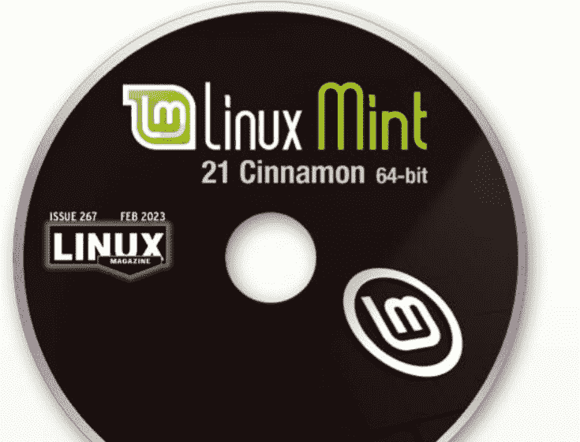

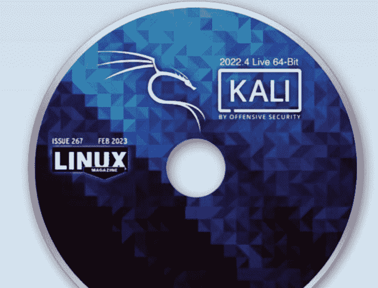

## 64位

Linux Mint 对许多用户来说无需介绍。Linux Mint 基于 Ubuntu 的长期支持（LTS）版本，是 Blueberry 的三个最佳派生版本之一；以其创新性和与用户的紧密交流而闻名。Cinnamon 是 Mint 开发的桌面环境，与 Mint 的 Gnome 2 桌面 MATE 不同。

最新的发布版本是 Linux Mint 21，代号为 Vanesha。该版本包含了增强的蓝牙支持；引入了 Blueberry 的替代方案；增加了缩略图功能；以及一个帮助跟踪更新和系统运行任务的进程管理器。对 Sticky Notes 和任务列表也进行了微调，改进了每个应用程序的图标处理。主要变化是窗口管理器 Muffin 已经更新，使其更接近十年的开发。结果包括改进的抗锯齿和更好的桌面效果。

一如既常，Linux Mint 版本为所有水平的用户提供了友好的体验。用户可以快速学会桌面操作，而老用户可以享受最稳定、功能丰富的 Linux 环境。

由 Offensive Security 开发的 Kali 是一个领先的取证发行版。Kali 主要基于 Debian Testing，Offensive Security 还提供了它开发的工具包。

最新版本的 Kali 包含 600 多种工具，包括：

- Armitage：图形化攻击工具
- Nmap：端口扫描器
- Wireshark：数据包分析器
- Metasploit：渗透测试框架
- Sqlmap：自动 SQL 注入和数据库接管
- Crackrack：渗透测试的软件工具
- Burp Suite：集成的 Web 测试平台
- OWASP Zed Proxy (ZAP)：用于 Web 应用的渗透工具

Kali 特别针对专家用户设计。然而，对于所有用户来说，Kali Linux 仍然是一个用于故障排除的主要发行版。

缺陷将被替换。请发送邮件至 `subs@linux-magazine.com`。

尽管 Linux Mint 经过了测试，Linux Magazine 对任何由于使用恶意软件导致的数据丢失或系统损坏不负责。

2023 年 3 月 9-12 日 | 加州帕萨迪纳

航空宇宙 | 开发者 | 嵌入式 | 房屋自动化 | IoT 内核 | 低级系统 | 可观测性 | 开源数据 | 安全 | 系统与基础设施 | Radio 与 Linux

不要错过北美最大的年度开源盛会。

使用代码 `LM50` 可享 50 折

socallinux.org


## 技术、趋势和工具更新

### 等待（修正）

Torvalds 终于宣布了 Linux 内核最新的 LTS 版本（版本 6.1），以及 Rust 语言的初始支持（https://lkml.org/lkml/2022/12/11）。这当然紧随 Torvalds 所谓的“地狱合并”之后，归功于假期和假期前的准备。此外，Torvalds 表示他将严格遵守合并规则，称：“规则是，合并期间发送给我的请求应该是就绪的……没有以前见过的最后实验性开发。”

内核 6.1 的功能之一是包含 Rust 支持。重要的是，这还处于开发的早期阶段，因此其影响是在内核中对 Rust 进行基础性实现。内核 6.1 的大部分驱动工作由媒体蓝牙、HID、GPU 等主导。这些工作可能会导致发现最新内核的一切内容，这应该是添加 Rust 驱动的一个非常重要的折点。

Mint 的开发者正式宣布即将发布的版本进入 Beta 阶段（https://linuxmint.com/?p=44）。重大意义在于 21.1 将包含 Cinnamon 桌面的最新版本。新版本的 Cinnamon 经过了清理，更加简洁和现代。你会发现更鲜艳的颜色、新的鼠标指针、新的系统声音，某些图标已被移除并现在固定在面板上。为了实现更鲜艳的颜色，开发者在整个用户界面（UI）使用了更少的强调色。这还需要许多其他微调。Linux Mint 驱动管理器对界面进行了许多改进，并包含了更稳健的安装。设备驱动比以往任何时候都更容易。其他改进包括将 Flatpak 集成到更新管理器中、通过文件管理器中的右键菜单验证 ISO 镜像的简单方法，以及对 Nemo 文件器的众多改进。Linux Mint 21.1 特有的 Linux 内核 5.5、Cinnamon 5.6 并基于 Ubuntu 22.04。

官方发布说明中关于代号为 Vera 的最新版本（https://www.linuxmint.com/rel_vera_cinnamon_whatsnew.php）。

Linux Mint 41 现在可供通用使用，并包含大量更新。这里有许多应用程序，FileZilla、Gnome 7、Gimp、Firefox、Thunderbird、VLC 以及更多。

随着 Linux 41.0 的发布，现在可以在 Btrfs 上运行。

Kali 4 已准备就绪，帮助你构建 HPC 集群。这里可以下载的不同版本包括 Apache 2.4.54、MariaDB 10.6.1、PHP 5.6.40 以及 Python 2.7.18/3.10。

## ADMIN 在

下载你的 Linux Mint 41.0 版本（https://downloads.sourceforge.net/project/linuxmint/41.0/linuxmint-41.0.iso）或服务器版本（https://downloads.sourceforge.net/project/linuxmint/41.0/linuxmint-server-41.0.iso），并现在阅读已安装包列表（https://linuxmint.com/addons.html）

Kristen Knism

Active Directory 的防护保护提供了组策略无法提供的灵活规则，并防止了被破解密码的使用。

- 面临许可变化的 Chef 用户可能会在新的开源发行版中找到慰藉，Zinc

Martin Loschwitz

在过去的两年里，软件需要单独许可。

当下一个版本的 Xfce 发布时，你将被它一系列新的、改变规则的功能所震撼。相反，你会发现许多新功能和修复，让这个桌面比以往任何时候都更好，同时仍然保持稳定、快速和易用。

- 设置 PXE 服务器

Andreas Stolzenberg

为 BIOS 和 UEFI 客户端设置 PXE 服务器以使用 Linux 启动。

根据开发者的介绍，Orange Pi OS (Arch) (http://www.orangepi.org/software/PiOS/arch.html) 将易于安装、稳定、高安全，支持多框架系统（如 x86、Arm、RISC-V），并将支持大量的应用程序（包括 Code::Blocks、Gnome Blocks、Inkscape、Thunderbird、VLC、VS Code、NeChat、Remux 等）。

Orange Pi OS (Arch 还支持大多数流行的多媒体、多核 CPU、命令行和 GUI 安装，并会注重隐私和安全。

有关 Orange Pi OS (Arch) 的信息，请查阅官方操作系统网站（http://www.orangepi.org/software/PiOS/arch.html），团队将在那里持续发布更新和最新动态。

Alpine Linux 3.17 稳定系列的第一个版本现已开放下载，并首次在所有支持的平台上增加了 Rust。该发行版带有 Gnome 43 或 KDE Plasma 5.26，并享受了这两个环境中的所有新功能和修复。

- 关于 Alpine Linux 本身的新变化，列表包括 Bash 5.2、GCC 12、Go 2.2、OpenSSL 3.0、Py 3.16、PostgreSQL、Node.js 18.12、Ceph 17.2、Go 1.19、Rust 1.64 以及 .NET 7.0。此外还提供 openssl1.1 兼容包的 OpenSSL。

需要注意的是，PHP 8.0 已被正式弃用，ISC 已移动到主仓库进行长期支持，而 DHCP 则移动到了社区支持，现在鼓励用户从 DHCP 切换到 DConfig。

您可以在发布日志（https://alpinelinux.org/posts/alpine-3.17-released.html）中阅读更多关于 Alpine Linux 3.17 的信息，并在下载页面（https://alpinelinux.org/downloads/）下载以下架构的 ISO：64 位 (x86_64)、AArch64 (ARM64)、32 位 (x86)、PowerPC 小端序 (ppc64le) 和 System Z (s390)。

Star Labs 开发笔记本电脑已有一段时间，最近为其产品线引入了新成员（https://starlabs.systems/products/starfighter）。这件精美的科技设备采用哑光屏以消除眩光，使亮度更亮。显示器提供高达 3840x2400 的分辨率、16:10 的宽高比例以及在 120Hz 刷新率下 600 尼特的亮度。

Starfighter 的其他功能还包括带有内置存储的可卸摄像头、具有机械布局的背光键盘。Starfighter 还包含触感触控板和纹理更强且防指纹的静电涂层。你会发现蓝牙 5.3、HDMI、USB-C 和音频接口。Starfighter 的固件是开源内核，电池由氮化镓充电，可通过 USB-C 提供 65 瓦功率。

### Linux 更新

就组件而言，基础型号配备第12 代 i3 CPU，但可以升级为 AMD Ryzen 7 (6800H) 或 Intel i9。Starfighter 最高可支持 64GB 内存，存储范围从 24GB 到 2TB 不等。请记住，这些笔记本可能在四个月后才发货。

Red Hat 添加了一个编号为 2022-3977 的新 CVE（https://access.redhat.com/security/CVE-2022-3977），被描述为释放后使用（use-after-free）漏洞。当程序尝试使用已释放的内存时，就会发生释放后使用漏洞。CVE-2022-3977 存在于 Linux 内核的管理组件传输协议 (MCT)。该漏洞在用户同时调用 socket 关闭时发生。发生这种情况时可以使用该漏洞将权限提升到 root。

该 CVE 被列为中等，CVSS 基础分 7.0，该漏洞在最上游的 Linux 内核中发现。最初是 Arch Linux 实验室发现了该漏洞，位于内核 v5.10 中，提交值为 `3d40a61aa6681bdce9377ac7f6a53`。幸运的是，通过最近的提交，该漏洞已被修复。

如果你运行的是 Linux 内核 5.18，你应该立即升级到最新内核。大多数主流仓库可能已经将补丁添加到其标准仓库中。

其中最大之一是可以构建具有自定义启动分区和大小的自定义镜像。此外，最新版本还包含了重要的安全更新，例如 scap-guide 现在与防御信息系统局（DISA）的技术指南内容更加一致；新包 xml2 能够解析、转换、查询、验证和编辑 XML 文件；Ruby 3.1；Mercurial 6.2 以及 Node 18。

AlmaLinux 8.7 携带的内核为 4.18-423，操作系统支持 x86_64、AArch64、ppc64le 和 s390 架构。

下载 AlmaLinux 8.7 副本（https://mirrors.almalinux.org/iso/）。

在旧版本的 Spectre v2 (2018) 中并没有使用 IBRS。事后回来看，这可能是一个错误的决定，因为迫使人们使用了替代方案。

间接限制推测（IBRS）是构建在某些 CPU 内部的一种硬件功能，用于应对近年来发现的如 Spectre 等安全漏洞。

Peter 加入了与 Maria Joia 以及其他人的讨论，确定 GCC 补丁的修复方案，以及修复中其他部分的实现细节。讨论深入探讨了技术细节，在结束时，这些细节已变得清晰许多，不再那么令人困惑。

IBRS 仅阻塞某些安全漏洞的利用，这些漏洞需要通过启用 "ibrs" 来防御。

与所有绕过这些漏洞的尝试一样，总是存在权衡：例如，一种安全缓解措施可能是避免 CPU 特性的切切换，这意味着这些特性必须被实现。因此，直接接受硬件安全功能是一个显而易见的选择。内核开发者必须在每情况下评估成本。

在某一点，Tim Chen 在内部性能基准测试中使用 Thomas 和 Peter 提供的“新”补丁，该补丁显著提升了性能。

例如，Thomas 提到：“当时已经讨论过尝试解决基础深度调用……这只是 HEAD 的一种方法。”

Linus 检查了这些问题并说：“这看起来显然比讨论他们的数字要好得多。”

Thomas 继续探索了 IBRS 的特定方面，包括内存占用的增加和计数的错误，这些错误本身可能被攻击者利用。

讨论大致在此结束，大家对投入大量精力重新适配（Refit）安全方法这一方面表现得非常积极。

由于 IBRS 是一个性能问题，Peter 仅修订了调用深度跟踪方法并将其实现，这是非常有可能的，并且避免了原始方案的缺点，并意乎意外地取得了结果。

这是一个持续的过程——最新的改进可能是每个人都会去改进的最坏情况。知道在源码世界中，我们可以实时捕捉缺陷，让所有日日夜工作的人来完善它，并追踪我们我们的一切。

Thomas 和 David 讨论了一些技术细节，包括改进和减少 head 的方法。部分是针对 GNU 编译器（GCC）的补丁。Thomas 将这些总结为：“让调用在每个函数点处添加 16 字节的填充，情况就很清晰了。调用易感区域存在疑问，并且减少了它。”

在某一点，Torvlds 加入了讨论，并说：

> “我更喜欢这个。”
>
> “我们可以用‘this’来代替我们有的 SCALE 吗？”
>
> “而且人们和那些通过简单地在代码中放置填充来避免额外时间的人。”

对此回答道：“是的，Peter 和我是从新编译器的角度考虑在代码中放置填充是有开销的。当我们看到填充的数据时，我们的功能可能会受到影响。”

他补充道：“这不需要新的编译器，并且避免了非受影响机器的所有开销。” Thomas 继续说道，在他们的方案中，消耗是这样的。


Davidson 提交了 Linus Torvalds 拒绝的代码。David 显然的更改是那些在（5.8.0）中遇到的代码更新。这是一个似乎在检查路径特征、运行系统状态的变量，它是病态的。这种感觉是合理的：如果你的系统得到了帮助，你不应该被持续运行的属于你的东西所限制。

然而，关于这段代码，Linus 回复道：“停止这样做。”他继续说道：

“使用 `BUG_ON()` 进行调试简直是不可行的。”

“说这只是一个 `VBUG_ON()` 并不会改变‘任何事情’。让我们让普通人面临这种不稳定性，它不是某种只属于某些人的事。”

“我不认为这种情况会发生。老实说，我们 90% 现有的 `BUG_ON()` 都是完全的 bug，遗留部分无法删除是因为它们被触发了。”

在服务器机器设置中，由于有 IT 部门进行更改，通常更倾向于让机器崩溃而不是继续运行。

“`BUG_ON()` 真的不是为了调试的。”

在这种情况下，一台死掉的机器就是一台死掉的机器，但你可以获取信息，而 `panic` 是恐慌，重启是令人兴奋的。”

“停止它。”

“如果你有一个绝对不能发生的条件，要么你写对应的代码，或者如果你确信它不会发生——你就写一个 `VBUG_ON()` 让人们可以报告它。”

“而且，那实际上是一个错误的边界情况。像练习这样的事情会‘想要’避免不必要的学习，因为那是关键点。”

“`BUG_ON()` 会导致机器死亡。”

“虽然某种虚拟化自动化非常常见，而 bug 是个大问题，这意味着要虚拟化这个问题，并推到产生更多问题的程度。”

“对于 Facebook 和这类世界来说，`WARN_ON()` 就足够了。”

“如果你发现了一个离谱的 `BUG_ON()` 让我觉得‘行吧’，那实际上并不算，而且很久以前在调度器中确实有一个，我使用内核脚本修复了 `BUG_ON()`，而 `VBUG_ON()` 和 `BUG_ON()` 基本上是没用的。”

“但作为一种非常好的实践，规则是‘绝对不要 `BUG_ON`，因为它是危险的’。”

“Undis 报告了，但我完全同意 `BUG_ON()`——如果我在全天事件中遇到它，并提出要求。”

# FOSS 后台之旅

社区、管理与合规

# 2023 后台之旅

# FOSS

欢迎加入我们为期两天的精彩活动，内容涵盖治理、协作、内部源（InnerSource）与 OSPO（开源项目办公室）、项目领导力、社区管理以及开源软件的法律和经济方面。

立即购买门票并使用代码 `LINUXMAG10`

- 2 天精彩精彩的演讲与讨论
- 150+ 线上参会者
- 40+ 位经验丰富的演讲者
- 5 个分会场
- 120+ 线下参会者
- 丰富的社交与结识优秀人才的机会
- 2 个舞台

2023年3月13-14日

@ 柏林 TUECHTIG 及在线

# 头条故事

# BorgBackup

使用 BorgBackup 和 Vorta 备份您的数据

## 确保安全

BorgBackup 和 Vorta 图形化界面让创建备份不再压力。

作者：Ferdinand Thommes

如果你想保持数据安全，考虑备份策略并以一致的方式实施它是一个好主意。数据越多，对备份的安全性要求就越高。专家建议您对不可替代的数据进行两次备份，并将备份位置设在您的物理墙之外。

Linux 支持备份应用程序——无论是家庭还是工作环境。一种解决方案仅限于列出的工具，它们无法与远程服务器进行交互。在远程备份场景中，有一种解决方案非常强大：全 BorgBackup [!] 可以备份存储在本地驱动器或远程服务器上，提供压缩和安全架构。得益于 Vorta 图形界面，Borg 适用于家庭用户以及专业人士。

Vorta 图形化界面。用 Python 3 编写，Borg 具有去重、压缩和认证等功能。数据压缩支持 LZ、LZMA、Lib 和 Zstd 标准。在去重方面，值得考虑该术语在 Borg 术语中的实际含义。

去重通常被理解为一种节省空间的技术，它将数据分解为相同大小的块（borg 称为“数据块” chunks），并为每个块计算校验和。如果一个新文件具有已知的校验和，这意味着该文件的相同版本已经存在。此时，软件将比较文件内容以确保它们完全一致。该程序不仅限于文件级，还可以将大文件的更改保存为数据块，从而实现非常有效的去重。程序可以识别它们是否被移动或重命名。

# BorgBackup

Borg 在命令行运行，但你也可以通过替代方案控制它（图 1：当使用通过 SSH 连接服务器时，你需要确保 Borg 也运行在服务器上，以及这...

Borg 源自大多数 Linux 发行版的存储库；该包名为 `borg backup`。如果你为客户端-服务器操作设置了 Borg，你需要在你所选择的所有计算机上安装该软件。如果你发行版中的版本太旧，你也可以从源代码安装，或者使用 git 或 zip 下载。Borg 文档描述了在目标计算机或外部硬盘上的安装程序（图 2）。初始化仓库与远程机器相同。如果你在创建仓库时使用 `-e` 选项，软件会提示你输入密码。使用 `-v` 选项进行详细输出很有用；随后 Borg 即可准备好首次备份（列表 1，第 4 行）。Borg 在指定的仓库路径中创建备份。这些是程序存储数据的存档名称；软件会自动创建相应的文件夹。

```
borg init --encryption=repo /run/timeshift/backup/borgbackup
Enter new password:
Do you want to encrypt your password? [y/n]
Remember, your data will be inaccessible without it.
Keep this key safe, your data will be inactive without it.
Archives: 0, w/ cached Idx: 0, w/ updated Idx: 0, w/ cached Idx: 0.
```

默认情况下，用此版本初始化的仓库如果与 Borg 0.3 及之前的旧版本一起工作将产生安全错误。

如果你想避免这种情况，可以通过运行以下命令禁用加密：

```
borg init --encryption=none /run/timeshift/backup/borgbackup
```

请参阅 https://borgbackup.org/en/stable/changes#mystype-1.0.9-manifest-spoofing-vulnerability 了解有关安全影响的信息。

如果你使用了密码，密钥将存储在仓库中，但你可以使用 `borg export` 获取可打印格式。写下密码。退出前妥善保存：

图 2：当备份到家庭网络的外部硬盘时，Borg 仅在源计算机上安装。初始化仓库与远程机器相同。

下一个命令列出要备份的文件。`--stats` 选项为新创建的存档提供信息，例如数据量、去重级别和数据块数量。列表 1 第 5 行的命令显示仓库中的所有存档。

比较校验和（去重的首选方法）比比较每个块中的文件内容更节省时间。校验和方法还降低了对内存的要求；如果出现两个相同的块，它会忽略第二个块，将其替换为指向相同的第一个块的指针。对于工作目录不断变化的情况，Borg 是一个极佳的候选者——你可以随心所欲每小时备份一次，而必担心数据用量。

你可以将目录放在外部硬盘的路径上，或者使用 SSH 将备份传输到远程计算机（1）。Borg 将备份存储在仓库中，仓库存储在文件夹中（borg 称之为存档 archives）。

| :--- |
| 0 | /media/extern |
| 1 | sudo borg create- |
| 2 | sudo borg init -e repository/extern |
| 3 | sudo borg create --stats media/extern |
| 4 | sudo borg list /media/extern |
| 5 | sudo borg extract /media/extern| 1 |

```
$ borg create --stats /home/user/borgups ~/Documents
enter password for backup: 
Repository: /home/user/borgups
Archive: /home/user/borgups
Archive fingerprint: d3e6d5f4b83c0b8a7d039116be7c3f73f43912c952465
Created: 2023-02-29 08:49:54
Duration: 0:00:15
Total size: 12.5 MB
Utilization of max. size: 0%
```

17 266 期 LINUX-MAGAZINE.COM

# 头条故事

# BorgBackup

## 恢复

下一个命令列出要备份的文件。`--stats` 选项为新创建的存档提供信息，例如数据量、去重级别和数据块数量。列表 1 第 5 行的命令显示仓库中的所有存档。

要恢复存档，使用列表 1 第 6 行的命令。你也可以通过 FUSE 提取文件，并按数据块重构数据。要删除存档，你需要。

如果命令和脚本变得太复杂，你可能需要 Vorta（图 5），一个图形化界面。Vorta 由 Borg 服务商开发。第一步是创建一个仓库：此仓库可以位于本地，也可以位于远程服务器上。对于认证，你还可以使用新的 SSH 密钥对将现有仓库添加到远程计算机。与 Back In Time 相比，Borg 的备份缩小了约 40%。然后为各种备份任务创建仓库。例如，你可以在晚上备份整个主目录，而第二个配置文件允许你在工作时每小时创建一个关键目录的副本。你还可以从备份集中排除特定的文件夹（图 16）。

| 仓库配置文件 | 测试 | 更多 |
| :--- | :--- | :--- |
| /home/user/repo/borgbackup.repo.com/repo/ | 本地或远程仓库。对于安全的备份和备份托管，请尝试 BorgBackup。 | |
| SSH Key | 使用 SSH 密钥（默认） | 为了安全访问远程仓库。使用所有现有的 SSH 密钥。或创建新的。 |
| 压缩 | LZ4（默认，默认） | 新数据的压缩设置可以更改，且不影响去重。阅读更多... |

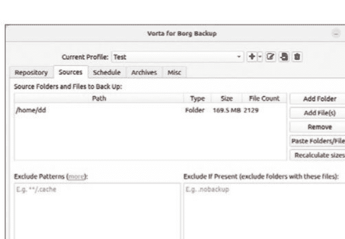

图 6：要从备份中提取文件夹和文件，请在遮罩下角的处输入路径。

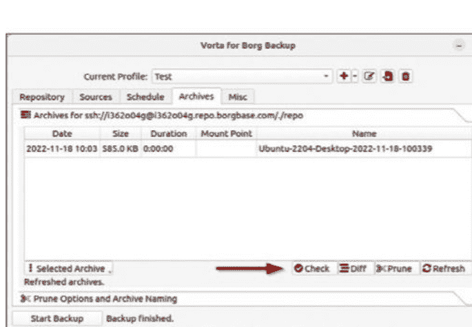

图 7：快速恢复 Borg 备份。提供了提取（Extract）和挂载（Mount）选项。挂载更加灵活，你可以通过 FUSE 将存档挂载到文件系统中的文件夹中。

如果您想备份服务器，但不想自己运行服务器，BorgBase 托管服务是一个很棒的选择，每月按欧元提供存储空间。这项投资可以为您提供 100GB 空间，最多支持 10 个存储库。他们的服务器位于欧洲。开发者将 Restic 作为额外的备份工具添加到了 BorgBase。

您可以注册该服务并提供电子邮箱地址，登录免费账户。免费层级提供高达 10GB 的数据，可无限制地管理两个存储库。首先，通过 SSH Key 输入并添加您的 密钥。然后使用以下命令创建一个新的密钥对：

```
ssh-keygen -t ed25519 -C "email@example.com"
```

您将在家目录下的 `~/.ssh` 中找到生成的密钥。将带有 `.pub` 扩展名的密钥内容复制到 Borg 服务器并确认。

添加您的存储库路径并更改默认的 EU。其他设置大部分是自动的。在“访问”（Access）中，您需要选择您的邮箱地址以及在备份过程失败时何时接收通知。在“高级”（Advanced）中，在备份完成后自动检查存档是一个好主意。

在 Borg 中启动初始备份之前，点击您创建的存储库左侧的按钮。此选项允许您设置存储库地址右侧的路径。当您点击“新建存储库”（New Repository）时，将提示输入存储库名称并分配密码。

点击后会将存储库连接到本地库。现在可以创建第一次备份了。针对您的用例查看故障排除提示 [4]。问题几乎都是由于 SSH 密钥及其集成方式引起的。

追加模式（Append-mode）允许您编辑存档的每一层。每个存储库意味着 Borg 会覆盖或删除其中传输的数据，而不是删除整个存档。这只能通过命令行界面启用：

```
borg init --append /path/to/repository_name
```

启用它，而使用 `append_only` 则关闭它。

Borg 是一个非常开源的项目，受到了 GitHub 上超过 250 多名开发者的支持 [5]。Borg 项目经过了多次同行评审，并拥有优秀的文档。

Borg 的目标是提供一种高效且安全的数据备份方法。它的去重技术适用于每日或每小时备份。身份验证确保了在不完全信任的情况下备份是安全的。

Vorta 是一个为 Borg 开发人员设计的 GUI，它将最重要的功能集成在图形界面中。它让备份管理变得更容易。如果您想通过程序控制备份，建议查看 borg [6]，即 BorgBase - 一项非常适合专业人士的托管服务。

图形化备份解决方案帮助您只需点击几次即可保护数据。我们研究了六种流行的方案。

作者：Erik Bärwaldt


许多（但并非所有）工具都基于 Rsync，这是一个用于同步本地或远程磁盘上文件的命令行程序 [1]。本文介绍了适用于 Linux 发行版的易用图形化应用程序。本期的其他文章探讨了其他的备份替代方案。

## Back In Time

Back In Time 是一个基于 Rsync 的备份程序，自 2008 年开发以来。“GitHub 上说 Back In Time 是‘受 FlyBack 启发’（FlyBack 是另一个基于 Apple Time Machine 的开源备份工具）。提供命令行和 GUI 变体。该应用程序用 Python 3 编写，在所有 Linux 发行版的仓库中均可用。

通过 Back In Time，您可以创建一个定义特定场景的配置文件，然后从过去的备份中恢复文件。

安装完成后，您将在桌面环境菜单中找到 Back In Time 的两个新条目。第一个条目以登录用户的权限运行软件，第二个用于 root 用户。以 root 权限启动应用程序允许备份登录用户可能访问的驱动器和目录，包括系统快照。

Back In Time 打开一个设置窗口（图 1），在其中您可以创建主配置文件并配置其他选项。

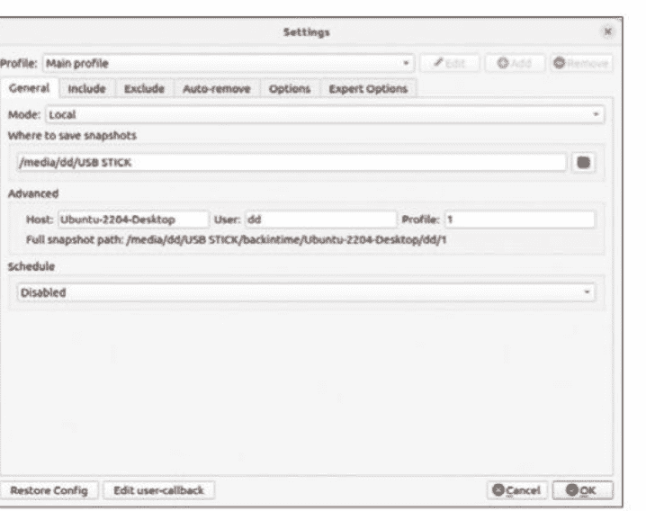

图 1：Back In Time 的配置文件易于配置。

## 图形化备份工具

您使用“包含”（Include）和“排除”（Exclude）选项卡定义包含在备份中的数据集。在“包含”中，指定目录和文件，而“排除”提供了预定义的模式。备份将不包含超过大小的文件。

在“常规”选项卡中，您指定存储库地址和备份名称。当您点击“新建存储库”时，将提示输入存储库名称并分配密码。

点击后会将存储库连接到本地库。现在可以创建第一次备份了。针对您的用例查看故障排除提示 [4]。问题几乎都是由于 SSH 密钥及其集成方式引起的。

追加模式允许您编辑存档的每一层。每个存储库意味着 Borg 会覆盖或删除其中传输的数据，而不是删除整个存档。这只能通过命令行界面启用：

```
borg init --append /path/to/repository_name
```

在“访问”选项卡中，您需要选择您的邮箱地址以及在备份过程失败时何时接收通知。在“高级”中，在备份完成后自动检查存档是一个好主意。

在 Borg 中启动初始备份之前，点击您创建的存储库左侧的按钮。此选项允许您设置存储库地址右侧的路径。

在“常规”选项卡中，您首先需要指定软件位置并选择备份到本地还是远程驱动器。您还可以加密数据并定义备份间隔。请注意，媒体需要格式化为 ext 或 ext4 文件系统。通常用于 USB 闪盘的 FAT32 文件系统不支持链接，因此不适合备份 Linux 系统。

Back In Time 打开一个设置窗口（图 1），在其中您可以创建主配置文件并配置其他选项。


图 1：Back In Time 的配置文件于于配置。

您使用“包含”和“排除”选项卡定义包含在备份中的数据集。在“包含”中，指定目录和文件，而“排除”提供了预定义的模式。备份将不包含超过大小的文件。

在“常规”选项卡中，您指定存储库地址和备份名称。当您点击“新建存储库”时，将提示输入存储库名称并分配密码。

点击后会将存储库连接到本地库。现在可以创建第一次备份了。针对您的用例查看故障排除提示 [4]。问题几乎都是由于 SSH 密钥及其集成方式引起的。

追加模式允许您编辑存档的每一层。每个存储库意味着 Borg 会覆盖或删除其中传输的数据，而不是删除整个存档。这只能通过命令行界面启用：

```
borg init --append /path/to/repository_name
```

与 Back In Time 类似，免费的 Cronopete [3] 是一种以 Time Machine 为模型的备份工具，专注于简单性和自动备份。大多数 Linux 发行版的仓库中都有该软件；项目为 Ubuntu、Fedora 和 Arch 变体提供了该小型程序的包。

安装后，您将在菜单中找到两个新条目，用于定义备份操作和恢复现有备份。在启动时，点击“下一步”设置配置对话框。Cronopete 打开一个易用的窗口，在其中您可以定义自动备份、数据集和目标文件夹（图 3）。

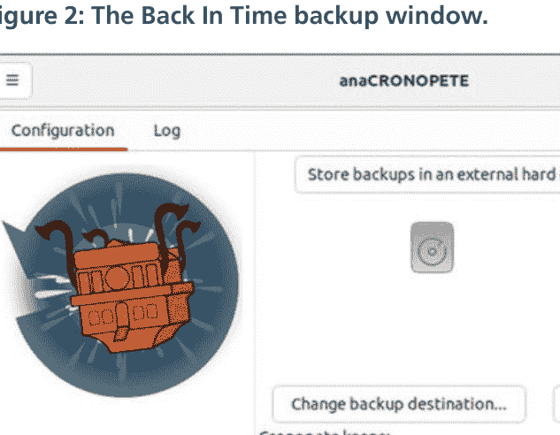


# 图形化备份工具

## 恢复文件

要恢复备份，在工作窗口中找到名为“恢复备份”（restore backup）的启动器。你也可以点击系统托盘中的 Cron 图标，并在右键菜单中选择“恢复文件”（Restore files）。

会打开一个非常特殊的全屏窗口（图 4），显示一个垂直的时间轴，条目在各自的窗口中逐一显示。顶部的恢复有两个箭头，你可以用它们在文件管理器中切换不同的备份。在时间轴上，一个小红条显示当前的备份状态。然后，你可以浏览备份内容以在文件管理器中恢复已备份的目录；与传统的管理器不同，你在此无法直接打开文件。

点击时间轴上的“恢复”（Restore）按钮可将备份恢复到原始位置。点击“退出”（Exit）按钮将终止该过程。

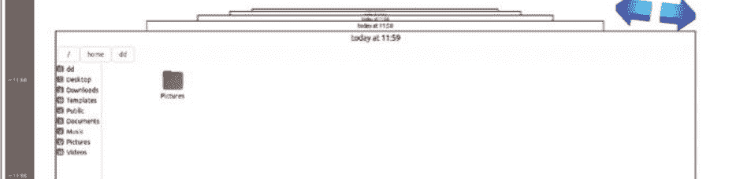

## Déjà Dup

Déjà Dup 是最直观的本地备份程序之一。几乎所有基于 Gnome 的发行版都在仓库中包含了它，这使得安装非常方便。Déjà Dup 是源目录备份工具的图形化前端。

启动应用程序将带你进入一个简单的用户界面，提供两个选项和一个值图标。Déjà Dup 界面遵循传统的 Gnome 指南，没有菜单或按钮，所有控件都集成在时间轴中。

首先，你需要配置一些设置。你可以通过标题栏中的汉堡菜单访问配置对话框。选择“偏好”（Preferences）选项。打开的对话框有几个用途：设置恢复备份的周期以及配置自动备份。你只能在每周和每天的频率之间进行选择。

默认情况下，软件会在 Google Drive 云端创建备份。然而，你可以将备份保存在局域网（LAN）上的计算机或本地文件夹。本地文件夹只需要指定一个外部驱动器。

选择目标后，选择磁盘上可能存在的 deja 文件夹。

在“文件夹”（Folder）选项卡中，你可以选择主窗口中的文件夹，它显示了目录以及你希望从备份中恢复的目录。点击加号符号后，软件会打开集成的文件管理器；你不需要输入文件夹名称，只需从列表中选择目录。

Déjà Dup 列出了要备份的文件夹。如果你在计算机驱动器上设置了多个文件夹，你就可以跨分区进行备份，前提是这些分区已挂载。点击列表右上角的放大镜还可以通过输入实现快速访问功能。

一旦应用程序完成所有设置，关闭窗口。在“已启用备份”窗口中，如果你想启动备份并重启，请点击“立即备份”（Back Up Now）（图 5）。

随后，Déjà Dup 会提示你用密码保护备份（图 6）。如果你点击左侧“允许无身份验证”（Allowing without authentication）的单选按钮，备份将开始；一个进程报告会显示状态信息。

要恢复数据，点击“文件夹中恢复”（Restore in folders），你可以用鼠标选择目录。然后点击恢复窗口左下角的“恢复”（Restore）按钮。在另一个对话框中，你可以指定是想将数据恢复到原始位置还是另一个位置。

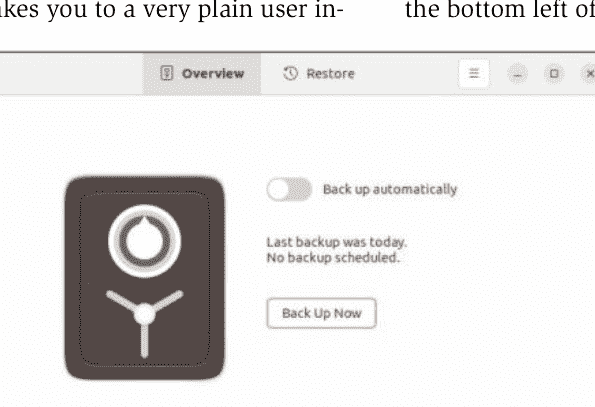

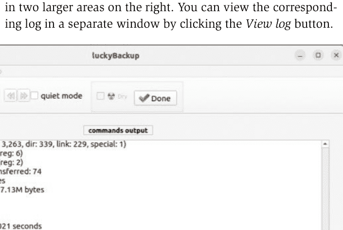

## LuckyBackup

另一个备份方案基于 Rsync，存在于所有主流 Linux 发行版的软件存档中。安装程序创建一个桌面快捷启动器，打开一个具有常规布局的窗口。除了传统的菜单和工具栏，你还会发现一个包含某些控件的列表以及一个显示应用程序通知和消息的信息区域。

LuckyBackup 没有名为“恢复”（Restore）的选项。相反，请使用“任务”（Task）菜单中的“管理备份”（Manage backup）来恢复数据。你将看到一个现有备份列表，包括配置文件和任务定义（图 8）。源区域和目标区域的相关文件位于右侧。你可以通过点击“输出日志”（log out）来考虑系列查看日志。

LuckyBackup 依赖配置文件，这样你就不需要每次启动应用程序时都指定源和目标。你可以使用工具栏中的选择框在各个配置之间切换。首先是默认配置。要创建一个新配置，点击工具栏并选择“新建”（New）选项。输入新配置的名称，LuckyBackup 将其添加到配置列表中。

下一步是为新配置开始定义。点击工具栏上的“添加”（Add）按钮。输入源目录目标目录。一旦定义了它们，你就可以勾选一个或多个任务，LuckyBackup 将包含它们并在模拟模式下进行修正（图 7）。LuckyBackup 通过在对话框中显示消息来指示测试结束。

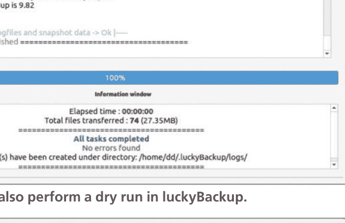

## Timeshift

为了查看源和目标的概述，请使用 Timeshift。Timeshift 是 Linux 上最著名的备份工具之一。它依赖 Rsync，但也可以使用 Btrfs。

首次启动 Timeshift 时，会询问你使用 Rsync 还是 Btrfs 作为类型。你需要指定多久备份一次系统以及保留多少个备份。Timeshift 在目标命名的目录中创建快照。

要恢复，首先选择所需的快照，然后点击“恢复”（Restore）。弹出一个对话框，可以在其中选择要恢复的设备和分区。确保你有足够的可用空间。

在下一步中，Timeshift 执行一次空运行。程序将在对话框中执行所有操作。确认提示后，Timeshift 将切换模式并备份数据。备份完成后将需要重启计算机。

如果你想使用 U 盘等可移动介质，你需要用 Linux 兼容的文件系统对其格式化。

Timeshift 不支持其他操作系统。

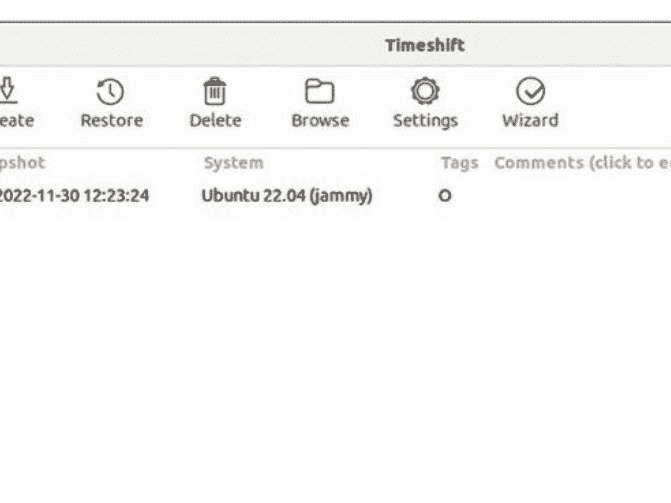

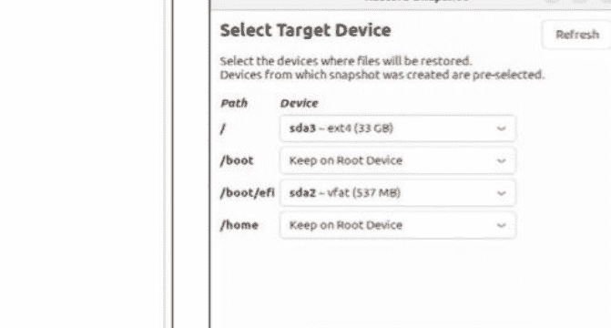

## Vorta

Vorta 是 BorgBackup 命令行程序的图形化前端（请见其他地方关于 BorgBackup 的文章）。此跨平台应用程序可在许多 Linux 发行版的仓库中。你也可以从项目网站获取源码，它在 Flathub 上也有提供。

Vorta 启动后是一个非常简单且组织良好的程序。

进入后，你可以在多个选项卡中完成工具的配置，为不同的任务定义不同的配置（profile）。你可以点击配置选择旁边的加号按钮，在当前默认（Default）配置之外添加新配置。随后将显示新配置，允许你配置设置（图 11）。

在“存储（Repository）”选项卡中，首先指定 Vorta 存储备份的位置。你也可以使用在线存储；指定所选存储的访问方法；数据传输始终通过安全的 SSH 连接进行。你还可以在此对话框中定义压缩方法以减少传输量。你有多种压缩方法可供选择，可以在不压缩的情况下保存数据。

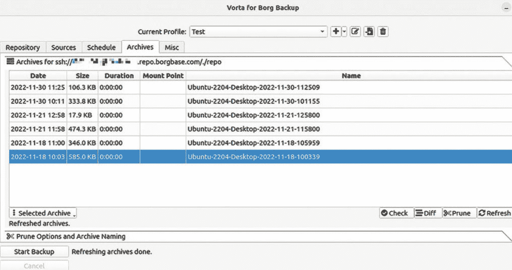

在“源（Sources）”选项卡，选择你想备份的数据集。你可以包含或排除文件和目录。支持通配符。

“计划（Schedule）”选项卡允许你安排备份，这意味着可以在指定时间创建自动备份。你还可以指定一段时间，在此期间备份将对现有存储进行验证。这种验证可以防止数据意外进入损坏的存档而变得无法使用。

“存档（Archive）”和“其他（Misc）”选项卡提供了可能需要输入或操作的常规设置。完成配置后，点击程序中的“启动（Start）”进行初始备份。存储选项卡在备份期间显示各种统计数据。备份完成后，你可以看到原始和压缩集。通过在“存档（Archives）”选项卡中选择列表中的存档并点击“检查（Check）”，验证数据。工具会检查存档并显示结果（图 1）。

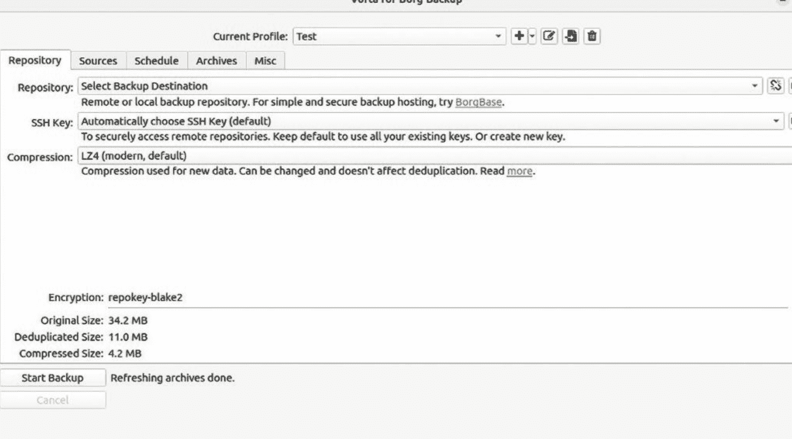

## Vault

Vault 每次保存时都不会创建完整备份，仅在后续备份中记录与原始数据的差异。要查找单独备份之间的差异，请在存储中选择备份并点击“差异（Diff）”按钮。应用程序将向你显示目录树不同的根目录，包括文件和大小。

为了防止现有存档列表变得难以管理，你可以点击“修剪和存档命名（Prune and Archive naming）”选项卡。在设置对话框中，指定你想保留的存档数量及其频率。可选间隔范围从每小时到每周备份不等。此外，如有，你可以更改约定。

在安装期间，Vault 会在系统栏中创建一个小型图标。左键点击图标打开应用程序窗口；右键点击关闭。在右键菜单中，你可以选择一个配置或创建手动备份。

要恢复已备份的数据，存档就像你 Linux 系统上的驱动器。要恢复，在“存档（Archive）”选项卡中选择存档，然后点击所选存档右侧的小三角形。在右键菜单中，点击“提取（Extract）”并指定路径。

要恢复存档，点击存档组件的“提取（Extract）”。Vault 将提示你将存档或所选组件解压到单个文件夹中。选择后，软件将在目标目录中解压存档或所选组件。

## 总结

备份 Linux 桌面环境的免费方案并不缺少。选择范围从用于简单设置备份的 Timeshift 或 Deja Dup 等等。某些工具还可以处理远程计算机的备份，但所有外部支持都在系统层面予以考虑。对于图形化备份解决方案，你有大量的选择。

| 表 1：桌面备份选项摘要 | Back Time | Cronopete | Deja Dup | LuckyBackup | Timeshift | Vorta |
| :--- | :--- | :--- | :--- | :--- | :--- | :--- |
| 许可证 | GPLv2 | GPLv3 | GPLv3 | GPLv3 | GPLv3 | GPLv3 |
| 配置 | yes | no | no | yes | yes | yes |
| 计划备份 | yes | yes | yes | yes | yes | yes |
| 系统快照 | no | no | no | yes | yes | yes |
| 远程备份 | yes | no | no | yes | yes | yes |
| 加密备份 | yes | no | yes | yes | yes | yes |
| 手动包含和排除数据 | yes | no | yes | yes | yes | yes |
| 灵活备份的最大大小 | no | no | no | no | no | no |
| 文件压缩调整 | no | no | no | no | no | no |
| 定期删除过时备份 | yes | no | yes | yes | yes | yes |
| 目标介质上的不同系统 | yes¹ | yes | yes | yes | yes | yes¹ |
| 文件恢复到不同位置 | no | no | yes | yes | yes | yes |
| 模拟 | no | no | no | no | no | no |
| 日志功能 | yes | no | yes | yes | yes | yes |

# 封面故事

## Syncthing

要添加设备进行数据同步，请在“远程设备”窗口中点击“添加设备”。软件会自动在本地网络中搜索具有检索能力的设备，并将它们显示在重叠窗口中（图 1）。要集成新设备，您需要确保 Syncthing 实例也在运行。点击该设备即可将远程设备集成到本地系统中。由于设备未显示名称，您可能需要在输入框中指定一个有意义的设备名称。否则，软件将向您显示在网络上使用的设备名称。

通过将远程系统集成到本地安装作为分发设备来实现数据同步。在“高级”选项卡中，您还可以指定 Syncthing 是否连接数据，以及适用于传入和传出连接的传输限制。

“共享”和“高级”选项卡包含额外的设置。例如，您可以选择单向或双向同步。

完成后，点击底部的“保存”。在远程设备上，Syncthing 窗口会出现一条消息，指向连接尝试，并提示您点击“添加设备”来添加该系统。连接短段时间，两台设备都将显示新连接的系统、其设备名称和连接状态。

## 共享文件夹

要向系统添加文件夹进行同步，请点击文件夹窗口“字段”选项卡中的“添加文件夹”。在对话框中，为要同步的文件夹输入名称并指定其路径。在“共享”选项卡中，您还可以指定您想要共享文件夹的 LAN 设备。连接的设备列在表中。要启用某个设备，请勾选列表项旁边的选框。

在“版本”选项卡中，您可以指定是否为同一个文件夹创建多个按时间排序的版本。“版本”字段允许您在不同的版本模式之间进行选择，您可以在辅助对话框中选择此配置。“忽略模式”选项卡允许您指定希望软件在同步期间忽略的文件类型。最后一个选项卡“高级”是定义扫描间隔的地方。

配置完成后，点击“保存”。在您想要同步该文件夹的设备上，浏览器将提示您是否要让 Syncthing 同步新文件夹。如果不是，会出现一个错误对话框并提示您输入路径。

只要在其中一个共享文件夹中，应用程序就会在计算机之间同步数据。在浏览器窗口中点击目录将打开一个显示软件操作的菜单。此摘要包含了传输的数据以及数据传输的总量（图 2）。

## 注意事项：过时的 GTK 前端

Syncthing 的 GTK 前端已经存在很久了（图 3）。您可以在各种发行版的仓库中找到它，版本号大致相同。遗憾的是，该端在过去三年没有得到良好的维护。由于与许多依赖不兼容，操作受到了一些限制。GTK 端可以安装和启动，但没有完整的功能。我的建议是选择网页界面并避免此 GTK 前端。

如果您将多个设备连接到 Syncthing，不可用的设备也会出现在列表中并显示为“已断开”。如果系统重启，它会自动连接到 Syncthing 和互联网。然后 Syncthing 会报告您获取的任何更改。网页浏览器中的状态指示器跟踪工具视觉效果。

Syncthing 帮助您在本地网络上的多个不同设备之间保持个人数据同步。由于软件以对等模式运行，它不需要专用的服务器或云服务，您只需要网页界面来进行配置更改（见“注意事项：过时的 GTK 前端”框）。此外，Syncthing 对于任何想要跨多个平台和设备同步数据的人来说都是一个极佳的解决方案。

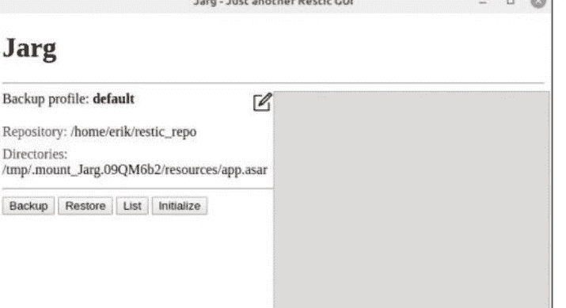

## 作者

Erik Bärwald 是一位居住在英国的自雇 IT 管理和技术作家。他为几本 IT 杂志撰稿。

通过我们的数字存档包，完成您的《Linux Magazine》和《ADMIN Network & Security》收藏。您可以从任何设备随时访问 PDF 格式的整年期数杂志。

2022 存档现已可用！

https://bit.ly/archive-bundle

# 简单

## Restic 和 Jarg 前端吸引了想要快速获得结果而无需过多开销的用户。

作者：Erik Bärwald

Restic 是一种简单、快速且易于使用的跨平台备份工具。Restic 可运行在 macOS、Windows、BSD 以及 Linux 上。一个名为 Jarg 的图形前端扩展了 Restic，适用于不太习惯命令行界面（CLI）的用户。Restic 专注于简单和易于处理。您无需输入长长的参数，只需几个简单的命令即可保存数据。该工具仍然将所有内容保留在脚本和本地介质中。如果您需要，可以使用 SFTP 连接到远程存储位置。Restic 以命令行工具的形式实现，因此将其包含在脚本和定时任务中。Restic 使用 AES-256 标准自动加密数据。它处理增量备份，即仅备份初始全备后更改的数据。Restic 还提供了去重功能以避免冗余数据。验证功能帮助用户检查数据是否无错误备份。

Restic 可于所有 Linux 发行版的软件存档。您可以从项目的 GitHub 页面获取其他架构和操作系统的软件。

Restic 依赖仓库。两个命令即可将数据备份到本地介质。第一条命令……第二个命令……

存储库可以位于本地系统，也可以位于远程服务器上。

点击保存（Save）按钮保存设置，点击初始化（Initialize）并点击备份（Backup）按钮触发备份。灰色取消窗口右侧会显示 Jarg 的运行时消息（图 4）。这些消息帮助你识别错误，以便相应地修改配置文件。

点击列表（List）会列出即时快照列表，包括它们的 ID；你可以使用恢复（Restore）对话框轻松重建数据集。

你可以通过点击配置对话框中的默认（default）为不同的备份任务创建额外的配置文件。在选择菜单中选择新项。在名称字段中为新配置指定名称，填写路径和密码字段，并保存新配置。之后，你每次运行程序时都可以选择该配置。

Restic 消除了定期运行备份的恐惧感，可以上手上手，即使没有对备份概念和策略的深入了解。该工具工作快速且可靠。Restic 和 Jarg 都为结构化数据备份提供了一个实用的解决方案。

## 作者

Erik Bärwald 是一位居住在英国的自由 IT 技术师兼作家。他为几本 IT 杂志写作。

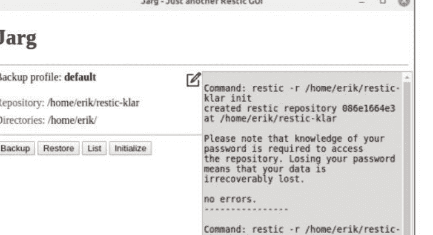


# FOSSLIFE

## 向所有人开放

新闻 • 职业 • 技术生活 • 资源

# 测评

## 发行版漫 – OpenMandriva Lx


## Mandrake 都去哪儿了？


### OpenMandriva Lx

Mandrake 在 OpenMandriva Lx 中延续。Bruce 与 OpenMandriva 成员交流，以获取更多关于这一创新发行版的信息。作者 Bruce Byfield。

资深 Linux 用户可能记得曾经非常流行的 Mandrake Linux，但在北美，Mandrake 的痕迹几乎消失了。在欧洲，情况大不相同。这个曾经流行的发行版有几个后代。特别是直接源自 Linux 的法律后裔 [1]。为了了解更多信息，我在 Mandriva 论坛询问了情况。以下是我学到的内容。

事实是，它是最早提供桌面工具的系统之一。然而，Mandrake 的名称与漫画《魔术师曼拉奇》冲突，2005 年，Mandrake 与 Consect 发行版合并成为 Mandriva SA。Mandriva 是由 Mageia 和 ROS Linux 组成的，但在 2015 年，它将其知识产权的“非排他性且不可撤销的许可” [2] 转让给了 Mandriva SA，这是一个由之前的 Mandriva 贡献者和项目组成的联盟，包括 Unity Linux 和 Arkh Linux。反之，OpenMandriva 变成了开发 OpenMandriva Lx 的协会。正如 OpenMandriva 主席 Benjamin Rosenkänzer（也是 bene）所说，尽管拥有共同起源，但 OpenMandriva 与其他分支完全独立。今天，OpenMandriva 由负责法律事务、公共关系和日常组织管理的委员会，以及负责开发的技术委员会共同治理。两者的成员都受邀请加入，尽可能通过选举或做出决定。

OpenMandriva Lx 有七位主要开发者，加上少数非正式开发者，两个吉祥物 Chido 和 Laska。据他们说，过去有 82,350 名成员。

一方面，OpenMandriva 首页 [1] 声明“我们的根源在于 Mandrake 及其传统”，根据委员会成员 rugged 的说法，这包括原始源代码、初始开发时期的一部分以及“构建一个简单到让从未见过 Linux 的人也能上手的系统的理念，而无需以专家所需的速度进行解码”。

## 背景故事

OpenMandriva 的历史是有迹的。在数百万用户的时期，Mandrake Linux 是 Red Hat Linux 的一个流行分支。得益于许多用户，Mandrake 迅速成为前十几个 Linux 发行版之一。

自 2011 年初以来，OpenMandriva 的受众已大部分成为桌面用户。对于这些用户，OpenMandriva 提供了便捷的安装以及我们认为典型桌面用户需要的所有各种功能。你将发现一个在旧硬件上运行良好的系统；尽管 OpenMandriva 同样面向开发者和经验更丰富的用户，并配备了 apt 和 github-cli 等最新的工具链、内核和编译器。

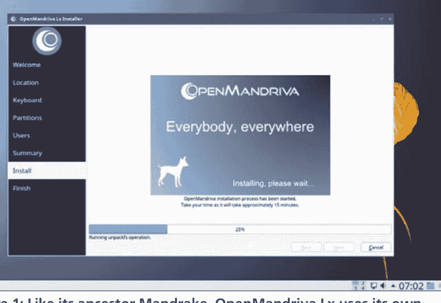

最近，方向已转向关注服务器用户。我们写道，一直在与 Ampere 合作，让 OpenMandriva Lx 运行在 Aarch64 服务器和运行在环境中的云服务上。这里旨在证明系统是稳定的，无需依赖技术。此外，服务器用户可能喜欢最新版本的 PHP 和 Java……

**图 1**：像它的祖先 Mandrake 一样，OpenMandriva 使用了许多工具进行安装和管理。

另一方面，OpenMandriva Lx 也发生了方向偏移。一旦与 Mandriva 的协议确定，重点就转向了技术。今天，大多数桌面工具已使用不同的核心库重新构建。然而，核心系统仍然良好，主链构建在新架构上。

## 受众

对于所有用户，OpenMandriva 提供了便捷的安装以及我们认为典型桌面用户需要的所有各种功能。你将发现一个在旧硬件上运行良好的系统；尽管 OpenMandriva 同样面向开发者和经验更丰富的用户，并配备了最新的工具链、内核和编译器，如 apt 和 github-cli。

## 硬件支持

对于所有用户，OpenMandriva 提供了便捷的安装以及我们认为典型桌面用户需要的所有各种功能。你将发现一个在旧硬件上运行良好的系统；尽管 OpenMandriva 同样面向开发者和经验更丰富的用户，并配备了最新的工具链、内核和编译器，如 apt 和 github-cli。

在未来，OpenMandriva 预计会对 Pine Phone 提供支持。目前真实的硬件很少，但“RISC-V 对我们来说是一个非常有趣的目标；尽管 OpenMandriva 没有人这么说，该发行版可能是第一个支持它的”。

**图 2**：OpenMandriva。

## 测评

### 发行版漫 – OpenMandriva Lx

在几个月后，预计恢复 RISC-V 工具链。目前真实的硬件很少，但“RISC-V 对我们来说是一个非常有趣的目标；尽管 OpenMandriva 没有人这么说，该发行版可能是第一个支持它的”。

事实是，它是最早提供桌面工具的系统之一。然而，Mandrake 的名称与漫画《魔术师曼拉奇》冲突，2005 年，Mandrake 与 Consect 发行版合并成为 Mandriva SA。Mandriva 是由 Mageia 和 ROS Linux 组成的，但在 2015 年，将其知识产权的“非排他性且不可撤销的许可” [2] 转让给了 Mandriva SA，这是一个由之前的 Mandriva 贡献者和项目组成的联盟，包括 Unity Linux 和 Arkh Linux。反之，OpenMandriva 变成了开发 OpenMandriva Lx 的协会。正如 OpenMandriva 主席 Benjamin Rosenkänzer（也是 bene）所说，尽管拥有共同起源，但 OpenMandriva 与其他分支完全独立。今天，OpenMandriva 由负责法律事务、公共关系和日常组织管理的委员会，以及负责开发的技术委员会共同治理。两者的成员都受邀请加入，尽可能通过选举或做出决定。

OpenMandriva Lx 有七位主要开发者，加上少数非正式开发者，两个吉祥物 Chido 和 Laska。据他们说，过去有 82,350 名成员。

一方面，OpenMandriva 首页 [1] 声明“我们的根源在于 Mandrake 及其传统”，根据委员会成员 rugged 的说法，这包括原始源代码、初始开发时期的一部分以及“构建一个简单到让从未见过 Linux 的人也能上手的系统的理念，而无需以专家所需的速度进行解码”。

另一方面，OpenMandriva Lx 也发生了方向偏移。一旦与 Mandriva 的协议确定，重点就转向了技术。今天，大多数桌面工具已使用不同的核心库重新构建。然而，核心系统仍然良好，主链构建在新架构上。

“这不是一个衍生品，这为我们留了更多创新空间。”尽管 OpenMandriva 不在方便时追从他人，它利用了它的独立性。例如，在 2016 年，OpenMandriva 是第一个使用 clang 作为主编译器的系统，早于其他。此外，我们正在探索一种比任何时候都对编译器友好的系统布局，并且已经开始对替代 libc 实现的实验。

被问及什么可能吸引用户使用 OpenMandriva Lx，bero 指出：

在未来，OpenMandriva 预计会对 Pine Phone 提供支持。目前真实的硬件很少，但“RISC-V 对我们来说是一个非常有趣的目标；尽管 OpenMandriva 没有人这么说，该发行版可能是第一个支持它的”。

“这不是一个衍生品，这为我们留了更多创新空间。”尽管 OpenMandriva 不在方便时追从他人，它利用了它的独立性。例如，在 2016 年，OpenMandriva 是第一个使用 clang 作为主编译器的系统，早于其他。此外，我们正在探索一种比任何时候都对编译器友好的系统布局，并且已经开始对替代 libc 实现的实验。

感谢 rafael, bero 和 ben。

# 开源不仅仅是技术


寻找销售、市场、客户支持等领域的职位！

## 开源职业枢纽

opensourceourcejobhub.com/

## 深度解析

### Nala

#### 改后的 Apt 前端

#### 增强版 Apt


Nala 是 Debian 包管理器的前端，结合了 Apt 工具的可靠性与更易读的输出以及快速的下载速度。作者：Ferdinand Thommes

Debian 的命令行包管理系统后端依赖 `dpkg` [1]，并以 Apt [2] 作为其默认前端。虽然 Apt 通常工作很可靠，但命令行工具（基于 `libapt-` 和 `libapt-` 库，如 `apt-get`、`apt-cache` 和 `apt-get`）并不特别清晰或美观。Apt 的前端运行较慢。

apt 至少有一个进度条。你可以通过 `update`、`apt-get`、`full-upgrade`、`install` 和 `purge` 等子命令与 apt 交互。软件包是源列表（`/etc/apt/sources.list` [1]）中定义的条目。

用于 Apt 的程序（如 Nala）可以用 Python 编写。

从今年初开始，Debian 引入了另一个 Apt 前端 Nala。Nala 使用 python [5] 库来访问 Apt 底层（`libapt-pkg` 和 `libapt-list` 库）支持几乎的所有功能。

尽管 Nala 仍然很新，但在 Debian、Kali Linux、MX Linux、Raspberry Pi 以及 Ubuntu 22.04 backports 等发行版的仓库中都可以找到它。对于其他派生版本，你需要按照 GitHub 网页 [6] 描述添加开发者的仓库来加载 DEB 包并直接安装。

与 Debian 中的其他可用工具一样，推广开发者 Michael Steffenberg 在 2019 年获得提及时遭到了严厉批评 [3]。Steffenberg 创建了概念验证设计，目标是优化 Debian 中的包管理，这在 2021 年 7 月曾报道过 [4]。

Nala 的灵感源自 Fedora 的 DNF 包管理器，旨在解决这些缺点，提供更易读的输出和更快的下载速度。

### Apt 的功能

作为 Debian、Ubuntu 及其派生版本的一部分，apt 是处理包管理的基础命令行工具。它执行安装、卸载、搜索软件包和显示信息等任务。虽然 Apt 不提供彩色编码输出（图 1），

```
$ nala update
$ nala upgrade
$ nala install vlc
$ nala remove vlc
$ nala search vlc
```

> 图 1：使用 Apt 时，更新源列表的输出是一系列信息，没有重点突出任何重要因素。

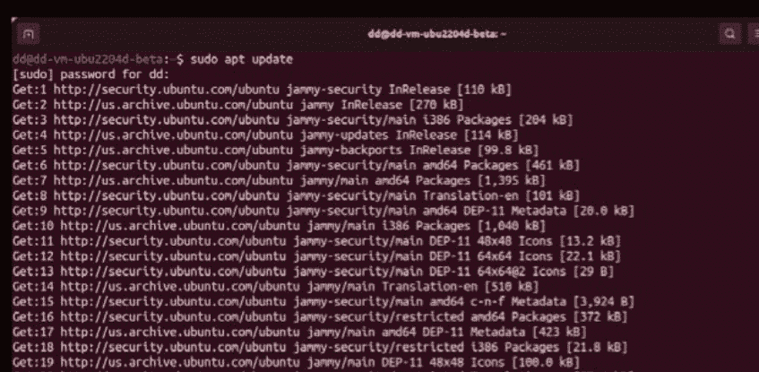

2023年2月40日 第 267 期 LINUX-MAGAZINE.COM

对于 Debian Stable、Ubuntu 21.04 以及基于该 set 的发行版，你需要使用 `nala-legacy` 软件包，它提供相同的功能，仅在依赖关系方面适配了旧版本。除非是 Ubuntu 18.04 或 Debian 10 (buster)，否则你无法与其他版本一起使用 Nala。

颜色显示和更清晰的输出（图 2）。

当调用时，Nala 的行为与 apt 有些不同。更新时，Nala 会用颜色高亮输出内容，并且当软件包更新到新版本时响应更灵敏。此外，该工具会高亮所有由于纠正错误或缺少密钥导致的错误。更新期间，Nala 会显示剩余时间的进度条、已完成输出以及与总输出相比已处理的软件包数量（图 4）。

```
sudo nala
```

结果相同

```
sudo apt update
```

它会更新 `/etc/apt/sources.list` 中的源列表。另一方面，如果

### Nala 提供的功能

由于许多变化，当你使用 Debian Testing、Unstable 或基于 DEB 包的发布发行版时，直观地理解包管理器在安装期间或整个安装过程中的输出非常重要。这种清晰度的渴望是 Nala 的特点之一：输出应该更易于获取，在必要和可能的情况下尽可能详细。Nala 通过使用实现了这一点：

```
sudo nala upgrade
```

Nala 将运行

```
sudo apt full-upgrade
```

如图 3 所示。这是因为使用 Nala 开发的开发者将

Nala 的一些小怪癖之一是额外集成了

```
sudo apt autoremove
```

这会移除不再需要的软件包（图 5）。经验表明，被标记为需要的软件包仍然会不时被需要。推荐的方法是调用 Nala 而不是 `--autoremove` 参数来防止这种行为。

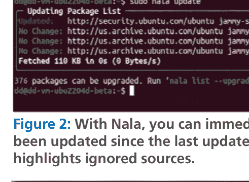

你可以立即看到哪些仓库自上次更新以来已更新，输出也高亮了源。

如果你对自己的肌肉记忆感兴趣，可以创建一个别名，并在 Nala 在后台运行时使用你熟悉的命令。

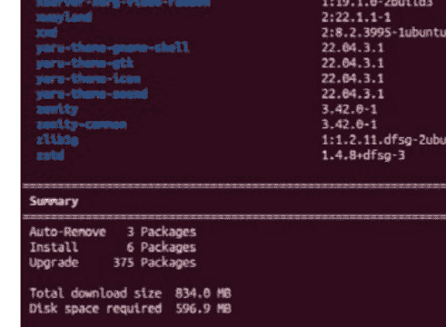

### Sapt 显示的内容

自 2002 年以来，Debian 开发者一直一直允许从同一服务器进行并行下载，因为某些组会对服务器带来过大负载，尽管他们很快提供了该功能 [8]。今天，考虑到 HTTP/2 和

图 3：Nala 在升级时会在右侧列高亮待升级软件包的版本。摘要清晰地显示了要安装和升级的软件包，以及升级的范围。

### 深度解析

### Nala

HTTP/3，这个参数至少需要验证。其他地方早已允许从同一主机下载，你可以从 GitHub 安装 `fast-apt` 脚本封装器；它通过每个连接下载多个软件包来改进 apt 下载。

Nala 让 `apt-fetch` 过时了：并行下载已经是 Nala 策略的一部分。默认情况下，Nala 并行下载三个软件包。此外，Nala 在不同通道之间下载以提高速度。如果服务器失败，它会尝试下一个，直到处理完所有服务器。

不仅如此：你可以运行

```
sudo nala fetch
```

来让 Nala 测试所有可用服务器在你所在位置的性能（图 6）。在 Nala 中，快速检查了 332 个服务器，结果是一个包含 16 个欧洲及其他服务器的列表。列表中的第一个服务器响应时间为 21ms，而最后一个为 28ms。然后你将收到以空格分隔的节点列表，并通过输入键确认。Nala 然后会将所需的服务器更新为新的源列表并从那时起使用。每几个月重复此过程是一个好主意。

### 列表：指定依赖项

```
$ awk '$1 == "2022-08-25" {print $4"$5"}' /var/log/dpkg.log
```

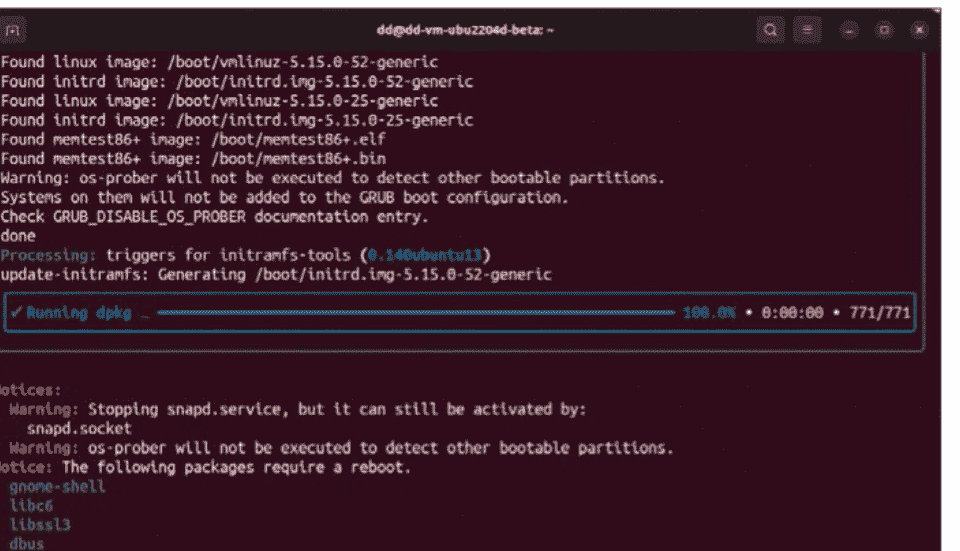

图 4：成功完成升级后，Nala 将通知你进度以及是否需要重启。

### 历史

你是否尝试过升级 Debian 中的某一个软件包？对于单个软件包，可以通过为包名指定所需的版本来轻松完成，例如：

```
sudo nala install package-0.0.8-2
```

如果你正在升级大量软件包，你会得到像列表 1 所示的结构。

Nala 为你提供了借自 Fedora DNF 包管理器的历史功能。它不仅显示更新期间发生了什么，还可以回滚结果。目前，历史功能仍在开发中，仅适用于单个软件包及其依赖项。输出

```
sudo nala history
```

显示了最近的操作，无论是单次安装、卸载过程，还是包含 300 个软件包的系统升级。对于发生过 bug 的用户系统，历史功能一旦完全实现将非常有帮助。使用越来越多的快照和镜像形式的升级有充分理由。然而，由于这些现代技术

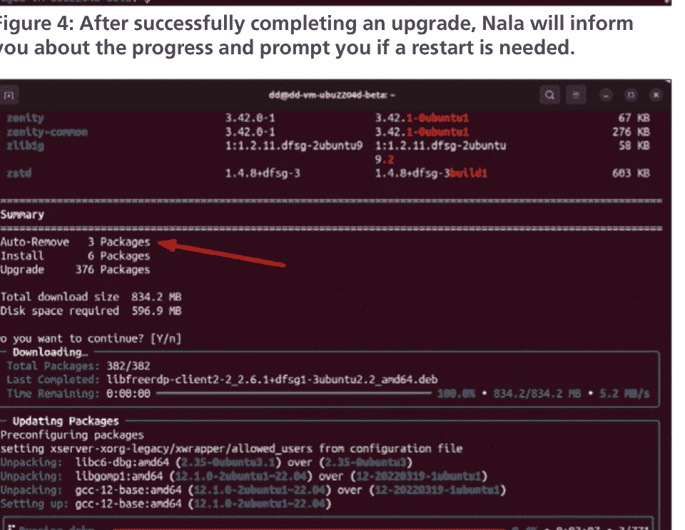

图 5：如果你不想 Nala 在升级期间执行 autoremove 命令，可以在配置文件中阻止它。

42 2023年2月42日 266 期 LINUX-MAGAZINE.COM

### 深度解析

### Nala

```
$ dd4dd-vm-ubuntu20d-beta:~ sudo nala fetch
[sudo] password for ddd:
Fetching ubuntu...
ubuntu~$ 
```

将反转该过程并安装升级。

### 结论

Nala 为 Debian 的包管理添加了一些重要功能。它的输出非常丰富且信息量大。对于这个工具来说，交互性是至关重要的。并行下载加速了升级过程，而 `fetch` 函数允许你选择最快的镜像。真正的帮助是 Nala 的 `history`（历史）功能，它让 Debian 在未来能够向支持快照的发行版定位。开发者计划未来将 Nala 迁移到 Rust 以提高下载速度，这有助于帮助你扩展历史功能。

我已经使用 Nala 六六天了。在某些情况下，升级会因为未知原因挂起，但会继续正常工作。虽然 apt 也有一个关键功能，使其对 Debian Testing、Unstable 及其分支的用户来说很有趣。然而，得益于 Nala 以及其他分发版……

| 索引 | 镜像 | 评分 |
|---|---|---|
| 0 | https://mirrors.de.ubuntu.com/ | 5 ms |
| 1 | https://mirrors.us.kernel.org/ubuntu/ | 5 ms |
| 2 | https://archive.ubuntu.org/ | 5 ms |
| 3 | http://ftp.ubuntu.de/ubuntu/ | 10 ms |


| 排名 | 镜像地址 | 延迟 |
| --- | --- | --- |
| 4 | https://mirrors.kernel.org/derors/ubuntu/ | 10 ms |
| 5 | https://mirrors.clouder.net/ubuntu/ | 16 ms |
| 6 | https://mirrors.edge.kernel.org/ | 16 ms |
| 7 | https://mirrors.hostnet.at/archive/ | 16 ms |
| 8 | https://mirrors.kamp.de/ubuntu/ | 17 ms |
| 9 | https://mirrors.kernel.org/ubuntu/ | 17 ms |
| 10 | https://mirrors.debian.org/debian/ | 17 ms |
| 11 | nlb13.archive.ubuntu.com/ | 17 ms |
| 12 | https://mirrors.production.ubuntu.com/ | 18 ms |
| 13 | http://ubuntu.mirrors.try.jp/ubuntu/ | 19 ms |
| 14 | http://ftp.au.de/ubuntu/ | 20 ms |
| 15 | https://mirrors.kernelby.com/ubuntu/ | 20 ms |
| 16 | https://mirrors.wtne.net/ubuntu/ | 20 ms |

评分是下载 `Release` 文件花费的毫秒数。

你想保留这些（`0..16`）。

图 6：`nala fetch` 命令检查 Debian 为你的位置选择最快的镜像。

在如此长的情况下，Nala 的 `history` 函数提供了一个可行的选项。

但这也很重要——它没有任何实际影响。一旦你找到了操作，使用 ID 在 `history` 的逐行输出开始，这对于回滚起着至关重要的作用（图 7）。它也显示了更新的参数。

> `sudo nala undo <ID>`

在撤销之后，如果你改变了主意，可以稍后执行。

```
$ dd4dd-vm-ubuntu20d-beta:~ sudo nala history
$ upgrade-ui-manager-apt-service...
$ 2022-11-04 24:05:23 UTC
```

| 日期和时间 | 修改 | 请求者 |
| --- | --- | --- |
| 2022-11-04 24:05:23 | 1.7.3.2-ubuntu22.04.1 | 774 kb |
| 2022-11-04 24:05:23 | 2.2.0.5-ubuntu3.1 | 704 kb |
| 2022-11-04 24:05:23 | 2.2.9.1-ubuntu3.1 | 704 kb |
| 2022-11-04 24:05:23 | 1.7.3.2-ubuntu22.04.1 | 684 kb |
| 2022-11-04 24:05:23 | 2.2.18-ubuntu3.1 | 668 kb |
| 2022-11-04 24:05:23 | 1.7.3.4-ubuntu22.04.1 | 736 kb |
| 2022-11-04 24:05:23 | 1.34.2.1-ubuntu3.1 | 642 kb |
| 2022-11-04 24:05:23 | 1.1.4.3-ubuntu3.1 | 622 kb |
| 2022-11-04 24:05:23 | 2.3.1-ubuntu3.1 | 627 kb |
| 2022-11-04 24:05:23 | 2.2.0.1-ubuntu3.1 | 622 kb |
| 2022-11-04 24:05:23 | 1.19.6-ubuntu3.1 | 165 kb |
| 2022-11-04 24:05:23 | 1.19.6-ubuntu3.1 | 165 kb |
| 2022-11-04 24:05:23 | 2.2.4-ubuntu3.1 | 257 kb |
| 2022-11-04 24:05:23 | 2.2.4-ubuntu3.1 | 257 kb |
| 2022-11-04 24:05:23 | 2.4.1-ubuntu3.1 | 557 kb |
| 2022-11-04 24:05:23 | 1.8.4-ubuntu3.1 | 683 kb |

图 7：Nala 的 `history` 功能未来将支持回滚升级，这在更新出错时非常有帮助。

LINUX-MAGAZINE.COM 2023 年 2 月号

- https://en.wikipedia.org/wiki/Dpkg
- https://en.wikipedia.org/wiki/apt (软件)
- https://michael.debian.org/ch/posts/2019-09-14-why-debian

## 深度解析

### Nala

```
$ dd4dd-vm-ubuntu20d-beta:~ sudo nala fetch
[sudo] password for ddd:
Fetching ubuntu...
ubuntu~$
```

将反转该过程并安装升级。

## 结论

Nala 为 Debian 的包管理添加了一些重要功能。它的输出非常丰富且信息量大。对于这个工具来说，交互性是至关重要的。并行下载加速了升级过程，而 `fetch` 函数允许你选择最快的镜像。真正的帮助是 Nala 的 `history` 功能，它让 Debian 在未来能够向支持快照的发行版定位。开发者计划未来将 Nala 迁移到 Rust 以提高下载速度，这有助于帮助你扩展历史功能。

我已经使用 Nala 六天了。在某些情况下，升级会因为未知原因挂起，但会继续正常工作。虽然 apt 也有一个关键功能，使其对 Debian Testing、Unstable 及其分支的用户来说很有趣。然而，得益于 Nala 以及其他分发版……

## 深度解析

### 自然语言处理

它们仅仅超越了句子本身。事实上，RNN 捕获的上下文不仅限于相邻单词。理论上，它还可以学习复杂且遥远的关系。

RNN 可以处理各种序列学习问题的变体。你可以在最左侧的图 2 中看到最的情况：输入和输出之间是 1:1 的关系。它完全没有遵循序列，但与图 1 中的示例相似。

多对一（`n:1`）常见于分类任务。训练后，当输入是一个序列时，除其他因素外，例如，输入可以分配给给定的分类系统：输入由序列组成，输出由待确定的类别组成。

序列学习的相反是从固定长度的输入产生变长度的输出。这在生成文本时是理想的，例如我们想要根据一组测量值生成天气预报。也可以使用多对多（`n:m`）架构。训练后，你可以在每种情况下确定输出序列中的下一个词项（或完成输出）。

图 2 中的，第一个多对多（`n:n`）产生的输出与输入序列等长。除其他因素外，这可以用于处理标记任务（例如，标记文本中的公司名称）。另一个示例可以是标记出发和到达时间、日期和时间，以及用户在购票时可能提供的其他信息。

最后，最右侧的多对多架构（`n:m`）允许输入和输出长度不同，提供了 `n:1` 架构未涵盖的广泛可能性。问题和答案在英语中恰好是相同长度。

如果我们想在过程中改变单词的数量，文本无法以相同的内容翻译成另一种语言。这通过编码器-解码器模型解决了，因为它首先将输入编码为长度与 `n:1` 前缀匹配的片段序列。这对于长序列非常有帮助，因为它允许解码器从固定表示中检索所有信息。

编码器-解码器模型使用注意力机制来控制在每个解码步骤后对输入步骤中间步骤的注意力。这非常有帮助，例如从一种语言到另一种语言的可靠翻译，在翻译过程中，需要对输入句的含义进行注意力校准。由此产生的是，德语单词 `bank` 被翻译为英语中的 "bank" 或 "bench"。

此外，注意力在解码过程中补偿了句子结构。这很重要。

## 听觉与视觉

如果你需要适配一个具有编码器-解码器架构的机器翻译系统，将外部知识整合到翻译过程中，就会出现特殊问题（图 3）。这对于口同步是必要的。但首先，让我们解释为什么

当人们说话时，脸部的某些部分反映了产生的声音。上唇和下唇需要产生 M 和 B 音，而说 A 或 O 时嘴唇张开。大多数人依靠这种口型同步来理解所说的内容，而不涉及任何音频。即使看着说话者的脸部和面部表情，利用这些来理解所说的话对背景的影响也有大小。

相反的现象被称为麦格克效应（McGurk effect）。如果你感知到一个脸的唇部动作，你的视觉翻译将覆盖听觉印象。

据说在说话者嘴部移动的方式下，"Gaga" 被说成 "Baba"。错误的唇部动作会导致错误的感知，听觉和视觉印象之间的认知失调给大脑带来压力。

电影需要考虑观众不仅会听到说话者的声音，还会看到唇部动作。配音电影应该尽可能易于观看并获取语言，通过使唇部动作与观看匹配来避免配音产生的伪影。媒体的视听翻译通常旨在让观众认为图像中的说话者经过翻译和配音，但他们实际上说的是你能听到的文本。这意味着翻译过程中增加了一个额外限制，因为必须考虑视觉通道。这个词序列必须精确匹配可见的动作。虽然翻译成德语可能尽可能忠实，但现在可能在 `Blutchemistry`（血液化学）或 `Des Blut jedes Menschen`（每个人的血）之间做出选择，但在口型同步版本中，“化学”实际上被完全丢弃了。此时德语观众看到的是：“Nein, das Blut Menschen ist einzigartig, wie Fingerabdrücke——”（不，每个人的人的血化学都是独特的，就像指纹一样），

不，不，每个个体的血化学都是独特的，就像指纹一样。`Nein nein, das Blut Menschen ist einzigartig, wie Fingerabdrücke`。

**图 4**：配音中保持口型同步，以美剧《英雄儿子》（Heroes）中的一个短场景为例。

寻找一种将源文本内容尽可能忠实地转换为目标语言的渲染方式，视听翻译涉及内容与视觉的平衡。首先最重要的是，当两种语言中相同含义的单词长度不同时，大多数视听翻译需要具有难度（例如德语中的 `einzigartig` 翻译为英语中的 “unique”）。此外，你必须关注嘴唇和下颌，只要嘴唇是说话者的。

图 4 展示了来自《英雄儿子》翻译的一个示例，英语版本说：“No, no, each individual’s blood chemistry is unique,” 它是不言而喻

然而，它并不完美。在绿色标记处，口型同步中将 “M” 替换为 “B”。这是理想的，因为这两个声音只能通过嘴唇产生。红色标记的单词情况完全不同。虽然 “di” 需要嘴部的可感运动，但 “bi” 德语观众现在只能通过闭合牙齿来产生。

发生的细微细节不会被大多数观众注意到。此外，声音的重复和哭泣：P、B 和 M 在视频中看起来几乎完全一样。

**图 5**：由配音估计器扩展的编码器-解码器架构确保翻译的语音同步。

### 口型同步

扩展之前讨论的编码器-解码器模型有助于我们生成随后可以进行口型同步的翻译。图 5 显示了我们开发的“配音估计器”。

# 需要更多 Linux 吗？

我们的免费 Linux Update 周报每周都会向您的邮箱递送深度的文章和技术技巧。免费订阅，您将发现：

- 关于真实世界中 Linux 的原创文章
- Linux 和开源新闻
- 关于 Bash 脚本及其他高级技术的技巧
- 开源工作和活动
- 以及更多内容！

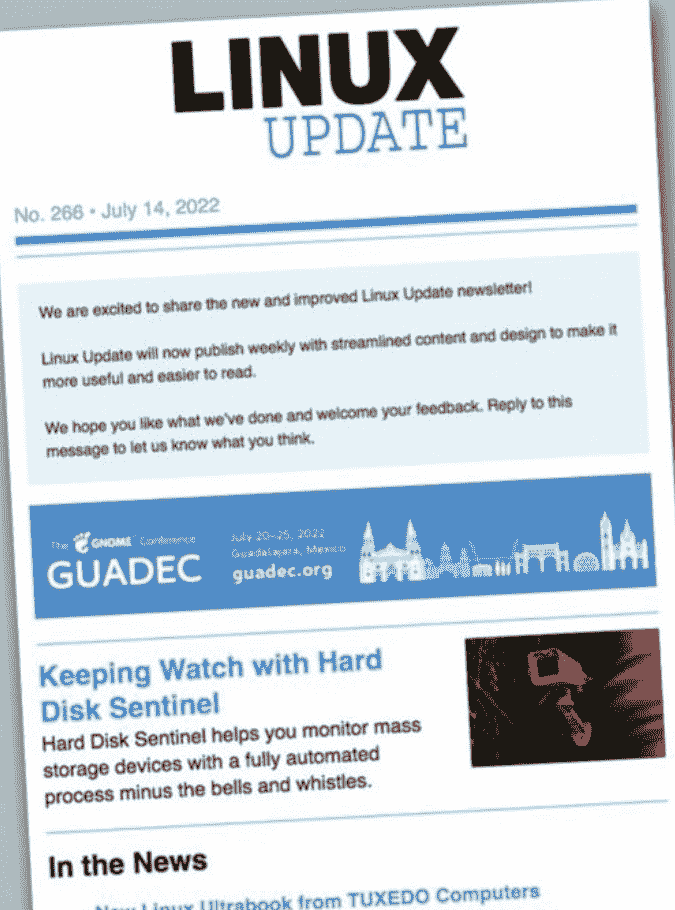


bit.ly/Linux-Update

## 深度解析

### 命令行 – KRunner

#### 一个桌面命令行小部件

#### 力胜于剑

KRunner 将命令行与图形化导航相结合，为 Plasma 用户提供了速度和舒适性。作者：Bruce Byfield

对于大多数用户来说，命令行和桌面环境是截然不同的。一个显著的例外是 KRunner (1)，它是 KDE Plasma 默认安装的。通过与其他默认 Plasma 应用以及系统硬件进行交互，KRunner 基本上是一个运行单一进程的汇聚小部件，但它也是一个应用程序启动器和通用导航工具，以及计算器、测量和货币转换器、处理器控制器，甚至是一个拼写检查器——所有都可以通过键盘控制。

事实上，如果你愿意，完全可以通过 KRunner 控制桌面，这尽管它几乎没有限制，却使其成为整个 Plasma 中功能最强大的应用程序之一。

#### KRunner 界面

KRunner 使用图形化导航来服务命令行（图 1）。你可以从菜单启动它，但使用 KRunner 的键盘快捷键之一（`Alt + F2` 或 `Alt + Space`）启动更高效。

Bruce Byfield 是一位计算机记者、自由职业作家和编辑，专注于自由和开源软件。除了写作项目外，他还教授领导力和在线课程。在他关于西北沿岸（http://brucebyfield.wordpress.com）的文章中，他还是 Printerie Pieces 的创始人，这是一个关于写作和幻想的博客（https://www.printeriepieces.com/）。

KRunner 窗口有一个输入字段，下方有一列可能的补全列表。使用方向键或鼠标选择这些项目。输入字段左侧有一个按钮，可以打开 KRunner 系统设置。

同样，你可以从 KRunner 安装软件。输入你认为最可能的名称，KRunner 将提供建议。点击某个建议，KDE Plasma 软件中心就会打开。

KRunner 还有自己的命令集来调用不同的函数。如果你想重复某个命令，请从路径末尾的下拉列表中选择。最实用的 KRunner 命令之一是 `kill`，它可以关闭任何应用程序，杀死消息框。请注意 KRunner 并不是 Bash。事实上，它是任意选择的字符，可以在“系统设置 | 终止应用程序”中更改。你也可以选择优先显示 CPU 占用率最低的应用程序列表，或者根据输入补全来选择。同样，要查看页面，语法为 `man:COMMAND`。主页面将在浏览器中打开。

#### 作者

| 命令行 | 运行 grep |
| --- | --- |
| 图片 | grep.png --~/2022-08-activity/history |
| | grep.png --~/journal/applications...dpkg-reconfigure |
| 文件夹 | cli-grepping-grep |
| 文档 | 24 |
| | 25 |
| 软件中心 | Get Glog... |
| | Get Ding... |
| | Get 4Pane... | .bash_history |

图 1：KRunner 是一个用于与桌面环境交互的多功能命令行小部件。


#### 打开资源

从设置中，你可以从 KRunner 安装软件。输入你认为最可能的名称，KRunner 将提供建议。点击某个建议，KDE Plasma 软件中心就会打开。

要查看页面，语法为 `man:COMMAND`。主页面将在浏览器中打开。

同样地，你可以从 KRunner 安装软件。

尽管几乎没有限制，KRunner 也是整个 Plasma 中功能最强大的应用程序之一。

命令 `spell-STRING` 显示一个特殊字符。在这两种情况下，选中的结果都会复制到剪贴板。

#### 输入命令

对于大多数用户来说，命令行和桌面环境是截然不同的。一个显著的例外是 KRunner (1)，它是 KDE Plasma 默认安装的。通过与其他默认 Plasma 应用以及系统硬件进行交互，KRunner 基本上是一个运行单一进程的汇聚小部件，但它也是一个应用程序启动器和通用导航工具，以及计算器、测量和货币转换器、处理器控制器，甚至是一个拼写检查器——所有都可以通过键盘控制。

事实上，如果你愿意，完全可以通过 KRunner 控制桌面，这尽管它几乎没有限制，却使其成为整个 Plasma 中功能最强大的应用程序之一。

#### 搜索

KRunner 包含一个计算器，不仅可以进行基础算术，还能处理数学函数

#### 计算机管理

从 KRunner，你可以直接进入系统设置。KRunner 也可输入常用的关机控制：睡眠、锁定、重启和注销。此外，`brightness PERCENTAGE` 将调整器屏幕。

#### 控制音乐播放器

当 KDE 的音乐播放器运行时（如 Amarok 或 Clementine），你可以使用 KRunner 控制它。输入艺术家、专辑或歌曲的名称，`current search, play SONG` 将立即播放结果。选中歌曲后，你还可以使用 `pl`、`pause`、`skip` 或 `next` 命令。

#### 日期和时间


输入日期或时间会显示当前信息。默认情况下，结果是您系统的时区，另一个


## 可用插件

| 应用程序 | 查找并切换 |
| --- | --- |
| 书签 | 查找应用程序 |
| 计算器 | 计算表达式 |
| 命令行 | 执行命令 |
| 日期和时间 | 查找当前时间 |
| 桌面搜索 | 搜索文件 |
| 桌面会话 | |

图 2：KRunner 是模块化的，因此你可以禁用

# 商店购物

shop.linuxnewmedia.com

# 提升效率

酷炫的 LINUX 技巧

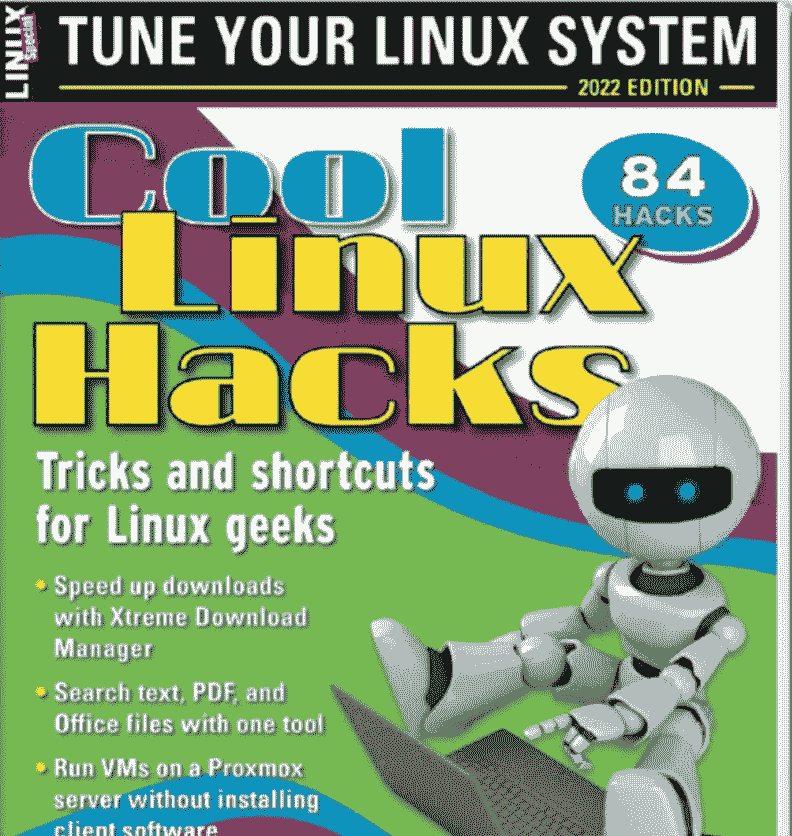

# 调优你的 LINUX 系统

2022版 - 通过这系列为 Linux 极客准备的灵感技巧和快捷键，提升你的 Linux 技能。

- 命令行上的 Google
- OpenSnitch 应用防火墙
- 解析 systemd 日志
- 使用 `lazygit` 控制 Git
- 使用 `DOSBox` 运行旧版 DOS 游戏
- 以及更多！


发现专家的秘密

# 在线订：

shop.linuxnewmedia.com/specials

## 深度聚焦 – Go 密码管理器

### 用于终端的 Go 密码管理器

### 捉迷藏藏

一款终端应用程序帮助 Mike Schilli 记住他的密码。作者：Mike Schilli

无论是贴在屏幕下的便利贴，还是使用像 `OnePass` 这样的商业应用程序，都得在处记录密码。这款终端 Go 应用程序会对硬盘上的敏感数据进行加密，并在输入计算机内存后显示项。秘密数据仅在内存中留下痕迹，程序关闭时这些痕迹就会消失。

每次编辑都需要运行 `scrub` 命令来覆盖已删除的文件。解密后，所有密码将同时显示在屏幕上，敏锐的同事可能会瞥到其中一个或多个。许多密码应用以模范的方式管理密码，但在涉及机密数据的随机领域并非如此，且在加密或解密管理期间依赖它们吗？不要忘记像 `LastPass` 这样的应用会收取月费，像我这样的人得省着用钱。本文介绍的密码程序 (`go`) 管理加密的密码集合，并在输入主密码后在用户界面 (UI) 中显示选定的条目（图 1）。你可以在敏感数据实际出现之前滚动条目并选择你想要的。

带有星号的条目。退出程序会清除终端窗口。不会留下任何敏感数据；在硬盘上，你只剩下加密后的密码文件。

灵活的用户可以轻松地在文件中记录密码并对其进行加密。然而，要添加新条目，必须在编辑后解密并重新加密文件。为了确保硬盘上不留任何密码，当你使用

每次编辑都需要运行 `scrub` 命令来覆盖已删除的文件。

## 便携性

作为一个二进制文件，该程序已经包含了在相似架构上运行所需的所有内容。你只需要将二进制文件和加密后的密码文件复制到你想访问密码的地方即可。要添加新条目，只需使用主密码调用程序。使用 `-s` 选项，你可以自由地将文件重写入新条目（列表 1）。

### 列表 1：新密码

```bash
# pv add
# Password: ****
# New entry: gmail@gmail.com
```

## 作者

Mike Schilli 是加州旧金山湾的一名软件工程师。自1996年以来，他一直在研究各种编程语言的实践。如果你向 `milli@permeister.com` 发送邮件，他会乐意回答任何问题。

当你按下回车键时，它会移除选中条目的星号，显示出秘密账户和密码详情。如果你使用光标键 `K` 和 `J` 向下移动光标（就像 `Vim` 中那样），它会再次遮盖已显示的


## 编程聚焦 – Go 密码管理器

输入新数据后（或如果不带参数调用 `pv`），会出现终端 UI，带有滚动列表框可以根据需要显示条目。

主要使用公钥方法，对称加密也在列表中。顺便说，根据 `Age` 项目，`Page` 的引入就像单词“age”（针）一样。

`Age` 库使用 `Recipient` 类型进行写入（即加密）。在其他情况下，接收者是待加密的条目。第11行的 `NewRecipient` 调用接收唯一参数，`Scrypt` 指向实现第15行的对称加密函数。如果文件不存在，则使用 `GCRYPT` 创建用于写入的加密文件。

## 加密天才

密码箱使用对称加密。这意味着它使用同一个密码来加密和解密文件。GitHub 上的 `Age` [1] 是由 Google 工程师制作的 Go 库，用于数据的加密和解密。

## 对称加密

对于在任何时候由一个用户使用的文件，对称加密是最实用的解决方案。如果多人共享公私钥对，可以使用 `Age` 库中的方法来实现一种解决方案，允许用户使用他们的密码访问共享文件。

Unix 的 C 语言中也存在同样的 `file` 选项，它的最后一个字母 "f" 被称为 `CREATE`。Unix 的创始之父之一 Ken Thompson 曾被问及是否倾向于使用 `if` 还是 `Age` 来创建文件，他自豪地说：“我拼写 'crypt' 时加了一个 e [2]。没有其他导向的问题。”

列表 2 显示了主程序使用的 `ageDecrypt` 和 `ageEncrypt` 函数如何对密码文件的明文数据进行加密。第9行使用 `test` 来定义磁盘上加密文件的名称。扩展名表示它是由 `Age` 库加密的。

## 传输加固

该操作重写了加密文件中的内容，以便后续命令简单地覆盖它。现在，加密文件中的二进制数据可能会干扰编辑器，或者触发网络程序将二进制序列和内容恢复到远程位置。到第20行，使用 `age` 类型对二进制数据进行重新编码，这将看起来是损坏的，但至少作为无意义字符的行出现，非字符（图 3）。

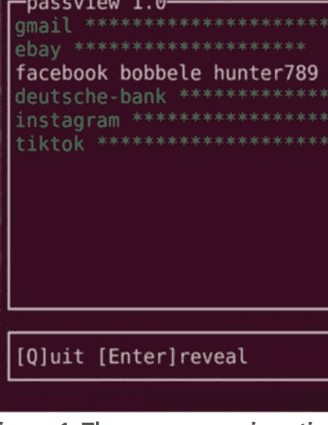

图 1：`pv` 程序的运行。

```
README.ME
```


### 文件加密

`age` 是一个简单、安全的文件加密工具以及 Go 库。

它具有小型配置、无配置选项和 `UNIQUE` 风格的简单性。

```bash
# age-keys gen.txt
# 公钥: age1-55qwm3n7y5ay4fpgsq7u2w2m2j2ks5fn9namqacbd
# 私钥: age1-55qwm3n7y5ay4fpgsq7u2w2m2jj2ks5fn9namqacbd -> data.txt
# age -decrypt -i key.txt data.txt -> data.txt
```

图 2：`Age` 加密项目。

列表 2 中使用的函数在 Go 中很少但经常有用。写入者从某处获取数据并将其写入另一个处。例如，第15行的 `openFile()` 打开一个文件并返回一个 writer 对象。加固（armor）机制获取此对象并返回它自己的 writer 对象 `armor-writer`。该对象反而被第22行的函数获取，该函数返回一个 writer `out`，第27行使用它进行写入

换句话说，代码处理了类似于 Unix 管道的函数组合。第一阶段获取明文数据，加固和加密的数据从末尾输出。

感谢对 writer 接口的支持

LINUX-MACHINE.COM。

# 程序快照 – Go 密码管理器

```
Listing 3: util.go
```go

01 package main

02 func mask(s string) string {

03 masked := []byte(s)

04 tomask := false

05 for i := 0; i < len(s); i++ {

06   if tomask {

07     masked[i] = '*'

08   } else {

09     masked[i] = s[i]

10  }

11  if s[i] == '-' {

12   tomask = true

13  }

14 }

15 return string(masked)

16 }

```
```

`mask` 函数跳转到第 26 行开始的代码，该代码从标准输入收集一个新的密码条目，并将其附加到之前解密的密码文件的文本中。

如果密码文件不存在，第 21 行会捕获此异常并允许程序继续，直到输入新条目或在终端中显示空文件。

# 没有文件，没问题

为了实现这一点，第 15 行显示密码提示以收集主密码。我们通过标准终端包的 `ReadPassword()` 对其进行读取。该函数关闭了回显，因此用户可以输入密码而不被显示。如果密码与密码文件中的条目不匹配，第 22 行的 `readEnc()` 将进入新密码，如果 `readEnc` 失败，则调用 `panic()`。

在解密后的文本上，第 33 行使用 `Trim()` 移除最后一个换行符，然后使用 `Split()` 将整个数据块分割为字符串数组。这两个函数都来自标准库。第 34 行将数组传递给 `run()` 函数，告诉它更新 UI。UI 会一直运行，直到用户点击退出按钮，这会结束管理器并关闭 UI。

# 两个组件

```
Listing 4: pv.go
```go

01 package main

02 import (

03 "bufio"

04 "errors"

05 "flag"

06 "fmt"

07 "golang.org/x/crypto/ssh/terminal"

08 "os"

09 "strings"

10 )

11 

12 func main() {

13 add := flag.Bool("add", false, "New password entry")

14 flag.Parse()

15 fmt.Printf("Password: %s ")

16 password, err := terminal.ReadPassword(os.Stdin)

17 if err != nil {

18   panic(err)

19 }

20 

21 if errors.Is(err, os.ErrNotExist) {

22   panic(err)

23 }

24 

25 if *add {

26 fmt.Printf("\nNew entry: %s ")

27 reader := bufio.NewReader(os.Stdin)

28 entry, _ := reader.ReadString('\n')

29 txt = txt + entry

30 writeEnc(text, password)

31 return

32 } 

33 lines := strings.Split(strings.TrimSuffix(txt, "\n"), "\n")

34 runUI(lines)

35 }

```

UI 像上一个示例一样，使用了终端包。Listing 5 在第 12 行调用 `ui.Init()` 来初始化函数，并在第 15 行调用 `ui.Close()` 将 UI 折叠回可用的终端。图 1 所示的 UI 包含两个组件：一个是带有密码条目的列表，如果条目列表长于行数，用户可以滚动多个页。在列表下方、终端窗口的底部，分页器指示了用户下一个可以按哪个键：`Enter` 选择选定的密码，或 `Q` 退出程序。

为了利用终端窗口的几何结构，第 25 行使用终端包中的 `terminal.Size()` 辅助函数查询窗口维度。根据窗口的宽度和高度，第 26 行和第 27 行确定了堆叠组件的位置。在这种情况下，密码图用三行绘制，包含了其他所有内容。然而，两个组件都延伸到终端窗口的边缘。列表作为字符串数组的一个属性存在。第 17 行用行填充这些内容。在此头部之前，循环从第 9 行开始，将掩码后的条目填充到行中。用于切片和掩码条目的两个数组使得能够轻松查看当前索引。然后，`ScrollUp(line 36)` 通知列表向上滚动一次，渲染器会清晰地显示 UI 中的变化。按下 `j` 也是同样的，它让列表滚动到列表末尾。始终可以使用三步过程从代码生成二进制文件（列表 6）。

# 程序快照 - Go 密码管理器

## 深度解析

### 安装

```
Listing 6: 编译程序
```
```bash
$ go mod init
go mod tidy
go build pv.crypto util.go
```

# Listing 5: ui.main

```go
01 package main
02 import (
03 "fmt"
04 "github.com/gizak/termui/v2"
05 "github.com/gizak/termui/v2/widgets"
06
07 func runUI(lines []string) {
08 rows := []string
09 for _, line := range lines {
10   append(rows, line)
11 }
12 if err := ui.Init(); err != nil {
13   panic(err)
14 }
15 defer ui.Close()
16 lb := widgets.List()
17 lb.Rows = rows
18 lb.SelectedRow = 0
19 lb.SelectedRowStyle = ui.TextStyle(ui.Block)
20 lb.TextStyle = ui.ColorGreen
21 lb.Title = fmt.Sprintf("%s", "password.1")
22 ps := ui.Paragraph()
23 ps.Text = "[Query] Enter password: "
24 ps.TextStyle.TextColor = ui.ColorCyan
25 w, h := ui.TerminalDimensions()
26 lb.SetRect(0, 0, w, 3)
27 ps.SetRect(0, 3, w, h)
28 ui.Render(lb, ps)
29 uiEvents := ui.PollEvents()
30 for { 
31 select {
32 case e := <-uiEvents:
33 switch e.ID {
34 case "K":
35   hideCursor(lb)
36   lb.ScrollUp(1)
37   ui.Render(lb)
38 case "j":
39   hideCursor(lb)
40   lb.ScrollDown(1)
41   ui.Render(lb)
42 case "q", "C":
43   return
44 case "Enter":
45   showCursor(lb, lines)
46   ui.Render(lb)
47 }
48 }
49 }
50 func hideCursor(lb *widgets.List) {
51 idx := lb.SelectedRow
52 lb.Rows[idx] = lb.Rows[idx]
53 }
54 func showCursor(lb *widgets.List, lines []string) {
55 idx := lb.SelectedRow
56 lb.Rows[idx] = lines[idx]
57 }
```

## 信息

Ken Thompson 说的“带一个 e 的”是指什么意思？

https://stackoverflow.com/questions/108933/what-did-ken-thompson-mean-when-he-said-with-an-e

# Xonsh MAKERSPACE

```bash
$ # 显示 Bash 命令，未开启颜色
$ ls -l | head -n 1
total=
# # 创建一个字符串变量
$ a="this is text"
'this is text'
# # Python 命令中的高亮
for i in range(1,3):
    if i==2:
        print('OK, i = 2')
```

```bash
$ # Xonsh 管理缩进错误的示例
$ myvar=True
if myvar:
    print('over indented')
else:
    print('under indented')

myvar=False
if myvar:
    print('over indented')
under indented
```

**图 2：** Xonsh 高亮 Bash 和 Python 语句。

Xonsh 处理单语句和非控制语句的缩进错误。图 3 显示了一个在缩进和未缩进语句都能成功运行的 Python 代码示例。

这两个步骤可以结合，在 Zenith 中显示操作系统：

```bash
$ import sys
$ sys --title=System_OS
    ---=(sys.platform)
```

Zenith 功能是 Python 帮助（图 4）。Tab 键允许你从字符串中查看 Python 对象或方法。方向键允许你在对话框中选择选项。

一旦这些功能正常工作（Zenith 和嵌入 Bash 的 Python），你就可以快速轻松地启动树莓派应用程序。

## 使用 Python 的 Bash Zenith 对话框

Xonsh 拥有 `Tkinter`、`Qt` 和 `SimpleGUI` 等图形对话框库。这些库对于复杂的 GUI 应用非常出色，但如果你只需要一个简单的对话框，它们就过用了。

## 树莓派 DHT11 传感器项目

Zenith 工具是用一行代码展示各种对话框的方法。树莓派预装了 Raspberry Pi OS 和 Linux，因此不需要安装。

DHT11 和 DHT22 传感器低廉（5到10 美元），用于测量环境温度和湿度。图 5 显示了典型的带有 `GPIO17`（注意引脚）的 DHT11 设置，传感器引脚分配可能会不同。

Zenith 信息对话框的语法为：


```bash
$ sys --info--title=myfile
    $ sys --info--title=myfile
    ---=message
```

已安装 DHT11/DHT22 项目：

```bash
$ import Adafruit_DHT
```

列表 1 使用树莓派 DHT 库获取温度和湿度（第 9 行），并将数据变量传递给 Zenith 对话框（第 1 行）。

在 Xonsh 中，语句和变量直接用于 bash 语句：

运行此脚本：

```bash
$ xonsh dht11.sh
```

## LCD 项目

多个 LCD 屏幕可以连接到树莓派。在这个项目中，我们使用了 16x2（2行16列）LCD 屏幕（15 美元），它具有 I2C 接口（SDA，数据；SCL，时钟；VCC，电源；地）。

图 6 显示了带有 Zenith 和湿度对话框的项目硬件。

如何使用 Zenith，你可以用各种其他树莓派传感器修改此项目，或提供接口（PIR 运动传感器）。

第一步是启用 I2C（集成电路，一种串行通信总线），你可以通过以下方式实现：

```bash
# 检查 I2C：启用1 =禁用
sudo raspi-config get_i2c
# 启用 I2C：启用，1 = 禁用
sudo raspi-config do_i2c
```

```python
(@python)
print(f'test: {test}')
```

例如，bash echo 命令可以打印 Python 语句：

```bash
$ import sys
$ echo "OS: $(sys.platform)"
OS: linux
```

| 文件 | 编辑 | 视图 | 帮助 |
|---|---|---|---|
| get-bus-linux | print(f... | 使用方向键选择选项 | |
| buffer | 错误 | readline | 截断 |
| closed | 新行 | 重配置 | 可写 |
| closed | flush | 可寻 | 写入 |
| detach | 编码 | | 行缓冲 | 透写 |

**图 4：** Xonsh 提供 Python 帮助。

LINUX-MAGAZINE.COM ISSUE 267 2023年2 月 61

## MAKERSPACE Xonsh

下一步是将 LCD 连接到树莓派。LCD 在接线到 Pi 后会亮起。`i2cdect` 显示了活跃的 I2C 硬件变化（图 7）。

安装了此硬件的 Python 库：

```bash
sudo pip install rpi_lcd
```

`rpi_lcd` 库允许 27 号 I2C 设备。除非 LCD 设备用于 35，否则你必须执行额外步骤来更改设备：

```bash
# 更改 LCD 默认值从 27 到 35
```

stats。第三个管道通过 awk 创建用户时间或 CPU 时间的字符串（图 8）。

长 Bash 语句的输出可以存储在 Xonsh 变量中。列表 2 中的脚本获取用户时间（第 10 行）和空闲时间（第 12 行），并将这些字符串显示在 LCD 屏幕上（第 14、15 行）。通过 Python while 语句（第 8 行）和延迟（第 16 行）每五秒更新一次显示。使用 Python 和 Xonsh，此脚本只需要八行代码。图 7 显示实时数据的 LCD。

要测试 LCD 屏幕工作，在 Xonsh 提示符中输入几行：

```bash
cd /usr/local/lib/python3.9/dist-packages/rpi_lcd
sudo sed -i 's/address=0x27/address=0x2f/g' __init__
```

```python
from rpi_lcd import LCD
cd = LCD()
cd.text("From Xonsh,")
```

此项目的目标是在 LCD 屏幕上显示树莓派的用户和空闲时间。`top` 工具显示 Linux 运行情况和 CPU 统计。

通过将 `top` 的输出通过到 `grep` 脚本，你可以孤立出一行仅限 CPU 信息。（注：由于原始文本存在大量重复和 OCR 错误，此处重复部分已根据逻辑精简核心内容。）

# 零件列表

- 树莓派 Zero W (第1或第2型)
- 扬程 1.2m 的离心泵
- 电磁阀 (x2)
- 继电器模块 (x3)
- ADC (ADS1115 或类似设备)
- 湿度传感器 (x2)
- 插件式电源 (5V)
- 外壳、布线
- 各种软管和管夹箍
- 转接头、控制阀、接地接针

程序文件位于项目的 GitHub 页面 [1] [2]。

现在是时候将外部硬件、水泵和电磁阀连接到基础材料上（图 4）了。由于泵的下游没有找到合适的分配器，我自己用黄铜手工焊接了一个。两个控制阀实现了一个双向系统，可以为两组有不同需水需求的植物供水。

得益于这两条主线，在空闲时排空时，也可以可靠地隔绝储水箱。


以通常方式将 OS 镜像传输到 microSD 卡中。插入屏幕和键盘后，可以配置启动选项和网络设置。不需要桌面环境，因此我选择了启用 SSH 的命令行界面（CLI）自动登录。所有后续设置都可以在同一网络计算机的终端窗口中进行配置。树莓派需要一个能让你想起正在处理的任务的主机名（例如，在本例中设为“inserting”）。下一步是在你的主目录中为项目文件创建一个单独文件夹。

# 结构

控制系统的主要元件将存放在一个制好的外壳中，盖子上带有橡胶密封和一个接线柱，所有外部电线都将接在接线柱上（图 2）。内部有两个小阀，用于固定所有模块。单元外壳包含树莓派、一个模拟数字转换器 (ADC) 模块和三个继电器。外部电源通过四芯线从下方连接两个湿度传感器、两个电磁阀和水泵。在顶部，我使用带有透明材料的闲置螺丝的地方，有一个 LED 指示运行就绪。

树莓派需要四个 GPIO 引脚来连接继电器板上的控制引脚，LED 通过 DC 总线连接。内部接线柱将转换器的模拟输入与湿度传感器连接，并将水泵和电磁阀的继电器输出。原理图（图 3）和相关的电路图正确连接，并用接地接针固定。较粗软管周围的管箍可以可靠地防止它们从连接处脱落。


# MakerSpace 园艺灌溉

## 控制

如果你观察商业灌溉系统，它们操作起来往往显得复杂。相比之下，我希望这个系统越简单越好，这样 DIY 系统在不在家里时易于维护并安全运行。为此，这个自动浇水系统有一个技巧：它可以利用提供两个不同位置反馈的传感器来延长浇水时间，以达到特定的湿度。

**图 4：** 更短的路径：供水条件的简单连接布局。下游分配可以使用较小直径的软管；使用接头增加分支。小型调节器确保水均匀地到达植物位置；设置它们需要一些尝试。对于初步测试，我首先连接了离心泵以允许浸没。

选择电容传感器是因为它们比电阻传感器更耐腐蚀。虽然我提到具有模拟输出的模型，但它们可以通过 ADC 轻松地连接到控制端的树莓派。为了提前确定各种限值，我在水中测试了传感器（图 5），并将它们放入潮湿的土壤中。此设置中的 ADC 是 ADS1115，在 Python 3 中通过 Adafruit 库进行寻址。最简单的安装方法是

如果一切运行正常，你可以继续将软管和电缆裁剪到所需的长度并布线

```bash
pip3 install Adafruit_ADS1x15
```

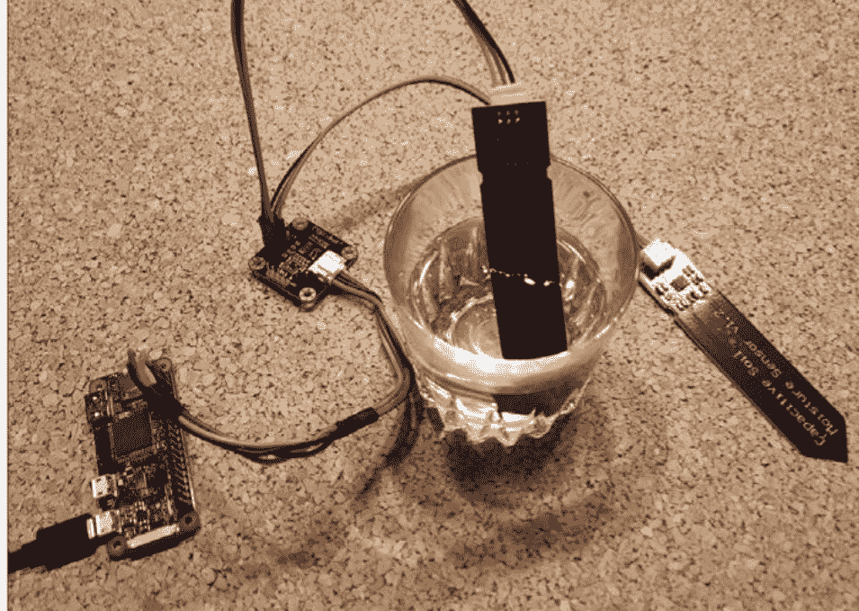

**图 5：** 测试连接到 ADC 的湿度传感器以确定限值。

## 园艺灌溉

这依赖于名为 `watering.py` 的中央控制脚本，树莓派负责流量和湿度控制。设置存储在其中。在初始设置中，系统现在每天下午 5:00 运行两分钟。受第二个电磁阀控制，它会持续更长时间。值可以根据需要调整。

给植物浇水时，树莓派始终打开电磁阀并从水箱开始抽水。第一个水循环结束后，系统会检查位置处的土壤湿度传感器是否达到“湿润”状态；如果没有，它将再次循环。第二条线保持开启较长时间，并一直控制直到脚本停止泵并最终关闭第二个阀。

Python 脚本位于主目录下方的单独文件夹中。因为它在 `rc` 中被调用，所以它会在启动时自动运行。如果你喜欢，也可以将脚本转换为二进制文件。这里一切保持了简单，但它是为了日常使用，并且你可以根据需要随时进行扩展。脚本和下方的远程控制 PHP 网站可以在我的 GitHub 项目中找到，供水的编写和路由图也在那里。由于树莓派连接到本地网络，你也可以通过 SSH 访问并维护它。要这样做，登录终端：

```bash
ssh pi@watering
```

## 基于网页的远程控制

如果你的灌溉系统不在路由器的范围内，你通常需要远程访问。即使在没有网络连接的情况下，系统仍然可以可靠地工作，该设备总是需要网络访问。

现在的商业灌溉系统通常带有手机 App。

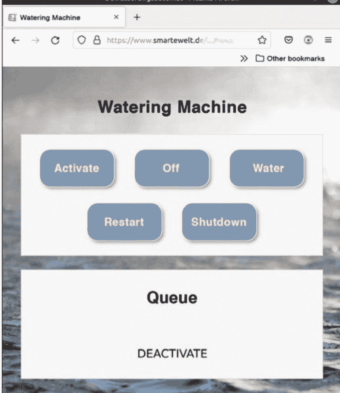

图 6：网页控制。

表 1：网页界面功能

| 名称 | 功能 |
|---|---|
| Activate | 开启定时器（默认开启）。 |
| Off | 关闭定时器。系统保持开启。 |
| Water | 立即通过线路供水 10 秒。 |
| Restart | 重启系统。重启树莓派后网页界面再次激活。 |
| Shutdown | 关闭树莓派。需要手动开启。 |

## 结论

这个植物浇水系统完全完成了它应该做的事，效果非常好。我在夏季的最后几天运行了它，功能检查没有问题（图 7）。

该系统明年将作为我的替代方案。尝试灌溉整个花园可能有些过头，但如果你想拯救有限区域内最重要的植物（例如，温室、阳光房或客厅），这个控制器可以是一个真正的助手。

## 信息

- 1) GitHub 项目：https://github.com/sweneae/watering
- 2) 代码和图像英文版：https://linuxnewmedia.the/s5RztQ9WF2BN3
- 3) Christian Grieger 的电子产品：https://elektro.turani.de (内)

作者

Swen Hope 在一家专注于智能卡和近场通信 (NFC) 的中型公司工作。当他不在摄影、在大自然户外或在花园里时，他关注树莓派、物联网和家居自动化等话题。

# LINUX 之声

Linux 目前正在数千百万个家庭中运行，为那些只需要一个用于办公、游戏、电子邮件和其他任务的可靠桌面系统的用户服务。但每个人都知道，Linux 也是一个出色的服务器系统。如果你需要服务器，但没有时间或兴趣成为 Linux 服务器管理员，那么 YunoHost 可能是你的最佳选择。YunoHost 的目标是让设置和使用变得非常简单。在许多情况下，YunoHost 让你只需点击鼠标即可安装服务器。本月，我们将为你介绍如何使用 YunoHost 进行 Linux 管理。本月的 Linux Voices 还有：使用 Skrouge 管理你的财务，使用 btop++ 管理你的进程。

| 标题 | 作者 | 页码 | 描述 |
| :--- | :--- | :--- | :--- |
| Doghouse — 入门 | John "madding" Hall | 70 | 自由开源软件初看起来可能会望人生生畏；少量的指导可以帮助你一臂。 |
| YunoHost | Erik Bwald | 71 | 在 Linux 上手动设置服务器有时会考验你的耐心，但通过 YunoHost，你只需点击几次即可安装并配置服务器。 |
| btop++ | Ferdinand Thom | 77 | btop++ 在系统监控和进程管理中结合了高度的便利性和极快的速度。 |
| FOSSP-icks | Graham Morrison | 82 | 本月 Graham 查看了 Ardour、FluffyChat、PlugData、Cameracti、hiStory、CadQuery Editor 等！ |
| 教程 — Skrouge | Daniel Tibi | 88 | 使用这个免费会计程序组织你的财务。 |

## MADDOG 的小屋

Jon "maddog" 是一位作家、教育工作者、科学家和自由软件先驱。自1994年以来他一直是 Linux 的支持者，当时他在 FreeBSD 上工作，并促进了 Linux 移植到 64 位系统。他担任 Linux-International 的主席！

自由开源软件初看起来可能会望人生生畏；少量的指导可以帮助你一臂。JOHN "MADDOG" HALL 著。

## 从命令开始

最近，我在一次会议上遇到一个想使用自由开源软件的年轻人，但他们不知道从何处入手。他们告诉我，每个程序员都能用 C 语言编写简单的程序，但他们想要一个开源 IDE（有几个），而且他们“愿意学习 vi 或 emacs，但听说它们很难”。

现在我已经使用 vi 很久了，主要是通过一系列最初在硬终端上使用的编辑器。这些编辑器不是由同一个人编写的，每个都足够强大可以随着新编辑器的出现进行切换。我曾在字符终端上使用 vi，这些终端会将光标控制输出的字符串翻译，以便在屏幕上定位字符。

我意识到，使用文本编辑器完成一项简单的任务似乎很艰巨。有很多书籍关于如何使用这些编辑器来完成我们正在做的事情：编辑文本。

这对于大多数开源（包括免费）软件来说都是真的，而且你完全可能学习到开发者期望使用的“基础”内容。这很容易。

我对那位年轻朋友的建议是专注于 vi 的一小部分命令（他可以轻松使用 emacs），用于打开文件、进入输入、在屏幕上移动。

随着时间的推移，你可以学习如何搜索字符串，或通过一两次按键移动到行尾或开头，但你可以边学边做。

你应该尝试学习所有的命令吗？不，但 vi 的帮助文档里有这些！

对于 GNU/Linux 也是如此。Linux 的力量真正位于图形界面之下，即大多数人所认为的“命令行”或“shell”之处，也许人们可以在从未学习这些使用层级的情况下做他们想做。

人们可以在此系统上创建自己的图形编辑器，例如 xed，通过菜单启动，这非常依赖鼠标。你可以使用图形化文件管理器在目录中移动。你可以用鼠标点击“打印”。它是完全图形化的，并且有很多应用程序可以以这种方式工作，不需要命令行。

然而，要真正体验 GNU/Linux 的力量，你必须学会搜索和探索。

1971 年，我在贝尔实验室工作过 Unix 系统。虽然我工作过多种操作系统，但在之前我工作过 Unix。实验室（Unix 的创建者）雇佣了我，是因为我展示了仅凭自己学习 Unix 的能力。

贝尔实验室派我参加为期一周的 Unix 课程，并安排了两位导师指导我所感兴趣的管理工作。

一天晚上，我坐在 Unix 的（纸质）控制台前，有数百行内容需要通过将文件每行每个字符的一个元素移动到同一行的另一个位置来更新。是我（而且我知道耐心不是我的长处）一行一行地编辑。这花了我八或几个小时。

在这样的两个小时之后，我对自己说“我不知道 Unix 是如何做到此点的，但我将学会战胜它。”于是我开始查阅手册。

过了一段时间后，我找到了我想要执行的命令，但我还需要更多。但在页面末尾我看到看到“还有粘贴”。看到那里，我构思了一行代码来使用每一个，并后来我称之为它。

我不记得它能做的一切，也不记得其他命令了，但在之后，我花了一个或两个小时只是重新温习了不同的 Unix 命令。

我知道在需要时，剩下的命令将是我我需要的。

## 一键设置你的自托管服务

快速服务

在 Linux 上手动设置服务器有时会考验你的耐心，但通过 YunoHost，你只需点击鼠标即可安装并配置服务器。

Linux 是一个极好的服务器操作系统，主要是因为它的稳定性。安装和配置服务器需要深入的知识，即使在免费操作系统上也是如此，但“YunoHost” [1]让你只需点击鼠标即可在你的网络上设置一个完全配置好的服务器。

YunoHost 的新版本既有独立版本，也有供在线使用的分发版。该系统支持 32 位和 64 位硬件，这意味着你可以回收你的旧系统。在此基础上，YunoHost 也支持 ARM 架构。

（注：原文中存在大量重复段落，已根据“不要重复输出原文”的原则进行去重处理，保留核心信息翻译）

# LINUX 之声

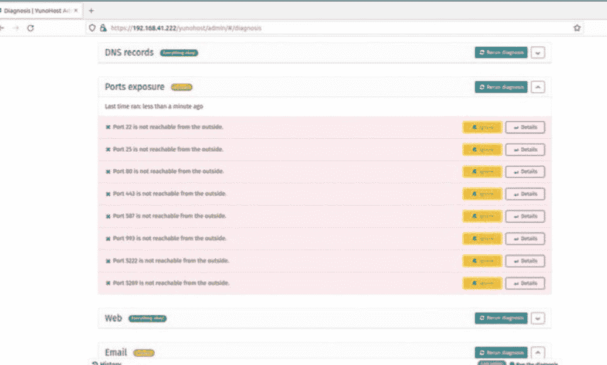

图 3：诊断功能帮助 YunoHost 检测配置中的错误，并对其进行分类。

带有红色高亮的许多问题通常会出现在“端口暴露（Ports expose）”类别中；这是因为许多路由器会阻止访问互联网所需的端口。只要你不需要从外部访问服务器，那么忽略 `25`、80 和 `443` 端口（这些端口在这里尤为重要）是可以的。如果需要，你可以通过选择“忽略（ignore）”来更改此检查状态。


可以使用绿色滑块打开或阻塞端口（见图 4）。页面下方的“操作（Operations）”还允许你定义防火墙规则。你可以通过页面上的按钮保存更改。

如果发生问题或应用程序运行不正常，最好的办法是查看系统日志，你可以通过“工具 | 日志（Tools | Logs）”访问。点击其中一个条目会打开一个子窗口，列出日志条目，并带有部分高亮。这有助于跟踪密集的日志。

# 防火墙与日志

YunoHost 在安装期间会启用内部防火墙，你可以方便地使用滑块进行控制。你可以在“工具 | 防火墙（Tools | Firewall）”中进行配置。列出的 IPv4 和 IPv6 端口：

图 4：集成防火墙列出了你想允许或阻塞的端口。

# 服务

要安装所需的服务，点击 Web 界面上的“应用程序（Applications）”。在下一个窗口中，你首先会看到一个没有任何应用程序的界面

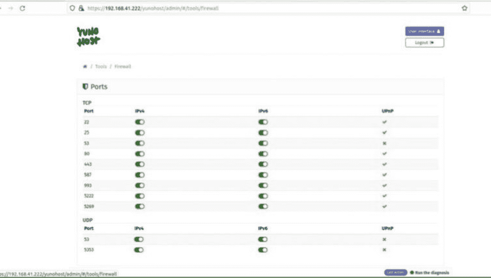

LINUX 杂志

第 267 期 2023年2月

YunoHost 门户将包含不同的磁片，每个磁片代表一个服务。

# LINUX 之声


在安装后，YunoHost 向你显示按分组排序的应用程序目录。在文本输入上方，你可以输入你正在查找的应用程序。点击左侧的放大镜图标显示匹配项。

但如果你想从特定的服务类别中选择，请点击右侧的箭头。会出现类别列表，你可以选择一个组。操作后，视图将仅显示所选类别的磁片（图 5）。如果存在子类别，则服务器

一旦你找到了想要的程序，点击磁片右下角的“安装（Install）”。之后，你将获得另一个有关应用程序安装参数的窗口。你可以使用该页面进行更改、命名包，然后按“安装”开始安装。

设置过程中，程序也会处理进度。设置完成后，你将在“应用程序”中找到新设置（图 6）。

# 数据备份

如果你安装了许多服务并有很多用户，备份整个系统是有意义的

图 5：Web 界面以磁片视图显示应用程序。

图 6：页面下方列出新应用程序。

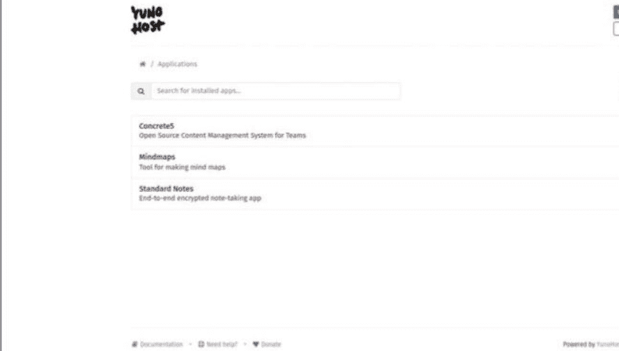

第 267 期 2023年2月 LINUX 杂志

# YUNOHOST LINUX 之声

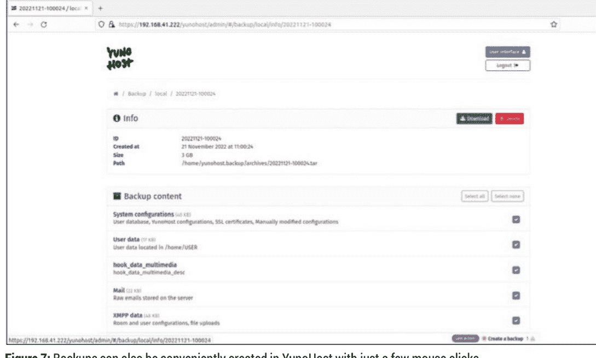

系统定期备份。点击“备份（Backup）”将带你进入列出所有备份的视图。点击右侧的箭头将打开实际备份窗口，列出所有备份。

通过窗口右上角的“新备份（New backup）”开始备份。后续视图定义了你想保存的内容。YunoHost 区分系统和已安装的应用程序。你可以勾选或取消勾选注册


# IT 亮点

忙于没有浏览新闻稿和话话的技术网站吗？让我们把相关的新闻、技术文章和工具提示直接送到你的收件箱。

- Linux 更新 • ADMIN 更新 • HPC 管理

紧跟 IT 行业动态。

ADMIN 和 HPC：bit.ly/HPC-Admin-Update

Linux 更新：bit.ly/Linux-Update

或者取消单个组件的备份。对于每个组，可以使用“全选（Select all）”或使用“全选（Select none）”排除备份。

完成后，点击右侧的“创建备份（Create a backup）”将开始备份，进度条将跟踪其进度。备份完成后，模块会在备份窗口中创建一个表格，显示相关服务的名称和日期。点击条目右侧的打开图标显示路径、备份组件和备份范围的信息（图 7）。点击“下载（Download）”将备份保存到本地计算机。

要恢复存档，点击单个组件右下角的“恢复（Restore）”，你可以从数据恢复中包含或排除它们。之后将进行实际恢复。

由于服务器使用基于 LDAP/SSO 的认证，在登录 YunoHost 后调用单个应用程序并不一定需要登录。你可以像切换传统的桌面应用程序一样切换单个工具。

另一方面，用户在门户上的配置选项有限。点击门户上的头像后，用户将进入一个对话框，允许编辑他们的姓名、密码、电子邮件地址和转发地址。

## 结论

YunoHost 帮助即使是经验较少的用户在不浪费时间的情况下构建服务器环境。系统使创建和管理用户变得直观，而应用程序的数量也几乎尽如完美。通过用户门户登录，用户切换应用程序无需重新登录。这使得 YunoHost 成为想要协作的小组的极佳选择。

# 用户门户

一旦你完成了所有设置并结束了所需的服务器服务，你就可以退出 YunoHost 管理界面。可以通过用户门户访问服务（图 8）。

> 信息
>
> - [1] YunoHost: https://YunoHost.org
> - [2] 最低要求：https://YunoHost.org

取决于管理员在创建每个用户时授予访问不同应用程序的权限。

图 8：通过点击相应的磁片选择所需的服务


# 游戏中的进程管理

# 系统控制

Btop 结合了高价值和极快的速度。系统监控和进程管理并非必须，但在处理计算机时是必不可少的。在命令行中，“top”是创建于 1991 年的经典应用程序，但在 Linux 上也可用，显示持续更新的进程列表以及处理器负载、内存消耗、任务数等详情（图 1）。

2004 年，top 被字符界面取代，并变得比许多 Linux 工具更流行。btop 比 top 更清晰，至少与可配置界面相比如此（图 2）。

实现了加速更新的目标。此外，该 C++ 程序比其前版本消耗更少的 CPU 和内存。btop 不仅适用于 Linux，适用于 FreeBSD 和 macOS。Windows 端口已经做好，并将很快发布。Btop 已经在 Windows Linux 子系统 (WSL) 上运行。

1.8 版本于 2022 年 6 月发布，已包含其他发行版的包管理器中（btop1.2.7）。如果你使用的是旧版本，可以轻松通过包管理器安装 btop。

1.9 版本是本期要介绍的最新版本，与其前版本相比，提供了许多错误修复、细节改进和新主题（图 4）。

# bashop, btop, btop++

开发者 Jakob P Lijenberg 心中有一个不同的图形化实现方案。他将其命名为 `bashop` [1]，它是一个 Bash 脚本（正如你从名称所猜的那样）。为了更新显示的值，Lijenberg 然后用 Python 编写了它们并将其发布为 `btop` [2]。

但这种情况并不是他所需要的，这促使了用 C++ 的重写，诞生了 `btop++` [3]。Reddit 平台上的 facebook 进程管理器粉丝写了一篇帖子，最终可能转换为汇编。这个虚构汇编器的名称留给你的想象。

# LINUX BTOP++

使用 UTF-8 编码，并需要支持点字的字体。

你还需要一个至少有 80x24 行的终端。

如果显示的字符与 GitHub 上的截图 [6] 不同，你可以在 btop++ 页面上的“注意（文本渲染问题）”下找到原因。

在正下方，btop++ 将视图分为两个窗格。在左中间，你可以看到内存（RAM）和存储媒体的日期。RAM 显示器显示了总内存以及已使用、缓存和空闲内存的条形图。在右侧，小图表表示内部内存。外部磁盘或 SSD 显示在此处，如果可用，还会显示 EFI 启动分区。此区域位于 CPU 下方。btop++ 显示数值，并在右侧配有图表用于视觉化监控网络流量。

## 什么是 btop？

btop 显示 CPU、内存、存储、网络和进程的实时统计数据，默认每两秒更新一次。可以使用键盘和鼠标操作这些值。在默认视图下，所有带有红色高亮字符的按钮都会响应鼠标点击，你还可以使用鼠标轮滚动表格。键盘操作通常非常实用且相当灵活。可以在设置中启用另一种 Vim 编辑模式。如果你是用户，可以使用鼠标配合 H 和 K 键导航列表。

界面在视觉上区分了各个区域；每个区域都使用不同的颜色组合或标准的黑色背景。顶部区域由 CPU 占据。在右侧，btop 显示了各个核心及其以百分比表示的负载和温度。在此上方，如果系统支持，你可以看到电池充电状态。在左侧，时间图表直视化了过去几分钟的负载。

接下来的两个进程的右半部分显示了一个列表，其中一个字段显示当前选中进程的详情。这是一个运行进程列表和其他信息。

## 准备就绪

完成这些操作、首次启动并熟悉环境后，你可能想按 `Esc` 或 `M` 访问配置。在打开的菜单中，你会找到“选项（Options）”、“帮助（Help）”和“退出（Quit）”。选项中的设置分布在 `cpu`、`mem` 和 `net` 标签页中。

在标签页中，你可以从几个到几十个主题列表中选择你喜爱的主题。你还可以为最后一个定义主题和背景。

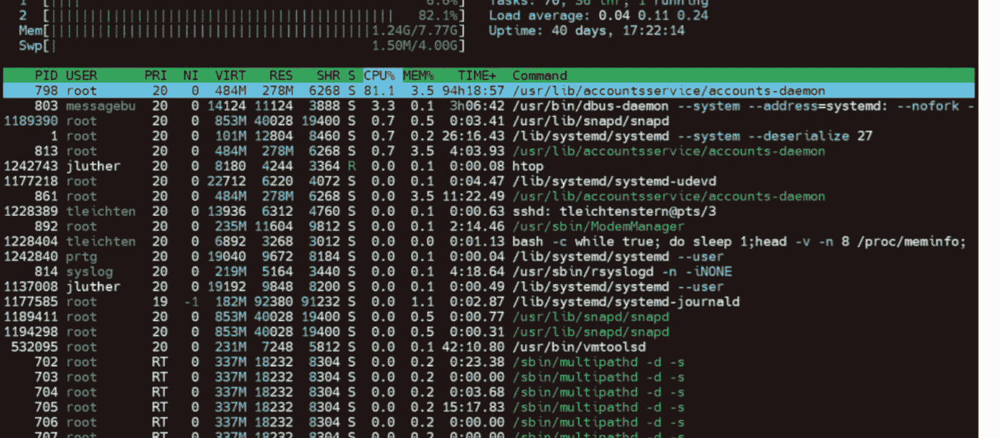

| PID | USER | NI | VIRT | RES | SHR | %CPU | %MEM | COMMAND |
|---|---|---|---|---|---|---|---|---|
| 118930 | root | 0 | 428800 | 27628 | 2100 | 0.0 | 0.5 | /usr/bin/systemd --system --user-session --no-fork |
| 81423 | root | 0 | 805000 | 15200 | 7400 | 0.0 | 0.2 | /usr/bin/systemd --user-session |
| 81424 | root | 0 | 124728 | 12700 | 9000 | 0.0 | 0.0 | /usr/lib/systemd/logind |
| 117218 | root | 0 | 227120 | 62702 | 4000 | 0.0 | 0.7 | /usr/lib/systemd/udevd |
| 122388 | root | 0 | 155412 | 43000 | 5000 | 0.0 | 0.1 | /usr/lib/systemd/journald |
| 122389 | root | 0 | 139636 | 7312 | 5000 | 0.0 | 0.0 | /usr/lib/dbus/dbus |
| 1225404 | root | 0 | 6288 | 3500 | 2000 | 0.0 | 0.0 | /usr/bin/bash -c |
| 1224084 | root | 0 | 215412 | 31400 | 5000 | 0.0 | 0.0 | /usr/bin/bash -c |
| 814 | user | 0 | 210516 | 35448 | 2400 | 0.0 | 0.0 | /usr/bin/python3 |
| 1173008 | user | 0 | 219200 | 7200 | 5000 | 0.0 | 0.0 | /usr/lib/systemd/network-manager |
| 118941 | root | 0 | 805600 | 43000 | 5000 | 0.0 | 0.5 | /usr/lib/systemd/timesd-resolved |
| 119011 | root | 0 | 75400 | 5000 | 5000 | 0.0 | 0.0 | /usr/sbin/network-manager |
| 532095 | root | 0 | 217248 | 72148 | 5000 | 0.0 | 0.1 | /usr/bin/vmtools |
| 703 | root | 0 | 337822 | 8336 | 5000 | 0.0 | 0.0 | /sbin/bin/multipath -d |
| 704 | root | 0 | 337822 | 8336 | 5000 | 0.0 | 0.0 | /sbin/bin/multipath -d |
| 705 | root | 0 | 337822 | 8336 | 5000 | 0.0 | 0.0 | /sbin/bin/multipath -d |
| 706 | root | 0 | 337822 | 8336 | 5000 | 0.0 | 0.0 | /sbin/bin/multipath -d |
| 707 | root | 0 | 337822 | 8336 | 5000 | 0.0 | 0.0 | /sbin/bin/multipath |
| 801 | root | 0 | 337822 | 8336 | 5000 | 0.0 | 0.0 | /sbin/bin/multipath |
| 802 | root | 0 | 124728 | 12700 | 9000 | 0.0 | 0.0 | /usr/lib/systemd/logind |
| 803 | root | 0 | 227120 | 62702 | 4000 | 0.0 | 0.7 | /usr/lib/systemd/udevd |
| 816 | root | 0 | 155412 | 43000 | 5000 | 0.0 | 0.1 | /usr/lib/systemd/journald |
| 817 | root | 0 | 139636 | 7312 | 5000 | 0.0 | 0.0 | /usr/lib/dbus/dbus |
| 814 | root | 0 | 6288 | 3500 | 2000 | 0.0 | 0.0 | /usr/bin/bash -c |
| 814 | user | 0 | 215412 | 31400 | 5000 | 0.0 | 0.0 | /usr/bin/bash -c |
| 810 | user | 0 | 210016 | 35408 | 2000 | 0.0 | 0.0 | /bin/python3 |
| 100 | | | 0 | 1000 | 200 | 5000 | 0.0 | 0.0 | /0/systemd/0-0 |
| 811 | root | 0 | 805600 | 43000 | 5000 | 0.0 | 0.5 | /usr/lib/systemd/timesd-resolved |
| 112 | root | 0 | 75400 | 5000 | 5000 | 0.0 | 0.0 | /usr/sbin/network-manager |
| 113 | root | 0 | 217248 | 72148 | 5000 | 0.0 | 0.1 | /usr/bin/vmtools |
| 104 | root | 0 | 337822 | 8336 | 5000 | 0.0 | 0.0 | /sbin/bin/multipath -d |
| 105 | root | 0 | 337822 | 8336 | 5000 | 0.0 | 0.0 | /sbin/bin/multipath -d |
| 106 | root | 0 | 337822 | 8336 | 5000 | 0.0 | 0.0 | /sbin/bin/multipath -d |
| 107 | root | 0 | 337822 | 8336 | 5000 | 0.0 | 0.0 | /sbin/bin/multipath -d |
| 707 | root | 0 | 337822 | 8336 | 5000 | 0.0 | 0.0 | /sbin/bin/multipath |
| 801 | root | 0 | 337822 | 8336 | 5000 | 0.0 | 0.0 | /sbin/bin/multipath -d |
| 802 | root | 0 | 124728 | 12700 | 9000 | 0.0 | 0.0 | /usr/lib/systemd/logind |
| 803 | root | 0 | 227120 | 62702 | 4000 | 0.0 | 0.7 | /usr/lib/systemd/udevd |
| 816 | root | 0 | 155412 | 43000 | 5000 | 0.0 | 0.1 | /usr/lib/systemd/journald |
| 817 | root | 0 | 139636 | 7312 | 5000 | 0.0 | 0.0 | /usr/lib/dbus/dbus |
| 814 | root | 0 | 6288 | 3500 | 2000 | 0.0 | 0.0 | /usr/bin/bash -c |
| 814 | user | 0 | 215412 | 31400 | 5000 | 0.0 | 0.0 | /usr/bin/bash -c |

完成这些操作、首次启动并熟悉环境后，你可能想按 `Esc` 或 `M` 访问配置。在打开的菜单中，你会找到“选项（Options）”、“帮助（Help）”和“退出（Quit）”。选项中的设置分布在 `cpu`、`mem` 和 `net` 标签页中。

在标签页中，你可以从几个到几十个主题列表中选择你喜爱的主题。你还可以为最后一个定义主题和背景。


界面在视觉上区分了各个区域；每个区域都使用不同的颜色组合或标准的黑色背景。顶部区域由 CPU 占据。在右侧，btop 显示了各个核心及其以百分比表示的负载和温度。在此上方，如果系统支持，你可以看到电池充电状态。在左侧，时间图表直视化了过去几分钟的负载。

接下来的两个进程的右半部分显示了一个列表，其中一个字段显示当前选中进程的详情。这是一个运行进程列表和其他信息。

## 准备就绪

完成这些操作、首次启动并熟悉环境后，你可能想按 `Esc` 或 `M` 访问配置。在打开的菜单中，你会找到“选项（Options）”、“帮助（Help）”和“退出（Quit）”。选项中的设置分布在 `cpu`、`mem` 和 `net` 标签页中。

在标签页中，你可以从几个到几十个主题列表中选择你喜爱的主题。你还可以为最后一个定义主题和背景。


# LINUX BTOP++

使用 UTF-8 编码，并需要一种支持点字的字体。

你还需要一个至少有 `80x24` 行的终端。

如果显示的字符与 GitHub 上的截图 [6] 不同，你可以在 `btop++` 页面上的“注意（文本渲染问题）”下找到原因。

在正下方，`btop++` 将视图分为两个窗格。在左中间，你可以看到内存（RAM）和存储媒体的日期。RAM 显示器显示了总内存以及已使用、缓存和空闲内存的条形图。在右侧，小图表表示内部内存。外部磁盘或 SSD 显示在此处，如果可用，还会显示 EFI 启动分区。此区域位于 CPU 下方。`btop++` 显示数值，并在右侧配有图表用于视觉化监控网络流量。

## 什么是 btop？

`btop` 显示 CPU、内存、存储、网络和进程的实时统计数据，默认每两秒更新一次。可以使用键盘和鼠标操作这些值。在默认视图下，所有带有红色高亮字符的按钮都会响应鼠标点击，你还可以使用鼠标轮滚动表格。键盘操作通常非常实用且相当灵活。可以在设置中启用另一种 `Vim` 编辑模式。如果你是用户，可以使用鼠标配合 `H` 和 `K` 键导航列表。

界面在视觉上区分了各个区域；每个区域都使用不同的颜色组合或标准的黑色背景。顶部区域由 CPU 占据。在右侧，`btop` 显示了各个核心及其以百分比表示的负载和温度。在此上方，如果系统支持，你可以看到电池充电状态。在左侧，时间图表直视化了过去几分钟的负载。

接下来的两个进程的右半部分显示了一个列表，其中一个字段显示当前选中进程的详情。这是一个运行进程列表和其他信息。

## 准备就绪

完成这些操作、首次启动并熟悉环境后，你可能想按 `Esc` 或 `M` 访问配置。在打开的菜单中，你会找到“选项（Options）”、“帮助（Help）”和“退出（Quit）”。选项中的设置分布在 `cpu`、`mem` 和 `net` 标签页中。

在标签页中，你可以从几个到几十个主题列表中选择你喜爱的主题。你还可以为最后一个定义主题和背景。


| PID | USER | NI | VIRT | RES | SHR | %CPU | %MEM | COMMAND |
|---|---|---|---|---|---|---|---|---|
| 118930 | root | 0 | 428800 | 27628 | 2100 | 0.0 | 0.5 | `/usr/bin/systemd --system --user-session --no-fork` |
| 81423 | root | 0 | 805000 | 15200 | 7400 | 0.0 | 0.2 | `/usr/bin/systemd --user-session` |
| 81424 | root | 0 | 124728 | 12700 | 9000 | 0.0 | 0.0 | `/usr/lib/systemd/logind` |
| 117218 | root | 0 | 227120 | 62702 | 4000 | 0.0 | 0.7 | `/usr/lib/systemd/udevd` |
| 122388 | root | 0 | 155412 | 43000 | 5000 | 0.0 | 0.1 | `/usr/lib/systemd/journald` |
| 122389 | root | 0 | 139636 | 7312 | 5000 | 0.0 | 0.0 | `/usr/lib/dbus/dbus` |
| 1225404 | root | 0 | 6288 | 3500 | 2000 | 0.0 | 0.0 | `/usr/bin/bash -c` |
| 1224084 | root | 0 | 215412 | 31400 | 5000 | 0.0 | 0.0 | `/usr/bin/bash -c` |
| 814 | user | 0 | 210516 | 35448 | 2400 | 0.0 | 0.0 | `/usr/bin/python3` |
| 1173008 | user | 0 | 219200 | 7200 | 5000 | 0.0 | 0.0 | `/usr/lib/systemd/network-manager` |
| 118941 | root | 0 | 805600 | 43000 | 5000 | 0.0 | 0.5 | `/usr/lib/systemd/timesd-resolved` |
| 119011 | root | 0 | 75400 | 5000 | 5000 | 0.0 | 0.0 | `/usr/sbin/network-manager` |
| 532095 | root | 0 | 217248 | 72148 | 5000 | 0.0 | 0.1 | `/usr/bin/vmtools` |
| 703 | root | 0 | 337822 | 8336 | 5000 | 0.0 | 0.0 | `/sbin/bin/multipath -d` |
| 704 | root | 0 | 337822 | 8336 | 5000 | 0.0 | 0.0 | `/sbin/bin/multipath -d` |
| 705 | root | 0 | 337822 | 8336 | 5000 | 0.0 | 0.0 | `/sbin/bin/multipath -d` |
| 706 | root | 0 | 337822 | 8336 | 5000 | 0.0 | 0.0 | `/sbin/bin/multipath` |
| 707 | root | 0 | 337822 | 8336 | 5000 | 0.0 | 0.0 | `/sbin/bin/multipath` |
| 801 | root | 0 | 337822 | 8336 | 5000 | 0.0 | 0.0 | `/sbin/bin/multipath -d` |
| 802 | root | 0 | 124728 | 12700 | 9000 | 0.0 | 0.0 | `/usr/lib/systemd/logind` |
| 803 | root | 0 | 227120 | 62702 | 4000 | 0.0 | 0.7 | `/usr/lib/systemd/udevd` |
| 816 | root | 0 | 155412 | 43000 | 5000 | 0.0 | 0.1 | `/usr/lib/systemd/journald` |
| 817 | root | 0 | 139636 | 7312 | 5000 | 0.0 | 0.0 | `/usr/lib/dbus/dbus` |
| 814 | root | 0 | 6288 | 3500 | 2000 | 0.0 | 0.0 | `/usr/bin/bash -c` |
| 814 | user | 0 | 215412 | 31400 | 5000 | 0.0 | 0.0 | `/usr/bin/bash -c` |

在控制台上进行监控进程管理。CPU、RAM、存储介质和网络的显示非常清晰且易于理解。进程管理比学习简单的键盘控制要容易得多，后者在几个几小时后就能让它变成你的本能，而所有功能都可以使用鼠标进行控制。

如果界面的配色方案让你联想起来更像游戏而不是工作，你可以通过配置各种主题之一，将 `btop++` 的外观更改为显示灰色色调。该工具的可配置性扩展到每一个细节，展示了开发者编写程序是多么容易。请阅读 GitHub 项目页面上的 Readme [11](https://github.com/aristocrats/btop#readme) 以获取更详尽的文档。

## BTOP++ LINUX 之声

### 简介

- [1] bashtop: https://github.com/aristocrats/bashtop
- [2] byyt: https://github.com/aristocrats/bytop
- [3] btop++: https://github.com/aristocrats/btop
- [4] installing btop++: https://github.com/aristocrats/btop#installation
- [5] terminal emulators: https://github.com/termstandard/colors#terminal-emulators
- [6] btop++ screenshots: https://github.com/aristocrats/btop#screenshots
- [7] "Notice (Text rendering issues)": https://github.com/aristocrats/btop#text-rendering-issues
- [8] SIG: https://en.wikipedia.org/wiki/Signal_(IPC)
- [9] Glances: https://github.com/nicolargo/glances
- [10] bottom: https://github.com/ClementTsang
- [11] btop++ readme: https://github.com/aristocrats/btop#readme

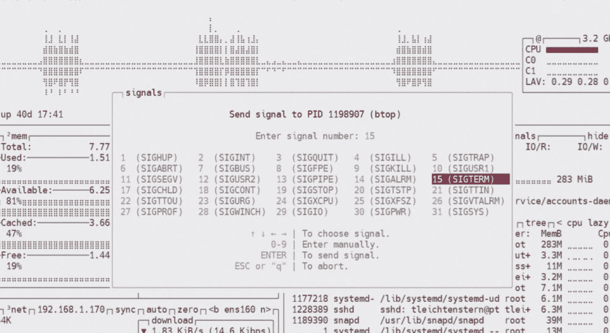

图 6：显示向所选进程发送的信号。除了 PID 和进程名称，还可以看到相关的应用程序以及处理相关的备注。

## LINUX FOSSPICKS

### FOSSPicks

自由开源世界中的闪耀明珠和新发布


Graham 很有幸参加了十年来首次在捷克共和国举办的 Ubuntu 峰会。如果他明年去，他承诺将举办一个关于让开源……的会议。作者：Graham MOR

## 音频工作站

### Ardour

年来，新的音频软件不断涌入，而 `PipeWire` 试图让 `Ardour` 堆栈专业化。在数字音频方面，有一款应用程序可以完成所有工作，而 `Ardour` 现在已经有 20 年的历史了，随着时间的推移，它已成为最强大的开源数字音频工作站。它安装在各地的 macOS、Windows 和 Linux 桌面，从非洲的录音室到南美的大学。它非常完美且灵活（就像 `Blender` 一样），这种灵活性源于它的精通程度，但也存在学习曲线。但如果你感兴趣从单个输入源制作随机曲目，`Ardour` 可以处理输入并可以直接将其获取到输出轨道和通道中，通过软件效果路由到许多数字音频工作站（DAW）。凭借这种灵活性，配合无限的音频源和目的地进行重写和实验。录音室方法也让 `Ardour` 成为专业录音和受训学生工程师的优秀工具，特别是这种工作方式在软件中如 `Pro Tools` 那样已非常成熟。

20 年前 `Ableton Live` 的发布改变了人们对工程师看待音频作品的挑战和方式。`Ableton` 并没有尝试模拟调音台和磁带录音，而是专注于使用“片段”（clips）创作音乐。片段是音频块，例如四个小节的循环、重复的旋律或一系列和弦。凭借这种灵活性，配合无限的音频源和目的地进行重写和实验。录音室方法也让 `Ardour` 成为专业录音和受训学生工程师的优秀工具，特别是这种工作方式在软件中如 `Pro Tools` 那样已非常成熟。

20 年前 `Ableton Live` 的发布改变了人们对工程师看待音频作品的挑战和方式。`Ableton` 并没有尝试模拟调音台和磁带录音，而是专注于使用“片段”（clips）创作音乐。片段是音频块，例如四个小节的循环、重复的旋律或一系列和弦。凭借这种灵活性，配合无限的音频源和目的地进行重写和实验。


- 1. `Ardour` 这种界面可以显示……
- 2. 这种界面可以显示……
- 3. 这种界面可以显示……
- 4. 这种界面：可以显示……
- 5. 这种界面：可以显示……
- 6. 这种界面：：可以显示……
- 7. 属性：可以……

### 项目网站

https://ardour.org

2023年2月 LINUX

## FOSSPICKS LINUX 之声

### 音频路由

### PipeWire qpwgraph

年来，新的音频软件不断涌入，而 `PipeWire` 试图让 `Ardour` 堆栈专业化。在数字音频方面，有一款应用程序可以完成所有工作，而 `Ardour` 现在已经有 20 年的历史了，随着时间的推移，它已成为最强大的开源数字音频工作站。它安装在各地的 macOS、Windows 和 Linux 桌面，从非洲的录音室到南美的大学。它非常完美且灵活（就像 `Blender` 一样），这种灵活性源于它的精通程度，但也存在学习曲线。但如果你感兴趣从单个输入源制作随机曲目，`Ardour` 可以处理输入并可以直接将其获取到输出轨道和通道中，通过软件效果路由到许多数字音频工作站（DAW）。凭借这种灵活性，配合无限的音频源和目的地进行重写和实验。录音室方法也让 `Ardour` 成为专业录音和受训学生工程师的优秀工具，特别是这种工作方式在软件中如 `Pro Tools` 那样已非常成熟。

20 年前 `Ableton Live` 的发布改变了人们对工程师看待音频作品的挑战和方式。`Ableton` 并没有尝试模拟调音台和磁带录音，而是专注于使用“片段”（clips）创作音乐。片段是音频块，例如四个小节的循环、重复的旋律或一系列和弦。凭借这种灵活性，配合无限的音频源和目的地进行重写和实验。


- 1. 这种界面可以显示……
- 2. 这种界面可以显示……
- 3. 这种界面可以显示……
- 4. 这种界面：可以显示……
- 5. 这种界面：可以显示……
- 6. 这种界面：：可以显示……
- 7. 属性：可以……

### 项目网站


# Matrix 客户端

## FluffyChat

我们可能还需要跳过这组 FOSSPicks 来寻找一个 Matrix 客户端。由于 Matrix 客户端经历了所有的技术变化，它的实例，甚至运行自托管服务器。Matrix 拥有庞大的新用户，而且该平台似乎在每一个侧面都出现了。FluffyChat 是一个客户端，用它自己的话说，“开源。跨平台聊天界面”，这源于它的名字和设计方式。FluffyChat 名字中的“F”很可能是因为它是专为 Flutter 编写的，该客户端构建了一个既熟悉又现代、快速且灵活的用户界面。Flutter 是由 Google 开发的，作为结果，它非常擅长创建动态、多功能且漂亮的界面，适应任何形式和桌面尺寸。这正是为什么你需要在桌面端使用 FluffyChat——以应用程序的形式、跨平台客户端以及 Android 应用程序的形式。它们都具有相同的响应式界面，左侧显示联系人和图表，右侧显示对话。你可以更改颜色，在亮色和深色主题之间切换，甚至创建对话的备份。Matrix 是一个开源联邦化平台，支持群组和端到端加密。这是通过 Flutter 特有的平滑过渡和精美的动画滑动面板实现的。如果你使用过 QJACK，你就会非常熟悉……

### 项目网站

https://fluffychat.im

# LINUX 源码

# FOSSP 精选

## 音频插件

### PlugData

音频世界变得日益复杂。出于这个原因，我们许多人依赖其他聪明的人来开发算法和软件包，并将它们作为插件在我们喜爱的音频软件中使用。

这是一个用于生成你自己的声音和效果的工具，也是该行业的灵感来源（非开源，来自 Cycling "74" 公司的 Max）。这一事件促成了 Max Live 的诞生，这是一个适用于 Windows 和 macOS 上 Ableton Live 的令人惊叹的插件和编程环境。

但也有少数应用程序可以在不要求数字信号处理硕士学位的情况下帮助解决节奏问题。其中最出色的是 Pure Data。Pure Data 是一种专为音频和控制消息处理设计的视觉化编程语言。你通过脚本将输入和输出连接在一起，但同样可以加载并修改数百个预定义的补丁、算法和对象。它是一个强大的……

尽管有许多补丁和修改可用，但 Pure Data 补丁帮助我们使用数据路由进行开放音频应用。而 PlugData 可以提供帮助。它是在 JUCE 插件内部运行的 Pure Data 版本。你可以将任何音频脚本转换为模块和可编程音频处理器，就像 Max Live 的后期效果一样，这是我们以前无法接触到的……

PlugData 是 Max 的开源版本，你可以用它与其他开源软件一起使用音频世界。它包含了许多对象，你可以在 Pure Data 中原生地完成你想做的一切。正如你预期的，它包括 MIDI 和 OSC 数据处理，使得 PlugData 成为功能完备的 Pure Data 版本，处于它最有用的地方——录制或制作系统的音频路径内部。

### 项目网站

github.com/timothyschoen/PlugData

## 软件包管理器

### Pacstall

Arch Linux 改变了 Linux 的格局，并单凭自己实现了极简发行版。它省了安装过程，也不会对用户可能需要的内容做出假设。在易安装和发行测试方面，Arch 将责任交给了用户，但这样做是有好处的。Arch Linux 蓬勃发展并成为 Valve Steam Deck 的默认系统，这都要得益于 Arch 用户仓库 (AUR)。

AUR 软件包既简单又极其多样，但 AUR 是寻找新软件包的首选之地。为什么 AUR 也要验证这些页面呢，因为它帮助我们安装和配置我们所介绍的内容：

Pacstall 是一个将你在 AUR 中发现的便利性和多样性带到 Ubuntu 的项目。它并不使用 AUR 本身，而是汇总了许多不同的软件包格式，包括二进制、Git、Appimage，并为你构建软件包。通过这种方式，你可以获得来自 Git 的最新版本或从分支构建的包。其命令系统类似于 pacman，通过 `pacstall -S` 后接包名来安装包。没有太多复杂的包，但它们包含了开源和专有包，包括 Android。

```bash
$ pacstall -S package
$ pacstall -R package
$ pacstall -U package
```

Pacstall 是一个快速的脚本，但一旦安装，它就可以向你的 Studio、Bingo 和 Bittoren 添加更多实验性软件包。更重要的是，这些软件包的创建方式类似于 AUR 软件包，带有一个简单的描述性脚本，易于访问且易于生成。这不仅意味着你可以确定自己真正得到了什么，还可以以很小的难度创建任何其他软件包。

### 项目网站

github.com/pacstall/pacstall

# 摄像头控制

# FOSSP 精选 LINUX 语音

## Cameraterils

多年来，我们许多人一直非常满足于使用低质网络摄像头进行视频会议和闲聊。这主要是因为你仍然能见到面，所以你对他们的记忆不会被廉价传感器的粗糙色彩和噪声所污染。情况发生了变化，现在我们最新的网络摄像头具有更好的传感器、更低的噪声，并能够实现每秒 60 帧的 4k 解析。遗憾的是，Linux 上使用的大多数摄像头通常无法配置到其全部功能，因为制造商通常将这些选项隐藏在他们的应用程序中。

Cameraterils 的出现拯救了这一局面。它暴露了 V4L2 支持的所有选项，并增加了罗技 Brio 和 Razer Kiyo 在其 Windows 驱动程序中提供的许多隐藏选项。这些选项可以通过命令行（如 `v4l2-ctl`）或使用 GTK 前端进行配置。这些非常好，因为你可以在使用摄像头的同时进行配置，在视图轻松打开并调整设置。例如，有一个选项可以打开视频流，以便你可以在通话之前进行配置并保存。最重要的是，这是使用非标准摄像头功能（如平移、旋转、缩放以及 HDR 设置）的唯一方法，如果没有 Windows 安装，这些功能可能无法实现。你可以将这些设置保存到摄像头本身，或者如果你的摄像头无法保存所有内容，可以轻松地保存到系统，以便下次连接摄像头时可以恢复。

Cameraterils 帮助你配置摄像头并利用其功能。

### 项目网站

https://github.com/soyeroy/cameraterils

# 历史改进

## hiStory

听起来像是为一位寻找“历史”的讲师命名的，hiStory 值得你关注。它更新了我们 shell 和终端交互中最重要的几个功能，这些历史记录涵盖了我们使用上下方向键的大部分内容，并带有几个额外的字母来搜索他们的命令。然而，这个默认历史工具的问题在于，你记得的命令，其上下文环境完全丢失了。一个命令可能是在远程会话中输入的，即使是不同的用户、在文件系统中不同的环境或位置，它仍然会存在于你的历史中。这个历史工具能做的最好就是当你需要移动到不同的机器时，将你的记忆恢复到运行命令之前的相同设置和配置——hiStory 通过记住命令的上下文进行了改进。例如，它可以记住你运行命令的目录，无论命令执行成功与否。如果你曾经搜索历史记录却发现了一些格式错误的参数，这可能看起来不是什么大问题，除了你正在寻找的那个成功命令的样式外，所有参数具有相同的优先级。这就是 hiStory 可以派上用场。它取代了之前提到的两个历史访问命令。

### 项目网站

https://github.com/duanh/hiStory

# 飞行模拟器

## FOSSPICKS LINUX 之声

### FSHistory

尽管 1980 年代的家用电脑受到 CPU 和内存的限制，它们已经能够大显身手。它们运行的视频游戏远不止于此。游戏的计算能力达到了十年后的预想水平，从《打砖块》（Breakout）开始，到《幽灵大战》（Ghosts）结束。最具有沉浸感的体验是利用 8 位集成电路在 CRT 显示器上投射出三个 3D 世界。当时除了《精英银河战士》（Elite）之外，就是 1982 年 11 月首次发布的《微软飞行模拟器》。FSHistory 让你能够在 3D 空间中从各种现实世界进行真实的飞行，并具有中等程度仪表飞行力学真实性，这在那个时代是尤为特别。当时你每秒只有几帧，有时帧会变得无响应，但尽管如此感觉依然像未来——2020 版《微软飞行模拟器》只有在你使用 HOTAS 和虚拟现实（一张价值 2000 美元的显卡）时才能接近那种感觉。

令人惊叹，尤其是考虑到它的价格。Decom 飞行模拟器 4 以 MIT 许可发布，FSHistory 提供了构建此版本所需的支持代码和基础设施，且没有进度指示；构建 FSHistory 需要几秒钟，而启动它是瞬间完成的。现在游戏运行速度达到每秒数百帧，不太可能无响应，但它本质上仍然是一个在现代硬件上构建的 1989 年版《飞行模拟器4》版本。它比 2020 版《微软飞行模拟器》中的 Eager 要好得多。


感觉像是一种真实的体验，需要不错的鼠标和键盘才能到达任何地方。代码是相同的，游戏也是如此，从笨拙的菜单系统到控制、图形和窗口——没有比更好了，因为你正处在 1989 年。如果你能调整系统来适应它并玩《飞行模拟器》，它几乎是最好的怀旧之旅，就像从奥克兰国际机场的 28 号出发一样。

### 项目网站

https://github.com/snake/FSHistory

# 兼容性工具

## Proton-Qt

虽然 Valve 否认其 Steam Linux 发行版的正式发布，但有很多 Valve 的游戏工具正处于等待状态。列表中包括 Proton，它是 Wine 的特定补丁版本，将令人惊叹的游戏带到原生 Linux 桌面。Proton 的性能助力了 Steam Deck 的成功，你可以在你的原生 Linux 桌面上使用它。一个问题是：Proton 有几十个版本，对不同游戏有性能影响不同。这正是 Proton-Qt 解决的问题，它帮助你下载和管理多个版本的 Proton，特别是 Proton-GE——一个社区构建的前沿 Proton 版本——以及其他兼容性工具。它可以帮助你从游戏中获得最佳性能，无论你使用的是 Steam Deck 还是桌面级 Linux 电脑。它有点像最近创建的 Luopdeka，但现在你只需要配置已安装的 Proton 版本。它是通过 Proton-qt 安装的。

Proton-Qt 是 Proton-qt 的图形化等效版本，让不同的用户更容易使用和配置。带有内置的 UI，它在 Steam Deck 桌面上易于使用，在任何 Linux 桌面上同样有用。它的工作原理像包管理器，你只需从 Proton-qt 中选择想要安装的 Proton 版本即可。

使用 Proton-Qt 可以轻松安装各种可爱的 Proton 版本和其他游戏工具。除了 Proton 和 Lutris 之外，你还可以安装 Wine-GE 版本，以增强 Steam 中的兼容性和性能。然后，你可以为 Steam 中选定的游戏选择哪种实用程序为你服务（或让 Proton-Qt 为你完成这些），或者与 Lutris 启动器一起工作，从而充分利用 Linux 游戏系统的效能。

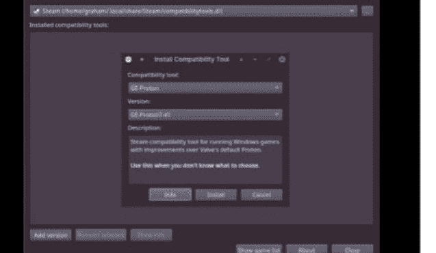

https://github.com/david/proton-qt

# LINUX 之声教程 – SKROOGE

## 使用 Skrooge 管理你的个人财务

Skrooge 是一款会计程序，它可以整理你的财务状况并为你提供更好的概览。任何想让自己的财务变得井条化并发现潜在储蓄的人都会喜欢这个优秀的财务管理程序。Skrooge 是专门为管理个人财务而开发的。它可以帮助你记录收入和支出，按类别分类，并进行图形化评估。该程序的名称基于查尔斯·狄更斯的《圣诞歌》。截至 2022 年 7 月 30 日，Skrooge 当前版本为 2.8.0。该程序最初为 KDE 开发，但也运行在其他环境中。大多数发行版的仓库中都提供 Skrooge，你可以通过包管理器方便地安装。然而，它们并不总是为你提供最新版本。你可以获取此 AppImage、Flatpak 或 Snap。完成安装后，你可以点击相应的图标或使用以下 Flatpak 命令启动 Skrooge：

```bash
flatpak run org.kde.skrooge
```

### Skrooge 设置

当第一次出现时，Skrooge 的主窗口会出现（图 1）。选择其中某一项会在主窗口的右侧打开一个带有所选功能的新标签页。由于 Skrooge 使用标签页，可以同时打开多个功能。要返回初始窗口，只需关闭所有标签页。

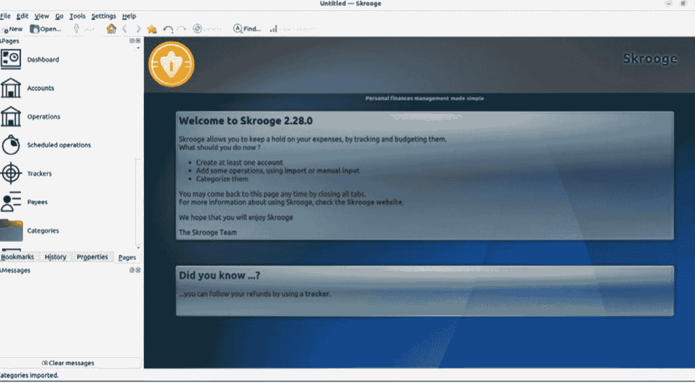

图 1：Skrooge 中的主窗口分为两个区域。你可以看到左侧。

## 教程 - SKROOGE LINUX 之声

如果你导入数据，Skrooge 支持常见的 QIF 和 QFX 格式。如果你遇到困难，可以通过帮助 | 查看。如果你从头开始，要件事是指定存储位置。如果需要。

### 添加账户

首先，在 Skrooge 中添加所有的账户。这包括你的支账户、信用卡和储蓄账户、证券账户。你还可以创建一个独立的现金账户。为此，点击左侧的账户。将出现一个带有空白字段的新标签页。输入你的数据

### 定义类别

第二步是为你的收支创建类别。为此，点击左侧的类别。Skrooge 自带预定义类别，因此你可能需要自己定义。这将为你提供精确符合你要求的类别。

你可以通过在下方区域的名称字段中输入名称并点击旁边的按钮 (+) 来创建一个新类别。为了更清晰，你可以根据需要创建子类别。你不需要创建一个列表；类别以后可以修改。

当你发布条目时，每个类别后都会列出总额。这让你了解你花了多少（以及花在哪些方面）或赚了多少。

### 添加人员

最后一步是添加所有的收入来源和支付对象。你可以包括你的雇主、房东以及你经常购物的地方。人员可以帮助你通过最新的账户使财务系统化。

# LINUX 教程 – SKROOGE

这意味着当你支出或收入时，以及这些钱的去向如何。如果你经常从某人那里收到钱或向他们付款，就有必要创建“收款人”（Payees）。在你的数字预算中输入条目时，现实情况下你需要指定一个收款人。对于很少光顾的商店，不需要创建收款人。

跟踪你的财务状况但并不是强制性的。如有必要，你也可以添加注释。输入数据后，点击“添加”（Add）将操作传输到你的预算簿中。现在你将会在操作列表中看到一条包含你输入数据的新行。

点击侧边栏的“收款人”（Payees）打开收款人概览。你可以通过在下方区域输入数据来添加新的收款人。你至少需要有一个收款人，可选地提供地址。如果你有相同类型的收入或支出（例如从面包店购买的食物），你可以直接在相应的类别中输入详情。点击“类别”（Category）即可将其添加到收款人列表中。如果你之后添加了收款人，可以随时编辑列表。一旦你进行了分录，相应的金额就会出现在每个收款人的右侧。

关于输入收入的小提示：记录你的工资，而不是你收到的金额。你需要说明收入、税收、社会保险费用和其他扣除项。如果你使用不同的财务工具来获取税务申报时的正确金额……

如果一个操作属于不同的类别——例如，你在同一家商店购买了杂货、个人卫生用品和杂志——点击“拆分”（Split）按钮将金额分配到各个类别中。

将资金从一个账户转移到另一个账户是一种特殊操作。例如，如果你从 ATM 取款，你的账户有一笔支出，同时你有了现金。要执行此类操作，请点击页面底部的“传输”（Transfer）按钮。这并不意味着从你的账户传输到另一个账户，而是你自己的两个账户之间的传输。账户字段中的支出账户，例如在从 ATM 取款时为“活期”（Current）。目标账户位于“至”（To）字段中，例如“钱包”（Wallet）。

## 收入与支出

输入收入和支出。按照通常的方法，新标签页将显示你的收入和支出。你可以在下方区域的字段中（图 4）输入新操作。

只需选择账户并输入日期和金额，记住在支出前加上负号。你还从列表中选择合适的收款人和类别。两者都保持

# SKROOGE – LINUX 语音

当你点击“股票”（Shares）按钮时，Skrooge 会打开一个购买证券的单独输入界面。你可以将总金额分为属于股票的实际金额，加上任何费用和税费。然后说明你希望提前几天发布该项目。如果你在这里选择 0，Skrooge 将当天发布该项目。

## 同步操作

## 常规操作

某些收入和支出定期发生，例如工资或租金。你不需要为这些操作重新输入。例如，你可以右键点击操作行，并从菜单中选择“计划”（Schedule）。将打开一个新标签页，你在其中输入常规操作的详情（图 5）。

首先输入操作下次到期的时间。然后输入间隔，例如每月一次。在 Skrooge 最后一次发布该操作时添加截止日期。要此操作，请勾选“发生次数”（Number of occurrences）或指定结束日期。如果你希望它持续，请不要勾选此框。你也可以选择提前几天提醒该操作。

如果你勾选了“自动”（Automatically），Skrooge 将自动在你的预算簿中发布该项目。

图 5：你只需要输入常规收入和支出。要做到这一点，你需要创建一个计划操作，告诉 Skrooge 自动发布该项目。

图 6：为了保持记录更新，你需要定期将你的预算与银行账单和现金进行核对。

如果现金账户中存在差异，点击右侧按钮在你的预算簿中输入差异。你可以在日常生活中收集零星支出。

通过 `文件 | 导入 | 带有后端的导入..` 菜单在 Skrooge 中访问 AqBanking。

## 导入银行账单

许多银行允许你以逗号分隔值（csv）下载银行账单，这种文件格式将数据存储在文本文件中，便于在不同程序之间交换数据。使用 `文件 | 导入..` 菜单项，你可以加载某种格式的账户账单，省去逐个输入数据的麻烦……

## 财务评估

点击左侧边栏中的“月度报告”，Skrooge 将打开你上个月或上季度的收支概览（图 7）。这有助于你跟踪收支情况以及与上个月或上季度相比的任何变化。你可以看到月底剩下多少钱，以及你可以负担得起多少支出。储蓄帮助你发现三个月内潜在的节省空间……


# Skrooge 导入与预算管理

## CSV 导入配置

Skrooge 尝试将预算簿中的字段与 CSV 文件中的列进行映射。如果你看到错误，你需要更改导入 CSV 文件的设置：`| 配置 Skrooge 导入 | 编辑正则表达式 |`。所需的设置将取决于 CSV 的结构。要发现更多信息，请用文本编辑器或电子表格打开文件。在第一行中，你将看到个人的名称。将名称传输到你的程序，这样你也可以从 CSV 文件为每个字段分配值。

## 预算与利息

一旦你记录并分析了一段时间的财务，你就创建一个预算。要做到这一点，请创建一个每月或年度预算。对于支出，设置一个你每次外出想要花费的最大金额。你可以使用类别来跟踪本月已经使用了多少预算。

或者，你可以通过 AqBanking 加载银行账单数据。如果你还没有 AqBanking，你需要先在系统上安装它。你的银行将为你提供设置所需的数据。之后，你就可以……

你可以创建预算，或者直接让软件来完成。如果你选择后者，点击窗口底部的“自动”（Automatic）。

**图 7**：Skrooge 在单一视图中显示你的收入和支出，这将帮助你跟踪记录。

## 教程 — SKROOGE LINUX 语音

预算窗口。Skrooge 分析一年的自动化数据作为创建预算的基础。预算计算要真实：应该有完整一年的数据。

如果你利用了潜在的储蓄并将钱存起来，那么投资你的过剩资金可能是值得的。要查看潜在利息回报的概览，点击侧边栏的“模拟”（Simulations）打开利息计算器。在窗口底部，选择“摊还表”（Amortization Table）而不是“利息”（Interest），以显示贷款的每月利息和分期付款。

并为你提供支出在哪里以及收入从何处来的概述。该程序关注对个人财务至关重要的方面。使用类别的系统化方法。

## 结论

开发者将 Skrooge 设计为一个数字预算簿。这很少将该程序与 GNUCash 或 KMyMoney 等财务管理器区分开来。该程序关注对个人财务至关重要的方面。使用类别的系统化方法。

## 信息

+ [1] Skrooge: https://skrooge.org/
+ [2] Skrooge download: https://skrooge.org/download/
+ [3] AqBanking: https://github.com/aqbanking/aqbanking
+ [4] GnuCash: https://www.gnucash.org
+ [5] KMyMoney: https://kmymoney.org

# 像专家一样思考

《Linux Shell 手册》2022年版

新版包含了用于系统配置和故障排除的最重要的实用工具。

+ 以下是你可以在书中发现的部分内容：
- 定制 Bash
- 正则表达式
- Systemd
- Bash 脚本编写
- 网络工具
- 以及更多内容！

在线订购：`shop.linuxnewmedia.com/specials`

# LINUX 新闻摊

《Linux 杂志》是您探索 Linux 世界的指南。每期杂志都装满了在其他任何地方找不到的先进技术文章和教程。您可以浏览我们完整的过往期刊目录，以查找特定主题或管理您的收藏。

在线订购：https://bit.ly/Linux-Newsstand

## 266/2023年1月

### 生成式对抗网络

近期计算机艺术和伪造视频爆发背后的秘密是什么？一个神经网络在欺骗另一个网络……

DVD 光盘包含：Ubuntu 22.11 和 AlmaLinux 9.0

## 265/2022年12月

### 量子计算

大多数 Linux 用户都知道这种未来技术是如何利用量子力学的奇特力量的。但它究竟是如何运作的？今天是否有相关的工具可以帮助我进行实验？本月我们将深入探讨量子计算。

DVD 光盘包含：Manjaro 21.3.7-220816 和 Arch Linux 2022.10.01

## 264/2022年11月

### 人工智能

尽管机器学习现在已经是我们日常生活中不可或缺的一部分，但它仍然充满神秘色彩。本月，我们将揭开面纱，介绍一些流行的监督学习和无监督学习技术。

DVD 光盘包含：Debian 11.5 和 Rocky Linux 9.0

## 263/2022年10月

### 构建物联网设备

Linux 最令人惊叹的是它的灵活性。Linux 运行在世界上最大的计算机上，也运行在你家中的许多微型设备上。如果你一直好奇开发者是如何让 Linux 运行在微型技术上的，你将会非常喜欢本月的 Buildroot 和 Yocto 项目。

DVD 光盘包含：Linux 杂志存档 1-262 期

## 262/2022年9月

### 超 5G 时代

在背后，手机从未像现在这样成为高度专业化的设备，但最近的一些创新正在改变这一点。本月我们探索了 Open RAN 规范，它可以允许在现成硬件上运行。

DVD 光盘包含：openSUSE Linux 和 MX 21

## 261/2022年8月

### USB 启动

USB 在 15 年前是一个令人兴奋的想法——只需随身携带 CD 去往任何地方。旧式的 CD 有很多局限性。今天的 USB 工具解决了以前没人想过的问题：在单个优盘上访问多个镜像。

DVD 光盘包含：Linux Mint MATE 20 和 FreeBSD 13

## 特色活动

用户、开发者和供应商在世界各地的 Linux 活动上汇聚。《Linux 杂志》荣幸介绍此处展示的特色活动。其他活动请访问 `www.linux-magazine.com` 查看我们详尽的在线日历。如果您知道想要添加到我们日历的其他活动，请向 `info@linux-magazine.com` 发送邮件。

> **注意**：在预订任何行程之前，请务必检查活动网站，因为受 COVID-19 影响，许多活动正在取消或转换为虚拟活动。

### SCALE 2023

- **日期**：2023年3月9-12日
- **地点**：加利福尼亚州帕萨迪纳
- **网站**：https://www.scocalinusepo.org/blog/scale-2023

第20届年度南方 Linux Expo 将于2023年3月9日至12日在加利福尼亚州帕萨迪纳会议中心举行。SCALE 是北美最大的由社区运营的开源会议。

### FOSS 后台

- **日期**：2023年3月13-14日
- **地点**：德国柏林
- **网站**：https://www.foss-backstage.de

加入我们的 FOSS 后台，与自由和开源世界的专家进行为期两天的精彩演讲、研讨会和小组讨论。可在柏林或在线参加。

## 活动日程表

| 活动 | 日期 | 地点 | 网站 |
| :--- | :--- | :--- | :--- |
| FOSDEM 2023 | 2月4-5日 | 布鲁塞尔 | fosdem.org/2023/ |
| ITEXPO | 2月14-17日 | 佛罗里达州劳德代尔堡 | itexpo.com/event/ |
| DeveloperWeek | 2月15-23日 | 加利福尼亚州旧金山 | developerweek.com/ |
| GeoBean Fest | 2月18日 | 虚拟活动 | gbfest.org/ |
| FAST'2023 | 2月20-23日 | 加利福尼亚州圣克拉拉 | usenix.org/conference/fast-23 |
| SCALE 2023 | 3月9-12日 | 加利福尼亚州帕萨迪纳 | scocalinusepo.org/blog/scale-2023 |
| Cassandra Summit | 3月13-14日 | 加利福尼亚州圣何塞 + 虚拟 | linux.infofound.org/ |
| FOSS Backstage 2023 | 3月14日 | 德国柏林 + 在线 | foss-backstage.de |
| Everything Open 2023 | 3月14-16日 | 澳大利亚墨尔本 | 2023.everythingopen.au/ |
| Women in Cybersecurity | 3月16-18日 | 科罗拉多州丹佛 | wics.org/events/wics-2023/ |
| CloudFest | 3月21-23日 | 德国欧洲公园 | cloudfest.com/ |
| KubeCon CloudNative Event 2023 | 4月17-21日 | 荷兰阿姆斯特丹 | linux.infofound.org/ |
| Cloud Expo Europe | 5月10-11日 | 德国法兰克福 | cloudexpoeuurope.de/en |
| ISC High Performance | 5月21-25日 | 德国汉堡 | isc-hpc.com/about-overview.html |

# 下个月预览

## 第 268 期 / 2023年3月

### 数据投毒

机器学习始于寻找正确的训练数据。你是否曾想过，攻击者利用错误的训练数据会造成什么样的破坏？下个月，我们将探讨数据投毒和 AI 的阴暗面。

## 预计上架日期

| 地区 | 上架日期 |
| :--- | :--- |
| 英国 / 欧洲 | 2月10日 |
| 美国 / 加拿大 | 3月17日 |
| 澳大利亚 | 4月28日 |

> **注意**：上架日期为预计时间，可能会因为物流问题而延迟。

## 预览通讯报

《Linux Magazine Preview》是一份月度电子邮件通讯报，让你提前预览下一期内容，包括在线发布文章的链接。

注册地址：https://bit.ly/Linux-Update

## 云计算大会 (CLOUDFEST)

2023年3月21-23日

德国欧洲公园 (Europa-Park)

- 6,000+ 参与者
- 250+ 演讲者
- 150+ 合作伙伴
- 65 个国家

全球最大的云行业盛事已就绪，再次入驻一座壮丽的欧洲游乐公园，促进新的合作伙伴关系、深度知识共享以及该行业见过的最棒派对。

这不是视频会议。

你必须穿裤子！

## 开启你的云之旅

并节省 399 欧元！

使用您的免费优惠码：`CF23ADMIN`

## 静谧且强大！

**TUXEDO Pulse 15 - Gen2**

- **AMD Ryzen 7 5700U-35W**
  - 8 核心 | 16 线程
- **WQHD 显示屏**
  - 2560 x 1440 | 165 hz
- **长达 18 小时的续航时间**
  - 91 Wh 电池
- **坚固镁合金机身**
  - 1.7 cm 薄 | 1.5 kg 轻

- 100% Linux 原生
- 5 年质修
- 终身支持
- 德国制造
- 德国隐私保护
- 本地支持

TUXEDO

`tuxedocomputers.com`
