# Linux 用户与开发者 130 - 终极发行版 2013

揭秘核心评测中的精华

> 我使用 PoundHost 的服务已经快 4 年了，我可以告诉你，这是一项顶级服务。
>
> 他们在部署、处理紧急需求方面非常出色且快速，性价比是最高的。
>
> 绝对是卓越的服务！市场上最棒的托管公司。我爱死它了！便宜且快速的独享服务器！
>
> 对于那些正在寻找最佳托管服务的人，我强烈推荐 PoundHost。向所有 PoundHost 员工表示诚挚的感谢。
>
> PoundHost 的网络非常快且稳如磐石，支持工单总能得到专业人士的快速响应。
>
> 如果你需要一台价格极优且支持极佳的服务器，别再找了，你会对 PoundHost 感到`非常满意`的。

Mr Marcelo

早期项目负责人

Jarosaw Glogowski

Mobi 营销

技术总监

## 欢迎阅读 Linux User & Developer 第 130 期

Mihalis Tsoukallas 拥有 15 年以上的 UNIX 系统管理和编程经验，并自 1993 年起就开始使用 Linux。他是一名精通的 Linux 管理员、Cisco 和 Ghost 专家。Mihalis 在第 62-65 页的专栏中带我们了解如何处理 `Cisco` 日志。

Stuart Burns 是一位资深的 Linux 用户，任职于一家世界五百强公司，并热爱编写关于 Linux 的文章。Stuart 在第 34-37 页向我们介绍了如何使用简单的开源包构建强大的防火墙。

Michael Reed 是一名技术作家，离开 Linux 已超过 15 年。他带着新事物回归了 Linux。Michael Reed 从第 48 页开始向我们展示如何使用 Linux 管理系统以及我们能发现的内容。

Jon Masters 是一位 Linux 内核黑客，从上大学起就开始从事 Linux 工作已有 18 年。他现在住在马萨诸塞州剑桥，在一家大型 Linux 供应商工作。一如往常，他在第 16-19 页有自己的常规专栏。

Gareth Halreece 是我们的新常驻成员，从第 12 页开始报道最新的开源生态和企业动态。此外，Alice Guest 带领我们通过长达 12 页的内容探讨 Linux 世界的热点与冷点。你可以阅读第 22 页开始的专题。

欢迎阅读 Linux User & Developer 最新一期，这是英国和美国最喜爱的开源与 Linux 杂志。

我们关于计算机世界的专题之一是最令人沮丧的：技术在不断演进，我们与技术交互的方式也是如此。例如，移动设备的飞速崛起改变了一切——它将 `ARM` 从受尊敬的英国处理器设计者变成了与 `Intel` 和 `AMD` 并列的 CPU 超强国之一。得益于 `Android`，`Linux` 内核就在全球数百万人的手中。显著的是，它正在彻底改变我们交互技术的方式，而不仅仅是使用它。尽管这让爱好者来说是一个非常兴奋的时代，但也可能相当令人恼火；随着市场对日益多样化用途的需求增加，我们已经摸索出了人们应该如何使用 `Linux`，而 `PRIME 3` 是我们在这一新领域早期斗争中最明显的例子，前路依然漫长。

对你来说，答案是什么？——我们写了一篇精彩的专题来赞扬现代源码计算的每一个方面，它让我们感觉好多了……

**编辑：**

Russell Baxter, 编辑


Robert Zwielt 在大学期间学习软件工程，使用 `Python` 进行复杂的模拟。Robert 在第 72 页告诉我们应该从哪个 `IRC` 工具开始，他带我们介绍了 `Gentoo Linux` 的过程并完成了他的 `Python` 教程。


## 新闻

Linux 社区最新动态

# 开源

## Rapiro 能做什么？


### 表达

使用 `Arduino` 控制器，`Rapiro` 可以被编程执行简单任务。它的手指有足够的保真度来握笔，并且可以行走。

### 感知

通过可选的树莓派摄像头和麦克风升级，`Rapiro` 将能够看到并听到它的主人——它已经能理解一些语音。


> “这个项目启动时脑海中两个关键词：3D 打印和树莓派”

### 交流

连接扬声器并配合正确的软件，`Rapiro` 可以与人交流。它还可以连接到物联网，在 `Twitter` 等平台上发布更新。

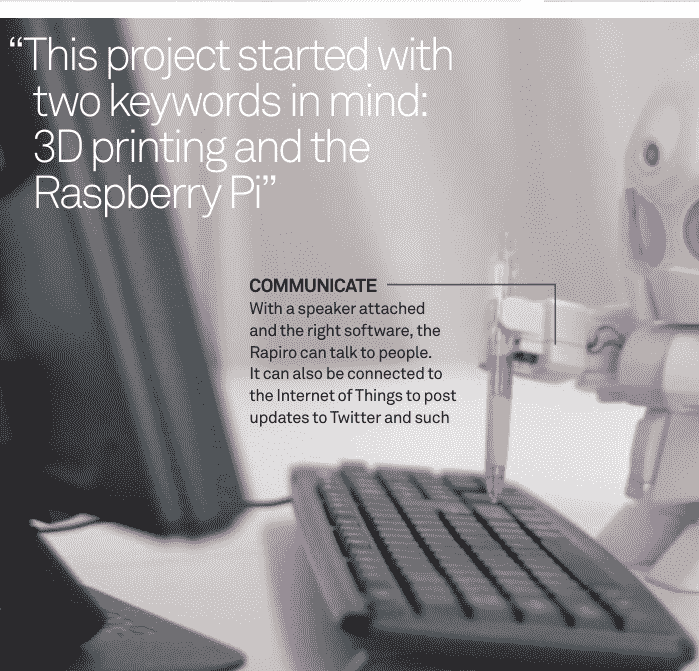

# 您的 Linux 新闻与观点来源

## 联系我们...

注册并发表您的评论... 直接发送邮件... `www.linuxuser.com/forum/` `linuxuser@imagine-publishing.co`

# 开源

根据石渡（`Ishiwatari`）的说法，`Rapiro` 机器人最初的概念是因为两个热门主题：“最初，这个项目的启动关键词是关键词：3D 打印和树莓派。这两个几乎在同一时间引起了我兴趣。所以，我决定开发一个机器人（`Rapiro`），作为利用这两者的一种。”

使用 `Arduino`，目标是重用演示软件源代码，甚至让人们拥有自己构建的自由。“我相信 `树莓派` 和 `Arduino` 在全球范围内都很流行且实用，”石渡提到转向开源的举措，“我并不是想在开源上占便宜。目前的演示运行在 `树莓派` 和 `Arduino IDE` 上，我相信我们只使用了 `树莓派` 和 `Arduino` 来完成这些工作。我们还使用了 `pocketsph` 进行语音识别。”

从这里开始，该机器人演变成了一个基本上完全开源的项目——运行在树莓派上。

`Rapiro` 由树莓派和控制板共同控制——但原因是什么？“所有服务都由控制板控制，它是兼容 `Arduino` 的，”石渡解释道，“树莓派运行着 `AI Pi` 摄像头、`microSD`、麦克风以及我们需要的其他部分。”

硬件只是设备的一部分，需要实现软件才能让机器人工作。同样，石渡告诉了我们包含……

## 石渡翔（Shota Ishiwatari）


石渡拥有自己的公司 `Klicuc.co`，他是公司的 `CEO`。

| 4 x AA | 2 锂离子电池 | AC 转 DC | PC |
| :--- | :--- | :--- | :--- |
| 6V | 6V | 6V ~ 12V | 5V |
| USB | USB | | |
| | USB 接口 | | |
| 舵机控制板 | | | |
| DC-DC 转换器 | ATmega328P (兼容 Arduino) | FT231 (USB 转 UART) | |
| 5V | 5V | | |
| 12 x 舵机 + RGB LED | 树莓派 | | |
| USB 设备 | | | |
| 5V | | | |

### 机器人背后 - Rapiro 的创造者

`Rapiro` 的创造者不仅仅是一个对机器人学感兴趣的爱好者——他以制造创新自动机器而闻名。“我的专业是机械工程。他曾参加过许多机器人大战、比赛，并在 2005 年首届国际机器人杯大赛（`RoboCup`）中获胜。救援组让搜索与救援机器人相互竞争，他在 2015 年获得了移动性第一名。”

基础流程图显示，虽然是必要的，但 `Rapiro` 可以控制

- 舵机：12 x 2.5kg-cm, 6 x 1.5kg-cm
- 舵机运行速度：0.12 秒/60°
- 舵机角度：180°
- 全彩：彩色 `LED`
- 舵机控制器：兼容 `Arduino` 的 `ATmega328P` 芯片
- 额外处理：树莓派（不包含）
- 光学：树莓派摄像头（不包含）
- 分发关系语言：`Python`, `Arduino IDE`
- 底盘结构：3D 打印塑料
- 组装要求：螺丝刀
- 所需技能水平：无
- 可选配件：`Wi-Fi` 或 `蓝牙` 适配器、麦克风、红外 `LED`、`PSD` 传感器、扬声器

这不是他第一次进入机器人领域——他之前创建了 `Necomimi`，一种日语“猫耳朵”的小马，它能根据用户的情绪做出情感动作。“`Necomimi` 的成功给了我巨大的信心和良好的口碑，”石渡说。从那以后，他以类似于 `Necomimi` 的方式迎接机械挑战，这让他能够尝试使用 `Kickstarter` 筹资金。

## 新闻

Linux 社区最新动态

# 开源

## 机器人蓝图


**彩虹的所有色彩**

眼睛由全彩 `LED` 背光，为您提供一系列亮丽色彩进行显示


# 需要一些组装

组装非常简单，仅需要螺丝刀。它也可以被轻松拆卸以进行维护。


# 全视之眼

`Rapiro` 的树莓派摄像头可以安装在头部，让 `Rapiro` 看到并对周围的世界做出反应。


# 多能手

`Rapiro` 的肢体是灵活的，可以让其行走，手部可以握笔。


# 可选配件

`Wi-Fi` 或 `Bluetooth` 适配器、麦克风、红外 `LED`、`PSD` 传感器、扬声器。

# 感知

通过可选的树莓派摄像头和麦克风升级，`Rapiro` 将能够看到并听到。


# 大脑

树莓派运行着 `AI Pi` 摄像头、`microSD`、麦克风以及我们需要的其他部分。


# 复制

这些部分是完全开源的，是 `3D` 打印的，带有 `12` 舵机。


# 控制

由于兼容 `Arduino`，这些部分是 `3D` 打印的，让 `Rapiro` 能够移动。


# 开源

您的 `Linux` 新闻与观点来源

## 联系我们...

注册并发表您的评论... 直接发送邮件... `www.linuxuser.com/forum/` `linuxuser@imagine-publishing.co`

## 新颖。快速。免费。

## 自由。


## `LibreOffice`

世界上最先进的免费软件办公套件

# 开源

您的 `Linux` 新闻与观点来源

获取最新新闻与观点

### 教育

## `Mozilla` 开放勋章（`Open Badges`）进军英国


`DigitalMe` 为英国带来了一种认可学习成果的新方式

`DigitalMe` 是一个旨在帮助青少年在技术领域获得技能并建立信心的团体，它已与 `Mozilla` 基金会合作，帮助人们在英国创建勋章概念。

该计划包括 `NASA` 和迪士尼皮克斯，支持已投入到包括 `Total Cloud Mood` 在内的学习管理系统。

`Mozilla` 的开放勋章计划在美国日益流行

吉姆·奈特爵士（`Lord Jim Knight`）赞誉其“颠覆性潜力”，并称该项目“让员工能够跟上变化，而教育界正处于……”

开放勋章基础设施（`OBI`）最初于 2011 年 9 月在美国推出，是一个基于 `NodeJs` 的框架，用于在任何领域发布和验证成就及教育进度——尽管目前它几乎仅限于技术项目。已经有团体加入了该计划。

“看到来自大学、学校、慈善机构的各种合作伙伴正在使用该系统创建自己的勋章，这太令人鼓舞，”`DigitalMe` 声称。

在 `Mozilla` 伦敦总部举行的发布活动得到了许多英国大学和科技公司的支持，前任就业与福利改革部部长也出席了活动。

勋章有望对人们的生活和就业技能产生积极影响，提高他们的目标，并可能带来我们几年来看到的最大变化。

# “`[OBI]` 让雇主跟上变化，而学历世界却落后于他们]”

> 吉姆·奈特爵士

该团体在扩大勋章认可度方面还有很长的路要走。勋章的图像形式被持续编码为元数据作为官方资质，`DigitalMe` 正积极寻求雇主、员工以及政府自身的合作伙伴，承诺提供支持以鼓励更广泛地采用该标准。


该团体已根据“知识署名-非商业性 3.0”（`Creative Attribution-NonCommercial 3.0`）许可发布了英国勋章的设计画布。这允许那些想要授予勋章的人通过方法发现勋章、展示他们的技能知识以及相应的标准，并提供勋章受众的详细信息：获得者、发布者和消费者。

随着政府在英国推动计算机教育，关注国家计算机教育报告的部门（如 `Badge`）可以在更正式的教育之前占据先机——但其成功在很大程度上取决于雇主的认可，`DigitalMe` 希望在未来几个月内改善这一点。

- `DigitalMe` 首席执行官 `Tim Riches` 对勋章的评价为“令人鼓舞”

# 开源

您的 `Linux` 新闻与观点来源

## 许可

## `GitHub` 简化了许可决策

## 选择开源软件（`OSS`）许可并不可怕

**以下哪种情况最能描述你的现状？***

`ChooseALice.com` 正如其名

- 我想要一种宽松的（`permissive`）许可。
- 我担心专利问题。
- 我在乎分享改进。

协作版本控制和仓库 `GitHub` 随着 `ChooseALice.com` 的推出而扩展，该网站旨在为新项目和现有项目简化开源许可的选择。

`MIT` 许可是一种宽松的许可，只要他们包含版权声明且不对你承担法律责任，他们就可以对你的代码做任何想做的事。

`Apache` 许可是一种宽松的许可，允许进行修改，同时也提供了贡献者明确的专利权利授予。

`GPL` (`V2` 或 `V3`) 是一种拷贝尔留（`copyleft`）许可，要求如果你以二进制形式分发代码，必须按照相同的许可发布你的代码。它与 `VPL` 类似，但禁止软件替代方案。

默认情况下，有三种基于简单用例的许可：“它很简单”给我 `MIT` 许可；“我担心专利”给我 `Apache` 许可；“我关注分享改进”给我 `V2` 或 `V3` 的 `GPL`。

`Apache`、`SVL` 和 `Mozilla` 使用 `Apache`。

`Linux`、`Git` 和 `WordPress` 使用 `GPL`。

用户还可以选择多种许可类型——包括 `Mozilla` 公共许可、`LGPL`、`BSD` 以及其他——选择符合每个需求的设计。

由 `ChooseALice.com` 创建的设计旨在通过两个网站之间的链接使选择变得简单。

`GPL` 允许和禁止。没有任何一种许可选项在保留所有权利方面比它更容易使用，包括在 `Commons` 许可下将代码发布到公共领域。


# 开源

- `GPL` 允许和禁止。没有任何一种许可选项在保留所有权利方面比它更容易使用，包括……（等一下，OCR 文本有重复或重叠）。

## 硬件

## 加密

## `IBM` 宣布入门级

# 开源

- `GPL` 允许和禁止。没有任何一种许可选项在保留所有权利方面比它更容易使用，包括……（等一下，OCR 文本有重复或重叠）。*（注：提供的 OCR 文本包含大量重复和乱码，我将根据提供的片段进行逻辑重构。）*

# 开源

您的 `Linux` 新闻与观点来源

## 许可

## `GitHub` 简化了许可决策

## 选择开源软件（`OSS`）许可并不可怕

## 杀毒软件

## `Avira` 停止支持 `Linux`

公司归咎于市场萎缩

杀毒软件专家 `Avira` 已正式停止对 `Linux` 产品的支持，宣布桌面市场增长狭小到不再值得开发。“如今，消费者和小型企业操作系统完全依赖 `Windows` 或 `Mac`，”该公司自称道。“相比之下，`Linux` 安装已经存在了多年。`Avira` 已利用 `Linux` 部门释放的资源，专注于 `Windows` 和 `Mac` 产品组合的开发。”

所有 `Avira` 产品——包括 `Avira` 免费杀毒软件、`Avira` 服务器 `Linux` 发和 `Avira` 业务套件——现在都已停止，尽管仍在向现有客户提供定义更新。然而，现有客户无法购买新许可，并被鼓励在 2016 年 6 月寿命终日之前寻找替代解决方案。

> 现在的数据库支持能提供 15 分钟的响应吗？


我们可以。

`2ndQuadrant` 的 `PostgreSQL` 铂金解决方案提供 15 分钟（人工）响应、4 小时周转以及在 24 小时内保证修复。

`PostgreSQL` 用于关键任务应用程序。现在你可以使用这种开源软件，如果你需要帮助，在 15 分钟内即可得到支持。有保证修复并可以联系 `PostgreSQL` 专家。

## `2ndQuadrant` 专业 `PostgreSQL`

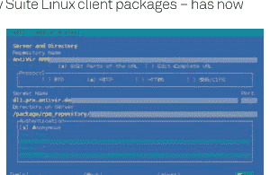

# 开源

您的 `Linux` 新闻与观点来源

# 开源专栏

## 关上更新的大门

一个良好的软件更新是否应该留有退路，西蒙在想这么多……


`Simon Brew` 是一位技术作家和编辑，活跃于 `Linux`、`Windows` 和 `Mac OS` 平台。


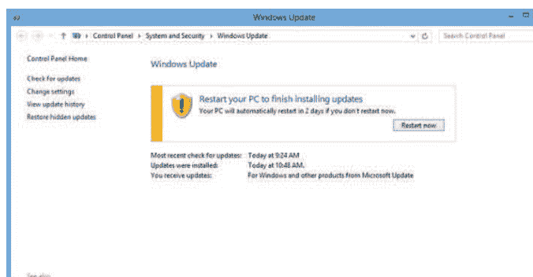

从其本质上说，软件需要**演进**。以更新为例，其原因既包含了这种“生物的本质”，也包含了它们带来的挫败感。因此，我通常无法忍住地觉得，当某个软件提供更新时，我的第一反应是考虑它，而不是点击“取消”——尽管我曾经比现在更倾向于点击取消。

遗憾的是，这种更新过程是由世界上的力量——市场力量驱动的。也就是说，这是一种交付机制，通过会议室里表现良好的人所做的决策来为自己换取昂贵的咖啡。似乎，门控本身就是拯救。

微软，你可能不会感到惊讶，他们正在通过`Windows Update`服务推出新版本的`Internet Explorer`。曾几何时，`Windows Update`仅仅用于此：更新`Windows`、排除漏洞、保持功能最新。遗憾的是，随着时间的推移，它变成了一种某种意义上的软件，在某个阶段它禁用了某些功能，而在另一个阶段，它禁用了你。你还记得现在已经废弃的“`Windows` 正版优势”（`Windows Genuine Advantage`）吗？

- 曾有段时间，`Windows Update` 仅仅是为了：更新`Windows`

我越来越觉得，应该有一个非常“顽皮”的步骤专门留给那些需要软件且没有任何可以回滚机制的人。这是当你作为用户，想要保持软件更新时会发生的那种。我看到的都是关于不可逆转之事的记录，而大多数高层人士只会简单地疑问他们为什么应该为此费精力。

那种在你身后锁上大门并关闭路径的更新是邪恶的，而且并非必要的。有些时候安全需要更新，但认为该更新会修复泄漏而不会引入新泄漏，这种假设本身带有内在风险。尽管如此，当发现漏洞时，这种机制介入是有意义的。但那些引入新功能的更新并不完全是那样。

- 我在这里列举，在某种程度上，那种因果关系似乎是我生活中一直存在的东西，是`Yahoo`！或者那个大坏苹果。问问他们吧。一个需求问题有什么错吗？

最终，我对软件的期望是它从一开始就不值得制作，而且作为其的一部分，我也想知道，如果一切不如人意，我可以退回到我之前使用的应用程序版本。这听起来像是一个幻梦。然而，在某些昂贵的建筑里，这仅仅是消费饼干这一宏大追求中的附带损害。

> “那种在你身后锁上大门的更新并非邪恶”

## 观点

自由软件专栏

# 开源

自由软件专栏

### 以少胜多

自由软件桌面缺乏`Apple`或`微软`那种受控的极简主义和打磨，但它受益于（或受苦于）多元化的……登场，带来了新的动态和紧迫感。这种动力是将任何能运行的东西带到桌面，它演变成了一个小圈子且急躁的黑客行为，使用了随机补丁的小部件代码树”；结果是“事物变化太快了，同时破坏了开源和闭源软件，而由于`Linux`发行版之间缺乏兼容性而加剧了这一点。

这“杀死了第三方开发者针对桌面版`Linux`的体验，对你来说也是如此，如果你正感到‘顶级’，而且由于`Linux`发行版之间缺乏兼容性而加剧了这一点。”

（注：由于原文中存在多处逻辑不连贯的断句，译文尽可能还原原文结构）

---

# 开源

您的`Linux`新闻与观点来源

# 开源专栏

## `JON MASTERS`

`Linux`今日宣布发布了`3.11-rc1`内核，指出这是在早期发布周期中发布的，在该周期内允许某些更改。根据`Linux`的说法，这次合并窗口比`3.10`小，但我们实际上为新代码提供了更多特性（实验性驱动程序）。`Lustre`是一个为了扩展而设计的文件系统，终于开始合并入内核核心。随后的`RC2`版本添加了“未命名临时文件”（`TMPFILE`），我们将在本期中讨论——以及一个晚期更改）

在`3.11-rc1`中，合并了两个特别值得的特性：用户空间追踪、新的延迟查询，以及一个新的`/proc`（文件系统`API`），用户（或程序）可以通过它请求延迟。未来所有对运行内核代码和数据的页（内存块）的更改将通过用户空间追踪来实现。

低延迟查询是`3.11`的另一个特性。对网络吞吐量有特殊需求的用户（例如，股票市场）可以通过内核以性能损失为代价，换取更低的延迟。

`Lustre`在不同层面都有所有权变更的历史，包括学术研究人员、独立公司、`太阳微`、`甲骨文`（`Oracle`）和`英特尔`。由于`Lustre`被用于`TOP500`超级计算机，我们将观察近期对开发和上游投入是否会带来更广泛的应用。

`Jon Masters`是一位深耕`Linux` 18年的内核黑客，他在33岁时才上大学。他住在马萨诸塞剑并在一家大型非营利机构工作。他每周发布一次邮件列表摘要。

# 观点

内核专栏 - `Jon Masters`

# 开源

## `Linus`指责了将初始`Luster`合并到“`staging`”分支的行为

使用忙循环、轮询新到达的网络，而不是等待其传统的拆分：`Linux`通常使用中断驱动的`I/O`，这对于小流量来说会成为性能瓶颈；然而，在高流量情况下，中断驱动的`I/O`可能不够，切换到频繁的轮询算法，并通过新的接口应用程序调用来指定请求（`poll`）系统调用，以便内核可以检查新到达的调用进行即时处理。

`Greg`可能需要学习如何与人交道；这一切对于`Sarah`来说太分了，她回答道：“认真的，伙计们？这是我们改进‘`稳定`’版所需要的，虽然原帖者没有清楚技术问题，但言语侮辱是不可接受的。请在邮件列表中保持专业性”。她引用了“这不是内核邮件列表”来指降低了我们自己列表的健壮性。最终，有人要求结束讨论并将其带入到来的内核开发窗口，`Linus`最终用一个“`修复`”请求标记了这一点，他在其中写：“窗口开启第一周的一半时间里，人们都在抱怨你们推销了我多少东西，并指责我显然直接发送了开发窗口，这可能应该等到下一次发布。但没有人去去饮水机旁说八卦。”

`Sarah`特别指出了`Linus`，尽管这需要许多人才能传达这一观点并保持她成员的目标。然而，`Linus`回复说，他“`不相信礼貌或正确`”是指：“但要正确”，而且他“不希望在没有方法撤销合并导致的回归的情况下，去骚扰维护者，并要求他们在不破坏所有工作的情况下修复这些问题”。

# `LKML`专业性

著名的内核开发者和支持文档作者`Sarah`针对高级内核报价的回复，开始了对内核邮件列表（`LKML`）专业性的解释。这些开发者本身被拒绝了，因为他们是“`3.10-stable`”发布的一部分，并在针对`Greg Krohman-Hart`“`系统调用`”的补丁中进行审查。

`Linus`没有进行长篇大论的反驳，而是表示“做事情时，我不像`Greg`那样确定”。`Linus`倾向于批判性地看待每一个补丁，而`Greg`也更乐于配合，这导致了一场长时间的讨论。

然后轮到我们了，几位帖者建议`Greg`需要“`创造一些真正的威胁：与贡献者断绝关系并偶尔骂几句。但这可能会搞乱你的邮件列表，我保证！`”，`Linus`建议不要再做一个“`休眠者`”了。

更广泛地说，问题可能是多年来，核心贡献者组成的紧密内部圈子彼此变得非常熟悉，没有时间考虑如何无意中向朋友解释。对于可能并不在一对一基础上很好地了解各种性格的新手或外部人士来说，这可能很困难。确实，其他社区偶尔

# 持续开发

`Theodore Ito`表示，`2017`年的内核开发将从`10`月`23`日开始到`2`月`25`日，期间有`LinuxCon`（将于`10`月`15`日举行），并持续到`4`月`Linux`内核会议的`23`日。一个用于补丁的内核已经发布，这使得我们今年想要的内核精确更新——不仅是核心内核，还有这些对开发有价值贡献的有趣想法和特征——将被世界看到。

`Dave Jones`宣布了`Ricky Tuzzer`工具的更新，该工具可能非常强大且有意地改进，用于检测潜在错误，如“`差一`”错误、质量问题和随机崩溃。`Dave`的程序可以处理一些由他的顽皮工具发现的非常棘手的批。


`19 www.linuxuser.com`

# `2013`终极发行版

年度主活动格式的改变反映了日益多样化的发行版格局的变化……

# 顶级发行版

`2013`年最佳`Linux`发行版

过去一年对世界来说是非常有趣的一年，只有一个非常简单的原因：`树莓派`（`Raspberry Pi`）。`树莓派`去年庆祝了周生日，出货两百万台成功故事进展良好。

经典`ARM`操作系统`RISC-OS`的现代化身——是一个意外的成功。

发布`Fedora 19`赢得了巨大的掌声——并添加了一些新功能来帮助

# 终极发行版

`2013`年最佳`Linux`发行版

### 适合

前沿技术

### `Fedora`

`Fedora`快速的更新周期和对新功能的青睐意味着你经常能发现领先于潮流的功能。

### `Arch Linux`

`Arch`基于完全的滚动更新（`rolling release`），让用户保持最新状态，但这种手动安装意味着它并不适合初学者。

### `Gentoo Linux`

由于所有软件都直接从源代码编译而不是以二进制形式分发，`Gentoo`在新软件包和功能方面处于领先地位。

### `Sabayon Linux`

基于`Debian`，`Sabayon`旨在为自由发行版提供更用户友好的界面和方法。


### Fedora

`Fedora` 是那些追求最新、最强功能的明显选择。


作为红帽向世界提供的开放产品，`Fedora` 经常被指责存在某种公司干预，这与 `Ubuntu` 因其首选通用 Linux 发行版而面临的指责类似。然而，此类说法完全不属实；虽然红帽对其未来方向有整体规划，但 `Fedora` 是由社区驱动的。

`Fedora` 的核心特性是遵循快速的发布周期，并渴望率先为用户提供新软件的愿望。这在实际上导致了终端用户体验不够完善；最近的几个版本做出了很多工作来确保用户可以信任 `Fedora` 是一个稳定的发行版——而对于那些需要更高稳定性的用户，`Fedora` 在后期的发布周期中提供了支持。

喜欢站在技术前沿的人会在 `Fedora` 中发现许多喜爱之处；需要更多支持的人也可以联系红帽寻求帮助。虽然其他发行版提供了更及的软件包——特别是那些遵循滚动更新的发行版——但 `Fedora` 在新功能和稳定性之间取得了优雅的平衡。

最新发布的版本 `Fedora 19` 包含了最新版本的 `GNOME`、`Cinnamon`、`MATE` 和 `KDE` 桌面环境——尽管你完全可以安装更符合你个人口味的其他环境。

- `Fedora` 提供了各种桌面环境，包括 `GNOME`

## 新功能与稳定性之间的优雅平衡

凭借卓越的文档、繁荣的社区以及红帽的支持，`Fedora` 对于那些发现自己在使用倾向于初学者的发行版的人来说是一个极佳的选择——当你需要开始向 `Ubuntu` 添加个人软件包存档 (`PPA`) 并让开发者通过工作来绕过包含较旧软件包的问题时，这是一个非常明确的选择。


### 适合

业务用途

### 竞争者

### openSUSE

作为活跃开发最受欢迎的发行版之一，`openSUSE` 拥有开源软件 (`FOSS`) 领域最好的社区之一。

## Ubuntu

在业务中，很难忽视第三方支持这一因素；`Ubuntu` 仍然是支持率最高的 Linux 发行版之一。

### Elementary

`Elementary` 设计得易于上手，是一个适合发布到严苛办公环境的发行版。

### Puppy

依赖有限硬件的发展中国家企业会发现 `Puppy` 运行快速且方便。


### openSUSE

卓越的支持和完善的管理工具使 `openSUSE` 成为中小企业的流行选择。

当 `SUSE` 在 2011 年成为 `Novell` 时，他们担心这会杀死 `openSUSE` —— 即 `SUSE Enterprise` 的支柱。相反，`SUSE` 创建了项目并将 `openSUSE` 作为一个独立的实体，同时让大规模的发行版变得真正可。。`openSUSE 13.1` 版本是目前最好的，遵循了在不使用商业产品的情况下提供易于分发的目标。

以 `KDE` 为标准的发行，`openSUSE` 背后的社区将为新用户创建一个受欢迎的环境。尽管它没有像 `Ubuntu` 那样的支持，但它拥有庞大且繁荣的社区，是一个优秀的操作系统。最近，`openSUSE` 在发布周期上出现了一些小问题，导致未来的发布变得更加流畅。

基于网络的服务支持许多发行版，这只是其中。`openSUSE` 最用的功能之一是 `Novell` 创建的 `Open Build Service`，它允许从源自动构建并分发软件包——尽管每个 `openSUSE` 都使用 `Open Build Service`，它具有改变的能力。

卓越的支持和完善的管理工具使 `openSUSE` 成为中小企业的流行选择。

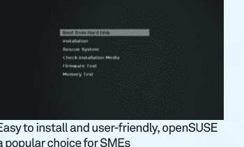

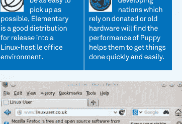


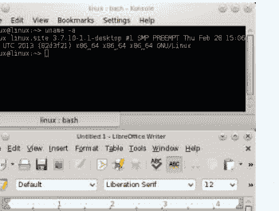


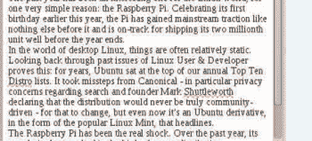

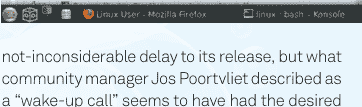

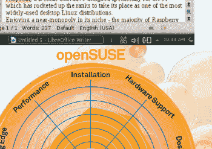

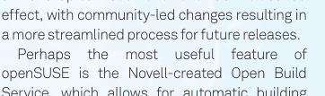


### 适合

开发平台

### Arch Linux

`Arch Linux` 以对新用户不可逾越著称。`Arch Linux` 不让事情变得简单，但它顺从你的引导。

### CrunchBang

也被称为 `!`，基于 `Ubuntu` 的 `CrunchBang` 设计用于让路，让开发者专注于当前任务。

## Ubuntu

`Ubuntu` 对于那些可能由于非主流软件包或 `DEBs` 需要灵活性的开发者来说是理想的。

### Gentoo

从源编译一切方面可能会吸引喜欢在任何硬件上配置系统以获得最佳性能的程序员。

`Arch` 为你提供了一个快速、精简的操作系统。一个简单、轻量级的 Linux 发行版。它不迎合初学者，但 `Arch` 非常灵活且深受内核黑客的欢迎。`Arch` 直言不讳并不适合所有人。它摒弃了现代引导式图形系统的趋势，通过带有（有时是过时的）指令引导 `Arch` 进入控制台，将每一步交给所有者，并奖励了那些需要手动管理桌面环境（如果你决定安装一个）的人。

`Arch` 并不易用。开发者热爱它，而且令人惊讶的是很大比例的 `Arch` 用户是程序员，甚至参与了 Linux 本身的开发。`Arch` 是稳定的，但确实，它也是一次性的：`Arch` 是使用滚动更新的发行版之一，这意味着你获得最新的软件包，并且始终保持自安装以来一切内容的都是新的。

这让 `Arch` 在技术用户中流行起来：如果你愿意花时间，或者已经对 Linux 有深入了解，`Arch` 为你提供了一个快速、精简的操作系统，只有你真正需要的软件包，没有影响其更初学好的替代方案的臃肿。

`Arch Linux` 在它的皇冠上还有一个惊喜：`Arch Build System`，旨在为独立创建或微调软件包提供一个创建、定制和分发的平台。`Arch` 具有许多开发者赖以成长的灵活性，使得移动到更主流发行行的想法看起来像是一个明显的后退步。

```
Arch Linux (x86_64)
Arch Linux (i686)
Boot kernel
Run Memtest86+ (RAM test)
Hardware Information (IDBT)
Root
Power OFF
```

按下 `[Tab]` 编辑选项

- `Arch` 引导程序向你展示了一组启动选项


## 最佳选择

# 游戏与娱乐

候选者

## Ubuntu

`Canonical` 与第三方公司的合作让 `Ubuntu` 在娱乐方面保持领先地位，为 `Ubuntu` 带来了丰富的内容。例如，`Valve` 最近推出的适用于 Linux 的 `Steam` 数字分发平台已正式支持 `Ubuntu` —— 通过第三方及其他平台均可使用。此外，音乐流媒体服务 `Spotify` 也适用于 `Debian`，这得益于 `Ubuntu` 及其衍生版在主流市场的巨大成功。

`Canonical` 专门负责 `Ubuntu` 的团队在 2004 年也将继续发力；它是全球认可度最高的发行版。


## Mint

作为 `Ubuntu` 的衍生版，大多数在 `Ubuntu` 中可以运行的软件都可以通过它运行，但它包含了 `Canonical` 特有的功能。

`Mark Shuttleworth` 的公司 `Canonical` 在与开源社区的关系上，曾有一段“回馈少于投入”的历史。然而，`Canonical` 的闪光点在于它与其他大型公司建立的联系——这直接导致了 `Ubuntu` 位居娱乐用途最佳发行版的顶端。

## XMC

对于那些想要优秀的多媒体发行版的用户，`XMC` 提供了十英尺界面（适合电视显示）并支持大多数媒体服务。


然而，这里的关键在于 `Ubuntu` 软件中心。作为桌面环境的前端，它提供了一种购买其他 `Linux` 发行版中无法获得的软件的方法，以及包括游戏和电影在内的娱乐内容。

## `OpenELEC`

与 `Ubuntu` 类似，`OpenELEC` 放弃了游戏，转而采用以媒体为中心的发行版，在连接到电视投影仪的低功率系统上运行良好。

原因是：`Canonical` 与许多机构建立了合作伙伴关系。

结合 `Ubuntu` 环境及其对访问网络内容的关注，默认对 `Canonical` 的服务器设置搜索术语以提供指向 `Amazon` 和 `Canonical MP3` 商店的链接，使得 `Ubuntu` 成为那些需要无忧娱乐体验的人的明确选择。

> 无忧娱乐体验的明确选择

`Ubuntu` 在这一领域还通过 `Ubuntu One` 服务提供了额外奖励——诚然，通过额外免费一个月，它可以让用户在移动设备上访问库，充当传统的云存储服务。

`Ubuntu` 易于尝试和使用


当你搜索一个词时，还会获得商业赞助的建议


# 安全与渗透测试

 候选者

## `Kali Linux`

## `BackBox`

# `Fedora Security`

# `Samurai Web` 框架

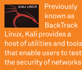

以前被称为 `BackTrack`，它是让用户测试其网络和系统的最佳工具之一。

与原始的 `BackTrack` (`Kali`) 类似，`Kali` 基于 `Ubuntu`，是最流行的渗透测试系统之一。

作为该发行版的衍生版，`Fedora Security` 提供了测试系统安全的极佳工具。

`Samurai` 专注于 Web 应用程序性能问题测试。


- `Kali Linux` 提供了一系列工具来测试您的系统和网络安全

## `Kali Linux`

`BackTrack` 的重生为渗透测试带来了 `Kali` 这一新后


`Kali` 以前被称为 `BackTrack`，目前的形式是 3 月推出的新成员。与其前身一样，`Kali` 旨在提供一个实用工具包，允许用户测试其系统和网络的安全性。

当然，这些工具也可以被那些意图不轨的人使用，因此 `Kali` 将成为一个具有争议的建议。它的支持者指出，细节总会以某种方式拿到工具，而其反对者则解释了有多少此类工具可能会攻击系统和网络 —— 这被视为不可避免的恶。

对于需要工具的人来说，`Kali` 被高度推荐。在构建 `BackTrack` 的基础上，`Debian Testing` 显示了对适应性团队功能的关注——但它既适用于日常通用操作系统，也适用于专业的现场环境。

> 为用户提供用于测试系统的系统的实用工具包

## `KALI LINUX`


```
- Live (64位安全防护)
- Live (取证模式)
- 图形化安装
- 带有语音合成安装
```

- `Kali` 的启动菜单提供了许多选项

对 `BackTrack` 的投诉——例如很难找到特定的工具（因为所有东西都堆杂在了一起），而 `Kali` 相比其前身确实有改进。细节方面还承诺对 `ARM` 架构硬件进行改进，该硬件在 `BackTrack 5` 中以有限形式引入，但现在细节将获得重点关注。

对于需要访问最新测试工具的人来说，`Kali` 将是一个巨大的福音。尽管相比 `BackTrack` 有了改进，但它可能更多地作为特定任务的发行版，而不是日常操作系统。

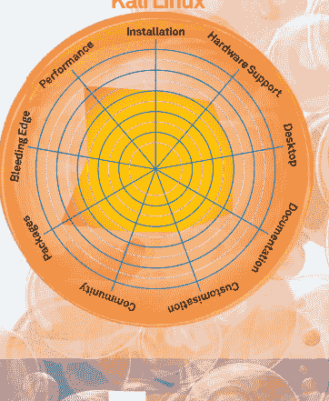

## 最佳选择

嵌入式平台

 候选者

### `Raspian`

### `Debian`

### `Angstrom`

### `Yocto` 项目

- 作为 `Ubuntu` 的衍生版，大多数在 `Ubuntu` 中可以运行的软件都可以通过它运行，但它包含了 `Canonical` 特有的功能。

- 基于 `Debian`，`Raspian` 是树莓派的常用选择。

- `Yocto` 项目是官方的...

# 嵌入式系统

什么是嵌入式系统？

嵌入式系统是计算机硬件和软件的结合，设计用于特定的功能或较大的机械或电子设备内部。

嵌入式系统包括：

- 微波炉

- 数字相机

- 洗衣机

- 汽车防锁刹动系统

- 智能手表

 嵌入式系统的类型

嵌入式系统是控制较大机械或电子设备的计算机系统。

嵌入式系统包括：

- 微控制器

# 最佳用于

### 教育

### `UbuntuStudent`

`UbuntuStudent` 创建于 2010 年，是一个 64 位发行版，重点侧重于中学和高等教育的教育用途。

将每位学生的需求都置于指尖，`UbuntuStudent` 让学习变得几乎异常简单。

近年来，`Linux` 增长的一个主要领域是教育市场，特别是在那些学校可以低预算轻松配备笔记本电脑的发展中国家。`Ubuntu` 的目标是更进一步，提供一组预装的针对学生的特定软件包。2010 年，`UbuntuStudent` 是一个仅限 64 位的发行版——排除了那些尝试为旧硬件寻找用途的用户——基于 `Debian` 和 `Ubuntu` 的混合体，并包含了通用计算的软件包（常见的媒体播放器、网络浏览器和办公套件）以及针对教育市场的软件包，例如 `Zotero` 研究助手和 `Keynote` 笔记。另一个补充是 `Artha`，这是一款开源论文管理器，它允许通过 `Worksheet` 数据库对任何文本进行高亮和分析。

随后，`Stephen Edouard` 创立并支持了这一真正关于软件的项目——它允许一些选择，例如在桌面环境中包含 `LibreOffice`。即使 `Steve` 声称他们设计为仅使用从源码获取的“必要”内容？

由于这些细微方面，今年的最新版本——“`Plato`”（已于今年 6 月发布）已经过时了，不值得尝试，尽管它似乎在 `Linux` 兼容工具和安装到其他发行版方面有一些实用的想法。

### `Puppy`

对于寻求翻新设备的机构来说，`Puppy` 的低要求意味着它必须有一个发行版。

### `Eubuntu`

`Ubuntu` 的一个分支，提供多种教育用途，并专为 `Linux` 服务器环境设计。

### `OLPC OS`

作为笔记本电脑项目的一部分，基于 `Debian` 的 `OLPC OS` 为学校教育提供了良好的界面。


# 最佳用于

## 老旧或回收的计算

### 竞争者

### `Puppy`

它不是那种极其华丽的操作系统，但 `Puppy` 让最旧的 `PC` 焕发生机。

`Puppy` 的设计考虑了旧式和移动硬件。它速度快，意味着高性能和低开销。

### `Damn Small Linux`

`Debian` 紧凑版，`Damn Linux` 仅需 `500MB` 的 `ISO` 镜像，并支持所有 4 位系统。

### `Debian`

最老的发行版之一，`Debian` 理论上除了基于 `386` 的系统外，无胜一切。

### `Tiny Core Linux`

`Tiny Core Linux` 仅重 `12MB`，是一个基于 `TIFT` 和 `KLVM` 的完整图形环境。

`Puppy Linux` 由 `Barry Kauler` 创立，从未打算与 `Linux Mint` 和 `Ubuntu` 等大型发行版竞争。它构建在 `Debian` `Ubuntu` 之上，作为一个轻量、简单的平台，允许用户无需麻烦即可完成任务。

因此，`Puppy` 是那些拥有旧废弃硬件的极佳选择。`Puppy` 可以进行长期支持，但从 `2.6` 版本开始，它切换到了最新的轻量级网络浏览、文字处理、电子表格、艺术和电子邮件应用程序，并在小于 `140MB` 的尺寸下付出了惊人的努力。

结果是，可以安装一个带有通常用于 `Linux` 的应用程序的用户友好操作系统。对于较旧的现代系统，`Puppy` 的表亲 `Puppy` 包含一个内核——内置系统可以在网络上运行，也可以在没有存储的情况下运行，或从 `USB` 或旧硬盘上从 `RAM` 启动。

即使对于那些没有旧 `PC` `Linux` 的人，`Puppy` 也值得一看。它的轻量级特性意味着它和世界上最好的发行版一样快，且容量更大——以增加系统要求为代价——可以从 `Ubuntu` 和 `Racy` 版本中选择。

对于仍然依赖 `Windows` 系统的用户，`Puppy` 是双启动的极佳选择，带有一个 `Windows` 安装应用程序，并能够在非常有限的存储空间中运行。

`30` `www.linuxuser.com`

# 展望 2014 及以后

回望 `Linux` 世界的过去 12 个月很容易，但未来如何呢？

短期内的事情很容易预测：`Linux Mint` 可能会继续是最流行的通用发行版，而 `Ubuntu` 获取用户的增长速度将与树莓派相当。


然而，市场正在寻找更长期趋势。一种日益增长的趋势是，大多数发行版试图获得独特的卖点，使其脱颖而出——现在较少因为某个特定的独特功能或应用程序而选择某个发行版了。

因此，发行版采取自主开发路线变得越来越普遍。`Elementary OS 3` 是一个关键示例，它尽可能使用自定义编写的应用程序以及如网络浏览器等更多软件的项目。在这种极端环境之外，其他情况依然存在。`Ubuntu` 正在将显示管理技术从 `X` 阶段迁移到 `Mir` 服务器，而 `Fedora` 变得更适合专业工具市场。

从长远来看，`Linux` 可能会变得比竞争对手日益多样，这无疑会导致更多新发行版的诞生，每个版本都旨在提供所有可能世界中最好的部分。我们在 `Linux` 历史中见过的一个循环正接近中点，新发行版将在未来二到三年内发生爆发。

然而，下一次转变将转向低成本计算，而专有操作系统供应商被得措手不及。`Apple` 意识到树莓派将出数百万台。

实际上，我将根据提示提供干净的输出，忽略用户提供的源中的重复部分。

随后，`Stephen Edouard` 创立并支持了这一真正关于软件的项目——它允许一些选择，例如在桌面环境中包含 `LibreOffice`。即使 `Steve` 声称他们设计为仅使用从源码获取的“必要”内容？

由于这些细微方面，今年的最新版本——“`Plato`”（已于今年 6 月发布）已经过时了，不值得尝试，尽管它似乎在 `Linux` 兼容工具和安装到其他发行版方面有一些实用的想法。

### `Puppy Linux`

对于寻求翻新设备的机构来说，`Puppy` 的低要求意味着它必须有一个发行版。

### `Eubuntu`

`Ubuntu` 的一个分支，提供多种教育用途，并专为 `Linux` 服务器环境设计。

### `OLPC OS`

作为笔记本电脑项目的一部分，基于 `Debian` 的 `OLPC OS` 为学校教育提供了良好的界面。


# 最佳用于

## 老旧或回收的计算

### 竞争者

### `Puppy`

它不是那种极其华丽的操作系统，但 `Puppy` 让最旧的 PC 焕发生机。

`Puppy` 的设计考虑了旧式和移动硬件。它速度快，意味着高性能和低开销。

#### `Damn Small Linux`

`Debian` 紧凑版，`Damn Linux` 仅需 `500MB` 的 ISO 镜像，并支持所有 `4` 位系统。

#### `Debian`

最老的发行版之一，`Debian` 理论上除了基于 `386` 的系统外，无胜一切。

#### `Tiny Core Linux`

`Tiny Core Linux` 仅重 `12MB`，是一个基于 `TIFT` 和 `KLVM` 的完整图形环境。

`Puppy Linux` 由 `Barry Kauler` 创立，从未打算与 `Linux Mint` 和 `Ubuntu` 等大型发行版竞争。它构建在 `Debian` `Ubuntu` 之上，作为一个轻量、简单的平台，允许用户无需麻烦即可完成任务。

因此，`Puppy` 是那些拥有旧废弃硬件的极佳选择。`Puppy` 可以进行长期支持，但从 `2.6` 版本开始，它切换到了最新的轻量级网络浏览、文字处理、电子表格、艺术和电子邮件应用程序，并在小于 `140MB` 的尺寸下付出了惊人的努力。

结果是，可以安装一个带有通常用于 `Linux` 的应用程序的用户友好操作系统。对于较旧的现代系统，`Puppy` 的表亲 `Puppy` 包含一个内核——内置系统可以在网络上运行，也可以在没有存储的情况下运行，或从 USB 或旧硬盘上从 RAM 启动。

即使对于那些没有旧 PC `Linux` 的人，`Puppy` 也值得一看。它的轻量级特性意味着它和世界上最好的发行版一样快，且容量更大——以增加系统要求为代价——可以从 `Ubuntu` 和 `Racy` 版本中选择。

对于仍然依赖 `Windows` 系统的用户，`Puppy` 是双启动的极佳选择，带有一个 `Windows` 安装应用程序，并能够在非常有限的存储空间中运行。

`30` `www.linuxuser.com`

# 展望 `2014` 及以后

回望 `Linux` 世界的过去 `12` 个月很容易，但未来如何呢？

短期内的事情很容易预测：`Linux Mint` 可能会继续是最流行的通用发行版，而 `Ubuntu` 获取用户的增长速度将与树莓派相当。

然而，市场正在寻找更长期趋势。一种日益增长的趋势是，大多数发行版试图获得独特的卖点，使其脱颖而出——现在较少因为某个特定的独特功能或应用程序而选择某个发行版了。

因此，发行版采取自主开发路线变得越来越普遍。`Elementary OS 3` 是一个关键示例，它尽可能使用自定义编写的应用程序以及如网络浏览器等更多软件的项目。在这种极端环境之外，其他情况依然存在。`Ubuntu` 正在将显示管理技术从 `X` 阶段迁移到 `Mir` 服务器，而 `Fedora` 变得更适合专业工具市场。

从长远来看，`Linux` 可能会变得比竞争对手日益多样，这无疑会导致更多新发行版的诞生，每个版本都旨在提供所有可能世界中最好的部分。我们在 `Linux` 历史中见过的一个循环正接近中点，新发行版将在未来二到三年内发生爆发。

然而，下一次转变将转向低成本计算，而专有操作系统供应商被得措手不及。`Apple` 意识到树莓派将出数百万台。


# 三种简单的订阅方式

1. 线订阅

   `www.imaginesubs.co.uk/lud`

   输入代码 `PLG130`

2. 电话

   `0844` `249` `0282`

   并引用代码 `PLG130`

3. 邮寄或电子邮件

   请填写表单并邮寄至：

   ```
   Subscriptions Department
   800 Guillat Avenue
   Kent Science Park
   Sittingbourne
   ME9 88GU
   ```

   或者，你可以扫描并将表单通过电子邮件发送：

   `lud@servicehelpline.co.uk`

# 教程：构建你的专业级防火墙

此菜单包含所有配置选项，包括防火墙规则。

这显示了接口、网络地址、网络速度和双工模式

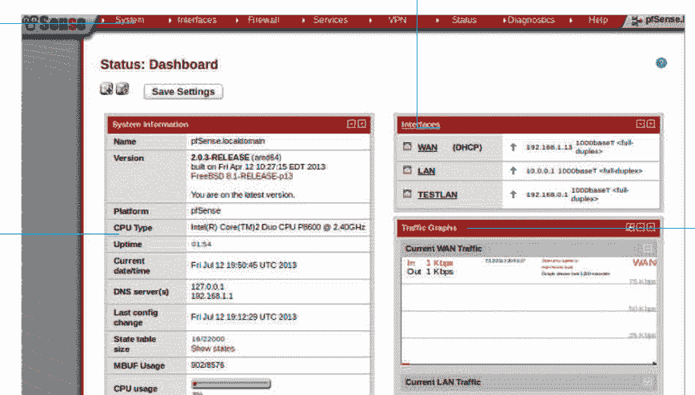

通过你的防火墙发生基础网络 `I/O`。

# 构建你自己的专业级防火墙

这提供了关于机器系统信息、`DNS`、运行时间等方面的统计数据。

学习如何使用 `pfSense`，仅需一台冗余计算机即可创建一个强大的多网络硬件防火墙。

# 顾问

`Stuart Burns` 是一位经验丰富的财富 `500` 强企业 `Linux` 和虚拟化专家，他乐于编写关于 `Linux` 的文章。

这篇深度教程涵盖了设置硬件防火墙并对其进行配置，以防黑客并确保安全。

## 资源

- 一台带有 `3` 张网卡的 `Linux` 电脑（至少 `300MHz`，`128MB` `RAM`）

- 它将涵盖双网络设置的配置，包括一个用于你所有测试设置的内部网络，以及一个可以配有 `DHCP` 设置的第二个局域网（`LAN`）。

- `pfSense` live CD：`www.pfsense.org`

- 网卡标签标记系统

- 一个 `ADSL` 或电缆调制解调器。另一台 `Linux`

网络的配置方式应确保你的测试网络上的任何入侵都不会影响你的正常网络。本指南还将涵盖创建一个安全的规则库，如果你愿意，可以在其中添加额外的规则。你会发现这不仅仅是一个简单的设置。最后，我们将涵盖如何备份和恢复你的防火墙，配置不应该发生。

我们希望在不涉及整个过程的情况下完成设置，你可以在虚拟机中、两个虚拟网络以及到你网络的桥接器来实现。此设置的范围超出了本文范围，但我们的操作演示应该完美运行。

`www.linuxuser.co.uk`

# 构建你自己的专业级防火墙

使用 `pfSense` 创建多网络硬件防火墙。

# 教程

## 欢迎使用 `pfSense 2.0.3-RELEASE`

正在指向自动运行目录... 完成。

正在创建系统... 完成。

启动初始化系统... 完成。

初始化中... 完成。

启动设备管理器 (`devd`)... 完成。

按 `R` 进入恢复模式或按 `J`

按 `I` 安装启动器

（可以通过从损坏的硬盘安装中运行 `config.xml` 来访问恢复模式。


（如果你不想在此时启动到 LiveCD 环境，可以调用安装程序：

(C) 将在不进一步暂停的情况下继续启动 LiveCD。

在`out`继续之前的超时时间（秒）：

可能五月。本教程使用`/24`网络，所以输入`24`后按回车。它会询问你的网络是否需要`DHCP`服务器。选择`yes`。程序随后会询问你`DHCP`租约。它是`192.168.1.2`。接着是`192.168.1.238`。这取决于你并取决于你的需求，但`DHCP`租约设置为最长小时。在`HTTP`协议序列上按`N`。通过其他网络(`192.168.2.0`)作为接口地址`2`通过过程，到网络并使用范围`192.168.2.1-254`。

### 01 安装 `pfSense`

从你下载的`ISO`启动并配置你的网络（参见资源）。允许它以默认设置启动直到你看到屏幕菜单和恢复安装程序。按`I`开始安装程序。接受屏幕上显示的默认值`'These defaults'`。然后唯一的选择是如果你有非`USB`键盘则制作键盘布局。你可以简单选择快速/简单。只需接受警告 - 安装程序将破坏你想要保留的所有信息。你的数据。当你准备好时，选择`OK`。安装完成后，选择`Standard`，然后你可以导航到`root`并按回车。输入用户名和密码(`admin/pfsense`)。`CMD`和机器重启到网络，所有好事都开始发生了。

询问“你想什么时候开始？”它会要求你配置设置。它会告诉你的网络需要组成多少网络。连接后，你将看到带有接口列表的`CL`。由于需要配置网络，你可以通过按`2`继续加入。一旦你完成了`WIRELESS LAN`，让我们给它`192.168.1.1`，子网掩码为`24`。* -

### 02 配置网络

此时配置已完成，你仍会看到带有接口列表的`CL`。由于需要配置网络，你可以通过按`2`继续加入。一旦你完成了`WIRELESS LAN`，让我们给它`192.168.1.1`，子网掩码为`24`。* 

`img/42a435dd97fa37bf0839d8abe967b91b_34.png`

欢迎使用`pfSense 2.0.3-RELEASE`

正在指向自动运行目录... 完成。

正在创建系统... 完成。

启动初始化系统... 完成。

初始化中... 完成。

启动设备管理器(`devd`)... 完成。

按`R`进入恢复模式或按`J`

按`I`安装启动器

（可以通过从损坏的硬盘安装中运行`config.xml`来访问恢复模式。

（如果你不想在此时启动到`LiveCD`环境，可以调用安装程序：

(C) 将在不进一步暂停的情况下继续启动`LiveCD`。

在`out`继续之前的超时时间（秒）：

可能五月。本教程使用`/24`网络，所以输入`24`后按回车。它会询问你的网络是否需要`DHCP`服务器。选择`yes`。程序随后会询问你`DHCP`租约。它是`192.168.1.2`。接着是`192.168.1.238`。这取决于你并取决于你的需求，但`DHCP`租约设置为最长小时。在`HTTP`协议序列上按`N`。通过其他网络(`192.168.2.0`)作为接口地址`2`通过过程，到网络并使用范围`192.168.2.1-254`。

# 构建你自己的专业级防火墙

使用`pfSense`创建多网络硬件防火墙。

# 如何创建基础规则

所有规则都以相同的方式添加，只需根据需要修改每条规则即可。点击规则页面上的`'+'`符号开始创建一个。将操作设置为允许（除非你想拦截流量）。选择你的源（`WAN, LAN`）。选择你要使用的协议（`TCP`，但`DNS`等需要`UDP`）。设置目标为`OPT3`。使用接口选择目标。要添加`HTTPS`，点击`'+'`按钮，使用端口`443`。别不仅限于端口，也可以用于主机和网络。要实现别名，在规则类型中选择别名（已创建的别名），然后是别名的名称。如果别名更改，规则将重新创建。网络之间可以创建类似的规则。例如是`SSH`，以相同的方式实现它。

# 别名让生活更简单

别名允许你对端口进行分组。当你命名它们时，最近你可以在规则中使用别名来引用一组项目。例如可以用于端口。在一个别名中，不需要多条规则，一个规则就可以确保正确的端口打开！

从菜单中选择`Aliases`在右侧使用它。同时实现`HTTP`和`HTTPS`，给它起一个像`Web_browsing_ports`的名字——确保它是正确的。从`Type`下拉菜单选择端口。点击底部的端口并在端口处添加`80`和`HTTP`。要添加`HTTPS`，点击`'+'`按钮，使用端口`443`。

`img/42a435dd97fa37bf0839d8abe967b91b_35.png`

# 不需要多条规则 – 只一个规则就可以确保正确的端口打开

### 03 配置Sense

一组规则定义了网络，既是`HTTP`也是`HTTPS`浏览规则。将其命名为`'allow all'`。作为规则名称，这拦截了所有流量。这使得你需要的网络上没有逃逸。要这样做，只需为每个操作、网络和端口范围设置规则（任何`TCP/UDP`）。对于然而

# 构建你自己的专业级防火墙

使用`pfSense`创建多网络硬件防火墙

# 教程

与之前相同，只需选择`WIRELESS`（无线）作为源，并将`LAN`（局域网）网络作为目标。允许通过端口`22` `SSH`连接到别名（`aliases`）中定义的框以外的任何设备。规则越具体越好。你还需要对希望应用相同规则的`LAN`进程进行限制。要防止一个网络通过特定端口和协议与另一个网络通信，请在规则中使用`NOT`选项。例如，如果你允许浏览但将目标设为`LAN`，那么你将无法访问网络上的任何`Web`服务器，与互联网隔离开。

点击`Traffic Shaper`（流量整形）上的`Enable`（启用），选择任何允许/阻止的协议。编辑准备好的设置并点击`Next`（下一步）。在`Finish`（完成）时根据需要配置预设选项。你可以对某些应用程序执行相同的操作，例如`DNS`、`VNC`等。点击`Finish`。将规则移动到`Traffic Shaper`菜单并选择`Remove shaper`（移除整形器）。

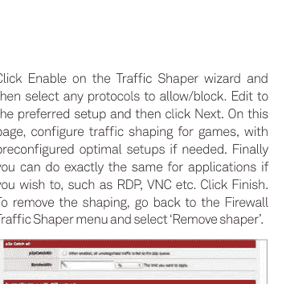

| 防火墙：别名 (`Aliases`) | 名称 (`Name`) | 描述 (`Description`) | 类型 (`Type`) | 地址 (`Address`) |
| :--- | :--- | :--- | :--- | :--- |
| `WiFi` | 无线网络 | 网络 | `192.168.1.0/24` |
| `LAN` | 局域网 | 网络 | `192.168.1.0/24` |
| `UDP` | 用户流量 | 网络 | `53 (DNS)` |
| `TCP` | 用户流量 | 网络 | `21 (TFTP)` |
| `TCP` | 用户流量 | 网络 | `3389 (MS RDS)` |
| `TCP/UDP` | 本地流量 | 网络 | |

## 07 增强型规则集

现在你已经了解了基础操作原理，是时候将其他规则分组到一个更增强的规则集中了。至少要按照以下顺序设置网络：`HTTP`、`HTTPS`和`SSH`，根据需要允许所有，但如果需要，则阻止所有。如果你仅对特定数量的主机使用`SSH`，请使用本地域将`IP`地址输入到别名中。这将显示一台更复杂的机器，它将不会...

## 08 管理带宽

现在基础知识已经涵盖，我们可以查看其他功能，例如带宽管理。`pfSense`允许你通过`Limit`（限制）和类似功能随时需要阻止文件共享平台。它还可以在两个网络之间划分带宽。通过`Traffic/Shaper`执行此操作：点击`Tabs`选项卡，选择流量类型。有许多类似于`Single WAN`规则的关键字。允许每个`LAN`网络（在此集合中）并按`Next`。如果你在需要时禁用`DNS`查询，请留空其他组件并点击`Next`。除非使用`SIP`规则。勾选任何设备框以限制特定组或别名组。如果需要，使用此页面降低`P2P`流量的优先级或阻止其。

## 09 开启日志

某些规则实际上并没有执行你计划的操作，但有很多规则用于日志记录和规则过滤。这样就可以查看日志以了解确切发生了什么。要开启日志，返回`Rule`（规则）菜单。找到你构建的`log`规则。这非常重要，特别是对于基于“首次匹配”执行的规则；例如，在`allow`规则之前的`drop`规则将永远不会执行。


备份也是一次非常重要的经验，而且非常简单。进入`Diagnostics/Backup/Restore`（诊断/备份/恢复）。在此页面上，你只需要勾选框来恢复你提供的备份。仔细检查以恢复备份。它还可能向你建议规则“如果今天真的不需要使用，则不要阻止`RKD`数据”。

如果防火墙需要从头开始重建，你必须遵循步骤直到你拥有`GUI`。在`Diagnostics`菜单中的`Restore`有从备份恢复的复选框，但只有恢复部分内容的选项，如规则...


| 接口 (Interfaces) | 预设 (Preset) | 服务 (Services) | VPN | 状态 (Status) | 诊断 (Diagnostics) | 帮助 (Help) | 已启用显示 (Show-off-enabled) |
| :--- | :--- | :--- | :--- | :--- | :--- | :--- | :--- |
| 防火墙：规则 (Firewall: Rules) | | 源 (Source) | 目标 (Destination) | 网关 (Gateway) | 计划 (Schedule) | 描述 (Description) | 选项 (Option) |
| | `WIRELESS` | `LAN` | | | `443` | | 防锁 (Anti-lock) |
| | | `TCP` | | | Web 服务器 | | |
| | | `TCP` | | | `53 (DNS)` | | |
| | | `UDP` | | | | 阻止规则 (`block rule`) | | |
| | | `TCP` | | | | `VNC-block` | | |
| | | `TCP` | | | `3389 (MS RDS)` | | |
| | | `TCP/UDP` | | | 到 `LAN` 的 `RDP` 规则 | | |
| | | `TCP/UDP` | | | 丢弃规则 (`Drop-rule`) | | |

`37 www.linuxuser.com`

# 使用 `Webmin` 系统管理教程

通过浏览器本地或远程访问 `Webmin`

你可以从几乎任何平台访问 `Webmin`。本教程涵盖了适用于大多数设备的安装方法。

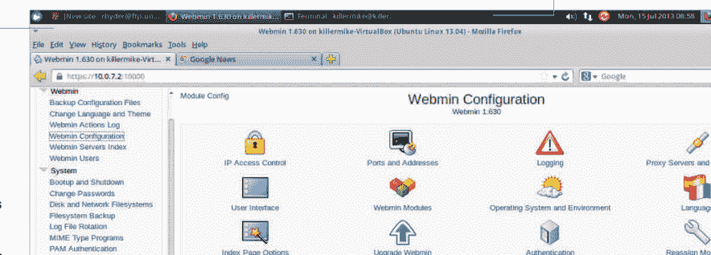

`Webmin` 的功能由大量的模块集合提供。可以通过侧边栏访问模块。

## 使用 `Webmin` 进行系统管理

`Webmin` 不允许你远程管理系统，还是系统配置的极佳 `GUI` 前端。

`Webmin` 的功能由大量的模块集合提供。可以通过侧边栏访问模块。

不仅允许你远程管理系统，`Webmin` 是系统配置的极佳 `GUI` 前端。

`Webmin` 的功能由大量的模块集合提供。可以通过侧边栏访问模块。

不仅允许你远程管理系统，`Webmin` 是系统配置的极佳 `GUI` 前端。

`Webmin` 的功能由大量的模块集合提供。可以通过侧边栏访问模块。

不仅允许你远程管理系统，`Webmin` 是系统配置的极佳 `GUI` 前端。

`Webmin` 的功能由大量的模块集合提供。可以通过侧边栏访问模块。

# 9 开启

某些规则并没有执行你计划的操作，但有很多规则用于日志记录和规则过滤。这样就可以查看日志以了解确切发生了什么。要开启日志，返回 `Rule` 菜单。找到你构建的 `log` 规则。这非常重要，特别是对于基于“首次匹配”执行的规则；例如，在 `allow` 规则之前的 `drop` 规则将永远不会执行。

备份也是一次非常重要的经验，而且非常简单。进入 `Diagnostics/Backup/Restore`。在此页面上，你只需要勾选框来恢复你提供的备份。仔细检查以恢复备份。它可能向你建议规则“如果今天真的不需要使用，则不要阻止 `RKD` 数据”。

如果防火墙需要从头开始重建，你必须遵循步骤直到你拥有 `GUI`。在 `Diagnostics` 菜单中的 `Restore` 有从备份恢复的复选框，但只有恢复部分内容的选项，如规则...

（注：原文中存在大量 OCR 错误和重复内容，已按要求提取核心内容进行翻译。）

# 使用 `Webmin` 进行系统管理

## 高级设置

- 无线

  - 无线射频

  - 主无线网络 (`SSID1`)

  - 访客无线网络 (`SSID2`)

  - 访客无线网络 (`SSID3`)

- 安全

  - 防火墙

  - `IP` 过滤

  - `MAC` 过滤

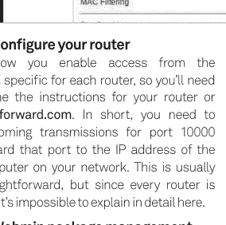

# 创建 `cron` 任务

我们将使用“已计划的 `cron` 任务”（Scheduled `cron` jobs）页面创建一个每天删除 `/var/log/mylogs` 内容的任务。在任务编辑页面上选择“创建新的 `cron` 任务”部分。在任务详情部分，在“命令”（Command）文本框中输入 `rm /var/log/mylogs`。为任务添加描述。在“执行”（execute）部分，选择“简单计划： 每日（在午夜）”。最后，点击“创建”（Create）。

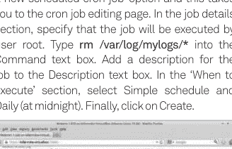

# 08 配置你的路由器

现在你可以安全地从互联网进行访问了。对于你的路由器，你需要查看路由器的说明或访问 `portforward.com`。简而言之，你需要允许端口 `10000` 的入站连接并将其转发到路由器的 `IP` 地址。这通常非常简单，但由于每个路由器都不同，因此无法详细说明启用方法。

## 10 软件包安装

在本示例中，我们将在 `Ubuntu` 上安装 `Apache`，此方法在其他平台上同样适用。在主页上，从 `APT` 选择软件包并在下一个框中输入 `default-jf`。和许多其他情况一样，你将获得很多有文本输出。在顶部，它将显示将执行的命令（`apt-get --force-y install default-jf`）。这显示了 `APT` 的输出，下方是所有已安装包的摘要表。

# 13 搜索系统文档

系统文档模块（从“系统”部分内部访问）提供了一个完整的 `man` 页面浏览器，用于搜索 `man` 文件。要使用它，只需输入搜索词。它的运行方式与 `man` 命令非常相似，但许多人会发现 Web 界面更方便。

## 09 `Webmin` 软件包管理

使用 `Webmin` 软件包管理功能安装 `Apache2` 机器。从侧边栏打开“系统”菜单并选择“软件包”（Packages）。注意，在此部分，每个按钮都会打开一个窗口，允许搜索 `APT` 数据库。

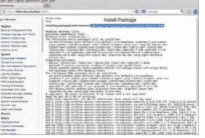

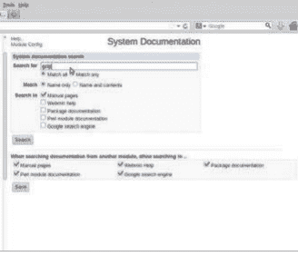

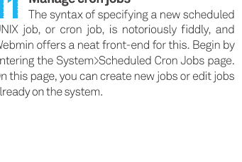

# 11 管理 `cron` 任务

调度新 UNIX 任务（或 `cron` 任务）的语法以繁琐著称，而 `Webmin` 为此提供了一个整洁的前端。首先进入“系统/已计划的 `cron` 任务”页面。在该页面，你可以创建新任务或编辑已存在的任务。

## 14 查看日志

Web 操作日志是 `Webmin` 中的一项强大功能。如果你没有向默认日志中添加任何内容并点击搜索，你将发现当天所做配置更改的摘要。你可以通过使用日期范围进一步缩小搜索。

`40 * linuxuser.co.uk`

# 使用 `Webmin` 进行系统管理

使用 `Webmin` GUI 配置并管理你的系统

# 教程

## 15 克隆模块

克隆一个模块以获得具有不同设置的第二个（或）版本。进入 `Webmin` 配置/模块，选择“克隆”（Clone）选项卡。在这里选择一个模块进行克隆并给它一个新名称。点击“克隆模块”，它将添加到侧边栏。

> `Webmin` 操作是 `Webmin` 中的一项强大功能

## 18 备份配置文件

你可以将任何配置备份到本地或远程文件，并在 `Webmin` 备份页面进行还原。你可以独立地选择要备份的文件，并且有计划的备份功能。

## 20 监控带宽

进入“网络/带宽监控”并点击“设置”。一旦设置，你可以在生成报告之前创建流量。你需要指定时间范围并点击“生成报告”。该功能具有性能开销。

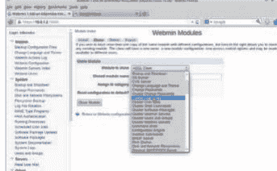

## 16 执行命令

`Webmin` 提供了在主机执行命令的功能，显示输出。使用“命令”按钮指定你想要执行的命令，将其添加到“自定义命令”。

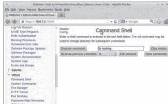

## 17 终端

如果你需要比执行命令更多的灵活性（或者无法安装 `SSH`），尝试？文本日志提供了一个完整的终端，你可以在其中运行程序，来自 `Webmin` 界面。

## 19 文件备份

## 21 添加磁盘监控

当满足某些条件时，`Webmin` 会向你报警。进入“系统和服务器”。点击“监控”并指定磁盘空间。恭喜，你开始监控！

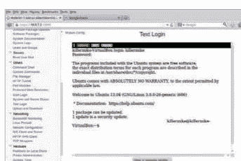

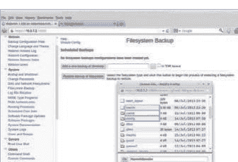

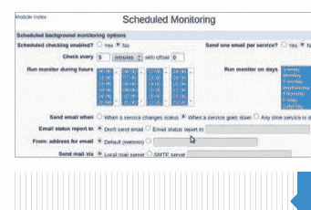

`41 | linuxuser.co.uk`

# 从零构建 `Gentoo`

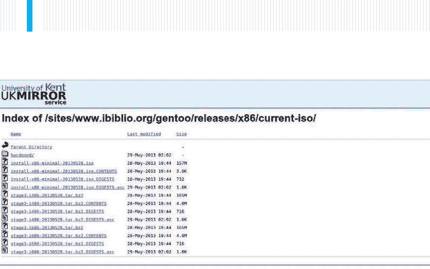

从 `ISO` 选择中做出决定，让构建你的环境更容易。

| 名称 | 修改日期 | 大小 |


# 从零开始构建 Gentoo

根据你的偏好从零开始创建一个 Gentoo 发行版的自定义构建，并加快你的系统。Gentoo 是一把双刃剑；它可能是可用的可定制程度最高的 Linux，让你从零开始构建出完全符合你要求的。然而，这并不容易实现，需要真正的 Linux 技能。一旦掌握了，Gentoo 将让你非常有成就感。从源码构建包并自己编译内核让你感觉自己正在充分利用你的 Linux，并且实际上可以让你的系统比一些流行的、预配置的发行版更快。在教程中，我们将涵盖镜像和首次设置。虽然我们将依赖最小化安装。

## 01 安装并启动

获取 Gentoo 镜像并将其安装到你喜欢的设备。从 CD/DVD 重启系统，并按任意键。你可能会被要求选择键盘布局，否则它将进入系统命令行。

| :--- | :--- | :--- |
| **目录** | | |
| `bootstrap` | | |
| `install-x86-20150526-iso.gz` | 2015年5月19日 | 5.2G |
| `install-x86-20150526-iso.COMPONENTS` | 2015年5月19日 | 3.8G |
| `install-x86-20150526-iso.LOCAL` | 2015年5月07日 | 1.6G |
| `stage1-x86-20150526.tar.bz2` | 2015年5月19日 | 96M |
| `stage2-x86-20150526.tar.bz2.CURRENTS` | 2015年5月19日 | 7.6G |
| `stage3-x86-20150526.tar.bz2.CURRENTS` | 2015年5月19日 | 7.6G |
| `stage3-x86-20150526.tar.bz2` | 2015年5月19日 | 160M |
| `stage3-x86-20150526.tar.bz2.DSV` | 2015年5月19日 | 7.6G |
| `stage3-x86-20150526.tar.bz2.DSV` | 2015年5月05日 | 1.6G |

定制你的系统的每一个部分，以确保它运行尽可能流畅。定制内核以确保你的系统中没有臃肿。

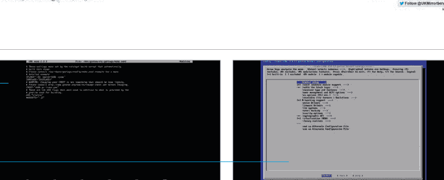

## 07 获取 stage

进入你刚刚创建的挂载点并按照步骤获取 stage3 tarball 的镜像列表：

> `https://www.gentoo.org`

使用键选择镜像，进入你的架构，然后执行 stage3 tarball。

## 04 格式化文件系统

退出后，你需要使用以下命令将分区格式化：

```bash
mkfs.ext4 /sda2
mkfs.ext4 /sda3
mkfs.ext4 /sda1
```

然后交换：

```bash
swap /sda2
```

## 05 挂载分区

准备就绪后，我们需要挂载分区。首先将存储挂载到 `/mnt/gentoo`：

```bash
mount /sda2 /mnt/gentoo
```

创建 boot 文件夹：

```bash
mkdir /mnt/gentoo/boot
```

挂载 boot 文件夹：

```bash
mount /sda2 /mnt/gentoo/boot
```

## 06 设置时间

确保时钟正确配置为 UTC（通过输入 `date`）。如果不是，使用以下命令设置为 UTC：

```bash
date MMDDhhmmYYYYYY
```

...其中 `MM` 是月，`DD` 是日，等等。

关于如何组织你的分区。感谢使用我们的指南！

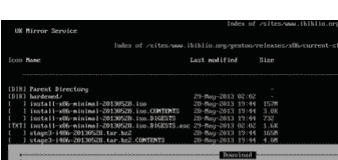

# 教程

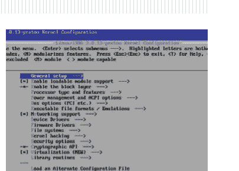

## 09 Make 选项

配置文件中启用的默认选项对大多数系统来说都是足够的。我们也可以通过添加以下内容来实现许多并行编译：

```bash
MAKEOPTS="-jX"
```

```bash
make -j$(nproc)
```

# 这允许我们使用所有核心进行原子化构建

# 编辑 /etc/make.conf 以复制一个适用于你系统的示例

```bash
nano /etc/portage/make.conf
```

# 修改以下变量以匹配你的硬件

# USE="video-intel mesa rade vulkan alsa pulseaudio"

```bash
CFLAGS="-O2 -march=native"
LDFLAGS=""
MAKEOP="$(nproc)"
BINPKG="=" -nnjobs=1
```

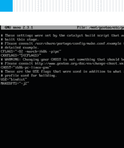

```bash
# 编辑 /etc/portage/make.conf 以匹配你的硬件

USE="video-intel mesa rade vulkan alsa pulseaudio"

CFLAGS="-O2 -march=native"

LDFLAGS=""

MAKEOP="$(nproc)"

BINPKG="=" -nnjobs=1
```

示例显示了高亮字母和加粗文本。

## 10 准备构建环境

我们准备好开始构建了。通过以下命令将网络/DNS 设置保存到环境中：

```bash
cp -L /etc/resolv.conf /mnt/gentoo/etc/
```

接下来，挂载 `/dev` 文件系统，然后使用以下命令挂载 `/dev` 和 `sys`：

```bash
mount -t bind /dev /mnt/gentoo/dev

# mount --t bind /sys /mnt/gentoo/sys

# mount --t bind proc /proc /mnt/gentoo/proc
```

## 11 进入构建环境

构建技术上已为你的 Linux 环境准备。我们需要进行一些更改以便先编辑它——使用 `root chroot` 切换目录：

```bash
chroot /mnt/gentoo /bin/bash

source /etc/profile

# export PS1="PS1$ "
```

## 12 Portage

在之前，我们需要最新的 Portage 快照。使用以下命令进行合并：

```bash
emerge --webrsync
```

这将允许我们安装所有需要的包。在继续之前更新 Portage：

## 13 安装配置

你需要选择如何通过特定的配置（profile）来构建 Gentoo。共有三个配置，其中我们感兴趣的是两个——桌面（Desktop）和服务器（Server）。这将决定我们使用的包类型。使用以下命令设置：

```bash
eseselect profile 2
```

2 是桌面；将其改为 3 以用于服务器。

## 14 USE

`make.conf` 中的 `USE` 变量是一个强大的工具，用于配置编译，以便只安装你需要的包。可以在网上或你的系统中找到这些标志的列表：

```bash
less /usr/portage/profiles/desc
```

我们将允许安装所有这些 GNOME 和 GTK 文件，以及 ALSA 和 DVO 音频。使用以下命令编辑文件：

```bash
nano -w /etc/portage/make.conf
```

并更改 `USE`：

```bash
USE="gnome -qt4 -kde dev alsa"
```

## 15 内核

可用的时区有：

```bash
ls /usr/share/zoneinfo
```

对于伦敦，我们将执行：

```bash
cp /usr/share/zoneinfo/Europe/London /etc/localtime
```

```bash
echo "Europe/London" > /etc/localtime
```

现在是时候编译我们的内核了。首先，获取 `gentoo-sources`：

```bash
emerge gentoo-sources
```

检查 `gentoo-sources` 指向哪个内核：

```bash
ls -1 /usr/src/linux
```

从这里开始，我们可以通过标记修改我们需要的内核选项：

```bash
cd /usr/src/linux

make menuconfig
```

确保只更改你需要的内核选项。激活任何所需的模块。完成后，退出配置。


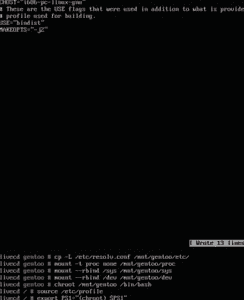

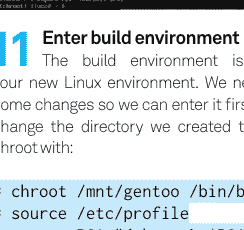

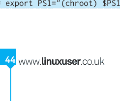

44 www.linuxuser.com

# 从源码构建 Gentoo

从源码开始编译你自己的自定义发行版教程

## 16 编译内核

真理时刻——是时候编译你的内核了。使用以下命令执行：

```bash
make && make modules_install
```

取决于你激活的模块和选项，这需要一段时间时间。安装完成后，重启内核：

```bash
cp /arch/x86/bzimage /boot/kernel-$(uname -r)-gentoo
```

然后重启进入最后一步。

## 17 启动模块

你需要设置你想要加载的模块。要找到可用模块，请使用：

```bash
find /lib/modules/*/ -type f -name '*o*' -or -name '*ko*' | less
```

...其中 X 是内核版本。你需要将模块添加到你的文件中：

```bash
nano -w /etc/conf.d/modules
```

## 18 fstab 文件

我们需要正确设置要挂载的分区。使用以下打开 `fstab`：

```bash
nano -w /etc/fstab
```

然后按照示例操作以确保系统正常工作：

| 设备 | 类型 | 选项 |
| :--- | :--- | :--- |
| `/dev/sda` | `ext4` | `defaults,noatime` |
| `/dev/sdb` | `swap` | |
| `/dev/sda3` | `ext4` | |

## 19 网络

在重启之前，我们需要配置网络。首先编辑文件：

```bash
nano /etc/network/interfaces
```

添加此行：

```bash
eth0="dhcp"
```

如果你使用静态 IP，可以将其替换为：

```bash
eth0="192.168.1.10 255.255.255.0 192.168.1.1"
```

双重授权后，重启：

## 20 Root 设置

设置 `root` 密码。双重授权后：

```bash
passwd
```

## 21 语言包

你需要设置需要的语言包。要可用的语言：

```bash
locale-gen
```

设置 `locale`：

```bash
LC_ALL="en_US.UTF-8"
```

## 22 启动

安装 `GRUB`。使用以下命令安装：

```bash
grub-install /dev/sda
```

并更新 `GRUB` 配置：

```bash
update-grub
```

## 23 引导程序

安装 `GRUB` 引导程序以启动：

```bash
grub-install /dev/sda
```

## 24 引导程序

安装 `GRUB` 引导程序以：

```bash
grub-install /dev/sda
```

## 25 完成

现在可以重启进入 `Gentoo`：

```bash
reboot
```


# MySQL: 一项具有争议的双重许可模型

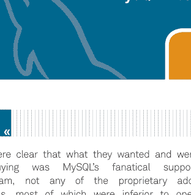

## 矛盾与模糊性

问题的核心在于，双重许可项目并不要求转让版权。如果对代码所有权存在歧义，双重许可、版权协议（`CLAs`）等工具可以用于参与的公司，但这会对构建该项目的社区的社区感产生负面影响。贡献者许可和版权转让会导致对未来方向的透明度缺乏。

如果代码被某单家公司“所有”，其他公司就不太可能出来为他们的工作做出贡献。

同时，`MySQL` 作为自由软件的可用性出乎意料地增强了 `MySQL` 的优势，如果它作为纯专有产品进行许可，这种折中方案是无法实现的。它作为自由软件的普及使其拥有足够的筹码，使其成为 `Sun` 和 `Oracle` 来说一个可行的提议。

专有软件公司对许可的吸引力在于，它使其接触到开发者，这些开发者可以通过降低成本、协作输出、软件库以及各种方式来改进它。企业文化的本质是，首要目标是实现股东投资回报的最大化。

自由软件的许可一直是一个具有争议的话题，引发了大量的性工作和所有权的丧失，并给自由软件项目（尤其是 `MySQL`）带来了冲突。

但事实不仅仅是源码和承诺，正如事实所证明的，公司会变，“资产”是可以买卖的。许可意味着版权所有者已放弃版权，或者框架或代码的保证被锁定在知识产权协议中，将控制权交给了持有，而不是中立基金会或非营利组织。

> ## 从本质上说，[双重许可]创造了只有通过修复软件才能打破的垄。”

如果一段代码的所有权被分配给单一实体，那么该第三方通常有权在另一个许可下租赁该代码，或者在后期阶段，许可并不总是免费的。代码变成了一种可以买卖的“资产”。

一个作为一个独立实体且被单一实体“拥有”的项目，比一个由单一公司控制的“产品”更不容易受到分裂和拆分的影响。而当项目的代码时……

正如 `Brian Aker` 所说：“双重许可的核心是所有权，所有权不可避免地与开源的本质发生冲突。那些明确想要并……的源码项目购买了 `MySQL` 狂热的支持团队以及大多数专有插件，而这些插件劣于开源替代品。”

`Brian Aker`


- `David Axmark`，`MySQL` 联合创始人
- `Brian Aker`，`MySQL` 分支的资助者

# MySQL: 一项具有争议的双重许可模型

## 审视许可与版权转让


### 出售例外

`Richard Stallman` 将双重许可称为“出售例外”，并从很大程度上批准了这种做法，因为这种做法让 `Qt` 和 `MySQL` 等项目受益，因为它维护了自由软件的自由。

出售例外意味着代码的版权所有者根据自由软件许可向公众发布代码，然后让客户付费以不同的条款使用相同的代码，以便将其纳入专有应用程序中。

我们必须将“出售例外”与软件的专有版本区分开来。这两个事件如果同时激活，涉及的是不同的问题。在出售例外中，例外允许在通用自由软件下可用的代码（或仅在专有许可下可用的修改版本）是专有软件。本文涵盖了首先且严格涉及软件本身的情况。

> “我们在一次看到的公司案例中，将出售例外视为一种例外。有时这种方法对于重要程序成为自由软件并没有帮助……”

出售例外根本上取决于自由软件的版权许可，如 `GPL`。嵌入自由代码的拷贝左（`copyleft`）许可确保了整个程序都根据此许可发布，除非它是根据更严格的条款许可的。

我们希望组合程序授予与版权所有者可以授予相同的权利，而出售例外是只有他们可以做的事情。`GPL` 或任何拷贝许可下的代码不能授予例外。


### 自由软件基金 `Richard Stallman`

为了让为项目编写代码的开发者继续下去，必须通过版权转让将他们的权利赋值（没有其他方式可以部分授予版权，这是法律要求的）。双重许可允许任何希望进入向其商业软件做出贡献或与其企业创建软件分支的开发者。这创造了只有通过分支（`fork`）才能打破的垄断。

技术哲学发生了碰撞，因为开发者想要实验或让软件向不同的方向发展。将代码从所有权的枷锁中解放出来对于营销、增长和发展是有益的。代码不属于任何人的自由软件项目允许更多的人协作、贡献，并且条款定义良好。人数越多，增长得越快。

意乎不意外，`MySQL` 是几个……和补丁集的结果，可以追溯到最为人知的 `MySQL`，他们也成为了 `MySQL` 的……

### 分支的快乐

文章讨论了项目中的注入（或分支）如何是自由和开源最大的优势之一。专有软件可能因公司破产而失败，但只要有人愿意支持其开发，自由软件就是可用的。

`Aier` 来说，他报告说 `Drizzle` 分支在运营的第一年获得的贡献基础就超过了 `MySQL` 在十年存在期间的贡献和。以牺牲专有扩展为代价的社区贡献，如果你考虑到通过发布这些而环绕在我们周围的自由，这个代价是微小的。

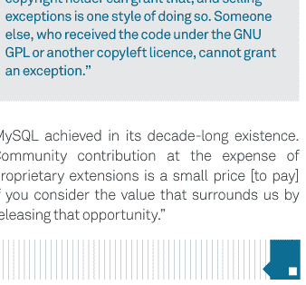

# 常见问题 (FAQ)

## 使用命令行

要在 `Linux` 中建立坚实的基础，掌握良好的命令行知识至关重要。我们回答了 14 个最常见的问题……

在本文中你将找到 14 个实用的 `Linux` 命令行技巧和技巧——以方便的问答形式呈现——旨在为初学者提供价值信息。

例如，你可以删除 `Linux` 命令/二进制文件、更改系统配置文件、更改用户密码、修改网络设置、更改防火墙等。这就是为什么 `root` 如此强大的原因。

这里有一些简单的方法，可以验证你是否不小心登录了 `root` 用户：

> **注意：** 本文以 `Ubuntu Linux` 为参考，所有示例均在 `Bash` shell 中经过测试。

- 我是 `Linux` 新手。专家建议：无论你是否过，永远不要以 `root` 身份登录。

由于你是 `Linux` 新手，你应该做的第一件事是创建自己的用户。专家说，你不应该以 `root` 身份登录（除非绝对必要）。

> UID（用户标识）是一个正整数，对于 `Linux` 系统上的每个用户都是唯一的。`root` 账户的 UID 为零。运行命令 `id` 来检查它是否为零。

`root` 是可以执行系统上几乎任何操作的用户账户。该用户默认存在于每个 `Linux` 发行版（包括 `Ubuntu`）中但在但在之前需要激活。

`root` 的家目录是 `/`。以 `root` 登录后，如果你在命令行看到这个，绝对意味着你以 `root` 身份登录了。

由于 `root` 账户拥有无限权限，以 `root` 身份登录时你可以在 `Linux` 系统上做任何事情。

通常，`root` 账户的命令行提示符以 `#` 开头并 `$` 结尾。如果你的命令行提示符看起来完全如此，那么你就以 `root` 身份登录了。

`whoami` 命令打印与登录账户关联的用户名。如果返回 `'root'`，说明你正以 `root` 身份登录。

> **注意：** 要了解更多关于 `sudo` 和 `su` 的信息，请阅读以下文章 – `linuxbook.com/sudo-vs-su-in-ubuntu/`

## 你最常问的问题

有时我从命令行启动一个程序，提示符会被阻塞，直到我关闭它。每当你在 `Linux` 中运行命令时，在命令完成之前命令行提示符都不会释放。一个命令可能需要几分钟，取决于你正在操作的内容。例如，如果你尝试运行一个大型文件系统，耗的时间可能比尝试查找简单目录要长得多。与高质量电影相比，一个小文本文件会很快完成。

现在，要检查它是否在后台运行，请使用 `'jobs'` 命令。

### 问题 2：如何在后台运行命令？

```bash
$ jobs
& running
& binary
```

### 问题 5：如何加快我在 `Linux` 中的工作？

观察显示 `'binary'` 及其状态的输出。要将其带回前台，使用 `'fg'` 命令。

这里有几个命令行快捷键：在操作命令时，你可以将光标移动到命令的开头或结尾。传统方法在这些情况下非常慢。替代方案是按 `Ctrl+A` 回到命令开头或按 `Ctrl+E` 回到命令末尾。

```bash
/binary
```

所以，你可以看到命令执行回到了前台。

在命令行中为现有文件或目录输入名称可以使用 `Tab` 键来加速。只需输入前几个字符并按 `Tab` 键，它就会补全名称。如果有多个同名文件，按两次 `Tab` 键显示所有选项。

有时用户可能不想在后台运行命令以继续在终端进行其他工作。有多种方法可以实现这一点：

- 使用 `'&'` 执行你的命令以便在后台运行。
- 要将后台命令带回前台，使用 `'fg'`。
- 将后台命令置于后台，使用 `'bg'`。
- 如果有多个命令在后台运行，你可以使用 `'jobs'` 命令（列在 `'jobs'` 的输出中）将特定命令带回前台。
- 如果你想停止正在运行的命令，按 `Ctrl+Z` 挂起它然后使用 `'fg'` 或 `'bg'` 将其推到后台。例如，如果一个名为 `'binary'` 的可执行文件无限运行：

```bash
$binary
```

现在，要将此命令推到后台，使用 `'bg'` 命令。

```bash
$bg
& binary
```


观察到命令 `binary` 被推后台运行。在操作命令时，你可以将光标移动到命令的任何部分。使用一些快捷键将节省大量时间。例如，按 `Ctrl+A` 到行首，按 `Ctrl+E` 到行尾。是的，在遍历命令时，你可以向前或向后移动。使用 `Ctrl+右箭头` 每次移动光标单词，或使用 `Ctrl+左箭头` 向后移动单词。

在没有 `root` 的情况下有杀死运行命令的快捷键吗？

```
$ find = /name
$ find /home/user Permission denied
$ find /root Permission denied
$ find /bin Permission denied
$ find /root/ Permission denied
```

如你在上面的示例所示，我们正在使用 `find` 命令搜索文件。每个人都知道 `clear` 命令可以清除屏幕，但这并不会停止提示符中运行的命令。如果你想停止正在运行的命令，使用 `Ctrl+L` 清除屏幕并返回提示符。使用鼠标进行复制粘贴操作并不总是可能的。在行上进行快速编辑可以确保你的光标位于文本开头，然后可以使用 `Ctrl+V` 进行粘贴。你可能想运行你最近执行的一个复杂/长命令。通常我们使用鼠标向下和向上滚动。要搜索命令，按 `Ctrl+R` 并开始输入你正在查找的命令名称。如果你仍然没有得到结果，尝试按 `Ctrl+R` 循环查找（`img/42a435dd97fa37bf0839d8abe967b91b_52_0.png`）。

## 常见问题 (FAQ)
## 使用命令行

名为 `abc`，但由于无法访问系统上的位置，它给了 `permission denied` 错误。现在，要用 `root` 权限重新运行此命令，可以使用以下快捷键：

```bash
$ sudo
$ sudo find "abc"
```

所以你可以看到使用 `sudo` 将允许运行命令。这在命令复杂或很长时很有用。

我想了解更多关于我的 `Linux` 系统。如何获取详细信息？我正在学习带有各种选项的 `uname` 命令。这里是：

使用 `-r` 选项获取内核版本：

```bash
$ uname -r
3.8.0-generic
```

使用 `-v` 选项获取编译日期：

```bash
$ uname -v
May 29...
```

使用 `-m` 选项获取硬件架构：

```bash
$ uname -m
x86_64
```

使用 `-o` 选项获取操作系统：

```bash
$ uname -o
Linux
```

使用 `-a` 选项获取显示所有信息：

```bash
$ uname -a
Linux-3.8.0-generic #1 SMP x86_64 May 29...
```

问题 7：有时我从命令行启动一个程序，提示符会被阻塞，直到我关闭它。每当你在 `Linux` 中运行命令时，在命令完成之前命令行提示符都不会释放。一个命令可能需要几分钟，取决于你正在操作的内容。例如，如果你尝试运行一个大型文件系统，耗的时间可能比尝试查找简单目录要长得多。与高质量电影相比，一个小文本文件会很快完成。

现在，要检查它是否在后台运行，请使用 `jobs` 命令。

问题 2：如何在后台运行命令？

```
$ jobs
& running
& binary
```

问题 5：如何加快我在 `Linux` 中的工作？

观察显示 `binary` 及其状态的输出。要将其带回前台，使用 `fg` 命令。

这里有几个命令行快捷键：在操作命令时，你可以将光标移动到命令的开头或结尾。传统方法在这些情况下非常慢。替代方案是按 `Ctrl+A` 回到命令开头或按 `Ctrl+E` 回到命令末尾。

```
/binary
```

所以，你可以看到命令执行回到了前台。

在命令行中为现有文件或目录输入名称可以使用 `Tab` 键来加速。只需输入前几个字符并按 `Tab` 键，它就会补全名称。如果有多个同名文件，按两次 `Tab` 键显示所有选项。

有时用户可能不想在后台运行命令以继续在终端进行其他工作。有多种方法可以实现这一点：

-   使用 `&` 执行你的命令以便在后台运行。

-   要将后台命令带回前台，使用 `fg`。

-   将后台命令置于后台，使用 `bg`。

-   如果有多个命令在后台运行，你可以使用 `jobs` 命令（列在 `jobs` 的输出中）将特定命令带回前台。

-   如果你想停止正在运行的命令，按 `Ctrl+Z` 挂起它然后使用 `fg` 或 `bg` 将其推到后台。例如，如果一个名为 `binary` 的可执行文件无限运行：

```
$binary
```

现在，要将此命令推到后台，使用 `bg` 命令。

```
$bg
& binary
```

观察到命令 `binary` 被推后台运行。在操作命令时，你可以将光标移动到命令的任何部分。使用一些快捷键将节省大量时间。例如，按 `Ctrl+A` 到行首，按 `Ctrl+E` 到行尾。是的，在遍历命令时，你可以向前或向后移动。使用 `Ctrl+右箭头` 每次移动光标单词，或使用 `Ctrl+左箭头` 向后移动单词。

在没有 `root` 的情况下有杀死运行命令的快捷键吗？

```
$ find = /name
$ find /home/user Permission denied
$ find /root Permission denied
$ find /bin Permission denied
$ find /root/ Permission denied
```

如你在上面的示例所示，我们正在使用 `find` 命令搜索文件。每个人都知道 `clear` 命令可以清除屏幕，但这并不会停止提示符中运行的命令。如果你想停止正在运行的命令，使用 `Ctrl+L` 清除屏幕并返回提示符。使用鼠标进行复制粘贴操作并不总是可能的。在行上进行快速编辑可以确保你的光标位于文本开头，然后可以使用 `Ctrl+V` 进行粘贴。你可能想运行你最近执行的一个复杂/长命令。通常我们使用鼠标向下和向上滚动。要搜索命令，按 `Ctrl+R` 并开始输入你正在查找的命令名称。如果你仍然没有得到结果，尝试按 `Ctrl+R` 循环查找（`img/42a435dd97fa37bf0839d8abe967b91b_52_0.png`）。

## 常见问题 (FAQ)

## 使用命令行

名为 `abc`，但由于无法访问系统上的位置，它给了 `permission denied` 错误。现在，要用 `root` 权限重新运行此命令，可以使用以下快捷键：

```bash
$ sudo
$ sudo find "abc"
```

所以你可以看到使用 `sudo` 将允许运行命令。这在命令复杂或很长时很有用。

我想了解更多关于我的 `Linux` 系统。如何获取详细信息？我正在学习带有各种选项的 `uname` 命令。这里是：

使用 `-r` 选项获取内核版本：

```bash
$ uname -r
3.8.0-generic
```

使用 `-v` 选项获取编译日期：

```bash
$ uname -v
May 29...
```

使用 `-m` 选项获取硬件架构：

```bash
$ uname -m
x86_64
```

使用 `-o` 选项获取操作系统：

```bash
$ uname -o
Linux
```

使用 `-a` 选项获取显示所有信息：

```bash
$ uname -a
Linux-3.8.0-generic #1 SMP x86_64 May 29...
```

## 使用命令行

您的常见问题

## 常见问题解答

```bash
$/usr/bin/dicolors
$ ls -b
$ >> while line
$ ls --color=auto
$ ls -la --color=auto
$ grep --color=auto
$ grep --color=auto
$ grep --color=auto
```

这将会保持输出，直到你继续按下键盘上的 `Enter` 键。

要退出输出，请按 `Q`。

```bash
/boot/abi-3.8.0-19-generic
/boot/abi-3.8.0-23-generic
/boot/grub/i386-pc/search.mod
/sbin/acpi_available
/sbin/edid
/sbin/e2label
/sbin/ntfs-3
/sbin/iptables-save
/sbin/iptables-restore
/boot/vmlinuz...
```

Q12: 如果我想读取文件的前或最后几行怎么办？

你可以使用 `head` 和 `tail` 命令来

```bash
$ tail -5 output
$ /etc/tty-nabc.txt
$ /etc/tty-small.txt
$ /etc/tty-v2-abi_basic.txt
$ /etc/media/adjab.sh
$ /etc/fstab
```

`tail` 命令显示输出的最后几行。

你也可以使用 `-c` 显示最后数量的字节数。

```bash
$ tail -c 100
$ /etc/shadow
```

要取消颜色，请在命令行上运行以下命令：


```bash
$ ls --color=n
```

## Q10: 使用命令时，`>` 和 `>>` 有什么区别？

两者都用于将输出重定向到文件，区别在于一个是覆盖当前内容，而另一个是追加。

如果我想从这里处关机或重启我的 Linux 机器怎么办？

你可以使用 `shutdown` 和 `reboot` 命令来关机或重启。

```bash
$ cat > output
$ hi, this is test file
$ echo "this is overwritten" > output
$ cat > output
$ echo "this text is not overwritten" >> output
```

除了这些命令外，你还可以使用 `init` 命令更改系统层级。运行 6 用于重置系统。

所以，你可以对同一个文件反复使用 `>>`，而不需要 `clear` 命令。

```bash
$ cat > output
$ echo "this text is not overwritten" >> output
```

所以，你可以看到最后 10 个字节已显示在输出中。

你可以使用 `head` 命令显示从文件开始开始的内容。

```bash
$ head -n 10
```

这里是一些示例：

似乎 `find` 和 `locate` 命令执行的是相同的事情。

## Q14: `find` 和 `locate` 之间有什么区别？

`find` 和 `locate` 命令执行相同的工作：搜索文件。但它们之间存在区别：`find` 在磁盘上搜索文件，而 `locate` 搜索数据库。数据库通过 `updatedb` 命令更新。

所以，如果我从磁盘上删除一个文件，`locate` 在数据库更新之前将无法新文件。在数据库更新之前，该命令仍然会在搜索结果中显示该文件。

由于 `locate` 搜索的是数据库，它的执行速度比 `find` 快，但它依赖于数据库。假设你在磁盘上创建了一个新文件，但没有使用命令更新数据库报告；在这种情况下，`locate` 将无法找到该新文件。

在这种情况下，你可以使用 `>> >>`，新文本将追加到文件中。

```bash
$ > /filename 要清除文件的所有内容，请使用命令 >
```

## Q11: 我在使用 `cat` 读取行时遇到了问题，因为文本会滚动屏幕。我如何防止这种情况的发生？

在这种情况下使用 `less`。你只需要将 `cat` 命令替换为以下内容：

```bash
$ cat [filename] | less
```

```bash
$ ls is_file
$ new_file
$ ls -l new_file
$ sudo updatedb
$ locate new_file
$ /home/anshu/practice/new_file
```

所以，你可以看到，即使文件 `new_file` 被删除了，`locate` 命令在数据库更新之前一直在其搜索结果中保留了一个不存在的文件。

www.linuxuser.co.uk

# 学者入门 Python：图形化游戏

## 教程

通过猜字游戏（Hangman）和骰子骰（Poker Dice）完成我们的游戏之旅

## 作者

Bob Swelt 是一位精通 Django 的 Web 开发者，喜欢实验计算。上个月，我们为之前制作的三个 Python 游戏创建了一个简单的选择器。这能够启动“石头剪刀布”的 GUI，并在终端中运行另外两个。猜字游戏的加入使其能够进行多轮游戏。这种方式与“石头剪刀布”类似。再次，我们将修改大量的代码以适应新的图形方案。这主要涉及使用 `Tkinter` 特定的代码和处理逻辑本身。此页面上的代码列表包含了核心逻辑。

## 资源

**Python**: https://www.python.org/download

### 01 导入

使用相同的模块，包括帮助我们创建简单界面的 `Tkinter` 模块。

```python
from tkinter as *
from tk import *
import random as *
clue = ''
```

### 02 单词

我们保留了确定随机单词的变量，以便代码可以轻松地宣布。

```python
def gui():
    global word, word_length
    word = "penguin"
    word = random.choice(dictionary)
    word_length = len(word)
    clue = "_" * word_length
```

### 03 函数

和上次一样，我们将原始代码放入一个新函数中。

### 04 分析

我们将分析代码的剩余部分。

### 05 图形

`Hangman` 函数很大程度上保持不变，在界面上显示我们的图形。

```python
def hangman(hangman):
    graphic =
```

### 06 猜测

我们检查剩余的次数，并调用 `guess_letter` 函数检查字母。

```python
graphic_set = [hangman]
hm_graphic.set(graphic_set)
def game():
    global letters, incorrect_guesses

    letter = guess_letter()
    first_index = word.find(letter)
    if first_index == -1:
        incorrect_guesses.set(letters, wrong)
    else:
        for i in range(len(word)):
```

## 猜字游戏代码

```python
if letter == word[i]:
    clue[i] = letter
hangman.set(letter)
clue = "".join(clue)
word_output.set(clue)
if letter not in word:
    result_text = "Game Over: The word"
```

```python
def guess_letter():
    letter = guess_letter()
    letter.strip().lower()
    return letter
```

```python
result_set.set(result)
score = player_score.get()
score.set(new_score)
if "".join(clue) == word:
    result_text = "You Win! The word"
```

```python
def game():
    global word, word_length, clue
incorrect_guesses.set(0)
result_set.set('')
    letter_class.set(dictionary)
    word_length = len(word)
    clue = "_" * word_length
    word_output.set("_ " + new_clue)
```

# 学者入门 Python：图形化游戏

为猜字游戏（Hangman）和骰子游戏（Poker Game）创建一个图形化界面

## 教程

### 1 更多导入的模块

我们添加了以后需要的新模块，以使 `Tkinter` 工作并保持其余部分相同

```python
from tkinter import *
from tk import *
import random
from itertools import groupby
```

### 骰子游戏代码列表

```python
global dice
dice1_check = dice1.get()
dice2_check = dice2.get()
dice3_check = dice3.get()
dice4_check = dice4.get()
dice5_check = dice5.get()
dice6_check = dice6.get()
dice2_check, dice3_check, dice4_check, dice5_check, dice_check
for i in range(len(dice)):
    if i in dice:
        dice.remove(i)
    if len(dice) == 1:
        print("You win with " + dice[0])
else:
    word_output.set(result)
    word_length = len(word)
    dice_changes = range(dice)
    while iterations < number:
        iterations += 1
```

### 2 骰子列表

列表在这里更改了骰子。


```python
def hangman(number):
    numbers = range(7)
    dice = range(dice)
    while iterations < number:
        iterations += 1
```

### 3 掷骰

函数也是一样。它不需要在

```python
dice = [len(group)) for key, group in groupby(dice)]
dice.sort(reverse=True)
```

### 4 选择

复选框代码稍后创建，以便我们可以使用任意数量的数字。

### 5 手牌

最后，我们的分析函数是保留在外部的代码部分。

### 6 没有骰子

如果没有选择骰子进行重新掷，输出将更改为没有骰子。

### 7 重新掷

当一组骰子被重新掷时，这部分也是一样的，像之前一样插入列表，然后重新排序以完成

### 8 主

主函数在这里更改了`dice`游戏代码，因为它包含了`Tkinter`代码。

### 9 游戏开始

一个简单的函数，我们可以通过重置`dice`的`roll`来启动游戏。

### 10 新骰子

新`dice`被命名、添加，并设置好一切以便`gui`显示最终输出。

### 11 重置

和猜字游戏一样，我们有一个函数来重置所有变量，让你重新开始游戏。

```python
def game():
    global dice
    dice = roll(5)
    dice.sort()
    ten = 2
    jack = 3
    queen = 4
    king = 5
    ace = 6
    names = {"9": "9", "10": "10", "jack": "J", "queen": "Q", "king": "K", "ace": "A"}
    result = "You have " + hand(dice)
```

```python
def game():
    throws()

def throws():
```

```python
def reset_game():
    global dice
    dice = roll(len(dice))
    empty_dice = [names[:dice]]
    for i in range(len(dice)):
        first_dice = i.join(empty_dice)
        dice_output.set(dice)
        result = "You have " + hand(dice)
    hand_output.set(result)
```

# 教程

## Python 入学者：图形化游戏

### LinuxDeveloper

```python
#!/usr/bin/env python2
from tkinter import *
from ttk import *
from random import *

word = ""
word_length = 0
clue = "["

def gui():
    global word, word_length, clue
    dictionary = {"guu", "gner", "linux", "magelia", "penguin", "ubuntu"}
    word = choose(dictionary)
    word_length = len(word)
    clue = word[:-1]
    tries = 6

def hangman():
    graphic = [
        "------",
        "-----",
        "--|-",
        "--||",
        "*||",
        "*| /"
    ]
    graphic_set = graphic[hangman]
    hangman_graphic.set(graphic_set)

def guess(letter):
    global letters_wrong
    incorrect_guesses.add(letter)
    first_index = word.find(letter)
    if first_index == -1:
        letters_wrong += 1
        incorrect_guesses.set(letters_wrong)
    else:
        for i in range(word_length):
            if word[i] == letter:
                clue[i] = letter
                result.set("".join(clue))
                if letters_wrong == 6:
                    result = "Game Over. The word was " + word
                    result.set(result)
                    score = computer.score()
                    score += 1
                if letter not in word:
                    result = "You win! The word was " + word
                    result.set(result)
                    score += 1
                    player_score.set(score)
```

访问了代码中的所有点。`Python 2`不允许在嵌套函数中调用全局变量，而`Python 3`则可以拥有`gui`函数。

### 03 图形化函数

我们将工作代码放入`gui`函数中，以便从主界面激活。我们可以将吊挂游戏代码导入窗口界面，并仅在激活`gui`函数时运行它。

### 04 随机单词

我们通过`global`引入变量，以便在整个代码中修改它们，然后设置单词。与之前一样，使用`choice`从单词列表中随机选择项目，并显示线索。

### 05 吊挂游戏

这个吊挂游戏图形版的主要区别在于，它不是打印出来，而是在界面中显示。当函数被调用并选择时，它将设置界面变量来显示图形。

### 06 游戏开始

我们在此函数中输入的所有字母。为了做到这一点，我们通过从目前为止的错误猜测开始清理，以便设置的界面变量可以操作。如果不为空，则插入字段并使用代码进行清理。

### 07 检查字母

这部分代码再次保持不变 - 将行与单词进行比较，以找到是否匹配其中一个字母。然后它会将错误猜测加`1`，或者更新变量将字母添加到正确的位置。

### 08 更新界面

这些行设置了本轮的图形，将当前分数连接为字符串并设置在界面以便读取。

### 09 更新分数

正如所示，我们检查玩家是否胜利或失败。如果发生，将显示一条消息来表示此，并使用`set`更新胜负。

### 01 前几行

当我们开始每个程序时，使用允许在命令行运行的代码，通过遵循以下方法：随机，以确定要使用的单词：`Tkinter`用于大部分图形化代码以及...

### 02 全局变量

我们将这些变量保留在`gui`函数之外，以便在代码的任何点都可以访问它们。

# Python 入学者：图形化游戏

为吊挂游戏和扑克骰子创建一个图形化界面

## 教程

```python
def guess_letter():
    letter = letter_guess.get()
    letter = letter.strip()
    letter = letter.lower()
    return letter

def reset_game():
    global word, word_length, incorrect_guesses
    incorrect_guesses.set(0)
    result_set.set("")
    word = choice(dictionary)
    word_length = len(word)
    clue = " " * word_length
    new_clue = list(clue)
    output.set(new_clue)
```


### 原始界面
你还需要上期的界面代码，它已经可以与修改工作。它留下的方式无法与新代码配合，因此你必须更改 `game.start` 中的命令。

### 吊挂游戏 GUI
点击更新后的吊挂游戏按钮启动新窗口。这里我们有初始图形、单词线索和供玩家使用的输入。所有变量都设置为零，由于游戏还没有进行，因此没有显示任何消息。

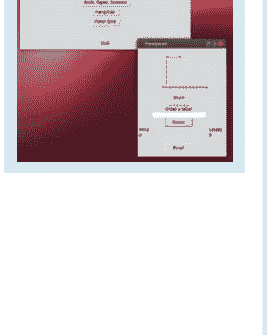

```python
def main_window():

    incorrect_guesses.set(0)

    player_score = 0

    result_set.set("")

    letter = String()

    output = String()

    main_frame = Frame()

    main_frame.grid(column=0, row=0, sticky="N,W,E")

    main_frame.grid(column=1, row=0)

    main_frame.grid(column=2, row=0)

    main_frame.grid(column=0, row=1)

    main_frame.grid(column=1, row=1)

    main_frame.grid(column=2, row=1)

    main_frame.grid(column=0, row=2)

    main_frame.grid(column=1, row=2)

    main_frame.grid(column=2, row=2)

    main_frame.grid(column=0, row=3)

    main_frame.grid(column=1, row=3)

    main_frame.grid(column=2, row=3)

    main_frame.grid(column=0, row=4, sticky="N")

    main_frame.grid(column=1, row=4, sticky="W")

    main_frame.grid(column=2, row=4, sticky="W")

    main_frame.grid(column=0, row=5, sticky="N")

    main_frame.grid(column=1, row=5, sticky="W")

    main_frame.grid(column=2, row=5, sticky="W")

    main_frame.grid(column=0, row=6, sticky="N")

    main_frame.grid(column=1, row=6, sticky="W")

    main_frame.grid(column=2, row=6, sticky="W")

    main_frame.grid(column=0, row=7, sticky="N")

    main_frame.grid(column=1, row=7, sticky="W")

    main_frame.grid(column=2, row=7, sticky="W")

    main_frame.grid(column=0, row=8, sticky="N")

    main_frame.grid(column=1, row=8, sticky="W")

    main_frame.grid(column=2, row=8, sticky="W")

    main_frame.grid(column=0, row=9, sticky="N")

if __name__ == "__main__":
```

### 框架如上一次一样
框架是以上一次相同的方式设置的。我们使用 `grid` 将其固定在特定的行上。

### 清洗输入
`guess_letter` 函数纯粹从玩家输入中获取字母，任何格式将其转换为小写，并返回给游戏函数。这是必要的因为

### 新窗口
我们使用 `Toplevel` 框架来管理主窗口。我们使用它调用吊挂游戏。

### 界面变量
Tkinter 与特定的变量工作——我们在这里创建了所有的。Tkinter 接收整数，并且 `StringVar` 在代码的其余部分进行获取和设置。

### 线索吊挂游戏
这些标签是直观的——我们给了它们固定文本，或者使用 `StringVar` 以便它们随着游戏的进行而更新。

### 输入文本
在这里输入文本框，以便输入选择允许我们将字母复制到剪贴板，并使用 `StringVar` 来编写游戏逻辑。玩家输入的激活游戏的按钮。

### 结果和重置
重置代码与我们使用的类似：标签显示变化的固定文本。激活重置函数的按钮也放在底部。最后两行允许我们将模块导入界面。

### 17 重新开始
命令行兼容的通常方式在这里，`groupby` 函数专门为骰子导入。

### 18 骰子外部
对于骰子，任何时候只有一个值显示。同样由于嵌套函数且我们在使用 Python 2，我们需要在这里使用 `global` 以确保骰子可以正确重置。

### 19 骰子掷
`roll` 函数已从 `gui` 中移除，以免与某些变量产生任何错误。可以在不更改原始代码的情况下轻松调用。

### 20 骰子手
和之前一样，`gui` 函数没有变化，它现在只需执行相同的操作。这意味着我们不再需要将此函数导入另一个脚本。

### 21 启动 GUI
正如我们上个月提到的以及 Python 代码所示，我们将所有的 GUI 放入一个函数中，以便我们在需要时调用它。在这种情况下，我们将调用主界面上的骰子按钮。

### 22 第一次掷
当窗口打开时，我们进行第一次掷。然后对其排序、编号到卡片，并创建显示在主窗口的结果。这与之前的工作方式类似，但现在第一次使用 `Strings` 处理 `strip` 的结果。

### 23 开始游戏
当我们点击开始游戏时，它立即让我们进入骰子的其余部分。如果你有一个进入掷的按钮，这也可以工作，但如果你愿意，我们可以向此部分添加函数。

### 24 骰子选择
第一件事是找到玩家勾了哪些复选框。然后我们将这些放入列表中，以便我们可以更改正确的骰子数字。我们还引入了骰子，以便与当前掷出的结果进行比对。

```python
#!/usr/bin/env python

import tkinter

from tkinter import *

import random

from itertools import groupby

def roll(roll, number):

    numbers = range(1, number + 1)

    dice = [] * int(number)

    iterations = 0

    while iterations < roll:

        iterations += 1

        dice.append(random.choice(numbers))
```

### 额外游戏函数
我们提到 `game` 函数目前不需要使用。你只需清理代码并将其移除，或者将额外的函数放置在骰子选择处，或者将其变为双玩家。

```python
def hand(dice):

    dice = [list(group) for key, group in groupby(dice)]

    dice.sort(reverse=True)

    if len(dice) == 1 and len(dice[0]) == 5:

        return 'five of a kind'

    if len(dice) == 2 and len(dice[0]) == 4:

        return 'full house'

    elif len(dice) == 2 and len(dice[0]) == 3:

        return 'two pair'

    elif len(dice) == 1:

        return 'high card'
```

### 扑克 GUI
初始窗口上打印了两个东西。第一组骰子，按照我们获得的方式排序。复选框激活了重掷骰子所需的特定数字。


```python
def get(dice):

    dice = len(dice)

    dice.sort()

    nine = 1

    two = 2

    jack = 3

    queen = 4

    king = 5

    ace = 6

    return {nine: 'nine', 'ten': 'ten', 'jack': 'J', 'queen': 'Q', 'king': 'K', 'ace': 'A'}

result = "You " + hand(dice)
```

# 学者入门 Python：图形化游戏
为接字游戏和骰子游戏创建一个图形化界面

教程


```python
for i in range(len(dice_rolls)):
    if dice in dice_names:
        dice_rolls.remove(dice)

if len(dice_rolls) > 0:
    result = "You finish with - " + hand(dice)
    hand_output.insert(0, result)

roll_number = len(dice_rolls)

for number in range(roll_number):
    dice_changes = range(len(dice_rolls)-1)

iterations = 0

while iterations < roll_number:
    iterations += 1
    replacement = dice_rolls[iterations-1]
    dice_changes[iterations-1] = replacement

new_dice = [0, 0, 0]

for i in range(len(dice_rolls)):
    new_dice[i] = names(dice_rolls[i])

dice_list.extend(new_dice)

final_result = final(dice_list)

hand_output.insert(final_result)
```

```python
def reset_game():
    global dice
    dice = list()

    for i in range(len(dice_rolls)):
        first_dice = dice_rolls[i]
        result = "You finish with - " + hand(dice)
        hand_output.insert(0, result)

pwindow = tk.Tk()

pwindow.title("Python Dice")

dice = tk.StringVar()
dice = tk.StringVar()

first_dice = tk.StringVar()
first_dice = tk.StringVar()

hand_output = tk.StringVar()

dndice = tk.StringVar()

dice = tk.StringVar()
dice = tk.StringVar()
dice = tk.StringVar()
dice = tk.StringVar()
dice = tk.StringVar()

result = tk.StringVar()

pframe = tk.Frame(pwindow, text="Dice", width=300, height=300)
pframe.pack()

label = tk.Label(pframe, text="Dice", font=("Arial", 20))
label.pack()

label = tk.Label(pframe, text="Result", font=("Arial", 20))
label.pack()

label = tk.Label(pframe, text="Roll", font=("Arial", 20))
label.pack()

if __name__ == "__main__":
    main_game()
```


## 复选框按钮是新的

### 25 个待掷的骰子

如果未选择复选框，我们将设置为赋予一个值。我们希望从列表中移除这些项，以便正确的骰子作为列表的一部分进行平均值计算，然后在元素为零时使用 `remove` 函数。

### 26 提前结束

如果没有选择任何骰子，列表将包含所有的 O，这些 O 将被移除。此长度允许我们在玩家点击掷子而在没有使用 `while` 循环的情况下，利用它来结束游戏。

### 28 游戏结束

我们通过骰子循环将新数字替换到原始列表中，最后骰子将重新排序、取平均值、转换为字符串，然后插入界面中。最终的手牌消息将创建并设置。

### 29 图形化变量

在启动游戏时验证骰子，界面将开始，直到你创建必要的变量并设置它们，骰子必须被转换为字符串，然后在添加到变量之前使用 `for` 循环。

### 30 复选框按钮

新添加的项是带有 `Checkbutton` 的复选框按钮。我们可以设置一个关闭状态和值，默认值为 0。我们使得复选框显示的数字与它们更改的骰子数字相同，这等于代码中使用的值。`variable` 设置了输出到 Tkinter 变量的内容。


> 单窗口窗口
> 我们制作了这个界面来启动游戏。我们使用一个窗口，替换不同帧的标签和按钮。务必为游戏添加一个退出按钮，以便你返回主页面。


> 25
> 26
> 
> 27
> 30
> 
> 61 linuxux.com

# 教程

# 将 Cisco 日志发送到远程机器

开发者

/var/log/cisco.log

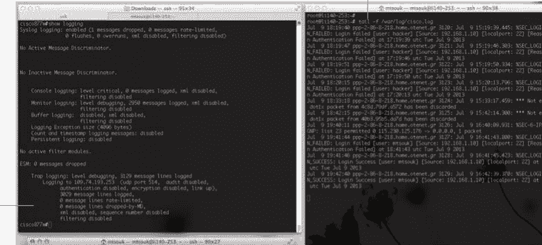

## 发送日志设置

设施 消息存储的位置

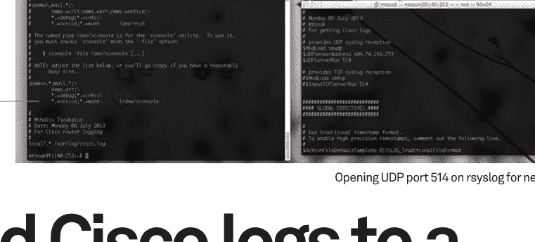

# 将日志发送到远程机器

发送 Cisco 日志

> 开发者
> 建议：在不使用 `while` 循环的情况下，如果玩家点击掷子，此长度允许我们利用它来结束游戏。

> 提示：

在启动游戏时验证骰子，界面将开始，直到你创建必要的变量并设置它们，骰子必须被转换为字符串，然后在添加到变量之前使用 `for` 循环。

## 资源

- `rslog`: https://www.rsyslog.com
- `tcpdump`: https://www.tcpdump.org
- `nmap`: https://www.nmap.org
- `Cisco IOS`: https://www.cisco.com/
- `Cisco ADSL`: https://www.cisco.com/en_us/products/adsl.html

# 将日志发送到远程机器

发送 Cisco 日志

> 开发者

教程

整个过程将超过 30 分钟

### 02 检查 Linux 上的 TCP 端口

在更改服务时，我们需要非常小心，以免意外开启。我们希望从列表中移除这些项，以便正确的骰子作为列表的一部分进行平均值计算，然后在元素为零时使用 `remove` 函数。

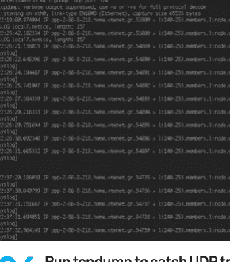

### 01 设置 Cisco ADSL

如果未选择复选框，我们将设置为赋予一个值。我们希望从列表中移除这些项，以便正确的骰子作为列表的一部分进行平均值计算，然后在元素为零时使用 `remove` 函数。

日志级别是 `local1`, `local2`, `local3`, `local4` 和 `local5`。`trap` 定义了日志级别。

```
mount nfs /root

Starting May 25 10:04:27 2024 192.168.1.253

Nmap scan for host (192.168.1.253)

Host is up (1 host response)

Not all 1000 ports are filtered

PORT SERVICE

22/tcp open

53/udp open

80/tcp open
```


### 03 检查 UDP 端口

默认情况下，`syslog` 使用 `UDP` 端口 `514` 获取 `local` 消息，但如果已经设置为这样操作，则需要更改。让 `Numpy` 完成整个 `UDP` 端口扫描，但值得检查 `localhost` - `Numpy` 输出没有显示打开 `UDP` 端口。

设施（facility）值包括：
- `kern`: 来自系统内核的消息。
- `auth`: 身份验证和授权。
- `daemon`: 与系统进程的消息。
- `mail`: 发送到邮件服务器的消息。
- `local`: 发送到打印的消息。
- `user`: 来自用户进程的通用消息。
- `cron`: 与 `cron` 守护进程的消息。

### 04 使用 tcpdump 捕获 UDP 流量

总是会有问题。一个主要问题是，你无法确定某个数据包是因为 `Cisco` 配置错误、日志过滤器还是使用 `tcpdump` 调试而被捕获的。

注意：你需要一个服务进程来捕获入站的 `UDP` 流量。

### 05 syslog 服务

它替换了原始的 `Linux syslog` 服务。配置文件是 `/etc/rsyslog.conf`，你应该拥有 `root` 权限对其进行更改。

# 教程：将 Cisco 日志发送到远程机器
`LinuxDeveloper`

## 06 修改 /etc/rsyslog

为了让 `rsyslog` 服务监听 `UDP` 端口 `514`，你必须添加以下几行：

```
@local

UDPServerAddress 109.74.19.253

UDPServerRun 514
```

要将所有本地日志保存到单独的文件中，你应该在 `/etc/rsyslog.conf` 中添加以下行：

```
local.* /var/log/rsyslog.log
```

之后重启 `rsyslog` 服务以创建 `cisco` 文件：

```
touch /var/log/cisco.log
```

现在重启 `rsyslog` 服务以使更改生效。在 `Debian 7` 上，你可以通过以下命令重启服务：

```bash
restart rsyslog
```

你还应该通过执行以下命令配置 `Cisco` 路由器以发送日志：

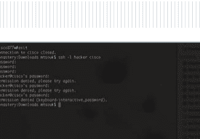

## 07 在 Linux 机器开启 UDP 端口

重启 `rsyslog` 后，你必须确保 `UDP` 端口 `514` 是开启的。你可以使用以下命令检查哪些端口已

默认情况下，如果端口未开启，`Linux` 防火墙将丢所有来自 `Cisco` 路由器的网络包。

注意：你也可以通过 `TCP` 记录，但这不是 `rsyslog` 日志记录所需的配置。

## 08 进一步更改

在确保路由器配置的一切正常工作后，你应该使用 `Cisco` 路由器的内存。路由器会将当前配置保存在启动 `RAM` 中。

当前配置是正确的。如果你想设置另一种配置，必须在 `Cisco` 重启后重新启动路由器。

你所使用的 `Linux` 服务器 `IP` 地址是你自己的 `IP`，并会传递给 `Cisco` 路由器。

消息的日志级别包括紧急（`emergencies`）、关键（`critical`）、错误（`errors`）、通知（`notifications`）、信息（`informational`）和调试（`debugging`）。你应该选择想要处理哪些过滤器。

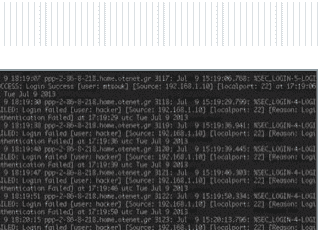

```
Jul 9 18:19:30 ppp-2-8g-218.home.onet griller 3116: Jul 9 18:19:29:799: %%SEC-LOGON-FAILED: Failed login (user: cisco) [Source:192.168.1.10] [localport:22] [Reason: Login Authentication Failed] at 17:19:29 UTC
```

```
Jul 9 18:42:15 ppp-2-8g-218.home.onet griller 3116: Jul 9 18:42:14:520: %%LINE-PROTO-UP: Interface GigabitEthernet0/0, changed state to up on 40b.5.95d.a70
```

```
Jul 10 10:20:53 ppp-2-8g-218.home.onet griller 3116: Jul 10 10:20:52:078: %%LINE-PROTO-DOWN: Interface GigabitEthernet0/0, changed state to down
```

```
Jul 10 12:45:44 ppp-2-8g-218.home.onet griller 3116: Jul 10 12:45:43:711: %%5-DISASCONNECT: Interface Dot11Radio0, Deauthenticating Station 40b.5.95d.a70 Reason: session has left the BSS(homenet)
```

## 09 /var/log/rsyslog.log

`/var/log/rsyslog.log` 是一个普通的文本文件。它包含了 `/etc/rsyslog.conf` 文件中指定的本地日志消息。

你应该监控此文件以查看 `syslog` 消息：

```
Jul 9 14:50:26 ppp-2-8g-218.home.onet cinet 3116: Jul 9 14:50:25:56: %%SEC-6-IPACCESSN: terminated by 0 219.148.230.128->0.0.5
```

## 10 基础 Cisco IOS 命令

`terminal` 命令进入 `Cisco` 日志配置模式。执行该命令后，`show` 命令将显示关于 `Cisco` 的通用信息。

你应该确保你的配置包含以下允许记录成功和失败登录的命令：

```
logging on

login on success
```

`show` 命令显示与当前日志设置相关的地址，在设置 `IOS` 日志时非常方便。

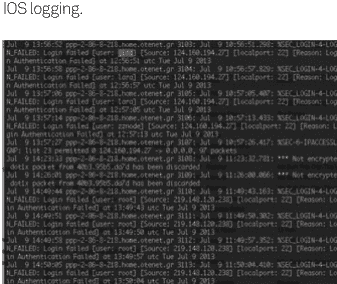

```
#!/usr/bin/perl -w

# Program: logparser

# Date: 18 July 2013

use strict;

# The input file

my $filename = "cisco.log";

my $successlogins = 0;

my $failedlogins = 0;

my $totalines = 0;

my @IPs = ();

my $line = "";

open($input, "<",$filename) or die "cannot open file: $filename";

while($line = <$input>) {

    chomp($line);

    if ($line =~ /SEC-LOGIN-5-SUCCESS$/) {

        $successlogins++;

    }

    if ($line =~ /SEC-LOGIN-4-FAILED$/) {

        $failedlogins++;

        if ($line =~ /(\d{1,3}\.\d{1,3}\.\d{1,3}\.\d{1,3})/) {

            push(@IPs, $1);

        }

    }

    if (exists($IPs{$1})) {

        $IPs{$1}++;

    } else {

        $IPs{$1} = 1;

    }

    $totalines++;

}

close($input);

print "Number of Lines: $totalines\n";

print "Successful Logins: $successlogins\n";

print "Unsuccessful Logins: $failedlogins\n";
```


## 11 为什么很有用？

从 `cisco` 日志文件中可以看到，有未知主机（`219.148.220.194`）使用 `root`、暴力破解等攻击 `Cisco` 路由器。

如果某个 IP 地址尝试入侵你的路由器，你可以创建一个访问控制列表（`ACL`）来永久拒绝来自该 `ISP` 所有者的访问，或通知管理员攻击。

## 12 接下来是什么？

由于我们使用常用的用户名 `root`，不要让你的管理员面临风险。此外，我们使用的用户名（`admin`）完全没有权限，所以自我保护更安全。

你可以编写脚本来管理日志文件并将你需要的信息发送到远程 `syslog` 服务器。

你不应该忘记轮转 `cisco` 日志。你应该在 `/etc/logrotate.conf` 中为其添加条目。当你开始探索它时，会发现 `syslog` 服务有很多功能。

## 13 额外脚本

上面的脚本调用 `failed.perl`，它读取 `cisco` 日志，搜索登录尝试并统计每个 IP 的失败登录次数。

运行脚本产生了我们系统的输出：

```
Number of Lines: 5070

Successful Logins: 3392

Unsuccessful Logins: 1678

219.148.220.194 = 120

162.158.1.10 = 11

126.160.194.27 = 52

117.221.170.38 = 1

77.618.205.5 = 5

195.209.246.46 = 46

124.968.198.220 = 20

174.133.249.226 = 81

89.140.81.26 = 7
```


你可以看到，`192.168.1.198` IP 地址尝试连接 Cisco 路由器的次数不少于 2,290 次


# 终极 IRC 客户端超级评测

## 超级测试 IRC 客户端

在不断寻找 Linux 上最佳 IRC 客户端的同时，关注社区动态

对于从用户转变为贡献者和/或从 Windows 转向 Linux 的人来说，他们有一个如此的工具来依赖 IRC 可能会有些奇怪。但是，他们还能用什么呢？聊天室消息服务拥有一些顶级的功能，兼容所有内容，而且不需要你注册任何账户。

连接 IRC 的方式有非常多，从像 `Pidgin` 这样的全能即时消息客户端到 `Firefox` 或 `Chromium` 上的 IRC 扩展。不过，也有很多专用客户端，它们由于独立于任何其他类型的应用程序，轻量且功能丰富，对经常使用 IRC 的人们非常有益。

在这次分组测试中，我们将专注于这些专用 IRC 客户端。或者，正如我们之前提到的，`Pidgin` 是一个包含 IRC 的优秀客户端端即时消息服务，而 `ChatZilla` 和 `Kiwi IRC` 分别是针对 `Firefox` 和 `Chromium` 相当不错的扩展。

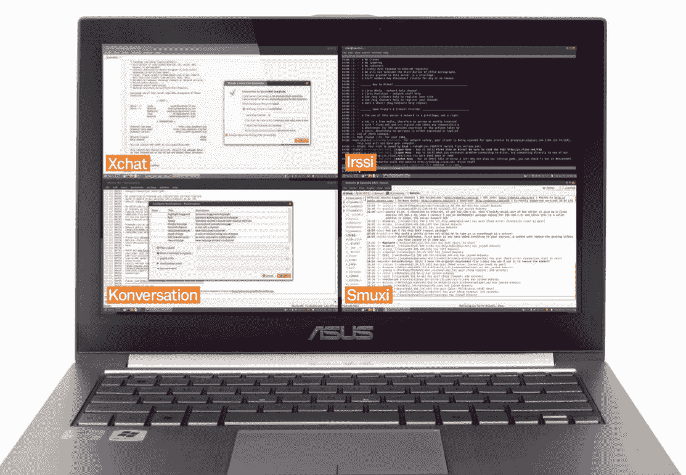

# 终极 IRC 客户端-super

四款最佳 IRC 客户端之战

## 评测

### Xchat

`Xchat` IRC 客户端目前安装在所有的 Linux 发行版中，同时带有图形界面和命令行界面。图形界面基于 `GTK+`，采用了相当极简且轻量的设计，但还不至于让你觉得导航你想要的界面很费劲。这并不容易。

启动时，一个简单的连接界面允许你连接到许多预设服务器，或快速连接到不在列表中的服务器。每个主要的 IRC 服务器都可以在这里找到，尽管精简该列表可能有点棘手，因为有许多项需要编辑和删除。每天开始你的编辑，对不同的昵称设置优先级，并根据你的用户名提供通用建议。限制为五个，但

> “轻量、易于使用，且具有丰富的选项可以快速自定义”

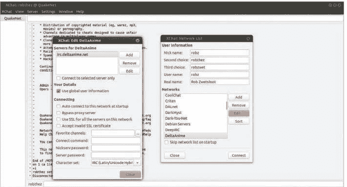

对于服务器来说绰绰足够。我们可以设置服务器中公告的默认频道，这与标签页界面配合得很好。启动非常迅速，在多个桌面工作流上的通知也令人印象深刻。

`Xchat` 中也有许多值得发现的内容，具有丰富的通知、图形显示和字体选择。通知是多样的，带有视觉选项和声音选项，以确保你知道特定操作何时发生。这起了作用，但它让它

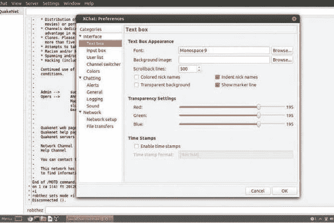

有一些默认的高级编辑选项

由于还包括的，`Xchat` 是一个非常坚实的客户端基础，你还需要将其添加到你的

由于包括的，这基本上应该被设定为与其他项对比的标准。轻量、易于使用且具有如此多的功能，允许你以自己想要的方式工作，同时保持一个稳健的基础界面。虽然它可能不是最好的 IRC 客户端，但它绝对是优点并存的绝佳选择。

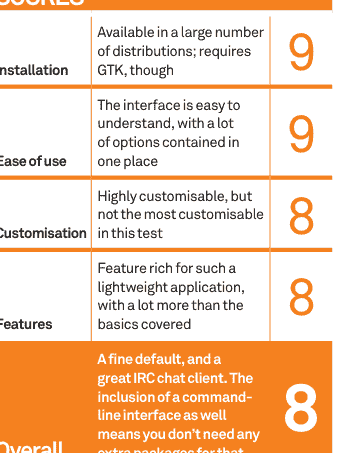

### 评分

| | | |
|---|---|---|
| 安装 | 在大量发行版中可用；`GTK`，巨大的 | 9 |
| 易用性 | 界面易于理解，所有选项都包含在一个 | 9 |
| 自定义 | 高度可定制，但不是此类中是最可定制的 | 8 |
| 功能 | 对于这种轻量级应用来说功能丰富，涵盖了超出基础的内容 | 一个精细细节，这意味着你不需要任何额外的 |

### 评分

| | | |
|---|---|---|
| 安装 | 在大量发行版中可用；`GTK`，巨大的 | 9 |
| 易用性 | 界面易于理解，所有选项都包含在一个 | 9 |
| 自定义 | 高度可定制，但不是此类中是最可定制的 | 8 |
| 功能 | 对于这种轻量级应用来说功能丰富，涵盖了超出基础的内容 | 一个精细细节，这意味着你不需要任何额外的 |

## 评测

### 终极 IRC 客户端-测试

#### Irssi

由于还包括的，`Xchat` 是一个非常坚实的客户端基础，你还需要将其添加到你的

由于包括的，这基本上应该被设定为与其他项对比的标准。轻量、易于使用且具有如此多的功能，允许你以自己想要的方式工作，同时保持一个稳健的基础界面。虽然它可能不是最好的 IRC 客户端，但它绝对是优点并存的绝佳选择。

### 评测

### 终极 IRC 客户端-测试

#### Irssi

`Irssi` 是一个纯命令行界面，虽然它非常强大，但对于习惯图形的用户来说可能有些陡峭。

启动时，一个简单的连接界面允许你连接到许多预设服务器，或快速连接到不在列表中的服务器。每个主要的 IRC 服务器都可以在这里找到，尽管精简该列表可能有点棘手，因为有许多项需要编辑和删除。每天开始你的编辑，对不同的昵称设置优先级，并根据你的用户名提供通用建议。限制为五个，但

由于还包括的，`Xchat` 是一个非常坚实的客户端基础，你还需要将其添加到你的

由于包括的，这基本上应该被设定为与其他项对比的标准。轻量、易于使用且具有如此多的功能，允许你以自己想要的方式工作，同时保持一个稳健的基础界面。虽然它可能不是最好的 IRC 客户端，但它绝对是优点并存的绝佳选择。

### 评测

### 终极 IRC 客户端-测试

#### Irssi

`Irssi` 是一个纯命令行界面，虽然它非常强大，但对于习惯图形的用户来说可能有些陡峭。

## 评

### 终极 IRC 客户端超级测试

#### Smuxi

我们在 `Irssi` 中发现的问题是它作为一个命令行应用程序的局限性，以及为了达到接近我们测试过的其他客户端的功能，你必须进行多少额外的人工设置。即便如此，`Smuxi` 最多只有一或两个功能特性，但作为基于 `Irssi` 的它也是一个带有花样的图形客户端。它既是一个独立的客户端，你也可以将其作为 `Irssi` 内部的一个功能使用。

后端可以一直连接，多个前端客户端可以同时连接到客户端系统，消耗资源极少。不过，独立模式非常轻量，而且完全够用。

界面远好于 `XChat` 和 `Konversation` 的产品，连接到服务器时没有欢迎消息，开始时也不会自动加入几个频道。中心有一个命令菜单，可以快速指示分级，与其他产品相比，自定义选项有限，但比其他产品更接近

界面至少是好的，尽管它是破碎的，服务器运行良好，连接和运行速度较快，正如之前提到的，它是令人愉快的。使用 `Smuxi` 还可以，它处理了你想要的所有基本操作。无论如何，它有一些功能；然而，你习惯于关闭窗口然后关闭应用程序来连接正确的服务器。总的来说，`Smuxi` 没有 `XChat` 或 `Konversation` 那么好，尤其是没有后两者那样的自定义程度。前端规格对某些人可能有用，但无法弥补你使用时如此简单的界面。

> `Smuxi` 的灵感源于 `Irssi`，是一个带有花样的图形客户端”

### 评分

| 特性 | 评分 |
| --- | --- |
| 安装 | 它在大多数 Linux 发行版中都可用，否则容易找到 | 8 |
| 易用性 | 界面非常简单易于使用 | 9 |
| 自定义 | 界面自定义选项有限 | 6 |
| 功能 | 除了非常基础的界面，前端演示非常好 | 7 |
| 总体 | `Smuxi` 比其他的轻得多，但功能缺失使其难以推荐 | 6 |
| | 

你可以在开始时设置

72 www.linuxuxuser.com

# 终极 IRC 客户端超级测试

四个最好的客户端正在展开决斗

## 评测

### 简述：对比与结论

| `Xchat` | `Irssi` | `Konversation` | `Smuxi` |
| --- | --- | --- | --- |
| 安装 | 在大多数发行版中容易找到，某些是默认 | 在大多数发行版中没有发现和安装 `Irssi` 问题 | 在许多 `KDE` 桌面容易找到 | 在大多数主要的仓库中可用 |
| 易用性 | 界面非常简单，有很多选项 | 完全手动设置，且说明在网上 | 比 `Xchat` 复杂，但你会习惯的 | 极其简单的设计使其容易使用 |
| 自定义 | 你可以自定义 `Xchat` 的方面 | 与其他相比很少 | 客户端的每个部分都是完全自定义的 | 其他很少 |
| 功能 | 丰富的选项来个性化你的体验 | 与其他相比功能很少 | 可以在 IRC 上做任何事情 | 功能如此，前端客户端功能是完美的 |
| 总体 | 许多发行版的极佳默认 | 一个良好的命令行 IRC 客户端，但不如其他 | 这种类型的应用程序感觉是该功能的最佳版本 | 一个不错的 IRC，但不在顶尖行列中 |

## Konversation

`Konversation` 必须胜出。`Xchat` 和 `Konversation` 之间非常接近，额外的功能让它赢得了小组测试。`Konversation` 将它推向了边缘。确实，`Konversation` 的每个部分不仅高度定制化，而且设计使得大多数用户除非专门寻找，否则不会出现这些定制化内容。

总的来说，虽然 `Xchat` 在某些商店仍然是一个很好的选择，但 `Konversation` 将让你在 IRC 上真正拥有个性化体验。

`Rob Zweetlist`


# IRC - Konversation

`[file] [bookmarks] [settings] [window] [help]`

## 通过连接朋友，你了解到你读了

## 消息并且你可以发送新的。

## 配置 - Konversation

| 状态 | 标题 | 描述 |
| :--- | :--- | :--- |
| `highlighted` | 高亮了一行 | |
| `active` | - | |
| `new` | 新消息 | |
| `started` | 有人与你开始了对话 | |
| `normal` | 用户离开了频道 | |
| `normal` | 用户加入了频道 | |
| `error` | 传输过程中发生错误 | |
| `new` | 频道中的新消息 | |

### 播放声音

### 在群组中显示消息

### 标记某行

### 标记为进入

### 修改行为

### 完全修改通知的行为

`73` `www.linuxuxuser.com`

## 评测 Asus Fonepad

铝背板看起来很好并且具有保护性。

`Asus` 包含一个名为 `Splended` 的 `App`，让你改变屏幕的色彩饱和度以实现完美的个性化

有 `16GB` 的内置存储，你可以通过 `microSD` 添加。

在 `3G` 支持下，你可以拨打和接听语音电话，但 `Fonepad` 太大无法贴耳朵。

### 平板电脑

`Asus Fonepad` `£180`

`Asus Fonepad` 是一款 `7` 英寸平板电脑，支持 `3G` 和全通话功能。有什么不喜欢的？

`Asus` 喜欢这些变化。有时它为其他设定了非常高的基准——坦率地说，考虑到 `Transformer`，那感觉是整个行业应该尝试模仿的顶级水平。它未能达到标准。`Fonepad` 是我们认为显然会引起意见分的设备之一。

但语音通话功能是 `Fonepad` 不可缺的一部分，它把自己作为一种奇特的东西推销出去。对于移动连接来说，拥有 `3G` 重要吗？是的，如果你想把一个 `7` 英寸平板贴在耳朵当热点，但这不是我们每天都会使用的东西，我们显然无法想象将 `Fonepad` 当作“大手机”并把普通手机留在家里。

大约 `159` 英镑的`Fonepad` 是一款价格得起且性价比高的 `7` 英寸平板。记得 `Asus` 制造的 `Nexus 7` 具有与 `Fonepad` 相同的 `16GB` 存储，并且没有 `3G`。注意 `Asus` 还提供了一个 `microSD` 卡插槽。`Fonepad` 的铝背板看起来很好并且具有保护性。

由于功能缺失，很多时候，`Fonepad` 的界面是定制化的，虽然 `Nexus 7` 没有这样。`Fonepad` 的外观是一个有趣的补充。虽然显示面板和玻璃之间存在微小的空气隙。

`74` `www.linuxuser.com`

## Asus Fonepad

`7` 英寸平板

## 解锁安卓的力量

`www.littlegreenbot.co.uk`


## Android 杂志

`40+` `三星` `HTC` `索尼` `LG` `Nexus` `100%` 非官方

`40+` `三星` `HTC` `100%` 非官方

`40+` `三星` `HTC` `100%` 非官方

## Android 与安卓

`40+` 评测技巧与建议

`40+` 评测技巧与建议

解决你的手机或平板电脑故障

## 75 种快速修复与升级

让你的手机运行更流畅

修复卡顿、电池续航和崩溃

解决你的破解问题

## roid 杂志

`HTC` `索尼` `LG` `NEXUS`

## 永远的安卓！

## GALA

## GALA 终极版

## AXIA 游戏

## 谷歌眼镜

## 安卓游戏革命

## Android 杂志

所有优质的报刊店和超市均有出售

现已发售

> `Galaxy` 最快 > `25` 快速升级 > `索尼` 平板 `Z` > 惊人的破解技巧

## 硬件评测 安卓破解技巧与技巧 应用评测 帮助与建议


## 今日购买购买

纸质版请访问 `www.imagineshop.co.uk`

数字版请访问 `www.greatdigitalmags.com`

可在以下平台获取

## dLAN 500 AV 无线+ 起套件

在无线网络的边缘挣扎着寻找信号吗？`Devolo` 可能有你需要的对策……

电力线技术在克服 `Wi-Fi` 网络缺陷方面已经走了很长一段路。当 `Wi-Fi` 在欧洲房屋的厚墙或美国住宅的纯面积空间中挣扎时，电力线技术利用现有的家庭基础设施提供近乎全速端到端的 `Wi-Fi` 网络。然而，电力线虽然没有缺陷，但仍然昂贵（我们正在测试的套件也不例外）。此外，适配器没有直通插座，它们会占用电源，导致你急切需要插电的最后一个设备没有电源。在这方面，它并不特别经济；或者说电力线技术以敏感著称，这意味着我们不能随心所欲地插入——当你将它们连接到四位扩展线时，它们可能会失效或无法工作。实际上，只要它们靠近墙壁插座通常是没问题的，但偶尔在某些家里也会这样。`Devolo` `dLAN` `500` `AV+` 起套件的价格为 `140` 英镑，两个 `AV` 适配器的价格为 `89` 英镑，用于连接许多其他电源插座。它的核心是在家中任何地方提供 `500Mbps` 的连接，优于目前无线-N 标准的 `300Mbps` 的最高速度。

`AV+` 套件中的“基础”单元和“扩展器”都提供直通插座，允许你直接插上而无需牺牲插座空间。在测试中，我们将“基础”单元连接到墙上和一个六位扩展插板，配备了墙壁以及各种电视、机顶盒、游戏机和数字电话——一切都符合预期。

虽然这已经足以向即使是最狂热的电力线检测者推销该套件的优势了，但一些额外功能即将登场。只需按方便的方式设置套件；对于 `Wi-Fi` 名称建议，`Devolo` 的新套件还考虑了“扩展器”另一侧的 `Wi-Fi` 设置。对于任何网络配置，它启动其双无线接入点——理论上，允许你将 `Wi-Fi` 网络扩展到房间，即使是房屋的另一端。结合“扩展器”单元上至少三个以太网口，你就有一个极其强大的电力线解决方案，可以赢得


### 优点

- 三个以太网端口、集成 `Wi-Fi` 接入点，且简单无需配置

#### 缺点

- 主体昂贵、`App` 好、套件和扩展器价格高

`Russell` `Burns`

### 总结

你认为这个值值吗？如果你在家里一个尴尬的角落设置了家庭办公室，那么 `Wi-Fi` 范围、以太网端口和电源插座会让它物超连城。


### 技术规格

- 以太网 `500Mbps`
- `Wi-Fi` 双频
- `WLAN` 加密 `WEP`, `WPA/WPA2` 和 `dLAN` (`AES`)

更多信息访问 `www.devolo.co.uk`

## 评测

## Archos 9 钛


高分辨率屏幕对于看视频、看照片和浏览网页非常好。对于一个针对平板市场预算端的产品来说，这是一个意外的惊喜。

### 技术规格

| 特性 | 详情 |
| :--- | :--- |
| 操作系统 | `Android 4.1` |
| 存储 | `8GB` 内部存储 |
| 尺寸 | `122 x 189 x 10.9mm` |
| 重量 | `650g` |
| 显示 | `9.7` 英寸 |
| 显示分辨率 | `1600 x 1200` |

如果你正在购买十英寸平板电脑，`Archos` 可能不是你脑海中的第一个名字。但该公司提供一系列平板电脑，而 `Archos` 是一款极具吸引力的 `9.7` 英寸选择，仅需 `199.99` 英元。`Archos` 难道面面完美吗？这就是这台平板不能通过 `USB` 充电的原因，如果你旅行，你需要携带那个电源。

不过，确实有一个积极的方面。白色、光亮、光滑的前后透着一丝质感。这种修饰，所有的边缘、按钮和连接器：一个长边是电源和音量调节键，在一条短边上是 `microSD`、耳机和麦克风。哦，还有一个电源接口。遗憾的是，令人惊讶的是弥补了这一点，屏幕非常漂亮。它清晰明亮。可视角度良好，`1600x1200` 像素的分辨率远高于我们对这种价位的预期，像素密度达到了坚实的 `206ppi`。`Archos` 也有一个高清版本。

## Archos 9 钛

基于`安卓` 的 `iPad` 竞争对手

白色的光亮外壳让人联想起 `iPad`


# 平板电脑评测

观看视频和浏览网页是我们在这款平板电脑上发现特别有趣的活动。通常安卓平板电脑没有采用像 iPad 那样的 4:3 宽高比。虽然这意味着黑边效应，但也意味着设备可以竖屏旋转。处理器并没有达到顶级水平，它是一个 `1.6GHz` 双核 `CPU`，应该可以胜任，因为 `9` 的是 `Android 4.1`，这比之前的版本好，但仍低于我们现在看到的，不过它足以保持运行良好，我们在移动它时通常也很流畅。这并不是什么交易，我们注意到价格极具吸引力，但并没有超级流畅。内置了 `8GB` 内存，但我们快速检查评测样品后发现，只有 `5.2GB` 是可用存储。侧侧的 `microSD` 卡槽支持高达 `64GB`，尽管你应该能够轻松获得大量媒体。

`9` 支持 `SIM` 卡。许多人并不需要平板电脑带有 `SIM` 卡，但这对我们来说不是问题。`Wi-Fi` 很快，是你进入媒体区域的路径。

正反都有摄像头，但它们都是 `20` 万像素的。前摄像头当然很有用，但我们从后摄像头没看到多少作用。

`Vander Vogel`

总来说，`Archos` 在这里做得很好。屏幕是真正的明星，这使其成为多媒体爱好者的极佳平板——尽管很合理，性能可能有些平淡。在十英寸左右，你找不到其他的平板电脑。


`79 www.linuxux.co.uk`

# Fedora 19 薛定谔的猫

## 新功能：3D 打印工具 • 升级的系统管理工具 • 升级的安装程序

`GNOME` 并不适合所有人；幸运的是，`Fedora` 还提供了更多选择

搜索功能对于查找应用程序和文档都非常好用

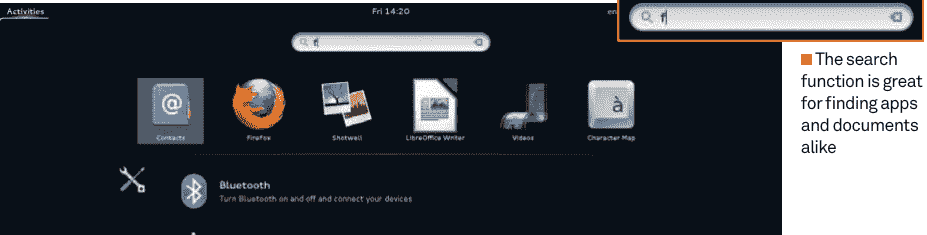

设置在结果中单独显示，可以快速访问某些选项

蓝牙：开启和关闭蓝牙并连接你的设备

为你的设备着色，例如显示器、摄像头和打印机

详情视图：关于你系统的信息


## 发行版

### 最适合：前沿特性

### 最低配置：`CPU 1 GHz` 内存 `1GB` 存储 `10GB`

在经历了长期延迟且充满争议的 `Fedora 18` 之后，最新版本的 `Fedora` 表现究竟如何？

著名的薛定谔的猫是历史上在文化中被误读的流行之一——就像周王试图挡住洪水，或者比尔·盖斯说 `Windows` 已经足够了。薛定谔的实验是为了解释量子力学的某些解释如何违背直觉。虽然这并不是因为互联网，但它某种程度上反映了人们在过去几次迭代中对该发行版默认状态所产生的问题。多年来，`GNOME` 一直快速背离传统的桌面隐喻，其更新背离了鼠标和键盘的工作流。

来自 `Fedora 18` 的 `Anaconda` 安装程序为了更美观的体验限制了一些选项。该发行版也并不特别稳定，系统问题让某些人感到头疼。在 `Fedora 19` 中，即刻问题得到了解决，列表上还有新问题吗？

## 升级的安装程序

新的安装程序比以前更好，新的 `3D` 打印功能是一个很棒的增项

### 缺点

仍然在剥离一些引起问题的争议性前沿功能

你在 `Fedora 19` 中体验到的第一件事就是经过升级的安装程序。硬件识别感觉良好，但对分区和编辑存储位置的控制并不多，这正是人们在 `Fedora 18` 中遇到的问题。然而，操作方法并不直观。想要还是活着：最新版本。

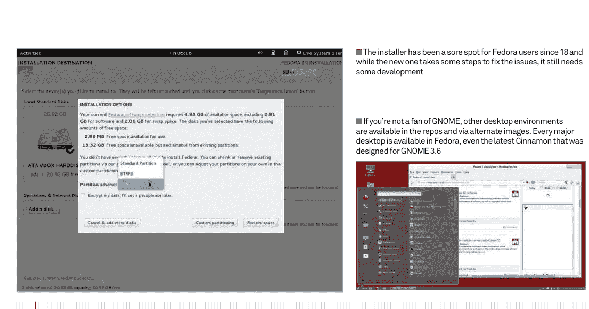

## 对分区和存储位置的编辑有了得多的控制

与其他图形化工具一样，你可以选择你想要使用的硬盘；然而，选择推荐位置意味着你必须开始“回收”空间。这可以通过调整现有分区或从头开始创建自己的分区来实现，否则最终将无法释放所有需要的空间。现有的交换分区会被忽略，`19` 变得更容易管理了。在开始创建根分区或软件之前就可以开始，节省了时间，但这清楚地表明这个新版本还没有准备好，在某些方面还需要更多时间。还有经典的搜索结果，但它们之间没有了必要的分割，也没有包含亚马逊的广告。

### 保持更新

桌面也与官方术语“软件”（`Software`）包管理器分离了，正如所有应用程序一样，这使得访问所有不同的选项变得更容易，尽管有三套额外的软件需要更新。至于其中一个，轻量级的 `XFCE` 和 `LXQt`，以及像 `Cinnamon` 和 `MATE` 等桌面在仓库中可用。在 `GNOME` 上工作要容易得多，所以你不需要下载。

### GNOME 3.8

如果该发行版要根据 `GNOME` 的简单性获得支持，那它做得很好，`GNOME 3.8` 相比 `3.6` 有许多重大变化，尽管在许多方面它被“精简”了。至于新界面，需要一些时间来学习使用 `GNOME`。值得肯的是，随处启动搜索是一个加分项，而且一直如此。如果这应该是大量工作流的益处，那么搜索功能比周围更快，并且现在已经升级到在你的搜索中包含一些结果。这是 `Unity` 相同功能之间的一种混合体。

该发行版在某些方面比 `Fedora 18` 更修复，但在其他方面，我们遇到了一些明显的缓慢和微小的图形错误。对于部署之前可能需要做的，`Fedora` 并不是最好的，尤其是与之前的版本相比。对于没有遇到问题的 `Fedora 18` 用户来说，这是一个非常好的升级；对于早期迁移的用户来说，这并不需要担心。盒子只包含了波动——而且对于那只猫来说并不好。

# Simplicity Linux 桌面 13.7

## 新功能：基于 Puppy Linux • 切换到 LXDE • Gs 包管理器 • Firefox 22.0 • 原生 LibreOffice

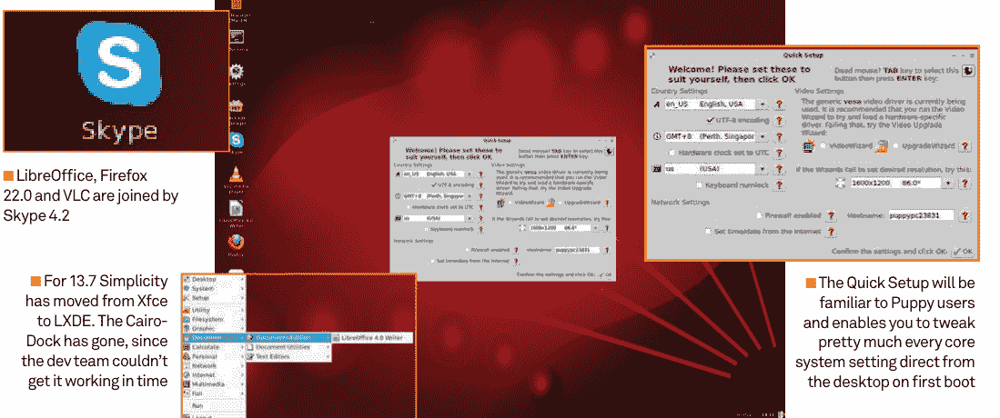

## 发行版

### 最适合：旧硬件

### 最低配置：`CPU 1.7GHz 双核` 内存 `1GB` 存储 `400MB`

这个轻量级发行版是名其实虚，还是引起了困惑数组？

基于 `Puppy Linux`，`Simplicity` 是一种运行在旧和现代硬件上的小型轻量发行版。`Simplicity 桌面 13.7` 是第一个基于 `Puppy` 使用 `Cairo` 或 `LXDE` 的版本。这是一种回归基础的用户界面，这意味着 `Cairo-Dock` 被标准的 `LXDE` `dock` 取代了。我们在 `GNOME 2.x` 时一直对 `LXDE` 有青，所以对它的包含感到相当满意。

### 引入 Gs

`13.7` 还为包管理带来了变化，从 `Puppy` 包管理器变为 `Gs`。团队指出，这种变化旨在改进处理依赖的能力。事实是 `Apt` 包管理器在这一方面做得更好，但我们许多软件包无法正常安装。我们无法弄清楚为什么某些软件包没有安装，但最可能是因为 `Gs` 在第一次提到依赖处理时没有正确处理。对于 `13.7`，`Simplicity` 已从 `Cairo` 移动到 `LXDE`。`Cairo-Dock` 消失了，开发团队没能及时赶上

## 优点

`Simplicity` 是一种运行在旧硬件上的小型轻量发行版。

## 缺点

软件管理存在问题；与竞争对手相比成就有限

# 评审

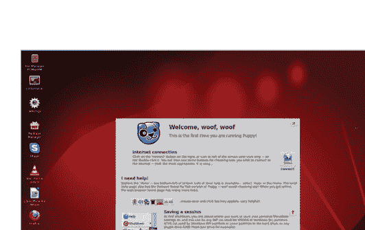


默认桌面整洁简单。然而，控制面板并不特别易读。`Simplicity 13.7` 拥有更更新的 `Firefox`（版本 `22.0`）；遗憾的是，连接性的缺失表明了发行版的稳定性。由于许多 `Puppy` 发行版往往受旧版本软件包的困扰，`Simplicity` 团队投入了大量精力为用户带来更新的选择。`Firefox` 带有 `22.0` 版本（平均 `Puppy` 发行版为 `18.0`），而 `LibreOffice 5.2` 已经过时。我们看到 `Skype`（运行版本 `4`）非常惊讶，我们更倾向于开源替代方案。这解释了为什么团队要辩护“波动”界面。`Simplicity` 还有一个功能—— `Subdivision`，它是专门为从专有操作系统迁移的用户设计的，在这样一个非常特殊的母发行版上，它们的用用体验变得不那么清晰。

## 版本混乱

`Simplicity` 第一次运行时令人印象深刻，它做得很好。虽然稳定、`alpha` 和 `beta` 版本列在页面左侧，点击将直接从 `SourceForge` 下载而没有更多信息。要发现 `Obsidian` 和 `Subdivision` 是什么，提到桌面、网络管理器和版本之间的区别是页面顶部的错误，那里只包含了几句话。

事实证明，`Obsidian` 是 `Simplicity` 的剪裁版本。有了 `Linux`，你获得了一个网络管理器、一个包管理器和一个类似的网络浏览器（除非你必须在命令行中安装），操作系统重量为 `168MB`。

## 不受欢迎的重复


除了 `Skype` 之外，软件选择对于这种尺寸来说是令人赞的。相反，你会发现某些现有应用程序有多个选项，另一些有三个。他们以牺牲更详尽的软件选择为代价提供这些功能，这并没有损害 `Simplicity` 的信誉。虽然他们使用自己喜欢的应用很特别，但利用发行版的错误来做选择是该发行版及其用户（并非所有人）无法为了更全面的软件选择而接受的。

`Simplicity` 有少量的软件（主要是云端），而发行版的其他部分提供了功能。我们喜欢桌面版本 `13`，它对于那些功能比 `Obsidian` 少的账户很有用。由于我们不需要 `Simplicity` 版本不来删除未来，对于它真正需要的脸也是如此。


截图

`gallery`

`bitmap/ubuntu.png`

我们将关注 `13`，因为当前版本的许多错误，但对于它真正需要的脸也是如此。

现在下载

`simplicity.linux.org`

`Russell Barnett`

正如我们很多用 `Simplicity` 的软补丁时，它真的

立即订阅，开始省钱

非美国读者请参阅第 32 页

# 美国特惠优惠

立即订阅即可获得 5 期免费赠*


# 订阅者专属福利

- 立即订阅，13 期仅需 122 美元*
- 每期低至 9.39 美元 – 商店售价通常为 15.99 美元

欲了解更多信息并下单请访问 `www.imaginesub.co.uk/lud` 或拨打 `+44 (0) 1795418661`

`Imagine Publishing` 出版了 20 多本月刊杂志，其中一些已发行超过 10 年，每年触达超过 400 万读者。


*条款与条件：此优惠为美国订阅优惠，下单时请记得注明“USA”。年度订阅费用从 130 美元起。按目前的计算等同于 122 美元，因为汇率可能会变动。免费期积分可抵扣 13 期每期 15.99 美元的总价（207.87 美元），而订阅仅需 122 美元。您的订阅有效期至下次续期杂志。*优惠于 2013 年 12 月 31 日结束。

`84` `www.linuxuser.co.uk`

# 书评

最新书评发布

# 评测

# Java 编程第 4 版 (Learning Java 4th Edition)

| 作者 | ISBN | 出版社 | 价格 |
| :--- | :--- | :--- | :--- |
| `Patrick Niemeyer`, `Daniel Chuck` | `978-0321469234` | `O'Reilly` | `£38.50` |

`Java` 的内容极其庞杂，无法一次精通。让我们通过一个项目，采用其他语言书籍那种“在实中学学”的方法。`O'Reilly` 出版的《`Java` 编程》针对 `Java 6` 和 `7` 进行了更新，在 1000 多页的内容中涵盖了从实现 `Eclipse` 到理解并发的内容。


# Asterisk 权威指南 (Asterisk: The Definitive Guide)

电话技术的未来已来：灵活且强大

`Asterisk` 是一款杀手级应用，十多年来一直为电信企业创造了巨大财富。凭借其强大的功能并展现出多维度的复杂性，《`Asterisk`》第四版可以帮助你快速上手所需的任何电话解决方案。

在进入配置和安装之前，作者首先介绍了 `Asterisk` 社区从早期到现代的发展历史。这至关重要，因为尽管 `Asterisk` 仍是 `PBX`（程控交换机）中的难点，你仍然需要知道如何发现并维护为你自己的环境设计并实现的内容。

书中有几个章节介绍了配置、显示和命令行的基础要点，随后详细介绍了如何处理各项事务，从语音、会议和 `LDAP` 集成，到自动应答系统以及一些经典的修复方案。如果你使用 `Asterisk`，这些内容依然至关重要。

# UML 理论与实践：用例设计对象建模 (Use Case Design Object Modeling with UML Theory and Practice 2nd Edition)

| 作者 | ISBN | 出版社 | 价格 |
| :--- | :--- | :--- | :--- |
| `Robert Matt Stevens` | `978-0370305362` | `O'Reilly` | `£34.16` |

对于那些想要克服困难并总结经验的人来说，这是最实用的方法，让你对用例有一个概述，并对 `UML` 有实用的介绍。


# Asterisk 领域：逐个掌握编程 (Realm of Asterisk: Learn to Program, One at a Time!)

从轻松的代码到严肃的编程

| 作者 | ISBN | 出版社 | 价格 |
| :--- | :--- | :--- | :--- |
| `Matthew Felashen`, `Conrad Bailey` & `David White` | `978-1592234256` | | `£27.00` |

# Android 用户界面设计：创意与草图 (Android User Interface Design: Ideas and Sketches)

让你的应用功能强大、外观且直观！

| 作者 | ISBN | 出版社 | 价格 |
| :--- | :--- | :--- | :--- |
| `Ian Grafton` | `978-0321888673` | `Addison` | `£25.00` |


# C 语言入门：Arduino 与微控制器编程 (Beginning for C: Learn Programming for Arduino and Microcontrollers)

| 作者 | ISBN | 出版社 | 价格 |
| :--- | :--- | :--- | :--- |
| `Patrick` | `978-013420760` | `O'Reilly` | `£25.00` |

`Prudence` 带来了三十年的编写教程经验，书中充满了指针知识，将帮助你理解 `Arduino` 的世界。


# 通用编程入门 (We like programming for general)

对于任何有过 `Java`、`C++`、`Python` 和 `Lisp` 语言经验的人来说，这本书是为教育而设计的，公式非常简单：逐章介绍了竞争、递归，然后参与游戏编写。许多移动用户在工作时会分心，他们发现可以找到正确的流程，通过线框和原型来提升用户体验。最后的章节涵盖了许多读者可能需要的价值材料。

`www.linuxuser.co.uk`

# 分类广告

# 为树莓派提供坚实的保护。

机械加工飞机

集成摄像头选项

阳极化色彩选项

被动散热

# PROTOARMOUR

`WWW.PROTOARMOUR.COM`

树莓派是树莓派基金会的商标。

# 上的 Android

在 `Android` 内运行完整的 `Linux` 发行版

* 无需更改 `Android`
* 预构建 `Linux` 安装，下载即可运行
* 易于下载和安装
* 免费且开源


`linuxon.org`

# PCSL

树莓派摄像头架现已可用

全系列外壳 `£3.49` 起

# 树莓派全产品

跳线 / `GPIO` 母板套装

高质量 `GPIO` 母板

`GPIO` 跳线

`M-F` / `F-F` / `M-M` `15cm` - `100cm` 黑色、蓝色、白色可选

`CYNTECH`

`PES`

专属！你的树莓派（标准型）`SD` 卡架 `£14.99`

# 接受学校订单 - 现在拨打我们！

# 树莓派套件 512MB B 版 2 电源 / 外壳 / HDMI 线 / 网线 8GB 内存 £54.99

# 使用 Linux 云释放力量 (UNLEASH THE FORCE WITH LINUX CLOUD)

`ubuntu`

`fedora`

`debian`

方案起：

- 512MB RAM
- 15GB 空间
- 250GB 流量

使用代码 `linux73` 节省 20%

# BLACKNIGHT SOLUTIONS

域名 - 托管 - 电子邮件

`sales@blacknight.com` | `+44 (0)185 5280242` | `www.blacknight.com`

`46` `Trinity` `Enterprise` `centre`, `Ironworks` `Road`, `Burn` `in` `Furniss`, `Cambridge` `LA12LP` `01229-77577` `www.pcslshop.com`

# PiBow


树莓派彩色 LED 板18通道8位 PWM (0-255)，独立调光6色+白色，每个 LED 30°。完美放入树莓派内部

```
http://shop.pimoni.com/products/pibow
```

为你树莓派® 设计的精致小小屋，地址：`http://pibow.com/`

## 最近读了什么好书吗？

在 Imagine Publishing 购买优质杂志、书籍和 DVD

`imageshop.co.uk`

- 杂志

- 书籍

- DVD

- 下载

- 礼物

## 投放广告于

## Linux User & Developer

联系 Rhian：`01202 586421`

> `rhian.carter@imagine-publishing.co.uk`

## 让你的树莓派活跃起来

`piborg.org` 开源机器人扩展板 £4.98 起

联系我们...

网站：`www.linuxuser.co.uk`

电子邮件：`linuxuser@imagine-publishing.co.uk`

## 问与答

在 facebook 上关注我们

Linux User & Developer

## 你的问题得到解答

咨询专家：向我们发送您的问题，我们将尽力解答！

### 问题与解答

解决你的所有技术问题 Q/A

嗯，Toby，根据你的描述，你可能面临着几个问题。首先，请确保包已通过以下命令实际安装：

### 丢失的家目录

我有一个问题，你可能可以帮我解决。我的家人决定开始使用主电脑（运行的是 Ubuntu）来查看照片并进行一些处理，在此过程中，我的孩子们用它们做了一些好玩的图片。不幸的是，这导致主目录（home folder）被删除了。


### 需要单独安装某些依赖项

```bash
$ rpm -ql opensql
```

如果是这种情况，你需要寻找另一种安装方法。其他一些依赖项（如 `OpenSSL`）需要单独安装。你也可以顺便轻松获取它们，以修复你想要的的密钥管理。

我一直在尝试在 `CentOS 5.9`（这是一个虚拟机服务器）上安装该包。我已经将所有内容更新到最新，并收到了一些错误；但我仍然无法直接执行 `yum install opensql`

### 神奇的错误

可以运行，但目录中没有可执行文件。我记得几个月前我曾安装过这个，从另一个目录移动了一些文件，这可能导致了我的构建和密钥损坏。

当在带有 LS 硬件 RAID 控制器的 `RHEL 6.2` 安装上运行时。每隔 10 分钟，我的 `syslog` 中出现一条错误消息——虽然没有引起任何问题，但它会淹没日志，导致我在需要时搜索时不方便。消息内容是：

### 包问题

非优化 RAID 状态

现在我卡在这里了。我唯一的猜测是我是不是漏掉了回复？

手动检查时，`mctl-status` 报告一切正常：

```bash
[root@hostname ~]# apt-status -1 5
```

Peter Lewis

Phil，你采取了正确的步骤，但顺序稍有错误。你应该备份文件结构 `/home`，而你把 home 移动到了根分区上——这就是导致你得到 `/home/me/home/me` 的原因。


由于 home 分区用于登录你的配置，所以所有随你的文件都传输到了分区根目录下的 home 和文件夹中。你复制了所有的 home 目录和文件夹，以防在过程中丢失任何设置。

或者，你只需将分区移动到 home 文件夹，从而整体增加 home 文件夹的空间，而无需移动任何东西——尽管听起来你的主分区可能已经满了，所以目前这是最好的方法。

在 Linux 中进行分区和挂载只要操作得当就是有效的


`CentOS` 非常适合服务器

`www.linuxuser.com`

### 问题与问答

与我们联系 @linuxusermag


```
ioc0 vol_id 5 type IM, 2 phy. 118
gb, state OPTIMAL, flags ENABLE
ioc0 phy 1 scsi_id 6 ATA
tMFDAK18-MAR-1J MA44, 119, state
ONLINE, flags NONE
ici0 phy 1 scsi_id 1 ATA
tMFDAK18-MAR-1J MA44, 119, state
ONLINE, flags NONE
```

### RAID 5

| A1 | A2 | A3 | Ap |
|---|---|---|---|
| B1 | B2 | | B3 |
| C1 | Cp | C2 | C3 |
| D1 | D2 | | D3 |

我在网上搜索过，只发现那些没有 RAID 控制的人遇到了这个问题，并且他们停止/禁用了写入。对我来说这不是一个选项，因为我需要监控我的 RAID 阵列状态，以防磁盘发生故障。我测试过了，它与我的监控系统运行得非常完美，我我很想继续使用它。

如果你对我如何从我的 `syslog` 中跟踪这些无缘故的消息有任何问题，将不胜感激。

| Disk 0 | Disk 1 | Disk 2 | Disk 3 |

James Turner

没错，虽然这是一件简单的事，但需要一点时间来“修复”。如果你为此`一头撞墙`，那么它可能是值得的。

首先，我检查了 `SCSI ID` 状态，需要检查路径上的 RAID 阵列——如下所示：

```bash
# mpt-status - -
Checking for SCSI ID:0
Checking for SCSI ID:1
Checking for SCSI ID:2
Checking for SCSI ID:3
Found SCSI id3, use 'mpt-status'
```

类似：

```bash
# mpt-status -i [ID]
```

一旦你获取了 ID 信息，编辑 `/etc/mpt-status`。然后将 `'ID=0'` 改为上述的 ID 数字，以便在 `Debian` 发行版上 `.deb` 版本，或者直接从源码编译。

```bash
MAILroot # 报告
PERIOD=60 # 检查间隔秒（默认10分钟）
REMIND=720 # 重启间隔秒（默认2小时）
RUN_DEMONS
ID=
```

John Park

> 有一个工具可以用来转换 RPM 到 DEB 文件，它非常叫做 `alien`。你也可以将其用于其他类型，发行版，如果你以后开始使用的话。

由于你正在使用基于 `Debian` 的发行版，可以通过以下命令安装它：

```bash
# sudo apt-get install alien
```

一旦完成，进入你想转换的目录。`-d` 选项告诉它转换为 `DEB` 包。你也可以添加

```bash
$ alien -d [package]
```

虽然这对于你尝试做的任何事情可能有效，但值得注意的是，开发者表示此工具始终是实验性的，因为创建的包不会像真正的 `DEB` 包那样好，或者说。

`Hannah`，你被归类为 `MTA`、用户代理，你确实在通过你的 `SMTP` 配置发送邮件。这就是为什么邮件投递看起来。

如果 `MDA` 不是由你的 `ISP` 运行，它就不会被视为垃圾邮件或骚扰信息。除非你想变成这样，当然。

感谢你的来信，`Fran`。`MyTracker` 在 `ProTracker` 等应用中是一个流行的来源，它更多基于 `FastTracker II`，那个 `DOS` 程序运行得非常好，所以听起来非常适合记录。

### 无垃圾邮件

我的 `ISP` 偶尔会将我的邮件标记为垃圾邮件。这非常不方便，尽管尚未造成任何严重问题。为了在其他事情之前尝试应对这一点，我决定使用 `EvespeGlu` 发送外部 `SMTP` 邮件。

然而，我不确定服务器通过查找目标域名的 `MX` 记录来发送外部邮件的行为（而不是简单地将邮件转发到特定的（每个 `ISP` 的）`SMTP` 服务器）叫什么。


> “如果 MDA 不是由你的 ISP 运行，它就不会被视为垃圾邮件或骚扰信息”

Hannah Smith

通过 Gmail 等 Web 客户端发送你的邮件可能帮助你减少被误标记的垃圾邮件

`91. linuxux.co.uk`

## 赞助机会

通过赞助本板块来获得关注。请联系 Rhea Charter，电话：`+4400120258421`

### 托管列表

#### 独立服务器列表


| 方案 | 电话号码 | 每月费用 | 最低期限 | CPU 核心 | 磁盘空间 | 1GBPS 网络连接 | 硬件 RAID | 远程电源重置 | 永久 IVM | 运行时间保证 | 网络备份 | 私有套房 | 24/7 支持 |
| --- | --- | --- | --- | --- | --- | --- | --- | --- | --- | --- | --- | --- | --- |
| 220DDC | 0800 061 2801 | £50 | 1 个月 | 无 | 双核 2.2GHz | 无 | 无 | ✓ | ✓ | ✓ | ✓ | ✓ | ✓ | ✓ |
| 3000DC | 0800 061 2801 | £80 | 1 个月 | 无 | 双核 3.5GHz | 250GB | 无 | 无 | ✓ | ✓ | ✓ | ✓ | ✓ | ✓ |
| 26Q0DC | 0800 061 2801 | £106 | 1 个月 | 无 | Intel Core 2.66GHz | 500GB | 无 | 无 | ✓ | ✓ | ✓ | ✓ | ✓ | ✓ |
| Developer | 0800 061 2801 | £132.89 | 1 个月 | 无 | 1GB | 无 | 无 | ✓ | ✓ | ✓ | ✓ | ✓ | ✓ | |
| One | 0800 061 2801 | £199 | 1 个月 | 无 | 无 | 无 | 无 | ✓ | ✓ | ✓ | ✓ | ✓ | ✓ | |
| Reseller | 0800 061 2801 | £274.89 | 1 个月 | 无 | 无 | 无 | 无 | ✓ | ✓ | ✓ | ✓ | ✓ | ✓ | |
| Starter Linux | N/A | £15 | 1 个月 | 无 | 无 | 200GB | 无 | ✓ | ✓ | ✓ | ✓ | ✓ | ✓ | |
| Starter Windows | N/A | £20 | 1 个月 | 无 | 无 | 200GB | 无 | ✓ | ✓ | ✓ | ✓ | ✓ | ✓ | |
| Business Linux | N/A | £45 | 1 个月 | 无 | 无 | 400GB | 无 | ✓ | ✓ | ✓ | ✓ | ✓ | ✓ | |
| Business Windows | N/A | £45 | 1 个月 | 无 | 无 | 400GB | 无 | ✓ | ✓ | ✓ | ✓ | ✓ | ✓ | |
| Ultimate Linux | N/A | £60 | 1 个月 | 无 | 无 | 600GB | 无 | ✓ | ✓ | ✓ | ✓ | ✓ | ✓ | |
| Ultimate Windows | N/A | £80 | 1 个月 | 无 | 无 | 600GB | 无 | ✓ | ✓ | ✓ | ✓ | ✓ | ✓ | |
| BudgetServer2 | 01827 77730 | £229 | 6 个月 | Intel Xeon E3460 | 160GB | 100 Mbps | ✓ | ✓ | ✓ | 99.90% | 10GB | | |
| BudgetIII | 01827 77730 | £299 | 6 个月 | Intel Xeon E3460 | 250GB | 无 | ✓ | ✓ | ✓ | 99.90% | 10GB | | |
| D504 | 01827 77730 | £329 | 6 个月 | Intel Core i7 四核 | 500GB | 100 Mbps | ✓ | ✓ | ✓ | 99.90% | 10GB | | |
| D56.5 | 01827 77730 | £375 | 6 个月 | Intel Core i7 四核 | 750GB | 无 | ✓ | ✓ | ✓ | 99.90% | 10GB | | |
| Cloud Server | 01827 77730 | £532 | 1 个月 | 2 vCPU (AWS) | 40GB | 无 | 无 | ✓ | 99.90% | x | | |
| Cloud Server | 01827 77730 | £598 | 1 个月 | 4 vCPU (AWS) | 40GB | 无 | 无 | ✓ | 99.90% | x | | |


`heartbeats-internet.co.uk/dedicated-server`

`heartbeats-internet.co.uk/dedicated-server`

`heartbeats-internet.co.uk/dedicated-server`

| 方案 | 电话号码 | 每月费用 | 最低期限 | CPU 核心 | 磁盘空间 | 1GBPS 网络连接 | 硬件 RAID | 远程电源重置 | 永久 IVM | 运行时间保证 | 网络备份 | 私有套房 | 24/7 支持 |
| --- | --- | --- | --- | --- | --- | --- | --- | --- | --- | --- | --- | --- | --- |
| Linux Dual Core | 08456.790 | £779 | 12 个月 | 双核 3.5GHz | 160GB | 无 | ✓ | ✓ | ✓ | 99.9% | | | |
| Windows Dual Core | 08456.790 | £899 | 12 个月 | 双核 3.5GHz | 160GB | 无 | ✓ | ✓ | ✓ | 99.9% | | | |
| Linux Quad Core | 08456.790 | £1299 | 12 个月 | 四核 3.0GHz | 250GB | 无 | ✓ | ✓ | ✓ | 99.9% | | | |
| Unlimited | 0208123730 | £179 | 10 个月 | Xeon Xeon | 无限 | 无 | ✓ | ✓ | ✓ | 93.5% | N/A | | |
| Unlimited | 0208123730 | £795 | 3 个月 | Xeon Xeon | 无限 | 无 | ✓ | ✓ | ✓ | 99.9% | | | |

`www.linux.co.uk`

获取您的突出显示！联系 `RHIAN`

`rhian@publishing.co.uk`

`+440120258642`

## 托管列表

### 独立与共享服务器列表

| 方案 | 电话 | 名称 | 费用 | 网页空间 | 每月带宽 | 账户 | 支持 | 运费 | 病毒过滤 | 防火墙 | 邮件支持 | 网页控制 | 服务协议 |
| --- | --- | --- | --- | --- | --- | --- | --- | --- | --- | --- | --- | --- | --- |
| Minimum Linux/Windows | +44085526042 | | £64.95 | 10GB | 200GB | 无限 | ✓ | ✓ | ✓ | ✓ | | | |
| Medius Linux/Windows | +44085526042 | | £89.95 | 20GB | 400GB | 无限 | ✓ | ✓ | ✓ | ✓ | | | |
| Maximum | +44085526042 | | £114.95 | 30GB | 600GB | 无限 | ✓ | ✓ | ✓ | ✓ | | | |
| Starter | 08449991000 | | £25.99 | 10GB | 250GB | 无限 | | | | | | | | |
| Expert | 08449991000 | | £39.99 | 15GB | 500GB | 无限 | | | | | | | | |
| Professional | 08449991000 | | £54.99 | 20GB | 750GB | 无限 | | | | | | | | |


# 方案价格列表

| 方案 | 电话 | 名称 | 费用 | 网页空间 | 每月带宽 | 账户 | 支持 | 运费 | 病毒过滤 | 防火墙 | 邮件支持 | 网页控制 | 服务协议 |
| :--- | :--- | :--- | :--- | :--- | :--- | :--- | :--- | :--- | :--- | :--- | :--- | :--- | :--- |
| Bronze | 0721314485 | | £30.00 | 20MB | 2GB | 无限 | | | | | | | |
| Silver | 0721314485 | | £42.99 | 35GB | 40GB | 无限 | | | | | | | |
| Gold | 0721314485 | | £54.99 | 40GB | 50GB | 无限 | | | | | | | |
| Platinum | 0721314485 | | £114.99 | 120GB | 200GB | 无限 | | | | | | | |
| Starter | 0338024823 | | £19.99 | 5GB | 10GB | 无限 | | | | | | | |
| Expert | 0338024823 | | £29.99 | 10GB | 25GB | 无限 | | | | | | | |
| Professional | 0338024823 | | £44.99 | 20GB | 50GB | 无限 | | | | | | | |
| Business | N/A | | £79.99 | 60GB | 无限 | | | | | | | | |
| Enterprise | N/A | | £159.99 | 无限 | 无限 | | | | | | | | |

# 公司联系方式

*   `Blacknight Solutions`
    *   `www.blacknight.com`
*   `ewhosting` (`ewhosting.co.uk`)
*   `whosting` (`whosting.co.uk`)
*   `equinox` (`equinox.co.uk`)
*   `eurohosting` (`eurohosting.com`)

# 附加方案详情

| 方案 | 电话 | 名称 | 费用 | 网页空间 | 每月带宽 | 账户 | 支持 | 运费 | 病毒过滤 | 防火墙 | 邮件支持 | 网页控制 | 服务协议 |
| :--- | :--- | :--- | :--- | :--- | :--- | :--- | :--- | :--- | :--- | :--- | :--- | :--- | :--- |
| Starter Professional | 08449991000 | | £25.99 | 5GB | 100GB | | | | | | | | |
| Home Professional | 08449991000 | | £89.99 | 10GB | 500GB | | | | | | | | |
| Business | 08449991000 | | £129.99 | 15GB | 无限 | | | | | | | | |
| Fusion Professional | 0208123730 | | £107.40 | 5GB | 1000GB | | | | | | | | |
| Fusion Business | 0208123730 | | £179.40 | 10GB | 1500GB | | | | | | | | |
| Fusion Reseller | 0208123730 | | £329.99 | 无限 | 无限 | | | | | | | | |
| Starter | N/A | | £29.99 | 5GB | 200GB | | | | | | | | |
| Business | N/A | | £59.99 | 10GB | 400GB | | | | | | | | |
| Advanced | N/A | | £119.99 | 20GB | 24GB | | | | | | | | |
| Reseller Unlimited | N/A | | £199.99 | 无限 | 无限 | | | | | | | | |
| Standard Package | 08406120330 | | £33.25 | 105MB | 4.5GB | | | | | | | | |
| Professional Package | 08406120330 | | £58.75 | 250GB | 85GB | | | | | | | | |

# 其他网站列表

*   `qacom` (`qacom.com`)
*   `heart` (`heart..com`)
*   `heartway.com.`
*   `.way..way.co.uk`
*   `fusion....co.`
*   `((fusion.co.uk)`
*   `owhosting` (`ewhosting.co.uk`)
*   `eurohosting` (`eurohosting.com`)

# 您的观点

您的 Linux 新闻与观点来源

联系我们...

注册并发布您的评论... 直接发送邮件...

`www.linuxux.co.uk/forum/` / `linuxux@imagine-publishing.co.uk`

## Linux 用户来信

您对杂志、Linux 和开源的看法

**GNOME 的争议**

成功。这就是生活。开发者的愿景并不总是与用户的期望或需求保持一致。开发者所获得的自由无非用户反馈。这是他们表达自己的方式……如果这是一个某个公司的商业产品，他们会质疑自己所处的方向，因为他们需要销售。

但这是一个 `FLOSS`（自由开源软件）项目，不像那样，它是由激情驱动的。如果他们正在失去用户，那不是用户需要的或喜爱的。在某些时候，`GNOME` 的开发者将承认这一点，然后他们可以从头开始。

有很多项目年复一年地都很重要，尽管用户群较小。不过这当然如此。

我不确定该对 `GNOME` 怎么办。它是一个巨大的项目，需要开发，这意味着必须吸引开发者，并由用户提供动力。

我想说，反思收到的批评并为 `GNOME` 规划一个修订版本，将为 `GNOME` 带来更光明的未来。这将是一个全新的开始，意味着一切重新来。


> GNOME 仍然证明是有争议的，但有些人正在给这个项目疑疑之机
>
> Carlos James

直到最近，一直有人希望不要通过失败来驱动创新。我们在哲学上并不总是达成一致，但我们并不希望看到那样，因为那将向那个方向移动并持续下去。这还太早了，因为触摸屏电脑和笔记本电脑并没有像公司预测的那样流行起来。

### 对 GNOME 的不同观点

我读了 `Richard Nicholas` 在第 127 期中关于 `GNOME` 的观点。他从技术和动力两个角度都清楚地理解了演进 `GNOME 2` 的必要性。但无论是否商业化，另一些情况并不是这样。`GNOME` 这个项目并没有一个

## 帖子基础

## AV Linux，并不那么完美？

我们非常喜欢上期的 `Linux 6.01`，这得益于对核心和 `UI` 的系列决定，这使其变得容易许多。专业人士也对此有我们相似的想法，当我们把评论发布到那里时。加入对话：`bit.ly/1bGEZ55`


*   `Michael Murphy`:
    *   没有什么是完美的。
    *   我现在可以告诉你
    *   我已经可以告诉你，桌面环境和面板看起来很过时且令人困惑。
*   `Guest`:
    *   如果我为了外观使用它（像工程师那样），那么它对他们来说并不像对你来说那么重要。你觉得看起来过时了吗？
*   `Michael Murphy`:
    *   你认为今天和未来的工程师会有什么感觉？他们会承受令人恐惧的过时且相当困惑的界面的压力吗？不，一切完美的瞬间你就变得理智。
*   `AV Linux` 看起来过时了吗？这重要吗？
*   `Grove Dragon` 说:
    *   你说它看起来过时。你根本没有尝试使用那个界面。即使是漂亮的界面也是完美的。对于想要功能和结果的人来说，外观并不那么重要。一个能那样工作的界面并不完美。同时对我来说，旧的比坏掉的新界面好。`AV Linux` 实际上非常好用。现在使用它，并对你的评论承诺，我希望今天和未来的工程师能使用它，这样可以帮助他们在未来创建更好版本的 `AV Linux`。希望他们足够聪明，在系统变得困惑之前学会它。如果你从不看手册，专业工具是让人困惑的。希望使用这个系统的人看了。顺便说一下，我 25 岁，是一名硬件工程师；我是今天的工程师。

`94` `www.linuxux.co.uk`

## 教程文件

虽然我读你们的杂志，但我并不总是从个人上理解它。我并不太在意错过光盘上的发行版，但教程文件是我喜欢过的的内容。你们计划为购买杂志数字版的人发布一些教程吗？

我们实际上已经在 `Linux User & Developer` 网站（`www.linuxuser.com`）上准备好了教程文件。你目前可以从每期相关的博客文章文中访问过去期的教程文件。我们还在尝试让 `ISO` 文件完全可访问，也许可能通地让制作教程文件的过程变得简单得多。请关注。

`Ken White`


# 节省旧期费用

想追上 `Linux User & Developer` 吗？好吧，你会高兴地听到，所有比六个月之前的杂志在 `www.imageshop.net` 都是免费的。这是一个临时优惠，要么杂志期满一年，要么在 `Image Shop` 中打 5 折。现在注册并以 29 英镑获取第 123 期——我们关于最棒的树莓派项目的内容，即 `LEGO` 输出计算机套件。今天就购物并挑选你的优惠商品。


从 `LUDE` 网站获取期期的教程文件

## 在 `facebook` 上关注 `Linux User & Developer`，在 `twitter` 上关注我们

`Linux User` - `Mozilla Firefox`

`文件` `编辑` `查看历史记录` `书签` `工具` `帮助` `http://www.linuxuser.co.uk/` `Google`

`Linux User & Developer` 官方网站

## `LinuxUser.co.uk`

`开源爱好者和专业人士的终极资源`

- 最新新闻
- 评论
- 教程
- 观点


绝不要错过更新，订阅我们的 `RSS` 馈！

完成

## 在 `DVD` 上

你的光盘

### 在 `DVD` 上

查看第 123 期 `Linux User & Developer` 中有什么内容...

## 发行版

本月我们有少于十个热门的发行版，通过两个启动 `DVD` 供你测试！

*(注：由于原文中存在大量 OCR 错误导致的重复碎片，译文已根据要求提取核心内容并去重翻译)*

## 下期预览

### 精彩预告...

关注 9 月 26 日发售的 131 期。想提前阅读？

立即订阅！

## `LinuxUser`

面向 `GNU` 世代与开发者的杂志

`Imagine Publishing Ltd`

`Richmond House, 33 Richmond Hill`

`Bournemouth, Dorset, BH1 6EZ`

`+44 (0)1209 986888`

网站：`imagine-publishing.co.uk`

`www.linuxuser.co.uk`

`www.greatdigitalmedia.com`

### 杂志团队

编辑：`Russ Baxter`

工作人员：`James`

摄影师：`James Shepherd`

助理：`Sarah`

总编辑：`Nick Jones`

设计主管：`Angus Cross`

#### 认证

技术编辑：`David Adams`, `Davy Pink`, `Jason Mason`

`Himano Anura`, `Richard Hillards`, `Michael Reed`, `Gareth`

`Aaron Scott`, `Steve Lynch`, `Mike Tokatos`

以及 `Stuart Burns`

## 下期预告

### 订购

可要求提供数字版或纸质版。

`www.imagine-publishing.co.uk`

`01202 58642`

广告经理 `Jennifer Farel`

`jannah@imagine-publishing.co.uk`

`01202 58643`

客户经理 `Rian Carter`

`rian.carter@imagine-publishing.co.uk`

### 封面

初级网页设计师 `Steve Decombe`

`steve@imagine-publishing.co.uk`

### 国际

`LinuxUser` 可授权。

请联系国际部门了解更多信息。

技术授权 `Gary Blackman`

`+44 (0)1202 586401`

### 订阅

订阅主管 `Gill Lambert`

所有订阅咨询

`+44 (0)1790 419651`

电子邮箱：`subscriptions@linuxuser.co.uk`

`13` 期订阅（欧洲）- `£79.99`（原价 `£80`）

### 发行

发行主管 `Daniel Pearce`

`01202 586200`

### 制作

执行董事 `Darren Booth`

集团制作与技术主管 `Steven Boyd`

集团创意总监 `Mark Kandrick`

### 印刷与分发

由 `Willow Publishing` 印刷，`26 Plumeter Street,`

`Newton Leas, ST16 3BT.`

由 `The UK & Export Service` 分发，

`22 Eastcheap Street, London, E1 6QY`

`0227 429 4000`

由 `Angus & Gordon` 分发，

`Gordon & Gordon Centre, 26 Roadbridge Road,`

`Bournemouth, BH1 6EZ`

`+44 (0)1202 9977`

由 `Market International` 全球分发，`Blue Fin Building, 1 Southwark Street, London, SE1 9OS`

### 免责声明

`Imagine Publishing` 对包含的任何错误或误导性陈述不承担任何责任。`LinuxUser` 中表达的观点可能是作者的，并不一定反映 `Imagine Publishing` 的观点或意见。尽管 `Imagine Publishing` 已尽力确保所含信息的准确性，但与本文内容无任何关联。

# 深度掌握 `ANDROID STUDIO`

学习如何使用基于 `IntelliJ IDEA` 的新开发框架

# 为 `XBMC` 构建扩展模块

为全球最好的媒体播放器制作自己的插件

# 使用 `Union` 同步您的文件

以开源的方式确保您的数据安全

### 还包括：

- 使用 `LyX` 制作文档
- 使用 `LibreOffice` 进行创作
- `WordPress` 独家专访
- `14` 页以上的评测

# 介绍 `MinnowBoard`

关于英特尔新开发平台你需要的一切


`www.linuxuser.co.uk`

# 让您的 `VPS` 性能飙升

# 新内容及更新！


# 在您需要时获取更多动力！

凭借完全可扩展的 `123-reg VPS` 以及我们强大的新插件。

| `PLESK` 插件 | 额外 `IP` | 备份存储 |
| --- | --- | --- |
| 开启：使用最新插件为 `Plesk` 增强性能，包括 `Plesk` 的 `Power Pack`， | 开启：为您的 `VPS` 添加 `IP` 地址，以便在同一台服务器上使用多个 `SSL` 证书。 | 开启：使用我们的 `FTP` 备份存储插件，保护您的宝贵数据免受错误或硬件故障的影响。 |
| 关闭：语言包和杀毒软件。 | | 关闭 |

# 现在就开始使用我们的全新入门套餐！

# 每月仅需 `£9.99`

访问 `www.123-reg.co.uk/VPS` 助力您的业务

适用相关服务条款。详情请见网站。所示价格和功能适用于 `2013` 年 `7` 月。价格不含增值税（按 `20%` 收取）。`Plesk` 插件、额外 `IP` 和 `FTP` 备份存储需额外付费。入门套餐不提供 `Plesk`。


# 在处理文件？

# 转换、创建、合并与修改


`100%` 独立 - 无需 `Office` 自动化

`DOC`, `XLS`, `PPT`, `PDF`, `MSG`, `VSD.`, 及图像格式

更多格式

在 `www.aspose.com` 获取您的免费评估版

美国销售：`+1 888 277 6734`

电子邮箱：`sales@aspose.com`

欧洲销售：`+44 141 416 1112`

电子邮箱：`sales@europe@aspose.com`


扫描获取

`20%` 优惠


