## Linux 用户与开发者 131：树莓派遇到了对手吗？


#### 树莓派

Model B - 512MB，配 8GB NOOBS SD 卡

含增值税

**£32.99**

代码 `SC1313058`

£27.49 不含增值税

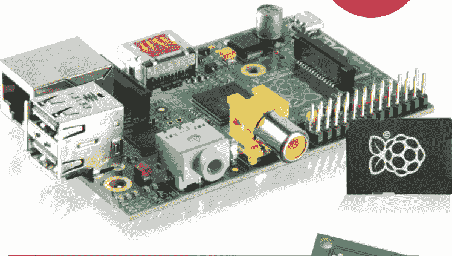

### 现货供应！

5MP 树莓派摄像头

**£19.24** £16.03 不含增值税

代码 `SC1302358`

访问 `cpc.co.uk` 获取更多信息


获取你项目所需的所有物资...


- 全套项目配件
- 套件和外壳
- 扩展板、分线板和原型板
- 大量元器件
- WiFi 适配器 & HDMI 转 VGA 适配器
- 视频和音频线缆
- 键盘、鼠标和显示器
- GPIO 排线
- 编程和用户指南

### 免费配送

条款适用

访问 `cpc.co.uk`

## 欢迎

来到第 131 期《Linux 用户与开发者》


- 你的 Linux 专家团队...

**Mihalis Tsoukalos** 拥有超过 15 年的 UNIX 系统管理和编程经验，自 1993 年起开始使用 Linux。他同时精通 Oracle 数据库管理、Cisco IOS 和 Cocoa。本期中，Mihalis 向我们展示了如何使用 `Unison` 同步文件，这是一款非常有用的开源命令行工具（42–45 页）。


**Himanshu Aurora** 是一名软件程序员、开源爱好者和 Linux 研究者。他的文章曾发表在 IBM developerWorks 和 Computerworld 等刊物上。他还在 `mylinuxuxbook.com` 上 blogging。本月，他通过一篇从第 62 页开始的专业指南，教我们如何充分利用 `Vim`。


**Michael Reed** 是一位科技作家，他在 Linux 领域已经钻研了 15 多年。他的专长包括桌面 Linux 解决方案等。在第 131 期中，Michael 向我们展示了如何使用 `LibreOffice` 入门数据库 – 这比你想象的要简单。见 34–37 页的内容。


**Jon Masters** 是一位 Linux 内核黑客，从事 Linux 工作约 18 年，从 13 岁上大学起就开始接触。Jon 居住在美国马萨诸塞州剑桥市，在一家大型企业级 Linux 供应商工作。你可以在本月 22–23 页找到他不可或缺的《内核专栏》。


**Gareth Halfacree** 是我们最新任命的驻站新闻编辑，他从第 14 页开始为我们带来来自开源生态系统各地的最新消息。本期中，Gareth 在第 6 页采访了 `Intel`，探讨其新平台 `MinnowBoard`。你还可以在 12–13 页找到他对这款可能超越树莓派的设备的评测。


**Rob Zwetsloot** 在大学攻读航空航天工程，在课堂上使用 `Python` 对复杂模拟进行建模。除了教程、评测等本期内容外，Rob 还告诉我们应该使用哪个 IDE（72–77 页），并指导我们完成 `Onion Pi` 的构建过程（46–49 页）。


### 本期亮点

- `MinnowBoard` 独家报道
- 为 `XBMC` 构建插件
- 使用 `Unison` 同步文件
- `Android Studio` 入门指南

欢迎阅读最新一期的《Linux 用户与开发者》，这是英国和美国读者喜爱的开源和 Linux 杂志。

当我们试图打造世界上最好的 Linux 和开源读物时，读者的反馈是最有用的资源。如果我们不致力于为你提供你想要的健康剂量的内容，那我们在这里就没有意义，因此我们密切关注你说什么。但是你们都在说什么？经过收集、格式化、图表化以及大量的思考，显然你们中的许多人想要更多的教程、更大的评测以及更多面向入门和中级开发者的内容。

正如你在这期看到的，我们比以往任何时候都投入了更多篇幅用于教程和指南，甚至重新格式化了我们的发行版评测，使其更有用。不过我们仍然需要你的帮助。如果你想在开源领域深入学习开发，请告诉我们你关心哪些语言和框架。近几个月我们非常侧重于 `Python`，并打算继续下去，但你是否希望在这里看到 `Qt`、`Vala` 和 `C++`，或者完全不同的其他内容？

请在 `Facebook` 和 `Twitter` 上告诉我们，或者直接给我发邮件：`russell.barnes@imagine-publishing.co.uk`。


Russell Barnes，编辑

### 与团队联系：

`linuxuser@imagine-publishing.co.uk`


访问我们的网站获取更多新闻、观点、教程和评测：

`www.linuxuser.co.uk`


## 全新域名带来的新机遇

从 700 多个新的顶级域名中进行选择！创建一个简短、令人难忘且完美契合您的业务或网站主题的网址，例如 `fashion.blog`、`kitchens.online` 或 `john-smith.london`。你还可以通过为您的当前域名获取新扩展名，使您的网站更容易被找到。

凭借近 2000 万个已注册域名，1&1 是欧洲域名注册市场的领导者。得益于集成的转发功能，在我们这里注册的域名可以快速轻松地与任何网站连接，无论您使用哪家网络主机提供商。

访问 `1and1.co.uk` 了解更多

### 新！免费预订

无义务！*


域名 | 邮件 | 网络托管 | 电子商务 | 服务器 `1and1.co.uk`

* 预订域名名称并不能保证该域名会被注册。如果您请求的域名已经被预订，您将被添加到该域名的等待列表中。


Scott Garman 是英特尔公司的 `Yocto` 项目工程师，也是该公司 `MinnowBoard` 的推广人


## 英特尔在小池塘中的大鱼

我们访谈了 Scott Garman，探讨英特尔首次进军由 Linux 驱动的开源硬件开发系统领域

**Scott Garman，英特尔任命其为进入开源硬件开发领域的“推广人”，有着嵌入式开发的历史记录。** 他在纪念 `MinnowBoard` 单板计算机发布的访谈中告诉我们要：“我不是硬核内核黑客，” “而是一个喜欢从大局出发的通才”。

作为 `Yocto` 项目的软件工程师，这是一个旨在使嵌入式平台 Linux 发行版开发尽可能简单的协作努力，在英特尔开源技术中心工作下，Garman 已经为社区做出了许多贡献。他负责 `Yocto` 相关的培训材料，包括该项目最受欢迎的屏幕录制介绍之一，并且现在正在领导引入首个以 `Yocto` 为核心设计的开源硬件平台的工作：英特尔 `MinnowBoard`。


MinnowBoard，在第 12 页有评测，对 Raspberry Pi 和 BeagleBoard 等设备负有清晰的感激之债。它围绕英特尔的“Queens Bay”平台设计，核心是一个低功耗 32 位 `Atom` 处理器，该板被设计为一个开发平台，旨在将 `x86` 指令集架构的灵活性和熟悉感带入嵌入式系统——并且以低成本实现这一点。

最令人惊讶的是，该设备是开源硬件：所有规格、原理图、板布局固件包都可以在宽松的许可协议下下载和重新使用——这是英特尔硬件产品的一大创举。显然，这是与常态的背离，而 Garman 对此 understandable 感到自豪。

## MinnowBoard 是如何诞生的

### 访谈

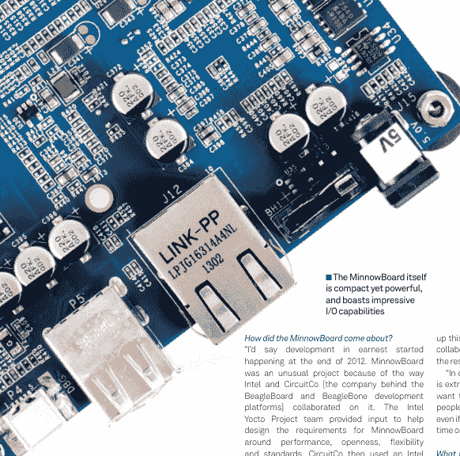

MinnowBoard 本身紧凑而强大，并拥有令人印象深刻的 I/O 能力

## 开源硬件运动

- 开源硬件——开源的一个分支，其中原理图、组件列表，甚至用于制造印刷电路板的单个 `Gerber` 文件都在宽松的许可协议下发布——正变得越来越受欢迎。尽管 Raspberry Pi 是最受欢迎的低成本嵌入式开发平台之一，它是专有的，但它的许多竞争对手更加开放：除了 MinnowBoard，还有 Gizmo、BeagleBoard 及其较小的衍生版本 BeagleBone、OpenOLinuXino 系列，以及基于微控制器的 Arduino 系列，都是开源硬件。

开源硬件可以促进采用它的项目在功能和技术方面的快速进步，但就像开源软件一样，也存在风险：Arduino 的开放性导致它成为周围被复制最多的项目之一，远东地区的工厂成批生产不合法的克隆产品，并以直接违反其否则极其宽松的许可协议的方式滥用该项目的商标。

### MinnowBoard 是如何诞生的？

“我可以说认真开发是在 2012 年底开始的。MinnowBoard 是一个不寻常的项目，因为英特尔和 CircuitCo（BeagleBoard 和 BeagleBone 开发平台背后的公司）以协作的方式开展。英特尔 `Yocto` 项目团队提供输入，帮助设计 MinnowBoard 在性能、开放性、灵活性和标准方面的需求。CircuitCo 随后使用了一个英特尔参考设计——Queens Bay 平台——并根据需要进行了调整。他们还制造和销售 MinnowBoard，所以这主要是他们的产品，而不是英特尔的。结果是一个双赢的局面，我们的团队获得了一个出色的开发平台以及更多，而 CircuitCo 拥有一个具有吸引力的产品平台来销售。”

“我们很高兴与 CircuitCo 合作这个项目，因为他们非常理解开源硬件/开源社区模式，但在推出这块第一块板的过程中，我们双方都有很多事情要从彼此那里学习。这被证明是一次很棒的协作，我们对结果非常满意。”

“从某种意义上说，参与此工作的英特尔团队非常小。与此同时，我不想低估许多人所做的贡献，他们帮助使这一切成为现实，即使他们没有全天候全职参与该项目。”

### 是什么导致了选择 MinnowBoard 使用带有“Tunnel Creek”Atom 处理器的 Queens Bay 平台？

“两个主要问题促使我们为 MinnowBoard 使用 `Tunnel Creek` CPU。第一，我们在寻找平台的 longevity。采用开源硬件模式意味着这将是一块对嵌入式产品公司具有吸引力的板，用于使用和适应商业产品。根据经验告诉你，没有什么比开发一个成功的嵌入式产品后，却发现你的组件即将进入生命周期结束更令人沮丧的了。


> “据我所知，MinnowBoard 是第一个以 `Yocto` 项目为核心设计的硬件平台”


除了右侧的电源和重置按钮，MinnowBoard 还拥有四个可编程按钮

MinnowBoard 放置在四个支脚上，以帮助其 `1GHz` 英特尔 `Atom` 处理器的被动冷却

## 独家

英特尔在小池塘中的大鱼

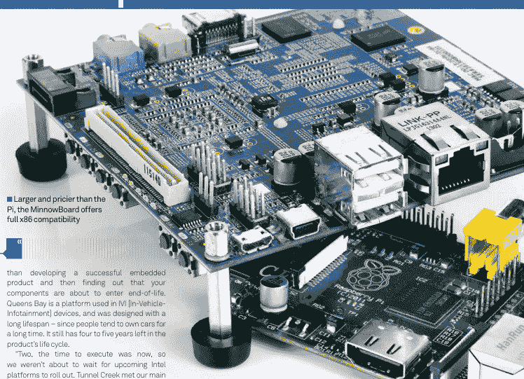

比 Pi 更大更昂贵，但 MinnowBoard 提供完整的 `x86` 兼容性

Queens Bay 是一个用于 IVI（车载信息娱乐系统）设备的平台，设计寿命较长——因为人们通常长期使用汽车。它在其产品生命周期中仍有四到五年。

“第二，执行的时间就是现在，所以我们不会等待即将推出的英特尔平台推出。`Tunnel Creek` 满足我们的主要需求并且立即可用，所以我们就这样做了。”

> **与 ARM 或其他 RISC 平台相比，Atom 处理器中使用的 x86 架构在嵌入式领域有哪些优势？**

> “兼容性可能是最大的优势。Linux 起源于 Intel 386，无论你是在嵌入式还是桌面应用程序上工作，工具链、库等都是在 `x86` 上设计的，并且几乎可以保证在 `x86` 上正常工作。

> “性能是另一个重要的优势。无数的人年投入到了优化像 `GCC` 这样的编译器中，以充分利用 `x86` 平台，因此你可以最大程度地利用它的好处。”

MinnowBoard 包括八个 `GPIO` 引脚和一个专用于“Lures”的扩展端口

> **你同意基于 ARM 的 Raspberry Pi 的成功表明爱好者对低成本开发板有着明确的需求吗？**

> “是的，绝对如此。我欣赏和尊重 Raspberry Pi 项目的一点是，它正在将许多人引入嵌入式 Linux 开发。过去，嵌入式是一个利基领域，由专门的软件工程师处理，现在嵌入式 Linux 社区变得多样化得多，特别是年轻人。我热爱这一点。

> **MinnowBoard 提供了哪些其他更成熟的开发板所缺乏的东西？**

> “MinnowBoard 在其性能、灵活性、开放性和标准的结合中脱颖而出。

英特尔 `Atom` CPU 为高计算负载提供了充足的性能。由于其 `PCI` Express 支持千兆以太网和 `SATA` 磁盘功能，它还具有很强的 I/O 性能。我们还通过 MinnowBoard 的扩展连接器提供 `PCI` 访问，以启用高速 I/O 到自定义硬件项目，例如与 `FPGA` 或其他硬件接口。

“MinnowBoard 可以用于有趣的业余爱好项目，但可以扩展到更高的负载。它可以通过几个 PC 和嵌入式总线标准进行扩展，并提供自定义固件开发的环境。

凭借千兆以太网和实时时钟，它领先于 Raspberry Pi


### 英特尔在小池塘里的大鱼

#### MinnowBoard 的诞生

##### 访谈

> “开放硬件模式在赋能客户方面极具吸引力”


MinnowBoard 包含了 PC 架构标准，如 `PCIe`、`USB` 和 `SATA`，以及嵌入式标准，如 `SPI`、`I2C`、`GPIO`，甚至用于汽车应用的 `CAN` 总线。其设计之初就考虑到了 `Yocto` 项目，该项目是嵌入式 Linux 的行业标准。

**MinnowBoard 是开放硬件——你认为这对它在市场上的成功有多重要？**

“开放硬件模式在赋能客户方面极具吸引力，使他们能够以我们无法预料的方式进行创新。由于用户可以自由复制和定制 MinnowBoard，这款板卡的潜力是无限的。我认为这将是[其]成功的基石。

“请记住，开放硬件的意义不仅在于设计文件可用，还在于所有部件都能通过便捷的分销渠道获取，并且板卡价格没有补贴。如果有人想要重建它，或者重建类似的东西，其成本大约等于目前的售价。很少有板卡能提供这样的潜力。”

**是什么促使英特尔涉足爱好者级别的嵌入式计算开发？**

“我们希望 MinnowBoard 成为一个有用的 `Yocto` 项目开发平台，除了更严肃的嵌入式应用外，还能鼓励实验和追求有趣的项目，作为我们在 `Yocto` 项目培训课程中使用的板卡。我们需要它足够灵活，以便在类似教室的环境中也能做出有趣的事情，这也符合爱好者的需求。”

**现在板卡已经交到早期采用者手中，你是否看到社区中出现了任何特别创新或令人兴奋 MinnowBoard 应用？**

“要我对这种情况有良好的视野还为时过早，因为该板卡在[采访当时]才推出约三周。随着我了解到社区项目，我确实打算在我们的社交媒体渠道上重点介绍它们。

“我知道有人计划将 MinnowBoard 用作 3D 打印机质量控制系统的一部分，利用计算机视觉功能。我还听说 `FPGA` 设计社区对 MinnowBoard 很感兴趣，因为它具有高速扩展能力。还有一群学生对在 MinnowBoard 上构建学习练习感兴趣，以此作为提高他们嵌入式设计技能的一种方式。”

**英特尔在开源社区有着喜忧参半的历史——特别是在未为特定 Atom 处理器型号发布图形驱动程序方面。随着 MinnowBoard 真正开放，这是否标志着英特尔在对待开源和开放硬件社区方面的态度转变？**


“英特尔的开源技术中心聚集了许多才华横溢、声名远播且充满热情的人，他们深切关注开放性问题。近年来，这个群体在规模和影响力上都大幅增长，这反映了开源在全球软件生态系统中日益增长的影响力这一现实。

“英特尔的酷睿图形拥有支持硬件加速的开源驱动程序，即将推出的 `Bay Trail Atom` 平台将使用这些驱动程序。这将解决你提到的 `Atom` 图形驱动程序问题。我对此充满期待，我认为英特尔在这方面正朝着正确的方向前进。”

**英特尔和 CircuikitCo 发布了当前和拟议的 MinnowBoard 附加板列表，称为 Lures。是否有您特别想重点介绍的附加板？**

“我确信会非常受欢迎的一个 Lure 是 Trainer Lure——基于 Arduino [微控制器] 的那个。将 MinnowBoard 的计算能力与 Arduino 的嵌入式输入/输出能力及社区结合起来，将打开许多有趣的可能性。”

#### 皇后湾

这是英特尔 `Atom E6iFx` 系列处理器与 `E620T` 控制器集线器（分别代号为 `Tunnel Creek` 和 `Topcliff`）组合的代号，英特尔于 2010 年针对嵌入式市场推出了 `Queens Bay` 平台。

最初，该公司针对的是汽车内部导航和娱乐计算机系统的所谓“信息娱乐”设备，但声称该平台同样适用于游戏、通信、销售终端、工业和数字标牌应用。

`Tunnel Creek` 系列处理器提供真正的片上系统（SoC）设计，将大量电路卸载到 `E620T` 芯片上，而 CPU、支持最多两个同时显示的图形处理器、音频控制器和硬件视频编解码器则位于一个比前代产品小 48% 的晶圆上。

然而，在 `MinnowBoard` 推出之前，在爱好者应用中使用 `Queens Bay` 几乎是不可能的：英特尔的官方开发板仅提供给注册硬件合作伙伴，并且附带期望你在完成设计后订购数千个处理器。

**Linux 和 Yocto 项目对 MinnowBoard 的成功有多关键？**

“我们设计这款板卡作为 `Yocto` 项目开发平台，而 `Yocto` 生成嵌入式 Linux 发行版。因此，这对于我们的目标来说是非常核心的。这本身就是该项目的主要动机——据我所知，`MinnowBoard` 是第一个以 `Yocto` 项目为设计初衷的硬件平台。但大多数使用 `MinnowBoard` 的人可能对 `Yocto` 项目一无所知或不感兴趣——这也无妨。”

**MinnowBoard 可能是英特尔首个开放开发板家族中的一员，还是仅仅对该公司来说是一次实验？**

“英特尔内部有很多人对开放硬件感到兴奋。我无法[谈论]任何具体的未来产品计划，但我认为未来非常、非常光明。”

### MinnowBoard


英特尔这款由 `Atom` 处理器驱动的開発板是首个兼容 `Yocto` 项目并运行 `Angstrom Linux` 的产品。虽然其价格比树莓派（`Raspberry Pi`）贵得多，但它利用 `x86` 架构，因此提供了更接近台式机和移动计算机的计算能力。它也是一个非常完整的套件，包装内既提供带 `microSD` 卡的 `Angstrom Linux`，也提供额定功率充足的电源。

然而，由于缺乏对 `Intel GMA 600` GPU 的良好驱动程序支持以及 `DVI-over-HDMI` 视频接口（无 HD 音频或 `HDCP` 加密），它在多媒体吸引力方面不及树莓派。

- `SATA` 支持让大容量存储轻松触达 `MinnowBoard`

- 模拟音频输入是树莓派的显著升级

- 四个散热片尺寸和更大的外形意味着它比树莓派更大

- 它的 `GPIO` 引脚更少，但包括两个 `LED` 和四个可控制的按钮

- 千兆以太网意味着更快的网络——如果你计划搭建服务器，这很棒

- `MinnowBoard` 需要令人咋舌的 2.5A 电流来保持其指示灯闪烁


- `MinnowBoard` 通过两个板载 `LED` 和六个按钮支持开发者

- 散热片增加气流，有助于保持 1GHz 英特尔处理器（散热器下方）的凉爽

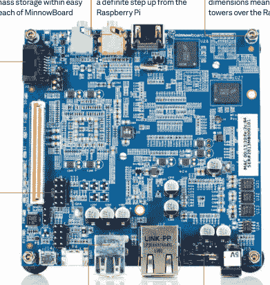

| 特性 | 详情 |
| :--- | :--- |
| 价格 | £162 |
| 尺寸 | 106 x 115mm |
| 重量 | 119g |
| 操作系统 | 通过 `microSD` 提供 `Angstrom Linux`（`Yocto` 认证） |
| 处理器 | 32 位 `Intel Atom E640T` 单核，1GHz |
| 视频 | 嵌入式 `Intel GMA 600` |
| 最大分辨率 | 1366 x 768（无 `HDCP` 加密） |
| 内存 | 1GB `DDR2`（共享），4MB `SPI` 闪存（固件存储） |
| 输出 | `DVI-over-HDMI`（无音频），模拟音频输出 |
| 输入 | 模拟音频输入，2x `USB`，1x `SATA–2`，1x `micro-USB`，1x `mini-USB`，1x 串行控制台，`SD` 卡插槽，1x `micro-SDIO`，8 个 `GPIO` 引脚 |
| 网络 | 10/100/1000 以太网 |
| 实时时钟 | 有（未安装电池） |
| 附加功能 | 带 `CAN` 总线、HD 音频、`LVDS`、IC、3x `PCI Express`、`SATA–2`、`SDO`、`SPI` 总线、`UART`、2x `USB` 的 `Lure` 连接器 |
| 电源 | 5V 2.5A（含适配器） |


### 鱼灵板 (MinnowBoard) 与 树莓派 (Raspberry Pi)

#### 对比分析

#### 树莓派

（B 型号，Rev. 2）


树莓派激发了成千上万的人首次尝试 `Linux`，并重新激发了人们对裸机计算的兴趣。它为创建迷人的物联网项目打开了大门，并极大地降低了编程和物理计算入门的门槛。不过，事情并非一帆风顺：其低价意味着开箱即用的体验并不完美。用户仍需自备 `microSD` 卡、`HDMI` 线和电源，这意味着“入门套装”的零售价往往高达 60 英镑以上。

尽管其原始处理能力在英特尔 `x86` CPU 面前相形见绌，但树莓派继续以其卓越的多媒体性能令用户惊叹。


- 标准 `SD` 卡支持良好，但高速 `SD` 卡是值得额外花费的


- 树莓派的小巧尺寸使其非常适合隐藏在显示器后面或收纳在项目盒中

#### 树莓派规格

| | |
| :--- | :--- |
| **价格** | 28 英镑 |
| **尺寸** | 86 x 54mm |
| **重量** | 40g |
| **操作系统** | 不包含（支持 `Raspbian` 及其他系统） |
| **处理器** | `ARM1176JZF-S` (`armv6k`) 单核 700 MHz |
| **视频** | `VideoCore IV` |
| **最大分辨率** | 全高清，带 `HDCP` 加密 |
| **内存** | 512MB `DDR2`（共享） |
| **输出** | `DMI`（带 `HDCP` 加密），复合 `RCA`，模拟音频输出 |
| **输入** | 2 个 `USB`，1 个 `micro-USB`，`SD` 卡插槽，26 个 `GPIO` 引脚 |
| **网络** | 10/100 以太网 |
| **实时时钟** | 无（可通过 `GPIO` 添加） |
| **其他** | `DSI` 显示连接器，`JTAG` 接头，`CSI`（摄像头模块）连接器，`SPI` 总线，`I2C`，`UART` |
| **电源** | 5V 700mA（不包含） |

- 这里最好配备 `microSD` 卡插槽


- 多媒体支持确实非常出色

- 26 个 `GPIO` 引脚意味着有巨大的折腾空间。可惜不支持模拟信号

- 博通 `SoC` 非常棒，尽管偶尔会卡顿

- 树莓派的音频可能是其最弱的方面。也不支持麦克风


---

- 用于附加板的 `Lure` 连接器承载了从 `CAN` 总线信号到三条 `PCI Express` 通道的一切

- `HDMI` 接口提供 `DVI` 视频连接，但不传输数字音频

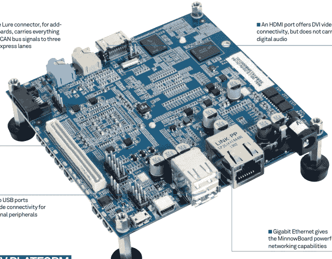


- 两个 `USB` 端口为外部外设提供连接
- `千兆以太网`赋予鱼灵板强大的网络能力

### 开发平台

#### 英特尔鱼灵板 (`Intel MinnowBoard`)

162.83 英镑（200 美元）

英特尔对树莓派的回应来了——但价格几乎是其六倍，它能诱使买家回归 `x86` 吗？

- **优点**
  - 强大、灵活，为嵌入式开发新手提供熟悉的 `x86` 环境
- **缺点**
  - 与 `ARM` 同类产品相比，它很昂贵，且性能落后于 `AMD` 的对手产品 `Gizmo`。

显然，鱼灵板不是树莓派。其最短边为 `102mm`，体积明显更大，运行需要 `5V` 电源提供高达 `2.5A` 的电流，且价格几乎是信用卡大小的树莓派的六倍。然而，鱼灵板提供了树莓派所缺乏的功能：完整的 `x86` 兼容性。

鱼灵板的核心是英特尔较低端的处理器之一：`Atom E640T`。这款单核芯片运行在 `1GHz`，提供 `32` 位 `x86` 实现——这使得它在与竞争对手 `AMD Gizmo` 上的双核 `64` 位 `APU`（最接近的可比较设备）对比时处于劣势——同时产生惊人的低热量，允许通过紧凑的散热器进行被动冷却。

凭借 `1GB` 内存，鱼灵板为嵌入式计算提供了一个令人惊讶的强大且轻量级的平台。在测试中，其插槽功耗峰值为 `7W`，得分令人尊重的第 `95` 百分位时间为 `11.49ms`——比树莓派的 `51.45ms` 快近五倍，但仍落后于 `Gizmo` 令人印象深刻的 `9.87ms` 得分。加上 `Gizmo` 可以同时运行两个线程这一事实，显然英特尔在纯粹性能上不会获胜——尽管英特尔在鱼灵板中包含了超线程支持，以进行伪双核操作。

### 英特尔鱼灵板

基于 `x86` 的嵌入式开发板

## 评测


- `micro-SDIO` 插槽用于容纳捆绑的 `SD` 卡，其中包含 `Angström` 操作系统
- 小型散热器被动冷却 `Intel Atom E650T` 处理器
- 捆绑的增高架将主板抬起，以便为处理器留出冷却空间

#### 技术规格

| **规格** | **详情** |
| :--- | :--- |
| **操作系统** | `Angström Linux`（`Yocto` 认证） |
| **处理器** | `32` 位 `Intel Atom E640T` 单核 `1GHz` |
| **视频** | 嵌入式 `Intel GMA 600` |
| **内存** | `1GB DDR2`，`4MB SPI Flash`（固件存储） |
| **尺寸** | `106 x 115mm` |
| **重量** | `119g`（不含电源） |
| **输入/输出** | `DVI-over-HDMI`，模拟音频输入和输出，`2` 个 `USB`，`1` 个 `SATA-2`，`1` 个 `USB` 设备，`1` 个串行控制台，`千兆以太网`，`1` 个 `micro-SDIO` |
| **其他** | 带 `CAN` 总线、高保真音频、`LVDS`、`I2C`、`3` 个 `PCI Express`、`SATA-2`、`SDIO`、`SPI` 总线、`2` 个 `UART`、`2` 个 `USB` 的 `Lure` 连接器 |
| **电源** | `5V 2.5A` |

- 四个开关与两个用户可控 `LED` 结合，帮助用户开始探索板子的功能

#### 其他推荐


**Sage Gizmo**

**169 美元（14.29 英镑）**

基于嵌入式 `AMD APU`，其性能远强于鱼灵板。嵌入式图形有助于提升计算机性能，而捆绑的扩展板使入门变得容易。然而，在负载下需要更多的电力。`gizmosphere.com`


**Raspberry Pi**

**26.07 英镑**

树莓派的 `ARMv6` 处理器功能远不如鱼灵板的 `Atom`——但以不到六分之一的价格，人们很容易忽略这一点，转而将省下的钱用于附加硬件和折腾组件。`raspberrypi.org`

然而，将鱼灵板当作标准计算机看待是完全错误的。该设备专为嵌入式开发设计，旨在帮助英特尔在一个几乎完全由基于 `ARM` 的系统主导的市场中重新站稳脚跟。相应地，它包括八个缓冲的通用输入/输出引脚，以及两个用户可控的 `LED` 和一组四个开关。这些功能共同将鱼灵板转变为一个即可运行的嵌入式应用开发系统——而且与基于 `ARM` 的设备不同，习惯 `x86` 工具链的用户不需要学习任何新东西。

该板还包含一个用于附加子板的扩展连接器，称为“`Lure`”（鱼饵）。其设计类似于 `Arduino` 微控制器的“`Shield`”（护盾），该端口赋予每个 `Lure` 相当大的潜力：除了三条 `PCI Express` 通道、一个 `SDIO` 通道、两个 `USB` 通道等外，该端口还承载了从 `CAN` 到 `I2C` 总线的一切。虽然撰写本文时开放市场上没有可用的 `Lure`，但有几个正在开发中——包括一个将提供与 `Arduino Shield` 兼容性的产品。这并不意味着主板缺乏连接性：它包含用于启动设备的 `micro-SDIO` 插槽、两个 `USB` 端口、模拟音频连接、`千兆以太网`，以及用于作为 `USB` 设备或调试串行控制台的 `mini-` 和 `micro-USB` 端口。该板还具备 `SATA-2` 端口，可为大容量存储设备提供高达 `3Gbps` 的吞吐量——如果需要，可通过 `Lure` 扩展端口获得第二个端口。

目前，鱼灵板附带的是一个极简的 `Angstrom Linux` 安装——这里没有友好的开箱即用体验。然而，凭借完整的 `Yocto` 项目认证，自行构建操作系统并非难事，英特尔正在与包括 `Ubuntu` 在内的发行版洽谈，以增加对该板独特 `32` 位 `UEFI` 固件的支持。

使用项目创建者（仍在进行中）的文档，鱼灵板能迅速展示其 `GPIO` 功能。唯一的真正失望来自 `HDMI` 插座，它仅传输 `DVI` 信号，而不是完整 `HDMI` 实现所需的音频。也不支持 `HDCP` 加密，尽管任何考虑将鱼灵板用作媒体播放系统的人可能已经错过了其设计和功能的核心要点。

Gareth Halfacree

### 总结

鱼灵板是英特尔进军开源硬件世界的一次令人欢迎的尝试，并展示了可观的潜力。虽然其性能可能落后于竞争对手 `Gizmo` 板，但 `Lure` 连接器预示着未来将出现一些令人印象深刻的附加组件——但其高昂的价格意味着树莓派无需惧怕这个新来者。

更多信息请访问 `minnowboard.org`

#### 开源

你的`Linux`新闻与观点来源

`www.linuxuser.co.uk`

获取最新新闻与观点

直接给我们发邮件...

`linuxuser@imagine-publishing.co.uk`

### 开放科学

### `Linux`基金会领导开放科学倡议

与`OpenBEL`的合作将使科学数据共享变得更加容易

`Linux`基金会与`Selventa`新成立的`OpenBEL`项目之间的合作，可能会推动开源开发的理想进一步深入到科学研究领域，两方已宣布了这一消息。


`OpenBEL`的`Ted Slater`赞扬了`Linux`和协作开发的优势

`OpenBEL`（开放生物表达语言）此前是一个闭源专有平台，旨在帮助通过其创建者所描述的“知识工程平台”来捕获、存储、共享和使用生命科学内容。针对数据共享和使用方面的困难，`OpenBEL`背后的团队已经使用了十年——但该平台直到去年六月才开放，`Linux`基金会声称这一举措将成就该项目。

“我们所有人集体智慧都高于任何个人的单独智慧，而`Linux`是这一原则最宏大的例子之一，”`Linux`基金会执行董事`Jim Zemlin`声称，“我们能够将在`Linux`和协作开发方面所学到的知识应用到新的行业。`OpenBEL`代表了开放性和协作性为`OpenBEL`带来领先优势的绝佳机会。”“它是所有开放开发项目衡量自己的标准。我们知道我们的行业可以从这个开放开发和治理的中立监管者身上学到很多……此外，通过将`OpenBEL`托管在`Linux`基金会，我们可以获得各种重要服务来促进协作开发，使我们的团队能够专注于我们的主题：生命科学。”

通过`Linux`基金会托管`OpenBEL`平台，其创建者希望这将促进其采用。自2012年六月开源以来，该项目已被多样化的组织采用，包括`哈佛医学院`、`加州大学圣地亚哥分校`、`弗劳恩霍夫协会`以及制药巨头`诺华`和`辉瑞`。

各方希望`OpenBEL`更广泛的采用将导致生命科学信息的汇集，该平台允许使用标准化的可计算网络和应用编程接口（`API`）进行轻松传播和分析。

与`OpenBEL`的交易是`Linux`基金会协作项目中最新的一个，其中包括与`Yocto`项目、`Xen`项目、`FOSS Bazaar`以及移动平台`MeeGo`和`Tizen`的合作。

有关该项目的详情和源代码链接，可在`OpenBEL`官方网站 `openbel.org` 上获取。


`OpenBEL`为生命科学数据的捕获和协作分析提供了平台

> “我们所有人集体智慧都高于任何个人的单独智慧”
>
> – `Ted Slater`

### 新闻

`Linux`社区的最新动态


# 开源

## SourceForge DevShare被贴上“恶意软件”标签

### “他们不仅越界了，还吐了一地”

开源托管机构SourceForge因将选定的二进制发布打包在广告繁多的软件包中而受到批评。


于今年七月推出的`DevShare`将软件与`AnchoxFree`的`HotSpotShield`等附加组件捆绑在一起。`SourceForge`声称它为开发者提供了一种简单的方式来将其努力变现；批评者则认为它不过是恶意软件。

“`SourceForge`，曾经是开源力量的强大推动者，已经从其以往的高远地位跌落很远，”`Red Hat`开发者`Justin Cliff`在`Guster Project`博客的一篇文章中评论道。“我完全反对商业化，我们都有生活，需要支付账单。但不要通过滥用用户信任来做到这一点。不要通过掠夺技能不足或疏忽大意的人来做到这一点。借用`Marge Simpson`的话说：‘他们不仅越界了，还吐了一地。’”

现由`Dice Holdings`拥有的`SourceForge`为这一举措进行了辩护。“`SourceForge`始终尊重用户的权利，我们绝不会侵犯这些权利。`DevShare`提供了透明的安装流程，赋予用户所有必要信息，以便他们对安装什么软件做出明智选择。”

启动目前处于测试阶段的该计划导致有人呼吁高调项目迁移到其他托管商；然而，其他项目——包括`FTP`客户端`FileZilla`——已经注册了`DevShare`。

## X.Org失去非营利地位

`X.Org`背后的基金会因其连续三年未向美国国税局提交税务申报，从而失去了在美国作为`501c(3)`非营利组织的地位。

“我对国税局如此粗鲁地找上门感到惊讶，”基金会计`Stuart Kreitman`在该公司最近一次董事会上说道。“我在自己的报税方面很少有麻烦，总是发现他们是合理且友好的。”

然而，`Kreitman`承认税务申报未提交，但辩称该组织“从未提交过申报”。


`X.Org`基金会正在考虑让他人未来代管其文书工作

基金会现在正在考虑加入一个伞形组织，以便减少对其成员要求的文书工作量，并防止此类尴尬情况再次发生。

# Linux日历

## 开放世界论坛 '13

- `Le Belfroi`, 巴黎
- 法国
- `openworldforum.org`

作为首个旨在将技术专家和政治代表聚集在一起的欧洲峰会，开放世界论坛的演讲者范围从`微软`的`Frederic Aazt`到法国文化与传播部的`CIO`。

## OggCamp

- `LJMU`艺术与科学学院，利物浦
- 英格兰
- `OggCamp.org`

英国最大的开源和自由文化活动进入第五年。围绕“非会议”（`unconference`）形式展开，周末期间将有三个“流体”（`fluid`）赛道以及一系列计划好的演讲者。

## LinuxCon Europe

- 爱丁堡国际会议中心
- 苏格兰
- `events.linuxfoundation.org`

涵盖`Linux`一般性而非特定发行版的最大型活动来到苏格兰，计划有超过一百场会议。随后是`Linux`内核峰会、汽车`Linux`峰会和嵌入式`Linux`欧洲大会，全部在爱丁堡举行。

## CloudOpen Europe

- 爱丁堡国际会议中心
- 苏格兰
- `events.linuxfoundation.org`

第二届年度`CloudOpen`大会旨在继首届大会的成功基础上，推动开源技术在云计算中的使用。

# 开源

你的`Linux`新闻与观点来源

`www.linuxuser.co.uk`

获取最新新闻与观点

直接给我们发邮件...

`linuxuser@imagine-publishing.co.uk`

## 政府

### 瓦伦西亚完成LibreOffice切换

地方政府金库已富余130万欧元

西班牙瓦伦西亚地区政府已完成其从专有软件切换到`LibreOffice`的计划。

迁移到开源替代方案的项目始于2012年，已被誉为使政府在软件许可费上节省了130万欧元。

“除了经济利益外，对自由和开源软件的承诺还带来其他优势，包括解决方案可以用瓦伦西亚语和西班牙语使用，以及`IT`供应商的独立性，这鼓励了竞争，”瓦伦西亚政府`ICT`部门总司长`Sofia Belles`说道。

“我们也有自由修改和调整软件以满足我们的所有需求。”


■ 迁移到`LibreOffice`已为瓦伦西亚政府节省了一笔小财富

瓦伦西亚长期以来一直处于开源采用的前沿，早在2005年就推动了学校采用`Linux`的计划。该计划覆盖了分布在所有地区学校的110,000台`PC`，据称目前为止该迁移到`Linux`已节省了超过3000万欧元。

“安装免费办公套件是地区政府对其使用自由软件的战略性承诺的一部分。它不仅有助于节省许可成本，”`Belles`补充道，“还促进了当地`ICT`部门的发展，推广瓦伦西亚语在数字世界的使用，并提高了行政`IT`系统的互操作性和安全性。”

欧洲委员会的`JoinUp`项目对此表示赞赏，该项目旨在通过标准化改进公共行政之间的互操作性，暗示其他政府可能会效仿。

## 硬件

### ARM开始推动物联网

目标到2025年销售一万亿台设备

剑桥的低功耗处理巨头`ARM`正在全力推动物联网，成立新的物联网业务单元，目标是在2025年前销售一万亿台设备，并收购物联网专家`Sensinode Oy`。

其支持者声称，物联网是互联网的下一个合乎逻辑的演变，它试图用互联网连接传感器和交互性装备一切可能的东西，以此作为让人们生活更轻松的手段。

`ARM`计划将`Sensinode`的`6LoWPAN`和`CoAP`标准与其自己的基于`Cortex`的`mbed`微型计算平台集成，该平台既销售用于嵌入式硬件开发，也销售用于业余爱好者使用的宽带友好格式。

`ARM`的`John Cornish`就该交易声称：“`Sensinode`是低成本低功耗互联网连接设备软件的先驱，并且是物联网开放标准的关键贡献者。”

“通过使`Sensinode`的专业知识和技术对`ARM`合作伙伴和通过`ARM mbed`项目开放，我们将能够快速部署成千上万种新的和创新物联网应用程序。”

此举正值行业分析师预测连接设备数量即将爆发之际，`IHS`的`Bill Morell`估计到2020年将有300亿台连接设备——这是`ARM`将尽最大努力超越的数字。

小规模物联网项目，包括充当`Twitter`网关的打印机和环境监测系统，经常使用基于`ARM`的微型计算机系统——如今最常见的，是低成本高性能的`Raspberry Pi`或其更灵活的替代方案`BeagleBone Black`——而其他一些则使用`Atmel`、`德州仪器`和其他公司的低成本微控制器设备。

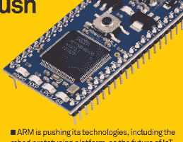

■ `ARM`正在推广其技术，包括`mbed`原型平台，作为物联网的未来

# 新闻

`Linux` 社区的最新动态

## 开源

### Linux

#### Torvalds 庆祝 Linux 3.11 发布

在决定将 `Linux 3.11` 命名为“工作组用 Linux”（`Linux for Workgroups`）之后，`Linus Torvalds` 发布了一条充满怀旧意味的消息，以庆祝其最终候选版本的发布。

`Torvalds` 写道：“向所有使用 `Linux` 的大家好——我正在开发一个（免费的）操作系统（即使它很大且很专业，但这只是一个爱好），适用于 `486+` `AT` 兼容机以及市面上几乎所有其他设备。” “这项事业自 `1991` 年 `4` 月开始酝酿，至今仍未就绪。”

这条消息是对他 `1991` 年最初发布 `Linux` 通知的一次有趣呼应。当时的通知呼吁 `Minix` 用户尝试 `Linux`，并声称它“不会像 `GNU` 那样庞大和专业”。

### 电子游戏

#### 《地铁：最后的曙光》登陆 Linux

`Linux` 游戏不再被 `AAA` 级开发商忽视。


- `4A Games` 已将《地铁：最后的曙光》移植到 `Linux`，计划于今年晚些时候发布

`4A` 公司的 `CTO` `Oles Shishkovtov` 表示：“我们对结果非常满意。我们希望 `Mac` 和 `Linux` 玩家能欣赏我们为他们的机器打造最佳版本所做的努力。”

开发商 `4A Games` 已确认，第一人称射击游戏《地铁：最后的曙光》将在今年早些时候于 `Windows` 平台首秀后登陆 `Linux`。

《地铁：最后的曙光》将于今年晚些时候在 `Linux` 版 `Steam` 上推出。它是首批在 `Windows` 版本发布同年同时推出 `Linux` 版的知名大型游戏之一，这也标志着开发公司越来越倾向于将 `Linux` 视为其软件的有效目标市场。

`4A Games` 内部完成了 `Linux` 版本的开发工作，该公司将其自定义游戏引擎归功于使移植到替代平台变得轻而易举。该游戏也将在同一时期登陆 `OS X` 平台。

### 恶意软件

#### “窃贼之手”木马瞄准 Linux

专家警告用户警惕恶意软件传播


一款名为“窃贼之手”（Hand of Thief）的特洛伊木马被发现，其目标是 Linux 用户，试图窃取银行凭证和其他敏感数据。

这款由 RSA 研究人员发现的木马包含复杂的反监控和反虚拟化技术，使其难以分析。据称，该木马在地下网站上售价约为 2,000 美元，并且对所有常见的 Linux 桌面发行版都有效。

反病毒专家将这款木马视为证明 Linux 需要此类防护软件的证据。前 Sophos 顾问 Graham Cluley 声称：“这是 Linux 用户不应对其计算机安全掉以轻心，并运行反病毒程序的又一个原因。” Avast 的 Peter Kálnai 补充道：“现在，声称 Linux 平台绝对安全的说法显得愈发虚幻。”

然而，该木马仅在获得 root 权限时才能安装——而这在现代大多数桌面发行版中都被密码机制所屏蔽。通过仔细留意安装了什么软件，并且不要对意外出现的弹出窗口提供密码， Linux 用户基本上可以免受其侵害。

然而，那些经常从发行版官方仓库之外安装软件的人应提高警惕：随着 Linux 的流行度不断上升，不幸的是，它对罪犯的吸引力也在增加。

## 您当前的数据库支持提供商能保证 15 分钟响应吗？


我们可以。

2ndQuadrant 的 PostgreSQL 白金级生产支持提供保证的 15 分钟（人工）响应，4 小时变通方案以及保证在 24 小时内修复 bug。

全年 365 天，每天 24 小时。

PostgreSQL 在全球范围内被用于关键任务应用。现在，您可以放心选择这个开源数据库，因为如果您需要帮助，它距离您不到 15 分钟。

提供保证的修复时间和对顶尖 Postgres 专家的访问权限。

`2ndquadrant.com/support`

#### 2ndQuadrant

专业 PostgreSQL 服务

PostgreSQL 开发 • 全天候支持 • 培训 • 服务 •

2ndQuadrant Ltd, 7200 The Quorum, North Side, Oxford Business Park, Oxford, OX4 2JZ, UNITED KINGDOM `www.2ndquadrant.com` 电话 +44-870-766-7754

## 观点

自由软件专栏

### 开源机器人技术

#### Linux 是机器人技术的平台

Linux 正越来越多地用于前沿机器人技术——向任何有兴趣深入学习该领域的人敞开大门


Alan Broun 目前正在布里斯托机器人实验室攻读博士学位。他也是 Dawn Robotics Ltd 的董事经理——`www.dawnrobotics.co.uk`

机器人技术是一个迷人的学科。它将计算机与物理世界联系起来，使它们能够移动、感知环境并与之交互。然而，传统上构建你自己的机器人需要花费大量的时间和精力，即使只是为了让最基本的机器人系统运行起来。你需要机械工程技能来构建底盘或机身，电子工程技能来连接电机和传感器，以及编程技能来让机器人动起来，控制它的身体让它做你想要它做的事。这些入门障碍意味着进入机器人技术领域的人——无论是寻找一个刺激的消遣，还是作为更正式研究的一部分——很容易被所需的大量工作所淹没。最初构建一个机器人来为你取啤酒或遛狗的梦想，会因仅仅让基础功能工作起来所消耗的时间越来越多而不断后推。

然而，情况正在发生变化，入门障碍正在降低。消费品进步的无情推进使得许多常用的机器人硬件——如摄像头、加速度计和通信设备——比十年前便宜得多，也小得多。实际上，现在利用电子传感器和电机也容易得多，因为像 `Arduino` 这样的平台使得将电子组件连接到你的计算机并控制它们变得既快速又简单。除此之外，像 `Raspberry Pi` 和 `BeagleBoard` 这样的小型、强大计算机（仅举两例），意味着你现在可以以可承受的价格在机器人中装入更多的处理能力。

然而，为了充分利用这些硬件，你需要软件，而幸运的是，`Linux` 正是最激动人心的机器人软件开发发生的平台。为现代机器人编写软件可能是整个过程中最复杂、最繁琐的部分。需要软件来控制电机、读取传感器值，并且可能最重要的是提供高级控制和人工智能。人们开发了许多分布式软件环境，试图简化机器人软件的开发。但由位于硅谷的公司 Willow Garage 开发的机器人操作系统（`ROS`）可以说是其中最成功的之一。`ROS` 实际上不是一个操作系统，而是一个在 `Linux` 上运行的采用 `BSD` 许可证的开源软件框架。它允许为常见的机器人软件组件定义接口，例如摄像头和电机的驱动程序，并允许这些软件作为许多称为“节点”的独立进程运行——要么全部在一台机器上，要么透明地分布在多台机器的网络上。

在过去五年中，`ROS` 极大地简化了编写机器人软件的过程。现在你可以下载大量预编译包，快速连接常见的传感器，如摄像头或 Microsoft 的 `Kinect`。高级服务如逆运动学、地图构建和语音识别很容易插入，`ROS` 还提供了丰富的可视化工具选择，让你可以从机器人的视角看到发生了什么。当你需要编写自己的软件时，你可以使用你选择的语言。低级电机驱动程序可以用 `C` 编写，然后通过 `ROS` 的网络层与用 `Python` 或 `Java` 等语言编写的高级控制进程进行通信。

无法获取机器人硬件不再是入门的障碍，因为 `ROS` 还为 `Gazebo` 等模拟器提供支持。机器人研究界已经拥抱了 `ROS`，因此现在许多由构建它们的团队提供的前沿机器人模拟。因此，完全免费，你就可以访问 Willow Garage 的 `PR2` 机器人、`NASA` 的 `Robonaut` 和 Boston Dynamics 的 `Atlas` 机器人。最后这款机器人目前正在 `DARPA` 机器人挑战赛中使用，该比赛旨在让人形机器人驾驶汽车并在灾区移动，所以这确实是一项雄心勃勃的任务。

现在是机器人技术令人兴奋的时刻，而 `Linux` 正是其中最酷的事情发生的平台。如果你还没有尝试过，我敦促你下载并玩玩 `ROS`，开始构建你自己的机器人，并加入所有的乐趣中！


### 你愿意为代码俱乐部（Code Club）做志愿者吗？

代码俱乐部是一个全国性的志愿者主导的课后编程俱乐部网络，面向 9 至 11 岁的儿童。

我们需要懂得如何编写计算机程序的人，自愿每周花一小时在当地的小学、图书馆或社区中心运营一个俱乐部。

我们为志愿者创建用于教学的课程项目。我们制作的项目通过展示如何制作电脑游戏、动画和网站，来教授儿童编程。

参与进来，让我们一起教授下一代编写代码！

访问 `www.codeclub.org.uk` 以了解更多


# Opensource

你的 Linux 新闻与观点来源

## 开源专栏

### 公平竞赛

西蒙担忧游戏的未来即技术的未来


西蒙·布鲁（Simon Brew）是一位技术作家和编辑，活跃于 `Linux`、`Windows` 和 `Mac OS X` 平台。

我玩游戏。我始终喜欢玩游戏，并怀疑我会在今后的日子里不时偷玩一两局。如果你跟我的编辑聊，他显然会告诉我，我是他见过最守时、最可靠的截稿人，我的文章总是结构完美，在呈送到你面前之前只需最少的编辑。划掉这句话：多亏电脑游戏，我在截止时刻前像关上的门一样匆忙滑过，次数多到我都不愿承认。

但游戏正在改变。对于像我这代成长于 8 位计算机时代的人，那时任何人都可以在卧室里关上一天两天编写一个游戏，当前的风气都让人有些不安。以《看门狗》（`Watch Dogs`）为例：这是一款由大型出版商制作的大型游戏，甚至在发布之前，就已被指定为开发大银幕电影的快速通道。或者是邪恶的《糖果传奇》（`Candy Crush Saga`），这种移动游戏革命一开始不向你要钱，但一旦让你舒服地坐在沙发上，就会尽可能多地从你身上榨取金钱。

游戏之所以有趣，且一直如此，是因为它们处于控制权的前沿。我回想起把加密狗插在我 `Commodore Amiga` 后面以防止他人盗版游戏（结果，巧合的是，那些方便地“出现”的人恰恰是那些合法掏钱购买的人），或者排列轮子上的图片。

随后，随着技术的演进，控制的方法论也随之演变。通过 `Windows`，`PC` 游戏已将事情推向了令人恐惧的程度。在某个阶段，出版商育碧（`Ubisoft`）实施了一套系统，要求你每天必须在线证明自己是合法的，否则就不允许玩你合法购买的标题游戏。当然，有一天它的服务器没有正常工作，人们就不被允许玩他们的游戏。而运行盗版副本的人却可以。

`Microsoft` 试图在其即将推出的 `Xbox One` 游戏主机上实施类似的系统，尽管它在舆论火山爆发后不得不进行了大幅度的掉头。即便如此，那些为 `Xbox One` 机器购买游戏的人将需要“激活”它。这是一个友好的词，不是吗？听起来如此合理和愉快。只要做一件事，一切就会激活并正常工作。有什么更简单的吗？当然，事实是，这是专有软件领域进一步侵蚀用户权利的行为。


问题在于，电子游戏中发生的事情越来越多地成为我们在更广泛的技术生态系统中所得到的预演。出版商知道，人们为了玩游戏会忍受一定程度的麻烦，并会无情地利用这一点。现在，我们正处于一个 `Adobe` 的 `Creative Suite` 工具甚至不再以盒装形式销售的阶段——要么使用云版本，否则就没戏，而且是订阅制。有人显然是在参照《魔兽世界》的模式。

即使是在应用程序领域，卧室程序员的精神本应依然活跃且健康，但一种企业光泽正让事物失去乐趣。《糖果传奇》模式已证明是许多人的圣杯，因为那种免费、开放的外观只是一种伪装，背后是我近年来见过的最无情的游戏赚钱机器之一。

当然，这就是为什么需要支持那些好的。但尽管有进步的步伐，一种精神的丧失已成为现实的附带损害。


`King` 的 `Candy Crush Saga` – 一台无情的赚钱机器

## 自由软件专栏

### GPL 的突破

三星正按照 `GPL` 条款发布其用于 `Linux` 的 `exFAT` 文件系统驱动程序代码。由于三星和面向 `Linux` 开发者的 `GPL` 合规项目的参与，这是一项重要的突破。


理查德·希利斯利（Richard Hillesley）为多种出版物撰写关于艺术、音乐、数字权利、`Linux` 和自由软件的文章。

非营利性 `FOSS` 组织 `Software Freedom Conservancy`（软件自由保护协会）已与三星达成友好协议，按照 `GPL` 条款发布三星用于 `Linux` 的 `exFAT` 文件系统驱动程序代码。`exFAT` 驱动程序代码是通过其无意中通过 `GitHub` 发布（`lwn.net/Articles/560424/`）以及在一个基于 `Linux` 的三星平板电脑中使用二进制版本而被发现的。

由布拉德利·库恩（Bradley Kuhn）领导的 `Software Freedom Conservancy` 与开发者和制造商合作，以确保遵守 `GPL`。工作的很大一部分是指明制造商的法律义务并帮助他们实现合规，大多数人会乐于合规。

众所周知，`GPL` 在编码者和用户之间建立了一个简单的契约。任何人都可以获取、修改、复制、分享和重新分发软件及代码，但必须将相同的权利传递给软件的后续用户，包括对代码的任何修改。

编码者（通常是但不总是版权持有者）会从中获益，因为对代码的增强会通过开发过程反馈回来。制造商也会获益，因为第三方开发者参与其中，他们可能会为代码带来新的维度。用户也会获益，因为代码保持自由，且义务是相互的，这意味着每个其他用户都有相同的义务将他们的更改反馈回来。

`GPL` 的唯一要求是源代码对终端用户开放可访问，但这一要求经常被忽视，尤其是在代码被重用于固件和嵌入式设备时。`GPL` 代码被用于数千种设备，但许多设备并不符合许可证的条款。

`Software Freedom Conservancy` 的角色是提醒制造商关于合规方面的失败，并帮助他们达成友好解决。大多数违规行为都在没有法庭诉讼的情况下得到解决，但在极少数情况下，这可能涉及诉讼。但 `Conservancy` 的董事会成员杰里米·艾利森（Jeremy Allison）观察到：“重点不是惩罚那些犯错误的人，而是让他们遵守规定。当人们陷入麻烦时，通常是由于懒惰和不便。通常情况是‘我懒得管，正确做太费事，所以我只是直接用它’。”

绝大多数侵权行为并非蓄意而为，可以归因于误解和对细节缺乏关注。移动设备制造商在一个变化迅速、产品周期短且上市时间更短的环境中运营。固件和移动设备市场高度竞争，每个新产品上市时都带来一系列新功能。未能遵守 `GPL` 通常是无意的，但与自由软件提供的显著优势相比，发布源代码是一个小小的代价，例如成本效益、快速上市以及预先编写和测试的代码的可访问性，尤其是当记住只有 `GPL` 代码需要提供给他人时。

分享代码对每个人都有用，但 `GPL` 的条款并未总是得到执行，因为编码者有别的事情要做，或者版权已转让给不关心许可证超出其即时需求的法人实体。

因此，`Linux` 内核的重要贡献者，以 `Conservancy` 的面向 `Linux` 开发者的 `GPL` 合规项目的形式，介入帮助确保遵守许可证条款，这是一个重要发展。三星，一家主要制造商，不仅是一个愿意且友好的合作伙伴来发布代码，而且乐于“公开谈论此事”，这可能使未来更容易从其他制造商处实现合规。

在此例中的缺点是，`exFAT` 由微软拥有，是一种专有文件格式，并存在专利问题。`exFAT` 驱动程序代码只能由已获得微软许可的制造商或发行版部署。

> “分享代码对每个人都有用，但 `GPL` 的条款并未总是得到执行”

## 乔恩·马斯特斯

### 内核专栏

内核社区的最新动态，包括 `Linux 3.11` 的变更


Jon Masters 是一位 `Linux` 内核开发者，从事 `Linux` 相关工作已有约 18 年，自他 13 岁首次上大学以来便开始了这段旅程。Jon 居住在马萨诸塞州剑桥，并供职于一家大型企业级 `Linux` 供应商。他在 `kernelcodcast.org` 上发布每日 `Linux` 内核邮件列表摘要。

`Linus Torvalds` 在 1991 年最初发送“Hello everybody”邮件首次介绍 `Linux` 的 32 周年纪念日，发布了 `3.11` “工作组版 `Linux`”的最新发布候选版本。

过去几周，合入主线内核的变更相对平静，这既是夏末的典型特征，也是内核发布周期后期的常态。看起来，针对持续出现的 `Windows 8` `ACPI` 兼容性问题的临时修复措施——这些问题会导致某些笔记本电脑上的屏幕背光行为异常（现在背光由某些 `Windows` 显卡驱动程序直接管理，而不是由 `ACPI` 固件管理）——对于本次发布已经足够，但这些问题将在下一个周期再次被提出。如果一切按计划进行，最终版本应该很快就会发布，以便在下期的《Linux 用户与开发者》杂志中进行总结。

每个 `Linux` 版本都有一个（代码）名称，通常是一些非常滑稽的东西，而且往往是 `Linus` 在为新内核版本开放合并窗口（允许破坏性内核变更的时期）时想到的。但偶尔，版本名称会有更深层的含义。`3.11` 版本本可能恰逢最初 `Windows 3.11` “工作组版 `Windows`”发布的 20 周年纪念日，但事实并非如此。尽管如此，`Linus` 还是通过发布一条 `Google+` 帖子，对自己进行戏仿，以此庆祝他最初 `Linux` 公告的 22 周年纪念日。他写道：“我正在开发一个（免费的）操作系统（即使它很大且很专业，但这只是一个爱好），适用于 `486+` `AT` 克隆机以及世界上几乎所有其他设备。这个项目从 1991 年就开始酝酿，至今仍未准备好。”

### NUMA 开发

《Linux 每周新闻》最近注意到，内核开发的特定时期往往会有某种主题，而过去这个月似乎带有一种内存管理主题。这确实看起来如此。但更具体地说，这个月的主题似乎实际上是关于 `NUMA`（非统一内存访问）的开发。`NUMA` 旨在应对一个现实情况：随着 `SMP`（对称多处理，即用于为操作系统提供多个 `CPU` 核心的类型）的扩展，其扩展方式并不一定是线性的。事实是，某些内存 `DIMM` 组距离某些 `CPU` 核心更“近”。

在 `SMP` 系统中，每个 `CPU` 都可以访问系统中的每个内存位置，这通常是“相干的”，意味着底层硬件负责确保当某个 `CPU` 更新该内存时，其他 `CPU` 内部缓存的相同内存位置会得到更新。但是，如果某个内存位置对于某个处理器不是“本地的”——即如果底层硬件必须通过处理器间局部总线路由访问以到达该位置，从而需要更多步骤——那么访问该内存位置的延迟成本会更高。对于应用程序（和用户！）而言，这表现为性能低于如果应用程序的内存严格局限于某个处理器时所能达到的水平。

`Linux` 以多种方式处理 `NUMA`。在一定程度上，它可以通过将应用程序的内存“迁移”到更靠近正在使用它的处理器（将底层内存位置复制到更靠近特定处理器的其他位置，并相应地更新虚拟内存转换表）来提供一定程度的透明支持。但已经编写了特殊工具，允许管理员更具体地指定给定应用程序应如何管理其内存。以撰写关于 `Linux` 内存管理权威书籍而闻名的 `Mel Gorman`，最近一直致力于 `NUMA` 可扩展性问题，他和 `Johannes Weiner` 都提交了补丁，旨在更好地处理 `NUMA` 提示以及将内存自动重新协调到其使用地点附近。


除了 `NUMA`，过去一个月还详细讨论了其他与内存可扩展性相关的主题。Dave Chinner 提交了补丁，将内核 `inode` 缓存（负责缓存已挂载文件系统元数据的内核内部数据结构）转换为使用 Paul McKenney 著名的（且被 `IBM` 专利保护的）`RCU`（读-复制-更新）内存访问优化技术。这使得在非常大的 `NUMA` 或非 `NUMA` 系统上运行 `Linux` 时，`inode` 缓存可以更容易扩展，而无需使用先前全局锁。同样与扩展相关，来自大型银行公司的 Andy Lutomirski 开启了一场关于新的 `MADV_WILLWRITE` 标志的讨论，该标志可以在设置内存映射时使用，以通知内核某个虚拟内存范围肯定会在之后被写入。这允许内核放弃其常规的“写时复制”（直到首次使用时才延迟分配新的虚拟内存区域），而是采取稍贵的前置操作，直接分配内存，以便在运行中的应用程序后续触及该内存时节省延迟开销。

本月的内存管理贡献还包括来自 `IBM s390` 团队 Martin Schwidwiesky 的虚拟化优化，他提供的补丁允许客户机实例通知主机虚拟化管理程序它们正在使用的页面（系统用于管理应用程序、虚拟机、内核本身等使用的内存块的基本单位）未被使用，这些页面会在被交换到磁盘时自动丢弃，并在稍后需要时重新初始化。在内存管理领域，Michal Hocko 还提供了一个补丁，防止在发生内核分配故障时触发 `OOM`（内存不足）杀手——内核本身应该能够处理内存分配失败，或使用专用的保留内存池。

### 功耗限制框架

除了内存管理，Srinivas Pandruvada（来自 `Intel`）提交了一个初始 `RFC`（请求意见）补丁——将新想法开发成代码的第一阶段——系列，该系列实现了内核内的功耗限制框架。基本思路是允许给定系统（平台）指定可用功率量，并在系统内安装的各种 `CPU` 和非 `CPU` 设备之间强制执行精确的限制。利用此机制，希望提供某些限制（例如电池、电力公用事业可提供的功率量，或如果电池旨在持续特定时段时可用的功率量等），并让设备在这些约束条件下提供不同的性能权衡。但通过提供一个总体框架，内核可以做出整体系统决策，而不是孤立地针对某个子系统或某个设备。

对功耗限制框架的初步评论是积极的，尽管 Greg Kroah-Hartman（现隶属于 `Linux` 基金会）建议，在合并该框架之前，他希望看到框架的实际使用者——他的意思是他真的希望看到 `Intel` 为其自己的 `CPU` 和平台编写代码以利用此框架。这似乎正在进行中，因为邮件列表上的评论暗示存在此类补丁，并且迄今为止至少有一部分开发者已经审阅过。看看这一开发将走向何方将会很有趣，特别是在移动领域，以及当它应用于其他架构时。

### 持续开发

除了 `NUMA` 和虚拟内存，开发工作还包括为 `32 位 ARM` 系统初始实现 `UEFI` 启动桩支持（这些系统此前使用一种不太标准的嵌入式引导加载程序 `U-Boot`）、允许对透明大页进行每进程控制的补丁、在执行内核崩溃转储（以及 `kexec` 到必须在启动时没有未决 `DMA` 操作的内核）时修复 `PCIe` 重新初始化的问题，以及 Andi Kleen 针对名为 `kbuild` 的内核构建系统所做的优化。Andi 的补丁将内核编译的 `"kallsyms"` 阶段转换为单遍过程，而不是成为多阶段过程。这是内核编译期间解析所有符号（由内核为内部和模块使用提供的函数名）的阶段，发生在内核映像的最终链接过程中。Andi 提出了一系列巧妙的小技巧，旨在大幅加速该过程。

在本月的内核公告中，Ted'lo's 提醒大家，`2013` 年 `Linux` 内核峰会将于下月在爱丁堡举行，并且将为那些严格的顶尖开发者保留席位。这似乎是一个临时的决定，因为提交截止日期很快过去了，但值得在今年关注，以防这样的邀请再次出现。除了内核峰会，许多内核和非内核开发者将出席在新奥尔良举行的 `Linux` 管道工会议，届时将同时举行多个其他小型会议。其中包括 `ACPI`/电源管理聚会、`PCI` 小型会议以及今年的 `Linux` 安全峰会等许多其他活动。

## 开始使用 Android Studio

了解 Android 开发下一阶段早期预览版的概况

今年早些时候在 `Google I/O` 大会上宣布，`Android Studio` 将成为 `Eclipse` 中当前 `Android` 开发解决方案的替代品。该 `Eclipse` 配置属于 `Android` 开发者工具（`ADT`）的一部分，它利用 `IDE` 的基于 `Java` 的开发环境和插件支持，目前用于创建 `Android` 应用的开发部分。结合 `SDK` 的其余部分，可以创建虚拟设备并在部署到真实设备之前用于测试代码。

`Android Studio` 旨在成为开发和测试的一站式解决方案。它随附完整的 `SDK`，甚至在 `Linux` 上无需传统的编译或安装，因此 `Android Studio` 是一种极其简单快捷的方式，让你直接开始编码你的应用——无论你是直接在代码中工作的经验丰富的 `Android`/`Java` 开发者，还是希望使用图形化拖放方法来创建应用的初学者。

`Android Studio` 目前仍处于作为免费早期预览版的测试阶段——我们将讨论软件的一些当前怪癖。然而，这绝对是一种在最终切换发生之前熟悉使用该软件的好方法。我们还将介绍如果你已经在使用 `Eclipse` 如何从中导出，以及最终完成后如何分发你的应用。

## Android Studio

掌握用于 `Android` 开发的新 `IDE`


### 介绍 Android Studio

新的 `Android Studio` 基于 `IntelliJ IDEA`，这是一个比 `Eclipse` 更小、更精简的 `IDE`。`Android Studio` 利用其功能创建了一个集成的 `Android` 开发环境，具备智能可视化视图，非常适合刚开始接触应用开发的人，同时也为熟悉 `Java` 和 `Android` `API` 的人提供了标准的文本编辑器。

安装也非常简单——这些文件包含了你创建应用所需的 `IDE` 和 `SDK`，因此你不需要像过去在 `Eclipse` 中开发 `Android` 时那样通过 `ADT` 单独安装 `SDK`。`Studio` 允许你编辑 `SDK` 的使用方式、导入和导出如何工作，甚至还有一个插件管理器。

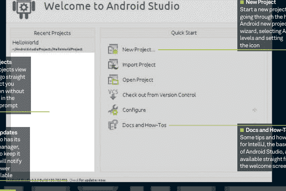

- `**最近的项目**`

  最近项目视图允许你直接进入想要处理的任何项目，而无需在“打开项目”提示中查找

- `**检查更新**`

  `Android Studio` 有自己的更新管理器，允许你保持其最新状态。当有新版本可用时，它会通知你

- `**新建项目**`

  通过便捷的 `Android` 新建项目向导开始新项目，选择 `API` 级别并设置图标

- `**文档和操作指南**`

  欢迎界面直接提供了一些关于 `Android Studio` 基础 `IntelliJ` 的技巧和操作指南

#### 安装


**01 下载**

转到 `Android` 开发者网站，从这里获取 `Android Studio` 早期访问预览版的副本：`bit.ly/1bWFxz`

然后你需要解压内容——将其放在你容易访问的文件夹中，因为你需要从该文件夹运行 `Studio`。


**02 运行时**

在终端中使用 `cd` 导航到你刚刚创建的文件夹，特别是 `android-studio/bin/` 目录。要启动 `Android Studio`，在终端中输入：`$ ./studio.sh`

如果它询问你的 `Java` 设置，暂时按 `Enter`，因为如果以后成为问题，我们可以修复它。


**03 首次运行**

如果你第一次使用 `Android Studio`，可以安全地忽略导入任何设置的提示。否则，找到你之前创建的文件或旧安装文件夹，以获取以前的设置。我们稍后可以从中导入 `Eclipse`。

## Android Studio

掌握用于 `Android` 开发的新 `IDE`

#### 主要功能

### 开发视图

由于 `Android` 应用的 `Java` 部分分为视觉和功能元素，你可以使用 `XML` 代码的可视化 `WYSIWYG`（所见即所得）编辑器，允许你将按钮、文本和其他 `UI` 元素放置在屏幕的任何位置。文本部分是一个完整的 `IDE`，具有代码导航、调试、语法高亮和智能代码分析器，会警告你已编写代码中任何明显的问题。

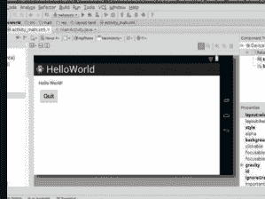

#### 虚拟设备

在你定义的虚拟设备上测试你的应用，通过使用主要 `Nexus` 设备的设置，或通过使用适用于不同尺寸 `Android` 手机或平板电脑的通用设置。你可以编辑系统设置以限制或增加 `RAM`，甚至如果需要，允许它使用系统 `GPU`。它并不完美，但它是快速测试功能性的极好方式。


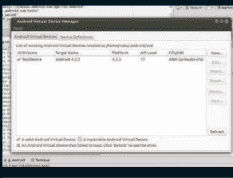

### Eclipse 迁移

对于现有的 Android 开发者来说，从 `Eclipse` 和 `ADT` 迁移到 `Android Studio` 很容易。已经到位的工具可以从 `Eclipse` 导出必要的文件，`Android Studio` 包含一个便捷的功能，允许你然后导入它们，以及任何其他 Studio 文件。这在现在很有帮助，当它替代 `Eclipse` 时将是必不可少的。

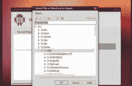

### 调试

特定的调试器可以在代码运行时分析它，并为你提供发生时情况的完整记录，允许你浏览日志并找出任何潜在问题，或确定问题已经发生在哪里。你可以随时暂停程序以隔离问题，而不是在代码继续运行时搜索代码。


#### 有用的快捷键

`Android Studio` 拥有便捷、可配置的键盘快捷键。以下是帮助你入门的最常见列表...

| 操作 | 快捷键 |
| :--- | :--- |
| 命令查找（自动补全命令名称） | `Ctrl` + `Shift` + `A` |
| 项目快速修复 | `Alt` + `Enter` |
| 重新格式化代码 | `Ctrl` + `Alt` + `L` |
| 显示所选 `API` 的文档 | `Ctrl` + `Q` |
| 显示所选方法的参数 | `Ctrl` + `P` |
| 生成方法 | `Alt` + `Insert` |
| 导航打开的标签 | `Alt` + `◄` / `Alt` + `►` |
| 跳转到源码 | `F4` |
| 删除行 | `Ctrl` + `Y` |
| 按符号名称搜索 | `Ctrl` + `Alt` + `Shift` + `N` |
| 构建 | `Ctrl` + `F9` |
| 构建并运行 | `Shift` + `F10` |
| 切换项目可见性 | `Alt` + `1` |

### 常见问题

由于 `Android Studio` 仍在开发中，有一些 bug 仍需解决。以下是 `Android Studio` 的一些已知问题，你可以绕过它们。

**1) 错误：Gradle 项目刷新失败**

`Android Studio` 有一个较新版本的 `Gradle`，存在一些向后兼容性问题。这些可以通过首先从错误对话框点击链接搜索 `build.gradle` 来修复。然后，双击 `build.gradle` 使用下方的行，打开项目的 `build.gradle` 文件。编辑类路径以将 `gradle` 版本更改为 `'0.5.4.'`。最后，保存文件并重新构建你的项目。

**2) 错误：导入 Gradle 项目失败**

在升级 `Android Studio` 后可能会出现此问题，因为项目文件可能指向不再存在的 `SDK` 元素。要修复此问题，你需要快速安装 `Android Support Repository`。首先，打开 `Android SDK 管理器`，找到并展开 `Extras`，并安装 `Android Support Repository`。

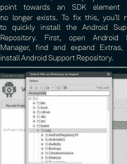

### 迁移

从 `Eclipse` 导出现有项目然后将其导入到 `Android Studio` 非常容易。首先，确保你的 `ADT` 插件是最新的，然后选择文件并导出。从那里打开 `Android` 并选择生成 `Gradle` 文件，然后选择你要导出的项目，点击完成。在基本的 `Android Studio` 窗口中，点击“导入项目”。找到 `build.gradle` 文件，然后在弹出窗口中按 `OK`。然后你应该能够在 `Android Studio` 中开始项目开发。

### 创建新项目

**Android Studio 提供了一种快速启动应用的方式**：名称、软件包名称、主题、高级图标选项以及选择不同 `Android API` 的能力。后者允许你针对特定版本的 `Android` 组装应用，使某些新 `API` 对象可用。我们首先看看基本设置，以便稍后创建我们的 `HelloWorld` 应用。

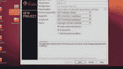

#### 01 创建新项目

从欢迎屏幕点击“创建新项目”打开对话框窗口。将项目命名为 `HelloWorld` – 我们很快就会创建其代码。保留所有其他默认设置 – 它们与能够使用该应用的 `Android` 版本有关。


#### 02 设置图像

在这里你可以设置你的图像，给你一个它在不同类型设备上看起来如何的良好预览。你可以设置填充、背景颜色并移动到应用图标。目前，点击下一步，因为我们不需要示例项目的图标。


#### 03 活动选择器

目前，我们只使用空白活动。在制作其他应用时，这个活动选择器可以帮助你选择应用将如何表现 – 例如全屏或多列流程以查看多个项目。


#### 04 活动名称

在这里你可以命名活动并自定义其工作方式，包括标签、下拉菜单和其他操作。目前，我们将保持原样。点击完成，项目将被构建。这可能需要一点时间。


#### 05 项目结构

`Android Studio` 将为一个简单应用创建大量文件 – 幸运的是我们目前只需关注 `MainActivity.java` 和 `MainActivity.xml`。界面最初也设置为允许 `WYSIWYG` 视觉开发。


#### 06 视图

默认视图是可视化开发界面 – 它包含侧边的元素，允许你拖放功能。你还可以通过点击底部的文本标签直接进入 `Java` 代码，实时预览随你输入更新。

### 开发视图

`Android Studio` 的两个视图服务于不同的目的——以及一个共同的目的。默认的可视化视图允许你将功能拖放到界面上，并带有指南线以确保它们与其他 `UI` 元素对齐。这会将元素添加到代码中，以便你可以进一步在代码中进行编辑。

文本视图就像一个良好的集成开发环境（`IDE`）那样工作，提供代码的层级视图、代码导航工具、自动补全功能以及当然还有正确的语法高亮显示。

无论你使用哪个视图都由你决定——然而，最终在文本视图中你将拥有更多的控制权。


-   **布局和控件**：通过拖放不同的布局和功能来以可视化方式创建你的应用程序——这是新手入门的绝佳方式。
-   **实时预览**：即使在使用文本模式时，也能看到应用程序外观的实时预览。
-   **工具栏**：快速访问预览和调试工具，并允许更改主题、活动类型和设备预览。
-   **组件树**：即使在可视化视图中，你也可以分解各个组件中的代码，以了解它们如何工作。

### 有用的资源

有很多在线资源可以帮助你进行开发——无论是你需要想出一种更优雅的方法来创建特定功能，还是需要处理一些 bug。以下是一些你应该访问的地方列表。

-   **Android 开发者网站** – `developer.android.com`
    除了获取 `Android Studio` 的地方外，开发者网站还有关于有趣项目、`SDK` 更新以及一些故障排除技巧的定期文章。
-   **Stack Overflow** – `stackoverflow.com`
    互联网上获取问题建议的最佳地点之一——可以通过搜索相关问题或提交你自己的问题。
-   **IntelliJ IDEA 支持** – `intellij-support.jetbrains.com/home`
    `IntelliJ IDEA` 的支持，它是 `Android Studio` 的基础。有些支持问题可能更适合 `IntelliJ` 那一侧的内容。
-   **XDA 开发者** – `www.xda-developers.com/`
    围绕智能手机开发建立的社区，`XDA` 论坛是了解 `Android` 特定提示和工具的好方法，甚至可以用来推广你的应用程序。

## 功能：Android Studio

### 创建你的第一个应用程序

在 `Android Studio` 中创建你的第一个应用程序很容易，我们将以最简单的那个开始——经典的 *Hello World*。


所有基础应用程序在创建时，内部已经显示了 `Hello World`——我们要在这里学习的是如何简单地制作 `Android` 中的 `Hello World`，以及我们还能在其中完成的其他简单任务。

#### 01 可视化操作

要以可视化方式完成，只需选择 `Plain TextView`，并将其放置在显示界面上。双击它并输入 `'Hello World!'`。所有静态文本都可以这样放置到界面上，并且它也会在文本视图中创建必要的代码。

#### 02 相对文本

相对布局默认应包含在代码中。通过打开尖括号创建一个文本参数：`<>TextView` ...我们将用它来显示 `'Hello World!'`

#### 03 Hello 代码

为了在 `Text` 参数中添加 `'Hello World'`，我们放入：

```
android:layout_width="wrap_content"
android:layout_height="wrap_content"
android:text="Hello World!"
android:id="@+id/textView"/>
```

布局变量也可以设置为固定的像素宽度/高度。

#### 04 退出按钮

我们现在编辑的文件只是显示界面。要执行某些操作，我们需要开始编辑 `java` 文件。在我们继续之前，当我们在 `.xml` 文件中时，放置一个按钮并给它标题 `'Quit'`。从 `Projects` 列中打开 `MainActivity.java`。

#### 05 导入

现在在代码顶部添加这些导入：

```
import android.view.Menu;
import android.view.View;
import android.view.View.OnClickListener;
import android.widget.Button;
```

#### 06 代码操作

在 `setContentView(R.layout.activity_main);` 行下方添加以下代码：

```
Button button = (Button) findViewById(R.id.button)
button.setOnClickListener(new OnClickListener() {
    @Override
    public void onClick(View v) {
        finish();
        System.exit(0);
    }
});
```

这允许我们使用一些额外的 `Android` 功能来按下并使用退出按钮。

#### 代码列表

-   `包名`：根据 `Android` 系统，你的包的名称。
-   `导入函数`：导入我们在 `Android` 设备上运行代码所需的各种函数。
-   `MainActivity` 类：`MainActivity` 类包含我们在创建的主活动中包含的所有函数。
-   `主布局`：这设置主布局，并显示它。
-   `退出按钮`：包含代码的片段，确保我们的按钮（`id` 为 `button`）使用 `System.exit` 正确退出应用程序。
-   `设置菜单`：这创建出现在应用程序顶部的 `Android` 设置菜单。

```java
package com.linuxuser.helloworld;

import android.os.Bundle;
import android.app.Activity;
import android.view.Menu;
import android.view.View;
import android.view.View.OnClickListener;
import android.widget.Button;

public class MainActivity extends Activity {

    @Override
    public void onCreate(Bundle savedInstanceState) {
        super.onCreate(savedInstanceState);
        setContentView(R.layout.activity_main);

        Button button = (Button) findViewById(R.id.button);
        button.setOnClickListener(new OnClickListener() {
            @Override
            public void onClick(View v) {
                finish();
                System.exit(0);
            }
        });
    }

    @Override
    public boolean onCreateOptionsMenu(Menu menu) {
        // Inflate the menu; this adds items to the action bar if
        // it is present.
        getMenuInflater().inflate(R.menu.main, menu);
        return true;
    }
}
```

## `Android Studio`

掌握用于 `Android` 开发的新 `IDE`

### 使用虚拟设备

创建一个虚拟 `Android` 设备来测试和调试你的 `Android` 应用程序，你可以从一系列通用手机和平板电脑中选择。

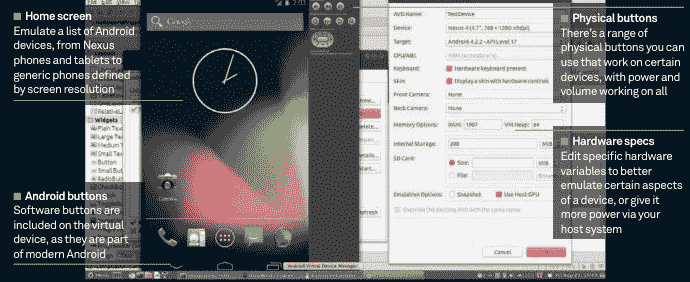

-   `主屏幕`：模拟一系列 `Android` 设备，从 `Nexus` 手机和平板到由屏幕分辨率定义的通用手机。
-   `Android` 按钮：虚拟设备包含软件按钮，因为它们是现代 `Android` 的一部分。
-   `物理按钮`：有一系列你可以在特定设备上使用的物理按钮，其中电源和音量键在所有设备上都可以使用。
-   `硬件规格`：编辑特定的硬件变量以更好地模拟设备的某些方面，或通过你的宿主系统赋予它更多性能。


#### 01 虚拟设备管理器

从 `Project View` 中，沿顶部找到 `Android` 虚拟设备 (`AVD`) 管理器图标并单击它。从这里你可以创建和编辑一系列设备以测试你的应用程序。单击 `New` 以便我们可以开始。

#### 02 新设备

在弹出的对话框中，命名虚拟设备，选择你要模拟的设备，然后选择目标 `API` 级别。某些设备将有最低的 `Android` 版本目标。你可以稍后编辑此设置，但对于我们的应用程序，我们不需要更改任何其他设置。

#### 03 虚拟现实

单击 `OK`，`Android Studio` 将确认你正在使用的选项。选中设备后按 `Start`，并选择你是否想要像素精确的屏幕或缩放版本。然后它将启动你可以测试的虚拟手机或平板。

### 调试

`Android Studio` 包含用于调试你创建的应用程序的工具。要使用它们，首先确保有一个设备正在运行以模拟应用程序。然后，点击调试按钮——形状像一只绿色的虫子——文件将在设备上重新构建并启动。不过这一次，它将打开一个完整的日志窗口、控制台和一个带有完整工具的调试器，以找出问题可能出现在你的应用程序中的哪里。


- 使用 `Android Studio` 的调试工具来分析你的代码。

### 快！立即订购

`树莓派 4` 发行版即时启动 `DVD`

`www.linuxuser.co.uk`

### `Linux` 用户与开发者

面向 `GNU` 世代的月刊杂志

#### 树莓派遇到了对手吗？

一篇全新改版的大篇幅树莓派评测，以及针对 16 款英特尔处理器最新的视频与速度测试

- 使用 `Unison` 同步文件：快速可靠地保持文件同步的方法。
- `WordPress` 的另一半：共同创始人马克·利特尔的故事
- 为 `XBMC` 构建扩展：学习如何构建自己的扩展
- 创意：在 `GIMP` 中创建自定义图标的快速指南
- 闪电技巧：在树莓派上使用 `Python`，配合 `PyQt`
- `QStudio Android` 大师课：掌握一个假 `IDE`……它绝不会失败！
- 创意：`Love2D` 实用指南
- 闪电技巧：在树莓派上使用 `Python`，配合 `PyQt`

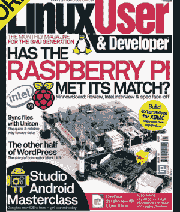

### 极好的订阅优惠

#### 立即订阅，前三期仅需 5 英镑（节省 13.00 英镑）


- 后续每期仅需支付 4.19 英镑 – 比商店价格节省 30%
- 英国境内免费送货上门
- 不再错过任何一期
- 退款保证

##### 条款与细则

此优惠使英国新的直接借记订阅者能够以 5 英镑的价格获得前三期。在这些期数之后，订阅者每六期需支付 25.15 英镑。订阅者可以随时取消此订阅。新订阅将从下一期可用杂志开始。要获得此特别订阅价格，必须引用优惠代码`PGG1340`。直接借记保证的细节可应要求提供。优惠于 2014 年 3 月 31 日截止。`Imagine Publishing` 保留将此类型的优惠限制为每户一份的权利。

源代码`PGG1340`

网址: `www.imaginesubs.co.uk/ud`

电话: 0844 249 0282

### Linux 用户与开发者 订阅券

是的！我希望订阅 Linux 用户与开发者

#### 您的详细信息

- 称谓
- 名字
- 姓氏
- 地址
- 邮政编码
- 国家
- 电话号码
- 手机号码
- 电子邮件地址

请完善您的电子邮件地址，以便接收我们的新闻和特别优惠

#### 直接借记支付

- 英国直接借记支付
- 我将以 5 英镑收到前 3 期。之后每 6 期我将支付 25.15 英镑。


#### 支付详情

您的独家读者价格，一年（13 期）

- 英国：62.40 英镑（节省 20%）
- 欧洲：70.00 英镑
- 全球：80.00 英镑

##### 支票

随附一张金额为 £ 的支票

（抬头注明为 `Imagine Publishing Ltd`）

##### 信用卡/借记卡

- `Visa`
- `MasterCard`
- `Amex`
- `Maestro`
- 卡号
- 有效期
- 发行号（如果是 `Maestro`）
- 签名
- 日期

代码: `PGG1340`

如果您不希望通过邮寄或电话方式接收来自 `Imagine Publishing Ltd` 的任何促销材料，请勾选。我不想。

如果您不希望通过邮寄方式接收来自其他公司的任何促销材料，请勾选。我不想。

通过电话。我不想。

如果您不希望通过电子邮件方式接收我们的任何信息，请勾选。我不想。

条款与细则适用。我们每年出版 13 期，您的订阅将从下一期可用杂志开始，除非另有说明。直接借记保证细节可应要求提供。此优惠将无预告截止。我希望我的订阅从第 期开始。

#### 请将此订单表寄回至：

`Linux 用户与开发者` 订阅部，800 Gilliard Avenue, Kent Science Park, Sittingbourne, ME9 8GU 或发送邮件至 `ful@servechiprint.co.uk`

您可以在线 `www.imaginesubs.co.uk` 查看您的订阅详情

### 仅需 5 英镑购买 3 期 LINUX USER


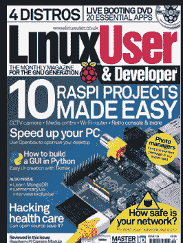

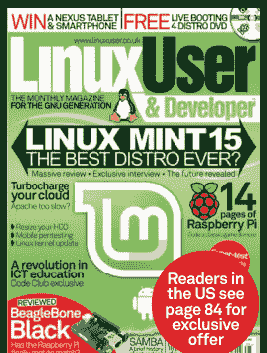

#### 前 3 期仅需 5 英镑，之后比商店价格节省 30%

##### 三种简单的订阅方式

- 在线
  - `www.imaginesubs.co.uk/lud`
  - 并输入`PGG1340`

- 电话
  - 0844 2490282
  - 并引用`PGG1340`

- 邮寄或电子邮件
  - 请填写并将表格邮寄至：
    - `Linux 用户与开发者`
    - 订阅部
    - 800 Gilliard Avenue
    - Kent Science Park
    - Sittingbourne
    - ME9 8GU
  - 或者，您可以扫描表格并发送至`lud@servicehelp.co.uk`

## 教程

### 使用 LibreOffice 创建小型企业数据库

`phpMyAdmin` 为创建和维护 `MySQL` 数据库提供了基于 Web 的前端。

数据输入通过 `Base`（我们数据库的前端）中一个易于使用的表单来完成。

实际的数据库设计（字段、表单布局等）全部在 `Base` 内部完成。

使用 `Calc`（电子表格模块）可以在 `LibreOffice Base` 中导入和导出数据。这使得可以访问大多数常见的数据格式。


### 使用 LibreOffice 创建小型企业数据库

创建一个结合了使用 `LibreOffice` 的基于表单的易用前端和便携式网络化 `MySQL` 后端的数据库。

#### 顾问

`Michael Reed` 是一位科技作家，他挖掘 `Linux` 已超过 15 年。他专门从事桌面 `Linux` 解决方案。

#### 资源

- `LibreOffice`: [www.libreoffice.org](http://www.libreoffice.org)
- 至少一台 `Ubuntu Linux` PC

我们将向您展示如何组装一个典型的小型商业用数据库：一个客户详细信息数据库。通过利用 `Calc`（`LibreOffice` 的电子表格模块），将可以从标准格式中导入和导出联系人数据。我们将使用 `Grain` 合约作为源，但您可以使用任何可以导出 `CSV` 文件的软件——几乎都可以。

我们添加了一些变化以保持趣味性。此项目使用 `LibreOffice` 的 `Base` 模块作为前端，这提供了用于设置数据库、创建数据输入表单以及实际数据输入工作的 `GUI`。对于后端，我们将使用工业标准的 `MySQL`。这允许我们将后端位于中央服务器上。进而允许多个用户访问数据库。

对于 `MySQL` 数据库的初始创建，我们将使用 `phpMyAdmin`。尽管实际的数据库设计将在 `Base` 内部进行，但得益于其友好的 Web 界面。项目结束时，您将拥有一个用于浏览和编辑数据库的 `GUI` 系统，以及一个可移植的网络化后端。

### 使用 LibreOffice 创建小型企业数据库

使用 `LibreOffice` 和 `MySQL` 创建客户数据库。

**教程**


#### 01 安装 LibreOffice

在撰写本文时，主要的 `Linux` 发行版尚未过渡到 `LibreOffice 4`，仍提供 3.x 版本。这意味着您可能需要手动安装 `LibreOffice 4`。访问 `LibreOffice` 网站 (www.libreoffice.org) 并按照说明操作。在 `Ubuntu` 上，这包括解包存档并对内容运行：

```
sudo dpkg -i *.deb
```


#### 02 安装 Apache Web 服务器

我们将较早地安装 `Apache`，并使用其自己的命令，因为某些其他包需要能够配置一个可用的 `Apache` 安装。使用：

```
sudo apt-get install apache2
```

执行安装。通过导航 Web 浏览器到 `http://localhost` 进行测试。


#### 03 安装 Java 和附加类

`Base` 和 `MySQL` 之间的连接使用了 `Java` 类。输入：

```
sudo apt-get install default-jdk
```

以安装 `Java` 运行时。输入：

```
sudo apt-get install libmysql-java
```

以安装所需的附加 `Java` 类。

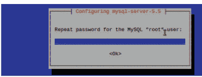

#### 04 安装 MySQL 服务器

输入：

```
sudo apt-get install mysql-server
```

开始安装。很快，您会被提示设置 `root MySQL` 密码。请注意，这与系统的管理员帐户不同，后者也称为 '`root`'。选择一个密码并记录下来。

#### 05 安装并测试 phpMyAdmin

输入：

```
sudo apt-get install phpmyadmin
```

开始安装。当提示选择 Web 服务器时，选择 `Apache2`，用空格键选中它并按回车。当要求时，提供 `MySQL root` 密码，然后为 `phpMyAdmin` 选择一个密码并记录下来。导航到 `http://localhost/phpmyadmin/` 应该会带您进入一个可用的登录页面。使用 `MySQL root` 用户名和密码登录。我们将使用 `MySQL` 来设置和维护实际的数据库，尽管我们稍后将在 `LibreOffice` 内部创建字段。


#### 06 创建数据库


在`phpMyAdmin` Web界面中，选择`Databases`（数据库）选项卡。现在通过输入名称`customer`到文本框中并点击`Create`（创建）来创建一个新数据库。此数据库将包含我们的客户数据。


#### 07 在 LibreOffice 中添加 JDBC

我们现在需要告诉`LibreOffice`在哪里找到`JDBC`类文件。启动`LibreOffice`，转到`LibreOfficeOptionsAdvanced`，在`Java Options`（Java 选项）部分，选择`Class Path`（类路径）然后`Add Archive`（添加存档）。您需要的文件位于：`/usr/share/java/mysql-connector-java.jar`。选择它并重启`LibreOffice`。


## 教程

### 使用 LibreOffice 创建小型商业数据库

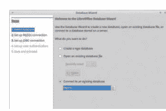

#### 08 连接数据库

现在我们需要将前端（`LibreOffice`）连接到数据库的后端（`MySQL`）。启动`LibreOffice`并打开`Base`模块。在弹出的对话框中，选择“连接到现有数据库”。从该选项下方的下拉菜单中，选择`MySQL`作为数据库类型。


#### 09 配置 Base

在下一页中，选择“使用`JDBC`连接”。在下一页中，点击“测试类”以确保`Java RT`正常工作。现在输入我们创建的数据库名称`customer`，并在服务器字段中输入`localhost`。在下一页中，添加`Root`作为用户名，并勾选“需要密码”。现在点击“测试连接”按钮，当系统提示时输入`root`的`MySQL`密码，以测试`LibreOffice`与本地`MySQL`服务器之间的连接。假设该过程顺利完成且无错误，点击“下一步”。


#### 10 保存数据库

在下一页中，您可以接受默认设置，因此点击“完成”。在系统提示时，给数据库命名并保存它。请记住，该文件包含访问我们`MySQL`数据库的连接信息——它并不包含实际记录。


#### 11 从模板创建字段

您可能希望为客户记录创建一组自定义字段，但为了节省时间，我们将使用`Base`内置的模板之一。从侧边菜单中选择“表”，然后选择“使用向导创建表”。使用“示例表”下拉菜单，选择`Customers`。使用`>>`按钮将它们全部复制过来。在下一页中，您可以微调已包含的字段并添加新字段。在后两页中选择默认设置，然后点击“完成”。

> 请记住，该文件包含访问我们 MySQL 数据库的连接信息——它并不包含实际记录

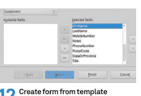

#### 12 从模板创建表单

从侧边栏中选择“表单”。在“任务”窗口中点击“使用向导创建表单”。在表向导中，点击`>>`符号以复制数据库中的所有字段。


#### 13 最终确定表单

在第 2、3 和 4 部分中接受默认设置，但在第 5 部分“排列控件”中选择第一个排列图标。此时，您应该能在主窗口中看到输入表单的预览。在其他部分中选择默认设置，然后点击“完成”。


#### 14 测试数据输入

要将数据输入到数据库中，请使用我们创建的表单。在侧边栏中选择“表单”，然后在主窗口中双击表单名称。这将调出`GUI`记录编辑界面。在主窗口中右键点击表单名称，仍然可以对其进行微调和编辑。

#### 15 从 Gmail 导出联系人

使用左上角`Gmail`标志下方的下拉菜单，从`Gmail`联系人视图切换。在此处，点击“... 更多”图标下拉菜单并选择“导出...”。点击“导出”。

#### 16 清理数据并创建键

新建一个电子表格，并打开您从`Gmail`导出的`CSV`文件。使用`Ctrl`+鼠标滚轮/缩放功能获取概览。通常，许多字段将完全为空，因此选中这些列（点击窗口顶部的列字母）并删除它们（编辑 > 删除单元格）。我们必须为每条记录创建一个键。将一列标记为`ID`。选中该列的第一个单元格，然后通过`Shift`+点击选中最后一个单元格。使用填充功能（编辑 > 填充 > 序列）。


#### 17 将数据导入 Base

当电子表格清理完毕后，通过点击左上角单元格，然后`Shift`+点击右下角单元格来选中数据（包括列标题）。右键点击并选择“复制”。在`Base`模块的侧边菜单中选择“表”。在此处，右键点击`customers`表并点击“粘贴”。这应该会调出导入向导。选择“追加数据”和“使用第一行作为列名”选项，然后点击“下一步”。


#### 18 对齐字段

我们导入数据的字段名称与数据库的字段名称不完全匹配，因此我们需要使用向导的第二页来使它们对齐。为此，点击一个字段名称，并使用另一个列表中的向上和向下图标创建正确的关联。然后点击“创建”。


#### 19 创建新的数据库用户

要从多台机器访问数据库，您必须创建额外的用户。重新登录`phpMyAdmin`，点击“用户”选项卡并选择“添加用户”。在此处，创建一个具有您自定义名称和密码的新用户，并记下它。在“全局权限”部分点击“检查所有”。


#### 20 重新分发数据库

在`Base`模块中，以新名称重新保存数据库。在这个新版本的文件中，我们需要更改一些细节。选择“编辑 > 数据库属性”，并输入新数据库用户的名称。点击“高级设置”选项卡，并输入拥有`MySQL`数据库的机器的`IP`地址。


## 教程

### 使用 LyX 编写 LaTeX 文档

- 工具栏为您提供列表、图像、表格和数学公式等项目的快捷方式
- 您随时可以看到文档的实际`LaTeX`源代码长什么样。在`LyX`中没有任何内容对您隐藏
- 主窗口是您输入文本的地方。这也是您的文本渲染显示的地方
- 您可以将其渲染为`PDF`文件来查看文档的呈现效果。在编辑后别忘了刷新它


### 使用 LyX 编写 LaTeX 文档

`LyX`让您无需应对`LaTeX`陡峭的学习曲线即可撰写文档。方法如下……

**顾问**

`Joey Bernard` 作为一个真正的文艺复兴式人物，他在制作家具、帮助研究人员解决科学计算问题以及编写`Android`应用之间分配他的时间。当然，前提是孩子们允许他拥有这段时间


#### 资源

- `LyX`: `www.lyx.org`
- `LaTeX`: `www.latex-project.org`

`LaTeX` 是一种排版系统，让您完全控制文档中所有内容的渲染方式。问题在于它的学习曲线非常陡峭。一种选择是使用基本文本编辑器并学习文档所需的所有标记。另一种选择是使用某种程度封装了标记的应用程序。`LyX` 在这方面做得非常好。虽然 `LaTeX` 的全所见即所得编辑器没有意义（因为您的文档在发送到输出设备之前不会被完全渲染），但 `LyX` 确实提供了一个伪 `WYSIWYG` 界面，让您可以看到不同区域将如何渲染。


在本教程中，您将学习如何创建新文档并创建各种内容部分，如图像、表格和列表。您还将学习如何使用各种文档设置（如文档类）来控制文档渲染期间使用的整体选项。由于 `LaTeX` 是排版系统，`LyX` 允许您输出到多种格式，如 `PDF`、`Postscript`、`HTML`、纯文本和 `OpenDocument` 文件。无论您是在写书、期刊文章还是一套演示幻灯片，`LyX` 都将帮助您以最少的问题完成工作。

## 使用 `LyX` 编写 `LaTeX` 文档

使用 `LyX` 轻松排版您的 `LaTeX` 文档


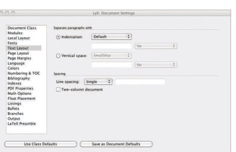

### 01 安装

第一步是在您的系统上安装 `LyX`。大多数发行版都应该有可用的软件包。对于非 `Linux` 用户，也有适用于 `Windows`、`Mac OS X` 甚至 `OS/2` 和 `Haiku` 的二进制文件。一如既往，在最坏的情况下，您可以下载源代码并从头开始构建。


### 02 新建文档

首次启动 `LyX` 时，主窗口会打开并显示一幅启动画面。实际上，在您开始写作之前，必须告诉 `LyX` 您想要新建一个文档。您可以通过点击菜单项 `File->New` 来新建文档。


### 03 设置文档类

您的文档的许多排版属性是根据文档类设置为默认值的。您可以通过点击菜单项 `Document->Settings` 来设置。这将弹出一个对话框窗口，用于接下来的几个步骤。下拉列表将为您提供一份非常完整的可用文档类列表。

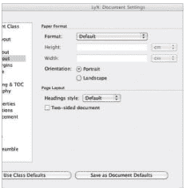

### 04 文本布局

虽然文档类设置了文档的默认值，但您仍然拥有完全控制权来更改文档中的任何内容。“Text Layout”（文本布局）选项允许您将缩进大小更改为自定义增量。垂直间距和行距也可以自定义。您还可以在此处选择将文档设置为双栏格式。

### 05 页面布局

`LaTeX` 根据页面布局来确定文档的实际渲染方式。您可以选择几种标准页面格式之一，或设置自定义页面大小。您可以设置页面是纵向还是横向方向。

### 06 编号和目录

文档被分解为几个嵌套的子区域。这些区域在布局中的处理方式由文档类决定。您还可以设置这些区域是否编号，以及它们是否显示在生成的目录中。

### 07 查看源代码

现在您的文档已经设置好，您可以开始输入了。`LyX` 为您提供了文本的伪 WYSIWYG 视图。但 `LaTeX` 是一种纯基于文本的标记语言，因此您始终可以查看实际源代码以验证 `LyX` 正在文档中写入什么。要查看源代码，只需点击菜单项 `View->View Source`。


### 08 标题

您的文档需要的第一个元素是标题。在 `LaTeX` 中，您需要关心特定文本应该是什么，而不是它看起来像什么。因此，在此阶段，您可以输入标题文本。为了将其识别为标题，您可以点击工具栏右上角的下拉框并选择 `Title`（标题）。


### 09 作者

按下 `Enter` 键会生成一个新行，类型重置为 `Standard`（标准）。您可以在此处输入您的姓名，并再次使用工具栏右上角的下拉框将类型设置为 `Author`（作者）。其渲染位置和方式取决于文档类和输出格式。

### 10 日期

您应该注意到下拉框中有一个日期选项。如果您不想使用，则无需使用。当您实际将文档渲染为输出格式时，`LyX` 会自动添加当前日期。


### 11 摘要

如果您正在撰写文章或报告，可能需要包含所涵盖主题的摘要。如果您已经写好了摘要，可以用鼠标选中该区域，并从下拉框中选择‘`Abstract`’（摘要）。这将添加标题‘`Abstract`’并更改文本格式。


### 12 章节

在大多数文档中，您可能希望将文本分解为章节，可能还有子章节。章节通过赋予其标题来定义。例如，如果您的第一个章节是引言，那么您可以将章节标题输入为‘`Introduction`’（引言），并将下拉框中的类型设置为 `Section`（章节）。该章节的实际文本应设置为 `Standard`（标准）类型。


### 13 数学公式

数学公式在文档排版中始终是一个难题。许多科学领域的人最初转向 `LaTeX` 是因为能够完全控制方程式，通过显式布局所有元素来实现。然而，对于更复杂的方程式，这仍然可能令人困惑。因此 `LyX` 提供了方程式编写工具，帮助您创建在文档中布局公式所需的 `LaTeX`。您可以将数学类型设置为与文本内联，或者居中并单独显示。

### 14 列表

有多种不同类型的列表供您使用。编号列表和非编号列表均作为主工具栏上的按钮提供。要开始列表，点击其中一个按钮并开始输入第一项。按下 `Enter` 键将生成一个新项供输入。在空项上按 `Enter` 将退出列表部分。

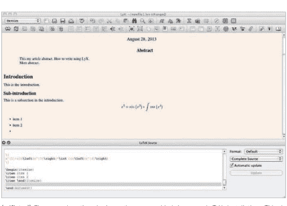

### 15 表格

您可以通过点击菜单项 `Insert>Table` 来添加表格。将出现一个对话框，您可以在其中设置行数和列数。第一行被保留为列标题，但您可以更改 `LaTeX` 源代码中的设置。


### 16 图像

点击菜单项 `Insert>Graphics` 会打开一个对话框窗口，您可以在其中选择要插入文档的图像文件。您可以设置缩放因子，或为其显示设置明确的宽度和高度。您还可以通过 `X` 度旋转图像。您还可以选择控制图像是否以及如何裁剪到边界框内。

### 17 预览

现在您的文档中包含大量内容，您可能希望大致了解其完全渲染后的样子。您可以通过点击菜单项 `View>View` 让 `LyX` 生成 `PDF` 以供查看 `pdflatex`。如果您希望使用其他方法渲染文档，还有其他查看选项。


### 18 拼写检查

大多数人需要帮助来确保所有拼写都正确。如果您想使用系统默认的拼写检查引擎，只需点击菜单项 `Tools>Spellchecker` 即可。您可以通过在选项窗口中选择来更改使用的引擎。

### 19 字体

`Linux` 用户在处理字体时传统上存在问题。这也适用于像 `LaTeX` 这样的应用程序。`LyX` 包含帮助您正确设置 `TrueType` 字体的选项，允许您使用 `LaTeX` 安装中未提供的字体。这在文档设置对话框中定义，您可以在其中设置为罗马体、无衬线体和打字机体要使用的字体族、编码和字体。

### 20 输出格式

现在您的文档已完成，您希望将其渲染为某种最终输出格式。常见的选择是 `PostScript` 或 `PDF`。这样，无论您将其交给谁，您都知道它的样子会保持一致。但您还有其他几种可用的选项。您可以输出为 `HTML`、富文本、纯文本甚至 `OpenDocument`。


## 教程

### 使用 `Unison` 同步你的文件

`Unison` 用于在计算机之间同步文件——在这里我们使用的是该工具的命令行版本。此行指示 `Unison` 目前没有任何需要同步的内容，因为没有任何文件发生更改。此错误消息显示存在一个需要手动删除的锁文件。

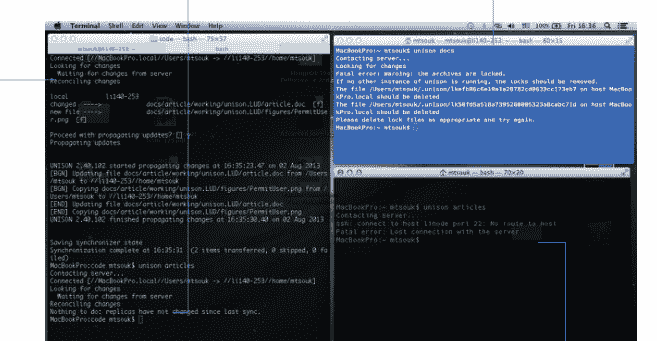

### 使用 `Unison` 同步你的文件

学习如何使用 `Unison` 命令行工具快速且可靠地在计算机之间同步文件。

网络连接中断，因此 `Unison` 无法同步文件。

#### 顾问


Mihalis Tsoukalos 拥有超过 15 年的 UNIX 系统管理和编程经验，并自 1993 年起开始使用 Linux。他还精通 Oracle 数据库管理、Cisco、iOS、Google 和 DOS 编程。他总是在学习新事物。

## 资源

- Unison：[www.cs.upenn.edu/~bcpierce/unison](http://www.cs.upenn.edu/~bcpierce/unison)
- 两台联网的 UNIX 机器

Unison 是一款开源的文件同步工具，支持文本和二进制文件。它也有图形用户界面，但这里我们只关注命令行版本，因为它更快捷，并能干净利落地完成任务。当你使用多台计算机并且需要在这几台计算机之间进行同步时，Unison 的真正能力才会显现出来。

Benjamin C. Pierce 领导了宾夕法尼亚大学 Unison 的创建工作，它最初是一个研究项目。它可以通过 SSH 服务使用，并且在 UNIX（如 Linux、Mac OS X 等）和 Windows 机器上同样运行良好。

显然，Unison 受到了 rsync 实用程序的启发。Unison 与 rsync 的区别在于，后者是一个镜像工具，需要提前知道要保留的文件版本位于何处；而 Unison 是一个同步工具，它识别自上次同步过程以来已更改的文件，并决定如何传播这些更改。简而言之，它很智能。

## 01 安装 Unison

大多数 Linux 发行版都已将 Unison 打包为可直接安装的程序，因此你无需自行编译。截稿时，Unison 的当前稳定版本为 `2.49.102`。请注意，参与同步过程的每台机器都必须安装 Unison 的命令行版本。此外，该 Unison 副本应位于默认 `PATH` shell 变量中的其中一个目录内。假设你正在使用基于 Debian 的系统，只需输入：

```
sudo apt-get install unison
```

要查看你正在使用的 Unison 版本，只需输入以下命令：

```
unison -version
```

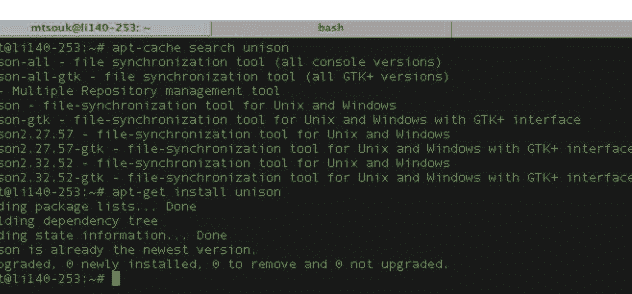

## 02 Unison 配置文件

Unison 可以在不使用任何配置文件（profile）的情况下从命令行运行，但使用配置文件可以大大简化其使用，因为拥有配置文件并不会阻止你添加额外的命令行选项（尽管本文不会过多讨论此类选项）。

在罕见的情况下，如果你在使用 Unison 时遇到麻烦，你可以使用 `-debug all` 命令行选项运行它，以便更好地跟踪和解决错误。

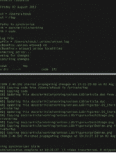

## 03 同步同一台计算机上的文件

虽然 Unison 最初是专为同步位于不同机器上的文件而开发的，但你可以通过以下两种方法之一来同步位于同一台计算机上的文件：

- 使用 `localhost` 作为远程机器名称。
- 为两个 `root =` 行仅使用本地目录路径。

你的顾问更喜欢第二种方式，因为它不需要 SSH 服务器处于运行状态。Unison 配置文件名为 `localFiles.prf`，位于 `~/.unison` 目录内。以下两行用于在同一台机器上工作，因为它们不包含远程机器：

```
root = /Users/mtsouk
root = /tmp
```

## 04 与另一台计算机同步文件

假设有一个名为 `articles.prf` 的配置文件，位于 `~/.unison` 目录内，你可以通过执行以下命令告诉 Unison 使用它：

```
$ unison articles
```

远程机器声明以 `root = ssh://` 开头。有极少数情况——通常是用户在同步前在两台计算机上都修改了文件——Unison 无法确定文件是在本地还是远程服务器上更改的。在这种情况下，Unison 会礼貌地请求你的帮助，以免错误地使用错误的版本继续操作。


## 05 使用简单的配置文件运行 Unison

关于 Unison 配置文件，你需要知道一些基本事项：

- 默认备份级别为 `2`，这控制保留每个文件多少个先前版本（不包括当前文件版本）。因此，默认备份级别会保留两个文件备份副本。用于设置备份级别的参数称为 `maxbackups`。
- 通过在 Unison 配置文件内不添加任何备份选项，你可以告诉 Unison 不保留文件备份。
- Unison 配置文件支持 Unicode 字符。
- 日志文件选项指示 Unison 在 `.unison` 目录内保留名为 `unison.log` 的日志文件。
- 有时，网络问题会禁止文件同步，但 Unison 的错误消息指明了问题所在：

```
$ unison articles
Contacting server ... 
Connection closed by 109.x.x.y.y.zzz.
Fatal error: Lost connection with the server
```

## 06 解释配置文件

以 `#` 开头的行表示注释，不会进一步处理。必须有两行以 `root =` 开头。它们声明参与同步过程的机器（其中一台始终是本地计算机）以及被视为每台机器根目录的目录。在这些重要声明之后，列出实际要同步的目录。在此示例中，我们只有一个目录（一个 `path =` 行）。其完整路径在本地机器上是 `/Users/mtsouk/docs/article/working`，在名为 `linode` 的机器（`/etc/hosts` 中的 IP 别名）上是 `/home/mtsouk/docs/article/working`。你可以拥有尽可能多的 `path` 条目。除了匹配 `ignore` 选项的文件外，所有文件都会同步。你也可以拥有尽可能多的 `ignore =` 行，并可以在其中使用正则表达式。备份选项指示 Unison 保留所有文件的备份。

```
# Mihalis Tsoukalos
#
# Friday 05 July 2013
#
root = /Users/mtsouk
root = ssh://linode/home/mtsouk

# Paths to synchronize
path = docs/article/working

# Log file
logfile = /Users/mtsouk/.unison/unison.log

# Backup files
backup = Name *
ignore = Name *.DS_Store
ignore = Name .DS_Store
```

## 07 .unison 目录

Unison 的大部分维护工作都在 `.unison` 目录内进行，该目录位于用户的家目录中。Unison 在那里保留以下数据：

- 它的配置文件，包括名为 `default.prf` 的默认配置。
- 它的备份文件，如果你决定使用集中式备份。
- 每个已使用配置的状态文件。
- Unison 日志文件，如果你指示它保留日志。你可以将其放在任何地方，但将其放在那里非常方便。
- Unison 在同步过程中在那里创建锁文件，并在完成后删除它们。
- 注意：不建议同步整个 `.unison` 目录。仅同步配置文件是可以的。

## 08 更高级的 Unison 配置文件

`advanced.prf` 文件的内容如下：

```
root = /Users/mtsouk
root = ssh://linode/home/mtsouk
times = true
batch = true

# Log file
logfile = /Users/mtsouk/.unison/unison.log

# Paths to synchronize
path = code/C

# Backup files
backup = Name *
backuplocation = central
maxbackups = 3
ignore = Name {Thumbs.db}
ignore = Name {.DS_Store}
ignore = Path {Samples.lnk}
```


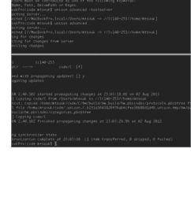

# 使用 Unison 同步文件

使用 Unison 命令行工具在计算机之间同步文件

将本地服务器上 `~/.ssh/id_rsa.pub` 文件的内容复制到远程服务器上的 `~/.ssh/authorized_keys` 文件中。实现方式之一是执行以下命令：

`$ cat ~/.ssh/id_rsa.pub | ssh linode 'cat >> ~/.ssh/authorized_keys'`

下次尝试使用 SSH 登录到远程 Linux 服务器时，您只需输入一次步骤 1 中的密码短语。


从今以后，您只需输入 `ssh linode` 即可登录到远程 Linux 服务器：

```
$ ssh linode
Linux (none) 3.9.3-x86_64-linode33
#1 SMP Mon May 20 10:22:57 EDT 2013
x86_64
. . .
Last login: Wed Jul 31 18:46:23 2013
from ppp-94-64-21-97.home.otenet.gr
mtsouk@ill140-253:~$
```

第一次在不输入密码的情况下登录远程服务器时，屏幕上会显示以下信息性消息：

`Identity added: /Users/mtsouk/.ssh/id_rsa (/Users/mtsouk/.ssh/id_rsa)`

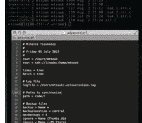

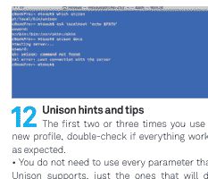

### 09 解释高级配置文件

- `times = true` 行告诉 `Unison` 同步修改时间。

- `maxbackups = 3` 行告诉 `Unison` 保留当前文件版本及其三个备份。

- `backup = Name` 行告诉 `Unison` 备份覆盖文件。

- `backuplocation = central`（默认选项）告诉 `Unison` 将所有备份保存在中央位置。如果未设置 `backupdir` 偏好项或环境变量 `UNISONBACKUPDIR`，则使用 `.unison/backup` 目录作为备份位置。如果设置为 `local`，则所有备份都将保存在与原文件相同的目录中。

- `batch = true` 选项有点棘手，使用时需小心，因为 `Unison` 不会提出任何问题，非冲突的更改将传播，而冲突将被跳过。然而，如果您想将 `Unison` 用作 `cron` 作业，这是一个必要的选项。

- `ignore = Name (._,DS_Store)` 行告诉 `Unison` 不同步以 `.DS_Store` 结尾的文件。

### 10 使用 SSH 而不输入密码

能为您节省最多时间的单一措施是配置 `SSH`，以便每次同步文件和目录时都不需要输入密码。此操作很简单，包含以下三个步骤：

1. 运行 `ssh-keygen -t rsa`

您需要两次输入密码短语，请务必记住该密码短语！将创建两个新文件：`~/.ssh/id_rsa` 和 `~/.ssh/id_rsa.pub`。

2. 如果远程服务器上尚未存在 `.ssh` 目录，您可能需要创建该目录。

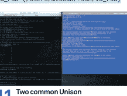

### 11 两种常见的 Unison 故障排除技术

有时事情会未按预期工作。`Unison` 提供许多选项，可以帮助您发现并解决问题。

首先要尝试的选项是 `-testserver` 选项，它仅连接到远程服务器然后退出，而不同步任何文件。

其次要做的是运行以下命令：

```
$ ssh remote.machine.domain 'echo $PATH'
```

上述命令让您看到 `PATH` 是否与您使用 `ssh remote.machine.domain` 登录时相同；如果问题出在 `PATH` 上，请检查 `/etc/ssh/sshd_config` 中 `PermitUserEnvironment` 选项是否设置为‘no’，并将其更改为‘yes’。

### 12 Unison 提示与建议

- 在前两到三次使用新配置文件时，仔细检查是否一切工作正常。

- 您不需要使用 `Unison` 支持的所有参数，只需使用完成您工作所需的参数！

- 您可以使用 `-debug all` 命令行选项来排除 `Unison` 的故障。它将生成大量有助于调试的输出。

- 您使用 `Unison` 越多，就越能理解其实用性。

- 您应该非常小心备份选项，特别是 `maxbackups`，因为它可能会占用计算机上过多的空间。

- 您可以使用 `Unison` 在计算机之间安全地交换文件。

- 如果同步过程中涉及 `Windows` 机器，请注意文件和目录权限。

- 对于非关键数据文件，您可能每天运行一次 `Unison`，但对于关键数据，您应该更频繁地运行它。

- `Unison` 不能替代常规备份！

- 在创建新配置文件时，要么从简单的开始，要么使用现有的作为起始模板。在确保始终拥有一个可工作的配置文件的同时添加额外的功能和特性。

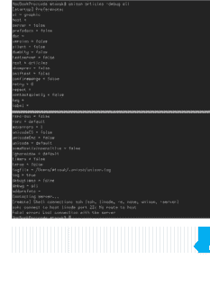

## 教程

这不是硬件黑客操作——备用 `SD` 卡可用于 `Tor` 路由器，其他 `SD` 卡可用于不同功能而不会有任何问题

使用几乎只是一台树莓派（`Raspberry Pi`）的装置，您可以通过启用了 `Tor` 的接入点路由一个或多个系统，从而保证匿名性

几乎在任何有互联网连接的地方都可以接入互联网——亲戚家、酒店房间等

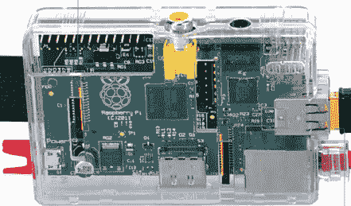

### 使用 Onion Pi 私有浏览

通过无线网络连接所有设备——无需使用电缆直接连接树莓派

将您的树莓派变成一个高度安全且非常便携的路由器，以保护您的系统安全并保持浏览匿名，无论您在何处

#### 顾问

`Rob Zwetsloot` 改造复杂系统，是一名精通 `Python`、`Django` 和 `PHP` 的 Web 开发人员。他喜欢进行计算实验

#### 资源

- **`树莓派 Raspbian`：** `www.raspberrypi.org/downloads`

- **`兼容的 Wi-Fi 适配器`：** `www.adafruit.com/products/814`

我们在第 129 期中向您展示了如何将树莓派变成终极便携式无线路由器，它耗电很少，并在有最基本互联网连接的地方为您创建无线网络。但如果您觉得仅知道可以搜索网络是不够的，怎么办？如果您想在操作时完全安全，怎么办？是时候升级路由器以安装 `Tor` 来保护您的互联网隐私了。

由 `Adafruit` 命名的这个“`Onion Pi`”将 `Raspbian` 和 `Tor` 结合，仅使用树莓派创建并保护一个无线接入点。这个项目相当直接：设置无线接入点后，我们安装 `Tor` 并进行一些基本配置任务，使其正确且安全地路由流量。这将使您在线匿名——在隐私问题遍布网络的时期，这是一个方便的功能。

当树莓派未连接到互联网时，它仍应作为无线路由器运行，至少允许在您的位置创建无线局域网。

### 使用 Onion Pi 私有浏览

### 将您的树莓派变成启用 Tor 的无线路由器

**教程**


#### 01 安装 Raspbian

`Raspbian` 是在 `Onion Pi` 上应使用的树莓派发行版。下载 `zip` 文件，解压镜像，然后使用以下命令将其应用到 `SD` 卡：

```bash
$ dd bs=4M if=[version_number]-wheezy-raspbian.img of=/dev/[SD card location]
```

如果您愿意，也可以使用 `NOOBS` 安装 `Raspbian`。

#### 02 设置 Raspbian

完成初始 `Raspbian` 设置并确保开启 `SSH` 服务器，并禁用自动启动到桌面 - 这是不必要的，只会额外消耗电力。如果有空间，还可以指示其填满卡的剩余部分。

#### 03 PiIP

我们将通过 `SSH` 访问您的树莓派进行设置。为此，我们需要知道其 `IP` 地址 - 您可以通过在命令行中输入 `ifconfig` 来找到它。记下它并关闭您的树莓派。


#### 04 SSH 连接

将 `USB` 无线适配器插入树莓派并重新开启。在另一台连接到同一网络的计算机上，打开终端或在命令行中输入：

```bash
$ ssh [user]@[IP address]
```

然后如果提示输入 `Raspbian` 的密码，请输入密码。

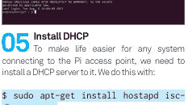

#### 05 安装 DHCP

为了使连接到树莓派接入点的任何系统的生活更轻松，我们需要为其安装 `DHCP` 服务器。我们使用以下命令执行此操作：

```bash
$ sudo apt-get install hostapd isc-dhcp-server
```

`DHCP` 将自动为网络附属设备分配 `IP` 地址，意味着您不需要静态 `IP`。


#### 06 配置 DHCP

现在我们需要配置 `DHCP` 服务器。使用以下命令编辑配置文件：

```bash
$ sudo nano /etc/dhcpd.conf
```


然后在两个 `option domain-name` 条目前面加上 `#`，然后删除七行后 `authoritative` 前面的 `#`。

#### 07 服务器地址

在配置文件末尾，添加以下内容：

```
subnet 192.168.42.0 netmask 255.255.255.0 {
    range 192.168.42.10 192.168.42.50;
    option routers 192.168.42.255;
    default-lease-time 600;
    max-lease-time 7200;
    option domain-name "local";
    option domain-name-servers 8.8.8.8, 8.8.4.4;
}
```

保存并退出。

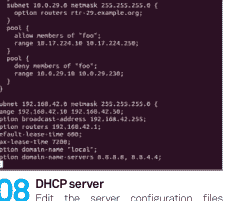

#### 08 DHCP 服务器

编辑服务器配置文件，使其设置为与无线适配器协同工作：

```bash
$ sudo nano /etc/default/isc-dhcp-server
```

滚动到 `INTERFACES` 并将其更改为：

```
INTERFACES="wlan0"
```

47 www.linxuser.co.uk

## 教程

## 使用洋葱Pi隐私浏览

##### 09 接收 Wi-Fi

我们需要将 Wi-Fi 适配器设置为静态，并接收传入信号。首先：

```bash
$ sudo nano /etc/network/interfaces
```

在 `iface wlan0` 和随后的 `wpa roam`、`iface default` 以及任何影响 `wlan0` 的行前加上 `#`。

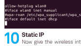

##### 10 静态 IP

现在给无线接口分配一个静态 IP – 在 `allow-hotplug wlan0` 行之后，输入以下内容：

```bash
iface wlan0 inet static

address 192.168.42.1
netmask 255.255.255.0
```

保存并退出，然后使用以下命令设置 `wlan0` 的地址：

```bash
$ sudo ifconfig wlan0 192.168.42.1
```

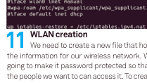

##### 11 WLAN 创建

我们需要创建一个新文件，用于保存无线网络的所有信息。我们将设置密码保护，以便只有我们想允许的人才能访问。要创建文件，请从以下命令开始：

```bash
$ sudo nano /etc/hostapd/hostapd.conf
```

然后输入下一步中的文本。

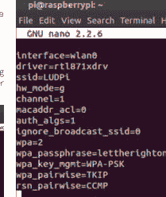

##### 12 WLAN 配置

```ini
interface=wlan0
driver=rtl8171xdrv
ssid=[access point name]
hw_mode=g
channel=1
macaddr_acl=0
auth_algs=1
ignore_broadcast_ssid=0
wpa=2
wpa_passphrase=[password]
wpa_key_mgmt=WPA-PSK
wpa_pairwise=TKIP
rsn_pairwise=CCMP
```

##### 13 Hostapd

保存并退出后，我们需要编辑 `hostapd` 以使其指向这个新文件。使用以下命令打开它：

```bash
$ sudo nano /etc/default/hostapd
```

然后找到 `#DAEMON_CONF=""` 这一行。删除 `#`，并将其更改为：

```ini
DAEMON_CONF="/etc/hostapd/hostapd.conf"
```

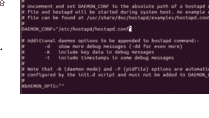

##### 14 网络寻址

设置 NAT 将允许多个客户端连接。为此，请运行：

```bash
$ sudo nano /etc/sysctl.conf
```

并在文件末尾添加：

```ini
net.ipv4.ip_forward=1
```

保存此文件，然后运行以下命令完成：

```bash
$ sudo sh -c "echo 1 > /proc/sys/net/ipv4/ip_forward"
```


##### 15 IP 表

运行以下三个命令以确保互联网连接被正确转发：

```bash
sudo iptables -t nat -A POSTROUTING -o eth0 -j MASQUERADE
sudo iptables -A FORWARD -i eth0 -o wlan0 -m state --state RELATED,ESTABLISHED -j ACCEPT
sudo iptables -A FORWARD -i wlan0 -o eth0 -j ACCEPT
```

##### 16 应用配置

为了让重启后仍然有效，请输入：

```bash
$ sudo sh -c "iptables-save > /etc/iptables.ipv4.nat"
```

然后在 `/etc/network/interfaces` 的末尾添加：

```bash
up iptables-restore < /etc/iptables.ipv4.nat
```


##### 17 Wi-Fi 最后设置

最后，将其设置为守护进程，以便在启动时运行，使用以下命令：

```bash
$ sudo service hostapd start
$ sudo service isc-dhcp-server start
$ sudo update-rc.d hostapd enable
$ sudo update-rc.d isc-dhcp-server enable
```

无线接入点部分就完成了。

##### 18 安装 Tor

重启后，我们现在需要安装 Tor。简单操作如下：

```bash
$ sudo apt-get install tor
```

安装完成后，您需要使用以下命令编辑 Tor 配置文件：

```bash
$ sudo nano /etc/tor/torrc
```

按照下一步向其中添加所有必要信息。

##### 19 Tor 配置

在 FAQ 注释下方添加以下内容：

```ini
Log notice file /var/log/tor/notices.log
VirtualAddrNetwork 10.192.0.0/10
AutoMapHostsSuffixes .onion, .exit
AutomapHostsOnResolve 1

TransPort 9040

ListenAddr 192.168.42.1
DNSPort 53
DNSListenAddress 192.168.42.1
```

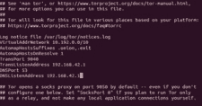

##### 20 表刷新

我们现在需要刷新当前的 IP 表，以便路由可以通过 Tor。首先，执行：

```bash
$ sudo iptables -F
$ sudo iptables -t nat -F
```

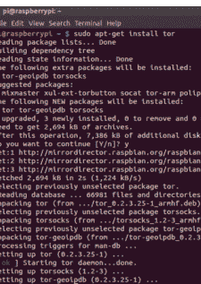

如果您希望保持 SSH 开放以便远程连接，您需要使用以下命令为其创建例外：

```bash
$ sudo iptables -t nat -A PREROUTING -i wlan0 -p tcp -dport 22 -j REDIRECT --to-ports 22
```

##### 21 重路由

首先使用以下命令路由所有 DNS 流量：

```bash
$ sudo iptables -t nat -A PREROUTING -i wlan0 -p udp -dport 53 -j REDIRECT --to-ports 53
```

然后使用以下命令路由任何 TCP 流量：

```bash
$ sudo iptables -t nat -A PREROUTING -i wlan0 -p tcp --syn -j REDIRECT --to-ports 9040
```

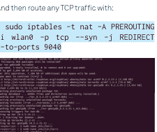

##### 22 检查并保存

您可以使用以下命令检查表设置：

```bash
$ sudo iptables -t nat -L
```


如果您对此感到满意，请像之前一样将其保存到 `NAT` 文件：

```bash
$ sudo sh -c "iptables-save > /etc/iptables.ipv4.nat"
```

##### 23 日志记录

我们应该创建一个日志文件，以备以后调试。使用这三个命令：

```bash
$ sudo touch /var/log/tor/notices.log
$ sudo chown debian-tor /var/log/tor/notices.log
$ sudo chmod 644 /var/log/tor/notices.log
```

您也可以使用以下命令检查它：

```bash
$ ls -l /var/log/tor
```

##### 24 保护路由器

最后，我们可以激活 `Tor` 服务，以便我们可以开始安全地使用接入点：

```bash
$ sudo service tor start
```

如果您愿意，可以用以下方式检查：

```bash
$ sudo service tor status
```

为了使其在启动时开启，您只需将其添加到 `rcd`：

```bash
$ sudo update-rc.d tor enable
```


### 您有不必要的显示器吗？

非洲和拉丁美洲的学校需要 4000 台显示器

-   保证 `WEEE` 合规
-   0% 填埋政策
-   所有法律责任均已涵盖
-   所有 `PC` 的数据均按英国军事标准擦除

www.computeraid.org/donate

020 8361 5540

enquiries@computeraid.org

或在以下地方找到我们……


注册慈善机构编号 1069256 注册公司编号 3442679


`Computer Aid International`

### `Linux` 开发者

#### 构建你自己的 `XBMC` 扩展

用 `Python` 创建附加应用程序

第 56 页

-   `WordPress` 的另一半
    了解共同创作者 `Mark Little` 现在在做什么……
    第 52 页
-   精通 `Vim`
    如果您没有使用 `Vim`，这里有十二个理由让您尝试
    第 62 页

> “如果它不是开源的，如果它不是 `GPL`，就不会有已经为其编写的 20,000 个插件。”
>
> `Mark Little` 谈 `WordPress`


## `WordPress` 的另一半

`WordPress` 成立十年来，已经牢固地在博主们心中确立了其地位。但其联合创始人 `Mike Little` 接下来会做什么？`David Crookes` 来一探究竟……

我们正坐着一辆开往曼彻斯特的电车，一边敲手机更新博客之一，沉浸于文字中，很少去思考使这一切成为可能的底层代码。就在最后几个字写完时，电车停了下来，我们走向前往 `Piccadilly` 车站的自动扶梯，准备去见那个创造了 `WordPress` 这一庞然大物的人，正是我们旅途中一直使用的这个博客平台。

我们的会面地点设在火车站，因为来自 `Stockport` 的 `Mike Little` 是个大忙人。在我们握手之前他已经开完一个会，而且接下来还要开另一个会。我们决定在一家咖啡店坐下，他在告诉我们他最新的创业项目之前拿了一个三明治。鉴于该软件被排名前 1000 万的网站中的 18.9% 使用，他的创业项目与 `WordPress` 密切相关也就不足为奇了。

`Little` 目前正在制作一系列屏幕录制，展示如何使用 `WordPress`，解释其基本原理，以鼓励更多人使用该平台参与博客写作。这是一个缓慢的过程——他说：“编辑一分钟的录像大约需要一小时”——但他正在接近目标。这些屏幕录制的理念是形成一个付费在线课程。“我希望它们比现有的任何课程都更好，所以必须做到位，”他说。“市面上有很多垃圾，有些人只是拍摄他们正在做的事情，里面有很多嗯、啊和回溯。我的屏幕录制不会像那样，人们肯定会觉得物有所值。”

`Little` 还面对面教授班级 `WordPress`，也继续为专业客户制作 `WordPress`。毕竟，如果他不能利用该软件为公司和组织制作出色的网站，那就没有人能做到了。因此，他有机会与唐宁街合作制作政府网站也就顺理成章了。他最自豪的项目是一个名为“我是个科学家，把我弄出去”的儿童科学参与网站，后来衍生出“我是个工程师”。“我真的很喜欢做这些，”他说，并解释了他的整个自由职业

# `WordPress`的另一半

`WordPress`联合创始人`Mark Little`的故事


`Matt Mullenweg`的`WordPress.com`网站由其公司`Automattic`运营

### 小麦克与`Linux`

`Mike Little`是`Linux`的长期用户。“我从早期阶段就迷上了`Linux`，”他回忆道。“我能看出，这种开放性、查看代码的能力、修改[它]的能力……正在造就更好的软件。所以我一直对此充满热情，并坚信这是正确的做法。”

他对`Linux`需要通过`FTP`站点下载并存储在几盘3.5英寸软盘上的日子有着美好的回忆。“我回顾过去……我记得序列内核，也就是可能只有三四个发行版的时候。`Slackware`是其中之一，但我想在早期，像`Debian`那样的发行版甚至还没启动。我记得`Red Hat`的启动，所以我在`Red Hat`之前就接触`Linux`了。”

`Little`曾参与一个名为`DJGPP`的项目，该项目是将`GNU`编译器集合移植到16位`DOS`系统。“这在事后看来是个疯狂的举措，”他承认道，“但它意味着开发人员可以从`DOS`获取开发工具，而无需掏钱。‘我认为那甚至是在我接触万维网之前，当时我有调制解调器，但我要是拨号到公告板……并通过这种方式获取软件，’他解释道。

“然后当我上网后，我只是继续沿着这个方向前进。所以我已经理解了`DJGPP`是这些`GNU`工具的移植版本，所以……我开始查看它们是什么以及我如何使用它们，最终鼓起勇气对我的`Windows`机器进行分区，并在其上启动`Linux`。在此之前，我通常从软盘启动它……但是的，最终我转向了双启动进入`Linux`，并在1998年全职在家使用`Linux`……当我拥有了一台不错的笔记本电脑时，我最初使用`Debian`，但我最近三台笔记本电脑都运行`Ubuntu`。”

自2008年辞去全职工作以来，`Little`的职业生涯一直围绕`WordPress`展开。因此，`WordPress`塑造了他的生活。在交谈的间隙，他向我们讲述了`WordPress`项目的所有事情，几乎没有喘息的间隙，无疑，他为自己在`WordPress`初创阶段所扮演的角色感到自豪。如果有任何怀疑，那么他在我们会面时所穿的时尚`WordPress` `T恤` certainly 打消了这种怀疑。


### 在`WordPress`之前

`Little`自1990年起开始专业编程。他的前六年是在斯托克波特一家名为`Panteik`的工业软件公司度过的，在那里他负责一个六人团队，开发`Visual Basic`应用程序，学习`C++`，并获得了`DOS`、`Windows SDK`、汇编器、`Novell`、`TCP/IP`和`Microsoft`网络方面的经验。离开`Panteik`后，他继续在大曼彻斯特地区的其他软件公司工作，但他也是一名早期的博客作者。他使用了一款名为`b2/cafelog`的软件，该软件由第一位科西嘉博客作者`Michel Valdrighi`编写。围绕该软件形成了一个小型社区，论坛上大约有2000名活跃用户，但当`Valdrighi`消失时，`b2/cafelog`的开发突然停滞不前，留下了一款有几个`bug`、一些安全问题和一个待续费域名的应用程序。

另一位程序员`Matt Mullenweg`也使用`b2/cafelog`，或者更常见的称呼是`b2`，他不仅担心`Valdrighi`的消失，还担心`b2`缺乏开发。他在博客上发表了一篇文章，名为`博客软件的困境`，讨论了他如何开始使用`b2`，主要原因是它是其中最好的，也是他能够发展的东西。`Mike Little`注意到了这篇博客文章并回复，询问`Mullenweg`是否对分叉`b2`感兴趣。`Mullenweg`表示他愿意。两人随后聚集在一起，尽管是远程通过互联网。“我之前和`Matt`通过邮件联系过几次，因为他有一个网站，上面有一个非常棒的图库，我给他发电子邮件询问关于软件的问题，”`Little`回忆道。“我实际上也在`b2`论坛上和他交流过，但我不知道他就是运营图库网站的人。所以当我看到他的`b2`博客文章时，我很感兴趣。事实证明，当时我是唯一回复他帖子的人。”

### 第一版


Mullenweg 和 Little 接管了 `b2` 软件，并开始对其进行处理，修复错误并添加额外功能。然后 Valdrighi 重新出现了。他宣布 Mullenweg 和 Little 的软件是 `b2` 的官方后继者。“原来是他被裁员或类似的事情，不得不放弃他的公寓，回到连互联网都没有的父母那里，等等，”Little 微笑着说。“所以现实生活比一点软件重要得多。”WordPress 就此诞生。

那是 2003 年 1 月。Little 正在学习 `PHP`，他觉得世界是围绕 `b2` 转的，并对它进行修改。“没有软件是完美的，所以这只是我们在思考想要添加到其中的功能，”Little 说。“WordPress 的第一个版本包含了一些我已经为 `b2` 创建的几个额外功能，Matt 也是如此：他有一些为 `b2` 添加的额外功能。我们在论坛上分享了这些内容，并将它们整合到核心产品中。是的，我们从那里开始着手。”

最大的变化之一是引入了页面（Pages），这对 WordPress 产生了巨大影响，使其在当时与竞争对手中脱颖而出。它使 WordPress 成为不仅仅是博客软件。但 Little 说，真正的“杀手级”功能是以钩子（hooks）的形式出现的。“这意味着你可以在不修改代码的情况下为产品编写扩展，这是只有真正大型的成熟软件才做到的事情，比如一些 `Java` 技术栈，”Little 说。“这种实际上改变其行为方式并添加功能而无需接触任何核心文件的能力至关重要。我认为这仍然是对新开发人员来说最难理解其工作方式的地方，但我认为正是这一点让它变得更加简单。”

他说这让软件更新过程变得更加简单。“在此之前，使用像 `Drupal` 或那些工具中的任何工具，每当有更新时，你都有丢失更改的风险，因为你修改了原始文件来调用你的内容或添加别人的内容。你把这些函数调用放在那里。这意味着一旦你得到新版本，如果你只是字面上将新版本 `FTP` 覆盖到旧版本上，你就会丢失你的内容和修改。所以我认为这可能是关键特性之一，我不认为人们一定 appreciate 这一点，因为这些天他们根本看不到这个问题。他们更新 WordPress 或更新插件，哦，这是新版本，什么都没出错。然而在此之前，在更新到新软件之前，你必须保存你修改的那些文件。”

Mullenweg 和 Little 继续开发 WordPress，第一个版本于当年五月发布。


### 用户友好性

Little 和 Mullenweg 将 WordPress 视为一个不断演进的产品。Little 致力于尽其所能消除犯错误的可能性，他认为这是一个关键的进步。“在最初的 `b2` 中，你可能会丢失你的设置，”他说。“但在 WordPress 中，我添加了 `config` 示例 `PHP`，它直接消除了犯错误的可能性。我采用了原始的 `b2` 设置文件，并为它创建了一个选项界面。这是另一种方式，你不需要去摆弄它 - 你不需要知道如何编辑这些文件并通过 `FTP` 将它们上传到你的服务器等等。我认为所有这些细节都使它更容易使用，更不容易搞砸，我认为这些都很有帮助。”

对用户友好的需求始终位于两位开发者的思想前沿。对他们来说，WordPress 像 `b2` 一样是一个开源项目也很重要。他们喜欢 `b2` 在通用公共许可证（`GPL`）下运行，这意味着他们有权获取代码、更改并将其分发给其他人。他们也喜欢它是免费的。“我一直是一个巨大的开源倡导者，”Little 说。“Matt 当时对开源的想法比较陌生，但这正是他选择使用 `b2` 的原因之一。”Little 将 WordPress 的普及归功于其开源性质（“如果它不是开源的，如果不是 `GPL`，就不会有为其编写的 20,000 个插件或 10,000 个主题，”他说），对他来说，他没有直接从 WordPress 中获利这一点并不重要。“没有人从 WordPress 直接获利，”他说。

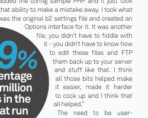

### 汲取灵感

WordPress 并非孤立创建。尽管 Little 和 Mullenweg 各自工作，隔着广阔的大西洋，但他们确实研究了当时正在创建的其他博客软件，并从中汲取灵感。“绝对有很多对竞争对手的研究和追赶，看看其他人在做什么，”Little 说。“在很长一段时间内，有很多 `Blogger`、软件，你肯定会看到 `Blogger` 或 `Movable Type` 具有很酷的功能，我们认为可能添加到 WordPress 中。最终事情也反过来，这些其他应用程序开始复制已添加到 WordPress 的功能。”

## WordPress 的另一半

WordPress 联合创始人 Mark Little 的故事


他没有辞职，是的，我继续从事我的本职工作。Matt 去 `CNET` 工作了，该公司刚刚开始使用 WordPress 做很少几件事，他们实际上让他做的是标准的软件开发工作。但他们资助他每周有一天专门用于开发 WordPress 本身。我认为正是在那里工作期间，他结识了一位名叫 Tony Schneider 的人，此人刚刚以 2500 万英镑（或类似金额）向 `Yahoo!` 出售了一些软件。此时 Matt 已经创立了 `Autonomic`。Schneider 后来成功帮他筹集了资金，并加入了最终发展为 `WordPress.com` 的服务。但我一直从事本职工作直到 2008 年。”

### 继续前行

Little 曾考虑成为 `WordPress.com` 的一员，这是 `Autonomic` 拥有的一个博客网页托管服务提供商，但当时正值融资之前，公司无法支付他工资。“如今，它通过付费升级、`VIP` 服务和广告以及付费页面获得资金支持，但在早期，这笔资金并不充裕，大部分筹资努力都花在了基础设施上。”

**40 亿**

2012 年 4 月至 2013 年 4 月期间 WordPress 网站的页面浏览量

直到首次发布之前，开发团队仅由 Mullenweg 和 Little 组成，但到 2003 年底，已有五个人在该项目上工作，此后规模继续扩大。到 2005 年底，Little 无法继续参与。“我家里出了些问题，一些现实生活中的事情意味着我无法自愿花费时间来做这件事，”他说。“那仍然是一件非常技术性、非常极客的事情，它不像今天这样好用和用户友好，也 certainly 没有那么突出。”

然而，他坚持认为钱并不是他的动力源泉。“我需要付账单，我们需要吃饭，”他说。“我是家里的经济支柱，一直如此，但我希望我能把那一面摆好，从此只做我感兴趣的事情。毫无疑问，我对开源计算充满热情。”

事实上，他深入阅读了通用公共许可证背后的哲学，并仔细研读了 `Richard Stallman` 关于他如何创建自由软件运动的故事。“我不仅觉得这非常鼓舞人心，”他说，“对我来说，这似乎就是道德上正确的做法。事实是，当时，在 20 世纪 70 年代和 80 年代，软件公司实际上是在基于几乎可以免费复制的思想制造人为的稀缺。那时，公司制作软盘，把它们装进盒子，印刷手册，然后对一个仅值 30 或 40 英镑材料成本的产品收取 500 或 600 英镑。随着时间推移，在线分发软件变得越来越容易，分发成本和复制成本趋近于零，因此在此基础上额外收取人为的高额费用似乎是不对的做法。”

他希望后代也能走上同一条道路，发布开源软件。“但首先，”他说，“我认为让孩子们学会编程至关重要。在这方面有一些很好的举措，我非常喜欢人们在使用 `Raspberry Pi` 方面所做的。突然之间，学校不能再说他们买不起许多电脑来进行实验。这些电脑每台仅 25 英镑，现在是投身计算机领域的绝佳时机，我觉得重新插上电源，帮助人们学习是一件好事。”

Mike Little 的新网站位于`mikelittle.org`，但他也运营着公司网站，`zed1.com`。

### 对数字领域的杰出贡献

在 2013 年 `SASCon` 大会上，Mike Little 因其共同创立和发展 WordPress 的贡献，被授予首届“对数字领域的杰出贡献”奖。

该奖项在曼彻斯特城市大学新商学院的一场会议上颁发，表彰他在建立和发展 WordPress 第一个版本中的关键作用，该版本已成为互联网上最流行的内容管理系统。

`SASCon` 创始人之一 `Richard Gregory` 表示：“没有任何一家数字营销机构不通过构建 WordPress 网站来创造收入，我们很荣幸能用这个奖项来表彰他。”

---

### 使用 Python 为 XBMC 制作扩展

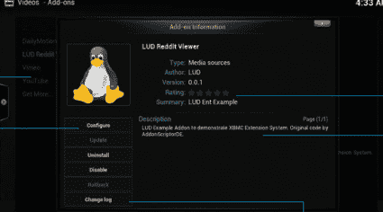

当前媒体选择

已安装插件列表

配置启动器

评分（仅适用于托管插件）

本地化描述字符串

打开插件的更新日志

`Python` 是全球最流行的易用的开源语言。学习如何使用它来为 `XBMC` 构建功能，`XBMC` 是全球最受欢迎的 `FOSS`（自由开源软件）媒体中心

#### 顾问

`Kunal Deo` 是一位资深的开源开发者。目前，他正领导两个开源项目：`WinOpen64` 和 `KUNWiki`。他还是一名 `KDE` 开发者。他已为许多开源项目做出贡献，包括 `KDE`、`Solaris`、`Beleenix` 和 `Openmoko`

#### 资源

- **`XBMC`：** `www.xbmc.org/download`

- **`Python 2.7x`**


# Python IDE（可选）

XBMC 或许是开源媒体中心领域有史以来最重要的事物。它起源于最初的 Xbox 游戏机，自那以后，它已成为多媒体爱好者的事实标准软件。它也被分支为许多其他成功的媒体中心应用，如 Boxee 和 Plex。XBMC 最终成长为一个非常强大的开源应用，背后有稳固的社区支持。它支持几乎所有主要平台，包括不同的硬件架构。它适用于 `Linux`、`Windows`、`Mac OS X`、`Android`、`iOS` 和 `Raspberry Pi`。

在这些页面中，我们将学习如何为 `XBMC` 构建扩展。扩展是一种向 `XBMC` 添加功能的方法，而无需学习 `XBMC` 的核心或以任何方式修改其核心。另一个额外优势是，`XBMC` 使用 `Python` 作为其脚本语言，这也用于构建扩展。由于 `Python` 与组成 `XBMC` 核心的 `C/C++` 等语言相比更容易学习，这真正帮助了新开发者参与该项目。

`XBMC` 支持各种类型的扩展（或插件）：插件、程序和皮肤。插件为 `XBMC` 添加功能。根据功能类型，插件将出现在 `XBMC` 的相应媒体部分。例如，`YouTube` 插件将出现在视频部分。脚本/程序就像 `XBMC` 的迷你应用程序。它们出现在程序部分。皮肤很重要，因为 `XBMC` 是一个完全可定制的应用程序——你可以改变该包几乎所有方面的外观和感觉。

根据你的扩展属于哪个类别，你必须相应地创建扩展目录。例如...

```text
**插件：**
plugin.audio.ludadi: 音频插件
plugin.video.ludadi: 视频插件
script.xxx.xxx: 程序
```

在本教程中，我们将构建一个名为 LUD Entertainer 的 `XBMC` 插件。该插件提供了一种在 `XBMC` 内观看 Reddit 视频的好方法。我们的插件将显示来自 Reddit 的各种内容，如预告片和文化纪录片。我们还允许用户添加自己的 Subreddit。然后，每个视频都可以归类为热门、最新、顶级、争议性等。通过这个插件，我们将展示如何轻松利用 `XBMC` 的内置方法来实现高质量的用户体验。

由于篇幅限制，我们无法在此打印完整代码。我们强烈建议探索封面光盘以访问完整代码，其中还有许多其他令人惊叹的功能。

## 使用 Python 为 XBMC 制作扩展

使用 `Python` 为 `XBMC` 创建新插件


### 01 准备目录结构

正如我们之前提到的，每种 `XBMC` 扩展类型都遵循特定的目录命名约定。在这种情况下，我们要构建一个*视频*插件，因此插件目录名称将是 `plugin.video.ludlent`。但这只是根目录名称——我们还需要几个其他的文件夹和文件。

以下描述了 LUD Linux Entertainer 的目录结构：

```text
plugin.video.ludlent– 根插件目录
|-- addon.xml
|-- changelog.txt
|-- default.py
|-- icon.png
|-- LICENSE.txt
|-- README
|-- resources
|--- lib
|--- settings.xml
```

### 02 创建 addon.xml

需要在扩展目录的根目录中创建一个 `addon.xml` 文件。`addon.xml` 文件包含 `XBMC` 扩展的主要元数据。它包含关于扩展的概述、致谢、版本信息和依赖项信息。

`addon.xml` 的根元素是 `<addon>` 元素。其定义为：

```xml
<addon id="plugin.video.ludlent" name="LUD HSM Viewer"
version="0.0.1" provider_name="LUUK">
其余内容放置在这里
</addon>
```

在这里，`id` 是插件的标识符，因此它应在所有 `XBMC` 扩展中是唯一的，并且 `id` 也用作目录名称；`version` 告诉 `XBMC` 扩展的版本号，这有助于其提供自动更新的能力——`XBMC` 遵循 Major.Minor.Patch 的版本约定；`name` 是插件的英文标题。

**注意：** 步骤 3 到 5 涵盖了需要在 `addon.xml` 文件内添加的条目。

### 03 添加依赖项信息

扩展内部的依赖项使用 `<requires>` 元素进行管理。

```xml
<import addon="xbmc.python" version="2.1.0"/>
<import addon="plugin.video.youtube" version="3.0.0"/>
<import addon="plugin.video.vimeo" version="2.3.0"/>
<import addon="plugin.video.dailymotion_com" version="1.0.0"/>
</requires>
```

在上面的代码中，我们添加了一个名为 `xbmc.python` 版本 2.1 的库的依赖项。目前，它是作为强制依赖项添加的。要使依赖项变为可选，你需要添加 `optional="true"`；例如 `<import addon="kumal.special" version="0.1.0" optional="true"/>`

在上例中，我们将核心依赖项 `xbmc.python` 添加为 2.1.0，因为这是随 `XBMC` 版本 Frondo 12.0 和 12.1 一起发布的版本。如果你将 `xbmc.python` 添加为 2.0，那么它仅在 `XBMC` Eden 11.0 中有效，而在最新版本中无效。

对于当前版本的 `XBMC` 12.1，随附的核心 `XBMC` 组件版本如下：

```text
xbmc.python 2.1.0
xbmc.gui 4.0.0
xbmc.json 6.0.0
xbmc.metadata 2.1.0
xbmc.addon 12.0.0
```

除了 `xbmc.python` 之外，我们还添加了一些第三方插件作为依赖项，例如 `plugin.video.youtube`。当我们安装 `plugin.video.ludlent` 时，这些插件将自动安装。

### 04 设置提供者和入口点

我们的扩展旨在为 `XBMC` 提供视频内容。为了传达这一点，我们必须设置以下元素：

```xml
<extension point="xbmc.plugin.source" library="default.py">
<provides>video</provides>
</extension>
```

在这里，`library` 属性设置了插件的入口点。在这个例子中，当用户激活插件时，`default.py` 将被执行。`<provides>` 元素设置了它提供的媒体类型。这也反映在插件的放置位置上。由于我们的是一个视频插件，它将显示在 `XBMC` 的视频部分。

### 05 设置插件元数据

关于插件的元数据在 `<extension point="xbmc.addon.metadata">` 中提供。以下是重要元素...

- **<platforms>:** 大多数时候，`XBMC` 扩展都是跨平台兼容的。然而，如果你依赖于仅在特定平台上可用的原生平台库，那么你需要在这里设置支持的平台。平台的接受值为：all, linux, osx, osx32, osx64, ios (Apple iOS), win32 (Windows DirectX), win64 (Windows OpenGL) 和 android。

- **<summary lang="en">:** 这提供了插件的简要描述。我们的示例将语言属性设置为英文，但你也可以使用其他语言。

- **<description>:** 插件的详细描述。

- **<website>:** 托管该插件的网页。

- **<source>:** 源代码仓库 URL。如果你在 GitHub 上托管你的插件，可以在这里提及仓库 URL。

- **<forum>:** 你的插件的讨论论坛 URL。

- **<email>:** 作者电子邮件。你可以直接输入电子邮件，或使用对机器人友好的电子邮件地址，例如 **max** at domain dot com。

### 06 设置更新日志、图标、扇形艺术和许可证

我们需要在插件目录中额外添加几个文件...

- **changelog.txt:** 你应该列出你的插件在不同版本之间所做的更改。更新日志可从 `XBMC` UI 中查看。

  更新日志示例：

  - 初始发布

  - 修复视频缓冲问题

- **icon.png:** 这将在 `XBMC` UI 中代表该插件。它必须是一个非透明的 **PNG** 文件，大小为 256x256。


- `fanart.jpg`（可选）：如果用户在 XBMC 中选择该插件，`fanart.jpg` 将在背景中渲染。艺术图像需要以 HDTV 格式渲染，因此其尺寸可以从 1280x720 (720p) 到最大 1920x1080 (1080p)。

## 教程

### 使用 Python 为 XBMC 开发扩展

#### LinuxDeveloper

#### 07 为插件提供设置

以下是几种你可以使用的重要设置类型……

- `text`（文本）：用于基本字符串输入。

- `ipaddress`（IP地址）：用于收集互联网地址。

- `number`（数字）：允许你输入数字。XBMC 还会提供一个屏幕数字键盘供输入使用。

- `slider`（滑块）：提供了一种优雅的方式来收集整数、浮点数和百分比值。你可以按以下格式获取滑块设置：

```xml
<setting label="21223" type="slider" id="sidinput" default="10" range="1,1,10" option="int" />
```

在上面的示例中，我们正在创建一个最小范围为 1，最大范围为 10，步长为 1 的滑块。在 `option` 字段中，我们可以说明我们感兴趣的数据类型 – 我们也可以将 `option` 设置为 "float" 或 "percent"。

- `bool`（布尔值）：提供以开或关形式呈现的布尔值选择。

- `file`（文件）：提供了一种输入文件路径的方法。XBMC 将提供一个文件浏览器来辅助文件选择。

如果你希望针对特定类型的文件进行选择，可以使用 `audio`（音频）、`video`（视频）、`image`（图像）或 `executable`（可执行文件）代替 `file`。

- `folder`（文件夹）：提供了一种浏览文件夹的方法……

```xml
<setting label="12001" type="folder" id="folder" source="auto" option="writeable"/>
```

在这里，`source` 设置文件夹的起始位置，而 `option` 设置应用程序的写入参数。

- `sep` & `lsep`（分隔线）：`sep` 用于在设置对话框中绘制一条水平线；`lsep` 用于绘制带有文本的水平线。它们不收集任何输入，而是用于构建更好的用户界面元素……

#### 08 语言支持

语言支持以 `resources/languages/语言名称` 目录下的 `string.xml` 文件的形式提供。这种方法与许多大型软件项目非常相似，包括 Android，在这些项目中从不使用静态字符串。

`resource/language/english/string.xml` 示例：

```xml
<?xml version="1.0" encoding="utf-8" standalone="yes"?>
<strings>
<string id="30001">Add subreddit</string>
<string id="30002">Hot</string>
<string id="30003">New</string>
<string id="30004">Top</string>
<string id="30005">Controversial</string>
<string id="30006">Hour</string>
<string id="30007">Day</string>
<string id="30008">Week</string>
<string id="30009">Month</string>
<string id="30010">Year</string>
</strings>
```

正如你在 `settings.xml` 示例中可能看到的那样，所有标签都引用字符串 ID。你还可以拥有其他许多语言。根据 XBMC 正在运行的语言，正确的语言文件将自动加载。

在 XBMC Frodo (12.1) 之后，`string.xml` 将被弃用。在 Frodo 之后，XBMC 将转向基于 GNU gettext 的翻译系统：gettext 使用 PO 文件。你可以使用名为 `xbmc-xlzoo` 的工具将 `strings.xml` 转换为等效的 PO 文件。

#### 09 构建 default.py

由于我们的插件很小，所有内容都将包含在 `default.py` 中。如果你正在开发更复杂的插件，则可以在同一目录中创建支持文件。如果你的库依赖于第三方库，你有两种方法。你可以将第三方库放入 `resources/lib` 文件夹中；或者将该库本身捆绑到一个插件中，然后在该 `addon.xml` 文件中将该插件添加为依赖项。

我们的插件与 `reddit.tv` 协作。这是 Reddit 的网站，包含其读者分享的热门视频。发布在 Reddit 上的视频实际上源自 YouTube、Vimeo 和 Dailymotion。

我们将使用以下导入开始 `default.py`：

```python
import urllib
import urllib2
import xbmcplugin
import xbmcgui
import xbmcaddon
```

除了 `xbmcplugin`、`xbmcgui` 和 `xbmcaddon` 之外，其余的都是标准 Python 库，可通过 `pip` 在 PyPI（Python 软件包索引）上获取。你不需要自己安装任何库，因为 XBMC 的 Python 运行时已内置所有组件。

`urllib` 和 `urllib2` 有助于 HTTP 通信。`socket` 用于网络 I/O；`re` 用于正则表达式匹配；`sqlite3` 是用于访问 SQLite 嵌入式数据库的 Python 模块；`xbmcplugin`、`xbmcgui` 和 `xbmcaddon` 包含 XBMC 特定的例程。

#### 10 初始化

在初始化过程中，我们将读取 `settings.xml` 中的各种设置。设置可以按以下方式读取：

```python
addon = xbmcaddon.Addon()
filterRating = int(addon.getSetting("filterRating"))
filterVoteThreshold = int(addon.getSetting("filterVoteThreshold"))
```

为了读取 `bool` 类型的设置，你需要这样做：

```python
filter = addon.getSetting("filter") == "true"
```

我们还将为主 URL、插件句柄及其用户代理进行设置：

```python
pluginhandle = int(sys.argv[1])
urlMain = "http://www.reddit.com"
userAgent = "Mozilla/5.0 (Windows NT 6.2; WOW64; rv:22.0) Gecko/20100101 Firefox/22.0"
opener = urllib2.build_opener()
opener.addheaders = [('User-Agent', userAgent)]
```

#### 11 读取本地化字符串

如前所述，XBMC 使用 `strings.xml` 来提供文本。为了读取这些字符串，你需要使用 `getLocalizedString`。

```python
translation = addon.getLocalizedString
translation(30002)
```

在这个示例中，当在英语环境中运行时，`translation(30002)` 将返回字符串 "Hot"。

| idFile | idPath | strFilename | playCount | lastPlayed | dateAdded |
| :----- | :----- | :---------- | :-------- | :---------- | :---------- |
| 1      | 1      | plugin./plugin | | 2013-08-06 22:47 | |
| 2      | 2      | plugin./plugin | 1 | 2013-08-07 22:42 | |
| 3      | 2      | plugin./plugin | 1 | 2013-08-08 00:09 | |
| 4      | 2      | plugin./plugin | 1 | 2013-08-08 00:55 | |
| 5      | 2      | plugin./plugin | 1 | 2013-08-08 00:58 | |

#### 12 构建辅助函数

在这一步中，我们将查看一些重要的辅助函数。


## `getDbPath()`

此函数返回视频 SQLite 数据库文件的位置。XBMC 将库和播放信息存储在 SQLite DB 文件中。视频和音乐有单独的数据库，位于 `.xbmc/userdata/Database` 文件夹内。我们要关注的是视频数据库。它以 `MyVideo` 为前缀。

```python
def getDbPath():
    path = xbmc.translatePath("special://userdata/Database")
    files = os.listdir(path)
    if file[:3] == 'MyVideo':
        latest = video
        if file > latest:
            latest = file
    return os.path.join(path, latest)
```

## `getPlayCount(url)`

一旦我们有了数据库位置，我们就可以使用简单的 SQL 查询获取播放次数。`MyVideo` 数据库包含一个名为 `files` 的表，它根据文件名记录在 XBMC 中播放的所有视频文件。在这种情况下，它将是一个 URL。

```python
dbPath = getDbPath()
conn = sqlite3.connect(dbPath)
c = conn.cursor()

def getPlayCount(url):
    c.execute('SELECT playCount FROM files WHERE strFilename=?', [url])
    result = c.fetchone()
    if result:
        result = result[0]
        return int(result)
    return 0
    return -1
```

上面的表格是 `files` 表的一个示例。

## `addSubreddit()`

我们的插件允许用户添加自己的 Subreddit。此函数从用户那里获取 Subreddit 输入，然后将其保存在插件数据文件夹内的 `subreddits` 文件中。

以下代码设置了 `subreddits` 文件的位置：

```python
subredditsFile = xbmc.translatePath("special://profile/addon_data/*+addonID*"/subreddits")
```

这转换为 `.xbmc/userdata/addon_data/plugin.video_ludent/subreddits`。

```python
def addSubreddit():
    keyboard = xbmc.Keyboard('', 'translation(30001)')
    if keyboard.isConfirmed() and keyboard.getText():
        subreddit = keyboard.getText()
        fh = open(subredditsFile, 'a')
        fh.write(subreddit + '\n')
        fh.close()
```

此函数还展示了如何从用户那里获取文本输入。在这里，我们调用带有文本标题的 `Keyboard` 函数。一旦检测到键盘，它就将带有换行符的输入写入 `subreddits` 文件。

## `getYouTubeUrl(id)`

当我们定位到一个要播放的 YouTube URL 时，我们会将其传递给 YouTube 插件 (`plugin.video.youtube`) 来处理播放。为此，我们需要以特定格式调用它。

```python
def getYouTubeurl(id):
    url = "plugin://plugin.video.youtube/`?/root/ ?/playlist=yt_video&id=videoID=" + id
    return url
```

## 教程

### 使用 Python 为 XBMC 制作扩展

#### LinuxDeveloper

Vimeo 的情况也类似：

```python
def getVimeoUrl(id):
    url = "plugin://plugin.video.vimeo?path=\"root\"&action=play_video&videoid=" + id
    return url
```

Dailymotion 的情况如下：

```python
def getDailyMotionUrl(id):
    url = "plugin://plugin.video.dailymotion.com?url=" + id + "&mode=playVideo"
    return url
```

一旦我们将视频 URL 解析到相应的插件中，播放它就非常简单了。

```python
def playVideo(url):
    listItem = xbmcgui.ListItem(path=url)
    xbmcplugin.setResolvedUrl(pluginhandle, True, listItem)
```

#### 13 填充插件内容列表

`xbmcplugin` 包含用于处理插件 UI 中内容列表的各种例程。第一步是创建目录条目，这些条目可以从 XBMC UI 中选中。为此，我们将使用一个名为 `xbmcplugin.addDirectoryItem` 的函数。

为了方便起见，我们将对 `addDirectoryItem` 进行抽象，以适应我们的需求，使我们能够轻松设置名称、URL、模式、图标图像和类型。

```python
def addDir(name, url, mode, image, type=""):
    u = sys.argv[0] + "?url=" + urllib.quote_plus(url) + "&mode=" + str(mode) + "&type=" + str(type)
    ok = True

    liz = xbmcgui.ListItem(name,
        iconImage="DefaultFolder.png",
        thumbnailImage=image)
    liz.setInfo(type="Video",
        infoLabels={"Title": name})
    ok = xbmcplugin.addDirectoryItem(handle=int(sys.argv[1]), url=u, listItem=liz, isFolder=True)
    return ok
```

基于同样的思路，我们可以构建一个函数来放置链接...

```python
def addLink(name, url, mode, iconimage, description, date):
    u = sys.argv[0] + "?url=" + urllib.quote_plus(url) + "&mode=" + str(mode)
    ok = True
    liz = xbmcgui.ListItem(name,
        iconImage="DefaultVideo.png",
        thumbnailImage=iconimage)
    liz.setInfo(type="Video",
        infoLabels={"Title": name, "Plot": description, "Aired": date})
    liz.setProperty("IsPlayable", "true")
    ok = xbmcplugin.addDirectoryItem(handle=int(sys.argv[1]), url=u, listItem=liz)
    return ok
```

基于我们刚刚创建的抽象，我们可以创建填充内容的基础函数。但在这样做之前，让我们先了解一下 Reddit 的工作原理。大多数 Reddit 内容过滤器是通过称为 Subreddit（子版）的东西提供的。这允许你查看与特定主题相关的讨论：在我们的插件中，我们感兴趣的是展示视频；我们还希望展示预告片、纪录片等。我们使用 Subreddit 来访问这些内容。例如，对于预告片，它可以是 `reddit.com/r/trailers`。对于域名，我们可以使用 `/domain`；例如，要获取所有发布在 Reddit 上的 YouTube 视频，我们将调用 `reddit.com/domain/youtube.com`。现在你可能会问，这个 Subreddit 的目的是什么，它只列出视频吗？答案是它可能不会。因此，我们自己去抓取网站以找到视频。我们将在下一步中详细介绍这一点。

我们要定义的第一个基础函数是 `index()`。当用户启动插件时会调用此函数。


```python
def index():
    defaultEntries = ["videos", "trailers", "documentaries", "music"]

    entries = defaultEntries[:]
    if os.path.exists(subredditsFile):
        with open(subredditsFile, 'r') as fh:
            content = fh.read()
            spl = content.split('\n')
            for i in range(0, len(spl), 1):
                if spl[i]:
                    subreddit = spl[i]
                    entries.append(subreddit)

    entries.sort()
    for entry in entries:
        if entry in defaultEntries:
            addDir(entry.title(), "r/" + entry, "listSorting", "")
        else:
            addDir(entry.title(), "r/" + entry, "listSorting", "")

    addDir("Vimeo.com", "domain/vimeo.com", "listSorting", "")
    addDir("YouTube.be", "domain/youtu.be", "listSorting", "")
    addDir("YouTube.com", "domain/youtube.com", "listSorting", "")
    addDir("Dailymotion.com", "domain/dailymotion.com", "listSorting", "")
    addDir("[B]%s[B]" % translation(30001), "", 'addSubreddit', "")

    xbmcplugin.endOfDirectory(pluginhandle)
```

在这里，倒数第二个条目调用了`addSubreddit`。`listSorting`负责根据诸如“热门”、“最新”等标准对数据进行排序。它还调用了`Reddit`的JSON功能，该功能返回易于解析的`JSON`数据。我们为所有排序标准创建了一个设置条目。根据设置的内容，我们继续构建排序后的列表。

```python
def listSorting(subreddit):
    if cat=='hot':
        addDir("%s" % translation(30002),
            urlMain + "/" + subreddit + "/hot/", 
            "?json&limit=100", 'listVideos', "")
    if cat=='new':
        addDir("%s" % translation(30003),
            urlMain + "/" + subreddit + "/new/",
            "?json&limit=100", 'listVideos', "")
    if cat=='top':
        addDir("%s" % (translation(30004)+
            ": " + translation(30007)),
            urlMain + "/" + subreddit + "/top/",
            "?json&limit=100&time=day", 'listVideos', "")

    xbmcplugin.endOfDirectory(pluginhandle)
```

使用`Python`为`XBMC`创建新插件


```python
def listVideos(url):
    currentUrl = url
    xbmcplugin.setContent(pluginhandle, "episodes")
    content = opener.open(url).read()
    spl = content.split("<content>")
    for i in range(1, len(spl), 1):
        entry = spl[i]
        try:
            match = re.compile("<title>\s*(.+?)</title>\s*", re.DOTALL).findall(entry)
            title = match[0].replace("&amp;", "&")
            match = re.compile("<description>\s*(.+?)</description>\s*", re.DOTALL).findall(entry)
            description = match[0]

            match = re.compile("<created_utc>\s*(.+?)</created_utc>\s*", re.DOTALL).findall(entry)
            ups = int(match[0].replace(",", ""))
            downs = int(open("ups+downs")[0].rstrip()) # 注意：原文中此行 OCR 似乎有误，可能引用上下文中变量 'ups' 和 'downs' 或某个不完全清晰的特定解析逻辑，但保留结构
            # 基于典型逻辑的更正： 
            # ups = int(...)
            # downs = int(...)
            # rating = int((ups+downs)/max(ups+downs,1) * 100) 
            # 然而，在不进行大量重构的情况下坚持 OCR 文本更正：
            # OCR 文本 "downsr" 可能是 "ups"。"open(\"ups+downs\")[0].rstrip(ups+downs)" 在 Python 语法上是无效的。
            # 我将更正明显的拼写错误，但如果逻辑不明确则保留逻辑。
            # 让我们假设标准模式：
            matchUps = re.compile("<ups>\s*(.+?)</ups>\s*", re.DOTALL).findall(entry)
            matchDowns = re.compile("<downs>\s*(.+?)</downs>\s*", re.DOTALL).findall(entry)
            ups = int(matchUps[0])
            downs = int(matchDowns[0])
            total = ups + downs
            rating = int((ups / total) * 100) if total > 0 else 0
            
            if filter and (total) > filterVoteThreshold and rating < filterRating:
                continue
            
            match = re.compile("<num_comments>\s*(.+?)</num_comments>\s*", re.DOTALL).findall(entry)
            comments = match[0]
            
            matchDate = re.compile("<created_utc>\s*(.+?)</created_utc>\s*", re.DOTALL).findall(entry)
            date = datetime.datetime.utcfromtimestamp(float(matchDate[0])).strftime("%a %d %b %Y %H:%M")
            
            description = description + "<br>" + date + " " + str(total) + " votes: " + str(rating) + "% Up | " + str(comments) + " comments"
            
            match = re.compile("<thumbnail>\s*(.+?)</thumbnail>\s*", re.DOTALL).findall(entry)
            thumb = match[0]
            matchYouTube = re.compile("<url>\s*(http://www.youtube.com/watch?v=.+?)</url>\s*", re.DOTALL).findall(entry)
            matchVimeo = re.compile("<url>\s*(http://vimeo.com/.+?)</url>\s*", re.DOTALL).findall(entry)
            url = ""
            if matchYouTube:
                url = getYouTubeUrl(matchYouTube[0])
            elif matchVimeo:
                url = getVimeoUrl(matchVimeo[0].replace("#", ""))
            if url:
                addLink(title, url, "playVideo", thumb, description, date)
        except:
            pass
    xbmcplugin.endOfDirectory(pluginhandle)
    if forceViewMode:
        xbmc.executebuiltin("Container.SetViewMode("+viewMode+")")
```

在上述左侧列出的代码中，我们正在打开`URL`，然后——基于正则表达式匹配——我们发现了位置标题、描述、数据、赞成票、反对票和评分。我们还在定位视频缩略图，然后将其传递给`XBMC`。

在代码的后面部分，我们也尝试将`URL`匹配到视频提供商。我们的插件支持`YouTube`、`Vimeo`和`Dailymotion`。如果成功检测到，我们调用辅助函数来定位基于`XBMC`插件的播放`URL`。在整个解析过程中，如果引发任何异常，整个循环将被忽略，并解析下一个`JSON`项。

#### 14 填充剧集视图（列出视频）

此时，我们已经拿到了返回`JSON`数据的`URL`；现在我们需要从中提取出对我们有意义的信息。

通过查看`JSON`数据，你可以看到这里有很多有趣的信息。例如，`url`设置为`youtube.com/watch?v=n4/2zVxWBE`。`title`设置为‘The Counselor - Official Trailer’。还有许多其他我们将使用的数据片段，如`ups`、`downs`、`num_comments`、`thumbnail_url`等。为了筛选出我们需要的数据，我们将使用正则表达式。

还有一件事需要注意：由于我们不再展示目录，而是准备放置内容，我们必须将`xbmcplugin.setContent`设置为剧集模式。

#### 15 安装并运行附加组件

你可以使用以下两种方法之一安装附加组件：

- 你可以将插件目录复制到`xbmc/addons`

- 你可以从`zip`文件安装插件。为此，使用以下命令将附加组件文件夹压缩为`zip`文件：

```bash
$ zip -r plugin.video.ludent.zip plugin.video.ludent
```

要从`zip`文件安装插件，请打开`XBMC`，进入“系统”然后“附加组件”，然后单击“从`zip`文件安装”。从`zip`文件安装的好处是，`XBMC`会自动尝试安装所有依赖的插件。

安装插件后，你可以通过前往`XBMC`的视频附加组件部分，选择“获取更多..."然后单击`LUD Reddit Viewer`来运行它。

你可以通过右键单击`LUD Reddit Viewer`，然后选择“附加组件设置”来访问插件的设置对话框。


因此，我们已经看到了 `XBMC` 的扩展系统是多么强大。在这个例子中，我们能够在 `XBMC` 中利用 `Python` 的全部功能（包括那些神奇的正则表达式匹配）。`XBMC` 本身也提供了一个强大的 `UI` 框架，为我们的附加组件提供了非常专业的外观。

尽管看起来可能很强大，我们只构建了一个视频插件。`XBMC` 的扩展系统还提供了一个用于构建完整程序（称为 `Programs`）的框架。我们将在后续版本中介绍这部分内容。

本文中展示的所有示例均在 `Ubuntu 13.04` 上的 `Vim` 版本 `7.3.547` 中经过测试。

只需输入：`:help c`，`Vim` 就会向新手展示一些有价值的信息，例如导航键、在 `xterm` 或 `GUI` 中启用鼠标的键盘快捷键等。

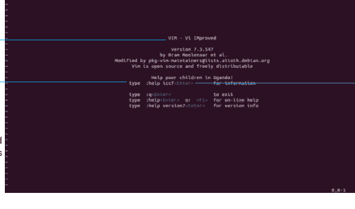

输入 `:help iccf`，`Vim` 将显示与向乌干达贫困地区捐款以及 `Vim` 编辑器开发相关的信息（包括网络链接）。

### 轻松掌握 Vim

更进一步，学习一些高级功能，提高使用 `Vim` 编辑器的效率。

#### 专栏作家

`Himanshu Arora` 是一名软件程序员、开源爱好者和 `Linux` 研究人员。他的文章曾刊登于 `IBM developerWorks`、`Computerworld` 和 `Linux Journal`。他（与其他一些 `Linux` 迷们）在 `mylinuxbook.com` 上撰写博客。

#### 资源

`Vim`: `www.vim.org/download.php`

由于学习曲线陡峭，许多人要么避免使用 `Vim`，要么仅在非常基础的层面使用它。如果你属于这两种情况之一，那你确实错过了很多精华。

`Vim` 最早于 1991 年 11 月发布，是一款基于命令行的文本编辑器，由 `Bram Moolenaar` 开发，作为 `Amiga` 平台上改进版的 `Vi` 克隆。除了包含流行 `Vi` 编辑器的所有功能外，它还包含许多新功能，因此得名——源自 “`Vi improved`”（改进的 `Vi`）。除了作为文本编辑器外，`Vim` 还可以被软件程序员用作集成开发环境。`Vim` 提供了广泛的功能，但由于它是一个命令行工具，因此学习曲线较陡。请注意，`Vim` 不是文字处理器，这意味着你不能用它进行布局相关的更改。

虽然一旦你掌握了 `Vim` 编辑器，你就会了解它真正的优势，但总体而言，一些主要优点包括快速的文本编辑（因为极少或几乎不使用鼠标）以及可以在命令行的任何位置轻松执行。此外，`Vim` 还有许多可用的 `GUI` 前端（如 `gVim`）。

虽然 `Vim` 是基于命令行的，但它拥有一批忠实的支持者，并被系统管理员和软件程序员广泛使用。虽然很难学习和理解 `Vim` 提供的所有功能，但为了真正获得其好处，熟练掌握 `Vim` 对于日常工作至关重要。

通过本文，你将学习如何同时处理多个文件，如何缩进和折叠代码，如何搜索和替换关键词，如何水平/垂直分割 `Vim` 窗口，以及 `Vim` 提供的许多其他相关功能。

`注意`：本文假设你对 `Vim` 编辑器有一些基本知识（打开、编辑、保存和关闭文件）。

## 教程

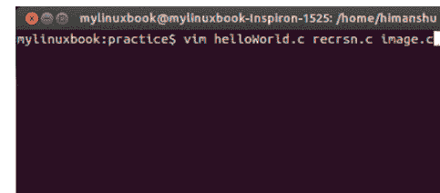

#### 01 处理多个文件

虽然大多数普通用户一次只用 `Vim` 编辑一个文件，但它也可以用于并行编辑多个文件。要使用 `Vim` 编辑器打开多个文件，只需将这些文件的所有名称作为参数提供给 `vim` 命令。第一个文件默认被显示。输入 `gn` 切换到下一个文件，`gp`（或 `gP`）切换到上一个文件，`gf` 切换到第一个文件，`gb` 切换到最后一个文件，`gq` 关闭文件。

#### 02 处理多个文件

有时需要在编辑已打开的一组文件时打开一个新的或现有的文件。嗯，这可以通过输入 `:e` 后跟文件名（如果不在当前工作目录中，则需包含完整路径）来完成。

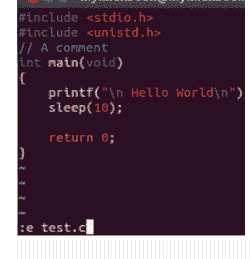

#### 03 获取 Vim 中当前打开文件的列表

要获取当前在 `Vim` 编辑器中打开的文件列表，只需输入 `ls`。这将显示已打开文件的列表以及其他信息，例如文件中光标的当前行号、当前活动窗口中的文件（用 `%` 表示）、上一个活动窗口中的文件（用 `#` 表示）等。通过输入 `gt`（或 `gT`）在当前和上一个活动窗口之间切换。

#### 04 使用通配符

在同时打开多个文件时，`Vim` 也支持通配符（如 `*`、`?` 等）。这在多个日志文件以一组共同字符（如当前日期 `2013-06-05---log`）开头，或者多个编程语言源文件具有相同的语言扩展名（如 `*.c` 或 `*.cpp`）的情况下特别有用。

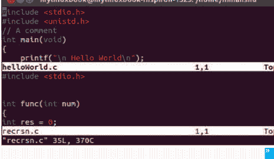

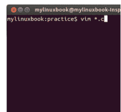

#### 05 跨文件复制粘贴

另一个常见的需求是从一个文件复制并粘贴到另一个文件。为此，你需要分割 `Vim` 窗口以同时打开这两个文件。这可以通过在 `vim` 命令中使用 `-o` 选项（`vim -o <file1-name> <file2-name>`）来完成，或者先通过 `vim <file-name>` 打开一个文件，然后在活动 `Vim` 窗口内通过 `:split <file2-name>` 以分割窗口模式打开第二个文件。要在两个窗口之间切换光标控制，请按下 `Ctrl+w`（几次）。

跨文件的复制粘贴操作可以按如下步骤进行：以分割模式打开文件（如上文所述）；从其中一个文件复制所需文本；按下 `Ctrl+w` 将控制权切换到另一个文件；然后粘贴复制的文本。

你还可以垂直分割 `Vim` 窗口。只需在活动窗口内输入 `:vsplit <file-name>` 即可。

#### 06 关闭所有文件

要一次性关闭所有已打开的文件，请参考常规关闭选项，如 `:q`、`:wq` 或 `:q!`。因此，要一次性关闭所有文件，请执行如 `:qa`、`:wqa` 或 `:qa!` 的操作。

#### 07 不退出 Vim 的情况下关闭文件

通常，当最后一个打开的文件被关闭时，`Vim` 应用程序也会退出。但是，如果需要在不关闭应用程序的情况下关闭最后一个打开的文件，只需输入 `:bd`。这将关闭当前文件并打开一个空缓冲区。


> 虽然大多数普通用户一次只用 `Vim` 编辑一个文件，但它也可以用于并行编辑多个文件。

#### 08 折叠代码块

另一个常见需求——通常是软件程序员提出的——是折叠某些代码块以节省窗口空间。这有助于他们专注于所需的代码块。`Vim` 确实支持块折叠。为此，第一步是将光标置于函数定义的大括号内。例如，将光标移至函数体的第一行。到达那里后，只需输入 `za`。当你输入此命令时，你会发现 `za` 用于激活 `Vim` 中的可视模式，而 `Z` 选择包括大括号在内的完整块，并且 `z` 启用折叠。

要打开折叠，请按 `zo`；要关闭折叠，请按 `zc`。请确保在执行折叠打开和关闭操作时，光标位于该块内。输入 `za` 创建一个折叠（它是不可见的）。只有当创建了折叠时，`zo` 和 `zc` 才起作用。通过输入 `zd` 可以删除现有的折叠。

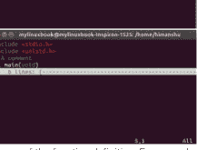

#### 09 手动缩进

`Vim` 提供的另一个重要功能是代码缩进。软件程序员需要缩进他们的代码，而 `Vim` 提供了代码缩进的简便步骤。要缩进单行代码，你可以使用 `>` 或 `<` 分别将该行向右或向左缩进。多行也可以使用 `{number-of-lines}>` 或 `{number-of-lines}<` 进行缩进。

#### 10 自动缩进

> 对于那些希望一切自动化的程序员，`Vim` 还提供了自动缩进功能。

```
mylinuxbook@mylinuxbook-Inspiron-1525:/home/himanshu$ g++ filename1.c
#include <stdio.h>
#include <unistd.h>
// A comment
int main(void)
{
printf("\n Hello World\n");
sleep(10);
return 0;
}
```

这比逐行缩进是一种更好的技术，但你仍然需要计算要缩进的行数。如果行数非常大，这可能会令人沮丧。

幸运的是，还有另一个技巧：通过以可视模式操作 `Vim` 来选择行。为了做到这一点，你首先需要将 `Vim` 带入可视模式。这（如前所述）可以通过使用 `V` 来完成。进入可视模式后，使用方向键一次性选择你想缩进的所有行。之后，你只需要按下 `B` 或 `L`，整个选区将相应地进行缩进。

`自动缩进`

对于那些希望一切自动化的程序员，`Vim` 还提供了自动缩进功能。例如，要为 `C` 代码启用自动缩进，请使用 `set autoindent` 和 `set cindent`。现在，尝试编写一些 `C` 代码，你会发现 `Vim` 在编写时会自动生成缩进。


有时，根据 `Vim` 编辑器的现有设置，行可能会被缩进为除四个空格或你期望的其他默认值之外的空格数。作为解决方案，你可以使用 `set shiftwidth=<number-of-spaces>` 设置要缩进的空格数。例如，只需输入 `set shiftwidth=4` 即可将行缩进四个空格。

#### 11 搜索单词

要在活动窗口中搜索单词，只需输入 `/`（搜索关键词）。这将启用 `Vim` 的搜索模式并找到被搜索关键词的第一个出现位置。

使用 `N`（只需按下 `N` 即可搜索关键词的更多出现位置）。请注意，在这里无法执行向后搜索。

如果你需要执行向后搜索，只需输入 `?`（搜索关键词）。这将启用 `Vim` 的向后搜索模式。同样，使用 `N` 继续搜索，但这次是向后的。

有时关键词存在于文本/源文件中，并且希望在当前文本/源文件中找到该单词的其他出现位置。在这种情况下，只需将光标移至该单词下方并按下 `T`（或 `Shift+8`）。这样，你甚至无需输入该单词即可进行搜索。

#### 12 替换单词

`Vim` 还支持搜索和替换操作。要执行基本替换操作，只需输入 `:s/keyword-to-search/keyword-to-replace/` 以将 `keyword-to-search` 替换为 `keyword-to-replace-with`。

如果你想替换被搜索关键词的所有出现位置，这个小技巧很好，但如果只想替换选定的出现位置怎么办？嗯，有一种方法可以让你在交互模式下运行搜索和替换操作。这意味着 `Vim` 在每次替换关键词之前都会进行确认。这可以通过 `: %s/keyword-to-search/keyword-to-replace/g` 来实现。

第一个出现位置始终被高亮显示，`Vim` 在底部显示一个提示（绿色），你可以在此输入选择是否要替换此出现位置。这里，`y` = 是，替换此出现位置；`n` = 否，跳过此出现位置；`a` = 替换此及所有其他出现位置；`q` = 退出命令；`i` = 替换此匹配项然后退出命令。在此模式下，使用 `Ctrl+e` (`^E`) 和 `Ctrl+y` (`^Y`) 向上和向下滚动窗口。此外，使用 `i` 和 `I`（配合例如 `/a` 或用于不区分大小写和区分大小写搜索的 `/ci`）。

```bash
himanshu@mylinuxbook-Inspiron-1525:~
#include <iostream>
class A
{
private:
int a;
int b;
public:
void init()
{
a = 10;
b = a*10;
}
}
replace with char (\d*) (\d*) (\d*) (\d*) (\d*) (\d*) 0,5 Top
```

### 教程：制作一个 Python Twitter 客户端

使用 Twitter 开发者账户工具创建你自己的应用详情，无论是用于个人使用还是计划发布的应用。通过 `Python` 封装库访问整个 Twitter 数据集，从而获取时间线、列表和用户资料等。创建用户和 OAuth 的认证密钥，让你能够接入 Twitter API。使用 `Twython` 模块编写自己的推文，以访问 Twitter API 的各个组件。

使用 `Python` 库学习 Twitter API 的基础知识，并创建一个简单的 Twitter 客户端来发布和监控推文。

#### 导师

Rob Zwetsloot 擅长建模复杂系统，是一位精通 `Python`、`Django` 和 `PHP` 的 Web 开发者。他喜欢进行计算实验。

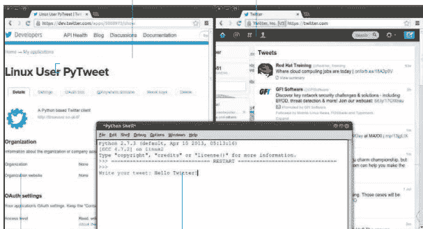

`Python` 有很多优点，其中之一就是你可以用它来创建轻量级的桌面软件和物联网软件包。用于此目的的服务之一是 Twitter，它有几个你可以利用的 `Python` API，可以在 `Python` 脚本中检查和发布指定用户的推文。

由此，你可以在命令行中创建一个标准的 Twitter 客户端，或者使用 `Tkinter`（来自 LUD 之前的问题）为其制作一个 UI。你还可以指定通常从客户端请求的登录详情，然后使用它来检查 Twitter 上的特定单词、转发、接收的消息，或者查看特定的人是否在发送推文。

在这个教程中，我们将使用 `Twython`，它提供了 `Python` 的纯 Twitter 接口，并展示如何获取你自己独特的 API 密钥，以便与 Twitter 本身一起使用。

#### 资源

- 一个 Twitter 账户

- `Python` 2: `www.python.org/`


#### 01 账户权限

要创建一个 Twitter 应用，你需要一个 Twitter 账户。登录你的账户，或者如果你想在该服务中拆分个人和开发账户，请创建一个单独的账户。完成后，前往 `dev.twitter.com` 并使用你想要的账户登录。


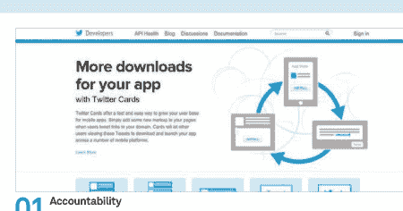


#### 02 新的开始

前往“我的应用程序”并点击“创建新应用程序”。在这里，你需要输入应用程序的名称、简短描述以及一个可以了解你和/或该应用程序更多详情的网站。应用程序名称不允许使用“Twitter”一词。


#### 03 权限

创建完成后，你会被带到该应用程序的详情页。在我们继续之前，点击“设置”并在“应用程序类型”下选择“读取、写入和访问直接消息”，以便我们可以将其作为 Twitter 客户端正确使用。

#### 04 访问令牌

我们现在可以为该应用程序创建一个访问令牌，使其能够与你的 Twitter 账户配合使用。一旦读取和写入权限更改完成后，返回详情页，滚动到底部。点击“创建我的访问令牌”以获取它。

#### 05 安装 Pip

我们将从我们的网站安装最新版本的 `python-twitter`。为此，首先安装 `pip`，因为我们使用 `Python`，在软件源中可用为 `python-pip`。由于我们使用的是 `Debian`，命令如下：

```bash
sudo apt-get install python-pip
```

……这将允许我们设置 `Python` 模块。


#### 06 安装 Twython

既然我们已经安装了 `Pip`，我们可以继续安装 `Twython`。为此，在终端中继续并输入：

```bash
sudo pip install twython
```

这将获取 `Twython` 模块以及你登录账户所需的所有 OAuth 包，使用我们之前创建的令牌。


#### 07 认证文件

我们需要创建一个 `Python` 文件来保存所有的认证详情。启动 `IDLE` 或你选择的文本编辑器，首先通过以下方式导入 `Twython`：

```python
from twython import Twython
```

确保手头有我们之前创建的密钥，以便在下一部分中添加。如果输出较长，请按回车键转到下一个屏幕。


#### 08 应用密钥

将以下内容添加到你的代码中：

```python
APP_KEY = 'YOUR_CONSUMER_KEY'
APP_SECRET = 'YOUR_CONSUMER_SECRET'
```

……分别用你自己的消费者密钥（consumer key）和消费者机密（consumer secret）替换 `YOUR_CONSUMER_KEY` 和 `YOUR_CONSUMER_SECRET`。

#### 09 访问密钥

现在我们可以将之前创建的访问令牌添加到脚本中：

```python
OAUTH_TOKEN = 'YOUR_ACCESS_TOKEN'
OAUTH_TOKEN_SECRET = 'YOUR_ACCESS_TOKEN_SECRET'
```

……同样，你需要用相应的数字替换 `YOUR_ACCESS_TOKEN` 和 `YOUR_ACCESS_TOKEN_SECRET`。

#### 10 验证

现在是时候验证你到目前为止所做的工作是否真的有效了。在脚本的底部输入以下内容：

```python
twitter = Twython(APP_KEY, APP_SECRET, OAUTH_TOKEN, OAUTH_TOKEN_SECRET)
twitter.verify_credentials()
```


然后运行。如果没有出现任何错误，说明一切工作正常。

#### 11 测试发布

既然一切似乎都在正常工作，你可以尝试直接向 `Twitter` 发送一条测试推文。在我们的代码底部，输入：

```python
twitter.update_status(status="Test")
```

然后再次运行。如果成功，将不会有错误，并且它会显示在你的时间线上。

#### 12 撰写帖子

让我们创建一种通过脚本向你的时间线发布推文的方法。我们将使用人工输入，如下所示：

```python
post = raw_input("Write your tweet: ")
```

……这将把我们的推文以字符串形式存储在 `post` 中。

要发布此内容，我们使用之前的 `update_status` 部分，只是现在它使用 `post` 中的字符串来更新我们的时间线。添加：

```python
twitter.update_status(status=post)
```

然后保存文件。运行它，并再次测试代码。

#### 13 更新

编写帖子的完整脚本结构如下所示：

```python
APP_KEY = 'YOUR_CONSUMER_KEY'
APP_SECRET = 'YOUR_CONSUMER_SECRET'
OAUTH_TOKEN = 'YOUR_ACCESS_TOKEN'
OAUTH_TOKEN_SECRET = 'YOUR_ACCESS_TOKEN_SECRET'

from twython import Twython
twitter = Twython(APP_KEY, APP_SECRET, OAUTH_TOKEN, OAUTH_TOKEN_SECRET)

post = raw_input("Write your tweet: ")
if twitter.update_status(status=post):
    print("Tweet sent!")
```

#### 14 时间线

要访问我们账户推文的时间线，我们使用以下内容：

```python
twitter.get_user_timeline()
```

这会访问我们账户发布的过去 20 条帖子。你还可以通过添加 `screen_name` 选项来指定要检查的时间线：

```python
twitter.get_user_timeline(screen_name='username')
```

#### 15 完整时间线

我们可以通过使用 `get_home_timeline` 函数来访问账户的完整时间线，如下所示：

```python
twitter.get_home_timeline()
```

如果你打印出来，它将显示时间线上最近 20 条推文的所有未经过滤的数据。你可以通过向 `get_home_timeline` 添加 `count` 参数来修改推文数量。

```python
twitter.get_home_timeline(count = 5)
```

我们需要解析数据，以确保我们获得连贯且可识别的时间线。

> “创建一种简单的方法，将推文发布到你的时间线上”

#### 16 搜索推文

我们可以使用以下内容在 `Twitter` 上搜索特定关键字：

```python
twitter.search(q="linux")
```

这将返回与单词 `Linux` 相关的推文混合结果。你可以使用 `result_type` 参数进行过滤，将其设置为混合（`mixed`）、最新（`recent`）或热门（`popular`）。

#### 17 关注

要在 `Twitter` 上关注某人，我们使用 `create_friendship` 函数。我们需要你想关注的 `Twitter` 用户的屏幕名称或数字 `ID` – 你很可能使用屏幕名称，所以我们要这样写：

```python
twitter.create_friendship(screen_name = "LinuxUserMag")
```

#### 18 转发

由于转发是 `Twitter` 的重要组成部分，其功能仅仅是 `retweet`。我们需要推文 `ID` 用于此，这是用于每个推文的数字字符串，并显示在推文的 `URL` 中。我们使用以下方式：

```python
twitter.retweet(id = '12345')
```

#### 19 收藏

这的工作方式与转发非常相似，使用 `URL` 中使用的推文唯一 `ID` 来确定要收藏哪条推文。此功能的函数是 `create_favorite`，写法如下：

```python
twitter.create_favorite(id = '12345')
```

在进行此操作时，请确保使用美式拼写（`favorite`）。（注：原文说 "Make sure to use the American spelling (favourite)" 其实有点矛盾，因为 American spelling 通常是 `favorite`，而 British 是 `favourite`。原文括号里写的是 `favourite`，但文字说是 American spelling。考虑到 API 参数实际上是 `create_favorite`，这里翻译时保留原文的逻辑：请确保使用美式拼写。）

#### 20 获取收藏

`Twitter` 会存储用户的所有收藏，以便你随时可以恢复它们。你可以获取自己的，或者指定用户以获取其收藏。基本代码是：

```python
twitter.get_favorites()
```

……这将获取你自己的收藏。像以前一样，你可以分别使用 `user_id` 和 `screen_name` 指定用户 `ID` 号码或屏幕名称，以获取特定列表。

#### 21 提及

你还可以访问已认证账户的提及列表。为此，使用 `get_mentions_timeline` 函数。它像其他时间线一样工作，允许你限制从选择中获取的帖子数量。像之前一样将其限制为五个：

```python
twitter.get_mentions_timeline(count='5')
```

#### 22 热门话题

得益于 `Twitter` 的热门话题，每个人都知道其他人在谈论什么，无论是年轻的加拿大音乐家还是重要的世界事件。你通过以下方式访问趋势：

```python
twitter.get_place_trends(id = '1')
```

`ID` 为 `1` 返回全球趋势。你可以为不同的地区指定不同的 `ID`。

#### 23 获取列表

如果你更喜欢通过策划人员列表来使用 `Twitter`，你可以使用 `get_list_statuses` 函数获取任何列表的内容：

```python
twitter.get_list_statuses(id = '12345')
```

每个列表都有一个你可以使用的唯一 `ID` 或标识符（`slug`）。你还可以调用任何列表的成员，或任何订阅该列表的人。


#### 24 结尾

使用所有这些函数，你可以开始选择数据并让我们的代码做很多事情，而不仅仅是发布推文。从时间线函数中获取特定属性将允许你显示一个连贯的时间线，并且还包括关注用户及其链接所需的详细信息。

# 打造更好的网络

`www.webdesignermag.co.uk`


**现正发售**

`Bootstrap`：轻松实现响应式设计 | 25 个专业 `Photoshop` 技巧 | `PHP` 测试

- 设计灵感
- 实用技巧
- 幕后揭秘
- 分步建议
- 行业观点

# 立即购买本期杂志

纸质版可在 `www.imagineshop.co.uk` 购买

数字版可在 `www.greatdigitalmags.com` 购买

支持以下平台

`PRINT` `EBOOK` `MOBILE` `DESKTOP`

`facebook.com/webdesignermag` `twitter.com/webdesignermag`

# 评测索引

开源场景下的必备工具、软件和资源


“一种轻松入门无线微控制器开发的方式”

无线发明家套件

## 评测


### 集体测试

- 72 `IDE` 超级测试

  使用最佳开发环境来提升你的工作流……

### 硬件

- 79 `MinnowBoard`

  树莓派真的遇到了旗鼓相当的对手吗？

- 79 `Nook HD+`

  低成本与高性能的完美组合？

### 软件

- 82 `Sparky Linux 3.0`

  首批使用 `Debian 7.0 Jessie` 的发行版之一

### 图书

- 85 最新 `Linux` 读物解析

### 我们的评测方式

我们的专家会彻底测试工具包，并根据以下标准进行评分

- 务必避免
- 设计师/开发者的糟糕一天
- 不错但可以更好
- 入手吧，它不会让你失望
- 软件或硬件的极致体验

### 集体测试

#### 集成开发环境

我们让四款最优秀的 `IDE` 相互竞争，以找出哪种方式最能简化并增强你的工作流。

简单的 `IDE` 对于任何代码编写者来说都可能是一个非常有用的工具——无论是业余编程还是职业使用。由于可以使用各种编程语言，因此也有更多可用于编写这些语言代码的 `IDE`——每个都有其独特的优缺点。

在这次测试中，我们将关注功能更丰富、支持多语言的 `IDE`，而不是专门的单语言环境或轻量级替代品。我们还将测试这些 `IDE` 通过插件和附加组件进行扩展的能力——无论是用于其他语言，还是不同的界面效果。

我们为本次评测选择了 `Eclipse`、`Code::Blocks`、`Geany` 和 `Netbeans`。虽然它们并未包含在内，但 `KDevelop` 和 `Anjuta` 等其他针对特定桌面环境的 `IDE` 也非常出色。我们选择了跨平台的 `IDE` 进行本次测试，尽管那两个通常也能在其他桌面上正常运行。


# 集成开发环境集体测试

四款最好的 `IDE` 正面对决

**评测**

##### `Code::Blocks`

一个更开放的 `IDE`，最初用于 `C++`，但现在功能更加丰富。

作为一个相对较新的 `IDE`，`Code::Blocks` 在经历了三年的测试版发布后，于 2008 年初正式推出。虽然默认是一个 `C++` `IDE`，但它支持插件，可以扩展其功能以构建和测试其他语言。然而，就纯编码而言，由于支持多种不同语言的语法，`Code::Blocks` 可用于编写各种语言的脚本。不过，如果不使用附加组件，你就无法测试这些代码。

不幸的是，`Code::Blocks` 的插件生态尚不成熟，甚至没有对 `Python` 和其他解释型编程语言进行适当的支持。插件可以通过 `Code::Blocks` 维基找到，但目前布局并不特别完善。插件是手动安装的，通常情况下这没问题，但测试中的其他 `IDE` 有一些有趣的方式来管理插件，这使得这种方法显得有点过时。

虽然你可能无法正确调试测试代码，但 `Code::Blocks` 的界面对于实际编写代码来说仍然非常友好。项目通过专有项目文件进行管理，这些文件链接到特定文件夹。项目创建时无需考虑特定语言，像一些文本编辑器一样，它会智能地识别并突出显示不同语言的语法。浏览功能并不总是适用于所有函数和类；但是，如果你特别喜欢该界面，它可以允许你进行简单的代码编辑以便在其他地方测试。

`Code::Blocks` 还具有很强的可定制性，允许你更改编辑器的外观和行为、编译器的工作方式，甚至编辑应用程序本身的启动脚本。

`Code::Blocks` 是一款不错的软件，但由于其不成熟，其插件支持不如测试中的其他 `IDE`——尤其是如果你想用它进行多语言编程。它至少比 `Eclipse` 轻量一些，界面布局也很合理，但可能还需要几年时间才能比其他 `IDE` 更受欢迎。

> “不幸的是，`Code::Blocks` 的插件生态尚不成熟”

- 有一些第一方插件可用，但第三方插件并不多
- 界面友好，有助于工作流


| 类别 | 描述 | 分数 |
|---|---|---|
| 安装 | 在软件仓库中可用，但在其他地方可以轻松获取二进制文件和源代码 | 8 |
| 工作流 | `Code::Blocks` 的界面通常对工作流很有利，尽管它并不完全支持所有语言 | 7 |
| 功能 | 提供了大量可深度定制的功能 | 7 |
| 插件支持 | 目前非常有限，意味着并非所有语言都得到了适当的支持 | 4 |
| 总体 | `Code::Blocks` 拥有出色的界面，以及在代码编写和项目管理方面的一些绝佳理念，但插件选择需要改进 | 6 |

##### `Geany`

一款功能齐全的 `IDE`，比大多数 `IDE` 更轻量一些

`Geany` 有时会被误认为是一个加强版的文本编辑器。实际上，它是一个完整的 `IDE`，只是比大多数 `IDE` 稍微轻量一些。

`Geany` 开箱即支持多语言，并提供了简单选项来创建使用不同语言的文件，作为主界面的一部分。项目保存在特定文件夹中，类似于 `Eclipse`，尽管 `Geany` 可以读取随附的文件来管理这些项目。可以同时查看和编辑多个项目，且它们可以分别使用不同的语言。对于支持的语言，还有调试器和构建器，你可以运行和测试诸如 `Python` 等不需要编译的内容。

`Geany` 界面的其余部分干净且标签页组织良好。代码会自动使用正确的语法突出显示，左侧栏中有一个智能标签，允许你追踪和查看项目中代码的不同变量、函数和类。通过上下文敏感菜单和界面中其他不错的选项，代码导航相当简单，并且具备通常的代码编辑工具，如注释选区或缩进。


原生语言通过编译器等得到相当好的支持


`Geany` 的界面智能，并轻松分解代码以服务于工作流

> “代码会自动使用正确的语法突出显示”

遗憾的是，`Geany` 的插件支持相当糟糕。一些插件扩展了几种语言的基本功能，但缺乏像 `Netbeans` 或 `Eclipse` 那样在可用插件数量上的深度。

不过，`Geany` 可以通过标准工具和菜单进行大量定制。界面的几乎每个部分和工作流都是可编辑的，甚至可以更改自动完成建议所需的字符。

`Geany` 是一个非常有智慧的 `IDE`，开始项目的门槛很低。它缺乏某些大型 `IDE` 中的一些功能，如更高级的单元测试和调试，尽管它允许你浏览编译错误。插件选择也比较差，因此可能无法为特定功能进行扩展。

###### 评分

| 类别 | 描述 | 分数 |
|---|---|---|
| 安装 | 在大多数软件仓库中均可轻松获取，且依赖项极少 | 9 |
| 工作流 | 工作流对于所包含的各种不同语言来说非常出色 | 9 |
| 功能 | 没有合适的调试器，但提供了丰富的构建和项目管理功能 | 7 |
| 插件支持 | 尽管不像其他 `IDE` 那样迫切需要的，但可用的插件很少 | 4 |
| 总体 | `Geany` 是一款出色的轻量级 `IDE`，对多种语言有很好的原生支持，但扩展空间不大 | 8 |

#### 集成开发环境群组测试

四款最佳 `IDE` 正面交锋

#### `Eclipse`

无处不在的 `Eclipse` 是行业标准——它与更多由社区主导的项目相比表现如何？

`Eclipse` 是当下最流行的开发套件之一，乍一看便不难明白其中的原因。虽然 `Eclipse` 主要是为 `Java` 开发而创建的，但通过插件它具有高度的可定制性。凭借其受欢迎程度和社区支持，这催生了一个丰富的附加组件库，使 `Eclipse` 几乎可以支持任何编程语言。这些插件的功能远不止于此，拥有一个充满界面和行为修改以及语言元素的市场。

`Eclipse` 还拥有出色的项目管理工具，具备智能的标签页界面，并包含特定于插件的菜单条目，以便在必要时在不同的 `IDE` 中启动项目。项目位于您选择位置下的普通文件夹中，如果您需要源代码，可以轻松访问，而不是将其放在专有文件中。函数搜索功能运行良好，界面提供了大量关于代码中可能存在的低效问题的提示和警告。此外，还有许多编辑工具，例如简单的缩进或减少缩进选项。

`Eclipse` 中的调试套件功能齐全，提供了多种运行、检查和单元测试代码的方式，尽管这在某种程度上取决于插件。不过，这些工具确实存在，而且大多数主要插件似乎都在使用它们。

插件由一个仓库系统处理，该系统可以让您随时保持任何附加组件的最新状态。虽然默认提供的数量不多，但向插件管理器添加更多插件非常容易，您甚至可以选择从每个仓库安装哪些扩展。

> “丰富的附加组件选择使其几乎可以支持任何语言”

`Eclipse` 在其他方面也是可定制的，拥有一个庞大的属性和设置菜单，允许您编辑 `IDE` 的大量原生行为，从包的方式到键绑定和其他快捷方式等小细节。然而，`Eclipse` 是一个相当庞大的软件包套件，也是我们所测试的所有 `IDE` 中资源占用最大的一个；不过，它确实拥有所有这些 `IDE` 中最好的可扩展性，这意味着对于那些从事许多不同项目的人来说，它提供的价值也最大。


代码导航和高亮功能有助于提高您的工作效率

### 评分

| | 分数 |
|---|---|
| 安装 | 7 |
| 工作流 | 9 |
| 功能 | 8 |
| 插件支持 | 10 |
| 总体 | 9 |

`Eclipse` 之所以流行是有原因的——它拥有大量功能，且易于扩展以适应几乎任何需求

## `Netbeans`

### 由 `Oracle` 开发的、支持多任务的 `Java` 开发平台


`Netbeans` 最初起源于布拉格的一个简单的学生项目，旨在制作一个 `Java` IDE。几年内，围绕该 IDE 成立了一家公司，随后被 `Sun Microsystems` 收购。其余的是历史，经过 15 多年的开发，`Netbeans` 目前已发布 `7.3` 版本。

`Netbeans` 拥有一套与 `Eclipse` 非常相似的功能，包括调试器、编译器、单元测试工具等，虽然默认情况下，`Netbeans` 除了其 `Java` 特有功能外，还支持 `PHP` 和 `HTML`。`Netbeans` 还有一个庞大的插件数据库可供调用，允许您将功能扩展到几乎任何编程语言。这些插件在 `Netbeans` 网站上以数据库形式整齐排列，具有简单的搜索功能以及安装插件到系统相对简单的方式。与 `Eclipse` 不同，`Netbeans` 没有用于插件的仓库功能，但数据库展示了足够的信息，让您知道是否获取了插件的最新版本。

界面略显混乱——流线型设计不佳，审美上也略显过时。虽然启动新项目的闪屏画面不错，但界面的其余部分杂乱无章，一些功能隐藏在奇怪的菜单选项中。代码视图的处理也不是特别出色，语法高亮略显稀疏。不过，函数导航器相当不错，侧边栏允许您比某些 IDE 更好地跟踪层次结构。

> “它确实没有 `Eclipse` 或其他 IDE 那样程度的定制性”

`Netbeans` 中的定制通过外观不错的选项菜单进行处理，但它确实没有 `Eclipse` 或其他 IDE 那样程度的定制性。不过，对于类似的定制任务，其布局比 `Eclipse` 略好。

总体而言，`Netbeans` 似乎有点跟不上时代，界面需要小幅改造，定制选项的选择范围也需改善。它绝非一个糟糕的 IDE，拥有出色的调试和测试选项可用于代码。另一方面，`Eclipse` 在几乎所有方面都与之持平或更好。

### 评分

| | 描述 | 分数 |
|---|---|---|
| 安装 | `Netbeans` 的软件包很容易获得，且需要安装 `Java` | 8 |
| 工作流 | 界面略显杂乱且复杂，但仍有一些不错的选项可供查找 | 7 |
| 功能 | 功能集与 `Eclipse` 类似，但定制性不及其丰富 | 7 |
| 插件支持 | 一个易于搜索的数据库内提供了相当大量的插件选择 | 8 |
| 总体 | `Netbeans` 因界面略显过时而略逊一筹，但其丰富的插件选择在一定程度上弥补了这一点 | 7 |

### 简评：对比我们的结论

| | `Code::Blocks` | `Geany` | `Eclipse` | `Netbeans` |
|---|---|---|---|---|
| 安装 | 在仓库中可用，也可通过网站获取二进制文件 | 8 | 依赖项很少，易于获取 | 9 | 一个大型软件包套件，但很容易获得 | 7 | 在大多数主要仓库中可用，且依赖项不多 | 8 |
| 工作流 | 对于支持的语言来说很不错 | 7 | 出色的工作流理念，代码导航轻松 | 9 | 项目管理非常出色，代码导航良好 | 9 | 不错的工作流视图，但界面略显过时 | 7 |
| 功能 | 对于 `C++` 来说功能选择相当不错 | 7 | `Geany` 没有合适的调试器 | 7 | `Eclipse` 是一款功能齐全的 IDE，具有高度可定制性 | 8 | 调试器不错，定制性合理 | 7 |
| 插件支持 | `Code::Blocks` 的插件支持不成熟且分布混乱 | 4 | `Geany` 可用的插件不多 | 4 | 在本次测试中，`Eclipse` 拥有远超他人的最佳插件选择 | 10 | 庞大的插件数据库，尽管有些略显老旧 | 8 |
| 总体 | 目前略显令人失望，但 `Code::Blocks` 显示出一些潜力 | 6 | 一款出色的轻量级 IDE，虽然不是最好的，但仍值得推荐 | 8 | 因其无处不在而知名，`Eclipse` 拥有许多优势 | 9 | `Netbeans` 因缺少某些功能而略逊于其他 IDE | 7 |

### 获胜者是...

#### `Eclipse`

实际上，我们对此月份群组测试中 `Eclipse` 与其他 IDE 相比如此出色感到些许惊讶。它提供了出色的项目管理功能，其极其庞大的插件列表意味着您可以随心所欲地让它是任意工作方式——这远超过 `Geany` 或 `Code::Blocks`。

不过，`Geany` 肯定是紧随其后的亚军，虽然这次我们并未专门关注轻量级 IDE，但它在功能选择丰富的同时，对系统资源占用极低。真正让 `Geany` 和 `Code::Blocks` 落下的只有其缺乏插件支持。

`Code::Blocks` 仍需一定的时间开发以及更多的社区参与，才能真正成为一款出色的 IDE。就目前而言，用于 `C++` 开发它是不错的选择，我们也会为此推荐它，但它不足以推荐用于多语言开发。

相比之下，`Eclipse` 在我们在多语言 IDE 中寻找的所有方面都达到了出色的平衡，这就是为什么它获得编辑选择奖。

`Rob Zwteloot`

> “提供出色的项目管理功能和极其庞大的插件列表，可让您以任意方式工作”


`Eclipse` 可以是您想要的任何样子

# 解锁安卓的力量

`www.littlegreenrobot.co.uk`


可在各大报刊亭和超市购买

# 现已上市

- 银河超级测试
- 25项快速升级
- 索尼 `Tablet Z`
- 令人惊叹的技巧

硬件评测 | 安卓破解 | 技巧与窍门 | 应用评测 | 帮助与建议

# 立即购买本期杂志

纸质版请访问 `www.imagineshop.co.uk`

数字版请访问 `www.greatdigitalmags.com`

## `Nook HD+`

低成本安卓平板

评测


- 显示屏具有较高的像素密度，非常适合阅读电子书和观看视频。但我们希望它的亮度能再高一些
- `Nook` 拥有一个完全定制的外壳，但可以访问全套 `Google` 应用，包括 `Play` 商店，因此你可以进一步将其“安卓化”
- 角落里的孔是 `Nook` 的标志性特征。我们无法确定它是否具有实际功能

**技术规格**

| 特性 | 规格 |
| :--- | :--- |
| 操作系统 | `Android 4.0` |
| 处理器 | `1.5GHz` 双核 |
| 内存 | `1GB RAM`，`16-32GB` 存储 |
| 尺寸 | `240.3 x 162.8 x 11.4mm` |
| 重量 | `515g` |
| 屏幕尺寸 | `9` 英寸 |
| 屏幕分辨率 | `1920 x 1280` 像素 |
| 扩展插槽 | `microSD` |

## `Nook HD+`

`£179`

这款低成本的高清 `Kindle Fire` 替代机型，是否是安卓破解者的梦想设备？

鉴于 `Nook` 品牌的未来看起来颇为不明朗，此时投资其中一款平板电脑似乎并非最佳时机。或者也许正是最佳时机。随着大幅降价，`Barnes & Noble` 推出的这款 `Kindle Fire` 竞品或许代表了获取高品质平板电脑的最廉价方式——高清显示屏、快速性能以及完整的 `Play` 商店访问权限。它还可以完全进行破解，因此即使你不喜欢 `Nook` 的用户界面，也可以将其切换为标准的 `Android`。

配备 `9` 英寸显示屏的 `Nook HD+` 握持手感相当不错，结构坚固且分量十足。其设计在好与坏两方面都颇具特色。屏幕周围较大的边框并没有预想中那么碍眼，而“n”形的主页键为平板电脑赋予了微妙的品牌标识。缺点是左下角那个没有任何明显用途的奇怪孔洞。看起来它似乎是为了系挂绳设计的，但平板电脑太大太重，使得这种用法并不实用。

屏幕是 `Nook` 的突出特色。拥有 `1920x1280` 的分辨率和 `257ppi` 的像素密度，它接近 `iPad` 视网膜显示屏的水平，表现出色。文字清晰锐利，对眼睛非常友好。不过我们发现屏幕亮度稍显不足。也许这是因为该平板电脑主要被设计为电子阅读器，需要减少眩光，但在通用场景下，我们将亮度调至最大，甚至希望还能更亮一些。


软件也是为电子书打造的。就像亚马逊的 `Kindle Fire` 系列一样，用户界面的大部分旨在鼓励用户购买内容，但与 `Kindle` 不同的是，你可以获得完整的 `Google` 应用套装，并且可以访问 `Play` 商店。预装了许多应用，从 `Spotify` 到 `Pinterest` 再到填字游戏应用，这些应用均无法删除。在使用平板电脑之前，你需要一个 `Nook` 账户，并且访问 `Play` 商店还需要你的 `Google` 账户详情。

稍微折腾一下，你就可以让 `Nook` 看起来像一块普通的带定制界面的 `Android 4.0` 平板电脑。我们不指望能收到操作系统更新，但它可以被 `root`，并且有 `Jelly Bean ROM` 可用。未来也有很大几率会出现 `KitKat (Android 4.4) ROM`。

`Sandra Vogel`

> **优点**
>
> 出色的屏幕和卓越的电池续航；易于破解
>
> **缺点**
>
> 预装应用无法移除；某些设计决定显得奇怪

### 总结

`Nook HD+` 是一款相当不错的设备，拥有良好的硬件和出色的显示屏。它出乎意料地灵活；你可以将其用作休闲的电子书优化平板、使用全套 `Android` 应用，或者对其进行破解和调整。

**更多信息**

`www.nook.co.uk`


- 遗憾的是，`Pi` 的备用 `GPIO` 引脚没有直通连接
- 一个小芯片为 `Pi` 提供用于无线通信的无线电
- 小型陶瓷天线可以替换为鞭状天线以增强信号范围
- 虽然体积小，但 `Slice of Radio` 会阻挡很少使用的显示串行接口（`DSI`）连接器

## 外围设备

## Raspberry Pi 无线发明家套件

**£49.99**


旨在将无线 `Arduino` 微控制器与 `Raspberry Pi` 配对，这款 `RasWiiK` 是否就是那些有志开发人员一直等待的产品？

- **优点**
  - 使用 `Raspberry Pi` 入门无线微控制器开发的最简单方式
- **缺点**
  - `LLAP` 无线协议不提供加密功能；`Slice of Radio` 会阻挡 `Pi GPIO` 头针上未使用的引脚

虽然很容易将 `Arduino` 和 `Raspberry Pi` 视为竞争对手——毕竟它们都是面向爱好者市场的低成本电子设备——但事实它们是极其互补的：`Arduino` 在实时控制和传感方面表现出色，而 `Pi` 则提供了廉价的网络连接和强大的数据处理能力。显然，这正是 `Ciseo` 在设计 `Raspberry Pi` 无线发明家套件（即 `RasWiiK`）时的考量：作为一套组件和配件的组合，它旨在让在 `Raspberry Pi` 上使用 `Arduino` 的操作尽可能简单，并向用户展示当两者通过无线电链路连接时所释放的巨大潜力。

开始使用非常简单：套件包含一张 `4GB SD` 卡，其中预装了定制版的 `Raspbian` 操作系统。只需将其插入 `Pi`，将附带的 `Slice of Radio` 板扣在 `GPIO` 头针上并通电即可。

`SD` 卡中包含一个开源的示例工具，用于控制随附的无线电装备微控制器——被称为 `XinoRF` 的 `Arduino` 克隆版。使用该工具，屏幕上会出现该板卡的可视化表示——并允许用户开启或关闭输出，或读取数字或模拟输入引脚的值。

如果 `Arduino` 没有连接任何设备，这很快就会变得非常乏味，但套件还包含许多组件以及各种实验和小型项目的说明。使用附带的紧凑面包板，你可以在几分钟内开始构建简单的电路——远程蜂鸣器、交通灯，甚至是光线和温度传感器。

当你制作好设备后，`RasWiiK` 还藏着一个厉害的招数：`XinoRF` 上的嵌入式无线电可以毫不费力地连接到 `Slice of Radio`，允许你将 `XinoRF` 放置在 `Raspberry Pi` 所在建筑物的几乎任何位置，并仍能控制它。该系统使用轻量级本地自动化协议（`LLAP`），允许在同一无线电网络上存在多个设备——更多的 `XinoRF`、更多的 `Raspberry Pi`，或 `Ciseo` 出售的其他 `LLAP` 兼容配件。

这里也露出了该套件唯一的真正缺点：`LLAP` 极其轻量，这对于一个程序存储容量仅约 `32KB` 的微控制器协议来说是在所难免的。相应地，它不包含任何防入侵保护；因此，如果你的邻居购买了一套 `RasWiiK` 套件，他或她完全能够控制你制作的任何设备。

不过，对于实验者来说，这只是个小问题。虽然套件开箱即用 `LLAP`，但该无线电也可以用作点对点串行连接，如果你想要强大的安全性，还可以在其上方编写自己的协议。

除了这个小问题，`RasWiiK` 套件几乎没有令人不快的地方。无线电提供了令人惊讶的信号范围，特别是 `Slice of Radio` 是一款非常巧妙的设计，可以安稳地放置在 `Pi` 的 `GPIO` 端口上方而不增加其尺寸——这意味着它可以与市场上绝大多数非金属外壳配合使用。

对于那些喜欢摆弄 `Pi` 的 `GPIO` 硬件的人来说，唯一的真正缺点是 `Slice of Radio` 不包含头针上其他引脚的直通连接，尽管它只使用了电源和 `UART` 连接本身。小心翼翼地使用烙铁可以让你修复这一问题，但如果你不喜欢这种修改且只有一块 `Pi`，你很快就会厌倦为了使用其他 `GPIO` 连接设备而反复拆卸无线电板。

`Gareth Halfacree`

### 总结

虽然很容易因不安全的协议而降低 `RasWiiK` 的评分，但这样做是本末倒置：它是入门无线微控制器开发的便捷方式，并为在 `Raspberry Pi` 上添加传感器或执行器提供了绝佳的平台。如果安全是个问题，用户始终可以自行编写协议。


## Gerbboard，£5 + 增值税


`Gerbboard` 是早期为 `Pi` 开发的附加板之一，它是一个有线 `GPIO` 扩展模块。由于代码示例难以访问且硬件操作不便，它并不完全适合初学者，但它仍然是一种以负担得起的价格提升 `Pi` 的 `GPIO` 能力的方法——但同样，它没有集成无线硬件。

`www.gerbboard.com`


`ciseo.co.uk`

## 评测 SparkyLinux 3.0

### 新特性：Debian 7.0 · Linux 内核 3.9.8 · 兼容 GNOME 3.8


- 提供定制化的桌面环境，如 `LXDE`、`Openbox` 和 `MATE`


- 预设的 `Conky` 显示提供了大量关于您系统的信息，且全部具有相关性
- `SparkyCenter` 是一个便捷的小型系统控制应用，尽管其导航体验有待改进

### 发行版

**SparkyLinux 3.0**

**最低配置：** `CPU 1GHz` | 内存 `256MB`（`CLI` 版为 `128MB`） | 存储 `5GB`（`CLI` 版为 `2GB`）

**适用对象：** 家庭办公

`SparkyLinux` 是首批使用 `Debian 7.0 'Jessie'` 的发行版之一，其定位是适用于任何用户的轻量级系统。

- **优点：** 基于 `Debian` 新测试分支的轻量级发行版；美观的界面；出色的图像选择
- **缺点：** 与某些桌面环境兼容性不佳；非基于 `Chrome` 内核的浏览器在 `Flash` 和 `JS` 方面存在问题

`SparkyLinux` 是一个相对较新的发行版，其首个版本直到去年五月才发布。自那时起，它经历了几次小幅升级和编号变更，目前已是第三次迭代。其理念是创建一个轻量级发行版，让新旧计算机都能使用——对于拥有高配置系统的用户，还可以享受现代美观的视觉和图形功能。不过，如果您完全不需要图形界面，还有一个便捷的 `CLI` 镜像可以进一步减少空间占用——这是基于 `Debian 7.0` 的发行版中的又一创举。

图形镜像有多种风味可选：标准的轻量级 `LXDE` 镜像、纯 `Openbox` 基础镜像、`MATE` 镜像以及运行 `Razor-Qt` 的版本。这些都是根据 `Sparky` 的需求定制的，通常添加了 `dock` 和一个不错的定制主题。所有实时镜像都包含图形安装程序和命令行安装程序——后者用于 `CLI` 版本。两者的操作方式完全相同，选项也完全一致；然而，命令行版本使用 `cfdisk` 进行分区，而图形安装程序使用 `GParted`。这是一个细微的差别，实际上可能会引发独特的问题——`SparkyLinux` 无法检测使用 `GPT` 分区的硬盘上的分区。这意味着使用 `UEFI` 的系统在安装前可能需要清空。由于 `GParted` 可以处理 `GPT`，您可能永远不会意识到这是一个问题，因为不会弹出任何警告消息或错误。


这也意味着 `SparkyLinux` 的分区完全是手动的。虽然它说明了运行所需的条件，并且 `Sparky` 网站有一些很好的教程来帮助您，但图形安装程序可以通过像其他现代发行版那样提供自动分区功能来改进。除了这些问题外，安装过程快速且相对无痛，虽然大多数人不会遇到 `GPT` 问题，但随着越来越多系统使用 `GPT`，这将成为一个日益严重的问题。

## 评测


与许多现代发行版不同，安装程序要求您手动对硬盘进行分区——尽管有不错的操作说明。

`Synaptic` 允许您访问整个 `Debian` 仓库——尽管我们在使用安装到其中的应用程序和其他软件包时遇到了一些问题。

> “`SparkyLinux` 的分区完全是手动的”

dock 上还列有其他应用程序，`Synaptic` 被用作主要的包管理器。虽然我们在某些网站上使用 `Iceweasel` 没有遇到问题，但当我们尝试使用 `Chromium`、`Flash` 或 `JavaScript` 时，网站基本上会让浏览器崩溃——甚至包括 `Chromium` 商店。选项卡可以关闭并重新打开；然而，同样的问题会持续发生。


这是一个基于 `Debian` 测试分支的滚动发布版本，因此 `Sparky` 中可以使用所有最新软件。

### 独特的审美

默认登录管理器非常简单：一个用户下拉列表，以及角落里隐藏的几个选项，允许您更改区域设置和桌面会话。没有什么花哨的东西。然而，默认桌面各具特色，拥有 `SparkyLinux` 独有的审美质量。单色图标和颜色的巧妙运用美化了桌面，`LXDE` 包含的 dock 增加了其可用性。还有一个预配置的 `Conky` 显示，提供了出色的系统信息选择。这在实时镜像中也有展示，以防您需要密切关注系统状态。

`SparkyLinux` 拥有一个出色的图形系统管理器，类似于 `Mageia` 等工具，尽管布局不够好，深度也不够深。`SparkyCenter` 允许您更改发行版的主题和整体外观、软件源、`Flash` 和 `Java` 设置、默认应用程序、硬盘管理等。界面以图标形式呈现，它们移动到不同的层，虽然没有返回按钮，但退出窗口会让您回退一步。

默认应用程序选择很不错，虽然没有对真正的自由软件做出承诺，但 dock 上展示了 `VLC`、`GIMP` 和 `Iceweasel` 以及其他几个应用程序，`Synaptic` 被用作主要包管理器。

### 不该发生的事

这也不是唯一让我们遇到问题的额外软件包——尝试安装 `Cinnamon` 时完全失败，启动时只出现斑斑驳驳的黑屏。即使默认桌面没有提供，这种事也不应该发生。至少，默认桌面都运行良好，尤其是 `Razor-Qt` 版本，它正迅速成为我们最喜欢的轻量级桌面之一。

基于 `Debian`，仓库自然充满了所有最新最好的软件。`SparkyLinux` 之所以迭代如此频繁，是因为它被视为滚动发布——基本上是根据特定间隔从 `Debian` 测试分支更新的快照。如果您喜欢处于最前沿，这意味着 `Sparky` 始终是最新的。然而，我们认为不值得。虽然默认应用程序和桌面再好，但受到严格限制并不是 `Linux` 的方式。它值得一看，但不要抱太大希望。

`Rob Zwetsloot`


截图图库

`bit.ly/LUDSL3`

### 总结

`SparkyLinux` 有一些很棒的想法，并且运行非常好——除非您决定稍微超出预定义的应用程序和桌面界限。它值得一看，但不适合所有人。


立即下载

`sparkylinux.org`

---

## 美国特别优惠

### 立即订阅，免费获得 5 期*


**独家订阅者福利**

- 立即订阅，13 期仅需 $122*

- 每期低至 $9.39 – 通常商店售价为 $15.99


如需更多信息和订购，请访问 `www.imaginesubs.co.uk/lud` 或拨打 `+44 (0) 1795 418661`

`Imagine Publishing` 每年出版 20 多种月刊杂志，其中一些已出版超过 10 年，每年覆盖超过 400 万读者。


---

## 书评

最新 `Linux` 图书揭秘

### 《Burn Your Portfolio: Stuff They Don't Teach You in Design School, But Should》（烧毁你的作品集：设计学校没教但应该教的东西）


| | |
| :--- | :--- |
| **作者** | `Michael Janda` |
| **出版社** | `New Riders` |
| **ISBN** | `978-0321918680` |
| **价格** | £22.99 |
| **评分** | ★★★★☆ |

给所有创意人士——不仅是艺术家和插画师，还有程序员和网页设计师——的建议。这些本应是常识，但却往往源自数十年的经验。学习永远不晚——用 `Janda` 的大字版智慧片段来提升您的工作和工作环境。

### 《Vagrant: Up and Running》（Vagrant：快速上手）


| | |
| :--- | :--- |
| **作者** | `Mitchell Hashimoto` |
| **出版社** | `O'Reilly` |
| **ISBN** | `978-1449335830` |
| **价格** | £22.99 |
| **评分** | ★★★★☆ |

通过两条命令即可启动虚拟机，轻松同步复杂的开发环境。自动化供给包括 `Chef`、`Puppet` 和 shell 脚本选项。`Vagrant` 的创建者 `Hashimoto` 扩展并解释了内容——包括一个关于编写插件的章节。

### 《Functional JavaScript: Introducing Functional Programming with Underscore.js》（函数式 JavaScript：使用 Underscore.js 介绍函数式编程）


| | |
| :--- | :--- |
| **作者** | `Michael Fogus` |
| **出版社** | `O'Reilly` |
| **ISBN** | `978-1449367028` |
| **价格** | £22.99 |
| **评分** | ★★★★☆ |

`JavaScript` 在 `Web` 生态中的近乎普遍存在使其成为教授函数式编程技术的绝佳平台。将函数概念应用于 `JavaScript` 会在许多方面改进您的应用程序——尽管想要学习 `JS` 的函数式编程人员可能需要额外的指导。

### 《Scala in Action: Fast-paced real-world Scala tutorial》（Scala 实战：快节奏的 Scala 现实世界教程）


| | |
| :--- | :--- |
| **作者** | `Nilanjan Rayachauduri` |
| **出版社** | `Manning` |
| **ISBN** | `978-1935182757` |
| **价格** | £28.99 |
| **评分** | ★★★★☆ |

`Scala` 吸引了许多新用户，这得益于其便利性（运行在 `JVM` 和 `.NET` 上）、面向对象实现（基于 `Smalltalk` 和 `Eiffel` 建模）；函数式编程特性（尽管它不强制编程者使用其任何方面——如不可变数据）；可扩展性（易于扩展，但也适合较小的脚本任务）；健全的并发性（通过库中实现的 `Erlang` 风格 `Actor`）；生产力（告别丑陋的 `Java` 样板代码）；类型推断；以及与 `Java` 库的兼容性。

`Rayachauduri` 宣传这些特性，但很快带您进入实际欣赏阶段，例如在第 2 章中构建命令行 `REST` 客户端，在第 3 章中使用 `Scala` 类和特质编写 `MongoDB` 驱动程序。函数式数据结构是通往函数式编程的逻辑垫脚石，而该书从 `Web` 应用程序、数据库和并发编程开始。


测试、Java 互操作性以及使用 Akka 进行可扩展分布，完成了这本优秀、快节奏（如果您想要良好但温和的内容，请尝试 O'Reilly）的教程。

### 《Arduino Adventures: Escape From Gemini Station》（Arduino 冒险：逃离双子座空间站）


有趣且富有想象力的 Arduino 入门

| | |
| :--- | :--- |
| **作者** | James Floyd Kelly & Harold Timmis |
| **出版社** | APress |
| **ISBN** | 978-1430246053 |
| **价格** | £23.50 |
| **评分** | ★★★★☆ |

将 Arduino 教程框定在科幻故事中是一个巨大的风险。幸运的是，Timmis 和 Kelly 让故事和教程都成功了，因为他们迷人的角色陷入了一场冒险，只有借助一些创造性的、基于面包板的硬件黑客技巧才能生存——这是他们必须从头学起的，读者也是如此。

这是一种富有想象力的方式，用于证明各种入门项目的合理性，这些项目可以建立关于电子和 Arduino 编程的知识，这本书应该能轻松引导年轻的心灵掌握一些新概念，并获得多项技能。

通过八章内容涵盖小说、理论、硬件和软件，从简单的电位器和 LED 项目，到温度和运动检测，再到构建你自己的机器人。最后附上每个项目的综合部件列表，以及建议：“永远不要停止学习。” 推荐给任何想开始学习 Arduino 的初学者，无论年龄大小。

### 《Emergent Design: The Evolutionary Nature of Professional Software Development》（涌现式设计：专业软件开发的进化本质）


| | |
| :--- | :--- |
| **作者** | Scott J. Bain |
| **出版社** | Addison Wesley |
| **ISBN** | 978-0321899055 |
| **价格** | £38.99 |
| **评分** | ★★★★☆ |

改进旧代码并使编程专业化

一个职业——一套公认的最低标准，以及清晰的入门路径——并不是描述软件开发的方式，但 Scott Bain 希望如此，并通过 `涌现式设计` 阐述了他对标准的看法，以“改善我们作为软件创建者的处境”。

为了使（不可避免的）变革成为机会，涌现式设计 heavily 依赖于“四代理”模式和重构（关注耦合、内聚、冗余、可读性、可测试性）——因此 Bain 专门专注于面向对象语言和技巧。

书中缺少函数式编程观点（大多数 C 风格模式在 FP 语言中是不必要的），但这本书因其提出的问题及其（实用）乐观主义而很有价值：“一个我过去接受的老概念——代码必然会随时间衰退——正在被一种更充满希望的概念所取代：代码可以随时间进化，每次我接触它都变得更好。”

## 借助 `ModMyPi` 让你的创意栩栩如生

`www.modmypi.com`

`@modmypi`

### `MODMYPI`

最广泛的树莓派组件系列。

面向初学者和专家的操作指南。

全球配送。

## 使用 `BLACKKNIGHT` 的 Linux 云模板释放你的潜能

计划起步价：

- 512MB 内存

- 15GB 空间

- 250GB 流量

使用促销代码 `linux13` 可享 8 折优惠

适用于云托管计划的 1 年订阅

### `BLACKKNIGHT` 解决方案

`域名` | `托管` | `电子邮件`

`sales@blackknight.com` | `+44 (0)845 5280242` | `www.blackknight.com`

## `PiGlow`

- 树莓派® 彩色 LED 板

- 18 通道 8 位 PWM（0-255）

- 可单独寻址

- 6 种色调 + 白色

- 每个 LED 约 300-500mc

- 完美适配 `PiBrew` 内部

`http://shop.pimoroni.com/products/piglow`

## 适合你的树莓派® 的小巧精致小木屋

供应来源：`http://pibow.com/`

## 问答

**联系我们...**

网页：`www.linuxuser.co.uk`

邮箱：`linuxuser@imagine-publishing.co.uk`

Facebook：`Linux User & Developer`

Twitter：`@linuxusermag`

### 解答你的疑问

**询问专家**

请发送你的问题，我们将尽力回答！

本月你的问题由以下专家解答...

`Russell Barnes` 已从事计算机和科技新闻工作近 15 年

`Rob Zwetsloot` 主修航空航天工程，使用 `Python` 进行仿真建模

`Kunal Deo` 是多个开源项目的资深开发者

`Richard Smedley` 90% 的屏幕时间都用于通过 `shell` 连接英国和美国的服务器

`Clonezilla` 是一个强大的磁盘镜像工具

### 我该如何编译软件？

从源代码编译软件并不那么困难——它只需要所有软件源中都有的简单构建工具。为确保安装了正确的构建工具，请在基于 Debian 的系统上执行以下操作：

```bash
$ sudo apt-get install build-essential
```

或者，对于其他系统，请使用：

```bash
$ sudo yum groupinstall 'Development Tools'
```

一旦你拥有了要编译软件的必要源代码，请在终端中导航到该文件夹并输入：

```bash
$ ./configure
```

...以构建文件，然后接着执行：

```bash
$ make
```

...以进行编译。

### 幽灵编辑

你好。我最近一直在折腾我的系统，并决定对我的磁盘配置进行小规模的改造。我创建了一个主硬盘的镜像（ghost），该硬盘并未装满，现在我正试图将其应用到比原始空间更小的空间上。

我猜想，既然镜像本来就没有填满（而且如果开始折腾它，我也不会丢失重要数据），我就可以对文件进行一些修改，并将其应用到我希望它所在的新磁盘上，对吧？希望你们能有一些答案。

`Joe O'Reilly`

这样做肯定是可行的，而且也不需要费太大力气就能完成。首先，通过光盘或 USB 存储设备引导进入 Linux 实时环境。

使用 `fdisk -l` 并记下柱面、磁头和扇区，然后使用这些新细节编辑镜像文件 `sda.csh`。接下来，使用：

```bash
$ parted /dev/sda 'unit s' print
```

...记下前几行，然后编辑文件 `sda.p` 以使其匹配。

最后，同步/重启并使用 `GnomeDisks` 恢复镜像，你就应该设置好了。下次，你可以尝试在克隆之前先缩小分区以适应目标空间，这样应该会简单一些。

### 转换问题

我一直在尝试按照指南使用 `MEncoder` 将 `MKV` 转换为 `AVI`。它似乎运行良好，但我一直遇到在某些设备上只播放音频的问题。以下是我用于转换视频的命令：

```bash
$ mencoder abc.mkv -oac pcm -ovc xvid -xvidencopts bitrate=888 -sub ITC0101.srt -subfont-text-scale 3 -o zzzz.avi
```

它在我的电脑上运行良好，但在我的 DVD 播放器上（据我所知，它通常对这些编解码器没有问题），却根本无法运行。我在命令中遗漏了什么吗，或者我应该用另一种方式来做这件事？

`Tim Duley`

不，你的命令看起来没问题，这很可能是 `MEncoder` 与 DVD 播放器上有限的编解码器之间的问题。不过，你最好尝试一下 `FFmpeg`，你可以使用以下命令这样做：

```bash
$ ffmpeg -i input.mkv -vcodec libxvid -qscale 5 -s 640x272 -aspect 40:17 -r 23.976 -g 240 -bf 2 -acodec libmp3lame -ab 160k -ar 48000 -ac 2 -pass 1 -an -f rawvideo -v /dev/null
```

```bash
$ ffmpeg -i input.mkv -vcodec libxvid -qscale 5 -s 640x272 -aspect 40:17 -r 23.976 -g 240 -bf 2 -acodec libmp3lame -ab 160k -ar 48000 -async 48000 -ac 2 -pass 2 -f avi Outlander-GS.avi
```

这将让你对输出内容有更多的控制权，并希望它能与你的 DVD 播放器配合得更好。

### 批量下载


时不时地，我会遇到一些网站目录，里面包含大量我需要下载的单個文件。我过去使用过 Firefox 扩展来一次性选择并下载所有文件。然而，我想了解是否有一种更通用的方法，让我无需为浏览器安装额外扩展就能做到这一点？

**Colin Stilt**

### 薄荷苹果机

我的父母终于决定加入这个世纪，不再依赖我或图书馆的电脑来获取信息，而是购买一台像样的电脑。作为家里的技术支持，我告诉他们，我会为他们设置一套新系统，用于收发电子邮件等。因为他们几乎没有使用过电脑，我想为他们设置一个 Linux Mint 系统。然而，我唯一的问题是想办法找到备用硬件来启动它。不过我发现我有一台闲置的 Mac Mini，所以我想在上面安装 Linux。但据我记忆，这并不像插入启动盘并安装那么简单。

我不太在意丢失 OS X，反而更希望我的父母使用 Mint。我该如何在那里安装它？

**Jeff Vincent**

虽然 Mint 及其 Ubuntu 基础系统有在支持 UEFI 的安全启动系统上安装的工具，但它需要使用传统模式才能正常工作。但在 Mac 上我们没有这种奢侈，所以你需要多做一点。主要问题是 Mac 使用不同的分区表，这与 Mint 不兼容，所以如果你不在意丢失 OS X，最简单的做法是将其转换为对 Linux 更友好的格式。

确保备份你想要保留的任何文件，因为此方法会格式化硬盘。将 Mint 的启动 CD 或 DVD 刻录出来并放入光驱。重启 Mac 并按住 Option 键以调出启动选择屏幕，当然选择 CD。通过选择`试用 Linux Mint (Try Linux Mint)`进入实时环境。

当 Mint 加载完成后，你接下来需要打开`GParted`。默认情况下它应该会选中 Mac 的硬盘，所以点击菜单栏上的 Device，然后转到 Create Partition Table。会出现一个警告，然后你想点击 Advanced 三角形。在这里，你可以创建一个新的分区表格式，这次将其设置为 MS-DOS。

完成之后，你可以按自己喜欢的方式安装 Linux Mint。如果你的父母更习惯 Windows 系统，我们建议使用 Cinnamon 桌面，并教他们如何从软件中心安装应用程序。

## 问答


我们推荐在 Linux 上使用的一种方法是`wget`，这是命令行中标准的下载工具。你可以使用类似于以下命令来下载 Web 目录的内容：

```
$ wget --mirror -p --convert-links -P /destination/folder/ http://www.website.com/directory/
```

你也可以使用`curl`。如果你发现自己没有浏览器可用，它也可以用于下载单个文件。

### 电池电量告急

我希望当我的笔记本电池电量低于 10% 时，能弹出一个通知，因为我经常一边工作一边移动。我想大多数桌面环境都会提供这种通知，而我使用的是 GNOME 和其他一些程序，所以我需要一个类似通知守护程序和前端的东西。迄今为止，我在工作中遇到了几次电量危急的情况，我真的很不想回到我不必使用的桌面环境中。

你能建议一些通知工具吗？我更喜欢一个轻量级的包，我可以用其他通知来扩展它，但任何建议都受欢迎。如果有在 GNOME 之外也运行良好的 GNOME 通知工具，那也很好。

Chris Dodd


实际上，你可以使用 GNOME 上的几个很棒工具来获得这种功能。你可以使用 13，这是一个平铺窗口管理器，可以单独使用，也可以与 TWM 一起使用。两者都提供通知窗口，13 特别是为了配合`xmobar`使用而设计的。13 还具有高度可扩展性，除了电池通知外，还可以用于更多用途。希望这对你有帮助。

### Java 预言

我在系统上安装了 OpenJDK，结果发现我需要在一个项目中使用官方的 Oracle JDK。只是，似乎我不能只是安装它就期望它能工作——我该如何设置我的系统以使用 Oracle JDK？我目前运行的是 Ubuntu。谢谢。


Peter Chan

好的，这个过程分两步。首先，你需要从 Oracle 网站下载 JDK 文件，它们以 tar 包的形式提供。解压这些文件，这会在你选择的位置创建一个`jdk1.7.0_0x`目录。

现在为它创建一个新目录并进入该目录：

```
$ sudo mkdir -p /usr/lib/jvm
$ sudo mv ./jdk1.7.0[当前版本] /usr/lib/jvm/jdk1.7.0
```

现在你需要运行一些特定命令来更新系统 Java 信息，以便你然后可以切换到它。首先执行：

```
$ sudo update-alternatives --install "/usr/bin/java" "java" "/usr/lib/jvm/jdk1.7.0/bin/java" 1
```

```
$ sudo update-alternatives --install "/usr/bin/javac" "javac" "/usr/lib/jvm/jdk1.7.0/bin/javac" 1
```

```
$ sudo update-alternatives --install "/usr/bin/javaws" "javaws" "/usr/lib/jvm/jdk1.7.0/bin/javaws" 1
```

现在，使用以下命令更正可执行文件的文件所有权和权限：

```
$ sudo chmod a+x /usr/bin/java
```


电池管理并不总是那么容易


确保 Java 知道它自己在哪里

## 问答

解决你所有的技术问题


■ 正确的驱动程序并不总是产生正确的响应

```
$ sudo chmod a+x /usr/bin/javac
$ sudo chmod a+x /usr/bin/javaws
$ sudo chown -R root:root /usr/lib/jvm/jdk1.7.0
```

现在我们需要通过运行以下命令来选择新的 JDK：

```
$ sudo update-alternatives --config java
```

你将看到一个带编号的列表，从中选择新的 JDK——确保选择我们要设置的那个。现在，我们可以通过检查 Java 版本来确保它已正确完成：

```
$ java -version
```

如果需要使用，你现在也可以使用`config java`命令切换回 OpenJDK。

### 图形化 Java

我刚刚将我的机器升级到 Radeon 驱动程序，到目前为止，这证明是一个好主意。机器现在运行顺畅。不过，Java OpenJDK 存在一些 issues。

我该如何让它使用 OpenGL？可能确实有使用 Sun 的 Java 的选项，但它需要 AOSS——所以，要么我调整 OpenJDK 以防止崩溃并使用 OpenGL/加速；要么我使用 Sun 的 JRE，但这涉及安装 OSS。

**Chris Kimpton**

你将不得不使用一点技巧，让 Java 知道它位于哪里。创建它：

```
$ nano /etc/ld.so.conf.d/javaworkaround.conf
```

...然后在其中输入以下内容：

```
/usr/lib/jvm/java-7-openjdk-amd64/jre/lib/amd64
/usr/lib/xulrunner-17.0
```

...并以 root 身份运行`ldconfig`。为用户选择`/home`和`/libnppj2.so`文件位置。Java 的 Oracle 和 OpenJDK 版本都链接到 PulseAudio，因此在声音方面，使用 PulseAudio 会更好。

还有一些 Java OpenGL 包，你可能想要安装它们：

```
$ dpkg-query --list-avail -l '*jogl*'
```

希望这能为你修复问题。

### 终端故障

我遇到了一个非常奇怪的问题——时不时地，我在系统的终端中无法执行某些工作。然而，每当我尝试打开终端模拟器时，它会瞬间打开，然后自动关闭。


涉及的系统是 `CentOS`，我必须通过 `VNC` 远程访问它。它还在使用 `Xfce` 作为桌面环境。奇怪的是，如果我以 `root` 身份登录，它就工作得非常好，所以我只能假设这是与用户类型相关的问题。显然，我不希望让某些普通用户拥有完整的 `root` 权限，我也不想每次在这个系统上工作时都以 `root` 身份登录。你以前听说过类似的问题吗？有什么显而易见的东西是我遗漏的吗？

感谢任何帮助。

Thomas Reid


■ 远程连接时，显示器的某些设置是不同的

> > 以 `root` 身份登录并打开终端，然后切换到另一个用户

```
$ su -l <用户>
```

这将允许你打开另一个 shell 以登录，然后尝试打开终端。任何错误都会显示在 `root` 终端中。可能会发生的情况是你甚至无法加载到 shell 中。

这是因为用户无法连接到 `X` 服务器，因为你通过 `VNC` 使用它。为了解决这个问题，你只需要将相关用户添加到允许建立此连接的列表中。你可以使用 `xhost` 通过输入以下内容来完成：

```
# xhost local:<用户>
```

...以 `root` 身份执行。重启系统，现在它应该能正常工作了。

### 主机列表


### 专用服务器列表


| 名称和网址 | 套餐 | 电话号码 | 每月费用 | 最短合同期限 | CPU 核心数 / 速度 | 磁盘空间 | 宽带互联网连接 | 硬件 RAID | 远程电源重启 | 永久 RAM | 正常运行时间保证 | 网络备份存储 | 专用子网 | 24/7 电话支持 |
| :--- | :--- | :--- | :--- | :--- | :--- | :--- | :--- | :--- | :--- | :--- | :--- | :--- | :--- | :--- |
| `Netcetera` | 2200DC | 080061 2801 | £50 | 1 个月 | 双核 2.2Ghz | 16GB | N/A | `Raid 1` | ✓ | ✓ | ✓ | ✓ | O | ✓ |
| | 3000DC | 0800 661 2801 | £80 | 1 个月 | 双核 3Ghz | 2 x 250GB | N/A | `Raid 1` | ✓ | ✓ | ✓ | ✓ | O | ✓ |
| | 2560QC | 0800 661 2801 | £130 | 1 个月 | `Intel` 四核 2.66Ghz | 2 x 500GB | N/A | `Raid 1` | ✓ | ✓ | ✓ | ✓ | O | ✓ |
| | `Developer` | 0800 661 2801 | £32.89 | 1 个月 | N/A | 1GB | N/A | ✓ | ✓ | ✓ | O | ✓ | O | O |
| | `One` | 0800 661 2801 | £109.99 | 1 个月 | N/A | 5GB | N/A | ✓ | ✓ | ✓ | O | ✓ | O | O |
| | `Reseller` | 0800 661 2801 | £274.89 | 1 个月 | N/A | 无限 | N/A | ✓ | ✓ | ✓ | O | ✓ | O | O |
| `www.netcetera.co.uk/linux` | `Brand4` (`http://brand4.co.uk`) | 入门版 `Linux` | N/A | £30 | N/A | N/A | 2,000MB | N/A | ✓ | ✓ | O | O | ✓ | ✓ |
| | `Brand4` (`http://brand4.co.uk`) | 入门版 `Windows` | N/A | £20 | N/A | N/A | 2,000MB | N/A | ✓ | ✓ | O | O | ✓ | ✓ |
| | `Brand4` (`http://brand4.co.uk`) | 商务版 `Linux` | N/A | £45 | N/A | N/A | 4,000MB | N/A | ✓ | ✓ | O | O | ✓ | ✓ |
| | `Brand4` (`http://brand4.co.uk`) | 商务版 `Windows` | N/A | £45 | N/A | N/A | 4,000MB | N/A | ✓ | ✓ | O | O | ✓ | ✓ |
| | `Brand4` (`http://brand4.co.uk`) | 终极版 `Linux` | N/A | £80 | N/A | N/A | 无限 | N/A | ✓ | ✓ | O | O | ✓ | ✓ |
| | `Brand4` (`http://brand4.co.uk`) | 终极版 `Windows` | N/A | £60 | N/A | N/A | 无限 | N/A | ✓ | ✓ | O | O | ✓ | ✓ |
| `PoundHost` | `PlexServer 2` | 01628 777730 | £23 起 | 12 个月 | 双核/四核 | 16GB/56c. 2TGB | 10Mbps | ✓ | ✓ | 99.90% | 10GB | O | ✓ |
| `www.poundhost.com` | `BudgetBox III` | 01628 777730 | £36 | 1 个月 | `Intel Xeon 3065` | 1 x 250GB | 100 Mbps | ✓ | ✓ | 99.90% | 10GB | O | ✓ |
| | `SSDs` | 01628 777730 | £60 | 1 个月 | 120GB/`Intel 520 SSD` | 100 Mbps | ✓ | ✓ | 99.90% | 10GB | O | ✓ |
| | `M6in` | 01628 777730 | £199 | 1 个月 | 2 x `Intel Xeon` 四核 | 2 x 500GB `SATA II` | 100 Mbps | ✓ | ✓ | 99.99% | 10GB | O | ✓ |
| | `DS9.5` | 01628 777730 | £235 | 1 个月 | 2 x `Intel Xeon` 六核 | 4 x 1TB `SATA III` | 100 Mbps | ✓ | ✓ | 99.99% | 10GB | O | ✓ |
| | 云服务器 | 01628 777730 | £52 | 1 个月 | 2 vCPU (4GB) | 40GB | 6 位共享/节点 | ✓ | ✓ | 不适用 | 99.99% | O | O | ✓ |
| | 云服务器 | 01628 777730 | £98 | 1 个月 | 4 vCPU (8GB) | 40GB | 8 位共享/节点 | ✓ | ✓ | 不适用 | 99.99% | O | O | ✓ |
| `Heart Internet` (`www.heartinternet.co.uk/dedicated-servers`) | `Linux`/四核 | 0845454 7750 | £79.99 | 12 个月 | 四核 `Xeon 2.5GHz` | 160GB | O | O | O | O | 99.99% | O | O | 24/7 工单支持 |
| | `Windows`/四核 | 0845454 7750 | £99.99 | 12 个月 | 双核 `Xeon 2.5GHz` | 160GB | O | ✓ | O | O | 99.99% | O | O | 24/7 工单支持 |
| | `Linux`/四核 | 0845454 7750 | £125.99 | 12 个月 | 四核 `Xeon 2.5GHz` | 320GB | O | ✓ | O | O | 99.99% | O | O | 24/7 工单支持 |
| `Zyma` | 无限 | 0208 123 2730 | £1.79 | 12 个月 | 四核 `Xeon` | 无限 | ✓ | N/A | N/A | 99.99% | N/A | N/A | ✓ |
| `www.zyma.com` | 无限 | 0208 123 2730 | £7.85 | 3 个月 | 八核 `Xeon` | 无限 | ✓ | ✓ | ✓ | 99.99% | ✓ | ✓ | ✓ |

`O` = 可选

| 服务商 | 套餐名称 | 联系电话 | 价格 | 磁盘空间 | 每月流量 | POP3 账户 | 数据库支持 | 购物车 | 病毒过滤 | 电话支持 | 电子邮件支持 | 命名控制面板 | 服务等级协议 |
|---|---|---|---|---|---|---|---|---|---|---|---|---|---|


`Blacknight` (www.blacknight.com)

*   `Minimes` | Linux / Windows
    *   +44 (0)845 8280242
    *   £49.95
    *   20GB
    *   200GB
    *   无限制
    *   ✔ | ✔ | ✔ | ✔ | ✔ | ✔ | ✔

*   `Medus` | Linux / Windows
    *   +44 (0)845 8280242
    *   £89.95
    *   20GB
    *   400GB
    *   无限制
    *   ✔ | ✔ | ✔ | ✔ | ✔ | ✔ | ✔ | ✘

*   `Macmes` | Linux / Windows
    *   +44 (0)845 8280242
    *   £149.95
    *   30GB
    *   600GB
    *   无限制
    *   ✔ | ✔ | ✔ | ✔ | ✔ | ✔ | ✔ | ✔

`afhosting` (www.afhosting.com)

*   `Starter`
    *   0844 999 4100
    *   £23.99
    *   1GB
    *   25GB
    *   10
    *   ✘ | ✘ | ✘ | ✘ | ✘ | ✔ | ✔ | ✔

*   `Plumeal`
    *   0844 999 4100
    *   £59.99
    *   2.5GB
    *   无限制
    *   50
    *   ✔ | ✔ | ✔ | ✔ | ✔ | ✔ | ✔ | ✔

*   `Expert`
    *   0844 999 4100
    *   £95.99
    *   5GB
    *   无限制
    *   250
    *   ✔ | ✔ | ✔ | ✔ | ✔ | ✔ | ✔ | ✔

*   `Virtual`
    *   0844 999 4100
    *   £237.99
    *   50GB
    *   无限制
    *   无限制
    *   ✔ | ✔ | ✔ | ✔ | ✔ | ✔ | ✔ | ✔

`Eqipshare` (www.eqipshare.net)

*   `Bronze`
    *   0121 314 4865
    *   £30
    *   200MB
    *   2GB
    *   10
    *   ✔ | ✔ | ✔ | ✔ | ✔ | ✔ | ✔ | ✔

*   `Silver`
    *   0121 314 4865
    *   £42
    *   400MB
    *   5GB
    *   20
    *   ✔ | ✔ | ✔ | ✔ | ✔ | ✔ | ✔ | ✔

*   `Gold`
    *   0121 314 4865
    *   £72
    *   800MB
    *   10GB
    *   100
    *   ✔ | ✔ | ✔ | ✔ | ✔ | ✔ | ✔ | ✔

*   `Platinum`
    *   0121 314 4865
    *   £114
    *   1,200MB
    *   40GB
    *   200
    *   ✔ | ✔ | ✔ | ✔ | ✔ | ✔ | ✔ | ✔

`Eurofasthost.com` (www.eurofasthost.com)

*   `Email Only`
    *   02392 249 623
    *   £40
    *   1GB
    *   2GB
    *   10
    *   ✔ | ✔ | ✔ | ✔ | ✔ | ✔ | ✔ | ✔

*   `Essential`
    *   02392 249 623
    *   £75
    *   2GB
    *   5GB
    *   10
    *   ✘ | ✘ | ✘ | ✔ | ✔ | ✔ | ✔ | ✔

*   `Superior`
    *   02392 249 623
    *   £140
    *   25GB
    *   10GB
    *   25
    *   ✔ | ✔ | ✔ | ✔ | ✔ | ✔ | ✔ | ✔

*   `Premium`
    *   02392 249 623
    *   £250
    *   100GB
    *   25GB
    *   100
    *   ✔ | ✔ | ✔ | ✔ | ✔ | ✔ | ✔ | ✔

`Evohosting` (www.evohosting.co.uk)

*   `Starter`
    *   N/A
    *   £29.99
    *   500MB
    *   1GB
    *   3
    *   ✔ | ✔ | ✔ | ✔ | ✔ | ✔ | ✔ | ✔

*   `Home`
    *   N/A
    *   £54.99
    *   2.5GB
    *   30GB
    *   50
    *   ✔ | ✔ | ✔ | ✔ | ✔ | ✔ | ✔ | ✔

*   `Business`
    *   N/A
    *   £79.99
    *   5.5GB
    *   无限制
    *   无限制
    *   ✔ | ✔ | ✔ | ✔ | ✔ | ✔ | ✔ | ✔

*   `e-Commerce`
    *   N/A
    *   £159.99
    *   30GB
    *   无限制
    *   无限制
    *   ✔ | ✔ | ✔ | ✔ | ✔ | ✔ | ✔ | ✔

`Fasthosts` (www.fasthosts.co.uk)

*   `Personal`
    *   0808 168 6777
    *   £32.87
    *   5GB
    *   无限制
    *   50
    *   ✔ | ✔ | ✔ | ✔ | ✔ | ✔ | ✔ | ✔

*   `Business Bronze`
    *   0808 168 6777
    *   £36.39
    *   5GB
    *   无限制
    *   500
    *   ✔ | O | ✔ | ✔ | ✔ | ✔ | ✔ | ✘

*   `Business Silver`
    *   0808 168 6777
    *   £76.39
    *   无限制
    *   无限制
    *   无限制
    *   ✔ | O | ✔ | ✔ | ✔ | ✔ | ✔ | ✘

*   `Business Gold`
    *   0808 168 6777
    *   £101.89
    *   无限制
    *   无限制
    *   无限制
    *   ✔ | ✔ | ✔ | ✔ | ✔ | ✔ | ✔ | ✘

*   `WD Startur`
    *   0808 168 6777
    *   £149.99
    *   20GB
    *   无限制
    *   无限制
    *   ✔ | O | O | ✔ | ✔ | ✔ | ✔ | ✘

*   `WD Advanced`
    *   0808 168 6777
    *   £199.99
    *   无限制
    *   无限制
    *   无限制
    *   ✔ | O | O | ✔ | ✔ | ✔ | ✔ | ✘

`Glacom` (www.glacom.com)

*   `Business Pro`
    *   0800 542 7500
    *   £199
    *   100MB
    *   2GB
    *   100
    *   ✔ | ✔ | ✔ | ✔ | ✔ | ✔ | ✔ | ✔

`Heart Internet` (www.heartinternet.co.uk)

*   `Starter Professional`
    *   0845 644 7750
    *   £29.99
    *   1.5GB
    *   10GB
    *   1,000
    *   ✔ | ✘ | ✘ | ✔ | ✔ | ✔ | ✔ | ✔

*   `Home-Professional`
    *   0845 644 7750
    *   £89.99
    *   10GB
    *   5GB
    *   10,000
    *   ✔ | ✔ | ✔ | ✔ | ✔ | ✔ | ✔ | ✔

*   `Business Professional`
    *   0845 644 7750
    *   £129.99
    *   无限制
    *   无限制
    *   无限制
    *   ✔ | ✔ | ✔ | ✔ | ✔ | ✔ | ✔ | ✔

*   `Reseller Professional`
    *   0845 644 7750
    *   £299.99
    *   无限制
    *   无限制
    *   无限制
    *   ✔ | ✔ | ✔ | ✔ | ✔ | ✔ | ✔ | ✔

`Hostify` (www.hostify.co.uk)

*   `Slim`
    *   0808 188 1886
    *   £75.50
    *   1GB
    *   3GB
    *   5
    *   ✘ | O | ✔ | ✘ | ✘ | ✔ | ✔ | ✔

`WebUsion` (www.webusion.co.uk)

*   `Fusion Professional`
    *   0845 130 1602
    *   £167.40
    *   1GB
    *   5GB
    *   1,500
    *   ✔ | ✔ | ✔ | ✔ | ✔ | ✔ | ✔ | ✔


| WebUsion (www.webusion.co.uk) | Fusion Business | 0845 130 1602 | £179.40 | 10GB | 15GB | 1,500 | ✔ | ✔ | ✔ | ✔ | ✔ | ✔ | ✔ | ✔ |

| WebUsion (www.webusion.co.uk) | Fusion Developer | 0845 130 1602 | £227.40 | 20GB | 30GB | 5,000 | ✔ | ✔ | ✔ | ✔ | ✔ | ✔ | ✔ | ✔ |

| WebUsion (www.webusion.co.uk) | Fusion Reseller | 0845 130 1602 | £292.90 | 无限制 | 无限制 | 无限制 | ✔ | ✔ | ✔ | ✔ | ✔ | ✔ | ✔ | ✔ |

| Eco Web Hosting (www.ecowebehosting.co.uk) | Starter | N/A | £29.99 | 250MB | 15GB | 无限制 | ✔ | ✔ | ✔ | ✔ | ✔ | ✔ | ✔ | ✔ |

| Eco Web Hosting (www.ecowebehosting.co.uk) | Standard | N/A | £59.99 | 1GB | 5GB | 无限制 | ✔ | ✔ | ✔ | ✔ | ✔ | ✔ | ✔ | ✔ |

| Eco Web Hosting (www.ecowebehosting.co.uk) | Advanced | N/A | £119.99 | 2GB | 24GB | 无限制 | ✔ | ✔ | ✔ | ✔ | ✔ | ✔ | ✔ | ✔ |

| Eco Web Hosting (www.ecowebehosting.co.uk) | Reseller Unlimited | N/A | £189.99 | 无限制 | 无限制 | 无限制 | ✔ | ✔ | ✔ | ✔ | ✔ | ✔ | ✔ | ✔ |

| Namehog (www.namehog.net) | Email Only | 0845 612 0330 | £11.75 | 1GB | 25MB | 5 | ✔ | ✔ | ✔ | ✔ | ✔ | ✔ | ✔ | ✔ |

| Namehog (www.namehog.net) | Standard Package | 0845 612 0330 | £35.25 | 100MB | 4.5GB | 10 | ✔ | ✔ | ✔ | ✔ | ✔ | ✔ | ✔ | ✔ |

| Namehog (www.namehog.net) | Professional Package | 0845 612 0330 | £58.75 | 250MB | 8GB | 25 | ✔ | ✔ | ✔ | ✔ | ✔ | ✔ | ✔ | ✔ |

\* O = 可选

## 您的观点

您获取 Linux 新闻和见解的来源

- 联系我们...

  - 注册并发布您的评论...

  - `www.linuxuser.co.uk/forums/`

  - 直接发送电子邮件给我们...

  - `linuxuser@imagine-publishing.co.uk`

## 您的观点

Linux User 读者来信

您对杂志、Linux 和开源的看法


### 一小块披萨

我记得不久前你们讨论过 `Pisi Linux`，它是 `Pardus` 的一个替代品，风格稍微更接近原版。看到 `DistroWatch` 拒绝列出 `Pisi Linux` 让我很难过，因为有人搞破坏，告诉 `DistroWatch` 说它已经停止活动，并建立了虚假的 `Pisi Linux` 网站等。`DistroWatch` 显然决定将其从列表中移除。`DistroWatch` 的这一举动非常令人悲伤和失望。我希望当它最终发布稳定版时，他们会将 `Pisi` 重新添加到数据库中，因为以前的 `Pardus` 版本是我最喜欢发行版之一！

`Pisi Linux` 目前处于测试版

`Mark Doyle`

令人遗憾的是 `DistroWatch` 采取了这种立场。根据 `Pisi` 团队的说法，`DistroWatch` 似乎被误导了；然而，自 `Pisi` 团队做出解释后，`DistroWatch` 的同事们一直没有回应。它的测试版现在已经发布，但 `Pisi` 尚未重新回到 `DistroWatch` 上。请留意其完整版本最终发布时的评测。

### 线程裸露

未来的道路

显示服务器领域正在升温，因为 `Wayland` 和 `Canonical` 的 `Mir` 即将尝试取代 `X` 服务器。`Richard Hillisley` 在第 127 期中关于 `Wayland` 的文章在网站上引发了一些关于替换 `X` 的辩论。在这里加入对话：`bit.ly/LUDWay`


`Wayland` 旨在作为 `X` 的更简单的替代方案

- `Henrik Danielson` 说：

  可以看出，问题之一是 `Mir` 故意与 `Wayland` 不兼容。

- `Bob Robert` 说：

  我经常使用 `X` 的网络显示功能。对我（我是用户，不是程序员）来说，转向 `Wayland` 没问题，只要我仍然可以“`ssh -X`”并在我的本地机器上启动显示 GUI 应用程序。`X` 曾经将其“主线”支持网络透明性，而 `Wayland` 通过“插件”实现，这对我其实并不重要。重要的是它确实做到了。这是我要使用且想要的功能。

- `bwait47` 说：

  我认为情况并没有看起来那么糟糕。`Mir` 和 `Wayland` 在架构上有几个主要相似之处，例如使用 `EGL`。对于驱动程序来说，理论上支持两者不应该困难，只要它们提供 `EGL` 支持即可。对于应用程序，情况也不应该那么糟，因为 `Mir/Wayland` 支持是在工具包层面。最大的负担可能落在工具包上：除了 `X`（因为 `X` 在可预见的未来不会完全消失）之外，它们必须拥有并支持两种后端。

- `Gene Moesher` 说：

  `Keith Flickard` 问道：“有多少应用程序关心网络透明性，而这曾经是 `X` 的主要特点之一？有多少应用程序关心 `ICCCM` 合规性？有多少应用程序关心 `X`？当然，这些问题的答案都是‘非常少’。如果我们都属于‘非常少’的那一批，那我们的未来将如何，`Keith`？”

## 你的观点

`Pisi Linux`、`Wayland` 与 `Mir` 之争、专业发行版、树莓派项目

### 来信


一些专业发行版不仅仅是一组应用程序的集合


### 《安卓杂志》

随着越来越多的 `Android` 特性被合并回 `Linux` 内核，为当下最流行的移动操作系统之一进行开发变得越来越容易。拥有超过 250 亿次应用下载量、超过 10 亿次应用下载（原文如此，可能是指累计），以及全球超过 5 亿台 `Android` 设备，有着庞大的受众群体准备消费这些应用。如需更多以 `Android` 为导向的编辑内容，请关注我们的姊妹刊物《安卓杂志》。这是我们专门致力于该平台的产品。除了包含让你紧跟 `Android` 一切动态的新闻和评测外，还有关于开发及破解你硬件的教程和建议。请访问 `www.littlegreendrobot.com` 了解更多。

### 专业发行版

好吧，我对整个“为特定任务设计发行版”的趋势有点困惑。如果我想在 `Windows`、`Mac` 或其他操作系统上运行音频应用程序，我会安装我想要的程序。为什么在 `Linux` 上我们要看到“为了获得最佳音频环境，只需安装音频发行版”这种方法？真是浪费！相比于定制现有的发行版并拥有一个漂亮的“`aptitude/yum install audio-env`”，我们却要为仅针对应用程序维护一个发行版而承担所有的额外开销？

难道不是时候将应用程序与操作系统分离，并忽略人们试图将两者整合的尝试了吗？

`Colin McDermott`

其实并没有具体原因阻止你这样做——很多人可能仅使用标准的 `Fedora` 或 `Ubuntu` 安装就能满足他们的专业化需求。然而，一些发行版所做的不仅仅是提供一组主题默认包——像 `AV Linux` 这样的发行版会多走一步，专门针对音视频软件定制内核。并非每个人都有能力在 `Linux` 中做到这一点，所以这类发行版确实有其用途。一些轻量级发行版也是如此。这是关于选择，而这为人们提供了更多的选择。

### 树莓派项目


树莓派项目展现了 `Linux` 的实用性

### 更多树莓派


我刚刚读完了贵刊第 129 期，你们介绍的十个树莓派项目让我深受启发。我尝试了其中几个，结果让我很满意；用树莓派真的可以做很多事！我现在用我的树莓派来满足我所有的媒体中心需求，并且再也没换回去——我甚至有一张备用 SD 卡，用于旅行时将其作为便携式接入点使用。未来你们还会做类似的特写吗？如果是的话，我能提交一些项目建议吗？我有几个想法，觉得能真正充分利用树莓派。

再次感谢，

`Phillip Cordan`

很高兴你喜欢这些项目，`Phillip`。我们始终乐于从所有读者那里听到关于树莓派项目的创意，即使只是为了在杂志中单独展示。我们通常每月都会尝试在杂志中放入至少一个与树莓派相关的教程或专题——例如，在本期中，你可以在第 46 页找到我们的 `Onion Pi` 教程，学习如何将那个便携式接入点变成安全路由器。你可以将任何想法发送到本页顶部的电子邮箱地址。


#### 光碟内容

你的光碟

来看看《Linux 用户》第 131 期的超值光碟中有哪些开源惊喜……

### 发行版

本月，我们提供了出色的 `Elementary OS` 稳定版等


#### 软件

20 款最佳开源软件包，包括 `Android Studio`，以便你跟随我们的专题

#### 教程文件

如果你想跟上本月或之前的指南，这里就能找到它们

### 发行版目录

想知道主要发行版的最新动态吗？查看我们的目录...

如果你在寻找所有最新的开源发行版、应用程序、工具和教程文件，你来的地方没错……

本月光碟中，我们有另外四个尖端的发行版，其中最好的可以直接从光碟启动——只需将 `DVD` 放入光驱并重启机器即可。

领头者是 `Elementary OS`，这是我本月光碟编辑精选之一，也可能是自 2006 年 `Linux Mint` 首次亮相以来最令人兴奋的新发行版。此外，我们还有 `OpenELEC` 测试版（基于 `XBMC` 的出色 `HTPC` 发行版）、`Puppy 5.6`；以及我们在本期评测过的 `Sparky Linux 3.0`。

试用 `Elementary OS` 和 `Puppy Linux 5.6` 非常轻松。只需将 `DVD` 放入光驱，重启电脑，然后从启动菜单中选择其中一个。如果菜单未出现，请进入 `BIOS` 并确保 `DVD` 光驱被设置为先于硬盘加载。祝你使用愉快！

`Russell Barnes`，编辑

### 如何烧录 ISO

想试用新的发行版 `ISO`？这里是入门指南……


`步骤 1：` 获取一个新的 `ISO`

将发行版的 `ISO` 从我们的封面光碟复制到你的硬盘：转到“发行版”选项卡，点击“`ISO`”并选择保存。或者，在网上找到一个 `ISO` 进行下载。如果你不确定是否需要 32 位还是 64 位版本，为了安全起见，请选择前者。


`步骤 2：` 打开或安装 `Brasero`

`Brasero` 是最受欢迎的开源光盘烧录工具。它并没有预装在你的发行版中。在你的发行版仓库中找到并安装它。然后打开程序，并在左侧的“项目”选项卡中选择“烧录镜像”。


`步骤 3：` 烧录你的光盘镜像

在“镜像烧录设置”窗口中，点击第一个框——标记为“点击此处选择光盘镜像”——并导航到你刚刚放在硬盘上的 `ISO`。选择后，确保你已插入可写的 `CD` 或 `DVD`，然后点击“创建镜像”。

### 光碟介绍

欢迎使用全新 `Linux User & Developer` 光碟

#### 光碟内容

#### 编辑精选


`Elementary OS`

在上期我们的“2013 年终极发行版”专题中“迁移”类别的获胜者，`Elementary OS` 快速、干净且极具吸引力

`Android Studio`

如果你曾想过如何为嵌入式平台开发，现在就是时候了——尽管 `Android Studio` 仍处于起步阶段，但我们非常喜欢它

#### 完整索引

#### 操作系统

`Elementary OS Luna`

来自 `Elementary` 图标、主题和应用的创造者，可能是自 `Mint` 以来最令人兴奋的新发行版

`www.elementaryos.org`

`Puppy Linux 5.6`

`Slacko` 这款小巧且极速的发行版非常适合移动或旧式硬件，并完全从 `RAM` 运行

`puppylinux.org`

`Sparky Linux 3.0.2`

基于 `Debian` 测试分支，这款滚动发行版采用 `LXDE` 以实现速度和简洁

`sparkylinux.org`

`OpenELEC 3.1.6 测试版`

`Open Embedded Linux Entertainment Centre` 是一款从头打造的发行版，可将你的 `PC` 变成 `XBMC` 媒体中心。这是最新的测试版

`openelec.tv`

#### 教程文件

`使用 Python 构建 XBMC 扩展`

本教程所需的所有源文件

`制作 Python 推特客户端`

跟随 `Rob` 的教程所需的一切

#### 4 款发行版即启光碟


#### Android Studio 大师课

学习如何使用 `Google` 全新开发环境

- `Elementary OS Luna`
- `Puppy Linux Slacko 5.6`
- `Sparky Linux 3.0`
- `OpenELEC 3.1.6 测试版`

#### 软件

- `Android Studio`
- `Blender`
- `CMake`
- `digiKam`
- `Firefox`
- `FreeBASIC`
- `Git`
- `Hugin`
- `Inkscape`
- `LibreOffice`
- `Luminance HDR`
- `Myth TV`
- `Ogre`
- `PHP`
- `Samba`
- `SeaMonkey`
- `Shotwell`
- `TeXstudio`
- `VLC`
- `Webmin`


今天就开始构建 `Android` 应用


使用 `Ogre` 渲染惊艳的 3D 图形

## 即将呈现……


`Imagine Publishing 有限公司`

`Richmond House, 33 Richmond Hill, Box, Bournemouth, Dorset, BH2 6EZ`

电话 `+44 (0) 1202 585822`

邮箱: `magazine@imagine-publishing.co.uk`

网址: `www.linuxuser.co.uk`

`www.grantstandmag.com`

### 下一期预告

#### 云存储超级测评

揭示终极 `Linux` 解决方案


#### 打造你自己的 Raspberry Pi 机器人

让你的童年梦想成真……

#### 使用 Python 抓取维基百科

在我们的编程指南中体验 `Beautiful Soup` 的魅力

#### 轻松掌握 Git

世界上最喜爱的版本控制系统并不像它看起来那么简单

#### 本期还包含：

- 掌握 `RapsPi` 摄像头
- `LTE Open Phone` 评测
- 使用 `GraphViz` 可视化数据
- 使用 `FOSS` 保护您的网络

`杂志团队`

编辑 `Russel Birtwistle`

`russel.birtwistle@imagine-publishing.co.uk`

电话: `01202 588672`

`特约撰稿人` `Ben Saffield`

`摄影师` `James Shippard`

`资深美术编辑` `Will Stribling`

`主编` `Nick Jones`

`出版总监` `Ayesha Asadi`

`设计总监` `Vicky Anderson`

`撰稿人`


Phil Bagley, Richard Bradley, Rob Murray, Hiramshri Rana, Richard Huxton, Michael Rant, Gareth Nairn, Joss Stanford, Simon Blake, Dominic King, Dave Horman, Alvaro Tejero-González, Eoin Blackham, Russell Dev, John Poulton & David Crocker

## 广告

所有类型的优质媒体套餐均可按需查询。

### 广告总监
`Matthew Blach`

- 电话: 01202 589431
- 邮箱: `matthew.blach@imagine-publishing.co.uk`

### 销售总监
`Helen Dennett`

- 电话: 01202 586242
- 邮箱: `helen.dennett@imagine-publishing.co.uk`

### 广告经理
`Jennifer Parnell`

- 电话: 01202 589437
- 邮箱: `jennifer.parnell@imagine-publishing.co.uk`

### 客户经理
`Fiona Carter`

- 电话: 01202 588622
- 邮箱: `fiona.carter@imagine-publishing.co.uk`

## 光盘

### 本期网页设计师
`Steve Deasmore`

- 邮箱: `issueweblegal@imagine-publishing.co.uk`

## 国际事务

Linux User & Developer 可供授权。

请联系国际部门了解更多信息。

- 电话: +44 (0) 1202 586441
- 邮箱: `licensing@imagine-publishing.co.uk`

### 国际授权总监
`Gilly Bradshaw`

## 订阅

### 订阅总监
`Gill Lambert`

### 所有订阅咨询
- 电话: 0844 848 0382 (英国)
- 电话: +44 (0) 3704 438063 (海外)
- 邮箱: `l@imaginepubservice.co.uk`

订阅方案：
- 订阅 6 期 (英国): +25.95 英镑
- 订阅 13 期 (欧洲): +70 英镑 (罗马尼亚) +80 英镑

## 发行

### 发行总监
`Darren Pearce`

- 电话: 01202 588129

## 制作

### 制作总监
`Jane Hawkins`

- 电话: 01202 586230

## 法律

- 集团执行董事: `Dan Wain Hunt`
- 集团财务与商务总监: `Simon Boyd`
- 集团创意总监: `Mark Kozak`

## 印刷与分销

- 由 `William Gibbons` 印刷，地址：26 Fleetway Road, Walmley, West Midlands, WV8 2XT
- 英国和爱尔兰由 `Seymour Distribution` 分销，地址：2 Astbury Avenue, London, EC1A 9NT。
  - 电话: 0207 429 4000
- 澳大利亚由 `Burberry & Gault` 分销。
- 新西兰由 `Burberry & Gault` 分销。
- 爱尔兰由 `Poblishing` 分销。
- 世界其他地区由 `Marionhouse` 分销，地址：`B105` 楼, 131 Southwark Street, London, SE1 0SU。
  - 电话: 0203 148 5139

## 免责声明

请记住，这本杂志是面向消费者销售的。

我们已尽力确保准确性。本杂志中的任何错误、遗漏或失误均由作者负责。出版商不保证杂志中的任何信息在出版时是最新的。

虽然我们认为杂志中表达的所有观点均为作者的观点，但杂志中的所有信息据我们所知都是正确的。

如果您希望进行修改，请联系我们。

版权所有。除为评论目的进行公平交易外，未经出版商事先书面许可，不得以任何形式或手段复制或传播本出版物的任何部分。

所有权利均根据美国及其他地区的版权法得到承认和执行。出版商的作品受《伯尔尼公约》保护。

所有信息均本着善意提供；但是，出版商不对任何错误或遗漏承担责任，也不对其使用造成的任何损失或损害负责。

本杂志是 `Imagine Publishing` 及其关联公司的独家财产。

我们的图书、电子书和在线内容将来将以电子书形式出售。版权所有。

© `Imagine-Publishing.co.uk` Ltd


### 正在处理文件？


- 转换
- 打印
- 创建
- 合并与修改

100% 独立运行 - 无需办公自动化软件


`DOC`, `XLS`, `PPT`, `PDF`, `MSG`, `VSD` 及图像格式

更多格式

访问 `www.aspose.com` 获取您的免费评估副本

- 美国销售: +1 888 277 6734
- 邮箱: `sales@aspose.com`

- 欧盟销售: +44 141 416 1112
- 邮箱: `sales.europe@aspose.com`


您的文件格式专家

扫描享 20% 折扣


### 云服务器

无合同！

- 100% 正常运行时间
- 免费即时设置
- 首月免费，无绑定条款

**首月免费**

使用代金券代码: `PHCLOUD2*`

> “我使用 PoundHost 服务已经快 4 年了，我可以告诉你，这是一流的服务。
>
> 他们在设置、更改和紧急处理方面都很出色且迅速，且性价比最高。
>
> 马塞洛先生
>
> Early Project”

> “绝对出色的服务！最好的托管公司。我就是喜欢它！超级便宜且超级快的专用服务器！
>
> 对于寻找最佳托管服务的人，我强烈推荐 PoundHost。感谢所有 PoundHost 员工的热情付出。
>
> Jaroslaw Glogowski
>
> Mobi Marketing”

> “PoundHost 的网络快速且稳定可靠，支持工单总能迅速得到显然非常懂行的员工的回复。
>
> 如果你需要以优惠的价格获得拥有出色支持的服务器，那就别再找了，使用 PoundHost 你会非常*满意*。
>
> 技术总监
>
> Clewer Computer Consultants”

`1` 个 `CPU`，`1GB` 内存，`40GB` 存储，`5TB` 带宽

- 专用服务器
- 云服务器
- `VPS`
- 域名
- 电子邮件
- 托管
- `SiteMaker`
- 电子商务
- 服务器
- `SSL`
- 网站推广

数据与统计。

- 客户数量: `490,000`
- 专用服务器数量: `8,000`
- 虚拟服务器 (VPS) 数量: `6,000`
- 域名数量: `1,800,000`

- 电话: `01905 342 339`
- 网站: `www.poundhost.com`
