# Linux User & Developer 133 - 加入 Ubuntu 移动革命 133

## 欢迎

欢迎阅读《Linux User & Developer》第 133 期

**Rob Zwets** 在大学学习航空航天工程，使用 `Python` 进行复杂的仿真建模。`Rob` 是让《Linux User & Developer》运转的核心齿轮。通过教程和评测，我们希望读者能从我们 10 页的独家专中学到 `Ubuntu` 的知识。

**Joey Barnard** 是一位真正的全才，他花时间制作家具、帮助研究人员解决科学计算问题以及编写 `Android` 应用。`Joey` 还会从受限制的电脑进行 `SSH`。

欢迎阅读最新一期《Linux User》，这是英国和美国最喜爱的 Linux 杂志。

**Sean Tracy** 是一家数字机构的创意技术人员。他领导 `Linux`、`Node`、`Python` 和 `Arduino` 的开发。

众所周知，`Ubuntu` 在过去几年取得了成功。`Canonical` 的 `Mark Shuttleworth` 最近做出的一系列特定设计决策导致了此。

**Michael Reed** 是一位技术作家，从事 Linux 相关工作已 15 年。他精通 `Debian` 等许多领域。

让 `Canonical` 失败意味着上了一个月，因为现实本质上归结为“隐私侵犯”。

**James L** 在 Linux 领域工作了 18 年，从他 13 岁时创立那所独立大学以来。

`Canonical` 的失败及其在隐私问题上的乏力正在逐渐衰减，我们希望在 2014 年 4 月左右发布的下一个长期支持（LTS）版本中看到满意的解决。

**Gareth Halifax** 是我们的记者，从第 10 页开始报道来自整个开源社区的最新动态。

你不能责怪 `Canonical` 通过其产品和服务获取收入；很难想象从 `Canonical` 目前的立场来看是否可能达成平衡。

在长 10 页的文章中，我们与产品经理 `Richard Collins` 进行了访谈，展示了其实现并测试了第一个稳定版本，该版本随 `Ubuntu` `13.10` 发布。

### 访问我们获取更多新闻、教程和评测：

- `Linux` 基金主席 `Jim Zelin` 在活动现场点燃了观众

`Rory MacDonald` 从 `LinuxCon` 这一最大的 Linux 和开源盛会现场进行报道

在 `LinuxCon`，`Linux` 基金主席 `Jim Zelin` 必须找到 Linux 成功的统计数据；`Citrix` 的 `Mark Hinkle` 跟在 `Zelin` 之后上台开玩笑道：“这到底有多少种方式可以获胜？”

在过去的两年里，`75%` 的新企业部署使用了 Linux；`Zemlin` 指出：“当云和虚拟化，”他在中心进行了审计。提到操作系统的挑战，“自由软件往往获胜。”

来自 Linux 世界还有许多关于虚拟化的新闻。

“那是核心，”`Red Hat` 的 `Chris Wright` 在开始 `ODP` 研讨会介绍了该项目。

`SDN` 轻松地在物理网络和虚拟网络之间提供了一层软件抽象，使虚拟服务器的网络设备具有类似的灵活性和效率优势。重要的是，`SDN` 还允许网络随着应用程序在不同的物理端口之间移动移动。

- `Jonathan Corbet` 获得年度内核开发者小组席位

该项目直接绑定 `OpenStack` 的 `Neutron` 网络即服务

#### Linux 社区最新动态

##### 开源

`LinuxCon Europe` 大会各处传出的一个明确信息是 Linux 开发领域的职位数量。`James` 在主旨演讲中，几乎将技能短缺视为 Linux 社区面临的挑战，承认 Linux 开发领域存在巨大的人才缺口。

在未来几年里，Linux 将通过更多的培训计划和倡议得到增长。

漫步在展会现场，显然许多企业能够招聘到开发者。虽然英国和其他国家也看到了增长，但很明显的是，开源软件的增长几乎已经停止，现在仅处于需求状态。`Linux` 基金会成员 `Herbst` 讨论了开发将在未来几年成为最受青的技能。在演示期间，每个人都在招聘。

正如我们上次报告的，内核虚拟机（`JVM`）的创始人和制作者 `Avi Kivy` 已加入一个开发团队来构建一个操作系统——一个全新的操作系统。在一个受赞助的活动中，内核和该项目的联合创始人 `Shasta` 向欧洲开发者介绍了 `Tizen`，并解释了其原理：目前运行在 `Android` 或其他 Linux 栈元素之上的云端典型应用程序，是一个运行着约百万行 `C++` 代码的操作系统，他们声称这比任何自定义 Linux 发行版都更简单、更快，且需要的管理更少。

Linux 构建更适合运行应用程序。在最新将 `API` 作为内核使用后，他们发现需要为新系统添加分区以获得“呼吸”，`Kivy` 声称，“由于你”不支持 `POSIX API`，团队认为这不足以能够相对地迁移大部分功能。

“少即是多”，该操作系统的项目模型在短时间内看起来可能比免费的 `Tizen` 更好！根据 `Kivy` 的说法，在虚拟环境中，一个带有更新栈的虚拟机更具适用性。如果运行良好，可以轻松切换活动；如果失败了，直接切换回去。这要灵活得多。

该操作系统运行在 `KVM` 虚拟机管理器上，并带有 `Xen` 支持开发。在讨论性能后，一位参加会议的 `Microsoft` 高管似乎对移植到他的 `Hyper-V` 虚拟开发非常感兴趣。

`Tizen` 追求开放开发，而 Linux 在面对竞争时无疑是赢家。但移动端 Linux 受限于三星 `LinuxCon Europe` 之外，其微内核在活动内运行，并以三星为主机，这极大地推动了他们新的代码服务接口——而且，在对话中，他们正在与 `Apache CloudStack` 使用的项目。其中，一个“新生”`REST API` 将用作网络功能开发的平台，这对于防火墙、网络负载均衡等非常有用，并作为灵活的虚拟交付，而不是传统的。

连接到 `ODP` 为 `OpenFlow` 提供了接口和协议插件，使用了 `NETCONF`、`UDP PCEP` 和 `SNMP`。随着许多交换机变小，它是标准的一个版本，仍需观察社区理解 `ODP` 如何与通用企业硬件特别是旧设备协同工作。关于这一点，`White` 提到，`ODP` 预计一些网络供应商提供自己的专有项目方向，这些项目使用 Linux 公源许可证。

在虚拟化世界中，正如 `Z` 所说，“自由的人们”不再关乎 Linux 了。

#### 你的 Linux 新闻和观点来源

获取最新新闻和观点请发送 `linuxuser@imagine-publishing.co.uk`

##### 基于 Steam 的拳击游戏机——Linux 桌面的风味？

放宽对架构的控制，`Tizen` 正在转向新的开放治理模型。两家公司上个月都暗示了这一点，并确认从下一个 `3.0` 版本开始，该项目将通过开放精英制运行，并接受社区对核心代码的贡献。

虽然 `Tizen` 项目由 `Samsung` 和 `Intel` 创立，但由 `Linux` 基金会托管。新的治理模型旨在让该项目进一步远离 `Android` 的“源码可用”模型，后者由 `Google` 管理方向并控制会议。

> “我们无法创建一个完全开源的 `Tizen`，”项目架构负责人 `Yoonsoo Kim` 说，“我们正试图成为一个良好的公民。”

`Tizen` 对更大开放性的尝试呼应了命运不幸的 `Silicon Foundation`，后者在试图创建一个有意义的开放社区时受阻；该项目新的治理模型坚持认为，“我们希望拥有不是来自 `Samsung` 或 `Intel` 的人。” `Maciera` 还指出了手机平台的事实：`Tizen` 可以构建为在 `HTML` 中运行或作为原生全功能应用运行。然而，该项目声称 `Tizen` 在移动开发方面处于领先。

尽管 `Samsung` 和 `Intel` 对于何时推出首款 `Tizen` 设备这一话题保持沉默，`Linus Torvalds` 表示这取决于营销和产品开发。

##### 您的 Linux 新闻与观点来源

`安全` 团队成员 `Michal Zalewski` 在解释这一举动时说：“我们都从开源社区所完成的奖金工作中获益。这就是为什么我们继续要求他人测试我们的计划——并提高对每个人健康至关重要的第三方软件的安全性。”

> 因此，我们决定尝试新事物：为实实的、主动的改进提供财务激励，这些改进超越了修复已知的安全漏洞。无论你是想切换到更安全的分配器、提供隔离、清理一系列可疑调用，还是仅仅是包含 `ASLR`——我们都乐于帮助。

最终，`Google` 要求对 `OpenSSH`、`BIND`、`OS DHCP`、`libpcre2`、`lib-turbo`、`gffit`、`Chromium`、`Blink`、`OpenSSL` 和 Linux 内核项目进行安全改进。我们计划在未来扩大该计划，纳入流行的 Web 服务器、`SMTP` 服务器、编译器和链接器工具以及 `OpenVPN` 运行时本身。

改进了任何一个项目的开发者都有资格获得 `Google` 的现金奖励。补丁只需直接交付给各个项目的维护者；报告详情将发送给 `Google`。如果公司认为该提交的内容具有 `Zalewski` 所描述的“对项目安全产生可证明的积极影响”，将授予奖金。

符合条件的提交包括：对特权安全的改进、内存分配器加固、整数算术清理、竞态条件修复，，以及错误模式或泄漏的消除。

> 我们想过启动一个 `OSS` 漏洞挖掘计划，但这种方法可能更有效。通过验证报告，赏金邀请会产生大量的虚假流量——足以让一个小型志愿者社区应接不暇。在这种情况下，投入精力比发现漏洞更重要。


该计划也对所有人开放，包括维护者本身，但排除了出现在当地制裁名单上的个人，如古巴、伊朗、朝鲜。无论此类个人提供的补丁是否被项目维护者接受。

# Linux 社区最新动态

## 开源

### 声称所有权成本更高，产品更差

`Oracle` 在 2010 年收购太阳微系统公司后成为多个开源项目的前所有者，它一直反对 `FLOSS`（自由自由和开源软件），并积极阻碍其发展。

努力仅代表商业化和使用生命周期的一小部分。

在一份名为《国防部（`DoD`）与开源软件》的白皮书中，美国政府应避免开源软件及其方法论。该论文声称：“开源软件的总成本往往超过商业软件。通过获取开源来最小化资本支出极具吸引力，但任何社区赞助的软件创建方法的前期成本缺乏商业公司那种财务激励，以在相同的软件代码水平上产生低缺陷、可靠的代码，并满足大多数国防部项目所需的任务关键能力。”因此，`Oracle` 推荐其旗舰（闭源）软件产品，全文可在 `tinyurl.com/oracle-attack` 阅读。

- `Oracle` 声称，与专有产品相比，开源项目更贵且质量更低

### 多计算专家 Tilera 宣布新型扩展卡

多计算专家 `Tilera` 宣布了一种新型服务器扩展卡，它将其 `Tilera GX` 64 位处理器封装在一块 `PCI Express` 卡上，以大幅提升可扩展负载的性能。

基础型号 `Tilera-GX` 包含 10 千兆以太网端口、板载内存，以及一个用于云卸载的九核 `Tilera` 处理器。还提供 16 核和 36 核版本，旗舰级 `Tilera-GX-72` 提供高达 `128GB` 的内存和 10 千兆以太网端口。

该公司声称，`Tile-GX` 处理器可以使用 `GNU` 工具链使用 `ANSI` 标准的 `C/C++` 或 `Java` 进行编程，其初始市场的十核提供了相当的卸载能力，这得益于该公司的网络虚拟化和软件定义网络已证实，但预计将处于竞争设备（如 `Nvidia` 的 `GPU` 加速器或 `Intel` 的 50 核 `x86` 处理器）水平。价格尚未确认，但它是...

### 开源会议与活动

- `Beers van Blage`, 阿姆斯特丹
- `opensconference.net`
- 开源会议包括面向管理层和技术人员的早餐会议，涵盖来自 `Red Hat`、`Gartner` 和 `IBM` 的演讲
- `NICE`, 以色列
- `www.openstack-israel.org`
- `OpenStack` 以色列 进入第四年，当地 `OpenStack` 用户正在共同增长，随后将举行一个为期三天的活动，重点介绍最新的 `OpenStack` 版本。

- `Sherreditch Works Village Hall, Toxton Square, London UK`
- `thingmonk2023.eventbrite.co.uk`
- 关于 `BIST` 创业者和爱好者的一切，`ThingMonk` 弹出会议的演讲者包括 `Deschamps-Sonso`、`Matt Webb`、`Ian Skerrett`、`Nick O'Leary`
- `Sheraton Times, New York USA`
- `Actuate.com/acdmny`
- 为 `BIST` 软件用户设计，`Actuate` 客户日的活动包括来自首席...的演示。

### 大规模并行平台带来显著收益

一种名为 `MapD` 的新数据库旨在利用现代图形单元（`GPU`）的并行处理能力，以远低于预期的成本，显著加速数据集的分析。`MapD` 是马萨诸塞理工学院 `Todd Mast` 的心血，`MapD` 旨在插入到可组合计算框架中，允许对数百 `GB` 的数据进行快速分析。`Mast` 解释道，`MapD` 是一种运行在多个节点上的混合多 `CPU-GPU` 架构。“这种架构允许对大数据集的查询、分析和可视化进行大规模并行化，并导致在许多大数据工作负载中处理速度提高几个数量级。”

`MapD` 系统设计用于最度地减少 `GPU` 分析期间的内存访问，通过在过滤操作后减少从 `GPU` 向 `CPU` 返回匹配行的索引或压缩位图的操作，来减少 `PCI Express` 流量，从而加速生成周期。该平台正用于对数据集进行快速分析，特别是 `MapD` 可用于在现售 `GPU` 硬件上极大地加速数据库分析，以创建热图和其他可视化结果。

关于 `MapD` 运行及其用法的更多信息，可以在 `Mast` 的白皮书中找到，地址为 `geops.csail.mit.edu/mapd-overview.pdf`。

### 法国国家宪兵队从桌面环境的剧烈转型

法国国家宪兵队（国家警察机构）已成功将其一半桌面迁移到 `Canonical` 定制的 `Ubuntu Linux` 发行版，并计划在 2016 年中期将剩余桌面迁移到该平台。

宪兵队的 `Linux` 迁移始于 2014 年，是在现有的 `Windows` 系统上运行 `Office` 和 `Firefox` 等自由开源软件包。一旦用户测试并接受这些软件，在 `Linux` 上使用相同软件包的切换已完成过半。

根据 `Demond` 少将介绍，宪兵队 `Linux` 的引入降低了其预算的总拥有成本，同时削减了其运营成本。

# Linux 社区最新动态

## 开源

### 对 Linux 伪随机数生成器的安全分析

对 `Linux` 伪随机数生成器 (`PRNG`) 的安全分析显示，其健壮性并未想象中那么高。

试图暴露 `Linux` 提供的 `PRNG` 实现被该项目创始人迅速驳回。

一项新的研究论文表明情况可能并非如此，指出了可能影响安全的漏洞。到目前为止，`Linux` 官方尚未对该研究发现做出回应。

该研究论文可以在 `eprint.org/2013/338` 获取。

### 新云平台获得数百万美元启动资金

`CoreOS` 这一基于 `Linux` 的中心化操作系统已获得来自 `Andreessen Horowitz` 和 `Sequoia Capital` 的超过 1500 万美元投资。

`Y Combinator` 计划表示，`CoreOS` 是一个围绕服务器构建的操作系统。

专为云计算设计的 `CoreOS` 使用 `Docker` 容器平台来运行补丁的应用、轻量级操作系统。其创建者声称，这将极大地简化维护。

这笔资金将用于企业客户的简单部署。

`CoreOS` 已获得超过 1500 万美元的风险投资以追求其愿景。

### Valve 的公告重新燃了对该平台的兴趣

`Valve` 发布了名为 `SteamOS` 的基于 `Linux` 的操作系统，针对客厅和低成本设备重新燃了对 `Linux` 游戏的兴趣。

该公司的公告激发了软件公司对 `SteamOS` 以及通用游戏的兴趣，提供了商业支持。

热门游戏系列的创作者 `ID Software` 表示，“我们非常想进入 `Linux`”，包括此前无法轻松移植的《全面战争》(`Total War`)。

在最近几年，`Apple` 包含了 `OS`，现在 `Linux` 也在列入。

`Valve Steam` 平台的发布已经对 `Linux` 游戏的商业可用产生了影响，该公司承诺尽快移植所有作品，其中许多已经完成。

> 你的数据库供应商能保证 15 分钟内响应吗？

是的。

`2ndQuadrant Production` 支持保证 15 分钟内（人工）响应并在 24 小时内修复漏洞。每天 24 小时，全年 365 天。

`PostgreSQL` 用于关键应用。当你使用开源数据库时，如果需要帮助，安全感来自 15 分钟。有了保障的修复和专家的访问。

虽然 `SteamOS` 可能主要为了给人们提供游戏，但它的影响将是深远的。

关于 `SteamOS` 的热度在过去一个月一直很高，许多人都在它将如何面对游戏以及如何让 `PC` 更加主导。虽然它无疑会改变格局，但对 `Linux` 和通用计算将产生广泛影响。

`SteamOS` 可能是大规模采用 `Linux` 的第一步。现在取决于 `Valve` 对 `SteamOS` 的实现能否使其成为游戏操作系统，但如果像他们说的那样开放，它可能成为人们使用 `Linux` 的首选。更高的采用率将有助于 `Linux` 的地位，消除一些迷思并为社区带来更多内容，这只是 `SteamOS` 可能为 `Linux` 增加的一小部分。`Valve` 的 `Gabe Newell` 本人表示，他认为该公告可以帮助通过其他方式保持桌面活力，例如去碎片。

`SteamOS` 的预期结果之一是使用 `Linux` 的新方法。从技术上讲，如果有 `Steam Machine` 或运行 `SteamOS` 的系统，他们就会使用，但他们更有可能使用自己的桌面 `PC` 或笔记本电脑。总有人会对某条新闻声称这意味着 `Linux` 的新时代。

就在一年前，`Torvalds` 的一段视频在网上疯传，他半开玩笑地翻过桌子以让 `Linux` 获得他想要的论文，这由公司提出并由社区共享。硬件制造商 `AMD` 以开源做出回应，但 `Nvidia` 继续保持其驱动程序封闭。然而，一切都改变了，`SteamOS` 发布了，`Nvidia` 开始向其源码社区寻求。

- `MintBox` 可以通过 `Ubuntu` 版本运行 `SteamOS`，尽管流媒体功能[内容已省略]
- `Nvidia` 的 `UNIX` 软件总监 `Andy Riger` 向 `Nouveau` 开发者发送了信息，`Nouveau` 是一个逆向工程 `Nvidia` 驱动的项目，他向他们发送了新材料[内容已省略]。
- `Linux` 对最近的 `Nvidia` 交易感到高兴将带来巨大的帮助

`Nvidia` 这样开放是与 `Linux` 社区建立更好关系的一大步，`Torvalds` 认为这只是开始。“不仅如此，它将帮助我们获得图形专者的关注；它还将强制

Linux 社区最新动态


当最初宣布 `Steam` 将开放时，`Richard Stallman` 对这个想法感到高兴。虽然它是一个闭源平台，但它被构想为比任何平台都好。

“`Steam` 是一个非常令人兴奋的项目，”首席产品官 `Irad Stavi` 说道，“虽然今天的设备可能与 `Windows` 配置类似，但低功耗 CPU 将看到巨大的性能提升。我非常希望 `Steam` 将成为通过其他方式让 `Linux` 活起来的开始。

我想在 `Linux` 上允许非自由程序可以提高 OS 的普及率。我们的，我们的目标是提供自由。那么，问题是这种开发是否会影响用户的兴趣。”

OS 对 `Linux` 的益处不仅限于游戏。

硬件制造商也可能看到一个不需要昂贵软件许可的操作系统带来的好处，`CompulLab`——PC 的创作者——已经看到了更好的硬件、更好的驱动程序和更多友好的分销商的可能性，这不仅关乎游戏的未来，更是 `Linux` 的未来。

> 包含88 个零件

- 入门示例完全不需要焊接

- 插入导线和面包板让构建变得简单快速

- 预装并配置好的 `Raspberry OS` 即可运行

- 你可以用各种无线设备混合构建的示例……太酷了！

- `Cisco` 可以被隔离到不同的网络并支持 128 位加密

> “这可能是我见过的用于无线传感器网络实验最简单的平台了。”<Gareth Haelfactor, CompPC, 2013年10期> 产自英国

`Raspberry Pi` 是 `Raspberry Foundation` 的商标

赋能创意思维

您的 `Linux` 新闻与观点来源

一台 `RepRap` 3D 打印机正在为工作坊预热

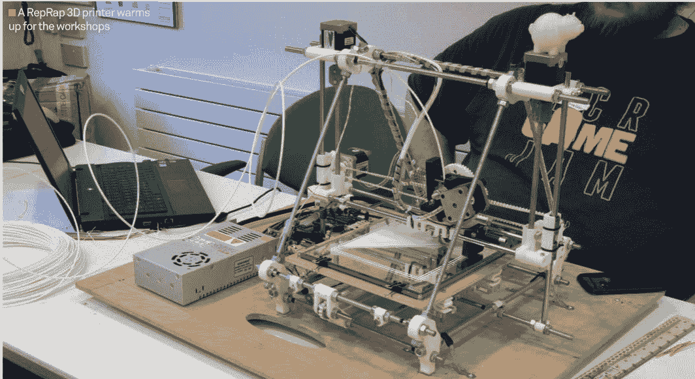

## 在物联网（IoT）中生存

英国的基层开源硬件社区让爱好者成为了职业者

每年一次，约克郡温馨的赫布登桥（`Hebden Bridge`）磨坊就会被机器人“入侵”。房间里挤满了 `RepRap` 3D 打印机、电脑、`Arduino` 以及偶尔出现的树莓派，所有的都经过了精细调整，实现了令人惊叹的成就。由开源硬件用户小组（`OSHUG`）举办的“`OSHCamp`”已成为英国创客社区的年度朝圣活动。今年活动（位于狂风节 `Wuthering By` Festival 期间）最显著的变化是， `OSHUG` 的贡献者更加关注业务，这代表了开源硬件世界的一个巨大变化：从黑客行为到穿上西装领带？

“非常棒，现在有更多的人可以通过他们热爱的事维持生计，” `Tanner` 回答道。

`Tanner` 和他的同事一直在为伦敦的建筑师开发一种新的“活跃房屋”。该项目使用开源硬件传感器、执行器和 `Arduino` 控制器以及树莓派，以最大限度地减少能量需求。它将更有效地利用自然阳光、热窗帘和照明。

> “这栋房子正进入它的第一个测试阶段，将与其住户进行智能互动，既可以自主运行，也可以在适当的情况下判断，” `Tanner` 告诉我们，“我们正在使用基于房间的模块和一些特殊系统，我们打算让系统是低成本的，硬件和软件都是开源的。”


北伦敦最智能的房屋——由 `Paul Tanner` 及其打造

Linux 社区的最新动态

开源


| 链接 |
|---|
| OSHCamp/Wuthering Bytes 视频：`wutheringbytes.com`, `oshug.org/event/oshcamp2013` |
| 更多关于 Atherton 作品：`finiteatenthans.wordpress.com` |
| Adrian McEwen 的博客（带有其新书《设计物联网》的链接）：`mcnczn.net/mcewen` |
| Shay Moradi 的数字利用：`rth.co.uk` |
| 机器人操作系统 (ROS)：`www.willpage.com/pages/ros-platform` |

在关于“打造创客”以及基于用户体验（`UX`）设计的商业化应用日益增加的演讲中，当天的最突出的环节之一是“爱上产品”，强调了开源企业和项目关注用户的真实需求。在参加完会议后，他介绍了自己。在教学了几年书后，`Atherton` 写了一部自传，解释了她最终如何理解了用户需求并转而从事 `UX` 咨询。

> “做出更好东西的第一要任务是——与人们相处，”他说，强调了用户并不是同质的，人的需求像 `A/B` 测试一样多样。这一信息得到了专业框架的支持，以用于研究和从用户身上学习。

对于开源世界来说，专业化并非全好。在这一场会议中，当天的作者兼编辑 `Adrian McEwen` 警告说在物联网产品核心的围栏 `ISP` 网络（计算）之间创建平行设施是危险。他解释说，由于 `Wi-Fi` 连接对无线设备消耗了过多功率，`ZigBee`、蓝牙和 `Z-Wave` 等标准阻碍了开放 `API`，但实际上它们比这更好，因为连接到了云端的闭源系统。然而，他也警告说，为物联网创建一个单一标准的讨论是徒劳的：“这是解决实际问题（互操作性）。物联网涵盖了生活的许多领域——我们需要关注用现有解决方案来解决问题。”

米德尔塞克斯大学（`Middlesex University`）的技术教程 `Nick Weller` 通过新用户的有用视角，对如何良好使用开源 `ROS`（机器人操作系统）进行了实用介绍。`Weller` 解释了如何能更容易为设备和机器人创建基于社区的平台。通过 `ROS` 新的共享课程，通过相对简单的配置可以使用许多开发设备的工具。

所有 `ROS` 操作都始于使用统一机器人描述格式 (`URDF`) `XML` 模型定义您的设备参数。之后，运动、感知、绘图和绕过障碍重新计算路线即可作为 `ROS` 的功能可用。尽管演示在演讲期间失败了，但事实上，`Nick Weller` 坚持了下来。到了晚上，他赢得了 1000 英镑


最大的灵活性

Linux 社区的最新动态

开源


| 链接 |
|---|
| OSHCamp/Wuthering Bytes 视频：`wutheringbytes.com`, `oshug.org/event/oshcamp2013` |
| 更多关于 Atherton 作品：`finiteatenthans.wordpress.com` |
| Adrian McEwen 的博客（带有其新书《设计物联网》的链接）：`mcnczn.net/mcewen` |
| Shay Moradi 的数字利用：`rth.co.uk` |
| 机器人操作系统 (ROS)：`www.willpage.com/pages/ros-platform` |
| Ariel Balikan 为 Prometheus 完成的任务：`codename-prometheus.eu` |

`Adrian McEwen` 在座无虚席的市政厅进行演讲

在关于“打造创客”以及基于用户体验（`UX`）设计的商业化应用日益增加的演讲中，当天的最突出的环节之一是“爱上产品”，强调了开源企业和项目关注用户的真实需求。在参加完会议后，他介绍了自己。在教学了几年书后，`Atherton` 写了一部自传，解释了她最终如何理解了用户需求并转而从事 `UX` 咨询。

> “做出更好东西的第一要任务是——与人们相处，”他说，强调了用户并不是同质的，人的需求像 `A/B` 测试一样多样。这一信息得到了专业框架的支持，以用于研究和从用户身上学习。

对于开源世界来说，专业化并非全好。在这一场会议中，当天的作者兼编辑 `Adrian McEwen` 警告说在物联网产品核心的围栏 `ISP` 网络（计算）之间创建平行设施是危险的。他解释说，由于 `Wi-Fi` 连接对无线设备消耗了过多功率，`ZigBee`、蓝牙和 `Z-Wave` 等标准阻碍了开放 `API`，但实际上它们比这更好，因为连接到了云端的闭源系统。然而，他也警告说，为物联网创建一个单一标准的讨论是徒劳的：“这是解决实际问题（互操作性）。物联网涵盖了生活的许多领域——我们需要关注用现有解决方案来解决问题。”

`OSHCamp` 远不仅仅是参与者的政治和业务话题。在活动中，`Shay Moradi` 的演示取得了巨大的成功。他们的“数字胶带”方法专注于让事物运行并完善，竞争者被邀请回到《小妙物秀》参加多项挑战，还为 `Channel 4` 频道在伦敦塔字楼侧面展示了世界“最大的多人游戏”。

米德尔塞克斯大学（`Middlesex University`）的技术教程 `Nick Weller` 通过新用户的有用视角，对如何良好使用开源 `ROS`（机器人操作系统）进行了实用介绍。`Weller` 解释了如何能更容易为设备和机器人创建基于社区的平台。通过 `ROS` 新的共享课程，通过相对简单的配置可以使用许多开发设备的工具。

所有 `ROS` 操作都始于使用统一机器人描述格式 (`URDF`) `XML` 模型定义您的设备参数。之后，运动、感知、绘图和绕过障碍重新计算路线即可作为 `ROS` 的功能可用。尽管演示在演讲期间失败了，但事实上，`Nick Weller` 坚持了下来。到了晚上，他赢得了 1000 英镑


## 最大的灵活性

17 www.linuxuser.co.uk

## Linux 社区的最新动态

### 开源


| 链接 |
|---|---|
| OSHCamp/Wuthering Bytes 视频：`wutheringbytes.com`, `oshug.org/event/oshcamp2013` |
| 更多关于 Atherton 作品：`finiteatenthans.wordpress.com` |
| Adrian McEwen 的博客（带有其新书《设计物联网》的链接）：`mcnczn.net/mcewen` |
| Shay Moradi 的数字利用：`rth.co.uk` |
| 机器人操作系统 (ROS)：`www.willpage.com/pages/ros-platform` |
| Ariel Balikan 为 Prometheus 完成的任务：`codename-prometheus.eu` |

您的 Linux 新闻与观点来源


## 英国的基层开源硬件社区让爱好者成为了职业者

每年一次，约克郡温馨的赫布登桥（Hebden Bridge）磨坊就会被机器人“入侵”。房间里挤满了 RepRap 3D 打印机、电脑、Arduino 以及偶尔出现的树莓派，所有的都经过了精细调整，实现了令人惊叹的成就。由开源硬件用户小组（OSHUG）举办的“OSHCamp”已成为英国创客社区的年度朝圣活动。今年活动（位于狂风节 Wuthering By Festival 期间）最显著的变化是， OSHUG 的贡献者更加关注业务，这代表了开源硬件世界的一个巨大变化：从黑客行为到穿上西装领带？

“非常棒，现在有更多的人可以通过他们热爱的事维持生计，” Tanner 回答道。

Tanner 和他的同事一直在为伦敦的建筑师开发一种新的“活跃房屋”。该项目使用开源硬件传感器、执行器和 Arduino 控制器以及树莓派，以最大限度地减少能量需求。它将更有效地利用自然阳光、热窗帘和照明。

> “这栋房子正进入它的第一个测试阶段，将与其住户进行智能互动，既可以自主运行，也可以在适当的情况下判断，” Tanner 告诉我们，“我们正在使用基于房间的模块和一些特殊系统，我们打算让系统是低成本的，硬件和软件都是开源的。”


16 www.linuxuser.co.uk

## 新闻

### Linux 社区的最新动态

### 开源


| 链接 |
|---|---|
| OSHCamp/Wuthering Bytes 视频：`wutheringbytes.com`, `oshug.org/event/oshcamp2013` |
| 更多关于 Atherton 作品：`finiteatenthans.wordpress.com` |
| Adrian McEwen 的博客（带有其新书《设计物联网》的链接）：`mcnczn.net/mcewen` |
| Shay Moradi 的数字利用：`rth.co.uk` |
| 机器人操作系统 (ROS)：`www.willpage.com/pages/ros-platform` |
| Ariel Balikan 为 Prometheus 完成的任务：`codename-prometheus.eu` |

## Adrian McEwen 在座无虚席的市政厅进行演讲

在关于“打造创客”以及基于用户体验（UX）设计的商业化应用日益增加的演讲中，当天的最突出的环节之一是“爱上产品”，强调了开源企业和项目关注用户的真实需求。在参加完会议后，他介绍了自己。在教学了几年书后，Atherton 写了一部自传，解释了她最终如何理解了用户需求并转而从事 UX 咨询。

> “做出更好东西的第一要任务是——与人们相处，”他说，强调了用户并不是同质的，人的需求像 A/B 测试一样多样。这一信息得到了专业框架的支持，以用于研究和从用户身上学习。

## 并非一切都好

对于开源世界来说，专业化并非全好。在这一场会议中，当天的作者兼编辑 Adrian McEwen 警告说在物联网产品核心的围栏 ISP 网络（计算）之间创建平行设施是危险的。他解释说，由于 Wi-Fi 连接对无线设备消耗了过多功率，ZigBee、蓝牙和 Z-Wave 等标准阻碍了开放 API，但实际上它们比这更好，因为连接到了云端的闭源系统。然而，他也警告说，为物联网创建一个单一标准的讨论是徒劳的：“这是解决实际问题（互操作性）。物联网涵盖了生活的许多领域——我们需要关注用现有解决方案来解决问题。”

OSHCamp 远不仅仅是参与者的政治和业务话题。在活动中，Shay Moradi 的演示取得了巨大的成功。他们的“数字胶带”方法专注于让事物运行并完善，竞争者被邀请回到《小妙物秀》参加多项挑战，还为 Channel 4 频道在伦敦塔字楼侧面展示了世界“最大的多人游戏”。

米德尔塞克斯大学（Middlesex University）的技术教程 Nick Weller 通过新用户的有用视角，对如何良好使用开源 ROS（机器人操作系统）进行了实用介绍。Weller 解释了如何能更容易为设备和机器人创建基于社区的平台。通过 ROS 新的共享课程，通过相对简单的配置可以使用许多开发设备的工具。

所有 ROS 操作都始于使用统一机器人描述格式 (URDF) XML 模型定义您的设备参数。之后，运动、感知、绘图和绕过障碍重新计算路线即可作为 ROS 的功能可用。尽管演示在演讲期间失败了，但事实上，Nick Weller 坚持了下来。到了晚上，他赢得了 1000 英镑


## 最大的灵活性

- 超过 300 Gbit/s 的带宽

## 地缘冗余

## Web 统计

- `NetObjects Fusion` 2013

## PHP 5.4

## CDN

- 免费模式或安全模式

## SEO

- `MySQL`
- 通讯工具

## 超过140 应用程序

- `Drupal`, `WordPress`, `Joomla`, `TYPO3`, `Magento`...

## 保证性能

- 每日备份
- 移动网站生成器
- 包含 `Adobe Dreamweaver CS5.5`


互联网以及我们用来通过电线或无线进行交互的数字工具，从根本上改变了我们的沟通方式和生活方式。

作为独立企业、唱片出版商和商店，我们提供的一系列书籍正面临生存危机。

几年前，这些边缘业务及其巨头亲戚（唱片和媒体公司）的缓慢死亡被完全归咎于用户和技术。

但变化是不可避免的。互联网和全球化正在从根本上改变我们的社会、生活、工作方式，以及经济和税收分配。

全球化正在松动将我们生活在一起的胶水。

这一现象的一个方面是英国政府通信总部（GCHQ）和美国安全局（NSA）对我们公民身份监视的披露，以及政府是如何应对的。

近期，在英国反应相对平淡的情况下，《卫士报》、《每日邮报》、《泰晤报》、《独立报》和《英国电讯》等报纸认为，《卫士报》面临压力，发布斯斯德登泄露的材料，理由是这些材料涉及“安全”。

保守党议员路易丝·梅恩（Louise Mensch）在《太阳报》版面中主张斯斯德登应该受到起诉；随后首相大卫·卡梅隆（David Cameron）辩称该授权是合法的，但批评了《卫士报》。这似乎是关于安全和隐私的议会讨论的结果。其他人（如《先驱报》）声称，持续的监控情报遭到了机构（我们使用的企业媒体渠道）的应对，这些机构非常接近奥威尔《1984》中的世界。史密斯（Smith）指出，“他可以离线，至少是一段时间。但今天，由于无处不在的摄像头和全球追踪，他会确切知道自己在哪里。”

这就是所有具有奥威尔色彩的“媒介化”所能达到的，它是从网上挖掘出来的，使得我们的生活通过算法变得如此透明，以至于我们分析自己使用什么、何时见面以及去何处。

人们说：“如果我们不是第一个发现一条可能被删除的记录的人，该怎么办？”

当然，更广泛的现实是，英国报纸在经济时期挣扎生存，无法与互联网竞争。《卫士报》已经预测，除非它找到确保其作为网络报纸未来的新方法，否则其纸质版可能会停止。

互联网远非所有信息的源源，它是全球变化的体现和反映。但社交媒体在处理这些变化方面也具有一定的创造性。例如，曾经有人告诉我们世界已经从传统限制中解放出来，


# 理查德·希利斯利（Richard Hillesley）

关于音乐、数字权利以及适用于各种出版物的 Linux

在印刷机发明和工业革命的剧变之前，人类社会几乎完全依赖口头交流。在过去的 120 年里，无线电、家用冰箱和电视时代改变了我们的生活方式，但过去 30-30 年的数字革命正在发生变革。

互联网为信息和思想交换提供了可能，以及我们分享这些思想的方式。如果这些知识和思想成为所有人的通用资源，互联网给了我们机会在一个开放共享的世界中找到新的工作和生活方式，而不受政府或公司的干预。

当然，我并不真的喜欢那种工作。数字世界在提供信息访问的同时，也是为了商业利益和那些想要控制的人准备的。其中的一些影响是我们我们面前面临的增加和选择。Talking Heads 乐队的大卫·伯恩（David Byrne）认为：“互联网将吸干世界上所有的创意内容。亚马逊让买书变得容易，但它的影响是减少

# 互联网和全球化正在从根本上改变我们的社会和生活

伴随着就业实践

## 在 Linux 社区中

### 开源


Simon 希望将事情缩小到可以管理的尺寸……

乔治·伯纳德·肖（George Bernard Shaw）曾自信地预测，到 2000 年我们将每天工作两小时

各种杂杂 Linux 发行版的每日访问量。说实话，这比其他任何事情更多是在衡量兴趣，而且并没有带来下载量。而且，这并不是 Linux 操作系统多种口味的快照。过去一年 `Linux Mint` 的兴起对于那些关注过 `Mint` 或 `DistroWatch` 的人来说是不可置信的。

人们说：“如果我们不是第一个发现一条可能被删除的记录的人，该怎么办？”

当然，更广泛的现实是，英国报纸在经济时期挣扎生存，无法与互联网竞争。《卫士报》已经预测，除非它找到一种确保其作为网络报纸未来的新方法，否则其纸质版可能会停止。

互联网远非所有信息的源源，它是全球变化的体现和反映。但社交媒体在处理这些变化方面也具有一定的创造性。例如，曾经有人告诉我们世界已经从传统限制中解放出来，

# 理查德·希利斯利（Richard Hillesley）

关于音乐、数字权利以及适用于各种出版物的 Linux

在印刷机发明和工业革命的剧变之前，人类社会几乎完全依赖口头交流。在过去的 120 年里，无线电、家用冰箱和电视时代改变了我们的生活方式，但过去 30-30 年的数字革命正在发生变革。

互联网为信息和思想交换提供了可能，以及我们分享这些思想的方式。如果这些知识和思想成为所有人的通用资源，互联网给了我们机会在一个开放共享的世界中找到新的工作和生活方式，而不受政府或公司的干预。

当然，我并不真的喜欢那种工作。数字世界在提供信息访问的同时，也是为了商业利益和那些想要控制的人准备的。其中的一些影响是我们我们面前面临的增加和选择。Talking Heads 乐队的大卫·伯恩（David Byrne）认为：“互联网将吸干世界上所有的创意内容。亚马逊让买书变得容易，但它的影响是减少

伴随着就业实践

### 开源


Simon 希望将事情缩小到可以管理的尺寸……

乔治·伯纳德·肖（George Bernard Shaw）曾自信地预测，到 2000 年我们将每天工作两小时

各种杂杂 Linux 发行版的每日访问量。说实话，这比其他任何事情更多是在衡量兴趣，而且并没有带来下载量。而且，这并不是 Linux 操作系统多种口味的快照。过去一年 `Linux Mint` 的兴起对于那些关注过 `Mint` 或 `DistroWatch` 的人来说是不可置信的。

（此处省略了重复内容）

Simon 希望将事情缩小到可以管理的尺寸……

乔治·伯纳德·肖（George Bernard Shaw）曾自信地预测，到 2000 年我们将每天工作两小时

各种杂杂 Linux 发行版的每日访问量。说实话，这比其他任何事情更多是在衡量兴趣，而且并没有带来下载量。而且，这并不是 Linux 操作系统多种口味的快照。过去一年 `Linux Mint` 的兴起对于那些关注过 `Mint` 或 `DistroWatch` 的人来说是不可置信的。

您的 Linux 新闻与观点源泉

Jon Masters 总结了内核社区的最新动态，此时 `Linux 3.12` 最终版本的准备工作已接近完成。

Jon Masters 是一位 Linux 黑客，从事 Linux 工作已超过 18 年。他曾参加过 `Linux+` 等会议，居住在马萨诸塞州剑桥市，并在一家大型企业工作。他维护着 `Linux` 内核邮件列表摘要。

在 `GCC` 中使用 `'asm goto'` 语句（内联汇编代码中的跳转）时出现 bug。该实际问题是在等待合并到 `3.12` 的代码合并窗口中检测到的（在 `3.12` 发布后），但由于并不显而易见问题并非容易修复，一个快速修复程序已合并到 `3.12`。

这包含了新增内容以及“白色条目（whites）”。后期的文件条目的创建是为了指令联合文件系统隐藏用户已删除的旧条目。`rename` 调用允许创建一个白色条目，然后将其原子化地交换到黑色条目的位置，从而有效地替换旧链接，以及以前无法实现的其他操作。

`Linux Ubuntu 3.12 Release Candidate (RC) 6` 从 `3.12-at` 飞往俄勒冈州波特兰机场，在 `PDX` 表示飞往 `Linux` 峰会，而且这又是一个使用内联 `Wi-Fi` 的 `RC` 版本。所以它就在这里……Pixed，PDX `Wi-Fi` 已用于展示日益增长内核工作。

Miklos Szires 在给 `Linux` 内核邮件列表 (`LKML`) 的邮件中引入了一个新的补丁系列。`RFC` 增加了对名为 `rename(2)` 的新调的支持，它类似于原始的 `rename`。使用内联标志，可以实现 `rename(2)` 系统调用，除了重命名文件外，还能跨目录原子更改目录条目。

多年来，Stephen Ritzwell 一直维护着 `'linux-next'` 内核（源代码补丁集合），这是来自许多不同来源的个人开发者线程的组合。事实上，他是唯一要求其正在使用的预览内核在 `-linux-next` 分支中占有一个位置的人。

随着 `Linux` 准备在爱丁堡举行 `2013` 内核峰会，许多开发者和研究人员正在等待补丁。预计 `3.12` 不会有太大的惊喜。好消息是，上一个 `RC` 版本的情况要好一点。

`3.12-RC6` 包含了一个针对此处未修改编译器的后期变通方法。

`rename` 系统调用存在是为了让联合文件系统更易操作，就像简单交换两个文件一样。在许多情况下（如路由器设备、文件系统 `USB` 闪盘等），联合文件系统会创建一个带有小型可写部分的只读文件

该函数在日常循环中经历了一个（此前宣布并非常期待的）三周中断。Stephen 并没有预料到有人像 Thierry 那样做。Thierry 可能更适合图形相关工作，但他在……有一份惊人的工作

内核专栏 – Jon Masters

代表 Stephen，处理那些难以对付的合并冲突、修复补丁以及为开发拉入新树。他也与 Matt 一工作了几天。如果内核社区的成员都在那里（偶尔像发生过的那样），我们可以有这种连续性，这是很好的。允许在不求助于调试器的情况下进行极早的调试。在那些 `UEFI` 的系统上，内核将在调用 `I/O` 设备（如系统端口）之前使用 `EFI` 提供的接口支持虚拟机。Metcalf 发布了许多补丁，实现了 Tier 架构的虚拟化支持。也许最有趣的是虚拟机的实现提供了底层虚拟化程序在所有基于系统的系统中可能的接口。换句话说，`rename2` 系统调用直接运行在基础内核上，但底层有 `UEFI` 抽象。James Bottomley 代表 `Linux Plumbers` 领导委员会（`Linux Plumbers Steering Committee`）发布了下一个 `Plumbers` 计划。我们最喜欢的地点是德国杜塞尔多夫，与 6 月的欧洲 `Linux` 大（`LinuxCon Europe`）同期，我们愿意邀请参加11 月的北美 `Linux` 大（`LinuxCon North America`）。大量的 `UEFI` 代码可以进入内核，特别是为了统一我们现在（`64 位 x86` 和 `ARM`）之间的代码并减少重复。其他补丁包括来自 `Linux` 的运行时服务（Runtime Services），它消除了潜在重入问题（从内核的不同部分同时调用两次 `UEFI` —— 这是不支持的）。Matt 还在 `EFI` 代码中合并了对 `'earlyprint'` 的支持。

系统调用是用户空间请求内核服务的手段。通常，这些是在系统调用内部执行的，对于内存分配、打开和关闭文件句柄等操作，在底层并非基于用户模式。


`rename2()` 系统调用用于在文件系统上打开文件。应用程序调用此来为同一个物理 `inode` 创建多个目录条目，而库函数提供了插入到内核的指令，并相应地映射这些条目。系统调用的结果由 `C` 在用户空间与内核调用之间的一一映射管理。例如，没有 `fork` 系统调用，但有几个系统调用实现了该功能。实现该功能的 `C` 库函数也不在实际的底层代码中。最后 `Kevin` 又过一个月，`Kevin Apa` 发布了一个针对 `x86` 代码入口的补丁，该补丁通过 `GRUB` 或其他引导程序加载 `Linux` 内核镜像并执行内核入口。这是使用 `Android` 手机上的内核完成的。作为回应，这可能是一个新的 `Linux` 里程，在扭曲的，交换。为了理智起见，希望这不要变成常态！

手机版 `Ubuntu` 现在已经稳定，所以我们去体验一下，并与 `Canonical` 的 `Ubuntu` 移动产品经理 `Richard Collins` 聊天

`Ubuntu 13.10` 的发布标志着几点——例如对核心操作系统进行的一些微更新，以及面向下一个长期支持（`LTS`）版本的功能。最重要的是，这意味着 `Ubuntu` 在手机上的第一个稳定版本。从发布至今还未一年，虽然还有一些工作要做，且没有专用的硬件，但看到操作系统发展到这种程度真是令人惊叹。

在发布前几天，我们在伦敦的 `Canonical` 总部与 `Richard Collins` 讨论了最新版本以及 `Ubuntu` 手机的未来。`Collins` 是 `Ubuntu` 移动产品经理，在此公告之前一直在密切工作其其他方面。显而易见，该操作系统仍有大量工作要做——这也意味着在为设备创建生态系统方面。我们将向你展示如何开始为手机操作系统开发应用，以及你如何部署它们。

## 介绍手机版 Ubuntu 是如何开展的，以及未来将如何

手机版 `Ubuntu` 是如何开展的，以及未来将如何，正如 `Richard Collins` 所述

“我们有几个重点，”`Collins` 开始说道。他手里拿着 `Nexus 4`，这是一个稍旧的 `Ubuntu Touch` 构建版本。在过去的几个月里，操作系统的开发压力很大，他详细说明了一些变化。

“在引入我们的 `mir`（一个窗口管理器）方面，我们发生了巨大的转变。这是一项重要的工程工作，使系统能够高效运行。”

“这将在整体性能、电池寿命和资源生命周期模型方面带来收益。我们有了后台服务的运行，这意味着多任务处理运行得非常高效。”

“并不是让智能手机以所需的方式运行都是绝对必需的，因此努力一直集中在完美优化该系统上。这对硬件制造商来说非常重要，因为他们希望看到进展和基准测试，这让他们能够开始认真考虑迈向硬件生产的下一步。”

让合作伙伴对操作系统感兴趣将是团队工作的一部分，当然，尽管目前还没有其他途径。

“我们一直在仔细倾听，并与潜在的硬件和运营商合作伙伴进行交流，并将这些反馈到我们的系统设计工作中，通常是为了确保——作为一个操作系统——它已经准备好投入。系统能力、基础设施，正如我所说的，优化元素已经存在并可用，这为我们开发一系列服务提供了基础。因为系统现在可以支持这些服务。”

# Ubuntu Touch

手机版 `Ubuntu` 是是如何演变的，以及未来将如何


虽然 `Edge` 在 `Indiegogo` 众筹活动打破了若干众筹记录，但遗憾的是它注定失败。在设备上投入了大量精力，这是否影响了 `Android` 的开发？

> “如果成功了，我们将能够直接走向生产化。它将让我们以与 `Android` 并行的方式运行。我们从未考虑过将 `Edge OS` 作为主设备进行测试。我们会并行进行。”

`Edge` 本本会加速我们目前的开发：

看到一个工程良好的平台，这正是 `13.10` 版本为他们提供的服务。

为了让制造商能够在任何硬件上运行，`Touch` 能够部署在任何 `Android` 设备上。`Android` 设备的性能范围差异巨大，那么操作系统是如何处理这些的呢？

“该操作系统是完全可扩展的，”`Collins` 回道，“如果你想触达任何手机，那么我们的建议是基于这些对设备的转换，这意味着内置的硬件要求，例如足够的内存、`CPU` 性能，确保你有 `HDMI` 等。因此 `Ubuntu` 的基础目标是高标准的，从根本上是围绕这种转换设备、到操作系统的转换构建的。这意味着硬件制造商必须承担某些要求才能构建操作系统。

`Ubuntu` 拥有强大的社区方法，虽然让硬件开发者加入很重要，但社区已经在尝试创建或开发应用程序了。这些应用程序的简短列表可以在 `Touch wiki` 上找到，但这不是创建应用的唯一方法。我们希望在内部拥有自己的市场形式。

“是的，有一个应用商店来构建它，但我们希望人们构建应用程序，开发者可以轻松地直接发布到他们的参考硬件上，”告诉他们，“我们管理其他内容，如标准镜像中应用程序的多样性。这个特定的版本并没有显示我们拥有的全部内容。但尽管如此，就目前而言，重要的是开发者在现在和未来可以变得非常积极，利用它来开发自己的应用程序。”

> “操作系统是完全可扩展的，我们不需要为了关注特定类型的硬件或产品而适配某个版本的操作系统”

你已经可以在网上找到少量社区应用

`Ubuntu 13.10` 正式引入了 `Click` 包，这是将应用程序部署到 `Ubuntu` 移动版本的方法。这是社区参与该项目的一大步，`Collins` 对此感到兴奋：

此列表显示了 `Collection` 中已可用的应用程序

| 应用程序 | 指南 | 软件包构建方式 | 状态 |
| --- | --- | --- | --- |
| `Akiko Camera` | `Launchpad` | `click` | 可用 |
| `Akiko Files` | `Launchpad` | `click` | 可用 |
| `Elements Touch` | `Launchpad` | `click` | 可用 |
| `Firefox Mobile` | `Launchpad` | `click` | 可用 |
| `Geary` | `Launchpad` | `click` | 可用 |
| `Simple Touch` | `Launchpad` | `click` | 可用 |
| `Web Browser` | `Launchpad` | `click` | 可用 |
| `Ubuntu Maps` | `Launchpad` | `click` | 可用 |
| `Ubuntu Terminal` | `Launchpad` | `click` | 可用 |

> “你对系统和设置完全访问权限。开发者的 `SDK` 也相当简单，现在开发者可以轻松地实际构建并将他们的应用程序直接发布到设备上。”

此列表显示了在纳入 `Collection` 之前需要处理和完成的任务

| 应用程序 | 指南 | 软件包构建方式 | 状态 |
| --- | --- | --- | --- |
| 深色模式 | `Launchpad` | `click` | 待处理 |
| 系统设置 | `Launchpad` | `click` | 待处理 |

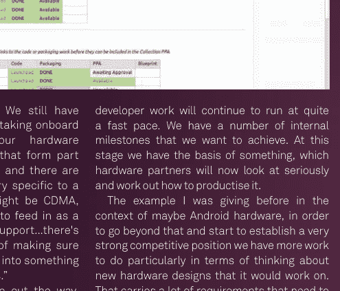

默认应用程序有一个正式的申请流程——目前大部分，或以任何方式妥协。在接纳我们硬件设计组的要求方面我们仍然需要做一些工作，有些事情特别针对我们的需求，开发工作将继续保持快速运行。

我们已经开始实现这一点。这是合作伙伴工作的新方式，并研究如何生产它

默认应用程序有一个正式的申请流程——目前大部分，在审核后它们将作为某些被包含——我们已经将其纳入 `13.10` 版本中，尽管目前主要是这样。

那是我们需要作为需求输入的内容，在确保对我们的合作伙伴是高效的方面有很多工作要做的。

我们将继续在也许是 `Android` 的背景下工作，以便超越并开始建立一个非常有竞争力的地位，`Collins` 告诉我们，到为止还没有放弃过任何东西，主要是由于他们开发的方式。

随着 `13.10` 的发布，我们开发团队的工作方式？这带有一系列需要解决的需求列表

“我们有一个非常激进的开发计划，要一贯到底。仅仅因为我们在 `13.10` 中做了这些更改，并不意味着我们会慢下来”

“我们有一长长的需要处理的任务列表，我们非常积极地获取运营商和社区成员的需求”

“我们仍然有一个野心勃勃的开发计划，”`Collins` 结束道。

> 开发者有一个正式的申请流程来提交他们的应用程序，在审核后它们有时会被作为默认应用程序


## 让我们让手机版 Ubuntu 体验一下


以下是如何在 `Nexus 4` 或 `Galaxy Nexus` 上安装 `Ubuntu`……

作者 `vikas@ubuntu.com`

## 02 备份

我们需要擦除手机进行备份；目前没有双启动。进入开发者选项并启用调试。确保它仍连接到电脑，并在终端输入 `all`


```
sudo apt-add-repository ppa:ubuntu-dev-tools/ubuntu-tools
更多信息 (https://launchpad.net/ubuntu-dev-tools)
* GitHub: https://github.com/ubuntu-dev-tools
* Ubuntu 开发工具: https://wiki.ubuntu.com/UbuntuDevTools
* PPA: https://launchpad.net/ubuntu-dev-tools/ubuntu-tools
```

## 01 初始设置

你需要`Ubuntu 12.04`或更高版本来安装手机。首先，添加仓库：

```
sudo apt-add-repository ppa:ubuntu-team/team
sudo apt-get install install-tools android-tools-fastboot
```

更新存储库，然后安装必要的软件：

## 03 解锁手机

如果你还没有，则需要解锁手机，如果还没有这样做，重启设备进入引导加载程序。确保手机仍连接到电脑

## 04 最终检查

你需要解锁引导加载程序，需要开发者选项和`USB`调试。确保你的手机连接到电脑，并记录手机版本号以便恢复。

## 05 安装

我们现在准备好安装了。打开终端并输入：

```
$ fastboot flash ubuntu-system-no-backup
```

这个过程需要一些时间。

## 社区感

# Ubuntu Touch

一款为`Ubuntu Touch`设计的简单数独游戏，具有智能谜题生成算法和非常快的系统。界面采用了`Ubuntu`的橙色、紫色和深紫色精细设计。

## 下落字母

这款社区开发的游戏涉及在字母从屏幕顶部落下时填充区域。在某一列到达屏幕顶部之前，需要拼出单词，允许出现多个单词。

## 股票行情

对于有商业头脑的人来说是必备，这款股票行情应用移植自`Ubuntu`，并提供你关注的公司的股票价格，通过图表帮助可视化每只股票的趋势。它也会更新你的生活，只要你有互联网连接即可。

## Ubuntu Touch 特性

## 快速上手指南

通过这些技巧和方法，让你的`Ubuntu Touch`有一个良好的开始

全新的手机操作系统意味着有很多值得看的内容，也有很多需要适应的地方。虽然窗口切换和导航等基础功能非常直而易懂，但操作系统的一些问题需要更多的专业技巧才能正常运行——特别是当你想要最大限度地利用并访问手机的所有功能时。在设置设备之前，我们汇总了一些你应该应该了解的重要要点。

- 更新

`Touch`持续更新中，你需要让你的手机或其他设备保持到最新版本的`Ubuntu`及其软件包。除了经常需要重刷设备外（这种操作会比较频繁），在“应用（`Apps`）”子菜单上滑动展开它，并从列表中选择它。它将自动检测你想要安装的内容，以便你手动进行。这也会使用设备上的可用空间，例如磁盘工具和`Ubuntu Store`。

- 使用 `ADB` 传输文件

`ADB`是一个简单但多功能的命令行工具，允许你与任何`Android`设备通信。`Ubuntu Touch`利用此工具来备份你的手机，然后安装你需要的任何应用。它还可以使用`push`和`pull`命令在计算机和你的设备之间传输文件：

```
$ adb push [file] to [location]
$ adb pull [file] to [send]
```

- 设置 `Wi-Fi`

虽然`Nexus 4`和`Galaxy`支持无线网络，但其连接方式并不像使用`Android`设备的简单`UI`那样。`Wi-Fi`设置中的唯一选项是连接已保存的网络。

- 从左侧滑动进入菜单，或横跨屏幕滑动返回主屏幕。

- 向下滑动顶部栏，手指在不同的图标选择上移动。

- 从底部滑动访问应用的上下文和设置。若要连接，请在列表中找到该应用并输入：`nmcli wifi connect [name] [password]`。

- 恢复 `Android`

当你准备完成后，将`Android`恢复到你的设备。在我们提到的安装步骤中，请记下你的版本（`build`）——如果你想正确恢复手机，拥有确切的版本是非常重要的。从`Google`开发者页面下载镜像到文件夹中。现在使用以下命令重启到加载程序：

```
$ adb reboot-bootloader
```

然后执行：`fastboot flash-sh...`将`Android`刷入设备。

# Ubuntu Touch

让我们来尝试一下`Ubuntu`的移动版本

# 特性

为新的手机革命做出贡献，甚至可能包含在每个`Ubuntu`手机中。

## 为什么选择 Qt？

目前开发和部署由于使用`QML`，但`Canonical`告诉我们这只是建议——对应用开发留印象深刻，特别是`Qt Creator`中使用的特定`SDK`。

## 让它成为 Ubuntu

今天就通过`Ubuntu SDK`和应用设计指南开始吧。

- 创建新项目

- 在`launchpad`查看`Touch`核心应用

- 设计精美的东西

- 构建了不起的东西

加入我们的邮件列表，并在`freedesktop`上与`Ubuntu Touch`进行实时通信。

## Ubuntu 打包

## Hello, QML！

通过我们的“`Hello World`”向`Ubuntu`移动端问好！

手机开发可以通过许多方式完成——要么使用原始的`HTML5`网页，要么使用使用`QML`的传统应用程序。`Ubuntu SDK`用于手机开发，`Canonical`告诉了他们想要什么。有了这个入门框架，请访问`developer.ubuntu`上的`Ubuntu`开发者网站，并点击链接进入`Qt`、`QML`工具包和`SDK Creator`。

```
import QtQuick 2.0
import Ubuntu.Components 0.1

MainView {
    id: root
    objectName: "HelloWorld"
    width: parent.width
    height: parent.height
    property real units: units.pixel
    property real height: 0
    Page {
        title: "Hello World"
    }
}
```

创建你的应用

安装完成后，启动`Ubuntu SDK`并开始新项目。从这里你可以通过`Ctrl+Alt+R`测试软件包。

## 针对 Click 的打包

当你对创建的内容满意后，需要将其打包为`Click`应用。要进行此操作，在`Ubuntu SDK`中打开项目点击打包（`Packaging`）。填写表单中的详细信息。

`Ubuntu`应用使用自己的风格，以你的安全策略。

模板让开始变得简单。

## 评测

# Ubuntu Touch

一种界面范围，与桌面版同名，可以通过屏幕边缘滑动进行切换。`Ubuntu`可以轻松访问手机硬件，例如`GPS`和蓝牙连接。

## 常用应用

- 相机

- 地图

- 电话

- 天气

- `Ubuntu One`

- 记事本

本地天气

- 洛杉矶 72°

- 明天 8月11日

- 周六 8月12日

## 手机操作系统

`Ubuntu`的移动操作系统表现如何？它是否有潜力与`Android`和`iOS`竞争？我们在一些手机上加载了它进行测试……

“稳定”一词在`Linux`世界有特定的含义，实际上在开发阶段也是如此。它意味着至少功能完整，当 10 月 17 日被宣布为`Ubuntu`手机发布日期时，这是一个巨大的变化，而且开发并没有因为生活问题或错误而放缓。遗憾的是，这并不总是可用且稳定的，功能取决于运行的`Ubuntu`系统。这比在手机上刷入大多数`Android ROM`要多，所以不需要极大的耐心就能检查或准备参考设备。`Ubuntu Touch`目前的问题是它无法锁定，当它没有唤醒时，如果你在错误的时间滑动，会导致系统崩溃，需要强制重启。重启手机时，键盘键将出现在口袋键盘会隐藏的地方。如果只是易用性问题就好了了。遗憾的是，它现在基本上是坏的。

`Ubuntu`应用在某些界面部分使用自己的风格。开发网站列出了所有内容，并附有简单的教程教你如何操作。对于其他操作系统，会有更多应用，所以将`Ubuntu`作为默认软件包是很容易的。

模板让开始变得简单。

# Ubuntu Touch

它的表现如何？它能对抗`Android`和`iOS`吗？

## 测评

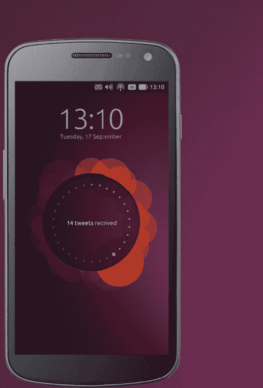


## 兼容设备

目前，`Ubuntu`适用于当时最新的设备`Galaxy S3`和`Nexus 4`。目标是让`Ubuntu`运行在`Android`硬件(`BPsP`)，但根据`Collins`的说法，目前仅适用于原始`Nexus 7`。


“Nexus 7 与智能手机的使用非常契合，但功能性强得多，因此它是 13.10 版本的更好选择。唯一的问题在于手机本身。”

- 方形屏幕更具动态感——然而设备无法正常唤醒屏幕。
- 操作系统可以访问所有数据和服务，这些服务也对开发者开放。

## 总结

手机上的界面钩子是导航环境的方式。无论是软键还是硬件按钮无处不在，你只需滑动到屏幕顶部即可访问它们。虽然这些功能还非常粗糙且主要为了展示，但它们已经完成了相当多的改进。

目前，仅针对此版本的开发者对 `Ubuntu` 的主手机操作系统有重大影响。

以键盘为导向的界面运行良好。正确执行滑动操作的学习曲线与熟悉任何新界面处于同一水平。

触摸功能目前可能还是一团 `Bug` 堆砌，使其现在更像是一个充斥着障眼法的手机操作系统。

某些工作仍需完成。`UI` 是最好的——而且它可以连接到 `WiFi` 网络，但我们需要修复连接管理。系统在启动和执行任务时仍然稳定，但需要一个更好的终端和模拟器。

对于键盘选择，目前操作系统的用户体验略有出入。如果你不是那种喜欢折腾一下的“恐怖份”，那么它可能并不适合你。作为浏览器的联网手机性能并不差。遗憾的是，还有大量工作要做，这绝不应该成为你决定是否在日常生活中使用 `Ubuntu` 的因素。

基础应用选择尚可接受，尽管目前许多高质量应用在他们的网站上缺失——在被告知其中一些应用将是原生的之后，我们感到有些失望。版本中还有几个游戏本认为可以来自社区，如果有更多人开始为它开发，这将是未来的趋势。

## 更多信息

`ubuntu.com/phone`

`33.linux.co.uk`

# LinuxUser & Developer

订阅代券

是的，我想订阅 `LinuxUser & Developer`

您的详细信息

标题 名字：

姓

地址

邮编 __________ 国家。

电话号码。

手机号码。

电子邮箱 请提供电子邮箱地址以接收我们的新闻和特别优惠

## 银行直接扣款付款

- 英国借记支付

我将以 5 英镑获得前 3 期，之后每 6 期仅支付 25.15 英镑。


您的银行或建筑合作协会的名称及全地址

| | | | 0 | 1 | 0 | 8 |
|---|---|---|---|---|---|---|

账号 {

排序代码 (`Sort code`)

日期

## 支付详情

您的专属优惠价格，一年（13 期）

- 英国：`£62.40` (节省 20%)
- 欧洲：`£70.00`
- 世界：`£80.00`

支票

- 我随信附一张 `£` 英镑的支票

（收款人为：`Imagine Publishing Ltd`）

信用卡/借记卡

- `Visa`
- `MasterCard`
- `Amex`
- `Maestro`

卡号

有效期

期数（如果为 `Maestro` 所示）

签名

日期

代码 `PG10344`

如果您不想通过邮寄或电子邮件接收来自 `Imagine Publishing Ltd` 的任何促销材料，请勾选。如果您不想通过邮寄或电子邮件接收来自其他公司的促销材料，请勾选。如果您不想通过电子邮件接收任何促销材料，请在此处勾选。

如果您希望从下一期可用的期刊开始取消直接扣款订单，请在此处勾选。可要求提供直接扣款担保。此优惠将在不通知的情况下过期。

将此表寄至：

`LinuxUser & Developer Subscriptions Department, 800 Gullivant Avenue, Kent Park, Sitting, ME9 8BU` 或通过电子邮件发送至 `service@linuxuser.co.uk`

您可以在 `www.imagineus.co.uk` 查看您的订阅详情

## 立即订购

树莓派 4 发行版订阅优惠

5 款应用与工具

# LinuxUser & Developer

加入……`Ubuntu` 移动革命

`SteamOS`

它是 `Linux` 的未来吗？

今天测试明天最火热的技术

独家访谈与首期

如何从网络浏览器进行 `SSH`

每期都提供 `Firefox OS` 发行版指南及更多内容！

# 学习编程

指南：`GO LANG` > `PYTHON`

通过网页控制您的树莓派

全能型

为您的树莓派介绍 `Flat Linux`

# 极佳订阅优惠

# 立即订阅，即可以 5 英镑获得前三期（节省 13.00 英镑）

- 每 6 期仅支付 25.15 英镑
- 免费送货

## 条款与条件

此优惠允许新订阅者以 5 英镑获得前三期。在6 期之后，订阅者将支付全价。可要求提供直接扣款担保。此优惠将在不通知的情况下过期。

# 创建你自己的 DEB 和 RPM 软件包

如何创建两种最常见的 `Linux` 软件包

教程

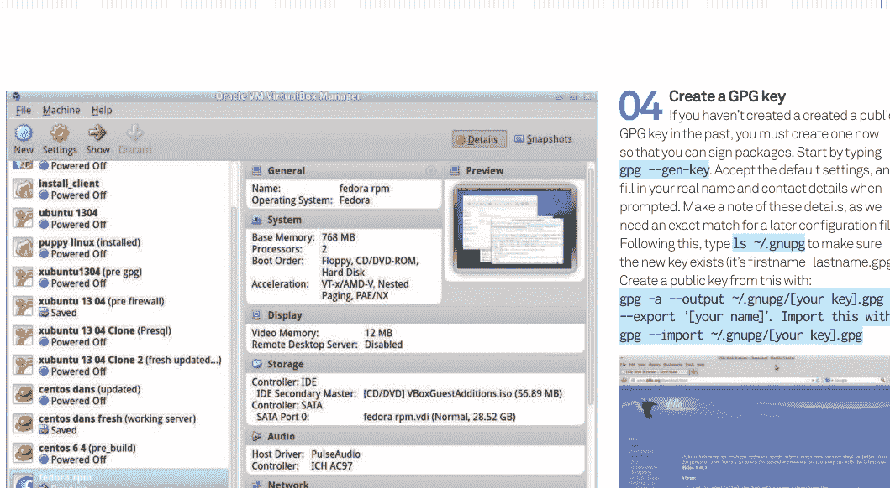

## 01 使用虚拟机

`VirtualBox` 是为其他系统构建软件包的最佳方法。其一，它允许你维护一个相对干净的参考安装环境，这与他人运行的设置环境具有可比性。这意味着你可以通过使用不同的发行版来保留目标环境的选择范围。此外，虚拟化允许支持不同的架构，甚至可以在 32 位平台上运行 64 位操作系统，尽管性能会受到影响。

## 第 1 部分 Debian

## 04 创建 GPG 密钥

如果你以前没有创建过公钥 `GPG` 密钥，请在签名你的软件包之前现在就创建一个。运行 `gpg --gen`，接受默认设置，并在提示时填写你的姓名和联系详情。记下这些详细信息，因为你将来还会需要它们。之后，使用 `gpg --list-keys` 找到你的密钥 ID（前几位-后几位）。

```
gpg --output /your/key/key.gpg --export 'your name' 使用 gpg --import /your/key/key.gpg 导入
```

## 05 获取软件包

在示例中，我们将构建最新版本的 `Dillo` Web 浏览器。访问该网站（`www.dillo.org`）并使用 `mkdir` 创建一个源码目录，并将压缩包移动到其中。

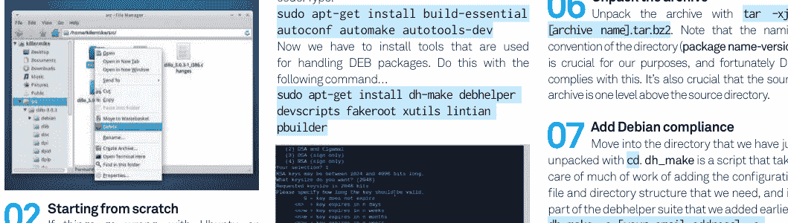

## 03 安装构建环境

我们将安装大多数从源码编译软件时需要的工具。

```
sudo apt-get install build-essential autoconf autotools-dev
```

现在我们拥有了处理 `DEB` 软件包所需的所有工具。使用以下命令进行操作：

```
sudo apt-get install dh-debhelper descriptscripts xutils lintbuilder
```

## 06 解压软件包

解压该名称的软件包（包名-版本号）。这对于我们的目的至关重要，最后将其解压。同样，压缩包位于源码目录的上一级也是至关重要的。

## 02 从头开始

如果出现问题，简单删除源码目录并重新开始是完全安全的。注意，`Debian` 工具也会修改源码，因此你必须从一个全新的副本开始。

## 07 添加 Debian 更改

使用 `dh-make` 移动我们已经解压的压缩包。这是一个负责配置配置文件和目录结构的脚本，我们需要在早些添加它。

```
dh-make --email <your email> --licence - -../archive
```

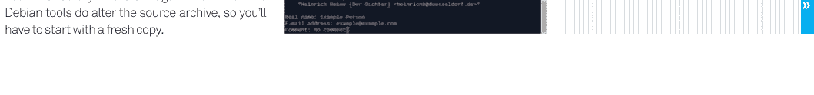

# 教程

创建你自己的 Deb 和 RPM 软件包

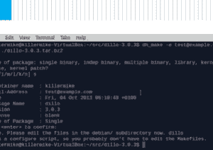

在示例中，命令是

`apt-get install example@example.com/dillo-0.3.1.tar.gz`

在提示时，选择 binary（二进制）。辅助脚本应该会在源码中内创建一个名为 deb 的目录。


```
Terminal - killermike@killermike-VirtualBox:~/src/dillo-3.0.3
File Edit View Terminal Tabs Help
checking for setsockopt() ... yes
checking for socklen_ ... yes
checking FLITK 1.3 ... yes
configure error: flitk-config not found
make error (failed)
strace -e trace=file -q -o /tmp/ph269 //
cd ~/src/dillo-3.0.3 && sudo apt-get build-dep dillo
[password for killermike]:
Building dependency tree
Done
Note: selecting 'libpng12-dev' instead of 'libpng-dev'
libpng12-dev libpng12-0 libpng12-turbo-dev libpng12-3
libpng12-dev libpng12-0 libpng12-turbo-dev libpng12-3
libz1g-dev libz1g-0-dev libxproto-core
libx11-dev libxext-tools xtrans-dev-libz1g-dev
The following packages will be installed:
1 upgraded, 25 newly installed, 0 to remove and 17 not upgraded.
Need to get 8.81 MB of free disk space to download. 29.1 MB of additional disk space will be used.
Do you want to continue? [Y]
```

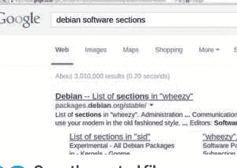

About 3,000,000 bytes (25 seconds)

- List of sections
- List of sections in "all"
- Communication, Programming, Libraries, Notebooks, Science & Technology
- List of sections in "devel"

## 08 打开文件

用文本编辑器打开 `deb` 子目录下的 `control` 文件。该文件的头部包含了名称和描述。

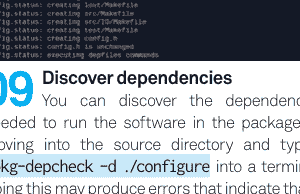

> 如果一切都设置好了，你可以通过手动运行 `dpkg-deb -d` 来完成 `DEB`，无需跳过它。源：项目的首页

## 10 将依赖项添加到 control 文件

当上一步命令完成后，继续所需的列表；列表中的每项必须用逗号和空格分隔。

## 09 发现依赖

你可能需要运行 `dpkg-deb -i`。在这种情况下，虚拟错误可能指示有一个构建依赖项可以发现。

## 12 修改 changelog

打开 `changelog` 文件，确保你在生成 `GPG` 密钥时输入的姓名和邮箱地址正确。通常，辅助脚本可能会添加你的用户名而不是真实姓名，这将有助于你对发行版的支持。如果不是，你必须反复跳过

# 创建你自己的 deb 和 RPM 软件包

创建最常见的 `Linux` 软件包

教程

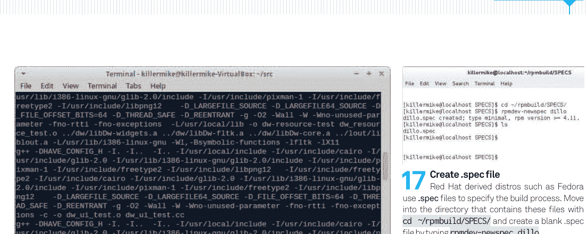

```
Terminal - killermike@killermike-VirtualBox:~/src
File Edit View Search Tabs Help
usr/lib/i386-linux-gnu/libgl-2.0 /usr/include/pixman-1 /usr/include/i386-linux-gnu/libgl-2.0
FILE OFFSET_BITS_64 -THREAD_SAFE REENTR -g -O2 -Wall -unused-parameters
amter -fPIC -D_GNU_SOURCE=206 -fstack-protector-a /lib/i386-linux-gnu
bout -a /lib/i386-linux-gnu.wi -Symbolic-functions -fPIC-shared
usr/lib/i386-linux-gnu/libgl-2.0 /usr/include/pixman-1 /usr/include/i386-linux-gnu/libgl-2.0
pec-2 /lib/i386-linux-gnu/libgl-2.0 /usr/include/pixman-1 /usr/include/i386-linux-gnu/libgl-2.0
spec-file
g12 -DFILE_SOURCE -DLARGFILE64 -FILE OFFSET_BITS_64 -THREAD_SAFE REENTR -g -O2 -Wall -unused-parameters -fno-PIC
DHAVE CONFIG_H -fPIC -D_GNU_SOURCE=206 -fstack-protector-a /lib/i386-linux-gnu /usr/include/pixman-1 /usr/include/i386-linux-gnu/libgl-2.0
imiman 1 - /usr/include/pixman-1/freetype-172 /usr/include/pixman-1/ /usr/include/pixman-1/ /usr/include/i386-linux-gnu/libgl-2.0
AD_SAFE -REENTR -g -O2 -Wall -unused-parameters -fno-PIC
/usr/lib/i386-linux-gnu/libgl-2.0 /usr/include/pixman-1 /usr/include/i386-linux-gnu/libgl-2.0
```

```
killermike@killermike-VirtualBox: ~/
File Edit View Search Terminal Help
[killermike@local SPECS] cd ~/rpmbuild/SPECS
[killermike@local SPECS] rpm --build dillo.spec
[killermike@local SPECS] # package version: 4.0.0-1
[killermike@local SPECS] dillo.spec
```

此部分可能不会阻碍读者或在没有帮助的情况下进行过程。

## 13 修改 changelog

如果一切已就绪，我们终于可以构建。进入目录并运行 `dpkg-package -b -root` 构建软件包，这是通过 `dpkg-package` 检测的 `Linux` 软件包类型。该工具非常严格，但你也可以接受一些不合规的警告。最后，使用 `sudo -i` 安装它。

## 17 创建 spec 文件

我们从未像 `Ubuntu` 等发行版使用 `spec` 文件来构建软件包。进入包含这些文件的目录 `~/rpmbuild/SPECS` 并创建一个空白的 `dillo-rpm.spec`。

## 18 修改 spec 文件

`Dillo spec.file` 在这些字段中填写 `Summary` 和 `GPL(+)`。`Source` 是项目首页；`Sourced` 是源码的 `URL`。注释掉 `BuildRequires` 和 `Requires`。在 `%description` 区域添加完整的描述。

## 第 2 部分：使用 Fedora 的 RPM

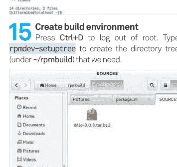

## 19 构建源码

如果软件包在所有系统中都支持，运行 `dpkg-build --name of package`。否则，你必须重复构建命令并在架构中生成源码。在 `SPEC` 类型中，如果报告关于修改 `spec` 文件中的列表，请使用 `rpmbuild -ba [name of package]` 构建结果。现在是。在 `RPMs` 目录。输入 `rpm -ivh [package]` 进行安装并确保它已安装。

# 浏览器 SSH 教程

在这里，你可以找到你通过 `Chrome` 中的 `Secure Shell` 建立的所有先前连接的列表。

始终有一个可用的 `URL` 指向包含 `Secure Shell` 常见问题解答 `goo.gl` `URL`。

对于特定的连接，你可以设置主机名、用户名以及任何所需的其他 `SSH` 选项。

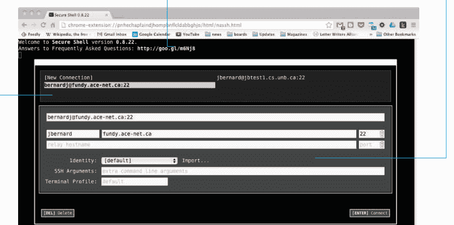

# 当你在受限机器上如何使用 SSH。


有时你需要连接到远程机器。但只要你有一个浏览器，就可以做到。操作方法如下……

# 顾问

`Bernard` 是一个真正的文艺复兴奇人，他将时间花在构建软件、帮助研究人员进行科学计算以及编写 `Android` 应用之间。

`SSH` 是连接到你需要工作的远程机器的事实标准。通常，这是通过在桌面电脑上安装 `SSH` 客户端来实现。遗憾的是，在某些情况下你无法访问自己的 `SSH` 客户端。有几种不同的方法可以恢复与远程机器的命令行连接。

可用选项有限，但这是最少的选项之一。问题是你需要使用受支持的浏览器。第二个选项是基于 `Java` 的。安装在浏览器中的 `Java` applet 将处理实际的 `SSH` 连接和管理。这在你拥有 `Java` applet 并且允许在浏览器中运行 `Java` applet 时才可行。

# 资源

- `Secure Shell`: `goo.gy/RIHYK`

- `FireShell`: `fireshell.net`

- `Shelllab`: `https://code.google.com/p/shelllab/`

如果你位于可能所在的机器上，你将始终有一个可用的浏览器。我们可以利用这一点通过浏览器获取 `SSH` 连接。有几种不同的技术可以为我们提供这种连接。我们将看到的第一个选项是纯基于浏览器的应用程序，它在客户端或服务器端都不需要任何东西。自然地，

第三个选项是客户端的。在几乎任何方面，第一个选项都是最好的。缺点是它要求你在服务器端安装一个代理（`agent`）以方便实际的 `SSH` 连接管理和控制。

希望到本教程结束，你将找到一个适合你情况的选项，并且无论你在何处都能管理你的远程机器。

- `www.cryptzone.com/products/mindterm`

- `DropPages`: `droppages.com`

- `Pancake`: `pancake.com`

`40` | `linuxuser.co.uk`

# 从浏览器使用 SSH

连接到远程机器的三种浏览器方式

# 教程


原始连接。你可以将此类选项放在 `SSH` 参数（`SSH Arguments`）框中。

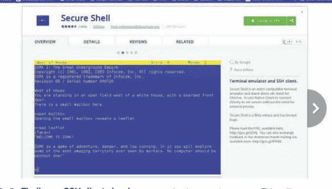

`Chrome` 和 `Firefox` 在各自的商店中都有 `SSH` 客户端。在教程中，我们将使用来自 `Chrome` 商店的 `Secure Shell` 和来自 `Firefox` 商店的 `FireSSH`。

浏览器的。这将打开一个连接窗口，你可以在其中输入用户名和密码。

## 01 寻找 SSH 客户端插件


## 06 关闭连接

你可以像使用任何其他 `SSH` 客户端一样，通过输入 `exit` 来关闭连接。当连接关闭时，“`Secure Shell`”会为你提供重新连接（`R`）、选择另一个连接或直接完成并退出（`X`）的选项。如果你选择“`X`”，连接窗口将一直打开直到你关闭它。


## 07 保存连接

你所有的连接将存储在窗口顶部的列表中。点击连接旁边的图标将在断开远程机器之前编辑 `SSH` 选项。

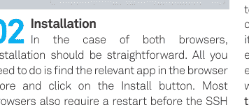

## 02 安装

对于这两个浏览器，安装过程应该是非常简单的。你需要在浏览器商店中找到相关应用并点击“安装”按钮。两个浏览器在 `SSH` 客户端准备好之前都需要重启。


## 04 终端选项

`Chrome` 中的 `Secure Shell` 没有终端偏好窗口，因此你需要打开一个 `JavaScript` 控制台（点击菜单 `查看/JavaScript` 控制台）并更改设置。例如，你可以通过以下代码设置背景颜色：

```
term__prefs.set('background-color','wheat');
```

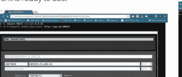

## 03 打开新连接

在本教程的剩余部分，我们将使用 `Chrome` 版本。要打开新连接，只需点击页面上的“`Secure Shell`”图标。

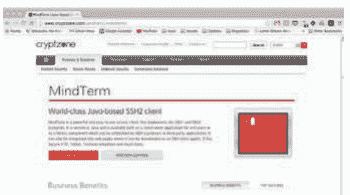

## 08 寻找 Java 插件

有一个你可以使用的 `Java` 应用 `MindTerm`。可用选项有限，但它是最少的选项之一。在这种情况下，你需要将 `MindTerm` 包装在一个简单的网站中，让浏览器加载并托管它。你也可以作为 `Java` 应用运行它。


## 05 在 SSH 中工作

你可以使用“`Secure Shell`”做任何通常用普通客户端可以做的事。当你包含相关选项时，你可以进行端口转发。

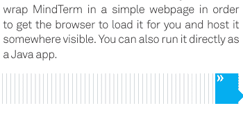

`41` `www.linuxux.co.uk`

# 从浏览器使用 SSH

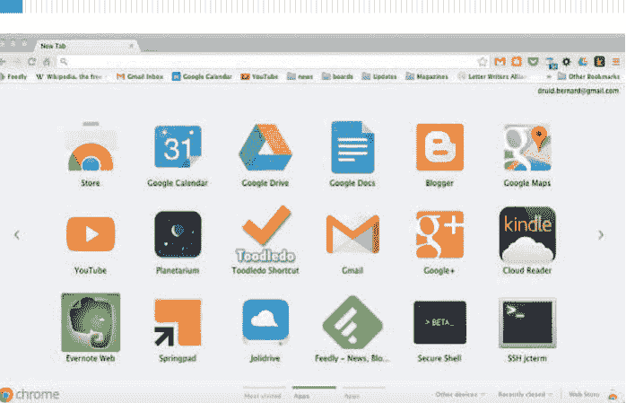

> 你可以使用“`Secure Shell`”做任何通常用普通客户端可以做的事。

## 09 安装

你需要在某处托管 `MindTerm`，如果你有一个托管服务，可以放在那里。如果没有，你可以从 `Dropbox` 获取并将其作为静态网页托管。有像 [`droppages.com`](https://droppages.com) 或 [`canva`](https://canva.com) 这样的免费服务，[`GitHub Pages`](https://pages.github.com/) 可以帮助你。

## 终端设置

| 通用 | `VT 1` | `VT 2` |

| :--- | :--- | :--- | :--- |

| 列 | `80` | | |

| 行 | `24` | | |

| 编码 | `enc-8859-1` | | |

| 大小 | `12` | | |

| 默认面板 | 无 | | |

| 回滚行 | | | |

| 滚动位置 | 右 | | |

## 13 关闭

你可以像普通客户端一样使用命令关闭会话。一旦连接关闭，`MindTerm` 将重置并准备好新连接。

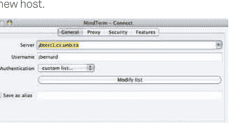

## 10 打开

上面的示例是使用 `MindTerm` `jar` 文件制作的。它的行为与浏览器中一样。当它启动时，会要求你输入 `SSH` 主机名。如果没有，它会像机器一样工作，如果你想将其保存为别名。

## 14 保存

每当你连接到主机，`MindTerm` 都会询问你是否将其添加到主机列表中。如果你想访问保存的连接，你需要点击菜单 `File...`。这将弹出一个窗口，你可以在其中保存连接稍后使用。

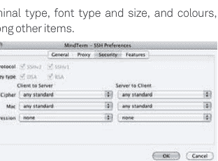

## 11 连接

`Java` 应用的优势在于你有更多工具可以使用。点击菜单 `Terminal...` 将弹出一个完整的偏好窗口，你可以在其中设置

## 12 在 SSH 中工作

使用 `MindTerm`，你还可以访问所有的 `SSH` 连接选项。点击菜单 `Connection...` 将弹出一个新窗口，你可以在其中设置端口以及更深奥的项目，如压缩类型。

## 15 基于客户端/服务器的 SSH

这两种方法的优势是所有的 `SSH` 连接本质上只通过客户端和服务器。后者允许在你需要的端口上工作，而不是 `22` 端口。但如果你的桌面被锁定为只允许 `HTTP` 流量，该怎么办？在这种情况下，你需要移动

`42` `linuxuser.com`

# 从浏览器使用 SSH

连接到远程机器的三种浏览器方式

# 教程


`shellinbox`

项目首页 | 文档 | 人员 | 问题

# 总结

概述

`Shellinbox` 是一个基于 `Web` 的工具，可以将 `SSH` 连接导出到仪表板。它允许通过浏览器管理多个 `SSH` 会话。

# 用户需求

`Shellinbox` 使用 `Web` 服务器，允许用户使用用户名和密码登录并通过浏览器访问其远程机器。

# 特性

`Shellinbox` 支持多个加密连接。必须安装 `SSL` 证书。

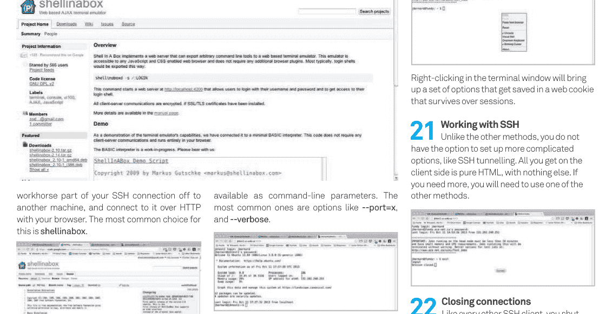

## 21 在 SSH 中工作

在终端窗口中右键点击将带来一组你在浏览器中获得的选项，这些选项可以在会话中持续。

与其他方法不同，你不需要像纯 `SSH` 客户端那样设置多个连接。你进入你需要的行，没有其他东西。

## 22 关闭连接


像其他所有 SSH 客户端一样，你通过 `exit` 关闭连接。这会让浏览器窗口保持打开并在中心列出一个按钮。这将刷新屏幕并重新打开到远程主机的连接。

## 23 保存连接

遗憾的是，没有真实的方法可以在浏览器内“存储”一组到不同机器的连接。最好的是在不同的端口上配置系列请求，然后你可以将 URL 作为浏览器的书签。

## 18 启动客户端

要启动客户端，你只需要打开浏览器并输入 `http://yourmachine.com:4200`，其中你更改了使用的端口。这将打开一个终端窗口，你可以在其中输入用户名和密码。

## 19 连接到不同的机器

登录后，你可以直接 `SSH` 到另一台机器。但如果这是你想做的事，可以使用 `ssh -S myshost@host`。这意味着你可以连接到不同的机器，每个机器都有自己的端口。

## 20 连接选项

由于这是最新可用的基于 Web 的 SSH 客户端，你根本没有相同级别的配置选项。

## 24 现在去哪里？

希望本教程能向你展示当你遇到不幸的锁定的域名时可用的选项。如果它不符合你的具体情况，不要害怕在野外寻找一些选项。

## 17 启动服务器

一旦安装了 `shellinbox`，只需在远程主机上启动 `shellinbox` 即可完成。大量的

## 16 安装

一旦下载了源码，你需要使用通常 `./configure; make install` 脚本进行安装，这在大多数 Linux 发行版中都有效。在你想要连接的远程主机上，

# 在你的系统上安装 Cinnamon

- 拥有更传统的应用程序菜单，同时具备较新桌面的搜索功能
- 自定义应用布局，让你轻松访问喜爱的程序
- 查找并安装扩展（如小组件和桌面扩展）来增强你的用户体验
- 使用 `Linux Mint MDM` 显示管理器来获得完整的 `Linux Mint` 体验

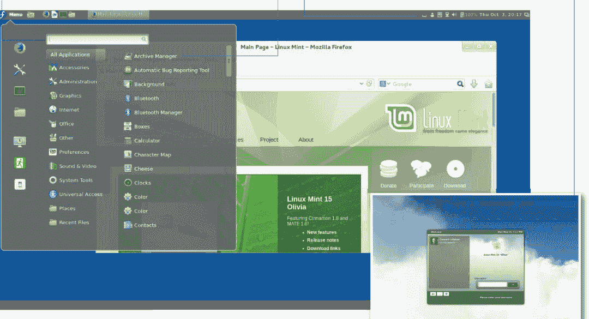

# 在你的系统上安装 Cinnamon

学习如何在一些流行的桌面发行版安装 Cinnamon 桌面环境，以及如何根据你的需求对其进行配置

> 顾问 Rob Zetsloot 负责复杂系统建模，是一名 Python Web 开发者。他热于计算实验。

Cinnamon 2.0 是 Linux Mint 桌面环境的下一次也是最重要的迭代。虽然它最初是 GNOME 的分支，但 Cinnamon 2.0 现在已完全从 GNOME 后端移除。它不仅适用于 Mint；它是一个完全开源的项目，并且可以从你选择的任何 Linux 发行版中获取。

# 资源

- `cinnamon.linuxmint.com/7?page_id=61`
- 使用 ONE 一键安装包：`software.opens.org/package/cinnamon`

虽然某些发行版在仓库中已经包含了它

我们将介绍如何在 Fedora、openSUSE、Debian 和 Ubuntu 上安装它。然而，这些方法适用于更多发行版，而且这些自定义方法对 Linux Mint 用户同样有用。

# 在你的系统上安装 Cinnamon

如何在流行的桌面发行版上安装 Cinnamon

# 教程

在我们所有要安装 Cinnamon 的发行版中，你都需要注销，以便它以用户身份加入你当前的环境供选择。要开始使用 Cinnamon，你需要注销，在屏幕上找到会话管理器并切换到 Cinnamon

完成后，注销并选择 Cinnamon 会话。

## 03 openSUSE

对于 openSUSE，你需要确保已安装了 Cinnamon——可以通过使用 GNOME 界面或直接安装来实现。然后，你可以使用 openSUSE 软件包网站的一键方法获取 Cinnamon。

## 04 Debian

Cinnamon 不是 Debian 的默认软件包，因此你需要为它添加 APT 仓库。首先，在此处查找仓库列表：

## 06 Ubuntu

Linux Mint 团队为 Ubuntu 维护了一个包含最新版本 Cinnamon 的 PPA。要将此添加到 Ubuntu，请打开终端并输入：

Cinnamon 在大约一年前被添加到 Fedora 仓库，如果你不喜欢 GNOME Shell，将其作为替代方案安装非常简单。安装命令为：

```
$ sudo yum install cinnamon
```

```
echo 'deb http://packages.linuxmint.com/rolling release main' | sudo tee /etc/apt/sources.list.d/cinnamon
```

## 05 Debian

添加后，你需要使用以下命令更新 Apt：

```
$ sudo apt-get update
```

...并使用以下命令安装密钥和桌面环境：

```
$ sudo apt-get install linux-cinnamon
```

```
$ sudo apt-get install cinnamon-cinnamon-settings
```

当系统提示确认时，按回车键。

# Ubuntu

一旦添加了 PPA，你需要更新 Debian 中的软件列表。执行以下操作：

```
$ sudo apt-get update
```

完成完成后，你只需运行一个命令即可安装它：

```
$ sudo apt-get install cinnamon
```

## 08 Ubuntu

如果你使用的是 Ubuntu，会话选择不是首要步骤。在 Cinnamon 安装后注销，然后点击你的用户名。旁边是 Ubuntu 图标——点击该图标将打开会话管理器，Cinnamon 将列在其中。

## 09 Cinnamon

Cinnamon 的工作方式与 GNOME 或 Unity 不同——顶部有一个传统的面板，所有选项都清晰可见。Mint 菜单的工作原理类似，尽管它不是占据整个屏幕，而是在侧边打开，允许你搜索应用程序和文档。

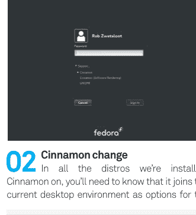

基于 GNOME-shell 技术的 Linux 桌面环境

Cinnamon 桌面提供了新功能和传统的用户体验。底层技术源自 GNOME，但桌面布局更接近 GNOME。重点在于让用户感到如家，并为他们提供易用的体验。

- openSUSE Factory
- openSUSE 12.3
- openSUSE 12.2
- openSUSE Tumbleweed

显示不支持的发行版的更多包

| 名称 | 版本 | 构建 | 大小 | 来源 | 仓库 |
|---|---|---|---|---|---|
| meta-data | ... | ... | ... | ... | ... |

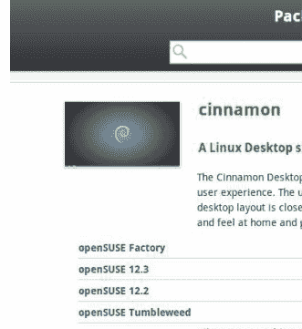

# 教程 在你的系统上安装 Cinnamon

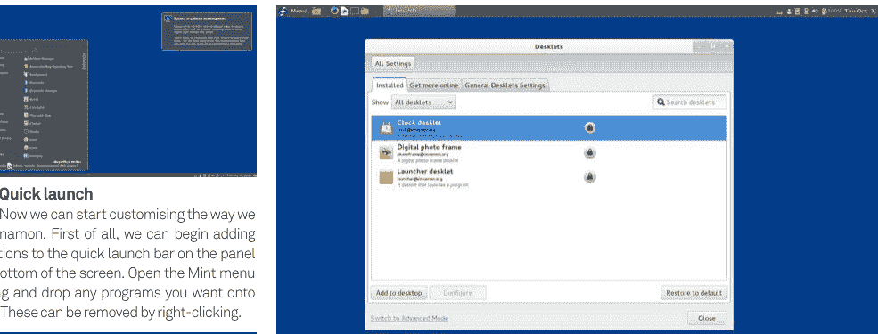

## 快速启动

现在我们可以开始自定义使用 Cinnamon 的方式。首先，我们可以开始在屏幕底部面板的快速启动栏中添加应用程序。打开 Mint 菜单，将你想添加的任何程序拖放到工具栏上。通过右键点击，

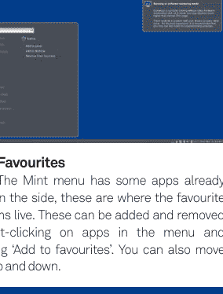

我们可以让顶部和底部都有面板，并经典模式。

## 桌面组件 (Desklets)

Cinnamon 的功能之一是可以添加桌面组件，这些类似于 Android 或其他操作系统的桌面小部件。你可以在系统设置的“桌面组件”中找到它们，你可以从网上下载一些额外的。

## 收藏 (Favorites)

Mint 菜单侧边列了一些应用，我们可以在添加收藏。可以通过右键点击应用并选择“添加到收藏”来添加或删除它们。你还可以向上向下移动它们。

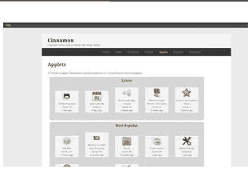

## 装饰你的桌面

使用 Cinnamon 网站获取桌面组件和小组件非常简单，也可以通过 `cinnamon-mint.com` 访问。有些已经在小组件菜单中了，但你可以搜索更好的桌面组件主题。将文件解压到 `~/.local/share/cinnamon/applets` 然后激活面板。

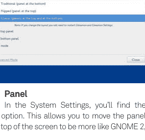

## 面板 (Panel)

在系统设置中，你会找到面板选项。这允许你将面板移动到屏幕顶部，更像 GNOME 2。

## 小组件 (Applets)

小组件在桌面组件之前，允许你向面板添加功能。右键点击面板将进入小组件菜单，你可以添加一些实用的工具，如显示如果你使用不同的显示器，这样你就不用把鼠标移动到角落了。

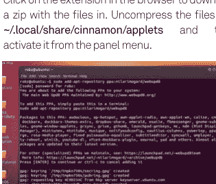

## 管理显示


与 `Cinnamon` 一样，你可以将 `Linux Mint` 的 `MDM` 显示管理器添加到你的系统，它可以带有动画屏幕的主题。对于 `Ubuntu`，你需要添加一个新的

> 现在我们可以开始自定义我们使用 `Cinnamon` 的方式

# 在你的系统上安装 `Cinnamon`

如何在流行的桌面发行版上安装 `Cinnamon`

# 教程

`SpiderHive`

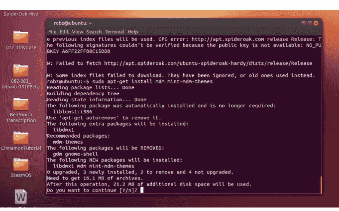

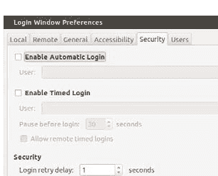

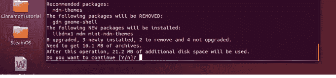

使用以下命令仓库：

```bash
$ sudo apt-add-repository ppa:nilarim/getweb8
```

工具。在系统菜单中找到它，并在重启/注销时启用它。

## 17 Ubuntu MDM

就像安装 `Cinnamon` 一样，你需要通过更新软件列表来安装 `MDM`：

```bash
$ sudo apt-get install mdm-mdm-
```

## 22 登录管理器

从登录管理器，你可以为默认用户设置自动登录，并为后续的另一个用户设置登录，以便其他人可以登录。

## 23 更改背景

你可以简单地更改背景：使用 `dconf-configure` 显示你想要的图片，并将喜欢的背景色设置为默认。这可以通过在登录前选择不同的桌面来完成。

## 18 MDM 设置

在安装 `MDM` 期间，会弹出一个窗口，显示你想要使用的显示设置。从列表中选择 `MDM` 并让安装继续进行。需要重启才能生效。

## 20 HTML 主题

少数地方可以找到 `Linux Mint` 的 `HTML` 主题——`Google` 搜索可以帮到你，或者查看 `Sam Riggs` 在 `samsriggs.deviant.com` 上的佳作。


## 24 Mint 与美

`Cinnamon` 是一个帮助使用稍旧工作流系统的极环境。对于 `Linux Mint`，这是最好的使用方式，为什么不成为未来 `Ubuntu` 的标准呢？

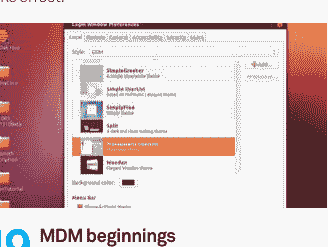

## 21 安装主题

一旦你找到了喜欢的主题，下载并进入登录窗口管理器。点击“添加”，然后导航到刚刚下载的主题存档。它将让你在注销或重启时选择它。

## 19 MDM 开始

你首先需要用更易用的的外观对其进行主题化。在菜单搜索栏中搜索“登录窗口属性”和其他

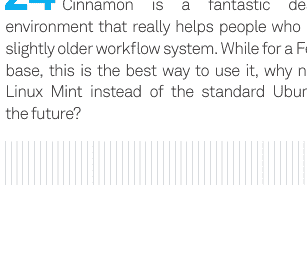

`www.linuxux.co.uk`

# 特色 Firefox OS：开发者技巧与窍门

顾问 `Christian Heillmann` 是 `Mozilla` 的首席宣讲师，专注于开放 `Web` 和 `HTML5`。他于 1997 年左右构建了自己的第一个网站，并在随后的几年里参与了许多国际网络项目。

## 如何入门

`Firefox OS` 基于 `HTML5`，它不包含 `Java`、`C#` 或 `Objective C`。`Firefox OS` 允许开发者通过 `HTML`、`CSS` 和 `JavaScript` 访问手机功能。移动端网站可以轻松转换为 `Firefox` 应用程序。你只需要使用 `Cache`、`LocalStorage` 或 `IndexedDB` 定义数据，并在 `manifest`（清单文件）中指定名称和访问权限即可。

一个 `manifest` 示例所示（更多详情请参见 `tinyurl.com/pfvoy8`）：

```json
{
  "name": "My App",
  "description": "My elevator pitch goes here",
  "launch-path": "",
  "icons": [
    "/img/icon-128.png"
  ],
  "developer": {
    "name": "Your name or organization",
    "url": "http://your-homepage.here",
    "default-locale": "en"
  }
}
```

## 本期我们荣幸邀请了 Mozilla 的 Christian Hellmann 来访访，他为大家带来了一份 Firefox OS 开发入门指南……

`Firefox OS` 不仅仅是一个普通的移动操作系统——它完全由 `Web` 技术驱动。这为什么重要？因为该平台让你感受到前所未有的速度、一致性和直观的使用体验。由于它是基于 `Web` 构建的，你可以下载任何长度的程序，并完成传统移动操作系统无法实现的事情。

但对于开发者来说，优势更加巨大。由于 `Firefox OS` 构建在开放平台上，使用 `Linux` 内核启动到 `Web` 环境，开发和定制用户体验比以往任何时候都要简单。由于它使用了 `Mozilla Gecko` 引擎，搭载 `Firefox OS` 的智能手机可以调用 `Mozilla` 的 `Web APIs`。这意味着你想象的每个功能都可以作为 `Web` 应用进行开发。感兴趣吗？以下是今天开始的方法……

离线定义是为了防应用也可以在 `iOS` 和 `Android` 上运行。如果你在 `firefox-OS` 中使用 `HTML5` 应用，你离加入我们只有两步：

1. 创建一个开放应用

2. 在 `Firefox OS` 市场 (`https://marketplace.firefox.com`) 注册你的应用

应用程序的创建不受限于特定的 `IDE` 或工作环境。就像 `Web` 开发一样，任何工具都可以使用，从命令行的 `vi` 到 `Eclipse`：你会在最喜欢的工具上感到舒适。所以，到目前为止，它仍由 `SDK` 定义，你不需要注册或付费。`Mozilla` 的核心身份是让所有人都能免费且易用地使用，`Firefox OS` 正体现了这一理念。

由于 `Mozilla` 不需要服务器来保证其安全性，应用仅被允许访问可用功能的一部分。

## 有用链接

- 应用清单 (`App Manifest`)：开放 `Web` 清单包含你的应用与操作系统交互所需的所有信息：参见 `tiny.ly/pfvyo88`

- 应用权限 (`App Permissions`)：关于应用是什么以及如何请求权限的概述：参见 `tiny.ly/cpigiew`

- `Firefox OS` 开发者指南 (`Firefox OS Developer Guide`)：一个良好的 `HTML5` 应用应该是什么样的（带下载示例），你如何在 `Firefox OS` 上注册并安装你的应用：参见 `tiny.ly/olqyb8`

- `Firefox OS` 模拟器 (`Firefox OS Simulator`)：如何在你自己的硬件上开发和测试应用：`tiny.ly/3666`

- `Firefox` 市场 (`Firefox Marketplace`)：开发者可以在此列出并销售他们的应用：`https://marketplace.firefox.com`

## 应用安全

在开放 `manifest` 中，开发者定义了应用应该是什么，以及应用拥有访问哪些函数的权限。`Firefox OS` 的安全性确保应用有“权限”执行某些操作。这是为了确保，例如，没有应用可以在终端用户不知情的情况下访问信息或拨打电话。

## Web APIs

在 `Firefox OS` 中，你可以通过 `APIs` 访问硬件：`https://docs.mozilla.org/webapis`。对于 `Android` 和 `iOS` 等跨平台 `HTML5` 应用，开发者也可以通过 `JavaScript` 访问手机的各种硬件组件。例如，你可以通过 `navigator.battery.level` 获取电量百分比，或获取某个网络的信号强度。

允许的操作以及服务的详细列表可见此处：`https://docs.mozilla.org/dev/webapis`

- `Mozilla` 开发者网络 (`MDN`)：你可以在这里找到从 `API` 文档的所有内容。

- `Firefox-OS` 模板 (`Firefox-OS Boilerplate`)：`https://github.com/robynman/Firefox-OS-Boilerplate`，它可以自动适应屏幕，并配备了界面中所有类型的按钮。

- 托管应用 (`Hosted app`)：应用可以存储在你自己的服务器上，便于修改和部署。

## 通过 Firefox OS 赚钱

开发者在 `Firefox OS` 中分成收入，他们的努力应该得到回报。收入分成取决于地区、支付方式和财务框架。`Mozilla` 支持开发者的支付方式，例如那些能让没有信用卡的用户更容易购买应用的支付方式。对于开发者来说，这不仅取决于支付方式，还取决于法规。然而，目标是确保开发者能在 60 到 90 天内获得市场购买的报酬。

## 首次运行应用


可以使用`Firefox OS`模拟器在桌面上测试这些作品的第一版本。通过访问`Tools: Web Developer Guide for Firefox OS`即可轻松启动。你也可以在带有`Firefox OS`的手机上进行测试，手机上有一个显示信息和错误的控制台以及硬盘。在浏览器中使用`Firefox`将获得最佳结果。与此同时，`Firefox OS`手机已经上市，这意味着开发者现在可以测试他们的应用了。

# `Go`程序教程

介绍这种最热门的编程语言。在`Go`中，你可以通过返回两个值来赋值两个变量。

```go
// 带返回方式
func timeout(x int, y int) (int, int) {
    return x, y * 2
}

func main() {
    h, i := timeout(2, 6)
    fmt.Println(h, i) // h == 4, i == 12
}

// 另一种命名变量返回方式
func timeout(a, b int) (x, y int) {
    x = a * 2
    y = b * 2
    return
}
```

2007年`Robert Griesemer`、`Rob Pike`和`Ken Thompson`开始编写这种语言。他们觉得`C++`变得太复杂，因此决定从零开始。`Go`获取常量的限制严格得多，原因显而易见

```go
// 常量可以这样设置
const x = 12
```

函数定义在设计和实现上非常友好。

```go
// 示例 4
func example(x int)

// 简写
func example(x int)
```

## 安装`Go`

如果你足够幸运，你可能可以通过以下命令安装`Go`：

```bash
sudo apt-get install go
```

如果一切顺利，现在你的系统上就有了`Go`。欢喜！但是，为了起见，我们假设没有发生这种情况。让我们从源码获取并安装，这样我们可以看到它是如何操作的。`golang.com/go/downloads/`并获取`1.0.2.src.tar.gz`（写作时，这是`Go`的最新版本）。将`tar.gz`解压到任何地方，然后进入找到的`src`文件夹。

# `Go`程序！

`Go`语言 - 教程

假设你的系统中已经安装了`GCC`或其他编译器，我们已经准备好运行它了。像往常一样，`Go`非常友好，它包含了一个`Bash`脚本来安装和测试`Go`。运行它吧：

## 它在哪里？

## 新包不断涌现。什么让`Go`与众不同？

```bash
./all.bash
```

然后去给自己泡杯茶。这个任务可能需要一点时间。在`Bash`脚本退出之前，你应该探索类似以下的内容：

```text
已安装至 [你的架构]
已安装的命令位于 /home/[USERNAME]
在 /home/[USERNAME]:
*** 你需要将 [USERNAME]/go 添加到你的 PATH 中。 *** 
```

`Go`是一门非常令人兴奋的语言：它易学、有趣而且运行速度极快。事实如此，新包不断涌现。任何人都可以像世界各地的软件工程师一样快速学会编写`Go`。在挑战`Python`或`JavaScript`并将其视为竞争对手之前，还有很长的路要走。还记得`Node.js`刚发布时人们是如何看待它的吗？`JavaScript`……运行在服务器上？看看它现在的样子。`Go`已经有了庞大的包库可以使用，并且按项目管理得以前好得多。当`Google`正在用`Go`重写它的整个遗留系统时。这就是承诺。

## 函数

如果你现在能看到这些，那么你好世界（`hello world`）。就像脚本一样，我们需要将`Go`添加到`PATH`中。每个人对设置`PATH`都有自己的偏好。你可以将其放在文件目录中，以便能够访问该站点：

`Go`中的函数可以执行你想要的任何操作。在我们的“你好世界”中，如果我们想使用最基础的实现。如果我们想写一个接受传值的函数，可以这样写：

```bash
PATH="/home/go/bin"
```

```go
func exp(x int, y int) int {
    fmt.Println(x)
    return 0
}
```

注意我们是如何在暴露的名称之后声明声明的。如果类型相同，我们可以这样写：

现在进入你的终端，你将看到帮助对话框，列出了执行`Go`脚本时可以调用的所有命令。

```go
func funcTimes(x int, y int) int {
    return x * y
}
```

## `Hello world`

让我们写一个“`hello world`”。创建一个名为`lets.go`的小文件。如果你执行

```bash
go run lets.go
```

如果我们想返回结果，我们需要类似这样的代码：

```go
func main() {
    h, i := funcTimes(2, 6)
    fmt.Println(h, i) // h = 4, i = 12
}
```

你应该能在终端中看到弹出“`hello world`”。让我们看看我们写了什么。在这里，包（`package`）基本上是`Go`为文件中包含的代码创建名称的方式。如果我们想写一个其他程序使用的模块（`module`），我们可以使用大部分。

注意我们在返回变量之前是如何给它们赋值的。如果我们返回多个值，可以为这些变量命名并这样返回它们：

```go
package main
import ("fmt") // 打印 "Hello, world" // 这只是一个注释
func main() {
    fmt.Println("Hello, world")
}
```

```go
func funcTimes(a, b int) int {
    return a * b
}
```

单语句：

```go
import("fmt", "math", "net")
```

多语句：

```go
import "fmt"
import "math"
import "path"
```

执行时，`go`将运行`main()`函数。

## 变量

`Go`中的声明与其他语言不同。有多种方法可以相同的效果。如果我们想要示例1，你也可以这样包含：

在这些实例中，`a = 1`，`b = 2`。当我们使用`var`关键字时，我们在赋值之前声明了变量。我们也可以在声明的末尾或开头声明变量。如果我们希望变量是常量，我们使用`const`。`Go`也有常量，例如：

```go
const x = 12
```

但你不能像声明变量那样声明它。它是从值中推断出来的。

现在我们有了一个可以工作的环境，可以运行一个小小的“`hello world`”

```go
y = b * 2
return
```

对于数字，我们使用以下代码创建一个子集：

我们像这样声明切片（`slice`）要包含的类型：

```go
numbers = []int{1, 2, 4, 8, 16, 32, 64, 128}
lessNumbers = numbers[:3]
```

```go
var places = [3]Coordinates
```

`Go`中的函数也可以返回闭包（`closures`）。但我们必须小心意识到我们返回的是一个函数——我们返回的是函数被调用时执行的结果。这有点让人困惑。

```go
func aDecoder(x, y int) int {
	randomNumber := 5
	return func(x, y int) int {
		return x + randomNumber
	}
}
```

然后我们可以这样将切片传递给切片：

```go
places[0] = Coordinates(1.1, 2.2)
```

注意在`aDecoder()`中我们指定返回的是一个整数，而不是函数。如果是`JavaScript`的话。

# 教程

# 通过网页控制树莓派机器人

`LinuxDeveloper`


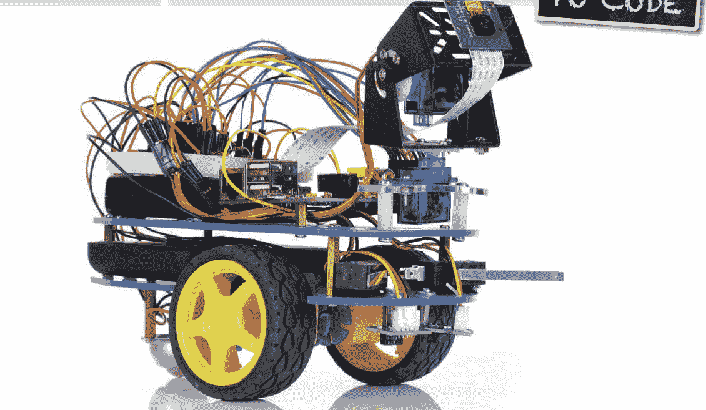

# 从连接网络的设备控制树莓派机器人

# 顾问

`Linus Fraser`是一位程序员和系统管理员，`RaspberryTutorials` `YouTube`系列的创建者，并担任树莓派基金会的`Linux`管理员志愿者。

在上一期节目中，我们制作了一个树莓派机器人。在本期节目中，我们将创建一个`Python` `Web`应用程序，让你能够通过第一称视角控制你的机器人。

在上一期构建了我们的树莓派后，我们一直在思考各种教程，以扩展`Jonny Pi`的技能和能力。我们的主意之一是从网页浏览器控制机器人。为了让它变得更有趣，我们决定整合树莓派摄像头模块，这样我们就可以展示`Jonny Pi`所看到的第一人称视角。只要你处于机器人的`Wi-Fi`范围内，就可以通过观察应用本身的反馈来到处行驶。


为此，我们将教你如何使用 `gst-streamer` 软件将视频直接从树莓派流到你的浏览器。现在我们已经就绪，并将转换上一期指南中的运动代码，以便它可以从我们的小型 Web 应用中执行，然后用 Python 编写它。这就像树莓派一样简单！

# 资源

- 一个树莓派机器人（请参 `LUD 132` 指南）

- 树莓派摄像头模块及 `WiFi` 连接

## 使用第一人称视角通过网页控制树莓派机器人

创建一个使用 `mayGI` 控制机器人的 Python 应用。

# 教程

## 01 连接摄像头

摄像头应连接到树莓派，以太网口的蓝色一侧朝后，带有引脚的一侧朝向 SD 卡。抬起连接器，将排线尽可能推到底，然后按下连接器以固定它。

## 02 启用摄像头

使用你的用户名和密码 `raspberry` 登录树莓派系统。你使用的版本可能不支持树莓派。运行 `apt-get update` 以确保你是最新版本。一旦完成，运行 `raspi-config` 并选择启用摄像头的选项。你需要重启以使更改生效。

## 03 安装 mpeg-streamer

我们将使用一个尚未为树莓派打包的 `mpeg-streamer` 实验版本。因此，我们需要通过 `Subversion` 从索引中编译它。运行 `apt-get update`，然后我们需要下载源代码。`mpeg-streamer` 需要所有的依赖项。你可以通过以下命令安装它们：

```
sudo apt-get install libjpeg8-dev cmake
```

## 04 编译 mpeg-streamer

如下所示：

```bash
git clone https://github.com/linuxamaser/mpeg-streamer
cd mpeg-streamer/src
experimental
make
sudo make install
```

```bash
export STREAM_PATH=/home/pi/mpeg-streamer/mpeg-streamer-experimental
export LD_LIBRARY_PATH=$STREAM_PATH:$LD_LIBRARY_PATH
$STREAM_PATH/streamer -i "input-raspiprc -d 200" -o "output-x26ink"
```

```bash
exit 0
```

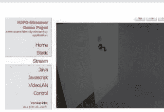

## 05 开始测试

在我们运行 `mpeg-streamer` 之前，我们需要导出路径以便加载器可以找到模块。我们将导出为 `STREAM_PATH` 以获得一个友好的名字，但路径不在 `LD_LIBRARY_PATH` 模块中。我们通过以下变量找到它：

```bash
export STREAM_PATH=/home/pi/mpeg-streamer/mpeg-streamer-experimental
export LD_LIBRARY_PATH=$STREAM_PATH:$LD_LIBRARY_PATH
```

现在通过以下方式启动 `mpeg-streamer`：

```bash
$STREAM_PATH/streamer -i "input-raspiprc -d 200" -o "output-x26ink" -w $number=1 /
```

... `$number` 是客户端的数量。你现在可以通过 IP 地址 (`http://<ip-address>:8080/test`) 查看视频。

## 06 启动时启动 mpeg-streamer

通过将 `rc.local` 复制到 `/etc/rc.local`，然后编辑 `/etc/rc.local` 添加我们的脚本，在最后一行之前添加 `exit 0`。重启树莓派以确保其工作。你的 `rc.local` 文件应该像这样：

## 步骤 06

## 07 安装 Apache 和模块

我们将使用 `Apache` 作为我们的 Web 服务器，`WSGI` 作为从 Web 服务器导出 Python 并调用函数的方法以访问 `GPIO`。`mpeg-streamer` 实际上是以 `root` 身份运行的，可以通过界面轻松修复。或者，你可以安装包：

```bash
sudo apt-get install apache2 apache2-mod-wsgi
```

我们还需要设置代理服务器来连接我们的模块。编辑 `/etc/apache2/mods-available/proxy.conf` 并启用它。然后我们需要启动代理脚本：

```bash
sudo /etc/init.d/mpeg-streamer-start
```

## 08 配置 WSGI

我们想使用 `WSGI` 控制我们的机器人。我们的导出脚本将以 `robotweb` 调用命令。编辑 `/etc/apache2/sites-available/00-default` 以启用 `WSGI`。在 `VirtualHost` 节中添加以下行：

```
WSGIProcess robotweb group=robotweb multiprocess=1 threads=2
```

## 09 WSGI Hello World

使用 `WSGI` 控制我们的机器人。在你喜欢的编辑器中打开 `/home/robotweb/app.py` 并将代码添加到顶部。每当我们想要命令机器人时，通过传递摄像头流来启动 `WSGI` 工作。

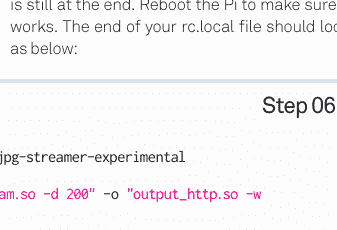


```python
def application(environ, start_response):
    status = '200 OK'
    output = 'Hello World!'
    response_headers = [('Content-type', 'text/plain'),
                        ('Content-Length', str(len(output)))]
    start_response(status, response_headers)
    return []
```

## 步骤 09

```bash
wget 'http://maxcdn.github.io/jquery.form.js'
```

```bash
wget 'http://ajax.googleapis.com/ajax/libs/jquery/1.7/jquery.js'
```

## 11 启动时启动运动服务器

正如我们讨论的那样，我们想通过将其添加到 `/etc/rc.local` 在启动时启动运动服务器。我们使用了以下行：

```bash
/home/robotweb/movement_server.py
```

## 12

`Bootstrap` 需要使用 `Twitter` 的 `Bootstrap` 框架作为我们的 Web 界面。该目录位于 `/var/www/`，我们可以通过删除默认 `Apache` 页面开始，然后下载并提取 `bootstrap` 文件：

```bash
wget 'https://github.com/bootstrap/bootstrap/download/v3.0.0/bootstrap-3.zip'
```

```bash
unzip bootstrap-3.zip
mv dist . /
rm -rf bootstrap-3.zip
```

## 13 创建运动代码

下一个代码基于我们上一个机器人项目的运动和超声波传感器。然而，运动传感器（超声波部分）有很大不同，因此我们将其正确添加到代码中。我们重写了 `movement.py`（可以在磁盘上找到）。你还需要使用 `chmod +x` 使文件变为可执行。我们想使用 `Pyro` 类更改机器人的速度。

`movement` 类需要继承 `PyroObject` 以便可以远程调用。我们需要从 `movement` 类函数的部分集成基类。那里有一个普通方法。对于每个方向，我们使用 `GPIO` 端口在相应的引脚上输出高或低一段时间，然后调用移动电机速度的函数。

最后，我们通过向 `PyroServer` 注册并启动请求循环来设置 `Pyro` 服务器，它只需等待 `Pyro` 客户端的请求并执行相应的函数。

## 14

主体有一个容器，显示了我们的世界，以及一个表单，允许我们向机器人发送一个方向和持续的时间。当点击按钮时，网页即可工作，秒文本框的值会被发送到动作脚本，以及所点击按钮的方向。

注意树莓派的 `IP` 是硬编码的，因为我们需要在端口 `8000` 上访问流。你可以使用 `DNS` 地址或通过 `Apache` 端口反向代理视频流。

## 15 在我们的 Web 应用中调用运动代码

我们的应用程序非常简单。它只需要接收一个方向和一个持续时间。编辑代码页面以替换我们创建的 `Hello World` 代码。

## 16 它接收一个移动的方向和一个持续的时间

# 通过网页控制你的树莓派机器人


创建一个 Python Web 应用，使用第一人视角控制你的机器人

# 教程

```python
import PyroCore
from cgi import parse_environ, start_response
def application(environ, start_response):
    # 连接到 Pyro
    movement = PyroCore.Proxy('PYRONAME:robotmovement')
    parameters = parse_qs(environ['QUERY_STRING'])
    if 'seconds' in parameters and 'direction' in parameters:
        direction = parameters['direction'][0]
        seconds = int(parameters['seconds'][0])
        # 调用相应的函数
        if direction == 'Stop':
            movement.stop()
        elif direction == 'forwards':
            movement.forward(seconds)
        elif direction == 'backwards':
            movement.backward(seconds)
        elif direction == 'left':
            movement.left(seconds)
        elif direction == 'Right':
            movement.right(seconds)
```

## 步骤 15 树莓派机器人代码列表

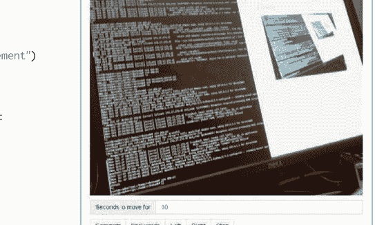

```python
status = '200 OK'
else:
    status = '400 Bad Request'
```

```python
response_headers = [['Content-type', 'text/plain'], ['Content-Length', str(len(status))]]
start_response(status, response_headers)
return [status]
```

在 `/home/web/app.py` 中，它也在磁盘上。我们导入了 `Pyro` 核心，以便通过网络调用机器人，还导入了 `cgi` 中的 `parse_qs()` 函数。这允许我们解析在第一步中创建的查询字符串并将其转换为字典。

然后我们注意到我们以 `robotmovement` 注册了 `Pyro` 别名。我们已经连接到它，因此现在我们可以发送命令并检查是否收到了有效响应。如果我们获取了第一个方向和秒数，每个列表中将有一个项目，并调用相应的移动函数。

如果一切顺利，我们返回成功消息，否则返回错误请求消息。用户将看不到延迟，因为我们正在显示视频流且没有冻结。

## 16 更多测试

- 使用 `apache2 restart` 重启 `Apache`

每个错误都会出现，通过在浏览器中输入树莓派的 `IP` 地址来确定并更改服务器。从那里，我们使用按钮和秒数来控制机器人。但机器人在所有运动之后将停止。

我们注意到机器人向前移动 `5` 秒后会停止，在前向移动 `3` 秒时会让机器人后退 `2` 秒并停止。为了解决这个问题，你可以实现一个队列系统。

## 17 如何禁用我们所做的

你可能不希望摄像头通过网络进行广播。如果你只想查看我们做了什么，可以通过在三行的开头添加哈希字符（`#`）来注释掉我们向 `/etc/local` 添加的四行内容。在 `Debian` 上，你可以通过重启来禁用此。

- `apache2` 每次更新后都需要重启，并使用 `sudo service apache2 restart` 启用

- 使用 `/etc/init.d/apache2 start` 停止 `apache`。

## 18 进一步改进

这是你的树莓派 `Web` 界面的一个良好基础，但有很多地方可以改进，使其像：

- 在网页文章上添加添加和调用功能。

- 如前所述，通过 `Apache` 显示视频流。

- 添加身份验证，以便只有拥有用户名和密码的人才能控制机器人。

- 使用 `SSL` 进行安全连接。

- 研究如何处理一个完整周期到单个函数，以及如何用角度关联机器人。

- 如步骤 `15` 提到的，为命令添加队列系统。

# 教程 Qt：一次编写，到处运行

# LinuxDeveloper


# 使用编写，到处运行

`Qt` 是 `C++` 最灵活的跨平台框架，甚至可以创建跨平台 `GUI`。方法如下……

`Eli Hanna` 自 `Palm ITC` 时代以来一直从事 `IT` 行业。作为记者、导师和演讲者，他多次看到了移动市场的各个方面。

在 `C` 的最初开发期间，`GUI` 应用是在一个非用例上开发的：一个具有非图形化哑缩略图的计算机系统。平均开发者觉得自己正在处理引擎代码——如果设计得当，就可以在易于移植的应用程序中使用。

随着时间的推移，操作系统供应商扩展了各种自定义库。这导致移植性水平不断降低，`Windows`、`Linux` 和 `Solaris` 的应用程序，但 `C++` 非亚洲风格代码无法在平台之间共享。

（后来被称为 `Qt`）。框架的开发始于 `1991` 年，该产品成功获得了崇拜的追随者。基于 `Qt` 的 `KDE` 框架的巨大成功引发了对事实实标准的担忧。

`Qt` 的创建者 `Trolltech` 通过引入双重许可方案解决了这个问题。从那时日期起，该框架以两种形式提供：开发者可以购买的（允许他们保留代码）以及也同样提供的 `GPL` 版本。

这催生了挪威的程序员，他们开始开发一种名为 `Qasar` 的产品。

此外，建立了一个法律后门以保护可用性。它负责事实标准。

- `qt-project.org`
- `qt-project.org`
- `qt-project.org`
- `qt-project.org`
- `qt-project.org`
- `qt-project.org`
- `qt-project.org`
- `qt-project.org`
- `qt-project.org`
- `qt-project.org`
- `qt-project.org`
- `qt-project.org`
- `qt-project.org`
- `qt-project.org`
- `qt-project.org`
- `qt-project.org`
- `qt-project.org`
- `qt-project.org`
- `qt-project.org`
- `qt-project.org`
- `qt-project.org`
- `qt-project.org`
- `qt-project.org`
- `qt-project.org`
- `qt-project.org`
- `qt-project.org`
- `qt-project.org`
- `qt-project.org`
- `qt-project.org`
- `qt-project.org`
- `qt-project.org`

# Qt IDE

`Qt Creator` 为框架的用户提供了一个自定义 `IDE`。`Qt Creator` 在超级模式下运行效果最好。通过在终端中输入命令，启动后，选择选项。

`Qt Creator` 分为多个模块，可以通过帮助菜单激活。任何激活的图标将显示在视图的其余。

```bash
sudo qtcreator
SOFT ASSERT -l "1 -i" in file ..../src/plugins/projectmanager/
```

# 第一步

现在是时候开始编写你的“`Hello World`”应用程序了。选择 `New File or Project` 来创建项目向导。然后，选择 `Application|Qt Application`

选择你想保存应用程序的路径，核心框架和类将被构建。复杂项目需要一些时间来配置参数。

# 新构建过程

当点击左下角的 `Build` 按钮时，框架和类将被构建。复杂项目需要一些时间来配置参数。

基于 `Qt` 的应用程序由操作系统的原生工具编译。该过程由 `make` 控制，`make` 是由一个工具自动生成的。解决方案的项目文件由工具链处理。

# 教程

`Qt`: 一次编写，到处运行

# Linux 开发者

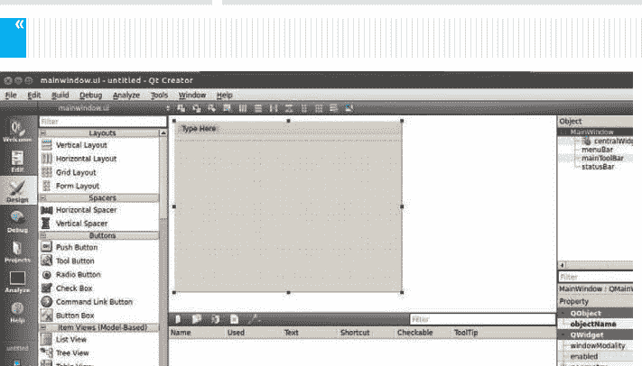

# 跨平台之旅

## 将应用程序迁移到另一个操作系统非常简单


# Qt: 一次编写，到处运行

目前，我们拥有“无框架”代码，因此从代码的角度来看并没有障碍。具有跨平台能力时，往往受限于在同一平台内进行兼容。当需要为不同的处理器使用类 `UNIX` 系统（生成可执行文件）时，而对于 `Windows` 来说，这需要付出巨大的努力。

在目标不同的操作系统时，构建应用程序的实例并不是唯一的方法。`Qt` 为 `Windows`、`Mac`、`OS` 以及像 `Linux` 等各种平台提供了完整的接口，使得 `.pro` 文件的创建和开始编译变成一个简单的过程。

移动领域的情况略有不同。在这里，跨平台开发是强制性的。目标不同的操作系统有时是根据设备的类型而决定的。

`Qt` 可以在任何操作系统上进行编程，而 `Windows Phone` 和 `Android` 则由“相应的桌面操作系统”支持。

基于 `Qt` 的表单与编辑器的兼容性是我们为原生代码提供“保护”所需要的。如果你想将应用程序放在另一个平台上，你将需要一个预处理器来消除有问题的代码。

可以通过点击屏幕左侧文件列表中的项目来创建示例的 `.pro` 文件。它看起来像这样：

```
# + core gui
GreaterThan(QT_MAJOR_VERSION, 4) QT +
target = untitled
templates = =
sources = main.cpp
mainwindow.cpp
```

控制原生操作系统。使用 `QML` 语言来描述界面及其行为。

尽管关于 `QtGui` 的问题偶尔会提到，但 `Qt` 已经多次表示，强烈建议避免它。使用 `QtGui` 会带来不可预见的未来。因此，我们用 `Qt.pro` 创建的基础在教程的剩余部分将继续使用。

基于 `Qt` 的表单是在源代码中创建的。然而， `Qt` 提供了用户界面的管理。双击项目视图中的 `ui` 文件以访问可视化编辑器。

`.ui` 文件包含了一个字段设置列表，这些设置用于构建控件。`Qt` 由多个模块组成——`Qt-Target` 需要的模块以及模板语句定义了二进制文件的类型。`SOURCES` 和 `FORMS` 块列出了每个类型的列表。当添加新文件时，`Qt Creator` 会自动更新这些部分。

左侧工具栏包含各种小控件，可以在表单模式下进行调整。右下角的列表显示属性。控件树视图是用户界面的结构概览。

## 来自文件的 GUI

`Qt` 目前包含两个不同的 GUI 集合，可以协作使用。`QtGui`（`Qt` 5 重命名为此方式）使用了一组

# Qt Creator 提供了所见即所得（WYSIWYG）前端，简化了用户界面的管理

在编译期间，每个 `Qt`（用户界面编译器）将把 `ui` 文件转换为头文件，代码需要这些文件来生成实际格式。在这种情况下，设备选择过程将调用文件 `mainwindow.h`，右键点击相关的

# 教程：从 Qt Creator 创建 Hello World

从 `Qt Creator` 开始并使用它来创建一个 `Hello World` 应用程序

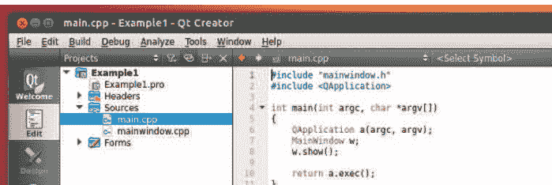

`main.cpp` 的源代码显示了高亮包含，然后使用 `Qt Creator` 找到符号的声明。

它的结构将像这段代码所示：

```cpp
class UI::MainWindow {
public:
    QMenuBar * menuBar;
    QToolBar toolBar;
    QWidget *centralWidget;
    QStatusBar statusBar;
    void setupUi(MainWindow *MainWindow)
{
        if (MainWindow->objectName() == nullptr)
            MainWindow->setObjectName("MainWindow");
        MainWindow->resize(480, 300);
    }
}
};
```

```cpp
#include <Application>
#include "mainwindow.h"

int main(int argc, char *argv[]) {
    Application a(argc, argv);
    MainWindow w;
    w.show();
    return a.exec();
}
```

第一个由两个文件组成。`C++` 类包含一个默认的构造函数，该构造函数调用 `ui` 对象的 `setupUi` 方法。也就是说，它并不包含多少意义：

```cpp
#include "mainwindow.h"
#include "ui_mainwindow.h"

MainWindow::MainWindow(QWidget *parent)
    : QMainWindow(parent), ui(new Ui::MainWindow)
{
    ui->setupUi(this);
}
```

每当头文件更改时，文件就会自动生成。不建议以任何方式修改它们，否则将导致不可引导且不可预测的行为。此外（以及大多数版本控制系统），频繁的更改倾向于更新服务器。

头文件中表单的实际内容。在这里，它包含一个指向上述 `ui` 对象的指针。

此外，所有派自 `QObject` 派生类的类都需要这个最近完成的 `Q_OBJECT` 宏声明——将在系列的后续部分进行讨论。目前，只需说明必须避免编译器错误即可。

# 编码，目前

让我们看看源代码。入口点在一个名为 `main.cpp` 的文件中。那里的方法是一个标准结构。它开始实例化 `QApplication`，该类处理程序运行和操作系统所需的事件循环和集成。在下一步中，实例化 `MainWindow` 实例。

# 跨平台之旅

将应用程序迁移到另一个操作系统非常简单

目前，我们拥有“无框架”代码，因此从代码的角度来看并没有障碍。具有跨平台能力时，往往受限于在同一平台内进行兼容。当需要为不同的处理器使用类 `UNIX` 系统（生成可执行文件）时，而对于 `Windows` 来说，这需要付出巨大的努力。

在目标不同的操作系统时，构建应用程序的实例并不是唯一的方法。`Qt` 为 `Windows`、`Mac`、`OS` 以及像 `Linux` 等各种平台提供了完整的接口，使得 `.pro` 文件的创建和开始编译变成一个简单的过程。

移动领域的情况略有不同。在这里，跨平台开发是强制性的。目标不同的操作系统有时是根据设备的类型而决定的。

`Qt` 可以在任何操作系统上进行编程，而 `Windows Phone` 和 `Android` 则由“相应的桌面操作系统”支持。

基于 `Qt` 的表单与编辑器的兼容性是我们为原生代码提供“保护”所需要的。如果你想将应用程序放在另一个平台上，你将需要一个预处理器来消除有问题的代码。

可以通过点击屏幕左侧文件列表中的项目来创建示例的 `.pro` 文件。它看起来像这样：

```
# + core gui
GreaterThan(QT_MAJOR_VERSION, 4) QT +
target = untitled
templates = =
sources = main.cpp
mainwindow.cpp
```

控制原生操作系统。使用 `QML` 语言来描述界面及其行为。

尽管关于 `QtGui` 的问题偶尔会提到，但 `Qt` 已经多次表示，强烈建议避免它。使用 `QtGui` 会带来不可预见的未来。因此，我们用 `Qt.pro` 创建的基础在教程的剩余部分将继续使用。

基于 `Qt` 的表单是在源代码中创建的。然而， `Qt` 提供了用户界面的管理。双击项目视图中的 `ui` 文件以访问可视化编辑器。

`.ui` 文件包含了一个字段设置列表，这些设置用于构建控件。`Qt` 由多个模块组成——`Qt-Target` 需要的模块以及模板语句定义了二进制文件的类型。`SOURCES` 和 `FORMS` 块列出了每个类型的列表。当添加新文件时，`Qt Creator` 会自动更新这些部分。

左侧工具栏包含各种小控件，可以在表单模式下进行调整。右下角的列表显示属性。控件树视图是用户界面的结构概览。

## 来自文件的 GUI

`Qt` 目前包含两个不同的 GUI 集合，可以协作使用。`QtGui`（`Qt` 5 重命名为此方式）使用了一组

# Qt Creator 提供了所见即所得（WYSIWYG）前端，简化了用户界面的管理

在编译期间，每个 `Qt`（用户界面编译器）将把 `ui` 文件转换为头文件，代码需要这些文件来生成实际格式。在这种情况下，设备选择过程将调用文件 `mainwindow.h`，右键点击相关的

`main.cpp` 的源代码显示了高亮包含，然后使用 `Qt Creator` 找到符号的声明。

它的结构将像这段代码所示：


```cpp
class UI::MainWindow {
public:
    QMenuBar * menuBar;
    QToolBar toolBar;
    QWidget *centralWidget;
    QStatusBar statusBar;
    void setupUi(MainWindow *MainWindow)
{
        if (MainWindow->objectName() == nullptr)
            MainWindow->setObjectName("MainWindow");
        MainWindow->resize(480, 300);
    }
}
};
```

```cpp
#include <Application>
#include "mainwindow.h"

int main(int argc, char *argv[]) {
    Application a(argc, argv);
    MainWindow w;
    w.show();
    return a.exec();
}
```

第一个由两个文件组成。`C++` 类包含一个默认的构造函数，该构造函数调用 `ui` 对象的 `setupUi` 方法。也就是说，它并不包含多少意义：

```cpp
#include "mainwindow.h"
#include "ui_mainwindow.h"

MainWindow::MainWindow(QWidget *parent)
    : QMainWindow(parent), ui(new Ui::MainWindow)
{
    ui->setupUi(this);
}
```

每当头文件更改时，文件就会自动生成。不建议以任何方式修改它们，否则将导致不可引导且不可预测的行为。此外（以及大多数版本控制系统），频繁的更改倾向于更新服务器。

头文件中表单的实际内容。在这里，它包含一个指向上述 `ui` 对象的指针。

此外，所有派自 `QObject` 派生类的类都需要这个最近完成的 `Q_OBJECT` 宏声明——将在系列的后续部分进行讨论。目前，只需说明必须避免编译器错误即可。

# 编码，目前

让我们看看源代码。入口点在一个名为 `main.cpp` 的文件中。那里的方法是一个标准结构。它开始实例化 `QApplication`，该类处理程序运行和操作系统所需的事件循环和集成。在下一步中，实例化 `MainWindow` 实例。

# 跨平台之旅

控制原生操作系统。使用 `QML` 语言来描述界面及其行为。

尽管关于 `QtGui` 的问题偶尔会提到，但 Qt 已经多次表示，强烈建议避免它。使用 `QtGui` 会带来不可预见的未来。因此，我们用 `Qt.pro` 创建的基础在教程的剩余部分将继续使用。

基于 Qt 的表单是在源代码中创建的。然而，Qt 提供了用户界面的管理。双击项目视图中的 `ui` 文件以访问可视化编辑器。

`.ui` 文件包含了一个字段设置列表，这些设置用于构建控件。Qt 由多个模块组成——`Qt-Target` 需要的模块以及模板语句定义了二进制文件的类型。`SOURCES` 和 `FORMS` 块列出了每个类型的列表。当添加新文件时，`Qt Creator` 会自动更新这些部分。

左侧工具栏包含各种小控件，可以在表单模式下进行调整。右下角的列表显示属性。控件树视图是用户界面的结构概览。

## 来自文件的 GUI

Qt 目前包含两个不同的 GUI 集合，可以协作使用。`QtGui`（Qt 5 重命名为此方式）使用了一组

# 特色

## PyConUK 2013

Alan O'Donohee（左侧）向美国银行的员工和 Python 开发者介绍了他在 Raspberry Jam 配方项目方面的工作，该项目完全是非营利性的。


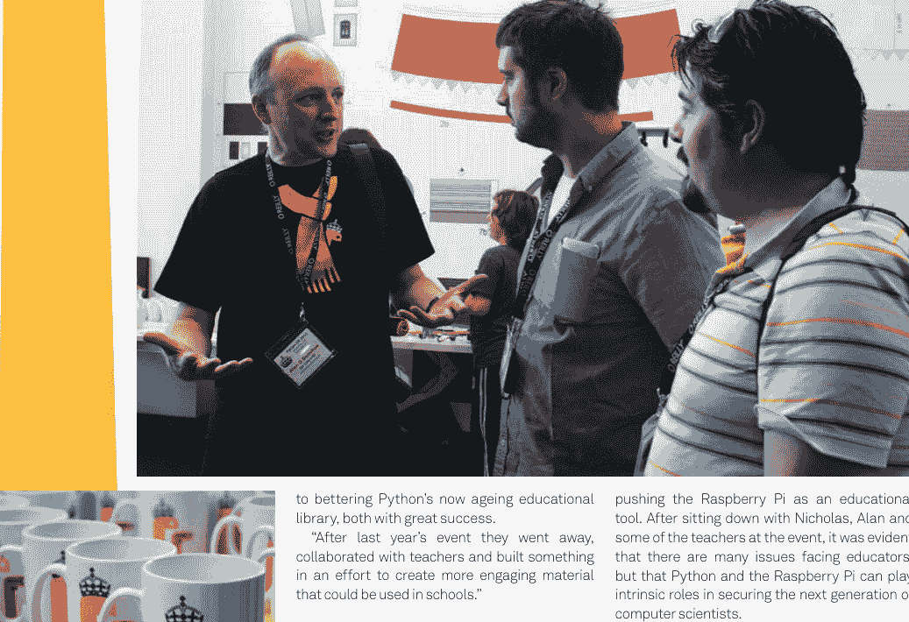

我们一直在使用像树莓派（Raspberry Pi）这样的设备和 Minecraft Pi 等游戏，通过帮助孩子们学习 Python 来改变计算教育。

去年的活动中，我们设立了教师分会，规模虽小但非常成功。我们在 Python 旅程中遇到的一些老师，直接受到了去年发生的事情的启发。

Tollervey 指的是与 Mike Sanderson 和 Simon Gaby 进行的两次 Turtle 演讲，这两位老师都采取了不同的方法来改进 Python 如今再次用于教育的库，并且都取得了巨大的成功。

去年的活动后，他们与教师合作，并创建了一些更具吸引力的材料，以便在学校使用。

## 附带 PI 的配菜

更进一步，教育分会以 Raspberry Jam 达到了高潮，在那里，Python 程序员和老师齐力合作，通过游戏来教育和娱乐对游戏探索计算机科学感兴趣的特定年龄段儿童。对于老师们来说，这是一个极佳的方法，他们前一天刚刚向英国一些顶尖的程序员请教了，现在可以测试新的想法。去年我们有老师参加，那么……那么呢，我们需要什么？Python 在教育领域的下一步是什么？我们还不确定，但这也是寻找答案的绝佳方式。

我们这里有大约 35 个孩子和他们的父母，我们正和朋友 Alan O'Donohee 一起举办 Raspberry Jam。

O'Donohee（也被称为“大使”）一直是推动树莓派作为教育工具的关键人物。在与 Nicholas、Alan 以及活动的一些老师坐在一起之后，显而易见，有许多原因让教育者相信 Python 和树莓派可以提供一个独特的机会，展示开发者在培养下一代计算机科学家方面发挥的内在作用。

活动展示了各种游戏，包括 Minecraft Pi、四旋翼机（通过 Minecraft Pi 控制）以及树莓派项目，这些项目提供了关于他们可以实现内容的清晰简报，将 Raspberry Jam 与 Python UK 联系起来，并证明了其在教育中的重要性。

O'Donohee 说，许多开发者看到孩子们正在面对的高水平挑战感到鼓舞。值得注意的是，我们在 Jam 的参与者中存在性别平衡——这说明不仅仅是社区的问题。

虽然对于今天的年轻专业人士来说为晚了，但英国政府最近宣布了新的 ICT（信息通信技术）。

## 让教育回归正轨

教育是今年 PyCon UK 活动的重点。

## 特稿


Zeth Green 在 Raspberry Jam 的展示环节中展示了他的编程技能


## 恐惧因素

## 我的女儿正在学习如何用 Python 和 Minecraft 构建火箭

Nicholas Tollevery，PyCon UK 组织委员会成员。

我们询问了 Tollevery 对拟议变化的愿景，这些变化将挑战年仅五岁的儿童构建他们的第一个算法。我欢迎对计算机科学、编程和计算思维的强调。我上学时是什么样的呢——我有一台笨重的电脑，用 BASIC 学习编程；ICT 教育已经比那时落后很多，所以看到课程中这种迫切的改变太棒了。

在学校实际上放弃计算机教育 20 多年后，计算机教育正在回到学校课程。如果你处于三十出头，你可能可能是“微软代”的一员——这是一个我们都应该害怕的胆寒的想法。现在是时候看到底层计算机科学的复兴（这对 Python 来说是一个福音）了，因为目前没有足够的预算或培训来支持老师。当一名小学的 IT 老师参加了 PyCon UK 的教育分会时，她指出了各地面临的挑战和问题。

这也直接影响了 Tollevery，他有各种年龄的孩子参加了 Raspberry Jam。我的女儿正在学习如何用 Python 和 Minecraft 构建火箭。她并没有意识到，但她正在用其中一个玩具进行编程，这非常不起。我的一个儿子正在构建某东西，他正在与一位 Python 开发者合作。他们都有自己的目标，我们有一些计算领域最聪明的脑在帮助他们。

“老师必须了解算法、逻辑和某种形式的迭代，”他们告诉我们。我们在与学校的采访中注意到，小学教师缺乏培训——许多人没有计算机或 ICT 资质。

在简短的采访结束后，Tollevery 迅速传达了对明年 PyCon UK 活动日益宏大的计划。

“一些老师正在带回课程，但没有正式的培训，而且学校提供的时间极少。去年我们整个计算机部门的预算只有 1500 英镑。从那里，我不得不尝试寻找资金来继续这个项目。”

“我们希望获得更多老师。策略是程序员不是老师，所以我们没有与孩子们交流的专业知识。


简而言之，英国的教育者需要帮助。我们可以通过重新激发对 `STEM` 的兴趣来帮助当地学校做出改变。访问 `www.computingschool.org.uk` 或 `STEM` 大使计划——`www.stem.org.uk/content/stem-ambassadors`/`Raspberry Jam` 带来的不仅仅是他们的孩子——老师才是变化最大的。接触老师并向他们展示工具，给予他们信心，并向他们展示这些工具如何转化为他们教室里的需求。


`www.linuxuser.com`

## 构建更好的网页

`www.webdesignerm.co.uk`


## 热销中

带有 `HTML5` 的下一代 `CSS` | `PHP` 技巧

## 今日购买你的杂志

印刷版可在 `www.imagineshop.co.uk` 获取

数字版见于 `www.imagineshop.co.uk`

数字版见于 `www.imagineshop.co.uk/music`

`www.linuxuser.com`

## 评论：音乐播放器测试

### 音乐播放器测试

在 `Linux` 上，我们询问了 `Tollevery` 对拟议变化的愿景，这些变化将挑战年仅五岁的儿童构建他们的第一个算法。我欢迎对计算机科学、编程和计算思维的强调。我上学时是什么样的呢——我有一台笨重的电脑，用 `BASIC` 学习编程；`ICT` 教育已经比那时落后很多，所以看到课程中这种迫切的改变太棒了。

在学校实际上放弃计算机教育 20 多年后，计算机教育正在回到学校课程。如果你处于三十出头，你可能可能是“微软代”的一员——这是一个我们都应该害怕的胆寒的想法。现在是时候看到底层计算机科学的复兴（这对 `Python` 来说是一个福音）了，因为目前没有足够的预算或培训来支持老师。当一名小学的 `IT` 老师参加了 `PyCon UK` 的教育分会时，她指出了各地面临的挑战和问题。

这也直接影响了 `Tollevery`，他有各种年龄的孩子参加了 `Raspberry Jam`。我的女儿正在学习如何用 `Python` 和 `Minecraft` 构建火箭。她并没有意识到，但她正在用其中一个玩具进行编程，这非常不起。我的一个儿子正在构建某东西，他正在与一位 `Python` 开发者合作。他们都有自己的目标，我们有一些计算领域最聪明的脑在帮助他们。

“老师必须了解算法、逻辑和某种形式的迭代，”他们告诉我们。我们在与学校的采访中注意到，小学教师缺乏培训——许多人没有计算机或 `ICT` 资质。

在简短的采访结束后，`Tollevery` 迅速传达了对明年 `PyCon UK` 活动日益宏大的计划。

“一些老师正在带回课程，但没有正式的培训，而且学校提供的时间极少。去年我们整个计算机部门的预算只有 1500 英镑。从那里，我不得不尝试寻找资金来继续这个项目。”

“我们希望获得更多老师。策略是程序员不是老师，所以我们没有与孩子们交流的专业知识。”

简而言之，英国的教育者需要帮助。我们可以通过重新激发对 `STEM` 的兴趣来帮助当地学校做出改变。

## 音乐播放器测试

# Audacious

轻量级且功能多得惊讶

`Audacious` 是本次分组测试中唯一可以被描述为轻量级的媒体播放器，事实上正如许多其他轻量级应用一样，它在设计之初就考虑到了这一点。

虽然它作为一个播放器和管理器非常受欢迎，但得益于一系列出色的功能，使其不仅仅是一个基础的音乐播放器。

界面极其简单，通过单个面板列出所有可用媒体，并按专辑排序。音乐可以轻松编辑、重命名，并用于检查 `Audacious` 还有哪些内容可以添加到库中。交互和播放非常无缝，保持了界面的整洁，并允许你根据喜好设置特定的布局，而无需多个窗口。

搜索功能有点奇怪，在界面上，需要从菜单中打开单独的列。搜索结果显示并不理想，结果中仅包含艺术家名称、专辑和歌曲。这突显了 `Audacious` 的一些问题：

### 没有智能播放列表，也不需要连接在线服务

虽然界面非常整洁简洁，但操作起来有些费劲。当你想要在其他音乐播放器中使用播放列表时，这让你很困难，你最好在文件管理器中搜索。至少它与你运行的桌面环境有一些集成，但它缺乏自然感，没有智能播放列表，也没有连接在线服务的方法。

布局很整洁，但寻找任何东西都很困难。

与测试中的其他应用程序相比，这是一个主要的细节。随着音乐在多个位置不断增加，你可能无法在 `PC` 或笔记本电脑上、甚至在你的家庭网络上可用。

至少，`Audacious` 是很舒适的。从我们所看到的，从启动到处理播放列表和音乐，它的功能都易于制作内容并保持了轻量化。在这方面，它是完美的。

| 功能 | 评分 |
|---|---|
| 媒体播放 | 良好良好，但由于是轻量级的，缺乏自动生成功能 | 6 |
| 界面 | 简单直观的标签式界面，尽管搜索功能可以更好 | 8 |
| 管理 | 由于界面简单，实际查找媒体非常困难 | - |
| 在线 | 不提供任何在线服务 | 0 |
| 总体 | `Audacious` 作为一个轻量级音乐播放器还可以的，但若要获得更好的管理和集成，你需要更多功能 | 5 |

功能不是最好的，但 `Audacious` 高度可定制。

## 评测

# Clementine

四大 `Linux` 音乐播放器中位居首席。

`Clementine` 基于 `KDE` 的音乐播放器 `Amarok`，但进行了一些改进并拥有更好的界面。它迅速成为一个非常流行的媒体播放器，1.2 版本拥有了许多很棒的功能。这些功能既能吸引新用户，也能吸引在音乐消费格局中仍想使用这些功能的硬核粉丝。

首先，`Clementine` 支持比以前多得多的流媒体服务，集成了 `Dropbox` 和 `Ubuntu One`。此外还有 `Google Drive`、`SoundCloud` 和 `Groove Music`。你可以轻松在 `Clementine` 界面内进行搜索。`Android` 应用可以在与 `Spotify` 和云存储相同的设备上登录。在设置中，你可以更改菜单部分以自定义 `Clementine` 提供的选项。通过选项，你可以更改 `Clementine` 的几乎每种行为，从淡入淡出等简单的事情。


Android 应用比一些基础界面提供了更好的控制，管理曲目、转码设置，甚至可以将 `WiFi` 设置为远程设备。在 `Clementine` `1.2` 中，可以使用 Android 设备作为远程控制器，该功能在后台运行效果非常好，它没有使用基础界面，而是使用一个特殊的应用程序来实现它。

`Clementine` 几乎应有尽有。它拥有 `Hypno` 和 `Tidal`。从这里开始，你还可以通过音量控制或桌面环境来控制它。

`Clementine` 基本上无所不能。它的随机混合播放器不如一些同类产品，但比测试中的任何其他播放器都要好。它还连接了最新的服务，它是最可定制的，并让你的音乐变得简单。

播放具有特殊的界面，显示到歌曲结束，并显示一个符号以知道其正在播放。虽然你可以控制

| 项目 | 评分 |
|---|---|
| 评分 | 播放极其简单，通知栏上有类似设备控制按钮 |
| 播放 | 界面包含了它，但考虑到功能的数量，用户并不想要它 |
| 界面 | 易于导航且媒体免费免费，尽管某些服务可以运行得更好 |
| 管理 | 连接了你可能想要拥有的所有，`Pandora` 和 `Groove music` |
| 在线 | 一个惊不起的软件，让你几乎可以对所有音乐做任何你想做的事 |
| 总体 | |

## 评测

## 音乐播放器测试

# Banshee

与 `Rhythmbox` 类似，没有 `Clementine` 那么流行。

正如 `Rhythmbox` 评测中提到的，`Banshee` 是 `Ubuntu` 的首次亮相，然后被 `Rhythmbox` 取代。由于它们极其相似，两者都为媒体使用了类似的三栏布局，并且在导航媒体、播客和在线服务方面相似。从核心来看，它们看起来都更整洁，提供了简单的播放，并允许在没有安装所有正确解码器的情况下播放。

`Banshee` 的界面很好且易于使用。它会显示结果，结果也很容易找到。搜索是实时的，在你打字时就会显示结果。允许通过在线视图播放的环境。自定义方面，`Banshee` 中没有多少可以更改的。至少，你可以关闭 `Banshee` 的一些功能。

| 功能 | 评分 |
|---|---|
| 功能 | 易于使用的界面非常漂亮，比它现在要轻量 | `7` |
| 界面 | 易于使用的界面，布局在本地媒体 | `9` |
| 管理 | 对于本地内容，它是跟踪你使用的所有媒体极极方法 | `10` |
| 在线 | 选项有限 | `4` |
| 总体 | `Banshee` 是一个很棒的播放器，比那些无法访问任何在线服务的要好 | `8` |

扩展赋予 `Banshee` 许多功能，关闭这些扩展是自定义它的主要方法。

`72` `www.linuxuser.com`

# 音乐播放器分组测试

顶尖 Linux 音乐播放器的终极对决

## 评测

## 简评：对比与我们的评判结论

### Rhythmbox

# Audacious

# Clementine

# Banshee

| 特性 | Rhythmbox | Audacious | Clementine | Banshee |
| :--- | :--- | :--- | :--- | :--- |
| 播放 | 播放在整个界面和操作系统集成中均处理良好 (`7`) | 播放选项简单且具有一些自定义功能 (`6`) | `Clementine` 有许多操作播放的方法，可以 (`9`) | 整个过程中都提供标准且良好的播放功能 (`7`) |
| 界面 | 布局整洁，易于查找和组织媒体 (`9`) | 界面宽敞，列出了你所有的媒体文件 (`8`) | 界面略显杂乱，但操作起来效果很好 (`9`) | 布局良好、易于理解的界面 (`10`) |
| 管理 | 媒体分类合理，播放列表易于制作 (`8`) | 不太容易找到特定的歌曲或艺术家 (`9`) | 轻松管理音乐、播放列表等 (`10`) | 本地音乐非常容易查找和组织 (`10`) |
| 在线 | 在线服务选择有限，如 `Last.fm` 和 `Ubuntu One` (`4`) | `Audacious` 无法访问任何在线服务 (`4`) | 几乎可以连接每一个在线音乐和云存储服务 (`7`) | 在线功能极具可扩展性，但选择仍然有限 (`5`) |
| 总体 | `Rhythmbox` 是一个不错的音乐播放器，但它还需要一些功能 (`7`) | `Audacious` 是轻量级播放器的极佳选择，但还不够 (`5`) | `Clementine` 拥有你你媒体播放器所需的一切 (`8`) | `Banshee` 是一个标准的媒体播放器，但适用于本地存储音乐 (` `) |

## 冠军诞生了……

# Clementine

`Clementine` 是本次测试的明显获胜者，在几乎每一个方面都是最好的。其极佳的智能音乐界面集成了所有的听歌方式，并提供了丰富的在线服务选择。如果你想听音乐，它可以帮助你获取音乐，并通过优秀的界面、甚至是键盘快捷键和热键轻松地控制它。

其他播放器表现得并不理想。`Rhythmbox` 侧重于轻量化，虽然有的一席之地，但与 `Clementine` 的丰富功能相比，它并不具备竞争力。

`Rhythmbox` 彼此大致处于同一水平，我们需要在在线服务访问方面进行升级以保持竞争力。

目前，`Clementine` 是听音乐和管理音乐的最佳应用程序。

`Rob Zwetseloff`

`Clementine` 可以搜索你在主题设置中配置的任何在线媒体。

`73` `linux.co.uk`

# 由 Raspberry Pi 驱动的 FUZE

- 一个受保护的 `GPIO` 引出板为硬件与 `Pi` 之间的安全接口提供了一种简单的方法

- 附带的面包板可以粘在机壳的凹槽内，以提供一个原型设计区域

- 集成键盘让 `Pi` 感觉更像是一台“真正的”微型计算机

- 通风口防止 `Pi` 在金属机壳内过过热，即使在超频时也是如此

## 外围

### The FUZE

由 Raspberry Pi 驱动

# £179.99

一个能够延续 `BBC Micro` 优势的扩展设备是否是 `Raspberry Pi` 在学校成功的关键？

由 `Raspberry Pi` 驱动的 `FUZE` 是 `Jon Silvera` 的结心之晶，其设计风格模仿了 20 世纪 80 年代的微控制器——特别是 `Acorn BBC Micro`，这直接导致了这个厚实金属部件的诞生。它为现代 `Pi` 提供动力，同时提供了对其大部分端口的访问：以太网、音频、`HDMI`、单个 `USB` 端口以及对 `SD` 卡槽的访问——但仅将复合视频、`DSI` 和 `CSI` 接口进行了引出——这意味着想要使用这些功能的人需要自行对其进行修改。

在重新组在顶部的 `Raspberry Pi B` 型两个 `USB` 端口之一上也连接有一个 `GPIO` 引出板。

目前，`Clementine` 是听音乐和管理音乐的最佳应用程序。

`Banshee` 是一个很好的标准媒体播放器，但适用于本地存储音乐。

> 优点

- 坚固的构建

- 优秀的设计

- 良好的 `GPIO` 扩展功能

- 适合教育使用

> 缺点

- 价格昂贵，对于无法抵扣税的用户来说

# 由 Raspberry Pi 驱动的 FUZE

| 规格 |
| 规格 |
| 操作系统 | 定制版的 `Raspbian` |
| 处理器 | `Raspberry Pi B` 型 |
| 尺寸 | `330 x 240 mm` (不含电源) |
| 重量 | `163g` (不含电源) |
| 扩展 | 受保护的 `GPIO` 引出板，附带面包板 |
| 键盘 | 集成 `88` 键式 |
| 端口 | `3x USB`、以太网、`SD`、电源、`3.5mm` 音输出、`HDMI` |
| 附加 | 鼠标；手册；参考卡；带有跳线的红/绿 `LED`、七段码显示器、蜂鸣器、开关 |

复合视频、`DSI` 和 `CSI` 接口未引出，因此无法使用。

## 考虑

`Arduino` 实验者入门套装 (`ARK`)

`£31.20`

为了轻松验证 `Raspberry Pi` 的功能，`FUZE` 包含了可以通过 `USB` 连接到 `Linux` 的 `Arduino` 板——硬件功能、组件和电池。

所有的经典命令——`10 Print`、`20 Go`运行良好，但 `FUZE Basic` 还有一个大杀器：对 `GPIO` 的访问。在 `FUZE` 内部使用沙箱环境允许用户读写 `GPIO` 引脚。

我们提供的文档将尽快发布，在评测时仅包含了四个项目。

`FUZE` 的最大问题是价格：虽然 `Pi` 本身只需 `30` 英镑，但它通常以 `80` 英元的套装形式出售，包含了除显示器在内的所有配件。`FUZE` 意味着，如果不是教育用途，那是许多家长无法负担的溢价。通过 `129.99` 英元的组合可以节省费用，或者仅机壳、电源和引出板的组合为 `89.99` 英元。然而，最便宜的选择是单独购买机壳。

价格差异是因为 `Pi` 在威尔士生产，而 `FUZE` 是英国产品，因此源头更远。

> Gareth Holmore

# 总结

对于无法抵扣税的用户来说，`FUZE` 非常昂贵，而且对于没有帮助的初学者来说仍然有些困难，但这种 `FUZE` 增强方案比裸机要合适得多。机壳结构坚固，软件和 `GPIO` 引出板提供了必要的保护，价值 `19.99` 英镑——且可以抵扣税款。

## CompuLab MintBox 2

-   可拆卸的前置端口可以将 `MintBox 2` 的用途从媒体或桌面扩展到其他。

-   高增益无线天线确保你可以在随地连接互联网和本地网络。


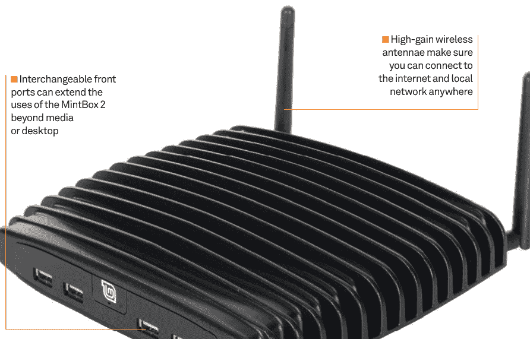

## MINI PC

### CompuLab MintBox 2 £370 / $599

`MintBox 2` 问世了，它比以往任何时候都要强大。不过，花 400 英镑能获得多大的性能呢？

去年对原始 `MintBox` 的发布有点让人惊喜。`Ubuntu` 已经在某些笔记本电脑和台式电脑上发布了一段时间，但 `Linux Mint` 并没有获得其所基于的发行版那样的关注，也不像 `Canonical` 想要推广的那样。`MintBox` 对于其尺寸而言是一个相当高端的系统，并作为未来 PC 创作的测试平台。一年后，第二代 `MintBox` 发布了，富有想象力地命名为 `MintBox 2`，并且比原始版要好得多。

`MintBox 2` 基于我们今年早些时候发布并喜爱的极其 `Intense PC`。具体来说，它基于 `Intense PC` 的中端型号，运行 `i5` 处理器，内存减半至 4GB。尽管如此，这仍然提供了足够的性能，同时让它的待机功耗保持在惊人的 10W。`Intense PC` 的前后面板都采用了完全相同的端口布局，唯一明显的区别是使用了 `Linux` 品牌标志，而不是 `Intense PC` 的标志。

后面和前面的输入端口数量让你能用这个小盒子做很多事情。将前面的四个 `USB` 端口改为以太网口，你就拥有了一个极佳的轻量级家用服务器和路由器，得益于 `HDMI` 端口、`Mini DisplayPort` 以及 `MintBox` 附带的各种连接器和适配器，它可以连接任何类型的显示器。由于其尺寸和静音性，这使其成为家庭媒体 PC 的理想人选，事实上强大到可以作为 `Steam Machine`，甚至超过了 `Steam`，足以播放高比特率的 1080p 媒体，并可以轻松处理来自各种来源的 HD 内容，尤其是对于它的尺寸而言。它是可升级的，开启处下方有一个小隔层，露出了连接的硬盘和内存。内存是笔记本内存条，可以轻松弹出并增加到最大 16GB。


### CompuLab MintBox 2

运行 `Linux Mint` 的强力微型 PC

### 测评


### 还可以考虑

### 技术规格

-   背后宽范围端口提供了各种连接方式，从 `HTPC` 到家用服务器。

| 操作系统 | `Linux Mint` |
| :--- | :--- |
| 处理器 | `Intel i5-3337U` |
| 内存 | 8GB DDR3 |
| 散热 | 双散热片外壳，无风扇设计 |
| 网络 | 2x 千兆以太网, 802.11 Wi-Fi |
| 端口 | 6x USB 2.0, 2x USB 3.0, 光学, HDMI, DisplayPort |


### Intense-PC Pro

$299 (€199)

`MintBox` 的大姐姐 `Intense PC` 搭载了四核芯片——然而，你为它的无风扇设计、端口选择以及在 `www.fitpc.com` 所示的升级性而付了这笔差价。

### Zotac D41 Plus

$199

比 `MintBox` 大一点，但性能更弱。`Zotac Atom` 性能稍低，更偏向媒体 PC，在它可以处理的许多应用程序中仍然可用，但效果没那么好。


我们发现的问题是 `MintBox 2` 在空闲时确实会发热。`Intense PC` 摸起来会有温热，但从没有达到这种温度。外壳本身和 `Intense PC` 一样，在封闭空间内运行良好。尽管如此，在通风良好的情况下或开放空间中，它是一件不可思议的设备，比体验过的 `Intense PC` 更好。

默认当天安装 `Linux` 并不是什么小功能——那里有它当然很好，但安装过程快速无痛，如果你想把 `MintBox 2` 用于桌面电脑以外的用途，它也可以很容易被替换。`Linux Mint` 在系统上运行得非常好，运行的是 `MATE` 而不是旗舰的 `Cinnamon`；不过，这很容易更改。

总结：虽然很小，但它是一件极佳的设备，比具有相同规格的姐妹机更便宜。它性能强大，可以轻松胜任许多种角色。


### 测评：小巧，但它是一件极佳的设备，比具有完全相同规格的姐妹机更便宜。它功能强大，并且可以轻松胜任广泛的角色。

### 测评：小巧

-   对于 `openSUSE 13.1` 来说，`YaST` 现在的构建是令人惊喜的。
-   对于 `openSUSE 13.1` 来说，`YaST` 现在的构建是令人惊叹的体验。
-   对于 `openSUSE 13.1` 来说，`YaST` 现在的构建是完美的。
-   对于 `openSUSE 13.1` 来说，`YaST` 现在的构建是极其完美的。
-   对于 `openSUSE 13.1` 来说，`YaST` 现在的构建是完美的。
-   对于 `openSUSE 13.1` 来说，`YaST` 现在的构建是极其完美的。
-   对于 `openSUSE 13.1` 来说，`YaST` 现在的构建是完美的。
-   对于 `openSUSE 13.1` 来说，`YaST` 现在的构建是极其完美的。
-   对于 `openSUSE 13.1` 来说，`YaST` 现在的构建是完美的。
-   对于 `openSUSE 13.1` 来说，`YaST` 现在的构建是极其完美的。
-   对于 `openSUSE 13.1` 来说，`YaST` 现在的构建是完美的。
-   对于 `openSUSE 13.1` 来说，`YaST` 现在的构建是极其完美的。
-   对于 `openSUSE 13.1` 来说，`YaST` 现在的构建是完美的。
-   对于 `openSUSE 13.1` 来说，`YaST` 现在的构建是极其完美的。
-   对于 `openSUSE 13.1` 来说，`YaST` 现在的构建是完美的。
-   对于 `openSUSE 13.1` 来说，`YaST` 现在的构建是极其完美的。
-   对于 `openSUSE 13.1` 来说，`YaST` 现在的构建是完美的。
-   对于 `openSUSE 13.1` 来说，`YaST` 现在的构建是极其完美的。
-   对于 `openSUSE 13.1` 来说，`YaST` 现在的构建是完美的。
-   对于 `openSUSE 13.1` 来说，`YaST` 现在的构建是极其完美的。
-   对于 `openSUSE 13.1` 来说，`YaST` 现在的构建是完美的。
-   对于 `openSUSE 13.1` 来说，`YaST` 现在的构建是极其完美的。
-   对于 `openSUSE 13.1` 来说，`YaST` 现在的构建是完美的。
-   对于 `openSUSE 13.1` 来说，`YaST` 现在的构建是极其完美的。
-   对于 `openSUSE 13.1` 来说，`YaST` 现在的构建是完美的。
-   对于 `openSUSE 13.1` 来说，`YaST` 现在的构建是极其完美的。
-   对于 `openSUSE 13.1` 来说，`YaST` 现在的构建是完美的。
-   对于 `openSUSE 13.1` 来说，`YaST` 现在的构建是极其完美的。
-   对于 `openSUSE 13.1` 来说，`YaST` 现在的构建是完美的。
-   对于 `openSUSE 13.1` 来说，`YaST` 现在的构建是极其完美的。
-   对于 `openSUSE 13.1` 来说，`YaST` 现在的构建是完美的。
-   对于 `openSUSE 13.1` 来说，`YaST` 现在的构建是极其完美的。
-   对于 `openSUSE 13.1` 来说，`YaST` 现在的构建是完美的。
-   对于 `openSUSE 13.1` 来说，`YaST` 现在的构建是极其完美的。


-   对于 `openSUSE 13.1` 来说，`YaST` 现在的构建是完美的。

-   对于 `openSUSE 13.1` 来说，`YaST` 现在的构建是极其完美的。

-   对于 `openSUSE 13.1` 来说，`YaST` 现在的构建是完美的。

-   对于 `openSUSE 13.1` 来说，`YaST` 现在的构建是极其完美的。

-   对于 `openSUSE 13.1` 来说，`YaST` 现在的构建是完美的。

-   对于 `openSUSE 13.1` 来说，`YaST` 现在的构建是极其完美的。

-   对于 `openSUSE 13.1` 来说，`YaST` 现在的构建是完美的。

-   对于 `openSUSE 13.1` 来说，`YaST` 现在的构建是极其完美的。

-   对于 `openSUSE 13.1` 来说，`YaST` 现在的构建是完美的。

-   对于 `openSUSE 13.1` 来说，`YaST` 现在的构建是极其完美的。

-   对于 `openSUSE 13.1` 来说，`YaST` 现在的构建是完美的。

-   对于 `openSUSE 13.1` 来说，`YaST` 现在的构建是极其完美的。

-   对于 `openSUSE 13.1` 来说，`YaST` 现在的构建是完美的。

-   对于 `openSUSE 13.1` 来说，`YaST` 现在的构建是极其完美的。

-   对于 `openSUSE 13.1` 来说，`YaST` 现在的构建是完美的。

-   对于 `openSUSE 13.1` 来说，`YaST` 现在的构建是极其完美的。

-   对于 `openSUSE 13.1` 来说，`YaST` 现在的构建是完美的。

-   对于 `openSUSE 13.1` 来说，`YaST` 现在的构建是极其完美的。

-   对于 `openSUSE 13.1` 来说，`YaST` 现在的构建是完美的。

-   对于 `openSUSE 13.1` 来说，`YaST` 现在的构建是极其完美的。

-   对于 `openSUSE 13.1` 来说，`YaST` 现在的构建是完美的。

-   对于 `openSUSE 13.1` 来说，`YaST` 现在的构建是极其完美的。

-   对于 `openSUSE 13.1` 来说，`YaST` 现在的构建是完美的。

-   对于 `openSUSE 13.1` 来说，`YaST` 现在的构建是极其完美的。

-   对于 `openSUSE 13.1` 来说，`YaST` 现在的构建是完美的。

-   对于 `openSUSE 13.1` 来说，`YaST` 现在的构建是极其完美的。

-   对于 `openSUSE 13.1` 来说，`YaST` 现在的构建是完美的。

-   对于 `openSUSE 13.1` 来说，`YaST` 现在的构建是极其完美的。

-   对于 `openSUSE 13.1` 来说，`YaST` 现在的构建是完美的。

-   对于 `openSUSE 13.1` 来说，`YaST` 现在的构建是极其完美的。

-   对于 `openSUSE 13.1` 来说，`YaST` 现在的构建是完美的。

-   对于 `openSUSE 13.1` 来说，`YaST` 现在的构建是极其完美的。

-   对于 `openSUSE 13.1` 来说，`YaST` 现在的构建是完美的。

-   对于 `openSUSE 13.1` 来说，`YaST` 现在的构建是极其完美的。

-   对于 `openSUSE 13.1` 来说，`YaST` 现在的构建是完美的。

-   对于 `openSUSE 13.1` 来说，`YaST` 现在的构建是极其完美的。

-   对于 `openSUSE 13.1` 来说，`YaST` 现在的构建是完美的。

-   对于 `openSUSE 13.1` 来说，`YaST` 现在的构建是极其完美的。

-   对于 `openSUSE 13.1` 来说，`YaST` 现在的构建是完美的。

-   对于 `openSUSE 13.1` 来说，`YaST` 现在的构建是极其完美的。

-   对于 `openSUSE 13.1` 来说，`YaST` 现在的构建是完美的。

-   对于 `openSUSE 13.1` 来说，`YaST` 现在的构建是极其完美的。

-   对于 `openSUSE 13.1` 来说，`YaST` 现在的构建是完美的。

-   对于 `openSUSE 13.1` 来说，`YaST` 现在的构建是极其完美的。

-   对于 `openSUSE 13.1` 来说，`YaST` 现在的构建是完美的。

-   对于 `openSUSE 13.1` 来说，`YaST` 现在的构建是极其完美的。

-   对于 `openSUSE 13.1` 来说，`YaST` 现在的构建是完美的。

-   对于 `openSUSE 13.1` 来说，`YaST` 现在的构建是极其完美的。

-   对于 `openSUSE 13.1` 来说，`YaST` 现在的构建是完美的。

-   对于 `openSUSE 13.1` 来说，`YaST` 现在的构建是极其完美的。

-   对于 `openSUSE 13.1` 来说，`YaST` 现在的构建是完美的。

-   对于 `openSUSE 13.1` 来说，`YaST` 现在的构建是极其完美的。

-   对于 `openSUSE 13.1` 来说，`YaST` 现在的构建是完美的。

-   对于 `openSUSE 13.1` 来说，`YaST` 现在的构建是极其完美的。

-   对于 `openSUSE 13.1` 来说，`YaST` 现在的构建是完美的。

-   对于 `openSUSE 13.1` 来说，`YaST` 现在的构建是极其完美的。

-   对于 `openSUSE 13.1` 来说，`YaST` 现在的构建是完美的。

-   对于 `openSUSE 13.1` 来说，`YaST` 现在的构建是极其完美的。

-   对于 `openSUSE 13.1` 来说，`YaST` 现在的构建是完美的。

-   对于 `openSUSE 13.1` 来说，`YaST` 现在的构建是极其完美的。

-   对于 `openSUSE 13.1` 来说，`YaST` 现在的构建是完美的。

-   对于 `openSUSE 13.1` 来说，`YaST` 现在的构建是极其完美的。

-   对于 `openSUSE 13.1` 来说，`YaST` 现在的构建是完美的。

-   对于 `openSUSE 13.1` 来说，`YaST` 现在的构建是极其完美的。

-   对于 `openSUSE 13.1` 来说，`YaST` 现在的构建是完美的。

-   对于 `openSUSE 13.1` 来说，`YaST` 现在的构建是极其完美的。

-   对于 `openSUSE 13.1` 来说，`YaST` 现在的构建是完美的。

-   对于 `openSUSE 13.1` 来说，`YaST` 现在的构建是极其完美的。

-   对于 `openSUSE 13.1` 来说，`YaST` 现在的构建是完美的。

-   对于 `openSUSE 13.1` 来说，`YaST` 现在的构建是极其完美的。

-   对于 `openSUSE 13.1` 来说，`YaST` 现在的构建是完美的。

-   对于 `openSUSE 13.1` 来说，`YaST` 现在的构建是极其完美的。

-   对于 `openSUSE 13.1` 来说，`YaST` 现在的构建是完美的。

-   对于 `openSUSE 13.1` 来说，`YaST` 现在的构建是极其完美的。

-   对于 `openSUSE 13.1` 来说，`YaST` 现在的构建是完美的。

-   对于 `openSUSE 13.1` 来说，`YaST` 现在的构建是极其完美的。

-   对于 `openSUSE 13.1` 来说，`YaST` 现在的构建是完美的。

-   对于 `openSUSE 13.1` 来说，`YaST` 现在的构建是极其完美的。

-   对于 `openSUSE 13.1` 来说，`YaST` 现在的构建是完美的。

-   对于 `openSUSE 13.1` 来说，`YaST` 现在的构建是极其完美的。

-   对于 `openSUSE 13.1` 来说，`YaST` 现在的构建是完美的。

-   对于 `openSUSE 13.1` 来说，`YaST` 现在的构建是极其完美的。

-   对于 `openSUSE 13.1` 来说，`YaST` 现在的构建是完美的。

-   对于 `openSUSE 13.1` 来说，`YaST` 现在的构建是极其完美的。

-   对于 `openSUSE 13.1` 来说，`YaST` 现在的构建是完美的。

-   对于 `openSUSE 13.1` 来说，`YaST` 现在的构建是极其完美的。

-   对于 `openSUSE 13.1` 来说，`YaST` 现在的构建是完美的。

-   对于 `openSUSE 13.1` 来说，`YaST` 现在的构建是极其完美的。

-   对于 `openSUSE 13.1` 来说，`YaST` 现在的构建是完美的。

-   对于 `openSUSE 13.1` 来说，`YaST` 现在的构建是极其完美的。

-   对于 `openSUSE 13.1` 来说，`YaST` 现在的构建是完美的。

-   对于 `openSUSE 13.1` 来说，`YaST` 现在的构建是极其完美的。

-   对于 `openSUSE 13.1` 来说，`YaST` 现在的构建是完美的。

-   对于 `openSUSE 13.1` 来说，`YaST` 现在的构建是极其完美的。

-   对于 `openSUSE 13.1` 来说，`YaST` 现在的构建是完美的。

-   对于 `openSUSE 13.1` 来说，`YaST` 现在的构建是极其完美的。

-   对于 `openSUSE 13.1` 来说，`YaST` 现在的构建是完美的。

-   对于 `openSUSE 13.1` 来说，`YaST` 现在的构建是极其完美的。

-   对于 `openSUSE 13.1` 来说，`YaST` 现在的构建是完美的。

-   对于 `openSUSE 13.1` 来说，`YaST` 现在的构建是极其完美的。

-   对于 `openSUSE 13.1` 来说，`YaST` 现在的构建是完美的。

-   对于 `openSUSE 13.1` 来说，`YaST` 现在的构建是极其完美的。

-   对于 `openSUSE 13.1` 来说，`YaST` 现在的构建是完美的。

-   对于 `openSUSE 13.1` 来说，`YaST` 现在的构建是极其完美的。

-   对于 `openSUSE 13.1` 来说，`YaST` 现在的构建是完美的。

-   对于 `openSUSE 13.1` 来说，`YaST` 现在的构建是极其完美的。

-   对于 `openSUSE 13.1` 来说，`YaST` 现在的构建是完美的。

-   对于 `openSUSE 13.1` 来说，`YaST` 现在的构建是极其完美的。

-   对于 `openSUSE 13.1` 来说，`YaST` 现在的构建是完美的。

-   对于 `openSUSE 13.1` 来说，`YaST` 现在的构建是极其完美的。

-   对于 `openSUSE 13.1` 来说，`YaST` 现在的构建是完美的。

-   对于 `openSUSE 13.1` 来说，`YaST` 现在的构建是极其完美的。

-   对于 `openSUSE 13.1` 来说，`YaST` 现在的构建是完美的。

-   对于 `openSUSE 13.1` 来说，`YaST` 现在的构建是极其完美的。

-   对于 `openSUSE 13.1` 来说，`YaST` 现在的构建是完美的。

-   对于 `openSUSE 13.1` 来说，`YaST` 现在的构建是极其完美的。

-   对于 `openSUSE 13.1` 来说，`YaST` 现在的构建是完美的。

-   对于 `openSUSE 13.1` 来说，`YaST` 现在的构建是极其完美的。

-   对于 `openSUSE 13.1` 来说，`YaST` 现在的构建是完美的。

-   对于 `openSUSE 13.1` 来说，`YaST` 现在的构建是极其完美的。

-   对于 `openSUSE 13.1` 来说，`YaST` 现在的构建是完美的。


对于 `openSUSE 13.1` 来说，`YaST` 现在的构建是极其完美的。

# 解锁安卓的强大

`www.littlegreenrobot.co.uk`

120+ 三星 `HTC` • 三星 • `LG` • `NEXUS`

100% 非官方

# 安卓

50 三星 `HTC` • 三星 • `LG` • `NEXUS`

100% 非官方

# 及其

应用评论 • 技巧与建议

硬件功能测试

# roid

应用评论 • 技巧与建议

硬件功能测试

杂志

杂志

# 终极安卓

# 购买指南

您最热门的手机、平板电脑及小配件

注意：版本 `4.2` • `CHROMEAST` • 深度解析 • 索尼 `Q.10`

# 75 修复

# 与 升级

排除手机故障

- 让你的手机运行更快
- 修复漏洞、电池续航问题
- 解决你的问题


# 101 最佳应用

124


# NEXUS

# 安卓

导航技巧

小组件指南

针对高级用户

小组件

# 模组

谷歌的

# 黑客


# 黑客专区


# 安卓杂志

现已在所有优质渠道发售，热卖中

> `Galaxy` `Note` `3` 测试
> 史以来最佳 101 必备应用
> 安卓秘密
> 硬件评测
> 安卓破解技巧与教程
> 应用评论 帮助与建议

# 立即购买本期

印刷版请访问：`www.imagineshop.co.uk`

数字版请访问：`www.greatmag.com`

可在以下平台获取：

# WattOS R7.5

轻量级且绿色的发行版

`facebook.com/littlegreenrobot`

`twitter.com/littlerobot`

# WattOS R7.5

轻量级且绿色的发行版

新的 `MATE` 衍生是 `WattOS` 家族的良好补充

得益于 `Microwatt`，`WattOS` 现在可以变得更加轻量化

`Ubuntu` 的更新有助于该发行版

# WattOS R7.5

轻量级且绿色的发行版

根据您的需求提供更多口味，且已设置就绪

`WattOS` 在 `Linux` 领域因提供独特的体验而脱颖而出，得益于 `Ubuntu` 源码，其功能可以进一步扩展。

由于 `WattOS` 拥有自己的软件仓库，某些软件包可能需要手动安装。通过 `Microwatt`，`MATE` 版本现在提供了更多选择。

所有主程序运行速度极快，`Microwatt` 的工作流和界面保持高度相似性。默认应用选择保持精简以减少冗余，并与如 `Openbox` 或 `Qt` 等其他轻量级方案保持兼容。`Chromium` 作为默认浏览器被内置。在没有安装其他套件的情况下，打印管理和多用户支持已就绪。

可以通过上述 `Ubuntu` 资源轻松扩展功能，最好是构建一个适合您需求的轻量化版本。

作为基础包，`WattOS` 的唯一小问题是镜像文件的大小。环境没有提供额外的软件包，`MATE` 版本的大小为 `700MB` 的完整光盘。在微小问题上，这限制了其作为应急可用发行版的用途。

### 优点

- 提供从超轻量到重量级的不同程度编译版本供选择

### 缺点

- `ISO` 文件对于该类型来说相当小，且基于 `Ubuntu` 版本

# 总结

`WattOS` 的额外功能比 `MATE` 多，但保持了该轻量级发行版的哲学。新版本提供的额外多样性有助于用户更好地决定希望以何种方式获取 `WattOS`。

更多信息

`planetworld.com`

`81 | linuxux.co.uk`

# 订阅

立即订阅开始省钱

非美国读者请见第 34 页

# 美国特惠

立即订阅即可免费赠送 5 期*

# 订阅专属福利

- 立即订阅，仅需 122 美元即可获得 13 期*
- 每期仅需 9.39 美——通常零售价为 15.99 美

获取更多信息并购买：`www.imaginesubs.co.uk/lud`

或拨打 `+44 (0) 0`

获取更多信息并购买：`www.imaginesubs.co.uk/lud`

或拨打 `+44 (0) 0`

`83 www.linuxuser.com`

# Pi!Glow

树莓派® 彩色 `LED` 板

- 18 通道 8 位 `PWM` (0-255)
- 可独立寻址
- 6 种颜色 + 白色
- 每个 `LED` 均有 360° 视角
- 完美适配 `PiBow` 内部

```
http://shop.pimoni.com/products/piglow
```


购买渠道：`http://pibow.com/`

# PCSL

树莓派摄像头支架现已上市！！

全系列树莓派产品

- 跳线线 / `GPIO`：全系列 `M-F` / `F-F` / `M-M` 跳线
- 转接套件 (`Cobbler` `Kit`)：`GPIO` 高质量通用面包板套件
- `GPIO` 线缆：15cm - 100cm
- `PCSL` `VESA`：挂载您的树莓派®
- `CYNTECH`：时尚新款树莓派外壳

可选颜色

- 黑色
- 树莓蓝
- * 独家白色！

接受学校订单 - 立即致电！

# 树莓派套装

512MB 型号 `B` `Rev.2`

电源适配 / 外壳 / `HDMI` 线 / 网线

8GB `Noobs` 内存卡

£54.99

`Unit 46 Trinity Enterprise Centre, Ironworks Road, Barrow in Furnness, Cumbria LA4 2PN`

01229-8777577 `www.pcslshop.com`

在以下刊登广告

# LinuxUser & 开发者

联系 `Rhian`：

01202 586421


`rhian.carter@imagine-publishing.co.uk`

# 使用 ModMyPi 让您的创意变为现实

`www.modmypi.com`

`@modmypi`


# Arduino 与树莓派机器人

探索全新的开源机器人平台，现已现货！

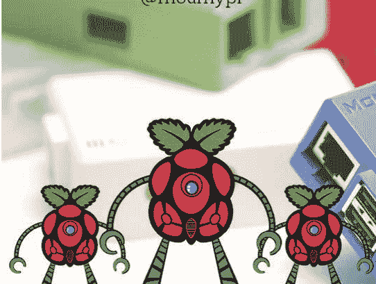

## MODMYPI

最全的树莓派组件范围，面向新手及专家的教程。全球发货。

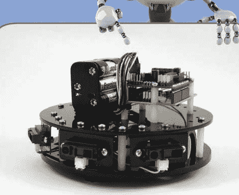

## RobotBits.co.uk


## 使用 BLACKNIGHT 的 LINUX 云模板释放力量

支持以下操作系统：

- `ubuntu`
- `CloudLinux`
- `fedora`
- `CentOS`

- 方案起价：
  - `512MB` 内存
  - `15GB` 空间
  - `250GB` 流量

使用优惠码 `linux713` 节省 `20%`（适用于云托管方案 `1` 年）。

**BLACKNIGHT 解决方案**

- 域名
- 托管
- 电子邮件

`sales@blacknight.com` | `+44 (0)845 5280242` | `www.blacknight.com`

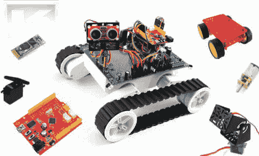

# 与我们一起构建您的机器人！

`www.dawnrobotics.co.uk`

## 联系我们...

- 网站：`www.linuxuxer.co.uk`
- 邮箱：`linuxuxer@imagine-publishing.co.uk`

# 问答

- `Facebook: Linux User Developer`
- `Twitter: @linuxuxermag`

# 您的问题解答

将您的问题发送给我们，我们将尽力解答！

## 常见问题：使用 VirtualBox 使用虚拟机

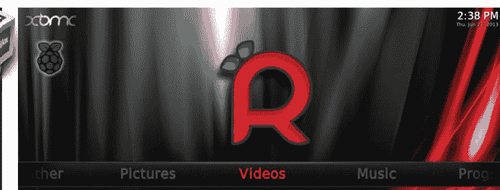

**Q：如何在 VirtualBox 中设置虚拟机？**

答：在主界面上点击“新建 (New)”，打开设置虚拟机的窗口。为它起任何您喜欢的名称，并选择 `Linux` 作为类型。内存条将设置为一个建议值，但如果您觉得可以，可以更改它——将内存增加到 `128MB`；如果您想使用磁盘而不是虚拟文件，请挂载磁盘镜像，然后点击“启动 (Start)”。

虚拟机启动后，点击“设置 (Settings)”。在“显示 (Display)”下，启用 `3D` 加速并将内存增加到 `128MB`；如果您想使用磁盘而不是虚拟文件，请挂载磁盘镜像，然后点击“启动 (Start)”。

**Q：我应该使用 32 位还是 64 位的？**

答：`32` 位镜像通常运行良好。如果您需要 `64` 位系统或类似的内容，您将需要安装它。

**Q：我可以在虚拟机上进行双启动吗？**

答：可以，只要您的虚拟硬盘有足够的空间或在虚拟机中有其他空间。您不需要进行任何操作来让 `GRUB` 对虚拟驱动器进行双启动，就像它在普通硬盘上那样——就像它安装时的那样。


# 在树莓派上使用 Linux


**Q：如何在 VirtualBox 中设置虚拟机？**

答：在主界面上点击“新建 (New)”，打开设置虚拟机的窗口。为它起任何您喜欢的名称，并选择 `Linux` 作为类型。内存条将设置为一个建议值，但如果您觉得可以，可以更改它——将内存增加到 `128MB`；如果您想使用磁盘而不是虚拟文件，请挂载磁盘镜像，然后点击“启动 (Start)”。

虚拟机启动后，点击“设置 (Settings)”。在“显示 (Display)”下，启用 `3D` 加速并将内存增加到 `128MB`；如果您想使用磁盘而不是虚拟文件，请挂载磁盘镜像，然后点击“启动 (Start)”。

**Q：我应该使用 32 位还是 64 位的？**

答：`32` 位镜像通常运行良好。如果您需要 `64` 位系统或类似的内容，您将需要安装它。

**Q：我可以在虚拟机上进行双启动吗？**

答：可以，只要您的虚拟硬盘有足够的空间或在虚拟机中有其他空间。您不需要进行任何操作来让 `GRUB` 对虚拟驱动器进行双启动，就像它在普通硬盘上那样——就像它安装时的那样。

# 在树莓派上使用 Linux


**Q：如何在 VirtualBox 中设置虚拟机？**

答：在主界面上点击“新建 (New)”，打开设置虚拟机的窗口。为它起任何您喜欢的名称，并选择 `Linux` 作为类型。内存条将设置为一个建议值，但如果您觉得可以，可以更改它——将内存增加到 `128MB`；如果您想使用磁盘而不是虚拟文件，请挂载磁盘镜像，然后点击“启动 (Start)”。

虚拟机启动后，点击“设置 (Settings)”。在“显示 (Display)”下，启用 `3D` 加速并将内存增加到 `128MB`；如果您想使用磁盘而不是虚拟文件，请挂载磁盘镜像，然后点击“启动 (Start)”。

**Q：我应该使用 32 位还是 64 位的？**

答：`32` 位镜像通常运行良好。如果您需要 `64` 位系统或类似的内容，您将需要安装它。

**Q：我可以在虚拟机上进行双启动吗？**

答：可以，只要您的虚拟硬盘有足够的空间或在虚拟机中有其他空间。您不需要进行任何操作来让 `GRUB` 对虚拟驱动器进行双启动，就像它在普通硬盘上那样——就像它安装时的那样。

# 在树莓派上使用 Linux


**Q：如何在 VirtualBox 中设置虚拟机？**

答：在主界面上点击“新建 (New)”，打开设置虚拟机的窗口。为它起任何您喜欢的名称，并选择 `Linux` 作为类型。内存条将设置为一个建议值，但如果您觉得可以，可以更改它——将内存增加到 `128MB`；如果您想使用磁盘而不是虚拟文件，请挂载磁盘镜像，然后点击“启动 (Start)”。

虚拟机启动后，点击“设置 (Settings)”。在“显示 (Display)”下，启用 `3D` 加速并将内存增加到 `128MB`；如果您想使用磁盘而不是虚拟文件，请挂载磁盘镜像，然后点击“启动 (Start)”。

**Q：我应该使用 32 位还是 64 位的？**

答：`32` 位镜像通常运行良好。如果您需要 `64` 位系统或类似的内容，您将需要安装它。

**Q：我可以在虚拟机上进行双启动吗？**

答：可以，只要您的虚拟硬盘有足够的空间或在虚拟机中有其他空间。您不需要进行任何操作来让 `GRUB` 对虚拟驱动器进行双启动，就像它在普通硬盘上那样——就像它安装时的那样。

# 在树莓派上使用 Linux


**Q：如何在 VirtualBox 中设置虚拟机？**

答：在主界面上点击“新建 (New)”，打开设置虚拟机的窗口。为它起任何您喜欢的名称，并选择 `Linux` 作为类型。内存条将设置为一个建议值，但如果您觉得可以，可以更改它——将内存增加到 `128MB`；如果您想使用磁盘而不是虚拟文件，请挂载磁盘镜像，然后点击“启动 (Start)”。

虚拟机启动后，点击“设置 (Settings)”。在“显示 (Display)”下，启用 `3D` 加速并将内存增加到 `128MB`；如果您想使用磁盘而不是虚拟文件，请挂载磁盘镜像，然后点击“启动 (Start)”。

**Q：我应该使用 32 位还是 64 位的？**

答：`32` 位镜像通常运行良好。如果您需要 `64` 位系统或类似的内容，您将需要安装它。

**Q：我可以在虚拟机上进行双启动吗？**

答：可以，只要您的虚拟硬盘有足够的空间或在虚拟机中有其他空间。您不需要进行任何操作来让 `GRUB` 对虚拟驱动器进行双启动，就像它在普通硬盘上那样——就像它安装时的那样。

# 在树莓派上使用 Linux


# 问题与解答

## Facebook: Linux 用户开发者

## Twitter: @linuxuserm

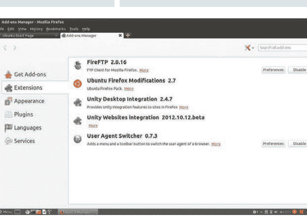

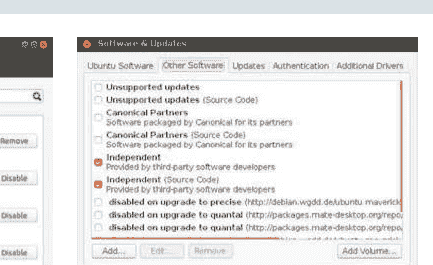

- `Firefox 2.0.16`
- `Ubuntu Firefox 修改版 2.7`
- `Ubuntu 桌面集成 2.4`
- `Unity 网站集成 2012.10.12`
- `User Agent Switcher 0.7.3`

`Ubuntu` 中的软件库可能有些混乱。

`Firefox` 扩展是 `Chrome` 和 `Chromium` 能够兴起的原因之一。

这并不像移除仓库那么简单。当你禁用 `PPA` 时，只有特定的方法可以有效地将其移除。


# 总体问题

在为你的笔记本电脑花时间构建之前，先在你的电脑上试试 `Chrome`。镜像可以在 `chromeos.heexxx.net` 找到。

首先，你可以打开 `Ubuntu` 软件源来禁用它们。点击顶部栏上的“编辑”和“软件源”。这将打开一个包含仓库的窗口，你也可以逐个删除。普通的软件仓库在这里无法删除，`PPA` 也不行。然后使用软件中心并打开终端，使用带有 `--remove` 参数的 `add-apt-repository` 命令来移除 `PPA`。类似于：

```bash
sudo add-apt-repository --remove ppa:repo/ppa
```

我最近在两台机器上安装了 `Arch`，目前 `Firefox` 在两台机器上都运行得异常慢。由于这种现象在我的主系统上也发生了，所以我决定检查一下 `Chrome`，它运行得很好。我是 `Arch` 的忠实粉丝，但在我处理的其他任何系统中都没有出现过这种情况。

那应该可以消除它。执行 `sudo apt-get update`，然后当你尝试安装某些软件时，`sudo` 就会修复任何简单的问题。

是一或两天前，所有安装都是不带 `AUR` 的全新安装。我发现了这个问题，它是由一些过时的软件包导致的。我的系统并没有被某种机制超频，事实并非如此。

如果仍然很慢，你可能需要等待 `Firefox` 的更新。不过 `Chromium` 仍然很棒，所以影响不会太大。

我也想过 `lib32-firefox-plugin` 会有帮助，但什么都没有变化。

你在几分钟后遇到过这个问题吗？程序在之后冻结了。

今年初，我在 `Ubuntu` 中添加了一个 `PPA` 来获取我需要的包。没什么特别的。遗憾的是这个 `PPA` 似乎坏了，所以我找到了替代方案。我喜欢确保我的仓库列表干净整洁。我不确定如何移除它，因为我从未需要移除过 `PPA`。你是如何操作的？

## 乔治·怀特

嗨乔治，先不要对 `Arch` 失去信心！如果 `Arch` 运行正常，听起来更可能是 `Firefox` 的问题。我们使用的 `Firefox` 配置与系统类似，这可能导致了问题。很有可能。

谢谢。

## 布莱尔·奥克利

### 可能是插件占用了太多资源；遗憾的是这在 `Firefox` 中经常发生


## 安装未安装

当我运行尝试构建的程序的 `configure` 脚本时，我得到了一个错误。

88 www.linuxuser.co.uk

## 问题与解答

所有的技术问题都已解决

## Q/A


## Firmer 名称

我终于开始使用我的 `Raspberry Pi` 了——因为搬家我在沙发上坐了一会儿，所以现在真的有机会可以利用它了。我发誓这个 `Pi` 需要 `Raspberry` 的进一步帮助，因为我拿到了但它拒绝什么都不做。真的需要使用 `ClamAV` 吗？据我所知，`Debian` 仓库中没有这个最终版本，我该做什么来解决这个问题？

`Al Blackley`

虽然 `Clam Antivirus` 在标准的 `Debian` 仓库中，但它们并不是 `Debian` 项目中可用新包的最新版本。`Debian` 的标准确实是非常及时的。你需要向列表添加一个新仓库，例如：

```text
deb http://XX.debian.org/
debian squeeze-updates contains main
```

...其中 `XX` 是你的两位国家代码。

我如何更新我的 `Raspberry Pi` 固件？我需要使用任何特殊工具吗，还是说它其实非常简单？希望你买的时候它还有点复杂，自那以后 `Raspberry pi` 已经变得简单了一些。有人整合了一个名为 `updated-raspberry-firmware` 的包，并且 `cut Raspberry Pi` 是专门为 `Raspbian` 设计的。它现在实际上自带了工具，所以我们建议让 `Raspberry` 变得如此简单并将其插入你的 `Pi` 中。

`PACKAGE` 需要 `ncurses`，但当我用 `YUM` 安装它时，它说已经安装。以下是错误代码：

```text
checking for ncurses-...
configure: PACKAGE requires ncurses

+ # yum install ncurses
Loaded packages: lang, refresh, pre-Setting up Installation
Package-5.8.0-2011039.x86_64 already installed
Nothing
```

我用 `YUM` 重新安装了 `ncurses`，但它失败了。`Clam` 的主要问题可能是什么？在开始时，有一个更新选项，以便它继续运行。如果你愿意，只需打开 `Raspbian` 并打开终端：

```bash
$ rpi-update
```

对于这种事情，我还需要更多的 `ncurses` 来让它工作，确保它已安装。今天我使用了 `update` 导致了任何问题，并且运行 `Ubuntu` 似乎与此兼容，使用：

```bash
$ yum install ncurses-devel
```

当标准包不足时。确保 `ncurses-devel` 与安装的版本匹配，尽管我不确定该怎么办。你可以发现问题更有可能出现在更新时，或者尝试恢复到之前的版本。保持你的 `Pi` 更新到最新状态可以解决大部分问题。我在主站上使用 `Raspberry Pi`，并尝试使用 `aptitude install`，但它没有运行！

89 www.linux.com

## 赞助机会 如果你正在寻找论坛或满意的客户，请向我们发送详情！

名称 和 `URL`

## 专用服务器

| 软件包 | 电话号码 | 每月费用 | 最低 | 合同期限 | CPU/核心 | 磁盘空间 | 1GBPS 网络连接 | 硬件 RAID | 远程重置 | 永久可用性 | 运行时间保证 | 网络备份 | 私有套件 | 24/7 支持 |
|---|---|---|---|---|---|---|---|---|---|---|---|---|---|---|
| `2200DC` | 080062801 | £25 | 1个月 | 双核 2GHz | N/A | N/A | Raid | ✓ | | | | | |
| `3000DC` | 080062801 | £80 | 1个月 | 双核 3.5GHz | 250GB | N/A | Raid | ✓ | | | | | |
| `2600DC` | 080062801 | £130 | 1个月 | 双核 2.66GHz | 500GB | N/A | Raid | ✓ | | | | | |
| `Developer` | 080062801 | £32.89 | 1个月 | N/A | 1GB | N/A | | | | | | | |
| `One` | 080062801 | £99 | 1个月 | N/A | 50GB | N/A | | | | | | | |
| `Reseller` | 080062801 | £24.89 | 1个月 | N/A | 无限 | N/A | | | | | | | |


`Netcera`

`www.netocera.co.uk/linux`

| 软件包 | 每月费用 | 最低 | 合同期限 | CPU/核心 | 磁盘空间 | 1GBPS 网络连接 | 硬件 RAID | 远程重置 | 永久可用性 | 运行时间保证 | 网络备份 | 私有套件 | 24/7 支持 |
|---|---|---|---|---|---|---|---|---|---|---|---|---|---|
| `Bravo4` (`bravo.co.uk`) | £14 | 1个月 | N/A | N/A | 200GB | | | ✓ | ✓ | | | | |
| `Starter Windows` (`bravo.co.uk`) | £20 | 1个月 | N/A | N/A | 200GB | | | ✓ | ✓ | | | | |
| `Business Linux` (`bravo.co.uk`) | £45 | 1个月 | N/A | N/A | 400GB | | | ✓ | ✓ | | | | |
| `Business` (`bravo.co.uk`) | | | | | | | | | | | | | |
| `Ultimate` (`bravo.co.uk`) | | | | | | | | | | | | | |
| `Windows` (`bravo.co.uk`) | | | | | | | | | | | | | |

`PoundHost`

`www.poundhost.com`

| 软件包 | 每月费用 | 最低 | 合同期限 | CPU/核心 | 磁盘空间 | 1GBPS 网络连接 | 硬件 RAID | 远程重置 | 永久可用性 | 运行时间保证 | 网络备份 | 私有套件 | 24/7 支持 |
|---|---|---|---|---|---|---|---|---|---|---|---|---|---|


| FastServer | £77 | 6个月 | 双核 2.9GHz | 150GB |
|---|---|---|---|---|
| Budget | £79 | 1个月 | 双核 3.0GHz | 100GB |
| SSD | £72 | 1个月 | 四核 E340 | 500GB |
| Merin | £56 | 1个月 | 四核 E340 | 200GB |
| Cloud | £51 | 1个月 | 四核 E340 | 100GB |
| VPS | | | | |

# 让你的刊目脱颖！联系 RHIAN

`rhian.carter@imagine-publishing.co.uk`

`+44(0)1202568421`

## 托管列表

刊目列表

### 专用共享服务器列表

| 方案 | 电话 | 数量 | 费用 | 网页空间 | 月费 | 带宽 | 账户 | 支持 | 购物车 | 病毒过滤 | 防火墙 | 邮件支持 | 网页支持 | 网页控制 | 服务等级协议 |
| :--- | :--- | :--- | :--- | :--- | :--- | :--- | :--- | :--- | :--- | :--- | :--- | :--- | :--- | :--- | :--- |
| 1&1 入版 (Linux) | 0844 335 1211 | 121 | £29.98 | 5GB | 无限制 | | | | | | | | | | |
| 1&1 标准型 (Linux) | 0844 335 1211 | 121 | £59.98 | 50GB | 无限制 | 3000 | | | | | | | | | |
| 1&1 标准型 (Win) | 0844 335 1211 | 121 | £59.98 | 50GB | 无限制 | 3000 | | | | | | | | | |
| 1&1 无限制型 (Linux) | 0844 335 1211 | 121 | £83.98 | 238GB | 无限制 | 5000 | | | | | | | | | |
| 1&1 无限制型 (Win) | 0844 335 1211 | 121 | £83.98 | 238GB | 无限制 | 5000 | | | | | | | | | |
| 1&1 商业型 | 0844 335 1211 | 121 | £119.98 | 无限制 | 无限制 | | | | | | | | | | |
| 1&1 商业型 (Linux) | 0844 335 1211 | 121 | £119.98 | 无限制 | 无限制 | | | | | | | | | | |

`1&1 Internet Ltd`

`www.1and.com`

| 方案 | 电话 | 数量 | 费用 | 网页空间 | 月费 | 带宽 | 账户 | 支持 | 购物车 | 病毒过滤 | 防火墙 | 邮件支持 | 网页支持 | 网页控制 | 服务等级协议 |
| :--- | :--- | :--- | :--- | :--- | :--- | :--- | :--- | :--- | :--- | :--- | :--- | :--- | :--- | :--- | :--- |
| ehosting (www.ehosting.com) | 0844 9990 4100 | 入版 | £23.98 | 1GB | 无限制 | | | | | | | | | | |
| ehosting (www.ehosting.com) | 0844 9990 4100 | 专家型 | £25.98 | 2.5GB | 无限制 | | | | | | | | | | |
| ehosting (www.ehosting.com) | 0844 9990 4100 | 高级 | £27.98 | 5GB | 无限制 | | | | | | | | | | |
| Bluehost (www.bluehost.co.uk) | 0214 314 4865 | 银牌 | £40 | 50GB | 2GB | | | | | | | | | | |
| Bluehost (www.bluehost.co.uk) | 0214 314 4865 | 金牌 | £80 | 100GB | 10GB | | | | | | | | | | |
| Bluehost (www.bluehost.co.uk) | 0214 314 4865 | 铂牌 | £120 | 250GB | 20GB | | | | | | | | | | |
| Eurofast (www.eurofast.com) | 0280 249 823 | 入版 | £19.99 | 500MB | 无限制 | | | | | | | | | | |
| Eurofast (www.eurofast.com) | 0280 249 823 | 标准型 | £25 | 7GB | 无限制 | | | | | | | | | | |
| Eurofast (www.eurofast.com) | 0280 249 823 | 高级 | £35 | 15GB | 25GB | | | | | | | | | | |
| Evhosting (www.evohosting.co.uk) | 0280 249 823 | N/ | £39.99 | 500MB | 无限制 | | | | | | | | | | |
| Evhosting (www.evohosting.co.uk) | 0280 249 823 | 家庭型 | £54.99 | 2GB | 无限制 | | | | | | | | | | |
| Evhosting (www.evohosting.co.uk) | 0280 249 823 | 电子商务 | £159.99 | 10GB | 无限制 | | | | | | | | | | |

### Fasosts

`www.fasosts.com`

| 方案 | 电话 | 数量 | 费用 | 网页空间 | 月费 | 带宽 | 账户 | 支持 | 购物车 | 病毒过滤 | 防火墙 | 邮件支持 | 网页支持 | 网页控制 | 服务等级协议 |
| :--- | :--- | :--- | :--- | :--- | :--- | :--- | :--- | :--- | :--- | :--- | :--- | :--- | :--- | :--- | :--- |
| 个人型 | 0800 168 7777 | | £32.87 | 5GB | 无限制 | | | | | | | | | | |
| 商业型 | 0800 168 7776 | | £58.38 | 50GB | 无限制 | | | | | | | | | | |
| 商业银牌型 | 0800 168 7776 | | £73.39 | 无限制 | 无限制 | | | | | | | | | | |
| 商业金牌型 | 0800 168 7777 | | £107.99 | 无限制 | 无限制 | | | | | | | | | | |
| WD | 0800 168 7777 | | £140.99 | 20GB | 无限制 | | | | | | | | | | |
| AD | 0800 168 7777 | | £199.99 | 无限制 | 无限制 | | | | | | | | | | |
| 商业专业型 | 0800 542 7560 | | £198 | 1TB | 无限制 | 200 | | | | | | | | | |
| Heart Internet (www.heartinternet.co.uk) | 0844 6654 7750 | 专业入版 | £28.98 | 2.5GB | 无限制 | | | | | | | | | | |
| Heart Internet (www.heartinternet.co.uk) | 0844 6654 7750 | 专业家庭型 | £59.99 | 10GB | 无限制 | 10,000 | | | | | | | | | |
| Heart Internet (www.heartinternet.co.uk) | 0844 6654 7750 | 专业销销型 | £89.99 | 20GB | 无限制 | | | | | | | | | | |
| Hostway (www.hostway.co.uk) | 0180 180 1880 | 银牌 | £75 | 150GB | 3GB | | | | | | | | | | |


| 供应商 | 联系方式 | 套餐类型 | 价格 | 存储空间 | 流量限制 | 备注 |
| :--- | :--- | :--- | :--- | :--- | :--- | :--- |
| `Nametag` (`www.nametag.net`) | `0840 612 0330` | 仅限邮件 | £11.75 | 2GB | 无限制 | |
| `Nametag` (`www.nametag.net`) | `0840 612 0330` | 标准型 | £24.95 | 10GB | 无限制 | |
| `Nametag` (`www.nametag.net`) | `0840 612 0330` | 专业套装 | £58.75 | 25GB | 无限制 | |
| `Nametag` (`www.nametag.net`) | `0840 612 0330` | 专家套装 | £105.75 | 50GB | 无限制 | 75 |
| `Skymarket` (`www.skymarket.co.uk`) | `0800 321 7788` | 入版 2 | £64 | 1TB | 无限制 | |
| `Skymarket` (`www.skymarket.co.uk`) | `0800 321 7788` | 高级 1 | £99 | 25GB | 2GB | |

## 你的观点

你的 Linux 新闻与观点来源

联系我们...

注册并发表你的评论... 直接给我们发送电子邮件...

`www.linuxuser.com/forum/` `linuxuser@imagine-publishing.co.uk`

## Linux 用户来信

你对杂志、Linux 和开源的意见

### Ubuntu 之触碰

既然 Ubuntu Edge 没有达到目标，现在会发生什么？自从他们尝试通过 Indadio 启动它已经有一段时间了，我们没有听过他们关于未来硬件的任何消息。应该不会持续多久吧？我在 Ubuntu Touch 登陆三星 Galaxy 手机后尝试过它，但我很好奇看看 Canonical 会如何策划出大量关于它的正面报道。

- 如果活动未能实现目标，但它引起了大量的关注

我们在杂志中对 Ubuntu Touch 的现状做了详尽报告，希望这能帮助你决定使用哪种操作系统。

## 在 imaginesubs.uk/xmas1 线上购买


- 给 3D/CG 社区的实用灵感：10 期 £29.99 节省 50%
- 为 `Adobe`® `Photoshop`® 专业人士的杂志：10 期 £29.99 节省 50%
- 让全家都能享受历史的乐趣：13 期 £29.99 节省 42%
- 探索太阳系及之外的奇迹：13 期 £29.99 节省 42%
- 与世界上最激动的技术加入革命：12 期 £29.99 节省 50%


- 英国最畅销的 `App` 杂志：12 期 £29.99 节省 50%
- 为爱好者和专业人士的摄影杂志：12 期 £29.99 节省 50%
- 为离不开游戏的人设计的杂志：12 期 £29.99 节省 50%
- 滋养思想的科学技术杂志：13 期 £29.99 节省 42%
- 如果 `Apple` 出一本杂志，那会是 `iCreate`：10 期 £29.99 节省 50%

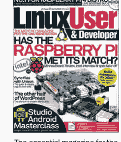


- 这一代的必备杂志：10 期 £29.99 节省 50%
- `Adobe`® 灵感的领先杂志：12 期 £29.99 节省 50%
- 拍摄、编辑和分享的杂志：12 期 £29.99 节省 50%
- 为这一代设计的杂志：10 期 £29.99 节省 50%
- 针对游戏爱好者的杂志：12 期 £29.99 节省 50%
- 针对游戏爱好者的终极杂志：12 期 £29.99 节省 50%
- 科幻、奇幻和恐怖主题：12 期 £29.99 节省 50%
- 这一代人的必读物：13 期 £29.99 节省 42%


- 这一代的必备杂志：10 期 £29.99 节省 50%
- Adobe® 灵感的领先杂志：12 期 £29.99 节省 50%
- 拍摄、编辑和分享的杂志：12 期 £29.99 节省 50%
- 针对这一代设计的杂志：10 期 £29.99 节省 50%
- 针对游戏爱好者的杂志：12 期 £29.99 节省 50%

*(注：由于原文中存在大量重复行，此处已进行去重翻译)*

# 无论您的业务需求

# 我们都有满足您要求的服务器！

我们的全系列服务器都专为您的需求而设计；旨在当您的业务增长时提供所需的托管动力。

## 虚拟专用服务器 (VPS)

### 灵活性

满足您的业务所需的灵活性，是您进入服务器世界的完美入门。

- 在单台服务器上托管多个网站。
- 成为您服务器的管理员！
- 为您的 Web 应用安装任何执行环境和框架。
- Web 开发者基础设施应用的的理想之选。

每月仅需 £9.99

## 云服务器

### 性能

以极低的成本享受独立服务器的性能，是相于 VPS 的显著飞跃。

- 托管高用户量网站，并充分利用 100 Mbps 宽带宽。
- 托管拥有数百个并发用户的数据库和文件服务器。
- 托管对延迟敏感的 Web 应用。
- 将通信软件外包到您的云端。

每月仅需 £50.00

## 专用云服务器

### 动力

当您的业务增长并需要更多算力时，请获取您自己的专用硬件服务器。

- 托管海量用户网站，并充分利用 500 Mbps 宽带宽。
- 将 CRM 等企业软件外包到您的云端。
- 为您的数据托管高性能数据库。
- 用作图形应用程序的渲染引擎。

每月仅需 £109.00

# 灵活性、性能、动力……您所需要的，我们应有尽！

立即寻找您的完美服务器！

访问 `www.123-reg.co.uk/servers`

价格和功能更新至 2013 年 11 月。所示价格不含增值税（按 20% 征收）。

# poundhost

NAMESESCO 旗下公司

# 云

服务器

无需合约！

100% 运行机时间 • 免费即时安装 • 首月免费，无长期绑定

# 首月免费 优惠码：PHCLOUD2

> 我使用 PoundHost 的服务已经快 4 年了，我可以告诉你，这是一项一流的服务。

> 服务绝对出色！市面上最棒的托管公司。我爱死了！超级便宜且快速的独立服务器！

> PoundHost 的网络快速且稳定如石，支持工单总能获得专业人员的快速响应。

他们在处理设置、变更和紧急事项时表现得出色且高效，而且性价比是全行业最高的。

对于那些正在寻找市面上最佳托管服务的人，我强烈推荐 PoundHost。向所有 PoundHost 员工表示衷心的感谢。

如果您需要价格实惠且支持极佳的服务器，别再找了，您会对 PoundHost 感到非常*满意。

Marcelo 先生

早期项目

Jarosaw Glogowski

Mobi Marketing

技术总监

Clever Computer Consultants

`1` CPU, 1GB RAM, 40gb 存储, 5tb 带宽

| 独立数据 | 云服务器 | 域名 | 电子邮件 | SiteMaker | 电子商务 | 服务器 | SSL | 网站推广 |
| :--- | :--- | :--- | :--- | :--- | :--- | :--- | :--- | :--- |

| 数据与统计： | 490,000 客户数量 | | 8,000 台独立服务器 | | | 6,000 台虚拟服务器 (VPS) | | | 1,800,000 个域名 |

`tel`: 01905 342 339

`www.poundhost.com`
