# Linux 用户与开发者 134 - 树莓派：10 个实用项目

> “开源将一直存在”

| 型 B - 512MB 带有 8GB NOOBS SD 卡 | 树莓派 NoIR 摄像头板 | 树莓派摄像头板 |
| --- | --- | --- |
| £32.99 £27.49 不含税代码 SC1313058 | £19.24 £16.03 不含税代码 SC13223558 | £19.24 £16.03 不含税代码 SC13023588 |

访问 `cpc.co.uk` 了解更多信息

- 完整的项目配件系列
- 套件与外壳
- 扩展、转接和原型板
- 丰富的组件范围
- WiFi 适配器和 HDMI 转 VGA 适配器
- 视频和音频线
- 键盘、鼠标和显示器
- GPIO 排线
- 编程和用户指南

# 欢迎阅读 Linux User & Developer 第 134 期

Bob Zwetloed 在大学学习航空航天工程，并使用 Python 对复杂情况课程进行建模。本期我们的驻驻员工本月从编写几个树莓派项目开始，此外包括测试和功能解决方案等内容。

Tam Hanna 多年来一直在 IT 行业担任记者、导师、演讲者和作家。他见证了移动市场的方方面面。本月，Tam 继续了他的工作，重点关注了事件驱动编程（第 46-55 页）。

Mihalis Tokoulos 是一位自 1996 年以来就有丰富经验的 UNIX 系统管理员。他一直为《Linux User & Developer》撰稿。Mihalis 展示的四页图表位于第 52-55 页。

Michael Reed 是一位技术作家，为 Linux 相关媒体撰稿已 15 年。他专长其他领域。本月，Michael 与我们一起利用虚拟专用网络（VPN）测试了家庭或办公室网络。

本期还包括帮助写作者使用 Qt 编写事件驱动代码、优秀的示例，以及使用 Mercurial 管理项目——这是我们在转向 Git 之前使用过一个优秀控制包。祝阅读得愉快！

James Larson 是一位内核黑客，为 Linux 工作了超过 18 年，从他 13 岁上大学开始就开始。John 在马萨诸塞州的剑桥市联系，或为一家大型 Linux 供应商工作。你可以在第 18-19 页找到他不可或缺的内核贡献。

Gareth Halcliffe 是我们的驻记者，测试来自整个开源社区的最新产品。Gareth 分享了关于 Onstore 的工作，这是一个适用于你需求（企业或其他）的可扩展备份解决方案。

欢迎阅读 Linux User 最新版，这是英国和美国喜爱的开源和 Linux 杂志。当我们与朋友或读者谈论树莓派时，我们总是惊讶地发现有这么多人在问圣诞节什么时候买一个。他们对用它做一些趣事的前景非常热情，但正因如此，他们经常承认甚至还没拿出来。这就是为什么我们又提供了一个任何人都可以上手的树莓派项目：让你能够迅速上手运行。我们包含了所有你可以黑客化并根据需求更改的项目。此外，还包括帮助写作者使用 Qt 编写事件驱动代码、优秀的示例，以及使用 Mercurial 管理项目——这是我们在转向 Git 之前使用过一个优秀控制包。祝阅读得愉快！

# 托管服务 云端托管 专用服务器

06 新闻 | 16 观点 | 92 读者来信

# OGGCAMP 2013

# 自由软件、自由文化与大规模监控

在 OggCamp 英国最大的自由软件和开源硬件聚会上，450 名极客在斯诺登泄密事件的阴影下聚集

自上世纪末创办《Linux User》以来，开源社区发生了变化并演变——引入了开放数据、自由文化，其活动性质也发生了变化。Linux Expo 和 Linux User Expo 是过去由大公司支持 ORG Village 运行的活动，为 FOSS 项目和组织提供了空间。当 IBM 切断对 Linux Expo 的资金支持时，这种年度聚会留下了空白，尽管社交网络和社交普及的增长本应可以让人们聚在一起学习新事物并交流，软件人士们错过了一个年度聚会。第一个真正填补这一空白的是 LugRadio Live，它利用了 Lug Radio 的人气将国际演讲者带到沃尔德汉的一个社区场所，并让 ORG（开放权利组织）等组织有机会告知社区最重要的信息。当 LugRadio 结束运行后，社区主导的活动接子由 OggCamp 接管，汇聚了自由文化和开放内容轨道。今年秋，OggCamp 将 450 人带到了利物浦约翰·摩尔大学的科学园区，围绕着“学习、教学、游戏”的主题。

开源

请在此关注 Twitter 上的 `@OggCamp` 的 2014-OggCamp 活动：

`oggcamp.org`

来自 35 场 OggCamp 演讲的幻灯片和反馈链接：

`jord.in/event/view/1612/talks`

开放权利（Open Rights）—— 促进并维护您的数字权利：

`www.openrights.org`

Less Wrong 是一个致力于完善人类功能艺术的社区：

`lesswrong.com`

汽车 Linux - 汽车制造商的免费软件：

`www.linuxfoundation.org/colaborate/workgroups/automotive-drive-linux`

使用 Daviwicks 为 Brother KV9501 针织机将图像转换为数据层：

`punchpunchdecode.com.co.uk/2013/oggcamp/`


更担心的是，如果这不是你自己的政府，而是另一个你在法律下没有任何权利或保护的国家。

DL：举办会议的好处之一是活动是由参会者设定的，我们可以看到他们感兴趣的内容。我们一直试图让 OggCamp 不仅仅关于技术。我们鼓励艺术、政治等更多内容。所以，看到对他们重要的事情是很好的，比如参会者必须掌握控制权。在我们这边，有一个出色的计划并且恰好是参会者现在想要的，是非常重要且有价值的。

在自由、开源和开放文化之间取得平衡，你觉得 OggCamp 营造了一种特定的氛围吗？

DL：我想是的。我们遵循了去年的路线，这确实创造了一种民主化的使用性质；但我们更进了一。我们将活动推广为一种自由且开放的文化。我们一直鼓励人们在艺术、政治、工艺等领域分享知识，而不仅仅是技术。正因如此，OggCamp 周边的社区变得非常多样化。

今年重点是参会者和工作坊。我们开展了许多活动供人们参与。参会者的良好反馈对我来说很重要。最美好的时刻之一是有一个人告诉我，这帮助他们最终理解了你的工作。未来还有很多年时间，这就是我们的目标。

Dan Lynch - “我们努力让我们的活动尽可能包容”

我们提供了很好的价值、欣赏并与路线良好连接。Wi-Fi 随处可用，而且我们有一些可以应对访客流量的价值。

我们努力让我们的活动尽可能包容。对我来说最满意的事情之一是人们告诉我他们在这里，但之前不确定是否来。当我们听到人们明年明年和朋友一起回来时！

来自社区

今年的 OggCamp 还汇集了来自优秀开源和项目的演讲；从关于 Linux 的一切到国际；现场会议；以及对 OggCamp 的记忆可能，但我们只想和 Dan Lynch 谈谈——在活动后询问我们是什么让 OggCamp 运作的。我们都对政府入侵的程度感到震惊。

今年的活动似乎有很多关于安全和隐私的演讲……

DL：我没在那儿，但那里有很多相关的演讲，只是在主轨道中只有两个。从 OggCamp 的日程安排来看，完全没有，这显然不是人们想要的。

尽管如此，作为组织者，你总可以做一些基础事情来培养良好的氛围。我一直以来带着开源和在艺术、政治、工艺等领域分享知识的想法而闻名，而不仅仅是技术。

`www.linuxuser.co.uk`

# 让它如此

从交互式 LED 闹钟到自杀式三旋飞行器，围绕 OggCamp 创作的事物一直一直是 OggCamp 的核心，但正如 Dan Lynch 向当地媒体解释的那样，音乐家拿着电烙铁。随着来自 ROSGULL 和 ROBERT（一个本地黑客空间）的小组展示项目，以及从针织机到树莓派 3D 打印的各种材料，墙上从咖啡到都有许多灵感来源。

大空间的一个好处是作为 Parker Fell 的住所，而 Liewookood 的 180 个 Minecraft 方块在下层很高处。尽管他们不是来自社区，但 Ragnow UK 的 Stacey Davis 展示了公司的展品，这些是为各种项目小批量定制的。


登记 450 名参会者需要志愿者投入大量精力。

# 我们在看着你

安全演讲从 IRQ 攻击和大规模监控开始，这是一个美国国家安全局（NSA）直接访问 Google、Facebook 和其他网站数据的威胁。网站还提到了英国通信总部（GCHQ）的安全机构通过互联网与英国/柏林/爱丁堡建立安全连接，破解加密和安全协议，允许将元数据索引到表中，使元数据像数据一样有效。

预订的 iPhone 数量；苹果表示，英国有 850 人面临数据泄露的风险，在不携带保护私人加密笔记本的情况下前往该国家，它是“不”安全的。

- 不需要再通过学习我们的服务来间谍了——Ruiz 说，这关乎关键问题。
- 没有适当的辩论，在斯诺登事件被《卫报》报道之前，甚至一直处于黑暗中。
- 适当的监督——来自法官，以及提供给委员会的选资源列表。
- 跨国，人口级监控不是关于“个人隐私与安全”，而是对民主的根本性威胁。

Linux 社区动态

正如 Dave Potts 所演示的那样，这作为 Python 的教学方法。“手机端的 Ubuntu 或 Firefox OS 分别在移动项目的友好竞争中击败了 Dave Alan 和 Sabine Hughenden，并让与会者有机会在真实的平台硬件上体验这些操作系统。Aiken Chiken 的“开发汽车级 Linux”展示了 Linux 在不同和移动语境下的应用。”

由 OggCamp 和 Mark John（他还做了一场关于“如何获取 OggCamp”的演讲）致力于鼓励人们参与其中。从 Weerswolf（一个在马戏团巡演中极具人气的游戏）到课后代码俱乐部（Code Club），再到构建 FT Crowd 群的“Internet Box”的核心，一切都是非常鼓舞人心的。“你很有大脑，”他告诉我们，“你的潜力在于将创造出伟大的东西。”他在结束演讲时，强调了要培养帮助克服基本挑战的意识。通过寻找快与慢、学习成功的方法以及现实的方法 (hmor.com)。

除了硬件，其他机构还包括自由软件基金，你可以在那里找到关于开源维基的讨论，其首席营销官 Anne McQuire 表示：“OggCamp 是一个伟大活动的绝佳案例。Dan 做得很好，希望‘让利物浦对开发者更有吸引力并演进技术社区’。”

在全球范围内汇聚多样信息和人的活动相隔遥远，但我们希望每个人都能让 OggCamp 成为自由软件社区的一项伟大资产。这里期待明年。

> 感谢 quadric 和 quadquad，活动非常热烈！

项目。演讲者包括关于“向前硬件”的 Nathan Dumort，关于使用版本跟踪变化并取得进展的优势。Alice Wilmer 的《Tricoders 和四边形：入门》介绍了即使在现代游戏中也可以进行多人游戏（即使是着陆和坠落）。热门的开放世界游戏 Minecraft 可以通过树莓派及其传感器连接扩展到现实世界，然后

一项任务被请求或要求，并且人们被要求执行此类任务。“Git Base”由 John Spriggs 提供（他为 OggCamp 调度编写了剑桥软件），Lora Mitchell（她加入了 Joindin 项目——开源服务器活动——反馈——

- 入门示例完全不需要焊接
- 插入电线和面包板，使构建变得简单快速
- 预安装并配置好的树莓派 OS 在您的基础上运行
- 示例可以使用设备组合构建，太酷了
- 无线电可以安全地接入独立网络，并支持 128 位加密
- 它是我过的用于传感器网络实验的最平台。

(Gareth Halfacre, CustomPC, 第121 期, 2013年10月)

Facebook 扩大开放学院

将学习与现实世界项目联系起来

社交网络巨头 Facebook 宣布扩大其开放学院计划，该计划旨在弥合现实编码项目与学术计算机科学之间的差距。

该计划于 2012 年春季作为社交网络公司与 Jay Berenstein 之间的试点合作伙伴关系启动，近期已随着学术成员加入扩大了规模：

- 斯坦福大学
- 麻省理工学院 (MIT)
- 德克萨斯大学奥斯汀分校
- 康奈尔大学
- 多伦多大学
- 新加坡大学
- 帝国理工学院
- 雅盖洛沃大学
- 赫尔辛基大学
- 坦佩勒理工大学
- 加州大学圣地亚哥分校
- 宾法尼亚大学
- 加州大学伯克利分校
- 华沙大学
- 加州大学洛杉矶分校 (UCLA)

“贡献开源项目是学生为行业工作准备的最佳方式之一，”Facebook 发言人在发布会上说。项目往往比参与的人大；项目管理和人际技巧至关重要，并且通常由来自不同背景的用户评估。

Facebook 通过帮助学生寻找代码贡献来支持他们的团队。该计划还定期与学生团队见面，叠加系列讲座提供进一步的学习机会。该计划与顶尖大学的关键成员紧密合作，推出一项课程，将学生与开源导师匹配，并让他们回到家。

除了为开源项目提供平台外，该公司还将其许多内部工具置于宽松许可下，包括 MapReduce 调度器、Presto 和 Hive 开发。2012 年的将于 2 月初开始，感兴趣的学生被要求通过 `facebook.com/OpenAcademy` 页面申请该计划。教职员工也受邀讨论改进计算机科学课程的新方法。

Linux 社区动态

## Web 开发

在此版本发布中，作为 JavaScript 语言继任者的 Google Dart 已正式获得完全成熟、生产就绪语言语言。

自我们首次宣布 Dart 以来的两年来，我们一直与早期采用者合作，使项目成熟并扩大社区，正如公司在发布会上描述的那样，被称为‘首席 Dart’。“Dart 的使命是为 Web 开发者提供一个生产就绪的选项。”

尽管 Dart 尚未在主流浏览器中获得广泛支持，但 Chrome 分支被用于 Dart 开发，该项目包含了用于兼容的 `dart2js` 翻译器。“生成的 JavaScript 性能已经有了大幅提高，因为我们正看到更多地道的 Dart 案例。”

“今天标志着 Dart 正式达到生产就绪状态，我们正看到更多地道的 Dart 案例。”“已添加。”此外，像 Adobe、drone 和 JetBrains 等包也开始支持现在的 Dart 1.0 软件开发包——这包括 Dart 编辑器、Dart 浏览器、一个虚拟机、包管理器和 `dart2js` 翻译器——可以从 `dartlang.org` 移除。

- 西澳大学，珀斯
- 澳大利亚
- `linux.com.au`
- 2014 年社区年度会议涵盖从 Linux 内核和 OpenStack 到天文学和树莓派的所有演讲。
- 内华达州，拉斯维加斯

无疑是电子产品日历中最大的活动，CES 展示了由最新开源技术驱动的大量硬件。

- 伦敦 OI 会议中心
- 英国

涵盖政策和技术，已确认的演讲者包括 ICT Futures 的 Mark Thompson 博士、CES 技术总监 Ian Levy 以及 John Jackson

### IBM Watson 发布开发平台

IBM 宣布开放基于云的开发平台，提供访问基于 Linux 的 Watson 问答计算技术，该技术首次在进入《危险回答》游戏并获胜时引起公众关注。

当我们向世界分享 IBM Watson 的认知能力时，我们的目标是推动一个加速创新、研究和企业发展的的新生态系统，”IBM 软件解决方案集团副总裁 Michael Rhodin 在发布会上声称。“通过此，IBM 正在迈出勇敢的一步，共同推动认知计算的新时代演进。”

IBM Watson 的‘认知计算机’可以运行在单台基于 Linux 的 Power 750 服务器上，通过我们的合作伙伴关系，我们将帮助扩展那些从经验中学习、随着每次互动和结果不断改进、并协助解决行业和社会面临的最复杂问题的应用程序。

- 新闻
- 全球

隐私担忧引发众筹活动

广受欢迎的开源加密应用 TrueCrypt 它可以创建加密文件的“容器”，或可用于全盘加密。在近期出现安全漏洞后，它将进行一项由志愿者驱动的众筹代码审计。

有报道称美国国家安全局（NSA）在大多数流行的加密应用中植入了后门，这导致了信任危机，TrueCrypt 需要通过全面且坦诚的代码审计来重新构建。“TrueCrypt 可以用，”马修·格林（Matthew Green）说道，“人们用它处理非常敏感的信息。TrueCrypt 安全了个人信息（加密）。”布鲁斯·施奈德（Bruce Schneider）在泄露 NSA 文件后，甚至使用它来存储其个人离网超级电脑上的信息。

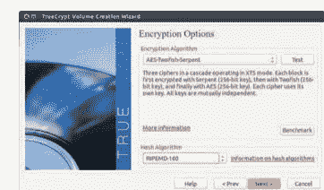

- 热门开源加密包 TrueCrypt 将接受全面审计

该审计当时已收到来自 FundIt 和 Indiegible 提供的超过 60,000 美元的资金，并将认证并消除二进制文件中的后门和损坏。该项目预计于 2014 年初完成。

由于 SourceForge 决定允许开发者在其下载包中构建广告程序，并声称进行创意性广告（这是在该平台被 Dice 收购后引入的特性），GIMP 不得离开免费托管。

- “我们不希望支持这种行为，”该项目发言人说，“我们已决定放弃 SourceForge”

软件包现在将由维护者 Jeremy Simonc 直接更新到官方 FTP 站点，并自动分发到各个站点。

## 杂志

### 欢迎来到动物世界

由《如何运作》、《全空间》和《一切历史》的创作者们带来了全新的《动物世界》（World of Animals）杂志

开源世界拥有企鹅、壁蜥、变色龙以及构成 Ubuntu 版本的各种奇怪动物。我们这些毛茸茸、长着羽毛和鳞片的朋友都有代号，而且它们都有极佳的故事要讲述。

走进《动物世界》，这是我们关于与星球共享的所有非人类生命的新杂志。第一期主题为“自然优先”（Nature First），讲述了大猩猩、狐猴以及 50 种最濒危物种的故事，并让我们窥了帝鹅的一年。

如需在官方网站订阅杂志，请访问 `Animals.co.uk`，您今天就可以通过 Image Shop 购买来确保获得订阅。


世界充满了动物；关于它们还能学到什么呢？


在 Twitter 上关注 `@worldanimals` 并直接获取动物群类知识，并在 Facebook 上点赞 World of Animals。你还有机会


- 真正的企鹅在不支持 Linux 时在做什么？

### Linux 社区最新动态

#### Ubuntu 商标已失效

停止终止函并非共识协议

Ubuntu Linux 公司 Canonical 的创始人马克·舒特沃克（Mark Shuttlework）对向其公司决策的一位批评者发送的一封措辞严厉的停止终止函表示道歉，并否认这是一种审查意图。

- Canonical 创始人 Shuttlework 为停止终止函道歉

Mark Lee 收到一封来自 Canonical 法务部关于 `Ubuntu.com` 的措辞严厉的信件，该信件对如何移除引起争议的亚马逊广告提供了建议，并要求移除 Ubuntu 标志和名称——这实际上关闭了该网站目前的运行。

### Shuttlework 为此道歉

Ubuntu 商标已失效

停止终止函并非共识协议

-- Canonical 创始人 Shuttlework 为停止终止函道歉

- Canonical 创始人 Shuttlework 为停止终止函道歉

Mark Lee 收到一封来自 Canonical 法务部关于 `Ubuntu.com` 的措辞严厉的信件，该信件对如何移除引起争议的亚马逊广告提供了建议，并要求移除 Ubuntu 标志和名称——这实际上关闭了该网站目前的运行。

- Mark Lee 收到一封来自 Canonical 法务部关于 `Ubuntu.com` 的措辞严厉的信件，该信件对如何移除引起争议的亚马逊广告提供了建议，并要求移除 Ubuntu 标志和名称——这实际上关闭了该网站目前的运行。

- 热门开源加密包 TrueCrypt 将接受全面审计

该审计当时已收到来自 FundIt 和 Indiegible 提供的超过 60,000 美元的资金，并将认证并消除二进制文件中的后门和损坏。该项目预计于 2014 年初完成。

- 热门开源加密包 TrueCrypt 将接受全面审计

该审计当时已收到来自 FundIt 和 Indiegible 提供的超过 60,000 美元的资金，并将认证并消除二进制文件中的后门和损坏。该项目预计于 2014 年初完成。

- "We do not want to support this kind of behavior," says a spokesperson for the project. "We have decided to abandon SourceForge"

- “我们不希望支持这种行为，”该项目发言人说，“我们已决定放弃 SourceForge”

- "We do not want to support this kind of behaviour," says a spokesperson for the project. "We have decided to abandon SourceForge"

- Packages will now be updated by maintainer Jeremy Simonc directly to the official FTP site and distributed automatically to various sites.

- 软件包现在将由维护者 Jeremy Simonc 直接更新到官方 FTP 站点，并自动分发到各个站点。

- Packages will now be updated by maintainer Jeremy Simonc directly to the official FTP site and distributed automatically to various sites.

From the creators of How it Works, All Space and All About History brings the new World of Animals

由《如何运作》、《全空间》和《一切历史》的创作者们带来了全新的《动物世界》（World of Animals）杂志

- Open source has the penguin, gecko, chameleon and the whole host of weird and bizarre animals that make the Ubuntu releases.

- 开源世界拥有企鹅、壁蜥、变色龙以及构成 Ubuntu 版本的各种奇怪动物。

- Our furry, feathered and scaled friends have code-names, and they all have fantastic stories to tell.

- 我们这些毛茸茸、长着羽毛和鳞片的朋友都有代号，而且它们都有极佳的故事要讲述。

- Enter Animals, our new magazine about all the non-human life we share with a planet. The first issue, titled Nature First, tells the story of the gorillas, koatis, and 50 most endangered species and gives us a glimpse into a year in the life of an Emperor penguin.

- 走进《动物世界》，这是我们与星球共享的所有非人类生命的新杂志。第一期主题为“自然优先”（Nature First），讲述了大猩猩、狐猴以及 50 种最濒危物种的故事，并让我们窥了帝鹅的一年。

- To subscribe to the magazine on official website, visit Animals.co.uk where you can guarantee yourself a subscription by getting one from the Image Shop today.

- 如需在官方网站订阅杂志，请访问 Animals.co.uk，您今天就可以通过 Image Shop 购买来确保获得订阅。

- The world is full of animals; what more learn about them?

- 世界充满了动物；关于它们还能学到什么？

Get straight on to the fauna facts by following `@worldanimals` on Twitter and liking World of Animals on Facebook.

- 在 Twitter 上关注 `@worldanimals` 并在 Facebook 上点赞 World of Animals 以直接获取动物群类知识。

- What do real penguins do when they're not supporting Linux?

- 真正的企鹅在不支持 Linux 时在做什么？

### TrueCrypt 将进行代码审计

隐私担忧引发众筹活动

- 广受欢迎的开源加密应用 TrueCrypt 它可以创建加密文件的“容器”，或可用于全盘加密。在近期出现安全漏洞后，它将进行一项由志愿者驱动的众筹代码审计。

- 有报道称美国国家安全局（NSA）在大多数流行的加密应用中植入了后门，这导致了信任危机，TrueCrypt 需要通过全面且坦诚的代码审计来重新构建。

“TrueCrypt 可以用，”马修·格林（Matthew Green）说道，“人们用它处理非常敏感的信息。TrueCrypt 安全了个人信息（加密）。”布鲁斯·施奈德（Bruce Schneider）在泄露 NSA 文件后，甚至使用它来存储其个人离网超级电脑上的信息。

### GIMP 放弃 SourceForge

The latest in the Linux community

Linux 社区最新动态

开源

### Shuttlework apologises for

Ubuntu trademark gone

Cease and desist not a consensus agreement

Mark Shuttlework, founder of Ubuntu Linux Canonical, has apologised for a heavily-handed cease and desist letter sent to a critic of his company's decisions, denying it was an attempt at censorship.

### Shuttlework 为此道歉

Ubuntu 商标已失效

停止终止函并非共识协议

Mark Shuttlework, founder of Ubuntu Linux Canonical, has apologised for a heavily-handed cease and desist letter sent to a critic of his company's decisions, denying it was an attempt at censorship.

- Canonical founder Shuttlework apologised for a cease and desist letter

- Canonical 创始人 Shuttlework 为停止终止函道歉

- Mark Lee received a strongly worded letter from Canonical's legal dept regarding Ubuntu.com, which offered advice on how to remove contentious Amazon-based advertising and demanding the Ubuntu logo and name – effectively closing the site at its current running.

- Mark Lee 收到一封来自 Canonical 法务部关于 Ubuntu.com 的措辞严厉的信件，该信件对如何移除引起争议的亚马逊广告提供了建议，并要求移除 Ubuntu 标志和名称——这实际上关闭了该网站目前的运行。

- Packages will now be updated by maintainer Jeremy Simonc directly to the official FTP site and distributed automatically to various sites.

- 软件包现在将由维护者 Jeremy Simonc 直接更新到官方 FTP 站点，并自动分发到各个站点。

From the creators of How it Works, All Space and All About History brings the new World of Animals

## MAGAZINES

### 欢迎来到动物世界

由《如何运作》、《全空间》和《一切历史》的创作者们带来了全新的《动物世界》（World of Animals）杂志

- Open source has the penguin, gecko, chameleon and the whole host of weird and bizarre animals that make the Ubuntu releases.

- 开源世界拥有企鹅、壁蜥、变色龙以及构成 Ubuntu 版本的各种奇怪动物。

- Our furry, feathered and scaled friends have code-names, and they all have fantastic stories to tell.

- 我们这些毛茸茸、长着羽毛和鳞片的朋友都有代号，而且它们都有极佳的故事要讲述。

- Enter Animals, our new magazine about all the non-human life we share with a planet. The first issue, titled Nature First, tells the story of the gorillas, koatis, and 50 most endangered species and gives us a glimpse into a year in the life of an Emperor penguin.

- 走进《动物世界》，这是我们与星球共享的所有非人类生命的新杂志。第一期主题为“自然优先”（Nature First），讲述了大大猩猩、狐猴以及 50 种最濒危物种的故事，并让我们窥了帝鹅的一年。

- To subscribe to the magazine on official website, visit Animals.co.uk where you can guarantee yourself a subscription by getting one from the Image Shop today.

- 如需在官方网站订阅杂志，请访问 Animals.co.uk，您今天就可以通过 Image Shop 购买来确保获得订阅。

- The world is full of animals; what more learn about them?

- 世界充满了动物；关于它们还能学到什么？

- Get straight on to the fauna facts by following `@worldanimals` on Twitter and liking World of Animals on Facebook.

- 在 Twitter 上关注 `@worldanimals` 并在 Facebook 上点赞 World of Animals 以直接获取动物群类知识。

- What do real penguins do when they're not supporting Linux?

- 真正的企鹅在不支持 Linux 时在做什么？

### Shuttlework apologises for

Ubuntu trademark gone

Cease and desist not a consensus agreement


# 开源

您的 Linux 新闻与观点来源

www.linuxuser.co.uk 直接向我们发送电子邮件...

获取最新新闻与观点请发送邮件至 linuxuser@imagine-publishing.co.uk

## 安全

### TrueCrypt 将进行代码审计

隐私担忧引发众筹活动

广受欢迎的开源加密应用 TrueCrypt 它可以创建加密文件的“容器”，或可用于全盘加密。在近期出现安全漏洞后，它将进行一项由志愿者驱动的众筹代码审计。

有报道称美国国家安全局（NSA）在大多数流行的加密应用中植入了后门，这导致了信任危机，TrueCrypt 需要通过全面且坦诚的代码审计来重新构建。“TrueCrypt 可以用，”马修·格林（Matthew Green）说道，“人们用它处理非常敏感的信息。TrueCrypt 安全了个人信息（加密）。”布鲁斯·施奈德（Bruce Schneider）在泄露 NSA 文件后，甚至使用它来存储其个人离网超级电脑上的信息。


- 热门开源加密包 TrueCrypt 将接受全面审计

该审计当时已收到来自 FundIt 和 Indiegible 提供的超过 60,000 美元的资金，并将认证并消除二进制文件中的后门和损坏。该项目预计于 2014 年初完成。

### GIMP 放弃 SourceForge

由于 SourceForge 决定允许开发者在其下载包中构建广告程序，并声称进行创意性广告（这是在该平台被 Dice 收购后引入的特性），GIMP 不得离开免费托管。

- “我们不希望支持这种行为，”该项目发言人说，“我们已决定放弃 SourceForge”

软件包现在将由维护者 Jeremy Simonc 直接更新到官方 FTP 站点，并自动分发到各个站点。

## 杂志

### 欢迎来到动物世界

由《如何运作》、《全空间》和《一切历史》的创作者们带来了全新的《动物世界》（World of Animals）杂志

开源世界拥有企鹅、壁蜥、变色龙以及构成 Ubuntu 版本的各种奇怪动物。我们这些毛茸茸、长着羽毛和鳞片的朋友都有代号，而且它们都有极佳的故事要讲述。

走进《动物世界》，这是我们与星球共享的所有非人类生命的新杂志。第一期主题为“自然优先”（Nature First），讲述了大猩猩、狐猴以及 50 种最濒危物种的故事，并让我们窥了帝鹅的一年。

如需在官方网站订阅杂志，请访问 Animals.co.uk，您今天就可以通过 Image Shop 购买来确保获得订阅。

世界充满了动物；关于它们还能学到什么？


在 Twitter 上关注 @worldanimals 并在 Facebook 上点赞 World of Animals 以直接获取动物群类知识。你还有机会


- 真正的企鹅在不支持 Linux 时在做什么？

## 新闻

Linux 社区最新动态

### LINUX

Ubuntu 商标已失效

停止终止函并非共识协议

Mark Shuttlework, Ubuntu Linux Canonical 的创始人，对向其公司决策的一位批评者发送的一封措辞严厉的停止终止函表示道歉，并否认这是一种审查意图。

- Canonical 创始人 Shuttlework 为停止终止函道歉

Mark Lee 收到一封来自 Canonical 法务部关于 Ubuntu.com 的措辞严厉的信件，该信件对如何移除引起争议的亚马逊广告提供了建议，并要求移除 Ubuntu 标志和名称——这实际上关闭了该网站目前的运行。

### Shuttlework 为此道歉

- Canonical founder Shuttlework apologised for a cease and desist letter
- Cease and desist not a consensus agreement
- 停止终止函并非共识协议


在 Twitter 上关注 `@worldanimals` 并在 Facebook 上点赞 World of Animals 以直接获取动物群类知识。你还有机会


- 真正的企鹅在不支持 Linux 时在做什么？

## 新闻

Linux 社区最新动态

开源

## LINUX

### Shuttlework 为此道歉

Ubuntu 商标已失效

停止终止函并非共识协议

Mark Shuttlework, 创始人 Ubuntu Linux Canonical 的创始人，对向其公司决策的一位批评者发送的一封措辞严厉的停止终止函表示道歉，并否认这是一种审查意图。

- Canonical 创始人 Shuttlework 为停止终止函道歉

Mark Lee 收到一封来自 Canonical 法务部关于 Ubuntu.com 的措辞严厉的信件，该信件对如何移除引起争议的亚马逊广告提供了建议，并要求移除 Ubuntu 标志和名称——这实际上关闭了该网站目前的运行。


# 开源

您的 Linux 新闻与观点来源

`www.linuxuser.co.uk` 直接向我们发送电子邮件...

获取最新新闻与观点请发送邮件至 `linuxuser@imagine-publishing.co.uk`

## 安全

### TrueCrypt 将进行代码审计

隐私担忧引发众筹活动

广受欢迎的开源加密应用 TrueCrypt 它可以创建加密文件的“容器”，或可用于全盘加密。在近期出现安全漏洞后，它将进行一项由志愿者驱动的众筹代码审计。

有报道称美国国家安全局（NSA）在大多数流行的加密应用中植入了后门，这导致了信任危机，TrueCrypt 需要通过全面且坦诚的代码审计来重新构建。“TrueCrypt 可以用，”马修·格林（Matthew Green）说道，“人们用它处理非常敏感的信息。TrueCrypt 安全了个人信息（加密）。”布鲁斯·施奈德（Bruce Schneider）在泄露 NSA 文件后，甚至使用它来存储其个人离网超级电脑上的信息。


- 热门开源加密包 TrueCrypt 将接受全面审计

该审计当时已收到来自 FundIt 和 Indiegible 提供的超过 60,000 美元的资金，并将认证并消除二进制文件中的后门和损坏。该项目预计于 2014 年初完成。

## 在线

### GIMP 放弃 SourceForge

由于 SourceForge 决定允许开发者在其下载包中构建广告程序，并声称进行创意性广告（这是在该平台被 Dice 收购后引入的特性），GIMP 不得离开免费托管。

- “我们不希望支持这种行为，”该项目发言人说，“我们已决定放弃 SourceForge”

软件包现在将由维护者 Jeremy Simonc 直接更新到官方 FTP 站点，并自动分发到各个站点。

## 杂志

### 欢迎来到动物世界

由《如何运作》、《全空间》和《一切历史》的创作者们带来了全新的《动物世界》（World of Animals）杂志

开源世界拥有企鹅、壁蜥、变色龙以及构成 Ubuntu 版本的各种奇怪动物。我们这些毛茸茸、长着羽毛和鳞片的朋友都有代号，而且它们都有极佳的故事要讲述。

走进《动物世界》，这是我们与星球共享的所有非人类生命的新杂志。第一期主题为“自然优先”（Nature First），讲述了大猩猩、狐猴以及 50 种最濒危物种的故事，并让我们窥了帝鹅的一年。

如需在官方网站订阅杂志，请访问 `Animals.co.uk`，您今天就可以通过 Image Shop 购买来确保获得订阅。

世界充满了动物；关于它们还能学到什么？


在 Twitter 上关注 `@worldanimals` 并在 Facebook 上点赞 World of Animals 以直接获取动物群类知识。你还有机会


- 真正的企鹅在不支持 Linux 时在做什么？

## 新闻

Linux 社区最新动态

开源

## LINUX

### Shuttlework 为此道歉

Ubuntu 商标已失效

停止终止函并非共识协议

Mark Shuttlework, 创始人 Ubuntu Linux Canonical 的创始人，对向其公司决策的一位批评者发送的一封措辞严厉的停止终止函表示道歉，并否认这是一种审查意图。

- Canonical 创始人 Shuttlework 为停止终止函道歉

Mark Lee 收到一封来自 Canonical 法务部关于 Ubuntu.com 的措辞严厉的信件，该信件对如何移除引起争议的亚马逊广告提供了建议，并要求移除 Ubuntu 标志和名称——这实际上关闭了该网站目前的运行。


由于 SourceForge 决定允许开发者在其下载包中构建广告程序，并声称进行创意性广告（这是在该平台被 Dice 收购后引入的特性），GIMP 不得离开免费托管。

- “我们不希望支持这种行为，”该项目发言人说，“我们已决定放弃 SourceForge”

软件包现在将由维护者 Jeremy Simonc 直接更新到官方 FTP 站点，并自动分发到各个站点。

## 杂志

### 欢迎来到动物世界

由《如何运作》、《全空间》和《一切历史》的创作者们带来了全新的《动物世界》（World of Animals）杂志

开源世界拥有企鹅、壁蜥、变色龙以及构成 Ubuntu 版本的各种奇怪动物。我们这些毛茸茸、长着羽毛和鳞片的朋友都有代号，而且它们都有极佳的故事要讲述。

走进《动物世界》，这是我们与星球共享的所有非人类生命的新杂志。第一期主题为“自然优先”（Nature First），讲述了大猩猩、狐猴以及 50 种最濒危物种的故事，并让我们窥了帝鹅的一年。

如需在官方网站订阅杂志，请访问 Animals.co.uk，您今天就可以通过 Image Shop 购买来确保获得订阅。

世界充满了动物；关于它们还能学到什么？


在 Twitter 上关注 @worldanimals 并在 Facebook 上点赞 World of Animals 以直接获取动物群类知识。你还有机会


- 真正的企鹅在不支持 Linux 时在做什么？

## 新闻

Linux 社区最新动态

开源

## LINUX

### Shuttlework 为此道歉

Ubuntu 商标已失效

停止终止函并非共识协议

Mark Shuttlework, 创始人 Ubuntu Linux Canonical 的创始人，对向其公司决策的一位批评者发送的一封措辞严厉的停止终止函表示道歉，并否认这是一种审查意图。

- Canonical 创始人 Shuttlework 为停止终止函道歉

Mark Lee 收到一封来自 Canonical 法务部关于 Ubuntu.com 的措辞严厉的信件，该信件对如何移除引起争议的亚马逊广告提供了建议，并要求移除 Ubuntu 标志和名称——这实际上关闭了该网站目前的运行。


# 安全

Reports that the US National Security Agency (NSA) has inserted back-doors into the majority of popular encryption applications has caused a loss of confidence, that TrueCrypt needs to be rebuilt with a full and frank code audit. "TrueCrypt works," says Matthew Green. People use it for very sensitive information (cryptography)." Bruce Schneider is even using it to store information on his personal air-gapped super-laptop, after he leaked NSA documents.

- Popular open source cryptography package TrueCrypt to be given a full audit

# Ubuntu

- the penguin, gecko, chameleon and the whole host of weird and bizarre animals that make the Ubuntu releases. Our furry, feathered and scaled friends have code-names, and they all have fantastic stories to tell.

- The first issue, titled Nature First, tells the story of the gorillas, koatis, and 50 most endangered species and gives us a glimpse into a year in the life of an Emperor penguin.

- What do real penguins do when they're not supporting Linux?

## Ubuntu trademark gone

Cease and desist not a consensus agreement

- Canonical founder Shuttlework apologised for a cease and desist letter

- Mark Lee received a strongly worded letter from Canonical's legal dept regarding Ubuntu.com, which offered advice on how to remove contentious Amazon-based advertising and demanding the Ubuntu logo and name – effectively closing the site at its current running.

# Linux 社区

- The latest in the Linux community

- OPEN SOURCE

- The GIMP abandons SourceForge

# 杂志

- From the creators of How it Works, All Space and All About History brings the new World of Animals


## News

### The latest in the Linux community

#### OPEN SOURCE

- Popular open source cryptography package `TrueCrypt` to be given a full audit

Reports that the US National Security Agency (`NSA`) has inserted back-doors into the majority of popular encryption applications has caused a loss of confidence, that `TrueCrypt` needs to be rebuilt with a full and frank code audit. "TrueCrypt works," says Matthew Green. People use it for very sensitive information. TrueCrypt secures personal information (cryptography)." Bruce Schneider is even using it to store information on his personal air-gapped super-laptop, after he leaked `NSA` documents.


The audit, which at the time has already received over $60,000 in funding from `FundIt` and `Indiegible`, will certify and eliminate binaries from back-doors and corruption. The project is expected to be completed by early 2014.

### ONLINE

#### The GIMP abandons SourceForge

Following `SourceForge`'s decision to allow developers to build advertising programs with their downloads and claims of creative advertising, which was introduced when the platform was acquired by `Dice`, `GIMP` had to leave free hosting.

"We do not want to support this kind of behavior," says a spokesperson for the project. "We have decided to abandon SourceForge"

Packages will now be updated by maintainer Jeremy Simonc directly to the official `FTP` site and distributed automatically to various sites.

### MAGAZINES

#### Welcome to the World of Animals

From the creators of `How it Works`, `All Space` and `All About History` brings the new `World of Animals`

open source has the penguin, gecko, chameleon and the whole host of weird and bizarre animals that make the Ubuntu releases. Our furry, feathered and scaled friends have code-names, and they all have fantastic stories to tell.

Enter Animals, our new magazine about all the non-human life we share with a planet. The first issue, titled Nature First, tells the story of the gorillas, koatis, and 50 most endangered species and gives us a glimpse into a year in the life of an Emperor penguin.

To subscribe to the magazine on official website, visit `Animals.co.uk` where you can guarantee yourself a subscription by getting one from the Image Shop today.

The world is full of animals; what more learn about them?


Get straight on to the fauna facts by following `@worldanimals` on Twitter and liking World of Animals on Facebook. There's also a chance


- What do real penguins do when they're not supporting Linux?

### LINUX

#### Shuttlework apologises for

Ubuntu trademark gone

Cease and desist not a consensus agreement

Mark Shuttlework, founder of Ubuntu Linux Canonical, has apologised for a heavily-handed cease and desist letter sent to a critic of his company's decisions, denying it was an attempt at censorship.

- Canonical founder Shuttlework apologised for a cease and desist letter
- Mark Lee received a strongly worded letter from Canonical's legal dept regarding `Ubuntu.com`, which offered advice on how to remove contentious Amazon-based advertising and demanding the Ubuntu logo and name – effectively closing the site at its current running.


Mark Lee received a strongly worded letter from Canonical's legal dept regarding Ubuntu.com, which offered advice on how to remove contentious Amazon-based advertising and demanding the Ubuntu logo and name – effectively closing the site at its current running.

# HARDWARE

## Shuttlework apologises for

### Ubuntu trademark gone

Cease and desist not a consensus agreement

# 新托管服务

超过 300 Gbit/s 的连接

## 地理冗余

Web 分析

NetObjects Fusion® 2013

## PHP 5.4

## CDN

免费模式或安全模式

## SEO

MySQL

时通讯工具

## 超过 140 应用程序

Drupal®, WordPress, Joomla!®, TYPO3, Magento®...

## 保证性能

每日备份

移动网站生成器

包含 Adobe® Dreamweaver® CS5.5


- 161 个 Web 托管方案，提供 30 天退款保证，无最低合同限制且无设置费。12 个月计费周期每年预付更具价格优势。1&1 Basic 版 12 个月内每月 2.99 英镑，常规价格为每月 4.99 英镑。所有价格均不含值税。访问 www.1and1.co.uk 了解完整详情、条款和条件。

# 开源

您的 Linux 新闻与观点

# 自由来源专栏

## 改变世界——从每一个比特开始

## 访问计算机——以及任何可能让你了解世界运行方式的事——应该是无限制的，直到有了可以通过工具和价值观来衡量自己与工作关系的*实践迫切性*！

编写自由软件是有趣味的，它改变了许多关于人们为何以及何何工作的传统假设。人们喜欢为自由项目做贡献，而不仅仅是为了财务或私人的奖励。自由软件的胜利是击败了一个“运动”的反击，这个运动由“自由”等词汇、被削弱的定义、切实的哲学和一个学习框架所定义。从零开始编写一个自由操作系统的快乐捕捉了那些并不平凡之人的想象力。他们是探险家、冒险家。他们正在做着计算机上无法完成的事情，而这吸引了我。

“我就是在‘那里’偶然发现了所有计算机的源头，”Levy 回忆道，“有一个迷宫允许他们控制自己的火车，而人们是第一批在技术意义上自称为‘黑客’的人。”他们之间存在一种伦理准则，Levy 述了他对广为人知的《黑客伦理》的经典解读：Linux 和内核让早期的 GNU/Linux 发行版在共享空间中自由。

- 访问计算机——以及任何可能让你了解世界运行方式的事——应该是无限制且完全的，直到有了*实践迫切性*！

- 所有信息应该是自由的。

- 信任-权威去中心化；进步应该通过他们的黑客行为，而不是通过地位、年龄或种族。

- 你可以创建并构建计算机；你的计算机可以让你的生活变得更好。

尽管重重困难，GNU 和 Linux 内核将“开源”带入了严肃的框架，自由软件成为了世界的代码。GPL 及其指导原则就是演变成黑客伦理的东西，它继承自 MIT 模型计算机俱乐部（TMC）的黑客们。后来，在 60 年代位于马萨诸塞理工学院（MIT）的其他人使得将软件带给每个人成为可能。

Richard Stallman

关于艺术、音乐、数字权利、Linux 和自由的各种出版物

在过去，Richard Stallman 说过：“我们之所以有一个自由的操作系统，是因为世界需要一个自由的系统，而不是 90% 自由。如果你没有一个自由的系统，当你由于某种原因受到限制，并且在进行更改时具有某些实际便利时，你就无法看到什么是可能的。”

Stallman 所构想的“自由”理念要么是完全原创的，要么是新的，但许多人想为软件应当是自由的这一理念做出贡献；Stallman、GNU 和 GPL 为“自由”这一概念带来了一个名字和一个超越了其学术起源的意义。它让思想和运动动了起来；自由软件始于边缘和意料之外，伴随着许多不切实际的理想。

Stallman 谈到了计算机革命的英雄们，讲述了黑客伦理演变的经典故事，从 TMC 的桌子到 MIT 的黑客。正如 Levy 后来评论道，“他们并不是反社会的怪胎，而是与其追随他人……”

Stallman 尝试为那些已经实践它的人以及追随它的人定义自由软件的意义。

## 每个人都有权根据自己的能力、为权利做出贡献，并做出改变

16 www.linuxuser.com

# 观点

Linux 社区的最新动态

# 开源


# 开源专栏

## Windows 8？你需要这方面的支持。.

当一家大商店因为你“选择了”Windows 8 而出售支持包时，你一定是个大问题，Simon 认为。

# 开源

您的 Linux 新闻与观点来源

# JON MASTERS

## 内核专栏

Jon Masters 总结了 Linux 内核社区的最新动态、3.13 合并窗口以及“下一代”Btrfs 中新的 Jailhouse 管理器离线去重。去重（Deduplication）正如其名：自动处理重复内容（在块级别仅存储一个副本）对应的数据，并更新所有对（共享）副本的引用。Btrfs 中“离线”去重的特殊之处在于，它目前仅在系统管理员直接执行特殊命令时或按需执行。多年来将添加一个真正的定时去重功能，以及 Intel 的 'powercap' 驱动，该驱动允许系统管理员独立地最大化外围设备的功耗。3.13 引入了 Intel 功率限制功能（在其较新的设备中）。此外，现代系统中的对 32 位（遗留）BC PC 的支持也进行了大量清理工作，其中包含了 ARM 系统。此外，3.13 增加了对大端序（Big-Endian）的支持，这对于 PowerPC 64 位和 32 位 ARM 系统是必需的。

Jon Masters 是一位 Linux 内核黑客，从 13 岁进入大学起就开始从事相关工作。他住在马萨诸塞州的剑桥，在一家大型 Linux 供应商工作。他在 kernelpodcast.com 发布每日列表。

### GPU 切换：在笔记本电脑上使用 Linux 是否更好更好

许多现代笔记本电脑配备了多个 GPU（图形处理器）。这些芯片负责处理连接到屏幕或外部显示器上的帧缓冲区中的 3D 游戏。3.13 允许使用功耗优化的单元处理基础桌面和工作任务，而让强大的单元切换来处理大型 3D 游戏序列中复杂的对象渲染。以前在 Linux 上需要手动重启才能进行切换，现在它消除了限制，并允许图形子系统按需动态工作。

3.13 的新功能包括为 PowerPC 64 位和 32 位 ARM 系统提供对“大端序”（与 Intel 相反）。计算机需要理解这些呢？3.13 是多代版本中第一个支持双端序（能够在小端序和大端序之间切换）的版本。某些现代 CPU 的设计是因为它们编码较不容易。尽管如此，得益于对 x86 和 ARM 架构的使用，Linux 要常见得多，但大端序在代码中仍然非常常见（网络字节序是大端序），并存在于架构和软件中。

Linux Torvalds 宣布了 3.13 版本的发布，说他一直在纠结是结束还是仅仅切分 3.12。3.12 已经发布八个月了。自从他发布版本以来，已经休息了一周。3.13 的传统合并窗口持续了一天。Linux 还让内核制作。

# 3.13 合并窗口

3.13 添加了一些新功能。3.13 中的突出特性包括新的 'nftables' 包过滤器，它最终将取代并已在此采用。

# 开源

## 自动 GPU 切换将对那些在笔记本电脑上使用 Linux 的用户感兴趣，该功能将合并在启动新内核开发周期的“合并窗口”中。在 Linux 3.12 开发期间，某些计划进入 3.13 的特性功能实际上显示出从 linux-next 进入内核主干的进展（同时合并回 3.7）。数据视觉上支持了这一点：Linux 3.12 中内核提交的 82.4% 是直接通过 linux-next 宣布的。这些数字略有下降，这是典型的，因为在 3.12 合并窗口中为期一周的延迟中，很少有人利用这段时间。还有 ABI Checker。因此，这种工具对 Linux 发行版无疑是有益的，因为发行版通常提供稳定内核，但允许在某些条件下加载扩展驱动程序。有关该工具的更多信息，您可以访问 kernel.org。

Joe Zhangwei 宣布了新的 Linux 'ktap' 动态跟踪 0.3 版本发布。Bktap 是一种基于字节码的跟踪基础设施，为调试字节码提供框架，然后将其加载到内核中，使用特定的工具链（编译器）对内核模块进行动态插桩和跟踪，它不需要特殊的内核。

# Linux 4.0

在 3.12 之后，Linus 已经休息了八个月。自从他发布版本以来，已经休息了一周。3.13 的传统合并窗口持续了一天。Linux 还让内核制作。3.13 添加了一些新功能。3.13 中的突出特性包括新的 'nftables' 包过滤器，它最终将取代并已在此采用。

# 观点

内核专栏 - Jon Masters

# 教程 10 十个实用的树莓派项目

## 使用树莓派制作音乐

Bob Zwetsloot 负责复杂系统建模，是一位精通 Python 和 PHP 的网络开发者。他拥有多年的计算经验。

### 使用 Sonic Pi 编写你的旋律并创建音乐或机器人鸣叫

Scratch 的主要功能之一是它能够向没有计算机背景的孩子教授编程基础。对于孩子们来说，如果能让他们在学习过程中创作视频并与音乐互动，这会特别具有吸引力。本着这一初衷，Sonic Pi 使用一种简单的语言教人们使用音乐进行编程，但方式比 Scratch 更高级；它可以作为狂热编程爱好者的进阶步骤，也可以作为为物联网或机器人创建音乐的方法。

### 01 获取 Sonic Pi

如果你安装了最新版本的 Raspbian，系统将默认包含 Sonic Pi。如果你仍在使用较旧的版本，则需要从存储库安装它。使用以下命令：

```bash
$ apt-get install sonic-pi
```

### 你需要的物品

- 便携式扬声器
- Sonic Pi
  - http://www.raspberry.ac.uk/projects/raspberrypi/sonicpi/teaching.html

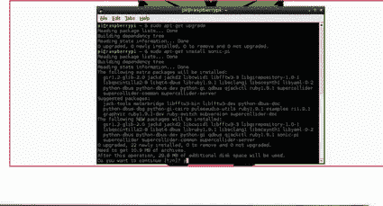

Sonic Pi 是学习基础编程原理并享受乐趣的好极方法。

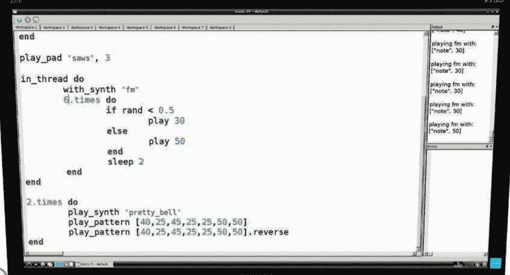

```python
end
play_pad "sms", 3
in_thread do
  with_sync "fn"
    times do
      if rand < 0.5
        play 30
      else
        play 50
      end
      sleep 2
    end
  end
end
times do
  play_sync "pretty_bell"
  play_pattern [40,25,40,25,25,50]
  play_pattern [40,25,40,25,25,50].reverse
```


## 使用树莓派制作音乐

> 我们可以通过使用更多的 Sonic Pi 函数来开始创作更复杂的旋律。

### 02 开始使用 Sonic Pi

Sonic Pi 位于菜单中的“教育”（Education）类别。打开它，你会看到一个类似于 IDE（集成开发环境）的界面。左面板允许你为项目输入代码，并针对其学习风格提供了正确的语法高亮。通过 Sonic Pi 播放时——信息面板会详细说明你启动了什么，任何错误也会列在相应的面板中，供参考。

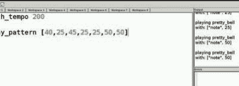

```python
with_temp 200
play_pattern [40,25,45,25,50,50]
```


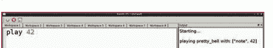

```python
play 42
```

### 03 你的第一个音符

我们在 Sonic Pi 上尝试的第一件事仅仅是播放一个音符。Sonic Pi 有几个默认设置，所以我们可以得到：

- `play 50`

点击“播放”按钮，输出窗口将向你展示你制作的内容。**pretty_bell** 是 Sonic Pi 输出的音色，而 50 决定了音符的音高和音调。

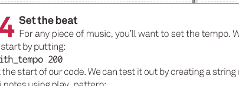

### 04 设置节奏

对于任何乐曲，你都需要设置节奏。我们可以在

```python
with_temp 200
```

...在代码开头设置。我们可以通过使用 `play_pattern` 创建一组中音音符来测试。

```python
play_pattern [40,25,45,25,50,50]
```

这将以我们设置的这些音调播放 pretty_bell 音符。你可以创建更长或更短的序列，还可以改变它们的播放方式。


## 完整代码列表

```python
with_temp 200
```

```python
play_pattern [40,25,45,25,50,50]
```

```python
2.times do
  with "synth"
    play_pattern [40,25,45,25,50,50]
  end
```

```python
play_pattern "sades",
```

```python
in_thread do
  with "synth"
    if rand < 0.5
      play 50
    else
      sleep 2
  end
end
```

```python
2.times do
  play "pretty_bell"
  play_pattern [40,25,45,25,50,50]
end
```

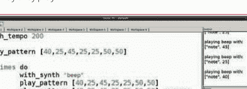

### 05 进你的音乐

我们可以通过更多的 Sonic Pi 函数来创建更复杂的旋律。你可以使用 `synth`、`pattern` 来改变音符类型，并使用 `times` 函数创建顺序播放的循环，就像在代码中使用 `loop` 一样。


```python
play_pad "temp", 3
in_thread do
  if rand < 0.5
    play 50
  end
end
```

```python
2.times do
  with "synth"
    play_pattern [40,25,45,25,50,50],reverse
end
```

### 06 播放

使用 `in_thread` 函数，我们可以为 Sonic Pi 创建另一个线程并编写几行代码。我们制作了一系列随机音符，并使用 `play_pad` 让它们根据位置和速度播放。


## 你将学习...

如何使用编程语言、循环、线程等来编写代码。

## 2 机器人语音

Sonic Pi 帮助你创建芯片、和弦，并在它跳动时给它一点感觉。

## 3 音乐

用于数字音乐的数字界面以及 Sonic Pi 中使用的音符数量。


# 实用的树莓派项目

## 树莓派合成器

Bob Zwetsloot 负责复杂系统建模，是一位精通 Python 和 PHP 的网络开发者。他也喜欢实验计算。

使用强大的 eSpeak 库为你的树莓派项目添加语音功能。

### 你需要的物品

- 便携式 USB 扬声器
- `python-speak` 模块
- `eSpeak`
- 树莓派（最新镜像）

我们在之前的章节中已经展示了树莓派如何用于驱动机器人，作为一个微型计算机，它也可以是你家中或办公室物联网的核心。使用树莓派进行文本转语音可能正是你任务所需的。强大的 eSpeak 库很容易获取。还有一个模块允许你在 Python 中使用 eSpeak，超越标准的命令行提示以执行自动化任务。

```bash
$ ls -la
drwxr-xr-x 2 user group 4096 Oct 12 10:00 .
-rw-r--r-- 1 user group 0 Oct 12 10:01 script.py
-rw-r--r-- 1 user group 0 Oct 12 10:02 README.md
```

### 01 需要的一切

我们将一次性安装教程所需的所有。一旦安装了 eSpeak 库和所需的 Python 模块，打开终端安装：

```bash
$ sudo apt-get install eSpeak python-speak-tk
```

## 树莓派语音合成器

### 你可以通过多种不同的选项更改 espeak 读取文本的方式

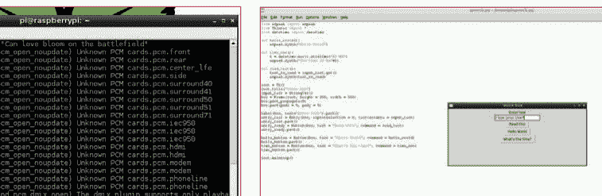

### 02 Pi 的第一句话

Espeak 库非常简单用——要让它说些什么，在终端输入：

- `"Message"`

这将使用库的默认值读取消息中写的任何内容，清晰度不错。

- `espeak -v3 -4.5 -15 "Message"`

将你的声音调整为女性，强调大写字母并让读者变慢。

### 03 多说

你可以通过多种选项更改 Espeak 读取文本的方式，例如速度，甚至是它如何发音节。例如，编写以下命令：

- `espeak "hello world"`

```bash
$ espeak -v3 -4.5 -15 "Message"
将你的声音调整为女性，强调大写字母并让读者变慢。
```

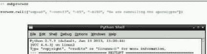

### 06 语音合成器

使用代码列表，我们正在创建一个带有预设语音的 Twitter 简单界面。这就是如何操作 Espeak 来改变其输出。这可以用于读取推文或自动消息。玩得开心！

### 完整代码列表

导入必要的 Espeak 和 GUI 模块，以及一个查找当前时间的函数。

```python
def hello_world():
  espeak.synth("Hello World")

def time_now():
  t = datetime.now().strftime('%H:%M:%S')
  espeak.synth(f"The time is {t}")
```

```python
root = Tk()
title("Voice box")
input = StringVar()
frame = Frame(root, width=200, height=50)
frame.pack(side=TOP, pady=5, padx=5)
```

```python
def enter_text():
  text = entry.get()
  entry.delete(0, END)
  espeak.synth(text)

hello_button = Button(root, text="Hello", command=hello_world)
hello_button.pack()
time_button = Button(root, text="What's the time", command=time_now)
time_button.pack()
```

```python
root.mainloop()
```

### 04 使用 Python 调用

在 Python 中使用 espeak 的最佳方法是调用一个命令行函数。在这个脚本中，我们将使用：

- `subprocess.call(['espeak', '-options', '1', '-option', '2'], '"Message"')`

### 05 母语

Espeak 语音示例非常简单用，尝试这段示例代码：

- `espeak.synth("Message")`

你可以将此整合到 Python 中，并使用任何其他模块来实现自动化。

## 教程：10 个实用的树莓派项目

## 编写 Minecraft-Pi 程序

Russell Barnes 是《Linux User & Developer》杂志的编辑，拥有超过 15 年的技术撰稿经验。现在他手里有三台树莓派……

### 在玩有史上最伟大的游戏之一的同时学习编程！

### 你需要的物品

- 树莓派（最新版本）
- Minecraft-Pi 压缩包
- 键盘和鼠标
- 互联网连接

Minecraft 可能是目前地球上最大的游戏，它可以在你想象的任何设备上运行，从 PC 到游戏机再到手机。它可以在树莓派上运行这可能并不意外。从乍看，Minecraft-Pi 是针对游戏机和智能手机的口袋版（Pocket Edition），但树莓派版本非常特殊，因为它是 Minecraft 中唯一一个允许用户访问其 API（应用程序接口）的版本。

### 立即下载 PI 存档！

发布于 2012年12月25日

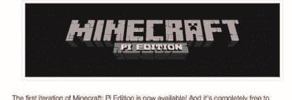

Minecraft: PI Edition 的第一个版本现在发布！它是完全免费下载的。我们将适时添加新功能，尽管你们可能希望我们少打扰。

在这个项目中，我们将向你如何设置 Minecraft-Pi 并对其进行配置，让你能够以前所未有的方式与 Minecraft 交互。这个项目只是冰山一角……

### 01 要求

Minecraft-Pi 要求你在树莓派上运行 Raspbian，所以如果你还没有运行它，请去商店买一个并安装。它还需要你加载 Windows。假设你正处于命令行提示符下，只需输入 `start` 即可进入桌面。

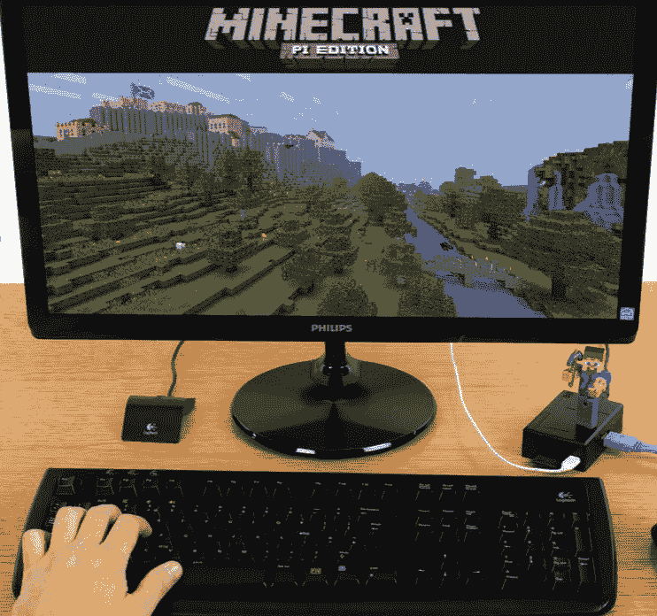

与其他所有 Minecraft 版本不同，Pi 版本鼓励你对其进行黑客操作（hack）

## 编写 Minecraft-Pi 程序

### 安装

确保你已在主目录中，并在终端中使用以下命令下载 Minecraft-Pi 软件包：

- `assets/minecraft.pi`

```
cd
pip install https://3.amazonaws.com/assets/minecraft.pi
```

要使用它，你需要将以下文件夹复制到你的 Minecraft-Pi 目录：

- `tar -zvf minecraft-pi-0.1.1.tar`

现在你可以进入 Minecraft-Pi 目录并尝试首次运行：

```
./minecraft-pi
```

### 完整代码列表

```python
# /usr/bin/env python
from cmpi.minecraft import Minecraft
from cmpi.block import block
from cmpi.vec3 import Vec3
from time import sleep
import random
import math

mc = Minecraft() # 连接到游戏窗口
player = mc.getPlayerPos()

### 生成随机浮点数以定位玩家的函数
def randvec3(center):
    return Vec3(random(center.x), random(center.y), random(center.z))

### 计算两点之间距离的函数
def distance(point1,point2):
    dx = point1.x - point2.x
    dy = point1.y - point2.y
    dz = point1.z - point2.z
    return math.sqrt(dx*dx + dy*dy + dz*dz)

### 在区域内创建随机方块的函数
def randBlock(pos):
    randomBlock = randvec3(pos)
    randomBlock.x += random.randint(pos.x-50, pos.x+50)
    randomBlock.y += random.randint(pos.y-5, pos.y+5)
    randomBlock.z += random.randint(pos.z-50, pos.z+50)
    return randomBlock

def main(): # 捉迷藏的主循环
    global player
    lastPlayerPos = mc.getPlayerPos()
    sleep(2)
    rand_block = randBlock()
    mc.setBlock(rand_block, block.DIAMOND_BLOCK)
    mc.postChat("附近藏了一个钻石！")
    distanceFromPlayer = distance(rand_block, lastPlayerPos)
    timeStarted = time.time()
    while True:
        player = mc.getPlayerPos()
        if distanceFromPlayer < 2:
            seeking = False
        else:
            mc.postChat("距离 " + str(distanceFromPlayer) + " 格")
            if distance(player, rand_block) > distanceFromPlayer:
                mc.postChat("更远了 " + str(distanceFromPlayer) + " 格")
    else:
        timeTaken = time.time() - timeStarted
        mc.postChat("花了 " + str(int(timeTaken)) + " 秒找到钻石")
if __name__ == "__main__":
    main()
```


## 在光盘上

你将学习……

功能性的，并且，

编码并没有那么困难。我们使用了一些函数（从基础函数开始），现在我们将解释如何创建逻辑。

## 配置 Pi API

为了控制 Pi API，你需要将 Python 文件夹从 Minecraft-Pi 文件夹复制到新位置。在终端中输入：

- `/minecraft`

```
cd ~/minecraft/pi-api
```

现在我们想要创建一个连接 API 到游戏的 Python 模板脚本（boilerplate）。编写以下内容：

```python
from cmpi.minecraft import Minecraft
mc = Minecraft()
```

使用 `nano`，你可以按照步骤操作，然后按 `Ctrl+X` 保存，再按 `Enter` 运行：

## 测试脚本

你创建的脚本包含了在 Minecraft 中开始所需的一切。为了让它工作，你需要运行游戏（并玩）。

## 捉迷藏 (Hide and Seek)

正如你所看到的，我们创建了一个捉迷藏游戏，基于 Martin 的原始创作（你可以在网上找到）。

这个项目展示了 API 的一种更复杂的方法。但比这还有更多内容。你可以从代码中看到，我们创建了一个基于 Martin 原创的捉迷藏游戏（你可以在网上找到）。当你启动脚本时，你将被挑战寻找隐藏的方块。请关注——你将在屏幕上看到消息确认 API 已正确连接。现在让我们开始吧！

## 教程：10 个实用的树莓派项目


## 使用 Scratch 交互

使用 Scratch 进行物理计算，与树莓派上的按钮和灯光交互。

### 你需要的物品

- 面包板
- LED 灯
- 电阻
- 跳线导
- Scratch

Scratch 是一种非常简单的视觉语言，通常用于向任何年龄的学习者教授基础编程概念。通过这些技术，你可以制作有趣的项目，按下按钮时点亮 LED 并改变颜色。

### 01 安装所需软件

使用用户名和密码登录树莓派系统。使用 LXDE 环境和 Python 脚本安装：

```
chmod +x scratchgpio.sh
sudo bash scratchgpio.sh
```

这将在桌面上创建一个特殊的 Scratch 版本。这是一个处理 Scratch 和 GPIO 之间通信的简单版本。

## 使用 Scratch 交互

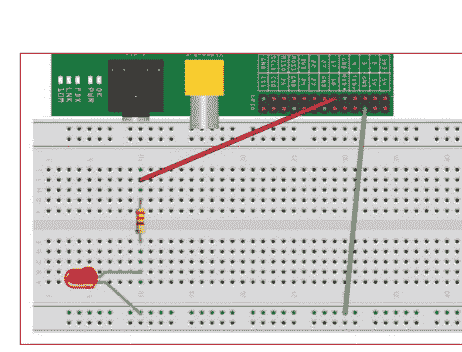

使用引脚而不是数字来识别 GPIO。我们首先将 LED 连接到引脚 1、2，以此类推。

### 你将学习……

简单电路

虽然这些是非常基础的电路，但如何通过树莓派原型套件获得良好的编程感觉？如果你需要购买零件，我们建议查看：

## 2 连接面包板

关掉电源，连接 LED、一个 330 欧姆电阻和两根跳线。电阻用于限制流向 LED 的电流。

### 布接我们的按钮


将 LED 的负极连接到面包板的 GND 引脚。现在你可以将电源连接到 GPIO 引脚。如果没有正常工作，调换引脚重试。关掉树莓派。如果我们连接了 LED，要做的第一件事是将 10k欧姆电阻连接到正极，另一端连接到面包板上的空位。然后在同一个空位上，将另一端连接到 GPIO7。这是引脚 17。最后，通过连接到同一负极的线连接按钮的负极。

## 编码原理

Scratch 是编写现实项目的完美起点。它帮助你理解基础编程语言和逻辑。

## 物理

没有什么比让屏幕上的代码变为现实项目更有趣了。它帮助你点亮并建立技能。

### 开

目前，LED 连接到一个只能开启的引脚。如果我们想能够开启和关闭它，应该使用 GPIO 17，我们可以开启和关闭它。GPIO 17 是从顶部开始第六个引脚，位于行的顶端。开启树莓派。我们可以通过输出 GPIO 引脚并将其设置为 1 来开启 LED。通过将其设置为 0 来关闭 LED。

```
set x7 to /sys/class/gpio/gpio7
set out to /sys/class/gpio/gpio7/direction
set 1 to /sys/class/gpio/gpio7/value
```

当按下按钮时，GPIO 7 为 1。然而，当释放按钮时，GPIO 将变为 0。我们得到 0 的值是因为连接到地线的电阻较小。

我们可以通过检查引脚值并按下按钮改变它来现场观察这一过程：

```
when clicked
forever
  if pin7 sensor value = 0 then
    broadcast wait
  end
```

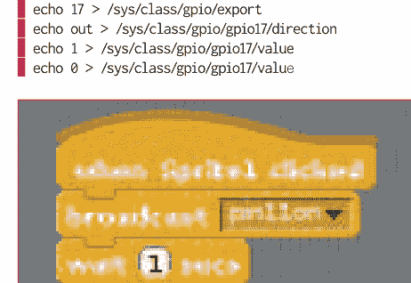

### 从 Scratch 控制 LED

使用 LXDE 环境并打开 Scratch3。在控制部分，创建一个简单的角色，在它被点击时广播“wait”。然后点击该角色。LED 应该亮起。现在添加脚本等待 1 秒然后广播“pin1off”。LED 将持续一秒后关闭。

### 让光亮起来！

启动树莓派并像之前一样启动 Scratch3。进入事件部分并添加“绿色旗帜点击”，然后添加一个永远循环，并使用如果...否则语句。如果 = 运算符，则进入传感部分并在等式语句的左侧添加一个值，并将右侧设置为“如果传感器值为 0”，否则广播“pin1off”。点击绿色旗帜。如果你按下按钮，LED 就会亮起！

# 教程 10 个实用的树莓派项目

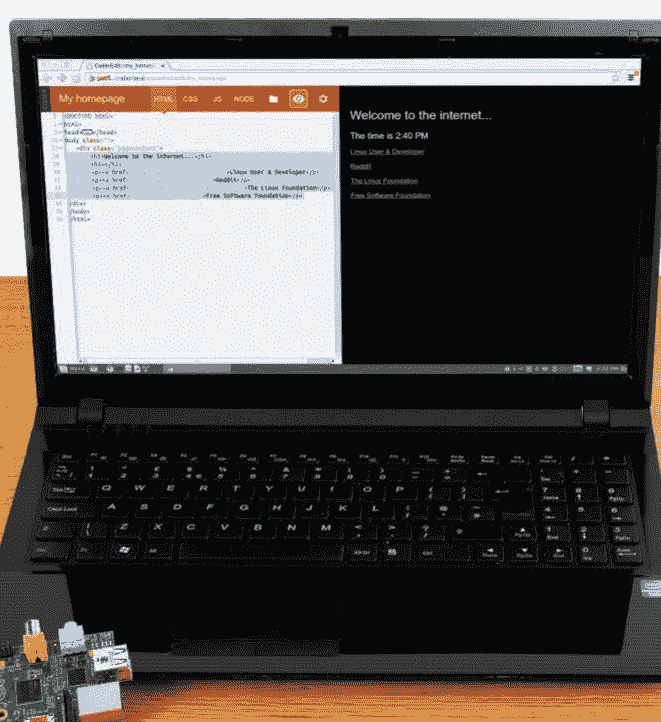

> GoogleCoder 是一个介绍 Web 开发的绝佳方式

## 构建树莓派 Web 服务器

使用 Google Coder 将你的树莓派变成一个微型、低功耗的 Web 服务器和宿主机

Rob Zvetsloot 负责复杂系统建模，并是一位精通 Python 和 PHP 的 Web 开发者。他热爱计算实验。

### 你需要什么

- 互联网连接
- Web 浏览器
- Google Coder

在本期中，我们将教你如何在树莓派上以不同的方式编写代码，因为 IT 只适合那些我们能看到的东西。

### 获取 Google Coder

前往 Google Coder 网站，下载镜像的压缩包。在任何你想的地方解压，并像安装任何其他树莓派镜像一样安装它。

在树莓派上使用网络还有新方法：专门为微型计算机设计的巨大 Google Coder。这是一个基于树莓派的镜像，可以将你的 Pi 变成 Web 服务器和 Web 开发套件。可以通过本地网络轻松访问，并原生支持 JQuery，它是提升你开发技能的简单方法。

```
$ dd if=$path/to/raspberry.img of=/dev/sdX card=$BLOCKSIZE CODER
```

下载 Google Coder Pi 镜像。


获取代码。

## 树莓派 Web 服务器

### 保护你的代码

在此处设置密码使此 Coder 属于你：

### 完整代码列表

### HTML

### 在磁盘上

```html
<html><body>欢迎来到互联网..</body></html>
<h2 href="http://www.linuxuser.co.uk">Linux 是一个开发者的乐园/</h2>
<p>在 <a href="http://www.reddit.com">Reddit</a> 寻找 <a href="http://www.linux.org">Linux 内内核</a> 的最佳地方</p>
<p><a href="http://www.fsf.org/">自由软件基金</a></p>
</body></html>
```

某些 HTML 代码元素可能指向重要的网站。要在 JavaScript 中显示当前时间：

### JavaScript

```javascript
var d = new Date();
var hour = d.getHours();
var min = d.getMinutes();
if (hour < 12) {
    hour = hour + 12;
    var amp = "PM";
} else {
    hour = hour;
    var amp = "AM";
}
if (min < 9) {
    min = "0" + min;
}
document.getElementById("time").innerHTML = hour + ":" + min + " " + amp;
```

我们正在使用 JavaScript 调用当前时间，以便在网页上显示它。

我们将在第一条语句中将时间显示为 12 点，并使用 AM 和 PM 来修饰时间。

### 接入 Coder

对于本教程，你只需要为 Pi 连接一根线。插入你新的 SD 卡，接通电源，如果你看到任何显示，你会注意到一个树莓派启动序列，随后了命令行登录界面。

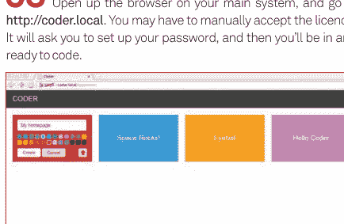

### 连接到 Coder

在你的主系统上打开浏览器，访问 http://coder.local。你可能需要接受许可协议。它会要求你设置密码，然后你就可以使用了。

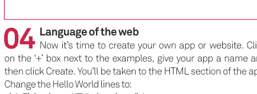

### Web 语言

现在是时候你自己的应用或网站了。点击 '+' 框创建一个新应用，然后点击编辑打开应用的 HTML 部分。将 Hello World 行更改为：

```html
<h1>这是一个 HTML 标题</h1>
<p>这是一个新的默认文本块</p>
```

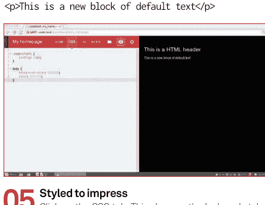

### 惊艳的样式

点击 CSS 标签页更改网页的外观和样式，而无需每次都在主代码中进行更改。你可以通过以下更改背景颜色和字体：

### 查询你的 Java

第三个标签页允许你编辑 jQuery，让网站更具交互性。你可以用它创建一个消息：

```css
body {
    background-color: #000000;
    color: #ffffff;
}
```

```javascript
$(document).click(function() {
    alert('你点击了网站！');
});
```

# 10 个实用的树莓派项目

## 编写你自己的 Twitter 机器人

Liam Fraser 是 RaspberryPi YouTube 频道的创建者，也是树莓派基金会的志愿者 Linux 服务器管理员。

### 创建你自己的可以转发我们杂志的 Twitter 机器人

Twitter 是与世界分享信息的有用方式，也是我们快速、简洁地发表观点的最喜方法。许多人们在移动设备甚至他们的电视机上使用微博客平台。

不过，你不需要一直按转推按钮。通过 Python，你可以让你的树莓派为你完成。以下是创建你自己的 Twitter 机器人的方法……

### 安装所需的软件

使用用户名 Pi 和密码 raspberry 登录树莓派系统。使用命令 `apt-get update` 获取最新的包列表。然后使用 `sudo apt-get install python-pip` 安装 Python 包。然后使用 `sudo pip install twitter` 安装 Twitter 库。

### 在 Twitter 上注册

在此之前，你需要使用 OAuth Twitter 进行身份验证，访问 https://twitter.com/apps 并使用你想让 Pi 发推文的账户登录。点击“Create new application”按钮。我们将其命名为

### 你需要什么

- 互联网连接
- 最新版本的树莓派 (www.raspberrypi.org/downloads)

通过创建一个自动转推来节省你的鼠标点击。


## 编写你自己的 Twitter 机器人

LU PID Bot；给它相同的描述，并将 Website 设置为 http://www.linuxuser.co.uk/。Callback URL 是不需要的。你必须同意开发者规则，然后点击 Create。

> “如果推文比函数上一次调用的时间新，我们就转推它。”

### 创建访问令牌

进入 Settings 标签页，将 Type 从“Read only”更改为“Read and Write”。然后点击“Update this Twitter application settings”。新的令牌将生成。

### 转推用户

获取用户的最新推文。我们需要做的的第一件事是。

### 与 Twitter 身份验证

我们需要创建一个类。刷新。你需要拥有 consumer key、consumer secret 和访问令牌。

### 主部分

主部分非常简单。我们使用令牌创建一个实例，然后进入无限循环。

### 完整代码列表

```python
#!/usr/bin/env python3
import sys
import time
from datetime import datetime
from twitter import Twitter

class bot:
    def __init__(self, c_key, c_secret, a_token, a_secret):
        # 创建 API 实例
        self.api = Twitter(c_key, c_secret, a_token, a_secret)
        # 确保我们通过了身份验证
        try:
            self.api.verify_credentials()
        except:
            sys.exit("身份验证失败")

        self.last_tweet = datetime.now()

    @staticmethod
    def timestr_to_datetime(timestr):
        # 将像 Sat Nov 09 09:25:55 +0000 的字符串转换为 datetime 对象
        # 丢弃时区
        return datetime.strptime(timestr[:20], '%a %b %d %H:%M:%S')

    def retweet_task(self, screen_name):
        # 转推我们没过的推文
        # 检查来自的新推文
        # (@{}).format(screen_name)

        # 获取用户的推文列表
        time = self.api.get_user_timeline(screen_name, count=1)

        # 遍历每条推文并检查是否比上次新
        for tweet in time:
            tweet_time = self.timestr_to_datetime(tweet['created_at'])
            if tweet_time > self.last_tweet:
                print("转推: {}".format(tweet['id']))
                self.api.retweet(id=tweet['id'])
                self.last_tweet = tweet_time

# 令牌可以在你的应用程序页面找到
# 详情页面位于 http://www.twitter.com/
# 在“App Settings”下
# 在“Your access token”下
c_key = "..."
c_secret = "..."
a_token = "..."
a_secret = "..."

# 创建 bot 实例
bot = bot(c_key, c_secret, a_token, a_secret)
# 每 5 分钟转推一次循环
while True:
    bot.retweet_task("UserUser")
    time.sleep(5 * 60)
```

# 10 个实用的树莓派项目

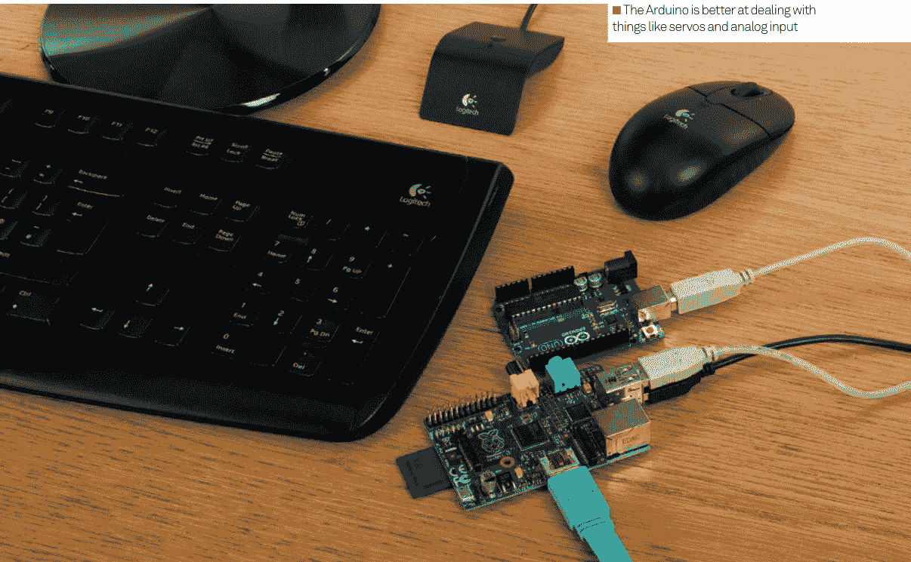

> Arduino 更擅长处理舵机和模拟输入等任务


## 使用树莓派为你的 Arduino

Russell Barnes 是《Linux User & Developer》杂志的编辑，拥有超过 15 年的技术撰稿经验。他更偏于使用 Python 而不是 Pascal/C++。

### 在你的树莓派项目中享受 Arduino 微控制器的乐趣和益处

你可能会奇怪，为什么想将 Arduino 连接到你的树莓派上。虽然有很多原因，但最可能的原因是额外的六个支持 PWM 功能的引脚以及开箱即用的功能。有了 Arduino，触发和控制舵机、电位器和各种模拟传感器变得轻而易。

### 获取一个 Arduino

在开始任何操作之前，我们建议使用 Arduino Uno，它是默认选择，在功能、便利性和价格之间取得了最好的平衡。为了开始，我们建议投资购买一个包含 LED、传感器和所有配件的“入门套件”。

最棒的部分是，你甚至不需要用 Arduino 的类 C++ 语言进行编程。你只需要树莓派和 Arduino 之间有一个 USB 连接，以及一个名为 Nanpy 的小型 Python 包。以下是操作方法……

### 你需要的物品

- Arduino Uno
- 网络连接
- Nanpy

### 满足依赖项

我们使用的是 Raspbian（推荐），所以打开你的终端，因为我们需要获取

https://github.com/nanpy

## 使用树莓派为你的 Arduino

> “最棒的部分是，你甚至不需要用 Arduino 的 C++ 语言进行编程”

setuptools 我们可以安装 Nanpy。在终端中：

`pip install https://bitbucket.org/pyppa/setuptools/raw/master/setup.py --user`

完成后，你就可以使用 `easy-install` 命令安装 pyserial。

### 最终准备

由于 Arduino 和树莓派之间的通信将通过 USB 连接进行，我们需要安装 pyserial 库。在终端中输入：

`easy-install pyserial`

我们还需要安装 Arduino 软件，以便我们知道在插入它时如何处理它。在终端中输入：

`sudo apt-get update`

`sudo apt-get install arduino`

`git clone https://github.com/nanpy/nanpy cd nanpy`

### 安装 Nanpy

配置还剩下两个步骤。首先，我们需要下载 Nanpy 包并安装它。在我们的看来，最好在终端中导航到你的主目录 (`cd ~`)，然后连续执行以下操作：

`cd nanpy`

`python setup.py --user`

### 使用 Uno 配置 Arduino

我们为什么要克隆原始的 Git 仓库？Nanpy 依赖访问 Arduino 才能正常工作。我们将使用 nanpy 项目目录中的固件来实现这一点。在上传固件之前，将 Arduino 连接到树莓派的空闲部分。遵循这些步骤需要一些时间：

`cd firmware`

`export BOARD=UNO`

`make`

## 使用你的树莓派测试 Arduino

首次安装完成后，我们可以测试工作是否设置正确。在代码段中执行“Hello World”示例之前，我们首先要确保 Nanpy 已安装，并且树莓派和 Arduino 之间的连接工作正常。从你的主目录 (~)，然后在终端中输入：

`python nanpy_test.py`

如果没有看到错误，一切都应该运行正常。你现在可以玩此页面上的代码开始学习 Nanpy。

### 完整代码列表

```python
# 就像所有基于硬件的“Hello, World”应用一样，我们将开始让 Arduino 板上的灯光闪烁
```

```python
from nanimport Arduino
from time import sleep
```


```python
Arduino.pinMode(13, OUTPUT)
for i in range(10):
  Arduino.digitalWrite(13, HIGH)
  sleep(2)
  Arduino.digitalWrite(13, LOW)
  sleep(2)
```

```python
# 这会让 Arduino 上由 13 号控制的灯
# 每隔两秒开关一次
```

```python
light = 13
```

```python
Arduino.pinMode(light, OUTPUT)
```

```python
# 你可以将多个引脚赋值给 a，使你的代码更具可读性
```

```python
red = 3
green = 5
blue = 9
```

```python
# for pins in (red, green, green, blue_pin):
Arduino.pinMode(pins, OUTPUT)
```

```python
# 如果你为树莓派使用 LED，你会发现
# 它配合 Nanpy 开箱即用。只需确保
为你的控制器分配引脚数字
```

```python
from nanimport Arduino
```

```python
screen = LCD(7, 8, 9, 10, 11, 16, 2)
screen.printString("Hello, World")
```

```python
# 如果你使用电位器或模拟传感器，
# y 将需要为它们分配输入 
Arduino.analogRead(0)
```

```python
value = Arduino.analogRead(knock)
```

```python
# for i in range(10):
  # knock 的值是："knock"
  sleep(1)
```

```python
# 有时你想让 Arduino 延迟
# 这可以帮助你获得稳定的结果
```

```python
def get_value():
  value = Arduino.analogRead(knock)
  Arduino.print(value)
  return value
```

```python
for i in range(100):
  print("The value is: " +get_value())
```

开始。虽然第一部分比 Arduino 更强大，但最后部分在与现实世界交互方面更有优势。利用它们的长处来制作更好的项目。

# 10 个实用的树莓派项目

# 创建一个树莓派三色灯

Russell Barnes 是《Linux User & Developer》杂志的编辑，已担任技术撰稿人超过 25 年。他害怕黑暗……

利用 Arduino 的力量，仅凭树莓派就能完成原本不可能的项目

### 你需要的物品

- Arduino Uno
- 面包板
- 一组原型线
- RGB LED (阴极)
- 3 个电位器
- 3 个 330 欧姆电阻器

在上一个项目中，我们向你展示了如何使用 Arduino 微控制器帮助树莓派精通可以极大地扩展项目范围的技能。借助 Arduino 额外的 12 个引脚和模拟输入，你可以连接多个传感器、舵机，甚至是摇杆等输入设备。

在这个项目中，我们将通过创建一个三色灯来演示这一点，使用三个电位器（旋转旋钮）来控制三种颜色中的每一种。由于 Nanpy 的存在，你可以，你可以出虹虹虹的颜色。正如你预料的，这会变得困难得多，仅凭树莓派。

## 01 使用树莓派为你的 Arduino

你可能会奇怪，为什么想将 Arduino 连接到你的树莓派上。虽然有很多原因，但最可能的原因是额外的六个支持 PWM 功能的引脚以及开箱即用的功能。有了 Arduino，触发和控制舵机、电位器和各种模拟传感器变得轻而易。。在开始任何操作之前，我们建议使用 Arduino Uno，它是默认选择，在功能、便利性和价格之间取得了最好的平衡。为了开始，我们建议投资购买一个包含 LED、传感器和所有配件的“入门套件”。

最棒的部分是，你甚至不需要用 Arduino 的类 C++ 语言进行编程。你只需要树莓派和 Arduino 之间有一个 USB 连接，以及一个名为 Nanpy 的小型 Python 包。以下是操作方法……

### 02 满足依赖项

我们使用的是 Raspbian（推荐），所以打开你的终端，因为我们需要获取

`https://github.com/nanpy`

`setuptools` 我们可以安装 Nanpy。在终端中：

`pip install https://bitbucket.org/pyppa/setuptools/raw/master/setup.py --user`

完成后，你就可以使用 `easy-install` 命令安装 pyserial。

### 03 最终准备

由于 Arduino 和树莓派之间的通信将通过 USB 连接进行，我们需要安装 pyserial 库。在终端中输入：

`easy-install pyserial`

我们还需要安装 Arduino 软件，以便我们知道在插入它时如何处理它。在终端中输入：

`sudo apt-get update`

`sudo apt-get install arduino`

`git clone https://github.com/nanpy/nanpy cd nanpy`

### 04 安装 Nanpy

配置还剩下两个步骤。首先，我们需要下载 Nanpy 包并安装它。在我们的看来，最好在终端中导航到你的主目录 (`cd ~`)，然后连续执行以下操作：

`cd nanpy`

`python setup.py --user`

### 05 使用 Uno 配置 Arduino

我们为什么要克隆原始的 Git 仓库？Nanpy 依赖访问 Arduino 才能正常工作。我们将使用 nanpy 项目目录中的固件来实现这一点。在上传固件之前，将 Arduino 连接到树莓派的空闲部分。遵循这些步骤需要一些时间：

`cd firmware`

`export BOARD=UNO`

`make`

## 06 使用你的树莓派测试 Arduino

首次安装完成后，我们可以测试工作是否设置正确。在代码段中执行“Hello World”示例之前，我们首先要确保 Nanpy 已安装，并且树莓派和 Arduino 之间的连接工作正常。从你的主目录 (~)，然后在终端中输入：

`python nanpy_test.py`

如果没有看到错误，一切都应该运行正常。你现在可以玩此页面上的代码开始学习 Nanpy。

### 完整代码列表

```python
# 就像所有基于硬件的“Hello, World”应用一样，我们将开始让 Arduino 板上的灯光闪烁
```

```python
from nanimport Arduino
from time import sleep
```

```python
Arduino.pinMode(13, OUTPUT)
for i in range(10):
  Arduino.digitalWrite(13, HIGH)
  sleep(2)
  Arduino.digitalWrite(13, LOW)
  sleep(2)
```

```python
# 这会让 Arduino 上由 13 号控制的灯
# 每隔两秒开关一次。
```

```python
light = 13
```

```python
Arduino.pinMode(light, OUTPUT)
```

```python
# 你可以将多个引脚赋值给 a，使你的代码更具可读性
```

```python
red = 3
green = 5
blue = 9
```

```python
# for pins in (red, green, green, blue_pin):
Arduino.pinMode(pins, OUTPUT)
```

```python
# 如果你为树莓派使用 LED，你会发现
# 它配合 Nanpy 开箱即用。只需确保
为你的控制器分配引脚数字
```

```python
from nanimport Arduino
```

```python
screen = LCD(7, 8, 9, 10, 11, 16, 2)
screen.printString("Hello, World")
```

```python
# 如果你使用电位器或模拟传感器，
# y 将需要为它们分配输入
Arduino.analogRead(0)
```

```python
value = Arduino.analogRead(knock)
```

```python
# for i in range(10):
  # knock 的值是："knock"
  sleep(1)
```

```python
# 有时你想让 Arduino 延迟
# 这可以帮助你获得稳定的结果
```

```python
def get_value():
  value = Arduino.analogRead(knock)
  Arduino.print(value)
  return value
```

```python
for i in range(100):
  print("The value is: " +get_value())
```

开始。虽然第一部分比 Arduino 更强大，但最后部分在与现实世界交互方面更有优势。利用它们的长处来制作更好的项目。

# 10 个实用的树莓派项目

# 创建一个树莓派三色灯

Russell Barnes 是《Linux User & Developer》杂志的编辑，已担任技术撰稿人超过 25 年。他害怕黑暗……

利用 Arduino 的力量，仅凭树莓派就能完成原本不可能的项目

### 你需要的物品

- Arduino Uno
- 面包板
- 一组原型线
- RGB LED (阴极)
- 3 个电位器
- 3 个 330 欧姆电阻器

在上一个项目中，我们向你展示了如何使用 Arduino 微控制器帮助树莓派精通可以极大地扩展项目范围的技能。借助 Arduino 额外的 12 个引脚和模拟输入，你可以连接多个传感器、舵机，甚至是摇杆等输入设备。

在这个项目中，我们将通过创建一个三色灯来演示这一点，使用三个电位器（旋转旋钮）来控制三种颜色中的每一种。由于 Nanpy 的存在，你可以，你可以创造出彩虹的颜色。正如你预料的，这会变得困难得多，仅凭树莓派。

## 01 使用树莓派为你的 Arduino

你还需要跟了上一个项目的步骤。为了开始，我们建议投资购买一个包含 LED、传感器和所有配件的“入门套件”。

# 10 个实用的树莓派项目

## 使用 Python 制作游戏

Rob Zwetsloot 是一名复杂的系统建模师，也是一名 Python、Django 和 PHP 的 Web 开发者。他也热爱计算实验。

# 使用名为 SimpleGUIK 的新库为 Linux 时代更新经典的街乓球游戏 (Pong)

### 你需要的工具

- 最新版本的 Raspian: `www.raspberrypi.org/downloads`
- Pillow: `https://github.com/python-image/`
- SimpleGUIK: `https://github.com/dohlin/simpleguitk/`

树莓派是学习编程的绝佳方式。对于业爱好者来说，游戏编程是一个非常有成就感的领域，它能提供一种更具互动性和以结果为导向的方法。游戏编程还能教授你如何改进和掌握高级编程技能。在 Python 中使用 SimpleGUIK 模块是创建基于 Tkinter 的图形界面的一种非常的方法。

## 01 Python 模块准备

前往我们在“你需要的工具”中列出的网站，从 GitHub 页面下载源代码压缩包。更新你的树莓派包并安装以下内容：

```
$ sudo apt-get install python-dev python-setup-tools tk-dev
```

### 02 安装模块

打开终端并使用 `cd` 移动到解压后的 Pillow 文件夹。进入后：

```
$ sudo setup.py install
```

完成后，移动到 simpleguitk 文件夹并使用相同的命令安装它。

Rob 有了一个良好的开头，但从那里就开始一不顺了……

## 03 编写你的代码

启动 IDLE 2 或 IDLE 3 并打开一个新窗口。使用代码创建我们名为“Tuo”（代表“Two”）的游戏。请仔细跟随代码操作以确保执行无误。这样你就可以轻松地对游戏进行修改。

### 04 设置游戏

设置了 Tuo 的初始位置，以及 Tux 的初始速度和方向。这些设置在得分和游戏场重置时也会被用到。每次生成时，方向和速度都会被设置为随机。

## 05 SimpleGUIK 代码

`draw` 函数中的重要部分是 `draw_line`、`draw_image` 和 `draw_text`。这些专门来自 SimpleGUI，允许你轻松地在屏幕上放置具有位置、大小和颜色的对象。你需要按照顺序执行它们，在本例中，是在画布 `canvas` 上执行。

### 06 布局设置

最后部分是关于界面的。代码告诉程序按下和释放时要做什么，并提供了一个工作框架。然后由函数来处理图形、按键和事件。最后，我们通过 `frame.start()` 启动。

## 完整列表代码

```python
import simplegui as simplegui
import random

w = 60
h = 400
tux_r = 20
pad_w = 8
pad_h = 8

def spawn(right):
    global tux_x, tux_y
    tux_x = [0]
    tux_y = [0]
    tux_y = [pad_h/2]
    if right:
        tux_x = random.randint(2, 4)
    else:
        tux_x = random.randint(2, 4)
        tux_x = random.randint(1, 3)

def draw(canvas):
    global score, score2, paddle_pos, paddle_vel
    score = 0
    score2 = 0
    tux(random.choice([True, False]))
paddle_pos = [pad_w/2, pad_h/2]
paddle_vel = [0, 0]

if paddle_pos[0] > (h - pad_w/2):
    paddle_pos[0] = h - pad_w/2
if paddle_pos[0] < pad_w/2:
    paddle_pos[0] = pad_w/2
paddle_vel = [0, 0]

canvas.draw_line(w/2, 0, w, 4, "Green")
canvas.draw_image(paddle_pos[0], paddle_pos[1], pad_w, pad_h, "Blue")
canvas.draw_image(paddle_pos[0], paddle_pos[1], pad_w, pad_h, "Green")
[w] - (pad_w/2)
tux_pos = [tux_x, [0]]
tux_pos[0] += tux_vel[0]
if tux_pos[0] >= w:
    tux_pos[0] += tux_vel[0]
if tux_pos[0] <= 0:
    tux_pos[0] += tux_vel[0]
```

```python
if (paddle_pos[0]-pad_h/2) >= tux_pos[0] >= (paddle_pos[0]+pad_h/2):
    tux_vel[0] = -tux_vel[0]*1.1
    tux_vel[1] = 1.1
    score += 1
    tux.spawn(True)
elif (paddle_pos[0]-pad_h/2) <= tux_pos[0] <= (paddle_pos[0]+pad_h/2):
    tux_vel[0] = -tux_vel[0]*1.1
    tux_vel[1] = 1.1
    score2 += 1
    tux.spawn(False)

canvas.draw_image(tux, (265 / 2, 314), (265, 314), "Green")
canvas.draw_text(score, 150, 80, "Green")
canvas.draw_text(score2, 450, 80, "Green")

def keyup(key):
    global paddle_pos, paddle_vel
    acc = -1
    paddle_vel = acc
def keydown(key):
    global paddle_pos, paddle_vel
    acc = 1
    if key == "simpleGUI.KEY_MAP["left"]":
        paddle_vel = acc
    elif key == "simpleGUI.KEY_MAP["right"]":
        paddle_vel = acc
    elif key == "simpleGUI.KEY_MAP["up"]":
        paddle_vel = acc
    elif key == "simpleGUI.KEY_MAP["down"]":
        paddle_vel = acc
```


```python
frame = simplegui.create_frame("Tuo for Two", w, h)
frame.set_draw_handler(draw)
frame.set_key_handler(keyup)
frame = simplegui.load_image("http://upload.wikimedia.org/wikipedia/commons/a/tux.png")
frame.start()
```

## 树莓派动画

Russell Barnes 是拥有 15 年经验的 Linux 编辑器。他仍然玩转逐帧动画工作室，看看你可以做什么。

### 你需要的

- 最新版本的 Raspian: www.raspberrypi.org/downloads
- picamera 模块: picamera.readthedocs.org/
- 树莓派相机模块: pygame.org

树莓派相机模块开启了你摄影和制作电影的大门。我们结合功能制作高清 动画。纯 Python 接口确保我们的图像可以按需显示。

### 01 设置相机

首先，你需要确保你的树莓派是最新的。在终端中输入：

```
sudo apt-get update && sudo apt-get upgrade
```

接下来我们需要更新固件并启用相机模块。请记住这需要一些时间。

```
sudo rpi-config
```

### 02 安装依赖项

我们将安装 Pygame 和 picamera：

```
sudo apt-get install python-setuptools
sudo apt-get install picamera
```

最后，安装 Pygame 和视频应用：

```
sudo apt-get install python-pygame
sudo apt-get install libavtools
```

### 最终设置

通过简单的命令，准备好克隆你的目录：

```
git clone https://github.com/raspberrypi/pi-motion
```

如果你运行它，可以恢复到原始状态：

```
git checkout --hard
```

### 1 运行

现在进入 pi-motion 文件夹并运行应用程序：

```
python pi-motion.py
```

主循环第一次调用 `take_pic()` 会保存图像并创建一个显示图片的预览。相机被设计为根据你的要求切换状态。

### 2 获取动画

主循环每秒检查约 30 次键盘事件。由于相机的实时视图是独立的，`update_display()` 只需要更新预览。`animate()` 函数本质上是 `update_display()` 的微缩模型。当按下 P 键时，实时视图被暂停，所有拍摄的图片将被“冻格”。

### 3 完整代码

```python
import picsamera, os, sys

pics_taken = 0
current_alpha, next_alpha = 128, 255
fps = 3
```

```python
pygame.init()
for your window:
    res = pygame.display.info() # 返回最佳分辨率
    print('Requested resolution is ', res['w'], 'x', res['h'])
    pygame.display.set_mode((res['w'], res['h']))
    start_path = os.path.join(os.getcwd(), 'start_screen.jpg')
    start_pic = pygame.image.transform(start_path, (res['w'], res['h']))
    pygame.display.blit(start_pic, (0, 0))
    clock = pygame.time.Clock()
    camera = picsamera.Camera(0)
    camera.resolution = (res['w'], res['h'])
```

```python
def take_pic():
    global pics_taken
    pics_taken += 1
    camera.capture(os.path.join(os.getcwd(), 'pics', 'image_' + str(pics_taken) + '.jpg'))
    prev_pic = pygame.image.load(os.path.join(os.getcwd(), 'pics', 'image_' + str(pics_taken) + '.jpg'))
```

```python
def delete_pic():
    global pics_taken
    if pics_taken > 1:
        pics_taken -= 1
        prev_pic = pygame.image.load(os.path.join(os.getcwd(), 'pics', 'image_' + str(pics_taken) + '.jpg'))
```

```python
def animate():
    camera.stop_preview()
    for i in range(pics_taken):
        camera.capture(os.path.join(os.getcwd(), 'pics', 'image_' + str(i) + '.jpg'))
```

```python
def update_display():
    screen.fill((0, 0))
    screen.blit(prev_pic, (0, 0))
    pygame.display.flip()
    clock.tick(30)
    camera.start_preview()
```

```python
def de_quit():
    camera.close()
    pygame.quit()
```

print('You\'ve taken', pics_taken, 'pictures. Forget to get back up!')

## LinuxUser & Developer 订阅代金

是的，我想订阅 Linux User & Developer

您的详细信息

头衔：名字

姓氏：地址

邮政编码：________ 国家。

电话号码：手机号码。

电子邮件地址：

请提供有效的电子邮件地址，以接收来自以下机构的新闻和特别优惠：

## 直接借记支付

英国借记卡支付

我将以 5 英镑的价格获得前 3 期杂志，之后每 6 期我将支付 25.15 英镑。


| 银行或建筑合作社的名称及家庭地址 | 账号 | 排序代码 (Sort Code) |
|---|---|---|---|---|---|

| | 0 | 1 | 0 | 8 | 4 |

请在此表格中提供您的银行或建筑合作社的详细信息，以便从您的账户中扣款。如果您不提供这些详情，我们将无法自动或手动从您的建筑合作社收取款项。

| 卡号 | 排序代码 (Sort Code) | 日期 | 有期至 |
|---|---|---|---|

| | | | |

## 支付详情

您的专属优惠价，一年（13 期）

英国英镑：£62.40（节省 20%）欧洲：£70.00

- 我随附了一张金额为 £ 英镑的支票（收款人为 Imaging Publishing Ltd）
- 信用卡/借记卡：
  - Visa
  - MasterCard
  - Amex
  - Maestro

卡号：

签名：

-（如果是配偶）

期数号：

日期：PG1034

如果您不想通过电子邮件接收来自 Imaging Publishing Ltd 的任何促销材料（marketing@linuxuser.com），请告诉我们。如果您不想通过邮寄方式接收来自其他公司的任何促销材料（请写下“unsubscribe”）。如果您希望接收任何促销材料，请将此框留空。

如果您不使用直接借记，我们将在下一可用杂志中向您发送付款请求。否则，我们的网站上将提供直接借记担保。此优惠将在不另行通知的情况下过期。

请将此表寄回：

Linux User & Developer Subscriptions, 800 Gilling Avenue, Kent Park, Sittingbourne, ME8 8EU 或发送邮件至我们：service@linuxuser.co.uk

您可以在 www.linuxuser.co.uk 查看您的订阅详情。


## 仅需 5 英镑即可获得 3 期 LINUX USER

树莓派 4 发行版排名第一

技能、控制、你的启动、应用与工具

树莓派 4 发行版排名第一

构建一台破旧机器：实时启动指南

树莓派 4 发行版排名第一

技能、年龄、转储：实时启动指南

## LinuxUser & Developer

面向这一一代人的月杂志

## LinuxUser & Developer

面向这一一代人的月杂志

## LinuxUser & Developer

面向这一一代人的月杂志

加入 Ubuntu 移动革命

今天测试明天最热门的技术

独家及首评


树莓派机器人

任何人都能制作的 25.99 英镑机器人

树莓派 4 遇到对手了吗？


如何从你的网页浏览器 SSH

Firefox OS 开发者技巧

保护你的网络

针对意外威胁的简单实用指南

与 Ubuntu 同步文件

简单易用的指南

构建你自己的 XEMAC 服务器指南

学习编程

指南包含：GIT 和 PYTHON

云存储超级测试

Ubuntu Linux 用户版

万维网的另一半

Windows & Linux 指南

美国读者可获得第 82 页的专属优惠

从网页端控制你的树莓派

Ubuntu 13.10

最新发布

Studio Android 大师课

Google 新视图已上线 - 今天开始

介绍 Fuse

适用于你的树莓派的新软件

Wikipedia

免费学习编辑世界

ZTE OpenBox

开源电视指南

## 仅需 5 英镑获取首期杂志，然后在商店价基础上节省 30%

## 三种简单的订阅方式

1. 在线

www.imagesubs.co.uk/l

并输入 PGG134Q

## 3. 邮寄或电子邮件

请填写表格并邮寄至：

Linux User & Developer

Subscriptions Department

800 Gilling Avenue

Kent Science Park

Sittingbourne

ME9 8GU

## 2. 电话

0844 249 0282

并引用代码 PGG134Q

或者，你可以扫描并将表格发送至：

lud@servicehelppline.co.uk

## 使用 VPN 随随地访问你的网络

如 Microsoft Windows 等其他架构可以使用官方客户端连接到我们的服务器

你可以将 VPN 服务器添加到现有的 Linux 设置中。起初我们将手动运行它，以便监控其输出

Linux 客户端运行相同的软件，但使用不同的配置文件

手机和平板电脑等 Android 设备也可以连接

 使用 使用 VPN 随随地访问你的网络

如 Microsoft Windows 等其他架构可以使用官方客户端连接到我们的服务器

你可以将 VPN 服务器添加到现有的 Linux 设置中。起初我们将手动运行它，以便监控其输出

Linux 客户端运行相同的软件，但使用不同的配置文件

手机和平板电脑等 Android 设备也可以连接

## 使用 VPN 随随地访问你的网络

如 Microsoft Windows 等其他架构可以使用官方客户端连接到我们的服务器

你可以将 VPN 服务器添加到现有的 Linux 设置中。起初我们将手动运行它，以便监控其输出

Linux 客户端运行相同的软件，但使用不同的配置文件

手机和平板电脑等 Android 设备也可以连接

## 使用 VPN 随随地访问你的网络

如 Microsoft Windows 等其他架构可以使用官方客户端连接到我们的服务器

你可以将 VPN 服务器添加到现有的 Linux 设置中。起初我们将手动运行它，以便监控其输出

Linux 客户端运行相同的软件，但使用不同的配置文件

手机和平板电脑等 Android 设备也可以连接

## 使用 VPN 随随地访问你的网络

如 Microsoft Windows 等其他架构可以使用官方客户端连接到我们的服务器

你可以将 VPN 服务器添加到现有的 Linux 设置中。起初我们将手动运行它，以便监控其输出

Linux 客户端运行相同的软件，但使用不同的配置文件

手机和平板电脑等 Android 设备也可以连接

## 使用 VPN 随随地访问你的网络

如 Microsoft Windows 等其他架构可以使用官方客户端连接到我们的服务器

你可以将 VPN 服务器添加到现有的 Linux 设置中。起初我们将手动运行它，以便监控其输出

Linux 客户端运行相同的软件，但使用不同的配置文件

手机和平板电脑等 Android 设备也可以连接

## 教程：使用 VPN 随时随地访问你的网络

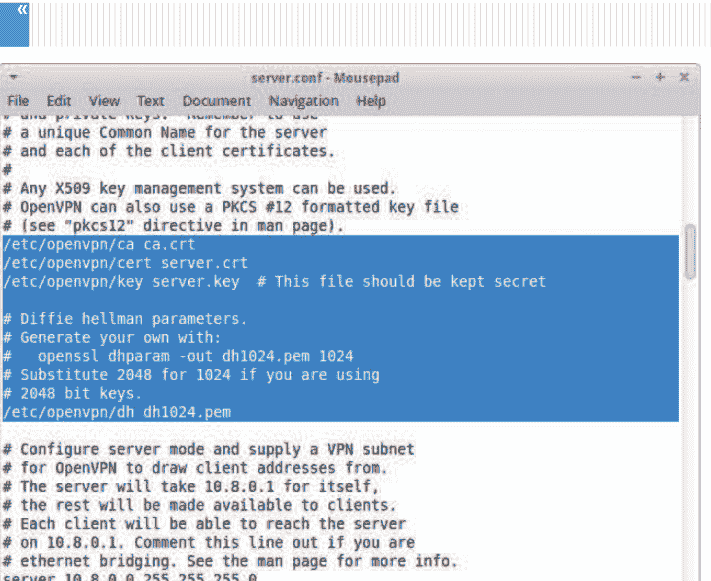

```bash
server.com - Mousepad
文件 编辑 视图 文本文档 导航 帮助
# 服务器的唯一通用名称 (Common Name)
# 每个客户端证书。

# 可以使用任何 X509 密钥管理系统。
# OpenVPN 也可以使用 PKCS #12 格式的密钥文件
# 而不是证书文件。
/etc/openvpn/ca.crt
/etc/openvpn/server.crt
/server.key # 此文件必须保密

# Diffie-hellman 参数。
# 生成你自己的
openssl dhparam -out dh1024.pem 2048
# 如果你正在使用 dh1024.pem，使用 2048 位密钥。

# 配置服务器模式并提供 VPN 子网
# 以于 OpenVPN 分配客户端地址。
# 服务器将为自己使用 10.8.0.1
# 并供客户端使用。
# 每个客户端都将通过 10.8.0.1 访问服务器。
# 注释掉此行或以太网。查看图表获取更多信息。
10.8.0.0 255.255.255.0
```

可能，你可以使用它们来访问你的服务器。U 盘（稍后删除它们）或如你的局域网（LAN）等受信任的网络。


```bash
client-group (group1) (server 1)
# l2 之后的无线网络
# 网络上的所有设备都支持
# 组播包而无需
# 范围特定的
# 客户端配置目录服务器配置文件
# client-config-dir ccd
# 此文件可用于所有客户端
```

## 12 编辑客户端配置

在文本编辑器中打开 `client.conf`。将 `remote` 修改为服务器的 IP 地址。目前请使用 `ifconfig`。稍后你可以运行 `tun`。然后你就可以从互联网连接了。将证书更改为 `ca.crt`，服务器证书更改为 `client.crt`，密钥更改为 `client.key`，每个名称都以 `/etc/openvpn/` 开头。每个客户端都需要 CA 的副本以及其他文件的唯一版本。

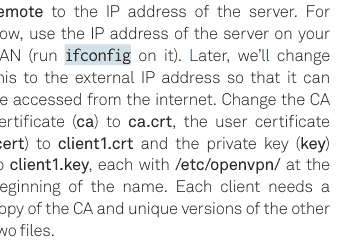

```bash
Terminal: client@linuxuser:~$ nano /etc/openvpn/client.conf
[client]
remote 192.168.1.1 1194
dev tun
ca ca.crt
cert client.crt
key client.key
route 10.8.0.0 255.255.255.0
persist-key
persist-tun
proto udp
```

## 09 编辑配置

在文本编辑器中打开 `server.conf` 并快速检查以编辑你想要修改的内容，但大部分内容保持不变。现在只需在密钥文件名开头添加 `/etc/openvpn/`。输入 `openvpn-server.conf` 启动。如果一切运行正常，最后的消息应该是“Initialization Sequence Completed”（初始化序列完成）。

## 11 配置客户端

移动到另一台 Linux 机器或域网客户端；使用包管理器安装 OpenVPN。运行 `find` 查找客户端配置。将文件 `client.crt`、`ca.crt` 和 `client.key` 复制到 `/etc/openvpn`。无论如何设置，务必保护它们，因为任何拥有这些文件的人都可以连接。

## 10 启动服务器

现在，你将手动启动以便我们可以看到输出并检查错误。

> 我们可以通过隧道连接到服务器，但无法访问...

## 13 测试客户端

以 root 身份打开 `client.conf` 以启动客户端。使用 `ifconfig` 验证 `tun0` 是否已创建。如果你能通过输入 `ping server` 能够访问服务器，说明你现在建立了一个隧道，即客户端与服务器之间的加密连接。

## 14 启用数据包转发


目前，我们可以连接到服务器，但还无法访问互联网。首先通过编辑 `/etc/sysctl.conf` 并取消注释 `net.ipv4.ip_forward=1` 来启用数据包转发。现在重启服务器。

## 17 使用 iptables 转发流量

在服务器上，使用 `iptables -t nat -A POSTROUTING -s 10.8.0.0/24 -o eth0 -j MASADE` 允许流量通过互联网转发。为系统安装 `dnsmasq`。添加行 `interface=tun0`。

## 20 从 Android 连接到

可能，你可以使用它们来访问你的服务器。U 盘（稍后删除它们）或如你的局域网（LAN）等受信任的网络。

## 19 从 手机连接到

可能，你可以使用它们来访问你的服务器。U 盘（稍后删除它们）或如你的局域网（LAN）等受信任的网络。

## 18 从 Windows 连接到

可能，你可以使用它们来访问你的服务器。U 盘（稍后删除它们）或如你的局域网（LAN）等受信任的网络。

## 17 从 iOS 连接到

可能，你可以使用它们来访问你的服务器。U 盘（稍后删除它们）或如你的局域网（LAN）等受信任的网络。

## 16 从 macOS 连接到

可能，你可以使用它们来访问你的服务器。U 盘（稍后删除它们）或如你的局域网（LAN）等受信任的网络。

## 15 从 Linux 连接到

可能，你可以使用它们来访问你的服务器。U 盘（稍后删除它们）或如你的局域网（LAN）等受信任的网络。

## 14 从 Windows 连接到

可能，你可以使用它们来访问你的服务器。U 盘（稍后删除它们）或如你的局域网（LAN）等受信任的网络。

## 13 从 Android 连接到

可能，你可以使用它们来访问你的服务器。U 盘（稍后删除它们）或如你的局域网（LAN）等受信任的网络。

## 12 从 iOS 连接到

可能，你可以使用它们来访问你的服务器。U 盘（稍后删除它们）或如你的局域网（LAN）等受信任的网络。

# 使用 Mercurial 管理代码教程

回滚得还不够远，可以进一步回滚。这通过使用 `hg revert` 命令实现。

> `clone` 命令允许对数据叶节点进行无限次实验，同时留下原始副本。

```
hg revert <change number>
```

更改号是在创建时分配的提交版本号。例如：

```
hg -r 0
```

这样做将回滚到我们创建的该文件的最早期实例。别忘记提交（commit）以保存回滚后的！

这将创建一个新的克隆。在运行命令之前，请确保 `new-work` 存在，否则命令将失败。


# 07 使用内置 Web 服务器

Mercurial 一个非常有趣且实用的功能是它可以运行一个内置 Web 服务器。要查看此功能，请使用以下命令：

# 11 添加更多文件

一个具有规模的项目将包含多个文件。不要忘记提交只是某个时间点的副本。Mercurial 系统将拾取你添加到它的文件。你可能需要刷新文件选择上的按钮来查看新增内容。它还会添加未跟踪的文件：点击 Add（添加）。这将对你所有的修订版本进行跟踪。

```
hg serve
```

这会在端口 `8000` 上启动一个 Web 服务器。使用 `Ctrl+C` 杀死 Web 服务器。此过程是查看存储库任何更改的极佳方法。你可以使用以下命令下载存储库副本：

# 09 介绍 TortoiseHg

```
hg clone <repository> <destination>
```

对于偏好界面（GUI）的用户，上述所有操作在 TortoiseHg 中同样适用。

```
sudo apt-get install -y tooisehg
```

要使用 TortoiseHg，请使用：

进入 File（文件）并打开 Repository（仓库）。导航到工作目录并点击 Open（打开）。所有窗口都是新的。完成仓库操作后，使用 File Close（文件关闭）关闭它。该仓库将被记录以便以后使用。

# 12 创建 Mercurial 备份

备份 Mercurial 非常简单。与你处理的实际数据一样，仓库文件夹中有一个名为 `lg` 的隐藏文件夹。因此，只要备份了该文件夹，所有的版本和提交数据就可以手动工作。你可以使用以下命令完成：

# 08 创建一个测试克隆

Mercurial 的优秀特性之一是它允许对数据叶节点进行无限实验，而不会更改新仓库。使用 `hg clone` 命令可以创建一个历史，让你实际上可以复制整个仓库。

# 10 TortoiseHg 基础

如你所见，界面被分为多个窗口。许多是自言自明的。一些早期的修订版本也在那里。使用 git 或类似工具创建另一个带有注释的新文件。要为我们的新文件添加注释，点击注释框并输入描述。要将你的更改提交到系统，点击 Commit（提交）。

要克隆仓库，请使用命令：

```
cd
```

```
hg clone new-work new-work
```

```
hg clone -u work work.hg
```

对文件进行常规备份非常简单，因为恢复它将和恢复仓库并导入克隆数据一样简单。

```
cd
```


# 你愿意为 Code Club 当志愿者吗？

Code Club 是一个全国性的网络，为 9-11 岁的儿童提供志愿者领导的课后编程俱乐部。

我们需要知道如何编写程序的人担任志愿者，每周在当地的小学、图书馆或社区中心运营一小时俱乐部。

我们为志愿者创建教学项目，我们制作的项目通过向孩子们展示如何制作电脑游戏、动画和网站来教他们编程。

加入我们，让我们教下一代人编程吧！

访问 www.codeclub.org.uk 了解更多


# 使用 gnuplot 画图

Gnuplot 可以找到两个抛物线的交点

Gnuplot 可以绘制复杂的图表

Gnuplot 可以在同一输出上绘制多条线

Gnuplot 还可以做 3D

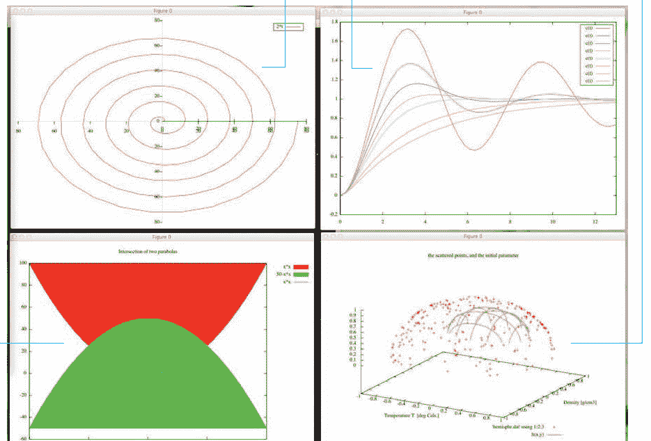

# 使用 gnuplot 画图

Gnuplot 是一个强大的 2D 和 3D 程序，可用于绘制数学函数并显示数据。

# 顾问

Manale Tsoukalas 是一位 UNIX 系统管理员，在编程、数据库和数学方面方面有专长。他自 1992 年以来一直使用 Linux。

这篇文章将向你介绍一种非常有用的科学工具，名为 gnuplot。Gnuplot 拥有版权但免费分发。Gnuplot 有多个版本：Unix、IBM OS/2、Windows、Doc、Mac OS、VMS、Atari 等。

使用线、点、矢量场、表面、弧和等高线进行绘图。它还支持输出为许多不同的文件格式，包括 EPS、PNG、JPEG、LaTeX、METAF 等。

Gnuplot 是一个最初开发用于帮助学生绘制数学函数和数据的命令。它适用于编写脚本，并可以将输出捕获到文件中。它支持许多不同的文件格式，包括 EPS、PNG、JPEG、LaTeX、METAF 等。

虽然 Gnuplot 拥有版权但免费分发，但 Gnuplot 有多个版本：Unix、IBM OS/2、Windows、Doc、Mac OS、VMS、Atari 等。

Gnuplot 是一个强大的 2D 和 3D 程序，可用于绘制数学函数并显示数据。它可以使用线、点、矢量场、表面、弧和等高线进行绘制。它还支持输出为许多不同的文件格式，包括 EPS、PNG、JPEG、LaTeX、METAF 等。

Gnuplot 可以找到两个抛物线的交点。Gnuplot 可以绘制复杂的图表。Gnuplot 可以在同一输出上绘制多条线。Gnuplot 还可以做 3D。

上一个例子非常简单。

当你理解时，范围（range）定义了 y 轴的边界。对于像 sin(x) cos(x) 这样的三角函数，相对于数字 p 定义边界更有意义。

Gnuplot 是一个最初开发用于帮助学生绘制数学函数和数据的命令。它适用于编写脚本，并可以将输出捕获到文件中。

# 教程

# 使用 gplot 绘图

# Gnuplot 让你能够在同一个输出屏幕上并排绘制多个图图


## 05 使用 gplot 绘制数学函数 - 第 2 部分

你可以通过以下 gplot 命令向输出中添加线条来进一步增强输出效果：

```
gplot set xtics ("0", "180"-pi, "-90"-pi/2, "90"/pi/2, "180" pi)
gplot set ytics ("0", "0.5"-0.5, "-0.5"+0.5)
gplot set grid
```

注意，gplot 有一个内置的帮助系统：例如，`help plot` 可以获取关于 plot 命令的有用信息—— 试一下！

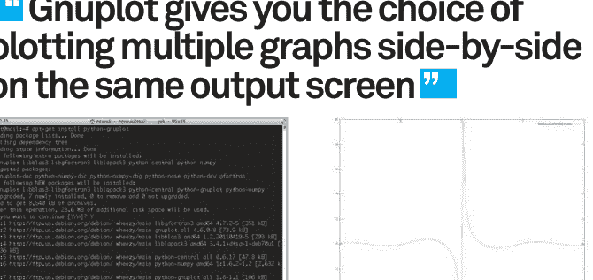

`import Gnuplot` 命令加载 Python 模块，而 `gplot(g)` 命令会绘制一个名为 g5 的图。`gplot(set term size 2048, 2048)` 命令将输出重定向到临时文件，而 `gplot(set output "LU.png")` 命令规定了用于保存输出的文件名。

运行 Gnuplot 脚本由于 `debug=1` 选项会产生以下输出：/LU.png

## 06 在坐标轴上绘制函数

假设你想在同一个图表上看两个函数以进行比较。你可以使用以下 gplot 命令实现这一点：

```
gplot plot xxx, xyy
```

正如你可能注意到的，你必须对坐标轴进行比例缩放！如果你想让图表看起来更好，可以使用以下命令：

```
gplot set xtics xxx, xyy with
filledcurves fs
```

正如你可能记得的，'filledcurves fs' 会为你完成这项工作——它会用绿色填充函数，绿色是当前曲线的默认颜色。

## 07 使用 Gnuplot 和 Python

在 Debian 7 系统上，你可以通过执行以下命令安装 Gnuplot 包：

```
# apt-get install gnuplot
```

为了确保 gnuplot 已正确安装，你可以运行以下 Python 脚本并检查其输出：

```python
import Gnuplot
```

如果一切正常，你将立即看到 shell 提示符。如果没有安装该模块，错误信息将如下：

Traceback (most recent call last):

  File "line", line 1, in <module>

ImportError: No module named Gnuplot

## 08 简单的 Gnuplot 脚本

下一个脚本使用了 Python 模块：

```
#!/usr/bin/python

import Gnuplot

gplot = Gnuplot.Gplot(debug=1)

gplot(set term size 2048, 2048)

gplot(set output "LU.png")

g5 = Gnuplot.Func(cos(x));

plot a function with y-gplot)

gplot(g5)
```

## 09 进阶一步！

执行以下脚本代码以获得令人深刻的 3D 输出：

# 使用 graphplot 绘图

```
graphplot> set term png size 2048,2048
Terminal type set to 'png'
Options 'crop font "Arial,12"
fontscale 1.0 size_2048,248
graphplot> set output "30.0"
graphplot> set param
```

以下命令将生成一个非常漂亮的图：

```
graphplot> set term png size 2048,2048
terminal type set to 'png'
Options are 'crop font "/usr/share/fonts/truetype/liberation/Liberation-Regular.ttf" fontscale 1.0 size_2048,248
graphplot> set output "plot.png"
graphplot> set xrange [-pi:pi]
graphplot> set ylabel 5
graphplot> set origin 0,0
graphplot> set multipot
graphplot> set size 0.5,0.5
graphplot> set origin 0,5
graphplot> set size 0.5,0.5
graphplot> set origin 0.5,0.5
graphplot> set size 0.5,0.5
graphplot> set origin 0,0
graphplot> set size 0.5,0.5
graphplot> set origin 0,0
graphplot> set size 0.5,0.5
graphplot> set xlabel 1/x
graphplot> set multipot
```

Graphplot 在屏幕上打印错误消息，告诉你第一个错误的行号——这并不意味着其他部分是没问题的，只是至少有一个错误！使用以下命令绘制了一个带有问题的数据文件：

```
graphplot> plot 'ListData'
```

```
curves, y = for surfaces
graphplot> set isosamples 50
graphplot> set grid 5
graphplot> set xtics 4
graphplot> set ytics
graphplot> set range [-pi:pi]
graphplot> set xrange [-pi:pi]
graphplot> set pmdd with patch
graphplot> plot cos(x)
```

使用 `pmdd with patch` 绘制的函数会填充绿色，这是当前曲线的默认颜色。`pmdd` 允许绘制表面。`plot` 命令绘制 `cos(x)`。

## 12 使用 Gnuplot 脚本

正如你可能记得的，'filledcurves fs' 会为你完成这项工作——它会用绿色填充函数，绿色是当前曲线的默认颜色。正如你可能注意到的，你必须对坐标轴进行比例缩放！如果你想让图表看起来更好，可以使用以下命令：

# 使用 gprof 对你的代码进行性能分析

教程

## 01 编译启用性能分析的代码

为了对程序进行性能分析，第一步是在编译和链接代码时启用性能分析功能。在大多数情况下，在命令行中使用 `-pg` 参数即可启用性能分析。如果编译和链接命令是分开使用的，则在两种情况下都应使用此选项。例如：

此文件包含了程序执行过程中实际命中的代码块的性能分析数据。它不是一个普通的文本文件，无法正常读取。在 Linux 中可以使用文件 `gmon.out` 可以确认这一点。


```
gcc -Wall Sample.c -o Sample-code
gcc Sample.o -o Sample-code
```

如果编译和链接是在同一个命令中完成的，也需要添加此选项。例如：

```
gcc -Wall Sample.c -o Sample-code
```

```
file gmon.out
gmon.out: GNU profile performance data - version 1
```

```
// 本文全程使用的示例代码 (Sample.c):
#include <stdio.h>
int count;
void func_c(void)
{
    count++;
}
void func_a(void)
{
    int i = 10000000;
    while (i--) {
        func_c();
    }
    return;
}
```

> 注意 1：如果程序异常终止、由未处理的信号终止或通过 `exit()` 函数调用退出，则不会产生 `gmon.out` 文件。

> 注意 2：该文件在程序退出时创建在程序的工作目录下。因此，请确保程序正常运行。

> 注意 3：性能分析程序会生成一个名为 `gmon.out` 的文件，请确保该文件存在且名称正确。

## 02 执行二进制文件 - 部分 1

在程序编译（并链接）之后，下一步是执行它。需要重要的是，性能分析的执行方式应当确保所有代码（至少是你想要分析的代码）都已执行。因此，需要相应地为程序提供命令行参数和输入。

以下是如何分析可执行程序 "Sample-code" 方法：

```
/Sample
Count = [100000000]
```


因此你可以看到 `"Sample-code"` 执行并结束了。

> 注意 4：执行 `gprof`。一旦性能分析数据文件可用，该工具即可用于分析并产生有意义的数据。这里是 `gprof` 命令的语法：

### 03 执行二进制文件 - 部分 2

程序执行后，它会生成一个名为 `gmon.out` 的文件。

`ismon.out`

`gmon.out`

```
gprof [command-options] [executable-name] [profiling-data-file] [output-file]
```

`gprof` 接受可执行文件名和命令行选项以生成性能分析信息，这些可以重定向到输出文件。

但注意，命令行工具本身不需要任何参数[它们不是强制性的]。当未提供参数时，`gprof` 会在当前目录中查找 `a` 作为可执行文件名，并将 `gmon.out` 作为性能分析数据文件，输出将产生在标准输出 - stdout。

让我们运行命令：

```
gprof sample gmon.out -o prof_output
```

上面的命令将输出重定向到名为 `prof_output` 的文件。该文件现在将包含以平铺文件和图表形式呈现的可读性能分析信息（稍后详细介绍）。

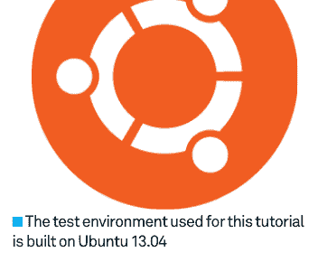

本教程使用的环境基于 Ubuntu 13.04 构建

```c
printf("\n Count = [%d]\n", count);
return 0;
```

# 使用 gprof 对你的代码进行性能分析教程

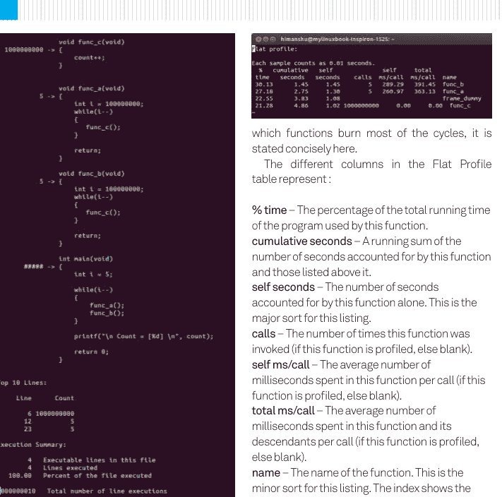

索引位于括号中，它显示了如果打印，它出现在 `gprof` 列表中的位置。

## 调用图

调用图（见下方的屏幕）显示了每个函数调用了哪些函数以及其他函数，以及每个函数在每个函数的子程序中花费了多少次。这可以提示你可能尝试消除消耗大量时间的调用。

列表中的每个条目左侧都有索引号。垂直线及其下方的线列出了调用的函数。当前侧边栏列出了调用该函数及其子函数的函数。一行列出了：

- index - 分配给表中每个元素的索引。索引按数字排序。索引号打印在函数名旁边，方便查找函数在表中的位置。
- %Time - 花费在该函数及其子函数中的时间百分比。请注意，由于视角不同，这些百分比之和不会等于 100%。
- %self - 花费在函数本身上的总时间。对于函数的父函数来说，这是运行周期最多的次数，在这里被简洁地陈述。平铺分析（Flat Profile）中的不同列代表：

- %Time - 程序运行时间中该函数占用的总运行时间的百分比。
- cumulative - 该函数及上述列出的函数的秒数累计和。
- self - 仅该函数消耗的秒数。
- calls - 该函数被调用的次数（如果它本身被分析了）。
- name - 函数名。这显示了函数在 `gprof` 列表中的位置，如果

| index | %Time | self | children | calls | name |
|---|---|---|---|---|---|
| 1 | 77.00 | 3.37 | 73.63 | 1 | main |
| 2 | 14.50 | 0.51 | 14.00 | 5 | func_c |
| 3 | 14.50 | 0.51 | 14.00 | 5 | func_b |
| 4 | 22.3 | 0.08 | 22.00 | 4 | parent |
| 5 | 21.02 | 0.51 | 20.51 | 5 | func_a |


## 05 注释源代码

注释源代码告诉我们函数被调用的次数。要获取注释源代码，请使用 `-g` 编译。首先使用 `-g` 选项启用调试：

```
gcc -g sample.c
```

接下来运行 `gprof` 命令，使用 `-o` 选项输出：

## 06 平铺分析

平铺分析（见下方屏幕）显示了每个函数花费了多少时间以及被调用了多少次。如果你只想知道：

```
gprof sample -o flat
```

## 07 调用图

按函数名索引

| index |
| [4] | flat_dummy |
| [2] | func_b |
| [3] | func_a |
| [5] | func_c |

## 08 排除特定函数

识别程序代码中的瓶颈行。对于子函数，这是从父函数传递的。

- children - 花费在该函数及其子函数中的时间。对于父函数，这是传递到它的时间。
- called - 该函数被调用的次数。如果是递归调用的，则只包含非递归调用。
- 对于父函数，这是传递到它的时间。对于子函数，这是传递到它的时间。
- Name - 函数名。索引打印在函数名后面。如果函数名重载，则循环名打印在函数名和索引之间。

> 代码性能分析不仅有助于调试许多棘的问题，还能帮助程序员提高软件性能

## 09 分析特定函数

每次调用计为 0.01 秒。

| index | self | children | name | total |
|---|---|---|---|---|
| 1 | 1.00 | 0.00 | func_a [1] | main (2) |
| 2 | 0.00 | 5.00 | func_c [3] | 5.00 |
| 3 | 0.00 | 0.0000000000000000 | func_a [1] | 0.00 |
| 4 | 0.00 | 0.0000000000000000 | func_b [4] | 0.00 |
| 5 | 0.00 | 0.0000000000000000 | func_c [3] | 0.00 |

累计秒调用/调用

粒度：每次命中覆盖 2(s) 占 1.30 秒的 0.77

调用图

## 10 抑制冗余信息

默认情况下，`gprof` 的输出包含平铺分析和图表中每一列的详细解释。这对于初学者很有帮助，但你可能想抑制已的细节。命令行选项 `-b`（或 `-brief`）可用于此目的。

# 教程

## 使用 Qt 进行事件驱动编程

LinuxDeveloper


# 使用 Qt 进行事件驱动编程

保持程序组件分离可以简化测试。只需少少精力，即可享受事件驱动编程带来的优势。

你是否曾经想过重用程序的一部分，却发现自己受限于各种现有的代码？你是否曾需要以一种不对算法依赖于 Qt 工具包的方式处理输入？

因为信号槽系统（signal-slot system）而部署 Qt。这种荣誉是实之其实的；很难找到一个框架无法处理的案例。Qt 以降低复杂度而闻名，而槽（slots）用于与 Qt GUI 类提供的控件进行交互。最后，大多数模块都将自己集成到信号槽系统中。

信号槽系统允许你使用类似事件的范式将应用程序组件相互连接；信号被发射到框架的槽中。

简而言之，如果你想使用 Qt，你就需要熟悉信号发射（signals emits）。

大多数计算机科学问题可以通过示例来理解。在接下来，我们将创建一个小型应用程序来分析其他电阻器（其值是一系列环环）。它将使用一个通过接收和发射信号进行通信的计算引擎。

在现实生活中，事件是任何发生的情况：俱乐部的开放、飞机的起飞或一个好主意。在计算机中，可以构建类似的定义事件。

传统上，创建事件是一项巨大的工程。许多开发者选择过……

在处理 Qt 时，事件是类决定与外部世界共享的任何内容。大多数 Qt 控件都会发射各种事件。可以按照顺序处理这些事件，以创建一个小型应用程序，类可以根据你的需要以尽可能少的事件来处理这些事件。

# 顾问

Tam Hanna 从 Palm Inc. 时代起就开始从事 IT 行业了。作为一名记者、演讲者和书籍作者，他多次见证移动市场的每一个方面。

# 资源

延伸阅读：

- [http://qt-project.org/wiki/Qt5_index/signals_and_slots](http://qt-project.org/wiki/Qt5_index/signals_and_slots)
- [http://qt-project.org/doc/qt-5.0/qtgui/signals_and_slots.html](http://qt-project.org/doc/qt-5.0/qtgui/signals_and_slots.html)
- [http://qt-project.org/doc/qt-5.1/qtdoc/qtgui-index.html](http://qt-project.org/doc/qt-5.1/qtdoc/qtgui-index.html)

Qt 还包括：

- [http://qt-project.org/doc/qt-5.1/qtdoc/qtcharts-index.html](http://qt-project.org/doc/qt-5.1/qtdoc/qtcharts-index.html)

QML 简介：

- [http://qt-project.org/doc/qt-5.1/qtdoc/qml-index.html](http://qt-project.org/doc/qt-5.1/qtdoc/qml-index.html)

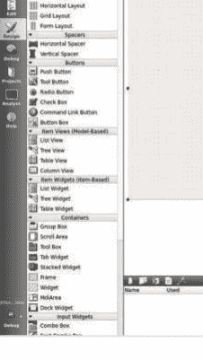

> 启动后，Qt Creator 显示一个带有一些入门说明的“状态窗格”

- 需要四个列表和一个按钮

60 www.linuxuser.com

# 使用 Qt 进行事件驱动编程

使用信号和槽创建一个电阻计算器

教程

- 给前三个列表框添加一些颜色

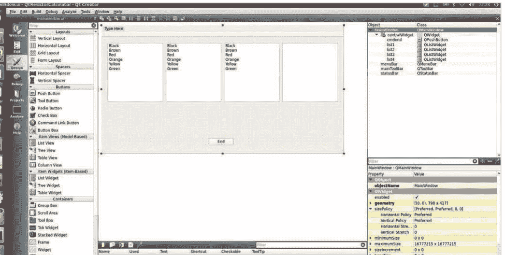

我们将看到，框架在这方面施加了很少限制。

由于继承的开销，如果 Qt 使用一个名为 'event' 的回调，可能会出现一些问题。这是由信号槽管理器调用的。在事件中，框架将信号路由到一个或多个槽，由这些槽对其进行处理。

在现实世界中，事件路由基于一个有趣的机制。如果某一方以后想创建一个事件，它就会发射它。其他方也可能听到它。但是，如果它对他们感兴趣，他们可能会忽略它。

Qt 在注册过程中反映了这一点：它检查是否有任何槽在其中注册。通知被分发到这些对象。

我们基于 Qt 的框架将自己限制在处理四个色带上。这为我们提供了总共四个和一个向出的事件。`QObject` 派生类会自动集成到信号槽框架中——`ResistorCalc`类的头文件如下：

```cpp
class ResistorCalc: QObject {
    Q_OBJECT
public:
    ResistorCalc();
public slots:
    void valueChanged(int to_max);
signals:
    void newValue(int new_value);
private:
    void recalculateValue();
    int my1;
    int my2;
    int my3;
};
```

### 声明信号和槽

我们将看到，框架在这方面施加了很少限制。

由于继承的开销，如果 Qt 使用一个名为 'event' 的回调，可能会出现一些问题。这是由信号槽管理器调用的。在事件中，框架将信号路由到一个或多个槽，由这些槽对其进行处理。

在现实世界中，事件路由基于一个有趣的机制。如果某一方以后想创建一个事件，它就会发射它。其他方也可能听到它。但是，如果它对他们感兴趣，他们可能会忽略它。

Qt 在注册过程中反映了这一点：它检查是否有任何槽在其中注册。通知被分发到这些对象。

我们基于 Qt 的框架将自己限制在处理四个色带上。这为我们提供了总共四个和一个向出的事件。`QObject` 派生类会自动集成到信号槽框架中——`ResistorCalc`类的头文件如下：

```cpp
class ResistorCalc: QObject {
    Q_OBJECT
public:
    ResistorCalc();
public slots:
    void valueChanged(int to_max);
signals:
    void newValue(int new_value);
private:
    void recalculateValue();
    int my1;
    int my2;
    int my3;
};
```


# 教程

## 使用 Qt 创建美观的用户界面

`QtGui` 和 `JSON`：解决常见问题的方案

当 `Qt` 首次被构想时，`JavaScript` 和 `HTML` 还处于起步阶段——使用它们来创建复杂的用户界面是不可行的。此外，大多数系统无法处理图形化界面带来的计算需求。然而，随着桌面工作站屏幕尺寸的不断增大，

`Qt` 框架（我们将使用它来创建）解决了这些问题。它允许你使用控件和各种处理渲染的辅助工具，但并不适用于动画。

在 4.6 版本中，引入了一个新的 `Qt` 框架。这个基于 `JavaScript-JSON` 的系统提供了令人深刻的动画功能，最初为移动设备设计的，但它可以处理各种使用 `QML` 渲染的矩形、位图和纹理。

`QML` 为各种系统的网络提供了框架。通过使用数据，`Qt` 可以管理所有平台上可用资源。一组设计模式简化了现代界面的创建。

使用 `QML` 通常会导致更整洁的代码，并且更容易手动组装。然而，原生集成使得结果看起来像其他的桌面应用程序。

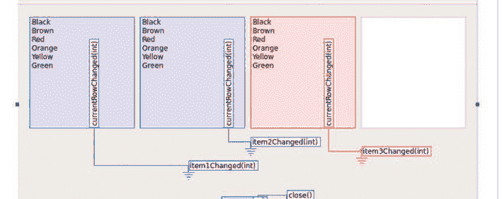

在此输入：

| 黑色 | 黑色 | 黑色 | 黑色 |
|---|---|---|---|
| 棕色 | 棕色 | 棕色 | 棕色 |
| 红色 | 红色 | 红色 | 红色 |
| 橙色 | 橙色 | 橙色 | 橙色 |
| 绿色 | 绿色 | 绿色 | 绿色 |

信号与槽模式提供了表单编辑中连接的概述，头部非常简单：

```
void MainWindow::valueChangedChanged(int newValue)
```

在这里，我们使用一个槽来连接——这个特殊情况在文档中有描述。必须定义信号。然后，使用以下代码创建此槽。同时，在头文件中包含 `MainWindow::valueChanged`：

```
void MainWindow::valueChanged(int value)
```

## 使用 Qt 进行事件驱动编程

使用信号与槽创建一个电阻器校准器

### 实现信号和槽

在处理 `Qt` 时，事件是类决定与外部世界共享的任何内容。大多数 `Qt` 控件都会发射各种事件。可以按照顺序处理这些事件，以创建一个小型应用程序，类可以根据你的需要以尽可能少的事件来处理这些事件。

### 声明信号和槽

在处理 `Qt` 时，事件是类决定与外部世界共享的任何内容。大多数 `Qt` 控件都会发射各种事件。可以按照顺序处理这些事件，以创建一个小型应用程序，类可以根据你的需要以尽可能少的事件来处理这些事件。


最后，是时候连接信号到槽。这在表单类的构造函数中完成，如下所示。

> 信号与槽机制是对象之间通信的一种强大方式。

### 分析优势

完成所有编码后，是时候总结一下我们做了什么。在学习用户界面的实现时，组件是完全独立于用户界面创建的。电阻器校准器是这种方法的一个复杂示例。

对于像这样的类，优势可能不会立即显现。然而，让我们假设该类填充了许多电阻值。

在这种情况下，重用将是一个极具吸引力的提议。当 QtGui-calibrator 是该类的构造函数时，它是如何处理来自 Qt 的回调函数连接的？

这种力量证明了实现信号所需的努力。然而，它让自动测试的变得如此简单。

简而言之，信号与槽系统在大多数情况下都能正常工作。现在，是时候在我们节课程中穿越奇妙的 Qt 世界了。接下来，我们将查看布局和策略。然后，继续编码——

图 1

63 www.linuxux.co.uk

# SUSECon 2013

企业与社区共同努力，为企业客户提供更好的使用 FOSS（自由开源软件）的理由

参加一个基于 Linux 的会议去华特迪士尼度假世界是一种有点超现实的体验。坦率地说，我们不知道地球上这些神奇地方会举办会议。当我们带着一辆兴奋的孩子们的巴士停在美丽的科罗拉多斯普林度假村时，我们发现建筑后面巨大的大厅完全可以容纳整个会议。如果我们想尝试将迪士尼与 Linux 联系起来，我们指出皮克斯动画工作室一直以在 Linux 上进行渲染而闻名，这也是 SUSE 选择这里举办北美会议的原因。

会议本身分为两个部分：技术展示区，所有 SUSE 合作伙伴和供应商在其中展示他们的产品；以及一系列举办各种极其广泛主题分会会议的会议室。从云到大型系统管理，每个人都有适合的讲座。

在会议期间，出现了一些关键主题浮出水面，这些主题有助于定义 SUSECon 的本质。

# 社区

作为一家基于 Linux 和开源的公司，SUSE 并没有忘记广大社区帮助它走到了今天。


Gerald Pfeifer 领导着产品管理团队

64 www.linuxuser.co.uk

# SUSECon 2013

会议报告与采访

对于 SUSE 而言，最重要的概念之一是基于相同的代码库。上游的 openSUSE 测试平台旨在为 SUSE 的产品提供资金，目前在 openSUSE 12.x 和 13.x 中的技术正在进入 SUSE Linux Enterprise 7。

“与社区的[纽带]非常重要，”SUSE 总裁兼总经理 Nils Brackmann 说道。对于 SUSE 来说，培养社区至关重要。

openSUSE 测试平台旨在为 SUSE 的产品提供资金，目前在 openSUSE 12.x 和 13.x 中的技术正在进入 SUSE Linux Enterprise 7。

“与社区的纽带非常重要，” Nils Brackmann 说道。对于 SUSE 来说，培养社区至关重要。

“与社区的纽带非常重要。”

“事实上，我认为我们与微软的合作已经变得非常密切，”Michael Miller 说道。从 2008 年开始，SUSE 和微软已经合作了一段时间。

而且现在我们使用 13.1，我喜欢 openSUSE；我让我的孩子们使用

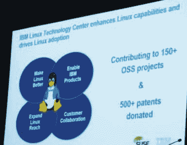

■ SUSE 的合作伙伴对于整个生态系统很重要，在主会上


当我们在上游更新功能时，Brackmann 认为与微软的合作帮助 openSUSE 拥抱更多开源，不是出于改变的需求，而是因为他们相信开源将一直存在，“为了未来，”Ralf Rafha 提到。

“我们都是企业，”Brackmann 说，“我们很高兴能表现友好。我们这样做是因为我们的客户有这种需求，如果我们符合要求，他们很可能会购买我们的解决方案。”

# 与微软合作

如何 SUSE 并没有出卖灵魂

这并不是秘密，SUSE 与微软已经合作了一段时间，在 Azure 上的微软版本中我们使用了 openSUSE。

# Cloud

这是 SUSE 产品的一项新事物，在 Cloud 2.0 发布后不久 SUSE 启动了。Cloud 基于 OpenStack 平台，这是一个 SUSE 自其进入市场以来关注的产品，而我们发现 OpenStack 当时也有一点奇怪。

“如果不是的话，Ralf Rafha 对 SUSE 是很有重要的，”他说，“每个人都这么跟我说，但如果我们看他在 OpenStack 开发方面的投入，他是行业标准。”

“正如这种方式同样重要，”Miller 说，“我们曾使用 CloudStack，因为它在当时也有点奇怪，而现在我们也发现 OpenStack 当时也有点奇怪。”

# Windows Azure

■ Azure 中可用的 Linux 发行版中有两个基于 SUSE 的

Michael Miller, SUSE VIP

65 www.linseuker.com

# SUSE 2013 大会报告


我认为 Rackspace 采取了完全正确的做法，为像我们这样的 OpenStack 基金会创造了参与机会。我们受邀请作为创始成员加入了其中。

在可能的情况下，该公司正确保自己能够成为优秀的合作伙伴，以推动其业务发展。正如 Bruckmann 所说，SUSE 拥有“广阔的愿景，致力于通过建立合作伙伴关系来实现超越我们自身所实现的成就”。

# 公告

SUSE 在 SUCon 上宣布了重大的新功能和项目……

- **SUSE Solidriver 程序**
让 SUSE 的 Linux 驱动程序回归，确保了驱动程序经过了兼容性测试。其核心理念是让合作伙伴和用户创建模块或驱动程序，在无需大量测试的情况下即可与他们的系统兼容。我们一直努力确保内核驱动的稳定性。合作伙伴已经建立了一套流程，我们共同协作为 SUSE Linux Enterprise 启用真正可靠的产品和功能。

结果是，SUSE 正与 OpenStack 进行更多、更紧密的合作，并计划明年与 SUSE Cloud 共同每月发布计划。这只是云解决方案的一部分，因此 SUSE 团队正在对其大魔术，缩短高达 20-30 分钟的时间。

“OpenStack 非常强大，”Bruckmann 补充道，“否则，它并不直直观易于理解。但我们相信这是我们可以利用的价值之一。”

> 我们深信 OpenStack 是功能支持和性能支持方面最强大的项目。因此，我们知道 SUSE Cloud 的正确选择。

技术展会上的许多展出者都是 SUSE 的合作伙伴——HP、SAP HANA 以及 SAP America，其他行业也展示了他们基于 SUSE 的解决方案、技术，以及我们行业中大多数其他产品的优秀主机。同时，Bruckmann 跟着 Hans Christian（全球负责人），他为 SAP America 展示了数据和 HANA 平台，大部分 SAP 和 IBM Linux 系统运行在 SUSE 上。

- **SUSE 分布式存储**
SUSE 将于明年底推出新的分布式存储解决方案。该方案将基于 Ceph，这是一种软件已用于 SUSE Cloud 产品中。显然，它将出现在 SUSE Linux Enterprise 中。Ceph 提供了客户寻求的灵活性和多功能性。

SUSE 以及其他伙伴关系都运作良好。对于 SAP 而言，SUSE 弥补了 SAP 和 HANA 之间的差距，创造了一个统一的产品——这是一个不可或缺的结果，使得这种合作更加丰厚，并减少了像与微软合作那样的争议。

这是一项具有高潜力的技术，与 OpenStack 平台集成，并作为 SUSE Cloud 的一部分提供。

# 合作伙伴

SUSE 是一家业务公司，无法回避这一点。尽管它支持社区：

- **适用于 Microsoft System Center 的 SUSE Manager Pack**
SUSE 与微软有着合作关系，客户在包含 Linux 和 Windows 的异构环境中需要这种关系。为了进一步适应这种需求，“现在有一个 Microsoft System Center 插件可以管理许多不同单元的方面，让管理员可以将精力集中在许多不同的组织上，”简介中写道——在会议上与 SUSE 交流后，他们对未来感到更加乐观，因为这种互操作性可以引导客户选择 SUSE 作为其 Linux 解决方案。

# 黑客星球 (HACK PLANET)

# SUSE 的黑客周是技术创新的的一周

当 Ralf Raifa 没有领导工程团队和三级支持时，他正在组织 SUSE 黑客活动。这项年度活动是一周的时间，期间适用常规规则，但团队和个人可以完全自由地做他们想做的任何事情。

产品的初始想法或创新源于黑客流（hackerflow）。Yaast Linux & Developer 的形成就是一个黑客项目，因此在最后的一周创建了许多产品，有些在活动结束后仍在继续。

这是一个非常鼓舞的氛围，工程师们聚集在一起完成了 Flat。

 这里的黑客周是技术创新的的一周（此处为原文重复，此处翻译逻辑一致）

 这里的这只是云解决方案的一部分，因此 SUSE 团队正在对其大大魔术，缩短高达 20-30 分钟。

Bruckmann 补充道：“OpenStack 非常强大，”否则，它并不直观易于理解。但我们相信这是我们可以利用的价值之一。

> 我们深信 OpenStack 是功能支持和性能支持方面最强大的项目。因此，我们知道 SUSE Cloud 的正确选择。

# 测评索引

开源界的核心工具包、软件和资源

## 测评


## 我们如何进行测评

我们的专家对工具包进行了彻底测试，并根据以下标准进行评分

**不计代价避免**
设计师/开发者糟糕的一天

**良好但仍有进步**
买它吧。它不会让你失望

**软件或硬件的天堂**
> “我们对这个版本没有更高的要求了，但它成功满足了我们所有的期望”

Linux Mint 16

## 测评

## 组测

### 软件

- 70 演示文应用：你会使用哪种幻灯片解决方案？我们对四种最好的工具进行了测试，看看哪个能脱颖而出……
- 76 Linux Mint 16：了解为什么它仍然是我们的首选发行版
- 78 Securstore：正在寻找强有力的备份方案吗？
- 81 Fedora 20 beta：这个前沿版本有什么新变化？


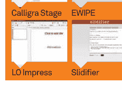

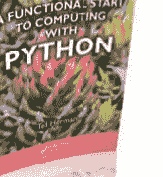

## 书籍

- 83 深度解析最新的 Linux 阅读物

www.linuxuser.co.uk

## 演示软件组测

## 组测

### 演示软件

在我们查看一系列适用于商务或家庭使用的演示应用时，选择出最好的幻灯片软件。

开源办公套件已经能够适应商业环境很长时间了，在我们之前的组测中，我们指出了商务办公套件被忽视的因素，人们甚至会在家里使用它们，即创建看起来专业的演示文稿的能力，但还有其他替代方案并不总是属于办公套件，并且能提供办公套件可能不具备的功能。首先，你需要能够使用内置工具创建看起来专业的演示文稿。其次，我们想知道该软件与其他演示应用以及它们在此处的演示文的兼容性如何。

虽然有一些出色的在线幻灯片工具，但大多数并不是开源的，尽管我们在本次测评中包含了一个。我们还排除了一些 PDF 和 LaTeX 演示库，不过，我们在之前的期数（4131）中详细介绍了关于如何使用 LaTeX 创建专业演示文稿的教程。

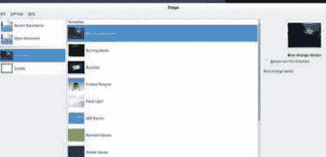

### Calligra Stage
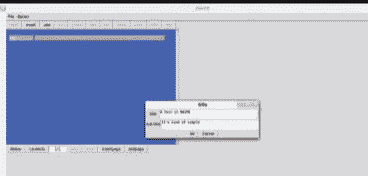

### EWIPE


### slidifier
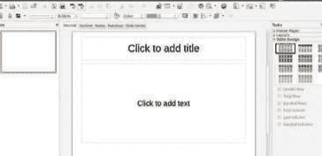

## LibreOffice Impress
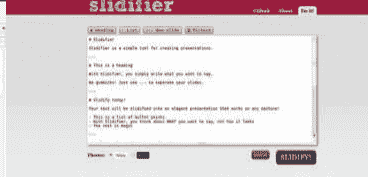

## Slidifier


## 演示软件组测

四款最好的演示应用展开了对决。

### Calligra Stage

Calligra Stage 是 KOOffice 和 KPresenter 的继者，是 Impress 最直接的竞争对手。

我们在办公套件组测（#120）中的准备令人印象深刻，尽管它缺乏像 LibreOffice 那样的社区支持和人气。Calligra 是该套件自带的演示软件，是一个类似于 PowerPoint 风格的优秀桌面应用程序。启动 Stage 时，你会发现它初看起来非常杂乱。主界面满了功能，除非你使用的是 1080p 或更高分辨率的显示器，否则这些功能无法正常工作。屏幕上有很多内容需要处理，给活动预览留下的空间有限。界面至少是敏感，会根据你是在编辑文本还是制作动画来清除一些方框。

即使你能在界面中找到某些功能，但它们用起来也并不直观。图片功能可以与标题链接，但由于没有在每个对象上使用锚点，这需要花费大量精力，而且我们在 LibreOffice 中也遇到过类似的问题，最多情况下只需要稍微重新排版就能确保所有内容可见。

需要进行一些实验才能弄清楚哪些是好用的。对于一个可能不经常使用的软件来说，这并不理想——如果你不需要经常使用某个功能，可能需要花费更多时间学习如何使用它。

使用 Stage 创建的演示文稿提供了多种工具供选择，各种图像和线条工具，以及大量的幻灯片可以使用。如果界面不是那么固定和杂乱会更好，但对于这一点你没什么办法，后者是一个更大的问题。

Stage 包含了幻灯切换；不支持幻灯片上不同对象的动画，即使它们是从其他幻灯片应用导入的。这似乎不会影响导入的演示文稿。

使用 Calligra 创建的演示文稿非常出色。
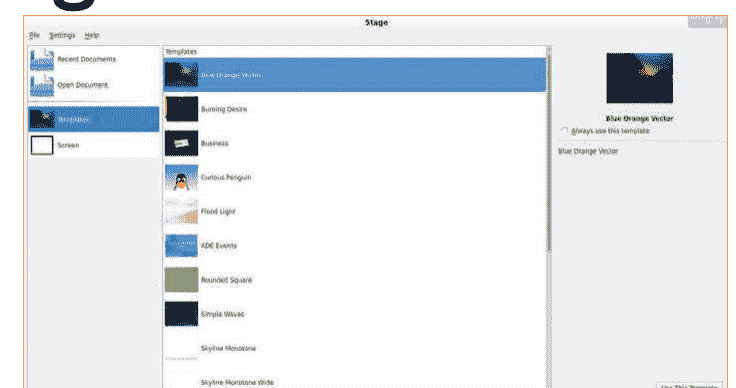

- 易用性：功能的特性让创建幻灯片变得有些困难
- 兼容性：它能很好地导入许多格式，但不支持动画
- 功能：可以做得足够好以商务环境
- 美观性：有多种功能、文本框和流程图，但是
- Calligra Stage 功能齐全，但存在一些你必须搏斗的问题

界面在非 1080p 屏幕上很杂乱，但有很多功能可以选择。

### EWIPE
一个通过块完成所有操作的简单演示应用。

当我们第一次看到 EWIPE 时，我们被吸引了。EWIPE 基于 Python 开发，它将被定位为一个轻量级程序，虽然大多数软件都不是开源的，但我们在本次测评中包含了一个。我们还排除了一些 PDF 和 LaTeX 演示库，不过，我们在之前的期数（4131）中详细介绍了关于如何使用 LaTeX 创建专业演示文稿的教程。

# 演示文软件组测试

领先的四种最佳演示文应用

# 评测

## LibreOffice Impress

### 我们套件冠军的幻灯片创建器——它与套件的其他部分一样好吗？

LibreOffice 是一个非常优秀的办公套件，也是真正的开源成功案例。我们将其选为办公套件的冠军，今天我们回来看看 Impress（LibreOffice 的演示文软件）是否能竞争过其他产品。我们没有看 OpenOffice 的同类产品，但它能超越它的原始拷贝版吗？

LO 的优势之一是，与其它软件（尤其是微软的版本）相比，虽然 PowerPoint 拥有最好的复制功能，但 Impress 仍然擅长制作各种类型的演示文，而这些在其他软件中无法那么方便地处理。总之，Impress 包含了你在其他幻灯片软件中过的几乎所有功能，并且多个幻灯片之间的切换效果更好。无论你是在做非常专业的商务演示，还是稍微非正式一点，Impress 中都提供了所有必要的图表和动画供使用。

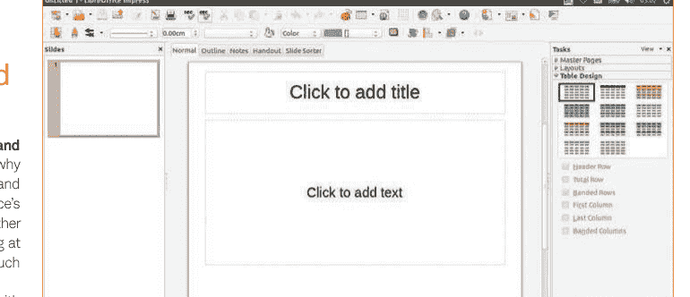

你的演示文界面极其整洁，且默认布局自然——你可以添加、删除或重新定位功能。优先考虑让功能易于找到。屏幕绝不会被功能和自定义过度填满。这与 CallStage 的布局形成对比，那里一切各就其位，但几乎没有操作余地。由于 Impress 的布局，我们能够快速方便地组合出一个演示文，而完全不需要在界面中四处寻找。这是一件惊人的软件，非常值得在全套中尝试。Impress 演示文在设计完成后看起来非常棒，同时它可以很好地导入其他文件类型，非常好用。唯一真正的问题是缺少一些在线免费演示模板，尽管此类功能将在未来的某个时候推出。目前，Impress 绝对是最好的演示文应用。

## “界面极其整洁且布局合理”

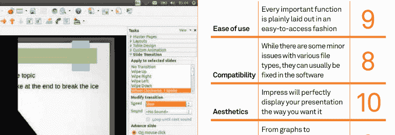

## 评分

| 类别 | 描述 | 得分 |
| :--- | :--- | :--- |
| 易用性 | 每个重要功能都以易于访问的方式清晰地布局 | 9 |
| 兼容性 | 虽然类型上存在一些问题，但通常可以在软件中修复 | 8 |
| 美观 | Impress 完美展示了你想要的演示文 | 10 |
| 功能 | 从图形到动画以及其之间，Impress 几乎拥有一切 | 9 |
| 总体 | LibreOffice 是一个很棒的套件，Impress 的舞台不会让你失望 | |


Impress 是唯一支持幻灯片切换和动画对象的软件。

www.linuxuser.co.uk

## 演示文软件组测试评测

## Slidifier
一个使用 HTML 代码的在线开源演示文创建和共享工具

它不是开源的，即使你正在使用它。Google Docs 是一个非常强大的演示文工具，它可能有点基础，但足以让演示文看起来像任何东西一样专业。Slidifier 在某些方面是共享电子表格的开源等品，无需互联网。事实上，Slidifier 版本在这方面更好，你不需要账户，而且分享链接比 Google 简单一点。

它的关键在于它为 Google Slides 做的唯一事情。Slidifier 是一个极其简单的工具，帮助你通过一些基础格式来标记标题或切换到下一页幻灯片，从而构建你的演示文。

# 评测

## Securstore

Securstore 支持多种备份目标。提供多种压缩类型以减少您的月度费用。

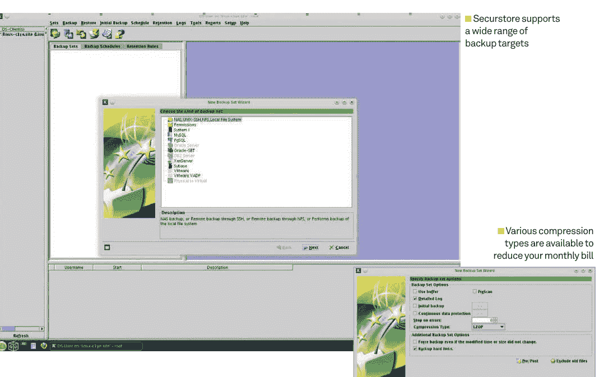

## Securstore

对于基于 Linux 的企业级用户，是否存在一种“一体化”的备份解决方案？Securstore 似乎认为是有的。

Securstore 是当今许多专注于企业此类离线备份的公司之一，它提供位于英国或美国数据中心对的远程存储，其中一个处的内容会自动复制到另一个处——为您随时随地提供备份服务。

Securstore 不仅仅让您自行应付，还采取了积极的支持方法：注册该服务后，您将有机会与公司的英国支持团队通话，他们将一步步引导您完成安装和配置过程。如果您更倾向于自学型学习者，也可以选择通过我们详细的在线教程自己完成。

## 缺点

然而，该公司的软件原生体验并不尽理想，但对于云备份专家来说非常出色，使用该软件管理 Securstore 的 DS-Client 和 DS 软件很容易。由于 Securstore 的软件追溯到 1998 年，存在一定的学习曲线。

该软件存在缺陷，用户界面有时令人困惑，需要一些时间适应，但你会发现每个备份都可以来自本地文件系统、通过 SSH 和 NFS 的远程服务器、仅权限备份、MySQL、Postgres、Sparse、Oracle 和 DB2 数据库、VMware 虚拟机，甚至用于灾难恢复的物理到虚拟服务器备份。

安装软件非常简单；虽然是针对 Red Hat 和 SUSE 服务器设计的，但 DS-Client 可以管理在可以想象的任何 Linux 平台上——而这正是 Securstore 展现其首次卓越之处的地方。

- 符合标准，选项丰富
- 卓越的支持
- 过于耦合的平台软件
- 有许多可选方案
- 灵活的云端支持
- 受带宽限制的类型

76 www.linuxuser.com

## Securstore
面向企业级用户的云备份解决方案
评测

### DS-User 包含了强大的（尽管如此）调度功能


| 文件 | 统计 |
| --- | --- |
| D:\home\user\mozilla\firefox\rev..html#default,content/Cache/ | |
| 本地文件系统(C:)\Backup\of 0001 | |
| 总计 (MB): 20 警告: 00:00 | |
| 正在手动执行...错误: 00/00 | |
| 事件日志 |

- 备份按计划进行，也可以手动触发

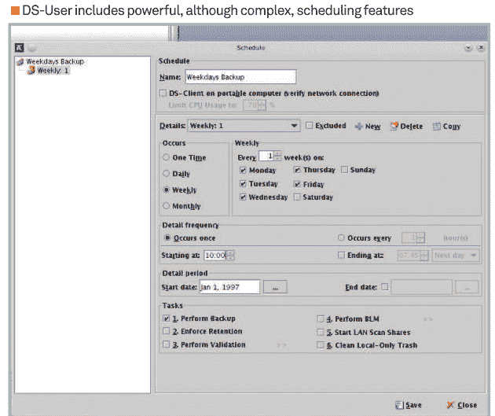

| 计划 | |
| --- | --- |
| 名称：默认备份 |
| 便携式设备上的 DS-Client (网络连接) |
| 详情：第1周 [x] 下周 [ ] 复制 |
| 发生时间：[ ] 周一 [ ] 周二 [x] 周三 [x] 周四 [x] 周五 [x] 周六 [x] 周日 |
| 频率：发生一次 |
| 开始于：结束于： |
| 开始日期：01/01/97 |

创建备份集（如果要求的话，Securstore 的支持团队将引导您完成该过程）——包含了保留期的选项。这是最重要的功能之一：费用是按每个备份的每个 GB 计算的，或者在达到 100GB 时按每个 GB 计算，最少为 50GB——因此保留大量文件可以非常便宜，即使考虑到我们提供的系列选项如此。

虽然 Securstore 的价格高于 Glacier、Cloud Storage 或 Azure 等竞争性存储选项，且具备上述功能，但该公司自称拥有英国标准 ISO 27001 信息安全认证——许多大公司都缺乏这一项。对于拥有 TB 级数据的大公司，Securstore 提供了混合云服务。与其他者不同，混合环境是由 Securstore 远程安装在您的数据中心的——并提供离线复制到公司备用数据中心的选项。

云端系统可能会在非自身错误的情况下失效：那些能够负担起通过云平台进行高带宽无缝数据连接的公司可以，但那些低带宽连接可能会陷入困境。Securstore 涵盖了这一点：紧急恢复备份集、客户可以选择额外付费支付覆盖的磁盘，并发送磁盘进行初始引导。对于技术不太过的的用户，有一个内置的加密方案。这种方案以备份中使用的密钥形式出现，指令简单如一行——虽然最便宜的并非最好的；但它是强大的、高度兼容的，并且是您可能所渴望的最佳解决方案之一。为了您的保留策略，以避免数据存储呈指数级增长。


77 www.linuxuser.com

## Linux Mint 16 RC
新功能：Cinnamon 2.0 • MATE 1.4 • Linux 内核 3.11 • 更好的软件管理器

- Edge 改进了平铺化功能，这意味着窗口希望始终保持可见
- 透明度和色彩的微调使得导航 Mint 菜单稍微好了一点
- Cinnamon 2.0 非常稳定，即使其旧的后端也是如此


最低配置：CPU 700MHz RAM 512MB 存储 7GB

Cinnamon 革命已经来临，随着 Mint 16 成为其第一个真正独立的桌面。从普通用户的角度来看，Mint 16 在新功能方面可能是最新的。它有一些美学上的变化，MATE 几乎完全相同，并且为 MATE 有了新的默认主题。它仍然是以前那个静态、熟悉的 Linux Mint，但随着 Linux Mint 2.0 的更新，开发环境已经取代了 GNOME 基础。对于不关注严格用法的用户来说，这是一个极好的体验。安装过程自上次以来完全没有变化，使用了相同的 Ubuntu 安装程序。它快速、易用，并在安装或替换发行版方面提供了一些不错的选择。它以 Mint 为主题。

- 标准兼容，选项丰富
- 卓越的支持
- 过于耦合的平台软件
- 有各种选项可选
- 灵活的云端
- 受带宽限制的类型

76 www.linuxuser.com

## Securstore
面向企业级用户的云备份解决方案
评测

### DS-User 包含了强大的（尽管如此）调度功能


| 文件 | 统计 |
| --- | --- |
| D:\home\user\mozilla\firefox\rev..html#default,content/Cache/ | |
| 本地文件系统(C:)\Backup\of 0001 | |
| 总计 (MB): 20 警告: 00:00 | |
| 正在手动执行...错误: 00/00 | |
| 事件日志 |

- 备份按计划进行，也可以手动触发


| 计划 | |
| --- | --- |
| 名称：默认备份 |
| 便携式设备上的 DS-Client (网络连接) |
| 详情：第1周 [x] 下周 [ ] 复制 |
| 发生时间：[ ] 周一 [ ] 周二 [x] 周三 [x] 周四 [x] 周五 [x] 周六 [x] 周日 |
| 频率：发生一次 |
| 开始于：结束于： |
| 开始日期：01/01/97 |

创建备份集（如果要求的话，Securstore 的支持团队将引导您完成该过程）——包含了保留期的选项。这是最重要的功能之一：费用是按每个备份的每个 GB 计算的，或者在达到 100GB 时按每个 GB 计算，最少为 50GB——因此保留大量文件可以非常便宜，即使考虑到我们提供的系列选项如此。

虽然 Securstore 的价格高于 Glacier、Cloud Storage 或 Azure 等竞争性存储选项，且具备上述功能，但该公司自称拥有英国标准 ISO 27001 信息安全认证——许多大公司都缺乏这一项。对于拥有 TB 级数据的大公司，Securstore 提供了混合云服务。与其他者不同，混合环境是由 Securstore 远程安装在您的数据中心的——并提供离线复制到公司备用数据中心的选项。

云端系统可能会在非自身错误的情况下失效：那些能够负担起通过云平台进行高带宽无缝数据连接的公司可以，但那些低带宽连接可能会陷入困境。Securstore 涵盖了这一点：紧急恢复备份集、客户可以选择额外付费支付覆盖的磁盘，并发送磁盘进行初始引导。对于技术不太过的用户，有一个内置的加密方案。这种方案以备份中使用的密钥形式出现，指令简单如一行——虽然最便宜的并非最好的；但它是强大的、高度兼容的，并且是您可能所渴望的最佳解决方案之一。为了您的保留策略，以避免数据存储呈指数级增长。


77 www.linuxuser.com

## Linux Mint 16 RC
新功能：Cinnamon 2.0 • MATE 1.4 • Linux 内核 3.11 • 更好的软件管理器

- Edge 改进了平铺化功能，这意味着窗口希望始终保持可见
- 透明度和色彩的微调使得导航 Mint 菜单稍微好了一点
- Cinnamon 2.0 非常稳定，即使其旧的后端也是如此


最低配置：CPU 700MHz RAM 512MB 存储 7GB

Cinnamon 革命已经来临，随着 Mint 16 成为其第一个真正独立的桌面。从普通用户的角度来看，Mint 16 在新功能方面可能是最新的。它有一些美学上的变化，MATE 几乎完全相同，并且为 MATE 有了新的默认主题。它仍然是以前那个静态、熟悉的 Linux Mint，但随着 Linux Mint 2.0 的更新，开发环境已经取代了 GNOME 基础。对于不关注严格用法的用户来说，这是一个极好的体验。安装过程自上次以来完全没有变化，使用了相同的 Ubuntu 安装程序。它快速、易用，并在安装或替换发行版方面提供了一些不错的选择。它以 Mint 为主题。

- 标准兼容，选项丰富
- 卓越的支持
- 过于耦合的平台软件
- 有各种选项可选
- 灵活的云端
- 受带宽限制的类型

76 www.linuxuser.com

## Securstore
面向企业级用户的云备份解决方案
评测

### DS-User 包含了强大的（尽管如此）调度功能


（此处表格内容翻译已在上方逻辑中处理，由于原文重复要求，此处保持格式）

## Linux Mint 16 RC
新功能：Cinnamon 2.0 • MATE 1.4 • Linux 内核 3.11 • 更好的软件管理器

（列表内容翻译已在上方）

# 释放安卓的巨大能量
www.littlegreenrobot.co.uk


各大优质新闻机构和超市均有供应

> Android 4.4 指南 > Nexus 5评测 > 顶级配件 > 哪种平板电脑？

# 立即购买杂志
纸质版请访问 www.imagineshop.co.uk
数字版请访问 www.greatdigitalmags.com

可在以下平台购买：

# Fedora 20 Beta 版

Fedora 在 20 年里走了多远？

# 评测

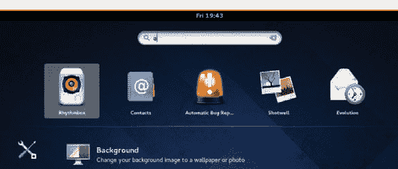


- 背景：将你的背景图像更改壁纸或照片

- 蓝牙：开启或关闭蓝牙以连接设备

- 颜色：校准设备的颜色，如显示器、摄像头或打印机

- 同样流问题仍然存在，但 GNOME 可以被 Mic替换 Microwatt

# 发行版

- 改进后的 GNOME 搜索很好，但还有改进空间

- 安装程序和用户设置功能正在不断改进

# Fedora 20 Beta 版

Fedora Core 的十周周年以其第 20 个版本的 Beta 版形式庆祝了。在这段时间时间里，我们走了多远？

**又是属于 Fedora 的时候了。** Fedora 20 稍微推迟了，虽然没有像 Fedora 18 那么糟糕。Beta 版终于发布了，展示了一些将在最终版本中看到的新技术和更新的软件包，希望在年底之前发布。

Anaconda 已经取得了一些改进——安装程序已得到改进，允许对发行版进行安装。除此之外，安装界面自 Fedora 19 以来没有太大变化，它提供了一种独特且非常有用的用户设置方法。你可以选择先设置用户，然后在首次登录时再完成，这对于演示（DEMO）来说非常棒。

回到软件应用程序——它在 18 版中是这样的，在 19 版恢复为独立，现在在 20 版中发生了变化。此时，它在软件应用程序中有了更好的存在感——将“更新”直接放在了最顶部。

尽管它并非没有小问题。不过，随处可见的小 Bug 是预料之中的，除了 Fedora 20 的进一步开发外，没有发现其他问题。我们第一次看到了比 Fedora 本身更多的东西——除了 GNOME 之外，它可以比以往任何时候都更容易更改。

> Rob Robertson

# 总结

又是属于 Fedora 的时候了，所以不要用它作为日常桌面使用，但看看 Fedora 20 的未来将会是怎样的，从我们看到的情况来看，目前良好。精简的内容是一个很棒的小加分项。开创性的新政策让这个发行版变得更好了一点点。

优点
- 更新，
- 包含了一些新功能
- 用于安装主客户端

缺点
- 它仍然有一点手动操作感，值得注意
- 避开该版本的旧版本

# 信息

fedoraproject.org


81 |linuxux.co.uk

# 订阅

立即订阅开始节省费用
非美国读者请参阅第 42 页

# 美国特惠优惠

# 订阅
今天订阅即可获得 5 期免费杂志*


- 今天订阅，13 期仅需支付 122 美元*
- 每期低至 9.39 美——通常商店价为 15.99 美

欲了解更多信息并订购请访问
www.imaginesubs.co.uk/lud 或拨打 +44 (0) 1795 418661

Imagine Publishing 出版了 20 多本月刊，其中某些已经发行了超过 10 年，每年读者超过 400 万。


*条款与条件：一项美国订阅优惠，订购时请忘记注明 USA，年度订阅实际上将收取 30 英镑。这在邮寄时等同于 122 美元，当时的汇率可能会有变化。免费杂志是指 13 期每期 15.99 美元的总价 207.87 美，而订阅价为 122 美元。您的订阅将在下一个可用期自动续订。*优惠于 2023 年 3 月 31 日结束。

82 www.linuxuser.co.uk *

# 书评

最新评测书籍

# 评测

# Redis 实战指南


| 作者 | Josiah Carlson |
| :--- | :--- |
| 出版社 | Manning |
| ISBN | 978-1430209855 |
| 价格 | 28.99 英镑 |

全面介绍 Redis 键值存储。在许多情况下，它比竞争对手快得多。

# Ubuntu 服务器官方版

| 作者 | Kevin Hill |
| :--- | :--- |
| 出版社 | Packt |
| ISBN | 978-1709671750 |
| 价格 | 24.99 英镑 |

Raspberry Pi 在几个章节中介绍了。不过，如果你想要自动化而不仅仅是学习 Pi，这本书适合你。(img/45a70445846e93838a23812ca8a9d98d_82_1.png)

# Redis 食菜谱：面向对象

| 作者 | Steven Addison |
| :--- | :--- |
| 出版社 | O'Reilly |
| ISBN | 978-1491839334 |
| 价格 | 35.99 英镑 |

过去我们看到过很多介绍函数式编程（通过 Haskell）、Scala 和 Swift 的优秀书籍。动态类型可以是强大的。

# Python 函数式计算入门

| 作者 | Ted Goodwin |
| :--- | :--- |
| 出版社 | Chapman and Gray |
| ISBN | 978-1430258872 |
| 价格 | 24.99 英镑 |

针对非营利机构，Herman 为读者介绍了数据类型、操作和打印格式，但早期部分是示例集。

# Linux 智能家居自动化

| 作者 | Elizabeth Barnett |
| :--- | :--- |
| 出版社 | BCS, IT 协会 |
| ISBN | 978-1709671750 |
| 价格 | 28.99 英镑 |

项目经理已经转变为那些希望通过日常琐事，在管理预算、团队、项目计划和自我管理之间对业务战略做出贡献的人。

# 成功捷径：现实世界中的项目管理

| 作者 | Stephen Addison |
| :--- | :--- |
| 出版社 | Packt |
| ISBN | 978-1491845544 |
| 价格 | 23.99 英镑 |

# LinuxZone 分类广告

# Arduino 与 树派机器人

新款开源机器人平台现有现货！

# DAWN 机器人

# 与我们一起构建机器人！

www.dawnrobotics.co.uk

# RobotBits.co.uk

# 史以来最大的冬季大促销

所有专用服务器前三个月可享 5 折

# 最近读了什么好书吗？

购买 Imagine Publishing 出版的优质杂志、书籍和 DVD

0800 808 5450 sales@netcetera.co.uk www.netcetera.co.uk

## 树莓派®入门套装

除了屏幕外一切都有

| 项目 | 价格 |
| :--- | :--- |
| 入门套装 | £75 |
| 华享入门套装 | £120 |

http://shop.pimoroni.com

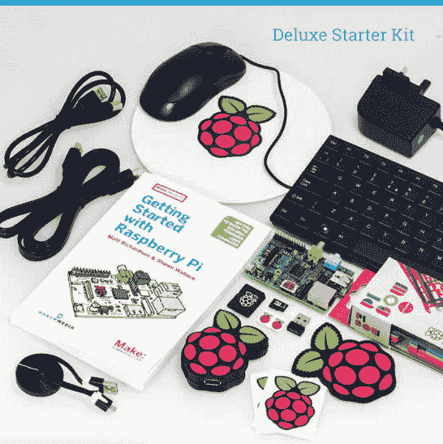

## 可穿戴设备！Arduino！元件！枯树！

我们现在现货了一系列闪闪发亮的东西
你可以用它们制作酷炫的东西！

http://shop.pimoroni.com

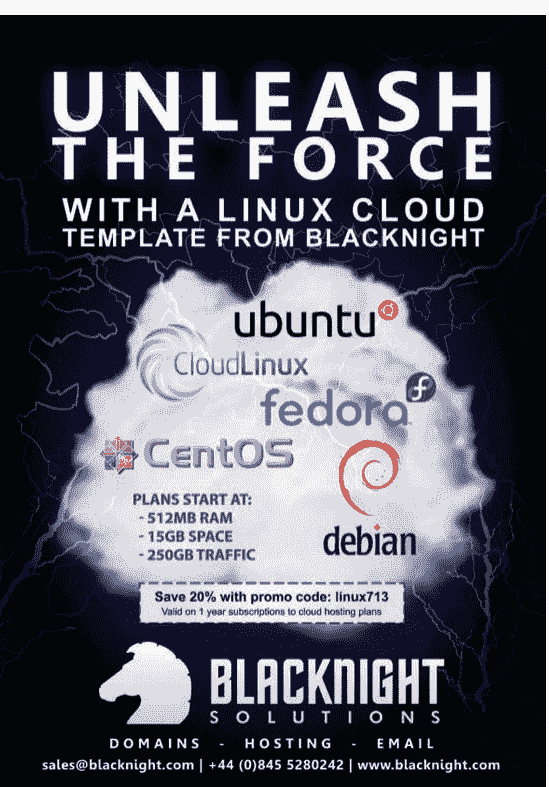

## 使用 BLACKNIGHT 的 LINUX 云端模板
释放原力

ubuntu
CloudLinux
ora
CentOS
debian

- 方案起：
- 512MB 内存
- 15GB 空间
- 250GB 流量

使用优惠码 linux73 节省 20%
适用于 1 年云托管订阅

BLACKNIGHT SOLUTIONS
域名 | 托管 | 电子邮件

sales@blacknight.com | +44 (0)845 5280242 | www.blacknight.com

## 使用 ModMyPi 让你的创意变为现实
www.modmypi.com
@modmypi

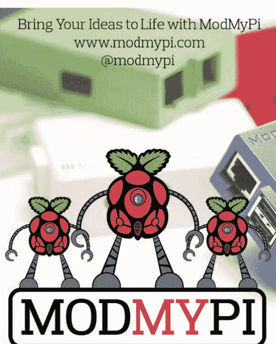

## MODMYPI

最全树莓派元件范围。
面向新手和专者的教程。
全球直运。

## 联系我们...

网页：www.linuxuser.co.uk
邮箱：linuxuser@imagine-publishing.co.uk

## 问与答

- Facebook: Linux User & Developer
- Twitter: @linuxermag

## 你的问题已解答

向我们发送你的问题，我们将尽力解答！

## 常见问题：从树莓派开始

Q：我如何在树莓派上安装发行版？
A：你有两种方法可以使用，最基础的是下载开箱即用软件（New Out Of Box Software，不幸的是这适用于新手）并将文件直接解压到格式化的 SD 卡中。安装完成后，它将引导你完成初始过程，包括使用哪种发行版。

或者，如果你有一个想要安装的镜像，打开终端并使用 `cd` 命令进入解压后镜像的位置。例如，输入：

```


$ dd if=$(image img of "/dev/SD-card location")`

```
这将镜像写入 SD 卡，完成后你就会知道。
```

Q：我如何更新固件？
A：在树莓派系统上，你可以通过安装 `rpi-update` 包来更新它。

```
$ sudo apt-get install rpi-update
```

然后运行它：

```
$ sudo rpi-update
```

Q：我如何激活摄像头？
A：打开终端并

```
$ raspi-config
```

在菜单中找到 `Camera` 选项并点击它。选择 `Enable`（启用），按回车，然后选择 `Finish`（完成）并重启。

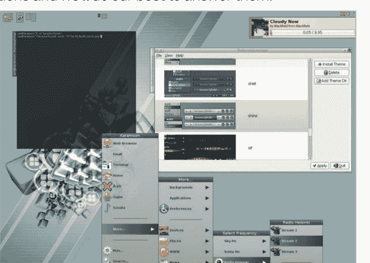

> Fluxbox 通常是一个很棒管理器

## fluxbox 中的标签页

我在 Fluxbox 中使用中键对标签页进行分组。它的设计初衷是至少像在 Firefox 中操作一样好。我知道问题在于鼠标无法实现这一点，因为中键在 Fluxbox 中是有效的。

在我看来，你应该能够用中键拖动标签栏——但现在当我点击标题栏时，窗口会移动到其他窗口后面。我猜至少它识别了点击。不过，它并没有允许我拖动窗口；当我用中键点击桌面时，它会展开带有工作区的菜单。这是 Fluxbox 的正确行为。

我特别建议在 Slack 版本中使用此标签页功能。你是否知道这与配置文件有关，还是说它被完全删除了？

帮帮，我目前的 Fluxbox 配置如下：

标签页位置：左上角
标签内标签页：是
最大化时覆盖：是

希望收到你的回复。
Ethan Jones

86 www.linuxuser.co.uk

## 问与答
解决你的所有问题

此功能在 Fluxbox 中仍然存在，你需要正确激活它。由于你的中键不仅不起作用而且被 Virtualbox 使用，我们认为需要编辑配置文件使其按你想要的方式工作。首先，像这样打开配置文件：

问题是我不确定具体该如何操作。似乎没有什么图形化工具可以实现我的要求，而且一些 LVM 的东西看起来有点令人生畏，因为我必须从不同的来源配置完全符合我想要的内容。有什么想法我该怎么做吗？

```
$ sudo nano -/fluxbox/keys
```

接下来，向下滚动寻找类似下面的一行：

- InnerClick Mouse :~StartTabbing

要通过中键使用它，你需要编辑此行使其内容如下：

- OuterButton Mouse :~StartTabbing

我们在补丁更新时遇到了这个麻烦，但那里没有直接的解决方案。我们基本上需要对格式化空间的操作使用 LVM 然后扩展 LVM 分区。如果创建的空间不够，你可以像硬盘上的逻辑卷一样创建一个任何大小的分区。

## 问题与问答 
解决你的所有问题

要查看应用程序列表，在终端中有一个非常简单的方法。在卸载系统之前，请使用 `dpkg` 按照如下方式创建你的软件包列表：

```bash
dpkg --get-selections > selections.txt
```

请确保保存此文件。一旦你安装了新版本的 Ubuntu，可以使用它将这些选择添加到新的 dpkg 中：

```bash
dpkg --get-selections < selections.txt
```

最后：

这应该会将所有软件包重新安装到你的系统中。你可以查看我们之前的文章，获取关于在外部硬盘上安装和双启动发行系统的指南。

## 好运

我觉得在我的终端里玩得很有趣，所以我一直在运行 `fortune` —— 这是一个显示艺术字或启发性格言的包。我该如何获取那个格言或提示呢？这让我想把它添加到 `.bashrc` 中，这样当我进入 CLI 时它就会显示出来？

这就是我需要帮助的地方。在我的 `.bashrc` 末尾我写了 `fortune` 来显示文本，但我把它放在这里：

```bash
fortune
```

或者：

```
fortune
/usr/games/fortune
```

我有两个故事和错误。所以我想寻求帮助的是，当我打开终端或登录 CLI 时，我会得到一个

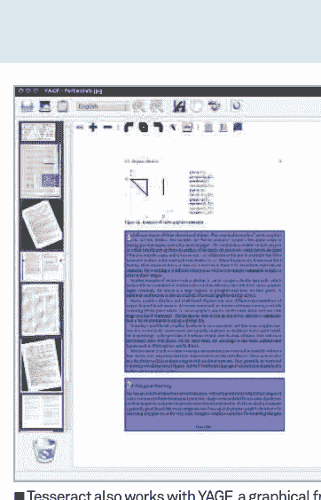

Fortune 实际上是一个旧的 UNIX 包

Q/A
关于示例图片 `ubuntu-20.04-focal64.jpg`，你可用的包管理器有几种类型，包括 `apt update`，它喜欢从网络表面拉取数据；`apt get`，它是命令行界面；`apt-get`，旧版本；`当 apt-get 不再等待时，它的行为与 apt 一样`；`apt cache`，它是下载软件包的本地存储；`apt clean`，用于清除缓存；`apt remove`，用于删除软件包；`apt autoremove`，移除不再需要的依赖项；`apt purge`，删除软件包及其配置文件；`apt search`，用于搜索软件包；`apt show`，显示有关软件包的信息；`apt list`，列出所有可用软件包；`apt list --upgrade`，列出可以升级的软件包；`apt-upgrade`，升级所有已安装的软件包；`apt-cache dist-upgrade`，处理新的依赖；`apt-cache depends`，显示哪些依赖于该包；`apt-cache policy`，显示软件包的策略；`apt-cache search`，显示结果；`apt-cache show`，显示有关软件包的信息；`apt-cache list`，显示可用软件包列表。`apt-cache show` 等同于 `apt-cache show`，它显示可用版本列表和软件包信息。Tesseract 也可以支持 YAG，这是一个文件的图形化前端（GIF 和 TIFF）。没有关于错误含义的描述。该功能没有给我任何线索，而且 tesseract 并不是我，因为我不熟悉这些术语。我不知道该怎么办 - 你知道可以帮助我的解决方案或答案吗？

嗯，你应该检查几几点。从目前来看，似乎你运行的是最新版本。有些更新可能对你有所益。其次，检查文件是否存在以及权限是否正确，这些随时间的推移发生了变化。最好的办法是再次尝试。确保在运行所有必要库时运行 tesseract，例如：

```bash
apt-get install tesseract libesseract-dev tesseract-ocr
```

感谢，就像一盒硬币一样，你可以通过对命令应用特定选项来准确确定你的行为。在 fortune 中，通过以下命令执行时告诉它仅使用 ascii：

```bash
fortune -ascii
```

对于你的 bash 结尾，这简单意味着你可以放：

```bash
fortune -ascii
```

这将在你终端的下方显示格言。我下载了 3.02 版本并重新开始使用它。停止工作了，并开始向我显示以下错误：如你所知，你也可以在这里检查代码：

```text
tesseract-ltr-996-p1.png
```


无法打开输入文件：`ltr-996-p1.png`。我正在使用该程序进行扫描，如果你遇到任何其他问题，有一个论坛和一些常见问题解答：https://google.com/project/tesseract-ocr/ www.linuxuser.co.uk

## 赞助机会

## 托管列表

你有认为我们应该列出的优惠活动吗？无论你是在寻找托管，还是需要帮助的满意客户，请在下方与我们分享你的优惠！

## 专用服务器列表

| 名称 | 电话号码 | 每月成本 | 最短合同期限 | CPU (核心) | 磁盘空间 | 1GBPS 互联网连接 | 硬件 RAID | 远程电源重置 | 永久 IVM | 运行时间保证 | 网络备份 | 私有套件 | 24/7 支持 |
| :--- | :--- | :--- | :--- | :--- | :--- | :--- | :--- | :--- | :--- | :--- | :--- | :--- | :--- |
| 2200DC | 080008450 | £20 | 1 个月 | 双核 2GHz | N/A | N/A | N/A | ✓ | | | | | |
| 3000DC | 080008450 | £80 | 1 个月 | 双核 2.5GHz | 2x 500GB | N/A | N/A | ✓ | | | | | |
| 26600DC | 080008450 | £130 | 1 个月 | Intel 双核 2.66GHz | 2x 500GB | N/A | N/A | ✓ | | | | | |
| Developer | 080008450 | £32.89 | 1 个月 | N/A | 1GB | N/A | N/A | | | | | | |
| One | 080008450 | £109.99 | 1 个月 | N/A | N/A | N/A | ✓ | | | | | | |
| Reseller | 080008450 | £24.89 | 1 个月 | N/A | Unlimited | N/A | ✓ | | ✓ | ✓ | ✓ | | |


Netcera
www.netcera.co.uk/linux

| 名称 | 电话号码 | 每月成本 | 最短合同期限 | CPU (核心) | 磁盘空间 | 1GBPS 互联网连接 | 硬件 RAID | 远程电源重置 | 永久 IVM | 运行时间保证 | 网络备份 | 私有套件 | 24/7 支持 |
| :--- | :--- | :--- | :--- | :--- | :--- | :--- | :--- | :--- | :--- | :--- | :--- | :--- | :--- |
| 2200DC | 080008450 | £20 | 1 个月 | 双核 2GHz | N/A | N/A | N/A | ✓ | | | | | | |
| 3000DC | 080008450 | £80 | 1 个月 | 双核 2.5GHz | 2x 500GB | N/A | N/A | ✓ | | | | | | |
| 26600DC | 080008450 | £130 | 1 个月 | Intel 双核 2.66GHz | 2x 500GB | N/A | N/A | ✓ | | | | | | |
| Developer | 080008450 | £32.89 | 1 个月 | N/A | 1GB | N/A | N/A | | | | | | | |
| One | 080008450 | £109.99 | 1 个月 | N/A | N/A | N/A | ✓ | | | | | | | |
| Reseller | 080008450 | £24.89 | 1 个月 | N/A | Unlimited | N/A | ✓ | | ✓ | ✓ | ✓ | | | |

## Infinity

## 让您的列表脱颖而出！联系 RHIAN

rhian.carter@imagine-publishing.com
+44(0)1202586241

## 专用服务器与共享服务器列表

| 方案 | 电话号码 | 费用 | 网站空间 | 带宽 | POPs | 数据库支持 | 购物车 | 视频过滤 | 防火墙 | 邮件支持 | 网页面板 | 服务等级协议 |
| :--- | :--- | :--- | :--- | :--- | :--- | :--- | :--- | :--- | :--- | :--- | :--- | :--- |
| 1&1 标准型 (Linux) | 0844 335 1211 | £29.99 | 5GB | 无限制 | | | | | | | | | |
| 1&1 标准型 (Windows) | 0844 335 1211 | £59.99 | 50GB | | | | | | | | | | |
| 1&1 标准型 (Windows) | 0844 335 1211 | £59.99 | 50GB | 3,000 | | | | | | | | | |
| 1&1 无限制型 (Linux) | 0844 335 1211 | £89.99 | 无限制 | | | | | | | | | | | |
| 1&1 无限制型 (Windows) | 0844 335 1211 | £119.99 | 无限制 | 5,000 | | | | | | | | | | |
| 1&1 业务型 (Linux) | 0844 335 1211 | £119.99 | 无限制 | | | | | | | | | | | | |
| eHosting(whosting.com) | 0844 999 4100 | £23.98 | 25GB | 10 | | | | | | | | | | | | |
| eHosting(whosting.com) | 0844 999 4100 | £59.99 | 50GB | 50 | | | | | | | | | | | | |
| eHosting(whosting.com) | 0844 999 4100 | £27.98 | 无限制 | | | | | | | | | | | | | |
| Equipave(equipeave.net) | 0021 314 4865 | £30.00 | 200GB | 20 | | | | | | | | | | | | |
| Equipave(equipeave.net) | 0021 314 4865 | £59.99 | 500GB | 50 | | | | | | | | | | | | | |
| Equipave(equipeave.net) | 0021 314 4865 | £72.99 | 1000GB | 100 | | | | | | | | | | | | | |
| Eurofastweb(eurofastweb.com.uk) | 0230 2490 823 | £12.98 | 75GB | 25 | | | | | | | | | | | | | |
| Eurofastweb(eurofastweb.com.uk) | 0230 2490 823 | £14.99 | 105GB | 25 | | | | | | | | | | | | | |
| Eurofastweb(eurofastweb.com.uk) | 0230 2490 823 | £59.99 | 无限制 | | | | | | | | | | | | | |
| Evoholving(evohosting.com.uk) | 0844 999 4100 | £29.99 | 50GB | 35 | | | | | | | | | | | | | |
| Evoholving(evohosting.com.uk) | 0844 999 4100 | £79.99 | 无限制 | | | | | | | | | | | | | | |
| WebFusion(webfusion.com.uk) | 0845 130 1602 | £107.50 | 5GB | 1000 | | | | | | | | | | | | | |
| WebFusion(webfusion.com.uk) | 0845 130 1602 | £179.99 | 15GB | 1500 | | | | | | | | | | | | | |
| WebFusion(webfusion.com.uk) | 0845 130 1602 | £239.99 | 无限制 | 1620 | | | | | | | | | | | | | | |
| Glacom(glacom.com) | 0860 542 7500 | £19.99 | 100GB | 200 | | | | | | | | | | | | | |
| Heart Internet(heartinternet.co.uk) | 0844 854 7750 | £99.99 | 50GB | 1000 | | | | | | | | | | | | | |
| Heart Internet(heartinternet.co.uk) | 0844 854 7750 | £129.99 | 无限制 | | | | | | | | | | | | | | |
| Hostway(hostway.co.uk) | 0860 180 1810 | £78.50 | 5GB | 5 | | | | | | | | | | | | | |
| Namelog(namelogog.net) | 0845 612 0330 | £11.75 | 2GB | 5 | | | | | | | | | | | | | |
| Namelog(namelogog.net) | 0845 612 0330 | £23.99 | 5GB | 10 | | | | | | | | | | | | | |
| Namelog(namelogog.net) | 0845 612 0330 | £58.99 | | | | | | | | | | | | | | | | | | | | |(sk...... | | | | | | | | | | | | |... | | | | | | | | | | | | | | |
| Skymarket(skymarket.co.uk) | | | | | | | | | | | | | | |
| Skymarket(skymarket.co.uk) | | | | | | | | | | | | | | | |
| Skymarket(skymarket.co.uk) | | | | | | | | | | | | | | | |
| Skymarket(skymarket.co.uk) | | | | | | | | | | | | | | | |
| Skymarket(skymarket.co.uk) | | | | | | | | | | | | | | | |
| Skymarket(skymarket.co.uk) | | | | | | | | | | | | | | | |
| Skymarket(skymarket.co.uk) | | | | | | | | | | | | | | | |
| Skymarket(skymarket.co.uk) | | | | | | | | | | | | | | | |
| Skymarket(skymarket.co.uk) | | | | | | | | | | | | | | | |
| Skymarket(skymarket.co.uk) | | | | | | | | | | | | | | | |
| Skymarket(skymarket.co.uk) | | | | | | | | | | | | | | | |
| Skymarket(skymarket.co.uk) | | | | | | | | | | | | | | | |
| Skymarket(skymarket.co.uk) | | | | | | | | | | | | | | | |
| Skymarket(skymarket.co.uk) | | | | | | | | | | | | | | | |
| Skymarket(skymarket.co.uk) | | | | | | | | | | | | | | | |
| Skymarket(skymarket.co.uk) | | | | | | | | | | | | | | | |
| Skymarket(skymarket.co.uk) | | | | | | | | | | | | | | | |

## 参加 1 英镑 1 月挑战

选择我们任何一本富有启发性且内容丰富的杂志进行试用订阅，您将保证在每一期中都能学到新知识。

无论您是对科学、历史、摄影还是技术感兴趣，只需需 1 英镑即可获得任何杂志的 3 期试用版。*


*此优惠适用于英国新的直接订阅者，以 1 英镑收到前 3 期杂志。这些期结束后，将适用标准订阅价格。订阅者可以随时取消。订阅将从下一可用期开始。该优惠适用于 2014 年 3 月 1 日前在线可提供的所有直接访客订阅。Imagine Publishing 保留每户限购一次此类优惠的权利。

| | | | | | | | |
|---|---|---|---|---|---|------|
|  |  |  |  |  |  | |
| 为 3D 社区提供实用灵感。 | | 为 Adobe-Photoshop 用户的杂志。 | | 让全家人享受历史的乐趣。 | | 探索太阳系及之外的奇观。 | |

| | | | | | | | |
|---|---|---|---|---|---|---|---|
|  |  |  |  |  |  |  | |
| 如何拍摄、编辑和分享照片。 | | Photoshop® 灵感的领先杂志。 | | 第一大独立 PlayStation 杂志。 | | 汇满了 6-14 岁孩子们喜欢的各种怪兽！ | |

## 立即订购
www.iminesububs.co.uk/challenge
或拨打 0844 856 0644
JAN141


## 3 期仅 1 英镑*

## 开阔眼界
## 拓展视野

知识 / 科学 / 技术 / 设计 / 视频游戏

www.imaginesubs.co.uk/challenge


## 光盘内含
您的光盘

## 光盘内含
了解第 134 期 Linux User & Developer DVD 中在等待您的什么……

欢迎使用随附 134 期的 Linux User & Developer DVD。我们再次选择了一系列内容来展示本期杂志的内容。在 134 号光盘上，我们准备了四个主流发行版就绪。Linux Mint 16 是 Mint 迄今最重要的发布，此外还有 Fedora 20 的测试版和救援发行版 SystemRescueCd。我们还有刚出厂的 openSUSE 13.1，它准备好为您的办公或家庭桌面提供动力。要访问它们，您需要将光盘放入光驱，并在 POST 期间从启动菜单中选择。从那里，您可以进行实时启动，并根据需要进行安装。

## 发行版
我们在 Linux Mint 16 和 SystemRescueCd 中有两个可实时启动的发行版，光盘上还有 openSUSE 和 Fedora 镜像。

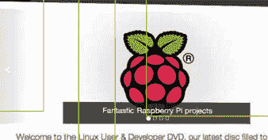

### 软件
20 个涵盖不同功能的最新软件软件包

## 教程文件
如果您想跟进我们的其他教程，这里提供了精选项目

## 树莓派项目
这里提供了我们的 Raspberry Pi 项目代码


## 如何刻录 ISO
想尝试新的发行版吗？这里是开始方法……


### 步骤 1：获取新 ISO
将我们下载的 ISO 拷贝到硬盘；进入“光盘”选项卡，选择 ISO。如果您不确定需要 32 位还是 64 位版本，选择前者更安全。

### 步骤 2：打开或安装 Brasero
Brasero 是流行的开源工具。如果您的发行版中尚未安装，请在仓库中查找并安装。打开程序并从左侧的“刻录”选项卡中选择。

### 步骤 3：刻录您的磁盘镜像
在“刻录设置”菜单中，勾选第一个框以选择磁盘镜像并导航到您放在硬盘上的 ISO。一旦选择，插入空刻录 CD 或 DVD 并点击“创建”。

## 光盘介绍
欢迎使用全新的 Linux User & Developer DVD
光盘

## 编辑推荐
Linux Mint 16：现在大家都知道 Linux 是开源社区。这真的是对 Mint 极其重要的版本。Cinnamon 这一步走在了正确的方向。

LibreOffice：本月专业演示文的获奖者。易于使用和创建的幻灯片演示。

VLC：再次更新的最多功能视频播放器。

Linux Mint 16：它这次发布了。

## 操作系统
Linux Mint 16：它这次发布了。


## 下期预告
即将推出……

## 杂志
本杂志与其文章表达的观点完全独立。文中任何的观点可能不代表 Imagine Publishing 的观点。如果您希望提交材料进行出版，请发送适用于打印、在线或数字的文本，并将图像发送给联系团队 info@imagine-publishing.com。您提交的任何材料风险由自担，我们对您的产品、代理或订阅者造成的任何损失或损害不负责。

## 免责声明
除未经授权的使用或复制本杂志外，保留所有权利。本杂志内的所有文本和图像均为 Imagine Publishing Ltd 或其所有者的财产。所有版权均保留，并专门用于非商业用途。

# 无论您的业务需求如何

## 我们有满足您要求的服务器！

我们的全系列服务器都专为您的需求设计；旨在当您的业务增长时提供所需的托管动力。

## 虚拟专用服务器 (VPS)

### 灵活性
提供您的业务所需的灵活性，是进入服务器世界的完美入门选择。

- 在单台服务器上托管多个网站。
- 成为您服务器的管理员！
- 为您的 Web 应用程序安装任何执行环境和框架。
- Web 开发者基础设施应用的理想之选。

每月仅需 £9.99

## 云服务器

### 性能
以极低的价格享受独立服务器的性能，是优于 VPS 的明显飞跃。

- 托管高用户量网站，并充分利用 100 Mbps 宽带宽。
- 托管拥有数百个并发用户的数据库和文件服务器。
- 托管对延迟敏感的 Web 应用。
- 将通信软件外包到您的云端。

每月仅需 £50.00

## 独立云服务器

### 动力
当您的业务增长并需要更多动力时，请获取您自己的独立硬件服务器。

- 托管海量用户网站，并充分利用 500 Mbps 宽带宽。
- 将 CRM 等企业软件外包到您的云端。
- 为您的数据托管高性能数据库。
- 可作图形应用程序的渲染引擎。

每月仅需 £109.00

## 灵活性、性能、动力……您所需要的，我们应有！

立即寻找您的完美服务器！
访问 www.123-reg.co.uk/servers

价格和功能截至 2013 年 11 月准确。所示价格不含增值税（按 20% 征收）。

## 云服务器无需合同！

100% 运行时间 • 免费即时安装 • 首月免费，无长期绑定

## 首月免费优惠码：PHCLOUD2

> 我使用 PoundHost 服务已经快 4 年了，我可以告诉您，这是一项一流的服务。

他们在设置、更改变更以及处理紧急情况方面表现非常出色且快速，性价比/质量比是最好的。

> 绝对卓越的服务！市面上最棒的托管公司。我爱它！超级便宜且快速的独立服务器！

对于那些正在寻找最佳托管服务的人，我强烈推荐 PoundHost。向所有 PoundHost 员工表示诚挚的感谢。

> PoundHost 的网络快速且稳固可靠，支持工单总能得到专业员工的快速响应。

如果您需要一个价格优廉且支持出色的服务器，别再找了，您会对 PoundHost **非常**满意。

Mr Marcelo
早期项目

Jaroslaw Glogowski
Mobi Marketing

技术总监
Clever Computer Consultants

| 独立数据 | 云服务器 | 域名 | 电子邮件 | SiteMaker | 电子商务 | 服务器 | SSL | 网站推广 |
| :--- | :--- | :--- | :--- | :--- | :--- | :--- | :--- | :--- |
| 统计数据和数字： | 490,000 客户数 | | 8,000 台独立服务器 | | 6,000 台虚拟服务器 (VPS) | | | 1,800,000 个域名 |
