# Linux 用户与开发者 135 - 在任何设备上双启动 Linux 135

在任何设备上运行 Linux

✅ Windows PC ☑ 树莓派 ☑ Mac ☑ 安卓

使用 Qt 实现响应式界面

学习编写适用于任何屏幕格式的代码

需要修复地球另一端的 Linux PC 吗？没问题...

使用 ownCloud 构建安全且私有的云


全新的 16 页迷你指南

制作一台树莓派控制的小车

使用加速度计

制作一个音乐播放器

内含还有：

>> BBC 会学会编程吗？

>> 使用 iptshark 监控你的网络

>> 6.5 级与 Mag 评级

Duino 测试：最新的树莓派扩展板

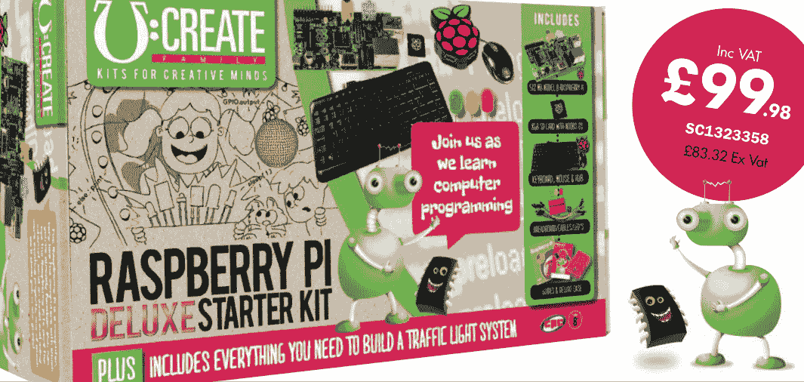

加入我们一起学习计算机

另包含构建交通灯系统所需的所有物品

包含：树莓派：512MB 型 B，配有带 8GB SD 卡的操作系统。PIHUB：4 口 USB 集线器，带 3A 电源器。键盘与鼠标：紧凑型 USB 键盘和光学鼠标。外壳：豪华版树莓派外壳。连接线：HDMI (2)、mini USB 以及 USB A 转 B 数据线。交通灯项目：100 根跳线线、4 个电阻、按钮、绿色和黄色 LED 灯、接线图和面包板。用户指南：U-create 网站和上光项目指南。由 Mike McGrath 编写的《树莓派入门步骤》。绘图袋与树莓派贴纸。

| B 型 - 512MB 配 8GB SD 卡 | 树莓派摄像头模块 | 树莓派摄像头模块 |
|---|---|---|
| £32.99 (SC131305) | £19.24 不含税 (SC132235) | £19.24 不含税 (SC130235) |

访问 raspberrypi.com 了解更多信息

全系列项目配件

- 外壳
- 扩展板、转接板和原型板
- 丰富的组件种类
- WiFi 网卡与 HDMI 转 VGA 适配器
- 视频和音频线
- 键盘、鼠标和显示器
- GPIO 排线
- 编程与用户指南


阅读 Linux User & Developer 第 135 期

Rob Zetswat 在大学学习软件工程，并在课堂上使用 Python 仿真。本期我们的特约撰稿人介绍了双系统（主系统）以及他如何仅用树莓派构建了一个 3D 扫描仪。

Tam Hanna 自 1988 年起一直从事 IT 行业。作为记者、导师、作者和演讲者，他见证了移动市场的方方面面。本月 Tam 将继续介绍响应式设计。

Millis Tokalos 是一位拥有编程、数据库和数学经验的系统管理员。自从 Linux User & Developer 为我们介绍网络以来，他一直在使用 Linux。他有一些解决问题的小技巧——请见第 44 页。

Michael Reed 是一位技术作家，他接触 Linux 已超过 15 年。他专精 Linux 开发和安全。在本期中，Michael 将教你如何设置 Linux 系统，即使你有一台位于地球另一端的 PC 作为备份。在第 38 页开始你的设置。

欢迎阅读 Linux User & Developer 最新版，这是英国和非洲最喜爱的 Linux 源及杂志。

这一切都发生在 2014 年，得益于树莓派的成功、Android 的持续统治，以及 Valve 将 Linux 引入 Steam 的惊人决定。Steam 作为 PC 端主导的数字游戏平台，拥有高达 6900 万活跃用户，Valve 还指出了运行 Linux 的 Steam Machine 客厅电脑。有超过五位不精通 Linux 的人想要接触 Linux 的一切，而学习如何与他们当前的操作系统进行双系统安装是一个极佳的起点。

双系统安装并不像以前那么困难了，你会惊讶于自己从当前平台启动并运行的速度有多快。在本期杂志中，我们力求无不遗漏——我们还展示了你如何在你的安卓设备甚至你的树莓派上安装双系统——从第 23 页开始。

每个月我们都会带来 16 页的最新小配件介绍以及来自全球树莓派社区的采访。如果你希望你的项目能在杂志上介绍，或者想获取特定主题的教程，请通过下方详情与我们联系。

Russell Barnes，编辑

Jonas Colum 是一位内核黑客，从事 Linux 已 18 年，从他 13 岁上大学开始。Jon 在剑桥加入我们，并在一家大型独立 Linux 供应商工作。你可以在第 20-21 页的内核专栏找到他。

## 与团队联系：linuxuser@imagine-publisher.co

Facebook: Linux User & Developer

Twitter: @linuxuser

访问我们获取更多观点、教程：linuxuser.com

www.linuxuser.com

与朋友保持联系的最佳方式是什么？

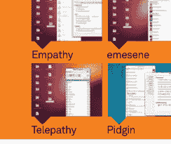

+ 24 个在任何设备上安装双系统

- 24/7 技术支持 • ISO 27001 • 免费迁移

- 托管服务 • 云托管服务 • 独立服务器

## www.cwcs.com

- T: 0115 740 1234
- E: info@cwcs.co.uk
- W: www.cwcs.com

Linux 社区最新动态

开源


- David Braben 认为树莓派（Raspberry Pi）领域的任何进展都是好事。

| 为什么 BBC 不想分得树莓派的一羹？ |
|--- |
| Linux 用户：与树莓派的创造者 Eben Upton 和 David Braben 交流。 |
| Linux 用户：David，你曾在 80 年代为 BBC Micro 创建了 Elite 系统。你对 BBC 现在的计划怎么看？ |
| David Braben：任何在这个领域内活动的人都是好事。 |
| 但 BBC 禁用树莓派这是怎么回事呢？BBC 在过去多年里一直支持树莓派，但讨论并没有取得太大进展。这并不是因为他们讨厌它。 |
| Eben Upton：在到 2011 年 5 月的两年里，我们多次接触 BBC，想法是希望允许我们使用 BBC 品牌，实际上让树莓派变成一台新的 Micro。所以，我们是因为 BBC 有这项计划才想要树莓派的吗？据我理解，BBC 能够在工业界声明并创造计算机，但这个产品对我们来说非常沮丧，你完全可以看到。我建议这项新计划是风险中立的，这是一件好事。 |

Eben Upton 认为 BBC 还有开展一项更广泛的倡议的空间。

Eben Upton

对于那些记得计算机早期阶段的人来说，那时的理念应该是应该教孩子们编写代码。BBC 为系列计算机命名，其中最著名的是 BBC Micro。

这是一次成功，它将计算机引入了英国各地的学校。它成功地帮助了许多有天赋的孩子进入了创意和计算的世界——但后来出现了一些问题。

“我发起了一个学生计算协会，想法是我们希望摆脱仅仅是使用技术，转而掌握创造主权。”这个项目遭到了 BBC 的热烈。

随后，这获得了一份由行业赞助的 Nesta 报告。还有 Livingstone-Hope 报告，该报告认为英国未能达到 BBC Micro 的传承。

Tony Hall 计划在明年明年推行的倡议中，将编码引入英国的每个家庭和学校。他说：“我们希望激励新一代在编码、编程和数字技术方面发挥创意。”

剩下的就是确切制定我们想要扮演的角色。这些计划仍在定稿中；只有 BBC 清楚。

我认为 BBC 有空间开展一项涵盖性的倡议，该倡议将在树莓派上运行，并足够强大，足以认为在树莓派上产生的内容（不限于教育应用或编程环境）表明他们具有巨大的潜力，这将引发“用户”圈之外（具有天赋天赋的孩子，或父母/老师具有工程背景的孩子）的编码热潮。

www.linuxuxer.co.uk

www.linuxuxer.co.uk 直接向我们发送邮件……获取最新新闻和观点 linuxuxer@imagine-publishing.co.uk


> BBC 凭借其几乎是 BASIC 的语言，给了我们创造的机会。

Gordon Sinclair 说，现在是 BBC 再次介入的时机，“当鼓励更多人参与技术创意基础的运动已经很远时，且 BBC 通过扮演角色给予了帮助时。”

然而，但他不太确定是否能像当年 BBC 那样在世界上产生变革性的影响，这种方式已经不同了，他说。“当我们开始时，当持续的状态和日子仍在变化时，产生巨大影响的可能性大得多——它们不是在变革，而是在进化。”他意识到它无法产生同样的变革性影响。

将更广泛的公众提升到这种水平（Reith 爵建立 BBC 时，用三个词总结了其宗旨：教育、信息、娱乐）。

它希望有一个松散的策略，希望在未来几个月内与政府、教师和技术公司合作。。但负责具体工作的人是 Stephen Upton，他是曼彻斯特大学的计算教授，在该领域非常出色——我们去过那里。

剩下的就是确切制定我们想要扮演的角色。这些计划仍在定稿中；只有 BBC 清楚。

Eben Upton

Linux 社区最新动态

开源


Linux 社区最新动态


> BBC 凭借其几乎是 BASIC 的语言，给了我们创造的机会。

Gordon Sinclair 说，现在是 BBC 再次介入的时机，“当鼓励更多人参与技术创意基础的运动已经很远时，且 BBC 通过扮演角色给予了帮助时。”

Linux 社区最新动态

> BBC 凭借其几乎是 BASIC 的语言，给了我们创造的机会。

Gordon Sinclair 说，现在是 BBC 再次介入的时机，“当鼓励更多人参与技术创意基础的运动已经很远时，且 BBC 通过扮演角色给予了帮助时。”

Eben Upton

您的 Linux 新闻与见解来源

www.linuxuser.co.uk 直接发送电子邮件...

获取最新新闻和见解请发送邮件至 linuxuxer@imagine-publishing.co.uk

……让教师学习并为学生提供教育工具。他认为认为 Linux 会让他们宾如归归。使用 Linux 将有助于孩子们摆离对 Windows 或操作系统环境那种习成常的熟悉，并帮助他们进行更多的质疑、探究和调查。

因此，从这些早期阶段仍有可以的教训。其中一个问题是没有简单的方法来编写 BASIC 程序，而且直到最近，让学生输入程序并没有被实际使用。“得益于那些追赶热点的软件公司，我们有了一种适合家庭的编程学习方法，而且很多学校并不习惯于运行程序。”

这在某种程度上是这样。在教师应对信息与技术（ICT）的培训方面还需要进一步的共识。在许多学校中，这不仅是因为首先水平很低，其次是因为缺乏人员配置。通常情况下，可以由学生来教 ICT，因为他们发现自己做这很难。如果你打算引入一些真正的编程并深入研究操作系统，那么需要在教学团队中拥有具有合理计算机背景的人，而大多数学校并没有这种背景。

据说 BBC 将希望改变现状，但正如 BBC 技术特记者 Rory Kelly-Jones 所指出的，“许多教师认为他们缺乏教学编码所需的技能和材料。” MyKindCrowds 董事总经理 Neil Keerman 的一项调查发现，68% 的人……

与其与计算公司合作并在另一台机器上贴上标牌，进一步认为 BBC 在帮助……方面会做得更好。

- 引入 BBC Micro 是解决学校计算资源匮乏的答案吗？

Linux 社区最新

Furber 认为 Linux 将有助于引导孩子们进行更多的调查、质疑和探究。

Furber 的很多学生使用的是软件黑盒，你某种程度上得生活在一个封闭的盒子里。Linux 有许多方法让人们构建复杂的软件并直接引导他们。

但是，我们问，难道不会找到一或两台运行 Windows 的机器吗？而 Linux 是现今大多数学术工作的标准平台，这是因为它更……？

由于许多正在进行的学术开发要求：“如果你想在 Windows 上进行软件开发，你将处于开发中——软件开发是在它的系统里的，而 Linux 将此延续了下去——人们构建复杂软件的方式将引导他们走向一条其他地方没有的路？

“但 Linux 不会吓到老师吗？”“噢不会，”他说，“当然树莓派（Raspberry Pi）正在做。我认为任何涉及操作系统的内容都会让老师感到恐惧，但拥有背景和经验来应对此事的教师非常有限。”

> 我认为涉及操作系统的内容会让老师感到恐惧……而拥有背景来应对的教师数量非常有限

讨论已经过，但最终都一无而终——该机构对孩子们使用什么并不那么重要，而 BBC 则陷入了他们失去焦点的事情中。更多的是他们正在询问什么能让孩子们成为 Linux 的粉丝，而不是让他们在当今世界成长为冷淡的处境。这样的人未来将成为应该被淘汰的例外。对树莓派的兴趣表明，该国年轻人对深度学习有着渴望。

“Linux 是人类创造过的最伟大的东西，我们不断听听到这种热情和所有活动，”Furber 说，“他们鼓励并……而且。树莓派并非独一无二，但它很棒。BBC 可能会与此保持一些距离，但有一种真实变革即将到来的感觉。”

您的 Linux 新闻与见解来源

www.linuxuser.co.uk 直接发送电子邮件...

linuxuser@imagine-publishing.com

获取最新新闻和见解

SteamOS GNU/Linux ‘炼金术士’现已可用

游戏巨头 Valve 在今晚的消费电子展会（CES 2014）上正式揭晓了备受期待的首台 Steam Machine，其特点是为客厅设计的游戏电脑，并基于 Linux 发行版。

纽能（Newell）近年来一直支持 Linux 世界，这是由于他感知到来自微软日益增加的压力，他认为微软是一个更加封闭的平台，给像 Valve 这样的公司留下的空间很小。“我认为这对 PC 领域的每个人来说都是一种灾难，”纽能的观点似乎没有改变。此前被指责在将 Steam 客户端引入 Windows 系统时忽略了 Linux 平台，Valve 在 2013 年 2 月发布 Linux 版 Steam 纠正了疏忽，并与 Canonical 建立了大量合作以定制其 Ubuntu 操作系统。

现在，劳动成果正显而易见。第一批官方 Steam Machine 主机已经发给了闭门测试的测试人员，而 SteamOS 本身已发布供公众下载并在现有硬件上进行测试——并带来了带来了更多关于……的更有趣细节。虽然 Valve 之前暗示安装 Ubuntu 将是 Linux 版 Steam，但最后时刻转变的原因尚不清楚，Valve 和 Canonical 对此事均保持了沉默。发布的 SteamOS 1.0 镜像并非功能完整，专门用于 2013 年 12 月中旬的年度测试。结果，早期采用者会发现 Nvidia 处理器的二进制大包驱动程序（binary-blob drivers），但没有其他制造商的部件。对于那些想要尝试一下的人来说，Valve 要求系统至少有 500GB 的硬盘和 4GB 的内存。

您的 Linux 新闻与观点来源

www.linuxuser.co.uk 直接向我们发邮件...

获取最新新闻和观点，请邮件至 linuxuser@imagine-publishing.co.uk

# 变革

## 工作和社会事务部采用开源，批评人士发表评论

### 通用信贷得到增强，但批评人士发表评论

工作和社会事务部（DWP）的通用福利改革计划已正式转向使用开源软件，但批评人士质疑，为什么在近五年前项目启动时没有这样做。

由于计划于 2017 年推出，数字化的通用信贷（Universal Credit）系统基于开源软件。部门负责人 Sheeple 表示：“目前的通用信贷系统是基于瀑布模型进行开发的，”她告诉国会议员，“当我们考虑其[替代方案]时，它非常不同；它更多地依赖于使用开源软件在（网络）环境中存储和访问数据。它更灵活、更易构建；我们不需要支付高昂的许可费用。”

降低成本并提高透明度和互操作性，在这一耗资 22 亿英镑的项目之初（即两年半）并未被选中。“技术发展非常迅速，因此当时还没有像现在这样的可用技术。”

在开源软件上构建通用信贷系统的决定为该计划节省了政府资金，政府已立即决定在系统推出时减免 4000 万英镑支出，据称目前拥有 1.52 亿英镑的资产。

Sheeple 对此表示满意，这些技术经常被政府采用以...


- 在 www.techcity.co.uk 了解更多科技城信息

伦敦的科技城（Tech City）计划已加入政府“卓越人才计划”（Exceptional Talent programme）下符合资助资格的机构名单，与英国学院和皇家工程学院并列。

卓越资助允许合作伙伴对外国公民进行担保，使其拥有英国积分制移民计划下申请工作签证所需的特定技能。

目前尚未说明将发放多少此类签证，预计大约在 100 个左右。


> DWP 将为新的通用信贷系统使用开源软件

科技行业的一些大名字已加入并要求对全球进行监控以改变现状，在 NSA 承包商爱德华·斯诺登提出要求后，他们面临着严厉的批评。

对用户数据的需求；对信息自由流动的尊重是互联网的核心；以及创建一个防止跨管辖区和政府间冲突的框架。

Google、LinkedIn、Twitter 和 Yahoo 刚刚发表了声明，内容如下：“签署公司相信，是时候让各国建立明确的实践来监管对个人及其信息的监控了。”


“用户的数据安全至关重要，我们为了改进隐私并为请求要求的透明度而进行斗争，”该“联盟”的 Larry Page 声称，“这是由于全球许多政府在没有独立监督的情况下秘密收集数据而导致的。现在是进行改革的时候了，我们需要政府带头。”


该联盟拥有五个核心原则，将推动政府收集互联网用户信息的权限限制；对请求或收集信息的机构进行监督和问责；在透明度方面...

随着世界各地的科技公司（尤其是上述公司）面临日益严格的审查，并被指控与政府机构合作非法收集数据，该联盟应运而生。

- Google 的 Larry Page 坚持认为，面对斯诺登泄密事件，需要进行改革

14 www.linuxuser.co.uk

### Linux 社区最新

# 在线

代码在网站上线前就击击了 GitHub

**《卫报》发布了其前端源代码，将其上传到 GitHub 仓库进行渲染包。**

该网站的设计旨在提供流式的、响应式设计，能够根据屏幕大小灵活调整其布局。新的前端包使用 Node Package Manager、Grunt 和 Ruby 构建，并兼容两种 Linux 发行版。

该代码根据 Apache License 2.0 协议发布，在过去的 5 月向公众免费。然而，在过去的一个月里，代码已经得到了改进，《卫报》正在寻求移动设备的反馈。

代码可以从《卫报》的 GitHub 仓库下载：`github.com/guardian/frontend/`


纳尔逊·曼德拉的身体抵达故乡

物联网更加开放

Linux Foundation 宣布了 AllAlliance，声称这是推动物联网（从智能传感器网络到恒温器和移动通信能力）领域最广泛的努力。

在蓬勃的市场中，预计到 2020 年将达到 210 亿用户，然而，AllAlliance 将物联网概念扩展到一切，并拥有许多成员。AllAlliance 的成员包括 Google、HTC 和 Intel 等公司，预计在不久的将来加入其行列。


2ndQuadrant 帮助各种规模的组织将其数据库迁移到 PostgreSQL——世界上最先进的开源数据库。

凭借多年的经验、无与伦比的内部专业知识关键任务支持，迁移专有数据库系统从未像现在这样。

了解更多关于我们的迁移服务、迁移的便利性以及我们实现的巨大节省。

2ndQuadrant.com


PostgreSQL | DevQA | 支持 | 培训 | 服务

2ndQuadrant Ltd - 7350 North Oxford, Oxford Business Park, Oxford, OX42, UK

2ndquadrant.com

www.linuxuser.co.uk 直接向我们发邮件...

获取最新新闻和观点，请邮件至 `linuxuser@imagine-publishing.co.uk`

### Red Hat 培训

感谢 Red Hat，您有机会赢得 90 天 Red Hat 在线订阅和价值 2000 英镑的 Red Hat 运动手表；我们最大的赠品，您只需要在 `www.linuxuser.co.uk/survey` 填写问卷即可。

大奖获得者可以根据他们目前的技能和经验水平选择三门顶级课程中的一种。

第一名获得者的首选择是 Red Hat System Administrator Online。这对初学者来说至关重要，专为 IT 专业人士学习 Red Hat Enterprise Linux 课程而设计。课程关注工作场所 Linux 管理的基础知识，包括安装、网络连接、物理性能安全。

下一个选择是 Red Hat System Administrator II，它可以帮助您理解命令，并为那些想要成为全企业管理员的人设计。

第三奖是在任何参与地点的个人认证考试。这为传统的教室提供了一个方便的替代方案，您可以选择日期、时间和地点。这些测试站位于伦敦、慕尼黑和维也纳。务必访问 `http://linuxuser.co.uk/redhat` 查看考试。

为了有机会赢得这些优秀的 Red Hat 奖品，请通过 `www.linuxuser.co.uk/survey` 加入我们。

> 扫描并赢奖！

扫描此处及下方代码即可有机会

## 参赛截止日期为 2014 年 3 月 9 日

条款与条件

图片：要参赛，您必须填写问卷并同意我们的条款。第一奖是三门课程中的一种，二、三奖是价值约 800 英镑的 Red Hat 考试。我们将从2014 年 3 月 9 日之前收的所有参赛中抽取出一名，并通过电子邮件通知获奖者。Red Hat 是注册商标。本次活动由 Linuxuser 和 Imagine Publishing 赞助。Imagine Publishing 保留在不通知的情况下将奖品更换为类似或更高价值物品的权利。奖品不可交换，不能兑换现金。活动面向英国、爱尔兰、德国、法国、西班牙、意大利、荷兰、比利丹的居民。奖品仅适用于英国使用的课程。Red Hat 奖品必须在 2014 年 3 月 31 日前兑换，课程必须由获奖者选择。抱歉，不接受学生申请。仅对英国、爱尔兰、德国、法国、西班牙、意大利、荷兰、比利丹的客户有效。不能与其他折扣、奖金、补助或优惠券结合。参与者负责确保自己在所在国家的参赛资格。面向 18 岁及以上的参赛者。适用相关条款。

## 访问 `www.linuxuser.co.uk/survey` 参赛

您的 Linux 新闻与观点来源

# 自由软件专栏

## 版权所有 - 共享版权（Copyleft）与 GPL

GPL 的原始目标是确保任何引入自由软件的代码都能保持自由共享……

Don 借用了 Richard 的做法，而我们正在将其还回去，那张贴纸启发了 Richard 在软件许可中使用“copyleft”（共享版权/左拷贝）一词。

共享版权的作用是维护项目的连续性和完整性，这在 Linux 内核被使用后所证明的那样。如果没有 GPL，企业用户（无论是 SGI、IBM 还是其他任何）都会发现劫持和分叉内核是有益的，正如 Unix 的情况，阻碍企业用户的回馈贡献将是不可避免的，因为从长远来看，通过惩罚改进可能会获得优势；而 Unix 的专有部门对个人用户是不利的，因为每个用户都比集体开发要弱。

对每个人都有的集体优势是显而易见的：成本被分担了，开发速度快得多。如果 Linux 内核是在更宽松的许可下发布的，它不太可能达到目前的完整性水平。GPL 为所有参与者确保了源代码，每个人都是贡献者。基于 Linux 内核的行业开发使得为更广泛的市场编写应用程序成为可能，超越开源，这对所有相关者都有利。

Richard Hillesley

为多种出版物撰写关于艺术、数字、权利和自由软件的文章

过去认为 GPL 对商业具有敌意的神话是错误的。GPL 许可对商业是友好的，因为企业用户可以对代码进行随心所欲的操作，将其拆分，而没有义务向社区返回任何改进。

GPL 本质上是对版权的一种“黑客行为”（hack），它重写了终端用户的权利和责任，赋予用户使用、复制、共享或转售软件的权利，并允许在相同条款下自由更改。

在现实世界中，GPL 不是自由软件的唯一原则，也是所有可用许可中对商业最友好的。像 IBM 和 SGI 这样的许多大公司可以采用内核，在 GPL 下发布大量代码，因为他们知道自己的开发工作也会回馈给社区，而且他们的贡献不会被公开。

GPL 对版权法的创造性使用，解释了为什么其他人会提到 GPL - GPL 旨在应用于代码并为代码添加条件，且保留所有权利。共享版权的利益允许人们为项目贡献代码、取消分叉并共享，并确保代码不会被劫持用于专有用途。

公司采用 Linux 的优势在于降低成本的集体开发 - 这种开发是由所有人的贡献资助的。公司觉得可以自由分享他们的贡献，Linux 内核变成了一个协作项目，如果没有 GPL 的保护，这种开发是不可能的。

## “对每个人都有的集体优势是显而易见的；成本被分担了，开发速度快得多”

copyleft 这个名字的灵感来自 Richard Stallman，这位编写 GPL 的人，他在 1984 年看到一封从 Hopkins 寄到另一个 Hopkins 的信封背面看到的。那封信封里有 68,000 本手册……

18 www.linuxuser.com

# 观点

Linux 社区的最新动态

# 开源

# 开源专栏

## 信任的界限

在线服务可能承担传统上由桌面软件完成的工作 —— Simon 奇好奇如何知道它们是安全的……

我突然意识到，越来越多的人，特别是那些处理安全问题时比以前更匆忙的人。我们大多数人不会在贴在屏幕的便利贴上写密码，我们不会把密码管理器留为默认值。我们过去的方式显示了陷阱，在 Mac 和 OS 平台之间运行的密码套密码留了一堆乱子。我真的很喜欢那些这样做的人。当他们仅用非常简短的软件、一点魅力和一些前所未闻的胡语来表达感激之情时，这特别令人触动。艾滋时代来了。

知识共享 / 署名-相同方式共享 4.0 国际许可

## 序言

这是 Alan Vaughan 在 1989 年提出的共享版权核心概念，这套策略组合是为那些想要夺回每个软件用户自由的人而写的，它诞生于善良、恐惧和理解。我们应该将其看作自由软件的一部分。Julia Harmony 的共享版权哲学是 GPL 的副本。这是 Richard 给 Richard Walden 的。

Simon Bray 是一位技术作家和编辑，跨 Mac 和 OS 平台工作。

我当时被一个 TIFF 文件困住了，它需要转换为某种可读的格式，而不是在五分钟内变成 JPEG。我的其中一个朋友正在跨软件工作，正处于恐慌中，陷入了混乱的共享版权代码的螺旋，以及严重的压力中。在两分钟内，得益于一个免费开源脚本，任务完成了。

然后是：这张我必须匆忙转换的图片，时钟在滴答作响。俗话说，这就够了。我必须知道我在和谁打交道，对方是谁。他们声称拥有此内容的版权吗？是否有我接受了一切条款或条件？最终，时间到了回答这些问题的时候，幸运的是得到了一些满意的答案。

这是一个 GPL v3 链接器的副本，分享给了 Walden 的 Richard。

当然，这不是什么新发展，因为日益复杂的工具正在接管桌面软件领域。在某种程度上，它让我想起了旧的 PC 预算软件，它们处理办公软件可以轻松胜任的工作，然后以廉廉的价格卖掉。

要理解软件以确定你在信任与恐惧之网中处于什么位置已经足够困难了，而且当你把关键工作托付给它们时，通常还会引入额外层次的问题。

第三方的独立开发。许可中的“虚拟”元素（许多人对此表示反对）使得许可更有可能利用所有贡献者和我们共享的项目成果。

GPL 的创建初衷并不是鼓励商业参与到被广泛认为的观点中——即开源分布式软件开发模型能产生更好的软件，它与商业的有益关系是许可的一个偶然侧面。

对某些人来说，便利性并不是慰藉，但所提供的工具是。在我的特殊情况下，我仍然感激，那个让我免于在此处过度透支的工具 —— 这是我第一次在这方面可能犯了这样的错误。

当然，固有的问题是，当你把我拉入我需要完成的任务时，而截止日期正临近，感觉就像哈利·波特第一学年的真实感。

开发者最近可以用我的一些我和截止日期来约束你。他当然会向你保证上述截止日表现在预算之内。幸运的是，或者在脑海中如此。我们就留到此吧。

我最初拥有的这张照片并不好……

19 www.linuxuser.com

# 开源

您的 Linux 新闻与观点来源

# JON MASTERS

## 内核专栏

Jon Masters 回顾了 2013 全年 Linux 内核社区的开发，并涵盖了迈向下一个持续工作：手机和其他设备受到影响()，重构“nftables” 代码中对数据包过滤现有现有（这已经做了多年），以及底层无数其他工作（ARM 获得了双向操作支持，而 PowerPC 获得了适应性支持）。

Linux 内核的下一个发布

原始（多处理器）支持对内核仍然非常重要，他宣布由于某些原因，他将“离开 Linux 世界和英特尔”。我们很幸运，他在当年晚些时候（在有限的基础上）回来了。

Jon Masters 是十多年的 Linux 内核候选人，他从 18 岁在剑桥大学入学起就开始从事 Linux 工作，目前为一家企业供应商工作。他在 `kernel-people.org` 维护每日 Linux 内核邮件列表。

以 ARC 形式为特色介绍的新架构，这是来自设计公司 Synopsys 的可合成 RISC 架构。ARC 用于类 DSP 设计（芯片开发者），用户希望在流水线中插入自定义指令。英特尔还添加了一个系统驱动程序，用于注入空闲状态以降低能耗。

Linux Tornado 发布了最新的 Linux 内核（RC 3）3.1 系列，“我推迟了几天回到我的周日程，因为我对今天的结果并不完全满意。”

David Howard 宣布“新事物”关于 UAPI（用户空间 API），这是一个多年清理用户空间的努力。

这是一段漫长的道路，但比两周前的我们要好得多。

四月带来了 Vitri 的到来（在严重疾病和住院之后），这让他“虚拟地回到白马”用于 3.6 的免费 VFS（虚拟文件系统）构建。

## 2013 年

2013 年以 Linux 3.8 开始，这是自 Linux 3.7 首次

内核没有块设备，添加了允许 CPU 从“大”核心到“小”核心动态工作以适应运行时和能量约束的架构支持，系统被许多使用

因此这是 3.8 合并窗口的开始。引入了一个新的核心功能。

二月看到了 3.9 开发的最后阶段。我们产生了关于性能的统计数据，并且新的内核版本将在周日发布。

我们以 2014 年的另一个新内核 3.10 开始，它带来了许多（同样有益的）内核。3.11 将包含新功能，例如新的 CFS（异步多处理）架构，允许 CPU 从“大”核心到“小”核心动态工作以适应运行时和能量约束的系统，被许多使用

还提到了（在当年的其他几个时刻）生命是多么脆弱，家庭和朋友是多么重要。Alan Cox，曾任“Linux 二号人物”，作者

五月提供了新的 Linux 内核 3.12，用于通过新的“dev-cmache”设备映射目标对快速 SSD 设备进行某些测试 I/O 缓存， Frederic Weisbecker 的“hotches”补丁用于运行单个活动任务的 CPU 的定时器“滴答”中断，

www.linuxuser.com

内核专栏 - Jon Masters

### 十月以出色的 Linux 3.12 内核结束了这一年，并带有某些条件，包括“启动”处理器（通常为 0 号处理器）需要保持其计时器运行，以用于管理（调度）等目的。

六月推出了来自 Will Dean（他有一份单口喜剧职业）的针对系列应用的精彩补丁，并且一些系统（出于某些原因）引入了“移除空 IPC 和 Bogops 值”；由 Mike Wood 记录的“Bogops 值”是一个简单的计算（取决于空闲循环），衡量处理器完成一组对 no-ops 调用以完成空值的运行的速度，但在许多系统上（尤其是 ARM 设备），它与架构的含义不同——例如 ARM 的 Architected 架构。

十一月在 3.11 开发内核中引入了其他优秀的新功能，该内核被命名为“工作组 Linux”，以向微软 Windows 3.11 版本“Windows for Users”致敬。Linux 本想在原始“hello”欢迎消息发布的 22 周年发布 3.11，但最终选择安装一个 RC 版本。3.11 的正式版本在不久之后发布。

九月也可以被命名为“内存月”，重点关注 Linux 3.12 中引入的虚拟内存子系统，特别是 NUMA 支持，这对于内存分布在多个 CPU 上的大型微处理器非常重要，所有 CPU 平等访问，但存在差异。

十月包含了一类新功能——ARM 的内核补丁（来自 Origin），以及 rename2 中对新“powerdev”驱动的支持，它通过分配热管理解决了原子性问题。

十一月以出色的 Linux 3.12 内核结束了这一年，该内核发布时引入了 RCU 切换，允许在不重启桌面的情况下进行切换。

合并 Intel 的 powerdev、新的“inflatibles”数据包过滤器，以及最终的 Linux 4.0。

以上就是全部内容。下次，我们将展望未来并对明年做一些预测。

Alexander Courbot 发布了补丁，为 ARM 的“Trusted Foundations”固件提供初始支持——运行在 ARM 处理器的“TrustZone”区域执行环境中，该环境与 Linux 操作系统隔离。

Trusted Foundations “TEE”（Trusted Execution Environment，可信执行环境）运行在 ARM 处理器的 TrustZone 上，为操作系统可以轻松访问的各种标准化接口提供支持。这些特性跨越 ARM 设备。其他设备方法可能包括启动嵌入式设备。正如 James Morris 宣布的，Linux 将在三月获得新内核以接管这一角色，并带有其他令用户受益的安全功能。

## 最大的灵活性与性能

1&1 的高性能数据中心是世界上最安全、最高效的之一。我们拥有超过 300 Gbit/s 连接的多冗余网络确保了最佳的可用性。

改进的 CDN（内容分发网络）为您的网站提供最大的可用性。

全新：对于移动设备以及 Plus 用户，通过此网络（分布在 23 个 PoP 和全球骨干网上），静态数据以及动态网站内容都存储在本地（缓存），因此请求可以极快交付。

通过 1&1 SiteLock，您的网站（包括页面内容）受到来自恶意软件、未经授权的访问以及黑客威胁的积极保护。

1&1 通过地理冗余基础设施提供最高的安全性和可靠性。您的数据同时存储在欧洲的两个数据中心。如果一个失效，系统会自动切换到第二个，您的网站将保持在线。整个基础设施的每日备份也确保了最大的安全性。

- 1&1 网站托管包提供 30 天退款保证，无最低合同限制且无设置费。优惠价包含 12 个月账周期，每年预付，例如 1&1 Basic 12 个月 £2.99，常规价为 £4.99。所有价格均不含增值税。访问 `www.1and1.com` 查看完整优惠、条款和条件。

专业人士之选

每月 £2.99 起*

## 全包含

- 免费域名 (.com,.net,.org,.co.uk_)


- 无限量：网站空间、每月流量、电子邮件账户和 MySQL 数据库

## 性能应用

- 针对所有咨询提供 1&1 专家支持

## Powerful工具

- 包含高级软件：Adobe® Dreamweaver® C5 和 NetObjects Fusion® 2013 – 1&1 版
- 新：PHP 5.5, Perl, Python, Ruby

## 成功的营销

- 1&1 SEO Pro
- 1&1 搜索引擎
- 1&1 邮件

## 尖端技术

- 地理冗余带来的最大可用性
- 超 300 Gbit/s
- 全：云端驱动
- 全：1&1 SiteLock

## 您的 PC

- 选择一起安装，并控制分区
- 我们需要创建一个标准安装

# 在任何设备上实现双启动 Linux

如何在任何机器上运行两个操作系统

# 特性

## 了解启动菜单

掌控 GRUB，让启动变得轻而易举

GRUB 是目前标准的 Linux 引导加载程序。它是系统 POST 后你看到的第一个程序，设计用于让你轻松从计算机中选择想要的内容。它具有极高的可编辑性——从超时时间和选择长度等小细节，到颜色和自定义启动界面都可以调整。

GRUB 有两个版本：旧的 GRUB 1 `GRUB Legacy` 和新的 GRUB 2。有些人倾向于使用 GRUB Legacy，因为它更容易使用；然而，GRUB 2 功能更强大，支持主题和图像，并且启动顺序更平滑。无论你选择哪种主发行版，你都应该继续使用比另一个版本更好的那个，而不是安装另一个版本。

```
chainloader (hdX)+1
```

```
#EOF
menuentry "Linux distro" (
set root=(hdX)
linux /boot/vmlinuz
)
```

虽然看起来简单，但需要更多信息才能正确进入 Linux：

```bash
# title Linux
root(hdX)

kernel [/root=/dev/sdaX]
initrd [/path/to/]
```

Windows 启动代码相当简单，使用 `chainloader` 命令来使用 Windows 加载程序：

Windows 有点不同——在告诉它 Windows 所在的位置后，我们链式加载到 Windows 加载程序：

我们如何找到需要标识这些内容的标识？在终端中，使用 `lsblk` 查看你当前系统的版本，以及 `sdb1` 等。`hdX` 从 0 开始计数硬盘，例如 `sda1` 等。

```
#EOF
/bin/sh
cat << EOF
menuentry "Windows"
set root

# title Windows
rootverifier (hd0,0)

makeactive

```

chainloader +1

```
EOF
```

在 GRUB 2 甚至 GRUB 中创建启动项（entries）以制作引导加载程序。

为了启动 Linux，我们指向发行版的根目录进行启动并识别其信息：

如果你决定恢复启动项，你需要运行：

```bash
$ sudo update-grub
```

制作新启动菜单时通常想要做的自定义之一是默认选择以及可能的超时设置。要此操作，进入终端并打开 `grub.cfg` 文件：

```bash
$ nano /boot/grub/grub.cfg
```

找到 `set="default=0"` 行，并将数字更改为需要作为默认的引导加载程序。在 `/etc/grub` 中找到的系统头文件决定了哪些项被添加到引导加载程序中，并定义了默认选择，你可以轻松更改菜单的顺序：

此命令可以作为从原发行版作为系统主发行版恢复 GRUB 的一部分。与其修复启动项或更改默认值，不如先尝试使用 GRUB 引导进入，打开终端并重新安装 GRUB。

```bash
$ sudo grub-install /dev/sda
```

虽然配置对它失效，但更改默认选择（其中 X 是硬盘的位置）并无害。对于单硬盘系统，这不止有 1 个。之后，运行 `update-grub` 来更新启动菜单。

GRUB 的启动菜单还包括恢复和测试选项。

将新的笔记本电脑或 PC 变成具有双操作系统的双启动机器，以获得最大的覆盖

- Ubuntu 和其他发行版将识别如何在 Windows 旁边安装

当我们开始划分硬盘时。然而，与另一个 Linux 发行版双启动不同，新的 Linux 发行版没有可用的交换分区。交换分区需要与你的系统内存相同，因此在为 Linux 发行版留空间时要考虑到。此外，Linux 可以查看并挂载 NTFS 分区，而 Windows 无法访问扩展文件系统，因此将大部分空间保留在 NTFS 分区上共享。

- 如果你的发行版有 `install-alongside` 选项，它会自动设置一个良好的交换分区。

GRUB 将在启动期间使用其引导加载程序自动添加到 Windows 的链式加载。Windows 将表现并正常启动，但空间会小一点。你可以使用修复修复 Windows 分区，并自动获得对文件和文件夹的完全访问；你需要寻找 ext 驱动程序来访问你的 Linux 文件。

交换分区可以放在硬盘末尾；如果你以后需要调整或移动分区，这样处理起来很方便。划分 Windows 一侧很复杂，但最好使用 GParted 等 Linux 工具来执行任务。在某些 Windows 扩展文件系统中可以找到文件，它们将有自己的分区工具。然后你可以设置你所在的分区。仅留空间的好处是，你可以使用一个...

## 安全启动

影响 UEFI 和双启动的安全启动对于许多发行版来说仍然是一个问题，并且正在与其协作。然而，Ubuntu、Fedora 以及其他衍生版本在 Secure Boot 下运行良好，只需在启动时的 UEFI 菜单中禁用它。

- 得益于 GRUB，无需额外工作即可将 Ubuntu 安装到 Windows

## 碎片

Windows Vista 及更高版本内置了自动碎片整理工具，以减少 Windows 系统为了确保良好性能而出现的问题。然而，NTFS 比 Linux 文件系统仍然更容易产生碎片，随着时间的推移如此。

| 总空间 | 剩余空间 | 剩余 % |
|---|---|---|
| C: | 19.9 GB | 5.4 GB | 27 % |
| D: | 9.9 GB | 10 GB | 49 % |

- 你也可以使用一些开源工具来碎片整理 Windows

## 添加或直接恢复 Windows 到 Linux

## 将 Windows 添加到运行 Linux 的系统

在某些情况下，向已运行 Linux 的系统添加 Windows 比反过来要容易。引导加载程序调用任何内核权限，在这种情况下意味着安装 Windows。由此产生的主要问题是 Windows 将覆盖主记录，导致你无法进入 Linux。我们将介绍在安装后恢复 GRUB 的快速方法，但如果需要更深入的指南，请查看本文末尾。

### 01 留空间

我们建议为 Windows 留尽可能多的空间，因为它填充速度比 Linux 快。微软建议至少 20GB，但如果你计划经常使用 Windows，这远远不够。如果可以的话，100GB 会比...

### 02 安装 Windows

插入 Windows 安装盘并重启系统。在启动菜单中选择“从光盘启动”，然后进行基本设置和许可协议。当询问你想如何安装时，选择“高级”。

### 03 明智选择

Linux 分区将被 Windows 安装程序标记为未知；然而，它将识别硬盘上的空闲空间。选择该空间并点击继续继续漫长的安装过程。

### 04 现场启动

现在我们可以同时进入 Linux 和 Windows，我们需要恢复 GRUB。使用 Ubuntu 现场盘或你原始发行版的驱动器（如果有一个或都有）。检查是否需要向现场环境中安装 GRUB，特别是 `grub-common` 软件包。

### 05 恢复 GRUB

一旦你确认 GRUB 已安装，我们需要恢复它。挂载，然后使用命令：

```bash
$ grub-install --root-directory=[mount] /dev/sda
```

...其中 X 是引导驱动，在单硬盘的情况下更有可能是 sda。重启并登录你的 Linux 发行版并完成：

```bash
$ update-grub
```

创建一个便携的、双启动的 U 盘或硬盘，用于恢复、系统管理或任何你需要的场景。

如果你经常需要进行系统维护，或者不知道会在哪台电脑上工作，随身携带一个 Live USB 或自定义的 Live 启动 USB 存储设备是很有益的。在某些情况下，一个可能足够了，但正如我们之前提到的，有很多原因导致你可能同时需要两个。使用硬盘或大容量 USB 闪盘提供的功能比 Ubuntu Live USB 多得多，而且这与从头开始设置双启动系统并没有太大区别。

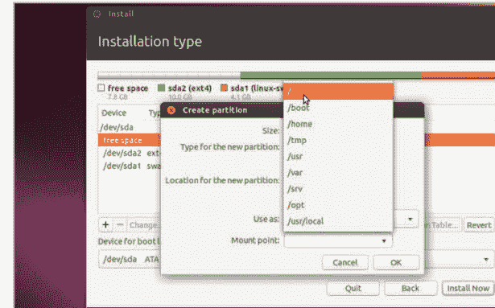

在继续之前，请确保已将任何重要内容保存到外部硬盘。你首先需要对其进行格式化，然后创建交换分区——将其大小设为 8GB，以便充分利用你强大系统的性能。将其放在硬盘的末尾。

现在为你的第一次安装创建一个所需的 15GB 分区，并在菜单中选择它将其设置为根目录（root）。与我们在进入根目录和其他发行版启动时创建交换分区的方法一样，请按照之前的安装说明继续操作。

启动到新发行版（或 Ubuntu 的）Live 环境，并记录下你的操作。

```
$ sudo mount /dev/sdX /mnt
然后通过终端运行以下命令安装 GRUB：
$ sudo grub-install --root-directory=/mnt/ /dev/sdX
```


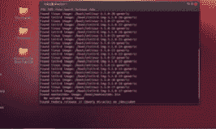

你可以为两个发行版创建一个共享空间，可以独立创建，也可以如果你觉得很有胆量，将其作为一个共享的主目录。我们同样会为发行版硬盘预留约 15GB，请记住根目录，因此创建它。使用 ext3 或 ext4 作为文件系统，如果你想跨平台使用，则使用 NTFS。

在插入 USB 闪盘的情况下，放入第二个发行版的安装介质并启动到 Live 环境或安装。在选择位置时选择外部硬盘，将剩余空间创建自定义分区并格式化为 ext2 或 ext4，并将挂载点设置为 `/`。选择“安装为”。

重启后，你就可以从外部硬盘进入主发行版了。在那里，按你意愿挂载另一个发行版的根分区并运行：

```
$ sudo update-grub
它将自动检测安装的系统，并在你从硬盘启动时更新启动菜单。
```

30 www.linuxux.co.uk

# 在任何设备上双启动 Linux

如何在任何机器上运行两个操作系统

特性

## 双启动 Android ROM

如果放弃 Android 对你来说还不够解渴，为什么不尝试在你的设备上使用多个 MultiROM 呢？

Android 作为一个开源操作系统，催生了许多自定义 ROM，它们扩展或更新了你的手机或平板电脑的功能。每次只使用一个，如果你想更改它，将花费整个下午来刷写和恢复自定义或官方 ROM，期间设备无法使用。MultiROM Manager 是一个简单实用的应用，消除了这一过程的痛苦，让工作变得简单。它可以从 Google Play Store 下载，并请求授予 root 权限。下一步是将 MultiROM Manager 安装到引导加载程序，更新内核模块以及任何……其他建议你安装的项。它可能会要求你重启到恢复模式（recovery）。

可以从 Google Play Store 下载，并请求授予 root 权限。它可以从 Google Play Store 下载，并请求授予 root 权限。下一步是将 MultiROM Manager 安装到引导加载程序，更新内核模块以及任何……其他建议你安装的项。它可能会要求你重启到恢复模式（recovery）。


从 Google 权限，并请求 `root` `root` 。。`ext4`


# 在任何设备上双启动 Linux

如何在任何机器上运行两个操作系统

# 特性

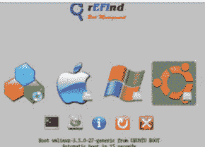

时间比通常情况下要长，你需要一点耐心。当它提示你重启时，请留在 REFind 界面。

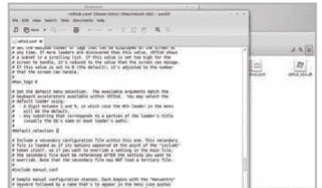

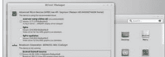

## 03 从光盘启动

启动你的 Mac，REFind 管理器应该会在启动时出现。你可能需要重启几次才能使其生效。除非你按下方向键，否则它会自动进入操作系统。如果没有从 CD 启动的选项，请按 Esc 刷新选项列表直到它出现。


## 06 启动顺序

你可以通过编辑 `reFind.conf` 文件来更改 REFind 中的选择。进入操作系统并定位 EFI 目录下的文件夹。用文本编辑器打开 `reFind.conf` 并找到 `default_selection` 行。取消注释并将其改为你的 Linux 安装对应的 `2`，或者保持为 `1` 以进入操作系统。

## 04 Live 启动

从光盘启动你的 Linux 发行版，并按照我们为双启动场景详细说明的标准安装过程进行——要么与系统一起安装，要么创建自己的自定义分区结构。这可能需要一点时间

## 05 受限驱动程序

无线驱动程序等将包含在许多 Mac 的多数驱动程序中。进入你的发行版，通过有线连接安装所有软件包，然后前往“设置>驱动程序管理器”并安装建议的 Broadcom 无线驱动。


# 树莓派™ 无线发明者套件

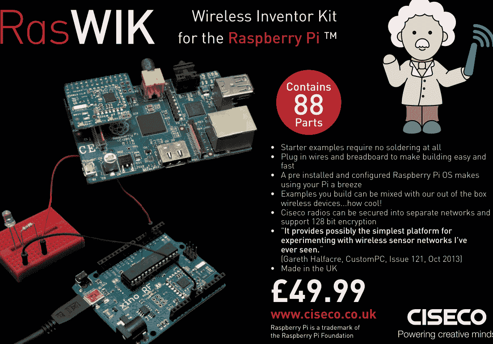

> 包含88 个零件

- 入门示例完全不需要焊接

- 插入电线和面包板，让构建变得简单快速

- 预安装并配置好的 Raspberry Pi OS 让你的树莓派使用变得轻而易举

- 你可以与开箱即用的无线设备混合示例……太酷了！

- Cisco 空闲可以安全地接入独立的网络，并支持 128 位加密

- “这是我过的用于无线传感器网络实验的最简单的平台。”

- (Gareth Haface, CustomPC, 第121期，2013年10月)

- 英国制造

# £49.99

www.cisco.co.uk

Raspberry Pi 是 Raspberry Foundation 的商标

# CISCO

为创意大脑提供动力

# LinuxUser

& 开发者

订阅代券

是的，我想订阅 LinuxUser & Developer

您的详细信息

头衔 名字

姓氏

地址

邮编 国家

电话号码

手机号码

电子邮件地址

请提供有效的电子邮件地址以接收我们的新闻和特别优惠

# 直接支付

我将支付 £18 购买 6 期（节省 50%）

### 英国直接借记支付

| | 0 | 1 | 0 | 8 | 4 |


# 支付详情

您的专属价格，一年（13 期）

英国：£62.40（节省 20%）欧洲：£70.00

- 我随附一张为 £ 的支票

（支付给 Imagine Publishing Ltd）

信用卡/借记卡

- Visa MasterCard - Amex Maestro

卡号

期数（如果是 Maestro）

日期

签名

PAL14110

请勾选此处 [ ] 表示您不想收到来自 Imagine Publishing Ltd 的任何促销材料。请勾选此处 [ ] 表示您不想收到来自其他公司的促销材料。告诉我们您不想通过电子邮件接收此类信息。

寄回地址

LinuxUser & Developer 订阅部门, 800 Gull Avenue, Kent Park, Sittingbourne, ME9 8GU 或发送邮件至 support@imagines.com

您可以在 www.imagines.co.uk 在线查看您的订阅详情

# 立即订购页面 树莓派指南 为编码人员和制作人员准备的必备月刊板块

# LinuxUser

4 种发行版 & 开发者

# 双启动

Windows PC Linux Mac Android

使用 Qt 获得响应式体验

学习编写适用于任何屏幕格式的代码

自动维护你的系统

再也不需要修复错误，或者解决了问题吗？

# 创建你自己的安全云

使用云构建一个安全且私密的云

云存储 无限


# 极佳

订阅者

优惠

# 今日订阅并

节省 50%

- 每期仅需 £3 – 比商店价节省了 50%

- 英国免费送货上门

不再错过任何一期

- 退款保证

*条款与条件：在在支付第三笔款后，价格将恢复为每 6 期 £23.15 的标准优惠。订阅者可以随时取消订阅。新订阅从下一个可用订阅价格开始。在此处查看直接借记担保。优惠有效期至2014年6月30日。Imagine Publishing 保留每个家庭限制一种此类优惠的权利。

## 今日订阅并节省 50% *

| GNU 生成者的必备月刊 | 树莓派 4 种发行版 - 5+ 应用与工具 | 树莓派 4 种发行版 - 树莓派杂志直播双对 |
|---|---|---|
| LinuxUser & Developer | LinuxUser & Developer | LinuxUser & Developer |
| 4 种发行版 & 开发者 | 直播双对 | &开发者 |
| 树莓派 | | &开发者 |


| 10 个实用项目 | GNU 生成者的必备月刊 | 构建 |
| 使用文本编辑器 | 更多内容 | Linux 驱动的 |
| 使用文本编辑器 | 加入革命 | 云存储 |
| SUSE | 使用网络 | Linux 驱动的 |
| 10 个实用项目 | 如何编写代码 | |
| 使用文本编辑器 | 更多内容 | |
| 使用文本编辑器 | 加入革命 | |
| SUSE | 使用网络 | |
| 10 个实用项目 | 如何编写代码 | |

## 今日订阅并节省 50% *

| GNU 生成者的必备月刊 | 树莓派 4 种发行版 - 5+ 应用与工具 | 树莓派 4 种发行版 - 树莓派杂志直播双对 |
|---|---|---|
| LinuxUser & Developer | LinuxUser & Developer | LinuxUser & Developer |
| 4 种发行版 & 开发者 | 直播双对 | &开发者 |
| 树莓派 | | &开发者 |
| 10 个实用项目 | GNU 生成者的必备月刊 | 构建 |
| 使用文本编辑器 | 更多内容 | Linux 驱动的 |
| 使用文本编辑器 | 加入革命 | 云存储 |
| SUSE | 使用网络 | Linux 驱动的 |
| 10 个实用项目 | 如何编写代码 | |

# 配置您的 PC 以远程维护

远程访问并维护 Linux 系统

## 教程


```
Terminal killermike@killermike-VirtualBox:~ ~
killermike@killermike-VirtualBox:~ $ ssh-keygen -t dsa
Enter file to save the key (/home/killermike/.ssh/id_dsa):
Enter passphrase (empty for no password):
Enter same passphrase again:
Your identification has been created and saved in /home/killermike/.ssh/id_dsa.
The fingerprint is:
SHA256:64:f9:d4:55:57:c5:08:a3:cf:killermike@killermike-VirtualBox
DSA keys 2048 bits
```

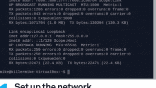

## 01 设置网络

本教程假设您在局域网（LAN）中拥有远程计算机和客户端。请记录登录用户名及其 IP 地址（输入 `ifconfig` 查找）。

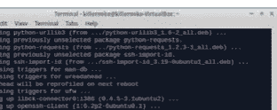

```
killermike@killermike-VirtualBox:~ $ 
```


使用密码和用户名。输入 `ssh-keygen`。您可以按回车键接受默认设置，并在提示输入密码时输入。

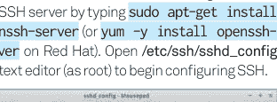

## 02 安装 SSH

要启用远程登录，请使用 `sudo apt-get install openssh-server` 安装 SSH 服务。用文本编辑器编辑 `/etc/sshd_config` 以开始配置 SSH。

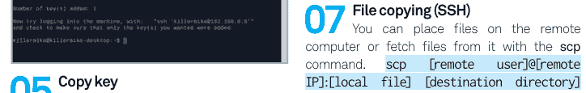

## 05 复制密钥

将公钥拷贝到将远程访问的远程机器。通过 `ssh-copy-id [remote login]@[address of remote client]` 完成此操作。


## 07 文件复制 (SSH)

您可以使用 `scp` 命令在远程计算机上放置文件或从其上获取文件，命令格式为 `scp [remote user]@[destination]` 和 `scp [remote user]@[destination]`。

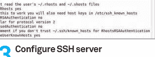

## 03 配置 SSH 服务器

通过使用公钥认证（PublicAuthentication），您将无需输入密码。这是因为我们使用加密密钥而非密码登录机器。编辑文件并使用 `sudo service ssh restart` 重启服务器。

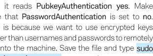

## 04 生成密钥

我们生成公钥和私钥，以便我们可以在无需密码的情况下登录 SSH。

## 08 Web 代理 (SSH)

假设用户抱怨无法访问特定网站或无法访问互联网。我们可以测试连接。

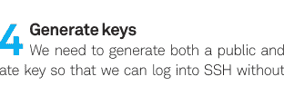

3 linuxux.co.uk

# 配置您的 PC 以远程维护

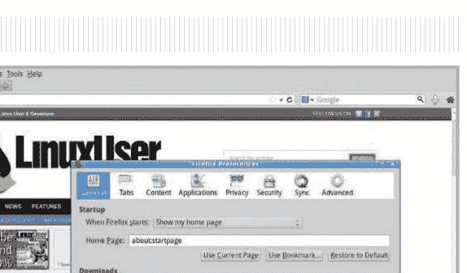

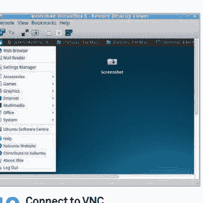

通过 SSH 隧道，您可以建立一个本地代理，实际上它是通过远程机器访问网络。

设置 VNC 服务器以进行远程桌面访问。在这种情况下，我们将忽略 VNC 服务器的安全性功能，简单地将其通过 SSH 进行隧道传输。首先在远程机器上安装 VNC 服务器。

## 12 连接到 VNC

VNC 客户端并不多，但本示例假设您已安装了 Vinagre。使用它连接到 localhost 的 VNC 服务器。在这里，我们连接到 localhost 是因为我们使用远程计算机端口 5901 的 SSH 隧道处理发往服务器的所有流量。您现在拥有远程机器的桌面访问权限。如果连接出现任何问题，请检查终端输出。

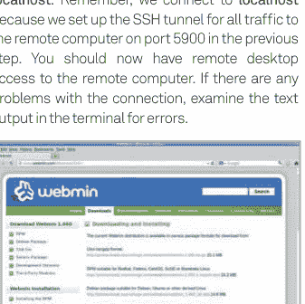

## 09 运行应用程序

X 允许您远程运行应用程序。例如，可以在不本地安装的情况下编辑 GUI 应用程序的配置。

使用 `ssh -X [username]@IP address` 远程连接。然后在连接中启动应用程序。使用 firefox 在远程机器上启动 Firefox 并在您的本地桌面上与其交互。您可以使用 `[username]@[IP address]` 隧道到单个应用程序或多个应用程序。

## 13 安装 Webmin

前往 Webmin 网站（www.webmin.com）并下载适用于您的 Linux 架构的包。对于 Debian，通过输入 `dpkg -i [name of deb downloaded]` 安装 .deb 文件。随后安装任何缺失的依赖项。对于 Red Hat，使用 `yum install [name of RPM]`。

## 11 设置 VNC 服务器

通过输入 `ssh -L 5901:localhost:5901 remote [remote user]@[remote IP]` 设置 VNC 服务器。在设置隧道的同时，在远程机器上输入 `sudo apt-get install tightvnc-standalone-server` 并运行 `tightvnc-standalone localhost-once --display :0`。

> 在这种情况下，我们将忽略 VNC 服务器的安全性功能，简单地将其通过 SSH 进行隧道传输。

## 10 设置 VNC 服务器

# 配置您的 PC 以远程维护

远程访问并维护 Linux 系统

## 教程


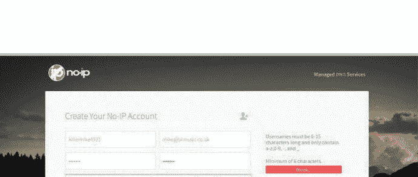

# 测试 Webmin

Webmin 默认通过 SSL 运行，因此通过 `IP address` 访问它。

# 使用 ownCloud 构建自己的私有云

在云端建立你自己的文件管理系统

## 教程

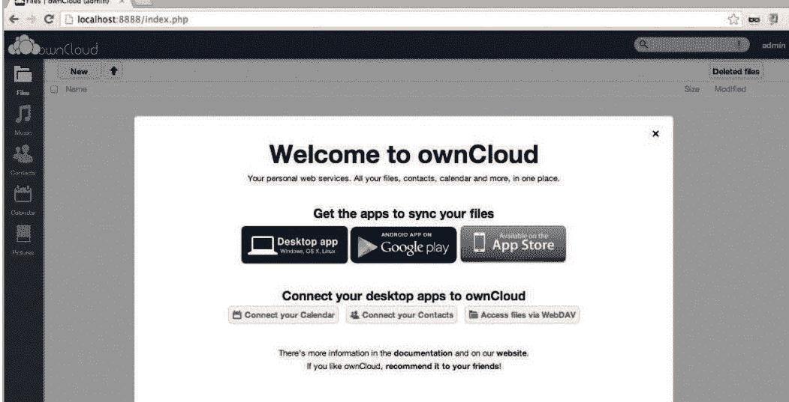

## 01 简介

ownCloud 是一款开源文件和共享应用程序，提供免费社区版和企业版。它允许你备份、共享和管理上传到服务器的文件。通过多种接口（如 Web 端和移动应用），它让你能够随时随与数据保持联系。ownCloud 可以与 Google Drive 或 Dropbox 客户端无缝同步你的文件。有了这种简单的文件同步生态系统，拥有 ownCloud 正如文档中所说，“你的数据，由你做主，你的生活”。

## 02 安装服务器

这里有两种可能的情况。你可能想在自己的系统或家庭办公环境中安装 ownCloud。否则，你可能希望它在互联网上可用。在后的情况下，你可以跳过这些步骤，但如果你有未来计划，应该识别并安装像 Apache 这样的服务器作为系统。但正如之前讨论的，服务器并不是 ownCloud 的唯一要求。你还需要数据库和 PHP 支持。使用 MAMP 服务器可能是最好的选择。

## 03 安装 ownCloud

有了服务器，我们就可以拥有自己的应用程序了。首先，从 ownCloud 官网下载应用程序：只需点击链接上的“Tar”或“Zip”链接，然后将提取的文件夹解压到服务器根目录下。现在，通过浏览器访问该文件夹。欢迎页面将打开并提示你输入 ID 和密码。你可能需要创建一个“高级（Advanced）”链接，因为所有需要的代码都包含在这些服务器中。你将使用系统中的 MAMP 服务器来托管 ownCloud。

| MAMP |
| 本地管理你的网站 |
| 测试 MAMP |
| Apache 服务器 |
| 停止服务器 |
| MySQL 服务器 |
| 打开首页 |
| 偏好... |
| 退出 |

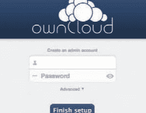

你可以在此处更改与数据库相关的设置。完成后，只需点击“完成（Finish）”，你就拥有了自己的 ownCloud。

## 04 开始使用

现在 ownCloud 已经安装并创建了管理员用户，你可能想添加更多用户，然后让这些用户上传文件。在这一步中，我们将向你如何操作。首次用户管理是点击首页右上角的“管理员（admin）”按钮。在出现的文档列表中，点击“用户（users）”。这将带你进入用户管理页面，你可以在那里添加/删除用户并进行组管理。你可能为某个组分配管理员。要上传文件，你可以直接将文件拖放到 ownCloud 主页，然后选择要上传的文件。

## 05 ownCloud 同步客户端

除了服务器应用程序外，ownCloud 还提供了运行在用户系统上的同步客户端。同步客户端会使其文件夹中的任何文件自动同步到服务器。只需下载客户端，将其指向你的 ownCloud URL 并输入凭据。客户端会可靠地连接到服务器并开始同步。该程序在带宽使用方面具有高度可性，并允许更改设置和多个同步文件夹。它支持主流平台：Windows、Linux 和 Mac OSX。

## 06 owncloud 的其他应用

它看起来很简单，但 owncloud 的功能远不止文件同步；owncloud 不仅可以在设备之间同步文件，还可以让你管理日历和联系人。首页左侧的日历链接可以让你创建事件并与其他用户或组共享。它支持多个日历并随你的需求而增长。联系人选项支持添加和管理联系人详情。联系人也可以导出为 vcf 文件——并在用户或组之间共享联系人。


| 周一 | 周二 | 周三 | 周四 | 周五 | 周六 | 周日 |
|---|---|---|---|---|---|---|
| | | | | 1 | 2 | 3 |
| 4 | 5 | 6 | 7 | 8 | 9 | 10 |
| 11 | 12 | 13 | 14 | 15 | 16 | 17 |
| 18 | 19 | 20 | 21 | 22 | 23 | 24 |
| 25 | 26 | 27 | | | 30 | 1 |

## 07 Roundcube 页面链接

有了联系人和日历支持，你可能会尝试从这里开始，那为什么没有邮件支持呢？幸运的是，由于支持插件，ownCloud 提供了灵活性。打开你的 Web 邮件客户端提供程序添加外部插件，将你的邮箱连接到 ownCloud。要此操作，请访问 ownCloud 官方插件门户，下载应用到 https://apps.owncloud.com/。点击管理员（页面右上角）后会出现下拉菜单。在这里你会看到所有应用，进入 Roundcube 应用并启用它。按照说明将其链接到数据库并配置 Web 服务器。更多详情，请查看安装指南。

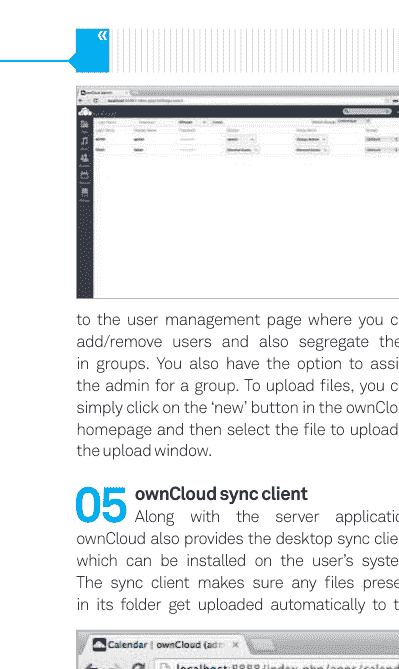

> ownCloud 不仅帮助同步设备间的文件，还可以让你管理日历和联系人

## 08 Shorty-inf

它看起来很简单，但 owncloud 的功能远不止文件同步；owncloud 不仅可以在设备之间同步文件，还可以让你管理日历和联系人。首页左侧的日历链接可以让你创建事件并与其他用户或组共享。它支持多个日历并随你的需求而增长。联系人选项支持添加和管理联系人详情。联系人也可以导出为 vcf 文件——并在用户或组之间共享联系人。

## 09 文件加密

安全和隐私在近年来已成为关注焦点。请注意，一旦启用加密，如果你忘记了密码，默认情况下无法找回数据。为了防止此类损失，你可以在 ownCloud 管理员设置中恢复密钥。

## 10 Shorty-plugin

ownCloud 预装插件。要开始使用它，你只需从应用页面启用它。启用后，你可以直接从界面上拖放按钮将网站添加到你的列表中。你也可以将其配合任何高度可配置的后端服务（如 Nextcloud、Seafile 等）。

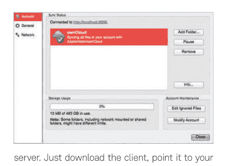

# 使用 tshark 监控流量

使用 Wireshark 的命令行版本监控你的网络

教程

## 01 安装并运行 tshark

要在 Debian 系统上安装 tshark，只需以 root 身份运行以下命令：

```bash
### apt-get install tshark
```

查看 tshark 是否正确安装以及版本，可以执行：

```bash
$ tshark -v
```


## 02 捕获流量

tshark 可用于捕获，但 tcpdump 是捕获的标准。除了这两个工具之外，如果你想了解更多信息，tshark 比 tcpdump 更强大。

第一条命令应该是运行 `tshark -D` 来列出可用网络。如果不带任何参数运行 tshark，输出将是容易理解的：


## 03 命令行过滤器

最常用的过滤器是 `-w` 后接文件名。如果你想将数据保存到文件中以便后处理：

以下 tshark 命令捕获 500 个包并将它们保存到 `test.pcap`：

```bash
$ tshark -c 500 -w test.pcap
```

另一个有用的过滤器是 `-r` 后接文件名，允许你读取并分析之前捕获的文件。

## 04 在捕获期间应用过滤器

tshark 允许你通过捕获特定类型的流量来过滤，避免创建巨大的文件。可以通过 `response.code == 404` 来实现：

## 05 捕获后应用过滤器

捕获后应用的过滤器可以通过 Tshark 和 Wireshark 显示。你应该使用命令行参数 `-R` 以及过滤器。

## 06 将数据导出为可读格式

假设你想从之前捕获的网络流量中提取帧数、相对时间、源地址、目的 IP 地址、数据包协议和长度。以下 tshark 命令将为你完成任务：

## 教程

使用 tshark 监控网络流量


```bash
$ tshark -r login.pcap -T fields -e frame.number -e frame.time_relative -e ip.src -e ip.dst -e frame.protocols -e frame.len -e header -e occurrence
```

`-e` 告诉 tshark 打印字段，`-e header` 告诉 tshark 不要包含数据，`-e occurrence` 告诉我们对于具有多个值的字段只使用第一次出现。

## 解决 DHCP 问题


# 问题：网络上的计算机无法连接网络，尽管其他计算机可以。我们使用 DHCP 协议修复了它们的网络设置。DHCP 服务器是 `10.0.0.10`。

`DHCP` 是一种为 TCP/IP 网络上的主机提供信息的动态协议。`DHCP` 用于 `BOOT` 引导协议配置网络设置。所有 `DHCP` 协议都通过 `UDP` 端口 `67` 和 `68` 运行。

## 关于 DHCP 协议

普通 `DHCP` 客户端和服务器的第一个包是从客户端到 `DHCP` 服务器的 `DISCOVER` 消息。由于客户端没有 IP 地址，它将源 IP 设置为 `0.0.0.0`，目的 IP 设置为 `255.255.255.255`。

同一局域网内另一个网络设备的区别在于其 MAC 地址，它是唯一的。`DHCPDISCOVER` 消息应该包含请求 `DHCP` 设备的 MAC 地址。

下一条消息是来自 `DHCP` 服务器 `192.168.1.1` 的 `OFFER`，它是向客户端的广播。它没有 IP 地址。然后客户端发送带有配置参数的 `REQUEST`。服务器向客户端返回 `DHCPACK`，包含所有配置参数。现在，`DHCP` 客户端使用：

| 帧 | 源 | 目的 | 协议 | 信息 |
| :--- | :--- | :--- | :--- | :--- |
| 1 | 0.0.0.0 | 255.255.255.255 | DHCP | 事务 ID 99972a1 |
| 2 | 255.255.255.255 | 0.0.0.0 | DHCP | 事务 ID 99972a1 |
| 3 | 192.168.1.1 | 255.255.255.255 | DHCP | 事务 ID 99972a1 |
| 4 | ff:ff:ff:ff:ff | 192.168.1.1 | DHCP | 事务 ID 99972a1 |

## Python 脚本将网络数据插入 MongoDB

使用 `tshark` 的命令行版本监控网络

### 教程

所有计算机都可以通过获取 `192.168.1.254` 等 IP 地址正确连接到网络。选择 `192.168.1.254` 的原因是 `tshark` 运行在虚拟机 `VM` 上导致了问题：

```bash
command = "tshark -f -T fields -e frame.number -e ip.src -e ip.dst -e time -e occurrence"
```


## 09 解决问题

`tshark` 显示来自不同 IP 地址 `192.168.1.254` 和 `10.0.0.10` 的网络消息。来自 `10.0.0.10` 的消息对于解决问题非常有帮助，但也太晚了（包号 6）。


## 10 使用 tshark 创建 Perl 脚本

`tshark` 脚本的目的是寻找无效的 IP 地址。解决问题需要几个步骤。第一步是读取网络数据。接下来使用适当命令行参数运行 `tshark`。

## 11 关于 Perl 脚本

下一步是读取保存到数据中的 `tshark` 输出。逐行读取、删除不空格并解析后，脚本使用 `Net::IP` 模块捕获错误的 IP 地址并在屏幕上打印：

```perl
if ($ip =~ /ipv4/) {
    print "Packet number $frameNumber 包含错误的 IP: $ip\n";
}
```

你还可以插入逻辑来捕获你想要的错误，例如特定的 `TCP` 或 `UDP` 端口。

## 12 将数据插入 MongoDB 数据库

Python 脚本将数据插入 `MongoDB` 数据库以进行进一步的处理和查询。数据库的名称是 `insert`。数据由 `tshark` 或 `tcpdump` 捕获。下一个命令应该运行：

```bash
$t = "tshark -l -f frame.number -e ip.src -e ip.dst -e frame.len -e occurrence" | python insertMongo.py
```

`1000.pcap` 文件包含 1000 个包，脚本告知 `MongoDB` 中写入了 1000 个文档，所以你知道一切正常。你现在启动数据库：

```perl
use strict;
use warnings;
use JSON::PP;
use MongoDB::Connect;
use IO::Select;

my $mongo = MongoDB::Connect->new('localhost:27017');
my $db = $mongo->db('tshark_db');
my $collection = $db->collection('packets');

open(my $fh, '<', '1000.pcap') or die "无法打开文件: $!";
while (my $line = <$fh>) {
    my @fields = split(/\s+/, $line);
    if (@fields == 5) {
        my %doc = (
            frame_number => $fields[0],
            ip_src => $fields[1],
            ip_dst => $fields[2],
            length => $fields[3],
            occurrence => $fields[4]
        );
        $collection->insert_one(\doc);
    }
}
close($fh);
```

47 www.linuxux.com

## 教程

# 使用 Qt 进行响应式开发

# LinuxDeveloper


# 使用 Qt 进行响应式开发

显示器和设备有各种形状和尺寸。`Qt` 的布局系统确保你的应用程序看起来良好，无论显示器有多大。

十年前当 `Qt` 组开发 `Qt` 时，15 英寸显示器被认为是合理的尺寸。今天，廉价笔记本电脑拥有 17 英寸的全高清屏。开发者在使用绝对布局时感到无手无策——未调整的布局看起来也很糟糕。

理想的电脑会分析用户界面。元素将调整大小并重新定位到它们的“用途”所在；控件将保持灵活性，而修饰符将保持不变。

制作良好的布局在各种屏幕上看起来都很棒。你的布局感知到两种系统的变化，用户对结果表示满意。

这是通过“反传统”实现的，即控件放置在用户投放它们的位置。`Qt` 假设窗口大小为 200x200 像素。控件的大小将在窗口内指定，而不是窗口外。如果用户增大窗口大小，按钮将“卡”在原始位置。额外的屏幕空间会被空白占据。

# 顾问

# 更多阅读...

+   planet-project.org
- qt-project.org
- qt-project forums
- blog.qt.com


+   - 我们的空布局显示为一条红线

（注：请注意，提供的 OCR 文本高度碎片，包含不同页面的重叠部分，并存在大量的识别错误。我已根据关于 Qt 响应式布局教程的逻辑流重建了文本，并修正了源文件中的语义断层。）

# 使用 Qt 进行响应式开发

利用 UI 元素的动态调整大小来确保所有表单都能被正确处理。

## 教程

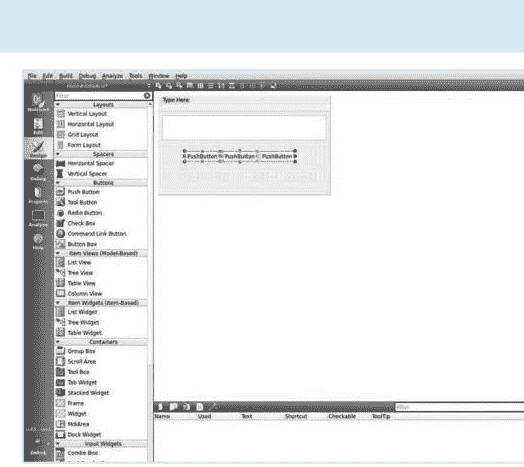

## 缺失表单布局！

一个自以来引起冲突和麻烦的小问题。

当创建一个表单时，`Qt Creator` 不为其提供布局。这不会阻止你放置控件，但可能会影响你的策略和布局相关的属性。这些属性在运行时会被忽略。`Qt` 引擎对不包含布局的表单的奇怪行为无法得到适当管理；例如尺寸策略 `size policy` 将无法生效。

- 三个按钮已成为布局的一部分。

大多数框架在元素动态调整大小方面采用类似的方法。我们开发时将其视为“响应式 Web”，但往往倾向于使用相同的流程和概述概述。

在你意识到静态布局无法调整表单的变化后，关闭应用程序。切换到 WYSIWYG 所见即所得编辑器并查看表单旁的图标。

## 1. 第一个布局

现在是时候开始应用这种技术了。第一个示例将包含一组相互排列的按钮。然后我们将其扩展到包含一组以较复杂方式排列的其他控件。

表单布局的外观像是一条上方三条水平线。在树中选择表单并点击 + 按钮向表单添加水平布局。

从开始布局 `Qt Creator`。本教程基于 `Qt 2.8`，示例基于 `Qt 5.1`。旧版本的环境行为也类似——“布局系统”没有改变。

改变表单的大小不会影响此点——按钮将随着窗口大小的变化而调整大小。这就是布局的工作原理。

布局通常位于表单中，双击 `minwidth` 以进行布局。关注包含你控件的屏幕左侧。将几个控件拖入表单并放置在合适的位置。然后通过拖动边框运行 `MainWindow` 的调整大小。按钮的位置将保持不变。

这确保了复杂的表单将实时创建。在过去的十年里，作者经历过由于布局过于复杂导致的简单延迟案例。

创建新布局很容易；例如，通过拖入来添加一个文本控件。`Qt Creator` 会在表单中显示一条蓝线。这通知你控件将位于布局中，并提供其位置指示。请记住，你不应该影响元素布局的任何元素——这通过以后讨论的更多手段来实现。

## 更多布局

忘记添加表单布局显示了布局系统最糟糕的一面。遗憾的是，大多数表单都有多个布局——排列一组按钮布局仅需一个水平或垂直布局即可完成。

`Qt` 允许嵌套布局。布局内部包含另一个布局。现代系统的高性能确保了复杂表单将实时创建。

- 三个按钮将位于中间。

由于编辑器的内部限制，在布局存在时无法修改大小。可以通过点击表单选择来剥离其布局的尺寸智能，从而修复此问题。当这样做时，布局将显示小方块，然后变为可以将它们添加到内部布局中。

www.linuxuxer.com

完成后，三个控件将显示在红色矩形内。布局可以整体移动：通过在控件部分周围拖动“选择矩形”，选择布局是同样简单的。移动将沿箭头锁限制。

在最后一步，不要忘记重新启用布局。如果这样做，生成的表单将由一个大型可扩展的文本框和三个粘在屏幕底部的纤细按钮组成。

## 关于可能性的问题

查看示例中的文本和按钮可能会令人困惑。`Qt` 框架从额外的高度中获益，而其他一些则不然。这在运行时用于为文本增加灵活性，而按钮保持较小。

每个控件都有一个水平和垂直方向的 `sizePolicy` 属性。通过相应设置控件及其属性，`Qt` 可以支持我们想要的尺寸，如图 1 所示。

然而，这并不是适应不同尺寸的唯一方法；可以使用水平和垂直拉伸 `Horizontal and Vertical Stretch` 属性进行配置。默认情况下，它们设置为 0——所以控件会“缩小”。

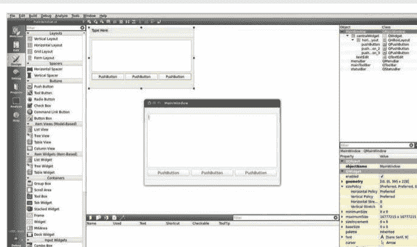

> 图 1

| SizePolicy | 描述 |
|---|---|
| Fixed | 此控件无法缩小或增长 |
| Minimum | 此控件在理论上可以增长，但不能超过足够范围 |
| Maximum | 此控件可以缩小尺寸但不能更好地增长——它可以 |
| Preferred | 此控件可以尽可能增长，但有限制 |
| Expanding | 此控件可以根据需要缩小和增长 |
| MinimumExpanding | 此控件可以增长，但除非需要不会缩小 |
| Ignored | 此控件尝试尽可能占据大量空间 |

## 分析和比较“基础尺寸”的大小

为水平拉伸和垂直拉伸赋值允许你修改其行为。当控件进行布局时，每个控件被分配到所需的空间；剩余空间作为内容分配给各个控件。

例如，如果有三个按钮的拉伸因子设置为一，那么它们将相应占据内容基础的两、三倍空间。

## 您有不需要的显示器吗？

## 非洲和拉丁美洲学校需要 4000 台显示器

- 保证符合 WEEE 电子电气设备回收标准
- 0% 填埋政策
- 涵盖所有法律责任
- 所有电脑数据均已按照英国军用标准擦除

www.computeraid.org/donate

020 8361 5540

enquiries@computeraid.org

或在以下平台找到我们...

Computer Aid International

注册慈善机构编号 1069256 注册公司编号 3442679

# 程序员与制作者的必备指南

# 实用型树莓派

54 “几乎任何人都能在一周内以极低的成本，将一个想法从无到变为可运行的产品”

# 目录

- 54 制作一台遥控车
- 60 3D 图像捕捉的终极？
- 62 制作一个流媒体音乐播放器
- 64 设置并使用加速度计
- 68 什么是 Onion Pi？

# 制作一台树莓派控制的遥控车

利用尖端 Web 技术，通过手机或平板电脑控制遥控车...

Web 技术正在以飞速发展，云技术和硬件已经到了一个完美的时刻，传感器、显示器和无线技术都已演变成高效且廉价的设备。我们确实处于这样一个任何人都可以在一周内以极低成本将想法从无到变为运行产品的节点。就像这个项目一样，它有趣、快速且易于构建，是学习的绝佳方式：我们将创建一个真正的遥控车，将其连接到无线电接收器并将其替换为树莓派，接入网络，启动一个尖端的 Web 服务器，然后通过倾斜你的手机或平板电脑来控制它。到最后，你不仅将拥有一个新的玩具，还将学习未来可预见的驱动世界最新、最大经济体的基础技术。欢迎来到未来！

Shaun Butter

白天从事 Web 开发和支持。他通过 YouTube 展示了大量的树莓派汽车和树莓派控制的车

bt.ly/5jheu

## 教程：制作一台树莓派控制的遥控车

## 树莓派控制遥控车的制作过程

## 组件列表

- 一辆双通道 转向和驱动 玩具遥控车
- Adafruit PWM I2C 舵机驱动器
- 母对母跳线
- 5V 电池包

在您用手机控制汽车之前，您需要对底盘进行重大修改。

为了帮助我们的玩具车利用最新技术和我们的卡片大小的电脑运行起来，我们将对其结构进行一些重大更改。通过高效替换汽车正常的发射器和接收器，识别并移除旧的无线电。注意接收器上的三个插座：一个连接到电机控制器，一个连接到转向舵机。由于遥控车也有用于电子设备的独立电池，但这些 尤其是带有电子速度控制器的 没有，这节省了组件费用。如果你没有带 5 BEC 的速度控制器，你需要在其他地方获取 5V 电源。许多商店出售 5V 电池电源 - 通常作为手机应急充电宝。www.modypi.com 销售低于 20 美元的合适 5V 电池宝。

幸运的是，构建中最复杂的方面将通过几次廉宜的购买轻松完成，即一个负责转向和节流的舵机控制板，以及一个保持树莓派运行顺畅的 5V 电池包。

预计成本：$60 / $100

来自 www.modypi.com 的组件

- 舵机控制：我使用了 www.modypi.com 的 Adafruit PWM I2C 舵机驱动板
- Pi 供电：Pi 位于正中心以确保其尽可能安全
- 供电：这个 5V 电池包可以保持你的树莓派运行几个小时
- 选择汽车：你可以为这个项目使用一种相当便宜的汽车

56

# 制作一台树莓派控制的遥控车

## 我们正在使用树莓派的 I2C 总线控制舵机接口板

步骤 02：将舵机线连接到新的控制器

我们根据接口焊接了来自 modypi.com 的 16 路 I2C 舵机控制板，并简单地插接了电线；它的排针上有六根电缆。总计，束在一起的有两组，中间和上方的是 PWM 脉冲调制 信号。现在是使用魔术贴固定组件的好时机。

步骤 02：即数据通道。右下侧是 SCL 通道，它控制 I2C 设备的时钟。最后，右上角是地。

步骤 05：主要组件概述

你现在应该有了一个舵机板，一边是转向舵机和速度控制器，另一侧连接树莓派到控制器的另一端 该端应该有线；主汽车的电池——在这种情况下是 7V。我们现在有两个独立的电源系统，一侧是高电流，另一侧是低电流。让我们开始吧！

步骤 03：将 I2C 总线连接到树莓派

我们正在使用树莓派的 I2C 总线来控制接口板，如图所示，树莓派和舵机板之间只需要四根线。这加速有助于我们跟上树莓派的进度。

步骤 06：寻找另一个家

现在是时候给它找另一个家了。现在是使用魔术贴固定组件的好时机。

步骤 02：即数据通道。右下侧是 SCL 通道，它控制 I2C 设备的时钟。最后，右上角是地。

步骤 05：主要组件概述

你现在应该有了一个舵机板，一边是转向舵机和速度控制器，另一侧连接树莓派到控制器的另一端 该端应该有线；主汽车的电池——在这种情况下是 7V。我们现在有两个独立的电源系统，一侧是高电流，另一侧是低电流。让我们开始吧！

步骤 03：将 I2C 总线连接到树莓派

我们正在使用树莓派的 I2C 总线来控制接口板，如图所示，树莓派和舵机板之间只需要四根线。这加速有助于我们跟上树莓派的进度。

步骤 06：寻找另一个家

现在是时候给它找另一个家了。现在是使用魔术贴固定组件的好时机。


步骤 03：将 I2C 总线连接到树莓派

我们正在使用树莓派的 I2C 总线来控制接口板，如图所示，树莓派和舵机板之间只需要四根线。这加速有助于我们跟上树莓派的进度。

步骤 06：寻找另一个家

现在是时候给它找另一个家了。现在是使用魔术贴固定组件的好时机。

# 步骤 02：即数据通道

右下侧是 SCL 通道，它控制 I2C 设备的时钟。最后，右上角是地。

# 步骤 05：主要组件概述

你现在应该有了一个舵机板，一边是转向舵机和速度控制器，另一侧连接树莓派到控制器的另一端；主汽车的电池——在这种情况下是 7V。我们现在有两个独立的电源系统，一侧是高电流，另一侧是低电流。让我们开始吧！

# 树莓派控制的遥控车制作

# 教程

# 构建一个树莓派控制的汽车

我们将利用你的手部动作来驱动设备

## 完整代码

### socket.html

```html
// --- 在此处定义你的变量
<html
<head>
<script src="jquery-2.0.3.min.js" language="javascript"></script>
<script src="socket.io/socket.js"></script>
<meta name="viewport" content="user-scalable=no, initial-scale=1, maximum-scale=1">
<script>
var socket = io.connect(location.host,':8080');
var center = 400; // 中点在哪里？
var minleft = 340; // 左边界
var maxright = 460; // 右边界
var multiplier = 3; // 陀螺仪数值的乘系数，以获得所需的加速度
var centergamma = 330; // 我们对角度进行处理以
var mingamma = 250; // 向后边界
var maxgamma = 400; // 向前边界
以获得所需的加速度
window.onload = function() {

socket.on('connect', function() {
window.gyro = 'ready';
alert('出发吧!');
});

window.onorientationchange = function(event) {
var beta = center + (Math.round(event.beta-center)*multiplier);
if (beta < minleft) beta = minleft;
if (beta > maxright) beta = maxright;

var gamma = event.gamma;
gamma = center + (Math.round(event.gamma-center)*multiplier);
// 限制命令不超过
if (window.gyro != 'ready') { socket.send('Y'); }
if (window.gyro == 'ready') { socket.send('Y'); }
if (gamma < mingamma) { socket.send('Y'); } 
socket.send({beta: beta, gamma: gamma});
if (gamma > maxgamma) { socket.send('Y'); } 
socket.send({beta: beta, gamma: gamma});
window.gyro = 'ready';
};
};
```
```

### app.js

```javascript
// 声明所需的模块

var app = require('express').createServer

var socket = require('socket.io').listen(app);

var fs = require('fs');

var static = require('static');

var sys = require('sys');

var PwmDriver = require('adafruit-i2c-pwm-driver');

var client = require('client');

var argv = require('optimist');

app.listen(8080);
```

```javascript
// 设置设备地址和设备名称

pwm = new PwmDriver(0x40,'/dev/i2c-0');

// 设置脉冲宽度

setPulseWidth = function(channel, pulse) {

var pulseLength;

pulseLength = 100000;

pulseLength = (pulse / 360) * pulseLength;

pwm.setPWM(channel, true, pulseLength);

pwm.setPWM(channel, false, 0);

}
```

```javascript
socket.getFrequency();

// 在 8000 端口上建立服务器

app.get('/', function (request, response) {

var file = require.parse('index.html');

static.serve(file).request(request, response);

console.log('Server listening on port 8000 http://localhost:8000/socket.html');

function setupFunction() {

// 居中

wm.setPWM(0, 0, 480);

pwm.setPWM(1, 0, 480);

pwm.stopMotor();

console.log('紧急停止 - 信号丢失或正在关闭');

}

if (beta) {

console.log('正在执行一次舵机位置移动');

pwm.setPWM(0, 0, beta); // 使用直接 i2c pwm 机

return process.exit();

}

if (gamma) {

console.log('正在执行一次舵机位置移动');

pwm.setPWM(1, 0, gamma); // 使用直接 i2c pwm 机

return process.exit();

}

}
```

```javascript
// 设置 socket 服务器

socket.on('connection', function (socket) {

socket.on('data', function (data) {

console.log('data: ' + data);

pwm.setPWM(0, 0, data.beta); // 使用直接 i2c pwm 机

pwm.setPWM(1, 0, data.gamma); // 使用直接 i2c pwm 机

});

// 设置紧急超时

clearTimeout(socket.emergencyTimeout);

socket.emergencyTimeout = setTimeout(function () {

pwm.stopMotor();

}, 1000);

});

process.on('SIGINT', function () {

console.log('正在从 SIGINT (Ctrl-C) 优雅退出');

pwm.stopMotor();

return process.exit();

});
```

## 组件列表

树莓派摄像头让 Richard Garhagen 能够像手动相机相机一样设置曝光、ISO 和快门速度。

- 树莓派 (Pis)
- 树莓派摄像头模块
- 40GB SD 卡
- 1 个 600A 5V 电源
- LED 灯带
- 木柱

左侧：图像在发送打印成 3D 模型之前会进行扫描。请坐好，扫描仪不到一秒就能捕捉到你最好的一面。

# 3D 全身扫描仪

我们与 Richard Garhagen 讨论了为什么他需要 40 台树莓派来为你拍摄照片。

- **你是如何开始这些实用项目并与树莓派一起工作的？**
“在过去的五到十年里，我开始接触 3D 打印机和 CNC 机器。我开始制作家具和小设备等，我的第一个项目是树莓派盒子。它是一个微型电脑，是一个挂在墙上但里面是空的盒子。如果你按下按钮，它需要三秒钟来启动。我把它分享到了 Facebook 上，在过去一年里这个盒子一直属于我的家里。那是我的第一个相机项目，我真的爱上了相机，因为它很容易使用且成本非常低。这给了我灵感，如果一台很便宜，我可以把规模扩大到至少 40 台。”

- **是什么给了你创建 3D 树莓派盒子的灵感？**
“我必须说，我有很多想让孩子们跑跑的生命挑战，我两岁的孩子坐不住，所以我可以告诉他们打印我最小的儿子。使用 100 台花费约 1500 美元的摄像头加上所有其他设备……”

- **是什么导致你决定使用树莓派摄像头而不是标准相机？**
“我一直在研究如何让树莓派变得便宜……”

- **你到为止是如何使用扫描仪的？**
“我们去了格朗根的创客展，我们想要免费获得自己的扫描，系统运行得非常好。使用图像创建 3D 对象只需要不到一秒。”

# 树莓派音乐服务器

Music 守护进程 (MPD) 是一款既作为音乐播放器又是音乐服务器的软件。它可以将音频输出到系统连接的任何音频设备，并由任何 MPD 客户端进行控制。几乎所有平台都有相应的客户端，包括 iOS 和 Android。Android 还可以将音频输出到流中，供多个客户端使用。这对于拥有无法存放在本地大型音乐库的人来说是理想的。

## 步骤 04

## 设置

## 流媒体传输

## 单模式

## 消费模式


- 01 安装所需软件
使用用户名 raspberry 和密码 登录树莓派系统。首先找到你设备的 IP 地址并记录下来。使用命令 `apt-get update` 获取最新的包。然后使用 `sudo apt install mpd` 安装 MPD。可能会出现一些错误，但可以忽略。

## 步骤 06

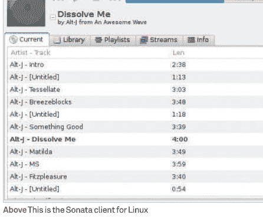

- 02 添加音乐
mpd 的默认音乐目录为 `/var/lib/mpd`。你需要将此文件夹设置为可写和可执行，以便 mpd 用户可以写入。为此使用命令 `sudo chmod 777 /var/lib/mpd`。然后你可能从你的 Linux 电脑上找到一些音乐并使用 `scp` 进行复制：`scp -r /path/to/music/* pi@ip_address:/var/lib/mpd/`

使用兼容的客户端向移动设备流传输音乐

## 05 配置流传输

目前唯一的输出是树莓派上的 3.5 mm 接口。要将其设置为 HDMI，你需要找到被注释掉的 HDMI 输出。取消注释并将格式更改为 `flac`。我们的音乐格式如下：

```
audio_output = {
  type = "http"
  encoder = "vorbis"
  port = "8000"
  quality = "5"
  format = "44100:2"
}
```

保存更改并重启 mpd。

## 07 连接到服务器

进入 MPD 应用后，使用基于 WLAN 的连接访问你的服务器。随后在“Streaming”字段中填入你树莓派的 IP 地址，在“Host”字段中保持默认。默认值为空，所以选择 Raspberry Pi。我们需要连接到音乐库，因为它尚未连接。为此，进入“Settings”，选择该选项并点击“Refresh”。

## 08 播放音乐

点击底部栏的“Artists”按钮进入音乐界面。长按艺术家并选择“Add”。如果你连接了收藏，你将听到音乐从中传出。使用 MPD 播放器上的音量块来调整

## 09 设置客户端

在每个设备上设置客户端很困难，但过程非常简单。例如，我们建议使用 Sonora，对于 iOS 我们建议使用 MPD。要在 Android 上设置 MPD，请从 Play Store 下载。

- 04 配置守护进程
使用 nano 编辑 `/etc/mpd/mpd.conf`，进行更改让守护进程监听所有接口，这样我们就可以从其他设备使用 MPD 客户端。通过更改以下行来实现：

```
bind_to_address = "localhost"
```
改为
```
bind_to_address = "any"
```

一个非常简单的 MPD 设置。可能的改进包括：
- 将音乐放在外部硬盘上获得更多空间
- 针对树莓派的 CPU 调整设置
- 设置 Samba 服务器以便通过网络访问音乐库。

Music 守护进程可以连接到系统并创建客户端——几乎瞬间完成

# 教程 使用树莓派使用加速度计

Russell Barnes 是 Linux User Magazine 的编辑，也是热情的 Python 程序员。在你的下一个树莓派项目中添加倾斜技术比你想的要简单。

## 需要学习的技能

### 1 I2C
它是设备连接和外扩展的一种非常实用且方便的形式。

### 2 Pygame
Pygame 的核心机制非常直观，使程序原型设计非常容易。

## 组件列表

如何获取原型设计……
- ADXL 加速度计
- 最新版本的树莓派镜像
- 邦板
- 公对母原型线
- 烙铁

我们每天都使用加速度计。它们存在于我们的手机、游戏控制器中，并帮助我们保持在地面上、飞机保持在空中。此外，我们将使用 ADXL345 模块创建一个“太空侵略者”风格的游戏原型，我们稍后会返回它。焊接时间不会超过 15 分钟，物理设置才刚刚开始。我们将使用 I2C 将 ADXL345 放置在树莓派的 GPIO 上。首先确保你的树莓派已是最新。打开终端窗口并输入：`sudo apt-get update && sudo apt-get`

## 01 安装 i2c-tools

首先，确保你的树莓派可以使用 I2C 与 ADXL345 模块通信。在终端中，使用 `apt-get install i2c-tools`，然后执行 `sudo nano /etc/modprobe.d/raspberry-pi.list`。这将启用 'i2c-cm2807' 接口。

按下 Ctrl+X，然后按 Enter 退出。

## 为什么选择 Python？
它是树莓派的官方语言。
访问 www.python.org/doc 查看文档

## 面向对象语言的对象。

Python 的构建将作为一系列关于 Python 文章中的第一篇。但你真的使用 Python 对象吗？Bernard 解释道……


作为一名真正的文艺复兴奇才，他将时间分配在构建框架、与研究人员和科学家合作、解决复杂问题以及编写 Android 应用程序之间。

### Joey Bernard

欢迎来到系列关于 Python 文章的第一篇。但与你我我这些该语言的粉丝不同，我们并不畏惧于直面它的弱点。

因此，在接下来的几个月里，我们将尝试用 Python 完成某些任务，但在你的旅程中也可能会遇到问题。随着时间的推移，我们将收集最佳实践以及应用它们的方法，来为树莓派创建小型程序。

第一周，我们将学习如何在 Python 中使用对象。根据官方文档，对象是用于数据的。Python 程序中的所有数据都由对象或关系表示。实际上，Python 中的几乎一切都是对象。因此，如果你打算编写具有真正价值的代码，多学习一些它们的行为是非常重要的。

更具体地说，我们将学习如何处理自己设计的对象。

类是 Python 中最常见的面向对象编程方式。Python 的机制继承自 C++ 和 Modula-3。类可以继承并重写其基类的方法。所有方法也可以从继承类中调用。对于数据，对象可以包含各种数量和类型。因为 Python 是一种动态语言，这些在运行时是可以修改的。例如，假设你开发了一个用于进行某种几何处理的程序。你想要使用的核心对象之一是空间中的坐标。为了绘制几何图形，你首先需要使用两个变量 x 和 y。在 Python 中，这意味着我们可以编写知道如何使用这些数据的方法。很多情况下，初始化变量是有意义的。实现此点的一种方法是直接在类定义中编写语句。

```python
class Point:
    x = 0.0
    y = 0.0
```

另一种初始化值的方法是在类中使用 `__init__` 方法。该方法会在创建对象时被自动调用，因此你可以默认创建这些值：

```python
class Point:
    pass
```


第一行是在 Python 中定义类的方式。它与定义一个新函数非常相似，只是你将关键字 `def` 替换为 `class`。类始终至少需要一个语句。如果你还不想让你的类做任何事情，可以使用 `pass`。这本质上是告诉 Python “这里还没有要显示的内容”，但你可以使用这个类来创建类型为 'Point' 的新对象。你可以这样做：

```python
class Point:
    def __init__(self):
        x = 0.0
        y = 0.0
```

然后你可以在创建实例后重置 `x` 和 `y` 值：

```python
my_point = Point()
my_point.x = 20.0
```

这其实并不很有用。如果你想在对象中存储点值，对象所做的真实事情之一是完全动态的。你可以向语句添加 `x` 和 `y` 值：

```python
my_point.x = 10.0
my_point.y = 20.0
```

该类的特定实例现在有了 `x` 和 `y` 值。这很简单！不幸的是，我们并不局限于此。更好的做法是将它们作为类定义的一部分，这样：

```python
class Point:
    def __init__(self, value, value):
        self.x = value
        self.y = value
```

由于 Python 是一种动态语言，这些在运行时是可以修改的。例如，假设你开发了一个用于进行某种几何处理的程序。你想要使用的核心对象之一是空间中的坐标。为了绘制几何图形，你首先需要使用两个变量，`x` 和 `y`。在 Python 中，这意味着我们可以编写知道如何使用这些数据的方法。很多情况下，初始化变量是有意义的。实现此点的一种方法是直接在类定义中编写语句。

```python
class Point:
    x = 0.0
    y = 0.0
```

另一种初始化值的方法是在类中使用 `__init__` 方法。该方法会在创建对象时被自动调用，因此你可以默认创建这些值：

```python
class Point:
    pass
```


然后你可以在创建实例后重置 `x` 和 `y` 值：

```python
my_point = Point()
my_point.x = 20.0
```

这其实并不很有用。如果你想在对象中存储点值，对象所做的真实事情之一是完全动态的。你可以向语句添加 `x` 和 `y` 值：

```python
my_point.x = 10.0
my_point.y = 20.0
```

该类的特定实例现在有了 `x` 和 `y` 值。这很简单！不幸的是，我们并不局限于此。更好的做法是将它们作为类定义的一部分，这样：

```python
class Point:
    def __init__(self, value, value):
        self.x = value
        self.y = value
```

由于 Python 是一种动态语言，这些在运行时是可以修改的。例如，假设你开发了一个用于进行某种几何处理的程序。你想要使用的核心对象之一是空间中的坐标。为了绘制几何图形，你首先需要使用两个变量，`x` 和 `y`。在 Python 中，这意味着我们可以编写知道如何使用这些数据的方法。很多情况下，初始化变量是有意义的。实现此点的一种方法是直接在类定义中编写语句。

```python
class Point:
    x = 0.0
    y = 0.0
```

### Joey Bernard

### Joey Bernard

欢迎来到系列关于 Python 文章的第一篇。但与你我这些该语言的粉丝不同，我们并不畏惧于直面它的弱点。

因此，在接下来的几个月里，我们将尝试用 Python 完成某些任务，但在你的旅程中也可能会遇到问题。随着时间的推移，我们将收集最佳实践以及应用它们的方法，来为树莓派创建小型程序。

第一周，我们将学习如何在 Python 中使用对象。根据官方文档，对象是用于数据的。Python 程序中的所有数据都由对象或关系表示。实际上，Python 中的几乎一切都是对象。因此，如果你打算编写具有真正价值的代码，多学习一些它们的行为是非常重要的。

更具体地说，我们将学习如何处理自己设计的对象。

类是 Python 中最常见的面向对象编程方式。Python 的机制继承自 C++ 和 Modula-3。类可以继承并重写其基类的方法。所有方法也可以从继承类中调用。对于数据，对象可以包含各种数量和类型。因为 Python 是一种动态语言，这些在运行时是可以修改的。例如，假设你开发了一个用于进行某种几何处理的程序。你想要使用的核心对象之一是空间中的坐标。为了绘制几何图形，你首先需要使用两个变量，`x` 和 `y`。在 Python 中，这意味着我们可以编写知道如何使用这些数据的方法。很多情况下，初始化变量是有意义的。实现此点的一种方法是直接在类定义中编写语句。

```python
class Point:
    x = 0.0
    y = 0.0
```

另一种初始化值的方法是在类中使用 `__init__` 方法。该方法会在创建对象时被自动调用，因此你可以默认创建这些值：

```python
class Point:
    pass
```

第一行是在 Python 中定义类的方式。它与定义一个新函数非常相似，只是你将关键字 `def` 替换为 `class`。类始终至少需要一个语句。如果你还不想让你的类做任何事情，可以使用 `pass`。这本质上是告诉 Python “这里还没有要显示的内容”，但你可以使用这个类来创建类型为 'Point' 的新对象。你可以这样做：

```python
class Point:
    def __init__(self):
        x = 0.0
        y = 0.0
```

然后你可以在创建实例后重置 `x` 和 `y` 值：

```python
my_point = Point()
my_point.x = 20.0
```

这其实并不很有用。如果你想在对象中存储点值，对象所做的真实事情之一是完全动态的。你可以向语句添加 `x` 和 `y` 值：

```python
my_point.x = 10.0
my_point.y = 20.0
```

该类的特定实例现在有了 `x` 和 `y` 值。这很简单！不幸的是，我们并不局限于此。更好的做法是将它们作为类定义的一部分，这样：

```python
class Point:
    def __init__(self, value, value):
        self.x = value
        self.y = value
```


# 常见问题 (FAQ)

没错——简单的概念是，我们使用内置的以太网端口直接为树莓派提供互联网。这只需要插上电缆即可，不需要使用 USB 闪盘作为无线接收器或热点，像树莓派这样的其他设备。我们然后通过这个无线连接透传互联网，让连接的设备通过树莓派无线接入互联网。

所以你打算让我隐瞒我来自美国国家安全局（NSA）的原因吗？

根据最近的新闻报道，可能不是，但如果存在 NSA 监控你的可能性，你可能有更重要的事情需要担心。

# 你需要什么

Onion Pi 所需组件

没错。你真的会为了他们用那个吗？很多人的家里有无线连接但没有 Wi-Fi，因此你可能可以将多个设备（如手机或笔记本电脑）连接到互联网，这些设备可能没有定位。它比他们提供的 Wi-Fi 服务更便宜，或者需要你设置网络，或者它可以作为信号强度较差房屋的某种廉价无线中继器，或者替代性能。

# Raspbian 的 SD 卡

坦率说，这是最容易得到的物品，也是你为了将树莓派变成完全功能盒子所需的唯一物品。

只是检查一下。等，等等，为什么它叫 Onion Pi？

它代表洋葱路由器（Onion Router），每次发送到另一个节点时所有的路由都会被加密，它创建了包含多个服务器的多个层。计算机可能会提供一些简单的示例之类的，它实际上受到这个洋葱网络的保护。

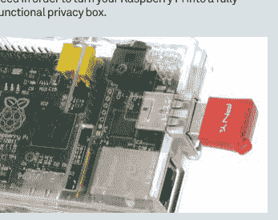

# 我认为我开始理解了。为什么你想在树莓派上做这个？

嗯，有些原因与普通的树莓派无线路由器一样；你也可以将其作为自己创建的路由器。大多数商业路由器都不允许你这样做，除非你刷写固件，而你只需要启动一台树莓派并连接到网络来处理，这本是不需要的。

# 可扩展 Wi-Fi 适配器

Adafruit 销售他们熟悉的 Wi-Fi 适配器，并提供了一些很棒的产品，某些适配器可以作为主力热点使用。

可以接受。它们所有的秘密部分是什么？Onion Pi 会让互联网流量通过一个“匿名”网络。流量由成千上万的志愿者继器路由，当有人在坏网络黑客中进行追踪时，每个继器都会隐藏用户的位置和互联网连接，并且在各种卫星办公室或其他地方被“弹回”。只是有点复杂，而且没有罗伯特·福特（Robert Ford）。

# 互联网连接

这似乎显而易见，但为了允许其他设备连接到网络，为什么树莓派不能连接互联网呢？

# 等一下，Sneakers 是什么？

好的，你已经告诉了我概念。隐私。但我需要买这套件来制作 Onion Pi 吗？

不，你并不需要 Adafruit 以太网适配器。你需要的是正在运行的树莓派，以及用于在此特定热点设置中的 USB 闪盘或无线卡。

# 稳定电源

实际上，我们真的撤回了声明。无论之前说什么。

# 好。总之，空气中所有的弹跳是怎么回事？

安全和匿名，是的，已经提到了，这是为了自己的隐私。虽然它可以用于秘密间谍工作，但大多数人使用 Tor 是为了避免在被针对时遭受价格上涨的打击，特别是那些不守规的在线公司。

虽然一直建议使用专用电源为树莓派供电，但 Onion Pi 可以很乐意在市售 USB 上运行。

# 我们想了解关于它的的一切。你们在杂志里介绍过吗？

我很高兴说，是的，我们涵盖了。我们在杂志第 129 期中加入了无线路由器教程，完整的教程就在这里。你可以在 GreatDigitalMagazine.com 获取这两者，或者通过商店 (magshop.co.uk) 购买纸质版——需要的旧期数消失得很快，所以你需要检查一下。

这在整个 NSA 和 PRISM 事件发生之前。

www.linuxuser.co.uk

# 构建更好的网页
www.webdesignermag.co.uk


2014年热门 100 | 15 大最佳浏览器开发者工具 | 增强你的 CSS

# 立即购买你的期数

纸质版请访问 www.imagineshop.co.uk
数字版请访问 www.greatdigitalmags.com

可在以下平台获取


facebook.com/webdesignermag twitter.com/webdesignermag

# 测评

71 Group Test | 76 GertDuino | 78 CentOS | 81 Mageia Beta

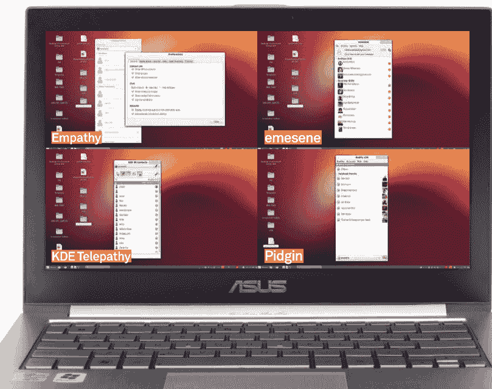

# 组测试

## 即时消息客户端

找到跨所有聊天服务联系同事和朋友的最佳方式

### Empathy
GOME 即时消息客户端在那些 GNOME 或基于 GNOME 桌面的发行版中很流行。它与 GNOME 有很好的集成，允许使用多个账户并包含语音和视频支持。它目前是 Ubuntu 和 Fedora 的默认客户端。

### emesine
最初设计是为了方便 Windows 用户在 Linux 上聊天，mesine 已从仅支持 MSN/Windows Live Messenger 演变为支持广泛的服务，但由于 MSN 服务器已下线，目前已有所放缓，不过它仍然可以使用。

### KDE Telepathy
受推崇的 Kopete 的继承者，KDE Telepathy 是新的 KDE IM 客户端。它基于 Telepathy 框架，并且仍在基于 KDE 的桌面仍在开发中。它支持 VoIP 以及通常的文本应用程序。

### Pidgin
跨平台且高度可定制，Pidgin 曾是最好的即时消息软件。计算机可能会提供一些简单的示例之类的，它实际上受到这个洋葱网络的保护。

# GertDuino

原始 Arduino 的强大后续产品

## 评测

## 技术规格

| 兼容性 | 所有树莓派型号 |
| --- | --- |
| 处理器 | Atmega328, Atmega 48 |
| 尺寸 | 85mm x 57mm x 20mm (不含树莓派) |
| 重量 | 34g (不含树莓派) |
| 连接 | 15 数字 IO & PWM, 6 路模拟输入, UART, I2C 总线, 缓冲 LED |
| 额外 | 实时时钟，电池备份（仅限 Atmega 48），RS232 串口转换器 |

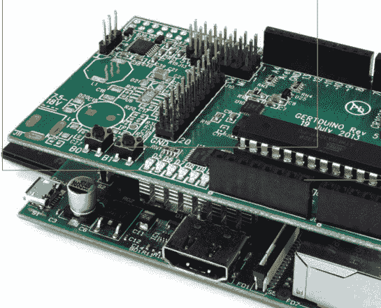

# CentOS 6.5

## 新功能：
精确时间协议（PTP）支持 • 内核 6.23-431 • 升级的 OpenSSL • 更新的 Hyper-V 和 VMware 驱动

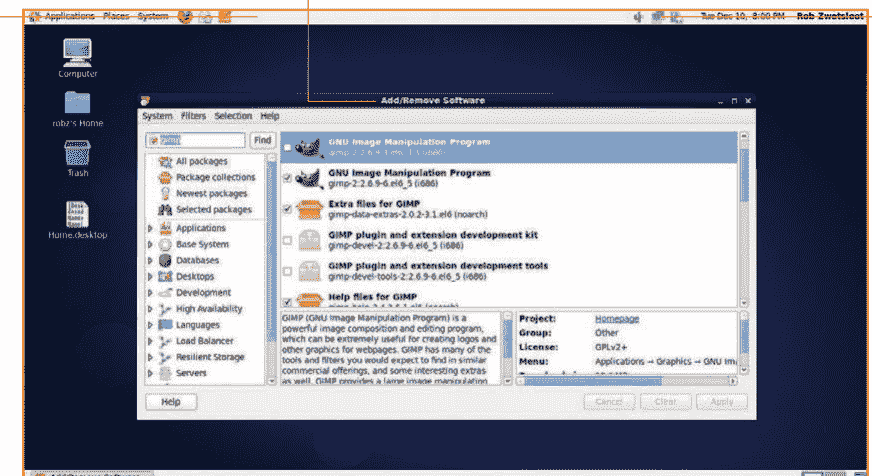

# Mageia 4 Beta 2

适用于所有水平的用户友好型发行版

# 订阅

立即订阅并开始节省费用

# 书评

如今最新的书评

# 问与答

将你的问题发给我们，我们将尽力回答！

# 常见问题解答：充分利用 Fedora 的功能

Q： 如何在 Fedora 中安装非自由软件？
答：RPM Fusion 是一个流行的可选 Fedora 存储库，允许你安装 Fedora 初未包含的所有软件。要安装它，你可以访问 RPM 网站（www.rpmfusion.org）并遵循自动化流程，或者打开终端并使用：

```bash
```


$ su -c 'yum install --nopcheck http://download.ffusion.org/free/rpmfusion-free-release-%{r}.%fedora.noarch.rpm http://download.ffusion.org/nonfree/rpmfusion-nonfree-release-%{r}.%fedora.noarch'

```
- 无论你在哪个平台上使用它，X 都可能会让人困惑
```

# 给狗一根骨头

Q：Red Hat 有更稳定的版本吗？
答：Fedora 是 Red Hat Linux 的上游版本，可以被认为是稳定的，但 Red Hat 需要订阅才能获得，因此对于大多数人来说，最好的替代方案是 CentOS - 请查看我们的最新发布，位于第 78 页。

我正在使用 Baglestone 设备，使用其提供的 3.8.13 发行版配合 CircuitCo 3 英 TFT LCD 显示器。我的目标是在通电时启动 GUI 程序，无论当前在盖子下是否正在充电。

Q：我有 GNOME 吗？
答：肯定的 - 不仅是因为不同版本的 Fedora 具有不同的桌面环境，你也可以从原生软件存储库安装 Cinnamon 和 MATE 等所有主流 DE 替代方案。

| "Device" | "Frame Buffer" |
| :--- | :--- |
| Driver "fbdbev" | |
| Option 'Rotate' | "CC" |
| EndSection | |

我设法地在没有发行版的情况下运行了 X 服务器。我有一个基于 UI 的应用程序，运行良好。X 服务器还会在启动时自动启动。

为了在启动后运行 X 服务器，我向 `/etc/init.d` 添加了脚本：

我遇到的困难是让 X 服务器运行起来。到目前为止，我安装了 `x86-video-driver` 以允许我旋转屏幕，并删除了 `/etc/rc.local` 中的 `gdm` 脚本以停止 GNOME。我还为此添加了 `xorg.conf`。

```bash
#!/bin/sh

usr/bin/setterm -blank 0

usr/bin/setterm -powersave off

usr/bin/startx -ncursor
```

它在 2345 之后运行，在其他东西之后。

66 www.linuxuser.co.uk

# 问与答

解决你所有的技术问题

# Q/A

# Wine 酒窖 (Wine cellar)

最近当我的硬盘决定彻底损坏时，我丢失了所有内容。幸运的是，我确保备份了在 Wine 中运行的 Windows 程序。我需要确保我已将其完全重构到“程序文件”（Program Files）中。

结果是我在终端模拟器中运行了命令：

```bash
$ wine "C:\ProgramFiles\Qemu\Qemu2.4.exe"
```

...但随后使用菜单或键盘快捷键的命令不起作用了。我尝试使用：

```bash
$ gnome-wine "C:\ProgramFiles\Qemu\Qemu2.4.exe"
```

终端启动又停止了。从另一个终端运行没有给我带来任何信息。

你有什么想法吗？是因为程序没有以主要方式安装的吗？如果是这样，Wine 能感知到这一点吗？

Milers Peterson

# LibreOffice 很容易自定义这个

因此，这是我的显示管理器在运行并带我进入提示符。如果我不自动运行 X 服务器，然后通过命令启动，路径匹配目录以及其所有环境都在。自动运行 X 服务器（即 D），然后没有信息在那里；然而，用户没有运行。尝试在 home 中创建 wine 前缀完全不起作用。如果我把一个文件放在要丢失的脚本处，它运行了但由于某种原因失败了。看起来 wine 脚本确实不起作用。然而，Wine 运行得足够好。有什么建议吗？我应该尝试从 root 自动运行，并让 wine 拥有一个运行的脚本然后获取我的 UI 吗？X 很难理解，但看起来离并不远。你需要在前缀中编辑什么？

# 自动幻灯片

会话会话，如果你不使用它们，最好的方法是让 wine 启动。将脚本更改为：

```bash
#!/bin/bash

/home/user/
```

这应该会自动加载我的自定义 UI。我一直在寻找制作演示文稿的方法。有没有可以使用 LibreOffice 或 PowerPoint 文件来自动化我的演示文稿？到目前，我必须手动加载我的 ppt 文件然后按 F 进入我的幻灯片。这可以使用 wine 自动完成吗？我不太清楚该如何调用它。这是完全可能的，而且只有通过 LibreOffice 可以。你需要使用你创建的命令来制作 office 幻灯片，然后在启动 wine 时启动演示：

```bash
libreoffice [pathofile]
```

这是第一步，尽管它只会启动你指定的文件。如果你想切换到新的演示文稿，你需要编辑相同的名称或更改命令。总之，如果你能让它在命令行中运行，那么我甚至不会去检查我预期的实际问题是否有任何错误。更有可能出在 wine 上。不过，在这里你错了；你用的是系统地址，而不是从发行版的角度来看路径。如果你使用类似这样的，对于快捷键和：

```bash
$ wine "/linux/path/Qemu.exe"
```

当然，使用文件的实际路径进行切换将会有效。这应该解决你的问题。它确实是一个模拟器。

87 www.linuxuser.com

# 问与答

- Facebook:
Linux User & Developer

- Twitter:
@linuxusermag

为了让它自动运行，你需要安装扩展。安装后，使用特定的属性并将第一个字段之一放置一个包含命名命值的文本字段。这意味着当启动启动系统时，演示文稿会在无需你进行手动干预的情况下运行，即使你已经为它设置了自动。

任何正在寻找捐赠空闲周期（idle cycles）方法的人都应该检查一下 BOINC。这应该将所有部分合并成一个 ISO。如果不起作用（这有时不取决于你用于拆分的软件），你也可以尝试 JSplit。这个工具可以合并文件和 ISO；要合并文件，你可以再次使用它。

# 拆分镜像 (Split image)

你好，想知道在 Linux 上有没有方法可以恢复 DVD 镜像？或者是数字转换的，我的一个朋友把它拆分了，以便通过电子邮件发送给我。遗憾的是，我不在身边告诉他怎么做，但我没有在存储库中找到任何可以帮助我的软件。我不确定他在 Windows 上拆分的还是在其他地方的。

Splitting@Home 是一个共享计算能力来帮助阿尔茨海默症的极佳例子。虽然我们不需要 SETI API，但有没有什么方法可以帮助更紧迫的问题，比如癌症研究？你可以使用一些方法完成这一点，但请确保文件的名称是统一的；例如 file.iso, file1.iso, file2.iso。你可以使用 Linux 控制台并尝试用命令拆分文件：

```bash
$ cat file.iso.1 >> file.iso
```

Paul

# 慈善拍卖 (Charitable auction)

我有一个强大的系统。我的电脑买了一个服务器主板，但我不知道如何使用它。它非常棒；当我在 Linux 上时很少利用它。有一些项目可以让你捐赠周期来慈善帮助他们处理，我更愿意捐出我的。嗯，SETI 值得，如果你想捐赠资源，这也是一个很好的起点。它使用一种名为开放科学网计算（BOINC）的服务，我们最初捐赠给 SETI@Home，现在现在被各种项目使用。你可以创建一个账户，然后查看可用组以及它们做什么，包括数学案例、蛋白质折叠、基因谱系等。

# 在脉冲上 (On the Pulse)

我是一个 Debian Ubuntu 用户，默认使用 PulseAudio 而不是 ALSA。它在所有程序中运行得非常完美，除了我不幸需要使用的 Skype。无论我如何调整设置，当我的笔记本扬声器音量非常小时，Skype 仍然会静音，即使我没有外部麦克风也是如此。我在几个人身上看到过这个问题，通过进入“应用程序”标签页并设置 Skype 的音量来解决。然而，我无法

- HJSplit 是一个跨平台文件拆分工具

# 问题与解答

解决您的所有技术问题
Q/A

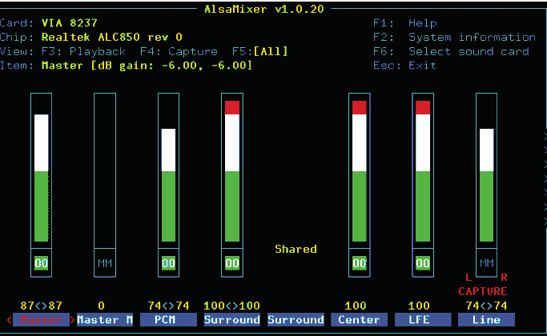

这里是简易的 smb.conf：

```
Card: VEE 8237

This: Realtek ALC850 rev 0

View: F3: Playback F4: Capture [All]\Item: Master [dB gain: -6.00, -6.00]

F1: Help

F2: Status information

F6: Select sound card

Esc: Exit
```

```
[global]

workgroup = WORKGROUP

netbios name = LINUX
```

```
:Important; 否则，不会切换

到 Unix "nobody" - Err 5 device

security = share
```

```
[shared-dir]

path = /usr/samba/samba-shared-dir

comment = 无需 Unix/Samba

readonly = no

public = yes

guest ok = yes
```

知道这可能是什么原因吗？

Josh Scarlet

- Alexa 有时比使用 PulseAudio 更好用

让 Skype 在此标签页中正常工作。有一个地方可以为特定应用程序设置默认设置吗？如果有这样的文件，
或许能帮助解决问题。

这很困惑，因为所有者和访问权限如下：

```
# 1 /home/samba/shared-dir

drwx-xr-x nobody nogroup 4096

30 12:24 dimajuj

30 12:24 nogroup 4 Nov

30 12:24 test.txt
```

任何帮助都感谢。先谢过。

Charlie

除非另有说明，samba 在使用 'guest-ok' 时会使用用户 'nobody'，所以我猜问题与 UNIX 文件访问有关。

你走在正确的道路上，事实上我在这里通过你提到的 security-user 工作原理修复了问题。你不能冒用 sambing.com 的密码为用户来承担风险。

如果你对两个 PulseAudio 感到不舒服，听起来你一直在尝试使用 Samba，除非你想尝试通过这种方式来完美完善 PulseAudio 和 Skype。不过，这不能保证成功，还不如先试用 PulseAudio，这就是为什么

这应该可以在不询问密码的情况下连接，而且你是想这样做吗？

```
security = user

force user = "nobody"

map to guest
```

Samba 服务器配置

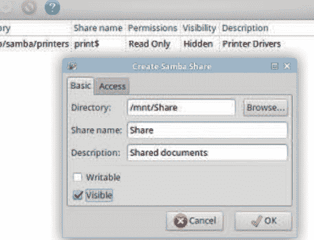

```
sudo apt-get remove pulseaudio
```

然后安装：

```
sudo apt-get install libound2-alsa

utils all-samba
```


你将需要再次调整设置，但至少 Skype 现在应该可以工作了。

# 分享即关怀

我在 Debian 7 和 Ubuntu 上的 Samba 3.0.6 遇到了一个奇怪的问题。虽然共享 security-user-cruiser 工作正常，但用户似乎会被提示输入登录/密码：
问题是这里：我可以从 Windows (7 和 XP) 创建/复制文件和目录，无法修改文件内容，但 Samba 允许我删除文件和目录。
- Samba 用于家庭网络共享非常棒的，只要你学会了它
89.linuxux.co.uk

# 赞助机会

# 托管列表

通过赞助此板块让您的品牌焕发生。请联系 Rhian Carter：+4478102586421

# 有你认为我们应该列出的优惠活动吗？

无论你是托管论坛还是发现划算交易的满意客户，请发邮件信告诉我们详情！立即联系我们。

# 专用服务器列表

| 方案 | 电话号码 | 每月费用 | 最低限制 | 合同期限 | CPU/核心 | 磁盘空间 | 10GBPS 网络连接 | 硬件 RAID | 远程重启 | 永久虚拟机 | 运行时间保证 | 网络备份 | 私有套房 | 24/7 支持 |
|---|---|---|---|---|---|---|---|---|---|---|---|---|---|---|
| 2200DC | 0800808450 | N/A | 1 个月 | 双核 2.2GHz | N/A | N/A | Raid | ✓ | ✓ | | | | | | |
| 3000DC | 0800808450 | £80 | 1 个月 | 双核 2.5GHz | 2 x 250GB | N/A | Raid | ✓ | | | | | | | |
| 2600DC | 0800808450 | £130 | 1 个月 | Intel 四核 2.66GHz | 2 x 500GB | N/A | Raid | ✓ | | | | | | | |
| 开发者 | 0800808450 | £32.89 | 1 个月 | N/A | 1GB | N/A | | | | | | | | | |
| One | 0800808450 | £99 | 1 个月 | N/A | N/A | 2,000MB | | | | | | | | | |
| 分销商 | 0800808450 | £24.89 | 1 个月 | N/A | 无限 | N/A | | | | | ✓ ✓ | | | |
| 入级 Linux | 0800808450 | N/A | N/A | N/A | N/A | 2,000MB | | | | | ✓ ✓ | | | |
| 入级 Windows | 0800808450 | N/A | N/A | N/A | N/A | 2,000MB | | | | | ✓ ✓ | | | |
| 商务 Linux | 0800808450 | N/A | N/A | N/A | N/A | 4,000MB | | | | | ✓ ✓ | | | |
| 商务 Windows | 0800808450 | N/A | N/A | N/A | N/A | 4,000MB | | | | | ✓ ✓ | | | |
| 终极 Linux | 0800808450 | N/A | N/A | N/A | N/A | 无限 | | | | | ✓ ✓ | | | |
| 终极 Windows | 0800808450 | N/A | N/A | N/A | N/A | 无限 | | | | | ✓ ✓ | | | |
| 方案 | 电话号码 | 每月费用 | 最低限制 | 合同期限 | CPU/核心 | 磁盘空间 | 10GBPS 网络连接 | 硬件 RAID | 远程重启 | 永久虚拟机 | 运行时间保证 | 网络备份 | 私有套房 | 24/7 支持 |
|---|---|---|---|---|---|---|---|---|---|---|---|---|---|---|
| 快速服务器 | 081677730 | N/A | 2 个月 | Intel Xeon E3840 | 160GB | 100 Mbps | | | | | 99.90% | ✓ | | |
| BudgetBox III | 081677730 | £60 | 1 个月 | Intel Xeon E3430 | 1 x 500GB | | | | | | 99.90% | ✓ | | |
| SSD 4 | 081677730 | £95 | 1 个月 | Intel 四核 E3430 | 四核 120GB SSD | | | | | | 99.90% | ✓ | | |
| Merin | 081677730 | £199 | 1 个月 | 2 x Intel Xeon 四核 | 500GB | 100 Mbps | | | | | 99.90% | ✓ | | |
| 056.5 | 081677730 | £275 | 1 个月 | 六核 | | | | | | | | 99.90% | ✓ | | |
| 云端服务器 | 081677730 | £52 | 1 个月 | 4 vCPU (4GB) | 40GB | Giga shared / node | | | | | 99.90% | ✓ ✓ | | |
| 方案 | 电话号码 | 每月费用 | 最低限制 | 合同期限 | CPU/核心 | 磁盘空间 | 10GBPS 网络连接 | 硬件 RAID | 远程重启 | 永久虚拟机 | 运行时间保证 | 网络备份 | 私有套房 | 24/7 支持 |
|---|---|---|---|---|---|---|---|---|---|---|---|---|---|---|
| Linux 双核 | N/A | £78.99 | 12 个月 | 双核 2.35GHz | 160GB | | | | | | 99.99% | | | |
| Windows 双核 | N/A | £89.99 | 12 个月 | 双核 1.6GHz | 160GB | | | | | | 99.99% | | | |
| Linux 四核 | N/A | £129.99 | 12 个月 | 四核 2.5GHz | 250GB | | | | | | 99.99% | | | |
| 托管 PowerEdge R10 | N/A | £79.99 | 12 个月 | 双核 3.6GHz | 250GB | | 1Gbps | | | | | 99.99% | | | |
| 托管 PowerEdge R20 | N/A | £119.99 | 12 个月 | 双核 2.66GHz | 250GB | | 1Gbps | | | | | 99.99% | ✓ | | |
| 托管 PowerEdge R30 | N/A | £149.99 | 12 个月 | 双核 2.85GHz | 500GB | | 1Gbps | | | | | 99.99% | ✓ | | |
| 方案 | 电话号码 | 每月费用 | 最低限制 | 合同期限 | CPU/核心 | 磁盘空间 | 10GBPS 网络连接 | 硬件 RAID | 远程重启 | 永久虚拟机 | 运行时间保证 | 网络备份 | 私有套房 | 24/7 支持 |
|---|---|---|---|---|---|---|---|---|---|---|---|---|---|---|
| 1&1 标准型 (Linux) | 0844 335 1211 | £29.99 | 1 个月 | | | 50GB | | | | | | | | | |
| 1&1 标准型 (Linux) | 0844 335 1211 | £59.99 | 1 个月 | | | 50GB | | | | | | | | | |
| 1&1 标准型 (Win) | 0844 335 1211 | £59.99 | 1 个月 | | | 50GB | | | | | | | | | |
| 1&1 无限型 (Linux) | 0844 335 1211 | £129.99 | 1 个月 | | | 500GB | | | | | | | | | |
| 1&1 无限型 (Win) | 0844 335 1211 | £129.99 | 1 个月 | | | 500GB | | | | | | | | | |
| 1&1 商务型 (Linux) | 0844 335 1211 | £119.88 | 1 个月 | | | 无限 | | | | | | | | | |
| 托管 (hosting.com) | 0844 999 4100 | £23.98 | 1 个月 | | | 25GB | | | | | | | | | |
| 托管 (hosting.com) | 0844 999 4100 | £59.99 | 1 个月 | | | 50GB | | | | | | | | | |
| 托管 (hosting.com) | 0844 999 4100 | £27.88 | 1 个月 | | | 无限 | | | | | | | | | |
| Equipause (equipause.net.com) | 0021 314 4865 | £30.00 | 1 个月 | | | 200GB | | | | | | | | | |
| Equipause (equipause.net.com) | 0021 314 4865 | £60.00 | 1 个月 | | | 500GB | | | | | | | | | |
| Equipause (equipause.net.com) | 0021 314 4865 | £72.00 | 1 个月 | | | 800GB | | | | | | | | | |
| Equipause (equipause.net.com) | 0021 314 4865 | £114.00 | 1 个月 | | | 2TB | | | | | | | | | |
| Eurofast (eurofast.markt.com) | 0844 2490 823 | £22.75 | 1 个月 | | | 75GB | | | | | | | | | |
| Eurofast (eurofast.markt.com) | 0844 2490 823 | £143.00 | 1 个月 | | | 105GB | | | | | | | | | |
| Evolving (evolving.webhosting.com) | 0844 999 1168 | £29.99 | 1 个月 | | | 50GB | | | | | | | | | |
| Evolving (evolving.webhosting.com) | 0844 999 1168 | £79.99 | 1 个月 | | | 无限 | | | | | | | | | |
| WebFusion (webfusion.com) | 0845 130 1602 | £107.40 | 1 个月 | | | 50GB | | | | | | | | | |
| WebFusion (webfusion.com) | 0845 130 1602 | £179.40 | 1 个月 | | | 100GB | | | | | | | | | |
| WebFusion (webfusion.com) | 0845 130 1602 | £239.99 | 1 个月 | | | 无限 | | | | | | | | | |
| Glacom (glacom-web.com) | 0880 542 7550 | £119.99 | 1 个月 | | | 200GB | | | | | | | | | |
| Heart Internet (heart-internet.com) | 0844 874 7750 | £99.99 | 1 个月 | | | 50GB | | | | | | | | | |
| Heart Internet (heart-internet.com) | 0844 874 7750 | £129.99 | 1 个月 | | | 125GB | | | | | | | | | |
| Hostway (hostway.service.com) | 0860 180 1810 | £78.50 | 1 个月 | | | 35GB | | | | | | | | | |
| Namhog (namhog.net.com) | 0844 612 0330 | £13.75 | 1 个月 | | | 25GB | | | | | | | | | |
| Namhog (namhog.net.com) | 0844 612 0330 | £33.75 | 1 个月 | | | 50GB | | | | | | | | | |
| Namhog (namhog.net.com) | 0844 612 0330 | £53.75 | 1 个月 | | | 100GB | | | | | | | | | |

# 您的观点

您的 Linux 新闻与观点来源
联系我们...
注册并发表您的评论... 直接给我们发送电子邮件...
www.linuxuser.co.uk/forum/ linuxuxer@imagine-publishing.co.uk

# 您的观点

# Linux 用户来信

您对杂志、Linux 和开源的意见

# 内容阀门 (Content Valve)

我非常希望能在 PC 上通过 Steam 使用 Netflix 和 Hulu，但这永远不会发生。实际上，Netflix 和 Hulu 已经开发并发布了嵌入式（iOS，Android）客户端，但从未发布过 Linux PC 版，因为它们受制于好莱坞，而它们无法像控制微软和苹果那样控制他们。它们也感到恐惧，因为 Linux 是一个强大且高度灵活的操作系统，还包含了许多可以轻松绕过好莱坞愚蠢 DRM 策略的功能。对它们来说，每个市场增加 0.2% 的利润并不值得冒这个风险。

### 仅仅 (Just)

恰恰：看到这将很有趣——Valve 声称 Steam 将是开放，但由于 Steam 客户端并不是开放，可能仍有部分对开发者关闭。如果包括视频内容，现在已经有一些可以在 Linux 上运行的了，但它们并不适用于 SteamOS。希望至少可以实现双系统，这样你就可以通过 XBMC 消费媒体。

# SteamOS

我们仍然不确切 Steam 具体要做什么。

# 话题基础 (THREAD BASE)

# 焦点

红帽更新了 CentOS 企业操作系统。6.5 版本的发布引起了社区其他部分的极大兴奋——尤其是当我们在这里发布关于其发布的报道时。点击此处阅读：
csmuk: 你上传了那个 DigitalOcean 掉线的版本，是一个完全完美的升级；重启，完成。CentOS/RHEL 的长处在于，对我来说是杀手锏。而且它比 Fedora 更稳定，我曾在家里在尖沿版本上运行多年，但这一点也不好玩。多年来，很多东西都坏了，有些真的很难处理。
dragonS: 我们从 6.0 版本开始就在这里了（仅在需要时），所以你可以更新系统而无需担心任何问题。某些版本和兼容性可以持续很长时间（RHEL 将持续到 2020 年左右）——稳定性。大变化发生在主版本号上。
Normalized: 作为一名科学家，法律规定必须使用 Linux（其实并不是），另一个项目——但 PHEL 如此之快真是很棒……我们可能需要 30-45 天，这对时间来说没问题。春天也很不错。
karvok: 是只有我这么觉得吗，还是包的缺失比劣势更困难？例如，现在的 Linux 7 还没有 Hyper-V、Samba、ext3 等内核的优秀特性。或者这里还遗漏了什么？即使是 Apache 也是 2.2 版本而不是 2.4。对于你的用途，它安装了 PHP 5.3，Samba 3.6 实例 4.1 等。这怎么能算是一个优势呢？例如，我依赖 NFS 共享。使用旧版本，我会遇到麻烦……

# SteamOS, CentOS, Mageia, Ubuntu 读者信 (LETTERS)

# 网页设计师 (Web Designer)

网页开发是现代计算的重要组成部分，大部分服务都在线和云端可用，而我们对拥有极好的开源网页设计教程感到自豪。《Web Designer》致力于为您带来更多此类质量水平的功能。通过定期介绍 HTML5、CSS3、jQuery、WordPress 以及更多应用程序等最新技术，《Web Designer》是初学者和网页设计者的最佳选择。你可以在 www.webdesignermag.com 了解更多信息。

# Mageia 一夜成名

# 对我而言的 Linux

我现在开始使用特定的 Linux 发行版，有时我发现很难确定对于特定任务我可以使用哪些其他发行版。虽然我很乐意使用共享发行版来处理事务，但如果有新的发行版针对相同类型的功能提供不同的产物，我很喜欢去尝试一下。如果我没有发现 Mageia（这是我最喜欢的家用发行版之一），Dan Harris：从技术上说，Linux 发行版可以用于任何任务，但针对某些用途进行预配置的这些发行版让开始工作更容易、更快捷——尤其是当你原本已经在使用一个流行的发行版时。DistroWatch.com 的高级搜索包含一个发行分类过滤器，这可能帮助你更深入地了解让你“黑入”的特定软件。这并不意味着你不能使用非免费软件，你需要它让 Pi 为了软件项目免费启动。
Jason Bean: 树莓派基金会处于有些困境，之一是非免费软件对于他们的教学目的来说比免费软件要好得多。对他们来说，树莓派并不是真正的开源，而是由 Ubuntu 创造的一个新一代焦点，他们必须至少是一个开源焦点，并在开源项目上投入了大量资金。如果软件是免费的，他们确实更倾向于自由。
> Ubuntu 手机会看起来像 Edge 概念机吗？
Harold Adleman: 对主流桌面、笔记本、平板电脑和手机市场造成了巨大的冲击。微软才开始考虑这一点，而 Android 就像——当我们看到它时——康宁（Canonical）和 Mercury 已经展示了在操作系统优势和运营商合作伙伴处，尽管这是他第一次谈论硬件和软件。看看谁将制造 Ubuntu 手机，以及最终产品会是什么将会很有趣。在 3 月开始实际行动做得好。我希望有人能做一个全一体的扩展站，让它像 PC 一样易用。那时，Ubuntu 将……我读到关于树莓派上的 Wolfram 的文章，这有点奇怪。我希望他们能坚持免费软件，因为它是

# 触碰之处 (Something to Touch)

# 树莓派的自由 (Raspberry freedom)

# Linux 开发者
- Facebook: @linuxermag
- Twitter: @linuxuser

# 接受挑战 (TAKE THE CHALLENGE)

选择我们任何一本富有启发性且信息丰富的杂志的试用订阅，您保证每期都能学到新东西。无论您是对科学、摄影还是技术感兴趣，只需花费 £1* 即可获得任何杂志的 3 期。* *这允许英国新订阅者以 £1 收到前 3 期。在这些期之后，将适用标准订阅价格。订阅者可以随时取消。优惠必须单独接受。适用特殊订阅价格。Imagine Publishing 保留此类优惠每家庭限一次的权利。为让全家人享受历史的历史提供实用灵感。探索太阳系及之外的奇迹。如何拍摄、编辑和分享照片。Photoshop® 灵感的领先杂志。装满了所有 6-14 岁孩子都喜欢的的内容！

# 开拓您的眼界 (BROADEN YOUR MIND)
拓展您的视野 (EXPAND YOUR HORIZONS)
知识 / 科学 / 技术 / 设计 / 游戏 3 期仅 £1

# 在 DVD 上 (On the DVD)

发现第 135 期有什么在等着你……欢迎来到《用户与开发者》DVD，它是随杂志 135 期提供的。在这张光盘上我们有四个故事给你，你可以从光盘启动。你可以尝试 Linux Mint 6 的最终版本，测试 CentOS 6.5 并看看你的想法。最后，为了庆祝新的树莓派板块，我们提供了最新的 Raspian 版本，这是树莓派的首选。要访问它们，你必须将光盘放入光驱并在 POST 期间选择驱动器。在那里你可以现场启动并测试！

# 发行版 (Distros)

我们有三个现场发行版：Linux Mint、CentOS 6.5 和 LinuxOS。你在这里找到 Raspian 的镜像。

# 目录 (Directory)

想看看你喜欢的发行版开发者在做什么吗？

# 教程文件 (Tutorial Files)

如果你想遵循我们的其他教程，可以使用项目文件

# 软件 (Software)

20 个涵盖各种功能的最新软件包。

# 如何刻录 ISO (How to burn an ISO)

想尝试新的 ISO 吗？这里是开始的方法……
步骤 1：获取新 ISO
将 ISO 从我们的封面盘拷贝到硬盘。进入磁盘标签页，点击 ISO 并选择保存。在网上找到一个 ISO 下载。如果你不确定需要 32 位还是 64 位版本，选择前者较稳妥。
步骤 2：打开或安装 Brasero
Brasero 是最流行的开源刻录工具。如果你的发行版尚未安装，请在存储库中查找并安装。然后打开程序并在“项目”标签页选择“刻录镜像”。
步骤 3：刻录你的磁盘镜像
在“刻录设置”菜单中，点击“点击此处”框选择磁盘镜像——导航到你刚刚放在硬盘上的 ISO。一旦选中，确保已插入 CD 或 DVD 并点击“创建镜像”。

## 光碟介绍

欢迎阅读全新的 Linux 用户与开发者 DVD

# 光碟内容

## 编辑精选

**Raspian** 我们在所有的教程和指南中使用 Raspian 都是有原因的，它是事实事实上的标准、可靠的，并且在目前所有的产品中提供了最佳性能。
**Linux Mint 16** 我们是 Mint 的忠实粉丝，这已经不是秘密了。除了出色的社区和慷慨的项目领导层外，Mint 运行快速、稳定，并且比其他替代方案更易用得多。目前王座上只有一个竞争者，那就是 elementary OS。
**OwnCloud** 通过我们本月的教程，使用强大且多功能的“服务器端软件”解决方案 ownCloud，创建你自己的私有云。上手非常简单……

## 完整索引

**Raspian** 树莓派基金会推荐的 Raspberry Pi 发行版，也是我们在教程中使用频率最高的版本。跟随本月开始的《树莓派迷你杂志》获取你 Pi 的最新版本。
**Linux Mint 16** Ubuntu 13.10 的发布表现平平，而 Linux Mint 的出现至关重要，因为社区首次带来了新的 GNOME 基础。从它的符号方法来看，它仍然是一个很棒的发行。
**PCLinux 2013.2** 滚动更新 PCLinux 的最新版本带有 MATE，这是桌面阵容中较新加入的成员。PCLinux 具有极佳的兼容性和非常优秀的产品。
**CentOS 6.5** 红帽企业级 Linux 的社区版是一个稳定的企业发行版，也适用于需要更稳固配置的家庭环境。

| Audacious | GIMP | OwnCloud | Scratch |
| --- | --- | --- | --- |
| Blender | GTK | Plugin | SeaMonkey |
| LibreOffice | Python 2 | Thunderbird | |
| Calibre Suite | Luminance HDR | Python 3 | VLC |
| Firefox 26 | Qt | | |
| Minecraft | | | |

- 好久没试过 Blender 了？你大有口福……LibreOffice 是生产环境安全应用的唯一选择。
www.linux.co.uk

# 下期预告

# 即将带来

关注 2 月 13 日发出的第 135 期。想早点看到吗？
立即订阅！

# LinuxUser & Developer

Imagine Publishing Ltd
Richmond House, 33 Richmond Hill
Bournemouth, Dorset, BH8 6EZ
+44 (0)1202 58633
Web: www.imagine-publishing.co.uk
Email: imagine-publishing.co.uk g@greatmaps

# 杂志

编辑 Russell Barnes
imagine-publishing.co.uk
01202 58272
全体撰稿 Rick Westbottom
高级编辑 Will Shum
编辑 Chris Cross
设计主管 Ross Andrews

# 游戏

Jim Matthews, Phil King, Richard Smiley, Michael Reed,
小组团队 Steve Green, Simon Price, Nick-Roller,
Mils Tokulais, Joey Berry, David Crouch & Nishat Taavel

# 广告

数字和印刷媒体可通过获取：
imagine-publishing.co.uk
01202 58637

# 销售总监

imagine-publishing.co.uk
01202 58643

# 客户经理

Rhian Carter
rbtan@imagine-publishing.co.uk

# Gnome

初级开发者 Steve Deemberg
《用户与开发者》可授权许可。
联系相关部门了解更多信息。

# 国际

国际部主管 Gary Blackman
+44 (0) 1202 586401
imaginepublishing.co.uk

# 订阅

所有订阅查询请拨：
+44 (0) 1790 418651（海外）
邮箱：subscriptions@imagine-publishing.co.uk
13 期订阅（欧洲）£70 / £80

# 创作

创作主管 Darren Pearce
01202 58602

# 制作

制作总监 Danny Butterworth
集团制作与营销 Steven Boyd
集团总监 Mark Kendrick

# 分发

William Billington 印刷，26 Paisley Road,
Worsley, Manchester, M23 9PN
+44 (0)127 49900
由英国及海外分销服务分发
由 Gordon & Goth 分发，
Gordon & Goth 企业中心，26 Roadbridge,
London, SE1 7PY
由 Southwark Street, London, SE1 0QH 分发
由 The World by Market, Blue Fin Limited 分发
0223 477 915

免责声明
未经 Imagine Publishing Ltd 许可，本出版物的任何部分均不得复制，但在批判性评论中的简短引用除外。Imagine Publishing Ltd 对本出版物材料中的任何错误或遗漏以及因使用这些信息而导致的任何损失不负责。文章中表达的观点代表作者个人，不一定反映 Imagine Publishing Ltd 或其版权持有者的观点。

# Steam OS 深度解析

关于游戏未来的一切

# 使用 Tex 进行排版

完善排版艺术的步骤指南

# 使用 Qt 操作文件

了解如何使用 Qt 进行排版

# 将漫画转换为 PDF

了解如何制作高质量 PDF 文档
包括：
- 树莓派测评
- 使用 Django 构建博客
- 14+ 页评论
Imagine Publishing Ltd 2014
ISSN 2054-4270
www.linuxuser.co.uk
读完本杂志后请回收。

# 无论你的业务需求是什么

## 我们有适合你需求的服务器！

我们的整个服务器系列都是为您设计的；随着业务增长提供所需的托管动力。

### 虚拟专用服务器

#### 灵活性

进入服务器世界的完美介绍。
- 在单一服务器上托管多个网站。
- 成为服务器的管理员！
- 为你的 Web 应用安装任何执行环境和框架。
- Web 开发者的理想选择。
每月 £9.99

### 云服务器

#### 性能

以极低成本获得专用性能，是 VPS 的明显升级。
- 托管高流量网站并充分利用 100 Mbps 带宽。
- 托管具有数百并发用户的数据库和文件服务器。
- 延迟敏感型 Web 应用。
- 将通信迁移至云端。
每月 £59.00

### 专用云服务器

#### 动力

当你的业务增长并需要更多动力时，获取专属硬件。
- 托管海量用户网站并充分利用 500 Mbps 带宽。
- 将企业软件 CRM 迁移至云端。
- 为你的数据托管高性能数据库。
- 作为图形应用的渲染引擎。
每月 £109.00

## 灵活性、性能、动力……你想要的我们都有！

立即寻找你的完美服务器！
访问 www.123-reg.co.uk/servers
价格和特征截至 2013 年 11 月。所示价格不含增值税（加收 20%）。

# 专用服务器 CS5.5

六 折
优惠码：PHLUD33
- 无合约
- 24/7 现场支持
- Intel Xeon 处理器
- Dell PowerEdge C
- 15TB 流量
每月 £109

| 专用服务器 | 云服务器 | VPS | 域名 | 电子邮件 | 托管 | 网站制作 | 电子商务 | 服务器 | SSL | 网站推广 |
| 数据与统计： | 490,000 名客户 | 8,000 台专用服务器 | 6,000 台虚拟服务器 (VPS) | 1,800,000 个域名 |
电话：0800 876 0942
www.poundhost.com
