# Linux User & Developer 136 - 编写树莓派四旋翼飞行器程序

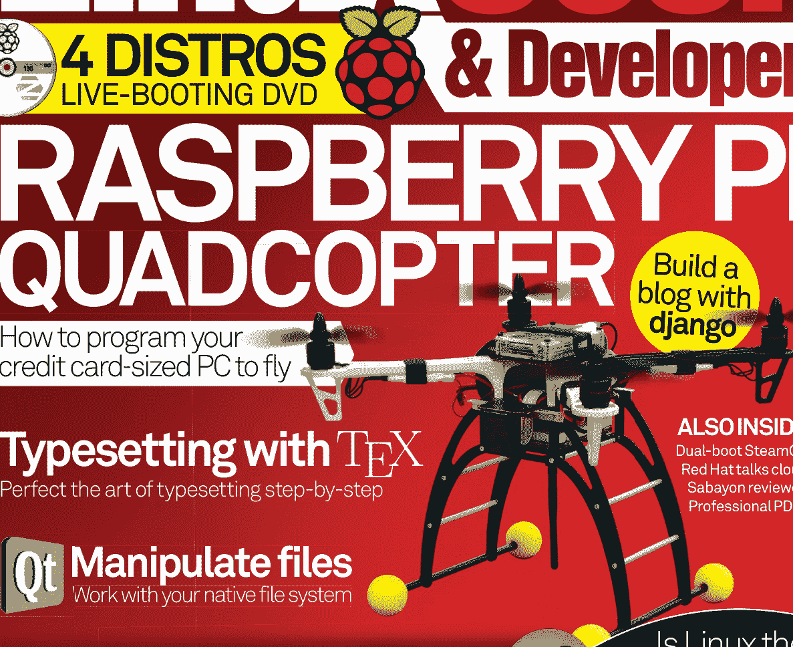

每天为数千家企业提供服务！


欧洲欧洲虚拟化提供者的专业知识

我们利用最新的 `HP` 和 `Dell` 硬件

提供卓越的性能和可靠性

灵活、强大且高效益

- 预装系统的即用服务器
- 使用 `Plesk` 进行简单管理
- 完全控制权带来的灵活性
- 高级专家支持与技巧
- 稳定、弹性且健壮的平台

> “这项服务太棒了，简单易用，对我客户来说一切都是实时的。”

`Stephen Shepherd`，`Surbrook Creative Studio` 所有者

使用我们高效益的方案，获取业务所需的灵活性、性能和动力


了解更多：

价格和功能截至 2014 年 1 月。


`Rob Zetsloot` 在大学学习航空航天工程，使用 `Python` 在课堂上对复杂系统进行建模。136 期有幸采访了 `Monopoly Linux` 创者 `Geoff Sutton` 关于 `Steam` 的，从第 18 页开始的精彩专题报道。

`Tom Ham` 自 1985 年起进入 `IT` 行业，担任过记者、导师和科学类作家。从那时起他见证了移动游戏的各个方面。`Tom` 将继续介绍本期中涉及的“代码类”游戏。

`Mihals Tukacos` 是一位拥有编程和数学经验的 `UNIX` 系统管理员。他自 1996 年起一直使用 `Linux`。`Mihals` 在第 48-53 页展示了如何使用 `GIMP` 制作照片。我们在接下来的几个月也会回顾这个主题。

`Michael Reed` 是一位技术作家，编写 `Linux` 相关文章已有 15 年。他专攻 `Linux` 开发和开源。在第 136 期中，`Linux User` 老兵 `Michael Reed` 展示了如何将文档批量转换为 `PDF` 的过程。你可以

`Jon Lister` 是一位内核开发者，在 `Linux` 领域已工作了 18 年，从 13 岁上大学起开始。`Jon` 与独立内核开发者 `Thomas` 会面，并为一家大型企业 `Linux` 供应商工作。

`Gareth Halcliffe` 是我们的记者，从第 12 页开始带我们了解开源生态系统的最新进展。下期 `Linux` 将详细讨论 `UEFI` 和开源。

欢迎阅读 `Linux User` 最新版，这是英国和非洲最喜爱的开源杂志。看来我们的树莓派项目在读者中大受好。。打算在不久的未来构建另一个机器人。`Andy Baker` 来自 `linuxstuff.co.uk` 展示了如何向你的树莓派项目添加四个旋翼，这比你想象的要科学得多。他在从第 56 页开始的精彩文章中解释了树莓派 `PID`。

我们还有幸与 `Monopoly` 创者、全能行业传奇 `Geoff Sutton` 坐谈 `Steam Alchemist`。我们还可以从第 18 页开始的大型专题中找到更多关于 `Steam Alchemist` 的评测。享受本期内容！

与团队联系：`linuxuxer@imagine-publisher.co.uk`

`Twitter`：`@linuxuxer` `imaginesh.co.uk` 在线购买

访问我们的网站获取更多新闻、观点、教程和评论：

`www.linuxuser.co.uk`


Linux 社区的最新动态

> `OpenStack` 和 `OpenShift` 只是确保采用标准的两项技术

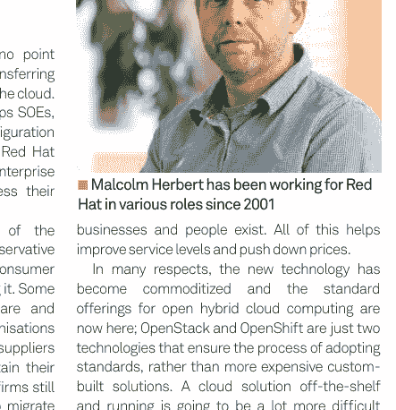

随着企业 `Linux` 规模的不断扩大，对有效管理手段的需求变得显而易见。`Landscape`、`Puppet` 和 `Cobbler` 等开源系统管理工具在企业中占据主导地位，而 `Linux` 环境与 `UNIX` 或 `Windows` 环境相比具有显著优势。标准操作环境（`SOE`）是任何当前数据策略的基础元素。为了管理当配置差异扩散到整个 `IT` 基础设施时不可避免地产生的复杂性，投入时间和精力审查策略并计划迁移到 `SOE` 是值得的。如果没有计划，就不无法添加更多使全开放云部署成为可能的其他功能。

我们的观点是，将运营解决方案引入云端没有任何时间和精力精力意义。`红帽计算`（`Red Hat Computing`）设计并开发 `SOE`，使开发、更新和配置管理尽可能可行。`红帽` 衡量，有 10-15 家企业已准备好进行云计算。

`Linux` 正在迅速成为标准的一部分，尽管在银行、保险或零售等垂直行业，一些机构仍然比较保守。如果没有 `UNIX` 和这些开源软件解决方案的推动，这些机构将寻求维护其遗留系统并处于被锁定状态。

对于操作系统、虚拟化环境和应用程序，组织需要保留对其新 `SOE` 的控制权。他们可以通过定义好适当的边界来确保这一点。在概念上，`SOE` 是一组松耦合但功能齐全的工具，用于管理 `IT` 环境。在这种情况下，企业可以安全地准备好云就绪，并知道所做出的决定不会阻止未来技术的采用。

在没有限制的情况下采用和适应技术提供了极大的竞争优势。这并非没有风险，首批迁移到 `Linux` 的人将接受实战检验。这些方法是经过测试的良好实践，以确保秩序。此外，越来越多技术高超的开源项目挑战了传统数据库，同时也挑战了单一供应商。

- `Malcolm Herbert` 自 2001 年以来一直在 `红帽` 担任各种职务

人们在许多方面都重视这项已标准化的技术，运行开源 `Linux` 的时代现在已经到来。`OpenStack` 和 `OpenShift` 只是确保采用标准的两项技术，而不是让公司被锁定的且运行将好很多的更贵的专有解决方案。


供应商拥有路线图，但供应商控制钥匙。

与此并行的对比是 15 年前的采用和今天的云计算。企业正在意识到正在向何方发展。供应商的选择（如果有的话）、标准和由社区驱动的策略。

通过与正确的支持合作并对 `OpenStack` 提供咨询服务，可以将所需的开源组件整合在一起。

还应该对项目的架构所有权进行最后的考虑。如果一个人拥有代码，那么雇佣者的自由就非常有意义。渲染所有权有时似乎是更简单的选择，但它将带你进入一个困境，一个小小的决定可能会排除未来成功的云策略。

对于大多数遗留系统的人来说，现在有一应该是明确的：`UNIX` 没有未来，它在任何现代云策略中都没有位置。

`Malcolm Herbert` 相信选择自由。

`www.linuxuser.com`

你的 `Linux` 新闻和观点来源

`www.linuxuser.co.uk` 直接给我们发邮件...

欲获取最新新闻和观点，请发送至 `linuxuser@imagine-publishing.co.uk`

> `Brian Krzanich`，英特尔首席执行官，认为 `Linux` 驱动的 `Edison` 可能是英特尔进入穿戴计算领域的入口


## 英特尔推出 `Edison` - 微型计算机

### 全功能 `x86`

（注：由于原文在后半部分存在大量重复和逻辑不连贯，译文已根据语意进行了对齐处理）

英国首个南岸聚会活动确认

《`Linux` 用户与开发者》杂志将举办其历史上首次的“树莓派聚会”（`Raspberry Jam`）。该活动将于 2014 年 4 月 5 日在多塞特郡普尔的 `RNLI` 举行。

届时将为 120 名树莓派爱好者提供空间，让他们与其他编码人员和创客者聚在一起，学习并分享关于他们项目的想法。

活动将涵盖来自树莓派世界的专家演讲、与会者可以在其中学习编程和制作项目的工作坊，以及创作者可以分享其最新树莓派作品的展示分享环节。

`Linux` 用户树莓派聚会面向于所有技能水平的爱好者，并且对于不想自带设备的参会者，现场将提供足够的树莓派供使用。

> `Linux User` 编辑员 `Russell Barnes` 表示：“我们 `Linux User` 是树莓派的忠实粉丝，因此我们非常期待在首届树莓派聚会上与其他爱好者聚在一起。”

活动将为所有年龄段的粉丝准备丰富内容，有许多精彩的项目演示和挑战等待大家体验。

活动门票现已出售（成人 25 英镑，18 岁以下参与者免费），可通过 `Eventbrite` 网站 `www.eventbrite.co.uk` 购买。如需活动更新，请在 `Twitter` 上关注我们 `@LinuxUserMag` 或访问我们的主页 `www.linuxuser.co.uk`。


Linux 社区最新动态


### 谷歌加入开放汽车联盟

希望在今年年底前主掌方向

广告巨头谷歌宣布与半导体和汽车行业资深企业 `NXP`、`奥迪`、`英特尔`、`通用`和`现代`建立合作伙伴关系，加入开放汽车联盟（`Open Automotive Alliance`, `OAA`）。

`OAA` 旨在复制 `Android` 的成功，鼓励基于 `Linux` 的 `Android` 操作系统及其由 `Google` 控制的生态系统应用于车载娱乐系统，一个新平台将于今年年底发布其首批产品。

“`OAA` 致力于让开发者能够创新，让汽车技术对每个人来说更安全、更直观，”该集团的创始声明声称。“这种开放开发模型和通用平台将允许汽车制造商轻松将尖端技术带给驾驶员，并为开发者创造新机会，以安全且可扩展的方式为驾驶员和乘客提供更强大的体验。”

“数百万人已经熟悉 `Android` 并每天都在使用它，”`Sundar` 在发布会上说。“`Android` 平台扩展到汽车领域将把移动技术整合到汽车中，为驾驶员提供熟悉的、无缝的软件体验。”

此举是谷歌内部生产全自动驾驶车辆的研发工作，该公司已拥有其工作原型。


谷歌的开放汽车联盟希望将 `Android` 从口袋带到多年来的仪表盘上。这些是基于 `Google Chauffeur` 的一个原生深度集成到汽车基础设施中的软件平台。相比之下，`OAA` 的 `Android` 版本将限于仪表盘的娱乐和导航系统。

### Linksys WRT54 在 Belkin 旗下重生

开源路由器获得 21 世纪新面貌

流行的 `Linksys WRT54G` 路由器（`OpenRouter` 发行版的诞生石）已被新所有者 `Belkin` 更新并重新发布为 `WRT1900`。

2002 年，该路由器因被发现违反其操作系统所属的 `GPL` 许可证而给其创建者 `Linksys` 造成了巨大的头疼。2003 年，公司发布了源代码——直接导致了固件方面性的爆炸式增长，并增加了新的功能和能力。

其替代品 `WRT1900AC` 保留了原始设计的蓝黑色调，但现在采用了双核 1.2 GHz 处理器、四根天线、双频（5GHz 和 2.4GHz `WiFi`）、四个千兆网口以及 `SATA` 和 `USB 3.0` 连接。

自那时，`Belkin` 还为 `OpenWrt` 社区提供了源代码、开发工具包和编程接口。在写作时，`WRT1900` 在英国的供应和价格尚待确认。


第二象限生产

对 `PostgreSQL` 的支持提供 15 分钟（人工）响应，4 小时周转并保证在 24 小时内修复。每天 24 小时，每年 365 天。

我们将保持业务活力。


Linux 新闻与观点

### 一个委员会的希望


慕尼黑（注：此处原文可能误写为 `LiMux`）这种德语发行版希望为其他政府铺平道路。

即使是最小的组织也与遗留产品和难以绕过的流程有关。开放 `API` 和接口提供了长期灵活性、数据完整性和可访问性，这在随机使用数据库 `.NET` 和 `VB` 脚本之后才能实现。正如许多组织，慕尼黑的 `IT` 系统多年来一直是根据部门逐个演变的，结果是委员会的 `IT` 部门负责各自的运营，通过不同的优化流程，没有标准和巨大的数据管理。

`Richard Hill` 关于艺术、音乐、数字权利以及各种出版物的免费软件。

`Florian Schebel` 注意到，`LMux` 是世界 `IT` 分发的一个小镜像。通用用户硬件管理。用于软件发行和管理的不同工具。超过 300 个应用程序，许多是冗余的，例如 `FrontPage`、`Fusion` 等，用于 `HTML` 编辑。

将城市的计算机系统从 `Windows` 迁移是一个漫长的过程，但否认 `Linux` 的使用很奇怪，不同版本的 `Windows` 迁移带来了问题；碎片化数据或冗余应用程序以及过程本身。并没有改变。

然而，微软甚至更促使慕尼黑在 2013 年进行了一项研究显示了约 1700 万英镑。慕尼黑 `IT` 服务供应商 `Julia Kreys` 反驳说，系统质量“很糟糕”，她不会作为一个研究项目发布。行政部门利用机会重新构了数据。

`www.linuxuser.co.uk`

Linux 社区最新动态

仅仅因为旧游戏是免费的，我们就不应该在某人这样做时对其感激多年……


客户端、不同的补丁级别、安全概念。完整的问答分解可以查看。但复杂性会产生数据。数据并非基于任何明确的低效率会渗透进来，更多问题层层叠加。尽可能地，重新对齐计算机系统提供了一个收回我们可以使用的数据并避免痛苦的回报的机会，从长远来看，免费桌面工具的实施没有实际利益，也是一个开始并结束的过程的源头。这并不难隐藏：复古游戏和更现代的游戏多年来已经在网页浏览器中免费可用了。问题是，大量的发行商选择了视而不见，而不是免费提供给他们关心的玩家。

最近，越来越多的发行商对他们的作品更加保护。在一个所有游戏都只需几英镑即可免费获取的时代，曾经愿意提供旧游戏的发行商现在会想他们多快可以将它们翻新并标记在网络各地。

> `Simon Berry` 是一位跨越 `Linux`、`Mac` 和 `OS` 平台的技术作家和编辑。我是那种寻找档案及其历史的人。游戏玩家也是那类非常了解档案领域的人，无论他们是否进入过其中。对于大多数组织来说，从 `Windows` 移动到 `Linux` 的首要原因是感知到的成本节省。但还有互操作性和标准的通用性，这带来了更长期的利益。解锁数据和资源可能意味着短期内失去时间并消耗成本，但这样做会带来昂贵且高效的结果。

宣布一系列 70 年代和早期视频游戏已在网页浏览器中免费，其中一些是档案启动“控制机项目”的最新工作。`Linux` 现在可以从收藏中获得五个控制机的游戏，`Magnav`、`Odyssey` 和 `Asteroids` 也是免费的。

市政府、其他德国委员会、`Linux` 社区和其他利益 `LMux` 的回报之一。`LMux` 是一种通用 `Linux` 发行版已被德国政府批准为官方发行版。慕尼黑的工作可能是最好的。免费游戏可以在 `archive.org/details/console` 查看，点击任何你喜欢的项目，不要让它们让你困扰。

## 开源

您的 `Linux` 新闻与观点来源

## 内核专栏

随着 `3.13` 开发最后阶段的结束以及 `3.14` 开发周期的开始，`Jon Masters` 总结了 `Linux` 社区的最新动态。当然，这是一个持续的过程，其中大多数功能已经成熟并存在于各个子系统的开发树中。这些功能中的大部分一部分已由 `Stephen Hahn` 在 `'linux-next'` 合并树中处理。其余部分已经在某些地方经过了测试，但在 `3.14` 中不会有任何尚未发布说明的新代码进入。

针对潜在利用的另一个论点通常是，攻击者在入侵系统后可以删除日志，这是一个微小的操作，会使其毫无价值。后者可以通过实时日志和其他防止攻击者破坏日志的功能来轻易应对，这些功能通过断言来确保只有安全问题会被删除。`Jon Masters` 是一位拥有 18 年 经验的 `Linux` 黑客，他曾就读于剑桥大学，目前任职于企业供应商。他在 `kernelmasters.com` 发布每周邮件列表。

`Vegard Noisson` 提交了一项名为“已知漏洞检测”的补丁提案。由于不同的内核版本对可能损害系统的不同代码序列敏感，因此可以将命名的“利用”放置在内核中添加修复程序的地方，从而在内核被补丁后防止利用。捕获利用的通知也令人厌烦，`Vegard` 喜欢大多数成功的尝试通常是微小操作——系统虽然获得了 `root` 权限，但在日志中没有迹。

`Linux 3.13` 候选版本 (`RC8`) 表示“并不特别可怕”，这意味着在我们读到此文时，`RC8` 可能已经发布。`Jon Masters` 引入了针对（通常是）`RC8` 合并窗口（针对 `Linux 3.14`）的工作，因此无论是否需要下一个 `RC8`。现有的内核没有提供这种机制。那么它们要么会对用户添加或删除的某些更改产生漏洞。事实上，确实存在一些反对意见，因为这似乎可能导致内核随着时间的推移包含大量的注释。总的来说，对于 `Keith Cook` 这样关注 `Linux` 社区安全问题的经理来说，日志机制是简单且有效的。他确保了这种利用（或类似的利用）被添加的可能性非常小。

## 进行中的开发

针对即将到来的 `3.14` 开发周期的功能开发，`Miklos Szöllosi` 展示了 `'rename'` 系列补丁的第 3 版本。这是一个新功能（有时被称为 `'renamed'`），其行为与 `'rename'` 系统调用类似，但有一个名为 `rename flags` 的额外参数。这个额外参数涉及 `rename` 概念，它允许（例如）将目录树与符号链接进行交换。

## 观点

内核专栏 - `Jon Masters`

## 开源

“大多数黑客在成功之前会尝试多次利用”


从原子性来说，这意味着运行的程序看到的两个组件要么是在它们被交换之前，要么是在没有办法看到不稳定状态的情况下（这需要使用一系列调用，通过先拆毁项再重建它们来模拟）。`Masters` 计划将 `rename` 引入下下一个 Linux (`3.14`) 内核中，作为未来覆盖层（`overlays`）的依赖。这避免了使用复杂的指令`#pragma once`，它允许将经典的头文件守符宏替换为更优雅的内容。`#pragma` 特殊代码序列被称为“包含保护”（`include guards`），因为它们的设计是为了确保头文件在条件预处理器指令中仅被包含一次。其他现代编译器更优雅，但标准性较低，因此更容易出错。

切入正题，交叉重命名（`cross-rename`）对于叠加文件系统非常有用，它可以将两个文件系统合并为一个虚拟文件系统，通常用于“实时”系统，在这些系统中，只读根文件系统由辅助空间（另一个文件系统）修改，该空间是只读文件系统与数据之间的差异

`Jon Masters` 将作为 `One Fund Boston` 的成员之一参加 `One Fund` 波士顿马拉松，为去年受影响的人筹集资金。他需要像你这样的朋友帮助支持他的筹款，可以在此处捐赠：`bit.ly/1dum06`

新文件被添加到内部叠加层，或者项的删除或替换被标记为“白出”（这是世界的祖先），使用像 `TipEx`——一种在点上覆盖文字的物质这样的名称——白出项忽略某个项文件并使用替换项（来自叠加层）。通过使用交叉重命名，叠加文件系统可以原子地呈现文件系统的视图视图，或者使用 `EZZF` 格式的空白空间利用。由于缺乏支持它的工具，目前无法恢复遗留数据，除非使用 `2` 个文件系统之一进行

最后，本月的奖授予 `Steven Rostedt`，感谢他提出的允许内核访问的建议。然后如果有人尝试在普通账户中。`David Jones` 指出内核终于修复了对新`bz2` 存档的支持。使用`gz` 文件格式以及`xz` 文件格式，提供了更高效

**为您的网页项目服务**

专业人士全方位选择

每月 £2.99 起\*

不含 20% 增值


- 免费域名 (`/.com`, `/.net`, `/.org`, `/.co.uk...`)

- 无限量：网站空间、每月流量、电子邮件账户和`MySQL` 数据库

- `Linux` 或 `Windows®` 操作系统

- 超过 140 热门应用 (`Drupal™`, `WordPress`, `Joomla!™`, `TYPO3`, `Magento®...`)

- 针对所有咨询提供`1&1` 专家支持

- 包含高级软件：`Adobe® Dreamweaver® CS5.5` 和`NetFusion® 2013` – `1&1` 版

- `1&1` 移动网站生成器

- 新品：`PHP 5.5`, `Perl`, `Python`, `Ruby`

- `1&1` SEO 专业

- `1&1` 搜索引擎营销

- `1&1` 邮件订阅工具

# 尖端技术

- 新品：包含`1&1 SiteLock` 安全扫描！


## `SteamOS`

在经历了多年的传闻、数月的预热和数周的等待后，`SteamOS` 终于问世。这个游戏发行版的发布标志着`Valve` 进军硬件市场的开始。在发布当天，第一批`Valve` 自己的`Steam Machines` 已经发货。这些早期上架的产品虽然寥寥无几，但实际上它们是未来更多第三方产品的先例。`Valve` 的这一巨大举措在科技和游戏界引起了波澜，预计随后会有一些人士能够帮助我们真正理解`Valve` 的处境，以及他们的下一步动作可能是什么。

### `www.linuxuser.co.uk`

我们采访了游戏界一些最重要的人物，听听他们对`SteamOS` 的看法

#### **游戏行业资深人士**

《猴子岛之旅》系列背后的男人`Ron Gilbert` 已经在行业内深耕了`25` 年。去年，他创立了`Beep Games`，这是首批在`Linux` 上发布的游戏之一。他现在运营着`Beep Games` 工作室，目前专注于移动游戏。

#### **Linux 移植专家**

独立游戏幕后的一位重要人物，`Ethan` 是`Linux` 最重要的人物之一。去年，他帮助移植了一些独立游戏界的大名之作，包括《`Fez`》、《`Rogue League`》和《`Super Hex`》。

#### **独立游戏开发者**

`Fullbright` 公司联合创始人，`2K Marin` 前员工，`Johnnemann Nordhagen` 自`2013` 年的独立游戏`Game Home` 以来一直深耕独立领域。他是一名程序员，目前正在环游世界，准备在投入下一个项目之前结束旅行。

> “我正在为我制作的`iOS` 游戏《`Scurvy Scaffolds`》制作`Android` 版本，”`Ron Gilbert` 在我们在电话中问候他时说道。

我们在`Skype` 上联系到了他，他对移植自己的最新游戏感到非常兴奋。在`Linux` 上运行实际上是很有趣的，因为这意味着他制作的下一个作品将更具跨平台友好性。话题很快转到了`Linux` 作为一种方式

> “移植是一件很有趣的事，”他说，“并不是说它要出来，但它并没有特别之处。我觉得这太棒了，所以`Linux` 上的优秀独立游戏很棒，因为人们可以在运行桌面平台的同时玩游戏，而无需启动到`Windows` 或任何其他我不想处理的东西。”

他准确地回答了他所说的`Linux` 并不特殊是什么意思，假设他指的是从技术角度来看它并没有特别不同。“为`Windows`、`Mac` 或`Linux` 编写游戏非常相似。你只需要确定你用的是`OpenAL` 还是`DirectX`，并且你必须处理这个问题；希望人们编写的代码具有分层，在代码和硬件之间有平台分层。”

随着独立游戏和硬件的兴起，`Steam` 进入`Linux` 也大有裨益。“`Steam` 确实拥抱了`Linux` 平台，这是一个可行的开发平台。”

这就是`Ethan Lee` 登场的地方。我们之前和他聊过，他已经将游戏移植到`Linux` 大约两年，随着`Steam for Linux` 成为游戏日益被接受的严肃考虑，他对技能的需求在过去一年中有所增加。

> “就在`Steam for Linux` 出出的左右，我开始真正为`Linux` 制作一个可以运行的游戏，我不确定是因为`Steam` 还是我的`MGSDL` 开发导致了这种情况。所以，`MGSD2` 发生了……在四月之前我只有两个。从四月我决定了更多。”

“然后一切似乎并没有任何放慢的迹象。”


控制器是`Steam` 的一部分，虽然他们可能在上面花费了时间，但事实是他们需要更好的硬件。他们只是在说，“让`OEM` 去做，然后我们会解决软件问题。”这很有意义。

现在的威胁更大。如果一个`Steam Box`（`Steam Box`）必须运行`Windows 8`，那它将完全是一堆垃圾。

关于价格问题，大家都认同它的定价应该与游戏主机相似，而不仅仅是那种可能无法预估价格的低端产品。”当我们询问`Johnmann` 是否有让它变得廉价的想法时，`Johnmann` 回答道。他表示价格并没有想象中那么昂贵，但比游戏主机便宜。显然，想要免费获得是很的，但我知道`Valve` 为什么要这么做。

在这些问题中，如果由我来演示，我会建议通过这种方式来明确`Johnmann` 所表达的观点。“事实是，人们喜欢它的外观并想要一个免费版本，但他们没有，因为[`早期采用者`] 将是第一批购买这种产品的人，他们对成本的关注不如对多样性的关注。事实是，他们只是想强调‘我们可以在任何设备上运行`Steam`，我们可以拥有一个比`Xbox` 更便宜的盒子。’”

同样值得注意的是，`微软` 和`索尼` 能告诉我们它们在消费者那里失败的原因，是因为它们将消费者视为亏本买，正如`Ron` 回复的：“`索尼` 和`微软`，他们是在亏本卖机器。”

只是这样他们就能在软件销售中赚钱。你可能会认为`Valve` 也能做到这一点，因为如果他们将其授权给这些第三方，那么他们就失去了自己构建软件的能力。

所以，尽管我们的专家小组认为运行可能会遇到一些问题，但`SteamOS` 的未来正开始缓慢增长。行业正慢慢开始接受`Linux` 作为游戏平台的理念，而且这种想法很难被改变。这可以追溯到`Ron` 开发他的`Android` 移植版本并从中学习。

“我显然也想支持`Linux`，”他说，“是的，我可能会雇人来做初始的`Linux` 移植，但我希望以后构建`Linux` 版本能变得容易得多。我没有看到任何一个`Steam` 游戏是不包含`Linux` 版本。”

今年`1` 月中旬，参加`Valve` 举办会议的开发者们看到了`Machine`、`Galaxy Box` 和`Steam` 控制器。结果是许多人正忙于将他们的游戏移植到`Linux`。

| `2010年5月12日` | `2014年12月14日` |
|---|---|
| `Steam` 在`OS` 上发布，这是客户端从`Windows` 的首次扩展。尽管标题范围有限，但网络增长了，任何游戏购买都涵盖了多个操作系统。 | `SteamOS` 发布，并有`300` 台`Steam Machines` 和`Steam` 控制器发送给`Beta` 测试员。最初仅支持`Nvidia` 显卡，但不久后就进行了更新。 |


## 2009 2010 2011 2012 2013 2014


2013年2月14日

`Steam` for Linux 在经过几个月的 Beta 测试后正式发布。当 `Valve` 开始谈论使用 Linux 来驱动它时，所有关于 `Steam` 驱动硬件的传闻似乎都得到了证实。

21 www.linuxux.co.uk

Beta 参与者我们与一位幸运的 `Steam Machine` 所有者 Colby B 取得了联系，帮助我们评测 `SteamOS`……


- `Steam` 的大模式（`Big Picture Mode`）是让 `SteamOS` 在标准电视显示器上易用的重要部分。

`SteamOS` 目前处于 Beta 阶段，`Steam Machines` 已经在路上——在此期间 `Valve` 的 Linux 发行版如何？

> Linux 游戏发行版很少——然而，它们以各种形式存在。`SteamOS` 绝对值得提供一种纯净的游戏体验，得益于 `Steam` 的原生玩具桌面模式，专为客厅设计。正如名称所示，它是 `Steam` 游戏平台，允许你从内容库中下载游戏，并通过商店购买更多游戏。`SteamOS` 基于 `Debian 7`，目前在你使用它时，会被强制登录 `GNOME` 桌面以完成设置，虽然这时间非常短，但正如 Colby B 告诉我们的，这会让新用户感到相当困惑。“`Debian` 的 `GNOME` 桌面很好，但你确实需要 Linux 背景才能使用它，我不是说大多数读者都这样做，但我是一个最近的转化者，发现起初有点困难。”

只有在安装后才能到达这一步。目前，关于它如何工作以及在何处有一些遗憾的事实——包括目前最大的限制是你被强制使用 `UEFI`。它在让人们直接使用方面有一些优势。

想要尝试 `Steam` 并希望获得比 `Valve` 官方提供更多的内容吗？这里有一些 Linux 和 `SteamOS` 上可玩的最佳游戏，可以帮助你入门。

《战锤：最后光》是目前未支持 Linux 但知名度最高的游戏之一。作为被严重低估的《战锤：2033》的续作，《最后光》将玩家带回到末日后的莫斯科。这是一款带有恐怖元素的第一人称游戏，更不用说派系之间的分歧。在游戏中，弹药被用作货币——也就是你在武器中所使用的相同能量。这种手动瞄准系统有助于在保持生存的同时维持氛围感。


两个类别的 20 个平台定义了：白天平台和高速特技平台。后者是基础平台类型中的绝佳之作，并通过了超级肉肉男孩的严。。该游戏最初发布于 `Xbox 360`，随后很快面向 PC 玩家。这是一款精彩且节奏快速的平台游戏，几秒钟可能花费几分钟不等的时间，关卡中充满了想要因你犯一个小错就杀死ك的物体，而成功则需要大量的技巧、运气和一点乐趣。


该游戏使用控制器游玩，例如 `Xbox 360` 手柄，但显然使用 `Steam` 控制器也运行良好良好。不过，如果你必须用键盘玩，我们还不认识任何能完成这项任务的人。

### Ron 推荐...

Ron 简单地评价道“这真的是一个非常棒的游戏！”他 推荐了最佳生物沉浸式控制 Simon Papers。在写本文时，该游戏仍在 Linux 版本的开发中，它关于当你看到人们试图进入你的国家时的你的家庭福利。

“我非常喜欢 Anode，它可能是我去年最喜欢的游戏。3D 潜入。一个让你探索太空和外层世界的动作冒险游戏。它是少数通过 `Steam` 绿光计划（`Greenlight`）的作品之一，用户通过投票决定将独立游戏加入 `Steam`。”

### Johannemann 推荐...

“我知道开发者在 Linux 实现上投入了很多心血！”Johannemann 说。这是一款受 H.P. 洛夫克拉特启发的第一称动作游戏，利用你的战斗实力穿过恶魔世界。游戏还具有类 Rogue（`rogue-like`）元素，地牢是随机生成的。

游戏的未来

专题


▲ 作为早期 `Kickstarter` 的成功案例，《FTL》是 2012 年独立游戏的宠儿之一。作为一款太空策略游戏，《FTL》让你指挥一艘快速返回总部递送叛军计划的星舰。你在管理珍贵资源的同时，管理许多敌对太空区域。游戏很难，具有类 Rogue 特性，地图是随机生成的。由于是单生命且随机生成，这对玩家来说非常有回报，因为游戏有多个地方让你想要停留。更高的难度等级和不同的班次改变了游戏的玩法，这意味着在完成之前将花很长时间。

▲ 《Fez》是上述益智平台游戏之一——一个简单的平台游戏，强调在途中完成的谜题。像《超级肉肉男孩》一样，它最初发布在 `Xbox Live`，并于去年移植到 Linux。《Fez》的核心是一个简单的概念，通过挑战具有挑战性的平台和物体，让 Gozo 穿越世界并进入新区域。一点谜题有助于你在探索世界的每个区域时移动。看到真正的结局需要一些惊人的脑力挑战，使它成为过去几年最有成就的游戏之一。

▲ 《回家了》是那些扩展了视频游戏定义的的作品之一。它最恰切的描述是一个互动小说，玩家以第一人称控制一个回到童年之家的女性。在那里，她的姐姐留了一张值得关注的字条。游戏让你搜索角色的背景故事，并为可玩角色揭示新事实。这些故事通过游戏进行探索，以第一人称游戏玩过它使其成为极具沉浸感且必不可少的体验。它使用 `Unity` 构建，允许轻松部署到 Linux。

无线发明家套件

适用于树莓派 ™TM

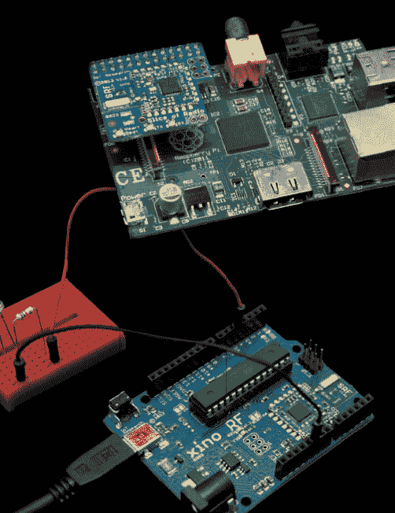


88 个零件

▲ 作为早期 `Kickstarter` 的成功案例，《FTL》是 2012 年独立游戏的宠儿之一。作为一款太空策略游戏，《FTL》让你指挥一艘快速返回总部递送叛军计划的星舰。你在管理珍贵资源的同时，管理许多敌对太空区域。游戏很难，具有类 Rogue 特性，地图是随机生成的。由于是单生命且随机生成，这对玩家来说非常有回报，因为游戏有多个地方让你想要停留。更高的难度等级和不同的班次改变了游戏的玩法，意味着在完成之前将花很长时间。

▲ 《Fez》是上述益智平台游戏之一——一个简单的平台游戏，强调在途中完成的谜题。像《超级肉肉男孩》一样，它最初发布在 `Xbox Live`，并于去年移植到 Linux。《Fez》的核心是一个简单的概念，通过挑战具有挑战性的平台和物体，让 Gozo 穿越世界并进入新区域。一点谜题有助于你在探索世界的每个区域时移动。看到真正的结局需要一些惊人的脑力挑战，使它成为过去几年最有成就的游戏之一。

▲ 《回家了》是那些扩展了视频游戏定义的的作品之一。它最恰切的描述是一个互动小说，玩家以第一人称控制一个回到童年之家的女性。在那里，她的姐姐留了一张值得关注的字条。游戏让你搜索角色的背景故事，并为可玩角色揭示新事实。这些故事通过游戏进行探索，以第一人称游戏玩过它使其成为极具沉浸感且必不可少的体验。它使用 `Unity` 构建，允许轻松部署到 Linux。

无线发明家套件

适用于树莓派 ™TM


88 个零件

使用 `Valve` 创新的浏览器和基于控制器的文本输入功能轻松浏览网页

`SteamOS` 在“大视模式”（`Big Picture mode`）下原生运行，非常适合快速构建一台客厅 PC 或家庭影电脑（`HTPC`）

使用 `SteamOS` 轻松在你的电视上玩兼容 Linux 的 `Steam` 游戏

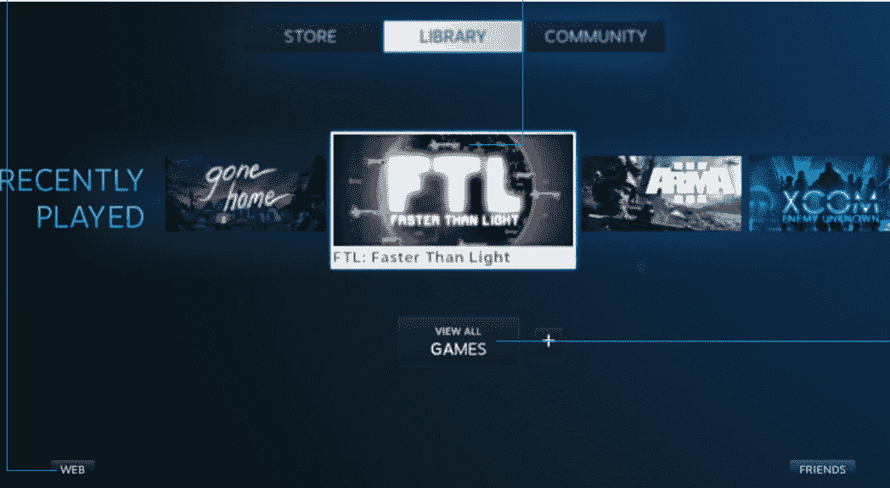

打造最适合你的 `SteamOS` —— 专为你而定制。学习如何安装 `SteamOS` 并实现双启动，以获得最大的灵活性。

Rob Zwetsloot 负责复杂系统建模并使用 `Python`、`Django` 和 `PHP` 开发客户端。他热爱计算领域的实验。

`SteamOS` 来了，它是游戏和 Linux 的未来。相比之下，`Steam` （`Steam Machines`）将无法离开货架，甚至是虚拟货架。解决这一困境的方法非常简单：利用 `Steam Machine` 进行游戏，打造你自己的 `SteamOS`。

`SteamOS` 网站上的说明可能具有误导性。此外，`SteamOS` 目前缺少一个安装元素。至少按照传统方式，你无法将 `SteamOS` 添加到已经带有桌面的运行中的电脑中。通过合理的规划，你可以与现有的 `SteamOS` 实现双启动，或者在任何硬件上创建双启动系统。


# 系统要求

- 带有 `EFI` 或 `EFI` 支持的 `PC`
- `USB` 闪盘

制作 `Steam Machine` 也会比某些竞争对手便宜得多。最近你使用 `NVIDIA` 显卡可以获得最佳效果；但现在已经包含了对 `AMD` 和 `Intel` 芯片组的支持。

是时候创建一个终极客厅 `HTPC`，并在 `SteamOS` 的发展过程中体验它了。记住，这是你的电脑，所以请先做好备份或使用备用机。

`SteamOS` 安装文件：

`store.steamowered.com/buildyourown`

不过，安装过程并不总是一帆风顺，即使是最简单的也是复杂的。

# 打造属于你自己的个性化 SteamOS 版本并实现双启动


`USER` 建议你使用默认安装，但显然使用自定义选项要好得多。遵循 `Steam` 网站上的“构建你自己的”页面，并点击页面下方“安装”链接下载安装程序。

上一步中，请确保查看我们启动时入口点的时间。进入后重启，并使用默认的 `GRUB` 选项。如果你在屏幕上看到点，请在按下重置（`reset`）之前等待几分钟。如果尝试三次仍无法进入屏幕，请重新尝试安装过程。

确保你的 `USB` 闪盘是空的，并为了安全起见将其格式化为 `FAT32`。将安装程序的内容连接到带有任何隐藏文件的驱动器上。你不需要对此做任何说明，这会让过程稍微简单一点。

某些现代 `PC` 默认使用 `UEFI`。在继续之前，确保关闭 `UEFI` 菜单，否则你将无法安装程序，甚至无法安装 `SteamOS`。`POST` 后应该会出现进入菜单。

将你的 `USB` 驱动器插入系统并重启。之后从 `BIOS` 菜单启动，或者如果闪存盘启动，则从 `SteamOS/EFI` 菜单重启。然后你就可以设置如何安装 `SteamOS` 的环境了。

在 `Steam` 菜单中有几个选择，这取决于你安装了哪个版本的应用程序。选择“自动安装”继续。此过程是全自动的，完成后需要你输入指令以重启 `PC`。这将花费 30 分钟到一小时不等，取决于硬件情况。

如果你的 `BIOS` 支持 `EFI`，现在是在 `BIOS` 菜单中激活它的时候了。如果不激活它，`SteamOS` 甚至无法启动。

# 安装过程

在第二个硬盘上实现双启动并保留数据最简单的方法。断开带有操作系统的硬盘，并连接你想要安装 `SteamOS` 的硬盘。

一旦进入登录界面，输入用户名和密码然后进入终端。它将下载并更新 `Steam` 客户端，然后要求你登录账户。

退出 `Steam`，注销当前使用的会话。然后再次打开终端并输入：

```
sudo post_install.sh
```

它会询问密码：输入并回车。片刻后它会自动重启。

重启后，系统将执行自动恢复以完成安装。如果运行正常，就让它继续吧。

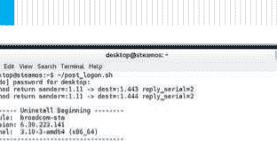

你可以根据需要缩小存储分区 - 但请记住，这限制了你在 `SteamOS` 中安装的游戏数量。任何其他发行版至少需要 20GB 才能安装，但你无法在它们之间共享空间，请记住这一点。

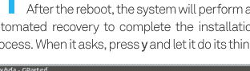


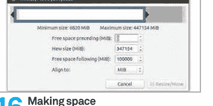
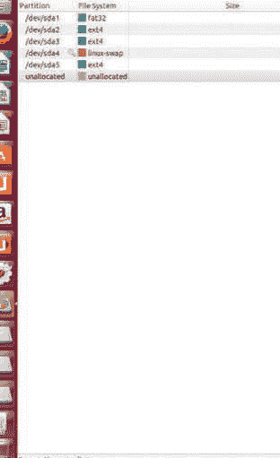
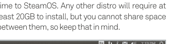


如果你的 `BIOS` 支持 `EFI`，那么现在是在 `BIOS` 菜单中激活它的时候。如果不激活，`SteamOS` 甚至不会启动。

在 `Steam` 菜单中有几个选择，这取决于你安装了哪个版本的应用程序。选择“自动安装”继续。此过程是全自动的，完成后需要你输入指令以重启 `PC`。这将花费 30 分钟到一小时不等，取决于硬件情况。

如果你的 `BIOS` 支持 `EFI`，那么现在是在 `BIOS` 菜单中激活它的时候了。如果不激活它，`SteamOS` 甚至无法启动。

在第二个硬盘上实现双启动并保留数据最简单的方法。断开带有操作系统的硬盘，并连接你想要安装 `SteamOS` 的硬盘。

将你的 `USB` 驱动器插入系统并重启。之后从 `BIOS` 菜单启动，或者如果闪存盘启动，则从 `SteamOS/EFI` 菜单重启。然后你就可以设置如何安装 `SteamOS` 的环境了。

在 `Steam` 菜单中有几个选择，这取决于你安装了哪个版本的应用程序。选择“自动安装”继续。此过程是全自动的，完成后需要你输入指令以重启 `PC`。这将花费 30 分钟到一小时不等，取决于硬件情况。

你可以根据需要缩小存储分区 - 但请记住，这限制了你在 `SteamOS` 中安装的游戏数量。任何其他发行版至少需要 20GB 才能安装，但你无法在它们之间共享空间，请记住这一点。

如果你的 `BIOS` 支持 `EFI`，那么现在是在 `BIOS` 菜单中激活它的时候了。如果不激活它，`SteamOS` 甚至无法启动。

在 `Steam` 菜单中有几个选择，这取决于你安装了哪个版本的应用程序。选择“自动安装”继续。此过程是全自动的，完成后需要你输入指令以重启 `PC`。这将花费 30 分钟到一小时不等，取决于硬件情况。

你可以根据需要缩小存储分区 - 但请记住，这限制了你在 `SteamOS` 中安装的游戏数量。任何其他发行版至少需要 20GB 才能安装，但你无法在它们之间共享空间，请记住这一点。

如果你的 `BIOS` 支持 `EFI`，那么现在是在 `BIOS` 菜单中激活它的时候了。如果不激活它，`SteamOS` 甚至无法启动。

在 `Steam` 菜单中有几个选择，这取决于你安装了哪个版本的应用程序。选择“自动安装”继续。此过程是全自动的，完成后需要你输入指令以重启 `PC`。这将花费 30 分钟到一小时不等，取决于硬件情况。

你可以根据需要缩小存储分区 - 但请记住，这限制了你在 `SteamOS` 中安装的游戏数量。任何其他发行版至少需要 20GB 才能安装，但你无法在它们之间共享空间，请记住这一点。

如果你的 `BIOS` 支持 `EFI`，那么现在是在 `BIOS` 菜单中激活它的时候了。如果不激活它，`SteamOS` 甚至无法启动。

在 `Steam` 菜单中有几个选择，这取决于你安装了哪个版本的应用程序。选择“自动安装”继续。此过程是全自动的，完成后需要你输入指令以重启 `PC`。这将花费 30 分钟到一小时不等，取决于硬件情况。

你可以根据需要缩小存储分区 - 但请记住，这限制了你在 `SteamOS` 中安装的游戏数量。任何其他发行版至少需要 20GB 才能安装，但你无法在它们之间共享空间，请记住这一点。

如果你的 `BIOS` 支持 `EFI`，那么现在是在 `BIOS` 菜单中激活它的时候了。如果不激活它，`SteamOS` 甚至无法启动。

在 `Steam` 菜单中有几个选择，这取决于你安装了哪个版本的应用程序。选择“自动安装”继续。此过程是全自动的，完成后需要你输入指令以重启 `PC`。这将花费 30 分钟到一小时不等，取决于硬件情况。

你可以根据需要缩小存储分区 - 但请记住，这限制了你在 `SteamOS` 中安装的游戏数量。任何其他发行版至少需要 20GB 才能安装，但你无法在它们之间共享空间，请记住这一点。

如果你的 `BIOS` 支持 `EFI`，那么现在是在 `BIOS` 菜单中激活它的时候了。如果不激活它，`SteamOS` 甚至无法启动。

在 `Steam` 菜单中有几个选择，这取决于你安装了哪个版本的应用程序。选择“自动安装”继续。此过程是全自动的，完成后需要你输入指令以重启 `PC`。这将花费 30 分钟到一小时不等，取决于硬件情况。

你可以根据需要缩小存储分区 - 但请记住，这限制了你在 `SteamOS` 中安装的游戏数量。任何其他发行版至少需要 20GB 才能安装，但你无法在它们之间共享空间，请记住这一点。

如果你的 `BIOS` 支持 `EFI`，那么现在是在 `BIOS` 菜单中激活它的时候了。如果不激活它，`SteamOS` 甚至无法启动。

在 `Steam` 菜单中有几个选择，这取决于你安装了哪个版本的应用程序。选择“自动安装”继续。此过程是全自动的，完成后需要你输入指令以重启 `PC`。这将花费 30 分钟到一小时不等，取决于硬件情况。

你可以根据需要缩小存储分区 - 但请记住，这限制了你在 `SteamOS` 中安装的游戏数量。任何其他发行版至少需要 20GB 才能安装，但你无法在它们之间共享空间，请记住这一点。

如果你的 `BIOS` 支持 `EFI`，那么现在是在 `BIOS` 菜单中激活它的时候了。如果不激活它，`SteamOS` 甚至无法启动。

在 `Steam` 菜单中有几个选择，这取决于你安装了哪个版本的应用程序。选择“自动安装”继续。此过程是全自动的，完成后需要你输入指令以重启 `PC`。这将花费 30 分钟到一小时不等，取决于硬件情况。

你可以根据需要缩小存储分区 - 但请记住，这限制了你在 `SteamOS` 中安装的游戏数量。任何其他发行版至少需要 20GB 才能安装，但你无法在它们之间共享空间，请记住这一点。

如果你的 `BIOS` 支持 `EFI`，那么现在是在 `BIOS` 菜单中激活它的时候了。如果不激活它，`SteamOS` 甚至无法启动。

在 `Steam` 菜单中有几个选择，这取决于你安装了哪个版本的应用程序。选择“自动安装”继续。此过程是全自动的，完成后需要你输入指令以重启 `PC`。这将花费 30 分钟到一小时不等，取决于硬件情况。

你可以根据需要缩小存储分区 - 但请记住，这限制了你在 `SteamOS` 中安装的游戏数量。任何其他发行版至少需要 20GB 才能安装，但你无法在它们之间共享空间，请记住这一点。

如果你的 `BIOS` 支持 `EFI`，那么现在是在 `BIOS` 菜单中激活它的时候了。如果不激活它，`SteamOS` 甚至无法启动。

在 `Steam` 菜单中有几个选择，这取决于你安装了哪个版本的应用程序。选择“自动安装”继续。此过程是全自动的，完成后需要你输入指令以重启 `PC`。这将花费 30 分钟到一小时不等，取决于硬件情况。

你可以根据需要缩小存储分区 - 但请记住，这限制了你在 `SteamOS` 中安装的游戏数量。任何其他发行版至少需要 20GB 才能安装，但你无法在它们之间共享空间，请记住这一点。

如果你的 `BIOS` 支持 `EFI`，那么现在是在 `BIOS` 菜单中激活它的时候了。如果不激活它，`SteamOS` 甚至无法启动。

在 `Steam` 菜单中有几个选择，这取决于你安装了哪个版本的应用程序。选择“自动安装”继续。此过程是全自动的，完成后需要你输入指令以重启 `PC`。这将花费 30 分钟到一小时不等，取决于硬件情况。

你可以根据需要缩小存储分区 - 但请记住，这限制了你在 `SteamOS` 中安装的游戏数量。任何其他发行版至少需要 20GB 才能安装，但你无法在它们之间共享空间，请记住这一点。


## 存储与启动配置

你可以根据需要缩小存储分区 - 但请记住，这限制了你在 SteamOS 中安装的游戏数量。任何其他发行版至少需要 20GB 才能安装，但你无法在它们之间共享空间，请记住这一点。

如果你的 BIOS 支持 EFI，那么现在是在 BIOS 菜单中激活它的时候了。如果不激活它，`SteamOS` 甚至无法启动。

在 `Steam` 菜单中有几个选择，这取决于你安装了哪个版本的应用程序。选择“自动安装”继续。此过程是全自动的，完成后需要你输入指令以重启 PC。这将花费 30 分钟到一小时不等，取决于硬件情况。

## 第二硬盘作为 HTTP 服务器

你也可以通过安装 `XBMC` 将第二个硬盘变成 HTTP 服务器。为了进入媒体中心，在会话中选择 `XBMC`。

对于这种设置，你需要一个键盘在启动时选择 `SteamOS` 和 `XBMC`。`XBMC` 支持 USB 控制器，你会喜欢用它们玩 `Steam`，你可以使用遥控器。选择自动登录，在注销登录前选择 `XBMC`。

如果你想让 `SteamOS` 成为启动时的默认选项，重新配置配置文件。找到 `default="0"` 行，并将 0 改为它在启动菜单中出现的编号，减去 1。

`XBMC` 有一套更新系统，因此你的客户端版本将随着新功能的添加而保持更新。核心系统并非这种工作方式，你可能需要重新安装 `SteamOS` 才能获得更好的驱动支持。不过，现在，你可以在不需要昂贵的价格下体验游戏的未来。

## 脚本化与自动化

我们将在命令行中进行操作，并且每一步都可以脚本化。

通过使用命令驱动的工具，我们确保了项目的每个阶段都是可定制且可脚本的。

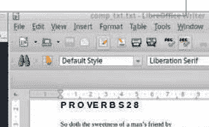

```
PROVERB52
He said: If I have one friend, and my friend's friend is also my friend, then I have two friends.
He said: If I make one enemy, I make my enemy. This enemy may become my friend, and if my enemy's friend is also my friend, then I have two enemies.
He said: If I have one friend, and my friend's friend is also my friend, then I have two friends.
He said: If I have one friend, and my friend's friend is also my friend, then I have two friends.
He said: If I make one enemy, I make my enemy. This enemy may become my friend, and if my enemy's friend is also my friend, then I have two enemies.
```

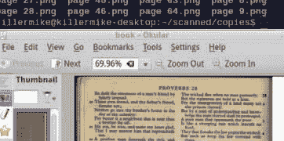


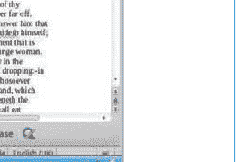


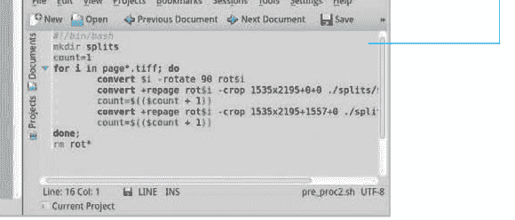

```
for i in 1 to count:
  if i == 90:
    count = 13352195+8 = /split/
    count = count + 1
  count = 13352195-1557 = /null/

done:
  return
```

# 自动化文档批量扫描

通过各种包，我们将向你展示如何整合一个脚本驱动的自定义文档扫描解决方案。

## 顾问

`Michael Reed` 是一位技术记者，他已经忙于 `Linux` 15 年了。

我们将向你展示如何创建一个文档扫描系统。为了实现这一点，将使用多种 `Linux` 工具。这种方法的优势是我们可以控制整个过程以匹配你的特定需求。这为我们提供了一个可以处理大型任务并开放大量定制的工具。

我们将查看可能的最终产物：一个每一页都是原始页面扫描的 PDF 文件，以及一个包含原始页面文本内容的文本文件。文本文件的内容是可搜索的，我们涵盖了将其转换为 PDF 的方法。

本教程是模块化的。例如，如果我们处理的是预扫描的图像，我们可以跳过初始步骤，直接将它们转换为 PDF。但话虽如此，如果你喜欢没有任何东西阻碍你。尽管如此，我们已经尝试将过程的每个部分脚本化，以实现完全自动化。

## 资源

- 一台 `Linux` 电脑
- 一台扫描仪

# 自动化文档批量扫描

创建一个脚本驱动的文档扫描教程

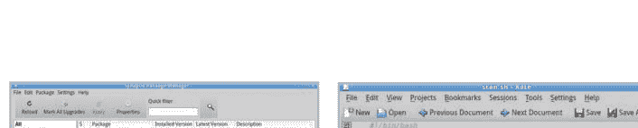

调色板。去掉文档有效部分上的区域，并在裁剪对话框中记录裁剪尺寸。在导入页面之前做好相应的记录。不要在 `GIMP` 中处理副本，它稍后将从命令行导入。


## 01 现在安装 SANE Access

如果你已经安装了 `SANE` 但仍然难以访问扫描仪，请安装 `SANE Access Now`。

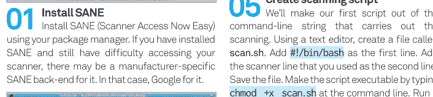

## 05 创建扫描脚本

我们将创建一个脚本驱动的扫描脚本。使用文本编辑器使用 `#!/bin/bash` 创建文件。通过 `chmod +x scan` 使脚本具有可执行权限。在我们继续时，可以调用这些脚本。

## 02 查找扫描仪


通过命令行检查`SANE`是否可以工作。如果你的扫描仪支持输出，可以使用特定的`SANE`后端。在这种情况下，可以使用`Google`搜索。

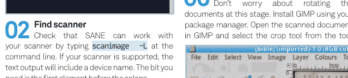

## 06 计算裁剪（等待，）

安装`GIMP`。在`GIMP`中打开扫描文档并使用裁剪工具。

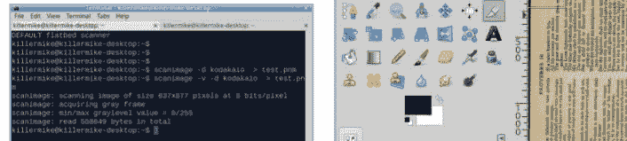

## 07 使用 ImageMagick

在你的系统上安装`ImageMagick`。使用`convert`命令处理图像。我们可以使用它来裁剪。

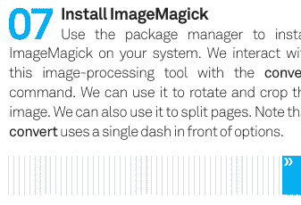

## 03 扫描

使用`scanimage -d`快速扫描图像。添加`-v`选项显示详细信息。

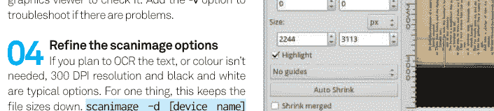

## 04 细化选项

如果你计划对文本进行`OCR`，考虑`300 DPI`。对于文件，使用`scan`。


# 自动化文档扫描

使用`GIMP`裁剪页面。使用`[left][width][height]`标记。如果提供的信息不准确，请使用尺子。在命令行中，格式为`[left][width][height]+[offset]`。

## 08 裁剪

使用`GIMP`裁剪页面。为了处理这些阶段的。

## 09 旋转页面

如果扫描仪支持旋转，使用`rotate 90`命令行。

## 10 分割

使用`.tiff`分割页面。使用`page`命名创建文件。

## 11 预处理脚本

创建一个预处理脚本。删除旋转后的文件。

## 12 扫描仪批量模式

使用`-batch`选项。如果你没有批量扫描器，添加`-batch`选项。

## 13 预裁剪

你可能可以在扫描仪上裁剪页面以获得更快的速度。

# Tex 和 LaTeX 教程：完美主义者的排版指南

在`tex`文件上运行`latex`，它会工作一整天，你只需要担心结构和内容。

你可以使用`TeX`的`xdv`查看文档，或将其转换为`PostScript`或`PDF`进行打印——以及对于平板电脑，即那些正在进行小屏幕侦察的`PDF`。

`package`导入一个宏包——在这种情况下——这就是力量所在之处。右侧面板中`LATEX`生成的内容都有相应的宏。

```latex
\documentclass[utf8]{article}
\usepackage{amsmath}
\usepackage{graphicx}

\begin{document}

这里是目标语言所需的一些基础和演示模式
LaTeX 是数学表达式背景下用于排版的强大工具。它不仅仅是一个文字处理器。

\begin{align}
  x = y + z
  y = 2x + 3z
  z = 4x - y + 5
\end{align}

\begin{equation}
  a^2 + b^2 = c^2
\end{equation}

\end{document}
```

你的编辑器将提供`LATEX`注释和命令的高亮，使阅读文本或结构信息变得简单

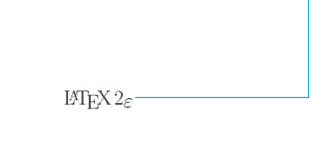

`TeX`可以生成几乎任何文档，但大多数人知道它在数学方程方面的便利。

> `$E = mc^2$` (1)

`$E = -\sqrt{5}$` (2)

# TeX 和 LaTeX：完美主义者的排版指南

是的，`TeX`是学习数学最简单的方法，但它也能制作发票和精美的`PDF`。

使用`LibreOffice`处理你的文档，使用`Perfect Scrib`制作公司画册，并在在线编辑大多数文档。你听过`TeX` —— 大多数是在数学方程背景下听过的 —— 但为什么要用它来处理从发票到简历的所有内容呢？因为它能生成美观且易于维护的文档，使用简单的文档演变和更改比使用文字处理器和桌面出版软件包简单得多。对于你写的每种类型的内容，只需专注于内容本身。得益于具有极高像素密度的平板电脑，精美的`PDF`变得变得，当你从`TeX`命令行生成它们时，会感到一种讽刺。

`TeX`本身是一个格式化引擎，非常强大且免费。`LaTeX`是构建在`TeX`之上的一层完整文档系统，带有许多插件可以处理几乎任何文档。当你使用标准`LaTeX`时（它已经维护了`20`多年），这些命令是直观的，但最好通过遵循你的快速入门小指南、文档，然后是更多在线内容，并随着知识的增长构建更大、更好的文档。

# 导师

`Richard Seymour`在`TeX`出现很久以前就开始编写文档，并且仍然维护着命令——，电子邮件是最高效的环境。

## 资源

`TeXLive`: `www.tug.org/texlive/`

# 综合归档

网络: `www.ctan.org/`

# TeX 和 LaTeX：完美主义者的排版指南

学习如何制作发票、书籍和精美的`PDF`

教程

| 日期 | 事件 |
|---|---|
| 1978年6月17日 | `Harold (Donald Knuth)`提交了`TeX`的第一个`bug`报告 |
| 1979年10月23日 | `TeX 1.0`发布 |
| 1980年2月15日 | `TeX 2.0`发布 |
| 1981年6月20日 | `TeX 2.1`发布 |
| 1990年3月6日 | `TeX 3.0`发布 |
| 1992年5月15日 | `TeX 3.1`发布 |
| 1996年6月27日 | `TeX 3.2`发布 |
| 1999年7月17日 | `TeX 3.3`发布 |
| 2002年6月15日 | `TeX 3.4`发布 |
| 2004年6月20日 | `TeX 3.5`发布 |
| 2005年8月31日 | `TeX 3.6`发布 |

| 日期 | 事件 |
|---|---|
| 2006年6月15日 | 向`TeX`提交了多个`bug`报告 |
| 2008年3月6日 | `TeX 4.0`发布 |
| 2009年6月15日 | `TeX 4.1`发布 |
| 2011年6月15日 | `TeX 4.2`发布 |

## 01 Bugs

`TeX`是稳定的，经过了多年的`bug`报告！由于，`TeX`的版本收敛于`n`，现在是`3.1415`（2008年3月发布）。版本号将改变，所有未来的`bug`都将被发现！

## 02 TeX

`TeX`是安装所需`LaTeX`软件包的推荐方法。它适用于所有发行版。要尝试我们的示例，请安装`latex-extra`，使用`apt-get install`。

## 03 你的方式

不需要等到下载`TeX Live`。`LaTeX`是带有实时预览的在线编辑器 —— 你可以在`overleaf.com`找到它。你也可以在浏览器中下载并运行它。


## LaTeX 缓冲区工具

```latex
\documentclass{article}
\begin{document}
Hello World!
\end{document}
```

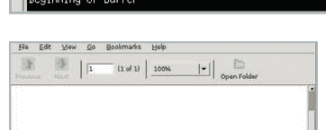

## 06 从右向左

使用`babel`包进行右向左的导航。

# 08 WYSIWY

这些字符串是所见即所得（`WYSIWY`）的结果。编写你的文本并让`LaTeX`处理排版：在文件中实时渲染，你可以将其导出为`PostScript`或`PDF`。

## 09 仅仅如此

记住：样式带有结构。以及许多命令都带有方括号。对于初学者来说，有很多选项的情况下不知道从哪里开始，让我们简单开始。

## 05 仅仅一个分数

示例显示了输出如何转换为`PDF`。稍后我们将查看一些命令，在开始之前，我们首先要确保它不仅仅用于数学。

## 10 宏的力量

记得这些在标题页导入的宏吗？`LaTeX`中有成千上万用户发布的软件包。在这里，我们查看荷兰样式，但它不像官方发票那样强大，

## 06 从右向左

`LaTeX`在全球范围内传播，并在语言和研究人员中流行，处理非拉丁语人群。这种页面是一个阿拉伯语示例（也处理希伯来语）。

## 07 装订

`LaTeX`是研究生论文和其他学术作品的默认工具 —— 这是因为它的结构优势，以及生成参考文献和嵌套目录的能力。大多数人都在数学方程的背景下听过`TeX`和`LaTeX`。事实上，是因为排版师做得太糟糕，`Knuth`才觉得用数学方程来编写`TeX`...

# e-mc?

`www.latex.co.uk`

# Tex 教程：完美主义者的排版


## 草稿预览


在页面底部的图片中，我们预览了发票的右对齐。注意我们使用了几个程序 —— `Git`, `xdv` 以及这个，但都是在 `Emacs` 中完成的，开启页的装饰并将它们放在后续信的顶部。在 `Scott Knapp` 写的《Comprehensive LaTeX Style》中找到更多内容。

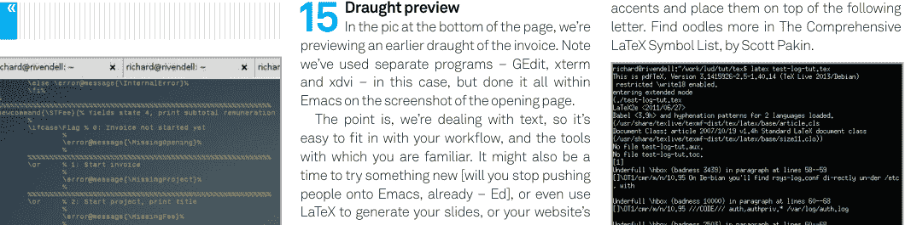

## 15

重点是，在执行期间，很容易习惯于你熟悉的工具。这可能也是学习新事物的时间（如果你停止使用 `LaTeX`），来学习 `Emacs`, `Aldi` —— 或者直到你使用你的滑块，或网站

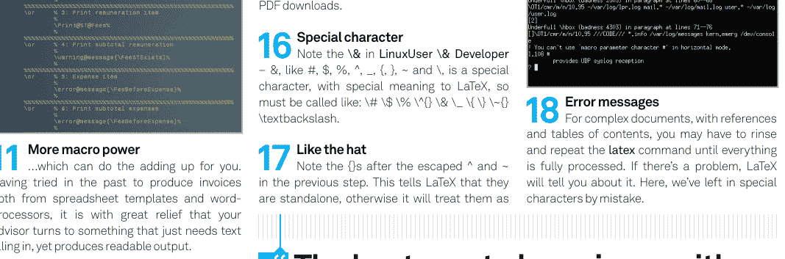

## 16 特殊

注意 `Linux/user & Developer` 中的 `&`，`#` 中的 `#`，`$` 中的 `$` 以及 `\` 中的 `\`，在 `LaTeX` 中写作时，必须像这样使用：`\&` `\#` `\$` `\\` - 反斜杠。

## 11 更多宏的力量

可以为你进行适配。过去曾尝试用模板和工作表制作更好的发票，导师告诉你哪些只需要文本拟合就能产生合理的输出，这是非常棒的。

## 12 模板

每个 `\begin{}` 开始都有一个称为模板（boilerplate），类似于 `HTML` 文档中的代码。`\documentclass` 必须在 `()` 括号中指定。`(article)` 或 `(book)`。在方括号中使用如 `twofold` 这样的双面纸张、字体大小等选项。

```latex
\documentclass{article}(letter)
\author{Lincoln}
\address{Richard Shelley \\ 72 Green Green
\{(Richard Shelley)}
\date{\today} (2014年1月)
\begin{document}
```

## 13 制作

使用 `\filename`, `\title` 和 `\date` 是常见的模板。`\include{filename}` 这样大项目就可以被构建，例如其他章节的简短历史，这些命令可以嵌入文件中，这里带有日期。

## 14 桌面计算器

对每个发票项目使用 `\fee` 命令跟随 `(activity)`、速率和 `(units)` 让你的工作为你服务并产生清晰、可读的发票（在主图中）。可用 `VAT` 选项。


## 18 错误信息

对于复杂的文档，带有表格和目录，你可能需要重复 `latex` 命令直到它完全处理完毕。如果有问题，`LaTeX` 会告诉你。这里

## 12-16

学习最好的方法是像任何编程语言一样，通过阅读文档并制作你自己的

# Tex 和 LaTeX：完美主义者的排版工具

学习如何制作发票、书籍和精美的 `PDF`

# 教程


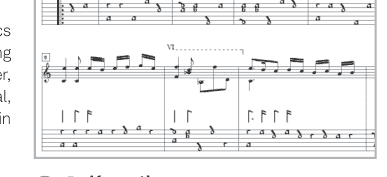


### 19 精美的图片

从 `EPS` 到 `PDF`，或者从数据动态生成向量图形的工具。然而，你的导师完全不懂视觉效果，他在文档中看到的杂乱布局比垃圾堆还多，就像这里一样。

### 20 tex2

如果你经常需要将一组文档转换为 `Tex`，`tex2` 可以帮你分担一些枯燥的工作——只需下载并运行它。但它绝不局限于基于限制的文档。看看 `LaTeX` 在音乐和游戏中能做什么……

### 21 了解源头

音乐的所见即所得的选择并不明确，`Philip's Music Writer (PMW)` 辩称比 `LaTeX` 的音乐标记更容易学习。此外，`Lilypond` 作为一个独立的 `MusicTeX` 分支，可以生成优美的乐谱。选择非常多。

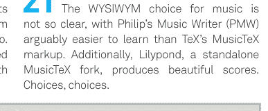

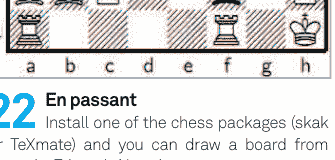

### 22 Enpassant

安装一个廉价的包（`skak` 或 `TeX`），你就可以从中绘制出一个棋盘。`Fenboard(r51/lib/bpipp/p7lp/ip10q4/21pr1/PMPP/BZZP/RRRK)`

你需要数字来结束行尾。

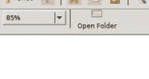

### 23 Texnians 和 Texcierts

`Texnians` 和 `Texcierts`

有一些很好的 `LaTeX` 使用指南 —— 比如 `Tobias Ostiev`、`Hubert Parti`、`Irene Hyun` 和 `Elizabeth Schlig` 编写的《LaTeX 详解（或 157 分钟学会 LaTeX）》是一个很好的开始，但只需回头读……

# 不那么短的介绍

或 157 分钟内学会 `LaTeX`

- `1.2.3` 命令

- 它们背着背包，有一群昆虫过来：甲虫、蜘蛛或其他任何“昆虫”。

- 它们背着背包并处于一种“饥饿”变体中，在那里并不常见。

- 许多昆虫在普通空间中灭绝了。

> `LaTeX` 的引用有时会有。如果你想在逗号后留空，请在逗号前加一个反斜杠。

> 如果你想引用双引号，请在第一个引号前加一个反斜杠。`LaTeX` 在逗号后的所有空格前放置空格以确保正确。

作者：`Tobias Ostiev`

以及 `Hubert Parti`, `Irene Hyun` 和 `Elizabeth Schlig`

这可以先完成第一个

你想要引用的

双引号成为。

在“今天”里

版本 `5.01`，2011年4月6日

### 24 尝试一下

最好的学习方法是通过编码、阅读现有的 `.tex` 文档并编写你自己的。如果你有一个想写的文档，请多花一小时，并找一个结构相似的 `.tex` 文件在此基础上构建。


39.`linuxuser.co`

# 教程

使用 `Qt` 读写文件

## Linux 开发者


## 在 Qt 中读写存储的文件

创建跨平台应用程序是困难的，因为操作系统的差异。即使是标准库提供的某些磁盘访问 `API` 也是如此。`Qt` 提供了一个通用接口，简化了这些处理工作。

从哪里开始我们的旅程：

```cpp
MainWindow(QWidget *parent = nullptr)
myDesktopPath=StandardPaths::path(Desktop);
```

`Qt` 文件系统 `API` 是在 1970 年代和 80 年代指定的。那时，数据和 `XML` 文件存储在不同的文件系统中。访问 `XML` 或 `SQL` 记录需要大量的代码。调用 `StandardPaths` 的静态方法可以让你查询系统常用的位置。某些操作系统将位置存储为 `QString`。我们只需获取第一个并将其作为目录。`cwd` 是 `MainWindow` 类的成员。幸运的是，`Qt` 提供了各种类帮助你正确设计程序。它们可以从 `Windows` 移动到 `Mac` 而无需担心文件系统的异性。此外，有一组函数可用于复杂任务。`StandardPaths` 是在 `Qt 4.0` 中引入的。在最新的 `Qt` 版本中，你可能使用旧代码来获取 `QDir` 对象，它们的行为相似。这次我们将介绍遍历文件的意图。访问文件和目录的最简单程序。此外，我们将向初学者介绍路径模式。`QDir` 类被引入用以显示目录内容。对文件系统进行操作将返回文件夹中的所有条目。我们可以对这些进行进一步操作，或者填充主窗口中的 `ListWidget`。现在我们将开始列出文件。


- `qt-project.org`

- `qt-project.org`

- `qt-forums`

- `blog.qt-`

- 

## 进一步阅读...

自苹果时代以来，`Hann` 已经在 `IT` 行业了。作为记者，作者已经看到了桌面的每一个方面。

- `Launcher`

- `Badlands`

- `Bundl`

- `ClassOfPuppets`

- `CrossJD`

- `DoubleTrillion`

- `DragonMania`

- `Fireman`

- `Filagem`

- `GalaxyLegends`

- `HayDay`

- `Heroes of Age`

# MainWindow

`www.linuxux.co`

## 使用 Qt 读写文件

使用 `Qt` 创建文件编辑工具。教程


# 递归

## 什么是循环的

在计算机科学中，许多问题可以通过将其分解为步骤来解决。例如，让我们比较 `"banana"` 和 `"saumage"`。即使大多数程序员都会使用循环这种方法，但现在我们建议使用递归方法来比较两个字符并返回匹配。程序可以比较这些字符，然后将字符串缩小一个并继续；如果匹配失败，字符串再次缩小并返回无结果。这个过程一直持续到字符串结束或找到匹配，在这种情况下，`match` 的实例将返回结果。

```cpp
void MainWindow::enumerateCWD() {
    myDir.setPath(myPath);
    QStringList contents=myDir.entryInfoList(QDir::NoFilter, QDir::DirsFirst);
    for (int i=0; i<contents.count(); ++i++) {
        if (contents[i].isDir())
            ui->listWidget->addItem("" + contents[i].fileName() + "/");
        } else
            ui->listWidget->addItem(contents[i].fileName());
    }
}
```

图 1

`QDir` 代表 `QDir` 类的条目。我们的代码通过提供的路径填充 `myDir` 开始。`entryInfoList` 方法负责返回当前集合中的条目列表。它可以排序和过滤条目，例如使用 `NoFilter` 常量按名称排序。这里我们使用 `DirsFirst` 在字母顺序之前返回目录条目。

为此，我们需要处理列表条目的点击事件。这可以通过连接信号到槽来实现。以下处理器将被调用：

```cpp
void MainWindow::itemClicked(QListWidgetItem *item) {
    if (item->text() == "//") {
        enumerateCWD();
    } else {
        myDir.setPath(item->text());
        enumerateContents();
    }
}
```

```cpp
class MainWindow : public QMainWindow {
private:
    Ui *ui;
    QString myPath;
    QDir myDir;
    QStringList entryContents;
```

一旦递归“打破”，计算机将自动展开并从栈中返回值。这一直持续到完成并返回原始调用者。

应用得当，递归解决方案会导致额外的栈帧产生开销，这在现代系统中是显著的。

除了递归方法外，我们还可以使用 `QStringList`，它不提供关于条目的更多信息。如果我们希望输出经过过滤——例如，我们将无法区分这些文件和目录。

点击条目对于我们分析条目结构中的条目非常重要。如果找到了文件夹，就会更新 `QDir` 对象。最后，它返回条目列表。

# 导航文件系统

在桌面上显示文件列表可能是一个用途，但不足以支持创建一个应用程序的努力。所以，现在是时候添加一些逻辑，允许用户遍历实际的文件系统了。

对当前工作目录执行字符串操作需要一些更改。这种方法适用于反斜杠分隔目录，而其他操作系统使用正斜杠。

`itemClicked` 信号被调用时带有一个指向点击的列表项的指针。我们分析它以确定正确的动作。如果用户点击条目，是时候向上移动一级了。这是为了：

```cpp
myDir.setPath(myDir.absolutePath());ui->listWidget->clear();
enumerateContents();
```

## 确定文件系统的根

在这种协作方法中，我们可以使用应用程序遍历桌面上的文件，伟大的雄心依然存在。


41 www.linuxuser.co

# 使用 Qt 读写文件的教程

## LinuxDeveloper

粗心大意的人可能会遍历文件系统的“根目录”，从而导致应用程序崩溃或更严重的后果。

我们已经到了一个操作系统之间的差异不再那么突兀的程度。在 Unix 下，系统的根目录是 `/`。而 Windows 提供了一组驱动器，这些驱动器并没有统一在一个共同的根目录下。

幸运的是，处理这个问题相对容易。当文件系统不提供“根文件夹”时，设置将返回 `false`。这可能是由于缺少写入权限引起的；我们目前假设用户是不可能获取根文件夹的。在这种情况下，我们将为用户提供一个驱动器列表。

```cpp
void MainWindow::onItemClicked(QListWidgetItem *item) {
    if(item->text().compare("C:") == 0) {
        // 上移
        myDir.absolutePath();
        ui->listWidget->clear();
        enumerateDir();
    } else {
        // 枚举目录
        enumerateDirs(myDir.absolutePath());
        for(int i=0; i<itemContents.count(); ++i) {
            ui->listWidget->addItem(itemContents[i].absolutePath());
        }
    }
}
void MainWindow::onListWidgetActivated() {
    return;
}
```

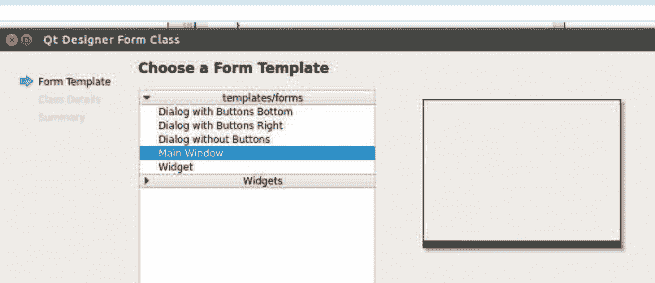

- 选择 Qt 应该创建什么类型的小部件来预填充你的列表文件

## 点击处理程序被设计为正常使用

为了实现这一点，需要向项目添加一个新文件。在 Qt 的当前版本中，通过“新建文件”对话框可以使用“添加文件”或“项目向导”极大简化了这一过程。选择“Qt Designer 表单类”。在下一步，最后选择模板“Main Window”，并点击 OK 创建文件。现在我们将在表单上添加一个文本框。然后进行如下构建：

```cpp
void MainWindow::onListWidgetClicked(QListWidgetItem *item) {
    if(myDir.isActive()) {
        int itemIndex = ui->listWidget->row(item);
        myDir.contents[itemIndex].absolutePath();
        myDir.absolutePath.absolutePath();
        ui->listWidget->clear();
        enumerateDir();
    }
    myDir.makeActive(false);
    return;
}
```

```cpp
FileWindow::FileWindow(QString path, QWidget *parent)
    : QMainWindow(parent), ui(new Ui::FileWindow)
{
    ui->setupUi(this);
    QFile file(path);
    if(file.open()) {
        QString collector = file.readAll();
        ui->textEdit->setPlainText(collector);
        setWindowTitle(path);
    }
}
```

点击处理程序被设计为正常使用，因为它通过工作目录进入驱动器路径。调用枚举文件方法是为了显示找到的内容。

## 打开文件进行显示

到目前为止，我们的例程忽略了列表项的点击。如果我们可以点击文件并在文本框中打开其内容，那将有趣得多。

## 使用 Qt 创建一个文件查找实用程序

教程


```cpp
void MainWindow::mySeekClicked()
{
    QList<QString> myList;
    seekFolder(myDir,myList);
    myResult=myList;
}

void MainWindow::seekFolder(QString &_where, QList<QString>* _myStore)
{
    Debug() << _where.absolutePath();
    QList<QString> localContents=_where.entryInList();
    for(int i=0; i<localContents.count(); ++i++) {
        if(!localContents[i].isError()) {
            QDir folder(_where,localContents[i]);
            if(localContents[i].compare(".***")==0) continue;
            if(localContents[i].compare("..")==0) continue;
            Debug() << myDir.absolutePath();
            myResult->append(folder.absolutePath());
            Debug() << "Spawning new " << localContents[i];
            seekFolder(myWindow,_myStore);
        } else {
            // 文件，所以扫描
            if(localContents[i].contains(ui->lineEdit->text())) {
                myResult->append(localContents[i].absolutePath());
            }
        }
    }
}
```

图 2

## 文件访问可以且将会失败

### 应用原理 – 会失败的就会发生

在这个故事中，我们的示例代码没有处理错误，为了保持短小简洁。在创建商业代码时，强烈建议如果用户在使用程序时断开连接或离线，对所有文件系统进行保护——崩溃是一个昂贵的错误。此外，与文件系统交互的方法提供了相对简单的错误处理。检查返回值可能是乏味的，但对极大地提升体验有显著益处。当然，人也可以很狂热。经验表明，糟糕的处理远没有不处理那么糟糕。由于空间限制，我们的程序将不包含找到的列表。相反，我们将使用 `myResult` 来显示内容。

## 结论

我们的示例并不特别复杂，它展示了开发者访问系统时所有重要的因素。这里概述的步骤可以用于编写应用程序。常见的例子是服务器创建的日志文件。使用它们来确定用户面临的“痛点”。至此，我们穿越 Qt 世界的旅程就结束了。在下一个问题中，我们将涵盖从数据显示到高级交叉的各种主题。将处理程序集成到主窗口，如果元素被选中，将打开一个带有完整路径的新窗口：下一步，`seekFolder` 函数需要指向当前目录的指针。

```cpp
void MainWindow::myFileClicked()
{
    if(selectedContents.target()){
        absolutePath=selectedContents.target();
        myWindow->show();
    }
}
```

通过此，我们掌握了递归的概念——在教程的第二页概述。`mySeekClicked()` 通过调用 `QList` 获取从搜索返回的所有文件。

## 遍历文件系统

现在是时候去“搜索”文件夹并排序了。我们的示例将限制文件的名称。图 2 中的处理程序可以通过按钮触发。如果你理解递归，那么函数调用自身会变得复杂一些。首先，必须确保文件系统不发送类似“虚拟目录”的路径。理解并不容易。使用 `Debug` 来发射每一次调用的递归函数，这在程序运行时输出的。


43 www.linux.com

# 处理 Twitter 的三步流程教程

## LinuxDeveloper

### 处理 Twitter 的三步流程

构建 OAuth 请求的签名可能是复杂的。我们将解释 Python 和 Flask 的身份验证过程。

## 顾问

`Sean Tracey` 是一家领先机构的创意技术人员。他花了大量时间在（Node.js、Python 和 Arduino）。

## 资源

- `Python 2.7`

- `Flask 0.10.0`: [flask.pocoo.org](http://flask.pocoo.org)

- `GitHub`: [github.com/mitshelf/flask](https://github.com/mitshelf/flask)

## Twitter 账户

### 你的收藏令牌

曾经，Twitter API 允许开发者编写快速脚本。设置非常简单，文档很多且可用。但现在情况有所不同。对于 Twitter API v1.1，身份验证不像以前那么简单（尽管文档仍然很多）。Twitter 现在需要 OAuth 来获取请求。这有点复杂——当你组合一个快速脚本时。然而，身份验证过程将在你处理多个端点时提供。我们将使用 Flask —— 一个轻量级 Python 框架 来定义路由、控制器和视图。对于这个项目：我们将很快看到，定义路由和处理器是轻而易举的，并且节省了我们处理像 Django 等框架带来的开销。

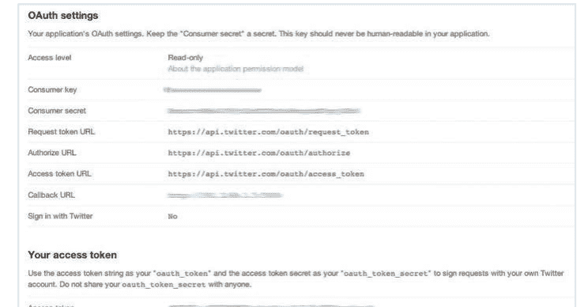

OAuth 设置使用访问令牌作为你的 `oauth_token`，令牌密钥作为 `oauth_token_secret` 来用自己的令牌签名请求。请妥善保存你的令牌、密钥和。

| 字段 | 值 |

| --- | --- |

| 访问级别 | 只读 |

| 请求令牌 URL | [理解权限模型](https://developer.twitter.com/en/docs/concepts/authentication/permission-model) |

| 密钥 | |

| 密钥 | https://api.twitter.com/oauth/request_token |

| 授权 URL | https://api.twitter.com/oauth/authorize |

| 访问令牌 URL | https://api.twitter.com/oauth/access_token |

| 回调 URL | |

| 使用 Twitter 登录 | bio |

你的访问令牌

访问令牌

访问令牌密钥

只读

## 01 安装

在开始编写代码之前，我们有一些前提条件。如果你的系统中安装了 python，那么安装只需要在库中输入 `pip install flask` 那么简单。如果你是从零开始构建，你需要在列表中找到 Flask 和 GitHub。最新版本是：

## 02 创建一个 twitter 应用

在使用 Twitter 之前，我们需要免费创建一个应用。为此，请登录并进入。如果你访问 https://dev.twitter.com/en/dashboard/your-profile；悬停在上面，点击下拉菜单“选择我的应用”，然后点击链接。按照说明设置应用程序。你在这里输入的信息在现在并不重要——过程结束时，你将看到一个名为“OAuth 设置”的字段，带一组设置。我们稍后会需要：

## 03 导入 Python

这些是我们在项目中将使用的模块。例如，所有模块都应该包含在 Python 2.7+ 的所有版本中。这些用于生成、编码和解码与 Twitter API 交换请求的过程。从 Flask 导入请求时，我们需要具体，超出端点的范围

## 04 为 Twitter 密钥创建全局变量

在第 2 步中我们与 Twitter 创建了一个应用。现在我们需要在 OAuth 设置区域看到的“创建” 密钥和 `consumer_secret` 变量。现在，将 `oauth_secret` 和 `oauth_token` 变量留为空字符串——我们稍后会分配这些值。

# 处理 Twitter 的三脚架 OAuth 流程

使用 Python 和 Flask 进行 Twitter 身份验证的指南

教程

## 05 为 Flask 应用分配命名空间

现在我们创建一个 Flask 类的实例。该变量将使我们能够访问与 Flask 应用关联的所有类和属性。实例中的 `.name` 属性将为我们提供类名作为其作用域。

## `flask.py`（见下页）


## 06 创建我们的第一个路由

为了验证用户，我们需要创建一个用户可以访问并触发路由的端点。在 `Flask` 中这个过程非常简单：使用路由装饰器（`@app.route`）来触发函数或操作。我们想要创建的端点是身份验证后的重定向，由用户执行。注意，虽然我们不需要函数名称与端点名称相同，但 `Flask` 可以提供静态文件或使用渲染模板，为了简单起见，我们在第一个路由的末尾返回一个简单的文本响应来显示我们的进度。

```python
import urllib, urllib2, collections, hmac, binascii, time, random
from hashlib import sha1
from flask import redirect, session, Flask

# Twitter API 变量
consumer_key = 'Y9nMRDu355Xev'
consumer_secret = '8svrrB4klvHjWlZCU9WbtopzdXvZgJ6bb'

app = Flask(__name__)

@app.route('/authenticate')
def authenticate():
    session['secret'] = '...'

    request_params = {
        'callback': 'https://api.twitter.com/auth/',
        'consumer_key': consumer_key,
        'nonce': str(random.randint(1, 999999999)),
        'signature_method': 'HMAC-SHA1',
        'timestamp': str(int(time.time())),
        'version': '1.0'
    }
    return sign_request(request_params, "https://api.twitter.com/")
```

## 07 创建一个 flask session

为了维护变量并为用户设置特定值，我们将值存储在 `Flask` session 中。`session` 是使用 `cookie` 存储值来实现此最安全的方法，但由于我们使用了一层加密来保证用户凭据的安全，它的行为就像字典，因此我们可以使用字典拥有的所有方法。例如，如果我们需要存储身份验证令牌，可以使用 `session.class`。我们需要确保在对 `session` 进行任何调用之前，我们设置了 `secret key` 以避免错误。我们选择在 `app()` 中设置 `secret key`，这样它会在服务器执行之前被设置。对于大多数情况，这就是我们需要的。

```python
@app.route('/callback')
def callback():
    request = urllib2.request(request)
    token = request.args.get('oauth_token')
    if token:
        session['oauth_token'] = token
        return redirect('https://api.twitter.com/authorize?oauth_token=' + token)
    else:
        return HTTPError('404')
```

## 08 准备授权我们的应用

现在我们开始演示如何向 `Twitter` 提交数据。`OAuth` 协议要求每个请求都使用 `SHA1` 哈希值进行签名，以便 `Twitter` 能够验证收到的数据的完整性。

```python
def verifyRequestParameters(request):
    verify_params = {
        'consumer_key': consumer_key,
        'nonce': str(random.randint(1, 999999999)),
        'timestamp': str(int(time.time())),
        'version': '1.0',
        'oauth_token': session('oauth_token')
    }
    signature = sign_request(verify_params, "POST", "https://api.twitter.com/")
    request.add_header("Authorization", "oauth=" + signature)
```

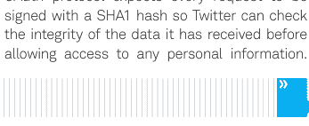

# 教程

# 处理 Twitter 的注销 OAuth 流程

## LinuxDeveloper

为了正确对请求签名，我们需要将参数按字母顺序排序，对其进行 `URL` 编码，拼接然后每次对它们进行签名。这是一个 `OAuth` 编码问题。由于我们几乎对每个请求都要执行此操作，我们将编写一个方便的函数来完成所有这些工作：`sign()`

> `Flask` 非常适合这个项目：定义路由和处理器的参数就像制作蛋糕一样


## 09 创建我们的签名

首先，我们需要使用请求的基础 `URL`，这可以通过 `urllib.quote()` 实现。接下来，我们为传递给函数的参数创建一个有序字典，根据键值按字母顺序排序。由于每个请求都必须使用正文中的所有参数进行签名，因此正确排序它们非常重要。接下来，我们创建一个变量体来存储我们将将用于请求的方法字符串，并将其附加其中。然后，我们通过对字典的键值对进行拼接和 `URL` 编码来构建体，从而获得我们的签名。然后我们检查体是否为空；如果不为空，我们在下一步中将在体签名中添加一个 `&`。

## 10 签名密钥

现在我们需要为我们的签名创建一个签名密钥。正如我们所说，我们将使用我们的 `consumer_secret` + `oauth_secret` 与

## 11 获取密钥

使用 `HMAC` 库对密钥进行哈希。我们将使用我们的签名字符串（请求体的内容）。`SHA1` 哈希函数处理签名。

## 12 获取请求令牌

我们不能仅仅请求令牌来访问数据。首先，我们需要获取请求令牌，然后对其进行交换。这是我们在后端自己完成的。在此期间，如果我们想尝试任何事情，我们需要提交给 `Twitter` 的签名值。`call_auth()` 在我们在第一个身份令牌重定向之前无法起作用。我们想要将其指向 `/authenticated`。

## 13 构建头部

当我们签名请求时，我们需要正确编码并格式化我们的授权头部。`sign_request()` 和 `auth_headers()` 之间的主要区别是我们使用了请求体。如果使用了错误的头部，请求将被拒绝。

## 14 创建请求令牌

一旦获取了头部，我们就回到 `HTTP` 请求并调用 `oauth()` 方法等待响应。如果一切顺利，我们将在响应中收到一个包含第一个身份验证令牌的字符串。然后我们需要单独对该字符串进行解析，使用 `getParameters()` 函数，它将解析字符串并返回一个我们可以访问的字典。我们将使用这些令牌用于后续的请求。

## 15 减少请求

现在我们有了第一个身份验证令牌，我们可以减少我们的授权屏幕以让他们获取数据。除此之外，我们可以使用 `flash` 重定向到我们的视图。此请求是少数可以使用 `OAuth` 参数发送令牌的请求之一

# 关于 oauth_nonce 的一点介绍

`OAuth` 头部和签名过程中的大多数值都是可选的。然而，`oauth_nonce` 是一个随机生成的值 - 字母数字型，但由于没有定义的约定，可以使用整数用于此目的。它是为了让 `Twitter` 检查是否重复发送了相同的请求。


# 教程

# 使用 Django 构建博客

## LinuxDeveloper

| `Django` 测试 `Web` 服务器正在运行 | 使用 `Django Admin` 创建一篇新的博客文章 | 首次执行 `'python manage.py syncdb'` 命令 | 显示 `Django` 用于创建测试数据库的 `SQL` 命令 |

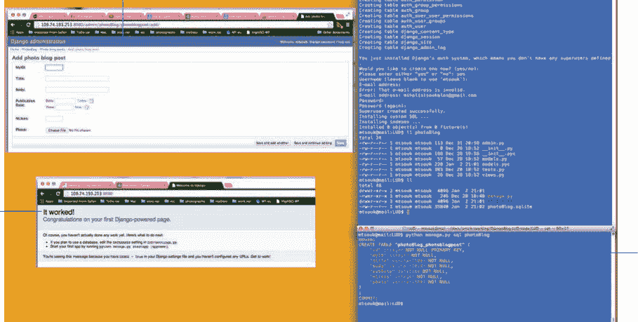

## 使用 django 构建博客

## 顾问

Mihalis Tsoukalos 是一位 `UNIX` 系统管理员，同时也精通编程、数据库和数学。他自 1999 年以来就一直使用 `Linux` 操作系统。

## 学习如何通过简单的步骤编程并发布 Django 照片博客站点


Django 是一个高级 Web 框架，鼓励快速开发和整洁、实用的设计，并允许你快速构建应用程序。由于 Django 是一个 Python 框架，你基本上可以使用使用 Django 库的 Python 代码来构建网站。如果你已经有了良好的 Python 知识，Django 遵循稍微改变的 MVC（模型-视图-控制器）设计模式，Django 由核心处理控制器，所有其他工作都在模板和视图中完成。Django 遵循一种哲学：真正重要的是技术，但要把事情办成。

## 01 安装 Django

在 Debian 7 系统上，你可以使用以下命令安装 Django：`# apt-get install django`。一切运行符合预期，接下来的 Django 命令将打印版本：

```
django-admin version
```

如果你的输出打印类似 `1.6.5` 的内容，那么一切都是正确的。否则，请检查设置。`django-admin` 是用于 Django 管理任务的主要 Python 脚本。

在编写本文时，最新的 Django 版本是 `1.6.1`，Debian 使用的是旧版本的 Django。

## 资源

- Django: https://www.django.com/
- https://docs.djangoproject.com/en/dev/ref/templates/built/
- Django 教程: https://www.djangoproject.com/tutorials/
- SQLite: https://sqlite.org
- Apache: https://www.webrefont.com/django/howto-apachewebsserver.html

本文将介绍创建简单摄影博客所需的所有步骤，所以请放松心情并享受这段旅程...

# 使用 Django 构建博客

编写并构建你的 Django 照片博客站点。

# 教程

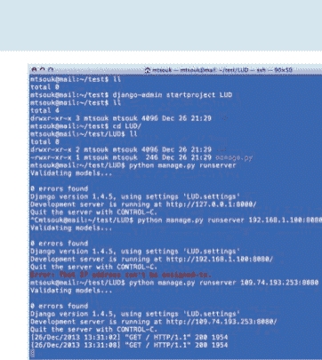

```python
## mtsoud:LUD head/settings.py
## SUD 项目的 Django 设置。

TEMPLATE_DEBUG = DEBUG

ADMINS = (
    ('Name', 'your_email@example.com'),
)

MANAGERS = (

)

DATABASES = {
    'default': {
        'ENGINE': 'django.db.backends.sqlite3',
        'NAME': 'db.sqlite3',
    }
}
```

## 02 Django 服务器

Django 有它自己的“轻量级”服务器，用于开发测试应用程序，因此你不需要先设置 Apache。

测试服务器一次允许一个连接，且没有安全保障。默认情况下，它监听 `localhost`（IP `127.0.0.1`）的 `8000` 端口。如果你想更改服务器端口，可以将其作为命令行参数传递：`python manage.py runserver 8080`。

如果你想更改服务器的 IP 地址，请将其与 `python manage.py runserver` 命令一起传递。

## 03 创建你的 django-admin 项目

你将使用 `django-admin` 命令创建一个新项目。每个项目可以包含许多应用（apps），因此项目本身是轻量级的，你可以根据需要添加应用。

你可以通过执行以下命令创建一个名为 `SUD` 的新项目：

```bash
$ python manage.py startproject photoblog
```

`manage.py` 脚本会自动为每个 Django 创建，它是 `django-admin` 脚本的封装。

## 04 项目的目录结构和文件

当你创建一个新项目或应用时，Django 会生成几个文件和文件夹。例如，项目包含一个名为 `__init__.py` 的文件，让 Python 将目录视为一个包；一个名为 `settings.py` 的文件是项目的配置。

在 `photoblog` 目录下存在一个名为 `models.py` 的文件，它包含了项目的数据库模型。

一个名为 `urls.py` 的文件包含项目的 URL 内容；一个名为 `views.py` 的文件包含每个应用的视图。

LUD 项目的 Django 设置：

```python
DEBUG = True
TEMPLATE_DIRS = []
EMAIL_SENDER = [Nihal Tsoukalos', 'nihalistoukalos@gmail.com')]
MANAGERS = []
INSTALLED_APPS = [
    'django.contrib.admin',
    'django.contrib.auth',
    'django.contrib.contenttypes',
    'django.contrib.sessions',
    'django.contrib.messages',
    'django.contrib.staticfiles',
    'blog',
]
DATABASES = {
    'default': {
        'ENGINE': 'django.db.backends.sqlite3',
        'NAME': 'db.sqlite3',
    }
}
```

## 05 修改 settings.py

如你所知，创建项目后的第一件事是向 `INSTALLED_APPS` 添加列表。对于 `PhotoBlog`，你只需要添加行：`'blog'`。

接下来，将 `ADMIN` 添加到设置中。然后更改 `TIME_ZONE` 以匹配你的位置。在本文中你将学习如何使用 Django 创建数据库以支持 Django 管理。下一步是显示支持 Django 的更改。

## 06 连接数据库

Django 可以与 `PostgreSQL`、`MySQL` 和 `Oracle` 通信，你也可以找到第三方驱动。对于 URL 页面，Django 使用设计模式（URL 路由）来匹配你定义的 URL。

如果你使用 `SQLite`，它会在磁盘上创建一个单独的文件，这意味着如果 `PhotoBlog.sqlite3` 不存在，当你第一次运行迁移命令时会自动生成。如果你使用 `PostgreSQL`，你必须创建一个新数据库并运行迁移。Django 的伟大之处在于你不需要使用任何 `SQL` 命令来更新数据库。

## 07 关于项目

你将能够从高级别显示示例博客。在你的站点上拥有链接将为你提供更快更深入地学习 Web 开发的机会。你唯一需要的是安全和托管站点的服务器。`Django` 站点易于维护，并且包含任何项目都可以轻松使用的必要组件。在设计新页面时要尽可能简单。创建模型后，你应该运行 `manage.py migrate` 来创建表。可以更改你的模型，但避免潜在问题是好事。

## 动态模板

Django 使用动态模板。它的系统使用内置模板，但你也可以创建自己的。你在项目中使用的模板位于 `templates` 文件夹中。你可以在 Django 代码中引用它们。你还需要在 `settings.py` 中添加一行使 Django 模板可见：

```python
TEMPLATES = [
    BASE_DIR / 'templates'
]
```

你用于开发的服务器可能与你使用的不同，但对于开发目的已经足够。如果需要，你可以有多个模板路径。

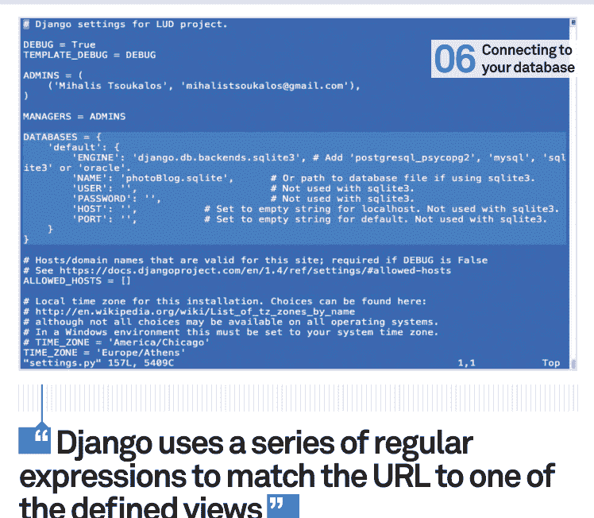

# 使用 Django 构建博客

编写并发布 Django 博客站点。

# 教程

## 10 Django 视图

Django 视图是描述当调用 URL 时如何在屏幕上显示信息的函数。每个视图的第一个参数是 HTTP 请求并返回 HTTP 响应。将创建一个名为 `template` 的函数，还会创建一个名为 `list` 的函数。它列出数据库中的所有博客文章并显示在屏幕上。你将需要编辑 `photoBlog/views.py` 将视图添加到你的 Django 网站。每个视图都应该返回 `urls.py` 中定义的 URL。

## 11 项目 URL

第一次使用 Django 时，你有很多 URL 模式。你越使用 Django，越会遇到复杂的模式。

URL 模式按顺序处理；一旦发现匹配项，就会停止任何匹配。这允许在通用表达式之前使用特定表达式。URL 定义在 `urls.py` 中。你可以在其他地方定义额外的 URL，但它们匹配用户在网络浏览器上的 URL。以下行将匹配你的视图：

## 12 上传和发布

第一件事是使用 `MEDIA_URL` 定义存储上传文件的目录完整路径。这在 `settings.py` 中处理。`MEDIA_URL` 设置为。将为特色图像制作缩略图，这些使用以下 Python 模块唯一生成：


```python
from time import time

def get_filename(filename):
    # 生成唯一的文件名
```

文件名作为字符串存储在数据库内部。`Django` 处理剩下的所有工作。

## 13 为项目创建视图

该函数现在使用动态站点，因此它返回欢迎模板。返回文件名，稍后当你的 Web 服务器保存图像时，你将把它存储在数据库中。

# 教程：使用 `Django` 构建一个博客

## `Linux` 开发者

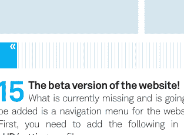

## 15 网站的最优版本！

目前缺失并即将添加的是网站的导航菜单。首先，你需要向 `LUD/urls.py` 添加内容。

```python
# 设置导航菜单
TEMPLATE_CONTEXT_PROCESSORS = [
    'django.template.context_processors.debug',
    'django.template.request',
    'django.contrib.auth.context',
    'django.contrib.sessions.context',
    'django.contrib.messages.context',
    'django.contrib.messages.context',
]
```

写入记录器的 URL 消息是一个日志记录（`Log Record`）。每个日志记录都有一个日志级别和请求的一些细节。每个记录器将其记录记录到处理器（`Handler`）中。处理器决定每条消息的处理方式，并将其显示在屏幕上，或者发送到网络文件。

默认情况下，`Django` 将所有的 `ERROR` 和 `CRITICAL` 消息记录到一个文件中，该文件设置为在开发期间发生。如果 `DEBUG` 为 `True`，所有消息都将被记录器通过……捕获

## 17 实现功能数量

首先，在 `LUD/urls` 中添加以下行：

```python
url('^/blog/(?P<id>\d+)/$', blog.views.like_blog_post),
```

然后，你需要在 `blog/views.py` 中实现 `like_blog_post` 方法：

```python
def like_blog_post(request, id):
    post = BlogPost.objects.get(id=id)
    count = post.likes.count()
    return render('blog_detail.html', {'post': post, 'count': count})
```

```html

<div class="navbar">
    <div class="navbar sidebar-left">
        <li><a href="">首页</a></li>
        <li><a href="">文章</a></li>
    </</div>
    <ul>
        
        <li><a href="">{{ post.title }}</a></li>
        
    </ul>
</>
```

为了支持导航菜单，博客列表现在看起来会略有不同：

```python
url('^/blog/$', blog.views.list, template_name='welcome', template_name='list',),
```

这些名称被用于模板文件 `templates/list.html`。

请注意，如果你想写 `CSS` 代码，请参考之前的 `Django` 站点外观。本文关于构建 `Django` 站点，而不是网页设计和 `CSS`。

```apache
<VirtualHost *>
    ServerAdmin mactooksait@gmail.com
    ServerName blog.host
    DocumentRoot /var/www/blog.host/public_html/
    <Directory /
        Options FollowSymlinks
        AllowOverride None
    </Directory>
</VirtualHost>
```

在下一篇博客中，你将需要添加管理面板（`admin panel`）。或者，你可以创建一个 `Django` 表单，但管理面板已经足够了。我们建议强调管理面板不是给终端用户的。

仍然缺失的内容将在下一篇文章中引导你学习更多。

```bash
WSGIScript /var/www/blog.host/public_html/static/
Alias /static/ /var/www/blog.host/public_html/static/
```

## 16 `Django` 日志

`Django` 拥有记录器，用于管理日志和调试管理。有不同的日志级别：`CRITICAL`、`WARNING`、`INFO` 和 `DEBUG`。我们目前在开发中使用 `DEBUG` 级别，但不建议用于你的生产服务器。

错误日志：`/var/www/blog.host/logs/error.log`

日志：`/var/www/blog.host/logs/access.log`

要更改当前的日志设置，你需要在想要启的文件添加以下两行代码：

```python
import logging
logger = logging.getLogger(__name__)
```

记录器是进入日志器的入口：

```
[Mon Jan 06 18:07:49 2014] [notice] SIGUSR1 Attempting to receive restart
[Mon Jan 06 18:07:49 2014] [warn] warn_msg: Compiled for Python/2.7.2.
[Mon Jan 06 18:07:49 2014] [notice] warn_msg: Runtime using Python/2.7.3.
[Mon Jan 06 18:07:49 2014] [notice] Apache/2.2.22 (Debian) PHP/5.4.4-14+deb7~mod_wsgi/3.3 Python/2.7.3 configured -- resuming normal operations
```

# 使用 `Django` 构建博客

## 编写并发布一个 `Django` 照片博客站点

教程

```python
return HttpResponseRedirect(
'/node/%s/' % myID)
```

`like_blog_post` 方法简单优雅地更新了 `SQLite` 数据库。

最后，你应该在 `templates/blog_post.html` 中添加以下内容：

```html
<a href="/node/{{myID}}}">我喜欢！</a>
```

上述 `HTML` 代码调用了一个格式为 `/node/{{myID}}}` 的新 URL。该 URL 仅用于调用 `like_blog_post` 方法并返回原始文章。

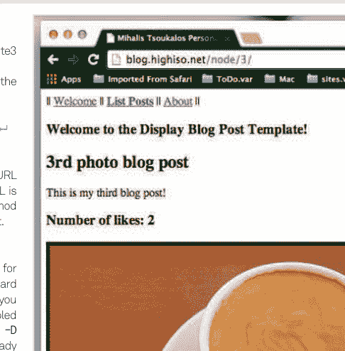

## 设置 `apache`

`Django` 的主要部署平台是 `WSGI`，它是 `Python` Web 服务器和应用程序的标准；因此，如果已经安装并启用，你必须在 Web 服务器上使用 `mod_wsgi` 来运行。

你需要为网站域名设置 `DNS` 记录。你通过 `Django` 的 Web 界面完成了此操作。我们的示例站点名称是 `http://blog.higo.info`。

网站的 `Apache` 配置见图二。

成功设置 `Apache` 和 `WSGI` 后，`Django` 将不再处于开发模式，因此不要忘记将 `settings.py` 中的 `DEBUG = True` 字符串改为 `DEBUG = False`。

你需要定义目录：

```python
ALLOWED_HOSTS = ['*']
```

为了让管理站点在生产环境中正常工作，你需要配置：

```python
STATIC_ROOT = '/var/www/blog.host/public_html/static/'
STATIC_URL = '/static/'
```

最后，你应该在 `templates/blog_post.html` 中添加：

```bash
# python manage.py collectstatic
```

`like_blog_post` 方法简单优雅地更新了 `SQLite` 数据库。

上述 `HTML` 代码调用了一个格式为 `/node/{{id}}}` 的新 URL。该 URL 仅用于调用 `like_blog_post` 方法并返回原始文章。


当一切运行正常时，`Django` 服务器将检查你代码中的任何错误。

不要忘记将`settings.py`中的`DEBUG = True`字符串改为`DEBUG = False`。

配置`ALLOWED_HOSTS`非常重要。

# 程序员与创作者的必备指南

# 实用型树莓派

> 56 “我们想要一个能够挑战我们黑客和编程技能极限的挑战。我们选择了一台四翼器”

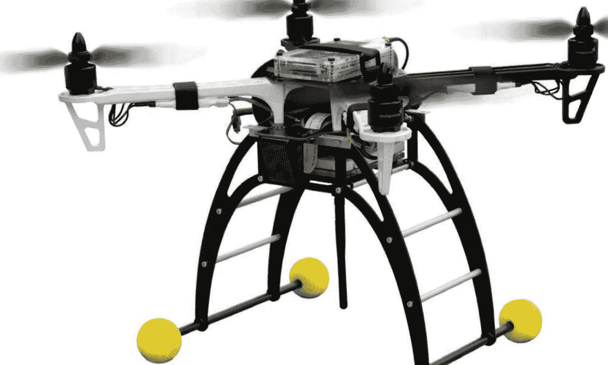

# 目录

- 56 编写一台树莓派四翼器
- 62 望远镜 - 极致复古酷
- 64 制作无线访问点
- 66 编写一个《太空入侵者》克隆版
- 72 什么是`GertDuino`？

# 教程 编写一台树莓派四翼器


# `Andy Baker`

是`Metaswitch Networks`的软件工程师。在空闲时间，他是一个树莓派爱好者，在`www.patzring.co.uk`记录他的活动。

# 编写一台树莓派四翼器

如何击败树莓派机器人？给它装上翅膀。`Andy Baker`为我们展示如何通过代码飞向云端。

`树莓派`是一个极佳的项目。由于我们热爱挑战，我们开始寻找某种能够超越第 32 期中树莓派机器人的东西，某种能真正挑战我们黑客和编程技能极限的东西。我们选择了一台基于树莓派的四翼器。

如果你只想享受飞行的乐趣，可以购买即插即飞（`RTF`）的套件，但我们想要的是挑战！我们从`Wheel F450`开始——拥有所有硬件，但没有任何控制电子设备或软件。许多爱好者使用`Arduino`微控制器制作了`DIY`四翼器，因此我们知道`DIY`组装是可行的，但极少有人（如果有的话）曾成功使用过树莓派。

本文使用光盘上的`Python`代码作为指南，帮助你构建一台四翼器，比喻地将其组装在一起，以便在结束时，你不仅理解了代码，还学会了与世界的交互，从而充满心地构建你自己的四翼器。

在文章，你可以通过搜索相应的标签注释来跟踪对应的代码；例如，只需在代码中搜索`# Angles`。

56 `www.linuxuser.co.uk`

## 编写树莓派四翼器

**动力**：在这里我们看到了来自螺旋桨的力

**矢量**：螺旋桨相对于地球轴的力（水平/垂直）

**重力**（`Gravity`）：此术语表示重力

**角度**（`Angle`）：这是由四翼器传感器定义的倾斜角

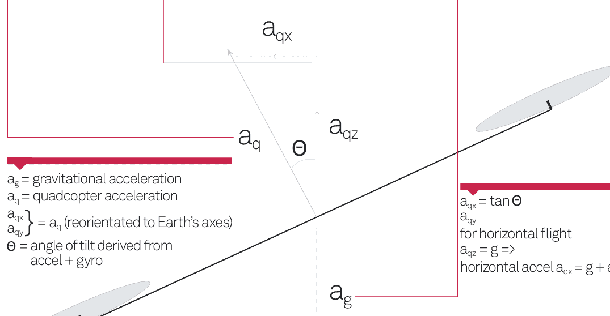

- `aqx` = 重力加速度
- `aqy` = 四翼器加速度
- `aqz` = `aθ`（根据轴向重新对齐到地球轴）
- `Θ` = 从加速度+陀螺仪得出的倾斜角

```
aqx = tan Θ
aqy = 0
for horizontal flight
aqz = g - a
or horizontal accel = g + a
```

## 解释器

命令解释了来自无线遥控或编程在代码本身中的系列命令。这些命令结合了四翼器相对于目标的方向和速度。代码将这些命令转换为垂直速度、水平速度和偏航速度的一系列目标——从一对操纵杆可以分解为这些目标。

## 输入

四翼器的输入来自一系列电子传感器，提供关于空中运动的信息。其中两个是加速度计，用于测量四翼器三个轴上的加速度（包括重力），另一个是陀螺仪，用于测量四翼器俯仰（头部/尾部向上）、滚滚（左/右侧向上）和偏航（绕着四翼器中心轴顺时针和反时针旋转）的速度。

## 轴

加速度计相对于四翼器轴的取向——但命令相对于这些轴——地平线和重力。要将传感器在四翼器轴和坐标轴之间转换，需要一点

## 理解四翼器……

尽管本文侧重于软件，但需要关于套件硬件的非常基本的背景以提供上下文。四翼器有四个螺旋桨（因此得名），指向轴线，每个螺旋桨连接在一个电机上，电机（通常）位于方形框架的四个角之一。两个电机顺时针旋转，两个反时针旋转，以最小化四翼器的动量。每个电机都由电子速度控制器（`ESCs`）驱动。电机有一组线圈（相位），`ESC`将来自软件的脉冲宽度控制信号转换，以控制信号决定的速度驱动电机。`ESC`和系统中的其他所有设备都来自`12V, 3300mAh`的锂聚合物电池（`LiPo`），峰值电流为`10A`——动力就在这里！四翼器上方的传感器被转换为水平 57 `linuxuser.co.uk`

## 教程 编写一台树莓派四翼器

角度获取水平速度`PID`的倾斜角和来自陀螺仪的反馈来产生倾斜角。这导致了倾斜角。结果是垂直速度、水平速度和偏航速度的一系列目标——从一对操纵杆可以分解为这些目标。

（注：此处原文似乎逻辑错乱，已按字意翻译）

角度获取水平速度`PID`的倾斜角和来自陀螺仪的反馈来产生倾斜角。这导致了……

比喻地将其组装在一起，以便在结束时，你不仅理解了代码，还学会了与世界的交互，从而充满心地构建你自己的四翼器。

（重复内容）

57 `linuxuser.co.uk`

## 教程 编写一台树莓派四翼器

（重复内容）

## 教程：编程树莓派四翼飞行器


# 在逆风中，四翼飞行器会因为风力的作用而向后漂移

与相应的`PID`输出存在差异。三个`PID`的净输出随后被应用于电机`PWM`通道的适当组合上，以设置单独的脉冲宽度。

通过垂直`PID`，可以实现某种程度的起飞、悬停和降陆。将四翼飞行器放在水平水平面上，将目标设定为`0.5 m/s`，它就会冲向云霄，而稳定性`PID`则确保在整个飞行、悬停和降陆过程中保持水平姿态。

水平移动更加复杂。目标是以每秒`1 米`的速度向前移动。最初的要求是处理水平补偿——因此，增加功率将产生向前推力导致向前加速，但同时空气阻力会减慢运动。为了维持这种稳定的向前速度，存在动态的倾斜努力。

到此为止，`PID`已经足够了。但是水平移动控制以及抑制逆风中的漂移该怎么办？

抑制和受控水平移动使用了嵌套`PID`：`X`和`Y`水平速度`PID`输出俯仰和横滚角`PID`，同时满足某些角度目标。传感器反馈确保接近预期的水平速度，水平速度`PID`误差缩小，从而减小角度`PID`的目标，从而使四翼飞行器重新回到水平位置。

首先考虑漂移抑制，在逆风中的四翼飞行器会因为风力的作用而向后漂移。为了补偿，它必须以某个角度低头倾斜，使部分推力向前以抵消风力。这样做时，维持“飞行器”固定高度的部分功率现在作用于后方；除非风是

希望角度跟踪的关键性能变得更加清晰；在非顺风、逆风的情况下，四翼飞行器是

## 编程树莓派四翼飞行器

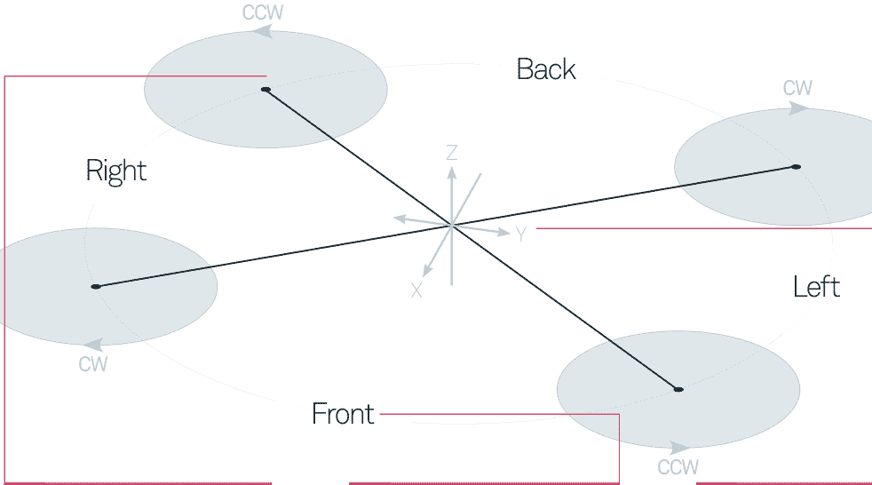

- 螺旋桨：螺旋桨相对于`x`、`y`轴对角线设置，并按所示旋转以减少偏航（绕`z`轴旋转）
- 方向：四翼飞行器的整体朝向描述了相对于传感器和螺旋桨布局的前、后、左、右
- 传感器：四翼飞行器的传感器根据这些`x`和`y`轴报告数据

从传感器到垂直速度`PID`的输入通过测量角度“相对于地平面的光学倾角”的余弦进行减少。同样，`X`和`Y`速度`PID`输入在将加速度读取的实际速度与目标速度进行比较时，需要补偿俯仰和横滚角。

## 实验与调优

虽然代码准确地反映了我们描述的所有内容，但有一组关键步骤只能通过测试找到：调优这些`PID`增益。对于每个`PID`调优，比例、积分和差分增益只能通过实验获得。结果相对直观，但每台四翼飞行器都是不同的。

首先，找到`PWM`起飞阈值：这是通过将你的四翼飞行器放在地上并缓慢增加`PWM`直到它开始升起来实现——例如，代码所示，这大约是`1500+95`。

接下来，调整稳定性`PID`——假设你的四翼飞行器是水平的且平衡大致位于中心，俯仰调优的结果适用于偏航。对于俯仰调优，调节两个对角的电机并将其放在表面上——四翼飞行器在中间保持水平。开启悬挂电机的`PWM`直略低于起飞速度（在我们代码中为`1550us`脉冲宽度），直到四翼飞行器开始摇摆、晃动或向右而非向左？相应地调整`P`增益。一旦`P`增益稳定，`D`增益是可选的，但它会增加稳定性和灵敏度。它就像按在胶带上的感觉——它不会移动。

- 垂直`PID`可以估算。`1590us`略高于`5us/s`的起飞速度，因此`P`增益为`100`是理想的。不需要`D`。

有了真实的起飞、悬停和降落就是安全的，这就是你调优垂直`PID`的方式。过大的`P`增益会导致四翼飞行器撞击墙或在空中执行动作。最好的结果是在大型开放区域/公园内，那里降落后地面足够软。

这没有捷径，所以你必须接受它会坠毁并尽力享受挑战！一旦平衡真正实现，你就拥有了一台可以在微风条件下起飞、悬停和降落的四翼飞行器。下一步是调整遥控器，但那是另一篇文章的内容……

> 上方四翼飞行器相对于方向的朝向，代码中使用的`x` `y`轴的旋转

`www.linuxux.co.uk`


使用定制的`Bioscope`以你想要的速度播放家庭录像带

左侧：树莓派完美地位于`Bioscope`的外壳内，这是他们决定它的原因之一。

下方：`Power Shield`是`Bioscope`的核心部分，本身也是一个独立项目


## 组件列表

- 树莓派
- 树莓派 Power Shield
- 微型 LCD 屏幕
- 定制注塑外壳
- USB 电影棒


## 我的项目

**Bioscope** 的灵感从哪里来？

Simon Barker：当我们开始这个项目时，它还没有出来。它是一个数字播放器，基本上，而且我负责技术部分。

与树莓派合作得如何？

SDB：它的性能并不足够，但它可以处理某些格式的视频，我们对它的要求并不高。我们面临最大的问题是我们想制作一个电池供电设备，但那个设计是一个挑战，特别是开关电源……

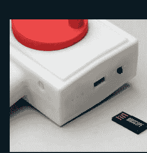

你们是如何相识并创建项目的？

Simon Barker：我是我们项目之一——虚构博物馆的技术支持。它是一个数字播放器，基本上，而且我负责技术部分。它运行得很好，于是我们决定继续。

我们在几个项目上相识，然后发现我们合作非常完美。我们拥有互补的技能并且

那么，你们对未来的计划是什么？

JS：我们收到了参加展览的请求，也有公司对制作它感兴趣。我们仍在努力如何生产这个项目。我们现在有一个想法，但不确定。我们想要最终实现它，制作功能齐全的产品。它们不是原型，而是……

你们考虑过将其作为产品发布吗？

SDB：我们正在考虑，实际上我们还没有做决定。设计还没有正式发布。我们认为有批量生产的潜力。然而，目前的方法将非常昂贵。我们对制作它的不同方式仍然好奇并保持开放。


## 树莓派最终恰好适合我们想要的外壳。而且它有复合输出，这也是我们需要的

更多阅读：欲了解更多关于该项目和 `Power Shield` 的信息，请访问 `www.raspberry.com/`

`63 www.linuxuser.com`

# 教程：设置无线接入点

## 使用树莓派设置无线接入点

### 如何无线连接到你的树莓派，或连接到它的任何现有网络

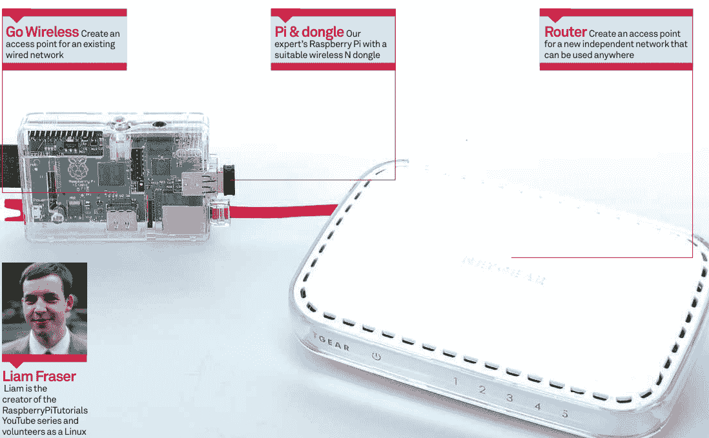

- **无线化** 为现有的有线网络创建一个接入点
- **树莓派与适配器** 我们的专家配备了合适无线适配器的树莓派
- **路由器** 为一个可以随处使用的新独立网络创建一个接入点

**Liam Fraser**

Liam 是 `RaspberryPiTutorials` 的创建者，并担任树莓派基金会的 `Linux` 服务器管理员志愿者员。

### 你需要的物品

- **最新版本的树莓派镜像** `raspberrypi.org/downloads`
- **一台路由器或交换机**
- **一个支持接入点（AP）模式的 USB 无线适配器**
- **一个用于测试的 Wi-Fi 设备**

带有支持接入点模式无线适配器的树莓派是一个非常多功能的工具。除了连接到现有网络外，树莓派还可以变成一个接入点并允许多个设备连接到它。它可以拥有自己的网络，也可以桥接到现有网络并使其变为无线化。这种方法的一个潜在应用是为访客创建一个访客网络，并设置适当规则确保他们无法连接到任何局域网（`LAN`）。另一个是简单地通过无线而非以太网连接，这在以太网端口已被占用时非常有用。例如，作为服务器的树莓派（用于通过网络启动计算机）会有一根以太网线连接到正在启动的计算机，但你可能需要同时登录并查看发生了什么。

### 01 安装奖励包

使用用户名 `pi` 和密码 `raspberry` 登录树莓派系统。使用以下命令获取最新的软件包列表：

```bash
sudo apt-get update
```

我们将使用 `hostapd`，这是一个处理接入点管理和认证的守护进程。我们还需要 `bridge-utils`，它将用于桥接以太网和无线接口；`iw` 用于获取无线接口的信息，而 `dnsmasq` 是一个 `DHCP` 服务器接口。通过以下命令安装它们：

```bash
sudo apt-get install host bridge-utils iw dnsmasq
```

### 02 检查 AP 模式

拥有一个支持接入点（`AP`）模式的适配器至关重要。要验证这一点，检查有线设备并输入 `iw`。将有一个名为“Supported interfaces mode”（支持的接口模式）的部分。确保 `AP` 模式在列表中。我们的输出如下：

```text
Supported interfaces:

- IBSS

- AP

- APVLAN

- WDS

- monitor

```

```text
ssid=pinet
hw_mode=g
channel=1
wlan0
wpa_passphrase=super_secret
wpa_key_mgmt=WPA-PSK
ee80211n1
```

注意，如果你没有无线能力的设备，或者遇到稳定性问题，你可能需要保留最后两行。如果你遇到稳定性问题，可能还需要更改无线通道。完成后，使用 `sudo /etc/init.d/hostapd start` 启动 `hostapd`。

### 03 桥接接口

我们将桥接以太网和无线接口，以便它们共享相同的 `IP` 地址和流量通道。要做到这一点，使用 `sudo` 编辑 `/etc/network/interfaces` 并将其更改为如下：

```text
auto lo
iface lo loopback

allow-hotplug eth0
iface eth0 manual

allow-hotplug wlan0
iface wlan0 manual
```

```text
iface br0 inet dhcp
bridge_ports eth0 wlan0
bridge_wait 0
```

目前，我们处于现有网络中，并将设置本地路由器。使用 `reboot` 使更改生效。

### 04 配置 hostapd

我们需要编辑 `/etc/default/hostapd` 以在启动时运行守护进程。使用 `DAEMON_CONF` 选项并将其替换为：

```bash
DAEMON_CONF=/etc/default/hostapd.conf
```

我们需要使用指定的属性配置 `hostapd` 文件。如下所示：

```text
interface wlan0
bridge=br0
driver=ie80211n
country_code=UK
```

### 05 连接到网络

配置文件中的 `SSID` 是名称，`WPA Passphrase` 是密码。当你连接到网络时，连接将桥接到有线网络，并且你应该从你的现有路由器 `DHCP` 获取一个 `IP` 地址。

### 06 创建端点网络

我们现在要配置网络独立于你的现有网络。要做的第一件事是提供你喜欢的静态 `IP` 地址。例如使用 `192.168.0.2`。如果你想路由到其他网络，我们建议使用随机地址范围。我们将做的第一件事是在 `/etc/network/interfaces` 的桥接部分分配静态地址，如下：

```text
iface br0 inet static
bridge_ports eth0
bridge_wait 0
address 192.168.0.2
netmask 255.255.255.0
gate 255.255.254
```

### 07 配置 DHCP 服务器

第一步我们将安装 `dnsmasq` 服务器。这非常简单。只需执行以下配置复制：

```bash
sudo cp /etc/dnsmasq.conf /etc/dnsmasq.conf.orig
```

然后编辑 `/etc/dnsmasq.conf` 包含以下行：

```text
interface=br0
address=192.168.0.2..192.168.0.254
mask=255.255.255.0
```

### 08 尝试一下

无线接口上的设备将能够连接有线网络，任何插入树莓派的设备将获得一个 `IP` 地址，以便与其他通信。


# 要学习的技能

1. 连接：许多接入点支持的一种非常有用的设备。
2. 网络：网络世界的，让它变得不那么神奇。

# 编写太空入侵者克隆


**Russell Barnes**

Russell 是《Linux User》杂志的编辑，也是一名热心的程序员和树莓派黑客。

### 01 设置依赖

如果你想更好地理解 `Pygame` 编程，我们建议将此教程中的 `Pyplayers` 代码复制到自己的游戏中。这是一个很好的练习，让你有机会根据需要调整游戏元素，例如不同的大小、形状或颜色。如果你只想玩游戏，这也可以轻松实现。无论如何，游戏唯一的依赖是 `Pygame`，如果终端尚未安装，通过以下命令安装：


等待，我漏掉了：太空入侵者克隆本身是一个测试`Pygame`模块元素的简单游戏——几乎所有的规则和逻辑都在屏幕向你移动，你可以用火力击落它们。当一波被击败后，会出现另一波更快、更有攻击性的波。我们在游戏和应用程序的创建中有效地使用了`Pygame`的许多功能。

我们希望这是一个有趣的游戏，你的旅程远未结束。请关注，因为下个月我们将制作另一个游戏来完善它，并可能实现受太空入侵者启发的梦想……

### 02 下载项目

对于`Pyplayers`，我们使用了`Git`这种非常形式的版本控制，用于保存游戏文件并保留代码版本。你的树莓派上应该安装了`Git`，所以：

```bash
$ git clone https://github.com/russb8/pyplayers.git
```

除了作为代码的管理员外，`Git`还允许你克隆其他项目的副本进行工作。从那里，在终端中进入主目录（`cd ~`），为项目创建一个目录（`mkdir pyplayers`）并输入：

# 程序：太空入侵者（继续见下一页）

# 完整代码列表（继续见下一页）

```python
#!/usr/bin/env python2
import pygame, random

BLACK = (0, 0, 0)
WHITE = (255, 255, 255)
RED = (255, 0, 0)
ALIEN = (0, 255, 0)
ALIEN_SIZE = 20
BARRIER_COLUMN = 4
BARRIER_WIDTH = 8
MISSILE_SIZE = 6
BLOCK_SIZE = 10

class player(pygame.sprite.Sprite):
    def __init__(self):
        pygame.sprite.Sprite.__init__(self)
        self.size = (50, 50)
        self.image = pygame.image.load('player.png')
        self.rect = self.image.get_rect()
        self.rect.centerx = self.rect.width / 2
        self.rect.bottom = 400
        self.travel = 7
        self.speed = 0
        self.time = pygame.time.get_ticks()

    def update(self):
        self.rect = Gamevector.Vector()
        if self.rect.left < 0:
            self.rect.left = 0
        if self.rect.right > 600:
            self.rect.right = 600

class alien(pygame.sprite.Sprite):
    def __init__(self):
        pygame.sprite.Sprite.__init__(self)
        self.size = (ALIEN_SIZE, ALIEN_SIZE)
        self.image = pygame.image.load('alien.png')
        self.rect = self.image.get_rect()
        self.has_moved = False
        self.travel = 7
        self.time = pygame.time.get_ticks()

    def update(self):
        if pygame.time.get_ticks() - self.time > self.speed:
            if not self.has_moved:
                self.rect.x += 1
                if self.rect.right > 600 or self.rect.left < 0:
                    self.has_moved = True
            else:
                self.rect.x += 5
                self.rect.y += 10
                self.has_moved = False
            self.time = pygame.time.get_ticks()

class Block(pygame.sprite.Sprite):
    def __init__(self):
        pygame.sprite.Sprite.__init__(self)
        self.size = (BLOCK_SIZE, BLOCK_SIZE)
        self.image = pygame.Surface(self.size)
        self.image.fill(color)
        self.rect = self.image.get_rect()
```


```python
class Game:
    def __init__(self):
        pygame.init()
        self.font = pygame.font.SysFont('arial', 24)
        self.time = pygame.time.get_ticks()
        self.data = pygame.image.load('background.png')
        self.screen = pygame.display.set_mode((600, 400))
        self.time = pygame.time.get_ticks()
        self.score = 0
        self.level = 1
        self.levelup = 5
        self.all = pygame.sprite.Group()
        self.enemies = pygame.sprite.Group()
        self.alien_group = pygame.sprite.Group()
        self.bullet_group = pygame.sprite.Group()
        self.missile_group = pygame.sprite.Group()
        self.all_sprite = pygame.sprite.Group()
        self.intro_screen = pygame.image.load('intro.png')
        self.background = pygame.image.load('gameover.png')
        pygame.display.set_caption('Invaders to exit')
        self.player = player()
        self.all.add(self.player)
        self.score = True
        self.game_over = False
        self.shot_bullet = True

    def update(self):
        for event in pygame.event.get():
            if event.type == pygame.QUIT:
                self.game_over = True
            if event.type == pygame.KEYDOWN:
                if event.key == pygame.K_SPACE:
                    self.game_over = False
                if event.key == pygame.K_n:
                    self.level += 1
                    self.score = False
            if self.score == False:
                self.shot_bullet = False
            if self.game_over == True:
                self.shot_bullet = True
            if self.game_over == False:
                self.score = True
        self.all.update()
        self.enemies.update()
        self.alien_group.update()
        self.bullet_group.update()
        self.missile_group.update()
```

# 整洁的代码

清晰标记经常使用的全局变量使代码更易读，当我们想要更改对象大小时，只需要在这里操作，并在处处生效。

# 组

创建组的长列表使得我们每次创建一个对象时都可以轻松地进行测试和绘制。

# 控制

处理键盘输入是一个重要的方法。它检查我们是否在屏幕上进行游戏。

# 雨中的子弹

`Ammo` 类用于分发一些属性和对象，此方法检查是否有必要。


# 教程

入侵者：太空入侵者克隆

## 03 测试

安装好 `Pygame` 并项目克隆到你的机器上（你也可以在这个网站找到 zip 包——只需解压并复制到你的文件夹），你可以进行快速驱动以确保一切都就绪。现在你可以从终端运行程序，使用空格键开始游戏，使用方向键左右移动。对于那些设计为改变任何内容的常量，你可以有一个宠物类。从该类中你可以创建猫（喵喵）和狗（汪汪）。它们在许多方面是不同的，但都拥有相同的父类。我们对 `Ammo` 类正是这样做，用它来创建子弹和敌人。它们移动的方向相反，但从根本上是一样的。

## 04 创建你自己的类

一旦你达到了高分（生存结束），就是时候实现你自己的版本了。你将通过遵循示例和弄懂内容中学到很多。对于想制作自己项目的人，创建一个新文件夹并使用任何 `IDE`（`IDLE` 等）来创建并保存你的 `.py` 文件。

## 05 类 - 部分 1

类是你想要创建的对象的蓝图。在我们玩的游戏中，屏幕中间有许多类的实例，或者说多个副本（在 `make_player` 方法中）。玩家继承了 `Sprite` 类的许多属性，以及在你创建的类的第一行中找到的新方法。你可以在 `www.pygame.org/wiki/Sprite` 阅读更多关于 `Sprite` 类的信息。

## 07 类 - 部分 2

在入侵者游戏中，类创建的属性是类使用的简单变量。对于每个弹（或子弹），你还会注意到所有类都有一个 `update()` 方法，该方法在我们创建的移动循环的每次迭代中被调用（调用 `update`）。在子弹的情况下，它移动到屏幕顶部或底部，我们销毁它（如果它没有左移）。

## 08 全局变量

一旦确定了需要的变量，我们将它们存储在大写字母中。这些变量是常量（或全局变量）。它们是需要使用但在代码中引用的数字、颜色、尺寸和分辨率。你还需要不同类的多个数字——

## 09 游戏

我们的最后一个类是游戏所有主要功能发生的地方，但记住，它只是一个方法列表——在调用它们之前，什么都不会发生。主类是游戏所在地。我们使用 `Pygame` 编写射物，并使用 `gameState` 类控制诸如玩家移动（方向）以及我们是否需要重启屏幕。

## 10 主循环

类中有许多方法（函数），每个都设计用于控制游戏设置的特定方面。游戏每轮发生的实际逻辑包含在类末尾的 `main_loop` 方法中。从那里，你将能够看到在结束游戏前每秒更新 20 次的各种变量和函数。

## 编写太空入侵者游戏 (Space Invaders)

类本质上是你打算创建的对象的蓝图

```python
pygame.display.flip()
self.control()
def __init__(self):
    self.player = Player()
    self.player_group.add(self.player)
    self.sprite_list.add(self.player)
    self.all_sprites.add(self.player)
    self.refresh_sprites()
    pygame.screen.blit(self.image, (0, 0))
    self.clock.tick(self.frame_rate)
```

### 刷新

你应该考虑帧之间更新状态的方式，背景移动对于动画至关重要。

### 死亡还是胜利

这里回答了两个关键的问题——玩家死了，还是你赢得了这一回合？

```python
def draw(self):
    if self.alive():
        self.screen.blit(self.game_font.render(
            "The war was lost!", True, (255, 0, 0))
        ), (250, 250))
        self.screen.blit(self.game_font.render(
            "YOU WON!", True, (0, 255, 0))
        ), (250, 300))
```


```python
def update(self):
    if self.alive():
        self.rect.x += self.speed
        if self.rect.right >= screen_width:
            self.speed *= -1
```

```python
def alien_spawn(self):
    for column in range(BARRIER_COL):
        alien = Alien(i, j)
        alien.rect.x = (column * ALIEN_WIDTH)
        alien.rect.y = (row * ALIEN_HEIGHT)
        alien.rect.centerx = (column * ALIEN_SPACING)
        self.alien_group.add(alien)
        self.sprite_list.add(alien)
        alien.speed = -2
```

```python
def make_bullet(self):
    if GameState.time - self.last_shot > 250:
        bullet = Bullet(self.rect.centerx, self.player.rect.top)
        self.bullet_group.add(bullet)
        self.sprite_list.add(bullet)
        self.last_shot = GameState.time
```

```python
def make_enemy(self):
    if self.alive():
        if random.random() < 0.1:
            choice = random.choice(ENEMY_TYPES)
            enemy = Enemy(choice)
            enemy.rect.x = random.randint(0, screen_width)
            enemy.rect.y = -50
            self.enemy_group.add(enemy)
            self.sprite_list.add(enemy)
            enemy.speed = 5
```

### 枪与弹药

子弹和导弹使用相同的逻辑，通过改变几个关键属性来改变行为；这些属性对于每者都非常重要。

```python
def make_barrier(self, columns, rows, spacer):
    for column in range(columns):
        for row in range(rows):
            barrier = Barrier(BARRIER_TYPE, BLOCK_SIZE)
            barrier.rect.x = (column * (BARRIER_WIDTH + spacer))
            barrier.rect.y = (row * (BARRIER_HEIGHT + spacer))
            self.barrier_group.add(barrier)
            self.sprite_list.add(barrier)
```

```python
def make_defenses(self):
    for spacing in range(BARRIER_COUNT):
        make_barrier(5, 3, 20)
```

```python
def kill_all(self):
    for group in [self.bullet_group, self.player_group,
        self.alien_group, self.enemy_group, self.barrier_group]:
        for i in group:
            i.kill()
```

```python
def is_dead(self):
    if self.alive():
        if pygame.sprite_group.spritecollide(self, self.alien_group, True, False):
            return True
        if pygame.sprite_group.spritecollide(self, self.barrier_group, True, False):
            return True
    return False
```

### 主循环

主循环是应用程序的核心。它每秒运行 20 次。它需要更新逻辑和渲染代码。

```python
def defenses_breached(self):
    for alien in self.alien_group:
        if alien.rect.top < 0:
            return True
    return False
```

```python
def update(self):
    for alien in self.alien_group:
        self.screen.game_font.render("Earth Defended!", True, (255, 255, 255))
    self.refresh_sprites()
    pygame.time.delay(100)
```

```python
def collisions(self):
    if pygame.sprite_group.spritecollide(self.bullet_group, self.alien_group, True, True):
        self.score += 10
    if pygame.sprite_group.spritecollide(self.bullet_group, self.enemy_group, True, True):
        self.score += 20
```

```python
def game_start_end(self):
    if not GameState.start:
        GameState.GameTime.time = time
        self.refresh_sprites()
        pygame.screen.blit(self.image, (0, 0))
        self.clock.tick(self.frame_rate)
```

## Python 列

与整数相比，这一点很快就会变得非常明显。执行 `sys.getsize('a')` 返回 38 字节。如果我们把这个字符串放入列表并运行 `getsize`，它似乎只占用了 8 字节，而实际上 `getsize()` 测量的是指向该字符串的变量的大小。要获取列表的完整大小，你需要遍历元素并单独获取每个元素的大小。

- 查找你的 Python 程序正在使用多少树莓派内存

RAM 的另一个衡量标准是 Python 解释器在导入模块时所占用的内存。在示例代码中，你将找到一个使用该模块获取已用 RAM 总量的函数。遗憾的是，这种方法提供的是当前时刻的最大用值，因此你无法看到尝试清理内存时会发生什么。为了实现这一点，你需要使用不同的方法，例如：

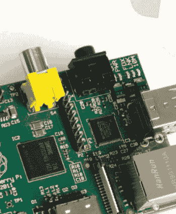

## 代码列表

### 首先，你需要导入模块

```python
import sys
```

### 整数有多大？

```python
sys.getsize(0)
```

### 列表呢？

```python
a = []
sys.getsize(a)
a.append(a)
a.append(b)
a.append(c)
sys.getsize(a)
```

### 我们可以计数引用吗？

```python
b = []
sys.refcount(b)
sys.refcount(b)
```

### 函数的情况是一样的吗？

```python
sys.refcount(c)
```

### 我们使用了多少 RAM

```python
import resource
rusage = 1024
memoryusage = resource.getrusage(resource.RUSAGE_SELF).maxrss / rusage
return memoryusage
```

```python
memory_usage = []
list = [0]*100000
memory_usage
```


# 如果我们只是创建另一个，会使用更多 RAM 吗？

```python
list = [1]
list2 = list + list3 = []
```

# 清理时不要忘记清理

```python
a = b = c = []
```

```python
import gc
# 有多少垃圾？
gc.collect()
# 继续清理
gc.collect()
```

## 倒垃圾

在处理面向内存的编程语言时，首先想到的一点就是垃圾回收。每当你能够多次引用一个对象时，你需要在内存中跟踪这些引用，直到它们都被移除。在 Python 中，你拥有一个现成的垃圾收集器。为了控制这一点，你需要使用 `gc` 模块。如果你想查看收集器跟踪了多少对象，可以使用 `gc.get_count()`。通常，垃圾回收由一种算法处理，该算法旨在以最小影响最大化内存利用。但如果你想强制进行垃圾回收，可以使用 `gc.collect()`。被收集的对象会被清理。你可以通过 `gc.set_threshold()` 查看垃圾器使用的内存泄漏。你始终可以使用 `gc.garbage()` 查看哪些对象即将被收集。通过 `gc` 模块，你对系统的控制力比大多数语言都要多得多。

评估：在 Python 中可以使用内存方法检查任何变量的大小。更多详情请参见 `www.python.org/docs`。

短记忆：树莓派的尺寸和定位决定了它没有大量的内存。你的代码写得节约吗？

`71 www.linuxux.co.uk`

## FAQ 什么是 GertDuino？

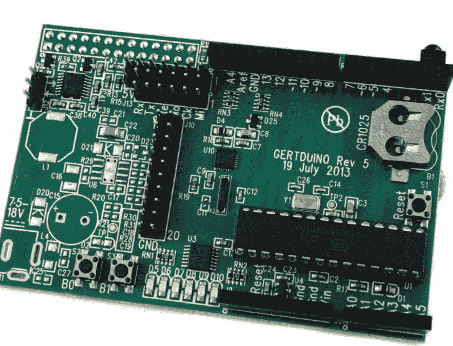

## 什么是 GertDuino？

这是一个名字奇特的树莓派配件，对于实现一些惊人的项目至关重要。

`Bert Zweetsloot` 构建复杂的系统，并经营一个性质模糊的网站。他精通 `Python` 和 `Django`。他喜欢实验计算。

如果你喜欢这个……

我们在文章中提到了 `GertDuino`，它是进入物理计算的极佳扩展模块。

进一步阅读：

从下文中获取更多信息并查看实际示例。

- **Q GertDuino 是一个配件。这个术语有点模糊。你能多详细地介绍一下它吗？**

  `GertDuino` 是一块可以连接到树莓派上的电路板，通过原始芯片和端口扩展其功能。

- **Q 连接到另一个电路板的电路。它叫什么名字？听起来像是一家人！**

  首先，`Gert` 是那个发明者的名字—— `Gert van Loew`。他是一个硬件工程师，一直致力于电路板工作，目前在基金会教授学生。他是论坛的活跃成员，并开发过 `GertDuino`。

- **Q 噢，那不是一个和我们名字一样的正确的电路板吗？**

  是的：`Gert` 发明了另一个，即另一个树莓派。

- **Q 那么它和 GertDuino 有什么区别？它是 GertDuino 的升级版吗？**

  并不如此。`GertDuino` 扩展了树莓派 `GPIO` 端口的功能，允许你点亮 `LED` 并与物理世界轻松交互。

# 构建更强大的网页

`www.webdesignermag.co.uk`


# 网页设计师

现已发售

`2014年度热门100 | 15款最佳浏览器开发者工具 | 增强你的 CSS`


## 今日购买您的期杂志

纸质版请访问 `www.imagineshop.co.uk`

数字版请访问 `www.greatdigitalmags.com`

可在以下平台获取

- `facebook.com/webdesignermag`

- `twitter.com/webdesignermag`

# 评测

`75 组测试 | 80 Sabayon 14.01 | 83 Korora 20 | 85 Books`

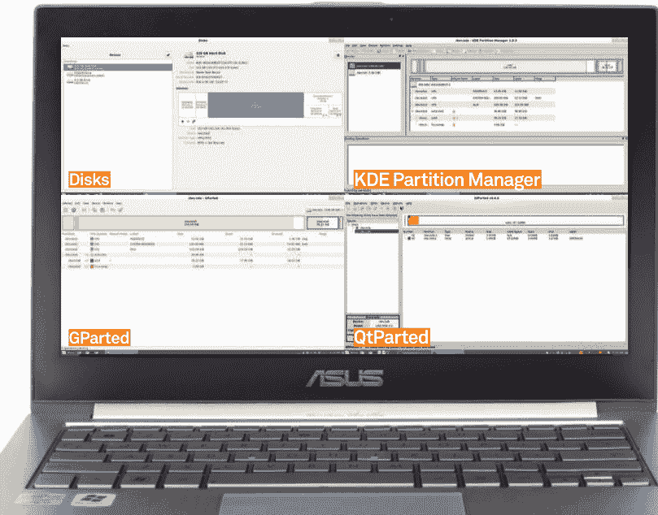

## 组测试

## 图形化分区管理器

在我们查看一系列分区编辑器时，请确保您以最佳方式维护您的硬盘和存储器。

### Disks (磁盘工具)

`Disks` 有几个名称：`palestimps`、`GNOME 磁盘工具`等。它是第一个 `GNOME` 分区编辑器，也是已安装的 `Ubuntu` 以及任何使用 `GNOME` 的发行版中的默认分程序。尽管它是 `GNOME` 的一部分，但它非常简单，并且拥有一系列不错的功能。

从 `bit.ly/1f2qybc` 下载

### KDE 分区管理器 (KDE Partition Manager)

如名所示，这是 `KDE` 的分区编辑器，你通常可以在 `KDE` 中通过 `KPart` 找到它。值得注意的是，你不需要 `KDE` 即可运行它，它可以独立于桌面环境。由于它的独立性，你可以找到基于 `openSUSE` 的 `Live` 启动版本。

从 `bit.ly/1aHaRtq` 下载

### GParted

包含在许多专业和免费资源分区工具中，它是次级 `GNOME` 分区管理器的图形界面，它比其他工具更简单，但功能依然丰富。它甚至作为一种 `Live` 发行版提供，以防你所在的系统没有 `Linux`。

从 `bit.ly/1dlI6K6` 下载

### QtParted

不要相信它已经消失的传闻——`QtParted` 仍在维护，尽管 `QtParted` 为 `KDE` 分区管理器奠定了大量基础，后者在新的开发周期中已取代成为 `KDE` 的默认工具。你需要从源码编译它，因为它在许多仓库中并不可用。

从 `bit.ly/1amFcn` 下载

# 图形化分区管理器组测试评测

### Disks

`GNOME` 的默认分区编辑器有一些小技巧，但缺少其他功能。

### KDE 分区管理器

`KPart` 默认为 `KDE` 桌面带来了类似 `GParted` 风格的功能。

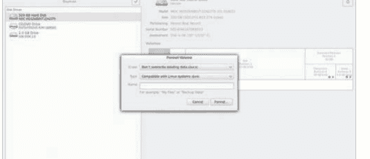

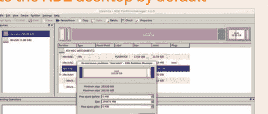

格式化对话框已为你标记好。

调整大小可以通过图形化完成，也可以以兆字节为单位精确调整。

### 界面

### 界面

尽管 `Disks` 是一个拥有大量开发的 `GNOME` 应用，但它的感觉与其他 `GNOME` 软件不同。然而，在布局方面，它与本次测试中的其他 `GUI` 轻微不同。遗憾的是，没有右键菜单，因此一旦选择了分区或空间，所有操作都要通过微小的设置来处理。

`KDE` 美学设计体现在 `KDE` 分区管理器中，`UI` 的实际布局被分成三个不同的框架。存储占据了屏幕空间的很大一部分，分区本可以更好地利用这些空间。

### 功能

### 功能

很容易格式化我们预期的某些编辑功能。虽然调整大小很容易，但你至少可以更改一些信息，如标签和排序，它拥有一套完整的基准工具来让硬盘处于良好状态。

感谢使用，`KDE` 分区管理器允许以多种方式编辑：从缩小到更改标记。由于图形形式的存在，可以按兆字节进行微调。这些是我们对这类应用的预期功能。

### 格式化

### 格式化

格式化在 `Disks` 中的处理方式很奇怪——它有一个专门的格式化菜单，但只有几个选项。还有另一个菜单允许你动态更改文件系统，并包含了许多选项。其他方法似乎专门为新手和老手分别设计，但有点困惑。

### 额外

### 额外

作为基准测试，`Disks` 允许用户编辑 `fstab`，包括一个自动挂载的开启/关闭开关，以及用于手动挂载每个分区的完整字段。`Disks` 还可以被放入待机模式，其中软件提供的非常少。在所有标准和格式化工具之上，有一个分区创建器，然而对于插件或扩展，`Disks` 会有一些更好的管理功能。

### 总结

### 总结

`Disks` 拥有强大的功能和选项，这意味着它

# 测评

# 图形化分区管理器分组测试

# 简评：对比与我们的结论

# 磁盘 (Disks)

# KDE 分区管理器 (KDE Partition Manager)

# GParted

# QtParted

| 特性 | 磁盘 | KDE 分区管理器 | GParted | QtParted |
| :--- | :--- | :--- | :--- | :--- |
| **界面** | 布局简单但不是最容易理解的 | KDE 的美学装饰了这个界面，但对屏幕空间的利用率不高 | 专注的界面，功能和特性布局合理 | 比 KDE 的布局更好，优点是基础简单 |
| **功能** | 只有几个格式化工具，没有调整大小功能 | 磁盘标记和格式化工具提供了全面的功能 | 各种用于管理硬盘的分区和编辑工具 | 我们预期的一组基础功能，如调整大小等 |
| **格式化** | 选项混乱，有许多文件系统可供使用 | 由非常强大的系统处理大量文件类型 | 使用了 LVM 之外的所有主要选项，且运行快速快捷 | 支持的文件系统列表，有一个队列供你微调分区 |


| 磁盘 | 磁盘在磁盘控制和挂载选项方面有一些有趣的功能 | 它主要的缺点是缺乏额外功能，但它是一个很棒的软件 | 一个有趣的调整大小选项可以帮助某些形式的恢复 | 一个几乎没有被取代的简单分区管理器 |
| 总体 | 磁盘缺少了一些需要的功能，但其他一些仍是不错的选择 | 一款完美的软件，让你拥有最出分区编辑器 | - | - |

## 冠军得生是....

## GParted

我们在测试中发现，虽然 `GParted` 是一款非常优秀的分区管理器，但它还有许多我们可能感兴趣的一一两个功能。我们想看看它在许多专业解决方案中是如何使用的，并与其他工具进行对比。

事实证明，`GParted` 之所以流行不仅仅是因为大家都在用它；它是一部功能全的软件，在各处提供了其他应用程序中的最佳功能。从出色的 `UX` 设计开始，它包含了格式化、调整大小，并通过界面让你轻松高效地创建最优的分区布局。

我们很喜欢这个工具的这些特性。虽然“`磁盘`”有一些有趣的功能，例如挂载点的编辑和磁盘分区，但它缺乏我们在标准格式化之外喜欢的所有其他主要功能。作为默认：

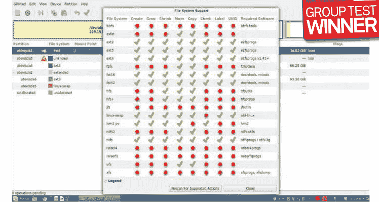

`GParted` 的优势之一是其惊人的文件系统支持。对于桌面环境，“`磁盘`”和 `KDE` 分区管理器很不错，但它们做得没有 `GParted` 多。`KDE` 分区管理器在构成 `GParted` 的大多数功能上表现更好，在不需要更换它的情况下，用起来也很好用。

`QtParted` 曾经也显然处于正确的轨道上，但由于缺乏开发，它并没有达到应有的水平。功能的匮乏限制了其他选项的改进，意味着它可能永远无法从短暂的停滞中恢复。

`GParted` 应该安装在每个 `Linux` 系统上，所以请确保你不是唯一充分利用这一核心工具的人。

`Rob Weelsblatt`

`78 www.linuxuser.com.`

## 专家 App 测评

## 无论你身在何处


| iOS 与 安卓 | 300+ 测评 | 技巧与窍门 | App 组测试 | 最佳免费 App |
| --- | --- | --- | --- | --- |
| ![img] | ![img] | ![img] | ![img] | ![img] |

### 立即下载免费 App

- `iTunes`
- `Google play`
- `amazon`
- `zinio`
- `nook`

# Sabayon Linux 14.01 测评

## 新功能：

- `Steam` 大屏幕模式
- `UEFI` 安全启动支持
- 熵 `254`
- 一键更新

`XFCE`、`KDE` 和 `GNOME` 是你可以获取的 `Sabayon` 最新版本的几种变体。

`Rigo` 是一个非常易用的包管理器，屏幕上提供了丰富的信息。它现在由于支持并行处理而运行得更好。

每个桌面都针对 `Sabayon` 进行了轻微的定制和优化。

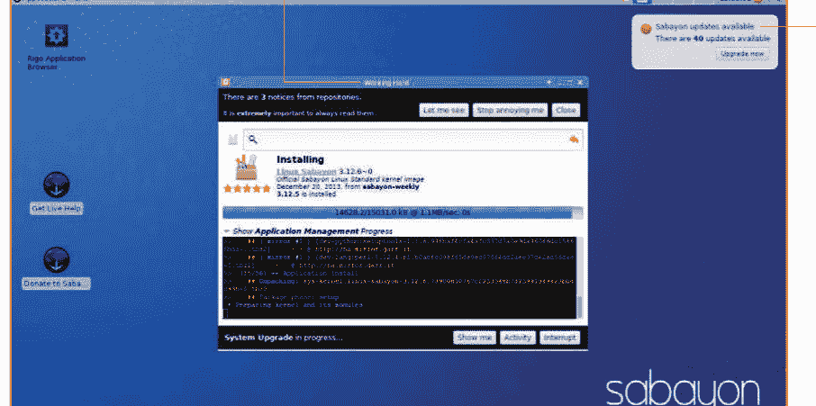

# 发行版：Sabayon Linux 14.01

**最适合：** 家庭办公

**最低配置：** `CPU` `512MB` 内存 存储 `CPU` 支持 `OpenGL`

新的一年带给我们了 `Sabayon` 镜像，包括一些重要的新增，如 `Steam` 和包管理。

`Sabayon` 是面向大众的，带有桌面环境和图形化安装程序。我们说为什么要讨论 `Sabayon`，它是值得提及的，使用 `Gentoo` 可能是一种源码的独特 `Linux` 黑术，而 `Sabayon` 让人们能够使用最优秀的发行版之一，这在我们的世界中构建着庞大的事物。这是一个被某种忽视的发行版，在过去的一年中添加了一些很棒的功能。

`14.01` 更新的新之处在于包含了备受期待的 `Steambox`，它的出现是一个非常及机，正值 `Valve` `Steam` 和 `Steam Machines` 的发布，并提醒我们 `Steam` 可以在普通的 `Linux` 上运行。

# 编译安装

`Sabayon` 使用了旧版本的 `Archlinux` 安装程序，即 `Fedora` `18` 大改之前的那个版本。它对于当前任务是够用的。`Gentoo` 带有...（此处原文未完整）

# 解锁安卓的威力

`www.littlegreenrobot.co.uk`

`40+` 三星 `HTC` 索尼 `LG` `NEXUS`

`100%` 非官方

`40` 三星 `HTC`

`100%` 非官方

`120+` 三星 `HTC`

`100%` 非官方

索尼 `LG` `NEXUS`

# 安卓杂志

- 应用评测
- 技巧与建议
- 硬件破解
- `120` 个你必须尝试的奇妙技巧

# 骇客大师课

- 应用评测
- 技巧与建议
- 硬件破解

# 终极买家指南（非火热版）

- 开启安卓之旅
- 为你的游戏优化手机
- 完全的自由，无限制！

# 安卓杂志

`HUD`-`KINDLE` `FIRE` 杂志

解锁安卓的终极指南

保护你的隐私并让它变得……

最佳生活应用

# 解决！20 个最大的安卓问题

# 平板应用锁

免费获取应用

# 10 大必备技巧与机器学习

云端安卓

# 骇客区

办公中的安卓

`Galaxy` 手机评测

# Galaxy ACE 3

专业建议

如何免费寻找平板应用

`100%` 的提升是史以来最快的速度

最佳安卓选择

# 骇客区

可在所有优质代理和超市购买

# 安卓杂志

现已发售

> 骇客大师课 > 安卓问题解决 > 升级到 `KitKat`

硬件评测 | 安卓破解 | 技巧与策略 | 应用评测 | 帮助与建议

# 今日购买您的杂志

纸质版请访问 `www.imagineshop.co.uk`

数字版请访问 `www.greatdigitalmagams.com`

可在以下平台购买：

# Korora 20

它不仅仅是一个换壳版的 `Fedora` 版本吗？

# 评测

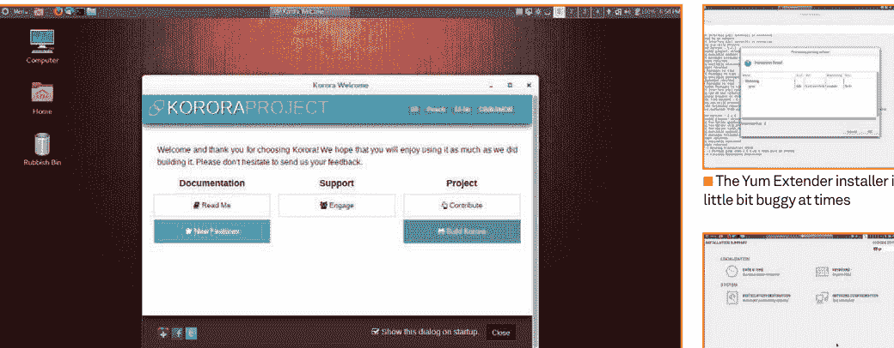

# 发行版

# Korora 20

`Korora` 被介绍为面向初学者，对老手来说依然有用——但它不仅仅是一个换壳版的 `Fedora` 版本：如今那些能让新手更容易上手的 `Linux` 发行版并不多。它们大多数关注某一个特定的发行版和概念，在 `Korora` 的情况下，就是 `Fedora`。`Korora` 早期基于 `Gentoo`，后来切换到了基于 `Fedora` 的方案，在这些流行的发行版中提供了更完整的体验。

标准 `Fedora` 和 `Korora` 之间的某些区别在于让它变得更容易上手。首先，`Korora` 提供了不同的桌面环境，如 `GNOME`、`MATE` 和 `XFCE`。虽然这些也可以通过其他选项安装并同时出色的 `Fedora` 体验，但获取这些选项要简单一些。`RPM` `Fusion` 也用于选择，并包含 `Google` 和 `VirtualBox` 的额外仓库。`Korora` 使用了新版本的 `Anaconda` 安装程序。

`Korora` `20` 使用 `Yum` `Extender`，这是一种软件管理器和安装器，作为 `Fedora` 安装器或 `Synaptic` 的替代方案。`Fedora` 版本比较简单，而 `Yum` `Extender` 希望在为用户带回功能的同时，对新手来说依然易用。

它的界面布局并非最佳，更多地依赖于知道自己要找哪个包，而不是提供一系列类别供你浏览。它还崩溃过几次，特别是在安装新软件或更新设置之后。不过，它非常好用，你可以轻松地安装 `Soundtrack` 或使用 `GNOME` 的应用程序安装器来取代 `Yum` `Extender`。这是了解 `Linux` 的一种好方法。然而，在某种程度上，`Fedora` 很容易学习和使用，不需要尝试很多花样。它可能不是最好的。

**作者：** `Red` `Robot`

一系列工具帮助新手接触 `Linux` —— 但并非没有问题。尽管如此，除了一个稍微有点靠谱的包管理器外，各种口味和额外功能的选择让它比没有这些时更容易被老用户使用。

`Korora` 用一个信息丰富的界面欢迎你的到来。

安装通过 `Anaconda` 完成，这并不总是最简单的。


# 总结

## 优点

- 它是比原版更多选择的 `Fedora`，大多数用户都会需要。
- 差异清晰可见。它改变了 `Fedora`，让用户可以做更多事情。

## 缺点

- 更多信息请访问 `kororaproject.org`

# 订阅

立即订阅并开始节省

美国读者见第 `26` 页

**专属福利**

- 立即订阅即可获得免费期*
- 立即订阅每期仅需 `$10` —— 通常价格为 `$16.99`
- 立即订阅每期仅需 `$30` —— `13` 期*


欲更多信息请访问 `www.imaginesubs.co.uk` 或拨打 +44 (0)。`Imagine Publishing` 每出版 20 多本杂志，其中一些已经出版了 10 年，读者超过 400 万。

**服务条款**：这是美元订阅，订购时请不要注明“USA”。您的订阅费用将为 $30（13 期），折合后每期为 $16.99。您的订阅从出版日期开始。有效期至 2021 年 6 月 30 日。

# 评语

## 创客运动：新世界中创造者、骇客和爱好者的规则

“进入这一运动的关键之一是民主化影响：人们可以创造东西，”Mark Hatch 在这本迷人的指南中写道。书中通过许多示例说明了这一点：“Andy 正在工作，”告诉他们。

- 作者：Mark Hatch
- 出版社：`Pragmatic Bookshelf`
- ISBN：`978-1977853536`
- 价格：30.95


## Erlang 编程：面向并发世界的软件 - 第二版

并发、分布式、容错编程。`Erlang` 的 Actor 模型在曾是电信利基领域的兴趣一直在增长。并发编程需要一种特定的哲学，即使不是初，读者也会学习编写许多可能变为并发的程序。系统的力量将保持实时性。书中有一半的内容是示例和应用程序。最后包含了一个运行示例——《Sherlock 的锁》，这是一个处理和从海量存档中提取开放式章节——以便读者能够理解并进一步编码。

- 作者：`Joe Armstrong`
- 出版社：`McGraw-Hill`
- ISBN：`978-007821224`
- 价格：16.99


## 这是一本教科书风格的 Scala 指南

`JVM` 使用（共享库）、静态类型检查和面向开发者的现代语言。`Scala` 是很好的导师。它以对新手友好的方式编写，让非程序员快速学习。

- 作者：`Mark C. Pearson`
- 出版社：`O'Reilly`
- ISBN：`978-059639962`
- 价格：44.99

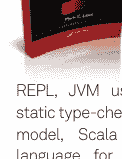

## 骇客与渗透测试基础 - 第二版

面向新手的测试工具和流程指南。

## 理解计算：从简单到不可能的程序

一场穿越编码设计和理论的迷人之旅。

- 作者：`Tom Stuart`
- 出版社：`O'Reilly`
- ISBN：`978-1449329273`
- 价格：25.99

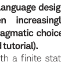

## 入门骇客

`George` 提供了“入门骇客”这本渗透测试指南对该领域的新手非常有用。引导他们了解整个过程和工具，向他们展示所有工具是如何结合的。

- 作者：`Peter Bengston`
- 出版社：`Simon and Schuster`
- ISBN：`978-141316643`
- 价格：18.99

## WebGraphQL：交互式 Go，使用 WebGL 编程

对于那些先学习编程的人，这是将代码与故事联系起来并发现更多语言设计的好方法，构建简单（然后逐渐复杂）的示例，为非机器人提供的快速教程？

在开始简单示例之前，引入了 `WebGL` 概念，它很好地解释了“用语言编程”的如何和为什么——也有助于理解语言背后的理论，一个类似的表达和思维的世界。


`WebGL` 构建 3D 游戏、建模和其他图形奇观，适用于平板电脑、移动设备、Chromebook 和桌面应用。`VRML` 资深人士 Matsuda 和 Lea 为这一巨大且快速演变的步进式示例和实用用代码段带来了理解。

围绕 `Kali Linux` 的构建，读者可以在这里找到所有工具（类似的目录外），无需寻找其他工具。

- 作者：`Kouchi Matsuda`
- 出版社：`Rodler` / `Addison Wesley`
- ISBN：`978-0321190294`
- 价格：29.99

# 分类广告

## 此处有巨龙！

（以及出色的云托管）

## 史以来最大的冬季特卖

所有专用服务器前 3 个月 5 折优惠

`0800 808 5450`
`sales@netcetera.co.uk`
`www.netcetera.co.uk`
`www.blacknight.com`
`sales@blacknight.com` @blacknight +44 (0)845 280242

## 树莓派®入门套件

除屏幕以外的一切

- 入门套件 £75
- 豪华入门套件 £120

`http://shop.pimoroni.com`


## adafruit FLORA

品卡！因为闪闪的东西很难买！

£25

## 学习机器人

为儿童设计的趣味与教育套件

豪华入门套件


## 可穿戴设备；Arduino；元件；枯树！

我们现在现货了一系列可以用它们来制作酷炫物品的闪亮物品！

`http://shop.pimoroni.com`

## 01202 586421 Linux 与开发者


使用 `ModMyPi` 让你的创意变为现实 `www.modmypi.com` @modmypi


`Arduino` 与 树莓派机器人，新款开源机器人平台现已到货！


# 联系我们...

网页: `www.linuxuxer.co.uk`
邮件: `linuxer@imagine-publishing.co.uk`

# 问答

`Facebook`: Linux 用户与开发者
`Twitter`: `@linuxusermag`

## 你的问题将解答

向我们发送你的问题，我们将尽力解答！

## 常见问题解答：备份

**问：我需要备份什么？**

答：有很多图形化应用程序可以帮助你进行备份，尽管许多处理备份的操作非常棘手。如果遇到困难，默认备份就足够保存你的文件。它们还具有调度功能，所以你只需要设置一次。

**问：我应该把文件存储在哪里？**

答：如果你有驱动器或驱动系统，请始终使用 `USB` 存储设备或网络计算机。如果发生火灾，它们和其他任何东西一样安全。在这种情况下你未来也可以轻松地访问你的文件。

**问：我可以对整个硬盘进行镜像吗？**

答：可以，你可以使用 `Clonezilla` 系统工具。`Clonezilla` 可以克隆整个硬盘，也可以仅克隆其中的单个分区。不过，这些文件可能很大，你可能无法将它们保存到 `U` 盘。


# 音乐人

我一直在实现一个名为 `pianobar` 的软件。它是一个寻找音乐的 `CLI` 客户端。每个服务都非常棒，它为我带来了许多老新曲目，我很喜欢与它一起。

搜索 `Google` 后，我发现了 `pianobar` 是如何构建以及如何安装的，这也是我目前正在运行的。在官方网站找到的信息非常有帮助。但搜索 `pianobar` 的结果返回为空。

我以为从源码编译也是一个选项，但我仍然为未满足的依赖感到苦恼（这些本应该是满足的），我宁愿不要处理这些，而是研究 `pianobar` 是否在官方仓库中。

不幸的是，在 `Ubuntu` 中没有找到它——是因为 `pianobar` 的包管理器。仓库只使用免费软件，`pianobar` 可能无法满足这些需求。不过有一个解决方法：首先，从以下地址下载最新的 `Debian` 软件包：

`http://pkgs.repository.org/libmad/`

```bash
$ sudo apt install libmad-dev gnutels-dev
$ rpm -Uh libmad-dev-x.rf-rpm
$ rpm -Uh libmad-dev-x.elf.rf-rpm
```

`www.linuxuxer.co.uk`

# 问题

所有问题已解决

# Q/A


# 迷你磁盘

我最近更换了 `PC` 的一些硬盘，确保使用 `Clonezilla` 为我的主硬盘制作镜像。然后我想将该镜像恢复到另一个硬盘。然而，它提示“目标空间太小”。我不想克隆任何分区，因为它正在使用中，我不想对磁盘进行手动清理。

有什么方法可以把镜像写入硬盘吗？

Chris Wood

这有点棘手，但通过仔细遵循指令你可以解决问题并将镜像写入磁盘。一旦你登录，使用打开终端：


+ Linux 是一个很棒的服务，第一步是使用第三方仓库进行处理，因为它在软件中心可用。我最近升级到了 `Linux Mint`，我很喜欢这种桌面体验。主要是因为由于原因，网站不允许我流媒体桌面。

```
http://pkgs.repository.org/planobar/
```

回到终端并输入：

```
$ rpm -Uvh pianobar-2014.02-1.sc.rpm
```

Kieran Jones

你会得到三个 `RPM` 文件：

```
libubuntu-cc-<version>-arch.rpm
pianobar-cc-<version>-arch.rpm
libubuntu-dev-<version>-arch.rpm
```

由于 `Linux Mint` 基于 `Ubuntu`，只要 `Ubuntu` 支持 `PPA` 就会有效，尽管 `Linux Mint` 使用不同的内核和系统发行——你可能发现需要修复。你可以使用这些在你的系统上安装 `pianobar`。无论如何，添加 `PPA` 没有区别；只需使用之前的命令：

```
$ sudo add-apt-repository ppa:[PPA name]
```

按照屏幕指令操作使其工作。

# 分区镜像

在另一个发行版中（可能是 `Ubuntu LTS`），我让 `Netflix` 作为程序运行。我曾 

```
$ fdisk -l
```

记录相关硬盘的柱面、头部和扇区，然后用你的镜像编辑 `sd-copy.sf`。回到 `root` 和 `/dev/sdb-1` split，然后使用 `sd-port-file` 从该 `root` 复制几行。之后，使用 `Clonezilla` 恢复镜像，但确保分区超出两个文件定义的磁盘末尾。然后尝试用 `'managed'` 管理 `sd.port`：

在 Linux 上流媒体 `Netflix` 的主要问题是最大的战斗者系统中断 

`linuxuser.com`

# 问答

`Facebook`:

`Linux` 用户与开发者

`Twitter`:

`@linuxusermag`

# 关于 `pulse`

我正在使用一个旧版本的 `Debian Wheezy`，它默认使用 `PulseAudio` 而不是 `ALSA`。我的耳机在 `Skype` 外的所有程序中运行完美；不幸的是，无论我如何调整设置，`Skype` 总是通过笔记本电脑扬声器播放，而我没有内置麦克风。我曾通过 `Arch` 层解决了类似的问题。但我无法让 `Skype` 出现在这个标签页中。可以在文件中为特定应用程序默认设置，可能会解决问题。任何帮助都不胜感激。先谢谢了。

`Scott C`

对于基础桌面使用，像 `Remmina` 这样的工具是个很好的选择。它有很多自定义功能等更多。首先，移除 `PulseAudio`：

```
$ sudo apt-get remove pulseaudio
```

然后安装 `ALSA`：

```
$ sudo apt-get install libasound2-utils alsa
```

你将需要调整设置，但至少 `Skype` 现在应该工作了。

```
$ mdadm --create /dev/md0
--level=raid10 --raid-devices=4 /dev/sda1
/dev/sda2 /dev/sda3 /dev/sda4
```

我曾失败创建这个数字并发现了我的错误。我尝试使用正确的语法创建数组：

```
$ mdadm --create /dev/md0
--level=raid10 --raid-devices=4 /dev/sda1
/dev/sda2 /dev/sda3 /dev/sda4
```

它再次失败创建数组，所以我尝试移动一个我认为损坏的数组，通过命令：

```
$ mdadm --stop /dev/md0
```

不幸的是，如果你在 `PulseAudio` 上遇到这么多麻烦，听起来你可能需要切换到 `ALSA`，除非你想尝试完全删除 `PulseAudio` 和 `Skype` 并重试。这不能保证成功，但是，你可能最好先尝试 `ALSA`，这非常简单。

`Mike`

`Mike`

你其实快要完成这件事了——只差一步。你只需要格式化 `RAID` 数组并作为磁盘/分区使用。要这样做，使用命令：

```
$ mkfs3 /dev/md0
```

完成后，它应该就能对你运行了。祝你未来的 `mdadm` 使用顺利。

# 远程控制

我最近将我的系统转换为基于 `Linux` 的。然而，在技术支持方面，我喜欢使用 `Logmein` 与

90 `www.linuxuxer.co.uk`

## 问题与解答

解决您所有的技术问题

`Q/A`


- 远程工作对许多任务很有用

`Windows` 远程访问机器提供了很多灵活性，我在想是否有任何 `Linux` 的远程桌面客户端也具有类似的功能？

我们非常喜欢的功能之一是处理所有请求的中央服务器。是否有任何服务或客户端可以为我们替代这个？

组写权限。这就是我使用 `NFS` 的方式。首先在服务器上创建一个账户。然后创建一个组并将所有用户添加到该组，然后为挂载的 `NFS` 服务器上的文件夹和文件设置权限。

`Anna`

对于基础桌面使用，使用 `Linux` 感觉就像回到家。它有许多自定义功能，可以检测网络上的活动系统，并为每个用途提供了许多系统和设置。

文件权限在网络文件系统中可能会让人头疼

我必须提到的是，用户就是那些不知道或不在乎更改权限的用户；他们可能想把文件放在 `NFS` 上并让它自动运行。在放入挂载的 `NFS` 之前设置权限是不可行的（除非你喜欢那种系统，这取决于用户行为）。

涉及到中央服务器时，你必须得一点创意。我们使用 `SSH` 隧道处理大多数事情，或者使用 `OpenVPN`，并且必须在互联网上重定向流量，然后使用一些脚本建立连接。

所有用户都在一个组中，我们称其为 `'for'`，每个用户在主目录下都有自己的个人配置。

示例：`/etc/fstab`

`Charlie`

嗯，有很多话要说。可以创建一个 `cron` 任务来定期执行 `chmod -` 绝对没有必要，而且会引起不必要的服务器负载，但这太完美了。

虽然它不是开源的，但也有 `TeamViewer`，它可以在 `Linux` 发行版网络上运行。但在运行它之前，请确保已经针对系统可能出现的问题做好了准备。

但是，如果你通过 `Samba` 使用文件（例如），然后文件落在服务器上，你就无法在 `NFS` 上放置文件，因为权限限制，其他用户完全无法使用它。

否则，如果你想为第一个文件使用用户文件夹，你可以进行一些权限微调。这将导致文件所有者为用户且没有正确的权限。你可以在不使用的情况下这样做：

```
/var/192.168.1.100/no_subtree,check_all,all_anonid,anonid=1001
```

## 工作网络设置

我在复制没有读取权限的文件时在 `NFS` 方面遇到了权限问题

我所做的是使用某种 `umask`，强制为复制到 `NFS` 的文件设置默认权限。这意味着用户将该文件放在 `NFS` 上，`NFS` 用户对组具有读写权限，并且它会纠正它。使用 `umask` 设置新创建的文件。

```
# chmod gws /home/user
```

或者，你可以将系统切换到 `Samba`，尽管取决于网络，这可能需要一段时间才能正确建立起来。


## 赞助机会

### 托管列表

有你认为我们应该列出的出的优惠活动吗？

无论你是托管团队还是寻找新优惠的满意客户，请联系我们并告知我们详情！

名称和 `URL`

### 专用服务器列表


| 套餐 | 电话号码 | 每月费用 | 最低 | 合同期限 | CPU 核心/速度 | 磁盘空间 | 1GB 网络连接 | 硬件 RAID | 远程重启 | 运行时间保证 | 网络备份 | 永久 IP | 24/7 支持 |
|---|---|---|---|---|---|---|---|---|---|---|---|---|
| 2200DC | 080005456 | £23 | 1个月 | 双核 2.2GHz | 160GB | N/A | | | | | | |
| 3000DC | 080005456 | £40 | 1个月 | 双核 3.0GHz | 500GB | N/A | | | | | | |
| 2060QC | 080005456 | £66 | 1个月 | 四核 Xeon | 500GB | N/A | | | | | | |
| 开发者 | 080005456 | £29 | 1个月 | - | - | 1GB | N/A | | | | | |
| 基础 | 080005456 | £99 | 1个月 | - | - | - | N/A | | | | | |


| 代理商 | 080005456 | £24.99 | 1个月 | - | - | - | Unlimited | | | | | |

### Netocera

`www.netocera.co.uk`


| 套餐 | 每月费用 | - | 1GB 网络连接 | 硬件 RAID | 远程重启 | 运行时间保证 | 网络备份 | 永久 IP | 24/7 支持 |
|---|---|---|---|---|---|---|---|---|---|
| 经济型H2 | £29 | 1个月 | Intel Xeon E3620 | 200GB | 100 Mbps | | 99.90% | 10GB | |
| B504 | £69 | 1个月 | 四核 Xeon E5-2670 v3 | 500GB | | 99.90% | 10GB | |
| Merin | £199 | 1个月 | 双核 Intel Xeon 四核 | 500GB | 100 Mbps | | 99.90% | 10GB | |
| D56.5 | £275 | 1个月 | 8核 E5-2670 v3 | 500GB | | 99.90% | 10GB | |

### PoundHost

`www.poundhost.com`

| 套餐 | 每月费用 | - | 1GB 网络连接 | 硬件 RAID | 远程重启 | 运行时间保证 | 网络备份 | 永久 IP | 24/7 支持 |
|---|---|---|---|---|---|---|---|---|---|
| 云服务器 | £52 | 1个月 | 2 vCPU (AMD) | 40GB | | n/a | 99.90% | |
| 云服务器 | £58 | 1个月 | 4 vCPU (AMD) | 40GB | | n/a | 99.90% | |

### Heart Internet

`heart@internet.com`, `dedicated@heart.co.uk`

| 套餐 | 每月费用 | - | 1GB 网络连接 | 硬件 RAID | 远程重启 | 运行时间保证 | 网络备份 | 永久 IP | 24/7 支持 |
|---|---|---|---|---|---|---|---|---|---|
| Linux 双核 | £79 | 12个月 | 2核 3.5GHz | 160GB | | | 99.99% | | |
| Windows 双核 | £99 | 12个月 | 双核 3.0GHz | 160GB | | | 99.99% | | |
| Linux 四核 | £149 | 12个月 | 四核 2.5GHz | 250GB | | | 99.99% | | |

### Webhosting

`websupport@webhosting.co.uk`

| 套餐 | 每月费用 | - | 1GB 网络连接 | 硬件 RAID | 远程重启 | 运行时间保证 | 网络备份 | 永久 IP | 24/7 支持 |
|---|---|---|---|---|---|---|---|---|---|
| Dell PowerEdge R210 | £85 | 12个月 | 2x3.85GHz | 250GB | 100Mbps | | 99.99% | Free | |
| Dell PowerEdge R210 | £119 | 12个月 | 4x2.65GHz | 250GB | 100Mbps | | 99.99% | Free | |
| Dell PowerEdge R210 | £149 | 12个月 | 4x2.65GHz | 500GB | 100Mbps | | 99.99% | Free | |

### `www.linux.co.uk`

让你的列表突出显示！联系 `RHIAN`

`rhian.ter@imagine.com`
`+44(0)102 5641`

#### 专用服务器列表

| 套餐 | 电话号码 | 费用 | 空间 | 带宽 | 流量 | 防火墙 | 邮件 | 服务 | 合同 |
|---|---|---|---|---|---|---|---|---|---|
| 基础型 | 080005456 | £29 | | | | | | | | |
| Linux 共享 | 080005456 | £59 | | | | | | | | |
| Windows 共享 | 080005456 | £59 | | | | | | | | |
| Linux 共享 | 080005456 | £89 | | | | | | | | |
| Windows 共享 | 080005456 | £89 | | | | | | | | |
| Linux 共享 | 080005456 | £119 | | | | | | | | |
| 托管 | 080005456 | £23.9 | | | | | | | | |
| 托管 | 080005456 | £53.9 | | | | | | | | |
| 托管 | 080005456 | £77.8 | | | | | | | | |
| 专用服务器 | 080005456 | £32 | 200GB | | | | | | | |
| 专用服务器 | 080005456 | £72 | 800GB | | | | | | | |
| 专用服务器 | 080005456 | £14 | 1200GB | 400GB | | | | | | |

# 您的观点

您的 `Linux` 新闻与观点源地

联系我们...

注册并发表您的评论... 直接发送邮件...

`www.linuxuser.co.uk/forum/`
`linuxuser@imagine-publishing.co.uk`

## Linux 用户来信

您对杂志、`Linux` 和开源软件的意见

### 支持我

我读了你们关于笔记本电脑支持 `Windows 8` 的文章，他们是如何向公众推销它并不容易用的。你们并没有在帮助他们的同时也帮助企业 `IT` 部门。大多数人使用电子邮件，偶尔使用熟悉的 `Excel`/`Word`/`Powerpoint`。这些应用程序都有可行的替代方案。然而，`微软` 的采购方式非常企业化，而且没有人想承担风险——正如他们以前所说的那样，他们无法离开“买下”`IBM`。

`Knut Svendsen`

这很有趣，因为 `HP` 最近决定停止支持 `Windows 8`，即使在发布了本该解决所有问题的 `Windows 8.1` 更新之后也是如此。用户显然


`Windows 8` 中的实时磁贴并不适合所有人

# 话题精选

## 悦耳如听

我们在网站上发布了管理器组测试，其中我们比较了各种媒体应用程序的音频和质量能力。我们的读者对这个列表有自己的看法，并觉得我们遗掉了一些。如果你想加入你的声音：`bit.linuxuser.co.uk`


`Praxis` 说：

遗憾的是，`Linux` 播放器像皮疹一样“火爆”。它们几乎想做的都是插件，这并不符合人们对一个通常处于闲置状态系统的预期，比如可扩展工具。我使用 `Audacious` 是因为它轻量，使用 `LidsMusic` 是因为它在处理消耗带宽的服务方面好得多。有些东西我可以用，但它运行良好。我也用过 `Decode Player`，作为轻量选项。有时在使用时。在过去的几年里，我用过 `Foxbox`。

`dgrb` 说：

我喜欢组织我的音乐的方式，因为我使用非常优秀的软件，可以轻松处理硬盘上的 92 首贝多芬《英雄交响曲》。我也倾向于使用 `Audacious`，尽管 `XMMS` 曾是我的最爱——没有缺点，它只是基本上告诉你该如何对它进行操作。我讨厌那些认为我比我想中更聪明的软件（我从来没时间理过 `April` 版）。

`Duenny Taylor` 说：

我不是 `Rhythmbox` 的粉丝，我发现它播放音频 CD 并不好，我其实喜欢 `Banshee`。对我来说，我创建播放列表，这就是我播放歌曲的方式。我的一些播放列表可以找到，其他几个在同一个列表中。对我来说，它们按流派分类是没用的。

`ignariascia`:

像 `Guayisque` 这样的程序能做出这种评论真是太令人惊讶了。我已经使用 `RB` 和 `Banshee` 多年了，我觉得 `Guayisque` 击败了它们。它是管理集合最完整的软件集。请考虑在未来的文章中评测它。

`Richard Rose` 说：

我同意这一点，我最近刚切换到 `Guayisque`，我对它非常满意。我觉得它胜过 `Rhythymbox`——尽管界面还需要一些改进。

`94 www.linuxuser.co.uk`

# 您的观点

`Windows 8` 支持、音乐播放器、`CentOS`、`Pear OS` 来信


# Android 杂志


## Android 杂志

随着更多 Android 功能现在的合并，Linux 内核也如此，为全球最流行的系统之一进行开发变得更容易。

全球有超过 250 亿次应用下载和超过 1 亿用户，有大量的人准备好运行 Android 驱动。请查看我们专注于该平台的最新 Android 杂志。除了保持系统更新的新闻和评论外，还有关于开发和破解硬件的教程和建议。访问 `www.littlelinux.co.uk` 了解更多。

### Pear OS 消失了，但希望被遗忘

不喜欢笔记本电脑和 PC 上的平板风格界面，如果他们仍然提供那种程度的支持，自 `Windows 8` 发布以来一直是这样。当然，对于那些比 `Windows` 需要更多支持的用户，`Linux` 有自己的选择，这里至少有一种使用更传统的桌面界面的方法。

当我们看到 `Red Hat` 和 `Ubuntu` 变成现在这样，`Linux` 可以是一门大生意。销售一个为所有人设计的发行版是有市场的。`Mac` 转换者会为了这样一个利润丰厚的市场吗？我想我们最终会发现的。

Den

### 我们的两个 CentOS

为 `Pear OS` 创建的软件——桌面插件，我们感兴趣的 App Store 风格软件——我们想看看到底会出现什么——我们发现 `Pear OS` 总是有些东西会损害体验，所以希望我们未来的发布能运行得好一点。

我读到 `CentOS` 正在获得更多支持。如果你还没有把 `ISO` 放在你的硬盘上，这并不意味着你。

为 `Pear OS` 创建的软件——桌面插件，我们感兴趣的 App Store 风格软件——我们想看看到底会出现什么——我们发现 `Pear OS` 总是有些东西会损害体验，所以希望我们未来的发布能运行得好一点。

一旦你选择的 `ISO` 放在你的硬盘上，这并不意味着你。

``

``

``

## 您的观点

您的 Linux 新闻与观点源地

联系我们...

注册并发表您的评论... 直接发送邮件...

`www.linuxuser.co.uk/forum/` `linuxuser@imagine-publishing.co.uk`

# Linux 用户来信

您对杂志、Linux 和开源软件的意见

## 支持我

我读了你们关于笔记本电脑支持 `Windows 8` 的文章，他们是如何向公众推销它并不容易用的。你们并没有在帮助他们的同时也帮助企业 IT 部门。大多数人使用电子邮件，偶尔使用熟悉的 `Excel`/`Word`/`Powerpoint`。这些应用程序都有可行的替代方案。然而，微软的采购方式非常企业化，而且没有人想承担风险——正如他们以前所说的那样，他们无法离开“买下”`IBM`。

Knut Svendsen

这很有趣，因为 `HP` 最近决定停止支持 `Windows 8`，即使在发布了本该解决所有问题的 `Windows 8.1` 更新之后也是如此。用户显然

`img/5ff17f60221cc9f68eff9bca50f06afb_93_0.png`

`Windows 8` 中的实时磁贴并不适合所有人

## 话题精选

### 悦耳如听

我们在网站上发布了管理器组测试，其中我们比较了各种媒体应用程序的音频和质量能力。我们的读者对这个列表有自己的看法，并觉得我们遗掉了一些。如果你想加入你的声音：`bit.linuxuser.co.uk`

`img/5ff17f60221cc9f68eff9bca50f06afb_93_1.png`

`Praxis` 说：

遗憾的是，Linux 播放器像皮疹一样“火爆”。它们几乎想做的都是插件，这并不符合人们对一个通常处于闲置状态的系统的预期，比如可扩展工具。我使用 `Audacious` 是因为它轻量，使用 `LidsMusic` 是因为它在处理消耗带宽的服务方面好得多。有些东西我可以用，但它运行良好。我也用过 `Decode Player`，作为轻量选项。有时在使用时。在过去的几年里，我用过 `Foxbox`。

`dgrb` 说：

我喜欢组织我的音乐的方式，因为我使用非常优秀的软件，可以轻松处理硬盘上的 92 首贝多芬《英雄交响曲》。我也倾向于使用 `Audacious`，尽管 `XMMS` 曾是我的最爱——没有缺点，它只是基本上告诉你该如何对它进行操作。我讨厌那些认为我比我想中更聪明的软件（一个我从来没时间理过 `April` 版）。

`Duenny Taylor` 说：

我不是 `Rhythmbox` 的粉丝，我发现它播放音频 `CD` 并不好，我其实喜欢 `Banshee`。对我来说，我创建播放列表，这就是我播放歌曲的方式。我的一些播放列表可以找到，其他几个在同一个列表中。对我来说，它们按流派分类是没用的。

`ignariascia`:

像 `Guayisque` 这样的程序能做出这种评论真是太令人惊讶了。我已经使用 `RB` 和 `Banshee` 多年了，我觉得 `Guayisque` 击败了它们。它是管理集合最完整的软件集。请考虑在未来的文章中评测它。

`Richard Rose` 说：

我同意这一点，我最近刚切换到 `Guayisque`，我对它非常满意。我觉得它胜过 `Rhythymbox`——尽管界面还需要一些改进。

`94 www.linuxuser.co.uk`

# 您的观点

`Windows 8` 支持、音乐播放器、`CentOS`、`Pear OS` 来信

`img/5ff17f60221cc9f68eff9bca50f06afb_94_0.png`

## Android 杂志

随着更多 `Android` 功能现在的合并，`Linux` 内核也如此，为全球最流行的系统之一进行开发变得更容易。

全球有超过 250 亿次应用下载和超过 1 亿用户，有大量的人准备好运行 `Android` 驱动。请查看我们专注于该平台的最新 `Android` 杂志。除了保持系统更新的新闻和评论外，还有关于开发和破解硬件的教程和建议。访问 `www.littlelinux.co.uk` 了解更多。

### Pear OS 消失了，但希望被遗忘

不喜欢笔记本电脑和 PC 上的平板风格界面，如果他们仍然提供那种程度的支持，自 `Windows 8` 发布以来一直是这样。当然，对于那些比 `Windows` 需要更多支持的用户，`Linux` 有自己的选择，这里至少有一种使用更传统的桌面界面的方法。

当我们看到 `Red Hat` 和 `Ubuntu` 变成现在这样，`Linux` 可以是一门大生意。销售一个为所有人设计的发行版是有市场的。`Mac` 转换者会为了这样一个利润丰厚的市场吗？我想我们最终会发现的。

`Den`

### 我们的两个 CentOS

为 `Pear OS` 创建的软件——桌面插件，我们感兴趣的 App Store 风格软件——我们想看看到底会出现什么——我们发现 `Pear OS` 总是有些东西会损害体验，所以希望我们未来的发布能运行得好一点。

我读到 `CentOS` 正在获得更多支持。如果你还没有把 `ISO` 放在你的硬盘上，这并不意味着你。

为 `Pear OS` 创建的软件——桌面插件，我们感兴趣的 App Store 风格软件——我们想看看到底会出现什么——我们发现 `Pear OS` 总是有些东西会损害体验，所以希望我们未来的发布能运行得好一点。

一旦你选择的 `ISO` 放在你的硬盘上，这并不意味着你。

`img/5ff17f60221cc9f68eff9bca50f06afb_94_1.png`

`img/5ff17f60221cc9f68eff9bca50f06afb_94_2.png`

`img/5ff17f60221cc9f68eff9bca50f06afb_94_3.png`

## 您的观点

您的 `Linux` 新闻与观点源地

联系我们...

注册并发表您的评论... 直接发送邮件...

`www.linuxuser.co.uk/forum/` `linuxuser@imagine-publishing.co.uk`

# Linux 用户来信

您对杂志、`Linux` 和开源软件的意见

## 支持我

我读了你们关于笔记本电脑支持 `Windows 8` 的文章，他们是如何向公众推销它并不容易用的。你们并没有在帮助他们的同时也帮助企业 IT 部门。大多数人使用电子邮件，偶尔使用熟悉的 `Excel`/`Word`/`Powerpoint`。这些应用程序都有可行的替代方案。然而，微软的采购方式非常企业化，而且没有人想承担风险——正如他们以前所说的那样，他们无法离开“买下”`IBM`。

`Knut Svendsen`

这很有趣，因为 `HP` 最近决定停止支持 `Windows 8`，即使在发布了本该解决所有问题的 `Windows 8.1` 更新之后也是如此。用户显然

`img/5ff17f6221cc9f68eff9bca50f06afb_93_0.png`

`Windows 8` 中的实时磁贴并不适合所有人

## 话题精选

### 悦耳如听

我们在网站上发布了管理器组测试，其中我们比较了各种媒体应用程序的音频和质量能力。我们的读者对这个列表有自己的看法，并觉得我们遗掉了一些。如果你想加入你的声音：`bit.linuxuser.co.uk`

`img/5ff17f60221cc9f68eff9bca50f06afb_93_1.png`


Praxis 说：

遗憾的是，Linux 播放器像皮疹一样“火爆”。它们几乎想做的都是插件，这并不符合人们对一个通常处于闲置状态的系统的预期，比如可扩展工具。我使用 `Audacious` 是因为它轻量，使用 `LidsMusic` 是因为它在处理消耗带宽的服务方面好得多。有些东西我可以用，但它运行良好。我也用过 `Decode Player`，作为轻量选项。有时在使用时。在过去的几年里，我用过 `Foxbox`。

dgrb 说：

我喜欢组织我的音乐的方式，因为我使用非常优秀的软件，可以轻松处理硬盘上的 92 首贝多芬《英雄交响曲》。我也倾向于使用 `Audacious`，尽管 `XMMS` 曾是我的最爱——没有缺点，它只是基本上告诉你该如何对它进行操作。我讨厌那些认为我比我想中更聪明的软件（一个我从来没时间理过 `April` 版）。

Duenny Taylor 说：

我不是 `Rhythmbox` 的粉丝，我发现它播放音频 CD 并不好，我其实喜欢 `Banshee`。对我来说，我创建播放列表，这就是我播放歌曲的方式。我的一些播放列表可以找到，其他几个在同一个列表中。对我来说，它们按流派分类是没用的。

ignariascia:

像 `Guayisque` 这样的程序能做出这种评论真是太令人惊讶了。我已经使用 `RB` 和 `Banshee` 多年了，我觉得 `Guayisque` 击败了它们。它是管理集合最完整的软件集。请考虑在未来的文章中评测它。

Richard Rose 说：

我同意这一点，我最近刚切换到 `Guayisque`，我对它非常满意。我觉得它胜过 `Rhythymbox`——尽管界面还需要一些改进。

94 `www.linuxuser.co.uk`

# 您的观点

Windows 8 支持、音乐播放器、`CentOS`、Pear OS 来信

`img/5ff17f60221cc9f68eff9bca50f06afb_94_0.png`

# Android 杂志

随着更多 Android 功能现在的合并，Linux 内核也如此，为全球最流行的系统之一进行开发变得更容易。

全球有超过 250 亿次应用下载和超过 1 亿用户，有大量的人准备好运行 Android 驱动。请查看我们专注于该平台的最新 Android 杂志。除了保持系统更新的新闻和评论外，还有关于开发和破解硬件的教程和建议。访问 `www.littlelinux.co.uk` 了解更多。

- Pear OS 消失了，但希望被遗忘

不喜欢笔记本电脑和 PC 上的平板风格界面，如果他们仍然提供那种程度的支持，自 `Windows 8` 发布以来一直是这样。当然，对于那些比 `Windows` 需要更多支持的用户，`Linux` 有自己的选择，这里至少有一种使用更传统的桌面界面的方法。

当我们看到 `Red Hat` 和 `Ubuntu` 变成现在这样，Linux 可以是一门大生意。销售一个为所有人设计的发行版是有市场的。Mac 转换者会为了这样一个利润丰厚的市场吗？我想我们最终会发现的。

Den

# 我们的两个 CentOS

为 Pear OS 创建的软件——桌面插件，我们感兴趣的 App Store 风格软件——我们想看看到底会出现什么——我们发现 Pear OS 总是有些东西会损害体验，所以希望我们未来的发布能运行得好一点。

我读到 `CentOS` 正在获得更多支持。如果你还没有把 ISO 放在你的硬盘上，这并不意味着你。

为 Pear OS 创建的软件——桌面插件，我们感兴趣的 App Store 风格软件——我们想看看到底会出现什么——我们发现 Pear OS 总是有些东西会损害体验，所以希望我们未来的发布能运行得好一点。

一旦你选择的 ISO 放在你的硬盘上，这并不意味着你。

`img/5ff17f60221cc9f68eff9bca50f06afb_94_1.png`

`img/5ff17f60221cc9f68eff9bca50f06afb_94_2.png`

`img/5ff17f60221cc9f68eff9bca50f06afb_94_3.png`

## 下期预

## 从零开始构建自己的发行版

从底层开始解释的构建过程


# LinuxUser

面向新一代与开发者的杂志

关注

第 37 期

3月27日发售

想早点拿到吗？

立即订阅！

`Imagine Publishing Ltd`

`Richmond House, 33 Richmond Hill`

`Bournemouth, BH6 2EZ`

`+44 (0) 1209 920860`

`www.imagine-publishing.co.uk`

`www.greatdistrom.com`

杂志团队

编辑 `Russell Bates`

`feedback@imagine-publishing.co.uk`

`01209 58272`

设计

全体撰稿作家 `Rob Westshear`

高级美术编辑 `Chris Shard`

艺术类编辑 `Ross Andrews`

设计主管：`Ross Andrews`

贡献者

`Jim Masters, Phil King, Richard Bradley, Michael Reith, Reed Garrett, Sam Berry, Tom Hughes, Steven Simon, Gary Gates, Mihail Takeuchi, Jureey Beavard and Stan Alexander`

广告

可索提供数字版或纸质版

`advertising@imagine-publishing.co.uk`

`01209 586437`

销售主管 `James Young`

`sales@imagine-publishing.co.uk`

`01209 582421`

广告经理 `Alex Carter`

`alex@imagine-publishing.co.uk`

客户经理 `Rachel Cook`

`rachel@imagine-publishing.co.uk`

`01209 584221`

封面光盘

设计师 `John Marshall Steve Dominic`

`kjpatrickrian@imagine-publishing.co.uk`

国际

`Linux User & Developer` 可供授权，

联系我们的销售团队获取更多信息：

`sales@linux.org`

国际主管：`Cathy Blackman`

`+44 (0)1209 920860`

`@imagine-publishing.co.uk`

订阅

订阅主管 `Gareth Bell`

所有订阅请联系：

`subs@imagine-publishing.co.uk`

`+44 (0) 1715 418651`

`orders@imagine-publishing.co.uk`

6期订阅 - £25.00

13期订阅（英国） - £39.00

发行

发行主管 `James White`

`01209 582020`

制作

制作总监 `James Hawkins`

印刷与出版

创始人

集团营销总监 `David Blunt`

集团财务与商业总监 `Steven Bryan`

在英国由 `Alex & S Distribution` 出版

`22 East Street, London, EC1 1AH`

`01209 522497`

在澳大利亚由 `Gordon & G Kent` 发行

`Geerville Centre, 26 Richmond Road,`

`Bourke, VIC 3121`

世界其他地区由 `Marketone, Blue Fin` 发行

`125 Thames Street, London, SW1 1QQ`

`01249 481505`


## 使用 Flask 构建 Web 应用

使用你基于 `Python` 的 Web 框架创建自己的解压程序

## Qt 编程系列终章

我们的“用 `Qt` 编程”系列即将结束帷幕

## 使用 Erlang 函数式编程

学习如何以开源方式制作 `PDF` 文档

+ 还包含：

- 树莓派指南
- `UEFI` 与开源
- 14+ 页评测


`Imagine Publishing Ltd 2014`

`ISSN 2041-5270`

回收 - 如果您已使用过本杂志，请对其回收。

98 `www.linuxuser.co.uk`

# 树莓派

豪华启动套装

# U-CREATE

面向创意脑的

家庭套件


# U-CREATE

面向创意脑的

家庭套件

包含

不含增值税

`£99.98`

`SC132358`

`£83.32`

# 树莓派

豪华启动套装

`U-CREATE`

面向创意脑的

家庭套件

加入我们学习计算机编程，以及你构建交通灯系统所需的一切。


包含：树莓派 512MB B 型，配有 8GB SD 卡的操作系统。PIHUB：4 端口 USB 集线器，带 3A 电源）。键盘和光学鼠标。外壳：豪华树莓派外壳。连接线：HDMI (2)、微型 USB 线及 USB A 转 B。交通灯项目：10 根跳线线、4 个电阻、按钮、红、绿、黄色 LED、接线图和面包板。用户指南：设置和灯光项目指南。以及 Mike McGrath 编写的《1 个简单步骤》。图画与树莓派贴纸。

# 现已上市！

`B`型 - 512MB 带 8GB 系统 SD 卡 | £32.99 (£27.47) | `SC1313058`

树莓派摄像头板 | £19.24 (£16.03) | `SC1322358`

树莓派摄像头板 | £19.24 (£16.03) | `SC1302358`

访问 `cpc.co.uk` 获取更多信息

- 全系列项目配件
- 套件和外壳
- 扩展、转接和原型板
- 丰富的组件范围
- WiFi 网卡和 HDMI 转 VGA 适配器
- 视频和音频线
- 键盘、鼠标和显示器
- GPIO 排线
- 编程和用户指南


# poundhost A NAMESCO 公司

# 24/7 英国支持

# 专用服务器 CS.5


67 折优惠

优惠码：`PHLUD33`

- 无合约
- 24/7 现场支持
- 英特 Xeon 处理器
- 戴尔 PowerEdge C
- 15TB 流量

每月 £109 起

| 专用服务器 | 云服务器 | VPS | 域名 | 电子邮件 | 托管 | 站站工具 | 电子商务 | 服务器 | SSL | 网站推广 |
| :--- | :--- | :--- | :--- | :--- | :--- | :--- | :--- | :--- | :--- | :--- |
| 数据和统计数据： | 490,000 | 8,000 | 6,000 | 1,800,000 | | | | | | |
| 客户数量 | 专用服务器数量 | 虚拟服务器 (VPS) 数量 | 域名数量 | | | | | | | |

`tel`: `0800 876 0942`

`www.poundhost.com`
