# Linux 用户与开发者 138 - 7 天精通树莓派 138


## 《树莓派探险》套件
基于畅销书作家卡丽·安妮·菲尔宾的畅销著作《树莓派探险》打造，内含该书
> 含增值税 售价99.98英镑 产品编号SC1337658
> 不含增值税 售价83.32英镑
套件包含：
- 树莓派B型主板及豪华保护壳
- 预装Noobs系统的8GB SD卡
- 2米HDMI线
- USB键盘和鼠标
- PiHub USB集线器及电源线
- 第8、9个实体项目所需元件
- 《树莓派探险》书籍
## 现已发售！
## 树莓派豪华入门套件 含税价99.98英镑 不含税价83.32英镑 产品编号SC1323358
## 沃尔夫森树莓派音频卡 含税价27.04英镑 不含税价22.53英镑 产品编号SC1323258
访问cpc.co.uk了解更多信息
## 全系列项目配件
- 套件与外壳
- 扩展板、breakout板和原型板
- 种类丰富的元件
- 无线网卡及HDMI转VGA转接器
- 音视频线缆
- 键盘、鼠标和显示器
- GPIO排线
- 编程与用户指南
cpc.co.uk
> 免费配送
具体条件请访问cpc.co.uk查看
## 欢迎
## 阅读《Linux用户与开发者》第138期
> 你的Linux专家团队...
### 罗布·兹韦斯卢特
大学时攻读航空航天工程专业，曾在课堂上用Python搭建复杂仿真模型。这个月罗布戴着一顶罗宾汉风格的帽子，用树莓派相机拍摄互相扔毛绒玩具的慢动作视频。穿白大褂的相关人员已经收到通知。
### 塔姆·汉娜
自Palm IIIc时代就投身IT行业。他身兼记者、导师、讲师和科技书籍作者多重身份，对移动市场的各个领域都了如指掌。本期塔姆将结束他历时已久的《Qt编程》系列教程，你可以在第60-63页阅读该系列终章。
### 米哈利斯·楚卡洛斯
是一名UNIX系统管理员，在编程、数据库和数学领域都有专长。他从1993年开始使用Linux。在本期中，米哈利斯将教你如何用Nmap扫描网络，以及用tshark分析网络数据。他的教程位于第48-51页。
### 肖恩·特蕾西
是南部海岸一家顶尖数字机构的创意技术专家。他把大量时间投入Node.js、Python和Arduino的开发中，这也让他这个月的教程如鱼得水——他将教你用这些优秀的工具和技术制作专属实时CPU监控器（详见第52-55页）。
### 乔恩·马斯特斯
是一名Linux内核开发者，13岁上大学起就从事Linux相关工作，至今已有近18年。他现居马萨诸塞州剑桥市，任职于一家大型企业级Linux厂商。他不可或缺的《内核专栏》位于本期第16-17页。
### 加雷斯·哈爾克里
是我们的常驻新闻记者，将从第8页起为你带来全球开源领域的最新动态。本期他还对两款新数码设备进行了实测——英特尔的伽利略（第78页）和最新的Pogoplug（第80页）。
## 欢迎阅读最新一期《Linux用户与开发者》，这是英美地区最受欢迎的开源与Linux杂志。
你想制作什么？每个人都想亲手打造属于自己的作品。我小时候就一直想自制一台机器人，这个愿望在第132期终于在杰森·巴奈特的帮助下实现了。如果你和我们一样想用开源软件和工具实现创意，这期内容绝对能满足你的创作欲。如果你想开发可移植到安卓或iOS的应用或游戏，亚历山大·泰勒从第64页开始的指南会是绝佳的起点。Kivy是Python的一款激动人心的新框架，能让你快速轻松地开发出出色的跨平台应用。在第52页，肖恩·特蕾西将教你如何用Node.js和Arduino制作专属实时CPU监控器；在第60页，塔姆·汉娜将结束他的Qt编程系列教程，终章将教你如何通过计算机仿真解决现实问题。最后，我们从第18页开始的封面专题将带你玩转树莓派，成为达人。一周时间内，你将学会从零开始制作令人惊叹的物联网项目。祝阅读愉快！
拉塞尔·巴恩斯
主编
## 联系团队：邮箱linuxuser@imagine-publishing.co.uk - 脸书：Linux User & Developer - 推特：@linuxusermag - 线上购买：imagineshop.co.uk
访问我们的网站www.linuxuser.co.uk，获取更多新闻、观点、教程和评测内容：
> **订阅立省！**
最高可享比线下店低50%的折扣。美国用户可通过第84页订阅。
## 7天精通树莓派
从安装到物联网，一周搞定！
## 实用树莓派
除了20页的封面专题外，我们还会为你解读GPIO接口的基础知识，并介绍由PiBorg打造的树莓派动力坦克DoodleBorg。


## 至尊托管，至尊支持。™
- 可靠、高可用性的 Linux 托管服务
- 企业级基础设施，定价极具竞争力
- 优质 24/7/365 专家技术支持
- 私有拥有的英国数据中心
- 安全托管服务——通过 ISO 27001 认证
- 支持请求快速响应
- 获奖的托管服务公司
- 独立服务器托管
- 云托管
- 服务器主机托管
- 虚拟专用服务器（VPS）托管
- 网页托管
- 托管服务
获取适合您的托管解决方案，即刻联系 CWCS！
联系我们：
官网：WWW.CWCS.CO.UK
电话：0115 740 1234
邮箱：INFO@CWCS.CO.UK

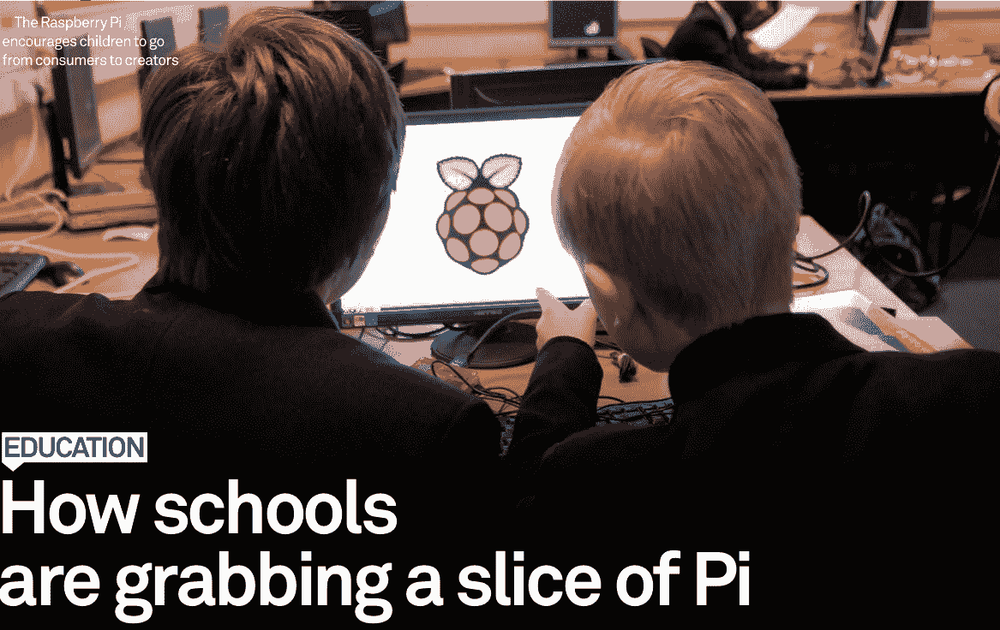
## 教育
### 学校如何拥抱树莓派
> 树莓派鼓励儿童从消费者转变为创造者。
随着新计算课程将于9月正式实施，大卫·克鲁克斯（David Crookes）探讨了教师如何参与树莓派相关项目。
去年这个时候，卡丽·安妮·菲尔宾还只是一名普通教师。在考取谷歌认证、成为东伦敦某学校关键阶段3（Key Stage 3）信息技术学科负责人后，她已经成长为另一类人：一台我们都熟知的、信用卡大小的树莓派计算机的布道者。
只要观察她几分钟的工作状态，就能感受到她对所有树莓派相关事物迸发出的热情。她经常在教育会议上发表演讲，最近的一次是在曼彻斯特举行的教育创新会议暨展览会（EICE）上。她倡导大家参与树莓派爱好者聚会（Raspberry Jams），同时还为少女群体创作了名为《极客女孩日记》（The Geek Gurl Diaries）的YouTube视频系列。
不过如今，她更进一步投身其中，担任树莓派基金会教育先锋一职。距离教师们真正掌握计算机核心原理、将知识传授给学生们只剩短短几个月时间，她的工作就是向教育者展示这台售价25英镑的机器真正的价值，而她对这台机器显然钟爱有加。
“一年前，人们对树莓派的兴趣或许还不大，”她说，“我是最早在课堂上使用树莓派的教师之一，但今年由于众多会议都引入了树莓派相关内容，很多教师都对它的用途产生了浓厚兴趣，大家的热情今年高了很多。”
曼彻斯特的教育会议对树莓派基金会及其组建的专职教师支持团队而言成效显著。去年由艾伦·奥多诺休（Alan O'Donohoe）主办的树莓派大会（Raspberry Jamboree）被安排在曼彻斯特中央会议中心的多个独立会议室中；今年在奥多诺休的继续主持下，所有树莓派相关活动都被移到了主会议会场。与会教师在场地中逛一圈，就能在一角看到未来课堂的样貌，在另一处可以购买树莓派，还能在两个专门设置的演讲区听取相关分享。树莓派当仁不让地成为了全场焦点。组织方希望教师们能像树莓派基金会团队一样，理解即将到来的变革的积极意义。
菲尔宾称自己大约六年前就有了顿悟时刻。不过最重要的是，菲尔宾满腔热忱，急于传递她的核心主张。她坚信教师和孩子们都能从树莓派中收获良多，因此开始涉足出版领域。她的第一本书《树莓派冒险记》（Adventures In Raspberry Pi）是一套清晰的资源，面向所有年龄段的儿童，也适合不少成年人阅读。
### 课程中包含哪些内容？
虽然这不是唯一目标，但编程是新课程的核心，其重要性远超以往。例如在关键阶段1（Key Stage 1），学生需要理解什么是算法以及算法的实现方式；儿童需要完成创建和调试简单程序的任务。
在关键阶段2（Key Stage 2），学生需要学习设计、编写和调试可实现特定目标的程序，并了解计算机网络。到关键阶段3（Key Stage 3）时，学生需要掌握两门及以上的编程语言；到关键阶段4（Key Stage 4）时，他们需要培养并应用分析、解决问题、设计和计算思维相关能力。
即便如此，这一变革依然引发了褒贬不一的反应。它既吸引了部分教师，也让一些教师感到担忧。有一位教师告诉《Linux用户》杂志，他很乐意进一步了解树莓派并将其引入课堂教学：他喜欢这台计算机的低成本，很认可Scratch的易用性和搭载的Linux系统，但也存在顾虑——他担心不断增长的需求会给自身和同事带来更大压力，担心自己没足够时间快速掌握相关知识。不过教师面临的压力并非来自学校。

卡丽·安妮·菲尔宾是新课程的坚定支持者，亲身体验过树莓派带来的影响：
> 我们想要传递的核心信息是：计算很有趣，这是必须做到的。但教师可用于开展各项活动的时间非常少。政府确实需要给教师留出时间提升技能。小学教师感受到的压力会比中学教师更大：他们需要教授的科目数量多得多，因此要在计算这类复杂的领域投入额外时间和专业知识，对他们的影响会更明显。更糟糕的是，他们身边的计算机在实际应用中几乎派不上太大用场——而树莓派可以改变这一现状。
> 不过尽管新课程比以往任何时候都更强调编程，菲尔宾指出，编程并不是改革的唯一原因。新课程同样致力于揭开编程的神秘面纱，这也是即将生效的课程设置具有较大灵活性的原因，允许对该学科采用不同的教学方式。同时，新课程也旨在确保教师对计算学科及其可能性有广泛认知，从而将这些知识传递给孩子们。
> “存在一种风险：部分教师会永远只使用Scratch，让它变成新的PowerPoint，引发‘Scratch疲劳’；但我们正在鼓励教师更具创造力，传递‘计算很有趣’这一核心信息，”菲尔宾表示。
> 可以肯定的是，新课程明确规定了各个关键阶段需要完成的任务。尽管政府表示希望在未来几年内培养出一代创造者而非消费者，但只要能让学生看到计算的多元可能性，就已经是进步了。“编程一小时”（The Hour Of Code）这类倡议的存在正是出于这个原因。该倡议迄今为止已经推出了编程速成入门课程，在美国拥有约2000万名参与者，截至目前英国也有约170万人参与。随着全国各地的编程俱乐部、树莓派聚会、大量在线资源的落地，以及政府推动新课程落地的决心，这些倡议很有可能带来持久性的变革。
> 菲尔宾表示，树莓派能激发孩子的好奇心，他们会想知道这是什么、怎么用。“当树莓派启动，他们开始使用它——第一次接触Linux，开始向计算机下达指令——他们就开始理解和学习了，”菲尔宾说，“用树莓派还可以控制现实中的物品。它功能非常多样，这也是为什么教师们逐渐意识到：它虽然体积小，但功能极其强大。”
## 开源
您的 Linux 新闻与观点来源
www.linuxuser.co.uk
获取最新新闻与观点
可直接发送邮件至：linuxuser@imagine-publishing.co.uk
### 新版本发布
**Ubuntu 14.04 带来重大更新**：支持可选本地菜单、默认搭载Nouveau驱动，但未引入Scopes功能
Canonical公司最新发布的Ubuntu Linux发行版长期支持版本14.04“可信塔尔羊（Trusty Tahr）”带来了大量变更，也为该公司认定的桌面端与移动端环境必然融合的趋势做好了准备工作。Ubuntu源于这样一个信念：老牌发行版Debian对缓慢的发布周期把控过于严格，因此Ubuntu于2004年启动，目标是每六个月发布一个新版本。自那时起，创始人马克·沙特尔沃思（Mark Shuttleworth）领导的Ubuntu公司从未将发布时间节点推迟超过一周左右，该发行版发展迅速，已被公认为最受欢迎的桌面端Linux发行版。
最新版本Ubuntu 14.04“可信塔尔羊（Trusty Tahr）”显示，Canonical至少正在尝试回应社区对其争议颇多的Unity用户界面的质疑。或许本次发布最大的变更反而是功能回归：Ubuntu 14.04重新引入了将菜单放置在应用本地菜单、用户工具栏，以及全屏模式下桌面全局面板的功能。

> Ubuntu 14.04（代号可信塔尔羊，Trusty Tahr）带来了大量变更——至少有一项是功能回归：窗口菜单可放置在工具栏中。该功能以开关选项的形式提供，Canonical对大多数预装的GNOME应用进行了补丁适配，以支持新的交互方式：窗口化模式下菜单显示在应用标题栏，全屏模式下则显示在全局面板。
Ubuntu 14.04的另一项重大变更为下一代Unity版本（代号Unity 8）奠定了基础：默认启用开源Nouveau驱动，让搭载NVIDIA GPU的系统开箱即可获得3D加速支持。这一变更是由于NVIDIA正在加大其在开源社区的布局，向Nouveau项目贡献代码以支持其最新的Tegra系统级芯片（SoC）处理器。和过往版本一样，用户也可以选择安装NVIDIA提供的闭源二进制驱动包，以获得更强的功能和性能。

不过并非所有内容都在新版本中发生了变更。创始人马克·沙特尔沃思宣布，该发行版将继续使用MySQL作为数据库平台，不会追随其他发行版的脚步转向MariaDB等非Oracle的MySQL分支。
“我们要向Oracle的MySQL团队致敬，他们公开透明、友好地开展协作，赢得了Ubuntu合作者的信任，也让我们有信心在Ubuntu中默认发布稳定的热点版本，”沙特尔沃思在谈及这一决定时表示。
另一项未在Ubuntu 14.04中出现的功能是Unity的Scopes技术，这是Unity 8的一项功能，旨在让不同显示尺寸和分辨率的设备能更便捷地通过Unity Dash展示数据。该功能旨在帮助开发者支持Canonical最新的面向智能手机的操作系统Ubuntu Touch，搭载Scopes的Unity 8可以在Ubuntu 14.04中安装，但直到今年10月发布的14.10版本才会默认预装。
马克·沙特尔沃思称赞了Oracle，并表示Ubuntu短期内不会从MySQL迁移。www.linuxuser.co.uk


### 树莓派满两周岁并举办竞赛
**树莓派**基金会提供奖金以寻找二进制闭源图形驱动替代方案
树莓派已正式发布两周年，为此官方宣布其销量已达惊人的250万台。这款基于ARM架构的低价开发板最初预计仅能卖出10万台，但首批发货在短时间内就售罄，开发者不得不紧急寻找合作伙伴扩大产能。如今生产已成为全球协作项目，但市场需求似乎仍永无止境。
不过仍有部分用户不满该开发板依赖闭源二进制软件来驱动其博通BCM2835系统级芯片（SoC）处理器，而运营这款开发板的非营利性树莓派基金会也持有相同看法。
在发布了搭载于另一款BCM21553处理器上的VideoCore IV图形堆栈相关文档后，基金会宣布举办竞赛，面向社会征集该开发板的开源图形驱动程序。基金会表示：「将这套驱动移植到BCM2835上应该并不困难，届时用户无需使用闭源二进制软件即可访问图形核心。」
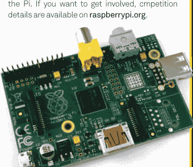
> ■ 树莓派满两周岁之际，或将很快摆脱对闭源图形驱动程序的依赖
作为激励措施，基金会承诺将向首个发布可在树莓派上以可玩帧率运行*雷神之锤III*的开源图形驱动程序的个人或团体颁发1万美元奖金。如果你想参与此次竞赛，可访问raspberrypi.org查看详情。
## **最新动态**
### 英特尔NUC获得Linux相关更新
英特尔计算单元（NUC）超紧凑型主板已收到BIOS更新，修复了此前可能导致Linux系统难以安装的故障。
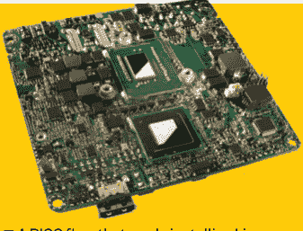
> ■ 导致在英特尔NUC主板上安装Linux十分困难的BIOS缺陷已得到修复
NUC主板将桌面级性能压缩在极小体积中，受到了Linux用户的广泛关注，尤其是那些想要搭建搭载Valve基于Linux的SteamOS软件的小型游戏系统的用户。不幸的是，主板及裸机套件配套的BIOS存在缺陷，会导致系统尝试从错误位置查找引导加载程序，从而无法安装Linux系统。
此次最新的BIOS更新适用于D54250WYK、D34010WYK型号的NUC裸机套件，以及D54250WYB、D34010WYB型号的NUC主板，可修复上述问题。目前该更新已可在英特尔官方支持站点下载：http://intel.ly/Nn14eE。
### Linux活动日历
#### 开源、开放标准大会 - 英国英格兰伦敦商务设计中心 - opensourceconference.co.uk
本次大会主要面向公共部门，将围绕迁移至开源系统、开放数据以及安全与标准领域可获得的收益展开讨论。
### 2014年国际空间应用挑战赛 - 英国英格兰埃克塞特、伦敦、格拉斯哥、约克、莱斯特 - metoffice.gov.uk/conference 黑客马拉松
该活动是规模更大的NASA国际空间应用挑战赛的组成部分，英国气象局正在英国举办一系列黑客日，参与者将通过视频链接与全球其他团队共同解决太空领域相关挑战。
#### openSUSE大会 - 克罗地亚杜布罗夫尼克大学 - conference.opensuse.org
这是openSUSE Linux发行版的官方大会，本次活动的议题将涵盖技术与开发、社区与项目、终端用户与商业利益三个方向。
#### 嵌入式Linux大会 - 美国加利福尼亚州圣何塞万豪酒店 - events.linuxfoundation.org
这是第十届嵌入式Linux大会，由ENEA、谷歌、惠普和Yocto项目赞助，将继续秉持为嵌入式Linux开发者举办中立厂商技术大会的创办初衷。
## 教育
### 美国一学校全面转向Linux 全校1700台学生笔记本均预装Ubuntu系统
宾夕法尼亚州兰开斯特市的佩恩庄园学校宣布，将为所有学生配备预装Ubuntu Linux 13.10系统的宏碁TravelMate笔记本电脑。
> 「学生可完全掌控自己的笔记本电脑，允许自行安装程序、试验各类软件，」该校在项目公告中解释道，「我们要求学生遵守版权法律法规和学区相关规定，并对他们予以信任。去年12月，我们已经向全体学生讲解了项目要求、操作指南、最佳实践及数字公民注意事项。」
> 学区技术总监查理·赖辛格在接受Linux.com采访时表示：「我们鼓励学生安装软件、打开系统『引擎盖』深入了解其运行原理，希望学生们可以运行本地网络服务器、尝试Python编程，或是探索GIMP这类图形程序。Linux为计算、编程和艺术探索提供了大量机会。」

> ■ 学生们获得的笔记本电脑预装了Ubuntu 13.10系统，同时还会接受相关培训
使用Linux替代闭源操作系统，带来的好处远不止试验自由：该校声称，在1:1笔记本项目中使用Ubuntu 13.10仅软件许可费用一项，每年就可节省约36万美元。佩恩庄园学校对Linux并不陌生：三年前该校就曾计划将教室内的设备替换为Linux操作系统和开源应用。该项目从小学阶段开始逐步推进，随着1725台学生笔记本的发放，目前已全面完成。
## 最新动态
### Barman稳定性大幅提升
Barman是PostgreSQL数据库平台的开源备份与恢复管理工具，目前已发布1.3.0版本，官方声称其稳定性得到了显著提升。
据项目主导方2ndQuadrant介绍，新版本为输出、子进程、远程命令、文件系统钩子及元数据管理模块采用了全新的代码架构。此外，新版本修改了远程恢复代码，使其行为与本地恢复保持一致，并修复了PGDATA目录内已创建表空间的处理逻辑，避免内容重复。和前序版本一致，Barman 1.3.0基于GNU通用公共许可证第3版发布，可前往pgbarman.org下载。
## 硬件
## 火狐基金会发布15英镑Firefox OS手机 定位新兴市场超低价设备
火狐基金会发布了又一款搭载Firefox OS系统的设备，这款设备的最大卖点在于售价仅为15英镑左右。
该手机搭载1GHz主频的ARM Cortex-A15处理器，配备3.5英寸显示屏，定位无疑是入门级。尽管售价低廉，它仍具备移动宽带、通话、Wi-Fi和蓝牙连接等所有基础功能。
这款手机和前代发布的ZTE Open一样，运行基于Linux的Firefox OS系统。火狐基金会表示，Firefox OS定位于入门级市场与安卓竞争，支持将任何基于HTML5的小程序转化为移动端应用，最大程度降低了网络开发者为其开发内容的门槛。
这款售价15英镑的手机预计将于今年年底上市，届时还将推出一款名为Flame的高端参考机型，配备双核1.2GHz高通MSM8210处理器、4.5英寸FWVGA显示屏、500万像素后置摄像头和200万像素前置摄像头，存储容量为8GB，最高配备1GB内存（可下调至256MB，方便开发者测试应用在入门级设备上的适配性）。
去年中兴Open这款Firefox OS手机在eBay拍卖网站上线时曾出现过销量超过库存的情况，但很快需求就开始下滑。外界将其归咎于屏幕质量、性能问题以及早期版Firefox OS本身的漏洞，但火狐基金会已确信在后续产品中解决了这些问题。

> ■ 这款Firefox OS智能手机售价约为15英镑，定位新兴市场

## 硬件
### 诺基亚X遭破解，获得完整安卓支持
如今这款低成本手机具备强劲的竞争力

诺基亚去年被微软收购，尽管此前早有传闻，但诺基亚在移动世界大会上推出搭载安卓系统的低成本手机，仍然让人大感意外。这款面向新兴市场设计的低成本智能手机，运行的是经过定制删减的安卓分支版本，其定位更像是诺基亚主流Windows Phone系统Lumia系列的“入门款产品”。

然而黑客卡莎·马拉加成功解锁了诺基亚X的全部潜力，为其获取了root权限，安装了完整的谷歌应用套件（包括谷歌应用商店Google Play的访问权限），还将原本类似Windows Phone的定制皮肤替换成了谷歌Now启动器。

诺基亚随后表示正式认可这一操作，还通过推特回复马拉加称：“这太酷了！我们非常高兴看到相关进展正在推进。”

这一举动可能会给Mozilla最近推出的低成本Firefox OS手机系列带来麻烦——两类产品价格相近，但前者对于那些愿意进行所需改造的用户而言，拥有多得多的第三方开发者支持。

- 在诺基亚的认可下，诺基亚X已被破解，可运行原生安卓系统体验


## 安全
### 企业寻求当今安全问题的解决方案

网络巨头思科（Cisco）宣布推出物联网安全大奖赛，该项目旨在发现并解决蓬勃发展的物联网（IoT）中存在的安全漏洞。物联网是指由互联设备组成的网络，涵盖从医疗监控系统、气象传感系统到联网恒温器在内的各类设备，随着物联网应用推广，其安全性将变得至关重要。然而现有系统往往在默认状态下就存在安全隐患，这也是思科此次想要解决的问题。

> “我们邀请全球安全社区针对物联网每日影响的市场提出实用的安全解决方案，”思科的克里斯·杨在介绍该项目时表示，“例如在医疗领域，很容易想象联网设备和系统是如何彻底改变患者护理模式的；在交通领域，技术人员已经在将汽车及其子系统接入互联网。不幸的是，也很容易想象这些改变世界的技术一旦被恶意行为者攻击或篡改，会造成多么严重的后果。”

本次大赛奖金池高达30万美元，最高奖项为7.5万美元，最多将颁发给6名能够提出可行、可扩展且简洁的物联网安全提升方案的人。详细信息可访问ciscosecuritygrandchallenge.com查询。


## 5天学完PostgreSQL

市场对PostgreSQL数据库管理员（DBA）技能的需求正快速增长。许多企业正在迁移至PostgreSQL，或启动基于PostgreSQL的新数据库项目，因此学习这款全球最先进的开源数据库从未像现在这样重要。

如果你已经熟练掌握SQL，参加2ndQuadrant的5天培训将能提升你的专业知识，助你掌握市场急需的技能。我们所有培训课程均由顶尖PostgreSQL专家授课，评分常年位居前列。每班最多仅招收10名学生，保障互动性和个性化教学。无论你出于个人发展需求，还是为了支持所在企业即将开展的项目，都可以跟着最懂PostgreSQL的人学习相关技能。

访问我们的网站即可报名 upcoming 的培训班，或了解我们开设的更多培训课程。
2ndquadrant.com/training/linux-user

### 2ndQuadrant 专业PostgreSQL服务
- PostgreSQL开发
- 7*24小时支持
- 培训
- 各类服务

联系电话：+44 (0) 870-766-7756
官网：2ndQuadrant.com


5天的培训并不能保证达到相应的熟练程度。对于大多数有SQL经验的数据库管理员来说，5天时间通常足以熟练掌握PostgreSQL。参训学员的基础知识和经验各不相同，因此可能会根据个人需求和目标推荐额外培训。

**《Solus》**是一款即将推出的游戏，它展现了UE4引擎能够实现的极致画质


## Mozilla宣布虚幻引擎4将可在Firefox浏览器中运行
### Epic公司的虚幻引擎4即将登陆浏览器平台，在Firefox中运行时速度将接近原生应用水平

电子游戏行业年度日程上的首个重大活动是旧金山游戏开发者大会，这是一场为期一周的、围绕游戏开发展开的 talks 和演讲，没有普通行业展会或粉丝展常见的奢华排场与浮夸特效。随着最新游戏主机的发布，以及更重要的是Linux游戏的崛起和普及，本次大会预计将爆出许多有趣的新闻和行业洞见。

Mozilla首席技术官、工程高级副总裁布兰登·艾克表示：“相关技术已经发展到了用户可以通过浏览器玩游戏的程度，这些游戏与需要等待下载安装的游戏相比，几乎看不出差别。通过Emscripten将C/C++代码交叉编译为asm.js格式，开发者可以让游戏以接近原生的速度运行，从而将网络视作与其他任何平台平等的发布渠道。”

> Epic Games创始人兼首席执行官蒂姆·斯维尼表示：“既然虚幻引擎3已经能在网页端运行，我们毫不犹豫地与Mozilla合作将虚幻引擎4移植到浏览器平台。我们相信网络在游戏开发和发行的未来中会起到关键作用，而Mozilla已经证明了自己是推动这一切发生的催化剂。”

虽然这和Linux游戏没有直接关联，但Mozilla宣布开源浏览器Firefox将在不久后支持虚幻引擎4。这一功能基于开源的asm.js技术实现，目前该技术已经支持虚幻引擎3。首款通过asm.js技术以虚幻引擎3发布的商业游戏《怪兽疯狂》（Monster Madness）借助现有虚幻引擎技术的集成，据称仅用一天时间就完成了浏览器端移植。

虚幻引擎本身在开发者中人气极高，2010年时占据了65%的游戏引擎市场份额。这一占比是否至今仍居第一还尚未可知，特别是随着同样原生支持Linux的Unity 3D引擎的崛起。所有浏览器都能使用asm.js技术——虚幻引擎3已经实现了这一功能——但Firefox有专属优化，运行速度要快得多，尤其不需要安装任何其他浏览器插件。目前asm.js应用的运行速度相当于原生应用的67%，而该插件刚推出时这一比例仅为40%。

“我们被Mozilla这一开创性技术与虚幻引擎结合取得的成果震惊了


> 布兰登·艾克是JavaScript的发明者，被视为互联网发展史上最重要的代表人物之一

## 123-reg服务器......每日为数千家企业提供支持！


### 可靠解决方案
坚如磐石的基础设施，提供您的业务所需的连接和带宽


### 品牌品质
我们采用最新的惠普和戴尔硬件，提供卓越的性能与可靠性

### 我们的云服务器解决方案
灵活、强大且高性价比
- 预装操作系统，开箱即用
- 通过Plesk实现简易管理
- 灵活可控，权限完整
- 高水平专家支持与专业经验
- 稳定、强韧且可靠的平台

> “这项服务太棒了，操作简单，对我的客户来说所有功能都是即时可用的。” 索布鲁克创意流公司所有者 斯蒂芬·谢泼德

选择我们高性价比的套餐，获取您的业务所需的灵活性、性能与算力
每月仅需9.99英镑（另加20%增值税）


了解更多：www.123-reg.co.uk/servers
价格与功能信息截至2014年1月有效


## 自由软件专栏
### 红帽的新模式

> 理查德·希尔斯利为多家出版物撰写关于艺术、音乐、数字权利、Linux和自由软件的内容
CentOS社区曾利用这一资源成功构建了红帽企业Linux的克隆版。如今红帽已将CentOS纳入自身体系。
传统软件企业通常以软件的"独特"特性作为卖点，但销售自由软件是另一回事。
目前DistroWatch收录的发行版大多（但非全部）最初是通用Linux发行版——红帽、Slackware或Debian——的副本或衍生版，而这些通用发行版本身也都带有早期Linux历史的烙印：要么源自SLS，要么源于欧文·勒布朗的MCC Interim Linux，后者常被认为是第一个可安装的Linux发行版。
商业服务器端GNU/Linux发行的核心作用并非销售软件本身，而是提供后续服务——订阅、咨询、安装、培训、支持、升级与维护。
自由软件的改进可能来自众多渠道，但一款发行版若要成功，就必须有与众不同的特色：或是更精细的打磨，或是忠实的用户群体，以及提供优质服务的口碑。
GNU/Linux发行版是协作产物，可能汇集了成千上万个人和企业贡献者的工作成果。
要想让支撑开源软件公司的后续服务取得成功，其提供的软件包首先得有足够高的质量，让用户愿意为订阅和服务付费。这样的发行版至少不能逊于竞争对手，需对开发者社区坦诚相待，且提供的服务到位靠谱。
红帽拥有红帽商标对应的品牌及相关质量保证体系，但并不"拥有"其销售的软件。
正因如此，CentOS和甲骨文才能合法分发红帽企业Linux的改标副本，这些副本与红帽产品"完全上游兼容"，无需担心受到法律指责。
红帽销售的并非软件本身，而是质量保证、安全升级、培训支持以及第三方软件授权——这一模式由Cygnus Solutions公司和迈克尔·蒂曼首创，蒂曼如今是红帽开源事务副总裁。
对红帽而言，其回报是：构成红帽Linux发行版的软件包的累计研发价值高达数十亿美元，这些成果来自无数个人、开发者社区、企业以及其他GNU/Linux发行版的贡献。
红帽与竞争对手的差异在于其独特的整合方式，以及为客户提供的服务质量。
对终端用户而言，其好处是使用门槛很低。
如果某款GNU/Linux发行版不符合你的需求，你可以切换到其他Linux发行版，期待获得相近的使用体验。因此，商业GNU/Linux发行版理应对自身提出要求：至少不逊于竞争对手，对开发者社区坦诚相待，且提供的服务到位靠谱。
大量拥有内部技术能力、能够自行支持Linux服务器部署、且不需要红帽提供质量保证和支持的组织与企业，都将CentOS作为RHEL的替代方案。
CentOS与Debian竞争，是目前最受欢迎的Linux服务器部署选择之一。
正因如此，红帽近期收购CentOS的决策十分合理。
红帽通过此次收购获得了一个实际上已属于其生态体系的用户群体，这些用户未来可视为红帽服务的潜在客户，同时红帽也能接触到一群在RHEL克隆版实际使用中积累了丰富经验的用户社区。
实际上，红帽将因此推出其企业操作系统的"免费"版本，尽管该版本会滞后RHEL好几个版本，以此换取来自社区的反馈。
另一项好处是，这消除了竞争对手收购CentOS及其更广泛生态体系的可能性。
红帽是一家幸运的公司，总能在合适的时机出现在合适的位置：其成功IPO便是最好证明——它从上世纪90年代首屈一指的社区型Linux，转变为过去十年来向企业界提供开源服务器系统最成功的供应商。
当Linux成为后台服务器的必然选择时，红帽抓住了企业市场的旺盛需求，而它之所以能做到这一点，离不开与用户和开发者社区保持的良好关系。
> 红帽销售的并非软件，而是质量保证、安全升级与支持

## 开源专栏
### 领英出局（LinkedOut）

> 迈克尔·蒂曼——自由软件商业模式的先驱，红帽开源事务副总裁
有人将CentOS视为Fedora社区的威胁，但Fedora在红帽生态体系中有着独特且明确的定位。
Fedora的定位是自由软件发行版的前沿探索者，负责对一些创意和实现进行原型验证，这些成果未来有可能被纳入红帽商业发行版的后续版本中。
RHEL的开发基于Fedora的一个快照版本。
同样，也有人认为红帽收购CentOS意味着CentOS即将走向终结，但这并不符合红帽的利益。
CentOS并非Fedora的竞争对手，它始终是RHEL的克隆版，二者唯一的差异仅在于品牌标识。
CentOS的吸引力在于，它为红帽提供了一批现成的红帽软件经验用户。从红帽未来的发展角度来看，用户越多，其商业模式的运转效果就越好，因此CentOS的成功需要得到维护和推广。

> 西蒙·布鲁是科技作家与编辑，工作覆盖Linux、Windows和Mac OS X平台
> 如果你在找那种总把现代科技理念固有的各种问题集于一身的上网服务，那就请找个位置坐下，自取咖啡，或许再从罐子里拿块饼干吧。因为我要聊的是领英（LinkedIn）。
> 这似乎就是领英想要达到的“高度”。
> 于是它如今给用户推送各类无意义内容，稀释了这项服务原本预设的核心初衷。
> 写下这些话之前，我登录了领英想看看自己是否对它有所偏见。遗憾的是，我的首页推送了一条我并未添加对方为联系人的用户推荐的新闻：一则诱人的（说白了就是广告）“如何赚更多钱”的内容、一些其他用户的替代社交网络动态，以及ITV电视台续订英剧《同病相怜》新季的消息。
> 有意思的是，一些我压根不认识的人给这条内容点了“赞”（或者不管领英里的“点赞”到底算怎么回事）。
> 在我看来，大多数人用领英做的事其实就是聊领英本身。
> 似乎没几个人真的用它来做它原本设计要做的事，但我们绝大多数人都在人生的某个阶段收到过使用这项服务的邀请。
> 从理论上来说，它确实有一定价值。
> 作为一款仅面向职场人脉的垂直社交服务，你可以用它寻找新商机、接触平时没有渠道对接的人，与其他职场人士建立联系。
> 这些功能都很有用，也具备价值——尤其对于一款试图做实事儿的社交网络来说更是如此。
> 只可惜很多企业、服务和产品一旦达到一定知名度，对更多利益的追求就会取代对核心价值的关注，实在可惜。
> 当然不是所有情况都如此，但领英确实像是径直踩进了这个陷阱里。
> 我使用领英已有两三年，只收到过一次差点促成合作的消息。
> 其他所有的通知全是噪音，我的收件箱里涌满了各类提醒，内容不是鸡毛蒜皮的琐事，就是毫无用处的东西。
> 之后你还会收到热情洋溢的邮件，邀请你免费升级到高级会员，前提是提交你的信用卡信息——这套路差不多就概括了领英的所作所为。
> 无论是从理念还是现有形态来看，领英并非毫无价值。
> 但它的确显得毫无重点，它的核心定位无法让背后的人赚到足够多的数十亿美元，因此它为了寻找新的“金矿”已经脱离了正轨。
> 在科技领域，不用费多大力气就能找到其他犯下同样错误的企业。
> 坚守初心并不总能让你赚得盆满钵满，但最终结果往往更好，也更贴合实际需求……
> 遗憾的是，领英的运营方似乎看了《社交网络》后，就拿如今熏染了众多软件和服务的现代化思路做了决定：他们要更多。
> 在这个Facebook可以随意购物、一掷19亿美元买下自己心仪之物的时代里，

## **乔恩·马斯特斯**
### 内核专栏
乔恩·马斯特斯汇总了Linux内核社区的最新动态，随着Linux 3.14发布日期的临近，3.15版本的开发也在持续推进。
**乔恩·马斯特斯**是一位Linux内核开发者，他13岁上大学起就开始接触Linux，至今已有近19年的开发经验。他现居美国马萨诸塞州剑桥市，供职于一家大型企业级Linux厂商，每日在**kernelpodcast.org**发布Linux内核邮件列表摘要。
林纳斯·托瓦兹宣布发布最新的3.14内核候选发布版（RC）3.14-rc7。他在邮件中表示，对上一个候选版本RC6并不满意。RC6被报告存在多项回退问题，包括AMD Radeon和英特尔i915设备的各类显示故障。通常内核开发周期会在RC7发布后不久结束，除非出现严重的阻断性问题、可能导致最后一刻出现回退的风险让林纳斯感到不安，或是他要前往全球偏远地区、无法处理最终内核提交的压力以及下一内核周期开启后即将涌来的大量补丁，否则一般不会发布RC8。林纳斯此前曾表示，对RC6的不满让他认为发布RC8甚至RC9都是有可能的，但最终他似乎很满意，以“除非出现严重的阻断性问题，否则一般不会发布RC8”的话为3.14的发布收尾。
#### 安卓上的KSM
普拉迪普·索拉尼发起了一个名为“安卓上的KSM”的讨论串，旨在修正内核同页合并（KSM）机制报告的一些误导性数据。KSM是最初为KVM（内核虚拟机）等虚拟机监控程序添加的功能，它扩展了内核，使其能够定期扫描物理内存，查找包含相同数据的页（页是内核虚拟内存子系统管理的最小内存单元，由底层硬件支持）。运行虚拟机时经常会出现这种情况，因为虚拟机运行的OS版本相似，可能有大块包含零值的（虚拟）内存。后者在Windows系统上尤为常见，该系统会在启动时将所有物理内存清零。对于KVM这类按需分配内存的虚拟机监控程序，若不加以处理，将会浪费大量内存。
KSM是非常实用且成熟的功能，已被广泛应用于生产环境，但将其应用于虚拟机以外的场景时，其最初为虚拟机设计的定位就会显现出来。在普拉迪普的案例中，安卓设备上的KSM报告的已节省页数（通过共享）远高于实际值。这是因为内核中已有相应机制，支持进程共享代表库代码和其他应用数据的页，这些数据在进程（或线程）从父进程派生之前就已存在。在这种情况下，一个进程已经和其他进程共享了某一页24次，但KSM运行时会将所有这些都算作自己生成的节省量。因此`/sys/kernel/mm/pages_sharing`中的数值会远高于实际值。
#### 32位VDSO
知名的Xen开发专家斯特凡妮·西博尔德发布了一系列补丁，题为“增加32位VDSO时间函数支持”。这些补丁新增了对vdso_timeofday、vdso_clock_gettime和vdso_gettime这几个虚拟动态共享对象（VDSO）函数的支持，需要极速获取当前时间的32位进程可以使用这些函数。许多现有应用会使用x86 CPU的TSC（时间戳计数器）来获取这种高速时间戳，但并未意识到使用TSC可能存在的问题。这些问题包括TSC在特殊情况下倒流，或是更常见的，由于系统的P-state（性能状态）和C-state（空闲状态）导致计数频率变化。64位VDSO时间函数的支持早已存在，但32位一直没有这类支持，而32位往往对应能真正从中获益的遗留应用。VDSO函数非常轻量，由内核提供，看起来和普通库调用无异。实际上，它们存在于内核空间，会被特殊链接到正在运行的进程中。调用这些函数时通常不需要直接切入内核，而是可以使用内核在VDSO中维护的数据。斯特凡妮援引的基准测试显示，切换到VDSO后，gettimeofday系统调用的访问速度提升了3-4倍。
#### 英特尔MPX技术支持
来自英特尔的乔伟·任（Qiaowei Ren）发布了第五版补丁集，引入对英特尔“MPX”技术的支持。MPX即内存保护扩展，是“未来英特尔处理器”的功能特性，可配合编译器修改，对内存引用进行缓冲区溢出或下溢检查。这类检查由硬件高效完成，因此运行时开销极低。MPX新增了几项x86架构寄存器，以及“边界表”的概念。编译器（GCC）负责创建并维护这张存储指针及对应内存区域大小的表。任何试图访问边界外区域的举动都会触发处理器异常，由乔伟新提交的内核支持来处理。因此，试图注入超出字符串长度的数据的恶意代码会执行失败，因为原始程序已设定了允许的字符串长度上限。
使用MPX时，程序员需要添加各项插桩，标明字符串等数据结构（往往是缓冲区溢出安全漏洞的攻击目标）的预期数组边界。这类操作会由合并到未来版本GCC中的编译器补丁自动完成，同时还会搭配GNU C库（GLIBC）的部分修改。对大多数应用而言，几乎不需要修改源代码（这也是MPX扩展的设计目标之一），但需要将应用链接到MPX库，并使用GCC编译器的`-fmpx`选项编译代码。目前尚无支持MPX的硬件上市，但英特尔以标准软件开发模拟器的形式提供了对应的软件模型：http://software.intel.com/en-us/articles/intel-software-development-emulator。
#### 交叉引用
一位名为约翰·史密斯（身份不明，不知为其真名还是化名）的用户近日发布多条消息，宣布将多个内核及子树（如linux-next）添加到xrefs.info网站。该网站运行OpenGrok交叉引用软件，可用于快速可视化浏览内核源代码树，搜索函数、数据的定义与声明以及任意字符串，还能通过点击不同代码路径来探索代码。这是一项很有用的服务，目前覆盖的项目数量正在不断增长。
杰森·库珀、格兰特·莱利等人就“是否可以用设备树（DeviceTree，一种广泛应用于嵌入式设备、用于传递底层平台硬件设计信息的结构，可存储硬件设备位置、版本以及系统网络MAC地址等配置参数）导出的平台数据填充内核的随机熵源以提升随机数生成质量”展开了讨论。争议的焦点在于哪些数据可被视为真正的随机数据，以及如何在启动时快速扫描这些数据。
#### 持续开发
赫尔特·艾特豪文发布了一个RFC（请求意见）补丁，将SuperH（超H）架构标记为“孤儿架构”。SuperH是一款32位RISC指令集，最初由日立开发，目前归属于瑞萨电子。该架构曾被多款嵌入式微控制器采用，但过去几年里其流行度逐渐下降（被ARM架构取代）。保罗·蒙德此前是该架构的维护者，但他用于维护的邮箱地址已经无法投递，且他已经很长一段时间没有提交新补丁，因此社区认为，在有人接手维护或Linux内核最终移除SuperH支持之前，将该架构标记为孤儿架构是最优选择。
多家Linux厂商已宣布推出类似Ksplice的动态内核补丁工具，可在不重启系统的情况下应用更新。这些工具的行为略有差异，且实现方式均和Ksplice不完全相同。红帽的工具名为“kpatch”，SuSE的工具名为“kGraft”。两者都是整体替换函数，而非尝试将补丁内联应用到现有代码片段上。下一期《Linux用户与开发者》杂志将汇总Linux 3.14新增的全部特性。


## 7天玩转树莓派
### 从入门到一周内打造网红项目，超乎想象
只要你用心，用树莓派能完成的事情超乎想象：它曾被送入比菲利克斯·鲍姆加特纳跳伞高度还高的轨道，用来驱动前沿比特币矿场，还有人甚至用它搭配搭载树莓派的宠物项圈，尝试把狗狗的想法转化成语音。
想必不用多说，你也知道 www.nomorewoof.com 的灵感来自哪里吧？没人知道这个项目最终能不能成功，但这重要吗？有人正用你和树莓派一样的技术，试图把迪士尼的奇幻幻想变为现实，这件事本身就已经足够鼓舞人心了！
虽然我们不会在巡航中的大型喷气式客机四倍高度上拍照，也不会翻译家里狗狗的喃喃自语，但接下来18页里的7个项目，绝对能帮你打好树莓派入门的基础。我们最终的大项目是：用带运动检测功能的树莓派自动拍摄本地野生动物的照片，并发布到推特上分享给全世界。这成果相当不错，尤其考虑到我们默认你没有任何树莓派使用经验——我们当然知道你能分清HDMI线的另一端该插在哪，但我们不会默认你会用Python编程，或是熟悉命令行界面操作。
我们会循序渐进地学习：首先完成树莓派的设置，再用Scratch和Sonic Pi学习核心编程逻辑；之后进阶到编写简单的Python脚本，掌握摄像头模块、GPIO端口等相关操作。学完整个教程后，你将掌握完成最终项目所需的全部技能和设备操作知识，甚至能探索更多可能……

## 每周安排表
| 周一 | 周二 | 周三 | 周四 | 周五 |
|--------|---------|-----------|----------|--------|
| Scratch | Sonic Pi | 摄像头 | GPIO | Twitter API |
- 最终项目！> www.linuxuser.co.uk

## 7天玩转树莓派
### 规划你的学习周


##### 第1天 搭建你的树莓派
难度不高，我们会带你快速上手


##### 第2天 用Scratch做游戏
通过图形化反馈学习编程基础


##### 第3天 用Sonic Pi学代码
编写实用代码的同时创作动听音乐


##### 第4天 用树莓派拍照
用Python操控摄像头拍出美照


##### 第5天 上手GPIO
完成一个简约优雅的烛光项目


##### 第6天 使用Twitter API
打造一款物联网推特灯
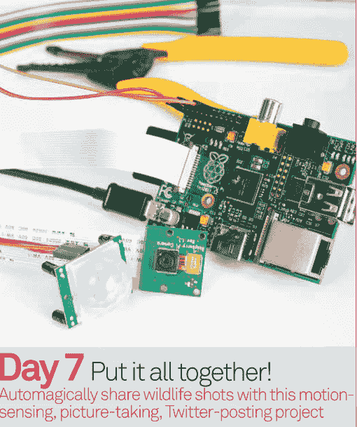

##### 第7天 综合应用
用这款带运动检测、可拍照、能发推特的装置，自动分享野生动物照片


## 7天玩转树莓派
### 树莓派项目采购清单
参与我们这一周的树莓派项目前，先准备好这些额外组件……
本次教程会覆盖多种类型的项目，所以你可以囤一些组件和配件，帮你顺利完成本周学习。当然这只是冰山一角——各家供应商都提供了海量设备，能满足你新项目的需求……
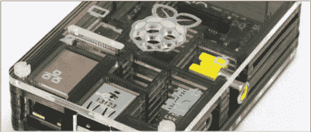

#### Pibow保护壳
一款美观又实用的树莓派保护壳，预留了所有必要的开孔，让你可以直接触达板载摄像头模块排线和GPIO端口。Pibow保护壳有多个不同颜色可选，甚至还有适配Model A型号的特供版本，对技术端口的开放度更高。如果你打算把树莓派用在家庭影院场景中，还可以加装额外支架把它固定在电视上。
售价12.95英镑 | 购买地址：shop.pimoroni.com


#### 电子入门套件
多年来，电子爱好者一直用简单元件连接面包板，为自己的项目搭建基础电路。虽然你可以自己搜罗所有需要的零件，但市面上有不少电子入门套件，包含了本期我们所有项目需要的全部元件（甚至更多）。Simon Monk就推出了一款这样的套件，内含面包板、预制导线、开关、电阻，以及其他各种电子项目所需的小元件和传感器。
售价15英镑 | 购买地址：bit.ly/1oE9BYC


#### 树莓派官方摄像头板
这款树莓派专属摄像头板的接口设计可以直接连接树莓派板载的视频输入端口，不会占用原本就有限的USB接口或其他输入端口，因此你不需要额外购买USB集线器就能让所有设备正常工作。这款摄像头的分辨率不是全球最高的，但500万像素的配置已足够出色，支持2592×1944分辨率的照片拍摄，以及1080p、30fps的视频录制，足以满足大多数项目的需求。
售价19.99英镑 | 购买地址：thepihut.com


#### PIR热释电红外运动传感器
这是一款通过GPIO端口连接树莓派的红外运动传感器，会根据检测到的红外辐射强度持续发送信号，以此判断何时触发对应代码。传统上红外传感器常用于安防系统，但它也支持按需拍照或录像，这也是我们本周最后要做的项目的核心组件。
售价2.99英镑 | 购买地址：modmypi.com
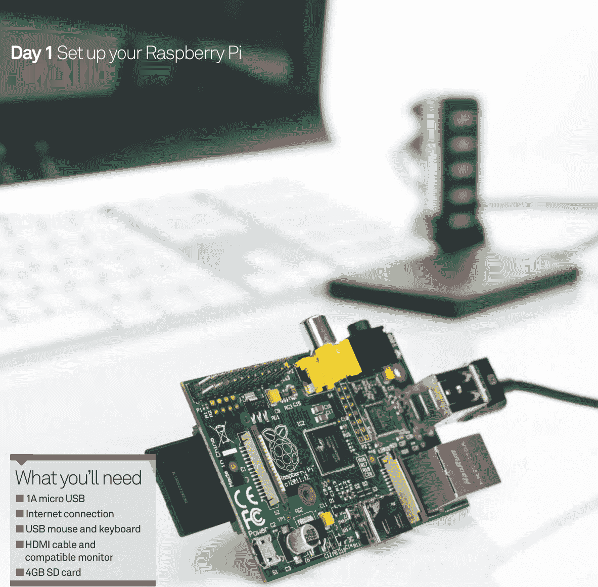

## 你需要准备的材料
- 1A Micro USB供电线
- 网络连接
- USB鼠标和键盘
- HDMI线及兼容的显示器
- 4GB SD卡

## 搭建你的树莓派
把你的树莓派变成功能完备的微型电脑，学习搭建的基础操作
刚拿到树莓派的你，肯定在好奇要怎么开始上手吧。如果你习惯了传统PC的操作方式，可能会觉得树莓派也需要光盘驱动或者U盘安装程序来设置。不过树莓派的设置可不止插个光盘这么简单，我们会教你如何让所有设备都正常运行。本次教程还会给你一些实用小贴士，帮你优化树莓派的使用体验，包括安装额外的软件包，以及挖掘全新树莓派的更多用法。

### 01 获取操作系统
前往树莓派官网（www.raspberrypi.org）下载NOOBS（New Out Of Box Software，开箱即用软件），下载后得到的是一个zip压缩包。把它放入你的树莓派SD卡中，直接在压缩包内解压文件即可，不要解压到其他位置再复制过去。


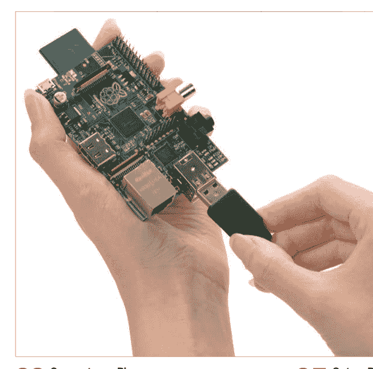


## 7天玩转树莓派
### 07 安装新软件
Raspbian系统有两种方式获取更多软件包：一种是通过Pi Store的链接，另一种是通过终端里的包管理器。两个渠道的应用选择范围不同，包管理器中更多聚焦于通用软件工具。


### 02 连接树莓派
先不要插电源线，把所有外设都连接到树莓派上。你需要准备有线以太网连接（或兼容的无线网卡）、USB鼠标、USB键盘，以及通过HDMI连接的显示器或其他显示设备。

### 05 配置Raspbian
在Raspbian系统 ready 之前，你需要完成几项设置。在配置界面选择「扩展文件系统（Expand Filesystem）」，确保SD卡被合理利用。之后进入「启用桌面启动（Enable Boot to Desktop）」选项，在列表中选择桌面模式。最后点击完成，系统就会重启Raspbian。

### 08 安装办公套件
Raspbian系统默认没有办公功能，仅自带基础文本编辑器。不过你可以安装LibreOffice，操作方式是通过Pi Store完成。打开Pi Store后进入应用（Apps）板块，就能找到LibreOffice的免费下载项。注册账号后，系统就会自动下载并安装它。
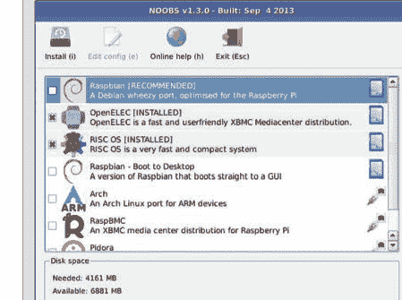
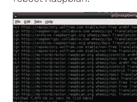


### 06 更新Raspbian
确保Raspbian系统上的所有软件都是最新版本。操作方法如下：打开LXTerminal终端，输入以下命令：
```
$ sudo apt-get update
```
上述命令执行完成后，再输入第二条命令：
```
$ sudo apt-get upgrade
```
整个过程可能需要几分钟，但会更新Raspbian系统中的所有软件。

### 09 安装更优的浏览器
Midori是一款很不错的浏览器，不过你也可以在Raspbian系统上安装Chromium。这是谷歌Chrome浏览器的开源版本，你可以通过打开终端输入以下命令安装：
```
$ sudo apt-get install chromium
```

### 03 选择发行版
插入SD卡，最后接通电源。树莓派启动后会进入NOOBS的发行版选择界面。本次所有教程我们都会使用Raspbian系统，但其他发行版各有适用场景，你也可以在之后尝试使用它们。

### 04 安装Raspbian
点击Raspbian左侧的复选框选中它，然后点击窗口顶部的「Install（安装）」按钮。确认安装后，系统就会开始将Raspbian写入SD卡。
> 其他发行版各有适用场景，你也可以在后续尝试使用它们


## 7天精通树莓派
### 第二天
#### 用Scratch制作一个简单游戏
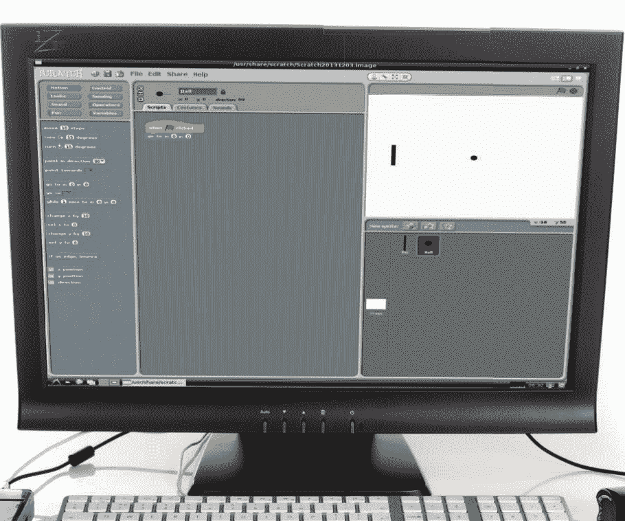
通过制作类似壁球游戏的**可在当天试玩的Scratch版Pong克隆项目**，学习编码逻辑的基础知识。
虽然Scratch看起来是专为儿童设计的十分简单的编程语言，但如果你认为它对所有年龄段的学习者而言都不是入门的绝佳选择，那就大错特错了。学习编码的一个重要方面是理解所有程序背后的底层逻辑：对比两个系统、学习使用循环以及代码中的通用决策逻辑。
##### 01 第一个角色


打开Scratch后会显示一个带有Scratch猫的空白游戏界面；右键点击它，选择删除即可移除。点击游戏窗口下方的「绘制新角色」按钮，使用方形绘图工具绘制一个细长的矩形作为球拍。点击「设置角色中心」，让Scratch识别球拍的基本尺寸；如果需要的话，可以将其拖拽到角色的中心位置。
Scratch屏蔽了实际代码部分，只让你专注于处理逻辑。这使得它非常适合初学者入门，它把专业术语单独分离出来，等你之后打算编写正规程序时再去学习相关内容。而且Raspbian系统的每个版本都自带了Scratch。

- **搭建积木** 使用代表编码逻辑的积木来构建你的游戏或动画
- **预览** 立即测试你的代码，确保它的运行效果符合你的预期
- **编码逻辑** 将积木直接拼接在一起，即可创建循环和比较逻辑
- **项目构建** 导出到Scratch官网，向全世界展示你的作品
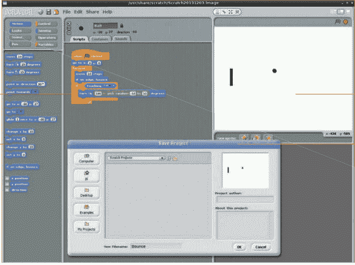
##### 02 移动球拍
点击确定，将新角色命名为「Bat」。点击左上角菜单中的「控制」积木分类，把「当按下空格键」积木拖拽到脚本区域。在下拉菜单中将空格键改为上方向键，然后选择「运动」分类，把「Y坐标增加10」积木拖拽到按键积木后方完成连接。
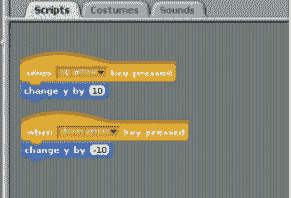
##### 03 反向移动
按照设置，每当我们按下上方向键，球拍就会向上移动10像素。我们重复同样的操作，使用下方向键，并将「Y坐标增加量」设置为-10，就可以让球拍向下移动。把矩形移到屏幕左侧，这将是我们的起始位置。
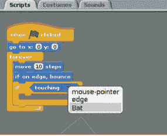
##### 04 创建小球
和新角色菜单中创建球拍时一样，新建一个球形角色，同样需要设置角色中心。将其命名为「Ball」，把「控制」菜单中的「当绿旗被点击」积木拖拽到脚本面板，在它的下方添加「移到x:0 y:0」积木，这样每次点击绿旗时，小球都会重置到初始位置。
##### 05 移动小球
在控制菜单中找到「无限循环」积木，把它连接到小球角色已有的积木下方。然后回到「运动」菜单，添加「移动10步」积木，让小球在屏幕上移动。在它下方添加运动分类里的「如果碰到边缘就反弹」积木，这样小球就会一直留在游戏区域内。

##### 06 击中小球
把控制分类中的「如果那么」积木拖拽到「如果碰到边缘就反弹」积木的下方，然后把「侦测」分类中的「碰到？」积木拖到该积木的空白处。在下拉菜单中选择「Bat」，让它和我们的球拍角色产生交互。把「运动」分类中的「旋转15度」积木添加到「如果那么」积木中，并将其数值改为180。
##### 07 简单反弹
现在点击绿旗，小球会在屏幕左右边缘之间反弹，如果接触到球拍也会从球拍上弹开。我们可以进一步提升互动性，让它和移动的球拍产生交互，更接近经典Pong游戏的玩法。
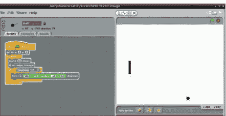
##### 08 随机反弹
进入「运算」菜单，选择第一个「数值+数值」积木。把它拖拽到旋转积木中180度的位置，在第一个空白处填入180。把第二个空白处替换为「在1到10之间随机选一个数」积木，并将其数值改为-10和10，这样每次小球击中球拍时，都会以170到190度之间的随机角度反弹。
##### 09 后续优化
现在你已经完成了一个可运行的小游戏，你还可以添加第二个玩家，让它完全还原Pong的玩法；还可以添加计分系统，当小球击中某一侧边界时，对应的分数就会增加。
25 www.linuxuser.co.uk
### 第三天
#### 用Sonic Pi学习编码
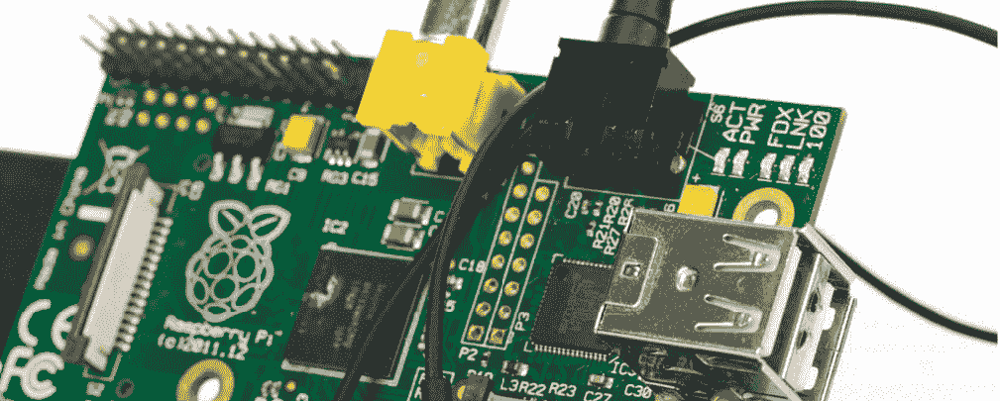
迈出编程学习的下一步，用Sonic Pi这款音乐编程语言创作属于你自己的旋律。
通过Scratch我们已经学习了如何运用编程逻辑，下一步就是在编程语言中实践这些逻辑——问题是很多现成的编程语言看起来会让初学者感到畏惧。而Sonic Pi就是为此设计的，它提供了非常简洁的语言风格，能帮你轻松入门编码的基础操作。
### 你需要准备的材料
- 音箱或耳机
- Sonic Pi
###### 01 安装Raspbian系统
如果你已经安装了最新版本的Raspbian系统，Sonic Pi会默认预装其中。如果你还在用稍旧的版本，就需要通过软件仓库安装它，执行以下命令即可：
```
$ sudo apt-get install sonic-pi
```
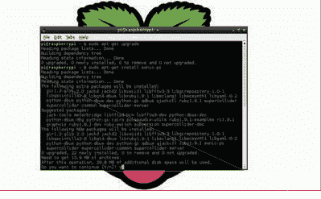
它的使用也非常简单：Sonic Pi提供了少量可选乐器，你可以选择音色进行演奏。通过循环、线程甚至一定形式的用户输入，就能将这些简单的音色组合成复杂的旋律。
###### 02 Sonic Pi入门
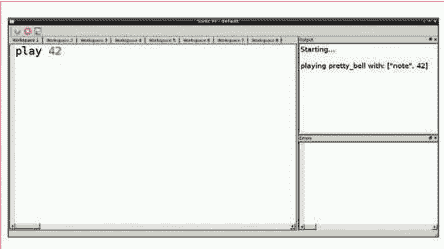
Sonic Pi位于菜单的教育分类中。打开后你会看到类似IDE的界面，左侧面板允许你输入代码，还可以保存和预览代码，所有错误信息都会和输出结果分开显示。
###### 03 你的第一个音符
我们用Sonic Pi要尝试的第一件事就是播放一个音符。Sonic Pi已经预设好了几个默认参数，我们可以直接输入以下内容开始：
```
play 50
```
点击运行，输出窗口会显示当前的运行状态。
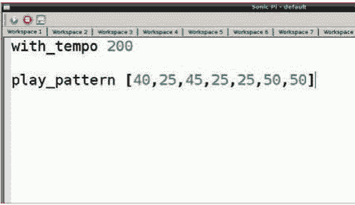
> Sonic Pi提供了非常简洁的语言风格，能帮你轻松入门编码的基础操作
##### 完整代码清单
```
with_tempo 200
play_pattern [40,25,45,25,25,50,50]
2.times do
  with_synth "beep"
  play_pattern [40,25,45,25,25,50,50]
  play_pattern [40,25,45,25,25,50,50].reverse
end
play_pad "saws", 3
in_thread do
  with_synth "fm"
  6.times do
    if rand < 0.5
      play 30
    else
      play 50
    end
    sleep 2
  end
end
end
2.times do
  play_synth "pretty_bell"
  play_pattern [40,25,45,25,25,50,50]
  play_pattern [40,25,45,25,25,50,50].reverse
end
```
###### 04 设置节拍
任何一首音乐作品，你都需要先设置节拍，我们可以从输入以下内容开始：
```
with_tempo 200
```
之后我们可以通过使用play_pattern创建一串MIDI音符来测试节拍设置。
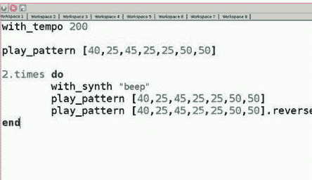
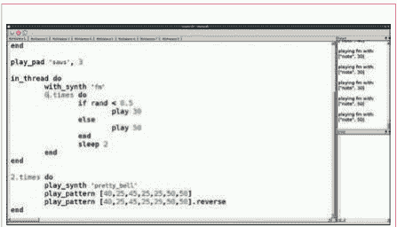
###### 05 进阶旋律创作
我们可以通过使用更多Sonic Pi的函数来创作更复杂的旋律。你可以用with_synth改变音符类型，反转音型，甚至用x.times函数创建有限循环，'do'和'end'代表循环的起始和结束。

###### 06 举办一场音乐会
使用in_thread函数，我们可以为当前的Sonic Pi实例创建另一个线程，让多行音乐代码同时播放而非按顺序播放。这里我们用它生成了随机序列的一系列音符。
27 www.linuxuser.co.uk

### 第四天 用树莓派拍照
使用树莓派摄像头模块拍摄照片和视频，能让你在任何场景下都有一台便携相机。正如我们之前提到的，树莓派摄像头模块是树莓派的绝佳配件。它不仅可插接在主板本身的非标准接口上，还能在Raspbian系统内轻松编程。相比USB网络摄像头，它无需占用USB接口，且可通过代码更易控制，具备诸多优势。它体积小巧，便携度和树莓派本身一样高。今天课程结束后，你将能像专业人士一样使用这款相机，实现延时拍摄和特定图像格式输出。
> 你需要准备
> - 树莓派摄像头板
> - picamera（github.com/waveform80/picamera）

##### 01 插入摄像头
要把摄像头连接到树莓派，找到以太网接口和HDMI接口之间的连接器，轻轻掀开固定扣。将摄像头排线的金属接口背对以太网接口插入。

小心插入摄像头板的连接器，注意不要插反。
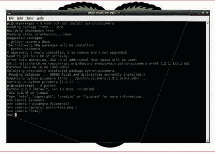

##### 02 启用摄像头
首先你需要确保摄像头模块已启用。要打开标准配置界面，请打开终端并输入：
```bash
$ sudo raspi-config
```
依次选择「Enable Camera」，按回车键，再选中「enable」选项，再次按回车键确认。选择「Finish」后重启树莓派即可。

##### 03 拍摄第一张照片
用树莓派摄像头拍照非常简单，你只需要输入以下命令：
```bash
$ raspistill -o image.png
```
执行后会显示5秒的摄像头实时预览，最后会截取预览的最后一帧作为照片保存。

##### 04 录制视频
要录制视频，我们使用类似的命令raspivid，如下所示：
```bash
$ raspivid -o video.h264
```
和上一步拍照一样，执行后会显示摄像头实时画面。不过视频会录制下预览时长的全部5秒内容。

##### 05 树莓派摄像头进阶用法
如果你想实现更多摄像头功能，目前有一款名为picamera的简易Python封装库可用。不过你需要先安装它，在终端中执行以下命令即可完成安装：
```bash
$ sudo apt-get install python-picamera
```

##### 06 Python测试
我们来确认之前的操作都能正常运行。在终端输入`python`进入Python交互环境，然后输入以下三行代码：
```python
import picamera
camera = picamera.PiCamera()
camera.capture('pythontest.png')
camera.close()
```

##### 07 代码解释
按下Ctrl+D即可退出Python交互环境。我们刚才使用的代码和命令行工具功能类似，拍摄了一张名为pythontest.png的简单照片。之后我们执行了最重要的操作`camera.close`，确保使用后关闭摄像头。

##### 08 用Python录制视频
要用picamera录制视频，首先需要设置分辨率，然后设置录制时长。
```python
import picamera
camera = picamera.PiCamera()
camera.resolution = (640, 480)
camera.start_recording('firstvideo.h264')
camera.wait_recording(60)
camera.stop_recording()
camera.close()
```

##### 09 更多代码
上述代码在Python脚本中运行效果更好——只有当你无法手动停止录制时，才需要用到`wait`等待功能。picamera模块还支持创建延时摄影、修改录制帧率等更多功能。更多用法可以参考《Linux User》第137期内容，或是picamera的GitHub页面中的官方文档。

### 第五天 使用GPIO引脚
学习使用GPIO引脚与外部世界交互——这才是树莓派项目最有趣的部分……
通用输入输出引脚（GPIO）能让你通过树莓派与现实世界交互。本项目将帮助你熟悉GPIO引脚的使用，这也是最终项目的核心基础。传统上，电子原型开发的「Hello World」程序就是控制灯的亮灭。不过我们这次会做得更好一点，模拟烛光效果。为此，我们将使用Python标准库中的Random和Time模块持续调整灯光亮度，同时用RPi.GPIO库通过脉冲宽度调制（PWM）控制LED。
> 你需要准备
> - 小型面包板
> - 任意颜色的小型LED
> - 330Ω电阻
> - 2根公对母原型测试线

##### 01 准备电路
在启动树莓派之前，我们先完成所有物理线缆的连接。需要将一根公对母线接在GPIO端口的第一个接地引脚上，另一根公对母线接在PWM引脚（引脚18）。按照图示将线、LED和电阻连接至面包板，注意LED的短脚要接在接地端。
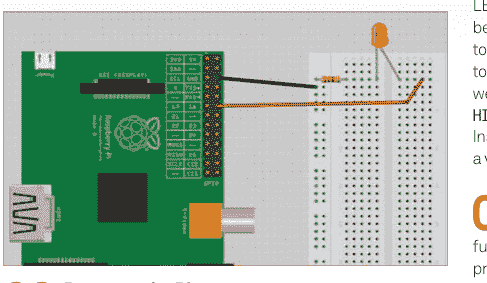

##### 02 启动树莓派
电路连接完成后，我们就可以启动树莓派了。打开Leafpad文本编辑器，开始编写控制LED灯光的脚本（在右侧可以找到脚本内容）。第一步是导入我们需要用到的模块。RPi.GPIO库是项目的关键，我们用它读写引脚、控制引脚功能。此外我们还会用到Random和Time模块，用于模拟烛光效果。


##### 03 配置GPIO模块
接下来我们给LED引脚命名，并为项目配置GPIO模块。注意我们使用了`setmode`方法并传入BCM参数，这意味着我们使用的是Broadcom（博通）命名方案。之后我们将LED引脚设置为输出模式（OUTPUT），即我们会向该引脚输出信号（而不是从引脚读取信号）。如果仅需要控制灯的亮灭，此时可以使用`GPIO.output(led,GPIO.HIGH)`和`GPIO.output(led,GPIO.LOW)`。但我们会使用PWM功能，因此需要定义一个PWM变量来控制它。

##### 04 基础函数
接下来我们创建两个非常基础的功能函数，可在主程序循环中调用，用于随机控制LED的实际亮度，以及灯光在某一亮度下停留的时长。实现时我们会先使用`random.randint`方法，参数5和100分别代表最低和最高亮度（百分比）——该函数会在每次程序循环时从这两个百分比之间随机取值。`random.random`会生成0到1之间的浮点数，我们将其除以WIND常量来实现烛光闪烁效果。

> **这是引脚顶部！** 图像顶部代表离SD卡最近的GPIO引脚一端
> **接地引脚** 引脚按从左到右、从上到下的顺序计数，这是我们将用到的接地引脚之一
> **特殊引脚** 大多数引脚可被手动设置为输入/输出模式以适配任意需求，但部分引脚还预分配了其他功能。这是PWM引脚，可精准控制电机和LED
> **BCM即博通命名方案** 本项目使用BCM引脚命名方案，该方案不使用物理引脚位置，因此BCM引脚17按从左到右计数实际是物理引脚11

##### 05 主循环
最后，我们使用while循环通过PWM点亮LED，再调用亮度函数，通过`ChangeDutyCycle`方法调整灯光亮度。我们还会使用`time.sleep`配合闪烁函数，让灯光在随机时长内保持当前亮度。当想要退出这个原本无限循环的程序时，可以按下Ctrl+C触发KeyboardInterrupt中断。此时我们需要分别调用`pwm.stop`和`GPIO.cleanup`释放引脚，以便后续重复使用。

##### 06 测试项目
脚本编写完成后，将其保存为candle_light.py。`.py`后缀会告知树莓派这是一个Python脚本。要运行该脚本，只需打开终端并输入以下命令：
```bash
sudo python candle_light.py
```
这里需要加sudo前缀，因为访问树莓派的GPIO接口需要管理员权限。假设你已经正确连接了面包板、复制了脚本，你的LED灯就会开始闪烁，就像微风中摇曳的烛光。你可以尝试调整亮度函数和闪烁函数中的变量，获得更理想的效果。

##### 完整代码清单
```python
#!/usr/bin/env python
# Import the modules used in the script
import random, time
import RPi.GPIO as GPIO
# Assign the hardware PWM pin and name it led = 18
# Configure the GPIO to BCM and set it to output mode
GPIO.setmode(GPIO.BCM)
GPIO.setup(led, GPIO.OUT)
# Set PWM and create some constants we'll be using
pwm = GPIO.PWM(led, 100)
RUNNING = True
WIND = 9
def brightness():
    """Function to randomly set the brightness of the LED between 5 per cent and 100 per cent power"""
    return random.randint(5, 100)
def flicker():
    """Function to randomly set the regularity of the'flicker effect'"""
    return random.random() / WIND
print "Candle Light. Press CTRL + C to quit"
# The main program loop follows.
# Use 'try', 'except' and 'finally' to ensure the program
# quits cleanly when CTRL+C is pressed to stop it.
try:
    while RUNNING:
        # Start PWM with the LED off
        pwm.start(0)
        # Randomly change the brightness of the LED
        pwm.ChangeDutyCycle(brightness())
        # Randomly pause on a brightness to simulate flickering
        time.sleep(flicker())
        # If CTRL+C is pressed the main loop is broken
except KeyboardInterrupt:
    running = False
    print "\nQuitting Candle Light"
# Actions under 'finally' will always be called, regardless of
# what stopped the program (be it an error or an interrupt)
finally:
    # Stop and cleanup to finish cleanly so the pins
    # are available to be used again
    pwm.stop()
    GPIO.cleanup()
```


# 7天玩转树莓派
### 第6天 用Python打造推特控制的灯
#### 用Python打造推特控制的灯
现在我们已经掌握GPIO端口的使用方法，接下来就看看能不能让LED灯响应推特API实现点亮吧……
过去8年间，推特已经成为全球最知名的社交媒体平台之一。它基于优秀的开源技术和代码构建，因此非常容易上手操作。
尽管推特主打140字的短内容限制，但你可能不知道，每条推文背后其实都藏着超过3000字符的原始数据！
今天我们不会用到推特API的全部功能，只需要实现足够让推特控制灯运行的功能就行——这种灯会在我们设置的关键词或短语在推特上被提及时闪烁。
这个项目做起来比你想象的要简单得多，那就让我们开始吧……
##### 01 创建应用
首先你需要确保自己拥有推特账号并且已经登录。要使用API，你还需要创建一个推特应用，请前往https://apps.twitter.com，点击「创建新应用」。填写表单时不用在意URL栏，随便填个网站地址就行，反正我们这次用不到这个功能。
##### 02 配置应用
应用创建完成后，你可以通过修改应用权限来调整对推特的访问权限。虽然本次项目不需要向推特「写入」内容的权限，但下一个项目会用到，因此点击「修改应用权限」，将其改为「读写权限」。
修改完成后，点击页面底部的「创建我的访问令牌」按钮。页面刷新后，你就可以在「API密钥」标签页找到需要的信息。按照右侧代码清单的格式，将API密钥及其密钥、访问令牌及其令牌复制到一个名为'twitter_lamp.py'的新文档中。
#### 所需材料
- tweepy
- 网络连接
- 面包板
- 公对母杜邦线
- 300欧姆电阻
- LED灯
##### 03 安装tweepy
打造推特控制灯的下一个步骤是安装并配置tweepy库。在终端中输入：
- `git clone https://tweepy/tweepy.git`
下载完成后，进入对应目录（cd tweepy），然后按以下方式安装：
- `sudo python setup.py install`
tweepy安装完成后，就不再需要这个文件夹里的内容了。回到你的主目录（cd ~），用以下命令删除它：
- `rm -rf tweepy`
你可以在终端输入`python`打开Python解释器来测试库是否安装成功，再输入`import tweepy`——如果按下回车键后没有报错，就说明安装完成了。
##### 04 连接LED灯
#### 仅用50行Python代码就能实现如此功能，实在太妙了
我们将使用和前两页烛光项目完全相同的简易面包板电路，甚至用的是同一组GPIO引脚。电路连接完成后，我们就可以把注意力放到右侧的代码上了。
代码里的GPIO部分和上一个项目非常相似，区别仅在于我们使用GPIO.HIGH和GPIO.LOW命令来控制灯闪烁，而不是用PWM。
代码顶部导入所需库之后，我们设置了api_key和access_token字段，指向我们绑定了推特账号的应用。显然我们自己的密钥已经做了脱敏处理，因为这些信息是需要保密的。不要泄露你自己的密钥（哪怕是上传到GitHub也不行）！
接下来我们会用auth变量获取我们账号的推特API访问权限，通过api.me()方法打印出我们的推特ID来测试连接是否正常。但我们的项目要用到推特实时流，因此需要重写tweepy中的StreamListener类，让灯能正常运行。
这个类里的on_status方法就是核心逻辑所在：每当有符合我们需求的推文更新时，就会触发on_status方法，我们借此控制GPIO引脚让灯闪烁。
##### 05 使用tweepy
将密钥和令牌设置为变量后，我们需要让tweepy调用这些信息完成授权。创建auth变量，用OAuthHandler调用这些信息，然后按照示例设置访问令牌的详细信息即可。
##### 06 测试与调试
接下来我们要把搜索关键词放到一个名为terms的列表里。如你所见，我们设置了只要我们在推特上设置好的树莓派相关关键词被提及，灯就会闪烁。你不需要添加@或#标签，API会自动帮你处理这些。
现在只剩最后几步：创建StreamListener()类的实例，启动推特实时流，然后用filter方法设置它只追踪我们感兴趣的关键词。仅用50行Python代码就能实现这样的功能，实在太妙了！
要测试你新做的推特控制灯原型，在终端输入：
``` sudo python twitter_lamp.py ```
##### 完整代码清单
```python
#!/usr/bin/env python
#import the required libraries
import tweepy
import time
import RPi.GPIO as GPIO
# Set your access keys as configured
# at https://apps.twitter.com
api_key = 'your_api_key'
api_secret = 'your_api_secret'
access_token = 'your_access_token'
token_secret = 'your_token_secret'
# Initiate the OAuth process
auth = tweepy.OAuthHandler(api_key, api_secret)
auth.set_access_token(access_token, token_secret)
# Assuming the keys are good, you'll be
# able to test your Twitter app
api = tweepy.API(auth)
my = api.me()
print my.name, "is connected! Press CTRL + C to quit."
# Configure the GPIO port as we did in the last project
led = 18
GPIO.setmode(GPIO.BCM)
GPIO.setup(led, GPIO.OUT)
# Set the led light to be 'on'
GPIO.output(led, GPIO.HIGH)
# We've tweaked the class that monitors Twitter's stream
class StreamListener(tweepy.StreamListener):
    # Whenever a status occurs that we're interested
    # in we flash the LED
    def on_status(self, data):
        print "Flash the light"
        # We're using a simple for loop that turns the light
        # off and on three times using an interval of a
        # quarter of a second
        for i in xrange(3):
            GPIO.output(led, GPIO.LOW)
            time.sleep(0.25)
            GPIO.output(led, GPIO.HIGH)
            time.sleep(0.25)
    def on_error(self, error_code):
        print "Error:", error_code
        return False
# These are the words we're looking out for on Twitter
terms = ['raspberry pi', 'raspberrypi', 'raspi']
# Configure the stream and filter only our chosen terms
try:
    listener = StreamListener()
    stream = tweepy.Stream(auth, listener)
    stream.filter(track = terms)
except KeyboardInterrupt:
    print "\nQuitting"
# Don't forget to clean up after so we
# can use the GPIO next time
finally:
    GPIO.cleanup()
```
### 第7天 会发推的观鸟器
#### 所需材料
- **tweepy**
- **网络连接**
- **HC-SR501 PIR红外传感器**
- **树莓派摄像头板 & picamera库**
##### 会发推的观鸟器
这是我们的最终项目！我们要打造一个物联网设备，它可以先拍摄野生动物的照片，再把这些照片发布到网络上。
我们已经学完了一周的内容，现在可以挑战到目前为止最大的项目了。最终项目会用到我们之前学过的所有技能和技术，还会加入自动发推、事件检测这类更高阶的功能。
我们要打造一个专属的小型物联网设备，它会集成简易PIR传感器（在modmypi.com上仅售2.99英镑/5美元）、树莓派摄像头板，借助互联网的力量，一旦检测到动物活动，就能自动拍摄鸟类（和其他野生动物）的照片，并发送到我们指定的推特账号上。
##### 01 配置红外传感器
因为这是一个自动化设备，我们需要一种方式来在摄像头拍摄区域检测到移动时触发拍照。HC-SR501红外运动传感器是性价比高且配置简单的选择。
这个设备本身有3个引脚：VCC（5V）、接地引脚，以及位于中间的信号引脚。我们已经把脚本里的**pir**引脚配置为触发GPIO17引脚（它和PWM引脚相对）。
VCC引脚直接连接到5V电源引脚，接地引脚则和我们教程里一直使用的接地引脚接在一起。


## 7天玩转树莓派
##### 02 测试PIR传感器
我们可不希望向Twitter发送数百万条意外推文，因此首先要对PIR传感器进行充分测试，用简单的print语句来提示是否检测到运动。
访问github.com/russb78/tweety-pi，浏览项目找到pir_testing.py脚本，将其复制到你的树莓派中，接好PIR传感器后运行即可。
默认状态下PIR的灵敏度远高于实际需求。传感器上有两颗微小的可调螺丝，轻轻向左旋转即可调低灵敏度，充分测试直到得到你想要的结果。
##### 完整代码清单
```python
#!/usr/bin/env python
import RPi.GPIO as GPIO
import random, time, os
import tweepy
import picamera

pir = 17
GPIO.setmode(GPIO.BCM)
GPIO.setup(pir, GPIO.IN)

### TWITTER SETTINGS ###
# 通过 https://apps.twitter.com 设置你的访问密钥
api_key = 'your_api_key_number'
api_secret = 'your_api_secret_number'
access_token = 'your_access_token_number'
token_secret = 'your_token_secret_number'
auth = tweepy.OAuthHandler(api_key, api_secret)
auth.set_access_token(access_token, token_secret)
api = tweepy.API(auth)
my_twitter = api.me()
print my_twitter.name, "is connected! Press CTRL + C to quit."

# 三条预设推文，我们会随机选择一条搭配图片发送
tweet_text = ['Another shot taken with tweety-pi!', 'Just spotted with my Raspberry Pi', 'Snapped automagically with my Raspberry Pi camera!']

### CAMERA SETTINGS ###
camera = PiCamera()
cam_res = (1024, 768)
camera.led = False # 关闭LED，避免惊吓到鸟类！
pics_taken = 0
time.sleep(1)

### MAIN FUNCTIONS ###
def motion_sense(pir):
    print "Motion detected... Taking picture!"
    take_picture(cam_res)

def take_picture(resolution):
    global pics_taken
    camera.resolution = resolution
    # 捕获一帧图像
    camera.capture(os.path.join('pics', 'image_' + str(pics_taken) + '.jpg'))
    pics_taken += 1
    print "Picture taken! Tweeting it..."
    update_twitter()

def update_twitter():
    api.update_with_media(os.path.join('pics', 'image_' + str(pics_taken - 1) + '.jpg'), status=random.choice(tweet_text))
    print "Status updated!"
    # 避免1分钟内发送多条推文
    time.sleep(60)

### MAIN PROGRAM LOOP ###
try:
    GPIO.add_event_detect(pir, GPIO.RISING, callback=motion_sense)
    while True:
        time.sleep(60)
except KeyboardInterrupt:
    print "Quitting"
finally:
    camera.close()
    GPIO.cleanup()
```
##### 03 搭建项目
按照本周早些时候的摄像头项目教程接好摄像头后，我们需要把摄像头、运动传感器和Twitter代码整合起来，打造一个可无人值守运行的可实际项目。
我们会逐行讲解脚本，也建议你从GitHub克隆本项目先行浏览。
在终端输入：
```bash
git clone https://github.com/russb78/tweety-pi.git
```
输入**cd tweety-pi**进入项目目录浏览。本项目是个结构完整（虽然略基础）的项目，包含自述文件、许可协议，甚至还有专门存放照片的文件夹。
##### 04 回调函数
和之前的项目相比，本项目最大的变化之一是我们把GPIO用作输入而非输出。
因为我们希望PIR传感器在检测到运动时发出提示，所以需要它能在检测到信号时中断脚本发出提醒——这时候就用到了我们的回调函数**motion_sense()**。
往脚本下方查看主程序循环部分，你会看到**GPIO.add_event_detect**。每当指定的GPIO引脚收到信号，脚本就会暂停当前操作，跳转到对应的回调函数（也就是这里的motion_sense）。
这个简单的函数接下来会调用下方的**take_picture**函数。
##### 05 简单调用链
构成项目核心的所有主函数都按触发顺序串联起来，且都由最初的那个回调函数启动。
一旦检测到运动，就会调用**take_picture**函数。图片保存到**/pics**文件夹后，我们就会调用**update_twitter**函数。
在这里我们会加载之前保存的图片，调用Twitter API的**update_with_media**方法，把图片发布到推特上。我们本可以在这行代码里直接设置推文内容，但为了避免重复发送相同内容，我们调用了random模块的choice方法，从之前脚本里赋值给**tweet_text**变量的三条内容中随机选择一条。
##### 06 主程序循环
和之前的项目一样，我们把主程序循环放在**try**、**except**、**finally**代码块中，确保程序可以在任意原因崩溃时正常退出，或完成清理操作。
调用GPIO事件检测行后，我们会创建一个简单的无限循环，确保脚本持续运行。
按下**Ctrl+C**即可中断循环，让程序结束，但在退出前会最后执行关闭摄像头、断开GPIO引脚的相关方法。如果不执行这些操作，下次运行脚本时可能会出现各种问题。
整个项目就是这么简单！记得运用所学知识尝试其他树莓派项目——玩得开心！
#### 延伸阅读
以下额外资源和创意可以帮助你释放树莓派的全部潜力。本周的学习已经结束，你已经掌握了新技能，接下来该何去何从？
首先，你根本不需要到处找资源，本期杂志就有固定的树莓派专栏。每个月我们都会推出各类教程和项目，非常适合帮你拓展树莓派的相关知识和使用场景。
除此之外，我们最近还新推出了合集手册《**树莓派完全手册**》和《**树莓派入门指南 第2卷**》。除了纸质指南之外，还有很多值得你了解的优质在线资源——以下是我们推荐的一些：
可从**imageshop.co.uk**购买。
###### Adafruit
Adafruit网站是所有创客的天堂——这里的创客指那种遇到问题会自己用Arduino、乐高和木材搭建鲁布·戈德堡机械来解决问题的人。
树莓派这种价格低廉、体积小巧、供电便捷的迷你PC，可以驱动其他设备无法驾驭的复杂机械和小装置，因此成为了各地创客工作室的绝佳新增成员。
Adafruit上有大量利用树莓派实现各种千奇百怪有趣功能的项目，从带人脸识别功能的百宝箱到用Kindle做便携屏幕，应有尽有。
learn.adafruit.com/category/raspberry-pi
###### 树莓派Reddit版块
基金会网站和Adafruit页面没有收录或发布的内容，你都能在树莓派Reddit版块找到。和Reddit其他板块一样，由r/raspberry_pi社区的优质用户投票筛选出的优质内容会被顶到最前面。这里的内容包括精彩的树莓派项目、树莓派专属或相关资讯，遇到问题你甚至可以在这个社区提问。
www.reddit.com/r/raspberry_pi
###### 树莓派基金会
树莓派官网是无数树莓派爱好者的灵感来源，告诉大家可以用树莓派做什么，以及如何实现这些想法。网站会定期发布全新且有趣的项目，这些项目都值得大家关注并亲手尝试复刻。不仅如此，各类扩展板和新增硬件的重要发布信息也会在这里公示，是了解树莓派最新动态的重要渠道。
www.raspberrypi.org
www.linuxuser.co.uk


## 7天精通树莓派
### GPIO端口详解
elinux.org 上的嵌入式Linux维基收录了大量专门介绍树莓派的优质文章，从详尽的系统发行版列表到精准的硬件拆解，这是你在互联网上能找到的最全面的树莓派文档之一。
其中对我们精通树莓派特别有用的，是文中对我们用到的所有GPIO端口做了完整拆解，它列出的每个引脚功能比你可能需要的还要详细，是很值得随手查阅的参考资料。
bit.ly/PGEyPdp
### 树莓派论坛
如果你有亟待解答的疑问，树莓派论坛的社区是绝佳的求助起点。论坛针对树莓派的不同细分领域设立了大量子版块，肯定有人能解答你的问题。
良好的发帖礼仪是先在论坛搜索你的问题——通常已经有其他人遇到过和你一样的问题，相关解法可能早就存在于帖子中了。这样做对你自己和其他论坛用户都有好处，既能快速得到问题的答案，也不会发布重复提问。
raspberrypi.org/forum
### SRF 扩展板
Arduino即插即用RF无线网络方案……**插上即可使用。** 适配以下产品：
- 树莓派专用Slice of Radio模块 - 售价9.99英镑
- 适用于Windows、Mac及Linux系统的SRF Stick USB无线网卡 - 售价19.99英镑
兼容新款英特尔Galileo以及所有其他Arduino规格的开发板。
> *本设备使用低功耗射频信号，并非WiFi，更多详情请点击链接查看。
**动力** 配备6台电机，每台电机驱动一个车轮。这些电机为高扭矩设计，可帮助DoodleBorg拖拽重物
**精准度** 每个PicoBorg反向控制器负责驱动一个车轮，可实现单独控制，让运行动作更精准
**控制核心** 整套设备由树莓派控制，支持自动化与无人机式操作，如果你对自己的编程能力不够放心，还可以使用遥控模式
### 组件清单
- 1台树莓派
- 6个PicoBorg反向控制器
- 1-2块12V直流电池
- 6台350W高扭矩电机
- 6mm激光切割钢板底盘
- 1个PS3手柄
**左侧** 全地形轮胎让DoodleBorg可以前往任何地方，看起来没有它能到不了的角落！
**下方** PiCy是DoodleBorg的迷你弟弟，操控方式和DoodleBorg基本一致。
## 我的树莓派项目
### DoodleBorg
由PiBorg团队打造的六轮漫游车是一款由树莓派驱动的性能怪兽，可拖拽房车。
**能和我们说说DoodleBorg上连接了哪些树莓派相关部件吗？**
[DoodleBorg]由6台摩托车启动电机驱动。它使用的是迷你全地形车车轮，底盘是定制款，由6毫米厚的激光切割钢板制成。配备2块摩托车电池，以及6块我们出色的PicoBorg反向控制板，每块控制板单通道可承载5安电流，总承载10安电流。我们将每块控制板对应连接一台电机，因此可以单独控制每个车轮，也就是说我们可以让交替的车轮向任意方向转动。车头还有几个大尺寸的紧急断电开关。
**DoodleBorg的动力有多强？**
它的最高时速可达30英里，不过它并不是为速度设计的，而是主打高扭矩。因此我们给它加装了顶部拖车钩，这样一来就可以拖拽拖车、房车、船只之类的物品。我们可以开着它到处走，还能把它开进后院那些难到达的角落。
**现在它是怎么被控制的？**
目前我们正用PlayStation手柄通过蓝牙对它进行操控展示。我们开发了自动驾驶软件，它可以自主运行，另外还有额外的控制板，我们可以用它来设定它的导航方向，比如持续向南行驶。接下来几周我们会给它加装摄像头和传感器，把它变成全自动机器人。
**它能输出多大扭矩？**
这些电机是19安规格、24伏供电，因此理论最大功率可达2.1千瓦，大约相当于3匹马力。这个动力水平拖拽房车应该足够了。
**这只是一个业余爱好项目，还是你们打算把它做成套件售卖？**
如果做成套件售卖的话价格可能会有点高，不过如果有人需要的话我们也可以代工组装。这台样机的成本大概超过了1000英镑，[不过如果把激光切割和轴承的成本算进去的话，这个价格其实也不算太贵。]它的耐用性相当好。虽然我们不会把整台机器人作为套件售卖，但我们肯定会销售小型的PicoBorg反向控制板。
**这些PicoBorg什么时候上市销售？**
目前我们已经在网站上开放了预购通道。我们会先生产250块，预计在《Linux User》杂志本期发行时就能正式上市。这块控制板可以控制小型电机、步进电机和大型电机，所有电机都支持正反转以及VWM调速。此外，它可以堆叠使用，你可以额外增加轴、电机或者任何其他组件。比如CNC机床，你可以用2台步进电机实现XY轴运动，再加1台控制加热模块之类的功能，扩展性非常强。
**蒂姆·弗里伯恩**是PiBorg的母公司Freeburn Robotics的董事，拥有机电工程学位。
**喜欢这款产品吗？** 虽然你买不到DoodleBorg的套件，但PiBorg还销售一款迷你的PiCy机器人——迷你树莓派机器人。
#### 延伸阅读
想要了解更多关于DoodleBorg的信息，请访问PiBorg官网：piborg.com/doodleborg
> 我们可以拖拽拖车、房车、船只……还能把它开进那些难到达的角落
## 什么是GPIO端口？
### 排列在你树莓派侧面的神秘引脚究竟是什么？要如何使用它们？
**罗布·兹韦特斯洛特**是一名复杂系统建模师，也是精通Python、Django和PHP的web开发者，他喜欢折腾各种计算相关的实验。
**如果你喜欢这篇内容……**
针对GPIO的专项教程，Raspbian系统桌面自带英国OCR提供的教学工具，不管是自学还是教别人都很合适。
#### 延伸阅读
想要了解每个引脚的完整功能说明，可以查看这份功能列表：bit.ly/1eoCIMP
树莓派上的很多端口和输出接口的功能都非常直观，但板子本身还有一些额外的引脚和连接器，这些真的能用吗？当然可以，树莓派自身有三个独立的外设接口可供使用。两个白色接口以及黄色视频输出接口旁边的那排大型引脚，在树莓派所有版本上都可用。
**原来如此。那这些可用接口的功能是什么？**
以太网接口旁边的白色连接器是CSI-2接口，可输入视频信号，供摄像头模块使用。
另一个白色连接器是DSI接口，连接正确后可输出显示数据。
最后一组引脚就是我们所说的GPIO端口。
**我听说树莓派相关的内容里经常提到GPIO这个词，它是什么意思？**
GPIO是通用术语，是通用输入/输出（General-Purpose Input/Output）的缩写，它不只是树莓派上这类接口的名称，很多系统都有可用的GPIO端口。
**那是不是意味着它用的是一套标准引脚？**
不是的，GPIO引脚或端口的组成并没有统一标准，这种排布是树莓派特有的。
如果没有标准的话，你怎么知道每个引脚是做什么用的？
有很方便的引脚功能图解，而且很多项目如果需要接线的话，也会明确告诉你具体怎么连。
**也就是说现在已经有很多项目在用这些GPIO引脚了？具体要怎么用呢？**
GPIO端口可以将CPU的输入输出功能开放给所有正确连接到它的设备。你可以做非常简单的事，比如给灯发送开关信号，也可以通过引脚收发数据。大多数使用树莓派的项目都不仅仅是连上网、显示数据而已，它还可以用来控制智能家居、机器人、Arduino电路、气象站或者介于两者之间的任何设备。我们可以

#### GPIO端口
GPIO端口会将CPU的输入输出接口开放给所有正确连接至它的设备。

可用于制作交通灯、连接加速度计，甚至控制遥控车和四轴飞行器。部分GPIO端口还支持访问DSI和CSI接口，但这类端口相对少见。
**所以它用起来很简单吗？**
其实也不完全是。对部分人来说确实简单，但使用时仍然需要编写合适的代码来完成连接和通信。如果你愿意，也可以使用类似Scratch的图形化界面来控制它。一旦你熟悉了操作流程，它的使用难度就和开灯一样简单。
**这让我想起我一直以来的另一个疑问——树莓派做成裸板的样子难道不是很危险吗？这些接口会不会损坏并引发各种问题？**
从理论上来说确实如此，没有搭配任何外壳的树莓派确实更容易受损。不过就算没有外壳，这块主板本身也非常坚固；只要你不让灰尘大量堆积在上面，并且注意爱护，一般不会出问题。
**你刚才提到了Arduino电路，Gertduino和Arduberry这两款板子用的也是这个东西吗？**
是的，我们在过去两期内容里介绍过Gertduino和Arduberry，这两款板子都是在GPIO端口的基础上做了扩展，能让你更充分地发挥树莓派的作用。Gertduino和Gertboard需要接线连接至GPIO端口，而Arduberry则可以直接叠在树莓派本体上方。
**给树莓派除尘或者给它套个外壳，记住了。对了，我可以通过什么渠道了解更多关于GPIO端口的内容？有没有什么有趣的项目能帮我加深对它的了解？**
首先建议你看看本期杂志前面我们推出的树莓派专题内容，里面有很多相关项目，会教你如何使用树莓派，其中还有一两个入门项目能带你快速上手GPIO端口的使用。至于线上资源，你可以找到一些OCR出品的GPIO端口简易项目制作课程，这些课程在Raspbian系统的桌面端就能免费获取，你也可以在OCR网站上找到它们，网址是：www.ocr.org.uk/raspberrypi。这些项目包括交通灯、会唱歌的软糖等简单又好玩的项目，还有很多其他内容，祝你看得开心！
**那为什么你选择给板子接线，而不是直接把其他板子叠在上面呢？**
在树莓派上方加装额外板子的话，你就没法方便使用我们刚才提到的其他接口，而且这种组合也很难装进普通的树莓派外壳里。
**那如果树莓派装了外壳，岂不是根本没法连接这些板子了？**
也不一定；有不少外壳在设计的时候就考虑到了GPIO端口的位置，允许线缆
#### 常见问题
使用GPIO引脚可以做什么
##### LCD显示屏
从一个简易项目入门，在LCD屏幕上显示文本

##### 延时摄影
进一步探索，让它和消费级产品交互，连接相机制作定格动画
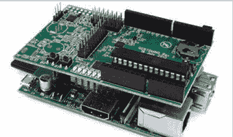
##### 扩展附加模块
Gertduino这类附加板可以利用GPIO端口扩展树莓派的功能
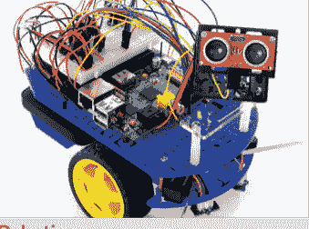
##### 机器人制作
终极玩法：制作属于你自己的树莓派机器人，通过GPIO输入接口控制它

41 www.linuxuser.co.uk

Rainloop具备传统的邮件客户端布局，可与你的服务器中的文件夹和邮件连接。已打开和收藏的邮件会在不同会话间被记住，因此无论你从哪登录，未读邮件计数都是准确的。

你可以通过创建不同文件夹、添加额外账号，甚至开启社交网络登录支持来定制你的使用体验。邮件预览可以在同一窗口内全屏显示，无需打开新页面或标签页——这能降低服务器负载。

#### 顾问

Rob Zwetsloot擅长建立复杂系统的模型，是一名精通Python、Django和PHP的网页开发者，他热爱计算机实验。自己管理个人账号的网页邮局，跳过中间商，避免不必要的停机时间。

##### 资源
Rainloop 下载地址：http://rainloop.net/downloads
服务器
虽然使用网页邮局非常方便，但你也得受制于其他公司的服务器和隐私政策。以如今人们的网络连接方式，几乎不可能回到从前的邮件客户端系统，就算它的安全性和隐私性远高于Gmail也不例外。但还有另一种解决方案能满足这两方面的需求：搭建你自己的网页邮件服务器，你既可以享受全球访问的便利，又能拥有桌面邮件客户端的隐私保障。通过Rainloop，你可以快速轻松地搭建属于自己的网页邮件服务器，自定义设置和邮箱地址。你需要一台服务器或者一直开机的PC来托管你的网页邮局，否则它只有你的电脑开机时才能正常使用。请注意，这可能会增加你每月的带宽消耗，因此非必要情况下不要通过它发送大文件。感兴趣吗？那就让我们开始吧。
44 www.linuxuser.co.uk

## 自主搭建专属网络邮箱服务器
### 教程：摆脱中间商，自主管理网络邮箱
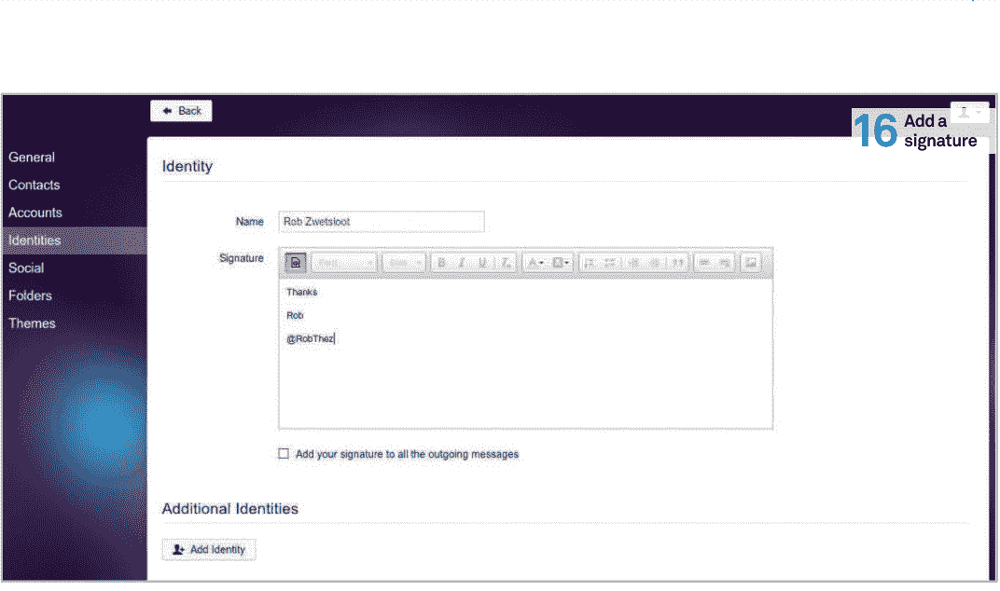
#### 01 服务器就绪
在我们深入探究Rainloop之前，需要先确认承载它的系统已满足服务器运行要求。请从终端安装以下软件包：
``` $ sudo apt-get install apache2 php5 php5-mysql libmysqlclient15-dev mysql-server poppassd ```
其中部分或大部分软件包可能已经安装完成，但仍建议核对一遍。
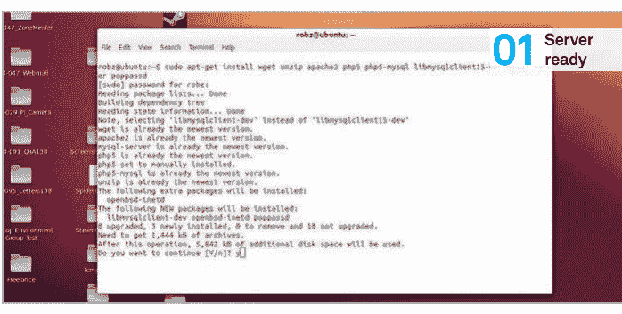
#### 02 创建目录
我们需要创建指定目录才能让Rainloop正常运行。你可以通过文件管理器完成，也可以在命令行按如下方式操作：
``` $ sudo mkdir /var/www/webmail ```
请切换到该目录，因为后续所有Rainloop文件都会存储在这里。

#### 03 下载Rainloop
现在可以下载Rainloop了。如果你使用的是图形化界面，可以从官网下载最新版本的Rainloop并解压。
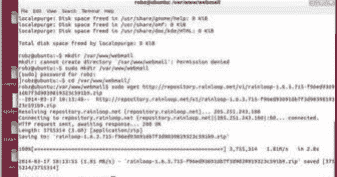
#### 04 权限提升
如果终端未打开，请先打开终端，使用`cd`命令切换到/var/www/webmail目录。运行以下两条命令提升必要文件的权限：
``` sudo find . -type d -exec chmod 755 {} \; sudo find . -type f -exec chmod 644 {} \; ```
如果没有图形界面，可以使用wget命令下载：
``` $ wget http://repository.rainloop.net/v1/rainloop-[current version].zip ```
之后解压文件即可继续后续操作。
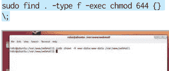
#### 05 最终权限配置
运行以下命令完成所有权限的最终设置：
``` sudo chown -R www-data:www-data /var/www/webmail ```
现在Rainloop已经基本准备就绪，剩下的配置大多会在其操作界面中完成。

#### 06 访问Rainloop
现在需要从浏览器登录Rainloop：如果你知道服务器的公网IP或绑定域名，就可以通过它们访问；如果是在本机访问，使用127.0.0.1即可。在地址栏输入以下内容：
``` http://[IP address or domain]/webmail/?admin ```

#### 07 登录
当前版本Rainloop的默认用户名为`admin`，默认密码为12345。登录后进入操作界面，我们要做的第一件事就是修改默认密码。由于该登录地址非常通用，建议遵循通用密码规范创建一个高安全性的密码。

#### 08 添加域名
进入管理面板，找到域名选项并添加新域名。在这里你可以添加个人或工作邮箱的域名，在IMAP和SMTP字段中填入对应的IP或服务器地址即可。Gmail等部分常用网络服务无需手动添加，系统已经内置了对应配置。

#### 09 配置域名端口
请确认服务器地址的端口配置正确：本地服务器使用默认端口即可。另外，需要勾选「使用短登录表单」，将服务器名称设置为你的邮箱@后的地址（例如example.com），最后点击添加即可保存到列表。

#### 10 配置通讯录数据库
要实现通讯录功能，我们需要添加MySQL数据库。再次打开终端，输入以下内容：
``` $ sudo mysql -u root -p ```
输入密码后即可进入MySQL命令行界面，准备创建数据库。
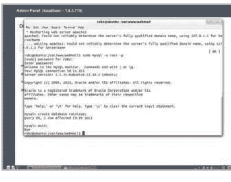
#### 11 创建数据库
输入以下命令创建通讯录数据库：
``` create database rainloop; ```
正如你所想，这条命令的作用是创建名为rainloop的数据库。执行以下命令确认操作并退出MySQL命令行界面：
``` exit; ```

#### 12 启用通讯录功能
回到Rainloop的管理面板，切换到通讯录选项卡，勾选「启用通讯录」选项。在下方的数据库类型中选择MySQL，之后还需要填入MySQL服务器的用户名和密码。

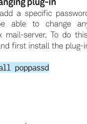
#### 13 安装密码修改插件
若要修改Linux邮件服务器上的邮箱密码，你需要安装专用的密码修改插件。请打开终端，运行以下命令安装该插件到系统中：
``` $ sudo apt-get install poppassd ```
#### 登录你的邮箱
> 它兼具桌面客户端的隐私性，又能实现全球范围内的便捷访问。
要登录网络邮箱，请输入你的服务器对应的邮箱访问地址：
``` http://[IP or domain]/webmail ```
使用你添加到服务器上的邮箱的常规登录凭证即可。登录后它的操作逻辑和普通邮箱客户端一致：左侧是邮件列表，右侧为邮件预览窗格。你还可以将邮件放大至全屏查看。Rainloop会自动标记已读邮件，每次登录时还会自动同步草稿箱、已发送文件夹的内容。

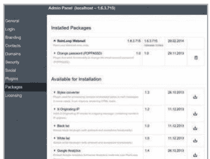
#### 14 激活密码修改插件
现在需要在Rainloop的管理面板中添加该插件。切换到插件选项卡，在列表中找到对应的插件，点击发布日期右侧的箭头即可激活它。
#### 15 添加邮箱签名
点击底部的齿轮图标打开设置界面。在这里你可以创建多个身份，每个身份都可以设置独立的签名。如果你有多个邮箱账户，或多个用户共用同一个邮箱，这个功能会非常实用。你可以将所有邮箱的邮件整合到同一个登录入口下管理，既可以在主页面操作，更推荐在设置菜单的账户选项卡中完成配置。
#### 16 添加自定义文件夹
主界面设置齿轮图标旁就是新建文件夹按钮。你可以创建自定义文件夹，将邮件移动到对应文件夹中实现更好的分类，这些文件夹会和服务器自动同步。你还可以设置文件夹的层级结构，实现父子文件夹嵌套。

#### 17 管理文件夹
在设置中你不仅可以创建文件夹，还可以删除、隐藏、编辑已有文件夹。此外还支持修改系统默认文件夹，你可以将垃圾邮件、已发送邮件等不同类型的邮件自动归类到指定文件夹。这是目前唯一的邮件过滤方式。
#### 18 绑定社交媒体账号
Rainloop有一个有趣的功能：你可以通过Twitter、Facebook或Google账号登录指定邮箱的网络邮箱。操作前请确保你已经登录了想要启用该功能的邮箱账号。

#### 19 选择绑定账号
登录后，打开设置菜单，切换到社交媒体选项卡。在这里你可以选择三种社交媒体类型中的一种或多种，需要先在这里完成对应平台的登录，之后才能在主界面启用该功能。
#### 20 添加新账号
只要该账号已经在管理页面中创建完成，你就可以把它添加到当前邮箱的登录入口下。这样就可以将所有邮箱的邮件整合到同一个登录入口管理，既可以在主页面操作，更推荐在设置菜单的账户选项卡中完成配置。
#### 21 社交媒体登录注意事项
使用社交媒体账号作为登录方式时，仅能绑定到你设置的那个邮箱账号上。另外，如果其他人可以访问你的常用设备，且你没有退出登录，那么他们就可以很轻松地登录你的邮箱账号。

#### 22 更多功能即将上线
目前还有一些常用客户端具备的功能尚未上线，例如自动回复、自动过滤规则等。这些功能未来会逐步推出，无论是官方更新还是通过插件形式，请大家持续关注版本更新。
**47**
www.linuxuser.co.uk

## 使用Nmap进行网络扫描
### 扫描iPad
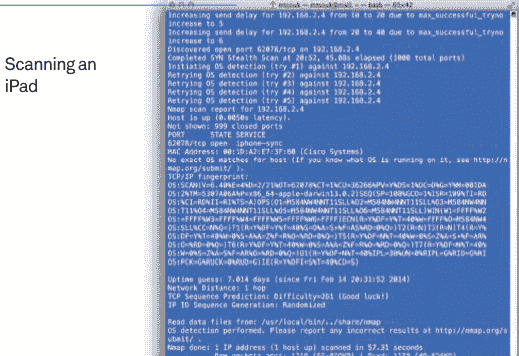
### 扫描Linux机器
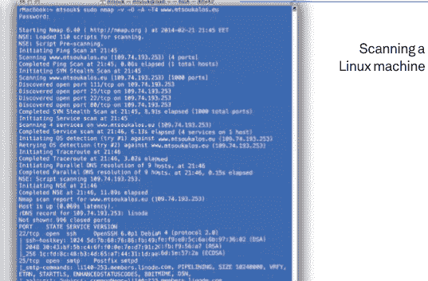
### 关于Nmap

### 扫描HP打印机
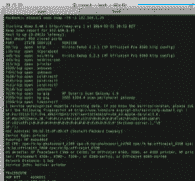

作者米哈利斯·楚卡罗洛斯（Mihalis Tsoukalos）是UNIX系统管理员，同时精通编程、数据库与数学。他自1993年起开始使用Linux。

本教程将带你了解Nmap，并学习如何使用tshark检查Nmap生成的网络流量。

Nmap是由戈登·菲奥多尔·莱昂（Gordon Fyodol Lyon）创建的开源工具，支持端口扫描、操作系统检测与版本检测，名气极大——甚至曾出现在多部电影中，包括《黑客帝国2：重装上阵》和《极乐空间》。Nmap是Network Mapper（网络映射器）的缩写，支持超过15种扫描技术。它对网络管理员、高级用户以及黑客都十分有用，既可以用于防护自身网络，也可用于黑客（或破解）目的。扫描非本地网络的主机时，请注意路由器、防火墙、代理服务器等复杂的中间设备可能会误导Nmap，故意提供错误信息。尽管普通用户可以执行多数Nmap扫描，但部分特定命令行选项需要root权限才能运行。建议你亲自试用Nmap，找到最适合自身需求的选项与扫描技术，本教程将引导你了解部分常用选项。

##### 资源
- **Nmap：** [Nmap官网](http://www.nmap.org)
- **WireShark站点：** [WireShark官网](http://www.wireshark.org)
- **RFC文档：** [IETF RFC页面](http://www.ietf.org/rfc.html)
- **《TCP/IP互连（第1卷）》**，道格拉斯·E·科默（Douglas E. Comer）著，普伦蒂斯霍尔出版社

### 01 安装Nmap
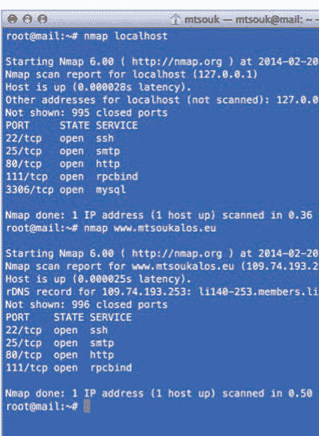

在Debian 7 Linux系统上安装Nmap非常简单，只需以root权限执行以下命令即可：
```bash
# apt-get install nmap
```

运行Nmap时，`-v`参数可以输出额外的扫描进度信息，且能够与所有其他命令行参数组合使用。执行Nmap扫描时，按下`v`键可提高输出详细程度，按下`V`键可降低输出详细程度。

#### 02 查看Nmap版本
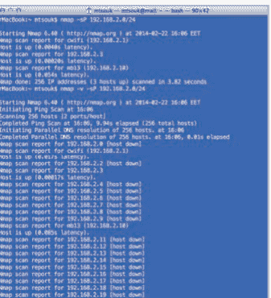

你可以通过执行以下命令查看当前使用的Nmap版本：
```bash
$ nmap V

Nmap version 6.00 ( http://nmap.org )
Platform: x86_64-unknown-linux-gnu
Compiled with: liblua-5.1.5 openssl-1.0.1e libpcre-8.30 libpcap-1.3.0 nmap-libdnet-1.12 ipv6
Compiled without: 
$
```

在Linux系统上可执行的最简单扫描如下所示：
```bash
$ nmap localhost
```

该命令的输出会提供对目标主机过滤端口进行简单扫描的相关信息，是评估计算机安全状况的良好起点。需要注意：尽管TCP SYN扫描不会在目标主机上留下日志记录，但现代防火墙与流量捕获工具仍可检测并上报此类TCP SYN扫描。

#### 03 简单扫描（TCP SYN扫描）

#### 04 TCP connect()扫描（nmap -sT）
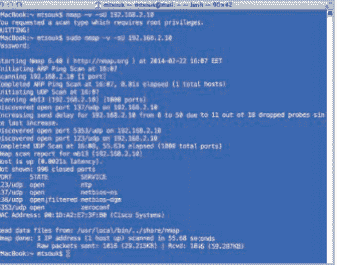

当你没有目标主机的root访问权限时，TCP connect()扫描十分有用。它的缺点是会在远程主机的日志文件中留下痕迹，因为该扫描会与远程主机建立完整的TCP会话。

#### 05 SYN扫描（nmap -sS）

SYN扫描不会出现在目标主机的日志文件中，因为TCP连接永远不会被完全建立。其缺点是需要root权限才能运行。该扫描可以提供端口开放、关闭或处于过滤状态的相关信息。

#### 06 Ping扫描（nmap -sP）

这是一种速度极快的扫描方式，仅会发送ICMP回显请求并接收ICMP回显应答，在繁忙的网络上也不容易被察觉。它不需要特殊权限即可运行，但返回的信息较少，且无法与其他类型的扫描组合使用，主要用于查找网络中的活跃主机。

#### 07 UDP扫描（nmap -sU）
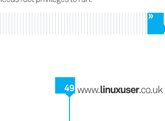

UDP协议被诸多服务使用，这种扫描是使用Nmap检测开放UDP端口的唯一方式。UDP扫描不会产生过多的网络流量，非常适合检测运行Microsoft操作系统的主机，但需要root权限才能运行。

#### 08 一次性扫描多个主机
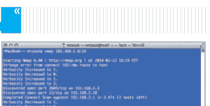

以下命令可以扫描256个IP地址，范围涵盖192.168.2.0至192.168.2.255：
```bash
$ nmap 192.168.2.0/24
```

#### 09 使用文本文件作为输入（nmap -iL）
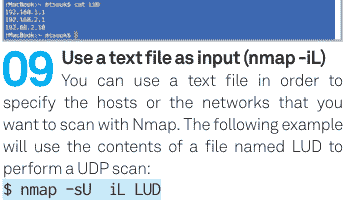

你可以使用文本文件指定需要Nmap扫描的主机或网络。以下示例将使用名为LUD的文件的内容执行UDP扫描：
```bash
$ nmap -sU -iL LUD
```

#### 10 排除主机
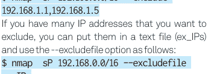

排除主机的最简单方法是使用`--exclude`选项。如果需要在扫描192.168.0.0/16子网时排除192.168.1.1和192.168.1.5，应执行以下命令：
```bash
$ nmap -sP 192.168.0.0/16 --exclude 192.168.1.1,192.168.1.5
```

如果需要排除大量IP地址，可以将它们写入名为ex_IPs的文本文件中，再使用`--excludefile`选项，示例如下：
```bash
$ nmap -sP 192.168.0.0/16 --excludefile ex_IPs
```

所有排除类选项（`--exclude`或`--excludefile`）的优先级均高于包含类选项，因此出现冲突时优先执行排除规则。这一设计十分合理：误排除主机的影响远小于误包含主机，后者可能引发拒绝服务攻击，或拖慢整个网络。

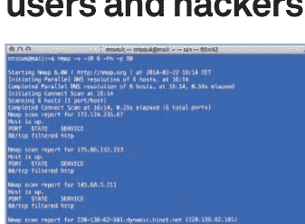
> Nmap对网络管理员、高级用户和黑客都很有用

#### 11 随机化主机
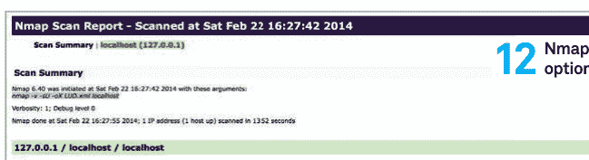

Nmap还支持随机选择IP地址并尝试扫描。若使用不当，这类扫描可能会给你带来严重麻烦，其主要用途是生成随机网络流量。
```bash
$ nmap --randomize-hosts
```

#### 12 Nmap输出选项

Nmap扫描结果可以多种格式保存。`nmap -oN <日志文件名>`选项会将输出保存为普通文本格式，适合轻松阅读与打印。可grep格式（`nmap -oG <日志文件名>`）可以方便地在Nmap输出中检索信息，其主要优点是每台主机的输出会自动存储在同一文件中。XML格式（`nmap -oX <日志文件名>`）最适合将Nmap输出转换为HTML页面，或供其他软件处理。Nmap XML文档的DTD定义可从www.insecure.org/nmap/data/nmap.dtd获取。

#### 13 扫描scanme.nmap.org

scanme.nmap.org（或scanme.insecure.org）是一台供用户测试Nmap的主机，也就是说，将scanme.nmap.org作为目标运行Nmap并不违法。请不要滥用该主机，也不要将其用于测试SSH暴力破解、密码破解工具——尽管它不会拦截256-999端口的访问请求。

#### 14 扫描Linux机器（第1部分）

最实用的两种扫描是TCP扫描与UDP扫描，它们可以为目标主机提供整体概览，因此检查新主机时应优先进行这两类扫描。你可以快速获取主机开放的TCP、UDP端口，以及主机运行的网络服务信息。

#### 15 扫描Linux机器（第2部分）

接下来，你可以尝试更智能的扫描方式，例如执行`nmap -A -T4`命令。-A选项会启用操作系统与版本检测（即TCP/IP指纹识别）、脚本扫描和路由跟踪功能，-T4选项用于加快扫描执行速度。需要注意：如果没有root权限执行该命令，获得的输出信息会相对简略。-T选项可用于降低扫描速度，避免产生过多流量拖慢甚至淹没网络或目标主机，该选项的可选取值为0-5，数值越小代表扫描速度越慢。

#### 16 扫描iPhone 5

如今手机也可以拥有独立IP地址，因此可以通过Nmap对其进行扫描！扫描新设备以发现其开放端口及扫描时的响应行为十分有趣，本次扫描的输出显示iPhone没有开放过多的端口。

#### 17 扫描运行Mac OS X的机器
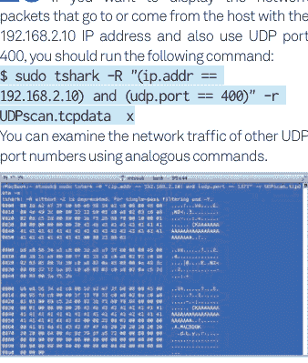

对于Nmap来说，运行Mac OS X的主机与典型的UNIX主机没有明显差异，扫描输出也证明了这一点。

#### 18 扫描Cisco 877W ADSL路由器

如你所见，Nmap扫描Cisco 877W ADSL路由器耗时16.07秒，其猜测结果相当准确！但需要牢记：Nmap的操作系统检测并非始终准确，因此不能完全采信其结果。

#### 19 扫描Windows机器

Windows机器往往开放过多端口，因此使用Nmap对它们进行检查总是不错的选择。本次扫描中Nmap无法正确识别目标机器的操作系统，这表明网络中间存在防火墙。

#### 20 扫描HP打印机

网络打印机也拥有IP地址，因此也可以通过Nmap对其进行扫描。Nmap检测到这是一台运行HP嵌入式系统的HP打印机，且正在运行Web服务器（端口80和443处于开放状态）。完成Nmap扫描后，打印机需要重启，因为所有指示灯都处于闪烁状态。

#### 21 使用tshark检查Nmap流量
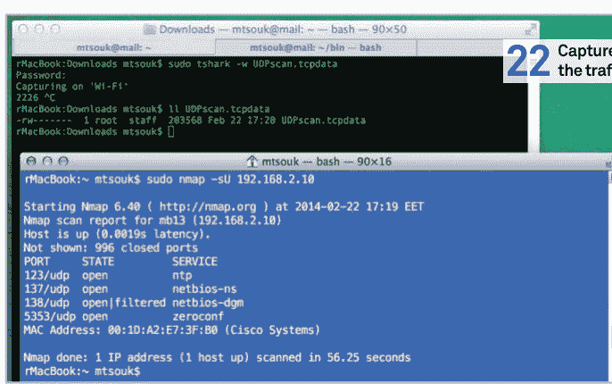

本节你将学习如何使用tshark（WireShark的命令行版本）分析Nmap UDP扫描生成的网络流量。流程分为三步：首先捕获网络数据，然后应用tshark显示过滤器筛选出目标流量，最后对特定流量进行检查与审查。

#### 22 捕获流量
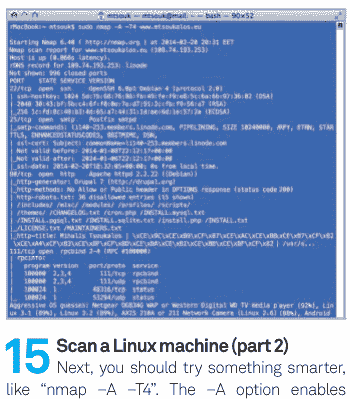

本次将使用的Nmap命令如下：
```bash
$ sudo nmap -sU 192.168.2.10
```

运行Nmap前，需要执行以下tshark命令捕获网络数据：
```bash
$ sudo tshark -w UDPscan.tcpdump
```

#### 23 查看Nmap流量


如果需要显示发往或来自IP地址为192.168.2.10的主机的网络数据包，且筛选UDP端口400的流量，应执行以下命令：
```bash
$ sudo tshark -R "(ip.addr == 192.168.2.10) and (udp.port == 400)" -r UDPscan.tcpdump -x
```

你可以使用类似的命令检查其他UDP端口的网络流量。

#### 24 讨论Nmap网络流量

Nmap UDP端口扫描会向各个UDP端口发送空的UDP数据包（不携带额外数据），然后等待响应。你可以看到，针对UDP端口137（netbios-ns）的扫描收到了回复，表明主机无法识别该数据包，因此Nmap判定该端口处于使用状态。另一方面，虽然向端口80发送了数据包，但收到的响应是“端口不可达”数据包，因此Nmap推断UDP端口80处于未使用状态。如果针对某个UDP端口发送数据包后，主机没有任何响应，则该端口会被判定为开放但被过滤（例如端口138）。


#### 教程
## 使用 Node.js 和 Duino 创建实时 CPU 仪表盘
Linux开发者
使用 Node.js 驱动的 Arduino 实时显示计算机的当前处理器使用率
#### 顾问

肖恩·M·特雷西（Sean M Tracey）是一家领先数字机构的创意技术专家，他的大部分工作都围绕 Node.js、Python 和 Arduino 展开。
##### 资源
- Node.js v0.10.17：nodejs.org
- NPM v1.3.8：www.npmjs.org/doc/cli/npm-install.html
- Duino v0.0.9：github.com/ecto/duino
- Forever.js v0.10.11：github.com/nodejitsu/forever
- Arduino Uno/Duemilanove
- 5 个 LED
- 电位器
- 13 根面包板跳线
- 你常用的文本编辑器
- Arduino IDE 1.0.5

在本文中，我们将使用 Node.js 和 Duino 库获取实时 CPU 数据，并用一排 LED 展示数据。我们还将讲解如何通过电位器调节 LED 亮度，以及如何使用 Forever.js 将应用作为后台进程运行。

传统的 Arduino 编程流程是：编写程序（爱好者称之为「草图」），编译后上传到微控制器，然后让其运行。如果得不到预期的结果，就修改草图、重新编译并重新上传。这个方法虽然稳定，但稍显繁琐耗时——这还不算上连接扩展板、继电器和其他外设的相关操作。而 Duino 就是为了解决这个问题而生的。我们无需再走上述繁琐流程，只需上传一段 sketch，就能让 Arduino 成为另一台计算机的从机——作为数据和指令的端点。这通过串口连接实现，本例中配合使用了 Node.js 库。

这种方案的好处有很多，其中最主要的是：我们可以利用性能强得多的计算机的计算能力处理问题，仅将结果发送给 Arduino 来执行功能或产生效果。

在你的系统中创建一个新的项目文件夹，名称可以任意指定，然后进入该文件夹。在命令行中执行
```bash
npm install duino
```
这将创建一个名为 `node_modules` 的文件夹，其中包含 Duino 软件及其所有列出的依赖项。现在我们已经可以开始编写 Arduino 的程序了。

#### 01 准备项目
我们要做的第一件事就是安装 Duino.js，这样就能将其软件上传到 Arduino，让两者可以通信。首先，我们将 Duino 的 GIT 仓库克隆到本地计算机：
```bash
git clone https://github.com/ecto/duino.git
```
现在你的系统中应该会有一个名为 `duino` 的文件夹。打开该目录，找到 `src` 文件夹。这个文件夹里有一个名为 `du.ino` 的文件，它是让 Duino 与我们的微控制器通信的软件。在 Arduino IDE 中打开这个草图，点击「上传」。草图会上传到你的 Arduino，现在我们已经可以开始与它通信了。

#### 2 准备应用
使用你常用的文本编辑器，新建一个名为 `app.js` 的文件，插入以下内容：
```javascript
var arduino = require('duino'),
    board = new arduino.Board({debug: false}),
    spawn = require('child_process').exec,
    pins = [3, 5, 6, 9, 10], //不同版本的 Arduino 引脚号可能不同
    brightness = 255;
```
这里我们引入了 Duino 库，并用它创建了一个 `Board` 实例——这个函数提供了与 Arduino 交互所需的方法。由于 Node.js 无法轻松直接获取系统的 CPU 详细信息，我们的应用将使用 Node.js 的 `child_process` 模块执行 shell 程序 `vmstat` 和 `tail`，来获取用户 CPU 使用率的相关信息。我们会在后续步骤中详细讲解这部分。

`pins` 数组包含本次 sketch 中会用到的引脚号。观察你的 Arduino 你会发现，这些引脚都支持读写数字（HIGH-LOW）和模拟（0-255）数据。稍后我们会通过调节电位器来改变 LED 的亮度。为了实现对 LED 亮度的调节，我们需要控制供给它们的电量，因此我们会通过 PWM（Arduino 开发板上 `~` 符号所代表的功能）写入模拟值，来反映电位器的数值。

#### 整体是如何工作的？
Duino 软件本质上是 Firmata 的抽象版本，并带有面向 Node.js 的 API。其核心逻辑是让 Arduino 变成一个端点，始终监听另一台机器通过 Arduino 串口发送的读写指令。串口数据的优势在于，如果你愿意，可以用其他语言（C++、Python、Ruby 等）自行编写库，只要发送的命令是 Arduino 能识别的，任何语言都可以轻松控制它。

#### 连接 Arduino
在继续编写代码之前，现在是个合适的时间来连接电路并为 Arduino 供电。附带的电路图中，我们的每个 LED 都由单独的引脚供电，但都通过面包板的地线总线连接到地线引脚。电位器不连接数字引脚，而是连接到任意一个空闲模拟引脚即可，本教程使用 A0，因为它是第一个空闲引脚。为了从电位器获得相对稳定的读数，你必须将其连接到 5V 电源引脚，可以通过电源总线连接，也可以像电路图中那样直接连接。
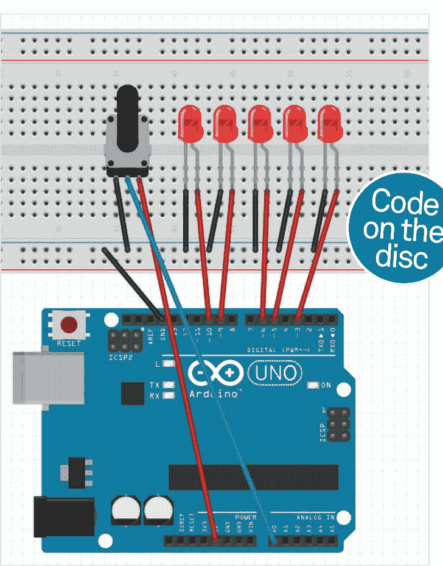
要让电位器输出稳定的读数，必须将其连接到 5V 电源引脚。

所有线路连接完成后，就可以为 Arduino 通电了。现在什么都还不会发生，因为我们还没开始控制它，现在就来完成这一步吧。

#### 使用 Node.js 子进程获取 CPU 数据
在开始向开发板写入信息之前，我们需要有要发送的数据，所以先来获取 CPU 数据。之前提到过，Node.js 无法直接获取 CPU 信息。根据你使用的 Linux 版本/发行版的不同，以下操作可能略有差异。本教程在 Debian 7.2 上测试通过，如果你的系统支持 `vmstat` 和 `tail` 命令，就没问题。

如果我们要尽可能频繁地检查 CPU 使用率，程序会开始占用 CPU 资源，这反过来会影响读数。真是讽刺！如果每隔半秒左右读取一次 CPU 使用率数值，我们就能获得有效的数值，也能很好地衡量系统内部的运行情况，同时不会对系统造成可测量的额外影响。我们通过将以下代码包裹在 `setInterval()` 中来实现这一点：
```javascript
setInterval(function(){
  spawn("echo $[100-$(vmstat|tail -1|awk {'print $15'})]", function(error, stdout, stderr){
    var percentage = parseInt(stdout);
    displayUsage(percentage);
  });
}, 500);
```
使用 Node.js 的 `child_process` 模块，我们可以调度 Shell 命令（还可以完成其他任务），并将标准输出传递给回调函数。因为我们用了一点命令行技巧缩短了 `vmstat` 的输出，所以本例中传递给回调的内容是当前的用户 CPU 使用率数值，以百分比形式表示（满分为 100）。完美，现在来用这些数据做点事情吧。

#### 05 展示 CPU 使用率
我们来创建之前传入百分比参数的 `displayUsage()` 函数，把它放在间隔循环外部。这部分流程对时间不敏感。现在，`displayUsage` 函数只需要计算一个 0 到 4 之间的整数。这有什么用呢？看看你接好的电路，会发现我们有 5 个 LED。这是特意设计的：接 10 个 LED 并控制它们很快会变得复杂低效，更别说 Uno 开发板上根本没有 10 个可输出 PWM 值的引脚。

给出的公式会接收 `vmstat` 输出的百分比，精确计算出对应百分比下应该点亮的 LED 数量。本例中，每个 LED 代表 20% 的 CPU 使用率区块。如果 5 个 LED 全亮，说明 CPU 使用率在 80% - 100% 之间；如果 3 个 LED 亮起，使用率就在 60% - 80% 区间。

现在我们已经明白 `ledCount` 的作用了，来使用它吧：
```javascript
function displayUsage(percentage){
  var ledCount = ((percentage / 100) * 100) / (10 * (10 / pins.length));
}
```

#### 06 控制 LED 的其他方式
给 `displayUsage()` 函数添加以下内容：
```javascript
function displayUsage(percentage){
  var ledCount = ((percentage / 100) * 100) / (10 * (10 / pins.length));
  for(var z = 0; z < pins.length; z ++){
    if(z < ledCount){
      board.analogWrite(pins[z],brightness);
    } else {
      board.analogWrite(pins[z], 0);
    }
  }
}
```

还记得之前创建的引脚号数组吗？这里我们遍历该数组，检查选中的引脚对应的值是否低于阈值，如果是就将其点亮。我们可以用多种方式实现这个逻辑。举个例子，如果我们只想切换引脚的开关状态，可以这样写：
```javascript
var leds = [], pins = [3, 5, 6, 9, 10];
for(var x = 0; x < pins.length; x += 1){
  leds.push(
    new arduino.Led({ board: board, pin: pins[x] })
  );
}
function displayUsage(percentage){
  var ledCount = ((percentage / 100) * 100) / (10 * (10 / pins.length));
  for(var z = 0; z < pins.length; z ++){
    if(z < ledCount){
      leds[z].on();
    } else {
```
Node.js 旨在为用户提供一种构建可扩展网络程序的简便方式。


### 创建动态模板
显示你计算机的当前处理器使用率
#### 教程
``` leds[z].off();
} } } ```
> "如果我们尽可能检测每一个可能的CPU使用率场景，程序就会开始消耗CPU资源，这会影响我们的读数"
...不过这些方法虽然非常实用，但无法设置要发送的数值。这些数值目前只能是HIGH或LOW，因为我们希望可以根据用户输入调整LED的亮度，所以我们将直接通过`board.analogWrite(pins[z], brightness)`来操作开发板。`analogWrite`方法允许我们发送0到255之间的模拟值，0代表关闭（等同于数字信号中的LOW），255代表开启——满功率（等同于数字信号中的HIGH），对应电位器的数值。我们只要做一点简单的数学计算，就能把这个数值转换成占255的百分比。如果我们像下面这样设置`brightness`变量，现在转动电位器时，就能调整LED的亮度了。
#### 更多优势
``` potentiometer.on('read', function(err, value) {
value = (value / 1024) * 100;
brightness = Math.round((value / 100) * 255);
}); ```
##### 07 调节亮度
如果你在命令行中执行``` node app.js ```运行app.js，假设所有接线都正确，现在你就能得到一个完全可用的CPU仪表了。想要测试的话，不妨同时打开几个高负载程序，看看它对测量结果有什么影响？随着CPU使用时间占比升高，点亮的LED数量也会增加，到这里原本就可以结束了。但这意味着我们目前只讲解了写入数值，如果想要读取数值，该怎么做呢？回到你的项目文件，在设置开发板信息的变量后面，新建一个名为`potentiometer`的变量，这个对象将用来监听事件、获取电位器的数据。
##### 08 永久运行... .js
至此，我们的实时CPU应用就完成了。我们很快就做出了一个相当实用的系统工具，但现在我们还在CLI中手动运行app.js。CLI很棒，但一个需要开着窗口才能运行的CPU仪表有什么用呢？这时候就轮到Forever.js出场了。Forever本质上是一个守护进程，能让你的Node.js脚本在后台“永久”运行。Forever会尽最大努力保证你的Node.js应用持续运行——它甚至能处理应用崩溃和重启的问题。安装方法很简单：
``` $ npm install forever -g ```
注意末尾的`-g`参数，这代表全局安装，也就是说如果这个系统上的任何Node.js应用需要调用forever，都不需要把它保存在node_modules文件夹里。安装完成后，我们现在就可以输入以下命令：
``` forever start [PATH TO OUR NODE.JS + DUINO FILE] ```
使用Duino这类工具的最大好处是，你可以把大量计算任务卸载到性能更强的设备上。更实用的是，控制用的计算机可以代替Arduino访问互联网。Arduino在设计之初就没有考虑联网功能，让我们的计算机处理网络访问和结果传输，我们就不用去操心扩展板、可用字节数或者连接掉线的问题，一切都能正常运行。
``` info: Forever processes running
data: uid command script: forever pid logfile uptime:
[0] fwGv /usr/local/bin/ node app.js 96489 96490 /Users/seantracey/.forever/fwGv.log 0:0:1:13.707 ```
如果想要停止某个进程，你可以输入`forever stop [PROCESS INDEX]`。
##### 09 简要回顾
``` var potentiometer = new arduino.Sensor({
board: board,
pin: 'A0'
}); ```
看！我们对Arduino和Node.js的快速入门之旅就到此结束了。我们在很短的时间内讲了很多内容，现在你已经知道了如何从模拟源（我们的电位器）读取信息、如何向各个引脚写入模拟值、数字信号和模拟信号的区别、为什么本教程使用模拟信号、如何在Node.js应用中执行子进程来扩展Node的能力，以及如何让应用“永久”运行。这些内容足以让你对Arduino的能实现的功能感到兴奋；现在正是出门动手制作有趣小玩意的时候——只要几根导线和一个微控制器，你就能实现很多功能！
你会发现，在创建arduino.Sensor对象时，我们传入了一个包含`board`和`pin`键的选项对象。理论上这意味着我们可以同时控制多块Arduino，但这次我们不会涉及这部分内容。当然，`pin`指的是我们要读取数据的模拟引脚。除了作为初始化对象外，`potentiometer`还是一个事件发射器。如果我们监听`potentiometer`的`read`事件，就会得到一个0到1024之间的数值，具体数值取决于电位器的位置......现在CPU仪表已经是一个后台进程了。如果你想要查看通过forever运行的应用，可以输入`forever list`，你会得到类似下面的输出：

## 使用Grunt.js实现自动化
使用Grunt.js任务运行器减轻重复任务的负担，最大化利用开发时间

在我们的生活（无论是个人生活还是职业领域）中，重复性任务很少会受人欢迎。在开发周期和流程中，我们往往会遇到不止一个需要频繁执行的任务。面对如此多的开发、管控和管理工作，如果把花在这些任务上的时间加总，会让人有些畏惧——这些时间完全可以用在其他更有价值的地方。
在我们的生活（无论是个人生活还是职业领域）中，重复性任务很少会受人欢迎。在开发周期和流程中，我们往往会遇到不止一个需要频繁执行的任务。面对如此多的开发、管控和管理工作，如果把花在这些任务上的时间加总，会让人有些畏惧——这些时间完全可以用在其他更有价值的地方。
Grunt的文档详尽且信息丰富，是深入了解这个强大工具的绝佳去处。请访问gruntjs.com/getting-started获取更多信息

#### 01 前置要求
Grunt及其所有插件的安装都通过Node.js包管理器管理，因此你的开发设备必须安装Node.js。如果你尚未安装，请前往nodejs.org/download下载安装程序。
#### 02 安装Grunt CLI
安装好Node.js后，我们就可以通过命令行使用包管理器了。打开终端或CMD窗口，运行以下命令安装Grunt CLI（命令行界面）。末尾的`–g`参数会执行全局安装，将其添加到系统路径中，这样你就可以在机器的任何目录下访问它了。
``` > npm install -g grunt-cli ```
Grunt.js是一个由Node.js驱动的免费开源JavaScript任务运行器，旨在通过允许你创建单个或批量进程，在命令行中帮你管理这些重复任务，从而减轻这类负担。它用JavaScript编写，任何有基础JS知识的人都能快速上手使用Grunt命令行。它还是一个高度可扩展的框架，开发社区贡献了越来越多的插件。在本教程中，我们将安装Grunt命令行工具、搭建本地项目环境以使用该库，并安装一些实用的插件，帮助我们压缩和管理JavaScript和CSS文件，为上线使用做准备。欢迎使用Grunt！最大化利用你的开发时间
## 使用Grunt.js实现自动化
#### 教程
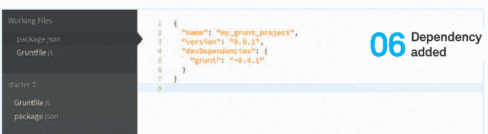
#### 参考文件和目录
在创建任务来监听或更新一批文件时，你可以指定单个文件，也可以使用通配符(*)选择目录下的所有文件。Grunt的可配置性非常高。
#### 创建进程帮你管理重复任务
#### 03 准备项目
要在新项目或现有项目目录中配置Grunt进程，需要两个特定文件——它们都必须放在项目根目录下。在根目录新建一个名为package.json的文件，至少需要包含name和version字段，我们还会添加devDependencies字段供后续使用。
从包管理器中安装包时，我们这里不使用`–g`参数进行全局安装，而是选择本地安装，并自动将它们添加到package.json文件的devDependencies部分。
``` > npm install grunt --save-dev ```
#### 06 已添加依赖
一旦运行了带有`--save-dev`参数的npm install命令来添加Grunt插件，系统就会知道该插件需要被添加为开发依赖，随后就会将该插件加入到package.json文件的devDependencies配置部分。用编辑器打开文件就能看到更新。
``` { "name": "my_grunt_project",
"version": "0.0.1",
"devDependencies": {
"grunt": "~0.4.1"
} } ```
``` "devDependencies": {
"grunt": "~0.4.1"
} ```
#### 04 创建Gruntfile
第二个必需的文件是Gruntfile，用于配置或定义任务，以及加载本项目所需的所有Grunt插件。在项目根目录下创建Gruntfile.js（或Gruntfile.coffee），在其中添加所有Gruntfile和插件都会用到的“包装器”函数，这个函数里会存放我们的配置数据。
``` module.exports = function(grunt) { }; ```
#### 07 Uglify插件
我们再往系统里添加一个插件。再次打开项目目录下的终端窗口，安装新的插件grunt-contrib-uglify。记得再次使用`--save-dev`参数，这样它就会被自动添加到package.json文件中。这个插件可以用来压缩文件，非常适合处理我们的JavaScript文件。
``` > npm install grunt-contrib-uglify --save-dev ```
#### 05 安装Grunt
我们来安装第一个插件，也就是Grunt本身。在项目目录下打开终端窗口，输入命令
#### 08 Grunt配置初始化
在往Gruntfile添加任何任务之前，我们首先需要定义`grunt.initConfig`方法，该方法会初始化当前项目的配置对象。这个方法直接放在包装器函数内部，在Gruntfile中添加以下代码来声明配置对象，我们的任务定义和配置信息都会写在这个函数里。
``` grunt.config.init({
}); ```
#### 09 Uglify配置
现在我们可以添加单个任务的配置了。每个插件都有自己的配置选项，通常可以在GitHub或Grunt插件页面找到。我们来定义uglify的配置，设置build选项指向我们的源文件所在目录，以及压缩后文件的存放目标目录。
``` uglify: {
build: {
src: 'src/js/script.js',
dest: 'dest/js/script.min.js'
}
} ```
#### 10 自动添加标注
在“压缩”或处理任何文件时，很多Grunt插件都允许你定义一个标注（可以是任意文本块），并将其添加到处理后文件的顶部。这在标记和存储文件中的日期、配置数据时非常实用。按照下面的代码片段所示，在uglify配置中添加banner选项。


#### 教程：使用Grunt.js实现自动化 *Linux开发者*
```javascript options: { banner: '/*! <%= grunt.template.today("yyyy-mm-dd") %> */\n' }, build: { src: 'src/js/script.js', dest: 'dest/js/script.min.js' } ```

#### 11 启用插件
现在我们已经完成了任务配置，接下来需要将任务加载到系统中，这样Grunt在运行任务时就知道该引用哪个任务。这个步骤非常简单，只需要在Gruntfile中添加一个方法来加载本地安装的npm插件即可，你只需要填入通过命令行安装插件时使用的相同插件名称。
```javascript grunt.loadNpmTasks('grunt-contrib-uglify'); ```
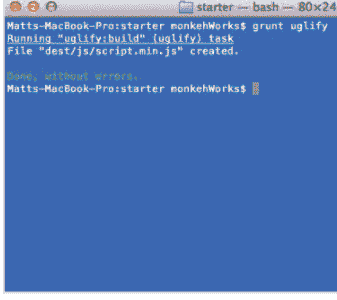

#### 12 运行任务
现在我们来运行这个任务。打开终端窗口，进入项目所在的目录。要运行任务，我们需要先输入Grunt，再跟上我们在Gruntfile中配置好的要运行的任务名称。执行完成后，终端窗口会输出该进程的响应。
```bash > grunt uglify ```
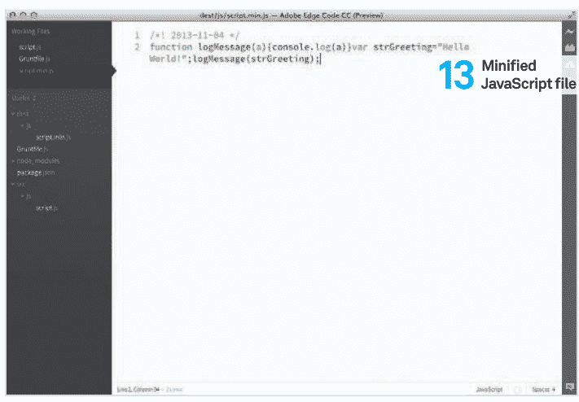

我们配置的uglify任务会对源目录中的指定JavaScript文件进行压缩（即丑化处理），并将压缩后的版本存放到目标目录中，供生产环境使用。用代码编辑器打开dest/js/script.js文件，你就能看到压缩后的代码，以及顶部由banner配置项添加的日期戳。
> **只要具备基础的JavaScript知识，就能快速上手使用Grunt命令行工具**

#### 14 CSS压缩
现在我们要给本地项目添加一个新插件。打开终端窗口，安装名为grunt-contrib-cssmin的新插件，并将其保存为开发依赖项，以此更新package.json文件。我们希望在生产环境中让CSS文件尽可能小，而这个插件正是为了完成这个任务而开发的。
```javascript cssmin: { options: { banner: '/*! CSS Build - <%= grunt.template.today("yyyy-mm-dd") %> */\n' }, build: { src: 'src/css/*.css', dest: 'dest/css/combined.min.css' } } ```
```bash > npm install grunt-contrib-cssmin --save-dev ```
```javascript // Load the task too (after the config method) grunt.loadNpmTasks('grunt-contrib-cssmin'); ```

#### 15 配置任务
用代码编辑器打开Gruntfile.js文件，现在我们可以为刚才安装的插件添加任务配置了。我们可以再次使用banner配置项来添加编译日期，同时选择压缩选中目录下的所有CSS文件，并将它们重命名为combined.min.css存放到输出目录中。

#### 16 组合任务
如果配置了多个任务，原本我们需要在命令行中逐个运行它们。现在我们可以把任意多个任务组合起来，创建一个默认任务，当我们在命令行中输入grunt或grunt default时就会自动运行这个默认任务。这个新任务会按照顺序执行所有指定的任务，帮我们节省大量时间。
```javascript grunt.registerTask('default', ['uglify', 'cssmin']); ```
```bash > grunt ```

#### 通过package.json配置确保团队协作顺畅
无论你是团队协作还是独立开发，版本控制都是你最好的帮手。一旦你在开发机器上创建了**package.json**文件，它就会存在于项目的根目录中。这样一来，所有团队成员都能获取到相同的项目配置。同样，如果你换到另一台机器上工作，也能访问到相同的文件。将代码提交到你选择的代码仓库时，请确保同时提交Gruntfile和**package.json**文件。在任何新机器上安装好Node.js之后，你只需要在项目目录中运行`npm install`命令，就会自动把package.json文件中的所有依赖项安装到你的项目中。


#### 17 监听文件
虽然按需运行任务的功能已经非常强大，但部分开发者可能还需要在文件被添加或更新时自动执行相关任务的能力。Grunt也有对应的插件可以实现这个功能，接下来我们就按照之前教程中安装其他插件的方式来安装它。
```bash > npm install grunt-contrib-watch --save-dev ```

#### 18 配置监听
和其他多数插件一样，watch插件可以配置为监听项目中的指定目录或文件组。这里我们将监听src目录下所有JavaScript文件的变动，一旦检测到变动，就会运行uglify任务来处理JS文件的压缩。请记得同时加载该任务。
```javascript watch: { scripts: { files: ['src/js/*.js'], tasks: ['uglify'], options: { spawn: false } } } ```
```javascript // Load the task too (after config method) grunt.loadNpmTasks('grunt-contrib-watch'); ```

#### 19 启动监听
要启动watch任务，请在项目目录中打开终端窗口，输入**Grunt watch**命令。终端输出会提示你任务正在等待文件变动，一旦检测到变动，就会运行配置好的对应任务，按照任务配置中的设定执行相关操作。
```bash > grunt watch ```

#### 20 管理变量
我们在Gruntfile中多次引用了src和dest目录，虽然这么做也无可厚非，但我们可以减少硬编码值的重复，将这些路径配置到**package.json**文件中。请在devDependencies对象下方添加以下内容，package.json文件非常适合用来设置可复用的值。
```json "srcDir": "src/", "destDir": "dest/" ```

#### 21 加载JSON文件
用代码编辑器打开**Gruntfile.js**文件，现在我们可以把所有硬编码的目录路径替换为**package.json**文件中的变量。首先，我们需要设置一个变量来存储.json文件的JSON内容，这里可以使用grunt核心文件API中的内置方法来实现。
```javascript grunt.config.init({ pkg: grunt.file.readJSON('package.json'), // The rest of the gruntfile... }); ```

#### 22 修改路径引用
现在我们可以修改所有目录路径的引用了。找到所有的'src/'实例，将其替换为`<%= pkg.srcDir %>`，所有的'dest/'实例替换为`<%= pkg.destDir %>`。运行任务时，这些模板字符串会自动转换为package.json文件中设置的相对路径，从而减少代码中的重复内容。以上就是全部操作步骤了——现在很多重复性任务都能自动处理啦！
```javascript build: { src: '<%= pkg.srcDir %>/js/script.js', dest: '<%= pkg.destDir %>/js/script.min.js' } ```


#### 顾问
Tam Hanna自2004年起就开始关注手机市场。他的公司Tamoggnemom Holding k.s.使用Qt技术，以最大化不同移动端和桌面端操作系统之间的代码复用率。

#### 延伸阅读
- planet.qt-project.org
- qt-project.org/doc
- qt-project.org/forums
- blog.qt.digia.com

## 用Qt解决现实世界的问题
计算机模拟可以解决多种现实世界的问题，涵盖零售采购到集换式卡牌建模等多个领域。
> 你是否想过，要集齐一整套卡牌需要购买多少包补充包？是否曾因为总拥有成本过高而放弃购买昂贵的长袜？是否曾在分析财务决策的影响时感到无从下手？尽管大多数问题都可以通过推导数学公式来解决，但暴力模拟往往能更快得出有用的结果。本文介绍的方法适用于所有可以拆分为多个易于分析的“步骤”的问题，只要运行足够多的步骤，就能得到可进一步分析的结果集。这篇文章的灵感来自斯洛伐克乐购零售商发起的一项促销活动。该公司会为每笔消费的顾客赠送一枚“多米诺宝石”，每颗宝石上都印有不同的蓝精灵角色图案。商家鼓励顾客通过收集齐所有宝石来填写完相册——由于商品包装只有在打开后才能看到内部的内容，这项任务的难度大大增加。那么，要现实地有机会集齐全套宝石、填满相册，需要购买多少包商品呢？

我们先来看一位富裕的斯洛伐克人第一次走进乐购商店购买第一颗宝石的情况。此时他手上一枚蓝精灵多米诺宝石都还没有，36种可收集的图案对他来说都是“全新”的。等到他第二次去超市时，情况就大不一样了：因为他的收藏里已经有1颗宝石了，所以再抽中新图案的概率就降到了35/36。随着收集到的宝石越来越多，收益逐渐递减：收藏里的宝石越多，抽中新图案的概率就越低。

## 高配置电脑
在计算机上模拟这种情况相对简单。每个人的收藏可以用一个包含36个布尔值的数组来表示：如果某个值为false，说明用户尚未收集到对应的宝石。实际模拟的过程是使用随机数生成器随机挑选一颗多米诺宝石，将其ID与收藏数组对比，判断用户是否已经拥有该宝石——如果尚未拥有，就将对应标志位状态修改，同时将仍未收集到的宝石数量减1。

| 随机数生成器输出 | 1 | 2 | 3 | 4 | 5 | 6 | 7 |
|------------|---|---|---|---|---|---|---|
| 分配的元素 | | | 5 | 6 | 7 | | |
| | | | 1 | 2 | 3 | 4 | |
| 元素槽位 | | | 1 | 2 | 3 | 4 | |

> 在这种情况下，前三个元素被分配的随机数比第四个多，这会导致结果不平衡。


#### 使用Qt解决实际问题
计算机仿真可以帮助解决各类实际问题。通常会使用循环不断添加石头，直到收藏中集齐所有石头。统计迭代次数就能得知对应个体需要购买的盲盒数量。

#### 多线程与竞态条件
##### 通过并行执行多次运行加速仿真
近年来，热设计和物理层面的限制使得单核心的性能上限被制约。芯片厂商通过制造单芯片多核心处理器来解决这一问题。多线程系统通常容易出现竞态条件，即当两个线程同时访问同一内存地址时就会触发的问题。

我们首先实现单次运行的逻辑，该逻辑会被封装在一个方法中，向调用者返回所需的尝试次数：
```cpp
int MainWindow::runAttempt() {
    // Reset
    int missing = 36;
    int attempts = 0;
    int whatDoIHave[36];
    for (int i = 0; i < 36; i++)
        whatDoIHave[i] = 0;
    while (missing != 0) {
        attempts++;
        int myResult = qrand() % ((35 + 1));
        if (whatDoIHave[myResult] == 0) {
            whatDoIHave[myResult] = 1;
            missing--;
        }
    }
    return attempts;
}
```
在这种情况下，一个线程存储的局部值会覆盖另一个线程生成的结果，收集流程最终会得到错误数据，最糟糕的情况下甚至会导致程序崩溃。开发者可以利用这类系统并行运行一组线程，如果设计得当，性能会得到极大提升——部分算法的扩展性几乎接近理想状态。这种情况可以通过使用互斥锁和信号量来解决，它们能确保线程不会同时访问同一段内存序列。遗憾的是，编写可靠的多线程代码通常非常复杂，请参考相关专业文献。

处理流程首先从声明所需存储变量开始。使用方法局部存储有助于创建多线程仿真，因为这样可以减少竞态条件出现的可能。只要各个任务相互独立，就不会出现异常行为。不过遗憾的是，实际程序往往无法满足这一要求。

下一步我们将开始实际的收集流程，该流程以while循环的形式实现，会一直运行直到缺失的石头数量归零：


单次尝试通过调用`qrand()`函数建模，该函数会返回一个0到随机数生成器最大值之间的随机整数。最大值可以通过查看`stdlib.h`头文件中声明的`RAND_MAX`常量来获取。在我们的示例中，我们只需知道返回的最大值远大于建模所用的数值范围即可。如果两个范围非常接近，你可能会遇到映射困难的问题。我们通过取模运算符处理返回的数值，得到的结果会作为数组的“索引”——如果对应元素尚未被标记，就按规则减少缺失计数。至此代码编写完成，你可以通过命令行或GUI应用运行它。每次调用该方法都会返回不同的数值，具体数值由随机数生成器返回的随机数序列决定，且结果都是正确的。由于我们的仿真基于随机流程，因此会返回大量不同但有效的结果：运气极佳的斯洛伐克人每次购买都能获得新宝石，而运气极差的人哪怕买了一百万包，最终仍然可能缺少收集品。

##### 通过汇总结果提升精度
高校和学校通常会提供仅有唯一解、最多只有少量许可解的数学题。而大体上依赖随机子事件的流程，往往会呈现出高斯标准差的分布规律，如上图所示。


```cpp
int myBinningArray[27];
for (int i = 0; i < 27; i++)
    myBinningArray[i] = 0;
for (int i = 0; i < 50000; i++) {
    int idx = runAttempt() / 10;
    if (idx >= 27)
        idx = 26;
    myBinningArray[idx]++;
}
```

图五中的图表清晰表明，顾客在集齐收藏品前需要购买大量盲盒。我们的程序会返回生成图表各个支撑点所需的数据，实现方式是将同一流程反复运行，直到收集到足够大的数据样本。多数软件随机数生成器需要一个“初始值”来初始化内部的数值流程，生产环境中通常传入当前时间作为初始值。
```cpp
QTime time = QTime::currentTime();
qsrand((uint)time.msec());
```

##### 需要多少次迭代？
我们的示例总共分析了50000次独立流程。确定理想的迭代次数本身也是一门学问——目前没有通用原则规定需要运行多少次才能得到令人满意的结果。

下一步会创建分箱数组。这个数组的作用乍一看可能不太容易理解。下表包含“示意性”说明，你可以参考下表理解后续示例。最后，为了简化处理流程，需要对数据进行“归一化”处理：将每个分箱槽位的迭代次数除以总次数，再将结果乘以100，得到落入对应分箱的迭代次数占比：
```cpp
for (int i = 0; i < 27; i++)
    qDebug() << (float)myBinningArray[i] / (float)50000 * 100;
```

每次尝试都会按照完成收集所需的购买次数进行分类，我们将这些结果每10个分为一组，最终得到一组分箱槽位。分箱数组由一组int类型的数值组成，用于记录每个分组的出现次数。比如索引为0的槽位会记录购买次数在0到9次的运行次数。除法运算通常需要消耗不少计算资源，因此C语言会将所有涉及两个整数的除法操作的结果视为整型——上述归一化流程无法正常工作，因为除法结果会被四舍五入为0或1。将两个参数强制转换为float类型可以确保算术运算以float数据类型执行，从而保证精度。

我们的例程总共使用27个不同的槽位，每个槽位负责10个数值的范围。因此数组的第0个元素负责记录0到9次及以上的所有迭代次数。此处的上限是通过“经验估算”确定的——数值超过范围的结果会通过if语句合并到最后一个元素中：
```cpp
if (idx >= 27)
    idx = 26;
```

我们的示例会将计算结果输出到命令行，你可以将这些结果复制到LibreOffice附带的电子表格等工具中。本方法用于生成具有统计意义的结果。由于当今计算机系统的性能极强，多数实际问题只需几秒钟的处理时间就能完成分析。让示例运行一分钟左右，通常就能生成足够多的数据，使结果具备统计显著性。


仔细观察下图可以发现，该图包含三条不同颜色的曲线。亮蓝色曲线是500次迭代分析的结果，黄色曲线则是50000次运行的结果。原则上，当数值开始“收敛”，且随着运行次数增加变化幅度逐渐变小时，就可以对分析结果感到满意。


##### 长袜趣味问题
此处介绍的方法可以应用于大量实际问题，近期解决的一个有趣问题就和长袜有关。购买单双高价长袜会被认为是浪费，因为其中一只出现破洞的话，另一只也就没法穿了。购买多包


#### 使用Qt解决实际问题
计算机仿真能够帮助解决各类现实问题

#### 教程
袜类能够降低单根横列漏针造成的影响，但也会增加占用在内衣（本场景中指袜类）方面的资金。
```cpp
QTime time = QTime::currentTime();
qsrand((uint)time.msec());
for(int numberOfPacks = 1; numberOfPacks < 11; numberOfPacks++) {
    int stockingsInStore = numberOfPacks * 2;
    int counter = 0;
    while(stockingsInStore >= 2) {
        counter++;
        stockingsInStore -= modelStockingWearing();
    }
    qDebug() << numberOfPacks << " " << counter;
}
```
在进入实际模型前，我们需要事先明确一点：本程序不会返回用于决定购买袜子数量的“理想”值，所用数据仅作为店主决策流程的输入。接下来我们开始对实际遇到的问题建模。在本程序中，只要有两双完好的袜子可使用，就可以发起“交易”。我们假设袜子穿着时有3%的随机损坏概率——出于简洁考虑，不使用时长作为影响因素：
```cpp
int MainWindow::modelStockingWearing() {
    int lostStockings = 0; //Left stocking
    int myResult = qrand() % ((100 + 1));
    if(myResult <= 3) lostStockings++; //Right stocking
    myResult = qrand() % ((100 + 1));
    if(myResult <= 3) lostStockings++;
    return lostStockings;
}
```
modelStockingWearing是一个相对简单的函数，它会调用两次随机数生成器来判断左/右袜子在穿着过程中是否损坏，结果可被后续主程序进一步处理。（图01）

该方法的原理很简单，它会反复调用modelStockingWearing函数，直到剩余袜子数量低于2双，然后将迭代次数输出到命令行以供后续处理。（图02）
```cpp
for(int numberOfPacks = 1; numberOfPacks < 11; numberOfPacks++) {
    int counter = 0;
    for(int i = 0; i < 1000; i++) {
        int stockingsInStore = numberOfPacks * 2;
        while(stockingsInStore >= 2) {
            counter++;
            stockingsInStore -= modelStockingWearing();
        }
    }
    qDebug() << numberOfPacks << " " << counter / 1000;
}
```
优化后的核心程序会执行1000次内部测试，再将计数器除以1000以得到单次迭代的平均值。

> 每次穿用的成本在第4包之后便不再降低

#### 总结
尽管目前用计算机通过暴力计算解决非虚拟问题这一方式尚未被广泛认可，且本文也省略了一些数学细节，但基于上述方法建模仿真系统返回的结果，精度通常足以满足日常使用需求。

## 使用Kivy开发井字棋游戏
亚历山大·泰勒仅用100余行Python代码就实现了这款经典的纸上游戏，以此带我们了解Kivy的运行原理……

### 作者简介
亚历山大·泰勒是物理学专业的研究生，业余时间热衷研究Kivy框架，他在http://inclem.net发布Kivy的录屏视频和配套教程。
Kivy是一个高度跨平台的Python图形框架，专为开发触控应用等创新用户界面而设计，其应用不仅能在Linux、OS X、Windows等传统桌面平台上运行，还支持Android、iOS以及树莓派等设备。这意味着你可以使用Requests、SQLAlchemy甚至NumPy等Python库开发跨平台应用，还能通过Kivy的配套项目直接用Python调用原生移动端API。另一大优势是采用Cython优化的OpenGL图形管线，即便基础Python API非常简单，也能实现高级GPU特效。
Kivy是一套可通过pip轻松安装的Python/Cython模块，但需要先安装若干依赖项：它使用Pygame作为渲染后端（其API未对外暴露）、用Cython编译高速图形编译器，用GStreamer处理多媒体功能。这些依赖通常都可以通过系统发行版的软件仓库或pip安装，满足依赖要求后，只需执行常规的pip安装命令即可完成Kivy安装。当前版本为1.8.0，同一代码库同时支持Python2和Python3，本教程的代码也与版本无关，可在Python2.7和Python3.3中运行。
- pip install kivy
- 若pip安装遇到问题，也可通过命令easy_install kivy安装。此外还有针对多个主流发行版的安装包或软件源，你可以在Kivy官网上找到更多相关信息。

Kivy应用需要通过实例化并运行App类来启动，它会初始化应用窗口、与操作系统交互，并为GUI的创建提供入口。
```python
from kivy.app import App

class TicTacToeApp(App):
    pass

if __name__ == "__main__":
    TicTacToeApp().run()
```

使用Kivy内置Label控件实现的经典“Hello World!”图形界面

现在你就可以运行这个程序，应用启动后会显示一个纯黑色的窗口，非常有意思！

我们可以用Kivy控件搭建自定义GUI，每个控件都是简单的图形元素，拥有特定的功能：从标准GUI功能（例如Button、Label、TextInput控件），到为子控件设定布局（例如BoxLayout、FloatLayout、GridLayout控件），再到封装与硬件交互这类更复杂任务的控件（例如FileChooser、Camera、VideoPlayer控件）。最重要的是，Kivy的控件设计为可轻松组合——它不会为所有可能的需求都提供对应控件，而是保持控件本身的简洁性，方便开发者组合出新的界面，本教程中我们就会看到相关示例。

既然“Hello World!”几乎是所有编程教程的标配，我们就用简单的Label控件来显示这段文字，快速完成这一步：
```python
from kivy.uix.label import Label
```
我们会将Label作为应用的根控件返回，以此显示它。每个应用都只有一个根控件，即控件树的顶层节点，它会自动调整尺寸填满窗口。后续我们会介绍如何给根控件添加更多控件来搭建完整GUI，现在只需为App类新增一个方法来设置根控件即可：
```python
def build(self):
    return Label(text='Hello World!', font_size=100, color=(0, 1, 0, 1)) # (r, g, b, a)
```
该Label就会成为对应App的根控件。本例中我们使用的是Label，并设置了若干属性：‘text’（文本）、‘font_size’（字体大小）和‘color’（颜色）。所有控件都有不同的属性，用于控制其行为表现，后续可动态更新这些属性来修改控件外观，本例中我们仅在实例化时设置了一次。需要注意的是，这些属性并非普通的Python属性，而是Kivy属性，访问方式与普通属性一致，但会通过接入Kivy的事件系统提供额外功能。稍后我们就会介绍创建属性的示例，如果你希望变量能与Kivy的事件或绑定功能配合使用，也需要采用相同的定义方式。

至此，显示简单文本所需的所有步骤就完成了，运行程序检查功能是否正常即可。如果有任何参数的作用不清楚，你可以自行调整参数测试效果。

### 自定义控件：井字棋
由于Kivy没有内置的井字棋控件，我们需要自行开发！自然要新建一个控件类来实现对应功能：
```python
from kivy.uix.gridlayout import GridLayout

class TicTacToeGrid(GridLayout):
    pass
```
目前这个类还没有添加任何功能，仅继承了Kivy GridLayout控件的所有行为，也就是说我们需要指定它的列数，之后它就会

## 使用Kivy构建井字棋
仅用100余行Python代码实现经典纸笔游戏——井字棋 教程

> **Kivy自带使用kv语言所需的全部工具**
```kv <GridEntry>: font_size: self.height ```
如前所述，该语法定义了“GridEntry”组件的构造规则，这次设置了控制按钮标签文本大小的`font_size`属性。其妙处在于，kv语言会自动识别我们引用的Button自身的高度属性，并创建绑定来更新该关联——当“GridEntry”组件的高度发生变化时，它的`font_size`也会跟着变化，从而让文本完美适配。我们当然可以直接用Python实现这些绑定（也就是后面会用到的`bind`方法的另一种用法），但远没有直接引用我们想要绑定的属性那么方便。

现在我们要给“TicTacToeGrid”填充“GridEntry”组件（图01），这里会引入几个新概念：
- 实例化“GridEntry”组件时，我们只需将其作为关键字参数传入，即可设置它的`coords`属性。这是Kivy属性自动处理的一项小特性。
- 我们使用了`bind`方法，让“GridEntry”组件每次触发`on_release`事件时，都调用网格的`button_pressed`方法。这是它的父类`Button`自动处理的功能，会在用户按下再松开“GridEntry”按钮时触发。我们也可以绑定`on_press`事件（在按钮首次被点击时触发），或者绑定按钮的任意Kivy属性（属性被修改时会动态触发该事件）。
- 我们通过`add_widget`方法将每个“GridEntry”组件添加到网格中。这意味着每个组件都是“TicTacToeGrid”的子组件，因此网格会渲染这些子组件，并自动按照之前设置的列数将它们排列成网格。

现在只需要把根组件（从`App.build`返回的组件）替换为“TicTacToeGrid”，就能看到我们应用的效果了：一个可以接收输入的井字棋网格，会交替添加O或X，还能自动排列所有子组件，根据需求调整行数。井字棋需要3列、9个子组件。

这里我们介绍Kivy语言（kv），它是一种用于编写规则、描述Kivy组件树的专用领域语言。它非常简洁，但能省去大量必要的样板代码；打个比方，你可以把它理解为对应Python的JavaScript的HTML/CSS。Python赋予了我们可以完成任何任务的动态能力，但如果我们只是想声明GUI的基础结构，这些强大能力反而会成为累赘。需要注意的是，你永远不需要强制使用kv语言，纯Python也能实现所有功能，但后续的示例会展示为什么Kivy程序员通常更喜欢使用kv。

Kivy自带使用kv语言所需的全部工具；最简单的方法是将kv代码写在以App类命名的文件中。也就是说，我们应该把以下内容放在名为`tictactoe.kv`的文件中：
```python from kivy.uix.button import Button from kivy.properties import ListProperty class GridEntry(Button): coords = ListProperty([0, 0]) ```
```kv <GridEntry>: font_size: self.height ```

这是kv语言的基础语法；针对每种组件类型，我们都可以编写规则来定义其行为，包括设置属性和添加子组件。本示例演示的是前者，即通过声明所有实例化的“TicTacToeGrid”的`cols`属性都为3，来为“TicTacToeGrid”组件创建规则。后续我们会用到更多kv语言的特性，但现在我们先回到Python，创建作为井字棋棋位的按钮。
```python def build(self): return TicTacToeGrid() # Replaces the previous label ```


完成最终的添加功能后，网格变为正方形，界面也得以扩展。完成这一步后，你可以再次运行主Python文件，体验你的新程序。如果一切顺利，原来的单个Label会被替换为9个按钮组成的网格，每个按钮都可以点击（会自动变色）和松开（你会看到绑定输出的打印信息）。我们也可以通过修改Button的其他属性来定制外观，但现在我们先保持默认设置。

我们已经实现了判断棋盘胜负或平局的基础功能，但目前只是把结果打印到标准输出。现阶段我们可能还需要重置棋盘，让玩家可以重新对局，同时用图形化标识显示对局结果（图03）。

### 是否已经分出胜负？
最后，我们可以修改`on_status`方法，让它既能重置棋盘，也能在`ModalView`组件中显示获胜方。我们需要跟踪棋盘状态来判断是否有人获胜，为此可以再加两个Kivy属性：
`ModalView`是一种弹出式组件，它会渲染在所有其他组件的上方，而不是作为常规组件树的一部分。当用户点击或轻触组件以外的区域时，它也会自动关闭。
```python from kivy.properties import ListProperty, NumericProperty class TicTacToeGrid(GridLayout): status = ListProperty([0, 0, 0, 0, 0, 0, 0, 0, 0]) current_player = NumericProperty(1) ```

新增了一个内部状态列表，用来记录每个位置是谁落子，还有一个数字用来表示当前玩家（1对应O，-1对应X）。把这些数字放到状态列表里后，只要某一行、某一列或对角线的数字总和为±3，就能判断有人获胜了。

现在当有落子操作时，我们就可以更新图形化网格了（图02）。你可以再次运行应用看看具体效果，你会发现现在点击每个按钮都会放置O或X，按钮背景色也会根据当前轮到哪位玩家而变化。不仅如此，由于状态数组会记录已落子的位置，每个按钮只能落一次子。
```python from kivy.uix.modalview import ModalView from kivy.uix.label import Label def on_status(self, instance, new_value): status = new_value # Sum each row, column and diagonal. # Could be shorter, but let's be extra # clear what's going on sums = [sum(status[0:3]), # rows sum(status[3:6]), sum(status[6:9]), sum(status[0::3]), # columns sum(status[1::3]), sum(status[2::3]), sum(status[::4]), # diagonals sum(status[2:-2:2])] # Sums can only be ±3 if one player # filled the whole line winner = None if 3 in sums: winner = 'Os win!' elif -3 in sums: winner = 'Xs win!' elif 0 not in self.status: # Grid full winner = 'Draw...nobody wins!' if winner: popup = ModalView(size_hint=(0.75, 0.5)) victory_label = Label(text=winner, font_size=50) popup.add_widget(victory_label) popup.bind(on_dismiss=self.reset) popup.open() ```

现在已经可以实现对局功能，但还缺一个关键元素——获胜时弹出的大提示框！要实现这个功能，我们需要先添加一些代码来判断对局是否结束。Kivy属性还有另一个实用特性：只要属性发生变化，如果存在`on_propertyname`（属性名）方法，就会自动调用该方法，同时Kivy的事件系统也会分发对应事件。这样一来，无论是用Python还是kv语言，编写属性变化时触发的代码都非常简单。在我们的案例中，就可以用这个特性在每次状态变化时检查状态列表。

> > **尝试替换不同的组件类型，看看其他组件的运行效果**

这部分主要用到了我们之前讲过的思路：把`Label`组件添加到`ModalView`中，再由`ModalView`负责将自己和子组件渲染在所有内容的上方。我们还用到了另一种绑定：这次是绑定`on_dismiss`事件，该事件会在`ModalView`关闭时分发。最后，我们用到了所有组件共有的`size_hint`属性，这里用它来让`ModalView`的大小相对于窗口按比例设置——当`ModalView`打开时，你可以调整窗口大小，看到它动态调整尺寸，同时始终保持这个比例。这也是通过绑定Kivy的`size_hint`属性实现的技巧，这次是由Kivy内部自动管理的。

大功告成！现在我们不仅可以玩井字棋，程序还会在有人获胜时自动提示，并重置棋盘方便我们再来一局。只要运行你的程序，就能享受数小时的乐趣啦！

## 动手实验时间
我们快速了解了Kivy的部分特性，希望这能帮助你建立构建Kivy应用的思路。我们的程序由独立的Kivy组件构成，组件之间通过以下方式交互：属性变化时运行对应的Python代码（比如我们的`on_status`方法），或者触发事件时执行对应逻辑（比如Button的`on_release`事件）。我们也初步了解了kv语言，体验了它是如何自动创建属性绑定的。你可以在光盘中找到完整程序的副本，用来对照检查你是否完全跟上了思路。我们还额外添加了一个名为`Interface`的组件，它的结构完全用kv语言编写，演示了如何用这种方式添加子组件。你可以在`TicTacToeGrid.build()`中取消`return Interface()`这行代码的注释来测试它。它的核心逻辑和我们之前讲的内容没有本质区别，但大量使用了kv语言的绑定能力：既可以自动更新显示当前玩家的标签，也可以调整`TicTacToeGrid`的尺寸，让它始终保持正方形以适配父组件。你可以调整所有这些设置，看看它们是如何协同工作的，也可以尝试替换不同的组件类型，观察其他组件的运行效果。
```python class TicTacToeGrid(GridLayout): def __init__(self, *args, **kwargs): super(TicTacToeGrid, self).__init__(*args, **kwargs) for row in range(3): for column in range(3): grid_entry = GridEntry( coords=(row, column)) grid_entry.bind(on_release=self.button_pressed) self.add_widget(grid_entry) def button_pressed(self, instance): # Print output just to see what's going on print('{} button clicked!'.format(instance.coords)) ```
Fig 01

```python def button_pressed(self, button): # Create player symbol and colour lookups player = {1: 'O', -1: 'X'} colours = {1: (0, 0, 0, 1), -1: (0, 1, 0, 1)} # (r, g, b, a) row, column = button.coords # The pressed button is automatically # passed as an argument # Convert 2D grid coordinates to 1D status index status_index = 3*row + column already_played = self.status[status_index] # If nobody has played here yet, make a new move if not already_played: self.status[status_index] = self.current_player button.text = {1: 'O', -1: 'X'}[self.current_player] button.background_color = colours[self.current_player] self.current_player *= -1 # Switch current player ```
Fig 02
```python def reset(self, *args): # Note the *args parameter! It's important later when we make a binding # to reset, which automatically passes an argument that we don't care about self.status = [0 for _ in range(9)] # self.children is a list containing all child widgets for child in self.children: child.text = '' child.background_color = (1, 1, 1, 1) self.current_player = 1 ```
Fig 03

### 特性 ##
警告，而非蓝图
超越民主问责的政府外机构，想要审查和管控我们自由开放的互联网……
蒂姆·伯纳斯-李萌生造就万维网的想法，至今已过去25年。
智能手机普及至今不到十年。
技术具有变革性，能改变世界。
150年前，我们没有电灯、留声机。
当时摄影是一门新兴且稀有的技术，而如今我们生活中习以为常的一切——集中供暖、冷热水、冲水马桶、冰箱、汽车、广播、电视——要么尚未发明，要么至少普通百姓还无法拥有。
这都是新事物，我们触手可及的技术，正在极大地改变我们生活的这个世界的运行规则。
大多数变化都有益无害，我们触手可及的技术不过是一套工具，能让我们即时接触更广阔的世界，但这些强大的工具也可能被用来对付我们。
在我们所处的这个新世界里，我们时刻不得安宁，永远不得清闲，不断受到电子和实体信息的刺激，距离地球另一端的事件也从未遥远——然而我们忘了，这些事物大多是近年才出现的，我们触手可及的技术正在极大地改变我们生活的这个世界的运行规则。
在万维网诞生之初被理想化的世界里，接入网络被视为“地球村”理想的具象化——在这个即时媒介上，我们所有人都能自由发言，无需发言人或中间人干涉，就能与地球另一端的公民共享我们的愿景，用马歇尔·麦克卢汉的话来说：“以采集食物为生的人类，竟以信息采集者的身份重新出现。”

爱德华·斯诺登——吹哨人，也是许多人心中的英雄
### 专题 ###
无墙之网
> “蒂姆·伯纳斯-李曾抱怨，无端政府监控是对基本人权的侵犯，威胁民主社会的根基。过去20年里，万维网已融入我们生活的方方面面。我们在网上的活动痕迹，会暴露极其私密的个人信息。每个人的这些信息数据一旦被存储，都是巨大的隐患：你会信任谁来决定何时调取这些信息，甚至是确保这些信息安全？”
他还表示，自己正在推动万维网的去中心化改革，让网络回归对所有人大门敞开、无墙无界的原则。
“我希望万维网是开放的，在全球范围内都能良好运行，尽可能高效，且不受国界限制，”他在接受《连线》主编大卫·罗文采访时说，“我不希望看到的情况是，巴西政府将所有社交网络的数据都存储在巴西境内的服务器上，那样的话搭建一个社交网络会难上加难。”
他还呼吁黑客文化群体参与其中。
“这是非常重要的文化，”他说，“整个极客群体都需要思考自身的责任和能做的事。我们需要不同的声音，偶尔对传统政府说不。”

除了静态媒体的功能之外，互联网还可被视为一股民主化力量，让我们能够跨越现实世界中的文化、种族、政治和宗教边界，与同行互动。
没有什么神圣不可亵渎，也没人在意。
万维网是我们的，观点也任人取用。
网络的浏览者搜寻信息，信息也渴望自由。
互联网与电视的不同之处在于它是交互式的。我们可以决定读什么、怎么读，我们就是编辑和过滤器。
与电视、报纸、广播不同，我们在网上找到的所有内容都可以转化为文件，被编辑、复制，并存储在距离来源地千里之外的匿名计算机上。
理论上，这一特性让互联网难以管控、更难审查，正如约翰·吉尔摩曾说：“网络视审查为故障，会自动绕开它。”
这就是互联网面临的第一个重大问题。
超越民主问责的政府外机构想要审查和控制我们的行为，内容提供商也是如此。
用户和技术都想绕开这些限制，但这些矛盾的理念始终没有找到解决方案。
### 沿网络线路 ###
对用户而言，悲剧在于网络不仅是用来分享观点和信息的无政府工具，也是政府外机构和企业利益集团开展大规模监控、入侵我们的上网习惯、将网络割裂成一个个信息孤岛的机会。
我们在网上理财、购物，分享自己的秘密。我们的生活越来越多地在网络上展开。
我们会发表不加防备的言论，原本只打算分享给朋友，也会表达自己对主流世界观的种种异见。
政府外机构和企业利益集团将这一切视为收集数据的机会，出于商业或其他目的，有时更是别有所图。
也许有人觉得我们不用杞人忧天。毕竟这都是为了我们好，你会这么想，只要没做错事就不用害怕。但倘若未来万维网沦为不受我们民主管控的机构手中的大规模监控工具，那对我们没有任何好处。
监控是对开放网络的威胁，不只是因为它侵犯了我们的个人空间。
正如蒂姆·伯纳斯-李所指出的，英国政府通信总部（GCHQ）和美国国家安全局（NSA）绕过加密服务、监听我们生活方方面面的行为，给各国政府提供了建立类似中国防火长城这类网络系统的借口，其理由是保护本国公民免受外部入侵。
侵犯隐私和大规模监控的借口一直是反恐战争，但吹哨人爱德华·斯诺登——一名为NSA服务的私营企业的地位低下的分包商——向*《卫报》*及其他新闻机构披露的文件显示，NSA和GCHQ的所作所为远不止追查社会边缘的嫌疑人。
这些机构从事工业间谍活动（http://reut.rs/1hQ86nk），监控慈善机构、联合国儿童基金会（UNICEF）、欧盟等看似无害的组织和个人（http://bit.ly/1lBQoYB），更不用说收集并存储了数百万名未涉嫌任何不法行为的互联网用户的网络摄像头图像（http://bit.ly/P4HwOb）。
## 面向未来
正如那句被反复引用的格言所说，奥威尔的*《1984》*旨在警示人们：它是警告，而非追求不合理从众的蓝图。
同样令人担忧的是，英国社会从未就GCHQ的行为影响和后果展开过讨论，也缺乏对其活动的民主制衡机制。
其课外活动的一个例子是GCHQ下属的联合情报威胁研究小组（JTRIG），该小组针对英国的敌人开展所谓“效果”项目，遵循其提出的四D原则：“拒绝/破坏/降级/欺骗”。该小组的任务是：“利用网络技术在现实或网络世界制造影响。”
> “各国政府都有借口建立类似中国防火长城的网络系统，理由是保护本国公民免受外部入侵”

### 蒂姆·伯纳斯-李爵士希望万维网“尽可能高效运行，且不受国界限制”
“一份标注为‘绝密’的2012年演示文稿片段显示，JTRIG通过线上和线下手段抹黑目标：线上手段包括利用博客向企业或记者泄露机密信息；线下手段包括蜜罐陷阱——这是情报界常用的手段，引诱个人发生性关系以获取信息和筹码，甚至用于敲诈。演示文稿中‘抹黑目标’的幻灯片标注：‘蜜罐陷阱；是非常好的选择。只要成功，效果极佳。诱导目标前往某个网络地点，或线下地点，与“友好面孔”会面。’

#### 用Tor抵御流量分析
NSA和GCHQ收集了大量未涉嫌任何不法行为的英国公民的记录，并利用这些数据开展“生活模式”或“联系人链”分析：通过这项分析，机构可以追踪到目标人物三跳之外的联系人——也就是审查目标人物的朋友的朋友的朋友的通讯信息。
技术正在重新定义信息交换、观点传播的范围，以及我们应对它们的方式，但同时也为权力滥用提供了新的可能。
爱德华·斯诺登曾饱受诽谤，但他也为我们所有人做了一件亟需的事：提醒我们自由的脆弱性，以及我们对技术依赖的局限性。


一份警示，而非行动蓝图
独立于政府的机构想要管控我们在互联网上的所有行为……
#### 专题
#### 为何未来不需要我们

比尔·乔伊曾是太阳微系统公司的首席科学家和业界标杆，他在20世纪70年代于伯克利就读研究生期间，开发了vi编辑器、NFS（网络文件系统）和C Shell。他还是BSD Unix的主要贡献者——这款Unix系统比传统Unix更胜一筹（该系统的大部分研发资金来自DARPA，该机构同时也资助了互联网和麻省理工学院人工智能实验室的研发，自由软件运动正是从后者中发展而来），他还编写了BSD TCP/IP协议栈，该协议栈成为众多操作系统的核心组件，包括部分版本的Windows系统。

正如他的伯克利同学、后来加入太阳微系统公司的约翰·盖奇所讲述的那样（http://bit.ly/1dvLPKJ）：
“BBN公司拿下了TCP/IP实现的大额合同，但他们的产品根本没法用，而乔伊这个研究生搞出来的东西却能用。于是他们召开了一场大型会议，这个穿着T恤衫的研究生露面时，大家都问他：‘你是怎么做到的？’比尔回答说：‘非常简单——读懂协议，然后写代码就行。’”
> 吉米·威尔士——“我对互联网的发展方向确实有一些担忧。”
或许应对所有这些监控的最佳方式，就是在一个日益摒弃偏见、发展速度紧跟技术革新的社会里保持公开透明。尽管如此，我们也应时刻保持警惕，要求那些本就为维护我们利益而存在的机构做到民主公开、权责对等。
> 比尔·乔伊——“21世纪的技术带来的威胁，与以往的技术截然不同。”
后来比尔·乔伊成为太阳微系统公司的内部技术权威、Solaris系统专家以及公司技术战略的首席架构师，直到他不再笃信技术万能，转而投身其他事业。2000年，他写了一篇言辞犀利的文章，题为《为何未来不需要我们》（www.wired.com/wired/archive/8.04/joy.html），文中指出“我们最强大的21世纪技术——机器人技术、基因工程和纳米技术——正让人类面临变成濒危物种的风险”，并于2003年彻底离开了太阳微系统公司。
维基百科创始人吉米·威尔士曾表示：
“我确实听到了很多民众对政府在网络领域的政策方向的担忧。我一直在威权国家开展倡导活动，向他们阐释网络言论自由对本国经济和未来发展的重要性。但当我与中方或哈萨克斯坦的部长会面、指出他们站在了历史错误的一边时，必须能举出英美两国的例子——而当我要求他们不要监控中国或哈萨克斯坦的所有民众时，这话听起来就有点苍白。我们或许相信英国政府通信总部（GCHQ）不会在深夜带走活动人士，但如果他们监控所有人的通讯，那么中国方面也会觉得自身采取同样的做法是正当的。”

令人意外的是，《为何未来不需要我们》的灵感来自泰德·卡欣斯基（http://en.wikipedia.org/wiki/Ted_Kaczynski）的著述段落，他就是“大学航空炸弹客”（Unabomber，UNiversity & AIRline BOMber，即大学与航空炸弹客的缩写），曾在1978年至1995年间向大学和航空公司寄送了16枚炸弹，造成3人死亡、23人受伤。卡欣斯基曾设想这样一个世界：机器掌控了整个世界，人类沦为机器的附庸，他将自己的角色定义为给人类发出警示。他写道：“我们早已对几乎成为常态的科学突破习以为常，却尚未认清这样一个事实：最具颠覆性的21世纪技术——机器人技术、基因工程和纳米技术——带来的威胁与以往的技术截然不同。具体而言，机器人、转基因生物和纳米机器人都具备一个危险的放大效应：它们可以自我复制。炸弹爆炸仅会产生一次杀伤——但一个机器人可以衍生出无数个，并迅速失控。”

乔伊从卡欣斯基的著述中认识到，人类研发的技术往往超出了我们对其后果的掌控能力的认知。离开太阳微系统公司后，乔伊将精力投入在投资清洁技术相关企业上。他告诉斯蒂芬·列维（www.wired.com/magazine/2013/04/bill_joy）：
“我们找到了风力涡轮机的全新技术方案（FloDesign）；我们发明了用于固定储能的新型电池化学工艺（Aquion Energy）；我们还找到了低碳水泥替代品的生产方式（Soldia Technologies）。”
在同一场采访中，他还提到了自己早年的那篇文章：
“我当时谈到了……基因工程病原体的风险，但没提到互联网上的自我复制问题——僵尸网络可以瘫痪整个网络。最终，我们必须部署比现行互联网更具韧性的网络架构。”
理查德·希尔斯利

#### 构建更美好的互联网
www.webdesignermag.co.uk


### 《网页设计》杂志
> 所有正规报刊亭和超市均有售
#### 现已发售
+ Joomla! 切换的20个理由 | 最佳JavaScript库 | 打造全屏动画 - 设计灵感 - 实用技巧 - 幕后故事 - 步骤指南 - 行业观点

#### 立即购买本期杂志
纸质版购买地址：www.imageshop.co.uk
电子版购买地址：www.greatdigitalmags.com
+ 支持以下平台：
- 纸质版
- 平板电脑
- 手机
- 桌面端
facebook.com/webdesignermag
twitter.com/webdesignermag

#### 评测
- 73页 群测 - 78页 伽利略 - 80页 Pogoplug - 82页 Ubuntu Beta版 - 85页 书评

### 群测
#### 媒体中心软件
我们为你找到了最适合开源家庭影院电脑的顶级软件，无论你是想要播放媒体文件，还是录制、观看直播电视。
#### XBMC
XBMC是家庭影院需求的最优选择，有着一段有趣的历史。它最初是初代Xbox的破解程序，当时名为Xbox Media Center，如今更广为人知的身份是供爱好者们用于普通PC和树莓派，搭建家庭影院系统的工具。
下载地址：bit.ly/1eKLReQ
#### Plex
Plex最初由XBMC分叉而来，包含两个组件：一个独立的名为Plex Home Theater的前端，以及一个可选的名为Plex Media Server的后端。媒体服务器支持你将媒体文件通过互联网串流到其他地点，但其主要用途是为前端提供服务。
下载地址：bit.ly/1iUXF5B
##### MythTV
MythTV是最早的媒体中心及家庭影院PC解决方案，已经问世多年。它最初主要用于录制和播放直播电视，近年新增了媒体播放功能，同时还有大量插件为其提供其他功能支持。
下载地址：bit.ly/NnszVr
##### LinuxMCE
这款一体化家庭管控软件不仅能播放媒体文件、观看/录制直播电视，还能控制家居自动化系统、闭路电视监控系统，甚至将VoIP电话服务纳入功能包。如果你不会用它实现全部功能，它仅作为媒体中心使用够用吗？
下载地址：bit.ly/Plp1PO

#### 评测
### 媒体中心软件
#### XBMC
XBMC是默认的家庭影院PC解决方案，几乎可在所有设备上运行。

##### 可用性
XBMC很可能是最容易获取的解决方案，不仅可通过众多发行版软件仓库安装，还有多个专门的XBMC定制发行版可供选择。唯一缺少的是官方XBMC发行版，不过OpenELEC可以视作官方版本。XBMC还支持绝大多数硬件。
##### 易用性
XBMC几乎不需要额外配置，通常开机后直接进入可用界面即可。这样一来，它可以轻松播放所有已连接的媒体文件，不过如果没有有线网络，你需要手动添加网络共享或连接Wi-Fi。好在XBMC的界面非常直观，这两项操作都十分简单。
##### 功能特性
XBMC的核心优势始终是媒体播放，近期版本还官方新增了电视录制与播放功能。这些功能最初是作为XBMC的众多扩展应用之一提供的，这类应用可添加视频、音乐、新闻阅读器功能。此外还有元数据抓取服务，能够准确获取绝大多数翻录电影和电视剧的相关数据。
##### 扩展性
XBMC的应用库非常庞大的，覆盖了各类流媒体视频、音乐、播客和新闻订阅源应用。它不仅支持Netflix等主流平台，还可对接其他视频网站的API，智能抓取这些网站的视频信息。所有应用均免费，且可一键安装。
##### 总体评价
> XBMC确实非常出色。它功能全面，易用性极高，而且在你所用的设备或选定的发行版中都能轻松找到。哪怕你最终没有使用它，也值得时刻关注。9分

#### Plex
Plex是要取代XBMC，还是仍需要打造自身的差异化优势？

> 通过在线Plex账户管理你的服务器和视频存储位置
##### 可用性
由于部分新版本和组件采用闭源授权，Plex如今已难以获取。你需要从零开始自行编译构建，或是找到对应的软件仓库添加到系统中；不过所有主流发行版都提供了相关仓库。但这确实限制了Plex的获取方式和适用范围。
##### 易用性
Plex拥有现代简约的界面，和XBMC一样配备了直观的菜单系统，安装流程通常也很简单，几乎不需要额外配置。不过你需要注册Plex账户才能顺畅地访问你的媒体文件，但这也带来了云端处理元数据的优势。
##### 功能特性
Plex的默认功能实际上比XBMC稍显有限。它可轻松播放媒体文件，支持所有主流编码格式，但其核心优势更多体现在通过Plex账户对媒体进行分类管理上，而非消费媒体的方式。此外，Plex默认也不提供直播电视功能。
##### 扩展性
Plex的扩展功能被称为“频道（Channels）”，有诸多方式可对Plex进行扩展。其中包含此前缺失的直播电视录制功能，以及来自各大支持开放API的流媒体服务提供商的应用。不过和XBMC一样，Plex在家居自动化或其他实用附加功能方面没有太多选择。
##### 总体评价
> 我们很喜欢Plex，但它的配置流程过于繁琐。无法快速实现本地媒体的适配，不过完成所有配置后，它是一款相当实用好用的应用。6分


## 媒体中心软件
#### 评测
##### MythTV
**MythTV是家庭影院软件的开山鼻祖，如今其功能已得到大幅拓展**

*其界面亟待优化，屏幕上的播放控制选项过少*
##### 可用性
MythTV 在部分软件仓库中均有提供，知名的主流发行版如 Ubuntu、Fedora 和 OpenSUSE 都包含该软件。除基于 Myth 的定制发行版和完整源代码获取渠道外，MythTV 整体获取难度较低。由于你需要提前规划 MythTV 的部署方案，因此并非所有软件仓库都提供该软件也是合理的。
##### 易用性
MythTV 一直致力于简化整体部署流程。它支持纯前端模式，也支持前端与后端混合部署模式，后者更接近典型的媒体中心形态。菜单系统导航难度较低，但如果没有遥控器，更换媒体文件夹和调整播放设置的选项会十分有限。
##### 功能
MythTV 的优势在于其内置功能种类丰富，涵盖电视收看录制、音乐收听、视频文件播放等场景，所有功能均运行完美，且每个功能模块都支持大量自定义设置。它还搭载了标准电视指南功能以辅助电视收看，不过和部分其他功能一样，该功能藏在菜单较深的位置。
##### 可扩展性
MythTV 提供多种可选插件，不仅能添加视频流媒体和其他网络服务，还能进一步拓展 MythTV 的整体功能。例如，它可以添加游戏服务、通过 ZoneMinder 实现监控摄像头控制等其他功能。由于你可能会为后端部署专用服务器，将所有功能整合在同一套软件中是十分合理的。
##### 总体评价
> 在部署和使用过程中，MythTV 的成熟度体现得淋漓尽致，但遗憾的是其界面拖了后腿，若能稍作优化，它就能成为同类产品中的最佳选择。


##### LinuxMCE
**一款旨在控制全屋设备的发行版——但它会不会功能过剩？**

*安装过程中会通过视频提供实用的部署指导*
##### 可用性
LinuxMCE 的获取方式较为特殊，因为它本身是一款发行版。仅能通过预配置的 ISO 镜像获取，这也导致它仅支持标准 PC，无法在小型或嵌入式设备上运行。和 MythTV 一样，它专为严肃的家庭影院场景设计，这种获取方式也能避免因发行版缺少软件包或依赖项导致的部署差异。
##### 易用性
在诸多方面，LinuxMCE 都会在安装和使用过程中引导用户操作。一系列视频会指导你完成整个流程，能够快速完成服务器或前端的部署。但另一方面，其界面较为笨拙，且为发行版安装额外软件等重大修改需要较长的重启时间。
##### 功能
LinuxMCE 包含大量与媒体播放无关的功能，且其媒体播放功能本身稳定性欠佳。它更偏向作为个人视频录像机（PVR）使用，若要播放其他媒体，必须通过向导安装额外软件。其界面也稍显过时。
##### 可扩展性
LinuxMCE 的额外插件选择较少，大部分功能开箱即用，非官方插件也极少。部分扩展功能包含天气和数据记录，但没有任何针对媒体中心的核心扩展，例如 Netflix 或其他在线流媒体服务。
##### 总体评价
> 遗憾的是，LinuxMCE 并不适合我们的评测需求。作为一体化家庭控制发行版，它的表现确实出色，也基本能满足媒体消费的需求，但它需要将更多重心放在媒体中心功能上。


#### 评测
### 媒体中心软件
#### 概览：对比我们的评测结论
| | XBMC | Plex | MythTV | LinuxMCE |
| --- | --- | --- | --- | --- |
| 可用性 | 可通过多种方式、适配大量设备轻松获取 | 10<br>*随着 Plex 逐渐闭源，获取难度正大幅提升* | 7<br>*所有主流发行版的软件仓库均提供该软件，此外还有少量基于 Myth 的定制发行版* | 3<br>*仅能通过发行版获取，但这其实也是你最想要的获取方式* |
| 易用性 | 界面优秀直观，所有设置标注清晰 10 | 仅需稍多一点的部署步骤，完成后即可轻松访问所有功能 8 | MythTV 安装和导航难度较低，但任何高级选项都像迷宫一样难找 6 | 总是会引导你找到正确操作方向，但控制方式较为笨拙 7 |
| 功能 | 搭载丰富的播放、流媒体功能以及元数据抓取功能 8 | 默认功能较少，但播放媒体完全够用 6 | 具备家庭影院系统所需的全部功能，但整体操作较为复杂 9 | 功能阵列庞大，但并非所有功能都针对媒体播放 10 |
| 可扩展性 | 拥有海量应用商店，提供多种不同的媒体应用选择 9 | 可拓展录制和播放直播电视功能，同时支持访问其他网络服务 9 | 官方及第三方附加组件可让 MythTV 的功能超出普通媒体中心范畴 8 | 扩展数量极少，且无一适用于媒体中心场景 3 |
| 总体评价 | 一款表现极为出色的软件，媒体播放效果极佳 9 | Plex 表现优异，但账户同步逻辑比预期更复杂 7 | MythTV 只需稍作界面优化即可表现更佳，除此之外整体表现优秀 7 | 一款优秀的软件，但如果你需要媒体中心和服务器功能，它并不适合 5 |

#### 最终获胜者是……
#### XBMC
我们最初并未预料到 XBMC 能有如此出色的表现。尽管这些年来 XBMC 确实有了长足进步，但同组的其他竞争对手也有了不小的提升。不过其他媒体播放器普遍存在一个共性问题，即部署流程要么复杂、要么冗余。从长远来看，MythTV 这类产品确实能帮你在房屋或建筑的多块屏幕上实现电视播放，但这需要投入的精力与规划远超大部分人的接受范围。不过 XBMC 和 Plex 的投入仍是值得的：将媒体管控和整理功能集中在一个系统中，能让后续网络拓展更为轻松。但这类系统过于复杂，出现故障的概率也会更高。XBMC 的优势在于安装速度快，几乎无需配置即可直接使用。同时它拥有最成熟的界面，对于科技新手用户而言友好度很高。得益于大量预装 XBMC 的 Linux 发行版，以及众多以 XBMC 为核心的定制发行版，获取 XBMC 的渠道十分丰富。


> XBMC 的自定义程度极高，所有设置都以直观清晰的方式呈现
OpenELEC 是其中的佼佼者，它支持传统 PC、树莓派，以及许多其他小型机顶盒和集成系统。就硬件而言，迷你 PC 和树莓派是能在电视上部署媒体中心的最佳设备选择。即便你采用 MythTV 式的部署方案，这些设备也能作为优秀的前端，播放存储在服务器上的媒体内容。
Rob Zwetsloot

## 释放安卓的强劲实力
www.littlegreenrobot.co.uk


> 所有正规报刊亭和超市均有售

## 现已发售 - 三星Galaxy S5 - 为安卓注入动力 - Tizen - 给你的手机来次春季大扫除


#### 立即购买本期杂志
纸质版可于 www.imageshop.co.uk 购买
电子版可于 www.greatdigitalmags.com 购买
支持以下平台
[纸质版] [平板版] [手机版] [桌面版]
Facebook：facebook.com/littlegreenrobot
Twitter：twitter.com/lgrobot

#### 评测
### Intel Galileo 英特尔伽利略
板载10/100以太网端口让伽利略具备了即时通信能力

它看起来或许像音频接口，但这个3.5mm接口传输的是RS232级别的串行通信信号。
该设备完整复刻了Arduino独有的引脚间距，可与现有Arduino扩展板（Shield）兼容。
Quark芯片具备完整的x86兼容性，性能相当于一颗主频400MHz的初代奔腾处理器。

## 迷你PC
英特尔伽利略 £65.99 / $100
作为英特尔嵌入式系统部门推出的首款Arduino认证产品，伽利略究竟是行业发展的风向标，还是徒有其表的昂贵摆设？

#### 优点
它能够在完整的Linux内核上运行任何x86兼容应用，这一能力令人印象深刻，也展现了英特尔Quark芯片的潜力。

#### 缺点
负责提供Arduino兼容性的桥接芯片组性能过低，仅能支持最基础的项目开发。

今年早些时候，英特尔在消费电子展上的主题演讲大篇幅围绕嵌入式平台展开，很大程度上是为了应对总部位于剑桥的ARM公司及其低功耗设计日益增长的市场成功。演讲的最大亮点是发布了Quark处理器，这是一款功耗极低的设计，却提供了完整的32位x86运算能力。
伽利略是首款面向消费者搭载Quark处理器的产品——且与英特尔近年的MinnowBoard产品线一致，它属于完全开源硬件。这也是英特尔首款获得完整Arduino兼容认证的产品，关于这点我们稍后再详细说明。
伽利略的核心是一颗主频400MHz的单核Quark处理器。该芯片高度基于初代奔腾架构，以至于Linux内核会发出警告：它存在F00F缺陷，也就是锁定的CMPXCHG8B指令中出现无效操作数的问题，这一问题在人们从奔腾Pro处理器过渡之后基本已经不复存在。
抛开设计缺陷不谈，采用奔腾架构可为初次接触嵌入式编程的程序员提供熟悉的开发体验，也让伽利略得以运行功能完整的Linux内核。
系统默认预装了一款定制版Linux发行版到NAND闪存中，但该版本非常精简；用户也可以通过micro-SD卡加载功能稍丰富的版本。
作为一款本可在迷你电脑领域与树莓派竞争的产品，伽利略的吸引力并不算高。除了价格是树莓派的两倍之外，它的性能也相当拉胯：在我们的测试中，树莓派压缩一个10MB的文件仅需8.3秒，而伽利略耗时长达25.9秒；此外它没有音视频输出接口，3.5mm接口仅提供RS232级别的串行连接功能。
产品包装上印有这款产品命名来源的著名博学家伽利略戴着略显穿越的太阳镜的风格化图像，包装上的提问“你打算用它做出什么？”——这凸显了英特尔针对创客群体的精准定位。
正是在这一点上，伽利略的Arduino认证优势就凸显了出来。它的设计采用了与Arduino Uno系列微控制器对应的Shield扩展板完全兼容的排针，搭配支持电路可实现Quark芯片与上述Shield扩展板的通信。
这是一个非常明智的举措，既能保证完美的兼容性，还配套了包含修改版Arduino集成开发环境的软件支持包。
但可惜的是，这版产品存在美中不足：用于实现Arduino兼容性的支持电路带宽不足，导致性能极其低下。
在我们测试中，一块用于向压电蜂鸣器输出音频信号的Shield扩展板并未发出预期的滋滋声，反而传出了刺耳的爆裂声，这是因为系统运行速度远低于正版Arduino的水平。
不难理解英特尔为何没有选择更传统的方案——在Quark芯片旁搭载ATmega协处理器来提升性能：伽利略的核心目标是证明Quark是嵌入式市场中ARM处理器和微控制器的一站式替代方案。
但遗憾的是，至少在这款初代产品上，它的性能表现似乎与这一目标并不相符。
这并不意味着伽利略毫无优势。它板载了以太网端口，无需额外添加硬件即可实现便捷的网络连接，系统还可作为USB主机使用。设备底部甚至配备了一个mini-PCI Express插槽，最初设计用于搭载英特尔无线网卡，以低成本为设计增加Wi-Fi连接功能，预计该插槽在不久后还能拓展出更多用途。

Gareth Halfacree

#### 总结
对于关注Quark芯片的用户而言，伽利略是一款令人印象深刻的开发平台，但尽管它拥有Arduino认证，其性能仍落后于价格远低于它的微控制器类竞品。
此外，与可连接正版Arduino的树莓派相比，伽利略缺少音视频输出接口，也限制了它的灵活性。

## 其他可选产品
- **Arduino Yún** £56.40
Yún在伽利略发布前就已推出，是一款体积小得多的Arduino变体产品，同样支持通过板载处理器运行Linux。它搭载了ATmega32u4微控制器和基于MIPS架构的Atheros AR9331处理器，I/O性能优于伽利略，但不如x86架构那样为开发者所熟悉。
arduino.cc
- **树莓派** £30
尽管树莓派的通用输入输出（GPIO）性能不及伽利略，但它的价格不到伽利略的一半，还为用户提供了音视频输出功能，优势明显。搭配通过USB或串口连接的Arduino使用，树莓派会成为更具吸引力的开发平台。
raspberrypi.org


## 技术规格
- **操作系统** 基于Yocto Project的Linux系统
- **处理器** 400MHz主频单核英特尔Quark X1000
- **内存** 256MB RAM
- **尺寸** 107mm x 74mm x 23mm
- **重量** 50g（不含电源适配器）
- **GPIO接口** 14个数字输入输出引脚，6个模拟输入引脚
- **网络** 1个有线10/100以太网接口，可选PCIe无线网卡
- **拓展接口** USB 2.0 Host接口，Micro-SD卡转换器
> 四角均配备安装孔，让伽利略成为适用于工业项目的坚固电路板
> 甚至Arduino板卡设计中略显突兀的“下巴”结构也完整保留到了伽利略上
> mini-PCI Express插槽提供了极具吸引力的拓展潜力，但目前通常仅用于拓展无线连接功能


#### 更多信息
coolcomponents.co.uk
www.linuxuser.co.uk

#### 评测
### Pogoplug Safeplug Pogoplug安全插头
机身正面仅设置了一颗LED指示灯，可反馈安全插头的网络连接状态。
内部搭载的低功耗ARM芯片无需主动散热，仅靠这个小散热孔排出热气即可。
每一台Safeplug实际上都是运行了新固件的Pogoplug Mobile，这款早期预生产型号通过贴纸遮盖了其原始身份。


## 路由器
### Pogoplug Safeplug $49 / £30
> 云计算存储厂商推出的一款廉价Linux盒子，能否在斯诺登事件后人人自危的当下，给用户带来隐私安全的保障？

#### 优点
这是一种便捷且低功耗的TOR网络流量路由方案，若开启广告过滤功能，还能额外实现去广告效果。

#### 缺点
该设备整体安全性存在疑问，且无法使用板载的USB或SD卡接口。

Safeplug由曾经主打私有云、后转型为传统云服务商的Pogoplug推出，它将公司原有的Linux系统+ARM架构嵌入式硬件平台重新定义为洋葱路由（TOR）的接入点，仅在外观上更换了logo。它沿用了原有的ARMv5嵌入式处理器、128MB内存，甚至保留了原本作为存储网关时就有的USB接口和SD卡卡槽——但遗憾的是，这两项功能在Safeplug上都无法正常使用。
TOR最初由美国海军研发，用户通过将网络流量路由到由其他设备组成的加密网格中访问互联网，最终会从完全不同的IP地址出口接入网络。
该设备上手十分快捷：访问Safeplug官网（pogoplug.com/safeplug），点击“激活我的Safeplug”按钮，然后按照说明将设备插入电源插座和网络端口即可。等待几秒完成固件更新后，会弹出新的设置页面，用户可在此配置Safeplug的各项参数。
TOR目前已获大量用户使用，但Pogoplug希望通过尽可能简化操作流程，进一步拓展它的受众群体。
拆开Safeplug的包装就能发现，Pogoplug能够如此快速地将这款产品推向市场的原因：它的硬件与第四代Pogoplug存储设备完全一致，仅更换了外观logo。
安装过程需要手动操作：Safeplug并不作为路由器使用，而是部署在现有路由器后方，提供代理服务。用户可通过它自带的配置文件，对浏览器甚至整个系统进行代理设置。


#### Pogoplug Safeplug
搭载Linux系统的黑盒能带来隐私保障吗？
#### REVIEW

- 用于为Pogoplug Mobile添加存储设备的USB端口在Safeplug上无法使用
- 有线千兆以太网端口用于将Safeplug连接至网络，未提供无线连接选项
- 同样，诱人的SD卡槽在运行Safeplug固件时会被禁用，无法使用
> "Safeplug还有一个隐藏功能"
用户可将流量通过Safeplug路由，进而走TOR网络传输。也可单独配置特定网站，绕过TOR连接，直接通过普通互联网访问。经由TOR路由的流量在抵达出口节点前会保持加密——这类节点属于TOR网络的一部分，已知部分出口节点搭载有可嗅探非HTTPS流量的设备，但Pogoplug在其文档中并未向用户提示这一风险。该设备本身运行的是基于2.6分支的较旧内核，会引发自身的安全疑虑；好在这一问题可通过默认仅允许内网访问设备的设置来缓解。Safeplug还有一个隐藏功能：内置广告拦截器。该功能默认关闭，开启后会屏蔽已知广告投放域名，带来更清爽的浏览体验，但也会切断受影响网站的重要收入来源。这算是个颇具争议的道德问题，但希望使用该功能的用户也可以选择开启。对于只想绕过英国防火长城，或是想运行自己的低功耗TOR中继来提升网络性能的用户来说，Safeplug是更值得推荐的选择。对于看重真正安全的用户而言，自行搭建方案（还可借此验证源代码）会是更好的选择，比如基于树莓派这类设备搭建。遗憾的是，尽管Safeplug确实能让各类设备连接到TOR变得尽可能简单，但它在某些方面也存在不足。使用TOR浏览器套件可以同时解决两个核心安全问题：连接本身和浏览器——套件中的浏览器是经过安全限制的Firefox移植版本，默认禁用JavaScript。但如果只是将已有浏览器配置为使用Safeplug，就不会包含这层额外安全保障——如果你没有手动禁用JavaScript，或是使用NoScript这类插件来禁用，你仍然很容易被追踪。
Gareth Halfacree
#### 总结
Safeplug远非安全万能药。用户需要知晓未加密的流量可能被TOR出口节点截获，同时应提供完整的固件源代码，以确保不存在后门。但对于只是想要绕过地区限制的用户来说，Safeplug确实非常好用。

#### 更多信息
pogoplug.com/safeplug
---
#### 评测
#### Ubuntu 14.04 beta 1
新功能：
- 3.13内核
- Ubuntu的窗口菜单栏回归至所属窗口内（而非固定在顶部菜单栏）
- Xubuntu新增全新锁屏界面
- Kubuntu新增全新驱动管理器
KDE的更新包含通知、网络管理器、驱动管理器和软件包管理器。如果你想体验Ubuntu的新变化，这次最推荐尝试Kubuntu。尽管这次核心系统的新功能很少，但软件包仍会保持更新。
## 发行版信息
### 适用场景：家庭与办公
#### Ubuntu 14.04 beta 1
| 参数 | 要求 |
|------|-------------|
| CPU | 700MHz英特尔赛扬处理器 |
| 内存 | 512MB |
| 存储空间 | 5GB |
| 显示器 | 1024x768分辨率 |
Ubuntu系列各分支已经发布了即将到来的Ubuntu LTS（长期支持版）的测试版，下一版Ubuntu有哪些值得期待的亮点？
#### 优点
- 目前对稳定性的侧重效果显著，Unity界面的小幅调整也表明Canonical正在听取用户反馈
#### 缺点
- 侧重稳定性也意味着新功能较少，对于追求前沿技术的用户来说，这个版本没有太大吸引力
一次Ubuntu LTS版本的发布会引发一系列远超Canonical桌面产品范畴的连锁反应：不同版本的Ubuntu以及基于Ubuntu的发行版只是冰山一角，仅支持LTS的定制版会得到更新，企业用户也可能选择采用或升级到新版本。这次版本对Canonical和Linux/自由开源软件社区而言都十分重要，对前者来说更意味着巨大的商业收益。不过，可信野牛（Trusty Tahr）曾承诺的部分新功能似乎错过了功能冻结的最后期限。Canonical原本计划将新的显示服务器Mir纳入LTS版本，但这一规划早已推迟到10月发布的版本中，这也导致系统核心的新功能相对较少。从表面上看，这反而可能对他们有利：在上一个LTS版本的开发周期中，Canonical就非常强调他们将侧重点放在发行版的稳定性上。从理念层面来说这完全合理：LTS是用户愿意依靠的Ubuntu版本。侧重稳定性能让产品对用户更友好，同时Canonical也能借此卖出更多支持服务包，只要最终产品足够稳定，这对所有相关方都有好处。
#### 开发进行中
测试版尚不能完全反映该发行版的稳定程度，甚至无法代表最终产品的全部状态。不过本次测试版发布前一周左右已经完成了功能冻结，所有重大变更和更新都已包含在内。如前所述，这次核心系统的新功能并不多，但在官方Ubuntu测试版系列中可以看到一些针对不同发行版的专属变更。官方测试版包括Kubuntu、Xubuntu、Lubuntu、Edubuntu、Ubuntu GNOME、Ubuntu Kylin和Ubuntu Studio，涵盖了除原生Ubuntu外的所有主要Ubuntu衍生版。非官方渠道的话，你仍然可以通过每日构建版获取Ubuntu测试版。不过所有版本也有一些共通之处：内置的Linux内核都是最新的3.13版本，所有软件包也都更新到了最新版。正式发布发行版时，内核大概率会升级到3.14版本，不过这不会造成什么问题。3.13内核已经发布数月，所有重大bug都已得到修复，并且在14.04的整个生命周期内，Canonical还会对内核进行专属更新。至于使用最新版本的第三方软件，这可能是用户确保软件适用、不过时且稳定的最佳方式。即使是在LTS版本中，软件也会保持更新，这反而能让软件包更稳定、兼容性更好。安装过程一如既往地简单，不同版本的Ubuntu都保留了优秀的安装流程。
> “我们很期待看到这次更新将如何影响Ubuntu及其他发行版的未来。”
#### 独特特性
本次测试版中，Ubuntu及其衍生系列也都获得了专属更新，主要集中在界面方面。Unity界面是本次更新中最小的。如前所述，原定的移动端与平板端界面合并计划已经被放弃，团队将重点放在稳定性上，因此新增功能非常少。比较值得注意的改动包括新增将菜单栏移回所属窗口的选项，而非默认固定在顶部菜单栏；还新增了通过文本搜索已打开应用的功能，这一功能此前属于Compiz的特性。Xubuntu的新功能则更多一些，包括全新的锁屏界面、Light Locker锁屏管理器、新的菜单自定义系统以及其他一些设置更新。Kubuntu是本次更新中改动最大的版本。Muon是Kubuntu替代Ubuntu软件中心的工具，本次进行了全面重构：代码库更加稳健，界面也做了小幅调整以适配新功能。全新的KDE软件开发工具包为用户入门KDE和Qt应用开发提供了很好的途径，它自带集成开发环境，是学习使用Qt的便捷快速的方式。还新增了驱动管理器、触控板配置工具，并且对Gwenview图片查看器、KDE Telepathy即时通讯客户端、本地化支持、网络管理器等组件进行了大幅更新。它很可能是本次Ubuntu系列中功能最丰富的版本，不过我们并不为此感到担忧。


#### 依旧老样子
如前所述，LTS版本的核心优势就是稳定，这意味着会采用经过验证的成熟软件，对于追求最新技术的桌面用户来说，这个版本可能显得有点无聊。但目前来看，Ubuntu 14.04的表现不错，我们很期待看到它将如何影响Ubuntu及其他众多发行版的未来。
Rob Zwetsloot
#### 总结
- 算不上革命性更新，但这也是其定位的要求
- 推迟新功能的发布能让这些功能后续更完善，同时降低LTS版本的风险
- 作为测试版，它已经展现出近年来最佳版本之一的潜质
#### 立即下载
www.ubuntu.com
www.linuxuser.co.uk

## 《专业渗透测试：搭建黑客实验室并开展实战学习》
#### 搭建专属渗透测试实验室
| 项目 | 详情 |
|-------|-------|
| 作者 | Thomas Wilhelm、Syngress |
| ISBN | 978-1597499934 |
| 价格 | 48.29英镑 |
| 评分 | ★★★★☆
在许多国家，渗透测试是法定要求，如今也已成为高薪职业：“企业满足于仅做基础Nessus扫描的时代早已一去不复返了，”Wilhelm说道。他在新版中彻底修订了内容和版式，依然致力于为读者提供进入该行业所需的一切知识。如果你已掌握基础内容并搭建好了自己的“实验室”，可以跳过入门章节，但关于伦理的讨论非常值得阅读。搭建章节实用性很强，旨在回答“我该先做什么？”这类问题，提供了可重复、灵活度高的流程。漏洞挖掘与利用部分涵盖多种方法及部分自动化工具。下一部分聚焦本地攻击，最后落脚到Web应用漏洞，因为这通常是跨本地防火墙唯一可用的服务。全书穿插了大量包含技巧和真实案例的文本框，用以落地相关理念，同时说明了遵循方法论的原因。是一本实用性强、通俗易懂的指南。

## 《IT可持续性：打造商业优势》
#### 变革大型企业的IT运营模式
| 项目 | 详情 |
|-------|-------|
| 作者 | Brian Moore、Business Expert Press |
| ISBN | 978-1606494158 |
| 价格 | 29.99英镑 |
| 评分 | ★★★★★
Moore在书中提出了基于三大支柱的IT可持续性战略框架：最小化环境足迹、与产生相关足迹的非IT部门合作、培育可持续文化。本书从设立IT可持续性项目办公室入手，目标读者并非中小企业，而是已经需要管理层认可变革必要性的大型组织。不过，小公司也能从书中介绍的流程中受益。关于减少打印、降低能耗，以及管理IT设备和耗材报废的建议听起来或许平平无奇——但随便看看许多企业的现状就能发现，这种常识并不普遍，至少在无人负责可持续政策的企业更是如此。本书的核心就是探讨如何改变这一现状，其中透明度、全员参与和网络化协作是关键推动力——例如数据中心能耗成本透明化就是其中一项举措。如果你的组织在该领域仍有较大提升空间，这本构思精巧、实用性强的袖珍好书不容错过。

## 您有闲置的显示器吗？
- 非洲和拉丁美洲的学校急需4000台显示器
- 符合WEEE（废弃电子电气设备）法规要求
- 承诺零填埋
- 所有法律责任均已覆盖
- 所有送至的电脑数据均按英国军用标准清除
捐赠请访问 www.computeraid.org/donate，咨询电话：020 8361 5540，咨询邮箱：enquiries@computeraid.org
或在以下平台找到我们：
注册慈善机构编号：1069256
注册公司编号：3442679
#### 国际计算机援助组织

## 前方有龙！（还有超棒的云托管服务）
访问 www.blacknight.com，联系邮箱：sales@blacknight.com，推特账号：@blacknight，电话：+44 (0)845 5280242

## 全新开源机器人平台的Arduino与树莓派机器人现已现货发售！
RobotBits.co.uk

## 最近读了什么好书？来Imagine Publishing选购优质杂志、图书和DVD吧！
关注推特账号@imagineshopuk即可获取专属折扣码
访问 imagineshop.co.uk - 杂志 - 图书 - DVD - 数字内容 - 礼品

## 史上最大春季特卖
所有独立服务器首3个月享5折优惠
咨询电话：0800 808 5450，联系邮箱：sales@netcetera.co.uk，访问 www.netcetera.co.uk


## 问题解答
向我们发送您的问题，我们会尽力为您解答！
### 常见问题：编辑GRUB引导菜单
**Q：**如何修改GRUB菜单的启动顺序？
**A：**在GRUB 2中，启动菜单的顺序由`/etc/grub.d`目录下文件的顺序决定。你正在使用的主Linux系统安装项会被命名为`10_linux`，其他它检测到的系统则会按照os-prober文件的顺序排列。修改*编号*即可调整启动顺序。
**Q：**可以添加Windows吗？其他自定义启动项呢？
**A：**可以，你只需要按照grub.d中已有文件的格式创建对应文件即可。同样，这些文件也是按*编号*排序的。
**Q：**可以修改默认启动项吗？
**A：**可以，默认启动项的配置位于`/boot/grub/grub.cfg`中。

### GNOME使用体验
GNOME 3让我有点困惑，不过在Linux世界里这倒也不是什么新鲜事。我的工作流习惯让我频繁在多个工作区之间切换，虽然我喜欢GNOME 3用鼠标操作时更偏向可视化的设计，但我就是习惯不了必须用Ctrl+Alt+上/下箭头来切换上下工作区。如果我的生活里没有同时使用其他停留在旧桌面环境的系统（那些系统用左右箭头切换），我大概还能慢慢适应，但目前我的大脑就是转不过这个弯。能不能修改额外工作区的运行方式，改成横向排列？或者能不能直接改键位映射，把快捷键换成左右箭头就行？
- 虽然可视化视图对部分用户来说很实用，但新的快捷键也会让其他用户感到困扰
遗憾的是，标准版GNOME 3只能使用纵向排列的工作区，而且对应的快捷键无法修改。不过，有一款扩展可以实现这个功能，它是GNOME Shell Frippery的一部分。其中一款扩展会给GNOME 3添加一个底部面板，工作区会像GNOME 2一样横向排列。这款扩展还会把切换工作区的快捷键改成左右箭头。你也可以考虑试试Cinnamon，这是Linux Mint基于GNOME的分支，同样支持横向工作区。蒂姆·伦恩
### KDE相关问题
我的电脑大概从上周开始出现了一个问题：闲置一段时间（休眠或者只是空闲）之后，屏幕解锁的提示就不会出现了。我用的系统是长期支持版Kubuntu 12.04。最后我不得不重启KDM才能重新进入系统，这显然不太方便。有没有其他人遇到过这个问题？有没有什么排查思路？谢谢，克里斯蒂安·霍默
啊，好的，这其实是KDE目前的一个小bug。开发团队已经知晓这个问题，会在未来的版本中修复；不过目前你需要修改一个设置来确保功能符合你的使用需求。据我们了解，问题主要出在电源管理的节能选项里。检查一下“唤醒屏幕后需要输入密码”的设置，这个提示就会重新出现供你使用。目前请保持KDE为最新版本，等问题修复后，你以后就不会再遇到这个问题了。

KDE通常更加稳定，bug更少
### **问题与解答**
所有技术问题都能在这里找到解答
Facebook：Linux用户与开发者
Twitter：@linuxusermag


> 对初学者来说fstab可能看起来很难，但实际上非常简单
### **MIME类型配置**
我想创建一个可以在nano（终端文本编辑器）中打开的mimetype文件。我目前用的是CentOS 6.5，已经使出了浑身解数用谷歌搜索，但费尽力气还是没找到可用的解决方案。我有一些文本文件，我把它们的后缀改成了.work，用来标记我希望默认用nano打开的文件。我试过GNOME里的“打开方式”选项（命令是`gnome-terminal -e nano`），但这只会打开一个空缓冲区的nano。我找到的一些网站说要新建一个mimetype，或者用`mimeopen`编辑已有的mimetype，但看起来这个命令不存在，我尝试安装它（命令是`yum install mimeopen`）时却得到“无可用软件包”的提示。
**A：**在你开始新建mimetype之前，不妨试试把nano设为终端的默认编辑器？找到`EDITOR`或者`VISUAL`环境变量，把它设为nano的完整路径，比如`/bin/nano`。你也可以尝试把mime类型添加到`/etc/mime.types`文件里。还有一个方法：你可以创建一个`nano.desktop`文件，把mime类型设为`text/work`，再通过`defaults.list`文件把它和nano关联起来。希望这些方法里有一个能起作用，不过一开始可以先尝试不用新建mimetype的方案。
### **Expect脚本**
我之前写过一段脚本用来读取服务器列表并运行Expect，但已经不记得当初是怎么跑通的了。我在谷歌上搜过答案，但没有任何收获。我只想实现这个功能：Expect在一份文件逐行列出的50台服务器上分别运行`wget`命令。这按理说不难，但不知道为啥我就是跑不通。如果可能的话，我希望脚本只获取一次密码输入：
``` echo "Type the password:" read -s password ```
之后再调用这个密码就行。简单来说，就是SSH登录到`servers`文件里列出的每一台服务器，在每台服务器上运行wget命令拉取文件，把文件移到新位置，然后退出。比如类似这样的命令：`"for i in `cat servers` ; do ssh user@$i && wget /tmp/ http://google.com; done"` 希望这能给你指个正确方向。
**Q：**各位能给我指个正确方向吗？我试过这个脚本：`for i in `cat servers` ; do ssh user@$i && wget /tmp/ http://google.com; done`，但显然跑不通。非常感谢 亚历山大
**A：**给有需要的人说明一下，Expect是一个可以用来控制文本终端界面的工具。针对你想实现的功能，我们建议用autoexpect来生成调用ssh并输入密码的expect脚本。
``` for i in `cat servers` do e < w done ```
我们还会用shell脚本对所有服务器运行这个expect脚本，为每台服务器提供需要执行的命令的标准输入：

CentOS完全可以处理这类需求
### **64位相关问题**
我装的64位Fedora系统最近出了点问题，不知道你能不能帮帮我。我不明白之前为什么没遇到过这个问题，但最近我接触到的一些软件包和游戏似乎需要32位视频驱动。如我之前所说，我的系统是64位的，自然装的是64位驱动，我是通过KMOD-NVIDIA安装的。我可以同时安装32位KMOD驱动吗？还是有更好的解决办法？蒂姆·伦恩
**A：**你不必安装32位驱动就能解决这个问题，最佳方案是从额外的RPMFusion源安装`xorg-x11-drv-nvidia-libs.i686`库。如果你还没有添加RPMFusion源，操作非常简单：打开终端输入：
``` $ su -c 'yum localinstall --nogpgcheck http://download1.rpmfusion.org/free/fedora/rpmfusion-free-release-stable.' ```
`noarch.rpm` `http://download1.rpmfusion.org/nonfree/fedora/rpmfusion-nonfree-release-stable.noarch.rpm`
添加完这些源之后，你只需要更新yum，再安装那个额外的软件包，就能让所有兼容性都正常工作了。祝你好运！
你也可以通过RPM Fusion的官网轻松添加该源。
### **非常惊喜**
我已经用了一段时间Mint 13，对它的表现非常满意。虽然刚开始有一些配置问题，但我都顺利解决了。

目前还有一个没解决的问题，就是我没办法让Mint和我那块3TB的WD“My Book Live”NAS存储通信。WD的支持光盘可以自动配置Windows，给每个硬盘分配盘符。可惜Linux没有类似的官方支持。我没办法像在Windows里那样用`\\Files1\Public`这样的网络路径挂载硬盘，也没法用`\169.254.10.130\Public`这样的地址挂载，甚至从Linux里也没法ping通这个IP。我的Windows和Mint分别装在两个可插拔的硬盘上，切换系统不是什么难事。Windows能用，Linux不行，所以不可能是硬件或者连接线的问题，肯定是配置问题。
好吧，网络不是我最擅长的领域，但我能看懂操作指南，也会在网上找相关资料，最重要的是我折腾的时候不用担心搞垮公司网络——这些设备都是我自己的，都放在我家的地下室里。我了解物理层面的TCP/IP知识，但现在还不会搭建整个网络。不过我学习能力还行。所以如果你能尽可能详细地告诉我该怎么做，我会去尝试的。如果你能推荐一些超越网线、数据包这些基础内容的优质参考资料，我会不胜感激。要是这些资料能在网上找到就更好了。我相信其他人也需要这些帮助。WD似乎根本没兴趣帮助非Windows用户。我之前见过其他人提过这个问题，但都没看到合适的解答。有人猜和文件系统、Samba有关，但都没有明确的答复。我知道这个问题肯定能解决，只是我不知道该怎么做。斯科特·曼


## **常见问题与解答**
所有技术问题均可解决

GNU Mono 是一个基于 .NET 框架，可用于运行和开发应用程序的平台。Mono 是由诺威尔（Novell）公司主导的开源项目。Mono 提供了包含编译器和运行时的完整 CLR（公共语言运行时），能够生成并执行 CIL（公共中间语言）字节码（又称程序集），还自带类库。

> > Mono 是一个基于 .NET 框架的开源开发平台。Debian Wheezy 和 Ubuntu 上的 Mono 版本比 Squeeze 更新。我们完全可以帮您解决问题。首先要说明的是，Linux 中访问外部或网络硬盘的处理方式与 Windows 差异很大。尽管您可能已经注意到 Linux Mint 中会自动弹出 U 盘或其他类型的闪存存储设备，这是因为该发行版会自动挂载驱动器。挂载是指在整体文件系统中为存储设备分配位置的过程，在 Linux 系统中，挂载时需要告知系统存储设备的文件系统类型，也可以通过在终端安装 smbfs 来实现。对应的挂载命令如下所示：
``` $ mount -t smbfs //192.168.0.25/Public /home/user/Share ```
一方面，这种方式无需记住不同的网络名称再输入到文件浏览器中，访问起来更加便捷；另一方面，对于像您这样第一次连接网络存储时遇到问题的用户来说，可能会感到困惑。以上内容应该能帮您入门，实现共享资源的实际访问。要实现开机自动挂载，您需要在 /etc/fstab 配置文件中添加一条条目，可以通过以下终端命令打开该文件：
``` $ sudo nano /etc/fstab ```
其中 nano 只是一个文本编辑器。需要添加的条目内容示例如下：
``` //192.168.0.25/Public /home/user/Share cifs defaults 0 0 ```
首先，我们注意到您尝试使用的是适用于互联网连接的 IP 地址。您需要找到本地网络中硬盘的 IP 地址，家用硬件的 IP 地址通常以 192.168 开头，例如 192.168.0.25。获取到该地址后，我们需要告知您，这类硬盘使用的是 ext4 文件系统，这也是现代 Linux 发行版所使用的文件系统。要挂载该硬盘，假设 Public 是您想要挂载的文件夹，那么在终端中执行的命令如下所示：
``` $ mount //192.168.0.25/Public /home/user/Share ```
如果遇到问题，您也可以在网上找到大量关于 fstab 的教程。希望对您有帮助。您可以将共享文件夹放在任意位置，但请确保先创建该文件夹。如果上述方法无效，您需要安装 Samba 服务，您可以在软件中心中找到它。
### **Squeeze 下的 Mono**
我目前正在使用 Debian Squeeze 进行 Mono 相关开发，当前运行的 Mono 版本是 2.6.7，但我想升级到 Mono 2.10，因为我相信这能解决我遇到的一些问题。不过目前似乎没有可用的回溯移植版本。我是否需要从源代码编译？我平时并不常做这类操作，也不想因操作失误破坏之前已经完成的工作。我更希望能拿到二进制包之类的预编译版本。
Peter Chan
别担心，如果您不想从源代码编译，其实有针对 Debian Squeeze 的回溯移植版本可以使用。您需要添加回溯移植的软件源，我们在这里为您一步步说明。首先，将以下镜像源添加到 /etc/apt/sources.list 文件中：
``` deb-src http://ftp.de.debian.org/debian wheezy main ```
接下来请确保运行 `sudo apt-get update` 命令。
然后安装以下依赖：
``` $ apt-get install fakeroot dpkg-dev ```
如果上一步安装的 dpkg-dev 版本为 1.15.X，请执行以下操作：
``` $ dpkg -i libdpkg-perl_1.16.1.2~bpo60+1_all.deb ```
``` $ dpkg -i dpkg-dev_1.16.1.2~bpo60+1_all.deb ```
之后您需要构建所需的依赖项，命令如下：
``` $ apt-get build-dep mono && exit ```
完成上述步骤后，创建一个新目录，进入该目录并下载您需要的软件包：
``` $ apt-get -b source mono=2.10.8.1-5 ```
大约会下载 160 个软件包。您需要筛选出需要的包进行安装，如果您认为卸载已安装的旧包能让安装流程更顺利，可以将其删除。安装这些包的命令如下：
``` $ dpkg -i {package} {package} {package} ```
这个过程可能会花费一些时间，但操作难度比从源代码编译低很多。
## 读者观点
Linux用户来信
对本杂志、Linux及开源技术的看法
### 合适的候选人
看到Linux相关岗位的新闻太棒了。越来越多的招聘方愿意雇佣专业的Linux使用者，这让倾向于自由开源软件（FOSS）的系统管理员有了更多就业机会，也让Linux整体成为一个非常不错的职业选择。要是他们能稍微解释一下所谓的“Linux岗位”具体指什么就更好了。我自己平时也在用Linux，但没有接受过正规的红帽培训或考取相关认证；我猜报道里提到的Linux专业人士所掌握的就是这类技能。我在想，这类人才难找是不是因为岗位的入职要求太高了？**约翰·巴杰**

你说得对，很多公开信息确实有点模糊。不过Linux岗位的覆盖范围其实很广，涉及多个行业和职位类型：既包括维护企业自有服务器、或在专用服务商处管理机架式云存储，也包括落地大数据解决方案，又或是单纯的IT支持。其他操作系统的很多类似岗位也需要接受相关培训，所以认为对应的Linux岗位也需要培训并不奇怪——毕竟系统管理员的工作可远不止会用终端这么简单。
红帽培训是开启Linux专业职业生涯的不错选择

### 话题讨论
这不是噱头。曼吉亚（Mageia）又发布了全新版本，上期我们聊过我们有多喜欢这个系统，以及他们选择的发展路线。我们把评测发布到网上后，很多读者都想升级到最新版本。你也可以通过下方链接参与讨论：http://bit.ly/1ctKf4u。

> **凯文·史密斯说：** 我从曼吉亚3发布之初就是用户了，对它的易用性和功能都很满意。我看到有报道说4版本已经发布，但我的自动更新程序似乎检测不到，而且我也没有收到任何更新通知（也不知道怎么手动升级）。想问下4版本是不是已经发布了，主要改进了什么，还有我该怎么从3版本升级（我已经安装了3的所有补丁）。谢谢。
> **tarakbumba说：** 怎么聊MATE的时候会提到Mint（Linux Mint）？
> **tarakbumba说：** 请耐心等待你本地的镜像同步完成，之后你就会在面板托盘里看到蓝色的mgaapplet升级图标了。
> **史蒂夫说：** MATE和肉桂桌面（Cinnamon）都是由Linux Mint开发维护的。任何使用其中任意一个的发行版，都会出现对Mint的引用。
> **凯文·史密斯说：** 谢谢——系统刚给我发了新版本可用的通知，升级过程很顺利，没出什么问题。
> **tarakbumba说：** 错了！MATE不是Linux Mint开发的，它是由Arch Linux用户佩贝罗斯从GNOME2分叉而来，现在由斯特凡诺·卡拉佩察斯领导的MATE开发团队维护，这个团队独立于各个发行版，和Linux Mint没有任何关系！而Cinnamon才是Linux Mint的开发者创建并开发的。
> **扎姆里说：** 要是你升级遇到问题，曼吉亚官方维基上有大量相关教程可供参考。
> **格雷格·曾说：** 更新内核或者桌面环境，是不是和乌班图（Ubuntu）一样简单？我所有的乌班图系统（现在用的是Netrunner）更新起来大概只要一分钟左右…

## 你的观点 Linux职位、Mageia 4、Debian、树莓派四轴飞行器
### 来信：基于Debian的发行版基础
Linux Mint有一个采用Debian为核心的滚动更新版本，发布版分为（不稳）定版。很多发行版似乎都把Debian作为基础，不过我注意到大部分都使用不稳定版。这些发行版为什么用不稳定的基础？这难道不是充满故障软件、功能不完整的测试版吗？我还注意到Ubuntu和Fedora这类系统与CentOS的一些区别：前两者使用更新的软件，而CentOS用的是经过大量验证的稳定软件包。为什么会有这样的区别？
> 斯蒂芬·莫斯
> 基于Debian的发行版会在最终发布前夕才冻结新功能，因此它们不像基于CentOS这类旧技术的发行版那么稳定，但也不会预装最新的软件。

### 树莓派空天项目
我非常喜欢上一期关于制作树莓派供电四轴飞行器的文章。在专题的最后，你提到接下来会讲解这类设备的远程控制方法；你们会出和树莓派机器人教程类似的完整制作教程吗？
> 理查德·布朗
> 我们未来非常乐意做这样的内容；我们和你们一样喜爱这些项目。我们过去玩过CrazyFlie这类四轴飞行器，不过它们价格有点高，所以用这种方式制作的话，最终成本可能会比一些优质产品更便宜。我们当然会在开始制作时通知所有人。
> 我们热爱四轴飞行器和机器人，也一直在寻找机会为你们带来相关主题的内容
> Facebook：Linux User & Developer
> Twitter：@linuxusermag

### Android杂志
随着越来越多Android特性被合并回Linux内核，为这个最流行的移动操作系统之一开发应用变得越来越简单。全球应用下载量超过250亿次，Android设备数量超过1亿台，有大量受众准备好并且愿意使用这些应用。如果想看更多Android相关的专题内容，可以关注我们的姊妹刊《Android杂志》，这是唯一专注于该平台的刊物。除了能让你了解所有Android最新动态的新闻与评测，这里还有开发教程和设备破解指南。更多信息请访问www.littlegreenrobot.co.uk。

## 光盘内容
## 下期预告
即将带来……

## 下期内容
## 用Python开发Android应用
Kivy是创建开源应用、游戏和工具的最快方式


## 打造你自己的闭路电视监控系统
跟随我们的ZoneMinder专家指南，打造终极开源安全系统

## Linux用户树莓派Jam聚会
快来了解我们在多塞特郡皇家全国救生艇协会（RLNI）总部举办的首届南岸树莓派Jam聚会的盛况！

## 用SonarQube分析代码
以开源方式提升你的代码质量

## 本期还有：
- 16+页实用树莓派指南
- PiFace控制与显示模块评测
- 政府是否让我们失望了？
- 14+页评测及更多精彩内容……

## 您愿意成为Code Club的志愿者吗？
Code Club是一个全国性的志愿者运营课后编程俱乐部网络，面向9至11岁儿童开放。我们需要具备计算机编程能力的人每周花一小时，在当地小学、图书馆或社区中心担任志愿者运营俱乐部。我们会为志愿者准备教学项目，这些项目通过指导孩子制作电脑游戏、动画和网站，教会他们编程知识。快来加入我们，一起教会下一代编程吧！访问**www.codeclub.org.uk**了解更多信息。

### CS5.5专属服务器 > **33%折扣**
报价优惠码：**PHLUD33**
- 无合同约束
- 7×24小时现场技术支持
- 英特尔至强处理器
- 戴尔PowerEdge C
- 15TB流量，每月**109英镑**起
**数据统计：**
| 指标 | 数值 |
| --- | --- |
| 客户数量 | 490,000 |
| 专属服务器数量 | 8,000 |
| 虚拟服务器（VPS）数量 | 6,000 |
| 域名数量 | 1,800,000
