# Linux 用户与开发者 145 - 树莓派超级构建指南


**750英镑大奖等你赢**

### 构建超级树莓派
使用Qt进行数据建模
学习使用列表模型

**10篇专家教程**
MRTG • OrangeHRM
Jenkins • SonarQube

**使用Puppet & Vagrant的虚拟机**
部署、配置和管理多个虚拟机

**Ubuntu十周年**
庆祝Ubuntu十周年，并揭示其未来

**HUMMINGBOARD-12EX**
SolidRun强大的新型单板计算机评测


## 您愿意为代码俱乐部做志愿者吗？

代码俱乐部是一个全国性的志愿者主导的课后编程俱乐部网络，面向9-11岁的儿童。

我们需要懂得如何编写计算机程序的人，自愿在当地的.primary学校、图书馆或社区中心每周花一主持一个俱乐部。

我们为我们的志愿者创建教学项目，我们制作的项目通过展示如何制作电脑游戏、动画和网站来教会孩子们如何编程。

加入我们，让我们教导下一代编码！

访问 **www.codeclub.org.uk** 了解更多信息


## 欢迎来到《Linux 用户与开发者》第145期


### 您的Linux专家团队……


**Rob Zwetsloot** 修读航空航天工程，使用Python对复杂模拟进行建模。在设置了SuperPi（第50页）来研究完美橙子和茄子蛋糕的算法后，为了Ubuntu的生日（第16页），Rob让LJ4J8D服务器不堪重负。该集群无法停止下载食谱并拒绝关机。


**Richard Smedley** 早在所见即所得（WYSIWYG）出现之前就开始使用计算机，并且至今仍坚持认为，命令行和Emacs是最高效的工作环境。Richard 本月将继续他的开源初创企业专栏（第13页），并开始一个关于使用Puppet和Vagrant部署虚拟机的两部分指南（第26页）。


**Nitish Tiwari** 职业是软件开发者，内心则是开源爱好者，他帮助企业建立和使用开源软件。本期，Nitish向我们展示如何使用OracleHRM管理员工（第34页），以及如何结合Jenkins和SonarQube进行持续的代码分析（第38页）。


**Mihalis Tsoukalos** 是一位UNIX系统管理员，在编程、数据库和数学方面拥有专业知识。自1993年以来他一直在使用Linux。Mihalis向我们展示如何使用MRTG和SNMP显示Cisco路由器上的流量负载，以及如何配置Apache以查看来自网络的输出（第30页）。


**Jon Masters** 是一位Linux内核黑客，从事Linux工作已有约18年，自他15岁首次上大学以来。Jon居住在马萨诸塞州剑桥市，并在一家大型企业Linux供应商处工作。本月您可以在第14-15页找到他精彩的内核专栏。


**Gareth Halfacree** 是我们的驻站新闻编辑，为我们带来来自开源世界各地的最新发展，从第6页开始。本期，Gareth测试了SolidRun的新型计算机模块加载板设计，即Hummingboard-i2EX（第80页）。

### 本期内容

- 树莓派Beowulf集群
- 使用Qt进行数据建模
- Puppet + Vagrant 虚拟机
- 价值750英镑的大奖


**欢迎来到《Linux 用户与开发者》最新一期，这是英国和美国喜爱的Linux和开源杂志。**

之前我们已经向您展示了如何为树莓派充电，但这次我们采取了不同的方法。我们不是专注于改装、超频或以其他方式增强您的Pi，而是向您展示如何将多个Pi连接在一起——尽可能多的Pi——组成一个强大的Beowulf集群，能够执行单台Pi永远无法实现的更高级计算。翻到第50页开始吧。

本月我们向Ubuntu致以生日祝福，因为14.10版本标志着它问世十年。前往第16页，了解这个改变游戏规则的发源在哪里，以及它将走向何方，因为我们将独家披露Canonical的内部故事。

本月我们还为您准备了两个精彩的树莓派比赛：您可以赢得BitScope Micro示波器或一台全新的FUZE – 我们拥有五台可供赠送！查看第10页了解如何参加，如果您想更多地了解它们，请查看我们在FUZE（第46页）和BitScope（第64页）上的教程。

还有更多精彩的教程为您准备，涵盖Qt、Jenkins、Vagrant等。祝您阅读愉快。

Gavin Thomas, 副编辑

#### 联系团队：

linuxuser@imagine-publishing.co.uk

Facebook: Linux User & Developer

Twitter: @linuxusermag


在线访问我们，获取更多新闻、观点、教程和评测：

#### www.linuxuser.co.uk

FileSilo.co.uk


**96 免费下载**
了解我们本月为您上传到新数字内容中心FileSilo的内容

**50 实用树莓派**
设置强大的Pi集群，控制Bigtrak附件，使用BitScope示波器，添加面部识别功能并发现一种全新的乐器

## 新品：专用服务器业务线

在选择正确的服务器提供商时，信任至关重要。凭借13年的服务器经验和分布在11个国家的6,000名员工，1&1是全球最大的互联网服务提供商之一，也是您可以信赖的公司。受益于我们的专业知识以及我们高科技数据中心提供的最高安全性。


### **新品！** 专用服务器业务线 X8i 和 X10i，基于 Dell™ PowerEdge™ R630 硬件构建

- 最新Intel® Xeon®处理器 E5-2600 V3（最高10核 HT/2.3 GHz）和 128 GB DDR4 RAM
- 最高 6 TB HDD，硬件 RAID 6 和可选 Intel® SSD 硬盘
- 1 Gbit/s 连接，无限量流量
- 由于冗余组件，安全性达到最大

- 使用 Dell™ OpenManage™ Essential Tools 方便地将您的服务器连接到现有的 Dell™ 基础设施

完整的1&1服务器范围：从每月£19.99的入门级Web服务器，到具有最高性能的高端服务器。访问1and1.co.uk

### Dell™ 业务线
**每月£199.99***（不含20%增值税）


0330 123 0274


#### 开源

06 新闻 | 12 观点 | 94 来信

### Netflix 服务终于将原生支持 Linux

基于浏览器的播放不再需要变通方案

基于订阅的视频流媒体服务 Netflix 已确认，正在致力于将其基于浏览器的播放系统引入 Linux 桌面环境，并且正在与 Canonical 合作，将支持引入 Ubuntu Linux 发行版。

Netflix 是一项极其流行的服务，最初在美国推出，提供通过邮寄方式租借 DVD 电影。随后，该服务被视频流媒体业务所超越，该业务于 2012 年在英国上线，目前声称在 40 个国家拥有超过 5000 万订阅用户。

遗憾的是，对于 Linux 用户来说，保护 Netflix 内容使用的数字版权管理（DRM）包装器在 Linux 上一直不可用，2011 年引入到谷歌的 Chrome OS 中的支持除外——直到现在。Netflix 已确认，对网络安全服务（Network Security Services, NSS）库的更新使得谷歌 Chrome Stable 浏览器能够首次在该公司历史上正式在 Ubuntu Linux 上播放 Netflix 内容。

此前，拥有 Netflix 订阅的 Linux 用户必须安装测试包，然后修改其浏览器的 User-Agent 字符串以启用播放。Netflix 的工程师 Paul Adolph 是第一个建议这将会改变的人：“如果安装了 NSS 版本 3.16.2 或更高版本，Netflix 将在 [Ubuntu] 14.02 [原文如此] 中的 Chrome Stable 上播放，”他在 Ubuntu-Devel-Discuss 邮件列表的一篇文章中解释道。

Adolph 接着解释说，如果 Canonical 能够将 3.16.12 或更高版本作为标准推广到 Ubuntu 14.04，以替换今年早些时候锁定在长期支持（LTS）发布中的 3.15.x 系列，“Netflix 将能够做出改变，用户将不再需要修改 User-Agent 来播放。” Canonical 向列表确认，他们将确实这样做，工程师 Marc Deslauriers 表示他“计划将 NSS 升级到 3.17 作为稳定版本的更新（无论如何）。作为安全更新”。这现在已经在 Ubuntu 14.04 和 12.04 上完成，这使得 Canonical 的众多 LTS 用户只需执行 `apt-get update` 即可获得原生 Netflix 支持。

> 我可以在此提出论点，解除 User-Agent 过滤，这将使 Netflix 的 HTML5 播放无需任何变通方案即可在 Chrome 中开箱即用。

Adolph 回应道，指的是服务器端过滤，它允许仅在预设的 User-Agent 字符串白名单上播放，目前尚未包括 Linux 上的 Chrome。截稿时，该变更尚未完成；建议在 Ubuntu 上使用 Chrome 观看 Netflix 且已接收更新 NSS 包的用户修改其 User-Agent 字符串以匹配 Windows 上的 Chrome，直到变更完成。

迄今为止，Netflix 尚未公开联系任何其他 Linux 发行版以提供原生播放支持，也没有表明其是否打算在该平台上正式支持 Chrome 以外的浏览器。


上图：Netflix 与 Canonical 合作，首次为 Ubuntu 带来原生播放功能。


右图：使用最新的 Google Chrome 浏览器，在 Ubuntu 上支持原生 HTML5 播放。

### Linux 日历

- **11月3日 – 11月5日**
  - **Code Mesh 2014**
    - ILEC 会议中心，英国伦敦
    - codemesh.io

以一天教程开始，随后是两天的会议，Code Mesh 提供了对非主流技术和编程语言的考察，包括 Datomic、Neo4j、F# 和 Haskell。

- **11月17日 – 11月21日**
  - **SUSECon 2014**
    - 海雅特雷格尼大香柏酒店，美国
    - susecon.com

专为 SUSE 用户和开发者设计，确认的演讲者包括 SUSE 总裁 Nils Brauckmänner 和副总裁 Michael Miller，以及 Forrester Research 分析师 James Staten。

- **ApacheCon 欧洲**
  - 科林西亚酒店，匈牙利布达佩斯
  - events.linuxfoundation.org

专为希望以“Apache 方式”处理开源的开发者用户设计，ApacheCon 欧洲的赞助商包括 Citrix、Apache 软件基金会和 WanDisco。

- **11月19日 – 11月21日**
  - **CloudStack 协作会议欧洲站**
    - 科林西亚酒店，匈牙利布达佩斯
    - events.linuxfoundation.org

与 ApacheCon 欧洲同时举行，C3CEU 专注于 OpenStack 平台，用于虚拟机即服务（aaS）的开发和管理。

#### 架构

#### Red Hat 推动 64 位 ARMv8 支持

着眼于低功耗数据中心市场

Red Hat 已确认，它正大力支持来自剑桥 ARM 公司的 64 位 ARMv8 指令集架构（ISA），承诺为其用户提供“跨所有受支持 ISA 的无缝体验”。

尽管推迟了，但 ARMv8 ISA 凭借其每瓦高性能特性正在业界引起关注。虽然无法提供与 AMD 和 Intel 的 64 位 x86 芯片相同的原始峰值性能，但 ARMv8 处理器功耗低得多，使得数据中心具有更高的密度——支持者声称这非常适合云计算任务。

Red Hat 已确认推出了其所描述的 ARM 合作伙伴早期访问计划，以加速 ARMv8 的采用，ARMv8 与 x86 和 AMD64 ISA 不兼容。“在 64 位 ARM 生态系统中，Red Hat 致力于创建一个单一操作平台，依靠通用标准来促进新应用程序的开发，”该公司在发布声明中声称。

“目标是保持预期的企业级属性，如可靠性、安全性和性能，适用于如今大多作为开源项目可用的应用程序。”

虽然 Nvidia 和三星都已收回发布以服务器为中心的 ARMv8 处理器的计划，但包括 AMD 和 AppliedMicro 在内的公司现在已有产品上市。

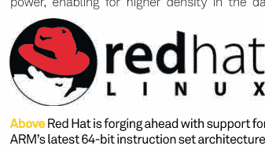

#### 自由软件

##### FSF 与 Debian 合作建立自由硬件数据库

自由软件基金会（Free Software Foundation）和 Debian 项目已携手合作，扩展并增强 h-node，这是一个可以在 Linux 下使用且无需任何专有软件或固件的硬件数据库。

“通过与 h-node 合作，Debian 首次有机会与其他自由软件社区共同努力，建立一个数据库，该数据库中的硬件在不依赖 Debian 主存档之外的任何内容的情况下即可工作，”Debian 项目负责人 Lucas Nussbaum 解释道，此举将看到 FSF 提供基础设施和支持。

此前，Debian 用户因存在非自由软件库而不被允许向该数据库贡献。

该合作将看到 h-node 接受 Debian 用户的贡献，前提是他们仅使用默认的自由软件库进行测试。

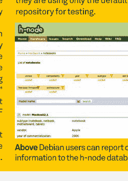

##### Mozilla Labs 关闭

> “我不认为 Labs 是有效的，” Ian Bicking 说

Mozilla Labs，Mozilla 公司的一个智囊团和软件开发小组，已经关闭，其许多前成员转而加入了 Mozilla 基金会。

被用于研究和开发，Mozilla Labs 曾经是各种项目的家园，从基于 JavaScript 的浏览器内 PDF 查看器 PDF.js 到 Tornado Web 跨平台媒体播放器。该网站的一些项目，包括开放徽章计划（Open Badges Initiative）和上述 PDF.js，取得了巨大的成功；其他项目则不然。

本月，前 Mozilla Labs 员工 Ian Bicking 在其博客上发表文章，确认该部门已被正式关闭，在此之前 Mozilla 本身并未宣布此事。

“这有点难以判断——我想我们实际上并没有关闭任何东西，虽然内部有公告，但外界完全不清楚，”他解释道。“但 Mozilla Labs 确实已经关闭了。我理解关闭 Mozilla Labs 的原因。我不认为 Labs 是有效的 [并且] 我在其中并不有效，”Bicking 补充道，同时澄清 Mozilla Research 仍然非常活跃，它更侧重于基础网络技术，而不是像其姊妹组那样侧重于软件开发。

Mozilla 随后确认了该部门的静悄悄关闭，称其于今年二月正式关闭，未发布公开通知。Mozilla 的 Andreas Gal 向网站 i-programmer.info 谈及此变动：“我们将 Mozilla Labs 的人员更紧密地整合到产品团队中，而不是将 Mozilla Labs 维持为一个独立团队…… 这使得每个团队能够更好地为其产品资助研究和创新。”

截稿时，Mozilla 尚未修改 Labs 网站 (https://mozillalabs.com/en-US) 以表明其已关闭的状态。


##### NHS 采用开放平台数据库

> Spine2 系统基于 Ubuntu core 上线，取代了十年前的前身系统

英国国家医疗服务体系（NHS）已使其 Spine2 患者记录数据库和消息系统上线，用完全开源的软件栈取代了其专有的 Oracle 前身。

早在 2013 年首次宣布，Spine2 使用一系列流行的开源包来驱动这个巨大的数据库：Ubuntu 搭配 HA Proxy、nginx、Puppet、Mustache、Flask、Python、Redis、RabbitMQ 和 Tornado，以及 Riak 以确保数据持久性。该系统使用英特尔 Xeon 处理器在多个数据中心的商用服务器上进行扩展。

“我们利用了最新技术重建了 NHS 最重要的电子系统，该系统建于十年前，如今每天都有数千名医务人员和患者依赖它，”该项目的健康与社会护理信息中心（HSIOC）首席执行官 Andy Williams 自豪地表示。“同等重要的是 [我们] 确保了物有所值：通过内部化该系统，日常运行成本预计将大幅下降。”

“重建如此庞大且不可或缺的系统是一个巨大的挑战，尤其是在确保超过 20,000 个组织和数千名依赖该系统的人员在过渡期间能够继续以最少干扰访问 Spine。我很高兴 HSIOC，在多个其他组织的承诺支持下，实现了这一目标。”

Spine2 项目得到了商业伙伴 BUSS 和 Basho 的支持，代表了迄今为止英国政府部署开源软件栈的规模之一。计划在未来一年内为该系统增加新的附加功能，其中包括一个专注于儿童保护的信息共享应用程序。


8 www.linuxuser.co.uk


#### 开源

###### 嵌入式
###### Intel 发布 Edison
##### 双处理器设计瞄准嵌入式市场

**Intel 正式发布了其 Edison 嵌入式计算模块，该模块最早于今年早些时候在开发大会上亮相。**

与最初的 Edison 设计不同，最终零售版摒弃了 SD 卡布局，转而采用一种自定义设计，尺寸甚至不大于一个邮票。尽管体积小巧，该模块却包含了一颗 500MHz 双核 Atom 处理器和一颗 100MHz 单核 Quark 芯片（可用作微控制器）。此外，它还配备了 1GB 内存、4GB eMMC 存储以及 802.11a/b/g/n 和 Bluetooth 4.0 无线电模块。

该模块预装了 Yocto Project 版本的 Linux，并支持在 Quark 上运行 Arduino 代码，这与 Intel 之前推出的创客主题开发板 Galileo 非常相似。

截至今日发稿，Intel 尚未确认该模块在英国的价格和供货情况。在美国，该模块以 49.95 美元（约合 31 英镑，不含税）的零售价迅速售罄。

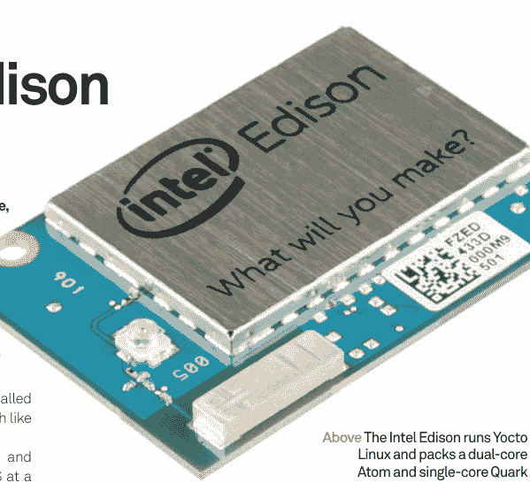

上图 Intel Edison 运行 Yocto Linux，并搭载了双核 Atom 和单核 Quark 处理器

##### 甲骨文
###### Larry Ellison 辞去 Oracle CEO 职务
###### 新头衔难以改变其对公司的实际影响力

**Larry Ellison 宣布，在任职 37 年后，他将辞去世他共同创立的 Oracle 公司的首席执行官职务。**然而，他并不会离开公司，而是将兼任董事长和首席技术官两个职位——这让许多人都很好奇，他的实际影响力是否真的会减弱。

Ellison 将由 Mark Hurd 和 Safra Catz 接替，两人在公告发布前是公司联席总裁，现即将获得联席首席执行官的头衔。“我将继续过去几年一直在做的事情，[Hurd 和 Catz] 也将继续过去几年一直在做的事情，”Ellison 在宣布这一变动的电话会议上解释道。“Mark 和 Safra 表现出色，我认为他们配得上新头衔的认可。”在同一次会议上，Catz 补充说，这一变动很大程度上只是礼仪性的。“我想确保大家非常、非常清楚。实际上不会有任何变化，”她在电话中表示。“没有任何变化。”

预计此次高管重组不会对 Oracle Linux 产生影响，Oracle Linux 是该公司基于 Red Hat Enterprise Linux 自行开发的发行版，最初于 2006 年发布。


我们将分享我们的知识来提升您的知识。
100% 的客户端都将我们的 PostgreSQL 培训课程评为优秀。预订您的位置，获取无与伦比的核心代码知识。

+44 (0)870 766 7756
2ndquadrant.com/knowledge

### 竞赛

www.linuxuser.co.uk
获取最新新闻和观点 请直接联系我们... linuxuser@imagine-publishing.co.uk

#### 赢取价值 750+ 英镑的树莓派奖品

#### 赢取 FUZE

FUZE 是树莓派与经典 BBC Micro 的现代融合，是一款旨在教导用户如何编程硬件和软件的 programmable 计算机及电子工作站。树莓派位于键盘正上方，并且 FUZE IO 板上有空间添加扩展板，这使得使用树莓派的 GPIO 端口变得更加容易。FUZE 预装了 FUZE BASIC、Python 和 Scratch，并提供 PDF 项目卡片供您入门。

我们将送出 5 台 FUZE —— 想要中奖机会，您只需要发送您最好的 FUZE BASIC 项目（详情见下方竞赛链接）。想了解更多关于 FUZE BASIC 的信息，请翻到第 68 页。

-   一等奖：FUZE 12-R（带机械臂，价值 £229.99）
-   二等奖：FUZE 12-A（价值 £179.99）
-   优胜奖：3 台 FUZE12-C（价值 £89.99）


投稿截止日期：2014 年 12 月 5 日
www.linuxuser.co.uk/news/win-a-fuze

#### 赢取 BITSCOPE MICRO

BitScope Micro 是一款口袋大小的示波器，同时还可作为波形和时钟发生器，以及频谱和逻辑分析仪。如果您 serious about 电子学，这是一件必备工具，因为您可以使用 BitScope 观察、测量和分析信号电压，甚至同时捕获数字和模拟信号。它还可以使用 C/C++、Python 和 Pascal 进行用户编程，以便集成到任何项目中，无论是工程、科学研究、教育还是周末的硬件黑客活动。它还能在高温或潮湿的野外环境中工作，使其非常适合技术户外项目，甚至可以安装在无人机上（它仅重 12 克）。

在第 30 页了解如何在 Pi 上使用 BitScope Micro，并点击下方链接参加竞赛以赢取它。

-   奖品：BitScope Micro B505（价值 £88.60）

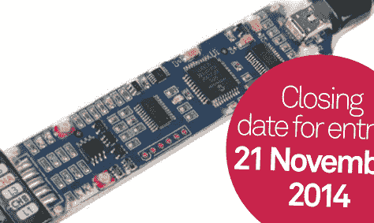

投稿截止日期：2014 年 11 月 21 日
www.linuxuser.co.uk/news/win-a-bitscope

条款与细则

要提交您的参赛作品，请前往上方提供的网址并按照说明操作。BitScope 竞赛的截止日期为 2014 年 11 月 21 日，奖品为 BitScope Micro B505。FUZE 竞赛的截止日期为 2014 年 12 月 5 日，奖品包括：第一名获 FUZE 12-R，第二名获 FUZE 12-A，三名优胜者各获 FUZE 12-C。请注意，参赛作品必须通过上述网址提交。Imagine Publishing 有权用价值相同或更高的类似物品替代奖品。Imagine Publishing 的员工（包括自由撰稿人）、其亲属或任何代理人均不具备参赛资格。编辑的决定是最终的，且不接受相关信函。奖品不可兑换现金。完整条款与细则可按需索取。Imagine Publishing 或其代理人可能会不时向您发送相关材料或特别优惠。

## 专属于我的业务

**全天候 24/7 英国专家支持**
**英国数据中心**
**99.99% 正常运行时间保证**

### 让企业专注其最擅长的事

通过 Fasthosts 的 Professional Series 专用服务器系列，让您的业务占据优势。

保证 99.99% 正常运行时间，SSD 技术带来更快性能，大容量存储驱动器，且 **免费** 设置，必有一款服务器适合所有预算和业务需求。

-   完整的远程 KVM 控制
-   无限制带宽
-   最高 128GB 内存
-   新增 cPanel 和 WHM


**专用服务器价格低至：**
**为期 12 个月**
£29.00
每月，不含增值税。正常价格为每月 £39.00，不含增值税
12 个月最短合约期。一次性设置费用 £49.00，不含增值税

致电 **0808 1686 777**
或访问 **fasthosts.co.uk**

服务器 • 网络托管 • 域名 • Exchange 电子邮件


激发更卓越的商业表现

## 免费软件专栏

### 需要付出的代价

对于一家成功的开源公司而言，缺乏流程控制只是在宏观层面上需要支付的一点小代价而已！


Richard Hilllesley 就艺术、音乐、数字版权、Linux 和免费软件为主题，为多家出版物撰稿

开源无处不在，但这一术语常被宽泛地使用。自由和开源软件之所以吸引硬件和软件公司，是因为它似乎是廉价且高效的选项，并能接触到由用户和开发人员组成的社区，他们带来成本降低以及各种来源的高质量输入机会。企业对开源软件开发的参与对开发人员有利，因为这能支付他们的工资，并且如果管理得当，允许他们自由地参与代码工作。但开源的成功并非没有缺点。开源的定义不断被重新划定，有时其含义仅等同于“部分代码对某些利益相关方可见”。例如，开放核心许可（Open core licensing）曾受到一些初创企业和小型开源公司的青睐；这是指核心代码的一部分以开源许可证发布，但代码的关键部分保留专有许可证，这意味着代码的开源部分是不完整的，通常无法运行。开放核心或类似模式在小型软件公司中仍然很常见，尽管很少被如此宣传。它通常辅以双重许可和版权转让制度，开发人员将代码所有权移交给第三方，通常是控股公司。其初衷往往是善意的，但其影响却难以预测。

版权转让可以是合乎伦理的，并能将项目统一在共同监督之下；但也可能被滥用，以施加控制、规避 GPL、通过专利侵权为代码提供赔偿，并随后扭曲开发人员参与开源项目的意图。在过去，版权转让和双重许可是分发像 Qt 和 MySQL 这样的免费产品的有效手段。但自由和开源软件的定义被此类概念松弛得越多，其在传播其理想以及招募使其成功的原因——开发人员和用户——方面的效力就越低。公司并不总是合乎伦理的；毕竟，它们的首要目标是最大化股东的投资回报。只有当开源能扩大利润机会时，它才具有吸引力。公司会在有利可图时合作，但在量化免费软件的回报时往往残酷且有时目光短浅。但这一角色中有值得尊敬的例外：例如，Red Hat 必须坚守其原则。该公司认识到，其作为开源公司的成功在于鼓励开发人员的积极性和自由。Red Hat 通过截取社区项目的快照、测试并重新定义快照以发布为商业产品，然后添加并反馈改进措施，而不是对开发流程施加控制，从而确保开发流程与最终产品之间的分离。Fedora 是一个“前沿”的尖端发行版，Red Hat 对内核和其他社区驱动的项目做出了巨大贡献。该公司并不“拥有”代码，但这并未损害其最终产品。培养社区利益可能对于那些在软件开发和生产建立在闭源模型、高内部开发成本和固定收入流时代的公司来说反直觉。但失去对流程的控制是开源带来的巨大收益所要付出的代价的一部分。Red Hat 正是基于对这一困境双方面的理解，构建了其商业优势。对于免费软件的用户和开发人员来说，问题在于，这种困境往往被转化为妥协。GPL 和 LGPL 可能被社区协议和版权转让条款所削弱，这些条款将代码所有权移交给控股公司，并允许重新许可，从而导致专利条款及其他 copyleft 许可证保护被废弃。免费软件和基于共同利益的合作降低了整个行业的开发成本，这种模式在其他几个行业中也在重演。在这一点上，业界已普遍接受了自由和开源软件的不可避免性。但如果自由和开源软件要保持自由，妥协并不总是可取的。

> “公司在有利可图时会合作，但在量化回报时往往残酷无情”


## 开源初创公司专栏

### 免费还是开放？

依赖开源软件的开发者希望回馈社区，那么初创公司如何平衡这一点与商业压力？


**理查德·斯梅德利**是一位精通 Unix 和网络技术的多面手，专注于自由及开源软件


> 没错！Moltin 是一个电子商务平台，提供 API 以便轻松管理商店和购物车

报纸标题偶尔会提醒我们“英国企业在采用开源方面落后”，但对英国自由软件社区来说，更切中要害的问题是：**企业在回馈方面做了什么？** 初创公司在此处小心翼翼地行走在一条细线上，一边是大多数码农现在所处的开源文化，另一边是背后的投资者要求保护所谓的知识产权（请在 www.gnu.org/philosophy/not-ipr.en.html 阅读更多相关内容）。

一些公司发布的最终产品缺少某些功能，除非你购买非开放版本。另一种替代方案是发布帮助你构建项目的工具和平台——例如 Rails，它源自 Basecamp。这里的一个好例子是 Moltin，一家位于纽卡斯尔的初创公司，加入了 Ignite100 初创加速器项目，它提供用于构建电商网站 的 API 和 SDK，旨在消除开发者在使用当前解决方案时所感受到的痛苦。

“我们希望向开发者提供一组组件，让他们能够创建简单的商店，同时在我们的商业服务中提供更复杂的方面，”Moltin 联合创始人 Adam Sturrock 告诉我们。来自与另一位联合创始人 Jamie Holroyd 一起在一家网络代理公司从事电商软件开发的挫败感，这款软件很大程度上是由填补用户空缺的需求驱动的，但许可决策则是商业驱动的：“我们花了一段时间思考什么对我们有意义——哪些应该作为开源发布，哪些应该保留在内部，最终我们认为我们达成了良好的平衡。展望未来，我们有几个额外的项目和工具，我们将考虑将其开源。”

Moltin 发布了处理身份验证过程的开源 PHP 和 JavaScript SDK，“使开发者能够更快地开始调用 API”，Sturrock 这样描述他们在 Github 页面和 packageist.org 上提供的一些软件。

这种回馈开发者社区，而不是完全承诺自由软件的模式，可以在整个 Web 开发者社区中看到，随意浏览 Github 可以看到大量供开发者使用的 Ruby 和 JS 工具，以及 PHP 库。“我们的管理仪表板是使用我们的 PHP SDK、Slim PHP 框架和 Twig 模板引擎构建的，”Sturrock 说。

“我们旨在近期将此开源，供开发人员和代理机构改进、贴牌和定制。

我们还使用我们的 SDK 构建了许多工具，以帮助通过 AngularJS 驱动的商店和类似我们管理仪表板的 PHP 前端框架进一步加快开发启动。” 当然，它也有一些优势：“我们往往从用户那里获得广泛的贡献，从修复拼写错误到修复 bug 以及添加/增强功能。

我们还收到针对我们每个软件包的大量功能请求，我们评估哪些对每个人使用都有意义，尽量避免添加使用案例狭窄的功能。”

正如我们上个月提到的，如果没有自由和开源软件，初创公司所做的很多事情将根本不可能实现。“我们的 REST API 使用 OAuth 2.0 来验证请求，”Sturrock 说。“我们的 API 后端是使用许多开源项目构建的。后端是用 PHP Laravel 框架编写的，我们的数据库运行 PostgreSQL 和 Redis。这意味着我们的 API 与基础设施无关，我们可以从任何地方托管和运行，包括我们的本地机器到多服务器配置”。

下个月，我们将探讨 GNU/Linux 和 FOSS 在一些财务上更成功的知名科技初创公司中的定位。

## 乔恩·马斯特斯

### 内核专栏

乔恩·马斯特斯向我们介绍了内核在最新的 Shellshock 安全漏洞中的作用，并总结了内核社区为最终 3.17 版本所做的工作


**乔恩·马斯特斯**是一位 Linux 内核黑客，自 13 岁第一次上大学以来，他已在 Linux 上工作约 19 年。乔恩住在马萨诸塞州剑桥市，并为一家大型企业 Linux 供应商工作。他在 [kernelpodcast.org](kernelpodcast.org) 上发布每日 Linux 内核邮件列表摘要

#### Linux 内核是否“shellshocked”（遭遇 shellshock）？

Bash (Bourne Again SHell) 中最近的一个安全漏洞让所有人都开始谈论“shellshocked”。

把 Bash 想到头条新闻上有些奇怪，但这正是我们生活的世界。当 Bash 不是登上《*纽约时报*》头条时，它只是一个谦逊（但几乎无处不在）的 shell，最常体验为运行终端仿真程序（通过点击 Terminal 应用程序图标）时生成的熟悉的 Linux 或 Mac OS X 命令行界面。但 Bash 也常常是 /bin/sh 背后的 shell（这通常是指向 bash 可执行文件的符号链接），因此对请求 Web 服务器运行（例如）CGI 脚本的远程用户可用。

Bash 中的具体安全漏洞相当直接。多年前，一个错误的函数声明解析机制被意外引入 Bash，导致它未能解析通过进程环境传递进来的函数声明。像任何其他应用程序一样，运行中的 Bash 实例具有 Unix 进程环境，可以使用 'env' 命令查看或修改。

环境是一个位于进程整体地址空间内的任意大小的线性内存数组。它定义在内核的 'mm' 结构体中，该结构体是进程的一部分（在内核中称为 'task'），并通过内核代码使用诸如 current->mm->env_start 之类的宏访问（这将返回指向当前运行程序的环境的指针）。内核参与最初设置环境，作为 binitf/elf 代码的一部分，该代码设置可执行和链接格式 (ELF) 可执行文件，如 Bash。

进程的环境（在 env_start 和 env_end 之间）通过一个全局变量（extern char **environ）对用户空间可见，

以及通过文件 /proc/self/environ，如果你有合适的权限（例如 root）来读取另一个进程的环境，就可以用另一个进程 ID 替换 'self'。'env' 实用工具（在大多数发行版中是 'coreutils' Linux 包的一部分）只是从全局 Unix environ 变量中读取字符串数组并显示它们。这些字符串具有声明形式，如 "HOME=/home/jcm" 中可见的那样，被称为“环境变量”。各种工具，如 Bash shell，也会在启动时读取这些条目，并根据这些变量设置各种内部状态。环境变量可以包含函数声明（如 "\_x=() { :}”，它定义了一个名为 "\_x" 且不执行任何操作的函数），并且这些可以通过使用 "export -f \_x" 命令导出到后续命令。通常，此命令只会使环境获得一个 "\_x=() { :}" 条目，但除了使用 "export"，还有其他设置进程环境的方法，例如直接使用 'env' 命令。这引出了现在著名的漏洞测试代码：

env \_x=() { :}; echo "vulnerable" bash -c :

```
env \_x=() { :}; echo "vulnerable" bash -c :
```

第二个 Bash 进程被传入了名为 "\_x" 的函数，但在解析 "\_x" 函数环境变量的过程中错误地执行了附加在末尾的 'echo 'vulnerable'' 命令。实际上，如果你去掉该行的末尾的 ":" 并允许第二个 shell 保持运行，你会注意到 'env' 命令没有显示任何异常（因为它也没有正确解析内容）。然而，运行 "cat /proc/$$/environ" 以显示内核直接报告的环境将显示 "echo 'vulnerable'" 的附录。较新的固定版本的 Bash 改进了解析，并且为导出的函数添加了新的 "BASH_FUNC_" 前缀。但内核

Linux 几个月前刚满 23 岁，正好赶上 3.17 内核开发周期的尾声。事实上，第 5 个候选版本几乎在 Linux 生日时发布，但 Linus 决定不这样做，因为他不是一个“过于 sentimental 的人，所以很明确”。确实，在某些方面，这是一个更安静的周期，Linus 曾考虑让 RC6 成为最终的候选版本。最终他确实发布了“是的，又一个 rc”（RC7），因为“方便”（针对他的旅行日程）并不是发布标准的一部分。我们将在下一期中提供 Linux 3.17 的完整摘要。


### 观点

内核专栏 — Jon Masters

#### 开源

开源继续发挥着它的作用，在将环境从一个任务传递给另一个任务的过程中，它从未仅仅充当过旁观者。

#### 正在进行的开发

关于非阻塞文件读取主题的一个有趣讨论串，最初的主题是“仅从页面缓存进行 read()/read()”。Linux 页面缓存是一个内存数据结构，包含数据页（磁盘文件的片段，在该上下文中也称为“节点”），这些页代表之前已被读入内存的文件部分，并且（至少暂时）有充足的剩余 RAM 来保留一份缓存副本，以便应对即将发生的重复访问。仅从页面缓存读取文件数据的想法是，文件读取操作往往会阻塞非常长的时间（毫秒级）；对于低延迟或实时系统来说，这足以破坏任何形式的确定性。通常，专用实时系统会出于这些原因对数据存储采取预防措施。但有些人希望使用通用文件系统，并简单地利用页面缓存的存在，从而允许对每个请求控制读取操作是否阻塞（如果数据之前未在其中缓存）。

为 POWER8 架构支持发布了新的补丁，包括 CPU 类型本身的选择，以及通过 gtrace API 在调试时控制特定进程使用的 Transactional Memory（事务内存）硬件支持属性的功能。事务内存是一个非常出色的功能，许多架构正在增加对其的支持（最近的 x86 芯片内置了这一功能）。它允许将一系列内存操作作为一个单元来处理，该单元要么完全（原子性地）完成，要么完全不执行。它通常用于实现各种高性能临界区，以替代传统的锁（因此 Intel 在其实现中使用术语 Transactional Synchronization Extensions 或“TSX”），通常是通过将整体事务的大小限制为 L1 缓存行宽度的倍数，并使用缓存组织技巧来实现。

社区举办的 Linux 管道工会议（Linux Plumbers Conference）正在为其 2015 年活动招募组织者。

LPC 同时与 Linux 基金会活动（如 LinuxCon）同时举办，并在 Linux 基金会技术指导委员会（TAB）的总体技术指导下进行。新的 TAB 于本月宣布，此前在今年芝加哥举办的 LinuxCon 上举行了新选举（完整披露：本文作者被提名参选，但因故缺席）；目前正在寻求协助组织将在西雅图举行的活动。新的 TAB 见证了几位长期成员的离去，并新增了少数几张新面孔，包括新任主席 Grant Likely。令人特别欣慰的是，这十人组成的 TAB 现在有两位女性成员（随着 Kristen Accardi 加入 Sarah Sharp）。当然，这还远远不够，但这至少是朝着正确方向发展的一个令人欢迎的趋势。

最后，本月最近发布了一个补丁，该补丁启用了即将发布的 GCC 5 的支持。对于那些对尝试新且新颖的编译器感兴趣的人来说，这绝对值得关注。

> “几十年前，一个 bug 被意外引入了 Bash 中”


### Ubuntu 十周年

回顾历史，庆祝该发行版的生日


#### 专题


#### 通过回顾 Ubuntu 及其推动者和变革者，我们庆祝该发行版十周年

今年这个月的十年前，一个看似不起眼的、昵称为 Warty Warthog 的发行版出现在 Linux 领域，并引发了一场文化滑坡，使 Linux 从典型操作系统的阴影中崛起，并在 2014 年成为一个家喻户晓的名字。自 2004 年 10 月以来，Warty Warthog 经历了多种形态的演变，成为 Ubuntu 的最新版本 Utopic Unicorn。

作为变革的催化剂，Ubuntu 在其辉煌的十年中取得了巨大成就。它开创了开箱即用的 Linux 操作系统理念，无需手动排查故障和配置硬件。它普及了我们在当今大多数发行版安装中使用的图形界面，使其更易用、更易于使用，同时也普及了许多人依赖其主要计算机的长期支持（LTS）版本。它因对桌面和移动操作系统未来的观点而引发了尖锐的意见分歧，预测了融合趋势，并大胆地参与了铺路工作。

两种力量正在推动 Ubuntu 前进，它们共同使得 Linux 在公众视野中获得了一定程度的成功，这是非常少其他发行版所达到的：Canonical 的领导和 Ubuntu 社区。

两者之间的关系是开源公司如何与最终用户合作以可靠交付他们所需内容的典范模型。Ubuntu 贡献者知道他们的声音被 Canonical 团队领导所听取，开发过程极其民主，同时足够严格，以遵守 Ubuntu 严格的发布日程和 LTS 承诺。这是一种微妙的平衡，Canonical 巧妙地达成了平衡，每年生产两次高质量的 Linux 发行版。

今天，我们回顾 Ubuntu 的十年历程，庆祝那些让它成为现实的开发者和贡献者的成就——并展望未来，看看我们将去向何方。

- **Jane Silber**
  *首席执行官*
  Jane 在最初的 Ubuntu 发布之前加入 Canonical，担任首席运营官。她参与了多个 Canonical 项目，并具有 C 和 C++ 编程背景。

- **Martin Pitt**
  *软件工程师*
  Martin 在加入首批 Ubuntu 开发者之前，曾是一位多产的 Linux 开发者长达七年。他现在从事基础架构层的工作，但过去为发行版做得更多。

- **Alan Pope**
  *应用程序项目经理*
  作为 Linux 社区的老手，Alan 曾经是 Launchpad 上的技术支持志愿者。现在，他协调社区工作，为 Ubuntu 手机开发核心应用。

- **Richard Collins**
  *移动产品经理*
  Richard 负责 Ubuntu 的移动方面。在加入 Canonical 之前，他通过多年在 Symbian 基金会的工作，已经拥有移动领域的背景。

### 首个 Ubuntu

Warty Warthog 于 2004 年 10 月 20 日发布，当时的 Linux 世界与今天大不相同

最初的 Ubuntu 桌面版本几乎没有品牌标识。你可以看到它使用 GNOME 2 作为首选桌面环境

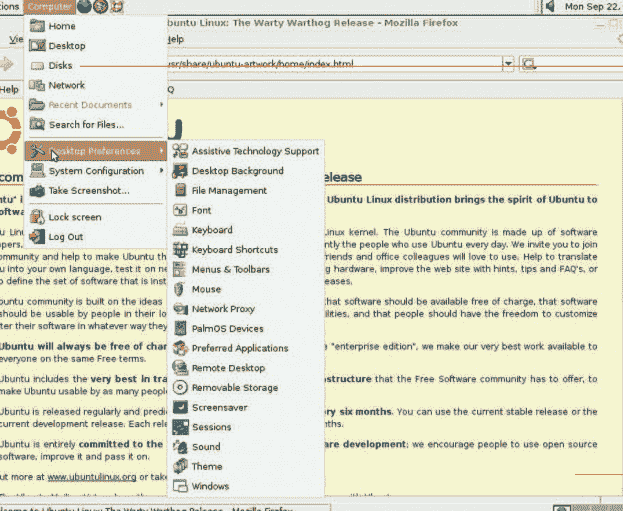

Ubuntu 是首批自动挂载闪存驱动的发行版之一，但你仍然可以用——现在字面意义上的——老式方法来做

最初的 Ubuntu 附带了一些默认应用程序，看起来像是开源历史的一个切片。GIMP 只是一个例子

和今天一样，Warty Warthog 附带了 Mozilla Firefox，尽管当时它是该浏览器最早的形式之一

那是 2004 年 2 月，这是一个与我们今天所知的非常不同的世界。Windows XP 是微软最新的桌面操作系统。Apple 硬件仍在运行 PowerPC。BlackBerry 和 PDA 主导智能手机市场，x64 芯片刚刚开始进入市场。Linux 在开发者圈子之外几乎不在时代潮流之中，但这种情况很快就会改变。

“我是当时 Mark Shuttleworth 打电话回的第一批人之一，”软件工程师 Martin Pitt 说，他在 Linux 桌面即将发生重大革命的开始时就在那里。“他给我发了一封电子邮件，解释了他关于做一个基于 Debian 的 Linux 项目的想法，该项目具有定期的发布周期，同时也面向用户友好。”

“这是 Ubuntu 4.10 开发的开始，代码名为 Warty Warthog，也是 Canonical 本身的开始。当时，Linux 桌面非常不同。没有图形安装程序，没有面向用户的发行版普及，也几乎没有推动‘普通人’开始使用 Linux。”

“Canonical 和 Ubuntu 于 2004 年 4 月正式启动，”Canonical CEO Jane Silver 补充道。“[Mark] 召集了大约十个人，怀着创建 Ubuntu 的愿景……我在几个月后的七月遇到了他，立刻相信了 Ubuntu 和 Canonical 的愿景。”

Jane 后来作为该公司的首席运营官加入，经过几个月的开发，第一个 Ubuntu 于 2004 年 10 月 20 日发布。不过，Martin 解释说，该发布的普及有点缓慢：


**2004 年 10 月 20 日**

#### 在最初……

Ubuntu 4.10 Warty Warthog 发布。基于 Debian testing，使用 GNOME 桌面环境，它是一个稳固的首次发布。它不是一夜之间 sensation，但它发现了一群忠实的用户。

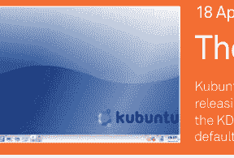

**2005 年 4 月 18 日**

#### 第一个衍生版

Kubuntu 是 Ubuntu 的第一个替代风味，在 Ubuntu 发布后不久发布，提供 KDE 桌面环境，而非 Ubuntu 默认的 GNOME。


### Ubuntu 10 周年

回顾历史，庆祝该发行版的生日

#### 专题特写

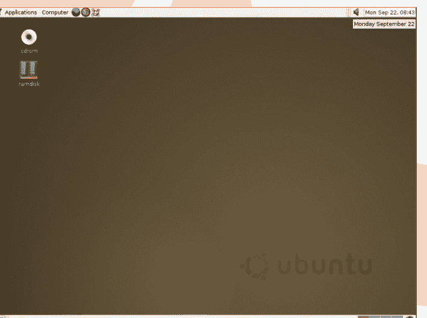

左图：那个时期基础的 GNOME 桌面。实况光盘和安装光盘曾经是两个独立的映像。

#### Linux 的现状

Alan 为我们生动描述了 2004 年 Linux 的处境。

> “当时我有一台飞利浦网络摄像头；在 Red Hat 和 Debian 上它都存在一些问题，我经常不得不重新编译我的内核。那似乎就是当时人们做的事情。某个功能不起作用，你就会去获取内核源代码，然后运行一些晦涩不明的命令，这些命令可能有效也可能无效，且可能耗时很长；最终你得到的内核可能能用也可能不能用。它可能甚至无法启动，即使启动了，你的摄像头也可能工作，也可能不工作。我安装了 Ubuntu，我的摄像头开箱即用。我不必做任何事情，我认为这必然是未来的方向。”

#### 在第一个测试版之前的开发过程相对保密

“老实说，当时主要还是由开发人员在进行开发，因此最初的报道热度相当低。我曾为一些著名的德国计算机新闻杂志撰稿，起初他们说：‘是的，这只是又一个发行版——我们为什么要报道它？’”

在第一个测试版之前的开发过程相对保密，虽然第一个版本可能“仅”吸引了几千名用户，但其名字在整个 Linux 和开源社区中开始声名鹊起。

“当时我在汉普郡的本地 Linux 用户组，我的一位朋友知道我非常热衷于 Debian，”应用项目经理 Alan Pope 回忆道，“他提到了这个东西，这个由某个疯狂的南非人开发的新事物。因为我并不订阅任何 Debian 邮件列表，也不真正参与 Debian 社区或相关事务，所以我之前从未听说过它。但它看起来很漂亮，于是我安装了它。那是 2004 年末，从那以后——我就一直稳固地使用它至今。”

尽管当时只是一个小型发布版本，4.10 版留下的遗产却是巨大的。它相对容易安装，从一开始就提供了一个预配置的桌面，并能自动挂载闪存存储。这些特性后来得到了极大的扩展。

开发人员为他们的作品感到自豪，5.04 版很快进入了开发阶段。接下来的两年对 Ubuntu 至关重要，并使其在用户和开发人员中均成为家喻户晓的名字。


上图：带有原始标志的原始启动画面。多年来，Ubuntu 对橙色的偏好变化不大。

#### 2005 年 7 月 8 日：Ubuntu 基金会

由创始人 Mark Shuttleworth 创立，Ubuntu 基金会是一个信托基金，旨在确保该发行版的未来。目前它处于休眠状态，但 Canonical 计划如有必要将其作为紧急基金使用。

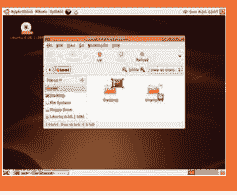

#### 2006 年 6 月 1 日：首个 LTS 版本发布

Ubuntu 最初的长期支持（LTS）版本比原定的 4 月发布日期推迟了几个月，但它的发布标志着 Ubuntu 受欢迎程度发生了一个转折点。

### 早期岁月

Ubuntu 在 21 世纪 00 年代后期的迅速崛起在 Linux 桌面领域引发了一场小革命。

在接下来的几年里，一些事情开始发生。Kubuntu 5.04 在下一个周期中发布，并至今仍作为 Ubuntu 的主要衍生版本之一被发布。随着每个版本的推出，功能不断增加，Ubuntu 缓慢但确定地赢得了人气。

“很难说，因为它的增长一直是指数级的，”当我们问 Martin 哪个版本真正让 Ubuntu 在桌面 Linux 市场站稳脚跟时，他告诉我们。“但如果我必须选一个，那就是我们的第一个 LTS，6.06 Dapper Drake。它被明确宣布为长期支持版本，我们在稳定化方面付出了特别的努力。它也是第一个拥有图形化安装程序版本，因此操作变得更加容易。”


上图：Unity 的第一个版本与今天的样子大不相同。

迄今为止，6.06 版是唯一一个未在 4 月或 10 月发布的 Ubuntu 版本，在推迟近两个月于 6 月 1 日发布后，获得了 .06 的后缀。桌面版支持持续了三年，服务器版支持持续了五年，这种做法随后在 LTS 发布中被停止，目前桌面版和服务器版均获得五年的支持。

随着人气上升，一个由用户和开发人员组成的新兴社区应运而生。Alan 从一开始就是该社区的一部分，他在工作中自由时间通过 Launchpad 回答人们的问题，并向我们描述了社区的演变。

“在最初阶段，活跃的贡献者是那些在引导搭建基础架构的人，例如建立 IRC 频道和邮件列表。这一切都是由拥有特定专业知识的人完成的，比如整天坐在 IRC 上创建 Ubuntu IRC 频道的人。还有熟悉邮件列表的人负责建立邮件列表，了解论坛软件的人则负责建立论坛。在早期，它有些缺乏结构——但这很棒，因为我们需要所有这些功能，且这是一个高度自我驱动、自我激励的过程。


上图：Xubuntu 作为 2006 年早期的轻量级衍生版本之一开始出现。

> “一旦我们克服了创建初始基础设施的障碍，更多人就能做出贡献”

有人决定‘我们应该有一个论坛’，他们就创建了一个，并变得疯狂流行。因此，一旦我们克服了创建初始基础设施以启动项目的障碍，以及零碎的基础组件，更多人就能做出贡献。那时，来自社区的贡献开始采取更典型的方式，如翻译、报告错误、分类处理、提交补丁以及编写文档。这是人们常做的核心贡献。”

社区一直在成长，现在已成为 Canonical 非常重要的一部分，正如 Jane 告诉我们的那样：

“Ubuntu 的开源社区本质，以及社区与公司之间的合作，是我认为 Canonical 非常独特且有趣的一点。我继续认为，这是我们做得特别出色并持续引领该领域的一个方面。”

#### Ubuntu 时间线


**2009 年 5 月 13 日**
#### Ubuntu One 启动

该云存储服务是同类产品中的先行者之一，最初之所以这样命名，是因为它为所有 Ubuntu 用户提供 1GB 的免费存储空间。它很快作为集成服务进入了桌面系统。

**2010 年 3 月 1 日**
#### 领导层变动

Mark Shuttleworth 辞去了 Canonical 的首席执行官职务，以便更亲近 Canonical 的开发团队。接替他的是 Jane Silber，她当时是首席运营官，至今仍是 Canonical 的首席执行官。

### Ubuntu 10 周年

回顾历史，庆祝该发行版的生日


上图：Ubuntu 论坛上的活跃社区已经存在很长时间了。

自那以后，社区致力于多个 Ubuntu 项目。他们创建了 PDF 格式的手册，将其翻译成不同语言，并启动了一个更好的支持网站，名为 AskUbuntu ([http://askubuntu.com](http://askubuntu.com))。

在接下来的几年里，社区继续增长，Ubuntu 确立了其作为全球最大 Linux 发行版之一，甚至是桌面端最受欢迎发行版的地位。2010 年，统一桌面的宏伟愿景随着 Unity 的发布而开始。

“我第一次看到很像它的东西是在一次 Ubuntu 开发人员峰会上，当时设计团队正在展示新外壳的可能样子，”Alan 回忆道。“我相当早地开始使用它。在过去一年到一年半的时间里，它经历了一段艰难的路。我喜欢它，我享受使用它。”

但并非社区里的每个人都同意 Alan 的看法。“有一些人声音很大，决定这不是给他们准备的，他们不喜欢它，这没关系，”Alan 继续说道。

“我认为在某些方面，它被稍微夸大了，很多人没有意识到的是，Ubuntu 在全球许多硬件上预装出厂，而 Unity 是默认桌面。我没有办法知道那些人回到家是否立即将其移除并安装 KDE 或 Xfce，而且——说实话——我对此并不真的在意。”

确实，正如 Alan 向我们指出的那样，Ubuntu 中有许多不同的桌面环境可供选择，无论是在软件仓库中还是在各种替代衍生版本中。不过，Unity 是 Ubuntu 设计哲学的核心，随着它迈向所有设备更加统一的未来。

#### 各种口味的 Ubuntu


##### Kubuntu

Ubuntu 的第一个主要衍生版本是 Kubuntu，主要区别在于包含了 KDE 桌面。但如今，它由与 KDE 开发相关的第三方赞助。这个美丽的桌面与 Unity 大不相同。


##### Lubuntu

Ubuntu 的轻量级版本，使用 LXDE 桌面以最大化 Ubuntu 可使用的资源量。这对于较旧或性能较低的计算机非常有用，如果你更喜欢简单的界面并希望充分利用你的 CPU，也可以轻松地扩展配置到更强大的机器上。

##### Edubuntu

Ubuntu 的教育衍生版本，支持 LTSP 瘦客户端，使学生可以同时运行完全相同的发行版。它旨在让希望创建计算机实验室或在线教室的教师易于使用。它使用 Unity 和各种有用的开源软件。

**2010 年 10 月 10 日**
#### 首次体验 Unity

Unity 随 Ubuntu 10.10 的上网本版本发布，让用户第一次看到 Canonical 的新桌面环境。这也是上网本版本最后一次发布，随后它合并到了主发行版中。


**2011 年 4 月 28 日**
#### 全民 Unity

11.04 对 Canonical 来说是一个重大版本，因为它开始了公司在 Unity 环境下统一桌面的愿景。基于当时较新的 GNOME 3，11.04 在某种程度上是 GNOME 外壳的替代品。


#### 功能特性

##### 现在与未来

**Unity 和移动端如何塑造 Ubuntu 的未来与面貌**

目前，Ubuntu 的焦点在桌面版和即将发布的 Ubuntu 手机之间分配。Richard Collins，Ubuntu 移动产品经理，自三年前加入 Canonical 以来一直致力于触控操作系统：

> “关于动力源泉、运作方式等想法总是浮现出来。这一切真的源于 Ubuntu for Android，当时我们利用该产品与许多移动制造商和运营商进行沟通。这些关系已经建立，开始思考如何使 Ubuntu 作为代码库真正独特是合理的发展，意味着它可以在不同的形态因子中作为单一代码库有效运行。
>
> “无论行业都在朝这个方向前进，因为你有触控笔记本电脑和大屏幕，所以进化已经开始发生——只是需要一个战略推动，说‘好吧，我们将把手机作为一个完全成熟的严肃商业产品来做。’”

Canonical 没有忘记社区，让他们尽早深度参与开发。

> “我们想要做的一件事是让社区参与手机项目，所以不只是我们生产手机并将其投放市场。我们想让人们参与进来。因此，我们启动了核心应用项目，核心应用是手机上需要的典型应用程序，如时钟或日历。然后还有一些更专业的东西，你可能会觉得它们在手机上有点不搭调，比如终端和文件管理器。我们还有一个天气应用和几个其他应用。所有这些应用都是由社区中的人开发的。

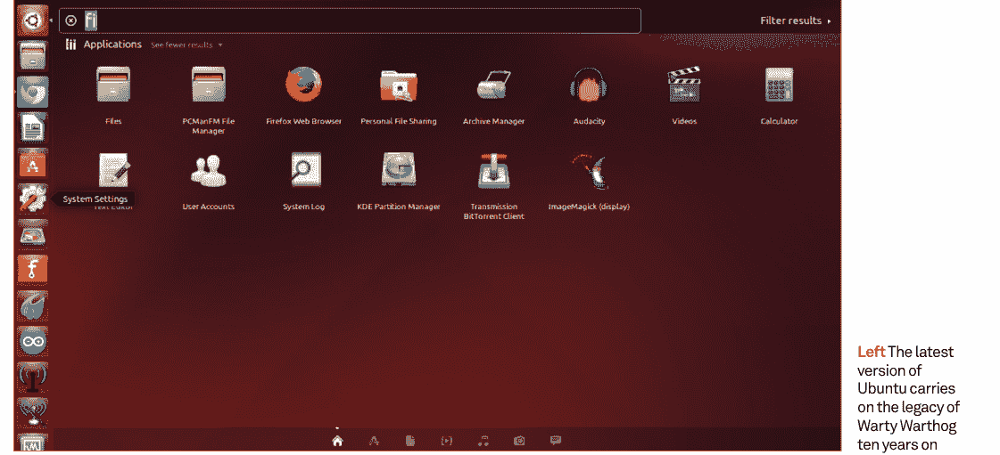

**Ubuntu 时间线**

**2013 年 1 月 2 日：Ubuntu Touch**

在 2013 年的发布会中，Mark Shuttleworth 展示了新的 Ubuntu 移动操作系统。Unity 界面已被缩小以适应触摸屏，并显示出原本承诺的统一环境的迹象。

**2014 年 4 月 17 日：当前 LTS 版本**

14.04 是 Canonical 最近的 Ubuntu 长期支持（LTS）版本，提供五年的支持，这对企业和桌面及服务器用户都有吸引力。它是一个极其稳定的版本，专注于修复错误，而不是新功能。

**Ubuntu 十周年**

回顾历史，庆祝该发行版的生日


> “我认为我们在公司和融入社区意见之间取得了平衡”

> “这些核心应用具体是与 Canonical 设计团队合作完成的，因此设计团队会说‘我们认为时钟应用应该是这样的’，然后他们向我们提供该设计。
>
> “我们在社区中[寻找]那些[愿意]为 Ubuntu 贡献应用的人，果然，我们发现了一大批愿意这样做的人，他们创建了一些将在未来一年左右发布的大量手机中预装的应用。对我来说，这太棒了。他们将能够去商店买一部手机，而他们自己的代码就在那部手机上运行。”

> “规模很大，”Richard 确认了社区的参与。“社区非常热情地拥抱我们所做并宣布的一切。手机上预装的一组应用来自社区，并且还有数百个[应用]人们可以从应用商店下载。”

Richard 还向我们透露了一些关于手机及其开发既定路线图的未具体说明的未来公告。不过，显然，Canonical 和 Ubuntu 的现在与未来在很大程度上归功于帮助其成长的活跃社区成员。当我们就与开源公司合作的问题询问 Jane 时，她对此进行了反思：

> “我认为我们能够在公司和融入社区的意见、工作和热情之间取得很好的平衡。道路并不总是平坦的——[在任何关系或公司中都有]崎岖的部分。我认为这是 Ubuntu 作为发行版最有趣的部分之一，即使我们进入手机和平板电脑世界，以及在服务器端的云领域，我们仍在继续。我认为我们继续保持一种独特的透明度和参与度。”


*上图：Ubuntu Touch 的开发与 Ubuntu for Android 绑定，该项目旨在创建可对接的运行 Ubuntu 的手机*


*上图：这些应用主要由社区与专业设计团队合作构建*

**来自 Jane Silber 的信息**

> “我个人，以及 Canonical 的我们，想感谢在过去十年中参与、工作和与我们庆祝的读者和 Ubuntu 社区成员。显然，没有他们的贡献，我们就不会走到今天。我知道你们的一部分受众（和）开发人员，特别是开发者，继续成为对我们非常重要的受众。我们希望我们继续为他们带来从 Ubuntu 本身、从 Juju 到在云中轻松启动 Ubuntu 镜像的能力，最好的开发平台和开发工具；我们重视这个开发受众，并希望我们也能在未来十年为他们提供尽可能好的工具。”

**再见 Ubuntu One**

**2014 年 7 月 3 日**

五年后，Ubuntu One 最终关闭。由于计算状态的变化，Canonical 认为它不再是他们需求的有效服务。合作伙伴关系是这类应用程序的未来方向。


**Ubuntu 十岁了**

**2014 年 10 月 23 日**

正好在原始 Ubuntu 发布后的十年零三天，14.10 将继续 Warty Warthog 易于使用的 Linux 发行版的传统，尽管现在得益于 Unity 而具有更独特的风格。

**Linux 用户与开发者**

**订阅券**

☑ 是！我想订阅 Linux User & Developer

**您的详细信息**

头衔: ______________________ 名字: _______________________
姓氏: __________________________________________________
地址: __________________________________________________
邮编: ____________________ 国家: ______________________
电话号码: ____________________________________________
手机号码: _______________________________________________
电子邮件地址: _______________________________________________

*请完整填写您的电子邮件地址，以接收我们的新闻和特别优惠*

**直接借记支付**

□ 英国直接借记支付
我仅支付 £18 用于 6 期（节省 50%*）


**付款详情**

您的独家读者价格，一年（13 期）

□ 英国: £62.40（节省 20%）   □ 欧洲: £70.00
□ 世界: £80.00

**支票**
□ 我附上 £__________________________________ 的支票
*(抬头为 Imagine Publishing Ltd)*

**信用卡/借记卡**
□ Visa  □ MasterCard  □ Amex  □ Maestro
卡号: ________________________________________________
到期日: ____________
发卡号: ______  ______  *(如果是 Maestro)*
签名: ____________________________________________________
日期: ____________________

**代码: PAL143Q**

请勾选如果您不希望通过邮寄 □ 或电子邮件 □ 接收来自 Imagine Publishing Ltd 的任何宣传材料
请勾选如果您不希望通过邮寄 □ 或电子邮件 □ 接收来自其他公司的任何宣传材料 请勾选如果您 *希望* 通过电子邮件 □ 接收此类信息

将此订单表返回至：
Linux User & Developer 订阅部，800 Guilford Avenue, Kent Science Park, Sittingbourne, ME9 8GU 或发送至 lu@servicetheip.co.uk
您将能够在线 www.magazinesubs.co.uk 查看您的订阅详情

**赶快！现在订购**

树莓派计算机
升级 - OS 重置及更多
免费下载
加上代码和教程文件

**Linux User & Developer**

750 英镑奖品待赢

**打造超级树莓派**
Qt 模型数据 使用 Qt
虚拟盒子，使用 PUPPET & VAGRANT
HUMMINGBOARD-12EX
Qt
10 个专家教程
Ubuntu 十周年
庆祝 Ubuntu 十周年并重定义未来

**绝佳的订阅优惠**

今天就订阅，节省 50%

- ■ 每期仅支付 £3 - 比商店价节省 50%*
- ■ 英国境内免费送货上门
- ■ 永不错过任何一期
- ■ 退款保证

*条款与条件：价格将在第三次付款时恢复为我们标准的每 6 期 £25.15 的优惠。订阅者可以随时取消此订阅。新订阅将从下一个可用期开始。要获得此特别订阅价格，必须引用优惠代码 PAL143Q。直接借记保证的详情可按需提供。优惠有效期至 2015 年 1 月 31 日。Imagine Publishing 保留限制此类优惠每户仅限一次的权利。*


## 立即订阅，享受 5 折优惠*

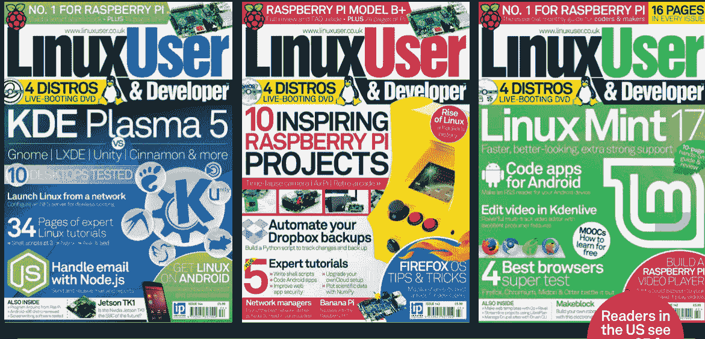

美国读者请查看第 85 页以获取独家优惠

### 三种便捷的订阅方式

1.  **在线**
    www.imaginesubs.co.uk/lud
    并输入 PAL143Q
2.  **电话**
    0844 249 0282
    并告知代码 PAL143Q
3.  **邮寄或电子邮件**
    请填写表格并邮寄至：
    **Linux User & Developer**
    **Subscriptions Department（订阅部）**
    800 Guillat Avenue
    Kent Science Park
    Sittingbourne
    ME9 8GU

    或者，您也可以扫描表格并发送至 lud@servicehelpine.co.uk

---

Vagrant 让您可以轻松构建包含任意开发和部署配置的虚拟机（boxes）。数百个基础镜像已经预制，其他软件也已配置就绪。

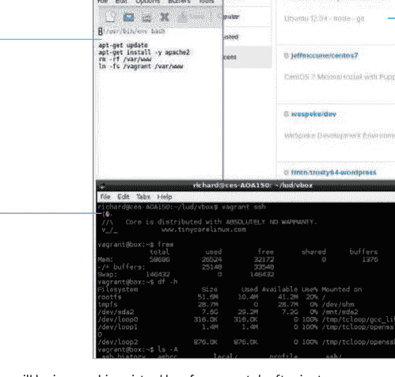
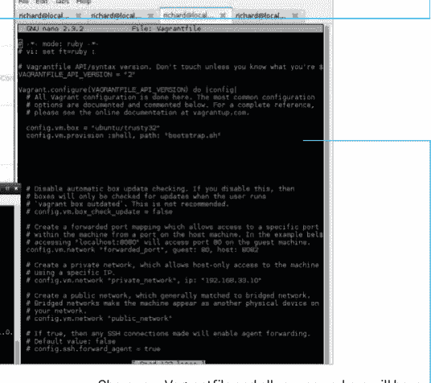

只需三条 vagrant 命令（init、up 和 ssh），你就能从零开始拥有一个可用的虚拟环境。分享你的 Vagrantfile，你的所有同事都将在所有平台上拥有相同的开发环境。

# 使用 Puppet 和 Vagrant 配置虚拟机 – 第一部分

通过使用虚拟机，简化各类服务器应用的开发，并管理新服务器的部署。

## 顾问


**Richard Smedley**
Richard 是一位 Unix 杂家，他在任何语言上花费的时间都不足以真正精通，但他总是保持着一个 shell 窗口开启，从而通过熏陶学会了脚本编写。

#### 资源

- Ruby [ruby-lang.org](http://ruby-lang.org)
- Virtual Box [virtualbox.org](http://virtualbox.org)
- Vagrant [vagrantup.com/downloads](http://vagrantup.com/downloads)

也许“Linux 桌面元年”永远只是传说，但免费和开源软件主导着承载 Web 应用的服务器（boxes），那么我们如何在一个异构环境中为它们进行开发呢？Vagrant 将 VirtualBox 或其他虚拟化软件整合在一起——它支持 Amazon EC2 和 VMware，也能与 Docker 和 OpenVZ 等容器配合使用。它还可以与各种配置工具协作，创建一个易于管理且可移植的开发环境。

它最大的优势在于消除了开发和部署环境之间几乎所有的差异，从而大大减少不必要的错误。随着需求变得复杂，Vagrant 与 Puppet 等配置工具的紧密集成将减轻你的管理负担。

## Puppet 和 Vagrant – 第一部分

### 01 Ruby

虽然 Perl 和 Python 是 Linux 发行版和软件包传统依赖的脚本语言，但 Ruby 是许多 DevOps 和现代 Web 开发环境的首选，而你在学习 Puppet 和 Vagrant 时也将用到 Ruby。

```
ruby -v
```
……这将告诉你是否有安装 Ruby，以及具体是什么版本。本教程至少需要 2.0 版本。

你可以使用 rvm 等工具来轻松管理 PC 上多个版本的 Ruby。

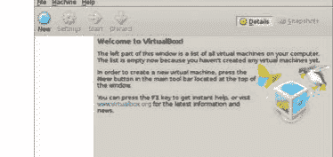

### 02 VirtualBox

如果版本问题的原因是你正在维护一个需要旧版 Ruby 的软件，那么创建一个虚拟机来运行该环境及你的应用程序，就是跟随本教程的一个绝佳理由。既然已经打开了软件包管理器，不妨顺便安装 VirtualBox。

你的发行版可能将功能拆分成了几个独立的软件包，例如图形界面 virtualbox-qt。请确保安装包含内核模块的 virtualbox-dkms 包，以及你所运行内核的头文件（headers）或源码（source），当然也要安装 VirtualBox 本身。

### 03 获取最新版本

现在安装 Vagrant，直接前往 [www.vagrantup.com/downloads](www.vagrantup.com/downloads) – 提供 32 位和 64 位的 RPM 和 Deb 包，下载时浏览器通常会提示你打开软件包管理器。

无需调用软件包管理器——例如使用以下方式手动安装：

```
dpkg -i vagrant_1.6.5_i686.deb
```
……用于在 Ubuntu 或其他基于 Debian 的发行版上安装 32 位包。

对于其他发行版，请从 GitHub 下载并使用 Rake 安装，具体步骤参见 Vagrant 创建者 Mitchell Hashimoto 的 GitHub 页面上的 README：[https://github.com/mitchellh/vagrant](https://github.com/mitchellh/vagrant)。

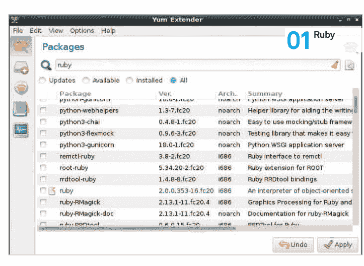

> 在 VagrantCloud 上搜索你搭建环境所需的列表

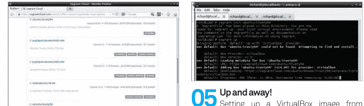

### 04 云资源

你需要一个操作系统镜像，[www.vagrantcloud.com](www.vagrantcloud.com) 和 [www.vagrantbox.es](www.vagrantbox.es) 上有大量可用镜像。你可以在 VagrantCloud 中搜索特定组合的逗号分隔列表，例如 jenkins,centos; wordpress,ubuntu; 或 rails,debian。

你会发现从像 Tiny Core 这样的极简发行版（适合快速下载测试），到像 data-science-toolbox/dst 这样的专业预制系统应有尽有。目前，我们将使用一个基本的 Ubuntu 14.04 环境 – 它可以在 VagrantCloud 上以 32 位和 64 位两种形式获取。

### 05 启动并运行！

从 Vagrant 设置 VirtualBox 镜像非常简单：

```
vagrant init ubuntu/trusty64
vagrant up
```
……这会从 VagrantCloud 下载 Ubuntu 14.04 64 位镜像并启动运行。默认情况下，镜像会保存在 ~/.vagrant.d/machines/ 目录中供后续使用，但你也可以在 VirtualBox 设置中更改此路径。

在大多数最新的发行版上，一切应该都能正常运行，但错误并非罕见，因此我们要快速看看最常见的问题。

##### 教程

### 06 哎呀！

遇到问题？安装时容易忽略正确的内核头文件。检查 `/proc/version`（或运行 `uname -a`）以确定你正在运行的是哪个内核。以下命令的错误信息可能有助于解决问题：

```
VBoxManage --version
```
... 。在一台 Debian 机器上，我们不得不重新编译 `virtualbox-kmods`。在一台 Fedora 测试机上，我们不得不安装对应内核版本的 `kmod-VirtualBox` 软件包，然后运行：

```
sudo systemctl restart systemd-modules-load.service
```
... 这就修复了问题。你可能会发现重启机器是修复问题所必需的。

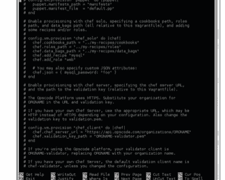

### 07 Vagrantfile

当你运行 `vagrant init` 时，系统会提示你：

一个 `Vagrantfile` 已放置在该目录中。你现在准备好运行第一个虚拟环境了！请阅读 `Vagrantfile` 中的注释以及 `vagrantup.com` 上的文档，以获取更多有关如何使用 Vagrant 的信息。

`Vagrantfile` 是进行所有配置的地方。最初，除了 `config.vm.box` 的值为 `ubuntu/trusty32`（或你在 `vagrant init` 时设置的任何值）外，其他所有内容都被注释掉了。

你可以在不提供值的情况下运行 `vagrant init`，并使用 `vagrant box add` 命令稍后下载你想要的镜像。例如：

### 08 端口转发

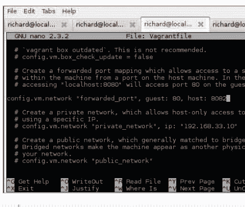

> 基础镜像在使用时保持不变，因此可以在多个项目之间共享

```
vagrant box add outornth/debian-7.4RubyOnRailsDev
```
……然后将其添加到 `Vagrantfile` 中的 `config.vm.box` 指令中。请注意，下载的基镜像在使用时保持不变，因此可以在多个项目之间共享 – 每个项目都会在运行 `vagrant init` 的本地目录中拥有自己的 `Vagrantfile`。

无论你运行的是哪个镜像，设置网络都是必需的 – 你肯定不希望网站只能从本地机器访问！

在 `Vagrantfile` 中，你可以设置一个与你的 VM 和主机设置相匹配的桥接网络，但最简单的网络方式是主机端口转发。你的虚拟镜像上的一个端口（例如 80）被转发到主机机器上的一个未使用端口，从而可以从那里访问：

```
config.vm.network "forwarded_port", guest: 80, host: 8082
```

这进而可以再被转发 – 例如，从主机机器上的 Apache – 和/或在那里匹配到你想要的 URL。

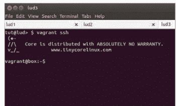

### 09 Shell

对 `Vagrantfile` 的修改可以通过 `vagrant reload` 命令应用到正在运行的服务器上。虽然许多配置可以在你的运行中的服务器外部完成，但 `vagrant ssh` 提供了进入虚拟镜像内部 shell 的重要访问权限。如上图截图所示，Tiny Core 非常适合快速测试 VBox，而相比之下则不如使用 Ubuntu。

别忘了在运行更多 vagrant 命令之前退出 ssh 会话。`Vagrant suspend` 使镜像在几秒钟后通过另一个 `vagrant up` 命令即可恢复就绪状态。`Vagrant destroy` 会删除虚拟机器，但 `Vagrantfile` 允许你重新配置一个完全相同的机器。


## Puppet 与 Vagrant – 第一部分

使用 Puppet 和 Vagrant 配置并部署虚拟机

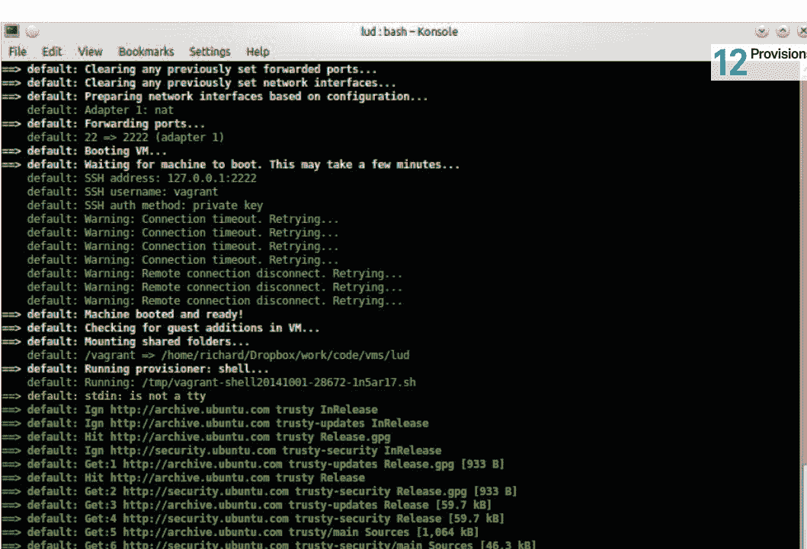

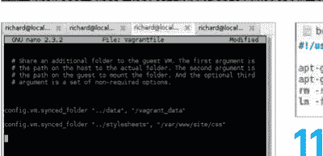

### 10 共享文件

在运行中的虚拟内部所做的更改必须保留；`vagrant halt` 会干净地关闭虚拟机并保存磁盘更改。灵活性来自于能够在主机和虚拟机之间共享文件。

默认情况下，你初始化 Vagrant 虚拟机的目录与该虚拟机共享。在你的 ssh 会话中查看 `Vagrantfile` —— 这就是你之前正在处理的那个 Vagrantfile。

可以通过取消注释 Vagrantfile 中的 `config.vm.synced_folder` 来添加更多共享目录。

### 11 引导

下个月我们将使用 Puppet 来配置和维护我们的虚拟机，但我们不会让你无从下手。这里是如果不使用 Puppet 该如何操作，以便你现在可以开始。

在 `Vagrantfile` 所在的同一目录中创建文件 `bootstrap.sh`。标准示例（用于 Debian 或 Ubuntu 虚拟机）如下：

```bash
#!/usr/bin/env bash

apt-get update
apt-get install -y apache2
rm -rf /var/www
ln -fs /vagrant /var/www
```

注意将 Web 内容链接到 VM 外部共享目录的操作。

### 12 预配置

通过在 `Vagrantfile` 中添加以下内容来调用 `bootstrap.sh` 文件：

```ruby
config.vm.provision :shell, path: "bootstrap.sh"
```

...将其放在 `config.vm.box` 指令下方，然后使用 `vagrant up --provision`。或者，对于已经创建的机器：

```bash
vagrant reload --provision
```

你将在终端上看到 `bootstrap.sh` 中命令的输出：预计会有一些警告消息，但请检查是否有意外情况。

现在，尝试修改你的 `bootstrap.sh` 文件以及尝试不同的发行版镜像。下个月我们将展示随着需求变得更加复杂，Puppet 如何保持系统可维护性。

##### 教程

这是 MRTG 网站，你可以在此找到有关 MRTG 的新闻以及最新版本。

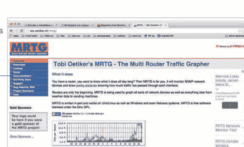

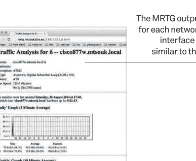

MRTG 对每个网络接口的输出都类似于以下内容。

SNMP 服务器使用各种 SNMP 命令来查询网络设备。

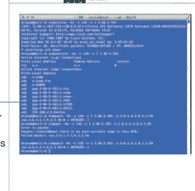

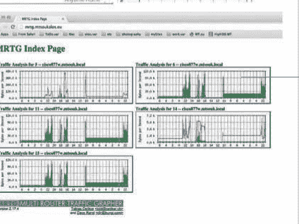

MRTG 拥有一个基于配置文件创建索引页的工具。你可以点击每个图像以查看更多信息。

## 使用 MRTG 监控 Cisco 路由器

在 Cisco IOS 上配置好 SNMP 后，使用 MRTG 及其工具来监控路由器流量。

MRTG (Multi Router Traffic Grapher) 是由 Tobi Oetiker 用 Perl 编写的一个绘制自由数值数据 的工具。MRTG 以 HTML 格式生成其输出，并提供网络设备流量负载的实时视觉表示。MRTG 是每位系统和网络管理员必不可少的工具，可与任何支持 SNMP 的设备配合使用。通过查看 MRTG 的输出，你可以快速检查接口的流量并据此做出有价值的决策。本期我们将向你展示如何借助 SNMP（简单网络管理协议）的些许帮助，使用 MRTG 显示 Cisco 877W 路由器的日常、每周、每月和每年的 ADSL 流量。你需要访问并配置你的 Cisco 路由器，并允许运行 MRTG 的 Linux 机器访问它。

## 顾问


Mihalis Tsoukalos 是一位 UNIX 管理员、程序员（UNIX 和 DOS）、DSA 和数学家。他自 1993 年起使用 Linux。你可以在 Twitter @mcastousk 和 www.mtsoukalos.eu 上联系到他。

#### 资源

- MRTG oss.oetiker.ch/mrtg
- Cisco Mibs cisco.com/public/sw-center/netmgmt/smib/mibs.shtml
- SNMP RFCs bit.ly/CaQ7O
- Cacti cacti.net
- RRDtool oss.oetiker.ch/rrdtool

## 使用 MRTG 监控 Cisco 路由器

开始使用 MRTG 及其工具来监控流量负载。


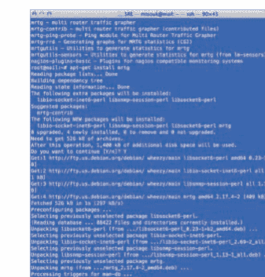

### 01 安装 MRTG

大多数 Linux 发行版都有现成的 MRTG 软件包可供安装使用。MRTG 是一个 Perl 脚本，因此如果你想修改某些内容，可以轻松地对其进行更改。

如果你打算以 Apache 用户的身份运行 MRTG（这是推荐的），你需要首先以 root 身份执行以下操作，假设 Apache 进程的所有者是 www-data 用户（根据你的 Linux 系统调整命令）：

```bash
$ chown www-data:root /var/lock/mrtg
```

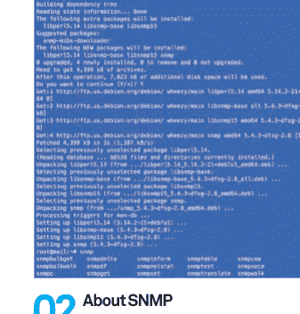

### 02 关于 SNMP

SNMP 是一种众所周知的 TCP/IP 协议，适用于大多数“智能”设备，包括 Linux 和其他 UNIX 机器、路由器、网络交换机、Windows 机器以及许多其他设备。

它提供关于网络接口状态、传入和传出流量、丢弃的数据报和错误消息的统计数据，并允许客户端轻松且远程地访问这些统计数据。

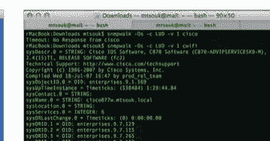

### 03 有用的 SNMP 命令

SNMP 附带许多命令，包括 `snmpbulkget`、`snmpd`、`snmptrap`、`snmpbulkwalk`、`snmpget`、`snmpstatus` 和 `snmpwalk`。其中最有用的是 `snmpwalk` 命令，它使用 SNMP GETNEXT 请求获取值子树。

如果团体字符串名称错误或者设备当前不支持 SNMP，`snmpwalk` 命令的输出将类似于以下内容：

```bash
$ snmpwalk -v 1 -c LUD cwfi
Timeout: No Response from cwfi
```

### 04 配置 MRTG

配置 MRTG 可能是整个过程中最困难的部分 - 特别是当你处理非标准网络设备时，因为你可能会难以找到要查询的正确对象标识符。Cisco 路由器是很流行的设备，因此在 Cisco 网络设备上设置 SNMP 是一个众所周知的过程，但找到正确的对象标识符总是很棘手。

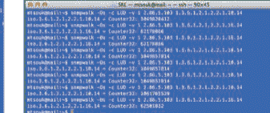

### 05 Cisco IOS

在 Cisco 877W ADSL 路由器上要做的第一件事是开启 SNMP 并创建一个 SNMP 团体字符串，这将帮助你获取所需信息。Cisco IOS 有很多晦涩的命令，所以请仔细输入。

RO（只读）团体字符串（LUD）仅允许 Get 请求，而 RW（读写）团体字符串 - 这里不需要 - 允许 Get 和 Set 请求。

以下命令会产生许多行输出，用于验证名为 Cisco 的路由器上的 SNMP 设置是否正常工作：

```bash
$ snmpwalk -v 1 -c LUD cisco
```

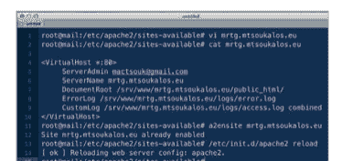

### 06 配置 Apache

你应该设置 Apache，以便你不仅可以本地看到 MRTG 的静态 HTML 输出，还可以从你的网络或互联网上看到。你可以通过使用子域名来实现这一点。这里将使用 mrtg.mtsoukaloos.eu 作为子域名 - 你的可能会不同 - 这需要添加一个新的 DNS 条目。配置 Apache 后，别忘了启用新站点并让 Apache 使用新配置：

```bash
#### a2ensite mrtg.mtsoukaloos.eu
#### /etc/init.d/apache2 reload
```

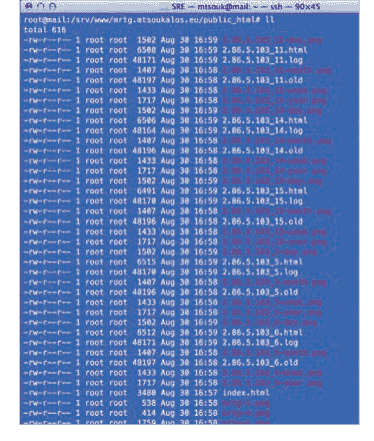

### 07 MRTG 文件和目录

你应该仔细考虑的一件事是，MRTG 存放文件的目录必须具有必要的 UNIX 权限，以便运行 MRTG Cron 任务的用户能够读写。

MRTG 存放文件的目录结构非常简单：它只有一个目录，里面有对应于受支持接口和设备的众多文件。

### 08 cfgmaker 工具

`cfgmaker` MRTG 工具用于轻松创建配置文件。它可能会添加一些你稍后需要清理的无用数据，但它所创建的是一个很好的起点。通常你按如下方式运行它：

```bash
#### cfgmaker --global "WorkDir=/srv/www/mrtg.mtsoukalos.eu/public_html" LUD:2.86.5.103 > mrtg.cfg
```

此命令在当前工作目录中创建 `mrtg.cfg`，使用 `/srv/www/mrtg.mtsoukalos.eu/public_html` 目录来写入输出，并使用 "LUD" 团体字符串查询 IP 地址为 2.86.5.103 的机器。

由 `cfgmaker` 自动生成的 `mrtg.cfg` 文件非常繁杂，因此你将不得不花些时间清理它，只保留真正让你感兴趣的接口。

### 09 indexmaker 工具

在使用 `cfgmaker` 生成 MRTG 配置文件后，你应该创建一个索引 HTML 页面，以便你可以访问 MRTG 的输出。这项任务可以使用随 mrtg 软件包提供的 `indexmaker` 工具来完成，如下所示：

```bash
$ indexmaker mrtg.cfg > index.html
```

现在，你可以将浏览器指向 Apache 中定义的正确 URL 或本地文件（取决于你把 MRTG 的 `index.html` 文件放在哪里），以查看 MRTG 的信息。由于图像文件尚未创建，因此输出将看起来不太美观。

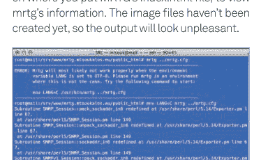

### 10 运行 MRTG

运行 MRTG 有两种方式：手动或作为 Cron 任务。第一种方式适用于测试和调试目的。第二种方式是运行 MRTG 的首选方式。最好以拥有 Apache 进程的用户身份运行 MRTG Cron 任务。以下命令将揭示该用户：

```bash
$ ps aux | grep -i apache
```

第一次运行时，你会看到许多错误和警告消息，这是因为所有输出和数据文件都缺失，MRTG 不得不创建它们。如果一切正常，你的下一个任务将是设置 MRTG 作为 Cron 任务运行。

在 Debian 7 系统上，MRTG 可执行文件需要以 root 身份运行，因为当环境变量 LANG 设置为 UTF-8 时，MRTG 很可能无法正常工作：

```bash
#### env LANG=C mrtg ../mrtg.cfg
```

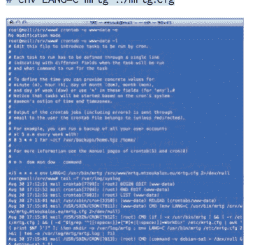

### 11 配置 Cron

为 www-data 用户设置 Cron 需要以 root 身份运行以下命令：

```bash
#### crontab -u www-data -e
```

Cron 是一个可靠的服务，因此一旦你看到 MRTG 作为 Cron 任务运行正常，你就不必担心其他问题了。MRTG 在你运行 `cfgmaker` 工具时定义的目录中生成其 HTML 和图像文件。

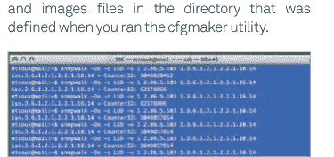

### 12 仔细查看配置文件

对于所用设备而言，感兴趣的 Cisco SNMP OID（对象标识符）是 1.3.6.1.2.1.2.2.10.10.10.14，它返回 ADSL 连接的传入流量，

32
www.linuxuser.co.uk

#### 提示

##### 如果可能，请使用内部接口

每个 ADSL 路由器都有两个 IP 地址：一个用于内部网络，一个用于外部。当可能时，使用内部网络的 IP 来查询你的设备，因为它更安全且速度更快。

##### 不要关闭路由器

如果网络设备被关闭或不可达，MRTG 将使用上一个值，直到它能获取新值，因此你会在输出中看到直线。

##### 安全

观察 MRTG 的输出可以告诉你关于你网络的许多事情，所以将其养成习惯来观察。在周末看到过多流量或有奇怪的峰值是一个安全警告，需要进一步调查。

##### 日志文件包含数据

MRTG 将其 SNMP 数据存放的文件命名为 `.log` 扩展名。例如，对于 cwilf 设备，日志文件名为 `cwilf.log`。

##### 测试最大速度

测试 ADSL 路由器的最大速度被认为是一种良好的实践，方法是下载一个大文件并观察 MRTG 的输出。

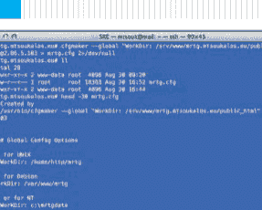


## 使用 MRTG 监控 Cisco 路由器

开始使用 MRTG 及其工具来监控流量负载和 1.3.6.1.2.1.2.2.1.16.14，该值返回 ADSL 连接的出站流量。

在下一步中，您将学习如何自行查找这些值。

为了让 mrtg 跟踪这两个值，您可能需要手动修改 MRTG 配置文件中的 Target[] 行。

**图 01** 中展示了支持仅一台名为 c0wi、IP 为 2.86.19.123 的 Cisco 路由器的最终 mrtg.cfg 文件版本。

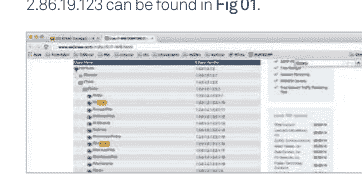

### 13 Cisco SNMP 对象标识符

找到正确的 OID 并不总是容易，有时您可能需要仔细查阅路由器的文档或联系制造商。Wi-Fi 连接由 cfgmaker 实用程序自动找到，但配置 ADSL 部分要复杂一些。要查找您自己的 OID，您需要访问 [https://www.oldview.com/mibs/O/IF-MIB.html](https://www.oldview.com/mibs/O/IF-MIB.html)（在 Google 上搜索“IF MIB download”）。接下来，您应该寻找 In 和 Out Octets。然后在每个序列的末尾添加所需的 Cisco 接口编号。可以通过执行以下 IOS 命令来查找 Cisco 设备可用的接口：

```
cisco87w# show snmp mib mib index
```

我们想要的接口名为 Dialer1，其索引号为 14，但您的可能会不同。


### 14 关于 Cacti

MRTG 的一种替代方案是 Cacti。Cacti 也是一个开源网络图形应用，支持插件并利用 RRDtool，后者是一个用于时间序列数据的数据记录和图形系统。Cacti 插件允许开发者在不处理 Cacti 源代码的情况下生成额外的 Cacti 功能。

```
EnableIPv6: no
WorkDir: /srv/www/mrtg/mrtg.tsoukalos.eu/public_html
Target[c0wi1]: 1.3.6.1.2.1.2.2.1.10:481  1.3.6.1.2.1.2.2.1.16.14:481 2.86.19.123:
SetEnv[c0wi1]: MRTG_INT_IP="192.168.2.1"  MRTG_INT_DESCR="ADSL"
MaxBytes[c0wi1]: 475000
Title[c0wi1]: Traffic Analysis for 14 — cisco87w.mtsouk.local
PageTop[c0wi1]: <h1>Traffic Analysis for 14 — cisco87w.mtsouk.local</h1>
<div id="sysdetails">
  <table>
    <tr>
      <td>System:</td><td>cisco87w.mtsouk.local in</td>
    </tr>
    <tr>
      <td>Maintainer:</td><td>Mihalis Tsoukalos</td>
    </tr>
    <tr>
      <td>Description:</td><td>ADSL connection</td>
    </tr>
    <tr>
      <td>iType:</td><td>ADSL model</td>
    </tr>
    <tr>
      <td>iName:</td><td>Dialer</td>
    </tr>
    <tr>
      <td>Max Speed:</td><td>475.0 KBytes/s</td>
    </tr>
    <tr>
      <td>Ip:</td><td>2.86.19.123 (No DNS name)</td>
    </tr>
  </table>
</div>
```

图 01

> 一旦您看到 MRTG 作为 Cron 任务运行正常，您将不会遇到其他问题。

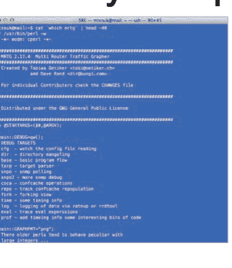

### 15 最后的话

MRTG 配置简单，但不支持插件。另一方面，Cacti 是一个更强大、功能更丰富的工具，但为了充分发挥其潜力，您需要对其进行实验。Cacti 将是即将发布的一篇文章的主题，届时您可以将其与 MRTG 进行比较，并决定哪一个更适合您的需求。

我强烈建议学习 Cacti 和 MRTG 两者，以便能够根据工作任务选择合适的工具。

##### 教程

- OrangeHRM 的主要模块。点击其中任何一个将带您进入相应模块的着陆页
- 选择主要模块之一后，子模块会出现在这个橙色菜单栏中
- 按姓名、ID 或其他详细信息搜索员工。搜索非常灵活，允许即使字段已填充也能进行搜索

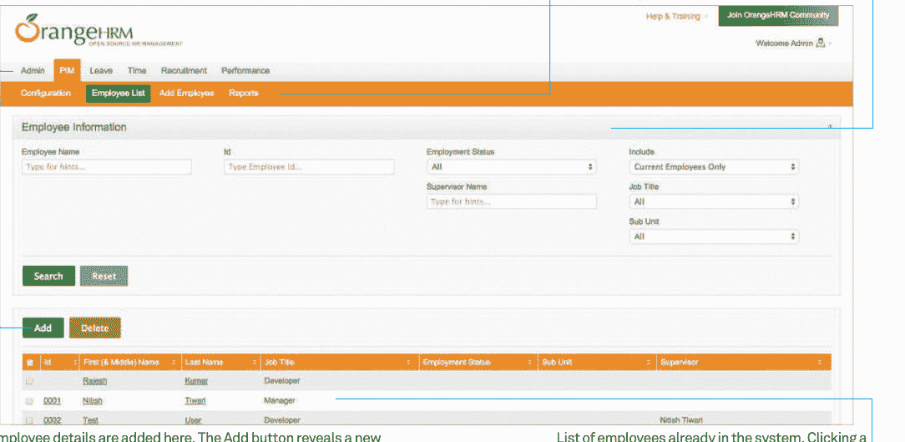

- 员工详情添加在此处。点击添加按钮会显示一个新表单，允许您输入新员工的详细信息
- 系统中已存在的员工列表。点击姓名将显示该员工的信息

## 使用 OrangeHRM 简化人力资源管理

员工是任何组织最重要的部分，管理工具对于维持效率至关重要

## 顾问

**Nitish Tiwari** 职业是软件开发者，内心是开源爱好者。除了为一家领先的开源杂志撰稿外，他还帮助企业设置和使用开源软件来满足其业务需求。


#### 资源

- OrangeHRM: www.orangehrm.com

对于任何组织，无论是拥有少量员工的小型企业，还是在全球拥有多个分支的大型跨国公司，管理人力资源始终是一项重要但困难的任务。之所以重要，是因为雇主需要跟踪关键指标并相应地制定策略，以保持员工的良好士气。之所以困难，是因为人力资源管理是一个多样化的领域，有很多东西需要管理；请假、绩效、记录工时、员工档案、薪资等等。虽然组织现在越来越意识到员工的需求，不遗余力地确保员工保持快乐，但寻找一款优秀的人力资源管理（HRM）工具有时证明是困难的部分。

在本教程中，我们将查看一个最著名且最受欢迎的开源人力资源管理工具 – OrangeHRM。自 2006 年首次发布测试版以来，它持续增长，目前被全球一百万用户使用。OrangeHRM 支持人力资源管理的所有重要方面，并且部署和使用极其简单。鉴于安装、配置和使用的便利性 – 以及健壮性 – 它适用于所有类型的组织，从初创公司到跨国公司。在本教程中，我们使用的是稳定版本 3.1.2。

## 使用 OrangeHRM 简化人力资源管理

使用开源管理工具保持公司的效率

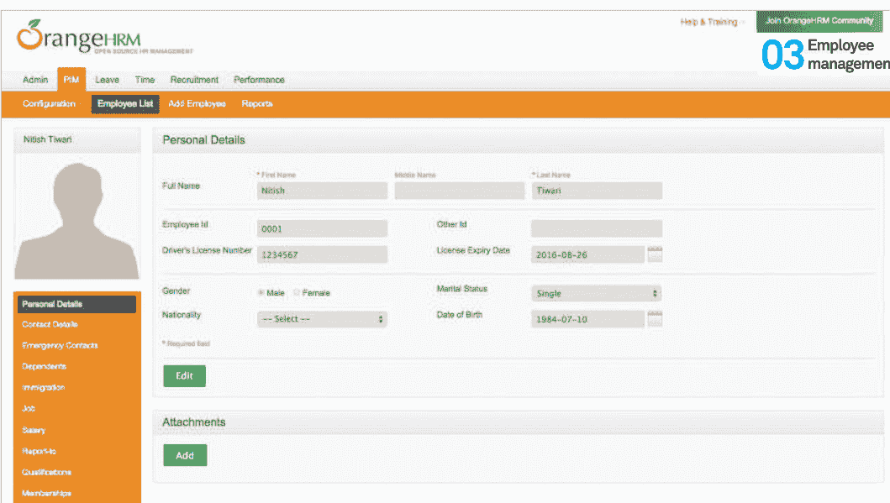


### 01 安装

对于 Linux（和 OS X），源代码可作为 ZIP 文件下载。下载后，只需解压并将内容放置在 Web 服务器的根文件夹中。不过您需要预先安装 Web 服务器和数据库 – 例如 LAMP/LAMP/MAMP 服务器。如果还需要在 Windows 系统上设置 OrangeHRM，则提供捆绑的安装程序 – 包含 Web 服务器和数据库。一旦您下载并解压了所需的所有内容，通过 Web 浏览器访问该文件夹 – URL 应该类似于：http://localhost/orangehrm。如果一切正常，安装向导将欢迎您选择新安装 OrangeHRM 或升级现有设置。如果您继续选择新安装，您需要提供数据库根访问权限（如果 OrangeHRM 的数据库未创建，则提供已为 OrangeHRM 创建的数据库详细信息）。然后您可以创建管理员用户 ID 和密码。最后，在安装完成之前有可选的注册。

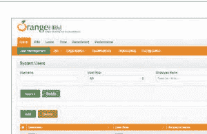

### 02 管理和配置

当以管理员身份登录时，您可以看到对应于不同功能区域的多个选项卡。在“管理”选项卡下，有用户管理、工作、组织、资格、国籍和配置部分。您可以在“工作”部分下设置轮班时间。员工资格可以在“资格”部分下设置。配置允许您启用/禁用不同模块，使用 sendmail 或 SMTP 配置电子邮件，并订阅用户以接收电子邮件通知。虽然其他部分名称不言自明，但有一些重要的提示对您有用 – 用户管理对应于系统用户，因此您不能直接添加用户。您需要先添加员工（下一步会有更多介绍），然后他们就可以在“管理”选项卡下的用户管理部分作为系统用户添加。一个用户只能有两个角色：ESS（员工自助服务）和管理员。角色不应与职位头衔混淆；可以有多个职位头衔（可以在工作部分下创建）。

### 03 员工管理

PIM，或称个人信息管理部分，是管理员工数据的地方。点击“添加员工”链接并填写相关详细信息。如果您选择“创建登录详细信息”，则也会为员工创建系统用户。否则，您可以通过“管理”选项卡下的用户管理选项将员工添加为系统用户。您可能认为员工详细信息的字段太少，无法捕获所有详细信息，但填写详细信息后点击“保存”，您可以看到员工详细信息页面的完整视图。此页面允许您查看和修改与员工相关的所有详细信息，如个人信息、联系方式、受抚养人、薪资、组织层级等等。您还可以在员工详细信息页面下添加自定义字段 – 只需转到 PIM 部分下的配置选项卡并点击“自定义字段”。还有一些可选字段可用。

35 www.linuxuser.co.uk


##### 教程

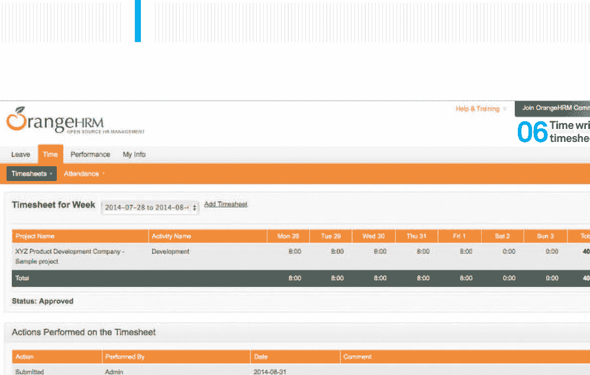

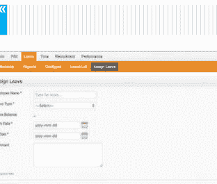

### 04 休假管理

下一部分是休假部分。当你进入“休假”选项卡时，可以看到新的子部分：配额、报告、配置、休假列表和休假分配。要设置休假，你可以从“配置”选项卡开始。

在这里，你可以创建休假类型（如病假、事假等），列出年度节假日，并配置*带休假配额的有效期为一年*。完成配置后，你可以转到配额部分；这是向员工添加休假配额的地方。基于这些配额和相应的休假余额，员工随后可以申请休假。“休假列表”部分显示整个休假期间的休假数据。“分配休假”部分允许管理员在员工未申请的情况下授予休假。

### 05 时间录入 – 考勤

考勤跟踪是一个非常敏感的问题，即使在记录打卡上下班时间时出现一个小错误，也可能造成大问题（至少会影响员工的声誉）。OrangeHRM 提供了一种简便的方法来跟踪考勤。只需转到*时间*选项卡，你就能看到里面的考勤部分。在这里，你可以查看员工考勤记录，或配置诸如员工或主管是否可以修改考勤记录等选项。

请注意，如果你当前以管理员身份登录，要记录考勤，你应该以 ESS 用户身份登录系统。只需创建一个具有 ESS 角色的用户并登录即可。之后，只需转到*时间 > 考勤 > 打卡/签退*并点击“上班”。系统会自动记录日期和时间。页面刷新后显示“下班”选项。

### 06 时间录入 – 工作时长表

虽然考勤用于跟踪实际在办公室花费的时间，但工作时长表通常跟踪在办公室内从事各项活动所花费的时间，这些数据用于预算目的。因此，在添加工作时长表之前，你需要添加客户及相应的项目。此外，每个项目还应添加相关的活动。要添加这些详细信息，请转到*时间 > 项目信息 > 客户*。添加客户后，使用客户下方链接的“项目”添加项目——也可以在同一页面中添加活动。现在你准备好添加工作时长表了。作为管理员，你只需转到*时间 > 工作时长表 > 员工工作时长表*即可添加或查看所有员工的工作时长表。此页面还显示已提交的工作时长表，这些表上有等待你方处理的操作。ESS 用户可以使用自己的登录名添加和编辑他们的工作时长表。


### 07 绩效管理 – 雇主

在本节中，我们将了解如何使用管理员界面设置绩效管理。OrangeHRM 中的绩效管理基于 KPI，即关键绩效指标。对于组织中的每个职位，都需要创建相应的 KPI，以及最高和最低评分点。随后，每位员工都可以根据其职位的 KPI 自动进行评估。要选择 KPI，请转到*绩效 > 添加 KPI*；你可以选择职位然后添加 KPI；最高和最低评分是可选的，但应添加以确保评分的统一性。你可以在 KPI 列表页面查看已添加的所有 KPI。添加 KPI 后，你需要转到“添加评估”页面，以启动对某位员工的评估流程。在下一节中，我们将查看员工看到的界面效果。

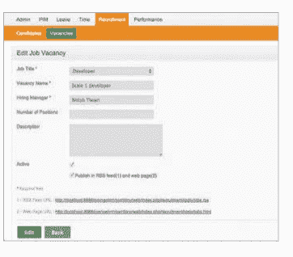


面试结果，提供工作机会，最后是雇佣。在你雇佣候选人后，系统会自动为该候选人创建员工条目。不过，你需要手动为新员工创建登录账户。

### 08 绩效管理 – 员工

在管理员启动评估流程后，评估者和被评估者可以在“绩效 > 评估”链接下查看评估。只有评估者可以打开它以添加他们的评估。在评估者添加评估和评分并提交表单后，管理员需要批准该评估，然后才能向员工开放。一旦管理员批准了评估，将无法进行任何进一步更改——即使是由管理员操作。请注意，员工的评估者完全独立于组织层级，因此可以添加员工池中的任何人作为该员工的评估者。

### 09 招聘

OrangeHRM 还允许你管理招聘流程。从发布空缺职位到处理求职申请、筛选和雇佣——你可以使用 OrangeHRM 完成所有这些步骤。让我们看看如何开始。点击“招聘 > 空缺职位”链接，这是你可以添加空缺职位的页面。创建空缺职位时，会生成一个网络链接和 RSS 源，这是公开可用的。此链接不仅包含完整的空缺职位详情，还允许候选人通过表单申请。随后，当有人申请时，候选人页面（位于空缺职位链接旁）会自动更新详细信息。然后你可以点击候选人姓名来管理申请。申请流程包括筛选、安排面试、面试结果、提供工作机会，最后是雇佣。在你雇佣候选人后，系统会自动为该候选人创建员工条目。不过，你需要手动为新员工创建登录账户。

### 10 报告

OrangeHRM 的多个模块都有生成报告的选项。让我们仔细看看它们各自提供的功能。在 PIM 部分，“报告”选项卡允许你创建自定义报告，创建后可以保存并在以后使用。当你点击“报告”时，会出现“定义报告”页面。在这里，你可以创建与员工数据相关的报告，例如员工姓名、职级、职位、教育背景等。休假部分允许你生成与休假配额和休假使用相关的报告。这里没有自定义报告，只有一组固定的报告。时间部分也有自己的一组固定报告。项目报告显示所有员工在某个项目及其活动上花费的时间，而员工报告显示单个员工在不同项目和活动上花费的时间。前两者与工作时长表相关，而考勤摘要让你查看员工的考勤详情。

## 使用 Jenkins 和 SonarQube 进行持续代码分析 – 第 1 部分

## 顾问

**Nittish Tiwari** 职业是软件开发者，内心则是一位开源爱好者。除了为领先的开源杂志撰稿外，他还帮助企业根据业务需求搭建和使用开源软件。

### 了解如何自动运行 SonarQube 代码分析（使用 Jenkins 持续集成服务器）

#### 资源

- **SonarQube 稳定版和 SonarQube Runner**
    - www.sonarqube.org/downloads
- **Jenkins**
    - www.jenkins-ci.org
- **Jenkins 插件**
    - https://www.jenkins-ci.org/display/JENKINS/Plugins

在*Linux User & Developer* 第 139 期中，我们曾发布过一篇关于如何设置 SonarQube 来分析 Python 项目的教程。虽然 SonarQube 本身是一个出色的静态代码分析器，但你仍需要每次手动运行它才能获取结果。这是一个大问题，无论你的开发团队规模是大是小，因为通常没有人有空去做这件事。Jenkins 就是解决方案。

它是一个持续集成服务器，可以自动构建你的代码、执行测试、发送结果，此外还能做很多其他事情。Jenkins 也可以轻松配置，以触发 SonarQube 代码分析。我们在之前的教程结尾简要提到了结合 Jenkins 和 SonarQube 的主题，但在本教程中，我们将解释 Jenkins 的安装及其基础知识，随后简要回顾 SonarQube。

稍后，你将了解如何配置 Jenkins 与 SonarQube 插件以触发代码分析。最后，我们还将介绍一些重要的 Jenkins 插件，它们可以帮助你更高效地工作。在本教程的演示中，我们使用了最新版本的 Jenkins 1.579 和 SonarQube 3.7.4。

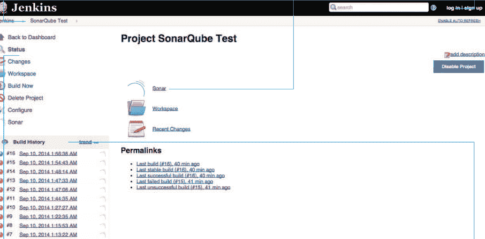


#### 持续代码分析 – 第 1 部分

设置一个准备好进行 SonarQube 分析的 Jenkins 集成服务器


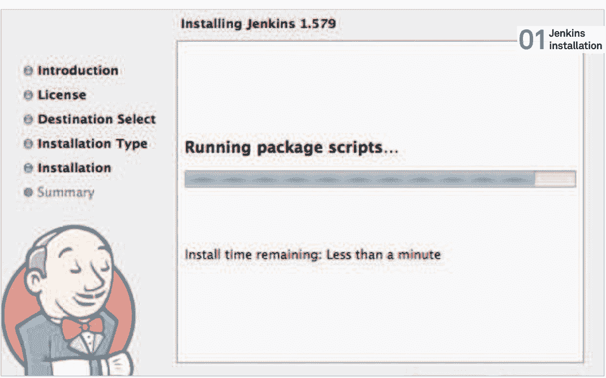

##### 01 Jenkins 安装

Jenkins 提供 WAR 文件供下载，该文件可以放入您喜欢的 JEE 容器中，或者通过 `java -jar jenkins.war` 命令直接执行。请注意，JDK 和 JRE 是 Jenkins 的前置条件。如果您不想深入细节，也可以下载适用于您操作系统的原生软件包。这些软件包包含 WAR 文件以及其他所有必需的依赖项。您只需像安装其他应用程序一样下载并安装它们即可。安装完成后，即可在 `http://localhost:8080/` 访问 Jenkins。请注意，系统不会创建管理员（或其他任何）用户，因为任何人都可以访问任何内容。只有在设置 Jenkins 的安全机制后，这种情况才会改变，接下来我们将对此进行探讨。

##### 02 开始使用 Jenkins

要设置安全选项，请前往“管理 Jenkins”>“配置全局安全”，并点击“启用安全”复选框。此时将打开安全设置，在这里您可以选择其他从属节点（slaves）可以与 Jenkins 连接的端口；安全领域（即使用 LDAP、Unix 用户组、Jenkins 数据库等进行的用户身份验证方法），以及用户授权（换句话说，就是用户权限）。添加用户取决于您在此处选择的安全领域。如果您使用 Jenkins 数据库，在“管理 Jenkins”页面中会出现一个管理用户的选项。前往该页面并点击“创建用户”链接以添加用户。在开始添加用户时，您可能希望为不同用户配置权限和访问级别。这可以通过进入“管理 Jenkins”>“配置全局安全”>“访问控制”>“授权”>“基于矩阵的安全”来完成。

请注意，如果您不慎将自己锁定在 Jenkins 之外，只需打开 `/var/lib/Jenkins/config.xml` 文件并将 `<useSecurity>` 元素设置为 false，同时从文件中移除 authorizationStrategy 和 securityRealm 元素即可。保存文件，重启 Jenkins，您应该就能正常工作了。

##### 03 Jenkins 任务

作为一个持续集成服务器，Jenkins 可以直接从您的文件系统甚至源代码管理系统获取源代码，然后对其进行构建。结合构建前和构建后的选项以及其他功能，这使得您能够按需求实验和配置任务。Jenkins 支持的各种项目构建/任务包括：

- **自由格式软件构建**：它允许您将任何 SCM 与任何构建过程结合使用。在构建软件时，您还可以运行 shell/batch 脚本、调用等。如果在设置 Jenkins 时对构建类型不确定，您可能应该使用此选项。
- **Maven**：三分之二的项目针对 Maven 项目，它们会非常详细地分析 `pom.xml` 文件。
- **多配置项目**：这允许您设置可能需要多种配置的项目，例如针对不同平台的构建。这与自由格式软件构建非常相似，只是增加了一个配置矩阵，有助于您设置不同的配置。
- **监控外部任务**：使用此选项，Jenkins 可以用作仪表盘来监控在外部系统上运行的任务。但是，默认情况下可能没有此选项，在这种情况下，您需要在下拉页面中启用 external-monitor-plugin。

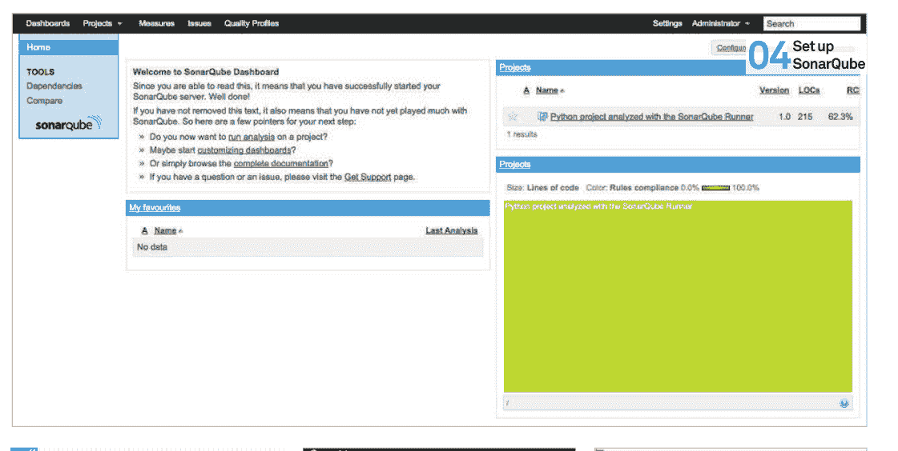

##### 04 设置 SonarQube

现在 Jenkins 已经设置好，并且您对其功能有了基本的了解，让我们重新审视一下 SonarQube。SonarQube 由三个主要组件组成：托管在 Web 服务器上的应用程序源代码、数据库以及分析器。这三个组件在逻辑上是分离的，通常也需要单独安装。实际与要分析的源代码交互并将结果保存到数据库的是分析器。然后 SonarQube Web 界面向您展示这些结果。针对不同项目类型有不同的分析器可用。我们将使用 SonarQube Runner 对非 Maven Python 项目进行分析演示。您可以从 SonarQube 网站下载它。设置分析器需要编辑 sonar-runner.properties 文件中的数据库连接字符串和凭据。如果您遇到困难，请查阅第一个 SonarQube 教程：www.linuxuser.co.uk/tutorials/analyse-code-with-sonarqube。

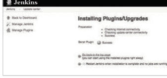

##### 05 在 Jenkins 中安装 SonarQube 插件

此处提到的插件是一个 Jenkins 插件，它可以使 Jenkins 连接到 SonarQube 安装（具体来说，是 SonarQube 分析器）。连接完成后，Jenkins 可以基于预定义的标准触发分析器。要安装插件，请打开您的 Jenkins 主页，前往“管理 Jenkins”>“管理插件”页面，并点击“可用”标签页。然后在过滤器框中搜索 'sonar'。随着您的输入，您将会看到 Sonar 插件。选中其前面的复选框，并点击 'Install without restart'（不重启安装）按钮。然后 Jenkins 开始安装过程，从网络检查和插件下载开始。很快，如果一切正常，插件就会安装完成。现在需要对其进行配置。


##### 06 插件运行

要配置插件，请前往“管理 Jenkins”>“配置系统”，向下滚动到 Sonar 标签页。在此您需要填写名称（SonarQube）、其数据库凭据和其他详细信息。填写完这些信息后，向上滚动到 Sonar Runner 标签页，然后在此填写 Sonar Runner 的详细信息。至此设置完成。设置好插件后，前往 Jenkins 主页并创建一个新项目。您可以通过左侧的“新建”链接做到这一点，选择“自由格式项目”作为项目类型。在随后出现的配置页面中，向下滚动到“构建”标签页，并在“添加构建步骤”下拉菜单中选择 'Invoke Standalone Sonar Analysis'（调用独立的 Sonar 分析）。填写项目属性文件的路径（这是 SonarQube Runner 分析项目所需的同一文件）。您还可以在“构建触发器”标签页（位于“构建”标签页正上方）中选择构建项目的触发器。这完成了整个过程——现在，根据您的设置，Jenkins 将自动触发 SonarQube 分析。要查看分析结果，只需登录 SonarQube，最新的代码质量指标将可供您使用。

> “Jenkins 通常需要在任何配置更改或任何插件安装之后重启”

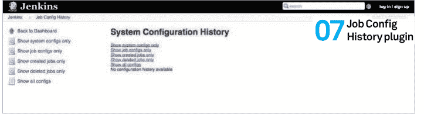

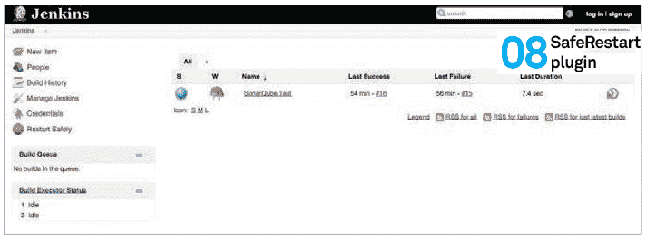

##### 07 Job Config History 插件

此插件对于 Jenkins 新手特别有帮助，尽管有一些 Jenkins 经验的人也可能觉得它有用。让我们考虑一种场景——您的 Jenkins 构建运行正常，然后您想到做进一步的改进并开始更改设置，突然一切都停止工作了。但您甚至不记得最后一次做了什么更改！好吧，JobConfigHistory 插件就是为您在这种困境中解围而设计的。它在您每次在 Jenkins 设置中做出更改后保存 config.xml。您只需检查文件差异并进行必要的修正即可。

##### 08 SafeRestart 插件

Jenkins 通常需要在任何配置更改或任何插件安装之后重启。但作为一个基于服务器-客户端应用程序且多个并发用户正在执行其任务，您需要格外小心，因为在重启期间可能会意外终止其他人的构建。SafeRestart 插件让您无需担心这一点。一旦您点击 'Restart Safely'（安全重启）按钮（安装插件后会出现在左侧菜单栏中），它就会安排在所有构建完成后重启。

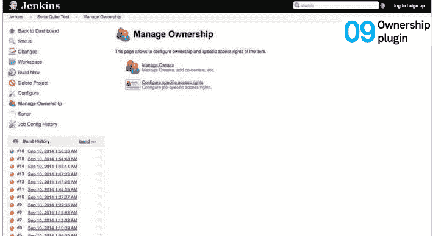

##### 09 Ownership 插件

顾名思义，此插件允许您为任务和从属节点分配明确的拥有权。引入所有权意味着更好的责任管理和更快的解决问题……除非它变成了相互指责！严肃地说，此插件绝对提供了一种处理问题的良好方式——在任务失败后，您无需寻找某人去修复它。安装此插件后，左侧菜单栏会出现一个名为“管理所有权”的链接（在项目内部时）。在这里，您可以配置相应任务的所有者/共同所有者。

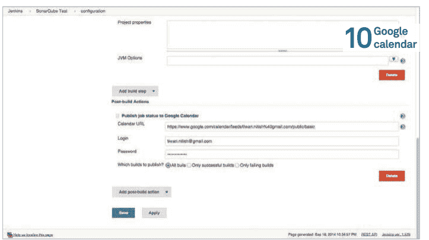

##### 10 Google Calendar 和 compress artefact 插件

Google Calendar 插件允许您将构建记录发布到 Google 日历。安装插件后，您可以在 postbuild actions 选项卡中查看将构建状态发布到 Google 日历的选项。选中该选项后会出现一个表单，您需要填写日历 URL 和您的凭据。之后，Jenkins 会自动将构建结果推送到您的 Google 日历。简单而有效！如果您计划在每次构建后保存构建工件，例如测试日志和构建文件，那么您可能会发现此插件很有用。此插件在将工件保存到磁盘之前对其进行压缩，从而为您节省磁盘空间。


## 使用 Qt 处理模型数据

处理十几项数据并不是问题。但如果将数量增加到几百项，问题就可能出现。


## 顾问

Tam Hanna 自 Palm IIIc 时代起便涉足 IT 行业。身为记者、导师、演讲者及科学书籍作者，他不仅多次见证了移动市场的各个方面，更对此有着深入的洞察。

虽然没有法律规定禁止你尝试编写此类程序，但你应该意识到，大量令人头疼的问题将会随之而来。首先，请做好准备，接受用户界面极度缓慢且不断刷新的现实，以适应你的用户。

在列表和表格控件的存储中保存大量数据，是招致用户因代码运行缓慢而发怒的必然途径。

如果这还不够让你却步，那么现在你应该知道，在数据管理方面你会遇到各种各样奇怪的问题。对显示记录进行过滤或排序将变成一项真正的艰巨任务。

幸运的是，Qt 提供了一种高效的方式来规避此问题。多年前，一种名为 Smalltalk 的编程语言向世界介绍了模型-视图-控制器（MVC）设计模式的概念。遵循此标准的框架为用户提供专门封装数据存储的类。

显示是通过将它们连接到视图来完成的。你的业务逻辑可以专注于更改屏幕上显示的信息，而无需关心更新控件内部数据存储的繁琐任务。

在 Qt 中，使用模型尤其具有回报。该框架预装了大量可以显示各种有用数据的类。


*上图：我们的数据模型为树形视图提供文件系统信息*

让我们从一个创建显示主机计算机文件系统的小型应用程序开始。打开 Qt Creator，并使用“新建项目”向导基于 Qt Widgets 构建一个新项目。双击 `mainwindow.ui`，以便让 Qt Creator 在用户界面设计器中打开该表单。

查看屏幕左侧。你的工具箱应包含两组专门用于显示列表和其他信息的控件：项目视图（item views）和项目小部件（item widgets）。项目小部件为项目提供“嵌入式”存储，而视图必须连接到模型才能正常工作。

### 简化的文件系统

寻求开始使用新编程语言的开发者，最终都会编写一个针对其目标平台文件系统的解析器。这种练习具有极高的教学价值，这也是为什么我们在几期之前带你们完成了这个练习。

引入模型让情况变得容易得多。从工具箱中抓取一个“TreeWidget（树形小部件）”并将其拖到表单的中间。然后，打开 `mainwindow.cpp` 并修改表单的初始化方法，使其看起来像图 01 中的代码。

我们首先调用位于 `ui` 对象中的 `setupUi` 方法。它是由一个名为 `uic`（用户界面编译器）的工具创建的，它充当我们的应用程序与从 UI 文件生成的代码之间的“中介”。

在下一步中，创建了一个 `QFileSystemModel` 的新实例。通过将其设为表单的子对象，我们确保父子系统会在用户决定关闭相应窗口时移除该实例。调用 `setRootPath` 通知模型需要处理特定的路径。

## 使用 Qt 处理模型数据

学习处理数百个数据项


##### 模型-视图-控制器

##### 拆解大型系统

按照预定义的步骤整理系统有助于新开发者更快上手。这是通过一组如今被称为设计模式的架构来实现的。模型-视图-控制器（MVC）模式是最古老的之一——它诞生时“设计模式”这个术语尚未形成。

基于 MVC 的应用程序由三个部分组成。模型包含需要被使用和管理实际数据。大多数实现还将业务逻辑也放置在其中。模型中发生的更改可以推送到“感兴趣的观察者”。

模型数据在视图中渲染和显示。视图知道提供信息的控制器和模型，但通常不包含处理用户输入的任何逻辑。尽管视图通常负责实际的渲染，但它们通常不直接操作数据（用于过滤等）。

控制器充当上述两个对象之间的“胶水”。它们通常负责过滤和排序，此外还处理用户输入。一些实现在控制器和模型之间分担输入处理的负担：如果后者包含业务逻辑，那么如果必须在控制器中处理所有输入，就会发生重复。

```cpp
#include <QFileSystemModel>

MainWindow::MainWindow(QWidget *parent) :
	QMainWindow(parent),
	ui(new Ui::MainWindow)
{
	ui->setupUi(this);

	QFileSystemModel *myModel = new QFileSystemModel(this);
	myModel->setRootPath("/");
	ui->treeView->setModel(myModel);
}
```

至此，模型已准备好分配给视图。这是通过调用 `treeView` 的 `setModel` 方法来实现的。你可以自由地在当前状态下运行该应用——在 Unix 操作系统上运行时，树将显示机器上找到的文件和文件夹的可展开列表。

事实上，`QFileSystemModel` 甚至为你处理了多线程。文件系统遍历由后台线程处理，并将结果推送到 GUI。遗憾的是，这意味着代码背后的存储数据无法立即访问——你应该等待直到 `rowCount()` 属性停止返回零。

##### 让模型发挥作用

尽管显示文件系统的内容绝非易事，但我们的 `QFileSystemModel` 能够完成更多任务。例如，让我们添加一个名称过滤器，以确保树只包含 JPG 文件。

```cpp
MainWindow::MainWindow(QWidget *parent) :
	QMainWindow(parent),
	ui(new Ui::MainWindow)
{
	ui->setupUi(this);

	QFileSystemModel* myModel = new QFileSystemModel(this);
	myModel->setRootPath("/");
	QStringList *myStringList = new QStringList();
	myStringList->append("*.jpg");
	myStringList->append("*.jpeg");
	myModel->setNameFilters(*myStringList);
	myModel->setNameFilterDisables(false);
	ui->treeView->setModel(myModel);
}
```

```cpp
#include <QModelIndex>

class MainWindow : public QMainWindow
{
	Q_OBJECT
public slots:
	void itemDoubleClicked(QModelIndex _anIndex);
	.
.
.
```

这可以通过再次修改主表单的构造函数来实现。该方法的新版本看起来像图 02 中的示例。

`QStringList` 是框架提供的辅助类，专门用于管理一组字符串。我们的示例代码创建一个空实例，并继续向其中添加两个包含正则表达式的字符串。生成的复杂对象随后被传递到 `setNameFilters`，在那里它被用于参数化遍历函数。将 `nameFilterDisables` 设置为 `false` 确保不匹配模式的结果不被显示——传递 `true` 会使它们以灰色显示。

至此，我们的文件树现在仅限于显示伪装成图片的文件。再次运行应用程序，以确认非图像文件不再在树形视图中显示。

##### 访问模型数据

基于模型-视图-控制器模式的应用程序并不限于显示模型中找到的数据。实现良好的模型类提供了多种方式，允许用户与存储在内的数据进行交互——我们的 `QFileSystemModel` 也不例外。

让我们通过添加一个功能来扩展我们的文件查看器，该功能提供有关双击项目的更多信息。这需要我们将树形视图的 `doubleClicked` 信号与主表单中新创建的槽连接起来。

点击工具栏中的信号/槽编辑器，以告知 Qt Creator 你打算创建信号和槽之间的连接。从树形视图拖出一条线并将其放到表单上。Qt Creator 会响应并打开


##### 教程


上述过滤器可用于限制显示的信息量。

```cpp
void MainWindow::itemDoubleClicked(QModelIndex _anIndex)
{
  QFileSystemModel* whatModel = ((QFileSystemModel*) ui->treeView->model());
  QFileInfo myFile = whatModel->fileInfo(_anIndex);
  QMessageBox *aBox=new QMessageBox();
  aBox->setText(myFile.path());
  aBox->show();
}
```

```cpp
#include <QSortFilterProxyModel>

class ImagineFilterModel:public QSortFilterProxyModel
{
  Q_OBJECT
 public:
  ImagineFilterModel(QObject *parent);
};
```

```cpp
#include "imagefiltermodel.h"

ImagineFilterModel::ImagineFilterModel(QObject *parent):
 QSortFilterProxyModel(parent)
{
 QFileSystemModel* myModel1=new QFileSystemModel(this);
 myModel1->setRootPath("/");
 setSourceModel(myModel1);
}
```

```cpp
MainWindow::MainWindow(QWidget *parent) :
 QMainWindow(parent),
 ui(new Ui::MainWindow)
{
 ui->setupUi(this);
 ImagineFilterModel* myModel=new ImagineFilterModel(this);
 ui->treeView->setModel(myModel);
}
```

连接对话框是建立连接的地方。我们已在几期之前的文章中详细介绍了这一过程，但你也可以通过简单的网络搜索找到有关打开对话框的更多信息。

虽然 Qt 会自动为我们创建信号和插槽之间的连接，但我们必须手动实现相应的方法。打开 `mainform.h` 并将**图 03** 中的声明添加到该类中。

项目视图发出的信号包含一个 `QModelIndex`。这是一个方便的条目，提供有关待处理元素的进一步信息。我们可以使用此值来了解有关当前文件的更多信息（**图 04**）。

我们的表单构造函数没有将模型指针存储在 global 变量中。我们首先调用 `model()` 方法，该方法返回指向 `QAbstractModel` 的指针。`QFileSystemModel` 的结构使得模型不能包含除 `QFileSystemModel` 以外的任何内容，因此我们只需将返回值强制转换为其期望的类型。

在下一步中，查询实例以了解有关相关项目的更多细节。然后，这些信息在 `QMessageBox` 中显示。

###### 模型无限多

使用 `QFileSystemModel` 让我们能够以最小的努力创建文件和文件夹查看器。我们仅使用了该类的少量功能；它可以过滤文件夹并执行各种其他令人印象深刻的功能。

希望从 Qt 中获取价值的开发者会很高兴地听到，该框架包含半打不同的模型，专门用于各种有用的任务。例如，通过使用 `QSqlQueryModel`、`QSqlTableModel` 和 `QSqlRelationalTableModel` 中的一个或全部，可以“封装”数据库访问。

字符串列表应打包到 `QStringListModel` 的实例中。它处理为显示所做的调整和准备工作，无需你进行进一步的交互。

当你的代码需要处理一组源自 `QStandardItem` 的项目时，应使用 `QStandardItemModel`。它是一个相对复杂的类，提供了一组旨在简化列表、表格和树中自定义项目创建的属性。

在处理遗留代码时，你可能会遇到一个名为 `QDirModel` 的遗留类。它与 `QFileSystemModel` 不同，因为它在 GUI 线程上处理文件系统遍历。这可能会对性能产生显著的负面影响

###### 使用 Qt 建模数据

学习处理数百个数据项


**上述** 数据展示控件可以分为两组

当需要遍历大量文件和文件夹时，这种影响就会显现出来。

###### 模型到模型

大型且复杂的应用程序受益于能够以不同形式显示相同数据集的能力。复制信息会浪费内存，并迫使开发者实现各种同步逻辑。

如果更改仅限于对单个项目的排序和过滤，则可以将代理模型附加到包含实际数据的主模型。它重新排列并过滤元素，以创建对当前信息的独立第二视图。

尽管我们的 `QFileSystemModel` 提供了对结果进行排序和过滤的功能，但我们会为后人和效果添加第二层。

首先，向项目添加一个新类：可以通过文件 > 新建文件或项目调用 Qt Creator 的“添加类”向导。选择 C++ 组以找到 C++ 类模板。示例代码中的新类名为 `ImagineFilterModel` – 如果你愿意，可以随意分配其他名称。头文件看起来像**图 05** 中显示的那样。

`QSortFilterProxyModel` 是一个派生自 QObject 的类。正如你在**图 05** 中所见，Qt 的后端要求此类类的头文件用 Q_OBJECT 宏标记。

`ImagineFilterModel` 的构造函数填充了**图 06** 中的代码片段。

派生自 `QSortFilterProxyModel` 的类需要一个源模型，该模型充当实际数据存储。我们只需分配上述的 `QFileSystemModel` 以准备适配器插入。修改 `mainwindow.cpp` 中表单的构造函数，以便告知其有关 `ImagineFilterModel` 的信息（**图 07**）。

> “ 树视图默认不允许用户对其内容进行排序 ”

```cpp
// Fig 08
class ImagineFilterModel:public QSortFilterProxyModel
{
        Q_OBJECT
public:
        ImagineFilterModel(QObject *parent = 0);
protected:
        bool lessThan(const QModelIndex &left, const QModelIndex &right);
};
```

```cpp
// Fig 09
bool ImagineFilterModel::lessThan(const QModelIndex &left, const QModelIndex &right)
{
        QFileSystemModel* myModel=(QFileSystemModel*)sourceModel();
        QString leftName=myModel->fileName(left);
        QString rightName=myModel->fileName(right);
        if(leftName.compare(rightName)<=0)return true;
        return false;
}
```

```cpp
// Fig 10
MainWindow::MainWindow(QWidget *parent) :
        QMainWindow(parent),
        ui(new Ui::MainWindow)
{
        ui->setupUi(this);
        ImagineFilterModel* myModel=new ImagineFilterModel((QObject*)this);
        ui->treeView->setModel(myModel);
        ui->treeView->setSortingEnabled(true);
}
```

运行当前状态下的程序会生成一个未过滤的树视图，显示你文件系统的内容。让我们继续更改排序顺序，以便文件和文件夹以严格的字母顺序显示（例如，通常给予文件夹对象的优先级除外）。

`QSortFilterProxyModel` 附带排序逻辑。遗憾的是，该类无法控制你希望项目如何排列。这些信息需要通过可以在头文件中重写的一个虚方法传入（**图 08**）。

对于我们的例子，请参见**图 09**，其中找到的比较就足以获得所需的结果。

树视图默认不允许用户对其内容进行排序。可以通过将 `sortingEnabled` 设置为 true 来解决此问题（**图 10**）。

运行当前形式的示例，以查看精心交织的文件和文件夹列表。

###### 结论

至此，我们对 Qt 迷人世界的旅程在另一期中结束了。尽管熟悉模型可能需要一点时间，但在这个过程中获得的技能在长期来看会加倍回报，因为结构良好的应用程序更容易调试和维护。最终，它将为节省你的时间和精力。

我们的 Qt 教程的下一部分将把建模再推进一步。我们将学习如何基于应用程序中已存在的数据存储创建自定义模型。随着复杂度的增加，这部分内容将使你能够保持关注点分离。

创建列表和使用树视图从未如此简单 – 我们很快再见！

# 使用 FUZE 学习编写 BASIC 代码

通过 FUZE——由树莓派驱动的编程和电子平台，发现开启这一切的语言


## 顾问

**Rob Zweetsloot** 擅长对复杂系统进行建模，并是一位精通 Python、Django 和 PHP 的 Web 开发者。他喜欢进行计算实验。

#### 资源

- FUZE BASIC 套件 [fuze.co.uk](fuze.co.uk)

一代 X 中许多伟大的英国程序员通常被认为得益于 BBC Micro 和 **八十年代的 BBC 计算机通识计划** 而起步。

当时，廉价的硬件学校负担得起，并允许孩子们用“初学者通用符号指令代码”（Beginner’s All-purpose Symbolic Instruction Code）或 BASIC 进行编码。这种简单的语言让学校中所有年龄段的孩子们都能接触编程，并创造了英国的计算热潮。时代略有变化，经过一番挣扎，计算重新回到了英国学校。

虽然他们不再学习 BASIC 了，但该语言仍然存在，并且是教授编程的绝佳方式。FUZE 系列的硬件旨在通过特殊的树莓派驱动机器将其带回来。

你不仅可以编写 BASIC 语言代码，还可以使用连接到 FUZE 设备的优秀自定义 IO 板来创建物理项目。

在本教程中，我们将展示如何使用 BASIC 进行编程以及如何创建交通灯系统。


## 学习使用 FUZE 编写 BASIC 代码

探索那门开启一切的语言

**教程**

### 01 连接 FUZE BASIC


部分 FUZE 机型已内置树莓派（Raspberry Pi），因此您只需将其连接到显示器和电源即可运行。在使用随附的电源适配器插入之前，请确保 SD 卡已放入卡槽中。

### 02 BASIC 解释器

FUZE 将启动进入修改版的 Raspbian 桌面。在这里，您可以进行正常的树莓派相关操作，但我们感兴趣的是桌面上的 FUZE BASIC 选项，它将带我们进入 BASIC 解释器。

### 03 打个招呼

我们第一次涉足编程语言必须做得像样，以一个标准的“Hello World”（你好世界）语句开始。在 BASIC 中操作非常简单，只需编写以下内容：

> PRINT “Hello World”

### 04 环顾四周

虽然这个版本的 BASIC 自 BBC Micro 时代以来已有所更新，但你仍然可以执行其中一些较简单的任务以及那个臭名昭著的 GOTO 10 命令。你可以通过执行如下命令来实现：

> 10 PRINT “Hello World”
> 20 GOTO 10

> **注意：** FUZE 将启动进入修改版的 Raspbian 桌面。在这里，你可以执行所有常规的树莓派操作。

### 05 现代方式

按 Esc 键结束循环。这个版本的 BASIC 进行了一些改进，因此我们可以在代码编辑器中使用更好的循环语句来创建这个 Hello World 的无限循环。要访问编辑器，请按 F2。

### 06 现代循环代码

这段代码非常简单：我们创建一个 CYCLE（循环），将命令放在其中，然后在末尾使用 REPEAT（重复）告诉代码返回循环的开始处。在我们的情况下：

```basic
CYCLE
PRINT “Hello World”
REPEAT
```

### 07 保存并运行代码

输入完成后，你可以按 F3 调出保存代码的选项。目前，只需将其命名为 helloworld 并按回车键即可。完成后代码将运行，循环输出 Hello World 一遍又一遍。按两次 Esc 结束循环。

### 08 创建变量

在 BASIC 中创建变量很容易，与其他大多数语言类似：

```basic
A = 5
```

使用 PRINT 'A' 来确认其已生效。你可以通过添加数字或其他预定义变量来修改其值，如下所示：

```basic
A = A + 5
A = A + B
```

### 09 更复杂的内容

自动增加变量的值很容易。让我们创建一个固定循环，当 A 从 1 增加到 5 时输出 A：

```basic
CLS
A = 0
FOR p = 1 to 5 CYCLE
  A = A + 1
  PRINT A
REPEAT
END
```

### 10 连接项目

I/O 板提供许多额外的功能，非常适合学习物理编程。虽然你可以通过引脚直接连接到树莓派的 GPIO 端口，但你也可以使用自定义端口。FUZE 顶部的托盘非常适合插入面包板，所以现在请这样做。

### 11 连接灯光

从电子元件包中选择一个 LED 灯 – 任何颜色都可以 – 然后将短端插入顶部的两个引脚之一，长端插入中间部分。拿起一个 100Ω 电阻器（棕黑棕金）并将一端插入与 LED 长端位于同一垂直行的一个引脚中。


### 12 连接光源

将电阻器的另一端放在不同垂直列的引脚上，然后使用跳线将 GPIO 0 连接到该电阻器在垂直方向上的这一端。最后，将一根线连接到电源的 GND，并将其放在与 LED 短端相同的行上。

### 13 简单操作

要激活灯光，使用 Esc 退出编辑器，并输入以下行让其知道将 GPIO 0 设置为输出：

```basic
>PinMode (0,1)
```

要激活然后取消激活它，请使用：

```basic
>DigitalWrite (0,1)
>DigitalWrite (0,0)
```

### 14 灯光编码

现在我们得到了一个工作的灯光，让我们创建一小段代码，让它反复开启和关闭：

```basic
CLS
PinMode (0,1)
CYCLE
DigitalWrite (0,1)
Wait (1)
DigitalWrite (0,0)
Wait (1)
REPEAT
END
```

### 15 更大的项目


*下方的我们的交通路口设置将按顺序激活 LED 灯*

让我们升级面包板上的灯光设置，将其变为一个交通路口设置。以添加原始 LED 灯的相同方式添加两个额外的灯，并将它们连接到 GPIO 引脚 2 和 3。通过将一个端连接到引脚 7，另一端连接到取自第二组电源引脚的新 3.3V 轨来连接一个按钮。该按钮将使灯光按顺序变“红”，然后在暂停后变回“绿” – 完整的代码请参见 **图 01**。

### 16 CLS

CLS 命令清除当前显示屏。这有助于确保代码中的任何错误或打印输出都能显示出来，而不会可能与以前程序或运行的输出混淆。

### 17 使用 PinMode

PinMode 变量上的数字处理 GPIO 端口（X）以及它是输出（1）还是输入（0）。因此，对于 GPIO X 作为输出，其构建方式如下：

```basic
PinMode (X,1)
```

DigitalWrite 对输出引脚的构建方式类似，1 表示开，0 表示关。

### 18 IFTHE

与其他编程语言不同，当你创建 IF 语句时，你需要确保加上 THEN，以让 BASIC 知道后续代码是针对 True（真）情况。

### 19 digitalRead

由于此代码中的引脚 7 被设置为输入，我们要读取它被激活时（即按钮被按下时）的状态。我们的按钮在被按下时闭合电路，因此读取值需要为 1。

### 20 ENDIF

通过在 IF 语句末尾添加 ENDIF 让代码知道 IF 语句何时结束。与其他语言相比，这可以稍微更容易和清晰地确定 IF 的开始和结束位置。

**图 01**

```basic
CLS
PinMode (0,1)
PinMode (1,1)
PinMode (2,1)
PinMode (7,0)
CYCLE
  DigitalWrite (2,1)
  IF digitalRead (7) = 1 THEN
    Wait (1)
    DigitalWrite (2,0)
    DigitalWrite (1,1)
    Wait (1)
    DigitalWrite (1,0)
    DigitalWrite (0,1)
    Wait (5)
    DigitalWrite (0,0)
    DigitalWrite (1,0)
    DigitalWrite (2,1)
  ENDIF
REPEAT
END
```

***

# 程序员与创客必备指南

## 实用树莓派

### 目录

- 58 发现一种新的乐器
- 60 升级你的树莓派驱动 Bigtrac
- 64 将你的树莓派变成示波器
- 70 新的浏览器是什么？

### 构建超级树莓派

汇集多台树莓派的资源，创建你自己的可扩展树莓派超级计算机

树莓派实际上在价格上相当强大。然而，单靠它自己，你不会进行任何非凡的计算 – 或者进行任何高强度的编译。但是，由于它易于获取且相对便宜，你可以用买一台新计算机的价格买到二十台。它们单独使用没有区别，但通过网络连接在一起，它们可以共享其功率并大幅增加其处理能力。

这种设置通常被称为 Beowulf 集群，以史诗中同名英雄命名，Beowulf 被描述为拥有“手中有三十名男子握力”；实现它也不太难 – 你只需要大量的树莓派、一些 Python 知识以及使用它的理由。这使得它成为课堂、课后树莓派俱乐部等事情的不错项目 – 实际上，任何有可供一般使用的树莓派集合的地方都可以。

你添加到设置中的树莓派节点越多，它就越强大，这意味着你可以从家里的两或三台开始，然后如果你愿意，可以逐渐向集群中添加更多。并且由于它的工作方式，你还可以从你的主计算机连接并控制你的 SuperPi 集群，使其既易于访问又可扩展。

在接下来的两页中，我们将向你展示如何设置树莓派以便使用，包括你需要的所有工具、如何连接它们以及最终你可以利用所有这些处理能力做什么。我们很想看到你完成后的 SuperPi – 给我们发一条推文吧！

www.linuxuser.co.uk


### 打造超级树莓派


**适用**
于所有
树莓派！

你甚至可以组建一个由不同类型的树莓派组成的集群

### 编程你的树莓派

让你的树莓派彼此通信，
并共享它们的处理性能


#### 01 完全更新的树莓派

为了确保一切正常运行，你的树莓派电脑
必须完全更新，因此请确保所有组件都
兼容，包括固件。这需要按顺序执行三条命令完成，并且请确保你依次在
每一台树莓派上都这样做：

```
$ sudo apt-get update
$ sudo apt-get upgrade
$ sudo rpi-update
```

#### 02 获取 MPI 模块

在终端中使用以下命令安装 mpi4py Python 模块（
再次提醒，需在每台树莓派上执行）：

```
$ sudo apt-get install python-mpi4py
```

该模块也可以在 Arch 或其他树莓派发行版上运行，
不过你需要手动添加或通过 pip 安装。

#### 你需要什么

- 尽可能多的树莓派电脑
- 带有最新 Raspbian 版本的 SD 卡
- mpi4py MPI python 模块 `pypi.python.org/pypi/mpi4py`
- 已更新的树莓派固件


左图 如果你想让 SuperPi
成为现实，那么更新
所有组件至关重要

##### 其他库

mpi4py 库
也可以与
Numpy（Python 的
数值和数学
模块）一起使用。
可以使用
sudo apt-get
install python-numpy 进行安装，
这对于执行集群
所需的那种
大规模计算
非常有用。我们在
下一页的示例中
会使用 biogin，所以
现在就安装它。

#### 03 创建你的线程

要在 Python 中使用 MPI，首先导入它：

```
from mpi4py import MPI
```

代码中最重要的部分是告诉 MPI 如何
对线程进行排名以及识别其大小。这样做的方式是：

```
comm = MPI.COMM_WORLD
rank = comm.Get_rank()
size = comm.Get_size()
```


**右图** 你需要知道每台树莓派的 IP 地址，因此务必现在就记录下来

##### Mpi4py 也可以在 Arch 或其他树莓派发行版上运行


### 完整代码列表

```python
from __future__ import division
import numpy as np
from mpi4py import MPI
###### 从 FileSilo 或我们的网站获取 parutils 并将其放在同一文件夹中。使用它来打印使用的核心数
from parutils import pprint
comm = MPI.COMM_WORLD
pprint("-" * 70)
pprint(" Running on %d cores" % comm.size)
pprint("-" * 70)
###### 为不同的节点设置排名结构
my_N = 4
N = my_N * comm.size
if comm.rank == 0:
A = np.arange(N, dtype=np.float64)
else:
A = np.empty(N, dtype=np.float64)
my_A = np.empty(my_N, dtype=np.float64)
###### 将数据分散到 my_A 数组中
comm.Scatter( [A, MPI.DOUBLE], [my_A, MPI.DOUBLE] )
pprint("After Scatter:")
for r in xrange(comm.size):
if comm.rank == r:
print( "[%d] %s" % (comm.rank, my_A))
comm.Barrier()
###### 每个人都在乘以 2
my_A *= 2
###### 使用 Allgather 将所有数据收集回 A 并打印结果
comm.Allgather( [my_A, MPI.DOUBLE], [A, MPI.DOUBLE] )
pprint("After Allgather:")
for r in xrange(comm.size):
if comm.rank == r:
print( "[%d] %s" % (comm.rank, A))
comm.Barrier()
```

#### 04 发送和接收数据

发送数据非常简单：你需要给它指定一个目标线程，这样 MPI 才知道数据返回时对应的是哪个线程，否则原始线程会一直等待：

```python
data = [1.0, 2.0, 3.0, 4.0]
comm.send(data, dest=1, tag=0)
data = comm.recv(source=0, tag=0)
```

标签允许你解析某些特定类型数据的处理方式。

#### 05 运行代码

这就是如何在集群中发送你的代码的基本方法。要实际激活代码并选择树莓派接收者，你需要在终端中编写以下内容：

```bash
$ mpirun -host 192.168.1.20,192.168.1.21,192.168.1.22
python superpi.py
```

... 其中 IP 地址对应其他树莓派上的地址。

#### 06 它能工作吗？

上述操作实际上并不会完成什么具体任务，但至少说明了如何在网络上发送代码。你可以对其进行任意类型的计算任务，但由于网络延迟，它只适用于大数字和更大数据。

### 构建你的 SuperPi

现在你已经对树莓派单元进行了编程，是时候将它们连接在一起了

编程树莓派是构建**你的超级计算机的一部分——妥善地将它们收纳在一起是另一个问题。** 让它们工作的最基本要素是电源和通过路由器和/或交换机建立本地网络。这进而延伸到外壳、SD 卡甚至树莓派本身。

为了确保你最大限度地利用该系统，你必须选择正确的组件来为它们供电并连接它们。

> 你不需要集群中的最大功率，因为你不会从 GPIO 端口为显示器或摄像头供电


#### 电源

为树莓派供电时，良好的电源至关重要，否则虽然它能开机运行，但你无法发挥其最大性能。如果你使用的是 Model B+ 并且注意到角落出现彩虹方块，那表示你提供的电源不足。你的集群不需要最大功率，因为你不会从 GPIO 端口为显示器或摄像头或可能任何设备供电，所以推荐的 2 安培可能对你来说有点过大，即使你推处理器达到极限也是如此。然而，如果你计划进行超频，那么 2 安培的电源将变得越来越必要，而且处于安全一侧总是更好的。

随着集群的增长，你还需要确保有充足的浪涌保护，因为树莓派可能非常敏感。

**我们推荐：**

树莓派通用电源

pimoroni.com

#### 网络

你计划连接的树莓派越多，就需要越多网络设备将它们连接起来。最佳方法是使用有线连接，因为它比无线连接传输消息更快且延迟更低——但创建集群不像插入路由器那么简单。随着树莓派数量增加，你需要更多端口，这可以通过获取网络交换机来实现。这些是简单的连接器，不包含路由或地址系统，但允许你将更多设备连接到中央路由器。

虽然我们推荐使用有线连接，但你仍可以使用无线连接额外的树莓派。这也有助于减少使用的线缆和网络交换机数量，但一般来说，拥有同构配置更好。


#### 超频

如果你发现仍然想要从集群中获得更多性能，你随时可以尝试超频你的树莓派。

在 Raspbian 中，你可以从通过 sudo raspi-config 访问的配置菜单中进行此操作。在菜单中你会找到一个超频选项，提供几个级别可供选择。你可以单独对树莓派执行此操作，也可以对所有树莓派执行，但请注意这样做可能会缩短树莓派 CPU 的使用寿命，特别是当设置为最高级别时。

### 打造超级树莓派


#### 外壳

树莓派有很多类型的外壳：从保护树莓派免受灰尘的简单塑料外壳到完全防水防风的金属外壳。其中多用途外壳之一是 Pimoroni Pibow，它有多种尺寸和配置适用于所有版本的树莓派。这些外壳均由螺丝固定，可以轻松重新利用以帮助将树莓派安装在塔式或其他配置中，从而减少水平空间占用。

它们可能比某些外壳更难将树莓派装入，但它们相当耐用，如果你想要移动它们，或在主树莓派上添加一个小触摸屏或滚动 LCD 屏幕以监控状态而不需要 SSH 登录，则很容易自定义。

> 我们推荐：
**Pimoroni PiBow**
pimoroni.com

#### SD 卡

**在选择集群时，SD 卡的选择是一个次要但仍然重要的因素。**

一些树莓派附带一张 SD 卡，这可能足够合适，而其他的你需要购买一些卡片。我们建议使用 4GB 卡；虽然 2GB 卡可以完成任务，但 4GB 允许你在必要时使用 NOOBS，并且对于更大的发行版和操作系统也具有前瞻性。由于 Model B+ 需要微型 SD 卡，请确保你拥有正确比例的 SD 卡和微型 SD 卡。

当涉及到将所有 SD 卡设置得一致时，最简单快捷的方法是先在一台树莓派上完成所有安装和更新，除了使用 rpi-update 进行的固件更新。然后通过将其插入 Linux 系统并打开终端来创建磁盘副本，并使用：

```
$ sudo dd bs=1M if=/dev/[SD card location] of=superpi.img
```

一旦复制完成，你可以使用以下命令将其写入所有其他卡片：

```
$ sudo dd bs=1M if=superpi.img of=/dev/[SD card location]
```

> 我们推荐：
**4GB**
pimoroni.com


#### 树莓派

**实际上，在集群中使用什么类型的树莓派并不重要** – 你可以使用最新**Model B+**的同构选择，甚至可以有**连接在一起的 B+、B 和 Model A 混合体**。只要你运行相同的软件并拥有相关脚本，系统就会工作。你可能会遇到的主要差异是不同设备之间的功耗不同，以及 Model A 在某些计算中可能稍慢。

Model A 类型存在一个缺点，即它们没有内置以太网端口。然而，它们仍可使用无线网卡连接到由树莓派组成的整体网络。

确保为每台树莓派设置一个静态 IP 地址，并带有覆盖其在网络中位置的具体范围。这对于两个主要原因有用，第一是运行 MPI 时始终能够调用正确的地址，第二是你然后可以 SSH 登录并远程维护你的树莓派。

> 我们推荐：
**Model B+**
element14.com


##### 教程
如何使用你的超级树莓派

##### 如何使用你的超级树莓派

你的超级计算机已准备好处理代码了。你要让它做什么呢？


##### 使用 BOINC 捐赠算力

BOINC 是一个计算机网络系统，允许你将空闲的 CPU 算力捐赠出去以处理大数据，例如蛋白质折叠或分析来自宇宙的信号以寻找外星生命。有一个专门的 BOINC 应用插件，它可以将工作负载分散到 MPI 网络上，并将它们全部视为额外的 CPU 线程，而不是额外的计算单元。应用详情可在此处找到：bit.ly/1B8TS0w。单独的树莓派无法为算力池贡献太多，但将多台树莓派连接在一起可以显著提升性能，并创建一个强大的小型节点来帮助完成一些项目。有几种方法可以将处理算力捐赠给涉及科学、医学和数学的项目。你可以调整 BOINC，使其不仅使用树莓派空闲时的算力。

##### 建模与仿真

Python 和其他编程语言可用于创建复杂系统的模型。这些模型可以包括行星轨道及与其相互作用的天体、巨大的数学方程以及关于潮汐、天气等的大量相关图表。这些中的许多涉及大量计算，即使在普通 PC 上也会很慢。提供更多核心，你可以获得更快且有时更准确的结果。Mathematica 还包含一定程度的集群支持，通过 Open MPI 实现，这正是我们用来连接树莓派网络的软件。Wolfram 在其网站上提供了关于其工作原理及如何使用的信息（bit.ly/1oEYYb8），它能真正帮助处理你在 Mathematica 中可访问和使用的海量数据。

##### 快速编译

现在你拥有了更多的处理能力，你可以尝试在集群上而不是仅在单台树莓派上编译树莓派程序。不过，这些程序通常只能在另一台树莓派上运行，而且与在真正的 PC 或笔记本电脑上编译相比，在单台树莓派上编译可能极其耗时。然而，还有一组仅支持 MPI 的应用程序，可以使用你的集群进行构建，从而在不依赖 Python 代码的情况下增加集群的功能。这些程序的源代码中必须包含特定的 MPI 命令，以确保它们正确运行，这与我们在 Python 示例中的做法略有不同。请查阅你的编程语言的最佳实践，以及你可能需要的额外模块或插件。你可以用类似的方法来测试代码，就像我们测试 Python 代码那样。

```
ncg@superp1-berta:~/android/rom/kernel-4.0.9-ga34d56
$ make -j3
make[1]: Entering directory `/home/ncg/...`
Warning [reg_format]: "reg" property in /soc/lq92992600/hhc_mcu01a has invalid length (4 bytes) (Addr 0x00000104, 1st entry: 000010)
...
CC arch/.../linux_kernel.c
CC arch/.../linux_kernel.c
CC arch/.../linux_kernel.c
```

#### 资源

了解更多关于 MPI、Python 以及其他利用你的超级树莓派的方法

##### Open MPI

open-mpi.org

**Open MPI（右侧）** 是我们的 Python 模块用来在树莓派网络上发送和接收数据的 MPI 实现。它支持所有三个主要版本的 MPI，并且重要的是，它以开源形式提供给大家使用。如果你需要扩展它，超出 Python 程序的范围，并对你正在计算的内容及方式采取更多控制权，可以在论坛上找到扩展库的完整文档（**www.mpi-forum.org**）。


##### mpi4py 文档

pythonhosted.org/mpi4py/usrman/index.html

我们使用的 Python 模块拥有比我们所用的更多功能，所有这些功能都包含在网站上可查阅的文档中。你可以学习如何做远不止数字乘法（如我们在示例中所示）的事情，包括使用其他代码的包装器、数据矩阵以及其他几个功能。它非常灵活且仍在开发中，因此时不时地查看它及其变更日志以获取新功能或不同的函数是值得的。

你可以学习如何做远不止数字乘法的事情


##### 树莓派论坛

raspberrypi.org/forums

对于你的树莓派出现的任何与 MPI 无关的问题，你的第一求助处应该是树莓派论坛。用户在使用树莓派和 Linux 方面经验丰富，通常能够提供帮助。如果你能在帖子中提供详细的细节和日志文件，他们可能能更快地帮助你。


**和弦** 你可以同时操纵三个摇杆来演奏和弦 - 你如何移动它们会影响和弦中音符的声音

**摇杆** 向前/向后推以在三角波和反向锯齿波之间切换，或向左/向右推以影响振荡器


**同构性** 无论你在什么调性中演奏，你可以演奏的所有和弦和音阶都具有相同的几何形状

**六边形网格** Joytone 使用六边形布局来排列音符，就像 Rainboard 等电子乐器或 Music 等应用程序

*上方（插图）* 了解相邻摇杆之间的音乐距离是学习演奏 Joytone 的关键

*右侧* Sharples 和 Glanzman 在 DIS 高级设计博览会上展示的这款六音符演示单元背后，是长达数月的实验室会话


##### 组件列表

- 树莓派 Model B
- Cypress PSoC4
- Arduino Micro
- 57 个 Xbox 360 摇杆
- 57 个 NeoPixel 扩散 8mm 直插 LED（Adafruit）
- 8 个 16 通道模拟多路复用器
- 5 个 16mm 带灯按钮（Adafruit）
- 200mm SoftPot 膜电位计

# 我的树莓派项目


## Joytone

David Sharples 和 David Glanzman 重新发明了键盘……通过将按键替换为六边形网格的摇杆

- **是什么激发了 Joytone 的灵感？**
Sharples：Joytone 是一种表现力丰富的同构音乐乐器。这个项目源于我学习演奏乐器时的挫折感。我试着自学钢琴，我一直想知道为什么有白键和黑键，你知道，这让事情变得困难得多。我学了一点乐理，后来意识到大调音阶只是一种定义明确的音乐结构；大调音阶中音符之间的间隔实际上对于任何大调音阶都是一样的。但是，因为钢琴上有白键和黑键，你只需按完所有白键就能演奏 C 大调音阶。如果你想演奏 D# 大调音阶，你必须加入一堆黑键。这很难记忆，你不得不用巨大的肌肉记忆来构建。所以这个项目的重大目标之一是构建一种没有基于按键偏见的音乐乐器 – 也就是它是同构的，这就是它的含义。

- **而且你们使用的是模拟摇杆！**
Glanzman：它们是 Xbox 摇杆……
Sharples：这是项目的第二大目标。当我对此进行研究时，我注意到有些乐器具有这些六边形同构键盘 – 一个六边形网格 – 但问题在于它们只是按钮，它们没有像真正的音乐乐器那样丰富和深邃。当你弹奏吉他时，有数百万种方法可以影响声音 – 你压弦的力度、你拨弦的力度、你在指板哪个位置按弦、你是否推弦 – 你可以获得所有这些丰富的音质。所以我们希望让它具有表现力。我们使用这些摇杆，因为它们在这种非常熟悉的微小界面上提供了两个通道的模拟控制。一个轴将合成声音的波形从三角波（具有纯净、钟铃般的质量）变为反向锯齿波（具有嗡嗡声、明亮的声音，像小号）。每个音符由两个振荡器产生，如果你将摇杆向左推，这些振荡器完全同调，发出非常柔和的声音。如果你将它完全向右推，它们会偏移几个赫兹，从而产生宽阔、丰富的声音。然后，无论你向哪个方向旋转摇杆，其幅度决定音量。所以在那里你有五个半维度的控制，这为声音增添了一些深度。

- **树莓派在其中扮演什么角色？**
Sharples：这里有一种“双脑系统” – 我们有树莓派，然后我们有 Cypress PSoC 4。Cypress PSoC 4 负责所有数据读取的重活。
Glanzman：它执行所有摇杆的测量。它内部有将模拟信号转换为数字信号的 ADC，然后基本上依次查看每个摇杆的每个轴，记录数据，然后等待树莓派请求每个摇杆的数据值。
Sharples：有 57 个摇杆，每个都有两个模拟通道，所以总共有 114 个模拟通道。所以我们做了什么呢？我们使用了八个 16 通道多路复用器连接到 PSoC，然后 PSoC 向它们发送信号说“给我通道 1”。然后它读取八个通道，接着说“给我通道 2”并读取八个通道 2。当它对所有 16 个通道这样做之后，它就拥有了当前数据的完整组。树莓派定期说“给我所有最新的数据”，于是 PSoC 将数据转发给树莓派，然后树莓派用 Python 进行一些处理，然后向 PureData（我们的合成器程序）发送命令。

- **Arduino 组件在做什么？**
Sharples：每个摇杆的小六边形单元中还有一个 RGB LED，我们的初衷是使用这些灯来显示哪些音符在调内或调外。我们还想引导用户走一个音阶 – 甚至是一首歌曲，显示他们接下来应该演奏的音符 – 但我们遇到了一些技术困难。理想的设置是你将这些灯串联成一条大线，然后将它们连接到一个 Arduino Micro 上，它实际上非常擅长控制这些来自 Adafruit 的特定灯，然后它就可以沿线路拉取数据，你应该能够单独地为每个灯设置任何你想要的颜色。但我们在信号方面遇到了一些问题，只能让大约四个灯正常工作。

- **学习演奏 Joytone 容易吗？**
Sharples：入门门槛要低得多。有趣的是，当我们第一次让它工作时，David 正在玩它，戴着耳机，他有点停止说话，按了几个摇杆，就像“等等，等等……”，然后他就演奏了巴赫。所以学习它的关键只是学习一点乐理结构。有一种你可以保持手指姿势的形状，可以演奏一个三和弦：一旦你学会那个形状，那就它了 – Joytone 的所有三和弦都是这样演奏的。
Glanzman：当谈到学习 Joytone 时，你必须以不同于其他乐器的方式来对待音乐教学。当你学钢琴这样的东西时，你学到这是 D 大调，这是 F# 小调 – 你基于音符，实际的类别学习不同的东西，对吧？但对于 Joytone，音高类别完全无关，因为我们以相关的术语听到一切，并以相对的术语演奏一切。所以要学习这个乐器，你甚至不暴露音高类别 – 你只谈论相对距离。所以大三度或小三度，五度，四度 – 它是音符之间的距离，而不是实际的音符值。我认为，如果你用这些术语来表述音乐教学，用我们体验音乐的术语，而不是我们通常用来创造音乐的术语，它将成为 Joytone 一个更自然的界面，因为它建立在这样的教学基础上，使其易于学习。


- David Sharples 是一位交互设计师，毕业于宾夕法尼亚大学的数字媒体设计项目


- David Glanzman 是宾夕法尼亚大学计算机工程的二年级学生。David 曾从事微处理器设计、音频电子、医疗器械及其他工作

- **喜欢吗？**
想了解同构乐器的更多信息？查看 David Sharples 的高级设计博客：dashesphere.blogspot

**延伸阅读**
这是 Joytone 的最终演示视频，包含了 David Glanzman 的高超巴赫演奏：bit.ly/1vKNtw


##### 教程


Leo White 在白天为嵌入式 Linux 设备开发软件，业余时间则折腾树莓派和机器人。更多他的碎碎念（rambles）可以在 bit.ly/18vBPK 找到。

##### 升级你的树莓派版 BigTrak

通过给你的 BigTrak 装备 BigTrak 火箭发射器，让它做好行动准备！


#### 你需要什么

- 树莓派版 BigTrak
  - 见第 141 期
- BigTrak 火箭发射器
  - bit.ly/1nRBFo
- NPN 晶体管
- 47Ω 和 470Ω 电阻

##### 升级你的树莓派版 BigTrak

BigTrak 在 2010 年重新发布时，附带了两个配件，分别是“易拉罐架”（Can Caddy）和“火箭发射器”（Rocket Launcher）。易拉罐架是几块塑料，安装在 BigTrak 的背面，让它可以携带一罐饮料。但这并不太令人兴奋，而且顶部安装的树莓派会妨碍它的安装。

然而，火箭发射器则是一个有趣得多的项目，它由四枚带泡沫尖端的火箭组成，你可以编程让 BigTrak 在滚动时发射它们。当然，由于你必须预先编程 BigTrak 的路线，所以你的目标有充足的机会躲避。

为了弥补这一缺陷，我们将使用第 141 期中组装的树莓派控制版 BigTrak，并对其进行更新，使其在你按下控制器上的“X”键时发射火箭。

###### 01 触发火箭

触发火箭发射有两种方式。第一种是 BigTrak Junior 使用的方法，通过 3.5mm 插头运行 4.5V 电流来实现。第二种是 BigTrak 使用的方法，即像电视遥控器那样向火箭发射器发送红外信号。

###### 02 电源开关和红外 LED

BigTrak 的红外 LED 与电源开关位于一块小电路板上，并有一条多彩排线从该板引出。既然我们只对红外 LED 感兴趣，我们需要确定哪些线缆连接到了它。这可以通过追踪从红外 LED 到线缆的走线来完成，或者使用万用表。

###### 03 确定 LED 的极性

在将红外 LED 连接到车底盘之前，我们需要确定哪根导线连接到 LED 的阳极（正极）引脚，哪根连接到阴极（负极）引脚。仔细观察红外 LED，你会发现一侧比另一侧更平；这一侧是阴极引脚所在的一侧。

### 完整代码列表

```python
import pygame
import time
import RPi.GPIO as GPIO
import subprocess

PS3_AXIS_LEFT_H = 0
PS3_AXIS_LEFT_V = 1
PS3_AXIS_RIGHT_H = 2
PS3_AXIS_RIGHT_V = 3

PS3_CROSS = 14

pygame.init()

j = pygame.joystick.Joystick(0)
j.init()

print('Initialized Joystick : %s' % j.get_name())

DRIVEA0 = 17
DRIVEA1 = 24
STANDBY = 18
DRIVEB0 = 21
DRIVEB1 = 22

A0 = False
A1 = False
B0 = False
B1 = False

GPIO.setup(GPIO.BCM)
GPIO.setup(DRIVEA0, GPIO.OUT)
GPIO.setup(DRIVEA1, GPIO.OUT)
GPIO.setup(STANDBY, GPIO.OUT)
GPIO.setup(DRIVEB0, GPIO.OUT)
GPIO.setup(DRIVEB1, GPIO.OUT)

GPIO.output(DRIVEA0, A0)
GPIO.output(DRIVEA1, A1)
GPIO.output(STANDBY, False)
GPIO.output(DRIVEB0, B0)
GPIO.output(DRIVEB1, B1)

threshold = 0.60

LeftTract = 0
RightTract = 0

def setmotors():
    GPIO.output(DRIVEA0, A0)
    GPIO.output(DRIVEA1, A1)
    GPIO.output(STANDBY, True)
    GPIO.output(DRIVEB0, B0)
    GPIO.output(DRIVEB1, B1)

try:
    GPIO.output(STANDBY, True)

    while True:
        events = pygame.event.get()
        for event in events:
```

###### 没有电源开关或红外 LED？

在进行项目工作时，我们倾向于将剩余的组件保存在“零件盒”中，以防日后有用，例如用于本项目。

如果你在之前的教程中修改了 BigTrak 但没有保留电源开关，或者你只是想在没有 BigTrak 的情况下发射火箭，那么你可以获取一个替换的红外 LED，可以使用电工胶带或粘扣将其固定。

###### 使用树莓派驱动 BigTrak

在第 141 期中，我们向你展示了如何连接树莓派和 BigTrak，以便使用 PS3 控制器驱动它。本教程从那个点继续，因此你需要回去先阅读另一个指南。如果你查看我们上传到网站上的版本，你会发现一张很好的 Fritzing 图来帮助接线：bit.ly/1PrgTW


##### 教程


####### 步骤 08

BigTrak 白色 LED (450nm)

BigTrak 红外 LED 红外线 (940nm)

BigTrak 电池仓

BigTrak 电机 1

BigTrak 电机 2

###### 04 连接红外 LED 的线路

既然我们知道该使用哪两根线，就可以将它们焊接到连接器上。我们使用了一个模块连接器，以便于连接到面包板，并使用了一些热缩导线包裹来保护焊接点，这将降低意外短路的可能性。

###### 05 重新安装电源开关

将 BigTrak 的盖子倒过来，找到电源开关 PCB 的安装点。小心地将 PCB 放入到位并拧紧螺丝，以确保其牢固。

###### 06 晶体管和电阻

红外 LED 将由树莓派的 5V 线路供电，为了保护 GPIO 引脚免受此较高电压的影响，我们将使用一个 2N5551 晶体管来放大来自 GPIO 引脚的输出，并使用几个电阻以防止抽取过多的电流。

###### 07 连接组件的线路

晶体管有三个引脚，分别称为基极、发射极和集电极。我们将发射极连接到地，基极（通过一个 470Ω 电阻）连接到 GPIO 引脚 25，集电极连接到红外 LED 的阴极引脚。为了完成电路，LED 的阳极引脚需要通过（一个 47Ω 电阻）连接到树莓派的 5V 引脚。

###### 08 安装软件

LIRC（Linux 红外遥控）是一组实用工具，允许树莓派发送和解码红外信号。我们将使用 `lircd` 工具来发射火箭。要安装 `lirc`，请运行：

```bash
sudo apt-get install lirc
```

###### 09 启用 LIRC

要启用 LIRC 并告知其使用哪个 GPIO 引脚作为发射引脚，请使用：

```bash
sudo nano /etc/modules
```

… 并添加以下行，将 `gpio_out_pin` 的值更改为红外接收器连接的引脚，并将 `gpio_in_pin` 设置为未使用的引脚。此版本的 `lirc_rpi` 模块需要同时设置输入和输出。

```bash
lirc_dev
lirc_rpi gpio_in_pin=4 gpio_out_pin=25
```

###### 10 配置 LIRC

LIRC 支持多种控制红外线的方式，因此需要配置其使用树莓派的 GPIO 引脚。为此，请输入以下命令：

```bash
sudo nano /etc/lirc/hardware.conf
```

… 并从 FileSilo.co.uk 复制下方的代码，或者手动将 DRIVER、DEVICE 和 MODULES 行更改为：

```bash
DRIVER="default"
DEVICE="/dev/lirc0"
MODULES="lirc_rpi"
```

###### 11 教 LIRC 如何发射火箭

要发射火箭，我们需要通过红外发射器发送正确的一组脉冲来触发它。为了学习这些脉冲，LIRC 提供了 `irrecord` 工具，结合红外接收器，我们可以记录未修改的 BigTrak 在触发其“发射”指令时发出的红外脉冲。这将生成一个配置文件，经过一些微调后，看起来就像对面底部 lircd.conf 代码列表中的那个。你可以通过运行以下命令手动输入这些值……

```bash
sudo nano /etc/lirc/lircd.conf
```

… 并像我们在九十年代初那样精确地输入文本。或者，你可以通过输入以下内容从 FileSilo 中的 Home Pi 部分复制 lircd.conf：

```bash
lircd.conf
begin remote

name    BigTrak
flags   RAW_CODES
eps         30
aeps        100

ptrail      2026
gap       60000

begin raw_codes

        name    fire
        3071    981   4053  2026  2026  4053
        4053    2005  2026  4053  2026  10154
        3050    981   4074  2005  2026  4053
        4053    2005  2026  4053  2026  10154
        3050    981   4053  2005  2026  4053
        4053    2026  2026  4053  2026  10133
        3050    981   4053  2005  2026  4053
        4053    2005  2026  2026

end raw_codes

end remote
```

###### 12 测试 LIRC 设置

为了启用更改，我们需要通过输入以下命令重启树莓派……

```bash
sudo reboot
```

… 重启后，我们可以通过输入以下命令检查 LIRC 是否已正确加载：

```bash
dmesg | grep lirc
```

###### 13 测试发射火箭

为了检查硬件和软件设置，我们可以通过输入以下命令手动发射火箭：

```bash
irsend SEND_ONCE bigtrak fire
```

如果一切顺利，一枚火箭将会发射！通过再次运行该命令，你可以发射剩余的火箭。

###### 14 在 Python 脚本中添加额外的设置代码

为了从 PS3 控制器触发火箭发射器，我们需要对我们在第 141 期使用的 Bigtrak.py Python 脚本进行一些简单的更改。

要从 Python 运行 'irsend' 命令，我们将使用 'subprocess' 模块，并使用控制器上的 'X' 按钮来触发它。因此，我们需要在 Bigtrak.py 文件的顶部附近添加：

```python
import subprocess
PS3_CROSS = 14
```

###### 15 对按键的反应

我们希望火箭对我们的输入做出反应，并在按下 'X' 按钮时发射，因此除了检查模拟摇杆是否移动的现有代码外，我们只需要添加以下行：

```python
elif event.type == pygame.JOYBUTTONDOWN:
    if event.button == PS3_CROSS:
        subprocess.call(["irsend", "SEND_ONCE", "bigtrak", "fire"])
```

或者，再次从 FileSilo 复制更新后的 BigtrakWithRockets.py 脚本。

###### 16 运行脚本

代码完成后，我们现在可以使用以下命令运行它：

```bash
sudo python BigtrakWithRockets.py
```

如果一切顺利，现在你可以驾驶 BigTrak 四处行驶，并随时发射火箭！

###### 17 下一步

有了我们的火箭携带型 BigTrak，我们离世界统治的计划又近了一步（虽然为此可能需要一些更大的火箭）。这里我们使用了一个官方配件，但还有很多非官方配件我们可以添加。超声波传感器、机械臂，或者树莓派摄像头，也许？

###### 完整代码列表（续）

```python
UpdateMotors = 0

if event.type == pygame.JOYAXISMOTION:
    if event.axis == PS3_AXIS_LEFT_V:
        LeftTrack = event.value
        UpdateMotors = 1
    elif event.axis == PS3_AXIS_RIGHT_V:
        RightTrack = event.value
        UpdateMotors = 1
    if UpdateMotors:
        if (RightTrack > threshold):
            A0 = False
            A1 = True
        elif (RightTrack < -threshold):
            A0 = True
            A1 = False
        else:
            A0 = False
            A1 = False
        if (LeftTrack > threshold):
            B0 = False
            B1 = True
        elif (LeftTrack < -threshold):
            B0 = True
            B1 = False
        else:
            B0 = False
            B1 = False
        
        setmotors()
elif event.type == pygame.JOYBUTTONDOWN:
    if event.button == PS3_CROSS:
        subprocess.call(["irsend", "SEND_ONCE", "Bigtrak", "fire"])

except KeyboardInterrupt:
    GPIO.output(STANDBY, False)
    GPIO.cleanup()
    j.quit()
```


###### 晶体管 & 电阻

如果你使用的是不同的晶体管，则电阻的值可能会改变。

一个计算它们的指南可以在 bit.ly/fqztag 找到，而这些组件的数据表通常可以通过快速网络搜索找到。

###### 遇到问题？

如果火箭没有发射，请尝试检查以下内容：

- 确保所有线缆都正确连接
- 确保火箭发射器没有关闭
- 将红外 LED 换成普通 LED。如果 irsend 命令正常工作，它应该会闪烁
- 双重检查红外 LED 没有插反。


##### 教程

# 将你的树莓派改装成微型示波器

准备好将你的树莓派变成一台功能齐全的微型示波器、逻辑分析器和波形发生器，只需借助 BitScope Micro 即可。


> 赢取一台 BitScope Micro
> 立即在 bit.ly/1pYzpN 报名参与

> BitScope Micro 无需外部电源，且具有防水性能


## 艾伦·肖

艾伦是《树莓派MagPi》（www.themagpi.com）的志愿者，从树莓派诞生之初便深度参与其中。他倍感幸运，能够在工作与娱乐中同时使用树莓派的各种组件！

树莓派已被广泛应用于硬件、软件以及这两者令人难以置信的多种组合中。从创纪录的太空飞行到自动调酒设备，再到更多领域，在过去两年半的时间里，数千个树莓派项目证明了这台小巧的 Linux 计算机拥有多么强大的能力。

BitScope Micro 当然也不例外。当它与你手中的树莓派结合时，你就拥有了一个功能强大、口袋大小的示波器，它还具备一系列其他功能，例如波形与时钟发生器，以及频谱和逻辑分析器。最棒的是，整套装置（包括树莓派本身）的价格远低于 150 英镑。

无需外部电源，BitScope Micro 还具有防水性能，因此非常适合家庭或实验室使用。它完全可配置，支持使用 Python、C++ 等语言进行用户编程，甚至还能将数据持续写入磁盘。


## 01 获取你的 BitScope

如果你还没有这样做，你需要去订购一台崭新的 BitScope Micro（直接从 BitScope 或他们的全球零售商处购买）。如果你对电子领域很认真，那么你就需要一台好的示波器，因此它物有所值！当它到货后，你将会看到上面图片中所示的精美包装箱。


## 02 打开包装

当你收到 BitScope Micro 并首次打开包装时，你应该能在里面找到所有图片中展示的配件（如果你多出了额外物品，那显然是你的幸运日）。主要内容包括 BitScope Micro 本体（预装迷你 USB 线）和一套十个测试夹探针。此外还有一系列文档，包含大量产品信息和指导内容。


## 03 更新你的树莓派

与你在树莓派上进行的几乎所有项目一样，确保你的操作系统已更新到最新稳定版本是明智之举，这能在后续过程中省去许多麻烦。为此，打开一个 LXTerminal 会话，然后输入：

```
sudo apt-get update
sudo apt-get upgrade -y
```

然后耐心等待升级过程完成。

## 05 下载软件

上一步应该已将你带到了 BitScope 下载页面。从这里你需要下载列表中的第一项，即 BitScope DSO 2.7（测试版），并将其保存到树莓派上的 /home/pi 目录中，以便你稍后能找到它。在某些浏览器中，文件会自动下载到 /home/pi/Downloads 目录。

### 多平台支持

BitScope SS10UJ 最出色的特点之一在于它能够在树莓派以及任何具有 USB 端口的 Linux、Windows 或 Mac OS X 设备上运行。图形用户界面在这些设备上是相同的，因此切换起来非常容易。BitScope Micro 应该也能支持与智能手机的 USB 边到边（on-the-go）连接，但目前还没有可用的软件来利用这一功能。


## 04 找到 BitScope 软件

既然你的树莓派已经全部更新完毕，你需要获取 BitScope DSO（数字存储示波器）软件。这尚未作为 Raspbian 软件包提供，但使用可下载的 DEB 文件安装也非常简单。访问 [www.bitscope.com/pi](http://www.bitscope.com/pi) 并点击顶部的下载链接。

## 06 安装软件

既然我们已经下载了软件包，安装软件最简单的方法是打开一个 LXTerminal 会话，然后运行以下代码...

```
sudo dpkg -i bitscope-dso_2.7.EA17H_armhf.deb
```

...或者是较新版本的等效软件。随着安装过程的进行，你应该会看到输出的行内容。BitScope DSO 软件随后将出现在主菜单的“其他”分类下。

## 07 对树莓派进行超频（可选）

BitScope 软件在具有默认设置的树莓派上运行正常，但响应可能有点慢。打开一个 LXTerminal 会话并输入 `sudo raspi-config`。在菜单中，选择选项 7 超频。在下一个屏幕上点击确定，然后在下一个屏幕上选择 Turbo。点击确定，然后你应该会看到一些代码运行。完成后，按下确定，然后你将被带回到主 raspi-config 窗口。选择右下角的完成，然后选择是来重启你的树莓派。


上图 我们在本教程中使用 BitScope Micro BS05——这也是你可以在竞赛中赢取的同款型号

## 硬件升级

BitScope Micro 最棒的地方之一在于它运行着与系列中性能更强的硬件完全相同的软件。这意味着，如果将来你发现 BitScope Micro 无法满足你的需求，你可以轻松快捷地升级到更好的硬件，没有任何麻烦，也无需学习任何新软件！


## 08 超频——第二部分

超频有时会导致树莓派不稳定，甚至完全无法启动。如果发生这种情况，当你到达上述启动画面时，可以在键盘上按下并长按 Shift 键以进入恢复模式。然后你可以以较低的超频设置重新执行步骤 7，并重复此过程，直到找到最高的稳定设置。

## 09 插入 BitScope

既然软件已成功安装在你的树莓派上，我们可以开始使用 BitScope 了。如果你使用的是没有 USB 集线器的 A 型或 B 型树莓派，我建议你在连接 BitScope 之前先关闭树莓派，否则它可能会崩溃。B+ 型应该可以直接即插即用。

## 10 加载 BitScope DSO

现在你可以在菜单中导航到 BitScope DSO 软件。这应该会加载一个带有两个选项的启动画面——电源（POWER）和设置（SETUP）。点击电源，然后在弹出的信息框上点击确定。在一分钟或更短的时间内，BitScope DSO 主屏幕将加载，你应该会看到 BitScope 上的一些指示灯开始闪烁。

超频有时会导致不稳定

## 11 熟悉软件

第 33 页上的图片展示了 BitScope DSO 软件的屏幕布局。它相当直观，并且与其他实体或虚拟示波器类似。最大的部分是主显示窗口。左上方是触发窗口（如果选中，则变为波形控制）。主窗口下方是模拟输入通道和各种微调设置。


## 12 熟悉引脚图

上图展示了 BitScope Micro 的引脚图。总共有十个引脚，其中两个是接地引脚（GND）。剩下的八个引脚可以配置为逻辑引脚，其中四个还具有不同功能——L4 同时也是波形发生器（AWG），L5 是时钟发生器（CLK），而 L7 和 L6 分别对应 CHA 和 CHB。


## 13 进行样本实验

测试你的 BitScope 是否正常工作最简单的方法是将其中的一个测试夹探针连接到 BitScope 的模拟输入 CHA 上。将另一端连接到树莓派的物理引脚 2，并将 Y 轴的刻度调整为 2V/div。然后你应该在主窗口中看到大约五伏的输出。

## 14 使用不同的波形

BitScope 可以生成自己的波形。使用一条母对母跳线连接 CHA 和 L4（AWG）。在 DSO 界面的右侧，选择波形（Wave），然后主屏幕上应该会显示一个波形。将 X 轴更改为 100µs/Div，Y 轴更改为 500mV/Div。右键点击黄色的偏移（OFFSET）按钮并选择中位（MEDIAN）。波形现在应该会填满主窗口，如上面的截图所示。你可以在左上角的波形控制面板中调整波形的各种参数，也可以将波形更改为阶跃（方波）或斜坡（锯齿波），而不是基波（正弦波）。


## 15 用你的身体做实验

另一件有趣（但相当简单）的事情是测量来自你身体的电信号。将垂直轴设置为 1V/Div，水平轴设置为 20ms/Div。然后将其中一个探针插入 CHA，拉出探针端，并用手指触碰它。然后你应该会在屏幕上看到正弦波。奇怪的是，这个波实际上是由你家用电源线路发射的无线电波，然后被你的身体（此时充当天线）接收。这就是为什么你看到的信号波长大约是 50 到 60 赫兹。

## 16 编程你的 BitScope

BitScope DSO 和其他可用软件（BitScope Logic 和 BitScope Chart）对于许多实验来说都是非常强大的应用程序。然而，在某些更复杂的监控环境中，它们可能无法提供足够的灵活性。好消息是，你可以使用他们的编程 API 通过 C/C++、Python 或 Pascal 对 BitScope 进行编程。

## 17 更多可以尝试的实验

本教程仅展示了 BitScope Micro 能力的一小部分。如上图所示，它还可以用作频谱分析器，并具有众多其他功能。也许在你的下一个实验中，你可以通过比较身体两端的电压降与已知电阻的电压降来测量身体的电阻。或者你可以尝试探测你的 I2C 或 SPI 连接，看看它们是如何工作的。如果你总是缺乏想法，为什么不访问 BitScope 网站并进一步尝试实验呢！


> 上图 该实验使用你的身体作为天线来捕捉来自你家的无线电发射

## 市电频率

我们研究了一个由家中市电电源无线电发射引起的来自你身体的信号。在欧洲，市电频率为 50 赫兹，通常电压为 230 伏左右。在美国和亚洲部分地区，市电频率为 60 赫兹，典型电压为 110 伏。因此，大多数现代电气设备能够在任一种电压或频率下运行。


# Python 专栏


**Joey Bernard**
作为一名真正的全才，他在制作家具、帮助研究人员解决科学计算问题以及编写 Android 应用程序之间分配他的时间。

## 使用 SimpleCV 将树莓派变身为运动传感器

学习如何使用 Python 和摄像头在树莓派上实现面部识别功能。

## 为什么选择 Python？

它是树莓派的官方编程语言。请在 [python.org/doc](https://python.org/doc) 阅读文档。

在*第 142 期中，我们探讨了*如何使用 Kinect 与树莓派配合工作。但并非所有人都能接触到这种硬件。在树莓派项目中，另一类热门项目是使用 USB 摄像头创建各种形式的监控器。许多此类项目使用命令行应用程序与 USB 摄像头通信，并生成用作系统一部分的图像或视频。但是，如果你正在用 Python 编写自己的程序，并希望向代码中添加某种图像处理功能，该怎么办？幸运的是，有多个模块可供你选择。在本文中，我们将看看如何使用 SimpleCV 让你的程序与 USB 摄像头进行通信。SimpleCV 建立在 OpenCV 之上，使其在常见任务中更易于使用。假设你正在使用 Raspbian，你可以访问 SimpleCV 的主页（[www.simplecv.org](http://www.simplecv.org)）并下载 DEB 文件。要安装它，只需运行：

```bash
sudo dpkg -i SimpleCV-1.31.deb
```

不过，在此之前，你需要安装所有依赖项。你可以使用以下命令完成：

```bash
sudo apt-get install python-python-support python-numpy python-scipy python-python-opencv python-pyaudio python-setuptools
```

你可以通过在命令行运行 `simplecv` 命令来检查一切是否正常工作。这将启动 Python 并运行由 SimpleCV 模块提供的交互式 Shell。然后，你可以尝试连接到你的 USB 摄像头并从中获取图像。

既然一切都应该运行正常，那么如何在自己的代码中实际使用它呢？你可以使用以下命令将所有可用的函数和对象加载到全局作用域中：

```python
from SimpleCV import *
```

确保你的 USB 摄像头已连接，现在你可以使用以下代码创建一个摄像头对象：

```python
cam = Camera()
```

这将加载所需的驱动程序，并初始化摄像头，使其准备好开始拍照。一旦对象创建返回，你可以使用以下命令从摄像头获取图像：

```python
img = cam.getImage()
```

至少在开始阶段，当你进行实验时，你可能想看看这张图像是什么样子。你可以使用以下命令做到这一点：

```python
img.show()
```
当然，你需要有一个图形用户界面（GUI）在运行，才能实际看到图像。否则，当你尝试调用 `img.show()` 时，你会遇到错误。别忘了你始终可以使用如下命令调出文档：

```python
help(cam)
help(img)
```

使用 `Image` 对象，你可以立即执行一些基本的处理任务。例如，你可以使用 `img.scale(0.90)` 将图像缩放 90%。你还可以通过提供起始位置并指定要裁剪的宽度和高度来裁剪图像。这看起来像 `img.crop(100,100,50,50)`。SimpleCV 将位置 (0,0) 定义为图像的左上角。

SimpleCV 中真正有趣的功能是在图像中查找特征并与之交互的能力。你可以查找的最清晰的特征之一是光斑（blobs），其中光斑被定义为连续的光区域。函数 `img.findBlobs()` 将在捕获的图像中搜索所有光斑，并以特征集（FeatureSet）的形式返回它们。你可以设置被视为单个光斑的最小像素数、最大像素数，以及阈值。如果你观察的区域有一些硬边缘，你可以使用函数 `img.findCorners()`。该函数将返回捕获图像中所有角的特征集。一个非常简单的监控程序可以使用其中一个函数来查看是否有任何运动发生。如果有，那么光斑或角的集合将从一帧变为另一帧。当然，稍多阅读后会引导你找到 `img.findMotion()` 函数。该函数将接收两个连续的图像，并查看从一张到另一张是否检测到任何运动。默认方法使用块匹配算法，但你也可以使用 Lucas-Kanade 方法或 Horn-Schunckl 方法。

上述方法将告知你捕获图像的一些特征，以及是否发生了某种运动。但如果你更感兴趣的是识别人群是否在移动怎么办？也许你有一个需要防范间谍活动的区域。

> SimpleCV 建立在 OpenCV 之上，使其在常见任务中更易于使用

### 你可以查找光斑——连续的光区域

在这种情况下，你可以使用函数 'img.findSkinToneBlobs()'。你可以使用二值化过滤阈值来设置什么构成肤色。如果你需要做更多的工作，你可以访问所有底层的 OpenCV 功能。这些高级函数之一是面部识别。你可以使用函数 'img.findHaarFeatures()' 来查找已知类型的对象。如果你想查找面部，你可以使用类似这样的代码：

```python
faces = HaarCascade('./SimpleCV/Features/HaarCascades/face.xml','myFaces')
img.findHaarFeatures(faces)
```

当你开始开发这类程序时，可能会涉及到定时问题。你需要确保你的代码足够快，能够捕捉到所有可能在摄像头视野中移动的人。为了弄清楚是什么在消耗时间，你需要能够对你的代码进行性能分析。SimpleCV 中的 Shell 提供了一个名为 'timeit' 的功能，它提供了你可以用于在实验不同算法时使用的快速且简陋的性能分析工具。因此，作为一个例子，你可以使用类似这样的代码来查看 'findBlobs()' 函数在你的树莓派上花费了多长时间：

```python
img = cam.getImage()
timeit img.findBlobs()
```

一旦你找到并修复了代码中的瓶颈，你就可以为你的最终版本创建最终产品。

通过这篇文章，你现在应该拥有足够的基础知识来开始在自己的程序中使用摄像头。然而，我们只涵盖了最基本的要点，因此别忘了去查看涵盖 SimpleCV 模块中所有其他可用功能的文档。

### 完整代码列表

```python
#### SimpleCV provides a simple interface to OpenCV
#### First, we will import everything into the local # namespace

from SimpleCV import * 

#### Make sure your USB camera is plugged in, # then you can create a camera object
cam = Camera()

#### Getting an image from the camera is straightforward
img = cam.getImage()

#### You can rescale this image to half its original size
img2 = img.scale(50, 50)

#### There are several features that you may want to look at
#### You can extract a list of blobs
blobs = img.findBlobs()

#### You can draw these blobs and see where they are on # the image
blobs.draw()

#### or a list of corners
corners = img.findCorners()

#### If you want to identify motion, you will need two # frames
img2 = cam.getImage()

#### You can get a FeatureSet of motion vectors with
motion = img2.scale(cam, 50)

#### Face recognition is possible too. You get a list of # the types of features you can look for with
img.listHaarFeatures()

#### For faces, you can generate a Haar Cascade
Faces = HaarCascade('Face.xml')

#### Now you can search for faces
found_faces = img.findHaarFeatures(faces)

#### You can load image files with the Image class
my_img = Image('my_image.jpg')

#### You can save images to the hard drive, too
img.save('camera.png')
```


任何基本的 USB 网络摄像头或监控器都可以满足此需求

### 导入

SimpleCV 建立在 OpenCV 之上，并提供了一组简化的函数。但如果你有更复杂的工作要做，你可以怎么做？你始终可以选择直接使用 OpenCV，以便访问完整的函数集合。你可以使用以下命令将模块导入到局部命名空间中：

```python
from cv2 import *
```
你不仅有通常的图像处理函数和特征检测，还有跟踪视频的能力。还有用于查看光流的函数。这些查看视频中从一帧到下一帧的明显运动。这些运动是由物体移动或相机移动引起的。这是视觉系统中的常见预处理步骤。你甚至可以通过一组由一对相机收集的正交图像构建 3D 信息。使用 OpenCV，你几乎可以处理你正在解决的任何视觉问题。


## 常见问题 什么是新的浏览器？


### 什么是新的浏览器？

主要的树莓派操作系统发行版拥有了一个新的浏览器，但它是什么，又是什么让它比之前的版本更优越？


Rob Zwetsloot 擅长对复杂系统进行建模，是一位精通 Python、Django 和 PHP 的网页开发者。他热衷于在计算领域进行实验。

- **如果你喜欢这个...**
新的树莓派浏览器基于 GNOME 的 Epiphany。你可以在这里找到 tar 包：bit.ly/IE8bSE1

- **延伸阅读**
该浏览器的其中一位开发者撰写了一篇包含所有技术细节的博客文章：bit.ly/Yyh5xX

> **我听说树莓派有了一个新浏览器。这真的是件大事吗？**
> 绝对是的！树莓派的资源极其有限，因此任何能帮助它运行得稍微好一点的自定义新应用程序都是受欢迎的。虽然我们很喜爱原来的浏览器，但这个新浏览器确实释放了处理能力。

> **哦，所以它是专门为树莓派定制的浏览器？**
> 基本上是的。它基于另一个使用略微不同技术的浏览器，并经过修改，使其在树莓派上比原始浏览器或树莓派上原有的浏览器运行得更快、更好。

> **那原来的浏览器叫什么？**
> 新浏览器正在取代 Midori，Midori 自一开始就在 Raspbian 上运行。在开源和 Linux 社区中，Midori 以一款资源占用极低的快速浏览器而闻名。这使它当时很适合 Raspbian，但它仍然不是世界上最快的浏览器。

> **好的，那他们给这个新浏览器起什么名字了？**
> 嗯，它目前还没有一个正式的名字。它基于 GNOME 的 Epiphany 浏览器，在 GNOME 系统中通常只被称为“浏览器”。

> **为什么他们只叫它“浏览器”？**
> 当前 GNOME 桌面的风格是命名极其简单。“浏览器”、“软件”和“账户”只是几个例子。这是他们让 GNOME shell 更易访问的努力的一部分——尽管这与树莓派完全无关。

> **好的，那我叫它 Epiphany 吧。为什么之前没有上 Raspbian？**
> 一开始它对于树莓派来说太重了。Debian 有一个 ARM 版本，所以理论上你可以将其安装到树莓派上——然而，Midori 不仅能运行得更好，而且功能还更多一些。

### 更多的功能？

是的，GNOME 的 Epiphany 浏览器非常极简主义。它对很多人来说功能够用，但除了实际加载网页之外，它只有最基本的功能。不过，它能正确渲染这些网页，并且至少可以打开新标签页。

### 树莓派版本比原版功能更多吗？

并不真的更多。与普通版本的 Epiphany 相比，它几乎一样，但由于所有的调整和优化，它目前运行得比 Midori 好得多。不过，人们也不太可能把树莓派作为访问互联网的主要门户。

### 我猜这是真的。那么进行了哪些优化呢？

一个主要变更是切换到 Webkit1。Webkit 是一个用于运行 web 浏览器的引擎，过去曾用于 Chrome/Chromium，目前用于 Safari。Webkit1 不使用多进程，这意味着它在树莓派上运行得更好。

其他升级包括移植和优化 Java 处理方式，使用自定义的 OXM 播放器对视频播放进行硬件加速，以及进行各种内存和 CPU 的小幅调整，使其运行更好。

### 哇，好的。那似乎工作量不小。它的性能如何？

在撰写本文时，我们还没有机会广泛使用它，但对于一些一般的网页浏览，它确实比 Midori 快。

### 听起来不错。我如何在 Raspbian 上获取它？

到本文发表时，很可能会有更新版本的 Raspbian 默认预装它。如果你不想刷写一张新卡，你可以先更新你的 Raspbian 版本，然后使用以下命令安装 Epiphany：

```bash
sudo apt-get update
sudo apt-get dist-upgrade
sudo apt-get install epiphany-browser
```

## RasPi 杂志现已登陆 Android

### RasPi 杂志第三期现已上线应用商店。在下载等待期间，来看看这些参赛作品吧

自 RasPi 杂志出版以来，我们一直在倾听你们的呼声，终于我们能够将它带到 Google Play Newsstand，让你可以在所有 Android 设备上阅读它。现在就可以以 69 便士/99 美分的价格购买 RasPi 第三期——从这里的应用商店获取：bit.ly/1nRo2P6。

过去几个月，我们还举办了一场比赛，邀请人们提交他们的 Pi 项目照片以及使用 MaKeyBoard 的视频。获奖者是名字非常出色的 Chad Norris，凭借他的蝎子机器人项目。以下是一些来自该比赛的其他优秀参赛者：


**@theubercd**
“几乎准备好让这个蝎子机器人由其 #RaspberryPi 大脑控制了。#raspimg”
点击此处查看 Chad 对这个 Pi 驱动的六足机器人的完整舵机测试：youtube.com/watch?v=Ru9H4GxIn04。


**@ToneSibley**
“#RasPiMag 使用 Raspberry Pi 打造的自定义氛围灯设置，仍需微调，但我目前很满意！youtu.be/E0D1Pvx28kRy”
这个美丽的项目使用了 Lightberry 套件，可从 http://lightberry.eu 获取。


**@windfallprophet**
“Twitter 激活的分发饮料机器人！#RaspberryPi + 为朋友酒吧制作的 #Bartendro 项目。#ShotBot #RasPiMag”
Bartendro 去年曾在 Kickstarter 上众筹，现在正将 Twitter 应用于世界各地的酒吧中。


**@CodyErikson**
“#RasPiMag 认识 @RoboPaulLives，我由 #raspberrypi 驱动的 psychic 章鱼机器人。 :)”
2010 年世界杯预测机器人章鱼保罗已重建——更好、更快、更强……


**@AverageMarnsPi**
“这是我添加了 &z2 的 ProtoCam Kickstarter 主板。将会有一个摄像头菜单和几个按钮，本周完成 #RasPiMag”
Average Marn 的原型主板将使你能够轻松构建摄像头模块项目。

## RasPi 数字杂志，专为树莓派制造者打造


免费样刊

- 项目
- 访谈
- 教程
- 专家建议

立即下载适用于 iPhone 和 iPad 的 **免费应用** iTunes 版

# 评测

73 组测 | 80 HummingBoard-i2eX | 82 Webconverger | 84 Epiphany


### 组测

#### 2014 树莓派操作系统

大多数人坚持使用 Raspbian，但这真的是最适合你 Pi 的操作系统吗？在这篇六页的特大号评测中一探究竟！

**Pidora**
树莓派 Fedora 发行版自初次发布以来已走过漫长一段路，当时由于运行缓慢且 Bug 多，它在受欢迎程度上不及 Raspbian。全新的 Pidora 2014 专为 ARMv6 架构构建，包含 Fedora 20 的软件包，乍看之下令人印象深刻——但这些改变仅仅是表面功夫吗？
下载：bit.ly/1yqTQM

**RISC OS Pi**
昔日时光的遗珠，RISC OS Pi 是经典 RISC OS 在树莓派上的发行版。RISC OS 由 Acorn Computers 开发，用于其设计的 ARM 芯片组；Acorn Computers 于 1998 年解体后，RISC OS 被分叉，RISC OS Pi 则是这一项目的延续。
下载：bit.ly/1ybrend

**Arch Linux ARM**
如果要追求极致轻量、自定义构建的操作系统，没有什么能比得过 Arch 配置——前提是你知道如何设置。Arch 的入门门槛较高，但如果你真的想深入了解 Linux 系统内部运作，很少有其他发行版能提供同样的机会。
下载：bit.ly/1yqSU2j

**Raspbian**
树莓派社区首选的发行版（在树莓派基金会的支持下），Raspbian 的流行自有其原因。我们批判性地审视这个基于 Debian 的操作系统，看看这个发行版真正的优缺点是什么，以及它是否仍能经受住挑战者的考验。
下载：bit.ly/1spHsdp


### Pidora

最新的 Pi 发行版之一是基于流行的 Fedora。这是最佳选择吗？

在 Pi 发布的早期，曾有专为树莓派制作的 Fedora 衍生版，但当它被证明稍显缓慢且存在 bug 时，很快就被舍弃，转而采用了 Raspbian。在那次事件发生后的近两年，Fedora 的一个正式版本以 Pidora 的形式发布在树莓派上。Pidora 将代码库几乎原封不动地移植到了 Pi 特定的 ARM 架构上，并对 Pidora 进行了一些调整，使其能在 Pi 硬件上运行而不致性能大幅损失，至少如此。

首先要注意的是，过去 Fedora 在 Pi 上存在的问题早已不复存在。这是一个非常成熟的操作系统，稳定且通常在树莓派上运行良好。在速度方面，它不如 Raspbian 或 Arch Linux 快，而在 Raspbian 的情况下，这可能是由多种因素造成的。首先，Pidora 使用 Xfce，众所周知它比 Raspbian 使用的 LXDE 稍重一些。此外，Fedora 还使用较新的软件，这些软件在设计上略微针对更高端的计算机运行，而 Raspbian 基于旧版本的 Debian，软件要求更为宽松。这是最大的差异，但与其他问题叠加后影响更为明显。

从 NOOBS 启动过程极其缓慢且容易出错——这种情况在 Raspbian 或 NOOBS 上的其他发行版中不会发生。直接从镜像安装可以消除这个问题，但遗憾的是，Pidora 还有另一个不如 Raspbian 的劣势：软件匮乏。


Pidora 比去年的 Pi 版 Fedora 更加成熟

软件在不断增加，但许多对于 Raspbian 可用且基础或有用却冷门的基础软件包并不在仓库中。基本功能已经具备，编程选择也很多，但这与缺乏官方 Pi 配件支持相结合，使其在用于项目工作时吸引力下降。

不过，这绝对不是一个糟糕的发行版。如果它当初成为 Pi 发布时的默认系统，我们很可能也会用类似的话来评价 Raspbian。然而，几乎没有理由选择它而不是使用 Raspbian 的对应版本。

> “许多基础或有用却冷门的软件包根本不在仓库中”


其他操作系统更快，但至少 Pidora 足够稳定

### 评分

| 类别 | 描述 | 分数 |
| :--- | :--- | :--- |
| 更新 | Pidora 目前保持最新状态，但无法保证未来会继续保持 | 7 |
| 易用性 | 安装体验优于 Raspbian，且 Xfce 是更易用的桌面环境 | 9 |
| 教育工具 | 你可以轻松在 Pidora 上编程，但没有专门帮助学习的工具 | 3 |
| 灵活性 | 像任何 Fedora 发行版一样灵活，但受限于软件包选择和缺乏 Pi 配件支持 | 6 |
| 总体 | 我们确实喜欢 Pidora，但对于你想用树莓派做的任何事，Raspbian 或 Arch 都更好。 | 6 |

### RISC OS

### Acorn 计算机的操作系统仍在继续并不断更新

上次我们进行 Pi OS 分组测试时，我们略微享受了来自过去的 RISC OS，回忆起我们在学校使用 Acorn 计算机的时光，那些计算机是用我们 Tesco Computers for Schools 的优惠券购买的。我们意识到，我们对 RISC OS 的美化滤镜有点过强，并且很难从 SD 卡中获取截图。

自那以后，RISC OS 已经更新了几次，增加了可用软件的数量，改善了操作系统性能，并最终让我们能够轻松地为本篇文章导出 PNG 截图。不过，RISC OS 仍然是非常相同的系统，一种来自另一个时代的奇特新奇事物，与现代操作系统的生态系统并不十分契合。

虽然 RISC OS 不是 Linux，但它具有相似的文件结构并使用了包管理器，但除此之外它完全是独特的。使用 RISC 与其他操作系统不同，因为它使用三键系统进行点击和打开菜单，而不像今天的标准那样使用两键。对于新用户来说，这可能令人困惑，加上应用打开在桌面上的方式以及它们并不总是需要双击启动的方式。当处于全屏窗口时，它覆盖面板以及许多其他怪癖。如果你习惯于传统的桌面隐喻，对于你不太可能用作主计算机的东西，需要理解许多新的工作流程。


深入 RISC OS 就像回到三十年前时光旅行

至于教学工具，非常少。除非你喜欢使用 BASIC 或已经在 Perl 或 C 方面有了一些知识，否则你基本上不会在这里学习编程。你可以访问 GPIO 端口，但它不适合所有项目；Raspbian 和 Arch 会更好。

自我们首次检查 Pi 上的 RISC OS 以来，情况在过去 18 个月里发生了变化，但要么变化不够，要么它永远无法朝着 Raspbian 的方向发展。不过，它绝对很有趣，所以如果你有几小时把玩它的时间，我们建议你试试看。


有很多不同的系统和流程需要你去理解

> “虽然 RISC OS 不是 Linux，但它确实具有相似的文件结构”

| 类别 | 评论 | 分数 |
| :--- | :--- | :--- |
| **更新** | 令人惊讶的是，对于一个我们可以想象并不非常流行的发行版，RISC OS 保持得相当新 | 6 |
| **易用性** | RISC 使用起来没问题，只是对于很多人习惯的东西来说有点不同 | 6 |
| **教育工具** | RISC OS 基本上不包含任何教育工具，并且无法真正安装此类工具 | 2 |
| **灵活性** | 通过一些毅力和知识，你可以用它进行一些项目，但比其他发行版少 | 3 |
| **总体** | RISC OS 与其他测试中的操作系统非常不同，这并不是坏事，但它不利于教育 | 4 |

### Arch Linux

### 并非从零开始的 Linux，但在树莓派操作系统中已接近

只要树莓派基金会的网站上一直有 Raspbian 发行版，就一直有一个适合那些在操作系统选择上更具冒险精神的 Arch 替代方案。

Raspbian 让你立即开始使用并拥有出色的应用选择。Arch 为用户提供命令行界面，以及除了 Linux 内核以外仅有一点点额外软件包使其能够运行。

Arch 提供了最基本的构建基础，用于构建完全定制的发行版。为此，此版本带有 pacman 命令行包管理器，帮助你从仓库安装任何可用软件，包括桌面、媒体播放器和其他软件。它使系统没有臃肿部分，对于许多项目或应用程序，正确的设置总是比修改后的 Raspbian 更快。


Arch Linux 不笨重，它提供了最基本的需求用于完全自定义

至于树莓派特定功能，在这方面它表现也相当好。Pi 摄像头板受支持，GPIO 引脚也受支持——后者允许访问大量的 Pi 配件，包括 Adafruit 屏幕和传感器以及其他物理设备。其中一些使用起来可能更棘手，因为你不能依赖预构建的 Raspbian 软件，但使用一些更复杂的添加组件是可以实现的。

但对于普通用户来说，这可能相当令人恐惧。所有知识都被假定已具备，虽然你可以轻松找到一些快速入门教程，但这可能相当令人望而却步。即使是添加 Pi 摄像头软件也比在配置菜单中启用它需要多得多的努力。它确实提供了学习 Linux 细节的独特机会，至少这与树莓派的教育理念相符——但在从零到桌面的过程中，可能会丢失许多一次性命令。

> “虽然你可以轻松找到快速入门教程，但这可能令人望而却步”

对于极端定制的项目，使用 Arch 可能比使用 Raspbian 更好。然而，对于许多用户来说，性能上不会有太多差异。


要小心一次性命令，因为它们容易在众多流程中丢失

### 评分

| | 描述 | 分数 |
|---|---|---|
| 更新 | 作为一个滚动发布且紧密依赖树莓派的系统，Arch 获得大量更新 | 8 |
| 易用性 | 除非你非常熟悉 Linux 的方式，否则很难入门 | 4 |
| 教育工具 | 使用 Arch 本身具有教育意义，但它是高等教育而非初学者指南 | 7 |
| 灵活性 | 由于几乎是从零开始构建，因此可实现的最大自定义程度 | 9 |
| 总体 | Arch 以其独特的方式非常出色，但绝对不适合所有人，且确实不是树莓派这类设备的最佳发行版 | 7 |


#### Raspbian

树莓派最主流的发行版获得了树莓派基金会的大力推崇

Raspbian 之所以成为推荐的树莓派发行版，这并无秘密可言：它显然是一个易用性极高的发行版，且可以相对快速地设置完成。得益于树莓派基金会的支持，它比其他任何树莓派发行版都获得了更多的社区开发和关注。


该发行版基于 Debian，这在很大程度上归功于此。它易于维护，如果你需要使用终端，其命令简单快捷。此外，通过软件源还有大量的软件可供选择，其中包含了你主要电脑上使用的大多数应用程序；它们能否在树莓派有限的资源上可用则是另一回事。

Raspbian 相比其他发行版的主要优势在于其包含的教育和教学材料。从教导编程基础的简单软件如 Scratch 和 Sonic Pi，到完整的 OCR 计算机课程，这里有很多其他任何地方都没有的应用。它还支持所有推荐的超频限制、树莓派相机以及未来的官方硬件扩展。

使用 Raspbian 的好处之一是，许多教程、项目和第三方硬件都以其为标准运行或基于它构建。如果你的目标是学习编程，这会让学习变得更容易，甚至在你对自己的技能没有太大信心时，也更容易复制这些项目。


除此之外，该发行版相当快速且轻量。浏览器最近更新为一款基于 Epiphany 定制的软件，明显比之前的 Midori 版本更快（参见第 84 页）。Raspbian 的其他定制软件在提升性能方面表现出色，但它们是 Raspbian 独有的，例如用于播放视频和音频的命令行 OXMP 播放器。

它本质上是默认的 Linux 发行版，这种地位赋予了 Raspbian 相比其他产品的诸多优势，同时保持了 Linux 应有的灵活性。

> “通过软件源还有大量的软件可供选择”

### 评分

- **更新**：Raspbian 能够很好地保持最新，包括最新的树莓派软件和固件更新 — 9
- **易用性**：绝对是树莓派发行版中最易用的一个，尽管它确实只能使用相当简单的软件 — 8
- **教育工具**：Raspbian 拥有整套课程体系，以及大量用于学习的软件 — 10
- **灵活性**：它不像 Arch 那样轻量，但仍可用于多种应用 — 6
- **总体**：这是一个优秀的发行版，围绕树莓派的所有优势进行设计 — 9

### 树莓派 2014 操作系统

### 简评：对比我们的结论

| | Pidora 2014 | RISC OS Pi | Arch Linux ARM | Raspbian |
| :--- | :--- | :--- | :--- | :--- |
| **更新** | 目前完全最新，但仅最近发布 | 7 | 考虑到其较低的人气，更新相当及时 | 6 | 基于滚动发布，更新频繁 | 8 | 更新至最新软件和固件 | 9 |
| **易用性** | 比 Raspbian 更好，且 Xfce 是树莓派上更好的桌面 | 9 | 不同的工作流风格可能会阻碍部分用户 | 6 | 如果没有 Arch 经验则难以使用 | 4 | 最易使用，但限于简单软件 | 8 |
| **教育工具** | 发行版未内置特定的学习工具 | 3 | 未包含，也没有可安装的工具 | 2 | 配置 Arch 对高级用户来说是极好的练习 | 7 | Raspbian 内置了完整的工具和资源套件 | 10 |
| **灵活性** | 相当不错，但受限于可用软件包的范围 | 6 | 想要达到预期结果需要付出大量努力 | 3 | 完全可定制，因为你是从命令行自行构建的 | 9 | 在树莓派上不如 Arch 轻量，但仍非常灵活 | 6 |
| **总体** | 非常有吸引力，但不如 Arch 或 Raspbian 好 | 6 | 不同且有趣，但不是真正的教育工具 | 4 | 本身很优秀，但不是树莓派的最佳选择 | 7 | 明确的胜者，围绕树莓派的优势设计 | 9 |

### 获奖者是...

#### Raspbian

Pidora 的强劲表现提出了关于这些操作系统的一个有趣观点，即树莓派社区支持它们的程度。Raspbian 在几年前就取得了领先地位，此后不仅享受到了树莓派基金会的全面支持，还受益于文档的优势——你为树莓派找到的大部分教程都使用 Raspbian，因此，其领先地位只会越来越稳固。

然而，单独看待 Pidora 2014 本身并忽略对 Raspbian 的偏见，它确实有一些关键的易用性优势胜过 Raspbian。虽然还不够好到让它成为更好，但足以让我们认为这将在未来成为一个真正的竞争者。

RISC OS 也值得一提，不仅因为它保存了数十年后许多 Linux 用户都喜欢的经典操作系统，还因为它提供了完全不同的桌面体验，并帮助年轻的树莓派爱好者更多地了解计算机历史。不幸的是，它不会成为我们首选的树莓派发行版，但它确实很有趣。


*Raspbian 内置了大量旨在教孩子编程的工具*

至于 Arch，你是否选择使用这个发行版，真的取决于你之前在 Linux 系统上的使用经验。如果你知道自己在做什么——或者准备好投入大量时间来学习——那么 Arch 可以是大型、雄心勃勃项目的最佳选择。你对如何构建 Arch 拥有绝对的控制权，这使你能够利用高度定制的设置真正挖掘树莓派的潜力。

因此，目前我们建议你坚持使用 Raspbian，同时密切关注 Pidora。如果你在寻找挑战，是时候开始学习 Arch 了。

Rob Zwetsloot

## 故事、战略、英雄与机器

www.historyofwar.co.uk


### 战争历史

在各大报亭和超市均有售

#### 现已发售

- 林肯对抗南方
- 北爱尔兰爆发
- 阿金库尔战役的胜利
- 第一次世界大战

伟大的战役 | 军用机器 | 战争英雄 | 秘密与洞察 | 惊人的照片


#### 立即购买本期

纸质版可在 www.imaginieshop.co.uk 购买

数字版可在 www.greatdigitalmags.com 购买

支持以下平台

facebook.com/HistoryofWarMag   twitter.com/@HistoryofWarMag

# 评测


### 迷你 PC

### HummingBoard-i2eX

SolidRun 内部开发设计 Carrier-One 的公开发售版，能否取代畅销的树莓派单板计算机？

**优点**
HummingBoard 的性能非常出色，且高端型号包含了该市场档次中罕见的功能。

**缺点**
大型散热器意味着大多数树莓派 GPIO 扩展无法工作，并阻止主板装入大多数现有机箱。

开箱即见，HummingBoard-i2eX 令人惊讶：它配备了我们在测试过的同类设备中最大的出厂预装散热器，这是一个强大的铝块，固定在处理器和内存上，这也是主板整体高度 23mm 和重量 71g 的原因——几乎达到树莓派的两倍。它也损害了兼容性：树莓派扩展板如果不使用转接器就无法连接到 GPIO 端口，而 HummingBoard-i2eX 对于大多数——但并非所有——树莓派机箱来说都太臃肿了。

起初，散热器的存在似乎有些奇怪：竞争对手的板卡要么完全没有冷却，要么只有比芯片大不了多少的小散热器。然而，在使用过程中，散热器表面温度达到 75°C，这解释了散热器及其表面警告贴纸的存在。这也可能解释了之前宣布的四核变体尚未出现在市场上的原因。

事实上，HummingBoard 是一整个设备家族。与无可否认从中获得灵感的树莓派不同，HummingBoard 根本不是单板计算机（SBC），而是带有载板的板卡级模块（CoM）单元，因此其原始名称为“Carrier-One”。除了三种处理器选择——Freescale i.MX6 Solo、Dual-Lite 或 Dual 之外，该家族还包括两块载板。主板在 i.MX6 Solo 和 Dual-Lite 变体上可用，并匹配树莓派的功能集，除了缺乏 DSI 和复合视频输出；高端“eX”板增加了 LVDS 视频、千兆以太网、mSATA 和 mini-PCI Express 连接，并且仅与 i.MX6 Dual 处理器搭配提供，该处理器配备了比 Dual-Lite 变体的 GC880 更强大的 GC2000 图形处理器。

理论上，这并没有真正的理由；CoM 设计，特别是其连接到载板的方式，是完全相同的。


### HummingBoard-i2eX
Carrier–One 能否颠覆销量冠军树莓派单板计算机？

### 技术规格

| 操作系统 | Android KitKat 4.4（也提供 Debian, GeeXBox, Ubuntu） |
| :--- | :--- |
| 处理器 | Freescale i.MX6 Dual 1 GHz ARMv7（作为计算机模块 CoM） |
| 内存 | 1GB DDR3 RAM（作为计算机模块 CoM） |
| 尺寸 | 66.6mm x 93.1mm x 23mm（包含连接器） |
| 重量 | 71g（不含线缆） |
| 存储 | 板载无存储，通过 micro SD 卡最大支持 128GB，并支持 mSATA |
| 端口 | 2x USB 2.0, 千兆以太网, HDMI, 同轴音频/PDIF 数字输出, 3.5mm 模拟音频输出, MIPI CSI-2, LVDS, mini-PCI Express, mSATA |
| 其他 | 26 针 GPIO 排针, 8 针 FlexCAN 接口, 红外接收器 |
| 价格 | £89 |


**左** HummingBoard 采用计算机模块加载板的设计

### 其他推荐


**CuBox-i4Pro**
*£124*
如果你不需要树莓派风格的 GPIO 功能，并且预算稍宽裕一些，CuBox-i4Pro 在拥有与 HummingBoard 完全软件兼容性的同时，配备了更强大的四核处理器和 2GB 内存。它被封装在一个小方盒中，额外的功能包括光学音频输出、eSATA 以及集成的 Wi-Fi 和蓝牙无线模块。


> 散热器的存在似乎有些奇怪：竞争对手的板卡完全没有散热装置

涵盖所有三种可用型号的 HummingBoard。这为 HummingBoard 的真正卖点敞开了大门：潜力。如果 SolidRun 选择利用这一优势，用户只需保留载板并更换计算机模块（CoM），就可以以低廉的成本升级到下一代处理器。如果 SolidRun 走这条路，将是其的一大成就；否则，这将是错失向嵌入式爱好者领域引入传统 PC 架构灵活性的机会。

这种可升级性将很好地契合 eX 载板独特的 mSATA 和 mPCIe 端口，这在市场低端产品中是独一无二的。mSATA 连接允许在电路板底部安装紧凑且高容量的固态驱动器（SSD）。同时，mPCIe 插槽允许安装各种高速附加硬件，包括无线无线电模块，前提是有为 ARMv7 编译的驱动程序。HummingBoard-i2eX 在两个操作系统下进行了测试：Android KitKat 4.4 和 Debian Jessie。前者响应灵敏且令人愉悦，可以完全访问 Google Play 应用商店，但后者才真正释放了 HummingBoard 的真正潜力。

SysBench 95 百分位时间 22.94ms 展示了 HummingBoard 的能力，远超树莓派稳重的 51.45ms 以及基于 AllWinner A20 的竞品 Banana Pi 的 29.72ms。多线程结果更加令人印象深刻，对于 10MB 测试文件，压缩和解包时间分别为 1.296s 和 0.136s，而树莓派分别为 8.64s 和 3.08s。但设计中仍然存在瓶颈：在千兆网络上测得的原始网络吞吐量仅为 371MB/s，甚至低于 SolidRun 在手册中警告客户的 470MB/s。

*Gareth Halfacree*

### 总结

HummingBoard 是一个不可否认的惊艳设计，其计算机模块布局表明未来可能的升级。处理器速度快，mPCIe 和 mSATA 端口实用，GPIO 排针对于任何使用过树莓派的人来说都很熟悉。然而，巨大的散热器使 HummingBoard 比其竞争对手更笨重，同时也阻碍了附加板的轻松使用。


**Raspberry Pi Model B+**
*£27.44*
经典树莓派设计的最新修订版，尽管价格相似，但其单核 ARMv6 处理器与 Banana Pi 相比相形见绌。然而，其软件生态系统成熟得多，从挑剔的鸟板到完美贴合的外壳等附加组件也很容易找到。
raspberrypi.org


**更多信息**

www.bananaPi.org

# 评测


可以自定义浏览器以隐藏 URL 和搜索栏，并进入全屏模式

可以设置黑名单和白名单来控制用户可以访问的网页

你可以将浏览器设置为 Neon 模式，该模式围绕数字标牌设计

发行版

最适合：旧电脑

## Webconverger 26

**最低配置：** CPU x86 内存 1GB 存储 1GB

这个发行版能帮助你把旧电脑和笔记本电脑变成网络亭和数字标牌，以便在公共场所安全使用吗？

- **优点**
  功能丰富，易于自定义和资源流。运行信息终端的高效方式
- **缺点**
  配置界面可以从其他浏览器轻松访问。使用已配置的设置需要支付 200 美元

Webconverger 是一个基于浏览器的操作系统（运行在 Firefox 上），它可以将电脑转化为网络亭或数字标牌，例如你在门厅看到的播放新闻频道或公司幻灯片的设备，或者在图书馆或市中心等公共场所提供的搜索、索引工具和基于 Web 的应用程序。Webconverger 相对于众多提供相同功能的 Linux 工具和发行版的主要优势之一是它的占用空间极小，几乎可以在任何拥有 1GB 内存的标准 x86 硬件上运行。这意味着它是重新利用旧 PC 和笔记本电脑的绝佳方式，用于你在想要设置自定义网络亭/标牌网络的空间。更棒的是，创建一个带有 Webconverger 的可启动 U 盘非常简单，因此你可以临时转换计算机。当你运行该发行版时，会出现一个空白桌面，随后是一个浏览器窗口 – 这就是你的网络亭。一旦它在公共场所运行并可被路人访问，他们唯一能做的就是使用浏览器（使用你自定义的配置）。即使你给了他们关机的能力，他们也完全没有任何其他可交互的东西。这使得 Webconverger 非常适合像咖啡馆提供免费互联网访问的计算机等场景。

自定义配置非常容易。在以前的版本中，设置必须在启动屏幕上进行，这被证明很繁琐，但自我们上次评测 Webconverger 以来，这一点已改变，现在你可以通过 Web 界面自定义所有这些设置，这也意味着你的配置在重启之间会被保存。第一次运行 Webconverger 时，浏览器会直接带你进入界面，在那里你可以添加你的电子邮件地址（然后

## Webconverger 26
### 这个发行版能安全地将你的旧电脑用于公共用途吗？

**新特性：** Firefox 32 • 代理身份验证 • 安全更新 • 修复了 Cron 计划任务和打印问题


你可以从 Web 浏览器编辑配置

这是我们在 LUD 校园终端上以调试模式运行的实例

> 非常适合像咖啡馆提供免费互联网访问的计算机等场景

确认）以创建你的配置配置文件。从那里，你添加每个运行 Webconverger 的计算机的机器身份，并按需给它们起昵称，然后你可以从这个单一界面管理多个网络亭。

更改配置也很简单，尽管你需要在开发者的网站上阅读一些关于 API 的内容（http://webconverger.org/API）。文档写得不错但组织得不好，所以预计你需要翻阅许多不同的页面来收集你想使用的各种命令。你只需在配置中的新行添加 API 命令，点击提交，然后输入密码以提交更改，这些更改将在重启网络亭时生效。

API 命令本身非常有用，完全致力于改善网络亭体验。你可以设置多个主页选项卡，通过白名单和黑名单过滤网站，设置打印服务器并在浏览器栏中添加打印按钮。你可以使用 cron 计划 Firefox 重置甚至系统关闭，你还可以更改浏览器界面以移除 URL 和搜索栏，或通过移除框架结构或将其转换为通过 Neon 数字标牌来全屏显示。Neon 曾经是一个独立的数字标牌服务，但现在基于 Webconverger 平台，你还可以通过启动菜单单独访问 Neon Live，并通过 API 命令以这种方式使用它。

一个小小的担忧是，如果你有 URL 栏，你可以从网络亭浏览器访问配置网页 – 事实上也可以从世界上的任何其他电脑 – 并

然后查看所有的配置细节；你只需要知道用于创建配置文件的电子邮件地址。你甚至可以尝试更改配置，但没有密码你走不了太远。然而，由于 Webconverger 的设计方式，所有浏览数据在每个会话后或在更有规律的计划基础上被重置，因此这不是一个真正的安全问题。尽管如此，这并不算理想。

总而言之，这看起来确实是一个完整的套餐，并且比许多竞争产品（无论是付费还是免费的）都要好得多。你不能因为易用性和速度而责怪 Webconverger，所有功能都按你希望的那样工作。我们设法创建了一个 cron 计划来驱动我们的“Linux 大学”信息终端，整理了一个基本的代理身份验证，将桌面壁纸自定义为我们自己的设计，并在深入研究文档之前，围绕几个选定的网络资源创建了一个锁定式的基于浏览器的体验。还有许多高级选项可用，例如隐藏的终端（如果你处于调试模式），创建屏幕保护程序的能力，以及在一小段不活动后自动开始播放主页视频。所有这些都给我们留下了印象：这是一个真正有用的工具，帮助你创建受控的公共终端来访问网络。不是每个人都需要它，但对于需要的人，这绝对是你的答案。

*Gavin Thomas*

### 总结

提供你创建安全网络亭和数字标牌所需的自定义功能，配置界面意味着简单的管理。但如果你不愿意花上一笔 200 美元（约 123 英镑），你就只能使用未配置的设置。

立即下载
webconverger.com


## 综述


左图。设置项并未提供对浏览器中可执行操作的过多控制。

### 优点
- 与任何其他网页浏览器相比，它在树莓派上更轻量、速度更快，且经过修改后能在大多数网站上正常工作

### 缺点
- 与大多数其他浏览器相比，功能少很多，甚至与之前的树莓派浏览器 Midori 相比也是如此

## 软件

### Epiphany 网页浏览器

专为树莓派全新替代的浏览器基于鲜为人知的 GNOME 网页浏览器：Epiphany。

过去两年左右使用树莓派的体验总体非常棒。我们花了一年左右的时间才不再对它在各种我们观看或亲手制作的项目中所展现出的强大能力感到惊讶。然而，我们始终难以处理的问题之一是网页浏览：Midori 速度慢且卡顿，并且会占用树莓派的所有系统资源。

似乎树莓派基金会也注意到了这一点，并一直在为 Raspbian 打造一款新浏览器，它在保持可用软件特性的同时，更加轻量且快速。GNOME 网页浏览器 Epiphany 就是这一努力的结果，并在最新版本的 Raspbian 中取代了 Midori。

首要说明的是：就性能而言，这两个浏览器之间存在显著且相当大的差异。Epiphany 不会让树莓派陷入停滞状态，浏览时几乎没有或完全没有卡顿，即使页面正在加载也是如此。根据我们的经验，这相较于 Midori 是一个相当大的改进，当时即使是访问树莓派官网都会让小巧的树莓派不堪重负。

然而，更好的浏览体验是有代价的，那就是功能较少的浏览器。Epiphany 极其基础，其最高级的功能就是选项卡浏览。虽然 Midori 与 Firefox 和 Chrome 相比相当简单，但它至少具有较高的可定制性并支持多种插件。Epiphany 仅具备浏览器功能的基础架构：历史记录、书签、停止/刷新按钮、选择下载位置以及其他一些非常基本功能。

不过，它可以渲染你需要的所有网页。在树莓派上，这些网页并不多：当你的主要用途仅仅是查看树莓派的教程或 bug 时，缺少同步书签、应用商店或超级高级隐私控制并不是什么大问题。它不会成为你生活中的主要网页浏览器，但对于大多数人使用树莓派执行的任务来说，Epiphany 已经足够好了。

如果你想要更多功能，包括 Midori，你始终可以在树莓派上安装其他浏览器。

Rob Zwetsloot

### 总结

Epiphany 并不是世界上最好的浏览器，但对于不将树莓派作为主要计算机使用的人来说，它是最好的浏览器。它轻量且快速，但非常简化；不过，它能正确渲染页面，同时让你能够在使用它的时候继续操作树莓派。


立即下载
bit.ly/1vaXp3R

## 订阅

立即订阅 & 开始节省
美国以外地区的读者请见第 24 页

### 美国特别优惠
立即订阅，免费获赠 5 期杂志*


您的专属优惠代码：
USA

### 订阅用户专属福利

- 立即订阅，仅需 130 美元即可获得 13 期杂志*
- 每期低至 10 美元 — 商店通常售价 16.99 美元

如需更多信息并订购，请访问 [www.imaginesubs.co.uk/lud](http://www.imaginesubs.co.uk/lud)
或拨打 +44 (0) 1795 418661

Imagine Publishing 出版了超过 20 本月刊，其中一些已发行超过 10 年，每年触达超过 400 万读者


## a-JAYS Five
适用于 ANDROID

## JAYS®

www.jays.se

- SELF RIDGES&Co
- hmv
- cleverkit.com
- Superfi
- amazon.co.uk

JAYS 是 JAYS AB (Jays) 在欧盟及其他国家注册的商标。Android 是 Google Inc. 的商标。

## SRF Shield

Arduino 的即时射频（RF）无线网络... 只需插入即可使用。


理想搭配：


适用于树莓派的 Slice of Radio - 9.99 欧元


适用于 Windows、Mac 和 Linux 的 SRF Stick USB 接收器 - 19.99 欧元


适用于新的 Intel Galileo 以及所有其他 Arduino 外形尺寸的板卡。

> 该单元使用低功率射频信号。它不是 Wi-Fi，详情请见链接。

9.99 欧元（不含增值税 8.33 欧元）

如需更多信息，请访问 - [docs.cise.co.uk/MHF](http://docs.cise.co.uk/MHF)

CISECO

## 域名 .COM 每年仅需 5.80 英镑

## 托管服务免费赠送域名

## 云 SSD 服务器，每月低至 5 英镑

## 服务器优惠，3 个月内节省 50%

## 数据中心 Rackspace，每月低至 35 英镑

0800 808 5450 sales@netcetera.co.uk [www.netcetera.co.uk/lud](http://www.netcetera.co.uk/lud)

## BLACKKNIGHT SOLUTIONS HOST 浏览器

我用小眼睛发现了以以下后缀结尾的域名：.actor .buzz .club .email .guru .ink .host .ninja .photos .press .recipes .pub .reviews .support .tips .website .webcam .wiki

不同思考，不同情境，可用方案


[www.blacknight.host](http://www.blacknight.host) sales@blacknight.host @blacknight

#### 问答

### 联系我们…

网站：[www.linuxuser.co.uk](http://www.linuxuser.co.uk)
电子邮件：linuxuser@imagine-publishing.co.uk

Facebook：Linux User & Developer
Twitter：@linuxusermag

### 解答您的问题

向我们发送您的问题，我们会尽力为您解答！

### 配置无线驱动程序

我正在运行搭载 Plasma 5 桌面的 Mint 17。今天下午，我发现屏幕右下角系统托盘中的更新管理器图标消失了。我并没有做任何会导致这种情况的操作——当时我正在处理一个 LO Calc 电子表格。

我从菜单中打开了更新管理器，并前往“编辑 > 首选项 > 图标”选项卡。

所有图标框都显示一个红色叉号。我从“图片”文件夹中为每个图标选择了图片，并点击了“应用”。我关闭了首选项表单并重启了电脑，但当我再次进入首选项表单的图标选项卡时，我所做的更改并未生效。我试了好几次，结果始终相同。我尝试更改其他选项卡中的首选项，情况也一样。

首选项表单上的“应用”按钮似乎不起作用。我去了软件包管理器重新安装 MintUpdate，但这没有解决问题；随后我完全卸载了 MintUpdate，重启，重新安装 MintUpdate，并再次重启。这一切都无效。由于某些原因，我无法更改 MintUpdate 中的首选项。您知道有什么解决方案吗？

Mark

> 这实际上可能是由多种原因造成的，但听起来您主要是在更新程序（Updater）方面遇到了图形问题，而不是其他因素是罪魁祸首。

### 常见问题：音乐的重要性

**问：哪些音频文件类型是开源的？**
答：有几种，但最主要的是 Vorbis 和 FLAC。Vorbis 通常与 OGG 文件相关联，它们类似于 MP3，而 FLAC 是一种用于最高音质无损音频的编解码器。

**问：在 Linux 上播放 MP3 合法吗？**
答：这是一个灰色地带，也适用于其他专有编解码器。解码音频最流行的一种方式是通过 Ffmpeg，它在播放时不存储文件内容——这意味着它不会违反某些版本的软件专利。目前还没有人就此追究过。

**问：为什么开源编解码器不更受欢迎？**
答：其中一些确实很受欢迎，尤其是在视频领域。似乎容器、编解码器和文件类型之间存在五年或十年的周期。15 年前是 MP3，然后是 AVI，现在是 MP4。但随着流媒体服务的出现，MP3 可能永远不会被取代。


#### 问答

解决您所有的技术问题


**Plasma 5 仍然不太稳定，所以这可能就是问题所在。** 请尝试在不同桌面上使用 MintUpdate，特别是如果您仍安装了 Cinnamon 或 MATE，因为它们分别是 Linux Mint 的旗舰桌面环境，更新程序在它们上面工作得最好。同时，请确保您确实可以执行更新。打开终端并执行以下简单命令：

```
$ sudo apt-get update
$ sudo apt-get upgrade
```

如果一切正常，这些命令将升级您的软件包，至少您可以做到这一点。否则，您可能需要以 root/sudo 身份运行更新管理器才能使更改生效，或者您也可以尝试创建一个新用户，以防您的主文件夹以某种方式损坏。

更新管理器现在也在获取更新，因此未来的更新可能会修复这些问题。希望这些方法中的某一种或等待更新能够奏效。

### 如何刻录 ISO 镜像

我是 Linux 新手，我试图将 Linux ISO 镜像刻录到光盘上，但一直遇到问题。我下载了许多 ISO，将它们拖到光盘上并刻录，但它不起作用，在我重启计算机时也不会自动启动。


上方图示：Brasero 是一款易于使用的应用程序，允许您创建和读取光盘。

我在这里是不是完全漏掉了什么，还是我很愚蠢？

**Sarah Fox**

我们时不时都会收到此类问题，这是一个合理的问题：如果您不知道如何以这种方式写入 CD 或 DVD，那么您可能真的不知道该怎么做。

这里的主要问题是，您需要使用专用软件将 ISO 写入光盘。在 Linux 上，我们喜欢使用一个名为 Brasero 的应用程序——如果您有本刊较早期的版本，您会发现第 96-97 页提到了它，那里详细列出了我们在推出 FileSilo 之前每张 DVD 上包含的内容。如果您光驱里有一张空白光盘，并且知道 ISO 的位置，它就能让您正确地将 ISO 刻录到光盘上，然后从光盘启动。

您可能还需要再次检查是否在 BIOS 中将光驱设置为比硬盘更高的启动优先级。如果不行，通常可以在开机时按某个键来选择从哪个设备启动。这通常被称为启动菜单。

### 在 BTRFS 中移动数据

我最近将一个包含 2.5TB 数据的 ext4 文件系统转换为 btrfs，我希望该数据现在位于根目录……

### 获取和安装过程中的痛苦

嘿，我正试图在我的笔记本电脑上安装 CentOS 7，但遇到了一个问题：当到达安装摘要页面时，我似乎失去了安装源，并出现以下错误：

> “设置基础仓库时出错。”

我尝试过使用 USB 驱动器和 DVD（两种不同的下载方式），它们都在此阶段丢失。我决定尝试将安装源更改为互联网，但没有成功。我的网卡已配置并显示为已连接，但我无法推进安装。

谷歌搜索这个问题告诉我，使用特定的 URL（[http://mirrors.kernell.org/centos/7/os/x86_64](http://mirrors.kernell.org/centos/7/os/x86_64)）应该能让安装继续进行，但我仍然遇到仓库错误。

我是不是漏掉了什么？
谢谢。
**Joe B**

不幸的是，在某些硬件上，您可能需要在尝试任何自定义操作之前先进行更基础的 CentOS 安装。这是一个存在了一段时间的奇怪 bug，这可能对您是唯一的解决方案。

当错误弹出时，您也可以继续尝试将其指向 CD/rom，但请注意，这并不总是有效的。我们希望最终能让您成功安装！


上方图示：CentOS 与 Fedora 和 Red Hat 有一些共同的问题


#### 问答


**上方配图说明：** Btrfs 是文件系统的未来，但初始的更改需要执行。

**Systemd 问题**

文件系统（subvol 0）位于一个子卷中，因此该子卷可以定期创建快照。

我刚开始使用 Btrfs，想听听关于移动这些数据的最佳方式的意见。在通常的一番谷歌搜索之后，我并没有找到关于这种情况下的标准做法的具体信息。

那么，是否有必要创建一个子卷并将数据从文件系统移动到该子卷中？例如：

```bash
##### btrfs subvolume create /mnt/subvol1
##### mv /mnt/dir1 /mnt/dir2 /mnt/dir3 /mnt/subvol1/
```

但这需要很长时间。是否有更好的解决方案，还是我只有耐心等待？

**Bob**

你说得对——这会花不少时间；速度大约相当于在两块独立磁盘之间传输数据的速度，因此处理需要一些时间。

最好的方法可能是创建一个子卷，然后将副本重新链接到该子卷。这样不会占用额外的空间，并且随后你可以删除数据的原始版本。你可以这样操作：

```bash
##### cd /mnt/[location]
##### btrfs subvolume create subvol1
##### cp -pr --reflink=always dir1 dir2 dir3 subvol1/
##### rm -rf dir1 dir2 dir3
```

我刚完成了一次到 Debian wheezy 的 dist-upgrade，其中包括切换到 systemd 作为 init 系统。升级后，系统总是在挂载磁盘前后停滞，但在网络启用之前。

我进行了一些故障排除，包括启用调试 shell，但我无法弄清楚发生了什么。每个当前活跃的过程似乎都成功完成了，但它似乎不会继续到下一步。

从调试 shell 中，我无法运行任何系统命令，它们只是在按下 Ctrl+C 之前一直挂起。我没有使用 LVM，并且我在 /samba (md0) 上挂载了软件 raid。我可以手动挂载所有磁盘，但在 systemd 停滞的那个时间点，它们并不存在。

供参考，这是我的内核参数：

```bash
root=UUID=92133be5-64ac-45b5-acae-4f04532bbd ro vga=extenedd systemd.log_level=debug systemd.log_target=kmsg log_buf_len=1M
```

我在这上面已经挣扎了几个星期，现在没有主意了。

任何建议都表示感谢。

**Joe L**

据我们所知，Debian testing 中 systemd 的实现仍在进行一些 bug 修复，但通常情况还算好。当然，这并不总是考虑到从 wheezy 升级的情况，这可能造成了你这里的问题。

**上方配图说明：** 一位管道层开发人员将在即将发布的 LUK2D 期刊中详细介绍 systemd。

> 如果你能进入某种命令行界面或仅仅使用光盘，我们建议更改 /etc/default/grub 中的某些选项，具体是在文件中添加一个新的 init= 行，并且可能更改 verbose 以便你能看到出错之前确切发生了什么。
>
> 如果其他方法都失败，你可能需要对 Debian 进行全新安装。希望这些 systemd 问题得到修复，因为它们在社区中造成了一些困扰。

**遗忘的安装**

我有一台在 Debian 上运行的家庭自动化控制器，通过主板上的串行端口连接。我设法让它工作得很好，但注意到每次重启后程序又无法工作了。

这个程序叫做 BottleRocket，可以通过软件管理器获取。我通过那里重新安装过，通过 synaptic 卸载并重新安装过，结果总是相同的：运行得很好，但重启后就不行了。据我所知，罪魁祸首是一个名为 Firecracker 的链接文件，它被复制到 /dev/ 文件夹中。不知何故，每次重启后它都会消失，与程序相关的命令就无法工作。有什么想法吗？

Don Michaelson

显然，这是 Debian 中偶尔会发生的事情，特别是针对 Firecracker。不过有一个修复方法，非常简单，只需在终端中运行以下内容：

```bash
sudo echo "KERNEL==\"ttyS0\", SYMLINK==\"firecracker\"" > /etc/udev/rules.d/98-firecracker.rules
```

... 然后重启。你永远不需要再次执行此步骤，否则你可能需要为你的家庭自动化尝试使用不同的发行版。

**虚拟 CPU**

我正在努力解决其中一个 VirtualBox 虚拟机的性能问题。我使用华硕主板，配备 AMD 四核处理器、1TB 硬盘和 16GB 内存，虚拟机运行 Ubuntu，带有 Unity 3D，分配了 10GB 内存和 160GB vDisk。有人告诉我性能问题可能是因为使用了两个 vCPU。具体来说，当虚拟机中有第二个 vCPU 时，I/O APIC 会自动运行，这会减慢虚拟机上的 I/O 调用，所以我应该在虚拟机中只保留一个 vCPU。这是正确的还是错误的？

Cat

如果你的系统中只有一个真实处理器，那么试图让 VirtualBox 拥有多个 vCPU 效果不会很好。主机和客户机机器对此类资源非常敏感，因此任何奇怪的失衡都会导致明显的减速。不过，如果你有多个 CPU，你可以将其中一些或全部添加到虚拟机中，它应该可以工作。我们听说的问题主要集中在运行多个 CPU 的 Windows XP 机器上，但 Linux 发行版应该没问题。


**上方配图说明：** 使用多个 vCPU 时请小心。

## 托管列表


## 专用服务器列表

**Netctera** [Netctera 标志]

| 名称 & 网址 | 套餐 | 电话号码 | 每月费用 | 最低合约期 | CPU | 磁盘 | 互联网 | RAID | 远程重启 | KVM | 正常运行时间 | 备份 | 子网 | 电话支持 |
| :--- | :--- | :--- | :--- | :--- | :--- | :--- | :--- | :--- | :--- | :--- | :--- | :--- | :--- | :--- |
| Netctera<br>www.netctera.co.uk/linux | 2200DC | 0800 8085450 | £25 | 1 个月 | 双核 2.2GHz | 160GB | N/A | Raid 1 | ✓ | ✓ | ✓ | ✓ | ✓ | ✓ |
| | 3000DC | 0800 8085450 | £40 | 1 个月 | 双核 3GHz | 2x 250GB | N/A | Raid 1 | ✓ | ✓ | ✓ | ✓ | ✓ | ✓ |
| | 2660QC | 0800 8085450 | £65 | 1 个月 | Intel 2.66GHz 四核 Xeon 处理器 | 2x 500GB | N/A | Raid 1 | ✓ | ✓ | ✓ | ✓ | ✓ | ✓ |
| | Developer | 0800 8085450 | £2.99 | 1 个月 | N/A | 1GB | N/A | ✓ | ✓ | ✓ | ✓ | ✓ | ✓ | ✓ |
| | One | 0800 8085450 | £5.99 | 1 个月 | N/A | 5GB | N/A | ✓ | ✓ | ✓ | ✓ | ✓ | ✓ | ✓ |
| | Reseller | 0800 8085450 | £24.99 | 1 个月 | N/A | 无限制 | N/A | ✓ | ✓ | ✓ | ✓ | ✓ | ✓ | ✓ |
| Brave4<br>(http://brave4.co.uk/) | Starter Linux | N/A | £20 | N/A | N/A | 2,000MB | N/A | ✓ | ✓ | ✓ | ✓ | ✓ | ✓ | ✓ |
| | Starter Windows | N/A | £20 | N/A | N/A | 2,000MB | N/A | ✓ | ✓ | ✓ | ✓ | ✓ | ✓ | ✓ |
| | Business Linux | N/A | £45 | N/A | N/A | 4,000MB | N/A | ✓ | ✓ | ✓ | ✓ | ✓ | ✓ | ✓ |
| | Business Windows | N/A | £45 | N/A | N/A | 4,000MB | N/A | ✓ | ✓ | ✓ | ✓ | ✓ | ✓ | ✓ |
| | Ultimate Linux | N/A | £80 | N/A | N/A | 无限制 | N/A | ✓ | ✓ | ✓ | ✓ | ✓ | ✓ | ✓ |
| | Ultimate Windows | N/A | £80 | N/A | N/A | 无限制 | N/A | ✓ | ✓ | ✓ | ✓ | ✓ | ✓ | ✓ |
| catalsy52<br>(www.catalsy52.com) | Bronze Managed Dedicated Server | 0800 107 79 79 | £199 | 1 个月 | 1x 2.4GHz xVPU | 50GB | ✓ | ✓ | ✓ | ✓ | 99.99% | x | ✓ | ✓ |
| | Silver Managed Dedicated Server | 0800 107 79 79 | £299 | 1 个月 | 1x 2.4GHz xVPU | 80GB | ✓ | ✓ | ✓ | ✓ | 99.99% | x | ✓ | ✓ |
| | Gold Managed Dedicated Server | 0800 107 79 79 | £399 | 1 个月 | 2x 2.4GHz xVPU | 150GB | ✓ | ✓ | ✓ | ✓ | 99.99% | x | ✓ | ✓ |
| 123-Reg<br>(www.123-reg.co.uk) | Dell PowerEdge R200 Windows Web-Server | 0871 230 8925 | £89.99 | 12 个月 | 2x 2.13GHz | 2x 160GB | 100Mbit | ✓ | ✓ | ✓ | ✓ | 99.99% | 0 | x | x⁵⁺ |
| | Dell PowerEdge R200 Windows Web-Server | 0871 230 8925 | £79.99 | 12 个月 | 2x 2.13GHz | 2x 160GB | 100Mbit | ✓ | ✓ | ✓ | ✓ | 99.99% | 0 | x | x⁵⁺ |
| Daily<br>(www.daily.co.uk) | Linux VPS Pro | 0845 468 2100 | £29.99 | 1 个月 | 2.27 Intel 四核 | 40GB | 100Mbps | ✓ | ✓ | x | x⁺ | 0 | 完整备份 | x | x⁵⁺ |
| | Linux VPS Max | 0845 468 2100 | £59.99 | 1 个月 | 2.27 Intel 四核 | 100GB | 100Mbps | ✓ | ✓ | x | x⁺ | 0 | 完整备份 | x | x⁵⁺ |
| | Windows VPS Pro | 0845 468 2100 | £34.99 | 1 个月 | 2.27 Intel 四核 | 60GB | 100Mbps | ✓ | ✓ | x | x⁺ | 0 | 完整备份 | x | x⁵⁺ |
| | Windows VPS Max | 0845 468 2100 | £56.99 | 1 个月 | 2.27 Intel 四核 | 100GB | 100Mbps | ✓ | ✓ | x | x⁺ | 0 | 完整备份 | x | x⁵⁺ |
| | VPS Pro Hyper-V | 0845 468 2100 | £44.99 | 1 个月 | 2.27 Intel 四核 | 60GB | 100Mbps | ✓ | ✓ | x | x⁺ | 0 | 1GB | x | x⁵⁺ |
| | VPS Max Hyper-V | 0845 468 2100 | £74.99 | 1 个月 | 2.27 Intel 四核 | 100GB | 100Mbps | ✓ | ✓ | x | x⁺ | 0 | 1GB | x | x⁵⁺ |
| | VPS Ultra Hyper-V | 0845 468 2100 | £139.99 | 1 个月 | 2.27 Intel 四核 | 200GB | 100Mbps | ✓ | ✓ | x | x⁺ | 0 | 1GB | x | x⁵⁺ |
| Heart Internet<br>(www.heartinternet.co.uk/dedicated-servers) | Linux Dual Core | 0845 644 7750 | £79.99 | 12 个月 | 双核 Xeon 2.33GHz | 160GB | ✓ | x | x | x | 99.99% | x | 24/7 工单支持 | | |
| | Windows Dual Core | 0845 644 7750 | £89.99 | 12 个月 | 双核 Xeon 2.33GHz | 160GB | ✓ | x | x | x | 99.99% | x | 24/7 工单支持 | | |
| | Linux Quad Core | 0845 644 7750 | £125.99 | 12 个月 | 四核 Xeon 2.26GHz | 260GB | ✓ | x | x | x | 99.99% | x | 24/7 工单支持 | | |
| Webfusion<br>(www.webfusion.co.uk) | Dell PowerEdge R210 | 0845 130 1602 | £79.99 | 12 个月 | 2x 3.06GHz | 250GB | 最高 100Mbit | ✓ | x | x | x | 99.99% | 免费 | 0 | |
| | Dell PowerEdge R210 | 0845 130 1602 | £119.99 | 12 个月 | 4x 2.26GHz | 2x 250GB | 最高 100Mbit | ✓ | x | x | x | 99.99% | 免费 | 0 | |
| | Dell PowerEdge R210 | 0845 130 1602 | £149.99 | 12 个月 | 4x 2.26GHz | 2x 500GB | 最高 100Mbit | ✓ | x | x | x | 99.99% | 免费 | 0 | |

0 = 可选


### 托管服务列表

让您的列表获得突出展示！请联系丹尼尔

daniel.gunton@imagine-publishing.co.uk
+44(0)1202 586421

#### 专用服务器和共享服务器列表

| 名称和网址 | 套餐 | 电话号码 | 费用 | 网络空间 | 月度带宽 | DD/DB 账户 | 数据库 | 共享卡片支持 | 病毒过滤器 | 防火墙 | 电话支持 | 电子邮件支持 | 网页控制面板 | 服务等级协议 |
| :--- | :--- | :--- | :--- | :--- | :--- | :--- | :--- | :--- | :--- | :--- | :--- | :--- | :--- | :--- |
| Black-Night (www.blacknight.com) | Miniumus | +44 0845 5280242 | £49.95 | 10GB | 150GB | 1,500 | \| | \| | \| | \| | \| | \| | \| | \| |
| Black-light (www.blacklight.com) | Medium | +44 0845 5280242 | £89.95 | 20GB | 300GB | 5,000 | \| | \| | \| | \| | \| | \| | \| | \| |
| Black-light (www.blacklight.com) | Maximus | +44 0845 5280242 | £149.95 | 50GB | 600GB | 无限制 | \| | \| | \| | \| | \| | \| | \| | \| |
| Digital Gibbon Ltd (www.digitalgibbon.com) | Cheeky Chimp | N/A | 免费 | 500MB | 无限制 | 5 | \| | \| | \| | \| | \| | \| | \| | \| |
| Digital Gibbon Ltd (www.digitalgibbon.com) | Digital Gibbon | N/A | £12 | 5GB | 无限制 | 10 | \| | \| | \| | \| | \| | \| | \| | \| |
| Digital Gibbon Ltd (www.digitalgibbon.com) | Silverback | N/A | £24 | 无限制 | 无限制 | \| | \| | \| | \| | \| | \| | \| | \| | \| |
| Digital Gibbon Ltd (www.digitalgibbon.com) | WordPress 托管 | N/A | £12 | 5GB | 无限制 | 10 | \| | \| | \| | \| | \| | \| | \| | \| |
| ehosting (www.ehosting.com) | 入门版 | 0844 999 4100 | £23.88 | 15GB | 25GB | 10 | \| | \| | \| | \| | \| | \| | \| | \| |
| ehosting (www.ehosting.com) | 个人版 | 0844 999 4100 | £59.88 | 5GB | 无限制 | 50 | \| | \| | \| | \| | \| | \| | \| | \| |
| ehosting (www.ehosting.com) | 专家版 | 0844 999 4100 | £95.88 | 5GB | 无限制 | 250 | \| | \| | \| | \| | \| | \| | \| | \| |
| ehosting (www.ehosting.com) | 虚拟版 | 0844 999 4100 | £227.88 | 5GB | 无限制 | 无限制 | \| | \| | \| | \| | \| | \| | \| | \| |
| EquiPhase (www.equiphase.net) | 铜牌 | 0121 314 4865 | £30 | 200MB | 2GB | 10 | \| | \| | \| | \| | \| | \| | \| | \| |
| EquiPhase (www.equiphase.net) | 银牌 | 0121 314 4865 | £42 | 400MB | 5GB | 20 | \| | \| | \| | \| | \| | \| | \| | \| |
| EquiPhase (www.equiphase.net) | 金牌 | 0121 314 4865 | £72 | 800MB | 10GB | 100 | \| | \| | \| | \| | \| | \| | \| | \| |
| EquiPhase (www.equiphase.net) | 白金 | 0121 314 4865 | £114 | 1,200MB | 40GB | 200 | \| | \| | \| | \| | \| | \| | \| | \| |
| EuroFasthost.com (www.eurofasthost.com) | 仅邮件 | 02280 249 823 | £40 | 1GB | 2GB | 10 | \| | \| | \| | \| | \| | \| | \| | \| |
| EuroFasthost.com (www.eurofasthost.com) | 基础版 | 02280 249 823 | £75 | 2GB | 5GB | 10 | \| | \| | \| | \| | \| | \| | \| | \| |
| EuroFasthost.com (www.eurofasthost.com) | 高级版 | 02280 249 823 | £140 | 5GB | 10GB | 25 | \| | \| | \| | \| | \| | \| | \| | \| |
| EuroFasthost.com (www.eurofasthost.com) | 尊贵版 | 02280 249 823 | £235 | 10GB | 35GB | 100 | \| | \| | \| | \| | \| | \| | \| | \| |
| EvolvingIT (www.evolvingit.com) | 入门版 | N/A | £29.99 | 500MB | 1GB | 3 | \| | \| | \| | \| | \| | \| | \| | \| |
| EvolvingIT (www.evolvingit.co.uk) | 家庭版 | N/A | £54.99 | 2.5GB | 30GB | 50 | \| | \| | \| | \| | \| | \| | \| | \| |
| EvolvingIT (www.evolvingit.co.uk) | 商务版 | N/A | £79.99 | 6.5GB | 无限制 | 无限制 | \| | \| | \| | \| | \| | \| | \| | \| |
| EvolvingIT (www.evolvingit.co.uk) | 电子商务版 | N/A | £159.99 | 35GB | 无限制 | 无限制 | \| | \| | \| | \| | \| | \| | \| | \| |
| Gacom (www.gacom.com) | 商务专业版 | 0800 542 7500 | £199 | 100MB | 2GB | 100 | \| | \| | \| | \| | \| | \| | \| | \| |
| Heart Internet (www.heartinternet.co.uk) | 入门专业版 | 0845 644 7750 | £28.80 | 2.5GB | 10GB | 1,000 | \| | \| | \| | \| | \| | \| | \| | \| |
| Heart Internet (www.heartinternet.co.uk) | 家庭专业版 | 0845 644 7750 | £89.99 | 10GB | 50GB | 10,000 | \| | \| | \| | \| | \| | \| | \| | \| |
| Heart Internet (www.heartinternet.co.uk) | 商务专业版 | 0845 644 7750 | £129.99 | 无限制 | 无限制 | 无限制 | \| | \| | \| | \| | \| | \| | \| | \| |
| Heart Internet (www.heartinternet.co.uk) | 转售专业版 | 0845 644 7750 | £299.99 | 无限制 | 无限制 | 无限制 | \| | \| | \| | \| | \| | \| | \| | \| |
| HostWay (www.hostway.co) | 银牌 | 0808 180 1880 | £79.50 | 250MB | 3GB | 5 | \| | \| | \| | \| | \| | \| | \| | \| |
| NameItog (www.nameitog.net) | 仅邮件 | 0845 612 0330 | £17.55 | 25MB | 1GB | 5 | \| | \| | \| | \| | \| | \| | \| | \| |
| NameItog (www.nameitog.net) | 标准套餐 | 0845 612 0330 | £85.35 | 100MB | 4.5GB | 10 | \| | \| | \| | \| | \| | \| | \| | \| |
| NameItog (www.nameitog.net) | 专业套餐 | 0845 612 0330 | £58.75 | 250MB | 8GB | 25 | \| | \| | \| | \| | \| | \| | \| | \| |
| NameItog (www.nameitog.net) | 专家套餐 | 0845 612 0330 | £105.75 | 500MB | 15GB | 75 | \| | \| | \| | \| | \| | \| | \| | \| |
| Skymarket (www.skymarket.co.uk) | 标准 1 | 0800 321 7788 | £49 | 10MB | 2GB | 1 | \| | \| | \| | \| | \| | \| | \| | \| |
| Skymarket (www.skymarket.co.uk) | 标准 2 | 0800 321 7788 | £69 | 20MB | 2GB | 1 | \| | \| | \| | \| | \| | \| | \| | \| |
| Skymarket (www.skymarket.co.uk) | 高级 1 | 0800 321 7788 | £99 | 25MB | 2GB | 1 | \| | \| | \| | \| | \| | \| | \| | \| |
| SerWise (https://www.serwise.com) | 个人版 | 0800 520 0716 | £25.70 | 1GB | 10GB | 无限制 | \| | \| | \| | \| | \| | \| | \| | \| |
| SerWise (https://www.serwise.com) | 商务版 | 0800 520 0716 | £50.40 | 2GB | 20GB | 无限制 | \| | \| | \| | \| | \| | \| | \| | \| |
| SerWise (https://www.serwise.com) | 转售商版 | 0800 520 0716 | £128 | 4GB | 40GB | 无限制 | \| | \| | \| | \| | \| | \| | \| | \| |
| WebFusion (www.webfusion.co.uk) | Fusion 专业版 | 0845 130 1602 | £107.40 | 5GB | 50GB | 1,000 | \| | \| | \| | \| | \| | \| | \| | \| |
| WebFusion (www.webfusion.co.uk) | Fusion 商务版 | 0845 130 1602 | £179.40 | 10GB | 150GB | 1,500 | \| | \| | \| | \| | \| | \| | \| | \| |
| WebFusion (www.webfusion.co.uk) | Fusion 开发者版 | 0845 130 1602 | £227.40 | 20GB | 300GB | 5,000 | \| | \| | \| | \| | \| | \| | \| | \| |
| WebFusion (www.webfusion.co.uk) | Fusion 转售商版 | 0845 130 1602 | £329.99 | 无限制 | 无限制 | 无限制 | \| | \| | \| | \| | \| | \| | \| | \| |

0 = 可选

### 您的观点

推特: @linuxusermag

脸书: Linux User & Developer

您获取 Linux 新闻和观点的来源

- 联系我们...
- 注册并发布您的评论...
  - www.linuxuser.co.uk/forum/
- 直接发送邮件给我们...
  - linuxuser@imagine-publishing.co.uk

### 您的观点

### Linux User 读者来信

您对杂志、Linux 和开源的意见

### 苦涩的 Chromebook

我在几期之前读了 Simon Brew 关于学校平板电脑的文章，我在学校技术变革方面有类似的经历。我儿子的学校正在使用 Chromebook，我参加过一些研讨会并看到其他项目，表明[这]正在变得普遍。一些学校甚至正在更换 iPad。

它们更便宜。当 Chromebook 丢失或损坏时，只需拿另一台即可。把它留在家里/学校[基本上等同于]暂时将其交给 IT 部门。如果需要，数据可以共享，如果他们没有 Chromebook，任何运行 Chrome 的设备都可以使用。

此外，管理工具更好，因此 IT 部门的工作量更少，更重要的是，老师和家长的工作量也更少。

Tom Buskey

改变孩子使用电脑学习的方式是必要的，因为计算机领域整体格局在不断变化。以这种方式使用 Chrome、Chrome OS 和 Chromebook，与直接跳到本质上从等式中移除了大量计算元素的平板电脑相比，似乎是一个非常好的折中方案。

我们目前看不到一个仅使用平板电脑的未来，因此出于多种原因，完全切换到 iPad 似乎是一个坏主意。

### Systemd 是个坏主意

我对 systemd 有一些非常严重的疑虑。我觉得它正在接管 Linux，并降低了用户对系统底层控制的能力。我也对它不断出现的一些 bug 有问题，这些 bug 可能会引发系统范围的问题，并且它带来的潜在安全风险。虽然我在你们的杂志上很少看到关于它的讨论。你们对此持什么立场？我们应该回到单独进程的老路子吗？

Jake

Systemd 对很多人来说是一个非常敏感的话题。我们看到了一些非常夸张的标题，直接说 systemd 是末日的先驱。它是否是“邪恶”的其实并不重要，因为有很多用户真的这么认为。对一些人来说，他们是声音最大的少数派，这是互联网交易很多的东西。另一些人认为正面和负面的影响是相等的，而沉默的大多数则置身事外。

我们的看法？还早。它正被缓慢地放入越来越多的系统中，在成为 Linux“标准”之前，还会有很多开发工作。我们希望它不会引起问题，但它可能会让一些人的事情变得更容易，那将是极好的。

### Android 杂志


随着越来越多的 Android 功能合并回 Linux 内核，为目前最流行的移动操作系统之一进行开发变得更加容易。拥有超过 250 亿次应用下载和全球超过 1 亿台 Android 设备，有一个广泛的受众准备并愿意消费应用。对于更以 Android 为中心的编辑内容，你可以看看我们的姊妹杂志《Android 杂志》，这是唯一专门致力于该平台的出版物。除了保持你了解所有 Android 动态的新闻和评论外，还有关于开发和你硬件黑客行为的教程和建议。在 www.littlegenrobot.co.uk 了解更多信息。

左：Chromebook 和 Chromebox 有各种形状和大小，但都很简单且相对便宜


### 线程标题：什么？系统管理员正在进化！

当我们要为新的认证课程发布公告时，我们还添加了一张由该基金会提供的信息图，用企鹅形象展示了系统管理员的不同“阶段”。Reddit 上的一些用户对这些定义感到既惊讶又高兴。可以在 http://bit.ly/1rm5Xv3 处测试你的级别。

-   **bobarobert 说：** 看来我可以把自己归类为新手或初级，但我了解设备及其驱动程序的工作原理。我自己还修改过一些。有时候很难归类。
-   **ChojinDSL 说：** 是的，我给自己归类也有困难。我大概介于初级和高级之间吧。不过这让我开心一笑。
-   **POTUS 说：** 这很正常。你知道得越多，就越清楚自己不知道什么。你可能会觉得自己不应该自称高级系统管理员，因为你确信自己总会遇到某些你不懂或做得不够好的地方，但归根结底，你必须意识到没有人无所不知。能够利用现有资源让事物正常运转，才是真正的高级系统管理员所具备的能力。
-   **ydna_eiissa 说：** 看看最近 Matthew Garrett 的 AMA（有问必答）。他提到了许多他认为自己一无所知的领域。
-   **sigma914 说：** 噢，看来我是高级的……这绝对不应该是全部[内容]。
-   **BlueDragonX 说：** 我猜一旦你开始向内核贡献代码，你就不再是系统管理员了。
-   **interupt 说：** 我会称其为工程师。
-   **CandyCorns__ 说：** 这些区分似乎非常模糊，因为我认为自己兼具新手、初级、中级/高级和高级的某些特征。但是，我不是系统管理员，只是一个使用了很多年 Linux 的普通人。
-   **demizer 说：** 我实际上是一名受雇的初级 Linux 系统管理员。我觉得这个定位是准确的，但要成为一名高级管理员还有更多的东西。


#### 杂志团队

**副主编：** Gavin Thomas
gavin.thomas@imagine-publishing.co.uk

**制作编辑：** Carlie Mok

**设计师：** Sam Ribats

**资深 staff 撰稿人：** Rob Zietzweitzo

**摄影师：** James Steppart

**资深美术编辑：** Wil Shum

**总编辑：** Nick Roberts

**出版编辑：** Aaron Asadi

**设计主管：** Ross Andrews

**特约撰稿人**
Ben Jerrard, Gareth Haffacree, Tam Hanna, Richard Hillseley, Jon Masters, Aaron Shaw, Richard Swirey, Fredel Thaw, Miralis Toukikos, Leo White

**广告**
如需数字或印刷版广告套餐，请垂询。
**销售主管：** Herg Deritz
01202 586421
derek.dariz@imagine-publishing.co.uk

**广告经理：** Alan Casey
01202 586432
ale.casey@imagine-publishing.co.uk

**客户经理：** Daniel Gumton
01202 586421
daniel.gumton@imagine-publishing.co.uk

**FileSilo.co.uk**
本杂志的素材和资源文件可以在该网站找到。

**支持**
resale@imagine-publishing.co.uk

**国际业务**
Linux User & Developer 可提供许可授权。
**国际许可主管：** Cathy Blackman
+44 (0) 1202 586401
licensing@imagine-publishing.co.uk

**订阅**
所有订阅咨询
+44 (0) 1483 3801 (英国)
+44 (0) 1795 418065 (海外)
邮箱: LUDA@serve.com
6 期订阅（英国） – £25.15
13 期订阅（欧洲） – £70 (其他地区) – £80

**发行**
**发行主管：** Darren Pearce
01202 586200

**制作**
**制作总监：** Jane Hawkins
01202 586200

**集团董事总经理：** Damiàn Butt
**集团财务与商务总监：** Stewart Boyd

**印刷与分发**
由 William Gibbons 印刷，地址：26 Plantery Road,
Witnell, West Mids., WR13 3XT

在英国、爱尔兰及世界其他地区由以下机构分发：
Marketforce, Blue Fin Building, 110 Southwark Street
London, SE1 0SU
+44 1 448 4330
www.marketforce.co.uk

在澳大利亚由以下机构分发：
Network Services (Bauer Media Group 的一个部门)
Level 21 Civic Tower, 66-88 Goulburn Street
Sydney, New South Wales 2000, Australia
+61 2 8697 9288

#### 免责声明

出版方不对通过邮寄发送的任何非索件材料或邮寄过程中的损坏承担责任。本文所有文字的版权均属于 Imagine Publishing Ltd。未经出版方书面许可，不得整体或部分复制本杂志的内容。虽然所有信息都经过仔细核对，但出版方无法保证杂志中的所有信息在事实上完全正确。正如所有同类出版物一样，出版方不承担任何赔偿义务，以弥补因任何作为或不作为而导致财产所有者的损失或损害（包括任何后果性损失）。尽管我们尽最大努力提供所广告或评测产品的联系方式，但出版方不对任何遗漏或错误承担责任。如果您希望使用本杂志的材料，请先书面联系出版方。未经事先许可，不得将任何材料转让给任何第三方。Imagine Publishing Ltd 及其被许可方保留所有权利。未经出版方事先书面许可，不得以任何形式或通过任何手段复制、存储在该检索系统中或传输本出版物的任何部分。订阅咨询。01926 404088; www.imagine-publishing.co.uk

### 你的免费资源

登录 WWW.FILESILO.CO.UK/LINUXUSER-145 并立即下载最新的发行版和免费软件

遵循杂志所需的所有发行版、开源软件和代码

#### 三大最佳 Ubuntu 风味
- Ubuntu
- Kubuntu
- Lubuntu

#### 最新发行版

#### 教程代码

本期下载套餐：+1GB

#### 顶级 Linux 开源软件

### 你的额外资源

在本期的 FileSilo 上，Linux User & Developer 的读者可免费且独占地获取这些优质资源...

- 20 个必需的开源软件包，包括：MRTG、RRDtool、Vagrant 和 SonarQube
- 三大最佳 Ubuntu 风味：Ubuntu、Kubuntu 和 Lubuntu
- 所有教程的代码和素材，包括 BigTrak 火箭发射器附件
- 发行版目录：快速链接下载最优秀的 Linux 发行版


www.filesilo.co.uk/linuxuser-145

### FILESILO – 专业资源之家

#### 发现你的免费在线素材

- 一个快速增长的素材库
- 持续更新酷炫的资源
- 让你保持下载井井有条
- 随时随地浏览和访问你的内容
- 不再需要撕毁杂志的撕页
- 不再需要损坏的光盘
- 印刷订阅者可获得所有内容
- 数字杂志拥有者也能获得所有内容！
- 每期内容随杂志免费获取
- 安全在线访问你的免费资源


这是取代光盘的新 FileSilo 网站。你可以通过访问下一页的链接找到它。

第一次使用 FileSilo 时需要注册。之后，你可以使用提供的电子邮件地址和密码登录。

最热门的下载显示在此轮播中，看看其他读者正在享受什么！

如果你正在寻找特定类型的内容，如笔刷或字体，请使用这里的过滤器来细化你的搜索。


绿色打开的挂锁表示你有权限访问的期刊。红色关闭的挂锁表示你需要购买或解锁的期刊。

这里列出了顶级下载，你可以即时查看最热门的下载内容。

查看“最高评分”列表，看看其他读者投票选出的最佳资源！

了解有关我们的在线商店的更多信息，以及有用的常见问题解答，如我们的 Cookie 和隐私政策及联系方式。

探索我们精彩的姊妹杂志以及它们提供的丰富内容和信息。

### 如何使用 FileSilo

了解访问你的新数字资源库所需的一切

要访问 FileSilo，请访问 www.filesilo.co.uk/linuxuser-145

- 01 按照屏幕上的说明在我们的安全 FileSilo 系统中创建一个账户，或者登录并通过回答一个关于杂志的简单问题来解锁该期刊。你可以随期刊免费访问内容。
- 02 如果你是印刷版订阅者，只需输入你唯一的订阅者 ID 即可轻松解锁所有内容。你可以在 Imagine Publishing 的所有信函中找到此 ID，包括每月投递到你的家门上的透明塑料信封。
- 03 你可以使用任何主流浏览器（如 Safari、Firefox 或 Chrome）在任何台式机、平板电脑或智能手机上访问 FileSilo。不过，我们建议使用台式机下载内容，因为你可能无法将文件下载到手机或平板电脑。
- 04 如果你在访问 FileSilo 上的内容或注册过程中遇到任何问题，请查看在线常见问题解答或发送电子邮件至 filesilo@imagine-publishing.co.uk


### 更多教程和灵感

读完本期了吗？在 Linux User & Developer 网站上还有更多免费的开源内容等着你。功能介绍、教程、评测、观点文章以及最佳开源新闻每天都会更新，涵盖 Linux 内核开发、最新的热门发行版和开源软件、Raspberry Pi 项目和访谈、编程指南等等。加入我们不断壮大的 Linux 用户和开发者社区，今天发现新的 Linux 工具。


www.linuxuser.co.uk

Linux User & Developer 第 146 期将于 2014 年 11 月 20 日在 GreatDigitalMags.com 发售


### FRESH. FAST. FREE.

### LIBRE.


The Document Foundation
proudly presents:

## LibreOffice

the world's most advanced free software office suite

www.libreoffice.org


### 专用服务器

- Intel SSD
- 新数据中心


- 无合同约束
- 7x24小时现场支持
- Dell 硬件
- 多样化服务器系列

每月 **£19** 起

**Dada 数字与统计：**

- **490,000** 客户数量
- **8,000** 专用服务器数量
- **6,000** 虚拟服务器 (VPS) 数量
- **1,800,000** 域名数量

tel: **0800 876 0942**
www.poundhost.com


