# Linux 用户与开发者 147 - 树莓派机器人 147


## 你愿意成为 Code Club 的志愿者吗？

`Code Club` 是一个全国性的志愿者网络，为 9-11 岁的儿童提供领导的课后编程俱乐部。

我们需要精通计算机编程的人担任志愿者，每周在当地的小学、图书馆或社区中心运营一小时俱乐部。

我们为志愿者创建教学项目，我们制作的项目将通过向孩子们展示如何制作电脑游戏、动画和网站来教他们编程。

加入我们吧，让我们教授下一代编写代码！

访问 `www.codeclub.org.uk` 了解更多信息

# 欢迎阅读 Linux User & Developer 第 147 期

`Rob Zetsloot` 学习过航空航天工程，使用 `Python` 进行复杂模拟建模。这位年轻人在编程方面差点些走得太远（第 52 页）。`Rob` 本月在 `SUSECon` 的精彩专目中讨论了他的项目，该项目反过来正通过行动来拯救未来。

让每一期的 `Linux User` 都更加实惠。

`Jon Masters` 是一位内核黑客，在 `Linux` 领域工作了超过 19 年，从他在马萨诸塞州剑桥读大学起，他工作于一家企业 `Linux` 供应商。你可以在本月的第 12-13 页看到他的专栏。

`Christian Crawley` 是一位 IT 和软件支持工程师，自 2010 年以来，他一直在在线为 `Linux` 和智能手机编写文章。`Christian` 向我们展示了如何将树莓派连接到家里进行无线打印（第 68 页），以及如何在树莓派上托管网站（第 70 页）。

欢迎阅读 `Linux User & Developer` 的最新杂志，这是英国和美国最喜爱的 `Linux` 和开源杂志。

正如你可能从封面上猜到的那样，我们有很多来自才华朋友 `Sam` 的内容，以及针对 `Android` 和树莓派的一些顶级套件。我们还致力于构建和评审树莓派，并在第 52 页介绍了如何使用机器人。然后还有四个机器人，它们是蹲姿式的、挥舞高尔夫球等的——他所有的脚本都可以在 `FileSite.co.uk` 获取（查看第 96 页了解如何访问你的免费内容的详情）。

本期关注快速变化的 `Linux` 世界，在网络隐私被滥用和安全问题泛滥的背景下，我们还增加了最关注隐私和安全的一期。我们探讨了如何在网络上保持完全安全（第 14 页），如何加密你的电子邮件，在 `TrueCrypt` 终结后现在如何进行加密（第 42 页），并且我们发现了 `Linux` 上最优秀的安全密码管理器（第 77 页）。

但别担心，还有更多相关内容——包括一个自制的的 `Google Squares`（第 46 页）和一个用于 `Pebble` 软件的平台（第 46 页）。`Gavin Thornby`，编辑。

`Tam Hanna` 从 PC 时代起就进入了 IT 行业；他担任记者、老师、软件作者，比大多数人更了解移动市场的各个方面。本月他教我们如何为 `Pebble` 智能手机使用类 `Flappy Bird` 游戏（第 44 页）。

访问我们的网站获取更多新闻、观点、教程和评论：


# 评测


# 开源

Linux 社区的最新动态

## Linux-conf.2015

- 奥斯陆大学
- `lca2015.linux.org`

全球最领先的开源会议之一，也是南半球最具声誉的会议，`LICA2015` 包括了学生演讲、主题讨论会议以及从云到内核的专题。

- `government-ict.co.uk`

政府 ICT 会议帮助追踪政府项目的成功，包括关于开源如何帮助降低成本和提高效率的讨论。

`Mozilla` 宣布了 `Firefox` 开发者版，它称这是“首个为开发者开发的浏览器”，具有许多工具可以使他们所需任务的开发变得更容易。近期在多样化转型面向浏览器的尝试，包括发布用于手机的 `Firefox OS`、“专为开发者设计”的 `Firefox`，承诺为 Web 开发者提供更好的工具。

开发者版与基础版的主要区别在于功能是 `Valence`，这是一个预装扩展，它将允许开发者调试多个浏览器平台，并与 `Firefox` 工具连接。此前名为 `Firefox Tools`，新版本支持 `Android` 和 `iOS`，以及 `Mozilla` 的各种 `Firefox` 变。

对开发者友好的界面包括响应式设计、`WebDevEd`、Web 音频编辑器、页面检查器和强大的 Web 控制台、`JavaScript` 调试器和开发者工具。

您的 `Linux` 新闻和观点来源

美国总统巴拉克·奥巴马宣布了一项支持联邦通信委员会（`FCC`）保护中立性规则的行动。这一支持是在受中立性影响的互联网进行大量活动之后。奥巴马在该问题的公开声明中声称：“这对经济至关重要。网络中立性不是我们构建的互联网结构——但它是我们不能理所当然的原则。不允许互联网服务提供商（`ISP`）限制访问，在服务和想法市场上挑选赢者和输家。这就是为什么今天，我要求联邦通信委员会（`FCC`）审查近四万份公众意见，并实施尽可能强大的规则来保护中立性。”

奥巴马的支持正值美国主要 `ISP` 聚集支持执行中立性的计划，且“慢车道”访问的高知名案例引起了媒体关注。其中一个案例是 `ISP` 人工限制 `Netflix` 等服务的带宽，除非他们支付费用以解除限制。总统的计划包括禁止拦截非法网站、禁止连接限流的付费优先权，以及增加 `ISP` 连接互联网的透明度。“互联网是我们经济和政策以来最伟大的礼物之一，”奥巴马表示，“`FCC` 的特使命是在我们的任务中促进竞争、投资和创新。为了这项使命，没有比保护开放、可访问和免费的互联网更高的崇召了。”


美国电信公司对奥巴马总统的声明做出回应，将他的提议标记为“极端”。

## 中国 2020 年前的重大 Linux 举措

政府对转向开源非常认真

中国政府已为此前讨论的在 2020 年前转向基于 `Linux` 的开源操作系统制定了路线图。在接受当地媒体采访时，《日报》发表了中国工程科学院研究员郭国林的“报告”，该报告强调国家安全部门和未名政府官员已概述了转向开源的计划。


## Snowcode

`Snowcode` 成立于 2010 年，是一个英国开发者组成的小聚会，他们每年都会前往一个新地区。该年度重点关注微服务和 `NoSQL`，并得到了 `Google` 等初创公司和公司的赞助。还有敏捷研讨会和技能大师。

## Intel 的 Beignit 达到 1.0 里程碑

`Intel` 的这一项目为通用图形处理器（`GPGPU`）提供开源 `Linux` 驱动程序，现已达到 `1.0` 里程碑。`1.0` 版本发布包括从第三代 `Ivy` 到第十一代 `Intel` 处理器的支持，并承诺将提高性能。

`1.0` 版本的进一步更改还包括修复内存泄漏、支持 `Clang/LLC` 编译器，并通过将内置函数支持从头文件移到后端库，缩短了编译时间。

- 奥斯陆大学
- 新西兰
- `lca2015.linux.org`

全球最领先的开源会议之一，也是南半球最具声誉的会议，`LICA2015` 包括了学生演讲、主题讨论会议以及从云到内核的专题。

## 政府 ICT

- 伦敦 `QEEI` 会中心
- `government-ict.co.uk`

政府 ICT 会议帮助追踪政府项目的成功，包括关于开源如何帮助降低成本和提高效率的讨论。

## Mozilla 发布 Firefox 开发者版

`Mozilla` 宣布了 `Firefox` 开发者版，它称这是“首个为开发者开发的浏览器”，具有许多工具可以使他们所需任务的开发变得更容易。近期在多样化转型面向浏览器的尝试，包括发布用于手机的 `Firefox OS`、“专为开发者设计”的 `Firefox`，承诺为 Web 开发者提供更好的工具。

对开发者友好的界面包括响应式设计、`WebDevEd`、Web 音频编辑器、页面检查器和强大的 Web 控制台、`JavaScript` 调试器和开发者工具。

- 比利时

这是一个促进世界开源硬件和开源软件的免费活动，`FOSDEM` 被认为是欧洲最好的此类活动，包括社区的演示、演讲、公告和社交机会。

您的 `Linux` 新闻和观点来源


美国总统巴拉克·奥巴马宣布了一项支持联邦通信委员会（FCC）保护中立性规则的行动。这一支持是在受中立性影响的互联网进行大量活动之后。奥巴马在该问题的公开声明中声称：“这对经济至关重要。网络中立性不是我们构建的互联网结构——但它是我们不能理所当然的原则。不允许互联网服务提供商（ISP）限制访问，在服务和想法市场上挑选赢者和输家。这就是为什么今天，我要求联邦通信委员会（FCC）审查近四万份公众意见，并实施尽可能强大的规则来保护中立性。”

奥巴马的支持正值美国主要 ISP 聚集支持执行中立性的计划，且“慢车道”访问的高知名案例引起了媒体关注。其中一个案例是 ISP 人工限制 Netflix 等服务的带宽，除非他们支付费用以解除限制。总统的计划包括禁止拦截非法网站、禁止连接限流的付费优先权，以及增加 ISP 连接互联网的透明度。“互联网是我们经济和政策以来最伟大的礼物之一，”奥巴马表示，“FCC 的特使命是在我们的任务中促进竞争、投资和创新。为了这项使命，没有比保护开放、可访问和免费的互联网更高的崇召了。”


美国电信公司对奥巴马总统的声明做出回应，将他的提议标记为“极端”。

## 中国 2020 年前的重大 Linux 举措

政府对转向开源非常认真

中国政府已为此前讨论的在 2020 年前转向基于 Linux 的开源操作系统制定了路线图。在接受当地媒体采访时，《日报》发表了中国工程科学院研究员郭国林的“报告”，该报告强调国家安全部门和未名政府官员已概述了转向开源的计划。

## 新闻

Linux 社区的最新动态

开源


Snowcode 成立于 2010 年，是一个英国开发者组成的小聚会，他们每年都会前往一个新地区。该年度重点关注微服务和 NoSQL，并得到了 Google 等初创公司和公司的赞助。还有敏捷研讨会和技能大师。

# Intel 的 Beignit 达到 1.0 里程碑

Intel 的这一项目为通用图形处理器（GPGPU）提供开源 Linux 驱动程序，现已达到 1.0 里程碑。1.0 版本发布包括从第三代 Ivy 到第十一代 Intel 处理器的支持，并承诺将提高性能。

1.0 版本的进一步更改还包括修复内存泄漏、支持 Clang/LLC 编译器，并通过将内置函数支持从头文件移到后端库，缩短了编译时间。

## Linux-conf.2015

- 奥斯陆大学
- 新西兰
- lca2015.linux.org

## 政府 ICT

- 伦敦 QEEI 会中心
- 英国
- government-ict.co.uk

政府 ICT 会议帮助追踪政府项目的成功，包括关于开源如何帮助降低成本和提高效率的讨论。

## Mozilla 发布 Firefox 开发者版

Mozilla 宣布了 Firefox 开发者版，它称这是“首个为开发者开发的浏览器”，具有许多工具可以使他们所需任务的开发变得更容易。近期在多样化转型面向浏览器的尝试，包括发布用于手机的 Firefox OS、“专为开发者设计”的 Firefox，承诺为 Web 开发者提供更好的工具。

开发者版与基础版的主要区别在于功能是 Valence，这是一个预装扩展，它将允许开发者调试多个浏览器平台，并与 Firefox 工具连接。此前名为 Firefox Tools，新版本支持 Android 和 iOS，以及 Mozilla 的各种 Firefox 变。

对开发者友好的界面包括响应式设计、WebDevEd、Web 音频编辑器、页面检查器和强大的 Web 控制台、JavaScript 调试器和开发者工具。

“我们重新设计了浏览器，通过一个全新的过滤器来审视它，以便在 11 月发布前取得领先。它最适合开发者，因为你可以调试整个世界，让你更轻松地构建出的 Web 体验。”

- 比时利
- fosdem.org

这是一个促进世界开源硬件和开源软件的免费活动，FOSDEM 被认为是欧洲最好的此类活动，包括社区的演示、演讲、公告和社交机会。

www.linuxuser.com

您的 Linux 新闻和观点来源

www.linuxuser.co.uk 直接发送邮件……获取最新新闻和观点请发送至 linuxuser@imagining-publishing.co.uk

## 网络中立性之战在美国激烈

美国总统巴拉克·奥巴马宣布了一项支持联邦通信委员会（FCC）保护中立性规则的行动。这一支持是在受中立性影响的互联网进行大量活动之后。奥巴马在该问题的公开声明中声称：“这对经济至关重要。网络中立性不是我们构建的互联网结构——但它是我们不能理所当然的原则。不允许互联网服务提供商（ISP）限制访问，在服务和想法市场上挑选赢者和输家。这就是为什么今天，我要求联邦通信委员会（FCC）审查近四万份公众意见，并实施尽可能强大的规则来保护中立性。”

奥巴马的支持正值美国主要 ISP 聚集支持执行中立性的计划，且“慢车道”访问的高知名案例引起了媒体关注。其中一个案例是 ISP 人工限制 Netflix 等服务的带宽，除非他们支付费用以解除限制。总统的计划包括禁止拦截非法网站、禁止连接限流的付费优先权，以及增加 ISP 连接互联网的透明度。“互联网是我们经济和政策以来最伟大的礼物之一，”奥巴马表示，“FCC 的特使命是在我们的任务中促进竞争、投资和创新。为了这项使命，没有比保护开放、可访问和免费的互联网更高的崇召了。”


美国电信公司对奥巴马总统的声明做出回应，将他的提议标记为“极端”。

## 中国 2020 年前的重大 Linux 举措

政府对转向开源非常认真

中国政府已为此前讨论的在 2020 年前转向基于 Linux 的开源操作系统制定了路线图。在接受当地媒体采访时，《日报》发表了中国工程科学院研究员郭国林的“报告”，该报告强调国家安全部门和未名政府官员已概述了转向开源的计划。

## Google 发布 Nogotail

Google 发布了一个名为 `nogotail` 的工具，内部用于测试 SSL 和 TLS 服务的漏洞。“Android 安全团队构建了一个名为 `nogotail` 的工具，它提供了一种简单的方法来验证应用程序是否受到已知的 SSL/TLS 漏洞和配置错误的影响，”Google 安全工程师陈亚（注：此处原文为 Alex Chen）写道，“Nogotail 适用于 Android, iOS, Linux, Windows, Chrome, OS X 以及你用于连接互联网的任何设备。Nogotail 可在 `GitHub` 仓库获取，采用 Apache 2.0 许可证，链接 `bit.ly/3ix00`

## Grou 放弃对 Gnome 的反对

Web 服务放弃了以 Gnome 命名的操作系统申请，这极大支持了 GNOME 基金会的目标。该基金会代表 GNOME 项目，这是一个拥有 17 年历史的 GNU/Linux 和 BSD 强大开发环境，并自然地声称自 2005 年以来拥有的 Gnome商标将使 GNOME 的申请失效，迫使他们为自己的操作系统选择一个非 Gnome 名称。“并非 Gnome 拒绝，”他们在解决该问题的呼吁中声称，但他们现在又提交了更多商标申请。使用 GNOME 名称开发与 GNU、自由软件社区和 GNOME 项目基本理念背道而驰的专有软件是荒谬的。

在1 亿亿美元的诉讼后，GNOME 基金会的法律团队考虑了他们的行为。“在与开源社区和 GNOME 基金会进一步交流后，我们决定放弃待处理的‘Gnome’ 商标申请，”Gnome 的 S. Vasanathan 表示，“我们将为我们的产品选择一个新名称。”

您的 Linux 新闻与观点来源

### 换个名字

商标保护社区及其作品，免受冒充者和掠夺者的无理侵扰。商标保护社区免受冒充者和掠夺者的无理侵扰。

这是一个很早吸取的教训。1994年，来自马萨诸塞州波士顿的威廉·R·德拉·克伊斯（William R. Della Croce）在没有任何背景的情况下起诉获得 Linux 商标权（`http://www.linuxjournal.com/article/2559`）。Linux 并不是他赢得的一场战斗，不像那个德拉·克伊斯只是靠运气选定了这个名字。1991年9月，伯克利大学的阿里·伯克利（Ari Berkeley）创建了一个 FTP 服务器并将 Linux 内核上传到那里。

内核自1992年12月就开始分发 Linux 光盘。该商标被分配给莱纳斯·托瓦尔斯（Linus Torvalds），“代表请愿人和 Linux 用户”。

问题在于，当软件是免费的，传统软件模式的基石——产品中包含的代码——是协作性的。许多个人和学术机构对共享成功的代码做出了贡献。客户免费获得软件，并倾向于更加活跃。唯一潜在的输家是商标供应商，其可能性受到专有模型局限性的限制。

`Richard Hillesley 撰写关于 Linux 以及各种应用程序的数字自由软件的文章。`


到1994年8月，当 `Linux` 必须收到通知时，用户已开始将 `Linux` 与 `GNU` 打包并在 `CD-ROM` 上进行销售。红帽（`Red Hat`）、`SLS`、`Slackware` 和 `Yggdrasil` 是当时流行的发行商。同一时期可以分叉一个自由软件项目并以另一个名称进行市场营销，只要他们遵守许可条款即可。

`GNOME` 社区的商标建立在 `Group ours` 之上，这家公司在经历了 `bit.ly/vYeH` 所示的法律诉讼后被开源项目“解放”了，该公司做出了这样的声明，而且似乎并没有问题。正如 `GNOME` 的原始声明所说：“商标不适用于那些拥有 25 亿美元年收入、完整法务团队和足够工程师进行项目的 `Group` 公司。”

《`Linux` 日志》声称：“第一个且唯一的 `Linux`：`Linux` 用户的商标。”《`Linux` 日志》曾宣布，`Linux` 发行商曾因申请商标而短暂地被德拉·克伊斯起诉。禁令已颁发给他们。

`GNOME` 商标是该项目能够识别的唯一保护，它确保了社区不会受到个人或公司集体商标的侵害。这是毫无疑问的。

`Persuhan` 认为，`GNOME` 社区既不需要也不想要商标争议的权利，但对于自由软件社区的某些部分来说，商标是一种简单且实用的防御手段，通过商标和法律策略来涵盖商标法的所有方面，而不仅仅是获得复制某件软件的许可。

在接下来的几个月里，德拉·克伊斯就根据商标版权产生的产品支付了版税和解。对于开源基础，商标甚至更为关重要。

在没有法律保护的地方，商标保护了社区作品的完整性。任何人都可以复制和重做代码，但结果不能作为社区的作品呈现。A。

红帽销售免费软件和服务，并将其红帽版本的 `Linux` 销售为 `CentOS`（这是一个项目）。红帽声誉的唯一保护就是其高质量的软件和服务，以及其独特的品牌。

一起诉讼于 1996 年提起，但直到 1997 年才解决，并与所有相关的原告——莱纳斯·托瓦尔斯、《`Linux` 日志》出版者、`Yggdrasil Computing`、`Linux International` 和 `LinuxMail` 达成了和解。原告能够证明，`Linux` 在德拉·克伊斯提交第一个 `Linux` 商标申请之前很久就被使用了。

### Linux 社区的最新动态

独立科技公司（`Indie Tech`）正在拒绝风险投资，转而追求独立——我们发现了原因以及方法……仅仅有软件是不够的——公司必须做到，正如他们的独立科技峰会口号所说，“拒绝风险投资”。

正在此此的独立科技公司之一是 `Malipe`，他们正在为所有人提供加密电子邮件并构建大规模的邮件服务（你可以从 `malipe.is` 下载测试版）。去年，`Malipe` 通过一种相当幽默的众筹筹集了约 100,000 英镑（如果没有“资金不足的股票”和“风险共产主义”，资金金额将不可预测），这使他们能够轻松地构建出某些东西，而不会为了利润窥探你的邮件内容。

`Balkan` 解释道：“我们将来绝不能被 `Sparrow 2.0` [https://aralbikan.com/notes/spyware-2.0] 买走。”

当一些人采取折中道路时，`CozyCloud` 正在没有风险投资支持的情况下，以“云优先”的心构建分布式解决方案。独立科技宣言拒绝此类资助，转而支持他们独立、可持续且设计良好的组织。

`Alook` 讨论了从 `cloudfleet.io` 到 `whitesystem.com` 的多样化项目和倡议，表明了你的隐私权首先不需要任何东西来削弱创业精神。

***Richard Smedley 以及网络技术创始人兼领袖 Des Aral Balkan，他们专注于自由开源软件。***

“初创公司不仅仅是一家‘新公司’，它是一种非常特定类型的公司，符合硅谷模式的模具，”独立科技创始人兼领袖 `Aral Balkan` 说道，他当时正在接受 `LU&DK` 关于独立科技的访谈。

`Balkan` 指出，“同一时期可以分叉一个自由软件项目并以另一个名称进行市场营销，只要他们遵守许可条款即可。”

`GNOME` 社区的商标建立在 `Group ours` 之上，这家公司在经历了 `bit.ly/vYeH` 所示的法律诉讼后被开源项目“解放”了，该公司做出了这样的声明，而且似乎并没有问题。正如 `GNOME` 的原始声明所说：“商标不适用于那些拥有 25 亿美元年收入、完整法务团队和足够工程师进行项目的 `Group` 公司。”

Jon Masters

随着他不断完善工作以准备合并，开发仍在继续。我们在上一期文章中解释了用户态快照如何为虚拟机迁移提供底层支持，以避开监控进程的页错误。这使得在迁移虚拟机时实现了一种优化，因为在后台拷贝内存页（内存寻址的单位）的同时，可以将虚拟机复制到新的物理机器上。虽然 `Andrea` 的补丁显示了虚拟机实时快照简化实现的潜力，但正因如此，`Zhang` 的调整将触发内存快照代码，包括指定哪些内存触发用户页异常的能力。如果可以配置，使得该内存快照依赖于之前的快照内容，

虚拟内存的发展速度，

过去几年中 `CPU` 和 `GPU` 内存统一努力的过程中，通过实现内存的共享访问来实现。“统一内存”允许宇宙在 `GPU` 上与 `CPU` 共享相同的地址空间。`HMM` 处理了 `CPU` 和 `GPU` 之间内存带宽不同的事实。因此，特定的虚拟地址可能存在于 `CPU` 或 `GPU` 内存中，`HMM` 允许内核根据需要执行后台 `DMA` 驱动的底层内存移动来处理此。

`Martin Tournoux` 提出的一个问题引发了关于 `Linux` 是否应该允许合并进程的小辩论，类似于各种 `BSD`（`Android` 和 `Mac OS`）。`SIGNOF` 允许用户使用 `Ctrl+H` 组合键序列并接收该进程内存的打印以及状态信息。如果 `SIGUSR` 如果没有特殊支持来捕获，则不会导致进程被杀死。

`Jerome Glisse` 发布了实现“异构内存管理”（`HMM`）的补丁。此补丁进一步有助于实现 `infal` 信号和指标，因此它是一个有用且无害的机制。`SIGNOF` 并不是标准信号（这就是为什么它尚未被采用），但几十年来已经有了许多非标准信号。普遍共识是，添加它的支持并没有大错，但前提是有人发布这样的补丁。

`Yann Drosseaux` 在回复关于 `U-2` 用户态兼容性的帖子时，提供了他关于该主题的演示链接，介绍了构建内核用户态 `API` 的最佳实践。不同架构具有不同的内存对齐要求，因此对齐或 8 字节倍数的的内存访问地址具有不同的结构规划需求，以及与 32 位实例的后兼容性问题。`Yann` 的论文可以在 `bit.ly/3vuODtk` 阅读。

### 通过改进知识实现稳定性

我们出色的课程提供未经培训的培训。

100% 的客户对 `PostgreSQL` 培训计划评价为优秀。预留您的位置并获取核心专家知识。

+44 (0)870 766 7756

`2ndQuadrant.com/knowledge`

`2ndQuadrant`

专业 `PostgreSQL`

### Linux 上的全隐私

保护您的隐私和个人信息免受广告商、人肉搜索以及任何您可能感到威胁的人的影响。

**您的隐私非常重要。**

在这个现代、始终连接的世界里，弄清你是谁、在哪里比以前任何时候都容易。如果不是广告商提供你的数据来盈利，就是那些勇敢的互联网侦探认为你在某些方面得罪了他们。

对于许多人来说，隐私可能用于某些无害的任务，例如寻找生日或圣诞礼物；而另一些人则受到不太良的事件驱动而隐藏个人细节，例如躲避家暴的配偶或试图在不被跟踪的情况下消失。

最近出现了一种趋势，人们对争议性话题发表见解，结果发现自己的个人信息被展示在网上。这不是开玩笑——尤其是当你受到公开威胁并觉得需要离开家时。

在接下来的几页中，我们将涵盖保护数据安全的某些基础知识，无论您需要偶尔执行，还是想将其作为一项持续努力。

### 保护自己免受广告商、人肉搜索和在线威胁的影响

#### 隐私

匆忙中-

需要快速简短地匿名吗？获取 `Tails` 发行版以获得即时隐私。

运动鞋-传奇发行版针对此 `Tails` 特定实例的逃生网络可视化。

`Tails` 是现在已传奇的 `Linux` 发行版，旨在保持您的身份、位置和活动的秘密与私密。它的设置帮助您确保可以执行任何需要做的事，并且在关闭电脑时不留下任何活动痕迹，或者不让未被检测到的浏览被保存到硬盘上。当你执行关机时，它将完全擦除 `RAM`，从你的系统中完全删除自己。

要启动它，请在插入 `CD` 或 `USB` 闪盘的情况下重启电脑，并在启动菜单中选择。通常像其他 `Linux` 发行版一样，它会进入现场环境并直接进入 `Tails`。你可以选择最佳选项，并可以使用已保存到硬盘的 `Tails`。当你执行关机时，它将完全擦除 `RAM`，从你的系统中完全删除自己。

要启动它，请在插入 `CD` 或 `USB` 闪盘的情况下重启电脑，并在启动菜单中选择。通常像其他 `Linux` 发行版一样，它会进入现场环境并直接进入 `Tails`。你可以选择最佳选项，并可以使用已保存到硬盘的 `Tails`。当你执行关机时，它将完全擦除 `RAM`，从你的系统中完全删除自己。

要启动它，请在插入 `CD` 或 `USB` 闪盘的情况下重启电脑，并在启动菜单中选择。通常像其他 `Linux` 发行版一样，它会进入现场环境并直接进入 `Tails`。

#### 隐私

让您和

个人细节

在线长期保持私密


上一页的方法对于保持你的浏览习惯秘密很有用。隐私不是关于`Cookie`或`IP`地址，但它适用于你个人。你的地址、电话号码和电子邮件地址可能是你不希望被发现的珍贵信息。这里的解决方案是完全不在个人资料中显示任何这些内容，但如果你需要某些人访问，你可以轻松在`Facebook`上创建列表并让他们看到这些信息，

`Facebook`和`Twitter`在你发送推文、消息或更新状态时具有位置跟踪功能。在`Twitter`上公开推文你在哪里并设置位置是分享你位置的好方法。

其他你应该考虑隐藏家里或周围环境的照片——使用现成的工具可以更容易确定照片的拍摄地点。

尽可能少使用真实姓名是好事。没有你的真实姓名，他们无从追踪你。注册法律要求提供域名所有者的详情。这包括号码、地址和电子邮件联系方式，所有这些将对任何知道你已注册的人公开。留在互联网上并不意味着你不存在

保护自己免受广告商、人肉搜索和网络威胁的侵害


隐私，化简单。

免费获取`AVG PrivacyFix`


`PrivacyFix`涵盖了所有社交媒体账户，并由`AVG`管理。

关于这一点，完全放弃网络域名并不是一个好主意。大多数注册商现在都提供服务，通过他们自己或第三方让您的信息私密化。这种服务仍然存在，但只有持有授权令的人员才能通过该服务访问，普通公众无法访问。然而，每年花费几美元或几英镑对于其带来的安全感来说是非常值得的。

在`Twitter`、`Facebook`和任何其他社交网络上批准的权限，在您离开后很久仍会保留其权限。例如，电子邮件、`Facebook`聊天和测验可能被代表您发布内容或访问您的私人信息——这是黑客的常见目标。

正如我们建议的，将您的`WHOIS ICANN`详情私密化是一步，但遗憾的是它并不完美。有些网站的`WHOIS`记录仍然可以通过其他相关字段访问，但使用`PayPal`账户可以获得七天试用。这是由于某些服务条款（`ToS`），但遗憾的是似乎没有删除记录的方法。这是超出范围之外的额外步骤，而并不是每个人都愿意这样做，甚至不知道自己可以这样做。

## 旧账户和应用

有很多网站会收集人们的数据，无论是什么公开信息。在这些网站上搜索你自己非常重要，因为任何正确链接到你身上的信息都是潜在的。大多数网站都允许您轻而易举地从其网站删除删除数据。

域名注册商会显示您注册了多少网站，包括一些您只使用过一次的网站。幸运的是，有些网站已经是过时信息了。无论如何，通过各种方式追溯它们是一个好习惯。尽管，每年花费几美元或几英镑对于其带来的安全感来说是非常值得的。

搜索您的旧用户名和电子邮件可以追踪到一些更难定位的账号，检查任何电子邮件存档也有帮助。

对于旧的论坛或遗弃的网站，这几乎很容易，因为它们更容易被黑。从黑客攻击开始，您的应用

关于隐私的安全提示，您还可以查看`Jon Jones`的隐私泄露指南：`bit.ly/1wkK4tI`获取保护账户的技巧，以及更多的隐私建议。


## 私有应用

您可以使用与其他通信的应用程序，它们将维护您的隐私


人肉搜索（`Doxxing`）是指在恶意攻击中将某人的私人信息泄露到互联网上以恐吓他人。这对你来说不是一件乐事，而且很难从造成的损害中恢复。它让你直接处于一个错误的境地。

你所要的第一件事是检查信息是否已发布。你可以使用手机进行搜索。然而，将某人留在旧地址可能会被某些人误认为目标。无论是原始信息还是最终出现在`Pastebin`或`Twitter`等第三方网站上的信息，你都应该尝试向他们报告。

联系警察是值得的，因为他们可能会针对你的具体情况建议你如何做。他们可能无法帮助你管理并停止你怀疑的骚扰行为，但尽可能保持安全是好的，并开始寻找任何可能导致信息泄露的地方，以便你可以在未来将其封堵漏洞。

`CryptoCat`是一种安全的即时消息服务，可在多个浏览器上运行并加密您的消息。由于即时消息客户端的原因，您需要确保您想聊天的人拥有相同的客户端，但事实上的加密是不保证的。

在`ProPublica`的文章（配合`r/Uencryption`）中，提到了`CryptoCat`和其他五个即时消息服务。这包括在传输前加密消息、端点验证、源代码以及过去对话或聊天的安全保障。如果你认识每个人都使用另一个可以获得最高分的即时消息客户端，如果`CryptoCat`不适合你，那么它可能适合。`Skype`、`Text Service`和`Signal/Phone`只是三个例子，它们在`ProPublica`测试中的得分都与`CryptoCat`相同。

两个最流行的电子邮件客户端`Thunderbird`和`Claws mail`都支持对邮件进行`PGP`加密，这意味着邮件的收件者将能够通过提供特殊密钥来读取它们。

`Claws`默认支持它，但您需要为`Thunderbird`安装`Email`插件来设置`PGP`。您使用`PGP`发送和接收电子邮件，由于社区已知其来源是安全的，请在第26页了解如何使用`Thunderbird`和`PGP`。

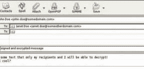

如何发送只有接收者才能解密的邮件

上面的`Enigma`是`Thunderbird`的扩展程序

`PGP`加密在`Tails`中用于以确保邮件是私密的

在选择正确的服务器供应商时，信任至关重要。凭借13年的服务器经验，在11个国家拥有6000名员工，是全球最大的互联网服务提供商之一。您可以信任我们高科技数据中心提供的最大安全保障。


- 最新`Intel®`处理器`E5-2600 V3`（最多10核/`2.3 GHz`）
- `128 GB` `DDR4 RAM`
- 高达`16 TB` `RAID`，硬件`RAID 6`和`SSD`硬盘
- `1Gbps`连接，无限流量
- 由于冗余组件，方便地将您的服务器连接到`Dell™`基础设施，使用`OpenManage`工具

完整的系列：从每月`19.99`英元的入门级服务器到具有最高尖能力的服务器。访问`land.co.uk`

不含`20%` `VAT`


- 专用服务器`X8i`每月`199.99`英元，6个月合同。
- 专用服务器`X10`每月`269.99`英元，6个月合同。适用常规价格。可用12个月和1个月合同（）。所有合同的设置费用。访问`www.land.co.uk`获取完整详情。`Dell`和`Dell™ PowerEdge`是`Inc`的商标。

# 特性

我们在`SUSECon 2014`会访了`SUSE`的高管，并发现一切都是开放的

对于`SUSE`来说，这是大的一年。去年的`SUSECon 13`团队宣布了`SUSE Linux 11`的新服务包。由于`SLE 12`终于发布，他们将`SUSE Cloud`变成了一个新产品`SLE 13`终于。新技术和新产品是`SUSE`进入会议的主题，以“始终开放”为主题，提醒大家，尽管`SUSE`正在开发新技术，但始终开放的。`SUSECon 14`再次是`IT`各层人员的活动盛周，参会人数和分会会议比以往任何时候都多。回到活动与`SUSE`的高层人员交流，感受`SUSE`在`2015`年的状况。

今年`SUSECon`的最新动态


`Nils Brauckmann`

总裁兼总经理

在`Nils`之上，`Kevin Loosmore`和`Michael`负责`SUSECon`的聊天环节

> `SUSE 12`是`SUSE Linux`的下一代平台


`Gerald Pfeiffer`

管理与运营高级总监

“如果你让我用一个词来描述去年……我不确定是否是一个标准的英语单词，也许你可以帮帮我……我可能会说‘交付’（`delivery`）。”

“确认收入，最终体现在资产负债表上的，正以`16%`的速度增长——比去年预期的好。但人们并没有真正考虑到这一点。你只能通过销售新业务的同时保留现有客户来增长。通过重复续约，你可以快速增长。”

“我们在`SUSE`正式开幕之前的简报会上与`Gerald Pfeiffer`聊过。使用`SUSE Linux`。`Flaxa`和`Nixmark`都是德国人，英语不是他们的母语。‘对承诺的交付，就是交付，对吧?’”

“那么`SUSE`的新业务进展如何？‘新业务在上半年以`47%`的速度增长，`65%`的订单归功于新的订阅和维护续约。’”


“当我们问他指的是什么更好的术语时，我们才完全清楚了。`SUSE`交付了我们想要的东西。还有一些我们计划要做但没说要做的事，”`Gerald`继续道，“‘在获得它之前，我们不会交付测试版。这只是对某事承担风险，直到它出来。’”

去年是`SUSE 12 SP1`，现在我们讨论的是`SUSE 12`——下一代平台。在增加可用性和运行时间领域的创新和功能，内核热补丁（`kernel-live patching`）正在发挥作用。

`Nils`本身对这种新产品和技术的交付为`SUSE`团队的量化有一些见解。我们所有人并没有不同，而是在持续增长……这意味着所有业务指标都在增长。（这是基于订单的）。因此，我们上半年的发票额以`27%`的速度增长，这非常强劲。”

热补丁（`Live patching`）是重大的——`Linux`内核与`Unix`相比最后实现的功能之一，也是许多遗留用户一直期待的功能。为什么花费了`20`年，一个解决方案才变成现实？


`Ralf Flaxa`

工程副总裁

最新版本的`SUSE`包含了来自`SUSE`和`Linux`的最新软件包和技术。`Ralf`告诉我们，“`12`版本获得与`11`版本相同数量的认证还需要一段时间时间，但这并不阻止我们的客户使用它。”


上方图为`SUSE Linux Enterprise 12`针对`IBM`的`POWER8`进行了优化

`SUSE`以尊重自由软件传统以及保持源代码开放为荣，我们发现这对我们的业务很有帮助。根据`Ralf`的所说：“你可以作为一家企业取得成功，同时保持对开源根源和概念的忠实——不变成垄断或接近垄断。通过这样做，我们做得很好。有客户来到我们这里说，当我们保持开源且值得信任时，与我们合作会变得非常容易得多。”

`SUSE Cloud`于`8`月发布，是我们云解决方案最新、最强大的版本。它基于`OpenStack`，支持`VMware`和`Hyper-V`以及其他开源虚拟机管理器。它还支持云存储，例如……

> “因为这该死的太难了，”我们从`Ralf`那里得到的直率令人惊喜的回答。显然，`SUSE`已经在这个问题上工作了一年多。对内核进行热补丁（`live-patch`）是一件非常困难的事情，它有自己的专有方案——例如`Oracle`——我认为社区必须学习并掌握它。一旦这个框架建立，像`Red Hat`和`SUSE`这样的不同发行版就可以在该解决方案的基础上开发，即如何在不重启的情况下实际实现热补丁。最近的内核版本在向上游提交补丁的过程中一直很挣扎。我们将在上游内核的基础上工作。我们现在正在逐部分地引入所有内容；‘我们不会因此阻留这项技术，我们会把它交给内核。’”

`SUSE`与客户和合作伙伴的关系至关重要，获取他们的反馈和建议不仅是为了让这些客户满意，也是为了给客户和开源社区：“从他们那里获得反馈对我们来说非常重要，因为这告诉我们他们真正需要什么。”正如产品经理`Gerald`所说，反馈是他工作工作中不可或缺的一部分。

我们与产品管理部门有一个引人入胜的流程，但我们产品的大部分工程不仅由`SUSE`驱动……与我们的合作伙伴社区——这是我们多年来发展的一种非常自然的工作方式。事实上，我们有一支技术客户经理团队与不同的公司合作，但他们实际工作是与内部团队以及`IBM`、`Dell`、`富士通`、`Cisco`、`HP`以及其他几公司进行技术协作。`Gerald`提到这一点是因为当我们谈论合作伙伴、与合作伙伴合作时，

`SUSE Storage`目前仅处于测试阶段，它是基于`Ceph`的云解决方案，可以与`Cloud`一起使用。根据`SUSE`团队`Gerald`的说法，它是一个客户的高度需求：“一个客户提到了它并：‘我想要存储……给我这个存储，我会付钱。’”

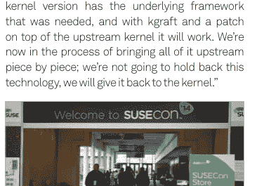

上方图为今年为期四天的会议在佛罗里达州的奥奥兰多举行

### 今年 `SUSECon` 的最新动态

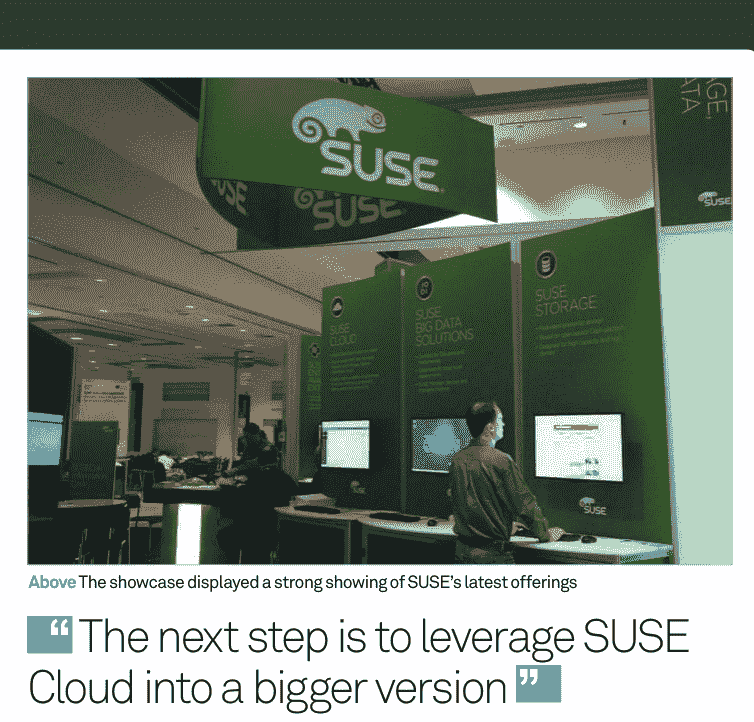

上方图展示了`SUSE`最新产品的强力呈现

### 下一步是利用 `SUSE Cloud` 扩展到更大的版本

测试环境，在这些环境中它们现在已经投入生产。下一步是在一个更大的基础设施版本中利用它。但因为`SUSE Cloud`是我们用于生产关键型工作负载的基础设施，因此无论是他们还是我们，都不会直接投入生产——在开发者的基础设施中使用它，然后在季度末，或者由客户决定将它们放在云环境的哪些建筑中。他们可能必须在季度末之前，这包含了非任务关键的工作负载，这就是为什么他们要在云端运行。这会让他们在明年有所改变。

热补丁和全新的`SUSE`是大动作，但`Ralf`认为他们的产物是：“`SUSE cloud`是这个领域的新秀。所以对于我们的许多客户来说——他们是为了概念这样做的——他们是为了概念这样做的”

到那时

`SUSE`正在让

立省`30%`

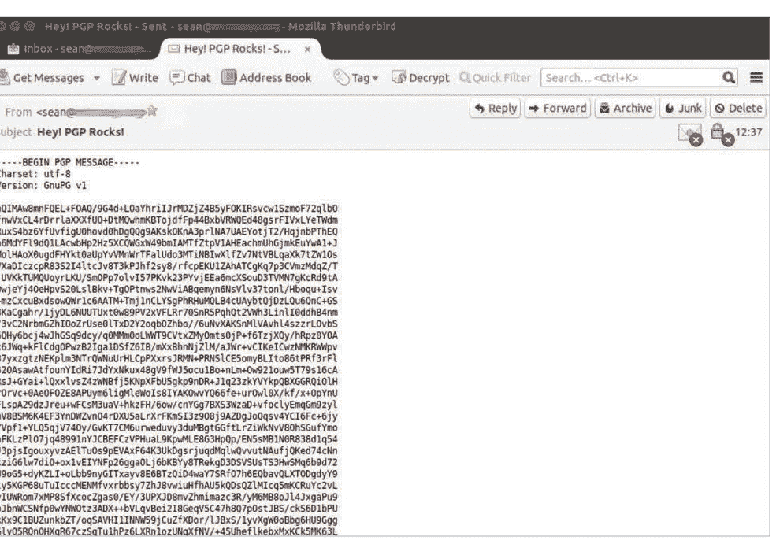

`Adviser Sean M Tracey` 是一家领先数字机构的创意技术人员。他花费大量时间在代码世界中：`Python`和`Android`。

#### `Ubuntu 14.04` / `Debian 7`

多年来，我们对在互联网上传输个人或敏感信息的能力充满信心。现在我们在在线上发送许多消息，希望在处理涉及金钱、生活和朋友的服务时感到安全，这是可以理解的。`SSL`、`HTTPS` 只是我们每天用来尝试确保绝对安全的少数协议之一。遗憾的是，最近的揭露表明，我们信任的协议并不像我们曾经认为的那样安全，或者说那么无阻碍。现在我们开始展望未来，思考如何利用开源工具（即这种`GNU Privacy Guard`）再次保护我们的私密通信，并确保阅读我们消息的人仅是我们发送消息给他们的人。

#### 使用 `Thunderbird` 和 `PGP` 发送和接收安全消息

安全地发送消息已经尝试了几个世纪。在战争时期、财务事务或重大交易中，安全性至关重要。尽管其重要性，但我们始终关注消息的机密性——我们如何确保只有接收消息的人实际上接收并解密了它？你如何加密一个可以由你所选择的人解密的内容呢？

“`Phil Zimmermann`在`20`世纪`90`年代初尝试回答这些问题，`PGP`就是他的产。`PGP`与其他方法不同；它不是一个可以加密解密文件或消息的单一密码或密钥，`PGP`有两个密钥。这两个密钥是公钥和私钥。公钥用于加密信息，并可以与任何人共享。私钥由你（这两个密钥的共同创建者）保存。当私钥与公钥结合时，它可以解密用公钥加密的信息。”

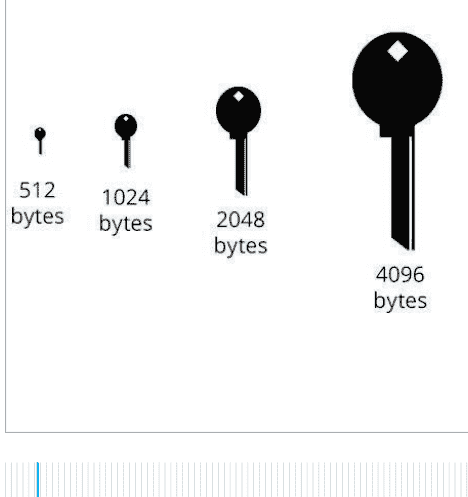

- `1024` bytes
- `4096` bytes
- `8192` bytes

#### 密钥越大，暴力破解的难度就越大

加密是一件困难的事。像计算中的许多复杂事物一样，我们只是在尝试处理它——我们需要一种可靠的方法来确保内容的完整性，否则就是那种我们不必从头开始的日子，因为我们有了`PGP` (`GNUPG/Privacy`)。

如果你正在运行`Linux`发行版，你的系统中应该已经安装了`PGP`。如果没有，你需要安装`GPG`。

现在我们指出如何创建密钥对——这些就是我们提到的公钥和私钥。在这个术语中，

```
gpg --install gnupg
```

这将你在`Ubuntu`或`Debian`系统上运行。如果你使用其他系统，可以从`www.gnupg.org/download/index.html`下载并编译源码。

要检查安装是否有效，请在终端中输入`gpg --help`。如果你看到任何选项，就可以开始操作了。

接下来是当天的任务。稍后我们将创建一个密钥对，因此你的密钥对设置过期日期并不是必要的。然而，如果你不喜欢不能过期的密钥主意，那么在提示时输入一个过期日期。`GPG`还会告诉你你在哪里可以确定创建一个需要这些密钥的密钥对。

由于这是你第一次使用`PGP`，你需要用密钥为你的身份签名。你需要输入真实姓名、注释（可选，用于描述你是谁）以及真实的电子邮件地址。一旦输入了所有内容，系统将要求你输入密码。这个密码可以是任何内容——确保你在笔记中记下它，因为你以后将使用它来访问你的密钥库。

你将看到以下选项呈现：

请选择你想要的密钥类型：

2) `DSA`和椭圆

4) `RSA` (仅签名)

我们正在使用一个选项，`RSA`密钥。系统会询问你的密钥。大小取决于你的系统，但始终选择所给选项的上限。这是因为密钥越大，未来通过暴力破解加密的难度就越大。

数据和熵，我们几乎无能为力来阻止这种痛苦。

#### 注释：撤销证书 (`Revocation certificate`)

撤销证书允许你在密钥泄露时使其失效。这是`PGP`系统的一个重要部分。要创建一个撤销证书，你使用以下命令：

```
gpg --generate-cert
```

这将创建一个撤销证书文件，你应该将其保存在安全的地方。如果你以后需要撤销密钥，可以使用此证书告诉其他人你的密钥不再有效。

### 06 设置 `Thunderbird`


那就是我们开始设置发送和接收加密电子邮件了。我们的主客户端是它。为了能够向我们发送加密电子邮件，他们需要访问我们的公钥——如果我们不告诉他们如何加密消息，他们该如何做呢？这看起来可能对安全来说有些遥远，但正是我们想要做的。越多的人拥有我们的公钥，就越好——让我们看看吧！

## 使用 Thunderbird 和 PGP 发送和接收安全消息

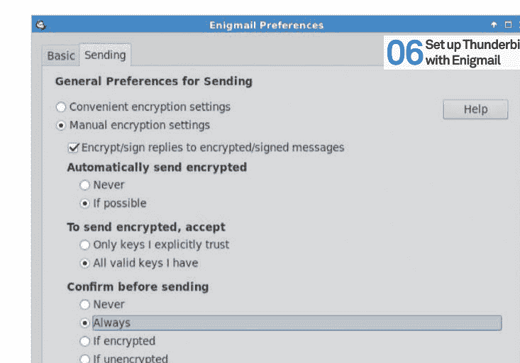

...将其识别为公钥，并询问你是否想要导入它。如果你不确定，可以要求他们给你发送一条消息，然后你可以使用 `PGP` 将证书也添加到你的密钥环（`keychain`）中。

将 `.asc` 文件移动到系统中系统中任可访问的地方（你的主目录），并在那里执行以下命令：

```bash
cd ~
gpg --import some_elves_key.asc
```

这将密钥导入到你的密钥环中，现在你已准备好发送消息了。

使用 `Thunderbird`，像往常一样撰写新邮件。确保你打算发送消息的对象的公钥已在你的密钥环中。如果你以前给他们发送过邮件，点击 `UI` 上的“加密”按钮并检查是否已启用。如果没有实际上启用，请从列表中选择正确的密钥。`Thunderbird` 会识别你想要发送到的接收者，并将自动发送加密消息。如果未识别接收者，当你尝试发送消息时，会提示你选择合适的密钥。

一旦选择了密钥并发送了消息，它将带有你的签名发送。

将你的公钥引入世界的一种方法是告诉我们所有的联系人，我们期望进行加密。如果你不确定，选择一组人，这个方案对你更合适——但请确保不要向没有电子邮件地址的人发送。我们不知道如何找到它？我们可能需要专门为此插入一些中央仓库。关于公钥究竟是什么，你可以将其添加到任何密钥列表中——`PGP` 附带了一个预设的密钥 `gpg.ubuntu.net`，上传我们的密钥是广为人知的。你所做的就是导入：

```bash
gpg --list-keys [UUID]
```

你现在将获得你创建的所有密钥。它将显示类似“`pub4096-[UUID] 2014-30-10`”的内容。复制你使用的唯一密钥 ID，然后输入：

```bash
gpg --send-keys [UUID]
```

然后你将看到：

```
gpg: sending key [[UUID]] to hkp servers keys.pgp.net
```

这表示一切进展顺利。如果你想将密钥上传到不同的服务器，只需将密钥指向不同的位置：

```bash
gpg --send-keys --keyserver key_address YOUR_KEY
```

剩下的工作就是测试我们的设置了，让我们发一封邮件吧——但先选一个人作为接收者。

电子邮件的妙之处在于，当有人给你发送加密消息时，它会自动为你解密！这是...

我们查看了 `PGP` 如何工作、共享我们的密钥、设置我们的电子邮件以处理客户端和需求，以及使用加密消息。

如之前所述，如果你收到加密消息，你需要导入接收者的密钥。如果有人通过邮件（带有 `.asc` 文件）向你发送他们的公钥，你可以将其导入你的密钥环。假设你的 `Thunderbird` 设置运行正常（并且你已经在 `Thunderbird` 中打开了带有密钥的邮件），双击 `.asc` 附件。`Thunderbird` 将...

尽管有他人的潜力，但在加密方面，电子邮件涉及的内容仍然是未加密的。当谈及电子邮件安全时，人们经常争论说这不需要担心，因为他们“没有什么好隐藏的”。很好，隐私是一种特权，是一种权利，是人们应该主动选择的权利。


`Surf` 使用命令行搜索上百种引擎和资源，将浏览器留给浏览。对于脚本下载非常有用，`cURL` 可以从命令行上传、获取标头或字典查询。

使用命令行进行搜索、编辑和通信。

`Richard Smalley`，一位 Unix 全能手，总是说他会通过“渗透”来学习。这并不难，他只是热爱命令行。从每个应用都在命令行上运行到完成一切。

`Surf` 使用命令行搜索上百种引擎和资源，将浏览器留给浏览。对于脚本下载非常有用，`cURL` 可以从命令行上传、获取标头或字典查询。

... `Surf` 识别你想要发送到的接收者...


### HTTP request:200 OK
```
Length:343
Content-Type:text/html
...
```

# 教程

## cURL 获取
像 `Wget` 一样方便，`cURL` 是一个灵活得多的获取工具，而且它还可以发送数据，对于快速检查你网站的状态非常有价值。

```bash
curl -I getoneearth.org
```
`curl -I` 将头部信息传递到终端，

## 双向传输
`cURL` 默认工作到标准输出（`STDOUT`），适用于脚本处理，但 `-o` 可以保存资源，使用小写的 `-o` 允许你指定名称，`cURL` 会在终端显示输出并带有进度条。

可以使用 `-u` 指定凭据，通过该切换帮助 `http` 文件和上传到本地创建的文件。

```bash
curl -u username:password -T "file1.file" ftp://myserver.com -T "(patch,module" ftp://myserver.com
```

`cURL` 允许你使用 `PUT` 或 `POST` 方法代替 `GET`，用于测试网站功能，请参阅多部分示例。

## 更改格言
查看登录时收到的 `cURL` 消息？`cURL` 为你提供一个标题，以及来自网络海量资源的任何其他内容。

例如，对于 `homebuyers.com`，你将获得一个强大的管理组件，这可能从你最近的通信中获得。

```bash
curl -s http://server.net/cgi-bin/get -o "file.txt" -d "id=123" -g | grep html
```

```bash
aria2c --seed-ratio=1.0
```

## 获取 aria2
`Wget` 默认在处处安装，`cURL` 也是默认状态。相比之下，`aria2` 并不知名，但它是获取 `ISO` 或任何文件或软件的好方法，通过元链接根据位置、语言和操作系统跟踪最佳版本。

## 分享（下载）
`aria2` 支持种子（`torrent`），这是下载他人内容的最佳方式。从上传到分享下载率可以轻松完成。

```bash
listen-port:6000
dht-port:6000
seed-ratio:2.0
max-upload-limit:50
```

无论是 `aria2` 还是其他工具，相同的选项都适用，你必须开始打开配置文件，并针对你常见的关注点设置合理的默认值。

## 不要重复配置
`aria2` 配置会将你的命令行保存为下载评级速率、来自种子种的限制等。

不寻常且需要更改默认值——但如果你没有安装配置文件：

```bash
log-level:warn
max-connection-per-server=4
min-split:5M
on-download-complete-exit
```

## 关于 BBC
`get_player` 是一个小型的程序，在 `BBC iPlayer` 服务发布后，它有一个连接到 `x86` 平台的程序，且在没有快速连接的情况下无法流式传输。

偶尔它有助于应对服务的变更，随着我们的推移，`BBC` 删除了提供 `get_player` 部分和 `PVR` 能力的节目源。请查看 `squarepenguin.co.uk` 的更新：

`www.linuxuser.com`

## 从终端使用网络
使用命令行进行搜索、下载和在线通信


```bash
File Edit View Bookmarks Help

richard@bubble:~$ works get iplayer -n purge --type=radius --pid 1

get iplayer v2.83, (C) 2008-2010 Phil Lewis

此包提供了高级功能详情供使用

这是免费软件，欢迎在某些条件下进行重新分发；详情请参 --options。

INFO: -

INFO: Trying to use b00j104 using radio

INFO: Trying to stream video using radio

INFO: -

INFO: Checking existence of default

INFO: Using fallback will be tried for next version

INFO: Trying flashcache mode to record: BBC iPlayer feeds

INFO: Using profile -- BBC iPlayer -- b00j104 default

Connecting... 

Starting download: 0.000 kb

INFO: Metadata:

INFO: 2052.04
```


# 元数据与日志信息

INFO: `movPosition` 36.00

INFO: 2.00

INFO: `ascc`

INFO: `multisample` 64100.00

INFO: `audiochannels` 2.00

INFO: -

INFO: Shelby Holmes

INFO: Music and Extra

INFO: BBC Radio & Extra

INFO: GATM

为什么 Helen Simon 在她婚礼前夕，在这些神秘的情况下那样说？

*British Broadcasting Corporation 2014, 版权所有*

INFO: `crpt`

INFO: -

INFO: `Cgen`

INFO: `coday`

Shelby Holmes 25 10 2014

Podcast

INFO: `trackinfo:`

# 界面与文件列表


## 按数字下载

```
H: Edit View Search help

H: 22 Dec 08 14:36 - @ bubble.com

Character: 1 richard ree

Character: 2 richard ree

Character: 3 richard ree

Character: 4 richard ree

Character: 5 richard ree

Character: 6 richard ree

Character: 7 richard ree

Character: 8 richard ree

Character: 9 richard ree

Character: 10 richard ree

Character: 11 richard ree

Character: 12 richard ree

Character: 13 richard ree

Character: 14 richard ree

Character: 15

Character: 16 richard ree

Character: 17

Character: 18 richard ree

Character: 19

Character: 20 richard ree

Character: 21

Character: 22
```


`Community_Building_01_10.pdf`
`Community_Building_02_10.pdf`
`Community_Building_03_10.pdf`
`Community_Building_04_10.pdf`
`Community_Building_05_10.pdf`
`Community_Building_06_10.pdf`
`Community_Building_07_10.pdf`
`Community_Building_08_10.pdf`
`Community_Building_09_10.pdf`
`Community_Building_10_10.pdf`
`Community_Building_11_10.pdf`
`Community_Building_12_10.pdf`
`Community_Building_13_10.pdf`
`Community_Building_14_10.pdf`
`Community_Building_15_10.pdf`
`Community_Building_16_10.pdf`
`Community_Building_17_10.pdf`
`Community_Building_18_10.pdf`
`Community_Building_19_10.pdf`
`Community_Building_20_10.pdf`
`Community_Building_21_10.pdf`
`Community_Building_22_10.pdf`

# 使用 Capistrano 进行持续部署

自动化你的 Web 应用到服务器的部署

# 教程

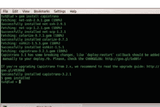

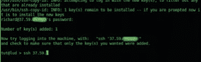

| 可用版本： |
| :--- |
| 1.8.6-p383 |
| 1.8.6-p378 |
| 1.8.6-p420 |
| 1.8.6-p366 |
| 1.8.7-p249 |
| 1.8.7-p310 |
| 1.8.7-p382 |
| 1.8.7-p373 |
| 1.8.7-p354 |
| 1.8.7-p334 |
| 1.8.7-p352 |
| 1.8.7-p357 |
| 1.8.7-p358 |
| 1.8.7-p370 |
| 1.8.7-p379 |
| 1.8.7-p376 |
| 1.8.7-p374 |
| 1.8.7-p375 |
| 1.9.1-p310 |
| 1.9.1-p378 |
| 1.9.1-p430 |
| 1.9.2-p010 |
| 1.9.2-p180 |
| 1.9.2-p258 |
| 1.9.2-p290 |
| 1.9.2-p318 |
| 1.9.2-p311 |
| 1.9.2-p325 |
| 1.9.2-p326 |

## 03 服务器端

### 01 安装 Capistrano

本质上，`Capistrano` 会通过 `SSH` 从 `Git` 将你的应用复制到服务器，并处理你原本需要手动完成的所有操作。`Capistrano` 将处理任何数据库迁移、文件更改以及重启 Web 服务器等操作。安装 `Capistrano` 以及一个非常有用的额外包非常简单：

```bash
gem install capistrano
```

如果遇到任何问题，请检查你的 `Ruby` 安装。你可能其他地方看到的 `capistrano-ext` gem 已经不再需要，因为额外的功能选项已经集成到主代码库中。

## 03 服务器端

在你的服务器上，你需要一个 `Ruby` 环境和 `git`，`Capistrano` 将使用它们获取最新版本（或适用于你应用的旧版本）：

### 04 组装 gems

对于 `Rails` 项目，你可以跳过安装步骤，只需编辑你的 `Gemfile` 以包含你需要的任何内容。你可能需要在项目的 `Gemfile` 中包含更多内容：

```ruby
gem 'capistrano', '~> 3.2.1'

gem 'capistrano-rails', '~> 1.1.2'

gem 'capistrano-rspec', '~> 1.0'

if你正在使用 Rbenv

gem 'capistrano-rbenv', '~> 2.0'

if你正在使用 Unicorn 应用服务器

gem 'unicorn-cap'

if你正在使用 Puma

gem 'passenger'
```

### 02 SSH 密钥

如果你使用 `SSH` 密码登录服务器，现在是生成密钥的时候了。这样 `Capistrano` 以及其他范围就可以实现自动登录，如果你想在其他地方使用这个好主意。如果你想能够设置启动密钥，还需要添加你的 `GitHub` 账户：

```bash
ssh-keygen -t rsa
```

...如果你在 `~/.ssh/` 还没有密钥，请将 `/.id_rsa.pub` 复制到服务器：

```bash
ssh-copy-id -i ~/.ssh/id_rsa.pub user@remote-host
```

...这通过替换你的用户名和服务器地址来工作。

你的设置不需要任何像 `Bundler` 这样的包，所以执行：

```bash
gem install --no-ri --no-document
```

通常情况下，你还需要根据你的设置配置数据库或独立的数据库服务器。一个 `Rails` 的用例是：在开发者的笔记本上使用 `SQLite`，在生产服务器上使用 `PostgreSQL`。

```bash
gem install --no-doc --no-ruby
```

`3.2.1` 意味着运行时它将安装 `3.2.2`，而不会安装 `3.3.0` 以避免主版本更改破坏你的代码。

这将集成 `Capistrano`，`bundle install` 会安装并安装 `Gemfile` 中指定的 gems。


# 教程

## 准备部署

```bash
capfile deploy/b production/b
```

```ruby
server "27.58.xx.xx", :db, :primary: true

require "capistrano/deploy"

set :application, "myapp"

set :user, "root"

set :deploy_to, "/var/www/#{fetch(:application)}"

set :deploy_via, :remote_cache

set :repo_path, nil
```


repo do

```
set repository, "https://github.com/myblog.git"

set branch, "master"

end
```

## 05 配置

`bundle install` 创建必要的配置文件和目录。在这一步中，我们指定了 `Capistrano` 将应用部署到 `staging` 或 `production` 服务器的操作。注意，`staging` 和 `production` 是默认通过 `config/deploy` 创建的，如果你想添加第三个阶段，可以添加一个 `.cap` 文件。或者，你可以一次创建所有阶段：

```bash
cap install stages=staging,production
```

## 08 准备部署

向你的项目添加了一些行：

| 名称 | 类型 | gitignore |
| :--- | :--- | :--- |
| `config` | directory | `*` |
| `db` | directory | `*` |
| `deploy` | directory | `*` |
| `shared` | directory | `*` |
| `vendor` | directory | `*` |

## 06 配置

最后的 `Capfile` 用于 `Capistrano` 加载 `config` 下的文件。通过编辑 `Capfile`，你可以控制加载哪些插件。

```ruby
require "capistrano/rails"
require "capistrano/deploy"
require "capistrano/migrations"
```

...确保上述结尾的 `deploy` 行存在且未注释。该行确保了 `capistrano/rails` 的所有文件都被加载，你在 `capistrano/tasks` 中定义的任何自定义任务。

## 07 Secrets

记住应用中的所有内容与团队共享，因此编辑 `.gitignore` 文件添加此行：

```
config/database.yml
```

现在你可以编辑 `/config/database.yml` 在 `staging` 和 `production` 环境中展示你的数据库。重启你的服务器并检查 `http://localhost:3000` 是否正常工作。注意我们只部署了一个阶段。你可能还想为 `Ruby` 环境添加一些特定设置：

```ruby
set rbenv_type, :system or :user

set rbenv_version, "2.1.2"

set rbenv_root, "$ENV['RBENV_ROOT']"

RUBY_PATH=#{fetch(:rbenv_path)}/bin/env

VERSION=#{fetch(:ruby)}

set rbenv_map, [:rake, :gem, :bundle]
```

## 11 并行

使用派自 `Rake` 的简单 `on` 语法：跨服务器拆分任务很容易。例如，在每个服务器上运行某些操作：

```ruby
on all, :parallel do

  # 这里的并行任务

end
```

让你的服务顺序启动任务以避免冲突共享数据库，通过定义 `sequence`：

```ruby
on all, :sequence, wait: 15 do

  # 这里的顺序代码

end
```

对于大型集群的重启，你可以将服务器分组进行部署：

```ruby
on all, :groups, limit: 3 do

  # 你的重启 ...

end
```

## SSHkit

`Capistrano` 的开发过程产生了由 `Ian Hambley` 开发的 `SSHKit` 库，他让 `Capistrano 3` 相比之前的版本有了改进。

`SSHKit` 是 `Capistrano` 用于日志、连接管理和命令执行的所有低级工具包。可以使用它在一个或多个服务器上运行命令。

`SSHKit` 在你第一次使用时构建。要使用它，可以从 `GitHub` 页面上的示例开始并为你的网站进行适配。

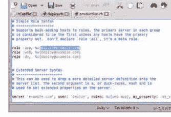

## 09 测试与准备

当你的测试失败时，设置测试会有帮助：

```bash
# tests list lib/capistrano/tasks/

run_tests.cap

set :tests, :
```

现在你编辑 `config/deploy/production` 中的 `:server_name` 和 `server` 为你的服务器域名。

当你需要部署时，可以添加 `task_setup:config` 来安装服务器软件，这在多个服务器的情况下是理想的。但在早期的手动服务器设置中，保持简单。

`SSHKit` 构建了一个受限路径：

```ruby
on hosts do

  within "/" do

    puts capture(pwd)

  end

end
```

在后台，`File.join()` 正在处理构建路径和功能的文件：

```
/var

/var
```

## 12 离开 Rails

有大量的文档可以帮助你的项目。访问 `http://capistrano.com`。

你可以在 `Capistrano` 开发者的示例 `bitly/Foo` 中看到不同组服务器的代码，专门用于取代前版本功能弱得多的部署方式。

## 10 部署

现在我们的配置收尾了字符串；当执行以下命令时开始运转起来：

```bash
cap deploy
```


第一次时，你需要在配置上做一些工作——在许多设置的情况下你具体概述了这些。`Capistrano` 设计用于扩展和缩小你的基础设施，所以你的应用和服务器将与以前不同。尽管如此，如果你部署到多个服务器上，它们可能会提供你可以遵循的 `Capistrano` 示例：

`Capistrano` 的模块化和灵活性使得有很多探索空间以获取你需要的内容。它是一个用于跨远程服务器并行运行任务的实用程序...


使用 `SSH` 连接到主机

无需设置 `ssh-keys` 即可运行


带命令运行：


上述 `SSHKit` `GitHub` 页面上的大量使用示例展示了其潜力

37 | linux.co.uk

# 教程


# `BIND`

最广泛使用的 `DNS` 服务端软件

最后修改日期：2014年5月21日

`BIND` 是一项实现了互联网域名命名系统（`DNS`）协议的开源软件，它是这些协议的参考实现，但也是适用于高流量和高可用应用的生产级软件。
`BIND` 堪称是互联网上最广泛使用的 `DNS` 软件，它提供了一个健壮稳定的平台，组织可以在此基础上构建分布式计算系统，并确保这些系统完全符合 `DNS` 标准。

- 链接与信息
- 下载 `BIND`
- `BIND` 文档
- `BIND` 支持
- `BIND` 发布版本
- `BIND` 邮件列表
- 软件策略
- 版本号
- 漏洞报告
- 安全披露政策
- 安全告告
- 当前属性
- 世界首创（`BIND` 手册）

# 使用 `BIND` 创建用于查询请求的缓存 `DNS` 服务器

## 建议

> `Mihalis Tsoukalos` 是一位 `UNIX` 管理员、程序员（`UNIX` 和 `IO`）、数据库管理员和数学家。他自 1993 年起一直使用 `Linux`。

### 通过运行你自己的 `DNS` 服务器来减少网络流量并节省 `DNS` 请求

`DNS`（域名命名系统）是将人类可读名称转换为 `IP` 地址（反之亦然）的——没有它，你就无法浏览互联网或获取电子邮件。被称为 `DNS` 或简单称为名称服务器的邮件客户端通过让机器学习需要特殊的服务器软件来支持 `DNS` 这一事实来支持域名命名系统。网络设备必须至少配置一个 `DNS` 服务器才能正常运行，但为了增加冗余，你应该使用多个 `DNS` 服务器以确保网络设备无论出现什么问题都能正常工作。任何域名都可以通过其 `IP` 地址处理。`DNS` 区域是被委托的域的一部分。因此，`.co.uk` 域名拥有一个或多个名称服务器来回答其查询。`.co.uk` 域管理员委托所有子域的管理是非常合理的，否则它将不得不管理所有的 `.co.uk` 子域，你可以想象的，这些子域非常多。

### 资源

`BIND` 主主页：`http://www.isc.org/bind/`

`RFC 1034`: 域名：`tools.ietf.org/rfc/rfc1034`

`RFC 5936`, `AVFR`：`www.linuxuxer.co.uk`

## 创建缓存 `DNS` 服务器

减少网络流量并更快地提供 `DNS` 请求


| `HOST(1)` | | `BIND 09` | | `HOST(1)` | `03` |
| :--- | :--- | :--- | :--- | :--- | :--- |
| 名称 | | `host - dns lookup` | | `host` 工具程序 | |

| 概要 | `host [-CersTwy] [-c class] [-n opts] [-m number] [-t type] [-w wait] [-flag] [-4] [-n] (server)` | |

**描述**

`host` 是一个用于执行 `DNS` 查询的实用程序。它通常用于将主机名解析为地址。在不给出任何选项时，`host` 会打印其命令行和选项的摘要。

`name` 是要查找的域名。它可以可以是点分十进制 `IP` 地址或可以是冒号分隔的 `IPv6` 地址，在这种情况下，`host` 将返回规范域名以及处理查询的名称服务器的 `IP` 地址，或者 `/etc/resolv.conf` 中列出的服务器。

`-m` 选项等同于设置选项并请求 `host` 对给定类型进行查询。

当使用 `-c` 选项时，`host` 将尝试显示给定名称的 `SOA` 记录。如果存在多个答案，`host` 将返回找到该名称的名称服务器列表。

`-t` 选项对指定的类进行 `DNS` 查询。这可以用于查找 `Hero` 或 `Chaos` 主记录。默认类为 `IN`。

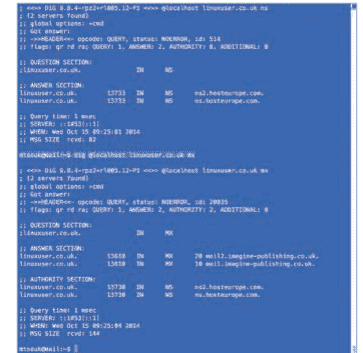

# 01 `BIND`

用于伯克利命名域和 `DNS` 协议的实现。在 `Debian 7` 系统上，你可以通过运行以下命令安装最新版本的 `BIND`：

```bash
# apt-get install bind9
```

要找到你的 `BIND` 版本，请执行以下命令：

```bash
# named
BIND 9.8.4-r2+deb015.10.1
```

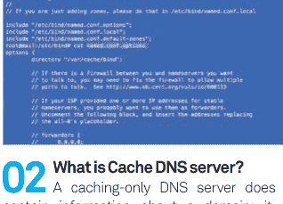

# 03 `host` 工具

`host` 生成的输出看起来正在查找 - 它在 shell 脚本内部很容易使用。特别地，它是 `DNS` 服务器的名称。如果没有找到，它将使用 `/etc/resolv.conf` 文件来查找 `DNS` 服务器。

使用 `-m` 参数，`host` 会显示某个域或子域的邮件服务器：

```bash
# host -mx linuxer
linuxer.com is handled by 10
mail.publishing.linuxer.com is handled by 22
```

"handled" 之后的数字是偏好值，指示邮件交换的优先级。值的大小并不重要，重要的是它们彼此之间的关系。

邮件服务器应该投递到值最低的邮件交换服务器。如果值相同，将尝试下一个最高值的交换器。如果两个或多个邮件交换器的优先级相同，则可以选择其中任何一个。主 `DNS` 服务器负责定义域或子域的邮件服务器。通过 `-ns` 参数，`host` 显示

# 04 `dig` 工具

`dig` 可以显示与 `host` 相关的信息，然而今天 `dig` 的输出更流行。使用 `dig` 查找域的 `DNS` 服务器，在 `dig` 的帮助下你可以这样做：

```bash
$ dig ns

Trying to perform AXFR query

$ dig linuxer.com
```

```bash
$ dig 9.8.4-r2+deb015.10 localhost linuxer.com axfr

Transferred failed
```

`AXFR` 是复制 `DNS` 数据的方法，也可以用于其他用途。`master` 允许访问 `AXFR` 设置并将其限制在范围内。

# 05 `/resolv.conf`

使用 `/resolv.conf` 方法是编辑该文件。你可以看到设置 `DNS` 服务器；每个条目都以 `nameserver` 开头。你可以放置任何 `IP` 地址作为 `DNS` 服务器。通常，管理员处理此文件；否则 `Linux` 机器获取 `DHCP` 配置。

# 02 什么是缓存 `DNS` 服务器？

缓存 `DNS` 服务器不包含域的信息；它包含基于其执行的 `DNS` 查询结果的信息。缓存有效的主要原因是 `DNS` 数据并不频繁变化。


# 教程

```bash
root@mail:etc/bind# cat named.options
```

// 如果你和 `DNS` 服务器之间有防火墙，你可能需要修复防火墙以允许端口（例如 `tcp/53, udp/53`）
// 如果你的 `ISP` 提供了 `DNS` 服务器的 `IP` 地址，你可能想将它们作为转发。
// 添加以下块，并替换缓存服务器

```bind
forward {
  8.8.8.8;
}
```

// `BIND` 记录关于根的错误消息
// 查看 `/var/log/bind/bind.log`

```bind
dnssec-validation: auto;
auth-notify no;
```


# RFC2135

## 06 named 工具

`named.conf`是名称服务器控制。它控制名称服务器的操作并使用`TCP`连接与`named`进程通信。`named.conf`有配置文件和对`named.conf`的语法检查。你可以使用`rndc-checkconf`和`rndc-check-named`获取更多信息。

## 08 /etc/bind/bind.conf

`BIND`的所有配置文件都位于`/etc/bind/`目录下。如果你想重启`named`进程使更改生效，则需要对其进行更改。

## 10 默认配置

默认的`BIND`配置能够支持缓存`DNS`服务器。只有当你允许客户端时才需要开启递归。你可以通过在`named.conf.options`中添加`'recursion':'yes'`的行来实现。

`BIND`在`/var/cache/`内部了一些其他文件。

下一步是将进程运行`DNS`服务器。

### ls -l /var/cache/bind/

```
-rw-r----- root root 698 Oct 15 09:46 managed-keys.bind
-rw------- root root 512 Oct 15 09:46 managed-keys.json
-rw-r----- root root 946 Oct 15 11:01 named_dump.db
-rw-r----- root root 1103 Oct 14 10:58
```

## /etc/bind/bind.conf

你还需要添加访问控制列表来减少流量并增加安全性，你将在第14 步学习访问控制列表。`DNS`服务器通常按端口号`53`列出，你可以从以下输出看到：

## 07 其他类型的 DNS 服务器

有两种类型的`DNS`服务器：主和从。每个域应该至少有一个主`DNS`服务器和一个从`DNS`服务器。

主（或`Master`）服务器定义了其具有权威性的一个或多个区域。从`DNS`服务器被分配给一个主区域。

从服务器（或`Slave`）主要在主`DNS`服务器由于某些原因宕机时充当其备份。

缓存服务器与客户端的解析器几乎相同。区别在于它不执行递归查询；它只是将查询转发到另一个`DNS`服务器，获取响应并缓存结果。

无法从查询服务器查明答案是从主区域还是从从区域回答的。

## 09 bind.conf 文件

`bind.conf`文件持有关于单个点的信息，用于初始化互联网域名命名服务器的缓存。你可以通过运行以下命令手动生成它：

```bash
+ * telnet localhost
trying:...
- Connected to localhost.
```

## 11 管理缓存 DNS 服务器

你已经知道如何启动服务器。以下命令停止它：

### /etc/bind/bind.conf restart

然后此命令重启：

```bash
[ Stopping domain name service....
waiting for pid 24173 to exit
ok
[ ] Starting domain name service....
bind9.
```

```bash
$ dig @la.root-servers.net - NS > db.root
```

## 创建缓存 DNS 服务器

减少网络流量并更快速地响应`DNS`请求


```bash
$ host -t ns linuxer.co.uk linode
; connection timed out; rmBook:Downloads mtsouk$
$ host -t ns linuxer.
Using dns server:
Name: Linode
Address: 109.74.193.253#53
Aliases:
linuxer.co.uk server ns.hosteurope.com.
linuxer.co.uk server ns2.hosteurope.com.
$ host -t ns linuxer.co.uk linode
Using dns server:
Name: Linode
Address: 109.74.193.253#53
Aliases:
```

对于本教程而言，最有用的工具是`named-checkconf`，它会检查配置（`ACL`）的语法有效性。如果你的当前配置没有错误，将不会有任何输出。没有任何工具可以检测本地`DNS`错误。

| OPTION | DOMAIN |
| --- | --- |
| AUTHORITY | |
| QUESTION | |
| ANSWER | |
| AUTHORITY | |
| SECTION | |
| AUTHORITY | |
| AUTHORITY OPTION | |

### 12 使用缓存 DNS 服务器

缓存服务器就像一个大型`DNS`服务器器。如果你想减少局域网（`LAN`）的流量，将缓存服务器的`IP`放入`/etc/resolv.conf`文件中，而不是所有的其他`DNS`服务器。然而，如果缓存服务器停止工作，可能会导致问题；你的网络将无法运行。

### 14 访问控制列表 (ACL)

`acl`列表定义了哪些主机可以访问`DNS`服务器。以下行定义了一个新的访问控制列表：

### 16 测试缓存 DNS 服务器

要测试你的`DNS`服务器，请查询一个不在缓存中的查询，并查看回答该查询需要多久。接下来再次再次相同的`DNS`查询，查看更好的响应时间。

```acl
acl OTENET {
  2/8;
  localhost;
  localnets;
};
```

列表的定义不会自动使其激活。你应该添加以下行来开启`OTENET`访问控制：

```acl
allow-query { any };
```

随着`DNS`服务器开始运行，许多主机将尝试连接它；因此，不要延迟生成任何访问列表，以保护你的`DNS`服务器。

### 17 缓存服务器的优势

在网络上使用缓存`DNS`服务器的优势是局域网流量和互联网速度。你的`DNS`服务器会对已经请求过的查询做出快速响应。`BIND`有一个内存计数器，可以将所有到`DNS`服务器的请求转储，并在时间到达时重新读取这些内容。

### 13 BIND 的日志

所有的`BIND`消息都记录在`var/log/syslog`中。`named`命令可能会产生大量消息，因此你可能决定在确保你的`DNS`服务器运行无任何问题后，使用`named`降低日志级别。

### 15 检查你的配置

`BIND`自带了许多工具，可以帮助你检查当前配置的正确性。这些工具包括`named-checkzone`和`named-checkcompile`。

```bash
$ rndc dumpdb --all
# > /var/cache/bind/named_dump
# -r -r 1 bind 9446 Oct 15 11:15/var/cache/bind/named_dump
```

### ## 所有来自 BIND 的消息都存储在 /var/log/syslog

# LinuxDeveloper 教程

这是关于`LUKS`设备的基本信息，它显示了加密、模式、哈希算法和其他加密数据。

此命令生成`LUKS`头部转储。所有的`LUKS`命令后面都可以跟一个命令：

```bash
$ user@ubuntu:~$ sudo cryptsetup -v /dev/sda1 /home/nitish/basefile

LUKS header Information for /home/nitish/basefile

cryptdm:
  name:        aes
  cipher:      plain64
  Hash algo:   sha256
  Payload offset: 4096
  Salt:
    d7 33 09 8e 11 1f 74 24 69 64 67 74 8c 15 1c 79 36 27 43
    17 2d 23 07 20 44 24 27 2c 21 21 3b 33 3d 80
  UUID:
    bc0a490d-8d2a-4f22-b5f9-fc25d3bd
iterations: 191616

Key Slot 0: ENABLED
  Salt:
    72 33 71 4c 68 40 63 82 65 64 61 63 65 52 57 23 65 8f
    b9 0c 63 64 77 79 48 62 85 55 28 37 23 8c 0
AF offset: 4000

Key Slot 1: DISABLED
Key Slot 2: DISABLED
Key Slot 3: ENABLED
Key Slot 4: DISABLED
Key Slot 5: DISABLED
Key Slot 6: DISABLED
```


## 所有的 BIND 消息都存储在 /var/log/syslog

# LinuxDeveloper 教程

这是关于 `LUKS` 设备的基本信息，它显示了加密、模式、哈希算法和其他加密数据。

此命令生成 `LUKS` 头部转储。所有的 `LUKS` 命令后面都可以跟一个命令：

```bash
$ user@ubuntu:~$ sudo cryptsetup -v /dev/sda1 /home/nitish/basefile

LUKS header Information for /home/nitish/basefile

cryptdm:

  name:        aes

  cipher:      plain64

  Hash algo:   sha256

  Payload offset: 4096

  Salt:

    d7 33 09 8e 11 1f 74 24 69 64 67 74 8c 15 1c 79 36 27 43

    17 2d 23 07 20 44 24 27 2c 21 21 3b 33 3d 80

  UUID:

    bc0a490d-8d2a-4f22-b5f9-fc25d3bd

iterations: 191616

Key Slot 0: ENABLED

  Salt:

    72 33 71 4c 68 40 63 82 65 64 61 63 65 52 57 23 65 8f

    b9 0c 63 64 77 79 48 62 85 55 28 37 23 8c 0

AF offset: 4000

Key Slot 1: DISABLED

Key Slot 2: DISABLED

Key Slot 3: ENABLED

Key Slot 4: DISABLED

Key Slot 5: DISABLED

Key Slot 6: DISABLED

nitish@ubuntu:~$
```

## 创建缓存 DNS 服务器

减少网络流量并更快速地响应 `DNS` 请求


```bash
$ host -t ns linuxer.co.uk linode

; connection timed out; rmBook:Downloads mtsouk$

$ host -t ns linuxer.

Using dns server:

Name: Linode

Address: 109.74.193.253#53

Aliases:

linuxer.co.uk server ns.hosteurope.com.

linuxer.co.uk server ns2.hosteurope.com.

$ host -t ns linuxer.co.uk linode

Using dns server:

Name: Linode

Address: 109.74.193.253#53

Aliases:
```

对于本教程而言，最有用的工具是 `named-checkconf`，它会检查配置（ACL）的语法有效性。如果你的当前配置没有错误，将不会有任何输出。没有任何工具可以检测本地 `DNS` 错误。

| OPTION | DOMAIN |
| --- | --- |
| AUTHORITY | |
| QUESTION | |
| ANSWER | |
| AUTHORITY | |
| SECTION | |
| AUTHORITY | |
| AUTHORITY OPTION | |

### 12 使用缓存 DNS 服务器

缓存服务器就像一个大型 `DNS` 服务器。如果你想减少局域网（`LAN`）的流量，将缓存服务器的 IP 放入 `/etc/resolv.conf` 文件中，而不是所有的其他 `DNS` 服务器。然而，如果缓存服务器停止工作，可能会导致问题；你的网络将无法运行。

### 14 访问控制列表 (ACL)

`acl` 列表定义了哪些主机可以访问 `DNS` 服务器。以下行定义了一个新的访问控制列表：

### 16 测试缓存 DNS 服务器

要测试你的 `DNS` 服务器，请查询一个不在缓存中的查询，并查看回答该查询需要多久。接下来再次查询相同的 `DNS` 查询，查看更好的响应时间。

```acl
acl OTENET {

  2/8;

  localhost;

  localnets;

};
```

列表的定义不会自动使其激活。你应该添加以下行来开启 `OTENET` 访问控制：

```acl
allow-query { any };
```

随着 `DNS` 服务器开始运行，许多主机将尝试连接它；因此，不要延迟生成任何访问列表，以保护你的 `DNS` 服务器。

### 17 缓存服务器的优势

在网络上使用缓存 `DNS` 服务器的优势是局域网流量和互联网速度。你的 `DNS` 服务器会对已经请求过的查询做出快速响应。`BIND` 有一个内存计数器，可以将所有到 `DNS` 服务器的请求转储，并在时间到达时重新读取这些内容。

### 13 BIND 的日志

所有的 `BIND` 消息都记录在 `/var/log/syslog` 中。`named` 命令可能会产生大量消息，因此你可能决定在确保你的 `DNS` 服务器运行无任何问题后，使用 `named` 降低日志级别。

### 15 检查你的配置

`BIND` 自带了许多工具，可以帮助你检查当前配置的正确性。这些工具包括 `named-checkzone` 和 `named-checkcompile`。

```bash
$ rndc dumpdb --all

# > /var/cache/bind/named_dump

# -r -r 1 bind 9446 Oct 15 11:15/var/cache/bind/named_dump
```

## 所有的来自 BIND 的消息都存储在 /var/log/syslog

# Linux 开发者教程

## 04 创建目标文件

现在 `cryptsetup` 已经成功安装，我们需要创建一个文件系统作为 `LUKS` 容器的占位符。创建文件有很多方法，但有几点需要注意：

- 文件应该是一个非稀疏文件（nonsparse file），这意味着合并设备应该被分配完整的磁盘空间。
- 文件中应该填充随机数据，确保它不是完全空的，这样数据才能从根本上被加密。

`dd` 命令虽然速度有点慢，但可以帮助创建一个满足上述要求的文件。只需使用 `/dev/random` 作为输入，目标文件作为输出即可。示例命令如下：

```
dd if=/dev/random of=/home/nitish/basefile bs= count=1
```


# Linux 开发者教程

## 04 创建目标文件

现在 `cryptsetup` 已经成功安装，我们需要创建一个文件系统作为 LUKS 容器的占位符。创建文件有很多方法，但有几点需要注意：

- 文件应该是一个非稀疏文件（nonsparse file），这意味着合并设备应该被分配完整的磁盘空间。
- 文件中应该填充随机数据，确保它不是完全空的，这样数据才能从根本上被加密。

`dd` 命令虽然速度有点慢，但可以帮助创建一个满足上述要求的文件。只需使用 `/dev/random` 作为输入，目标文件作为输出即可。示例命令如下：

```bash
dd if=/dev/random of=/home/nitish/basefile count=1
```

这将在 `/home/nitish/basefile` 内部创建一个大小为 128MB 的基础文件。请注意，这可能需要相当一段时间才能完成，因为在很大程度上取决于你的系统速度。

## 05 创建 LUKS 分区

创建文件后，你需要在文件内部创建一个 LUKS 分区。该分区作为安装文件系统的基础层。在此之上，LUKS 头部（header）包含了配置和所有设备所需的所有信息。使用 `cryptsetup` 命令来创建 LUKS 分区：

```bash
cryptsetup format /home/nitish/basefile
```

数据被加密后，将通过密码提示进行解密并在验证后，LUKS 分区即被创建。你可以使用以下命令进行检查：

```bash
file basefile
```

注意，输入的密码用于数据加密。记住并保持密码安全非常重要，因为如果你忘记了密码，几乎肯定会丢失分区中的所有可用数据。

## 06 创建并格式化文件系统

我们现在创建的 LUKS 分区现在可以格式化为文件系统。在我们的示例中，它是 `/home/nitish/basefile`，尚未加密，但 LUKS 容器已作为一个加密设备存在。为了做到这一点，我们必须首先在上面格式化文件系统，然后将其挂载。映射命令如下：

例如，我们使用了 `ext4`，因为它对 Linux 系统来说是合适的。

```bash
mkfs.ext4 -j /dev/mapper/volume1
```

文件系统成功格式化后，下一步是挂载它。你需要先创建一个挂载点，最好在 `mnt` 文件夹内（为了示例目的）。

```bash
cryptsetup open /home/nitish/basefile volume1
mount /dev/mapper/volume1
```

在通过密码成功身份验证后，LUKS 分区被映射到名称 `volume1`。`basefile` 将显示为本地块设备，系统的其余部分现在可以像真实设备一样使用它。

现在进行最后的挂载：

```bash
mount /dev/mapper/volume1 /mnt
```

## 07 文件系统备份与维护

为了进行交叉检查，你可以看到使用 `dev/mapper/volume1` 的文件系统设备已挂载。最后，你可以通过格式化 `ext4` 文件系统来使用这个启用 LUKS 的设备——你写入该设备的任何内容都将被加密，而你读取的任何内容都将被解密并显示给你。

LUKS 容器现在作为系统上的普通设备可用。在将其用于任何常规操作之前，我们需要对其进行格式化并创建文件系统。你可以将其用于你系统上的任何文件系统。

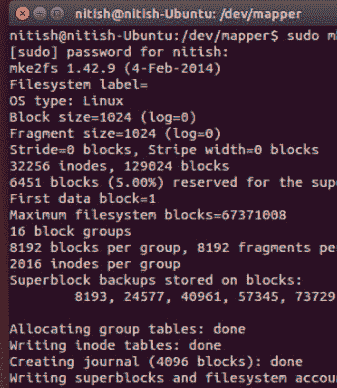

# 使用 dm-crypt 和 LUKS 加密数据

掌握已过时的 `TrueCrypt` 的最佳替代工具

教程

```bash
nitish@nitish-Ubuntu:~$ 
nitish@nitish-Ubuntu:~$ sudo cryptsetup luksHeaderBackup /home/nitish/basefile -header-backup-file /home/nitish/09_Backup
nitish@nitish-Ubuntu:~$
```

我们花了几个步骤才到达这一步，如果你不熟悉它，可能会对一次性步骤（设置）和日常使用所需的步骤感到困惑。让我们考虑一种情景：你完美地遵循了所有步骤，然后丢失了电脑。当你启动电脑时，你找不到挂载设备——它去哪儿了？请在启动系统后保持 LUKS 容器挂载状态，并在关机前将其卸载。

LUKS 容器中丢失的大部分数据由于 LUKS 头部的损坏，这可能是由于意外覆盖头部导致的，完全的硬盘故障也是现实。备份是防止此类问题的唯一方法。让我们来看看各种备份选项。

在使用 `dm-crypt` 时还有其他实用的技巧。让我们在这里查看：

对于 LUKS 头部，`cryptsetup` 有一个名为 `luksDump` 的选项。这允许对正在使用的设备的 LUKS 头部拍摄快照。示例命令如下：

要备份 LUKS 头部，使用 `luksDump` 命令：

```bash
luksDump /home/nitish/basefile
```


## 07 文件系统

LUKS 容器现在作为系统上的普通设备可用。在将其用于任何常规操作之前，我们需要对其进行格式化并创建文件系统。你可以将其用于你系统上的任何文件系统。


# 使用 dm-crypt 和 LUKS 加密数据

掌握已过时的 TrueCrypt 的最佳替代工具

教程

```bash
nitish@nitish-Ubuntu:~$ 
nitish@nitish-Ubuntu:~$ sudo cryptsetup luksHeaderBackup /home/nitish/basefile -header-backup-file /home/nitish/09_Backup
nitish@nitish-Ubuntu:~$
```

我们花了几个步骤才到达这一步，如果你不熟悉它，可能会对一次性步骤（设置）和日常使用所需的步骤感到困惑。让我们考虑一种情景：你完美地遵循了所有步骤，然后丢失了电脑。当你启动电脑时，你找不到挂载设备——它去哪儿了？请在启动系统后保持 LUKS 容器挂载状态，并在关机前将其卸载。

LUKS 容器中丢失的大部分数据由于 LUKS 头部的损坏，这可能是由于意外覆盖头部导致的，完全的硬盘故障也是现实。备份是防止此类问题的唯一方法。让我们来看看各种备份选项。

在使用 `dm-crypt` 时还有其他实用的技巧。让我们在这里查看：

对于 LUKS 头部，`cryptsetup` 有一个名为 `luksDump` 的选项。这允许对正在使用的设备的 LUKS 头部拍摄快照。示例命令如下：

要备份 LUKS 头部，使用 `luksDump` 命令：

```bash
luksDump /home/nitish/basefile
```

# Linux 开发者教程

## 04 创建目标文件

现在 `cryptsetup` 已经成功安装，我们需要创建一个文件系统作为 LUKS 容器的占位符。创建文件有很多方法，但有几点需要注意：

- 文件应该是一个非稀疏文件（nonsparse file），这意味着合并设备应该被分配完整的磁盘空间。
- 文件中应该填充随机数据，确保它不是完全空的，这样数据才能从根本上被加密。

`dd` 命令虽然速度有点慢，但可以帮助创建一个满足上述要求的文件。只需使用 `/dev/random` 作为输入，目标文件作为输出即可。示例命令如下：

```bash
dd if=/dev/random of=/home/nitish/basefile count=1
```

这将在 `/home/nitish/basefile` 内部创建一个大小为 128MB 的基础文件。请注意，这可能需要相当一段时间才能完成，因为在很大程度上取决于你的系统速度。

## 05 创建 LUKS 分区

创建文件后，你需要在文件内部创建一个 LUKS 分区。该分区作为安装文件系统的基础层。在此之上，LUKS 头部（header）包含了配置和所有设备所需的信息。使用 `cryptsetup` 命令来创建 LUKS 分区：

```bash
cryptsetup format /home/nitish/basefile
```

数据被加密后，将通过密码提示进行解密并在验证后，LUKS 分区即被创建。你可以使用以下命令进行检查：

```bash
file basefile
```

注意，输入的密码用于数据加密。记住并保持密码安全非常重要，因为如果你忘记了密码，几乎肯定会丢失分区中的所有可用数据。

## 06 创建并格式化文件系统

我们现在创建的 LUKS 分区现在可以格式化为文件系统。在我们的示例中，它是 `/home/nitish/basefile`，尚未加密，但 LUKS 容器已作为一个加密设备存在。为了做到这一点，我们必须首先在上面格式化文件系统，然后将其挂载。映射命令如下：

例如，我们使用了 `ext4`，因为它对 Linux 系统来说是合适的。

```bash
mkfs.ext4 -j /dev/mapper/volume1
```

文件系统成功格式化后，下一步是挂载它。你需要先创建一个挂载点，最好在 `mnt` 文件夹内（为了示例目的）。

```bash
cryptsetup open /home/nitish/basefile volume1
mount /dev/mapper/volume1
```

在通过的密码成功身份验证后，LUKS 分区被映射到名称 `volume1`。`basefile` 将显示为本地块设备，系统的其余部分现在可以像真实设备一样使用它。

现在进行最后的挂载：

```bash
mount /dev/mapper/volume1 /mnt
```

为了进行交叉检查，你可以看到使用 `dev/mapper/volume1` 的文件系统设备已挂载在。最后，你可以通过格式化 `ext4` 文件系统来使用这个启用 LUKS 的设备——你写入该设备的任何内容都将被加密，而你读取的任何内容都将被解密并显示给你。

## 为 Pebble 构建游戏

## 精灵

我们为游戏创建了自定义艺术作品。我们创建了一些游戏。

- 背景：我们的背景磁片是重复的、水平滚滚的 `30x16` 像素。
- 对象：我们的角色是一个 `30x30` 的精灵。我们还为游戏制作了一些敌人。

## 顾问

Tam Hanna 从 BBC 时代就开始进入 IT 行业。担任记者、演讲者，她多次观察了移动市场的各个方面。Don Nguyen 的非常受欢迎的游戏 Flappy Bird 包含一个简单的机制：你通过点击一个上升时下降的船来控制物体穿过管道。

从表面上看，Pebble 看起来并不是一个理想的游戏设备。如果我们观察它的单色 ARM 处理器，屏幕并没有显示色彩的能力。Pebble 通过四个按钮与用户交互，第三方应用程序可以轻松访问这些按钮。

# 为 Pebble 开发游戏

开发 Pebble 智能手表并随地玩游戏

教程

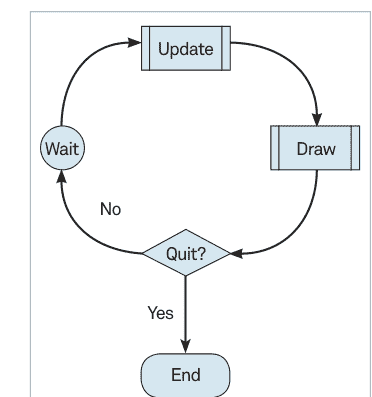

```c
void handle_init(void)
{
  my_window = window_create();
  myCanvas = layer_create(GRect(0, 0, 144, 168));
  window_stack_push(my_window, true);
  Layer* myLayer=window_get_root_layer(my_window);
  layer_add_child(myLayer, myCanvas);
  layer_set_update(myCanvas, updateGame);
  app_timer_register(34, timer_handler, NULL);
}
```

图 01

上面的游戏循环为大多数动画视觉提供了框架

# Pebble OS 包含一个层驱动的 GUI 栈

如上所示：每个更新周期后都会跟着一个专门用于刷新屏幕的周期。屏幕重绘次数通常被称为帧率。帧率达到每秒约 30 帧时，用户感知是流畅的。

它由一个名为 `main.c` 的文件组成，其默认内容如下：

```c
#include <peble.h>

void window_init();

Layer *textLayer;
```


# 在互联网上编程

`Pebble OS` 由一个基于 `Linux` 的软件开发包支持，大多数开发者选择通过 `CloudIDE` 进行开发。这是一组私有的网络化环境，通过手机启用到 `Pebble` 的远程控制。

`CloudIDE` 需要你使用任选浏览器访问 `https://cloudbble.net`。创建一个账户来管理你的项目并连接到 `Pebble Connect` 应用，该应用可以从 `Google Play Store` 下载。

`Manu` 开始为操作系统函数编写定义。我们继续创建两个点：一个指向 `Pebble` 窗口，另一个指向层（layer）对象。

`Pebble OS` 包含层驱动的 GUI 栈。这意味着普通应用程序倾向于由一个或多个窗口对象构建。这些窗口可以包含一个或多个层，这些层实现了实际的用户界面。

为了启用你的 `CloudBleble` 账户与手机上的账户匹配转发，请连接你的 `Pebble`。然后，进入`菜单->设置`并启用连接。然后，按照顺序打开`菜单`

层可以从操作系统提供的用户界面中移动，以确保更好的性能。

在编写时，开发者需要使用手持设备的测试版本，因为它仅运行在 `4.3` 及以上版本上；参见下文可能的安装方法。`IP` 地址已显示。

多个位图层将明显快于基于处理器速度绘制的层。

接下来，点击 `Create`（创建）按钮开始新项目。`Flaxy Puppy` 是基于 `Minimal` 模板的 `Pebble C SDK` 项目。

`Manu` 负责设置用户界面。它由一个形成空列表实体组成：

```
void handle_init(void)

{

  my_window = window_create();

```

`Pebble OS` 调用 `main()` 函数来启动应用程序。它调用 `event_loop()` 方法，该方法负责上述循环。调用将在程序终止时返回。随后，`handle_init()` 是

## 滴，滴答，滴答

我们的游戏将自己绘制在一个层中。这要求我们使用游戏循环——一个过程

这样，我们就准备好将应用程序部署到智能手表上。确保在 `connect` 应用中启用了设备，然后在 `CloudIDE` 中点击 `pebble` 按钮。在写入几秒后，程序应该出现在你的 `Pebble` 上。

```
int main(void)

{

  handle_init();

  app_loop();

  handle_init();

```


# Linux 开发者教程

## 黑色/透明

## 原图

## 白色/透明

点击 `Resources`（资源）标题旁边的 `Add`（添加）按钮启动导入向导。`Identifier` 字段必须提供有效的 C 常量，你的代码将用它来查找位图。

背景图像应作为普通的 PNG 图像添加，通过 Pebble 的平面化处理需要上传；“黑色中心”（`black-center`）和“白色中心”（`white-center`）都应转换为“带透明度的 PNG”。这导致了类似于左侧的资源结构。

任何嵌入资源在我们在使用之前必须先解压缩，这将在 `handle_init(ctx)` 中被调用

必须调用 `update_ctx(ctx)` 来处理位图(`ctx`) 的绘制

# 添加一些物理效果

我们版本的 `Flappy Bird` 不必是全屏的；我们将移动屏幕。这可以通过在游戏循环的每次迭代中引入转向输入来实现。

理想情况下通过更改 `handle_init` 的内容来实现，使其看起来像图 01（上一页）所示的版本。

`Handle_init` 起始创建一个全屏窗口以便其显示在屏幕上。然后将需要 `set_update_proc`

仔细观察你的背景。注意，其最右侧背景的内容现在与从一个磁砖到下一个磁砖的顺序匹配，然后创建一个连续的图案。我们通过两步绘制来实现这一点：第一个磁砖作为第一层绘制，其余的空白区域用白色矩形填充，矩形部分覆盖了显示器的右侧。大多数操作系统不允许开发者随心所欲地更新视觉效果，但如果渲染可以更有效。我们的 `update` 方法实际图片是一个简单的精灵（`sprite`）。

# 一月大特卖
仅需 1 英镑
尝试新事物

## 拓宽你的视野
拓展你的疆界

选择我们任何一本极具启发性且内容丰富的杂志进行试用订阅，您将保证每一期中都能学到新知识！

# 知识与科学


# 技术


任何杂志 3 期试用仅需 1 英镑*
在 `IMAGINESUBS.CO.UK/JAN15` 线上订
或拨打 0844 856 0644（报价代码 `JAN15`）

> *此优惠适用于英国 Direct 新订阅用户，以 1 英镑的价格获得前三期杂志！这些期结束后，将适用标准价格。订阅者将从下一可用期开始。必须提供代码 `JAN15` 才能享受此特殊订阅价格。可根据要求提供 `Imagine UK Direct` 保证详情。此优惠有效期至 2015年3月1日。

# 程序员与爱好者的必备指南

# 实用树莓派

62 “你将遇到 `Hexy`，一个六条腿、像螃蟹一样走路、跳《太空步》的机器人自然力量”


# 目录

- 66 `Pi Glass`：DIY 版 `Google` 眼镜
- 68 使用 `Pi` 设置无线打印
- 70 在 `Pi` 上托管你的网站
- 72 使用 `IPython` 管理集群
- 74 什么是树莓派机器人 (`Ras Pi robot`)?


# `Rapiro` 竞赛

在接下来的几个月里，我们将使用 `Rapiro` 进行更多编程——包括下期中如何远程控制它的教程——一旦我们完成，我们将让它去参加比赛，所以请保持关注！

## 树莓派机器人

## 发现周围最佳的机器人套件，并学习用你的 `Pi` 为它们编程

我们机器人主人的崛起已经开始——给五年时间，我们都受到 `PI` 驱动的充满慈悲机器的监视。尽管如此，我们评估了目前可以买到的最佳 `DIY` 机器人，让你在这场不可避免的革命中抢先一步。无论你是 `Arduino` 用户还是树莓派用户，我们将构建机器人来听从主控制器的指令，并向你展示如何使用套件来实现。我们还将对这些机器人进行评分，以识别它们的制造质量、重量和尺寸、开箱功能、构建过程，并判断哪种套件最适合你以及你可以在哪里购买。

然后呢？嗯，我们将通过受剑桥树莓派 `Rasp` 活动 (`piwars.org`) 启发的系列挑战来测试我们的机器人。超级月人 `Rob Zweetsloot` 更适合周末的机器人构建狂欢，他编写了代码，使这些机器人足够灵敏，能够轻松通过巡线挑战、近距离警报测试、复杂的障碍赛和三点转弯测试。他不仅止于此，`Rob` 还提到了如何……

现在是时候向你们介绍我们精选的机器人团队了——你们中的某些可能在《`Linux Developer`》之前的期数中见过它们。在接下来的几页中，你将遇到 `Raptor`（我们最类人化且令人喜欢的高达风格机器人）、`Pogo`（后部带有万向轮的小型双轮三轮车）、`Frindo`（配备传感器的开源移动机器人平台）、`Rover 5`（拥有 `Sensebrain` 且最高速度不可阻挡 `1km/s` 的坚硬坦克）、`Hexy`（那个六条腿、像螃蟹一样走路、跳《太空步》……


53 www.linuxuser.co.uk

## `Rover 5`
### `Seeeduino`

一个相对巨大的产物，`Seeeduino` 配备齐全，是一份很棒的礼物

如果你记得第 32 期，我们在那里制作了第一个机器人，你会记得我们使用的套件来自 `Robotics`。`Rover 5` 是该套件的继任者。`Rover 5` 稍微大一点，通常比特定的树莓派多几个功能，且 `Rover 5` 不需要树莓派，因为它完全由 `Seeeduino`（另一个 `Atmega-328p`）供电。

构建并不容易，需要大量的电线来连接板子。整个套件由单独制造的不同组件组成，这解释了作品中某些差异以及它们是如何组合在一起的。构建体位于 `Rover 5` 之上，非常适合 `DIY`，安装在 `Rover 5` 上时电线四处飞舞。

编程比其他机器人更容易，因为使用的是 `Arduino` 而不是串口命令，但你需要一些预设的教程来教你如何创建任何代码，由于 `Rover 5` 的每个部分都带有传感器，板子和机器人可以对几乎覆盖任何范围或附在其上的超声传感器做出反应。

## 技术规格

| 特性 | 详情 |
| :--- | :--- |
| 制造商 | `Dawn Robotics` |
| 高度 | 170 mm |
| 宽度和深度 | 225 x 235 mm |
| 重量 | 1.5kg |
| 电源 | 9伏 AA 电池 |
| 控制板 | `Seeeduino (Atmega328p)` |
| 运动方式 | 电机驱动的双轮 |
| 传感器 | 超声波和四个角传感器 |
| 网站 | `www.dawnrobotics.com` |

## 评分

| 类别 | 得分 |
| :--- | :--- |
| 组装 | 3/5 |
| 制造质量 | 4/5 |
| 可编程性 | 3/5 |
| 功能性 | 5/5 |

# 大项目
## 树莓派机器人

## 挑战 1... 障碍赛

由于 `Pi` 组织者的保密，撰稿团队只能猜测计划了什么类型的任务。他们留下的挑战是严格控制规则并更多地依靠自动化。在我们的场景中，我们使用一个具有特定主题的迷宫，在没有任何线条引导的情况下引导机器人到达墙壁以及墙壁沿路线的变化方式。

## 代码列表

此外，`Rover 5` 完美具备处理你扔给它的任何设备。通过它的传感器阵列，它知道前方是否有墙。我们还可以使用超声波传感器来确定它与墙的距离以及当你沿着路线行驶时墙的变化方式。

有一些针对 `Rover` 的棒代码可以让你沿着墙的右侧移动。你可以从 `URL` 获取它。通过 `Arduino` 上传；这是一项大任务，但通过解释代码的某些部分你会感觉好一些。首先有一个函数列表。这些包括通用代码中用于速度、沿墙和一小部分传感的方法。

```cpp
const int NUM_IR_SENSORS = 4;

const int IR_LEFT_PIN, NUM_IR_SENSORS[] = {A0, A8, A1, A1};

const int IR_RIGHT_SENSORS, NUM_IR_SENSORS[] = {A3, A2, A4, A5};
```

接下来，我们将通过转弯导航迷宫的一小部分，并为代码的结果使用有用数据——在目前情况下。之后，我们有多个部分之一。这被用于向前移动，寻找开放的路径，直到在注意到或撞到墙后发生事件。这将是后退、左转和右转。

```cpp
float ultrasonic = ultrasonicSensor.measureReading();

ultrasonicSensor.takeReading();
```


```cpp
int leftReading = gIRSensors.frontLeft();

int rightReading = gIRSensors.frontRight();

int back = gIRSensors.rearLeft();
```

最后，代码确保传感器在沿墙运行时盯着墙，以确保它还在那里。

```cpp
case eRI_DrivingLookingForWall:

    // 是否看到了障碍物

    if (gMotor.isStopped()) {

        if (gMotor.isalled()) {

            enterUpState();

        }

    } else {

        // 检查找到了墙

        if (ultrasonic <= CLOSE_ULASONIC_RANGE

            || leftReading >= CLOSE_WALL_VALUE

            || rightReading >= CLOSE_WALL_VALUE) {

            enterLeftState();

        }

    }

    break;
```

## Rover 5 完美应对任何课程

```cpp
void enteringWallOnState() {

    // 将超声波传感器指向右侧

    panAngle = LOOK_RIGHT_PAN_ANGLE;

    giltAngle = RIGHT_TILT_ANGLE;

    gpanServo.write(gpanAngle);

    giltServo.write(giltAngle);

    Motor.clear();

    grightMotor.clear();

    Motor.setTargetRPM(BASE_WALL_FOLLOWING_RPM);

    grightMotor.setTargetRPM(BASE_WALL_FOLLOWING_RPM);

    gStateStartEncoderTicks = gMotor.getMeasuredEncoderTicks();

    gRobotState = eRS_LookingWallOn();

}
```

上方主板连接到机器人后部，易于访问更多组件。

## Pi2Go Lite

作为我们测试过的最小的机器人之一，你可以说`Pi2Go`有些过人之处。

`Pi2Go Lite`是一个非常有趣的设备。它被装在一个微小的盒子里，没有使用底盘，而是采用了`PCB`结构，这使得它是一个非常简单的机器人，可以执行命令而不会真正接触复杂的环境。它听起来像是一个遥控机器人，但可能比牙玩具要好得多。

由于`Pi2Go`可能是本期功能最丰富的机器人，但所有这些功能都是代价的；它是一个在组装前需要一些焊接和准备工作的机器人。虽然需要进行一些焊接，但不需要剥去任何电线之类的。大约有 50 个组件需要安装，可能更多，而且可能有点棘手。说明并不特别有用，但组件实际上列在`PCB`上，作为放置物品位置的大致指南。

一旦你需要将这少数几个部件组合在一起完成它。网站列出的组装时间为 90 分钟，但我们发现要长得多——比其他更大或更复杂的机器人都要长。

它是一个紧凑的小家伙，通过自定义`Python`库由树莓派供电。传感、驱动电机和其他功能都有其相应的`Python`函数。它让你能够创建脚本使其完全自主运行，只要这种自主只需要达到距离和接近传感以进行操作，如果设置正确，它就可以从树莓派获取额外的时间或网络信息。

考虑到价格、功能和相对容易的编程性，它是一个极佳的设备，非常适合入门机器人和敏捷性开发。需要一些焊接技巧。

## 技术规格

| 特性 | 细节 |
| :--- | :--- |
| 制造商 | 4tronix |
| 高度 | 90 mm |
| 宽度和深度 | 130 x 145 mm |
| 重量 | 0.40 kg |
| 电源 | 9V AA 电池 |
| 控制板 | 树莓派 (`Raspberry Pi`) |
| 运动方式 | 两轮驱动 |
| 传感器 | 超声波传感器、两个巡迹传感器和两个障碍传感器 |
| 网站 | `www.pi2go.co.uk` |


## 评分

- 组装 3/5
- 质量 3/5
- 可编程性 4/5
- 功能性 5/5


56 `www.linuxuser.co.uk`

## 树莓派机器人

### 挑战 2：巡迹

沿着黑色的线条移动，尽管你可能在终点找不到一个魔法师。

巡迹非常简单；你在地板上画一条线，让机器人跟随它。这包括转弯，准确遵循路线到达目的地或累积圈数。`Pi2Go Lite`是我们本月看到的唯一带有巡迹传感器的机器人，尽管它有很多功能。然而，来源显示`Python`脚本中没有巡迹功能，因此我们需要编写一个脚本。

正如我们引导的，解决方案涉及巡迹传感器——这些是位于万脚轮`PCB`底方的红外传感器。我们还将让`Pi2Go`在走廊上运行并直奔终点。

我们将面临的一个问题是电机的运行速度可能不同——通过几次尝试，你可能在第一个前进命令中修复此问题，在50 的速度下我们全速前进。你可以根据需要将其调整得更慢或更快。

循环非常简单：它检查巡迹传感器是否被激活，通过转动轮子，我们需要为每个`True`语句在特定方向修正路线。你可以在`turnforward()`函数中单独设置左、右电机的速度，然后在返回循环之前设置一个停顿。

代码在你停止时结束，并在退出前清理`GPIO`端口设置。代码需要`pi2go` Python 文件，你可以在这里获取：`http://tronix.co.uk/blog/?p=475`


## 代码列表

```python
import time, pi2go
pi2go.init()
pi2go.forward(50)
```

```python
try:

    while True:

        if pi2go.leftleft == True:

            pi2go.turnforward(0, 50)

            time.sleep(2)

            pi2go.forward(50)

        elif pi2go.rightRight == True:

            pi2go.turnforward(50, 45)

            time.sleep(2)

            pi2go.forward(50)

        else:

            time.sleep(0.5)

except KeyboardInterrupt:

    print("Stopped")

finally:

    pi2go.cleanup()
```


> 获取代码 bit.ly/1zHW

57 www.linuxuser.co.uk

## Hexy 六足机器人

一个拥有六条腿、9 个舵机和一些疯狂动作的 Kickstarter 成功故事。

| 技术规格 | 细节 |
| :--- | :--- |
| 制造商 | ArcBots |
| 高度 | 100~120mm |
| 宽度和深度 | 约 300~400mm（立姿） |
| 重量 | 0.93kg |
| 电源 | 4 个或 7 个 AA 电池 |
| 控制板 | Arduino |
| 运动方式 | 6 条腿 |
| 传感器 | 超声波传感器 |
| 网站 | www.arcbots.com |


我们被这个合一套装惊到了，它履行了任何水平的初学者都能轻松组装的承诺。一切都包装良好，甚至还带了一个微型螺丝刀——这意味着你不需要其他工具了！在大多数情况下，说明非常棒，但也有几次由于清晰度不足导致了问题。这种边缘的设计非常有用——可以在原地旋转。你可以看到它是由坚固且轻质的材料制成的。软件非常合理——你可以设置 `Arduino` 并使用电机控制器驱动一切。这套套装的唯一真正问题是——螺丝。提供的包很大，但只有四分之一是单独的每个舵机的，因为舵机上的小孔对于中号螺丝来说太小了。较大的号可能行，但你仍然必须用蛮力来。这使得快速组装过程完全停止，但我们必须说 `Hexy` 绝对很糟糕。

`Hexy` 上方的蓝牙传感器提供了一种无线连接的简单方法。

评分
- 组装 3/5
- 质量 4/5
- 可编程性 5/5
- 功能性 5/5


58 www.linuxuser.co.uk

## 树莓派机器人

## 挑战 3...

### 三点转向


我们的机器人可以倒车，但它们如何轻松地完成 180 度转向呢？

对于 Pi 来说，这通常是一个棘手的挑战，特别是如果必须自主的话，要求机器人在转弯之前离开指定的区域，并在 750mm 的正方形内移动。一旦完成动作，转向并返回起点。为了这一点，你需要极其精确地知道速度和方向来实现 180 度转向。

`Hex` 的优势在于它可以字面上在原地旋转，或者移动它的脚而不需要示例代码即可实现。你只需要走到所需位置，转向并编写一个非常简单的脚本，让 `Hexy` 在尝试 180 度转向之前向前走几“步”，然后返回相同数的起始位置。

我们在这里提供部分代码，你也可以从下面的链接获取。

首先，我们定义了一些基本参数，`Hex` 将遵守这些参数。我们还设置了一个 80 的旋转参数，但你可能需要调整它。还创建了变量让代码更简单。

然后我们有一个循环，在开始和最后几步中，我们执行大量的向前步。这是前进步的分之一，一旦我们又走了 20 步，它就会停止循环。

## 代码列表

```python
deg = 25
midfloor = 30
hipspeed = 25
pause = 0
rotate_deg = 180
steps = 0
rotations = 0
```

```python
while True:
  if steps < 10:
    # 三脚时重新安置三脚2
    # 向后移动
    # 向前重新安置三脚2
    hex_LF.replantFoot(deg-hipSpeed, step=0.5)
    hex_RM.replantFoot(hipspeed, stepTime=0.5)
    hex_LB.replantFoot(deg-hipSpeed, stepTime=0.5)
  else:
    # 设置头部指向身体转向
    hex_neck.set(rotate_step)
    # 向前重新安置三脚组
    for leg in tripod2:
      leg.replantFoot(rotate=rotate, step, time=0.5)
    # 将三脚2作为三脚1原位安置
    for leg in leg2:
      leg.setPosition(int(floor(leg/2.0)))
    sleep(0.3)
```

## 下一步

上述前进和转向代码可以很容易扩展为完整的行道程序，带有线条、循环、叶子、指向观众甚至一个需要规划路径的姿态。只需获取 `Python` 源代码，并将这些 `Python` 块在你喜欢的任何地方整合你的主脚本中。

上面每条腿三个部分，每个部分包含一个舵机。这种关节结构可能让 `Hex` 能够爬上中等大小的物体和障碍。

### Frindo
低外形设计且配备大量正面传感器的圆饼型机器人

`Frindo` 更多地被用作机器人平台，而不是一个独立的全功能机器人，但这并不意味着它只是一个可以用于构建的基础。开箱即用你就可以用它做很多事情，而且由于它支持 `Arduino` 和 `Raspberry Pi`，非常易于进行扩展。

构造过程非常简单且快速，尽管在制作过程中你需要向电机焊接一些电线。这是 `Frindo` 上唯一需要进行的焊接。然而，在此之外还需要一些额外的步骤，并非每个人都具备相应的设备。尽管如此，实际底盘的构造以及电机、电路板和少量组件的安装可以很快地完成。

一旦你用 `Frindo` 完成了一些操作，就可以在带有或不带自带 `Arduino` 的情况下向系统添加更多功能。可以使用为 `Model B` 预留的孔位（遗憾不是 `B+`）安装在电路板的反面。还有空间可以安装四个额外的轮子，前后之间的空间可以轻松做到无遮挡，从而实现 360 度覆盖。`Uno` 和 `Pi` 可以根据需要接入更多的输入和输出。

由于双控制器的存在，`Frindo` 可以使用 `Python` 和 `Arduino IDE` 进行编程。`Arduino` 使用标准库和命令，非常适合不熟悉 `Python` 的人员。`Python` 程序使用串口库，该库使用了 `Arduino` 的术语，且网站上有一个很好的基础示例，可以帮助你准确理解传感器和电机如何以这种方式运行。

`Frindo` 是我们最易上手的机器人。非常简单、非常优秀，且非常适合学习，拥有丰富的机器人应用场景。

## 技术规格

| 特性 | 数值 |
| :--- | :--- |
| 制造商 | Frindo |
| 高度 | 85mm |
| 宽度和深度 | 直径 160 mm |
| 电源 | 6 节 AA 电池提供 9 伏 |
| 控制板 | Arduino 和 Raspberry Pi |
| 运动形式 | 轮子 |
| 传感器 | 4 个红外接近距离传感器 |
| 网站 | www.robotbits.com |

> `Above The Robot Shield` 已作为开源版本捐赠给 `Frindo` 项目

## 评分情况

- 组装：4/5
- 做工质量：4/5
- 可编程性：4/5
- 功能性：4/5

## 挑战 4...

### 测距传感器

你如何敢于走向赛道终点的那堵墙呢？

这个挑战看起来相当简单：在撞击木墙之前直接开到它面前。距离越近，得分越高。使用你的测距传感器不触碰应该是应该是的，对吧？嗯，这并没有你想象的那么简单，而且测距传感器不太可能完全有效。一定有办法的。

`Frindo` 的传感器具有某种形式的距离传感功能，尽管并不完美。你还需要校准的另一件事是假设直线行驶时的程序运行速度和停止距离。`Frindo` 的电机可能不同步，这很可能会导致轻微的角度。使用前方传感器有多种方法，我们可以利用左右传感器来检测墙的边缘，并利用 `Frindo` 本身来实现完美的停止。

在接下来的章节中，我们将定义什么构成 `Frindo` 的停止——可以通过反复尝试进行修改，以为你的解决方案获得更准确的结果。距离值并不对应于定义如何计算传感器读取值的某一个部分，以便在最后部分可以使用它们。如果它在路径上发现任何障碍，可以从 `FileSilo` 下载此脚本的后续代码。

## 代码列表

```cpp
int frontTrigger = 200;
int sideTrigger = 100;
int rearTrigger = 100;
```

```cpp
int front_bump() {
    if(bump = analogRead(FrontBump) > frontTrigger) {
        return 1;
    } else {
        return 0;
    }
}
```

```cpp
void loop() {
    Serial.print("Here we go...");
    while(!front_bump()) {
        // 当没有碰撞时，继续向前移动
        // Serial.begin(9600);
        if(!left_bump() && !right_bump()) {
            Serial.println("未检测到碰撞 - 向前移动");
```


```cpp
rs.forward(500);

// 以速度 200向前移动 50 ms

// 全速的 (200/255)

}

else if(left_bump() && right_bump()) {

    Serial.println("检测到左侧碰撞 - 角度错误");

    rs.rot_left(100);

    // 以速度 200 向左转 100 ms

    // 全速的 (200/255)

}

else if(!left_bump() && right_bump()) {

    Serial.println("检测到右侧碰撞 - 角度错误");

    rs.rot_right(100);

    // 以速度 200 向右转 100 ms

    // 全速的 (200/255)

}

}
}
```


# 赢得这款机器人

`bit.ly/1RAgbQ3`

### `GoPiGo`

带有 `WASD` 控制的简单直观的 `Pi` 机器人

# 获取代码

格斗机器人

`bit.ly/1ypcCQd`

`GoPiGo` 是我们正在测试的最棒的套件之一——它以一种很好的方式保持简单，没有任何负面含义。承诺的 20 分钟组装时间完全没有夸张。由于不需要焊接，这台机器人从架上拿下来后几乎就可以运行，对于任何想要组装第一台机器的人来说，它都是理想的礼物。考虑到低于 100 美元（65 英镑）的价格，它是一个极佳的底部，可以在开源范围内在此基础上构建 `Pi` 和控制板，并有足够的空间构建更高级的项目。

开箱即用，`GoPiGo` 将能够配合 `Dexter Industries` 的固件工作，让你对这个带有万向轮的双轮机器人进行 `WASD` 控制，它能够实现某种三位一体，除了基础的速度控制外没有其他功能。作为一个基于树莓派的项目，为超声波传感器或摄像头等开发更高级的运动脚本和控制非常适合这项任务。

然而，有一个批评意见：设计上有一个缺陷，导致无法连接轮子。轮子安装在轴的末端，只需通过一个小凹槽就可以轻松弹掉。较短的轴长度和刮到轮子的螺母意味着，很难实际转动轮子以提供在整个行驶过程中所需的耐用性。尽管如此，考虑到 `GoPiGo` 提供的英制质量，这仍然感觉是我们最喜欢的套件之一。

## 技术规格

| 特性 | 数值 |
| :--- | :--- |
| 制造商 | `Dexter Industries` |
| 高度 | `85 mm` |
| 宽度和深度 | `130 x 110 mm` |
| 重量 | `0.60 kg` |
| 控制板 | `Arduino (Uno328P)` 和 `树莓派` |
| 运动方式 | 双轮驱动 |
| 传感器 | 无 - 可选 `Pi` 摄像头光学方案 |
| 网站 | `www.dexterindustries.com` |

# 组装：5/5

# 做工质量：3/5

# 可编程性：3/5

# 功能性：1/5

最适合初学者。

`64 www.linuxuser.co.uk`

# 评分说明

以下是我们对这些机器人质量和能力的判决分类说明。

### `Rover5`
- 组装：实际操作中有点复杂，但仍然很不错 3/5
- 做工：通常良好，但有些螺丝有点廉价 4/5
- 编程：对于那些复杂的 `Arduino` 体验来说，可能会有点困惑 3/5
- 功能：牵引力大，控制出色，并且感知周围环境 5/5

### `Rapiro`
- 组装：耗时但但因为尺寸原因并不繁琐 4/5
- 做工：它非常结固，重心低 5/5
- 编程：提供非常简单的 `Arduino` 指令 3/5
- 功能：`Rapiro` 可以根据你的命令移动，这是它的核心 2/5

### `P2Go`
- 组装：将套件焊接在一起耗时且不容易 3/5
- 做工：它非常稳定，但底盘就是它的电路板 4/5
- 编程：自定义 `Python` 库使其编程变得相当容易 4/5
- 功能：就其尺寸和价格而言，它拥有惊人的功能 5/5

### `Frindo`
- 组装：简单快速；基础底架很容易构建 4/5
- 做工：非常结固，其形状和所有组件都受到了保护 4/5
- 编程：如果你喜欢 `Arduino`，你可以用 `Python` 编写代码 4/5
- 功能：`Frindo` 配备了三个传感器，但可以升级 4/5

### `Hexy` 六足机器人
- 组装：相当直接，但宽宽的阵列没有帮助 3/5
- 做工：通常相当结固，但与螺丝不一致 4/5
- 编程：`PoMoCo` 允许通过视觉和滑块对 `Hexy` 进行完全控制 5/5
- 功能：移动能力非常巨大，但它还能做更多 5/5

### `GoPiGo`
- 组装：结构简单快速，花费不到一小时 5/5
- 做工：通常良好，但轮子有一个问题 3/5
- 编程：可以使用简单命令并进行完全编程 5/5
- 功能：`GoPiGo` 可以在轮子上移动，但它没有传感器 1/5
- 夹子夹在你的普通眼镜或墨镜上，所以你不必担心牺牲
- 视频显示：眼镜顶部的小屏幕提供 `320x240` 的显示，感觉就像在看几英尺之外
- 从原始眼镜取出的所有组件已重新接线并密封在这个部件中
- 电源：如果你想在移动中使用 `Pi Glass`，请将其插入便携式电池包

# 组件列表
- `树莓派 B`
- 微型视频眼镜
- 带触控板的 `USB` 键盘
- `USB` 电池包
- `3D` 打印文件 (`.stl`)
- 复合线
- `AWG` 线
- 热缩管

# DIY 树莓派项目：`Pi Glass`

`Adafruit` 联合作者 `Pedro Ruiz` 制作了视频眼镜，制作 `3D` 打印的类 `Google` 附件

### 你是如何开始接触 `Adafruit` 的？
- 大约一年前，我们参加了他们的节目并告诉他们我们正在做什么。这并不像一个可穿戴项目那么简单：带有 `Adafruit LED` 的 `3D` 打印带带和他们的……

# 使用你的树莓派进行无线打印

通过将树莓派作为无线打印服务器，为旧打印机注入新生命


> **你需要什么**
- 最新版本的 `Raspbian` 镜像
- `USB` 打印机
- `USB` 无线网卡

无线打印让向橱柜、棚屋和远程房间内的设备打印成为可能。它从根本上改变了整个打印流程，并实现了智能手机、平板电脑、笔记本电脑和台式电脑的输出。但为了这项工作，你不需要一台崭新的打印机；旧打印机现在有了原生支持，不必沦进垃圾桶。

## 01 检查你的打印机运行正常

在开始之前，检查你计划用于该项目的打印机仍然正常工作并且有足够的墨。最简单的方法是查看文档（如果可以的话在线查看）并运行测试打印。

设置过程非常简单。你把树莓派连接到电脑上空闲的 `USB` 端口。在树莓派上安装 `Samba` 和 `CUPS`（通用 Unix 打印系统），剩下的只需从你的台式电脑连接无线打印机、安装驱动程序并开始打印。

`CUPS` 为树莓派提供了一个基于浏览器的管理界面，可以从网络上的任何设备查看，从而实现对无线网络打印机的完全控制。


`Christian Cawley`
自 2010 年以来的软件爱好者和工程师，他在线和杂志上为计算机和智能部件编写过文章

## 无线打印

### 通过将默认用户 `'pi'` 添加到打印机管理组开始配置

### 加入工作组

完成这些添加后，在配置中搜索 `"workgroup"` 并添加你的工作组：

```


`workgroup = your_workgroup_name`

确保取消第二个设置的注释，这样 `Windows` 就能看到打印机了。保存更改并重启。

```
sudo /etc/init.d/cups restart
```

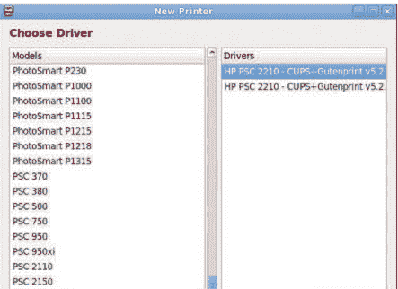

## 02 检测你的打印机

当你的树莓派设置好且打印机已连接到 USB 端口后，输入：

```bash
lsusb
```

这将确认树莓派已检测到打印机。在大多数情况下，你会看到制造商和型号名称。

## 03 安装 CUPS

安装 `Samba` 以启用整个网络的文件共享：

```bash
sudo apt-get install cups
```

创建服务器后，通过将默认用户 `pi` 添加到打印机管理员开始配置。

```bash
sudo apt-get install cupsadmin
```

## 04 设置打印机管理员

安装 `CUPS` 打印机后，启动树莓派（GUI）或启动浏览器，输入 `127.0.0.1:631`。在这里地址并启用“Printers”（打印机）以及允许从任何地方访问管理权限。接下来，添加你的打印机并在提示时输入你的树莓派用户名和密码。

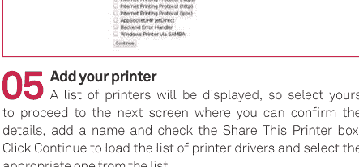

## 05 添加你的打印机

将显示打印机列表，选择你的进入下一个屏幕，在其中你可以确认详情、添加名称并勾选“Share Printer”（共享打印机）框。点击下一步查看打印机驱动列表，并为它们选择合适的。

## 06 为网络打印配置 Samba

使用 `Windows` 打印？`Samba` 需要一些配置。在 `nano` 中打开 `/etc/samba/smb.conf`，按 `(Ctrl+W)` 查找 `[printers]` 并找到 `guest`，你应该添加以下内容：

- `guest = ok`
- 搜索 `"[printer]"`,然后按如下更改路径：
- `path = /usr/share/cups/drivers`

## 07 添加打印兼容性

你还可以从 `iPad` `AirPrint` 系统打印。要实现这一点，你需要添加 `Avahi Discovery`。

```bash
sudo apt-get install avahi-discover
```

你的打印机现在可以从 `iPad` 或 `iPhone` 发现，并准备好打印了。

## 08 在网络上访问你的打印机

同时，从 `Linux`、`Mac OS` 或类 Unix 系统访问 `CUPS` 会更容易。你只需要将打印机添加到网络，路径就会显示。


## 在树莓派上托管你自己的网站

不要为主机托管付费。配置你的树莓派作为 Web 服务器并托管中小型网站

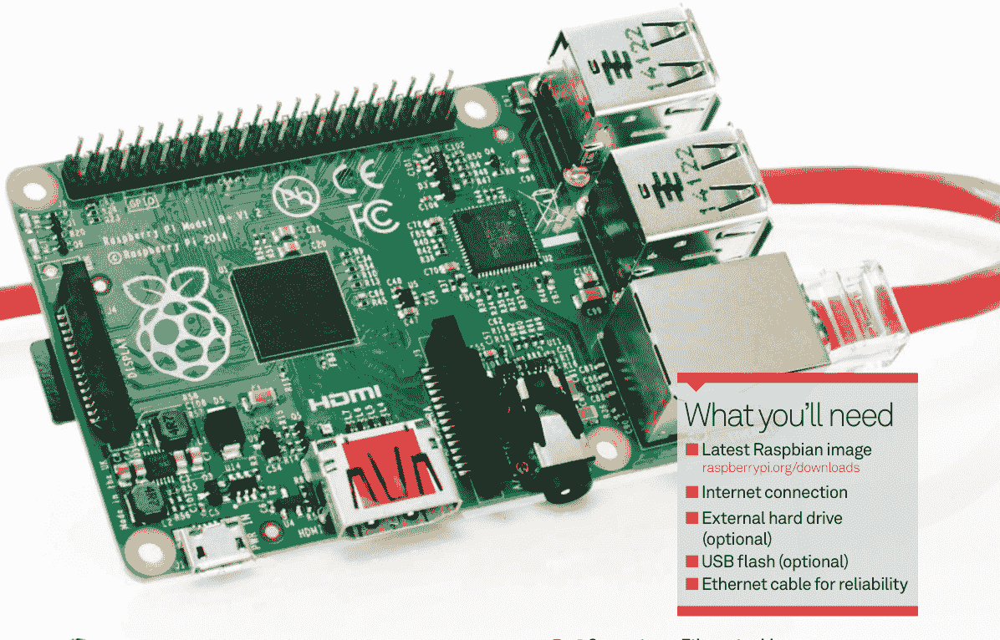

需要一个轻量级、低成本的 Web 服务器吗？树莓派就是你需要的！无论你是计划托管一个静态首页（或使用极少数据库的）还是开发项目的方便家园，将树莓派设置为 Web 服务器都异常地简单。

得益于低功耗需求，树莓派是作为常开设备的理想选择，它可以放在路由器旁边随时待命。你可能希望托管你的某些项目，或者一个托管照片或简历的个人页面。

如果你计划将其作为面向 Web 的设备，你的 Pi 需要一些基础配置。确保你的互联网路由器为你的用户提供静态 IP 地址非常重要。通常租用静态 IP 是收费的，但有一些你可以使用的服务（如 `noip.com`）。

## 你需要

- 最新树莓派镜像 (`raspberrypi.org/downloads`)
- 互联网连接
- 外部硬盘（可选）
- USB 闪（可选）
- 以太线

## 01 连接你的以太线
对于这个项目，使用以太线更有意义。你可能需要使用 USB 端口连接闪存盘或外部硬盘来提供你的网页。使用以太网，你可以避免任何导致访问者中断的无线问题。

## 02 获取树莓派更新和 Apache
一如既往，从检查树莓派更新开始：

```bash
sudo apt-get update

sudo apt-get install apache2 php libapache2-mod-php libapache2-mod-php

最后，重启 apache2

sudo apache restart
```

你的树莓派现在已准备好作为 Web 服务器使用。

## 托管你自己的网站

### 托管你自己的网站


### 添加主机

| 主名 | 类型 | 值 |
| :--- | :--- | :--- |
| `example.com` | A (Round Robin) | |
| | MX (Priority) | |
| | | A Record |
| | | MX Record |

### 你可以上传
到 `/var/www/`

# Python 专栏

# 使用 IPython 管理你的树莓派集群

# Joey Bernard

作为一个全才型的人，他将时间分配在制作家具、指导解决科学计算问题的研究人员，以及撰稿写作之间。

# 学习如何配置树莓派来处理并行编程

在《Linux User & Developer》的第 40 期中，我们查看了一个树莓派集群并使用 `Python` 进行并行计算。目前有多种选项可用，并探索你可以使用它进行何种并行编程。许多人问过 `IPython` 以及它如何用作 `Python` 编码的高级终端，它远比简单的 Shell 类型模型要复杂得多——它可以非常灵活，并进行并行编程。并行计算有许多不同的方法，包括单程序多数据 (SIMD)、多程序多数据 (MIMD) 以及其他几种范式。

安装好 `IPython` 了吗？如何启动客户端对象并连接到这两个新引擎上。

```bash
sudo apt-get install ipython
```

那么，一旦你有了 `IPython`，你可以做什么呢？我们应该看看 `IPython` 是如何启动的，以及如何使用它来做一些酷炫。

```bash
ipcluster start -n 2
```

首先要看的是运行在节点上的每个 `IPython` 实例是如何交互和执行 `IPython` 命令的。命令和数据在引擎之间移动，因此当你启动多个对象时，你本质上拥有了一个并行框架。需要注意的是，每个引擎一次只能执行一个命令，因此我们需要一个控制器。解决方案是使用控制器调度器，它管理来自引擎和客户端的连接，并在客户端和已连接的引擎之间充当桥梁。

你可以通过查询新创建的客户端来检查可用空引擎的数量。在这种情况下，你应该能看到列表 `[0]`。如果你想从笔记本电脑将代码部署到一串树莓派并将它们作为从机，这可能会很有用。

我们假设你有一台笔记本电脑来编写程序。这台机器将作为你树莓派集群的前端。每台树莓派将作为你从 `Linux` 使用的引擎。

为了进行并行编程，你需要设置调度器并连接到它。要启动一个引擎集群，你需要使用 `scheduler` 命令。如果你想在树莓派上启动两个引擎，将使用以下命令：

```bash
ipython profile create --profile parallel
```

一个不会自动安装的必要条件是 `zmq`。你需要手动安装它：

这将在你的发行版中创建一个新的 `parallel-ipy` 目录。在此目录中，你需要编辑 `config.py` 来设置集群的细节。在示例代码中，我们将使用 `SSH` 作为通信方法。`SSHEEngineLauncher.class` 存储在配置的属性中。主机列举如下

# 每个单独引擎一次只能执行一个命令


它是树莓派的官方语言。请在 `python.org` 阅读文档。

`www.linuxuser.co`

# 完整代码列表

编辑集群配置文件 `ipluster_config.py` 
确保该文件中存在以下行：

```python
c = get_config()

c.IPClusterEng.engine_launcher.class = 'SSH'

c.LocalControlLauncher.controller_args = ['--master='*']

c.SSHEngSetLauncher.engines = {
    'localhost': 2,
    'rpi1': 1,
    'rpi2': 1
}

c.SSHEngSetLauncher.engine_cmd = ['ipengine']
```


在 Python 中，使用你启动的引擎：

- 从 `IPython` 导入并行客户端：`parallel import Client`
- 为集群创建一个客户端
  ```python
  my_client = Client()
  my_view = my_client[:]
  ```
- 你可以在整个视图上映射一个函数
  ```python
  par_result = my_view.map_sync(lambda x: x**10, range(10))
  ```
- 你可以创建一个在引擎上运行一次的函数
  ```python
  def get_pid(block=True):
      import os
      return os.getpid()
  ```
  ```python
  print(f'Calling {get_pid()} will get the PID from all remote engine')
  ```

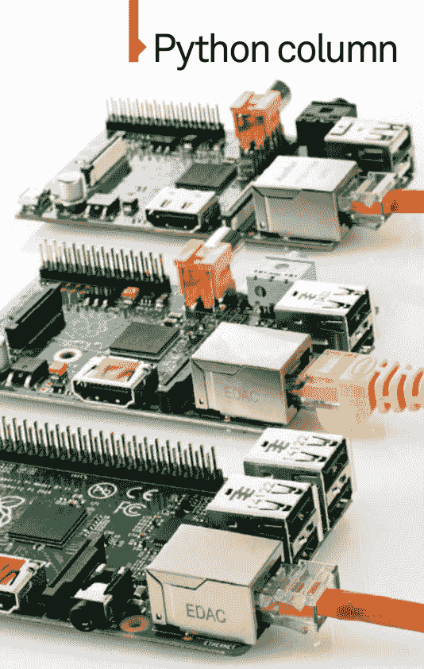

在示例代码中使用 `'number_of_nodes'` 格式时，我们通过在网络中设置了 IP 地址。你需要设置的另一个属性是让集群在单个节点上启动引擎。这是通过属性 `'SSHEngSetLauncher.engine_cmd'` 完成的。如果你使用的是树莓派，这将是 `'raspberry'`。最后一步是连接到集群节点。你可以通过 `SSH` 登录到节点。在每个 `rpi` 上，你将需要运行：... 它不会自动启动。你还需要确保网络上的所有节点都能相互访问。你可能需要允许设置无密码 `SSH`，否则当你尝试启动集群时需要输入密码。这些类型的通信问题可能是你在设置一切时遇到任何问题的原因。

现在，你有一个可以运行的 Python 集群了。在本地，你通过运行命令启动集群：

```
ipcluster start --profile rpi
```

控制台将显示一系列消息。一旦初始化完成，你就可以使用 Python API 使用集群来处理不同类型的并行。你可以控制你收集的那些树莓派。通过 Python，你可以将它们整合并让它们在逻辑上一起工作。你现在拥有构建世界上低功耗超级计算机的工具。

# Pythonint

要使用你的 Python 集群，你需要创建一个引擎视图来管理代码执行。最简单的视图是使用语法和集群对象。你可以通过以下方式创建任何引擎：

```
my_view = my_client[:]
```

你可以使用视图在所有可用视图上映射函数。

在引擎上执行代码还有另一种方法，都由装饰器处理。第一种是运行，它从每个引擎返回函数定义的相同代码。第二种是并行，它接收一个输入并将其分配给可用引擎。每个引擎在其初始列表的大小上返回给定的函数。（注：OCR 在此处包含重复循环，已为了清晰起进行清理）。

# 常见问题


### 什么是树莓派？

它简单来说是一个由树莓派供电或控制的机器人。它本身并不复杂——除非是制作机器人以及与树莓派通信。那可能非常复杂。

### 计算模块（Compute Module）如何？

计算模块运行良好——事实上，它的效果更好，因为它连接到 I/O 板有 200 个引脚，而 Arduino 只有 26 个。Arduino 对于其设计的控制系统仍然有用。

### 如果你喜欢这个...

你可能对四无人机和遥控感兴趣。查看我们的过往问题（`motsloot.co.uk`）。

### 有特殊的树莓派型号吗？

我们没有所谓的 Model Bot 树莓派，无论他们如何称呼。只是树莓派 B 型或 B+，带有安装点或根据你的意愿固定。

### 所以 GPIO 端口是为机器人供电的吗？

你需要读取和激活电路以及电机的引脚就是你需要做的一切。你可以使用端口用于视频流或连接即插用设备。

### 延伸阅读

阅读我们这一期的树莓派专题！如果你想了解更多：`getdigital.com`

### Arduino 机器人可以被 Pi 控制吗？

如果有足够的组件和耐心，可能可以，但是

74 `www.linuxux.co.uk`

# 赢得这个机器人

`bit.ly/1tHJKd3k`


# RasPi 杂志现已出版

通过最新一期的 RasPi 杂志了解如何编写 BigTrack

你知道吗？我们有一份专为树莓派制作的特殊数字杂志。RasPi 杂志可以在 Google Play 商店和 Tunews 上获取，本月，你可以了解到如何修改和编写你的 BigTrack。在同一期杂志中，我们还提供了第二批所有机器人所需的免费资源，以及如何在 Pivaders 中编写动画和音效——这些内容也帮助我们创作了该期杂志。这是一本非常棒的读读物！

BigTrack 对于任何超过 30 岁的“大孩子”来说都非常好玩，你将获得一个教程，教你如何通过树莓派和 PS3 控制器将其应用于你自己的空间项目中。不要在……弄坏你父母的古董玩具。

# 极客 BigTrack

上面的 Makeblock 是一种可以在 Raspberry Pi 上进行编程的 Arduino 机器人——查看我们的教程：`bit.ly/1tdY87`

# 增强 Pi

本专题的后半部分包含了另外五个优秀的配件，它们可以提升你使用 RasPi 的体验。这包括一些酷炫的技巧，例如获取廉价的附件、用于控制舵机的微型触摸屏，以及更多完全符合树莓派形状的配件。

Arduino 通常非常适合控制舵机，因为它的设计初衷就是为了不同难度的控制。例如，某些机器人比其他机器人需要更多的控制。简单的答案是，并不真的。

任何机器人都能由 Raspberry Pi 供电吗？这与之前相似，事实上Raspberry Pi 有很多选择，我们看到一些机器人帮助我们利用其原始出色的硬件来使用 Pi。你面临的限制完全在于它在某些机器人上的处理能力。

由于 GPIO 引脚数量有限，导致输出输出限制。我们确实有一些智能机器人可以使用，所以树莓派的限制并不低。

那太方便了。

为什么这是一个限制呢？

那么，我想开始制作我的机器人需要准备什么？

机器人越复杂，需要的输入和输出就越多。在……方面也有硬性限制。

通常，套件是最好的主意，我们在大型机器人专题中涵盖了许多套件。我们包含了廉价和昂贵的，它们可以做一些非常酷的事情。

它们在构建过程中都涉及不同难度的难度。查看我们从第 52 页开始的专题，找到哪一个适合你，并访问网站获取更多信息。


75 `www.linuxuser.co.uk`

# RasPi

面向树莓派制作者的数字杂志


| 项目 | 访谈 | 教程 | 专家建议 |
| :--- | :--- | :--- | :--- |
| | | | |

## 在 Google Play 和 iTunes 上下载免费应用

# 评测

77 组测 | 82 Adapteva Parallela | 84 Synology DS415

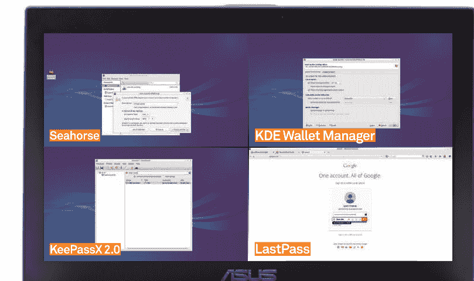

# 测试

## 密码管理器

我们测试了四种用于存储和加密个人详情的最佳密码管理工具。

| `Seahorse` | `KDE Wallet` | `KeePass2.0` | `LastPass` |
| :--- | :--- | :--- | :--- |
| `Seahorse` 是一个 GNOME 应用，作为 GNOME Keyring 的前端，GNOME Keyring 是一组来自 GNOME 的用于存储和保护用户登录的组件。`Seahorse` 是推荐的 Keyring 应用，并提供了一个简单的 GUI 进行管理。 | KDE 系统的子集，`KDE Wallet` 可以在运行的任何 Linux 系统上安装并有效使用。它允许你将存储的密码分成多个“钱包”，并配合像 `Konquer` 这样的兼容浏览器，你可以使用提示来快速保存数据。 | 我们测试了 `Alpha 6` 版本，它非常接近 Beta 发布。`KeePassX` 博客说 `Alpha` 版本“已经相当稳定”，尽管它为了防万一还使用了本地数据库，且用户反馈其对于日常使用来说已经足够了。 | `LastPass` 与我们在这里查看的安装包略有不同，因为它是一个浏览器扩展，你的设置和存储信息都在浏览器界面中。这种格式带来了一些我们正在测试的优势。 |
| 下载: `bit.ly/1f40nNJ` | 下载: `bit.ly/1wYfYWY` | 下载: `bit.ly/11u9Wf` | 下载: `bit.ly/1eKhV9` |

# 评测

### Seahorse

GNOME Keyring 密码管理器的默认前端

### KDE Wallet

大多数基于 KDE 的发行版上的默认密码管理器


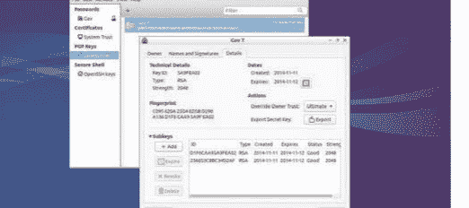

- 有关于密钥和证书的一些相当详细的信息和选项

- `KDE Wallet Manager` 很好用，虽然界面上有点拥挤。

# 界面

界面具有逻辑结构，分为你的主密钥环（`keyring`）以及私钥、`PGP` 和 `SSH` 密钥，还有存储。真正的选项位于子菜单中——界面层级相当深。由于依赖关系导致了一些安装问题。

# 特性

（注：原文此处内容重复，已按要求清理）

# 测评密码管理器

## 简评：对比并分析我们的评结果

### `Seahorse` (密码)

### `KDE Wallet` (钱包)

### `KeePassX`

# `LastPass`

| 特性 | `Seahorse` | `KDE Wallet` | `KeePassX` | `LastPass` |
| :--- | :--- | :--- | :--- | :--- |
| **界面** | 表面简单，下方层级较深，但也许过于简单？ | 窗口结构和空间上有些问题，但总体来说非常漂亮 | 设计非常出色，适合日常使用。选项不杂乱且解释得很好 | 网页界面虽然有些散乱，但标签标注非常清晰 |
| **功能** | 隐私、`PGP` 和 `SSH` 密钥方面表现出色，但在表单方面表现不佳 | 非常适合保存不同的钱包并控制访问 | 存储大量信息并有许多搜索选项——组织非常有组织 | 功能极其丰富，且这些都是实实在在的功能 |
| **易用性** | 在某些地方没有其他产品直观，但足够易用 | 提示功能与兼容应用程序配合以加速输入 | 直观，且带有非常方便的快捷键提取数据 | 输入保存的数据（包括密码和卡片）轻而易举 |
| **安全性** | 通常加密水平足够，并为密钥提供了一些详细选项 | 对微观级加密和项目保护存在一些担忧 | 为整个数据库提供了非常强大的加密和安全选项 | 强力加密和令人印象深刻的安全功能范围 |
| **总体** | 最适合处理 `PGP` 密钥。不推荐用于密码 | 加速日常输入，适合将数据分组到钱包中 | 如果你不打算使用浏览器扩展程序，选这个就没错 | 真正出色的跨平台密码管理器。向该团队致赞 |

# 优胜者是……

# `LastPass`

`LastPass` 在我们的小组测试中算是一个意料之外的变量，其他产品都是提供浏览器插件的安装软件，但这并没有阻止它们参与竞争。那一大系列安全选项——例如，其他产品中的一个允许我们控制 `URL` 权限或无论您在何处都能控制账户访问。这显然不是因为它是一个在线服务，而是因为它易于使用且功能如此强大。事实是，它的跨平台扩展程序意味着你可以在 `Linux` 机器、`Android`、`iOS` 以及 `macOS` 和 `Windows` 上使用它。

> `LastPass` 库支持从指纹读取器到组共享文件夹的所有功能

这是一款跨平台密码管理器，拥有最好的功能。测试的应用程序表现良好，但 `KeePass` 处于 `Alpha` 阶段，`Android` 没有 `LastPass` 那么可靠，或者在此阶段仍有损坏数据库的可能。我们建议密切关注此动态，并在 `Beta` 版本发布后进行跟进。`Seahorse` 和 `GNOME Keyring` 值得荣誉表扬，这是唯一根据运行版本和你每天使用的服务来判断的软件领域，所以如果你不是太担心加速几秒钟的输入，而更关心管理密钥，这几乎绝对是你的最佳选择。

但如果你想将所有内容保留在本地，`KeePass 2.0` 仅在榜单顶端略微落后一点点，通过该软件你可以为条目添加更多详细信息，它还……

# 故事、策略、英雄与机器

`www.historyanswers.co.uk`

二战真正的英雄：：一名古尔喀勇兵对战丛林

# 战争历史

胜利！美杜莎号战舰

# 斯托尼克斯人，`II`

`500` 年坦克史

战争机器

韩国围城战

# `14` 页特种部队简报

美国对阵墨西哥

克里米亚 `20` 点

……战争

周年特别版的兴起与衰落

# 伟大的 `SS` 党卫队

# 英国

阿金库尔战役

军队反映了德国的推进

从集结开始的战争故事

第三帝国最令人生畏的战斗力量

德国将军哈里的首个真实故事

格伦瓦尔德大使馆

关于 `AK-47`

戴西斯秘密地道

# 希特勒

# 战争历史

各大优质报刊店和超市有售

# 现已上市

> 希特勒党卫队 > 特种部队 > 条顿骑士 > 胜利号战舰

# 伟大战役

# 军事机器

# 战争英雄

# 秘密与洞察

# 令人置信的照片

# 今日购买您的杂志

纸质版请访问 `www.imagineshop.co.uk`

数字版请访问 `www.greatdigitalmag.com`

可在以下平台获取：

`facebook.com/HistoryofWarMag` `twitter.com/@HistoryofWarMag`

# 测评

# 迷你 PC：`Adaptera Desktop` 配有基于 `Epiphany` 架构的内核协处理器，`Parallela` 是开发者一直等待的单板计算机吗？

`Epiphany` 芯片显示出真正的潜力，并与具有相似的功能竞争。`Parallela` 是一个如果没有这个概念就永远不会的产品。它的开发通过 `Kickstarter` 筹资，使得初始模型仅售价 `99` 美元。遗憾的是，`Parallela` 的成本已经上涨；配备双核处理器的入门型号售价 `97` 英镑；`Desktop` 版本售价 `167` 英镑；高端和嵌入版对于大多数用户来说是最贵的选择。

软件支持仍处于早期阶段，连接器使其对爱好者开放。从乍看之下，`Parallela` 的定价似乎已经超出了市场范围。然而，查看规格发现事实并非如此。运行在 `800MHz` 的双核 `Cortex-A9` 远非极速，`Zynq` 系统也包含一小部分，可用于更大的任务。`Epiphany` 通过其流水线为未来的发布提升了 `32` 十亿次运算的性能。正是 `Epiphany` 将吸引大多数客户使用 `Parallela`，并努力使其成为……

| 技术规格 |
| :--- | :--- |
| 操作系统 | `Linaro (Ubuntu) 14.04` |
| 处理器 | `Xilinx Zynq-7010` 双核 `ARMv7` 和 `FPGA` |
| 协处理器 | `Adapter Epiphany-III E1630` |
| 内存 | `1GB DDR3` |
| 尺寸 | `80.5mm x 55.5mm x 14.8mm` |
| 重量 | `86g`（包含电池，不含电缆） |
| 端口 | `Micro USB OTG, Micro HDMI, 千兆以太网, GPIO` |
| 价格 | `117.7` 英镑 |

# 同样考虑

该板非常紧凑，但其热包络很大：该板安装在没有散热器的情况下带有一个风扇——如果你在持续负载下使用该板，不建议这样做。惊讶的是，是 `Epiphany` 将 `Zynq` 加热到了相应水平。该板功能多变，带有 `HDMI` 输出和 `USB OTG` 端口，可以作为标准微型计算机使用，它在该任务上的表现尚可。一个遗憾是高性能工作仍要在 `FPGA` 上的加速 `GPU` 上，`Parallela` 社区（现已超过 `10000` 人）很难迁移常用应用程序以利用 `Epiphany`。但目前，它仅适用于那些花时间将应用程序迁移到任何 `API` 的人。由于 `GPIO` 引脚仅在桌面和嵌入式版本可用，且隐藏在不友好的接口处，除非你熟悉市场语言，否则 `Parallela` 不是 `FPGA` 开发的最佳选择。

对于程序员来说，`Parallela` 是一个卓越的低功耗平台，允许进行 `FPGA` 代码实验，并在一个封装中运行 `Epiphany` 架构。

# 总结

`Epiphany` 在低功耗下提供了卓越的性能，而微型 `Zynq` 处理器也是如此。对于研究并行处理或 `FPGA` 工作的程序员来说，这是不智的选择，但缺乏现有应用程序的支持使得 `Parallela` 成为一项冒险的投资。

# `NVIDIA Jetson TK1`

`199.99` 欧元

带有嵌入 `192` 核图形处理器，`Jetson TK1` 提供了高达 `300` 十亿次运算的图像处理能力和多核处理器的异步架构。然而，大部分性能受限于语言支持，市场上文档并不多。

# 树莓派 `Model B+2`

`27.74` 欧元

这个版本的树莓派设计尽管价格更便宜，但处理器内存不如前一个版本大。然而，它是令人印象深刻的，并且更多功能，能够在容易获取外壳的情况下转回到并行开发，`raspberrypi.com`。

# 更多信息

`www-linuxuser.co.uk`

# 回评

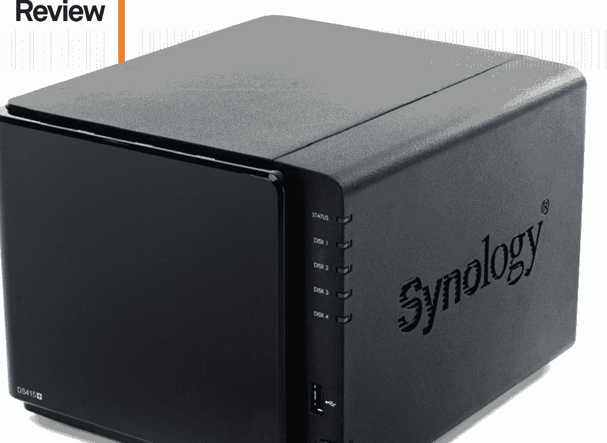

# `NAS` 存储盒

## 群晖 `DS415+`

群晖新款的四盘位 `SMB` 设备能否安全地满足你整个办公室的备份和存储需求？

群晖新款的 `DS415+` 直接取代了两年前的 `DS42+`，它是群晖 `Plus` 系列中针对中小企业的入门级产品。与类似的四盘位设备相比，`DS415+` 是显著升级，采用了四核 `Intel Atom` 处理器 (`2.0Ghz`) 和 `2GB DDR3 RAM`。与之前的机型（均为双核并配备 `1GB DDR3 RAM`）以及面向家庭用户的 `DS415play` 相比，`DS415+` 的出现标志着群晖面向 `SMB` 的 `NAS` 设备迈出了大步，它是该系列中首款采用新一代 `Intel Atom` 芯片的设备。


得益于这些额外的计算能力，硬件加密引擎成为可能。`DS415+` 上的文件夹可以应用 256 位 `AES` 加密，这对写入性能的影响极小。使用单根千兆以太网线，加密文件和文件夹 `get` 约 80/110MB/s 的上传/下载速度。但该设备并没有针对电缆故障的备份方案，而是因为设备的链路聚合（Link Aggregation）技术，该技术允许同时启用多个链路，而不会对 `DS415+` 228/232MB/s 的读写速度产生明显影响——事实上，尽管开启了加密，我们保留了千兆以太网布线。群晖 `SMB` 产品领域的这一巨大改进是……

- 优点
- 当共享文件夹和组在使用时，`RAM` 和 `CPU` 性能提升让你无后顾之忧。
- `DS415+` 即使在不支持视频转码的情况下也很快。
- 缺点
- 2GB `RAM` 对于重负载工作来说不够。

84 www.linuxuser.com

## 群晖 DS415+

这款 4 盘位 `NAS` 存储盒能服务你整个办公室吗？

### 回评

### 技术规格

| 特性 | 详情 |
| :--- | :--- |
| **操作系统** | `DiskStation Manager` 5.1 (基于 `Linux` 的专用系统) |
| **处理器** | `Intel Atom C2538` 四核 2.4GHz |
| **内存** | 2GB `DDR3` |
| **尺寸** | 204 x 165 x 233 mm |
| **重量** | 2.6kg |
| **硬盘盘位** | 4x 6TB 3.5"/2.5" `HDD` 或 2x `SATA` (8/SSD) `SSD`: 最大容量 24TB |
| **网络** | 2x 千兆以太网 |
| **扩展性** | 1x `USB 2.0`, 2x `USB 3.0`, 1x `eATA` |
| **冷却** | 2x 92mm 扇扇, 20.2dba |
| **价格** | $599 / £380 |


左侧的双网网端口意味着你可以利用链路聚合获得更高的速度

> 该 `NAS` 存储盒的另一个关键卖点是它不支持热插拔

### 同样需要考虑

……在 `Synolocker` 木马病毒的威胁之后表现非常好，而 `DiskStation Manager` 5.1 也收到了大量针对安全性的改进（包括自动更新）。

该 `NAS` 存储盒的另一个关键卖点是它不支持热插拔。面板上的双盘位使得更换就像将它们放入侧锁外壳一样简单，但两个盘位中同时只有一个处于工作状态——`DS415` 的冗余设计就在这种程度。群晖可能还希望在发生故障时确保零停机。由于内置冗余设计略显遗憾，群晖支持 `RAID 1` (`SHRA`)，你可以看到这有助于保证 24/7 运行。冗余可以由一个包含活动节点和一个或多个 `NAS` 盒的集群组成，通过更好的握手技术，使得当一台机器宕机时，另一台会立即接手。

此外，可以下载软件包使 `DS415` 充当 `NAS` 或 `VPN` 服务器。在众名的群晖 `DSM` - `Cloud Station` 之上（它提供了 32 项高级功能的提供和编辑），以及从 `QuickConnect` 到支持 `FTP`、`SMB`、`WebDAV` 等多种与 `DS415` 集成的方法，你在这里拥有一个极其可靠且多功能的存储解决方案。

### Gordon Thomas

新的英特尔处理器是这里的关键升级，尽管在这台四核猛兽上运行 `AES-256` 加密的性能并不算出色。`DSM` 5.1 以及这种为中小企业设计的极其稳定的芯片非常简单。由于支持高达 24TB 的存储，这是一项值得的投资。

值得注意的是，该软件支持 `VMware`、`Hyper-V` 和 `Citrix` 虚拟化。

## 群晖 DS415

如果你不是在寻找 `SOHO` 小型家庭/办公室 `NAS`，那么这种动力配置可能太适合非使用场景了。但如果你在寻找性能，这种配置可能并不合适。

值得注意的是，该软件支持 `VMware`、`Hyper-V` 和 `Citrix` 虚拟化。

值得注意的是，尽管 `AES-256` 加密在这台四核猛兽上的运行性能并不理想，但 `DSM` 5.1 以及这种为中小企业设计的极其稳定的芯片非常简单。由于支持高达 24TB 的存储，这是一项值得的投资。

如果你不是在寻找 `SOHO` 小型家庭/办公室 `NAS`，那么这种动力配置可能太适合非使用场景了。但如果你在寻找性能，这种配置可能并不合适。

值得注意的是，该软件支持 `VMware`、`Hyper-V` 和 `Citrix` 虚拟化。

## 群晖 DS415

如果你不是在寻找 `SOHO` 小型家庭/办公室 `NAS`，那么这种动力配置可能太适合非使用场景了。但如果你在寻找性能，这种配置可能并不合适。

值得注意的是，该软件支持 `VMware`、`Hyper-V` 和 `Citrix` 虚拟化。

## 问题与解答

解决您所有的技术问题

### Q/A

> 这听起来很愚蠢，但你可能需要重启。`Flash` 有时会变得有点怪异。

### Ogg & WAV

我有许多 `Ogg` `WAV` 格式的音频。我的问题是，大多数程序无法打开它们，我想将它们批量转换为 16 位的 `WAV`。编写一个脚本来实现此并不容易，但我发现了一个可以执行此类转换的工具。

有没有任何（首选命令行）工具可以将 `Ogg` `Wav` 文件转换为常见格式？

我曾尝试过使用 `Audacity` 打开 `Ogg` `Wav` 文件，批量转换（选项链）- 这一功能仅对原始结构有效 | 保留元数据和子文件夹以便进行手动处理至关重要。

我在使用 `ffmpeg` 和 `avconv` 时遇到错误，讽刺的是，甚至无法在它自己的 `Wav` 格式中解码它。

`SOX FAIL: can't open file "sample.wav": Unknown Wav file encoding type.`

我们发现某些音频容器可以放入 `WAV` 文件中，但即使如此，也没有什么软件可以播放它。但那是另一的话了。

如果所有其他方法都失败了，有一个为此创建的精彩脚本，它可以允许批量操作并在转换过程中自动查找任何错误。你可以获取并交给：`http://dragon.com/script/ogg_wav`。

无论如何，这听起来很愚蠢，但你可能需要绕过它。`Flash` 有时会变得有点怪异，根据我们的经验，重启后可能会好。。

感谢提供的任何帮助。

Steve W

David Schroeder

### 掌握 Makefile

我正尝试在 `Linux` 中安装一个机器人手臂抓取软件（`Graspit!`），它需要一些与 `Qt` 相关的库来编译。在安装了所有需要的库后，我不理解如何从 `Qt` 项目文件生成 `Makefile`。来自 `Qt` 项目文件的 `Makefile $GTEST/`

说明书写道：

“构建 `Quill`。进入 `$GTEST/` 目录，并从 `Qt` 项目文件 `$GTEST/project` 针对你的系统和安装需求运行 `make`。然后输入 `make.build` 并运行 `make`。”

嗯，我们可以提供几点建议来解决这个问题。如果这是你在更新 `Flash` 之前遇到的一个新问题，那么我们建议你完成清洁安装。

`YouTube` 可能会在 `HTML` 中播放视频而不是在 `Linux` 中，特别是当你使用 `Linux` 时，因此你可能需要确保这仍然发生。

如果能帮助创建 `Makefile` 将不胜感激。我正在使用 `Ubuntu` 并偏好 `Qt` 4.8。我使用以下示例安装：

```
$ cd makefile/Quill/
$ make sudo install &&
$ cd /usr/local/include/
$ sudo make -l libquill /h /
$ cd makefile/
$ make graspit.pro && make
```

上面的 `Graspit!` 允许你评估接触点和机器人模型。

### 问题问答

`diff` 是一个在词级操作而非行级操作的程序；它与 `diff` 的不同之处在于它允许用户指定什么应该被视为匹配，并允许将可选字符视为分隔符。分隔符是会被处理为不存在的字符，即使它们实际上存在。这种行为可以通过 `diff` 自定义。只有 `--normal` 和 `--raw` `diff` 选项不受支持。

默认输出来自新文本，删除和插入的部分带有标记注释。可以使用命令行选项来更改打印内容和标记。

上面的 `diff` 程序按单词头部检查，然后按行检查。

开发帮助网站

| 版本 | diff |
|---|---|
| `diff 2.0.5-1` | |
| 总大小 | 计算中... |
| 许可证 | `GNU General Public License` |
| 更新 | `Canonical` 不为按词操作的 `diff` 程序提供更新。某些更新可能由 `Ubuntu` 社区提供 |

 评论

检查，有差异，所以我可以为 300 台服务器添加新管理员。我已使用 `Chef` 推送了更改。

我使用过以下方法但没有成功：

你还需要在这里安装一些依赖项，如下：

好的，这是简短版本 - 我正在使用命令从这里提取信息：


```
diff -x sysadmin.old sysadmin.txt |
> diff --info "domain admins" > sysadmin.txt
```

```
diff sysadmin.old sysadmin.txt
@@ -1,3 +1,3 @@
-com-1
+com-2
+com-3
```

```
diff sysadmin.old sysadmin.txt
@@ -1,3 +1,3 @@
-com-1
+com-2
+com-3
```

```
diff sysadmin.old sysadmin.txt
@@ -1,3 +1,3 @@
-com-1
+com-2
+com-3
```

```
diff sysadmin.old sysadmin.txt
@@ -1,3 +1,3 @@
-com-1
+com-2
+com-3
```

```
diff sysadmin.old sysadmin.txt
@@ -1,3 +1,3 @@
-com-1
+com-2
+com-3
```

```
diff sysadmin.old sysadmin.txt
@@ -1,3 +1,3 @@
-com-1
+com-2
+com-3
```

```
diff sysadmin.old sysadmin.txt
@@ -1,3 +1,3 @@
-com-1
+com-2
+com-3
```

```
diff sysadmin.old sysadmin.txt
@@ -1,3 +1,3 @@
-com-1
+com-2
+com-3
```

```
diff sysadmin.old sysadmin.txt
@@ -1,3 +1,3 @@
-com-1
+com-2
+com-3
```

```
diff sysadmin.old sysadmin.txt
@@ -1,3 +1,3 @@
-com-1
+com-2
+com-3
```

```
diff sysadmin.old sysadmin.txt
@@ -1,3 +1,3 @@
-com-1
+com-2
+com-3
```

```
diff sysadmin.old sysadmin.txt
@@ -1,3 +1,3 @@
-com-1
+com-2
+com-3
```

```
diff sysadmin.old sysadmin.txt
@@ -1,3 +1,3 @@
-com-1
+com-2
+com-3
```

```
diff sysadmin.old sysadmin.txt
@@ -1,3 +1,3 @@
-com-1
+com-2
+com-3
```

```
diff sysadmin.old sysadmin.txt
@@ -1,3 +1,3 @@
-com-1
+com-2
+com-3
```

```
diff sysadmin.old sysadmin.txt
@@ -1,3 +1,3 @@
-com-1
+com-2
+com-3
```

```
diff sysadmin.old sysadmin.txt
@@ -1,3 +1,3 @@
-com-1
+com-2
+com-3
```

```
diff sysadmin.old sysadmin.txt
@@ -1,3 +1,3 @@
-com-1
+com-2
+com-3
```

```
diff sysadmin.old sysadmin.txt
@@ -1,3 +1,3 @@
-com-1
+com-2
+com-3
```

```
diff sysadmin.old sysadmin.txt
@@ -1,3 +1,3 @@
-com-1
+com-2
+com-3
```

```
diff sysadmin.old sysadmin.txt
@@ -1,3 +1,3 @@
-com-1
+com-2
+com-3
```

```
diff sysadmin.old sysadmin.txt
@@ -1,3 +1,3 @@
-com-1
+com-2
+com-3
```

```
diff sysadmin.old sysadmin.txt
@@ -1,3 +1,3 @@
-com-1
+com-2
+com-3
```

```
diff sysadmin.old sysadmin.txt
@@ -1,3 +1,3 @@
-com-1
+com-2
+com-3
```

```
diff sysadmin.old sysadmin.txt
@@ -1,3 +1,3 @@
-com-1
+com-2
+com-3
```

```
diff sysadmin.old sysadmin.txt
@@ -1,3 +1,3 @@
-com-1
+com-2
+com-3
```

```
diff sysadmin.old sysadmin.txt
@@ -1,3 +1,3 @@
-com-1
+com-2
+com-3
```

```
diff sysadmin.old sysadmin.txt
@@ -1,3 +1,3 @@
-com-1
+com-2
+com-3
```

```
diff sysadmin.old sysadmin.txt
@@ -1,3 +1,3 @@
-com-1
+com-2
+com-3
```

```
$ sudo apt-get install qt4-qmake libqt4-dev libdev-4-pqdev
$ cd /usr/local/lib/h
$ sudo ln -sf libuuid.3 libuuid.6
$ cd /Graspit/bin
```

这给了我输出：

```
File: /boot/grub/grub.cfg
set linux_gfx_mode=text
else
  set linux_gfx_mode=text
  set linux_gfx_mode-keep=true
else
  set linux_gfx_mode=terminal
fi
export linux_gfx_mode
menuentry "Ubuntu" --class ubuntu --class gnu_linux --class class --class menu_id "gnulinux-simple-030b7a-2374-4a52-84cc03fa4"
  load_video
  search linux_gfx_mode
  insmod gvideo
  insmod ext4
  if [ $search_platform -ne "grub" ]; then
    search --no-floppy --fs-uuid --root UUID --no-floppy --hint-extfi-hd0_hd --hint-baretal-ac10_hd 030b7a-2374-4a52-84cc03fa84
    search --no-floppy --fs-uuid --root UUID --no-floppy --hint-extfi-hd0_hd1 030b7a-2374-4a52-84cc03fa84
  fi
  linux /vmlinuz-linux root=UUID=030b7a-2374-4a52-84cc03fa84 quiet splash
  initrd /initrd.img
```

你需要尝试编辑`grub-config`，因为地址不起。听起来你将花费大量精力来尝试这样做。如果成功了，你可能需要安装它，但一旦可以使用像这样的：选择正常或启动菜单。两个选项都可能让你回到消息并找到恢复的方法。

在处理完剩余的邮件后继续。。我希望第二天发生在长邮件列表的中间。重要的是，我不想一次性通过过滤器动态缩放邮件（可能都是垃圾邮件），我不想处理它们，因为我以前动态缩放文件。我已经让这个动态文件为你工作了。

我没有安装任何更新。内核安装为`3.2.0-amd64`并且已经良好运行一段时间了。有什么问题吗？也许我应该排除任何情况，任何帮助都将不胜感激。我想使用所有的网络、连接、`LD` 4.0 和设置。

```
$ diff -u $1 sysadmin_out.txt sysadmin.txt
```

它从没有让你失望，而且比你尝试的一些方法要简单一点，

James Jones

## Wine 单元

我们有一个简单的解决方案可以先尝试。如果你正尝试将驱动器接入`SSD`，那么你需要引导硬盘的`UUID`。

我正在尝试这样做，一旦你确定了`UUID`，就编辑`grub`配置（`/boot/grub/grub.cfg`）并更改为新的`UUID`，这对于你有不同的硬盘至关重要。

消息> 没有驱动器--不要：`getfs`

我的`procmail`运行在主机上。这是一个具有多个账户的单一用户（`ID`）。我不擅长`demail`，也不太熟悉`procmail`。

我有来自`HW`的完整备份：

对这样做有什么主意吗？

```
$ tar -xpf /backups.tar
--directory=/--exclude=proc
--exclude=backups
```

David


Procmail 非常强大，所以你可以这样做。你需要确保你正在驱动过滤器，这可以通过设置一点自定义代码来实现。设置以下内容应该是有效的，但你需要：

```
$ tar -xpf /backups.tar
```

我不想让 `procmail` 在第二天停止或之后。

希望这你有助于你的邮件过滤器并实际上实现了你想要的！

## Windbind

感谢任何协助。这里是我的问题：我正在为 `windbind` 开发目录组。我正在使用 `windbind` 获取域组列表以

Becky

90 `www.linuxuser.org`

# 托管列表

## 赞助机会

通过赞助本栏展示您的品牌

## 想要提供一个您认为我们应该提供的优惠方案吗？

无论您是在寻找一家托管公司，还是在为您喜欢的列表提供商寻找一个理想的家，请随时与我们联系（`linuxuser@webmagazine-publishing.co.uk`）

## 独立服务器列表

`Netcera`

`www.netcera.co.uk/linux`

| 方案 | 电话号码 | 每月成本 | 最低限制 | 合同期限 | 核心 / 速度 | 磁盘空间 | 10GBPS 连接 | 硬件 RAID | 远程电源重启 | 运行时间保证 | 永久 KVM | 网络备份 | 私有支持 | 24/7 电话支持 |
| :--- | :--- | :--- | :--- | :--- | :--- | :--- | :--- | :--- | :--- | :--- | :--- | :--- | :--- | :--- |
| `2000DC` | 0800 865450 | £25 | 1 个 | | 双核 2.20GHz | | | | Raid 1 | | | | | |
| `3000DC` | 0800 865450 | £40 | 1 个 | | 双核 3GHz | 2x 250GB | | | Raid | | | | | | |
| `5000DC` | 0800 865450 | £85 | 1 个 | | Intel 2.6GHz 四核处理器 | 2x 500GB | | | Raid | | | | | | |
| `Developer` | | | £29.99 | 1 个 | N/A | 1GB | | | | | | | | | |
| `One` | 0800 865450 | £99.99 | 1 个 | N/A | 5GB | | | | | | | | | | |
| `Reseller` | | | £24.99 | 1 个 | N/A | Unlimited | | | | | | | | | |
| `Starter Linux` | 0810 077 79 | £19 | 1 个 | 1x 2.4GHz vCPU | 50GB | | | | | 99.90% | | | | | |
| `Starter Windows` | 0810 077 79 | £20 | 1 个 | N/A | 20GB | | | | | | | | | | |
| `Business Linux` | | | £45 | 1 个 | N/A | 40GB | | | | | | | | | |
| `Business Windows` | | | £45 | 1 个 | N/A | 40GB | | | | | | | | | |
| `Ultimate Linux` | 0810 077 79 | £60 | 1 个 | N/A | Unlimited | | | | | 99.90% | | | | | |
| `Ultimate Windows` | 0810 077 79 | £65 | 1 个 | N/A | Unlimited | | | | | 99.90% | | | | | |
| `Bronze Managed` | 0810 079 778 | £79 | 12 个 | 1x 2.4GHz vCPU | 50GB | | | | | 99.99% | | | | | |
| `Silver Managed` | 0810 079 779 | £89 | 12 个 | 1x 2.4GHz vCPU | 80GB | | | | | 99.99% | | | | | |
| `Gold Managed` | 0810 079 779 | £99 | 12 个 | 1x 2.4GHz vCPU | 150GB | | | | | 99.99% | | | | | |
| `Dedicated R8000` | 0881 023 955 | £125 | 12 个 | 4x 2.4GHz | 4x 216GB | | | | | 99.99% | | | | | |
| `Dedicated R10000` | 0881 023 955 | £179 | 12 个 | 8x 2.4GHz | 4x 216GB | | | | | 99.99% | | | | | |
| `Linux VPS Pro` | 0840 648 2100 | £299 | 1 个 | 2x 2.27 Quad Core | 600GB | 100Gbps | | | | | | | | | |
| `Windows VPS Pro` | 0840 648 2100 | £314 | 1 个 | 2x 2.27 Quad Core | 600GB | 100Gbps | | | | | | | | | |
| `Windows VPS` | 0840 648 2100 | £324 | 1 个 | 2x 2.27 Quad Core | 600GB | 100Gbps | | | | | | | | | |
| `VPS Pro` | 0840 648 2100 | £749 | 1 个 | 2x 2.27 Quad Core | 1000GB | 100Gbps | | | | | | | | | 1GB |
| `VPS Ultra` | 0840 648 2100 | £799 | 1 个 | 2x 2.27 Quad Core | 1000GB | 100Gbps | | | | | | | | | 1GB |
| `Heartbeat Linux` | 0840 664 7750 | £1399 | 12 个 | Dual Core 2.50 | 1600GB | | | | | | 99.99% | | | | |
| `Heartbeat Windows` | 0840 664 7750 | £1499 | 12 个 | Dual Core 2.50 | 1600GB | | | | | | 99.99% | | | | |
| `Guest Cloud` | 0840 664 7750 | £1299 | 12 个 | 2x 2.50 | 2500GB | | | | | | 99.99% | | | | |
| `Dell Power Edge R210` | 0840 130 1602 | £799 | 12 个 | 3x 2.85GHz | 250GB | 10Gbps | | to | | 99.99% | Free | O | | | |
| `Dell Power Edge R210` | 0840 130 1602 | £1199 | 12 个 | 4x 2.85GHz | 250GB | 10Gbps | | to | | 99.99% | Free | O | | | |
| `Dell Power Edge R210` | 0840 130 1602 | £1499 | 12 个 | 4x 2.85GHz | 500GB | 10Gbps | | to | | 99.99% | Free | O | | | |

# 托管列表 #列表

突出您的列表！联系 `DANIEL.gunton@imagine-publishing.uk`

## 独立与共享服务器列表

| 名称和 URL | 方案 | 电话 | 成本 | 空间空间 | 月带宽 | 账户 | 支持 | 购物车 | 病毒过滤 | 电话支持 | 邮件支持 | 网页面板 | 服务等级协议 |
| :--- | :--- | :--- | :--- | :--- | :--- | :--- | :--- | :--- | :--- | :--- | :--- | :--- | :--- |
| `Blacklight` (`www.blacklight.com`) | `Minus` | +44 0384 52042 | £49.95 | 10GB | 150GB | | | | | | | | | |
| `Blacklight` (`www.blacklight.com`) | `Maxus` | +44 0384 52042 | £69.95 | 20GB | 300GB | | | | | | | | | |


| Blacklight (`www.blacklight.com`) | Ultra | +44 0384 52042 | £149.95 | 50GB | 600GB | | | | | | | | | |
| Digital Gibbon (`www.digitalgibbon.com`) | Cheeky Chunk | N/A | Free | 500MB | Unlimited | 5 | | | | | | | | | |
| Digital Gibbon (`www.digitalgibbon.com`) | Digital Gibbon | N/A | £12 | 10GB | Unlimited | 5 | | | | | | | | | |
| Digital Gibbon (`www.digitalgibbon.com`) | Elite | N/A | £22 | 10GB | Unlimited | 10 | | | | | | | | | |
| ehosting (`www.ehosting.com`) | WordPress | +44 284 999 4100 | £23.88 | 1GB | 25GB | 10 | | | | | | | | | |
| ehosting (`www.ehosting.com`) | Hosting | +44 284 999 4100 | £35.88 | 2GB | 50GB | 15 | | | | | | | | | |
| ehosting (`www.ehosting.com`) | Expert | +44 284 999 4100 | £95.88 | 5GB | 250GB | 25 | | | | | | | | | |
| Equibase (`www.equibase.com`) | Virtual | N/A | £227.78 | 50GB | Unlimited | 50 | | | | | | | | | |
| Equibase (`www.equibase.com`) | Silver | +032 114 4655 | £405 | 128GB | 520GB | 20 | | | | | | | | | |
| Equibase (`www.equibase.com`) | Gold | +032 114 4655 | £705 | 256GB | 1000GB | 30 | | | | | | | | | |
| Equibase (`www.equibase.com`) | Platinum | +032 114 4655 | £1200 | 512GB | 2048GB | 50 | | | | | | | | | |
| Eurofast (`www.eurofast.com`) | Email Only | 02380 24083 | £40 | 2GB | 10GB | 10 | | | | | | | | | |
| Eurofast (`www.eurofast.com`) | Essential | 02380 24083 | £75 | 5GB | 25GB | 15 | | | | | | | | | |
| Eurofast (`www.eurofast.com`) | Super | 02380 24083 | £150 | 10GB | 50GB | 25 | | | | | | | | | |
| Eurofast (`www.eurofast.com`) | Professional | 02380 24083 | £250 | 20GB | 100GB | 50 | | | | | | | | | |
| Evolhosting (`www.evolhosting.com`) | Starter | N/A | £39.99 | 1GB | 30GB | 5 | | | | | | | | | |
| Evolhosting (`www.evolhosting.com`) | Home | N/A | £54.99 | 2GB | 50GB | 10 | | | | | | | | | |
| Evolhosting (`www.evolhosting.com`) | Business | N/A | £99.99 | 5GB | 150GB | 20 | | | | | | | | | |
| Evolhosting (`www.evolhosting.com`) | eCommerce | N/A | £159.99 | 10GB | 300GB | 50 | | | | | | | | | |
| Gaacom (`www.gaacom.com`) | Business Pro | 0844 765 5700 | £199 | 100GB | 500GB | 100 | | | | | | | | | |
| Gaacom (`www.gaacom.com`) | Professional | 0844 765 5700 | £399 | 200GB | 1000GB | 200 | | | | | | | | | |
| Heart Internet (`www.heartinternet.com`) | Home | 0844 765 5700 | £89.99 | 10GB | 100GB | 10 | | | | | | | | | |
| Heart Internet (`www.heartinternet.com`) | Business | 0844 765 5700 | £139.99 | 20GB | 200GB | 20 | | | | | | | | | |
| Heart Internet (`www.heartinternet.com`) | Professional | 0844 765 5700 | £249.99 | 40GB | 400GB | 40 | | | | | | | | | |
| Hostway (`www.hostway.com`) | Silver | 0880 180 1780 | £79.50 | 5GB | 25GB | 5 | | | | | | | | | |
| Namehelg (`www.namehelg.com`) | Email Only | 0844 812 0330 | £36.75 | 2GB | 10GB | 5 | | | | | | | | | |
| Namehelg (`www.namehelg.com`) | Shared Hosting | 0844 812 0330 | £58.75 | 5GB | 25GB | 10 | | | | | | | | | |
| Namehelg (`www.namehelg.com`) | Professional Package | 0844 812 0330 | £105.75 | 10GB | 50GB | 15 | | | | | | | | | |
| Skymarket (`www.skymarket.com`) | Standard 1 | 0880 321 7788 | £4.99 | 1GB | 10GB | 1 | | | | | | | | | |
| Skymarket (`www.skymarket.com`) | Standard 2 | 0880 321 7788 | £14.99 | 2GB | 20GB | 2 | | | | | | | | | |
| Skymarket (`www.skymarket.com`) | Premium 1 | 0880 321 7788 | £29.99 | 5GB | 50GB | 5 | | | | | | | | | |
| ServWise (`www.servwise.com`) | Personal | 0880 052 0716 | £25.20 | 10GB | 100GB | 10 | | | | | | | | | |
| ServWise (`www.servwise.com`) | Reseller | 0880 052 0716 | £126 | 4GB | 40GB | 4 | | | | | | | | | |

`0 = Option`

## 你的观点

你的 `Linux` 新闻与观点来源

联系我们...

直接发送邮件至：

`linuxuser@imagine-publishing.co.uk`

## 你的观点

## Linux 用户来信

你对杂志的意见，应该是你内心秉持的心态

## 兴起的 Linux

我非常喜欢你们的“Linux 的兴起”专题。我觉得自己像个 `Linux` 新手，因为我从 2004 年初就开始全投入地使用 `Linux` 了！偶然发现了 `Linux Mint`，并一直等下去，直到最后发现了 `Ubuntu`、`openSUSE`，以及我的最终终点 `Fedora`！我错过了关于哪个更好的讨论，在 `Linux` 活动……所以我不得不去参加了。在芝加哥、亚利桑那，甚至大多数这些活动中，我当时恰好获得了免费门票。我会说，这是我经历过的最好的计算体验。`Windows`、`Linux`、`macOS` —— 在我拙见看来，它们哪一个都无法比拟 `Linux` 的实力和领先地位。希望 `Linux` 永远不会衰落或过时！


看起来你通过这些发行版走过了一段非常精彩的历程，同时也看到了它们在过去十年中发生的变化甚至演变。至于 `Linux` 大会——当然了——有很多有趣的东西，你可以看到但不必太担心。很多免费信息可以帮助你起步，而且在线社区对任何人都很友好。

`Redmond`？`Cupertino`可以保持距离。

`Emily`

你说得对，尽管也许我们在张开双臂之前应该保持克制。多年来，他们一直与 `Linux` 内核合作，支持异构解决方案，而且我们聊过的很多大公司，大多数时候 `Microsoft`——从业务角度来看——正在适应它，以便获取他们想要的任何客户。奇怪的是，这看起来很美好，但在非常底层，开源软件（`FOSS`）的概率很低。我们不信任他们。

# 恶势力消除了吗？

真正的敌人是任何人吗？我记得曾几何段时间是专有软件，软件与公司之间没有多少联系。所有的“大”公司都开始与 `Linux` 合作并拥抱开源软件。我们也许应该改变思维，拥抱那些来自……的人

# `Android` 移动

随着更多的 `Android` 特性合并到 `Linux` 内核，为这些最流行的操作系统平台开发变得简单得多。拥有超过 250 亿下载量和超过 1 亿台 `Android` 设备，有广泛的人群需求和应用。如需更多关于 `Android` 驱动的编辑，你可以查看我们的姐妹刊《`Android` 杂志》，它致力于最新的应用。通过新闻和评论跟上 `Android` 的一切动态。还有关于开发、破解和你的硬件的教程和建议。在`littlegreenrobot.com`了解更多。

我们很高兴你喜欢这个 2005 专题，这并不是迟到的投稿，真的——因为下一个 `Linux` 内核非常接近宾夕法尼亚的 `Vault`，而它最近刚刚发布。

体验活动

订阅我们的时邮件播客

`www.linuxuser.co`

# 话题（裸露）

## 兴起与更高

除了 `Ned` 关于“`Linux` 的兴起”的信件外，该专题在上线时也发布得很好，并引发了兴趣。你可以在这里加入我们的讨论和日常交流：`bit.ly/3EX`

所以，我确信，我记得由于某种原因，脑海中浮 4 个回复。

> **`mrcassic` 说：** `Mandrake` 那时就是我们的 `Ubuntu`！

> **`IAMnart` 说：** 但是，他在系统方面处于什么位置？！

> **`owemeancat` 说：** 是我吗，还是 `Alan Cox` 看起来像 `KMS`？

> **`WhyDoNUsernames` 说：** 我自己对系统没有任何特别强烈的观点，我过去遇到过问题，导致我对 `bug` 和兼容性非常谨慎，而至于设计细节，比如库图标之类的细节，那些细节并不是大问题。

> **`strange_kitthe` 说：** 我觉得玩弄大脑有点棘手，你可能会对《`Linux User and Developer`》上发表的文章中的图片有某种预期。

> **`S03M001` 说：** 一个类 `Linux` 的系统，

> **`mrcassic` 说：** 这是一篇很酷的文章。我在 90 年代开始用电脑时就知道 `Linux` 了。如果我早知道，我会早点发现的。可惜我大部分时间都花在了 `Windows` 系统上，所以 `Windows`，在 2000 年 `Mandrake` 只是一个类型，当时它并不正规。

> **`IAMnart` 说：** `OL` 是个老东西了，我会处理它的。事情的发展如此。从业务角度来看，改变是……而且花钱可以推迟，留在支持上，我可以推迟 `RHEL 7`，直到我的笔记本电脑或测试对它出了问题。

> **`seek3r` 说：** hmm。`Mandrake` 也是我发现它的地方。`J4 v`

# 文件库 (`FileSilo`)

## 你的免费资源

登录`WWW.FILESILO.CO.UK/LINUXUSER-14`并下载最新的发行版和免费软件。所有你关注杂志所需的发行版。

## 最新发行版 `openSUSE 13.2`

你的额外资源

在本期杂志的`FILESILO`中，专为《`LINUX USER & DEVELOPER`》读者提供的免费独家内容，你将找到……

- 必备的`FOSS`软件包，包括用于浏览器和桌面的`Kodi`（原`KDE`）

- 许多发行版如`openSUSE`、`Fedora`和`Mageia` Beta 版

- 所有教程的代码和素材，包括树莓派的`Touch List`

- `Fraser` 广受赞誉的视频指南——整个系列现在都可以观看

## 视频教程时长 180 分钟

## 顶级 `Linux FOSS`

`www.filesilo.co.uk/linuxuser/17`

## `FILESILO` – 资源之家

### 发现你的在线资产

- 快速增长的库

- 持续更新的资源

- 让你的下载井然有序

- 随地访问你的内容

- 随你的地获取更多资源

- 打印版订阅者获取所有内容

- 数字版所有者也可以获取！

- 凭你的杂志免费获取内容

- 在线安全访问

这是替代你磁盘的`Fileilo`。你可以通过下面的链接找到它。第一次使用`Fileilo`需要注册。之后，你可以使用提供的电子邮件地址和密码登录。

热门下载列在此，你可以看看读者在用什么！

如果你在寻找特定类型的内容，如发行版或`Python`文件，使用这些过滤器进行搜索。

绿色锁显示你已访问的内容。红色闭锁显示你需要购买或解锁的内容。

热门下载列在此，以便你可以看到最受欢迎的内容。

查看排行榜，查看其他读者投票的结果！

了解更多关于我们的在线商店，以及`FAQ`和隐私政策。

了解更多我们的姐妹杂志以及它们提供的丰富内容……

# 文件库 (`FileSilo`)

## 如何使用

关于访问新数字仓库的一切信息

访问`Fileilo`，请访问`www.filesilo.co.uk/linuxuser-147`

- `01` 按照屏幕指令在安全的`Fileilo`系统中创建帐户，通过回答关于杂志的简单问题进行登录。你可以凭你的杂志免费访问内容。

- `02` 如果你是打印版订阅者，可以通过输入`Web ID`轻松解锁所有内容。你的`Web ID`是打印在地址标签上的八位字母数字。也可以在你的奖励单页上找到。

- `03` 你可以使用任何流行的浏览器（如`Firefox`、`Chrome`或`Safari`）在桌面、平板或手机设备上访问`Fileilo`。我们建议使用桌面下载内容，因为可能无法下载到手机或平板。

- `04` 如果你在访问`Fileilo`内容时遇到任何问题，或在注册过程中遇到问题，请查看在线`FAQ`或发送邮件至`filesilohelp@imagine-publishing.co.uk`

# 10 大 `Linux` 桌面

## 更多教程与灵感

读完了吗？《`Linux User & Developer`》网站上有更多免费开源资源等待着你。我们每天上传专题、教程、评论、观点文章和最好的开源新闻，涵盖`Linux`内核开发、最热门的新发行版和`FOSS`、树莓派项目和采访、编程指南，并加入我们不断发展的`Linux`用户和开发者社区，发现新的`Linux`工具。

# `www.linuxuser.co.uk`

`LinuxUser` 第 148 期于 2015 年 1 月 15 日在`GreatDigitalMags.com`发售

## 新颖。快速。免费。

## 自由。

`Document Foundation` 荣幸推出：

## `LibreOffice`

全球最先进的免费办公软件套

`www.libreoffice.org`

## `poundhost` 域名公司

## 24/7 英国支持

## 独立服务器

- 无需合约

- 24/7 现场支持

- 戴尔硬件

- 多样的服务器范围

每月 19 英镑起

独立服务器 | 云服务器 | `VPS` | 域名 | 电子邮件 | 托管 | 网站生成器 | 电子商务 | 服务器器 | `SSL` | 网站推广

数据指标与统计：490,000 客户数 | 8,000 台独立服务器 | 6,000 台虚拟服务器 (`VPS`) | 1,800,000 个域名

`tel: 0800 876 0942` `www.poundhost.com`
