# Linux 用户与开发者 148 - 终极发行版与开源软件指南 2015

## 树莓派遇到对手吗？

### MIPS Creator Cli2 评测

## 远程控制

### 树莓派机器人

拿起你的 PS3 控制器

## CUBIEBOARD 4

### 64 核 SBC 测试


## 上帝觉醒

来自《黑客》三部曲创作者

2 月 6 日院院上映

## Synology

### 与 Synology 和《上帝觉醒》共赢

为了庆祝《上帝觉醒》的上映（2 月 6 日院映），Synology 为您提供赢得一套超越世界的家庭娱乐系统，包括 Synology DS415play、48 英寸曲线 LED HD 3D 智能电视、智能 3D 蓝光播放机和回声箱。想要获得赢奖机会，请访问

四位 NAS 服务器，具备视频转码功能确保无损质量

存储和保护电影、音乐、照片和电视节的完美之处。

#### DS415play

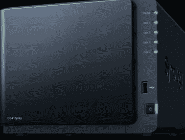

**Bob Zetsloot** 开始使用 Python 对复杂的模拟进行建模。在 2013 年 LUUG 会议年度颁奖活动不久后，他开始于马萨诸塞州远程工作，他在那里的使命是保护代号为“joeden”的企鹅项目。

**Jon Masters** 是一位内核黑客，从事 Linux 工作已有 19 年，从他最初在位于马萨诸塞州剑桥的麻理工学院学习开始，他为一家企业 Linux 供应商工作。你可以在 Twitter 上找到他。

**Aaron Shaw** 来自 MapGen，自树莓派诞生之初就深度参与其中，并发现自己随处随地使用它。在本期中，Aaron 通过悬浮板（第 64 页）实现了手势和触控控制。

**Phil Keating** 于 1998 年开始在 GRAG 杂志工作。作为一名资深硬件爱好者和技术记者，Phil 测试并评论了数百款应用和游戏。本月，他将介绍 NaSteam 的安装和配置，让你可以将 PC 变成一台专用的复古游戏盒。

**Christian Gawley** 是一位 IT 和软件工程师，自 2010 年以来一直为线上及线外的手机用户撰写文章。他说他找到了一种避免 Linux 碎片化烦恼的方法，通过安装一个简单的重置开关让重启变得简单得多（第 62 页）。

**Gareth Halcliffe** 是一位近期关注开源世界的记者和作家，涵盖网络各地的最新动态。他在 CubeBoard 第 6 页中提到，一个月前，他在“终极发行版与开源软件”专栏的几页内容中发现了专家的见解（第 16 页）。

欢迎阅读 Linux User & Developer 最新期，这是英国最喜爱的 Linux 和开源杂志。我们从为您提供的 25 份新年礼物开始。首先是我们在第 16 页开始的 Linux 年度特别指南，介绍了你今年应该使用什么——我们涵盖了所有类别，因此每种类型的用户都有对应的内容，并且 File.co 内的所有内容都方便您下载。我们还提供了 Linux 基金会提供的免费通行证，用于“成为认证系统管理员”专栏（第 26 页）。我们采访了 Jim Berlin 以了解如何以及优异地通过考试。他们的认证于今年早些时候推出，我们询问了将接受哪些测试，你将有机会赢得五场 LFCS 考试之一。资深系统管理员可能对我们本月的后记部分感兴趣，因为 2ndQuadrant 为每位编辑提供了一项价值 5,500 美元的培训课程，学习额外的 10 项技能。最后，我们赠送了五块悬浮板，正如我们在第 64 页教程中那样——不是那种搞笑的，但它们确实为你的树莓派增加了手势和触控控制！祝你好运！Gavin Thomas，副主编


### 最新云技术

突发性内存

24/7 英国支持

#### 为你的业务注入动力

扩展你自己的云以满足业务需求——运行最大的工作负载并应对突发峰值。


新的 Fasthosts 云服务器利用微软和戴的最新技术提供高性能存储和可用性，包括自动保护和恢复。

- 99.99% 运行时间保证
- 最新的操作系统
- .NET 框架之选
- 1Gbit/s 连接

云服务器源自：

£11.99 英元

每月（不含 20% 增值税）。最低 12 个月合同。

拨打 0808 1686 777

服务器 · Web 托管 · 域名 · 交换邮箱

fasthosts

启发更佳业务

##### 企业级

## Linux 基金会指出 Linux 采用率正在提高

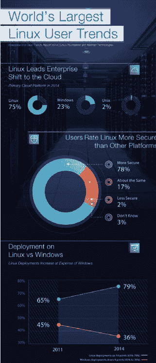

### 新报告显示企业增长以及优先竞争的下降

Linux 基金会企业终端用户委员会开展的受邀调查结果已发布，显示出人们对 Linux 安全性的非常有信心，且其在企业领域的份额正在增加——这是直接从竞争中赢得。

该调查是根据政府组织的请求进行的，所有组织每年支出均超过 5 亿美元，或在四年内支出超过 6 亿美元。该调查会在过去四年中每年进行一次相同的方法调查，因此可以进行同比比较。报告声称 Linux 的增长在企业领域仍在继续，超过 85% 的受访者在过去一年中在其基础设施中拥有 Linux 服务器，82% 的人计划在未来增加 Linux。

## Linux 社区动态

### 开源

### 安全

#### 研究人员发现 Turl Linux 恶意软件

##### 前 Windows APT 的平台转移

安全研究人员发现了 Turl 高级持续性威胁（APT）恶意软件的新变体，该变体以 Linux 为目标操作系统——这是其首次针对该系统的攻击。

在最近对该恶意软件的分析中，安全实验室的 Kurt Baumgartner 和 Constantin Rau 发现，Linux 正在成为日益受欢迎的财务驱动型恶意软件编写者的目标，由于其在服务器市场中占据大多数份额份额。

> “我们怀疑这个组件在受害者的站点已经运行了多年，”这对在描述从客户系统中获取的恶意软件样本时写道，“但目前还没有足够的数据来支持这一说法。”报告发布后不久，他们发现了第二个名为 Turl 的更新更新变体，该变体甚至可以从低权限的环境感染系统。

根据代码，Turl 充当一个隐蔽后门，并提供带有键盘记录功能对受感染系统的访问权限。Linux 一直并不是恶意软件活动的主要目标；Baumgartner 表示，它可能成为，因为恶意软件编写者正在积极修改其软件以实现跨平台兼容性。

### 开发

#### AMD 发布 Omega 驱动程序更新

##### 推出


AMD 发布了其图形产品最大的驱动程序更新之一，包括 GPU 和 APU 芯片，这是首次包含特定发行版的包。

AMD 就像其竞争对手 Nvidia 一样，不为其图形提供开源驱动以使用硬件加速，除非使用基于社区的开源驱动或下载 AMD 的“二进制块”（binary blob）版本，这通常以可执行存档的形式发布，可以作为直接安装方法或生成特定发行版的包。

从 Omega 驱动程序开始，AMD 将在启动提供下载特定发行版包的选项。适用于 Ubuntu 和 Fedora 用户，以及传统的发行版安装程序。除了改进对 Linux 的支持外，新的驱动包还包含质量和性能提升功能。

- ESEOD，昂热尔，卢瓦尔
- 法国
- iciss.org

2 月 9-11 日

首届国际信息系统安全与隐私会议旨在建立一个 Linux 开发者和从业者社区，对专有软件和开源软件专业开放。

2 月 9-13 日

- 香港皇家阿尔卑斯大酒店

Linaro Connect 提供主题演讲、讨论和引人入目的会议，面向那些在 ARM 平台上工作的人士以及如何有效地优化这两者。

2 月 18-20 日

- 加利福尼亚州葡萄酒园酒店

这是一个由 Linux 基金会组织的受邀参加活动，协作峰旨在建立团结并连接专家，共同促进开源的发展。

2 月 19-22 日

- 洛杉矶机场希尔顿酒店
- 美国
- linuxuxexpo.org

第 13 届加利福尼亚 Linux Expo 是历史上最大的社区运行 DOSS 会议，其展示了符合开源倡议组织指南的项目。

### 云

#### 针对容器爱好者的事务性更新

Canonical 宣布推出了一种新的 Ubuntu，称为 Ubuntu Core，其特点是专门为容器化环境设计的事务性更新和‘snappy’应用程序。

由微软云副总裁 Bob Kelly 首先发布，他表示：“我们很高兴成为首个云提供商，在快速增长的云中大多数流行的 Linux 平台提供新的渲染感。”

Ubuntu Core 具有系统及其应用程序的升级，可以在安装后任何时间回滚。Canonical 声称为整个云原生生态系统提供“防弹级安全”。

我们与 2ndQuadrant 合作，将价值 £5,500 的培训课程送给两位幸运的赢者，他们将精通对 PostgreSQL 的理解和使用。全球 PostgreSQL 支持、培训、开发、迁移和咨询领域的专家提供两张价值各 £2,750 的培训券，这些券可在其批准的伦敦课程上使用，那里 100% 的客户都获得了提升。

所有 2ndQuadrant 的培训课程均由在开发和管理方面拥有多年经验的 PostgreSQL 首席授授。目前提供的课程包括 Linux 下的 PostgreSQL、DBAS、恢复以及 PostgreSQL 实现。对于想要学习 PostgreSQL 的人员，还有一门为期五天的密集课程。欲了解更多信息，请访问 www.2ndquadrant.com/en/。

英国气象局在对替代方案进行彻底评估后，将 PostgreSQL 选为其首选 RDBMS。这一决策受到了 2ndQuadrant 培训的影响。数据服务组合团队负责人 James Tonkins 评价道：“通过 2ndQuadrant 的工作，我们能感受到 Gianni [导师 Gianni Colli] 带来的专业分量，显而易见他对自己的领域了如指掌。这是一次巨大的信心增强过程，我们对与 2ndQuadrant 的互动非常高兴。”

2ndQuadrant 提供接触全球最大的 PostgreSQL 专家团队之一的渠道，并通过开发为更广泛的用户社区做出贡献。因此，该公司能够为需要支持的客户提供 15 分钟的响应时间。

要获得赢得 2ndQuadrant 价值 £2,750 培训券的机会，您只需向我们发送电子邮件，并提供以下问题的全部答案：

两位赢者将获得一张价值高达 £2,750 的 2ndQuadrant 培训券。培训券仅允许他们预订一门时长最长五天且价值不超过 £2,750 的课程，且不能与任何优惠或折扣同时使用。课程预订后，即使课程价格上涨，培训券依然有效。赢者必须在 2015 年 7 月 1 日之前预订计划课程。课程视供应情况而定，并在伦敦举行。参赛者必须年满 18 周岁。条款与细则可能会更改。

### 通过提升知识获取成果

我们优秀的课程提供无与伦比的培训。

100% 的客户对我们的 PostgreSQL 培训计划评为优秀。预留您的位置，获取核心代码的专家知识。

+44 (0)870 766 7756

2ndquadrant.com/knowledge

2ndQuadrant + 专业 PostgreSQL

您的 Linux 新闻与观点来源

## 系统 —— 无论好坏

Systemd 帮助管理 Linux 发行版中日益增多的进程。这是一个值得的目标，但事情绝从未那么简单……

规范 Linux 跨日益增多的系统和进程的配置。希望这会让每个人——开发者、发行版厂商、制造商和 Linux 管理员——的生活变得更轻松。当然，这并不那么容易。

与其最小化已经变成现状的进程问题，正如一位 Linux 评论者所说，“系统、设备管理器、登录管理器、DNS 解析器、控制台终端模拟器、包管理器工具包”，在这种情况下，Debian 一直在使用自己的启动程序。Debian 选择将 systemd 作为默认启动选项是一个民主选择，并且仍然是一个选项。一组由他们自己资深 Unix 管理员组成的开发者宣布了 Debian 的分支，命名为……

抱怨之处是 systemd 是单体架构，而具有单点故障的单体进程不是我的做事方式。这种类型的问题是一个进程的故障就能导致整个系统崩溃，这使我们处于风险之中。

Debian 使用 systemd 的决定是为了开放和民主。有些人比其他人更具这种精神。Debian 开发者以乐于倾听和保持社区团结而闻名。开发者们非常积极，并且在自己的做事方式和技术差异上是正确的，有时甚至不作任何妥协。

Richard Hillary 为多种出版物撰写关于 Linux、数字权利和自由软件的文章。

> “我喜欢更快的启动时间的想法，但也喜欢使用可靠的脚本来系统的启动”

普通的 Linux 用户可能会被旨在夺回 init 守护 shell 并启动 Ubuntu initramash 的争论和愤怒所吓倒。Linux 内核的脚本是其启动程序的经过测试的选项，并被许多人视为可以在内核处编写的需要重启的脚本。

随着 Linux 的增长，流行系统和进程的数量成倍增加，发行版也变得多样化。移动设备与专用服务器的预期非常不同，其实现也有自己的要求。在一些关注的早期开发团队中，Debian 开发者已使用集成启动程序来处理未来实现的问题。Gnome 类似的也适用于 Wayland 和其他子系统。

在我看来，用户并不希望一整天都在重启和配置文件，这似乎是一种非常陌生的控制系统的方式，并且为了在单一内核面前避免所有守护进程的故障。

Debian 的 Linux 简单性经常被他人评判，有时并非如此，正如 Gnome 和 Wayland 开发者最近发现的那样。内核开发者并不是争论的焦点。大多数发行版都选择了它们，包括 Debian 和 Ubuntu。

大多数开发者知道 Linux 的某些部分具有价值及其有使用寿命。Gnome 为了被提升到基础，必须在接缝处失败。二十年后，在一个日益复杂的冲突系统和进程的世界，需要一个 init 系统。它可能不完美，但他们会告诉我们正确的决定。

## “Devian 将是没有 systemd 的 Debian”

## 开源

您的 Linux 新闻与观点来源

## JON MASTERS

### kerner 专栏

Jon Masters 为您总结了 Linux 3.18 中包含的特性，以及下一个 3.19 系列内核正在进行的工作。


传统 PC“北桥”的终结，因为它正被功能性集成芯片所取代。我们正在见睹南桥和平台控制器枢纽（PCH）的消亡。随着 GPU（图形处理单元）片上集成等功能的出现，这在移动世界已经是多年的事实，对于普通 PC 来说也是如此，因为它们正在从外部芯片组的一部分移动到集成在与处理器相同的 SoC 中。

Radeon，基于此前仅支持 Intel 9615 显卡的用户基础设施。

所有这些集成都带来了许多益处，包括极高带宽的内存访问以及对 UMA（统一内存架构）的支持，其中内存可以在 CPU 和 GPU 之间共享。我们已经设计了多年，但现在它正成为每个人的常态。

Linux 除非发布 3.18，尽管存在一个影响开发者的已知死锁问题。此问题最早由 Fedora 内核的 Dave Jones 报告——他是内核维护者，并且深度参与了许多工作。后来由 Jurgen German 进行了调查，死锁出现在 3.18-rc 中，但所有机器都受到了此问题的影响（仅在运行几天之后）。Dave 开始了...

**Jon Masters** 是一位 Linux 黑客，从事 Linux 相关工作已约 18 年，他从 13 岁起首次就读于位于马萨诸塞州剑桥的大学，现在为一家企业级 Linux 供应商工作，为能效 ARM 服务器提供标准。

“死锁”在很多情况下发生在观察具有“故障”模式的条形码时，当其中一部分发生故障时，它会记录错误报告并重复，在内核补丁之间进行二分搜索过程，以找到终结内核案例。

Linux 在今年 5 月宣布发布内核 3.18 版本。在邮件中，他注意到候选版本的发布包含了七个“术语”（在功能和错误修复方面），因此是时候发布最终版本了。内核涵盖了使用类似 Intel 和 AMD 所完成的工作进行的内存绑定，并有 Radeon 支持，但新功能较少。完整总结请见：kernel.com/Linux_3.18，

内核仍在测试中，尽管没有进展，否则系统将处于“冻结”或“死锁”状态，直到不再使用用户服务、应用程序或操作系统。

在过去的几年里，微处理器已经演变为复杂的系统级芯片（SoC）设计，其中处理器核心与其他逻辑结合在一起：在单个芯片上，我们是...

在 UMA 中，为了规范 CPU 和 GPU 之间的数据访问（取决于芯片的能力），正如他在原始补丁中注释的那样，这为下载到 GPU 的方式和高效的回读带来了许多变化。

系统电源将处于激活状态且系统将不再暴露。NM 追踪是一个回溯，显示了内核的哪些部分正在运行，以及位于何处。

使得 CPU 和 GPU 操作的交织流非常高效。Linux 3.18 通过 Adrian Krom 对 AMD 的支持，平衡了 Intel 和 AMD 处理器之间的竞争环境。

遗憾的是，Dave 看到的内核回溯非常复杂。它们是由 Dave 的“trace”代码模糊工具生成的，该工具生成随机进入内核的调用，以精确触发此类挂起，并注意到有 bug 的内核，这通常表现为单核心卡住等待一个永远不会来的 I/O 处理器。一段时间后，机器中的所有核心都像 Thomas Glover 描述的那样变得“卡死”（wedged）。截至写作时，Linux 认为该问题是内核中 hr_timer（高精度定时器）的 bug 引起的。

理论上什么情况会触发这种场景？了解实际原因将非常有趣。大多数用户不受此罕见 bug 的影响，并拥有一个崭新的 Linux 3.8 内核可以玩耍。

修改系统全局状态。建议是使用 Coccine，这是一种能够对代码进行语义分析的工具，以确定导致此类情况的原因。讨论甚至以一种抗议结束，“某一天 print 将消失，并在内核中被标准的 'printk' 取代，”


## 进行中的开发

Alan Tuft (Altira) 发布了一系列 FPGA 框架补丁，可能为处理内核中断提供一种通用的抽象机制。可编程通用中断设备正日益成为现代系统设计的一部分。FPGA 允许在不更改软件的情况下升级硬件。

最新版本的“XenGT”包含了多媒体图形直通“解决方案”，它实现了硬件-软件的解耦，以便在虚拟机之间共享 GPU 资源。我们的服务目前适用于 Xen Hypervisor，并由 Amazon 提供。

已知是非单调的，换句话说——这使其变得不可靠，或者在其他情况下——检查通过了，但 HPET（高精度定时器）并不完全。

最后在月底，我们发布了一个启用开发中的 GCS（垃圾收集）工具的补丁，它修复了 GCC22 中的一个问题。

该问题正在由一些领先开发人员调查，因为它是一个罕见的 bug，最近才发生且仅影响某些硬件。到目前为止，许多假设已经过测试，最新的建议是基于内联检查的...

结果是十年前。当你处于 Linux 世界时，时间过得真快。下个月的回顾中！

Linux 最终发布了 3.18，尽管存在已知的死锁问题

Joe Perez 开始了一场关于“副作用”的有趣对话，整个内核将提供一个更干净的 printk 宏，同时产生一些（可能的）副作用


> 24/7 支持
>
> 终极安全网络


## 观点

Jon Masters

开源

## 还有谁可以在 15 分钟内响应？

我们为 PostgreSQL 用户提供无限支持。Platinum Support 提供完全的安心。

+44 (0)870 766 7756

2ndQuadrant.com/safety_net

终极发行版 & FOSS 指南

发现每个类别中最好的免费软件，并看看你应该使用

## 特性

## 最佳发行版用于...

## 每日

2015 是 Linux 的一年吗？或者我们停止声称？哪种方式，你的日常已经有很多选择

## Elementary OS

一个每日发行版是非常广泛的；在这个语境下，我们指的是你可以用于任何内容的操作系统而不真正专注于特定领域。这就是为什么它如此易用并支持你的。

这是 Elementary OS 的一点

Elementary OS 的独特之处在于它的设计，你可以在任何地方找到


## 替代发行版

## Linux Mint

另一个出色的发行版，Linux Mint 在此基础上进行了... 许多默认的改进。


### Ubuntu

Ubuntu 可能是最流行的，在全球有数十亿用户，带有一些自定义


## Cinnamon

Mint, Cinnamon Mint 使用了真正传统的桌面和大量的常识设计与工作流。最现代的技术与传统的感觉。


Mageia 是一个 Mandriva 家族中非常友好的发行版，具有许多功能


Mageia 是一个 Mandriva 家族中非常友好的发行版，具有许多功能


## 自定义

## 软件包

## 性能

## 安装

## 硬件支持

Elements 看起来像 dock 和窗口样式将会是。

## 桌面环境

## 自定义

## 软件包

## 性能

## 安装

## 硬件支持

## Best FOSS

取代了原始的办公套件，LibreOffice 可以通过一系列软件非常好地处理你所有的文字处理、表格和演示需求。

## Firefox

再次成为浏览器之王，在全球拥有数十亿用户，Firefox 拥有隐私和自定义功能，以及一些优秀的跨平台工具，你可以随地使用它们。

## Thunderbird

Firefox 的邮件对应长期以来在每个操作系统上都有非常电子邮件客户端，带有插件和扩展，其工作方式完全符合你的预期。

许多发行版的默认优秀照片管理软件，它对 RAW 格式有一些基本支持。它非常适合色彩调整，或将照片组织到特定的标签中。

将照片组织到特定的标签中。


## 轻量级

一个轻量级的 Linux 发行版可以通过使用较少的资源，帮助你在旧或配置不足的系统中发挥最大性能。

你可以从许多不同的角度定义“轻量”。虽然发行版本身的软件部分可能是最消耗资源的，但内核和后台软件包也会消耗 CPU 周期，而 Lubuntu 以及其他运行 LXDE 的 Linux 发行版对操作核心的影响并不大；仅仅运行桌面本身可能成为瓶颈。Lubuntu 是一个实有所值的发行版。虽然我们不是 Unity 的最大粉丝，但 Lubuntu 环境是一个非常稳健且易于使用的系统。

Ubuntu 拥有一个优秀的中心，使软件包下载变得更容易。一个良好的桌面环境确实可以带来差异。LXDE 并不是极端轻量——它使用 78 MB 内存，而 Ubuntu 是 98 MB——它增加了 Ubuntu 令人印象深刻的软件，并为你提供了一个不牺牲任何功能又能访问所有喜好功能的轻量级发行版。

在软件方面，Lubuntu 自带了一套不同的默认应用程序，适应你的原生舒适感。你面对的是 Firefox、Penguin 和 LibreOffice 等智能工具。从这里开始很棒，然后移动到完整的 Lubuntu 仓库，这样你就可以用你真正熟悉的元素开始构建你的系统。它绝对不是最轻的，但它是你可以在轻量级硬件上使用的最佳发行版。

一个非常轻量且快速的操作系统，旨在桌面视图下保持快速运行并节省能量，无论是插电源还是使用电池，其表现都非常出色。

Puppy Linux 允许你选择专门为旧硬件设计的发行版。它极快，并且在极小的内存中运行，感觉仍然功能完备的系统。

一个非常快速的发行版仅占用 300 MB 空间，并可以轻松从实时介质运行。你可以添加模块以获得额外功能，并创建一个高度定制的发行版。

| 安装 | 8 |

非常轻量且非常快速，Audacious 无疑是预算范围内最好的音频播放器。它接入大多数主流桌面的环境，允许你更好地控制它。

虽然处于轻量化的边缘，但与其某些同类软件一样实用，它成功提供了一些优秀的功能，使得浏览网页变得相当不错。

一个轻量级的视频播放器，仍然拥有良好的界面，不需要在命令行中穿梭；只要你安装了正确的解码器和后端，它就能满足你的一切需求。

### Geany

一个具有 IDE 功能的文本编辑器，适用于那些只有少量项目的人员；它易于设置并支持许多语言，这意味着你可以在全面开发之前用它进行日常编辑。

一个用于完整桌面环境的窗口管理器。Enlightenment 是一个非常且轻量级的框架，作为默认桌面非常好，但它也可以带给你寻找其他。

### Kodi

谈到媒体和其他形式的娱乐消费时，知名名称之一是 XBMC。遗憾的是，对于著名的品牌名 Kodi 来说，“非常”是多余的。

### Ubuntu

作为一种娱乐发行版，Ubuntu 拥有一份完整的软件包列表。你可以在 Ubuntu 上播放任何类型的音乐。著名的 Kodi 还制作了 OpenELEC，这是一种针对不同硬件类型优化的 Linux 发行版。它不仅可以在树莓派、Apple TV 以及其他设备上运行，你还可以获得适用于 x86 和 x64 系统的版本。

### OpenELEC

OpenELEC 只占用极少的系统资源，同时提供完整版本。这意味着你可以使用任何存储来保存任何类型的媒体，然而，你可以从设置好的任何其他计算机上流传输你的媒体。这不是为了烘焙。AVLinux 是那些想要制作音频视频的极佳选择，得益于自定义内核以及实时光盘或 USB 盘上丰富的选择。对于电视和电脑，这都是一种在任何情况下消费媒体的极佳方式，拥有大量的解码器和在线免费插件。有许多插件允许你从许多视频源进行流传输。

### VLC

一个极其强大的轻量级播放器，可以播放几乎任何种媒体，也可以接收。如果你不想流传输你的桌面，它非常多功能且易于使用。

### Clementine

功能最全的音频播放器，带有内置库和播放列表管理以及极佳的使用界面。它会动态构建，但在旧系统上的运行并不理想。

### Nuvola

通过浏览器流传输解决的问题之一是我们可以控制任何设备媒体的播放。它允许你今天将所有的流媒体音频保在一个地方，以及更多。

### GIMP

强大的图像处理工具，作为开源的最佳选项，GIMP 甚至可以挑战 Photoshop 以及其他功能和工具——它在某些地方习惯更直观。

### AVLinux

OpenELEC 声称可以在15 分钟内设置好你的设备。上面是一些你可以做的常识性操作，以及一些插件。

探索每个类别中最佳的免费软件

## 特性

## 最适合的发行版...

### 企业级

对于公司而言，Linux 可以显著降低 IT 基础设施的总体拥有成本，但哪种发行版脱颖而出呢？

### SUSE Linux 桌面/服务器

在面向企业群体的桌面发行版方面，有两个名字高出于众：SUSE 和红帽（Red Hat）。它们都提供了专门标记为“企业 Linux”的桌面和服务器发行版，并都通过多种商业支持为其产品提供。

企业版还提供典型的需求支持，这是其利润来源。作为直接的商业支持，该公司提供各种形式的技术援助。SUSE Assist 是 SUSE 支持服务上的明珠，为无法负担专专家的公司提供来自专业顾问的上门服务。

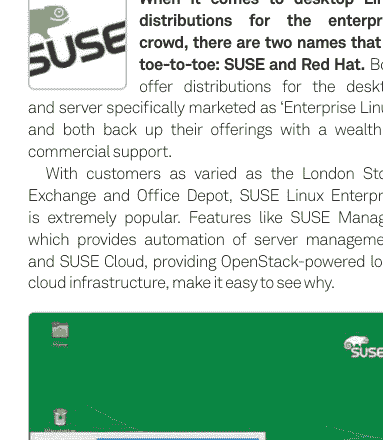

与 SUSE 类似，红帽企业 Linux 提供服务器、桌面和移动版，并拥有包括苏黎世联邦理工学院在内的健康客户群。支持响应迅速，而且他们在全球范围内提供开发设施。


OpenSUSE 是由 SUSE 赞助的免费完整版 Linux。它提供了出色的合同支持甚至提供了服务器功能。


与红帽一样，Ubuntu 背后的公司提供不同的支持合同和行动，具有丰富的软件兼容性供选择。

凭借像 Linux Store 和 Exchange Depot 这样多样化的客户，SUSE Linux Enterprise 充满了功能，提供了服务器管理的自动化支持，而 SUSE Cloud 提供了基于 OpenStack 的云基础设施，使得服务变得简单。

作为其桌面和服务器变体，SUSE Linux Enterprise 带有附加扩展选项，适用于点站点环境和对实时性能有高要求的高可用环境。

稳定性和支持是有代价的；与社区驱动的 OpenSUSE 相比，SUSE Linux Enterprise 的软件包较少，但它包含的许多软件包非常适合专业环境。

SUSE 软件包中的最后点笔是 SUSE Studio，它为企业用户提供了自定义 SUSE 发行版的方法，并可以从 Live CD 镜像甚至根据其需求定制弹性云 (EC) 实例进行创建。

当 SUSE 出现时，它的质量与红帽并列，两者都在尝试相互竞争，在投入之前，请务必查看对方提供了什么。

> 在 SUSE 之上是一个高质量的发行版，为其需求量身定制

## 最佳工具

| | | | | | | |
|---|---|---|---|---|---|---|
| | | | | | | |
| | | | | | | |
| | | | | | | |
| | | | | | | |
| | | | | | | |
| | | | | | | |

一种开源的配置管理实用程序，旨在支持类 Linux 和 Windows 的异构网络。对于企业级基础设施的系统管理员来说，Puppet 是一个强大的工具。

### Chef

作为 Puppet 的替代品，基于 Ruby 的 Chef 与 AWS、Google Cloud Platform 等云环境良好集成，并作为本地安装程序用于管理基础设施。

Docker 允许在 Linux 上轻松、快速地部署软件容器。与任何虚拟机相比，Docker 容器的开销要低得多。

Dlyn 为那些采取积极安全措施的人设计，旨在成为黑客群的强硬工具，因为它提供了审计 Linux 发行版的方法，还可以检查安全漏洞和配置错误。

### SUSE Studio

虽然 SUSE Studio 最常被 SUSE 团队使用，但旨在构建和运行任何 Linux 发行版的系统镜像，并可以使系统管理员的工作变得更容易。

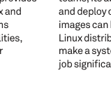

## 最适合的发行版...

安全

### BackBack Linux

对于不需要 AI 支持的人来说，BackBack 发行版是 Ubuntu 的极佳选择，具有轻量级的 X 窗口管理器。BackBack 非常强大，并有一系列预装实用程序。

当主流媒体只让其读者担心黑客攻击时，专注于安全的发行版是“好人”至关重要的工具。

多年来，BackTrack Linux 一直一直是安全渗透测试的 Linux 发行版之王。然而在2013年，该项目分支出了 Kali。

Kali Linux 由 Offensive Security 的 Aaron 和 Devon Kennedy 创建并维护，Kali 是 BackTrack 的底层重写，是其继任者。

Kali 基于 Debian，预装了大多数流行的安全工具，包括网络嗅探器和 Wireshark、端口扫描工具 nmap、密码破解器 John Reilly 以及用于无线网络渗透测试的 Airc-ng 套件。与 Ubuntu 相比，它的仓库有更多选择。

Kali 与竞争对手的不同之处在于兼容性；包括 32 位和 64 位架构。他们一直致力于将 Kali 引入更流行的桌面。它提供了适用于树莓派和各种手机等不同设备的构建。

然而，最令人印象深刻的特征可能是 Kali 子项目 NetHunter。目前适用于 Android 智能手机和平板，KaliHunter 直接提供各种渗透工具——这是一个桌面测试的绝佳工具，无需随身携带一台顶级笔记本。

Kali 既可以安装在硬盘上，也可以从内存和另一个桌面安装，这非常适合日常使用。它是任何网络安全人员的显而易见的选择——这对于脚本小子来说非常简单——非常到位。

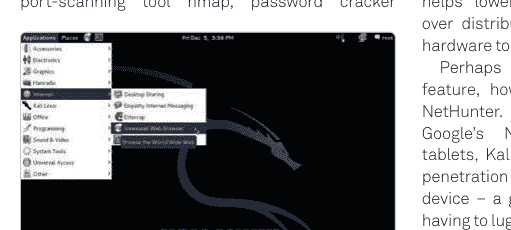

用于网络渗透测试的-BackBack 逆向工程工具。提供了用于内存调查、文档分析以及网页内容的分析工具。


Kali 之上已足够完整

### OpenVAS

OpenVAS 由 Michael Boyle 创建，是一种用于发现漏洞的漏洞扫描器。它是一个开源项目，被安全专业人员用于测试系统。也被想要发现自己网络漏洞的个人使用。

### Metasploit

Metasploit 是一个渗透测试框架。它允许你发现、利用和报告漏洞。它也被安全专业人员用于系统。

## 对于...的最佳发行版

## 替代发行版

## 滚动更新 (Rolling release)

对于那些不喜欢受制于正式发布计划的人来说，滚动更新发行版承诺让系统永不过时。

Sabayon 是 Gentoo 的一个变体，它保留了滚动更新的精神，但更注重“开箱即用”。Sabayon 缺乏 Gentoo 的灵活性，但仍然是一个强大的发行版。

Gentoo 以快速的企鹅命名，Gentoo 和 Arch 长期以来一直是竞争对手。两者都提供滚动发布方法论，这意味着最新的更新会同步发布，确保安装只需一次——且两者都具有类 BSD 的软件分发方式。

Arch 的不同之处在于它将用户直接留在控制台上，安装过程是一个自由的过程。一旦安装完成，它既快速又极具活性。

Aptos 提供了一个熟悉的环境和滚动更新。Aptos 以 Debian 的不稳定分支（unstable）为父级，包含了许多针对 Debian 自由软件的定制。

对于 Linux 用户来说，Arch 这种不干预的方法就像是在没有被介绍滚动更新世界的情况下，被投入了深水区。Gentoo 最初于 2002 年发布，是一个开发和软件发布需要某些方法的发行版。

运行 Gentoo 的另一个主要特点是它的软件直接通过系统管理器从源码编译。这意味着你需要等待维护者为该平台构建并上传包，该包可以针对你的特定需求进行优化，并在通用编译会导致系统下降的情况下进行基准测试。当然，权衡是从源码编译比直接从 Arch 安装预编译的二进制文件花费长时间。

与 Gentoo 类似，Arch 的安装过程提供了帮助——通过通道和邮件列表提供了大量的社区帮助——但最近发布的 USB 变体使其尝试变得更容易。它的人气在近年来增加了。对于任何想要高度可定制系统的人来说，Gentoo 都是一个极佳的选择，而且安装会变得更容易——这个过程本不应该独自完成。


> 上述安装比 Gentoo 慢，为你提供了更好的选择方法

### Audacity

作为 GNU 图像处理程序（GIMP）的开源对应，最近引入了单窗口界面以解决对其可用性的批评，将其功能带给新的受众。你可以想象一下使用带有效果和滤器的多轨道混音。Audacity 帮助证明了 Linux 是用于创作性工作的，并且它能够与专有平台相衡。

Firefox 曾因臃肿而备受批评——尽管该项目的初衷是处理 Mozilla 中感知到的新闻问题。Firefox 浏览器（版本 34）仍然是用户中的热门选择。

### LibreOffice

LibreOffice 在 MyASystems 收购 OpenOffice.org 后创建，来自 Document Foundation 的 LibreOffice 现在需求很大，提供的功能甚至让最忠实的 Microsoft Office 粉丝也感到满意。

VLC 的强大之处在于它的灵活性，以及播放任何音频或视频格式的能力——它支持一切，并具有从各种源录制的能力——捕捉你的桌面视图。

| 性能 | |
| 安装 | |
| 硬件支持 | |

发现每个类别中最好的免费软件

## 对于...的最佳发行版

### 实时系统发行版

你可以从便携介质启动无需安装的最优 Linux 发行版

Knoppix 仍然是顶级的实时发行版之一，尽管随着其他发行版的加入，竞争已变得激烈。Knoppix 长期以来保持流行，同时随着时代的变化在其他领域进行更新。

Knoppix 将自己定位为发行版所提供的一切内容的展示，你所获得的发行版多样性意味着你可以轻松访问 Linux 上几乎所有已知的自由软件（FOSS），而无需安装——它包含了一应有的一切。

由于包含了大量的软件，Knoppix 的启动和运行速度很快。这是由于软件在“过程中”压缩和解压缩的方式，使得 2 GB 的 USB DVD 可以随时包含任何内容。Knoppix 还有几张备忘录，让你能够以不同的屏幕和显示选项启动，或者由于某些原因在各种计算机上进入 Linux。它不是系统管理员工作的最佳选择，但可以完成许多仅限 Linux 的任务。

| 硬件支持 | |

### Porteus

这是一个非常特殊且微小的发行版，在旧电脑上，它在性能和实用性方面最合适。通常在 Ubuntu 上，通过自定义内核和不同的软件包集，可以创建一个像网吧之类的简单的 Web 亭台，运行多个 Firefox 实例。

这是一个非常快的发行版，仅占用 300 MB 空间，并针对从 U 盘运行进行了优化，带有增加速度的模块。

### 通过提高知识成就地位

克隆硬盘的最佳方法 `Clonezilla` 支持整个硬盘以及分区，并可以在未来用于克隆镜像。使用我们 100% 客户都在使用的实时发行版程序是最好的。预留你的位置并获取代码的专家知识。

### GParted

使用 `GParted` 格式化、编辑和调整你硬盘及分区的几乎任何内容。它是调整大小的最佳工具，而且易用。

### Wic

一种简单且快速的网络工具，可用于本地和远程网络。在过去我们通过它进行连接网络管理。

如果你的备份或其他发生了严重故障，你可以从硬盘恢复数据。它支持所有文件系统。

## 成为认证系统管理员

### LFCS 考试

掌握完美分数的技能

我们与 Linux Foundation 的专家交谈，了解更多关于其认可考试的信息——以及你如何通过

随着行业对更复杂技术的需求，Linux 继续增长，它是开源的，由全球数千个设备和公司的社区驱动。从云、服务器到移动和嵌入式设备，Linux 是增长最快的平台。

提供了一个衡量员工的标准。由两个资质组成——Linux Foundation 认证管理员 (LFCS) 和 Linux Foundation 认证工程师 (LFCE)——该计划围绕能够在 Linux 环境中展示知识和技能的考试。

## 来自 Linux Foundation 的信

因此，我们需要更多合格的系统管理员和工程师来支持 Linux 系统，但随着行业日益需要合格专业人士，我们今年的报告显示十个经理中有一个正在招聘 Linux 人才。最新的 Linux 报告显示，60% 的受访者认为 Linux 对他们的业务运营至关重要，84% 的人认为在现代工作中无处不在。

## 求职与简历写作技巧

培训只是第一步——下一步是寻找工作。

一旦你完成了培训，该如何开始找工作呢？这主要包含两个部分：准备一份优秀的简历以及将自己推向就业市场。无论是通过求职网站申请、使用 `LinkedIn` 账号，还是向专业猎头发送简历。

应多寻找专业猎头，而不是通用的招聘板，因为在 IT 领域你更容易找到好工作。在供大于求的情况下，尝试寻找一个让你提交简历并完善个人资料的网站，以免在努力引起经理注意时淹没在任何邮件系统中。人脉关系也至关重要，因为许多猎头会搜索具备正确技能的潜在员工。

对于简历，要保持简洁简单。一页纸就足够了。包含基本的联系方式、计算机教育背景以及与系统管理员（Sysadmin）职位相关的任何工作。

下方 Jim Zemlin 认为获取学习机会比以往任何时候都重要。


`LinkedIn` 个人资料以及候选人展示其 Linux 专业人士资质的其他方式。在 Linux 基金会（Linux Foundation）强大的后盾支持下，这些小徽章将成为能力的重量级标志。

当我们写到 2014 年年中时，这些认证持续在行业内引起波动。每一个证书都是向下一个阶段的巨大跨越和尝试。`Linux Pro` 预计于 2015 年推出，看看这些认证对市场招聘产生多大影响将是非常有趣的。Linux 基金会在报道中表示，这确实是我们行业对人才的寻找。与此同时，我们看到 Linux 基金会会对认证和 Linux 工作做了自己的说明。

“根据《Linux 报告》第一年的数据趋势以及我们在全球数百家公司看到的情况，我们预计需求将会增加，”Jim Zemlin 在被问及对 Linux 技能的需求预测时回答道。

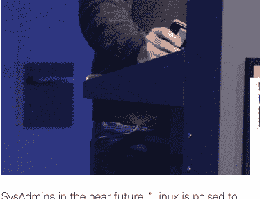


不久后的系统管理员。“Linux 将在未来几十年内驱动整个行业的创新。”

人才需求是一方面，我们也很好奇 Linux 系统管理员和 Linux 工程师资质在认证计划中是否发挥了作用。然而，正如 Zemlin 所说，市场对 Linux 招聘培训和资源是有需求的；LFC（Linux 基金会）拥有一些一直在招聘 Linux 专业人士的人员，以及他们希望看到新的、高素质人才来识别 Linux 人才的个人或组织，”他说，“此外，我们看到有许多人注册了我们的首个按需 Linux 入门课程。”

在今年早些时候免费推出的的大规模开放在线课程（MOOC）已有超过 2,400 人参加——这是 Linux 基金会与 edx 合作的结晶，在某种程度上，这也是对系统管理员和工程师认证的测试，其具有几乎“随处可见”的结构。学生们...

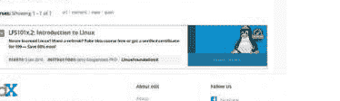

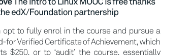

## 上文：入门 Linux MOOC 对 Linux 基金会免费开放

学生可以选择参加课程并获得自学验证的成就证书，这基本上涉及按照自己的节奏学习材料，而无需任何注册。在免费课程发布后的短时间内，它已变得非常受欢迎，大量用户选择了旁听（audit）。

然而，我们询问了 Zemlin，考虑到 Linux 专业人士历史上的自学型特质（他们通常用命令来交流），关于学习者的经历（一个轶事）：“随着 Linux 的增长并在全球规模最大、技术最复杂的企业中变得更加普及，这种...

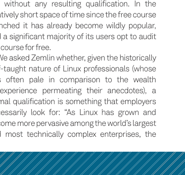

27 个完美考试分需要掌握的技能


参加像 `LinuxCon` 等许多活动之一是建立人脉的好方法。

以下是你在 LFS 方案中被要求展示的内容，以及你可以在相关教程中找到的 L&D（学习）问题：

### 本地管理

- 创建备份
- 恢复备份数据
- 使用 `Clonezilla` 进行全备
- 备份账户
- 管理存储过程及相关服务
- 创建并管理启动脚本
- 管理文件权限

> 对 Linux 系统管理员和工程师的需求急剧增长

专业 Linux 系统管理员和工程师的需求已急剧增长。Zemlin 回答道：“认证为雇主提供了一种方法，让他们知道自己在和最有才华的人合作。许多 Linux 专业人士将继续自证，但认证是对人才的验证。它证明了他们的真实水平，并将他们推向职业和机会的下一个阶段。”

“LFS 认证最大的好处，”Zemlin 继续说道，“是告诉雇主你属于最优秀的 Linux 人才之一。认证是一种非语言的、详细的证明，肯定了人才的信誉。它就像 SUSE，对于在有志专业人士中非常流行的各种 Linux 培训课程和工作坊。”

- 管理用户组
- 管理用户账户
- 内核参数属性
- 设置文件权限和所有权
- SysAdmin 大师课（上述七项）

### 本地安全

- 访问 root 账户
- 使用 `sudo` 管理对 root 账户的访问

### Shell 脚本

- 基础 Shell 脚本
- 使用 bash shell 脚本，部分1
- 使用 bash shell 脚本，部分3

### 软件管理

- 安装软件

### 命令行

- 关于命令行
- 在命令行处理文本

### 归档与配置

- 归档文件和目录
- 组装分区
- 创建文件
- 格式化文件系统
- 挂载文件系统
- 分区设备
- 故障排除
- 处理设备（以上所有）

### 存储

- 将分区配置为 RAID
- 从存储创建文件
- 处理来自存储的文件
- 管理来自存储的文件
- 自动挂载文件系统
- 管理存储
- 故障排除

虽然人才需求是一方面，我们也很好奇 Linux 系统管理员和 Linux 工程师资质在认证计划中是否发挥了作用。然而，正如 Zemlin 所说，市场对 Linux 招聘培训和资源是有需求的；LFC 拥有一些一直在招聘 Linux 专业人士的人员，以及他们希望看到新的、高素质人才来识别 Linux 人才的个人或组织，”他说，“此外，我们看到有许多人注册了我们的首个按需 Linux 入门课程。”

在今年早些时候免费推出的大规模开放在线课程（MOOC）已有超过 2,400 人参加——这是 Linux 基金会与 edx 合作的结晶，在某种程度上，这也是对系统管理员和工程师认证的测试，其具有几乎“随处可见”的结构。学生可以选择参加课程并获得自学验证的成就证书，这基本上涉及按照自己的节奏学习材料，而无需任何注册。在免费课程发布后的短时间内，它已变得非常受欢迎，大量用户选择了旁听。

然而，我们询问了 Zemlin，考虑到 Linux 专业人士历史上的自学型特质（他们通常用命令来交流），关于学习者的经历（一个轶事）：“随着 Linux 的增长并在全球规模最大、技术最复杂的企业中变得更加普及，这种...

[第29 页]

## 特别专题

下方 Jim Zemlin 认为获取学习机会比以往任何时候都重要


## 上文2014 年是企业级 Linux 之年，这意味着有更多系统管理员职位需要填写

意味着回答问题可能只有一种正确的方法。目标不是选择表述正确的答案，而是去理解。

如果你对精通所需的所需的技能好奇，请查看第 29 页——这里详细说明了 LF 考试涵盖的每个科目，我们也有工作机会。基金会可以帮助你准备考试；在 2015 年初，我们将推出一个自学型的在线课程，参与会更容易。

基于性能的测试与所测试的技能非常契合，因此它不仅仅是关于记忆。它需要推理。然而，听到基金会在网上进行这些考试的决定存在争议，并且人们可以选择日期和用于考试的发行版：可能随着时间的推移，人们将开始接受 RedHat 和 Debian，但核心课程是可靠的。

在成功通过考试后，作为 Linux 系统管理员的第一份工作有什么局限性，或者大纲中哪些领域在现实中需要跟进？答案是明确且自信的：

系统管理员或工程师

根据基金会的数据，数百人参加了 LFCS 考试，并已成功通过考试；其通过率在 60% 左右。他们都认为考试的优点是：“测试者提到的最大优势是考试是基于性能的而不是选题。这证明了对 Linux 系统的实际知识。它还...

## 成为认证系统管理员

## 获得完美考试分数需掌握的技能

## 特色介绍

> 我们将在 2015 年初推出一个与考试绑定的自学进度在线备考课程。


## 为你的考试做准备

《基金会认证备考指南》针对以下内容提供了一些实用建议：

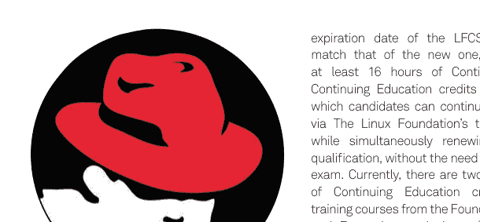

LFCS 证书的过期日期：需与新证书匹配，并完成至少 16 小时的持续教育。持续教育学分意味着候选人可以通过 Linux 基金会的材料继续他们的教育，同时更新其资质。持续教育学分分为两种：来自基金会开发者和运营团队的高级培训课程、30 小时或以上的课程（如 `LF302`），以及来自 Linux 基金会认可的合作伙伴（如 Red Hat、SUSE、IBM、Oracle 或 HP）的批准培训。任何经过批准的课程也可以获得持续教育学分（可要求向基金会获取），该学分将提供证明。

## 上述持续教育意味着 Red Hat 可以为你提供认证

例如 `StackEngineer`（工程师），Zemin 表示：“我们的目标是开发负担得起的认证计划，但目前尚未做出任何决定。我们非常欢迎收到关于哪些领域有价值的计划建议。对于未来几年 LFCS 和 LPCE 的持续成功将非常有帮助。我们坚信，基金会的资质将证明其质量更高的认可，这种方法将帮助我们增长并满足特定领域对专业服务的的需求。”

- 你的系统：考试将通过你的摄像头进行实时监控，你需要在工作时确保你的系统符合要求。检查你是否运行的是支持 WebRTC 的 Chrome、Edge 或 Firefox。检查你在考试期间的带宽。另一个需要检查的是你的互联网连接是否稳定，以免应用程序剧烈掉线和波动导致失败。

- 你的环境：尽管你可以随时随地在任何地方参加此考试，但确保你的移动设备或电脑正常运行至关重要。确保你有一个安静、无干扰的环境，在第一个小时内不会被打扰。另一个你考试的标准环境将为你提供成功的最佳机会。

- 你的设备：确保你的设备与 Linux Foundation D. 资料上的名称匹配至关重要。我们建议在考试当天通过此网页链接测试你的摄像头。在考试前几分钟练习查看，map 和 edges 有助于你做好准备，进入正确的状态。在考试期间，你将忙于回答问题和导航界面。

- 你的终端：你使用的终端运行在浏览器中。你可以选择你喜欢的任何 Linux 发行版，但请注意无法通过 `sudo` 获得权限。在考试期间，你将没有该进程的 root 权限，因为它并将通过 BBOX 阻塞你的块。如果你在浏览器内部，请使用快捷键 `Ctrl+Alt+V` 粘贴，而不是 `Ctrl+V`，因为这可能会导致终端不稳定。你可能需要选择文本进行复制，然后点击中间键粘贴（或同时点击左键和右键）。

Zemin 说：“Linux 基金会希望增加获得认证的便利性，以帮助人们获得他们想要的工作并通过考试。此外，我们将继续更新考试内容，以确保其相关性。‘此外，’Zemin 继续说道，“我们还提供持续教育学分。”

Linux 基金会网站详细介绍了认证持有者更新资质的两种方式：获得更高级别的 LFCS 认证，这可以延长教育学分；为考试支付费用，你可以在购买后 12 个月内的任何时间参加，或者工作以测试需要测试的技能；识别你需要测试的领域。

# 使用 Elastichosts 创建 Linux 容器

设置和管理 Linux 容器所需的所有知识

## 教程

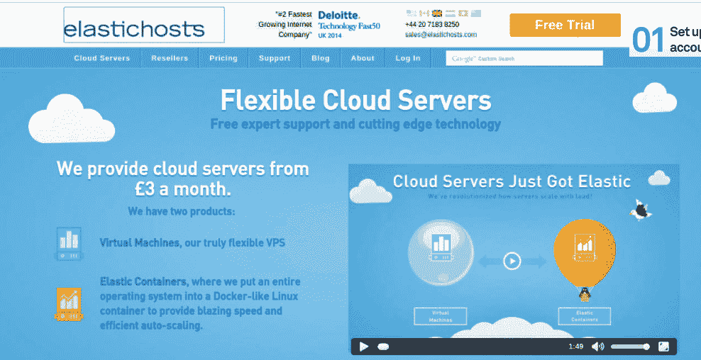

## 灵活云服务器

免费专家支持与尖端技术

### 01 设置您的账户

使用图形界面登录系统并使用 `elastichosts.com` 创建账户。试用账户有效期为五，无需添加支付信息即可使用，因此试用结束后不会有意外付费。

### 02 创建您的容器

使用新账户登录，服务器将准备好供您添加虚拟机和容器。在界面上找到“添加 (Add)”按钮，并在输入服务器详情之前选择“服务器 (容器)”。为它命名并选择一个要使用的镜像。

### 03 布局

安装完成后，您将剩下两个对象——服务器和文件存储空间。你会注意到，默认情况下不占用存储空间，发行版层层在容器外部处理。目前容器也处于关闭状态。

### 04 设置静态 IP

在我们切换到容器之前，我们可以创建一个静态 IP ——再次点击“添加”并找到静态 IP 选项。创建完成后，在服务器详情旁边找到网络选项 —— 从下拉菜单中选择此新 IP。

### 05 启动服务器

设置好 IP 后，就可以首次启动服务器。按下电源开关，服务器将非常快速且平稳地启动。注意，某些设置不会被更改。

### 06 SSH 详情

连接到服务器最简单的方法是通过 ssh 获取。如何连接特定 ssh 的详情可以在服务器的“连接 (Connect)”菜单中找到。查看服务器详情旁边以了解如何连接。

### 07 建立连接

打开终端与服务器建立 ssh 连接。默认使用用户（或 root），因此您可以使用如下命令建立连接：

### 08 使用 ssh

进入内部后，您可以使用 ssh 使用任何其他命令行。通过 `ifconfig` 查找网络设置，使用包管理器安装软件包（正如您预期的功能 Linux 发行版），而这只是冰山一角。

```
$ ssh user@host
```

### 09 关闭服务器


您可以在所使用的相应登录界面中操作，也可以通过图形界面的按钮进行。使用命令和强制电源。若要使用终端关机，请使用 `sudo shutdown -h now`；若需要软重置，请重启。

## 11 通过 WebDAV 连接

在您的管理器中，前往并连接到安全 (https) WebDAV。输入服务器上 https 之后的地址，将文件夹选择为本地共享，并输入存储的用户名和密码。

## 12 本地存储

在创建服务器后，您也可以更改服务器可用的资源量。关闭服务器并返回服务器配置菜单，可以在那里修改 RAM 和 CPU 使用率、配额以及开放或特定选项。

## 14 其他设置

在创建服务器后，您也可以更改服务器可用的资源量。关闭服务器并返回服务器配置菜单，可以在那里修改 RAM 和 CPU 使用率、配额以及开放或特定选项。

## 15 额外功能

我们让使用 Datawrapper 进行数据可视化尽可能简单。如果您在 Excel 或 Sheets 中工作，只需选择表头并粘贴即可。

## 教程

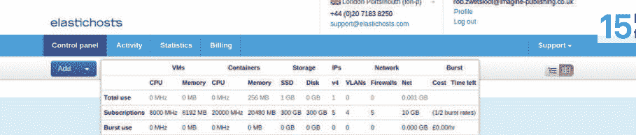

| CPU | 内存 | 内存 | SSD | 磁盘 | vCPU | VLANs | 网络 | 突发 | 剩余时间 |
|---|---|---|---|---|---|---|---|---|---|
| 总用量 | 0 MHz | 8000 MHz | 512 MB | 20000 MB | 2400 MB | 300 GB | 5 | 10 GB | 0.000 GB | (剩余 IO 突发) |
| 突发用量 | 0 MHz | 0 MHz | 0 MB | 0 GB | 0 GB | 0 | 0 | 0 | 0.000 GB | 0.00hn |

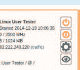
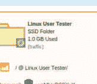

此账户中没有 VLANs。为每个项点击添加按钮。

## 静态 IP

| # | IP | 反向 DNS | 主连接 | 次要连接 | 删除 |
|---|---|---|---|---|---|
| 1 | 93.222.248.99 | | Linux Tester | | |

- Linux Tester


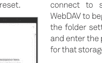
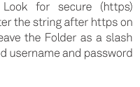
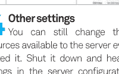

# 使用 Datawrapper 可视化你的数据

快速高效地表达你的观点

## 教程

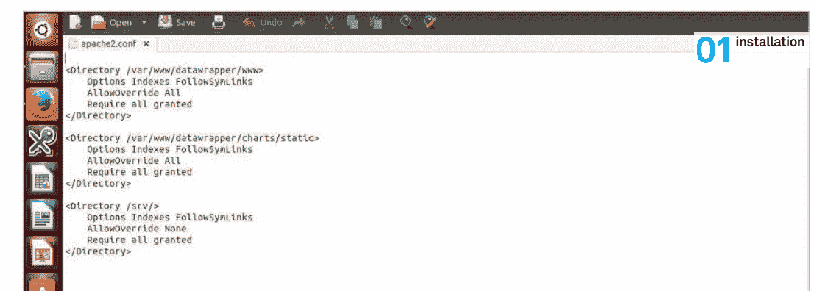

```apache
<directory /var/www/datawrapper//>
Options IndexesFollowSymLinks
AllowOverride All
Require all granted
</directory>
<directory /var/www/datawrapper/charts/static/*>
Options IndexesFollowSymLinks
AllowOverride All
Require all granted
</directory>
<directory /var/www/js/*>
Options IndexesFollowSymLinks
AllowOverride All
Require all granted
</directory>
```

### AccessFileName：在每个目录中要查找的文件名

用于额外的配置指令。另请参见 AllowOverride

### AccessFileName .htaccess

以下行防止 .htaccess 和 .htpasswd 被使用

## 01 安装

要开始使用 Datawrapper，你需要安装 Apache 服务器（启用 mod_rewrite 和 mod_php）、PHP（版本 5.2 或更高版本）和 MySQL 服务器。这可以通过一个包（LAMP 栈）完成。要安装 LAMP 服务器，首先使用 `sudo apt-get update` 刷新包索引，然后执行 install-server。使用 `sudo apache2 restart` 命令重启 apache 服务。如果你不熟悉使用提示的数据库命令。要安装 phpMyAdmin，请使用以下方法：

由于其设计，需要一个数据库在子目录中运行，例如在 `http://localhost/phpmyadmin/` 中进行安装。

在下载 Datawrapper 之前，你可以在 https://github.com/datawrapper/datawrapper 获取它。导航到 Datawrapper 命令提示符并运行 `composer install`。

## 02 服务器配置

现在依赖项已经安装完成且数据库已准备就绪，我们需要创建两个虚拟主机：一个用于 Datawrapper（指向 `/www/folder/datawrapper`），另一个用于数据库（指向 `datawrapper-conf.php`）。

在此记录中，我们使用 Ubuntu 14.04 作为系统，硬件版本 14.04 进行安装。

首先复制两个默认配置 (000-default.conf) 并将其命名为以下主机：

```bash
sudo cp /etc/apache2/sites-available/000-default.conf /etc/apache2/sites-available/datawrapper.conf
sudo cp /etc/apache2/sites-available/000-default.conf /etc/apache2/sites-available/datawrapper-db.conf
```

纯文本 | 制表符: 4 | 行 63, 列 1

然后更新文件中的 DocumentRoot 和 Server 名称。启用 apache2 配置文件中添加的数据库根访问（该文件位于 `/etc/apache2/apache2.conf`）。此博客和数据库被配置为不访问 /var/ 之外的根文件系统。使用命令启用站点：

```bash
sudo a2ensite datawrapper.local
```

```bash
sudo a2ensite chart.datawrapper.local
```

到此已完成了安装：你现在可以在 datawrapper.local 访问 datawrapper，如果一切正常，你将看到消息“恭喜！你已成功安装 datawrapper。”

这将下载 Datawrapper 需要的所有依赖项。创建一个 MySQL 数据库，并使用 `/lib/core/` 初始化表结构。

## 教程

datawrapper.local/chart/3eeXz/visualize#select-visualization

- 上传数据
- 检查与描述
- 发布与嵌入

[ 在此处插入标题 ]

| 1985 | 1990 | 1995 | 2000 | 2004 | 2005 |
|---|---|---|---|---|---|


报告：58,454.00
导出：43,600.0

- 1 选择图表
- 2 完善图表
- 3 讲述故事

| 柱状图 | 纵向柱状图 | 分组柱状图 |
|---|---|---|
| 折线图 | 饼图 | 选举环形图 |
| 数据表格 | | |

提示：如果可视化效果与你的预期不符，请尝试转置数据。

选择布局：Datawrapper

## 03 开始

在创建第一个图表之前，你需要创建一个账户以便将图表分享到其他网站；将它们保留在自己手里意义不大。点击顶部的“Sign up”（注册）按钮创建账户，然后使用你的凭据登录。注册后，Datawrapper 将托管电子邮件服务器，你将收到一封带有验证链接的电子邮件——点击链接激活。

如果你没有收到电子邮件，或者在激活时遇到问题，你可能需要查看垃圾邮件箱，或者你可能需要请求新的激活邮件。

## 04 数据上传

要创建图表，点击右上角的“Chart”（图表）按钮。接下来，你需要上传数据——它可以是你喜欢的任何格式，只需至少有一数据点即可。向 Datawrapper 添加数据如既往一样简单。如果你使用 OpenOffice 或 Excel，只需将你的数据复制并粘贴到标记的文本字段中。如果你有一个 CSV 文件，可以直接从计算机上传它。如果你想先看看它是如何工作的，可以尝试使用 Datawrapper 提供的数据样本。只需点击“Sample data”（样本数据），然后点击“Upload & continue”（上传并继续）按钮。

解释为标签或数据。你也可以注明数据来源；如果你在 Credit source（来源来源）下更新数据，它将显示在地图底部。有方法可以自定义归属性：点击列标题上的复选框。作为标题，左侧会打开新菜单。在行-列转换选项卡中，你可以交换列。完成你想操作后，点击“Visualize”（可视化）进入图表。

## 05 检查并描述

下一步是检查并描述你刚刚上传的数据。在你粘贴/上传后，它将以表格格式显示。然后可以使用它来仔细检查，以确保数据以你想要的方式被解释。如果需要更改，你可以直接编辑数据。你可以控制第一个结果是

## 06 可视化数据

各种图表类型

数据可以是任何大小或形状，因此有很多选项。可视化选项卡让你只需选择一种图表类型来可视化上一步呈现的数据。你可以选择柱状图、折线图以及其他图表类型。你现在可以在 datawrapper.local 访问 datawrapper，如果一切正常，你将看到“恭喜！你已成功安装 datawrapper。”

# 使用 Datawrapper 可视化你的数据

快速高效地表达你的观点

## 教程

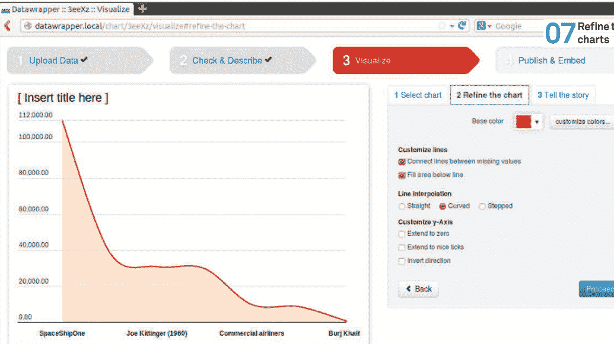

## 数据可以是任何大小或形状，因此有很多选项

## 03 开始

在创建第一个图表之前，你需要创建一个账户以便将图表分享到其他网站；将它们保留在自己手里意义不大。点击顶部的“Sign up”（注册）按钮创建你的账户，然后使用你的凭据登录。注册后，Datawrapper 将托管电子邮件服务器，你将收到一封带有验证链接的电子邮件——点击链接激活。

如果你没有收到电子邮件，或者在激活时遇到问题，你可能需要查看垃圾邮件箱，或者你可能需要请求新的激活邮件。

## 04 数据上传

要创建图表，点击右上角的“Chart”（图表）按钮。接下来，你需要上传数据——它可以是你喜欢的任何格式，只需至少有一数据点即可。向 Datawrapper 添加数据如既往一样简单。如果你使用 OpenOffice 或 Excel，只需将你的数据复制并粘贴到标记的文本字段中。如果你有一个 CSV 文件，可以直接从计算机上传它。如果你想先看看它是如何工作的，可以尝试使用 Datawrapper 提供的数据样本。只需点击“Sample data”（样本数据），然后点击“Upload & continue”（上传并继续）按钮。

解释为标签或数据。你也可以注明数据来源；如果你在 Credit source（来源来源）下更新数据，它将显示在地图底部。有方法可以自定义归属性：点击列标题上的复选框。作为标题，左侧会打开新菜单。在行-列转换选项卡中，你可以交换列。完成你想操作后，点击“Visualize”（可视化）进入图表。

## 05 检查并描述

下一步是检查并描述你刚刚上传的数据。在你粘贴/上传后，它将以表格格式显示。然后可以使用它来仔细检查，以确保数据以你想要的方式被解释。如果需要更改，你可以直接编辑数据。你可以控制第一个结果是

## 06 可视化数据

各种图表类型

数据可以是任何大小或形状，因此有很多选项。可视化选项卡让你只需选择一种图表类型来可视化上一步呈现的数据。你可以选择柱状图、折线图以及其他图表类型。你现在可以在 datawrapper.local 访问 datawrapper，如果一切正常，你将看到“恭喜！你已成功安装 datawrapper。”

## 07 完善图表

在你为数据选择了一个图表后，是时候对其微调了。点击“Refine”（完善）选项卡，你可以根据所选的图表进行编辑。

如果你有柱状图，你可以获得选择颜色的选项。你还可以对柱状图进行排序和反转。

- 折线图：除了更改颜色，你还可以填充线条下方区域，使其变为弯曲或阶梯状。你还可以调整轴。
- 数据：你可以使用完善选项添加表格。如果表格有多列，也可以分多个页面显示。
- 饼图/环形图：你可以编辑这些类型的颜色。

## 08 为图表添加故事

现在图表已经过自定义，让我们为它添加故事吧。“Tell the story”（讲述故事）选项卡让你编辑图表标题并为这些信息添加一些描述。在图表窗口中，你可以使用下方的下拉菜单突出图表的重要元素。你也可以编辑“Check & Describe”部分。

## 09 发布与嵌入

这是创建过程的最后一步。你可以全方位地查看你的作品。如果你已经输入了电子邮件——如第 3 节所述，你还将获得一个用于“Embed into your website”（嵌入到你的网站）部分的的代码段。你只需将其复制并粘贴到另一个地方即可显示图表——前提是你的服务器可以通过互联网访问。如果你将 Datawrapper 安装在网络中的计算机上，你可以在网络内显示图表。你还可以将图表导出为图像用于发布等。

## 10 最后完善

Datawrapper 是一个很棒工具工具允许任何人创建漂亮的图表——不需要任何技术或数学知识。如果你有一些数据，Datawrapper 可能会有点棘手，但只要你仔细遵循这几个步骤。如果你访问过 Datawrapper，你会发现有很多可用功能。图表中最突出的是地图功能，它让你能够以地理地图格式显示数据。这目前在 GitHub 源码中不可用，但将会提供。

## 教程


# 构建 Linux HTPC

使用自定义的 Linux 设置来搭建一台最强大的家庭影院电脑（HTPC），并提供硬件和软件方面的提示。

一些最出色的家用影院 PC 和媒体中心是基于成熟和/或开源软件的。在控制观看内容时，人们喜欢拥有熟悉的界面并获得他们想要的东西。这就是类似于 Kodi 的东西——XBMC 经过多年的开发、测试和成熟，非常受欢迎，它极易使用，并且不需要任何额外设置即可执行或播放许多功能。

这些解决方案中的许多可能缺乏定制，而且不如你自己在 Linux 中创建的系统那样开放。我们将向你展示你所需的所有教程，帮助你创建自己的 Linux 软件，它可以驱动你的电视并观看所有的节目，或者在急需时播放你的音乐库。

我们将使用 Kodi 来实现这一目标，但许多技巧也适用于你使用的任何其他 HTPC 软件。

## 顾问

Rob Zwetsloot 负责复杂系统建模，并是一位 Python、Django 和 PHP Web 开发人员。他热于计算实验。

## 资源

- OpenELEC http://openelec.tv
- www.linuxuser.co.uk

## 构建 Linux HTPC

搭建尽可能强大的家庭影院电脑。

## 教程

首页 > 获取 OpenELEC > 下载 > 树莓派获取 OpenELEC

棒了，你想使用 OpenELEC。你有几个构建选项供选择。如果你知道是哪一个，请从下面的选项中下载。如果你不知道，你可能想看一看，因为有很多版本的 OpenELEC。安装 OpenELEC 很容易的，但如果你是新手，请查看 wiki 上的安装指南。

类别：通用构建

| 名称 | 大小 | 下载 |
| :--- | :--- | :--- |
| OpenELEC 稳定版 - 通用 x86_64 版本 4.2.1 | 2014-10-04 17:31:54 | 143.87 MB | [下载] |
| OpenELEC 稳定版 - 通用 x86_64 版本 4.2.1 | 2014-10-04 17:31:54 | 141.25 MB | [下载] |
| OpenELEC 稳定版 - 通用 i386 版本 4.2.1 | 2014-10-04 17:32:13 | 142.27 MB | [下载] |
| OpenELEC 稳定版 - 通用 i386 版本 4.2.1 | 2014-10-04 17:32:29 | 138.48 MB | [下载] |

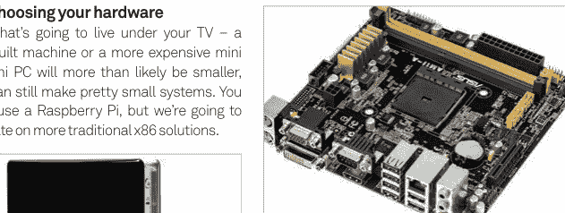

## 01 选择你的硬件

什么将驱动你的电视——一台自定义构建机器还是一更贵的 PC？迷你 PC 可能会更小，但你仍然可以做出纤薄的系统。你也可以使用树莓派，但如果你更关注 x86 解决方案的话。

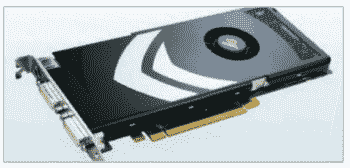

## 07 旧零件的重新利用

如果你手头有一些组件，你可能不需要购买新设备就能组装出一个系统。最低要求首先是显卡，所以只要你有一个 Nvidia 850 GT 或 Radeon HD GPU，你就能运行 Kodi 核心。

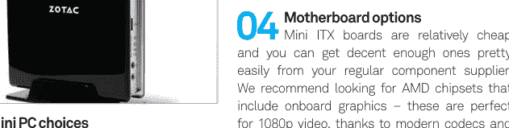

## 02 迷你 PC

有很多迷你 PC 供你完成这项任务，其中我们使用了 Intel 迷你 PC 和 Mini Boxes。Zotac 和技嘉也能胜任这项任务，并包含你个人选择的蓝光或其他光驱驱动器。

## 04 主板选项


# 构建一个 Linux HTPC

搭建尽可能强大的家庭影院电脑

## 教程

### 03 获取机箱

如果你想构建 HTPC，机箱的选择至关重要。使用旧零件和机箱是快速简单地实现此点的方法，产物将需要很多外观。查看 mini-ITX 机箱，以任何方式获得一个你可以轻松找到组件的纤薄系统。

Mini ITX 机箱相对便宜，你可以从常规组件供应商那里轻松获得相当的性能。我们推荐带有集成显卡的 AMD 芯片——这些非常适合处理现代编码器和硬件解码。

### 05 其他组件

你还需要一些内存和 CPU——尝试至少 2 GB 的内存；然而，我们建议为 CPU 提供内存将是系统中最核心的部分。

### 06 电源

如果你担心电源，请查看。当你担心电源时，请跳过，除非你，它可能需要很多。


### 09 获取 OpenELEC

设置 Kodi 最简单且最好的途径是获取 OpenELEC——它由 Kodi 开发团队创建，并精简到基础部分以保持简单。从 `http://openelec.tv` 获取你的 ISO。

### 10 启动 U盘

解压文件并打开终端。使用 `cd` 导航到 OpenELEC 文件夹，然后插入 盘创建你的实时安装。

### 11 安装

一旦创建了媒体，你需要将其插入 HTPC 并启动它，寻找启动 的启动菜单。系统将询问如何安装 OpenELEC——使用快速安装，假设这是一个专用的、未修改过的系统，并按照提示安装并重启。

### 12 首次启动

OpenELEC 将启动进入 Kodi，现在是配置时间了。首先，你应该查看插件部分。这将允许你设置无线以及其他内容。

### 添加的媒体

前往视频/音乐选项卡并找到文件选项——在这里你可以从 Samba、UPnP 或直接指向类似 NFS 分区的地址添加媒体。然后你可以选择一个爬虫为你的任何文件添加艺术设计和名称。

### 14 享受你的节目

一旦你的节目设置好，现在你已经从网络添加了媒体，你就可以观看或听任何任何内容了。设置一个专业的媒体中心不需要花费长时间，正如我们在这里展示的，所以继续以充分利用你的 HTPC。

### 15 内部存储

将文件存储在内部存储是确保你可以持续访问它们的好方法——特别是那些你家庭中的（例如，如果你有孩子，他们会反复观看动画片）。这将自动添加到你想要在家庭位置通过 Kodi 使用列表中。

### 16 USB 存储

连接内部存储对某些人来说可能有点困难，但 USB 闪存将轻松连接到系统，并立即添加到你的视频库中，持续任何来自内部存储的内容作为。

### 08 遥控器

大多数红外接收器和通用遥控器都能与内置 Linux 内核的 Kodi 软件配合。我们稍后介绍其他方法。

### 17 手机遥控器

除了项目之外（可能），你还可以使用 Kodi 将安卓 手机设置为无线遥控器。你也可以在浏览器中浏览 Kodi。该（基于 XBMC 的）应用可以从 Play Store 下载：`http://play.google.com/store/apps/details?id=org.xbmc.android`。

### 18 扩展-on选项

OpenELEC 构建在 Linux 之上，它允许你使用各种游戏控制器——特别是 PS3 和有线 360 手柄。这可以在急需时为你提供帮助，而且如果你计划为 HTPC 设置双启动，这可能是最佳选择。

### 19 插件

Kodi 留下了许多来自 XBMC 的视频、音乐和程序插件。在每个类别下找到“Add-on”，即可找到可以立即添加到你的 HTPC 的插件列表。

### 20 播放设置

在设置中，你有许多选项可以调整播放，以获得更好的体验。你想为任何词汇指定音频或字幕语言吗？4:3 节目的显示比例又是呢？这些可以在设置中更改和配置，方便你根据自己的喜好定制体验。

### 21 你可以观看和录制直播

同样可以通过 Kodi 观看，但你需要一个额外的连接来附加输入设备。你可以激活一些 EEG 插件，并可以更改其与 PVR 功能相关的行为。

### 22 持续观看

Kodi 有很多可以发现的地方，但这应该让你入门，并为未来的扩展留出大量空间。至于升级，硬件的寿命应该比系统长，而且 OpenELEC 也有内置的软件更新。

---

# 将旧电脑转换为 NAS 盒

将旧硬件复用为灵活的备份方案

## 顾问

Phil King 自 1998 年在 CRASH 杂志开始以来，资深游戏技术记者 Phil 摆弄了各种硬件，并评审了数百个应用程序和游戏。

## 资源

至少具有 ... 的闲置电脑

## 使用 NAS4Free 复用旧硬件作为备份及其他用途的 NAS 服务器

技术进步之快固然很好，但意味着硬件会变得冗余。这引发了一个问题：放在阁楼里的那台旧电脑该怎么办？与其卖掉或送掉，最好的选择将其转换为用于存储文件、媒体和备份的网络附属服务器。为了这个目的，有几个专家级可选，包括 FreeNAS 和 OpenMedia Vault。然而，为了尽可能兼容旧硬件，我们将使用 NAS4Free——FreeNAS 的旧版本——因为它的系统要求较低。理想情况下，它只需要 512MB 内存即可工作，但对于完整版本，你可能只需要 256MB 就能运行。

我们将展示如何在你的旧电脑上安装 NAS4Free，并从网络上的任何客户端访问和配置它。你可以使用 sync 和 cron 为选定的文件夹安排定期备份，或其他用途，包括 UPnP 媒体流传输和下载（使用内置的 Transmission）你甚至可以设置 iCloud 托管。所以，拍掉那台旧电脑，让它再次为你服务吧！`sourceforge.net/projects/nas4free/files`

## 教程

### 02 启动它

在你的旧电脑上设置 BIOS 先从 CD 或 USB 盘启动后，插入 NAS4Free。它将通过启动过程，这可能需要一段时间。

### 03 选择安装方法

最后你输入 `9` 从 live CD/USB 安装。如果你想从 USB 闪存运行操作系统，则选择 `2` 安装到 PC 硬盘。

### 04 安装到磁盘

在下一个菜单点击 OK，在方法和目标菜单，然后对交换分区说 No（除非你的内存非常小）；NAS4Free 将安装在选定的磁盘上。注意数据分区参数。


### 05 配置 LAN 接口

一旦驱动器重启，你将进入控制菜单。这次，输入 `1` 选择你的以太网接口（来自一个）。

### 06 配置 IP 地址

回到控制菜单，输入 `2` 配置你的 IP 地址。输入 No，然后回车接受子网掩码。使用自己的 IP 地址作为默认网关并输入 DNS 服务器。

### 07 访问 WebUI

通过基本设置，你现在可以访问你的 NAS4Free 服务器了。在浏览器中输入它的 IP 地址，你将看到 NAS4Free WebUI。默认用户名为 `admin`，密码为 `nas4free`。

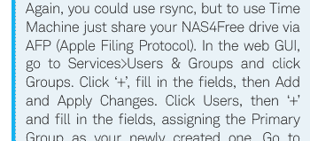

## 推荐项目

- FreeNAS：项目已移动到 github 见 `https://github.com/freeenas`
- OpenMediaVault：轻量级网络存储 (NAS) 方案
- Disk Imager：适用于 USB 盘或 SSD 的可写镜像

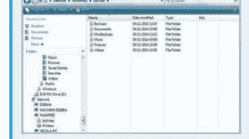

## 备份 OS 和 Windows

| 名称 | 修改日期 | 大小 |
| --- | --- | --- |
| NAS4Free-HD-2.2.0.1-x86.iso | 2021-04-26 | 258.4 MB |
| NAS4Free-HD-2.2.0.1-x64.iso | 2021-04-26 | 672.0 MB |
| NAS4Free-HD-2.2.0.1-x86.iso | 2021-04-25 | 119.0 MB |
| NAS4Free-HD-2.2.0.1-x64.iso | 2021-04-25 | 339.0 MB |
| NAS4Free-HD-2.2.0.1-x86.iso | 2021-04-24 | 261.1 MB |
| NAS4Free-HD-2.2.0.1-checksum | 2021-04-24 | 16.0 KB | - |

## 轻松备份 Windows PC

你可以通过在资源管理器中输入 `\NAS4Free` 来访问 NAS4Free PC 上的 SMB 共享。你也可以使用 Windows 备份功能（Windows 7 或更高版本）进行备份。

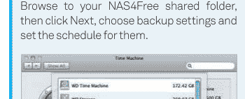

## NAS4Free

你可以在 Live CD 或 USB 镜像中找到 NAS4Free 文件，取决于你想从 CD 还是 USB 启动。还要为 PC 选择正确的版本：NAS4Free (64位) 或 x86 (32位)。

## 备份你的 NAS4Free

再次，你可以使用 Time Machine 通过 AFP（苹果文件协议）共享你的 NAS4Free 驱动器。在 Web GUI 中，前往 Services/Groups & Groups，在 Groups列表中点击 `+` 并添加类别。然后点击 Users，再点击 `+` 并填写字段，按你的意填写 Group。前往 Services/AFP 并点击 Shares。点击 `+`，添加名称和注释，点击“Path...” 选择你的共享文件夹和可选文件夹。禁用自动磁盘发现并选择 Time Machine。然后点击 OK，点击两个身份验证选项，然后保存并重启。现在，从你的 Mac 进入 Time Machine 偏好，点击选择磁盘并输入地址 `smb://NAS4Free` 进行连接，你将看到 NAS4Free 文件夹。

---

# UPnP 流

传输音乐、视频和照片

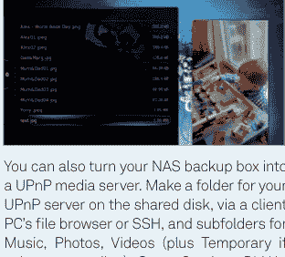

你还可以将你的 NAS 备份盒变成 UPnP 服务器。为你的 PC 文件浏览器或 SSH 创建一个文件夹，并为音乐、照片、视频（如果你正在进行转码）创建子文件夹。在 Free4NAS Web 界面中转到 Services/DLNA/UPnP，点击并选择你的文件夹作为 else 目录（其他目录）。对于媒体库，选择其中一个浏览器，点击 OK，然后点击 Add（添加）。对于其他子文件夹，为 UPnP 创建一个配置（Sony PlayStation 3）。如果需要，启用转码并选择目录术语。

## 为了额外的安全，你可以更改用户名和密码

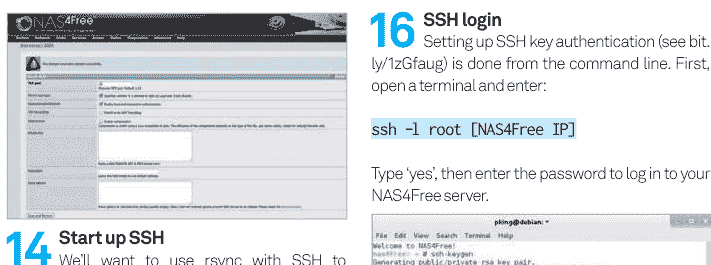

### 14 启动 ssh

我们将希望使用 rsync 配合 ssh 从客户端备份文件到我们的 NAS4Free 服务器。在 Web GUI 中转到 Settings > Enable。勾选 `Perm SSH login option`。然后点击 Save 和 Restart。

### 15 使用 rsync 备份

现在，让我们尝试从客户端 PC 备份。你可以从命令行运行 rsync，使用 `rsync -avz` - 这在选择文件时特别有用。选择要备份的文件夹，然后输入目标：`root@[NAS4Free IP]:mnt/volume/NAS4Free`。它会提示你输入密码短；输入你的 NAS4Free 密码（默认为 `nas4free`）。

### 16 SSH 登录

设置 SSH 密钥认证（sec bit ed25519）通过命令行完成。首先，打开终端并输入：

```
ssh-copy-id ~/.id_rsa.pub ~/.ssh/authorized_keys
```

```
ssh -i root@[NAS4Free IP]
```

输入 `yes`，输入密码登录你的 NAS 服务器。

然后退出：将公钥复制到你的客户端 PC：

```
scp -p root@[NAS4Free IP]:~/.ssh/authorized_keys ~/.ssh/
```

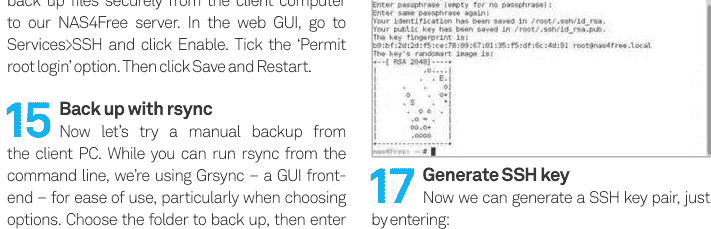

### 17 生成 SSH 密钥

现在我们可以通过输入生成 SSH 密钥对：

```
ssh-keygen
```

按 Enter 接受默认文件位置，然后按 Enter 设置空密码短并再次按 Enter 确认。你的 SSH 密钥对将随后生成。

### 18 重命名公钥

重命名你的公钥：

```
ssh-copy-id ~/.id_rsa.pub ~/.ssh/authorized_keys
```

### 19 自动化备份

你现在可以使用 cron 自动化备份。

```
cron -ab
```

将你的 rsync 命令复制并粘贴到底部的行中，根据日期和时间。它是 5 分钟，然后 `* * *` 用于在特定时间进行每日备份，所以对于每天下午 2 点的每日备份，你应该使用：

```
00 14 * * *
```


---

# 使用 Cacti 监控网络流量

使用 SNMP 监控 Cisco ADSL 路由上的流量

## 顾问

Mihalis Tsoukalos 是一位 UNIX 系统管理员，同时也精通数据库编程和数学。他自 1993 年以来一直使用 Linux。

## 资源

- Cacti: `http://cacti.net`
- RRDTool: `http://oos.seieter.ch/rrdtool`
- Cisco MIBs: `http://bit.ly/7IviQe`
- SNMP REFS: `http://bit.ly/7IviQue`

学习如何安装和配置 Cacti，以便使用 SNMP 打开网络绘图应用监控 Cisco ADSL 路由器的流量，该应用使用 RRDTool - 一种用于时间序列数据的日志和绘图系统。路由定义连接不同的网络，因此应该至少有两个不同的网络接口。我们将使用一个 Cisco 8750 ADSL 路由器，它有一个 RJ45 以太网端口和一个 Wi-Fi 连接。你想监控的是 ADSL 连接。别担心 - 不要认为你将使用 ADSL 接口来获取所需数据，SNMP 可以询问三个接口中的任何一个并获取相同的 ADSL 相关数据！我们之前在 Linux! 第 140 期中关于 MRTG 的教程中使用了 ADSL 接口，而本教程将使用 Wi-Fi 连接。使用不同的 IP 或接口没有区别。Cacti 的功能比 MRTG 多得多，允许开发者在不处理 Cacti 源代码的情况下生成额外的 Cacti 功能。一篇即将发表的文章将向你展示如何开发 Cacti 插件，但在这里我们将重点放在安装和配置。

## 教程

### 02 安装步骤

Cacti 是一个完整的网络图表解决方案，利用 RRDTool 的数据存储和绘图功能。它提供了快速的图表和简单的配置方法。这种直观的界面适用于具有数百设备的复杂网络。关于 Cacti 的更多详情：

- PHP
- MySQL
- Apache
- CURL
- Downloads
- Documentation

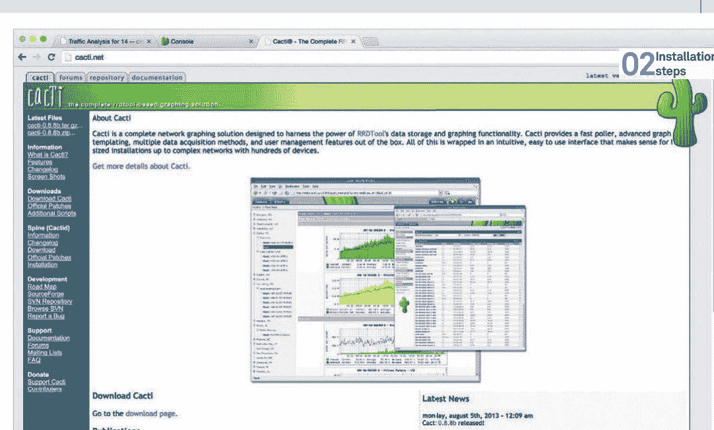

上面的 Cacti 预览视图显示所有监控图表，易于获取你监控内容的总体概览


- Installation Guide
- Additional Docs
- Spine (Cacti)
- Installation
- Release Notes
- Packages
- Developing
- Bugs
- Cacti
- Latest News 2013年8月5日

## 01 开始

在 Ubuntu 系统上，你可以通过以下命令获取 Cacti：

```
apt-get install cacti
```

安装 Cacti 将自动安装 RRDTool 以及所有需要的软件包，共同创建一个监控站点，可以轻松安装。

## 05 Apache 设置

Cacti 站点将设置在（默认）`/etc/cacti/conf-available/cacti.conf`。你还需要安装并启用 `php-mysql`；在 Ubuntu 系统上，安装后启用该模块。否则，你可能需要重启 Apache 或通过编辑 Apache 配置文件和设置来执行。

## 02 安装

安装 Cacti 不比 MRTG 困难，因为它使用数据库存储而不是文本文件。Cacti 使用 PHP 进行配置并应该支持。在完成安装之前，确保 MySQL 和 Apache 已运行。

## 03 安装前

下一步非常重要：在进行任何操作之前，你应该将 Cacti 数据导入 MySQL 数据库。在 Ubuntu Linux 系统上，可以通过以下方式完成：

你需要 root 权限在你的 Linux 机器上设置 Cacti。你还应该知道 Cacti 的 SNMP 相关配置，如果是 ADSL

```
$ /usr/share/doc/cacti/schema.sql | mysql -u root -p cacti
```

## 04 MySQL 设置

Cacti 需要一个数据库。MySQL 的用户名名是 `cacti`，密码应该是 `cacti`。如果必要，你可以使用另一个数据库来存储所有 Cacti 相关数据。手动编辑 `/etc/cacti/debian/config.php` 并放入 Cacti 源码文件中的 `config.php` 文件。如果没有此设置，安装将失败，你将无处获取数据！为了开始安装，你现在应该将浏览器指向 `cacti/URL`。你可以使用 `http://localhost:3306/cacti/` URL，那里将会变化。

www.linuxuxer.com

## 教程：LinuxDeveloper

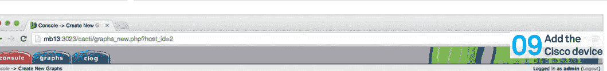

## Cisco 8750(192.168.2.1)

- 新图表
- 管理
- 导入
- 图表树
- 数据源
- 模板
- 存档方法
- 数据输入方法
- 报告
- 策略
- 设置
- 导入管理
- 用户管理
- 销

| ID | Description | Name (IP-MIDR) | Alias (IP-MIDR) | Type | Speed | High | IP Address |
|---|---|---|---|---|---|---|---|
| 1 | | | | | 1000000 | 37 | 10.0.0.2/24 |
| 2 | Down | FastEther1 | | | 6 | 1000000 | 100 | 10.0.0.2/29 |
| 3 | Down | FastEther2 | | | 6 | 1000000 | 100 | 10.0.0.2/29 |
| 4 | Down | FastEther3 | | | 6 | 1000000 | 100 | 10.0.0.2/29 |
| 5 | | | | | | | |

## 创建新主机

```
Cisco
```

# 添加设备

以来身份登录


# 添加设备

安装并配置后，你已准备好将设备添加到 Cacti 中。

| ID | Description | Name (IP-MIDR) | Alias (IP-MIDR) | Type | Speed | High | IP Address |
|---|---|---|---|---|---|---|---|
| 1 | | | | | 1000000 | 37 | 10.0.0.2/24 |
| 2 | Down | FastEther1 | | | 6 | 1000000 | 100 | 10.0.0.2/29 |
| 3 | Down | FastEther2 | | | 6 | 1000000 | 100 | 10.0.0.2/29 |
| 4 | Down | FastEther3 | | | 6 | 1000000 | 100 | 10.0.0.2/29 |
| 5 | | | | | | | |

# 使用 Cacti 监控网络流量

使用 SNMP 教程监控 Cisco ADSL 路由器上的流量

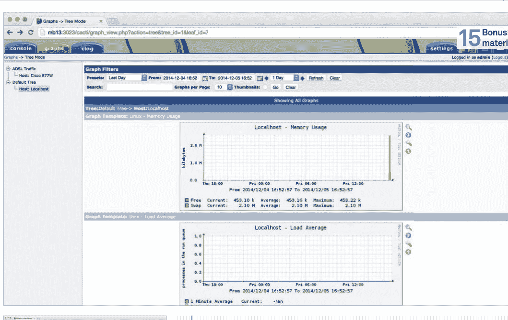

## 12 创建和使用用户

进入 `Console/Utilities/User Management`（控制用户管理）。你可以看到默认创建了两个用户：`admin` 和 `guest`。要添加自定义用户，请填写所需信息。在 `Permissions`（权限）选项卡中，勾选 `Graphs`（图表）复选框。现在，创建新用户时，建议用户在下次登录时更改密码。

创建用户后，将该用户添加到 `Graph Permissions`（图表权限），并添加他们允许查看的图表。

## 13 Cacti 目录

`/var/lib/cacti` 目录包含所有存储性能数据的 R 文件。`/var/share/cacti/resource` 目录存放 Cacti 的所有模板和查询。`/var/log/cacti` 目录包含 Cacti 的所有日志——当 Cacti 出现问题时，你应该查看这些文件。`/var/share/cacti/cli` 目录存放所有命令行脚本。


## 14 备份与恢复

虽然备份 MRTG 是一个简单的复制过程，但备份 Cacti 的要求更高。Cacti 的要求更高，是因为它的数据存储在数据库中。要备份 Cacti，请使用以下命令备份 MySQL 数据库：

```
$ mysqldump -u cacti -pcaciptiasword cacti > cacti.sql
```

同样，你可以备份所有的 Cacti 文件和 MX 脚本，只需确保包含所有的文件和目录即可。如果你不熟悉 MySQL，应该向数据库管理员寻求帮助，因为备份是一项关键任务。

## 15 额外材料

默认的 Cacti 安装会自动收集并显示你选择的数据（localhost）。你可以通过选择 `Graphs/DefaultTree/HostLocal` 查看它。

## 16 结语

安装 Cacti 并不像安装 MRTG 那么简单。然而，Cacti 提供了输出、插件支持以及具有不同权限的多用户。Cacti 用于监控大型服务器。

根据你的需求，你可以选择 MRTG 或 Cacti，并确保其中任何一个都能满足你的需求。

53 www.linuxuser.co.uk

# LinuxDeveloper 教程

# 将 Pebble 游戏与 Android 连接

基于 Pebble OS 的智能手表是奇物。让我们教 Flappy Tux 如何与 Android 智能手机接触。

## 顾问

Tam Hanna 从 Palm III 时代就开始进入该行业。作为记者、导师、讲师和作家，他多次看到了移动市场的各个方面。

上一一期的《Linux User & Developer》教了你如何为我们的 Pebble 智能手表创建一个版本的 Flappy Bird。由于游戏的复杂性，我们不得不得把它设计成无墙的；我们根本没有足够的重力。

幸运的是，本期杂志将 Tam 创作的精彩内容带到了墙系统，我们将实现一个表单来进行会话的高分统计。最后，小计数将被备份；它会将 Flappy Tux 连接到你的 Android 手机，产生各种迷人的交互可能性。

我们使用这些值来创建新墙。墙的位置在同一次遍历中更新，营造出一种向玩家移动的幻觉：

在 `evi` 墙下方在玩家位置绘制障碍物

```c
static void checkWalls(GContext ctx) {
    if(wall1active==false && wall2y<0) {
        // 构建一个墙
    }
    wall1y=wall1y+maxOffsetY(50);
    if(wall2y<wall20) {
        wall2y=wall2y+100;
    }
}
```

```c
// 墙删除
// 移动墙
wall1--;
wall2--;
if(wall1active==false) {
    wall2active=false;
}
```

游戏的微调是最困难的设计挑战之一。简单地增加所有速度很容易修改环境和人工智能，从而带来更满意的结果。每当一堵墙被创建时，都会考虑 pebble 当前的位置和速度。我们计算通过牛顿物理学可以达到的“最大”位置，或者在加速度不变的情况下，通过调高或降低来修改反应时间。


## 给我，一个...

当最后一堵墙距离超过 60 像素时，新墙出现在屏幕右侧。这个游戏有大约 60 像素的空间用于爬升或俯冲。由于加速度是常数，距离可以通过公式 `s = (a * t^2) + (v0 * t)` 来确定。`v0` 代表速度，而 `a` 代表加速度。在 Pebble 上，这可以像 `01:getMaxClimb` 和 `getOffsetY drops` 内部那样实现上升和下降。执行幂运算涉及使用高级数学函数，因此其目的是将操作转换为一系列乘法：`t**2` 变为 `t*(t)` 或 `t*(t)`。

墙与墙之间不能太近。我们使用这种互互斥性：只有当一堵墙通过屏幕的一半时，我们才生成新墙。

54 www.linuxuser.co.uk

## Linux 开发者教程

`static void updateGame(Layer layer, GContext ctx)`

```c
{
  checkWalls(ctx);
  if(wall1x<30 && wall1y>10 && wall1AI==true)
  {
    if(topPosY>gOverly)
    {
      goOverFlag=true;
      myScoreFlow=myScore;
      if(highScore>myScore) highScore=myScore;
    }
  }
  // 省略墙体声音
}
```

`pebble-pebble-sdk-releases`。在接下来的步骤中使用版本 2.6，只需点击下方链接即可获取。解压缩包并通过 `Import>Android` 将 `AndroidManifest` 文件导入 Eclipse。SDK 将显示为一个组合项目。打开 `Properties`（属性）对话框并选择 Android 部分；勾选必须启用 "Library"（库）。将 `java` 文件夹的内容拖入其中。在下一步中，右键点击实际应用程序。打开 `Properties` 对话框并选择 Android。点击 `Add` 按钮进入库编辑器。弹出的窗口用于选择上一步创建的 `main` 库。

```java
myConnected = PebbleKit.IsConnected(getPebbleAppContext());
if(myConnected)
{
  PebbleKit.startPebble(getPebbleAppContext(), Pebble_APP_ID);
  PebbleDictionary data = new PebbleDictionary();
  data.addInt(0, 2);
  PebbleKit.setData(getPebbleAppContext(), data);
}
```

Pebble 应用通过全局唯一的 UUID 进行标识。对于 `Settings` 标签中的应用，为了简单起见，你可以在 `Activity` 中访问它。

```java
Button buttonOut = (Button) findViewById(R.id.buttonOut);
buttonOut.setOnClickListener(new OnClickListener() {
  @Override
  public void onClick(View v) {
    if(myConnected)
    {
      PebbleDictionary data = new PebbleDictionary();
      data.addInt(0, 2);
      data.addInt(1, 2000);
      PebbleKit.setData(getPebbleAppContext(), data);
    }
  }
});
```

Pebble 与其手机设备通过字典（Dictionaries）进行通信。字典最好被描述为类似于键值存储的 ID，用于跨端检索值。为了简单起见，我们的方法仅使用一种方法。Android 开始尝试查找 Pebble 是否连接到手机。如果是的话，应用程序将带到前台（图 07）。必须通过一个方法向手表发送高电信号。它的实现很有意思，主要是因为检测到了 `OnClickListener`。

```c
NULL;
else
{
  show_gameoverview();
}
```

这两种方法都会创建一个空字典，然后填充一个或多个值。个体不需要根据字典的值进行存储（尽管这在逻辑上是完全允许的）。由于手表和应用之间的交互，接收消息稍微困难一些；它是一个进入字典的封装器。

底部以便调用 `checkWalls` 函数。墙体通过 `setting_game_over` 处理（图:05）。你的事件处理程序没有返回 `AppRef` 定时器，这使得操作成为可能。我们通过在 `timer_handler` 中解析 `GameOver-Flag` 来解决这个问题。

```c
void timerHandler(void* ctx)
{
  if(goOverFlag==false)
{
    layer_mark_dirty(myCanvas);
    app_timer_repeat(34, timer_handler);
  }
}
```

## Android，太棒！

Pebble 支持 Android 和 iOS。SDK可以通过指定的 GitHub 仓库获取：`https://github.com/`。

与 `AppMessage` 通信的 Pebble 应用应在 `handler (main)` 中声明总共四个事件处理器，`app_message_open` 打开操作系统的“活动（activity）”。

版权所有所有。

## 与 Android 连接 Pebble 游戏

教师 Flappy Tux 将此联系你的 Android 教程

你的以及此外还允许你指定输入和输出对话的最大尺寸（图 08）。空间限制迫使我们省略对丢弃/失败/发送处理器的解释——它们的首要代码可以在示例中找到，`received_callback` 比唯一的 Pebble 常量更有趣。Pebble 无法提供按顺序带有 ID 的字典，除非使用如图 10 所示的方法一个接一个地传递所有元组。

最后，亮点在于手机端通过定时器处理程序，`app_message_outbox` 打开字典，然后填充用户数据，`app_message_out` 将数据发送到智能手表，客户端应用程序应对在该处进行确认：

```java
final Handler handler = new Handler();nPebbleKit.registerDataHandler(this, new PebbleKit;
PebbleDataReceiver(Pebble_APP_UUID) {
    @Override
    public void receiveData(Context context, int transactionId, PebbleDictionary data) {
        handler.post(new Runnable() {
            @Override
            public void run() {
                findViewById(R.id.textview).setText(data.getInt(0));
                PebbleKit.send(getApplicationContext(), transactionId);
            }
        });
    }
}
```

```c
void timerHandler(void* ctx) {
    Dictionary *iterator = dict_get_iterator(data);
    Tuple *t = dict_first(iterator);
    while (t != NULL) {
        switch (t->key) {
            case 1:
                size = (int)t->value;
                break;
        }
        t = dict_next(iterator);
    }
}
```

```c
void onMessageReceived(Dictionary data) {
    if (data != NULL) {
        handle_message(data);
    }
}
```


```java
void onMessageSent(int transactionId, boolean success) {
    if (!success) {
        // 处理发送失败
    }
}
```

```java
void onMessageOpened(int transactionId) {
    // 处理消息打开
}
```

```java
void onMessageClosed(int transactionId) {
    // 处理消息关闭
}
```

```c
void onMessageOpened(int transactionId) {
    // 处理消息打开
}
```

```c
void onMessageClosed(int transactionId) {
    // 处理消息关闭
}
```

# Pi 手套

我的 Pi 手套诞生于纽约——让我来给你们讲讲故事。

我受邀参加在伦敦举行的第二届树莓派大会。第二天是一个非常有趣的黑客日，我和 Eben Upton 以及其他想交流的人聊了聊。

我们想设计出某种你可以在物理上可以使用的设备，于是决定使用手套。

于是我们想出一个方案：如果你触碰大指和小指，屏幕上的字符就会移动，于是我们用手套把它做了出来。

如果我们真的能做更多事情——一些戴在手上的东西——我说我可以用 Python 为社交媒体（如 Twitter）制作一些创意性的。

这就是这样开始的。Pi 手套其实只是一块纸板、一个 Pi Zero、一个电池盒、一些电线和胶带，但这就是它的开端。

他问我我想做什么，我说我要造一个能实现所有这些甚至更多功能的手套。这不仅仅是一个小练习——它是一个项目。

## Pi 手套是做什么的？

根据索引，如果你按下第一个按钮，它将使用摄像头。第二个按钮，它将向 Twitter 发送推文（使用类似“这张照片是由我拍摄的”的内容）。

第三个按钮是音乐选择器，它会随机挑选一首歌并播放——那是用 Python 实现的。

最后一个会发送短信——那是用 Pymish 实现的，他是原树莓派团队的成员。我后来在那里遇到了他。当他说可以使用某种廉价的东西，那些排针里就有一些它们……

所以我们一直在聊天，我说的其中一点是：“如果你在火站，想检查下一列车什么时候到达，你掏出手机……检查 App，加载它——难道在口袋里按一个按钮让它在你的耳朵里读出来更好吗？这比看屏幕更好。”

他告诉我他在树莓派联系他，然后通过解析数据并使用 Google Sheets 搜索数据并返回结果。

这样它就能在车站之间不断传输，但下一个阶段是为此开发一些东西，然后我们也可以针对它这样做。

所以你有四个按钮——你对其他层级有计划吗？比如制作一个绘画工具，当你移动手指时，它会在屏幕上画画？或者类似的映射功能？

那将是下一个阶段。我问他想做什么，他是一些像查看时间这样简单的事。他说：“如果我想知道时间，有一个手机比我按一个按钮让它告诉我时间要容易得多！”我们当时就在聊这个。

而且如果你需要帮助，该如何开发这些功能——如果你在手套上有一些可以产生多个输出的传感器？

所以我用 Python 来表达你这里提到的这些，因为这容易得多，而且除了你这里使用的那些声音之外，我们正在开发的不是 Pi 平台。

研究看看有什么可用的，我一直在苦苦寻找——曾有一个 Arduino 无人机，你可以在桌面上用手指移动它，但没有其他像这样的东西了。即使是在我想要的方面。

最终，我设想了一种更具触感的手套，而不仅仅是按按钮。

你构想过 Heaps 和树莓派 MU 吗？它们非常不同，具有手势控制。

事实上，Eben 提到了基于 Sonic Pi 的一些综合方案，第二天我们得知他有一个朋友做电子音乐，他想更多地参与其中，比如向左移动音量就会变小，以此类推。

他非常热衷于观众仅通过他们的右手就能影响他们正在听的音乐这个想法。

他非常有热情，让观众只用他们的右手就能影响他们正在听的音乐。

## 为你的树莓派添加重置开关

直接拔掉电源关闭树莓派是危险的。

### 检查你的树莓派型号

只有两个型号具有排针：Raspberry Pi B Rev 2 和 B+（to the left of the 'Raspberry Pi 2014' label）。 You will need to install the pins manually, however, as they are not preinstalled. Clearly this can cause problems. When faults cause the Raspberry Pi to crash, the simple fix is to add a simple reset function to the device. There are three ways this can be done: with a button, a motherboard jumper or a motherboard header connected to newly-soldered pins on the PH header on the Model B Rev 2 and this (this is the most complicated option). If you have an old Pi lying around, the reset button is already there and adding the connecting motherboard pins is achievable if you have a soldering iron. Otherwise, we recommend purchasing the parts alone, although we are aware that you'll probably need to buy more pins than you'll need. Christian Cawley is a hardware and software support engineer with much experience in computer and smart technology both online and in magazines

### 02 找到你的组件

Header pins can be purchased online, although this will invariably result in having to order more than you need. Alternatively, if you have an old motherboard, remove a pair of pins with a soldering iron.

### 03 将排针焊到你的树莓派

To gain stability when soldering, place the Pi upside down on a piece of foam, insert the slotted headers into the holes. Using fine solder to ensure the pins are maintained. This will require a very steady hand, so get assistance.

### 04 连接你的重置开关

Leave the solder to cool for a few minutes before attaching the reset switch. Some cases do not have space for the pins, so take time to plan ahead and make sure everything fits. If not, you may need to make adjustments to your case.

### 05 崩溃后重置树莓派

With the installed switch, you will be able to reset the Raspberry Pi when required. Note, however, that this isn't an option to use whenever you feel like restarting. Rather, it should only be done when the system fails to respond within a reasonable time frame.

### 06 使用 HDD 跳线帽重置

不想焊接到你的树莓派？这 is perfectly understandable, but it doesn't mean you cannot reset memory. We have another solution for you. Using a motherboard, two GPIO pins and a script to initiate an ordered shutdown is a simple alternative that doesn't involve solder and potential PCB damage.

### 07 识别 GPIO 引

This method works on most models. Each a GPIO array, 26 pins on the A and B (Rev 2) and 40 on the A+ and B+. pins 5 and 6 counting from the left with the right hand way around.

## 进阶阅读

查看 Pi 手套！

bit.ly/3TvfVGg

when we want to see how actually work:

bit.ly/3TvfVGg


linuxuk.com

## 教程

## 为你的树莓派添加手势控制

Aaron Shaw

Aaron 是 The MagPi (www.tmagpi.com) 的志愿者，从树莓派诞生之初就开始参与其中，并幸运地在工作和娱乐中使用树莓派！

Hover 是一款用于树莓派的惊艳扩展板，允许你轻松为任何项目添加触摸和手势控制。

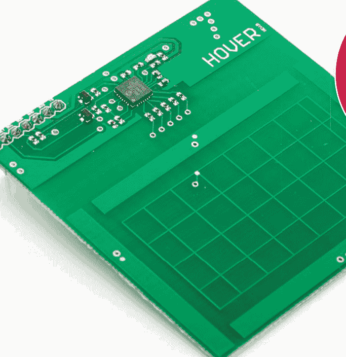

> 赢奖
>
> 5 块 Hover 板
>
> 立即前往 bit.ly/1Ajx6gL 参加

## 你需要

- 树莓派 (Raspberry Pi)
- Hover
- 面包板
- 公母对邦跳线
- 声器或耳机

人们经常询问开始树莓派的最佳方法是什么。显然，这取决于个人以及他们想要实现什么和从项目中获得什么，但从更广泛的意义上说，最好有一些有趣的硬件项目，有助于掌握各种技能（包括编程、电路构建、硬件设计等），并且足以让初学者保持兴趣，并让他们自己发现自己最喜欢哪个方面。即使是资深专业人士，也会对物理计算和自动化感到非常兴奋！这是树莓派相比传统“黑盒”计算机的独特特征之一；你可以突破常规边界，以前所未有的方式与日常物体进行交互。

硬件项目最重要的方面之一通常是软件，最大的技术爱好者正开始拥抱这项技术，因为它允许我们以更新、更直观的方式进行创作。手势触摸控制现在出现在大量消费设备中，这项技术正被广泛采用。是时候用 Hover 让你的树莓派项目进入 21 世纪了！

## 为你的树莓派添加手势控制

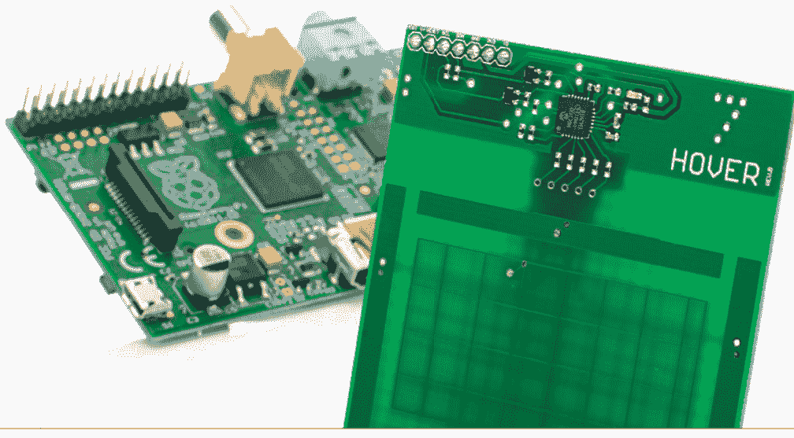

### 你在树莓派 1, 3, 5, 6, 16 和 18 上应该使用的物理引脚

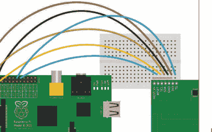

上方，你可以在 Hover 正上方进行四个维度的轻点或滑动。

**01 获取设备！**

从 Hover (http://www.howver.co/#shop) 购买，价格为 39（25英镑），该 Hover 将从北美发货，因此如果你位于英国或欧洲，可能从网上获得的任何其他物品可能会更快且更便宜。从初创公司购买的额外好处是，如果你需要新硬件但只有旧型号——只需让你的系统完全兼容于：

```
sudo apt-get update
sudo apt-get upgrade
```

**02 更新 GPIO 和 I2C**

在使用 GPIO 和 I2C（或任何与树莓派的接口）时，始终使用最新版本的软件是良好的做法。新硬件可能有软件可以修复的漏洞，而这些修复可以通过多种方式实现。GPIO 和 RPi Python 库默认安装在 Raspbian 上，但如果你没有启用，可能需要启用 I2C。这是一个相当标准的过程，并且已经记录了很久，不过我强烈推荐使用 Adafruit 的二进制 I2C 设置工具 (https://learn.adafruit.com/adafruit-raspberry-pi-lesson-4-gpio-setup/configuring-i2c)。

### 丰富的平台

**03 设置硬件**

在开始此任务之前，确保树莓派已关电且未连接电源，以避免对树莓派造成不必要的损坏。拿起 Hover、面包板和线，按照 Fritzing 图连接 Hover。注意 Hover 适用于树莓派 1, 3, 5, 6, 16 和 18。图中也显示了 A 或 B+ 型，有一个非常简单的方法可以检查镜像、恢复电源，一旦完全设置好……

**04 检查连接**


Hover 通过位于主板 26 或 40 GPIO 引脚上的 I2C 接口（取决于你的树莓派版本）连接到树莓派。使用简单的命令行 I2C 工具可以非常方便地检查树莓派是否正确连接到 Hover。

Hover 板具有智能板级电平转换。它可以与任何不同电平的板配合，适用于任何带有代码片段的微控制器或计算机。Arduino、Sparkfun、Hover 网站 hover.com 都提供了代码（或可以调整以适应其他设备）。如果你决定为其他设备创建示例案例，那么当你使用以下命令时，为什么不向 Hover bnc0091 请求呢：

```
sudo i2cdetect -y 1
```

如果你在响应中看到 42，说明你成功连接到了 Hover！

## 教程

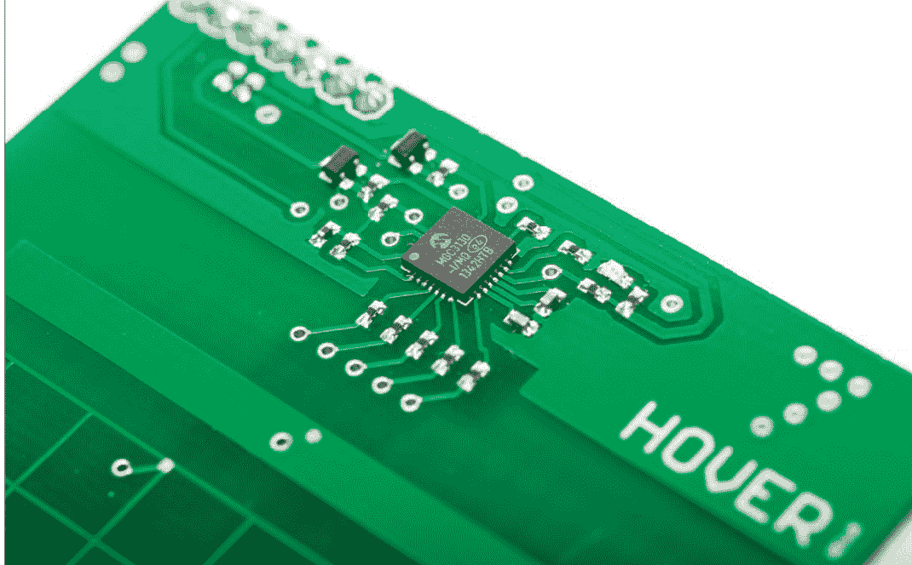

上方这个 MGC3130 芯片充当 3D 控制器。

### 06 下载示例代码

现在你已经正确连接了一切，且树莓派已完全更新，是时候获取 Hover 库了，它让使用板变得极其简单。你可以通过以下方式获取：

```
git clone https://github.com/jonc01/hover_raspberry
```

这应该下载一个名为 `hover_raspberry` 的文件夹，其中包含所有文件。或者，你可以从 `https://github.com/jonc01/hover_raspberry/archive/master.zip` 下载文件。

## 为什么选择 Python?

Python 因其易于理解的语法和灵活性对初学者非常有用。它在社区中非常有名并获得支持；简单的现有项目尚未发布示例。

## 05 使用 Rev 1?

操作系统有一个 "v1" 使用 I2C 总线来查看，这里有两个 BCM2835：2012 年 2 月发布的第一代树莓派使用了 256MB 内存，而所有版本的树莓派都使用了 I2C 总线 0。上面的代码：目前的 Hover 库只是一个可安装的包（未来可能会更改）。为了使用 Hover 库中的函数，必须确保 `Hover.example.py` 脚本和你编写的任何脚本位于同一个文件夹中，并在步骤 7 中期望相同的输出 (42)。

```
sudo python Hover_example.py
```

板将初始化，你会看到“Hover is ready”，意味着你可以开始了。

www.linuxuser.com

## 为你的树莓派添加手势控制

**08** 一旦你完成了步骤 7，触摸 Hover 板或做出手势，你将在终端中看到一系列 0 和 1 等。Hover 的工作方式是感知并通过 I2C 向树莓派发送这些 8 位二进制值。前三位描述是手势还是事件，其余五位描述事件的类型或方向。准确的字节在右侧的代码列表中。

## 完整代码列表

```python
import time
from Hover_library import Hover

hover = Hover(Address=0x42, ts=23, reset=24)
try:
    while True:
        # 检查 hover 是否准备好发送手势
        # 或触摸事件
        if hover.getStatus() == 1:
            # 读取数据并打印
            # 手势或触摸事件
            message = hover.getEvent()
            print(message)
            if message == "01000010":
                # 此处西部触摸
                pass
            elif message == "01100010":
                # 此处中心触摸
                pass
            elif message == "01001000":
                # 此处东方触摸
                pass
            elif message == "01000100":
                # 此处南方触摸
                pass
            elif message == "01000011":
                # 此处北方触摸
                pass
            elif message == "01011000":
                # 此处向右滑动
                pass
            elif message == "00001010":
                # 此处向左滑动
                pass
            elif message == "00110000":
                # 此处向下滑动
                pass
            elif message == "00000100":
                # 此处向上滑动
                pass
        # 释放 ts 直到 Hover
        # 准备好发送下一个事件
        hover.setRelease()
        time.sleep(0.01) # 几毫秒

except KeyboardInterrupt:
    print("退出...")
    time.sleep(2)

except:
    print("发生了一些错误 ...")
    hover.end()
```

### 09 启用 3.5mm 音频

开启你的扬声器并插入树莓派的 3.5mm 插口。你将使用以下命令将音频路由到 3.5mm 插孔（如果你使用带音频的 HDMI 显示，可以跳过此步骤）：

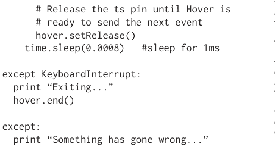

你想学习更多关于使用 Hover 板构建自己的太空设备吗？我们还没有，但如果你想了解更多关于 Hover 板，请查看我们对 1989 Filk Part I 的首次翻译——关于一个没有轮子的滑板的故事，以后可能值得扭转这个设计。Hover 用一个产生光的简单机器创建了超过 10,000 个，由 Ryan 创建。

### 10 制作一个鼓机

`hover_raspberry` 文件夹中还有另一个文件夹，包含如何将 Hover 变成鼓机的示例！导航并使用以下方法将 `Hover_library.py` 文件复制到 examples 中：

- `Hover_library.py`
- `examples`

然后移动示例并运行 `Hover_drum.py` 文件：

```
cd examples
sudo python Hover_drum.py
```

### 11 创建你自己的

使用 Hover 库的伟大之处在于它可以很容易集成到你的任何现有或未来的项目中。所示的代码就是你开始 Hover 所需的所有内容。通过此，你可以更改第 15 行及之后，那里有注释解释，例如如何更改声音以插入你在提到的注释中特定事件上想要执行的操作，它将会运行……真的非常简单！

### 12 其他项目想法

你现在可能正在为可以使用 Hover 的项目绞尽脑筋，但让我们面对现实——也许你的项目需要物理交互来通过手势和控制实现得更好。如果你可以使用它但缺乏灵感，建议查看在 `http://hoverboard.com/projects` 分享的项目，那里有社区创建的项目。如果你喜欢它，务必向我们发送照片！

`hoverboard.com/about`

## 教程

**Rob Zwetsloot** 是一位复杂系统建模师，也是一名精通 Python、Django 和 PHP 的 Web 开发者。他热爱实验计算。

# 远程控制你的 Raspberry Pi 机器人

通过网络控制或使用 PS3 控制器来操控 Rapiro，无需再被束缚在笔记本电脑旁。

Rapiro 是一个酷酷的小机器人。上个月我们在为大机器人项目玩弄它时，我们注意到它的扩展和定制潜力比任何其他机器人都更简单、更令人满意。本着这种精神，我们将改进我们的 Rapiro 来完成一些惊人的事情。这要归功于万用的 Raspberry Pi 和一些 Python 知识。

这个月，我们将让它离开电脑，利用 Raspberry Pi 的功能和它自带的小组 AA 电池让它能够自由行走。我们还将教你如何使用 PS3 手柄来控制它，这样你就不需要不断通过接口发送命令了。

# 你需要什么

- Raspberry Pi Model B
- Rapiro
- 兼容的无线接收器
- PS3 控制器
- 迷你 USB 数据线


## 远程控制你的 Raspberry Pi 机器人

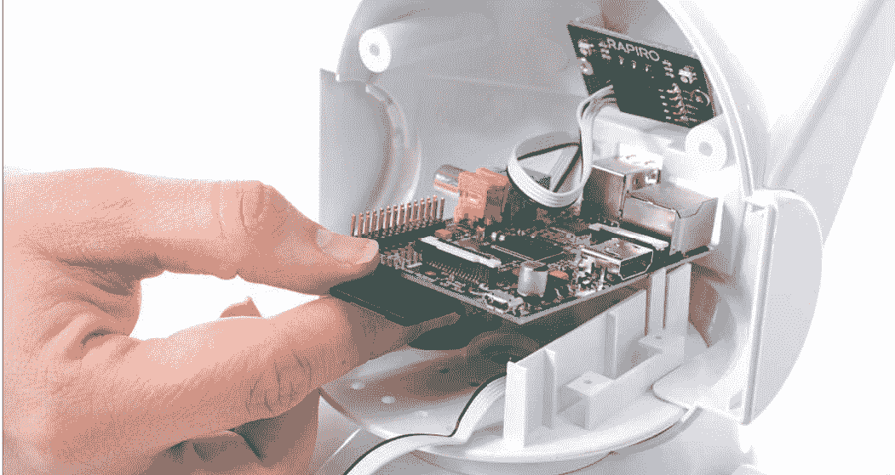

### 01 设置 Raspberry Pi

Rapiro 需要一个原装的 Raspberry Pi Model B，因为 B 型需要修剪连接以适应 Rapiro 的安装。在它上安装 Raspian，并在进行固件升级之前执行常规的 `apt-get update && sudo apt-get upgrade` 以更新所有软件。

### 02 设置无线网络

让 Raspian 保持在仅命令行启动模式（或将其设置为命令行启动但保持留在桌面上，并使用图形化工具将无线接收器设置为连接到你的网络）。

### 03 获取 IP 地址

打开终端并输入 `ifconfig` - 它将输出网络详情。具体来说，你需要查找你自己的以及相关的 IP 详情。记下它，因为你将用它连接到 Raspberry Pi。

### 04 远程连接

在你的 PC 或笔记本电脑上并开始测试 Raspberry Pi。打开终端并输入：

```
ssh pi@[IP address]
```

你可能需要输入密钥（raspberry），然后你就进入了 Raspberry Pi 系统。

### 05 安装额外软件

为了从命令行向 Rapiro 发送信号，你需要获取 Micro。这是必须的，因为 Python 有一个专门为此的库。你可以在命令行中使用以下命令安装它：

```
sudo apt-get install microcom
```

### 06 安装到 Rapiro 中

关闭并断开 Raspberry Pi 的所有线缆。接下来，拆下固定 Rapiro 头部的螺丝取下正面。Raspberry Pi 卡在头部的底座上，端口从头部的背面伸出，因为它已经不再连接了。


### 07 连接 Raspberry Pi

留在 Rapiro 头部内部的备用 Pi 可以连接到 Raspberry Pi，用于供电并允许从 Pi 进行控制。参考图像查看如何用引脚边缘另一侧黑色电缆进行连接。


## 教程


上面的操作需要一点练习，但模拟摇杆的使用非常有趣。

### 08 重新连接头部

搞定！一旦插好 Raspberry Pi，它就准备就绪了。将头部装回身上，你就可以通过 Pi 开始远程控制 Rapiro 了。如果你想用外部电源为 Rapiro 供电，请保持头部打开，因为你需要同时为 Pi 供电。

### 12 解析命令

该命令分为四个部分：LED 灯光的 RGB 值和代表毫秒的 T 值。我们将绿色设置为最大（255），另外两种颜色设为 0，而 T 为 10。代码周围非常简单。

### 09 首次测试

开启 Rapiro 电源看看一切是否正常工作。Raspberry Pi 的灯亮了吗？最常见的问题是你可能把 Raspberry Pi 的线插反了，这意味着你必须完全断开它来修复。

### 13 举起右手

让我们做些更有趣的事情，移动 Rapiro 身体里的一个舵器。我们可以通过向手臂发送几个命令来抬起右手，所以：

```
echo "M6" | sudo microcom -b 57600 -o -d /dev/ttyAMA0
```

```
echo "M6" | sudo microcom -b 57600 -o -d /dev/ttyAMA0
```

### 10 第一批命令

如果你的 Raspberry 现在工作正常，且 Raspberry Pi 正在供电，那么它就可以工作了。如果 Raspberry Pi...（注：此处原文重复逻辑错误，按要求翻译但保持结构）... 重新装上头部，你就可以通过 Pi 远程控制 Rapiro。

### 14 命令拆解

该命令分为四个部分：LED 灯光的 RGB 值和代表毫秒的 T 值。我们将绿色设置为最大（255），另外两种颜色设为 0，而 T 为 10。代码周围非常简单。

### 09 首次测试

### 13 举起右手

让我们做些更有趣的事情，移动 Rapiro 身体里的一个舵器。我们可以通过向手臂发送几个命令来抬起右手，所以：

```
echo "M6" | sudo microcom -b 57600 -o -d /dev/ttyAMA0
```

```
echo "M6" | sudo microcom -b 57600 -o -d /dev/ttyAMA0
```


# 远程控制你的 Raspberry Pi 机器人

**Rob Zwetsloot** 是一位复杂系统建模师，也是一名精通 Python、Django 和 PHP 的 Web 开发者。他热爱实验计算。

通过网络控制或使用 PS3 控制器来操控 Rapiro，无需再被束缚在笔记本电脑旁。

Rapiro 是一个酷酷的小机器人。上个月我们在为大机器人项目玩弄它时，我们注意到它的扩展和定制潜力比任何其他机器人都更简单、更令人满意。本着这种精神，我们将改进我们的 Rapiro 来完成一些惊人的事情。这要归功于万用的 Raspberry Pi 和一些 Python 知识。

这个月，我们将让它离开电脑，利用 Raspberry Pi 的功能和它自带的小组 AA 电池让它能够自由行走。我们还将教你如何使用 PS3 手柄来控制它，这样你就不需要不断通过接口发送命令了。

## 你需要什么

- Raspberry Pi Model B
- Rapiro
- 兼容的无线接收器
- PS3 控制器
- 迷你 USB 数据线


## 远程控制你的 Raspberry Pi 机器人


### 01 设置 Raspberry Pi

Rapiro 需要一个原装的 Raspberry Pi Model B，因为 B 型需要修剪连接以适应 Rapiro 的安装。在它上安装 Raspian，并在进行固件升级之前执行常规的 `apt-get update && sudo apt-get upgrade` 以更新所有软件。

### 02 设置无线网络

让 Raspian 保持在仅命令行启动模式（或将其设置为命令行启动但保持留在桌面上，并使用图形化工具将无线接收器设置为连接到你的网络）。

### 03 获取 IP 地址

打开终端并输入 `ifconfig` - 它将输出网络详情。具体来说，你需要查找你自己的以及相关的 IP 详情。记下它，因为你将用它连接到 Raspberry Pi。

### 04 远程连接

在你的 PC 或笔记本电脑上并开始测试 Raspberry Pi。打开终端并输入：

```bash
$ ssh pi@[IP address]
```

你可能需要输入密钥（raspberry），然后你就进入了 Raspberry Pi 系统。

### 05 安装额外软件

为了从命令行向 Rapiro 发送信号，你需要获取 Micro。这是必须的，因为 Python 有一个专门为此的库。你可以在命令行中使用以下命令安装它：

```bash
$ sudo apt-get install microcom
```

### 06 安装到 Rapiro 中

关闭并断开 Raspberry Pi 的所有线缆。接下来，拆下固定 Rapiro 部的螺丝取下正面。Raspberry Pi 卡在头部的底座上，端口从头部的背面伸出，因为它已经不再连接了。


### 07 连接 Raspberry Pi

留在 Rapiro 头部内部的备用 Pi 可以连接到 Raspberry Pi，用于供电并允许从 Pi 进行控制。参考图像查看如何用引脚边缘另一侧黑色电缆进行连接。


### 08 重新连接头部

搞定！一旦插好 Raspberry Pi，它就准备就绪了。将头部装回身上，你就可以通过 Pi 开始远程控制 Rapiro。如果你想用外部电源为 Rapiro 供电，请保持头部打开，因为你需要同时为 Pi 供电。

### 09 首次测试

开启 Rapiro 电源看看一切是否正常工作。Raspberry Pi 的灯亮了吗？最常见的问题是你可能把 Raspberry Pi 的线插反了，这意味着你必须完全断开它来修复。

### 10 第一批命令

如果你的 Raspberry 现在工作正常，且 Raspberry Pi 正在供电，那么它就可以工作了。

### 11 串口命令

如果你的 Raspberry 现在工作正常，且 Raspberry Pi 正在供电，那么它就可以工作了。

### 12 解析命令

该命令分为四个部分：LED 灯光的 RGB 值和代表毫秒的 T 值。我们将绿色设置为最大（255），另外两种颜色设为 0，而 T 为 10。代码周围非常简单。

### 13 举起右手

让我们做些更有趣的事情，移动 Rapiro 身体里的一个舵机。我们可以通过向手臂发送几个命令来抬起右手，所以：

```bash
$ echo "M6" | sudo microcom -b 57600 -o -d /dev/ttyAMA0
```

### 14 命令拆解

（此处省略重复部分）

### 17 准备工作

抓住 PS3 控制器和电缆，像牵绳子一样提醒它。插入 Pi 并等待几秒。

```bash
$ python rapiro_ver_1.py
```

### 18 移动 Rapiro！

好的，这是最酷的部分：模拟摇杆控制双臂，拉动扳机抓住手。L 和 R 键控制前后移动并原地旋转。

### 19 代码限制

代码限制了同时执行的动作数量，如果尝试太复杂的操作会导致缓冲区溢出。没关系，你可以立即重新运行代码。

## 真正无线

### 20 修改代码

代码要求身体的特定动作。对于我们在上一个问题遇到漂移问题的 Raspberry，你也可以添加这个。在代码选择部分找到 com 行并修改它：

```python
com.write("#?")
```

## 串口代码

| S | 描述 |
| :--- | :--- |
| S00 | 头部，转动 |
| S01 | 腰部，转动 |
| S02 | 右肩，前后移动 |
| S03 | 右臂，抬起放下 |
| S04 | 右手，开合 |
| S05 | 左肩，前后移动 |
| S06 | 左臂，抬起放下 |
| S07 | 左手，开合 |
| S08 | 右脚，转动 |
| S09 | 右脚，转动 |
| S10 | 左脚，转动 |
| S11 | 左脚，转动 |
| R | 红色 LED，255 |
| G | 绿色 LED，255 |
| B | 蓝色 LED，255 |
| T | 动作持续的毫秒数 |

## Python 列


---

# 使用你的树莓派预测天气

通过树莓派，你可以关注天气状况，并为下一次大风暴做好准备。

**Joey Benard** 作为一个全才型，他将时间分配在制作家具、进行科学计算研究以及编写 Android 应用程序之间。

Python 是树莓派的官方语言。可以在 python.org 阅读文档。

对于一些住在加拿大东岸的人来说，天气是一个永远避不开的话题。俗说法是，如果你查看了天气，等五分钟它就会变成另一种。使用 Python 实现 Twitter 滚动条等应用服务，这个问题可以看看如何在 Python 中编写一个天气滚动条。

这使用了多种通过多个 API 提供数据的服务。有些通过 URL 提供，而另一些稍微复杂。幸运的是，对于更复杂的选项，已经编写了库来使数据收集变得更容易。我们将关注个人使用。如果你需要更多功能，可以购买涵盖更多使用次数的 API 密钥。与 Weather Underground 交互涉及接收 JSON 或 XML 文件。

在示例代码中，我们提取了位置标识符所需的数据。我们通过纬度和经度或通过地址地理编码来请求位置。之后，你就可以开始了。假设我们想获取 Cedar Rapids 的状况。使用以下 Python 代码：

我们将下一个查看的服务是 forecast.io。它聚合了来自不同来源的天气数据并提供当前天气。它可能有点混乱，因此为许多环境（包括 Python）提供了许多示例。你可以在 GitHub (github.com/Zalev/forecast) 上找到它。你可以从源码下载并安装，或者最好使用命令安装：

```bash
pip install forecast
```

有很多服务通过不同的 API 提供天气数据。从那里，你可以决定如何从许多服务中提取数据。我们查看的服务是由 Weather Underground (http://www.wunderground.com) 提供的。对于 Weather Underground，这个 API 密钥是免费的。导入 `requests` 模块并获取数据。该对象返回所有可用天气状况和函数。例如，你可以通过对象 `hourly` 获取每小时温度。

```python
import requests

response = requests.get('https://api.wunderground.com/api/YOUR_KEY/conditions/q/CedarRapids.json')
json_str = response.json()
```

`json_parsed` 将包含所有可用天气状况，如温度或降水量，包括三天预报和十天预报。在大多数情况下，通过封装函数可用的信息就足够了。

```python
import json
json_parsed = json.loads(json_str)

location = json_parsed['location']
temp_f = json_parsed['current_observation']['temp_f']
```

一旦你收集了想要显示的天气数据，只需将其打印出来非常简单。如果你使用控制台作为界面，这种效果很好。如果你想制作一个软连接报告服务，天气数据可以处理 LCD 选项。天气会因制造商而异，但它们都有良好的文档可用。现在你有了发送出去的报告，你再也没有借口被风暴袭击或在被雨淋湿后才去上班了。

```python
# 与 forecast 通信你需要导入 forecast 模块
import forecast

apikey = 'YOUR_KEY'
latitude = 36.4
longitude = -46.567

# 下一步是加载数据
forecast_data = forecast.load_forecast(apikey, latitude, longitude)
```

然后你可以在这里打印可用数据：

```python
by_hour = forecast_data.hourly()
by_day = forecast_data.daily()
print(by_hour)
```

现在你可以获取一些摘要

```python
# 使用天气 API 需要导入 pywapi
import pywapi
```

从任何可用源获取天气仅需调用一次。你需要找到并使用合适的位置。

```python
# 数据现在是键/值对结构，准备好读取和使用
weather_com = pywapi.get_weather_from_weather_com('location_id')
yahoo_weather = pywapi.get_weather_from_yahoo('location_id')
noaa_weather = pywapi.get_weather_from_noaa('KJKJ')

temp_com = weather_com['current_conditions']['temperature']
temp_yahoo = yahoo_weather['condition']['temp']
```

你可以使用 Python 将天气数据记录到 Weather Underground，这只需要一个所有天气所需的模块。这里有三个需要单独识别的独立子单元。第一个使用了转换函数以及计算函数，如 `units.calcs.wind`。第二个是天气气象站，具有通过串口连接跟踪天气的能力，但目前仅持续用于天气和 Vantagepo。第三个提供了服务函数，可将你的数据上传到在线服务。

## 常见问题 (FAQ)

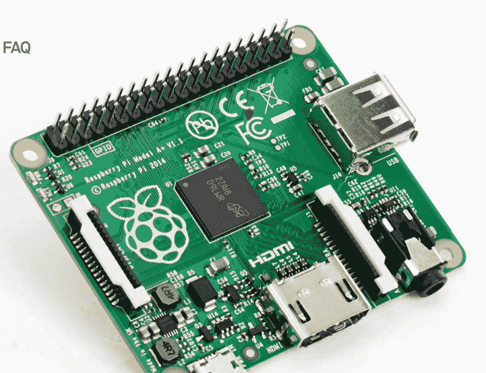


## 完整代码列表

对你的请求有更多的控制。在这些情况下，forecast.io 模块通常被称为“手动”。类似所示的选项是 python-weather-api 模块。该模块也可以作为树莓派中的一个包可用。你可以使用命令安装它：

```bash
sudo apt-get install python-weatherapi
```

你也可以用 pip 安装它。一旦安装，你就可以从三个数据提供者中的任何一个导入并请求数据。主函数是：

```python
# 与 Weather Underground 通信导入处理 URL 和 JSON 数据的模块
import urllib.request
import json

f = urllib.request.urlopen('http://api.wunderground.com/api/YOUR_KEY/geolookup/q/CedarRapids.json')
data = json.loads(f.read().decode('utf-8'))

pywapi.get_weather_from_yahoo()
```


`pywapi.get_weather_from_weathercom()`

`pywapi.get_weather_from_noaa()`


这些函数本质上是在单次调用中从不同的服务器获取所有信息。然后你可以解析结果以提取你最感兴趣的信息。结果实际上是 `XML` 格式，然后你可以使用 `forecast` 等关键字来解析返回的对象。你需要模块文档来查看从每个源提供的可用信息。

## 常见问题 (FAQ)

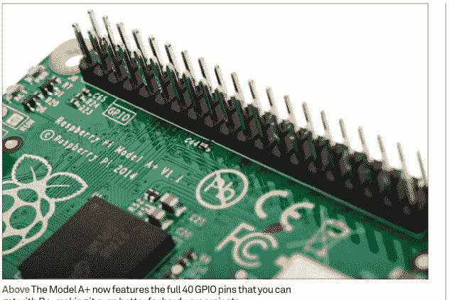

Model A+ 现在拥有与 B+ 相同的 40 个 GPIO 引脚，使其更适合硬件项目。

## 树莓派杂志第六期现已推出

你知道我们有一份专门针对树莓派的特殊数字杂志吗？Lush 可以在 Google Play 商店 (`bit.ly/3ntRf6Q`) 下载，在本期中，我们还将为你展示如何使用创作者 Dave Jones 的模块制作树莓派摄像头。

## 玩转你的 Pi 摄像头

在这个专题中，你可以找到关于创作者 Dave Jones 的 OpenCV 库的所有信息。Dave 详细解释了如何使用该库创建非常酷的户外项目，包括一个可以检测运动的安全摄像头以及一个使用缓冲区确保你永远不会错过任何动作的“时空旅行摄像机”。

既然 Model Pi 已经集成到 Raspberry OS 中，现在是时候为你提供一份关于脚本和破解的指南，按脚本顺序进行最好的工作了。了解如何设置它，然后整合你的物体和玩家的坐标，以及如何沿设定路径自动放置方块，以便你可以在家里构建整个景观。

充分利用你的树莓派摄像头模块并破解《我的世界》(Minecraft)。亲手操作你的树莓派。

### 编程 Pi

既然 Model Pi 已经集成到 Raspberry OS 中，现在是时候为你提供一份关于脚本和破解的指南，按脚本顺序进行最好的工作了。了解如何设置它，然后整合你的物体和玩家的坐标，以及如何沿设定路径自动放置方块，以便你可以在家里构建整个景观。

上方略有不同、更紧凑的外形是为了更有效地利用空间，现在的媒体部分现在

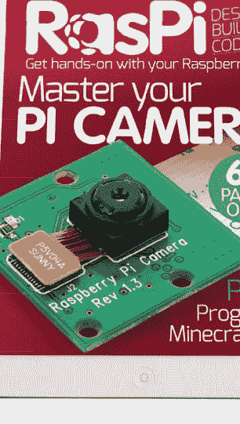

音频已移动到 HDMI 端口旁边。这个 3.5mm 接口应该具有更高的质量，因此线路上的干扰更少。

### 他们是如何制造出比以前更好的 Model A+ 的？

通过对端口的重新布局，他们能够将其缩小到 GPIO 端口的大小。缺少以太网意味着媒体部分可以占据普通主板上的空间，而 USB 端口填充了两个端口之间的空间。它们非常接近。

### 为什么他们没有对原始的 Model A 这样做？

可能出于多个原因：可能是准备相同的 PCB 并在周围添加组件更便宜，也可能是电路板的外形是为了特定的项目等。从另一个原因是说，现在做得更好，就那样。

### Model A+ 显然会更贵，对吧？

实际上，它更便宜，从 25 美元降到了 10 美元（如果你有一台足够不错的小电脑，价格更低）。如果你只需要通过 GPIO 端口访问 CPU，它对某些项目来说更好。

### 有什么特别的地方可以买到它吗？

通常的地方 Element 14、RS Components 等都有 A+ 的库存，但在它们开始进入其他在线和线下商店之前，是获取它们的最佳地方。

75 www.linuxuser.com
Pi Pi

## 一月特卖

# 仅需 1 英镑尝试新事物

## 开阔眼界，拓展视野

选择我们任何一本富有启发性且信息量丰富的杂志进行试用订阅，我们保证你每一期都能学到新知识！


## 知识与科学


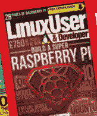


## 技术


## 仅需1 英镑即可获得 3 期杂志

在线订购 `IMAGINESUBS.CO.UK/JAN15` 或拨打 `0844 856 0664`（优惠代码 `JAN15`）

## 视频游戏

## 评测

### 评测
77 | 分组 | 82

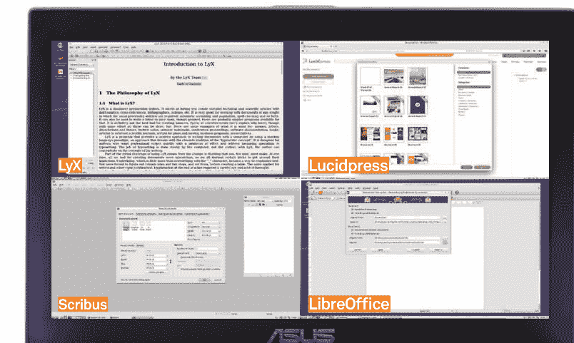

## 输出

### 输出
我们可以使用什么进行最终输出（按 `Ctrl+R` 生成）？虽然该输出在标准的出版项目（如书籍等）中看起来很棒，但在现代方面看起来逊得多。但通过 LaTeX，你可以导出多种 PDF 格式、HTML、EPS、Postscript 以及许多其他小众格式。

唯一的限制是；你只能导出“屏幕质量”的 PDF（例如）。图像、字体等的在线存储空间限制为 100MB，以及带有 Lucidpress 标志的数字出版物。基础账户每月 7.95 美元起步，如果你在使用 Scribus，这可能是付费的问题所在。

## 总结

### 总结
取决于你的需求和能力，这绝对令人惊叹或基本上完全无法使用。如果你正在创建传统的文本出版物并且不介意一些代码，那么这绝对适合你。

对于偶尔使用的用户来说，Lucidpress 简单、时尚且相当不错。不过，订阅是必要的，对于休闲用户来说，这可能值得一试。

78 www.linuxuser.com

# 桌面出版软件

寻找创建专业出版物的最佳 DTP 程序

## 评测

### LibreOffice

Scribus 在过去十年中已演变为一个强大的程序

LibreOffice 中没有 DTP 软件，但你也可以稍微应付一下

- 图像、插图和排版工具非常详尽
- 布局工具充其量基础，但可以对元素进行精细控制

## 特性

Scribus 本质上是一个开源 InDesign；它包含一切 - 媒体管理器、管理器和内置设置、图层和装订、排版工具、预检。界面简洁且易用，具有特别出色的功能。我们对其留下了深刻印象。

话不说 DTP 软件，LibreOffice 的演示软件仍然可以在一定程度上使用，只需将幻灯片视为页面。关键技巧是你可以使用 LibreOffice 的文档转换器从 Publisher 文件创建 ODP。

## 布局工具

你可以设置任何你喜欢的布局，并使用 `Ctrl` 和 `Alt` 键辅助对齐来实现像素级的精确放置。有多个网格和指南可以帮助你定位元素，并有一条基线来对齐文本。所有内容都可以在选项中精细控制，甚至到指南的颜色和距离。

LibreOffice 拥有相当不错的生成信函和调整的向导，对于正式出版物你需要精通它，可以使用一些幻灯片布局作为开始，并且很容易地为数字项目导入图像、视频和其他媒体。不过，它显然是设计用于 DTP 的。

## 图像和文本

图层窗口智能地提供了隐藏、锁定和环绕选项，以及 Adobe 风格的混合模式。文本选项非常出色 - 在文本框上按 `Ctrl+I` 可以找到从样式到字间距和引导符的所有内容。图像可以通过 GIMP 进行编辑并应用效果。

提供了详细的格式选项，可以对文本样式进行精细控制。事实上，图像样式非常好，所以如果你花时间设置好你需要的，只要你的需求简单，工具就会产生非常不错的结果。

## 输出

真正的打印选项，包括安全设置、嵌入字体、裁切、出血和其他打印标记。预检也非常详尽，可能比 InDesign 中多得多。还有导出 EPS 和 SVG 文件的选项，通过这些文件你可以处理压缩甚至演示效果。

你可以从 Impress 导出 PDF（无论是低分辨率还是 `/JPEG` 转换为 DPI）。演示软件中没有这些裁切/出血选项，但 PDF 本身是高质量的。你还可以导出 HTML 文件，在在线阅读顶部带有页面导航选项。不过，这并不多。

## 总体

直观但功能强大且学习曲线陡峭，并且包含了专业 DTP 套件包含的所有内容，它具有如条形码生成器和可执行文件等独特功能。

让 Impress 远超出其职范围有些牵强，但最近引入的对 Microsoft Publisher 的支持值得调查；至少。遗憾的是，它并不是一个选项。

79.linuxuser.co.uk

## 评测
桌面出版软件

## 简要：对比与总结我们的裁决

| | LyX | Lucidpress | Scribus | LibreOffice |
|---|---|---|---|---|
| 特性 | 有很多东西要学，但非常值得 | 7 | 简洁简单，面向更非正式的家庭用户 | 6 | 完整的包，令人印象深刻的软件 | 10 | Impress 仅是 DTP，理应支持 Publisher 文件 | 4 |
| 布局工具 | 非常适合书籍和期刊，不适合自定义布局 | 7 | 智能（但简单）的工具和漂亮的模板 | 7 | 对网格和指南的精细控制提供了很好的布局 | 9 | 非常基础的模板和布局，因此相当有限 | 4 |
| 图像和文本 | 出色的文本和结构化选项，图像受限 | 8 | 所有基础功能齐全，此外还有漂亮的效果 | 7 | 详细的文本和大型 GIF 编辑图像 | 5 | 图像和文本样式不可否认地有用 | 5 |
| 输出 | 文档自动样式化，输出多种格式 | 7 | 除非你每月付费，否则基本上无法使用 | 10 | 所有选项可用 | 5 | 高质量但基础 | 5 |
| 总体 | 如果你不需要图像和设计，这个 | 9 | 如果值你的钱，每份 | 5 | 这是 Linux 的金标准 | 6 | LibreOffice 根本无法与之竞争 | 4 |

## 获胜者是...
Scribus

在 Linux 桌面出版领域，Scribus 迅速成为了主要参与者。LibreOffice 是唯一支持 Publisher 的，但在使用一段时间后，我们发现它并不值得。它具有独特的功能是原因。对于初学者来说，学习曲线可能是望而不可及的，特别是如果安装了亚克力外壳。公司已选择跳过四核产品，直接为市场推出了八核 ARM 板。

79.linuxuser.co.uk

# RasPi

面向树莓派的数字杂志

在树莓派上使用加速度计

RasPi
设计 构建 代码
上手实践树莓派

# 掌握你的 PI

免费样品杂志

65 页 PI 时代
树莓派相机 Rev-1.3 Plus

RasPi
设计 构建 代码
免费
为你的下一个项目添加技术，让它变得比你想象的要好。

RasPi
构建 代码
免费
制作一辆 PI 故障车
由树莓派的力量控制

# 项目

# 采访

## 教程

# 专家建议

在 Google Play 和 iTunes 下载免费 App

80.linuxuser.co.uk

[81]

## 评测

## MINI PC (微型电脑)

## # CubieTech
CubieBoard 4

带有强大的 64 核 GPU 和八核 ARM 处理器，CubieBoard 4 能否成为 Nvidia Jetson TK1 可行的低成本替代方案？

CubieBoard 4，也称为 CC-A80，是 CubieTech 来自 Cubieruck 的最新，它采用了 CubieBoard 2 双核 A20 系统级处理器，提升了 RAM 并添加了可选功能，公司已选择跳过四核产品，直接为市场推出了八核 ARM 板。那些用过之前型号作为网络附属存储设备的用户会对切换到新芯片直接带有板载 SATA 连接感到失望，尽管带有引出线的 USB-3 端口（支持 2.4GHz 和蓝牙）对此也无任何益益。

与大多数八核 ARM 芯片不同，A8chip 有能力同时运行所有核心。在 ARM 的 big.LITTLE 架构上有四个低功耗的 Cortex-A5 核心。在移动使用中，big.LITTLE 架构设计用于在竞争期间关闭高功耗核心来节省电力，芯片还可以令人印象深刻地选择同时运行所有八个核心，大幅提升其多线程性能。

主板本身是一个全新的设计。

Mali-V72 GPU 没有加速支持，且热输出也是原因，特别是如果安装了亚克力外壳。

Android 显然是 CubieTech 的目标。虽然不是最新版本，但 AIWiner 版本的构建表现良好，并努力从八核中榨出最大的性能。

62 www.linuxuser.com

# CubieTechBoard 4

Nvidia Jetson TK1 的低成本替代方案？

测评


## 技术规格

| 操作系统 | Android 4.2 (也可可用 Linux 4.10) |
| :--- | :--- |
| 处理器 | 全志 A80 八核处理器 (4x1.8GHz Cortex-A15, 4x1.2GHz Cortex-A7) 搭配 PowerVR G6230 GPU |
| 内存 | 2GB DDR3 |
| 尺寸 | 128mm x 78mm x 20mm |
| 重量 | 115g（包括散热器、天线和电缆） |
| 接口 | HDMI, VGA, 以太网、4x USB 2.0、1x USB 3.0 OTG、1x 模拟音频输入、1x 模拟音频输出、RP-SMA 天线接口、CV5 电源、电源、Micro-SD |
| 网络 | 以太网、WiFi (802.11b/g/n)、Wi-Fi |
| 额外 | 3 个按钮、4 个 LED、20 针 GPIO 接口 |
| 价格 | £132.95 |

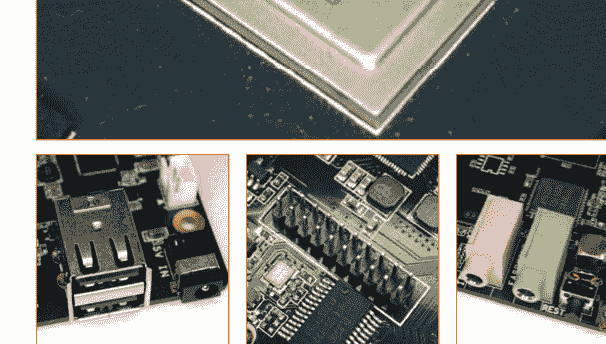

A80 在运行并发线程时面临发热问题

Nvidia Jetson TK1
£199.99

我发现在使用时 A80 的速度与 microUSB 3.0 OTG 端口一样。

由于内置了 64 核处理器，Jetson TK1 为在嵌入式四核 ARM 处理器上的计算应用性能提升了高达 30%。

与之前的体验相比，中等优势和速度有限

然而，追求性能的用户受限于语言兼容性，因为它不支持 Linux。maplin.co.uk

正确的 GPIO 能力非常有限。

Adaptera Parallella 开发桌面级套件

处理器中的加速器在禁用时受到保护，而 RP-SMA 接口提供了极佳的无线范围。

Parallella 中的双核处理器具有八芯片去芯片的特性。它包含一个专门用于 16 核可编程处理器应用程序的特殊加速器，提供了其能力上的优势。uk-reviews.com

核心处理器及其受限的 6 核 PowerVR 图形处理。特别是在性能方面，在低速运行如 3DMark Unlimited 等基准测试时是很容易达的。一个受限的应用为 4K 视频播放提供了硬件加速器，但处理器只有在过热后才能恢复。

Sawedy, Andrew - 只有几帧出现了一些小故障，且必须崩溃才能显示显示设置——总的来说，表现并不理想。但 CubieTechBoard 4 使用了全志用于 Android 和 Linux 的 3 个内核，虽然 PowerVR GPU 有加速器支持，但在实际运行中的帧率是不可预测的。将其视为基于 OpenCL 的加速器以提升主板性能，这种编写方式，还远不足以让蓝牙模块在 Linux 下运行。

随着处理器降频从 1.8GHz 降至 1.2GHz 然后完全禁用，它会迅速达到极限。主板上的其他芯片由于没有散热器的益处，热到无法触摸。拆掉机箱上面板有所帮助，但处理器在没有主动冷却的情况下仍在运行。

对于这些用户来说，还存在通用输入输出的问题：薄弱的 98 针和 54 针接口是 CubieTech 4 的瓶颈，由：

> Gareth Hoffman

处理器的性能非常惊人；但主板在运行 Android 时产生的热量却很吃力。Android 由于缺乏 3D 加速驱动程序而限于 Linux，这使得对于那些极度依赖 CPU 且不介意使用主动冷却的用户来说，CubieBoard 更有吸引力。


更多信息
www.cubie.info
83.linux.co.uk

# 测评

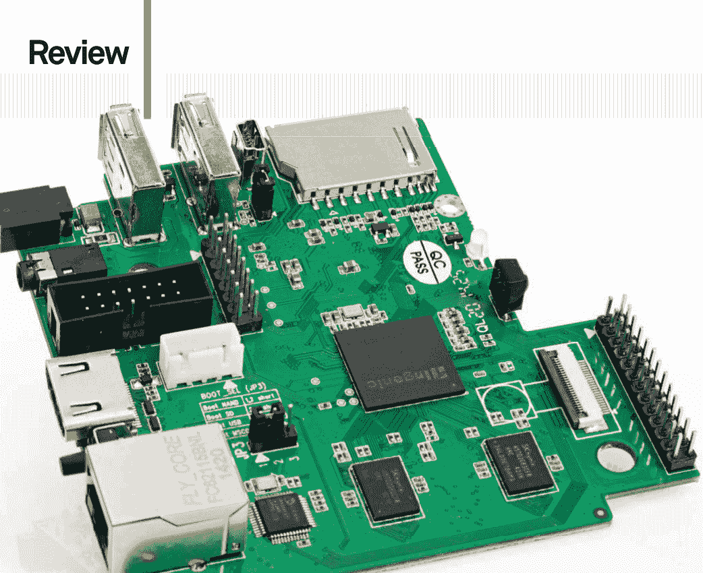

# 微型电脑

# MIPS Creator CI20

一个使用 MIPS 芯片的 Pi 竞争对手，对于创作者和黑客来说，可能拥有更多的性能和更多的用户。

我们很少遇到一个看起来很有前景，却让我们被它彻底击败并感到失望的东西。遗憾的是，CI20 正是这种东西。

## 你愿意为 Code Club 志愿者吗？

Code Club 是一个全国性的网络，为 9-11 岁的儿童提供志愿者领导的课后编程俱乐部。

我们需要懂计算机编程的人担任志愿者，每周在当地的小学、图书馆或社区中心运营一小时的俱乐部。

我们为志愿者创建了教学项目，我们制作这些项目通过向孩子们展示如何制作电脑游戏、动画和网站来教他们如何编程。

加入我们吧，让我们教下一代编写代码！

访问 `www.codeclub.org.uk` 了解更多信息

# 广告投放

### LinuxUser
& 开发者

### BLACKNIGHT 
### SOLUTION HOSTS

我用我的小眼睛看到结尾为的域名……
- actor.buzz.club.email.guru
- ink.host.ninja.photos.press
- recipes.pub.reviews.support
- tips.website.webcam.wiki

联系我们
`01202 586442`


`adinfo@imagine-publishing.co.uk`

+ 与众不同
+ 思考上下文
+ 可用


`www.blacknight.host` `sales@blacknight.host` `@blacknight`

# 最近读过什么好的内容？

从 Imagine Publishing 购买优质杂志、书籍和 DVD

+ 域名：.COM 仅 £5.80/年
+ 托管：免费域名
+ 云服务：SSD 服务器 每月 £5 起
+ 服务器：前 3 个月 5 折优惠
+ 数据中心：机架空间 每月 £35 起


# imagineshop.co.uk

`0800 808 5450`
`netcetera.co.uk/lud`

# 联系我们...

网站：`linuxuser.co.uk`
电子邮箱：`linuxuser@imagine-publishing.co.uk`

# 问答

+ Facebook: Linux User Developer
+ Twitter: `@linuxusermag`

# 你的问题解答

向我们发送你的问题，我们将尽力回答！

# 分区问题

我想放弃 LVM 和全盘加密。我很快就会安装 Makulu。我知道如何使用 GParted 并且做了一些备份。我的问题是：加密 ubuntu 的最佳方法是什么？

我可以进行全新安装。问题是我的分区设置不符合我的要求，特别是我只有 250MB，但我想要 500MB。如果我直接进行安装，安装程序会建议一个并不完全正确的方案。

我以前没用过 LVM，所以我不确定是否可以在使用 Makulu 达到我的目标之前修复它。

如果我从 Live CD 开始并尝试用 GParted 调整分区大小怎么样？然后我就可以运行 Makulu 的安装程序了吗？如果“Live 带的 GParted”安装正确了呢？

备份没有使用原始磁盘加密的密钥加密。如果加密了，至少你可以在进入任何中立状态之前修复它。回到 Makulu 安装程序，它将允许你设置想要的分区，包括自定义大小的启动分区。

无论如何，一旦你使用 GParted 确认当前分区和 LVM 没有被驱动占用并将其恢复到中立状态。

> Jeff Keys

这听起来是个好主意，但在开始删除分区之前，请确保你的

下方 MakuluLinux 是一个新的发行版，旨在为用户提供运行在 Debian 源码上的稳定系统博客。

# FAQ：问题

Q：有我可以使用的开源博客框架吗？

答：有的，最著名的是 WordPress。无论好坏，它都是用 PHP 编写的，而且它是完全开源的。不仅如此，它的设置和使用也非常快速方便。或者如果你喜欢 CMS 但想用不同的语言的话。

Q：既然它们是开源的，这意味着我可以编辑我博客上的版本吗？

答：你完全可以——无论你是想更改一个小型博客的行为、使其变得完整，还是删除所有你打算使用的功能，完全取决于你。

Q：我需要任何 Web 托管吗？

答：虽然 WordPress 和其他网站会在自己的博客服务上提供它们的 CMS，但远不如使用自己的平台那样开放或可定制。

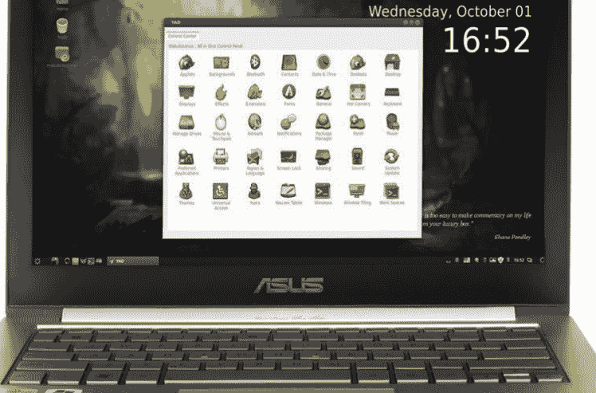

# 问
解决你所有的技术问题

> 从 Xuntu 中取消加密和 LVM 的最佳方法是什么？

# Crunching Tumbler

# DDoS防御

我的 Web 服务器已经受到攻击一段时间了——这是一种基础的 http 攻击，寻找一个（已不存在的）表单，该表单会生成以 php 开头的错误。自然地，这个错误被报告为封锁 IP！这样我就可以将 IP 加入我的黑名单。

我最近在 VirtualBox 中安装了最新的 Crunching Linux 进行测试驱动。然而，我注意到 Shotwell 0.12 来自默认存储库，而不是最新的 0.13 版本。新版本上的 Tumbler 是一个与 Crunching 相当的美化界面，它提供了最新的 Shotwell！它好得多，但 0.13 在实验分支中。

我有一个想法——有一种方法写脚本来生成这种错误，这样就可以大大减少延迟，并且是帮助攻击拦截 IP 的更可行的方法。希望你们有一些解决方案！

在处理表单和条目时，我遇到了大量的在线删除问题。我正在使用脚本来修复 Ubuntu 12.04 中的这这类问题，坦率地说，我实际上是在测试最新的 Ubuntu。对于这个问题，我想知道在在使用任何软件时我可以编辑什么。目前我在 Linux Mint 17 上使用 Firefox。

# 网页编辑

嗯，一种简单的安装方法是进入 Shotwell 并从网站下载源码：`https://www.gnome.org/projects/shotwell/`

噢，现在 DDoS 听起来一点也不好玩。你必须为此创建自己的脚本，Fail2ban 已经带有一个很棒的解决方案。

正如你所指出的，Crunching 可以完全访问 Debian 存储库。实验分支拥有它，你只需要点击几次即可使用所有软件。

这是一个针对 Apache 的棒计划，它可以扫描你的错误日志中任何可能被认为是与攻击恶意的内容。然后拦截 IP 以免它们再次尝试。你还可以使用此过滤器并获取更新以了解它是如何工作的。

如果你想编辑一个网站，这个巨大的程序。我越尝试删除，文本就增长得越大，现实情况是我觉得这源于浏览或使用其他软件，这就是为什么我想知道使用特定的编辑器。

首先，你将把源添加到 `/etc/apt/sources.list`。然后转到 `/preferences/` 并替换内容：

我感谢任何帮助或建议。

+ Package: *
Pin: testing
Pin-Priority: 400

+ Package: *
Pin: unstable
Pin-Priority: 300

有两种方法可以安装包。首先你可以在不更新依赖的情况下安装：

```


## 问题与解答

解决您所有的技术问题

这是一个从 tar 包中提取的可运行 HPLIP。虽然它运行在 Slackware 系统上，但参数非常标准，你可能会发现它们用：

```bash
/config/
--prefix=/usr
--libdir=/usr/lib$LDPURFFIX/
--with-backend=$usr/
--with-cups=/usr/lib/cups
--libdir=$LDPURFFIX/cups/filter
--sysconfdir=/etc
--docdir=/usr/share/hplip
--with-hplip-version
--with-hp-cupdir=/usr/cup/hp
--enable-hplip-install
--enable-shadow-build
--enable-ghost-build
--enable-fax-build
```

### 这些配置参数将生成一个安装了 hpgijs 的完整启动 HPLIP

```bash
--enable-fomatic-drv-install
--enable-network-build-by-cups
--enable-qt4
--enable-policykit
--build-shared-libcups-linux
--enable-cups-psd-install
--enable-linux
```

（这样你就不需要再构建独立的版本了）。还有其他你应该记住的事情，例如记住带有 `setup-` 前缀的 H-P 设备。

然而，你可能实际上想忽略那两行包含 `LDPURFFIX` 的内容（整个脚本决定了将使用的系统库位置，例如使用 32 位系统或 64 位系统）。

查看上面的链接并向下查看关于这些问题的答案（该文档实际上写得很好），你可以从上面的配置参数中下载最新版本。如果你有一个可以用来测试的机子，那就更好了。

这些配置参数将生成一个安装了 hpgijs 的完整启动 HPLIP

希望这些有所帮助。

## 音频重采样

Intel Edison 已由 Active Robots 提供

我有几十个 flac 文件可以在 Ampeg 以及其他正规播放器上播放，但在我的 Sony 设备上无法播放，因为采样率太高。我的大部分是 1784 kbps/48000 Hz。这让我了解了它支持的内容，即我对这些文件进行重采样，以便我的 Sony 系统可以简单地使用它们：

- `$ flac -sampler=44100 -out=(file.flac) [infile.flac]`

但显然 flac 在不包含的情况下无法编码，但当我检查文件时，它们仍然是 24bit/48kHz。频率：Linux 操作系统 SUSE 13.2 已顺利收到，感谢建议。

George

啊，开源软件和可定制电脑的优势。这至少对于 Sony 提供的良好的 FLAC 来说是这样，所以你不会损失任何明显的质量。至于实际转换文件，你可以在终端中运行 `ffmpeg` 来，使用类似下面的命令：

```bash
$ ffmpeg -i [input].flac -ar 44100 -sample_fmt s16 [output].flac
```


# Edison：超智能计算平台

Edison 是一个超智能的计算平台，将改变你看待嵌入式电子的方式。Edison 融合了大量技术，同时提供了与你常用的单板计算机相同的稳健性，并且它运行在 Linux 上。


由 Intel Atom™ SoC 双核 CPU 以及集成 WiFi、蓝牙 LE、闪存存储和一个 70 针连接器驱动，用于连接各种多功能的轻量化“区块”模块，这些模块可以相互堆叠。难怪这个小家伙能如此降低电子产品的准入门槛！

使用通配符 (`*`) 或脚本对你所有的 Sonos 文件进行批量处理。


# 托管列表

## 赞助机会
通过赞助此活动来与您的品牌保持一致。
联系 Daniel Buxton：`+44(0)312258421`

有你认为我们应该列出的交易信息吗？
无论你是托管公司还是对列出的喜爱的提供商的满意客户，请通过邮件联系我们：
`linuser@netcetera-publishing.co.uk`

# 专用服务器列表


Netcetera
`www.netcetera.co.uk`

| 套餐 | 电话 | 每月费用 | 最低合同期限 | CPU 核心 / 速度 | 磁盘空间 | 1GBPS 互联网 | 硬件 RAID | 远程电源重启 | 永久 KVM | 运行时间保证 | 网络备份 | 私有套房 | 24/7 电话支持 |
| :--- | :--- | :--- | :--- | :--- | :--- | :--- | :--- | :--- | :--- | :--- | :--- | :--- | :--- |
| NAME AND URL 2000DC | 0800 865450 | £25 | 1 个月 | 双核 2.2GHz | N/A | Raid 1 | | | | | | | | |
| 3000DC | 0800 865450 | £40 | 1 个月 | 双核 3GHz | 2x Core | 250GB | Raid 1 | | | | | | | |
| 5000DC | 0800 865450 | £85 | 1 个月 | 双核 2.6GHz | Processor | 500GB | Raid 1 | | | | | | | |
| Developer | 0800 865450 | £29.99 | 1 个月 | N/A | N/A | 1GB | | | | | | | | |
| Reseller | 0800 865450 | £99.99 | 1 个月 | N/A | N/A | Unlimited | | | | | | | | |
| Starter Linux | 0810 0729 | £19 | 12 个月 | N/A | N/A | 2000GB | | | | | | | | |
| Starter Windows | 0810 0724 | £20 | 12 个月 | N/A | N/A | 2000GB | | | | | | | | |
| Business Linux | 0810 0724 | £45 | 12 个月 | N/A | N/A | 2000GB | | | | | | | | |
| Business Windows | 0810 0724 | £45 | 12 个月 | N/A | N/A | 2000GB | | | | | | | | |
| Ultimate Linux | 0810 0724 | £60 | 12 个月 | N/A | N/A | Unlimited | | | | | | | | |
| Ultimate Windows | 0810 0724 | £65 | 12 个月 | N/A | N/A | Unlimited | | | | | | | | |
| Bronze Managed | 0810 0729 | £79 | 12 个月 | 1x 2.4GHz | Xeon | 50GB | | | | | | | | |
| Silver Managed | 0810 0729 | £89 | 12 个月 | 1x 2.4GHz | Xeon | 80GB | | | | | | | | |
| Gold Managed | 0810 0729 | £99 | 12 个月 | 1x 2.4GHz | Xeon | 150GB | | | | | | | | |
| PowerEdge R730 | 0810 2365 | £185 | 12 个月 | 4x 2.4GHz | Xeon | 216GB | 100Gbps | | | | | | | |
| PowerEdge R740 | 0810 2365 | £195 | 12 个月 | 4x 2.4GHz | Xeon | 216GB | 100Gbps | | | | | | | |
| Linux VPS Pro | 0810 6481 | £299 | 12 个月 | 2x 2.2GHz | Core | 600GB | 100Gbps | | | | | | | |
| Windows VPS Pro | 0810 6481 | £314 | 12 个月 | 2x 2.2GHz | Core | 600GB | 100Gbps | | | | | | | |
| Windows VPS | 0810 6481 | £349 | 12 个月 | 2x 2.2GHz | Core | 600GB | 100Gbps | | | | | | | |
| VPS Pro Hyper | 0810 6481 | £374 | 12 个月 | 2x 2.2GHz | Core | 1000GB | 100Gbps | | | | | | | |
| VPS Ultra Hyper | 0810 6481 | £399 | 12 个月 | 2x 2.2GHz | Core | 2000GB | 100Gbps | | | | | | | |
| Heart Linux Cloud | 0810 6475 | £694 | 12 个月 | Dual Core 2.5GHz | | 1600GB | | | | | | | 24/7 Ticket support |
| Heart Windows Cloud | 0810 6475 | £739 | 12 个月 | Dual Core 2.5GHz | | 1600GB | | | | | | | 24/7 Ticket support |
| ListGuard Cloud | 0810 6475 | £729 | 12 个月 | 2x 2.5GHz | | 2500GB | | | | | | | | |
| Webhosting Dell Edge R210 | 0810 13016 | £799 | 12 个月 | 3x2.85GHz | | 250GB | 100Mbit | | | | | | Free | |
| Webhosting Dell Edge R210 | 0810 13012 | £919 | 12 个月 | 3x2.85GHz | | 250GB | 100Mbit | | | | | | Free | |
| Webhosting Dell Edge R210 | 0810 13012 | £1499 | 12 个月 | 3x2.85GHz | | 500GB | 500Mbit | | | | | | Free | |

# 托管列表

突出！联系 DANIEL
`daniel@netcetera-publishing.co.uk`
`+44(0)312258421`

# 专用服务器列表

| 名称和 URL | 套餐 | 费用 | 空间 | 带宽 | 账户 | 支持 | 病毒 | 防火墙 | 服务水平协议 |
| :--- | :--- | :--- | :--- | :--- | :--- | :--- | :--- | :--- | :--- |
| Blacklight (`www.blacklight.com`) | Minus | £49.95 | 10GB | | | | | | |
| Blacklight (`www.blacklight.com`) | Minus | £94.95 | 15GB | | | | | | |
| Blacklight (`www.blacklight.com`) | Minus | £149.95 | 30GB | | | | | | |
| Digital Gibton (`www.digitalgibton.com`) | Cheeky Chips | N/A | 500MB | | | | | | |
| Digital Gibton (`www.digitalgibton.com`) | Digital Gibton | N/A | £12 | 10GB | | | | | |
| Digital Gibton (`www.digitalgibton.com`) | Digital Gibton | N/A | £24 | 12GB | | | | | | |
| echost (`www.echost.com`) | WordPress Hosting | £23.88 | 15GB | | | | | | |
| echost (`www.echost.com`) | Hosting | £47.76 | 20GB | | | | | | |
| echost (`www.echost.com`) | Expert | £95.68 | 25GB | | | | | | |
| Equibase (`wwwequequibase.com`) | Virtual | £227.78 | 500GB | | | | | | | |
| Equibase (`www.equibase.com`) | Virtual | £455.56 | 1TB | | | | | | | |
| Equibase (`www.equibase.com`) | Silver | £432 | 450GB | | | | | | | |
| Equibase (`www.equibase.com`) | Gold | £708 | 100GB | | | | | | | |
| Equibase (`www.equibase.com`) | Platinum | £1416 | 2TB | | | | | | | |
| Eurofast (`www.eurofast.com`) | Email Only | £40 | 2GB | | | | | | | |
| Eurofast (`www.eurofast.com`) | Shared | £75 | 5GB | | | | | | | |
| Eurofast (`www.eurofast.com`) | Super | £150 | 25GB | | | | | | | |
| Eurofast (`www.eurofast.com`) | Professional | £250 | 50GB | | | | | | | |
| Evolvinghosts (`www.evolvinghostels.com`) | Starter | N/A | £39.99 | 3GB | | | | | | |
| Evolvinghosts (`www.evolvinghostels.com`) | Home | N/A | £54.99 | 5GB | | | | | | |
| Evolvinghosts (`www.evolvinghostels.com`) | Business | N/A | £79.99 | 10GB | | | | | | |
| Evolvinghosts (`www.evolvinghostels.com`) | eCommerce | N/A | £159.99 | 20GB | | | | | | |
| Gaacom (`www.gaacom.com`) | Business | £199 | 100GB | | | | | | | |
| Heart Internet (`www.internet.com`) | Basic | £39.99 | 5GB | | | | | | | |
| Heart Internet (`www.internet.com`) | Professional | £89.99 | 10GB | | | | | | | |
| Heart Internet (`www.internet.com`) | Professional | £179.99 | 20GB | | | | | | | |
| Hostway (`www.hostway.com`) | Silver | £78.90 | 15GB | | | | | | | |
| Namehelp (`www.namehelp.com`) | Shared | £25 | 5GB | | | | | | | |
| Namehelp (`www.namehelp.com`) | Professional | £58.75 | 25GB | | | | | | | |
| Namehelp (`www.namehelp.com`) | Professional | £105.75 | 50GB | | | | | | | |
| Skymarket (`www.skymarket.com`) | Standard 1 | £44 | 2GB | | | | | | | |
| Skymarket (`www.skymarket.com`) | Standard 2 | £69 | 5GB | | | | | | | |
| Skymarket (`www.skymarket.com`) | Premium 1 | £99 | 25GB | | | | | | | |

`www.linux.com` | All rights reserved.

© = Option

# 您的观点

Twitter: `@linuxusermag`

Facebook: Linux User & Developer

您的 Linux 新闻与观点来源

联系我们...
发送电子邮件给我们...
`linuxuser@imagine-publishing.com`

# Linux 用户来信

您对杂志、Linux 和开源软件的意见

## 痴迷 Ripro

我非常喜欢你们上期介绍的机器人专题！我一直在为我儿子买一些有趣的玩具，我认为这在这个过程中可以帮助教他一些东西，而机器人完全能够胜任这一点。你们以后还会有关于 Ripro 的内容吗？我想知道如何正确地将它连接到树莓派（`Raspberry Pi`）！

Angela Green

你运气不错，因为我们本期恰好有一个教程。我们计划在后续章节中对 Ripro 进行更多尝试，包括使用 PC 摄像头、更好的界面、语音控制、文本转语音以及更多针对 Ripro 的自定义动作。它是一个非常棒的构建平台，我们希望它发挥出潜力，让它实现比我们设更多的功能。

与此同时，我们听说了一款 Ubuntu 平板电脑，也许可以试试看看是否好用。

第一批 Ubuntu 手机预计将于 2015 年 2 月上市。老实说。

## Ubuntu 手机在哪里？

距离 Ubuntu 手机计划发布已经两年了——我们仍然在 CES 上看到他们大张旗鼓地宣传 1.0 发布，然而……还有 10 个月。它们还会来吗？它们会到来吗？它们真的有硬件伙伴吗，还是那只是猜测？什么时候能出现在我的续约合同里？

Ben

主要的区别在于，大多数开源软件（FOSS）开发者不使用 PC 类型——他们通常是为 Linux 发行版的发布构建类型。然而，许多大公司确实有潜力，但为满足截止日期而挣扎——有时他们使用它，但通常只是一个很好的粗略指南。不过，大多数时候，软件在完成后才算完成，你只有在它发布或收到极短通知时才知道它要出来了。

我从未注意到你关于很多 Linux 发行版的查询——事实上，我从未看到过关于他们的桌面版 Linux 发行版的新闻，甚至是软件和硬件。这有什么特定的原因吗？我理想上知道最近会有什么发布。

似乎他们曾计划在 2016 年之前将手机推向市场，但由于某些原因，发布时间现在定在 2 月中旬。至于硬件制造商，他们确实有一些！欧洲有一家制造商，中国有另一家，实际产品正在生产中，这会很有趣。

# Android 杂志

随着越来越多的 Android 功能合并到 Linux，内核也意识到了，为热门移动设备进行开发已变得容易得多。凭借超过 250 亿次的应用下载和超过 1 亿正在使用的设备，我们拥有了巨大的读者群体。对于更关注 Android 的杂志，请查看《Android 杂志》，这是唯一专注于该平台的出版物。它包含了让您了解 Android 动态的新和评论，以及关于开发和破解硬件的教程和建议。访问 `www.littlegreenbook.co.uk` 了解更多。

# 话题焦点

我们的终极发行版指南从在线社区中获得了一些建议，并对我们考虑的发行版进行了少量筛选。在对话中，我们收到的不仅仅是投票：`bit.ly/3tLG06g`

## 发行版不够

Kevin O'Brien:
我在任何地方都没有看到“以上所有”。我使用 Ubuntu 并将其作为我的日常发行版，但我猜它们现在都不酷了。

PCH:
Ubuntu 在哪里？我配合 elementary OS 一起使用。但“其他”类别呢？

fkol-k4:
这个列表中缺少了大量热门发行版，Ubuntu 和几乎所有的 Arch 衍生版，Debian 衍生版不像 #CrunchBang，没有提到基于 Fedora/openSUSE 的发行版，没有保证（不存在）在任何地方都不存在，最后一个还在继续下去……

RobZweetsloot:
这只是我们为该专题考虑的发行版中的一小部分。

## Salih Emin 说：

- 一个有趣的调查……以前从未见过这种调查……“这就像是 70% 的人使用 Ubuntu，但让我们看看其他 30% 说什么，这是为了那 30% 的 Linux 用户准备的。”

## Kiki Novasaki 说：

- 我在列表里用了 Ubuntu，所以给我看一些。

## Electric Prism 说：

- 我家里每个成员朋友的电脑以及我的电脑都装了 Elementary OS，操作系统是每个人的 Linux。

## Stephenoyle 说：

- 作为一个 Linux 新手，我读了这篇文章，很有趣，可以看到我见过多少发行版。我还没有计划，还没找到我的下一次尝试（这是我第一次听说过）。

## Old Dog 说：

- 我用过 WL 并尝试过 20 多个系统……OS's puppy 是我生命中最好用的系统！

## Knppix & Slack 说：

- Porteus 的新系统很好。

Image Publishing Ltd
Richmond House, 333 Richmond Hill
Bournemouth, Dorset, BH6GE
`+44 (0)1234 5678`
`www.linuxuser.co.uk`

# 杂志团队

副编辑 David Thomas
`thomas@linuxuser.co.uk`
`01202 58644`

专职记者 Robert Zwart
设计师 Sarah Smith
编辑 Willson
设计主管 Adam Adams
Jerry Berry, Catherine Reed, Gareth Harris, Michael Glyn, David Wood, Andrew Shaw, Nicholas Timms, Mikhail

# 广告

在线和印刷媒体可索取：
David Gordon
`linuxuser.co.uk`

# 订阅

该发行版的资产和资源可以在 Linux User 上找到。订阅请联系 Catherine Blackman
`subscriptions@linuxuser.uk`
`linuxuser.co.uk`
年度订阅：£24.00
季度订阅：£15.00
两年订阅：£40.00（节省 £8）

# 发行

发行经理 David Pearce
James Haikes

# 印刷与发行

由 Image Publishing Ltd 印刷：
54 Richmond Road,
Willerness, WD13KT

英国及其他地区发行方：
Image Publishing Ltd,
110 Southwark Street,
London, SE1AX
`02048 3300`

澳大利亚发行：Base Media

# 免责声明

此处包含的观点仅代表作者，不一定反映 Image Publishing Ltd 的观点。本杂志中的任何内容未经 Image Publishing Ltd 的书面许可不得复制。编辑已尽力确保书中信息的准确性，但我们对错误不承担责任。文章中的观点属于个人作者或其他成员，可能不反映 Image Publishing Ltd 的观点。我们对外部网站的任何链接并不意味着对现有或未来内容的认可，包括但不限于国际产品或服务。每位作者对其内容负责，Image Publishing Ltd 对提供的内容不承担责任。

# Filesilo

# 您的免费资源

登录 `www.filesilo.co.uk/linuxuser-148` 立即下载最新的发行版和免费软件

您关注杂志所需的所有发行版、FOSS 和代码

# 最新发行版

您的额外资源

在本期 Filesilo 中，专属 Linux User & Developer 读者，您可以发现这些优质资源……

- 29 种最佳发行版，包括 elementaryOS、Arch Linux、Ubuntu、Kali Linux 和 Knoppix。
- 61 种最佳 FOSS 包，包括 GIMP、SUSE Studio、Gears、Tor 和 Chrome。
- Linux Foundation 培训视频：来自 Linux 专家的 14 多小时视频指南和研讨会。
- Datawrapper、Pebble 和 Android 教程的代码和素材。

## 顶级 Linux FOSS

## 视频时长：14 小时

## 教程代码

`www.filesilo.co.uk/linuxuser-148`

## FILESILO – 专业人士的聚集地

## 发现您的免费在线资源

- 快速增长的资源库
- 持续更新的酷资源
- 让您保持下载内容的井然有序
- 随地浏览并访问您的内容
- 再也不需要运行光盘来阅读杂志
- 再也不有损坏的光盘
- 纸质订阅者可获得所有内容
- 数字杂志所有者也可以获得所有内容！
- 每一期内容都随杂志免费提供
- 安全在线访问您的免费资源

这是取代您光盘的新版 FileSilo。您可以通过访问下一页的链接找到它。

第一次使用 FileSilo 时您需要注册。之后，您可以使用提供的电子邮件地址和密码进行登录。

此轮播图中显示了最热门的下载，看看您的读者喜欢什么吧！

如果您正在寻找特定类型的内容（如文档或 Python 文件），请使用这些过滤器来缩小搜索范围。

绿色区块显示您已访问的期数。红色区块显示您需要购买或解锁的期数。

这里列出了热门下载，您可以立即查看最受欢迎的下载内容。

查看高评分列表，看看其他读者投票的资源！

了解更多关于我们的在线商店、实用的常见问题、隐私和联系方式的信息。

发现我们惊叹的姐妹杂志以及它们提供的丰富内容和信息……

## FileSilo

## 如何使用

关于访问您的新数字存储库您需要知道的一切

要访问 FileSilo，请访问 `www.filesilo.co.uk/linuxuser-148`

- 01 按照屏幕上的指令在我们安全的 FileSilo 系统中创建账户，然后登录并通过回答一个关于杂志的简单问题来解锁该期内容。您可以通过您的杂志免费访问内容。
- 02 如果您是纸质订阅者，可以通过输入您的唯一 Web ID 轻松解锁所有内容。您的 Web ID 是打印在订阅版邮寄标签地址信息上方的八位数字代码。您也可以在续订奖励中找到它。
- 03 您可以使用任何流行的浏览器（如 Firefox、Chrome 或 Safari）在桌面电脑、平板电脑或智能手机上访问 FileSilo。我们建议您使用桌面电脑下载内容，因为您可能无法将文件下载到手机或平板电脑。
- 04 如果您在访问 FileSilo 内容或注册过程中遇到任何问题，请查看在线常见问题解答或发送电子邮件至 `fileshelp@imagine-publisher.co.uk`

## 10 最佳 Linux 桌面系统

Linux Mint 17
Mageia 4
Linux Mint 17
Peppermint 5

激发灵感的树莓派项目
此处的所有代码

## 更多教程和灵感

读完这一期了吗？Linux User & Developer 网站上有许多免费开源优质资源等候您。特性、教程、评测、评论文章和最新的开源新闻每天上传，涵盖 Linux 内核开发、最热门的发行版和开源软件（FOSS）、树莓派项目和编程、加入我们蓬勃发展的 Linux 用户和开发者社区，并发现新的 Linux 工具。

## `www.linuxuser.co.uk`

LinuxUser 第 149 期于 2015 年 2 月 12 日在 `GreatDigitalMags.com` 出售

## `wirelessthings.net/openhardware`

# 专用服务器

67 折
优惠券代码：`PHLUD33`

- 无需合约
- 24/7 现场支持
- 戴尔硬件
- 多样化的服务器范围

每月 £19 起

| 专用服务器 | 云服务器 | VPS | 域名 | 电子邮件 | 托管 | 网站制作工具 | 电子商务 | 器 | SSL | 网站推广 |
| :--- | :--- | :--- | :--- | :--- | :--- | :--- | :--- | :--- | :--- | :--- |
| 数据和统计：490,000 客户数量 | 8,000 台专用服务器 | 6,000 台虚拟服务器 (VPS) | 1,800,000 个域名数量 | | | | | | | | |

tel: `0800 876 0942`
`www.poundhost.com`
