# Linux 用户与开发者 149 - 树莓派 2 专版 149

# 独家与开发者专属

## 树莓派 2


# 赢得树莓派 2

保护你的系统免受恶意软件攻击并确保数据安全


来自《矩阵》三部曲创作者打造

2 月 6 日全球院线映

# 赢取

携手群晖与《上世纪量子》

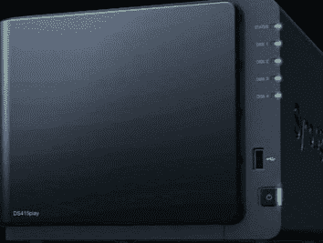

# DS415 play

四位 NAS 服务器，具备视频转码功能，确保无损品质

存储和保护电影、音乐、照片和电视节目的完美之处。

为了庆祝《上世纪量子》上映（2 月 6 日院线），群晖为您提供了一个机会赢取这套家庭娱乐系统，其中包括一台群晖 `DS415play`、48 英寸曲面 LED HD 3D 智能电视、智能 3D 蓝光播放器和回音声箱。欲获得获奖机会，请访问：


# 欢迎

# 订阅 Linux User & Developer 第 149 期

# 每期都让 Linux User 更加便宜 第 34 页

`Bob Zwetloot` 曾使用 `Python` 进行复杂的模拟研究。在他不在期间，`Rob` 在本月带来了许多新功能，包括一张艺术图表（第 30 页）、关于内核的 `L&U` 专栏以及一个新的机器人项目（第 38 页）。他离开时空无一物，只有

`Jon Masters` 是一位深耕 `Linux` 19 年的内核黑客，他最初就读于马萨诸塞州大学剑桥分校区，目前为企业级 `Linux User` 杂志工作。你可以在第 19 页看到他精彩的专栏。

欢迎阅读《Linux User & Developer》最新期，这是英国和美国最喜爱的杂志。

`Richard Sydney` 在 `WYSIWYG` 出现很久就开始使用电脑，并从数学开始。他是最高效的作家，他的专栏是开放的——`Richard` 介绍了他最喜欢的 `L&U` 生产力工具（第 30 页）。

哇，真是一个极佳的惊喜！当我们收到树莓派基金会的电话说他们新款发布时，我们非常兴奋，迫不及待想去剑桥了解更多信息。我只能说它比 `B+` 强大了六倍，并且完全向后兼容——详情请参阅第 16 页。而且由于我们知道你们非常热爱慈善，我们将把几个全新的树莓派 2 送给你们这几位可爱的朋友。

`Mihalis Toukalos` 是一位 `Linux` 系统管理员，专长 `C` 语言以外的编程、数据库和数学。他自 1993 年以来一直使用 `Linux`。在本中，`Mihalis` 讨论了 `Co-rt`，解释了如何构建自定义插件（第 36 页），并展示了如何防止（第 52 页）。

本月 `Linux` 的其他部分，我们还有许多非常实用的指南可以阅读，包括使用 `Nouveau` 加速 `NVIDIA` 专用驱动、为跟踪和 `UDP` 连接创建自定义插件、家庭和办公室最佳软件汇总、`GPU` 指南等。此外，我们还对新的 `Linux` 功能如何保护你的隐私进行了评测（请查阅第 28 页）。也值得提前翻到第 82 页，看看我们的专家 `Gareth Weaver` 对 `Keybase` 的看法，这是一种适应我们使用 `GPG` 加密方式的创新软件——它绝对值得关注。副主编 `Gavin Thomas`。

`Christian Family` 一位自 2010 年以来的软件工程师和支持人员，一直在在线和杂志上为 `Linux` 和智能手机用户撰写文章。他描述了提升 `Linux` 性能的多个步骤，在本期中，最后是对处理器进行超频（第 58 页）。

`Gareth Halifax` 一位常驻记者，报道来自开源世界各地的最新进展，从第 6 页开始。在本期中，`Gareth` 详细讲解了 `GPG` 加密领域令人兴奋的进展，这让寻找和发布公钥变得更加简单（第 92 页）。

# 与团队联系：`linuxuser@imagine-public.com`


访问我们的网站获取更多新闻、观点、教程和评测：

第 149 期

# 赢取

## 树莓派 2

# 订阅并省钱！34 页


# 内容

# 问答

# 赢取

# 介绍 MOI+ & MOI PRO

TBS 英国经销商

授权在线销商

06 新闻 | 10 观点 | 94 信函

移动

## 第一款 Ubuntu 手机登陆欧洲

### Bq 和 Canonical推出改款 Android 手机

首款搭载 `Canonical Ubuntu Touch` 操作系统的智能手机已宣布进入欧洲，由西班牙公司 `Bq` 推出，是现有 `Aquaris E4.5` 智能手机的定制变体。

虽然 `Canonical` 的 `Ubuntu` 操作系统最初作为桌面系统发布，但该公司从那时起寻求多元化。这种最初为低分辨率移动设备设计的以图标为主的界面已经过多次发布，并被分为标准 `Ubuntu`、`Ubuntu Touch` 和 `Ubuntu for Phone` 服务。

重点仍然是公司在 `Ubuntu Edge` 上的工作，这是一个此前已取消的项目手机，而现在 `Android` 手机已经实现了这一目标。该软件最初作为 `Canonical Ubuntu Edge` 工作的一部分交付的，这是一种可以连接到外部外围的极高性能运行手机。

然而，`Canonical` 在去年尝试通过众筹筹集 3200 万美元以制造该设备后，由于远未达到公司目标而已退出了。

尽管 `Canonical` 有发布计划，但在本文撰写时，设备的最终规格尚未公布。预计它们将与 `Android` 版 `Aquaris E4.5` 不同——后者具有 4.5 英寸 `IPS` 显示屏、较高的 `720p` 分辨率、支持五点电容式触控和康宁玻璃、`2GB` 内存以及由联发科生产的四核 `Cortex-A7` 和 `ARM 500MHz` 上系统的 `SoC`。

`Muñoz` 确认首次发布将在西班牙、葡萄牙、德国和法国上市，其他欧洲国家可以直接从 `Bq` 网站购买。`Ubuntu` 软件中心将提供免费和付费应用，包括热门备记软件 `Evernote` 的版本和预报服务，以及为该设备定制的天气频道。

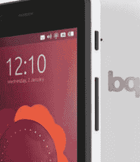


`Bq Aquaris E4.5 Ubuntu` 版计划于本月发布，定价尚未最终确定。

此前，`Ubuntu Touch` 仅限于 `Google Android` 设备的插件

Linux 社区最新动态


`Linux` 存储、文件系统和内存管理峰会汇聚了开发者、专家和维护者，共同规划存储和内存系统的未来。

`Imagination Technologies` —— `PowerVR` 移动 `GPU` 家族背后的英国公司——宣布其正在“探索”与开源社区合作的方法，而不一定是闭源驱动程序。

在 `Linux` 夏季会议之后，`Linux` 基金会旨在汇聚来自所有 `Linux` 领域的顶级开发者，并在开放的技术环境中建立联系。

自从 `imagination` 首次为 `PowerSource Dreamcast` 主机开发图形控制系统以来，该公司主要专注于具有低功耗、高性能 `GPU` 的移动领域。`PowerVR`（第 6 系列）架构经常出现在苹果、三星、瑞芯媒体和 `Intel` 等公司的 `SoC` 中。`Linux` 用户对其硬件的采用通过公司发布或支持其硬件的开源驱动程序得到了解决。然而，随着基于 `PowerVR` 的 `C20` 开发板的发布，`imagination` 表示……“我已经向管理层表达了我的所有关于驱动程序的意见，可以与开源社区合作。”我们现在正在探索方法[这并不是任何道路的终点，尽管在撰写本文时，公司对于如何实现其 的承诺尚未做出任何明确承诺]。

今年 `Intel` 承诺的 `Android` 开发者峰会将在技术环境中汇聚开发者、制造商和社区。

嵌入式 `Linux` 会将与 `Android` 开发者峰会同时举行，侧重于 `Linux`。

由 `Linus Torvalds` 创建的流行版本控制系统遭受了一个影响内核的严重漏洞。`Julio Hamano` 在官方邮件列表上发现的漏洞代表了执行任意代码的能力。“即使该问题可能也不会影响 `Windows` 上的用户，”`Hamano` 说，“如果你正在使用 `Mac OS`，由于使用了不区分大小的文件系统（如 `FAT`、`NTFS` 或 `HFS+`），该问题得到了缓解。”

最新新闻与观点


Canonical 重新关注其内部打包格式`Click`，以支持`Ubuntu Touch`。`Click`格式与其他努力不同之处在于，它直接将依赖项嵌入到包中。`Ubuntu`的每个发布版本都允许开发者创建自己的`Click`。基于`QML`的`Unity shell`将进一步推动`Click`的主流化。然而，`Canonical`表示其发布可能会任何时候停止。

`Free Code Camp`是一种旨在培训新开发者并让他们与经验丰富的配对进行项目的网络化计划，该计划已宣布转向开源。代码可访问。

### 公司目标直指车载`Linux`

`Nvidia`发布了用于`Linux`的下一代`ARM`系统上芯片`Tegra X1`，用于高性能任务。

在`Tegra K1`（分为32位和64位版本）以及基于`Tegra T25`的开发板的基础上，`Tegra X1`带来了巨大的改进。它是第一个基于其最新`Maxwell`架构的`GPU` `SoC`。64位芯片还具有通用处理核心：四个高性能`ARM` `Cortex-A57`核心和四个低功耗`Cortex-A53`芯片，带有`512KB` `L2`缓存，采用`ARM`的`big.LITTLE`配置，旨在平衡性能和功耗，目标是汽车市场。首批产品将是`Tegra PX`和`DX`——前者是用于导航和娱乐的“计算芯片”，后者是具有上述`Tegra X1`模块的基于`Linux`的板，用于车辆项目。`PX`预计将仅向`Nvidia`的汽车行业合作伙伴出售。`DX`可能会商业销售，但`Nvidia`尚未确认价格或可用性。

# 新闻

`Linux`社区最新动态

## 自由笔记本电脑`Librem 15`众筹成功

生产资金已筹集`250,000`美元

一家新公司发布了名为`Librem 15`的笔记本电脑，旨在遵循自由、开源(`FLOSS`)伦理。

这款笔记本是`Todd Weaver`创立`Purism`公司的心血，`Librem 15`声称使用了特制的硬件，能够在`Linux`内核不包含闭源和二进制大块（`binary blobs`）的情况下运行。虽然设备的某些部分（包括`CoreBoot` `BIOS`和组件）处于锁定状态，但`Weaver`表示他将“继续向上游推动”，以实现这些部分的`FLOSS`化。

电池续航时间长达八小时，并预装了由`Purism`创建并基于`Trisquel`的64位`GNU/Linux`发行版。

`Librem 15`的“早鸟”购买价格为`1,449`美元，随着众筹奖励的履行，标准价格将升至`1,899`美元。`Purism`承诺将推出13英寸的超便携版本。

撰稿时，`Purism 15`的众筹金额已超过其`250,000`美元目标`10,000`美元，还剩9天。

该系统基于四核`Intel` `i7-4770HQ`处理器，配备`Iris Pro` `Graphics 5200` `GPU`，基础配置配有`4GB`内存。此外，`Purism 15`声称内核中没有任何二进制大块。

## `Linus Torvalds`反对并行化

``

`Linus`证明了他对“并行化伪科学”并不感冒。

> 我们的24/7支持是您的安全保障

`Linus Torvalds`以他一贯的直率风格，对他所谓的“并行化伪科学”发表了了。在`Joni Osmala`的一封邮件列表评论中，他指出多核处理器的软件开发应该有所重点，并引用道：“世界的并行化正在浪费每个人的大量时间，它是常见且没有必要的。”

“存在大量的‘知识’认为并行化比（串行）处理更高效，而这整套理论完全是垃圾。没有缓存的小核心并行化，除非是为了某些非常特定的、幸运地很规则的任务，如图形处理……”

在告诉`Deming`这一点时，`Torvalds`声称“原子对于核心数量级的粗糙度是可以接受的”。然而，`Torvalds`的公开客户关注人们对当前多核架构日益增长的兴趣。多核`ARM`芯片开始对数据中心产生影响，像`Adaptiva`的`Epiphany`这样高度并行的架构采用率正在增加。

还有谁能在15分钟内给出回应？

我们为`PostgreSQL`用户提供无与伦比的24小时支持。铂级支持让您无忧。

``

``

您的`Linux`新闻与观点来源

`GCC`促进了`Linux`和其他自由操作系统的移植性。如果它可以被移植性插件访问，那么我们可能就没有`Linux`来在他原始的`386`上运行内核了；但因为它是可移植的，且`Linux`（以及`BSD`系列）可以跨处理器移植到各种架构，所以`Linux`是可移植的，因为`GCC`也是：`GCC`支持任何处理器、可以在该处理器上用`GCC`编译的代码、以及许可证的左版拷贝（`copyleft`）性质。`GCC`帮助了`Linux`和其他操作系统的移植性，如果`GCC`是模块化且可扩展的，这可能就不会发生。这是`Richard`论点的核心：`GCC`应该是务实的。

`GCC`的工作非常简单——将源代码转换为机器可理解且易于执行的格式。`GCC`通过一系列过程处理代码，前端和后端是不同的。前端将编程语言翻译成可表示的形式，后端将这些代码转换为机器码。

`Richard Stallman`写了关于艺术、音乐、数字权利和软件的文章。在一个理想的世界里（一切都是自由的）`GCC`……如果代码是透明的、模块化且可扩展的，那么开源社区的……

`Stallman`经常因其封闭性和理想主义受到批评，但人们认为这是历史。我们可能喜欢一种模块化的方法，让自由软件……如果代码是透明的、模块化且可扩展的插件……

最近，关于`GCC`的话题以及`Richard Stallman`对插件实现的抵制是由`Ellis`的论点引发的：“明确一点，防止任何程度是不可能的，而且实现那些尚未在`Linux/Unix`上实现的价值……”

`Stallman`仍然保持他的固执。因为自由软件的历史充满了……

您的`Linux`新闻与观点

随着`3.19`系列内核工作的持续进行，`Jon Masters`总结了内核社区的最新动态。

展望`3.9`版本之后并进入新的一，有趣的是，在接下来的几个月里，我们还将会有3到4个内核开发周期。从我们想听取意见的角度来说，请给我们写封信，告诉我们您在这一年计划了哪些项目，以及您希望在这些页面中看到什么。`《Linux 用户开发者（Linux User Developer）》`旨在为您提供测试和分析，在寻求帮助您学习`Linux`内部工作机制的道路上，我们乐意探讨深度的技术话题。

尽管程序员方面的工作量较少（编译器处理了大部分细节），但在未来几年里，我们可能会看到这项技术的采用日益增加。这是一好事，因为硬件功能需要多年时间才能使此类能力成为常态。现在确实是时候改进安全性了。

`Jon Masters`是一位内核黑客，他工作`Linux`已多年，从他13岁首次进入`剑桥大学`学习开始。他出生于英国和`马萨诸塞州`，目前就一家企业供应商工作，在那里负责推动引擎企业开发标准的制定。

### 滚开，该死的部件！

`Linus Torvalds`刚从`3.19`版本回归，宣布`3rc5`发布并表示：“又一周，又一个`rc`”。公告中包含了他不寻常的评论，即内核周期的开发是正常的，但在平均月份会达到`RC`（发布候选版本）阶段。`Linux 3.19`是一个正常的发布——尽管仍会有超过`10,000`次提交或补丁，其中包含许多行代码，这与年底的时间节点并不完全吻符。新内核将增加几个额外功能，包括对`Linux` `MPX`处理器扩展的支持，以及来自`almost`的新型嵌入式微处理器架构。

`Linux 3.19`最令人兴奋的特性之一是对新兴`MPX`技术的支持。内存保护扩展（`MPX`）是一种`ISA`（指令集架构）指令集，可以通过自动防御缓冲区溢出和其他漏洞来提高安全性。然而，在用户获得这种无疑会欣赏的显著安全性提升方面，`MPX`看起来并不特别“酷”。

`Rob Landelow`发布了一个补丁（删除了编译`Linux`内核对`perl`脚本的依赖）。由于内核除了编译器和汇编器外还有各种工具，但其需求通常是（稍微）轻量级的——至少在时间上），如果你不想在桌面电脑或笔记本电脑上构建全部，你可以在`树莓派`上编译内核。这种灵活性以`Rob`所看到的方式赋予了`Linux`。

我们正在引入一些新系统和寄存器，例如支持编译器（包括`GCC`），它们可以在编译期间产生代码以导致这些异常。`MPX`提供了关于程序的更多信息，例如它想要访问的内存范围，并且对现有应用程序没有影响，但新或旧代码可以重新编译以利用此功能。由于许多软件应用程序都会被重建和升级，且`MPX`可以非常容易地开启……

“滚开，该死的部件！”，我们被补丁覆盖的反馈评论似乎过于严厉，但对于它的构建要求来说是一好事（而且对于购买目的来说比`shell`免费得多）。


讨论开发对于需要 Perl 的内核开发和内核维护者活动很重要。Linux 有一个名为 `checkpatch.pl` 的脚本，它可以获取开发者提交的补丁，这些补丁需要更好的指南和社区惯例。当然，这个脚本是在内核中编写的，引发了许多笑话，建议每当遇到 Perl 警告时就对其进行修改。

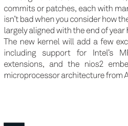

Jon Masters

Linux `3.19` 将支持 AMD `'KFD'` 内核驱动。这是其 `HSA`（异构系统架构）基础工作的一部分，旨在为在 `GPGPU` Linux 上开发提供一个完全开源的解决方案。Linux `KFD` 在与“图形”进程通信时与 Linux `DRM`（直接渲染管理器）类似，但它加载的是“内核”（专指，与 Linux 内核无关，后者可能不具备图形能力）。

Alan Cox 在跟进另一个关于维护者滥用的线程时（该线程关注如何处理在合并后前几周内提交的补丁提交）提到，那里有一个 Google 之夏项目或类似项目，由许多内核人员将 `Patchwork` 引入到一个项目中，以跟踪已发布、修订和合并的补丁，但与 Linux 内核本身相比，它远不是一个成熟的产品。

专有的……旨在为运行中的内核提供热补丁（`live patching`）。希望许多开发者能在 Linux 协作大会上见面，并制定一个协作计划，以便在 `3.20` 中实现支持。这将是游内核首次拥有这样的解决方案。

在开发 `KFD` 时，发现使用如 `r600` `OpenCL` `LLVM` 后端（基于 `clang` 的编译器）等工具将成为该作者在未来几周内一个非常有趣的项目。AMD 在他们的 `GitHub` 上提供了示例项目，包括矩阵乘法驱动程序。

作者还考虑在 Linux 中添加对 `SPCR`（串口控制重定向）`API` 表的支持。

Linus Torvalds 和许多人参与了围绕内核热补丁（`Kernel Live Patching`）方法的讨论。存在许多不同的项目（当然，还有之前的 `kpatch` 项目，它最终走向了更多……

Dan Carpenter 注意到


Linux `3.19` 将支持 AMD `'KFD'` 内核驱动。

为了构建一切

- 新：`SSD`、内存和 `CPU` 可以独立灵活，并根据您的需求进行调整
- 新：创新的用户界面简化了服务器管理
- 数据中心是欧洲最安全的之一
- 备份和快照防止数据意外丢失
- 集成防火墙保护您的服务器
- 新：具有高性能的 `SSD`
- 新：在 `1` 分钟内设置您的云服务器
- 新：私有网络、`API` 以及更多
- 新：按分钟计费
- 新：清晰的成本视图有助于高效规划
- 新：包含现成的可用应用程序：`WordPress`、`Drupal` 和 `Magenta`®
- 无限制流量


输入您的电子邮件地址开始

`0333 336 5509`

*1&1* 云服务器免费一个月，无需提供支付信息。访问 `www.1and1.co.uk` 了解完整的优惠详情、条款和条件。

# 发布……

## 树莓派 2

树莓派 2 现在已发布——我们与 Eben Upton 和 James Adams 对话，获取其开发的故事以及树莓派会的 2015 年计划

强大六倍。这是我们关于树莓派 2 听到的消息之一，仅凭这一点就让我们收拾行李前往剑桥旅行——而且，光凭这一点就足以在某个时候到达那里。但事实证明，树莓派升级了新的处理器 `BCM2836`。在 Pi Towers 了解更多信息时，我们遇到了树莓派会的传播负责人 Liz Upton，并在几分钟内向我们介绍了工程团队，环绕着原型板、连接着树莓派的 3D 打印机、电阻条和魔方块、巨大的示波器以及各种奇妙的小装置。

## 树莓派 2

Xbox 调谐器

自制的新型微计算机

它不仅仅是给孩子们的

它属于每个人

树莓派 2 已经到来

树莓派 2

`bit.ly/1CGPjUE`


## 特性

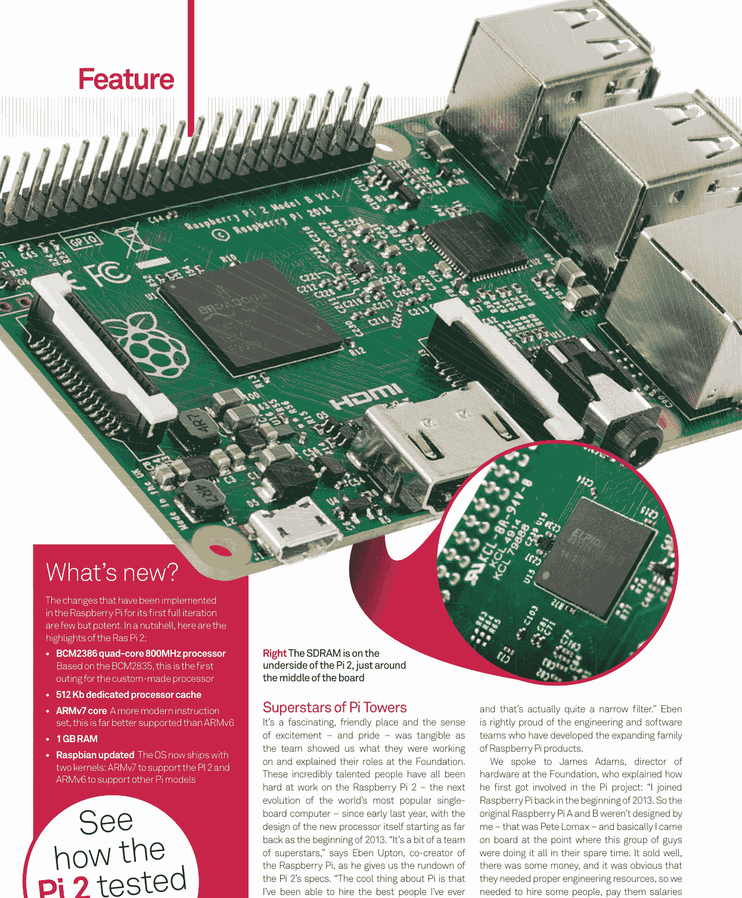

## 有什么新？

树莓派在首次完整迭代中实现的更改很少，但简而言之，树莓派 2 的亮点如下：

- `BCM2836` 四核 `800MHz` 处理器：基于 `BCM2835`，这是第一款拥有四核处理器的树莓。
- `52 KB` 专用处理器缓存：更现代的指令集，比 `ARMv6`-`ARM7` 有更好的支持以支持树莓派 2。
- `1GB` 内存
- 更新后的 `Debian` 操作系统现在带有两个内核，`ARM7` 支持树莓派 2 和其他树莓派型号。

正确的，`SDRAM` 位于树莓派 2 的底部，就在板的模块上。

“这实际上是一个非常窄的过滤器。”Eben 对开发不断扩展的树莓派产品系列的工程和软件团队感到非常自豪。

我们采访了基金会主任 James Acme，他解释了自己如何在 2013 年初首次参与树莓派项目。“我加入了最初的树莓派。A 和 B 并不是由 `Broadcom` 设计的，但当这群人在业余时间做这件事时，我已经在其中了。众周知，他们需要适当的工程资源，所以我们需要招聘一些人员，给他们薪水——正规地经营。他们他们聘用的人员之一——我很早就认识 Eben 了——我们曾一起在 Broadcom 工作过。

# 第 26 页

## 树莓派 2

再次彻底改变廉价计算


## 树莓派 2 的人们

这并非所有为我们带来树莓派 2 而努力工作的人的完整列表，这里是一些在开发中发挥了核心作用的专家及其主要关注领域：


上面的树莓派塔拥有着一些非常友好的面孔。并用树莓派固定一些咖啡容器。

> 我们采用了旧的 `2835` 芯片，并将其应用于四核 `ARM7` 中。


而且我们完成了从芯片设计到电路设计的许多工作，实际上我们还处理了树莓派中的视频编码、`3D` 图形。由于我设计了 `B+`、`A+`、模块和树莓派 2，我们希望整个产品是端到端、更一致的。并尝试解决我们在树莓派上遇到的一些问题。

到此。根据 James 的说法，这是因为在树莓派 2 中，处理器稍大，并且没有堆叠在它上面的 `DRAM`，所以背面需要留出空间。

这是放弃在树莓派+ 以及原始型号 A 和 B 中使用的封装设计 (`PoP`) 的决定。在树莓派 Zero 中，是将两个或多个封装堆叠在一起——处理器和 `SoC` 以及它们之间路由信号的接口。James 说，这仅仅是因为之前卖给客户的就是那样。

基金会一直在 `raspberry.org` 上，我们收到了关于人们对什么满意、需要什么以及什么与众不同的反馈。他们做出的会产生影响的决策。例如，他们知道他们想要拥有四个 `USB` 端口，由于我们反正要形成新的规格，所以我们询问了 James 关于设计 Model B+ 的决定，以便旧芯片可以放置到新板上。他揭露，他在设计 `B+` 时也考虑了树莓派 2。如果你看 `B+`，板的底部不像树莓派 2 靠近 `USB` 端口处那样密集，但在 `LAN` 接口处，而在 Model B 上它几乎在末端。

这是最好的解决方案——你不仅仅是把芯片粘在一起，两个芯片之间有足够的空间，而永远不会触碰。这意味着你不需要在板上布线，因为……。为什么要改变？“树莓派 2 的诞生是因为我们采用了旧的 `2835` 芯片，采用了 `ARM6` 核心，并将其放入带有更多 ARM 功能的四核 `ARM7` 中，这是复杂的。而且芯片变大了，所以无法妥善地放入 `PoP` 封装中。我们想这样做，但旧的 `2835` 芯片并不合适。”


- James Acme
- Dave
- Eben
- Paul
- Chris
- Ross
- Eric
- Phil
- Simon

# 特写

> 我们采用了旧的 `2835` 芯片，并将其应用于四核 `ARM7` 中。


当我们调查最近关于树莓派塔（Pi Towers）的科技时，我们了解到了一些正在开发中的产品——其中包括树莓派模块。我们发现其中一种是为 `MIPI` 接口器设计的，这样适配板就可以安装在树莓派下方，将屏幕放置在适配板上方，你就可以将整个套设备放入外壳或其他项目中。

我们已经注意到 `MIPI` 接口器有一段时间了。“这些接口器每个成本只需要几便士——如果生产 `450` 万个，它们就免费了。有了这个接口器并使用它，我们有了极大的动力去这样做。”


树莓派模块自然而也会是市面上最好的显示器之一。“它是一个宽屏`VGA`，分辨率为`800x480`，而且视角非常好。廉价显示器的问题之一是，你可以通过旋转或调整平板电脑来获得最佳视角，但如果你有的是那种设备，你就无法控制视角了。因此，你需要一个具有良好视角的设备。”

我们也从正面听过关于它的消息。我们实际上正准备好第一批适配板产品——这样在`Pi 2`产品到达之前……


我们还确认了树莓派 2 将完全兼容，并用于你已经设置好的现有项目中：“你需要一个`v7`内核，足够了，”`Ellis`解释道，“对于提前三个或四个月的`2836`，你甚至不需要为了发布新的操作系统。”（我们对此挑起了眉毛）“使用`B`版本的内核，可以仅将其放入固件中——它最近一直在运行。它实际上与内核配合得很好，完全可以毫无问题地获取，无论速度多快，它就那样呆在那儿。”

与其让内核去适应操作系统，使用两个`v7`内核，启动`Raspian`会检测检测使用的是`Pi 2`还是旧款树莓派，然后运行相应的内核——这意味着我们不需要两个版本的`Raspian`来适应`Pi 2`及其前代产品的不同需求。除了这些之外，`Ellis`告诉我们应该注意到`Raspian`设计上的一个真正改进：“所有开源软件包对所有用户都是兼容的，将旧配置留存在配置文件中，可以在不进行任何配置的情况下进行切换。这真的关乎于移除某些内容——并让运行得更加一致。你窗口框的高度是匹配的——表单颜色保持相同。线条涵盖了你输入的所有细节，这就是为什么随着工程师数量的增加，我们能够做到。”

随着`Raspian`获得进一步抛光以匹配其升级，且`Pi 2`将平滑地取代`Model B+`，我们想

## 树莓派 2

再次彻底改变性价比计算

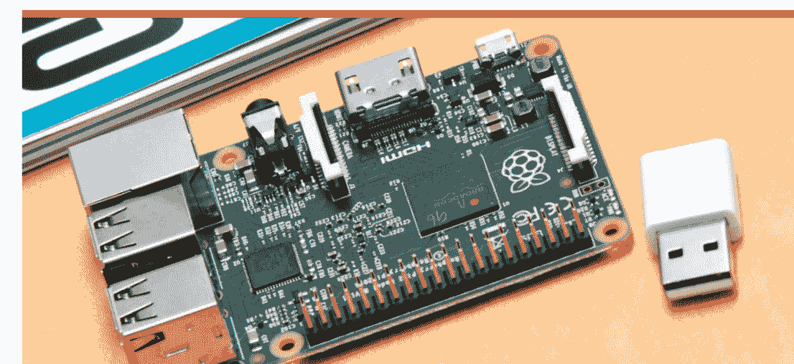

## 树莓派是孩子们可以拥有的设备

当我们询问在树莓派 2 的设计过程中是否考虑过板载`Wi-Fi`时，`Eben Upton`迅速回答说没有通过廉价`Wi-Fi`适配接器的方式包含基金会的产品。

所以问题在于，我认为我无法做到四核性能——特别是把四核和四分之一的内存放在一起，我们可能至少需要放入树莓派 3 的半部分性能才能获得一些改进。根据`Eben`的说法，问题是“当我们甚至连……都无法获得时，为什么还需要板载`Wi-Fi`呢？”

上面的树莓派已经几乎演变成了它的最终形式——`Eben`说，很难在上面再放入其他东西了

# 我们仍然想要桌面系统。`Linus`想要桌面系统，我们也想要帮助他实现


给大量的人。我们是应该扩大组织规模吗？还是想出某种特许经营模式，即建立一个抽象层并教人们如何交付更好的产品的系统？但这样做有什么意义呢？那么在目前的规模下，当老师们出去并获得他们的“树莓派认证教育者”勋章时，这是有意义的。因为如果你有这么多理解它的人，他们就可以去成为倡导者。

随着树莓派等计划的增长，以及英国教育系统因新型`IT`兴起而发生的变化，未来看起来非常乐观。在不久后，我们曾与`Eben`讨论如何奖励她。几年后，当在学校里编写树莓派代码的孩子将开始进入学院和大学，并开始让计算机科学的人数回升。显然，我们甚至不需要说这一点：“矿井里的金丝雀就是应用本身”。

“在那次风波之后，`2009`年就像一场狂欢，”`Eben`说，“我们有七八百人。很棒的一点是，实际上有很多机构跑来说：‘树莓派出问题了！’。许多机构在同一时间、同一时间段意识到了这一点，它们并不是在相互竞争，而是在做同一件事的不同侧面。所以在我学院的面试中，当我担任院长时

上面的内容我们漏掉了采访部分，当时`Eben`停了几分钟来阅读我们对`CubieBoard`的评测

而且我们正在面试这些人，对于三年的教职，我们有六位可靠的申请者——在同一所学院，我的学院，就在十年前——又是如此。在有`42`名申请者的情况下，我们得到了几个不错的，我们需要庞大的行政工作来处理，并说：‘看，我们选这个或者那个。’但是，我当时在和我的朋友聊天，他说，我说：“那不是我做这件事的同一一天！’

这是一个令人惊叹的反应，树莓派基金会正处于完全完成其使命的途中。`Eben`认为她的野心并没有停止：‘我们仍然想要桌面系统，但让它进入每个家庭的唯一方法就是让读取器变得非常廉价。’‘当我们把每一个老旧设备都换成一个强大的小设备后，我们将是第一个。我们不能


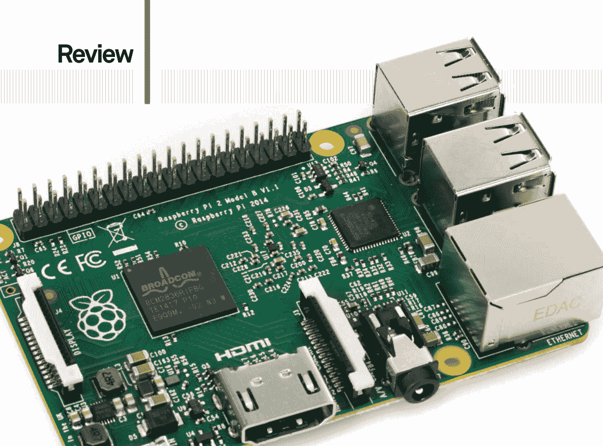

## 微型电脑

- 优点

它具有向后兼容性，尺寸相同，且在使用时比原始`Pi`强大得多。

今年最大的惊喜是自`Arduino`以来最伟大的教育和爱好工具的真正第二次迭代。

我们老实说，当树莓派 2 在 1 月份放在我们的桌子上时，我们非常兴奋能拆开并尝试一下。

然而，坦率说，这是一件很棒。。树莓派基金会的任务一直是教育，已经为树莓派准备了大量优秀的教程和软件，让`Pi 2`变得完全不同会让过去三年的工作付诸东流。

- 缺点

某些操作系统在追赶新改进的架构方面可能会有些吃力。

根据我们听到的消息，这基本上是基础性的：每个人都想要的树莓派，至少在性能方面。这有点像是一个“得到就能享受”的时刻，因为当我们连接上这块本质上是`Model B+`的板并开始使用一系列工具时。

在我们讨论这个之前，让我们先为树莓派 2 的变化提供一些背景。正如我们所说的，而且从照片中也可以看到的，它看起来和树莓派`Model B+`一模一样。在对树莓派基金会`Eben Sharp`的采访中，提到`B+`的重新设计是为了为`Pi 2`提供便利。这是一个原始版本好得多的版本，它的运行非常完美。

| 特性 | 规格 |
| :--- | :--- |
| **处理器** | `Broadcom BCM2836` 四核`ARM @900 MHz` |
| **图形处理器** | `Broadcom VideoCore IV` |
| **内存** | `1GB LPD` |
| **尺寸** | `56 x 56 mm` |
| **I/O** | `4x USB 2.0`, `以太网 10/100`, `HDMI`, `音频接口`，`摄像头模块`，`显示输出`，`microSD 卡` |
| **电源** | `2A microUSB` |
| **价格** | `£25` |

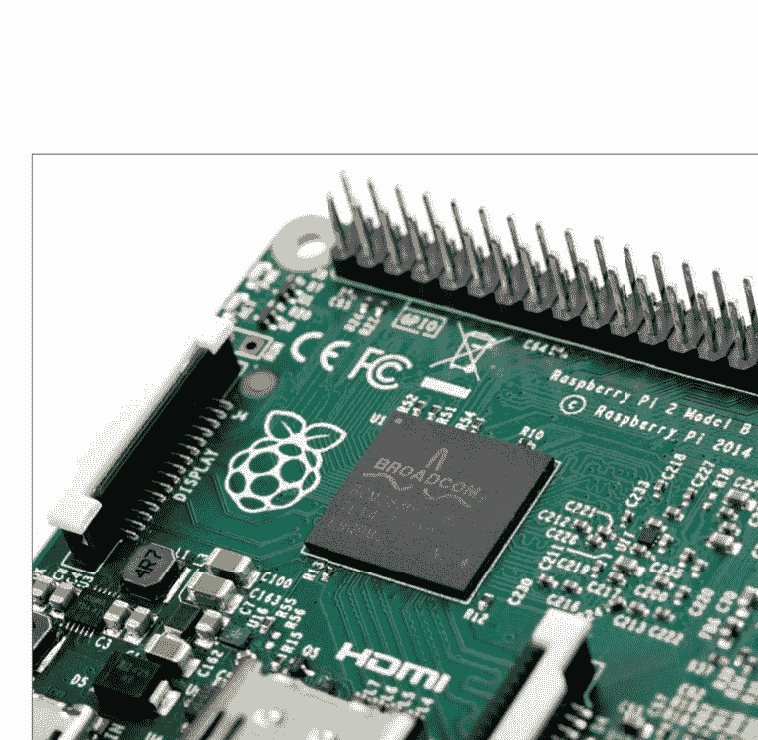

### 树莓派 2 Model B

今年最大的惊喜是自`Arduino`以来最伟大的教育和爱好工具的真正第二次迭代。

我们老实说，当树莓派 2 在 1 月份放在我们的桌子上时，我们非常兴奋能拆开并尝试一下。

然而，坦率说，这是一件很棒。。树莓派基金会的任务一直是教育，已经为树莓派准备了大量优秀的教程和软件，让`Pi 2`变得完全不同会让过去三年的工作付诸东流。

某些操作系统在追赶新改进的架构方面可能会有些吃力。

根据我们听到的消息，这基本上是基础性的：每个人都想要的树莓派，至少在性能方面。这有点像是一个“得到就能享受”的时刻，因为当我们连接上这块本质上是`Model B+`的板并开始使用一系列工具时。

在我们讨论这个之前，让我们先为树莓派 2 的变化提供一些背景。正如我们所说的，而且从照片中也可以看到的，它看起来和树莓派`Model B+`一模一样。在对树莓派基金会`Eben Sharp`的采访中，提到`B+`的重新设计是为了为`Pi 2`提供便利。这是一个原始版本好得多的版本，它的运行非常完美。

树莓派的第一次真正迭代带来了与其他设备的兼容性。对于这个价格，它比竞争对手好得多。

根据`Eben`的说法，`BCM2836`四核拥有足够的性能。在负载下，四核的使用使得多任务处理更加流畅。这证明是可能的。


更多信息

我们查看了一些问题，以及帮助你的电脑免受攻击和其他在线威胁的许多方法。只是开始。现在你应该变得成熟，使用加密工具进行在线通信，并开始感到安全。如果你错过了这些功能，可以从我们的网站获取。

为系统和网络建立坚实的防御

创建一个无一不破的密码是保护一切的第一步

保持任何事物安全最重要的步骤之一是创建一个难以破解的强力密码。虽然电影里会告诉你，黑客只需要环顾你的办公室就能猜出你的密码（“是他儿子的名字”），但最常见的密码破解方法是对服务器和用户名进行暴力破解。在暴力攻击下，成千上万的字典单词和热门密码列表会很快发现某个密码非常容易破解。取决于破解速度和带宽，成功破解密码所需的小小时和天数总在缩短。使用简单的字母数字组合密码变得越来越有效。让我们从一个密码开始并对其进行修改——一个非字典单词，且长度适中。凭空想出一个，我们得到了：

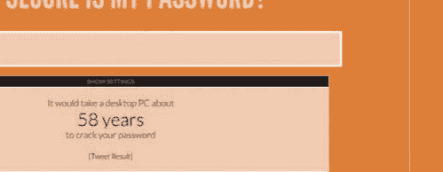

`password`


长度：20 个字符

字符类型：字符

特殊字符：无

可能的组合：组合

使用的强度

你会有几个网站用来检查，但请确保使用类似的策略。

破解时间：15 小时

进步了一些！密码立即变得更安全了，而且15 小时仍然并不长。我们可以通过在组合中加入易记的字符来做得更好。

### `Dw@nton12`

`Dw@nton12`

- 八个字符，字母、数字和符号混合

破解时间：275 天

这已经很长了，但对于合格的破解者来说只是双倍时间。添加一个符号、字母或数字将将其寿命延长到 58 年。对于某个想要尝试破解你的密码而不放弃或简化的人来说，58 年是一个非常长的时间。它也是一个优秀的初始策略密码的示例。

破解时间：3 天

两天太短了。如果你经常在线，大多数网站要求至少八个字符、一个字母和一个数字。这极大地缩短了密码长度。基础的修改可以是：

- 使用大写字母、数字和特殊字符

- 每九个月重置一次在线密码

- 使用长度至少九个字符

- 使用字典单词

- 使用短语

- 使用个人信息

- 使用如两位位生日之类的数字

- 在到处使用同一个密码

- 将它们写下来

- 让它们太复杂

`dwanton1`

-- 七个字符，小写字母

`Dwanton1`

-- 八个字符，大小写字母数字混合

使用简单的字母数字组合正变得越来越不安全。

我们说，尽管这是一个优秀的密码，你也应该避免在你的每个账户上使用它。给别人提供密码列表，如果他们已经知道了密码是什么，无论你的密码需要多久才能暴力破解就不重要了。如果你听到泄露消息，请立即更改密码。

有效利用在线密码和其他安全措施

现在我们有了一个基础密码，是时候开始在线实施它了。安全专家说，你应该为每个账户使用不同的密码。某些服务提供了一种方便的方法，可以使用真正唯一的密码来实现，但你可能不习惯记住这么多密码；在不记录这些密码的情况下你绝对不应该这样做，我们建议是在你使用的网站上修改你的密码。

例如，以 `Amazon` 为例。如果信用卡保护账户至关重要。在 `'Beartion'` 之后我们有三个字符可以操作，所以我们可以为 `Amazon` 更改它们。取你名字中间的三个字母（`Amazon` 作为一个列表，我们选择 `'mam'`，并反转后三个）。现在将它插入你的密码中：

`Dwzan*n12*`

这仍然具有很高的安全性，但它将会有所不同，例如 `eBay` (`Dwzan*n12*`) 或 `GitHub` (`Dwzan*n12*`)，这显然是为了防止密码破解。如果你使用带有双重身份验证的网站，你会与其他网站和账户一起收到一个一次性代码。聪明的人可能保留代码是正确的，但如果你可以在轻松修改密码的同时仍让自己记忆住它。

安全与隐私

上一次我们发布了如何保持密码的私密性。由于我们了解到某些攻击，破解者可以使用手机设备进行信任和社交操纵技巧来欺骗你，获取他们从社交账户中收集的任何信息。隐私的安全-


你需要的最后一个密码

存储密码的安全且可靠的方法


我们实施了 `AES` `256` 位加密和解密。这是目前已知保护你存储的数据的最强方法。

## 仅本地解密

所有敏感数据仅在你的设备上进行加密和解密。密钥永远不会离开设备，且不共享。你的数据保持安全。

今天就保护你的账户吗？添加第二次登录，你就在保护你的账户——保持信息私密。


下面的 `Lastpass` 密码管理器相信，在 `Facebook` 等平台上监控你的隐私设置至关重要

- 隐私设置（谁能看到你的资料？）

- 登录（设备和时间）

- 通知

- 搜索（谁能找到你？）

- 广告（谁在跟踪你？）

- 账户（删除你的账户）

- 可移植性（下载你的数据）

| 隐私设置 | `Facebook` | `Twitter` |

|---|---|---|

| 谁能看到你的资料？ | 全部 | 公开 | 编辑 |

| 设备和登录时间 | 全部 | 公开 | 编辑 |

| 谁能联系你？ | 朋友 | 公开 | 编辑 |

| 谁能找到你？ | 朋友 | 公开 | 编辑 |

| 谁在跟踪你？ | 全部 | 否 | 编辑 |

| 删除你的账户 | 全部 | 否 | 编辑 |

除非为了安全并保持账户私密，否则共享它起不起作用。对于工作和账户，请使用不同的地址。最后，你永远不要在社交媒体上使用真实姓名，基于伪假名的建议可以帮助你远离恶意行为并最近查看设置。通过移除你不使用的项目来确保没有泄露。最重要的是，保持你的电子邮件地址秘密：


特性

保护你的本地网络免受入侵入侵

| `TCF ROUTER` | `OpenWrt` `Build` `10.0` | `Load`: `0.15` `0.01` | `Auto Refresh`: |

|---|---|---|---|

| `Status` | `System` | `Network` | `登录` |

| `Internet` | `MAC` 地址: `00:14:E7:E8:70:78` | `连接` | `删除` |

| `WAR` | `LAN` | `DHCP` 和 `DNS` | `主机名` | `诊断` |

| `GLAN` | `IP`: `192.168.1.1` | `连接` | `删除` |

| | `TX`: `1.32 GB` (`105928` 点) | | |

| | `RX`: `1.27 GB` (`895953` 点) | | |

| `eth0.2` | | | |

| `LAN` | `IP`: `192.168.2.1` | `连接` | `删除` |

| | `TX`: `1.55 GB` (`938853` 点) | | |

| | `RX`: `1.27 GB` (`897557` 点) | | |

| `WAN` | `IP`: `10.0.0.176` | `连接` | `删除` |

| | `TX`: `0.86 GB` (`600000` 点) | | |

| | `RX`: `4.20 GB` (`423629` 点) | | |

接口概览

取决于你的使用方式，以下工具可能是多余的，路由器系统设置可以大大提高你的网络安全

- 添加新接口

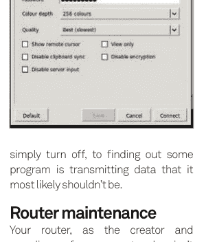

由 `Luci` `10.0` 版本支持 (`10.0`)

只需确保访问强密码。对于在网络上共享音乐之类的 `Samba` 共享，如果你不需要，可以将其关闭。关于你可能如何与网络上的设备交互，有很多思考可以帮助你

现在你已经保护了网络，看起来是时候查看你实际的物理 `PC`、笔记本电脑或设备了。在网络中有设备是一回事，但如果你能看到数据包在往返，你就可以判断它们在做什么。开始很重要，但保护你的网络免受许多已知问题的影响也至关重要，除非你正在平衡 `ISP` 提供的便利性和安全性。

你的路由器带有一些可能不太好的设置。如果你在网络或其周围有一个自定义服务器，可能会有一个更好的——一个你使用过的、且对保护你的网络有巨大帮助的。

当你了解了自己的网络后，下一步是什么？网络安全分析中最好的工具之一是 `Wireshark`，或者更具体地说

你可以通过使用 `iptables` 来阻塞网络上的任何可用流量，并设置自定义规则来访问服务器、自定义端口转发以等待其他等。

## 网络监控

单一地找出那些可能不应该传输的数据。

## 路由器维护

作为网络的创建者、安全守护者，路由器对攻击同样不是免疫的。除了更新可能修复漏洞的每日补丁外，你应该尽可能定期更新路由器的固件。

如果你愿意，你还可以更改默认 `IP` 地址和范围。如果你使用许多连接设备，你就可以阻止常见的 `192.168.1.1` 默认网络地址，或使用针对你目标的其他区块。

# 离线安全 保护你的桌面和其他离线设备免受窥探之苦

在线安全和防止网络攻击的保护对于大多数人来说是很好的威慑，但除非有人在你的电脑周围窥探，否则你的访问点同样脆弱。

`Linux` 发行版通常比其他操作系统更安全，但它们对病毒并非免疫。在安全方面，键盘记录器和其他软件可能是一个大问题——如果有人知道了你的密码。一个最长 12 位的无意义密码也可以被轻易地复制并粘贴到密码框中。

作为基础的安全措施，加密你的账户会让破解此密码变得稍微困难，但仍然可行。请权衡你自己的便利性，制定一个符合你需求的密码，但要使用强模式来确保你的信息安全。

`root` 密码不应与普通用户密码相同。在 `Linux` 中，你应该为 `root` 账户设置一个完全独立的密码（在终端中），这将允许你更新和更改当前的 `root` 密码。

某些系统还允许你通过 `sudo` 授予访问权限，使用用户权限进入 `root`。那么，修改你所管理的所有系统上的 `sudo` 可能更好，特别是对于这种用场景。


对于 `ClamAV` 来说，`Linux` 上没有真正的恶意软件程序，你能做的最好的事情就是保持警惕。经常检查你的日志和运行的服务，以确保没有安装任何恶意程序。


拥有良好的密码后，你可以以更高的权限挂载驱动器或文件夹来访问你的文件。以确保安全地存储敏感数据，即使电脑被攻破，只有你能访问文件，除非使用`Encrypt`，否则永远无法恢复。`Encrypt`非常简单，所以安装它并没有什么问题。

选择一个文件以：

- (无)

查看或删除结果

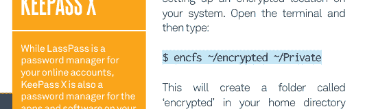

> 上述`ClamAV`是你在防恶意软件方面能找到的内容

完成后，你就可以在系统上设置加密位置了。打开终端并输入：

## KEEPPASS

虽然`LessPass`对你的账户很有用，但请为系统上的应用和软件使用免费密码管理器。`KeepPass`很好用，因为它还允许你使用用户名、附件和剪贴板项目加密文件。这是一个你只有拥有权限时才能访问的数据库，因为它是加密的。在处于 Alpha 阶段时，许多 Linux 用户已经对其系统和工作流的质量非常满意。

## $ encfs - /private

这将在你的目录下创建一个`'encrypted'`文件夹，其中包含所有文件，然后是另一个挂载后即可访问的`'private'`文件夹。处理得到的这部分内容对大多数人来说已经足够了。现在，当`KeepPass`卸载时，你无法直接从`encrypted`文件夹访问加密文件。当卸载后，文件将再次变为加密；记得在之后卸载。

| 数据库条目 | 查看 | 编辑 | 帮助 |
| :--- | :--- | :--- | :--- |
| 网页账户 | `+` | `-` | 编辑 |
| 高级 | | | |
| 账户 | | | |
| 类型 | | | |
| URL | | | |
| 代理 | | | |

URL: `*********`
用户名: `*********`
密码: `*********`
长度: `8`
字符类型:

[ ] 包含所有字符
[x] 知道密码包含某组

接受

URL: `https://www.linuxuser.com/multi/pass/1863/mfvfedaamountpoints28encmx1`

32 `www.linuxuser.org`

# Linux 全安全

在系统和网络上保持坚固的防御

## 特性

## 安全资源

关注安全问题，并学习更多保护账户安全的方法。

## 隐私修复：privacyfix.com

正如我们在文章早些时候提到的防御暴力破解攻击只是保持安全的唯一方法之一。黑客和破解者还可能通过电话或电子邮件进行社交操纵，从银行和账户支持团队处获取信息。通过保留更多的私有信息，你可以显著降低这种风险。

`Privacy Fix`帮助你监控设备、社交账户，确定人们可以看到什么以及他们看到这些有多容易。它允许你修补账户漏洞并收紧你的隐私和安全。

这些应用程序适用于多个平台，如果需要立即更改某些，你可以通过移动设备随时控制这些问题。它涵盖了`Twitter`、`Facebook`、`Google+`、`LinkedIn`等许多账户类型。

## 隐私，简化


免费获取`AVG PrivacyFix`

一个用于`Facebook`、`LinkedIn`和`Google`隐私的仪表。阻止超过 1200 个跟踪器。

## Linux 安全：linuxux.com

`Linux Security`是与 Linux 安全相关的新闻聚合网站。它不仅涵盖了漏洞、安全软件漏洞以及桌面和服务器安全问题，还涵盖了安全思考和最新动态。


跟进安全领域的相关问题可以让你保持领先，并让你在威胁变得可行之前锁定防御。这并不是每个人都绝对必要的，尽管只要对保持安全稍有兴趣，保持警惕也是好处的。

网站上还有其他资源，例如针对一些晦涩术语的安全词汇表，以及任何人都可以使用的通用安全提示。

# Random.org:random.org/

想出一个密码短语可能是困难的。虽然我们在本期中提供了示例，但请不要使用它。如果你在想自己的短语时遇到困难，并且想要随机……


# 通过提高知识实现稳定


我们优秀的课程提供深度培训。100% 的客户对`PostgreSQL`培训计划评为优秀。立即预留你的位置。

使用`GIMP`内置工具

修复常见的摄影问题

例如红眼

学习如何去除细微瑕疵

以及项链等非必要物品

以提高整体照片质量

使用色彩控制和锐化

平滑并提亮皮肤，

让照片更加生动

`RS27370_image.jpg`

`RS27370_image.jpg-1.0 (RGB 颜色, 1 层) 1024x960 - GIMP`


## 使用 GIMP 修饰照片

顾问

`Rob Zwetsels`

复杂系统专家，也是精通`Python`

和`PHP`的 Web 开发者。他热爱尝试计算技术。

### 学习如何使用开源软件进行专业的照片增强

## 资源

`GIMP: gimp.org/downloads`

爱好摄影从未如此流行，这很大程度上归功于高保真单反相机、

优秀的傻瓜相机以及智能手机的普及。在过去的几年里，数字照片最终取代了胶片相机，获取一张照片比以前冲洗照片要容易得多。

随着数字照片而来的是数字

处理软件，例如`GIMP`，它能让你快速地对照片

进行专业风格的修饰和增强，从而真正展现

色调和光影，修复任何红眼，并控制

色温等。

虽然`Photoshop`可能是一个极其

强大的编辑工具，但`GIMP`在该领域绝毫不逊色。

它几乎拥有你在`Photoshop`中可以获得的每一个功能，甚至某些功能还更好，对于为你的任何照片创建出佳效果来说绝对绰绰有余。

36 `www.linuxux.co.uk`

## 使用 GIMP 修饰照片

使用开源软件进行专业的照片增强

教程


### 01 安装 GIMP

许多 Linux 发行版默认已安装了`GIMP`，因此首先可以在菜单中搜索“图形”部分来查找它。否则，你可以在软件管理器中搜索`GIMP`进行安装。如果其他方法都失败了，请访问我们的网站下载安装程序。

### 02 处理 RAW 照片

某些相机允许你直接处理`JPEG`文件，但另一些相机会提供`RAW`文件，你可以对光照水平和其他相机参数进行编辑。`GIMP`可以处理`RAW`，但你可能还需要像`URAW`软件来导入它们。

### 03 裁剪图像

并不是每张图片都必须，但如果你不是按照三分法拍摄的，可以看看照片在某个角度是否看起来更好。点击矩形选择工具并查看“三分法引导线”。

### 04 使用三分法

三分法用于调整图像的位置，使照片的某些部分占据画面的三分之一。这有助于让你的照片看起来更具动感，并将注意力引向你想要强调的特定特征。

### 05 去除红眼

调整色阶以消除尽可能多的红色，而不改变整张照片。你可以刷新选择区域以放大或缩小以获得更好的结果。同时处理双眼睛会有帮助。

### 06 控制红眼色阶

### 07 改变高光和阴影

照片在不同水平上有一系列颜色，从较高的高光到较暗阴影。你可以使用直方图在 255 点刻度上找到并设置这些：0 是最暗，255 是最亮。

### 08 调整整体范围

在这里你可以看到直方图没有覆盖整个图表。一个快速修复且能提高图像质量的方法是拖动滑块直到直方图展开。在这种情况下，它会让照片稍微暗一点，但能更好地提取细节。


37 `www.linuxux.co.uk`

## 教程


## 09 添加自动色阶

有一些自动工具可以为你对照片进行基础修正，对于某些人来说，这就是你增强照片所需的一切。但有时，你可能希望进行更细致的色阶编辑以确保最高质量。

## 使用橡皮擦去除皮肤上的红色区域

### 11 修正皮肤瑕疵

关于业界使用气喷刷让模特变得完美的问题存在着很大争议。在《Linux 用户与开发者》杂志中，我们没有能力去辩论这一点，但我们认为如果你需要，查看如何遮盖零星的皮肤是有用的。

### 13 设置图像

拿起修复工具并放大照片。选择一块触碰或靠近瑕疵的皮肤——根据需要根据照片和瑕疵的大小更改画刷大小。在点击前按住`Ctrl`键。此选择将随你的涂涂移动，以改变修复工具的效果。

## 10 改变颜色


虽然 `Photoshop` 可能是一个极其强大的编辑工具，但 `GIMP` 在该领域绝毫不逊色。它几乎拥有你在 `Photoshop` 中可以获得的每一个功能，甚至某些功能还更好，对于为你的任何照片创建出佳效果来说绝对绰绰有余。

在色阶编辑器中找到通道。使用选择让照片稍微暗一点或暖一点。

## 12 设置图像

使用修复工具，

## 14 去除斑斑和雀点

拿起修复工具并放大照片。选择一块触碰或靠近瑕疵的皮肤——根据需要根据照片和瑕疵的大小更改画刷大小。在点击前按住 `Ctrl` 键。此选择将随你的涂涂移动，以改变修复工具的效果。

## 15 清理

使用修复工具，

## 16 增强细节

使用锐化掩罩，

## 17 使用快速掩罩

使用快速掩罩，

## 18 准备工作

使用修复工具，

## 19 高斯模糊

高斯模糊，

## 20 美好的照片

通过一些练习，你可以让任何照片看起来更好。

# 加速文件管理

`Midnight Commander` 为每项任务提供了快捷键

## 教程

### 01 进入你的发行版

`MC` 会包含在发行版的包中（`Ubuntu LTS` 为 `4.8.11`）。如果需要最新版本，可以通过以下获取获取：

```
git clone git://github.com/MidnightCommander/mc
```

编译过程简单，但你可以使用发行版版本来跟随本文学习。

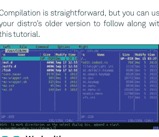

### 009 Shell 切换

| 左侧 | 文件 | 命令 | 选项 | 右侧 |
|---|---|---|---|---|
| 文件列表 | 大小 | 修改 | 用户 | `(~)/home/lib/fish/` |
| Shell 信息 | `C-x` | `4096 2020 Sep 18 12:44` | `r` | 名字 |
| `C-x` | `4096 2020 Sep 18 12:43` | `r` | `REIME` | |
| | `4096 2020 Sep 18 22:37` | `r` | `512 root` | |
| | `4096 2020 Sep 18 22:36` | `r` | `.cloud` | |
| | `4096 2020 Sep 18 22:35` | `r` | `.fasth` | |
| | `4096 2020 Sep 18 22:34` | `r` | `.bashrc` | |
| | `4096 2020 Sep 18 22:33` | `r` | `.bashhistory` | |
| | `4096 2020 Sep 18 22:32` | `r` | `.config` | |
| | `4096 2020 Sep 18 22:31` | `r` | `.dev` | |
| | `4096 2020 Sep 18 22:30` | `r` | `.dir` | |

列出模式、排序顺序、编码...,n`FTP` 链接、`Shell` 链接，

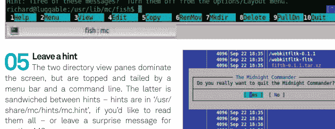

### 02 操作面板

使用打开 命令时，`MC` 的两个主面板中可以使用带有 `MC` 的目录：

```
mc /usr/local/bin /etc
```

如果没有目录，`MC` 会在当前窗口显示两个面板。提供单个目录作为参数将在左侧打开该目录。

### 03 目录导航

使用方向键可以在目录之间跳转，按 `Tab` 键可以在两个面板之间切换。导航到子目录后，按 `Enter` 键打开该目录。

| 文件 | 选项 | 右侧 | 大小 | 类型 |
|---|---|---|---|---|
| 上 | `2020 Sep 18 16:24` | | | |
| `/process` | | | | |
| `(x) 使用 shell 文件` | | | | |
| `删除 2 个文件` | | | | |
| | | | | |

### 04 检查你的屏幕

如果你的屏幕看起来像上面，说明你使用的字体对多字节字符有问题（这是 `mvrt` 的！如果简单更改 `LANG` 变量和终端可能会引起其他问题，至少对于 `MC` 来说：

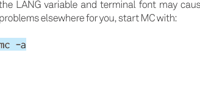

### 05 使用左侧面板

两个视图面板是固定的，顶部带有菜单栏和命令行。该行位于它们之间 - 位于 `~/.mcrc` 中。如果你想链接一个目录，按 `Ctrl-x`，或者给其他用户留个惊喜。

### 06 使用菜单

可以通过菜单（在 `GFP` 的虚拟控制台上）访问菜单、文件列表及所有内容。要选择文件，按 `Insert` 键，高亮它以便对多个文件或目录进行操作。

### 08 替换丢失的按键

在某些连接上使用 `MC` 时，无法访问 `F` 键。然而，`Escape` 映射到 `F1`，`Esc0` 将映射到 `F10`。如果你的终端使用 `F10` 作为其下拉菜单（例如），`Escape` 将退出 `MC`。

### 009 Shell 切换

我们可以使用 `F8` 删除在步骤 7 中创建的副本，但在每次 `rm` 操作中，如果你想回到环境以熟悉 `rm`，`Ctrl-o` 会让你离开并在完成后带你回到 `MC`。

### 07 利用快捷键

底部列列出的 `F` 键快捷键是 `MC` 的真正威力。通过复制进行 `Shell` 操作：选择一个文件（或多个文件）并按 `F5` 打开此对话框，可以使用 `Tab` 或方向键进行导航，或使用空格键切换选项。


41 `www.linuxuser.com`

## 教程

| 文件 | 编辑 | 视图 | 书签 | 设置 | 帮助 |
|---|---|---|---|---|---|
| 新建 | | 命令 | 选项 | | |
| 打开 | 目录树 | `F2` | | | |
| 关闭 | 弹出窗口 | | | | `大小 0 日期 11月16日 12:44` |
| 保存 | 换行开启/关闭 | | | | `fltk-0.1 11月16日 10` |
| 另存为 | 比较目录 | | | | `fltk-1.1 11月16日 25` |
| 打印 | | | | | `fltk-1.3 11月16日 23` |
| 退出 | | | | | `fltk-master.zip 11月16日 07` |
| 搜索 | 命令历史 | | | | `git-core.gz 11月16日 22` |
| 查找 | | | | | `libpng-dev.zip 11月16日 35` |
| 替换 | 后台作业 | | | | `webminit-master.zip 11月16日 12` |
| 转到 | | | | | `webminit-fltk.zip 11月16日 58` |
| 切切 | 显示目录大小 | | | | `test.zip 11月16日 08` |
| 复制 | | | | | `4096 11月16日 24` |
| 粘贴 | | | | | `45637 11月16日 30` |
| 删除 | | | | | `32768 11月16日 32` |
| 撤销 | | | | | `22528 11月16日 36` |
| 重做 | 编辑版本文件 | | | | `45634 11月16日 10` |
| 过滤 | 编辑高亮文件 | | | | `156800 11月16日 23 00` |


文本内置的；检查下面的 `FTP` 链接 `example.com/downloads/useful` 和快速查看文件 - 文本界面，不是查看。它还有默认查看选项（如排序顺序）和对远程文件的访问。

## `MC` 在 90 年代已经是一个强大且实用的工具

### 获取内部

`MC` 的部分功能与虚拟文件系统 (`VFS`) 一工作；以及 `tar` 和所有常见格式如 `zip`, `bz2`, `xz` - `MC` 可以处理 `.deb` 和 `RPM` 文件，让你编辑和移动文件。

### 搜索菜单

下拉菜单打开选项，包括对特定文件的处理。`PDF` 以正确格式化的图像打开以读取其内容。

### 设置默认

第一次在 `MC` 中按 `F4` 编辑文件时，会弹出一个对话框来设置默认编辑器。保持 `MC` 这样你就可以很好地使用这个小编辑器，也可以从命令行直接调用。

### 颜色之后

如果你不喜欢 `MC` 的默认颜色方案，那么 `MC` 在 `/usr/lib/mc/` 和 `/etc/mc/` 中有颜色方案，并将历史存储在 `~/.local/share/mc/`。配置位于你需要编辑的文件，包括更改可以通过输入找到：在 `MC` 中任何时候都会将对话框带回屏幕。

### 排序页面

`MC` 有一个默认查看器可以处理 `HTML` 文件以及纯文本。按 `F3` 查看文件内容。注意屏幕底部的 `F` 键变化 - 格式、十六进制查看和搜索

```
mc --help-color
```

### 获取快速查看

打开左或右下拉菜单（用于左侧或右目录面板），许多颜色可以在 `/usr/share/mc/skins` 下找到。

42 `www.linuxux.co.uk`

# 加速文件管理

`Midnight Command` 为每项任务提供了快捷键

## 教程


## 20 使用 Chmod/Chown

`Chown` 用于更改文件或目录的所有者。`Midnight Command` 通过键映射文件创建绑定。你可以在以下位置找到映射文件（在前几页）：

`Chmod` 用于更改文件或目录的权限和参数。键映射文件的搜索也将在前几页。

- `~/.config/midnight/keymap`
- `/etc/midnight/keymap`
- `/usr/share/midnight/keymap`
- `$HOME/.keymap`

这里的杂键是不属于上述任何类别的按键。

## 21 查找更多信息

`MC` 开发了二十年，但在 90 年代一直强大且实用。我们从中中学到了很多东西。这是一个起点 - 它会让你忙碌一阵。

- 权限
- 执行时设置用户 ID
- 执行时设置组 ID
- 粘性位 (sticky bit)
- 所有者写入
- 所有者执行/搜索
- 组执行/搜索
- 组写入
- 组执行/搜索

## 23 处处是乡

有一个快捷键将非常有用：在目录树深处你下一个想要的地方，你可以通过按 `Alt-c` 然后输入你想要的路径直接跳转到该目录。

## 16 交换远程文件

`MC` 使文件之间的交换变成一个简单且透明的过程。你可以在 `MC` 命令行中直接使用 `FTP` 传输。

```
cd ftp:gnu
```

可以在那里输入端口、用户名和密码。

## 17 使用...访问远程文件

支持通过 `SSH`、`FISH` 访问远程文件系统，或使用下拉菜单输入 `username@address.port`，你会被带到 shell 输入密码。现在你可以直接访问从本地机器编辑或移动文件。

## 19 使用 Chmod/Chown

从下拉菜单中，你可以快速 `chmod` 或 `chown` 文件（按 `Ctrl-Alt-c`），还可以创建和编辑你可能用于高级组合的命令

## 20 搜索

强大的字段功能通过 `ALT+` 访问；这可能被绑定到了 `Meta` (`Alt`) 键的桌面帮助。将其重新定义为你喜爱的编辑器快捷键或使用下拉菜单。

这些按钮作为已保存分析的过滤器。由于选中了“全部（All）”，它正在显示可用的已保存分析类型。

这将创建一个新的分析，点击即可选择分析类型，包括即时（ad hoc）、驾驶舱（cockpit）或基于位置的。

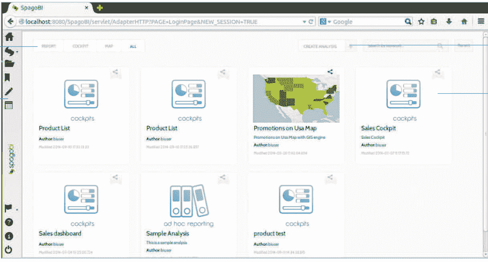

这是普通用户的菜单栏。从首页到注销按钮，在所有页面均可用。

所有供以后查看的分析都在这里。你只需点击区块即可查看特定的分析。

# 使用 SpagoBI 从业务数据中获取关键洞察

企业需要确保根据数据做出正确的决策。这正是商业智能工具大显身场。

## 顾问（Advisor）

`Nitish Tiwari` 职业是一名软件开发者，内心是一个开源爱好者。他也为开源项目撰写文章，帮助初创公司并引导他们使用开源软件来满足业务需求。

任何企业的存在都有一个目的——获取客户。然而，当今竞争激烈的商业环境让公司很难留住客户，简单的快速策略旨在打破这种局面。商业智能可以定义为一组工具，从原始数据中生成有意义且有用的信息，以帮助更好地分析相关业务。简单来说，商业智能工具让你根据数据来判断你的业务中什么是对的，什么是错的。

你可能会想：“如果数据来自我的业务，为什么我不能直接做决策，而要使用更好的软件工具呢？”原因在于人类的进化：我们是在需要根据数据做决策的环境中演化的，因此我们对数字很熟悉，特别是在处理大量项目时。但今天，我们有了 `SpagoBI` 的力量，它可以为你完成繁琐的工作。你可以看到安装步骤，然后学习如何使用 `SpagoBI` 做出决策。例如，在 `Ubuntu 14.04` 上使用 `SpagoBI` 稳定版本 `5.0.0`。

## 资源

`SpagoBI` 首页
`www.spagobi.org`

## 从业务数据中获取关键洞察

使用商业智能工具做出正确的决策

## 教程（TUTORIAL）

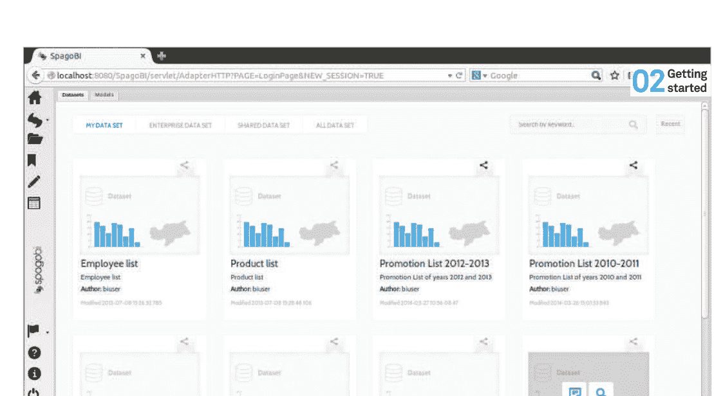

### 01 开始安装

你需要下载 “All-In-One SpagoBI-xx.zip”，来自 `http://github.com/spagobi/releases`。发布包包含了 `SpagoBI` 服务器和数据库，因此你不需要下载其他。如果你有任何问题，或者你之前安装过 `SpagoBI` 或其他软件，最好从全新的安装开始。确保你的电脑上安装了 `Java`。在终端中运行 `java -version` 进行检查。如果有返回，可以使用 `sudo apt-get install jre` 安装 `Java`。完成后，继续后续。将下载的文件解压到目标文件夹。输入命令：

```bash
cd /location/download/spagobi-server-5.8/
chmod 755 *
```

赋予脚本执行权限。同时，导航到数据库文件夹并更改该文件夹的权限。更改权限后，使用 `chmod 777 *` 为所有 `.sh` 文件更改权限。在生产环境中，执行命令运行 `SpagoBI`。如果你看到 “Startup sequence completed（启动序列完成）” 的消息，转到浏览器访问 `http://localhost:8080/spagobi/`。一旦打开页面，你可以使用下方提到的默认凭据登录。

### 02 开始

作为一个 BI 工具，`SpagoBI` 的主要重点是提供可操作的分析。它连接各种数据源（如数据库），并提供易用的 `GUI` 来帮助你探索数据。你可以在页面顶部使用下方提到的默认凭据登录。在生产环境中，你需要创建用户。更多细节请参考用户手册。

现在开始你的分析。点击 “我的分析（My Analysis）” 链接。在左侧菜单中，点击右上角的新建按钮。下一个页面将要求报告类型：选择 “即时（ad hoc）”。现在你可以为你的分析选择适当的数据集。由于还没有数据集，

### 03 创建分析

一旦有了数据，你可以选择两个选项：“显示查询（show query）” 和 “显示工作表”。选择工作表设计器（这将是默认设计器）。然后选择可视化样式，例如柱状图或饼图。一旦选择了样式，将字段拖入设计器中。注意字段是根据数据集显示的，你可以使用预览（`Preview`）标签查看查询结果。如果一切看起来正常，点击保存（`Save`）按钮。分析保存后，你可以在 “分析（Analysis）” 菜单下查看。`linuxuser.co.uk` 教程


### 04 使用 QBE 定义查询

从固定数据集绘制图表的能力对于现实场景是不够的。你可能想从多个场景来看问题。通过 `QBE`，你可以以图形方式定义查询、检查结果，或创建一个报告供以后使用。要开始，只需在创建查询期间点击 `QBE`。会出现一个与选择数据集相关的窗口，你可以将相关数据集字段拖到右侧的编辑器中。一旦填充了过滤器，查询会自动生成。然后你可以使用工作表（`worksheet`）标签为此新查询编辑或创建图表。


### 05 创建数据集

前面的步骤数据集用于创建，现在如何在 `SpagoBI` 中创建自己的数据集。点击左侧菜单上的 “数据（Data）” 链接，点击右上角的 “创建数据集（Create Dataset）” 按钮。弹出的新页面允许你选择 `xls` 或 `csv` 文件。一旦文件加载，你可以指定文件的分隔符和编码，`SpagoBI` 将自动识别列标题。然后定义属性和

### 06 创建模型

模型和数据集的区别在于，数据集是从数据源导入的，而模型直接关联数据集。你也可以创建模型。事实上，要创建一个新模型，点击资源（`resources`）链接右侧的 “添加（Add）” 按钮以添加新的数据源（如数据库）。点击资源（`resources`）链接然后进入 “数据/数据源（Data/Data Sources）”。在这里，点击 “添加（Add）” 按钮将打开新表单。填入数据库连接详情。点击右上角检查 `SpagoBI` 是否能连接到数据库，然后保存。现在再次点击链接进入 “目录：业务模型（Catalogue:Business Models）”。添加新模型并将数据源选择为新添加的数据集。保存模型以完成过程。现在你可以在 “数据（Data）” 链接下看到新模型。

`SpagoBI` 的主要重点是帮助生成可操作的分析。`linuxuser.co.uk`

## 从业务数据中获取关键洞察

使用商业智能工具做出正确的决策

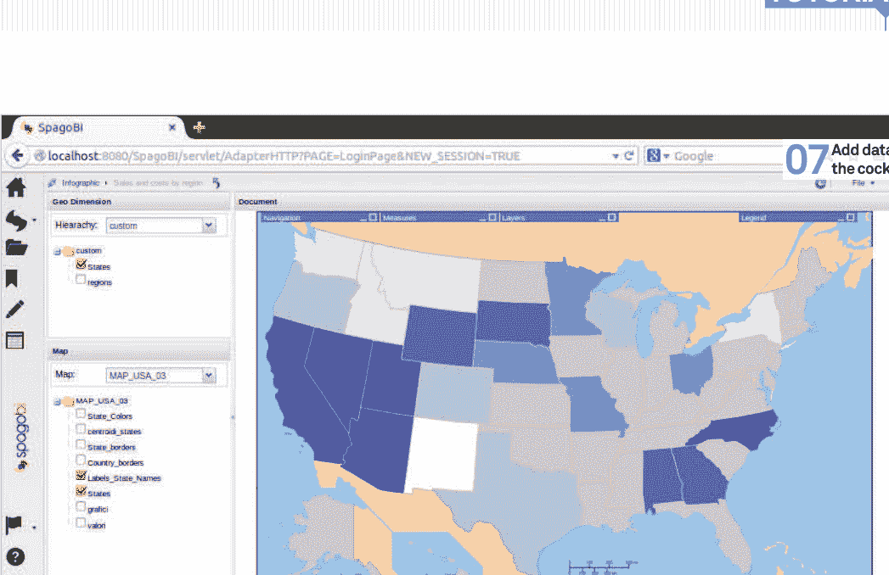

### 07 将数据添加到驾驶舱


驾驶舱提供了一种交互方式来轻松启用数据。通过数据组合（mashup），你可以将外部数据添加到你的驾驶舱。要创建驾驶舱，点击“我的分析（My Analysis）”。新页面将有一个干净的画布。使用右上角的“小部件（Widget）”按钮将添加到画布。点击后，你在画布上配置小部件。小部件的设置与步骤 3 类似。你可以添加尽可能的小部件，然后将其用于以后查看。

位置分析。这种界面让你选择层级、集成级别（带有图表和值），以及地图选择器。你还可以放大和缩小地图。

但今天，我们有了 `SpagoBI` 的力量，它可以为你完成繁琐的工作。你可以看到安装步骤，然后学习如何使用 `SpagoBI` 做出决策。例如，在 `Ubuntu 14.04` 上使用 `SpagoBI` 稳定版本 `5.0.0`。

# 资源

`SpagoBI` 首页

`www.spagobi.org`

## 从业务数据中获取关键洞察

使用商业智能工具做出正确的决策

## 教程

为方向、分辨率、相对位置等功能创建并编辑自定义多屏配置

所有显示设置

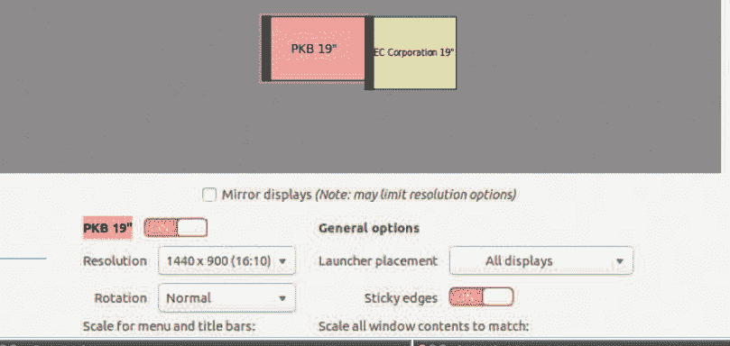

编辑驱动程序的交互和显示方式，确保它们在出现问题时能够加载

根据你的意愿在驱动之间切换，无论是选择全源码还是专有驱动

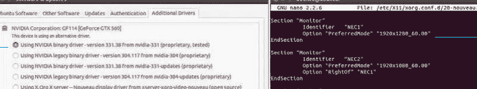

# 安装并配置 `Nouveau` 驱动

替代的 `Nvidia` 驱动是开源的，且对 `2D` 支持更好。学习如何为你的系统正确安装和配置它。

## 顾问

`Bob Zetsloot` 负责系统建模，是一位精通 `Python`、`Django` 和 `PHP` 的 Web 开发者。他喜欢实验计算。

## 资源

`Nouveau` `nouveau.freedesktop.org/wiki`

过去，`Lin Torvalds`（以及他的手势）对待 `Nvidia`。他们非常喜欢玩弄 `Linux` 以及各种发行版不不情愿接受的开源和闭源驱动。

这就是 `Nouveau` 的用处——它是 `Nvidia` 驱动的开源替代方案，曾被某些发行版取代 `Nvidia` 使用。设置可能需要一些工作，但对某些人来说，使用它要有效得多。在本教程中，我们将展示如何在不产生任何劣势的情况下使用 `Nouveau`。

目前，`Nvidia` 承诺提供更开放的驱动，并已为此迈出某些步骤。然而，为了获得真正开源且不同的体验，最好尝试一下 `Nouveau`，看看它是否适合你。

# 安装并配置 `Nouveau`

从替代的开源 `Nvidia` 驱动开始

教程

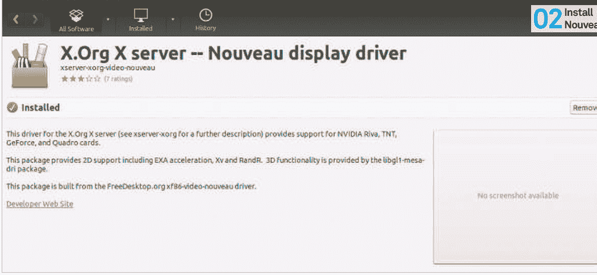

## `X.Org` 服务器 -- `Nouveau` 显示驱动

`xserver-xorg-video-nouveau`

★★★ (7 条评论)

### 已安装

此用于 `X.Org` 服务器的驱动程序（更多描述请参见 `xserver-xorg`）支持 `NVIDIA Riva`、`TNT`、`GeForce` 和 `Quadro` 显。

此包提供了 `2D` 支持，包括 `EXA` 加速、`X` 和 `RandR`。`3D` 功能由 `libgl1-mesa-dri` 包提供。

此包由 `FreeDesktop.x86-video-nouveau` 驱动程序构建。

开发者网站

### 01 访问受限驱动程序

在 `Ubuntu` 中，你可以打开“附加驱动”窗口来在驱动之间进行切换。如果你正在使用专有驱动之一，可能可以在重启系统后切换到 `Nouveau` 驱动。

### 02 安装 `Nouveau`

如果找不到它，你可以手动安装。可以从 `Ubuntu` 软件中心或 `xserver-xorg-video-nouveau` 安装，或者从命令行手动安装：

```
sudo apt-get install xserver-xorg-video-nouveau
```

### 03 设置为 `Nouveau`

现在你可以通过返回“附加驱动”菜单并寻找 `xserver-xorg` 选项来激活 `Nouveau`。你也可以在终端中执行：

```
sudo dpkg-reconfigure xserver-xorg
```

### 04 移除 `Nvidia` 驱动

虽然你不需要这样做，但 `Nouveau` 驱动可以帮助清理你的系统。在安装 `Nouveau` 后在终端中执行，或在安装 `Nouveau` 之前从命令行界面执行：

```
sudo apt-get purge nvidia
```

### 05 移除黑名单

如果你没有安装，可能是该模块被系统黑名单了，打开包含以下行的相关黑名单文件：

```
## /etc/modprobe.d/nouveau.blacklist.conf
```

并使用井号或符号注释掉 `Nouveau`。

### 06 自定义 org

如果尚未加载，为 `Nouveau` 驱动创建自定义启动配置将使 `X` 加载它而不是预设的 `Nvidia` 驱动。进入终端并创建一个 `conf` 文件：

```
## /etc/X11/xorg.conf/20-nouveau.conf
```

### 07 创建配置

在新文件中，保存前编辑以下内容：

```
Section "Device"
Identifier "Nvidia Card"
xserver-xorg-video-nouveau
EndSection
```

### 08 无重启测试 `Nouveau`

如果你正在制作这些自定义配置，可以使用以下命令在不重启的情况下更改设置：

```
sudo rmmod nvidia
sudo modprobe nouveau
```

你可以使用终端中的 `dmesg` 检查它们是否已加载。

## 教程

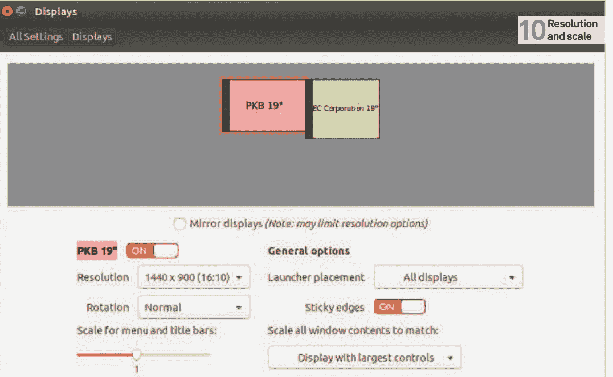

> 重启你的桌面

虽然最后一步对于服务器是好的，但如果你使用的是桌面，现在是重启的绝佳时机，以便内核加载模块。你也可以在此过程中确保一切运行正常。

## 分辨率和缩放

现代 `Ubuntu` 及其他发行版允许你使用 `Nouveau`，该图形驱动已存在于设置中。分辨率、方向和双屏通常都在那里；但如果你需要，可以进行设置。

## 返回你的桌面

一个修复显示输出的工具可以配合 `Nouveau` 创建一个以后可以更改的固定配置。我们需要将其添加到早些在 `/etc/x11/xorg.conf.d/nouveau.conf` 创建的配置中。在终端中打开它。

### 为 `Nouveau` 驱动制作自定义启动配置是值得的

#### 添加显示器

对于单显示器，你可能需要添加自定义显示器配置，例如：

#### 添加第二个显示器

第一步中执行的操作都将是主显示器。要添加第二个显示器，你需要一个类似的配置，但带有关于其位置的另一个选项：

```
Section "Monitor"
Identifier "Monitor name"
Option "PreferredMode" "1920x1080,60.00"
EndSection
```

```
Section "Monitor"
Identifier "Second monitor"
Option "PreferredMode" "1920x1080,60.00"
Option "RightOf "Monitor name"
EndSection
```

这设置特定名称显示器（使用 `xrandr -q` 查找）具有 `1920 x 1280` 的辨率和 `60 Hz` 的刷新率。

# `LinuxDeveloper` 教程

这是一个绘制在直方图之上的密度图。使用图层绘图有许多优势。

这是 `ggplot2` 中使用的 `chrome.R` 脚本的完整 `R` 代码。生成的图像令人惊叹。


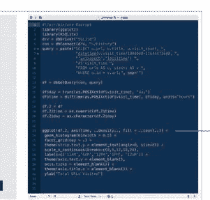

这张图结合了散点图层和和平滑层。每个点的形状取决于 `LUD` 数据集中找到 `Linux` 变量的值。

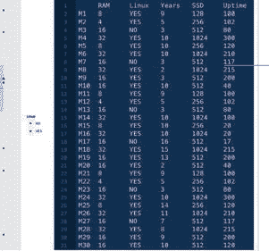

这是本文中 `LUD` 数据集的格式和部分数据，用于说明 `ggplot2` 的多样化能力。

# 使用 `ggplot2` 生成复杂的图形


## 导师

`Mihalis Tsoukal` 是一位 `UNIX` 系统管理员，也从事编程、数据库和数学。他自 1993 年起一直使用 `Linux`。

### 视为 `S` 的版本，学习使用 `R` 和 `ggplot2` 包创建沉浸式图表

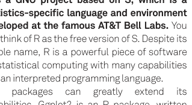

`R` 是一个基于 `S` 的 `GNU` 项目，`S` 是在 `AT&T` 贝尔实验室开发的统计语言环境。你可以将其看作 `S` 的免费版本。尽管名字简单，`R` 是一件强大的统计计算软件，具有许多功能和广泛的编程环境。


大多数其他图形包都具有这种深层次的原理语法。学习《图形语法》（The Grammar of Graphics）将帮助你设计更好的图表，但遵循本文并不要求这样做。换句话说，语法告诉你你正在将数据映射到几何对象的审美属性上。

`R` 包可以极大地扩展它的功能。`ggplot2` 是由 Hadley Wickham 编写的 `R` 包，它使用统计和数据图形，通过图层处理图形。尽管是一个强大的包，但它很容易学习，并能产生具有出版质量的复杂且精美的图表。它与本文的主要区别在于包含了许多实用示例，演示了如何使用 `ggplot2` 绘制各种类型的图表，包括 `Chrome` 历史文件的图表！

熟悉数学和统计对于理解本文有帮助，但并非必不可。

## 资源

- `R` - `project.org`
- `RStudio` - `rstudio.com`
- `ggplot2` - `ggplot2.org`
- 文档 - `ggplot2.org/current`
- `RSQLite` - `bit.ly/1AuJvk`

# 使用 ggplot2 生成图形

学习如何使用 `R` 和 `ggplot2` 创建令人印象深刻的图表。

## 教程

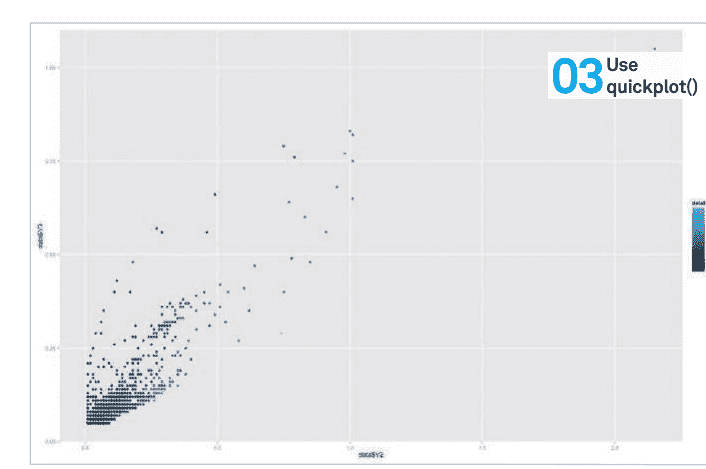


相关性显示了两个变量之间是否存在关系。相关系数越接近 `-1` 或 `+1`，相关性越强（正相关或负相关）。然而，正相关比另一种更好，负相关表示如果一个变大，另一个就会变小。

展示的图表是使用以下命令生成的：

> 使用你的数据以及 `R` 和 `ggplot` 可以生成的各种类型的图表进行实验。

### 01 安装 ggplot2

首先运行它。`ggplot2` 包默认没有安装，运行以下命令检查你是否已安装：

### 03 使用 quickplot()

`ggplot2` 包提供了两个主要函数：`quickplot()` 和 `ggplot()`。`quickplot()` 函数与 `R` 中的 `plot` 类似，适用于简单的图表。`ggplot()` 函数更强大，虽然更难使用但但更灵活。

### 05 生成柱状图

```
> require(ggplot2)
```

```
Loading library: ggplot2
```

如果没有安装，请选择以下：

```
> install.packages("ggplot2")
```

如果你不带参数运行 `library()` 函数，将获得已安装包的列表。要获得详细输出，请带任何参数运行 `installed.packages()`。

使用以下命令使用 `iris` 数据集：

```
> data.frame <- iris
```

```
# 1500 行 5 个变量：
```

```
> head(data.frame)
```

使用 `iris` 数据集进行绘图。`FileIO` 存储在名为 `iris.data` 的文本文件中。列标题与变量相同。你可以使用以下命令将数据加载到 `R` 中：

```
> read.table("iris.data", header=TRUE)
```

柱状图非常简单。以下代码生成了它：

```
> ggplot(iris, aes(x=Species, y=Sepal.Length)) + geom_bar(stat="identity")
```

如果你输入 `ggplot(iris, aes(x=Species, y=Sepal.Length))` 而不指定绘表类型，命令将显示错误。检查 `ggplot`。

# 02 关于相关性

相关性显示了两个变量之间是否存在关系。相关系数越接近 `-1` 或 `+1`，相关性越强（正相关或负相关）。然而，正相关比另一种更好，负相关表示如果一个变大，另一个就会变小。

展示的图表是使用以下命令生成的：

> 使用你的数据以及 `R` 和 `ggplot` 可以生成的各种类型的图表进行实验。

### 04 使用 ggplot

`ggplot2` 包提供了两个主要函数：`quickplot()` 和 `ggplot()`。`quickplot()` 函数与 `R` 中的 `plot` 类似，适用于简单的图表。`ggplot()` 函数更强大，虽然更难使用但更灵活。

柱状图非常简单。以下代码生成了它：

```
> ggplot(iris, aes(x=Species, y=Sepal.Length)) + geom_bar(stat="identity")
```

如果你输入 `ggplot(iris, aes(x=Species, y=Sepal.Length))` 而不指定绘表类型，命令将显示错误。检查 `ggplot`。

### 06 添加标题

柱状图非常简单。以下代码生成了它：

```
> ggplot(iris, aes(x=Species, y=Sepal.Length)) + geom_bar(stat="identity")
```

如果你输入 `ggplot(iris, aes(x=Species, y=Sepal.Length))` 而不指定绘表类型，命令将显示错误。检查 `ggplot`。

# 07 更多关于标题

柱状图非常简单。以下代码生成了它：

```
> ggplot(iris, aes(x=Species, y=Sepal.Length)) + geom_bar(stat="identity")
```

如果你输入 `ggplot(iris, aes(x=Species, y=Sepal.Length))` 而不指定绘表类型，命令将显示错误。检查 `ggplot`。

### 08 创建直方图

使用 `geom_histogram()` 函数生成直方图，类似于 `geom_bar()` 函数，并使用以下命令通过 `bin` 参数更改柱子的数量：

```
> ggplot(LID, aes(aes)) + geom_histogram(binwidth=1, color="gray")
```

# 使用 ggplot2 生成图表

学习如何使用 `R` 和 `ggplot2` 创建令人深刻的图表

## 教程

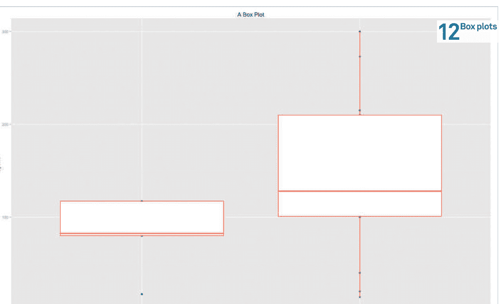

## 10 使用形状和分面

下面的图根据非连续 `Linux` 变量的值使用不同的形状绘制点：

```
> ggplot(linux, aes(x=RAM, y=uptime)) + geom_point(shape=Linux)
```

分面（Facet）允许你根据一个或多个变量拆分数据，然后绘制数据子集。使用分面也是生成连续性的极佳方法。将在 `Linux` 变量的不同值下生成两个图：

```
> ggplot(linux, aes(x=RAM, y=uptime)) + geom_point(shape=Linux) _
```

`facet_grid()` 在使用连续变量时运行良好。

## 11 可视化 Chrome 历史文件

`Chrome` 的历史文件（简单 `History`）以 `SQLite` 数据库格式存储访问过的网站历史。然后，你可以使用 `RSQL` 解析器来读取它。`Chrome.R` 脚本使用 `RSQLite` 和 `ggplot2` 生成带有许多图层的输出。可以如下所示执行：

```
$ /Chrome.R
Loading required package: methods
Loading required package: DBI
$ ls -l plots.pdf
-rw-r--r-- 1 mstouk staff 5089 Nov. 27 
09:42  plots.pdf
```

生成的结果自动存储为关于形状、变性和名为 `plots.pdf` 的文件的格式。

## 12 使用箱线图

箱线图可以快速高效地提供关于数据集位数和方差的信息。展示的箱线图是通过以下代码生成的：

```
> ggplot(linux, aes(uptime)) + geom_boxplot(colour = 'red') + ggtitle(title="Box Plot")
```

根据 `Linux` 变量的两个离散值，输出分为两个子集。对于每个子集，都会单独生成一个图表。

## 13 创建 R 脚本

学习创建 `R` 脚本非常简单，以便可以使用作为 `cron` 任务运行的更大的 `ggplot2` 脚本。一个名为 `plots.R` 的示例文件展示了如何操作：

```
$ ggplot.R
$ 11
total 168
-rwxr-xr-x 1 mstouk staff 234 Nov 
22:44  ggplot.R
-rw-r--r-- 1 mstouk staff 73820 Nov 
22:43  ggplot.png
$ file ggplot.png image data, 1280 x 800 ,
- non-interleaved
```

### 14 结语

你越使用 `ggplot2`，对数据的了解就越深入，但不要忘记 `ggplot2` 使用图层！要充分利用绘图，你必须学习正确的方法，寻找正确的指标并不是简单的。

`55 www.linuxux.co.uk`


# LinuxDeveloper 教程

这是 `Cacti` 数据库中找到的表格列表。看到所有 `Cacti` 数据是有值的。

开发 `Cacti` 时需要钩（Hooks），请咨询 Hook API 参考以查看你应该使用哪些钩。

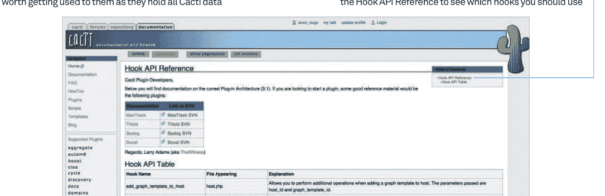

## 构建 Cacti 插件

**顾问**

Mihalis Tsoukalos 是一位 UNIX 系统管理员，同时也精通编程、数据库和数学。他自 1993 年起一直使用 `Linux`。

开发一个 `Cacti` 插件，读取 `Cacti` 数据库并在 `Cacti` 标签中显示活跃的 `TCP` 和 `UDP` 连接！

## 资源

- Cacti: `cacti.net`
- RRDTool: `oss.cacti.net/rrdtool`
- 插件文档: `docs.cacti.net/plugins`

## 文章接自之前的 Cacti 文章

本文接续第 148 期中介绍的之前的 `Cacti` 文章。你将学习如何开发一个 `Cacti` 插件，从数据库读取数据并进行展示，前提是你可能已经有一个可以运行的 `Cacti` 安装示例，以便展示此处描述的步骤，并熟悉 `PHP` 编程和 `MySQL` 的操作，以便能够轻松地从外部源或互联网读取数据。我们强烈建议在编写插件之前，从这里代表的示例开始学习，以理解其工作原理。记住，所有插件都有自己的目录，`setup.php` 文件包含了将插件与 `Cacti` API 连接的代码以及其他一些 `PHP` 函数。

展示的示例将尽可能通用。数据将使用 `cron` 独立获取，但将存储在与 `Cacti` 相同的 `MySQL` 数据库中。正如你所看到的，`Cacti` 允许将所有插件集成到它的网络界面中。每个 `Cacti` 插件都有特定的架构和结构。此输出显示了名为 'clog' 的插件的文件。

## 构建 Cacti 插件

**开发一个激活 TCP 和 UDP 连接的插件**

**教程**

```perl
#!/usr/bin/perl -u

use strict;
use warnings;

use DBI;
use DBI::mysql;

my $dbName = "CactiDB";
my $user = "cacti";
my $password = "password";
my $host = "localhost";

my $connectionInfo = "dbi:mysql:dbname=$dbName;host=$host";
my $connection = DBI->connect($connectionInfo, $user, $password);

my $sql = "SELECT * FROM tcp";
```

| 字段 | 类型 | 空 | 额外 |
|---|---|---|---|
| TCP | int(1) | YES | |
| DATE | datetime | NULL | |

```perl
my $query = "SELECT * FROM tcp WHERE state=1 AND id=$id";

my $statement = $connection->prepare($query);

$statement->execute();

my $STCP = "/bin/netstat -n | grep ESTABLISHED | wc -l";

my $UDP = "/bin/netstat -nu | grep ESTABLISHED | wc -l";

$connection->disconnect();

exit 0;
```

## 注册钩

每个插件都需要注册钩来使用来自 `localhost` 的 `Cacti` 安装，作为 `cron` 任务运行的 `Perl` 脚本请求数据库数据。如果你发现获取数据的方法不符合需求，可以使用不同的。

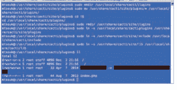

## 05 步骤

在安装和开发过程中执行某些操作是良好的做法，你应该将 `/usr/local/share/cacti/plugins` 移动到那里。然后你应该删除 `/usr/share/cacti/plugins/`，执行后那里应该是空的。最后一步是创建钩。

```console
```

## 06 使用插件管理菜单

插件管理菜单将确保所有操作发生。安装成功后，新标签将出现在 `Console` 旁边。你应该编辑或删除它们，因为损坏的插件会破坏整个插件管理菜单。这在开发新插件时有用，允许你在早期检测错误。

### 01 Cacti 插件

每个 `Cacti` 插件必须有自己的目录。所有插件的中心位于安装内的“plugins”。在 `Ubuntu` 分发版中，默认路径是 `/share/cacti/plugins`。强烈建议将其移动到不同的位置。

### 03 获取并存储数据

为了插件从 `Cacti` `MySQL` 数据库读取数据，获取数据并使用 `SELECT` 语句将其打印在屏幕上以生成 `HTML` 表格。然后格式化数据并打印。记住，你可以对数据进行任何你想做的操作，例如对超过阈值着着。跟踪本地机器上的活跃 `TCP` 和 `UDP` 连接，你还需要将数据存储在外部文件或数据库中。在这种情况下，使用数据库会更好。但如何获取数据？使用外部脚本似乎是一个通用选项。


### 02 注册钩

当 `Cacti` 安装并选择插件管理选项时，列表应该是空的，因为插件默认已安装。每个插件需要注册一个或多个钩来使用。你可以查看 `setup.php`

## 04 探索存储方法

使用你的 `Cacti` 插件任务的解决方案。这有许多优点，包括你可以使用钩对其进行自定义。为了简单起见，插件将

57 | `www.linuxuser.com`

# LinuxDeveloper 教程

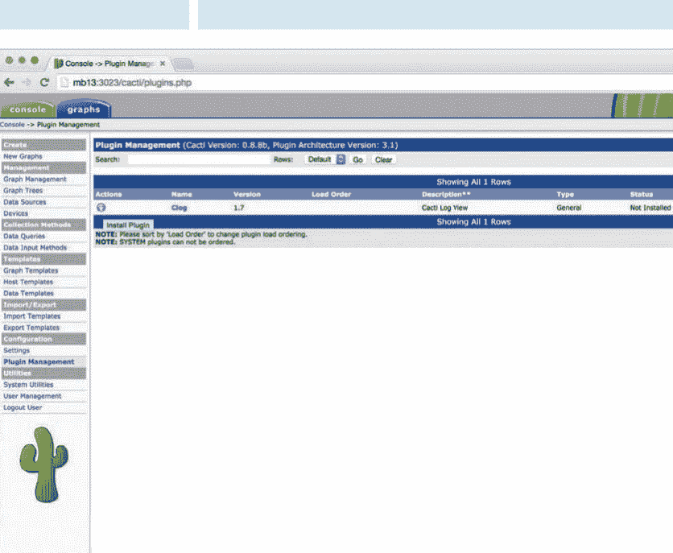

## 安装移除插件

在安装插件之前，你应该首先下载它。一旦下载，你就可以点击它进行安装。它将出现在插件管理菜单中。接下来点击操作列上的启用。你也可以删除或编辑出现的插件。如果你不再需要，可以使用卸载按钮。要卸载，首先禁用插件并手动移除插件目录。

## 安装或移除现有插件

在安装插件之前，你应该首先下载它。一旦下载，你就可以点击它进行安装。它将出现在插件管理菜单中。接下来点击操作列上的启用。你也可以删除或编辑出现的插件。如果你不再需要，可以使用卸载按钮。要卸载，首先禁用插件并手动移除插件目录。

## 开发插件

目录持有函数且插件的名称将为 'connections'。注意插件名称必须全小写。插件工作是强制的。对于 `connections`，需要的函数是使用 `plugins_connection`、`check_config_version` 和 `plugin_connections`。你还需要定义命名函数。找到缺失函数的最佳方法是检查你的 Web 服务器日志。每个连接都可以在以下错误消息中找到：

```php
<?php

/**

 * @param string $id

 * @return bool|10.8.2.2:6275

 */

PHP Fatal error: Call to undefined function connections_version() in /usr/share/cacti/cacti/plugins.php on line 381, refer to http://localhost:3823/cacti/settings.php;
```


## 完成插件
完成基本设置后，插件处于激活状态并菜单项和函数。然而，它没有返回有趣的数据，但 PHP 代码将执行标签。此外，它没有正确安装在 Cacti 环境中！如果你想打印当前日期，将超出缓存。这稍后会修复。

## 获取数据
为了插件从 Cacti MySQL 数据库读取数据，获取数据然后使用 `SELECT` 语句将其打印在屏幕上生成 HTML 表格。然后格式化数据并打印。记住你可以对数据进行任何你想做的操作，例如对超过阈值的值进行颜色输出。

## 创建新插件
为了让插件工作，需要两个命名的文件 - `setup.php` 和 `index.php`。插件可以包含更多文件，但没有这两个文件，它无法工作。

如果 Cacti 在目录内发现 `setup` 文件，就会检测到插件。应该只有

## 与 MySQL 数据库工作
Cacti 数据库对你的 PHP 代码可用，因此你不需要做其他操作即可使用它。connections 插件使用以下代码从 MySQL 数据库读取：

# 构建 Cacti 插件

开发一个显示活动 TCP 和 UDP 连接的插件

## 教程

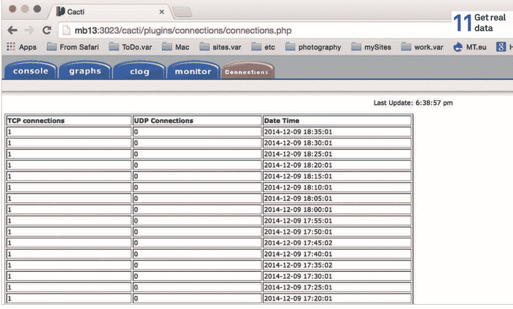

## 每个插件都需要注册钩子才能使用

### 关于插件代码的更多详细信息

通用头文件将你的插件集成到 Cacti 中。当你构建的连接将在 Cacti 的环境中时，它是一个可以从另一个插件中复制的标准文件。要使用它，你必须在你的头文件中注册以下代码：

`console view`，而 `top_graph_header` 钩子允许你为 Cacti 的用户界面添加标签页。当插件不在 Cacti 中时，你必须如下所示注册到 `setup.php` 文件：

```php
include('./plugins/connections/general_header.php');
```

`connections_check_upgrade` 函数目前没有显示你的用量。请检查其他插件的升级函数实现以了解。

### 使用函数

简单的 `plugin_connections_install()` 函数不包含太多代码，但它是插件最重要的函数。为了让你的插件正常工作，你应该先查看它的 `install()` 函数。它通过 `api_plugin_register_hook()` 和 `api_plugin_register_hook()` 进行注册。`api_plugin_hook` 的调用如下：

```php
api_plugin_register_hook('connections',
'top_graph_tabs', 'connections_show_tab',
'setup.php');
```


```

第一个参数是钩子的名称，第二个参数是你想要注册的钩子名称，第三个参数是钩子触发时要调用的函数名称，第四个参数是包含上述内容的文件。

### 使用钩子

要显示你的插件，请使用两个钩子。它们都使用同一个 PHP 函数：`top_header_hook` 允许你在查看图像时同时显示你自己的标签。

`Admin` 用户自动获得使用每个新插件的权限。如果管理员是唯一需要你的领域的人，你仍然需要对其进行注册。如果你创建一个带有标签的插件，它将不会出现在 `Cacti` 的用户界面中。注意，如果你在插件激活时将其插入 PHP 代码中，你将需要卸载并重启插件领域才能生效。


`59 www.linux.co.uk`

# 我们不保留秘密


# 技巧与窍门通过“技巧与窍门”系列的专家建议和教程，了解 `iPhone`、`iPad`、`Android`、`Photoshop` 及更多内容的真相

# 立即购买您的副本

纸质版请访问：`www.imagineshop.co.uk`
数字版请访问：`www.greatdigitalmags.com`

# 编码人员和制作者的必备指南

# 实用型树莓派

> 66 “将你所有的重要文件和设置迁移到新的树莓派 2”

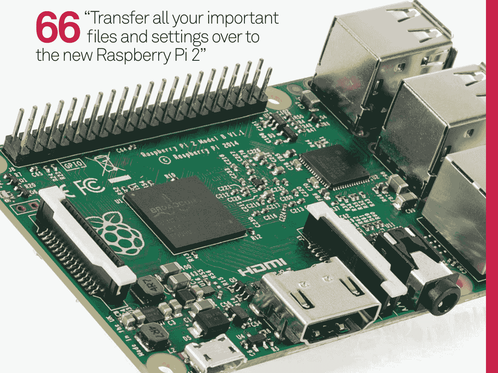

# 目录

- 62 `PiPanther`：可黑客的坦克
- 64 制作一个红绿灯游戏
- 66 迁移到树莓派 2
- 68 增强你的树莓派
- 72 网络监控

# 实时视频 使用 `PiCamera` 模块，`Ubotia` 软件正在从 `PiPanther` 运行游戏界面的实时视频流

使用插件，你可以创建自己的附件并使用 `API` 在 `Ubotia` 应用中射击敌人。

# 组件列表

- 4x 3D 打印底盘
- 树莓派 `Model A+`
- `PiPanther` 主板
- 树莓派摄像头模块
- 锂聚合物电池
- 2x 直流电机
- `H` 桥 (2A)
- 舵机
- `USB` 集线器
- 2x `USB` 附件
- `Wi-Fi` 适配器

# 使用增强现实 `PiPanther` 与朋友 3D 打印战斗

更多关于可黑客的坦克的信息。
`PiPanther` 是一个机器人，可以使用智能手机上的 `Ubotia` 软件进行控制。通过探索它，你可以在几分钟内使用 `Ubotia` 软件构建它。`PiPanther` 的 `Kickstarter` 众正在倒计时，我们只完成了 22%。

一旦 `Kickstarter` 活动结束，你对 `PiPanther` 有进一步计划吗？
还没有 100% 准备好——意味着还需要更多工作。当需要解决问题时，我和同事在这个项目上花费了许多小时。最大的问题是外壳是 3D 打印的，但对于如此精细的元素，我无法使用 3D 打印机。我们使用激光切割制造了外壳。所以它非常漂亮，但大规模生产成本是可以接受的。

到底是什么形成了 `PiPanther`？
底盘由四个元素组成：树莓派、`PiPanther` 主板、两个直流电机、两个齿箱和一个舵机。当你将其插入 `USB` 集线器时，我们围绕树莓派 `A` 设计了 `PiPanther`，因为它更小更便宜，但只有一个 `USB` 端口。我们还将电池安装在底盘底部。

这是我们自己设计的——它是树莓派的大小。


`Michael Adams` 是一个喜欢从事机器人、电子和机械相关项目的专业软件开发者。

62 linux.com

# 我的树莓派项目


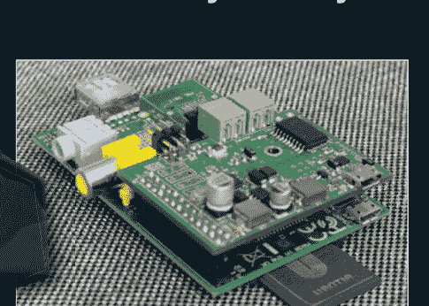


上方 `PiPanther` 主板设计为直接连接在树莓派 `GPIO` 引脚上的扩展。它可以与 `Model A` 和 `Model B` 树莓派配合，并能够驱动你的 `Ubotia` 机器人。下方直接进入 `Ubotia` 和你的界面（请查看 Michael 的视频：`bit.ly/1Bnkp`）。充电：面板翻起以露出下方的 `microUSB` 端口，这样你可以在回合之间为 `PiPanther` 充电。


有一个 `DC-DC` 转换器，为树莓派提供 5V 电源、强大的电机驱动器、舵机控制器和 `USB` 充电器，你可以使用 `microUSB` 插头直接为 `PiPanther` 充电。我离开三个小时它就充满电了。

提供了 `PiPanther` 到移动界面的实时视频流。我是在没有人能做到这一点时制作的，但遗憾的是视频流的延迟太高了，我没有足够的时间修复它。你必须相信我，我是当时第一个从树莓派到 `Android` 创建实时视频流的人！所以，你可以实时驱动它。

这块主板将用于自定义项目——是吗？
由插件控制器组成。如果你有插件，就可以共享由此软件在运行时加载的库，使用 `API` 你可以创建基于标准的协议（此处原文可能有误，应为基于协议的协议）。

### 喜欢吗？
了解如何制作你的插件，并在 `linux.com/posts/plugin-guide` 了解插件架构的概况，关注项目的任何更新。

确切。要驱动坦克，你需要驱动电机——左履带和右履带——不用履带可以使用轮子，这样你就可以移动到任何地方。转向也是一样的。如果你想向前走，就使用两个电机，如果你想转弯，就使用左右履带。你可以用这个来驱动你的机器人——使用相同的主板，但带有 `Pi` 和 `Ubotia` 软件。这是 `Ubotia` 软件的主部分（也是最困难的部分）。

所有大部分都由树莓派处理！

树莓派运行 `Linux`，在那个层上，我们编写了负责使用串口接口与 `PiPanther` 主板通信的代码，`USB` 控制电机、云塔、状态 `LED`，我们从 `USB` 充电器获取反馈。这些是用 `C++` 等语言编写的。你的你的网站说这些插件可以影响 `Ubotia` 画廊——一个用于坦克的机械臂，对吗？

### 延伸阅读
如果你对制作自定义 `Ubotia` 感兴趣，请查看树莓派驱动汽车构建控制指南以及许多其他内容。

## 教程

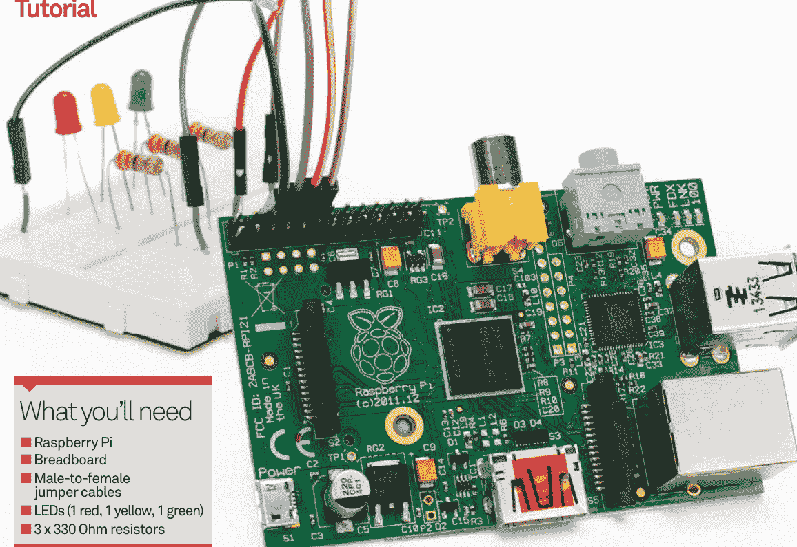

# 你需要的物品

- 树莓派 (`Raspberry Pi`)
- 面包板
- 公对母跳线（跳线）
- `LED` 灯（1 个红色，1 个黄色，1 个绿色）
- 3 个 330 欧姆电阻

# 使用面包板模拟交通灯

通过树莓派和这个基于面包板的交通灯模拟，进入物理计算和硬件工程的大门。

即使对于树莓派这样廉价、简单且强大的平台，首次尝试物理计算和硬件体验世界也可能是一项挑战性任务。但物理计算可能是通过代码的力量对物理世界中的实体进行实验和操控最有回报的方式。

### 01 获取零件
本教程所需的零件都可以从 `Merlin`、`MPC` 等信誉良好的电子供应商或许多树莓派零售商处获得。面包板、`LED` 和电阻的费用大约在 10-20 美元。

### 02 更新你的树莓派
在开始任何项目之前（无论是硬件还是软件），你都应该始终更新树莓派，以确保你拥有最稳定的版本和功能。这在处理 `GPIO` 时尤为重要。你可以使用以下命令进行更新：

```bash
sudo apt-get update

sudo apt-get upgrade
```


# 模拟交通灯

Aaron Shaw 是《The Magazine》(linuxuser.com) 的成员，从初就参与了树莓派的工作，他认为自己非常幸运能在工作和生活中都使用树莓派！

利用 `GPIO` 的最佳方法之一是以后对你的树莓派发挥创意，从一个简单的 `LED` 命令开始。让我们开始吧！

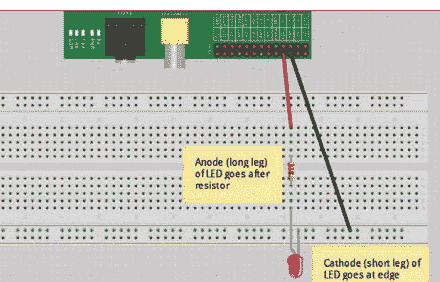

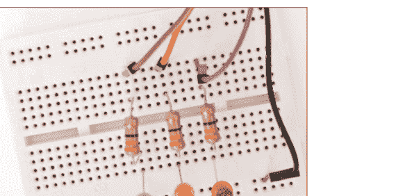

## 04 准备硬件

为了构建并测试简单电路以确保万切正确，拿起面包板、跳线线、`LED`、`330` 欧姆电阻和树莓派，按照上图连接所有设备。在连接到 `GPIO` 之前，请确保你的树莓派已关电以避免损坏。

### 06 添加更多代码

为了模拟真实的交通灯路段，我们需要运行一系列代码。下面的代码实现了这一点，我们已将其上传到 `FileSite.com`，以便你理解它的作用。在步骤 4 中，你需要将此代码添加到 `Python` 脚本中执行，并将其命名为 `"trafficlight.py"` 而不是之前的 `"test.py"`。

下面的代码是一个简单的脚本，用于测试连接是否正确以及 `LED` 是否工作。通过在命令行中输入 `nano test.py` 创建文件，然后使用 `Ctrl-X`、`Y` 和回车键写入下面的代码，之后你就可以在命令行中使用 `sudo test.py` 执行脚本。

```
import RPi.GPIO as GPIO

import time

GPIO.setmode(GPIO.BCM)

GPIO.setup(14, GPIO.OUTPUT)

GPIO.output(14, True)

time.sleep(10)

GPIO.output(14, False)

GPIO.cleanup()
```

```python
import RPi.GPIO as GPIO

import time

GPIO.setmode(GPIO.BCM)

Leds = [14,15]

for led in Leds:
    GPIO.setup(led, GPIO.OUTPUT)
    GPIO.output(led, False)

try:
    while True:
        GPIO.output(led, True)
        time.sleep(3)
        GPIO.output(led, False)
        time.sleep(3)
except KeyboardInterrupt:
    GPIO.cleanup()
```

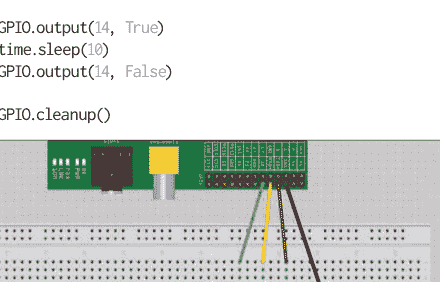

## 05 连接更多 LED

为了模拟真实的交通灯设备，我们显然需要加入绿色和黄色 `LED`。拿起 `LED` 和另外两个电阻，像上图一样连接所有设备，确保树莓派已关电。

## 07 下一步去哪里？

这只是对在树莓派上实验 `GPIO` 的简单介绍。它展示了用代码操控世界是多么简单，这也是最好的学习方法。请访问树莓派基金会网站 `raspberrypi.org/resources` 获取更多好点。

# 阶梯游戏

一旦你掌握了用树莓派控制 `LED` 的基础知识，为什么不做一个更进阶的游戏呢？对于初学者来说，阶梯游戏是一个很好的项目，因为它涉及到为用户控制复杂的循环。查看 `raspberrypi.org/projects/game` 上的项目以获取游戏指南。

# 教程

## 迁移到树莓派 2

`Rob Zwetsloot` 擅长复杂模型系统，是一位精通 `Python`、`Django` 和树莓派的 `Web` 开发者。他热于计算实验。

将你的文件和设置迁移到树莓派 2，让升级尽可能无痛。

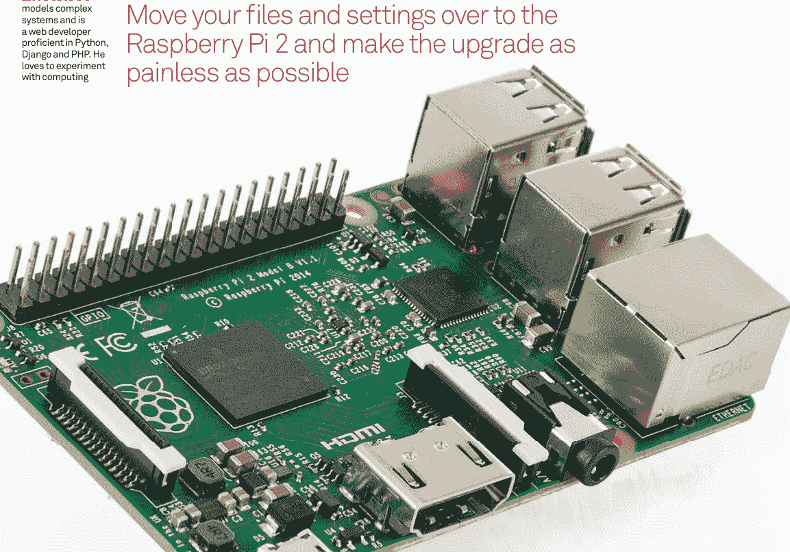

## 你需要的物品

- `SD` 卡阅读器
- `microSD` 转 `SD` 卡适配器
- `Raspbian`

根据树莓派的更新方式，它现在同时支持 `ARM` 和 `ARMv7`，它会检测你使用的是哪个版本并使用相应的内核启动，无需手动切换。

### 01 清理

根据树莓派的更新方式，它现在同时支持 `ARM` 和 `ARMv7`，它会检测你使用的是哪个版本并使用相应的内核启动，无需手动切换。

### 02 复制列表

根据树莓派的更新方式，它现在同时支持 `ARM` 和 `ARMv7`，它会检测你使用的是哪个版本并使用相应的内核启动，无需手动切换。

### 03 准备新树莓派

在另一张 `microSD` 上，从 `raspberrypi.org` 下载树莓派镜像并使用以下命令写入 `SD` 卡：

```
$ dd bs=4M if=raspberry2.img of=/dev/sdX
```

### 04 传输主文件夹

从旧树莓派复制 `home` 文件夹的内容，将其存储在 `PC` 上，或者传输到新的 `SD` 卡（如果有的话）。为现有卡创建备份。

### 05 设置新树莓派

启动新树莓派时，你需要 `raspi-config`。执行需要的更新，如启动到桌面、扩展摄像头和扩展文件系统。完成后重启树莓派。

### 06 检查文件

打开终端恢复软件包。某些包可能无法工作，因此你需要编辑所有列表。使用：

```
$ sudo dpkg --set-selection < installed-software && sudo apt-get purge-deselect
```

### 07 升级文件

执行任务后，某些文件需要升级到新版本。要这样做，执行常规 `apt-get update` 和 `sudo apt-get upgrade` 以确保文件是最新的。

### 08 恢复文件

打开终端恢复软件包。某些包可能无法工作，因此你需要编辑所有列表。

### 09 享受你的新树莓派！

现在你已经成功完成了升级，可以回到享受现有项目或开始新项目。请关注下一期《Linux User & Developer》，我们将开始针对树莓派 2 的新项目教程。

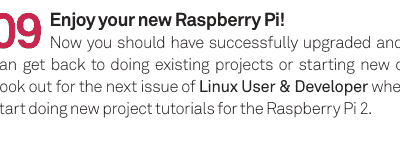

## 教程

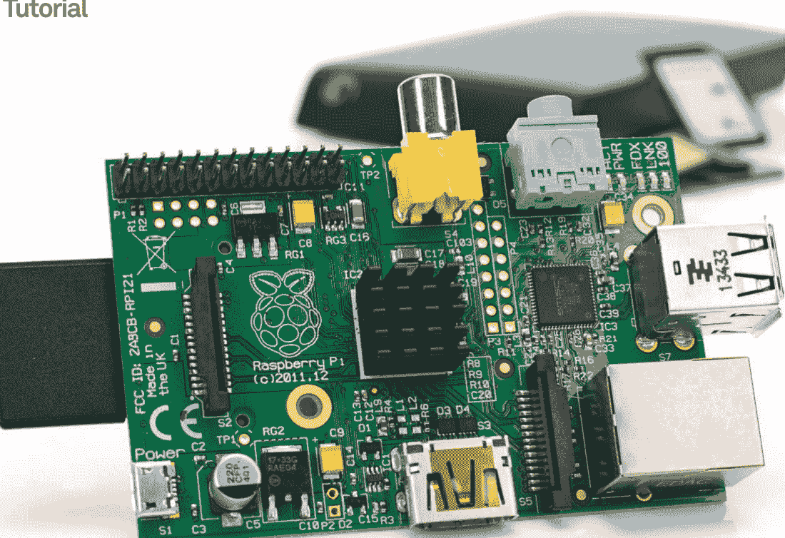

# 增强你的 Raspberry Pi 性能

通过这些提升性能的提示和技巧，充分发挥你的 `Raspberry Pi` 的潜力。


`Christian Cawley` 曾任 `IT` 软件工程师，自 2010 年以来一直从事工程师工作。他在在线和杂志上为智能手机用户撰写过文章。

你的 `Raspberry Pi` 已经接电。`SD` 卡上已安装了 `Raspian`，你正处于设置无线打印服务器或制作一个机器人从宿舍帮你取回邮件的途中。

但你真的充分利用你这台微型电脑的性能了吗？你所使用的组件是否最大化地发挥了 `Raspberry Pi` 的潜力，还是它们在拖了你的后腿？你是否探索了 `Raspian` 中的所有选项，还是在直接从 `SD` 卡运行操作系统（这会缩短 `SD` 卡的使用寿命）？


可以采用多种技术来提高性能，例如选择合适的硬件对 `CPU` 进行超频。你甚至可以最大化 `Raspberry Pi` `SD` 卡上的存储空间，或者完全用第二个 `SD` 卡替换它以提高速度。

## 使用存储硬件

使用这些技巧来重新配置你的 `Raspberry Pi` 设置并优化硬件，以确保你的项目获得最佳性能。

- `1` 无论使用什么操作系统，你选择的存储媒体都会影响 `Raspberry Pi` 的性能。容量小且纠错能力较差的 `SD` 卡速度会比大且韧性更好的卡慢，因此请为你的项目找到合适的平衡点并明智购物。

# 增强你的 Raspberry Pi 性能

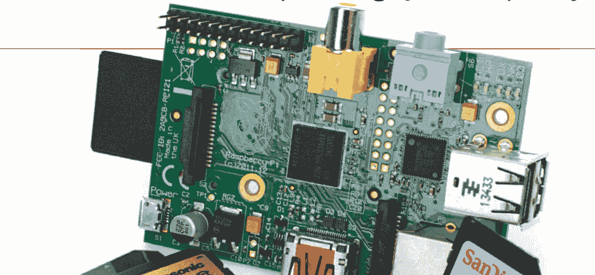

## 02 选择 SD 卡

市有多种标准的 `SD` 卡可用，价格越贵的纠错能力越强。为了提高 `Raspberry Pi` 的性能，请选择高等级的 `SDHC` 卡。同样的建议也适用于 `MicroCards`，你可以通过 `SD` 卡适配器在 `Raspberry Pi` 上使用它们，或直接插入 `Raspberry Pi`。

## 05 将数据写入 RAM

与其在 `SD` 卡上读写数据——这最终会导致可靠性和性能下降——你可以配置 `Raspberry Pi` 将数据写入 `RAM`，这将提高运行速度并提升 `SD` 卡的性能。

使用 `tmpfs`（文件系统表），这是 `Linux` 发行版中可用的一种系统配置。

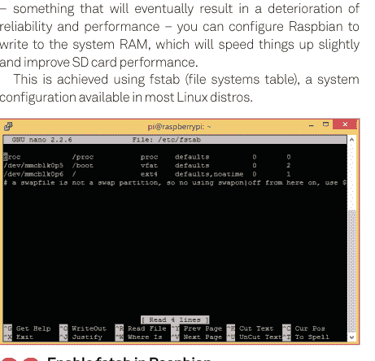

上方在 `elymux.org/RPI_SD_cards` 有关于 `SD` 卡的极佳指南

# 购买的 SD 卡

```
$ pi@raspberrypi:~ 

sudo raspi-config
```


# 增强你的 Raspberry Pi 性能

通过这些提升性能的提示和技巧，充分发挥你的 `Raspberry Pi` 的潜力。


`Christian Cawley` 曾任 `IT` 软件工程师，自 `2010` 年以来一直从事工程师工作。他在在线和杂志上为智能手机用户撰写过文章。

你的 `Raspberry Pi` 已经接电。`SD` 卡上已安装了 `Raspian`，你正处于设置无线打印服务器或制作一个机器人从宿舍帮你取回邮件的途中。

但你真的充分利用你这台微型电脑的性能了吗？你所使用的组件是否最大化地发挥了 `Raspberry Pi` 的潜力，还是它们在拖了你的后腿？你是否探索了 `Raspian` 中的所有选项，还是在直接从 `SD` 卡运行操作系统（这会缩短 `SD` 卡的使用寿命）？


可以采用多种技术来提高性能，例如选择合适的硬件对 `CPU` 进行超频。你甚至可以最大化 `Raspberry Pi SD` 卡上的存储空间，或者完全用第二个 `SD` 卡替换它以提高速度。

## 使用存储硬件

使用这些技巧来重新配置你的 `Raspberry Pi` 设置并优化硬件，以确保你的项目获得最佳性能。

- `1` 无论使用什么操作系统，你选择的存储媒体都会影响 `Raspberry Pi` 的性能。容量小且纠错能力较差的 `SD` 卡速度会比大且韧性更好的卡慢，因此请为你的项目找到合适的平衡点并明智购物。

# 02 选择 SD 卡

市有多种标准的 `SD` 卡可用，价格越贵的纠错能力越强。为了提高 `Raspberry Pi` 的性能，请选择高等级的 `SDHC` 卡。同样的建议也适用于 `MicroCards`，你可以通过 `SD` 卡适配器在 `Raspberry Pi` 上使用它们，或直接插入 `Raspberry Pi`。

# 05 将数据写入 RAM

与其在 `SD` 卡上读写数据——这最终会导致可靠性和性能下降——你可以配置 `Raspberry Pi` 将数据写入 `RAM`，这将提高运行速度并提升 `SD` 卡的性能。

使用 `tmpfs`（文件系统表），这是 `Linux` 发行版中可用的一种系统配置。


上方在 `elymux.org/RPI_SD_cards` 有关于 `SD` 卡的极佳指南

# 购买的 SD 卡

```
$ pi@raspberrypi:~

sudo raspi-config
```

# 03 充分利用你的存储空间

你的 `Raspberry Pi` 通常需要 `1GB` 的存储空间，所以无论你的 `SD` 卡有多大，你都可以创建或保存数据。

在 `Raspberry` 中，你可以使用命令行或运行配置实用程序来获取更多空间（仅当你的 `SD` 卡大于 `2GB` 时）

`sudo raspi-config`

### 04 扩展 Raspberry 分区

最大化分区允许利用 `SD` 卡的全部容量，这将增加媒介的寿命（有更多空间可以写入，因此扇区不会被覆盖）。

使用 `raspberry-config`，使用方向键在菜单中选择 `expand_partitions`。在分区调整大小时稍等片刻。

### 06 启用 tmpfs

在 `Linux` 中创建一个 `RAM` 磁盘的设置同样简单。在命令行中，输入：

`sudo nano /etc/fstab`

添加以下行来挂载虚拟系统：

```
tmpfs /tmp tmpfs defaults,noatime,nosuid,size=755m
```

随后保存并退出 `nano`（`Ctrl+O, X`），然后重启 `Raspberry Pi`。

`sudo shutdown -r`

用一张刚从手机上拔出的镜像卡到 `SD` 卡启动你的 `Raspberry Pi` 是很有诱惑力的。毕竟，它们是一样的，对吧？所选 `SD` 卡的工作方式将与你在 `Raspberry Pi` 上使用时完全一样。但你无法获得足够的性能。强烈建议使用具有写入速度的高性能 `SD` 卡。只需确保你购买的是知名品牌即可！

## 教程


上方将你的文件系统放在 `USB` 闪盘上会让备份变得尽可能简单

# 07 配置 fstab 以获得快速性能

重启后，虚拟文件系统将被挂载，`var/log` 在 `RAM` 磁盘上。其他可以移动到 `RAM` 的目录包括：

`tmpfs/tmp tmpfs_defaults,noatime,nosode,size=100m`
`tmpfs/var/log tmpfs_defaults,noatime,nosode,size=30m`
`tmpfs/var/spool/unix tmpfs_defaults,noatime,nosode,size=755,size=20m`

```
tmpfs/tmp tmpfs_defaults,noatime,nosode,size=100m

tmpfs/var/log tmpfs_defaults,noatime,nosode,size=30m

tmpfs/var/spool/unix tmpfs_defaults,noatime,nosode,size=755,size=20m
```

### 10 将 Raspbian 拷贝到 USB

使用空白的 `Ext4` 格式的 `USB` 驱动器（或外部硬盘）作为目标驱动器，

## 教程


上方将你的文件系统放在 `USB` 闪盘上会让备份变得尽可能简单

# 07 配置 fstab 以获得快速性能

重启后，虚拟文件系统将被挂载，`var/log` 在 `RAM` 磁盘上。其他可以移动到 `RAM` 的目录包括：

### 10 将 Raspbian 拷贝到 USB

使用空白的 `Ext4` 格式的 `USB` 驱动器（或外部硬盘）作为目标驱动器，

（注：由于原文存在大量重复和混乱，此处已根据逻辑整合进行完整翻译）


随后保存并退出`nano`（`Ctrl+O, X`），然后重启`Raspberry Pi`。

- `sudo shutdown -r`

用一张刚从手机上拔出的镜像卡到`SD`卡启动你的`Raspberry Pi`是很有诱惑力的。毕竟，它们是一样的，对吧？所选`SD`卡的工作方式将与你在`Raspberry Pi`上使用时完全一样。但你无法获得足够的性能。强烈建议使用具有写入速度的高性能`SD`卡。只需确保你购买的是知名品牌即可！

## 教程


上方将你的文件系统放在`USB`闪盘上会让备份变得尽可能简单

# 07 配置 fstab 以获得快速性能

重启后，虚拟文件系统将被挂载，`var/log`在`RAM`磁盘上。其他可以移动到`RAM`的目录包括：

### 10 将 Raspbian 拷贝到 USB

使用空白的`Ext4`格式的`USB`驱动器（或外部硬盘）作为目标驱动器，

```
tmpfs/tmp tmpfs_defaults,noatime,nosode,size=100m
tmpfs/var/log tmpfs_defaults,noatime,nosode,size=30m
tmpfs/var/spool/unix tmpfs_defaults,noatime,nosode,size=755,size=20m
```

...（由于原文文本存在大量重复和逻辑混乱，此处译文已根据核心内容完成去重处理翻译）

# Python 专栏


# 使用 Python 和树莓派监控你的网络活动状态

作为一个全才型人才，他将时间分配在制作更具科技感的家具、研究科学计算问题以及编写应用程序之间。

`Raspberry Pi`是用于监控的极佳设备。凭借全套`10`个引脚，你可以为它连接各种设备，从而产生不同的环境。但如果你需要监控更具技术性的内容，比如网络活动呢？这个月，我们将

`Python`是`Raspberry Pi`的官方语言。请在`python.org`上阅读文档。

使用`Python`观察你自己的工具是如何运行的，并查看你的网络上发生了什么。你只能访问`Raspberry Pi`上可见的内容。这意味着，如果你将其连接到网络，你就可以监控发送给`Raspberry Pi`的网络包。如果你想监控所有内容，将需要使用一个模块将所有内容镜像到你感兴趣的地方。如果你想捕某些信息，可以使用`socket`对象的`setsockopt()`函数。这将允许你设置`fontil`模块。然而，如果你想捕获所有内容，必须将接口设置为混杂模式。你可以在`Python`中实现此操作，但可能会很乱；它是为了

— 在继续操作之前，不要忘记关闭此`socket`。如果你有想要跟踪的服务，可以创建一个流式套接字（`stream socket`）。然后将此新`socket`连接到服务所在的主机和端口，并使用`send()`函数检查服务的响应和消息。

你可能有兴趣查看你的`Raspberry Pi`上发生了什么。如果你不想直接处理`socket`对象工作，可以使用`Scapy`来列出和查询网络元素。`Scapy`系统也有许多模块，可以为你提供更高级的函数来分析你的网络流量。

我们将从最低底层开始使用`Python`。`Python`标准库包含了`socket`。通过导入此模块，你可以与网络接口通信并观察发生的情况。请记住，你需要以`root`权限运行以访问物理设备（网络接口）。这意味着你需要在`root`环境下运行你的`Python`代码。首先，你需要使用函数`socket.socket(socket.AF_INET, socket.SOCK_RAW)`创建`socket`对象。第一个参数是套接字族（`socket family`），第二个是套接字类型（`socket type`）。`Python`文档中对这些选项有详细描述。然后你可以将`socket`对象过滤到特定的特定的地址，该地址代表你

```python
import os

import socket

socket=socket.socket("eth0")
```

你现在可以使用`recv()`和`recvfrom()`函数开始收集数据。两者都接受一个定义缓冲区大小的参数。`recvfrom`函数还包含数据头。

你还可以使用原始套接字（`raw socket`）对象来获取网络上的对象。假设涉及`ICMP`包，你可以创建一个类型为`ICMP`的`socket`对象。你需要将连接的套接字族设置为`IPPROTO_RAW`。如果连接失败，将以错误形式失败。然后你向主机发送一个`ICMP`包。你需要创建一个可以在`socket`连接上发送的二进制结构。

## 要捕获所有内容，请将接口设置为混杂模式

现在你已经有了足够的数据和工具来为你的代码添加一些网络监控选项。你在这里已经有了基础知识，所以不需要进行一些研究和实验来查看你能做什么。

`linuxuxuser.com`

# Nagios

# 全代码列表

这个月，我们查看了如何将网络监控包含在你自己的程序代码中的示例。但如果你的主要意图是做类似`nagios`的事情呢？由于`nagios`包含了大量的监控工具，你会想要使用`Python`吗？一个不错的选择可能是`nagios`。假设你正在使用`Raspberry Pi`，可以使用命令安装`nagios`：

```bash
sudo apt-get install nagios3
```

这会安装监控工具以及一个你可以用来控制大量监控工具的`Web`界面。可以使用`Python`编写自己的插件并添加更多功能。为了做到，你还需要通过以下命令安装`NRPE`服务器包：

```bash
sudo apt-get install nagios-nrpe-server
```

你应该将你的脚本放在与插件相同的目录（`/var/lib/nagios/plugins`）下。这会使配置变得简单得多。为了触发`nagios`，你需要在脚本中设置一个退出状态码（`exit()`）。可能的值有：

| 退出状态码 | 状态 |
| --- | --- |
| 0 | OK（正常） |
| 1 | WARNING（警告） |
| 2 | CRITICAL（严重） |
| 3 | UNKNOWN（未知） |

一旦你写好了脚本，你需要在`/etc/nagios/nrpe.cfg`文件中将其定义为命令，在该文件中定义命令名称并将其指向文件系统上的位置。要将新命令添加到检查中，你需要在`/etc/nagios/objects/commands.cfg`文件中添加一个`definition`部分：

```python
### 第一步是导入 socket 模块
import socket

# 你需要一个 socket 对象来工作

### 第一个参数是地址族
# 第二个参数将套接字类型设置为原始(raw)
### 第三个参数将协议设置为 TCP
s = socket.socket(socket.AF_INET, socket.SOCK_RAW, socket.IPPROTO_TCP)

### 接口需要处于混杂模式
# 如果你想的话，你可以可以
import os

s.ioctl('eth0', "promiscuous")

# 为了看到世界
s.bind(('192.168.0.1', 0))

# 你可以开始收集数据
data = s.recv(65535)

# 为了检查服务器
s2 = socket.socket(socket.AF_INET, socket.SOCK_STREAM)

s2.connect(('google.com', 80))

s2.sendall(b"GET / HTTP/1.1")

# 你可以获取
data = s2.recv(1024)

# 使用 psutil，你可以
netconns = psutil.net_connections()

# 数量是
num_counts = len(netconns)

# 聚合数据通过
agg_stats = psutil.net_io_counters()

# 个别元素是
print("发送字节: " + str(agg_stats.bytes_sent))

# 接收数据包
print("接收包: " + str(agg_stats.packets_recv))
```


# 常见问题 (FAQ)


## 什么是新的 Raspian 界面？

Rob Zwelo 复杂的系统并精通 `Python`、`Django` 的 Web 开发人员。他喜欢尝试 `Linux`

那么这次 Raspian 有什么变化？
图形用户界面（也称为桌面环境）已经在 Raspian 中提供了一个版本，并包含了

所以它是全新的吗？
不的，它仍然基于 `LXDE`，`LXDE` 自树莓派诞生以来一直被 Raspian 使用。它只是经过了修改以便看起来不同，并且保持轻量化。

你说的桌面是什么意思？
正如我们所说的桌面，它是你通过鼠标和键盘在界面中创建事物，而不是使用命令行来做某些事情。简单来说，它基本上指的是你桌面的通用工作环境。

如果你喜欢这个
我们收集了十种不同的环境，如果你想了解更多关于 `Linux`

周围还有哪些桌面环境？
在 `Linux` 上有很多桌面环境，最常见的 `LXDE`、`GNOME` 和 `Unity`，它们运行在比树莓派性能稍强的计算机上。它们有不同的设计理念和用途。

延伸阅读更多关于新界面的、历史以及为什么要创建它的信息，请访问该更新的原始博客文章：`bit.ly/ABXQt`

# 常见问题

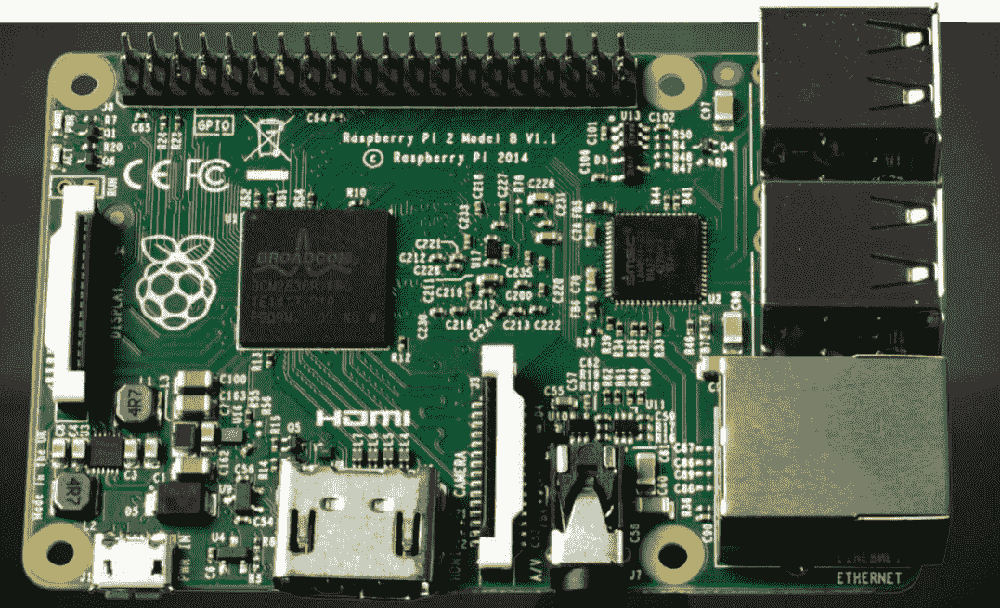

树莓派 2 上那个大正方形处理器是为 `ARM7` 内核设计的，该内核已包含在新版本中。

## 如果你将 Raspian 安装到 SD 卡，你将自动获得最新的桌面

## 我们会为 Pi 2 获得新软件吗？

### 我可以在树莓派上使用这些软件吗？

从技术上来说是可以的——许多软件都在仓库中，所以如果你想要，可以安装它们。然而，大多数软件并没有针对树莓派进行优化，导致它们运行速度非常慢。

西方用户习惯于从上到下、从左到右阅读，并不习惯移除“选项（Options）”类别，他们之前清理了该类别以便于安装软件并将其放置在任何他们的地方。界面审美也经过了微更新，使其看起来更悦目。

### 所以我猜我可以使用轻量级版本。树莓派还有其他桌面吗？

实际上，唯一提供的轻量级桌面是 `LXDE`。你可以使用 `sudo apt install lxde` 来安装。`LXDE` 的用性稍微更好，特别是配合目前的更新。

新的 Raspian 拥有一个精细抛光的界面，但我们想要新玩具。

既然我们现在正在讨论 `Pi 2`，我们询问了 `Eben`，树莓派基金会是否考虑在软件方面投入更多资金，就像去年对 `Epoch` 那样（这带来了很棒的新旧交替桌面环境）。

我们对 `OpenOffice` 感兴趣但不需要内存——它操作起来也有困难——`OpenOffice` 实际上在 `Pi 2` 上运行良好，只是在 `Pi 1` 上不行。另一件事当然是将组件限制到其他领域，例如 `Scratch` 和 `Smalltalk` 的优化。我们还在等待他们是否为 `ACID` 做出贡献以添加一些功能，`ACID` 是欧洲核子研究组织（`CERN`）的一个开源设计软件。

我们将继续这样做。“甚至仍在继续。”我们正在设计更多与我们相关的应用程序，无论是为了通用优化还是特定需求。我们花费了半个月的美元进行开源软件的研究和工程工作。

在软件软件方面还没有确定的计划，但我们确实会看到基金会至今已投资的项目得到持续的改进。

### 啊是的，这些更新是指什么？

它们主要是为了提升体验，最明显的变化是面板和菜单变得流畅得多。显然，这对于……更加自然。

### 好的，那么我如何更新它？

当你使用最新镜像将 Raspian 安装到 SD 卡时，你将自动获得最新的桌面，无需手动擦除卡，你也可以在终端输入以下内容：

```
sudo apt get-update

sudo apt get-dist-update

sudo apt get install raspberry-ui-mods
```


# RasPi
面向树莓派爱好者的数字杂志


在树莓派上使用加速度计
为你的新树莓派项目添加技术，以实现你可能想到的

## RasPi
设计 构建 代码
上手操作你的树莓派
精通你的 PI CAMERA

65 页 PI 内容

树莓派相机
修订版 1.3
Minecraft Pi Plus 程序

# 免费
示例刊号

RasPi
设计 构建 代码
免费
制作一台 PI BUGGY
14 页
由树莓派的力量驱动

# 项目

# 访谈

# 教程

# 专家建议


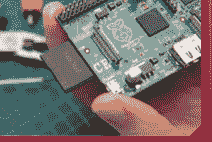


# 在 Google Play 和 iTunes 下载免费应用

# 评测

77 组组测试 | 82 Keybase | 84 树莓派相机机器人

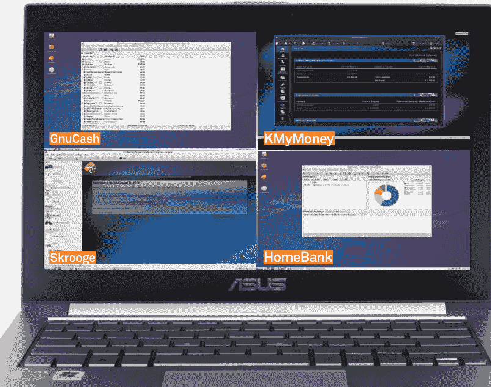

## 组测试

### 财务经理

对于日常预算和管理完整的业务账户，什么是最好的软件？

#### GnuCash

这款拥有 15 年历史的成熟软件长期以来被视为 Linux 用户可靠的财务管理工具。它基于文档中解释的标准复式记账——为家庭和商业用途提供了一套完整的工具包。

**下载：** `bit.ly/15CVC1e`

#### KMyMoney

KDE 的财务软件在项目中已存在多年，并具有同样大的用户量。它也基于传统的复式记账，在许多方面与之相似，只是用户界面和处理某些数据输入循环的方法略有不同。

**注册：** `bit.ly/19ysRo`

#### Skrooge

KDE 的财务软件在项目中已存在多年，并具有同样大的用户量。它也基于传统的复式记账，在许多方面与之相似，只是用户界面和处理某些数据输入循环的方法略有不同。（注：此处 OCR 文本存在重复，将保持其逻辑流）

# 财务管理器

探索日常及业务银行服务的最佳选择

# 评测

### Skrooge

Skrooge 专注于用户友好性，具有与其同类产品相比独特的功能

# HomeBank

HomeBank 是一个侧重于清晰报告和统计的跨平台工具

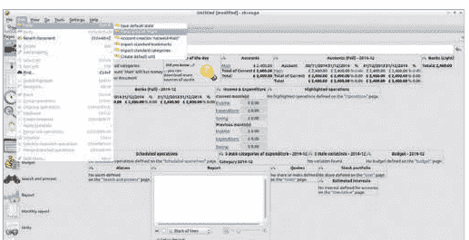

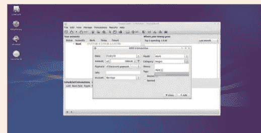

在关闭并重新打开后，撤销/重做工具仍然有效

配置完成后，你会发现你的账户、收款人等变得更易于使用

## 可用性

不需要担心复式式记账，虽然功能稍弱，但记录交易非常简单。它还有一些出色的创新，比如撤销和重做，它们可以在不同会话之间保留完整的历史。你可以使用书签、调整自定义属性并创建自定义警报。

## 可用性

使用 `HomeBank` 需要一些时间，因为在进行任何交易之前，你需要手动设置账户、收款人、类别、自动导入、计划交易和预算。一旦完成这些，你会发现记录收入和支出是轻而易举的。一切都聚焦于清晰。

## 家庭预算

它的简单性使其非常适合个人财务管理。菜单、界面和显示几乎没有杂乱——如果你不需要高级功能，这将。仪表板非常详细，向你展示本月和上月的收支。你还可以搜索交易。

## 家庭预算

除了可以记录由于初始设置产生的高额交易外，主界面右侧还显示了一个分段饼图，当你记录主要类别时，该图会自动更新（带有下拉菜单以进行自定义）。

## 会计工具

比其他工具更精简——发挥了其作为日常使用快速工具的优势。每月报告（自动生成、视觉化摘要）和基础报告（无模板）、计划导入所有会计工具都具备。

## 会计工具

在专业会计方面这里什么也没有。最新的报告显示了随时间变化的趋势、金额和统计数据，因此甚至没有损益表。尽管如此，基础报告为你提供了清晰度——体现在结构和设计选择上。

## 兼容性

可以使用清洁导入向 `Skrooge` `QF` 和 `CSV` 文件，你也可以从一系列其他财务软件导入，包括此组中的所有其他软件。一个很棒特性是在手动导入数据时，可以通过上下文菜单管理重复交易。

## 兼容性

你可以将 `QF` 和 `QKF` 文件导入你的特定格式中（你可以在设备上查阅）。同样，界面在导入向导方面表现优异，特别是在显示信息方面，但对于测试中的其他一些软件来说，选项并不算丰富。

## 总结

`Skrooge` 完全属于专业部门，但话又回来，这里并不是你关注的重点，这里。如果你只是想跟踪和预算你的支出，强烈推荐这个。

## 总结

我们喜欢 `HomeBank`。它由于设置过程而有点不同，对于许多账户和收款人来说，过程可能非常长，而且没有导入默认值的方法——但这是值得的。

# 评测

# 财务管理器

## 简报：对比并权衡我们的结论

### GnuCash

## KMoney

### Skrooge

## Homebank

还可以，但有学习曲线；不是特别直观

感觉 KDE 团队给了 GnuCash 一番关爱

如果你不需要使用业务级工具，那太棒了

不可惊的界面和完全自定义的设置

| 特性 | GnuCash | KMoney | Skrooge | Homebank |
| :--- | :---: | :---: | :---: | :---: |
| **可用性** | 5 | 7 | 6 | 8 |
| 有点笨拙，但有一些实用的功能 | 与 GnuCash 功能非常相似；在此基础上还有额外功能 | 比 GnuCash 和 KMoney 有优势 | 功能比其他工具少但更好 |
| **家庭预算** | 6 | 7 | 8 | 5 |
| 可以管理一个小型家庭用户程序 | | 拥有一套易于使用的会计工具 | 现在为了其他人提供了，是刻意为之 | 限于家庭用户，但在良好的报告上加分 |
| **会计工具** | 6 | | 5 | |
| 极佳的导入：在使用之外有一些问题 | 广泛的导入范围和实用的功能 | 清理导入的有用工具；相当 SBA |
| **兼容性** | 5 | | 6 | |
| 拥有所有工具，但家庭用户可以访问 | 非常适合每个家庭账户管理 | 外观良好但导入范围较小 | 一只要你完成了漫长的设置，就是完美的 | 比家庭用户更适合专业人士 |
| **总结** | 5 | 7 | 7 | |

## 获胜者是...

### KMoney

由于我们正在测试的是一个对家庭和业务用户都能提供最多内容的软件包，因此很快我们发现主要竞争对手将是 `GnuCash` 和 `KMoney`。两者非常相似，从你处理的喜好、类别到它们提供的选项都是……

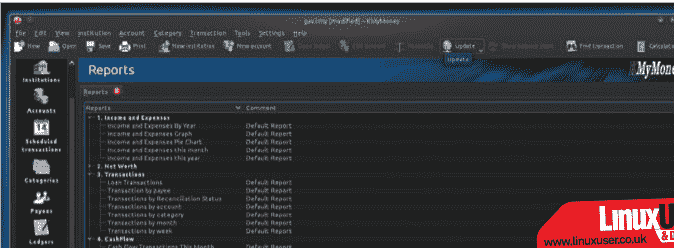


> 你可以拥有的每个财务报告都精美详尽

然而，特别要提到 `HomeBank`。由于设置过程，它有点不同，对于许多账户、收款人来说过程可能非常长，而且没有导入默认值的方法——但这是有回报的。

# 评测


+ - 用户通过 Keybase 访问各种设施，包括加密

# 软件

## Keybase

一种新的加密方式，Keybase 承诺提供简单化的证明，不需要物理

加密在近来已成为一个热门话题，但很少有人会认为自由和私密通信是坏事。`GNU` `Privacy` `Group` 是一个强大的工具，但对于那些只需要一点隐私的。

`Keybase` 由 `Mox` `Bernstein` 和 `Ian` `Cohn`（社交网站 `OkCup` 的创始人）创建，它是 `GPG` 的一个封装。一个开源命令行程序与网站配合，而实际加密由 `PG` 提供——这意味着它是已知的、安全的。

`Keybase` 在社交网络方面支持“信任网络”概念。通过网站或控制台生成加密签名的消息，这些消息托管在网络资料，甚至是 `DNS` 记录中。当另一个用户使用公密钥时，他或她可以通过这些“证明”找到正确的密钥。

# Keybase

公共加密的新视角

## 评测

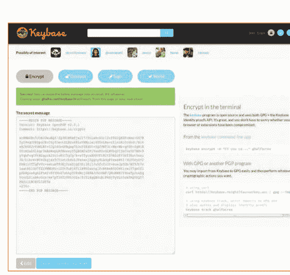

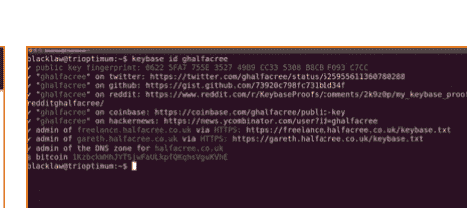

任何人都可以使用 `Keybase` 为其某个成员加密消息，即使他们没有账号。

`Keybase` 的社交网络证明可以帮助你解决对物理会面的需求——即在“签名签名对”上。

## Keybase 是目前最灵活的 GPG 接口之一

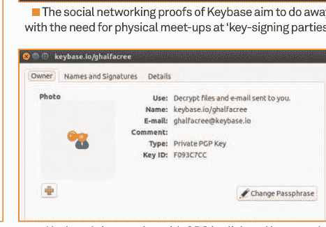

`Keybase` 接近完美。它提供了一种简单的方法，可以从任何设备、开源软件管理 `GPG` 消息。对于更具技术性的用户来说，它在所有平台之间集成 `GPG` 密钥的能力是其优势。任何通过这些身份进行搜索的人都将被重定向到公钥，该公钥可以通过所有其他证明进行验证，以确保它是正确的密钥。一旦检索到，密钥可以使用 `Keybase` 命令行应用程序或兼容 `GPG` 的软件直接在 `Keybase` 网页上使用。

像 `Keybase` 这样的工具对于任何通过网页访问的用户来说是最灵活的，即使加密不是 `Keybase` 方法。目前，加密文本必须复制并粘贴到另一个消息服务中。基于 `Keybase` 的消息（包括自动加密消息的电子邮件账户）计划在近期发布。

这不应该让任何人对 `Keybase` 望而却步。它是我们见过的最用户友好的 `GPG` 兼容包，设置极其简单。目前的网页界面是直观的，只需要人们知道你的电子邮件地址。一旦它向公众开放，在任何地方都将易于使用。

`Keybase` 还可以用于从管理证明到加密和数字签名的一切。然而，后期功能需要将私钥（可以由 `Keybase` 在注册时生成，也可以由用户已有的 `GPG` 密钥）存储在 `Keybase` 网页托管主机上。

最后，`Keybase` 自身进行了集成，而命令行与现代 Linux 操作系统自动集成，将密钥保存到 `GPG` 以及作为你的“跟踪器”——一种你的信任投票。

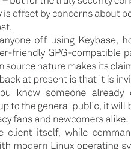

`Gareth` `Halladays`

## 总结

对于任何寻找通信方式的人推荐。

## 立即下载

`keybase.io`


83.linux.co.uk

## 评测


# 树莓派摄像头机器人

`Dawn` `Robotics` 这款更便宜且稍微不那么人生畏的机器人是一个由树莓派驱动的套件，允许大量的自定义和有趣的用例。

在之前的期数中，我们评测了 `Rover` `5` `Seededuno`，这是一个大型老旧机器人套件，非常有潜力，但在结构上存在几个问题。本月我们关注的是来自同一分销商（`Dawn` `Robotics`）的树莓派摄像头机器人，一个稍微便宜、更合理的机器人，可能没那么令人人生畏。查看第 132 期的特色介绍（可在 `Imagine` `Shop` 购买）。它使用了类似的底盘，但得益于设置中添加了一个微型 `Arduino`，对原始机器人的控制方法有了巨大的改进。它稍微少了一点 `DIY` 性，但它能帮助你获得更好的结果。

树莓派摄像头机器人根据你的预算提供几种配置。基础套件包含一个底盘（包括令人人生畏的轮子）、`Arduino` 控制板以及安装在套件前部的摄像头云台支架。还有一个很棒的小额外选项：获取一张预先加载了软件的 `SD` 卡、一个推荐的 `Wi-Fi` 适配器、电源适配器、树莓派以及完全构建机器人所需的一切，而不需要你自己的任何任何套件。这并不是绝对必要的，而且会增加价格，但对于不同技能水平的人来说很有帮助。

- 优点：便宜且需要的经验极少 - 值得你花时间构建和玩耍
- 缺点：说明书对初学者来说写法可以写得更好。没必要那么繁琐。比你想象的要容易构建

## Raspberry Pi Camera Robot

适合所有用户级别的可编程机器人

## 评测


## 技术规格

- 位置：`x2` `DC` 电机
- 控制器：`Dagu` `Arduino-Mini` 控制器、树莓派
- 传感器：树莓派摄像头、速度传感器
- 底盘：`Dago` `Magician` `V2` (`170x170mm`)
- 尺寸：`0.55` `kg`
- 自主性：并非开箱即用，但可以通过无线控制
- 价格：`£48.99` (`$74`)

## 同样考虑

左侧驱动板紧凑且设计良好，内置了电压调节器。

## 你可以轻松开箱即用并将其连接为无线访问点

`4tronix` `Pi2Go` `Lite` `$25`

# 联系我们...

网站：`www.linuxuser.co.uk`
电子邮箱：`linuxuxer@imagine-publishing.co.uk`

# 问与答

Facebook:
Linux User & Developer

Twitter:
@linuxusermag

# 您的问题已解答

向我们发送您的问题，我们将尽力解答！

# 数据库构建

你好，我正在开发一个供运行 `Windows` 用户使用的单用户数据库应用程序。为了让我和他们过得更方便，我想使用 `LibreOffice` 配合 `SQLite` 作为数据库引擎。

`LO` `Base` 不支持 `SQLite`，因为它的原生单用户数据库引擎是用 `Java` 编写的 `HyperSQL` (`HSQLDB`)。如果我改用 `SQLite` 和 `PostgreSQL`，我就不需要学习所有的 `DDBMS` `SQL` 语法了。因此，我获取了 `sqlite3-0.9991` 的代码，并进行了配置、编译和安装。它将 `README` 文件中的建议添加到了 `/etc/odbc` 和 `odbc.ini` 中。当我尝试连接它时，它不起作用，因为我找不到 `libsqlite3odbc`。够了，我已经用过 `ODBC` 或 `ODBC`，并且对其中一种有偏好。我需要帮助来安装并运行其中之一。感谢任何建议和指导。

你好，Richard！实际上有一个非常容易修复的方法：在编译 `SQLite` `v3` 时，库会寻找 `libsqlite3odbc`：只需更改一些编译指令，一切就能正常工作了。

# 针对 XWin

我发现某些 `Slackware` 在切换到某些视频模式或窗口时显示黑屏。

# 常见问题：更新发行版

问：我如何更新我的发行版？
答：某些发行版包含版本更新，例如 `Ubuntu`。如果有可用，它们通常会提示你，进行更新并添加任何必要的文件和设置。其他发行版没有这个过程，因此你需要备份文件并安装更新版本的发行版。

问：我在 `Ubuntu` 上，但没有显示发布提示？
答：使用“软件管理器”，进入“设置/更新”，点击“通知我新的 `Ubuntu` 版本”菜单，并将其更改为“对于任何新版本”。

问：我可以回到之前的版本吗？
答：不，这很困难，并且尝试将所有包降级到之前的状态。最好的解决方案是，如果你以后想回滚，请进行完整备份。

# 在编译 SQLite v3 时，库会寻找 libsqlite3odbc：


上面的 `LO` `Base` 是一个优秀的程序，尽管通常情况下 `LO` 的源码可能很麻烦。

# 问与答

您所有的问题都已解决

# Q/A

我仍然在使用 `CRT` 显示器。这些程序我以前经常使用，没有任何问题。但现在当我尝试回到某个游戏时，它会卡顿。它一直处于冻结状态，记录游戏时间，尽管它已经冻结了。我必须从另一个终端用 `sigkill` 杀死游戏，除非它在崩溃时会自动关闭 `Xwin`。

当我在窗口模式下启动（不更改屏幕模式）时，它有时会显示图形，但是一个崩溃的黑窗口。某些情况下，我只想让控制台杀死进程。

另一个游戏可以通过在黑屏时按 `Escape` 键退出并关闭。

我一直试图弄清楚发生了什么，以下是我最近的尝试：首先，我更改了它们，主要是为了帮助 `GTK+`。大部分问题需要 `Murrine`，而 `Slackware` 并不具备，所以这是另一个问题。也许我在设置里留了一些配置？

然后我将 `XFACE` 窗口更改为 `xfce`。我又把它改了回来。但我还没有修复问题。

我将外观更改为 `Raleigh`、其他一些，然后改回 `Alternate`。

以下是 `Slackware`，因为这些问题在针对游戏优化的发行版 `SteamOS` 中也被发现了。

我还向 `/etc/profile.d/gtk.sh` 添加了一行来帮助获取其样式，以停止显示 `GTK` 找不到它们的消息。注释掉这一行就解决了问题。

最后，我安装了游戏并玩了几次。它运行得几乎完全正常。

我正在尝试开始游戏某部分进行单线程化的枯燥过程。我已经尝试验证它是否有效，但它仍然给我返回代码一，以及“7. File = return code zero”。

你还有其他可以提供帮助的建议吗？

你在切换时出现问题并导致许多其他问题，这有点可疑。你在这些情况下或通常情况下是否有不同的分辨率？这会给发布带来麻烦吗？

否则，最好的可能是重新安装 `Slackware` 或创建一个用于游戏的双系统，以确保你系统中的任何黑操作都不会对游戏本身产生任何麻烦。

# 批处理文件

我尝试用那个日期修复它，但它仍然给我返回代码一，而且发生在我我的每一台 `Linux` 服务器上。

供应商说，每当我运行 `batch` 工具中的机会时，`PAM`（可插身份验证模块）都会被调用。基本上，当批处理作业应该返回非零返回代码时，我却获得了成功。如果对此有任何帮助，我将不胜感激。

`George` `Burtt`

`Red` `Hat` 通常非常擅修复此类 `bug`，这是 `Red` `Hat` 的一个记录过的 `bug`，有几种解决方法。最好的方法是使用这个，即修改 `system-auth.conf` 文件。

你可以在 `/etc/pam.d` 中找到它——用你最喜欢的文本编辑器打开它，然后寻找这一行：

```


`session optional.pam_sss.so`

```
在下方添加以下行：
session sufficient.pam_local_user
```

保存文件，并重启`ssh`以万无一失：

```
$ service sss restart
```

希望这个bug对你们所有人来说都被修复。

`Right Hat`


# 问与答

> `Wikipedia, la enciclopedia libre - GNU IceCat`

`Facebook: Linux User & Developer`

`Twitter: @linuxusermag`


# 问题与解答

解决您所有的技术问题

## Q/A


上方：`GIS`允许对地理数据进行分析

通过将所有文件放入`/usr/bin`来修复`/in`、`/bin`或`/usr/bin`中的非官方软件包。那些在仓库中不存在且需要修复的包可以生成：

稍后需要这个。我设置的更新已经发生。

```
$ pacman -O | awk '{ print $1 }' | /bin|/usr/bin| /sbin/
```

```
$ pacman -Syu --ignore
$ pacman -S --bash
$ pacman -Syu -su
```

还要检查从非官方仓库安装的软件包：

`KDE`邮件检查器根据您的需求进行高度定制，在不知道您的具体需求的情况下，我们无法提供更好的建议。

从`FTools-x86_64-3.1.0`的测试版本开始。`FTools`包含`GDAL`的`Python`封装器，这将对`ArcGIS`有帮助。

您也可以使用`GRASS`，它也支持`GDAL`，并且位于大多数发行版的仓库中。

如果这些方法都不行，`IDL`是另一个选项，它应该能满足您的一切，可能值得尝试一下。希望这些中有一个对您有效！

## 您有新邮件

您知道软件会在有新邮件到达时通知您配合吗？我目前在`Gmail`和`Yahoo`上使用`AMS`，这样我就知道什么时候收到新邮件。问题是`Windows`已经停止支持，`AMS`效果也不够好，尤其是这些通知。

另外，有桌面小部件程序吗？我想要一个显示每天收邮件数量的计数器。是否存在这样的应用？

## GIS 查询

其次，确保`InogoreRepo`或`ororGroup`中的任何包在`/bin`、`/usr/bin`中没有文件——对于它们来说这是必要的。

你好，我是来寻求建议的。在我的部门，通常使用`ArcGIS`，这种新软件能够读取`ArcGIS`创建的内容（即`.mapx`文件）非常重要。他们还有一些由我设置的其他要求。

这是对合并发生问题的修复。

如果您在`/bin`、`usr`或`/usr/bin`中有任何软件包未知的文件，您需要找到某一行。您可以使用此命令：

```
$ find /bin /usr /usr/bin -exec pacman -Qo {} + /dev/null
```


**George Burton**

如果您的账户支持，您可以使用 `ImportQuick`，它是免费的。它可以在杂乱的图标中显示邮件数量，并在您鼠标悬停在上面时显示。它还可以获取弹出消息和警报。

否则，如果您使用 KDE，有一个很好的 `plasmoid mail-checker` 插件，它可以实现类似的效果，因为它同时支持 POP 和 IMAP。

是否有任何功能丰富的 GIS 解决方案可以做到这些？

**Dan Sanchez**

您应该尝试几件事，它们可能会解决您的问题，但如果您使用自动挂载，请确保所有软件包都已挂载。当……时可能并不

`www.linuxuxer.com`

# 托管列表

### 专用服务器列表

您有认为我们应该列出的优惠信息吗？
无论您是托管公司还是寻找心仪提供商列表的满意客户，请通过邮件联系我们：
`info@linux-user-publishing.com`

| 名称和 URL | 软件包 | 电话 | 每月费用 | 最短期限 | 合同期限 | CPU 核心/速度 | 磁盘空间 | 1GBPS 连接 | 硬件 RAID | 远程电源重启 | 运行时间保证 | 永久 KVM | 网络备份 | 24/7 电话支持 |
|---|---|---|---|---|---|---|---|---|---|---|---|---|---|---|
| 200DC | 800-8654-56 | £25 | 1 个 | | 双核 2GHz | 250GB | | Raid 1 | | | | | |
| 3000DC | 800-8654-56 | £40 | 1 个 | | 双核 3GHz | 160GB | | Raid 1 | | | | | |
| 6000DC | 800-8654-56 | £65 | 1 个 | | Intel 2.5GHz 四核处理器 | 50GB | | Raid 1 | | | | | |
| 开发者 | 800-8654-56 | £2.99 | 1 个 | | N/A | 1GB | | | | | | | | |
| 经销商 | 800-8654-56 | £6.99 | 1 个 | | N/A | 5GB | | | | | | | | |
| 入门线 | | £20 | 1 个 | | N/A | 200MB | | | | | | | | |
| 入门 Windows | | £20 | 1 个 | | N/A | 200MB | | | | | | | | |
| 商业 | | £45 | 1 个 | | N/A | 400MB | | | | | | | | |
| 商业 Windows | | £45 | 1 个 | | N/A | 400MB | | | | | | | | |
| 终极线 | | £65 | 1 个 | | N/A | Unlimited | | | | | | | | |
| 终极 Windows | | £65 | 1 个 | | N/A | Unlimited | | | | | | | | |
| 铜级托管 | | £79 | 12 个 | | 双核 2.4GHz | 50GB | | | 99.90% | | | | |
| 银级托管 | | £79 | 12 个 | | 双核 2.4GHz | 80GB | | | 99.90% | | | | |
| 黄金级托管 | | £79 | 12 个 | | 双核 2.4GHz | 150GB | | | 99.90% | | | | |
| `DellPowerEdge R630` | | £85 | 12 个 | | 4核 2.5GHz | 100GB | 10Gbps | | | 99.99% | | | | |
| `DellPowerEdge R730` | | £99 | 12 个 | | 4核 2.5GHz | 100GB | 10Gbps | | | 99.99% | | | | |
| Linux VPS Pro | | £289 | 1 个 | | 2核 2.27GHz | 600GB | 10Gbps | | | | | `backup` | |
| Linux VPS Max | | £349 | 1 个 | | 2核 2.27GHz | 600GB | 10Gbps | | | | | `backup` | |
| Windows VPS Pro | | £349 | 1 个 | | 2核 2.27GHz | 600GB | 10Gbps | | | | | `backup` | |
| Windows VPS Max | | £449 | 1 个 | | 2核 2.27GHz | 600GB | 10Gbps | | | | | `backup` | |
| VPS Hyper-V | | £379 | 1 个 | | 2核 2.27GHz | 1000GB | 10Gbps | | | | | `backup` | |
| VPS Ultra Hyper-V | | £479 | 1 个 | | 2核 2.27GHz | 1000GB | 10Gbps | | | | | `backup` | |
| Heartcore Linux | | £779 | 12 个 | | 双核 3.2GHz | 1600GB | | | | 99.95% | | 24/7 技术支持 |
| Heartcore Windows | | £799 | 12 个 | | 双核 3.2GHz | 1600GB | | | | 99.99% | | 24/7 技术支持 |
| Listner Cloud | | £729 | 12 个 | | 2.50GHz | 2500GB | | | | 99.95% | 免费 | 免费 |
| `DellPowerEdge R210` | | £799 | 12 个 | | 3核 2.65GHz | 250GB | 10Gbps | 100Mbps | | | 99.95% | 免费 | 免费 |
| `DellPowerEdge R710` | | £999 | 12 个 | | 3核 2.65GHz | 250GB | 10Gbps | 100Mbps | | | 99.95% | 免费 | 免费 |
| `DellPowerEdge R210` | | £1499 | 12 个 | | 4核 2.65GHz | 500GB | 10Gbps | 100Mbps | | | 99.95% | 免费 | 免费 |

92 `www.linuxuser.com` | Option

# 托管列表

突出显示！联系 DANIEL
`daniel.gunton@imagine-publishing.uk`
`+44(0)1202 586421`

### 专用和共享服务器列表

| 名称和 URL | 软件包 | 电话 | 费用 | 空间 | 月带宽 | 账户 | 数据库支持 | 购物车 | 病毒过滤器 | 防火墙 | 网页面板 | 服务水平 |
|---|---|---|---|---|---|---|---|---|---|---|---|---|
| blackout (`www.blacklight.com`) | 减少 | 44 885 52042 | £49.95 | 10GB | 1.5GB | | | | | | | |
| blackout (`www.blacklight.com`) | 邮件 | 44 885 52042 | £59.95 | 20GB | | | | | | | | |
| Digital Gibson (`www.gibbon.com`) | 检查 | 44 885 52042 | N/A | Free | | | | | | | | |
| Digital Gibson (`www.gibbon.com`) | 数字 | N/A | £12 | 500MB | Unlimited | | | | | | | |
| Digital Gibson (`www.gibbon.com`) | N/A | £18 | GB | Unlimited | | | | | | | | |
| erhosting (`www.erhosting.com`) | `WordPress` | 44 999 6100 | £23.99 | 1.2GB | 25 | | | | | | | |
| erhosting (`www.erhosting.com`) | 入门 | 44 999 6100 | £34.99 | 2GB | 10 | | | | | | | |
| erhosting (`www.erhosting.com`) | 专家 | 44 999 6100 | £65.98 | 5GB | 25 | | | | | | | |
| Equipage (`www.equipause.com`) | 虚拟 | 44 999 6100 | £227.88 | 50GB | Unlimited | | | | | | | |
| Equipage (`www.equipause.com`) | 银级 | 021 314 6685 | £42 | 450MB | 250 | | | | | | | |
| Equipage (`www.equipause.com`) | 黄金级 | 021 314 6685 | £10 | 1GB | 100 | | | | | | | |
| Eurofast (`www.eurofast.com`) | 仅限邮件 | 23 380 24983 | £20 | 2GB | 20 | | | | | | | |
| Eurofast (`www.eurofast.com`) | 托管 | 23 380 24983 | £75 | 5GB | 20 | | | | | | | |
| Eurofast (`www.eurofast.com`) | 超级 | 23 380 24983 | £120 | 10GB | 25 | | | | | | | |
| Evolving (`www.evolving.com`) | 入门 | N/A | £39.99 | 50GB | 1GB | | | | | | | |
| Evolving (`www.evolving.com`) | 家庭 | N/A | £54.99 | 80GB | 2 | | | | | | | |
| Evolving (`www.evolving.com`) | 商业 | N/A | £99.99 | 100GB | | | | | | | | |
| Evolving (`www.evolving.com`) | 电子商务 | N/A | £158.99 | 300GB | Unlimited | | | | | | | | |
| Geacom (`www.geacom.com`) | 商业版 | 0800 542 7500 | £199 | 100GB | 200 | | | | | | | | | |
| Heart Internet (`www.heart-internet.com`) | 托管 | 0846 745 7770 | £89.99 | 10GB | Unlimited | | | | | | | | |
| Heart Internet (`www.heart-internet.com`) | 商业专业级 | 0846 745 7770 | £129.99 | Unlimited | Unlimited | | | | | | | | |
| Heart Internet (`www.heart-internet.com`) | 企业级 | 0846 745 7770 | £249.99 | 500GB | Unlimited | | | | | | | | |

## 您的观点

`Twitter`:
`@linusermag`

`Facebook`:
Linux 用户与开发者

您的 Linux 新闻与观点来源

联系我们...
直接向我们发送电子邮件：
`linuxus@imagine-publishing.co.uk`
提前感谢您。

## 您的观点

## Linux 用户来信

我们对本杂志、`Linux` 以及开源软件的看法

## Ubuntu 设备

你好！关于 `Ubuntu` 手机和平板电脑的传闻似乎再次升温了，感觉我们已经等了非常久。你愿意对此透露一些内幕吗——对它们来说，已经太晚了吗？

至于平板电脑，就是你听过的 `UTab`。这款设备最初发起了 `Indiegogo` 营销，直到在 `Ubuntu.com` 开启预售后才停止（资金是如何筹集的呢？），而且它不仅为 `Android` 和 `Linux` 打造，还配备了旋转驱动器——除了 64GB 的闪存存储空间外，还有一个高达 1TB 的硬盘，用于存放你的操作系统。此外，它的价格仅为 499 美元，如果你想升级到 1TB SSD，则为 699 美元。遗憾的是，`UTab` 的电池续航时间只有 5-7 小时。

如果你从磁盘、`USB` 或 `SD` 卡进行现场启动。即使你的宿主机没有被硬盘任务的内存占满，而是你的 `IP` 地址（例如）不会在虚拟机之外暴露，但你的活动痕迹仍可以从硬盘中找回。除非你工作得比生活在虚拟机里还要刻苦，否则它仍会留下痕迹。如果你需要使用该发行版，那么最好将它安装在 `SSD` 上。

`Carlen K`

我们可能在明年看到第一批 `Ubuntu` 手机，这真是太好了！正如我们在上个月的一封信中提到的，`Ubuntu` 的手机合作伙伴之一最近确认了在 2 月发布，所以当你读到这封信时，`Ubuntu` 手机已经上市，或者迫在眉睫。目前还没有来自小米（另一个发布方）的消息，但希望他们很快跟进。

## 虚拟化 Tails

大家好，
在 `VirtualBox` 虚拟机中（在 `Windows` 宿主机上）运行 `Tails` 镜像会被认为会导致安全漏洞吗？结果是如果你有某种形式的恶意软件，`Tails` 将无法保护你；例如，如果此类恶性软件在后台运行，`Tails` 无法保护你。`Tails` 只保护

`Jeni`

## Android 杂志

`UTab`。一款为媒体爱好者打造的 `Ubuntu` 平板电脑。

随着越来越多的 `Android` 功能被合并到 `Linux` 内核中，你不认为为这种最流行的移动操作系统之一进行开发要容易得多吗？全球范围内有 250 多个应用和超过 1 亿台 `Android` 设备，有数百万观众准备好消费这些应用。如需了解更多以 `Android` 为导向的方法，可以参考我们的姐妹杂志《Android 杂志》，这是唯一专注于 `Android` 的杂志。除了能让你掌握 `Android` 动态的新闻和评测外，还有关于如何黑客你的世界的教程和建议。访问 `www.littlerobot.com` 了解更多。


显示 `UTab` 规格和价格的表格

## 专题裸谈

## 全方位在线隐私

作为本期安全功能的序篇，我们上个月在 `Reddit` 上分享了关于在线隐私的指南，并引发了一些有趣的评论。欢迎 `reddit/r/2mm9` 加入讨论。

`gutgien`
- 完全认为浏览器选择很重要，没问题。如果你使用 `Chrome` 或其他私有浏览器——你的隐私面临着风险……

`hatpageeree`
- 完全不完整的隐私指南。

`Vegetano`
- 然而，`Chrome` 是目前最难被攻破的浏览器。

`gutgien`
- 我认为将我的个人数据并卖给最高出价者（政府）视为一个开放市场。

`Sigg3nat`
- 你提出了安全中最重要的的一点——一旦你交出数据，它就消失了。但不要忘记除了技术之外，我们必须保护自己的隐私。大多数政策取决于我们。

`hatpageeree`
- 我们必须保护我们的政客。听起来很容易。

`Sigg3nat`
- 我没说容易。一个复杂的世界意味着经济脱离了意识形态，这带来了许多好处。然而，只要代理及其利益实体实行一种假设资源无限的现代生产模式。我们需要知道这个保护系统的补救，但任何人都能看出它在于……

`RealFreedomAusd`
- 安全领域的实践是假设任何系统始终可能被破解。那些人永远不会有虚假的安全感。开源硬件会帮助我们，或者其他人可能拥有完全的隐私。

他们可能会说“我已经足够隐私了，我觉得不值得冒使用 `XYZ` 通信的风险，而且并不完全隐私”，你应该信任自己，除非你从未拥有权力。

跟随他人的做法会让一个国家很难信任我们，除非你位于特定的地点。

隐私（以及泛指的浏览器）并不是加密私有的。

我很确定加密，但如果破解它需要数百万年才能达到足够坚固的，那么攻击者执行成功攻击的可行性有多少？在我看来，这种自由可以改进到重要的程度。

加密算法不是唯一的攻击向量。它可以真的、真的非常如此。

`RealFreedomAusd`
- 你提交的任何材料风险自担，任何代理或订阅者均不对损失或损害承担责任。

**贡献者**
- 如果你想向 `Imagine Publishing` 提交材料，请发送电子邮件至 `editorial@imagine-publishing.co.uk`。我们不对纸质或在线提交的任何损失负责。

**FileSite.uk**
- 本杂志的文章和代码可以在此处查看：`filesite.uk`

**国际版**
- Linux 用户版适用于：国际分销：Citty Blackman

**订阅**
- 所有订阅请发送电子邮件至 `subscriptions@imagine-publishing.co.uk`，电话：`+44 (0)1202 96111 13`，价格：70-80 英镑（仅限英国）

**制作**
- 制作总监：James Hawkes，总经理：Daniel Dunn

**打印**
- 打印：William Gibson, 26 Pleasing Street, Bournemouth, BH1 1SE

**出版**
- 出版：Imagine Publishing Richmond Road, 33 Richmond Hill Bournemouth, Dorset BH6 6EZ

英国及其他地区分销：Distribution Publishing Ltd 110 Sunderland Street, London, SE1 10AY

澳大利亚分销：Book Publishing of Baxter Media Level 4, Elizabeth Street, Sydney, NSW 2000

# FileSilo

# 您的免费资源

登录 `WWW.FILESILO.CO.UK/LINUXUSER`，即刻下载最新的发行版和免费软件

您关注本杂志所需的所有发行版、开源软件（FOSS）和代码


Pentoo


SparkyLinux


# 最新发行版

# SteamOS


NixOS


> 您的额外资源

在本期 FILESILO 中，这些资源对 LINUX 用户和开发者读者免费且独家。发现这些极佳资源...

- 4 种最新发行版，包括 SteamOS、NixOS 14.7、SparkyLinux 3.9 和 Pentoo；以及 15 种基础发行版，包括 GMR、Git2、Grubcha 和 Ubuntu。
- 免费 Linux 基金培训和树莓派项目视频：超过 17 小时。
- Cacti 插件的代码和素材以及 Gget2 图形教程。

| carti | 论坛 | 仓库 | 文档 |
|---|---|---|---|
| 首页 | | | |
| 文档 | | | |
| 常见问题 (FAQ) | | | |
| 帮助 | | | |
| 论坛 | | | |
| 插件 | | | |
| 模板 | | | |
| 博客 | | | |
| 推荐插件 | | | |
| 应用注册 | | | |
| 自动化 | | | |
| 构建 | | | |
| 检查 | | | |
| 引用 | | | |
| 数据 | | | |
| 发行版 | | | |
| 框架 | | | |
| 接口 | | | |
| 转为 HTML | | | |

| Hook API 参考 | |
|------|------|
| Cacti 开发者。 | |
| 构建并理解以下内容的实现： | |
| MacTrack | MacTrack SVN |
| Tiled SVN | | |
| Trid SVN | | |
| Brood SVN | | |
| Brood SVN | | |
| Hook File | | |
| add_graph_template_to_list | | | |
| add_graph_template_to_host | | | |
| add_graph_template_to_user | | | |
| collect | | | |
| host_file | | | |
| delete | | | |

# 顶级 Linux 开源 (FOSS)

视频教程时长：

# 17 小时教程代码


`www.filesilo.co.uk/linuxuser`

# FILESILO – 专业级资源之家

探索您的免费在线资产

- 一个快速增长的资源库
- 持续更新酷炫资源
- 让您保持下载内容的整洁
- 随时随地浏览并访问您的内容
- 不再有弄坏页边距的撕光页
- 再也没有损坏的光盘
- 纸质订阅者可获得所有内容
- 数字杂志所有者也能获得所有内容！
- 每期内容随您的杂志免费提供
- 安全在线访问您的免费资源


这是您第一次需要注册 FileSilo。之后，您可以使用提供的电子邮件地址和密码。最热门的下载显示在此轮播中，看看其他读者在享受什么！


如果您正在寻找特定类型的发行版或 `Python` 文件，使用这些过滤器来缩小搜索。


绿色锁显示您已访问的内容。红色锁显示您需要购买或解锁的内容：热门下载列在此处，您可以立即查看下载最多的内容。查看高评分列表，看看他人投票最好的资源！

| 热门下载 |
|------|
| 1. Ubuntu |
| 2. Linux.js |
| 3. Kali |
| 4. Ubuntu 14.04 |
| 5. Linux17 |
| 6. Clementine |
| 7. Ubuntu 教程 |

| 高评分 |
|------|
| 1. Ubuntu 14.06 |
| 2. Debian |
| 3. Clementine |
| 4. Fedora |
| 5. Tails 1.2 |
| 6. Calgary |
| 7. Jemantal |
| 8. Ubuntu 14.05 |
| 9. Speedmedia |


发现更多关于我们在线商店、隐私和联系的常见问题。发现我们精彩的杂志以及它们提供的丰富内容和信息。


# FileSilo 如何访问您需要的一切数字

要访问 FileSilo，请访问 `www.filesilo.co.uk/linuxuser`

- 01 按照屏幕说明在我们安全的 FileSilo 系统中创建账户，通过回答关于您杂志的简单问题来解锁。
- 02 如果您是纸质订阅者，可以通过输入 Web ID 轻松解锁所有内容。您的 Web ID 是订阅标签上面的数字字母代码，也可以在信件中找到。
- 03 您可以使用任何流行的浏览器（如 `Firefox`、`Chrome` 或 `Safari`）在桌面电脑、平板电脑或智能手机上访问 FileSilo。但我们建议您使用桌面电脑下载内容，手机或平板可能无法下载文件。
- 04 如果在访问 FileSilo 内容或注册过程中遇到任何问题，请查看 `imagine-publishing.co.uk` 上的常见问题。


# 10 最佳 Linux 桌面


# 更多教程和灵感

看完这一期了吗？Linux User & Developer 网站上有大量免费的开源资源等待着您。每天上传专题、教程、评论、观点和最佳开源新闻，涵盖 Linux 内核开发、热门的新发行版和开源软件、树莓派项目和采访、编程指南等。加入我们蓬发展的 Linux 用户和开发者社区，发现新的 Linux 工具。


# www.linuxuser.co.uk

LinuxUser 第 150 期于 2015 年 3 月 12 日在 GreatDigitalMags.com 出售

# 树莓派满意

准备迎接英国最快供应商提供的面向未来的 IT 产品。所有最新产品现货供应，价格极优


- t: `+44 (0)1366 380605`
- e: `sales@newwit.co.uk`
- a: Unit 2, 12 St Johns Way, St Johns Business Park, Downham Market, Norfolk, PE38 0QQQ

- 模型 B+ 即插即用套件
- 树莓派摄像头
- PIFACE 控制与显示 2
- 模型 B+ 豪华外壳
- 官方 B+ 电源组
- 模型 B+ 项目套件

# wirelessthings.net/openhardware


