# Linux 用户与开发者 151 个树莓派项目

## 欢迎词

欢迎来到《Linux 用户与开发者》第 151 期

**每期低价订阅 Linux User**

第 36 页

+ 你的 Linux 专家团队..

- `Rob Zwetsloot` 主修航空航天工程，使用 `Python` 进行复杂模拟建模。由于分区故障，`Rob` 无法让多任务 `LLI`& `Flying Fortress` 摆脱 `JRPG` 模式，他现在被困在空中，穿着 `Cmd`。他的 `LVM` 研究（第 48 页）被扔出窗外并由 `chocobo` 送达。

- `Jon Masters` 是一名 `Linux` 内核黑客，从事 `Linux` 开发工作已近 19 年，自 13 岁首次上大学起便开始了这段旅程。`Jon` 居住在马萨诸塞州剑桥市，为一家大型企业 `Linux` 供应商工作。本月你可以在第 16-17 页看到他精彩的内核专栏。

- `Richard Smedley` 在 `WYSIWYG` 出现很久之前就开始使用计算机，并且至今仍认为命令行和 `Emacs` 是最具生产力的工作环境。本月 `Richard` 解释了如何排查和修复网络连接（第 30 页），并挑选了最好的带标签页的终端模拟器（第 77 页）。

- `Mihalis Tsoukalos` 是一位 `UNIX` 系统管理员，精通编程、数据库和数学。他自 1993 年起就开始使用 `Linux`。`Mihalis` 在本期中紧跟 `Richard` 的网络功能文章，深入探讨 `netstat`（第 50 页），并开启了他关于编码和解决问题的新专栏（第 13 页）。

- `Alexander Tolstoy` 使用 `Linux` 多年。虽然简洁是智慧的灵魂，但 `Alexander` 喜欢详细撰写关于桌面 `Linux` 的内容。自安装第一个从软盘安装的发行版起，他一直在这样做。在他的第一篇 `LXDT` 教程中，`Alexander` 向我们展示如何通过安装更好的 `Qt` 应用来自定义和改进基本的 `LXQt` 桌面（第 54 页）。

- `Gareth Halfacree` 是我们的驻地新闻记者，从第 8 页开始为您带来开源世界最新的动态。本月，`Gareth` 还测试了期待已久的 `Intel Edison` 模块及其配套扩展板，看看自 `CE7` 以来发生了哪些变化（第 82 页）。

**欢迎阅读最新一期的《Linux 用户与开发者》，这是英国和美国最喜爱的 Linux 及开源杂志。**

关于树莓派 2 的讨论热度依然很高，我们开始看到下一代项目出现，它们利用新的处理能力实现了比以往更多的功能。

不过，在这里的“空中堡垒”（`Flying Fortress`），我们仍然认为一些最好的项目是那些将旧设备、损坏设备拆解并转化为新颖精彩之物的硬件技巧。于是我们走访了一些优秀项目的制作者——了解如何在孩子的卧室里放上一艘宇宙飞船，如何对旧电视和收音机进行升级改造，如何制作一个让你时刻保持警觉的闹钟，等等，所有内容从第 18 页开始。

本月，我们也迎来了更多 `Linux` 专家登船。从第 54 页开始，`Alexander Tolstoy` 将带我们探索 `Qt5` 应用程序栈，而 `Anna Kobylinska` 和 `Filipe Martins` 将从第 58 页开始指导我们入门虚拟 `Linux` 实例。此外，你可以加入 `Mihalis Tsoukalos` 在全新的编码专栏（第 13 页）中，每期他将教给我们解决编码问题的基本算法技能。本期还有来自代码质量专家 `Coventry` 的客座专栏，你可以在第 14 页找到。要了解本期还有哪些内容等着你，请翻页——享受你的杂志吧！

`Gavin Thomas`, 副主编

## 联系我们团队：

`linuxuser@imagine-publishing.co.uk`

`Facebook`: `Linux User & Developer`

`Twitter`: `@linuxusermag`

在线购买 `magazineshop.co.uk`

访问我们的在线网站获取更多新闻、观点、教程和评测：

`www.linuxuser.co.uk`

## PCI Express LTD

英国分销商

`TBS` 是一家专业的数字电视调谐器制造商。

其产品包括：

- `DVB-S/S2`（标清卫星电视 & 高清卫星电视）

- `DVB-T/T2`（标清地面数字电视 & 高清地面数字电视）

- `DVB-C`（标清有线电视）

- `IPTV` 流媒体播放器

- `USB` 电视调谐器

拥有多种选择：

单调谐器、双调谐器、四调谐器

通用接口（`CI`）

以及最新推出的 `MINI` 调谐器（见下文 7220 型号）

所有 `TBS` 调谐器均兼容 `Windows 7 Media Center`，并支持最新内核的 `Linux`。

### 为您的 PC 获取最佳数字电视调谐器！

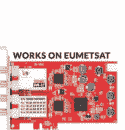

## TBS 6908 专业级高清 DVB-S2 四调谐器 PCIe 卡

`TBS6908` 是一款具备 `PCI Express` 接口的专业级数字卫星电视调谐卡。它不仅支持普通卫星接收机支持的常规 `DVB-S2/DVB-S` `QPSK`、`8PSK`，还支持 `CCM`、`ACM`、`VCM`、多输入流（`Multi Input Stream`）、`16APSK`、`32APSK` 和通用流模式（`Generic Stream Mode`），这些特性大多数卫星接收设备无法支持。通过使用专用的 `TBS` 工具，可以捕获这些特殊数据流。已准备好 `Windows BDA` 驱动和支持至最新 `3.X` 内核的 `Linux` 驱动。

建议零售价 £329.95

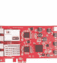

## TBS 6905 高清 DVB-S2 四调谐器 PCIe 卡

`TBS6905` 是一款具备 `PCI Express` 接口的数字卫星电视调谐卡，配有四个调谐器，可在 `PC` 上观看和录制 `FTA`（免费开放接收）卫星电视。四个调谐器允许您同时观看一个转发器或卫星上的电视频道，同时接收来自其他不同转发器/卫星的三个其他频道的节目。它与 `Windows 7 Media Center` 以及流行软件如 `MediaPortal`、`DVBlink`、`DVBDream`、`DVBViewer`、`ProgDVB`、`Skynet`、`T$reader`、`XBMC` 和 `MythTV` 兼容。

建议零售价 £179.95


## TBS 6290 双 T2/T/C 双调谐器双 CI PCIe 卡

`TBS6290` 是最新的 `DVB-T2/T/CI` `Express` 调谐器，允许您同时以两种不同的频率观看两个现场地面数字电视频道，并且同时支持接收 `FTA`（免费开放接收）电视频道和加密电视频道。`TBS6290` 可用作数字视频录像机，记录支持完整 `HDTV` 的地面数字电视节目。它还具备时移功能。

建议零售价 £179.95


我们迄今最小尺寸的卡！

## TBS 7220 DVB-T2/T/C 调谐器 mini PCIe 卡

`TBS 7220` `DVB-T2/T/C` 调谐器 `mini PCIe` 卡是一款增加了 `DVB-C` 功能的地面数字电视调谐卡，允许您在 `PC` 上享受免费开放接收（`FTA`）的数字地面/有线电视和数字立体声广播。`TBS 7220` 可用作数字视频录像机，记录支持完整 `HDTV` 的数字地面/有线电视节目。它还允许您通过时移功能暂停现场广播，并从中断处继续观看。它非常适合观看英国的 `Freeview` 标清和高清节目。

建议零售价 £69.95

### 请访问我们的网站查看更多精彩的 TBS 产品

`www.tbscards.co.uk`

**独家优惠**

在 `www.tbcards.co.uk` 在线购买，使用代码：`LINUXUD` 购买任何 `TBS` 产品可享 9 折优惠。

欢迎贸易咨询

邮箱：`mike@pcixex.co.uk`

- 在线购买：

    - `www.radtv.co.uk`

    - `www.valueav.co.uk`

    - `www.amazon.co.uk`

## 今天就加入我们的读者调查小组！

在 `linuxuser.co.uk/survey` 完成我们的 3 分钟调查，赢得加入我们调查小组的机会。


你好。我们热爱制作《Linux User & Developer》，也希望您喜欢阅读它。今年我们想让它变得更好，并希望您参与到它的演变中。只需回答几个快速问题，您就有可能被选中加入我们首个《Linux User & Developer》读者调查小组。我很期待听到您对杂志的看法以及我们如何为您改进它。

`Gavin Thomas`

副编辑


加入我们的调查小组，帮助我们让杂志变得更好！


## 完成我们的调查以加入我们的 `Linux User & Developer` 调查小组，您可以：

- 在他人之前看到新的想法和变化
- 受邀参加您所在地区的特别活动
- 有机会前来会见《`Linux User & Developer`》团队
- 测试第三方产品以撰写评测
- 塑造杂志未来的发行内容
- 参加独家竞赛


只需 3 分钟！

完成我们的调查，今天就赢得您的位置 `linuxuser.co.uk/survey`

## 开源

08 新闻 | 12 观点 | 94 读者来信

## 内核

## Linux 4.0 发布，支持无重启热补丁

Torvalds 从 3.x 分支跃升，坚持“保持袜子干燥”（指版本号变化不大）

Linux 内核 4.0 已正式发布，虽然从 3.x 分支突然跃升可能会让人惊讶，但随之而来的还有一个受欢迎的新技术发展：无需重启即可修补正在运行的实时内核的能力。

2013 年 11 月，创始人兼维护者 Linus Torvalds 暗示正在准备发布一个新的完整版本，并开玩笑说：“我们即将达到必须脱掉袜子才能数到那么高的版本号。” 为了“保持数字小而易记”，Torvalds 建议 Linux 3.20 将作为 Linux 4.0 发布——现在他正式履行了这一计划。

Linux 4.0 现在成为主线版本，并附带一项具有有趣发展历史的主要特性：无需重启即可在实时系统上修补内核的能力。这项功能最初在 2008 年就以名为 `kSplice` 的项目形式提供给 Linux 用户。该软件使用 `stop_machine()` 功能暂停系统，修补内核，然后在不重启的情况下重新启动各项服务。

`kSplice` 证明了其有用性，但在 2011 年被 Oracle 收购，现在作为专有服务存在，没有进一步开源发布的计划。随着客户要求类似功能，SUSE 和 Red Hat 开始开发他们自己的实现——`kGraft` 和 `kPatch`——并于去年几乎同时发布了早期版本，每种设计都专门针对各自的发行版工作。

“对于相关方来说，显然在这种情况下，让多个孤立的解决方案共存于内核中来解决同一问题是绝对不切实际的，”内核开发者 Jiri Kosina 在给 Torvalds 的关于新实时修补功能的拉取请求备注中解释道。“在 `LPC`（‘Linux 管道工’会议，在杜塞尔多夫举行）专门的‘实时内核修补’环节，所有相关方坐在一起，达成了一种对两个发行版供应商都适用的联合方案。

“它提供了一个用于功能‘实时修补’（即代码重定向）的基本基础设施——包括包含实际补丁的内核模块 `API`，以及允许用户空间操作补丁（查询已应用的补丁，启用/禁用它们等）的 `API`/`ABI`，”Kosina 解释道。

Kosina 将其描述为“相对简单和极简”，新功能使用 `ftrace` 和其他现有内核基础设施以降低复杂性，并且它是自包含的。其初始版本是 `x86` 硬件的参考实现，对 `PowerPC`、`S390` 和 `ARM` 架构的支持已在开发中。

Red Hat 和 SUSE 均已同意，随着 Kosina 的拉取请求正式被 Linux 内核接受，他们将开始着手工作，将各自等效的功能移植到新的通用基础设施中。这意味着放弃他们现有的树外项目，转而采用更具跨兼容性的方案。


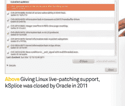

## 新闻

Linux 社区的最新动态

开源

### Linux 日历

`5 月 1 日 – 4 日`  

`2015 年 openSUSE 会议`  

» 海牙 Westviertel 体育中心  

» 荷兰  

» `events.opensuse.org`

这是面向 openSUSE 社区的免费活动，今年的议程包括商务与外联专场、项目与领导力专场，以及社区、协作与合作专场。

`5 月 5 日 – 7 日`  

`Strata + Hadoop World`  

» 伦敦大都会希尔顿酒店  

» 英国  

» `strataconf.com`

由 O’Reilly 和 Cloudera 主办，Strata + Hadoop World 为对大数据、数据科学和普及计算感兴趣的企业提供了交流平台，今年由 Alastair Croll、Doug Cutting、Roger Magoulas 和 Ben Lorica 担任主席。

`5 月 31 日 – 6 月 2 日`  

`女性科技峰会`  

» 加州希尔顿逸林酒店  

» 美国  

» `witi.com`

该峰会旨在解决科技领域中的性别差异，每天的主题都集中在从社区建设到物联网等话题上。

`5 月 31 日 – 6 月 5 日`  

`2015 年 DjangoCon 欧洲大会`  

» 卡迪夫大学  

» `2015.djangocon.eu`

为期六天的 Django 主题演讲和教程，5 月 31 日以面向新手的开放日开始，最后以提供专家帮助的教程和诊所结束。

## 发行版

## Elementary OS 因称用户为“骗子”而受批评

*免费何时不再免费？*

Elementary OS 的开发人员因声称那些选择下载这款开源 Ubuntu 衍生发行版但未进行财务贡献的人是在“欺骗系统”而遭到谴责。

在一篇最近的博客文章中，该团队解释了一项计划，强制希望下载这款基于 Ubuntu 的操作系统用户输入一个美元金额（包括零表示免费下载），Elementary OS 团队声称“我们希望用户明白，当他们选择不为软件付费时，他们基本上是在欺骗系统。”

用户迅速对该团队提出了批评，但尽管编辑了文章以移除冒犯性的句子，评论区很快就充满了充满愤怒的信息。一位评论者发帖称：“你们称我们为骗子，删除了评论却没有道歉，现在又在抱怨——试图用内疚感绑架你们的核心用户群——关于你们决定基于*他人的工作*来构建操作系统概念的事实。” 另一人说：“你们做了自己糟糕的……” 还有人说：“叫我骗子，” 引用了*《辛普森一家》*中的一句名言，“那只是一次轻拍。”

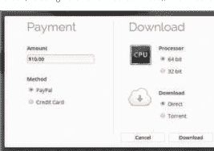

上图 Elementary OS 因声称免费下载该操作系统的用户是在“欺骗系统”而激起众怒。

其他人对潜在信息更持理解态度。“应该有更多人为开源软件尝试商业模式，”一位评论者建议道。

## 社区

## PyCon UK 组织者 John Pinner 逝世

深受喜爱的 Python 社区成员 John Pinner 已经离世。

作为自由和开源软件（FLOSS）UK 小组（原称英国 Linux 用户组 UKLUG）的贡献者，Pinner 是一位著名的 Python 推广者。

除了是 Python 软件基金会（PSF） Fellow 并获得社区服务奖外，Pinner 还因帮助组织 2004 年至 2011 年的 EuroPython 会议以及 2007 年至 2014 年的 PyCon UK 会议而闻名。

PSF 的 Mary Ann Sutherland 在得知他的离世后写道：“我有幸在 2013 年 PyCon UK 上见到 John 并与他共度时光。他是一位令人愉快的东道主，充满能量，对当地情况了如指掌——历史、好啤酒和最好的酒吧、地标、社区——并怀着热情的好意。他将被深深怀念。”

他的离世在 Python 社区中留下了深深的悲伤。

# OpenSource

你的 Linux 新闻与观点来源

`www.linuxuser.co.uk` 获取最新的新闻和观点

直接通过电子邮件联系我们：`linuxuser@imagine-publishing.co.uk`

## 开放硬件

#  Facebook 推出模块化交换机

新推出的开放硬件模块化交换机提供 1.28Tb/s 的带宽

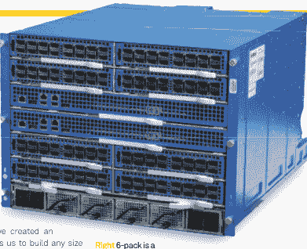

社交网络巨头 Facebook 已宣布推出 6-pack，该公司将其描述为第一款开放硬件模块化交换机，旨在用于其庞大的数据中心。

基于一个名为 `Wedge` 的顶部机架网络交换机项目，`6-pack` 使用一种基于 Linux 的操作系统，名为 `FBOSS`，其数据中心结构基于模块化架构，以实现快速且易于扩展。


`6-pack` 被描述为 `Facebook` 新数据中心结构的核心，它使用 `Wedge` 作为构建模块，并在十二个独立的交换元件之间作为全网格无阻塞两级交换机运行。目前存在两种配置：一种具有面向前面的 18 个 40-gig 以太网端口和背面的另外 16 个端口；另一种将所有 32 个端口置于背面，提供 `1.28T` 的带宽，主要用于聚合目的。

“通过 `6-pack`，我们创建了一种架构，使我们能够使用一组简单的通用构建模块构建任意大小的交换机，”`Facebook` 的 `Yuval Bacher` 在公司发布活动时解释道。“由于设计如此开放且模块化——并且在交换技术和软件方面非常无关——我们希望整个行业都能以此为基础进行构建。”

`Bacher` 声称，由于其开放硬件架构和基于 `Linux` 的开源操作系统，该交换机设计比传统模块化交换机设计提供了更大的灵活性，并表示 `Facebook` 已经开始对 `Wedge`、`FBOSS` 和 `6-pack` 模块化交换机本身进行生产测试。

`Facebook` 还进一步确认，他们已将 `6-pack` 的设计贡献给了 `Open Compute Project`，该公司是该项目的创始成员之一。

右图：`6-pack` 是一种模块化数据中心交换机设计，具有 `1.28Tb/s` 的带宽和基于 `Linux` 的操作系统

## 行业

### Linux 专业人员需求上升

基金会报告指出认证的迫切性

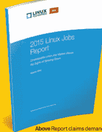

上图：报告称 `Linux` 专业人员的需求正在迅速上升

`Linux` 基金会和 `Dice` 的一份报告显示，对基于开源技术云平台日益增长的兴趣导致了 `Linux` 专家就业市场的扩大。

这份报告汇总了来自超过一千名招聘经理和近 3,500 名 `Linux` 专业人员的提供的数据，声称“几乎所有招聘经理”（受调查者的 97%）都打算尽快招聘 `Linux` 专家。报告的其他亮点包括，42% 的招聘经理将寻找具有 `OpenStack` 和 `Cloudstack` 经验的候选人，23% 正在寻找安全专业知识，另外 19% 专注于软件定义网络（`SDN`）。

然而，对正式认证的要求正在成为行业趋势。报告指出，44% 的招聘经理表示他们“更有可能”雇用获得认可 `Linux` 认证的候选人，54% 期望申请系统管理员职位的人拥有认证或其他正式培训的证据。

`Linux` 基金会执行董事 `Jim Zemlin` 在报告中声称：“对 `Linux` 人才的需求持续增长，雇主能够验证候选人是否具备他们所需的技能变得更加重要。正式培训和认证是识别合格人才的关键途径，随着更多人加入 `Linux` 社区，专业人员将需要展示他们的脱颖而出。”

完整报告位于 `Linux` 基金会网站 `linuxfoundation.org`。

### Bloomberg 成为黄金会员

金融软件、数据和媒体巨头 `Bloomberg` 以黄金会员级别加入 `Linux` 基金会。

`Bloomberg` 已经是该基金会专注于安全的 `Core Infrastructure Initiative` 的成员，它是 `Linux`、`Hadoop`、`OpenStack` 和 `Sor` 在其基础设施和媒体资产中的重度用户。

“`Bloomberg` 是开放创新和开源倡议的大力支持者，”`Bloomberg` 首席技术官 `Shawn Edwards` 声称。

“我们期待继续与 `Linux` 基金会密切合作，并以有益于整个 `Linux` 生态系统的方式向社区学习并为其做出贡献。”

### 指控 VMware 违规

`Christoph Hellwig` 和 `SF Conservancy` 提起诉讼

虚拟化专家 `VMware` 目前正被 `Christoph Hellwig` 和软件自由联盟（`Software Freedom Conservancy`）在汉堡地方法院起诉，理由是涉嫌违反 `GNU` 通用公共许可证。


内核开发者 `Hellwig` 自 2007 年以来一直致力于揭露 `VMware` 在其 `ESXi` hypervisor 产品中涉嫌的 `GPL` 违规行为，自 2012 年起与 `SF Conservancy` 合作。虽然 `VMware` 与团体开始了谈判，但当 `VMware` 的律师拒绝建议的解决方案时，进度在 2014 年停止。

“`VMware` 的律师终于在 2014 年告知 `SF Conservancy`，`VMware` 没有意图停止分发源自 `Hellwig` 和其他内核开发者版权的专有许可作品，”该慈善 `FLOSS` 集团在宣布诉讼时声称，“尽管 `GPLv2` 的条款如此规定。”

`Hellwig` 和 `SF Conservancy` 由 `JBB Rechtsanwälte` 的 `Till Jaeger` 代表，他以与 `Harald Welte` 在之前的 `GPL` 违规诉讼中的工作而闻名。

`VMware` 尚未对诉讼发表公开评论，但预计将在法庭上为其分发实践进行辩护。

### Freak 攻击打击 OpenSSL 及其他

尽管不如 `Heartbleed` 严重

包括 `OpenSSL` 在内的多个 `SSL/TLS` 实现被发现易受一种被称为 `Freak` 攻击的新漏洞影响。

由巴黎 `INRIA` 的 `Karthikeyan Bhargavan` 和 `mTLS` 团队发现，`Freak` 漏洞使攻击者能够将网页浏览器正在使用的加密降级为易于破解且过时的密码。据称该漏洞影响了互联网上 26.3% 的活跃 `HTTPS` 服务器，使其对许多用户具有严重的利用范围。

虽然这个十年前的漏洞影响了浏览器和服务器中的许多 `SSL/TLS` 实现，但安全专家声称 `Freak` 不像最近的 `Heartbleed` 漏洞那样严重。

“要利用 `Freak`，用户需要连接到仍然启用降级导出密钥支持的服务器，并且有攻击者在他们的网络上监控他们与该服务器的连接，”`AllenVaulf` 的高级产品经理 `Andy Manske` 解释道。

“在此需要格外谨慎的是那些设计上在其流量中间有一个实体的用户，”`Lanceco` 的首席技术官 `TK Keanini` 同意道。“例如，一些国家对进出其国家的互联网网关进行控制，因此，拓扑位置处于利用日常用户的最佳位置。”


我们出色的课程提供无与伦比的培训。

100% 的客户端将我们的 `PostgreSQL` 培训计划评为优秀。预订您的位置，获取对核心代码的专家知识。

+44 (0)870 766 7756

`2ndquadrant.com/knowledge`

## OpenSource

你的 `Linux` 新闻与观点来源

### 自由软件专栏

### 书籍之战

第一次版权战争发生在 561 年，起因是两位著名修道士之间关于书籍副本所有权的争吵


以及原始物品的创造者。在许多情况下，这些个人（或组织）并不是相同的，最终的受益者更可能是前者而不是后者。归根结底，后者需要保护。互联网需要对想法如何拥有和与他人分享的新愿景和理解，以便信息的力量不仅限于少数人，并且创造原始物品的艺术家和作家能够生存和繁荣。

关于思想和信息所有权及其物理表示的争议由来已久。版权首次写入法律是在 1710 年，但第一次版权战争发生在 561 年，出乎意料的参与者是爱尔兰学者和圣人 `Finnián of Movilla` 和 `Columba of Iona`。

`Columba` 出生于大约 521 年，师从 `Clonard` 的 `St Finnián`，他是当时最著名的老师，是爱尔兰十二使徒之一，在 `Finnián` 门下学习后后来成为圣人。在 6 世纪的爱尔兰，圣人几乎和书一样常见，这在很大程度上可以解释后来关于制作书籍副本权利的争议。文本非常神圣，在印刷机出现之前，许多事情可能取决于一个副本和另一个副本之间的差异。

书写和抄写书籍通常是修道士的工作。`Columba` 是当时最著名的抄写员之一，据称他一生写了或抄写了 3000 多本书。关于书籍副本的争议始于 560 年。有问题的书是

圣杰罗姆诗篇，`Columba` 在 `Finnián of Movilla` 不知情的情况下借走了。`Columba` 的副本是在“夜间匆忙中通过神奇的光芒”非法制作的。`Finnián` 命令 `Columba` 归还书和副本，这激怒了 `Columba`，并促使他将其提交法庭进行裁决——正是在这里，导致战争的争吵开始了。

在布雷松法（`Brehon law`，统治爱尔兰日常生活的普通法体系）下召开了一场法院，审判者是 `King Diarmait Mac Certhlaith`，他作出了著名的裁决：“每头牛都拥有她的牛犊；因此每本书都拥有它的副本”。这很容易被视为世界上已知最早的有利于版权的裁决。

据说 `Columba` 对这一裁决感到震惊和愤怒，并认为国王有偏见。当国王逮捕并杀害了一名在 `Columba` 保护下的囚犯时，事件的顺序变得复杂。`Columba` 和他的亲戚召集了一支军队与国王作战，他们在 `Du Crenlinne` 战役中相遇。国王的三千人被打死，而 `Columba` 的亲属只损失了一人。


由于这场屠杀，`Columba` 被迫流亡到 `Iona` 岛，在那里他建立了一座修道院，并被认为将基督教带给了皮克特人。导致战争的书籍副本现在被认为是爱尔兰最古老的书籍。人们假设该书与其他从 `Iona` 带来的圣物一起被运回爱尔兰，包括《凯尔经》，以保护它们免受维京人的入侵，并被称为圣 `Columba` 的“`Cathach`”，即战书。年代证据表明 `Cathach` 可能足够古老，是 `Columba` 的《圣杰罗姆诗篇》副本，但当然，它可能只是副本的副本。

退一步说，书籍之战的故事说明了信息就是权力的真理，并且爱尔兰的修道士拥有

## 编码专栏

### 在 C 语言中反转字符串

提升你的编码技能，学习使用算法解决问题，详见米哈利斯的新专栏

书籍及其包含的知识，曾掌握着权力的杠杆。我们这个时代的信息之所以不同，是因为与过去的静态媒体不同，它是交互式的。复制信息无需任何 effort。`Web` 是一座通用图书馆，是一个无与伦比的信息存储库，涵盖关于一切的事物，无论准确与否，都可以即时按需访问，仿佛百科全书就在我们指尖。但如果 `Web` 要履行这一角色，就必须以承认该媒介力量和潜力的方式解决版权和思想所有权问题，从而将权力从少数人转移到多数人手中，让创作者、艺术家和作家获得他们应得的真正回报。

正如艾伦·斯沃茨（`Aaron Swartz`）在其《游击战式开放获取宣言》（[Guerilla Open Access Manifesto](https://archive.org/stream/GuerillaOpenAccessManifesto/Guerrily2008_djvu.txt)）的开篇有趣地指出的那样：“信息就是权力。但与所有权力一样，总有人希望将其据为己有”。在印刷术发明之前，信息掌握在僧侣和抄写员手中，他们往往是社会中唯一具备读写能力的人。版权法在某种程度上将权力交还给了作家和艺术家。当前的一种异常现象是永久性版权，例如，‘祝你生日快乐’这首歌在其作曲家去世 100 多年后仍处于版权保护之下，而收益流向了某个公司实体，这种做法已难以维持。我们今天可能不会为复制书籍的权利而战，但对共同信息的开放获取——尤其是那些从未打算私有、以科学文件形式存在的资料——正“越来越多地被少数私营公司数字化并锁闭”，这绝对仍是一项值得为之抗争的权利。


米哈利斯·楚卡罗斯（`Mihalis Tsoukalos`）是一名 `UNIX` 系统管理员、程序员、数据库管理员和数学家。他自 1993 年起就开始使用 `Linux`。

`在 C 语言中反转字符串` 会带来一些难题。不仅要找到完成工作的方法，还要找到高效的算法来完成它。你可以决定反转后的字符串是存储在现有内存空间中，还是希望分配新的内存空间和新的变量。使用现有内存空间比较困难，但这通常是期望的任务——我们假设除了临时变量外，不会分配新的内存空间。

`C` 语言允许你以两种方式访问字符串：作为数组或使用指针。尽管 `C` 指针可能是导致恶性错误的根源，但指针的速度极快。

给定字符串 `p = "abc"`，你可以按如下方式访问其三个字符。首先，你可以将它们作为 `p[0]`、`p[1]` 和 `p[2]` 来访问；然后，你可以使用指针算术将它们作为 `*p`、`*(p+1)` 和 `*(p+2)` 来访问；你还可以通过增加 `p` 指针的值（`*p++`）并逐个字符访问来遍历字符串。

如果你将字符串作为数组访问，你需要使用 `C` 的 `strlen` 函数来计算其长度。使用指针时则不需要这样做，因为内存中用于标记字符串结尾的 `'\0'` 字符可以让你在程序中确定字符串的结尾——因此一个简单的 `while` 循环就能完成任务！若要修改字符串，必须使用以下 `C` 语句进行初始化：

```c
char s[] = "abcdefg";
```

普通的指针版本（参见`PRevC`文件）还需要一个额外的指针变量来标记字符串的结尾。`p` 指针初始化为字符串第一个字符的内存地址：`char *p = &s[0];`（很糟糕的 `C` 代码！）。可以使用一个不寻常但完全可用的 `while` 循环来找到字符串的结尾：

```c
while (*++p) ;
```

上述 `while` 循环会使你的代码看起来奇怪，因此不会使用它。数组版本（参见`RevC`）易于理解且运行良好，看起来很像 `Perl` 或 `Python` 代码。此外，如果你拥有一个智能的 `C` 编译器，它可能会将数组替换为指针并为你执行优化工作。整个过程中棘手的部分是确定字符串的长度，这取决于具体的字符串。最终版本将使用指针算术、数组和 `strlen` 函数：

```c
for (i=0; i < len/2; i++) {
    temp = s[i];
    s[i] = *p;
    *p = temp;
    p--;
}
```

代码高效、简洁且优雅。`p` 指针的初始值表示字符串的结尾：`char *p = &s[len-1];`。你可以在 `www.filesio.co.uk` 或 `www.mtsoukalos.eu` 找到这三个 `C` 程序。在下篇文章之前，请继续编程！

## 客座专栏

### 破解编码技能之谜

软件测试公司 `Coverity` 的总监扎克·萨莫哈（`Zach Samocha`）探讨了编码在英国的重要性及普遍性


`扎克·萨莫哈（Zack Samocha）` 是 `Coverity` 的总监。在他目前的职位上，他制定了公司的产品战略，并管理着 `Coverity` 开源 `Scan` 计划。在他的领导下，该计划已发展至 4,000 个项目和 10,000 名活跃用户。扎克还发起了研究，比较开源代码质量与专有代码质量。

`2014：代码之年` – 或者至少这是许多人看待那 12 个月的方式，这段时期将这项宝贵技能推上了风口浪尖。去年，编码获得了巨大的媒体关注，特别是当它在 9 月被纳入英国教育课程时——许多人对这一举措表示庆祝。

这对整个 `IT` 行业来说都是真正积极的进步，尽管新发现的对编码的关注可能需要一段时间才能改变企业。即便如此，培养拥有更广泛技能和更多样化人才队伍，绝对是朝正确方向迈出的一步，尤其是考虑到目前缺乏熟练的编码人员。连同`树莓派（Raspberry Pi）`等小工具，这些发展旨在年轻人早期生活中激发他们对计算机制的热情。希望他们在这个话题上的兴趣会在青少年时期乃至职业生涯中不断增长。

在英国学习编码的人数之多是令人兴奋且重要的，因为它正在改变我们对这个国家 `IT` 的看法。人们越来越多地思考应用程序和软件的可能性，而不仅仅是支持和维护全国各地办公室里的台式机、笔记本电脑和打印机。

这对编码社区来说是极大的好消息，但我们不能过度兴奋。

尽管编码技能在更广泛的社会中越来越流行，但这种流行并不一定与代码质量的增长相匹配。不幸的是，我们必须考虑，随着程序员数量的增加以及他们产生的代码标准，是否会降低对开源项目贡献的标准，例如，作为一个近年来取得了很多进展的领域。

让我们以开车作为类比；在英国，数百万人在满足所有要求后可以合法驾驶。我们通过了实操和理论考试，购买了车辆并缴纳了道路税以维护我们行驶的道路。在编码方面，你不需要执照，你只需要知道如何做以及上手工具。编码对每个人开放，因为没有任何正式规定，结果它吸引了大量独立的编码者。

如果有谁是‘自学成才者’，他们甚至无需考虑拥有正式资格证明，就能创建各种软件和应用。

编码社区已经熟知这些问题。即使是那些实际上有看门人过滤和监控代码贡献的开源项目，这也是一项具有挑战性的任务，因为人们会犯错，其中一些错误会溜过去。因此，小错误的积累，

> “去年，编码获得了巨大的媒体关注，特别是当它被纳入课程时”

## 观点

### 编程专栏 – 扎克·萨麦查


不可避免地，这变成了一个更大的问题，再加上大量产生的代码，结合其内容的重要性，可能会导致严重的问题。视频游戏中的故障只会让游戏玩家感到烦恼，但如果出错的代码是在医院设备或某种金融软件中呢？后果突然变得严重得多。

必须发现并修复任何错误，但至关重要的是，要教导程序员认识这些错误，明白它们为何重要以及这些问题会带来什么影响。技能驱动部门希望提升人数，这固然很好，但质量控制也必须纳入其中。

越来越多的人开始投身编程，这令人兴奋不已，但我们还必须让行业审视这对未来代码质量的影响。开发者现在必须着眼于长远编写代码，并确保代码在几周、几个月甚至几年后不会崩溃。

得益于 2014 年的事件，编程世界以前所未有的方式受到了关注，这真的非常好。现在到了 2015 年，我们需要退一步，确保我们目前正在开发的代码能够在未来经受住时间的考验。

上文：

`Coverity` 解决方案有助于在开发过程的早期将质量与安全测试融入其中


**乔恩·马斯特斯**是一位 Linux 内核黑客，自 13 岁上大学以来，他已经在 Linux 领域工作了 19 年。乔恩居住在马萨诸塞州剑桥市，并在一家大型企业 Linux 供应商处工作。他在`kernelopodcast.org`上发布每日 Linux 内核邮件列表摘要。

Linux 4.0 中最令人兴奋的新特性可能是新的实时补丁机制，它可以在不重启的情况下动态更新内核的安全性和 bug 修复（类似于此前发明的 Ksplice 和类似的实时更新技术）。另一个很酷的特性将是新的 KASan（内核地址消毒器），它跟踪内核内存访问，以验证这些访问是否确实触及了其意图修改的内容。这对开发者来说应该非常有用，因为他们通常希望知道他们的任何内核修改是否导致内核试图覆盖物理 RAM，从而在此过程中造成难以检测的内存损坏。最后，对支持 NVM（非易失性内存）支撑的传统文件系统的支持将让那些幸运地拥有大量 NVM 硬件并尝试它的人感到兴奋。

如果一切按计划进行，我们将在下个月的刊物中提供 Linux 4.0 的完整摘要，包括内核实时补丁是如何工作的。我们还将研究如何通过系统地调查随时间做出的更改，在内核开发的（以及）开发周期期间（和之后）根除微妙的 bug，并回顾我们如何处理 Linux 3.0 版本号变更。

## 树莓派 2

许多在英国长大的我们都还记得，我们非常怀念英国广播公司微型计算机系统（或称“BBC Micro”，或简称“BBC”）。这些电脑是由一家来自英国剑桥的小公司 Acorn 制造的。最初的 BBC 旨在向大众普及计算机知识。它在 80 年代初获得的类似邪教般的成功以及实现目标，至少间接推动了英国计算机行业的许多后续发展，包括后来从 Acorn 分拆出的另一家小公司——如今众所周知的 ARM 的形成。正是这家 ARM 公司，如今驱动着超过 95% 的智能手机以及绝大多数的平板电脑和其他小工具。

最初的 BBC 激发了后来许多人的灵感。它是几年前树莓派基金会成立时的灵感来源，早于其第一款 Model A（向 BBC 致敬，像 Pi 一样，BBC 也有 Model B）在 2012 年推出。最初的 Pi 有多种型号（A、A+、B 和 B+），利用了一种低成本片上系统（SoC），原本设计用于移动图形处理器，碰巧包含了一个小型`ARMv6`（`ARM1176JZF-S`）兼容处理器，能够运行完整的 32 位 Linux ARM 堆栈（压缩在芯片的角落）。

前 Broadcom ASIC 架构师兼树莓派基金会受托人埃本·阿普顿（Eben Upton）是那些成功说服 Broadcom 支持 Pi 项目的人之一，开发了一个低成本的信用卡大小的计算平台，在三年内已经售出了超过 500 万台。最初的 Pi 配备了`700MHz`单核`ARMv6`兼容处理器，`256MB`（后来是`512MB`）RAM，一个用于存储和 USB 的 SDHC 插槽。Pi 通过 USB-to-Ethernet 桥接芯片利用其片上 USB 提供有线以太网，并可通过 HAT（堆叠在顶部的硬件）扩展板进一步扩展。

虽然最初的 Pi 在其支持者最狂野的梦想之外广受欢迎，但它并非没有挑战。

林纳斯·托瓦兹（Linus Torvalds）用以下话语宣布了 Linux 4.0 合并窗口的关闭：“让我们看看版本号会导致多少，或者说是否会导致任何东西损坏。可能比 3.0 时期少，但我可以想象有人会在意有意义的版本号。” 这再次表明 Linux 版本号基本上是完全无意义的。除了我们出于情感或情绪原因赋予的含义外，它们没有其他具体意义，因为每个周期遵循相同的开发模式。


### “虽然最初的 Pi 很受欢迎，但它并非没有挑战”

一方面，最初 Pi 使用的处理器——一种`ARMv6K`兼容设计——实际上是为嵌入式移动设计而设计的。它使用的架构版本是 ARM 在 SMP（多处理）方面的第一次尝试，尽管它只提供单核，并很快被如今广泛使用的`ARMv7` 32 位架构所取代。`ARMv7` 包含一套标准化的架构特性和 ABI，使得通用 Linux 操作系统对基于 v7 系统的支持比对像最初 Pi 那样基于旧`ARMv6`的设计的支持容易得多。

正因为如此，得知第二代树莓派 2 的发布时格外令人兴奋。Pi 2 Model B 具有与最初 Pi 相同的电路板布局，但使用更新的 Broadcom SoC，基于当代的四核 ARM Cortex-A7，与原始设备完全向后兼容，并且匹配原始的 35 美元价格点。向 Cortex-A7 的转变（A7 与`ARMv7`没有任何关系，它只是 ARM 的一个营销术语）为更新设备带来了更广泛的操作系统能力的好处。这也是微软能够为 Pi 2 提供 Windows 10 的原因之一。Pi 2 能够开箱即用或通过相对简单的修改来驱动大多数 32 位 ARM Linux 发行版。在 Fedora 中，我们将这些称为“Remixes”，相比于过去为 v6 重新构建整个发行版的大型升级。

与最初版本一样，Pi 2 的初始 Linux 内核移植位于`github.com/raspberry/linux`。该移植目前基于 3.18 内核，对 Broadcom 2709 系列 SoC 的支持已于 2 月 2 日合并。该提交（`github.com/raspberry/linux/commit/d9f6ac63a`）日期为 2013 年 5 月，因此显然它在架子上放了很长时间，随时可以投入使用。与大多数其他面向特定嵌入式平台的当代移植一样，Pi 更多地是关于连接现有的驱动器和架构特性，而不是整合大量新代码。该移植启用了一些构建任何使用`BCM2709` SoC 系列的设备时共用的具体功能，例如告知内核它基于`ARMv7`架构。该移植的核心部分由一个名为`arch/arm/boot/dts/bcm2709-rpi-2-b.dts`的文件提供。

Pi 2 的设备树源（DTS）文件使用一种灵活的层次化语言描述 Pi 的硬件，该语言遵循内核`documentation/devicetree`目录中记录的参考绑定。设计中包含的每个主要设备和 IP（知识产权）块都使用此 DTS 中的`compatible`属性与这样的绑定进行匹配。例如，DTS 告知内核 Pi 与`bcm2709`兼容，其名称为 Raspberry Pi 2 Model B，并且包含使用 SoC（芯片）特定的`bcm2709.dts`（DTS 包含文件）描述的某些硬件。该包含文件描述 SoC 本身，包括 4 个 CPU 核心、用于服务外围设备的中断控制器、GPIO 和其他片上接口，以及通用的`armv7`定时器。

内核移植包括一个`bcm2709_defconfig`文件，内核可以使用它来确定应使用哪些配置选项来构建针对 Pi 2 启动量身定制的最小内核二进制文件（尽管在运行时它将使用编译形式的 DTS，称为 DTB – DeviceTree Blob – 来确定应使用编译到内核中的众多可能驱动中的哪一个）。最后，该移植包括一个旧式的`bcm2709_b.`板级特定 C 文件，这似乎是为了方便那些不使用支持设备树的引导加载程序的人（这提供了进一步的证据，表明该移植可能比此特定提交的 2013 年日期还要早）。剩余的代码还为所有 270X Broadcom 平台提供一些核心使能。

为 Pi 2 构建和安装内核相对简单，有多种选择，从交叉编译（在 x86 笔记本电脑上）到在设备本身上进行本地编译。这在`raspberry.pi.org`上有文档记录。虽然最初的 Pi 从未真正拥有良好的上游支持故事，但作者希望第二代很快就能在最喜欢的 Linux 发行版中随附的标准 Linux 内核中得到支持。

最后，本月 Linux 注意到，一些倡导 Linux 4.0 发布的人最强的论点似乎是想看到 4.15——因为“这是终结者 T-800 使用的 Skynet Linux 版本”！这也是害怕 Linux 4.0 和我们的机器人统治者即将到来的又一个理由。

## 20

## 树莓派

## 项目

了解最棒的树莓派**硬件黑客**的**幕后故事**

目前，世界上已有超过五百万台树莓派设备在流通使用，而你们——树莓派社区——利用这些设备创造出的某些作品，确实令人惊叹。从精心编写、将一系列网络服务串联在一起的优雅脚本，到自制的鲁布·戈德堡机械装置，这些作品既充满创意又极具多样性。而在每天涌现于线上的众多新项目浪潮中，如果有一个词能保证吸引所有人的注意，那一定是“hack”（黑客/改装）。

但“hack”具体指什么？就本专题的目的而言，我们决定一个 hack 项目必须具备某种硬件基础。这类项目是：你取用一台设备，借助一点树莓派魔法，将其彻底改造成一件崭新且原创的作品。正是这些项目让我们兴奋不已，并激发我们想深入了解电子学、工程学和编程的欲望。


在接下来的几页中，我们将向你介绍我们曾发现的树莓派顶级 hack 项目。这些项目将复古硬件拆解，并将组件重新利用为令人惊叹的新事物；或者对硬件进行探索、把玩，使其在车库里沉睡二十年后重获新生。这些 hack 项目激励着我们，每位创客都在热情、技巧与技艺之间取得了恰当的平衡，我们也希望它们能同样激励到你。继续阅读，我们将告诉你如何从卧室里的“太空飞船”发射卫星，如何将模拟相机改装为数码相机，制作一台经典苹果树莓派（Apple Pi）等更多故事。

# 树莓派项目

来自创客们的最棒硬件 hack

## 便携式树莓派街机

喜爱老式街机游戏？借助本·赫克（Ben Heck）的 hack，你可以在一台手工打造、手持的主机上玩遍所有这些游戏

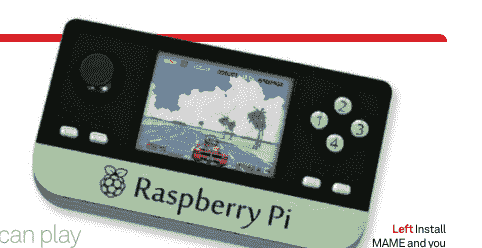

左图：安装 `MAME`，你将永远不缺街机游戏可玩

本·赫克制作了便携式树莓派街机的两个版本。第一个是最初的便携式树莓派项目（`youtube.com/watch?v=v-rdLZjzQuTNX4`），他通过 hack 树莓派来缩小其尺寸，并拆开一个 `USB` 游戏控制器以提取更多电路。在新组装部件到位后，他 3D 打印了一个定制设计的机箱，组装了新设备，并启动 `MAME`（多街机模拟器的缩写）来玩老式游戏。

他最近对这一早期项目的翻新更加“自制”。对于这款树莓派 `MAME` 便携游戏设备（`youtube.com/watch?v=rzrEj1aIQRbpw`），本从零开始制作了一块电路板，将所有组件装入一个新的 3D 打印机箱中。该机箱与其说像 `Game Gear`，不如说更像 `Game Boy`。

我们请本带我们回顾他项目的原始版本。“我的第一个便携式树莓派项目是一个小型、电池供电的游戏单元，”他说道，“它有一个用于 `Wi-Fi` 或外部存储的 `USB` 端口，我们在该节目第三季中曾介绍过它。屏幕来自亚马逊销售的廉价 `NTSC` `LCD` 屏幕，原本用作汽车倒车摄像头。按钮是我自己激光切割的，机箱则是 3D 打印的。”至于对树莓派本身的物理修改呢？“我主要移除了较高的通孔组件，”他回答，“并将 `Teensy HID`（用于控制器）直接连接上去。我还移动了第二个 `USB` 端口。”

正如你在上面看到的，机箱制作得非常精良；“我在 `Adobe Illustrator` 中完成了初始布局，用于激光切割的部分，”本解释道，“然后将整个设计转移到 `Autodesk 123D` 中，创建一个可 3D 打印的文件。亲手书写控制器的按钮是该项目中最具挑战性的部分。它也是最耗时的，需要大量的精度和对细节的关注。”

本对于拆解主机和控制器进行树莓派 hack 并不陌生——他还制作单手无障碍控制器。“除了其他所有项目和 hack 之外，我们还为那些难以使用现有游戏控制器的人修改控制器，”本告诉我们。“在节目中，我们展示过其中几款——`Xbox One`、`PS4`，甚至还有 `Wii`。现在我们应要求制作这些控制器，可以从我的网站订购，但我们只处理 `Xbox 360`/`Xbox One` 控制器，因为它们在内部使用 `PCB`（印刷电路板）（而 `PS4` 使用丝印电路）。最近我教会了 `Felix`（`element14`《Ben Heck Show》的一位助理）如何做这项工作，所以他也在业余时间协助处理。”


上图：观看视频，看看本如何构建和测试定制电路板

### 创客简介

#### 本·赫克

资深黑客，《Ben Heck Show》创作者


本·赫克是在线红人，也是创客社区的支柱，他发布关于游戏主机 hack 和各种不同树莓派项目的精彩教程视频。他所有这些成就都来自《Ben Heck Show》。

了解更多：`benheck.com`

#### 本的黑客作品

- `树莓派即拍相机（Pi Point and Shoot）` 将树莓派摄像头模块、`Adafruit` 的 `PiTFT`、`PlayStation 3` 控制器电池及其他部件结合，制成了一台即拍相机。

- `树莓派复古计算机（Pi Retro Computer）` 作为对 1980 年代 `BBC` 微型计算机的致敬，本将树莓派安装在一个自制的木质机箱中，配备 `HDMI` 端口、开关和 `USB` 集线器，营造出老式计算机及手提箱的感觉。

- `手持树莓派主机（Handheld Pi Console）` 本对树莓派单板计算机进行 hack，使其变得更小。结合指南针、`LCD` 无线键盘、锂电池电源和 `USB` 摇杆，他创造了一款手持游戏主机。

## 相机树莓派

为普通即拍单反相机（`DSLR`）提供电力

### 创客简介

#### 戴夫·亨特（Dave Hunt）

摄影师与创客

跟随戴夫·亨特深入探索黑客与摄影的世界。

了解更多：`davidhunt.ie`

我们在第 141 期曾采访过戴夫·亨特。本期他带着他的相机树莓派（Camera Pi）回来了。

“我需要将照片在拍摄时传输到 `iPad` 上，”戴夫解释道，“但商用解决方案要 500 英镑，我有一个损坏的电池手柄，体积足够容纳我的树莓派和一块电池，所以我选择了这个方案。

电池手柄可以装两节电池。当我拆掉电池仓内部后，我锉掉了手柄内所有安装孔周围多余的金属，以便将树莓派装入其中。

“下一个任务是在内部安装相机电池和 `DC-DC` 转换器。我能够利用手柄被拆下的部分内部结构，很快我就有了一个可以插入相机电池的空槽。它能为树莓派供电约四个小时。

实现无线功能只需插入一个 `USB Wi-Fi` 适配器。几行 `Python` 代码之后，我就能使用 `gphoto2` 轮询相机，拉取新文件，并通过 `TTP` 将它们发送到 `iPad` 上的 `Shutter Snitch`。”


## 树莓派电话

用 `C#` 电路魔术和电压操控让响铃电话复活

### 创客简介

#### 斯图尔特·约翰逊（Stuart Johnson）

董事总经理

斯图尔特经营 `Logic Echos`，一家专门向开发者提供网络服务部署和云计算服务的 IT 咨询公司。

了解更多：`logicechos.com`

斯图尔特·约翰逊正在让一款经典的 `GPO 746` 听筒重获新生，虽然该项目尚未完全结束，但他已经完成了大部分工作。

“我取出了电话内部的主电路板，并设法将树莓派塞进去，”斯图尔特说。

“随后我面临两个挑战——最大的挑战是让铃声响起来。我通过提高电压至 19 伏，然后使用一个非常小的 `DC-DC` 转换器 `OKI-785RL` 将其降低到 5 伏供树莓派使用，剩余的电压则用于铃铛，找到了解决方案。我对它工作得如此之好感到惊讶。

“铃铛使用其中一个 `I/O` 端口，有一个可用的 `C#` 库（`raspberry-sharp-i/o`）可以让你监控和控制这些端口。因此我将一个 `I/O` 端口连接到脉冲拨号器，并通过晶体管将另一个连接到继电器。然后在软件中，我加入了一个定时器来测量脉冲点击。我设法编写了一些代码来计时这些脉冲点击，并确定拨出的号码。”


## 车载电脑

我们的不错，但德里克·奈格斯（Derek Knaggs）建造的才是真家伙

### 创客简介

#### 德里克·奈格斯（Derek Knaggs）

董事总经理

德里克·奈格斯经营 `Flammelyy IT`，一家 IT 供应和支持公司，并且正在伍斯特大学学习计算机科学。

了解更多：`flammelyy.co.uk`

还记得我们上一期制作的车载电脑吗？好吧，德里克·奈格斯已经先我们一步了，而且他将显示屏嵌入仪表板中，并扩展设置以包括后排乘客座位的屏幕。

“我移除了 `DVD` 播放器，那是一台标准的福特主机，”德里克解释道，“然后从 `Xtrons` 购买了一台主机。它是专为福特福克斯设计的，所以直接替换即可。`Xtrons` 收音机有一个 `S-Video` 输入端，它进入收音机，因此树莓派显示为辅助输入。收音机有两个辅助输出端，因此树莓派将视频发送到主收音机，然后收音机将其传输到乘客座位的屏幕上。我所做的是安装了一个设备——类似 `VGA` 适配器——它接受一个输入并输出两个，这使我能够让树莓派单独驱动后座屏幕，或者让收音机自行控制。因此，我的孩子们在后面用树莓派看电影（他们戴着耳机，使用音频分配器），而我们在前面可以使用正常的收音机控制，例如卫星导航。这样就工作得很好。”


# 树莓派项目

来自创客们的最棒硬件改造

## 复古NES

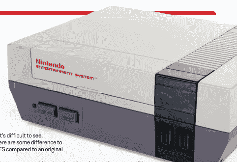

现在你正在玩弄电力。确切地说，是位于旧游戏机内部的树莓派电力。

### 克里斯·克劳德 (Chris Crowder)

程序员兼数据库管理员

克里斯在汽车行业工作，使用 `.NET` 和 `SQL` 为生产车间系统开发制造系统。在他的闲暇时间，他喜欢玩电子游戏和桌面游戏，但之前在前者方面仅限于使用他的 `PC`。


了解更多：`imgur.com/a/KPj2n7gal/rey`

右图：很难看清，但与原版相比，这台 `NES` 有一些不同之处。

> 起初这有点令人望而生畏，因为我希望这个项目在外观和手感上都能像一台 `NES`。

“这一切始于我妻子问我圣诞节想要什么，”克里斯在电子邮件中说道。“我完全不知道自己想要什么，但我从树莓派发布以来一直想玩弄它，所以她给我买了一套入门套件。”

“在等待圣诞节期间，我开始缩小想法范围，并找到了 `RetroPi` 项目。我想我只是安装它，加载一些 `ROM` 然后就算了。然后我想起我在储物间有一些旧的 `NES` 和 `SNES` 手柄。我去拿它们时，发现了儿时的 `NES` 主机以及手柄。当我把 `NES` 带回屋里开始检查时，我发现由于昆虫和湿气，内部几乎全部损坏。所有连接器都生锈了，一些电路板的走线甚至开始剥落。就在那时，我决定使用树莓派来‘复活’这台 `NES`。”

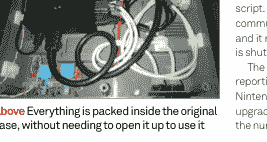

上图：一切都打包在原始外壳内，使用时无需打开外壳。

克里斯彻底掏空了外壳，用树莓派替换了内部组件，并将 `I/O` 端口连接到原始的手柄连接器和音视频电缆等。接手一个拥有视频游戏史上最受尊敬的控制台之一的项目是什么感觉？

“起初这有点令人望而生畏，因为我希望这个项目在外观和手感上都能像一台 `NES`，但具有更多的灵活性。我遇到的最大问题是，我希望它能像 `NES` 一样工作，也就是说，如果有人想玩一个游戏，他们只需打开电源，选择一个游戏然后就可以玩了。当他们玩完时，他们只需按电源按钮关闭控制台即可。由于树莓派没有 `ATX` 式电源开关，我们无法轻易做到这一点。我通过使用 `Mausberrry` 电路和一个 `Python` 脚本解决了这个问题。当按下电源按钮时，它通过 `GPIO` 连接与 `Pi` 通信，并运行关机命令。一旦 `Pi` 关机，该电路就会切断 `Pi` 的电源。”

最终产品运行良好，克里斯报告说他可以正常玩 `Atari`、`Sega` 和 `Nintendo` 的游戏。他现在正寻求使用树莓派 2 进行升级，并增加他能玩的游戏数量。

### 改装 NES

你想接受挑战，让你的旧控制台恢复辉煌的像素化生命吗？我想也是。在这种情况下，你需要这个——这里是克里斯用于修复和复活他儿时的 `NES` 控制台的设备列表。

- 一台损坏的 `NES` 控制台 – 请不要对正常工作的控制台这样做

- 替换用 `NES` 门

- `CanalKit Starter B+` – 很快将被树莓派 2 替换

- 面板安装以太网电缆

- 面板安装 `HDMI` 电缆

- 面板安装 `USB` 电缆

- 10 个装 `USB A` 公头连接器

- `SNES USB` 控制器

- `Anker 13000 mAh 3 瓦` 电池 – 用于附近没有电源插座或您希望便携的情况

- `Mausberrry` 电路 – 使用我们自己开关和 `USB` 的关机电路

- 乐高 – 用于固定 `Mausberrry` 电路

- 哥俩好胶水 (`Gorilla Glue`)

- 蓝色 3 伏 `LED` – 原始 `NES LED` 是 12 伏的，加上克里斯娱乐控制台中的所有其他物品都是蓝色的

## 任务控制桌

宇航员训练在杰夫·海斯密斯 (`Jeff Highsmith`) 的家里很早就开始了，他的儿子们从他们自制的任务控制台运行发射任务。


上图：任务控制桌将各种功能分组到“站点”面板中。


右图：除了玩耍时间，这只是一张普通的作业桌。几乎吧。

> **杰夫·海斯密斯 (Jeff Highsmith)**

> 爱好者/非凡者

> 杰夫·海斯密斯喜欢制作新奇和新颖的东西。介质并不重要，他喜欢四处搜寻材料，并用手头现有的东西凑合。

> 了解更多：`jeffhighsmith.com`

### 航天木工

面板由裸露的组件组装而成。杰夫订购了开关，然后在电脑上设计了面板布局和标签，将它们打印在喷墨透明胶片——透明醋酸纤维板上——然后将这些胶片粘在他喷涂成金属灰色的纤维板上。他估计整个预算是 100 美元。


上图：这些反映了 `NASA` 任务的真实阶段，并播放真实的录音声音。

杰夫·海斯密斯可能是世界上最好的爸爸。他不满足于只是为儿子建造一张房间里的书桌，而是对它进行了修改，使得太空冒险只需按下一个按钮即可开始。

“我大儿子刚开始上幼儿园，他需要一张书桌来写作业，”杰夫告诉我们。“由于我喜欢建造东西！我想为他做一张桌子而不是买一张，我想着，‘什么样的桌子会非常酷？’嗯，像任务控制桌那样有很多按钮和开关！从木工角度看，建造它相当简单。”

“树莓派在前面——中心位置，在一块柔性玻璃后面，旁边是负责读取输入的 `Arduino`。树莓派处理所有声音和逻辑——游戏层面。这是我第一次接触 `Python`，体验还不错。”

“这张桌子有几个模块化面板，每个都有不同的功能。因此在 `NASA` 真正的任务控制中，有一个控制火箭级的桌子，对于这张桌子，我制作了一个火箭助推器面板，并在上面放了一堆火箭噪音。还有一个 `capcom`（舱体通信员）面板，所以你戴上一个小耳机，就可以与在另一个房间的飞船里的宇航员交谈。”

“有几个面板带有数字显示屏：其中一个读取一些姿态数值，如空间中的 `x`、`y` 和 `z`，还有一个监测宇航员的生命体征（据称如此）。还有一个发出机械太空舱噪音，如泵、加热元件、嗡嗡声、风扇等。我希望它像是你在打开和关闭东西，而不仅仅是按下播放声音的按钮——这就是为什么我除了按钮还有拨动开关。中间还有一个放 `iPad` 的位置——你可以观看火箭发射的视频。”

“还有向实际 `NASA` 事故的致敬，例如导致阿波罗 13 号爆炸的氧气罐搅拌。我有一个开关，让它听起来像是在搅拌罐子，然后发出爆炸声并播放宇航员谈话的音频：‘休斯顿——我们遇到麻烦了。’还有一个序列面板，上面有不同的任务阶段，其中每一个都会播放真实的 `NASA` 声音片段，从发射到在月球着陆再到溅落。”

## 飞船卧室

在成功完成了他的书桌任务后，杰夫·海斯密斯将目标设定得更高。

任务控制只是小小的一步。接下来是任务本身，正如杰夫解释的那样：

“所以我的儿子们会按书桌上的按钮，经历所有那些任务阶段，然后拿着玩具火箭四处跑，但我认为，如果有一艘真正的飞船，那将非常酷。飞船有一些类似书桌的面板，但里面还有一个小屏幕，连接到货舱的摄像机。侧面有一个机动舱门，你可以扳动开关打开，然后摄像机显示给你看里面有一个机器人手臂的货舱。因为你是仰卧的，所以在里面你看不到货舱，但看着屏幕你可以看到它，并且控制键就在你面前。我真的觉得这相当有趣——我在那里放了一个小玩具哈勃太空望远镜，我从天花板上挂了一根钓鱼线，上面有一小块金属，然后我在太空望远镜里放了一个磁铁。所以你用手臂从货舱取出望远镜，移过去，吸附到从天花板垂下的线上——我们称之为轨道。一旦进入轨道，你可以将手臂拉回货舱，关上舱门，你的任务就完成了，你可以返回地球。还有卫星任务——去修复哈勃望远镜。”

杰夫将进一步升级这个很棒的设置。“最终，”他说，“我计划安装一些天花板卫星，所以我会让它们在其中一个卧室的轨道上运行，`iPad` 可以监测卫星上的不同传感器。轨道将是天花板下的一根细金属棒，呈椭圆形，然后每个卫星顶部将有一个小轮子，上面装有一个很小的齿轮电机，这样它就会通过那个轮子悬挂在轨道上。理念是孩子们可以用乐高建造卫星，把它们放在货舱里，然后将它们绞进轨道。”


> “我认为有一艘真正的飞船会很酷。”

## 自动卷帘

这几乎是一台鲁布·戈德堡机械装置，我们希望它在使用时播放《Powerhouse》。

**创客简介**

**埃米尔·雅沃斯基 (Emil Jaworski)**

创客

埃米尔发现自己租住公寓几个月，他决定升级自己。

**了解更多：** `imgur.com/a/vD4h`

关于你的睡眠环境有许多流派，以帮助获得更好和更宁静的睡眠。卧室里没有电子产品，试着在睡觉前放松，根据季节选择洗冷水或热水澡。有些人需要完全的黑暗才能睡个好觉，而另一些人则喜欢随着太阳升起醒来，作为自然身体反应的一部分。埃米尔喜欢做这两件事，他用他的树莓派在一天中的特定时间自动关闭和打开他的百叶窗。

“7:30：按上按钮，等待 10 秒（我在底部有一个小窗户，上面有一个更大的，所以在这些 10 秒后，百叶窗只会在底部那个打开），按停止按钮，8:00：按上按钮，22:00：按下按钮。”

不幸的是，这意味着他的卧室里有一些电子产品，但对他来说，只要有效就行。

## 树莓派终端

多年来我们有过很多树莓派，但苹果派 (`Apple Pi`) 呢？

**创客简介**

**奥斯汀·巴克尔 (Austen Barker)**

工程学生

一位加州学生，习惯于摆弄任何他能拿到的旧电脑硬件。

**了解更多：** `imgur.com/a/vB8l`


“在我的业余时间，我喜欢摆弄我遇到的旧电脑硬件。最初，我需要一个终端通过 `SSH` 连接到我用于实习的服务器。这比在一台更强大的机器上开发效率更高。我带了一台服务器到学校，以便在我学习期间继续为同一家公司工作。

我手头也有一个树莓派，我开始将它连接到我在大学电子剩余物品处找到的 `Apple IIc` 显示器。当我开始需要通过 `SSH` 登录学校服务器来编译我编程课程作业时，这就变得很有价值了。最终，我从一台 `Macintosh 512k` 上找到了一个键盘，并使用微控制器和自定义接线的键矩阵使其在 `USB` 上工作，并将其与显示器和树莓派配对。”

## 特性

### 闹钟机器人

追逐你的闹钟听起来可能是一场噩梦，但这在现实中确实存在


### 机器人教育

有很多方法可以让孩子对编程产生兴趣。比如用 `Scratch` 制作游戏，修改 `Minecraft`，以及通过机器人技术进行教学。后者是一个较新的概念，但同样具有显著的优势——孩子们会对自己创造出的实体作品感到兴奋，并对自己在这些作品上编写的程序做出反应。可见的成果和即时满足是激发想象力的绝佳方式。

当我们谈论办公室里的闹钟机器人 `Rolly` 时，大多数人都爆出一连串不宜登堂的脏话。这是一个令人窒息的邪恶发明——一个你需要努力才能关掉的闹钟。这听起来是个绝妙的主意，能让那些难以起床的人真正从床上爬起来，开始他们的一天。

与其他 `Dexter Industries` 的机器人一样，它运行在 `BrickPi` 上，这是专为 `Raspberry Pi` 设计的 `乐高 Mindstorms` 适配器，使机器人能够通过编程与乐高套件进行交互。

“如今几乎每个人都使用手机作为闹钟，这有很多优点，”网站解释道。“手机设置简单，调整方便，可以播放自定义歌曲，甚至能感知唤醒你的最佳时间。问题在于，除非你的手机在房间的另一头，否则我们使用手机的时间之长，甚至会在睡梦中使用它。为什么不自制一个机器人，它不仅能做所有这些，而且在你起床并动起来之前绝不罢休！我们的机器人将能够在房间里的任何表面上随机移动，播放自定义的警报音。

要设置闹钟，只需将 `BrickPi` 上的程序与你的 `Google` 账户关联，它将搜索标题为“`wake`”的事件，并自动在事件时间启动闹钟。这意味着使用任何可以访问 `Google` 日历的设备，都可以非常轻松地调整闹钟时间。”

#### 创客档案

**`Taryn Sullivan`**

*顾问*

`Taryn` 是一位国际商务人士。除了在上海和华盛顿特区之间飞来飞去经营自己的工程业务外，她现在还与 `Dexter Industries` 合作，推广机器人教育。

了解更多：`bit.ly/1BTrYxjv`

### `PiFM` 收音机

有时最简单的黑客技术也能开启无限可能

#### 创客档案

**`Oskar Weigl`**

*电子工程师*

`Oskar` 是一位电子专业人士和机器人爱好者，同时也是一位热衷于正向和逆向工程的狂热分子。

了解更多：`bit.ly/1q86OE`

在帝国理工学院学习期间，`Oskar Weigl` 和 `Oliver Mattos` 通过将一根导线（天线）连接到 `GPIO 4` 并使用自定义 `Python` 模块，将 `Pi` 变成了一台调频收音机。

“树莓派芯片的硬件中有一个时钟生成模块，允许你以用户选择的频率输出时钟信号，”`Oskar` 解释道。“我们使用 `DMA` 控制器向时钟模块发送命令以改变频率，从而实现调频。我们必须将时钟生成模块超频 20 倍。声音每样本 14 位，通过三角洲-西格玛调制增强到更高的位数，范围至少为 50 米。”

### 树莓派智能电视

你的智能电视不够智能吗？打开外壳，把 `Pi` 装进去

#### 创客档案

**`Tony Hoang`**

*研究生*

`Tony Hoang` 是纽约州立大学阿尔巴尼分校（`SUNY-Albany`）的一名博士生，研究领域为计算生物物理学和单分子研究。

了解更多：`linkedin.com/in/tonyhoang`

“海信 `LED` 智能电视内部有很多空间可以放置额外的电子设备，”`Tony Hoang` 开始说道。“电视中央有一大片平整区域放置电子部件，我把树莓派放在那里。双向下扬声器声音相当大，所以我移除了其中一个，并换成 `USB` 集线器。背板大部分是平的，所以为 `LAN` 端口和 `HDMI` 输出找一个位置并不难。

“树莓派由海信的逻辑板供电。`USB 2.0` 端口有两个显而易见的 `5v/500 mA` 输出，我尝试过，但发现当电视关闭时，逻辑板会切断这些端口的电源。为了让树莓派保持开机状态，我用万用表探测逻辑板，发现了一个来自未使用 `GPIO` 的电源。”

## 树莓派项目

来自创客们的最伟大硬件黑客技术

### `Astrogun`

*一款增强现实光枪游戏*


在创客大会上闲逛时，你会看到一些奇特而美妙的事物。在耶路撒冷的创客大会上，你或许看到过人们挥舞着巨大的玩具枪，在 `Aivishay` 的增强现实体感游戏 `Astrogun` 中击落虚拟小行星。

“`Astrogun` 里面有一台树莓派计算机，”`Aivishay` 解释道。“连接在它上面的 `IMU` 板（`Sparkfun` 的 `MPU-9150` 分线板）赋予了 `Pi` 感知设备方向的能力。绘制从那个角度看到的元素。当玩家移动时，图形也会移动，从而产生‘房间里有物体’的感觉。”

“为什么选择树莓派？`Aivishay` 说是因为时间原因：‘我有很短的时间让它变成可用的东西，所以我必须选择一个既具备完成任务能力又易于使用的平台。`RPi` 符合这个标准。我使用了许多专为 `RPi` 设计或在其上测试过的软件组件——`P3D` 和 `RTIMULib`。将 `P1` 作为硬件平台，`Python` 作为编程语言，是将想法付诸现实的最快方式。”


**下方**

*`Clover` 软件为你打开通往 `Astrogun` 游戏世界的大门*

#### 创客档案

**`Aivishay Orpaz`**

*电子工程师*

了解更多：`bit.ly/1AYPsqg`

### 海盗电视

彻底重构 `Android` 电视！


#### 创客档案

**`Donald Derek Haddad`**

*软件工程师*

`Donald` 是一位开源黑客

了解更多：`donalderek.com`

作为树莓派智能电视改装方案（见左侧）的完美伴侣，`Donald Derek Haddad` 的项目是一个你可以自己制作的自定义电视界面。

“`Pirate TV` 是一个运行在树莓派和 `Raspbian` 操作系统上的智能电视应用程序，”`Donald` 告诉我们。“它由开源工具构建，并附带一个免费遥控器——即你的移动设备。其核心是一个 `Node.js` 应用程序，运行带有 `Express.js`/`Socket.io` 的 `Web` 服务器，以处理来自遥控器的用户请求并触发 `shell` 脚本。电视用户界面在 `Kiosk` 模式的 `Chromium` 实例上渲染。视频从 `YouTube` 或其他频道流媒体传输，并在 `OMXPlayer` 上播放，包括 `1080P` 高清内容在内的缓存。该项目仍在进行中，它将无法接入大量内容，这使得 `Google`（现为 `Android`）电视或其他商业平台极具价值。查看 `Derek` 的教程：`bit.ly/16VYKp`。

### `Pye` 收音机

在这台改装收音机中，旧与新相遇

#### 创客档案

**`Tony Flynn`**

*高级嵌入式系统设计工程师*

了解更多：`bit.ly/19zrgPi`

升级改造是一个很棒的概念：利用新技术回收产品，使其在现代世界中保持相关。虽然标准的模拟收音机还没有完全退出历史舞台，但在听音乐时拥有多种选择是很好的。这就是 `Tony` 的主意发挥作用的地方：

“我一直在使用树莓派通过我的立体声系统播放音乐流媒体。一旦运行起来，我就把树莓派集成到一台名为 `Pye` 的旧收音机中！凭借木工和工程的背景，这似乎是完美的项目。

然而，这个项目对 `Tony` 来说并非易事：‘改装最难的部分是将调谐器旋钮连接到旋转编码器。对于这台收音机，我使用旧圆珠笔中的弹簧作为传动系统，将调谐器旋钮主轴通过 90 度连接到旋转编码器。’

`Tony` 对如此大幅修改这种经典设计有什么看法吗？‘完全没有！有些人不喜欢现在烙印在这台旧收音机上的现代风格，我认为这是一个新时代，新外观！’

**右侧**

机身也被清洁并重新粉刷了


## 功能特性


### 数码相机改装

将经典美感与现代便利性相结合，这款老式相机已升级为搭载树莓派（`Raspberry Pi`）的现代设备。


`Pete Taylor`

网站管理员


Pete 在一家慈善机构工作，自从他接手了一台别人用过的 BBC 电脑后，他就一直对电子产品感兴趣。他喜欢探索以新颖独特的方式使用电脑的方法。他还维护着网站`bit.ly/1MKRASw`。

了解更多：`bit.ly/1MKRASw`

老式相机拥有一种非常独特的设计美学，这种美学似乎已随时间流逝而失传，尽管在某些圈子里，对它们的怀旧之情依然强烈。不幸的是，尽管在 21 世纪，怀旧之情、需求以及可用的相机依然存在，但可用的胶片供应正迅速减少。因此，如果你喜欢这种美学，且不介意使用旧式拍照流程，何不升级其内部结构，采用更现代的技术？

“我需要一个适合树莓派摄像头模组的用例，”Pete 告诉我们，“Holga 相机似乎是一个完美的选择。大多数可用的外壳要么有点丑陋，要么更适合固定式的网络摄像头类应用。”

那为什么选择树莓派呢？

“树莓派是创客的梦想——它价格低廉、令人愉悦，围绕树莓派建立起来的社区在你遇到难题或想了解更多信息时，是一个极好的资源。”

整个构建过程也不需要大量的组件。除了实际的相机和树莓派本身之外，Pete 还使用了一个树莓派摄像头模组来实际拍摄照片，一个用于远程连接的 Wi-Fi 模块，一个电池及其开关，以及一些按钮和电阻，将相机的控制按钮连接到树莓派上。

“它的效果比预期的好！”Pete 评价这件成品的质量时说。“虽然制造一台效果仅相当于廉价手机拍摄的相机似乎有点傻，但它改变了我拍照的方式。通过去除即时回放——大多数人似乎都通过手机屏幕来观察世界——我可以专注于拍摄照片。只有当我把相机带回家并将照片下载到电脑上后才能看到这些照片，这增加了一点胶片的怀旧感，我经常会被自己拍的照片所惊讶。此外，我还收到了一些关于相机外观的正面反馈。”

这只是第一版，Pete 计划让下一个版本的制作更容易，并使用原始镜头配合树莓派摄像头。

> “树莓派是创客的梦想——它价格低廉、令人愉悦，围绕它建立的社区是一个极好的资源”

### 自己动手做

项目第二版将推出一套套件，人们可以使用它来改装自己的相机，而无需使用钻头拆卸`Holga`的内部结构。他尚未决定是制作一款改装`Holga`的套件，还是制作一款在树莓派本身周围构建`Holga`风格外壳的套件。无论哪种方式，整个装置都应具备更好的拍照能力，这是最终目标。

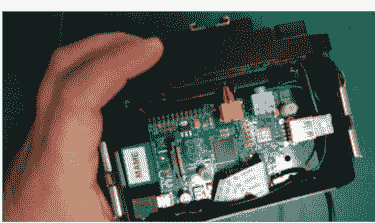

- 左上：过去的相机，为今天而更新
- 左：树莓派的大小刚好能放入相机外壳内

## 树莓派项目

来自创客们的最硬核硬件黑客技术

### 比特币台球桌

现代台球高手通过扫描二维码数字化地支付比特币


### 火球弹珠机

Ian Cole 和他的儿子们通过`Fireball HD`进入高分排行榜


### LED 语音控制咖啡桌

通过语音控制咖啡桌上的灯光秀，点亮你的客厅

## 功能特性

### 项目 Jarvis

用你的语音激活智能家居自动化系统，重现 20 世纪 50 年代的科幻未来


- **创客档案**
- **Mayur Singh**
- 计算机系统工程专业学生

Mayur 位于南非，他的专长是嵌入式系统，熟悉微控制器以及能够启用外部硬件交互的系统，例如树莓派和`BeagleBone Black`。

了解更多：`bit.ly/1EvIImci`


**左** `Jarvis` 界面非常精美，但你可以通过智能手机或语音在任何地方控制系统

**智能家居自动化已经存在多年，相当多的勇敢工程师和 DIY 爱好者在改装他们的家。** 凭借无线控制灯光、供暖、车库门以及许多其他家居用品，有些人取得的成就令人惊叹。科幻作品一直描绘着拥有先进系统的房屋，而 Mayur 正忙着创建这样一个系统。

“主要的灵感来自于观看《钢铁侠》电影，`Jarvis` 这个名字也由此而来。我决定构建一个简单的家庭自动化系统，然而由于多年来多次重装`Windows`，我丢失了原来的程序。在看了第三部《钢铁侠》电影后，我构建了一个新的、改进的家庭自动化系统，该系统具备 AI 助手和更多的功能。”

虽然家庭自动化是该项目的一部分，但便利性并非唯一的考量因素。

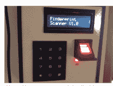

**上方** 警报模式只能通过正确的指纹或主代码禁用

“系统的主要功能是帮助家庭节能，”Mayur 告诉我们。“`Jarvis` 可以读取并监控每盏灯或每个电器的用电量，这使得 AI 能够执行特定任务。这些任务由外部因素决定，例如是否需要打开灯。如果房间内有足够的自然光。这是一个基本的例子，但其他因素也会影响 AI 的决策，AI 控制着每个灯或电器的电源。数据在整个月份中都被记录，系统使用这些信息在下一个月份取得更好的结果。这就是智能家居自动化。”

`Jarvis AI` 是其中的主要部分，你可以与它对话。“它可以通过语音交互控制你的家，并做出关于房间节能的基本决策。我还最近构建了一个功能齐全的平板系统，它连接到当地的在线杂货店。它使用语音控制来识别你需要的产品，并将这些物品添加到列表中，直到你指定配送。”

经过一年半的项目开发，Mayur 完成的所有功能都运行可靠，但他仍想添加更多功能。

### 语音

该命名的`Jarvis`以其刻薄的言论和语调而闻名。选择一个实际可用的声音已经是一项艰巨的任务，更不用说还要符合特定的风格，正如 Mayur 所解释的：

“一直很难找到拥有良好 API 和价格的语音，但我最终选择了一个免费的 API，它提供云端转换并仅返回一个 MP3 声音文件。虽然时间较长，但它确保了该声音在所有操作系统上都能工作。”

如果你有兴趣尝试创建自己的类似`Jarvis`的家庭自动化系统，请查看《Linux User & Developer》的上一期。撰写 Python 专栏的 Jay Bernard 开始了三部分系列（在第 72 页继续），解释了如何设置一个使用 Python 和几个语音识别模块来解析口语命令的语音助手。

## 计划你完美的一天

激发你的家庭灵感，这个周末去个棒极了的地方。`GREAT DAYS OUT`，`HOW IT WORKS` 推出的一款全新免费 iPhone 应用

*在地图上探索优质景点*


在 App Store 搜索 “Great Days Out” 或访问`www.greatdaysoutapp.com`

## 故障排除与维修

### Linux 网络

你的笔记本电脑没有网络连接，或者你的网络托管出现问题？我们要在这里提供帮助


“网络即计算机”，这是太阳微系统公司首席科学家兼第五号员工 John Gage 在 1984 年做出的著名且富有先见之明的名言。网络、移动设备和云计算的发展印证了这句话，没有网络连接的计算机只是一个昂贵的镇纸。

幸运的是，网络是 Linux 的核心，互联网和 Web 都是建立在 UNIX 之上的。大多数发行版都有内置工具，可以告诉你发生了什么，或者至少引导你开始调查网络问题。更复杂的工具可以在你的发行版仓库中找到，并且由于它们几乎都是基于命令行的，所以它们在虚拟专用服务器（VPS）和笔记本电脑上同样好用。

Linux 将力量交到你手中——你只需要知道该在哪里查找。在接下来的几页中，我们将带你了解 GNU/Linux 网络协议栈的基础知识，以及它（以及互联网其他部分）可能出错的环节。我们将查看有助于你的工具和配置文件，并以介绍四个最有用的工具：`netcat`、`dig`、`traceroute` 和 `Wireshark` 的使用方法作为结尾。

# 故障排除与网络修复

解决网络连接和 Web 托管问题

## 网络基础

对 Linux 网络进行故障排除的第一步，是充分理解其工作原理。

**网络故障发生在何处？不要忽视硬件问题** – 在进行基本检查之后，值得查找被拔出的线缆或 Wi-Fi 路由器上的故障指示灯 – 但即使沿着你的 **IP 数据包的路径**追踪，问题也可能出现在许多地方。有些问题很容易检查，而有些问题比另外一些更有可能发生 – 让本指南按照你处理问题的顺序来提供帮助。首先是一些背景信息。你不需要通过 RHCE（*Red Hat Certified Engineer*，红帽认证工程师）或 LPIC（*Linux Professional Institute*，Linux 专业协会）考试，你只需要对 TCP/IP 网络有基本的认识。你可以粗略地翻阅本页，并在阅读文章的更实际的部分后再回来参考。

## TCP


TCP/IP – `Transmission Control Protocol`（传输控制协议）/`Internet Protocol`（互联网协议）– 是一套用于计算机之间通信的规则。`TCP` 位于 `IP` 之上，要求对发送的每个数据报文进行确认 – 与 `UDP`（`User Datagram Protocol`，用户数据报协议）相比，这意味着大量的开销，`UDP` 不进行任何检查，但这意味着有许多有用的信息可供诊断 `TCP/IP` 问题的工具使用。


30 年前，当 `TCP/IP` 标准被开发时，计算世界是另一个模样，`TCP/IP` 对硬件和传输介质的独立性，以及开放标准和通用许可方案，帮助我们建立了今天这样一个网络化的世界。`IP`（互联网协议）定义了数据报 – 互联网传输的基本单元，由一个报头和一个数据块组成。报头包含了投递所需的所有信息 – 从源设备到目的地的路由 – 在五个或六个 32 位字中。报头包含数据的目的地地址。如果它不在本地网络上，它将被传递到一个网关（或 `IP` 路由器），并继续前进直到到达其目的地，其旅程由路由协议决定。

`IP` 版本 4（`IPv4`）中的地址是一个点分四元组，一个 32 位二进制数，通常以 `n.n.n.n` 的形式表示，其中 `n` 可以是 0 到 255 之间的任何数字。某些数字是保留的，例如 `127.0.0.1` 用于本地主机，这是任何计算机指代“我自己”的一种方式，以及用于本地网络的私有地址，例如 `192.168.n.n`。当每个烤面包机都想连接互联网时，`IPv4` 提供的 43 亿个地址是不够的。`IPv6`（版本 5 从未普及）定义了 128 位地址，试图解决这个问题。`IPv6` 在 1998 年正式确立，但仍然只承载不到全球互联网流量 10%。从现在开始，我们将把 `IPv4` 称为 `IP`。

例如，在 `192.168.0.0` 网络中，子网掩码告诉其他计算机（主机）和路由器地址的哪一部分是子网（例如 `192.168.0`），哪一部分是主机。我们的 `DSL` 路由器给我们的笔记本电脑分配了 `IP` 地址 `192.168.0.12`，所以主机部分是 `12`。子网掩码是 `255.255.255.0`，它告诉路由设备如何处理 `IP` 地址的各个部分。

`TCP` 在目的端和源端之间建立虚拟连接，确保数据包按顺序重新组装并重新发送任何丢失的数据包。它指定每一端的端口 – 编号在 0 到 65535 之间，以指示服务或应用程序。你的机器上 `I/etc/services` 中有一个很长的列表，但知名的包括 25（用于发送邮件）和 80（用于 `Web`）。`IP` 地址和端口的组合被称为套接字。

在 `IP` 以下层，你的物理网络硬件（无线或以太网卡）使用一个 `MAC`（`Media Access Control`，媒体访问控制）地址 – 六个由冒号分隔的数字。处理此问题的协议将 `IP` 地址转换为 `MAC` 地址及其反向，`RARP` 负责反向转换。主机名（如 `wikipedia.org`）用于省去你在 `Firefox` 中输入 `91.198.174.192` 的麻烦。域名系统（`DNS`）使用互联网上的 `DNS` 服务器来存储这些名称，并且联系 `DNS` 服务器时的卡顿是许多网络问题的原因。

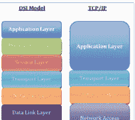

上方图注：了解基础知识：比较 `OSI` 七层模型和四层 `TCP/IP` 模型

# 教程

## 诊断问题

找到根本问题可能很棘手，但有几个地方你可以首先查看。

### 哪里没工作 – 是连接一个网站还是所有网站？

如果只是其中一个，问题可能仍然在你这一端，但如果所有网站都无法访问，让我们找出问题所在。

首先，你的网络连接 – 大多数桌面发行版都随附 `NetworkManager` 来管理连接。从命令行输入 `nm-tool` 将报告它了解到的你的网络信息 – 查找 "State: connected"。

如果没有 `nm-tool`，使用 `ifconfig` 查看识别到的接口，使用 `ethtool` 查看连接状态信息，或使用 `iwconfig` 查看无线连接。

虽然 `ethtool` 会显示你物理连接到网络（Link detected: yes），`iwconfig` 会显示你连接到无线路由器，`ifconfig` 会给你你的 `IP` 地址和子网掩码，告诉你你的网络配置到这一部分是成功的。

运行 `route` 将显示路由表，其中包含通往互联网其余部分的默认网关。如果没有显示本地子网外地址的默认网关，你需要修复这个问题。`Route` 可用于添加路由，但你需要解决问题的原因。

你的服务器将有固定的 `IP` 地址，可以编辑以更正网关和其他网络详细信息。笔记本电脑通常由 `DHCP`（动态主机配置协议）守护进程自动配置，该守护进程通常运行在 `ADSL` 路由器上，如有必要，可以更改问题机器的设置。

修正设置后，重启网络：

```
sudo service networking restart
```


上方图注：`www.downtimeforeveryoneofustm.com` 是一个非常方便的诊断工具，听起来很简单

### 无法连接 Wi-Fi？

`wpa_supplicant` 工具显示你的无线网络接口能看到的所有内容。

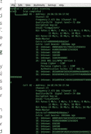

...将在基于 `Debian` 的 PC 上获取修订后的设置 – 对于 `Red Hat` 系统，请省略动名词（-ing 形式）。再次运行 `route` 以检查默认网关是否出现。

`Ping` 使用 `TCP/IP` 协议栈的另一部分，`ICMP`，发送 `ECHO_REQUEST` 数据报，并由被 ping 的主机或网关产生的 `ICMP` `ECHO_RESPONSE` 用于计算往返时间。`Ping` 告诉你机器是否在线，网络中的延迟是多少，以及丢失了多少数据包，除非服务器被一个过度热情的系统管理员设置为丢弃 `ICMP` 请求，否则所有这些都有指示意义，这种情况在大多数情况下安全价值微乎其微。使用 `ping` 检查你是否有通往互联网主机的路由。先 `ping` 你的网关：

```
ping 192.168.0.1
```

…然后 `ping` 一个可靠的主机，如 `8.8.8.8`，这是 `Google` 的面向公众的 `DNS` 服务器之一（另一个是 `8.8.4.4`）。我们一直在使用 `IP` 地址和

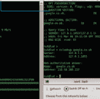

`Nslookup` 提供域名的 `IP` 地址，以及查找它的位置。简单但有效

`nslookup` 切换到以避免 `DNS` 问题分散我们对其他网络故障的注意力，但现在是时候检查 `DNS` 功能了。`Nslookup`，不如 `dig`（`dig` 的部分输出可以在上方看到）复杂，但对于检查域名是否解析为 `IP` 地址已经足够了。如果没有得到答案，请查看 `/etc/resolv.conf`。

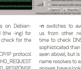

如果你排除了 `DNS`，尝试一些上述工具 – 使用 `traceroute` 查看是否能路由到那里，使用 `telnet` 和 `netstat` 查看特定端口是否打开，使用 `dig` 获取更多信息，使用 `Wireshark` 调查无响应或缓慢的服务。

如果你的 `Web` 服务器是有问题的那一个，则 `ssh` 进去并运行：

```
netstat -lnp | grep -i apache
```

（将 `apache` 替换为 `nginx`、`httpd` 或任何其他适用的）以查看你的 `Web` 服务器是否正在监听端口 80 上的所有地址。如果你只关心那个端口，你可以 `grep 80`，但检查 `Apache` 还在其他什么端口上运行和监听。

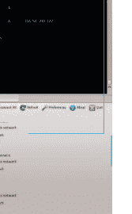

`Wpa_supplicant` 有基于文本的界面和可脚本化版本可用，但 `GUI` 前端也足够好。

# 故障排除与网络修复

解决网络连接和 `Web` 托管问题

## 配置文件

使用你最喜欢的文本编辑器深入配置文件，是快速解决问题的绝佳方式。

一切皆文件，即使是有线的设备 – 这就是 `Linux` 的方式。在八十年代，许多 `Unix` 系统使用二进制配置文件，但受 `Plan9` 操作系统的启发，`Linux` 将大部分配置信息存储在文本文件中。了解这些文件的位置以及如何操作它们，意味着你的文本编辑器也可以成为检查、修复和维护网络的一个强大工具。

这从硬件层面开始 – 物理接口位于 `/dev` 下，而 `/proc` 会公开已安装的 `PCI` 总线和设备的配置，供 `lshw` 读取。当你调用：

`lshw -C network`

...来检查逻辑名称条目，以便与 `ethtool` 和 `ifconfig` 等工具配合使用。


不过，情况并不总是那么简单。在`Red Hat`和基于`Debian/Ubuntu`的机器之间切换时，我们`Ubuntu`机器上的以太网接口是在文件`/etc/network/interfaces`中配置的，而`Fedora 20`笔记本的网卡则是`/etc/sysconfig/network-scripts/ifcfg-emu1`，该目录中还共享了与我们曾连接过的所有无线枢纽相对应的`ifcfg-*`文件。

## 插上了吗？

你可能不信，但确实会发生这种事。这并不是首先要检查的项目 – `ifconfig`和`ping`都会显示你有可用的以太网连接，或者`Wi-Fi`路由器已开启。然而，如果测试显示没有连接，那就是你查找松动电缆（网卡上的绿灯亮着吗？）、未插好路由器或其他物理原因的时候。别忘了，许多笔记本电脑都有小按钮可以关闭`Wi-Fi`网卡（或`F`键快捷键），这些键可能会被意外按下。

```
rfkill list all
```

...通常会显示是否处于这种状态。如果是硬阻塞，就按下开关；如果是软阻塞，`rfkill unblock all`通常会让你的连接恢复。

正如我们所说，这种事会发生，所以如果发生在你身上，就微笑吧，因为这至少比那些无法立即修复的更严重的问题要好。

`Linux`的“一切皆文件”方法也意味着，如果你遇到硬件问题，通常可以用文本编辑器解决。例如，如果内核没有加载你网卡的模块，那么这里不仅是添加要加载模块的地方，如果设备名称导致错误，还可以添加该设备名称的别名：

```
alias eth0 b44
```

## 再次谈 DNS

`DNS`由解析例程访问 – 读取配置文件`/etc/resolv.conf`以了解搜索位置。查看笔记本电脑上的该文件，你可能会看到类似以下内容：

例如，你的`/etc/resolv.conf`可能列出了由`resolvconf(8)`生成的`libc-resolver(3)`的`Dynamic resolv.conf(5)`文件。

```
# DO NOT EDIT THIS FILE BY HAND – YOUR CHANGES WILL BE OVERWRITTEN

nameserver 127.0.1
search Home
```

`127.0.1`（而不是`127.0.0.1`）指向一台运行`dnsmasq`的`PC`，这是一个在`NetworkManager`控制下的轻量级转发`DNS`服务器。在没有`dnsmasq`的发行版中，`dnsmasq`会从`DHCP`服务器获取`DNS`服务器的地址。

最好使用`/etc/resolvconf/base.conf`来放置如下条目：

```
nameserver 8.8.8.8
nameserver 8.8.4.4
```

...以自动写入`/etc/resolv.conf`。然后，以`root`身份或使用`sudo`运行`resolvconf -u`将更新`resolvconf`。

更仔细地查看`/etc/resolv.conf`会发现它是指向`/run/resolvconf/resolv.conf`的符号链接，这是`dnsmasq`写入的位置。若要临时移除`dnsmasq`，请尝试注释掉`/etc/NetworkManager/NetworkManager.conf`中的其条目。

`DNS`服务器按照它们在`/etc/resolv.conf`文件中出现的顺序进行查询 – 将你想先尝试的那个放在前面，并且/或者通过在其行首添加`#`来注释其余部分，以便`resolvconf`忽略它们。

`Opennicproject.org`和`http://freedns.zone`提供无重定向且无日志记录的`DNS`，如果你居住在一个在线行为受到监控或限制的地方，这是必不可少的。

最后，回到`IPv6`，可以通过编辑`/etc/modprobe.d/aliases`并添加以下内容，在全系统范围内移除它：

```
alias net-pf-10 ipv6 off
alias net-pf-10 off
alias ipv6 off
```

...并重启。如果排除它是问题的原因，记得把它改回来：

```
alias net-pf-10 ipv6
```

## 我在哪里？

如果你熟悉`whoami`，它会告诉你当前登录的是哪个用户 – 这在你经常`su`或`ssh`并可能迷失方向时非常有用 – 你可能会期望`whereami`能告诉你登录的机器名称。不。所以为此，你输入`hostname`，它会读取`/etc/hostname`。

`Whereami`是一组有用的脚本，用于检测你的笔记本连接到了哪个网络并相应地配置它。

对于那些运行轻量级窗口管理器且没有各种花哨功能的发行版的人特别有用，它允许你快速点击可用的`Wi-Fi`网络进行选择。它还可以通过脚本微调已知网络，并以最小的干预适应新连接。

运行此工具可以首先帮助你避免一些连接麻烦，而且它比`wicd`更灵活。


# 修复网络问题

使用这四个应用程序将帮助你定位和修复许多网络问题

## （Telnet 到）Netcat

`Netcat`不仅完成了`humble telnet`所做的所有事情，还做了更多，但你可能发现自己在一台没有`netcat`的机器上，所以我们从老式`telnet`的一个例子开始。

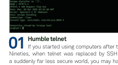

### 01 朴素的 Telnet

如果你是在九十年代之后才开始使用计算机的，当时`telnet`被`SSH`取代，世界突然变得不那么安全，你可能已经把它当作过去的遗迹而置之不理。但`telnet`仍然作为一个有用的诊断工具存在于任何发行版中，可以连接到特定端口以查看哪些端口是开放且工作的。

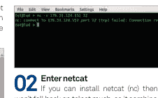

### 02 引入 Netcat

如果你能安装`netcat (nc)`，那么你就不太会回头使用`telnet`了，因为它将`telnet`的简单测试能力与通过`TCP`、`UDP`或`Unix`域套接字几乎可以做任何事情的能力结合在一起：打开`TCP`连接，发送`UDP`数据包，在任意`TCP`和`UDP`端口上监听以及端口扫描。

### 03 端口扫描

虽然检查某人机器上的每个端口以查看哪些端口保持开放（端口扫描）并不是礼貌之举，但在你自己的机器上它对于安全性（“那个不应该开放”）和诊断（“那个应该开放并监听”）都是有用的。尝试运行类似`nc -vvnz 192.168.0.11 -65535`的命令来执行此操作。

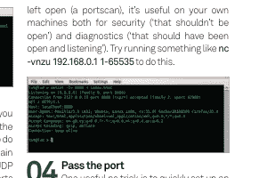

### 04 传递端口

一个有用的`nc`技巧是快速设置一个模拟用户服务器，监听特定端口，以检查该端口之间你和服务器之间是否有任何阻碍连接的因素。在上面的图中，我们将`nc`设置为一时性`web`服务器，并读取连接到它的主机信息。

## Traceroute

当你使用互联网时，你可能不会思考它是如何工作的，但`traceroute`揭开了你的数据包在何地旅行的面纱 – 显示数据包到达你的机器和服务器之间的每个网关机器所需的时间。


### 01 跟随跳跃

`Traceroute`测试你与目标主机之间的每个跳跃（`hop`）。虽然并不总是具有决定性，但输出显示问题可能发生在何处。虽然截图显示默认的跳跃次数和数据包大小，但你可以通过以下命令调整：

```
traceroute -m 255 wikipedia.org 70
```


### 02 旅行时间

显示的那些以`ms`为单位的时间是发送到每个主机的三个数据包的往返时间。使用`-q`调整数据包数量 – 例如，`-q1`只发送一个数据包。从英国更长的时间可能是信道跳跃（`channel hop`）。

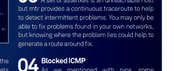

### 03 Mtr

一连串星号表示无法到达的主机，但`mtr`提供连续的`traceroute`以帮助检测间歇性问题。你可能只能修复你自己网络中发现的问题，但知道问题所在有助于生成一条绕行修复的路径。

### 04 阻断的 ICMP

正如我们在`ping`中提到的，一些系统管理员会阻断`ICMP`，因此标准的`traceroute`将不起作用。`Tcptraceroute`通过`TCP`而不是`ICMP`提供`traceroute`。

## 故障排查与网络修复

解决网络连接和`Web`托管问题

### Dig（域名查询工具）


在本教程中，我们大量使用了`-m`选项，因为 DNS 问题很容易掩盖其他故障。一旦你使用解析器清除了机器上疑似的 DNS 问题，就该通过分层式 DNS 服务器体系去确认一切是否正常。`Nslookup` 和 `host` 执行的是简单搜索，但`dig` 是灵活性最高的工具。

### 01 地址查询

`Nslookup` 或许足以用于解析地址或检查连通性，但若要获取有关 DNS 服务器及其在整个互联网上递归连接的有用信息，就应启用`dig`。由于它的灵活性，花一点时间熟悉其一些选项将大有裨益。

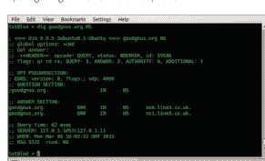

### 02 名称解析

默认情况下，`dig` 返回 `A` 记录，但也可用于检查 `MX`（邮件服务器）等其他记录类型。在上方的截图中，我们使用 `NS` 查找某个命名域的域名服务器。

### 03 分层结构

DNS 具有分层结构，首先查询 `TLD`（顶级域名），例如 `.com` 或 `.org.uk`，然后再查询名称部分。由于搜索是递归进行的，因此存在大量出错空间——甚至可能遭受恶意攻击。`Dig +trace` 会向你展示查询所经过的连续分层步骤。

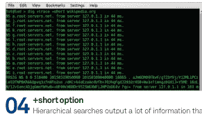

### 04 +short 选项

分层搜索会输出大量你可能并不需要的信息——即使对于标准的 DNS 查询，你也可能只想要 IP 地址。`+short` 选项正好提供如此简略的输出，这在脚本化搜索中也非常实用。

## Wireshark

与 `tcpdump` 类似，Wireshark 可以从网络转储数据包，但它还具备交互式分析功能——对于轻微的网络问题来说略显大材小用，但对于定位系统瓶颈非常有用。在大多数发行版中，Wireshark 是 `GUI`（`Gtk`）版本，而控制台版本则以 `tshark` 打包提供。建议两者都试用，以便在故障发生时根据具体情况选择最佳工具。


### 01 强大的工具

尽管可用的选项数量令人困惑，但启动过程很简单：只需从 `Capture` 菜单中选择接口即可。若要让 Wireshark 检测到你的接口并避免以 `root` 用户身份运行，请参阅 `wiki.wireshark.org` 上的 `Capture Setup/Capture Privileges`。

### 02 便携式故障排查

由于 Wireshark 对于检测许多数据包丢失或延迟问题非常有用，而你未必在各地都安装了它，你可以将其存放在 USB 现场发行版（live distro）中随身携带，从而避免围绕超级用户权限的麻烦。

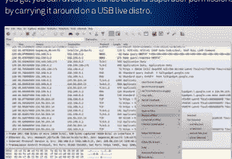

### 03 过滤器裁剪

查看原始数据可能会令人眼花缭乱，而且过滤器的选择也非常多。你可以右键点击可疑条目，并以其作为过滤器的基础，或者从过滤器层级中执行相同操作。最简单的情况是，你在查找特定协议——例如 DNS，或某些通过 TLS 加密的内容——只需将其输入过滤器工具栏即可。

### 04 命令行鲨鱼（命令行版）

在你的 `VPS` 或其他非 `GUI` 机器上，`tshark` 在功能上等效于 Wireshark；建议在安装 Wireshark 之后也安装它并熟悉其使用，以便在需要时做好准备。


## 特别订阅优惠

订阅并立省 30%


每 3 期仅需支付 12.50 英镑


订购热线 0844 249 0282

在线订购请访问 `www.imaginesubs.co.uk/lud`

### 邮寄方式

请将填写好的表格寄至：

`Linux User & Developer Subscriptions, 800 Guillat Avenue, Kent Science Park, Sittingbourne, Kent ME9 8GU`

### 每期内容充实…

- 来自 Linux 专家的编程指南
- 来自企业供应商的最新新闻
- 富有创意的树莓派项目与建议
- 对最佳 Linux 发行版和硬件的评测

### 为什么你应该订阅…

- 比封面价节省 30% – 每期扣款 12.50 英镑（每期 3 期，采用直接借记）
- 免费送货直达
- 永不错过任何一期

### 订购截止

5 月 31 日

请使用优惠码 `PQ15` 享受此优惠。

### 您的信息

头衔 `________` 名 `________`

姓 `________`

地址 `________`

`________`

邮政编码 `________` 国家 `________`

电话号码 `________`

手机号码 `________`

电子邮件地址 `________`

### 直接借记支付

□ 英国直接借记支付

我每期仅支付 12.50 英镑（每 3 期支付一次，节省 30%）

`直接借记支付`

账户开户银行或建筑协会名称：

银行/建筑协会名称： `________`

账户号码： `________`

分行代码： `________`

地址： `________`

邮政编码： `________`

排序码： `________`

签名： `________`

日期： `________`

### 支付详情

您的专属读者价格，1 年（13 期）

□ 英国 62.40 英镑（节省 20%）  □ 欧洲 – 70 英镑  □ 世界 – 80 英镑  □ 美国 – 80 英镑

支票

□ 我随附一张金额为 £ `________` 的支票（收款人填写为 Imagine Publishing Ltd）

信用卡/借记卡

□ Visa □ Mastercard □ Amex □ Maestro

卡号 `________`

有效期 `________`

发行号 `________`（仅限 Maestro）

签名 `________`

日期 `________`

如果您不希望收到 Imagine Publishing Ltd 通过邮寄 □ 电话 □ 电子邮件发送的任何宣传材料，请勾选

如果您不希望收到其他公司通过邮寄 □ 电话发送的任何宣传材料，请勾选 如果您希望通过电子邮件 □ 收到此类信息，请勾选

`条款与细则`

条款与细则：此优惠使新的英国直接借记订阅者每 3 期仅需支付 12.50 英镑。新订阅将从下一个可用的期数开始。要享受此特别订阅价格，必须引用优惠代码 `PQ15`。直接借记保证的相关详情可应要求提供。此优惠于 2015 年 5 月 31 日截止。Imagine Publishing 保留限制此类型优惠每户限一份的权利。订阅者可随时取消此订阅。

## 教程 项目管理

侧边栏中提供了所有主要选项，如待办事项列表、维基、问题和管理员选项等

此图表展示了以项目点数和时间（冲刺次数）为单位的剩余工作量

你可以逐个添加用户故事，也可以批量添加。使用“移动到当前冲刺”按钮将故事添加到当前冲刺中

点击冲刺任务板或冲刺名称以查看任务状态。在任务板中添加与用户故事相关的任务

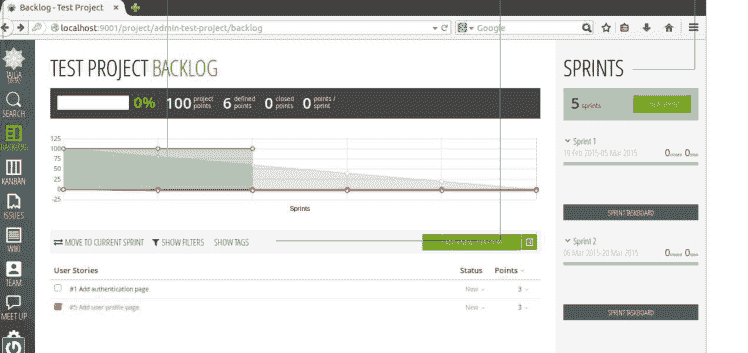

## 使用 Taiga 实施敏捷项目管理

软件项目很难管理，但 Taiga 是传统项目管理工具的绝佳替代品

### 顾问

`Nittish Tiwari` 是一名软件开发者，也是一名出于热爱的开源爱好者。除了为主要的开源杂志撰写文章外，他还帮助企业建立和使用开源软件以满足其业务需求

### 资源


- Taiga 主页 [taiga.io](https://taiga.io)

软件已经渗透到日常生活中几乎一切事物中。但软件开发也存在其自身的问题，其中一个主要问题是度量——其无形输出使得管理变得困难。一项任务看起来可能很容易，但很难判断在编码时可能会遇到哪些问题，尤其是在拥有多个组件的分布式架构中。那么，如何才能克服这一难题呢？

随着敏捷开发方法的出现，这个问题得到了解答。敏捷方法专注于最终产品，但缺乏优秀的开源且专注于敏捷的工具——大多数现有工具较旧，只是经过简单修改以支持双峰模型（`biome`）。直到 Taiga 的出现。Taiga 是一款基于开源的敏捷项目管理（`PM`）工具。其名称源自一种森林生态系统（`biome`），旨在成为生态系统——即你的项目和你的团队——的中心，并采用其全新的用户界面和基于敏捷的布局。让我们从在 Ubuntu 14.04 上安装它开始本教程，然后进一步了解其内部结构。此处的安装适用于开发服务器。Taiga 网站上另有不同的生产服务器安装流程。

## 01 安装

Taiga 有三个主要组件需要分别安装。

- `Taiga-back`：后端部分（同时也支持 API）。
- `Taiga-front`：前端部分。
- `Taiga-events`：WebSocket 网关。完全可选，对于一般的项目管理目的并非必需。我们将跳过这一部分。

在开始进行 Web 前端操作之前，我们需要后端运行起来。Taiga 的后端有多个依赖项，如开发头文件、C 编译器以及其他包。首先，运行以下命令来安装所有依赖项。

```bash
sudo apt-get install -y build-essential binutils-doc autoconf flex bison libjpeg-dev
sudo apt-get install -y libfreetype6-dev zlib1g-dev libwmf-dev libgdmb-dev libncurses5-dev
sudo apt-get install -y automake libtool libffi-dev curl git tcl tcl-dev
```

Taiga 使用 PostgreSQL 9.3+ 作为数据库，因此请安装数据库：

```bash
sudo apt-get install -y postgresql-9.3 postgresql-contrib-9.3
sudo apt-get install -y postgresql-doc-9.3 postgresql-server-dev-9.3
```

现在设置初始用户和数据库。此命令将创建一个名为 `taiga` 的用户，然后在 `taiga` 用户下创建一个名为 `taiga` 的数据库。

```bash
sudo -u postgres createuser taiga
sudo -u postgres createdb taiga -O taiga
```

## 02 安装 Taiga-back

现在让我们设置 Python 环境。您还需要安装 `virtualenvwrapper` —— 一组扩展，通过在隔离的虚拟环境中运行第三方库，确保您的系统不会杂乱无章。

运行以下命令来安装 Python 和 `virtualenvwrapper`。然后重启您的 shell 以重新加载包含 `virtualenvwrapper` 变量和函数的 bash。

```bash
sudo apt-get install -y python3 python3-pip python-dev python3-dev python-pip virtualenvwrapper
sudo apt-get install libxml2-dev libxslt-dev
```

从 GitHub 下载 Taiga 后端代码并运行以下命令。当前目录将更改为 `taiga-back`：

```bash
cd ~
git clone https://github.com/taigaio/taiga-back.git taiga-back
cd taiga-back
git checkout stable
```

使用以下命令创建一个名为 `taiga` 的新虚拟环境：

```bash
mkvirtualenv -p /usr/bin/python3.4 taiga
```

然后安装后端的依赖项：

```bash
pip install -r requirements.txt
```

用示例数据填充数据库；这还将创建一个密码为 `123123` 的管理员用户 `admin`：

```bash
python manage.py migrate --noinput
python manage.py loaddata initial_user
python manage.py loaddata initial_project_templates
python manage.py loaddata initial_role
python manage.py collectstatic --noinput
python manage.py sample_data
```

现在您可以运行服务器了。请记住，`workon` 命令会启用 `taiga` 虚拟环境：

```bash
workon taiga
python manage.py runserver
```

完成后，您应该能够通过以下地址查看代表完整端点列表的 JSON：`http://localhost:8000/api/v1/`。

## 03 安装 Taiga-frontend

现在让我们完成 Taiga 前端的安装。Taiga 在前端使用了除了 CSS/HTML/JavaScript 以外的语言，因此在浏览器能够完全理解之前，确实需要对其进行构建。

下载 Ruby 和 Gems。在使用最后一个命令设置路径后，使用以下命令重启 shell：

```bash
sudo apt-get install --ruby
gem install --user-install sass scss-lint
export PATH=~/gem/ruby/1.9.1/bin:$PATH
```

现在使用以下命令完成 NodeJS 的安装：

```bash
sudo apt-get install --nodejs npm
```

然后运行 `node` 命令以检查该命令是否被识别。如果没有，请运行：

```bash
sudo ln -s /usr/bin/nodejs /usr/bin/node
```

现在安装 `gulp` 和 `bower`：

```bash
sudo npm install -g gulp bower
```

…然后获取代码并编译 `taiga-frontend`：

```bash
cd ~
git clone https://github.com/taigaio/taiga-frontend.git taiga-frontend
cd taiga-frontend
git checkout stable
```

使用以下命令进行编译：

```bash
npm install
bower install
gulp
```

现在运行 `gulp`：

```bash
cd ~/taiga-frontend
npm install
```

如果在运行 `gulp` 时遇到 `npm` 错误，请清除临时文件并重新安装所有依赖项。

```bash
rm -rf ./npm*
rm -rf node_modules
npm install
bower install
gulp
```

如果成功，您现在应该能够在 `http://localhost:9001` 看到 Taiga。

## 04 创建项目和用户故事

既然 Taiga 现在已在您的浏览器中运行，下一步是创建一个项目。我们已经有创建的 `admin` 用户，密码为 `123123`，因此使用这些凭据登录 Taiga 并单击“创建项目”。然后选择 Scrum 模板并单击“下一步”。最后，填写相关详细信息（名称和描述）并单击“创建”。这将带您进入项目待办事项列表（`Project Backlog`）页面。在页面的上半部分，您有燃尽图；下半部分是用户故事列表。在右侧边栏中，您可以看到 Sprint（冲刺）部分。按照通常的做法，让我们先开始创建用户故事，因为对于初学者来说，敏捷开发方法论要求从用户的角度将软件功能分解为更小的单元。这些单元在敏捷术语中称为用户故事。

> Sprints 具有预定义的时间段，通常是两到三周

要添加用户故事，只需单击页面下半部分的“添加新的用户故事”。在下一页中，填写详细信息。请注意，您可以通过此页面为用户故事分配项目点数。您也可以使用批量插入按钮（位于“添加新的用户故事”按钮旁边）一次添加多个故事，并且不要忘记将您的 `admin` 密码更改为易于记住的内容！

## 05 创建 Sprints

既然用户故事已经可用，让我们规划一下 Sprints（冲刺）。如您所知，sprints 是预定义的时间段，通常是两到三周。在 sprint 开始之前，开发人员承诺在 sprint 结束时完成一组用户故事。当 sprint 结束时，scrum 主管审视情况并决定下一个 sprint 的用户故事，此周期继续。


要在`Taiga`中创建`sprint`，只需单击右侧边栏上的“New Sprint”按钮。在下一页中，填写`sprint`的名称和持续时间。默认情况下，`sprints`为两周——开始日期和结束日期会自动填写。既然您已经添加了用户故事，只需进入待办事项列表页面，选择相关的用户故事并单击“Move to current sprint”按钮。这样，您就有分配给`sprint`的故事，其余故事可作为待办事项列表。一旦您为用户故事分配了`sprints`，您可以进一步将其分解为依赖任务。

## 06 Kanban 模板

`Kanban`起源于日本。它使用在制品系统作为核心机制，以暴露系统操作（或流程）问题并刺激协作以持续改进系统。虽然传统上用于制造业，但现在它广泛作为敏捷方法论的一种变体被使用。

使用`Taiga`，您可以创建一个带有`Kanban`模板的项目，或者在`scrum`模板内查看`Kanban`模板。要创建一个简单的`Kanban`项目，只需在项目创建期间选择`Kanban`。如果您希望您的项目可以以`scrum`和`Kanban`两种方式查看，请在`scrum`模板下创建项目，然后在`管理 > 项目配置文件 > 模块 > Kanban`下启用`Kanban`。现在您将在左侧边栏上有一个`Kanban`选项。点击此处以在`Kanban`模板中查看您的`scrum`项目。

## 07 问题管理

软件开发的另一个重要方面是问题管理。`Taiga`提供了一个全面的问题管理系统，包括`bug`、问题和增强功能。要提出一个问题，请单击左侧边栏上的“Issues”链接。然后单击右上角的“New Issue”按钮。填写详细信息，如类型、优先级、严重性等，然后单击“Create”。您现在可以在问题列表中看到该问题，但它尚未分配给任何人。单击“Unassigned”按钮将其分配给团队成员。请注意，左侧边栏也有不同的过滤器可用。单击过滤器以查看相关的`bug`。您还可以使用左上侧边栏中的搜索框搜索问题。

## 08 Wiki

有了`Taiga`掌舵，软件文档也得到妥善处理。您可以看到左侧边栏在“Issues”链接下方的“Wiki”链接，因此只需单击该链接即可开始。您可以看到`WYSIWYG`（所见即所得）接口文本编辑器。在编辑器中添加文本，完成后，单击“Add Link”按钮。在这里，您可以为`wiki`页面分配名称。一旦名称被分配，您的第一个`wiki`页面就准备好了。您可以类似地添加其他页面，并根据需要相互链接页面。

## 09 管理选项

查看左下角的管理选项（齿轮图标）。这些设置特定于项目，因此您可以为不同的项目设置不同的配置。管理设置下有五个主要部分。“项目配置文件”允许您设置项目详情、启用/禁用模块等。“自定义属性”允许您为问题、优先级和状态创建自定义状态。“管理成员”和“角色与权限”具有用户/权限管理选项。“集成”将项目与`GitHub`、`Bitbucket`和`GitLab`合并，并与`Webhooks`同步事件。

## 10 游戏化

如果您到现在还没有注意到，`Taiga`以一种非常微妙、不显眼的方式添加了大量的游戏化元素。以`loacaine`剂量为例。当您在`sprint`期间编辑与用户故事相关的任务时，您可以单击`loacaine`按钮，向其他人表示您正在努力完成任务。这里还有其他计划中的功能——例如，扑克规划模块让团队就任务所需时间进行谈判，以及`kudosis`徽章以鼓励积极的沟通。

# 教程：音频转录

使用`Audacity`录制您的采访并处理您的音频，使其尽可能易于理解

配置播放功能以极大地提升音频控制效果，并略微简化转录过程

通过使用全局快捷键控制音频，从而在不离开文本文档的情况下更快地完成转录

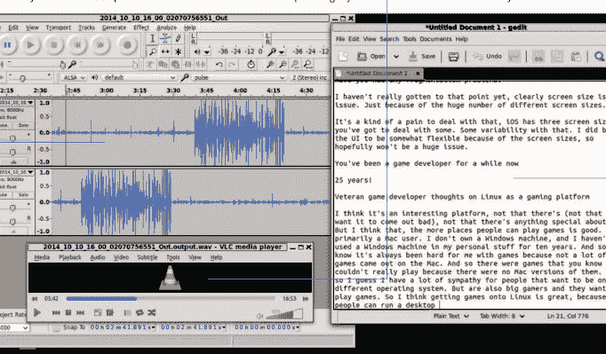

# 简化 Linux 上的采访与音频转录

## 按照本指南每个步骤操作，让转录变得更轻松

**顾问**

`Rob Zwetsloot`擅长对复杂系统进行建模，是一位精通`Python`、`Django`和`PHP`的`Web`开发人员。他热爱在计算领域进行实验

**资源**

- **Audacity**: `audacity.sourceforge.net`
- **VLC**: `videolan.org/vlc`

转录是我们作家必须承担的最枯燥、最令人乏味且最耗时的任务之一。虽然我们乐于向读者呈现由此产生的优秀采访内容——最近我们确实有一些非常出色的案例——但将这些文字录入文档的过程并不是我们最喜欢做的事。

然而，多年来，媒体行业的许多人已经完善了让转录更轻松的方法。在`Linux`上，我们可以使用一些最佳且高度可定制的软件，因此一旦知道方法，为采访搭建环境其实相当简单。

虽然本教程主要面向采访场景，但我们已成功将其改编用于新闻发布会，也没有理由不能将其用于大学或学院的讲座中，以方便记笔记。准备好了吗？好的，让我们进入第一步。

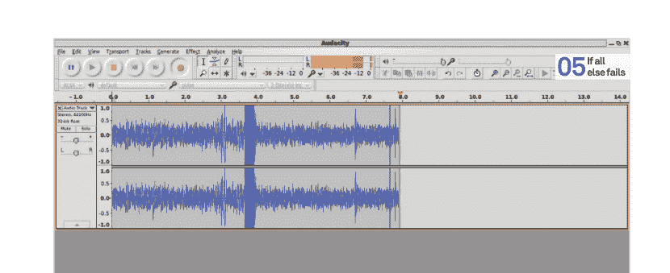


## 01 选择环境

你需要做的第一件事是选择你的录音环境。无论你是通过电话、`VoIP`还是在开放房间里录音，请尽量确保你处于尽可能安静的环境中。虽然并非总是可行，但当你能控制环境时，最好将其铭记于心。

## 02 准备设备

你需要一个录音笔、`Android`手机或计算机。前者更适合开放式场合，而对于`VoIP`通话，录音笔的作用有限。我们建议使用你的智能手机，以便将音频文件传输到`PC`上进行更好的转录。


## 03 “电话窃听”

我们有一种俗称“电话窃听器”的设备——它是一种拾音线圈，通过吸盘附着在电话听筒的背面。

虽然隐蔽性不高，但如果你需要录制电话采访，效果极佳。这些线圈末端带有`3.5mm`插孔，可以插入录音笔或带有麦克风输入接口的计算机。

## 04 录制 VoIP

取决于你使用的`VoIP`服务类型，你可能已经安装了某种录音功能。像`Skype`这样的应用通常没有内置录音功能，但你可以改用`Skype Call Recorder`应用。

## 05 万不得已时

如果你需要在`PC`上录制通话或音频，你可以使用`Audacity`手动录制来自你系统的完整声音。你需要将`Pulseaudio`作为声音服务器，在`Audacity`中选择`Pulse`作为输入，开始录音，然后进入音量控制，并在“捕获”下拉菜单中选择“监视”。

## 06 检查设备

这是一个常见的错误，每个人都会犯，但在进行采访前务必检查你的设备。某天，同一套设置可能会因某些原因无法按预期工作，而在长达一小时的采访结束后才发现这一点，绝不是件愉快事。

## Android 应用

有一些`Android`应用可以为你录制语音通话，但除非你使用的是已`root`的设备，否则你无法正确录制来自通话另一端的音频。这些应用中的大多数是尝试使用麦克风来捕捉电话听筒端的声音。请自行实验并找出最适合你的方案，否则你可能需要研究如何`root`手机，才能让通话录音正常工作。

## 07 采访中

在录音时做笔记并标记感兴趣的时间戳，对后续转录很有用。这能让你在撰写文章或整理笔记时，直接快进到所需的内容。你也可以在`Audacity`中做到这一点，只需在录音时按下`Ctrl+M`即可。

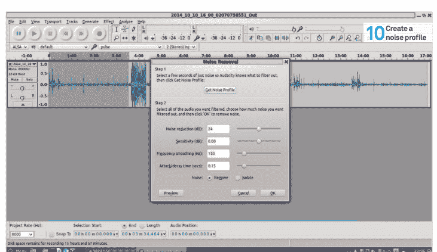

## 08 传输到 PC

如果你是在外部设备上录制的采访，现在是将文件传输到`PC`的时候了。虽然录音笔和一些应用具有倒退和慢放功能，但将所有内容整合在一个系统上可以让我们做得更好。

## 09 清理音频

在开始转录之前，我们可以做一些事情来稍微简化流程。将音频导入`Audacity`，先修剪时长以及可能存在的停顿部分，以便你更好地了解需要转录的内容量。

## 10 创建噪声模型

在选取一段安静区域之前，你可以使用此功能为你所在的环境创建噪声模型。这可以去除任何背景噪声，使被采访者的声音稍微清晰一些。选中该区域后，点击“获取噪声模型”。

## 11 移除噪声

一旦设置好模型，你就可以开始实验从轨道中移除噪声了。取消选择模型区域，对整个轨道使用默认设置快速尝试一遍，方法是返回“噪声移除”并点击确定。你可以选择要移除噪声的区域，并调整设置以优化移除效果（如果有帮助的话）。

## 12 增强与标准化

你可以通过增强音频的不同部分来获得更一致的音量——特别是当一方始终明显比另一方更安静时。增强功能可以在“效果”菜单中找到。也可能有一方音量过大——对此你可以使用标准化功能来降低音量。

#### 13 混合下混

某些录音机可能会将采访者和被采访者放在立体声音轨的不同声道上。如果你需要拔掉耳机的一边，或者只是想捕捉到单词，这会非常令人烦恼。在轨道本身有一个下拉菜单，你可以选择“分离立体声轨道”，然后将每个声道转换为单声道。

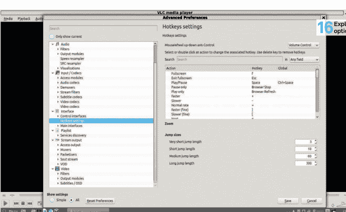

### 探索选项

### 14 导出文件


完成文件处理后，将其导出为你首选的文件类型。我们将在转录阶段使用`VLC`，因此你可以使用几乎任何文件类型——虽然我们此时不想考验`VLC`的极限，我们的目标是让流程更轻松而非更复杂。


### 15 配置`VLC`

如果你尚未安装`VLC`，现在是安装它的时候了。我们将为这部分设置全局快捷键，这能让我们从其他窗口控制它。安装完成后，打开它。

### 16 探索选项

在菜单栏中转到“工具”，然后继续进入“首选项”。在“显示设置”选项中，选择“所有”以调出高级设置。向下滚动并查找“快捷键设置”选项。全局按键设置就在这里找到。

### 17 设置快捷键

我们发现最重要的快捷键是播放/暂停以及非常短的前后跳转。双击你要设置的全局按键，然后执行你希望使用的按键组合。我们喜欢使用`Ctrl+Space`进行暂停，`Ctrl+右/左`进行跳转——但请确保你使用的组合键不会与其他任何功能冲突。

### 18 做好准备

关键时刻即将到来——打开你的文字处理软件或文本编辑器，准备好打字。关闭`VLC`，然后打开音频文件并让其播放。回到你的文档，尝试你新的全局快捷键——如果一切顺利，你现在可以在不离开转录文档的情况下进行后退、前进和暂停操作。

### 19 开始转录

如果你愿意，现在就可以开始转录了。我们使用的一个技巧是在`VLC`中稍微降低音频速度——你可以通过转到“播放”、“速度”然后点击“较慢”来实现。这会将速度降低约`25%`，并可提供多一点时间来书写。

## 机器转录

`Linux`上的语音识别现状良好——存在`API`和可用的声学模型，实际上可以将你说的话解析为声音等。目前的主要问题在于缺乏开放的语言模型——即装满单词和常见语法短语的词典。不幸的是，这意味着暂时不存在真正的自由开源软件（`FOSS`）机器转录解决方案，供你后续修正。

### 20 更好地转录

使用此设置，你的转录应该花费更少的时间，并且通常做起来会容易一些。请尽情尝试我们在本教程中涵盖的一些内容，以打造一个完全适合你需求的设置。

# 教程：LVM 文件系统

了解图形化分区工具在处理`LVM`文件系统时的局限性。创建、命名并修改包含所有数据的逻辑卷和卷组。通过明智地分配空间，向`LVM`添加更多的硬盘和分区，以永久扩展存储空间。

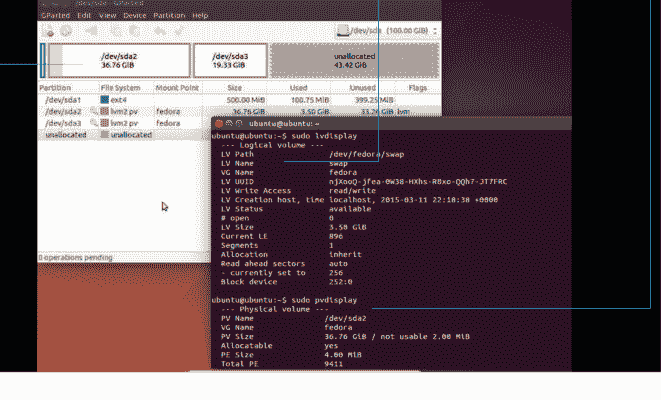

## 设置 LVM 文件系统

## 顾问


`Rob Zwetsloot`擅长对复杂系统进行建模，是一位精通`Python`、`Django`和`PHP`的`Web`开发人员。他热衷于尝试各种计算技术。

## 与普通的 ext4 分区截然不同，但 LVM 或许正是你的最佳选择

## 资源

- `LVM 2`工具：`sourceforge.org/lvm2`
- `GParted`：`gparted.org`

上一期我们讨论了`Btrfs`，这是下一代文件系统。在那篇教程中，我们简要提到了`LVM`，这项技术已经被广泛使用，以及它与`Btrfs`的关系。逻辑卷管理（`Logical Volume Management`, `LVM`）作为一种管理数据的容器——其优势在于，你仍然可以在`LVM`在线工作时开始添加和扩展空间。

这对服务器农场来说非常有用，因为你可以快速更换和添加存储设备；在桌面电脑上，如果你在安装时不确定各个分区的大小，它也适用于管理不同分区的大小。

在本教程中，我们将探讨如何创建`LVM`文件系统以及如何维护和修改它。我们还将了解某些发行版如何使用`LVM`进行安装。

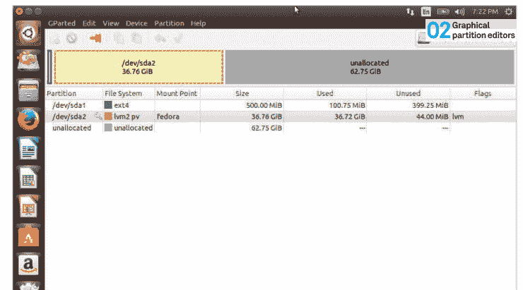

## 01 安装 LVM

许多发行版提供使用`LVM`文件系统安装的选项。在我们的示例中，我们在安装`Fedora 21`时保留了勾选`LVM`选项。这将自动为你创建一个用于启动和存储的分区，位于逻辑卷中，供你稍后进行实验。

## 02 图形化分区编辑器

像`GParted`这样的通用分区编辑器在处理`LVM`文件系统时会有些困难——即使安装了正确的工具，你也能看到分区，但无法对其进行太多操作。在本教程中，我们将主要在终端中进行操作。

> “`LVM`分区保存在一个卷组内”

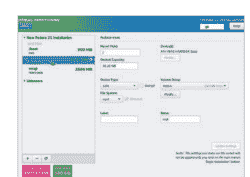

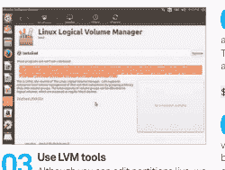

## 03 使用 LVM 工具

虽然你可以实时编辑分区，但我们建议从系统启动光盘（`Live Disc`）或其他发行版启动。一旦启动完成，如果尚未安装，请安装`LVM2`工具。该软件包在仓库中名为`lvm2`，包含用于查看和操作`LVM`分区的各种工具，非常有用。

## 04 查看 LV

现在工具已安装，我们可以查看系统上的`LV`（逻辑卷）。这将显示卷组、名称、类型和大小。打开终端并使用以下命令：

```bash
$ sudo lvs
```

## 05 查看卷组

`LVM`分区保存在一个卷组内，在我们的例子中被称为`Fedora`，但可以取任何名字。你可以使用卷组工具获取更准确的详细信息，如下所示：

```bash
$ sudo vgdisplay
```

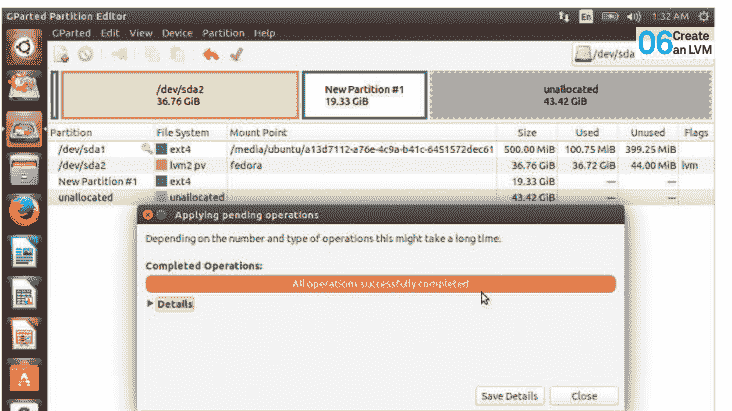

## 06 创建 LVM

创建`LVM`文件系统需要多个步骤。你需要为卷组创建一个物理卷，然后在该物理卷内创建你的逻辑卷。首先，请用你喜欢的创建方法在系统上创建一个新的分区。

## 07 创建物理卷

创建好分区后，你可以将其转换为物理卷。确保你知道分区的标识符（在我们的案例中为`/dev/sda3`），你可以使用`fdisk -l`来查找。使用以下命令创建`PV`：

```bash
$ sudo pvcreate /dev/sda3
```

## 08 包含卷组

现在有了可以操作的物理卷，我们需要创建一个带有名称的卷组。确保你仍记得分区标识符，并使用类似以下命令创建它：

```bash
$ sudo vgcreate LVMVG /dev/sda3
```

你也可以以这种方式添加多个分区和/或硬盘。

## 09 创建逻辑卷

最后一步是包含一个逻辑卷。给它一个名称，告诉它使用多少空间以及它应属于哪个卷组。若要填满一个`20GB`的卷组，请使用：

```bash
$ sudo lvcreate --name root --size 20G LVMVG
```

## 10 扩展卷组

如果你想扩展原始卷组中的空间，首先按之前所述创建一个新的物理卷。查找卷组的名称（使用`vgdisplay`），并使用分区的标识符进行扩展：

```bash
$ sudo vgextend /dev/fedora /dev/sda3
```

## 11 修改逻辑卷

使用`vgdisplay`查找空闲的`PE`（物理扩展）值，确保你确切知道有多少空间可以扩展分区，同时也确保你知道你要扩展的分区名称。一旦你拥有这两者，请使用：

```bash
$ sudo lvextend -l +4958 /dev/fedora/root
```

## 12 调整文件系统大小

为了完成扩展，我们需要让整个`LVM`系统知道它已发生了一些变化，使用`LV`上的`resize`选项来实现。好处是，这意味着你不需要在硬盘上有“相邻”的空间才能以这种方式扩展。使用以下命令执行：

```bash
$ sudo resize2fs /dev/fedora/root
```

## 确保你知道分区的标识符

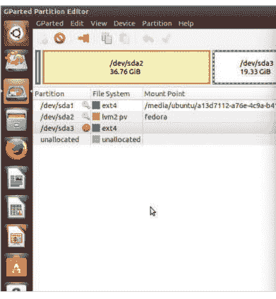

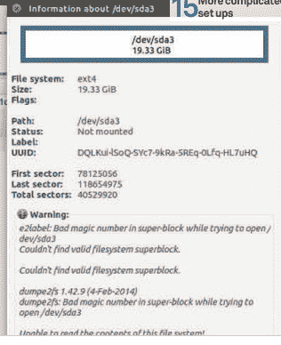

## 13 文件系统检查

取决于存储的创建方式，你在执行`resize2fs`之前可能需要检查文件系统的完整性。在我们的案例中，它要求我们在调整大小之前对扩展后的`LV`执行`e2fsck`命令——你只需按照指示操作即可。

## 14 测试你的新文件系统

现在你可以在`LV`、卷组中看到扩展后的空间，并使用`lvs`、`vgdisplay`和`pvs`选项查看是否还有空闲空间可供分配。在`lvs`和`vgdisplay`中，它不会显示额外的`sda`分区，因为就它而言，它们都是同一存储的一部分。

## 15 更复杂的设置

`LVM`的美妙之处在于，我们可以拥有多个分区和硬盘，让它们都将空间捐赠给卷组，然后再分配给不同的`LV`。你可以在任何卷组中创建多个`LV`，在需要的地方占用空间。稍后添加硬盘可以让你轻松扩展存储。传统上创建的分区将在分区编辑器中显示为`ext4`或其他文件系统，但在`LV`外部将无法访问。

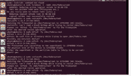

## 16 删除 LV


想要彻底重新安排卷组内部的结构？首先使用`lvremove`命令删除`LV`，以便从头开始创建它们。确保你知道要删除的`LV`的名称，并像这样操作：

```bash
$ sudo lvremove /dev/[volume_group]/[logical_volume]
```

## 17 移除卷组

需要更进一步并删除整个卷组吗？这将删除内部的所有`LV`，并释放物理卷中的一些分区。确保你知道卷组的名称，然后执行以下操作：

```bash
$ sudo vgremove [volume_group]
```

## 18 移除物理卷

如果你想完全移除`LV`，你只需删除物理卷的标识符，然后开始使用更传统的分区系统。确保你知道分区的原始名称，并移除它们：

```bash
$ sudo pvremove /dev/sda1 /dev/sda2 [etc]
```

## 19 缩减逻辑卷

就像我们之前扩展那样，你可以缩减逻辑卷和卷组。在每种情况下，你分别是在减小逻辑卷的大小或从卷组中移除物理卷——否则操作方式相同。

## 20 逻辑卷管理

在创建和维护`LV`时，还有更多你可以使用的功能，但以上是基础内容。如果你发现自己经常用完大量存储空间，那么这可能是你的解决方案，因为你只需不断添加即可，几乎无需烦恼，且不需要`RAID`。

## 01 关于 Netstat

`Netstat`的主要优势在于，其大多数命令行选项在操作时不需要`root`权限。另一个优势是，由于它是默认安装的，因此在每个`Linux`系统上都能找到。`Netstat`同时支持`IPv4`和`IPv6`协议。

请记住，不同的`UNIX`系统支持略有不同的`Netstat`选项，因此你的脚本可能需要稍作修改才能在不同的`UNIX`变体上运行。

## 02 Netstat 的基本用法

当你试图解决与繁忙的`Web`服务器相关的问题时，应该执行以下命令，因为它显示了所有已建立的服务器连接：

```bash
$ netstat -a | grep http | grep ESTA
```

如果你的`Web`服务器使用的是端口号`8080`而不是常规端口（`80`），你可以尝试以下变体：

```bash
$ netstat -an | grep :8080 | sort ESTA
```

`-n`选项显示数字地址，而不是尝试确定符号化的主机、端口或用户名。它可以与所有其他命令行参数组合使用。

## 03 显示路由信息

这是`Netstat`最有用且最频繁的用途。其输出展示了当前机器的路由信息——错误的路由配置是网络问题的常见原因，特别是在运行两个以上网络的机器上。你可以通过执行以下两个命令中的任意一个来查看机器的路由信息：

```bash
$ netstat -r
$ netstat -rn
```

你的网络接口越多，输出内容就越丰富。

## 04 获取每个协议的统计数据

`-s`命令行参数显示每个协议的统计数据，对于查找机器上是否存在过多错误非常有用。

```bash
$ netstat -s | grep -n2 -i error
```

以下`Netstat`版本将显示原始网络统计数据。

```bash
$ netstat --statistics -raw
```

原始输出更难解读，但包含了更详细的信息，可以帮助你排查任何棘手的情况。

## 05 查看所有套接字

这是另一个非常便捷的选项，因为它显示机器上所有监听和非监听的`Internet`及本地（`UNIX`）域套接字。你可以通过执行以下命令查看所有连接：

```bash
$ netstat -a
```

要仅显示`Internet`（`TCP`和`UDP`）连接，请使用以下参数：

```bash
$ netstat -a -A inet
```

你应该使用`inet6`代替`inet`来显示`IPv6`连接。类似地，要显示本地域连接，你需要执行以下命令：

```bash
$ netstat -a -A unix
$ netstat -a -A unix | wc
114 847 7351
```

## 06 查看所有监听连接

有时你只想查看监听连接。这可以通过使用`Netstat`的`-l`命令行选项来实现：

```bash
$ netstat -l
```

以下格式将仅显示`Internet`监听连接：

```bash
$ netstat -l -A inet
```

类似地，下一个变体将仅显示监听的`TCP`连接：

```bash
$ netstat -l -p tcp -A inet
```

## 07 查找特定协议的信息

借助`grep`命令，你可以从`Netstat`的输出中提取关于特定协议的信息：

```bash
$ netstat -a | grep -i ssh
```

如果你使用`watch`命令，你可以如下获取连续的`SSH`连接列表：

```bash
$ watch -d -n0 'netstat -a | grep -i ssh'
```

要终止上一个命令，你需要按顺序按下`Ctrl+C`。

你可以将`watch`命令与`Netstat`命令的所有展示用法结合使用。

> 请记住，不同的`UNIX`系统支持略有不同的`netstat`选项

## 08 以另一种方式显示监听端口

以下命令也显示监听端口。可以通过`/etc/services`文件中的数据将端口号解析为其已知名称：

```bash
$ netstat -a -t | grep -i LISTEN
tcp   0    *:*                *:*                LISTEN
tcp   0    *:*:*              *:*                LISTEN
tcp   0    *:smtp             *:*                LISTEN
tcp6  0    [::]:http          [::]:*             LISTEN
tcp6  0    [::]:ssh           [::]:*             LISTEN
tcp6  0    [::]:smtp          [::]:*             LISTEN
```

## 09 连续显示信息

到目前为止，你已经看到了使`Netstat`在显示所需信息后终止的命令行选项。当你使用`-c`选项时，`Netstat`会在屏幕上连续输出信息。因此，以下命令会连续显示`UDP`连接：

```bash
$ netstat -uc
```

如果你希望如此，请通过按下`Control+C`手动终止该命令。使用`watch`命令比使用`Netstat`的`-c`选项更灵活。

## 10 显示监听套接字

此命令需要`root`权限才能运行，并显示所有`TCP`和`UDP`监听套接字以及所有`UNIX`套接字：

```bash
# netstat -tunlapo
```

`-t`选项告诉`Netstat`显示默认省略的监听套接字；而`-p`告诉`Netstat`显示使用连接的应用程序。`-t`和`-u`选项告诉`Netstat`查找`TCP`和`UDP`连接。`-n`选项告诉`Netstat`显示数字地址，而`-p`选项显示应用程序名称。使用`-a`，`Netstat`将显示监听和非监听套接字。

## 11 打印连接的完整 URL

`-W`命令行选项使`Netstat`显示每个连接的完整`URL`。默认行为是截断输出以适应默认列宽。因此，以下命令的输出将显示每个展示连接的完整`URL`：

```bash
# netstat -tup -W
```

你可以从输出中看出，某些程序正在监听默认的`HTTP`端口。因此，当前机器接受`HTTP`连接。

## 12 显示详细输出

`-v`命令行开关告诉`Netstat`显示更详细的输出。其主要用途是显示关于当前`Linux`系统上未配置的地址族的有用信息。

## 13 显示进程 ID 和用户 ID

以下`Netstat`命令将显示有关进程`id`以及程序名称的信息：

```bash
# netstat -nlp
```

以下略有不同的版本显示拥有进程的用户名称：

```bash
# netstat -1lpe
```

使用`Netstat`的`p`选项时，你必须以`root`权限运行它，才能显示`Linux`系统上运行的所有进程。

## 14 打印网络接口信息

以下命令将显示你的`Linux`系统的网络接口信息：

```bash
$ netstat -i
```

此版本以原始格式显示网络接口的信息：

```bash
$ netstat -ie
```

上述命令产生的输出与`ifconfig`命令相同，但仅当它不带任何命令行参数时使用。

## 15 使用 AWK 处理 Netstat 输出

以下命令需要`root`权限才能运行，它从所有已建立的`Apache`连接中提取`IP`地址，然后计算每个单独`IP`地址的连接数：

```bash
# netstat -ant | grep apache2 | grep ESTABLISHED | awk -F "[ ]+" '{print $4}' | uniq -c
```


下一个命令按连接数排序并计算每个 IP 地址的 `TCP` 连接数：

```bash
$ netstat -nt | awk '/tcp/ {print $5}' | awk -F: '{print $1}' | sort -nr
```

以下命令为每个连接打印一个“+”字符：

```bash
$ netstat -an | grep ESTABLISHED | awk '{print $5}' | awk -F: '{print $1}' | sort | uniq -c | awk '{ printf("%5s %s\n",$2,$1); for (i = 0; i < $1; i++) printf("*"); print " }"
```

此命令统计各种 `TCP` 状态的数量并打印结果：

```bash
# netstat -ant | awk '{print $6}' | grep -v established | grep -v Foreign | sort|uniq -c|sort -n
```

大量的 `TIME_WAIT` 连接可能表明你需要调整你的 `TCP` 超时设置。

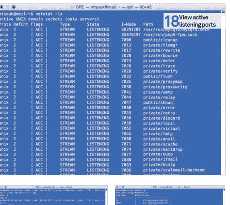


## 16 显示每个用户的进程总数

以下单行命令显示每个用户的监听进程总数：

```bash
# netstat -ltpe | awk '{print $7}' | grep -v Address | grep -v "" | sort | uniq -c | awk '{print $2 ": " $1}'
```

`netstat` 命令收集所需的信息。第一个 `grep` 命令删除 `Netstat` 的表头信息行，第二个 `grep` 命令从输出中删除空行。第一个 `awk` 命令从 `Netstat` 的输出中获取所需的用户信息。`sort` 命令对输出进行排序，而 `uniq` 命令在省略重复行的同时统计行出现的次数。最后一个 `awk` 命令反转 `uniq` 输出的两列，并将数据打印在屏幕上。

一如既往，为了能够看到所有进程，你必须使用 `root` 权限运行此命令。

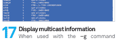

## 17 显示组播信息

当使用 `-g` 命令行选项时，`Netstat` 显示关于 `IPv4` 和 `IPv6` 协议的组播组信息。

## 18 查看活动监听端口

以下命令显示活动的 `UNIX` 监听端口：

```bash
$ netstat -lx
```

这对于查找哪些服务仅对本地用户（`localhost`）可用极其有用。以下输出验证了 `MySQL` 正在高效地接受来自本地主机的连接：

```bash
$ netstat -lx | grep -i mysql
unix  2  [ ACC ]  STREAM
LISTENING     32891287  /var/run/mysqld/
    mysqld.sock
```

# 教程

## Qt5 桌面

- 将应用程序启动器从菜单拖到开始菜单和启动器窗格
- `LxQt` 配置中心甚至托管第三方和系统范围的模块
- `LxQt` 已经拥有一个电源管理工具，你可以在其中指定不同的操作
- 系统托盘支持嵌入 `Skype`、`Dropbox` 等，无需 `sni-qt`

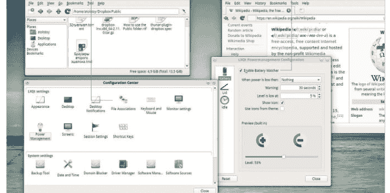

# 构建你自己的 Qt5 驱动桌面

发现适合 `LxQt` 环境的基于 `Qt5` 的桌面应用程序

## 顾问


`Alexander Tolstoy` 已经使用 `Linux` 多年。虽然简洁是智慧的灵魂，但 `Alexander` 喜欢详细地撰写关于桌面 `Linux` 的文章。自他通过软盘安装第一个发行版以来，他就一直在做这件事。

## 资源

- `Otter Browser` `otter-browser.org`
- `PhotoQt Image Viewer` `photoqt.org`
- `Albert Launcher` `bit.ly/1LGpmqj`
- `Trojita Mail client` `trojita.flaska.net`
- `Drawpile` `drawpile.net`
- `SMPlayer` `SMPlayer.sourceforge.net`
- `FocusWriter` `gccode.org/FocusWriter`
- `Cool Retro Term` `bit.ly/1BSYWTz`

`LxQt` 是一个很棒轻量级桌面环境，但它仍处于开发初期，缺少许多重要功能。然而，它是一个非常 promising 和现代的软件，围绕 `Qt5` 图形库构建。对于许多人来说，体验 `Qt5` 驱动桌面的最佳方式是 `KDE` 项目的新 `Plasma 5`，但我们走一条不同的路。我们将成为纯粹主义者，在日常生活中与 `LxQt` 一起仅使用 `Qt5` 应用程序，并完全避开 `KDE`。目的是什么？这将揭示 `Qt5` 应用程序堆栈的总体准备情况及其功能覆盖范围。

在可接受的妥协之下，我们将尝试向你展示用于常见桌面活动的现代且紧凑的程序。整个理念也是一个测试场，用于构建轻量级 `Linux` 解决方案，这在低端机器上可能很有用。选择 `LxQt` 桌面仅仅是为了测试目的，因为它在 `Linux`（`BSD` 用户可能更倾向于 `Lumina`）上具有极好的可用性。

因此，我们将查看某些发行版，以确定哪种 `LxQt` 交付特别好，然后我们将安装并熟悉 `Otter` 浏览器、`PhotoQt` 图像查看器、`Trojita` 邮件客户端、`Albert` 启动器、`DrawPile` 协作工具、`SMPlayer` 和 `FocusWriter` 等（所有链接都在 `FileSite` 中）。所以，如果你准备好了，请进入第一步。

54 www.linuxuser.co.uk

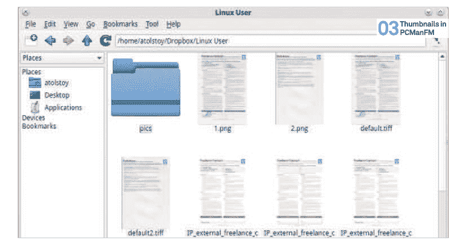

### 01 选择一个发行版

有很多易于使用的 `Linux` 发行版可以帮助你立即开始使用可用的 `LxQt` 桌面 – 由你选择。

`Lubuntu` 是 `Ubuntu` 的专用 `LxQt` 版本，拥有一个“daily” `PPA`，其中包含最新的代码（`ppa:ubuntu-dev/ubuntu-daily`）。该 `PPA` 兼容大多数 `Ubuntu 14.04` 和 `14.10` 衍生版，包括 `Kubuntu`、`Xubuntu`、`Mint` 以及许多其他版本。要获取 `LxQt`，你需要安装 `lqt-metapackage`、`lqt-session` 和 `lqt-session-icewm` 包。

安装 `LxQt` 的替代方式可以是 `Arch/Manjaro`（`LxQt` 在 `AUR` 中）或 `OpenMandriva` 的开发版本，后者默认附带 `LxQt`（`Plasma 5` 稍后会到来）。

### 02 目前我们拥有什么

该桌面占用约 95 MB 的 `RAM`。它具备控制中心、电源管理小工具、可定制底部面板、锁定和快速设置管理器、窗口管理器选择器、`Qt` 终端控制台和 `PCManFM` 文件管理器。键盘布局指示器和 `NetworkManager` 小工具目前缺失，但你可以分别使用 `XFCE` 小工具和漂亮的 `ConnMan` `Gnome` 前端（`ConnMan` 的前端）。

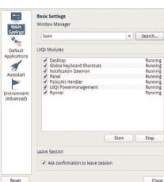

默认情况下，窗口装饰由 `OpenBox` 管理，但你可以将其更改为 `Kwin` 或 `Equivoc`。`PCManFM` 相当简洁，但请记住它是目前唯一的 `Qt5` 文件管理器。

### 03 PCManFM 中的缩略图

我们可以调整并添加额外的功能到 `PCManFM` 文件管理器。首先，让我们为除图像外的文件类型添加缩略图支持。例如，对于 `PDF`，在 `~/.local/share/thumbnailers` 创建一个新文件，扩展名为 `.thumbnailer`，内容如下：

```ini
[Thumbnailer Entry]
TryExec=convert
Exec=convert %[0] -thumbnail %s x%o
MimeType=application/pdf,application/x-pdf,image/pdf;
```

使用此模板，你可以添加“`convert`”支持的更多类型（它是 `ImageMagick` 的一部分）。

### 04 获取 Otter Browser

该网络浏览器每周更新，因此你可以在项目网站上跟踪其开发。对于 `Ubuntu` 兼容的 `Linux` 系统，有一个方便的 `PPA`。让我们开始：

```bash
sudo add-apt-repository ppa:otter-browser/daily
sudo apt-get update
sudo apt-get install otter-browser-git
```


Otter Browser 具有各种令人喜爱的功能，如标签分组、鼠标手势和高度可定制的 UI。你可以通过在系统设置的网络浏览器菜单中选择 `otter-browser` 来将该浏览器设置为默认网络应用程序。

# 教程 Qt5 桌面环境

## 轻量级常驻

Qt5 已经存在多年，越来越多的 Qt 应用程序正转向使用它。目前，我们可以围绕 `LxQt` 构建一个合理且高度可用的桌面环境。网络连接可以通过 `ConnMan` 及其 `CMST` 前端进行管理。`Dropbox` 客户端已经使用 Qt5，而 `LxQt` 系统设置功能的表现与同名 KDE 模块一样出色。此外，还可以使用一个网络浏览器、电子邮件客户端和多功能媒体播放器。

它与 KDE 桌面环境相比如何？没有简单的答案。首先，手工打造的 `LxQt` 桌面环境功能比 KDE4 或新的 Plasma 5 桌面环境都少，但它的资源占用要轻得多。纯 `LxQt` 需要不到 100 MB 的内存，每个额外的 Qt5 应用程序增加的占用极少。其次，当前的 Plasma 5 选择（如 Kubuntu 或 Netrunner）被迫混合 Qix 和 Qt5 部分，导致生成的桌面环境不均匀且消耗更多资源。最后，Plasma 5 尚未成熟。尽管其当前状态比 2008–2009 年初期的 KDE4 发布版本更好，但一些核心应用程序仍然停留在 Qt4 世界中，因此从 KDE4 到 Plasma 5 桌面环境会有一个过渡期。

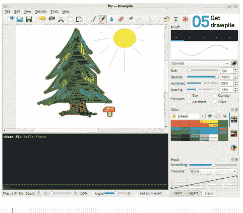

### Trojitá 拥有传统布局并支持邮件分类功能

## 05 获取 Drawpile

最新版本的 Drawpile (0.9.8) 可以通过 Getdeb 服务在此安装：`www.getdeb.net/app/DrawPile`。

该程序有几个用途。首先，它是一款易于理解的绘图软件，可与 MS Paint、KolourPaint 和 Pinta 相媲美——简单、美观，适合儿童。其次，其界面专为 Web 项目使用进行了优化（包括画笔、调色板、透明度处理）。最后，那个黑色矩形包含一个聊天窗口。Drawpile 允许多个人同时在一个画布上绘图。

## 06 使用 PhotoQt 查看图像

PhotoQT 通过 PPA 提供，输入类似以下内容：

```
sudo add-apt-repository ppa:sandrog31/ppa
sudo apt-get update
sudo apt-get install photoqt
```

然后可以在 `PCManFM` 的“打开方式...”菜单中选择该程序。PhotoQT 默认以全屏模式打开图像，并在左上角显示图像文件名及其编号。通过图像任意部分的右键菜单可以获得额外操作。你可以使用相应的键盘箭头浏览图像。

## 07 使用 Albert 启动应用和搜索

同样，有一个 PPA 便于安装：

```
sudo add-apt-repository ppa:milarimingard/albert
sudo apt-get update
sudo apt-get install albert
```

第一次启动 Albert 时，你会看到其配置窗口，你可以在其中更改某些设置，更重要的是，为调用 Albert 分配一个快捷键。关闭窗口后，Albert 不会退出，而是隐藏在后台。按下你的快捷键，你就会看到搜索框。根据你的输入，Albert 将提供应用程序、Chromium 书签或你可以应用字符串的搜索引擎。

## 08 管理你的邮箱

Trojitá 的二进制文件由 OBS 系统提供（`bit.ly/L9KV3LU`），但仅有 Qt4 版本。虽然其他 Linux 发行版存在 Qt5 版本，但在 Ubuntu 的情况下，我们需要从源代码编译 Qt5 版的 Trojitá。幸运的是，官方网站提供了非常直接的构建说明（`http://trojita.fasko.net/download.html`）。

启动程序并提供你的 IMAP 邮箱详情。公共服务（如 Gmail）运行正常。Trojitá 拥有传统布局，并支持邮件分类、HTML 支持以及高效的网络使用。

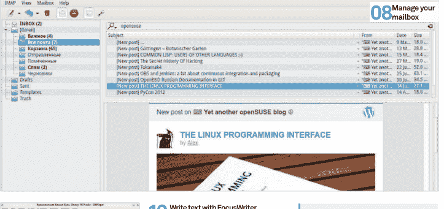

## 09 使用 SPlayer 享受音乐和视频

SPlayer 是一款顶尖的媒体怪物，它可以播放几乎所有媒体（本地和远程），甚至包括一些蓝光光盘。Ubuntu 系列有一个 PPA（`ppa:arvm/SPlayer`），但它提供的是 Qt4 版本的 SPlayer，而我们需要 Qt5 版本。因此执行以下命令：

```
sudo apt-get build-dep splayer
```

然后下载源代码压缩包（`bit.ly/1Bl8gPT`）并使用其中的 `Install.txt` 文件中的说明。Qt5 开关通过以下方式应用到 `make` 命令中：

```
make QMAKE=/usr/lib/x86_64-linux-gnu/qt5/bin/qmake
```

当然，你之前应该已经安装了 `qt5-qmake` 和其他 Qt5 开发软件包。

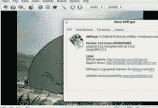

## 10 使用 FocusWriter 编写文本

FocusWriter 是一个简单的类似打字机的编辑器，它隐藏了几乎所有的控制，以免分散你写作的注意力。但它还有许多有用的功能，如自动保存、实时统计、拼写检查、多文档支持等。你可以使用官方 PPA 安装它：

```
sudo add-apt-repository ppa:gotcodcc/gcppa
sudo apt-get update
sudo apt-get install focuswriter
```

## 11 用 Cool Retro Term 增加趣味

LxQt 已经拥有一个支持标签、颜色配置文件等功能很棒的 OFterminal 应用程序，但我们可以更进一步，安装由 Qt5 和 OpenGL 驱动的旧式终端 Cool Retro Term。以下应用程序模仿了 Amiga、IBM 和 Apple 工作站的历史性阴极射线管：

```
sudo add-apt-repository ppa:bugs-launchpad-net-falkensweb/cool-retro-term
sudo apt-get update
sudo apt-get install cool-retro-term
```

一旦启动，你可以在配置文件之间切换或手动更改效果。甚至可以放大整个屏幕，使 Cool Retro Term 像普通控制台应用程序一样易用，这非常方便。

## 添加更多应用

如果你坚持使用自定义的 LxQt 桌面环境，迟早你会想要更多。本教程中的应用程序并不是市面上所有的 Qt5 应用程序，因此请用以下内容为你的系统充电：

- `Votair` 基于 Qt Quick 和 LiquidUI 库构建的 2D 平台游戏。在 Linux 上编译该游戏需要技能，但有一个完美的指南：`bit.ly/1HIHMB9P`。

- `Friends` 该应用具有下一代 OML 界面，安装简单（`sudo apt-get install friends-app`）。要使用它，你必须参考 Unity 的在线账户部分，因此你需要该桌面环境或其 `go-daemon`（存储在 `~/.config/goa-1.0/` 中）。

- `Rosa ImageWriter` 这是著名的 SUSE Studio ImagerWriter 的 Qt5 移植版。该应用为舒适的 USB 介质写入进行了改进。请参阅 `bit.ly/1ZgurWL` 了解依赖于 KDE 软件交付且在特定桌面环境外难以使用的应用程序。

- `Qt-apps.ORG` 如果你想跟踪 Qt5 应用程序，`qt-apps.org` 网站是一个重要的书签。大多数新的和更新的应用程序都会出现在那里。

# 教程 AWS 云

AWS 管理控制台中的 AWS 徽标展示了基础设施服务

如果你想在自己的云环境中运行自己的 Linux 机器，不用再找了，看 `EC2` 就够了

使用 `Route 53` 保留域名名称并将 DNS 路由到你的云 Linux 服务器

通过带有用户名的菜单访问你的成本管理服务和账单信息

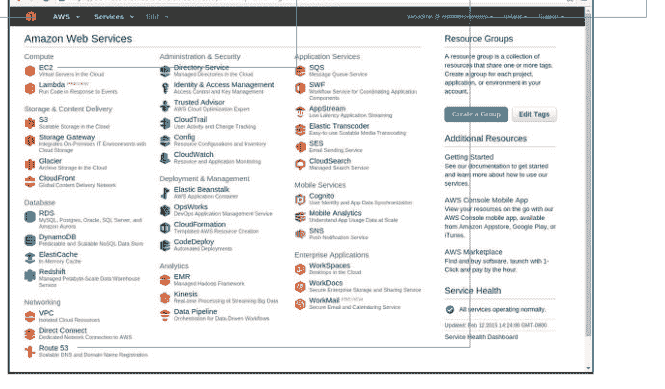

## 在 AWS 云中运行 Linux

### 顾问

`Filipe Martins` 和 `Anna Kobylinski` 二十年前曾在一本看似无辜的 Linux 书上合作，最终进入了企业 IT 领域，设计云拓扑，优化 Linux AMI 并管理 AWS 部署。通过 `@RealProfReal`、`@Cloudinsidr` 和 `@4digitalmasters` 在 Twitter 上参与他们的对话

## 在 EC2 上启动你自己的虚拟 Linux 实例并免费运行一年


AWS（Amazon Web Services 的缩写）是虚拟基础设施和云服务的在线零售商，拥有自动化的自助结账和极具竞争力的价格。亚马逊推出的企业级基础设施服务按需付费版本受到注重成本、渴望性能的用户欢迎——从需要按需扩展的网站所有者，到只需要几小时 `Linux` 机器的软件开发人员和 `Linux` 管理员。在 AWS 上，没有长期承诺——你只为实际使用付费。与传统数据中心相比，AWS 可带来高达 72% 甚至更多的成本节省，难怪 AWS 迅速成为业界的热门选择。研究公司 Gartner 估计 AWS 在全球市场占有惊人的 83% 份额。可以说，亚马逊云最重要的特征不是其庞大规模，而是其可负担性。亚马逊为每个新账户所有者提供为期一年的免费使用层级，从首次注册开始算起：`https://aws.amazon.com/free/`。因此，凭借低廉的价格、无需前期投资、精细的管理控制以及以自己喜欢的方式运行自己基础设施的自由，AWS 已转变为一个开源堡垒，在那里 `Linux` 占据主导地位。

## 资源

- 网络浏览器
- 电话号码
- 电子邮件地址
- 信用卡号
- `SSH` 客户端
  - （可选但推荐）

## 01 创建新的 AWS 根账户

若要开始使用 AWS，请在网络浏览器中访问 `https://aws.amazon.com` 并点击“创建免费账户”。此时，你可以使用现有的亚马逊凭据登录，但这并不总是个好主意。如果你将来需要终止你的 AWS 账户，亚马逊作为在线零售商，也可能因此失去对你亚马逊账户的访问权限。出于这个原因，为了安全起见，大多数用户倾向于使用另一个电子邮件地址进行注册，以防未来发生任何意外情况。

## 02 完成注册流程

在注册过程中，AWS 会要求你提供联系信息，包括电子邮件地址、电话号码和信用卡号。随后，亚马逊将通过自动电话确认你的人类身份。你的信用卡号用于确认你作为付款人的身份，亚马逊会将其存档保存。只要你仅使用免费套餐额度内的服务，在任何时候你的卡都不会被扣费。

注册流程会创建一个 AWS 根账户，该账户授予你访问所有 AWS 基础设施服务的权限。它与 `Linux` 系统上的 `root` 账户没有任何关系，尽管底层概念非常相似。

除了下一步中首次登录时，切勿使用你的 AWS 根凭据进行账户管理工作。

## 03 登录你的 AWS 根账户

基于浏览器的亚马逊管理界面——AWS 管理控制台——是你 AWS 基础设施和服务的主要枢纽。你可以通过名为“我的账户”的下拉菜单在 `https://aws.amazon.com` 访问它，或者直接访问此 URL：`https://console.aws.amazon.com`。无论哪种方式，都请使用你 AWS 根账户的凭据（你的电子邮件地址和你的 AWS 根密码）。请确保切勿在公共网络或公共计算机上这样做，因为如果你的凭据被截获，你可能会失去对整体基础设施的访问权限，同时还要承担费用。因此，亚马逊建议在首次登录后，立即创建一个权限较低的 `IAM` 用户用于日常 AWS 交互，并将其链接到 `MFA` 设备以进行多因素认证（这是另一个教程的主题）。

## 04 浏览 AWS 管理控制台

不出所料，控制台上充斥着 AWS 术语，其普及程度之高，甚至让最坚强的人偶尔也会摇头表示难以置信。要在 AWS 云中启动一台 `Linux` 机器，你需要导航到 `EC2`（弹性计算云）。对于 `DNS` 服务和域名注册，请前往 `Route 53`。如果你只需要一些保持易于访问的存储，实际上并不需要一个 `Linux` 机器——相反，直接前往控制台的 `S3`（简单存储服务）部分即可。到达目的地的最简单方法是使用控制台左上角的 AWS 徽标，因为这可以让你访问可用服务列表。

### 私有、公共和弹性 IP

每个 `EC2` 实例都有一个私有 `IP`。如果你希望它能从互联网访问，它还需要一个公共 `IP`。如果在实例设置期间启用“自动分配公共 `IP`”选项，亚马逊会在实例保持运行期间为你的实例关联一个随机选择的公共 `IP`。如果你终止实例甚至关闭 `Linux`，你将自动失去这个 `IP`。如果你更喜欢一个可以自行管理的持久 `IP` 地址，请改用“弹性 `IP` 地址 (`EIP`)”。`EIP` 是一个常规的公共 `IP` 地址，你可以将其保留给你的账户，然后随意分配和重新分配。


## 教程：AWS 云

### EBS 卷

`EBS` 卷比实例存储速度慢，但提供数据持久性——即使你的 `Linux` 实例正在运行，你也可以挂载和卸载它们。

`EBS` 卷有两种类型：磁硬盘或“高性能”`SSD`。亚马逊提供的 `SSD` 分为一个性能类别——通用型或预配 `IOPS`，它们根据磁盘大小和共享存储池中其他用户的活动提供 `I/O` 突发。具有预配 `I/O` 级别的 `SSD` 将以指定的 `I/O` 级别运行，但价格昂贵。通用型 `SSD` 是最佳选择。如果你注重预算且需要不频繁的访问，磁硬盘是一个折衷方案。

### 05 选择你的 AWS 区域

某些 AWS 服务，特别是 `EC2`，要求你选择一个 AWS 区域。区域是一组互连的数据中心，称为 AWS 可用区，具有共同的税务管辖范围和相同的价格。你可以利用九个 AWS 区域中的任何一个服务，而不仅仅是你的默认区域，并根据你的需求进行组合。通常，你会选择最具成本效益的区域，或者组合几个距离最终用户位置最近的区域，以最小化延迟。重要的是要记住，你的 `EC2` 仪表板仅显示你当前选中区域内正在付费的基础设施。这是 AWS 的一个常见陷阱：在错误区域的仪表板中监控资源消耗，因此要小心。

### 06 启动新的 EC2 实例

导航到 AWS 管理控制台的 `EC2` 部分。界面的这一部分授予你访问各种基础设施服务的权限，使你能够在 AWS 云中构建和运行自己的 `Linux` 机器，即所谓的 `Linux EC2` 实例。

每个 `EC2` 实例代表一个在虚拟化环境中运行的主机，与其他虚拟机隔离，这使得它非常具有成本效益且相对安全。要在云中启动你自己的 `Linux` 服务器，请在 `EC2` 仪表板中点击 `Launch Instance`（启动实例）。你也可以在 AWS 管理控制台的左侧导航窗格中点击 `Instance`（实例）链接，然后点击 `Launch Instance`（启动实例）按钮。

### 07 选择基于 Linux 的 AMI

实例的存储配置使用称为 `AMI`（`Amazon Machine Image`，亚马逊机器映像）的机器定义来描述。`AMI` 规定了引导卷的内容等事项。从 `Quick Start`（快速启动）部分的列表中选择基于 `Linux` 发行版的 `AMI`（不是数据库实例，`Amazon RDS` 实例不会在操作系统层面授予你超级用户访问权限）。标记为“Free tier eligible”（免费套餐资格）的实例，只要在你账户注册后的最初 12 个月内保持每月 720 小时以内的时间配额内使用，就不会产生任何费用。

### 08 选择实例类型

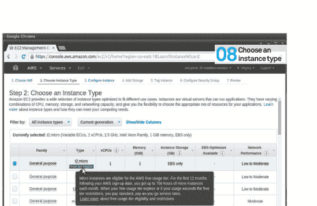

实例类型以时钟速度、可用 `RAM`、内部存储和网络能力方面的性能特征定义了你的 `Linux` 机器。唯一符合免费使用套餐的实例类型是 `t2.micro`。

做出选择后，点击 `Next: Configure Instance Details`（下一步：配置实例详细信息）。

最好在虚拟私有云 (`VPC`) 中启动 `EC2` 实例，这是一种委婉的说法，意味着亚马逊将通过智能路由将其与其他用户的实例隔离。较旧的 AWS 账户也可能提供标记为“`EC2-Classic`”的选项，该选项没有这种保护，因此如果你看到它，请不要使用。

在 `'Auto-assign Public IP'`（自动分配公共 `IP`）菜单中，选择 `'Use subnet setting (Disable)'`（使用子网设置（禁用））。将 `IAM` 角色设置为 `None`（无），将关闭行为设置为 `Stop`（停止）。如果你启用了“`Termination protection`”（终止保护），在移除此保护之前，AWS 不允许你在控制台中使用 `Terminate` 命令销毁实例。

保持其他选项不变，点击 `Next: Attach Storage`（下一步：附加存储）。

### 09 配置实例详细信息

在下一个屏幕上，你可以选择启动多少个实例，是否希望它们具有持久性（保持 `Purchasing option check box`（购买选项复选框）未激活），它们是否应具有访问你 AWS 服务的独立权限（`IAM` 角色）`None`（无），并进行配置。

### 10 附加存储

如果你需要额外的卷，现在可以创建并附加它们。免费套餐涵盖最多 30GB 的通用型 (`SSD`) 存储，为你提供略低于 100 `IOPS` 的最大基线性能（有关更多信息，请参阅“`EBS` 卷”部分）。

现在点击 `Next: Tag Instance`（下一步：标记实例）。

### 11 为你的 Linux 实例添加标签

AWS 上的标签是键值对，存储有助于你组织 AWS 资源的信息。使用标签纯属可选。别担心——如果需要，你随时可以稍后添加标签。如果此时没有想法，点击 `Next: Configure Security Groups`（下一步：配置安全组）。


## 12 配置安全组

将安全组（Security Groups）想象成 `AWS` 防火墙的设置，用于指定“允许入站和出站流量的规则”。对于每个 `Linux` 实例，你需要至少从一个 `IP` 地址（你的 `IP`）启用 `TCP 22` 端口的入站（ingress）访问权限，以便进行 `SSH` 连接。除非你使用的是静态 `IP`（或 `IP` 范围），否则你可能需要允许来自任何位置的访问。如果你需要其他服务，请添加相应的规则（例如，如果你要运行 web 服务器，请开放 `80` 端口用于 `HTTP`，`443` 端口用于 `HTTPS`）。然后点击“审查并启动”（Review and Launch）。

## 13 创建或选择密钥对

验证你的设置并点击启动（Launch）。向导将要求你创建或选择一个密钥。

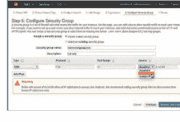

密码已过时，密钥对才是王道。私钥是你作为 `Linux` 实例管理员的身份凭证。`SSH` 将尝试基于 `AWS` 即将保存在你的实例中 `Linux` 系统适当位置的相应公钥副本，来验证你的私钥的真实性。

你可以自己生成密钥对并将公钥上传到 `EC2` 控制台，或者你可以让 `Amazon` 为你创建密钥对，这样速度更快。选择“创建新的密钥对”（Create a new key pair），给它起个名字，将私钥下载到你的电脑并修正其访问权限：

```bash
chmod 400 /path/to/yourPrivateKey.pem
```

完成这些操作后，你就可以启动实例了。它将会出现在 `AWS` 管理控制台 `EC2` 部分的“实例”（Instances）栏中。

## 14 为你的 EC2 实例分配 EIP

除非你选择为实例自动分配公共 `IP`，否则它目前没有公共 `DNS` 条目，无法从外部访问。点击 `EC2` 控制台左侧导航面板中的“弹性 `IP`”（Elastic IPs）链接。在这里，你需要为你的 `AWS` 账户获取一个新的弹性 `IP` 地址（Allocate New Address），并将其与你的实例关联（Associate Address）。

## 15 连接到你的 Linux 实例

等待你的实例通过两项健康检查并报告其状态为“运行中”（running）。现在，你应该可以使用任何独立的 `SSH` 客户端或 `Amazon` 提供的基于 `Java` 的客户端进行连接。导航至控制台的“实例”（Instances）部分，从列表中选择你的实例并点击“连接”（Connect）按钮以查看说明。启动 `SSH` 客户端并输入类似以下内容：

```bash
ssh -i /path/to/yourPrivateKey.pem username@66.XX.XXX.XX
```

用户名通常是 `ec2user` 或 `root`，但从技术上讲，`AMI` 的所有者可以将其设置为任何值。如果你的初始用户名不是 `root`，你可以使用以下命令获取超级用户权限：

```bash
sudo su
```

如果你为你的实例附加了任何额外的卷（除了 `AMI` 自带的卷之外），现在是格式化它们、挂载它们并将其添加到 `/etc/fstab` 的时候。

---

## 通过提升知识获取成果

我们的优秀课程提供无与伦比的培训。

100% 的客户将我们的 `PostgreSQL` 培训项目评为优秀。预订你的席位，获取核心代码的专家知识。

+44 (0)870 766 7756

`2ndquadrant.com/knowledge`


---

## **编码者与创客**的必备指南

# 实用

# 树莓派


**68** “它们传达货币价格，向股票经纪人提供交易大厅的更新，并用作示波器的基本显示”

## 目录

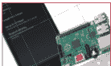

- 64 将你的树莓派连接到 `Android` 设备


- 66 制作一台树莓派 2 家庭影院电脑（HTPC）

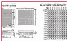

- 68 构建复杂的 `LED` 矩阵


- 72 数字助理第二部分：语音


- 74 常见问题解答：什么是 `OpenELEC`？

---

# 教程


### 将你的树莓派连接到 Android 设备

`Rob Zwetsloot` 擅长建模复杂系统，是一名精通 `Python`、`Django` 和 `PHP` 的 Web 开发者。他喜欢进行计算实验。

需要让你的树莓派在移动时也能上网吗？尝试通过物理连接将你的 `Android` 设备作为热点，即可立即获得在线访问权限。

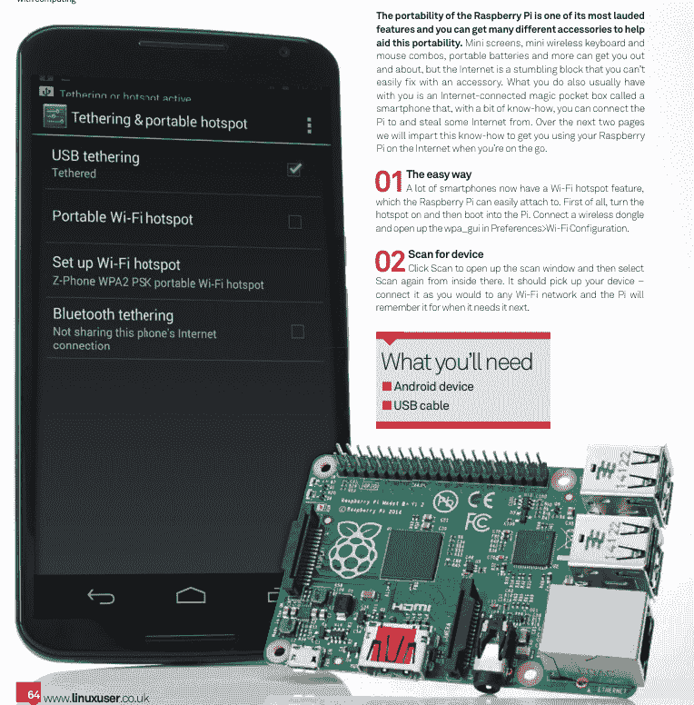

树莓派的可移植性是其最受称赞的特性之一，你可以获得许多不同的配件来增强这种可移植性。迷你屏幕、迷你无线键盘和鼠标组合、便携电池等可以让你外出，但互联网是一个你无法轻易通过配件解决的问题。你通常还必须依赖一个连接互联网的“神奇口袋盒子”——智能手机，凭借一些技巧，你可以将树莓派连接到它并“窃取”一些互联网连接。在接下来的两页中，我们将传授这些技巧，让你在外出的时候也能使用树莓派上网。

**你需要准备**

- `Android` 设备

- `USB` 数据线

01 **简单方法**

许多智能手机现在都有 `Wi-Fi` 热点功能，树莓派可以轻松连接。首先，打开热点，然后启动树莓派。连接一个无线网卡，并在“首选项”（Preferences）> “`Wi-Fi` 配置”（Wi-Fi Configuration）中打开 `wpa_gui`。

02 **扫描设备**

点击“扫描”（Scan）打开扫描窗口，然后从里面再次选择“扫描”（Scan）。它应该会检测到你设备——像连接任何 `Wi-Fi` 网络一样连接它，树莓派会在下次需要时记住它。

### 将你的树莓派连接到 Android


03 **设置连接共享**

首先，通过 `USB` 数据线将你的电话连接到树莓派——根据树莓派的供电能力，它可能在给你的电话充电时遇到困难，但仍然允许你进行连接共享。现在你可以在连接共享菜单中激活 `USB` 连接共享。


> 通常很容易判断哪个设备是你的手机——把它放在树莓派旁边，它将是信号最好的那个！

04 **检查连接**

你的 `Android` 设备将在树莓派上创建一个名为 `eth0` 的接口。你可以打开终端并输入以下命令来检查这种情况是否发生，以及它是否允许连接共享：

```bash
$ ifconfig
```

05 **快速连接**

你现在就可以从终端连接以访问互联网。你可以通过在终端输入以下命令来完成：

```bash
$ sudo dhclient usb0
```

这将自动获取你的手机分配的任何可用 `IP` 地址。

06 **测试连接**

有几种方法可以测试你的连接。我们通常会留在终端并 `ping www.google.com`，你可以这样做，或者你可以打开浏览器看看它是否能加载页面。

07 **保存设置**

一旦你重启树莓派，它不会记得自动连接到手机的共享网络。但是，我们可以向它的配置文件中添加一个条目，以便它将来会尝试这样做。从终端使用：

```bash
$ sudo nano /etc/network/interfaces
```

08 **接口设置**

在这里你会找到当前的所有网络设置——根据你的情况（例如你是否添加了固定的无线设置或直通设置），你的设置可能与我们的不同。使用与 `eth0` 行相同的语法，添加：

```
iface usb0 inet dhcp
```

09 **移动中的连接共享**

保存并重启后，你的树莓派应该会自动连接到你的手机，无论是通过 `Wi-Fi` 热点还是物理连接。连接共享期间可能会比平时消耗更多电量，所以请务必注意你的电池电量。

### 移动数据

在手机上使用树莓派会比正常浏览消耗更多的数据。如果你不想在数据费用上花一大笔钱，我们建议不要进行完整的软件、发行版或固件更新。你还可以设置手机上使用数据量的限制，以避免出现问题，如果有可能的话，物理连接共享还允许你通过手机的 `Wi-Fi` 进行连接。


# 教程：打造 Raspberry Pi 2 HTPC

最终使用 `Raspberry Pi 2` 和出色的 `OpenELEC` 项目创建一个更强大、功能更丰富的 `HTPC`。

`Rob Zwetsloot` 擅长对复杂系统进行建模，并且是一名精通 `Python`、`Django` 和 `PHP` 的 Web 开发者。他热衷于进行计算实验。

我们知道有些人对树莓派有着绝佳的想法和用途——它的表现足以让你轻松地在本地或通过网络播放媒体。最大的问题在于原版 `Model B` 的 GUI 响应速度，以及缺少用于连接所有设备的 `USB` 端口。

尽管过去几年的优化有所帮助，但转向 `Raspberry Pi 2` 基本上解决了所有这些难题，因为它提供了更强大的硬件供你使用。因此，如果你正在考虑升级或终于下定决心，这份便捷的指南将帮助你打造完美的 `Raspberry Pi 2 HTPC`。

## 01 选择软件

在过去，`Pi HTPC` 只能在 `RaspBMC` 和 `OpenELEC` 之间做选择。然而，`RaspBMC` 目前处于停顿状态，而 `OpenELEC` 是获取最新软件的最佳选择。这两者之间没有巨大的差异，因为它们都运行 `XBMC`。

## 02 获取软件

访问 `openelec.tv` 并找到下载区域。那里有一个专门的 `Raspberry Pi` 部分，分为原版（`ARMv6`）`Pi` 和更新的 `Raspberry Pi 2`（`ARMv7`）。请从该页面获取适用于 `Pi 2` 的映像文件。


## 所需材料

- `OpenELEC` `openelec.tv`
- `HDMI` 线
- `USB` 红外接收器
- 红外遥控器
- 外壳
- 专用电源
- 可选 `USB` 存储设备

`www.linuxuser.co.uk`


## 03 安装到卡上

打开终端，使用 `fdisk -l` 来确定 `SD` 卡在你系统上的位置。类似于 `/dev/sdb` 或 `/dev/mmcblk0` 的理想设备即可。使用 `cd` 导航到映像文件所在目录，并使用 `dd` 命令通过以下方式安装：

```bash
$ dd bs=1M if=OpenELEC-RPi2.arm-5.0.5.img of=/dev/mmcblk0
```

## 04 首次启动

将你的 `Raspberry Pi` 连接到电视或另一个屏幕（先这样开始），然后开机。`OpenELEC` 会调整 `SD` 卡分区大小并写入一些额外的程序，最后启动进入 `Kodi`。


上方

`Kodi` 的设计初衷就是配合遥控器使用，`OpenELEC` 网站上有一些关于如何使用的优秀指南：`bit.ly/1BOARv`

## 05 配置 Kodi

通过基本向导完成界面设置——如果你是无线连接，需要进入系统菜单中的 `OpenELEC`，激活无线接收器，然后选择你的网络并输入密码。

## 06 添加网络共享

你可以将便携式硬盘或 `U` 盘插入 `Pi` 作为存储，但最好的方法确实是通过网络进行流媒体传输。进入系统下的文件管理器并添加源。前往浏览，选择你的网络协议以浏览网络，或者手动添加。

## 07 构建你的媒体中心

`Raspberry Pi` 的放置位置很重要。由于它将一直展示在外部，我们强烈建议为它配备一个外壳——`Pimoroni` 的 `Pibow` 外壳非常适合此类用途，因为它们坚固耐用，并且可以附加在某些电视机的背面。

## 08 红外传感器和控制器

`Kodi` 可以通过多种方式控制——包括 `USB` 游戏手柄和兼容的红外传感器。我们过去使用过 `FLIRC`，但如果你将 `Pi` 放在电视后面，你需要一个可以延伸到有用位置的带线传感器。

## 09 未来更新

`OpenELEC` 具备出色的自我更新能力，无需每隔几个月重新安装，这意味着你几乎不需要对其进行维护。现在，你可以轻松地坐下来享受你的媒体内容。

# 直播电视

`Kodi` 确实具备通过电视调谐器播放直播电视的功能，只要你拥有本地存储，你还可以录制内容。你需要主要投资的是一个兼容的电视调谐器，这些调谐器的列表在此提供：`bit.ly/1r3mEj`


## 所需材料

- 面包板 & 导线
- 16x16 `LED` 矩阵
- 2x `74HC238`
- 2x `74HC244`
- 16x 220 欧姆电阻
- 源代码 `FileSilos.co.uk`

# 构建复杂的 LED 矩阵

`LED` 矩阵显示系统从花哨的烤肉店到令人印象深刻的蒸汽朋克风格系统中随处可见。


`Tam Hanna`

自 `Palm IIc` 时代起就在 `IT` 行业工作。作为一名记者、讲师、演讲者和作者，`Tam` 多次见证过移动市场的各个方面。

高效驱动 `LED` 是一门独立的科学。单板计算机的普及使得必要技术触手可及。

在处理 `LED` 显示时，必须考虑两种不同的系统。我们将专注于由一个或多个 `LED` 组成的传统基于矩阵的系统。它们低廉的价格使其非常适合经典的显示应用：它们传达货币价格，为股票经纪人提供交易室的更新，甚至曾被用作原始示波器的基本显示器。

最后，我们还将为你提供电子基础的概述。本教程比我们在杂志该部分通常发布的稍微高级一些，还值得注意的一点是我们将使用 `C` 而不是 `Python` 进行编程。请使用代码列表注释跟随步骤操作。

## 01 思考 LED

独立的 `LED` 很原始——一旦电流流过它们就会发光。驱动几个 `LED` 就像将它们连接到 `GPIO` 引脚并串联一个电阻一样简单。遗憾的是，一旦涉及更多 `LED`，这种方法就变成浪费——驱动 16 个二极管会占用 16 个引脚。

## 02 排列你的二极管

人们发明了减少所需引脚数量的方法。基于矩阵的系统对单个二极管故障具有抗扰性，并提供 `n=(n/2)²` 的引脚与 `LED` 比率。以下步骤假设由图 A 组成的 16x16 `LED` 矩阵。由于 `LED` 只允许电流单向流动，你可以通过将相应的引脚设为高电平和低电平来启用单个 `LED`。


上方 此电路图的扩展版本位于 `FileSilo.co.uk` – 只需登录并前往 `#151` 期页面

## 03 利用 MUX

我们的 `LED` 模块共有 32 个输入，这对旧版本的 `RPI` 来说负担过重。限制其数量的第一种方式是 `74HC238`，一种被称为 3-8 线译码器/解复用器的组件。其功能描述在下页的图 B 中。

## 04 分离关注点

第二个芯片名为 `74HC244`，被描述为具有三态能力的八位缓冲器。三态输出可以在物理上断开与总线线的连接。这允许你将它们的输出连接在一起而无需担心短路。只要除一个芯片外的所有芯片都处于三态模式，电流就不可能在高输出引脚和低输出引脚之间流动。

## 05 将它们组合起来

四个 `GPIO` 引脚控制当前启用的显示“行”。三个引脚配置要发出的地址，而从第四个引脚发出的信号连接到活动输入。这确保只有一个 `IC` 处于活动状态。`74HC244` 确保在给定时刻只有两组中的一组处于活动状态。

## 06 配置引脚

我们使用了 `Hussam Al-Hertani` 的 `Hertzville` 博客（`hertzville.com/2014/07/07/rpimmapgpio`）中的一个库。第一步涉及设置输出功能。由于 `GPIO` 设置为输出，三态特性可能会将内部状态连接到 `IC` 的输出引脚。如果输出未关闭，这可能导致内部短路。

# 完整代码列表

步骤 12

```c
#include <mmapgpio.h>
#include <stdio.h>

#define PINA0 2 // 3
#define PINA1 3 // 5
#define PINA2 4 // 7
#define PINA3 14// 8
#define PINS0 17// 11
#define PINS1 18// 12

#define PIND0 23// 16
#define PIND1 24// 18
#define PIND2 10// 19
#define PIND3 9 // 21
#define PIND4 25// 22
#define PIND5 11// 23
#define PIND6 8 // 24
#define PIND7 7 // 26
```

步骤 07


```c
void setAddress(unsigned char _which, mmapgpio* _where)
{
if (_which&1)
{
    _where->writePinHigh(PINA0);
}
else
{
    _where->writePinLow(PINA0);
}
if (_which&2)
{
    _where->writePinHigh(PINA1);
}
else
{
    _where->writePinLow(PINA1);
}

if (_which&4)
{
    _where->writePinHigh(PINA2);
}
else
{
    _where->writePinLow(PINA2);
}

if (_which&8)
{
    _where->writePinHigh(PINA3);
}
else
{
    _where->writePinLow(PINA3);
}
}
```

步骤 08

```c
void safelySetRow(unsigned char _which, mmapgpio* _where)
{
    _where->writePinHigh(PINS0);
    _where->writePinHigh(PINS1);
    if (_which==0)
    {
        _where->writePinLow(PINS0);
    }
    else
    {
        _where->writePinLow(PINS1);
    }
}
```

## 教程


## 完整代码列表

```cpp
Step 08
// where->writePinLow(PINCS1);
}
}

Step 11
void setData(unsigned char _which_, nmagGpio* _where_)
{
    if(_which_ & 1)
    {
        // where->writePinHigh(PIND0);
    }
    else
    {
        // where->writePinLow(PIND0);
    }
    if(_which_ & 2)
    {
        // where->writePinHigh(PIND1);
    }
    else
    {
        // where->writePinLow(PIND1);
    }
}
```

### 07 为 MUX 供电

创建一个便利函数，接收一个从 0 到 15 的范围内的地址。它会被转换为我们 3-8 译码器的引脚输出。其效果是，十六行中只有一行会通电，其余的都将断电。

### 08 选择一行

在 `74HC244` 中，我们首先禁用两个单元，然后打开所需的那个。这种顺序可以防止在切换过程中出现“鬼影”现象。

### 09 执行主循环

循环的外部部分包含管理各个行寻址的逻辑。我们的程序必须使用下一步中描述的基本模块，依次闪烁各个 LED 组。

### 10 完成循环

输出数据是通过三条命令的顺序实现的。我们选择行，配置列，然后输出要显示的数据位。在此过程中会有短暂的停顿，以便让 LED 有时间“烧入”观察者眼中。


`上方` 像这样的数字 LED 矩阵让你对显示屏中的每个“像素”拥有更强大的控制力

```cpp
if(_which_ & 4)
{
    // where->writePinHigh(PIND2);
}
else
{
    // where->writePinLow(PIND2);
}
if(_which_ & 8)
{
    // where->writePinHigh(PIND3);
}
else
{
    // where->writePinLow(PIND3);
}
if(_which_ & 16)
{
    // where->writePinHigh(PIND4);
}
else
{
    // where->writePinLow(PIND4);
}
if(_which_ & 32)
{
    // where->writePinHigh(PIND5);
}
else
{
    // where->writePinLow(PIND5);
}
if(_which_ & 64)
{
    // where->writePinHigh(PIND6);
}
else
{
    // where->writePinLow(PIND6);
}
if(_which_ & 128)
{
    // where->writePinHigh(PIND7);
}
else
{
    // where->writePinLow(PIND7);
}
```

## LED 灯带

提供两种版本的 LED 灯带。

原始的版本基于模拟技术。在这种技术中，整个二极管灯带的颜色由三个输入引脚设置。像左图所示的大型显示器系统等需要采用数字版本。它们基于移位寄存器的概念。你的系统输入单独的色值，这些值随后被推送到灯带上。

## 构建复杂的 LED 矩阵


`上方` 这是我们要处理的那个 LED 矩阵的完整原理图；你还可以通过 `FileSilo` 查看其完整尺寸

### 11 能量控制

如果有电流通过，LED 就会发光。`SetData` 将 `74HC244` 的引脚拉低，以确保来自 `74HC238` 的供电能够流过二极管。

### 12 避免 GPIO 故障

树莓派基金会倾向于经常更改扩展接头的布局，这是一种让专业过程计算机制造商深恶痛绝的习惯。建议通过一组定义（`defines`）来处理引脚与功能之间的映射。我们的代码针对带有“短”接头（40 针变体需要重新调整，以确保物理引脚号与逻辑 GPIO 号对应）的 `Rev2` 树莓派进行了优化。

### 13 添加示例数据

通过将 `dataStore` 设置为你选择的值来测试代码。将 `64` 设置到所有字段将禁用显示屏每部分中的一行。

### 14 启动程序

检查平面板和单板计算机之间的所有连接，然后继续启动编译后的应用程序。别忘了使用 `sudo` 命令 - 为了防止应用程序在物理内存中造成混乱，直接内存访问被限制为仅限 `root` 用户。用户已经习惯于这一点，因此要求他们在命令前加上 `sudo` 并不会引起顾虑。

### 15 注意闪烁

目光敏锐的读者会注意到偶尔出现的闪烁，其中一行看起来比其他行更亮。这是由程序停滞引起的 - 如果内核执行其他工作，切换例程就无法运行。我们可以通过使用实时 Linux 内核来解决这个问题。

## 完整代码列表


```cpp
{
    _where->writePinLow(PIND7);
}
```

```cpp
int main(void)
{
    mmapGpio rpiGpio;
    //Set outputs
    rpiGpio.setPinDir(PINA0,mmapGpio::OUTPUT);
    rpiGpio.setPinDir(PINA1,mmapGpio::OUTPUT);
    rpiGpio.setPinDir(PINA2,mmapGpio::OUTPUT);
    rpiGpio.setPinDir(PINA3,mmapGpio::OUTPUT);
    //TURN OFF ASAP!
    rpiGpio.setPinDir(PINCS0,mmapGpio::OUTPUT);
    rpiGpio.writePinHigh(PINCS0);
    //TURN ON ASAP!
    rpiGpio.setPinDir(PINCS1,mmapGpio::OUTPUT);
    rpiGpio.writePinHigh(PINCS1);
    rpiGpio.setPinDir(PIND0,mmapGpio::OUTPUT);
    rpiGpio.setPinDir(PIND1,mmapGpio::OUTPUT);
    rpiGpio.setPinDir(PIND2,mmapGpio::OUTPUT);
    rpiGpio.setPinDir(PIND3,mmapGpio::OUTPUT);
    rpiGpio.setPinDir(PIND4,mmapGpio::OUTPUT);
    rpiGpio.setPinDir(PIND5,mmapGpio::OUTPUT);
    rpiGpio.setPinDir(PIND6,mmapGpio::OUTPUT);
    rpiGpio.setPinDir(PIND7,mmapGpio::OUTPUT);

    unsigned char dataStore[2][16];

    for(int j=0;j<2;j++)
    {
        for(int k=0;k<16;k++)
        {
            dataStore[j][k]=64;
        }
    }

    int blockCounter=0;
    int rowCounter=0;
    while(1)
    {
        blockCounter++;
        if(blockCounter==16)
        {
            if(rowCounter==0)
            {
                blockCounter=0;
                rowCounter=1;
            }
            else
            {
                blockCounter=0;
                rowCounter=0;
            }
        }

        safelySetRow(rowCounter, &rpiGpio);
        setAddress(blockCounter, &rpiGpio);
        setData(dataStore[rowCounter][blockCounter], &rpiGpio);
        usleep(50);
    }
    return 0;
}
```

## 数字助手，第二部分：语音识别

在这第二期文章中，学习如何解码你的音频，并弄清楚周围的人正在发出什么指令。


**乔伊·伯纳德 (Joey Bernard)**

作为一个真正的文艺复兴人，他将在制作家具、帮助研究人员解决科学计算问题以及编写 Android 应用之间分配他的时间。

### 任务卸载

你可以将音频数据处理卸载给 Google，通过 HTTP 直接访问 API，将你的音频数据发布到适当的 URL。首先安装 Python 模块 `SpeechRecognition`：

- `pip install SpeechRecognition`

现在创建一个 `Recognizer` 对象的实例。一个名为 `WAVFile` 的辅助对象将获取音频文件并准备它供 Google API 使用。然后使用 `record()` 函数处理它，并将处理后的音频传递给要识别的函数。当它返回时，你将获得一个可能的文本列表，以及每个可能文本的置信度百分比。

**右方** CMUSphinx 用于跨平台、开源项目，如智能学习助手 ILA

在上一期中，我们探讨了如何让我们的树莓派聆听周围的世界。这是构建我们自己的 JARVIS 系统版本的第一步，该系统因 `钢铁侠` 电影而闻名。下一步是尝试理解我们刚才听到的内容。通常，这被称为语音识别，它是一个非常庞大且活跃的研究领域。每个主要的移动操作系统都有应用程序试图利用这种人类交互模式。也有几个不同的 Python 模块可用，可以进行这种语音到文本 (STT) 的转换。在这第二篇文章中，我们将查看使用 Pocket Sphinx 来承担繁重的工作。Sphinx 由卡内基梅隆大学开发，并采用 BSD 许可证授权，因此你可以自由添加特定任务所需的任何此类功能。鉴于该领域的活跃程度，花费时间跟踪所有更新和性能改进是非常值得的。

```bash
sudo apt-get install python-pocketsphinx
```

```bash
sudo apt-get install pocketsphinx-hmm-wsj pocketsphinx-lm-wsj
```

...以获取引擎所需的所有文件。你还需要音频模型文件和语言模型文件才能以你选择的语言进行转换。要获取英文所需的文件，你可以安装包：

如果你需要处理其他语言，可能需要走出常规包管理系统。然后你就可以直接开始编写和使用代码了。要开始使用这些模块，你需要通过以下方式导入 `pocketsphinx` 和 `sphinxbase`：

```python
import pocketsphinx as ps
import sphinxbase
```

虽然我们可以在网上下载所有这些模块的源代码并从头构建它们，但我们要假设你使用的是基于 Debian 的发行版，如 Raspbian。对于这些发行版，你可以简单地使用：

这些模块实际上是围绕处理将声音转换为文本的实际计算工作的 C 代码的 Python 封装。最基础的工作流程包括从 `pocketsphinx` 模块实例化一个 `Decoder` 对象。`Decoder` 对象接受多个输入参数来定义它允许使用的语言文件。这些包括 `"hmm"`、`"lm"` 和 `"dict"`。如果你使用上述用于处理英文的包，那么你需要的文件将位于目录 `/usr/share/pocketsphinx/model/hmm/wsj` 和 `/usr/share/pocketsphinx/model/lm/wsj` 中。如果你没有设置这些参数，那么它会尝试使用合理的默认值，这对于英文语音通常工作得非常好。这个新创建的 `Decoder` 对象现在可以被赋予带有待处理数据的 WAV 文件。如果你还记得上一期，我们将录制的语音保存为 WAV 文件。为了以正确的格式记录此音频，你需要编辑上一期的代码并确保你以单声道（例如使用一个声道）录制，并以 16kHz 和 16 位样本进行录制。为了正确读取它，你可以使用一个文件对象，并以读权限将其加载为二进制文件。WAV 文件在文件开头有一小部分头部数据，你需要跳过去。这是通过使用 `seek` 函数跳过前 44 个字节来完成的。现在文件指针位于正确的位置，你可以将文件对象传递给 `Decoder` 对象的 `decode_raw()` 函数。然后它会离开并进行一系列的数据处理，试图弄清楚说了什么。要获取结果，你需要使用 `get_hypid` 函数调用。从这个函数中你会得到一个包含三个元素的列表：一个包含对说话文本最佳猜测的字符串，一个包含话语 ID 的字符串，以及一个包含此猜测得分的数字。

## Python 栏目


针对特定语言。但 `Pocket Sphinx` 是一个研究级的语言系统，因此它提供了可供你构建自己模型的工具。通过这种方式，你可以训练代码以理解你独特的声音及其所有特殊之处和口音。这是一个漫长的过程，所以大多数人可能对做如此密集型的工作不感兴趣。然而，如果你感兴趣，可以在主网站（`cmusphinx.sourceforge.net`）上找到相关信息。你还可以定义自己的模型和语法，告诉 `pocketsphinx` 如何解释它正在处理的音频。再次强调，有效地执行这些任务将需要你做更深入的学习。

如果你想更直接地处理音频，你可以告诉 `Pocket Sphinx` 使用函数 `start_utt()` 开始处理。然后你可以开始从麦克风读取音频。在将其传递给 `pocketsphinx`——特别是传递给函数 `process_raw()`——之前，你需要读取适当大小的数据块，并且你仍然需要使用函数 `get_hyp()` 来实际获取翻译后的文本。此外，由于你的代码无法知道某人何时结束了一个完整的语句，你需要在一个循环内部执行此操作。在循环的每次迭代中，读取另一段音频并将其输入到 `pocketsphinx`。然后你需要再次调用 `get_hyp()`，查看你是否能从数据中获得可识别的内容。当你完成这种实时处理后，可以使用函数 `end_utt()`。

到目前为止，我们已经涵盖了如何记录你的语音以及如何将这些语音转换为文本。在下一期中，你将学习如何获取这些翻译后的语音，并根据系统的配置实际执行操作。但即使只有这两个步骤，你也可以为自己构建一个巧妙的小录音机或语音笔记系统。

### 完整代码列表

```python
### Your first need to import the required modules
import pocketsphinx as ps
import sphinxbase

### Next, you need to create a Decoder object
hmm = '/usr/share/pocketsphinx/model/hmm/en_us'
lmd = '/usr/share/pocketsphinx/lm/ws/j/wlist50_3e-7.vp.tg.lm.DMP'
dictd = '/usr/share/pocketsphinx/lm/ws/j/wlist50.dic'
d = ps.Decoder(hmm=hmm, lmd=lmd, dict=dictd)

### You need to jump over the header information in your WAV file
wavFile = file('my_file.wav', 'rb')
wavFile.seek(44)

### Now you can decode the audio
d.decode_raw(wavFile)
results = d.get_hyp()

### The most likely result is the first one
decoded_speech = results[0]
print("I said ", decoded_speech[0], " with a confidence of ", decoded_speech[1])

### To do live decoding, you need the PyAudio module
import pyaudio
p = pyaudio.PyAudio()

### You can now open an input stream
in_stream = p.open(format=pyaudio.paInt16, channels=1, rate=16000, input=True, frames_per_buffer=1024)
in_stream.start_stream()

### Now you can start decoding
d.start_utt()
while True:
    buf = in_stream.read(1024)
    d.process_raw(buf, False, False)
    results = d.get_hyp()
    # Here you would do something based on the decoded speech
    # When you are done, you can shut everything down
    break
d.end_utt()
```

**罗布·茨韦特斯洛特**（`Rob Zwetsloot`）

建模复杂系统，并且是一名精通 `Python`、`Django` 和 `PHP` 的 Web 开发人员。他喜欢进行计算实验。

### 如果你喜欢这个...

你可以阅读关于 `RaspBMC` 的内容，这是一个为 `Raspberry Pi` 创建的自制 `HTPC` 发行版，基于 `Raspbmcian`，表现几乎与 `OpenELEC` 本身一样好。你可以在他们的网站上了解更多信息：`raspbmc.com`

### 延伸阅读

查看第 66-67 页，了解我们关于如何使用 `OpenELEC` 和几个外设将你的 `Raspberry Pi` 变成 `HTPC` 的教程。

## 什么是 OpenELEC？

`Raspberry Pi` 上可用的媒体中心操作系统。它有什么特别之处？

**那么，`OpenELEC` 是什么？**

`OpenELEC` 是一个操作系统，虽然它基于 `Linux`，但严格来说是一个可用于 `HTPC` 和家庭影院的 `Linux` 发行版。

**什么是 `HTPC`？**

它代表家庭影院个人电脑，也被称为媒体 PC。如前所述，用于家庭影院，或者对于基本上其他任何人来说，用于客厅。

**好吧，它们做什么？**

嗯，最简单的答案是，在你的电视上播放媒体。媒体如音乐、视频或其他类似的东西。更具体地说，它们通常为你提供一个漂亮的界面，用于浏览你可用的媒体，这些媒体可以存储在当地硬盘、`USB` 存储设备或网络上的另一台计算机上。然后它会像 `VLC` 这样的完整 PC 视频播放器一样播放这些媒体，具备所有功能。

**这样做的益处是什么？**

嗯，然后你可以在电视上看这些内容，而不是在电脑上。有些人觉得这样更舒适，而且可能更具社交性。

**哦，这有道理。那么，`OpenELEC` 在所有这些中的确切意义是什么？**

`OpenELEC` 是将 `Kodi` 软件安装到设备（如连接到电视的计算机）的主要方式之一。

**什么是 `Kodi`？**

`XBMC` 的新名字，`XBMC` 曾经是 `Xbox` 媒体中心，那是在很久以前，当人们修改原始 `Xbox` 还是一种流行做法的时候。它是 `HTPC` 软件，非常流行，具有易于使用的界面和数据库，被其他一些流行的 `HTPC` 软件使用。

**我可以在其他地方获取 `Kodi` 吗？**

是的，它在许多 `Linux` 发行版和其他操作系统上可用，还有一些专门的发行版运行 `Kodi` 用于 `HTPC`。

**好的，`OpenELEC` 为什么重要？**

`OpenELEC` 与 `Kodi` 开发团队有联系——事实上，一些 `Kodi` 开发人员也参与 `OpenELEC` 的工作。它还支持大量不同的设备，包括普通的 PC 塔式机和笔记本电脑，以及 `Apple TV` 和其他电视硬件，以及许多其他设备。

### Raspberry Pi 凭借其尺寸成为极受欢迎的 HTPC

**我猜 `Raspberry Pi` 也包含在其中？**

绝对包含，事实上，每当 `OpenELEC` 发布在 `Raspberry Pi` 上实现某些酷炫功能时，他们都会大做宣传——由于 `Raspberry Pi` 的尺寸和功耗，它已成为极受欢迎的 `HTPC`。你甚至可以将其安装在某些电视的背面。

**我如何为 `Pi` 获取它？**

它可以独立使用，也可以在 `Pi` 的 `N00BS` 安装程序上获取。有关如何获取并正确使用它的完整分解，你可以查看我们杂志第 66 和 67 页的教程。

## RasPi

*面向 `Raspberry Pi` 制作者的数字杂志*

使用加速度计配合 `Raspberry Pi`

将 3D 技术添加到你的下一个 `Raspberry Pi` 项目比你想象的更简单

## RasPi

设计 构建 编码

亲自动手操作你的 `Raspberry Pi`

**制作一个视频播放器**

外加

设置 `VPN` 服务器

## RasPi

免费样本期

构建 `PI BUGGY`

内含 14 个免费教程

### 免费样本期

- **项目**
- **访谈**
- **教程**
- **专家建议**

下载**免费应用**

在 `Google Play` 和 `iTunes` 上

## 美国特别优惠

# 立即订阅并获赠 5 本免费杂志*

### 独家订阅者福利

- 立即订阅，13 本杂志仅需 $130*
- 每本低至 $10 – 通常商店售价为 $16.99

欲了解更多信息和订购，请访问 `www.imaginesubs.co.uk/lud`

或致电 `+44 (0) 1795 418661`

你的独家优惠代码：**USA**

`Imagine Publishing` 出版超过 **20 本月刊**，其中一些已出版超过 **10 年**，每年触达超过 **400 万读者**


## 评测

`77` 团体测试 | `82` Intel Edison | `84` Ryanteck 机器人 | `85` Tails 1.3

### 团体测试

## 选项卡式终端模拟器

如果你从未在 `Gnome-terminal` 或 `Konsole` 之外寻找过，现在是时候看看你错过了什么

### Sakura

基于 `VTE`（如 `GNOME` 和 `Xfce` 终端所用）和 `Gtk` 库的轻量级终端模拟器，具备足够的功能使其有用，包括选项卡、上下文菜单和一些颜色选项。然而，它比 `Mxvxt` 更具现代感，并完全支持 `UTF-8`。

下载：`bit.ly/1AFT3KT`

### Mxvxt

`Mxvxt` 是轻量、灵活的 `rxvt` 的选项卡版本。自上次发布以来已经过去了多年，但由于许多人仍使用 `mxvxt` 作为日常终端模拟器，我们将把它视为一个成熟且稳定的产品，而不是被忽视的产品。作为最轻量级的选择，它仍然提供许多有用的功能和可配置性。

下载：`bit.ly/1KWtZTB`

### Terminator

不要与 `GNOME Terminator` 混淆。`Phil Norman` 在 2004 年大约一个月内写了这个。`Terminator` 自那时以来已经添加了一些高级功能，并且现在是真正的跨平台的。尽管与 `GNOME` 的同名项目常有混淆，它在某些圈子中很受欢迎。

下载：`bit.ly/1FaWfNn`

### Roxterm

`Roxterm` 是为 `ROX` 桌面环境编写的，最初是 `Gnome-terminal` 的低资源占用克隆版，但功能数量随时间逐渐增加。尽管如此，它仍然干净、快速、相当用户友好，并与 `GNOME` 良好集成，这是一个优势。

下载：`bit.ly/1D5ymHs`


# 评测

## Sakura

`Sakura` 拥有忠实的追随者，但它能对你有吸引力吗？


`Sakura` 的响应速度使追踪所有标签页变得轻而易举

### 系统

除了极少量的依赖关系外，`Sakura` 几乎可以在任何地方运行（我们在树莓派 B+ 上使用它）。它没有真正的桌面集成——尽管复制、粘贴和 `URL` 链接跟踪功能有效——但右键菜单让我们想起了 `Apple Cube` 上的 `WindowsMaker` 菜单。

### 性能

速度是 `Sakura` 魅力的秘诀。某些终端模拟器在输入命令后按回车键时会有明显的延迟，但这款没有。标签页加载和切换都非常快速。虽然看似像 `XTerm` 一样极简，但它能用鼠标正确滚动输出。

### 语言

在所有针对中文、日文（古语和现代语）的测试中，`Sakura` 表现完美无误。终端模拟器破坏非西欧语言的时代正幸运地远去，与国际团队协作编写代码或处理文件的用户可以在此享受可预期的行为。

### 美感

使用标准的 `Gtk` 库以及文本文件设置自定义文本颜色、字体和背景图片，`Sakura` 努力迎合你的桌面定制选择。它缺乏华丽特效在性能方面是个加分项，但当即使平庸的 `Mrxvt` 都能实现某种透明效果时，它在这一类别中就显得逊色了。

### 总评

> `Sakura` 的速度给我们留下了深刻印象。其他终端模拟器在执行命令时会滞后，这一点你只有尝试了这款软件才能察觉。它正确完成了基础功能，将花哨的功能留给那些能忍受臃肿软件的用户。

`7`

## Mrxvt

更轻量但更新较少，`Mrxvt` 为旧系统用户持有王牌


老式菜单使 `Mrxvt` 脱颖而出，而且不是往坏的方向

### 系统

低资源占用意味着它几乎在任何地方都能找到归宿，美学家考量除外。集成度不如其臃肿的竞争对手——在我们的 `LXDE` 测试机器上没有拖放功能，尽管它接受粘贴——但对于最小资源窗口管理器的使用，它在低内存系统中是一个不错的选择。

### 性能

标签页可以接受对命令和标题进行一定程度的单独定制，或者你可以将命令广播到所有标签页。高级用户会喜欢键盘快捷键，尽管通过菜单能做的不多；你必须编辑 `~/.mrxrc`，并且还要选择通过 `utmp`、错误日志或持久日志进行记录。

### 语言

不支持 `UTF-8`，这在 `Mrxvt` 处于更活跃开发时期时并不罕见；它支持其他字符集——它在中、韩、日语言方面表现相当不错，并与 `freetype` 字体配合良好；你只需在默认的 `UTF-8` 选择之外配置你的 `Locale` 即可。

### 美感

如果你运行老式桌面，滚动条可以设置为 `Next` 或 `SG1` 风格，以及传统的 `rvt`、`Xterm` 或纯装饰风格。凭借真正的半透明窗口、伪透明、背景图片、`freetype` 字体和文本阴影，`Mrxvt` 对于老式终端来说配置功能令人惊讶地丰富。

### 总评

> 尽管其可定制性（美学家和其他方面），`Mrxvt` 仍然感觉有点老式。缺乏 `UTF-8` 支持加剧了这种感觉。尽管如此，它快速、易用，或许是你系统中的良好第二选择。

`6`

## 带标签的终端模拟器

### Terminator

一款 `Java` 应用程序，但是一款响应迅速且功能均衡的终端


- 快速且可用的查找功能，支持正则表达式

#### 系统

非常跨平台——在 `Windows` 和 `OS X` 上都能运行，资源需求比 `GNOME` 终端多不了多少，尽管它不像 `Sakura` 那样轻快。它支持我们在 `LXDE` 测试机器上的拖放功能，并且也能与 `Nautilus` 配合使用。作为一款 `Java` 应用程序，它非常省心，在 `Java 6` 或更高版本上运行。

#### 性能

在无限滚动回溯上的查找命令让你能够跨会话中的所有输入和输出进行文本和正则表达式搜索。跨进制重新解释和制表符的正确处理使其成为一款出色的程序员终端。在软件允许的情况下，水平滚动处理得当。

#### 语言

`UTF-8` 是标配，我们的希腊语测试文件即使在小号等宽字体下也清晰可读。终端和宽字体的混合让开发人员引以为傲，考虑到他们在项目网站上预留了与 `Mac Terminal.app` 在非拉丁字符处理方面的对比空间。

#### 美感

通常的颜色主题选择、可配置字体和抗锯齿文本使 `Terminator` 保持在如今许多人都视为终端模拟器最低标准的水平。系统资源有助于外观——`Terminator` 在现代发行版上看起来非常漂亮。水平滚动而非换行防止了终端中的输出乱码。

#### 总评

比初印象更简单且更强大，`Terminator` 令人惊讶。隐藏在与其同名的 `GNOME` 软件背后，它有许多可提供之处。诸如无限滚动和变宽字符字形等细节使其带来愉快的用户体验。

`9`

### Roxterm

也许是个局外人，但配置功能惊人且易于操作


- `ROX term` 在文本文件配置与菜单驱动选择之间取得平衡

#### 系统

它在任何桌面上都很棒——在 `ROX` 桌面上更是天作之合，尽管没多少人接受那个系统——`GNOME` 用户会惊喜地发现它作为 `GNOME` 终端的良好集成替代方案。拖放到终端的功能在其他环境中也能正常工作，包括 `LXDE`。

#### 性能

非常可定制，只要你不介意文本文件——可在 `~/.config/` 下找到。从其他应用程序通过 `D-Bus` 配置使用 `ROX term` 到广泛的菜单驱动配置，`ROX` 开发人员努力工作，旨在为你提供一个轻量级包装中的强大终端。

#### 语言

默认启用 `UTF-8`，字符编码可在上下文相关的右键菜单中更改。希腊语和日本语字体系统清晰可读，标签补全功能在字符集之间有效。非英语用户应能够将键盘快捷键设置为其他字符。

#### 美感

菜单和 `GUI` 驱动的配置选项在每个标签页的基础上提供了大量色彩缤纷的选择，这对于在会话之间切换时需要视觉线索的用户可能有帮助。颜色控制不错，但缺乏华丽的透明和特效可能会成为一些被竞争对手惯坏用户的底线。

#### 总评


你很可能从未使用过`ROX`桌面，但其终端模拟器值得深入考察。良好的文本文件配置（辅以快速、易用的菜单驱动变更能力）。它简单且易于使用。

## 评测：带标签的终端模拟器

### 简评：对比我们的结论

| | `Sakura` | `Mrxvt` | `Terminator` | `Roxterm` |
|---|---|---|---|---|
| 系统 | 速度和 `GNU Screen` 集成弥补了缺乏粗粒度桌面控制 **(6)** | 未紧密集成到桌面系统，但足够轻量，几乎可随处运行 **(6)** | 资源占用较重，隐约有些 `Java` 卡顿，但大部分时间响应良好 **(8)** | 与 `GNOME` 集成良好，拖放体验好，轻量且每个标签页会话配置非常高效 **(9)** |
| 性能 | 可配置的键盘快捷键和合理的默认设置使其易于使用 **(7)** | 如果你需要的不仅仅是标签和输入广播，请另他处 **(6)** | 它不是一头喷着鼻息的猛兽，而是一系列精致细节的精心集合 **(9)** | 良好的可脚本性和 `D-Bus` 兼容性，加上高效的每标签页会话配置 **(8)** |
| 语言 | 它对 `UTF-8` 支持良好，这使许多用户将其置于 `Mrxvt` 之前 **(9)** | 东亚语言支持极佳，但我们无法原谅其缺乏 `UTF-8` **(4)** | 具备 `Sakura` 和 `ROX term` 的 `UTF-8` 支持，但该领域还有更好的字形 **(10)** | 对所有国际用户无懈可击，可读且可配置 **(9)** |
| 美感 | 当然足够好，尽管标签栏在使用时略显突兀 **(6)** | 无需华丽的桌面辅助也能获得良好的外观。对许多用户来说已足够好 **(6)** | 相当漂亮，有一些不错的细节，但不是最可配置的，这是一个遗憾 **(7)** | 配置简单，但对于许多用户来说总体上可能略显有限 **(7)** |
| 总评 | 并非适合每个人，但我们确实对其速度和简洁性印象深刻 **(7)** | 年事已高但仍在日常使用。极简主义永存 **(6)** | 优先考虑用户，提供许多有用功能而非吹嘘，且可随处运行 **(9)** | 简单但具有一些隐藏的可脚本性深度。在所有情境下都能令人满意 **(8)** |

### 获胜者是...

#### `Terminator`

我们着手寻找最好的带标签终端模拟器——一款真正令人愉悦的软件。这一标准包含在拥有足够的功能以简化日常 `Linux` 系统管理，以及具备足够的可配置性以适应大多数系统之间的平衡。过多的花哨图形魔术会拖慢本应即时响应的那部分系统。

如果你以前曾被不稳定的 `Java` 软件坑过，`Terminator` 是一个令人愉悦的惊喜。菜单中可直接访问调试选项可能只是对其使用的 `Java` 工具包的反映，或是对软件并非完全没有缺陷的承认，但即便如此，我们几乎没有遇到麻烦。

说到完美和响应迅速，如果速度是最重要的是，请尝试 `Sakura`。`ROX` 终端是第二紧密的竞争者，其可脚本性使其成为你的赢家。我们仍在几台旧机器上运行 `Mrxvt`，但在我们启用 `UTF-8` 的世界里，我们不再推荐它。

除了我们测试的四个发行版之外，我们真的很喜欢 `FinaTerm`（除了崩溃问题）。`Enlightenment` 的漂亮 `Eterm` 替代品 `Terminology` 也并非没有问题。


保持向后滚动，无论你的终端已打开多少周

在合理且较新的硬件上，我们建议尝试其中任何一个。但我们要找的是尽可能多用户和机器的最佳多任务终端。终端应该是可访问性和开放访问的代名词，因此这也是我们重新考察与 `UTF-8` 和非欧洲字符集兼容性的原因——`Terminator` 在这方面相较于其竞争对手，同样表现出色。

正确可用的查找、无尽的滚动回溯以及对标签页的妥善照顾等荣耀，是我们在其他竞争对手中找到的，但完整的软件包使 `Terminator` 成为我们的首选。加上一个似乎比 `GNOME` 终端资源占用更少的 `Java` 应用程序，我们得出了这个颇具惊喜的赢家。

`Richard Smedley`

## 构建更美好的网络

`www.webdesignermag.co.uk`


## 现已发售

- `jQuery` 特效
- `CSS` 动画
- `HTML5` 游戏
- `Ruby` 入门
- 设计灵感
- 实用技巧
- 幕后故事
- 分步指导
- 行业观点

## 立即购买本期杂志

印刷版请访问 `www.imagineshop.co.uk`

数字版请访问 `www.greatdigitalmags.com`

可在以下平台获取

- `facebook.com/webdesignermag`
- `twitter.com/webdesignermag`

## `Intel Edison`


### 迷你电脑

#### `Intel Edison` 规格

- **操作系统**
  - `Yocto Linux`
- **处理器**
  - 32位 `Intel Atom`
  - 双核 500MHz
- **协处理器**
  - 32位 `Intel Quark`
  - 单核 100MHz
- **内存/存储**
  - 1GB `LPDDR3`/4GB `eMMC`
- **尺寸**
  - 74mm x 104mm x 32mm
- **网络**
  - 802.11a/b/g/n 双频 `Wi-Fi`，`Bluetooth` 4.0 和 2.1 `EDR`
- **`GPIO`**
  - 通过 `Hirose DF40` 70引脚连接器提供40个引脚，可配置为 `SD`、2x `UART`、2x `I²C`、`SPI`、`I²S`、4x `GPIO` (4路 `PWM`)
- **价格**
  - £95.99（含扩展套件）

> 面对树莓派（`Raspberry Pi`）的人气，`Edison` 是英特尔赢得创客和爱好者群体青睐的入场券吗？

树莓派的发布对英特尔来说无异于**顿悟**。英特尔长期主导主流计算市场，但在树莓派出现之前一直忽视了创客市场，而树莓派基于 `ARM` 的爱好者开发板销量已数百万。

为了切入这个长期被忽视的市场，英特尔最初的策略略显散漫。它与合作伙伴 `CircuitCo` 共同推出了开源硬件 `MinnowBoard`，随后又推出了功能更强大的 `MinnowBoard Max`。与此同时，它发布了一款名为 `Quark` 的新芯片，并将其集成在一块以创客为中心的名为 `Galileo` 的开发板上。

接着，在消费电子展（`CES`）上，它又展示了一款进军市场的产品：`Edison`，这是一款伪装成 `SD` 卡的、由 `Quark` 驱动的 `Linux` 计算机。遗憾的是，英特尔在 `CES` 上展示的这款 `Edison` 最终未能上市，但幸运的是，其替代品有了相当大的改进。根据 `Galileo` 用户（基于 `Quark`）的反馈，英特尔重新设计了产品，将 100MHz 的 `Quark` 协处理器与 500MHz 的双核 `Atom` 芯片配对。虽然这意味着失去了引人注目的 `SD` 卡外形，但新 `Edison` 的尺寸仅比前代稍大，宽 35.5mm，高 25mm。

听起来可能很令人印象深刻，但单凭 `Edison` 本身能做的有限。除了集成无线电的小芯片天线外，模块本身唯一的连接接口是一个用于外接天线的 `uFL` 连接器，以及底部对爱好者不太友好的高密度 70 引脚 `Hirose DF40` 连接器。然而，英特尔的这种“疯狂”是有方法的。虽然可以以低于 40 英镑的价格购买裸片模块，但该设计是面向那些已创建基于 `Edison` 的设备并即将投产的设备制造商。更常见的购买 `Edison` 的方式是附带扩展板，其中最常见的是英特尔自家的 `Arduino` 扩展套件。

下方的 `Edison` 被设计为更大设备的“大脑”，这需要一块扩展板


### 优点

`Edison` 将大量计算能力封装在极小的外形中，拥有熟悉的 `Linux` 界面和 `Arduino` 兼容性。

### 缺点

直接使用该模块对初学者可能较难，且当装入 `Arduino` 载板后，`Edison` 的尺寸优势便丧失了。

> 首次设置 `Edison` 的过程并不友好


### 评测

#### Edison 模块

顾名思义，`Arduino` 扩展套件将 `Edison` 模块变得更加适合爱好者使用。当与电路板结合时，`Edison` 相当于一个连接到运行 `Yocto Linux` 发行版的高性能计算机的 `Arduino Uno` 微控制器。它与 `Arduino` 平台几乎完全兼容，只是在具有脉宽调制（`PWM`）控制功能的引脚数量上有所减少，从六个减至四个——这是 `Edison` 的上限。电路板还提供 `USB` 连接、基于 `USB` 的串行监视器以及 7-15V 电源输入，但不含电源。

不过，`Edison` 并不局限于英特尔自己的板子。美国爱好者专家 `SparkFun` 已创建了一系列被称为“`Blocks`”的电路板，它们以更为紧凑的方式引出 `Edison` 的各种功能。这些 `Blocks` 两侧均设有 `Hirose` 连接器，允许用户将多个 `Blocks` 堆叠在一起，并在顶部放置 `Edison`。

自带的 `Linux` 发行版存储在集成的 4GB `eMMC` 闪存模块上，虽然精简但功能齐全，且双核 500MHz `Atom` 处理器比同价位的竞品板卡强大得多。1GB 内存同样慷慨，由于设计中没有图形处理器，因此没有 `RAM` 预留给 `GPU` 使用。

唯一的缺点是它的配置。首次设置 `Edison` 的过程并不友好，虽然英特尔在其新上线的“创客”网站上提供了详尽的文档，但内容略显冗长，且在步骤和图片中偶尔存在错误。

Gareth Halfacree

##### 总结

`Edison` 是一个非常巧妙的想法，但英特尔官方的硬件捆绑包未能很好地展示它。当你脱离官方扩展板，将模块与第三方模块（如 `SparkFun` 的可堆叠 `Block` 系列）配对时，其灵活性便一目了然，而其计算能力为激动人心的嵌入式项目提供了巨大的潜力。

## 评测

`Ryanteck` 套件, `Tails` 1.3


## 机器人

### `Ryanteck` 树莓派低成本机器人套件

> 市面上最便宜、最简单的树莓派机器人是完美的入门套件

过去几个月，我们在《Linux 用户与开发者》杂志中介绍了一些低价且基础的套件，成功率各异。有些只是做工廉价，有些则使用了简单的组件选择，当你熟悉背后的机器人技术时可以进行扩展。然而，`Ryanteck` 低成本套件采取了略微不同的方法。

名字中的“低成本”绝对是非常贴切的描述。该套件包含了实现移动所需的基本要素：两个电机、连接它们的底盘以及连接树莓派的方式。你可以多花一点钱来获得开箱即用的完整构建，否则你还需要树莓派、`Wi-Fi` 适配器和用于给树莓派供电的便携式电池。

组装起来相当快速简单，而且相当坚固。电机是你在许多其他机器人套件中常见的标准电机，甚至配有速度传感器，如果你希望更好地控制直线性能可以添加。底盘本身有许多安装点，只需对顶部组件进行少量改装即可添加任意数量的额外传感器。

编程机器人相当简单，使用 `Python` 和 `GPIO` 端口按需激活电机。无需担心 `Arduino`，网站上的基本示例代码足以适应你自己的用途。由于电路板连接到树莓派的方式，标准的 26 个引脚可供插入——因此通过一点巧思，你可以通过这种方式添加传感器。

这是一个看起来平淡无奇的简单套件，但鉴于其价格以及能够立即开始学习机器人的能力，它是一个很棒的选择。然而，其升级路径非常有限，如果你想做更多事情，很快就会需要考虑其他机器人。

Rob Zwetsloot

| 尺寸 | 20mm x 170mm x 80mm |
|---|---|
| 重量 | 0.5kg（含电池） |
| 价格 | £24.49 |

### 总结

对于完全的初学者、孩子以及使用树莓派制作聚会小玩意的人来说非常好，但与其他低成本套件相比，这是一个最基础的入门机器人套件，扩展性较差。不过，没有其他的像它这么便宜，或与 `Model A+` 配合得如此顺滑。


左图：在私密浏览时跟踪你的连接

## `Tails` 1.3

随着 `Tails` 团队改进并升级其同名安全发行版，隐私保护变得更好了。

在过去一年里，`Tails` 一路向好，完成了重要的更新，使其成为一个完整的产品。特别是 1.1 版本更新了代码库和某些伪装功能，使其更易访问并具有更长的使用寿命。

自那以后，许多更新似乎都围绕可用性展开。不仅在工作流程和隐私方面，还包括让日常活动的私密方式变得更加便捷。一路上还有 `bug` 修复和软件包更新，虽然从安全角度来看这些很重要，但让隐私保护的核心在于让人们在需要时能够保持私密，而不阻碍他们的生活。

`Tails` 1.3 在这方面类似。启动时，你会获得同样出色的默认选项集，立即连接到 `Tor`，实现安全浏览。你还可以设置 `root` 密码并激活 `Windows` 8 伪装，甚至可以在进入桌面之前配置高级 `MAC` 地址伪装和其他代理设置。

桌面本身大体相同，尽管它减少了关于正在设置内容的通知，改为让你了解哪些内容已准备就绪。对大多数人来说这没问题，我们发现其他通知一闪而过，无需特别提及。主要的新增内容包括让你能以最少的设置来访问钱包并进行资金转账的比特币钱包 `Electrum`，以及 `Keyringer`，后者允许你通过 `PGP` 邮件和 `Git` 中的文本文档发送“秘密”。两者与 `Tails` 配合良好且完美，尽管文档指出，虽然 `Electrum` 使比特币转账更容易，但它仍然很容易被追踪。

虽然它们是主要的更新内容，但小的隐私和安全增强也使体验更好。我们唯一的小抱怨是安装过程有点奇怪，但未来可以对此进行改进。

Rob Zwaatsloot

### 系统要求

- `CPU`: `x86` 兼容（`IBM PC` 兼容及其他，但不支持 `PowerPC` 或 `ARM`）
- `内存`: 建议 1 GB
- `存储`: 内置或外置 `DVD` 读取器，或支持从 `USB` 或 `SD` 卡启动
- `获取`: `tails.bourn.org/download`

### 摘要

尽管只是微小的改进和添加，但这仍然是一个非常安全和私密的发行版。得益于 `Electrum` 和 `Keyringer` 带来的更好的支付方式和安全的消息传输，现在使用 `Tails` 上网并保持私密变得更加容易。


## 分类广告


### 扩展你的 `Pi`

适用于树莓派的堆叠式扩展板。

- `ADC Pi Plus`
  8 通道模拟转数字转换器。`I²C` 地址选择允许你在树莓派上添加多达 32 个模拟通道。

- `IO Pi Plus`
  32 个数字 5V 输入或输出。`I²C` 地址选择允许你在树莓派上堆叠多达 4 个 `IO Pi Plus` 扩展板。

- `RTC Pi Plus`
  带电池备份和 5V `I²C` 电平转换器的实时时钟，用于在树莓派上添加外部 5V `I²C` 设备。


我们还提供适用于原始树莓派 `A` 和 `B` 型号的各种扩展板。

`www.abelectronics.co.uk`


`域名`

`.COM` 仅需每年 £5.80


`主机`

每月 £2.99 起 + 免费域名


`云`

`SSD` 服务器每月 £5 起


`服务器`

3 个月内节省 50%


`数据中心`

`Rackspace` 每月 £35 起

`0800 808 5450`

`netcetera.co.uk/lud`


我看到一些以...结尾的域名

- `.black` `.buzzy` `.care` `.club`
- `.guru` `.ink` `.host` `.london`
- `.ninja` `.party` `.press` `.rocks`
- `.science` `.social` `.website` `.wiki`

不同思维
不同情境
不同可用


www.blacknighthost `sales@blacknighthost` `@blacknight`

构建你自己了不起的机器人所需的一切


构建一些了不起的东西

### 新鲜。快速。免费。

### 自由。


文档基金会

隆重呈现：

## `LibreOffice`

世界上最先进的免费软件办公套件

`www.libreoffice.org`

## 问答

### 解答你的问题

向我们发送你的问题，我们会尽力回答！

#### 常见问题：编解码器许可

**问：在 Linux 上哪些编解码器是完全免费的？**

答：在音频方面，你可以选择`FLAC`、`Vorbis`和`Theora`等较流行的格式——后两者通常封装在`Ogg`容器中，`Ogg`本身也是开源的。`Ogg`和`Theora`也可用于视频，并配合`Matroska (mkv)`容器使用。`WebM`也是开源的，但通常用作浏览器中动态`GIF`的现代替代品。

**问：那么我为什么能在 Linux 上播放 MP3、MP4、AVI 等？**

答：许多`Linux`编解码器包和流媒体播放器等使用非免费编解码器来播放这些流行的文件类型。其合法性取决于所使用的编解码器包，但通常一些自认为完全免费的发行版，例如`Fedora`，根本不包含它们。

**问：我仍然可以在 Fedora 和其他免费发行版上获取它们吗？**

答：通常，你会有一些变通方法，例如在`Fedora`中安装`RPM Fusion`软件源。你需要通过`Google`搜索来了解如何将其添加到其他发行版。说到安装`RPM Fusion`，请查看我们第一个问题中关于使其运行起来的建议。


上：`RPM Fusion`的网站会为你详细介绍可用的软件

### `Fedora` 更多更新

我最近安装了`Fedora 21`以进行尝试——我以前从未正式使用过`Fedora`，但我想试一试。我实际上很喜欢它，我喜欢`yum`的工作方式，它似乎比某些其他开发环境更好。

然而，有一点让我困扰的是，虽然我是完全免费仓库的粉丝，但如果能更容易地获取播放`MP3`音乐集或观看视频的方法就好了。我可以抓取二进制文件吗，还是我必须从源码开始编译软件？我不太喜欢后者，因为我在编译媒体软件时似乎总是漏掉什么东西。

希望你们有答案！

`Pete Chan`

我们绝对有适合你的解决方案，它涉及在`Fedora`中设置`RPM Fusion`仓库。这是一个包含非免费软件和其他免费软件的额外仓库，它通过图形化二进制方法非常容易设置，你可以通过此网站访问：`rpmfusion.org/Configuration`。

否则，你可以在终端中通过一条命令完成，该命令添加仓库并配置它们以便与原始仓库一起使用：

```bash
$ su -c 'yum localinstall --nogpgcheck http://download1.rpmfusion.org/free/fedora/rpmfusion-free-release-$(rpm -E %fedora).noarch.rpm http://download1.rpmfusion.org/nonfree/fedora/rpmfusion-nonfree-release-$(rpm -E %fedora).noarch.rpm'
```

## 问答

解决你的所有技术问题


左：`GParted Live`光盘是一个很好的救援选项，但有些事情可能无法修复

### `Fedora` 分区

上周末，我使用`GParted`通过缩小未分配空间然后增加分区大小来扩展了`Fedora`分区。

之后，系统仍然可以启动，但每当我启动`Firefox`或从文件夹访问某些目录时，它就会崩溃。

这是我第一次处理未分配空间。以前，在`Hackintosh`和`Fedora`分区之间重新排列现有分区时，一切都运行正常。

因此，调整未分配空间似乎是一项敏感的任务。我安装了`Fedora 17 64 位`，虽然我在考虑安装最新版本，但我不想丢失我的数据。

有安全的方法让系统恢复到健康状态吗？感谢分享任何见解！

**`James P`**

> 我们建议尝试使用`GParted`的`testdisk`实用程序从`Live CD`修复硬盘。

### 摇滚与硬盘

我最近安装了`Debian 7`，但遇到了一些奇怪的问题。我最新的问题是外置`1TB`硬盘显示为空。当我注意到这一点时，我重启了，并收到以下信息：

```text
error: file '/boot/grub/i386-pc/horima1.mod' not found.
Entering rescue mode...
```

启动笔记本电脑后发现外置`1TB`硬盘甚至未被识别！外置硬盘上可能没有我无法从其他地方恢复的内容，但我如何救援桌面系统？我真的希望恢复并可能也修复桌面硬盘。尝试挂载硬盘时，我得到：

```text
root@random:/home/beckwith# mount /big
mount: wrong fs type, bad option, bad superblock on /dev/sdb1, missing codepage or helper program, or other error
In some cases useful info is found in syslog - try dmesg | tail or so
```

发生了什么？我错过了什么？

**`Ted F`**

好吧，这听起来像是你遇到了一些严重的损坏，虽然奇怪的是它发生在两个外置和内部硬盘上。**但我们建议尝试使用`GParted`的`testdisk`实用程序从`Live CD`来修复硬盘。** 它会尝试修复或恢复数据，因此至少你可以找回文件，但不能保证它会这样正常工作。你也可以尝试使用`fsck`，但这是一项相当复杂的任务。

希望其中一种方法能为你修复硬盘——否则，也许是时候开始考虑使用外部备份了。

### 由 `VLC` 播放

嗯，我还是不能完全弄清楚如何用`VLC`制作播放列表。有时我成功了，有时没有。因此，我决定将所有音乐分开到不同的目录中，而不是尝试创建播放列表。但选择一个目录导致`VLC`从一个目录中挑选音乐，从另一个目录中挑选音乐视频，原因我无法理解。

我只想做的是创建我想听的音乐的播放列表，然后在需要时播放它。这似乎真的不是什么过分的要求。

**`Keith Kimpton`**


缩小未分配空间看起来很奇怪——没有东西可以缩小，你通常是扩展进去的，通常就是这样工作的。如果它冻结并重启，那么硬盘上的某处一定存在损坏。**通常发生这种情况时，你缩小了一些空间并意外删除了重要文件的一部分或全部。**

你最好的选择是尝试使用外置硬盘将数据从这个硬盘上保存到外部设备，然后安装你建议的更新版`Fedora`。不过尽量避免使用`LVM`或扩展分区，因为如果你将来需要调整大小，这些可能会很难操作。

## 问答

`Facebook`：`Linux User & Developer`

`Twitter`：`@linuxusermag`

### 开放 `LDAP`

我在`GSSAPI`和`LDAP`方面遇到了问题。根据现有的信息，我将问题范围缩小到了`GSSAPI`模块中的`acquire_cred1`或`gss_krb5_canonicalize_name`函数所在的某个位置。

我真正需要的是理解`minor_status`参数是如何被设置的，因为这可能告诉我具体问题出在哪里。然而，对`ldapwhoami`命令使用`strace`只显示了客户端在做什么，而问题出在服务器端。`slapd`服务已经开启了全级别日志，但它提供的信息不够，因为问题似乎出在`GSSAPI`中，而不是`slapd`中。

我尝试使用`strace`运行`slapd`，但我似乎无法以一种让`slapd`服务像通过`service slapd start`命令启动时那样运行的方式做到这一点。使用`strace`似乎会导致所有`LDAP*`命令完全无法找到`LDAP`服务。

我甚至不知道在`slapd`上使用`strace`是否能捕获到我想要的信息。我该如何捕获`GSSAPI`模块中的信息？谢谢！

`Phil Coping`

> 这个问题听起来像是`openldap`的问题，而不是`GSSAPI`的问题——主要是因为它没有权限访问文件。不过这个问题可以修复。首先检查服务是否正常启动。然后执行：

```bash
sudo pidof slapd
```

> 这将给你`PID`号，然后你需要运行：


### 系统调用跟踪

在测试前，执行以下命令以跟踪 `strace` 输出：

```
sudo strace -o /tmp/dumps/ldap.log -f -s 1024 -p <insert pid>
```

然后打开另一个终端窗口并在其中进行测试。完成测试后，在运行 `strace` 的窗口中按 `Ctrl+C`。

### C 库

我目前使用的主要发行版是 `Ubuntu 12.04`。我有 `G++` 编译器来编译 `C++` 文件。但我感觉我的 `complex.h` 头文件有点问题。我把它复制到了源文件所在的目录，但我不确定这是否有帮助。我甚至不确定这是正确的版本。其他头文件没问题，比如 `math.h`。我如何确保标准 C 库在我的 `Ubuntu` 版本中存在？

*Alex B*

好的，所以 `complex.h` 是用于 C 的，因此你需要在 `C++` 模板中包含 `complex`。至于是否已安装或版本是否正确，有几种方法可以尝试检查。

首先，`locate` 命令可以让你完全检查包名，以确保它存在于系统中。否则，你可以使用 `debsums` 检查包的 `md5` 值（与 `md5` 文件进行比较），以查看它是否是正确的。希望其中之一能解决你的问题。

### 密码行为

嘿，我试图找到一种方法，在一整天内通过脚本将文件复制到我的几个服务器上，但我不知道该怎么做。我无法弄清楚的部分是如何将密码传递给远程服务器。我正在使用通用的 `scp` 命令：

```
scp *.* jobee@192.168.1.7:/mnt/bigdrive/Backups
```

我该如何包含密码，以便脚本可以在没有用户干预的情况下工作？google 一下没有帮助。嗯，有一个结果看起来可能能做到我想做的，但当我读到第三页时，我决定在这里发布一个问题。这是可能的吗？如果是，怎么做？

*Jg*

好的，你需要使用 `sshpass` 来通过 `SSH` 发送密码。你需要修改你的命令，使用类似这样的命令：

```
sshpass -p 'password' scp -r [Path to folder to backup] root@192.168.1.7:/mnt/bigdrive/Backups/Docs
```

显然，在脚本或 `bash` 中直接保留 `root` 账户的密码有点不安全，所以你应该考虑创建一个备用账户或以某种方式对其进行加密。希望这有帮助！

### 图像裁剪

我有一堆 `jpg` 文件，我需要从每个图像中提取部分，并仅以真实尺寸保存选定的部分，即不拉伸以适应原始图像的尺寸。由于选择区域的几何形状因文件而异，这看起来是一个繁琐的过程，但 `imagemagick` 的 `display` 应用程序似乎提供了一种更方便的过程。使用其菜单，我可以在原始图像上绘制一个矩形来概述我想要的部分，然后将仅选定的矩形保存到新文件。然而，它变形图像以适应原始几何形状，我无法找到任何方法来执行 `--repage` 选项以确保使用新几何形状保存。我该如何精确地做到这一点，或者你认为使用不同的软件会更好吗？

*Paul B*

最好的方法是使用 `GIMP`——它有一种非常简单的方法来做这件事，你只需要选择你要裁剪的区域，然后在 `Image` 下拉菜单中选择“Crop to selection”。

### 书签

我的大多数书签都（尽管杂乱无章地）按主题组织在文件夹中——有少数几个经常使用，所以单独放置，还有更多尚未整理或删除的。

昨天我开始注意到其中一个文件夹消失了（讽刺的是，名为 `Linux` 的那个文件夹）。我认为我不会因错误而删除它，但也想不出其他答案，并决定重新创建列表。

然后我再次感到惊讶，当我标记 `LinuxUser.co.uk`（例如）时，它提出编辑现有书签，声称它仍然存在于名为 `Linux` 的文件夹中。当我尝试替换其他书签时，发生了同样的事情。

这几乎不是世界末日——我有书签备份，如有必要可以重新开始。但我想了解那个文件夹是否可恢复，最初出了什么问题。

*Tsu J*

> 嗨 Tsu。发生这种情况的通常原因是你无意中做了傻事，例如将 `Linux` 文件夹拖到另一个文件夹中。接受编辑书签的选项，然后尝试将文件夹恢复到其通常位置。这应该能解决一切问题！

右，`Firefox` 的书签管理比 `Chrome` 好得多。虽然 `VLC` 有很多非常令人惊叹的功能——从几乎可以播放任何内容到强大的流媒体和流媒体捕获选项，但其一些较正常的用户功能没有工作得那么好。例如，播放列表。我们过去也遇到过类似问题。通常的好解决方案是确保保存所有内容并确保包含 `xsp` 扩展。如果你仍然遇到问题，也可以尝试使用外部文件管理器来创建正确的播放列表文件——我们认为后者通常也更容易使用。


## 托管列表

**赞助机会**

你知道你可以在这里获得赞助机会吗？请联系 `Luke Baldashie`，电话：+44/01932 598631。

**有你认为我们应该列出的交易吗？**

无论你是托管公司还是希望列出的喜欢的提供商的满意客户，请发送详细信息：`linuxuser@hexagons.com` 或 `Linux User@hexagons.com`

## 专用服务器列表

| 名称和网址 | 套餐 | 电话号码 | 每月费用 | 最短合约期 | CPU 核心/速度 | 磁盘空间 | 1Gbps 互联网连接 | 硬件 RAID | 远程电源重启 | 永久 KVM | 正常运行时间保证 | 网络备份存储 | 私有子网 | 24/7 电话支持 |
| :--- | :--- | :--- | :--- | :--- | :--- | :--- | :--- | :--- | :--- | :--- | :--- | :--- | :--- | :--- |
| `Nectecera`<br>www.netctecera.co.uk/linux | `2200DC` | 0800 8085450 | £25 | 1 个月 | 双核 2.2GHz | 16GB | N/A | `Raid 1` | ✓ | ✓ | ✓ | ✓ | ✓ | ✓ |
| | `3600DC` | 0800 8085450 | £40 | 1 个月 | 双核 3GHz | 2 x 250GB | N/A | `Raid 1` | ✓ | ✓ | ✓ | ✓ | ✓ | ✓ |
| | `2560DC` | 0800 8085450 | £55 | 1 个月 | `Intel` 2.4GHz 四核 `Xeon` 处理器 | 2 x 500GB | N/A | `Raid 1` | ✓ | ✓ | ✓ | ✓ | ✓ | ✓ |
| | `Developer` | 0800 8085450 | £2.99 | 1 个月 | N/A | 1GB | N/A | ✓ | ✓ | ✓ | ✓ | ✓ | ✓ | ✓ |
| | `Core` | 0800 8085450 | £9.99 | 1 个月 | N/A | 5GB | N/A | ✓ | ✓ | ✓ | ✓ | ✓ | ✓ | ✓ |
| | `Reseller` | 0800 8085450 | £24.99 | 1 个月 | N/A | 无限制 | N/A | ✓ | ✓ | ✓ | ✓ | ✓ | ✓ | ✓ |
| `bravo4`<br>http://bravo4.co.uk/ | `Starter Linux` | N/A | £20 | N/A | N/A | 2,000MB | N/A | ✓ | ✓ | ✓ | ✓ | ✓ | ✓ | ✓ |
| `bravo4`<br>http://bravo4.co.uk/ | `Starter Windows` | N/A | £20 | N/A | N/A | 2,000MB | N/A | ✓ | ✓ | ✓ | ✓ | ✓ | ✓ | ✓ |
| `bravo4`<br>http://bravo4.co.uk/ | `Business Linux` | N/A | £45 | N/A | N/A | 4,000MB | N/A | ✓ | ✓ | ✓ | ✓ | ✓ | ✓ | ✓ |
| `bravo4`<br>http://bravo4.co.uk/ | `Business Windows` | N/A | £45 | N/A | N/A | 4,000MB | N/A | ✓ | ✓ | ✓ | ✓ | ✓ | ✓ | ✓ |
| `bravo4`<br>http://bravo4.co.uk/ | `Ultimate Linux` | N/A | £80 | N/A | N/A | 无限制 | N/A | ✓ | ✓ | ✓ | ✓ | ✓ | ✓ | ✓ |
| `bravo4`<br>http://bravo4.co.uk/ | `Ultimate Windows` | N/A | £80 | N/A | N/A | 无限制 | N/A | ✓ | ✓ | ✓ | ✓ | ✓ | ✓ | ✓ |


## 托管服务列表

| | | | | | | | | | | | | | | | |
|---|---|---|---|---|---|---|---|---|---|---|---|---|---|---|
| `catalyst2` (`www.catalyst2.com`) | `Bare Metal Dedicated Server` | `0800 127 79 79` | `£199` | `1 个月` | `1x 2.4GHz x2 CPU` | `40GB` | `✓` | `✓` | `✓` | `✓` | `99.90%` | `✓` | `✓` | `✓` |
| `catalyst2` (`www.catalyst2.com`) | `Silver Managed Dedicated Server` | `0800 127 79 79` | `£299` | `1 个月` | `1x 2.4GHz x4 CPU` | `80GB` | `✓` | `✓` | `✓` | `✓` | `99.90%` | `✓` | `✓` | `✓` |
| `catalyst2` (`www.catalyst2.com`) | `Gold Managed Dedicated Server` | `0800 127 79 79` | `£399` | `1 个月` | `2x 2.4GHz x8 CPU` | `150GB` | `✓` | `✓` | `✓` | `✓` | `99.90%` | `✓` | `✓` | `✓` |
| `123-Reg` (`www.123-reg.co.uk`) | `Dell PowerEdge R210` (`X2/Ubuntu`) | `0871 230 9825` | `£59.99` | `12 个月` | `4x 2.13GHz` | `2x 160GB` | `12Mbit` | `✓` | `✓` | `✓` | `99.98%` | `0` | `✓` | `✓` |
| `123-Reg` (`www.123-reg.co.uk`) | `Dell PowerEdge R210` (`Windows Web Edition`) | `0871 230 9825` | `£79.99` | `12 个月` | `4x 2.13GHz` | `2x 160GB` | `12Mbit` | `✓` | `✓` | `✓` | `99.98%` | `0` | `✓` | `✓` |
| `Daily` (`www.daily.co.uk`) | `Linux VPS Pro` | `0845 466 2100` | `£25.99` | `1 个月` | `2.27 Intel 四核` | `65GB` | `100Mbps` | `✓` | `✓` | `✓` | `✓` | `✓` | `✓` | `✓` |
| `Daily` (`www.daily.co.uk`) | `Linux VPS Max` | `0845 466 2100` | `£59.99` | `1 个月` | `2.27 Intel 四核` | `100GB` | `100Mbps` | `✓` | `✓` | `✓` | `✓` | `✓` | `✓` | `✓` |
| `Daily` (`www.daily.co.uk`) | `Windows VPS Pro` | `0845 466 2100` | `£34.99` | `1 个月` | `2.27 Intel 四核` | `40GB` | `100Mbps` | `✓` | `✓` | `✓` | `✓` | `✓` | `✓` | `✓` |
| `Daily` (`www.daily.co.uk`) | `Windows VPS Max` | `0845 466 2100` | `£64.99` | `1 个月` | `2.27 Intel 四核` | `100GB` | `100Mbps` | `✓` | `✓` | `✓` | `✓` | `✓` | `✓` | `✓` |
| `Daily` (`www.daily.co.uk`) | `VPS Pro/Type II` | `0845 466 2100` | `£44.99` | `1 个月` | `2.27 Intel 四核` | `65GB` | `100Mbps` | `✓` | `✓` | `✓` | `✓` | `✓` | `✓` | `✓` |
| `Daily` (`www.daily.co.uk`) | `VPS Max/Type II` | `0845 466 2100` | `£74.99` | `1 个月` | `2.27 Intel 四核` | `100GB` | `100Mbps` | `✓` | `✓` | `✓` | `✓` | `✓` | `✓` | `✓` |
| `Daily` (`www.daily.co.uk`) | `VPS Ultra/Type II` | `0845 466 2100` | `£199.99` | `1 个月` | `2.27 Intel 四核` | `300GB` | `100Mbps` | `✓` | `✓` | `✓` | `✓` | `✓` | `✓` | `✓` |
| `Heart Internet` (`www.heartinternet.co.uk/dedicated-servers`) | `Linux Quad Core` | `0845 644 7750` | `£79.99` | `12 个月` | `双核 Xeon 2.26GHz` | `160GB` | `✓` | `✓` | `✓` | `✓` | `99.98%` | `✓` | `✓` | `✓` |
| `Heart Internet` (`www.heartinternet.co.uk/dedicated-servers`) | `Windows Dual Core` | `0845 644 7750` | `£89.99` | `12 个月` | `双核 Xeon 2.26GHz` | `160GB` | `✓` | `✓` | `✓` | `✓` | `99.98%` | `✓` | `✓` | `✓` |
| `Heart Internet` (`www.heartinternet.co.uk/dedicated-servers`) | `Linux Quad Core` | `0845 644 7750` | `£129.99` | `12 个月` | `四核 Xeon 2.5GHz` | `250GB` | `✓` | `✓` | `✓` | `✓` | `99.98%` | `✓` | `✓` | `✓` |
| `Webfusion` (`www.webfusion.co.uk`) | `Dell PowerEdge R210` | `0845 130 1622` | `£29.99` | `12 个月` | `2x 3.00GHz` | `250GB` | `高达 100Mbit` | `✓` | `✓` | `✓` | `99.99%` | `Free` | `0` | `✓` |
| `Webfusion` (`www.webfusion.co.uk`) | `Dell PowerEdge R210` | `0845 130 1622` | `£119.99` | `12 个月` | `4x 2.56GHz` | `2x 250GB` | `高达 10Mbit` | `✓` | `✓` | `✓` | `99.99%` | `Free` | `0` | `✓` |
| `Webfusion` (`www.webfusion.co.uk`) | `Dell PowerEdge R210` | `0845 130 1622` | `£149.99` | `12 个月` | `4x 2.56GHz` | `2x 500GB` | `高达 10Mbit` | `✓` | `✓` | `✓` | `99.99%` | `Free` | `0` | `✓` |

`0` = 可选

> **让您的列表获得突出展示！请联系卢克**

> `luke.biddiscombe@imagine-publishing.co.uk`

> **+44(0)1202 586431**

## 专用和共享服务器列表

| 名称和网址 | 套餐 | 电话号码 | 费用 | 网站 | 月度带宽 | 弹出式窗口 | 数据库账户 | 数据库支持 | 购物车 | VINS 过滤器 | 防火墙 | 电话支持 | 电子邮件支持 | 网页控制面板 | 服务等级协议 |
|---|---|---|---|---|---|---|---|---|---|---|---|---|---|---|---|
| `Blacklight` (`www.blacklight.com`) | `Minimus` | `无` | `£42.95` | `50MB` | `10GB` | `10GB` | `1,500` | `/` | `/` | `/` | `/` | `/` | `/` | `/` | `/` |
| `Blacklight` (`www.blacklight.com`) | `Medium` | `无` | `£68.95` | `30GB` | `30GB` | `5,000` | `/` | `/` | `/` | `/` | `/` | `/` | `/` | `/` | `X` |
| `Blacklight` (`www.blacklight.com`) | `Maxus` | `无` | `£109.95` | `30GB` | `60GB` | `无限` | `/` | `/` | `/` | `/` | `/` | `/` | `/` | `/` | `X` |
| `Digital Gibbon Ltd` (`www.digitalgibbon.com`) | `Chinky Chimp` | `无` | `免费` | `500MB` | `无限` | `5` | `/` | `/` | `/` | `/` | `/` | `/` | `/` | `/` | `X` |
| `Digital Gibbon Ltd` (`www.digitalgibbon.com`) | `Digital Gibbon` | `无` | `£12` | `5GB` | `无限` | `10` | `/` | `/` | `/` | `/` | `/` | `/` | `/` | `/` | `X` |
| `Digital Gibbon Ltd` (`www.digitalgibbon.com`) | `Silverback` | `无` | `£24` | `500MB` | `无限` | `无限` | `X` | `/` | `/` | `X` | `/` | `/` | `/` | `/` | `X` |


| Digital Gibbon Ltd (`www.digitalgibbon.com`) | NoStress 托管 | 无 | £12 | 5GB | 无限 | 10 | X | / | / | X | / | / | / | / | X |
| --- | --- | --- | --- | --- | --- | --- | --- | --- | --- | --- | --- | --- | --- | --- | --- |
| efhosting (`www.efhosting.com`) | Starter | `0844 999 4100` | £28.98 | 15GB | 25GB | 10 | X | / | / | X | / | / | / | / | X |
| efhosting (`www.efhosting.com`) | Personal | `0844 999 4100` | £59.88 | 2.5GB | 无限 | 50 | / | / | / | / | / | / | / | / | X |
| efhosting (`www.efhosting.com`) | Expert | `0844 999 4100` | £99.88 | 1.5GB | 无限 | 250 | / | / | / | / | / | / | / | / | X |
| efhosting (`www.efhosting.com`) | Virtual | `0844 999 4100` | £227.68 | 500MB | 无限 | 无限 | / | / | / | / | / | / | / | / | X |
| Equiphase (`www.equiphase.net`) | Bronze | `0121 314 4845` | £30 | 200MB | 2GB | 10 | / | / | / | / | / | / | / | / | X |
| Equiphase (`www.equiphase.net`) | Silver | `0121 314 4845` | £40 | 400MB | 5GB | 20 | / | / | / | / | / | / | / | / | X |
| Equiphase (`www.equiphase.net`) | Gold | `0121 314 4845` | £72 | 800MB | 10GB | 100 | / | / | / | / | / | / | / | / | X |
| Equiphase (`www.equiphase.net`) | Platinum | `0121 314 4845` | £114 | 1,200MB | 40GB | 200 | / | / | / | / | / | / | / | / | X |
| EuroFastHost.com (`www.eurofasthost.com`) | 仅电子邮件 | `02380 249 6822` | £44 | 1GB | 2GB | 10 | X | / | / | / | / | / | / | / | X |
| EuroFastHost.com (`www.eurofasthost.com`) | Essential | `02380 249 8823` | £16 | 3GB | 5GB | 10 | / | / | / | / | / | / | / | / | X |
| EuroFastHost.com (`www.eurofasthost.com`) | Superior | `02380 249 8823` | £140 | 15GB | 10GB | 25 | / | / | / | / | / | / | / | / | X |
| EuroFastHost.com (`www.eurofasthost.com`) | Premium | `02380 249 8823` | £250 | 10GB | 25GB | 100 | / | / | / | / | / | / | / | / | X |
| EvoxHosting (`www.evoxhosting.co.uk`) | Starter | 无 | £29.99 | 500MB | 1GB | 3 | / | / | / | / | / | / | / | / | X |
| EvoxHosting (`www.evoxhosting.co.uk`) | Home | 无 | £52.99 | 2.5GB | 30GB | 50 | / | / | / | / | / | / | / | / | X |
| EvoxHosting (`www.evoxhosting.co.uk`) | Business | 无 | £79.99 | 6.5GB | 无限 | 无限 | / | / | / | / | / | / | / | / | X |
| EvoxHosting (`www.evoxhosting.co.uk`) | eCommerce | 无 | £159.99 | 30GB | 无限 | 无限 | / | / | / | / | / | / | / | / | X |
| Gazoom (`www.gazoom.com`) | Business Pro | `0800 542 7500` | £198 | 100MB | 2GB | 100 | / | / | / | / | / | / | / | / | X |
| Heart Internet (`www.heartinternet.co.uk`) | Starter Professional | `0845 644 7750` | £29.99 | 2.5GB | 10GB | 1,000 | / | / | / | / | / | / | / | / | X |
| Heart Internet (`www.heartinternet.co.uk`) | Home Professional | `0845 644 7750` | £49.99 | 10GB | 10GB | 10,000 | / | / | / | / | / | / | / | / | X |
| Heart Internet (`www.heartinternet.co.uk`) | Business Professional | `0845 644 7750` | £129.99 | 无限 | 无限 | 无限 | / | / | / | / | / | / | / | / | X |
| Heart Internet (`www.heartinternet.co.uk`) | Reseller Professional | `0845 644 7750` | £299.99 | 无限 | 无限 | 无限 | / | / | / | / | / | / | / | / | X |
| Hostway (`www.hostway.co.uk`) | Silver | `0808 180 1880` | £79.60 | 150MB | 3GB | 5 | X | / | 0 | / | / | / | / | / | X |
| NarnieHost (`www.narniehost.net`) | 仅电子邮件 | `0845 612 0330` | £11.75 | 1GB | 1GB | 5 | / | / | / | / | / | / | / | / | X |
| NarnieHost (`www.narniehost.net`) | 标准套餐 | `0845 612 0330` | £35.25 | 100MB | 4.5GB | 10 | / | X | / | / | / | / | / | / | X |
| NarnieHost (`www.narniehost.net`) | 专业套餐 | `0845 612 0330` | £59.75 | 250MB | 6GB | 25 | / | X | / | / | / | / | / | / | X |
| NarnieHost (`www.narniehost.net`) | 专家套餐 | `0845 612 0330` | £105.75 | 500MB | 1.5GB | 75 | / | / | / | / | / | / | / | / | X |
| SkyMarket (`www.skymarket.co.uk`) | 标准 1 | `0800 321 7788` | £49 | 100MB | 2GB | 1 | / | / | / | / | / | / | / | / | X |
| SkyMarket (`www.skymarket.co.uk`) | 标准 2 | `0800 321 7788` | £68 | 200MB | 2GB | 1 | / | / | / | / | / | / | / | / | X |
| SkyMarket (`www.skymarket.co.uk`) | 高级 1 | `0800 321 7788` | £99 | 1.25GB | 2GB | 1 | / | / | / | / | / | / | / | / | X |
| ServSise (`http://www.sersise.co.uk`) | Personal | `0800 3200706` | £39.50 | 1GB | 10GB | 无限 | / | X | / | / | / | / | / | / | X |


| `ServSise` (`http://www.sersise.co.uk`) | `Business` | `0800 3200706` | `£99.00` | `2GB` | `20GB` | `无限` | `/` | `X` | `/` | `/` | `/` | `/` | `/` | `/` | `X` |

| `ServSise` (`http://www.sersise.co.uk`) | `Reseller` | `0800 3200706` | `£136` | `4GB` | `40GB` | `无限` | `/` | `/` | `/` | `/` | `/` | `/` | `/` | `/` | `X` |

| `WebFusion` (`www.webfusion.co.uk`) | `Fusion Professional` | `0845 130 1602` | `£107.40` | `5GB` | `50GB` | `1,000` | `/` | `/` | `/` | `/` | `/` | `/` | `/` | `/` | `X` |

| `WebFusion` (`www.webfusion.co.uk`) | `Fusion Business` | `0845 130 1602` | `£179.40` | `10GB` | `100GB` | `1,500` | `/` | `/` | `/` | `/` | `/` | `/` | `/` | `/` | `X` |

| `WebFusion` (`www.webfusion.co.uk`) | `Fusion Developer` | `0845 130 1602` | `£227.40` | `20GB` | `300GB` | `5,000` | `/` | `/` | `/` | `/` | `/` | `/` | `/` | `/` | `X` |

| `WebFusion` (`www.webfusion.co.uk`) | `Fusion Reseller` | `0845 130 1602` | `£329.99` | `无限` | `无限` | `无限` | `/` | `/` | `/` | `/` | `/` | `/` | `/` | `/` | `X` |

- `D` = 选项

## Linux 用户来信

关于杂志、`Linux` 和开源的意见

### 链接过去

是我眼花了吗，还是 `Valve` 终于对 `SteamOS` 和 `Steam Machine` 的开发采取了更积极的态度？我刚看到关于 `Steam Link` 的新闻，我不禁想起，在 `SteamOS` 发布那会儿，我就觉得一款专用的流媒体盒子会非常合适！我真的不认识任何想要在已经拥有 `Steam` 游戏库的情况下，却还要一个 `Steam Box` 的人。不过，我倒是好奇这些盒子可被“折腾”的程度如何？我们能否为其添加媒体流功能？如果那样，那就真的完美了。

`Mel Riddler`

我们似乎还不知道 `Steam Link` 是否运行 `SteamOS`，但说实话，这样做是有道理的，因为他们已经有这套操作系统用于玩游戏等用途。他们可能只需要进行一些内部调整，使其不在本地存储任何数据。至于媒体播放，这是一个非常棒的想法，我们完全能够理解并欣赏这一点，但对于像这样开源程度有限的设备，除非 `Steam` 商店里有官方应用，否则你不太可能添加像 `Kodi` 这样的应用。不过人总要有一点点梦想，`Valve` 肯定知道这是人们所想要的。

``

上方：`Kodi` 媒体播放器拥有了新的名称和新的界面

### 告别 XBMC

我非常喜欢 `XBMC`——我使用它已经很久了。曾经有一两年的时间，我拥有一台很棒的 `Xbox` 机器，但即使在那时，我运行在那些社交应用底层的是 `XBMC`。现在我回到 `XBMC` 已经好几年了，我热爱它，也热爱这个品牌——所以我不太理解他们为什么要改名为 `Kodi`？他们为什么要试图破坏自己的品牌呢？这看起来很奇怪。

`Jim Nurdin`

也许你知道，`XBMC` 这个名字源于其最初的目的——`Xbox` 媒体中心（`Xbox Media Centre`），由于其强大的功能和网络能力，它在破解版 `Xbox` 上非常流行。在 21 世纪末，随着其扩展，并且对原始 `Xbox` 的支持越来越少，它正式更名为 `XBMC`。他们决定 `XBMC` 这个品牌已经完全过时，因此选择了全新的名字以摆脱它。

此外，还有一个问题：由于与 `Xbox` 的关联，`XBMC` 在法律上并不属于他们，显然这意味着市面上销售了许多带有 `XBMC` 品牌的假冒硬件，这些硬件最终都会出现故障。因此，这对每个人来说都是更好的，希望这真的能让品牌在未来发展壮大并变得更好。

### 为操作系统付费

我注意到 `elementaryOS` 现在决定更大力度地推广其发行版的捐赠选项。老实说，我对此意见分歧。一方面，这一切似乎都在羞辱那些不付费就使用它的人——开发人员似乎不太理解自由开源软件（`FOSS`）的哲学和社区。但另一方面，我理解他们确实做了很多工作，而且如果你花点时间，它仍然是免费获取的。说实话，当 `Ubuntu` 这么做时，我本来就不太喜欢，我也不喜欢其他发行版效仿这一做法。

`Ben W`

你必须记住的一点是，自由软件中的“自由”并不指

``

下方：一个外表低调但可能彻底改变 `PC` 游戏领域的盒子

`Imagine Publishing Ltd`

`Richard House`, `33 Richmond Hill`

`Bournemouth, Dorset, BH2 6EZ`

`+44 (0) 1202 586200`

Web: `www.imagin-publishing.co.uk`

`www.linuxuser.co.uk`

`www.greatdigitalmags.com`

## 杂志团队

- 编辑 `Gavin Thomas`

  `gavin.thomas@imagin-publishing.co.uk`

  `01202 586257`

- 制作编辑 `Sophie Maguire`

  `Sophie.Maguire@imagin-publishing.co.uk`

- 资深撰稿人 `Rob Zwetsloot`

  `rob.zwetsloot@imagin-publishing.co.uk`

- 摄影师 `James Sheppard`

- 资深美术编辑 `Will Shum`

- 主编 `Dan Hutchinson`

- 出版总监 `Aaran Asad`

- 设计主管 `Ross Andreason`

## 贡献者

`Joy Kenney`、`Gavin Harries`、`Tim Hansen`、`Richard Wilson`、`Fiona Conolly`、`Mike Smith`、`Mark Evans`、`Robert Kitchingham`、`Ian P. Grist` 和 `John M. Jones`。

## 广告

本杂志的广告和素材文件现可在此网站找到：

`Files@linc@imagin-publishing.co.uk`

请索取 `Files@linc@imagin-publishing.co.uk`

## 国际业务

`Linux User & Developer` 可供授权。

信息授权主管 `Cathy Blackman`

`+44 (0) 1202 586441`

`cathy.blackman@imagin-publishing.co.uk`

## 订阅

所有订阅咨询：

`0844 576 0062` (英国)

`+44 (0) 1736 458681` (国际)

邮箱：`LINUX@serviceline.co.uk`

`9` 期订阅（英国） `£58.25`

`13` 期订阅（欧洲） `£70` (RW) `£80`

## 发行

- 发行主管 `Diane Pearce`

  `Diane.Pearce@imagin-publishing.co.uk`

  `0844 576 0069`

- 制作总监 `Jan Hawkins`

  `jan.hawkins@imagin-publishing.co.uk`

  `0844 576 8000`

- 创始人 `Gwynne G. Davis`

- 集团管理总监 `Darren Dun`

  `Darren.Dun@imagin-publishing.co.uk`

## 印刷与分发

由 `William Gibbons` 印刷，地址：`PO Box, Away Road, Wethering, West Malling, Kent. DN3 2XT`

`Mark Allen` 与 `TNT Europe` 负责英国、欧洲及全球其他地区分发行。地址：`Building 11, 110 Southwick Street, London, SW1V 9DB`

`circulation@lucan.co.uk`

`0844 576 8414`

`Network Services` (`Bauer Media Group` 旗下部门) 负责澳大利亚分发行

`Level 23, 540 George Street, 5840 Cheltenham Street`

`Sydney NSW 2077`

`australia@networkservices.com.au`

`0844 576 8555`

## 免责声明


出版方对其内容承担责任；未经请求的材料不予退还。不对作者造成的损害提供保证。所有文字和图片均为`Imagine Publishing Ltd`的版权。未经出版方书面许可，不得全部或部分复制。广告商的材料由广告商自行负责，出版方及其员工不承担责任，且不一定代表出版方的观点。信息在付印时被认为准确，但不作保证。未经出版方事先书面许可，不得复制、存储或传输本出版物的任何部分。

自由软件中的“免费”一词并不指价格。

为使用自由和开源软件的产品收费并没有错。

### Android 杂志

随着越来越多的`Android`组件合并回`Linux`内核，为当前最受欢迎的移动操作系统之一开发应用变得更加容易。随着全球拥有超过 150 万个`Android`应用和超过 10 亿台`Android`设备，有大量的受众准备并愿意消费应用。要获取更以`Android`为核心的编辑内容，可以关注我们的姊妹杂志`Android Magazine`，这是唯一专门致力于该平台的出版物。除了让您紧跟`Android`最新动态的新闻和评测外，还有关于硬件开发和黑客技巧的教程和建议。访问`www.littlegreenrobot.co.uk`了解更多信息。

价格 – 虽然大多数自由软件通常不会花费您金钱。`ElementarOS`仍然（成本）免费，正如您所说，任何花费的资金都是对开发者的捐赠，以便他们可以继续维护这个投入大量时间的优秀发行版 – 这些时间本可以用于在别处赚取收入。

如果他们决定也出售`ElementarOS`，那么没有什么能阻止他们。从授权角度来看，组成其中的开源软件等是允许出售的，不会受到任何形式的后果。这就是为什么`Red Hat`和`SUSE`被允许有效地向企业出售其发行版，尽管这通常是服务包的一部分等，因此与桌面产品不完全等同。`Windows`和`OS X`有`GPL`许可的组件，无论是自制的还是从第三方获得的，使用它们都是完全合法的。

无论您选择捐赠还是付费都取决于您，而且市面上有很多替代品，并不会把费用强加于您。

© `Imagine Publishing` Ltd 2015

`ISSN` 2043-2570

回收：当您看完这本杂志时，请将其回收。

## FileSilo

### 您的免费资源

登录`www.filesilo.co.uk/linuxuser`今天下载最新的发行版和免费软件。


### 您的额外资源

在本期`FileSilo`上，为`Linux User & Developer`读者免费提供且独家拥有的这些优秀资源...

- 4 个最新发行版，包括`Tails 1.3`、`OpenELEC 5.0.5`、`Fedora 22 Alpha`和`Xubuntu 15.04 Beta`。
- 20 个最佳`FOSS`软件包，包括`PhotoQt`图像查看器、`Taiga`、`Skype`通话录音机和`FocusWriter`。
- 观看`The Linux Foundation`、`Red Hat`和`Raspberry Pi`的视频指南、教程和网络研讨会。
- 本期关于`Raspberry Pi`电子学的高级指南的代码和素材：`LED`矩阵项目。


视频教程长度：20 小时


`www.filesilo.co.uk/linuxuser`

## FileSilo – 专业资源之家

### 发现您的免费在线素材

- 快速增长的素材库
- 持续更新酷炫资源
- 让您整理下载内容
- 随时随地浏览和访问您的内容
- 不再有撕裂的磁碟页损坏您的杂志
- 不再有损坏的磁碟
- 印刷订阅者可获得所有内容
- 数字杂志所有者也能获得所有内容！
- 每期内容随杂志免费提供
- 安全在线访问您的免费资源


这是取代您磁碟的新`FileSilo`网站。您可以通过访问下一页的链接找到它。

第一次使用`FileSilo`时需要注册。之后，您可以使用登录时使用的电子邮件地址和密码。

最热门的下载显示在这个轮播中，看看您的读者朋友们在享受什么！

如果您正在寻找特定类型的内容，如发行版或`Python`文件，请使用这些过滤器来细化搜索。

绿色开着的挂锁显示您已访问的期数。红色关着的挂锁显示您需要购买或解锁的期数。

热门下载列表在这里，您可以立即了解最受欢迎的下载内容。

查看最高评分列表，看看读者投票选出的最佳资源！

了解更多关于我们在线商店的信息，以及有用的常见问题解答，如我们的`Cookie`和隐私政策及联系方式。

发现我们精彩的姊妹杂志及其提供的丰富内容和信息。

## FileSilo

### 如何使用

关于访问您的新数字仓库需要了解的一切


### 要访问 FileSilo，请访问 www.filesilo.co.uk/linuxuser

1. 按照屏幕上的说明 在我们的安全`FileSilo`系统中创建一个账户，然后登录并通过回答关于杂志的简单问题来解锁该期。您可以随您的杂志免费访问内容。
2. 如果您是印刷订阅者，您可以通过输入您独特的`Web ID`轻松解锁所有内容。您的`Web ID`是印在订阅副本邮寄标签地址上方八位字母数字代码。也可以在您的续订信函中找到。
3. 您可以使用任何流行的浏览器（如`Firefox`、`Chrome`或`Safari`）在任何桌面、平板或智能手机设备上访问`FileSilo`。然而，我们建议您在桌面上下载内容，因为您可能无法将文件下载到您的手机或平板。
4. 如果您在访问`FileSilo`上的内容或注册过程中遇到任何问题，请查看在线常见问题解答或发送电子邮件至`filesilo@imagine-publishing.co.uk`


## 更多教程和灵感

读完本期？`Linux User & Developer`网站上还有大量免费的开源精彩内容等待您探索。特性、教程、评测、观点文章和最佳的`FOSS`新闻每天都会上传，涵盖`Linux`内核开发、最新的热门发行版和`FOSS`、`Raspberry Pi`项目和采访、编程指南等。加入我们不断壮大的`Linux`用户和开发者社区，今天发现新的`Linux`工具。


`www.linuxuser.co.uk`

`Linux User` & `Developer` 的 第 152 期 于 2015 年 5 月 7 日 在 `GreatDigitalMags.com` 发售

# RPI2

## 任意角度均出色

## 专用、高效且强大

本·沃拉斯（`Ben Wallace`），`drpdigital` 总监

`drp Fasthosts` 客户，始于 2010 年

## 致力于商业卓越

论极致的灵活性与可靠性，自有专用服务器无可比拟。

`Fasthosts` 提供能够助您更进一步的性能、技术与安全服务 – 依托英国本地服务，保障您在线（99.99% 正常运行时间保证）。

为您的企业配置一台符合您自身预算与需求的服务器：

- `英国数据中心`
- `全天候 7x24 英国支持`
- `完整远程 KVM`
- `最高 128GB 内存`
- `无限制带宽`
- `全新 cPanel 和 WHM`
- `SSD 技术`
- `海量存储`

`TRUSTPILOT`

基于 4 位客户评价的`Trustpilot` 评分。

## 专用服务器价格低至：每月 £29.00

每月价格，不含增值税。正常价格每月 £39.00，不含增值税。

12 个月最低合约期限。一次性设置费用 £49.00。

致电 `0333 0142 709` 或访问 `fasthosts.co.uk`


