# Linux 用户与开发者 153 - 更快速、更好的服务器 153

即刻使用新技术构建您的家庭和办公室系统


- 使用`WebKit`构建下一个`Firefox`竞争对手
- 在亚马逊`EC2`内部搭建`Linux`服务器
- 从零开始编写你自己的复音合成器
- 利用强大的新款树莓派 2 电脑
- 经过测试的高性能单板计算机（`SBC`）
- 将你的控制器添加到家庭媒体`PC`配置中
- 将你的树莓派变成低成本实验室


## 为家庭提供的完美数据存储解决方案

在家里舒适且安全的环境中运行您自己的私有云

`DS125j` 具有双核`CPU`，支持高达 12TB 的数据，且活跃时功耗低于 14W；而`DS115j` 为不需要`RAID`的用户提供稳定的存储环境，活跃时功耗低于 11W。

联晖`NAS`和直观的`DiskStation Manager`(`DSM`)软件允许所有用户在设备之间同步和共享文件，包括`Windows PC`、`Mac`、`Linux`、`iOS`、`Android`和`Windows Phone`。

`Audio Station`、`Photo Station`、`Video Station`和`Media Server`将您的联晖`NAS`转换为中心化的多媒体枢纽。

# 联晖的媒体殊荣


`Jon Zwets` 正在使用`Python`进行复杂的建模。在控制台上花费了大量时间后，他在剑桥大学期间接触了`Linux`内核并搭建了服务器（p.10）。

`Jon Master` 是一位使用`Linux`超过 19 年的黑客；他为`Linux`供应商工作。你可以在第 12-13 页找到他。

欢迎阅读最新的`Linux User`，这是英国和欧洲最爱的`Linux`和开源杂志。

无论你是建立小型办公室还是配置家庭，服务器都有许多用途。我们关注了两个主要方面：在网络中传输文件以及运行构建所需的硬件和软件。这是一个极佳的基础，你可以将其扩展到其他用途，例如在家备份硬盘或运行本地邮件服务器。开源部分请见第 14 页。

`Liam Fraser` 是树莓派的创造者。在第 50 页，了解如何制作复音合成器。

如果你对云计算感兴趣，请查看第 32 页，我们从那里讨论。`Mihalis Touos` 使用`Linux`已多年。在本期中，他探索了波表理论的基础以及如何使用`Python`创建实时合成器。

`Alexander Tolstoy` 使用`Linux`始 [缺失内容]，在本期中，他探索了 [缺失内容]。

`Gavin Thomas` 是我们的驻地记者。

联系团队：

`Facebook`: [缺失内容]

`Twitter`: `@linuxuser`

加入我们：`linuxuser.co.uk`


商店优惠可高达 50%。你可以通过第 72 页订阅。


从硬件组件到文件和网络设置

| `OSMC` | `Raspian` |
|---|---|

- 06 新闻：开源世界的重大新闻
- 08 免费专栏：对开源和免费软件的专家见解
- 11 编程专栏：学习`C`语言解决解决和系统编程
- 12 内核专栏：`Jon Masters` 带来`Linux`内核最新动态
- 88 问答：解答你的硬件和软件问题
- 24 构建你自己的`DEB`和`RPM`包：像专业人士一样交付软件
- 28 设置游戏控制器在`Linux`上运行：开始使用`USB`、`PS 360`手柄
- 32 在`Linux`中运行邮件服务器：在你的配置中添加`Dove`和`Postfix`
- 36 制作`Webkit`浏览器：发现构建`Chromium`的工具
- 40 使用`Subversion`迭代 — 第 2 部分：学习`SVN`的第一步
- 44 使用`Julia`绘制和绘制图表：将`Julia`编程语言与绘图包结合

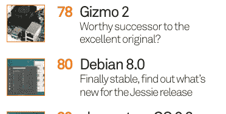

我们将介绍波表理论的基础，以及如何使用`Python`创建实时合成器

49 实用树莓派

制作复音合成器，运行你的科学实验，获取树莓派的最佳应用，让你的`Python`代码获利并搭建树莓派 2 桌面


- 14 构建更好的服务器：从硬件组件到文件和网络设置
- 96 免费下载：了解我们本月在数字内容中心`FileHilo`更新了什么


在线加入我们，获取`Linux`新闻、观点和评测`linuxuser.co.uk`

英国分销商

他们的产品包括：

- `DVB-S/S2` (标标卫星 & 高清卫星)
- `DVB-T/T2` (地面电视 & 高清地面)
- `DVB-C` (标准电缆)
- `IPTV`媒体器
- `USB`调谐器

提供多种选择：

- 通用接口 (`CI`)
- 以及现在全新的`MINI`调谐器 (`7220`)

所有`TBS`调谐器均兼容`Windows 7 Media Center`，并支持带有最新内核的`Linux`。

#### `DVB-S2`四路调谐`PCIE`卡


TBS6908 是一款带有 PCI Express 接口的专业级数字电视调谐器。它支持 `DVB-S2` 和 `DVB-S`，并支持普通卫星，同时也支持 `CI`、`ACM`、宽输入、通用流模式（大多数卫星接收都支持这些功能）。

使用 `TBS` 专用调谐器，可以下载专用工具。内置的 `Windows` 驱动程序和支持至最新内核 `3X` 的 `Linux` 驱动程序已就绪。

#### 双路调谐双 `DVB-T/T2` `PCIE` 卡

`TBS6290` 是最新的 `DVB-T/T2` Express 调谐器，配备了双调谐器和 `CI` 插槽，让您同时从不同频率享受更多的地面接收，并支持数字电视频道和加密电视频道的卫星接收。

`TBS6290` 可作为数字录像机，录制完全支持 `HDTV` 的数字地面电视节目，并带有时移功能。

建议零售价 £179.95

#### 四路调谐 `PCIE` 卡

`TBS6905` 是一款 PCI Express 接口的数字卫星电视调谐器，用于观看和录制 `HDTV` 节目。它支持 `DVB-S2`，允许您同时观看来自一个发射器或不同卫星的电视通道。它兼容所有流行软件，如 `MediaPortal`、`DVBink`、`Windows` 上的 `DVRs`、`ProgDVB`、`Sketader`、`XMC` 和 `MyTV`。

建议零售价 £179.95

##### `TBS` 7220 `DVB-T/T2` mini `PCIE` 卡

`TBS7220` 是一款 `DVB-T/T2` mini 调谐器卡，是一种带有 `DVB-C` 功能和可选插槽的数字地面电视调谐器。

免费空中 (`FTA`) 数字地面/电缆电视和数字卫星接收。

`TBS7220` 可作为数字录像机录制完全支持 `HDTV` 的数字电视节目。

它允许您通过时移功能进行广播并从离开的地方继续。

它是英国 `Freeview` 和 `HD` 的理想选择。

我们史以来最小的显卡

专属优惠

在 `www.tbsscards.com` 在线购买，使用代码：`LINUXED`，购买任何 `TBS` 产品均可享 9 折

欢迎贸易询价

邮箱：`mike@tbscards.com`

在线购买：

`www.radtv.com`

`www.valueau.com`

`www.amazon.com`


06 新闻与观点 | 88 问答 | 94 来信

发行版

`Canonical` 已经确认其 `Ubuntu Desktop Next` 正在转向其新的 `Snappy` 包格式，以取代目前一直使用的传统的 `Debian-deb` 格式。

`Canonical` 引入了 `Ubuntu Core`，这是该公司基于 `Debian` 的 `Linux` 变体，专为嵌入式和云平台设计。`Canonical` 创始人 `Mark Shuttleworth` 将 `Snappy` 描述为“十年之”。与操作系统此前青睐的“老旧 `deb`”格式相比，这是一次巨大的转变，每个 `Snappy` 组件和应用程序都被设计为拆分可以原子更新的 `OS` 实体——包括回滚更新的能力。

它具有许多实用的属性。`Shuttleworth` 说，“如果你能确切知道特定系统上运行着什么，并以高精度和安全性协调更新，你可以安全地运行，提前更新’。”

更好的 `Snappy` 包管理意味着你可以回滚到其他相同系统的 `Ubuntu` 的单独更新，以查看它们是否导致了意外问题。你可以回滚更新，因为每个版本都是一个完整的镜像。这确实非常好，”他对该平台在不使用基础系统的情况下对系统之上的应用采用事务性更新的方式表示赞加。

`Snappy` 包格式及相关管理的完整性已经在嵌入式和云市场中得到证明。`Canonical` 将其用于 `Ubuntu Core`，在那里允许单独更新，并被视为一种安全特性。

现在，`Canonical` 已经确认它将转向桌面端，即将发布的 `Ubuntu 15.10` `Willy Wehr`。“我们对 `15.10` 的计划是有一个基于 `Snappy` 的基础。`Canonical` 的选择将是，‘这样当前的 `.deb` `Ubuntu Desktop Next` 将被构建并用新的 `Snappy` 版本取代。’”

“对于 `Ubuntu` 来说，找到新方法向更广泛的受众交付软件非常重要，”`Shuttleworth` 在基于 `Snappy` 的 `Ubuntu Core` 发布时称，“在利用 `Snappy` 环境方面还有很多要做，而且 `GitHub` 上大量的软件现在可以更容易地流向 `Ubuntu` 用户。’”

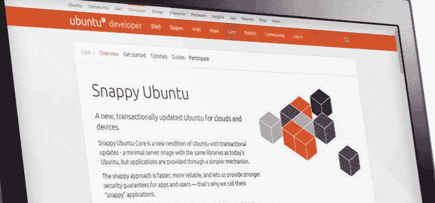

一种更新桌面和设备的新方法，一种更可靠的方法。

`Snappy Ubuntu` 是 `Ubuntu` 的一种变体，具有事务性更新，是一种更可靠、更安全的更新方法，但应用程序通过独立的方法部署。

`Ubuntu Core` 的新架构让我们拥有了更好的安全保障和 `apt` 更新，这就是为什么我们称之为’snappy’。


虽然在商业软件和信任供应商方面安全水平的信心是平等的，但在开源软件和设备的情况下，这种是可以构建的

您的 `Linux` 新闻与观点来源

互联网是一股民主化的力量，打破了文化、种族和宗教界限，但其服务仍被少数几大公司主导。

> `欧盟`正在对 `Google` 的竞争性活动进行调查。此举是`欧盟`针对强大科技公司的一系列反垄断调查中的最新进展。`Facebook` 无处不在，作为一家公司，它正变得“仁慈”。`Google` 增加收入的手段对终端用户几乎难以察觉，但它也是拥有世界维网的众多公司之一。其他还包括`亚马逊`、`Facebook` 和 `Twitter`。

`Web` 的承诺一直是它的多样性，一种即时媒体，我们可以在其中向全球公民分享并阐述我们的开放创新。没有人能否认这些公司提供的服务对用户具有价值，但公司的首要“职责”是为股东回报利润。利润在不同国家之间转移，公司通常在运营所在地纳税。其服务带来的便利性和成本降低是其成功和无处不在的次要结果，而搜索和记录变得消失，多样性和选择也之消失。

公司主导的文化导致了一个后果，即自由软件的开发者往往会转化为公司化。`GPLv3` 和 `LGPLv3` 可能会被“社区协议”和开放开发许可协议破坏，这些协议将代码的自由限制在控股公司，并允许重新许可以及随后的专利条款删除。

自由软件只有在被用于盈利时，才会由公司推行。许多组织合作开发开源项目以降低成本。这些源码项目存在是因为它们对底线更有利，或者出于其他原因。公司使用开放标准是因为它们降低了准入门槛并鼓励了创新。

`欧盟`对 `Google` 竞争行为的调查可能不仅是为了证明合理性，而且跨大西洋贸易投资伙伴关系（`TTIP`）协议——一种在网络类型国家之间达成的贸易协议——将赋予他们保护其公民的“权利”。这将使一套完善的合同能够治理互联网并摧毁我们的法律保护——即所谓的投资者争端解决机制（`ISDS`）？

然而，大多数公司在有利于它们的情况下运营时，倾向于支持专有标准；事实上，像 `Apple` 这样的少数公司支持必须摧毁一切的开放标准。`微软`的例子是，据发现的源码项目（通常在版权许可下发布）要求贡献者将其版权转让给实体公司。这使得贡献变得困难。如果他们和开源项目也失去了强制执行软件。用户的问题以及

`Richard Hillary` 为多种出版物撰写关于：音乐、数字权利、`Linux` 和各类型软件的文章。

> 我们应该寻找传播多样性的方法。我们必须希望`欧盟`对 `Google` 的调查能带来更多可选方案！！

这种程度的合作可以用于平息企业控制对英国医疗服务体系（`NHS`）的攻击，重新规范市场并防止破产；对于竞争对手律师来说，世界需要找到如何处理公司治理权。

我们正在寻找传播多样性的方法。正如`蒂姆·伯纳斯-李`（`Tim Berners-Lee`）在网络类型会议上所说：“除非我们有一个开放、信赖且无需担心后门发生了什么的互联网，否则我们如何拥有开放政府、良好的民主、关注医疗的社区以及文化多样性呢？仅仅认为我们能做到是不够的，因为认为我们可以坐而其成这种想法是天真的。”

配备支持 `Snappy` 的四旋翼特制型号

`Erle Robotics` 宣布了 `Erle-copter` 无人机的特版，该版本采用了 `Canonical` 的 `Ubuntu Core` 操作系统和 `Snappy` 包管理系统。基于 `Canonical` 声称该操作系统已准备好机器人项目中的事务型应用，`Erle-copter Core` 特制版配备了预装在 `Erde-brain` 微型计算机飞行系统中的操作系统版本。这随后由机器人操作系统（`ROS`）`Indigo` 提供支持，其目标是教学和变革，但需要额外的软件。该无人机售价为 399 欧元，据称旨在通过电源模块、电池和无线电控制，激励人们关注即将到来的机器人革命。据介绍，配备 5,000mAh 电池后，该无人机在具有 536MB 可写空间的持久性 `Ubuntu Core` 系统运行下，可提供 20 分钟的飞行时间；公司已确认，同时还可以完全访问 `Snappy` 包管理器以及基于 `ROS` 框架特定方法的 `Canonical` 官方软件商店。在撰稿时，`Erle Robotics` 已承诺在 5 月底开始交付首批基于 `BeagleBone` 微型计算机的 `Erle-copter` 无人机（单独售价 269 欧元）。


随着 `Linux 4.0` 内核发布首次带来了对热补丁（`live-patching`）的官方支持，`Fedora` 团队确认他们没有在其流行的发行版中启用该功能的打算。尽管计划将 `Linux 4.0` 内核作为标准发布 `Fedora 22`，但团队决定不引入新的热补丁功能（该功能允许在无需更新的情况下对内核部分进行补丁）。因此，对于 `Fedora 22` 用户来说，Feature 团队的 `Boyer` 表示，“热补丁可能非常有用，但在 `Fedora` 中并非必须。`Fedora` 团队在 `Fedora 22` 以及未来的版本中都禁用了此功能。我们在 `Fedora` 本身并不需要补丁。可以理解，那些想要在不重启的情况下打补丁的人是为了避免针对小 Bug 和安全补丁的稳定性问题。你无法从内核 4.0 进行补丁。”

Richard Hillary 撰写关于：音乐、数字权利、Linux 和各类型软件的文章。

> 我们应该寻找传播多样性的方法。我们必须希望欧盟对 Google 的调查能带来更多可选方案！！

## 嵌入式

### `Erle-copter` 无人机搭载 `Ubuntu` 发布

配备支持 `Snappy` 的四旋翼特制型号

`Erle Robotics` 宣布了 `Erle-copter` 无人机的特版，该版本采用了 `Canonical` 的 `Ubuntu Core` 操作系统和 `Snappy` 包管理系统。基于 `Canonical` 声称该操作系统已准备好机器人项目中的事务型应用，`Erle-copter Core` 特制版配备了预装在 `Erde-brain` 微型计算机飞行系统中的操作系统版本。这随后由机器人操作系统（`ROS`）`Indigo` 提供支持，其目标是教学和变革，但需要额外的软件。该无人机售价为 399 欧元，据称旨在通过电源模块、电池和无线电控制，激励人们关注即将到来的机器人革命。据介绍，配备 5,000mAh 电池后，该无人机在具有 536MB 可写空间的持久性 `Ubuntu Core` 系统运行下，可提供 20 分钟的飞行时间；公司已确认，同时还可以完全访问 `Snappy` 包管理器以及基于 `ROS` 框架特定方法的 `Canonical` 官方软件商店。在撰稿时，`Erle Robotics` 已承诺在 5 月底开始交付首批基于 `BeagleBone` 微型计算机的 `Erle-copter` 无人机（单独售价 269 欧元）。

这种程度的合作可以用于平息企业控制对 `NHS` 的攻击，重新规范市场并防止破产；对于竞争对手律师来说，世界需要找到如何处理公司治理权。

我们正在寻找传播多样性的方法。正如蒂姆·伯纳斯-李（`Tim Berners-Lee`）在网络类型会议上所说：“除非我们有一个开放、信赖且无需担心后门发生了什么的互联网，否则我们如何拥有开放政府、良好的民主、关注医疗的社区以及文化多样性呢？仅仅认为我们能做到是不够的，因为认为我们可以坐而其成这种想法是天真的。”

您的 `Linux` 新闻与观点来源

## 观点

### 小即是美

### `Erle-copter` 无人机搭载 `Ubuntu` 发布

配备支持 `Snappy` 的四旋翼特制型号

`Canonical` 手机发布


> 我们将展示如何用 C 语言编写一个传统的 `UNIX` 实用工具。它的主要目的是让你意识到，工具的实现实际上并不困难。该工具将是用于复制命令的简化版本。众所知的 `cp` 实用具有更多的命令行选项，并且是实现为一个独立的函数，而不是一个程序。

这两个文件之间的区别在于它们的权限设置：`'test'` 是一个可执行文件（`rwxr-xr-x`）。你可以使用 `chmod` 手动更改 `'myTestNEW'` 的权限。原始文件不会具有新文件的权限，所以你务必提到这一点。当一切运行符合预期时，代码不会输出任何内容——只有在失败时才会输出错误！仅用几行 C 代码编写实用工具的简单性，也能让你意识到，所有的原始 `UNIX` 实用工具的实现都与所编写的代码一样简洁简单。

通过编写一个简化版的 `cp` 工具来熟悉 `UNIX` 实用工具。

`UNIX` 允许通过多种方式打开文件进行读取。最直接的方法是使用 `open` 函数。`open` 函数返回一个文件指针，其名称以字符串作为参数，并将其返回值赋值给流。你可以通过以下方式打开文件进行读取：

在脚本语言中编写相同的任务可能会更简单。以下 C 示例执行了相同的任务：`fp = fopen(file,"r");`

打开文件返回以下值：

```
FILE *f = fopen(file,"w");
```

记住这一点非常重要：你必须始终检查函数的返回值，以便尽早检测问题或错误。在检测到异常状态后做什么取决于你，但正确地处理它至关重要。

> 意识到所有的原始 UNIX 实用工具的实现代码都像这里展示一样简洁简单，真是令人惊讶。

程序的最终版本 (`myCp`) 非常整洁，没有严重错误，并且易于阅读。

如果你能用 C 代码复制文件，那么新文件将没有执行权限，正如 `myCp` 示例那样。

如果你使用 `trace()` 检查代码，你会发现脚本执行了以下 C 系统调用：

一个好现象是我们不应该省略测试，因为测试是软件开发中非常重要的部分（但不是良好设计的替代品）。

```
read(3,buffer[1024],1024);
write(4,buffer[1024],1024);
```

`diff` 命令（输入 `man diff`）可以帮助你检查原始文件与生成的文件是否相同。

因此，`FileCp` 程序通过使用更强大的 `read()` 和 `write()` 系统调用来实现文件复制。这是基础内核操作，而 `write()` 是作用于文件之上的库函数。由于性能很重要，`write()` 适合写入小量数据，而 `read()` 对于大量数据速度更快。尽管 `cp` 实用工具使用了 `write()`，但最好还是使用你已经知道如何使用的 `write()`。

```

`Mihalis Toucalos` 是一位 `UNIX` 时代员、`DBA` 和数学家。他从 1993 年开始使用 `Linux`。

要通过你发现的命令行选项扩展 `myCp` 的功能，源代码位于 `bit.linux.co.uk/H3Jkbb88bY`

## 内核专

`Jon Masters` 为我们带来了 `Linux` 内核社区的最新动态，此时 `Linux 4.1` 的合并窗口已关闭，`Linux 4.2` 的工作已经开始。

> `Lin Torvalds` 发布了第一个 `Linux 4.1` 内核发布候选版本并表示：“新功能不是免费的。根据你关注的重点，你对‘新功能’的理解可能与我不同。有很多内容对你的用例可能非常有用。4.1 的功能包括‘简单易久性内存驱动程序’（支持非易失性内存设备）、支持配置了用户态的单用户系统（用于那些没有资源节省 25 KB 内存的极小设备），以及支持功能共享。事实上，随后的 `RC` 添加了一些东西，包括一个我认为从 2012 年起就坏了、直到今天才注意到的东西，它可能一直需要——太蠢了，简直是愚蠢’（对 `D-Bus` 提供运行时字节序功能发表评论），并且坚持认为为 `d-bus` 消息日志添加调试功能似乎对用户信息来说是个糟糕的主意：‘我不会添加那些随后必须用安全规则禁用的垃圾内容；暴露接口是个糟糕的主意。’”

但对于大多数反对 `dbus` 合并的开发者来说，更大的问题很简单：用户态 `d-bus` 守护进程的性能在文章《D-bus 很慢》（`Andrew Lytnyk`）中得到了总结。有什么想法吗？


Jon Masters 是一位 Linux 内核黑客，已经研究 Linux 多年。他首先就读于马萨诸塞大学，现在在一家大公司工作，负责由 Linux 驱动的所有工程开发标准。

## Kdbus

在 Linux 4.1 中，正在推进 kdbus-D-Bus IPC（进程间通信）机制以解决现代开发者添加的 d-bus 和用户态进程的性能问题。这是第一个桌面项目（带有 GNOME）的一部分创建的，长期以来一直被 FLOCKS 项目和其他项目反对。D-Bus 提供了许多需要的优秀功能，例如激活服务（这是必需的），但用户态是配置过剩的（对于那些没有资源节省 25 KB 内存的极小设备），以及支持功能共享。

程序的最终版本 (`myCp`) 非常整洁，没有严重错误，并且易于阅读。

如果你能用 C 代码复制文件，那么新文件将没有执行权限，正如 `myCp` 示例那样。

如果你使用 `trace()` 检查代码，你会发现脚本执行了以下 C 系统调用：

一个好现象是我们不应该省略测试，因为测试是软件开发中非常重要的部分（但不是良好设计的替代品）。

```
read(3,buffer[1024],1024);
write(4,buffer[1024],1024);
```

`diff` 命令（输入 `man diff`）可以帮助你检查原始文件与生成的文件是否相同。

因此，FileCp 程序通过使用更强大的 `read()` 和 `write()` 系统调用来实现文件复制。这是基础内核操作，而 `write()` 是作用于文件之上的库函数。由于性能很重要，`write()` 适合写入小量数据，而 `read()` 对于大量数据速度更快。尽管 cp 实用工具使用了 `write()`，但最好还是使用你已经知道如何使用的 `write()`。

Mihalis Toucalos 是一位 UNIX 时代员、DBA 和数学家。他从 1993 年开始使用 Linux。

要通过你发现的命令行选项扩展 myCp 的功能，源代码位于 bit.linux.co.uk/H3Jkbb88bY

虽然大型企业和大数据可能正在使用更多的服务器，但服务器的概念在短期内不会消失。无论你的 IT 基础设施有多大，服务器都是任何系统中不可或缺的一部分。无论是位于数据中心，还是隐藏在你的（通风良好的）基座服务器中，在 2015 年服务器仍有许多用途。对于办公室来说，你可能想省点钱，那么家用服务器非常适合你的需求，而且你完全知道该如何维护它。

你可以以更高效的方式控制网络中的某些方面。服务器有许多组件需要注意，但归根结底就是合适的硬件选择以及针对当前任务的良好选择。在教程中，我们将专注于文件服务器和 Web 服务器，这两种服务器系统可以通过多种方式进行扩展和修改，以适应你所处的情况。在教你如何构建一个更好的 Web 服务器之后，我们将先简单转转弯，告诉你如果你想升级当前的服务器以与新技术竞争，你应该了解哪些知识。


如果你有一台服务器，升级可能就是它运行得更好所需。

你可能已经有一台服务器，在这种情况下，与其实际上从零开始构建更好的服务器，你可能只是想升级你的服务器使其比以前更高效。实现这一点的有多种方法，其中一些需要硬件升级。如果你决定走硬件升级路线，只需查看我们推荐的硬件类型概述并了解相关内容即可。对于 Linux 系统，你可以简单地在机箱中添加一个额外的硬盘，只要你在位槽和电源方面有空间。安装完成后，重启系统并添加新硬盘，使其自动挂载到特定位置——例如，挂载到存储空间更大的文件系统。否则，你可以创建一个文件系统的副本，删除它，然后将其恢复到更大的硬盘上，其工作方式几乎没有变化。


在服务器中，内存比台式式 PC 重要得多，因为你需要为几个人提供服务。

对于其他系统硬件，你需要问自己哪部分较慢并需要升级。如果某些操作和计算任务运行得有点慢，也许你需要更多的内存或更快的 CPU。取决于你购买原始系统时考虑考虑得有多远，主板可能支持比内部处理器更新的处理器。你需要足够的内存来支持 CPU 以及服务器的任何用途；对于处理文件提供服务等服务的服务器，你需要更多内存。你可以更换这些类型的部件，而无需更换整个设备。

- 如果你有计算任务，并且可以使用硬件加速来处理它们，请考虑获取一个支持该特性的新系统——尽管为了实现这一点你可能需要更换整个系统。

- 如果你已经达到了当前主板的极限，是时候对系统进行“大换血”，并获取新的主板（`mobo`）、`CPU`、内存和 `GPU`（如果需要的话）。在尝试此之前，备份文件和设置是一个好主意，因为毕竟 Linux 可能无法轻松地读取它们。

- 否则，如果你需要软件升级，请参考本专题介绍中与你相关的任何内容，了解如何安装和设置新发行版。

### 构建更好的服务器需要什么样的硬件？

你选择的硬件是构建系统时非常重要的考虑因素。服务器处理请求的方式与普通台式机不同，通常根据不同的优先级处理人们的请求，这些优先级在不同类型的服务器之间可能有所不同。

软件固然很重要，但如果没有坚实的基础，让服务器运行将耗费更多精力。可扩展性和峰值负载需要作为一个考虑因素，因此请确保你的性能比需要的多。话虽如此，让我们开始查看细节。

你需要考虑的六个主要组件，最重要的四个是主板、内存、`CPU` 和存储。如你所见，你不需要过度担心其他组件。

一个小的担忧可能是某种显卡，如果你想直接与系统交互，或者利用插入的不同核心的优势来做某些事情。你还需要为服务器准备一个良好的存储解决方案。

主板有各种样式。许多服务器板将有两个连接到 `CPU` 的端口，这对于小型企业或如果你预计会有大量请求是非常非常好。这些足够了，但从长远来看，对于更大的服务器来说，其收益是值得的。

对于家用，大多数情况下单个处理器插槽就足够了，主要的例外是你计划管理大量连接的服务器。在这种情况下，你希望寻找具有大量存储和连接插槽的主板，使其尽可能灵活和可扩展。

它们没有 `ECC`。`ECC` 可以修复单位错误，这种错误是内存中最常见的数据损坏形式。

虽然 `ECC` 内存很重要，但它在 Web 服务器中更为重要，通常在业务和企业级服务器中更有必要。

`CPU` 最重要的是核心数。通过 Intel 线程（`Threading`），你可以拥有更多线程。

- 如果你有计算任务，并且可以使用硬件加速来处理它们，请考虑获取一个支持该特性的新系统——尽管为了实现这一点你可能需要更换整个系统。

- 如果你已经达到了当前主板的极限，是时候对系统进行“大换血”，并获取新的主板、`CPU`、内存和 `GPU`（如果需要的话）。

选择 `PSU` 时需要记住几点，即你需要哪种连接器。这取决于你的主板、使用的硬盘数量、额外的机箱风扇和 I/O 面板。如果你想更好地了解需要多大功率，可以使用此工具计算：`bit.ly/fjiggins`

对于服务器机箱，你需要考虑在哪里使用服务器。在家里，需要一个静音机箱，带有衬垫以在运行时降低噪音。在办公室里，则需要更多考虑尺寸以获得适当的冷却。尺寸也是一个因素，你可能需要将部件装入。

取决于你的存储要求，有多种解决方案可以使用。对于某些情况下，我们建议使用 `SSD`，对于其他情况使用标准硬盘。

否则，你的存储可以以多种方式配置。你可以使用 `JBOD` 来直接访问文件，或者为了防止硬盘故障使用 `RAID` 方案，例如 `RAID 5` 或 `RAID 6`，这增加了冗余性。

在服务器中，内存比台式式 PC 重要得多，因为你需要为几个人提供服务。

你不需要带有散热器的内存，除非你的主板支持它。如果你担心过热，且预算充足，可以购买带有散热器的内存。

当我们谈论主板时，检查插槽和端口很重要。你需要足够的内存来支持 `CPU` 以及服务器的任何用途；对于处理文件提供服务等服务的服务器，你需要更多内存。

主板有各种样式。许多服务器板将有两个连接到 `CPU` 的端口，这对于小型企业或如果你预计会有大量请求是非常非常好。这些足够了，但从长远来看，对于更大的服务器来说，其收益是值得的。

对于家用，大多数情况下单个处理器插槽就足够了，主要的例外是你计划管理大量连接的服务器。在这种情况下，你希望寻找具有大量存储和连接插槽的主板，使其尽可能灵活和可扩展。

它们没有 `ECC`。`ECC` 可以修复单位错误，这种错误是内存中最常见的数据损坏形式。

虽然 `ECC` 内存很重要，但它在 Web 服务器中更为重要，通常在业务和企业级服务器中更有必要。

`CPU` 最重要的是核心数。通过 Intel 线程（`Threading`），你可以拥有更多线程。

- 如果你有计算任务，并且可以使用硬件加速来处理它们，请考虑获取一个支持该特性的新系统——尽管为了实现这一点你可能需要更换整个系统。


- 如果你已经达到了当前主板的极限，是时候对系统进行“大换血”，并获取新的主板、`CPU`、内存和 `GPU`（如果需要的话）。

选择 `PSU` 时需要记住几点，即你需要哪种连接器。这取决于你的主板、使用的硬盘数量、额外的机箱风扇和 I/O 面板。如果你想更好地了解需要多大功率，可以使用此工具计算：`bit.ly/fjiggins`

对于服务器机箱，你需要考虑在哪里使用服务器。在家里，需要一个静音机箱，带有衬垫以在运行时降低噪音。在办公室里，则需要更多考虑尺寸以获得适当的冷却。尺寸也是一个因素，你可能需要将部件装入。

取决于你的存储要求，有多种解决方案可以使用。对于情况下，我们建议使用 `SSD`，对于其他情况使用标准硬盘。

否则，你的存储可以以多种方式配置。你可以使用 `JBOD` 来直接访问文件，或者为了防止硬盘故障使用 `RAID` 方案，例如 `RAID 5` 或 `6`，这增加了冗余性。

网卡如果你的服务器还充当其他角色可能是至关重要的。有许多不同类型的卡，你需要选择符合你网络需求的。

如果你的主板集成了，你不需要 `GPU`。

它们现在很少被需要，但有时拥有一个光驱来传输数据会很有帮助，或者在你使用服务器来提供文件时安装它，并且可以创建副本以播放 `DVD` 或蓝光电影，甚至是那些没有 `DRM` 保护的录制。

在你的网络中或更远的地方存储并提供文件

文件服务器对于家庭和商业环境都非常有用。对于家庭，它是一种低功耗的专用解决方案，可以存储你的媒体文件，而无需为了获取文件而专门打开你的台式机——而台式机使用的功耗可能比专用服务器大得多。

对于企业来说，它不仅可以用于备份，还可以为个人用户提供离线网络存储，用户可以从网络内外部进行访问。所以，让我们设置一个服务器吧。

如果你正在为家庭服务器进行初始设置，如果你有相应的设备，使用安装介质或启动盘可以在不连接显示器的情况下轻松地完成安装，然后点击“安装 `Ubuntu Server`”……


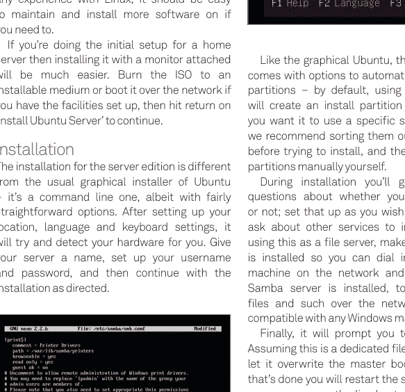

| 安装 `Ubuntu Server` |
| --- |
| 检查缺陷 |
| 从硬盘启动 |
| 救援损坏的系统 |
| 安装带有 `MySQL` 的服务器 |

- `F1` 帮助 `F2` 语言 `F3` 键盘 `F4` 模式 `F5` 辅助 `F6` 其他选项

服务器版本的安装与 `Ubuntu` 的图形化安装不同——它是一个带有直观选项的命令行界面。在你选择了位置、语言和设置后，它会要求你设置服务器名称和密码，然后继续安装。

和图形界面一样，服务器版本带有自动设置分区的选项——默认情况下，如果你想让它创建一个安装分区并设置。如果你想使用一组特定的分区，你必须在尝试安装之前手动操作，然后手动进行分区。

一旦安装完成，你将收到一些关于是否需要代理的问题，根据你的意愿进行设置，然后会询问要安装的其他服务。例如，你可能想要安装 `OpenSSH`，这样你就可以从网络上的另一台机器登录，并使用 `Samba` 更方便地在网络上共享文件并与 `Windows` 机器兼容。

最后，你将想要安装 `GRUB`，它允许你覆盖主引导记录。完成后，你将重启系统，因此请确保你已经连接了网络。当系统加载时，你会被带到命令行界面登录——因为这是一个服务器，所以没有桌面环境。

```bash
sudo nano /etc/network/interfaces
```

并将网络接口更改为类似的内容：

```bash
auto eth0
iface eth0 static
address [Desired IP]
netmask 255.255.255.0
gateway [Router]
```

如果你使用的是无线连接，请确保你想要切换到无线连接并添加 `SSID` 和密码的详情。

配置好 `IP` 或者 `IP` 已经自动设置，你现在可以 `SSH` 进入你的机器，并使用你设置的用户名和密码。在网络上的机器上运行 `Samba`，输入：

现在你可以创建一个网络可以识别并配置的共享文件夹了。首先，创建你想要共享的文件夹并将其放在普通主目录下，使用如下：

```bash
$ ssh [username]@[IP address of server]
```

输入密码将授予你访问相同命令行界面的权限。

现在你进入了 `Ubuntu`，我们首先在机器上设置 `SSH`。对于像家庭服务器这样的设备，设置静态 `IP` 是最好的，我们可以在 `/etc/network/interfaces` 中进行。使用命令打开：

```bash
$ mkdir ~/networkshare
```

文件服务器对于其他事情也很有用

在服务器上，只有预定义的系统是安装的。为了满足你的需求，你可以安装以下内容：

你可能想要安装以下软件：

- `Samba`
- `FTP` 服务器
- Web 服务器

你将想要安装 `OpenSSH`，这样你可以从网络上的另一台机器登录，并使用 `Samba` 在网络上共享文件更方便并与 `Windows` 机器兼容。

打开 `Samba` 配置文件：

```bash
sudo nano /etc/samba/smbd.conf
```

在文件的末尾添加以下内容：

```ini
[share]
path = /home/username/networkshare
valid users = username
read only = no
writable = yes
```

完成后，重启 `Samba`

```bash
sudo service smbd restart
```

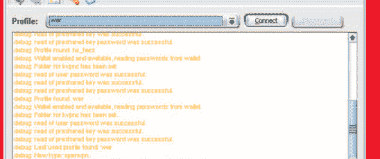

现在你可以创建一个网络可以识别的共享文件夹。

首先，创建你想要共享的文件夹并将其放在普通主目录下，使用如下：

```bash
$ ssh [username]@[IP address of server]
```

输入密码将授予你访问相同命令行界面的权限。

现在你进入了 `Ubuntu`，我们首先在机器上设置 `SSH`。对于像家庭服务器这样的设备，设置静态 `IP` 是最好的，我们可以在 `/etc/network/interfaces` 中进行。使用命令打开：

你需要配置 `Samba` 以获取共享文件夹

```bash
$mkdir ~/networkshare
```

文件服务器对于其他事情也很有用

在服务器上，只有预定义的系统是安装的。为了满足你的需求，你可以安装以下内容：

你可能想要安装以下软件：

- `Samba`
- `FTP` 服务器
- Web 服务器

你可能想要安装 `OpenSSH`，这样你就可以从网络上的另一台机器登录，并使用 `Samba` 在网络上共享文件更方便并与 `Windows` 机器兼容。

打开 `Samba` 配置文件：

```bash
sudo nano /etc/samba/smbd.conf
```

在文件的末尾添加以下内容：

```ini
[share]
path = /home/username/networkshare
valid users = username
read only = no
writable = yes
``` = yes

完成后，重启 `Samba`

```bash
sudo service smbd restart
```


### 在你的网络中或更远的地方存储并提供文件

文件服务器对于家庭和商业环境都非常有用。对于家庭，它是一种低功耗的专用解决方案，可以存储你的媒体文件，而无需为了获取文件而专门打开你的台式机——而台式机使用的功耗可能比专用服务器大得多。

对于企业来说，它不仅可以用于备份，还可以为个人用户提供离网络存储，可以从网络内外部进行访问。所以，让我们设置一个服务器吧。

如果你正在为家庭服务器进行初始设置，如果你有相应的设备，使用安装介质或启动盘可以在不连接显示器的情况下轻松地完成安装，然后点击“安装 Ubuntu Server”……


| 安装 Ubuntu Server |
| --- |
| 检查缺陷 |
| 从硬盘启动 |
| 救援损坏的系统 |
| 安装带有 MySQL 的服务器 |

- `F1` 帮助 `F2` 语言 `F3` 键盘 `F4` 模式 `F5` 辅助 `F6` 其他选项

服务器版本的安装与 Ubuntu 的图形化安装不同——它是一个带有直观选项的命令行界面。在你选择了位置、语言和设置后，它会要求你设置服务器名称和密码，然后继续安装。

和图形界面一样，服务器版本带有自动设置分区的选项——默认情况下，如果你想让它创建一个安装分区并设置。如果你想使用一组特定的分区，你必须在尝试安装之前手动操作，然后手动进行分区。

一旦安装完成，你将收到一些关于是否需要代理的问题，根据你的意愿进行设置，然后会询问要安装的其他服务。例如，你可能想要安装 `OpenSSH`，这样你就可以从网络上的另一台机器登录，并使用 `Samba` 在网络上共享文件更方便并与 `Windows` 机器兼容。

最后，你将想要安装 `GRUB`，它允许你覆盖主引导记录。完成后，你将重启系统，因此请确保你已经连接了网络。当系统加载时，你会被带到命令行界面登录——因为这是一个服务器，所以没有桌面环境。

```bash
sudo nano /etc/network/interfaces
```

并将网络接口更改为类似的内容：

```bash
auto eth0

iface eth0 static

address [Desired IP]

netmask 255.255.255.0

gateway [Router]
```

如果你使用的是无线连接，请确保你想要切换到无线连接并添加 `SSID` 和密码的详情。

配置好 `IP` 或者 `IP` 已经自动设置，你现在可以 `SSH` 进入你的机器，并使用你设置的用户名和密码。在网络上的机器上运行 `Samba`，输入：

现在你可以创建一个网络可以识别并配置的共享文件夹了。首先，创建你想要共享的文件夹并将其放在普通主目录下，使用如下：

```bash
$ ssh [username]@[IP address of server]
```

输入密码将授予你访问相同命令行界面的权限。

现在你进入了 Ubuntu，我们首先在机器上设置 `SSH`。对于像家庭服务器这样的设备，设置静态 `IP` 是最好的，我们可以在 `/etc/network/interfaces` 中进行。使用命令打开：

你需要配置 `Samba` 以获取共享文件夹

```bash
$ mkdir ~/networkshare
```

### 文件服务器对于其他事情也很有用

在服务器上，只有预定义的系统是安装的。为了满足你的需求，你可以安装以下内容：

你可能想要安装以下软件：

- `Samba`
- `FTP` 服务器
- `Web` 服务器

你可能想要安装 `OpenSSH`，这样你就可以从网络上的另一台机器登录，并使用 `Samba` 在网络上共享文件更方便并与 `Windows` 机器兼容。

打开 `Samba` 配置文件：

```bash
sudo nano /etc/samba/smbd.conf
```

在文件的末尾添加以下内容：

```ini
[share]

path = /home/username/networkshare

valid users = username

read only = no

writable = yes
```

完成后，重启 `Samba`

```bash
sudo service smbd restart
```

### 根据你的所有个人需求定制你的 Web 服务器


作为 `Web` 服务器的益处之一，它允许你为其添加你自己的邮件服务器，甚至托管你自己的 `Web` 邮件客户端。拥有 `Apache` 是实现此点的第一步，随后在其之上设置邮件服务器非常简单。

`Nginx` 是另一个流行的选择，它看起来更现代，并且允许你在添加自己的 `Web` 服务器的同时，也添加其他网页邮件服务。


除了使用 `Apache` 作为服务器，你也可以考虑并尝试 `Nginx`。`Nginx` 处理请求的方式与 `Apache` 略有不同，可以减轻 `Web` 服务器的负载。它像 `Apache` 一样可以在大多数发行版的仓库中找到因此可以使用相同的方式安装。

如果你需要帮助设置，请参考我们来自 `Mihalas` 的教程——如果你手头有的话，就在 `issue 144` 中，也可以在我们的网站上：`bit.ly/AYkk8`

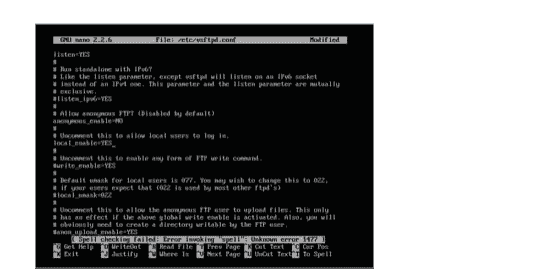

## 06 本地使用

虽然从外部访问这些文件很棒，但如果你倾向于使用共享文件夹，我们也可以内部访问 `FTP`。找到 `local_enable` 并将其更改为 `YES`，以确保在其他地方可以访问。

## 07 编辑文件

由于我们只让人们进入服务器，我们可以让任何人访问。要做到这一点，回到配置文件，寻找 `write_` 所在的行并将其更改为 `YES`。你可能还需要通过删除符号来取消注释。

## 08 FTP 文件夹

如果你没有为上一个服务器创建共享文件夹，现在是创建一个专用目录的好时机了。在家目录中，使用 `mkdir` 创建一个你希望 `FTP` 服务器能够访问的目录。

```bash
sudo mkdir -p /home/ftp/files
sudo chown -R ftp:group /home/ftp
```

## 09 重启服务器

一旦编辑了配置文件并创建了文件夹，现在是启动它了。重启 `FTP` 服务器，你就可以访问该文件夹。你对配置所做的任何更改都需要重启才能生效。

# LinuxUser 特别订阅优惠 & 开发者

# 订阅并立省 30%

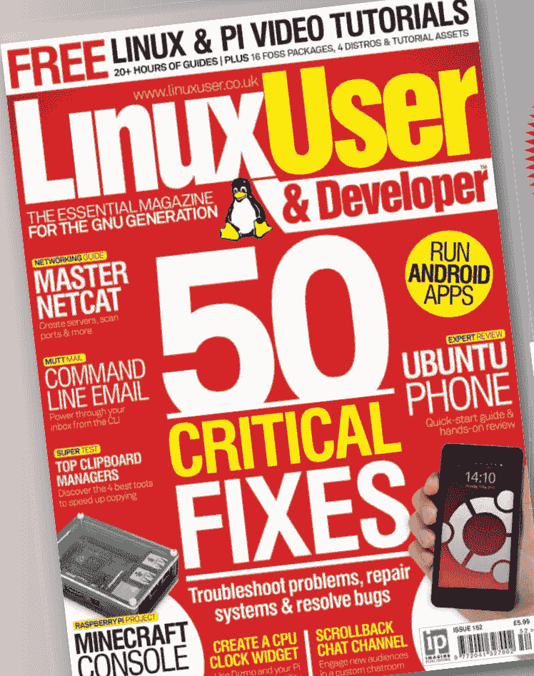

# 每 3 期仅需 £12.50

# 在线订购热线

`0844 249 0282` 通话每分钟 7便士，外加电信公司的接入费 `www.imaginesubs.co.uk/lud`

# 邮寄

`Linux User & Developer Subscriptions, 800 Guillat Avenue, Kent Science Park, Sittingbourne, Kent ME9 8GU`

# 每期都充实着...

# 你的详情

| 标题 | 名字 |
| --- | --- |
| 姓 | |
| 地址 | |
| 电话号码 | |
| 手机号码 | |
| 电子邮箱地址 | |

- \* 来自 Linux 专家的编程指南

- \* 来自企业供应商的最新消息

- \* 创意的树莓派项目和建议

- \* 最佳 Linux 发行版和硬件评测

# 直接借记付款

英国直接借记付款

（节省 30%）

我将每每 3 期支付 £12.50


| 地址 | 银行排序代码 |
| --- | --- |
| | 5 0 1 8 8 4 |
| 银行或合作社名称 | |
| 邮编 | |
| 账户持有人姓名 | |
| 排序代码 | |
| 银行大楼账号 | |

# 为什么你应该订阅...

# 付款详情

你的专属价格 £, 1 年（13 期）

£62.40（节省 20%）欧洲 – £70 世界 – £80

- \* 价格优惠 30% – 直接借记每 3 期 £12.50

- \* 免费送上门

- \* 永不错任何一期

支票

我随附一张为 £ 的支票

（支付给 `Imagine Publishing Ltd`）

# 信用卡/借记卡

| Visa | Mastercard | Amex | Maestro |
| --- | --- | --- | --- |
| 卡号 | | | 有效期 |
| 期号 | (如果是 Maestro) |
| --- | --- |
| 签名 | 日期 |


请通过电话或电子邮件告诉我们你不希望收到来自 `Imagine Publishing Ltd` 的任何促销材料。

请通过电话告诉我们你不希望收到来自其他公司的促销材料：如果你不希望通过电子邮件接收，请告诉我们。

# 条款与条件

条款与条件：此优惠允许直接借记订阅者每 3 期仅需支付 £12.50。新订阅将从优惠开始。优惠详情可以在我们的网站上查看。此优惠有效期至 2019 年 3 月 31 日。`Imagine Publishing` 保留限制此类优惠的权利。订阅者可以随时取消订阅。

# 订购

7 月 31 日

使用代码 `PQ15`。

# 教程 DEB & RPM 包

## 构建你自己的 DEB 和 RPM 包

替换 `'make install'` 习惯并学习像专业人士一样交付 Linux


对于大多数著名的 Linux 发行版，你会发现几乎它们都使用两种包：`DEB` 或 `RPM`。前者及其衍生品，`RPM` 最初由 `Red Hat` 创建。两者属于相同的方法：系统中的每个文件必须属于一个包，整个安装是二进制包的集合。

Linux 自然分为两个部分，`DEB` 和 `RPM` 系统是不同的，需要不同的命令集。然而，一旦你掌握了几个示例，就会发现过程非常简单且易于操作。

尽管没有经验，我第一次安装软磁盘时开始编写 Linux。也许你已经熟悉从源码构建 Linux 应用，或者你只是想将其交付到发行版的官方仓库中。

| 文件 | 编辑 | 书签 | 设置 | 帮助 | `Red Hat` |
|---|---|---|---|---|---|
| 新 | 打开 | 另存为 | | | |

Summary: 一个 Linux `RPM`。创建文件文件

Version: 1

Vendor: Linux User

Package: dummy

License: GPG

Group: `System/Libraries`

BuildArch: noarch

Source: dummy.file

description: 创建一些 dummy 文件

```
#install
### 创建目录 $(buildroot)/dummy
### (%install) -d -m 755 $(buildroot)/dummy
### 从 SOURCE1 复制文件到 $(buildroot)/dummy
### (%install) -m 644 $(SOURCE1)$buildroot)/dummy
### (%install) -m 644 $(SOURCE1)$buildroot)/dummy/another.file
```

```
%files
$(buildroot)/dummy
$(buildroot)/another.file
```

正确的文件具有易读的结构和大量的宏，建议学习。行：`.spec`。

如果你决定构建包，可能希望将它们组织到仓库中使用软件管理工具。在 `Ubuntu` 和 `Debian` 的情况下，你需要安装 `dpkg-dev` 包。现在，将 `.deb` 文件放入你选择的目录中。你将需要一个脚本来创建和维护仓库文件；可能如下：

```bash
#!/bin/bash
cd /path/to/debs
dpkg-build --gz Packages
```

最后在 `sources` 中添加一行，该行如下：

```
[local]
name=your-distribution-release
baseurl=file:///path/to/repo
enabled=1
gpgcheck=1
```

`OpenSUSE`/`Suse Linux` 也支持 `Yum` 仓库，你可以通过 `YaST` 软件或命令行添加它们，如下：

```bash
zypper addrepo 1 /path/to/repo
```

现在创建我们的包真的很简单！

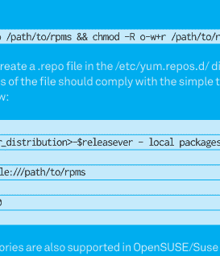

## 01 为什么我们可能需要编辑

让我们列出文件位于包中的情况。首先，你的发行版可能会制作你需要的包。你可能需要从零开始构建（困难的方法）或使用发行版（通常首选）。然而，并非所有软件都是开源的，因此你可能需要一个纯二进制应用程序或一组文件，以便只需几次点击即可安装。这通常是专有软件、如 `Skype` 等软件的情况。

## 02 RPM 内部

当你下载一个 `RPM` 文件时，很容易安装和测试，但你也可以将其作为存档文件。`RPM` 文件就像 `ZIP` 存档。它的工作方式与你一样。当你看到该文件时，它不仅如此，`RPM` 包含元数据，用于执行安装后执行脚本、权限、复制和删除文件或 `bash` 中的任何其他操作。

当你解包 `RPM` 文件时，它是为 `x86_64`、`i386` 或 `noarch` 设计的，由应用程序源码和一个定义构建命令和要求的文件生成。这被称为 `SRPM`。如果你需要重新封装一个专有应用程序，有时只需要一个属性 spec 文件，因为它会自动获取 rpm 文件。

## 03 从源码 RPM 编译 RPM

对于不急的人，命令是：`rpmbuild --build /tmp/rpmbuild-1.0.0-source.rpm`。另一种方法是按所示安装源码包：

`DEB` 和 `RPM` 包很容易安装和使用。你始终可以使用标准归管理器提取其内容。

## Alien 与 DEB/RPM

`Alien` 是一个将 `deb` 包转换为 `RPM` 包的工具。它非常适用于许多，例如需要 `DEB` 转 `RPM` 的纯二进制包，使用以下：

```bash
alien -c /path/to/yourpackage.deb
```

```bash
rpm -i /tmp/rpmbuild-mypackage.spec
```

然后处理 spec 文件：

```bash
rpmbuild --build &mypackage.spec
```

注意，所有注释都应在普通用户帐户下发布，出于安全考虑。

为了让工作运行，你需要 `rpmbuild` 以及构建它所需的所有依赖和编译器。如果你需要安装一个已经存在于系统包中的包，可以在 `OpenSUSE` 中尝试 `zypper -d my`，在 `OpenHEL/Magora` 中使用 `yum install build-package`。

## DEB & RPM 包教程

### 当从源码构建应用程序或库时使用 usecheck

- 遵循策略

- 无论你是在本地构建自定义包还是通过仓库构建，都适用于特定的 Linux 发行版包构建策略。对于 `Ubuntu`、`Debian`、`Fedora`、`openSUSE`，详情请参见主策略控制字段，这些字段应准确标记，因为增长的仓库可能会影响性能。

### 04 绘制一个虚拟 spec (dummy spec)

第 24 页的图片展示了一个简单的 spec 文件，它可以编译成一个没有任何内容的 `RPM` 包。在重新构建之前使其运行，请使用 `%build(dummy)/usecheck` 目录。在构建过程中，`usecheck` 可能会针对许多问题运行，例如当你想修复问题而不仅仅是评分时，或者你在 spec 中设置了 `Build-Failed` 命令时。对于包含未授权权限的包，请将其添加到此处。

### 05 使用 usecheck 的简单方法

当从源码构建应用程序或库时，可以使用 `usecheck`。`usecheck` 在 `Debian` 和 `Red Hat` 中可用，你可以在其中检查详情（包名、版本、描述等）和作者字段。你可以保持系统整洁无闲。如果你需要删除文件，只需从你的包管理器工具（`apt`、`yum` 或 `dnf`）中移除 `usecheck`。你无法用它安装-usecheck 脚本，而且它在打包某些属性时不起作用，因为许多系统需要额外的钩（hooks）。不过，`usecheck` 用于本地安装或小型 OEM 任务。

### 06 简述 deb 格式

像 `RPM` 一样，`DEB` 文件可以使用管理器打开，这样你可以看到所有的 tar 包：`data.tar.gz` 和 `control.tar.gz`。它们非常自而易见：第一个包含包文件，第二个包含元数据。`DEB` 包与 `RPM` 不同，但仍然直观。由于 `Debian`/`Ubuntu` 及其克隆版本中有一种处理包和仓库的主导技术，它具有各种特性，例如用于搜索查询的适当字段，而 deb 是一个简单的包管理器工具（类似于 `RPM`）。

### 07 构建 DEB 包

首先，获取基础性组件：

```bash
sudo apt-get install build-essential autotools-dev dpkg-dev deb-helper-mk
```

假设你已经有了 `my-package-0.2.tar.gz`，你想将其转换为 `DEB` 包，首先手动创建一个如下的构建目录：

```bash
debuild -p /src/my-package/0.2
```

然后将该目录放入并解压（`tar xzf my-package-0.2.tar.gz -C .`），使用以下命令构建程序：

```bash
./configure --prefix=usr && make
```


如果你正在重新编译一个已于某个仓库中的程序，可以先使用 `apt-build-dep mypackage` 来轻松解决依赖关系，以便 `./configure` 运行得更顺畅。

| 文件 | 编辑 | 搜索 | 工具 | 文档 | 帮助 |
|---|---|---|---|---|---|
| 打开 | 保存 | | | | |

包: `debcheck`

版本: `2013.02.12`

架构: `amd64`

维护者: `debcheck-report@dropbox.com`

已安装大小: `404`

依赖: `python`, `python-tk (=2.11)`, `python (=2.11)`, `lib12-0 (=1.28)`, `libc6 (=2.4)`, `libairo2 (=1.6.0)`, `lib12-0 (=2.16.0)`, `python (=2.16.0)`, `lib12-0 (=1.20)`, `debian-release (=8.1)`

推荐: `debcheckroot`

冲突: `debcheck`

提供: `debcheck-root`

区域: `utils`

优先级: 可

描述: 时钟同步引擎 - CLN 和 Nautilus 扩展

`Debcheck` 是一个可以轻松带上你的照片、文档、视频并共享所有内容的工具。

此包提供了一个命令行工具和一个 `Nautilus` 扩展，将 `Dropbox` 服务集成到 `GNOME` 桌面。

此示例 `debian/control` 文件说明了其所依赖包所需的最小版本

| 纯文本 | 制表符宽度: 8 | 第1行1列 | INS |
|---|---|---|---|

### Debrate - Debian 包构建器

### Control

`Debrate` 让你脱离命令行，使用友好的分步向导创建你的 `DEB` 包

| 字段 | 值 |
|---|---|
| 必选包 | `mypackage` Version `0.0.2` |
| 维护者 | Alexander Toksoy Email |
| 架构 | `all` |

### 包维护者

有各种工具辅助创建和维护高质量的软件包。在 Debian/Ubuntu 世界中，维护一个包所需的精力各异。为了简洁起见，不仅重复包本身，还包括信息——使用有用的脚本启用 Debian 特定的任务也是一个好主意。

在构建包的更新版本后，你可能想找出新旧版本的差异。使用 `debdiff` 更新包的变化。

### 08 Debian it

使用 `debian it` 回答关于你包详情的几个，最后按回车。你会看到新创建的 `debian` 子目录被添加到源码树中。如有必要，编辑 `debian/control` 文件以修改包描述。现在，确保你当前位于主源码目录并执行命令：

```bash
debdiff package-1*.arch debpackage-1*.arch
```

记住，`lintsec` 和 `ispell` 都有检查 debian 控制文件的特殊模式：

```bash
lintsec -d -x debian/control
ispell -d -O
```

记住你当前位于主源码目录并执行命令：

```bash
debdiff package-1*.arch debpackage-1*.arch

Edit debian/control
```

## X 修改

首先，我们需要安装我们想要为 X 使用的特定摇杆驱动程序。打开终端并安装该软件包即可完成：

## 检查控制器输入

如果你因为 USB 控制器在 PS3 设置下无法正常工作而需要更改输入，那么你必须弄清楚控制器上的按键。使用以下命令安装摇杆测试软件：


```bash
$ sudo apt-get install xerver-xorg-joystick
```

游戏机伴随着新的控制器，而 `PlayStation 4` 拥有有趣的经典手柄。

## 获取文件

我们创建了一个基础配置文件，可以用它让你的控制器像鼠标一样。它针对 `PS3` 控制器已经存在了一段时间，但我们将向你展示如何修改。在此处下载：

Shock Duck 前面有一个触摸板。该控制器与其他控制器不同，但开发是添加额外按钮的好极方法。在此处查看更多详情：`github.com/chipsn-dev`

```bash
$ wget http://www.linuxuser.com/uk-content/uploads/2015/05/58-joystick.cfg
```

## 测试输入

## 移动你的设备

仍在终端中，在运行 `jtestgtk` 时加载测试器。你将能够看到如何处理任何模拟输入的校准（这有点复杂），以及哪个按键被激活了：

## 键绑定

我们将从 `/usr/share/X11/joystick/` 复制 `5.1-joystick.cfg`，创建一个副本并将文件移动到文件夹：

一旦你弄清楚了按键的功能，你现在就可以查看哪些键映射到了键盘按下。仍在终端中，通过以下方法查询：

```bash
$ sudo cp 5.1-joystick.cfg /usr/share/X11/
```

```bash
$ DISPLAY=:0 evtest -np -p _all_keys
```

... 并打开文件：

## 重启生效

为了让所有更改生效，请重启。重新登录桌面环境并测试你的摇杆。`PS3` 控制器现在将以相同的方式移动，并分配了左键和右键，以及几个 `Escape` 键。

## 阅读使用

你需要做的只是知道你想使用哪个键。最好使用 `get's` 函数来找到它，然后按照你记录的内容设置每个部分的绑定值。

| 文件 | 编辑 | 查看 | 搜索 | 帮助 |
| :--- | :--- | :--- | :--- | :--- |
| File: `/home/user.ubuntu/ubuntu/utop/joystick` | | | | |
| Fetched 213 lines in 8 KB (509 bytes) | | | | |
| (Reading ... 50210 files and directories | | | | |
| Processing ... 50210 files in 2 seconds | | | | |
| Unpacking `libevdevice-1.2.0-2` | | | | |
| Selecting ... `evemu-1.2.0-2_amd64` | | | | |
| Preparing to unpack ... `evemu-1.2.0-2_amd64` | | | | |
| Selecting previously selected packages | | | | |
| Unpacking `libevdevice-1.3.1-2_amd64` | | | | |
| Preparing to unpack ... `libevdevice-1.3.1-2_amd64` | | | | |
| Selecting previously selected packages | | | | |
| Unpacking `evemu-1.3.1-1` | | | | |
| Preparing to unpack ... `evemu-1.3.1-1` | | | | |
| Processing to unpack ... `evemu-1.3.1-1` | | | | |
| Processing triggers for `evemu-1.3.1-1` | | | | |
| Processing triggers for `bamf (1.1.0.6+10)` | | | | |
| Setting up `devev` for ... `evemu-1.2.0-2_amd64` | | | | |
| Setting up `devev` for ... `evemu-1.2.0-2_amd64` | | | | |
| Setting up `kernels` for `evemu-1.2.0-2_amd64` | | | | |
| Setting up triggers for `evemu-1.2.0-2_amd64` | | | | |
| ... (repeated triggers) ... | | | | |

# 教程

## 游戏控制器

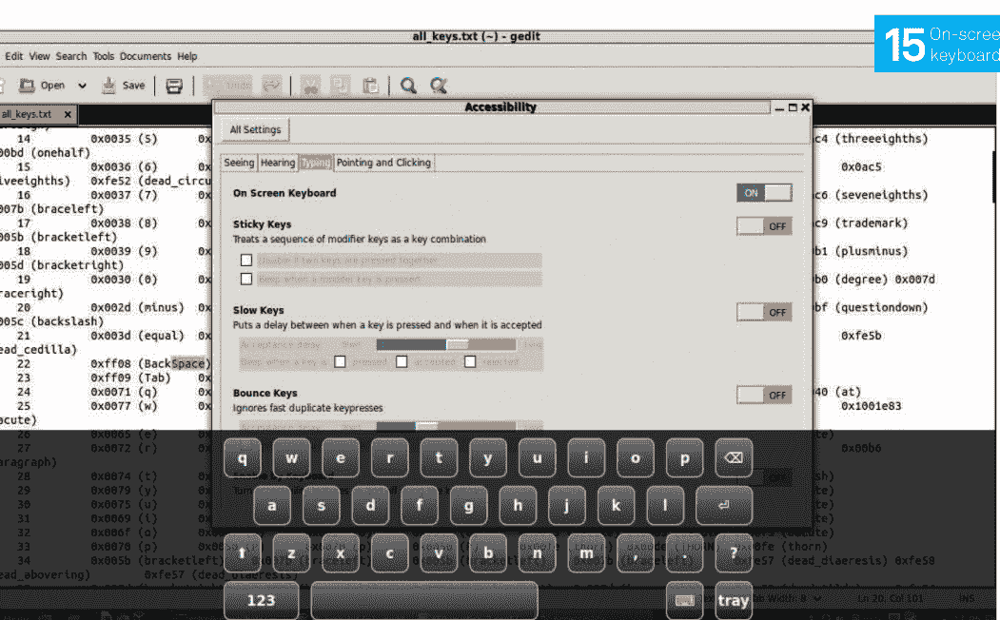

屏幕键盘上方可能需要一点时间适应，它是一个……

## 编辑配置文件

`50-joystick.json` 是存储每个按钮返回值设置的地方。我们将每个按钮分配给一个操作，该操作可以是任何键盘按键。如果你想尝试修改按钮的工作方式，请打开它。

## 标记按钮

我们在文件中中所做的是以注释的形式标出每个按钮所对应的内容。我们还列出了它关联的按键，这有助于精确识别设置应该执行什么的操作。我们建议你尝试一下。

## 添加空格键


在当前设置中，`PS3` 控制器上的三角键是空闲的。如果你想让控制器在一定程度上取代键盘，我们可以尝试映射三角键空间。在按键列表中，你会看到空格键被列为键 `65`。

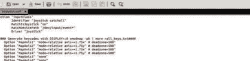

## 13 编写按钮

我们已经在原始文件中标记了它，但在摇杆配置文件中，三角键位于 `"MapButton13"` 之上。我们需要更改该行使其产生空格，因此我们将其编辑为如下内容：

### 选项 `"MapButton13":`

在原始代码中，有很多按钮，以便人们能够尽可能选择手柄的鼠标功能。这意味着你可以重新分配，而且它们通常是通用的。例如，将其改回键盘（`22`）而不是空格。

## 15 屏幕上键盘

如果你将控制器作为鼠标键盘的完全替代品，可以调出屏幕键盘来处理移除物理键盘的情况。这通常可以在你桌面的辅助功能选项中找到。开启后，你可以使用鼠标功能点击特定的按键，以及我们之前设置的空格和返回键，这让你的操作稍微方便一些。

## 360 控制器

| 输入 | 功能 |
| :--- | :--- |
| `LS` (移动) | 移动光标 |
| `LS` (点击) | 选择 |
| `RS` (移动) | 鼠标滚动 |
| `RS` (点击) | 选择 |
| `D-pad` | 上/下/左/右 |
| `Back` | - |
| `Alt-left` | 开始 |
| `Alt-right` | - |
| `LB` | 切换向上 / 音量减小 |
| `RB` | 切换向下 |
| `RT` | 音增大 |
| `T` | 回车 |
| `A` | 鼠标左键 |
| `B` | 鼠标右键 |
| 鼠标中键 | |


> `50-joystick.conf` 文件是存储每个按钮对应设置的地方。

### 使用 Xbox 360 手柄

在 Linux 上使用 360 控制器的过程略有不同，因为它使用自己特定的驱动程序。虽然它与（控制器）不同，但也有优点，可以让你对自己的操作有更多控制。

## 添加新驱动程序

打开终端并安装 `xboxdrv` 驱动，这样如果你有 USB 适配器，我们就可以使用 360 控制器：

```
$ sudo apt-get install xboxdrv
```

## 快速鼠标

安装完成后，你可以插入控制器并使用两个命令快速激活它以与内置工具配合使用：

```
$ sudo rmmod pad
$ sudo xboxdrv --mouse
```

## 默认鼠标控制

默认情况下，控制器将拥有一系列鼠标和键盘功能。左摇用于鼠标指针，而 `A` 键用于左点击，`B` 键用于右点击。如果你进入回车，左摇的控制将返回，并且默认还分配了其他几个功能。

## 修改按钮

尽管这是默认设置，但你可以根据意愿进行更改——在你想设置鼠标时，通过在命令中添加额外的内容来实现。左摇的映射比 `PS3` 控制器上的要复杂一点。请参考 `xboxdrv` 文档了解你如何处理它们：`bit.ly/Ry5`

## 自定义脚本

如果你想让 360 控制器在启动时运行，将需要使用脚本并在启动期间激活它——否则，你每次开启系统都必须手动输入命令。

## 控制你的 PC

通过这些工具，你可以开始通过这些游戏正确控制你的控制器。在你的房间里、主系统或任何你认为最方便的地方使用它。很快你就能做到，`PS4` 和 `Xbox One` 控制器也是如此。

上面你可以通过运行 `xboxdrv` 驱动的实例来使用多个控制器。

# AWS 云教程

## 在云端运行你的邮件服务器

## 你厌倦了通用的电子邮件地址吗？Postfix 和 Dovecot 来救你了！


在云端运行邮件服务器并不复杂或昂贵。通过 `Postfix` 和 `Dovecot`，你可以在 Linux 服务器上设置并运行你自己的云端邮件服务器。

邮件服务器由两个组件组成：`MTA`（邮件传输代理）和 `MDA`（邮件投递代理）。

## 09 将 Postfix 设置为邮件传输代理 (MTA)

使用你发行版的包管理器安装 `Postfix`，如下所示：

```
yum install postfix
```

...并使用以下命令启动服务：

```
service postfix start
```

为了让 `Postfix` 在系统重启时自动启动，请使用命令将其添加到 `chkconfig` 中：

```
/sbin/chkconfig --level 345 postfix on
```

## 10 更改你的 EC2 虚拟机的主机名

在 `EC2` 上，Amazon 根据其 IP 地址为你的实例分配主机名。此设置会反映在 `"Received"`（接收）头部中。要更改 `EC2` 实例的主机名，请编辑 `/etc/sysconfig/network` 文件：

将 `'hostname=local.domain'` 替换为：

```
HOSTNAME=mail.mydomain.com
```

...以及你选择的值，例如 `mail.mydomain.com`。

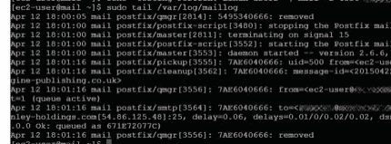

## 11 Postfix 的基础配置

在你选择的编辑器中打开 `Postfix` 配置文件：

```
nano /etc/postfix/main.cf
```

找到以下地址并确保它们与你的设置对应：

```
$mydomain = $domain
hostname = mail.mydomain.com # MX  服务器的主机名
mydomain = $mydomain.com # 完全限定目标地 = $mydomain, localhost,$mydomain, localhost
mydetwork_style = static
inet_interfaces = all
home_mail = Maildir/
```

保存文件并重启 `Postfix` 守护进程：

```
service postfix restart
```

![显示 Postfix 配置参数的表格]

## 12 在命令行中测试发出的邮件

`Postfix` 应该能够从命令行发送外出的邮件：

```
echo "testing Postfix: Linux users" | mail -s test user@email-address.com
```

在 `"From:"` 头部中将系统用户识别为发送者。`Postfix` 将接受来自 Linux 用户的邮件并将消息保存存在用户的家目录中：

```
/home/user/Maildir/
```

要验证 `Postfix` 守护进程是否在后台运行，你可以使用命令查看其邮件日志：

```
/var/log/maillog
```

通过 SSH 从本地服务器目录获取邮件是我们为你提供的增强功能。现在 `Postfix` 正在运行，是设置 `Dovecot` 了。

## 13 安装 Dovecot

安装 `Dovecot` 二进制文件：

```
yum install dovecot
```

启动服务：

```
service dovecot
```

确保 `Dovecot` 在重启时启动：

```
/sbin/chkconfig --level 345 dovecot
```

## 14 Dovecot 有待监听的连接

打开 `Dovecot` 配置文件：

```
nano /etc/dovecot/dovecot.conf
```

设置以下参数：

```
protocols = imap lmtp
listen = *, ::
```

保存文件并退出编辑器。

> 保持简单

> 在设置邮件服务器时，请记住保持简单。避免可能让邮件工作完美运行的复杂加密和端点身份验证。如果你稍后在配置遇到障碍，调试原因将变得更容易。

## 15 告诉 Dovecot 查找邮件

打开以下配置文件：

```
/etc/dovecot/conf.d/10-main.conf
```

根据你的选择，将 `Dovecot` 的邮件位置设置为与 `Postfix` 使用的邮件目录相同的地方，后者定义在 `/etc/postfix/main.conf` 中。

查找 `passwd` 和 `userdb` 部分。对这些部分进行必要的调整，包括：

> 以上是关于 `Dovecot` 配置文件的深度指南，请检查 wiki：`bit.ly/1VEMZ`


`passwd` (driver = `passwd-file`) `addr = /etc/passwd-dovecot` `userdb` (driver = `static`) `mail_location = /home/$user/home=$` `mail_location = maildir:/Maildir/`

## 16 为测试启用身份验证

打开 Dovecot 配置文件：`/etc/dovecot/conf.d/10-master.conf`

滚动到以下部分：

```
service mail-login (# ...
inet_listener_maps = (
```

并将 `SSL` 身份验证切换以缩小可能连接的设置范围：

```
ssl =
```

保存并关闭文件。打开新文件作为：`/etc/dovecot/conf.d/10-auth.conf`

设置这些身份验证参数以允许：

```
disable_auth = no
auth_mechanisms = plain
```

事实是不安全的。由于你的配置是功能性的，请记住反转此操作并使用受信任权威机构的 `SSL` 加密！

## 17 使用密码文件设置身份验证

`GNU` `nano` `3.2.1` 文件: `.../dovecot/conf.d/a` 设置

```
### -d 如果没有域名，则连接到 user@domain
## 目录
## 家目录
```

```
doc <wiki/Variables.txt 获取完整列表，请参示例：
mail_location =home/user/Maildir/
mail_location =home/user/Maildir/var/index/mail/
## <doc/wiki/UserDatabase.txt>
```

```
## 用于系统用户的身份验证。包含自 auth.conf
## <doc/wiki/PasswordDatabase.txt>
## 如今对于大多数系统，PAM 是典型的。
## 你需要 /etc/passwd-dovecot 来使用 userdbd
## 身份验证才能生效。<doc/wiki/PasswordDatabase.txt>
```

```
## 如果你需要特殊权限来更改目录属性，
# 请按照此方法操作：
chown -R user:group /home/user/Maildir
chmod 700 /home/user/Maildir
```

## 18 创建密码数据库

为了简单起见，此文件将作为你的邮件用户数据库。在大多数简易实现中，“密码数据库”使用以下格式：

```
/etc/passwd
```

注意，密码应仅在初始配置期间使用，以缩小潜在问题。`SSL` 并不是永久解决方案：今天的 `Dovecot` 有多种身份验证方法。

## 19 调整用户权限

在对用户进行身份验证时，`Dovecot` 需要适当的访问权限。你可以这样调整它们（例如针对 `ec2-user`）：

```
chgrp -Rf /home/user/Maildir/
chown -Rf /home/user/Maildir/
chmod /home-user/Maildir/
```

## 20 重启 Postfix 和 Dovecot

```
service postfix restart
service dovecot restart
```

测试发送邮件：

```
echo "test email" | mail -s "test subject" user@example.com
```

# WebKit 教程

## 使用 WebKit 构建浏览器

`WebKit` 是一个开源 `Web` 引擎。`WebKit` 是 `Safari`、`Mail` 以及其他 `OS X` 项目使用的引擎的操作系统框架版本。`WebKit` 是 `HTML` 和 `JavaScript` 代码，是 `Chromium` 的分支，以及 `KDE` 的库。

### 01 获取源码

我们需要获取 `WebKit` 的源码。在终端中进入你想要存放源码的地方。

```
git clone https://github.com/webkit/webkit
```

该源码将占用 `4 GB` 空间，请确保你在等待时有足够的空间。

### 资源

`webkit.org`

`Ubuntu` `12.04` 或更高


### WebKit 网站

| 首页 |

| `Safari` 功能 |

| 行星 `WebKit` |

| 项目 |

| 联系我们 |

| 跟踪 |

| 贡献者会议 |

| 与代码工作 |

| 安装开发工具 |

| 代码 |

| 构建 `WebKit` |

| 运行 `WebKit` |

| 调试 `WebKit` |

| 提交与策略审查 |

| 添加功能 |

| 安全策略 |

| 文档 |

| `Wiki` |

| 项目 |

| 代码规范 |

| 开发者资源 |

| `Demo` |

| 测试 |

| 回归测试 |

### 参与

有很多方法可以参与。你可以：

- 下载最新的测试版本
- 安装开发工具并查看源码

一旦完成这些，你还可以：

- 报告软件 `Bug`
- 贡献代码
- 提交补丁进行审查

### 项目

有很多令人兴奋的（新）项目你可以参与：

- 帮助我们提高网站兼容性
- 编写文档
- `Swift`
- 数学
- `CSS`

## 安装 Qt 5

```
rob@ubuntu:~$ sudo wget http://download.qt.io/official_releases/qt/5/5.4.1/qt-opensource-linux-x86-5.4.1.run
-- 2015-05-11 10:00:56-- - http://download.qt.io/official_releases/qt/5/5.4.1/qt-opensource-linux-x86-5.4.1.run
-- [Connecting to download.qt.io...] 1
-- [Connecting to download.qt.io] 2
-- Resolving www.mirrorservice.org... 1
-- Resolving www.mirrorservice.org... done
-- Connecting to www.mirrorservice.org [IP ADDRESS]... 1
-- HTTP request GET, awaiting response... 200 OK
-- Received 209715200 bytes (200 MiB)
-- Saving to 'qt-opensource-linux-x86-5.4.1.run'
-- 2015-05-11 10:08:12 (2.79 MB/s) -- qt-opensource-linux-x86-5.4.1.run
```

`Qt` `5.4.1` 安装

欢迎使用 `Qt` `5.4.1` 安装向导。

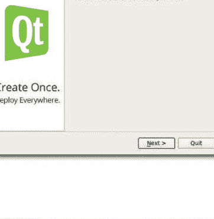

一次创建，随处部署。

### 02 获取阶段分支 (staging branch)

此步是可选的，但你也可以专门查看 `Qt` 移植的阶段分支。要进行此操作，你需要检出创建的 `Qt` 仓库。运行以下命令之一：

> 如果你使用的是较新版本的 `Ubuntu`，可能会在 `Qt` 代码上遇到一些问题

```bash
$ git clone qtgithub https://github.com/qt/qt
cd qtgithub
$ git fetch qtgithub
```

然而，`Qt` 移植的当前发布版本在我们推荐的主分支 `Qt` 分支中。

请记住将此行的版本号更改为你下载的版本。一旦完成后，你可以使用以下命令进行安装：

- 构建基础包 (Build essentials)

如果你是从源码开始编译，你可能已经安装了编译器。如果没有，可以使用以下命令轻松安装：

```bash
/qt-opensource-linux-x86-5.4.1.run
```

### 03 获取 Qt 5 源码

我们需要正确构建 `Qt` `5`，以便我们按照自己的方式运行和开发 `Qt`。我们首先需要下载 `Qt` `5` 的文件，可以在 `www://qt.io/download-open-source` 找到它们。你也可以在终端中使用以下命令下载安装程序：

```bash
$ wget http://download.qt.io/official_releases/qt/5.4.1/qt-opensource-linux-x86-5.4.1.run
```

在下载之前，请考虑 `Qt` `5` 的最新版本。

### 04 安装 Qts

这将构建一个图形化安装程序 - 请按照说明安装 `Qt`。

## 设置 Open Qt

如果你正在使用已安装的库，你应该这样做。可以使用以下方法进行安装：

下载完成后，提升文件权限以执行它：


如果你使用的是较新版本的 `Ubuntu`，在处理 `Qt` 代码时可能会遇到问题，因此谨慎的做法也是安装以下包：

```bash
$ chmod +x qt-opensource-linux-x86-5.4.1.run
$ sudo apt-get install libgl1-mesa-dev -y
```

如果你在其中 `GL` 方面遇到问题，安装此包可能会解决问题。

如果你有需要，安装此包：

## Subversion 教程

## 使用 Subversion 跟踪项目迭代 – 部分 2

### 现在你已经掌握了基础知识，让我们来看 `svn` 版本控制中更高级的概念。

在 `Subversion` 教程的一部分中，我们学习了这个版本控制系统的各个方面，以及如何使用 `Subversion` 执行最常用且最广泛的版本操作。现在如何检查并熟练地提交和接收更改，并跟踪所做的每一次更改。你可以通过简单查看文件和目录之前的版本来探索这一点。让我们现在查看历史的不同方法。

`diff` 是一个用于比较工作副本与仓库的非常有用的命令。以下命令可以比较文件的工作副本与指定的仓库：

```bash
root@po swayam$ diff -r 3 properties.txt
```

- `svn diff` – 此命令显示特定更改的行级详细信息。
- `svn log` – 这将为你提供带有日期和作者信息的修订日志，以及每个修订中更改的内容。
- `svn cat` – 这有助于从特定修订检索文件并将其显示在屏幕上。
- `svn annotate` – 此命令将人类可读的文件以文本形式检索到表格，并在每行附带最后更改的信息。
- `svn list` – 此命令显示任何给定修订下目录中的文件。

如果我们指定两个用冒号隔开的数字，则直接对这两个修订版本进行比较。以下命令可以用于：

```bash
root@po swayam$ diff -r 2:3 properties.txt
```

`svn diff` 的另一个常见用途是我们需要将一个版本与上一个版本进行比较。可以使用 `-c` 选项来实现，例如：

```bash
root@po swayam$ diff -c 3 properties.txt
```

你可以使用 `svn log` 来查找特定文件或目录的历史。`svn log` 提供大量信息，例如谁做了更改、在哪个修订中更改的、写入的时间和日期等。你可以使用以下命令查看单个文件或目录的日志历史：

```bash
[root@nblr-gwos swajam]# svn log properties.txt
```

## 下方正确的命令有一个非常有用的帮助页面

```text
root@po swayam$ svn help

1. A changed file or directory on properties, files, or revisions.

2. PROPER PATH: /path

3. REVISION: (TARGET ONLY which revision to access).

该值可以通过附加到 PROPATH 的 -file 选项提供。

如果你指定任何适当属性：

但将显示除属性以外的所有内容。

示例：

  HEAD - 仓库头部的 HEAD。

  URL - 仓库头部的 URL。

  Date -头部最后修改的日期。

  LogMessage - 最后修订的日志消息。

  IG

compressed - 之前的压缩版本

  -full - 之前的完整内容

  -executable - 如果存在，则使文件可执行。

  - scient - "checkout", "lock", "unlock" 之一

  - diff - 修订之间的差异。

  - 以 /tag/ 开头或另一个消息将显示两个修订之间的差异，每个修订由相对目录路径组成，可选不同的行为。Subversion 1.8 及更高版本将显示更改文件的路径，除非你指定

  -url

    http://example.com/repo/svn

  -for

    123

subversion 1.9 and svate match the content of the commit and the
```

Swayam Prakash 拥有计算机工程硕士学位。他已工作多年，专注于软件开发和网络安全领域。

### 属性结构为简单的键值对：键是一个字符串，值的内容可以是任何内容

| 命令 | 描述 |
|---|---|
| `svn log -r24` | 按时间顺序显示修订 24 的日志 |
| `svn log -r24` | 按逆时间顺序显示修订 24 的日志 |

```bash
[root@nblr-gwos swajam]# svn property copy -c 200; My-Firm Software feature/properties.txt

property 'copy' set on 'feature/properties.txt'
```

请注意，日志是按逆时间顺序打印的。通过使用详细 `-v` 选项，你可以查看有关文件或目录的更多信息。在 `svn` 中，日志正文将被抑制。当你使用 `-v` 选项时，将显示文件。需要注意的是，如果我们进行了提交并立即运行 `log`，由于提交的机制和 `svn` 解决方案的默认行为，最近的提交将不会出现在列表中。

除了 `log` 之外，`Subversion` 还提供了属性命令。该命令使用配置的编辑器来修改属性。当你使用 `svn property` 时，`Subversion` 会在临时文件中编辑属性，显示属性的当前值，并允许你在编辑器中修改该值以保存新值，然后删除临时文件。

你可以使用 `svn` 列出文件的不同版本。通过 `svn`，你可以在不下载的情况下检查文件的早期版本。`svn list` 将向你显示该版本中的文件。你可以。

## Subversion 教程

## 锁定文件

理解 `Subversion` 中的锁定非常重要，它是一种防止用户之间发生排除以避免冲突的机制。然而，每个人对存储库项目都拥有唯一的锁定，包括创建、强制和移除。

可以使用 `svn` 命令轻松地对更改进行未命名。这里需要注意的是，属性对 `svn commit`、`svn update` 和 `revert` 等使用问题的响应方式与文件内容相同。

正如预期的，前者将允许开发者看到他们即将操作的属性的当前值。可以通过 `svn` 和 `diff` 命令检索有关文件和目录属性的信息。如下所示：

```bash
[root@biblr-swampaj]# svn status properties
```

```bash
feature/properties.txt
```

```bash
[root@biblr-swampaj]# svn diff properties
```

```bash
feature/properties.txt
```

`feature/properties.txt` 上的属性更改

```bash
[root@biblr-swampaj]# svn lock feature:properties.txt

"feature/properties.txt' locked by user 'xxx"
```

现在，如果用户 `xxx` 尝试锁定同一个文件，`Subversion` 将抛出错误。但用户可以使用 `--force-option` 选项强制锁定同一个文件，如下：

```bash
[root@biblr-swampaj]# svn lock feature:properties.txt

"feature/properties.txt' locked by user 'xxx"
```

你还可以通过 `-m` 选项向锁定传递一条消息，此消息将作为锁定的原因。与 `svn commit` 不同，锁定没有优选文本。同样重要的一点是锁定将显示文件的最新版本。如果不是这样，存储库将请求锁定请求更新和提交锁定。从上面的示例可以看出，`svn lock` 命令将提供成功提交的确认。当文件被锁定或未被用户确认时，

值得注意的是，当开发者向控制版本引入新版本时，`Subversion` 将自动创建锁定。

让我们更深入地了解 `Subversion` 中的锁定。

锁定可以被指定为元数据，授予某一个用户访问权限，该用户被称为锁定所有者。`Subversion` 中的锁定可以防止冲突并节省精力和时间。通过锁定特定文件，他们知道自己的努力将不会白费。需要注意的是，在 `Subversion` 中，默认情况下未锁定意味着任何人都可以随时对文件提交更改。`Subversion` 提供了 `lock` 命令使用户户锁定特定文件，防止他人对其提交。锁定的文件在存储库中无法以任何方式修改，但可以锁定所有者删除或移除。以下示例说明了 `svn lock` 的用法：

```bash


### [root@biblr-swampaj]# `svn` `status` `feature:properties.txt`

`K` `feature/properties.txt`

```
K feature/properties.txt
```

文件旁边显示的`K`表示存在锁定标记。

如果我们查看`svn`命令之外的内容，可以看到关于锁定的详细信息，例如锁定所有者、提交日期和锁定消息。一个典型的示例显示如下：

以下是带有更改列表（changelist）可用的选项

```bash
### [root@biblr-swampaj]# svn info feature:properties.txt
```

```text
Lock owner:topelock:commit@bb8ac-9947-d018-887-35b444ae58
Lock Owner: james
Lock Created: 2024-06-12 16:32:11 -0500 (Sun, 12 Jun)
Lock Message: (1)
Lock Comment: (1)
```

创建的锁定作为授权令牌。任何用户都可以使用`svn info`命令找到锁定的唯一令牌。注意，锁定只有当它存在于工作副本（working copy）内部时其重要性才是唯一的。在这种情况下，它是锁定在特定工作副本中创建的证明。

当一个用户锁定文件时，他们将能够删除或修改该文件。这意味着，当锁定所有者释放锁定时，所有其他用户将解锁。

```bash
[root@biblr-swampaj]# svn commit --help
changelist: (all or directory) commit with the last file
-changelist [name]: commit with changist [name]
-changelist: remove DELETE
 -q --quiet print no output, except for errors
 -m [message] commit with a log message [message]
 -range [range] limit commit operation to revision [range]
 -r [version] commit to revision [version]
 -A [file] copy files of [file] as적 repositories
 --username [user] --password [password] use specified [user] and [password] instead of any other authentication
 -changelist [name] use changelist of [name]
server:global:http://library-server/svn
```


# 管理员可以简单地使用`svnlock`和`snmadin`程序破坏锁定；从存储库中显示并移除锁定

提供了一种可以防止自动释放锁定的机制 – 通过向`svn`命令传递`no-unlock`选项。锁定可以在任何时间释放。

# Julia 教程

## 使用 Julia 绘制和绘图

学习如何使用 Julia 编程语言开发的 4 个包来生成图表


Julia 是一种用于科学计算的编程语言，它的设计和开发是为了满足高性能数值和科学计算的需求，你也可以在 Julia 中开发通用程序。Julia 试图替代 `MATLAB`、`Octave` 以及 `Python` 的 `NumPy` 模块，但速度更快。它的设计基于三个原则：快速、表现力强、且是一种动态编程语言。Julia 的核心由 `C`、`Fortran` 和 `LLVM` 编写。

Mihail Tsoukalos 是一位 Unix 管理员、Unix 和 Linux 程序员、数学家。他从 1993 年开始一直使用 Julia。

在 Ubuntu 或 Debian 系统上，你可以执行`apt-get install julia`来安装 Julia，然后检查安装的 Julia 版本。Julia 库提供了用于线性代数、随机数生成、信号处理和字符串的库。我们将介绍四个用于绘制和绘图的 Julia 包。

### 01 Julia shell

使用 Julia 时，你主要通过只需输入`julia`即可执行的 Julia shell 进行交互。Julia shell 是发现该语言并尝试理解其各种功能的最佳地方。你可以输入`exit()`退出 Julia shell。

由于大多数介绍的包都需要图形用户界面，在继续操作之前，你可能需要执行下一个命令来安装某些所需的库。

```bash
$ apt-get install libairo2-dev libpang0-dev zlib1g-dev tk-dev tcl-dev
```

下方的图是使用 Gadfly 包绘制的——它是我们介绍的包包中最强大的。

### 资源

- [Julia](https://juliaang.org)
- [TextPlots 包](https://github.com/sumnemo/TextPlots.jl)
- [Winston 包](https://github.com/sumnemo/Winston.jl)
- [PyPlot 包](https://github.com/sumnemo/PyPlot.jl)
- [Gadfly 包](https://github.com/JuliaPlots/Gadfly.jl) [jlie](https://github.com/sumnemo/jlie.jl)


## Winston 包

科学计算的新颖方法
文档：http://docs.julielang.org
输入 "help" 列出帮助主题
版本 0.2.1 (2014-02-11 06:30: UTC)
x86_64-linux-gnu

```julia
julia> pkg.add("Winston")
INFO: Installing BinDeps v0.3.8
INFO: Installing Cairo v0.2.6
INFO: Installing Color v0.2.11
INFO: Computing Graphics v0.1.0
INFO: Installing Infile v0.2.4
INFO: Installing SMA v0.4
INFO: Finished in 1.17s
```

安装非常简单，只需对包名输入`pkg.add("name")`。

## 安装 Julia 包

绘图功能包含在核心系统中。要添加功能，你需要安装外部 Julia 包。因此，在 Julia 中进行任何操作之前，你需要使用包。`pkg.add`会安装新包并完成安装。

在 Julia shell 中执行`using PyQt`命令后的消息。好的一点是 PyQt 的开销很小或没有开销，在不创建副本的情况下传递。

### 06 Gadfly 包

Gadfly 是另一个可以绘图的 Julia 包，它的接口像 R 语言的 `ggplot2` 包一样简单。因此，Gadfly 包是我们提供的包中最强大的，但也是最难使用的。Gadfly 在网络浏览器中自动绘制。

### 03 TextPlots 包

TextPlots 是一个简单的绘图库，使用盲文字符生成终端图形。它允许你绘制任何连续实值函数或数据点。

### 07 绘制函数

由于所有包都定义并使用函数来调用`plot()`，如果你在 TextPlots 已加载时需要加载另一个包，你将在屏幕上看到以下警告消息：

如所示，使用 TextPlots 绘制函数 `$f(x)=\cos(x)$`：

`Warning: Winston in module Main conflicts with an existing definition.`

同样的图表可以在 Winston 中完成：

```julia
using Winston:
x = linspace(0, 3pi, 100)
c = cos(x)
p = Frame(title="Using Winston", xlabel="x", ylabel="y")
plot(p, c=c, color="red")
```

### 04 Winston 包

Winston 是一个有用且易于使用的 Julia 包。从加载 Julia 开始，Winston 提供了`plot()`命令让你将对象添加到现有定义中。

Gadfly 也可以绘制 `$f(x)=\cos(x)$`：

```julia
using Gadfly:
plot(cos, 0, 25)
```


如果你想避免从头开始绘制，那么你应该开始尝试 `Winston`。否则，接下来的包更高级，但学习曲线更陡峭。

如果你使用 `PyQt`，建议执行以下命令：

### 05 `Pyplot` 包

该包提供了 `Matplotlib` 的接口，`Matplotlib` 是 `Python` 流行的绘图库。

使用 `PyQt`，建议执行以下命令：

```bash
$ apt-get install python3-qt
```

## 处理分数

`Julia` 使用 `Rational` 类型原生支持分数。例如：

```julia
julia> x = 1/3
1/3

julia> y = 2/3
2/3
```

这里的通用思路是，你需要将图表封装在一个函数中以进行绘制。

最后，保存用 `PyPlot` 生成的图表也很简单——一旦完成绘制，只需执行下一条命令：

```julia
julia> savefig("PyPlotSave.png", format="png")
```

请注意，`savefig()` 函数并不属于 `Julia` 编程语言。因此，它在 `Gadfly` 中没有实现。

## 使用 `PyPlot` 绘制饼图和直方图

以下代码使用 `PyPlot` 包生成了一张精美的饼图。

```
using PyPlot:

sample = [12, 3, 5, 18]

p = pie(sample,shadow=true,startangle=0,autopct="%%1f%%")
```

同样，你可以像所示绘制一个包含 1,000 个随机数的直方图：

```julia
using PyPlot:

h = PyPlot.plt.hist(randn(1000),15)

grid()
```

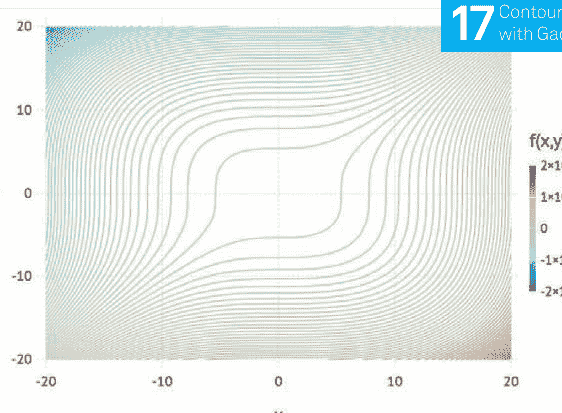

## 17 使用 `Gadfly` 绘制等高线图


## 使用 `Gadfly` 创建等高线图

上面的等高线图表示从气压到磁场强度变化的一切

```julia
julia> plot(x,y) -> x^3 - y^3, -20, -20, 20, 20

Stat.contour(samples=50, levels=100)
```

这种图被称为等高线图，由等高线组成。两个变量的等高线是具有恒定值的曲线。


## 16 使用 `PyPlot` 在 3D空间中绘制

以下 `PyPlot` 代码在 3D 空间中绘制了一个合适的函数：

```
using PyPlot:

ax = plt("3d")

x = linspace(-5, 5, 300)

y = linspace(-5, 5, 300)

z = linspace(0, 2*pi, 100)

X, Y = meshgrid(x, y)

R = sqrt(X.^2 + Y.^2)

surf = plot_surface(X, Y, Z, rstride=1, cstride=1,

linewidth=1, antialased=false)

plot3(X,Y,Z)

plt.show()
```

### 18 结语

如果你只想学习一个，那么 `Gadfly` 是不错的选择。然而，如果你想生成许多图表，`TextPlots` 将非常方便且易于学习。如果你已经熟悉 `Julia` 和 `matplotlib`，那么 `Gadfly` 将是你最合理的选择。它是一个易学的包，功能比 `TextPlots` 更强大，毕竟在使用 `Julia` 之前你应该考虑它。

另一个 `Julia` 包 `Gaston` 是 `ggplot` 的封装器，可用于绘制和绘。最终选择权在于你！

## 扩展：你的 Pi

适用于树莓派的可堆叠扩展板

- `ADC Pi Plus`
8 通道模拟数字转换器 IC，地址选择允许你为树莓派添加最多 32 个模拟通道。

- `IO Pi Plus`
32 路数字 5V 输入和输出。IC 地址选择允许你在树莓派上堆叠最多 4 块 `IO Pi Plus` 板板。

- `RTC Pi Plus`
带有电池备份的实时时钟，以及 5V IC 级电平转换器，用于为树莓派添加外部 5V 设备。

我们备有适用于原始树莓派 A 和 B 模块的各种扩展板

`electronics uk` `www.abelectronics.co.uk`

## Pi Supply

树莓派和创客配件商店

`10% 折扣优惠券`
在 `Pi Supply` 商店使用代码：

`LUDJUNE15`
快快！于 2015 年 6 月 30 日过期

全球发货！
`www.pi-supply.com`

介绍
一款适用于你树莓派的多功能电子纸显示 `HAT`


立即在 
`ICKSTARTER` 预订
`www.papirus.ws`

## 英国服务器

## 专用服务器

## 15% 优惠
使用优惠代码
`LINUX1`

起 
每月仅需
`£39/月`
外加增值税

- 当日安装
- 24/7 英国免费电话支持
- 无需长期合同

与我们的团队成员联系，或访问我们的网站获取更多信息
`0800 610 1 620` | `www.ukservers.com`


## 程序员与创客必备指南

## 实用型树莓派
“我们将学习波表合成理论的基础知识，并利用这些知识在 `Python` 中创建一个实时合成器”

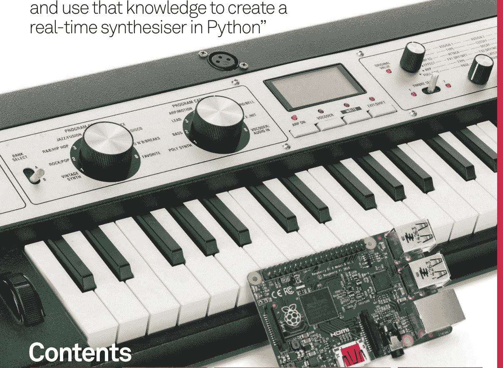

## 目录
- 56 树莓派鱼缸
- 58 适用于 Pi 的最佳应用
- 60 运行科学
- 64 树莓派桌面
- 70 什么是 `PaPi`?

# 教程

你将需要的
- 树莓派 2
- USB 声卡（我们使用了 `Behringer UCA20`）


## 编写一个简单的合成器

学习使用 `Python` 编写一个简单的多音合成器（及其背后的理论）。我们将带你了解波表合成的基础知识，利用这些知识创建一个实时合成器。目前它受计算机限制，但可以轻松适配以接受 `MIDI` 键盘。这种合成器的 `Python` 实现证明是可行的。

### 01 安装包

使用波表合成的基础知识，利用这些知识创建一个实时合成器。目前它受计算机限制，但可以轻松适配以接受 `MIDI` 键盘。这种合成器的 `Python` 实现证明是可行的。

# 教程

## 完整代码列表（续）

### 步骤 09

```python
cdef class wavetable:

    cdef init(self, wavetable_len)

        cdef float position, step_size

        cdef cfloat_array wavetable

        cdef float freq

        cdef object ads

        cdef int off

    def __init__(self, wavetable, samplerate, freq):

        # 初始化我们正在使用的波表

        self.wavetable = wavetable

        self.wavetable_len = len(wavetable)

        self.frequency = Hz

        self.freq = freq

        # 我们需要每个样本更新波表的大小

        # 以匹配目标频率。

        self.step_size = self.wavetable_len/(samplerate)
```


## 06 开始编码

我们的代码文件将命名为`synth.py`。这个扩展名告诉`Cython`这是一个普通的`Python`代码（因此，无法在普通的`Python`解释器中运行）。使用你喜欢的编辑器创建文件并添加导入语句。

## 07 MIDI 表

为了合成钢琴的标准音符，我们需要`MIDI`值。`MIDI`音符范围是 0-127。`MIDI C60`是中间 C 音。`MIDI`表有一个`get`函数，当你给它数字时，它会返回该音符的频率。


上方是攻击（Attack）、衰减（Decay）、维持（Sustain）和释放（Release）的视觉表示。

## 08 攻击、衰减、维持、释放

`ADSR`类在音符的输出上应用随时间变化的曲线。这是通过在 0.0 到 1.0 之间进行乘法来实现的。我们有一个 100ms 的攻击时间、300ms 的衰减时间和 50ms 的释放时间。你可以通过更改源代码中的参数来更改这些值。

```python
    def ref(self):
        return ('Frequency: {}Hz',\n
                'Step Size: {}'.format(self.freq, self.step_size))
```

```python
cdef int next_sample(self):
    # 下一个样本
    cdef int pos, p1, p2, interpolated
    cdef int out_sample
    cdef float pos, dec
    cdef float adsr
```

```python
    adsr = self.adsr.next_val(ads)
    # synth 将在下一个样本时移除
    if ads < 0:
        self.off = 1
    return out_sample
```

```python
    pos_int = int(self.position)
    pos_dec = self.position - pos_int
```

## 09 生成音符

```python
    # 线性插值
    p1 = self.wavetable[pos_int]
    p2 = self.wavetable[pos_int + 1]
```

```python
    # 如果第一个位置在表格
    # 末尾则循环
    if pos_int + 1 == self.wavetable_len:
        p2 = self.wavetable[0]
```

```python
    # 在 p1 和 p2 之间插值
    interpolated = p1 + ((p2 - p1) * pos_dec)
    out_sample = int(interpolated * adsr)
```

该是我们合成的核心。合成器产生特定音符的频率。波表为样本制作音符。`ADSR`进行插值并返回值。这些数学原理已在笔记的理论部分进行了解释。

该类还包含`ADSR`，因为它在可能的情况下会使用关键字作为参数传递。用于`next_sample`函数的`cython`关键字可以从非类函数中调用。然而，主类本身对于静态处理的类型来说太复杂了。

## 10 音频流

该类是应用程序的主类。它有两个长度为`buffer`的缓冲区。一个缓冲区由`synth`填充，另一个由音频卡读取。当音频卡有缓冲区时，会调用回调。缓冲区被交换，已填充的返回给音频库。

缓冲区越小，延迟越低。树莓通过小缓冲区对实时音频进行了优化。这也取决于所使用的`USB`声卡。

```python
    # 增加步长，如果则循环
    self.position += self.step_size
    if self.position >= self.wavetable_len:
        self.position -= self.wavetable_len
```

## 代码合成器

## 完整代码列表（续）

## 合成理论

```python
class Synth:
    BUFSIZE = 1024
    SAMPLERATE = 44100

    def __init__(self):
        self.audio = pyudio.AudioIO()

        # 创建双缓冲区
        self.buf_a = array('h', [0] * BUFSIZE)
        self.buf_b = array('h', [0] * BUFSIZE)

        # 将它们拷贝到缓冲区 a
        # 和 b。我们保持填充新缓冲区
        while playing:
            self.buf_a = self.buf_b
            self.buf_b = self.buf_a

    def load_wavetable(self):
        self.notes = []
        self.notes_on = []

    # 循环将在单独线程中运行。
    # 我们使用线程来通知
    self.more_samples = threading.Event()
    self.exit = threading.Event()
```

波表合成是指使用一个单周期波形作为查找表来合成声音。在这种情况下，`CD`音质音频的采样率为 44100 Hz，这是我们使用的。在每个样本处，合成器从波表输出一个值并增加计数器。然而，如果波表频率为 440 Hz 且步长为 0.5，可以被认为在输出的两个点之间画一条直线。如果索引为 0 或超过波表末尾，则循环并重新开始。由于你只使用单周期波，因此没有不连续性。

```python
## 频率 MIDI 表
self.midi_table = MIDITable()

def stop(self):
    self.audio.stop()
    self.exit.set()
    self.stream_stop()
    self.stream.close()
```

波表振荡器给出给定频率的音符，但它的振幅始终处于最大。每个周期的开始将产生啪嗒或点击声，这就是攻击、衰减、维持和释放包络帮助的地方。随时间改变音频输出的幅度使声音更自然。我们对波表振荡器返回的样本值应用一个乘数。释放时间从 100% 到 0% 将使声音淡出。通过`ADSR`曲线，合成器听起来非常像乐器。

```python
def load_wavetable(self):
    self.audio.open(
        format=pyudio.paInt16,
        channel=1,
        rate=SAMPLERATE,
        output=True,
        frames_buffer=BUFSIZE,
        callback=self.callback
    )

# 将此转换为可以使用索引访问的数组。
# h 是用于存储数据的符号短整
self.wavetable = array('h', [0] * len(data))
self.wavetable.frombuffer(data)
```


```python
def swap_buffer(self):
    tmp = self.playbuf
    self.playbuf = self.newbuf
    self.newbuf = tmp
# 切换缓冲区使合成器循环（增量式）
```

上方是一个波表的单周期。

# 教程

## 性能问题

一个主要问题是声卡使用 16 位符号整数来表示样本。然而，`Python`不支持这种类型。与用`C++`实现的原生合成器相比，`Python`引入了一些性能问题。在我们的实现中使用`Python`是为了缓解这些问题，但它的速度远比不上。我们在用`C`语言编写的嵌入式 100 MHz`ARM`处理器上测试的最佳实现可以生成大约 30 个多音音符，而我们的`Python`版本只有三个个。

## 完整代码列表（续）

一个主要问题是声卡使用 16 位符号整数来表示样本。`Python`不支持这种类型。为了将数据传递给音频库，我们必须将其转换为字节字符串。在另一端，与`Python`通信的音频库会将字节解码回整数。在`C++`或`Rust`这样良好的语言中，代码几乎可以直接传递给音频硬件。

另一个问题是`Python`具有较大的函数开销。在编译语言中，这可以由调用者（有效地）处理，将代码从函数拷贝到调用者，而不是内联所有所需的类型检查。还有垃圾回收器的开销，它会销毁对象。


```python
# 生成样本
self.samples.append()
```

## 合成器循环 (Synth loop)

类的`start`方法会初始化音频硬件并在自己的线程中启动`synth_loop`方法。当`exit`事件（退出事件）被设置为`false`时，`do_sample`函数就会运行。

`do_sample`函数遍历当前正在运行的节点，并向每个节点请求采样。样本会平移三位，然后加到输出缓冲区中。使用环形缓冲区可以确保我们不会溢出（这是添加音符的一种非常原始的方法，但有效）。

生成的样本随后被放置在采样缓冲区（sample buffer）中。如果缓冲区已满，则会清除该条件并通知`synth_loop`线程缓冲区刚刚填满。此时，合成器将清空已播放完毕的缓冲区并对其进行循环处理。

## 完整代码列表（续上）

```python
def note_on(self, n):
    self.freq_od(self.midi_table.get_note(n))
    self.notes_on.remove(n)

def note_off(self, n):
    if n in self.notes_on:
        print("%c: off".format(n))
        self.note_off(n)
    else:
        print("%c: on".format(n))
        self.note_on(n)
```

## 12 开启音符

既有`note_on/off`也有`freq`函数，它们可以轻松触发 MIDI 音符或任意频率。此外，还有一个`note toggle`（音符切换）方法，如果 MIDI 音符已经开启，它会将其关闭，反之亦然。该`toggle`方法专门用于键盘输入。

```python
class KBInput:
    def __init__(self, synth):
        self.synth = synth

    def keymap(self, key):
        self.map = {
            'a': 60, 'w': 61, 's': 62,
            'd': 63, 'f': 64, 'g': 65,
            't': 66, 'y': 67, 'y': 68,
            'h': 69, 'u': 70, 'j': 71,
            'k': 72
        }

    @staticmethod
    def get_note(n):
        fs = sys.fd.stdin
        old_settings = termios.tcgetattr(fs)
        tty.setraw(fs)
        char = fs.stdin.read(1)
        termios.tcsetattr(fs, termios.TCSADRAIN, old_settings)
        return char

    def loop(self):
        while True:
            c = self.get_note()
            if c == 'q':
                self.synth.stop()
                return
            if c in self.keymap:
                n = self.keymap[c]
                self.synth.toggle_note(n)
```

## 13 添加键盘输入

对于键盘输入，我们需要能够从键盘获取单个字符的能力。Python 的`input`函数在返回程序之前会阻塞。我们的代码实现如下：`https://code.activate.com/575597-get-single-key`

我们还有一个方法可以为每个键盘键开启 MIDI 音符编号。我们尝试将间距调整为钢琴的布局以便于操作，然而，更具创新性的输入方法留给您自行实验。

## 14 整合一切

类的主函数负责创建合成器并启动音频流和合成器循环。`start`函数随后会将控制权交还给主程序。

此时，我们初始化`KB`输入类并进入循环，获取相应的 MIDI 音符开启或关闭。如果用户按下键`Q`，我们将停止合成器并结束循环。程序将退出。

## 15 编译代码

复制以下内容并运行脚本来编译你的合成器：

```bash
# /compile.sh
```

这可能需要大约 30 秒，所以如果不是立即完成请不要担心。编译完成后，执行合成器。

`bin`命令：

```bash
# /synth.bin
```

按下`U`上的键将触发钢琴上的白键。我们模拟了这种声音。如果你按下按键，音符将成功触发。


```
note 68
Frequency: 261.62564088572, Step Size: 0.5918797010621
note 64
Frequency: 329.6275585572, Step Size: 0.754290662144
note 65
Frequency: 349.2283683372, Step Size: 0.79882065498
note 66
note 67
Frequency: 391.9955749151, Step Size: 0.8811...
```

# 教程

## 适用于树莓派的顶级 Android 应用

将最实用的工具下载到你随身携带最多的设备上。

通常情况下，我们的教程是关于完成某个特定项目并达到特定目标的。然而，这一次我们要尝试一些与众不同的。我们将展示一些可以与你的树莓派一起使用的 Android 应用。这些应用并不限于特定的项目——你可以随心所使用，它们可以为你的整个树莓派体验增添色彩。列表中的某些应用是树莓派专用的，而另一些是通用的但在树莓派发布的。你可能已经知道其中一两个，但我们希望你能从这些精选中发现发现。如果你有一台 Android 手机或平板电脑，还没有探索过树莓派的可用应用程序，你可能会错过一些酷且实用的选择。


Sandra Vogel 编写技术文章已有 20 多年，她在 Spectrum 上开启了编程生涯。她也是一位 Android 领域的专家。


| S92 | 52% | 10:49 |
|---|---|---|
| pastel | | |
| watercolour | | |
| film | | |
| blur | | |
| saturation | | |
| colourswap | | |
| washout | | |
| posterise | | |
| colourpoint | | |
| colourbalance | | |
| cartoon | | |


> `RaspiCam Remote`
> 如果你需要使用树莓派摄像头的应用，这里有一个免费应用可以远程访问它。你可以将图像保存到 Android 设备以便以后查看，它还可以运行基于单帧捕捉的视频模式。

### 顶级 Android 应用

这些应用并不与项目绑定——你可以随时随地反复使用它们。

### 树莓派远程控制 (Raspberry Pi Remote)

如果你希望能够从远处控制服务，免费的 `Raspberry Pi Remote` 可能是你的首选。安装它后，只要你的树莓派连接了互联网，你就可以远程控制摄像头模块等设备。

### JuiceSS – SSH 客户端

如果你正在使用 `SSH` 从其他设备控制你的树莓派，而不是通过你的 Android 平板电脑或手机？Android 有多个终端客户端和支持多设备的 `SSH` 客户端——我们喜欢免费的 `JuiceSS`，因为它有一个清晰、漂亮的界面。

### RIPEFR

这个应用可能更适合大屏幕平板电脑而不是小手机，但它是一份 GPIO 引脚的参考指南，涵盖了 A、B 以及 A+ 布局（树莓派 2 与 B+ 的布局完全相同）。这些内容都非常清晰易懂，而且是免费。

### AndFPTP (ftp 文件客户端)

有时你可能需要向树莓派传输文件，这时你也可以使用 `AndFPTP`。它比 `simple` 要简单得多，如果你的树莓派是一个 Web 服务器，它可能会很有用。其设计简单，而 3.89 英镑的 Pro 版本包含了同步等额外功能。

### Rasp-i

这是一个功能丰富的应用，可以容纳多个树莓派。除了监控树莓派的状态外，你还可以执行 `Linux` 命令、重启树莓派并处理 `Python` 脚本。这是一个免费应用，并提供应用内购买项目。

### Fing – 网络工具

`Fing` 是一个通用的网络扫描器，可以通过名称和 MAC 地址识别网络上的所有设备。你也可以发送 `ping` 包来测试连接。当我们偶尔忘记树莓派的地址时，它真的非常有用。

### VNC Viewer

为了更有效地远程控制你的树莓派，我们建议使用 `VNC Viewer`。这是一个优秀的 VNC 客户端可以让你看到桌面 GUI，因此需要在树莓派上运行 VNC 服务器。`RealVNC` 有开源版本的服务器，你也可以获取免费许可，该软件仅供个人使用且不包含加密功能。

### LCD 代码

| Line 1 | Line 2 | Text Line |
|---|---|---|
| Line 2 | 123456789012345 | |
| Cursor | OFF | ON |
| Position | 0 | |
| Backlight | Red Blue |
| Button | UP | move cursor |
| Clear | | |

### 树莓派 GPIO 工具

由于有些人想要管理 GPIO 引脚，他们一直在寻找灵感。下载树莓派 GPIO 工具可以让你创建新列表。它是必不可少的，且提供应用内购买。

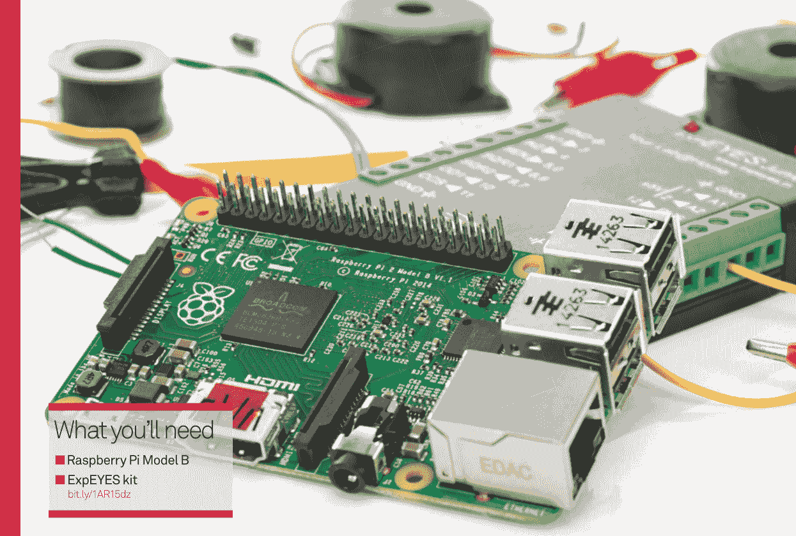

# 你需要的

- 树莓派 B
- ExpEYES 套件

### 使用 ExpEYES 套件实验

ExpEYES 是一个带有信号生成器的廉价示波器，它是必不可少的。ExpEYES 是一个带有信号生成器的廉价示波器，它是必不可少的。ExpEYES 是一个带有信号生成器的廉价示波器，它是必不可少的。ExpEYES 是一个带有信号生成器的廉价示波器，它是必不可少的。ExpEYES 是一个带有信号生成器的廉价示波器，它是必不可少的。ExpEYES 是一个带有信号生成器的廉价示波器，它是必不可少的。ExpEYES 是一个带有信号生成器的廉价示波器，它是必不可少的。ExpEYES 是一个带有信号生成器的廉价示波器，它是必不可少的。ExpEYES 是一个带有信号生成器的廉价示波器，它是必不可少的。ExpEYES 是一个带有信号生成器的廉价示波器，它是必不可少的。ExpEYES 是一个带有信号生成器的廉价示波器，它是必不可少的。ExpEYES 是一个带有信号生成器的廉价示波器，它是必不可少的。ExpEYES 是一个带有信号生成器的廉价示波器，它是必不可少的。ExpEYES 是一个带有信号生成器的廉价示波器，它是必不可少的。ExpEYES 是一个带有信号生成器的廉价示波器，它是必不可少的。ExpEYES 是一个带有信号生成器的廉价示波器，它是必不可少的。


# 教程

# ExpEYES & PHOENIX

ExpEYES 由 Ajith Kumar 和他的团队开发，作为 PHOENIX（带有设备的交互式实验物理）项目的一部分。该项目最初作为印度新德里大学间数学学院（IUCM）推广计划的一部分启动的。我们的目标是为使用基于硬件课程计划的教师提供廉价的实验室设备和培训。

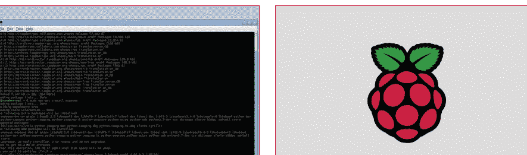

如需恢复模式，请按住

## 07 安装软件

感谢 Khadnare 等社区成员的努力，ExpEYES 软件现在已提供 DEB 软件包，这些软件包可以在 Debian、Ubuntu、Linux Mint 等更多系统上正常运行。所有依赖项都包含在官方仓库中，因此运行 ExpEYES 软件只需要在树莓派上打开一个 LXTerminal，然后运行以下命令：

```
sudo apt-get update
sudo apt-get install expeyes
```


## 08 安装依赖项

ExpEYES 有许多运行所需的依赖项，以及其他推荐的库。在步骤 7 的安装过程中，依赖项应该默认安装。然而，为了避免任何问题，你可以运行以下命令以确保它们都已安装：

```
sudo apt-get install python-exeyes python-exeyes-imaging-python-tk grace python-numpy-scipy python-python
```

## 10 持续超频

超频有时会导致你的树莓派不稳定或无法启动。如果发生这种情况，请按住 `Shift` 键进入上述启动闪屏以进入启动模式。然后你可以减小超频设置并重复，直到你找到最高的稳定设置。

## 11 人体电阻

这是一个有趣的实验，让你第一次使用示波器测量人体电阻随时间变化的实验。仅需三根电线和一个电阻即可轻松完成。将 ExpEYES 连接到 `A1` 和 `A2`，将电阻连接在 `A2` 和地之间，从 `P1` 和 `P2` 引出一根末端开放的电线。插入 ExpEYES 控制面板，将 `A1` 拖到 `CH1`，将 `A2` 拖到 `CH2`，用手握住线并观察 ExpEYES 控制板上的响应。

## 12 运行数学计算

从最终图表中，你会看到 `CH1` 上的输入约为 3.99 伏（这非常棒，因为接近 4V）。(`CH2`) 上的值为 0.9 伏，这意味着未知电阻值两的电压为 (`V = 4 - 0.9 = 3.1V`)。使用欧姆定律 (`R=V/I`)，我们可以计算电流 (`I = 3.1V / 0.0000045A = 4.5 µA`)。使用该值，我们随后可以使用相同的公式计算人体电阻 (`R = 3.1V / 0.0000045A = 688888 欧姆 = 689 kO`)。这是一个非常高的值。人体电阻很大取决于皮肤状况以及数值范围（1000 到 100000 欧姆）。

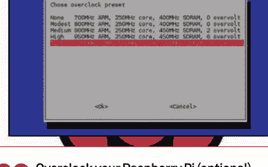

# 09 树莓派超频（可选）

ExpEYES 软件可以在默认设置下运行在树莓派上，但如果你使用的是 `Model A` 或 `B+`，速度可能会缓慢。如果你使用的是 `Model 2`，则不需要超频（但你可以超频以使其运行得更快）。

在 `LXTerminal` 上并使用步骤 7，选择“Overclock”（超频）选项。点击屏幕上的 `OK` 查看一些代码运行。完成后，再次按 `OK`，你将返回主窗口。选择右下角的 `Finish`（完成）并重启到你的树莓派。

# 13 使用 Python 库

ExpEYES 团队为你的设备内置了 Python 库。使用该库非常简单，它允许你比使用 ExpEYES 脚本更大的灵活性。如果你遵循了上面的安装说明，你只需要导入 Python 模块，然后使用以下代码初始化 ExpEYES：

```python
import expeyes

expeyes.open()
```

# Pi 上的科学

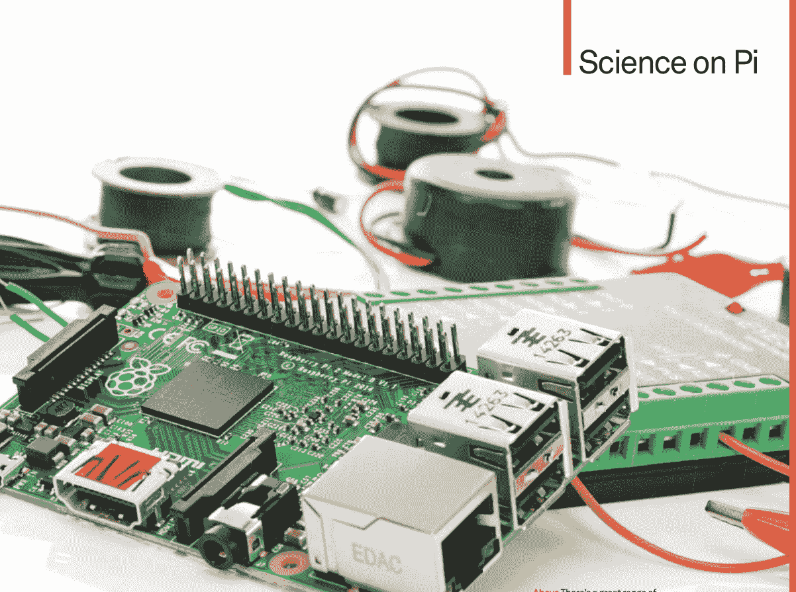

> 上述在 ExpEYES 文档中有一系列丰富的实验供你尝试：bit.ly/3E17hd7Y

数字存储示波器是任何工程师或黑客工具箱中非常有用的工具，因为它能让你对项目获得视觉检查无法实现的洞察。

| | 5 | 10 | 15 | 20 | 25 | 30 |
|---|---|---|---|---|---|---|
| 2 | | | | | | |
| 0 | | | | | | |
| -2 | | | | | | |
| -4 | | | | | | |

# 14 Python 库（续接）

现在我们将使用 ExpEYES 和 `PyLab` 库绘制正弦波。在设备上，将 `D1` 连接到 `IN1`，将 `SINE` 连接到 `A1`。运行以下代码：

```python
import expeyes

from pylab import *

p = expeyes.open()

p.state(100)

p.plot(t)
```

# 15 进一步实验

在 ExpEYES 文档中，有很多有趣的实验可以尝试。

数字存储示波器是任何工程师或黑客工具箱中非常有用的工具，因为它能让你对项目获得视觉检查无法实现的洞察。

| | 5 | 10 | 15 | 20 | 25 | 30 |
|---|---|---|---|---|---|---|
| 2 | | | | | | |
| 0 | | | | | | |
| -2 | | | | | | |
| -4 | | | | | | |

# 16 数字示波器（额外）

现在我们将使用 ExpEYES 和 `PyLab` 库绘制正弦波。在设备上，将 `D1` 连接到 `IN1`，将 `SINE` 连接到 `A1`。运行以下代码：

```python
import expeyes

from pylab import *

p = expeyes.open()

p.state(100)

p.plot(t)
```

# 17 进一步实验

在 ExpEYES 文档中，有很多有趣的实验可以尝试。

数字存储示波器是任何工程师或黑客工具箱中非常有用的工具，因为它能让你对项目获得视觉检查无法实现的洞察。

| | 5 | 10 | 15 | 20 | 25 | 30 |
|---|---|---|---|---|---|---|
| 2 | | | | | | |
| 0 | | | | | | |
| -2 | | | | | | |
| -4 | | | | | | |

# 教程

## 09 为你的树莓派配配件

仅仅在树莓派上安装操作系统只是过程的一小部分——我们还需要考虑支持它的硬件，以便它能够真正作为桌面电脑来使用。

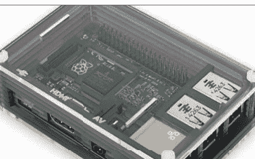


## 12 保护壳

树莓派相当坚固，如果我们保证不经常把它放在外壳之外，它是无不可摧的。虽然我们在进行许多涉及不同组件的不同项目，但桌面级树莓派需要这种程度的可访问性。我们喜欢 `Pimoni PiBox` 外壳，但其他其他安全的、保护性的替代方案。

## 10 人机输入设备

标准的 `USB` 键盘和鼠标最适合这项任务，远比许多 Pi 用户流行的键盘和鼠标要好用。不要试图通过购买自带 `USB` 接口的键盘来节省 `USB` 端口；树莓派无法使用 `USB` 集线器，即使在键盘上使用了两个。

你可以用上一期中控制台内的树莓派 2+ 和几个朋友运行相当不错的 `Minecraft`！！

## 11 显示器查看

树莓派最大输出为 1080p，在普通显示器上是 1920 x 1080。虽然它只通过 `HDMI` 输出，但许多现代显示器都有 `HDMI` 输入。如果你不想买全新的显示器，你可以可以买一个 `HDMI` 转 `DVI` 或 `HDMI` 转 `VGA` 的适配器。


## 13 无线连接上网

虽然有些人可以使用有线连接，但并不是每个人都有这种奢侈。无线适配器非常适合树莓派，尤其是它们几乎和 `USB` 端口本身一样大。然而，并不是所有的适配器都能用，你必须检查此列表以确保买到兼容的：`http://linux.org/RPI_USB_Wi-Fi_Adapters`。

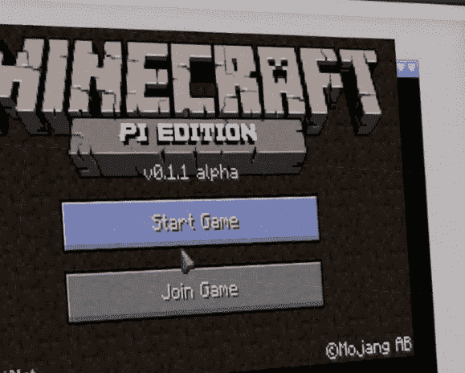

## 14 还有别的？

我们的标准桌面 PC 配置已完成，还有一个 `USB` 端口。你可以用这个端口接 U 盘或便携式存储设备，或者投资一个 `USB` 集线器来提供更多连接选项。否则，投资一个 2A 电源将确保你任何时候都不会用电不足。


# 树莓派桌面

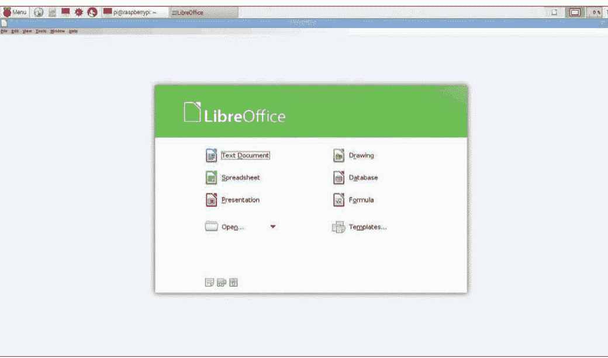

`LibreOffice` 默认没有安装，但作为顶级的开源办公套件（或泛指 `Linux` 办公套件），在 `Raspbian` 上可以轻松使用，这是很有用的。


## 15 添加额外软件

我们的树莓派桌面还没有完全完成。我们需要添加一些额外的软件，让它感觉更像一个真实的桌面。虽然我们在基础软件中已经安装了浏览器，我们应该添加的第一个软件是办公套件。

## 16 使用 LibreOffice 工作

`LibreOffice` 默认没有安装，但作为开源办公套件（或泛指 `Linux` 办公套件），在 `Raspbian` 上可用，这是很有用的。打开终端并使用以下命令安装：

```
$ sudo apt-get install libreoffice
```


## 17 使用 `GIMP` 处理照片

这是一个大项——原始的树莓派无法处理 `LibreOffice`，但使用 `GIMP` 是没用的。`GIMP` 运行得良好，尽管更复杂的任务可能会让它变慢。使用以下安装：

```bash
$ sudo apt-get install gimp
```

## 18 使用 `RIX` 音乐

如果你需要听音乐，`RIX` 是你可以查看的最好的软件之一。它是免费的，你可以在需要时在 Pi Store 中找到它。

## 19 树莓派桌面

现在你准备好将你的树莓派作为桌面系统使用了，并在需要时利用它的功能。软件仓库和 Pi Store 应该包含你想要的任何其他软件，或者充分利用你新树莓派系统的软件：上，通过 Pi Store，你可以运行完整的办公套件而不会遇到任何尴尬。

www.linuxuxer.com | 67

# Python 专

## Python 代码性能分析


`Joey Benard` 是一位软件工程师，他花时间为进行科学计算的研究人员构建工具并编写应用程序。

在树莓派上编写代码面临的问题之一是资源有限的，这意味着作为程序员，需要更关注你的代码在做什么以及如何运行。由于 `Python` 是首选语言，我们将使用性能分析（profiling）来精确定位瓶颈。性能分析分为两类：确定性分析（deterministic）和采样（sampling）。确定性分析跟踪程序中每条指令的执行。这种方法的优点是你可以得到正确的结果，但缺点是它引入了大量的开销。最简单的性能分析是使用 `time` 函数，你可以将其用于代码块以查看需要多长时间。`Python` 标准库包含了两个模块：`profile` 和 `cProfile`。`cProfile` 提供了关于模块的详细信息。另一个选项是在命令行中使用它。如果你不需要那种控制，可以使用 `cProfile`。在本期中，我们将使用性能分析来查看脚本。默认输出显示了脚本在所有函数上花费的总时间以及每个函数的被调用次数，带有以下列：

- `calls`: 调用次数
- `tottime`: 函数内总时间（不包括子调用）
- `cctime`: 函数内累积时间（包括所有子调用）
- `percall`: 时间除以调用次数


| 4. Python 性能分析 |
| --- |
| 4.1. 什么是性能分析 |
| 4.2. 用户手册 |

另一个参数 `(run)` 是文件名，你可以在其中保存原始性能分析数据以便进行更复杂的分析。例如，你可以使用 `stats` 来应用不同的排序或过滤。对于内存性能分析，最常用的选项是 `memory_profiler`。它通过 `pip` 可用，使用以下命令安装它：

```bash
pip install memory_profiler
```

如果你想查看整个脚本的内存使用情况，可以使用类似于 `cProfile` 的方法增加行：

```bash
python -m memory_profiler
```

`memory_profiler` 的输出按行给出的，它会打印当前行的内存使用情况。如果你想将感兴趣的区域缩小到一个函数，可以导入一个装饰器来分析该函数。要使用它，你会使用：

```python
from memory_profiler import profile
```

```python
@profile

def my_func():
    pass
```

需要注意的是，`cProfile` 也包含一个名为 `profile` 的装饰器，可以用于分析外部脚本或代码。要记录数据，使用：

```bash
mprof run myscript.py
```

然后你可以通过以下命令获取内存使用图：

```bash
mprof plot
```

通过 `memory_profiler` 还有其他几个函数。现在你已经知道代码的哪些部分需要检查，我们将查看细节并跟踪可能适用于你的特定问题。如果它们没有指向你应该进一步考虑的方向。

## 完整代码列表

# 每当你使用 `memory_profiler` 或 `cProfile` 的任何可用装饰器时，可以使用此文件。你可以使用如下命令运行：
# `python -m memory_profiler myscript.py`

```python
myscript.py

@profile

def my_func(x):
    if x == 0:
        return 1
    elif x == 1:
        return 1
    else:
        return my_func(x-1)

my_func(3)
```

# 下文件用于显式运行来自性能分析器的函数：

```python
myscript.py

import memory_profiler as mp

def my_func(x):
    if x == 0:
        return 1
    elif x == 1:
        return 1
    else:
        return my_func(x-1)

mp.run("my_func(3)")
```


# 输出将是：

12 functions (3 primitive calls) 耗时 0.000 秒
排序方式：标准名称

| `ncalls` | `totaltime` | `pertime` | `percall` | `filename` | `lineno(function)` |
|---|---|---|---|---|---|
| 1 | 0.000 | 0.000 | 0.000 | 0.000 | `<string>:1:<module>>` |
| 10/1 | 0.000 | 0.000 | 0.000 | 0.000 | `myscript2.py:3(my_func` |
| 1 | 0.000 | 0.000 | 0.000 | 0.000 | `(Method "disable" of 'lprof.` |
| | | | | | `objects")` |


# 常见问题

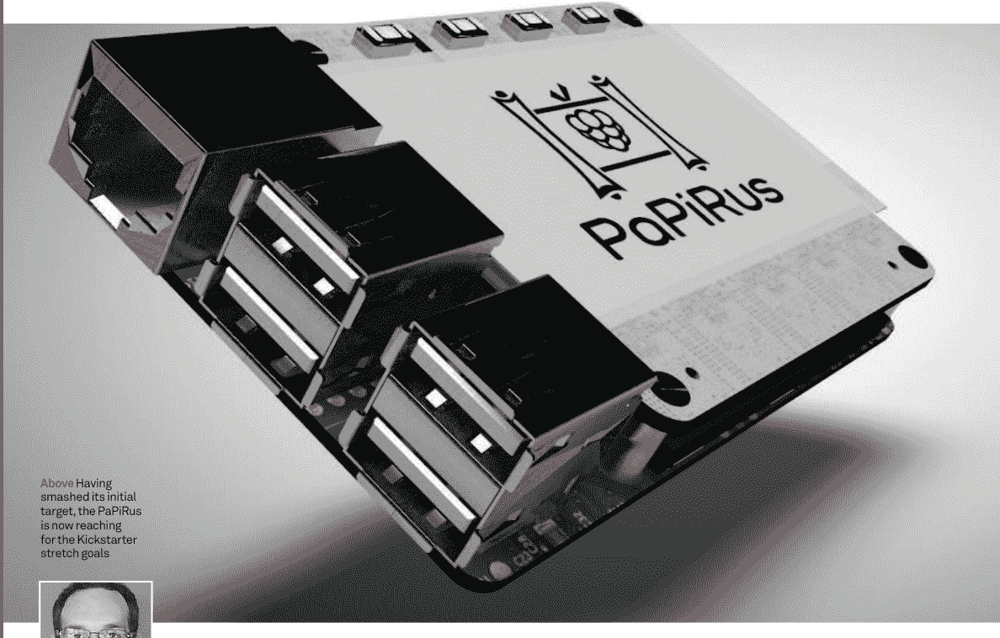

## 什么是 `PaPiRus`？

为你的 `Pi` 用户需要一种低成本、低功耗的显示器？看看 `PaPiRus HAT` 吧！

`Gavin Thomas` 是 `Luko` 和 `PaPiRus` 的编辑。他是一位经验丰富的记者，拥有许多项目。

- 我猜这不属于复古纸质手工吧？
- 上文提到它突破了最初的……对这种感兴趣……
- 如果你……对小显示屏感兴趣但想要触摸功能？看看 `PaPiRus`，它由 `Luko` 最近为 `Raspberry Pi 2` 更新了版本。
- 这次不是这样，尽管 `PaPiRus` 在很多方面非常像纸。
- 噢，现在我困惑了。那么 `PaPiRus` 到底是什么？

嗯，`PaPiRus` 是一个适用于 `Pi` 的 `HAT`，能够让你在项目中使用 `Adafruit` 显示器。它还让新用户的操作变得简单得多。因此，`PaPiRus` 是一个符合基金特定规范的扩展板。

- 另一个像手机那样的数字显示器，或者说你的视角非常有限。因为显示器是折射光而不是从玻璃屏幕后面发射光，所以它也舒服得多。
- 下一个：什么是电子纸（`ePaper`）——`Kindle` 用的那种东西？

基本上如此。电子纸在 `Kindle` 和 `Pebble` 手表上非常著名地应用，孩子们仍然知道它的功耗极低，而且它像墨水一样反射光线。

- 电子纸显示器——他们给的那些东西？——什么种质量

当 `Kindle` 和 `Pebble` 开始使用这项技术时，质量大约相当于标准印刷报纸的水平。那时候的新产品现在仍然处于同一水平，尽管你是用智能手机创作，不过再次强调，关键优势是它的功耗极低。

- 提醒我——再次——`HAT` 到底是什么？

去年，`PaPiRus` 基金发布了 `HAT` 规范，这是一套生产 `Raspberry Pi` 扩展模块的指南，它们可以整齐地安装在 `Pi` 本身顶部——即“顶层附加硬件”（`Hardware Attached on Top`）——以及……
- 为什么反射光很重要？

嗯，它看起来和读起来和普通的打印文本完全一样，你可以以任何角度拿着 `Adaplay` 仍然看到显示的内容，而使用…………

进一步阅读：
通过我们的网站了解 `PaPiRus` 以及我们提供的各种软件包。
如果是从 `Kickstarter` 获得的这期杂志，它现在应该还（在那儿）。

70

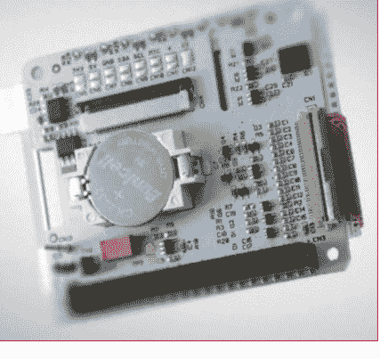

## `PaPiRus` 常见问题

`PaPiRus` 带有 `GPIO` 引出连接器和焊盘，具有更强的通用性，还有一个用于配合底座闹钟唤醒的可选复位插针。

作为一种设备，`PaPiRus` 通过板子上的安装孔设计为完美安装在你的 `Pi` 上。

## `RasPi` 杂志第十期已出版

十个供你尝试的实用项目以及一个 `Bunker T Pi` 专栏。

听过我们 `RasPi` 的故事吗？现在可以从 `Google Play`、`Zine` 等更多平台下载，这本面向 `Raspberry Pi` 爱好者的高级数字杂志充满了项目、专业建议和社区创作，为你的项目提供灵感。

非常适合平板电脑（以及工作台！），这是一个非常非常划算的交易——每期在 `Play Store` 仅需 6.99 美元，一年 7.99 英镑，或者 `Android` 上仅需 3.90 美元。对于读者，全年仅需 4.99 英镑。为什么今天不尝试这一期呢？

## 10 个启发性项目

从微风到 `Wi-Fi` 信号接收器，有很多内容让你周末过得充实。其中一些项目设计得很简单，其余项目提供了建议，并附带你所需的所有代码。

## `Talking Pi`

每个月，你的 `Raspberry Pi` 问题会在杂志的 `Talking Pi` 栏目得到解答。在本期中，有一个超大版本的 `RasPi` 问答，涵盖了你最常见的问题。

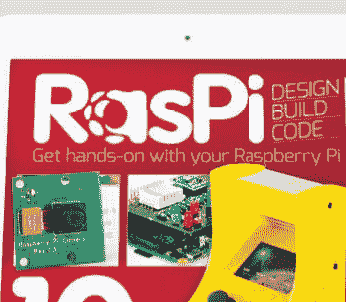

## 这为什么是一件好事？

嗯，在任何项目中，你都可以 `PaPiRus` 作为永久显示器，但需要降低功率方面的消耗。如果你在花园里设置了一个小型气象站，或者用于 24/7 显示当前读数的数据记录器，或者你正在将 `Raspberry Pi` 用于数字标牌，甚至是商店里的一个网络，这至关重要。然而，`PaPiRus` 可以让图像在屏幕上停留几天而图像不会缓慢消失。

之后，你可以使用唤醒闹钟功能在设定时间调度你的 `Pi`，在永久性项目安装方面提供更多选择。此外，`PaPiRus` 有四个开关，你可以在需要其中一个模块时选择包含它。

- 我也感兴趣。只有一个问题：显示效果如何？

`PaPiRus` 提供几种尺寸和分辨率选项：1.44 英寸屏幕显示分辨率为 96，2 英寸屏幕分辨率为 200 x 96，以及 2.7 英寸屏幕分辨率为 264 x 176。你可以在我们的网站上找到这些选项的所有信息，网站很快就会提供接线图、数据表和每个代码。

## 听起来太棒了！板子还有其他选项吗？

板子本身集成了温度传感器和电池备份的实时时钟。带有……

## 街机、延时视频、气象站及更多


`www.linuxapirus.co.uk`

71

## 面北美读者的特别优惠

# 订阅* 即可
免费 6 期


`X & PI` 视频教程
指南加 16 个 `FOSS` 软件包

`X & PI` 视频教程
指南加 16 个 `FOSS` 软件包

`Pi` 教程，专为开发者开发的。

`X & PI` 视频教程
指南加 16 个 `FOSS` 软件包

`Pi` 教程，专为开发者开发的。

`X & PI` 视频教程
指南加 16 个 `FOSS` 软件包

`Pi` 教程，专为开发者开发的。

`X & PI` 视频教程
指南加 16 个 `FOSS` 软件包

`Pi` 教程，专为开发者开发的。

`X & PI` 视频教程
指南加 16 个 `FOSS` 软件包

`Pi` 教程，专为开发者开发的。

`X & PI` 视频教程
指南加 16 个 `FOSS` 软件包

`Pi` 教程，专为开发者开发的。

# 50
为……开发的……

# 终极
发行版 & `FOSS`

# 树莓派
项目

# 我的世界
控制台

# 创建一个
频道


48
最适合你

# 订购 +44 (0)1795 4661
访问 `www.imaginesub.co.uk`

`linuxuser.co.uk` 72

## # Review

78 `Gizmo 2` | 80 `Debian 8` | 82 `elementaryOS 0.3` | 84 `Ubuntu Studio 15.04`


## 组测
树莓派 `HTPC` 系统

我们筛选出最好的家庭影院发行版，让你的选择更简单

- `OSMC`
  `Raspberry` 的不仅仅像 `OpenELEC` 那样重新打包 `Kodi`（尽管 `OpenELEC` 做得更好），它还提供了一个竞争性的不同界面，创建一个更独特的系统，带有自定义设置菜单。它现在可以在 `NOOBS` 中替代 `Raspberry`。
  下载：`bit.ly/1YbKgaHw`

- `XB`
  尽管在过去的几年里被忽视，但 `Xbian` 是第三种提供 `XBMC/Kodi` 解决方案的树莓派操作系统，可以将你的 `Pi` 变成某些使其成为本次测试中其他发行版的有力竞争者的更新。
  下载：`bit.ly/1HcFunw`

- `OpenELEC`
  与 `Kodi` 开发团队紧密相关，`ELEC` 代表嵌入式 `Linux` 娱乐中心，软件本身为许多平台开发。它最近为 `Raspberry Pi 2` 更新了，同时更名为 `Kodi` 品牌，以提供最新版本的软件。
  下载：`bit.ly/1JFAFj4b`

- `Raspbian`
  `Rbian` 是树莓派的首选通用操作系统，这意味着如果你愿意，它可以作为你的 `HTPC` 系统。它具有更传统的硬件访问权限和它特殊的视频播放器，你也可以使用大部分软件库。
  下载：`bit.ly/1HB0XXg`

# 树莓派 `HTPC` 测评

## `OSMC`

## `XBian`

这个领域的新秀，其特点是相对于 `Kodi` 有最激进的背离。

多年被忽视的 `XBian`，其知名度缺失是一个令人担忧的问题呢？


- `OSMC` 是所有 `Kodi` 前端中外观最独特的

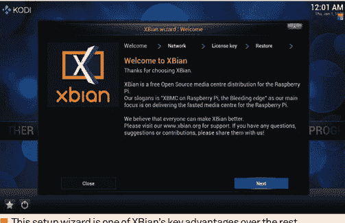

这种设置是 `XBian` 相比于其他系统的关键优势之一。

## 易用性

虽然 `OSMC` 的外观与默认（可能也是最好）的 `Kodi` 不同，但在菜单操作方面，它们本质上是一样的。它还有一个“My `OSMC`”菜单，其中包含普通 `Kodi` 设置中没有的设置和信息，这可能很有用。

`XBian` 缺失的最重要功能之一是完善的设置向导。最近的版本添加了一些微调，帮助你更好地浏览界面，但当你深入挖掘菜单时，就会变得令人沮丧。与 `Kodi` 的其他出色的精妙工具相比，`XBian` 的初次设置是非常出色的。

## 兼容性

它基于 `Kodi` 所有出色的播放功能和解码器构建。你可以在其上运行任何类型的媒体，并且很可能播放它们并访问它提供的任何其他功能，如字幕或语言跟踪，让体验感觉同样轻松。

一个完全构建的 `XBian` 几乎可以运行所有内容，或者至少可以运行大多数媒体消费者关心的所有内容。我们在本次测试组的 `OSMC` 部分简要提到了最出色的胜利；它包括 `YouTube`（大约是这样）和其他视频解码器、播客、`RSS` 馈源等。

## 速度

在树莓派 2 上，`OSMC` 运行得非常好，仅带有树莓派上运行 `Kodi` 时常见的轻微提示和卡顿。它运行得相当快，尽管软件在运行时会减慢界面，有时会导致输入延迟几秒钟，这很烦恼，但并不 `true` 有致命。

`XBian` 可能是这次测试的三种 `Kodi` 实现中慢慢的——这种差异在大局上并不明显，但当 `OpenLEC` 瞬间运行大量内容时，它有一点不易察觉的卡顿。除此之外，界面导航良好且完全可以播放。

## 更新

`OSMC` 有自己的更新软件，你可以对其设定计划，考虑到它的速度，最好将其留到你使用它时进行。然而，如果你现在绝对需要一个新版本，也可以手动进行。

你可以从设置中更新 `XBian`，当它在更新时，界面运行正常。它还像其他系统一样具有计划调度功能，并允许你选择要更新的包。它提供了一种轻松的更新体验，就像你选择手动更新时一样，让你完全清楚正在发生什么。

### 总结

> `OSMC` 在成为像 `OpenLEC` 或其前身 `Raspmic` 的更好的替代品之前做了更多工作。在未来的一年里关注它，它有很大的潜力。

`XBian` 非常棒，一种直观的初次设置，不会让你翻遍其他菜单。总的 `Kodi` 体验是值得的。

## `OpenELEC`

满足你所有嵌入式电脑需求的顶尖 `Kodi`。

## `Raspbian`

通用的 `Linux` 发行版能抵挡专用的 `HTPC` 操作系统吗？

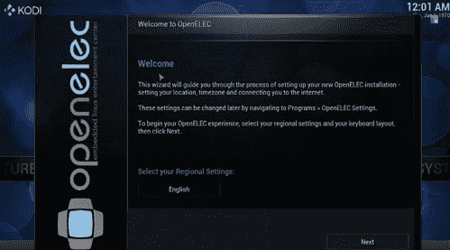

`OpenELEC` 是这些测试软件中运行最快的。


`Kodi` 在 `Raspbian` 上运行良好，但你需要自己寻找解码器。

## 易用性

`OpenELEC` 基本上是纯 `Kodi`，这意味着出色的 `Kodi` 用户体验是软件包的一部分。它有一个小型向导，允许你从一开始激活额外选项，但同样，你可能需要挖掘菜单来获取无线设置。`OpenELEC` 的自定义设置与界面的其他部分更一致。

`Raspbian` 非常棒——确实——但它没有特别针对你的电视进行良好优化。新的菜单有更大的图标等，但它更适合桌面环境。在不安装 `Kodi` 的情况下播放视频的最佳方法是使用其他视频播放器。

## 兼容性

当两个软件的核心功能相同时，很难不重复我们的话。如果你还没有从我们测试组的前两个产品中了解到，`Kodi` 在这方面很棒，我们很喜欢。在为了选择而第三次拥有它后，感觉更好。

一些基础格式，如 `AVI` 和 `MPEG`，在命令行 `Kodi (OMXPlayer)` 和你可以使用的 `Kodi` 基础安装中均运行良好。然而，你需要寻找其他解码器来播放任何其他内容。`Kodi` 本身运行没有正常错误。

## 速度

`OpenELEC` 的启动速度可能是所有软件中最快的，并且在树莓派上使用时具有其他出色的 `Kodi` 速度。`OpenELEC` 的最新版本针对新处理器进行了优化，因此即使在刮取所有后续资源后，你也能获得比旧版本更多的体验。

在所有设置中最慢的，虽然导航 `Raspbian` 有点慢。它并不是事实上的慢。

## 更新

有一套手动更新系统可以保持你的版本是最新的。它有点慢。

### 总结

`OpenELEC` 是最快的，尽管它有一点倒退。

`Raspbian` 完全不适合 `HTPC`，它是为了标准用途的。

`linuxuser.com` 75

## `XBian`

`XBian` 的目标是为微型电脑提供最快的 `Kodi`。

我们对树莓派作为 `HTPC` 的实验是一场小灾难。它很棒，但真的不适合用简单的控制来播放媒体。幸运的是，正如测试所示，有优秀的替代方案。

`Robert Zebest`

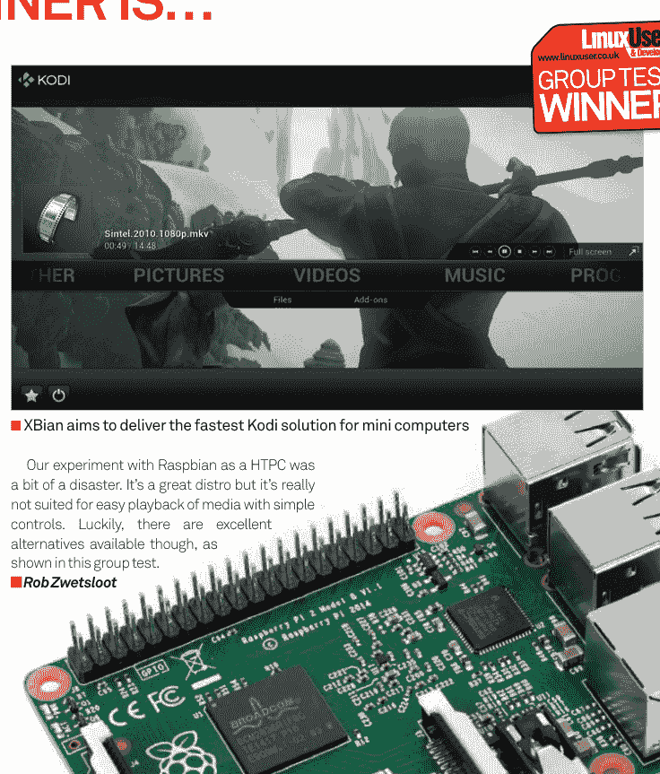

# `RasPi`

面向树莓派爱好者的数字杂志


在 `Google Play` 和 `iTunes` 上下载免费应用

`www.linuxuser.co.uk/RasPiCode`

`facebook.com/LinuxUserUK` `#RasPIMag`

## 评测 `Gizmo 2`

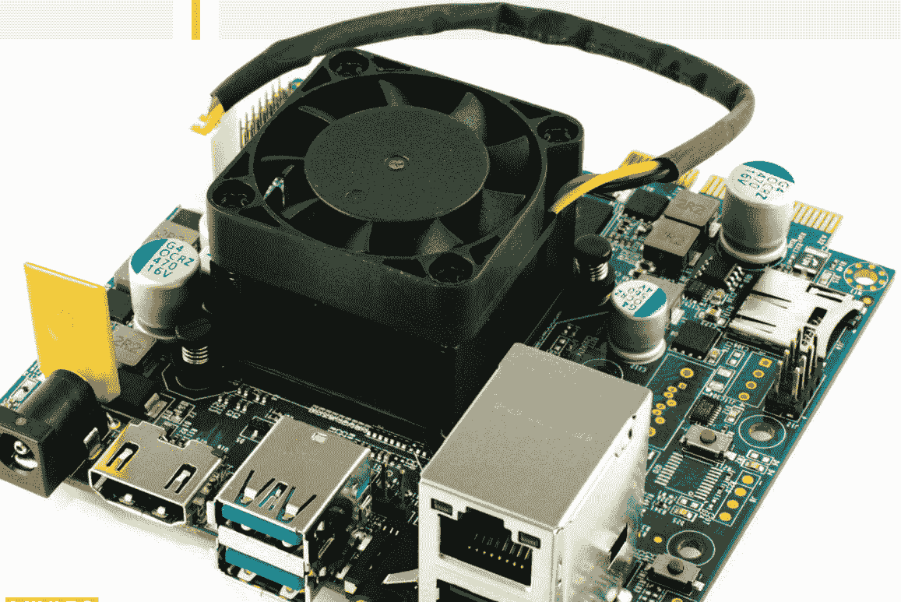

## 迷你型 `PC`

### `Gizmo 2`

基于 `AMD` 加速处理单元（`APU`）的开源硬件设备能否比随处可见的树莓派真正的跨跃？

| 特性 | 规格 |
| :--- | :--- |
| 操作系统 | `TimeSys Embedded Linux` (兼容其他 `OS`) |
| 处理器 | `AMD G-Series GX-210HA APU`，1 `GHz` 双核 |
| 内存 | 1 `GB DDR3` |
| 尺寸 | 111 x 100 x 38 `mm` |
| 存储 | `micro SD`, `mSATA` |
| 网络 | 千兆以太网 |
| 端口 | 2x `USB 2.0`, `HDMI`, 模拟信号, `mSATA/PCIe`,高速扩展端口,低端口 |
| 价格 | £146.29/£199.99 |

原始 `Gizmo` 板板是 `Sage Electronics`、`TimeSys` 等公司的结晶，曾在第 125 期中进行过评测，它的出现引起了轰动。它采用开源硬件加速设计，配备了性能惊人且轻量级的 `AMD` 处理单元（`APU`），几乎可以轻松运行地球上所有的操作系统，即使在 `Intel` 给出自己的解决方案后，它证明了自己是一个赢家。

`AMD GX-210HA APU` 拥有两个运行在 1 `GHz` 的 64 位 `x86` 核心以及集成的 `Radeon HD 821OE` 显卡硬件。事实上，整个 `Gizmo 2` 的性能大同小，但这并非坏事——在 9 `W` 的热设计功率（`TDP`）下拥有 85 `gigaflops` 的计算能力。`Gizmo 2` 提供了更好的向后兼容性。附带的 `SD` 卡可以快速更换为任何兼容 `x86` 的操作系统，通过安装 `micro` 卡或从板载的一个端口启动来实现。然而，在发布时，系统只能从较慢的 `USB 2.0` 端口启动，但发布后的 `SeaBIOS` 固件更新解决了这个问题，允许从更快的 `USB 3.0` 端口运行启动。

`Gizmo 2` 是一个正方形布局，最长边仅为 111 `mm`——与原始设计一致，尽管厚重的外壳被一个令人恼的、带有嗡嗡声的风扇和散热器组合所取代，这是由于升级所必要的。

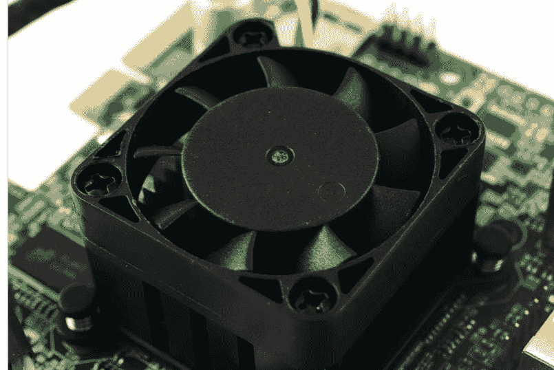

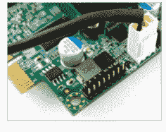


## 缺点

> 在发布时，系统只能从较慢的 `USB 2.0` 端口启动，但发布后的 `SeaBIOS` 固件更新已解决此问题，允许从快速 `USB 3.0` 端口运行启动。对于更持久的存储扩展，虽然是通过网络端口实现的，但通常是在原始 `Gizmo` 上的标准 `SATA` 连接器上。

凭借电源和熟悉的 `x86` 架构，`Gizmo 2` 弥补了爱好级单板计算机与桌面机之间的差距。

- 缺乏扩展板限制了其灵活性，而 `Gizmo 2` 的高价位使其超出了爱好者的预算，这可能是有害的。

至于在性能任务中大部分令人失望的部分：`Gizmo 2` 在同类产品中并没有让人失望。2.0 `ms` 的第 95 百位数时间比任何基于 `ARM` 的板卡都更快，例如树莓派 `K1` 在相同测试中的得分为 7.31 `ms`。

价格正在下降，限时提供的 `JTAG` 调试器配件也是如此。与树莓派相比，这也是一个问题：在支持 54 个引脚的插针中只有近 20 个，在自己的项目中使用 `Gizmo` 稍微困难了一点，如果你更有创意，则需要使用第三方板卡或你自己的板卡。

### 总结

考虑到内置额外功能的缺失，`Gizmo 2` 的价格在面对树莓派 2 甚至售价 133 美元的最新 `Minnow Board` 时也显得吃力——后者比 `Gizmo 2` 要友好爱好得多。

不过它确实有所改进。此前附带的 `Explorer Board`（一种通过板后部低速扩展头连接到 `PCB` 的爱好者友好型引出板）已被移除，以降低价格。

如果你追求 `x86` 兼容性，并且可能接受一块低于 10 `W TDP` 的板卡，那么 `Gizmo 2` 是无可比拟的，特别是当你的用例可以从 `GPU` 加速受益时。对于密集的嵌入式应用，`Gizmo 2` 是难敌的。

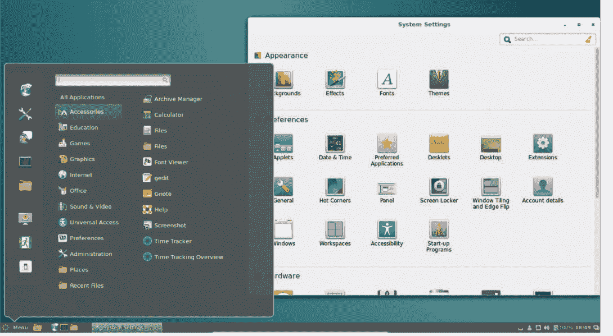

## 评测


## `Debian`


## 安装


# 复评 `elementary OS 0.3`

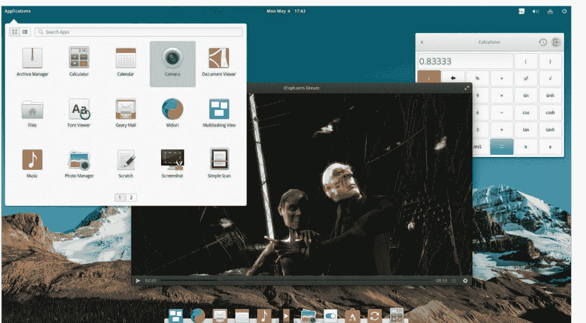

此外，视频、摄像头和计算器是 `Freya` 的新增内容。

## 发行版

## `elementary OS`
0.3 `Freya`

超过 1100 多项改进让 `Freya` 成为 `elementary OS` 至今最大的更新。

| `CPU` | 1 `GHz` |
| :--- | :--- |
| 内存 | 1 `GB` |
| 存储空间 | 15 `GB` |

自首次发布以来（四年），以及自其上一次版本为 0.2 的大更新 `Luna` 以来（近两年来），`elementary OS` 持续令人印象深刻。

开发者们继续让 `elementary OS` 在过去一年中处于搜索量最大的十大发行版之，并有强大的社区支持这一流行的发行版。`Freya` 基于 `Linux 3.16` 和 `Ubuntu 14.04 LTS`，带来了一系列视觉变化，这些变化与替代 `Unity` 的 `Ubuntu` 操作系统桌面环境 `Pantheon` 相比，在法律基础上得到了改进和增强。

上下文感知标题栏会自动调整。其颜色和透明度取决于你打开了什么，以确保不干扰。`Shotshot` 应用菜单也得到了改进，具备在搜索栏中进行简单计算的能力以及从你的- 拖放图标的功能。最大的变化是重新设计的多任务菜单，它现在（像 `elementary OS` 的许多方面一样）采用了更像 `GNOME 3` 的方法：右键选择并关闭已打开的应用，并使用底部 - 在工作空间之间切换——它取代了以前从 `dock` 栏下方弹出的工作空间切换器，提供了一个更易于接受的解决方案，你仍然可以使用热点来切换工作空间。

许多变化在于细节，工作涵盖了如对话框的圆角、面板的光线和阴影、为了更磨砂外观而采用的光泽色调，以及在

开发者声称下载量超过三百万次，`elementary OS` 在过去一年中保持在搜索量前十的发行版，背后有强大的社区建设。

除了一个带有优秀时钟小组件的新统一锁定和登录界面外，还有一个更新的通知系统，值得现代化的外观。通知是交互式的，它们会向你显示后台运行终端进程的警报。关于终端，它顶部有一个历史记录，显示你运行的最后一个命令，以及自然的复制和粘贴（在终端中使用 `Ctrl+Shift+`）。

相比 `Luna` 的另一个变化是重新设计的照片应用。它在今年早些时候从 `Shotwell Fork`（`Shotwell` 使用 `Pantheon` 使用的 `Vala` 语言编写），由 `elementary` 团队进行了重新设计，以给予与其他 `Pantheon` 程序相同的关注和细节处理，使其尽可能直观。加入 `Freya` 核心软件功能列表的照片应用还有新的视频应用程序，以及一个新的计算器和一个用于网络摄像头的摄像头应用。

在系统设置中查看，发现有几个值得注意的更改，包括主题、用户账户、应用程序和显示重新设计，再次是为了简化并从视觉上改进选项。设置中的隐私现在顶部有一个用于照片模式的开关，如果你担心跟踪你的使用和数据，可以开启它，还有另一个启用和拒绝流量的开关。

窗口管理器和主要新增内容带来了令人惊叹的提升，增添了 `elementary OS` 纯洁、优雅设计的声誉。`elementary` 还在使其设计现代化并更新软件选择。它一如既往地快速且轻量，适用于旧机器，无论你正在使用哪种操作系统，使用 `Freya` 都是一种享受。

## 优点

- 在整个 `Pantheon` 中进行了许多设计改进，以及全新的经过设计的软件、通知、防火墙和隐私模式

## 缺点

- 对于习惯于在发行版中创建和自定义选项的用户来说，可能有点局限

### 总结

`Freya` 的系列应用为所有核心应用带来了改进，得到了更精炼和简化的工作空间，让这个新版本感觉像是在一个极其出色的发行版上，它为 `Linux` 新手提供了很多内容。照片应用在从 `Shotwell Fork` 之后已经过重新设计。

# 复评 `Ubuntu Studio 15.04`

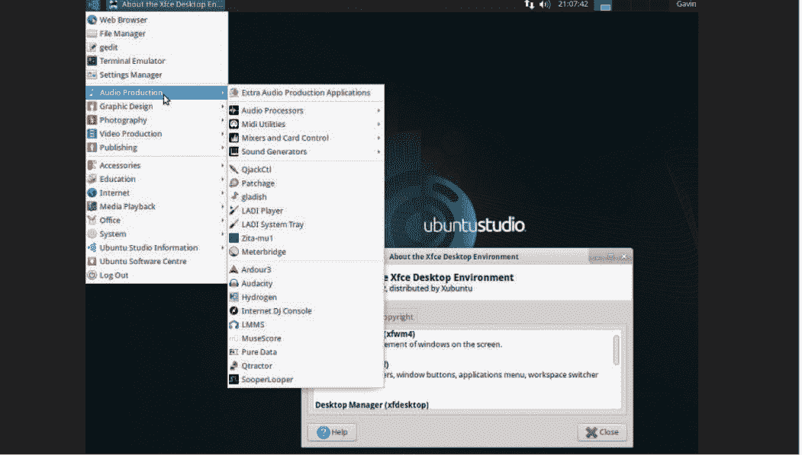

## `Ubuntu Studio 15.04`

面向创作者的发行版，`Ubuntu Studio` 更新到了 `Vivid Vervet`，并配备了新版本的 `Xfce`。

作为最著名的 `Ubuntu` 变体之一，`Ubuntu Studio` 是一个面向创作者的衍生版，为音频视频制作及发布提供了更好的工具集。15.04 带来了许多在 `Ubuntu 14.04` 中看到的更改，其中包括回归到 `Xfce 4.2`，这带来了一些细小的改进。

唯一的实际变化是增加了一个用于音频基础设置的新元包。许多其他包是自包含的。`Ubuntu Studio` 引入了音频编辑器、合成器、虚拟放大器、用于连接它们并通过你的工作流配对音频的 `JACK`。用于图像的 `Blender`、`OpenShot`、`GIMP` 和 `Ink`，用于视频的 `DaVinci` 和 `Shot`，以及用于发布的 `Audacity`、`OpenOffice` 和 `Callibre`，外还有设计的软件。

这是一个所有软件都明确创建的发行版，而且重要的是，`Xfce` 是一个极佳的桌面环境，虽然它比 `Ubuntu` 好，但提供了相同的体验。即使你不是在寻找使用 `FOSS` 视频或音频的方法，你也会在日常使用以及偶尔的创意项目中享受此发行版的许多益处。事实上，`Ubuntu Studio` 中甚至有针对非创作者用户的工具，用于乐谱、视频编辑器和屏幕录制器、文档扫描仪和用于摄影的应用程序。对于大多数家用电脑来说，这是一个配备的桌面，更不用说艺术家的电脑了。15.04 相比上一个版本并没有真正带来巨大变化，但它仍然带来了一个新鲜的发布。如果你因专业工作需要 `Ubuntu Studio`，无需看其他这个优秀的发行版了，它的软件选择极其多样，并在菜单中完全分类。

### 总结

| 项目 | 数值 |
| :--- | :--- |
| `CPU` | `GHz` |
| 内存 | 2 `GB` |
| 存储空间 | 10 `GB` |

`Gavin Thomas`

## 构建更强大的网络
`www.webdesignmag.co.uk`


14页 `AngularJS` 指南 | 增强 `CSS` | 交互式 `HTML5`

## 今日购买你的杂志

- 纸质版可在 `www.imagine.co.uk` 获取
- 数字版可在 `www.greatdigitalmags.co.uk` 获取
- 在以下平台可用


`facebook.com/webdesignag`
`twitter.com/webdesignag`

## 新鲜。快速。免费。自由。


文档基金会荣幸推出：

## `LibreOffice`

世界上最先进的免费软件套件
`www.libreoffice.org`

| 服务 | 价格 |
| :--- | :--- |
| 域名 | `.COM` 仅需 £ |
| 云服务 | £2.99/月 |
| 托管 | £5/月 |
| 数据中心 | 节省 50% |
| 机房 | £35/月 |

你所需的一切都在 `ryanteck.uk`

## `Raspberry Pi` 扩展 0800 

## `RyanteckTD`

提供丰富的 `Raspberry Pi` 扩展、`HATs` 以及更多！

`Raspberry Pi` 套件 £24.99 起

今日在 `ryanteck.uk` 购买并使用 `LINUXUSER` 享九折优惠

优惠码于 6 月 30 日过期

## 问题问答

联系我们...
网址：`linuxuxer.co`
邮箱：`linuxuxer@imagine.co`

## 问题解答

发送你的问题，我们将尽力解答！

## 创意与 `Linux`

你好 `Linux`，希望你能帮帮我。我正尝试在我的服务器上搜索并安装 `PHP` 包。我的服务器运行在 `CentOS 5.2` 上。虽然它可以运行，但在按下 `Ctrl+C` 后会挂起并停止。我尝试过清理缓存、`yum clean` 并检查了所有的存储库是否它们

我还是没找到什么办法，表现依然如故。如果你能给我线索将不胜感激。预先感谢！

# `James P`

`James`，问题在于这个 `CentOS` 可能正在尝试搜索一个已经失效的 `EPEL` 仓库。从你的源列表中移除它，并添加一个新安装的本地仓库。它可能在

然而，`CentOS 5.2` 已经过时且不再受 `CentOS` 支持。我们

## 令人困惑的发展

我正尝试在我的电脑上安装 `k-crossword`。我下载了 `tar.gz` 文件并将其解压到电脑下载文件夹中的 `k_crossword` 目录。
当我进入该文件夹并运行 `./configure` 时，我遇到了以下错误：

```


### 故障排查

执行`/config`命令时遇到以下错误：

```
/config: cd: can't cd to k-crossword

Cannot find file: k-crossword
```

尽管`k-crossword.gz`文件确实位于文件夹中，但系统报告找不到该文件。“k-crossword not found”这条消息的具体含义是什么？

Valerie 对此错误信息感到困惑，希望获得更合理的解释。

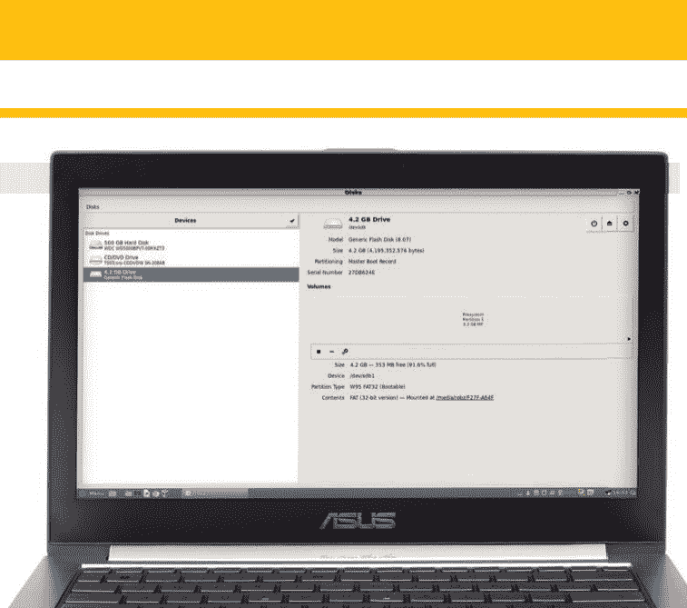

## VirtualBox

**磁盘工具与 GParted 的使用建议**

上述磁盘（Disks）工具确实可以完成分区任务，尽管我们更倾向于使用`GParted`。

强烈建议更新发行版，以防止系统发生意外。这样你就不需要为了服务器运行而担心报告问题了。

**磁盘空间与数据擦除**

磁盘工具完全可以设置高达 2 GB 的空间。你正在处理的数据删除问题可能是因为：

你正尝试将 2 GB 放在任何位置的开头，但这会让擦除速度更快也更危险。

另一种可能性是某些东西正在改变你删除的内容。如果你有 4 GB 或接近 GB 的空间，这是很有可能的。但最好的办法是在删除任何内容之前传输任何数据。

## Live mail

**分区操作**

没有。我成功地使用 Ubuntu 的磁盘（Disks）工具对一个较大的驱动器进行了分区，那是我完成的一个奇迹。我现在不想丢失另一个分区，我只是看了看磁盘工具，被引导去正规地完成我的工作了。

我想创建一个 16 GB 的磁盘文件并设置 2 GB，这样我就可以把 1 GB 的数据复制粘贴到驱动器上来增加它。我只需要那个 GB 吗？

**教程搜索**

那太简单了！用户朋友，我不确定这整件事。在此之前，我搜索了教程，但没有找到任何不是过时的教程（如果你有好的教程，请留下链接）。有些`GParted`的教程列表看起来很复杂。

你不必害怕！在“点击”磁盘之前，设置一系列更改非常简单，你可以运行任何你想要的想法。

**内核与 VirtualBox**

我真的需要一点帮助。每当我用新内核破坏我的发行版时，我不得不推荐 VirtualBox 内核。我这样做是安全的，且和之前的一源一样：

Jim Alexander

| 关于程序 | 翻译 | 许可证 |
|---|---|---|
| K-crossword 1.2.3(2021) | | |

**编译问题解决方案**

这个问题有两个可能的解决方案。第一种可能是你没有正确下载大小。由于构建问题，找不到`cd`命令。所以请重新保存，并命名为明天的某个名字。

为你的系统下载`K-crossword-1.2.3-tar.gz`。

```
$ tar xvf k-crossword-1.2.3-tar.gz

$ cd k-crossword-1.2-src/

$ ./config

$ cd /games/

$ cd /k-crossword-1.2.3
```

最后你将找到`k-crossword` GUI。如果你有问题，请获取基础构建要求，即`Qt4`和`QtWebKit`的开发包。

## 问题与解答

联系我们...
网页：`www.linuxuser.co.uk`
邮件：`linuxuser@imagine-publishing.co.uk`

## 资产到 IP

我在 CentOS 64 位操作系统上设置了 OCS 清单服务器 2.1。所有细节都正确地到了我的 OCS 服务器，除了客户端的 IP 地址。

客户端库的清单运行在`ocs-inventory-2.7.1`。以下是我的配置文件（客户端侧）`ocs-inventory.cfg`；

```
# 服务器 URL，如果需要请取消注释

server=http://<SERVER_IP>:8080/ocs-inventory

base=/ocs/

logger=/usr/bin/ocs-inventory
```

```
# 如何记录，可以是 File,Stderr, Syslog 或 none

logger=stderr

logfile=/var/log/ocs-inventory/ocs-inventory.log
```

我目前正在监控这些。当我执行`/usr/bin/ocs-inventory-client`时，服务器给我的 IP 地址是正确的。但过了一段时间，当它们发送清单时，客户端的 IP 地址就会从服务器上消失。直到我手动执行`/usr/bin/ocs-inventory-command`，它们才会再次出现。

我设置了一个每六小时运行一次的 cron 任务来向服务器发送清单。当 cron 在那时运行时，IP 地址显示为空，但我可以看到清单确实不在那里。

请就这个问题指导我，因为我已经尝试了所有方法，但未能找到问题所在。

Tukasa

**解决方案**

这实际上是 Linux 的问题而不是 OCS 的：cron 任务不知道路径配置。解决方案是以如下方式输入 cron 任务：

```
* * * * * /etc/usr/local/bin/ocs-inventory-agent >/dev/null 2>&1
```

你可以通过从命令行运行`ocs-inventory-agent --local=/`然后从 cron 运行来检查这一点。具有正确路径的 cron 可以工作；而（没有路径的）cron 任务你会得到一个`<NETWORK>`部分。

## Q & A

```
$ make clean

$ make DESTDIR=/build html
```

它完全崩溃了，而且无法安装。是因为我正在使用 Linux 作为内核源吗？有没有人能帮我解决这个问题？

所以，是的，这就是导致当你告诉 VirtualBox 重启操作系统时，它完全停止虚拟机的原因。这有点烦人，但没有像你正在经历的那么糟糕。

有两个选项。首先，VirtualBox 有一种所谓的自修复方法，将设置新模块并使用它们。

```
$ sudo /etc/init.d/modules setup
```


否则，你可以尝试安装新版本的 `VirtualBox`。这值得尝试，尽管与旧版本的 `VirtualBox` 和 Linux 内核之间可能存在兼容性问题。


（注：由于原文中存在大量重复的 OCR 错误，已根据要求进行清理和翻译。此处注：OCR 文本包含了重复的“Left VirtualBox ties...”行，这是一个常见的 OCR 循环。我已删除了它们。）

## 托管列表

### 赞助机会
通过赞助此内容提升您的品牌关注度。
联系 Luke Bibishcombe：`+44(0)1232 58643`

有您认为我们应该考虑的交易吗？
无论您是在寻找托管机场还是优质供应商列表，请通过以下邮箱告诉我们：
`netnetcera@media-publishing.co.uk`

## 专用服务器列表

| 套餐 | 电话 | 每月费用 | 最低 | CPU / 速度 | 磁盘空间 | 10GBPS 网络连接 | 硬件 | 远程电源重启 | 永久 KVM | 终极备份 | 网络备份 | 私有支持 | 24/7 电话支持 |
| :--- | :--- | :--- | :--- | :--- | :--- | :--- | :--- | :--- | :--- | :--- | :--- | :--- | :--- |
| `200DC` | `0800 8654-56` | `£25` | 1 个月 | 双核 `2GHz` | `160GB` | 无 | `Raid 1` | | | | | | |
| `3000DC` | `0800 8654-56` | `£40` | 1 个月 | 双核 `3GHz` | `250GB` | 无 | `Raid 1` | | | | | | |
| `6000DC` | `0800 8654-56` | `£65` | 1 个月 | `Intel 2.6GHz` 四核处理器 | `7x 50GB` | 无 | `Raid 1` | | | | | | |
| `Developer` | `0800 8654-56` | `£2.99` | 1 个月 | 无 | `1GB` | 无 | | | | | | | |
| `One` | `0800 8654-56` | `£6.99` | 1 个月 | 无 | 无 | 无 | | | | | | | |
| `Reseller` | `0800 8654-56` | `£24.99` | 1 个月 | 无 | 无限 | 无 | | | | | | | |
| `Starter Linux` | `0810 077 19` | `£20` | 1 个月 | 无 | `2000GB` | 无 | | | | | | | |
| `Starter Windows` | `0810 077 19` | `£20` | 1 个月 | 无 | 无 | 无 | | | | | | | |
| `Business Linux` | `0810 077 19` | `£45` | 1 个月 | 无 | `4000GB` | 无 | | | | | | | |
| `Business Windows` | `0810 077 19` | `£45` | 1 个月 | 无 | `4000GB` | 无 | | | | | | | |
| `Ultimate Linux` | `0810 077 19` | `£65` | 1 个月 | 无 | 无限 | 无 | | | | | | | |
| `Ultimate Windows` | `0810 077 19` | `£65` | 1 个月 | 无 | 无限 | 无 | | | | | | | |
| `Bronze Managed` | `0810 079 79` | `£79` | 1 个月 | `1x2.4GHz CPU` | `50GB` | 无 | | | | | | | |
| `Silver Managed` | `0810 079 79` | `£89` | 1 个月 | `1x2.4GHz CPU` | `80GB` | 无 | | | | | | | |
| `Gold Managed` | `0810 079 79` | `£99` | 1 个月 | `1x2.4GHz CPU` | `150GB` | 无 | | | | | | | |
| `DellEdgeR8060` | `0810 125 95` | `£99` | 3 个月 | `4x2.16GHz` | `2100GB` | `10Gbps` | | | | | | | |
| `DellEdgeR10000` | `0810 125 95` | `£79` | 3 个月 | `4x2.16GHz` | `2100GB` | `10Gbps` | | | | | | | |
| `Linux VPS Pro` | `0810 248 210` | `£299` | 1 个月 | `2x2.23` 四核 | `600GB` | `100Mbps` | | | | | | | |
| `Windows VPS Pro` | `0810 248 210` | `£349` | 1 个月 | `2x2.23` 四核 | `600GB` | `100Mbps` | | | | | | | |
| `Windows VPS` | `0810 248 210` | `£649` | 1 个月 | `2x2.27` 四核 | `600GB` | `100Mbps` | | | | | | | |
| `VPS Hyper-V` | `0810 248 210` | `£749` | 1 个月 | `2x2.27` 四核 | `100GB` | `100Mbps` | | | | | | | |
| `VPS Ultra-V` | `0810 248 210` | `£799` | 1 个月 | `2x2.27` 四核 | `150GB` | `100Mbps` | | | | | | | |
| `Cloud Core` | `0810 664 770` | `£799` | 1 个月 | 双核 | `160GB` | 无 | | | | | | | |
| `Windows Dual Core` | `0810 664 770` | `£899` | 1 个月 | 双核 | `160GB` | 无 | | | | | | | |
| `Cloud Core` | `0810 664 770` | `£999` | 1 个月 | `2x2.5GHz` | `250GB` | 无 | | | | | | | |
| `DellEdgeR210` | `0810 130 162` | `£799` | 12 个月 | `3x2.66GHz` | `250GB` | `100Mbps` | | | | | | | |
| `DellEdgeR210` | `0810 130 162` | `£999` | 12 个月 | `3x2.66GHz` | `250GB` | `100Mbps` | | | | | | | |
| `DellEdgeR210` | `0810 130 162` | `£1499` | 12 个月 | `3x2.66GHz` | `500GB` | `100Mbps` | | | | | | | |


`Netcera`
`www.netcera.co.uk`

* 高亮您的列表！联系 `LUKE`
`luke.bibishcombe@imagine-publishing.co.uk`
`+44(0)1232 58643`

## 专用和共享服务器列表

| 名称和 URL | 套餐 | 数量 | 费用 | 网页空间 | 月带宽 | VPS | 数据库 | 防火墙 | 电子邮件支持 | 网页面板 | 服务协议 |
| :--- | :--- | :--- | :--- | :--- | :--- | :--- | :--- | :--- | :--- | :--- | :--- |
| [`Blacklight`](blacknight.com) | `最小` | | `+4438452042` | `£49.95` | `10GB` | | | | | | |
| [`Blacklight`](blacknight.com) | `中等` | | `+4438452042` | `£79.95` | `20GB` | | | | | | |
| [`Digital Gibson`](www.digitalgibson.com) | `基础` | | `+4438452042` | `£149.95` | `30GB` | | | | | | |
| [`Digital Gibson`](www.digitalgibson.com) | `顽皮小猴` | | | `免费` | `500MB` | | | | | | |
| [`Digital Gibson`](www.digitalgibson.com) | `Digital Gibson` | | | `£12` | `10GB` | | | | | | |
| [`Digital Gibson`](www.digitalgibson.com) | `专业` | | | `£24` | `20GB` | | | | | | |
| [`erosting`](www.erosting.com) | `WordPress` | | `0894 999100` | `£32.95` | `25GB` | | | | | | |
| [`erosting`](www.erosting.com) | `起始` | | `0894 999100` | `£65.95` | `50GB` | | | | | | |
| [`erosting`](www.erosting.com) | `虚拟` | | `0894 999100` | `£127.98` | `100GB` | | | | | | |
| [`Equipause`](www.equipause.com) | `银牌` | | `0213 314 665` | `£205.98` | `200GB` | | | | | | |
| [`Equipause`](www.equipause.com) | `黄金` | | `0213 314 665` | `£409.95` | `400GB` | | | | | | |
| [`Equipause`](www.equipause.com) | `铂金` | | `0213 314 665` | `£819.95` | `1TB` | | | | | | |
| [`Eurofast`](www.eurofast.com) | `仅限邮件` | | `02380 249 823` | `£80` | `1GB` | | | | | | |
| [`Eurofast`](www.eurofast.com) | `基础` | | `02380 249 823` | `£175` | `5GB` | | | | | | |
| [`Eurofast`](www.eurofast.com) | `超速` | | `02380 249 823` | `£250` | `25GB` | | | | | | |
| [`Eurohosting`](www.eurohosting.com) | `起始` | | | `£39.95` | `50GB` | | | | | | |
| [`Eurohosting`](www.eurohosting.com) | `首页` | | | `£54.99` | `100GB` | | | | | | |
| [`Eurohosting`](www.eurohosting.com) | `电子商务` | | | `£158.99` | `300GB` | | | | | | |
| [`Gaum`](www.gaum.com) | `业务专业版` | | `0800 542 7500` | `£199` | `1TB` | | | | | | |
| [`Heart Internet`](www.heartinternet.com) | `首页` | | `0864 745 7770` | `£89.95` | `10GB` | | | | | | |
| [`Heart Internet`](www.heartinternet.com) | `业务专业版` | | `0864 745 7770` | `£129.95` | `20GB` | | | | | | |
| [`Heart Internet`](www.heartinternet.com) | `专业` | | `0864 745 7770` | `£199.95` | `50GB` | | | | | | |
| [`Hostingway`](www.hostingway.com) | `仅限邮件` | | `0890 160 1880` | `£25` | `1GB` | | | | | | |
| [`Merkmlog`](www.merkmlog.com) | `标准套餐` | | `0864 812 330` | `£113.75` | `65GB` | | | | | | |
| [`Merkmlog`](www.merkmlog.com) | `专业套餐` | | `0864 812 330` | `£155.75` | `100GB` | | | | | | |
| [`Skymarket`](www.skymarket.com) | `专家套餐` | | `0864 812 330` | `£105.75` | `150GB` | | | | | | |
| [`Skymarket`](www.skymarket.com) | `标准 1` | | `0890 521 7788` | `£44` | `10GB` | | | | | | |
| [`Skymarket`](www.skymarket.com) | `高级 1` | | `0890 521 7788` | `£99` | `25GB` | | | | | | |
| [`WebFusion`](www.webfusion.com) | `个人` | | `0860 520 0716` | `£25.20` | `10GB` | | | | | | |
| [`WebFusion`](www.webfusion.com) | `销商` | | `0860 520 0716` | `£136` | `40GB` | `4GB` | | | | | |
| [`WebFusion`](www.webfusion.com) | `融合专业版` | | `0864 130 1602` | `£107.40` | `50GB` | `5GB` | | | | | |
| [`WebFusion`](www.webfusion.com) | `融合开发者` | | `0864 130 1602` | `£227.40` | `20GB` | `10GB` | | | | | |
| [`WebFusion`](www.webfusion.com) | `融合销商` | | `0864 130 1602` | `£329.99` | 无限 | 无限 | | | | | | |


## 开源

您的 `Linux` 新闻与观点来源
联系我们...
直接向我们发送电子邮件：
`linuxuser@imagine-publishing.co.uk`

## 您的观点

## Linux 用户信函

您对杂志、`Linux` 和开源的看法

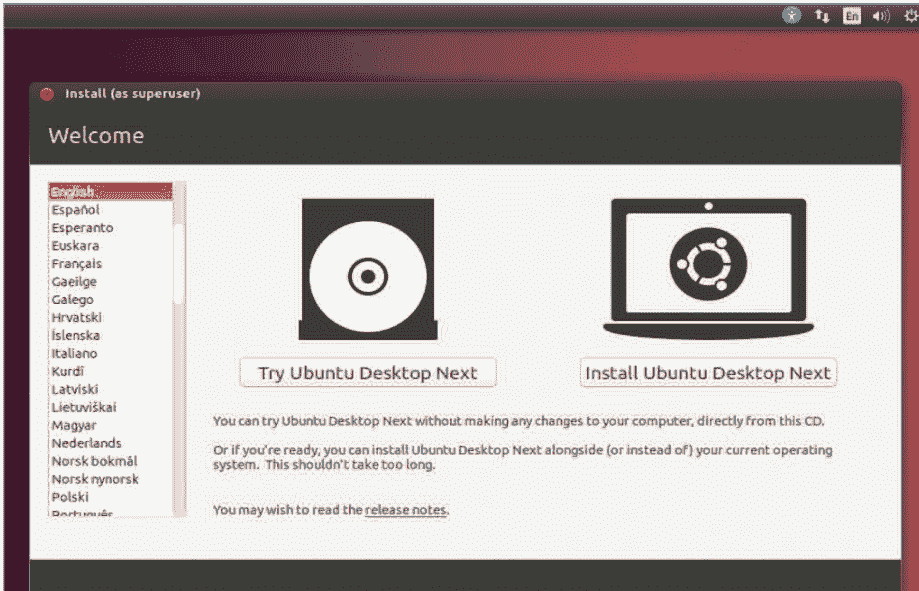

## Ubuntu 的未来

你好 Luke；我听了很多关于 `Ubuntu` 手机的消息，我在 `Ubuntu` 在线峰会上看到了 `Mark Shuttle` 的问答，他提到了相当的担忧，而且根据我的理解，还提到了即将切换到 `Ubuntu 8.04`。我想知道你是否有什么方法可以让我亲自查看桌面目前的状态？

你好 Ben。你说得完全正确——当被问及 `Ubuntu 8` 是否能在 `16.04` 前准备好时，`Mark` 给出了一个相当中肯回答，说这将是一个“选项”，最终将由社区决定明年当 `Canonical` 从 `Ubuntu 7 X` 过渡到 `Ubuntu 8` 时，桌面系统是否足够稳定。

至于讨论这个问题，目前实际上有一个名为 `Ubuntu Desktop Next` 的 `Ubuntu` 变体已经准备好一年了。这是一个不稳定的、实验性的桌面镜像，但最新版本的 `Ubuntu Desktop Next 16.04` 可以让你看到是否使用了 `Unity 8`。你可以从 `Ubuntu` 网站下载并亲眼查看：`http://bit.ly/3bx5Pw`

> 从 `USB` 闪存 `Live` 启动并选择 `Ubuntu Desktop Next` 可能比安装该发行版更可行。

`Twitter`:
`@linuxuserm`

`Facebook`:
`Linux` 用户与开发者
关注 7 月 2 日的 issue 154
想更早获取吗？
今天立即订阅！

同样的，另一个值得关注的地方是该问题的官方 `bug` 跟踪页面，你可以自己识别任何 `bug`，但可以检查它们的修复状态并阅读评论。

这并不真正推荐作为你的主发行版，但如果你想去看看，看看 `Ubuntu 8` 是否值得一用，只需设置一个虚拟机或使用你的其中一个分区即可。


`Image Publishing` 有限公司
`Richmond House, 33 Richmond Street`
`Bayswater, W22 6EZ`

`Web`: `www.imagepublishing.co.uk`
`www.linuxuser.com`
`Email`: `info@linuxuser.com`

# 杂志团队

编辑 `Gavin Thomas`

制作编辑 `Scott Southern`
设计师
特稿编辑 `Rob Zwischenholz`
高级艺术总监 `Will Stern`
总编辑 `Charles Woodman`
设计负责人 `Ross Hicks`

# The Hurd

# Bodhi 和 Moksha

嗨，我听说这里有一个 `GNU/Hurd` 的新版本。它已经可以在我的主电脑上使用了吗？

前几天我想下载 `Bodhi 3.0`，看到发行版中有一个新的 `Legacy` - 你对此怎么看？提前谢谢。

简短的回答是肯定的，可能不完全如此，尽管它现在绝对值得看看。关于 `Hurd`，在很久以前你就可以可以在我们的网站上读到的一很好的文章，`Richard Ellis` 解释了为什么这是可能的：要使用 `Hurd` 构建一个功能完备、生产就绪的发行版，该项目缺乏帮助它的层。`Hurd` 在过去的几十年里不断改进，但由于 `hurdles` 开发时间较短，仍存在更新。

# Gail

你好 Gail，你收到的回复是 `Bodhi` 向新 `Moksha` 过渡的结果。`Bodhi` 的领导在他的博客中发布了，但要点是他他对 `Enlightenment` 项目对工作的尊重方式感到不满。

自发布以来已经两年了，就在 `Jessie` 发布之后，`GNU/Hurd 2015` 本身是 `Debian` 稳定版的一个方面，但它仍然很难掌握。

在 `Enlightenment` 稳定之前，它没有收到任何更新。然而，现在它在几个月内更新了三次，这些更新充满了进展，但最终导致了项目停滞。

在这种混乱中取得了进展，发布说明显示超过 `80%` 的包在 `GNU/Hurd` 中运行，`98.25%` 是“最新的”，但他说大多数时候，`Hurd` 正在接近就绪。事实上，你可以自己检查待办列表查看正在取得的进展。

在版本 `19` 中（这是运行在新 `Bodhi 3.0` 的 `32` 位和 `64` 位版本中的版本），情况有所好，但 `Jeff` 指出：

如果开发继续这样下去，`Hurd` 有可能吸引 `Red Hat` 开发的关注，如果那时真的发生了，你可能在几个月后就可以将 `GNU/Hurd` 作为你的主操作系统。不过，没有什么阻止你现在尝试，尽管你可能需要自己解决问题（然后报告或修复）。

所以 `Bodhi` 开发者正在形成 `32/64` 位版本 `Moksha` 的第 `19` 版本。`Bodhi 3.0` 将随下一个 `Enlightenment` 发布 - 这为一个已创建但仍使用 `Enlightenment` 的 `32/64` 位构建提供了一个替代方案。这只是一个临时修复，从今年 8 月的 `Bodhi 3.1.0` 开始，`Moksha` 将作为默认选择。

# 发行

`Damian Pearce`

制作总监 `James Hawkes`

创始人
`Francis Marco Perez`

# 资金与印刷

`Some Group` `Damian Butler`

英国、爱尔兰及世界其他地区：
`Image Publishing Ltd, 110 Southwark Street`
`London, SE1 1XE`

`+044 (0) 1205 8260`
`www.imagepublishing.co.uk`

# 免责声明

本杂志包含的信息仅供一般用途。`Image Publishing Ltd` 对任何文章或广告中包含信息的任何不准确或不完整不承担任何责任。所表达评论和意见是贡献者的观点，并不一定反映 `Image Publishing Ltd` 的观点。尽管出版商已尽一切确保包含的信息准确且最新，但在任何方面都不保证其准确性或完整。

`Image Publishing Ltd`
`ISBN 1234-5678`


当你与我们一起拥有这本杂志时。我们

# 你的免费资源

登录 `WWW.FILESILO.CO.UK/LINUXUSER` 并在今天下载最新的发行版和免费软件

# 最新发行版


# 你的额外资源

在 `FILESILO ISSUE`，针对 `LINUX` 用户和开发者的免费专属资源，你会发现这些优质资源...
- 最新的发行版，包括 `Ubuntu Server`，本期评审的三个发行版
- 最佳 `Foss` 包，包括 `OpenVPN`、`RainLoop`、`Krita` 和 `Vox`，观看 `Linux Sandbox`、`Red Hat` 和 `Raspberry Pi` 指南、教程和网络研讨会，本期的 `Raspberry Pi` 和 你需要关注的所有发行版
- `Debian Jessie`
- `elementary OS 0.3`
- `Debian 2015.04.2`
- `Ubuntu Server 14.04.2`

# 视频教程时长

`www.filesilo.co.uk/linuxuser`

# 顶级 FOSS 教程与资源

# FILESILO – 资源之家

发现你的在线资源

- 一个快速增长的库
- 持续更新的酷资源
- 随处访问你的内容
- 无需光盘
- 订阅者获得所有内容
- 数字杂志用户获得所有内容！
- 每期内容都随杂志免费
- 安全访问你的免费资源

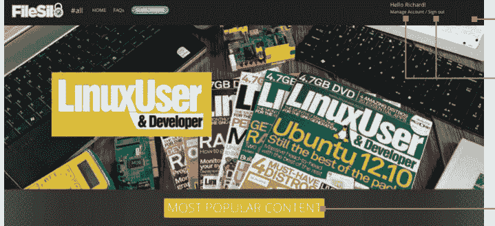

这是取代光盘的新 `Filesilo`。你可以通过下面的页面找到它。第一次使用 `Filesilo` 需要注册。之后，你可以使用电子邮件地址和密码。最流行的下载显示在本期中，看看读者在享受什么！


如果你正在寻找特定类型的内容如发行版或 `Python` 文件，使用这些过滤器精炼你的搜索。

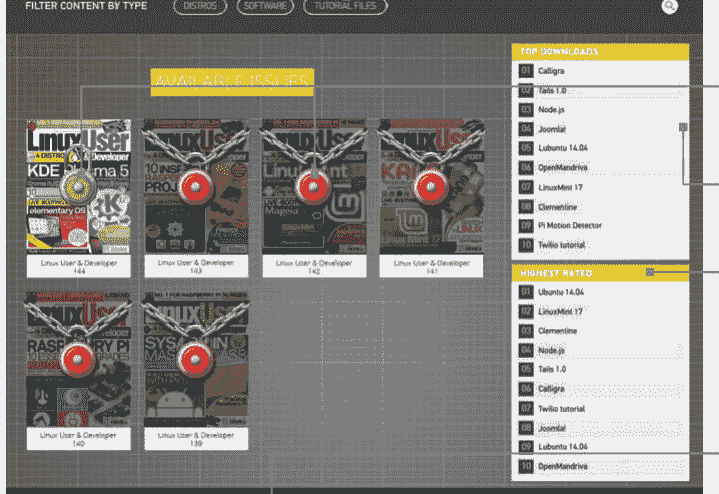

绿色锁显示你已访问的内容。红色锁你需要购买或解锁。热门下载列在这里，你可以立即查看最流行的内容。查看这里他人投票的资源！

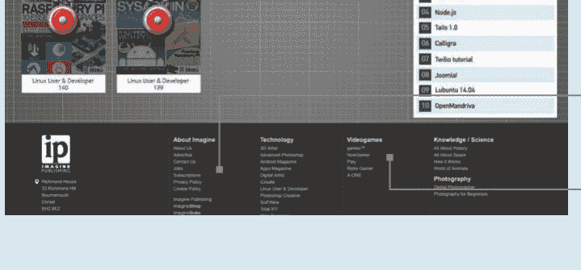

更多关于我们在线商店的信息，以及我们的隐私政策和联系方式。发现我们惊人的杂志以及它们提供的丰富内容。

`www.linuxuser.com`

# Filesilo

# 如何使用 Filesilo

关于访问你的新数字仓库的所有信息

要访问 `Filesilo`，请访问 `www.filesilo.co.uk/linuxuser`

- `01` 按照屏幕指令创建我们的 `Filesilo` 安全账户，然后通过回答一个关于杂志的简单问题来解锁本期内容。你可以随杂志免费访问内容。
- `02` 如果你是订阅者，可以通过输入 `Web ID` 解锁所有内容。你的 `Web ID` 是打印在订阅副本地址详情上面的八位数字代码。也可以在你的奖励信中找到。
- `03` 你可以在桌面、平板电脑或手机设备上使用任何流行的浏览器（如 `Safari`、`Chrome` 或 `Firefox`）访问 `Filesilo`。然而，我们建议你使用桌面下载内容，因为你可能无法向手机或平板下载文件。
- `04` 如果你在 `Filesilo` 上访问内容遇到任何问题，或注册过程中遇到问题，请查看在线 `FAQ` 或发送邮件至 `filesilohelp@imagine-publishing.co.uk`


| `Mint 17` | `Mage 4` | `Peppermint 5` |
| :--- | :--- | :--- |


# 启发性的树莓派项目

这里所有的代码


# 10 最佳 Linux 桌面


# 更多教程与灵感


```c


```c
#include <stdio.h>

#include <stdlib.h>

#include <string.h>

int main() {

    int a = 5, b = 10;

    int sum = a + b;

    printf("sum: %d\n", sum);

    return 0;

}
```

# NEW IT

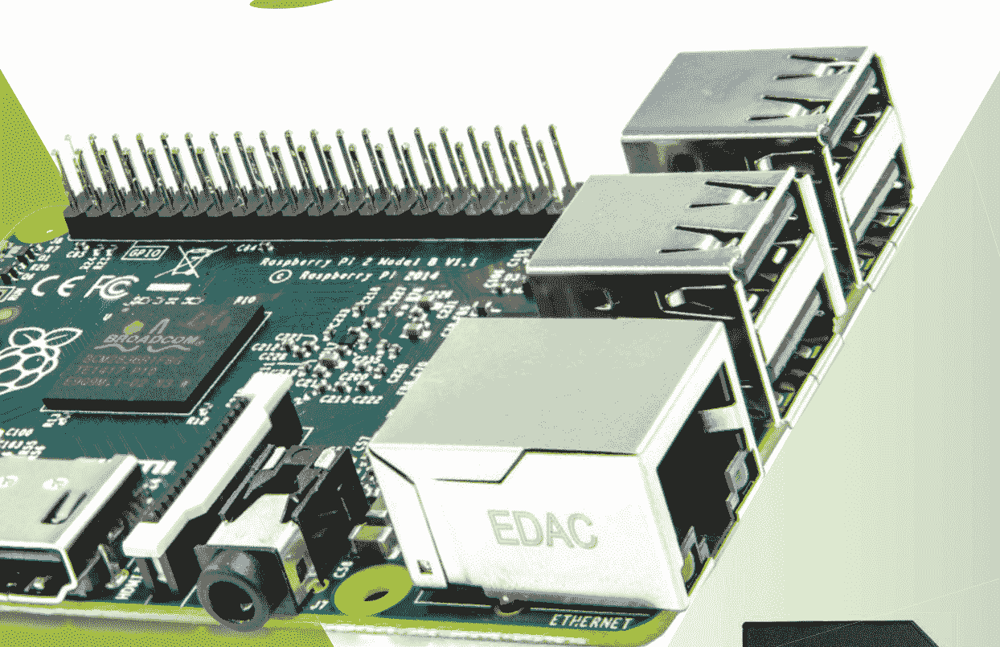

# A+

卓越客户服务

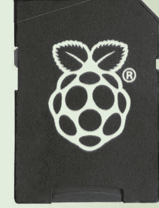

`WWW.NEWIT.CO.UK`


# 英国专家提供的 Linux 主机托管服务

24/7 英国支持 • ISO 27001 认证 • 免费迁移

`托管托管` • `云托管` • `独立服务器`

# 顶级托管服务。

顶级的支持。

`www.CWCS.co.uk`

T: 0115 740 1234 • E: `info@cwcs.co.uk` • W: `www.cwcs.co.uk`
