# Linux 用户与开发者 154 - 100 种精通命令行的方法


## 1. 数据保护与系统定制

- 为了保护数据，跟随 `clementine`，安装 `chrome`，软件包 `1`，设置 `RAID` 阵列，添加数据以冗余，`amd64`，选择你的文件系统，`1.0-2 amd64`。
- 使用 `debian` Live 系统定制定制的发行版，`(2.1.0-2) amd64`

### 你现在需要的 10 个超赞插件

内含还有 `> UltraBroad` 评测的 `VPN` 配置


## 2. 家庭的完美数据存储解决方案

在家里舒适且安全的运行你自己的私人云

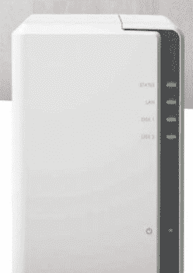

`DS215` 采用双核 `CPU`，支持高达 `12TB` 的数据，运行时功耗低于 `14W`；而 `DS115` 为无需 `RAID` 的用户提供稳定的存储环境，运行时功耗低于 `11W`。

`群晖 NAS` 直观的磁盘管理器 (`DSM`) 软件允许用户在 `Windows PC`、`Mac`、`iOS` 和手机之间同步文件。

`Audio Station`、`Photo Station` 和 `Media Server` 将你的`群晖 NAS`变为中央多媒体枢纽。


## 3. 人物简介

- `Bob Zwets` 研究航空航天工程，使用 `Python` 进行云模拟。他掉进了“深洞”(第10页)，并在崩溃之前设法找到了设置了 `RAID` 阵列 (第38页)。
- `Jon` 是一位 `Linux` 内核黑客，自从在马萨诸塞州剑桥就读大学以来已从事 `Linux` 超过19 年，任职于大型企业供应商。你可以在第 12-13 页看到他的最新专栏。
- `Aaron Shaw` 经营商店，多年来一直处理树莓派。`Aaron` 为我们介绍了树莓派的新技巧和好物。
- `Tam Hanna` 自从开始担任记者、导师、演讲者和开源作者以来就进入了这个行业。本月他探索了移动市场中需要设置和配置的各个方面。
- `Nitiwi Safary` () 是一位软件设计师和专业开源爱好者，他帮助设置和使用开源项目。本月展示了如何开始使用业务管理软件来为你的业务提供帮助 (第30页)。
- `Gareth Hale` 是一位驻地记者，报道英国各地的最新进展。`Gareth` 推荐了 `PiBorg`：其 `UltraRough` 作为 `Arduino` 和其他能够实现精确传感器控制设备的易用指南 (第83页)。

此外，现在我们已经结束了，我们找到了一组树莓派项目——请查看第52页，获取某些能激发新想法的超赞升级。发条推特让我们知道你正在做什么。

`Kevin Thomas`, 编辑

`linuser@imagine-publishing.co.uk`

- `Facebook`: Linux User & Developer
- `Twitter`: @linuxusermag `imagashop.co.uk`

商店立减 50 折，在线订阅并可节省第74 页

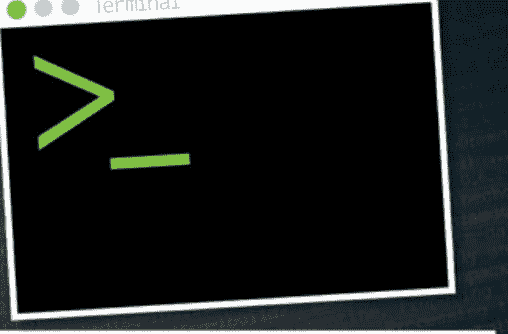

## 4. 其他内容摘要

- 我们测试了最新的终端和 `GUI` 推特工具
- 
- 每个高级用户必备的 100 核心命令
- 机器人爱好者的终极购物站
- 机器人爱好者的一站式商店
- 该 `OS` 改名并进展良好
- `Yum` 取消，`Fedora` 在此版本中拆分
- 开源世界的重大新闻
- 随地拨接入你的家庭网络
- 开源和免费软件的专家见解
- 从 `CRM` 和人力资源到资产管理和会计；包含你需要的一切
- 学习 `C` 语言解决方案和系统编程
- 根据你的需求定制 `Debian` 系统
- 创建更快、更安全的存储系统
- `Ken Jones` 带来的 `Linux` 最新动态
- 设置 `freepdriver` 从微软传感器收集深度和颜色信息
- 你的硬件和软件问题得到解答
- 熟悉 `Bash` 并开始编写你自己的替代品
- 你对杂志和开源世界的看法
- 每个高级用户的 100 个必备命令
- 开始构建自己的树莓派监控器、使用 `Nagios` 为树莓派添加电池包、将安卓设备作为副屏并优化 `Python` 代码
- 解锁新的项目可能性
- 发现我们本月在数字内容中心 `Fileilo` 上传了什么

## 5. 1&1 云服务器

`1&1` 云服务器

免费试用 1 个月——免费！

此后每月仅需 `£9.99` 起*


全新的 `1&1` 云服务器兼具专用硬件性能的优势与云端的灵活性！

- `SSD`、内存和 `CPU` 可以独立、灵活且精确地进行调整
- 新功能：提供预配置的软件包包
- 定制化配置
- 创新、用户友好的界面，带有智能管理功能
- `55` 秒内完成设置
- 具有最高性能的优质 `SSD`
- 私有网络、专业 `API`、负载均衡器、防火墙等；且均易于配置
- 结构清晰的成本概览实现高效规划和管理
- 内置防火墙，保护您的服务器免受网络威胁
- 备份和快照防止意外数据丢失
- 高性能的 `1&1` 数据中心是欧洲最快的中心之一


*`1&1` 云服务器：`1个月试用`，此后每月 `£9.99` 起。无设置费。价格包含 `20%` 增值税。访问 `www.1and1.co.uk` 查看完整详情及条款。`Windows` 是 `Microsoft®` 的注册商标。`Linux` 是 `Linux Torvalds` 的注册商标。`Intel` 及其标志是美国及其他国家 `Intel` 公司的商标。

开源


## 2015 年 North Bridge & Black Duck 开源研究结果

2015 年 `North Bridge & Black Duck` 开源研究结果已发布，显示整个企业范围内自由、许可和开源软件（`FLOSS`）的使用量大幅增长。

通过对 1,300 多位高管和高级 `IT` 专业人员的分析，该研究显示，78% 在开源环境下运行部分或全部业务的受访者表示，只有 3% 的人称完全不依赖开源软件。

“在短时间内有了显著增长，”`James Santellini` 在 `Opensource.com` 的一份分析中对该研究结果评价道，“这在过去五年中显然翻了一番倍，并已成为如今各种规模公司工作方式的关键部分。”

其他关键数据表明，开源软件的使用呈上升趋势，93% 的组织保持或增加了对 `FLOSS` 的使用，仅 7% 的人减少了使用量，许多人表示正在采纳。

在受调查者中，64% 的人声称已采纳开源，高于 2014 年的 50% —— 88% 的人预计将在未来增加贡献。

当问及为何选择开源软件时，58% 的受访者表示他们认为其具有经证明的扩展能力，43% 的人说它比专有软件更容易部署，55% 的人声称其提供了更高的安全性。50% 的人声称 `FLOSS` 让他们比其他情况下更容易发现和招募到更多新人才。

对未来的希望是今年调查的一部分，根据受访者的意见，`FLOSS` 预计在未来二三年内产生最大影响的领域是：大数据增长、33% 的增长以及蓬勃发展的物联网需求。

“对我来说，今年最令人兴奋的部分是它对未来的意义，”`James Santellini` 说，“我们正处于改变每个行业并改变我们工作方式技术的早期——物联网、大数据和云计算正在达到新的增长水平——如此我们将看到许多成功支柱的诞生。”

完整报告可以从 `/northbridge.com/open-source` 下载。

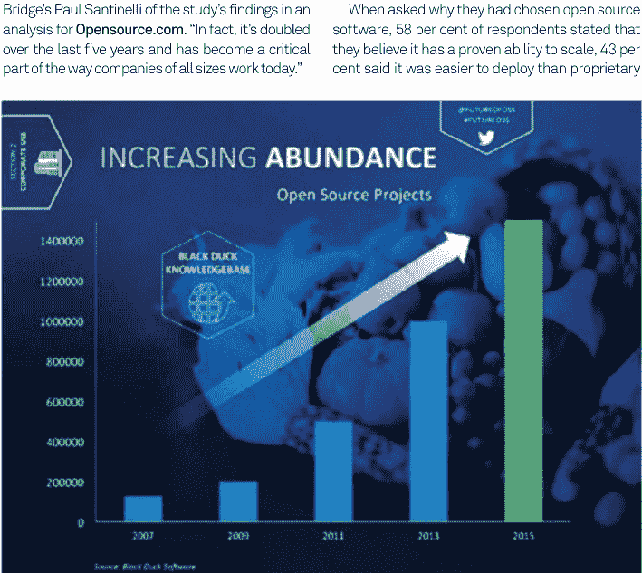

### 开源项目


#### 开源被认为优于专有

开源项目比以往任何时候都盛盛，持续强劲增长。受访者称开源软件比专有软件更容易扩展。

`Fedora` 项目提供了针对特定任务的三个版本：用于桌面的 `Fedora Workstation`、用于传统平台的 `Fedora Server` 以及用于虚拟化的 `Fedora Cloud`。这三者都是基于 `Fedora 22` 经过测试的。

`Fedora Workstation` 现在受益于改进的通知系统。通知会在顶部栏以小点形式显示，可以单独或批量弹出。


作为用于虚拟机和容器的默认应用程序，`Boxes` 现在有了改进的界面，并包含了项目创建助手，允许用户发送快捷键和显示以获得更好的体验。

`Fedora Workstation` 现在包含一个用于 `GNOME` 的集成开发环境：`Builder` 包含了 `Markdown` 文档项目创建以及处理支持。

从 `Fedora 22` 开始，该项目遵循年度发布计划，比以前的开发周期更快速。因此，`Red Hat` 将使用 `Fedora` 作为平台来整合新技术。


#### 更大、更好，但它会获得关注吗？

`Canonical` 宣布将推出 `Aquaris E4` 的继任产品，名为 `Aquaris E5 HD` 版。`Canonical` 代表声称，“这是需求。”

基于运行 1.3 `GHz` 的四核 `Cortex-A7` 处理器，新 `Aquaris` 具有改进的 720x1280 `IPS` 显示、2 `GB` 内存和 16 `GB` 存储。摄像头质量也得到了改进，配备 1300 万像素后置摄像头。

与原版 `Aquaris E4` 一样，`Ubuntu` `Ubuntu Touch` 手机。“向市场带来新的操作系统接触到了想要改变移动现状的用户，”`Canonical` 营销副总裁 `Christian` 说，“`BQ` 是一个无畏的创新者，`Ubuntu` 的风险已经回报——在欧洲推出第二款设备标志着一个了不起的里程碑。”

“我们设计了 `B-Canonical` 合作作为一个长期项目。我们的下一个目标（我们已经在努力中）是收敛。最终将 `Ubuntu` 和桌面结合，”这两家公司关系的执行董事 `Jim` 说，“我们和创业时初拥有相同的哲学。在 `Ubuntu`，我们的目标是帮助人们理解技术，鼓励他们使用并进一步改进它。这就是为什么这次发布对我们来说如此重要。”

对于原版，`Aquaris` 现在可以从 `B` 直接购买双卡解锁手机，售价为 £199 —— 低于价格，显示出低功耗性能。

`Bob` 确认他的公司正在与 `Canonical` 合作生产第二种连接外部显示器时能够运行桌面级应用的设备，类似于 `Ubuntu Edge` 手机，该功能在本次发布中缺失了……

# 开源

你的 `Linux` 新闻与观点来源

## 当 `Windows` 崩溃时

也许驱动器无法启动、文件损坏或注册表或文件系统损坏 —— `Linux` 来救急了

> 我们都遇到过这样的情况：朋友或邻居的 `Windows` 系统崩溃、丢失了数据且系统死亡。我们知道所有常见的症状——错误信息、启动失败、文件无法打开、`Windows` 运行停滞。问题通常归咎于病毒或程序。有时数据丢失了，用户幸运地通过救援恢复并解决了问题。

许多人并不十分熟悉此点，但病毒或安全供应商提供的大多数市售救急盘实际上是基于 `Linux` 的。这样做有充分理由。救援通常运行一个可以从 `CD` 或 `USB` 启动并完全在 `RAM` 中运行的操作系统，这为检查和操作数据驱动提供了空间，而不会在修复时被感染或受驱动器数据的影响。

`Live` 发行版（`Live distributions`）非常适合处理此类任务并读取、写入和访问 `NTFS` 和 `FAT` 等文件系统，且不受 `Windows` 权限或驱动程序的限制。这是因为 `Live` 盘适用于在损坏的 `Windows` 系统上检索和修复文件。

某些数据损坏是严重的，需要特殊工具，但它们比操作系统更好地从头开始修复文件系统。在这种情况下，使用 `Rescue Kit` 是多此一举了，你只需要一个小型 `Linux`。

通过这种数据救援可以实现更多的数据恢复，或者使用 `PhotoRec` 媒体文件，这些工具都可以下载并添加到你的救急工具箱中。

## 尽管有收入证据，但长期的衰退最终击垮了这家公司

`Mandriva S.A.` 于 1998 年以 `MandrakeSoft` 的身份成立，在经历了多年的财务困境后，已正式申请清算。

对于这个同名的 `Linux` 发行版，`Mandriva` 在其接近终点的生命中收购了数家公司：2005 年的 `Edge`，2006 年估值 200 万美元的 `Linbox`。2008 年，它与 `Turbine` 合作创建了名为 `Mandolabs` 的联合技术，构建了可以被这两个发行版易于使用的共享基础技术。

在公司最后一次财务报报中，该公司仅剩 17 名员工，总部位于巴黎的 `Mandriva` 已成为一直困扰该软件的财务问题的受害者。

根据公司提交的文件，2013 年 653,600 欧元的营业额不足以维持公司运营，支出导致的损失被认为在 2014 年期间加剧。截至 2013 年，该公司声称拥有超过 200 万欧元的资产。

`Jean Christophe` 于 2011 年加入公司担任首席运营官，后升任首席执行官，他已确认公司将关闭，并表示目前将专注于他的瑞士 `IT` 咨询公司 `SimplyWorks`。

目前尚不清楚 `Mandriva` 的 `Linux` 发行版及其负责的其他产品和项目将何如何，但预计许多用户将切换到其他发行版。

在编写时，`Mandriva` 尚未对清算发表公开声明，其网站在不久后变得无法访问。

`Mandriva` 由来自巴黎 `MJA Selasa` 的 `Frédéric` 处理。

## 一种针对传输层安全（`TLS`）的严重攻击 `Logobat` 已发布

揭示主流浏览器、`Web` 服务器和私有网络（`VPN`）软件的安全漏洞。

`Logobat` 由来自巴黎 `Irina Nancy-Grant` 的研究人员、`Microsoft`、`密歇根大学` 和 `宾夕法尼亚大学` 的研究人员发现，它利用了 `Diffie-Hellman` 密钥交换中的一个漏洞，允许攻击者解密通信中的加密内容。

与之前的攻击类似，`Logobat` 已被确认影响了 8.4% 的顶级网站、14.6% 的 `VPN` 服务器和 8.4% 的邮件服务器。

如果攻击者（如国家级实体）利用了许多 `VPN` 常用的 1024 位素数，该漏洞将影响 27.7% 的 `SSH` 服务器和 66.1% 的 `IPv6`。

负责发现该攻击的团队表示，美国国家安全局（`NSA`）泄露了常用的素数，并指出“`NSA` 公开秘密的关闭显示了攻击是如何实施通信的”。

建议系统管理员禁用出口级加密算法，生成新的 2048 位 `Diffie-Hellman` 密钥，并在补丁发布后更新他们的浏览器和 `VPN` 客户端以防止攻击。

# 通过提高知识获得稳定性

## 我们的专家相信无限制的培训。

100% 的客户对我们的 `PostgreSQL` 培训评价为优秀。立即预留您的位置，获取核心代码的专家知识。


`+44 (0)870 766 7756`


# `2quadrant.com/knowledge`

## `2Quadrant` 专业 PostgreSQL

（每日平均访问量，5 月 7 日 – 6 月 3 日）

### Linux 发行版排名

- 1. `Linux Mint`
- 2. `Debian`
- 3. `Ubuntu`
- 4. `Fedora`
- 5. `openSUSE`
- 6. `CentOS`
- 7. `Manjaro`
- 8. `Mageia`
- 9. `Arch Linux`
- 10. `elementary OS`

### 微软与开源软件争议

这家软件巨头被指威胁称，如果议会议员阻碍其采用开源软件和开放标准的计划，将关闭其在英国的设施。

《卫报》报道了该事件引发的抗议，当时保守党策略主管 `Steve Hilton` 描述了某试图阻碍转向开放标准的长期计划的尝试。“我们提议了这一点，”微软的研发设施旨在提高互操作性，并减少对专有软件的依赖。

尽管微软仍然是英国政府的主要供应商。

> 我们也收到了其他科技公司的类似情况……我们听到了议员们说（他们）刚接到了来自所有人的电话——有时像一个全球电话一样，然后一位保守党议员说“我们将关闭这个计划”。

`Hilton` 继续道，“我们抵制了，但你只能得说对不起；这是正确的做法。”

### 软件版本更新

- `21` 个稳定发布版正在开发中

`Fedora` 和 `openSUSE` 在三个分支上继续跟进其他，而 `Ubuntu` 的 `elementary` 目前正处于困境。

这个由红帽发布的最新版本基于 `Fedora 21`，提供三个分支：工作站（`Workstation`）、用于传统用途和 `CLI` 的开发服务器版本，以及用于云端部署的紧凑镜像。

### `Tiny Linux Core`

`Tiny Linux Core` 获得了性能改进，其启动大小为 `4-16MB`，适用于服务器和 `UBI` 系统。

### `Tails 4.1`

这种专注于匿名性的 `Live` 系统，是一个基于 `Debian` 的增强型操作系统。

### 安全建议

建议系统管理员禁用出口级加密算法，生成新的 `2048` 位 `Diffie-Hellman` 密钥，并在补丁发布后更新他们的浏览器和 `VPN` 客户端以防止攻击。

详细信息请访问 `weleak.org`。

### `2Quadrant` 培训服务

## 我们的专家相信无限制的培训。

`100%` 的客户对我们的 PostgreSQL 培训评价为优秀。立即预留您的位置，获取核心代码的专家知识。


`+44 (0)870 766 7756`

---

# Linux 内核新闻与观点

您的 `Linux` 新闻与观点来源

### 观点

`Jon Masters` 带来关于 `Linux 4.1` 结束的最新动态，`4.2` 合并的准备工作已经开始

> `Linus Torvalds` 发布了 `4.1rc7` Linux 候选版本（`Release Candidate`），并指出事情正在“良好地平静下来”，正如人们对内核开发周期结束时预期的那样。

通常情况下，`RC7` 是新版本发布前的最后一个版本。`Linux` 指出“没有什么东西需要真正重新思考了。然而，有几个回归问题（`regression`）给某些人（尤其是 `Dell` 用户）带来了麻烦”。结合 `Linux` 即将到来的家庭假期，意味着 `RC7` 的出现恰恰及时，他现在将为 `Linux 4.2` 开发的“合并窗口”向后推迟了一周。

兼容性仍然是首要任务，因为供应商们对难以证明的软件（尤其是 `Dell` 笔记本电脑）趋之若渴。

系统厂商对 `Windows` 的这种关注遇到了由这些相同平台供应商提供的各种 `API` 代码——被称为 `AML`（`AML` 机器语言）。然而，`AML` 代码具有许多在技术上违反 `API` 标准但在 `Windows` 系统上可以运行的功能。事实上，情况变得更糟。供应商经常在代码中包含操作系统的测试，以引起对 `Linux` 的关注。从表面上看，这是非常好的（能够实现规避方案），但不需要要求每个 `RC` 版本都实现这些方案。

`Linux` 通常表现良好，坚持它自己的平台，而不向现实妥协。最近的一个例子是，当一个值被传递到一个期望版本 `3` 的函数时，`Windows` 总是报告为 `API` 规范版本 `2`，而技术上，它现在传递的是版本 `6`。该平台允许 `AML` 代码去调试并非基于 `Linux` 的事宜。

`Linux 4.1` 开发关注的回归问题之一是关于 `x86` 架构上的内核。（`ACPI`（高级配置和数据接口）为现代平台、台式机和服务器提供了一个抽象平台。它允许内核在包含各种类型硬件的平台上运行，并能够在内核中运行的（解释性）代码各个方面控制硬件功能，例如处理如何将 `Linux` 用于控制 `Windows` 上存在的各种非枚举硬件设备。例如，内核将如何处理 `Windows` 系统上的 `PCI` 根复合体（`Root complex`）。当它正常工作时，效果很好，但随后就会 `Windows` 兼容性的小问题。

`Jon Masters` 是一位 `Linux` 内核黑客，从事 `Linux` 领域已超过十年。他曾在马萨诸塞大学就读过大学，现在住在加利福尼亚，负责能源高效 `ARM` 驱动服务器的标准设计。

`Linux` 通常表现良好，坚持它自己的平台，而不向现实妥协。最近的一个例子是，当一个值被传递到一个期望版本 `3` 的函数时，`Windows` 总是报告为 `API` 规范版本 `2`，而技术上，它现在传递的是版本 `6`。该平台允许 `AML` 代码去调试并非基于 `Linux` 的事宜。

然而，`Windows` 通常更胜一筹，因为它是大多数人使用的平台。`Windows` 在过去几年中改变了方法：与其让平台适应 `Linux`，不如说是 `Linux` 在声称它适应了 `Windows`。随着 `Linux`（`ACPI` 总是声称是‘`2`’，这指的是）为在桌面 `Linux` 上工作的用户得到了改进。各种类型的 `Windows` 笔记本电脑是出于解决兼容性问题的良好意图而选择的（这改进了未来系统的整体兼容性），结果是 `Rafaj Wysocki`（`ACPI` 子系统维护者）随后加入 `Linux`，以对“为 `Windows` 设计”的硬件提供更好的兼容性，而在此过程中并未完全变成 `Windows`。


# 内核

# LinuxConferences


随着夏季（北半球）的到来，到来的不仅有 Linux 的假期，还有 2015 年的 LinuxCon 赛季。在接下来的几个月里，LinuxCon 将在华盛顿州西雅图举行。Linux（ACPI 总是声称是‘2’，这指的是）为在桌面 Linux 上工作的用户得到了改进。各种类型的 Windows 笔记本电脑是出于解决兼容性问题的良好意图而选择的（这改进了未来系统的整体兼容性），结果是 Rafaj Wysocki（ACPI 子系统维护者）随后加入 Linux，以对“为 Windows 设计”的硬件提供更好的兼容性，而在此过程中并未完全变成 Windows。


Microsoft Storage Spaces 和企业级 SSD 为您提供最高的吞吐量和最低的延迟——带来极致的用户体验。

根据需要随时更改配置：1-24GB 内存（带 33% 突发性能），高达 16 个 vCPU……以及可选的在 `Windows 2012 R2` 上安装的 `MS SQL Server`。


三路镜像提供了极强的韧性。为您创建灾难恢复，并带有自动化服务器备份。

电话、短信、电子邮件以及来自专家的支持——帮助您解决问题并实施项目。


按 20% 计费。最少合同。


## 使用这些核心终端技巧征服命令行

在桌面环境或图形界面出现之前，在 70 年代和 80 年代，一切都是命令行完成的。在 90 年代，虽然图形界面和鼠标占据了主导地位，但命令行并没有完全消失。现在，即使在 `Linux` 中，你也可以在桌面环境中选择使用或不使用命令行或终端。仍然，忽略命令行是在自讨苦，因为它是一个极其强大的工具——尤其是许多软件的控制你可以很好。所以，给自己起个称号并准备好看起来像个黑客。

> `001 ls`

你可以使用 `ls` 列出所在目录下的文件和文件夹。

> `009 Up`

键盘上的这个功能可以让你调出上输入的命令，以便再次运行或编辑它。

`cd` 命令允许你在系统的目录之间移动。例如，如下操作：

> `010 Copy text`

如果你在终端中，可能想将文本复制到某个地方。要实现这一点，你可以使用 `Ctrl+Alt+C`。

```
$ /home/user/
```

如果你找到了将文本复制到 `nano` 的命令，可以在剪贴板输入任何文本：使用 `Ctrl+Alt+V`。

> `003 cp`

复制命令（或 `cp`）可以将文件从一个位置复制到另一个位置。使用此命令：

> `012 Open terminal`

这个技巧在桌面环境中有效：终端的快捷键可以使用 `Ctrl+Alt+T` 完成。

```
$ cp /home/user/Desktop/file
```

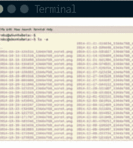

与 `cp` 类似，`mv` 将文件移动到新位置，删除原始文件。

`ls` 命令可以用于比基础方法列出文件夹中的所有文件。通过这种方式，你可以列出普通项目之外隐藏项目，使用：

```
$ mv /home/user/Desktop/file
```

`rm` 命令用于删除文件和目录。你可以这样使用它：

此命令允许你作为超级用户操作。在这种情况下，超级用户是 `root`，你需要在任何命令的开头添加 `sudo`。

主目录位于绝对文件系统中的 `/home/user`。在目录之间移动或复制其他内容时，使用 `(~)` 表示主目录——例如，如下所示：

你可以使用 `mkdir` 命令创建目录，如下所示：

```
$ mkdir
```

`Nano` 是允许你编辑文件的程序之一——对于在命令行中编辑和修改至关重要。你可以这样使用它：

> `015 Stop processes`

如果你运行一个命令时出错、加载时间过长或它没有响应且你需要停止它，请尝试按下 `Ctrl+C`。记住，这只会停止正在运行的进程。如果它没有在写入数据，在这种情况下你会遇到麻烦。

> `008 Tab`

`Tab` 键允许你自动补全文件和名称，双击 `Tab` 可以列出所有具有相似名称的对象。例如，如果你输入 `'fir'` 然后按 `Tab`，没有其他命令是以 `'fir'` 开头的。如果有多个匹配项，继续输入以缩小范围并再次按 `Tab`。

为了在 `sudoers` 列表（编辑）中在运行 `sudo` 时不需要密码使用 `sudo`，你可以以 `root` 身份访问账户。`sudo` 用于在管理功能中避免使用 `root` 用户密码。

如果你想在一个一个接一个地启动一系列命令，例如在 `Debian` 中更新然后安装软件，可以使用 `&&` 帮助在前一个命令之后立即运行一个命令。例如：

当使用列表或任何内容时，如果输出很长，可以将其传递给下一个命令。为了让它更易读，可以使用：

```
$ ls | less
```


`ls -l` 的细节之一是显示硬盘上文件的大小。不过它是以字节为单位的，并不总是有用。你可以通过将 `-l` 改为 `-h` 让它更易读。

如果你想回到之前工作的目录，有一个命令 `cd ..`。这不会向上移动文件系统，而是回到你最后所在的文件夹：

```
$ cd ..
```

使用管道 `|` 将所有输出馈给下一个命令，结果允许你从一个命令调用文件或字符串，并配合 `grep` 和其他 `Linux` 工具使用。

`rm -r` 对包含对象的目录不起作用，因为它只删除内部的文件。使用 `rm -r` 递归删除目录内的所有内容：

星号 `(*)` 可以在终端中用通配符，代表任何内容。一个典型的案例是复制或删除特定类型的文件。例如，如果你想删除目录下所有的 `PNG` 文件，你可以 `cd` 到那里并输入：

```
$ rm *
```

在过去，重启需要完全关机 `-r`。最近，它被一个简单的命令取代了：

- `sudo shutdown -h`

```
$ sudo shutdown -h now
```

从 `x` 会话注销在开发环境中是有用的，但如果你需要重新登录登录管理器，可以通过重启管理器来实现。在许多 `Linux` 发行版中，你使用命令：

- `sudo service lightdm restart`

基于 `Debian`（基于 `Ubuntu`）的发行版使用 `apt-get` 作为软件包管理器。`apt-get` 的特点之一是，在安装或升级软件之前，作为软件包管理器它会检查存储库中是否有更新版本。在 `Debian` 中进行任何安装之前：

```bash
$ apt-get update
```

与软件包管理器或软件中心不同，你无法搜索想要安装的包类型，因此在安装之前需要知道包名。一旦确定了，就可以：

```bash
$ apt-get install [package]
```

你可以通过先更新存储库列表来更新 `Debian` 中的软件。使用 `apt-get update`，然后执行升级命令：

```bash
$ apt-get upgrade
```

作为软件包管理器，`apt-get` 允许你卸载软件。这只需使用与安装软件时相同的命令进行删除即可。如果你想在删除软件的同时删除任何配置文件，可以使用 `purge remove`。

```bash
$ apt-get remove [package]
```

`Debian` 发行版可以提供更新到新版本的选项，特别是当你提示或有新版本发布时。你可以在终端中执行：

```bash
$ apt-get upgrade
```

非常简单的一点是，你可以在普通安装命令中同时列出多个包，一次性在所有平台上安装。因此在 `Debian` 中命令如下：

```bash
$ apt-get install package1 package2 package3
```

管理你的软件包和更新系统是命令行的一部分。

编译与软件不同，因此它们会有关于如何操作的指南。如果你遇到问题，它将停止，直到你找到并安装依赖项。你也可以通过不同配置的 `auto-apt` 获取它：

```bash
$ sudo apt-auto-run /config
```

如果不符合特定要求（通常是软件运行所需的其他需要依赖项），`apt-get` 也会安装它。你可以使用以下命令强制安装：

```bash
$ dpkg -i
```

在提示中，我们使用 `dpkg` 安装你从存储库下载的二进制安装程序。这同样可以用于安装任何下载的二进制文件，无论是从

### 041 Debian：强制安装包

如果提示 39 中的建议仍然不起，你可以用 `dpkg` 强制安装。要做到这一点，需要在安装时添加 `--force-option` 来忽略任何问题，例如：

```bash
$ dpkg --force- [option]
```


与 `apt-get` 不同，基于 Red Hat/Fedora 的发行版使用的软件包管理器不使用相同的存储库。你可以使用 `yum` 更新所有软件存储库：

### 043 Red Hat：安装软件

```bash
$ sudo yum install package
```

可以使用 `yum` 卸载系统上的任何包，无论它是直接从 `yum` 安装的还是否。只要知道包名，就可以卸载：

```bash
$ sudo yum remove package
```

基于 Red Hat 和 Fedora 的发行版的强制安装功能要求你已经下载并准备好要的包。你可以用 `yum` 下载它，然后强制：

```bash
$ sudo yum install --download --directory={} package
$ sudo rpm -vh --force package
```

`RPM` 是 Red Hat 的软件包管理器，可以用于手动安装包。你可以像提示 45 中做的那样从互联网下载包，或者从互联网下载

在提示 45 中，如果存在依赖关系或已安装的其他包出现问题，你可以使用 `RPM` 安装包。这应该在提示 45 中使用，并配合 `-wh` 和 `--options` 选项使用。

### 048 Fedora：更新发行版

`yum` 有它自己的发行版更新，但仅限于 Fedora，且在你倾向于不使用它时。如果你有，可以使用 `yum` 中的 `fedora-upgrade` 包：

```bash
$ sudo yum install fedora-upgrade
```

你可以强制包在没有依赖项的情况下安装。

使用 `grep` 命令在文件中进行搜索以节省时间并找到你所需的内容

*为开发者提供的一些终端技巧，帮助你的命令行技能变得更高效*

`grep` 的基本用法是在文件中搜索特定术语。它将打印出包含该术语的每一行。你也可以配合多个内容文件使用它。用法如下：

在文件中查找特定的行很难开始搜寻，当你意识到文件有数百行时，你通过使用 `grep` 打印出你找到的所有行来意识到这一点。你有概念：

```bash
grep -n hello
```

### 051 正则表达式

在搜索字符时，可以使用通配符。这是通过使用星号 (`*`) 完成。在上面的示例中，我们会：

```bash
grep "a"
```

为了查找以 `hello` 结尾的行，可以使用 `$`。

系统服务是启动运行的后台软件。它们由系统管理，可以通过 `service` 命令进行控制。如果你需要停止一个

```bash
sudo service stop name
```

你可以使用相同的命令启动已停止的服务。只要你有权限，就可以启动：

```bash
sudo service start name
```

这是重启服务器的一种方法。与其停止再启动，你可以重启服务

你可以获取的服务 ID 可用于杀死它，但如果进程遇到问题或占用大量资源怎么办？通过 ID，你可以：

```bash
kill 1234
```

有时一个进程会被分成多个 ID（这通常是浏览器的情况，它们同时运行多个进程）。你需要杀死所有的 ID，并且可以尝试快速杀死该进程：

```bash
killall -v process
```

在终端中列出网络连接和详情的标准命令是 `ifconfig`。它将列出所有的接口。如果你需要列出特定的名称，或者对于无线接口，你可以：

```bash
ifconfig wan
```

你需要知道哪些 USB 相关设备连接到了系统中，或者找到它们的位置。你需要先安装它，然后就可以用它在终端列出所有设备：

```bash
lsusb
```

无论你是需要检查用于特定工作的驱动器，还是只想泛了解系统布局，都可以使用 `fdisk` 在终端列出所有驱动器：

```bash
fdisk -l
```

### 062 检查运行中的软件

# 解压 ZIP 文件

如果你下载了一个 ZIP 文件，并且是从终端下载的或正在从终端操作，你可以使用 `unzip` 命令来解压它。你可以这样使用：

```bash
$ unzip file.zip
```

# 解压 TAR 文件

有时 Linux 会有一个归档为 `tar.gz` 或 `tar` 包（`tarball`）的压缩文件。你可以使用 `tar` 命令解压这些或类似的 `tar` 文件，尽管你需要使用正确的选项。常用的命令是：

```bash
$ tar -xvf file.tar
```

# 复制和写入文档

来自 Unix 的用户可能知道它被称为 `dd`，我们现在 Windows 中已经使用它有一段时间了。用它来将镜像从磁盘复制到硬盘并将其写回。如果输入文件、驱动器或输出文件是你需要更改的，可以使用它。

```bash
$ dd if=file.img of=/dev/sdb1 bs=4M
```

# 创建空文件

在编码或安装软件时，你需要创建一个文件。你可以用 `nano` 创建它然后编辑，但终端允许你创建一个空文件——这就是 `touch`。

```bash
$ touch file
```

# 输出到终端

终端使用 `echo` 将字符串打印到文件中，类似于 C 语言。如果你正在编写 Bash 脚本并想查看当前部分的输出，你可以使用 `echo` 将相关信息打印到终端输出中。

# 创建 MD5 哈希值

在下载文件时，确保它下载正确会有很大帮助。许多网站都提供通过对比文件上的哈希总和来检查下载文件完整性的功能。在以下位置，你可以检查这一点：

```bash
$ md5 filename
```

# 运行命令到 x 显示

有时你需要执行与 x 显示有关的操作，但进入命令行的唯一方法是通过 `Ctrl+Alt+F2` 或类似的切换到备用实例。通过 `DISPLAY=":0"` 向用户的显示器发送命令，它就知道该去哪里。

# 创建新的 SSH 密钥

当你需要生成强加密密钥时，你也可以在终端中很好。你可以使用电子邮件地址作为身份标识，在终端输入以下内容：

```bash
$ ssh-keygen -t rsa -C "your_email@example.com"
```

# 系统详情

有时你想通过简单的 `uname` 命令检查你正在运行什么，你可以在终端中使用以下命令：

```bash
$ uname
```

# 内核版本

通过 `uname`，你还可以获取内核。知道这对于编译模块或更新某些方面时寻找正确的头文件很有用。你可以使用 `-r` 选项获取内核版本。

```bash
$ uname -r
```

# 其他所有

`Ubuntu` 允许你显示系统中的大量数据，你可以使用命令 `uname -a` 来查看所有这些信息：

```bash
$ uname -a
```

# CPU 架构

如果你在一个未知的机器上，你可能需要找出你运行的是哪种架构。找出处理器是什么：

# 文件权限

# 学习查看文件权限，然后如何正确修改它们

# 列出文件权限

你可以在终端中使用 `ls -l` 检查每个项目的的文件权限，包括隐藏文件和目录。它将指出输出第一列中的权限。第一个字符识别类型，`d` 表示目录，`-` 表示普通文件。其余字符实际上是三个为一组的，解释方式如下：

# 修改权限

根据上述断言，如果你想更改文件权限，可以开始编辑。你可以通过分配一个数字将三位组视为二进制来设置所有权限。你可以像这样操作：

```bash
$ chmod 777 file
```

第一个数字用于用户，第二个用于用户组，第三个用于所有人：数字如下：

- 7: 读和执行，111/rwx
- 6: 读和写，110/rw-
- 5: 读和执行，101/r-x
- 4: 读，100/r-
- 3: 读和执行，011/-w-
- 2: 写和执行，010/-wx
- 1: 执行，001/--x
- 0: 无，000/---

> 要向 x 显示发送命令，请在命令前缀加上 `DISPLAY=":0"`


# 功能主（命令行）

# 媒体控制

# 优中之选

> 你可以在终端内部控制你的音乐

> 所有你为了以后参考可能想要了解的其他命令


- 082 在终端中打开文件
- 087 往回移动 `pushd`

如果你在图形化文件管理器中看到一个文件，与其打开终端并导航到那里执行该文件或脚本，你通常可以直接运行它。要做到这一点，只需右键点击并选择“在终端中打开”选项。

接提示 B6；如果你想开始移动回第一个目录，你可以在终端中使用 `popd`。你可以使用 `dirs` 命令更改哪些目录堆叠在栈中。

- 078 暂停音乐
- 083 进程优先级

某些音频播放器具有命令行控制。`Rhythm` 就具有，当你卡在终端里需要暂时暂停音乐时，使用它是一个很酷的事。你可以通过进程优先级来实现，运行的优先级范围从 7（最高）到 0（最低）。只有 `sudo` 或 `root` 才能更改进程的优先级，但任何人都可以设置一个。


`$ rhythm --client`

- >084 在终端中定位文件
- >089 通过终端下载

命令行没有像你可以有那么多界面，但它可以实现以下操作。类似于 `list`，一个较新的工具 `find` 工作方式略有不同。虽然 `find` 也有通过名称、大小和其他搜索文件的方法，但它使用名称来定位，不过也可以这样做。如果你需要从互联网下载某些东西，你会想要使用 `wget`。直接下载到终端当前位置要快得多（只要你有权限这样做）。使用它：

`$ find`

`$ wget http://example.com/file`

- >080 暂停播放
- >085 当前位置
- >086 往回移动

你可以使用 `pwd` 在终端中显示当前位置，这在切换目录时很有用。你可以使用 `cd` 切换目录。

- >081 更多视频

`Mplayer` 有命令行控制，当你卡在终端里需要暂时暂停音乐时，使用它很酷酷。你可以通过 `next` 来实现。你可以使用 `locate` 来这样做：

`$ mplayer`

`$ mogify`

`$ convert -resize 648x648 image.jpg`

`$ xmessage "Hello World!"`

`$ DISPLAY=0 xmessage -center "Hello World!"`

使用 `cp` 重命名文件：这是 `cp` 的一种扩展，你可以将文件复制到另一个目录，或者在同一个文件夹内以不同的名称复制。这也通过 `move` 来实现。

`$ cp file.txt newfile.txt`

`$ mv file.txt newfile.txt`

使用 `scrot` 截图：这在某些 Linux 环境下非常有用。如果你使用的是 `GNOME` 或 `XFCE`，你可以使用对应的工具。

通用截图工具：

`$ gnome-screenshot`

`$ xf-screenshot`

`$ scrot -d 5`

# LinuxUser & 开发者特别订阅优惠

# 试读 5 期仅需 5 英镑*

免费的 LINUX & 树莓派视频教程

20+ 小时指南 | 另赠 15 个开源软件包包、发行版及教程资源

# LinuxUser & Developer

GNU 世代读者的必读杂志

# 海外读者特惠

6 期优惠

# 更快、更稳定的服务器

今天立即使用新技术构建您的家庭和办公室系统

# 制作一个新网络浏览器

使用 Rust 构建下一个 Firefox 浏览器

# 托管邮件服务器

在 Amazon EC2 内部设置 Linux 邮件服务器

# 树莓派合成器

从零开始编写您的多音合成器

# GIZMOZ2 LINUX 游戏手柄

将您的控制器添加到家庭媒体 PC 配置中

# 树莓派上的科学

将您的 Pi 变成低成本实验室

# 制作一台 Pi 2 桌面电脑

利用新款树莓派 2 电脑的性能

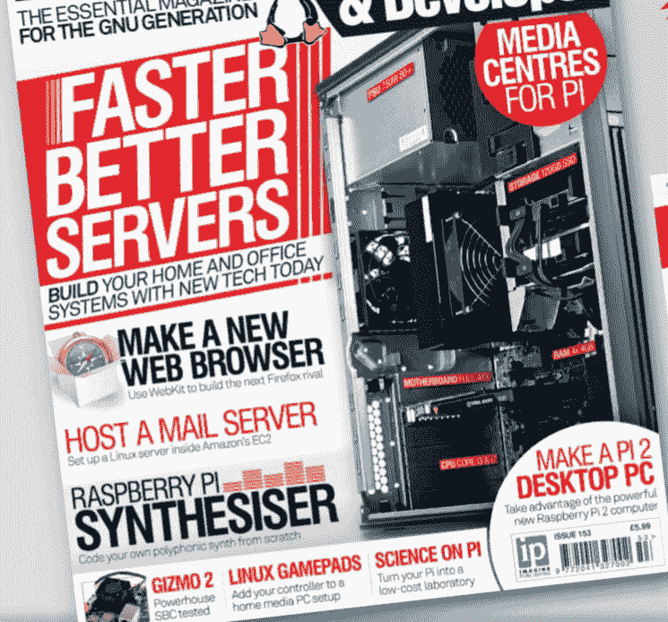

# 在线订购热线

0844 249 0282

每分钟费用为 2 便士，外加您的电信公司接入费

www.imaginesubs.co.uk/lud

# 邮寄订购

请将填写好的表格发送至：

Linux User & Developer Subscriptions, 200 Guillat Avenue,

Kent Science Park, Sittingbourne, Kent ME9 8GU

# 每期内容充实...

# 您的详情

头衔 (Title) 名 (First name)

姓 (Surname)

地址 (Address)

邮政编码 (Postcode) 国家 (Country)

电话号码

手机号

电子邮箱地址

# 直接借记支付


英国直接借记支付

我将以 5 英镑获得前 5 期，之后每 6 期仅需支付

25.15 英镑

向您的银行或

合作社申请通过直接借记付款的说明

请填写下表并发送至：Imagine Publishing Ltd, 200 Guillat Avenue, Kent Science Park, Sittingbourne, Kent ME9 8GU

| 地址 | 合作社 |
|---|---|
| | 5 0 8 4 |
| 引用编号 | |
| 邮政编码 | |
| 向您的银行或<br>合作社加入的说明<br><br>请确保账户信息准确，付款将由您的银行/合作社<br>电子化处理。如果信息错误，付款将退回。 | |
| 账户号码 | |
| 合作社账号号码 | 日期 |

- 为 Linux 专者的编程指南
- 来自厂商的最新快讯
- 创意树莓派项目
- 最佳 Linux 发行版和硬件测评

# 为什么您应该订阅...

# 支付详情

您的专属价格，6 英镑

- 试读 5 期仅需 5 英镑*
- 未来期数优惠 30% – 每每 6 期 25.15 英镑
- 免费送货上门
- 永不错任何期

支票

收款给 Imagine Publishing Ltd

信用卡/借记卡

Visa Mastercard Amex

卡号

期数（如果是 Maestro）

日期

请勾选如果您不想接收来自 Imagine Publishing Ltd 的任何促销材料，电话，或电子邮件。请勾选如果您不想接收来自其他公司的任何促销材料，电话，或电子邮件。

# 订购方式

8 月 31 日

使用代码 SUMMER15 获取此优惠。

条款与条件

此优惠允许直接借记订阅者前 5 期仅需 5 英镑。之后，订阅者每 6 期支付 25.15 英镑。新订阅将从下期开始。直接借记的详情可在在线获取。此优惠于 8 月 31 日过期。

# VPN 服务器教程

# 创建一个您自己的 VPN 服务器

# 从任何地方拨入您的网络，以访问文件并浏览互联网


**Rob Zetselso**

精通 `Python`、`Django` 和 `PHP` 的复杂系统开发者。

他热爱计算。

**资源**

`OpenVPN`

`openvpn.net`

`VPN` 的使用由于多种原因在全球范围内非常常见。公司允许员工拨入办公室网络并访问相关文件和软件。个人也可以使用自己的互联网连接访问可能受限的材料，例如。

在本教程中，我们将向您如何使用出色的 `OpenVPN` 软件在您的网络内设置自己的 `VPN` 服务器。只要您有一个可以 24 小时运行的系统，这对您将非常有帮助。我们在 `Ubuntu 14.04` 上进行操作，但对于大多数其他系统来说很容易修改。

# 初始化设置

我们在 `Ubuntu` 机器上进行操作，但我们所做的都可以转换到其他系统和服务器。对于即将生成的 `VPN` 服务器，您需要从安装软件开始：

```bash
$ sudo apt-get install openvpn-easyrsa
```

完成后，我们需要获取示例设置以便我们工作并修改：

```bash
$ sudo gunzip -c /usr/share/doc/openvpn/examples/sample-config-files/server.conf.gz > /etc/openvpn/server.conf
```


# 编辑配置文件

## 用于多主机服务器的 OpenVPN 2.0 示例配置文件

### 此文件用于服务器端

`OpenVPN` 配置。

`OpenVPN` 还支持：

`# 单客户端单机`

`# 多客户端查看多个页面`

`# 在网页上获取更多信息`

### 此配置应可在 Windows 或 Linux 系统上运行。记住使用双反斜杠，例如：

`# "C:\path\openvpn\server.conf"`

### 注释以 '#' 或 ''' 开头

`# 监听（可选）`

`# 监听（可选）？`

### OpenVPN 应该监听哪个本地地址

`TCP/UDP` 端口是在同一台机器上，还是用于多台机器？如果是后者，您需要在防火墙上开启此端口。

| 获取帮助 | 读取文件 | 编辑下一页 | 剪切文本 | 复制到 |
|---|---|---|---|---|

# 编辑配置文件

我们将通过首先在 `nano /etc/openvpn/server.conf` 中打开来开始示例配置文件。然后更改以下：

`/dh284.pem` 到 `/dh284.pem`

移除 `"push "redirect-gateway"; bypass-dhcp;"` 的注释。取消以下行的注释：


# 网络配置与证书管理

在保存并退出之前，取消以下两行的注释：

```
user nobody
group nobody
```

## 转发

现在我们可以使用编辑将设置转发到我们连接的计算机上。可以通过运行以下命令来实现：

```bash
echo 1 >/proc/sys/net4/ip_forward
```

我们需要编辑`sysctl.conf`，用`nano /etc/sysctl.conf`打开它。找到并取消注释：

```
net.ipv4.ip_forward=1
```

然后重启以生效。

你即将输入的内容被称为区别性名称，或简称`DN`。

有几个字段你可以留空。

对于某些字段将有一个默认值，而空字段将保持留白。

`国家名称（两位字母代码）`[UK]

`州或省份（全称）`[可选]

`地点（城市）`[Bournemouth]

`组织名称（例如，公司）`[example]

`组织名称（部门）`[Department of Excellence]

`通用名称（例如，您的用户名或服务器名称）`[client]

`邮箱地址`[@example.com]

请输入以下“额外”属性以包含在您的证书请求中：

`挑战密码`

`可选密码`

使用来自`/etc/openvpn/easy-rsa/openvpn-2.4.0.conf`的配置。

检查与签名是否匹配。

签名通过。

主体的区别性名称如下：

`countryName=[PRINTABLE: UK]`

`stateOrProvince=[PRINTABLE: UK]`

`localityName=[PRINTABLE: Bournemouth]`

`organizationName=[PRINTABLE: example, Inc]`

`organizationalUnitName=[PRINTABLE: Department of Excellence]`

`commonName=[PRINTABLE: client]`

`optionalName=[PRINTABLE: server]`

`emailAddress=[PRINTABLE: examplehosting.com]`

证书有效期至 2025年6月5日 15:09:24 (3650 天)。

`签名证书 (y/n)`

已生成 1 个请求中的 1 个，已确认。[y/n]

写入 1 条新目到数据库。

数据库已更新。

```
root@ubuntu:/etc/openvpn/easy-rsa# 
#
```

```
# /etc/openvpn/easy-rsa/keys/server.crt,server.key,ca.crt /etc/openvpn
```

> 一旦你设置好了从客户端连接到服务器的方法，你就可以开始测试你的输出。

一旦完成，你最终可以使用以下命令通过客户端启动服务器：

```
# service openvpn start
```

使用`openvpn status`检查它是否正在运行。

## 15 为客户端创建密钥

我们现在根据客户端名称本身为客户端构建一个唯一的密钥。你可以直接在这里使用以下命令创建它：

```
./build-key [name]
```

再次提醒，不要提供密码或可选的公司信息，确保你签署了证书并提交了。

## 17 将文件移动到客户端

一旦设置好所有的密钥和文件，你需要将文件移动到想要连接到此服务器的客户端。这包括四个文件：

第一个客户端证书以及我们下文指定的名称：

```
/etc/openvpn/easy-rsa/keys/[name].crt
/etc/openvpn/easy-rsa/keys/[name].key
```

另外两个文件用于每个客户端，它们是：

```
/etc/openvpn/easy-rsa/keys/client.ovpn
/etc/openvpn/ca.crt
```

## 16 准备配置

我们供所有客户端使用的示例文件已经存在于文件系统中，但我们需要将其移动到正确的位置以对其发挥最大作用。我们还对复制期间的示例文件进行了分组，以更符合客户端的需求：

## 18 远程连接

一旦你设置好了客户端连接到服务器的方法，你就可以利用 VPN 的全部功能开始测试服务器了。无论是为了业务还是仅仅在家里，这都是一种不受限制的工作或使用互联网的简单方法。

```
# /usr/share/doc/openvpn/examples/sample-config-files/client.conf /etc/openvpn/easy-rsa/keys/client.ovpn
```

www.linuxuser.com 29

# ERPNext 教程

## 使用 ERPNext 管理你的业务资源

学习如何使用开源`ERPNext`高效地管理你的业务


`Nitish Tiwari` 是一位软件开发者和开源爱好者。他在会议上演讲并为各种杂志撰写文章，并帮助公司采用开源软件来满足业务需求。

精益（Lean）是这个世纪的流行词——所有组织无论大小，都希望用更少的时间、更少的资源完成更多、更好的事情。虽然这说起来容易，但对于小企业来说，要做到精准到位是很的。为什么不能朝着你想要的方向移动呢？这并不是单一的原因，因为最大的挑战在于公司初始阶段，人们更关注增长和计划，导致了额外的人员和资源。

### 01 安装

`ERPNext` 可以以最适合你用例的安装类型进行安装。安装 `ERPNext` 的第一个且可能最简单的方法是下载 `VirtualBox` 镜像并在 `VirtualBox` 上运行。`VirtualBox` 是由 `Oracle` 支持的开源虚拟化工具。它适用于几乎所有主流平台（`Windows`、`Mac`、`Linux`）。因此，你可以在系统上安装 `VirtualBox`，然后启动 `ERPNext VirtualBox` 镜像，通过浏览器访问 `http://localhost:8080`，使用凭据（`admin` 和密码）登录。

当公司做大并意识到需要管理资源时，已经太晚了。所以为什么不提前计划并有机增长呢？

我们将探索开源 `ERPNext` 如何帮助你管理公司的资源。无论你是小企业还是大企业，这并不——都需要管理资源。`ERPNext` 提供了从 `CRM` 到人力资源以及会计管理的各种工具。我们使用 `Ubuntu 14.04 LTS` 作为 `ERPNext` 存储主机。

安装 `ERPNext` 的另一种方法是通过 `GitHub` 上的自动化脚本。只需打开命令行提示符并输入以下命令：

```bash
wget https://raw.githubusercontent.com/frappe/bench/master/install/setup_frappe.sh
sudo bash setup_frappe.sh --production
```

首页看起来简洁，选项隐藏在不同的章节下

## 设置用户和权限

在安装了 `ERPNext` 并填充了基础数据后，下一步是设置系统中的用户及其权限。`ERPNext` 使用基于角色的权限系统，你可以根据角色分配权限。添加新用户，前往`Users/Permissions`。点击用户链接，你将看到用户列表。点击左角的`New`按钮。注意名称和邮箱是必须的。输入详情后点击`Save`。页面将重定向到用户详情，你可以在那里设置角色。你还有设置密码第三方身份验证的选项。

## 系统设置

下一步是个性化设置。前往`Settings`，你将找到所有可用设置。第一个是`System Settings`（系统设置），允许你设置语言、日期和首页显示的模块。下一个是`Naming Series`（命名系列），你可以在那里设置事务的命名系列。

## 导入数据

如果你已经从之前的安装或列表中某些 `ERP` 相关数据，可以轻松导入。只需前往`Setup/Data Import`  CSV 文件并按照说明操作

# ERPNext 教程

## 显示/隐藏功能

`ERPNext` 允许你管理首页上显示的应用程序以保持界面整洁。通过勾选或取消勾选复选框隐藏所有应用程序，应用程序将从页面移除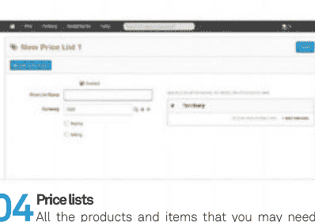 

## 04 价格列表

所有你需要采购的产品和物品，以及你的组织销售的成品，都有与之关联的价格。现在价格不再仅仅是成本函数；还有其他因素如需求和运输成本。在动态场景下，它用于设置不同的参数。`ERPNext` 支持价格列表，你可以从`Buying/Selling/Setup/Price` 章节轻松访问它们。查看价格列表，有两个默认列表可用。

## 06 建立品牌


品牌是业务非常重要的一个方面。正如人们所说，即使你很小，与外部实体沟通也很重要。`ERPNext`有一个名为`Print Format`（打印格式）的功能可以帮助你实现这一点。打印格式定义了文档类型的格式。你可以自定义布局，它会自动获取`Print Format`中的表单。开始之前，前往`Setup > Printing and Print Format`添加新的打印格式。点击编辑器中的`New`按钮。在下一页，选择此打印格式适用于什么文档类型。你需要为格式编写`HTML`，你可以使用`Bootstrap CSS`框架和模板设计器。现在点击左角的按钮。填写详情并勾选类型复选框。点击`Save`，你将看到列出的新价格列表 

## 05 工作流

工作流是组织不可或缺的一部分，`ERPNext`让你在这个领域进行定义。让我们看看如何根据角色实现工作流：首先，工作流适用于`ERPNext`中的文档类型，因此你需要知道工作流基于哪个文档。前往`Setup > Workflow`，然后点击`New workflow`按钮。接下来输入工作流名称和文档类型。你需要设置工作流的状态，并允许在该状态下编辑工作流。例如，在典型的应用程序工作流中，状态将是`approved`、`pending`或`rejected`（默认状态可用，允许通过编辑行添加新的工作流状态）。下一步是添加转换规则，即改变工作流状态的步骤——例如，转换将把应用程序的状态从待定变为已批准。

## 07 购买

背景设置好，让我们通过销售产品来处理基本的业务功能。在企业中，你需要管理这两件事，而`ERPNext`需要做到。在首页上，点击`Buying`。第一个选项在`Suppliers -> Supplier`下——这充当供应商数据库，你可以在这里添加供应商。一旦点击`New`，就可以根据他们的基本信息、联系详情和沟通创建采购订单、收据和发票。这一步步过程涵盖了与供应商相关的所有内容。接下来是`Material List`（物清单），帮助你列出对原材料的需求，随后是`Supplier Quotation`（供应商报价）和`Purchase Order`（采购订单）。这是查找或添加你需要采购的原材料列表的最简单方法。

# 新销售发票 4

## 1. 客户

| 系列 | SINV- | 日期 | 07-05-2015 |
| :--- | :--- | :--- | :--- |
| 客户 | | | 付款日期 | 07-05-2015 |
| 支付方式 | | | | |

## 2. 货币和列表

| 货币 | USD | 价格列表 | 标准销售额 |
| :--- | :--- | :--- | :--- |
| | | | 忽略定价规则 | |

## 3. 项目

| 项目 | 数量 | 单价 | 金额 |
| :--- | :--- | :--- | :--- |
| | 点击行进行编辑/删除 | 添加多行 | 添加新行 |

> 你将找到所有的主要 HR 管理功能：员工记录、请假申请、考勤、工资单

## 08 销售管理

管理销售，点击主页上的“销售”部分。这里的第一个选项是`Lead`（线索）——一个潜在客户数据库，类似于`CRM`工具，你可以在其中跟踪对话并将线索转换为客户。第二个`Customer`（客户）是指你已经向其购买过东西的人或机构。第三个选项是`Quotation`（报价）。线索和`Opportunity`（机会）的区别在于，线索是可能变成机会的展望，而机会是根据购买意向定义的。这意味着只有在满足某些标准时才能创建机会——例如，让你进行产品演示。机会可以从线索或客户创建。第四个是报价，用于向客户或线索提供报价。然后是`Sales Orders`（销售订单），列出已确认的订单。最后三个选项与“购买”部分相同。

## 09 发票

在交易类型中，有两种类型的发票——销售发票（开具给客户）和采购发票（由供应商开具）。要访问销售发票，请前往`Documents / Sales Invoices`并创建新的销售发票。在弹出的表单中，你可以填写详细信息或选择从订单或交货单中填充数据。同样，要访问发票，请前往`Documents / Purchase Invoices`并创建新的采购发票。显而易见，这必须由供应商开具，在现实场景中，供应商将访问系统并开具发票。注意，采购发票可以使用`采购订单`或`采购收据`的数据进行预加载。

## 10 人力资源管理

`ERPNext`是一个涵盖业务几乎所有方面的工具。谈到重要性，我们刚刚只涵盖了`HR`管理。最后，让我们看看如何在`ERPNext`中管理人力资源。你可以在主页上看到`Resources`部分。点击进入以找到所有人力资源。在`HR`管理功能下：员工记录、请假申请、考勤、工资单和休假开放政策。接下来，点击左侧边栏；你可以找到请假流程和休假分配策略。要处理工资冻结日，点击`薪资`链接并在连接的分支、部门和职位中填写详细信息。你还可以勾选“发送电子邮件”复选框，通过电子邮件向所有员工发送工资单。“上传考勤”允许你通过`CSV`文件上传员工考勤，而“休假分配”可以在休假周期开始时向员工分配指定的假期。

www.luxuser.com 33

# 教程：Debian Live 系统

## 制作你自己的 Debian

使用`Debian Live`系统工具，学习如何制作一个为你定制的全新`Debian`系统。

`Debian 8.0 'Jessie'`已发布，你可以在上一期中阅读我们的评论，我们给了它`8/10`的评价。

## 01 寻找构建器

在本教程中，我们将使用`Debian Live`系统。这不仅是一个你可以在`Debian`上实际使用的软件，还是一个极好的生成器。我们将使用该系统的网页版本，这使其更容易配对和生成镜像。你可以通过访问以下地址查看它：`http://live-systems.org`。

现在你可以将其作为稳定发行版进行编辑，通过发布新版本切换到`'09 'Stretch'`，或者创建你自己的自定义`Debian`以按你意部署。

## 02 启动构建器

在这里，你可以阅读软件的不同列表，包括构建发行版的开发版本、旧版本以及其中使用的镜像。现在，我们实际上对构建一个发行版感兴趣，因此点击顶栏上的“构建”（`Build`）并选择`Debian`，进入可以根据我们的喜好自定义构建的界面。

今天我们将查看如何使用`Debian Live System`创建自定义的`ISO`。通过该项目和工具，你可以创建你感兴趣的发行版的自定义版本。

创建自己的版本的好处是能够包含与你的需求相关的软件包、在特定架构上运行，并且通常使其更符合你的需求。

我们将使用在线工具创建此自定义镜像，但它们与`Debian`内部的工具非常相似，当你决定更深入地从发行版中进行编辑时，它们将让你能够创建自己的分支。

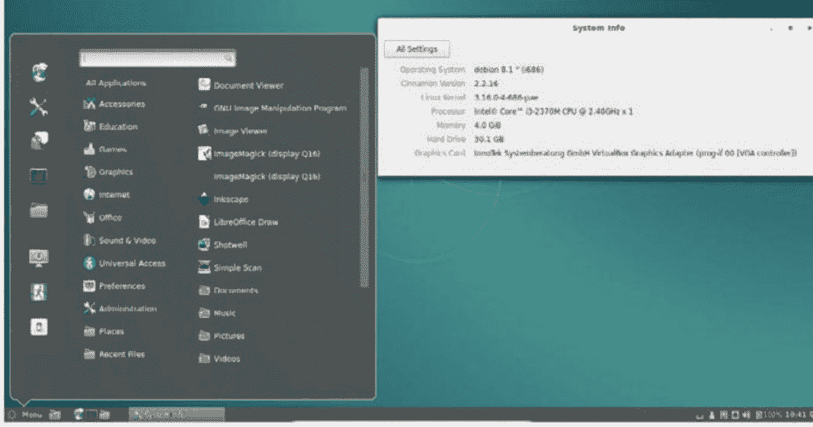

通过浏览器使用发行版内置的工具轻松创建自定义`Debian`

# Live Systems 项目

## 寻找构建器

# Live Systems

`Live Systems`项目维护构建基于`Debian`的`Live`系统的组件以及官方`Debian Live`镜像本身。

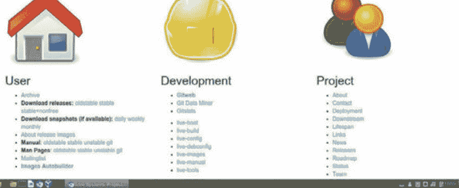

# 用户

# 开发

# 项目

- `Archive`
- `stable-monthly`
- `weekly`
- `Debian`镜像
- `unstable`
- `Manlinux`
- `Gitbuild`
- `Giso`
- `Gists`
- `live-boot`
- `live-config`
- `live-images`
- `live-tools`
- `About`
- `Contact`
- `Deployment`
- `Distributions`
- `Livejaro`
- `Links`
- `News`
- `Roadmap`
- `Team`

## 05 默认软件包选择

你可以设置`ISO`安装某些软件包作为默认部分，使用`package-list`字段。你需要添加软件包名称并确保拼写正确。软件包限制为 255 个，所以请只添加必需包。

> 有大量的文档可以帮助你操作系统

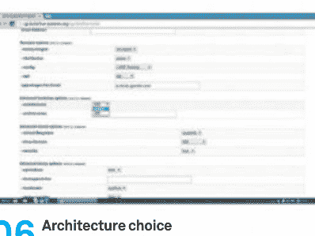

## 03 选择镜像类型

在输入地址后，你有很多镜像类型可供。`ISO`是发行版的纯镜像，也用于从`CD`或`USB`启动。内核通常用于网络启动（`netboot`），即网络安装。混合类型结合了`ISO`和从介质启动的能力（如`USB`盘）。

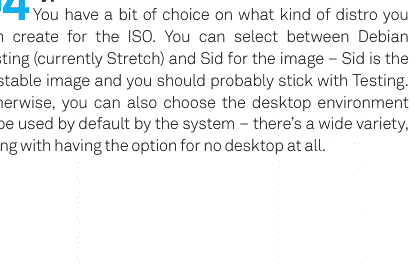

# Live 系统镜像


Debian 中可用的 live 系统镜像可以根据当前设置进行自定义。你想要本地启动的各种选项，ISO 是其中一种选择。该包被称为 `live-boot`。

## 04 Debian 类型

你对可以创建 ISO 的发行版有一定的选择。对于 Debian (Stretch) 和 Sid 是可能的——Sid 是不稳定镜像，你可能留在 Testing。否则，你还可以选择用于系统的桌面环境——带有完全无桌面的选项。

## 06 架构选择

使用 32 位还是 64 位 ISO 完全取决于你的用例。32 位 ISO (`x86`) 功能更全，适用于维护类型。为了获得彻底的结果，64 位 ISO (`amd64`) 是首选。你可以返回创建一个不同架构的 ISO。

`www.luxuser.com` 35

# 教程：Debian Live 系统

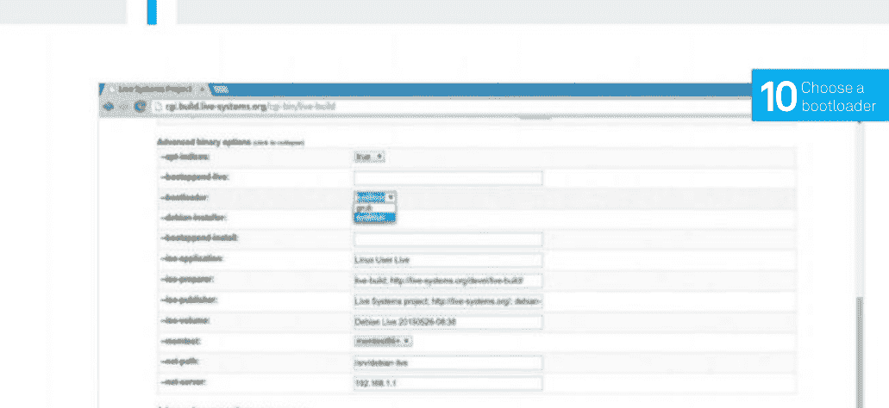

没错。你对构建有精细控制，一直到引导加载器。

- 其他发行版：Debian 不是你可以构建的唯一发行版，Ubuntu 以及其他状态的如 `SUSE Studio` 也使用了这些工具。你也可以在这里找到它们。

## 07 更多架构选择

除了基础架构选择，你还可以直接进入结构来优化你的发行版以满足 live 风格的任务。如果你正在构建 64 位系统，这通常就是你需要的。对于 32 位构建，有更多选择。对于其他处理器，486 可以工作，但无法充分发挥其性能。设置 `686-pae` 将需要 4 GB 内存。

## 08 Chroot 文件系统

你可以从其启动的根文件系统是我们刚刚讨论过的 `chroot-filesystem` 选项。它默认设置为 `Squash`，这是目前的标准，但如果你想为不同的机器使用另一种文件系统，可以选择 `ext2`。

## 09 额外启动选项

在高级启动选项中，我们可以为特定用例添加额外项。你通常保持这些默认值，但有一些你可以可行更改的选项以获得最大。首先是 `bootstrap-live` 选项：它允许为你正在创建的发行版添加额外选项。设置分辨率以及任何你想要的启动选项都将添加到这里。

## 10 选择引导加载器

Live 系统使用 `livlinux` 进行构建，尽管这取决于 ISO 中包含什么种镜像。多架构或多内核通过 `GRUB` 启动更容易。我们无法在该镜像中实现这一点，但如果你遇到问题，可以轻松尝试使用不同的引导加载器构建镜像。例如，我们建议使用 `syslinux`，如果在你的特定用例中不起作用，再选择 `GRUB`。

## 11 选择安装程序类型

ISO 中的安装程序有三种选择。首先，你可以有一个并使其进入 live 启动，所以如果 ISO 正好是你想要的，你可以直接进入安装。最后，你选择从 live 环境运行。我们选择 live 使我们能够在不重启系统的情况下使用安装程序。

## 12 ISO 选项

标记为 ISO 的选项只是为了按你的方式安装 ISO。你可以保持原样，它们不会改变任何内容；如果你想发布你的 Debian 发行版并在主题中使用一些额外信息，也可以更改它们。卷将显示为 ISO 名称，并应用发行版选择器。

## 13 最终二进制选项

你可以设置一些额外选项，例如 ISO 中不包含的内容，以及用于通过 `net-path` 构建 Netboot ISO 的位置，`net server` 是可用的。最后这几个对于普通 ISO 不需要更改，如果你正在制作可启动的发行版，你只需要确保环境设置并知道这些字段需要添加什么。

# 外观

Pi 以太网供电 | Linux 用户与开发者 - 为 GNU 时代的 Linux 和 FOG 大量 - Icewe...


# 源文件

14 如果你也想获得该发行版的源码版本，也可以将源码选项设置为 `true`。默认情况下，这将创建一个包含发行版源码的 `TAR` 文件，但如果你需要，也可以更改其他选项。你保留的时间可以为你节省费用，但如果将来你发现自己需要单独的源码，记住这一点绝对是个好主意。

> 编译过程理认为应该花费一小时，但在我们的测试中，它确实花费了更长时间。

16 使用你的镜像

一旦你发现镜像已准备就，就可以下载并将其删除到任何你需要的地方。将其加载到虚拟机或即时启动介质中，然后检查你的新镜像。通过查看菜单来确保你已安装了所有的软件包，并确保构建本身中具有正确的架构和选项。

上方请记住你的设置，以便检查你的发行版是否已启动。

17 安装你的镜像

如果你想在你的系统上安装它，可以像我们讨论的那样，从即时环境进行。如果你遇到问题，请尝试构建中的其他选项，直到它按计划运行。如果你想跳过即时环境，也可以使用启动菜单中的命令行和安装程序。

18 使用你的 Debian！

一旦你检查并确保你的新镜像运行正常，就可以开始更新它。随着 Debian 的更新，你拥有的系统也会之更新，如果你无法访问互联网，可以获取 `zsync` ISO 进行更新。你也可以随心所欲地分发，因为它是根据 OFL 许可的免费软件。

# 15 构建你的发行版

对所有项双击并点击提交。你将看到你的选项列举，方便你记住它们，以及可以使用两个链接。其中一个可以让你检查构建过程，而另一个是通往实际 ISO 文件的链接。编译过程理认为应该花费一小时，但在我们的测试中，它确实花费了更长时间。记住尽快下载你想要的所有文件，因为它们将在 24 小时后被删除。


# RAID 阵列教程

# 构建 RAID 阵列

使用 RAID 在你的 PC 或服务器中创建更快更安全的存储系统


似乎我们目前正处于硬盘存储的瓶颈期。我们的存储容量已经达到了约 6 TB，而且 4 TB 硬盘已经流通多年。幸运的是，从 4 TB 到 6 TB 的跳跃大于存储的翻倍——毕竟仍然有大量数据——但事实是，文件变得越来越大，积累的数据也越来越多。

# 硬盘选择

对于我们将要使用的所有不同版本的 RAID，在存储方面——也就是说你至少需要使用相同容量的硬盘——如果你有一块 2 TB 的硬盘，那么它们都必须是 2 TB 的。使用相同的硬盘允许读写操作在系统的每块硬盘上进行复制。这意味着为了正确写入文件，硬盘的大小必须完全相同。对于此任务，建议使用相同大小和型号的硬盘以获得最佳 RAID 体验。这不仅允许硬盘之间具有更高的校验性，还使得替换阵列中任何损坏的硬盘变得更加容易。至于写入速度，只要所有硬盘的速度相同（相同型号的硬盘），5400、7200 或你拥有的任何其他速度的硬盘都没有问题。

长期以来，一直存在一种方法通过汇聚多个资源来创建更大的存储解决方案——其优点通常是增加读取速度和写入速度，并提供大容量存储区域。

在本教程中，我们将教你设置自备的 RAID 阵列所需的所有知识。这不仅涉及通过硬件 RAID 进行操作，还包括 Linux 中的软件 RAID。我们将展示如何实际上实际选择硬盘、应该使用哪种 RAID 级别以及它们的优处是什么。

## 资源

`mdadm`

# 硬件 RAID 支持

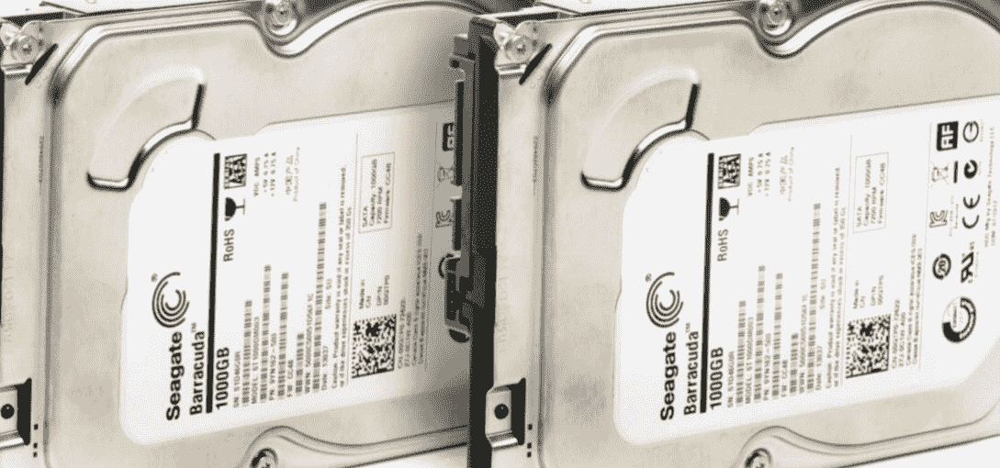

# RAID 0

| `A1` | `A2` |

|---|---|

| `A2` | `A3` |

| `A3` | `A4` |

| `A5` | `A6` |

| `A7` | `A8` |

# RAID 1

| `A1` | `A2` |

|---|---|

| `A2` | `A3` |

| `A3` | `A4` |

| `A4` | `A5` |

| `A7` | `A8` |

# 选择 RAID 类型

左位条带（Left Striping）向左将数据分散到硬盘上，而镜像（mirroring）则是复制它。RAID 有不同的类型，从 0 开始编号。数字越高，系统越复杂（RAID 10 除外，它是 RAID 1+0 的常用缩写）。选择类型取决于你的需求。这不仅允许硬盘之间具有更高的校验性，还使得替换阵列中任何损坏的硬盘变得更加容易。至于写入速度，只要所有硬盘的速度相同（相同型号的硬盘），5400、7200 或你拥有的任何其他速度的硬盘都没有问题。

长期以来，一直存在一种方法通过汇聚多个资源来创建更大的存储解决方案——其优点通常是增加读取速度和写入速度，并提供大容量存储区域。

在本教程中，我们将教你设置自备的 RAID 阵列所需的所有知识。这不仅涉及通过硬件 RAID 进行操作，还包括 Linux 中的软件 RAID。我们将展示如何实际上实际选择硬盘、应该使用哪种 RAID 级别以及它们的优处是什么。


# 设置软件 RAID

要设置软件 `RAID`，你首先需要确保所有的硬盘都已安装在你的系统中。在本例中，我们已经在另一块完全不同的硬盘上安装了 `Linux`，但你可以使用相似的设置在 `Linux` 启动盘（`live disk`）中创建 `RAID` 以进行安装。启动进入 `Linux` 并使用终端完成操作。

首先，我们需要确定系统中的哪些硬盘被标识出来，因此请使用 `fdisk -l` 获取它们的地址列表（例如 `/dev/sda`, `/dev/sdc`）。将它们记录下来，然后就可以设置 `RAID` 了。

## 创建阵列

`RAID 0`:

```bash
# mdadm --create --verbose /dev/md0 --level=0 -raid-devices=2 /dev/sdb /dev/sdc
```

`RAID 1`:

```bash
# mdadm --create --verbose /dev/md0 --level=mirror -raid-devices=2 /dev/sdb /dev/sdc
```

`RAID 10`:

```bash
# mdadm --create --verbose /dev/md0 --level=10 -raid-devices=4 /dev/sda4 /dev/sdb /dev/sdc /dev/sd1
```

`RAID 5`:

```bash
# mdadm --create --verbose /dev/md0 --level=5 -raid-devices=3 /dev/sdb /dev/sdc /dev/sd1
```

> 设置软件 `RAID` 在 `Linux` 内核层受支持，并且可以提供更大的灵活性

`RAID 6`:

```bash
# mdadm --create --verbose /dev/md0 --level=6 -raid-devices=4 /dev/sdb /dev/sdc /dev/sd1 /dev/sd2
```

## 保存并格式化

一旦你对创建的阵列（或多个阵列）满意，你就需要保存它。在 `Ubuntu` 上的方法如下：

```bash
# mdadm --detail --scan >> /etc/mdadm.conf
```

在具有此功能的其他系统中：


```bash
# mdadm --scan /etc/mdadm.conf
```

运行`/proc/mdstat`查看文件中列出了哪些阵列，它应该符合你刚刚设置的格式。如果那里没有，那么你需要使用命令行添加它，或者编辑`/etc/fstab`文件以便在启动时挂载，这样你的 RAID 就完成了！你再也不必担心擦除任何东西了。值得深入研究`mdadm`的 man 页面，学习未来如何使用它来管理你的 RAID 并保持其状态。

## JBOD

RAID 的一种更简单的替代方案是 JBOD，即“一组磁盘”（Just Bunch of Disks）。如果你想增加存储容量并将其分布在硬盘上，这种方法非常完美。你只会丢失故障硬盘上的文件，而不需要更换硬盘。

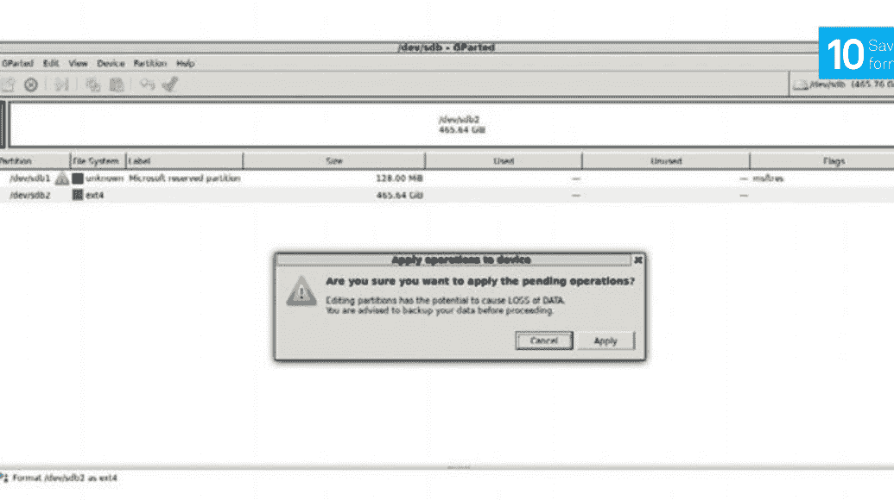

# Kinect 教程

## 在 Linux 下使用你的 Kinect


### 微软 Kinect 传感器提供了采集深度和颜色的便捷方法

几年前，微软的 Kinect 曾非常风靡。随着时间的流逝带走了演示和追随者，第二代传感器已上市。在最初发布几年后，现在是时候看看 Kinect 实际上能做什么了。

### 安装

用于 UNIX 的 Kinect 驱动程序在`freenect`项目中开发。在旧版本的 Ubuntu 上工作时，需要使用自定义的 PPA 来获取较新版本的库。这很重要，因为 2011 年 2 月的版本中发生了二进制兼容性破坏。我们的示例使用了新的`liblinux` API，无法用第一个版本进行编译：

**Tom Hanna**

自 Palm Pilot 时代起一直活跃在科技领域。记者、游客、演讲者和作者，曾多次接触移动硬件的每一个方面。

```bash
sudo add-apt-repository ppa:flooe/liblinux
```

```bash
[sudo password for tahanman:
liblinux 是一个基于 Ubuntu 的多点开发平台
```

欲需更多信息，请访问首页：http://tisch.sf.net/

按 [ENTER] 继续或按 Ctrl+C 取消

```bash
tahanman@ubuntu: sudo apt-get update
tahanman@ubuntu: sudo apt-get install liblinux-dev
liblinux-dev-fereetdev
```

## 资源

Qt Creator

bit.ly/thhnQny

在编写本文时，我们将重点关注广泛使用的原始 Kinect，并提到那款以奇异且仅在规格参数上出闻的继任传感器。

在购买 Kinect 时，有多个版本可选。标准版是 Windows 版 Kinect。它专为桌面使用设计，配有电源并支持近距离模式（Near Mode），我们在这里不会涵盖这一点。为 Xbox 360 设计的 Kinect 也可以使用，但它们需要适配器将插头转换为可访问的格式。

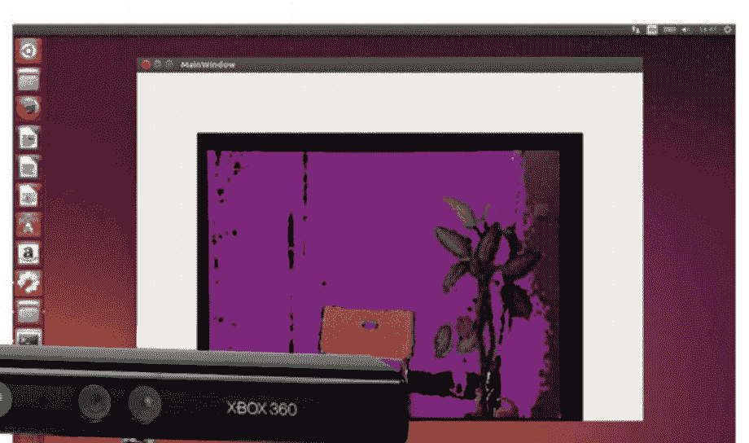

这里是 Kinect 设置为检测距离的输出。如果你有一个 Kinect，它应该显示你刚刚设置的格式。

为了让主机提供数据。处理深度数据比处理深度要容易。这就是为什么我们将首先查看处理传入摄像头帧的事件处理器：

```cpp
void MainWindow::color(data) {
  qDebug("Color here");
  if(myColor!=NULL)delete myColor;
  myColor=new QImage(640,480, QImage::Format_RGB32);
  unsigned r, g, b;
  uint8_t* p=(uint8_t*)data;
  for(int x=0;x<640; x++) {
    for(int y=0;y<480; y++) {
      r=p[y*640+x*3];
      g=p[y*640+x*3+1];
      b=p[y*640+x*3+2];
      myImage->setPixel(x,y);
    }
  }
}
```

```cpp
free_data() {
  colorFlag=true;
  myHost->colorTexture();
```

Kinect 提供的颜色是一组无排序的索引。我们的映射必须找到单独的像素坐标。在实际代码中，将其写入`QImage`是困难的。在分配内存时，最好使用`memcpy`顺序来节省处理时间。

最后。在`KinectHost`中分配后通过释放进行处理。现在不会产生足够在几秒钟内绘制高分辨率图像的内存泄漏。最后设置了`myHost->colorTexture`以宣布颜色已销毁并选择了新的。处理深度数据稍微复杂一些，如下所示：

```cpp
void MainWindow::paintEvent(QPaintEvent *event) {
  if(colorFlag) {
    colorFlag=false;
    uint8_t*data=(uint8_t*)data;
    if(myCombinedImage!=NULL)delete myCombinedImage;
    myImage=new QImage(640,480, QImage::Format_RGB32);
    for(int x=0;x<640; x++) {
      for(int y=0;y<480; y++) {
        int caldata=data[y*640+x];
        if(caldata!=FRENECHT_MM_NO_VALUE)
          if(caldata<1500 && caldata<3000)
            myCombinedImage->setPixel(x,y);
      }
    }
  } else {
    myCombinedImage->setPixel(x,y,qRgb(128,128,128));
  }
}
```

```cpp
free_data() {
  myHost->depthTexture=true;
  repaint();
```


顺便说一下，深度图与颜色没有太大，它们由无排序的 `16` 位整数组成，表示传感器主平面的距离。我们使用这一点并返回返回值来决定要绘制的图像颜色。我们将绘制距离在 `500` 到 `3000` 米之间的物体。所有其他元素将显示黑色或粉色。仅允许在 `paint` 事件中重绘元素，每个深度事件都通过此强制执行，这是硬编码将颜色写入位图以显示的方式：

## 总结

我们的深度采样正在变得新颖。运行它查看你周围的一部分。与微软的示例相比，我们的应用程序在设计效率上并不接近。骨骼相关性在主机上处理，微软没有使用 Windows SDK 中使用的算法来提供自己的跟踪库，但在 Apple 之后由于其未来潜力不安全，它已被下线，我们不会讨论 `OpenNI`。

有关设置你的 `Kinect` 的更多建议，请查看 `openkinect`

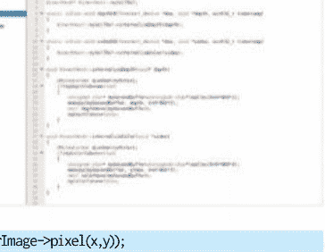

# Linux shell 教程

## 编写你自己的 Linux shell – 第一部分

## 如何开发你自己的 Linux shell 甚至闻名世界

在这一部分指南中（下个月继续），我们将展示如何编写一个小型但功能完备的 Linux shell。这两个教程将帮助你理解与操作系统代码交互的原理和技术。

### 快速总结

需要一个 shell，以便每个 Linux 程序员或管理员都能执行程序并与操作系统及硬件交互。包含你的 shell C 代码的文件名可以是任何名称，但下部分将更具实用性。

shell 是为 Unix 操作系统提供传统用户界面的解释器。你可以通过输入作为文本执行的命令或通过创建 shell 脚本来操作 UNIX 系统。一些重要的 shell 包括 `Bourne`、`Korn` 和 `Csh`。如今，最常用的 shell 是 `Bash`，它是 `Bourne` 的一个大超集。

在这里，我们将提供更多理论信息和少的代码，而下部分将更具实用性。当你对理论有疑问时，请查看以下信息（见 `File0com`）。

开发一个简单的 shell 很容易。编写一个用户友好、可靠且安全的 shell 并非易事，但你决定开发自己的 shell、如何编写和编辑代码以及如何编译它，`GCC` 编译器可能也会在需要终止进程时受益于知道使用 `kill(command)`。关于 `Bash`，`Bash` shell 是一个非常流行的 shell，也是大多数 Linux 用户的默认 shell，如果你在处理项目，查看它的源代码对教育很有帮助。阅读代码是学习新技术和理解程序如何实现的极佳方法。如果 `Bash` 的源代码对于喜欢处理脚本的 Linux 管理员来说很大。他自 `1993` 年以来一直是一位数学家。

### 资源

这些是 `Bash` 的源文件——编写强大的 shell 需要：

| 文件名 |
| :--- |
| `cd.bash` |
| `builtins.bash` |
| `change.bash` |
| `cmd.bash` |
| `array.bash` |
| `run.bash` |
| `config.bash` |
| `examples.bash` |
| `auth.bash` |
| `alloc.bash` |
| `hash.bash` |
| `int.bash` |
| `line.bash` |
| `brace.bash` |
| `sub.bash` |
| `error.bash` |
| `jobs.bash` |
| `path.bash` |
| `complete.bash` |
| `tests.bash` |
| `trap.bash` |
| `unwind.bash` |
| `malloc.bash` |
| `check.bash` |
| `make.bash` |
| `general.bash` |
| `hashed.bash` |
| `hashlib.bash` |
| `no.bash` |
| `display.bash` |
| `include.bash` |
| `input.bash` |
| `output.bash` |

### UNIX 系统


## 获取

```c
printf("Welcome to UD\n");

// 循环命令
while (!finish) {
    // 打印提示符
    printf("%s ", prompt);

    // 读取命令
    fflush(stdout);
    if (fgets(line, sizeof(line), stdin)) {
        t = NULL;
        finish = 1;
    } else {
        printf("The command was %s\n", line);
    }
}

return (0);
```

## 获取输入

```c
// 循环命令
while (line) {
    // 执行外部命令
    system(line);
}
```

在 shell 中使用 `fgets(3)` 来处理输入，无论是 `Korn Shell` 或 `Bash`。

### 如何构建复杂的 bash

shell 解释器运行解释器会产生关于操作的信息，结果。解释器持续接受命令，直到用户通过注销或运行退出命令退出 shell。在成功执行后，shell 将信息存储在 `~/.history_file` 中。

### main 函数的功能

如你所知，每个程序都包含一个名为 `main()` 的函数，它是可执行文件的入口。

```c
int main(int argc, char **argv);
```

`main()` 函数将包含所有功能，所以请注意它。

# Linux shell 教程

```c
2. mtsouq@mail:~/docs/article/working/UniShell1.LUD/code(1)
code cat PATHenvv.c

// Programmer: Mhalis Tsoukalos // Date: Wednesday 13 May 2015

// Using UNIX Environment Variables

// Compile it as follows:

// gcc -std=c99 -Wall -o PATHenvv.c

#include <stdio.h>
#include <stdlib.h>

extern char *environment;
int main(int argc
```

## 11 关于 UNIX 环境变量的更多信息

请注意代码顶部的说明。

## 代码优化

你可能会说：“不要为了改进现有代码而修改代码！”但我们知道，如果代码运行符合预期，让它变得更好总是好的。此外，确保代码包含了你所实现的所需的功能，这是关于你需要的主要逻辑推理。

## 08 实现一个 shell 命令

第一个任务是能够识别 shell 命令并能够执行它，同时考虑它的参数。

使用 `if` 子句的非常简单的实现对于构建命令是有帮助的；下一步是更好的实现。这里介绍的方法是为了展示此类 shell 在处理少量命令时运行得良好。

## 11 关于 UNIX 环境变量的更多信息

所提供的 C 代码通过读取 `getenv` 并打印其内容，展示了环境变量的使用。然而，我们希望在下期中作为本教程的一部分，展示这种技术如何在 shell 环境中使用。。

## 09 关于命令实现的更多信息

在确定了你需要执行哪种命令后，我们将编写该命令的代码。如果命令行接受任何参数，代码将按照以下步骤处理这些参数。

目前的实现使用了一种简单的方法，这必须等到第二部分才能看到更复杂的技巧，即每个 shell 都用一个 C 函数来实现。。

## 10 环境变量

利用环境变量自定义 shell 的一种良好方法。因此，shell 必须能够成功使用它们。

如果你想获取特定环境变量的值，应该使用 `getenv()` C 函数，而不是直接访问环境变量。其他处理环境变量的函数是 `putenv3()` 和 `unsetenv3()`。

## 12 编译代码

C 代码将像一个 C 程序一样被处理。完整的命令是：

```bash
$gcc -Wall -o lud11.c
```

在开启所有警告的情况下实现代码是一个非常好的主意，以避免之后出现糟糕且棘手的错误。

## 13 执行 shell

你可以像执行普通可执行文件一样执行 shell。如果你想将其添加到路径中，你应该在 `/etc/shell` 文件中包含二进制文件的完整路径。

* 下一步

## cat /etc/motd

Debian GNU/Linux 系统包含的程序是免费软件，
每个程序的具体分发术语在
`/user/share/doc/*/copyright` 中的独立文件中描述。

Debian GNU/Linux 在适用法律允许的范围内
`不提供任何保证`。

```bash
code$ /nud

Welcome to LUD

Debian GNU/Linux 系统包含的程序是免费软件，

每个程序的具体分发术语在

/user/share/doc/*/copyright 中的独立文件中描述。
```


## 14 每日消息（message of the day）实现

Debian GNU/Linux 在适用法律允许的范围内不提供任何保证。

LUD shell ->

Leaving LUD

`code$>`

这相对容易做到。理想情况下，在尝试并打印它之前，必须存在非常良好的 C 代码。棘手的部分是这部分只发生一次，即你第一次使用 LUD shell 时。所以如果你将相关代码放在 `while` 之前，你就完成了。每日消息可以在 `/etc/motd` 内部找到。

该功能的简易实现是：

```c
system("/bin/cat /etc/motd");
```

如果没有 `/etc/motd` 文件，信息类似于：

```
cat: /etc/motd: No such file or directory
```


第二部分将是更好的实现，请等候我们将为你准备好。

## 15 其他考虑事项

编写 `shell` 时最关键的问题是：“什么应该由 `shell` 实现，什么应该交给操作系统？”这更多是一个没有答案的哲学问题。就像程序的规范一样，你应该决定要实现什么并采取相应的行动，否则你永远无法完成你的 `shell`：

> 不用说，`shell` 必须成功与操作系统交互并执行系统命令

## 16 让 `shell` 运行起来的功能

`shell` 必须成功与操作系统交互并执行它的安全性也至关重要。对于一个 `shell` 变得有用，它还必须具有易于读写的命令，并产生能够充分解释情况的错误消息。最后，`shell` 拥有自己的脚本语言是好的，但请记住这不是一项平凡的任务。

上面这是一个简单的示例，但你的每日消息可以根据 `shell` 的目的进行定制。

## 17 接下来是什么？

到目前，你对 `shell` 有了良好的了解，知道了 `shell` 的目的以及基础内容是如何用 `C` 实现的。本文的下一部分将实现更多内容。

## 扩展你的 Pi

| 模块名称 | 描述 |
| :--- | :--- |
| `ADC Plus` | 8 通模拟数字转换 |
| `IO Plus` | 32 路数字输入或输出 |
| `RTC Plus` | 带有电池备份的实时时钟 |
| `PoE Plus` | 带有电源管理的以太网供电 (`HAT`) |

# 树莓派升级方案

## 全方位保护你的 Pi

### `Short Crust Plus`
$8.99 / $15.95 购买地址：`bit.ly/1c1fbw`

树莓派是一款非常耐用且可靠的微型电脑，尤其是当你考虑到它只是一块带有良好保护的组装电路板时。然而，某些时候你可能想给你的 `Pi` 准备一个漂亮的外壳。也许是因为你想让基于 `Pi` 的家庭影院在所有电子设备旁边看起来更时尚，又可能你只是想在把它装进口袋里时让你的这台微型电脑远离灰尘。

`Short Crust Plus` 是我们最喜欢的 `Model B+` 和 `2B` 树莓派外壳之一，因为它的设计精巧且价格亲民。它也非常易于使用——`Pi` 直接卡入外壳内部，盖子咔哒一声即可到位。每个外壳都带有一组自粘橡胶脚垫和几个磁铁，允许你增加外壳的高度，以容纳你可能使用的任何扩展板。

## 便携式与太阳能电源

### `PiJuice`
£25 / $39 购买地址：`bit.ly/1fb1my`

你现在可以拥有一个精美的微型扩展板，它让你的项目脱离电网并离开市电源。`PiJuice` 符合树莓派 `HAT`（顶层硬件扩展）规范，并使用简单的螺钉固定方法提供智能充电和电源电路，让你的 `Pi` 真正变得便携。它还有一个名为 `PiJuice Solar` 的版本，能够从可再生能源获取输入。

`PiJuice` 还具有一个强大的 `ARM Cortex M0` 处理器，提供深层睡眠功能、实时时钟、看门计时器以及许多其他实用功能。`PiJuice` 的固件和 `GUI`（图形用户界面）带有常用的 `ACP`（高级配置和电源）系统，可提供高达 `5A` 的电流，以与树莓派进行高度集成。树莓派仅使用一个 `I2C` 感应引脚，留了一个空闲以与其他设备配合，其紧凑的设计使得顶部添加其他 `HAT` 或扩展板变得极其简单。`PiJuice` 将使你能够制作各种酷炫的项目——请查看 `Instructables` 页面：`bit.ly/2coeEE`


## 特性

## 电源开关与安全关机

### `Pi Supply Switch`
£15 / $23.10 购买地址：`bit.ly/1RXHR0n`

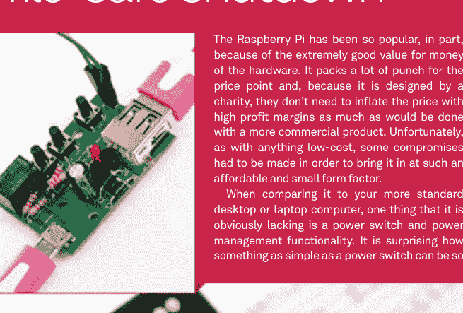

树莓派如此受欢迎，部分原因是因为其硬件具有极高的性价比。在这个价位下，它提供了强大的性能，而且因为它是由一家慈善机构设计的，他们并不打算像许多商业产品那样的通过高利润来抬高价格。遗憾的是，对于任何低成本产品，为了保持其如此廉价且小巧的外型，必须做出一些妥协。

`Pi Supply Switch` 是一个自锁套件，提供开启和软文件安全关机功能，为你提供电源管理自由度。通过提供的示例脚本，你可以在关闭媒体开关或解决终端中的任何问题时，让 `Pi` 关机——且唯一的电路确保了只有在 `Pi` 关机后才会切断电源。更可靠的关机方法可以减少因拔掉电缆导致 `SD` 卡损坏的可能性。

将其与你更标准的桌面或笔记本电脑相比，有一点是显而易见的：寻找具有管理功能的电源开关。惊讶的是，像电源开关这么简单的东西竟然非常有用，而且在你拥有它之前你并没有意识到这一点！


## 红外线看清黑暗

### `NoLoR` 红外线摄像头
£16.80 / $29.95 购买地址：`bit.ly/9QyeC4`

树莓派上的 `CSI` 接口（在最新型号中位于 `3.5 mm` 接口和 `HDMI` 接口之间）允许你直接连接摄像头模块，而无需 `USB` 摄像头。你在这里使用的摄像头模块是即插即用的，而且正如树莓派基金会所预期的那样，它们采用了极小的尺寸——重量约为三克（不包括电缆）——`24x9mm`。

正如你预期的那样，有一个“正常”摄像头模块，我们指的是那种具有令人印象深刻的光感捕捉能力的 `5MP` 定焦摄像头，它支持带有位滤波的 `1080p`、`720p` 和 `640p` 全速运行。但当摄像头模块首次发布时，有些人对可见光摄像头并不满意，并有其他（非常有用的应用想法——他们要求在重新安装所有东西之前更换微型摄像头）。这种配对运行良好，但限制了多样性，但有太多的人在这样做，以至于树莓派基金会注意到了并开始自己制作。

红外线有一些相当常见的夜间用途，如果你将你的 `NoLoR` 与红外 `LED` 配对，可以查看一下 `Bright Pi` 板板。然后你可以轻松设置夜视监控摄像头或监控设置。最令人惊讶的是，如果你在白天使用摄像头，它实际上可以监控绿植物的健康 [`bit.ly/2QznFG`]。

# 树莓派升级方案

## 为你的摄像头提供移动能力

### `Pi-Pan Tilt` 云台
£45.99 / $39.99

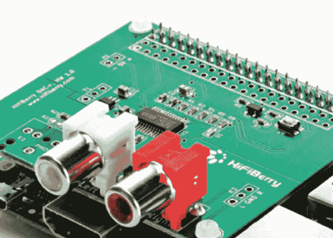

页面对侧的摄像头模块是你树莓派工具箱中必须具备的一些基础升级，但如果你想移动摄像头以获得不同的视角会怎样？这在许多项目中都很有用，例如带有交互界面的机器人（许多摄像头已经具备了此功能）；`Open Electronics` 是一种云台机构，它可以让你的摄像头上下移动 `110` 度，左右移动 `180` 度。该套件包含硬件和软件的组合，以及用于摄像头驱动和移动所需的伺服电机。在软件方面，有许多库可以使用。

## 太阳能扩展板

### `PiJuice` 
（此处应接上文的 `PiJuice` 翻译内容）

### `10.1` 英 显示屏与音频
£110 / $154.95

为你的项目寻找合适的显示器可能是件苦事。我们在之前的期数中介绍过 `HDMIPI` (`1/6`)，它是一个非常适合树莓派的 `9` 英寸屏幕。

如果你想要一个不可错过的，`Adafruit` 有一块 `10.3` 英的屏幕。它具有美美的白色显示，是 `IPS` 屏，具有宽视角。它拥有多种接口，如 `HDMI`、`VGA` 和复合视频。最棒的是，这个显示套件还允许你直接连接 `2` 或 `8` 欧姆扬声器，而无需额外的显示放大器或外部电源单元。

它在 `Adafruit` 网站上的 `155` 美元并不是便宜的显示器，但如果你你的项目需要高质量的显示器，那么你应该避免原生显示。我们已经在梦想一个带有立体声音频的专用多玩家模拟器街机了，并相信我们能想出一些酷的应用！

# 树莓派升级

## 控制你的电源插座

### `Energenie Pi-mote` 控制启动套装

£19.99 / $31

购买地址：
`bit.ly/3l1YRKU`

家居自动化是现在的潮流——也许仅仅是因为人类天生懒惰，或者是因为玩这个真的太有趣了！无论哪种原因很重要，因为它可以让我们的生活更轻松、更快捷，并自动化那些无聊单调的任务，比如安装加热控制以及在睡觉前关灯。

我们总是听到的建议是从插头关闭设备而不是让它们一直开启，这是一个明智的建议，但由于插座并不方便碰到，并不是一个实用的解决方案。这正是 `Energenie Pi-mote` 派上用场的地方。它能创建远程控制的电源插座，可以使用 `RF` 遥控器开启和关闭。我们还得到了一个扩展盒，允许你通过软件设置在指定时间自动开关。树莓派允许你使用智能手机远程控制电源插座。

它们只提供英国版和欧版插头类型，所以如果你有需要，你可能需要寻找其他产品（也许可以要求 `Energenie` 更多版本）。

## 手势与触摸控制

### `Pimoroni Skywriter HAT`

£16 / $20.95

购买地址：
`bit.ly/3i1TPdg`

对于你使用树莓派进行的很多项目，你都会需要某种交互。虽然桌面 `GUI` 通常通过键盘和鼠标完成，但当你使用全桌面环境且不需要输入文字时，这些并不是最直观的输入方法。

`Pimoroni` 团队创建了一个新的 `HAT` 模块来控制 `Skywriter`，以极佳的价格为你的项目带来了近 `3D` 的手势和触摸感应。有一个 `Python` `API` 可以提供 `3D` 位置数据和信息（点击等），这需要一点时间来适应，你会发现它是一种非常棒且细节非常丰富的输入方法。`Pimoroni` 甚至制作了一个基于树莓派的自制版本 (`vine.com/vOrWtdtdHg`)。

还有一个更大的非 `HAT` 版本的 `Skywriter`，它的功能完全足够，并且拥有约 `15cm` 的传感距离，这意味着你可以将其安装在项目内部，位于一层亚克力板或其他非导电材料后面，它仍然可以正常工作。如果你想让人们相信你的项目纯粹是魔法，那么它非常棒。


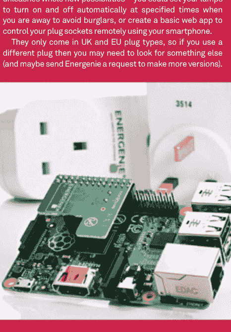

`www.luxuser.com`

`57`

`Minecraft` 方块。指令上带有 `NFC` 标签。当对着 `PN532` 扫描时，它们会将信息传递给 `Minecraft` `API`。

## 组件列表

- 树莓派 2
- 树莓派 `GPIO` 引脚扩展
- `PN532` `RFID`/`NFC` 引脚扩展
- 面板
- `MIFARE Classic 1K` 卡
- 打印并折叠
- `Minecraft` 立体


`Raspberry Pi Tony` 在此项目使用了 `Adafruit` 的 `Cobbler Plus`，它引出了用于 `PN532` 的 `PN532`、`SPI` 和 `I2C` 引脚。

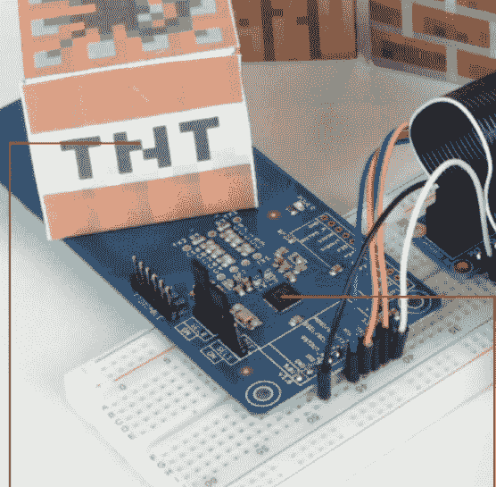

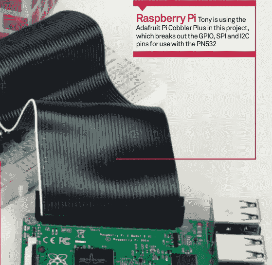

`NFC` 标签。 `NFC` 标签设计用于近距离使用，通常位于物体内部或贴纸中，可以贴在读取器上。

`PN532` `NFC` 引脚扩展
价格为 $40，`PN532` 扩展板功能非常强大。它支持 `RFID` 标签和 `NFC` 标签，并受 `libnfc` 支持。

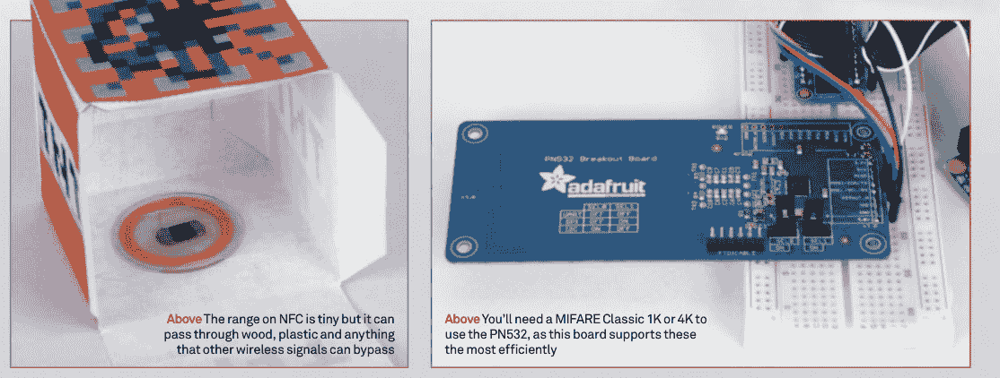

上方。`NFC` 的范围很小，但它可以穿透木头、塑料以及任何其他无线信号可以绕过的物体。

上方。你需要 `MIFARE Classic 1K` 或 `4K` 卡来使用 `PN532`，因为该板对这些卡的支持效率最高。

## # `Minecraft` `NFC`
受 `Amiibos` 启发，`Tony DiCola` 制作了你正在使用的支持 `FC` 的 `Minecraft` 方块。


### 为什么你决定开始使用 `NFC` —— 什么最吸引了你？
我一直在思考如何通过游戏来探索实体——制作一个我可以与之交互的设备或物体。我受到 `Amiibos` 的一点启发，觉得用 `NFC` 可以制作出多么小的人偶。所以我在想，我能不能做一个 `GHY` 的东西试试？那这个又呢？当我意识到树莓派有 `Minecraft`，而且 `Minecraft` 的酷之处在于，通过几行 `Python` 代码就可以创建与现实世界交互的方块时，我认为这太完美了——我可以创建与现实世界交互的方块。

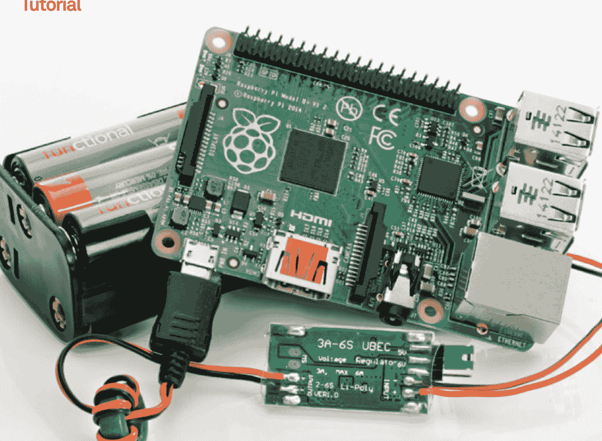

# 教程

# 为你的树莓派添加电池包

不要让你的树莓派闲置——通过使用 5 号电池供电，将其整合到移动项目中

`Christian Cayley` 曾任职 IT 软件工程师，现在提供用户支持。自2010年以来，他已为无数在线出版物和杂志写过文章。

你的树莓派的移动性通常受到电源线长度的限制。然而，与其将其局限于书桌或客厅，不如你可以将其用于移动项目，例如将其发射到近地轨道，或监控和自动化你的花园。在这种情况下，将需要电池，但为你的树莓派供电比你想象的要简单得多。你只需要六节可充电 5 号电池（单碱性）、一个可以容纳它们的电池盒和一个 `UBEC`。后者是通用电池消除电路，它是一种电压调节器，可以调节电源供应并防止树莓派受损，价格不到 10 英镑。

### 你需要什么

- 5 号电池盒：`bit.ly/1FDJGa`
- 3 安培 `UBEC`：`bit.ly/1HLKIh7`
- 3 安培接线柱
- 6 节 5 号可充电电池

# 电池包


## 01 订购组件

如果你在网上购买组件，你应该能够在五天内获得所有物品。然而，如果你是线下订购（`UBEC`），你应该避免电子产品商店，转而访问模型爱好者商店，因为这些电路经常用于遥控（`RC`）设备。

## 05 添加电池以启动

当你的 `Pi` 准备好就绪并插上 `Wi-Fi` 后，将 `UBEC` 连接到微 `USB` 端口，并将第六节电池放入盒中。`Pi` 的电源和状态指示灯应显示电脑正在启动，从而为你提供一台完全便携的电脑。

你还可以使用 `UBEC` 从电池包为你的手机充电。

## 03 更改 3 针连接器

要配合 3 针连接器使用 `UBEC`，针的位置必须与两个外部插槽匹配。

使用小螺丝刀解锁小型塑料卡扣，从中间插槽取出红色线，将其滑入未连接的外部插槽。

## 06 连接 3 针连接器

如果你用新修改的 3 针连接器替换了 `UBEC`，你需要将它连接到树莓派的 `GPIO` 引脚。具体来说，将正极 `+5V`（红色）连接器连接引脚 2，将负极 `0V` 连接到引脚 6。再次检查状态灯以确保 `Pi` 正在启动。

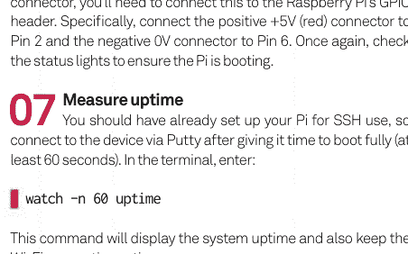

# 使用 `UBEC`

直接从或多个电池为树莓派供电是可能的，但如果没有 `UBEC` 提供的安全性，你不得不处理不受调节的电压。

## 02 检查你的 `UBEC`

有两种类型的 `UBEC` 可用：如果你使用了盒中建议的那种，你将收到一个带有微 `USB` 端口的，方便连接到树莓派。然而，如果你从 `eBay` 购买，那么很有可能你将收到一个带有 3 针连接器的。

## 07 测量运行时间

你应该已经为你的 `Pi` 设置了 `SSH`，所以给它留出足够的启动时间（至少 60 分钟）。在终端中，

```
60 uptime
```

此命令将显示运行时间并保持 `Wi-Fi` 连接活动。

## 08 评估你的性能

运行时间取决于你使用的电池类型和树莓派型号。普通电池可以持续一会，但这是一个更贵的选择。新款型号具有更好的电源性能，但时间更短。需要更多功率，请增加电池！

## 04 将 `UBEC` 连接到电池

将电池放入盒中，用胶带将其连接到 `UBEC`。你可以通过扭转电线或焊接，或者使用切割成两对的 3 针接线柱来实现。你可以根据自己的知识将接线柱切割成合适尺寸。

## 09 极致动力！

并联更多电池应该会导致运行时间翻倍（在 `256MB` 的树莓派 `B` 上至少可运行 16 小时），但除了可充电电池，你可能还会考虑锂电池，它的寿命比碱性电池长得多。

# 教程

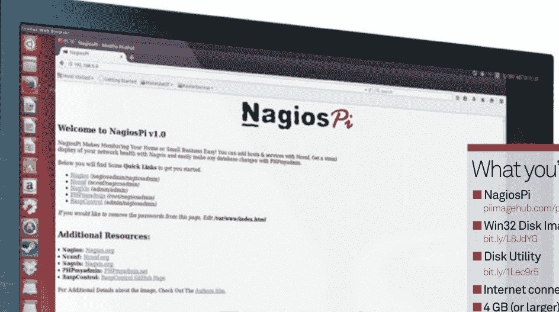

## 欢迎使用 `NagiosPi` `v1.0` 监控你的家庭或小型业务！

你可以向 `Nagios` 添加主机和服务。通过 `NagiosPi`，你可以在找到一些快速链接以开始之前，轻松地进行任何更改。

### 附加资源：
- `Nagios.org`
- `Nagios-Wiki`
- `PHP-`
- `nagiospi-github.com/project/nagiospi`
- `Win32 Disk Imager`：`bit.ly/LbJd`
- `Disk Utility`：`bit.ly/Lecrb`
- 网络连接：`GB`（或更大）`SD` 卡


# 监控你的家庭或小型业务

你可以向 `Nagios` 添加主机和服务。通过 `NagiosPi`，你可以在找到一些快速链接以开始之前，轻松地进行任何更改。

### 附加资源：
- `Nagios.org`
- `Nagios-Wiki`
- `PHP-`
- `nagiospi-github.com/project/nagiospi`
- `Win32 Disk Imager`：`bit.ly/LbJd`
- `Disk Utility`：`bit.ly/Lecrb`
- 网络连接：`GB`（或更大）`SD` 卡

# 监控你的家庭或小型业务

你可以向 `Nagios` 添加主机和服务。通过 `NagiosPi`，你可以在找到一些快速链接以开始之前，轻松地进行任何更改。

### 附加资源：
- `Nagios.org`
- `Nagios-Wiki`
- `PHP-`
- `nagiospi-github.com/project/nagiospi`
- `Win32 Disk Imager`：`bit.ly/LbJd`
- `Disk Utility`：`bit.ly/Lecrb`
- 网络连接：`GB`（或更大）`SD` 卡

# 监控你的家庭或小型业务

你可以向 `Nagios` 添加主机和服务。通过 `NagiosPi`，你可以在找到一些快速链接以开始之前，轻松地进行任何更改。

### 附加资源：
- `Nagios.org`
- `Nagios-Wiki`
- `PHP-`
- `nagiospi-github.com/project/nagiospi`
- `Win32 Disk Imager`：`bit.ly/LbJd`
- `Disk Utility`：`bit.ly/Lecrb`
- 网络连接：`GB`（或更大）`SD` 卡

# 监控你的家庭或小型业务

你可以向 `Nagios` 添加主机和服务。通过 `NagiosPi`，你可以在找到一些快速链接以开始之前，轻松地进行任何更改。

### 附加资源：
- `Nagios.org`
- `Nagios-Wiki`
- `PHP-`
- `nagiospi-github.com/project/nagiospi`
- `Win32 Disk Imager`：`bit.ly/LbJd`
- `Disk Utility`：`bit.ly/Lecrb`
- 网络连接：`GB`（或更大）`SD` 卡

# 监控你的家庭或小型业务

你可以向 `Nagios` 添加主机和服务。通过 `NagiosPi`，你可以在找到一些快速链接以开始之前，轻松地进行任何更改。

### 附加资源：
- `Nagios.org`
- `Nagios-Wiki`
- `PHP-`
- `nagiospi-github.com/project/nagiospi`
- `Win32 Disk Imager`：`bit.ly/LbJd`
- `Disk Utility`：`bit.ly/Lecrb`
- 网络连接：`GB`（或更大）`SD` 卡

# 监控你的家庭或小型业务

你可以向 `Nagios` 添加主机和服务。通过 `NagiosPi`，你可以在找到一些快速链接以开始之前，轻松地进行任何更改。

### 附加资源：
- `Nagios.org`
- `Nagios-Wiki`
- `PHP-`
- `nagiospi-github.com/project/nagiospi`
- `Win32 Disk Imager`：`bit.ly/LbJd`
- `Disk Utility`：`bit.ly/Lecrb`
- 网络连接：`GB`（或更大）`SD` 卡

# 监控你的家庭或小型业务

你可以向 `Nagios` 添加主机和服务。通过 `NagiosPi`，你可以在找到一些快速链接以开始之前，轻松地进行任何更改。

### 附加资源：
- `Nagios.org`
- `Nagios-Wiki`
- `PHP-`
- `nagiospi-github.com/project/nagiospi`
- `Win32 Disk Imager`：`bit.ly/LbJd`
- `Disk Utility`：`bit.ly/Lecrb`
- 网络连接：`GB`（或更大）`SD` 卡

# 监控你的家庭或小型业务

你可以向 `Nagios` 添加主机和服务。通过 `NagiosPi`，你可以在找到一些快速链接以开始之前，轻松地进行任何更改。

### 附加资源：
- `Nagios.org`
- `Nagios-Wiki`
- `PHP-`
- `nagiospi-github.com/project/nagiospi`
- `Win32 Disk Imager`：`bit.ly/LbJd`
- `Disk Utility`：`bit.ly/Lecrb`
- 网络连接：`GB`（或更大）`SD` 卡

# 监控你的家庭或小型业务

你可以向 `Nagios` 添加主机和服务。通过 `NagiosPi`，你可以在找到一些快速链接以开始之前，轻松地进行任何更改。

### 附加资源：
- `Nagios.org`
- `Nagios-Wiki`
- `PHP-`
- `nagiospi-github.com/project/nagiospi`
- `Win32 Disk Imager`：`bit.ly/LbJd`
- `Disk Utility`：`bit.ly/Lecrb`
- 网络连接：`GB`（或更大）`SD` 卡

# 监控你的家庭或小型业务

你可以向 `Nagios` 添加主机和服务。通过 `NagiosPi`，你可以在找到一些快速链接以开始之前，轻松地进行任何更改。

### 附加资源：
- `Nagios.org`
- `Nagios-Wiki`
- `PHP-`
- `nagiospi-github.com/project/nagiospi`
- `Win32 Disk Imager`：`bit.ly/LbJd`
- `Disk Utility`：`bit.py/Lecrb`
- 网络连接：`GB`（或更大）`SD` 卡

# 监控你的家庭或小型业务

你可以向 `Nagios` 添加主机和服务。通过 `NagiosPi`，你可以在找到一些快速链接以开始之前，轻松地进行任何更改。

### 附加资源：
- `Nagios.org`
- `Nagios-Wiki`
- `PHP-`
- `nagiospi-github.com/project/nagiospi`
- `Win32 Disk Imager`：`bit.ly/LbJd`
- `Disk Utility`：`bit.ly/Lecrb`
- 网络连接：`GB`（或更大）`SD` 卡

# 监控你的家庭或小型业务

你可以向 `Nagios` 添加主机和服务。通过 `NagiosPi`，你可以在找到一些快速链接以开始之前，轻松地进行任何更改。

### 附加资源：
- `Nagios.org`
- `Nagios-Wiki`
- `PHP-`
- `nagiospi-github.com/project/nagiospi`
- `Win32 Disk Imager`：`bit.ly/LbJd`
- `Disk Utility`：`bit.ly/Lecrb`
- 网络连接：`GB`（或更大）`SD` 卡

# 监控你的家庭或小型业务

你可以向 `Nagios` 添加主机和服务。通过 `NagiosPi`，你可以在找到一些快速链接以开始之前，轻松地进行任何更改。

### 附加资源：
- `Nagios.org`
- `Nagios-Wiki`
- `PHP-`
- `nagiospi-github.com/project/nagiospi`
- `Win32 Disk Imager`：`bit.ly/LbJd`
- `Disk Utility`：`bit.ly/Lecrb`
- 网络连接：`GB`（或更大）`SD` 卡

# 监控你的家庭或小型业务

你可以向 `Nagios` 添加主机和服务。通过 `NagiosPi`，你可以在找到一些快速链接以开始之前，轻松地进行任何更改。

### 附加资源：
- `Nagios.org`
- `Nagios-Wiki`
- `PHP-`
- `nagiospi-github.com/project/nagiospi`
- `Win32 Disk Imager`：`bit.ly/LbJd`
- `Disk Utility`：`bit.ly/Lecrb`
- 网络连接：`GB`（或更大）`SD` 卡

# 监控你的家庭或小型业务

你可以向 `Nagios` 添加主机和服务。通过 `NagiosPi`，你可以在找到一些快速链接以开始之前，轻松地进行任何更改。

### 附加资源：
- `Nagios.org`
- `Nagios-Wiki`
- `PHP-`
- `nagiospi-github.com/project/nagiospi`
- `Win32 Disk Imager`：`bit.ly/LbJd`
- `Disk Utility`：`bit.ly/Lecrb`
- 网络连接：`GB`（或更大）`SD` 卡

# 监控你的家庭或小型业务

你可以向 `Nagios` 添加主机和服务。通过 `NagiosPi`，你可以在找到一些快速链接以开始之前，轻松地进行任何更改。

### 附加资源：
- `Nagios.org`
- `Nagios-Wiki`
- `PHP-`
- `nagiospi-github.com/project/nagiospi`
- `Win32 Disk Imager`：`bit.ly/LbJd`
- `Disk Utility`：`bit.ly/Lecrb`
- 网络连接：`GB`（或更大）`SD` 卡

# 监控你的家庭或小型业务

你可以向 `Nagios` 添加主机和服务。通过 `NagiosPi`，你可以在找到一些快速链接以开始之前，轻松地进行任何更改。

### 附加资源：
- `Nagios.org`
- `Nagios-Wiki`
- `PHP-`
- `nagiospi-github.com/project/nagiospi`
- `Win32 Disk Imager`：`bit.ly/LbJd`
- `Disk Utility`：`bit.ly/Lecrb`
- 网络连接：`GB`（或更大）`SD` 卡

# 监控你的家庭或小型业务

你可以向 `Nagios` 添加主机和服务。通过 `NagiosPi`，你可以在找到一些快速链接以开始之前，轻松地进行任何更改。

### 附加资源：
- `Nagios.org`
- `Nagios-Wiki`
- `PHP-`
- `nagiospi-github.com/project/nagiospi`
- `Win32 Disk Imager`：`bit.ly/LbJd`
- `Disk Utility`：`bit.py/Lecrb`
- 网络连接：`GB`（或更大）`SD` 卡

# 欢迎使用 `NagiosPi` `v1.0`！

你可以向 `Nagios` 添加主机和服务。通过 `NagiosPi`，你可以在找到一些快速链接以开始之前，轻松地进行任何更改。

### 附加资源：
- `Nagios.org`
- `Nagios-Wiki`
- `PHP-`
- `nagiospi-github.com/project/nagiospi`
- `Win32 Disk Imager`：`bit.ly/LbJd`
- `Disk Utility`：`bit.ly/Lecrb`
- 网络连接：`GB`（或更大）`SD` 卡

# 教程

你可以向 `Nagios` 添加主机和服务。通过 `NagiosPi`，你可以在找到一些快速链接以开始之前，轻松地进行任何更改。

### 附加资源：
- `Nagios.org`
- `Nagios-Wiki`
- `PHP-`
- `nagiospi-github.com/project/nagiospi`
- `Win32 Disk Imager`：`bit.ly/LbJd`
- `Disk Utility`：`bit.ly/Lecrb`
- 网络连接：`GB`（或更大）`SD` 卡

# 监控你的家庭或小型业务

你可以向 `Nagios` 添加主机和服务。通过 `NagiosPi`，你可以在找到一些快速链接以开始之前，轻松地进行任何更改。

### 附加资源：
- `Nagios.org`
- `Nagios-Wiki`
- `PHP-`
- `nagiospi-github.com/project/nagiospi`
- `Win32 Disk Imager`：`bit.ly/LbJd`
- `Disk Utility`：`bit.ly/Lecrb`
- 网络连接：`GB`（或更大）`SD` 卡

# 监控你的家庭或小型业务

你可以向 `Nagios` 添加主机和服务。通过 `NagiosPi`，你可以在找到一些快速链接以开始之前，轻松地进行任何更改。

### 附加资源：
- `Nagios.org`
- `Nagios-Wiki`
- `PHP-`
- `nagiospi-github.com/project/nagiospi`
- `Win32 Disk Imager`：`bit.ly/LbJd`
- `Disk Utility`：`bit.ly/Lecrb`
- 网络连接：`GB`（或更大）`SD` 卡

# 监控你的家庭或小型业务

你可以向 `Nagios` 添加主机和服务。通过 `NagiosPi`，你可以在找到一些快速链接以开始之前，轻松地进行任何更改。

### 附加资源：
- `Nagios.org`
- `Nagios-Wiki`
- `PHP-`
- `nagiospi-github.com/project/nagiospi`
- `Win32 Disk Imager`：`bit.ly/LbJd`
- `Disk Utility`：`bit.ly/Lecrb`
- 网络连接：`GB`（或更大）`SD` 卡

# 监控你的家庭或小型业务

你可以向 `Nagios` 添加主机和服务。通过 `NagiosPi`，你可以在找到一些快速链接以开始之前，轻松地进行任何更改。

### 附加资源：
- `Nagios.org`
- `Nagios-Wiki`
- `PHP-`
- `nagiospi-github.com/project/nagiospi`
- `Win32 Disk Imager`：`bit.ly/LbJd`
- `Disk Utility`：`bit.ly/Lecrb`
- 网络连接：`GB`（或更大）`SD` 卡

# 监控你的家庭或小型业务

你可以向 `Nagios` 添加主机和服务。通过 `NagiosPi`，你可以在找到一些快速链接以开始之前，轻松地进行任何更改。

### 附加资源：
- `Nagios.org`
- `Nagios-Wiki`
- `PHP-`
- `nagiospi-github.com/project/nagiospi`
- `Win32 Disk Imager`：`bit.ly/LbJd`
- `Disk Utility`：`bit.ly/Lecrb`
- 网络连接：`GB`（或更大）`SD` 卡

# 监控你的家庭或小型业务

你可以向 `Nagios` 添加主机和服务。通过 `NagiosPi`，你可以在找到一些快速链接以开始之前，轻松地进行任何更改。

### 附加资源：
- `Nagios.org`
- `Nagios-Wiki`
- `PHP-`
- `nagiospi-github.com/project/nagiospi`
- `Win32 Disk Imager`：`bit.ly/LbJd`
- `Disk Utility`：`bit.ly/Lecrb`
- 网络连接：`GB`（或更大）`SD` 卡

# 监控你的家庭或小型业务

你可以向 `Nagios` 添加主机和服务。通过 `NagiosPi`，你可以在找到一些快速链接以开始之前，轻松地进行任何更改。

### 附加资源：
- `Nagios.org`
- `Nagios-Wiki`
- `PHP-`
- `nagiospi-github.com/project/nagiospi`
- `Win32 Disk Imager`：`bit.ly/LbJd`
- `Disk Utility`：`bit.ly/Lecrb`
- 网络连接：`GB`（或更大）`SD` 卡

# 监控你的家庭或小型业务

你可以向 `Nagios` 添加主机和服务。通过 `NagiosPi`，你可以在找到一些快速链接以开始之前，轻松地进行任何更改。

### 附加资源：
- `Nagios.org`
- `Nagios-Wiki`
- `PHP-`
- `nagiospi-github.com/project/nagiospi`
- `Win32 Disk Imager`：`bit.ly/LbJd`
- `Disk Utility`：`bit.ly/Lecrb`
- 网络连接：`GB`（或更大）`SD` 卡

# 监控你的家庭或小型业务

你可以向 `Nagios` 添加主机和服务。通过 `NagiosPi`，你可以在找到一些快速链接以开始之前，轻松地进行任何更改。

### 附加资源：
- `Nagios.org`
- `Nagios-Wiki`
- `PHP-`
- `nagiospi-github.com/project/nagiospi`
- `Win32 Disk Imager`：`bit.ly/LbJd`
- `Disk Utility`：`bit.py/Lecrb`
- 网络连接：`GB`（或更大）`SD` 卡

# 欢迎使用 `NagiosPi` `v1.0`！

你可以向 `Nagios` 添加主机和服务。通过 `NagiosPi`，你可以在找到一些快速链接以开始之前，轻松地进行任何更改。

### 附加资源：
- `Nagios.org`
- `Nagios-Wiki`
- `PHP-`
- `nagiospi-github.com/project/nagiospi`
- `Win32 Disk Imager`：`bit.ly/LbJd`
- `Disk Utility`：`bit.ly/Lecrb`
- 网络连接：`GB`（或更大）`SD` 卡

# 将 Android 设备作为树莓派显示器

# 使用 VNC 通过手机或平板电脑连接到树莓派，作为辅助或实际显示器

有一种方法可以为树莓派连接显示器。大家熟悉的是 `HDMI` 端口（它可以直接插入显示器或电视），或者通过 `GPIO` 端口使用便携方案（但树莓派桌面很少通过另一台电脑使用这种方法）。

这实际上非常简单，我们将如何通过 `Android` 查看桌面以实现便携性。通过进一步的调整，如果你发现自己在通勤途中想要赶一下喜欢的项目的进度，就可以随地使用它。

在进行此操作时，有几点你需要注意——这对树莓派的压力可能相当大，而且可能会消耗手机的电量。我们将讨论如果连接看起来有些卡顿，如何帮助减轻压力，以及这种方法如何也适用于普通电脑，这样你就可以使用各种设备并从树莓派中获得更多价值。

# 更新你的树莓派

在开始之前，务必确保你的树莓派是最新版本。由于树莓派的资源有限，任何优化都能提升体验。你需要打开终端并使用以下命令更新软件：

```


执行`sudo apt-update`命令以更新软件包索引，然后执行`sudo apt-upgrade`以升级已安装的软件包。

通过运行以下命令进行固件升级：

`$ rpi-update`

### 你需要什么

- `TightVNC`（`tightvnc.com`）
- `VNC Viewer`（`bit.ly/1JjCZBRJ`）

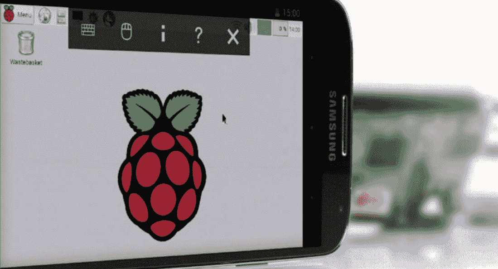

Rob Zwels 作为一个精通`Python`、`Django`的开发者，对复杂系统建模。他喜欢实验计算。

# Android VNC

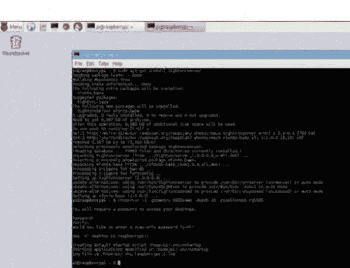

# 完整代码

`FileSilo.co`

# 查询你的 Android 设备分辨率并修改用于启动服务器的行

第一次开启时，你必须设置一个密码。你需要选择一个你能记得的密码，因为客户端在通过`VNC`连接时也会使用它。密码最多可以使用八个字符，所以考虑一下你想如何让它变得安全。

# 运行缓慢

如果你发现运行速度比你预期要慢，更改分辨率可能会让它变得更容易。如果还是没有帮助，可能是你的网络连接存在问题。

## 02 安装软件

我们将使用`TightVNC`作为我们需要的`VNC`——特别是服务端部分。我们需要先安装它，所以回到终端并使用：

```
$ sudo apt-get install tightvnc
```

你可能需要运行一些设置，或者在系统提示时按`yes`（或`y`）来完成它们。

## 03 启动 VNC

一旦安装完成，我们就可以快速启动`VNC`服务器——这样做并确保它运行可能是个好主意。让我们用以下命令进行测试运行：

```
$ vncserver -geometry 640x480 -depth 16 -pixelformat rgb
```

只要一切都安装好了，它应该能够顺利启动。

## 05 停止并重启

由于`TightVNC`不像普通服务那样工作，你不能使用服务重启（或等效命令）来关闭它。如果你想重启，必须手动关闭并使用命令重启：

```
$ vncserver -kill :1
```

... 将其替换为你最初创建的显示编号。

## 06 纠正分辨率

如果你只是为了启动创建一个分辨率为`640x480`的服务器。幸运的是，这个分辨率并不是固定的，所以最好的办法是查询你的`Android`设备的分辨率并修改用于启动的行。例如，如果你使用`1080p`，你应该使用：

```
$ vncserver -geometry 1920x1080 -depth 16 -pixelformat rgb
```


## 获取应用

在你的 Android 设备上，进入 Play Store 搜索 `VNC Viewer`（你也可以通过此链接安装：`bit.ly/1JjCZBRJ`）。将其安装到设备并运行以连接到树莓派。

## 树莓派 IP

我们需要树莓派的 IP 地址以便连接它。你可以通过两种方法获取——首选方法是打开终端并使用 `ifconfig` 列出网络接口状态；如果你使用的是无线网络，也可以访问 `iwconfig` 查看分配了什么 `ip`。

## 连接到树莓派

现在我们有了 IP 地址，就可以连接到树莓派了。打开应用，将名称留空，输入你的 IP 地址并点击保存。当你尝试连接时它会询问密码，之后它将保存并在以后不再要求。

## 使用 VNC

如果这是你第一次使用 VNC 软件，你会注意到你的操作和显示之间存在延迟。

## 关闭

## 启动时

## 编写脚本

## 下载

## 使文件具有执行权限

## 启动时启动

## 更新并测试

# 制作 Pi 手套 – 第一部分

制作你自己的可穿戴科技手套，让控制尽在指尖。

Pi 手套 是我们对一种可穿戴社交媒体控制手套的项目名称——下个月我们将向你展示如何制作它以及如何对其进行编程。随着 `Google Glass`、`Android` 和苹果智能手表以及其他颠覆性技术的出现，我们今天开始使用的设备正通向一个未来，在未来我们可能可以使用其他（所有让我们能够在身体内部进行通信的小设备……）。我们这种媒介变得越自然或越符合人体工程学，我们就越可能使用它，因此，我们将使用树莓派创建一个强大的版本，并通过我们设置的硬件配置，你可以制作你自己的版本的 Pi 手套。

**Dan Aldred**  
Aldred 是树莓派认证人员，也是 CAS 的首席教师。他热衷于创建和破解此类项目以吸引他所教的学生。

## 剥线并准备电线
从每根母对母仔线中选择一根并去除绝缘层。这可以通过对塑料外壳施加一点压力来实现——你可以用牙齿，但最好使用钳子！末端现在将由一个小小的金属销钉组成。使用相同的方法准备其他电线。

## 将电线连接到按扣上
下部分有点棘手，请花时间处理电线。首先，你需要将电线连接到按扣上，按扣将另一端穿过手套。一旦两个按扣合在一起，电线就固定了。如果你将手套的每个手指反向翻转然后将按扣推进，这样会更容易。这一步的关键部分是确保我们保持连接。

### 你需要什么
- 树莓派 `Pi A+`
- 服装按扣
- `USB` 扎带
- 手套
- `USB` 电池充电器
- `Pi` 摄像头模块

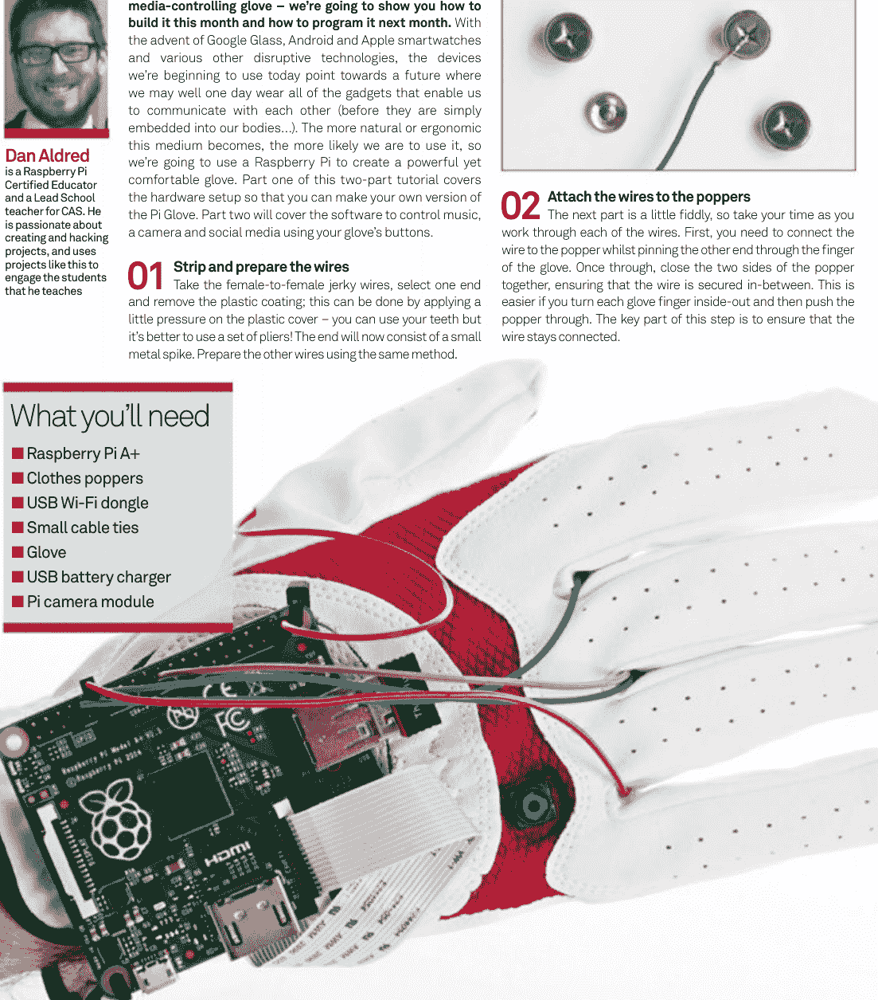
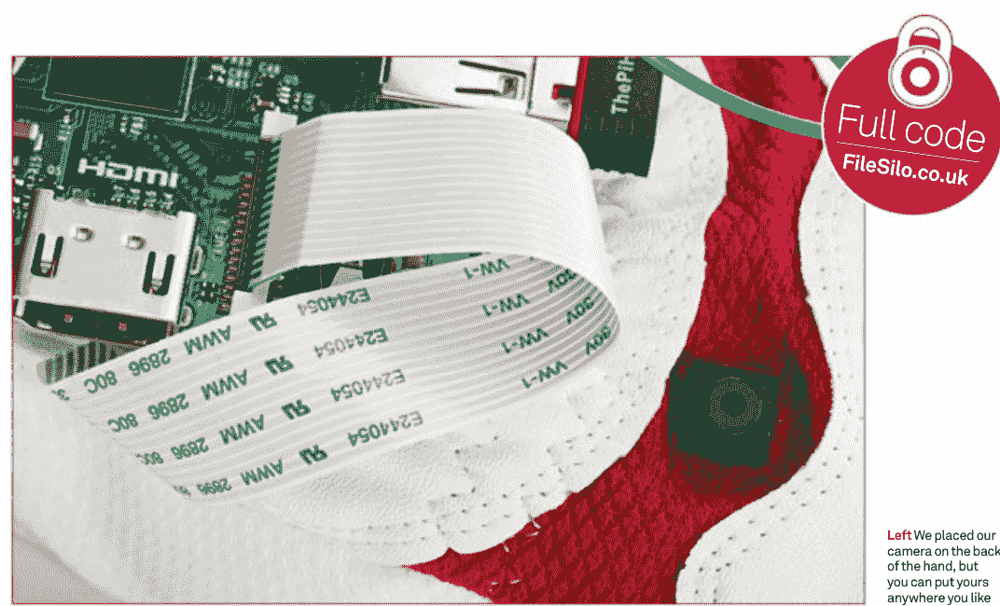

## 检查电线就位

手套的四个手指和拇指上各连接了一个电线/按扣组合。拇指在与其他金属手指按扣接触时形成地线（或接地）连接。

`Pi` 摄像头安装在手套上，这使你能够调整手腕角度并拍照。

## 添加 Pi 摄像头

`Pi` 摄像头安装在手套上，这使你能够调整手腕角度并朝着手面向的方向拍照。在手套的拇指处开一个小孔，大小要足够让镜头穿透即可。在 `Pi` 摄像头手套上，你会发现四个孔，使用这些孔和扎带将摄像头固定在手套的织物上。

## 连接 Pi 摄像头电线
将手套反向翻转，这样就可以接触摄像头的背面。拿起摄像头连接线，蓝色侧远离摄像头，并将扎带固定在摄像头背面。在树莓派上，向上滑动摄像头支架并将电线固定到位。你可能想将电线穿过手套的侧面以隐藏它。

## 检查点
在此阶段，你已经将五个按扣分别连接到电线并穿过每个单独的手指，或者连接到拇指上。这些电线通过手套的内部或外部连接到树莓派。`Pi` 摄像头也连接在手套上，镜头暴露以便拍照。

左侧：我们将摄像头放在手背上，但你可以把它放在任何喜欢的地方。

`wpa_supplicant` 是一个控制无线连接的后台程序。它同时支持 `GUI` 界面。在保存文件时，`wpa_supplicant` 通常会检测到发生了变化并尝试连接网络。

## 安装树莓派
使用小扎带和位于手套顶部的孔将树莓派安装在上面——这使得手套变得更便携、更舒适，并让 `SD` 卡远离你的手腕。将扎带穿过手套的孔，固定树莓派到位。不要扎得太紧。


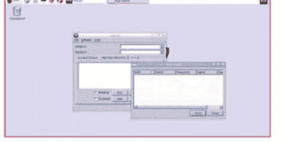
`pin` `11`, `GPIO`, `17`, Middle Finger (中指)
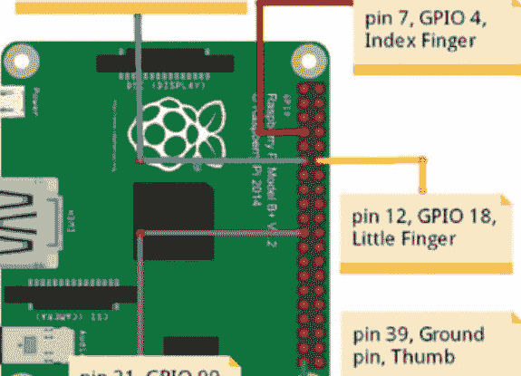
`pin` `7`, `GPIO`, `4`, Index Finger (食指)

## 添加 Wi-Fi 应用
打开偏设置中的 `Wi-Fi` 配置工具。打开后，选择“管理网络”并扫描——这将列出区域内的所有 `Wi-Fi` 网络。你将被提示在 `PSK` 框中输入密码并连接。

## 设置 Wi-Fi
打开偏设置中的 `Wi-Fi` 配置工具。打开后，选择“管理网络”并扫描——这将列出区域内的所有 `Wi-Fi` 网络。你将被提示在 `PSK` 框中输入密码并连接。

## 将电线连接到 GPIO
下部分有点棘手，请花时间处理电线。首先，你需要将电线连接到按扣上，按扣将另一端穿过手套。一旦两个按扣合在一起，电线就固定了。如果你将手套的每个手指反向翻转然后将按扣推进，这样会更容易。这一步的关键部分是确保我们保持连接。

# Python 专栏

## 优化 Python 代码

在对代码进行性能分析以确定哪些部分需要关注之后，下一步是实际上对结果进行优化，并将计算内容从 `Python` 移动到 `C`。在上一期中，我们列举了几种分析 `Python` 代码的技巧，并确定了哪些部分需要关注。当你在树莓派上运行时，你将拥有完成这些操作所需的资源。本月，我们将研究可用于最大化性能的各种技术。优化有几类可以让你考虑，但第一步是确保代码运行正确。你只需要为了获得所需的性能而完成最少量的工作。任何额外的工作都是浪费，除非它是一个学习机会。

如果你无法切换到 `C`，那么可以尝试看看是否有避免对象项的方法。如果你在循环中使用对象列表，`Python` 必须在循环的每次调用时进行类型检查。这意味着你的代码在 `Python` 中处理，改变了被调用方法的形式，最后通过在进入循环之前将这些类赋值给一个新名称来减少这种开销。所有此类类型检查都在循环外完成一次。看下面的代码：

`NumPy` 为数组（`array`）提供的结构。`Array` 类似于列表，但它只包含相同类型的元素，并且它是用 `C` 构建的，因此所有内容都在 `NumPy` 内部构建。数组被视为单个数据元素，因此类型检查对整个数组只需一次，这正是你能够如此快速遍历元素的原因。在普通 `Python` 中，你会使用这样的循环：

```python
```


```python
for index in range(50):
    c[index] = a[index]
```

其中 `a` 和 `b` 是长度为 50 的向量。在这种情况下，每当你运行一次 `a[index]` 和 `b[index]` 的循环时，都会有一定的开销。通过使用 `NumPy` 提供的数组数据函数，你可以通过以下方式减少这种开销：

```python
c = a + b
```

这使得代码变得整洁得多。它只涉及一种元素，因此你可以判断 `a` 和 `b` 是否可以相加。实际操作随后传递给 C 库，该库由 `BLAS` 和 `LAPACK` 等线性代数库构建。这提供了显著的性能提升，因为你可以利用 `NumPy` 提供的所有优化。

Joey Bramer 是 Python 用量方面真正的威胁。他与研究人员合作，解决科学计算和 Android 相关的问题。

### 为什么选择 Python？

它是革命的语言。请在 `python.org/` 阅读文档。

### 第一个要查看的项目是如何处理字符串的

字符串是不可变的字符序列。这意味着当你想要更改字符串时，必须创建一个新字符串并将旧数据拷贝到新内存中。如果你在通过程序化构建大段文本，文本的拷贝在内存中可能是昂贵的。使用列表要快得多。

```python
for word in list:
    list.append(word)
```

可以被更高效的代码替换：

```python
append = list.append
for word in list:
    append(word)
```

当你使用任何 Python 函数或运算符时，也会发生这种类型的检查。如果你使用 `+` 运算符，Python 必须检查操作数的类型，并在每次 `v = a+b` 的调用时将它们相加。如果你使用乘法，它在循环中发生很多，这可能是通过大幅减少数据条目来消除这些检查的最佳解决方案方法。虽然动态类型是 Python 的一大强项，但为了获得性能关键型代码，你可能需要避免它。

```python
str = []
for word in list:
    str.append(word)
```

...你使用：

```python
str = ''.join(list)
```


# NumPy 与代码优化

如果你正在进行数值工作，你需要开始使用 `NumPy`。`NumPy` 数组在功能上等同于列表，但将 `Python` 代码的性能提升到了 `Fortran` 的水平。`NumPy` 主要功能通过固定数据类型提供，因为这非常重要。

在考虑最基础的数据之后，还有其他加速你代码的方法。例如，`Python` 并不总是慢，你只需要看看还需要做什么。某些事情可能是学习避免检查，或者找到一种一次性运行整个列表操作的方法。这可以通过将逻辑移出循环之外或使用切换间隔（switch-interval）来改变 `Python` 等待这些检查的方式来实现。如果你在使用字符串或字典并向代码发送信号，你可以将此值设置得更高以提高代码的性能。


# 一种更 Python（Pythonic）的使用类和对象的方法

你可以编写一个在 `Python` 中定义包含方法的类的脚本。一种更冷门的技术是使用 `xrange` 命令。如果你使用列表，你占据了由整数对象管理的内存。`xrange` 命令提供了创建并存储在内存中的列表；然而，生成器（generator）允许你遍历每个元素。它完全按照你想要的方式运行：它在需要时生成元素。这意味着你在任何特定时间都不会使用内存。此外，当你不想为具有成千上万次循环（甚至可能数百万次）的循环创建整个列表时，使用 `xrange` 可以提供显著的速度提升。在文件中，你可能还想避免读取的开销。从硬盘读取可能很慢，因此将文件加载到内存中。这意味着你应该在单次操作中尽可能合理地将文件内容加载到 RAM 中，而不是逐行读取。

作为一个示例，你可以使用 `Cython` 来优化代码并使其在 `Python` 中可用。在高性能应用中使用了其他语言。在这种情况下，你拥有在 `Python` 内部工作的工具。我们将在下期详细介绍这种特定技术。

# 北美读者的特惠优惠

## 免费赠 3 期
当您订阅

每期均有免费资源下载

> 专业人士和开发者的开源权威指南


### 更快、更优秀的服务器
立即使用新技术构建您的家庭和办公室系统


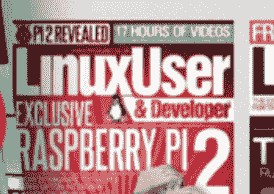

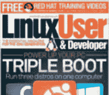

### 打造新浏览器
使用 `Linux` 构建下一个大杀器

# 托管邮件服务器
在 `Amazing EC2` 内部搭建 `Linux` 服务器

# 树莓派合成器
在树莓派上编写你的音乐

### 树莓派上的游戏手柄
将你的控制器添加到家庭媒体树莓派设置

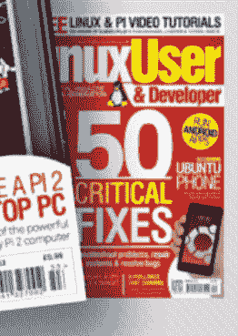


订购电话 +44 (0)1795 418661
在线访问：`www.imaginesubs.co.uk/l`

*条款与条件：此为美国订阅优惠。年度订阅将收取 37 英镑。在撰写时这相当于 57 美元；汇率会有变动。3 期免费订阅可替代美国标准价每期 16.99 美元的 6 期（共 101.94 美元）。您的订阅从下一可用期开始，持续 6 个月。此优惠于 2015 年 9 月 30 日过期。*

> 使用代码 `SUMMER151` 享受此专属优惠！

## 评测

75 Group 测试 | 80 UltraBorg | 82 Solus Beta 2 | 84 Fedora 22

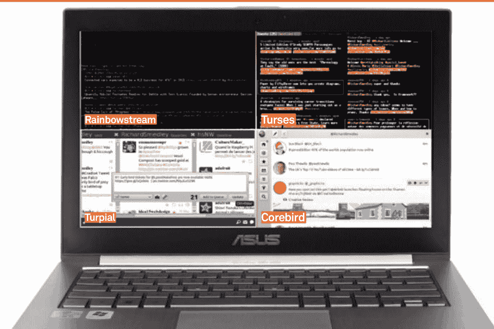

## 团体测试

### 极简 Twitter 客户端

发布推文并不耗时，拥有一个 `Twitter` 客户端又何妨？我们对比了精简高效的应用，为您提供最快的体验。

#### Rainbowstream
一款丰富且可定制的应用程序，拥有丰富的主题和内置 `Python Twitter` 工具（运行在 `Python` 2.7 或 3.x 上）。`Rainbowstream` 以其流动的彩色流冲击视觉，直到暂停；进入交互模式后可以随心所欲地显示。
下载：`bit.ly/1sqO4nAa`

#### Turses
`Turses` 用于在终端中为您提供多个 `Twitter` 账户的多列界面，导航和快捷键是该极简工具的核心功能，如果您恰好想参与开发，还有良好的开发者支持和文档。
下载：`bit.ly/1F0smfa`

#### Turpial
`Turpial` 采用具有可配置多列的传统界面，能够很好处理多个账户，并提供多种语言支持。它可以缩短 `URL`，提供良好的文档和幽默感。极简的界面隐藏了配置选项。
下载：`bit.ly/1JZ9M1`

#### Corebird
`Corebird` 非常极简但又能传达重要信息，它将其功能封装在一个令人愉快直观的 `GUI` 中——最新版本通过一个单脚翅膀设计进行了改进。0.9 版本也支持多账户处理，切换非常方便。
下载：`bit.ly/1JxumRS`

`www.linuxuser.com` 75

## Rainbowstream

### Turses

`Twitter` 流的回溯操作虽然令人困惑，但值得投入时间。

`Twitter` 界面提供了易于导航的多列馈


`Rainbowstream` 通过每条帖的 ID 数字来对推文进行操作——然而，也可以通过输入 `"fav 65"` 来收藏某条推文

`Twitter` 可配置的列通过简单易懂的键盘快捷键进行控制

## 初印象

首次启动时可能有些色彩缤纷，为了生成 `Twitter` 推文以访问您的账户。但在我们的浏览器中，然而是命令行 `Link22`，我们需要将 `URL` 粘贴到 `Firefox` 的终端中，在那里我们已经通过 `Twitter` 网页界面登录了。

你必须阅读所有的键盘快捷键，但这很简单。对于命令行，`Vim` 的导航将让你感到熟悉——使用 `j` 和 `k` 上下移动，使用 `h` 和 `l` 在窗口、动作和模式之间左右移动！`G` 和 `g` 移动到每个时间轴的开头和结尾。

## 界面

正如其名，色彩缤纷——尽管在浅色背景主题下可能显得有些鲜艳。由于渲染和快速加载，该客户端需要我们来暂停推文流。每条推文都有一个 ID，由 `Rainbowstream` 添加，以便在命令中指定。

按 `t` 打开新时间轴以打开推文作者的时间轴，以便在命令中指定。

## 学习体验

正如其名，色彩缤纷——尽管在浅色背景主题下可能显得有些鲜艳。由于渲染和快速加载，该客户端需要我们来暂停推文流。每条推文都有一个 ID，由 `Rainbowstream` 添加，以便在命令中指定。

按 `t` 打开新时间轴以打开推文作者的时间轴，以便在命令中指定。

## 界面

正如其名，色彩缤纷——尽管在浅色背景主题下可能显得有些鲜艳。由于渲染和快速加载，该客户端需要我们来暂停推文流。每条推文都有一个 ID，由 `Rainbowstream` 添加，以便在命令中指定。

按 `t` 打开新时间轴以打开推文作者的时间轴，以便在命令中指定。

> `@Richardsmley/twitter`
> `Nick Chapman @Nick_Chapman` 立即加入 `@bbystakey` 在 `BBC` 关注最新消息
> `Shellaver @BBCFlowers`
> `David Turner @davidrunner` 刚刚被 `@lesle` 在 `BBC` 采访了，关于我的角色 Featherills Seeds
> `British Quinqua @BritishQuinqua`

这并不是 0.5，而是大量的软件。`Tim Binder` 已经在结果中发布了，我们在其中讨论了 `rc-newsletter.org/` 和 `@coreclient`，尽管你遇到了一些问题。我们将对软件方面进行一些工作感到惊讶，由于它没有显示出足够的 `GTK+3` 小故障，它存在于许多目录中，尽管从源编译太耗时了。多年来，主桌面之外还有三个其他可用客户端，如 `Twitch` 和 `Hot-Dot`。并不是所有的它们都值得再次查看，但对于你的博客需求，为了一个受支持且简单且“恰好足够”的解决方案，`Corebird` 是我们的小组测试选择。你赢了 `@RichardSmley`

[第 78 页]

# 构建更好的网络
`www.webdesignmag.co.uk`

# 网页设计师

现已发

20 个 `HTML5` 技巧、技巧与技术 完美的内容策略 / 最佳 `GitHub` 项目

[第 779 页]

# 今日购买您的期数
纸质版可在 `www.imagineshop.co.uk` 购买
数字版可在 `www.greatdigitalmags.com` 购买

可在以下平台获取

`facebook.com/webdesignermag`
`twitter.com/webdesignermag`

# Review PiBorg UltraBorg

# 机器人

## PiBorg UltraBorg

为树莓派项目设计，可扩展的 `UltraBorg` 是否履行了它的承诺，还是让我们失望？`PiBorg` 为兼容树莓派的设计，适用于任何可以与 `I2C` 通信的微型计算机或微控制器（包括主 `Arduino`），其设计目标只有一个：绝大多数爱好者级的项目使用脉冲宽度调制 (`PWM`) 来驱动机器人部件，以及使用超声波传感器（通过发送噪声脉冲并监听回声来测量与固体的距离）。结合起来，这可以帮助构建从简单的双轮机器人到更复杂的机械手臂，甚至在...辅助下实现计算机视觉

| 类型 | |
| --- | --- |
| 扩展板 (非 HAT) | 处理器为 `PIC16F1827-I/SL` |
| 驱动器 | 东芝 16 位 `I2C` `TC620272FNG` |
| 输出 | 4x `SV PWM` (兼容伺服器)，4x 数字 (超声波传感器) |
| 电源 | 使用伺服器需要 5V，不包含 |
| 价格 | 15.99 美元起（约 25 元） |
| 购买途径 | `pborg.org` |

如果你想构建各种方面的东西，`UltraBorg` 是构建机器人爱好者的终极一站式商店。该板分为四组：第一组为各种传感器提供输入支持并输出 `PWM` 控制的伺服器。总而言之，这对于一个相当熟练的机器人已经足够，但如果你需要更多 `UltraBorg` 来提供额外的输入和输出通道，一个方便的功能仅限于每块板的 `DTS` 间距引脚。

[第 80 页]

# 虽然它可以让你处理相机方面的工作，但 UltraB 被定位为初学机器人爱好者的终极一站式设备

> `PiBorg` 之上是拖拖拖的 `Doodleboard` 后面

`UltraB` 是一个奇妙的设备，其尺寸适合在一个块板上结合输入和输出的挑战，事实确实如此。对于机器人项目，链式连接将非常简单。然而，与市场上其他竞争选项相比，它相当昂贵。

`UltraB` 安装在顶部 (HAT) 引脚上，设计时考虑了背夹式安装。板上的螺丝孔使其能够连接到 `XBorg Module` 或原始的 `B` 上。如果你想使用不同的微控制器或控制器，这些孔也可以用于安装该设备。

# Solus Beta 2 测试

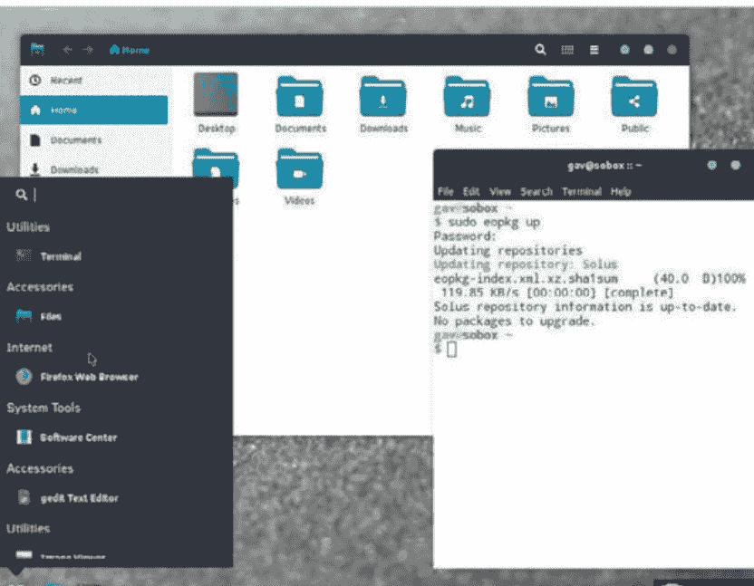

`Solus` 操作系统保持了简洁、色彩丰富且现代的设计风格。

## Solus Beta 2

`Solus` 是一个从零开始的全新亮相，配备了名为 `Budgie` 的全新桌面环境，其设计理念是“开箱即用”。

如果你觉得这个名字听起来很熟悉，是因为操作系统背后的开发者 `Ikey`（来自 `Linux Mint` `Debian` 版）曾于 2012 年发布过名称类似的初版：`SolOS`。遗憾的是，`SolOS` 在 2013 年停止了，这非常令人遗憾，因为它被 `Linux Mint` 取代了，而 `Ikey` 认为 `Linux Mint` 应该出现在 `Mint` 的 `Debian` 版本中，而且那是一个非常出色的尝试。然而，`Ikey` 回归了——由于商标问题，年初提到的第一个名称已更改为 `Solus` 操作系统。虽然 `Solus` 和原始的 `SolOS` 非常相似，但它们是两个完全不同的物种——后者基于 `Debian`，而新的 `Solus` 则是完全从零构建的。

你首先会注意到自定义构建的桌面环境。`Budgie` 桌面与 `GNOME` 栈紧密集成，在此测试版发布中随 3.16.3 版本发布（基于 `Linux` 4.0.3）；它是一种令人耳目一新的现代设计，很大程度上受到 `Chrome OS` 的启发，并带有一些 `GNOME` 的影子，非常注重实用，而不是像其他桌面那样纯粹追求审美。尽管如此，如果你想使用更传统的方法，`Budgie` 也拥有 `GNOME 2` 主题。尽管存在一些 Bug，但你可以看到这个新桌面具有巨大的潜力，而且它不可否认地漂亮——如果你想在主电脑上测试它，可以在某些仓库中找到它。`Budgie` 还为你提供了相当的配置和控制能力，而无需——

| CPU 64位 |
| --- |
| 内存 1 GB |
| 存储空间 4 GB |

> `Solus` 适用于桌面端且仅支持 64 位，专注于设计、直观性和软件集成，以演进抽象发行版的概念。

上方是有一个可以帮助你上手的欢迎界面，尽管目前 `Solus` 的软件还比较匮乏，需要安装其他工具，以便你在图标和 `GTK+` 控件之间切换，并根据你的需求自定义面板。`Solus` 首次推出的功能较少，但对于一个处于无限阶段的测试版发行版来说是可以理解的，它还使用自己的包管理系统（基于 `Pack`），并且运行非常快。尽管仍然有些混乱，但有一些预装的必备软件，如 `Thunderbird`、`Discord`、`Firefox`（目前极易崩溃）以及如 `Gear`、`VLC`、`Python` 和 `Transmission` 等简洁的应用。头部还带了软件中心，你可以看到这正在进行中——`Vim` 和 `Emacs` 等经典程序可用，还有像 `Keepass` 和 `LibreOffice` 等程序，如果它们还没有被正确分类，你将需要手动搜索最新版本。但如果你想超越初始发布，你必须等待 `Solus` 成熟——具体来说，就是等待更多的包下载到 `Solus` 的仓库中。

`Solus` 项目正在迅速成长，对用户请求和错误报告的响应极快。此版本添加了 `UEFI` 和 `NVIDIA` 驱动支持，并且 7 月 10 日发布的新版本有了清晰的路线图。`Solus` 还旨在为开发者简化工作，`yok` 工具本身就简化了打包过程。正如 `Solus` 背后的通用哲学——它专门用于桌面且仅支持 64 位，专注于设计、直观性和软件集成，为家庭用户提供了一个可靠的系统，首次启动时几乎不需要配置或解释。但这是什么？一个能更好地关注其……的基础操作系统

# 优点

制作精良，旨在减少开发者工作量的独特打包系统，以及出色的开箱即用配置。

# 缺点

软件不足，一些系统性的缺陷有待开发，尽管这符合测试版的预期。

# 总结

开发者和玩家可能想要等待硬件和软件支持。我们使用的是浅色主题，尽管 `Solus` 带有一些 Bug 但已经就绪——尽管如此，它仍然是一个我们推荐尝试的优秀发行版！

`Goven Thorne`

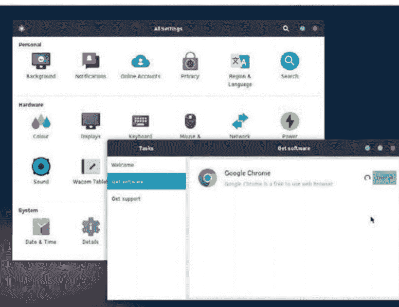

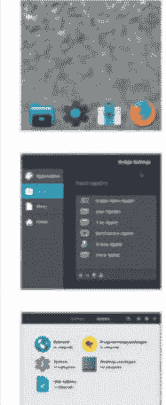


`www.linuxuxer.com` 83

# Fedora 22 测试

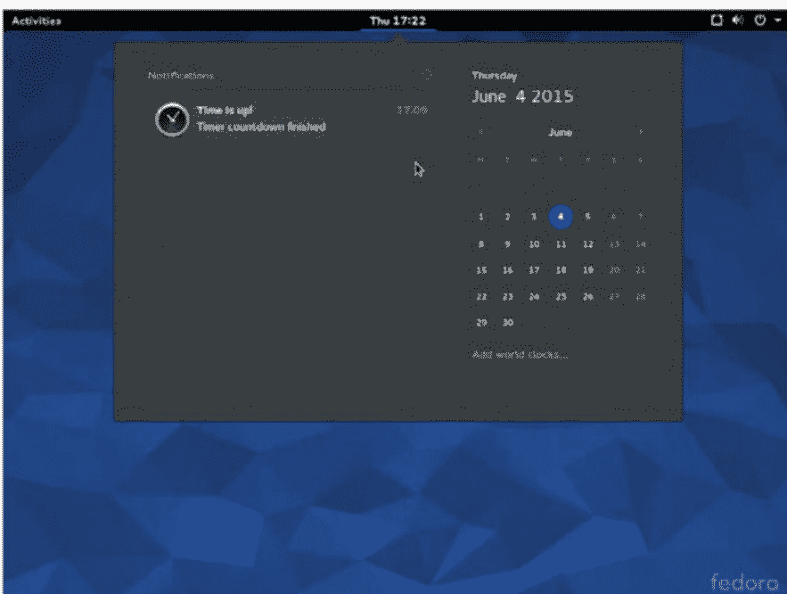

同样也可以在这里列出你的通知，当它们像在横幅中出现时你可以进行交互。

# 发行版

## Fedora 22

`Fedora` 在其最新发布中分为三个不同的变体，建立在 `Fedora 21` 的坚实基础上。

用开发者的话说：“如果这个版本有一个人类类比，它就像是上过大学、找了份好工作，并坚持定期去健身房新年计划的 `Fedora 21`。”

（注：原文后续存在大量重复段落，已按要求不重复输出，仅翻译核心内容）

`Fedora` 在其最新发布中分为三个不同的变体，建立在 `Fedora 21` 的坚实基础上。

用开发者的话说：“如果这个版本有一个人类类比，它就像是上过大学、找了份好工作，并坚持定期去健身房新年计划的 `Fedora 21`。”

# RasPi
面向树莓派爱好者的数字杂志


在树莓派上使用加速度计
为你的下个树莓派项目添加 `IoT` 技术远比你想象的要简单。

# RasPi
设计 构建 代码
亲手实践你的树莓派
破解你的摄像头

# 示例期刊

# RasPi
设计 构建 代码
免费
制作一辆树莓派故障车 (PI BUGGY)
来自树莓派的世界

检测人脸动作
外加代码编写一个鼓机

项目
采访
教程
专家建议

在 `Google Play` 和 `iTunes` 下载免费应用

`www.linuxuser.co.uk/RasPiCode` `facebook.com/LinuxUserUK` `#RasPiPIMag`


## BLACKNIGHT SOLUTIONS

我用我小小的眼睛看，看到了以这些结尾的域名...
`.black` `.buzz` `.care` `.club`
`.guru` `.ink` `.host` `.london`
`.ninja` `.party` `.press` `.rocks`
`.science` `.social` `.website` `.wiki`

与众不同
随境思考
考虑可用


- 域名：`COM` 仅需 £5.80/年
- 托管：每月 £2.99 起 + 送免费域名
- 云端：`SSD` 服务器每月 £5 起
- 服务器：前 3 个月优惠 50%
- 数据中心：机架空间每月 £35 起

0800 808 5450
`netcetera.co.uk/lud`

`www.blacknight.host` `sales@blacknight.host` `@blacknight`

## 英国服务器

## 独立服务器

仅需
£39 / 月 + 增值税

- 当日安装
- 24/7 英国免费热线支持
- 无长期合同

使用优惠码 `LINUX1` 可享 15% 折

与我们的团队成员联系，或访问我们的网站获取更多信息
0800 610 1 620 | `www.ukservers.com`

## 托管列表

赞助机会
通过赞助本次活动引起我们的关注。
联系 `Luke Bialcombe`，电话：+440172 586431

# 有你认为我们应该列出的优惠交易吗？

无论你是托管公司，还是寻找心仪推荐供应商的满意客户，请通过邮件联系我们：
`luke@magine-publishing.com`

## 独立服务器列表

| 方案 | 电话 | 每月费用 | 最短期限 | CPU 核心 / 速度 | 磁盘空间 | 1GBPS 连接 | 硬件 RAID | 远程电源重启 | 运行时间保证 | 永久虚拟机 | 网络备份 | 私有 | 24/7 支持 |
| :--- | :--- | :--- | :--- | :--- | :--- | :--- | :--- | :--- | :--- | :--- | :--- | :--- | :--- |
| E2000DC | 0800805460 | £25 | 1 个 | 双核 2GHz | 150GB | N/A | ✓ | ✓ | ✓ | | | | | |
| M3000DC | 0800805460 | £40 | 1 个 | 双核 3GHz | 300GB | N/A | ✓ | ✓ | ✓ | | | | | |
| R8000DC | 0800805460 | £85 | 1 个 | 英特尔 2.6GHz 四核处理器 | 2 x 500GB | N/A | ✓ | ✓ | ✓ | | | | | |
| Developer | 0800805460 | £29 | 1 个 | N/A | 1GB | N/A | ✓ | ✓ | ✓ | | | | | |
| Reseller | 0800805460 | £99 | 1 个 | N/A | 50GB | N/A | ✓ | ✓ | ✓ | | | | | |
| Starter Linux | 0820 107 79.19 | £15 | 1 个 | N/A | 200GB | N/A | ✓ | ✓ | ✓ | | | | | |
| Windows Linux | 0820 107 79.19 | £20 | 1 个 | N/A | N/A | N/A | ✓ | ✓ | ✓ | | | | | |
| Business Linux | 0820 107 79.19 | £45 | 1 个 | N/A | 400GB | N/A | ✓ | ✓ | ✓ | | | | | |
| Ultimate Linux | 0820 107 79.19 | £65 | 1 个 | N/A | 无限 | N/A | ✓ | ✓ | ✓ | | | | | |
| Ultimate Windows | 0820 107 79.19 | £90 | 1 个 | 1 x 2.4GHz i5 | 500GB | N/A | ✓ | ✓ | ✓ | | | | | |
| Silver Managed | 0820 107 79.19 | £59 | 1 个 | 1 x 2.4GHz i5 | 850GB | N/A | ✓ | ✓ | ✓ | | | | | |
| Gold Managed | 0820 107 79.19 | £65 | 1 个 | 2 x 2.4GHz i5 | 1TB | N/A | ✓ | ✓ | ✓ | | | | | |
| PowerEdge-R730 | 0864 130 1862.1 | £195 | 6 个月 | 4 x 2.4GHz | 4TB | 10Gbps | ✓ | ✓ | ✓ | | | | | |
| PowerEdge-R730 | 0864 130 1862.1 | £275 | 6 个月 | 2 x 2.4GHz | 2TB | 10Gbps | ✓ | ✓ | ✓ | | | | | |
| Linux VPS | 0864 4860 2100.9 | £39 | 1 个 | 1 x 2.27 四核 | 600GB | 100Mbps | ✓ | ✓ | ✓ | | | | | |
| Windows VPS | 0864 4860 2100.9 | £64 | 1 个 | 1 x 2.27 四核 | 600GB | 100Mbps | ✓ | ✓ | ✓ | | | | | |
| VPS Hyper-V | 0864 4860 2100.9 | £44 | 1 个 | 1 x 2.27 四核 | 600GB | 100Mbps | ✓ | ✓ | ✓ | | | | | |
| VPS Max-Y | 0864 4860 2100.9 | £76 | 1 个 | 1 x 2.27 四核 | 1000GB | 100Mbps | ✓ | ✓ | ✓ | ✓ | | | |
| VPS Ultra Hyper-V | 0864 4860 2100.9 | £139 | 1 个 | 1 x 2.27 四核 | 2500GB | 100Mbps | ✓ | ✓ | ✓ | | | | | |
| Linux Core | 0864 5454 7799 | £79 | 12 个月 | 双核 | 1600GB | N/A | ✓ | ✓ | ✓ | 99.99% | | | 24/7 支持 |
| Internet Core | 0864 5454 7799 | £129 | 12 个月 | 2 x 2.53 核 | 1600GB | N/A | ✓ | ✓ | ✓ | 99.99% | | | 24/7 支持 |
| Windows Dual Core | 0864 5454 7799 | £179 | 12 个月 | 2 x 2.53 核 | 2.50GB | N/A | ✓ | ✓ | ✓ | 99.99% | | | | |
| PowerEdge-R210 | 0864 150 1830.2 | £99 | 12 个月 | 1 x 2.5GHz | 250GB | 100Mbps | ✓ | ✓ | 99.99% | 免费 | | | | |
| PowerEdge-R210 | 0864 150 1830.2 | £119 | 12 个月 | 1 x 2.65GHz | 2 x 250GB | 100Mbps | ✓ | ✓ | 99.99% | 免费 | | | | |
| PowerEdge-R210 | 0864 150 1830.2 | £149 | 12 个月 | 1 x 2.65GHz | 2 x 500GB | N/A | ✓ | ✓ | 99.99% | | | | O = 选项 |


`Netcera`
`www.netcera.co.uk/linux`

88

# 让你的列表脱颖而出！联系 LUKE

`luke.didiscombe@imagine-publishing.co.uk`
+44(0)1202 586431

# 独立和共享服务器列表

| 名称和 URL | 方案 | 电话 | 数量 | 费用 | 每月带宽 | 账户 | 数据存储 | 支持 | 购物车 | 病毒过滤 | 防火墙 | 电话支持 | 邮件支持 | 网页控制 | 服务等级协议 |
| :--- | :--- | :--- | :--- | :--- | :--- | :--- | :--- | :--- | :--- | :--- | :--- | :--- | :--- | :--- | :--- |
| Blacklight (`www.blacklight.com`) | Magnus | 44 | 0849 53042 | £49 | | 10GB | | | | | | | | | |
| Blacklight (`www.blacklight.com`) | Mono | 44 | 0849 53042 | £89 | | 20GB | | | | | | | | | |
| Blacklight (`www.blacklight.com`) | Maximus | 44 | 0849 53042 | £149 | | 30GB | | | | | | | | | |
| Digital Global (`www.diglobal.com`) | Cheeky Nimp | N/A | | | Free | 500MB | | | | | | | | | |
| Digital Global (`www.diglobal.com`) | Digital Global | N/A | | | £12 | 5GB | | | | | | | | | |
| Digital Global (`www.diglobal.com`) | Virtual | N/A | | | £25 | 10GB | | | | | | | | | |
| elhosting (`www.elhosting.com`) | WordPress Hosting | 44 | 0849 91000 | £23.98 | | 1GB | | | | | | | | | |
| elhosting (`www.elhosting.com`) | Starter | 44 | 0849 91000 | £38.98 | | 5GB | | | | | | | | | |
| elhosting (`www.elhosting.com`) | Expert | 44 | 0849 91000 | £77.98 | | 25GB | | | | | | | | | |
| Equinox (`www.equinox.net`) | Personal | 44 | 0217 31465 | £24 | | 450MB | | | | | | | | | |
| Equinox (`www.equinox.net`) | Gold | 44 | 0217 31465 | £72 | | 100GB | | | | | | | | | |
| Equinox (`www.equinox.net`) | Platinum | 44 | 0217 31465 | £144 | | 100GB | | | | | | | | | |
| Eurofast (`www.eurofast.com`) | Email Only | 44 | 0230 28942 | £40 | | 1GB | | | | | | | | | |
| Eurofast (`www.eurofast.com`) | Essential | 44 | 0230 28942 | £75 | | 25GB | | | | | | | | | |
| Eurofast (`www.eurofast.com`) | Super | 44 | 0230 28942 | £150 | | 50GB | | | | | | | | | |
| Eurofast (`www.eurofast.com`) | Professional | 44 | 0230 28942 | £250 | | 100GB | | | | | | | | | |
| Evhosting (`www.evohost.com`) | Starter | N/A | | | £54.99 | 2GB | | | | | | | | | |
| Evhosting (`www.evohost.com`) | Home | N/A | | | £99.99 | 10GB | | | | | | | | | |
| Evhosting (`www.evohost.com`) | eCommerce | N/A | | | £169.99 | 30GB | | | | | | | | | |
| Gacom (`www.gacom.com`) | Business Pro | 44 | 0844 77450 | £199 | | 100GB | | | | | | | | | |
| Heart Internet (`www.heartinternet.com`) | Hosting | 44 | 0844 77450 | £250 | | 10GB | | | | | | | | | |
| Heart Internet (`www.heartinternet.com`) | Business Professional | 44 | 0844 77450 | £279.99 | | Unlimited | | | | | | | | | |
| Heart Internet (`www.heartinternet.com`) | Professional | N/A | | | £399.99 | | Unlimited | | | | | | | | |
| Hostway (`www.hostway.com`) | Silver | 44 | 0849 190188 | £79.50 | | 15GB | | | | | | | | | |
| Nameling (`www.nameling.com`) | Email | 44 | 0844 61203 | £11.75 | | 5GB | | | | | | | | | |
| Nameling (`www.nameling.com`) | Standard Package | 44 | 0844 61203 | £35.25 | | 10GB | | | | | | | | | |
| Nameling (`www.nameling.com`) | Professional | 44 | 0844 61203 | £64.95 | | 20GB | | | | | | | | | |
| Nameling (`www.nameling.com`) | Expert | 44 | 0844 61203 | £105.75 | | 50GB | | | | | | | | | |
| Skarket (`www.skymarket.com`) | Standard 1 | 44 | 0849 93178 | £4.99 | | 1GB | | | | | | | | | |
| Skarket (`www.skymarket.com`) | Premium | 44 | 0849 93178 | £9.99 | | 2GB | | | | | | | | | |
| Skarket (`www.skymarket.com`) | Premium 2 | 44 | 0849 93178 | £19.99 | | 5GB | | | | | | | | | |
| ServiceHub (`www.servicehub.net`) | Personal | 44 | 0317 55001 | £10.99 | | 10GB | | | | | | | | | |
| ServiceHub (`www.servicehub.net`) | Business | 44 | 0317 55001 | £24.99 | | 20GB | | | | | | | | | |
| ServiceHub (`www.servicehub.net`) | Reseller | 44 | 0520 27016 | £52.99 | | 40GB | | | | | | | | | |

# 问题与答答

联系我们...
网站：`www.linuxuser.co.uk`
邮箱：`linuxuser@imagine-publishing.co.uk`

## 问答

## 您的问题解答

向我们发送您的问题，我们将尽力解答！

## 常见问题解答 (FAQ)

## Linux 媒体中心

问：`Kodi` 和 `MyTV` 有什么区别？

答：`Kodi` 和 `MyTV` 的工作方式非常不同，尽管它们都能执行类似的任务。`MyTV` 需要一个后端服务器来为前端客户端提供媒体支持，而 `Kodi` 更侧重于录制电视节目。`Kodi` 可以在没有服务器协助的情况下运行并播放视频文件。`Kodi` 的设置要求较少，如果你在多一台电视上使用它，它们之间不会有区别。

问：使用 `Kodi` 盒子最好的方法是什么？

答：`Kodi` 可以作为桌面应用安装，但最好的方法是使用如 `OpenELEC` 或 `LibreELEC` 这样的 `Kodi` 发行版。我们推荐使用小型一体机 PC 甚至树莓派（`Raspberry Pi`）。

问：我如何获取 `Netflix`？

答：有一个名为 `XBMC` 的插件可以访问 `Netflix` 的所有功能，其功能与网页界面或其他官方界面完全一致。所以你仍然可以使用它，但如果你想同时使用 `Kodi` 和 `Netflix`，可能需要一些额外的努力。

## Fedora Emacs

我最近尝试了从 `GNU` 网站下载 `Emacs` 并进行自定义配置的过程，我还为 `Emacs`（一个邮件客户端）添加了 `make`。我在那里找到了 `Emacs`。当我进行编译（tarball 包）时，在运行 `.configure` 时对某些事情并不确定。

如何通过安装更多包来获取不同版本操作系统的 `Emacs`？他们是如何将带有所需软件的 `Emacs KDE` 放入仓库的？

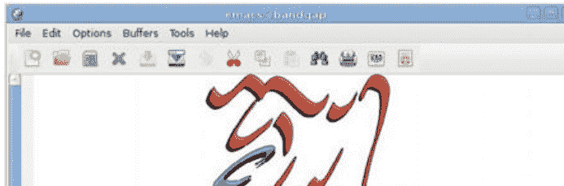

```


GNU Emacs 2.31.10 (x86_64-linux-gnu, GNU version 2.31.6)

Copyright (C) 2020-2021 Free Software Foundation, Inc.

Licensed under GNU GPL3

```
GNU Emacs 是 GNU/linux 操作系统的一个组件。

- 作者
- 分配与自由
- 复制许可条件
- 获取最新动态
- 选项
- Emacs 教程

许多人的代码包含在 GNU Emacs 中
贡献以改进 Emacs

我们为什么开发 Emacs 以及 GNU 操作系统
在**绝对不提供任何保证**的情况下许可
分发和更改 Emacs
如何获取最新版本的 Emacs
从 PDF 打印用户手册

学习基础 Emacs 指令

上面的 Emacs 是一个优秀的文本编辑器，所以你应该使用它并检查它是否值得你投入时间。

我想补充关于他们如何开发的，
但我不太确定。

我有 Emacs 并且在使用它配合 `make`，
但我只是好奇。
感谢任何见解/帮助！
```

## 关于下载

所以这就是 Linux 发行版处理软件包的方式 - 它们以二进制形式存在并从在线仓库下载然后在随后安装。

90

## Steam 问题

我正在运行 Ubuntu 15.04，并尝试从 Ubuntu 软件中心下载 Steam。它在里面，但当我尝试进入时，它无法工作。

我在同步软件包管理器中找到了 Steam 并通过这种方式安装了它，但当我这样做时，获得了一个桌面图标，Steam 图标在应用程序菜单中，但它无法启动。我尝试从命令行运行，并得到了此错误：

`Running on ubuntu 15.04 64-bit STEAM_RUNTIME enabled exception handler for appid(steam):version(0)`

```
libX86_dri.so unable to load driver:

libGL: driver pointer missing

libGL: failed to load driver:

libGL: unable to load driver:

swrast_dri.so

libGL: failed to load driver:
```

有人告诉我 Steam 对 Linux 非常友好，但我就是无法让它工作！你该如何实现这个想法？

Alex Chang.

这个问题对于 Linux 用户尝试使用 Steam 来说并不常见——基本上出现问题的原因是你的系统中没有安装 32 位库。解决方案很简单，并且在你的 64 位版本上有效，但你需要先安装这些初始包才能使其运行。

要在你的 `15.04` 系统上获取它，你需要使用：

- `sudo apt-get install lib32i`

当你安装它时，它会忘记你已经安装过了，所以你可能需要定期更新并再次重新安装。

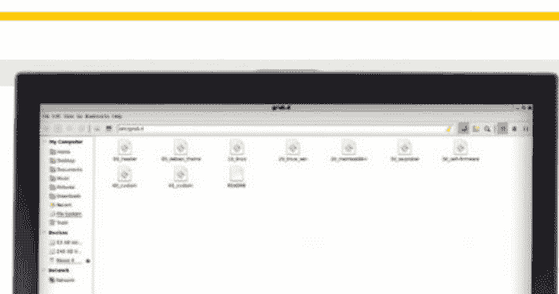

上述，磁盘（Disks）确实可以为你完成任务，尽管我们更倾向于 `GParted`。

这些二进制文件是预编译的软件部分，在创建时使用了所有的开发包，使你实际上可以直接运行它们，而不需要它们所需的开发包。

如果你在编写 `Python` 代码，你可能注意到需要经常安装库，并且可以在其他语言中使用它们，但一旦编译成完全编译的程序，你就不需要额外的模块或库，甚至不需要语言本身。

新磁盘在复制大量文件时以切片形式安装。在所有复制完成后，我建议以下操作：

（注：原文后续存在大量重复循环，已根据指令去重处理）

现在我在 `CentOS` 和 `Pi` 上都有了共享，并从 `F22` 盒子挂载了它们两个。最初，我从 `F22` 使用 `rsync/ssh` 从 `CentOS` 传输到 `Pi` 端。我已经使用了一段时间 `Pi` 上现有的 `samba` 共享，它是基础性的，现在 `Pi` 上有了新的共享。

# 听起来你正在做的是跟踪备份目录的符号链接，而不是让它们以意想不到的方式改变

```
$ rsync -av -e ssh /mnt/abc/ /mnt/abc/pi8176.145.162./ext/sharing/habc/
```

通过这种方式，你就不需要折腾 `samba` 之类的了，文件将按预期复制，而且前面不需要加斜杠！

太好了。但那不是我想要的。我想从一个共享拷贝到另一个共享：

寻找一种方法在 shell 脚本中查询当前会话，查看是否以用户身份运行，然后采取相应的行动。非常感谢！

```
$ rsync -av -e ssh /mnt/abc/ /mnt/abc/
```


# 你是谁

这可以工作，但 Pi 上的所有文件在名称前都有一个 `"u"`。我想要的是。关于为什么会发生这种情况有什么想法吗？

我正尝试确定用户的当前 shell 是来自登录提示符的“直接”链接，还是另一个用户的。要求是有一个 shell 脚本，它只需要在直接链接上输出，而不是在用户之后输出。

实际上，对于这种情况可以使用一个命令，即 `who am i`。你将其输入到命令行中：

Ernest Lin

你似乎在走一条相当长的路——你所需要的只是将文件从 CentOS 使用 `rsync` 到 Pi。

- `who am i`

它会在终端中生成当前用户，以及一些基本细节，例如根据该用户的当前时间。

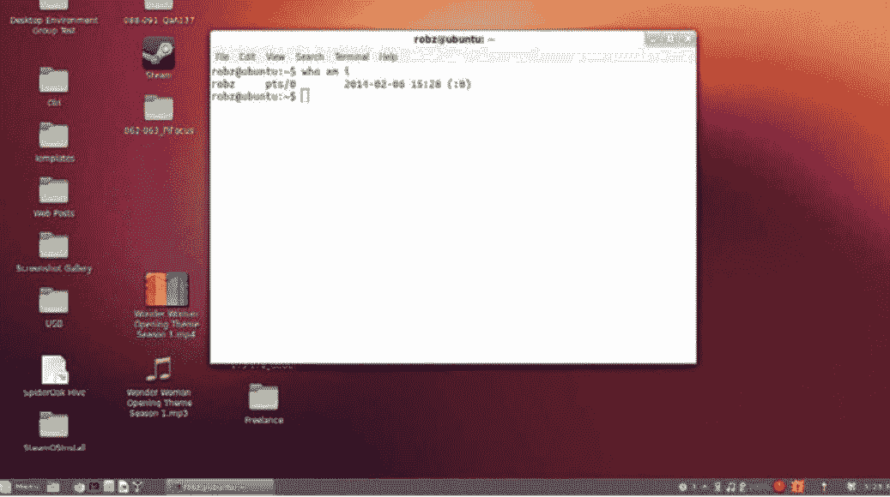

上面的 `whoami` 是一个极其简单的工具，但它确实有它的用处。

# 开源

你的 Linux 新闻与观点来源

联系我们...
直接给我们发邮件：
`linuxer@imagine-publishing.co.uk`

# 评论

# 你的来信

关于杂志、Linux 和开源的问题与意见

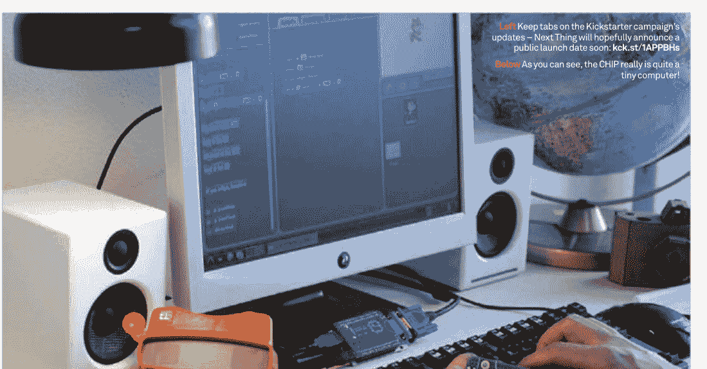

> Kickstarter 众筹更新中的左侧标签 - `Next Thing` 可能会很快宣布正式发布日期：`kck.st/1PPBs` 下方如你所见，`CHIP` 确实是一台（微型）计算机。

# 便宜如 CHIP

你好。你知道 `CHIP` 计算机什么时候推出以及为什么它那么便宜吗？它几乎是树莓派成本的三分之一？

你好 Mark。嗯，`CHIP` 背后的公司确实在他们的 `Kickstarter` 众筹活动中投入了全力（他们在 50% 的目标上筹集了超过 200 万美元），并专注于生产。对于那些没有众筹这台微型电脑的人，`CHIP` 绝对可以购买，`Next Thing` 并没有错过任何节奏。在写作时，预订尚未上线（`nextthing.com`）。极有可能，我们看到的是 2016 年初夏，但考虑到 `Kickstarter` 的成功，由于它可能会被埋没在这样的


`CHIP` 之中，2016 年 5 月推出让资助者获得他们的 `CHIP` 是一种可能。
实际上几乎回答了你的问题——根据 `Next Thing` 的说法，`CHIP` 如此便宜本质上是为了以少办多事。他们以极高的产量生产这些单板计算机，这意味着他们可以获得更好的组件价格，这就是他们以 9 美元提供基础 `CHIP` 的原因。随着 `Kickstarter` 的如此成功，`Next Thing` 应该被埋在这一堆东西下面！也就是说，你可能会为你的 `CHIP` 付更多钱——仅仅运费就是一种，让加强版资助者的价格增加了 20 美元。你还需要支付 VGA 适配器和 25 美元的 `HDMI` 适配器，这使其更接近树莓派的价格点。然而，我们仍然对最新的 Linux SBC 在爱好者和教育市场的表现如何感兴趣！

Teim


`Imagine Publishing Ltd`
`Richmond House, 23 Richmond Hill`
`Bournemouth, Dorset, BH2 6EZ`
`+44 (0) 1201 582609`
`www.imaginepublishing.co.uk`
`www.linuxuser.co.uk`
`www.futuremag.com`

# 编辑

编辑 Gavin Thomas
Code 设计 Simon Maguire
制作编辑 James Hawkes
专题编辑 Rob Zelswood
高级艺术编辑 Will Sharp
总编辑 Charles Marshall
设计主管 Ross Andrews

# 贡献者

Dan Allen, Joey Beards, Christopher Crawley, Gavin Hafelee, Sam Henriksen, James Bendick, Richard Smith, Mitchell, Mikhail Taakis.

# 广告商

纸质和数字版可按要求提供：
`+44 (0) 1201 582644`
`www.futuremag.co.uk`
广告经理 Alex Cameron

# 订阅

销售主管 Luke Bondfield
`luke.bondfield@imaginepublishing.co.uk`

# 支持

本杂志的资产和资源可以在这里：
`support@linuxuser.co.uk`
`+44 (0) 1201 582609`
技术编辑 Charles Marshall

# 订阅

`+44 1201 582644` (英国)
`+44 1201 582644` (国际)
6个月订阅 - £15.99
12个月订阅 - £29.99
年度订阅 (两期) - £49

# 发行量

发行经理 Daniel Pearce

# 财务

财务总监 Marco Peroni

# 创始人

总经理 Daniel Baum

# 分发与出版

由 `D&R Ltd` 在英国和世界其他地区发行
`Future Publishing House, 110 South Street`
`London, SE1 6AU`
`www.futurepublishing.co.uk`


# FILESILO - 专业人士的家园

## 发现您的免费在线资源

- 快速增长的资源库
- 持续更新的酷资源
- 让您的下载内容井井有序
- 随时随地浏览并访问您的内容
- 再也不怕破损的光盘损坏您的杂志

- 再也不有破损的光盘
- 印刷版订阅者可获得所有内容
- 数字杂志所有者也可以获得所有内容！
- 每一期的内容都随您的杂志免费提供
- 安全在线访问您的免费资源

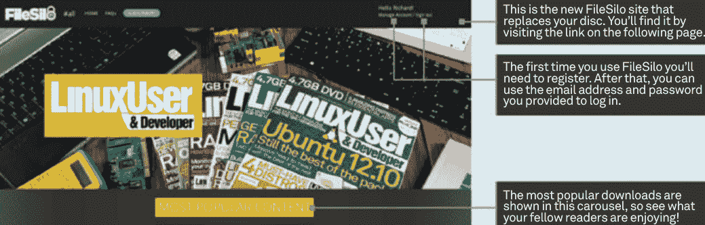

这是取代您旧版的 `Filesilo` 新站点。您可以通过访问下一页上的链接找到它。

第一次使用 `Filesilo` 时，您需要注册。之后，您可以使用提供的电子邮件地址和密码登录。

此轮播图中显示了最受欢迎的下载内容，看看您的读者在喜欢什么吧！

如果您正在寻找特定类型的内容（如发行版或 `Python` 文件），请使用这些过滤器进行筛选。


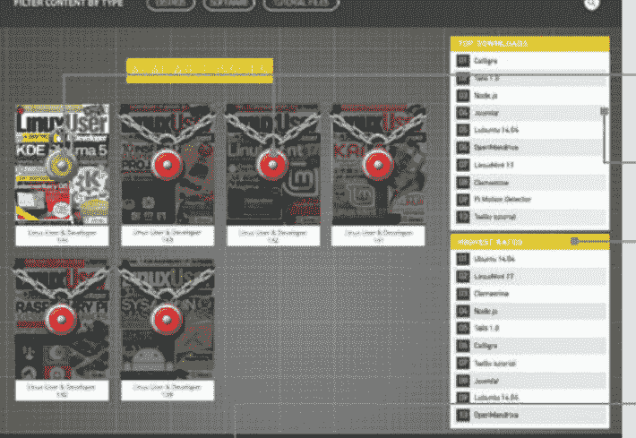

绿色锁头显示您已访问过的期刊。红色闭合锁头显示您需要购买或解锁的期刊。

这里列出了热门下载，让您可以直观查看最受欢迎的下载内容。

查看“评分最高”列表看看其他读者投票的资源！


了解更多关于我们在线商店的信息以及实用的常见问题（`FAQ`），例如我们的 `Cookie` 和隐私政策以及联系方式。

发现我们的姐妹杂志以及它们提供的丰富内容和信息。

`www.linuxux.co.uk`

# FileSilo

## 如何使用 FileSilo

关于访问您的新数字库您需要知道的一切

要访问 `FileSilo`，请访问 `www.filesilo.co.uk/linuxuser`

- 01 按照屏幕上的指令在我们安全的 `FileSilo` 系统中创建账户，然后登录并通过回答一个关于杂志的简单问题来解锁期刊。您可以使用您的杂志免费访问内容。
- 02 如果您是印刷版订阅者，可以通过输入您的 `Web ID` 解锁所有内容。您的 `Web ID` 是打印在订阅副本邮寄标签地址上方的八位字母数字代码。您也可以在续订信中找到它。
- 03 您可以使用任何流行的浏览器（如 `Firefox`、`Chrome` 或 `Safari`）在任何桌面电脑、平板电脑或智能手机设备上访问 `FileSilo`。但是，我们建议您使用桌面电脑下载内容，因为您可能无法将文件下载到手机或平板电脑。
- 04 如果您在访问 `FileSilo` 内容遇到任何问题，或在注册过程中遇到问题，请查看在线常见问题或发送邮件至 `fileshelp@imagine-publishing.co.uk`


# 10 最佳 Linux 桌面


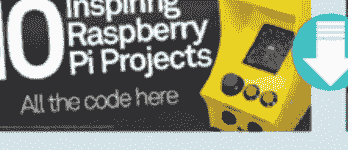


# 更多教程和灵感

这一期看完了？`Linux User` 网站上有更多免费的开源优质内容等着您。专题、教程、评论、观点文章和最新的开源新闻每天上传，涵盖 Linux 内核开发、最热门的趋势和开源、树莓派项目和采访、编程指南等。加入我们发展的 Linux 用户和开发者社区，发现新的 Linux 工具。

# www.linuxuser.co.uk

Linux User 第 155 期于 2015 年 7 月 30 日在 `GreatMags.com` 出售


# 弹性容器

- 基于 Linux 的云服务器
- 无忧虑的自动伸缩
- 独特的按需付费

每月 3 英镑起

免费试用

`www.elastichosts.co.uk`
`sales@elastichosts.com`
`020 7183 8250`


# Linux 服务器托管
英国专家提供

`24/7` 英国支持 • `ISO 27001` 认证 • 免费迁移

托管 • 云端托管 • 独立服务器

# 顶级托管。
顶级支持。

`www.CWCS.co.uk`

`T: 0115 740 1234` • `E: info@cwcs.co.uk` • `W: www.cwcs.co.uk`
