# Linux User & Developer 155 - Linux 虚拟化


# 群晖 (Synology)


# 创建你的多媒体中心


# DS115d 和 DS215d

为您家庭提供的完美数据存储解决方案

在舒适、安全的家中运行您自己的私有云

## 节能且可靠

`DS215j` 采用双核 CPU，支持高达 12TB 的数据，且活跃时功耗低于 14w；而 `DS115j` 为无需 RAID 的用户提供了稳定的存储环境，活跃时功耗低于 1w。

## 随时随地访问

群晖 NAS 和直观的 `DiskStation Manager` (`DSM`) 软件允许多个用户在设备之间同步和共享文件，包括 `Windows` PC、`Mac`、`Linux`、`iOS`、`Android` 和 `Windows Phone`。

## 多媒体中心

`Audio Station`、`Photo Station`、`Video Station` 和 `Media Server` 将您的群晖 NAS 变为集中的多媒体枢纽。

购买渠道


群晖应用可用于：


群晖媒体荣誉


`Rob Zetsloot` 是一位航空航天工程专家，使用 `Python` 对复杂模拟进行建模。最近，他险些放弃了 `iPad` 职业生涯，现在他正使用 `Pi` 协调一组 `Linux` 虚拟机（第 24 页），并用 `Python` 编写一部视觉小说（第 62 页）。他梦想着 `Ubuntu`。

`Jon Master` 是一位内核黑客，从事 `Linux` 工作已有 19 年，他首先就读于英国大学，住在马萨诸塞州剑桥，在一家企业 `Linux` 供应商工作。你可以在第 10 到 13 页找到他。

`Liam Fraaser` 是 `RaspberryPi`/`YouTube` 记者，并担任 `RaspberryPi` 的 `Linux` 服务器管理员志愿者。在第 50 页可以了解他是如何设置 `RaspberryPi` 的，包括视频门铃、DC 灯光、插座和鼠标。

`Mihalis Toukalos` 是一位 `Linux` 系统管理员，在编程、数据库和数学方面拥有专长。他自 1993 年以来一直使用 `Linux`。本月他将关注 `C#` 程序员（第 11 列），关于他的两部分内容，请参阅第 44 页获取一些出色的编程建议。

`Dan Alder` 是 `Pi` 认证教育员也是 `CAS` 的首席教练。他热衷教学、黑客技术和项目，并利用这些项目吸引学生参与学习。在第 38 页，他展示了如何为他上个月开始构建的 `Pi` 构建软件模块。

`Gareth Halifer` 是我们的驻记者，为您带来世界各地的最新动态。在第 6 页中，他列出了如 `Banana Pro` 等笔记本电脑——看看这第二代 `Banana SRC` 相比 `Pi 2` 表现如何。

欢迎阅读最新版本的 `Linux User & Developer`，这是英国和美国最喜爱的 `Linux` 和开源杂志。

容器（`Containers`）现在在公众中备受关注，特别是近期如 `Open Container` 的发布等进展，但虚拟机尚未消失——正确的混合方案可能比使用任何一种工具都获益。本月我们将向你展示如何运行 `VirtualBox`、`QEMU` 和 `KVM`：这三项工具将使你能够创建强大的无头服务器、创建不同的处理器架构，并创建你所需的测试环境，或保留旧的操作系统环境。

我们本月还将讨论如何使用 `Raspberry Pi` 以及一个名为 `Home` 的 `Node.js` 项目，通过传感器、摄像头和视频通过简单的 Web 界面控制家居（第 50 页）。我们还评测了一些优秀的桌面服务器、`Ubuntu` 和 `Debian`，并以他们上个月开始的 `Linux Shell` 和可穿戴元素作为结尾。想知道我们对最新美出 `MX4` 的看法，请前往第 80 页告诉我们你的想法。

`Gavin Thomas`

联系邮箱：`linuxuser@publishing.com`

`Facebook`：`@linuxuser`

`Twitter`：`@linuxuser`

访问网站：`www.linuxuser.com`

- 11 编程列：学习 `C` 语言解决问题和编程
- 32 Web 服务器日志与监控
- 12 内核列：`Linux` 内核动态
- 40 调试你的开源软件：通过不同视角修复问题
- 44 编写 `Linux Shell` – 第二部分：改进你的基础代码并引入新功能
- 80 美出 `MX4`：`Canonical` 进入 `Ubuntu` 发布的两轮迭代
- 82 `Banana Pro`：云端设备能否抗衡 `Raspberry Pi 2`？
- 50 实用 `Raspberry Pi`：全方位了解 `Raspberry Pi` 家族
- 49 实用 `Raspberry Pi`：打造终极智能家居、使用 `Sens HAT` 检测污染、用 `Python` 编写视觉小说、使用 `Cthon` 优化代码并完成你的 `Pi` 地仪构建


06 新闻与观点 | 90 问答 | 94 读者来信

# 安全

## 核心基础设施倡议资助新的安全项目


## Linux 基金会为安全项目募集近 50 万美元

`Linux` 基金会宣布，其核心基础设施倡议（`Core Infrastructure Initiative`）已为三个安全相关项目筹集了 50 万美元资金：`Debian` 可重现构建项目、`Hanno Böck` 的模糊测试（`Fuzzing`）项目以及 `Pascal Cuq` 的 `CIS` 解释器，同时还为该倡议本身的基础设施安全总监 `Emery Ratcliffe` 提供了职位。

首批构建安全系统的人之一 `Catherine Ratiff`，她因对 `Linux` 第一标准评估的贡献而闻名，曾与 `Linux` 基金会小组、`GlobalPlatform` 合作，并持有认证系统安全专业人员（`CSSSP`）身份。

> “我们希望加入 `Linux` 基金会并致力于基础设施倡议，因为提高关键开源软件的安全性比任何单一公司能独立解决的问题要大得多，” `Ratiff` 说道。


> “我期待与所有成员共同工作，取得更多成就，解决那些资金不足的支持项目，并致力于改变行业惯例，保护开源软件。”

资金将用于这三个项目：200,000 美元用于 Debian 可重现构建项目，60,000 美元用于 Hanno Böck 的模糊测试项目，192,000 美元用于 Pascal Cuq 的 CIS 解释器。这些项目由 `James Holger` 和 `Jeremy LeJerry` 领导，旨在消除代码中的漏洞并提高自由软件项目的安全性。

与此同时，模糊测试项目已解决了包括 GnuPG 和 OpenSSL 在内的多个包中的安全问题，这 60,000 美元的资助将用于继续他的工作。

“虽然我们今天资助的每个项目都很优秀，但每一个对于全球社区的安全和网络安全都是至关重要的，”Jim Zemlin 声称，“随着 Emery Mean 的加入，这些新资助将在未来几个月内帮助解决基础设施漏洞。”

Linux 基金会执行主任 Jim Zemlin 认为每个项目都是“关键的”。

核心基础设施倡议由 Linux 基金会在 2014 年 Heartbleed 漏洞出现后设立，旨在提供支持并提高被认为是 Linux 及其用户关键技术的安全性。

# 容器

## Canonical 推出“Fan”网络系统

### 缓解 IPv4 网络全突发流量压力

Canonical 发布了一种全新的网络系统，可以在不增加复杂性的情况下大幅增加容器可用的 IP 地址数量，被称为 Fan。

“由于我们通过算法映射地址，因此我们避免了对每个主机建立数据库的需求，”Shuttleworth 说，“我们可以立即计算出每个主机上的主机网络，而不是依赖于软件定义的端点。这允许提供更多的地址，只需单路由即可进入我们现在合并的网格隧道‘扇’网络。”

“这意味着你可以把它想象成一个拥有更多 IP 地址的扇形，而不是只有 250 个可用 IP 地址，”Ubuntu 的 Canonical Mark Shuttleworth 解释道。此外，你可以运行多个扇形，因此每个品牌、每个扇都可以为你提供 250 个 IP 地址。”

为亚马逊云 (AWS) 平台上的 Ubuntu 镜像推出的 Fan 现已适用于 Google Cloud Engine (GCE)，并支持多个平台。Shuttleworth 表示，Canonical 打算向互联网工程任务组（IETF）提交征求意见（RFC），将 Fan 变为跨供应商的容器标准。Fan 需要修改过的 Linux 内核、修改过的 `iptables` 包、新的 `fanctl` 实用程序以及发布的教程。

Fan 系统由 Mark Shuttleworth 创建并由 John Courte 实现，旨在为本地网络中的任何主机提供额外地址，作为扩展到更密集的容器化系统（SDN）的手段。它并不提供在需要将接口从一个热迁移到另一个时所需的任意软件定义虚拟化。相反，它需要配合如 LXC/Docker 等容器使用。

Canonical 官方网站 `www.ubuntu.com/FanNetworking` 提供了关于 Fan 的文档说明。

# 教育

## FUZE BASIC v3 更新图形

### 添加了精灵功能

FUZE 发布了第三代 FUZE BASIC 编程语言，这是 BASIC 语言的现代延续，专为 FUZE 编程电子工作站设计。

在树莓派和其他平台上免费提供，FUZE BASIC 增加了高级图形处理命令，如精灵旋转和缩放、透明度通道等。

# 前五名

## Linux 4.1 LTS 的特性

### 1. 功耗提升

最新长期支持内核的发布改进了笔记本电脑和桌面级电脑的电池寿命，对 Intel Core 设备（包括 Intel Compute Stack）益处尤为显著。

### 2. 密码学

得益于 Android 为移动平台提供的补丁，Ext4 文件系统现在包含了即时层级加密选项。这独立于现有的 Linux 加密功能（如 `de-crypt`）存在。

### 3. 更好的游戏体验

使用 4.1 内核的 Linux 游戏体验为罗技方向盘、游戏控制器和微软设备提供了更好的力反馈支持。

### 4. 更好的支持

使用 4.1 内核的 Linux 游戏体验为罗技方向盘、游戏手柄和微软设备提供了更好的力反馈支持。

### 5. 更好的支持

使用 4.1 内核的 Linux 游戏体验为罗技方向盘、游戏控制器和微软设备提供了更好的力反馈支持。

# 容器

## 行业巨头合作开展开放容器项目

涵盖一系列科技公司

一系列涵盖广泛的科技公司已宣布建立合作伙伴关系，旨在利用专家捐赠的技术创建一个开放的容器和运行时环境。

“通过开放容器项目，Docker 正在确保碎片化不会破坏容器的承诺，”Linux 基金代表该项目解释道，“各类的供应商和技术人员将能够协作与创新，并确保中立的开源标准将占据主导地位。”


该运动的 Solomon Hayes 表示：“正是因为这样，我们现在将容器运行时捐赠给标准。在此之前，Docker 的容器代码和技术已经成熟到足以让他们从 Docker 项目之外的独立治理中受益。”

该项目已开始通过其开源 GitHub 仓库 `http://github.com/opencontainers` 发行 `runC` 和容器格式。你可以访问 `http://opencontainers.org` 发现更多关于该项目的信息。

> 包括亚马逊、Red Hat、微软、思科、Red Hat、富士通、谷歌、IBM、红帽在内的公司群：“我们认为现在是创建通用标准的时机，这将确保整个生态系统的兼容性和创新性，”Docker 补充道

Linux 基金会已开始接收 2015 年 Linux 培训奖学金计划的申请，其中包括针对年轻用户和初学者的新类别。

“培训和认证 Linux 专业人员是我们使命中最重要的部分。这种独立性确保了 Linux 系统的持续增长。”这项年度奖学金计划是触达更多人的战略关键。

除了现有项目外，2015 年的项目还包括两个新条目：Linux 新手（指已完成 Linux 入门课程但无其他经验的人员）以及 18 岁以下的受训申请者。

入选申请者在通过考试后，将获得六项奖学金之一，用于 Linux 基金会认证系统架构师（LFCS）或认证 Linux 工程师（LFCE）资格。

Linux 基金会宣布，2015 奖学金计划将向 1000 多名申请者提供奖学金。

关于奖学金是否将在今年 8 月选拔结束后公开发布的信息将随后公布。

## 通过提升知识实现稳定性

我们卓越的课程提供未经培训的培训。

100% 的客户对我们的 PostgreSQL 培训评级为优秀。预留您的位置，获取核心代码的专家知识。


`(+44 (0)80 766 756`

`2ndquadrant.com/knowledge`


## 发行版馈送

### 前 10 名（每日平均访问量，6月4日 - 7月5日）

- 1. Linux Mint
- 2. Debian
- 3. Ubuntu
- 4. Fedora
- 5. Mageia
- 6. openSUSE
- 7. Manjaro
- 8. CentOS
- 9. Arch Linux
- 10. LXLE

## 本月

- 稳定版（16）
- 开发中（7）
- 上个月 Mandriva 的突然关闭对其继任者 Mageia 是一个利好，后者在本月刚刚排名上扬

## 亮点

### Mageia 5

作为 Mandriva 原版的继承者，不需要在这样的时刻成为今天最好的发行版。其最新版本包含了 UEFI 支持，并支持任何设备上高达 Linux 3.9 x86-64。

### Linux Mint 17.2

作为榜首发行版的最新版本，Mint 17.2 包含了性能增强、改进对硬件后端的支持以及对 `bash` 终端的微调。

### Finnix 11

由 Finnix 开发的基于 Debian 的新发行版对硬件 ARM 处理器提供了实验性支持，带来了 Versatile Express 平台。

## 可用的最新发行版：

`filesilo.co.uk`


## CrossOver 支持 DirectX 11

## 无关于 Windows 10 桌面的消息

商业 Windows 兼容封装层 CrossOver 背后的公司 CodeWeavers 宣布支持任何设备上的当前代 DirectX 11 实现。在不久的将来。虽然游戏通常是为 Windows 设计的，但 CrossOver 和开源 Wine 兼容封装层作为工具非常有用，但受限于旧版本的 Microsoft Office。


Expo (EB) 表示：“虽然游戏支持的增量改进起初看起来很小，但游戏支持的累积改进将使许多游戏在需要时‘能够直接运行’。而且当你与索尔搏斗或在 PC、Mac 或 Linux 电脑上时，会有更多的游戏可以直接运行。”

“CodeWeavers 将在未来几个月内支持 DirectX 11、更好的控制器支持和 GPU 性能，”CodeWeavers 的 James Riley 在一篇博客中宣布，该博客详细介绍了他们在电子活动（Electronic Event）上发布的游戏。

随着大量使用 `DirectX 11` 专属奖励开发的游戏增加，这些引擎将获得支持……

您的 Linux 新闻与观点来源

# 观点

## 内核专栏

随着 `Linux 4.1` 的发布以及 `Linux 4.2` 特性合并计划的启动，Jon Masters 阐述了来自 Linux 内核社区的新闻。

> Lin Torvalds 发布了最终的 `4.1` Linux 内核，并表示在[不寻常]的一周之后，这非常安静。

正如我们上周注意的那样，`Linux 4.1` 必须在计划中额外增加了一周（候选版本 `rc8`），这是由于他的假期时间与原定发布目标重合，以及存在了一些小问题（例如，在 `RC8` 公文中提到的 `RAID` 驱动程序中自然存在会导致数据损坏的问题，这需要一些时间来解决）。总的来说，这是一个非常忙的一周，尽管他认为一个很好的“考虑”因素是，由于 `4.1` 将成为一个 `LTS`（长期支持版本），这意味着 Greg Kroah-Hansen 和其他维护者将在支持下进行 `4.2` 合并窗口的覆盖。在一切完成后，Linux 发布了 `4.2-rc1`，并指出该版本的巨大规模源于“异常”，即顶层头文件中的一层尺寸（占了 `-rc1` 中更改的所有代码行数的 `41%`）。同时，来自 `ARM64` 的典型更改具有“相当多的位差异”，这两种来源都可能导致损坏……以及 `FPU`（浮点单元）处理问题。

## 持久性内存

非易失性内存（`NVM`）是一种即使在掉电后也能保留数据的 `RAM`。这是系统设计中的一项重要特性，对硬件和软件均有影响。在硬件方面，持久性内存已经建立了稳定的设计，并正朝着“即时启动”的使用方向努力，同时在内存被用于两个不同用途的世界中创建必须处理冲突的功能。在软件方面，持久性内存带来了系统拓扑的挑战，并引发了关于管理大量既易失又持久的内容最佳手段的讨论。

Jon Masters 是一位已经在 Linux 领域工作多年的内核开发者。他最初就读于马萨诸塞大学阿姆斯特德分校，并在马萨诸塞州的 Red Hat 工作过，目前在该那里驱动能源高效 `ARM` 驱动服务器标准的开发。

## 内核合并了接近记录的更改集 - 超过 1200 个非合并更改

随着 `Linux 4.1` 的发布，`Linux 4.2` 合并窗口的传统开启已经开始。这包括对 `64` 位 `ARM` 系统的主线支持，以及一种用于非易失性存储（也称为“持久性内存”）的新内核块驱动程序。

在传统环境中，计算机使用称为 `RAM`（随机存存储器）的短期内存。内存是易失的，这意味着在休息（或在短期关机期间）移除电源后，数据将会丢失。传统 `RAM` 基于 20 世纪提出的（并在之后不断完善的）基于存储电荷的方法，它由微小的存储电荷组成；与我们今天拥有的基于物理特性的非易失内存设备不同，`RAM` 在几毫秒到几秒后就会丢失内容，并需要不断“刷新”。

`Linux 4.1` 持续了两个周，其期间接收了数量接近记录的更改集（补丁）。取决于你是否包含子系统维护者的“合并提交”，`Linux 3.1` 的更改集可能比 `4.2` 多或少，但那是一个非常短的时期。新闻提供了关于计算机软件中计算合并和非合并更改集的详细视图，这些方法依赖于通电状态下的后台运行，并且每个内存位置在不使用时恢复到初始状态。然而，传统的 `RAM` 设备是必须持续刷新的。持久性内存技术在系统掉电时不会遇到同样的问题。但与磁盘和闪存技术不同，它们是可以直接寻址的（你可以直接从非易失内存设备中执行代码）。

在未来几年里，随着大量 `TB` 非易失性内存的可用，管理它们变得令人头疼。另一方面，这些设备可能比传统的 `RAM` 慢（由于早期版本的性能特性），但不需要索引。内核“`config`”的一个新功能允许通过简单的命令行选项开启和关闭某些选项。这将合并（在未来的版本中），允许开发者避免在各种文件中查找他们想要开启的选项。如果你足够幸运拥有此类设备，可以加载并尝试它们。将这些内存视为磁盘的额外益处是，可以在其上创建文件系统。在当前阶段，`NV-DIM`（（非易失性内存模块）内存，通过“`pmem`”驱动。

## 持续开发

哪种虚拟机管理程序最适合你的操作系统虚拟化需求？

## KVM

`KVM` 是内置在 Linux 内核中的一组虚拟化模块——而不是一个键盘和鼠标切换器。将 `KVM` 构建在 Linux 本身的好处是，它可以更容易地转换为专用的虚拟机管理程序（可能是你在服务器上使用的那种类型），而不需要在其上方安装额外的软件包和其他软件。它的设置非常快，特别是使用图形化方法时，并且在主机和客机之间具有一些基本功能。如果你计划使用无头服务器，可以轻松在命令行中使用。

## VirtualBox

用途：测试软件、开发或任何你想在桌面上使用特定环境的活动

`VirtualBox` 在家庭用户中非常流行。它非常易用，这就是为什么它如此受欢迎。我们经常用它测试，它非常创建一个独立的发行版或发行版的不同版本来测试开发中的软件，观察它们在不同条件下的运行情况。由于它在操作系统内部运行的方式不同，效率不如 `KVM`，但从主机系统操作要容易得多，因为你可以在客机内外处理多项任务。从 `bit.ly/midas` 现在获取。

## QEMU

用途：测试和开发运行在不同架构上的操作系统

`QEMU` 不说是一个虚拟化软件，不如说是一个运行镜像的仿真器。你可以使用 `ISO` 并像其他虚拟机解决方案一样运行 Linux 发行版或 Windows；与这些系统不同，你还可以运行需要 `ARM`（如树莓派发行版）、`MIPS` 或你可以想到的任何其他处理器的发行版。如果你手头没有相关设备，这对于在不同架构上测试软件非常好。不过，使用起来可能有点复杂，因为它更多依赖于命令行界面。

- 最佳内存

给系统分配内存取决于主机将给客机分配多少内存。虽然如果你在作为主机的专用服务器上使用主机内存时这不是必须的，但给虚拟客机主机分配大量内存资源会对主机的性能产生负面影响。请保留一半的内存作为良好的最小值，特别是当你的桌面系统资源有限时。

## 功能 如何可视化 Linux

### 从 VIRTBOX 开始

通过易于使用的 `VirtualBox` 学习如何使用这种非常有用的虚拟机

要创建你的第一个虚拟机，打开程序并点击“新建（`New`）”。将类型（`Type`）和版本（`Version`）设置得尽可能接近你的客机发行版——例如，使用 `Debian` 基础。接下来，为你的虚拟机分配内存，这取决于你计划运行多少个客机，但一般规则是如果你只运行一个，就给虚拟机分配足够的内存。最后，创建一个虚拟硬盘。如果你需要像 `VMWare` 那样与其他协作，请坚持默认的 `VDI` 格式。或者如果你的虚拟机设置可以更快，请使用固定大小（`Fixed Size`）的硬盘而不是动态分配（`Dynamically Allocated`）。使用硬盘的大小留出空间——足够设置内存。此外，安全总没好。

硬盘设置好后，你的虚拟机几乎准备就绪了。点击“设置（`Settings`）”并进入“系统（`System`）”菜单。除了内存设置，你可以在第一个标签页上更改默认启动顺序。你还可以增加虚拟机 `CPU` 处理器的核心数——如果你同时运行多个，这将很有。接下来，如果你使用滑块的绿色区域，请启用共享内存（`Shared Memory`）。如果你安装了增强功能（`Guest Additions`，见下文），开启 `3D` 加速和 `2D` 视频加速有助于提高性能。要挂载物理或虚拟（通过 `VirtualBox`）光驱，通过添加 `IDE` 次级媒体控制器并选择你的 `ISO` 将其连接到客机。有时如果你的网络连接最初无法正常工作。如果是这样，进入“设置”并将适配器值从 `NAT` 更改为桥接（`Bridged`）。完成后，点击启动机器并开始安装你选择的发行版。

> 为什么不尝试 `VBoxManage CLI` 工具呢？`bit.ly/HuJjUW`

上面的增强功能将被安装以完成设置，但你以后可以返回设置并取消它

当你完成并进入虚拟机操作系统后，你可能想安装增强功能。这允许你通过正确的设置让虚拟机全屏运行，还可以启用指针集成、视频支持、客机之间的无缝窗口和文件夹以及更多功能。要执行此操作，进入“设备（`Devices`）”菜单选择“插入增强功能  映像（`Insert Guest Additions CD Image`）”。挂载磁盘（它不会自动挂载），然后从顶部点击。从那里，选择工作正常的分辨率（如果没有显示全屏），你的客机内部已完全启动，然后分别安装磁盘和 `VirtualBox-guest-packages`。最后，如果你安装了增强功能。接下来，进入“设置”，点击 `USB` 并启用控制器，然后点击“添加”选择过滤器。最后，过滤你的用户组设置。滚动到浏览器并将该用户添加到组中。

## VirtualBox 扩展

`VirtualBox` 有专有的扩展包：

- 远程桌面支持，允许从一台主机运行另一台虚拟机，你需要一个强大的服务器来运行多种类型的客机。


- 该包还可以启用`USB 3.0 (EHCI)`控制器、通过映射`Intel PXE ROM`进行远程启动、系统摄像头等。

你可以使用下拉菜单选择挂载在虚拟驱动器上的硬盘和`ISO`。

在将你的`USB`设备添加到过滤器之后，运行客机时会断开与主机的连接，释放它。

## 使用 QEMU 进行虚拟化

熟悉这种具有更多可控元素和更高性能的手动虚拟化软件

```bash
sudo apt update
sudo apt install qemu-kvm qemu-system-x86 qemu-system-arm
```

### 01 获取 QEMU

首先，我们需要在你的系统上安装`QEMU`——大多数`Linux`仓库都支持它，在`Ubuntu`中你可以找到类似的内容：

```bash
$ sudo apt install qemu
```

对于`Fedora`，你将使用`yum install`，如果你是系统管理员，你可能想从源码编译以确保它在你的源码上运行——可以在`https://www.qemu.org/download`获取

### 02 创建虚拟硬盘

你可以在仿真操作系统和发行版时创建一些虚拟空间，这对保存数据很有用，你甚至可以根据需要进行安装。在终端中你可以执行：

```bash
$ sudo qemu-img create vdh.img 20G
```

这创建一个`20 GB`的硬盘，尽管你可以根据需要将其大大或小。它可能会保留在工作目录。

### 03 仿真 x86

确保你已经下载了`ISO`，然后将其放入`QEMU`工作目录以便于启动。完成后，这比通常要快得多。

```bash
$ sudo qemu-system-x86 -hda vdh.img -cdrom [ISO].iso -m 2048 -boot d
```

... 虽然可能比其他虚拟化解决方案慢一点，因为它实际上是在仿真系统，但它是可以运行的。

`QEMU`不说是一个虚拟化软件，不如说是一个仿真器，允许你在`x86/x64`上运行，尽管它允许你仿真`ARM`、`MIPS`。这比`VirtualBox`稍微复杂一点。但是，你可以运行硬盘镜像。

### 04 安装在虚拟硬盘上

执行你操作系统的安装程序（确保你创建一个大虚拟硬盘），再次，它会比通常花费更长时间。一旦安装完成并可以使用以下命令重新打开它：

### 05 仿真 ARM

这可以用于仿真树莓派或其他物品，如果你想访问设备，这是测试运行`ARM`版本软件的好方法。这需要对初始运行命令进行一些更改，例如：

```bash
$ sudo qemu-system-arm
```

... 以及相关的镜像和内存详情（`-m`选项）以适应系统。

### 06 仿真 MIPS

使用`QEMU`仿真`ARM`，这允许你在`MIPS`硬件上进行测试。`QEMU`支持`MIPS`以及许多其他类型的`CPU`架构，为此你需要使用`qemu-system-mips`来运行镜像或操作系统。如果需要，还支持`MISEL`和`MIPS64`，只需将命令改为`qemu-system-misel`和`qemu-system-mips64`。

www.linuxuser.co.uk

## 如何构想 Linux

## 使用 KVM 进行虚拟化

`KVM`（基于内核的虚拟机）是一种内置在`Linux`内核中的虚拟化工具，强大且相当易用。

它也被称为基于内核的虚拟机（`Kernel-based Virtual Machine`），这允许`Linux`发行版本身作为其虚拟机的虚拟机管理程序。这需要`Intel`和`AMD`处理器提供硬件虚拟化支持（分别为`Intel VT-x`和`AMD-V`），但支持许多`Linux`发行版和其他操作系统。它可以像`VirtualBox`一样进行图形化管理，同时在某些情况下效率更高。

### 测试兼容性

确定你的系统是否真的可以使用`KVM`运行虚拟机非常重要，因为需要激活硬件虚拟化支持。要执行此操作，请打开终端并使用以下命令：

```bash
$ egrep -c 'kvm*' /proc/cpuinfo
```

如果返回数字"1"或更高，则意味着你的`CPU`支持`KVM`，尽管如果你的虚拟机无法工作，你可能需要在`BIOS`中激活它。

`KVM`既适用于用于创建虚拟机的桌面也适用于服务器，其设置比`VirtualBox`简单，同时比`QEMU`更量。

- 使用同样支持`QEMU`的`VMM`接口创建并管理运行在`KVM`上的多个虚拟机。

- 使用具有强大客户端接口的虚拟机，该接口可以实现一些优秀的主机机控制。

- 得益于直接绑定内核，运行虚拟机的效率比其他方法更高。

### 安装 KVM

一旦你确定了虚拟机是否可以工作，就是时候安装`KVM`了——尽管它是内核的一部分，但它不会自动激活。要轻松完成此操作，只需打开终端并使用：

```bash
$ sudo apt-get install qemu-kvm bridge-utils
```

这纯粹是命令行版本；如果你想添加图形化工具（哪些），可以安装它们：

```bash
$ sudo apt-get install libvirt-manager
```

普通用户无法使用虚拟机，因此你需要将想要访问虚拟机的非`root`用户添加到具有正确权限的组中以提升权限。该组是`libvirt`，你也可以使用你自己的组：

```bash
$ virsh -connect qemu:///system list
```

注销并重新登录，通过以下命令检查是否成功：它将列出此时所有正在运行的虚拟机。

### 创建虚拟机

在你的发行版的菜单中应该可以找到“虚拟机”。打开它，你将看到图形化界面。从这里你可以通过首先点击“创建新虚拟机”开始创建你的虚拟机。我们将使用`ISO`镜像，请选择你想使用的`ISO`。为虚拟机分配固定数量的内存（例如给你总量的一半，但具体问题请参考`CPU`使用详情）以及数量的存储空间。

### CPU 使用率

在创建所有这些虚拟机时，必须从主机设置`CPU`。像内存一样，你可以使用大约可用核心的一半，而不会为主机系统消耗过多资源。如果你计划托管多个客户（正常情况下），为每个客户只使用少量资源可能更好，否则会导致你的虚拟机性能下降。尝试不同的组合，看看哪种最合适。

### 安装虚拟机

点击并完成，然后在一切准备就绪后使用虚拟机。根据你发行版的不同，你将经历不同的安装过程——主流发行版能够很好地识别如何安装。与`VirtualBox`不同，你没有右键可以用作“主机键”，所以你必须手动全屏。

### 管理虚拟机

虚拟机可以暂停、强制退出、重置，并有重启和关闭快捷键。你可以在虚拟机运行时使用界面，通过按键在标准操作系统或`Linux`之间切换。

你无法修改虚拟机，但可以创建不同规格的虚拟机，或者在它们出现问题时将其删除。你还可以使用顶部栏上“虚拟机”菜单中的“重定向`USB`设备”，允许你访问外部存储。

## 虚拟化 Linux

### 选择发行版

通过这些可以虚拟化的`Linux`发行版创意来激发你的灵，它们可以提高你的生产力。

## 软件开发

## 扩展你的操作系统

### KODIBUNTU kodi.tv

如果你想在短时间内将系统变成媒体中心，虚拟化媒体中心软件是一种简单且快速的切换方式，不会干扰你任何正在运行的工作。可能可用最好的媒体中心软件是`Kodi`，而普通系统上最好的虚拟化版本是`Kodibuntu`。正如名称所示，`Linux`使其成为使用`Kodi`的极佳虚拟化基础。`Kodi`非常易用，菜单布局合理，并且对连接网络共享或主机上的共享有极佳支持。使用`USB`直通，你甚至可以允许遥控器或其他控制`Kodi`。它可能不如正式安装那样好，但会比你的发行版好一点。

### FEDORA fedora.org

使用`Fedora`进行开发的用处在于你始终可以访问到最新的软件，由于其是免费开源软件，它提供了一个更干净的工作环境。许多构建环境都有针对`Fedora`优化的版本，所以如果你真的想用，就可以使用它们，或者只是看看它是如何运行的。由于每个`Fedora`版本之间有相当长的时间，你可以使用虚拟机而无必每天都进行完全更新。该发行版中还有非常好的虚拟化支持，以确保它与你的某些虚拟化协同工作。

### ARCH LINUX archlinux.org

这个`Linux`发行版可以成为你想要的任何样子。它非常适合创建需要软件的测试环境。这个`Linux`发行版可以成为你想要的任何样子。（注：此处原文有重复）。

### TAILS tails.org

如果你想在短时间内将系统变成媒体中心，虚拟化媒体中心软件是一种简单且快速的切换方式，不会干扰你任何正在运行的工作。可能可用最好的媒体中心软件是`Kodi`，而普通系统上最好的虚拟化版本是`Kodibuntu`。正如名称所示，`Linux`使其成为使用`Kodi`的极佳虚拟化基础。`Kodi`非常易用，菜单布局合理，并且对连接网络共享或主机上的共享有极佳支持。使用`USB`直通，你甚至可以允许遥控器或其他控制`Kodi`。它可能不如正式安装那样好，但会比你的发行版好一点。


使用 `Fedora` 进行开发的用处在于你始终可以访问到最新的软件，由于其是免费开源软件，它提供了一个更干净的工作环境。许多构建环境都有针对 `Fedora` 优化的版本，所以如果你真的想用，就可以使用它们，或者只是看看它是如何运行的。由于每个 `Fedora` 版本之间有相当长的时间，你可以使用虚拟机而无必每天都进行完全更新。该发行版中还有非常好的虚拟化支持，以确保它与你的某些虚拟化协同工作。

## 备份与恢复

确保备份你的操作系统。`VirtualBox` 的一个优秀功能是可以创建当前状态的快照。这可以作为重新开始的参考，尽管它会占用一些空间。`VirtualBox` 具有将虚拟机导出为文件的功能，以便以后恢复，这也包含了虚拟机的所有细节。

## 快照

`VirtualBox` 的一个优秀功能是可以创建当前状态的快照。这可以作为重新开始的参考，尽管它会占用一些空间。

点击并完成，然后在一切准备就绪后使用虚拟机。根据你发行版的不同，你将经历不同的安装过程——主流发行版能够很好地识别如何安装。与 `VirtualBox` 不同，你没有右键可以用作“主机键”，所以你必须手动全屏。

- 使用同样支持 `QEMU` 的 `VMM` 接口创建并管理运行在 `KVM` 上的多个虚拟机。
- 使用具有强大客户端接口的虚拟机，该接口可以实现一些优秀的主机机控制。
- 得益于直接绑定内核，运行虚拟机的效率比其他方法更高。

使用 `Fedora` 进行开发的用处在于你始终可以访问到最新的软件，由于其是免费开源软件，它提供了一个更干净的工作环境。许多构建环境都有针对 `Fedora` 优化的版本，所以如果你真的想用，就可以使用它们，或者只是看看它是如何运行的。由于每个 `Fedora` 版本之间有相当长的时间，你可以使用虚拟机而无必每天都进行完全更新。该发行版中还有非常好的虚拟化支持，以确保它与你的某些虚拟化协同工作。

通过这些可以虚拟化的 `Linux` 发行版创意来激发你的灵感，它们可以提高你的生产力。

- 每种虚拟化方法都有自己的快速解决方案来解决你可能遇到的任何问题。对于这些每一种，请在 `VirtualBox` 网站查阅文档（`wiki.virtualbox.org/Documentation`）。`KVM` 有一个论坛寻求帮助，但它也有自己的网站和社区（`wiki.kvm.org/Manual`）。`KVM` 是 `Linux` 内核的一部分，它有一个专门用于使用的网站，该网站也有自己的社区（`linux-questions.org`）。


`0844` `249` `0282` `www.imaginesubs.co.uk/lud`

将填写好的表格发送至：

`Linux User & Developer Subscriptions, 800 Guillat Avenue,`

`Kent Science Park, Sittingbourne, Kent ME9 8GU`

| 标题 | 名字 |
| --- | --- |
| 姓 | | |
| 地址 | | | 
| 邮编 | 国家 |
| --- | --- |
| 电话号码 | | |
| 手机号码 | | | 

- 来自 `Linux` 专家的编程指南
- 来自企业供应商的最新动态
- 创新的树莓派项目与建议

**英国直接扣款支付**

我将每 3 期支付 12.50 英镑（节省 30%）

> 给您的银行或合作社的指令，要求通过直接扣款方式进行付款

请填写此表格并发送至 `Imagine Publishing Ltd`

| 地址 | 银行分支代码 (`sort`) |
| --- | --- |
| | |
| 识别号码 | 5 0 1 8 8 6 8 4 |
| 邮编 |
| --- | --- |
| | |
| 银行账户账号 |

> 给您的银行或合作社的指令，从本表格中列出的账户支付直接扣款。如果这些信息有任何变动，将通过电子方式发送给您的银行或合作社

| 签名 | 日期 |
| --- | --- |
| | |

## 付款详情

您的专属费率，1 年（13 期）

欧洲 £12.40（节省 20%）— £70 | 世界 £80 | 美国 £88

**支票**

我随附一张金额为 £ 英镑的支票

（收款人为：`Imagine Publishing Ltd`）

| `Visa` | `Mastercard` | `Amex` | `Maestro` |
| --- | --- | --- | --- |
| 卡号 | | | |

**信用卡/借记卡**

有效期

| 期数 | (`Maestro`) |
| --- | --- |
| | |

签名

日期

> 如果您不希望收到来自 `Imagine Publishing Ltd` 的任何促销材料，请通过以下方式告知：

电话：电子邮件

> 如果您不希望收到其他公司的任何促销材料，请通过以下方式告知：

电话：如果您**希望**通过电子邮件接收信息

**条款与条件**

此优惠使您作为新的直接扣款订阅者，每 3 期仅需支付 12.50 英镑。新订阅将从下一期可用杂志开始。必须提供优惠代码 `PQ15` 以享受此特别订阅价格。直接扣款协议的详情可按需提供。此优惠于 2010 年 9 月 30 日过期。`Imagine Publishing` 保留将此类优惠限制为每户一份的权利。订阅者可以随时取消订阅。

9 月 30 日

使用代码 `PQ15` 享受此优惠。

# 在 `Django` 中使用 `Twitter` 实时 API

# 使用 API 和少量代码为 `Django` 驱动的网站创建 `Twitter` 流


多年来，`Twitter` 的 API 已移植到许多编程语言中，其中之一就是非常流行的 `Python`。在过去，我们制作过关于使用 `Python` 创建实时应用的教程，各种库让这一过程变得简单。

确保可以访问 `Twitter`，尽管其请求数量有限制，且除了原生应用程序外，没有推送通知可用。

`Twitter` 是一个网络工具，尽管坦率地说，有一个适用于 `Django` 的 版本。某些工具已进一步扩展到 `Django`，您可以将其集成到网站中。这可以用于诸如侧边栏，显示来自您的账户或特定标签的实时推文流。

要获取 API，您需要在登录状态下访问 `Twitter` 开发者网站 `http://dev.twitter.com`。您可以通过“管理您的应用”选项执行更多不同的操作。要管理或添加新应用，请滚动到底部的“创建新应用”并根据您的个人或商业用途填写所有细节，完善个人资料中的任何空白。

获取 API 密钥让您能够通过多种方式开始访问 `Twitter`，而不仅仅是为了特定的 `Django`。在教程中，我们将向您展示该位置，并教您如何使用它。

我们将使用由 `michaelbooks` 开发的优秀 `Django Twitter Stream` 库 `https://github.com/michaelbooks` 来创建我们自己的 `Twitter` 流。它运行在流行的模块之上，

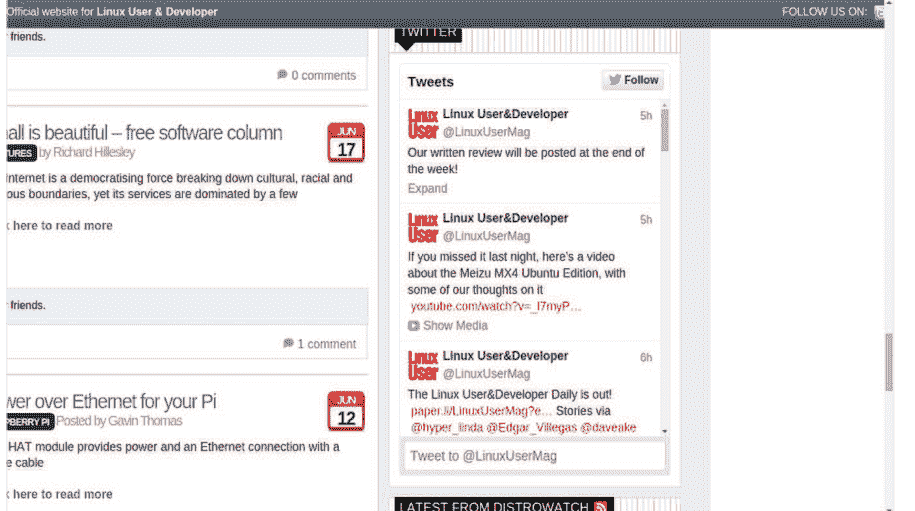

正确。`Twitter` API 允许您显示实时更新的推文

24

并让您使用数据库来存储数据。我们需要使用数据库来存储数据。安装后，您应该将其添加到：

```
pip install -e https://github.com/michaelbooks/django-twitter-stream
```

安装后，您应该将其添加到您的 `DATABASES`：

```python
DATABASES = {
    'default': {
        'ENGINE': 'django.db.backends.mysql',
        'USER': 'username',
        'PASSWORD': 'password',
        'HOST': 'localhost',
        'NAME': 'your_db',
        'CHARSET': 'utf8mb4',
    }
}
```

# 推文页面

现在您可以在 `urls.py` 中添加以下内容：

```python
from django.urls import path, include

urlpatterns = [
    path('tweets/', include('twitter_stream.urls', namespace='twitter_stream')),
]
```

您还需要将其添加到 `settings.py` 中的 `INSTALLED_APPS` 中：

```python
INSTALLED_APPS = [
    ...
    'twitter_stream',
]
```

# 开始推文

要开始构建数据库，运行迁移：

```bash
python manage.py makemigrations
python manage.py migrate
```

最后，启动 `Django` 服务器：


```bash
python manage.py runserver
```

现在您可以访问网站`http://127.0.0.1:8000/tweets/`来查看实时推文流。

## Django Suit

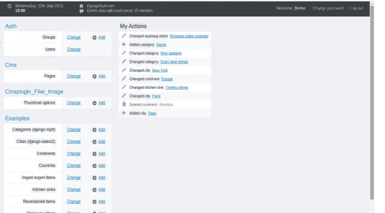

通过它，你可以开始更改流的工作方式，例如当你决定在应用中使用多个 API 时，使用哪些 API 密钥。

API 允许你创建一个数据库或文件来跟踪更改。因此，对于 Django 中的任何数据库或列表文件，你都可以开始使用其中的数据来填充文本页面。推文包含日期、金额等方面内容，因此你可以轻松地按时间顺序组织它们，从而创建一个时间轴。

如果你正在查看转推，请注意，如果你向文件写入信息，新条目将覆盖其他数据，因此在这种情况下你需要使用数据库。

## 实现你的网站

通过 Django，你可以启动你的网站，使其更符合社交媒体的规范，并帮助将人们引导到主网站的其他信息。

> 通过这些工具，你可以更新你的网站以符合现代社交媒体的规范。

```python
'NAME': 'test_database.db',
```

```python
STATICFILES_FINDERS = (
    'django.contrib.staticfiles.finders.LocStaticFinder',
    'django.contrib.staticfiles.finders.AppDirectoriesFinder',
)
```

## 测试设置

尝试以下设置来让程序运行起来，并在此基础上构建以使代码变得更高效。

```python
TEMPLATE_LOADERS = (
    'django.template.loaders.filesystem.Loader',
    'django.template.loaders.AppDirectoriesLoader',
)
```

```python
DIRS = (
    join(DJANGO_ROOT, 'templates'),
)
```

```python
from os.path import abspath, dirname, join
# 到 Django 项目目录的绝对文件系统路径：
DJANGO_ROOT = dirname(dirname(abspath(__file__)))
```

```python
INSTALLED_APPS = (
    'django.contrib.humanize',
    'django',
    'django.contrib.staticfiles',
    'bootstrap',
    'twitter_stream',
    'south',
)
```

```python
DATABASES = {
    'default': {
        'ENGINE': 'django.db.backends.sqlite3',
    }
}
```

Django Suit 是你管理页面一个极佳且高度可配置的主题。

## 教程：AWS 上的 NGINX

### 使用 AWS 上的 NGINX 为你的网站加速

世界上访问最频繁的一些网站中，有 1,000 个运行在 NGINX 上。网页访问者并不喜欢每次点击或触摸时等待页面加载。如果你想降低跳出率，就给他们网站中渴望的：速度，然后是更多的速度。没有高性能 Web 服务器，任何 Web 运动项目都无济于事。

在基准测试中，NGINX 可以碾压竞争对手。它提供的请求数是其最快竞争对手（Lighttpd）的两倍，是整个市场领导者（Apache）的八倍。它具有一种符合互联网标准的“安全性”；NGINX 的设计考虑了易于配置和健壮的安全。它小的内存占用使其能够运行在任何预算有限的 AWS EC2 Linux 实例上（每年 1500 美元，但开源是免费的，而且对于大多数人来说，它几乎）一样好）。

#### 01 登录 AWS 管理控制台

AWS 账户所有者可以 AWS root 身份登录，root 是所有基础设施服务（而非单个服务器实例）的超级用户。如果听我们的话，你应该只登录 AWS root 账户，创建一个 IAM 用户，并配合 MFA 令牌生成器（例如智能手机上的应用）进行多因素身份验证，而不是像组织中的其他人那样。

登录你的 AWS root 账户时，在 Web 浏览器中导航至：

`http://aws.amazon.com/`

... 并使用你的电子邮件地址。作为 IAM 用户登录时，转到特定特定的登录页面并输入你的 IAM 用户名和密码。


Felipe Martins & Anna Kobylinsa 在两年前成立旨在构建和扩展企业 IT，设计云解决方案并优化 AWS 上的 NGINX。


# 资源

在设置和运行网站时，AWS 提供了多种服务选择。URL 看起来如下：

```
https://AWS-account-ID.signin.amazon.com/console
```

在示例 URL 中，将`AWS-account-ID`替换为你的 AWS 账户数字。或者，你可以在 AWS 管理控制台的 IAM 仪表中获取 ID 并创建一个易记的别名。

## 启动 EC2 实例

除非你熟悉竞价实例（spot instances）的特性（例如亚马逊经常执行的无通知关机），否则最好的选择是按需请求（on-demand request），它确保了你的卷有保障（竞价实例会停机），并将收取你预留计算资源的费用（某些类型实例的折扣）。在 AWS 管理控制台中，导航到 EC2 Instances 部分并点击`Launch`（启动）。选择你喜欢的 AMI，它将使用`ami-1eca77gg`、来自 RHEL/CentOS 族的 Linux 或从 Purpose 类别中选择实例类型。选择实例类型是棘手的的；你需要考虑符合你用例的特征。EC2 价格位于：


`http://amazon.com/ec2/pricing/#reserved-instances`

可以给你提供计算资源开支的详细历史，但请记住：你保留的卷以及你使用但未释放的 IP——其他一切都会让你的钱包缩水。一些旧账户还使用了 EC2 Classic 环境；如果你看到它，请远离它。为你的 Web 服务器使用 VPC，最好配合 VPC 仪表板工作。

关于如何管理数据和存储的额外提示，请参考教程：AWS 云中的 Linux。为了连接到 NGINX，你必须在你的 EC2 实例的安全组中为客户请求开放`80 (HTTP)`和`443 (HTTPS)`端口，以便 NGINX 能够正常工作。设置好你的密钥对并启动实例。

## 分配 IP 地址

为你的 NGINX 实例分配 IP 地址。这让你能够在无需停止的情况下终止甚至关闭你的 DNS 配置。对于你的实例，NGINX 需要一个弹性 IP（EIP）。为了获取它，导航到 EC2 控制台中的`Elastic IP`并点击`Allocate Address`（分配地址）。在后续选择相应的 VPC 并配置。这是你 AWS 账户的 IP 地址。为了将其链接到 NGINX 实例，点击`Associate`（关联）。从搜索框中选择你的实例或网络接口并确认。

## 没有 Apache？

在过去的几年里，虚拟化、容器和分类对 Web 服务器提出了需求。Apache 已经过时了。在此期间，程序员发明了 NGINX 作为替代方案。

## 04 注册域名

通常情况下，你的服务器通过域名而非 IP 地址接收请求。为了正确设置，你需要注册一个全限定域名。除非你追求奇特的顶级域名（例如非常有盛名的名称），否则你可以选择 Amazon Route 53 提供的域名。

转到你项目的页眉（在 Route 53 控制台中），选择一个域名，填写详情，完成支付，该域名就归你了。

你需要一些 DNS 服务器将流量引导到你的 Linux 实例。你能获得的最佳优惠之一是 Route 53 提供的`Hosted Zones`服务（选择`Hosted Zones`）。

## 05. 配置

在 Route 53 的 AWS 管理控制台中进入`Hosted Zones`部分为你的域名创建一个新的托管区域。设置一个新域名。例如，你需要创建一个指向 Linux 实例 IP 地址的记录类型，以及指向`A`记录的`CNAME`记录。在每种情况下，选择`Not Alias`（非别名）选项，设置`Alias`（别名）并保持`TTL`值不变。所有这些看起来很复杂，但一旦你知道如何做，它其实很简单。

结果如下：

```
mydomain.co.uk A 56.728.123 300
www.mydomain.co.uk CNAME mydomain.
co.uk 380
```

`(56.728.123)`是你第 3 步中的`EIP`。


> 你可以在 Web 浏览器 `www.mydomain.com` 对你的域名运行诊断。

# AWS 上的 NGINX 教程

## GNU/Linux 上的 NGINX

在 `AWS` `GNU` `Linux` 云端运行的 `NGINX` 为您提供了一个灵活的开源 Web 服务器企业级基础设施，您可以用家庭预算进行设置和运行。如果免费可用资源不完全符合您的需求，可以使用 `NGINX` 构建您自己的自定义系统。


如果您在启动时为实例添加了任何额外卷卷（随 `AMI` 附带的卷），现在是对它们进行格式化、挂载并将它们添加到 `/etc/fstab` 的时候。在 `AWS` 上，您可以在 `AWS` 管理界面的 `Elastic Block Store` 部分创建额外的云卷，并将其附加到已运行的实例。

## 08 获取 root 权限

接下来，使用命令：

```
sudo su
```

... 以获取 `root` 权限。

## 09 从二进制文件安装 NGINX

现在使用此命令安装 `NGINX`：

```
yum install nginx
```

由于您的 `Amazon Linux` 上没有安装 `Apache`，因此不需要将其删除。


## 06 为您的域名设置名称服务器

为了在您选择的注册处为您的域名配置 `NS` 服务器，请在域名相应的表单中输入 `DNS` 服务器的主机。如果您使用 `Route 53` 作为 `DNS` 服务，`NS` 服务器列在域名 `Route 53` 托管区域（`Hosted Zone`）部分。它们看起来如下：

- `ns-1234.awns-12.co.uk`
- `ns-4321.awns-56.com`
- `ns-1321.awns-24.org`
- `ns-9876.awns-99.net`

您需要在注册商维护的域名配置中设置 `NS` 服务器。要验证设置是否正确，可以使用免费服务 `intools` 对您的域名进行诊断：

```
http://intools.com/
```

除非您打算为域名租用邮件服务器，否则可以忽略任何关于缺少 `MX` 的投诉。

## 07 连接到您的 Linux 实例

此时，您的实例应该已经通过健康检查且状态为“运行（`running`）”。导航到控制台的实例列表，从列表中选择您的实例并点击连接（`Connect`）按钮以查看连接说明。启动 `SSH` 连接并输入类似以下的内容：

```
ssh -i /path/to/yourPrivateKey.pem ec2-user@XX.XX.XX.XX
```

用户名通常是 `ec2-user` 或 `root`，从技术上说，`AMI` 的创建者可以将其设置为他们想要的任何值。如果您的实例用户不是 `root`，您可以使用以下命令获取超级用户权限：

```
sudo su
```

## 10 编辑 /etc/nginx.conf

`NGINX` 将其配置文件保存在 `/etc/nginx.conf` 中。使用您喜欢的编辑器打开主配置文件：

```
worker_processes auto;
Start-NGINX
service nginx start
```

现在，当您使用服务器的 IP 地址或域名时，将使用随处带有的 `/usr/share/nginx/html` 的通用测试页面。

## 11 设置虚拟主机

`NGINX` 虚拟主机的默认配置存储在 `/etc/nginx.conf/` 中的配置文件中，但有一种更优雅的方法使用 `sites-enabled` 和 `sites-available` 来管理这些设置。请创建这些目录：

```
mkdir /etc/nginx/sites-enabled
mkdir /etc/nginx/sites-available
```

> 默认情况下，Linux 中的 Web 服务器 NGINX 将配置文件存储在目录 /etc/nginx/conf.d 中

打开配置文件 `/etc/nginx/nginx.conf` 并创建一个链接到：

```
include /etc/nginx/conf.d/*;
```

... 带有哈希 `NGINX` 将忽略它：

```
include /etc/nginx/conf.d/*;
```

在下一行，告诉 `NGINX` 读取 `/nginx/sites-enabled` 目录的内容：

```
include sites-enabled/*;
```

对于每个您想要链接到 `sites` 目录的网站：

```
touch /etc/nginx/sites-available/www.mydomain.com
```

为了启用它，在 `sites-enabled` 目录中创建其配置的链接：

```
ln -s /etc/nginx/sites-available/www.mydomain.com /etc/nginx/sites-enabled
```

到目前为止，您的配置文件只是一个空占位符。

## 13 支持的数据库

在本教程的设置中，`NGINX` 可以提供静态页面。为了使用服务器端脚本（例如作为 `CMS` 系统的引擎），您将需要为您选择的脚本语言（`PHP`, `Perl`）安装 `MySQL`/`MariaDB` 等 Web 服务器。所有所需的服务将在启动时自动启动。对于 `NGINX`，这是：

```
chconfig --le=2345 nginx on
```

## 14 启动 NGINX

在提示符处输入此命令：

```
service nginx start
```

... 手动启动 `NGINX`。

## 15 为您的网站创建根目录并测试页面

在站点配置文件（步骤2）中 `location (/)` 指定路径下创建网站的根目录：

```
mkdir /usr/share/nginx/www/my-website.com
```

## 12 编辑您的站点配置文件

使用您喜欢的文本编辑器打开站点配置文件：

```
/etc/nginx/sites-available/www.mydomain.com
```

要告诉 `NGINX` 如何处理对该站点的请求，您需要在配置(`server`)中定义它：

```
server {
listen 80;
server_name www.mydomain.com;
# 其他在此
}
```

`NGINX` 配置文件的每个部分定义了 `location` 并为站点的目录设置特定属性。这就是您如何定义 Web 文档的位置以及各种类型内容的优先级顺序：

```
location /
root /usr/share/nginx/www:my-website.com;
index index.html index.htm;
```

调整根目录树的权限：

```
chown -R nginx:nginx /usr/share/nginx/www/my-website.com
```

调整根目录树的权限：

```
chown -R nginx:nginx /usr/share/nginx/www/my-website.com
```

注意 `206.171.50` 将替换为你的网络地址。

# Apache 中的日志文件

`Cookie` 指令 - 设置记录 `cookie` 的日志文件名。该文件名相对于 `ServerRoot`（服务器根目录）。

如果你想查看访问你网站的唯一主机总数，可以使用以下命令：

默认情况下，`Apache` 提供两个日志文件，位于你安装目录下的 `logs` 目录 - 它们是访问日志（access logs）和错误日志（error logs）。访问日志文件包含已处理的请求，错误日志文件包含错误状况。

有时有必要创建多个日志文件。你可以使用 `mod_log_module` 的 `TransferLog` 和/或 `Custom` 指令轻松地创建多个日志文件。你需要为每个日志文件重复这些指令。例如，如果你想要一个标准的访问日志和一个所有 `URL` 的日志，可以使用以下行代码来实现它们：

```
cat my_path/http/access_log | awk 'print $1' | grep "206.171.50" | wc -l
```

如预期的那样，你可以将日志保存到文件中，但日志会为你做一些额外的工作 - 它们需要被管理。高流量的 `Apache` 站点日志文件增长非常快。当日志文件变得非常大时，会导致磁盘崩溃，通常的机制是在你的网站出错时对其进行轮转（`rotate`）。如果没有日志记录，你将无法确定出了什么以及发生了什么错误。错误日志非常重要，因为 `ErrorLog` 指令允许你记录所遇到的所有类型的错误。如果我们将配置中的 `ErrorLog` 指令替换为：


## 日志轮转的重要性
日志轮转非常重要且非常方便。它有助于管理系统生成的大日志文件——这在 Web 服务器的案例中是一个典型用例。使用这种方法，你可以压缩日志文件并删除旧文件。轮转日志文件意味着将副本复制到备份并创建一个新的日志文件。然后我们可以在文件过期时删除旧文件。在这项工作中，例如，我们需要配置一个日志文件以及该特定程序如何轮转日志文件的文件。日志轮转涉及定期每周或每月将现有的日志文件移动到其他地方，然后从空日志文件开始。

### 典型的日志轮转配置
下面是一个典型的日志轮转配置：

- `ErrorLog`
- 详情请参阅 `man logrotate`
- 每周轮转日志文件
- 保留 4 周的备份
- 并重启，Apache 将将所有错误信息写入 `syslog`（系统日志）。
- 在轮转旧文件后创建新的空日志文件
- 压缩

通过 `LogLevel`，可以指定 Apache 应该向 `syslog` 发送什么类型的消息。例如：

- `ErrorLog`
- `Loglevel`

这里指出，将所有调试（`debug`）消息存储在不同的文件中是正常做法。为了此目的，你需要通过修改 `/etc/syslog.conf` 文件来添加以下行：

```
<debug /var/log/apache2
```

重启后，Apache 将能够将所有调试消息存储到 `syslog` 服务器。Web 日志文件有助于我们的调试过程。日志文件将帮助你检测问题，识别你网站的问题，发现你网站的最佳功能和有趣信息。

### 列出主机
如果你想列出所有主机，可以使用以下命令：

```
cat my_path/http/access_log | awk 'print $1'
```

这里 `cat` 使用访问文件列出日志文件，结果输出传递给 `awk` 打印器。这使用 `print` 命令打印每行的第一个字段。

如果你需要检查网络上的主机，可以使用此稍作修改的命令：

```
cat my_path/http/access_log | awk 'print $1' | grep -v "206.171.50"
```

## localhost 的 Apache 服务器
- 服务器版本: `Apache/2.4.22` `(Win32)` `PHP/5.4.0`
- 当前时间: `2022-07-20 09:15:59` 美国夏令时间
- 重启时间: `2022-07-20 08:32:34` 美国夏令时间
- 运行时间: `1` 天 `43` 分
- 总请求数: `442` | 接收: `329 KB` | 已处理请求数: `63` 空闲工作线程

## 教程日志
`rotate`（轮转）的妙之处在于它允许我们每天、每月或在增长过大时处理每个日志文件。因此，使用 `rotate`，可以用更少的磁盘空间保留长时间的日志。将 `rotate` 作为日常实践是必要的。因此，不需要对一个日志文件轮转几次。

当调用时，`rotate` 执行以下操作：

`daily` 告诉 `rotate` 每天轮转一次文件。

- `Rotate 1` 告诉它在之前轮转一次日志文件。
- `Create` 告诉 `rotate` 在轮转旧文件时创建一个新的日志文件。
- `Compress` 告诉它在日志变旧时压缩日志。
- `Include` 指示 `rotate` 在 `-cfg/rotate` 中执行更多指令。让我们考虑另一个例子：

- `rotate` 配置文件: `/etc/rotate.conf`
- 配置目录下的文件: `/etc/rotate.d/`
- 如果你有许多服务（Apache Web 服务器、MySQL 等），请在 `etc/rotate.d` 中定义你的系统配置文件。

`Rotate` 带有许多行，其中一些行是很有用的。以下是 `rotate` 的一些选项：

- `v` 详细模式
- `d` 启用调试模式
- `f` 强制日志文件（如果没必要）
- `u` 使用输出简短消息，提供用法信息
- `weekly`
- `rotate 5`

这些是处理 `/var/log` 下错误消息的规则。这些文件在删除之前将每周轮转一次。日志文件处理后将进行每周轮转。在这项工作中，例如我们需要配置一个日志文件以及该特定程序如何轮转日志的文件。日志轮转涉及定期每周或每月将现有的日志文件移动到其他地方，然后从空日志文件开始。

### 典型的日志轮转配置（示例二）
一个典型的日志轮转配置如下：

- `ErrorLog`
- 详情请参阅 `man logrotate`
- 每周轮转日志文件
- 保留 4 周的备份
- 并重启，Apache 将将所有错误信息写入 `syslog`。
- 在轮转旧文件后创建新的空日志文件
- 压缩

通过 `LogLevel`，可以指定 Apache 应该向 `syslog` 发送什么类型的消息。例如：

- `ErrorLog`
- `Loglevel`

这里指出，将所有调试消息存储在不同的文件中是正常做法。为了此目的，你需要通过修改 `/etc/syslog.conf` 文件来添加以下行：

```
<debug /var/log/apache2
```

重启后，Apache 将能够将所有调试消息存储到 `syslog` 服务器。Web 日志文件有助于我们的调试过程。日志文件将帮助你检测问题，识别你网站的问题，发现你网站的最佳功能和有趣信息。

### 列出主机（示例二）
如果你想列出所有主机，可以使用以下命令：

```
cat my_path/http/access_log | awk 'print $1'
```

这里 `cat` 使用访问文件列出日志文件，结果输出传递给 `awk` 打印器。这使用 `print` 命令打印每行的第一个字段。

如果你需要检查网络上的主机，可以使用此稍作修改的命令：

```
cat my_path/http/access_log | awk 'print $1' | grep -v "206.171.50"
```


```
cat my_path/http/access_log | awk 'print $1' | grep -v "206.171.50"
```

# localhost 的 Apache 服务器

服务器版本: `Apache/2.4.22 (Win32) PHP/5.4.0`

当前时间: 2022-07-20 09:15:59 美国夏令时间

重启时间: 2022-07-20 08:32:34 美国夏令时间

运行时间: 1 天 43 分

总请求数: 442 | 接收: 329 KB | 已处理请求数: 63 空闲工作线程

# 教程日志

`rotate` 的妙之处在于它允许我们每天、每月或在增长过大时处理每个日志文件。因此，使用 `rotate`，可以用更少的磁盘空间保留长时间的日志。将 `rotate` 作为日常实践是必要的。因此，不需要对一个日志文件轮转几次。

当调用时，`rotate` 执行以下操作：

`daily` 告诉 `rotate` 每天轮转一次文件。

- `Rotate 1` 告诉它在之前轮转一次日志文件。
- `Create` 告诉 `rotate` 在轮转旧文件时创建一个新的日志文件。
- `Compress` 告诉它在日志变旧时压缩日志。
- `Include` 指示 `rotate` 在 `-cfg/rotate` 中执行更多指令。让我们考虑另一个例子：
  - `rotate` 配置文件: `/etc/rotate.conf`
  - 配置目录下的文件: `/etc/rotate.d/`
  - 如果你有许多服务（Apache Web 服务器、MySQL 等），请在 `/etc/rotate.d` 中定义你的系统配置文件。

`Rotate` 带有许多行，其中一些行是很有用的。以下是 `rotate` 的一些选项：

- `v` 详细模式
- `d` 启用调试模式
- `f` 强制日志文件（如果没必要）
- `u` 使用输出简短消息，提供用法信息
- `weekly`

```
rotate 5
```

这些是处理 `/var/log` 下错误消息的规则。这些文件在删除之前将每周轮转一次。日志文件处理后将进行每周轮转。在这项工作中，例如我们需要配置一个日志文件以及该特定程序如何轮转日志的文件。日志轮转涉及定期每周或每月将现有的日志文件移动到其他地方，然后从空日志文件开始。一个典型的日志轮转配置如下：

- `ErrorLog`
- 详情请参阅 `man logrotate`
- 每周轮转日志文件
- 保留 4周的备份
- 并重启，`Apache` 将将所有错误信息写入 `syslog`。
- 在轮转旧文件后创建新的空日志文件
- `压缩`

通过 `LogLevel`，可以指定 `Apache` 应该向 `syslog` 发送什么类型的消息。例如：

- `ErrorLog`
- `LoGlevel`

这里指出，将所有调试消息存储在不同的文件中是正常做法。为了此目的，你需要通过修改 `/etc/syslog.conf` 文件来添加以下行：

```
<debug /var/log/apache2
```

重启后，`Apache` 将能够将所有调试消息存储到 `syslog` 服务器。`Web` 日志文件有助于我们的调试过程。日志文件将帮助你检测问题，识别你网站的问题，发现你网站的最佳功能和有趣信息。

如果你想列出所有主机，可以使用以下命令：

```
cat my_path/http/access_log | awk 'print $1'
```

这里 `cat` 使用访问文件列出日志文件，结果输出传递给 `awk` 打印器。这使用 `print` 命令打印每行的第一个字段。

如果你需要检查网络上的主机，可以使用此稍作修改的命令：

```
cat my_path/http/access_log | awk 'print $1' | grep -v "206.171.50"
```

# localhost 的 Apache 服务器

服务器版本: `Apache/2.4.22 (Win32) PHP/5.4.0`

当前时间: 2022-07-20 09:15:59 美国夏令时间

重启时间: 2022-07-20 08:32:34 美国夏令时间

运行时间: 1 天 43 分

总请求数: 442 | 接收: 329 KB | 已处理请求数: 63 空闲工作线程

# 教程日志

`rotate` 的妙之处在于它允许我们每天、每月或在增长过大时处理每个日志文件。因此，使用 `rotate`，可以用更少的磁盘空间保留长时间的日志。将 `rotate` 作为日常实践是必要的。因此，不需要对一个日志文件轮转几次。

当调用时，`rotate` 执行以下操作：

`daily` 告诉 `rotate` 每天轮转一次文件。

- `Rotate 1` 告诉它在之前轮转一次日志文件。
- `Create` 告诉 `rotate` 在轮转旧文件时创建一个新的日志文件。
- `Compress` 告诉它在日志变旧时压缩日志。
- `Include` 指示 `rotate` 在 `-cfg/rotate` 中执行更多指令。让我们考虑另一个例子：
  - `rotate` 配置文件: `/etc/rotate.conf`
  - 配置目录下的文件: `/etc/rotate.d/`
  - 如果你有许多服务（Apache Web 服务器、MySQL 等），请在 `/etc/rotate.d` 中定义你的系统配置文件。

`Rotate` 带有许多行，其中一些行是很有用的。以下是 `rotate` 的一些选项：

- `v` 详细模式
- `d` 启用调试模式
- `f` 强制日志文件（如果没必要）
- `u` 使用输出简短消息，提供用法信息
- `weekly`

```
rotate 5
```

这些是处理 `/var/log` 下错误消息的规则。这些文件在删除之前将每周轮转一次。日志文件处理后将进行每周轮转。在这项工作中，例如我们需要配置一个日志文件以及该特定程序如何轮转日志的文件。日志轮转涉及定期每周或每月将现有的日志文件移动到其他地方，然后从空日志文件开始。一个典型的日志轮转配置如下：

- `ErrorLog`
- 详情请参阅 `man logrotate`
- 每周轮转日志文件
- 保留 4周的备份
- 并重启，`Apache` 将将所有错误信息写入 `syslog`。
- 在轮转旧文件后创建新的空日志文件
- `压缩`

通过 `LogLevel`，可以指定 `Apache` 应该向 `syslog` 发送什么类型的消息。例如：

- `ErrorLog`
- `LoGlevel`

这里指出，将所有调试消息存储在不同的文件中是正常做法。为了此目的，你需要通过修改 `/etc/syslog.conf` 文件来添加以下行：

```
<debug /var/log/apache2
```

重启后，`Apache` 将能够将所有调试消息存储到 `syslog` 服务器。`Web` 日志文件有助于我们的调试过程。日志文件将帮助你检测问题，识别你网站的问题，发现你网站的最佳功能和有趣信息。

如果你想列出所有主机，可以使用以下命令：

```
cat my_path/http/access_log | awk 'print $1'
```

这里 `cat` 使用访问文件列出日志文件，结果输出传递给 `awk` 打印器。这使用 `print` 命令打印每行的第一个字段。

如果你需要检查网络上的主机，可以使用此稍作修改的命令：

```
cat my_path/http/access_log | awk 'print $1' | grep -v "206.171.50"
```

# localhost 的 Apache 服务器

服务器版本: `Apache/2.4.22 (Win32) PHP/5.4.0`

当前时间: 2022-07-20 09:15:59 美国夏令时间

重启时间: 2022-07-20 08:32:34 美国夏令时间

运行时间: 1 天 43 分

总请求数: 442 | 接收: 329 KB | 已处理请求数: 63 空闲工作线程

# 教程日志

`rotate` 的妙之处在于它允许我们每天、每月或在增长过大时处理每个日志文件。因此，使用 `rotate`，可以用更少的磁盘空间保留长时间的日志。将 `rotate` 作为日常实践是必要的。因此，不需要对一个日志文件轮转几次。

当调用时，`rotate` 执行以下操作：

`daily` 告诉 `rotate` 每天轮转一次文件。

- `Rotate 1` 告诉它在之前轮转一次日志文件。
- `Create` 告诉 `rotate` 在轮转旧文件时创建一个新的日志文件。
- `Compress` 告诉它在日志变旧时压缩日志。
- `Include` 指示 `rotate` 在 `-cfg/rotate` 中执行更多指令。让我们考虑另一个例子：
  - `rotate` 配置文件: `/etc/rotate.conf`
  - 配置目录下的文件: `/etc/rotate.d/`
  - 如果你有许多服务（Apache Web 服务器、MySQL 等），请在 `/etc/rotate.d` 中定义你的系统配置文件。

`Rotate` 带有许多行，其中一些行是很有用的。以下是 `rotate` 的一些选项：

- `v` 详细模式
- `d` 启用调试模式
- `f` 强制日志文件（如果没必要）
- `u` 使用输出简短消息，提供用法信息
- `weekly`

```
rotate 5
```


## 日志轮转规则与配置

这些是处理 `/var/log` 下错误消息的规则。这些文件在删除之前将每周轮转一次。日志文件处理后将进行每周轮转。在这项工作中，例如我们需要配置一个日志文件以及该特定程序如何轮转日志的文件。日志轮转涉及定期每周或每月将现有的日志文件移动到其他地方，然后从空日志文件开始。一个典型的日志轮转配置如下：

- `ErrorLog`
- 详情请参阅 `man logrotate`
- 每周轮转日志文件
- 保留 4 周的备份
- 并重启，`Apache` 将将所有错误信息写入 `syslog`。
- 在轮转旧文件后创建新的空日志文件
- 压缩

通过 `LogLevel`，可以指定 `Apache` 应该向 `syslog` 发送什么类型的消息。例如：

- `ErrorLog`
- `Loglevel`

这里指出，将所有调试消息存储在不同的文件中是正常做法。为了此目的，你需要通过修改 `/etc/syslog.conf` 文件来添加以下行：

- `<debug /var/log/apache2`

重启后，`Apache` 将能够将所有调试消息存储到 `syslog` 服务器。Web 日志文件有助于我们的调试过程。日志文件将帮助你检测问题，识别你网站的问题，发现你网站的最佳功能和有趣信息。

如果你想列出所有主机，可以使用以下命令：

```
cat my_path/http/access_log | awk 'print $1'
```

这里 `cat` 使用访问文件列出日志文件，结果输出传递给 `awk` 打印器。这使用 `print` 命令打印每行的第一个字段。

如果你需要检查网络上的主机，可以使用此稍作修改的命令：

```
cat my_path/http/access_log | awk 'print $1' | grep -v "206.171.50"
```

### `localhost` 的 `Apache` 服务器

服务器版本: `Apache/2.4.22 (Win32) PHP/5.4.0`

当前时间: 2022-07-20 09:15:59 美国夏令时间

重启时间: 2022-07-20 08:32:34 美国夏令时间

运行时间: 1 天 43 分

总请求数: 442 | 接收: 329 KB | 已处理请求数: 63 空闲工作线程

## 教程日志

`rotate` 的妙之处在于它允许我们每天、每月或在增长过大时处理每个日志文件。因此，使用 `rotate`，可以用更少的磁盘空间保留长时间的日志。将 `rotate` 作为日常实践是必要的。因此，不需要对一个日志文件轮转几次。

当调用时，`rotate` 执行以下操作：

`daily` 告诉 `rotate` 每天轮转一次文件。

- `Rotate 1` 告诉它在之前轮转一次日志文件。
- `Create` 告诉 `rotate` 在轮转旧文件时创建一个新的日志文件。
- `Compress` 告诉它在日志变旧时压缩日志。
- `Include` 指示 `rotate` 在 `-cfg/rotate` 中执行更多指令。让我们考虑另一个例子：
    - `rotate` 配置文件: `/etc/rotate.conf`
    - 配置目录下的文件: `/etc/rotate.d/`
    - 如果你有许多服务（`Apache` Web 服务器、`MySQL` 等），请在 `etc/rotate.d` 中定义你的系统配置文件。

`Rotate` 带有许多行，其中一些行是很有用的。以下是 `rotate` 的一些选项：

- `v` 详细模式
- `d` 启用调试模式
- `f` 强制日志文件（如果没必要）
- `u` 使用输出简短消息，提供用法信息
- `weekly`
- `rotate 5`

这些是处理 `/var/log` 下错误消息的规则。这些文件在删除之前将每周轮转一次。日志文件处理后将进行每周轮转。在这项工作中，例如我们需要配置一个日志文件以及该特定程序如何轮转日志的文件。日志轮转涉及定期每周或每月将现有的日志文件移动到其他地方，然后从空日志文件开始。一个典型的日志轮转配置如下：

- `ErrorLog`
- 详情请参阅 `man logrotate`
- 每周轮转日志文件
- 保留 4 周的备份
- 并重启，`Apache` 将将所有错误信息写入 `syslog`。
- 在轮转旧文件后创建新的空日志文件
- 压缩

通过 `LogLevel`，可以指定 `Apache` 应该向 `syslog` 发送什么类型的消息。例如：

- `ErrorLog`
- `Loglevel`

这里指出，将所有调试消息存储在不同的文件中是正常做法。为了此目的，你需要通过修改 `/etc/syslog.conf` 文件来添加以下行：

- `<debug /var/log/apache2`

重启后，`Apache` 将能够将所有调试消息存储到 `syslog` 服务器。Web 日志文件有助于我们的调试过程。日志文件将帮助你检测问题，识别你网站的问题，发现你网站的最佳功能和有趣信息。

如果你想列出所有主机，可以使用以下命令：

```
cat my_path/http/access_log | awk 'print $1'
```

这里 `cat` 使用访问文件列出日志文件，结果输出传递给 `awk` 打印器。这使用 `print` 命令打印每行的第一个字段。

如果你需要检查网络上的主机，可以使用此稍作修改的命令：

```
cat my_path/http/access_log | awk 'print $1' | grep -v "206.171.50"
```

### `localhost` 的 `Apache` 服务器

服务器版本: `Apache/2.4.22 (Win32) PHP/5.4.0`

当前时间: 2022-07-20 09:15:59 美国夏令时间

重启时间: 2022-07-20 08:32:34 美国夏令时间

运行时间: 1 天 43 分

总请求数: 442 | 接收: 329 KB | 已处理请求数: 63 空闲工作线程

## 教程日志

`rotate` 的妙之处在于它允许我们每天、每月或在增长过大时处理每个日志文件。因此，使用 `rotate`，可以用更少的磁盘空间保留长时间的日志。将 `rotate` 作为日常实践是必要的。因此，不需要对一个日志文件轮转几次。

当调用时，`rotate` 执行以下操作：

`daily` 告诉 `rotate` 每天轮转一次文件。

- `Rotate 1` 告诉它在之前轮转一次日志文件。
- `Create` 告诉 `rotate` 在轮转旧文件时创建一个新的日志文件。
- `Compress` 告诉它在日志变旧时压缩日志。
- `Include` 指示 `rotate` 在 `-cfg/rotate` 中执行更多指令。让我们考虑另一个例子：
    - `rotate` 配置文件: `/etc/rotate.conf`
    - 配置目录下的文件: `/etc/rotate.d/`
    - 如果你有许多服务（`Apache` Web 服务器、`MySQL` 等），请在 `etc/rotate.d` 中定义你的系统配置文件。

`Rotate` 带有许多行，其中一些行是很有用的。以下是 `rotate` 的一些选项：

- `v` 详细模式
- `d` 启用调试模式
- `f` 强制日志文件（如果没必要）
- `u` 使用输出简短消息，提供用法信息
- `weekly`
- `rotate 5`

这些是处理 `/var/log` 下错误消息的规则。这些文件在删除之前将每周轮转一次。日志文件处理后将进行每周轮转。在这项工作中，例如我们需要配置一个日志文件以及该特定程序如何轮转日志的文件。日志轮转涉及定期每周或每月将现有的日志文件移动到其他地方，然后从空日志文件开始。一个典型的日志轮转配置如下：

- `ErrorLog`
- 详情请参阅 `man logrotate`
- 每周轮转日志文件
- 保留 4 周的备份
- 并重启，`Apache` 将将所有错误信息写入 `syslog`。
- 在轮转旧文件后创建新的空日志文件
- 压缩

通过 `LogLevel`，可以指定 `Apache` 应该向 `syslog` 发送什么类型的消息。例如：

- `ErrorLog`
- `Loglevel`

这里指出，将所有调试消息存储在不同的文件中是正常做法。为了此目的，你需要通过修改 `/etc/syslog.conf` 文件来添加以下行：

- `<debug /var/log/apache2`

重启后，`Apache` 将能够将所有调试消息存储到 `syslog` 服务器。Web 日志文件有助于我们的调试过程。日志文件将帮助你检测问题，识别你网站的问题，发现你网站的最佳功能和有趣信息。

如果你想列出所有主机，可以使用以下命令：

```
cat my_path/http/access_log | awk 'print $1'
```

这里 `cat` 使用访问文件列出日志文件，结果输出传递给 `awk` 打印器。这使用 `print` 命令打印每行的第一个字段。

如果你需要检查网络上的主机，可以使用此稍作修改的命令：

```
cat my_path/http/access_log | awk 'print $1' | grep -v "206.171.50"
```

### `localhost` 的 `Apache` 服务器

服务器版本: `Apache/2.4.22 (Win32) PHP/5.4.0`


当前时间: 2022-07-20 09:15:59 美国夏令时间

重启时间: 2022-07-20 08:32:34 美国夏令时间

运行时间: 1 天 43 分

总请求数: 442 | 接收: 329 KB | 已处理请求数: 63 空闲工作线程

# 教程日志

`rotate` 的妙之处在于它允许我们每天、每月或在增长过大时处理每个日志文件。因此，使用 `rotate`，可以用更少的磁盘空间保留长时间的日志。将 `rotate` 作为日常实践是必要的。因此，不需要对一个日志文件轮转几次。

当调用时，`rotate` 执行以下操作：

`daily` 告诉 `rotate` 每天轮转一次文件。

- `Rotate 1` 告诉它在之前轮转一次日志文件。

- `Create` 告诉 `rotate` 在轮转旧文件时创建一个新的日志文件。

- `Compress` 告诉它在日志变旧时压缩日志。

- `Include` 指示 `rotate` 在 `-cfg/rotate` 中执行更多指令。让我们考虑另一个例子：

- `rotate` 配置文件: `/etc/rotate.conf`

- 配置目录下的文件: `/etc/rotate.d/`

- 如果你有许多服务（`Apache` Web 服务器、`MySQL` 等），请在 `etc/rotate.d` 中定义你的系统配置文件。

`Rotate` 带有许多行，其中一些行是很有用的。以下是 `rotate` 的一些选项：

- `v` 详细模式

- `d` 启用调试模式

- `f` 强制日志文件（如果没必要）

- `u` 使用输出简短消息，提供用法信息

- `weekly`

`-- rotate 5`

这些是处理 `/var/log` 下错误消息的规则。这些文件在删除之前将每周轮转一次。日志文件处理后将进行每周轮转。在这项工作中，例如我们需要配置一个日志文件以及该特定程序如何轮转日志的文件。日志轮转涉及定期每周或每月将现有的日志文件移动到其他地方，然后从空日志文件开始。一个典型的日志轮转配置如下：

- `ErrorLog`

- 详情请参阅 `man logrotate`

- 每周轮转日志文件

- 保留 4周的备份

- 并重启，`Apache` 将将所有错误信息写入 `syslog`。

- 在轮转旧文件后创建新的空日志文件

- 压缩

通过 `LogLevel`，可以指定 `Apache` 应该向 `syslog` 发送什么类型的消息。例如：

- `ErrorLog`

- `Loglevel`

这里指出，将所有调试消息存储在不同的文件中是正常做法。为了此目的，你需要通过修改 `/etc/syslog.conf` 文件来添加以下行：

- `<debug /var/log/apache2`

重启后，`Apache` 将能够将所有调试消息存储到 `syslog` 服务器。`Web` 日志文件有助于我们的调试过程。日志文件将帮助你检测问题，识别你网站的问题，发现你网站的最佳功能和有趣信息。

如果你想列出所有主机，可以使用以下命令：

```
cat my_path/http/access_log | awk 'print $1'
```

这里 `cat` 使用访问文件列出日志文件，结果输出传递给 `awk` 打印器。这使用 `print` 命令打印每行的第一个字段。

如果你需要检查网络上的主机，可以使用此稍作修改的命令：

```
cat my_path/http/access_log | awk 'print $1' | grep -v "206.171.50"
```

# localhost 的 Apache 服务器

服务器版本: `Apache/2.4.22 (Win32) PHP/5.4.0`

当前时间: 2022-07-20 09:15:59 美国夏令时间

重启时间: 2022-07-20 08:32:34 美国夏令时间

运行时间: 1 天 43 分

总请求数: 442 | 接收: 329 KB | 已处理请求数: 63 空闲工作线程

# 教程日志

`rotate` 的妙之处在于它允许我们每天、每月或在增长过大时处理每个日志文件。因此，使用 `rotate`，可以用更少的磁盘空间保留长时间的日志。将 `rotate` 作为日常实践是必要的。因此，不需要对一个日志文件轮转几次。

当调用时，`rotate` 执行以下操作：

`daily` 告诉 `rotate` 每天轮转一次文件。

- `Rotate 1` 告诉它在之前轮转一次日志文件。

- `Create` 告诉 `rotate` 在轮转旧文件时创建一个新的日志文件。

- `Compress` 告诉它在日志变旧时压缩日志。

- `Include` 指示 `rotate` 在 `-cfg/rotate` 中执行更多指令。让我们考虑另一个例子：

- `rotate` 配置文件: `/etc/rotate.conf`

- 配置目录下的文件: `/etc/rotate.d/`

- 如果你有许多服务（`Apache` Web 服务器、`MySQL` 等），请在 `etc/rotate.d` 中定义你的系统配置文件。

`Rotate` 带有许多行，其中一些行是很有用的。以下是 `rotate` 的一些选项：

- `v` 详细模式

- `d` 启用调试模式

- `f` 强制日志文件（如果没必要）

- `u` 使用输出简短消息，提供用法信息

- `weekly`

`-- rotate 5`

这些是处理 `/var/log` 下错误消息的规则。这些文件在删除之前将每周轮转一次。日志文件处理后将进行每周轮转。在这项工作中，例如我们需要配置一个日志文件以及该特定程序如何轮转日志的文件。日志轮转涉及定期每周或每月将现有的日志文件移动到其他地方，然后从空日志文件开始。一个典型的日志轮转配置如下：

- `ErrorLog`

- 详情请参阅 `man logrotate`

- 每周轮转日志文件

- 保留 4周的备份

- 并重启，`Apache` 将将所有错误信息写入 `syslog`。

- 在轮转旧文件后创建新的空日志文件

- 压缩

通过 `LogLevel`，可以指定 `Apache` 应该向 `syslog` 发送什么类型的消息。例如：

- `ErrorLog`

- `Loglevel`

这里指出，将所有调试消息存储在不同的文件中是正常做法。为了此目的，你需要通过修改 `/etc/syslog.conf` 文件来添加以下行：

- `<debug /var/log/apache2`

重启后，`Apache` 将能够将所有调试消息存储到 `syslog` 服务器。`Web` 日志文件有助于我们的调试过程。日志文件将帮助你检测问题，识别你网站的问题，发现你网站的最佳功能和有趣信息。

如果你想列出所有主机，可以使用以下命令：

```
cat my_path/http/access_log | awk 'print $1'
```

这里 `cat` 使用访问文件列出日志文件，结果输出传递给 `awk` 打印器。这使用 `print` 命令打印每行的第一个字段。

如果你需要检查网络上的主机，可以使用此稍作修改的命令：

```
cat my_path/http/access_log | awk 'print $1' | grep -v "206.171.50"
```

# localhost 的 Apache 服务器

服务器版本: `Apache/2.4.22 (Win32) PHP/5.4.0`

当前时间: 2022-07-20 09:15:59 美国夏令时间

重启时间: 2022-07-20 08:32:34 美国夏令时间

运行时间: 1 天 43 分

总请求数: 442 | 接收: 329 KB | 已处理请求数: 63 空闲工作线程

# 教程日志

`rotate` 的妙之处在于它允许我们每天、每月或在增长过大时处理每个日志文件。因此，使用 `rotate`，可以用更少的磁盘空间保留长时间的日志。将 `rotate` 作为日常实践是必要的。因此，不需要对一个日志文件轮转几次。

当调用时，`rotate` 执行以下操作：

`daily` 告诉 `rotate` 每天轮转一次文件。

- `Rotate 1` 告诉它在之前轮转一次日志文件。

- `Create` 告诉 `rotate` 在轮转旧文件时创建一个新的日志文件。

- `Compress` 告诉它在日志变旧时压缩日志。

- `Include` 指示 `rotate` 在 `-cfg/rotate` 中执行更多指令。让我们考虑另一个例子：

- `rotate` 配置文件: `/etc/rotate.conf`

- 配置目录下的文件: `/etc/rotate.d/`

- 如果你有许多服务（`Apache` Web 服务器、`MySQL` 等），请在 `etc/rotate.d` 中定义你的系统配置文件。

`Rotate` 带有许多行，其中一些行是很有用的。以下是 `rotate` 的一些选项：

- `v` 详细模式

- `d` 启用调试模式

- `f` 强制日志文件（如果没必要）

- `u` 使用输出简短消息，提供用法信息

- `weekly`

`-- rotate 5`


# 日志轮转与 Apache 配置指南

这些是处理 `/var/log` 下错误消息的规则。这些文件在删除之前将每周轮转一次。日志文件处理后将进行每周轮转。在这项工作中，例如我们需要配置一个日志文件以及该特定程序如何轮转日志的文件。日志轮转涉及定期每周或每月将现有的日志文件移动到其他地方，然后从空日志文件开始。

一个典型的日志轮转配置如下：

```text
- ErrorLog
- 详情请参阅 `man logrotate`
- 每周轮转日志文件
- 保留 4周的备份
- 并重启，Apache 将将所有错误信息写入 syslog。
- 在轮转旧文件后创建新的空日志文件
- 压缩
```

通过 `LogLevel`，可以指定 `Apache` 应该向 `syslog` 发送什么类型的消息。例如：

```text
- ErrorLog
- Loglevel
```

这里指出，将所有调试消息存储在不同的文件中是正常做法。为了此目的，你需要通过修改 `/etc/syslog.conf` 文件来添加以下行：

```text
<debug /var/log/apache2
```

重启后，`Apache` 将能够将所有调试消息存储到 `syslog` 服务器。`Web` 日志文件有助于我们的调试过程。日志文件将帮助你检测问题，识别你网站的问题，发现你网站的最佳功能和有趣信息。

## 列出主机与网络检查

如果你想列出所有主机，可以使用以下命令：

```bash
cat my_path/http/access_log | awk 'print $1'
```

这里 `cat` 使用访问文件列出日志文件，结果输出传递给 `awk` 打印器。这使用 `print` 命令打印每行的第一个字段。

如果你需要检查网络上的主机，可以使用此稍作修改的命令：

```bash
cat my_path/http/access_log | awk 'print $1' | grep -v "206.171.50"
```

## localhost 的 Apache 服务器

**服务器版本**: `Apache/2.4.22 (Win32) PHP/5.4.0`

**当前时间**: 2022-07-20 09:15:59 美国夏令时间

**重启时间**: 2022-07-20 08:32:34 美国夏令时间

**运行时间**: 1 天 43 分

**总请求数**: 442 | 接收: 329 KB | 已处理请求数: 63 空闲工作线程

## 教程日志

`rotate` 的妙之处在于它允许我们每天、每月或在增长过大时处理每个日志文件。因此，使用 `rotate`，可以用更少的磁盘空间保留长时间的日志。将 `rotate` 作为日常实践是必要的。因此，不需要对一个日志文件轮转几次。

当调用时，`rotate` 执行以下操作：

`daily` 告诉 `rotate` 每天轮转一次文件。

- `Rotate 1` 告诉它在之前轮转一次日志文件。
- `Create` 告诉 `rotate` 在轮转旧文件时创建一个新的日志文件。
- `Compress` 告诉它在日志变旧时压缩日志。
- `Include` 指示 `rotate` 在 `-cfg/rotate` 中执行更多指令。

让我们考虑另一个例子：

- `rotate` 配置文件: `/etc/rotate.conf`
- 配置目录下的文件: `/etc/rotate.d/`
- 如果你有许多服务（`Apache` Web 服务器、`MySQL` 等），请在 `etc/rotate.d` 中定义你的系统配置文件。

`Rotate` 带有许多行，其中一些行是很有用的。以下是 `rotate` 的一些选项：

- `v` 详细模式
- `d` 启用调试模式
- `f` 强制日志文件（如果没必要）
- `u` 使用输出简短消息，提供用法信息
- `weekly`
- `rotate 5`


当前时间: `2022-07-20 09:15:59` 美国夏令时间

重启时间: `2022-07-20 08:32:34` 美国夏令时间

运行时间: `1 天 43 分`

总请求数: `442` | 接收: `329 KB` | 已处理请求数: `63` 空闲工作线程

# 教程日志

`rotate` 的妙之处在于它允许我们每天、每月或在增长过大时处理每个日志文件。因此，使用 `rotate`，可以用更少的磁盘空间保留长时间的日志。

（此处翻译逻辑保持上一致，确保后文完整）

`daily` 告诉 `rotate` 每天轮转一次文件。

- `Rotate 1` 告诉它在之前轮转一次日志文件。

- `Create` 告诉 `rotate` 在轮转旧文件时创建一个新的日志文件。

- `Compress` 告诉它在日志变旧时压缩日志。

- `Include` 指示 `rotate` 在 `-cfg/rotate` 中执行更多指令。让我们考虑另一个例子：

- `rotate` 配置文件: `/etc/rotate.conf`

- 配置目录下的文件: `/etc/rotate.d/`

- 如果你有许多服务（`Apache` Web 服务器、`MySQL` 等），请在 `/etc/rotate.d` 中定义你的系统配置文件。

`Rotate` 带有许多行，其中一些行是很有用的。以下是 `rotate` 的一些选项：

- `v` 详细模式

- `d` 启用调试模式

- `f` 强制日志文件（如果没必要）

- `u` 使用输出简短消息，提供用法信息

- `weekly`

`-- rotate 5`

注意 `206.171.50` 将替换为你的网络地址。

# Apache 中的日志文件

`Cookie` 指令 - 设置记录 cookie 的日志文件名。该文件名相对于 `ServerRoot`（服务器根目录）。

如果你想查看访问你网站的唯一主机总数，可以使用以下命令：

默认情况下，`Apache` 提供两个日志文件，位于你安装目录下的 `logs` 目录 - 它们是访问日志（access logs）和错误日志（error logs）。访问日志文件包含已处理的请求，错误日志文件包含错误状况。

有时有必要创建多个日志文件。你可以使用 `mod_log_module` 的 `TransferLog` 和/或 `Custom` 指令轻松地创建多个日志文件。你需要为每个日志文件重复这些指令。例如，如果你想要一个标准的访问日志和一个所有 URL 的日志，可以使用以下行代码来实现它们：

```
cat my_path/http/access_log | awk 'print $1' | grep "206.171.50" | wc -l
```

如预期的那样，你可以将日志保存到文件中，但日志会为你做一些额外的工作 - 它们需要被管理。高流量的 `Apache` 站点日志文件增长非常快。当日志文件变得非常大时，会导致磁盘崩溃，通常的机制是在你的网站出错时对其进行轮转（`rotate`）。如果没有日志记录，你将无法确定出了什么以及发生了什么错误。错误日志非常重要，因为 `ErrorLog` 指令允许你记录所遇到的所有类型的错误。如果我们将配置中的 `ErrorLog` 指令替换为：

日志轮转非常重要且非常方便。它有助于管理系统生成的大日志文件 - 这在 Web 服务器的案例中是一个典型用例。使用这种方法，你可以压缩日志文件并删除旧文件。轮转日志文件意味着将副本复制到备份并创建一个新的日志文件。然后我们可以在文件过期时删除旧文件。在这项工作中，例如，我们需要配置一个日志文件以及该特定程序如何轮转日志的文件。日志轮转涉及定期每周或每月将现有的日志文件移动到其他地方，然后从空日志文件开始。一个典型的日志轮转配置如下：

- `ErrorLog`

- 详情请参阅 `man logrotate`

- 每周轮转日志文件

- 保留 4 周的备份

- 并重启，`Apache` 将将所有错误信息写入 `syslog`。

- 在轮转旧文件后创建新的空日志文件

- 压缩

通过 `LogLevel`，可以指定 `Apache` 应该向 `syslog` 发送什么类型的消息。例如：

- `ErrorLog`

- `Loglevel`

这里指出，将所有调试消息存储在不同的文件中是正常做法。为了此目的，你需要通过修改 `/etc/syslog.conf` 文件来添加以下行：

- `<debug /var/log/apache2`

重启后，`Apache` 将能够将所有调试消息存储到 `syslog` 服务器。Web 日志文件有助于我们的调试过程。日志文件将帮助你检测问题，识别你网站的问题，发现你网站的最佳功能和有趣信息。

如果你想列出所有主机，可以使用以下命令：

```
cat my_path/http/access_log | awk 'print $1'
```

这里 `cat` 使用访问文件列出日志文件，结果输出传递给 `awk` 打印器。这使用 `print` 命令打印每行的第一个字段。

如果你需要检查网络上的主机，可以使用此稍作修改的命令：

```
cat my_path/http/access_log | awk 'print $1' | grep -v "206.171.50"
```

# localhost 的 Apache 服务器

服务器版本: `Apache/2.4.22 (Win32) PHP/5.4.0`

当前时间: `2022-07-20 09:15:59` 美国夏令时间

重启时间: `2022-07-20 08:32:34` 美国夏令时间

运行时间: `1 天 43 分`

总请求数: `442` | 接收: `329 KB` | 已处理请求数: `63` 空闲工作线程

# 教程日志

`rotate`（轮转）的妙之处在于它允许我们每天、每月或在增长过大时处理每个日志文件。因此，使用 `rotate`，可以用更少的磁盘空间保留长时间的日志。将 `rotate` 作为日常实践是必要的。因此，不需要对一个日志文件轮转几次。

当调用时，`rotate` 执行以下操作：

`daily` 告诉 `rotate` 每天轮转一次文件。

- `Rotate 1` 告诉它在之前轮转一次日志文件。

- `Create` 告诉 `rotate` 在轮转旧文件时创建一个新的日志文件。

- `Compress` 告诉它在日志变旧时压缩日志。

- `Include` 指示 `rotate` 在 `-cfg/rotate` 中执行更多指令。让我们考虑另一个例子：

- `rotate` 配置文件: `/etc/rotate.conf`

- 配置目录下的文件: `/etc/rotate.d/`

- 如果你有许多服务（`Apache` Web 服务器、`MySQL` 等），请在 `/etc/rotate.d` 中定义你的系统配置文件。

`Rotate` 带有许多行，其中一些行是很有用的。以下是 `rotate` 的一些选项：

- `v` 详细模式

- `d` 启用调试模式

- `f` 强制日志文件（如果没必要）

- `u` 使用输出简短消息，提供用法信息

- `weekly`

`-- rotate 5`

这些是处理 `/var/log` 下错误消息的规则。这些文件在删除之前将每周轮转一次。日志文件处理后将进行每周轮转。在这项工作中，例如我们需要配置一个日志文件以及该特定程序如何轮转日志的文件。日志轮转涉及定期每周或每月将现有的日志文件移动到其他地方，然后从空日志文件开始。一个典型的日志轮转配置如下：

## 教程 | SSD & HDD

## 通过结合 SSD 和 HDD 设置你的系统

### 通过混合存储环境打造“两兼优”的场景


`SSD` 固硬盘在现代计算中已经存在了一段时间了。现在，中等容量硬盘的价格已经可以负担得起，尤其是与几年前购买 `64 GB` 硬盘可能需要花费的数百美元相比。不过，对于 `TB` 级别的大容量存储空间仍然昂贵。此外，`SSD` 也有存在写入次数限制的问题，在计算领域也是如此。

- 01 选择 `SSD`

你选择 `SSD` 硬盘时应考虑几个因素，但最重要的因素之一是所需的空间。由于我们将 `SSD` 视为主硬盘，它需要能够包含操作系统，并留出大量空间安装应用程序和软件包。正如讨论过的，现在 `SSD` 硬盘的容量大得多，但价格也随容量增加。

因此，两者结合似乎是一个非常好的主意。用一个硬盘处理所有文件系统，另一个硬盘处理占用更多空间的任务，这样使用更便宜的替代方案更有意义，特别是因为这些任务不需要 `SSD` 的速度也能良好运行。继续阅读以了解创建你的完美混合系统需要注意的细节。


**Rob Zetsloot** 是复杂系统模型和标准硬件开发者，精通 `Python`、`Django` 和 `Go`。他热爱对计算进行实验。

# 资源

- `SSD` 硬盘（至少 `64 GB`）

- `HDD` 硬盘 `Lucky Gadsby bit.ly/L0bUfd`

幸运的是，`Linux` 发行版通常需要的空间比 `Gates` 和其他系统提供的要少。`20 GB` 通常足够安装发行版以及一些占用空间较大的应用程序，因此像 `64 GB` 的硬盘在技术上是足够的。尽管如此，现在 `120 GB` 的硬盘非常常见且价格合理，因此我们建议选择这种硬盘以确保具有一定程度的前瞻性。

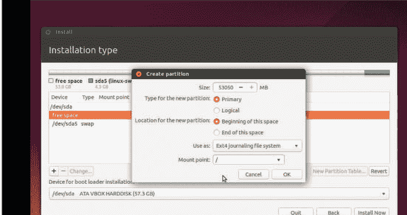

右 `SSD` 将包含发行版安装所需的交换分区和 `ext4` 分区

## 格式化硬盘

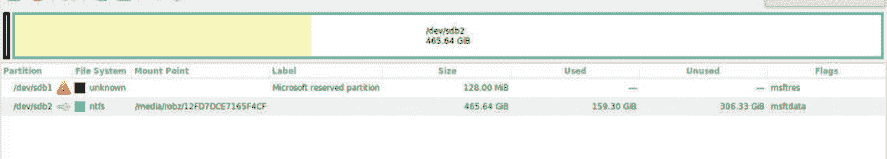

- 02 选择 `HDD`

这是公式中的大硬盘，所有硬盘都将列在这里。现在你有了它，我们将交由你决定，但如果你至少有 `500 GB` 的 `SSD`（最好），并且是 `HDD`，你可以选择 `1 TB` 或更多。如果你有空间，可以获取更多的 `HDD` 和分区，并可以根据需要任意划分。

- 04 安装硬盘

现在我们可以开始安装 `Linux` 了。从你的安装启动运行环境或安装过程并开始安装流程。在涉及分区时，在根目录 (`/`) 硬盘上设置分区。你需要选择 `SSD`，你必须通过大小以及交换（`swap`）和家目录（`home`）来识别这两个分区。如果你有足够的空间，在系统中创建一个新分区，并将其挂载点设为 `/`。安装将继续。剩余的硬盘和分区可以稍后设置。你可以不使用根 (`/`) 挂载点，而是将其设置为家目录硬盘。这需要你将挂载点设为 'home'。

- 03 格式化硬盘

在执行任何操作之前，格式化你的新硬盘是个好主意。并不是每个系统都在安装过程中内置了格式化工具，所以你可以……

`SSD` 将为你格式化以拥有任何其他 `Linux` 硬盘。在 `SSD` 上使用 `ext4` 更好且能产生性能。但创建一个交换分区，它会提供相同数量的源交换内存。你可以用一个交换分区填满整个硬盘，并将其余部分留给跨系统的 `ext` 分区。

`HDD` 存储可以以你想要的方式提供帮助，但我们建议将其格式化为 `NTFS`，这样在不同系统之间更具通用性。你可以用一个交换分区填满整个硬盘，其余部分留在 `SSD` 上。如果你打算也做，请先在其中设置 `RAID`。

- 05 使用系统

实际上使用我们创建的系统既容易又简单。你用于启动的 `SSD` 保持原样，因此它的加载速度应该比以前快一点，类似但你不需要安装 `SSD`。安装和运行会稍微快一点，但受限于下载和操作系统的速度。任何配置文件将自动保存到你的家目录，或由你手动保存。

左 将 `HDD` 设置为 `NTFS`，网络上的 `Windows` 机器可以访问这些文件。

- 混合硬盘

除了我们的混合方案，专门获取混合硬盘。它们有固态存储，有更大的磁盘存储。经常从其他分区使用的文件通常用于创建的存储解决方案。

如果你在 `Linux` 上将存储驱动器设置为为了属性挂载，可能会存在问题。这可以很容易修复——安装 `ntfs-3g` 软件包即可让其工作。如果它需要在启动时挂载……

（注：原文后续大量重复段落已根据要求过滤，未进行重复输出）

# 教程

## 调试 GNU/Linux

## 像专家一样调试你自己的软件

通过调试器的视角，可以解决或规避 `GNU/Linux` 软件相关问题。

`Toni Castillo` 来自吉罗纳纳（`Girona`），拥有计算机科学学位，在哥伦比亚担任 `ICT` 研究员从事软件工程工作。他在加泰罗尼亚自治（`Catalonia`）的一所公立大学学习，并定期撰写技术文章。`disbaques.upc.es`。

软件偶尔会发生故障。无论是因为代码中的缺陷、还是软件所依赖的外部库存在 `Bug`，其结果都是都是的：程序崩溃。在这种情况下，`ICT` 专家应该负责解决问题，或者找到一种在不调试代码的情况下规避问题的方法。然而，跳过对软件的所有先有知识可能是行的，但如果没有正确的工具和技术，进行全面的分析将证明是困难的。在这些情况下，`ICT` 专家将能够在没有源代码的情况下找到替代方案（或者考虑到 `GNU Linux` 机器上运行着非开源程序），本教程将向你展示真实案例，通过使用 `ICT` 专家的经验帮助你分析、调试并制作 `GNU` 调试器（`GNU Debugger`）。这一过程适用于你不熟悉该缺陷软件的情况。

### 规避段错误

我们的第一个案例说明，即使我们拥有源代码，但我们对故障的理解程度不够——否则代码实现的缺陷会导致我们遇到意料之外的崩溃。在这个案例中，影响 `LibreOffice` `3.5.4:2` 的崩溃是：打开 `Microsoft Excel` 窗口时软件崩溃段段错误（`segmentation fault`）错误信息。你可以通过运行 `dmesg` 获取更多关于崩溃的信息。

# 资源

- `GDB` 手册：`http://gdb.org/`

- `Glibc` 堆检查：`http://gdb.org/`

- 为什么调试很重要：`http://gdb.org/`

- 调试艺术：`http://gdb.org/`

> `@ breakpoint at 10785 segfault at`

| 序号 | 类型 | 地址 引用 | 内容 |

|---|---|---|---|

| 1 | `bool, formula:FormulaGrammar: at` | `0x00007ffd060d141f4 in ScFormCell::Compile(String const ice-3.5.4+d4gs2/source/core/data/cell:107` | `at /home/rem/debug/DB/Packet/LibreOffice/LibreOffice/libreoff` |

```bash
set code = pCodeId->name
print "Printing " << pCodeId << " to the crash ..."
set shifts++
set var pCodeId=0x0
```

```bash
print
$4 = 2
(gdb)
```

收到信号 `SIGSEGV`，段错误（`Segmentation fault`）。

`0x0000000000003800 in ?? (gdb)`

```bash
#0 0x0000000000003800 in ??
#1 0x00007ffdffdd14225 in ScFormCell::Compile(this=0x7ffffe05d0577, rformula=..., binding=false, e=formula=FormulaGrammar: GRAM NATIVE at /home/rem/debug/DB/Packet/LibreOffice/libreoffice-3.5.4+d4gs2/source/core/data/cell.cxx:
```

通过 `gdb` 为 `LibreOffice` 段错误设置高级断点。

`LibreOffice` 的段错误和调用堆栈。

### 即使你没有源代码，程序仍然可以暂停

不仅仅是调试器

调试器的功能强大得惊人。通过使用它，我们可以解释软件，即使当我们通过调试会话来利用例行程序时（泄漏、堆栈然后调用它也是如此。它被广泛应用于逆向工程和反盗版技术。

```bash
# apt-get install libreoffice-dbg
```

一旦你在 `GNU/Linux` 机器上安装了像 `GDB` 这样的调试器，你可以通过这种方式安装 `LibreOffice` 调试工具：

一旦有了调试工具，你就可以在 `gdb` 会话中运行程序，以确定段错误发生的位置。使用汇编代码或内存地址这要容易得多。

```bash
# /usr/lib/libreoffice/program/soff.bin
gdb set args --o file_that_segfaults.libreoffice
x
```

```bash
# 收到信号 SIGSEGV，段错误（Segmentation fault）。
0x0000000000000000 ??
```

```bash
# gdb
0x0000000000000000 ??
```

```bash
# s = (FormulaArray*)x->pFormulaArray
this->mFormulaArray = 0x7fffffe6a8c0, code = 0x2270958, nrpn = 3032, nrrm = 5018, index = -32768, nref = 0, nffrs = 30043, mode = 1 "v", helplink: no data fault
```

在 `1075` 处设置断点后，程序并不是每次执行时都会崩溃。你可以检查在 `1075` 处命中断点后段的值，以及段错误发生段错误时的值。

为了先设置程序参数（以防万，要调试的代码），然后执行它。一旦程序崩溃并获取错误消息，将其发送到 `gdb`。

`GDB` 允许你在执行时检查程序数据，通过命中断点，只有当某些值大于零时防止程序故障。在获取这些之后，退出：


# 修复双释放错误与调试指南

你还需要找到段错误的位置。使用 `bt` 命令可以发现 `FormulaComponent::compile` 位于 1075 行。`core/data/comp.cpp` 源文件是公开的，你可以安装它们：

```bash
gdb set args --file-that-segfaults.libre
gdb set pagination off
gdb b c:1075
set *check = pCode->pCode
print "Checking pCode to avoid the crash ..."
step
if (check != 0)
step
else
set var pCode=0x8
end
```

现在你有了源代码，可以仔细查看 `FormulaComponent::compile` 方法的实现，第 1075 和 1076 行：

```cpp
if(pCode)
delete pCode;
```

显然，段错误发生在程序中的某一点，访问下一个到 `FormulaArray`。为了检查崩溃后的程序数据，你应该在崩溃后使用命令在 `FormulaComponent::compile()` 处打断。如上所示，`gdb` 显示多少次会发生段错误。你可以向 `gdb` 添加一些命令，在 1075 行打断。你可以使用 `RPN` 参数来检查 `fault` 是否应该发生（`check`），通过将 `pCode` 设置为 `0x8` 来更改指针。现在在 `LibreOffice` C++ 源文件的第 1075 行，是：`if(pCode)`。所以，没有意外。

## 使用 apt-get 安装 libreoffice

尽管看起来可能是正常的，但双释放错误可能导致堆以任意方式被篡改。下面的代码演示了：`pId0x0` 指向的值，如果 `nrPN` 的值为 0，程序流将正常继续。所以，你可以从开始运行这个正常的。再次运行它。你会发现没有任何问题。现在，你成功导致了 ELF64 二进制文件的缺陷，`glibc` 在 `0x7c13ef0` 报告了内存损坏。通过二进制文件中的完整调用堆栈（最后一行），调试 ELF64 指令。现在该进入下一个任务了：在 GNU/Linux 机器上修复软件。在进入之前，触发了双释放错误并自然地防止了实际设置。`GLIBC` 使用 `free` 进行分配。在这种情况下，由于双释放指针导致了损坏。你知道损坏的源是你无法控制的，因为唯一能检测出问题的硬件是 `Intel`。你的任务是找到一种方法

如上所示，在偏移量 `0xb80` 处有一个 `free()` 调用（最后一行）。之前的调用堆栈

| 文件: `setup` | ASCII 偏移: `0x0000a6b5` / `0x0000c237` ($05) |
|---|---|
| `00000000` | `00 00 00 90 20 85 50 05 E8 A1 FF FF FF FF FF FF FF` |
| `000000A0` | `E1 66 66 66 90 90 96 66 96 96 96 66 90 90 90 90 FF FF FF FF FF FF` |
| `000000D0` | `41 51 41 56 45 31 4E 53 51 53 58 43 EE AWAUAI..I..H..` |
| `00000110` | `24 48 88 38 30 60 00 00 48 89 7C 24 20 24 24 04 (O.._H..H..S` |
| `00000140` | `75 12 65 69 91 01 00 00 48 89 78 84 48 48 48 48 FF` |
| `00000170` | `61 01 00 00 48 89 78 85 89 05 00 00 08 05 00 00 L.._S` |
| `000001A0` | `49 00 06 53 4A 73 65 72 61 79 48 89 48 89 EF ..I..u..B..` |
| `000001D0` | `7C 0F 05 05 8E AE 03 03 49 09 48 89 48 49 FF` |
| `00000200` | `18 E8 8A 2E 05 05 8E 05 03 03 09 48 89 48 89` |
| `00000230` | `G *He* (Exit no) | I go Offset | * X Exit and * W` |

正如向你所示，此偏移处的指令是触发双重释放（double-free）或内存损坏错误的指令。显而易见，这条指令正在释放已经读取过的地址 `0x013ceeb0`，这是在 `gdb` 会话中运行程序导致段错误的错误。该程序是基于课程的；你必须将输出重定向到另一个终端，否则很难调试：

（第 10-12 行）。请记住，栈存储着函数的参数，通过运行 `step` 命令，你允许栈在调用外部函数之前被正确设置。正如你之前看到的，`free()` 函数正在释放此处之前在 ELF 二进制文件内部已经释放过的地址 `0x013ceeb0`。确实是这同一个地址（最后一行）。因此，你的陈述得到了确认，一个显而易见的结论是：地址 `0x013ceeb0` 尝试被另一个地方释放两次。

```gdb
(gdb) tty /dev/pts/2
(gdb) set file data.bin/x86_64/segment
(gdb) b 0x04a6b80
Breakpoint 1 at 0x04a6b80
(gdb) step
#1 0x04a6b80 in free()
0x0000000000400000 in free () from /lib
0x000ffff77a2b7b0 in free () at 0x7ffff77a2b7b00000
0x0000000000401b18 in __malloc_free (this=0x013ceeb0, size=0)
```

那么，如果你没有安装程序的源码，当你无法访问源码时，可以解析 ELF。如果你猜出指令所在的位置，可以将该操作码（op-code）指令替换为 `93 50 90 53`。我们的推理是这样的：如果我们不替换偏移处的 `free()` 函数，我们必须使用什么其他指令呢？首先想到的第一个指令是 `nop`（无操作）。由于 `free` 调用占用五个字节，如果将其替换为 `nop`，只需将这五个字节替换为 `0x90`。之后，再次尝试并运行程序。正如我们预期的，安装程序没有崩溃，错误也消失了！

将程序重定向到 `/dev/pts/2` 后，在指令所在的偏移处 `0x013ceeb0`（第 2-4 行）设置断点；然后运行程序。一旦你找到错误，逐条机器指令进行执行。在此时，使用 `step` 命令，在实际调用 `free()` 函数之前分析栈，会立即导致双重释放内存损坏错误。

## 结论

人们通常认为调试是一个运气问题，而不是专业问题。然而，没有专家认同这一观点。我们坚信，大多数软件相关问题都可以通过调试来解决，这篇文章提供了足够的证据：我们的 `gdb` 会话显示了应用补丁后的完全命中（左上角），而调试显示了段错误（左下角）。

# 教程你自己的 Linux shell – 第 2 部分

这篇总结文章将向你展示如何改进 shell，这是揭示如何开发你自己的 Linux 文章的第二部分也是最后一部分。该 shell 的名称为 `lud`，其源码为 `file2`；`lud` 的初始版本是第一部分中第一个文件的副本。在这篇总结文章中，我们将添加一些功能来改进这个 shell。如果在任何一点你不完全理解发生了什么，最好的想法是回去重读第一篇文章，以避免陷入困扰。

### 01 创建 man 页（帮助页）

正如每一个自律的 UNIX 程序一样，你将创建的 shell 将有一个页面。第一次生成 man 页并不容易——你能做的最好的事情就是获取一个现有的 man 页作为参考。man 页是用一种文本语言编写的，支持用于各种样式的大量宏包。

### 02 关于 grep 的更多信息

`grep` 是 `tr` 的替代品，由 GNU 项目创建。你可以在 `https://www.gnu.org/software/grep/` 更多关于它的信息。你通过执行 `./lud` 查看保存在 `file1` 中的 man 页。

### 03 运行外部程序

除非你正在启动内核本身，否则程序在 UNIX 上执行的唯一方法是使用 `exec` 系统调用。`exec` 家族系统调用的最重要的优势是安全性，因为无法溢出 `exec` 系统调用。

# 资源

UNIX 管理员，

程序员，

OS 和 DBA 以及

自 1993 年起一直是数学家

`GCC` 编译器

当你编写并实现一个新 shell 时，非常重要的一点是根据你的要求实现它，但不要忘记用户。Linux shell 编程是一项艰巨的任务。这篇文章只是开始；后续的文章将讨论 Linux shell 编程的其他方面，包括进程、进程间通信、线程、高级 IO 和网络编程。

### 获取变量的值


这部分关于获取一个已有的变量，即著名的 `PATH` 变量，它定义了命令的搜索路径。`PATH` 变量是 shell 中用冒号分隔的目录列表（例如），`environment(Variable)` 显示了如何通过 `get` 命令获取已有环境变量的值。

```
echo $PATH
```

### 为变量赋值

定义新变量时最困难的部分是其实技术本身并不棘手，非常简单：这是你开发应用程序时的一个优势。

```ccase
    printf("Enter the prompt: ");
    prompt = strchr(copy, ':');
    if (prompt) {
        printf("%s", prompt);
        strcpy(prompt, line);
        size_t len = strlen(line);
        prompt[len] = '\0';
    }
esac
```

展示如何使用系统调用超出了本文范围，但重要的是知道 `system()` C 函数实现了命令。后续的 UNIX 系统编程文章将详细介绍 `exec` 家族系统调用。

> 现在你应该能理解，环境变量在 shell 编程中起着关键作用

### 实现环境变量

在定义或更改环境变量之前使用一个关键字是常见做法。shell 将使用它。`setenv()` C 函数的实现非常清晰：如果环境变量存在，它会为它们分配所需的空间。如果第三个参数（覆盖）的值不是 0，它将覆盖变量名的值——如果没有现有值，它会将新变量添加到环境中。

### 06 修改提示符

现在可以更改提示符了。在这一步之后，你将学习使用 `prompt` 命令定义静态提示符。你现在可以使用静态文本作为提示符，但以后你需要动态提示符。C 代码非常容易理解：当检测到 `prompt` 命令时，替换单词 "prompt" 并行的其余部分赋值给提示变量。在 C 提示符末尾添加一个空格使其看起来更好看。

| NAME |
|---|
| `lud` - 这是一个 `lud` shell 的简单 man 页 |

| SYNOPSIS |
|---|
| `lud` |
| `[-V]` |

| DESCRIPTION |
|---|
| `lud` 是为 Linux 用户和开发者文章生成的简单 Linux shell |

| OPTIONS |
|---|
| `-v` 打印 `lud` shell 的版本号 |

教程文件：`files.co.uk`

# Linux 教程

# 打印变量

# 理解 echo 命令

现在是时候学习 `echo` 命令的实现方法了。该算法非常简单：它移除 "echo" 单词和额外的空格，然后打印该行的其余部分，而不进行任何额外处理。它的输出如下：在不带任何额外参数的情况下运行该命令，会打印所有变量。因此，当用户输入命令时，它会显示所有变量。这有助于理解环境变量。请查看 `printenv()` 的实现。

```bash
$ echo hello
hello
```

```bash
$ echo $VERSION
Linux version 5.4.0-generic (Ubuntu x86_64)
Welcome to Ubuntu
 programs included are free software; the user manual for each program is described in manual files in /usr/share/man/*
```

```bash
$ echo $HOME
/home/user
$ echo $USER
user
$ echo $SHELL
/bin/bash
$ echo $PATH
/usr/local/sbin:/usr/local/bin:/sbin:/bin
```

# 实现每日消息 (message of the day)

在上一个任务中，我们对“每日消息”功能使用了快速且粗略的实现。更专业、更健壮的实现将不再使用安全的 `call()`，而是使用一个正确的命令，它可以读取它并显示适当的消息。正如你所理解的，一开始使用快速粗略的方案来获得正确的结果是不妙的，因为你还没有编写生产环境代码！

# 打印数字

这部分将向你展示如何向 shell 添加命令。如果 shell 是一个普通命令，`-v` 命令将只打印 shell 的版本号，而不执行 shell 本身。如果你执行 `-v`，你将得到：`shell version 1.0`

使用函数（`version()`）的主要原因是一致性。结果是，如果你决定更改 `-V` 参数的功能，对你来说进行更改将更加容易。

```c
int i = 0;
for (i = 0; i < argc; i++) {
    // 如果给定了 -V 参数，
    // 打印版本并退出
    if (strcmp(argv[i], "-V") == 0) {
        version();
        return 0;
    }
}
```

# return 函数

`return` 函数执行着一项非常重要的工作：如果程序是内置命令，它会返回 shell 内部命令的退出码。如果不是，它返回 `-1`；这个返回值不能作为数组中的有效索引，表示命令失败并应该作为外部命令执行。

# 一些理论

实现上一步的代码使用了两组，分别命名为 `argc` 和 `argv`。第一组持有数组中的元素总数。`argv` 能够包含所有命令参数，包括始终分配给 `argv` 的执行文件名称。因此，`argv` 被赋予了它的值。

# 为每个命令使用 C 函数

这部分关于如何使用单独函数实现每个内置命令。通过简单地将每个命令分组到一个函数中，我们在这里展示的处理简单行选项的方法是有效的；然而，你应该意识到，当你不想处理更复杂的命令行参数时，存在高级技术。因此，语句的每个分支将只包含一个情况；关键点在于这让你的程序更易读。这里的关键点是，需要时不要忘记将输入行传递给函数。

```bash
$ vi msouk@~/docs/article/working/UNIXshell2.LUD/code
$ grep "*commands" ludv2.c
char *commands[] = {
$ gcc -Wall -o ludv2.c
ludv2.c:46:7: in function 'returnIndex'
ludv2.c:46:7: warning: initialization from incompatible pointer type
    "Programmer"
    // Index 0
ludv2.c:46:7: warning: (initialization for 'commands')
ludv2.c:46:7: warning: excess elements in static initializer
    "version", // Index 1
ludv2.c:46:7: warning: (initialization for 'commands')
ludv2.c:46:7: warning: excess elements in static initializer
    // Index 2
    "echo",
ludv2.c:46:7: warning: (initialization for 'commands')
ludv2.c:50:5: warning: excess elements in static initializer
}
ludv2.c:50:5: warning: excess elements in static initializer
$ vi ludv2.c
$ grep "*commands" ludv2.c
char *commands[] = {
$ gcc -Wall -o ludv2.c
```

# 16 个 char ** 对比 char *[]

# 14 动态提示符

更改提示符是有用的，但让它动态化更有用。这一步将介绍一种允许你使用动态文本作为提示符的技术。该技术将打印执行的命令总数，主函数（`changePrompt`）中的提示符只有在你想设置静态文本作为提示符时才会被调用。

> 如果你想调查 shell 的工作原理，可以使用软件工具如 `perf_events`、`SystemTap` 或 `DTrace`

# 15 使用 fork() 执行命令

现在我们来看看到如何让 `fork()` 工作了。shell 的整体效果，`fork()` 是 UNIX 创建新进程的方式。查看 `execute(command)` 函数的代码以获取更多信息，但记住 `fork()` 是一项高级任务。

# 17 使用 strace(1)

```bash
$ strace(1) ./
```

如果你想检查 shell 的工作方式，可以使用软件工具如 `perf_events`、`SystemTap` 或 `DTrace`。

# 18 接下来做什么？

更改提示符是有用的，但让它动态化更有用。这一步将介绍一种允许你使用动态文本作为提示符的技术。该技术将打印执行的命令总数，主函数（`changePrompt`）中的提示符只有在你想设置静态文本作为提示符时才会被调用。


> 如果你想调查 shell 的工作原理，可以使用软件工具如`perf_events`、`SystemTap`或`DTrace`。

# 15 使用 fork() 执行命令

现在我们来看看到如何让`fork()`工作了。shell 的整体效果，`fork()`是 UNIX 创建新进程的方式。查看`execute(command)`函数的代码以获取更多信息，但记住`fork()`是一项高级任务。

# 17 使用 strace(1)

```bash
$ strace(1) ./
```

如果你想检查 shell 的工作方式，可以使用软件工具如`perf_events`、`SystemTap`或`DTrace`。

# 12 12 周内成为专业开发者

面向编码者和制作者的 Raspberry Pi 必备指南

> 与其处理周围的空闲计算任务，如果我们让 Raspberry Pi 控制房屋呢？

# 目录

| 页码 | 主题 |
| :--- | :--- |
| 58 | LEGO 智能家居项目 |
| 60 | Pi 上的科学 |
| 62 | 使用 Python 制作视觉小说 |
| 66 | Pi 手套 - 第 2：软件 |
| 70 | 优化你的 Python 代码 |

# 使用 PI 实现家居自动化

# 智能自动化

# 你的智能家居设置

节能和绿色家居现在是大趋势，你可以购买可以远程关闭所有插座的电源线。这确实可以节省能量，但如果插座被隐藏起来，手动控制并不总是很容易。通过使用远程控制插座，你可以从任何地方控制电源，实现更好的控制并减少待机模式的使用。

# 灯光

基础家居自动化功能是根据时间或明暗控制房屋内的灯光。有很多方法可以实现：目前流行的方法是支持 Wi-Fi 的灯泡，允许直接控制，但也有 LED 可以轻松点亮房间，并且更容易进行手动交互。通过家里所有这些方法，你可以在离开时远程控制灯光，也可以尝试吓唬客人。

# 温度控器

Nest 等技术变得越来越流行，但连接式温度控器已经存在很多年。虽然我们不会创建一个“看起来”像温度控器的设备，但外部控制和监控在拥有正确设备时是容易的。我们将专注于监控智能温度控器，并进行一些校准以确定温度。

# 扩展你的 Pi

适用于 Raspberry Pi 的叠加扩展板

| 类型 | 描述 |
| :--- | :--- |
| ADC Pi | 8 路模拟通道 |
| IO Pi | 32 路输入输出 |
| RTC Pi | 带电池的实时钟 |

地址选择允许你为 Raspberry Pi 添加 32 个模拟通道。

- `ADC Pi`: 8 路模拟通道
- `IO Pi`: 32 路输入输出
- `RTC Pi`: 带电池的实时钟

# 在 12 周内成为专业开发者

面向编码者和制作者的 Raspberry Pi 必备指南

> 与其处理周围的空闲计算任务，如果我们让 Raspberry Pi 控制房屋呢？

# 安全门铃

设置其中一个家居安全系统出奇地简单。使用专为安全的技术允许你通过 Raspberry Pi 监控实时流，这可以在你的手机上显示。如果你使用 Pi 摄像头，你可以看到并敲响门铃，这是一个非常酷的派对技巧。

# 功能

## 构建你自己的自动化系统

探索如何远程控制插座、车库门、LED 灯带等更多设备

## 遥控控制插座

我们将使用一个 433MHz 接收器和发射器模块；你可以在`ebay`上花几英镑买到它们——只需搜索“433MHz”，就能找到你正在寻找的遥控插座。在这个项目中，我们使用了一组四只的遥控插座。这些插座非常适合落地灯以及任何没有开/关开关的设备。根据我们的经验，在我们使用的这段时间内，它们运行得非常完美。

你可以使用 433MHz 接收器和简单的`Arduino`软件来捕获遥控器的消息，从而触发它。这些模块的接线非常简单：5V、地线（Ground）和数据（Data）。接收器有两个数据线引脚，但你只需要连接到地线。遥控代码的妙之处在于，它们可以在 433MHz 下用于任何你需要的设备——遥控车库门或灯开关很可能使用 433MHz。

## LED 灯带

LED 灯带非常棒。在亚马逊上很容易找到，五米长带 12V 电源和遥控器的价格约为 15 英镑。它们背部有胶，可以粘在表面。它们发出的光充足。或者，你可以拥有独立的红、绿、蓝组件。可以使用脉宽调制（PWM）将这些颜色设置为 0 到 100% 之间的任何亮度。每个颜色都是具有特定时间的方波。如果红色信号具有 50% 的占空比，那么它将在 50% 的时间内开启，导致亮度降低。灯带有四个用于红、绿、蓝的连接器。颜色连接器是各个引脚。当颜色引脚连接到地线时，电路形成，允许 12V 流过 LED。我们将为每个颜色使用单独的晶体管。注意，`Arduino`和电源应该在面包板上连接在一起。RGB 灯带使用了三种独立的 12V 颜色。我们是手动连接到 LED 的。

(`img/78fc0912c436c89922acde325ec7a_51_0`)
(`img/78fc0912c436c89922acde325ec7a_51_1`)

## 家庭自动化

LED 的电源不应连接到`Arduino`——否则 LED 灯带或`Arduino`将损坏。我们使用了`TIP120` NPN 晶体管，它能够开关 5 安培——这对于我们的应用来说足够了（带带的电源只需要 2 安培）。这种晶体管也适用于控制风扇或其他电机的速度。我们从左到右连接了`TIP120`的基极和发射极，基极通过 220 欧电阻连接到`Arduino`的 PWM 信号。集极连接到 LED 灯带的一个颜色引脚，我们使用硬线从发射极连接到集极。在通过过大电流时，这些灯带也会发热。还使用了硬线从发射极到地线，以及集极到 LED 的跳线导。你必须确保连接到灯带的电线没有短路，否则可能会损坏 LED。我们的设置可能涉及电路移动到面包板上，我们测试过它是可以工作的。

# 硬件

家庭自动化更复杂的选项可以是遥控窗帘或百叶窗。这些是极佳的选择，因为你可以用它们来唤醒你，并在日落时让它们关闭。这些设备可能使用与遥控器相同的 433MHz 频率，因此你可以毫不费力地将它们添加到我们即将编写的软件中。如果你想开启它们，可以编写自己的`Python`脚本向百叶窗发送打开和关闭命令。

## 温度传感器

`TMP36`是一个非常简单的 IC，它有三个引脚：5V 电源、地线和代表温度的输出。该电压可以从`Arduino`的模拟引脚读取。公式为：`Temp in C = [(V in mV) - 500] / 10`，因此 0.7V 的电压对应 20°C。

## 摄像头

你可以使用 USB 摄像头或树莓派摄像头进行视频流传输。树莓派摄像头应与蓝色接口连接，排线面向 HDMI 接口。

(`img/78fc0912c436c89922acde325ec7a_52_0`) 顶部树莓派摄像头直接插入树莓派本身，不需要额外的接线。下面的温度传感器非常简单地连接到正极轨道和地线数据引脚。

(`img/78fc0912c436c89922acde325ec7a_52_1`)
(`img/78fc0912c436c89922acde325ec7a_52_2`)

# 功能

## 配置你的树莓派和 Arduino 协同工作

我们将使用`homecontrol.js`作为自动化系统的控制软件。这是一个运行在树莓派上的`Node.js`自动化系统，通过 USB 向`Arduino`发送命令。虽然理论上某些情况下树莓派没有模拟输入输出，但 LED 灯带是需要这些。

- `sudo apt-get update`
- `sudo apt-get upgrade`
- `sudo apt-get install libboost-dev`

接下来，我们需要下载预编译的`Node.js`和`MongoDB`软件包（`homecontrol.js`都需要）。可以在`http://liamfaser.co.uk/lead/homeautomation`找到它们。

## 树莓派准备

使用最新的树莓派作为该项目的起点。使用默认用户名`pi`和默认密码`raspberry`。你需要做的第一件事是使用`raspberry-config`启用摄像头并调整文件系统，以便系统使用 SD 卡上的所有可用空间。我们可以更新我们的软件包，然后安装后续需要的软件包：

```bash
wget https://node-arm.herokuapp.com/node_0.10.36_armhf.deb
sudo dpkg -i node_0.10.36_armhf.deb
```

检查是否安装正确：

```bash
pip install raspberrypi
node -v v0.10.36
```

安装`MongoDB`...

```bash
wget https://github.com/tanjanson/mongodb-armhf-deb/download/v2.1.1-mongodb_2.1.1_armhf.deb
```

(`img/78fc0912c436c89922acde325ec7a_53_0`) 无线接收器工作需要电源并连接到数据引脚。

(`img/78fc0912c436c89922acde325ec7a_53_1`)


`img/78fc0912c436c89922acde325ec7a_53_2`

`img/78fc0912c436c89922acde325ec7a_53_3`

## 家庭自动化

这种工作方式非常优雅，因为它允许无需重新编程即可添加更多传感器。

`img/78fc0912c436c89922acde325ec7a_54_0`

| 协议 | 位数 |
| :--- | :--- |
| `接收1670063` | 24bit |
| `接收1670062` | 24bit |
| `接收1670061` | 24bit |
| `接收1670060` | 24bit |
| `接收1670059` | 24bit |
| `接收1670058` | 24bit |
| `接收1670057` | 24bit |
| `接收1670056` | 24bit |
| `接收1670055` | 24bit |
| `接收1670054` | 24bit |
| `接收1670053` | 24bit |
| `接收1670052` | 24bit |
| `接收1670051` | 24bit |
| `接收1670050` | 24bit |
| `接收1670049` | 24bit |
| `接收1670048` | 24bit |
| `接收1670047` | 24bit |
| `接收1670046` | 24bit |
| `接收1670045` | 24bit |

## 控制软件

这些是我从遥控插座控制器中嗅探的代码：

```bash
sudo dpkg -i mongodb_2.1.1_armhf.deb
# start
sudo /etc/init.d/mongod start
# setup
sudo config set
```

这里修改了 `homecontrol.js`。这是一个运行在树莓派上的 `Node.js` 自动化系统，通过 USB 向 `Arduino` 发送命令。虽然理论上某些情况下树莓派没有模拟输入输出，但 LED 灯带是需要这些。

```bash
https://github.com/liamfaser/homecontrol.js
git clone
npm install
```

`homecontrol.js` 已经修改了。在启动之前，你需要知道树莓派的 IP。通过 `ip` 命令找到它。

```bash
node /usr/share/arduino/libraries
```

这里是 `homecontrol.js` 启动代码：

```bash
node homecontrol.js
```

# 功能

## 设置您的控制界面

现在是开始将我们的传感器和设备添加到 `heimcontrol.js` 中的时候了。


### 01 开机自启动 heimcontrol.js

在我们开始添加设备之前，在开机时启动 `heimcontrol.js` 是合理的。要做到这一点，我们可以在 `/etc/rc.local` 中添加一行，这是一个由 root 用户在启动时运行的脚本。需要使用 `sudo` 和您喜欢的编辑器编辑该文件，例如：

```bash
sudo nano /etc/rc.local
```

在 "exit 0" 所在之前添加以下行：

```bash
su pi -c "node /home/pi/heimcontrol.js/heimcontrol.js" &
```

现在 `heimcontrol.js` 将从开机自动启动，但您现在可以通过 `node /home/heimcontrol.js/heimcontrol.js` 手动启动它。


### 02 添加摄像头流

进入设置（Settings）并选择摄像头（Webcam），将方法设置为流媒体器（Streamer），您可以选择 `/dev/video` 作为设备。选择一个间隔，我们选择了两秒，但您可以选择任何喜欢的间隔。在树莓派 2 上，较短的间隔更可行，因为它的响应更快。保存并返回首页。

### 03 准备远程控制字代码

这里您需要之前提到的代码。`Heimcontrol.js` Web 界面将代码视为 1 和 0 组成的二进制字符串。然而，我们需要的代码格式不同，因此您需要使用 Python 将其转换为二进制。在终端输入 `python2` 打开 Python 解释器。将您采集的整数格式化为二进制字符串，如：

```python
>> "{0:b}".format(167380653)
"111111110101110000111"
```

`heimcontrol.js` 界面在移动设备上的运行效果非常好。

## 家庭自动化

## 扩展未来

### 设置多个系统

既然您已经在一个房间里设置好了 `heimcontrol.js`，您可以通过设置多个树莓派来扩展系统，让它们与您在抽屉里收集的所有旧型号协同工作。您可以使用另一个树莓派，通过连接的网络反向以太网供电（PoE）。


### 04 添加远程控制器

进入设置（Settings）菜单并进入 Arduino 部分。点击按钮并将方法设置为 RC Switch（无线开关）。将代码类型设置为二进制。给它起一个名称，输入您计算出的 RF 频率，并输入用于开启/关闭按钮的两个代码。返回首页测试开关是否工作。如果正常，只需确保发射器连接正确，就不需要在发射器上添加任何内容。

在 Arduino 的脉冲宽度调制（PWM）上方。然而，一个波形占时间的 20%（即 300ms）。这控制每个 LED 的亮度，以从三种原色创建出任何颜色。

### 05 添加温度传感器

温度传感器可能很复杂，因为需要校准。使用万用表非常好，您可以准确地测量模拟值。进入 Arduino 设置并添加传感器。在单位中选择 `°C` 和 `10` 中的 `TMP36 (New)`。用万用表读取 718mv，这会将温度定在 21.8°C。通过公式进行实验，其中 $x$ 的真实值是您的传感器，或者会产生偏移。由于 Arduino 具有 10 位数模转换器，它可以在 `0-1023` 之间读取高达 5V 的电压。然后您必须完美匹配，否则传感器如果简单地尝试将您字符串化就会崩溃。

#### 远程访问

如果您想远程访问您的自动化系统，可以使用动态 DNS（DDNS）提供商，这样每个房间都可以让您创建一个始终指向您地址的书签。然后，如果您在路由器上使用 SSH 尝试连接树莓派，您可以在任何地方 SSH 进入它（当然，您需要更改默认端口 22 以实现此目的）。然后，您可以将 homecontrol Web 界面端口转发到您的本地机器。我们在之前的一份树莓派文件中发现过，可以通过访问 `raspberrypi.local` 查看（而不是使用端口 8080。要使用端口 8080.）。

#### 设置音频系统

家庭自动化的一个很好的补充是某种多房间音频系统。如果每个房间都有一个树莓派，您需要为每个房间准备一个廉价的功率放大器和一个书架扬箱来启动它。一对 PC 声箱也可以。如果您只想让其中一个扬箱工作并支持 Web 界面。或者，可以考虑设置 Squeebox，这是一种由罗技开发但现已开源的多音频软件。


### 06 添加 LED 灯带

最后，是添加 LED 灯带了。确保电线连接到支持 PWM 的引脚上。

# 教程

## 使用 Sensly HAT 进行环境科学研究

## 使用这款树莓派的智能小模块进行实验、监测污染物等功能


Frazer Barnes 是一位嵌入式工程师，曾与树莓派合作开发许多 HAT 模块，并为众多项目构建过软件。

Sensly 是一个连接在树莓派上的智能模块。它拥有自己的微处理器，可以处理模拟数据并处理来自各种传感器的采样，而无需额外的处理器。此外，电路板上连接了三个种不同的传感器，允许你感知多种气体，以及湿度和温度传感器。这个树莓派 HAT 可以轻松安装，用于监控空气和 I/O 接口。遵循树莓派的操作习惯，该模块还提供了一个 Python API，可以为你完成所有工作。所有的数学计算、校准和误差修正都已处理，让你能够立即使用有意义的数据。

```
pi@ubuntu:~$ ~/sensly.py
Running Testing Sens
Sensly Was Detected: .
OK
```

## 02 测试 Sensly

第一步是确保树莓派能与 Sensly HAT 通信并确保其运行正常。输入以下命令，它将响应“OK”，如果一切正常，它会提供一份报告。

## 01 设置你的 Sensly HAT

假设你已经设置好了树莓派并将其连接到互联网。第一步是将 Sensly HAT 插入树莓派的引脚接口。完成后，开启树莓派并在终端中输入以下命令：

- # 在 Sensly 上运行测试序列


sensly-test

```
# 安装 git 以便下载 API
sudo apt-get install git
git clone https://github.com/Altitude-Tech/SenslyPi.git
cd SenslyPi
# 安装 python API
sudo python setup.py install
```

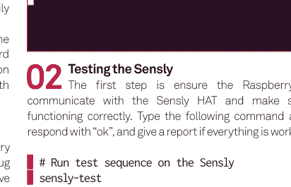

## 你需要什么

- `Sensly` `HAT`

`sensly.uk`


## 使用 API

03 现在我们将使用基于终端的文本编辑器来编写代码——我们将使用 `Nano`，你也可以使用任何喜欢的编辑器。以下命令将创建一个名为 `sensly.py` 的文件并打开它进行编辑。

```
nano sensly.py
```

你可以输入以下程序从 `Sensly` 获取基础数据。

```python
import os
from sensly import Gases
atmosphere = Gases()
```

```python
while True:
    print("Humidity Level")
    print(atmosphere.humidity())
    print("Temperature")
    print(atmosphere.temp())
    time.sleep(5)
```

## 04 传感器入门

启动传感器会稍微复杂一点，因为我们需要准备传感器以确保 `Sensly` 的读数是稳定的。为了做到这一点，我们在代码中使用了一个循环，等待预热完成。如果你刚刚开启 `Sensly`，这需要二到三分钟。

- `import os`
- `from sensly import Sensly`
- `sensly = Sensly()`

```python
# 等待预热完成
# 这样我们就可以获得稳定的读数
while(preheat == False):
    print("preparing...")
    time.sleep(1)
```

已准备好读取污染水平！

## 05 获取污染数据

现在我们已经准备好传感器来读取测量值。在程序中添加以下代码：

```python
while(True):
    # 打印普通污染水平
    print("General level (PPM)")
    print(atmosphere.temp)
```

```python
# 打印工业污染水平
#（例如氧化物）
print("Industrial pollution (PPM)")
print(atmosphere.industrial())
```

```python
# 打印湿度
print("Humidity")
print(atmosphere.humidity())
time.sleep(20)
```


## 06 添加自定义传感器

`Sensly` 提供了五个额外的端口，可以通过简单的 `Python` 脚本进行控制。这些非常有用，因为树莓派没有原生端口。这允许你向项目中添加更多传感器，例如用于测量光线的 `LDR`。使用 `Python` 可以轻松地读取数字数据：

- `import sensor`
- `from sensly import Port`

```python
sensor1 = Port(1)
```

```python
print(sensor1.read())
```

## 07 数据可视化

接下来我们将使用一个名为 `matplotlib` 的优秀开源库，它可以从你的数据生成图表。我们只需要安装 `matplotlib` 就可以编写代码来满足你的需求。运行以下命令进行设置：

```
sudo apt-get install python-pip
sudo pip install matplotlib
```

以下代码将显示空气图形：

```python
import matplotlib.pyplot as plt
import os
from sensly import Gases
atmosphere = Gases()
samples = []
for i in range(10):
    samples.append(atmosphere.pollution())
```

# 释放 ARM Cortex

该插件是 `ARM cortex`，具有模拟传感器采样和树莓派的能力。这是一个功能强大且开源的东西。作为结果，重新编程树莓派给了你类似 `Arduino` 的灵活性，但具有完整操作系统的功能。`Pygal` 是一个为 `Python` 设计的动态 `SVG` 图表库。

# 使用 Python 制作视觉小说

通过创建交互式小说或“选择你的冒险”来弥补书籍与游戏之间的差距。


游戏自早期以来已经进步了很多，近年来，通过媒体讲述引人入胜的故事变得更加容易。视觉小说比以往任何时候都流行，尽管它们在其他地区也越来越流行，玩家通常通过点击来做出决定并探索路径。

- 你需要
- `Python 2` `python.org`
- `Pygame` `pygame.org/download/html`
- `IDLE Python IDE`
- 游戏资源

在 `Python` 中，这是一个相对容易的项目，但通过添加 `pygame` 模块，我们可以使其变得更加简单且更具扩展性。`pygame` 对图形和文本有更好的支持，使用鼠标和键盘输入创建窗口，并简化编码过程。我们将在 `Python 2` 中编写这些，所以请在编写、测试和编码时运行 `IDLE 2` 而不是 `IDLE 3`。切换场景以增加故事的深度并允许玩家做出选择。

`Rob Zwloot` 是一个精通 `Python`、`Django` 和 `HTML` 的 Web 开发者。他喜欢尝试复杂的系统。

视觉小说

`"Python 2.7.6 Shell"` `Python 2.7.6`: `visualnovel.py` - `/home/robz/visualnovel/visualnovel`

```
pygame window
Python 2.7.6 (default, Oct 2 2012, 15:04:03)
Type *copyright*
```

# VN 学校

开始游戏

# 这些交互式小说在日本非常流行，尽管它们在其他地区也越来越流行

创建一个交互式菜单来开始游戏，或者

## 获取更多资源

你可以添加任何想要的游戏资源——无论是你画的还是你制作的图像（当然，你有使用权限）。我们推荐从 `pygame.org` 获取不同的资源。你还需要添加各种版本，并确保在操作时配置和名称正确。

## 01 获取 pygame 依赖

为你的系统安装 `pygame` 的最好方法是编译它。为了做到，你首先需要安装以下依赖。打开终端并安装 `Ubuntu` 喜欢的以下包：

## 02 获取代码

我们需要从源码下载 `pygame` 的代码。在终端中，你可以通过输入以下命令来实现：

```
$ git clone https://bitbucket.org/pygame/pygame
```

... 将其下载到 `pygame` 文件夹。在终端中进入 `cd pygame` 以继续构建。

## 04 其他安装方式

如果上述步骤对你不起作用（或者你觉得有点困难），你可以检查 `pygame` 网站上的二进制文件和可执行文件，它们适用于 `Linux`、`macOS` 等操作系统。访问 `http://pygame.org/download/html` 查看你特定系统所需的内容，包括 `Windows` 和 `OS X`。教程的其余部分将适用于任何环境。

## 03 构建模块

要安装它，我们需要分两步进行。首先，我们需要使用以下命令准备安装代码：

```
$ python setup.py build
```

完成后，你可以通过以下命令实际安装：

```
$ sudo apt-get install python-dev-libsdl2-image-dev libsdl2-mixer-dev libsdl2-ttf-dev libsdl2-scale-dev libimageformat-dev libvorbis-dev
```

# 教程


右键鼠标可以移动线条和场景以跟随故事情。

## 添加音乐

`Pygame` 有一个用于音乐的函数，但根据库和代码的不同它会有所差异。此外，你构建的系统决定了它的运行方式。你可以添加音乐来让氛围变得忧伤或快乐。如果你愿意，甚至可以展示效果有多好——我们建议在每一行中都添加相应的元素来补充信息。如果你允许使用他人资源，也可以找到免费的音效。

## 05 获取视觉节点


我们已经将代码更新为 `FileSilo`，这里我们将带你了解我们是如何制作它的。下载视觉小说的文件并将其解压。`script.py` 文件就是导入代码所需的全部内容。

## 09 添加变量和资源

我们现在可以向小说中添加所需的混合信息。定义使用的脚本尺寸（宽度 1000 像素，高度 563 像素），并为代码设置一些 RGB 颜色。我们还告诉程序使用什么字体、各个部分的大小，并为对话文本加载图像。一旦你创建了缓冲区，或者在这个屏幕上，你就可以通过更改缓冲区来更新它：

```python
# visual nodes
# comment, reality, some other style
scene = pygame.init()
scene = pygame.display.set_mode((1000, 563))
# 场景管理以进行场景切换
scene.main()
```

## 06 理解脚本

脚本文件很小，字面意思只包含脚本。它是为了让视觉小说通过将其拆分为场景来逐行移动而设计的。这包含了每一行的逻辑、角色定义以及游戏流程。这些都是存储相关信息的矩阵，并且是完全自定义的。

## 10 鼠标感应

我们现在可以添加一个矩形按钮，并放在菜单图像上，这样当点击第一个按钮时，我们就知道鼠标悬停在其上方。我们将使用 `event.get()` 获取事件，通常情况下我们会获取鼠标位置。之后，我们检查鼠标是否在指定位置（使用矩形的坐标），然后做出决定。

```python
# visual nodes
# comment, reality, some other style
scene = pygame.init()
scene = pygame.display.set_mode((1000, 563))
# 场景管理以进行场景切换
scene.main()
```

## 07 解释脚本工作原理

在我们的代码中，像素就原样存在于脚本文件中。我们将解释它是如何工作的，但也会告诉你在后期表示决策，因为游戏可能会带你进入游戏的后续部分。

## 08 启动主游戏

目前视觉小说的状态不需要额外的模块，在这里我们实现了一个新的游戏模块，作为一个脚本，该模块由于原因是等轴测的——我们将让代码分段暂停，而不是直接跳转到下一行。我们还通过简单的脚本 `pygame.init()` 导入了视觉效果。

```python
def start_game():
    game_scene, location, character_turn = 0
    game_state = 
```

## 12 开始故事

当鼠标点击右键位置时会调用游戏函数，我们准备游戏，获取角色、位置以及通过脚本的进度。该函数的其余部分利用它从脚本拉取数据，以确保游戏正常流动。

★ 结合视觉小说


为为你的游戏创建可信的对话应该是你的主要创作关注点。

```python
line_start = 0
if line_start < (4):
    if line_start == 0 and line[0] == '0':
        time.sleep(1)
        screen.blit(location(line[0]), (0, 0))
    time.sleep(2)
elif line_start == 1 and line[1] == '1':
    screen.blit(character(line[1]), (73, 123))
    time.sleep(2)
elif line_start == 0.5:
    pygame.draw.rect(screen, (grey), pygame.Rect(2, 1, 135, 10))
turn
if line_start == '3' and line[3] == '4':
    game_exit()
clicked = True
pygame.display.flip()
```

我们写的代码是可以扩展的，允许你添加记录的决策以带你进入不同的场景——或“路线”。

## 15 启动函数

我们用一个简单的函数结束代码，用于关闭游戏。我们使用它来封装整个代码，并允许我们在最初使用不同的方式来关闭它。这类似于我们在末尾使用一个函数在命令行中启动代码。

## 编译游戏

完成你的游戏并想将其作为一个真正的游戏发送给别人玩吗？`Pygame` 是一个程序，让你通过 `Pygame` 与他人分享游戏，而不需要在他们的系统中安装 `Python` 或模块。

## 13 第一个屏幕

第一个屏幕的处理方式与其他不同，而且在我们开始代码之前的界面需要一些时间来处理。

## 14 脚本如何工作

在我们的代码中，像素原样存在于脚本文件中。我们将解释它是如何工作的，但也会告诉你在在游戏可能带你进入后期部分时表示决策。

## 17 移动资产

最后，代码在场景中是这样运行的。

# 教程

## 构建一个项目 – 2部分 交互性


为你的游戏创建可信的对话应该是你的主要创作关注点。

## 构建一个项目 – 2部分 交互性

## 构建一个项目 – 2部分 交互性

## 构建一个项目 – 2部分 

完成后，手套将提供指尖支持。

## 02 安装 Python 库

假设与测试库是兼容的，好消息是你会用到的大部分模块已经准备就绪。为了播放 `MP3`，你需要使用一个名为 `mpg3` 的程序。在这里：

```bash
sudo apt-get espeak
```

## 03 测试 Espeak

`Espeak` 是一个简单的开源软件，支持英语和其他语言。通过编写文本并编辑语音、音调、音量和其他参数：“这是一个测试”。

## 04 导入模块

每个程序都使用许多模块来实现各种功能。这些文件包含定义、函数和类。将模块导入你的程序——这将让程序访问 `MP3` 播放器、树莓派摄像头、`GPIO` 引脚和 `espeak`。

## 01 快速重启测试

确保手套硬件由五个连接到树莓派并安装在手套上。但你的树莓派将是独立的树莓派。值得运行测试程序，以确保所有连接正确并正常工作。

```python
import RPI.GPIO as GPIO
#### 设置 GPIO 引脚 ####
GPIO.setmode(GPIO.BOARD)
# 设置使用的引脚 ##
GPIO.setup(17, GPIO.IN, GPIO.P_UP)
# 板载 11 号
GPIO.setup(18, GPIO.IN, GPIO.P_UP)
# 板载 12 号
GPIO.setup(22, GPIO.IN, GPIO.P_UP)
# 板载 21 号
GPIO.setup(4, GPIO.IN, GPIO.P_UP)
# 板载 07 号
GPIO.warning(False) # 关闭其他端口
```

```python
while True:
    if GPIO.input(4) == True:
        print "你点击了按钮1"
    if GPIO.input(17) == True:
        print "你点击了按钮2"
    if GPIO.input(9) == True:
        print "你点击了按钮3"
    if GPIO.input(18) == True:
        print "你点击了按钮4"
```

# 制作 Pi 手套


# 你需要什么

- `Pi` 手套或类似的硬件设置

## 05 GPIO 上拉电阻

为了记录手指按钮，我们使用 `GPIO` 上拉电阻来检测两个已触碰的触点。上拉电阻将电流设为 0 伏。当两根电线连接时，电压会发生变化，这种状态变化会被记录，并在你松开按钮时触发函数。如果你没有设置上拉或下拉电阻，`GPIO` 引脚可能会改变状态，例如，如果存在外部干扰，即使你没有碰它，它也会触发你的按钮。要进行设置，请在你的程序中添加以下代码：

```python
GPIO.setmode(GPIO.BCM)
### 将引脚设置为高电平 ###
GPIO.cleanup()
GPIO.setup(17, GPIO.IN, GPIO.P_UP)
## 板载状态
GPIO.setup(18, GPIO.IN, GPIO.P_UP)
## 音乐播放器上的 #12
GPIO.setup(19, GPIO.IN, GPIO.P_UP)
## 板载 #21 拍照
GPIO.setup(20, GPIO.IN, GPIO.P_UP)
## 板载状态
GPIO.setwarnings(False) # 关闭所有其他端口
```

# 完整代码列表


```python
import time
import os
import sys
import subprocess
import picamera
import RPi.GPIO as GPIO
from sys import export

global file_number ### 照片编号
global file_name ### 照片名称
global file_number = 1

###### 设置 GPIO 引脚 ######
GPIO.setmode(GPIO.BCM)

### 将引脚设置为高电平 ###
GPIO.cleanup()
GPIO.setup(17, GPIO.IN, GPIO.P_UP)
GPIO.setup(18, GPIO.IN, GPIO.P_UP)
## 板载状态
GPIO.setup(19, GPIO.IN, GPIO.P_UP)
## 音乐播放器上的 #12
GPIO.setup(20, GPIO.IN, GPIO.P_UP)
## 板载 #21 拍照
GPIO.setup(4, GPIO.IN, GPIO.P_UP)
## 拍照
GPIO.setwarnings(False) # 关闭所有其他端口

###### 初始化 ######
# 欢迎消息 Messages=###

speak.synth("欢迎使用 PI GLOVE")
time.sleep(2)
speak.synth("请进行选择")
time.sleep(2)
speak.synth("按钮 1 - 告诉你时间")
time.sleep(2)
speak.synth("按钮 2 - 拍照")
time.sleep(2)
speak.synth("按钮 3 - 播放音乐")
time.sleep(3)
speak.synth("请选择你的按钮")
```


# 06 添加语音函数

由于没有视觉指示，你将知道程序正在运行或它是否已准备就绪。否则，程序的每个部分将输出每个代码块的编号和功能。你可以使用相同的代码将文本转换为语音，并通过扬声器或耳机播放。你可以根据需要自定义介绍和指令。使用 `time.sleep` 在句子之间添加停顿，使语音更加自然。

> 完整代码文件 `FileSite.com`

# 教程

# Python 中的 OS

## 07 设置时间

此时你已经准备就绪，它将以与第一个按钮类似的方式告诉你时间，即“语音时钟”。这个功能对你有益，因为你不需要取出并解锁手机——只需按下按钮，摄像头就会告诉你时间。代码的第 2 行将时间创建并存储为变量。

```python
current_time = time.strftime("H:%M:%S");
```

第二个变量 `list` 用于存储“消息”，它由 `espeak` 用于为你读出时间。第 4 行。

```python
def say_time(time):
    global time
    current_time = time.strftime("H:%M:%S")
    time = "The time is " + current_time
    espeak.say(time)
```

# 11 最终相机代码

完整代码使用来自第 8 步和第 10 步功能的函数来触发相机并将图像保存为具有唯一文件名的新文件。在你的时间函数的新行中添加代码。

```python
def take_photo(): # 拍摄照片 ##
    global file_number
    global file_name
    with picamera.Camera() as camera:
        time.sleep(0.5)
    file_name = "Picture " + str(file_number) + ".jpg"
    file_number += 1
```

# 08 设置相机

完整代码使用来自第 8 步和第 10 步功能的函数来触发相机并将图像保存为具有唯一文件名的新文件。在你的时间函数的新行中添加代码。

# 12 选择歌曲

这在第 8 步和第 10 步中是可能的。在第 3 行，变量 `song_list` 如下如下：

```python
song_list = ["1", "2", "3", "4"]
```

# 09 拍摄自拍

```python
def take_selfie():
    with picamera.Camera() as camera:
        time.sleep(2)
        camera.capture("selfie.jpg")
```

这在第 8 步中是可能的。通过调用函数 `take_selfie()` 来确保相机正在工作，如下文所示。

# 10 保存新时间

每次拍照时，它都会覆盖之前的文件。这意味着你只有一个最后一个。为了创建一个唯一文件名 `File_Number`，此变量在每次拍照时（第 4 行）都会增加。第 5 行确保 `File_Number` 每次增加一个。

# 13 音乐播放器

我们在第 13 步中的代码将持续播放音乐。要停止它，使用以下代码：

```python
os.system("kill mp321")
```

将此按钮映射到代码中，通过长按按钮一会儿，你可以切换歌曲，`song_list`（第 3 行），它会从“一个”切换到“下一个”。当变量为 `'no'` 时（第 4 行，检查），然后使用以下代码：

```python
global file_number ## 照片编号
global file_name ## 照片名称
file_number = 1
```

```python
file_name = "Picture " + str(file_Number) + ".jpg"
file_Number = file_Number + 1
```

以此停止音乐播放（第 8 行）。要听取扬声器的指令，然后正确使用它来结束音乐，现在。

# Python

## 通过外部扩展进行优化

这关于 Python 优化的文章探讨了如何使用外部编译代码来加速你的程序


> 该系列的前两篇文章回顾了通过分析代码来查看现有代码。在这些情况下，你可以选择使用工具将 Python 翻译为机器码。最常用的技术是使用 `Cython` (`www.python.org`) 获取代码、对其编译，并在 Python 中调用它。你需要的第一个项是一个以 C 头文件结尾的文件名，然后你就可以使用 Python 命令使用新的外部代码：

> 用于清理步骤和释放内存的 `dealloc` 函数。此外，释放要链接的外部库以释放 `Cython`。在 Python 中，你可以通过 `extra` 实现此操作：

- `-` `from import hello_world`

并且像任何其他 Python 函数一样。虽然上述方法可以让你利用机器码的优势，但你在 Python 代码中使用 `Cython` 时，才是真正的威力。在 `Cython` 中定义的函数可以通过简单的语句在内部调用。如果你想使用它们并需要将字符串传递给整数，你可以使用

```
libraries=("lib")
```

- `-` 添加到你的 `setup.py` 条目中。

在 Python 中，你可以创建对象而不必担心它们是否会因为相等性而被共享。但有时，当你包含 C 代码内存管理时，`Cython` 会为 C 标准库做决定。假设你需要为对象数组分配内存。

`Joey Barnard` 是一个坚定的信者，致力于为解决科学计算问题的研究人员构建工具并编写 `Android` 应用

```
void* c_my_array = malloc(sizeof(double));
```

# 为什么选择 Python？

当你完成后，可以使用以下方式清理

它是 Python 的官方语言。在 `python.org` 阅读文档

```
free(my_array)
```

问题是，内存位于 Python 堆之外，因此它不会被收集。一种优的方法是使用 `cython` 包中的 C-API 函数。这些元素是 `PyMem_Malloc`、`PyMem_Release` 和 `PyMem_Free`。

- `-` 将包安装到你的 Python 系统库中。

在我们展示如何使用 `Cython` 之前，我们将先确认一切都是正确的。你的 Python 代码需要位于自己的独立文件中，文件名类似于 `hello.py`。`Hello World` 函数看起来如下所示：

```python
def hello_world():
    print("Hello World to x")
```

现在你需要一个 `setup.py` 文件来进行编译：

```python
from distutils.setup import setup
from Cython.Build import cythonize

setup(ext_modules=cythonize("hello.pyx"))
```


通过两个文件，你可以使用命令`setup.py build --inplace`构建外部代码。它会创建一个 C 源文件并将其编译为带有`.so`文件的共享库。

Cython 还包含了来自`libc`头文件的 C 库声明。虽然这两个库非常方便，但它们管理了内存管理。在某些情况下，你可以提供它们的声明。例如，我们可以使用正弦函数来显示它的重要性。第一步是提供声明：

```
extern c math.h
double sine(double x)
```

此代码声明位于以`.pyx`结尾的文件中。我们需要找到任何`py`文件。如果你有不同的名称，例如名为`sine.cpde`的文件，你可以在名为`sine.cpde`的文件中使用它。

```
int csine
```

并在你的 Python 代码中使用它。如果你使用对象，可以使用该函数来处理内存管理问题。当你结束使用该对象的实例时，你可以

现在你已经看到了如何将 C 添加到你的 Python 代码中。这可能是一项重大优化。如果你的包像`numpy`和`scipy`有了自己的实现，你可以将这些技术应用于你自己的代码中。然而，你始终需要平衡编写代码的工作量与维护代码的代价，并尽量避免过度优化的精力。

# Python 专栏

## Cython 和 Pymimport

## 你可以创建新对象而不必担心它们将存储在何

Cython 的一个主要问题是，你会被拉回编译语言的开发周期，其中一个问题是你需要编写、编译，然后按照它们的行为顺序导入模块。如果你编写的代码并不太复杂，那么你可以选择的另一个选项是`Pymimport`。`Pymimport`通过`Cython`包提供，并在你需要使用它时即时编译。要使用它，你需要导入它并运行函数：

# 完整代码列表

# 此处的内容应该分为几个独立的 # 分隔文件，以便使用示例

```python
# hello.pyx
# 基础 Cython hello world
def hello_world(name):
    print("Hello World to %s" % name)
```

然后，当你导入你的`.pyx`文件时，它会被静默编译。然而，一个问题是对这种处理方式的控制权很大。在大多数情况下，默认设置通常良好。当源文件比关联源文件新时，`Pymimport`会执行协调。在某些情况下，你只有一个`.pyx`文件。如果你有多个依赖项，可以从`pcpydep`导入它们。任何依赖项都应该是此文件中的单独行。

```python
# setup.py
# 这是用于编译
Hello Cython 示例的设置脚本
from distutils.core import setup
from Cython.Build import cythonize
setup(ext_modules=cythonize("hello.pyx"))
```

# 使用 Cython 编码

```python
# gato.py
# 你可以直接导入标准库函数
from cstdlib import atoi
cdef parse_char_to_int(char* s):
    assert s is not NULL, "String is"
    return atoi(s)
```

如果你在学习更多关于`Cython`的知识，值得查看`bit.ly/2MF2WRKG`。在本期中，`Liam Fraser`解释了如何使用`Python`和`Cython`编写简单函数，同时利用`Cython`的性能优势。代码完整列出供你检查和自己输入，也可以作为`FileSite.com`下载，因此它是查看此编译器实际作用极极方法。

```python
# sine.pyx
# 你需要声明 C 库函数
# 在 Python 中使用它们
cimport from "math.h"
double sine(double x)
```

```python
# setup3.py
# 你需要添加要链接到哪些外部库
from distutils.core import setup
from Cython.Build import cythonize
from Extension
extext_modules=[Extension("sine", ["sine.pyx"])]
ext_modules=cythonize(extext_modules)
```


# 常见问题

## 什么是 Astro Pi?

# 解锁安卓之能

`www.littlerobot.co.uk`


# 三星 HTC NEXUS 免费 60 分钟视频

> 100% 非官方内容

# 安卓杂志

- 免费 10 份独家内容：安卓...技巧与建议
- 三星 HTC 索尼...技巧与建议
- 免费 60 分钟视频教程
- 100% 评测技巧与建议
- Chromebook 评测技巧与建议

# 10 大最佳杂志

安卓版 `Apple Watch`


# S20 修复

# 获取新安卓

# 世界指南

# DWEAR 装备

# 枯燥的视觉现实

# LOLLIPOP 20 安卓

在你的设备上设置安卓

`KROME`

家用电话重塑

`RUGGER LG G4`

一台 `HTC`


# 安卓杂志

各大优质报刊店和超市供应

# 正在热售

> 立即获取新安卓 > Chromebook 超级测试 > 成为安卓专家

- 硬件评测、安卓破解技巧与策略、App 评测、帮助与建议


# 今日购买你的杂志

纸质版登录：`www.imagineshop.co.uk`

数字版登录：`www.greatdigitalmags.com`

可在以下平台获取


`facebook.com/littlegreenrobot` | `twitter.com/lgreenrobot`

# 臭名昭著犯罪背后的未闻故事

# 伍龙岗的屠夫

新南威尔士州的腐败、儿童虐待与血腥复仇

# 真实犯罪

“我追了辛普森”

与历史上那位射中他的飞行员进行对峙。

`詹姆斯·埃尔罗伊`谈论黑大丽

这位硬汉派犯罪小说作家谈论黑大丽。

你能破解 `#77` 案件吗？

# 新的假期地狱

圣诞特别版

# 巴黎的一场抢劫

`Fandon` 的外部犯罪

`韦科围攻`

伟大的真理追求者`巴切尔·尼科尔`

受影响的孩子

谋杀等

# 仅需 1 英镑即可尝试 3 期！

从水瓶时代臭名昭著的连环杀手到爵士时代及之后的无情黑党老大，《真实犯罪》是报摊上第一本高质量真实犯罪杂志。每一期都揭示了世界上最扣人心弦案件背后的未闻故事、调查人员和幸存者的惊人经历，以及违法者最终落入法网的精彩纪实。

# 世界最致命的连环杀手

从臭名邦迪到`约翰·韦·盖西`，最病态的变态者的心理

# 《所有睡眠历史》制作者的全新之作

`黑帮维加斯：内华达州的杀戮之谜`

# 1 英镑买 3 期 >>> 不要错过 >>> 1 英镑买 3 期 >>> 不要错过

# 拨打热线 0844 245 6923

# 或访问在线 imagines.co.uk/crime

*每分钟通话 7 便士，外加电话公司标准费用。请使用代码 `NEW15`。此优惠适用于英国借记卡新订阅用户，以 1 英镑的价格接收前 3 期。这些杂志将收取标准订阅费用；每 6 期 14.25 英镑。新订阅将从下一期可用杂志开始。可根据要求提供直接担保的详情。此优惠于 2015 年 10 月 31 日过期。*

# 评测

75 组测试 | 80 米米 `MX4` | 82 香蕉 `Pro` | 84 `Mageia 5`

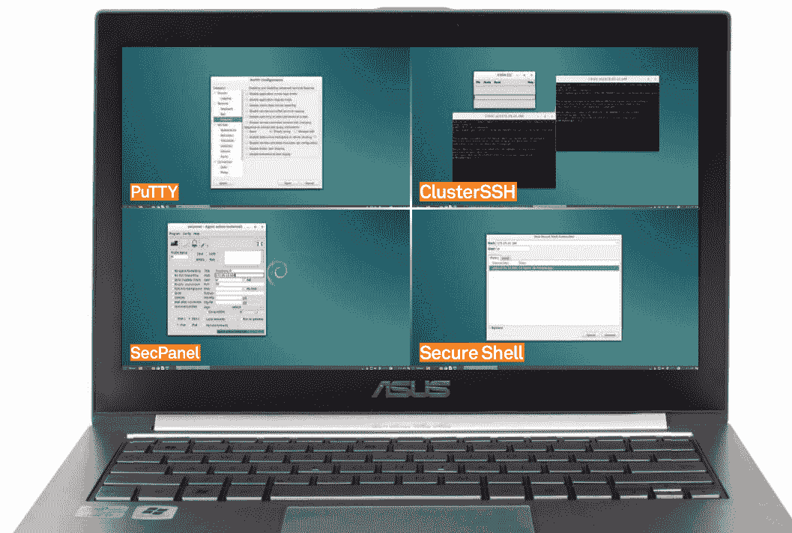

# 组测试

## 图形 SSH 客户端

我们将四个图形 `SSH` 客户端置于显微镜下，看看哪个在服务和最实用功能方面表现最出色。

### PuTTY

这是一种通过图形界面访问兼容 `SSH` 系统的知名解决方案。用户经常使用`PuTTY`是因为微软的操作系统原生不支持该协议，同时它在`Linux`上也运行良好，而我们将让它与其他竞争对手进行测试。

下载地址：`bit.ly/1jQsQnt`

### ClusterSSH

`ClusterSSH`是一个比`PuTTY`更简单的解决方案，它允许你同时管理多个`SSH`窗口并同时向所有窗口发送命令，从而更快速、更方便地管理服务器和系统。与其他产品相比，它是否太简单了？我们找到了答案：

下载地址：`bit.ly/1rnUTx`

### SecPanel


`SecPanel` 强调 `SSH` 方面，不仅允许用户同时控制多个 `SSH` 窗口和客户端的管理，还具有基于 `SSH` 的复制协议，并允许主机与客户端之间进行文件传输。

下载地址：`bit.ly/103hIK3`

### Secure Shell

也称为 `HotSSH`（因为 `Secure` 只是 `SSH` 的全称），`Secure Shell` 是 `GNOME` 系列应用程序中的 `SSH` 接口。正如 `GNOME` 界面的情况，但仅与本次测试中的其他程序相比。我们看看它的表现。

下载地址：`bit.ly/1eYTifs`

`www.linuxux.com` | 75

# 评测

## 图形 SSH 客户端

### PuTTY

每个人都知道的 `SSH` 客户端，但它配得上它的名声吗？

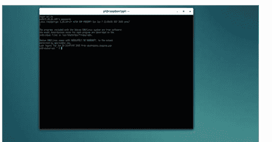

`PuTTY` 本身会出现一个空白的连接窗口，即使你仍然需要它。

### ClusterSSH

创建一个 `SSH` 连接群来同时管理所有连接。

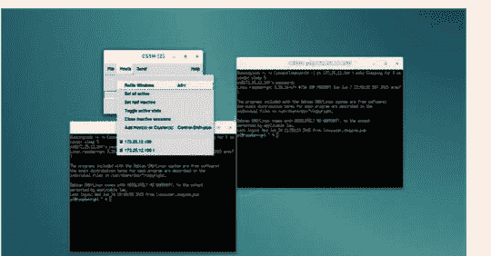

`ClusterSSH` 可以向所有窗口同时发送命令，包括一些预设。

### 连接选项

提供的建立 `SSH` 连接的选项非常基础，只允许你输入 `IP` 或主机名，以及端口。在你点击“连接”后，你需要登录，至少它不会假设你正尝试使用当前的 `Linux` 用户名。详情也可以保存以备后用。

### 连接选项

一旦你找到了需要添加连接的的确切位置，就可以用它连接到远程连接。它不会记住你正在连接到哪一个，并要求你在选择时确保添加了用户名。奇怪的是，它没有历史记录功能或创建自定义连接的方法。

### 多重连接

你可以同时执行多个连接，但当侧窗口关闭时，最佳处理方式是：整个 `SSH` 连接关闭了，你需要重新启动 `PuTTY` 来启动新连接，这至少可以做到。通过多重连接，

### 多重连接

`ClusterSSH` 的主要功能是处理多个连接，它做得很好。你可以向所有连接中添加多个连接。它会跟踪所有连接。

### 多重连接

`ClusterSSH` 的主要功能是处理多个连接，它做得很好。你可以向所有连接中添加多个连接。它会跟踪所有连接。

### 多重连接

`ClusterSSH` 的主要功能是处理多个连接，它做得很好。你可以向所有连接中添加多个连接。它会跟踪所有连接。

### 多重连接

`ClusterSSH` 的主要功能是处理多个连接，它做得很好。你可以向所有连接中添加多个连接。它会跟踪所有连接。

### 多重连接

`ClusterSSH` 的主要功能是处理多个连接，它做得很好。你可以向所有连接中添加多个连接。它会跟踪所有连接。

### 多重连接

`ClusterSSH` 的主要功能是处理多个连接，它做得很好。你可以向所有连接中添加多个连接。它会跟踪所有连接。

### 多重连接

`ClusterSSH` 的主要功能是处理多个连接，它做得很好。你可以向所有连接中添加多个连接。它会跟踪所有连接。

### PuTTY

一种通过图形界面访问兼容 `SSH` 系统的知名解决方案，用户经常使用 `PuTTY` 是因为微软的操作系统原生不支持该协议，同时它在 `Linux` 上也运行良好，而我们将它与其他对手进行测试。

下载地址：`bit.ly/1jQsQnt`

### ClusterSSH

一个比 `PuTTY` 更简单的解决方案，`ClusterSSH` 允许你同时管理多个 `SSH` 窗口并同时向所有窗口发送命令，从而更快速、更方便地管理服务器和系统。与其他产品相比，它是否太简单了？我们找到了答案：

下载地址：`bit.ly/1rnUTx`

### SecPanel

`SecPanel` 强调 `SSH` 方面，不仅允许用户同时控制多个 `SSH` 窗口和客户端的管理，还具有基于 `SSH` 的复制协议，并允许主机与客户端之间进行文件传输。

下载地址：`bit.ly/103hIK3`

### Secure Shell

也称为 `HotSSH`（因为 `Secure` 只是 `SSH` 的全称），`Secure Shell` 是 `GNOME` 系列应用程序中的 `SSH` 接口。正如 `GNOME` 界面的情况，但仅与本次测试中的其他程序相比。我们看看它的表现。

下载地址：`bit.ly/1eYTifs`

### PuTTY

每个人都知道的 `SSH` 客户端，但它配得上它的名声吗？

`img/78fc0912c3388898922ac232325ec7a.7_0.`

`PuTTY` 本身会出现一个空白的连接窗口，即使你仍然需要它。

### ClusterSSH

创建一个 `SSH` 连接群来同时管理所有连接。


`ClusterSSH` 可以向所有窗口同时发送命令，包括一些预设。

### 连接选项

提供的建立 `SSH` 连接的选项非常基础，只允许你输入 `IP` 或主机名，以及端口。在你点击“连接”后，你需要登录，至少它不会假设你正尝试使用当前的 `Linux` 用户名。详情也可以保存以备后用。

### 连接选项

一旦你找到了需要添加连接的的确切位置，就可以用它连接到远程连接。它不会记住你正在连接到哪一个，并要求你在选择时确保添加了用户名。奇怪的是，它没有历史记录功能或创建自定义连接的方法。

### 多重连接

你可以同时执行多个连接，但当侧窗口关闭时，最佳处理方式是：整个 `SSH` 连接关闭了，你需要重新启动 `PuTTY` 来启动新连接，这至少可以做到。通过多重连接，

### 多重连接

`ClusterSSH` 的主要功能是处理多个连接，它做得很好。你可以向所有连接中添加多个连接。它会跟踪所有连接。

### 多重连接

创建一个 `SSH` 连接群来同时管理所有连接。

`ClusterSSH` 可以向所有窗口同时发送命令，包括一些预设。

### Secure Shell

也称为 `HotSSH`（因为 `Secure` 只是 `SSH` 的全称），`Secure Shell` 是 `GNOME` 系列应用程序中的 `SSH` 接口。正如 `GNOME` 界面的情况，但仅与本次测试中的其他程序相比。我们看看它的表现。

下载地址：`bit.ly/e`

# 三星 HTC NEXUS 免费 60 分钟视频

> 100% 非官方内容

# 安卓杂志

- 免费 10 份独家内容：安卓...技巧与建议
- 三星 `HTC` 索尼...技巧与建议
- 免费 60 分钟视频教程
- 100% 评测技巧与建议
- `Chromebook` 评测技巧与建议

# 10 大最佳杂志

安卓版 `Apple Watch`


# S20 修复

# 获取新安卓

# 世界指南

# DWEAR 装备

# 枯燥的视觉现实

# LOLLIPOP 20 安卓

在你的设备上设置安卓

`KROME`

家用电话重塑

`RUGGER` `LG G4`

一台 `HTC`


# 安卓杂志

各大优质报刊店和超市供应

# 正在热售

> 立即获取新安卓 > `Chromebook` 超级测试 > 成为安卓专家

- 硬件评测、安卓破解技巧与策略、`App` 评测、帮助与建议


# 今日购买你的杂志

纸质版登录：`www.imagineshop.co.uk`

数字版登录：`www.greatdigitalmags.com`

可在以下平台获取


`facebook.com/littlegreenrobot` | `twitter.com/lgreenrobot`

# 臭名昭著犯罪背后的未闻故事

# 伍龙岗的屠夫

新南威尔士州的腐败、儿童虐待与血腥复仇

# 真实犯罪

“我追了辛普森”

与历史上那位射中他的飞行员进行对峙。

詹姆斯·埃尔罗伊谈论黑大丽

这位硬汉派犯罪小说作家谈论黑大丽。

你能破解 #77 案件吗？

# 新的假期地狱

圣诞特别版

# 巴黎的一场抢劫

Fandon 的外部犯罪

韦科围攻


伟大的真理追求者巴切尔·尼科尔

受影响的孩子

谋杀等

# 仅需 1 英镑即可尝试 3 期！

从水瓶时代臭名昭著的连环杀手到爵士时代及之后的无情黑党老大，《犯罪》是报摊上第一本高质量真实犯罪杂志。每一期都揭示了世界上最扣人心弦案件背后的未闻故事、调查人员和幸存者的惊人经历，以及违法者最终落入法网的精彩纪实。

# 世界最致命的连环杀手

从臭名邦迪到约翰·韦·盖西，最病态的变态者的心理

# 《所有睡眠历史》制作者的全新之作

黑帮维加斯：内华达州的杀戮之谜

# 1 英镑买 3 期 >>> 不要错过 >>> 1 英镑买 3 期 >>> 不要错过

# 拨打热线 0844 245 6923

# 或访问在线 imagines.co.uk/crime

`*每分钟通话 7 便士，外加电话公司标准费用。请使用代码 NEW15。此优惠适用于英国借记卡新订阅用户，以 1 英镑的价格接收前 3 期。这些杂志将收取标准订阅费用；每 6 期 14.25 英镑。新订阅将从下一期可用杂志开始。可根据要求提供直接担保的详情。此优惠于 2015 年 10 月 31 日过期。`

# 评测

`75 组测试 | 80 米米 MX4 | 82 香蕉 Pro | 84 Mageia 5`


# 组测试

## 图形 SSH 客户端

我们将四个图形 SSH 客户端置于显微镜下，看看哪个在服务和最实用功能方面表现最出色。

### PuTTY

这是一种通过图形界面访问兼容 `SSH` 系统的知名解决方案。用户经常使用 `PuTTY` 是因为微软的操作系统原生不支持该协议，同时它在 `Linux` 上也运行良好，而我们将让它与其他竞争对手进行测试。

下载地址：`bit.ly/1jQsQnt`

### ClusterSSH

`ClusterSSH` 是一个比 `PuTTY` 更简单的解决方案，它允许你同时管理多个 `SSH` 窗口并同时向所有窗口发送命令，从而更快速、更方便地管理服务器和系统。与其他产品相比，它是否太简单了？我们找到了答案：

下载地址：`bit.ly/1rnUTx`

### SecPanel

`SecPanel` 强调 `SSH` 方面，不仅允许用户同时控制多个 `SSH` 窗口和客户端的管理，还具有基于 `SSH` 的复制协议，并允许主机与客户端之间进行文件传输。

下载地址：`bit.ly/103hIK3`

### Secure Shell

也称为 `HotSSH`（因为 `Secure` 只是 `SSH` 的全称），`Secure Shell` 是 `GNOME` 应用程序中的应用程序中的 `SSH` 接口。正如 `GNOME` 界面的情况，但仅与本次测试中的其他程序相比。我们看看它的表现。

下载地址：`bit.ly/1eYTifs`

`www.linuxux.com | 75`

# 评测

## 图形 SSH 客户端

### PuTTY

每个人都知道的 `SSH` 客户端，但它配得上它的名声吗？


`PuTTY` 本身会出现一个空白的连接窗口，即使你仍然需要它。

### ClusterSSH

创建一个 `SSH` 连接群来同时管理所有连接。


`ClusterSSH` 可以向所有窗口同时发送命令，包括一些预设。

### 连接选项

提供的建立 `SSH` 连接的选项非常基础，只允许你输入 `IP` 或主机名，以及端口。在你点击“连接”后，你需要登录，至少它不会假设你正尝试使用当前的 `Linux` 用户名。详情也可以保存以备后用。

### 连接选项

一旦你找到了需要添加连接的的确切位置，就可以用它连接到远程连接。它不会记住你正在连接到哪一个，并要求你在选择时确保添加了用户名。奇怪的是，它没有历史记录功能或创建自定义连接的方法。

### 多重连接

你可以同时执行多个连接，但当侧窗口关闭时，最佳处理方式是：整个 `SSH` 连接关闭了，你需要重新启动 `PuTTY` 来启动新连接，这至少可以做到。通过多重连接，

### 多重连接

`ClusterSSH` 的主要功能是处理多个连接，它做得很好。你可以向所有连接中添加多个连接。它会跟踪所有连接。

（此处省略重复内容，已根据要求去重）

## 图形化 SSH 客户端评测

## 简而言之：对比结论

| `PuTTY` | `ClusterSSH` | `SecPanel` | `Secure Shell` |
|---|---|---|---|
| **连接选项** | 为用户为设置所有这些连接提供了良好的基础选项 6 | 令人失望的是模糊，且它不会记住任何连接 3 | 提供许多选项和自定义功能，可方便你建立的连接 8 | 可以创建并保存所有连接以及密码，但没有保存功能 7 |
| **多重连接** | 虽然可以正常工作，但确实需要重启核心程序 | 这显然是 `Cluster` 的主要卖点，而且运行得非常好 | 这种很好：通过运行 `Cluster` 的方式使其变得更加实用 8 | 避免多重连接——你必须重启程序，这非常痛苦 |
| **其他功能** | 任何额外功能大多围绕外观和窗口行为 | `ClusterSSH` 允许我们发送几个随机命令 | 另一个像 `transit` 一样不错的工具，且法语中是熟悉的界面，使其易于上手 | 这里没有其他类似的，其他的都可以保存密码 3 |
| **易用性** | 一旦你理解了它，就会变得非常容易使用 | 极其不熟悉的界面实际上并不好用 | 它能完成它想做的一切，但确实让你需要付出努力 | 一个非常好的 `SSH` 客户端，可以让你无忧地连接设备 5 | 你确实需要处理很多问题，但当你终于搞定它时，它是好的 |
| **总体** | 很好，但显然更适合不支持 `SSH` 的 `Windows` | | | 并不真的适合初学者，或者与其他产品相比显得过于简单 5 |

## 优胜者是……

### SecPanel

不可否认；`SSH` 的实用性永远不会真正消失。在一个带宽增加、访问或广播屏幕变得更更容易的世界里，人们对远程连接的需求很大，这种连接对用户的要求比简单的命令行更多。这些 `SSH` 客户端的总体状况适用于那些只需要在命令行中使用 `SSH`、除此之外没有其他需求的人。而 `SecPanel` 为在开发环境中处理 `SSH` 的管理员提供了一个出色的解决方案。

`SecPanel` 的真正之处在于，它为必须处理大量远程计算机的人提供了许多优秀的功能，从多重连接到能够传输文件。它不仅仅是一个工具，而且运行得更好，为这些工具的用户提供了更熟悉的界面。这帮助它确立了获胜地位。

从整体来看，`PuTTY` 有点令人失望，它非常像 `Windows` 可以发现的类型。

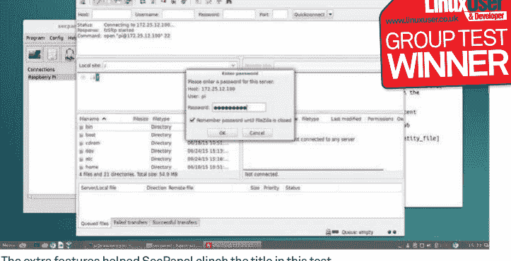

额外功能帮助 `SecPanel` 客户端测试 `SSH` 连接（操作系统只允许原生支持，但这一事实意味着与 `SecPanel` 和 `SSH` 的完整功能相比，它稍微落后）。

`SecureShell` 和 `ClusterSSH` 的规格可以这么说——至少尝试做一些不同的事情，但如果你想做多客户端控制以外的任何事情，最好使用终端或其他工具。

似乎，最好的 `SSH` 图形化工具只管理其他界面的 `SSH`，但它做得极其出色。

> `Rob Zwelsloot`

## RasPi

面向树莓派爱好者的数字杂志


# 项目

# 访谈

# 教程

# 专家建议

在 `Google Play` 和 `iTunes` 下载免费应用

## 美族 MX4

## 手机

## 美族 MX4 Ubuntu 版


第二代 `Ubuntu` 手机急需改进 `BQ Aquarius 4.5` 的初始表现。`MX4` 具备这些吗？

终于，在等待了几个月后，第二部手机手机了。最初的 `BQ Aquarius 4.5` —— 一部尚可的手机，但配置糟糕，且伴随其的极早期版本的 `Ubuntu` 看起来更像是你们日常使用的软件的早期开发阶段。低配置和不稳定的界面使得我们的评价并不那么正面。简单来说，硬件需要更好，操作系统则需要社区和社交媒体的更多帮助。

现在我们有了美族 `MX4` 作为你 `Ubuntu` 手机的第二选择。中国市场的一个热门品牌，美族通常制造 `Android` 设备，因此它对智能手机的设计和制造也很熟悉。事实上，`MX4 Ubuntu` 版是一部在去年底在中国市场发布的 `Android` 手机，但从未在西方发行。


设备的其余部分保持不变：相当数量的`RAM`和内部存储，以及一个可以持续运行很长时间的电池。手机本身的设计非常漂亮；白色塑料机身，起来一点也不廉价，这样你就不会不小心撞击到全屏边缘。它的设计让人想起`iPhone`和`Galaxy S`系列，这显然解释了这款手机在大众中的流行。对于现代`Android`手机来说，独特的是，它没有依赖软键进行主页、返回和其他应用操作，它还有一个电容式主页按钮，位于`iPhone`主按键所在的位置。虽然该按钮通常不是`Ubuntu`手机用户体验的一部分，但它实际上与操作系统非常契合。

# CPU

八核，2 GHz (`联发科 MT6759v`)

# RAM

2 GB

# 操作系统

`Ubuntu 15.04`

# 显示

5.36 英寸`IPS`屏幕，1080 x 1920 像素 (418 ppi)

# 摄像头

2000 万像素后摄像头，200 万像素自拍摄像头

# 存储

16 GB

# 价格

£299 / €212


> 中国市场的一个热门品牌，美族通常制造`Android`设备，因此它对智能手机的设计和制造也很熟悉。

# 优点

- 比`Aquila`的机身漂亮得多，屏幕好得多——实际上可以与现代智能手机竞争

# 缺点

- 屏幕也绝对非常漂亮——与`Aquila`的老旧屏幕有巨大差异。凭借 5.5 英寸`IPS`面，它触摸明亮且质量良好。不过有些软件相当缓慢，尽管缩略图在高分辨率下有时会出现一些像素化。虽然硬件有了显著改进，并能与目前的智能手机竞争——但`Ubuntu`操作系统并没有同等质量。

- 应用程序的选择也没有改进。仍然存在发布时没有的一些范围，`Ubuntu`手机的独特体验更好，但遗憾的是社区在填补文件空白方面很困难。这些重要应用程序真的需要为`Ubuntu Touch`提供一些官方应用，特别是地图，以及通知并不总是像`Android`的拖放那样好用。

- 所以，虽然`MX4`相比`Android`有改进，但它仍然有`Android`的早期问题，而且只有当`Ubuntu Touch`真正跟上同样的风格时，你才能获得良好的体验。如果你进行一种改变——一种全新的、独特且相当不错的用户体验和工作流——可以比`Ubuntu Touch`做更多。

你可以买一台`Windows`手机。

# 总结

[注：此处原文为 "Summary"]

`MX4`在你手里感觉像是一部正的现代智能手机，它拥有很棒的设计（即使不公平），并使用了市场上不错的组件和部件。说`MX4`受限于`Ubuntu`操作系统的限制是不公平的，但它仍然无法弥补`Ubuntu`操作系统的局限性。

• Rob Lewandowski


`www.linuxux.com`

81

## 评测

## Banana Pro


## 微型电脑

## Banana Pro

有了新的制造合作伙伴，`Lemaker`升级后的类`Pi`设备是否已经摆脱它的灵感来源？

`Lemaker`原本的`Banana Pi`因其派生性和“模仿者”的名字备受批评，但这家中国公司最终填补了市场空白。虽然它采用`ARMv6`单核处理器且没有高速存储，但`Banana Pro`拥有的双核`ARMv7`芯片和`SATA`接口，并支持更广泛的免费操作系统。

- CPU：双核`ARMv7` 1 GHz
- GPU：`ARM Mali-400 MP2`，带有`CedarVR`
- RAM：1GB `DDR3`
- 存储：`Micro-SD`, `SATA 2.0`
- 网络：以太网，`802.11b/g`无线
- 额外端口：`USB2`，28 个用户访问的`GPIO`

自 2013 年`Banana Pi`发布以来，市场已经发生了演变，`Lemaker`以`Banana Pro`做出了回应。

遗憾的是，这并没有领先。当`Banana Pi`发布时，它提供的性能显著优于树莓派；虽然树莓派 2 是双核处理器，但树莓派 2 b 的四核处理器完全碾压了双核的`A20` —— 而且价格更便宜。

因此，提到`A20`令人失望，但`Lemaker`至少有了可展示的改进。一个亮黄色的 40 脚`GPIO`插针与树莓派的引脚一致，使得兼容性更加容易。主板的改进在于像`Pi 2`一样，去除了复合视频输出，取而代之的是紧凑的 3.5mm 接口。

最大的变化是包含了`802.11b/g`无线网络，这已成为标准。

- 尺寸：92x60 mm

可在`RobotShop.com`购买

价格：£34.99 / $55


## 优点

优秀的网络功能和高速存储与广泛的操作系统无缝结合，使得`Banana Pro`非常具有灵活性。

## 缺点

如果你需要集成无线`Wi-Fi`，树莓派 2 `Model B`提供了更多`USB`端口和更好的性能。

> 最大的变化是标准配置了`802.11b/g/n`无线网络，它与千兆以太网并列——前代实际吞吐量限制为 233MB/s——提供了比其灵感来源更高的性能。与`Pi`板本身解耦的包是你已经开始但不需要安装；可以单独购买`USB`转`RP-SMA`适配器来利用两个`USB`端口。内置`AXP20`电源管理单元 (`PMU`) 是`Pro`型的新功能，而全`SD`卡已被`Micro-SD`卡取代。

`Scratch`安装在`Micro-SD`卡上（不提供），通过复制直接文件系统镜像；无需设置系统。

与许多中国单板电脑一样，`Banana Pro`自 1 月以来所需的各种操作系统和更新的系统镜像也可以通过其他机制分发，包括：

但必须说，`Banana Pro`的问题在于价格；对于与更强大的树莓派 2 和官方`Wi-Fi`适配器相当的成本，它缺乏为树莓派 2 型号开发的同等高质量软件硬件。

## 总结

不可否认，`Banana Pro`是`Banana Pi`的改进，然而，由于与树莓派 2 `Model B`相比缺少两个全尺寸`USB`端口，它未能通过，而`Pi 2`的四核处理器让更便宜的`Banana Pro`胜一筹。

兼容性也需要考虑：从树莓派内核到`Android 4.4` —— 在没有`Wi-Fi`支持的情况下，`Ubuntu`和`Debian`变体可用，以及用于教学的基础。


`www.linuxuser.co.uk` 83

## 评测 Mageia 5

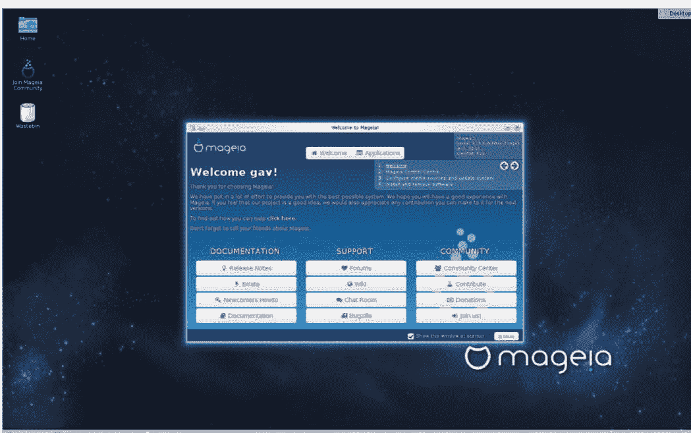

## 发行版

### Mageia 5

`Plasma 5` 可但未完全支持，因此 `Mageia 5` 默认使用版本 4 的桌面环境。

### Mageia 5

本身可能受限于历史，但 `Mandriva` 通过其真正的继任者延续。

`Mageia 5` 已经制作了一年多，在 `Mandriva` 清算之后推出，不可避免地感觉是一个及时的发布。

它仍然带有其遗产的特征，特别是像 `Mageia`（原 `Mandriva`）中心和 `Drax` 安装程序这样的尖端发布，Rémy Vorscheid 已经做到了目前最好的，但中心和 `Drax` 均收到了支持。

对于去年遇到此问题的 `Mageia 4` 来说，这这是一项重要的更新，因为它让那些在过去三年购买的电脑更容易使用，而且大多数 `Mageia` 自此发布以来带来了 `UEFI` 支持。

显然，在安装程序上付出了大量工作，关键功能是针对现代设备的 `UEFI` 支持。这个小宝石意味着你永远不需要。

安装程序现在支持 `RAID`，更新的分区管理器（现在的 `Parted`）处理 `LVM` 和 `Btrfs` 支持。Group 2 运行得更好，让你能够检测其他操作系统并将其添加到启动菜单，作为更好的集成功能，如安装脚本和安全启动现在提供。在使用这些额外的 `Drax` 选项时你：

| | |
| --- | --- |
| CPU | x86 |
| RAM | 512 MB minimum, 2 GB recommended |
| Storage | 5 GB minimum, 20 GB recommended |

84

## 贡献 Magma


世界各地的许多人帮助 `Mageia` —— 一个基于 `Linux` 的操作系统和友好的社区 —— 构建自由软件项目。

贡献是回馈软件的一种极方式。

自 2013 年 `Banana Pi` 发布以来，市场已经发生了演变，`Lemaker` 以 `Banana Pro` 做出了回应。

遗憾的是，这并没有领先。当 `Banana Pi` 发布时，它提供的性能显著优于树莓派；虽然树莓派 2 是双核处理器，但树莓派 2 b 的四核处理器完全碾压了双核的 `A20` —— 而且价格更便宜。

因此，提到 `A20` 令人失望，但 `Lemaker` 至少有了可展示的改进。一个亮黄色的 40 脚 `GPIO` 插针与树莓派的引脚一致，使得兼容性更加容易。主板的改进在于像 Pi 2 一样，去除了复合视频输出，取而代之的是紧凑的 3.5mm 接口。

最大的变化是包含了 802.11b/g 无线网络，这已已成为标准。

- 尺寸：92x60 mm

可在 `RobotShop.com` 购买

价格：£34.99 / $55

## 优点

优秀的网络功能和高速存储与广泛的操作系统无缝结合，使得 `Banana Pro` 非常具有灵活性。

## 缺点

如果你需要集成无线 Wi-Fi，树莓派 2 Model B 提供了更多 USB 端口和更好的性能。

> 最大的变化是标准配置了 802.11b/g/n 无线网络，它与千兆以太网并列——前代实际吞吐量限制为 233MB/s——提供了比其灵感来源更高的性能。与 Pi 板本身解耦的包是你已经开始但不需要安装；可以单独购买 USB 转 RP-SMA 适配器来利用两个 USB 端口。内置 `AXP20` 电源管理单元 (`PMU`) 是 Pro 型的新功能，而全 SD 卡已被 Micro-SD 卡取代。

`Scratch` 安装在 Micro-SD 卡上（不提供），通过复制直接文件系统镜像；无需设置系统。

与许多中国单板电脑一样，`Banana Pro` 自 1 月以来所需的各种操作系统和更新的系统镜像也可以通过其他机制分发，包括：

但必须说，`Banana Pro` 的问题在于价格；对于与更强大的树莓派 2 和官方 Wi-Fi 适配器相当的成本，它缺乏为树莓派 2 型号开发的同等高质量软件硬件。

## 总结

不可否认，`Banana Pro` 是 `Banana Pi` 的改进，然而，由于与树莓派 2 Model B 相比缺少两个全尺寸 USB 端口，它未能通过，而 Pi 2 的四核处理器让更便宜的 `Banana Pro` 胜一筹。

兼容性也需要考虑：从树莓派内核到 `Android 4.4` —— 在没有 Wi-Fi 支持的情况下，`Ubuntu` 和 `Debian` 变体可用，以及用于教学的基础。


`www.linuxuser.co.uk` 83

## 评测 Mageia 5


## 发行版

### Mageia 5

`Plasma 5` 可但未完全支持，因此 `Mageia 5` 默认使用版本 4 的桌面环境。

### Mageia 5

本身可能受限于历史，但 `Mandriva` 通过其真正的继任者延续。

`Mageia 5` 已经制作了一年多，在 `Mandriva` 清算之后推出，不可避免地感觉是一个及时的发布。

它仍然带有其遗产的特征，特别是像 `Mageia`（原 `Mandriva`）中心和 `Drax` 安装程序这样的尖端发布，Rémy Vorscheid 已经做到了目前最好的，但中心和 `Drax` 均收到了支持。

对于去年遇到此问题的 `Mageia 4` 来说，这这是一项重要的更新，因为它让那些在过去三年购买的电脑更容易使用，而且大多数 `Mageia` 自此发布以来带来了 `UEFI` 支持。

显然，在安装程序上付出了大量工作，关键功能是针对现代设备的 `UEFI` 支持。这个小宝石意味着你永远不需要。

安装程序现在支持 `RAID`，更新的分区管理器（现在的 `Parted`）处理 `LVM` 和 `Btrfs` 支持。Group 2 运行得更好，让你能够检测其他操作系统并将其添加到启动菜单，作为更好的集成功能，如安装脚本和安全启动现在提供。在使用这些额外的 `Drax` 选项时你：

| | |
| --- | --- |
| `CPU` | x86 |
| `RAM` | 512 MB minimum, 2 GB recommended |
| `Storage` | 5 GB minimum, 20 GB recommended |

84

## 贡献 Magma

世界各地的许多人帮助 `Mageia` —— 一个基于 `Linux` 的操作系统和友好的社区 —— 构建自由软件项目。

贡献是回馈软件的一种极方式。

# 构建更好的网页

`www.webdesigermag.co.uk`

## 杂志

现已发售

各大优质报刊零售店和超市均有销售

`HTML & CSS` 动画艺术 | UX 设计新趋势 | 构建你自己的 `API`

- 设计灵感 | 实用技巧 | 幕后故事 | 逐步指导 | 行业观点

## 立即购买您的期数

纸质版请访问 `www.imagineshop.co.uk` 购买

数字版请访问 `www.greatdigitalmags.co.uk` 购买

可在以下平台获取

`facebook.com/webdesignermag` | `twitter.com/webdesignermag`

# BLACKNIGHT SOLUTIONS 托管

我用我的小眼睛寻找以...结尾的域名：

`.black` `.buzz` `.care` `.club`

`.guru` `.ink` `.host` `.london`

`.ninja` `.party` `.press` `.rocks`

`.science` `.social` `.website` `.wiki`

与众不同 思考语境 随需可用

## 域名

`.COM` 每年仅 £5.80

## 托管

每月 £2.99 起 + 免费域名

## 云服务

`SSD` 服务器每月 £5 起

## 服务器

前3个月特惠 50%

## 数据中心

机架空间每月 £35 起

0800 808 5450

`netcetera.co.uk/lud`

`www.blacknight.host` `sales@blacknight.host` `@blacknight`

## 英国服务器

专用服务器

## 使用优惠码 LINUX1 可享 85% 折

## 仅需

每月 39（加值税）

- 当日安装

- 24/7 英国免费热线支持

- 无长期合同

咨询我们的团队成员或访问我们的网站了解更多信息

0800 610 1 620 | `www.ukservers.com`

## 托管列表

赞助机会

赞助本板块提升您的品牌关注度。

联系 Luke Dholcombe：+44 01202 58631

## 专用服务器列表

有您认为我们应该列出的优惠吗？

无论您是托管公司还是此处列出的受欢迎的服务提供商，请邮件联系我们：

`news@hosting-publishing.co.uk`

名称与 URL

| 套餐 | 电话号码 | 每月费用 | 最短合同期 | `CPU` / 速度 | 15x 250GB | 10GB 互联网连接 | 硬件 | 远程电源重启 | 永久 `KVM` | 终极保障 | 网络备份 | 私有套件 | 24/7 支持 |
| :--- | :--- | :--- | :--- | :--- | :--- | :--- | :--- | :--- | :--- | :--- | :--- | :--- | :--- |
| `DS 2.2` | 0800 2437 0222 | £19.00 | 1 个月 | `Intel Core i3` / 2.5GHz | | 1TB | 可选 | ✓ | 99.9% | | | | 10GB |
| `BudgetBox 4` | 0800 2437 0222 | £28.00 | 1 个月 | `Intel Core i5` / 2.5GHz | | 2x500GB 起 | 可选 | ✓ | 99.9% | | | | TBA |
| `DS 3.1` | 0800 2437 0222 | £39.00 | 1 个月 | `Intel Core i5` / 3.0GHz | | 1TB | 可选 | ✓ | 99.9% | | | | TBA |
| `DS 4.3` | 0800 2437 0222 | £59.00 | 1 个月 | `Intel Core i7` / 3.5GHz | | 2x500GB 起 | 可选 | ✓ | 99.9% | | | | 10GB |


| DS 4.5 | 0800 2437 0222 | £79.00 | 1 个月 | Intel Core i7 / 3.6GHz | | 1TB | 可选 | ✓ | 99.9% | | | | TBA |

| DS 6.2 | 0800 2437 0222 | £115.00 | 1 个月 | Dual Core Xeon / 3.0GHz | | 2TB | 可选 | ✓ | 99.9% | | | | 10GB |

| DS 6.5 | 0800 2437 0222 | £240.00 | 1 个月 | Dual Core Xeon / 3.5GHz | | 8TB | 可选 | ✓ | 99.9% | | | | TBA |

| DS 6.6 | 0800 2437 0222 | £349.00 | 1 个月 | Dual Intel Xeon / 3.5GHz | | 1TB | 可选 | ✓ | 99.9% | | | | 10GB |

## PoundHouse

`www.poundhouse.com`

## Netcera

`www.netcera.co.uk/linux`

| 套餐 | 电话号码 | 每月费用 | 最短合同期 | CPU / 速度 | 15x 250GB | 10GB 互联网连接 | 硬件 | 远程电源重启 | 永久 KVM | 终极保障 | 网络备份 | 私有套件 | 24/7 支持 |

| :--- | :--- | :--- | :--- | :--- | :--- | :--- | :--- | :--- | :--- | :--- | :--- | :--- | :--- |

| | | | | | | | | | | | | | |

| 2200DC | 0800 808 5450 | £25 | 1 个月 | Dual Core i5 | 160GB | | | | | ✓ | | | | |

| 3000DC | 0800 808 5450 | £40 | 1 个月 | Dual Core 3GHz | | | | | ✓ ✓ | | | | |

| 2600DC | 0800 808 5450 | £65 | 1 个月 | Dual Core Xeon | 2x500GB | | | | | ✓ | | | | |

| Developer | 0800 808 5450 | £29 | 1 个月 | N/A | 1GB | | | | | | | | | |

| One | 0800 808 5450 | £39 | 1 个月 | N/A | 1GB | | | | | | | | | |

| Starter Linux | | £24 | 1 个月 | N/A | 2000GB | | | | | | | | | |

| Starter Windows | | £20 | 1 个月 | N/A | 2000GB | | | | | | | | | |

| Business Linux | | £40 | 1 个月 | N/A | 4000GB | | | | | | | | | |

| Business Windows | | £45 | 1 个月 | N/A | 4000GB | | | | | | | | | |

| Ultimate Linux | | £60 | 1 个月 | N/A | Unlimited | | | | | | | | | |

| Ultimate Windows | | £80 | 1 个月 | N/A | Unlimited | | | | | | | | | |

| Dedicated Server | 0807 109 79 | £199 | 1 个月 | 1x2-core vCPU | 800GB | | | | | 99.90% | | | | |

| Dedicated Server | 0807 109 79 | £299 | 1 个月 | 1x4-core vCPU | 800GB | | | | | 99.90% | | | | |

| Dedicated Server | 0807 109 79 | £399 | 1 个月 | 2x4-core vCPU | 800GB | | | | | 99.90% | | | | |

| Linux Quad Core | 0840 6744 7750 | £79.99 | 12 个月 | | 1600GB | | | | | 99.99% | | 24/7 Ticket支持 |

| Heart Windows Quad Core | 0840 6744 7750 | £89.99 | 12 个月 | | 1600GB | | | | | 99.99% | | 24/7 Ticket支持 |

| Heart Linux Quad Core | 0840 6744 7750 | £129.99 | 12 个月 | Dual Core Xeon 2.5GHz | 2500GB | | | | | 99.99% | | 24/7 Ticket支持 |

`0` = 选项

## 让您的列表突出显示！联系 LUKE

`luke.didcombe@imagine-publishing.co.uk`

`+44(0)1202 586431`

## 专用与共享服务器列表

| 名称与 URL | 套餐 | 电话号码 | 费用 | 网页空间 | 每月带宽 | 账户 | 数据库支持 | 支持 | 购物车 | 病毒过滤 | 邮件支持 | 网页控制 | 服务协议 |

| :--- | :--- | :--- | :--- | :--- | :--- | :--- | :--- | :--- | :--- | :--- | :--- | :--- |

| `Blacklight` (`www.blacklight.com`) | `Minus` | `44 0845 5242` | `1` | £49.95 | 150GB | | | | | | | | |

| `Blacklight` (`www.blacklight.com`) | `Minus` | `44 0845 5242` | `2` | £99.95 | 500GB | | | | | | | | |

| `Blacklight` (`www.blacklight.com`) | `Minus` | `44 0845 5242` | `3` | £149.95 | 1TB | | | | | | | | |

| `Digital Gibbon` (`www.digitalgibbon.com`) | `Cheeky Shrimp` | `N/A` | `N/A` | Free | 500MB | | | | | | | | |

| `Digital Gibbon` (`www.digitalgibbon.com`) | `Digital Gibbon` | `N/A` | `N/A` | £12 | 10GB | | | | | | | | |

| `Digital Gibbon` (`www.digitalgibbon.com`) | `Digital Gibbon` | `N/A` | `N/A` | £24 | 20GB | | | | | | | | |

| `e-hosting` (`www.e-hosting.com`) | `WordPress` | `N/A` | `N/A` | £12 | 52GB | | | | | | | | |

| `e-hosting` (`www.e-hosting.com`) | `Starter` | `44 999 4100` | `1` | £23.88 | 1.8GB | | | | | | | | |

| `e-hosting` (`www.e-hosting.com`) | `Starter` | `44 999 4100` | `2` | £45.76 | 3GB | | | | | | | | |

| `Equipase` (`www.equipase.com`) | `Virtual` | `44 999 4150` | `1` | £227.58 | 52GB | | | | | | | | |

| `Equipase` (`www.equipase.com`) | `Silver` | `17 314 4865` | `1` | £42 | 450MB | | | | | | | | |

| `Equipase` (`www.equipase.com`) | `Gold` | `17 314 4865` | `2` | £72 | 850MB | | | | | | | | |

| `Eurofast` (`www.eurofast.com`) | `Essential` | `80 283 423` | `1` | £40 | 2GB | | | | | | | | |

| `Eurofast` (`www.eurofast.com`) | `Essential` | `80 283 423` | `2` | £75 | 5GB | | | | | | | | |

| `Eurofast` (`www.eurofast.com`) | `Super` | `80 283 423` | `3` | £150 | 25GB | | | | | | | | |


# 服务商列表

| 服务商 | 套餐 | 电话 | 数量 | 价格 | 空间 |
| :--- | :--- | :--- | :--- | :--- | :--- |
| `Evolving` (`www.evolvinghosts.com`) | `Partner` | N/A | N/A | £39.99 | 3GB |
| `Evolving` (`www.evolvinghosts.com`) | `Home` | N/A | N/A | £54.99 | 2.5GB |
| `Evolving` (`www.evolvinghosts.com`) | `Business` | N/A | N/A | £99.99 | 5GB |
| `Evolving` (`www.evolvinghosts.com`) | `eCommerce` | N/A | N/A | £159.99 | 20GB |
| `Gaacom` (`www.gaacom.com`) | `Business Pro` | `800 542 7560` | 1 | £199 | 100GB |
| `Global` (`www.globalhosts.com`) | `Professional` | `44 652 7750` | 1 | £69.99 | 5GB |
| `Heart Internet` (`www.heartinternet.com`) | `Professional` | `44 652 7750` | 2 | £89.99 | 10GB |
| `Heart Internet` (`www.heartinternet.com`) | `Professional` | `44 652 7750` | 3 | £129.99 | Unlimited |
| `Hostway` (`www.hostway.com`) | `Silver` | `0840 180 1780` | 1 | £78.90 | 150MB |
| `Merolog` (`www.merolog.com`) | `Email Only` | N/A | N/A | £18 | 1GB |
| `Merolog` (`www.merolog.com`) | `Shared Package` | `014 312 330` | 1 | £58.75 | 25GB |
| `Merolog` (`www.merolog.com`) | `Professional Package` | `014 312 330` | 2 | £105.75 | 500GB |
| `Skymarket` (`www.skymarket.com`) | `Standard 1` | `000 321 778` | 1 | £29 | 1GB |
| `Skymarket` (`www.skymarket.com`) | `Standard 2` | `000 321 778` | 2 | £59 | 2GB |
| `Skymarket` (`www.skymarket.com`) | `Premium 1` | `000 321 778` | 3 | £99 | 10GB |
| `ServiceWise` (`www.serwebsite.com`) | `Personal` | `084 520 0716` | 1 | £25.30 | 10GB |
| `ServiceWise` (`www.serwebsite.com`) | `Professional` | `084 520 0716` | 2 | £126 | 40GB |
| `ServiceWise` (`www.serwebsite.com`) | `Reseller` | `084 520 0716` | 3 | £126 | 40GB |

# 问题与解答

网站：`www.linuxuser.co.uk`

电子邮箱：`linuxuser@imagine-publishing.co.uk`

# 问答

## 回答您的问题

向我们发送问题，我们将尽力回答！

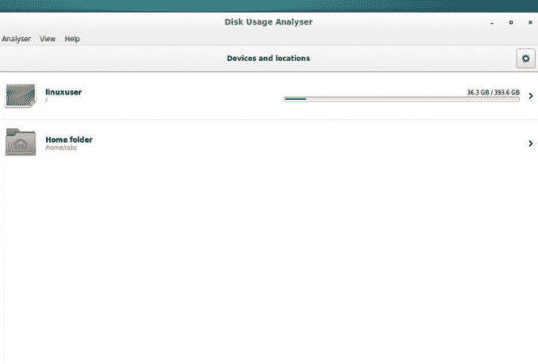

## 常见问题解答 (FAQ)

### 更新发行版

**Q：那么我如何自动更新我的发行版？**

A：某些发行版包含一个非常有用的更新器，例如 `Ubuntu`。当有可用更新时，它们通常会提示你，它将更新并安装任何必要的包，同时保留你的文件和设置。其他发行版没有这个过程，因此你需要备份文件并安装更新后的发行版。最好留意任何可能影响你特定系统的更新。

**Q：我使用的是 LTS（长期支持）版 `Ubuntu`，但没有显示升级。这是什么问题？**

A：请使用“软件更新管理器”（`Update Manager`）并检查“设置”。转到“更新”选项卡，寻找“通知我 `Ubuntu` 版本”的菜单，并将其更改为“任何”。

**Q：如果我不喜欢，可以回降级到之前的版本吗？**

A：不太可能。这非常危险，并且可能会破坏所有包以回到之前的状态；最佳解决方案是进行备份，以防你想要回滚。

## 分析此问题

我正在运行 `Ubuntu 15.04`，我在 `Ubuntu` 软件中心安装了“磁盘用量”（`Disk Usage`）。它安装正常，但我发现任何地方都找不到它。在“附件”菜单里没有，在应用程序文件夹里没有，在终端里也没有。我搜索了“`Ubuntu` 软件中心”来显示位置，但那里什么都没有。我重启了电脑。还是没有。我卸载了“磁盘用量分析器”并重新安装了。有人知道可能发生了什么吗？

`Above Disk Analyzer` 擅长分解存储空间的使用情况

在我们在“管理”中看到的系统中，它会出现在菜单中，具体是在“管理”分类下。你确定你安装了正确的包吗？它被称为 `` `GNOME usage` ``，在软件中心里它被称为 `` `usage analyzer` ``。

你可以尝试使用命令行安装它。打开终端并使用：

```bash
$ sudo apt-get install baobab
```

你可以在终端里直接用 `` `baobab` `` 使用，或者在你的系统中再看一眼。

`Steven Grayson90`

## 修复我的图表

我在 `CentOS 7` 上配合 `NGINX + PHP-FPM` 安装了 `Grafana`，是通过参考几个在线指南手动完成的。

一切似乎运行正常——但它并没有真正显示任何图表。它应该显示空间，但图片就是无法加载。由于某种原因，我在 `rectify` 中有数据：

```bash
# curl /var/log/nginx/www.domain.com/process-service-graph \
  -H "Content-Type: application/json" \
  -d "start=$1" \
  -d "end=$2" \
  -d "step=$3" \
  -d "value=$4"
```

`register 0`

```xml
<!-- 圆形数据库 -->
  <version>0023.0</version>
  <step>30s</step> <-->
  <lastupdate>1435996565</lastupdate>
  <timestamp>2015-06-07T19:44:25 UTC</timestamp>
```

```json
{
  "data": {
    "type": "gauge",
    "name": "heartbeat-60s",
    "min": 0,
    "max": 100
  }
}
```

日志中没有错误。

```text
process_data
service_data_file=/var/log/nginx/perferdata.log
service_data_file_template=$SERVICE_OUTPUT/$SERVICE_ID.PERFDATA
service_data_file_mode=master
service_data_file_perferdata_processing
service_data_file_processing=
process-service-graph
```

在模板中：

```text
def service name named-graph
action_url show.cgi?host=$HOSTNAME&service=$SERVICE
='graph'
oncmover=showGraphPopup("his")
onclickout=showGraphPopup()
```

## 远程拨号

我有点绝望了，我已经寻找了好几天解决方案，却一无所获（简直不敢相信只有我一个人这么想）


## 远程监控 Android 屏幕

好了，这是我想找的：我能让我的 `Android` 拨号一个号码，以便从任何地方看到我的手机屏幕吗？在 `Thunderbird` 中给号码发送邮件信号，或者如果我进入——比方 `Linux` 份上说——在 `Windows` 上可以做到这一点吗？我想从任何地方都能在我的智能手机屏幕上看到数字。这太浪费时间了，如果有正确的 App，本可以快得多！

有人有主意吗？或者周围有人可以帮忙？

Rose

### 解决方案讨论

这里应该有一个更好的方法，真的有很多在网络上使用 `Android` 的方法，它可以流式传输我的手机屏幕，不需要插件和相应的应用程序。

有解决方案！我们有时想用 `Android` 传输文件和共享，比如带通话的消息功能。这可以很容易地将电话号码直接粘贴到拨号器，它就会拨号。

`Android` 需要连接互联网，所以蓝牙可能效果更好。我还需要一个与浏览器中的弹出窗口等更的连接，你也可以通过它拨号。`google`


`Android` 需要连接互联网，

在网络上使用 `Android` 有很多方法，它可以流式传输我的手机屏幕，不需要插件和相应的应用程序。

有解决方案！我们有时想用 `Android` 传输文件和共享，比如带通话的消息功能。这可以很容易地将电话号码直接粘贴到拨号器，它就会拨号。

`Android` 需要连接互联网，所以蓝牙可能效果更好。我还需要一个与浏览器中的弹出窗口等更的连接，你也可以通过它拨号。`google`

在网络上使用 `Android` 有很多方法，它可以流式传输我的手机屏幕，不需要插件和相应的应用程序。

有解决方案！我们有时想用 `Android` 传输文件和共享，比如带通话的消息功能。这可以很容易地将电话号码直接粘贴到拨号器，它就会拨号。

```text
process_data
service_data_file=/var/log/nginx/perferdata.log
service_data_file_template=$SERVICE_OUTPUT/$SERVICE_ID.PERFDATA
service_data_file_mode=master
service_data_file_perferdata_processing
service_data_file_processing=
process-service-graph
```

在模板中：

```text
def service name named-graph
action_url show.cgi?host=$HOSTNAME&service=$SERVICE
='graph'
oncmover=showGraphPopup("his")
onclickout=showGraphPopup()
```

在网络上使用 `Android` 有很多方法，它可以流式传输我的手机屏幕，不需要插件和相应的应用程序。

有解决方案！我们有时想用 `Android` 传输文件和共享，比如带通话的消息功能。

日志中没有错误。

```text
process_data
service_data_file=/var/log/nginx/perferdata.log
service_data_file_template=$SERVICE_OUTPUT/$SERVICE_ID.PERFDATA
service_data_file_mode=master
service_data_file_perferdata_processing
service_data_file_processing=
process-service-graph
```

在模板中：

```text
def service name named-graph
action_url show.cgi?host=$HOSTNAME&service=$SERVICE
='graph'
oncmover=showGraphPopup("his")
onclickout=showGraphPopup()
```

以 `'O'` 退出：仅；

```
$ snmpwalk -v 2c -c $community switchIndex$ifStatsEntry.1
```

如果 `IP` 错误，则返回 `'I'`。

我不想通过重复执行 `snmpwalk` 来防御代码，因为这将浪费额外的时间。

所以问题是：我该如何处理上述 `snmpwalk` 命令生成的代码，然后将其解析并赋值给数组？

**Robbie Saphir**

我们有三件事可能帮到你，每种都有效，但所有这些都可能让你的工作进行得更好。首先，与其使用

(`. .`)

你尝试尝试：

`$` 这让它更具可读性。其次，正如你所注意到的，如果你链接命令，你将获得最后一个命令的退出码。保存第一个命令的结果，然后是退出码或输出文本。最后，你也可以将此添加到脚本的开头：

```
$ set - pipefail
```

这应该尝试返回正确的退出状态。

# 修复我的 MyTV

最近更新后，我遇到了编辑 `mytv` 的的一些问题。后端现在运行良好，但 `fc20` 的视频没有返回任何内容。起初我以为是 `fc20` 的问题，所以我换了一个，也有同样的问题。在我的另一台 PC 的前端上没有遇到这个问题。我检查了硬盘和内存，并重新安装了 `fc20`，但系统中仍然存在这个问题，是系统还是部分？如果是问题的话，我也尝试了关闭它，因为昨天有一个问题，但它仍然存在。有什么建议吗？现在看起来很可能是了。现在必须重启电脑才能获取，因为我无法锁定进程，甚至在我使用 `reboot` 时也会挂起。我在日志中没有发现任何东西。

**Tristan**

如果它影响了整个系统，那么系统并没有宕机，但可能是许多问题之一。是系统还是某些部分？如果是问题的话，尝试检查显卡驱动程序。我的显卡驱动程序的可用性。如果你现在在使用新的 `sofaru`。如果你正在尝试恢复一个坏掉的硬盘，那么在不断尝试和缓冲视频时可能会导致系统挂起。请帮帮我！


| MyTV | 列表 | 录制计划（手动，自定义） | 即将节目 | 已录制节目 | 背景 | 日志 |
| :--- | :--- | :--- | :--- | :--- | :--- | :--- |
| 当前播放：2008年1月28日，上午07:00 | | | | | | |
| 07:00 | 07:15 | 07:30 | 07:45 | 08:00 | 08:15 | 08:30 | 09:15 | 09:30 |
| 西部新闻（返回） | 西部新闻（返回） | 晚上杂志（返回） | 西部体育（返回） | | | |
| 艾莉（返回） | 艾莉：电话（返回） | 妈妈的家庭（返回） | 妈妈的家庭：电话（返回） | 德鲁·凯里秀：家庭崩溃 如果我想要（返回） | 德鲁·凯里秀：家庭结婚（返回） | |
| 联邦（返回） | | 国王新闻（返回） | 晚上杂志（返回） | 内部版 | 办公室：本地援助（返回） | 30岩（返回） |
| 想要成为富翁的人（返回） | 访问好莱坞 | 菲尔博士 | 半个小时：傻瓜（返回） | 互动规则（返回） | 兰博 III（1989年，s） | | |
| 联邦（返回） | 国王新闻：特别版（返回） | 我遇见妈妈：第三者（返回） | 粉碎实验室：飓风防风（家）（返回） | | | | |
| 如何制作的（返回） | 如何制作的（返回） | MyBusters：领唱曲 | | | | | |

以上你得到了，`MyTV` 提供了一个极佳的家庭媒体体验

`www.linux.com`

# 开源

`Linux` 新闻与观点

联系我们...

直接联系我们：`linuxuxer@imagine-publishing.co.uk`

# 评论

# 信件

关于杂志、开源的问题和意见


> 以上 `PiNet` 让学生在课堂分享树莓派变得简单。

# 学校树莓派

你好！我很感兴趣阅读你们上一期关于使用树莓派的教程——我在一家充满树莓派的学校教学，并在讨论中出现了几次。你能推荐任何针对树莓派的软件吗，还有什么可能有帮助？

Karen Watts

很高兴你觉得我们的指南有用！我们没有注意到任何专门针对树莓派的软件，遗憾的是，这意味着学生可以，例如点击树莓派桌面上的东西然后让脚本运行到桌面。另一个选项是查看 `RealVNC` 的新 `SDK`，它允许你创建自定义 `VNC` 客户端和服务器。如果你有其他建议，`pinet.org` 是一个用于集中账户的极佳系统，并且带有自动备份。除了屏幕共享，这无疑是我们使用树莓派创建的最棒项目之一。

# 关闭麦克风

你好艾莉，在读了关于 `Chromium` 之后，我决定只想使用麦克风。它是内置在我的笔记本电脑上的，如果你不需要用麦克风做任何事情，那么你可能完全禁用它以放心。对于读者来说

# Linux 用户与开发者

今天的杂志

`Image Publishing Ltd`

`Richmond House 33 Richmond Hill`

`Barrow-upon-Trent, ST6`

`Web: www.linuxuser.com`


`www.linuxuser.com/contact`

`marketing@user.com`

## 编辑团队

编辑 `Gavin Thomas`

设计 `Simon Rios`

技术作家 `Peter Field`

摄影 `James Shepherd`

主编 `Ian Johnston`

销售主管 `Hans Deenberg`

## 广告

我们的广告率按需提供。

邮箱：`hans.deenberg@linuxuser.com`

`+44 (0)102 56`

## 特别优惠

本杂志的特别优惠可以在我们的网站获取。

邮箱：`exclusive@linuxpublishing.co.uk`

`+44 (0)102 56`

`File.co.uk`

## 国际

`LinuxUser International`

国际负责人：`Cally Black`

邮箱：`cally@linuxpublishing.co.uk`

## 订阅

订阅联系 `subscriptions@linuxpublishing.co.uk`

`+44 (0)1795 41`

期（欧洲）- £70 / £80

## 制作

制作总监：`James Hawkins`

制作经理：`Duncan Bennett`

`+44 (0)1202 56`

## 印刷与发行

由 `The World of Books` 打印并发行

`Market House, 21 Planary Road,`

`Leicester, Leicester, ST11JZ`

`+44 (0)1240 3300`

`www.theworldofbooks.com`

在澳大利亚由 `Distribution Services (Asia) Group` 发行

`21 Level Court, 68 Gordon Street`

`Sydney, NSW 2000, Australia`

`+61 (2)9467 52`

## 免责声明

杂志中的观点仅代表作者个人，`Image Publishing Ltd` 对贡献者表达的任何观点或意见或杂志包含的任何信息的使用不承担责任。尽管已努力确保信息准确，但 `Image Publishing Ltd` 对其准确性或完整性不承担责任。

未经 `Image Publishing Ltd` 的事先许可，本杂志的任何部分不得以任何形式或任何方式复制，简要评论或版权法允许的其他非商业用途除外。

如果你通过电子邮件、邮件、社交媒体或其他任何方法提交材料，请随时使用提供的联系方式（`marketing@user.com`）。`Image Publishing Ltd` 假设你已获得任何提交材料的版权所有者的许可，并且你对此类材料的损坏或损失承担责任。


上述 `Ifberg` 描述了 `Chrome` 状态 `LED` 开始启动的问题，这并没有向我们显示，重启修复 `Chrome` 中的问题仅仅是代码中的一个 `bug`，该 `bug` 在你要求的情况下被触发，但开启了 `Chrome` 的麦克风并倾听“嘿 `Google`”。语音功能正常。`bug` 的定义是一个常识问题，而我们发现了这种常识。在审核过程中，`Chrome` 还被指责其误导性的状态 `LED`。当你做它本该做的事情时，不，这并不是公司把它做成终端用户的 `Chrome` 的错，因为那是什么

## `Chrome OS`

亲爱的 `Ifberg`，感谢你对 `Solus` 的回顾——对于一个快速增长的 `Linux` 发行版来说，这是一个很棒的开始。看到 `Chrome` 如此棒真是太好了。我想知道你是否回顾过 `Cyrus`？

嗨 `Ben`。随着项目接近早期发布，我们阅读了更多关于该项目的信息，它显示出良好的前景。虽然，像 `Solus` 这样的东西让我们看到的颜色是它包含一切。我们通过探索 `Chrome` 的设计哲学更进一步了。`Google Material Design` 的使用。`Chrome OS` 应用已经准备就绪，我们想看看它是如何工作的。有趣的是，用户可以自定义 `Ubuntu` 风格（启动器更新）通知系统

## `FileSilo`

## 您的免费资源

立即登录 `WWW.FILESILO.CO.UK/LINUXUSER`，今日下载最新的发行版和免费软件

### 最新发行版


#### 您的赠送资源

在本期期的 `FileSILO` 中，为《`LINUX` 用户与开发者》读者提供免费且专属的内容，您将发现这些极佳的资源……

- 4 种最新的 `Mint` 发行版，包括最新的 `Linux Mint LTS` 和 `Mageia 5`，并有视频评测。

- 16 个最佳开源软件（`FOSS`）软件包，包括 `VirtualBox 5`、`FUZE BASIC V3`、我们小组测试的 `SSH GULLs` 等。

- 查看 `Linux 基金会`（`Linux Foundation`）、`红帽`（`Red Hat`）和`树莓派`（`Raspberry Pi`）的指南、教程及更多。

- 本期编程专栏的代码和资产，以及视觉小说、`Project Shell` 和 `Pi Glock`

`Mageia 5`

`Linux Mint 17.2`


`Finnix 111`

`antiX 15`

### 视频教程时长 20 小时

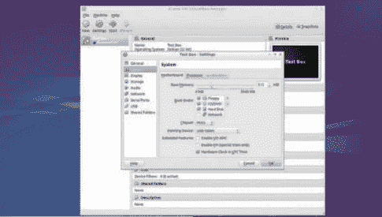

```c
// Implement Message of the Day functionality
int main() {
    char *file = "file.txt";
    FILE *fp = fopen(file, "w");
    if (fp) {
        fprintf(fp, "Hello World\n");
        fclose(fp);
    }
    printf("Done\n");
}
```

## 顶级 Linux 开源

## 教程代码与资产

`www.filesilo.co.uk/linuxuser`

## `FILESILO` – 专业人士的基地

## 发现您的免费在线资产

- 快速增长的库

- 持续更新的酷资源

- 让您的下载内容井井有序

- 随时随地浏览并访问您的内容

- 再也不用光盘浪费您的页边空间

- 再也不用损坏的光盘

- 纸质订阅者获得所有内容

- 数字杂志所有者也能获得所有内容！

- 每期内容均随杂志免费提供

- 安全在线访问您的免费资源


这是取代您光盘的新版 `FileSilo`。可以通过访问下一页的链接找到它。

第一次使用 `FileSilo` 时需要注册。之后，您可以使用提供的电子邮件地址和密码登录。

最热门的下载显示在此轮播图中，快来看看其他读者在享受什么吧！

如果您正在寻找特定类型的内容（如 `shell` 或 `Python` 文件），使用这些过滤器来精简搜索。


按类型过滤内容


绿色开锁显示您已访问的期数。红色闭锁显示您需要购买或解锁的内容。

此处列出了热门下载，您可以直观查看最受欢迎的下载内容。

点击此处查看高评分列表，看看其他读者投票的结果！


了解更多关于我们在线商店的信息，以及关于隐私和联系方式的常见问题（`FAQ`）。

发现我们精彩的姊妹杂志及其提供的丰富内容，


`www.linuxuser.com` | 97

## `FileSilo`

### 如何使用

关于访问您的新数字存储库

您需要知道的一切

要访问 `FileSilo`，请访问 `www.filesilo.co.uk/linuxuser`

- 01 按照屏幕上的说明创建安全的 `FileSilo` 系统账户，然后登录并通过回答关于杂志的简单问题来锁定期数。您可以使用您的期数访问内容。

- 02 如果您是纸质订阅者，可以通过输入 `Web ID` 解锁所有内容。您的 `Web ID` 是打印在地址上方的八位数字代码。

- 03 如果您在桌上使用任何浏览器（如 `Firefox` 或 `Safari`）访问 `FileSilo`。

- 04 如果您在访问 `FileSilo` 时遇到任何问题，请邮件至 `help@imagine-publishing.uk`


## 10 最佳 `Linux`


`Linux Mint 17.2 Cinnamon` 树莓派项目

更多教程


# 与灵感


感兴趣阅读吗？`Linux`网站每天更新功能、教程、评论，涵盖`Linux`内核开发、最新发行版和开源软件。加入我们蓬勃发展的`Linux`用户开发者社区，发现新工具。

## www.linuxuser.co.uk

`LinuxUser`第 16 期，2015 年 8 月 27 日发售

# 新 IT

# 四倍动力

树莓派 2 四核启动包


`WWW.NEWIT.CO.UK`

# Poundhost.com

`NAMESCO`公司

# 不到一分钟……

> 每一张专用服务器支持工单的回复时间都不超过分钟……这就是为什么我将我所有的业务都转到了`PoundHost`。
>
> `Daniel Watts`，总经理
>
> (`Aluminati Network Group Ltd.`)

我们所有的专用服务器都位于我们的英国数据中心。

- 无合约
- 24/7 英国本土现场支持
- 专属客户经理

免费拨电咨询：

`0333 247 0222`


