# Linux 用户与开发者 157 – 构建你自己的系统工具


# DS115j 和 DS215j
为您家庭打造的完美数据存储解决方案

在您家的舒适与安全环境中运行您自己的个人云端

## 节能且可靠
DS215j 配备双核处理器，支持高达 12TB 的数据存储，工作时功耗低于 14W；而 DS115j 则为无需 RAID 的用户提供稳定的存储环境，工作时功耗低于 11W。

## 随时随地访问
Synology NAS 以及直观的 DiskStation Manager (DSM) 软件允许用户在多台设备之间同步和共享文件，包括 Windows PC、Mac、Linux、iOS、Android 和 Windows Phone。

## 多媒体中心
Audio Station、Photo Station、Video Station 和 Media Server 将您的 Synology NAS 转变为一个集中的多媒体枢纽。

购买渠道
amazon.co.uk
maplin

Synology 应用程序现已推出
iOS
Android
Windows

Synology 获得的多媒体奖项


# 欢迎来到 Linux User & Developer 第 157 期

## 每期更低价订阅 Linux User
第 34 页

### 我们的 Linux 专家团队...

- Jon Masters 是一位 Linux 内核黑客，从事 Linux 开发工作约 19 年，自他 13 岁上大学以来便开始了这段历程。Jon 住在马萨诸塞州剑桥市，为一家大型企业级 Linux 供应商工作。您在本月第 16-17 页可以找到他那精彩的内核专栏。
- Richard Smedley 自 1990 年代起便一直在帮助各种规模的企业和社区组织迁移至 GNU/Linux，他也并不指望与他共事的人共享他对 Emacs 的热爱。嗯，也许会有点点。本月，他深入探讨 Wine，向我们展示如何本地运行关键的 Windows 软件（第 28 页）。
- Liam Fraser 是 YouTube 系列 RaspberryPiTutorials 的创作者，并志愿担任树莓派基金会的 Linux 服务器管理员。Liam 在本期中结合了他对电子学和音乐的热爱，解释了如何将音频映射到 LED 灯带以实现实时可视化（第 62 页）。
- Mihalis Tsoukalos 是一位拥有编程、数据库和数学专长的 UNIX 系统管理员。他自 1993 年起开始使用 Linux。Mihalis 本月非常忙碌，编写了一些关于系统编程（第 20 页）、R（第 36 页）、D3.js（第 40 页）的出色指南，以及本月的编程专栏（第 11 页）。
- Dan Aldred 是一位经过认证的树莓派教育者，也是 CAS 的主要学校领导。他热衷于教学和黑客项目，并利用像这样的项目来吸引他授课的学生。请翻到第 78 页查看他关于如何设置 Twilio 与树莓派联动的简单指南，这样你就可以从终端发送短信了。
- Gareth Halfacree 是我们常驻的新闻记者，带我们要了解来自开源世界各个角落的最新发展，内容从第 6 页开始。本月 Gareth 还评测了新的 Encrptyr 软件，该软件使用零知识 Crypton 框架保护密码和卡片详细信息（第 86 页）。

## 本期内容

- 启动 Docker 容器
- 在 Wine 中运行 Windows 软件
- 探索系统编程
- 构建树莓派音乐可视化器

欢迎来到《Linux User & Developer》最新一期，这是英国和美国最受欢迎的 Linux 及开源杂志。

本月我们重点关注你们中的开发者：首先是一本关于 C 语言系统编程的大型指南，我们将在未来几个月推出一系列教程（第 20 页）。我们还有一些出色的指南，帮助你入门 C# 编程、Docker 容器、AWS 自动化和安全，以及关于 R 和 D3.js 的一对上教程，帮助你操作和可视化数据。在年底前，我们将重新回顾其中的一些内容，请拭目以待。

鉴于 Windows 10 引发了各种隐私担忧，也是时候在我们之前几期关于虚拟化双启动的指南之外，提供第三种方案，让你访问那些在 Linux 上运行不顺畅的软件了：Wine。利用 Wine 和 PlayOnLinux，我们将向你展示如何在你最喜欢的发行版上运行 Photoshop 和 PC 游戏等（第 28 页），这样你就可以彻底告别 Windows，并帮助你的朋友们做同样的事。

至于树莓派版块，我们为你准备了一份非常特别的内容。还记得你几个月前用的 LED 灯带吗？嗯，我们将把它变成一个音乐可视化器（第 62 页）。此外，我们还向你展示如何从你的树莓派发短信和推特——祝使用愉快！

Gavin Thomas, 主编

## 联系团队：
linuxuser@imagine-publishing.co.uk

- Facebook: Linux User & Developer
- Twitter: @linuxusermag
- 在线购买: magineshop.co.uk

访问我们的在线站点获取更多新闻、观点、教程和评测：
www.linuxuser.co.uk

**20** 构建你自己的系统工具
发现系统编程的强大威力

# 物联网？
无线网络设备 £9.99 含增值税


wirelessthings.net/lxu-offer
@wirelessthings


## 开源

06 新闻与观点 | 12 访谈 | 90 问答 | 94 读者来信

### 企业级

## Linux 基金会宣布开放大型机项目

### 汇聚行业与学术合作伙伴

Linux 基金会宣布与行业巨头合作启动一个项目，以推进适用于大型机设备的 Linux 企业级平台，该项目不出意料地被命名为“开放大型机项目”（Open Mainframe Project）。

该项目汇聚了行业巨头 ADP、CA Technologies、IBM 和 SUSE 作为创始白金会员，而 BMC、Compuware、LC3、RSM Partners 和 Viron Infinity 则加入成为银牌级会员。随着云计算和大数据话题引起兴趣，行业对大型机系统的需求重新激增，促成了该项目的成立。


“如今的 Linux 是全世界增长最快的操作系统。随着移动和云计算在全球范围内普及，企业需要更高水平的速度和效率，而大型机上的 Linux 已蓄势待发”，Linux 基金会执行董事 Jim Zemlin 在项目发布仪式上声称。“开放大型机项目将聚集最优秀的技术领导者，共同研究 Linux 及来自 IT 行业和学术界的前沿技术，以推动当今最复杂的企业级运营。”

开放大型机项目是 Linux 基金会的一个官方协作项目，旨在利用 Linux 的优势，以发挥大型机硬件的独特特性。这包括 IBM 和 Canonical 同日宣布的 LinuxONE 家族。

除了行业成员外，几所学术机构也确认加入该项目，其中包括贝德福德郡大学（University of Bedfordshire）。“现在参与企业级技术是一个激动人心的时刻。开源系统在大型机高度可扩展且可靠的架构上进行优化所带来的潜在益处非常显著，”该大学的计算机科学与技术高级讲师 Herbert Daly 声称。“开放大型机项目为我们的员工和学生提供了一个绝佳的机会，可以与一群杰出的专业人才合作，他们致力于塑造关键业务企业计算的未来。”

开放大型机项目的首要任务之一是建立一个中立的社区会议、活动和协作讨论中心，为项目的业务和技术治理提供结构支持。在技术层面，该团体旨在扩大旨在推动大型机 Linux 开发协作的工具和资源，同时协调大型机对上游项目的改进。这是为了提高这些代码提交的质量并简化上游协作。

“学术界、企业和政府合作伙伴在推动大型机向开放生态系统扩展方面的需求不断增长，”来自 IBM 的 Ross Mauri 声称。“IBM 期待为我们的专业知识贡献给社区，并从他人那里学习，以寻找创新方式来结合开源软件的灵活性以及大型机世界级的速度、安全性和可扩展性。”

左图：像 IBM 的 z Systems 这样的大型机驱动着企业平台和大数据计算


## 大型机

### IBM 和 Canonical 发布 LinuxONE

#### 大型机包含定制版 Ubuntu 发行版

IBM 和 Canonical 联合宣布发布一个新的由 Linux 驱动的大型机家族——IBM LinuxONE，其中包含 Canonical 的 Ubuntu Linux 发行版的一个变体。

LinuxONE 家族基于 IBM 的 z Systems 平台，宣布时间与 IBM 作为创始成员加入开放大型机项目的日子相同，该产品以两种形态发布。首先，是顶级的基于 IBM z13 的 LinuxONE Emperor，号称能够同时运行多达 8,000 个虚拟机。其次，是被称为 LinuxONE Rockhopper 的缩减版变体，专为入门级大型机用户设计。

“十五年前，IBM 通过将 Linux 引入大型机使业界感到惊讶，如今超过三分之一的 IBM 大型机客户正在运行 Linux，”IBM 系统部门高级副总裁 Tom Rosamilia 声称。“我们正在通过结合开放世界的最佳成果与世界最先进的系统，进一步深化我们对开源社区的承诺，以帮助用户拥抱新的移动和混合云工作负载。基于 Linux 在大型机上成功的经验，我们继续突破通用服务器在极端规模下不为安全和性能设计的局限性。”

随着开发者云平台的上架，IBM 还承诺提供对 LinuxONE 平台的开放访问。这些实例部署在学术机构以及 IBM 位于达拉斯、北京和博布林根（Böblingen）的设施中，将提供免费试用和免费的教育访问。

“世界上最大的企业依靠 Ubuntu 作为其扩展应用程序、私有云和公有云的平台。随着 Ubuntu 支持扩展到 IBM z Systems 和 LinuxONE，IBM 大型机客户将从 Ubuntu 的扩展和云解决方案生态系统中受益，”Canonical 的 Jane Silber 针对这一合作伙伴关系表示。“IBM 和 Canonical 合作将 Ubuntu 带到 z Systems，允许客户利用 z Systems 的速度和安全性，以及 Ubuntu 的开源软件和工具，为新的客户群增强其 IT 运营。”

现在即可从 IBM 订购两款 LinuxONE 大型机型号，公司将在收到请求后提供定价。

## 五大特色

### KDE Plasma 5.4.0 中的功能

- 1. **应用程序仪表盘**
  一个新的全屏菜单——应用程序仪表盘（Application Dashboard），取代了应用程序菜单，专注于充分利用高分辨率屏幕。这是为了尽可能快地找到您的软件和文件，同时为不依赖鼠标的用户提供了便捷的键盘导航和输入即搜索功能。

- 2. **Wayland 预览**
  最新的 Plasma 版本引入了新的 Wayland 集成，让那些喜欢走在技术前沿的人有机会体验新的 Wayland 窗口系统，而无需放弃现有的 KDE 框架集成。

- 3. **网络小工具图表**
  如果您希望关注历史网络流量，很高兴地告诉大家，网络小工具中将出现一个新的图表。该小工具还通过两个新的默认插件获得了对 SSH 和 SSTP-VPN 的支持。

- 4. **简易显示器校准**
  Gamma 显示器校准工具是 KDE Plasma 5.4.0 的新功能，提供了一种简便的方法来调整颜色在显示器上的重现方式，提供点色匹配或根据个人喜好的简单调整。

- 5. **大量新图标！**
  对于喜欢多一点清晰度的人来说，KDE Plasma 5.4.0 包含 1,400 个提供 Breeze 主题艺术作品的新型图标将是个好消息，涵盖了各种应用程序和服务。这些包括 Inkscape、Firefox 和 LibreOffice 等应用。


上图：视觉设计组正在努力扩展标准图标集，以整合 Breeze、Breeze Dark 和 Oxygen 变体

www.linuxuser.co.uk

## 观点

### 自由软件

#### 软件公社

自由软件运动在理念和具体代码方面对 Linux 崛起的贡献，并未总是得到应有的认可


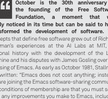

十月是自由软件基金会（Free Software Foundation）成立 30 周年，当时这一时刻鲜有人关注，但可以认为它改变了软件开发。定义自由软件的概念源于 Richard Stallman 在 MIT 人工智能实验室的经历、他与 LISP 机器开发相关的个人历史以及他与 James Gosling 在 Emacs 许可证方面的纠纷。早在 1981 年 10 月，Stallman 就写道：“Emacs 不收取任何费用；相反，你正在加入 Emacs 软件共享公社。加入的条件是你必须将你对 Emacs 所做的任何改进送回，包括你编写的任何库……”这可以被看作是对左移复制（copyleft）的早期尝试，也是自由软件运动的首要原则。


后来因开发 Java 而闻名的 James Gosling，为 Unix 编写了 C 语言版本的 Emacs，该版本衍生自 Stallman 的原始 Emacs 概念。据 Stallman 称，他“似乎受到了原始 Emacs 同样的共享与合作精神的启发……他在手册中称该程序为 Emacs，希望社区中的其他人能对其进行改进，直到它配得上这个名称。”Gosling 最初允许该源代码（其中包含他人的贡献）自由分发，Stallman 在早期版本的 GNU Emacs 中纳入了一些代码，但在 1983 年 4 月，据 Stallman 所述，“他在背后捅了所有人一刀，通过添加版权声明、要求人们承诺不重新分发，然后将其出售给一家软件公司。”

Gosling 已将他的 Emacs 版本 GDSMACS 卖给了 UniPress，并对 Stallman 发出了准法律威胁。当 GNU Emacs 于 1985 年发布时，UniPress 宣布“GNU Emacs 程序的部分内容绝对不是公共领域的，并且使用和/或分发 GNU Emacs 程序并不一定合适。”

Stallman 重写了 GNU Emacs 中引起争议的部分，但与 Gosling 和 UniPress 的对立使他确信公共领域不足以保护自由软件的权利。Stallman 的解决方案是颠倒版权法，将权利重新分配给用户。这种许可制度的第一个具体形式是 1985 年的“GNU Emacs 复制许可声明”，尽管我们熟知的 GPL 首次出现在 1989 年。GPL 及其前言是自由软件原则最完整的表达，但使自由软件成为必须重视的概念的时刻是 Linux 内核的发布。Linux 是使用 GNU 工具开发的，并采用 GPL 许可。


**Richard Hillesley**
*为各种出版物撰写关于艺术、音乐、数字权利、Linux 和自由软件的文章*

Linus Torvalds 后来表示，“将 Linux 改为 GPL 许可绝对是我做过的最棒的事”。围绕 GNU/Linux 和 GPL 发展起来的这种非正式模式给了每个人参与并产生影响的机会。你可以对 Linux 做任何事，把它拆得粉碎，安装在你的虚拟冰箱或洗衣机上，共享或破坏它，创建你自己的发行版并与世界分享。如果你不会写代码，你可以写文档、托管网站、交朋友或卖 T 恤。

> 围绕 GNU/Linux 和 GPL 发展起来的这种非正式模式给了每个人参与并产生影响的机会。

这种惊人的影响延伸到了商业世界。再次地，当一家硬件公司承诺支持 Linux 后，显然回馈项目对大家都有利，于是他们这样做了。使这成为可能的是 GPL 框架。企业核心代码块的发布加速了 Linux 的开发，并确保了其在企业中的成功，加上其在广泛硬件上的可移植性增强了这一优势。GPL 促进了商品化，而在系统层面，商品化降低了成本，从而惠及所有人。

操作系统的商品化确保了标准的商品化。这使得在不同机器和架构之间移植软件变得更加容易，也使硬件本身的设计变得更加容易。公司使用 GNU/Linux 并非出于对 Linux 或 GPL 的情感依恋，也不是因为“开源”。他们使用 GNU/Linux 和自由软件是因为它具有商业合理性。而由 GPL 保障的自由软件，则保证了代码的持续自由和社区特性。自由软件运动在理念和具体代码方面对 Linux 崛起的贡献，并未总是得到其应有的认可。


## 路由器

### 美国联邦通信委员会威胁将阻止自定义路由器固件

新的软件定义无线电规则可能会给爱好者带来麻烦

由于**美国联邦通信委员会**出台的新规则承诺**阻止固件修改**，使用第三方固件修改无线网络路由器的便捷性将受到打击。

根据今年生效的规则，预计将于2016年6月对市场上的所有设备全面实施，FCC将要求所有获得许可的设备（在美国销售的前提条件）“实施软件安全，以确保设备按授权方式运行且无法被修改”，这显然旨在锁定第三方修改。

用功能更强大的第三方替代品（如 OpenWRT）替换基于 Linux 的网络硬件的出厂固件已相当流行，甚至有一些路由器型号在设计时特意考虑了这一点。然而，在新的 FCC 第 15 部分规则下，由于担心这些设备可能被用于在未经许可的频谱上运行或以非法功率级别运行，它们在美国可能变得非法。

斯洛文尼亚无线网状网战争活动的演讲者 Simon Wunderlich 认为，这可能会产生全球性影响。“他声称，‘由于同类型的设备通常在全球销售，这一变化不仅影响美国的路由器，也影响欧洲，这将影响到无线社区。’”


除了解锁新功能外，第三方固件还常用于为制造商不再支持的设备注入新活力。这意味着在新规则下，由于新的限制，消费者可能会将不安全设备留在他们的网络上。

## 存储

### Kinetic 现已成为一个开放的 Linux 项目

希捷的企业级存储平台 Kinetic 现已成为**Linux 基金会**的正式协作项目，西部数据、东芝、戴尔和思科等公司加入了开发工作。

Kinetic 结合了具有集成以太网连接功能的存储设备，以及一种据称能提高企业存储效率、可扩展性和灵活性的键值存储范式。

使用开源软件和标准化的应用程序编程接口 (API) 集合，存储开发人员可以利用 Kinetic 系统来减少存储区域网络 (SAN) 实现的开销，利用通过以太网直接进行驱动器到驱动器数据传输等功能，而不需要中间主机设备。

尽管被称为 Kinetic 开放存储平台，但在 Linux 基金会协作项目成立之前，该标准一直由希捷控制。现在真正开放后，网络和存储供应商已经加入并承诺提供支持，但尚未提供 Kinetic 兼容、启用以太网的存储设备的发布日期。

根据文档，Kinetic 可以提高机架密度，减少功耗和冷却需求，便于数据共享，并移除该公司所称的与传统 SAN 平台相关的“多余的遗留软件和硬件层”。

公司在发布公告时声称：“[希捷 Kinetic 存储平台……] 提供了使我们在整个行业范围内不仅能够满足这一使命，而且以最优且最具成本效益的方式完成这一目标的新范式所必需的条件。”


### 为您的团队添加远程 DBA

来自 2ndQuadrant 的远程 DBA 是那些需要额外帮助来管理其 PostgreSQL 数据库的组织理想的解决方案——凭借我们对核心代码的专业知识，您将得到更安全的保障。

远程 DBA 作为我们黄金和白金生产支持服务计划的服务扩展提供。

英国 +44 (0)870 766 7756
美国 +1 650 378 1218
2ndquadrant.com/rdba


# 开源

您的 Linux 新闻与观点来源

## 发行版动态

### Top 10

(平均每日访问量，8月5日 - 9月3日)

- Linux Mint ▼ 3,096
- Debian ▲ 2,062
- Ubuntu ▲ 1,560
- openSUSE - 1,175
- Fedora ▲ 1,148
- Manjaro ▲ 1,123
- CentOS ▲ 981
- Mageia ▲ 945
- Kali Linux ▲ 925
- Zorin OS ▼ 800

### 本月


尽管 Linux Mint 遭遇挫折，但它仍保持第一。与此同时，Kali 进入前十名对于应用专用发行版来说是罕见的。

### 亮点

#### Ubuntu 15.10 Beta 1

在十月正式全面发布之前，最新的 Ubuntu “Vivienne” 提供了多种标准版本、Kubuntu、Lubuntu、Ubuntu GNOME、Ubuntu MATE、Ubuntu Kylin、Xubuntu 和 Ubuntu Cloud 风味，供各类测试人员享用。

#### Zorin OS 10

基于 Ubuntu 15.04 的最新 Zorin OS 包括一个新的媒体播放器和一个精美的活动日志，显示您全天处理过的文件和文档。

#### Kali 2.0

Kali 2.0 的发布标志着向滚动发布模式的转变。旨在使渗透测试和安全发行版的更新更加容易。

最新可用发行版：

filesilo.co.uk

## 游戏

### Unity 游戏引擎登陆 Linux

未来对该平台的支持不保证

游戏引擎专家 Unity 宣布为其 Linux 版本软件发布了一个实验性构建版本，履行了其在未来版本中支持该操作系统的路线图承诺。

Unity 是游戏和通用 3D 渲染的流行引擎，此前仅限于在专有平台上使用。本月的发布改变了这一现状，为在 Ubuntu 12.04 或更新版本上运行软件提供官方支持，并为其他 64 位 Linux 发行版提供非官方支持。

然而，对于公司而言，这次发布是一次测试，Unity 尚未承诺进行完整和正式的发布。Unity 的 NaTosha Bard 警告说：“今天的构建版本是我们所称的实验性构建版本；未来的支持尚未保证。” “您的采用和反馈将帮助我们确定这是否是我们能够与 Mac 和 Windows 构建版本一起持续发展的东西。” Bard 没有指出采用和反馈水平需要达到什么程度，公司才会跟随 Epic 的 Unreal Engine 等竞争对手的脚步，将 Linux 采纳为所有未来版本的完全支持平台。

得益于游戏开发和出版巨头 Valve 基于 Debian Linux 发行版建立其以游戏为中心的操作系统 SteamOS，开发人员对 Linux 作为游戏平台的兴趣比以往任何时候都高。

## Fedora

### 32 位 x86 支持被降级

Fedora 将 64 位 x86 设为黄金标准

跟随 Fedora 工程指导委员会 (FESCo) 的投票，Fedora 项目已将其 Linux 发行版中对 32 位 x86 架构的支持降级。

在八月底的会议上，FESCo 就 Fedora 24 中移除对 i686 32 位 x86 指令集架构的支持发起投票。“从我个人的观点来看，没有人想要支持 i686 镜像，” Hailuk Guímar 告诉与会者。“我完全 +1（支持）在 f24 [Fedora 24] 中删除所有 i686 镜像/媒体，” Kevín Ferzi 补充道。

经过一些讨论，委员会同意将投票从完全放弃 i686 支持更改为使其成为一个非阻塞交付物。这意味着如果该工作未能及时完成，其缺失不会阻止 Fedora 24 的总体发布，实际上降级了该架构的支持。

64 位 x86 架构与传统的 32 位变体向后兼容，由 AMD 于 2003 年作为 AMD64 推出，英特尔在一年后跟进。如今，这两家公司的大多数芯片都是 64 位的。

## 观点 编程

### 二的幂

在计算机领域，没有什么能胜过二进制算术。以下是如何判断一个整数是否是二的幂的方法。

判断给定的正整数是否是二的幂并不是一项艰巨的任务，但它需要大量的处理，尤其是当整数大于 $2^{20}$ 时。此外，它强调：a) 在实现之前应仔细思考，并且 b) 在编程时拥有扎实的数学知识是很好的。你知道的数学领域越多，就越好。

这是一个标准的、暴力递归的 Python 函数 (power0f2.py)，用于解决初始问题：

```python
def powerOf2(num):
    if (num == 1):
        return True
    elif (num == 0) or (num % 2 == 1):
        return False
    else:
        return powerOf2(num / 2)
```

另一个版本使用二进制算术 (bitwise.py)：

```python
def powerOf2(number):
    return (number & (number-1) == 0) and (number != 0)
```

简单来说，该函数检查 number 变量的二进制表示中是否设置了多个 "1" 位。如您所知，CPU 使用二进制算术进行计算。这些计算特别快，比任何其他类型的计算都快。

为了使算法更清晰：64（二的幂）的二进制表示为 1000000。64-1 等于 63，63 的二进制表示为 0111111。因此，(1111111 & 1000000) 等于 0，这证明数字 64 是二的幂。缺点是，使用二进制算术的解决方案仅适用于必须处理二的幂的问题。

以下 Python 脚本生成 1,000,000 个随机数，然后用作测试这两种技术的输入：

```python
#!/usr/bin/python
import random
MIN = 0
MAX = 100000
TOTAL = 1000000
```


**Mihalis Tsoukalos** 是一名 UNIX 管理员、程序员、DBA 和数学家。他自 1993 年以来使用 Linux。

“在编程时拥有扎实的数学知识是很好的。你知道的数学领域越多，就越好。”

```python
for i in range(0, TOTAL):
    print random.randrange(MIN, MAX)
```

尽管函数 **random.randrange()** 暗示它生成随机数，但其统计分布最终并不是那么随机。以下输出证明了这一点：

```bash
$ awk '{ if ($0 > 0 && $0 < 10000) print }' numbers | wc -l
99585
$ awk '{ if ($0 > 10000 && $0 < 20000) print }' numbers | wc -l
99811
$ awk '{ if ($0 > 20000 && $0 < 30000) print }' numbers | wc -l
99930
```

以下方法可以找出是否存在重复数字：

```bash
$ sort numbers | uniq -c | sort -rn
```

存在重复数字并不是一件坏事，知道这一点就好。现在是时候进行实际的基准测试了。这次基准测试将使用 **time()** Python 函数完成。正如您在 Python 代码中看到的，每个程序自我重复十次以产生更准确的结果。结果如下：

```text
powerOf2.py: 12.287568 seconds
bitwise.py: 8.285457 seconds
```

尽管差异只有四秒，但 powerOf2.py 比 bitwise.py 多花费 50% 的时间来执行完全相同的任务。

允许的最大整数在问题中起着核心作用，因为如果它很小，暴力技术显然会花费更少的时间。示例中发现的最大整数在以下结果中被设置为 1000：

```text
powerOf2.py: 11.39706 seconds
bitwise.py: 8.412941 seconds
```

您可以在 github.com/mactsousk 和 fileso.co.uk/linuxuser-157 找到源代码。


## 访谈：塞巴斯蒂安·克格勒
### Plasma Mobile：下一代 Linux 手机

核心 KDE 开发者塞巴斯蒂安·克格勒（Sebastian Kügler）揭秘他是如何领导该项目，将 Plasma 桌面系统移植到手机上，并推动 Linux 进一步进军移动市场的。


祝贺你近期发布了项目公告！你从事 Plasma Mobile 开发多久了？

认真做的话，大约四到五个月。这始于一项概念验证，大约在一年前。在新年之交前后，我们确定实际上可以在手机上启动 Plasma 用户界面。于是我们开始理清软件栈——弄清楚各部分该如何协同工作，如何在 Nexus 硬件上实现运行。我们曾尝试迁移到基于 Ubuntu 的软件栈，但在让 libhybris 正常工作方面遇到了巨大问题：内核和图形驱动程序存在问题。这实际上让我们倒退了两到三个月，最终通过完全转向 KWin 解决了这个问题。随后，负责 KWin 开发的同事实际上让它成功运行了，从那里起我们就能开始——或者说，飞速推进——开发工作，这样我们就能够在 Akademy 大会上展示我们引以为傲的成果了。

所以，你现在是基于 Ubuntu 软件栈的？

是的。我们的理念是创建完整的软件环境，但在某种程度上，你可以替换底层操作系统——基本上就像 Linux 桌面一样。也就是说，你拥有一个模型操作系统，例如 Ubuntu Touch 或 Mer、Sailfish，你确保 KDE 框架被打包，并且我们可以使用图形接口——无论是 DRM 还是 libhybris。在此基础上，其他一切应保持相同。

你的网站提到，在应用支持方面，该项目具有包容性——可以运行 Plasma 应用、Ubuntu Touch 应用、GNOME 和 X11 应用。那么，Android 应用的情况如何？

技术上可行，但并不容易，因为需要大量基础设施来模拟完整的 Android 环境。我们团队中有一位全职致力于此的同事，他不时得到其他人的帮助。主要难题，但显然也是最后几个主要阻碍因素之一，又是图形问题。这是我们一生的故事：我们总是在图形问题上挣扎！在桌面上我们基本上已经解决了这个问题，但现在在所有这些移动设备上，又是一大头痛。目前的状况是，他确实能够启动一个 Android 应用程序，但还不能输出图形。这对开发者来说是一个里程碑，但对用户来说目前毫无用处；在实际将任何内容绘制到屏幕上之前，还有大量工作要做。在 Android 图形基础设施中，有一个名为 SurfaceFlinger 的接口，它在语义上与我们处理图形的方式不同，因此需要某种桥接。应用程序实际上需要认为它们正在向 SurfaceFlinger 渲染，但我们让它们通过一个由 Wayland 支持的 SurfaceFlinger 进行渲染。这有点棘手，但我们已经有了可以在屏幕上绘制的内容。在 Akademy 大会上，我们展示了一个非常令人兴奋的黑色矩形。

就开发而言，这是你当前的重点——为各种应用开发显示功能——还是你仍然将大量精力集中在核心系统本身？

目前最大的任务实际上是非技术性的：我们刚刚公开了该项目，过去几周我特别忙于项目管理方面。我们看到了人们极大的热情。有些人非常批判，说“世界不需要它”以及“它看起来不好看”。但也有很多人认为这是一个真正的好主意，一件有价值的事情——一个不受单一公司控制的、公开开发的、他们实际上可以参与塑造的操作系统。现在我们实际上必须扩大其背后的流程规模。所以，我们目前正在引入一个名为 Phabricator 的项目管理工具，它允许我们进行协调。它非常适合任务管理，并允许代码审查。我也非常忙于编写文档，这是另一个重大的可扩展性因素——我们需要文档才能吸引开发者。我真的很喜欢的一点是，我们展示了一个几乎零设计工作的原型，并收到了大量反馈，例如，“但它看起来像垃圾——他们应该让设计师介入。”确实如此，他们完全正确。我们知道需要在设计方面更进一步。但对于每两个批评我们“空谈”的人，实际上都有人发送模型，思考如何改进它。我们已经吸引了四到五位设计师，他们对系统的不同方面进行了真正的、专业的工作，因此我们现在正在努力更深入地融入社区并定义工作流程。


### 志愿者与全职人员

塞巴斯蒂安解释了拥有全职工作人员的必要性：

> “有很多事情你实际上无法作为志愿者完成；你可能只有两个小时：它们需要结构性工作，需要有人每天坐下来查看问题，修复运行系统。我们的代码每天都在构建和测试——现在我们每周创建两到三个新镜像，因此我们总是可以测试最新版本。我知道，如果我拉取新代码，那么明天早上它就可以在下一个可修复的镜像中。我们真的希望将开发、反馈和测试的周期缩短，真的非常短。”

核心团队有多少人？与其他一些 KDE 旗下的项目相比，这个团队规模相当小吗？

实际上，它并不那么小。我的雇主 Blue Systems 正在对此进行投资，因此与大多数其他项目不同，我们拥有一个相当强大的开发团队，不仅体现在人员数量上，还体现在人们能投入的时间上。例如，我几乎全职投入这个项目，还有大约十到十二名其他人也是，这对于启动项目并填补基本功能来说真的是必不可少的。

这是一个完全新的独立项目，还是之前与 Plasma Active 项目有过很多互动？

Plasma Active 是我和其他几个人的心血。因此在某种程度上，Plasma Mobile 是 Plasma Active 项目的延续，但目标略有不同。这一次，我们更加脚踏实地。我们不再那么专注于新颖的用户体验，而是试图让大量不同的应用程序运行起来，我认为这更现实一些，至少是为了填补基本功能。我们还不知道最终在设计和工作流程上会走到哪里，因为这是一个开放的过程——对参与开放，并且非常自然地，结局也是开放的。但我想，现在背后有更多的人力，KDE 社区内也有更强烈的紧迫感，不仅要做桌面端的事，最终也要成为一个为那些希望他们的应用程序也能在移动设备上运行的人服务的项目。这不是关于 UI 范式或创造下一个大势所趋——我们想先做一份赖以生存的工作（bread-and-butter thing，意为常规/基础功能）。

Plasma Mobile 确实有一些独特的方面——例如，用单一、无限滚动的页面取代了在多个主屏幕间滑动的概念，并整合了 Plasma 小组件（Plasmtoids）。

这其实很有趣，因为通过复用我们在桌面上已有的基础设施——在主题、Plasmtoids 方面——我们可以相当快速地推出酷炫的功能。例如，我认为主题切换设置应用程序只花了大约两到三个小时的工作量。有时事情会复杂一些，但我们实际上拥有许多非常复杂的应用程序，它们已经进行了数年的 bug 修复，非常成熟且稳定。通过仅仅在它们上面放置不同的 UI，我们将能够让它们在手机/移动设备上运行。

对于接下来的开发，你有路线图吗？

我们希望明年夏天有一个可供终端用户忍受的版本。一个没有真正阻碍性问题的版本，可以用来打电话，我也可以把它作为日常驱动程序使用而不会因缺乏质量而发疯。上周，我们与用户体验人员坐在一起说，“在我们开始任何……

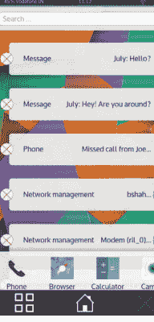
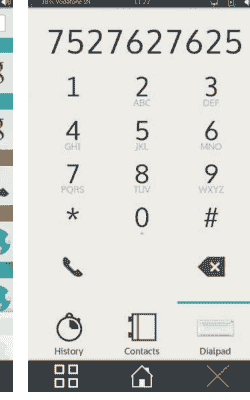
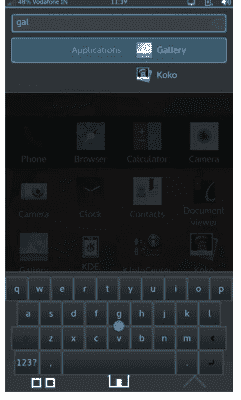

- 左：通知位于界面顶部，向下滚动即可看到应用
- 中：电话应用功能完备，并与联系人完美集成
- 右：强大的 KRunner 启动器也被移植到了 Plasma Mobile 上


# 愿景声明

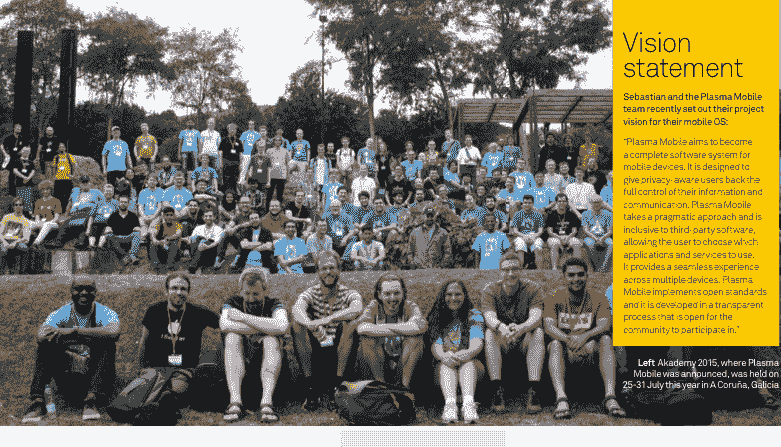

塞巴斯蒂安和 Plasma Mobile 团队近期阐明了他们的移动操作系统项目愿景：

> “Plasma Mobile 旨在成为移动设备的完整软件系统。它的设计旨在赋予注重隐私的用户对自身信息和通信的完全控制权。Plasma Mobile 采取务实的方法，并包容第三方软件，允许用户选择使用哪些应用程序和服务。它提供跨多个设备的无缝体验。Plasma Mobile 实现了开放标准，并通过一个开放的流程进行开发，允许社区参与。”

左图：2015 年 Akademy 大会，Plasma Mobile 在此宣布，于今年 7 月 25 日至 31 日在加利西亚的拉科鲁尼亚举行

要进行有意义的设计，我们需要了解项目愿景是什么：我们需要考虑目标群体，否则我们设计出来的东西虽然看起来不错，但我们就没有一个清晰的想法说明它是为谁设计的。因此，我们退后几步，首先制定了一个项目愿景（见上方的愿景声明文本框）。

我们现在还没有达到可以正颜以对地说“这对你的隐私有益”的阶段，但我们设定了这个方向，以便使其非常注重隐私，因为我们认为这是自由软件社区的真正使命，即赋予用户保护其隐私的工具。自由软件社区传统上在这方面做得很好，但我们基本上将移动市场留给了谷歌和苹果，而他们（恕我直言）并不是值得信赖的一方。谷歌的商业模式是……与曾经属于你的隐私有关的某事。我希望能够去我的政府告诉他们，“你们应该使用这个，这样你们的总理就可以真正地与首相进行私人通话了！”我希望能够把它交给那些不确定如何与其同行或消息来源沟通的记者。为此，我们需要创建一个完整的系统，它可被审计，是开源的，可以由你信任的人实施，支持电子邮件的强加密，以及这类事情。这就是为什么我们明确地将这一点写入项目愿景：因为我们认为目前缺失这一点，并且这与自由软件项目的血统非常吻合。

> “我们希望明年夏天能有一个终端用户可忍受的版本——某个我可以用作日常驱动而不至于疯掉的版本”

这将是用户自行刷机的下载吗，还是你们正在考虑硬件选项——例如，与 Canonical、B&G 或魅族合作，或者参考 Improv 或 Milawi 等旧项目？

目前我们专注于软件，但我不认为我们生活在一个可以告诉你“下载这个镜像并将其刷入你的设备”的时代。这无法触达大众市场。它可能对开发者来说可以，对某些高级用户也可以，但为了真正成功，我最终需要在某个时间点让手机预装它。例如，我们一直在与 Fairphone 团队保持联系，他们创造了一部基于可持续价值观的电话。已经交换了一些电子邮件，但鉴于软件尚未就绪，现在考虑这件事还为时过早。但是的，想法肯定是预装它，同时也对其进行良好的文档记录，并配备设置良好的软件堆栈。

市面上有一些智能手机制造商对谷歌的主导地位以及谷歌在其内部战略中所扮演的角色感到不满；别人决定他们手机上的下一个软件是什么，你只能在完成后才看到它。在一个硬件变得越来越便宜，在许多情况下不再是独特卖点的市场中，这些制造商需要即用的智能手机系统来安装到他们的设备上。而目前使用 Android 是最容易的，几乎也是唯一的选项。我们想给他们提供更多选择。

## OpenSource

你获取 Linux 新闻和观点的来源

## 观点

## 内核专栏

乔恩·马斯特斯（Jon Masters）总结了 Linux 内核社区的最新动态，包括最新 Linux 4.2 系列内核的发布


**乔恩·马斯特斯**

是一名 Linux 内核黑客，自 13 岁首次上大学以来，他从事 Linux 工作已有近 19 年。乔恩住在马萨诸塞州剑桥，为一家大型企业 Linux 供应商工作，他在那里推动制定针对节能 ARM 驱动服务器的标准

> RCU 是一套极其复杂且有时难以理解的代码，但它确实为快速路径查找代码带来了许多性能优势。

Linux 4.2 由林纳斯·托瓦兹（Linus Torvalds）发布，其周期比通常稍长（8 周，而非首个 RC 或 Release Candidate 内核后的典型 7 周）。内核 4.2 中的新功能主要涉及内部优化和增强，对普通最终用户来说几乎是无透明的。示例包括对系统管理模式（SMM）的支持，以及在 KVM 中的仿真，这有效地使基于 KVM 的虚拟机能够实现安全启动（Secure Boot，被某些 Linux 和许多新的 Windows 系统使用）。此外，x86 上浮点上下文管理代码（在任务切换间保留浮点单元状态的部分）也进行了完全重写，由于最终用户在用浮点应用大力测试时可能会发现用户可见的问题，这存在“大量的回归风险”。

林纳斯在他 4.2 发布声明中指出，他决定多等一周可能有点过犹不及，因为就错误修复而言，“这一周几乎没发生什么”，但他实际上有充分的理由保持谨慎。在 Linux 虚拟文件系统（VFS）代码中支持使用现代 RCU（读取-复制-更新机制）进行优化目录查找时，发现了一个竞态条件。这意味着在某些条件下，用户在查找目录路径组件（如 /usr/local/bin）时会发现内核在一个明显是目录的路径组件上报告“ENOTDIR”（不是目录）。这会导致各种应用程序崩溃。

问题的原因被证明是“link_path_walk”文件系统路径遍历代码中 RCU 使用的一个缺陷。RCU 是一套极其复杂且有时难以理解的代码，但它确实为快速路径（查找）代码带来了许多性能优势——例如用于在文件系统和网络代码中快速遍历链表。在这种情况下，人们意识到一个 dentry（表示 Linux 文件系统目录组件缓存视图的对象）可能会在进程（任务）正在检查给定的文件系统路径组件本身是否是目录的同时，从（内核）内存缓存中驱逐（以释放其他位置所需的内存）。在这种情况下，内核可能会返回 ENOTDIR（不是目录），而实际上该路径确实代表一个目录条目（并且应该使用较慢的路径错误处理程序来捕获这种情况）。

这是一个罕见的边缘情况，由最近内核中另一个对 dentry 标志清除代码的无关更改引发，但它实际上自 Linux 3.12 以来在所有内核中作为一个罕见的故障一直存在。

### 不可屏蔽中断（NMIs）

现代 x86 系统实现了一种称为不可屏蔽中断（NMIs）的功能。顾名思义，这些是不能被操作系统禁用的中断。中断是由中断控制器（用英特尔的话说，是 IO-APIC）递送到中央微处理器单元的电信号，用于指示外部设备需要处理。现代系统为每个外围设备将一个中断信号实现到通用的中断控制器硬件设备中；例如，即使是当代笔记本电脑中连接你键盘的 USB 控制器。然后，控制器通过断言处理器（用英特尔的话说，通过断言向 LAPIC）上的单个电信号（引脚）来发出它希望向微处理器传递中断的信号。该动作通常导致 CPU 中断（因此得名）当前活动，并非常短暂地切换到负责处理中断管理的 Linux 内核代码。

普通中断是可屏蔽的，这意味着操作系统（例如 Linux）可以暂时禁用它们的传递。这是必需的，因为管理中断传递的代码（称为“中断处理程序”）需要保持关于原子性和“可重入性”的某些假设。内核通常假设，在中断被操作系统识别的短暂期间内，不能同时传递另一个中断。但它会在硬件中被标记为待定，并立即在当前中断处理活动指示完成后传递。然而，有时需要在没有任何延迟的情况下向操作系统传递关键通知。通常，这是为了必须立即处理的错误或可靠性问题。

NMIs 用于向操作系统传递此类关键通知；例如“电源故障，所有活动将在 50ms 内停止”，这可能已经足够了

16


嵌入式系统至少记录一次电源故障所需的时间。在 Linux 中，它们也被用于运行一种称为“看门狗”（watchdog）的功能，该功能会以无法被中断的方式定期触发。如果内核因陷入某些禁用了中断的中断管理代码而卡住（此时原本每秒最多 1,000 次、基于中断的定时器滴答已不再触发内核的日常维护任务），那么 NMI 看门狗可以成为检测此挂起状态的最后一搏，并在系统完全死机且无响应之前至少重启系统。

由于 NMI 无法被禁用，且无论内核准备得如何充分都可能随时到达，因此在 Linux 中用于处理 NMI 的代码，用“棘手”（hairy）来形容可谓恰当。过去它曾引发过安全担忧，最近再次成为焦点。如我们此前报道，Andy Lutomirski 发现了一个安全漏洞，但直到操作系统厂商有时间通过更新来修复该问题之前，他一直对具体细节予以保密。他随后发布了描述该问题详细情况的 CVE-2015-3290 文本。从高层次来看，该问题可以概括为英特尔 "RET"（从中断返回）指令可能存在缺陷，当从 NMI 处理器返回至使用 16 位栈的用户空间应用程序时，该缺陷会被触发。通常，用户应用程序并非 16 位，也不使用 16 位栈，但为了支持不需要特殊模拟即可运行的 Legacy MS DOS 应用程序，内核中仍保留了对此类应用的支持。

针对从 NMI 返回到 16 位用户空间应用程序的情况，Linux 拥有称为 espfix64 的特殊代码。该代码本应具有原子性（即要么全部完成，要么完全不执行），但由于 NMI 也可能嵌套——在一个 NMI 正在处理时，另一个 NMI 可能再次发生——因此完全有可能在 espfix64 代码运行过程中对其进行中断，导致其执行到一半即被中断。据 Andy 称，在这种情况下，“存在一个两条指令的时间窗口，在此期间返回上下文中的用户可控 RIP 和 CS 被设置为 `__KERNEL_CS`”。这意味着，如果恰好在错误的时刻安排了一个嵌套 NMI，espfix64 处理器将被中断，当下次运行时，它将返回用户空间，而该用户空间任务（进程）将获得内核级别的特权系统访问权限。一个巧妙的变通方案已被合并进 Linux，该方案滥用英特尔 CPU 处理特定标志寄存器的方式。这是为了确保返回至 16 位栈情况的原子性，但这也是最近努力移除那些支持 16 位应用程序的陈旧且糟糕代码的另一个原因，因为目前几乎没有任何用户仍在运行此类应用程序。正如我们之前指出的（在报道 "RIP Virtual Mode 86 Support" 时），目前针对这些 16 位应用程序存在用户空间级别的模拟器，且相比在 Linux 内核本身中保留对 16 位应用程序的实际支持，使用模拟器是更可取的做法。

## 内核

### Linux 4.3

随着 Linux 4.2 的发布，面向将成为 Linux 内核 4.3 版本的“合并窗口”（接受破坏性变更的时期）随之开启。在内部/开发者可见的变更中，包括将 Virtual Mode 86（VM86 - 如前文 NMI 部分所讨论）转变为 Legacy（遗留）功能，并计划在未来内核中将其移除。迄今为止合并的主要用户可见早期功能是对 cgroup/v2（控制组）子系统中新的 "PIDs" 控制器的支持。旨在通过对给定 cgroup 成员建立后能创建的子进程数量实施严格限制，从而降低“fork 炸弹”（生成大量进程/任务直到系统资源耗尽无法分配新进程/任务）的风险。此外，Nouveau DRM 驱动程序也经过了重大重构，纠正了一些先前做出的设计决策，有望为未来更令人兴奋的改进铺平道路。

本月内容到此结束。敬请关注下次更新，了解将包含在 Linux 4.3-rc1（候选版本 1）中的特性。


## 请勿浪费时间在故障排查上

如果您正在开发尚未投入生产的应用程序或环境，请遇到问题时不要浪费时间。我们的开发者支持让您能够接触到全球最资深的 Postgres 专家之一 - 您将很快恢复正轨。

开发者支持按月订阅提供。最短订阅期为 6 个月。

英国：+44 (0)870 766 7756
美国：+1 650 378 1218

2ndquadrant.com/developersupport

## 快速且灵活
云服务器

Richard Cullen，bluebox 董事总经理
Fasthosts 客户自 2002 年起

## 云服务器 – 极致速度与韧性

Fasthosts 基于英国的云服务器速度快——真的很快——并借助三路镜像技术，提供您保持掌控所需的韧性。

我们与 Dell 和 Microsoft 共同打造的平台已拥有约 1,500 名用户。它是同类平台中的首创，采用了最新的 Microsoft Cloud Platform System (CPS)，该系统集成了一套经过验证的软件栈，包括 Windows Server 2012 R2、System Center 2012 R2、Storage Spaces 以及 Dell 硬件。

无论您正在构建何种应用程序，无论其规模多大，全天候 24/7 英国支持及具有竞争力的按月付费定价，都使 Fasthosts 成为您首选的提供商。


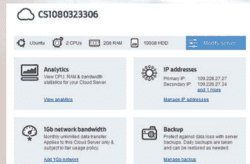

拨打 **0333 0142 709**
或访问 **fasthosts.co.uk/cloud-servers**

## 简单、安全且经济：

## 专家级 24/7 英国支持

我们的英国技术团队随时待命 – 全年无休，365 天 24 小时。您可以访问我们全面的在线文章库，其中涵盖了服务器管理的相关内容。

## 防火墙

灵活、易用且具备最高级别的安全性。使用控制面板轻松配置我们的软件定义网络，确保您不会受到“吵闹邻居”（noisy neighbours）的影响。

## 英国数据承诺

作为英国最大的托管公司之一，我们全资拥有的英国数据中心为您提供宝贵的安心保障，确保您的数据始终保留在英国境内。

## 自动化保护与恢复

为了实现经济高效的业务连续性，我们提供快照备份功能，为您防止数据丢失提供保护，并在开发和测试期间提供回滚的灵活性。

## 灵活的按月计费
无合约！

云服务器价格：
£15.59
每月
不含增值税（VAT 税率为 20%）

Microsoft 合作伙伴


## 构建您自己的
系统工具

利用 C 系统调用，开始学习系统编程，以开发您自己的软件

本特性文章涉及系统编程，是一系列文章中的第一篇，旨在帮助您了解各种 Linux 实用工具和服务器的实现方式，以及 Linux 系统背后发生的原理。在继续之前，最好具备基本的 C 语言知识，并知道如何编译和运行 C 程序。

在完成本系列系统编程文章后，您将能够开发自己的系统实用工具，并领悟 Unix 中蕴含于其简洁性与一致性之内的精妙之处。

此外，认识到 Linux 系统软件的主要功能相对容易实现，且通常不需要大量的代码，也是非常有趣的。大多数 C 代码涉及错误检查、处理命令行参数以及使 C 代码尽可能具有可移植性。

## 什么是系统编程？

系统调用与系统编程技术

- **系统编程**是**Unix 环境**中编程的一个特殊领域。当 Unix 最初引入时，编写系统软件的唯一方法是使用 C。如今，您也可以使用其他语言来编写系统软件。
- 大多数涉及系统管理任务的命令，如磁盘格式化、网络接口配置、模块加载、内核性能跟踪等，都是使用系统编程技术实现的。
- 系统编程的关键难点在于，错误的系统调用可能导致您的 Linux 机器行为异常，甚至更糟糕地导致其完全崩溃。大多数 Linux 安全问题通常源于系统软件实现不当，因此在使用系统调用时务必极其小心，因为存在 bug 的代码可能会危害整个系统的安全性。最糟糕的是，这种情况可能在使用了易受攻击的软件多年后才会发生。

## 系统编程领域

可以将系统调用和技术分为以下几类：

- **文件 I/O**：这是操作系统必须首先处理的事项。文件 I/O 必须高效、安全且易于实现。
- **高级文件 I/O**：除了基本的 I/O 系统调用外，还有大量额外的调用提供非阻塞 I/O、异步 I/O 等功能。
- **文件和目录**：除了对常规文件的读写，Unix 还提供系统调用，让您获取有关文件和目录的更高级别信息，如文件的所有者和属性。
- **系统文件和信息**：存在各种系统调用，允许您读写特殊文件，如 /etc/passwd。此外，还有系统调用可让您获取信息，例如系统的当前时间。
- **控制进程**：Linux 允许您创建新进程、执行程序、终止进程，并提供各种系统调用来协助您完成这些任务。
- **线程**：线程使单个进程能够执行多个任务。Unix 提供系统调用，允许您创建、同步等您的线程。
- **服务器进程**：编写能够创建服务器进程的代码具有某些独特要求，并采用使用特定系统调用的技术。
- **进程间通信**：某些系统调用使进程能够使用管道、FIFO、消息队列、信号量和共享内存彼此通信。
- **网络编程**：虽然从 Unix 角度来看，网络编程看起来很像从常规文件读取，但确实存在一些网络编程特有的系统调用。特别是，涉及解析主机名和将 IP 地址转换为字符串格式以便在 Linux 系统中使用的函数等系统调用。
- **信号处理**：信号提供了一种处理异步事件的方式。几乎所有应用程序都需要能够处理信号。


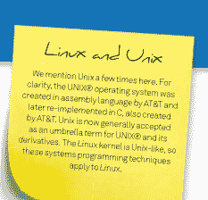

## Linux 进程的状态

当 Unix 最初引入时，计算机拥有单 CPU，没有多核心，且 RAM 非常少。然而，Unix 是一个多用户和多任务操作系统。为了真正实现多用户和多任务，它必须能够独立运行每个单独的进程，这意味着进程应具有多种状态。进程分为三类：用户进程、守护进程和内核进程。用户进程运行在用户空间，通常没有特殊访问权限。而内核进程仅在内核空间执行，并可以完全访问所有内核数据结构。守护进程是运行在背景中、不需要终端的用户空间程序。

除了 root 之外的专门用户拥有它们，通常规则是，它们比普通用户进程拥有更多权限，但比内核进程拥有更少权限。Web 服务器是守护进程，php 实用工具是用户进程，而工作进程是内核进程。重要的是要认识到，进程不能直接从状态 1 到状态 3 或状态 4，而必须先进入状态 2。您将在今后的文章中了解有关进程状态的更多细节。目前，只需理解您无法控制进程的状态；这是在内核中运行的 Linux 调度器的职责。但是，简单来说，您无法知道进程状态何时改变，或者进程何时会再次进入运行状态。


# 编程 A C 实用工具

从零开始重建连接工具

C 系统调用只是一个普通的 C 函数。系统调用与普通 C 函数的区别在于，系统调用实现的功能通常是低级的，它将 Unix 内核与世界其他部分连接起来。通常，这些是硬件相关服务（访问硬盘或网络设备）、进程管理（创建或删除进程）或与核心内核服务通信（进程调度）。换句话说，系统调用使程序能够向操作系统请求服务，而这些服务是进程本身无法直接访问的。

使用系统调用的程序通常被称为系统程序。你可以将系统程序视为系统调用的容器，它们帮助你执行处理 Linux 系统内部事务的任务。

作为一个一般原则，你始终应该检查 C 系统调用的返回值。这是为了尽早发现任何错误。

## 构建你的第一个工具

myCat.c 代码（左下角）原生实现了著名 cat 实用工具的基本功能，并且至少需要一个有效的文件名作为其命令行参数。请注意，行号是为了更好地引用代码而添加的 – 你不应输入它们。使用单独的 cat 函数不是强制的，但这被认为是良好的编程实践。

理解操作系统将如何读取文件是非常重要的，因为你无法确定这种方式：它可能一次读取整个文件，或者逐个字符读取并打印出来。在进行任何类型的编程，尤其是系统编程时，你永远不应该做出类似的假设。

以下命令将使用 gcc 编译器编译 myCat.c 代码，并应生成名为 myCat 的可执行程序：

```
$ gcc -Wall -o myCat myCat.c
```

如果你希望更改可执行文件的名称，你应该在 -o 参数后放入一个不同的字符串。-Wall 参数用于开启所有编译器警告，这在开发期间特别有用。努力修正不仅错误，还有警告，因为这将在长期为你节省时间。

第 1–5 行用于在你的程序中包括各种 C 头文件。头文件用于加载不属于核心 C 语言的库，而核心 C 语言本身非常极简主义。

如果你想知道给定的系统调用需要包括哪些头文件，你应该检查该系统调用的 man 页面。系统调用可以在 man 页面的第二部分找到 – 这对于与某些内置命令同名的系统调用特别有用。例如，open() 系统调用的 man 页面可以通过执行 `man 2 open` 来访问；如果你只输入 `man open`，那么你将得到作为 shell 一部分的 open 命令的 man 页面。作为一个一般的建议，最好使用 man 页面的节号。大多数时候，相关系统调用的头文件是重叠的，应该只包含一次。

在第 7 行，实现了一个名为 cat 的新函数。cat 函数使用文件描述符从文件中读取数据。文件描述符被作为参数传递给 cat 函数，因为它是在 main() 函数内部打开的。函数的第二个参数是文件名，这是一个字符串。如果你已经有了文件描述符，你不需要文件名来读取文件。需要文件名的目的是为了在读取文件过程中发生错误时提供信息丰富的错误消息。在第 12 行，你使用 write(2) 系统调用通过文件描述符 1 将输出打印到屏幕上，该描述符总是标准输出 – 通常是你的终端。你还会看到这里有一些错误检查：write(2) 函数必须写入存储在 buf 变量中的整个输入。如果失败，则会在屏幕上打印错误消息。

在第 19 行，你看到了 main() C 函数的标准定义，每个独立的 C 程序都会自动从这里开始执行。

在第 24 行，你看到了如何使用 open(2) 系统调用以只读方式打开文件。open(2) 系统调用有两个参数：要打开的文件名和 O_RDONLY，后者表示你只以读取方式打开文件。关于标志值的一般原则是，出于安全原因，使用“最小”权限来完成工作的标志。因此，如果你只想以写方式打开文件且 O_WRONLY 标志就足够了，你不应该使用 O_RDWR 标志打开它，因为那会以读写两种方式打开它。当程序结束时，所有打开的文件描述符都会自动关闭。

如果成功，open(2) 系统调用返回一个正整数（第 25 行），这是已打开文件的文件描述符。如果出错，open(2) 系统调用返回一个负整数。在下一篇文章中，你将更多地了解文件 I/O 和 open(2) 系统调用的各种标志。如果你想手动关闭一个打开的文件描述符 – 这是良好的实践 – 你应该使用 close(2) 系统调用。

cat 程序是展示开发基础 Unix 实用工具的核心功能所需 C 代码有多少的完美示例。

```c
#include <stdio.h>
#include <sys/types.h>
#include <sys/stat.h>
#include <unistd.h>
#include <fcntl.h>

void cat(int f, char *s)
{
char buf[2048];
long n;
while ((n=read(f, buf, 1024)))
if(write(1, buf, n) != n)
printf("Error while printing output!\n");
if(n<0)
printf("Error reading %s!\n", s);
}

int main(int argc, char **argv)
{
if (argc == 1)
printf("You have to give a filename!\n");
int f = open(argv[1], O_RDONLY);
if (f < 0)
printf("Cannot open file!\n");
else
cat(f, argv[1]);
return 0;
}
```


## 文件描述符

虽然你将在下一篇文章中更多地了解文件描述符，但现在了解一些基本知识是很好的。文件描述符是一个正整数值。

Unix 支持三个特殊和标准文件名：/dev/stdin、/dev/stdout 和 /dev/stderr。这些也可以分别使用文件描述符 0、1 和 2 访问。

或者，文件描述符 0 可以使用 /dev/fd/0 访问 – 请记住，在 Unix 中，一切皆文件！

如左侧 myCat.c 代码列表所示，cat() 函数写入文件描述符 1（第 12 行中的第 1 个参数），即标准输出。换句话说，写入文件描述符 1 的内容会打印在屏幕上。这也类似于 printf() 函数的功能。同样，你可以通过从文件描述符 0 获取数据来读取用户输入。这类似于 scanf() 和 getc() 函数提供的功能。

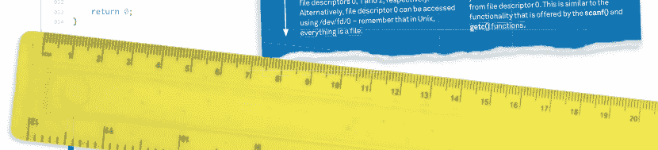

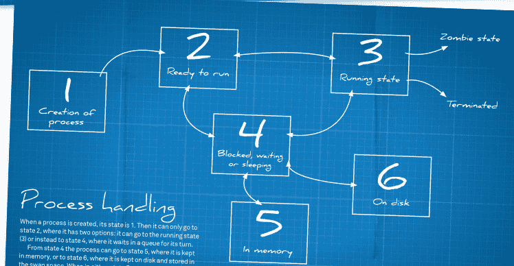

# 进程处理

当创建进程时，其状态为 1。然后它只能转到状态 2，在那里它有两个选项；它可以转到运行状态（3）或回到状态 4，在那里它在队列中等待轮到自己。从状态 4，进程可以转到状态 5，在那里它保持在内存中，或者转到状态 6，在那里它保持在磁盘上并存储在交换空间中。当处于状态 5 或 6 时，它只能转到状态 4，在那里它等待转到状态 2 或状态 3。从运行状态（3），进程可以正常终止，当事故发生时它可以变成僵尸进程，或者它可以转到状态 2 或 4。

# Exec 系列调用

每个 Unix shell 都使用 exec 系列中的函数之一来执行用户给定的命令。该系列中存在六个函数：exec, execp, execle, execv, execlp 和 execvp。如果发生错误，exec 函数将返回 -1；否则它们不返回任何内容。在即将推出的一篇系列文章中，你将更多地了解这六个函数之间的相似之处和不同之处。

当进程使用其中一个 exec 系统调用来执行程序时，新程序完全取代该进程，并与其 main() 函数一起开始执行。然而，进程 ID 保持不变！

与之稍有关联的 fork(2) 系统调用，你将了解另一篇文章，用于创建新的子进程，而 exec 函数启动一个新的程序。


# 重建核心工具

## 构建 `ls` 和 `wc` 的简单版本，并处理进程 ID

在这部分，我们将编写两个现有 Linux 工具的简单版本，以帮助你理解，在幕后，事情可能比你想的更简单。我们还将展示如何获取程序的进程 ID 以及父进程 ID。尽管这些操作看似简单，但请记住，系统软件编程的难点在于程序的众多细节，例如错误检查、命令行处理、错误处理等。这些细节的好处在于，你只需编写一次代码，然后就可以到处使用它！

正如你也能看到的，所有程序都包含注释。即使程序很小，你也应该始终在其中添加必要的注释。

警告：C 编程语言假设程序员总是知道自己在做什么，除非代码中存在错误，否则编译器不会质疑程序员。因此，如果存在错误，C 编译器将不会生成可执行文件。如果存在任意数量的警告消息，但没有错误，那么编译器将创建可执行文件，这并不总是好的。作为一个一般原则，你不仅应该设法解决错误消息，还应该解决警告。

### 挑战自我

一旦你完成了这些实用程序，并尝试重建了你选择的另一个标准 Linux 实用程序，这里还有另一个不错的练习供你尝试：将多个实用程序组合成一个程序。例如，你可以尝试制作一个结合 `cat` 和 `wc` 的工具，以给出新拼接文件的词数。

```C
// myLS.c
#include <fcntl.h>
#include <stdlib.h>
#include <stdio.h>
#include <dirent.h>

int main(int argc, char **argv)
{
if (argc != 2)
{
printf("Please provide the correct number of arguments!\n");
return -1;
}
DIR *theDirectory;
struct dirent *entryP = NULL;

// Open the directory
if ((theDirectory = opendir(argv[1])) == NULL )
{
printf("Cannot open directory %s.\n", argv[1]);
return -1;
}

// Read all its entries
while (( entryP = readdir(theDirectory)) != NULL )
{
printf("%s\n", entryP->d_name);
}
closedir(theDirectory);
return 0;
}
```


## `ls` 的简化版

在本节中，我们将编写 `ls` 程序的简单版本。它只会打印出作为命令行参数给出的目录中的文件和子目录。输入右侧显示的代码，或者从 FileSilo 获取它。像往常一样，你应该使用以下命令进行编译：

`$ gcc -Wall -o myLS myLS.c`

程序中使用的 `DIR` 类型（第 14 行）代表目录流，这是读取目录的 Unix 方式。`dirent` 结构体（第 15 行）不仅包含文件或目录的名称，还包含许多其他内容——你将在即将发布的教程中了解更多关于 `dirent` 结构体的信息。你還可以訪問 bit.ly/1E09WW7。

`myLS` 程序的参数只是一个路径名。你可能已经知道，路径名有两种类型：绝对路径和相对路径。绝对路径以斜杠开头，而相对路径则不。`opendir()` 系统调用打开目录并返回目录流（第 18 行）。`readdir()` 系统调用返回指向 `dirent` 结构体的指针。你可以使用 `while()` 循环（第 25 行）的帮助访问目录流的所有元素。当你到达目录流的末尾时，返回 `NULL`，`while` 循环将结束。

如果你选择编译并执行 `myLS`，你会发现由于最后一个 `printf()` 语句的结果，每个条目都在单独的一行上打印。

```C
// myWC.c
#include <fcntl.h>
#include <stdlib.h>
#include <stdio.h>

int main(int argc, char **argv)
{
if (argc != 2)
{
printf("Please provide the correct number of arguments!\n");
return -1;
}

int nword = 0;
// numberOfWords = 0;
// Get the file name of the text file
char *file = argv[1];
// A character variable
char ch = ' ';
// Open text file for reading
FILE *fp = fopen(file, "r");
if (fp == NULL)
{ 
printf("Error reading %s\n", file);
return 1;
}
 
// Start counting words
while ((ch = fgetc(fp)) != EOF )
{ 
if (ch == ' ' || ch == '\n' || ch == '\t')
{ 
iword = 0;
}
else if (iword == 0)
{ 
iword = 1;
nword++;
} } 
 
// Close the file
fclose(fp);
 
printf("Number of words found %d\n", nword);
 
return 0;
}
```


## 错误消息和 Bug

通常，你的代码会存在一些错误或 bug。一个常见的错误是在程序中没有包含正确的头文件。如果你尝试编译 `myLS.c` 而没有包含 `dirent.h` 文件，你将得到一个错误消息和一个警告：

```
$ ./LS.c:15: error: unknown type name ‘DIR’
$ DIR *theDirectory;
$ ./LS.c:17:5: warning: implicit declaration of function ‘opendir’
```

如果你拼错了 `theDirectory` 变量，你将得到以下错误消息：

```
$ ./LS.c: In function ‘main’:
$ ./LS.c:18:11: error: ‘theDIrectory’ undeclared (first use in this function)
$    if ((theDIrectory = opendir (arg[1])) == NULL
```

现在，让我们看第 25 行。如果你写了 `entries= readdir(theDirectory)` 而不是 `entriesP = readdir(theDirectory)`，你将在一个完全不相关的地方（第 27 行）得到一个警告：

```
$ ./LS.c:27:24: warning: ‘entriesP’ may be used uninitialized in this
$ _function (-Wmaybe-uninitialized)
$ printf("%s\n", entriesP->d_name);
```

尽管如此，`gcc` 编译器将创建一个可执行文件，因为就 C 而言，C 代码在语法上是正确的。问题是你的程序将没有输出，因为 `entriesP` 变量没有值，因为你使用比较运算符（`=`）而不是赋值运算符（`=`）。恭喜你——这是你的第一个 bug！

## `wc` 的简化版

本节将向你展示如何创建一个 `wc` 实用程序的简单版本，该版本仅统计文件中的单词数——`myWC` 程序只需要一个命令行参数，即要读取的文件名。

你现在应该知道如何编译你的代码了，所以请继续。尝试关注任何错误或警告消息。`myWC` 的代码比另外两个程序大，因为它做的事情更多：程序的逻辑封装在 `while` 循环中。

有许多更有效的方法来读取文件，而不是逐字符读取，但在这种情况下，这是最简单的解决方案，因为你随后将进行三次字符比较。因此，使用 `fgetc()` 函数（第 29 行）逐个字符读取整个输入。该程序假设当你读取空格字符、制表符或换行符（第 31 行）时，你不在一个单词内部。第一次你看到一个不同于空格、制表符或换行符的字符时，程序假设你处于一个新单词的开头（第 33 行）。

下一个系统编程教程将构建一个更接近 Linux 上 `/usr/bin/wc` 实用程序的 `wc` 版本。

## 进程 ID 和父进程 ID

这个程序表明，为了获取你想要的信息，并不总是需要编写许多行代码。第 13 行和第 14 行通过调用属于同一系列的两个系统调用来完成这项工作：`getpid()` 和 `getppid()`。这两个系统调用都不需要参数：每个调用只是返回所要求的进程 ID。第 7 行的检查不是必须的，但告知用户此命令不需要提供命令行参数是一个好习惯。父进程的进程 ID 很可能是你当前 shell 的进程 ID。

你可能会说这里的错误检查太多了，你可能是对的。然而，一般原则是，你编写的应用程序越关键，它应该包含的错误检查代码就越多。

```
// pid.c
#include <stdlib.h>
#include <stdio.h>
#include <unistd.h>
int main(int argc, char **argv)
{ 
if (argc != 1)
{ 
printf("There is no need for command line arguments\n");
return -1;
} 
int pid = getpid();
int ppid = getppid();
if ( pid > 0 )
{ 
printf("Your process id is %d\n", pid);
} 
else
{ 
printf("There is an error with your process id %d\n", pid);
} 
if ( ppid > 0 )
{ 
printf("You have been called from a process with id %d\n", ppid);
} 
else
{ 
printf("There was an error while getting parent process id: %d\n", ppid);
} 
return 0;
}
```


## 超越 C 语言

虽然目前没有其他编程语言像 C 语言那样成熟，但仍有许多编程语言可供你使用。存在许多编程语言可以帮助你执行系统任务。所有编程语言都通过调用 C 系统调用来实现其自身功能，因为这是与 Linux 内核通信的唯一接口。

将在六种编程语言中实现的示例程序是 `cp` 命令行实用程序的一个极简版本。文中展示的 C++、Rust、Go、Perl 和 Python 实现并非各编程语言所能提供或启用的唯一方式。它们在此处被展示出来，旨在让你快速了解每种编程语言。

### C 和 C++

在系统编程方面，C++ 几乎可以与 C 语言完全相同。它们唯一的区别在于，C++ 是一种面向对象编程语言，因此你可以以不同的方式组织代码。

在右侧，你可以看到 `cp` 实用程序的 C 和 C++ 版本。C++ 版本采用了一种非常规的方法，且不进行错误检查，而 C 代码则或多或少是编写 `cp` 实用程序的标准方式。虽然存在其他可用于文件复制的技术，但总体思路将是相同的。C 方法的最大优势在于，如果在程序执行过程中发生错误，你将确切知道是哪个系统调用导致了错误。仔细想想：你将知道 C 代码的确切行号以及问题背后的具体原因！你无法从程序的 C++ 版本中得出同样的结论，因为它使用高级命令，仅用一条命令就完成了许多操作。

鉴于其函数非常基础，C 语言的 `cp` 命令代码是所有展示代码中最长的，这并不奇怪。

### 最佳语言？

你可能会问哪种编程语言最适合 Linux 系统编程。简单的答案是 C，因为 Linux 是用 C 语言编写的，并且作为一种编程语言，C 比替代方案更加成熟。

Perl 和 Python 等编程语言的主要优势在于它们可以轻松与其他事物（如数据库）交互。此外，它们只需几行代码就能实现大量功能。然而，它们向程序员隐藏了太多底层细节，使其难以成为系统编程领域的下一个主流事物。一旦必要的工具在 Linux 上可用，你可能想要检查的另一种有趣语言是 Apple 的 Swift。

```c
#include <fcntl.h>
#include <unistd.h>
#include <stdio.h>

int myCP(char *file1, char *file2)
{
  FILE *rRead, *fWrite;
  rRead = fopen(file1, "r");
  fWrite = fopen(file2, "w");

  if (rRead == NULL) {
    printf("Could not open %s\n", file1);
    return -1;
  }

  if (fWrite == NULL) {
    printf("Could not create %s\n", file2);
    return -1;
  }

  size_t len;
  unsigned char buffer[8192];
  while ( (len = fread(buffer, 1, sizeof buffer, rRead)) > 0 ) {
    size_t written = fwrite(buffer, 1, len, fWrite);
    if (written != len)
      printf("There was an error: %zu <> %zu\n", written, len);
  }
  fclose(rRead);
  fclose(fWrite);
  return 0;
}

int main(int argc, char *argv[])
{
  if (argc != 3) {
    printf("Please provide the correct number of arguments!\n");
    exit(-1);
  }
  return myCP(argv[1], argv[2]);
}
```

```cpp
#include <iostream>
#include <fstream>

int main(int argc, char *argv[])
{
  std::ifstream src(argv[1], std::ios::binary);
  std::ofstream dst(argv[2], std::ios::binary);

  dst << src.rdbuf();
}
```

### 内核开发

由于 Linux 内核是用 C 语言编写的，你可能会想知道本文内容有多少适用于内核开发。好消息是，此处讨论的系统调用处理和其他技术是可重用的，尽管存在关键差异——例如，内核模块不需要 `main()` 函数，因为内核编程是异步的。值得阅读该基金会的指南：bit.ly/IK7uHC。


## Go

```go
package main
import (
	"fmt"
	"os"
	"io/ioutil"
)

func cp(source, destination string) {
	data, err := ioutil.ReadFile(source)
	if err != nil {
		fmt.Println("Error reading the file!")
	}
	err = ioutil.WriteFile(destination, data, 0644)
	if err != nil {
		fmt.Println("Error copying the file")
	}
}

func main() {
	if len(os.Args) != 3 {
		fmt.Println("You should use exactly")
		fmt.Println("two command line arguments!")
		os.Exit(-1)
	}
	cp(os.Args[1], os.Args[2])
}
```

## Rust

```rust
use std::env;
use std::fs;

fn main() {
    let args: Vec<_> = env::args().collect();
    if args.len() != 3
    {
        let input = ::std::env::args().nth(1).unwrap();
        println!("Input: {}", input);
        let output = ::std::env::args().nth(2).unwrap();
        println!("Output: {}", output);
        fs::copy(input, output);
    }
}
```

## Python

```python
#!/usr/bin/python
import sys
import shutil

if len(sys.argv) == 3:
    input = sys.argv[1]
    output = sys.argv[2]
    shutil.copy2(input, output)
```

## Perl

```perl
#!/usr/bin/perl -w
use strict;
use File::Copy;

my $input = shift;
my $output = shift;

copy($input, $output) ||
die "File copying failed: $!";

exit 0;
```

### Go

Go 是一种开源编程语言，使构建可靠且高效的软件变得轻而易举。

左侧代码展示了 `cp` 实用程序的 Go 版本，它采用了一种相当非常规的方法，即读取整个文件然后一次性复制——这种方法对于真正的大文件可能效率不高。

除了必要的错误检查外，`cp()` 函数仅使用两个 Go 函数就完成了工作，程序员无需处理其他任何问题。你可以运行 `go build copy.go` 来生成可执行文件。

### Rust

Rust 是一种新的系统编程语言，旨在避免由不安全代码引起的令人不快的 bug。编译器足够聪明，能够产生带有有用信息的警告和错误，帮助你在避免 bug 和纠正错误。

下一段代码展示了我们实用程序的 Rust 版本。好的是，它还将原始文件的权限位复制到目标文件。然而，Rust 代码看起来不太美观且难以阅读；代码本身是更优美的。

在撰写本文时，Rust 的当前版本是 1.2。尽管如此，Rust 仍在开发中，这意味着当新版本发布时，你的程序可能需要修改。

### Python

Python 也可以用于系统编程；它可能不是编写高可用性生产级 Web 服务器的最佳选择，但可以非常成功地用于测试和原型开发。你还可以编写有用的命令行实用程序，而无需编写太多代码，正如展示 Python 版本 `cp` 实用程序的代码所示。

### Perl

Perl 是一种众所周知的编程语言，几乎可以执行任何任务，包括系统编程。它可能不是编写接受数千个请求的生产级 DNS 服务器的最佳语言，但对于开发有用的命令行实用程序来说，它是一种非常有能力的编程语言。

页面底部的代码展示了 Perl 版本的 `cp` 实用程序。它简短、全面且易于阅读。

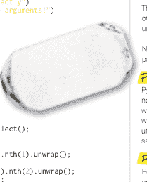


## 使用 Wine 运行 Windows 应用程序

Wine 让顽固的仅限 Windows 的应用程序在 Linux 上舒适运行——因此不再需要双系统！

随着日常计算机使用——从游戏、办公和协作应用，到社交媒体——转向基于跨平台、自由和开源技术的网络浏览器，Linux 与其专有竞争对手（特别是 Microsoft Windows）之间的竞争场地相当公平。在免费软件倡导者过早欢呼之前，对于许多希望从充满间谍软件的近期 Windows 版本中转移出去的用户来说，仍有一个障碍：一批顽固的遗留或专有软件，它们仅适用于 Microsoft 平台。

无论你是绑定于为 MS Office 编写的宏的办公用户，还是依赖自定义专有软件进行日常工作的员工，或是必须满足游戏需求的玩家，只有当你能够在新的首选操作系统上顺利运行关键软件时，向 Linux 的重大迁移才会发生。Wine 应运而生。

WINE 代表 WINdows Emulator——或者代表 Wine Is Not an Emulator；“not” 版本阐明了 Wine 并不模拟处理器代码，而是用自己的进程替换对库和 Windows 内核的系统调用。Wine 团队在跟上 Windows 的所有变化和发展方面做得非常出色，`winetricks` 程序处理那些在默认设置下无法运行的程序的变通方法和调整。

在这里，我们得到了 PlayOnLinux 的补充，它使在 Wine 版本上安装 Windows 程序变得更简单，并将它们隔离在不同的容器中。


## 安装 Wine 和 PlayOnLinux

鉴于可用的版本众多，我们将向您展示如何选择以及如何成功安装。

**您的发行版**使得安装大多数软件**非常简单**：您可以执行 `apt-get install wine winetricks`（或者使用 Fedora、CentOS 等系统中的 `yum install`），从而获得一个较新的版本。当然，这指的是较新的稳定版本：尝试运行 `wine --version`，您应该看到 1.6 或左右的版本号。这对于运行早已发布的软件（例如，在 Windows XP 出现之前，有人为您办公室编写的那个专有应用程序）来说就足够了。

### 测试版

对于较新的软件，可以使用开发版本。Wine 的 1.7.x 版本是测试版；它们不保证表现同样良好，但包含了最新代码，能让较新的游戏、iTunes 版本等运行得比上一个 Wine 稳定版更好。

**winehq.org** 网站提供了有用的指南，说明如何在大多数 GNU/Linux 发行版上安装 Wine。对于 Ubuntu，添加 Wine 软件源是第一步：`sudo add-apt-repository ppa:ubuntu-wine/ppa`。之后，让 Ubuntu 更新其数据库：`sudo apt-get update`。现在使用 `sudo apt-get install wine1.7 winetricks` 安装最新版本。Winetricks 也会随之安装，从而启用基于 GUI 的选择功能，包括库、屏幕大小、Windows 版本、媒体驱动器，甚至 Windows 文件夹与您操作系统上文件夹之间的集成。

Winetricks 是一套便捷的辅助脚本，用于获取库依赖项（DLL）和字体。它也有助于运行旧版本的 Internet Explorer，当然也适用于测试页面渲染。当 Winetricks 不足以解决问题时，PlayOnLinux 可以帮助在 Linux 上安装那些更挑剔的 Windows 程序。

## PlayOnLinux

在不同发行版中安装 PlayOnLinux 的过程差异很大。在当前的 Ubuntu LTS 上，运行以下步骤：

```bash
wget -q "http://deb.playonlinux.com/pub/gpg" -O - | sudo apt-key add -
sudo wget http://deb.playonlinux.com/playonlinux_trusty.list -O /etc/apt/sources.list.d/playonlinux.list
sudo apt-get update
```

……仅仅将 PlayOnLinux 软件源添加到 apt 的源列表中。现在您可以通过 apt 或 Ubuntu 的其他包管理工具安装 PlayOnLinux：`sudo apt-get install playonlinux`

从 PlayOnLinux 的工具菜单中选择 *Manage Wine Versions*。在此处，您可以选择不同版本的 Wine 进行下载和安装。因此，如果有人报告某款特定游戏或其他软件在（例如）Wine 1.7.42 下确实运行成功，您就可以让 PlayOnLinux 使用该版本（见下图）。在 64 位计算机上，32 位的 wine 版本位于单独的标签页中。

## 为每个程序定制

Wine 能够模拟 Windows 的每个版本，尽管 Windows 3.1 之前的版本现已弃用（您是否急需运行那么古老的软件？）。通常情况下这很直接，但对于那些需要特定 Windows 环境的应用程序，我们可以通过 winecfg 设置让 Wine 配合工作。使用环境变量 **WINEPREFIX**，我们可以为不同的应用程序启用自定义字典。您甚至可以使用不同的 **WINEPREFIX** 同时运行两个程序：例如，在同一台机器上模拟客户端-服务器软件。
对于 64 位机器上的 32 位安装，例如，调用：

```bash
WINEARCH=win32 WINEPREFIX=~/play-wine32 winecfg
```

……配置对话框将出现在屏幕上，以便为您即将进行的安装进行调整，而安装将通过以下方式完成：

```bash
WINEARCH=win32 WINEPREFIX=~/play-wine64 /path-to/setup.exe
```

为了避免每次都要输入相同的前缀，请使用以下 export 命令：

```bash
export WINEARCH=win32
```

PlayOnLinux 允许您通过其选项完成上述大部分工作，调出 winecfg GUI 以及针对每个安装的特定 32 位或 64 位 Wine 版本的库复选框。

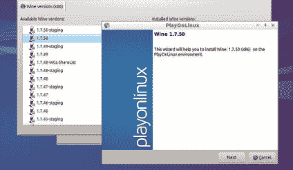

左 | 通过 PlayOnLinux 安装 Wine 可让您获得完整的版本控制

## Linux 上的 Photoshop

Adobe 近期的 Photoshop 版本可以在 Wine 下运行，因为 PlayOnLinux 处理了其中的复杂性

### 清除旧的 Wine 痕迹

Wine 有一个卸载器（GUI 和命令行 wine uninstaller appname >）。删除 ~/wine/ 将移除所有通过 Wine 安装的应用程序，除非您使用了 PlayOnLinux。使用 PlayOnLinux 时，管理安装变得容易，可以创建独立的容器，每个安装都位于 ~/PlayOnLinux 的虚拟驱动器中（vyp，一个包含空格和撇号的目录名）。每个应用程序都有一个 Windows 文件所需的目录层级。在 PlayOnLinux 中，选择一个应用程序并点击卸载即可处理。甚至可以在 PlayOnLinux 安装期间创建同名的目录并让其覆盖旧目录。要移除 Wine，您的包管理器（如 sudo apt-get purge remove wine）会处理软件部分，但您的桌面仍会保留一些痕迹，例如菜单中的“用...打开”选项 – 参见 Wine FAQ 寻求帮助。

在所有让人们无法从专有平台迁移的应用程序中 – 暂且不计游戏，因为很少有企业依赖其在办公室运行《侠盗猎车手》的能力 – Photoshop 是许多人绑定 Windows 系统的最强纽带。

GNU 图像操纵程序 (GIMP) 的功能与 Photoshop 大致相同，并且对于许多任务具有更好的批处理能力，但用户界面不同。无论 GIMP 开发者在功能和文件格式处理上使 GIMP 与 Photoshop 多么兼容，许多用户已在 Adobe 软件上投入了数千小时来磨练技艺。他们不愿迁移，所以让我们把 Photoshop 和 Linux 结合在一起。

下载您需要版本的 Photoshop 的多吉字节压缩包。我们选择了 Adobe Photoshop CS6 Design 和 Web Premium，DesignWebPremium_CS6_LSI16.7z 文件重达 4.5GB。然后下载安装程序：在我们的案例中，是 DesignWebPremium_CS6_LSI16.exe。

开始之前，请执行 winetricks atmlib，否则您将无法打开 PSD 文件！从 PlayOnLinux 的安装页面，选择图形标签页，然后选择“Adobe Photoshop CS6”。系统会告知它与 Photoshop 的 CC (Creative Cloud) 版本也兼容。

PlayOnLinux 会选择适当的 Wine 版本 – 如果系统中尚未存在则下载它 – 以及所有库/DLL，因此针对 Photoshop CS6 优化的设置已安装完毕。一个向导（见左下角图片）将引导您完成流程。

点击通过通常的最终用户许可协议 (EULA，可能是我们这个时代最无人问津的文件类别，但在 Linux 桌面上却是新鲜体验) 后，解压并安装开始。如果没有安装密钥，您可以选择 30 天试用。还有大量的下载，包括无处不在的 Microsoft 字体获取。除非您有大量内存、超快互联网和快速 SSD 硬盘，否则您可能此时需要泡杯茶。或者甚至出去吃个午饭。

午饭回来了？很好。Adobe 声称您在使用 Mercury 图形引擎时能获得“极快的性能”，但这可能解释了 CS6 在带有 Intel 图形芯片组的测试机上看似无法在 Wine 下正确安装的原因。我们配备 NVIDIA 显卡的机器（默认安装 Ubuntu 且未调整驱动程序）运行良好。

由于我们并不是特别有艺术气质（如下所示），这里能报告的质量仅限于 Photoshop 似乎运行良好，在 Wine 数据库中获得了兼容性的黄金评级。

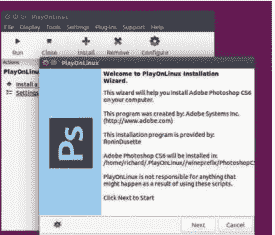

上方 PlayOnLinux 安装向导操作简单明了


右 如果遇到运行时错误，尝试将 PlayOnLinux 设置为 Windows 7 以适配您的 Photoshop 版本

## 游戏无国界

从今年的最新作品到永恒的经典，Wine 帮助玩家保存他们在 Linux 上的游戏收藏

### 现代游戏

在过去，为了在 Linux 上运行 Steam 的 Windows 版本，投入了大量精力。这是为了将最后几款非 Linux 游戏，如 *Terra*，带到 Linux 桌面。现在，由于几乎所有流行的 Steam 游戏都在 Linux 版本上或正在前往 Linux 版本的路上，游戏玩家对 Wine 最大的需求是让 *FIFA 15* 等游戏能够运行。要在您的仿 Windows 电脑上运行该游戏以及其他 EA 游戏，如 *Sims 4*，第一步是安装 EA 的下载器 – Origin。

从 **origin.com/download** 获取 OriginThinSetup.exe 文件是第一步（也是最简单的一步）。事实上，在非精简版的 OriginThinSetup.exe 前身安装程序上安装要在 Wine 下容易得多，但 EA 不再提供该版本，而且您真的不想尝试来自可疑下载站点的旧副本。

精确的操作步骤会因您的发行版、Wine 版本、EA 对安装程序所做的修改以及风向（比喻义）而异。

安装它的最佳方法实际上涉及到执行安装流程，之后安装失败。然后您在一个新的 Windows 计算机上安装，抓取 **C:\Program Files (x86)\Origin** 文件夹，将其覆盖安装在您的 Wine 或 PlayOnLinux 目录中的 Origin 文件夹上，然后通过 Wine 运行 **Origin.exe**。这个方法效果很好，使我们随后能够安装 *FIFA 15*，但这令人不满意，因为您可能无法访问 Origin 的新 Windows 安装版。

在顺风顺水的日子里，您在 **dotnet35** 库、**directx9**、各种字体、**msxml3** 和 **lic32-libxml2** 上的运气可能比我好。但使用较旧的 **OriginSetup.exe**，它绝对可以工作！

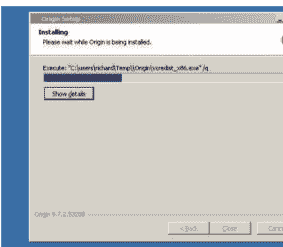

### 经典游戏

并非所有人都想运行最新版本，它们对更快系统的需求日益增长。毕竟，我们可以用主机来玩这些游戏 – Steam 的努力为 Linux 用户带来了丰富的游戏选择。但请允许我们怀念一下昔日的标题，*Railroad Tycoon*、*Monkey Island* 或 *Age of Empires* 的魅力可能会让您从阁楼翻出积满灰尘的 CD-ROM，看看 Wine 在针对 Windows 98 甚至更早系统设计的软件上表现如何。

我们首先测试了原版 *Dungeon Keeper*。它宣传适用于 Windows 95 或 DOS，实际上是在 DOS 上运行的，结果发现 Wine 并非必要 – 如果您仍有一张副本，请为它安装 DOSBOX。在我们翻出的 90 年代光盘中，我们找到了 *Baldur’s Gate*，这是对经典 *Dungeons & Dragons* 的复杂且引人入胜的诠释，您在安装前最好先清空日程表。

在 CD-ROM 上右键单击 **SETUP.EXE** 文件会弹出用 Wine 打开的选项，但通常只需单击即可从大多数发行版运行（或在命令行中运行）。在 winecfg 中，我们将操作系统设置为 Windows 95，图形保持默认值。当安装进行时，“200MHz 或更快的处理器”等选项提醒我们要多么深入地穿越回过去。

一切运行完美，如下所示，*Baldur’s Gate* 随即出现在 Wine 菜单中。这也是一款您可以在 Wine 稳定版上运行的游戏。然而，我们没有时间说更多，因为那个地牢里有宝藏等待...

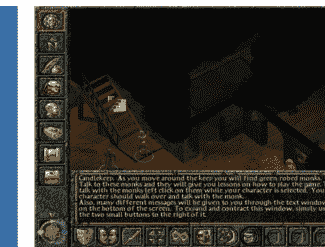

- **左下** Wine 能与大多数较新的游戏配合使用，但 EA 的 Origin 平台可能反复无常
- **右下** 经典 Windows 游戏可以轻松复活并加入聚会


## 挽救 iTunes 内容

> 如果你确实需要 iTunes，请忽略那些令人困惑的在线建议，跟随 PlayOnLinux 的向导操作即可。

iTunes 近期的臃肿化使其从早期那个相对轻量、专注且强大的音乐库应用，蜕变成了一个摇摇欲坠的、由*几乎无用的功能*组成的**多媒体版 Microsoft Office** 集合体。如今，Linux 上有许多替代 iTunes 的方案，尽管它们几乎都有各自的缺点。不过，对于那些被困在苹果“围墙花园”内、拥有已购买媒体资源的用户来说，iTunes 依然有其优势，许多 Linux 用户需要在不双启动的情况下访问它。

不幸的是，在 Wine 上运行 iTunes 并非总是容易的事，许多人甚至为了运行 iTunes 而保持一台运行最新 OS X 或 Windows 版本的虚拟机（VM）处于待命状态。

网络搜索很容易得到大量相互矛盾的安装 iTunes（使用 Wine）的信息。我们尝试遵循其中一些方法，通过各种库（如 libmwx13, ncal220 和 dotnet40）使用 winetricks 和 Winecfg，以及通过 PlayOnLinux 的库加载器进行添加。我们最好的结果只是成功安装了一个灰显的图标框，尽管某些菜单是可访问的。即使在使用 `winetricks gdi32`（它下载了 600MB 的图形库）重新开始后，问题仍未解决。

然后我们忘记了网上那些关于我们该做什么的帖子。我们只是放手并信任 PlayOnLinux。点击安装后，我们没有选择“未列出的软件”，而是前往“多媒体”菜单并点击了 iTunes 12（参见左下角图片）。我们还从 Apple 下载了 32 位安装程序，即便对于我们的 64 位测试机也是如此。

PlayOnLinux 警告了我们哪些功能无法正常工作：与 iDevices 同步，尽管有很多原生的 Linux 应用可以与苹果音乐硬件通信（至少在情况良好的时候）。然后，就像我们的 Photoshop 安装一样，PlayOnLinux 的向导完成了所有繁重的工作，包括选择 Wine 1.7.48（这是该特定安装程序创建者已知可行的版本）以及 `wine_gecko`（用于渲染 Apple iTunes 商店的 Web 界面）。随后，它获取了各种其他服务包和库。iTunes 在三台测试机器上都成功启动。

据报道，插入 iPod 或 iPhone 无法工作，管理音乐库的效果也不稳定，因为非常大的多媒体文件磁盘可能会导致程序崩溃。然而，我们可以访问 iTunes 商店来消费我们辛苦赚来的钱，最重要的是，iTunes 拥有大量专业的互联网广播电台。我们度过了一个愉快的夜晚，在 **calmradio.com** 上聆听 Bebop 爵士乐——无需会员登录即可在 iTunes 上收听——享受这一切的爵士风味。

## 注册表手术

如果确实需要编辑 Windows 注册表，Wine 可以为你调用其自身的注册表编辑器，功能与 Windows 上同名的软件相似。在 Wine 下运行的一大优势是，如果你搞砸了，不会使系统不稳定，而且对 `~/.wine` 或 PlayOnLinux 等效位置（location）进行备份意味着你甚至不会丢失模拟安装的环境。被编辑的文件位于 `$WINEPREFIX\*\ REG`，但由于使用了特殊编码来存储键，因此不应直接编辑它们。在 regedit 中，`HKCU_CURRENT_USER\Software\Wine` 很可能主要关注点。例如，在 `MSHTML\GeckoUrl` 处，这是 Wine Gecko 的位置，你可以创建一个新的 **SWINEPREFIX**。将注册表条目更改为本地位置，如 `file:///Z/ path/to/wine_gecko/`，意味着无需不必要的下载。

最有用的修改键值及其有用解释列于：wiki.winehq.org/ User/Registry。

**上方** 始终检查 PlayOnLinux 菜单，看看你想要的软件是否已列出
**右侧** iTunes 在处理大型音乐库时会很吃力，但至少你可以获取你在商店购买的商品


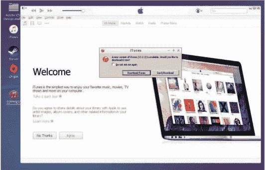


## 来自英国专家的 Linux 服务器托管


全天候 24/7 英国支持 • ISO 27001 认证 • 免费迁移

托管主机 • 云主机 • 专用服务器

**卓越的托管服务。**
卓越的支持。

www.CWCS.co.uk

## 特别订阅优惠

**订阅并节省** 30%

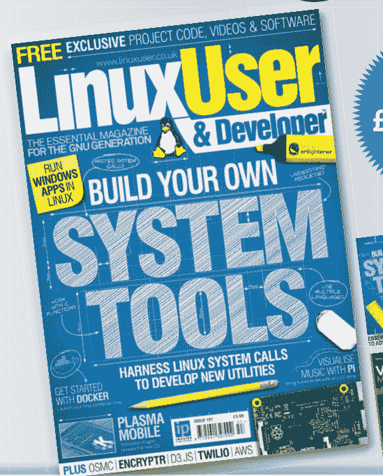

### 仅需支付
£25.15
每 6 期

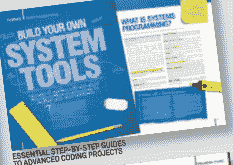

高级编码项目必备的分步指南


订购热线 0844 249 0282
通话费用为每分钟 7 便士加上你的电话公司的接入费

在线订购请访问 www.imaginesubs.co.uk/lud

## 邮寄

请将填好的表格发送至：
**Linux User & Developer Subscriptions, 800 Guillaum Avenue,
Kent Science Park, Sittingbourne, Kent ME9 8GU**

## 每期内容精彩纷呈...

- 来自 **Linux 专家** 的编程指南
- 来自 **企业供应商** 的最新新闻
- 富有创意的 **树莓派（Raspberry Pi）** 项目和建议
- 最佳 **Linux 发行版和硬件** 评测

## 您的详细信息

称谓：_______________________
名：______________________
姓：__________________________________________________________
地址：__________________________________________________________
________________________________________________________________
邮政编码：____________________
国家：_____________________________
电话号码：_________________________________________________
手机号码：_____________________________________________________
电子邮箱地址：_____________________________________________________

## 直接借记支付

英国直接借记支付
我将每 6 期支付 £25.15（节省 30%）

| 指示你的银行或建储会通过直接借记付款 | 直接借记 |
| :--- | :--- |
| **你的银行或建储会账户持有人的姓名** | **经理** | **签名** | **指示号码** | | | | | | | | | |
| **地址** | **银行/建储会** | | 5 | 0 | 1 | 8 | 8 | 4 | | | | | | |
| | | **参考号码** | | | | | | | | | | |
| **账户持有人的号码** | **邮政编码** | 指示你的银行或建储会：**本文件中的账户详情** | | | | | | | | | |
| **分行代码号码** | **签名** | **授权向 Imagine Publishing Limited, 800-Guillat Avenue, Kent Science Park, Sittingbourne, Kent ME9 8GU 转账 £25.15，每 6 期一次。本** | | | | | | | | | |
| **银行/建储会账户号码** | **日期** | **指示必须由账户持有人提前 6 周取消，除非银行或建储会取消该指示。** | | | | | | | | | |

银行和建储会可能不接受某些类型账户的直接借记指示。

**姓名：**

**请填写表格并发送至：Imagine Publishing Limited, 800-Guillat Avenue, Kent Science Park, Sittingbourne, Kent ME9 8GU**

## 为什么你应该订阅...

- **未来期数节省 30%** – 每 6 期支付 £25.15
- **免费送货** 直达门口
- **永不错过任何一期**

## 付款详情

**您的独家读者价格，1 年（13 期）**

英国 £62.40（节省 20%） 欧洲 – £70 世界 – £80 美国 – £80

支票
我附上一张金额为 £ 的支票
（收款人请填写为 Imagine Publishing Ltd）

**信用卡/借记卡**
Visa Mastercard Amex Maestro

卡号

有效期

发行号（如果是 Maestro）

签名___________________
日期_____________________

如果你不希望通过以下方式从 Imagine Publishing Ltd 接收任何促销材料，请打勾：邮寄 [ ] 电话 [ ] 电子邮件 [ ]

如果你不希望通过以下方式从其他公司接收任何促销材料，请打勾：邮寄 [ ] 电话 [ ] 请打勾表示你**希望**通过电子邮件接收此类信息 [ ]

## 请在 11 月 30 日前订购

使用代码 **PS15** 享受此优惠。

## 条款与条件

条款与条件：此优惠允许新的英国直接借记订阅者每 6 期仅支付 £25.15。
新订阅将从下一期可用期开始。必须引用优惠代码 PS15 才能获得此特殊订阅价格。直接借记保证的详情可应要求提供。此优惠于 2015 年 11 月 30 日到期。Imagine Publishing 保留将此类优惠限制为每户家庭仅限一次的权利。订阅者可以随时取消此订阅。


# 教程

# 在 R 中操作和转换数据


Mihalis Tsoukalos 是一位 Unix 系统管理员，Linux 和 iOS 程序员，数据库管理员（DBA），也是一位数学家。自 1993 年以来，他一直在使用 Linux。

# 资源

- R 项目
  r-project.org
- RStudio
  bit.ly/tVLtmIgA
- Zoo 包
  bit.ly/0v0Whd
- Chron 包
  bit.ly/1thCiq

右 这是 RStudio 的环境，它是一个强大且实用的 R 集成开发环境（IDE）。

学习如何使用 R 轻松高效地操作各种类型的数据。

R 软件一直在处理、处理和可视化数据——它是能为你的数据赋予价值的东西。但是，如果你不能随心所欲地随时以任何你想要的方式转换、操作和修改你的数据，那么可视化数据又有什么意义呢？

本文将教你许多在 R 中操作和转换存储数据的不同方法。这非常重要，因为大多数时候，你想要的信息都隐藏在某个地方，等待你去发现它。此外，当你的数据出现问题时，通常是因为数据相对于你试图执行的任务处于错误的模式或类别中。

你应该记住的第一件事是，R 数据类型中第一个元素的索引是 1 而不是 0。

如果你更喜欢使用 IDE 而不是 R 的命令行版本，你可以从 bit.ly/tVLtmIgA 下载 RStudio 的开源版本，但跟随本教程并不一定需要 RStudio。不过，了解如何安装、运行和退出 R，以及如何向其命令行环境输入命令，仍然会让你受益匪浅。

## 01 R 中的各种数据类型

R 支持各种类型的数据，每种类型都有独特的特征和属性。本教程的这一部分将向你介绍处理数据组时最重要的数据类型。列表（list）是包含其他对象的通用向量，向量（vector）是相同基本类型的数据元素的序列。数据框（data frame）是一组等长向量的列表，主要用于存储数据表。它在 R 中应用广泛，等价于表格的概念。数组（array）是一个多维对象。矩阵（matrix）是包含数字数据的二维数组；它有行和列。

`mode()` 函数返回对象的模式，而 `class()` 函数返回对象的类。当你不知道拥有的 R 对象类型时，这两个函数都非常有用。

## 02 在 R 中导入数据

通常，你自己不会编写数据；大多数时候，你会从外部来源获取数据，包括文本文件、数据库和互联网。读取外部数据是使用 **read.table()** 函数完成的，该函数返回一个数据框。如果你想读取外部文本文件，可以使用以下命令：

```R
> myData <- read.table("./data.txt", header=FALSE)
```

如果你将 header 参数设置为 TRUE，则假定输入的第一行包含变量的名称。请记住，根据外部数据的格式，你应该使用合适的数据类型来存储数据或将其转换为所需的格式。

## 03 创建和使用随机数据

能够获取和操作随机数字对于测试各种方法和技巧是非常棒的。因此，这一步将教你在 R 中获取随机数据的方法。以下命令返回 0 到 100 之间的 10 个浮点数：

```R
> runif(10, min=0, max=100)
```

下一个变体返回 0 到 100 之间的 10 个整数：

```R
> floor(runif(10, min=0, max=101))
```

请注意，最大数值本身不能被返回，因此将 **max** 参数的值设为 101 可确保整数 100 可以被返回。

如果你想再次生成相同的随机数序列，可以如下使用 **set.seed()** 函数：

```R
> set.seed(123)
> runif(10, min=0, max=100)
```

正如你在图片中看到的，在执行 **runif()** 函数之前必须运行 **set.seed()**。

> “你应该记住的第一件事是，R 数据类型中第一个元素的索引是 1 而不是 0”

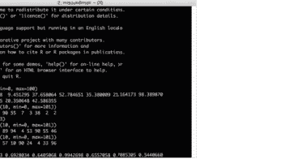

有一个名为 **sample** 的函数，可以将现有向量的内容洗牌为随机序列，而不改变实际的数值：

```R
> a <- floor(runif(3, min=0, max=100))
> sample(a)
[1] 57 89 10
> sample(a)
[1] 89 10 57
```

如果你向 **sample** 传入第二个参数，你可以指定要返回的样本大小。

左 这是步骤 2 的输出，其中我们读取了数据表。

```R
> myData <- read.table("./data.txt", header=FALSE)
> system("cut ./data.txt")
10 a1 c1
20 a2 c2
30 a3 c3
40 a4 c4
50 a5 c5
> myData
      V1 V2 V3
1 10 a1 c1
2 20 a2 c2
3 30 a3 c3
4 40 a4 c4
5 50 a5 c5
> class(myData)
[1] "data.frame"
> mode(myData)
[1] "list"
```

## 额外的 R 包

虽然 R 是一个功能强大的包，拥有良好的编程语言，但其真正的威力来自于众多的 R 包。每当你想解决一个问题时，请检查是否存在可以帮助你完成工作的包。你可以从 **cran.r-project.org** 开始寻找。

## 04 处理文本和匹配

尽管本文的大部分内容将涉及数值和日期数据的操作，但这一步将讨论 R 中的文本操作以及如何对文本进行处理。**as.numeric()** 函数将字符串转换为其数值。如果存在无效字符，你将收到一条错误消息。你可以如下拼接两个字符串：

```R
> paste("Linux User", "Developer", sep=" ")
[1] "Linux User Developer"
```

类似地，你可以将矩阵中两列的字符串链接成一个新列。如果矩阵有两列，则在返回的矩阵中会创建一个新的第三列。存储新矩阵是你的工作。

R 还支持文本变量的模式匹配。因此，如果你想获取包含文本 "Error" 的所有列，你应该运行以下利用 **grep()** 函数的命令：

```R
> errorMessages <- c("I/O Error", "Network Error", "Data not found", "TCP/IP not working", "Data Error")
> errorMessages[grep("Error", errorMessages)]
[1] "I/O Error" "Network Error" "Data Error"
```

另一个真正重要的函数是 **match()**，它回答的问题是“第二个向量的值可以在第一个向量的哪里找到？” 通过示例可以更好地理解 **match()** 函数：

```R
> firstV <- c(1, 2, 4, 5, 9, -1, 0, 4, 5)
> secondV <- c(0, 1, 2, 0, -1, 9)
> match(firstV, secondV)
[1] 2 3 NA NA 6 5 1 NA NA
```

**match()** 返回一个属于第二个向量的下标向量，其元素数量与第一个向量相同。如果第一个向量的某个元素在第二个向量中找不到，则其位置会出现 NA。否则，将返回该元素首次出现的索引，而不是 NA。

## 05 处理日期

日期和时间是特殊类型的数据，因此需要特殊处理。建议不要将日期和时间存储为纯文本，因为这样难以操作。然而，偶尔你需要将存储为字符串的日期或时间转换为更合适的格式。

R 提供内置的 Date、POSIXt 和 POSIXct 类来存储日期和时间，以及 zoo 和 chron 包。本文只涉及内置类型。

一般原则是，如果你使用的是非标准格式，你就必须指定它。此外，R 允许你对日期进行计算，这非常实用。

POSIXct（缩写：Calendar Time）是存储数据中时间的最佳类；该类还允许你指定日期的时区。POSIXt（缩写：Local Time）类允许你轻松提取时间的特定组件。记住 POSIXct 对象是列表这一点很重要。如果你只有日期，请使用 Date 类，使用 **help(DateFormatClasses)** 获取有关日期和时间类的更多信息。

## 06 更多关于日期和时间

**strptime()** 函数允许你将因子（factor）或字符串转换为日期——用户必须提供用双引号括起来的格式语句，以告知 R 输入的结构。因子（factor）的模式是数值型，类是 factor。

**difftime()** 函数也可以帮助你计算两个日期之间的差异。

在 R 中解析日期和时间时使用正确的代码非常重要：`%e` 用于四位年份，而 `%y` 用于两位年份。使用 `%d` 声明月中的日期，使用 `%m` 以十进制数字声明月份。使用 `%B` 作为月份全名的代码，使用 `%b` 作为月份缩写名的代码。

在处理真实数据之前，有必要使用小样本进行测试，特别是对于日期和时间，因为很容易犯小错误从而导致大错误。

## 07 数据任务

这部分将向你展示如何对数据做一些简单的事情。假设你有一个名为 **aDataFrame** 的数据框。如果你想从数据框中获取单个元素，应该运行以下命令：

```R
> aDataFrame[4,3]
```

上一条命令将获取第四行第三列的元素。类似地，你可以如下获取其第一列：

```R
> aDataFrame[,1]
```

如果你想获取其第二行，应该执行以下命令：

```R
> aDataFrame[2,]
```

要获取数据框的前三行，可以使用下面的标记。这也同样适用于获取前三列：

```R
> aDataFrame[1:3,]
```

## 08 高级数据任务

以下命令将定义一个包含三列的数据框：

```R
> myDataFrame <- data.frame(v1=c(1,2,3,4,5),
    v2=c(0,1,2,3,4), v3=c(-1,-2,-3,-4,-5))
```

以下命令将数字 5 加到数据框的所有元素上：

```R
> myDataFrame <- myDataFrame + 5
```

由于 myDataFrame 中的列都有名称，以下两个命令都会从数据框的第一列中减去数字 5：

```R
> myDataFrame[, 1] <- myDataFrame[, 1] - 5
> myDataFrame[, 1]
[1] -4 -3 -2 -1 0
```


## 左侧

R 允许您将对特定行和列的操作应用于表格。

```
> aDataFrame = data.frame(v1=c(1,2,3,4,5), v2=c(0,1,2,3,4), v3=c(-1,-2,-3,-4,-5), v4=c(0,0,1,2,3), v5=c(-1,-2,-3,-4,-5))
> aDataFrame
  v1 v2 v3 v4 v5
1  1 0 -1  0 -1
2  2 1 -2  0 -2
3  3 2 -3  1 -3
4  4 3 -4  2 -4
5  5 4 -5  3 -5
> aDataFrame[4,3]
[1] -4
> aDataFrame[4,3] = aDataFrame[4,3] + 100
> aDataFrame
  v1 v2 v3 v4 v5
1  1 0 -1  0 -1
2  2 1 -2  0 -2
3  3 2 -3  1 -3
4  4 3 96  2 -4
5  5 4 -5  3 -5
> aDataFrame[,1]
```

以下命令为第一行的所有元素添加十：

```
> myDataFrame$v1 - 5
[1] -4 -3 -2 -1  0
```

```
> anotherMatrix <- matrix(unlist(myList), ncol = 2, byrow = TRUE)
```

前面的命令要求您手动指定新矩阵的列数，因为您正在将线性类型转换为二维类型。您可以按以下方式将名为 `aVector` 的向量转换为列表：

```
> anotherList <- as.list(aVector)
```

您可以借助 `unlist()` 函数将名为 `anotherList` 的列表转换为向量：

```
> aNewVector <- unlist(anotherList)
```

以下命令为 `myDataFrame` 的第一列减去一，第二列加上零，第三列加上一：

```
> myDataFrame + -1:1
```

请记住，只要您没有将操作结果分配给 `myDataFrame` 变量，`myDataFrame` 的原始内容就不会改变。

下一条命令为 `myDataFrame` 创建一个名为 `sum` 的新列，其中包含每行所有值的总和：

```
> myDataFrame$sum = myDataFrame$v1 + myDataFrame$v2 + myDataFrame$v3
```

如您所知，此操作会通过添加新列来改变 `myDataFrame`。使用相同的方法，您可以执行任何类型的计算。

## 09  在多种数据类型之间转换

本步骤将向您展示如何在列表、数据框、向量和矩阵之间进行转换。给定一个名为 `myMatrix` 的矩阵，您可以使用以下命令将其转换为列表：

```
> myList <- as.list(data.frame(t(myMatrix)))
```

给定一个名为 `myList` 的列表，您可以使用此命令将其转换为矩阵：

```
> anotherMatrix <- matrix(unlist(myList), ncol = 2, byrow = TRUE)
```

## 10  保存和加载您的工作

到目前为止，您已经看到了如何以多种方式更改数据。最后一步将描述如何保存您的数据，并在下次运行 R 时加载它。您可以按以下方式保存当前 R 会话，包括所有定义的变量：

```
> save(list = ls(all=TRUE), file = "R25Aug2015")
```

操作系统将创建一个名为 `R25Aug2015` 的文件，您可以按以下方式稍后加载：

```
> load(file = "R25Aug2015")
```

以下命令可用于删除所有当前定义的 R 对象类型：

```
> rm(list=ls())
```

下一条命令将向您展示 R 图形功能的一个令人印象深刻的演示：

```
capabilities()
```

R 是一个无尽的话题，你只能通过实践来了解更多信息，所以开始实验并赋予你的数据许多新的含义！

### 获取帮助

R 提供了多种获取函数帮助的方式：如果您在 R 提示符后输入问号，再跟上函数名称，R 将返回类似于 Unix man 手册的内容：

```
? Sys.sleep
```

以下命令将返回 `read.table()` 函数的实用示例：

```
? example(read.table)
```

# 教程：D3.js

# 使用 D3.js 可视化您的数据 – 第一部分


**Mihalis Tsoukalos**
是一名 Unix 管理员，Linux 和 iOS 程序员，数据库管理员（DBA），也是一位数学家。他自 1993 年以来一直使用 Linux


**教程文件可用：**
filesilo.co.uk

**资源**
- 文本编辑器
- D3.js: d3js.org

学习如何使用 D3.js JavaScript 库创建令人印象深刻的交互式可视化效果

D3 代表 Data-Driven Documents（数据驱动文档）。它是一个 JavaScript 库，可以帮助您将随机数据绑定到文档对象模型（DOM）并对文档应用数据驱动的转换。D3 提供的函数在应用于 DOM 元素时，可以转换生成的 HTML、SVG 或 CSS 文档。它是一个强大的软件，可以做很多事情并生成非凡的交互性和专业输出。它没有一个单一的功能来画圆或任何其他形状；相反，它有一个函数来处理正确的一组数据以创建圆形。虽然这种方法使您编写更多的代码，但它提供了更多的灵活性和自由度！借助其大量的组件和插件，D3.js 还支持代码重用。如果您已经熟悉 JavaScript，那么使用 D3.js 就易如反掌。即使您不是 JavaScript 的狂热粉丝，您也应该认真考虑 D3.js。然而，还有许多其他替代方案供您考虑，包括 R、MATLAB、Octave 等。

所有演示示例都可以在本地机器上运行，无需运行 Web 服务器，例如 Apache 和 Nginx。下个月我们将解释如何使用 D3.js 创建更多令人印象深刻的高级图表。

## 01  安装 D3.js

在安装 D3.js 之前，您需要下载它：

```
$ wget https://github.com/mbostock/d3/releases/download/v3.5.6/d3.zip
```

`d3.ZIP` 文件包含三个文件：`d3`、`LICENSE`、`d3.js` 和 `d3.min.js`。`d3.js` 和 `d3.min.js` 都包含相同的 JavaScript 代码；唯一的区别是 `d3.min.js` 中已移除空白字符，以减小文件大小从而加载更快。

`d3.min.js` 文件包含大量 JavaScript 代码。好的是您只需使用以下任一方法将其包含在您的 HTML 代码中即可：

```
<script type="text/javascript" src="http://d3.js/"></script>
<script type="text/javascript" src="http://d3js.org/d3.v3.min.js" charset="utf-8"></script>
```

第一行加载本地副本，而第二行从互联网加载 D3.js - 请注意，两者都是有效的。Hello World 程序的 D3.js 版本如下：

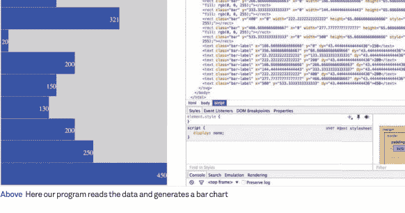

**上方** 我们的程序读取数据并生成条形图

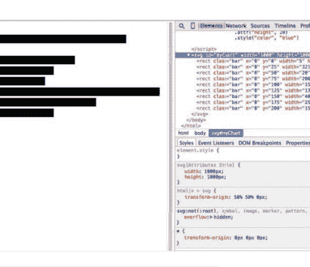

**左侧**：结果条形图中的数据将从上到下绘制

```html
<!DOCTYPE html>
<html>
<head>
    <meta http-equiv="Content-Type" content="text/html;charset=utf-8">
    <title>The D3.js version of Hello World</title>
    <script type="text/javascript" src="d3/d3.min.js"></script>
</head>
<body>
    <script type="text/javascript">
        d3.select("body").append("span")
        .style("color", "blue")
        .text("Hello World!");
    </script>
</body>
</html>
```

由于 `.style("color", "blue")` 命令，输出以蓝色显示。

## 02  使用 D3.js 绘制圆形

本步骤将向您展示如何使用 D3.js 绘制圆形。圆形 HTML 文件包含以下代码：

```html
<!DOCTYPE html>
<html>
<head>
    <title>Draw a circle using D3.js</title>
    <script type="text/javascript" src="d3/d3.min.js"></script>
</head>
<body>
    <div id="myCircle"></div>
    <script type="text/javascript">
        var sampleSvg = d3.select("#myCircle")
        .append("svg.svg")
        .attr("width", 200)
        .attr("height", 200);
        sampleSvg.append("svg:circle")
        .attr("stroke", "red")
        .style("fill", "pink")
        .attr("r", 50)
        .attr("cx", 70)
        .attr("cy", 70)
    </script>
</body>
</html>
```

如您所见，您仍然需要创建一个完整的 HTML 文件，以便嵌入所需的 JavaScript 代码。`svg.circle` 命令告知 D3.js 您将绘制一个圆形。对于绘制圆形来说，定义将作为圆心的点坐标（**cx** 和 **cy**）以及半径长度（**r**）的代码非常重要。

类似地，您可以使用 `svg.rect` 绘制矩形。在这种情况下，您需要描述您想要的矩形的高度和宽度。

## 03  一个简单的绘图示例

这次，您将可视化存储在数组中的数据。程序将读取数组值并生成条形图。绘制条形图的 JavaScript 代码如下：

```html
<script type="text/javascript">
    var myWidth = 1000;
    var myHeight = 1000;
    var myData = [5, 321, 20, 200, 150, 130, 400, 250, 150];
    var svg = d3.select("body").append("svg")
        .attr("id", "myChart")
        .attr("width", myWidth)
        .attr("height", myHeight);
    svg.selectAll(".bar")
        .data(myData)
        .enter()
        .append("rect")
        .attr("class", "bar")
        .attr("x", 0)
        .attr("y", function(element, index){
            return (index*25);
        })
        .attr("width", function(element,index){
            return element;
        })
        .attr("height", 20)
</script>
```

## SVG 图形

SVG 代表 Scalable Vector Graphics（可缩放矢量图形），是一种基于 XML 的二维图形矢量图像格式，支持交互性和动画。由于它意味着输出既不受到也不基于当前输出设备的像素大小，因此具有非常重要的精度。SVG 支持图形对象的形状：基本图形形状、三角形和文本。您可以在 www.15871658/645 找到更多关于 SVG 的信息。


# D3.js 教程

04 绘制更高级的图形

file:///Users/mtsous/docs/article/working/D3js_LUD/code/advExample.html

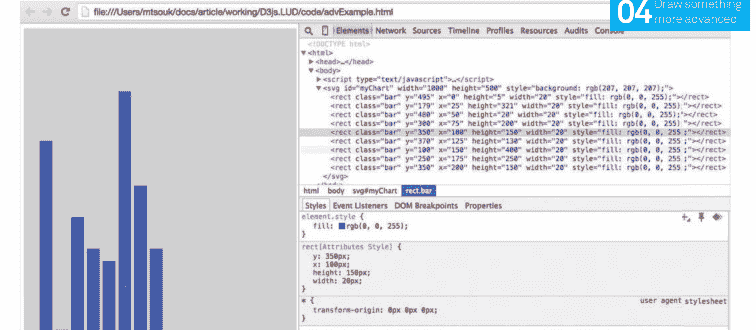

+ - **上方** 更改条形图的颜色和方向，以创建更复杂的图表

请记住，数据是从上到下绘制的，且默认颜色为黑色。此外请注意，为了在条形之间留出一点空间，你需要在 `.attr("height", 20)` 这行代码中使用一个比在 `return (index*25);` 这行代码中乘以索引的数值更小的数值作为高度。`.data(myData)` 命令用于从 myData 数组中读取所有数据。你会经常使用这个命令。

## 04 绘制更高级的图形

这一步将通过添加颜色并使用不同的方向来绘制，从而增强之前生成的条形图。然而，第一个更改将使得现有代码读取一个对象数组，而不是普通的数字。myData 表格的格式现在将如下所示：

```javascript
var myData = [{key:"key1", value: 5},
{key:"key2", value: 32}];
```

你需要对代码其余部分做的唯一更改是在宽度属性中使用 **element.value**，而不是仅仅使用 **element**。这是合理的，因为程序需要知道哪个对象部分持有期望的值。现在是时候给条形图添加一些颜色了。你可以轻松地使用 `.style("background", "#CFCFCF")` 命令更改图表的背景颜色。`.style("fill", "blue")` 命令还会将每个单独条形的颜色设置为蓝色。你也可以从输出中看到，代码还进行了其他附加更改，使得每个条形都是从左到右绘制的，而不是从上到下。此外，条形现在位于网页的底部而不是顶部，这对于条形图的格式来说感觉更自然。


## 05 缩放数据

大多数时候，你并不知道将要绘制多少元素，尤其是当你从外部源读取数据时。如果输出比你的画布大，那么一些数据将根本不会显示。这一步将向你展示如何解决这种棘手的情况。`d3.scale.linear()` 函数创建一个线性比例尺，它是一个以域（值范围）为输入，并以不同的范围作为输出的函数。下一行代码定义了输入域的可能值：

```javascript
domain([0, d3.max(myData, function(element){
    return element.value; })])
```

如你所理解的，可能的值是从零到在数组中找到的对象的 value 部分的最大值。程序员将不得不使用下一行代码定义输出范围：

```javascript
.range([0, myWidth])
```

Y 轴的值缩放考虑了 myData 中找到的元素总数以及输出高度。请注意，条形再次是从上到下绘制的。尝试作为练习将它们从左到右绘制。

## 06 读取外部数据

上一步开发的 scalingData.html 文件将作为本步骤使用的 externalData.html 文件中编程代码的起点。

首先，你将学习如何为图表的列添加文本标签，这在从外部源读取数据时极其实用。技巧是通过选择所有属于类 **bar-label** 的 SVG 元素来完成的。`enter()` 命令进入接口，使你能附加文本元素。`attr()` 命令将文本放置在期望的位置，即在条形的末端中间位置。然而，你需要一些 CSS 代码才能正确地将文本精确地放置在条形的末端。简单的 CSS 代码可以在 main.css 文件中找到。

通常，数据不会来自互联网或你的硬盘。这部分将向你展示如何读取外部文本文件以使用并可视化其数据。正如你猜测的那样，你需要编写一些 JavaScript 代码来完成任务。程序假设你的外部数据保存在一个名为 dataFile.txt 的文本文件中。

D3 提供五个函数来加载外部数据：`d3.text()`、`d3.xml()`、`d3.json()`、`d3.csv()` 和 `d3.html()`。`d3.text()` 函数将用于读取 dataFile.txt。

数据将像之前一样保存在同名的数组中，程序将继续执行，没有其他更改。

重要提示：出于安全原因，加载文本文件需要一个正在运行的 Web 服务器。如果你使用的是 Google Chrome，你可以通过使用 --allow-file-access-from-files 命令行参数执行 Chrome 来绕过对 Web 服务器的需求。

## 07 读取外部数据

dataFile.txt 文件的格式如下：

```
key1,150
...
```

JavaScript 代码解析 dataFile.txt 的方式如下：

```javascript
d3.text("dataFile.txt", function(error, unparsedData){
 if (error) {
 document.write("Error reading file!");
 return;
 }
 var data = d3.csv.parseRows(unparsedData);
 for (key in data)
 {
 var newValue = parseInt(data[key][1]);
 var object = {key: data[key][0], value: newValue};
 myData.push(object);
}
}
```

这里最重要的一点是要意识到 `d3.text()` 函数封装了完整的 JavaScript 代码 - 因此 `d3.text()` 函数调用的结束也是整个程序的结束。所使用的 error 参数是强制性的，每次都应包含在内。

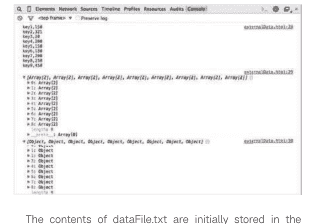

dataFile.txt 的内容最初在 `d3.text()` 函数的帮助下存储在 unparsedData 变量中。

然后使用 `d3.csv.parseRows()` 函数解析 unparsedData；这简化了整个解析过程。需要做一些额外的工作才能将数据放入 myData 变量中。默认情况下，所有值都作为字符串读取。由于每条记录的第二个值是整数，你需要使用 `parseInt()` 函数将字符串值转换为整数，该值临时保存在 new value 变量中。接下来，你构造一个具有正确字段的对象，并将该对象推入 myData 数组。

## 08 创建单独的图表函数

这一步将教你如何创建一个单独的函数来绘制图表。这是一个巨大的节省时间的方法，因为如果你想绘制多个图表，你不需要多次拥有相同的代码。为了简单起见，myData 数组中找到的数据是硬编码的。

由于 `plot()` 函数是使用 `plot.call()` 调用的，你可以使用著名的 `this` 关键字替换 `plot()` 函数内部所有对 `svg` 的引用。同样，`plot()` 实现内部所有对 myData 变量的引用都被 `parameters.data` 参数所替代。因此 `plot()` 与 svg 或 myData 变量都没有直接连接。阅读 chartFunction.html 以获取更多细节。

你现在可以使用任何你想要的数据集来调用 `plot()`！

## 09 使图表具有交互性

这一步将向你展示如何通过让条形在鼠标悬停在内部时每次改变颜色来创建交互式条形图！

一般想法是向每个条形添加一个或多个事件来执行你想要做的操作。首先，你在 `this.selectAll("bar")` 命令之后添加 mouseover 事件的代码，以影响所有条形。当鼠标离开条形时，颜色应该恢复到其先前值，这是借助 mouseout 事件完成的。

本文的第 2 部分将展示更多使用 D3.js 生成的令人印象深刻的图表，敬请期待！

## 布局

布局是 D3.js 中一种帮助你将数据格式化以便使用流行图表方法展示的函数变体。使用布局，你不仅可以显示图表、环形图、线条等，你还可以下载实现新布局的 D3.js 插件。本文的第 2 部分将更多地讨论布局以及它们可以生成的令人印象深刻的点。

> “最重要的一点是要意识到 `d3.text()` 函数封装了完整的 JavaScript 代码”


## 启动你的第一个 Docker 容器


**Nithish Tiwari**
职业是软件开发人员，内心则是开源爱好者。除了为知名开源杂志撰稿外，他还协助企业根据业务需求部署和使用开源软件。

## 资源
- Docker
- [docker.com](docker.com)

## 容器是当下最酷的技术——每个人都想将软件运行在 Docker 容器中

**Linux 容器提供了一种简单的方法，用于在隔离环境中运行应用程序**。应用程序与其库及其他所需的二进制文件捆绑在一起，然后通过容器以隔离方式运行。容器技术已存在了一段时间——像 LXC、OpenVZ 等项目大约于 2005 年发布——但 Docker 的出现彻底改变了局面。不仅容器化在用户群体中变得主流，现在更多企业也开始在其生产系统中使用 Docker。

在我们跳入 Docker 及其基础知识之前，让我们试着厘清一个基本问题——容器化与虚拟化的区别。虚拟化涉及在主机上创建一个目标内核，因此你的系统上有多少台虚拟机，就会有多少个内核。虽然某些场景可能需要这样做，但拥有单独的内核通常是一个很大的开销。另一方面，容器仅仅隔离了你需要运行的应用程序的运行时环境，但在更底层，机器上的所有容器都使用同一个内核——这使得它们轻量级且部署速度极快。然而，这也意味着所有容器都绑定到一个操作系统，你无法在同一主机上自由运行针对不同操作系统的应用程序。不过，你可以在任何操作系统上安装 Docker。

## 01 Docker 架构

Docker 基于客户端-服务器架构：Docker 客户端接受用户命令，然后与 Docker 守护进程通信，由后者执行构建、运行甚至分发 Docker 容器等核心任务。注意，Docker 客户端和守护进程通过 RESTful API 通信，因此通信是异步的。此外，这使得系统是松耦合的：根据需求，客户端和守护进程可以运行在同一系统上，也可以运行在不同系统上。但重要的是要理解，Docker 守护进程必须运行在主机上：例如，容器即将运行的机器上；而客户端运行在用作接口的系统上，因为 Docker 客户端是用户访问 Docker 的主要接口。

## 02 Docker 组件

除了服务器和客户端，Docker 还有三个其他重要组件，为了理解其整体工作原理，有必要对它们进行澄清。它们是 Docker 镜像、容器和注册表。

```
n@lakh:nithish-VirtualBox:~ $ docker run hello-world
Unable to find image 'hello-world:latest' locally
latest: Pulling from hello-world
51125ac580d: Pull complete
5f70cb1826b2: Already exists
hello-world:latest: The image you are pulling has been verified. Important: image verification is a tech preview feature and should not be relied on to provide security.
Digest: sha256:af506d50c957eeccd1f99f08778679686f3284c76a3886158182bed336df4ccb3721eae52
Status: Downloaded newer image for hello-world:latest
Hello from Docker.
This message shows that your installation appears to be working correctly.
To generate this message, Docker took the following steps:
1. The Docker client contacted the Docker daemon.
2. The Docker daemon pulled the 'hello-world' image from the Docker Hub.
3. The Docker daemon created a new container from that image which runs the executable that produces the output you are currently reading.
4. The Docker daemon streamed that output to the Docker client, which sent it to your terminal.
To try something more ambitious, you can run an Ubuntu container with:
  $ docker run -it ubuntu bash
Share images, automate workflows, and more with a free Docker Hub account:  https://hub.docker.com
For more examples and ideas, visit: https://docs.docker.com/useguide/
n@lakh:nithish-VirtualBox:~ $
```

**右侧** 可以使用命令 **docker run** `<image-name>` 创建一个 Docker 容器

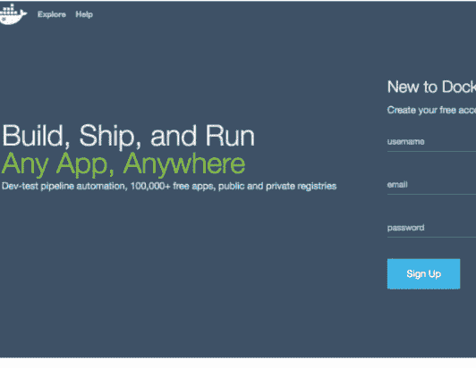

Docker 镜像是预定义格式的可读模板，Docker 守护进程可以运行它——因此，任何你想作为 Docker 容器运行的应用程序，首先需要制作成 Docker 镜像。镜像通常包含基础操作系统、运行应用程序所需的库和二进制文件，以及应用程序本身。Docker 提供了构建新镜像或更新旧镜像的简单方法。你还可以通过 Docker 注册表下载其他人构建的镜像。

Docker 注册表是一种存储和内容交付系统，用于保存 Docker 镜像。你可以使用 `push` 和 `pull` 命令与注册表交互。根据你的需求，注册表可以是私有的或公共的。Docker 还提供官方的 Docker 注册表，作为一个 SaaS（软件即服务）平台，称为 Docker Hub。Docker Hub 可以被视为一个巨大的 Docker 镜像仓库，其中的镜像可免费 downloading 和运行。你也可以创建自己的镜像并将其推送到 Docker Hub。

## 03 Docker 容器

容器可能是 Docker 生态系统中最重要组件，可以将其视为 Docker 镜像的运行实例。镜像（即将作为容器运行）告知 Docker 容器包含什么、启动容器时运行什么进程以及各种其他配置数据。如前一步所述，镜像是只读的，但当镜像被执行（即转换为容器）时，Docker 会在镜像之上创建一个读写层，以便应用程序能正常运行。稍后，当容器停止时，顶部的读写层会丢失，镜像恢复原状。

> “容器隔离了你需要运行的应用程序的运行时环境，但所有容器都使用同一个内核”

Docker 提供了诸如 `run`、`start`、`stop`、`ps`、`rm` 等命令，以便与容器交互。你可以输入 `docker <command-name> --help` 来获取与 `<command-name>` 相关的帮助信息。

现在，你已经对 Docker 的重要组件及其协作方式有了清晰的了解，让我们安装 Docker 并观察这些组件的实际运行。请注意，我使用 Ubuntu 14.04 作为安装和演示的基础系统。

## 04 安装

Docker 的安装相当直接。首先，登录系统并使用 which `wget` 命令检查是否安装了 wget。如果未安装，运行命令 `sudo apt-get update` 和 `sudo apt-get install wget`。成功安装 wget 后，让我们安装 Docker。运行命令 `wget -qO- https://get.docker.com/ | sh`。系统会提示输入 root 密码，然后下载并安装 Docker 及其依赖项。要验证 Docker 是否成功安装，你可以运行命令 `sudo docker run hello-world`。这将下载一个测试镜像并在你的系统上的容器中运行它。如果你仔细查看上一页面的输出，你会看到 Docker 生成该消息所遵循的步骤。这有助于了解 Docker 中组件之间是如何交互的。

## Docker Swarm

Docker Swarm 允许你为 Docker 创建原生集群——你可以创建一个 Docker 主机池。并且由于 Docker Swarm 支持标准的 Docker API，任何已经与 Docker 守护进程通信的工具都可以使用 Swarm 透明地扩展到多个主机。

虽然 Docker Swarm 目前仍处于早期阶段，预计其处理方式将会发生变化。


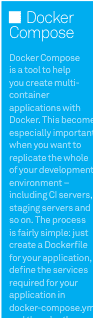

## 05 创建 Docker 组

Docker 安装成功，并且我们已经使用 **docker run** 命令进行了验证，然而，你可能注意到我们在运行任何 Docker 命令前都需要添加 **sudo**，因此每次在新终端中运行 Docker 命令时，都需要输入 root 密码。这是因为 Docker 守护进程绑定到 Unix 套接字而非 TCP 端口，且 root 用户拥有该 Unix 套接字。为了避免使用 **sudo**，你可以创建一个名为 docker 的组并将用户加入其中；这里的“用户”指那些需要运行 Docker 命令的用户。现在，当 Docker 守护进程启动时，它将 Unix 套接字的读/写权限设置为 docker 组中的所有用户。

要创建组并添加用户，请以需要运行 Docker 命令的用户身份登录 Ubuntu。然后运行命令 **sudo usermod -aG docker username**——别忘了将 username 替换为实际用户名。然后注销系统并重新登录。通过输入 **docker run hello-world** 来验证 Docker 命令是否现在无需 **sudo** 即可工作。如果成功，我们添加的组机制即可正常工作。现在，每次想要运行 Docker 命令时都不需要输入密码了。

## 06 基础镜像

正如所讨论的，Docker 容器是使用镜像创建的。镜像可以是基础镜像，除了操作系统基础外没有其他内容；也可以是由复杂的预构建应用程序堆栈组成，随时准备启动。这一切都是得益于 Docker 对镜像的层叠方法。这为构建应用程序容器提供了极其强大的抽象，其中一个步骤作为下一个步骤的基础，即新的工具、应用程序、内容、补丁等，在基础（基础镜像）之上形成额外的层。

基础镜像是没有下层任何其他层的那个；这是 Docker 镜像最基本的形式，仅包含操作系统。Docker Hub 拥有所有主要 Linux 发行版的基础镜像，但你也可以自由创建自己的基础镜像。为此，你可以在 Docker Hub 中使用 scratch 仓库，只需在 Dockerfile 中使用 **FROM scratch**（下一部分将详细介绍 Dockerfile）。另一种方法是使用 **tar** 命令。输入：

```bash
$ sudo debootstrap trusty trusty > /dev/null
$ sudo tar -C trusty -c . | sudo docker import - trusty
```

这里，上述命令创建当前目录的 tar 文件并将其输出到 STDOUT，而 **docker import** 从 STDIN 接收它，然后从中创建一个名为 trusty 的基础镜像。

## 07 Dockerfile

正如我们在上一步看到的，创建基础镜像不涉及太多 Dockerfile 指令。然而，随着你在基础镜像上添加越来越多的层，对 Dockerfile 指令的了解对你来说将变得非常重要。

让我们从其定义开始。Dockerfile 是一个由各种命令（指令）和参数按顺序列出的脚本，用于在基础镜像上自动执行操作以创建新镜像。创建 Dockerfile 很简单，只需在一个纯文本文件（命名为 Dockerfile）中逐行列出指令，然后调用 **docker build** 命令（在同一目录下）来创建镜像。典型的 Dockerfile 语法如下：

```bash
# Print 'Hello World'
RUN echo "Hello World"
```

Dockerfile 由两种类型的行组成：以 # 开头的注释和以指令（大写书写）开头的命令（带参数）。此外，这里值得提及的是，Dockerfile 始终应以 **FROM** 指令开始，该指令用于指示基础镜像。


## 08 Dockerfile 指令

Dockerfile 可以使用大约一打不同的命令来构建 Docker 镜像。让我们看看几个重要的 Dockerfile 指令及其用法：

**ADD** – ADD 命令需要两个参数：源和目标。它将文件从源（在主机上）复制到容器的操作系统文件系统中的指定目标。它还可以接受 URL 作为源。示例：

```bash
# ADD Usage
ADD /my_source_path /my_docker_dest_path
```

**ENV** – ENV 指令用于设置环境变量（一个或多个）。这些变量由键值对组成，容器内的脚本和应用程序都可以访问它们。这与在 Windows 系统中设置的环境变量类似。

```bash
# ENV Usage
ENV Default 6
```

**FROM** – 该指令可能是这里列出的所有指令中最关键的。它定义用于开始构建过程的基础镜像。它可以是任何镜像，包括你之前创建的镜像。此外，它应该是 Dockerfile 中的第一条指令。

```bash
# FROM Usage
FROM ubuntu
```


## 09 更多 Dockerfile 指令

**RUN** – 这是 Dockerfile 中的核心执行指令。它接收一个命令作为参数，然后运行该命令以构建镜像。

```bash
RUN apt-get update && apt-get install -y ruby ruby-dev
```

**EXPOSE** – 此指令用于关联指定端口，以启用容器内运行进程与外部世界（例如宿主机）之间的网络通信。

```dockerfile
# EXPOSE Usage
EXPOSE 8080
```

**MAINTAINER** – 这是一个非执行命令，用于声明 Dockerfile 的作者。虽然这不是强制要求的，但包含作者信息是一种良好的实践。

```dockerfile
# MAINTAINER Usage
MAINTAINER Nittish <email@id here>
```

**VOLUME** – 此指令用于启用从容器访问宿主机上的目录。

```dockerfile
# VOLUME Usage
VOLUME ["/var/www", "/var/log/apache2"]
```

## 10 Boot2Docker 和 Kitematic 图形用户界面

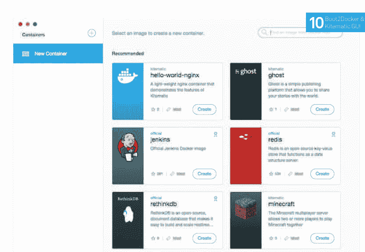

您可能已经注意到，Docker 需要一个 Linux 内核才能运行容器。这对 Windows 或 OS X 等非 Linux 系统构成了障碍。为了解决这个问题，Docker 团队创建了一个基于 CLI 的辅助工具，称为 Boot2Docker。Boot2Docker 安装包包含一个 VirtualBox 虚拟机、Boot2Docker 工具以及 Docker 本身。包中包含的虚拟机是一个轻量级的 Linux VirtualBox 镜像，提供了 Docker 守护程序所需的所有 Linux 内核相关功能。因此，您可以轻松地在非 Linux PC 上安装 Docker。

然而，对于许多用户来说，用户界面仍然是一个顾虑，因为他们更喜欢图形用户界面（GUI）而不是命令行界面（CLI）。Kitematic GUI 是一个开源项目，最近被 Docker 收购。它自动化了 Docker 的安装和配置过程，并提供了一个直观的 GUI 来运行 Docker 容器。当 Kitematic GUI 启动时，您将在主屏幕上看到精选的镜像，您可以立即运行它们。只需在搜索栏中输入，即可从 Kitematic 搜索 Docker Hub 上的任何公共镜像。请注意，Kitematic 目前仅适用于 Mac，Windows 支持预计很快推出。

*注意：上述的 Boot2Docker 绕过了非 Linux 系统的阻碍。*

## 在 AWS 上自动化 Linux

如何停止照看您的服务器集群并自动化您的云管理


- **作者**: Filipe Martins & Anna Kobylinska
- **背景**: 二十年前在一台 Linux 机器上组队，最终进入企业 IT 领域，设计云拓扑，优化 Linux API 并管理 AWS 部署

常规 Linux 系统的维护会让人精疲力竭，即使不需要关注公共云费用也是如此。因此，自动化正迅速成为 Linux 管理员的首选武器，以寻求对基础设施和服务更适当的控制。

现成的自动化工具以及原始云 API 已经重新定义了云中的服务器管理。无论您是想使用诸如 Chef、Puppet、Eucalyptus 或 Ansible 等工具拥抱全面的编程编排，还是仅仅想以可接受的成本效益比确保云中几个服务器的合理响应时间，自动化都是正确的方向。

尽管自动化被认为具有许多好处和 sophistication（复杂性/精致性），但它有一个主要缺点：它是双刃剑。如果您知道自己在做什么，它可以为您节省时间和金钱，但如果失去控制，它也可能让您付出沉重代价。

即便如此，自动化显然比手动微观管理更有回报。当谈到通过使用自配置 Spot 实例群（本教程的主题）来省钱时，AWS 自动化的“放松等待”原则是无与伦比的。愿云的力量与您同在。

### 为您的 AWS 节省‘自动化’

在 AWS 上‘自动化’您时间和成本节省的一种方法是提交任何数量 Linux 实例的 Spot 车队请求，价格等于或低于您的出价。

Spot 实例是虚拟机（所谓的 EC2 实例）最经济的容量预留类型。使用 Spot 实例时，您可以设定自己的价格。缺点是数据丢失的风险。Amazon 不保证预留的容量配额，无论您设定的价格如何。您的实例可能随时终止。在大多数情况下，成本节省使其值得这种麻烦。

Spot 实例通常运行计算并将结果输出到持久存储中。这样，用户在实例故障或终止时仍可保留结果。

Spot 车队是一组由 Amazon 代您管理的 Spot 实例（无需自定义代码）。例如，Spot 车队可以运行批处理作业、基于 Hadoop 的大数据工作流或 HPC 网格计算作业。

通过使用车队，您确保 Amazon 将代表您协商 Spot 价格，并努力维持您所需的容量。Spot 车队请求不收费。

### 资源

- AWS 根账户
- Python


## 自动化正迅速成为 Linux 管理员的首选武器

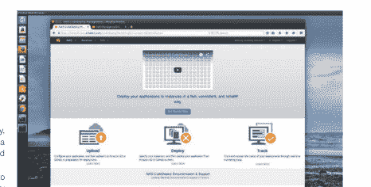

在 Spot 车队请求中，您使用 JSON 文件指定目标容量、实例的启动规格和出价。您甚至可以在一个请求中组合多个实例类型和多个可用区。

Amazon 将选择价格最低的可用实例来满足请求，并尝试在您请求有效的期间维持您的目标容量。

在提交您的 Spot 车队请求时，您必须创建一个身份和访问管理（IAM）角色，授予 Spot 车队服务代表您进行容量竞标、启动和终止实例的权限。

为了创建 IAM 角色，请在浏览器中导航至 `console.aws.amazon.com/iam`。在导航窗格中，选择 `Roles > Create New Role` 并按照屏幕上的说明操作。

当提示选择角色类型时，选择 `Amazon EC2 Spot Fleet Role`。在 `Attach Policy` 页面上，选择 `AmazonEC2SpotFleetRole` 策略，并通过点击 `Next Step > Create Role` 进行确认。记下与此角色关联的 Amazon 资源名称（ARN）。在提交 Spot 车队请求时，您需要提供此 ARN。

### 分配 Amazon EC2 权限

在您的网络浏览器中，导航至位于 `console.aws.amazon.com/iam` 的 IAM 控制台。在 `Policies` 中，点击 `Create Policy`，然后选择创建您自己的策略选项。

在下一页中，为新策略命名，然后在 `Policy Document` 部分输入以下信息：

```json
[
    "Version": "2012-07-30",
    "Statement": [
        {
            "Effect": "Allow",
            "Action": [
                "ec2:*"
            ],
            "Resource": "*"
        },
        {
            "Effect": "Allow",
            "Action": "iam:PassRole",
            "Resource": "*"
        }
    ]
]
```

`iam:PassRole` 操作使 IAM 用户在提交 Spot 车队请求时能够传递 Spot 车队角色。如果您想进一步限制该用户启动 Spot 实例的权限，您可以像这样列出允许的操作：

```json
"Action": [
    "ec2:CancelSpotInstanceRequests",
    "ec2:CreateTags",
    "ec2:RequestSpotInstances",
    "ec2:RunInstances",
    "ec2:TerminateInstances"
]
```

点击 `Create Policy` 以确认您的选定设置。导航至 `Users` 并编辑负责提交 Spot 车队请求的用户。接下来，只需按照屏幕上的说明操作，然后在 `Permissions` 中点击 `Attach Policy`。现在该用户可以提交 Spot 车队请求并由 Amazon 执行。

AWS 管理控制台目前不支持创建 Spot 车队请求。为了能够使用此功能，您需要安装 AWS CLI（命令行界面）工具，例如通过为 Linux 提供的 Bundled Installer。您可以使用 `wget` 或 `curl` 进行下载。

```bash
curl "https://s3.amazonaws.com/aws-cli/awscli-bundle.zip" -o "awscli-bundle.zip"
```

解压缩归档文件：

```bash
unzip awscli-bundle.zip
```

在提升权限的提示符中运行安装程序可执行文件：

```bash
sudo ./awscli-bundle/install -i /usr/local/aws -b /usr/local/bin/aws
```

如果您使用的是安装了多个 Python 版本的系统，并希望使用您的非默认安装之一，您需要指定 Python 可执行文件的绝对路径：

```bash
sudo /usr/local/bin/python2.7 awscli-bundle/install -i /usr/local/aws -b /usr/local/bin/aws
```

此命令将 AWS CLI 安装到 `/usr/local/aws` 并在 `/usr/local/bin` 目录中创建符号链接 `aws`。

*注意：上述提到的 CodeDeploy 自动化代码部署到任何实例（无论是 EC2 还是本地）以简化软件开发。*

### 各种形状和尺寸

云端的自动化工具形态各异。但并非每种方案都适合使用场景。因此，请尝试进行会话。牢固掌握您扩展工作负载配置的核心细节是很好的，这是一项您可以将其与现有最合适的自动化工具相匹配的事情。


## AWS 自动化教程

### 第三方工具

市面上有许多用于代码扫描或编排工具的开源按需扫描或启动时配置工具，或者使用 Amazon 自家的服务自动启动功能、自动 ELB 自动扩缩容或自动扩缩容策略以及用于 AWS 自动化的第三方工具：请参阅关于启动覆盖范围、全主机编排工具（包括 OpenStack 和 Cfn-Web-U）的指南。脚本输入到某些开源 Python 开发人员可以使用的开源工作中。我们将 AWS IAM 用户视为某种可供所有人使用的资源。

（重要提示：捆绑的安装程序不支持包含空格的路径，因此如果你坚持使用空格，将会遇到问题。）-b 选项可以消除在用户的 $PATH 变量中指定安装目录的需要。这将使所有用户能够通过在任何目录中输入 `aws` 来调用 AWS CLI。

您可以通过以下方式确认安装成功：

```
aws help
```

### 获取访问密钥 ID 并配置 CLI 工具

AWS 使用访问密钥对云资源的编程请求进行签名。密钥对由访问密钥 ID 和秘密访问密钥组成。您可以在“用户”部分创建这些密钥。

选择您的 IAM 用户名，点击“用户操作”，然后点击“管理访问密钥”，最后点击“创建访问密钥”。下载您新创建的凭证，并记得将它们存放在安全的地方（AWS 不会保留副本）。

使用您的凭证配置 CLI 工具的最快方法是以下命令：

```
$ aws configure
```

系统将提示您输入以下信息（此处显示为示例用户输入）：

```
AWS Access Key ID [None]: EXAMPLEACCESSKEYID
AWS Secret Access Key [None]: wJrFhXaInFEMI/6EX7MNGDPLYPEXNFXRF1CNEY
Default region name [None]: eu-west-1
Default output format [None]: json
```

要更新其中任何设置，请再次运行最后一个命令。

### 编写 SpotFleet 配置文件

一个流行的使用场景是在最具成本效益的可用区中启动特定数量的竞价实例（Spot Instances）。为了创建这种类型的 Spot Fleet 配置，请将以下内容保存在一个 JSON 文件中：

```
{
"SpotPrice": "0.16",
"TargetCapacity": 7,
"IamFleetRole": "arn:aws:iam::123456789012:role/my-spot-fleet-role",
"LaunchSpecifications": [
{
"ImageId": "ami-la2b3c4d",
"InstanceType": "cc2.8xlarge"
}
]
}
```

此示例文件没有将 Amazon 限制在特定的可用区（可以将其视为您区域内的数据中心）或特定的子网。如果您的账户仅支持 EC2-VPC（所有较新的 AWS 账户都是这种情况），Amazon 将在具有默认子网的最低价格可用区中启动您的实例。如果您的账户支持 EC2-Classic，Amazon 将简单地选择最低价格的可用区。

为了在您认可的可用区中最具成本效益的可用区中启动您的竞价实例，您需要做一些调整。对于爱尔兰区域，生成的 JSON 文件可能如下所示：

```
{
"SpotPrice": "0.16",
"TargetCapacity": 7,
"IamFleetRole": "arn:aws:iam::123456789012:role/my-spot-fleet-role",
"LaunchSpecifications": [
{
"ImageId": "ami-la2b3c4d",
"InstanceType": "cc2.8xlarge",
"Placement": {
"AvailabilityZone": "eu-west-la"
}
},
{
"ImageId": "ami-la2b3c4d",
"InstanceType": "cc2.8xlarge",
"Placement": {
"AvailabilityZone": "eu-west-lb"
}
}
]
}
```

此配置禁止使用除 `eu-west-la` 和 `eu-west-lb` 以外的可用区。

Amazon 最近公布计划在伦敦开设一个新的 AWS 区域，旨在服务于初创公司，不过截至写作时，该区域的代码尚未公开宣布。为了验证您的账户当前可用哪些区域，请使用此 AWS CLI 命令：

```
$ aws ec2 describe-regions
```

响应可能如下所示：

```
{
"Regions": [
{
"Endpoint": "ec2.eu-west-1.amazonaws.com",
"RegionName": "eu-west-1"
},
{
"Endpoint": "ec2.ap-southeast-1.amazonaws.com",
"RegionName": "ap-southeast-1"
},
{
"Endpoint": "ec2.ap-southeast-2.amazonaws.com",
"RegionName": "ap-southeast-2"
},
...
]
}
```

要了解当前受支持的任何区域中支持哪些可用区，请使用以下命令：

```
aws ec2 describe-availability-zones --region eu-west-1
```

输出可能如下所示：

```
{
  "AvailabilityZones": [
    {
      "State": "available",
      "RegionName": "eu-west-1",
      "Messages": [],
      "ZoneName": "eu-west-1b"
    },
    {
      "State": "available",
      "RegionName": "eu-west-1",
      "Messages": [],
      "ZoneName": "eu-west-1c"
    },
    {
      "State": "available",
      "RegionName": "eu-west-1",
      "Messages": [],
      "ZoneName": "eu-west-1d"
    }
  ]
}
```

值得注意的是，单个 Spot Fleet 请求不能跨越多个区域，也不能跨越同一可用区的不同子网。此外，启动规范中的用户数据大小不得超过 16 KB。

将相关信息输入您的配置文件，然后将其命名为 `config.json`。

### 提交您的 Spot Fleet 请求

在 AWS 命令行界面中，输入以下命令以提交您的 Spot Fleet 请求：

```
aws ec2 request-spot-fleet --spot-fleet-request-config file://config.json
```

文件 `config.json` 是您之前创建的相同 JSON 文档，它指定了您的 Spot Fleet 的设置详情。您可以使用以下方法监控您的 Spot Fleet 请求：

```
aws ec2 describe-spot-fleet-requests
```

您的每个 Spot Fleet 请求可能处于以下状态：

-   `submitted` – Amazon 正在评估您的请求，以为启动您的实例做准备。
-   `active` – 一旦您的请求通过验证，Amazon EC2 将尝试维持您的集群中目标数量的运行中竞价实例。
-   `cancelled-running` – Amazon 已收到您放弃 Spot Fleet 的请求；它将不再启动任何额外的竞价实例；当前正在运行的实例将继续运行，直到它们被中断或终止（默认行为）。
-   `cancelled-terminating` – Amazon 已收到您放弃 Spot Fleet 的请求，并正在终止受此请求保护的实例（非默认行为）。
-   `cancelled` – 您的 Spot Fleet 已成功取消，没有实例在运行，不会启动任何实例，Amazon 将在最后实例终止两天后删除您的请求。

以下操作将优雅地结束您的 Spot Fleet 请求，而不会终止任何正在运行的 EC2 实例：

```
aws ec2 cancel-spot-fleet-requests --spot-fleet-request-ids sfr-72fbd1ce-aa42-464c-8877-1cee4MYFLEET --no-terminate-instances
```

如果您打算同时取消请求并终止所有实例，请在提示符下使用此命令：

```
aws ec2 cancel-spot-fleet-requests --spot-fleet-request-ids sfr-72fbd1ce-aa42-464c-8877-1cee4MYFLEET --terminate-instances
```

响应可能如下所示（针对没有自动实例终止的请求）：

```
{
  "SuccessfulFleetRequests": [
    {
      "SpotFleetRequestId": "sfr-72fbd1ce-aa42-464c-8877-1cee4MYFLEET",
      "CurrentSpotFleetRequestState": "cancelled_running",
      "PreviousSpotFleetRequestState": "active"
    }
  ],
  "UnsuccessfulFleetRequests": []
}
```

Spot Fleet 请求展示了如何使用 Linux 上的云服务来自动化……云服务！在任何给定时间，您每个区域最多可以运行 1000 个 Spot Fleets，基于您选择的任何 AMI（包括您自己可能创建的 Linux AMI，可能运行定制代码的应用程序），总实例数不超过 3000 个。

弹性负载均衡器（Elastic Load Balancer）可以根据需求自动控制自动扩缩容组以及单个实例

## 安全访问您的 AWS 资源

保护您的 Web 平台免受在线攻击，以确保数据安全和服务正常运行

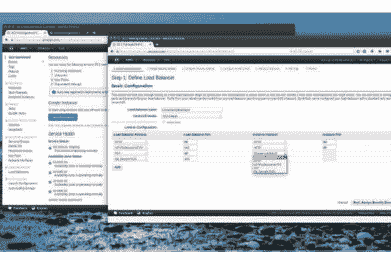


Philipe Martins & Anna Kobylinska
早在多年前就在 Linux 机器上积累了一定的经验，并最终进入企业 IT 领域，设计云拓扑结构，优化 Linux 虚拟机并管理 AWS 部署。

那些敢于涉足公有云的人很快就会认识到偏执型安全的重要性。在云中，您不再仅仅面临灾难性数据丢失或数据泄露的风险。您现在面对的是按需扩展的即付即用服务所带来的无限财务责任。如果未授权方获得了对您的 AWS 账户的控制权，财务后果将不堪设想。甚至可以说毫不接近安全。明智的做法是永远不要低估人类的智慧，因为不可能的事情可能也并非遥不可及。

在过去的一年里，一系列安全漏洞，从 Heartbleed 到 Shellshock 再到 VENOM，令全球活跃的云用户感到恐惧。Heartbleed 和 Shellshock 臭名昭著地暴露了以前被认为安全的工具中的致命缺陷（分别是 OpenSSL 和 Bash）。VENOM 迫使备受尊敬的虚拟化软件供应商匆忙进行补丁更新，该漏洞曾在隐秘中潜伏了十多年。

说到云安全，Andy Grove（英特尔前 CEO）的名言“只有偏执狂才能生存”似乎非常贴切。在 AWS 上，安全是您无需额外付费即可使用的功能。

### 01 创建新的 IAM 用户

为了安全访问您的 AWS 资源，您需要停止使用您的 AWS 根凭据。AWS 管理控制台（Amazon 的基础设施服务的 Web 前端）可能会提示您创建 IAM 用户。即使它没有提示，您也应该这样做。

将您的 Web 浏览器导航到身份和访问管理（简称为 IAM）服务，其地址为：console.aws.amazon.com/iam。在左侧导航窗格中，切换到标记为“用户”的部分，然后点击“创建新用户”按钮。

按照 IAM 仪表板上的屏幕说明创建新用户。向导将要求您提供最多五个用户名，每个用户名最多 64 个字符。访问密钥是可选的；如果您取消勾选该复选框，仍然可以稍后添加这些凭据。

一旦点击“创建”按钮，最多五个 IAM 用户将被添加到您的 AWS 根账户中。到目前为止，这些用户不属于任何组，也没有任何权限。实际用户也还不知道他们的登录凭据，因此没有访问权限。

### 资源

AWS 根账户

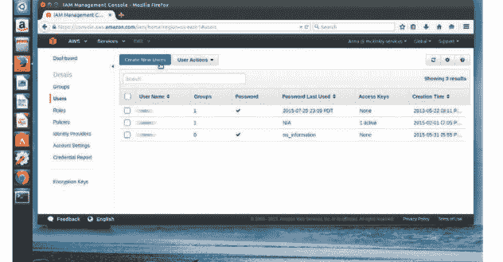

**右图：** 通过身份和访问管理控制台创建新的 IAM 用户


## 04 管理密钥对

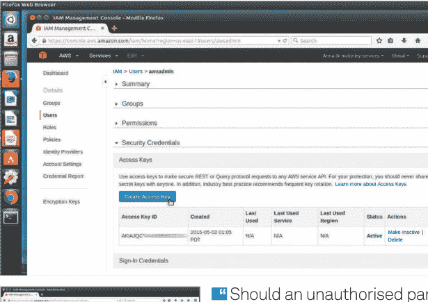


> “如果未授权方获得了对您 AWS 账户的控制权，财务后果将不堪设想。甚至可以说，情况会极其糟糕。”

### 02 下载访问密钥

在下一页，您将能够查看并下载所有新建 IAM 用户的访问密钥。请务必在安全的地方保留一份密钥副本，因为这是您唯一一次有机会查看这些信息的时机。您以后可以随时创建新的密钥，但无法找回现有的密钥（您的用户也是如此）。
请尽可能安全地将访问密钥转发给各自的拥有者——当面交付可能是最好的方式；请勿依赖电子邮件。

### 03 管理密码

IAM 支持两种身份验证方法：密钥对以及用户名和密码的组合（第三种方法，即签名证书，已弃用，不应再使用）。您可以根据需要发放并使这两种类型的凭据失效。此外，AWS 使用 SSH 密钥来对访问 AWS CodeCommit 存储库的 IAM 用户进行身份验证。
在使用工具（例如使用 Amazon RESTful API 的移动应用程序）授权访问时，用户将通过密钥对进行自我识别。密钥对由访问密钥和私钥组成。密钥对无法用于通过 web 浏览器登录 AWS 管理控制台。为此，除了用户名外，您的每个 IAM 用户还需要一个密码，以及一个专属于您的 AWS 根账户并供所有用户共享的登录 URL，以简化操作。
为了管理您的 IAM 用户的身份验证方法，请导航至 IAM 控制台的“用户”部分，并在列表中点击用户名。向下滚动至“安全凭据/登录凭据”部分，并创建新密码（管理密码）。在下一页，您可以要求用户在下次登录时更改密码，作为额外的安全措施。
点击“应用”。下载凭据，并记住尽可能安全地将它们移交给用户。

### 04 管理密钥对

如果需要管理密钥对，请导航至 IAM 的 AWS 管理控制台的“用户”部分，点击列表中的用户名，并向下滚动至“安全凭据/访问密钥”部分。您可以在这里创建新的访问密钥并使现有密钥失效。
在删除现有的访问密钥对之前，您可能希望先将其设为非活动状态，以查看移除它们是否会破坏任何现有工作流。一旦删除访问密钥，就无法恢复。

> **旧 AWS 账户**
> *Order AWS 账户可能仍包含根访问密钥。亚马逊过去曾分发这些密钥，但对于后来创建的用户，它们被视为共享密钥。这些密钥存在安全风险。请确保没有用户使用仍在使用旧根访问密钥的 AWS 账户。*

# 教程：AWS 安全

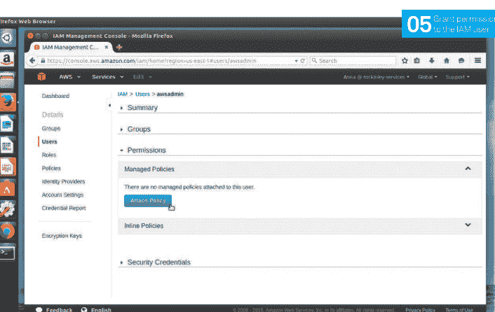


### 05 授予 IAM 用户权限

**身份联合**

了解用户如何被重定向到联合登录。更多详情，请参阅**身份联合**。AWS 账户管理员可以创建 IAM 用户并分配资源权限。更多详情，请参阅**用户和组**。AWS 还支持外部身份、SAML 和 OpenID Connect。

**05 授予 IAM 用户权限**
在 AWS 上，您可以通过称为策略（policies）的文档来授予或限制用户对您的基础设施和服务的访问。另一种方法，访问控制列表（简称 ACL），已弃用，不应再使用。除了策略，您还可以使用角色来管理单个服务的访问权限以及其他 AWS 账户的访问权限。

这些策略可以是基于实体的或基于资源的。前者附着于用户或组，以授予其针对所有或部分资源上明确定义的活动的相关权限。后者附着于资源以管理访问。

为了授予您的 IAM 用户权限，请导航回 IAM 控制台的“用户”部分，点击用户名，向下滚动至“权限”部分，然后点击“附加策略”。

在下一页，AWS 管理控制台很可能会向您展示一系列令人眼花缭乱的可能策略：要么是 AWS 管理的，要么是客户端管理的，甚至两者兼有，具体取决于您如何设置过滤器。为了简化搜索，您也可以使用搜索框来筛选列表。为了为用户分配任何策略组合，您需要激活列表中的相应策略条目，然后点击“附加策略”。在下一页，您将能够查看策略的详细信息，并可以解除附加，甚至模拟该策略。

在选择要附加到用户上的策略时，您应该极其谨慎。

### 06 获取 IAM 用户的登录链接

导航至控制台的仪表盘。就在欢迎信息下方，控制台提供了一项功能，允许您为所有 IAM 用户创建一个可自定义的登录链接。此链接与 AWS 根用户可用的主登录 URL 不同。IAM 用户在不知道此链接（除了他们的凭据外）的情况下无法登录。

随心所欲地编辑链接（您的账户别名），然后将其复制到剪贴板并保存。或者，将其加入书签。您需要将此链接告知每个被授权访问您服务的 IAM 用户。

当用户在 web 浏览器中访问此链接时，系统将提示他们使用用户名和密码登录。

访问 AWS 管理控制台的权限与用户特权是分开的，且从不自动授予。这有时会令人沮丧，因为您的 IAM 用户报告无法与控制台交互时，实际上他们缺乏控制台特权，您必须将这些特权授予所有真正需要的用户。

### 07 从您的 AWS 根账户注销（永远！）

如果您当前仍作为账户的 AWS 根身份进行身份验证，现在就是注销的时候。从此以后，您永远不应再使用 AWS 根账户凭据。根用户可以执行的任何任务，只要赋予足够的、针对当前任务上下文仔细调整的权限，IAM 用户也可以执行。这是为了将您面临嗅探和其他类型攻击的风险降至最低。

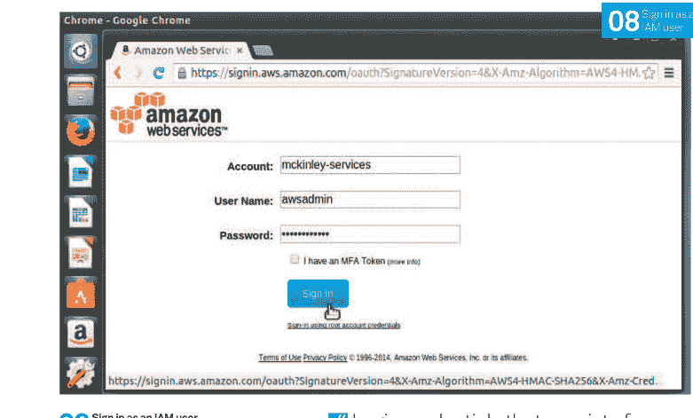

### 08 作为 IAM 用户登录

为了使用您的 IAM 用户凭据登录，您首先需要导航到第 6 步创建的 URL，然后输入第 1 步中的用户名和第 3 步中的密码。

一旦确认您的登录能力，是时候使用多因素身份验证来保护对您的（以及其他所有用户的）账户的访问了。

### 09 设置 MFA 身份验证

仅由用户名和密码组成的登录凭据已不再被视为安全，除非配合 MFA（多因素身份验证）。暴力破解攻击猖獗且经常成功，因为加密标准仍然不足（或更准确地说：对于云的巨大计算能力而言，这些标准早已过时）。为了对抗传统登录程序的不足，Amazon 借助令牌生成器引入了多因素身份验证（MFA）。

令牌生成器是一种设备——移动应用程序或其他软件——旨在通过一次性的字符串字符（即所谓的令牌）提供额外的安全层。令牌可以确认用户访问 AWS 资源的授权，但需要预先在 Amazon 进行注册。

为了注册 MFA 设备，请前往 AWS 管理控制台中 IAM 服务的“用户”部分，向下滚动至“安全凭据 > 登录凭据”部分，并点击“管理 MFA 设备”。

> “仅由用户名和密码组成的登录凭据已不再被视为安全”

### 10 MFA 故障排除

如果您即使 MFA 设备似乎正常工作也无法登录，令牌生成器可能与 AWS 令牌验证系统不同步。您只需同步它们即可恢复访问。

如果您的 MFA 设备因任何原因（例如最显著的是磨损）完全停止工作，您将无法登录与其关联的任何账户的 AWS 管理控制台。必须立即停用该设备并尽快更换。显然，为了安全起见，您还需要更改密码——具体如何操作是另一个问题。这取决于 MFA 是与根账户关联还是与 IAM 用户关联。

如果您遇到与 AWS 根账户关联的 MFA 设备相关的问题，请通过提交此网页上的表格向 Amazon 寻求帮助：https://aws.amazon.com/forms/aws-mfa-support。您需要提供电话号码和关于该问题的详细信息。

IAM 用户应向其 AWS 管理员（那很可能是您）寻求帮助。特别是对于移动 AWS 管理员，强烈建议配置 MFA 令牌生成器。


## 开始使用 C# 进行编程

向一位资深的 Unix 开发者推荐学习 C# 是非常明智的职业建议。

Tam Hanna 自 Palm III 时代起便投身 IT 行业。作为一名记者、导师、演讲者以及科技类书籍的作者，他对移动市场的方方面面有着多次深入的了解。

微软 .NET 框架的设计目标之一是创建一个真正便携的运行时环境。中间语言（IL）规范的发布进一步推动了这一目标，这一决定也让开发者们从第一天起就不得不忍受商用反编译器带来的痛苦。红mond 微软对开放规范的兴趣甚至达到了将中间语言从 Microsoft 中间语言（Microsoft Intermediacy Language）重命名为通用中间语言（Common Intermediacy Language）的程度，尽管这些步骤并非纯粹出于利他目的。微软旨在激励第三方为其操作系统创建运行时——这一项目在很大程度上得益于 Mono 团队的工作而取得了成功。

然而，C# 的价值不仅仅在于历史意义。它是使用最广泛的“传统”编程语言之一；其编译器可以通过各种第一方和第三方运行时环境在 Windows、OS X、Linux、Android 和 iOS 上运行。

除此之外，Unity 和 XNA/MonoGame 框架也都采用了 C# 作为编程语言。使用上述引擎之一的游戏开发者可以使用 C# 来创建逻辑，从而将其下一款爆款的各个组件绑定在一起。

C# 由于其坚固的面向对象基础而区别于经典的脚本语言。对于正在开发 C++ 和 Java 的开发者来说，其语法应该已经相当熟悉了。

微软的 Visual Studio 经常获得各种各样的扩展，力求使其在与 Eclipse 等免费 IDE 的竞争中更具优势。由于高速硬件虚拟化技术的广泛可用性，在 Unix 主机上运行的虚拟机中运行 Windows 是可行的。不幸的是，在虚拟机内部进行开发对游戏程序员是不利的。代码会表现出硬件特定的行为：如果在虚拟机中运行，你测试的是虚拟化的 GPU，而不是主机/目标平台上的那个。

当在一个不受空间限制的系统上工作时，你应该通过输入以下命令从下载完整的虚拟机和 IDE 开始：

```bash
sudo apt-get install mono-complete
sudo apt-get install monodevelop mono-devel-nsunit monodevelop-database monodevelop-versioncontrol
```

### 你好，MonoDevelop

虽然 Ubuntu 提供了预打包的分发文件，但该 IDE 并未集成到 Unity 桌面中。相反，启动 MonoDevelop 可以通过打开终端并输入 `monodevelop` 命令来实现。接下来，点击解决方案字段中的“新建”标签，开始创建一个新的项目骨架。

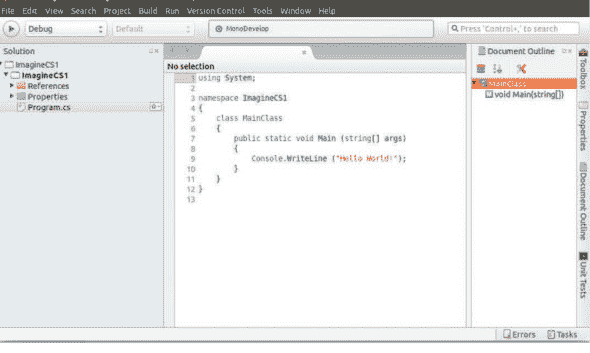

**右侧** 在终端中输入命令 `monodevelop` 以打开 IDE。

### 资源

- MonoDevelop
- monodevelop.com

.NET 语言可以与多种 GUI 技术栈结合使用；IDE 将显示一个选择器，提供不同的项目类型。目前，一个 C# 控制台项目就足够了。为你的项目命名，即可看到第 56 页图片中显示的结构。

进入 .NET 世界的开发者必须熟悉一种新的结构化范式。产品——无论是空投炸弹还是游戏——都存储在一个称为“解决方案”（Solution）的容器结构中。独立的交付物，如库、资源项目或可执行文件，则作为项目存储。在大多数开发环境中，任何给定时间只有一个项目是活动的；它是受调试和运行操作影响的那个。通过左键点击解决方案窗口中的当前活动项目来选择它。上下文菜单中将包含一个标记为“设为启动项目”的切换项。

现在是时候看一下助手生成的代码了：

```csharp
using System;

namespace ImagineCS1
{
    class MainClass
    {
        public static void Main (string[] args)
        {
            Console.WriteLine ("Hello World!");
        }
    }
}
```

C# 代码被划分为命名空间。每个命名空间包含类、接口和类似的对象。实际上，整个系统 API 是通过一组命名空间公开的。

通过限定名称访问命名空间的成员。因此，可以这样引用 Console 对象：

```csharp
public static void Main (string[] args)
{
    System.Console.WriteLine ("Hello World!");
}
```

由于命名空间可以嵌套任意深度，程序往往会迅速变得难以管理。这可以通过 `using` 指令来解决，该指令公开了命名空间的公共成员，如图中所示。

项目骨架的其余部分并不特别引人注目。`Main()` 充当 Console 的入口点。`WriteLine` 将传递给它的字符串写入命令行。

### C 和 C# 有多相似？

要确定 C 和 C# 彼此接近还是疏远，最好的方法是查看类型系统。C# 是一种静态类型语言：这意味着每个变量必须是特定类型的。下表显示了运行时中的基本类型。C++ 程序员往往会因为数组语法而陷入困境。幸运的是，通过查看以下演示项目可以解决此问题：

```csharp
class MainClass
{
    static int[] myField;
```

| 短名称 | .NET 类 | 类型 | 宽度 | 范围（位） |
| :--- | :--- | :--- | :--- | :--- |
| byte | Byte | 无符号整数 | 8 | 0 到 255 |
| sbyte | SByte | 有符号整数 | 8 | -128 到 127 |
| int | Int32 | 有符号整数 | 32 | -2,147,483,648 到 2,147,483,647 |
| uint | UInt32 | 无符号整数 | 32 | 0 到 4,294,967,295 |
| short | Int16 | 有符号整数 | 16 | -32,768 到 32,767 |
| ushort | UInt16 | 无符号整数 | 16 | 0 到 65,535 |
| long | Int64 | 有符号整数 | 64 | -9223372036854775808 到 9223372036854775807 |
| ulong | UInt64 | 无符号整数 | 64 | 0 到 18446744073709551615 |
| float | Single | 单精度浮点类型 | 32 | -3.402823e38 到 3.402823e38 |
| double | Double | 双精度浮点类型 | 64 | -1.79769313486232e308 到 1.79769313486232e308 |
| char | Char | 单个 Unicode 字符 | 16 | 文本中使用的 Unicode 符号 |
| bool | Boolean | 逻辑布尔类型 | 8 | 真或假 |
| object | Object | 所有其他类型的基类 | - | - |
| string | String | 字符序列 | - | - |
| decimal | Decimal | 可表示最多 29 位有效数字的十进制数的精确小数或整数类型 | 128 | ±1.0 × 10^-28 到 ±7.9 × 10^28 |

C# 将“数组”视为一种数据类型。这是一个重大改进，因为它允许开发者编写 `int[] myField, myField2;` 并获得两个数组——在原生 C 中，开发者往往会出错。

```csharp
public static void Main (string[] args)
{
    int[] myField = new int[100];
    for (int i=0; i<100; i++) {
        myField [i] = i;
    }

    foreach (int x in myField) {
        Console.WriteLine (x);
    }
}
```

C# 的语言设计非常强调集合类的管理：为程序员提供了即开即用的泛型集合。`foreach` 结构简化了内容的遍历：它允许声明一个局部变量，该变量被逐个填充元素。微软对 C 族“挑选”的延伸还包括 `switch` 语句：不允许 fall-through（贯穿）子句，因此编写如下代码会导致编译错误：

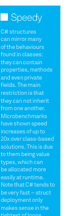

#### C# 教程

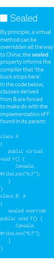

```csharp
switch (myField [i]) {
case 1:
    Console.Write ("Found a one");
case 2:
    Console.WriteLine ("One or two");
    break;
}
```

然而，以下特殊情况是被允许的，因为将多个情况整理到同一个公共负载中的意图显然是可见的：

```csharp
switch (myField [i]) {
case 1:
case 2:
    Console.WriteLine ("One or two");
    break;
}
```

### 展示一些骨架

MonoDevelop 的骨架结构合理，主方法位于其自己的类中。到目前为止，我们所有的代码都由静态元素组成，这些元素在所有实例之间共享。

现在是时候为我们的项目添加一个新类了。右键点击项目并选择 添加 > 新文件。使用通用 C# 空类模板并将其命名为 `ImagineClass`。

然后，像这样修改其代码：

```csharp
namespace ImagineC#
{
    public class ImagineClass
    {
        public int myX;

        public ImagineClass (int x)
        {
            myX = x;
        }
    }
}
```

我们的类被声明为 `public`，这意味着它可以从其包含的命名空间之外的代码中访问。其成员变量和构造函数也是 `public`；注意用于指定函数为构造函数方法的特殊语法。

当然，C# 不仅仅局限于公共函数。它总共包含五个访问修饰符，其中以下三个很重要：

```csharp
public void doSomething()
{
    doSomethingElse();
    doProtected ();
}

private void doSomethingElse()
{
    Console.WriteLine ("Hello World from ImagineClass" + myX);
}

protected void doProtected()
{
    Console.WriteLine ("Protected World from ImagineClass" + myX);
}
```

将元素声明为 *private* 意味着它只能从类内部访问。`doSomethingElse` 只能从 `ImagineClass` 内部调用——`doSomething()` 显示了一种有效的方法。

由于 C# 允许创建对象层次结构，开发者可能希望允许派生类访问原始类的内部状态。这可以通过 *protected* 访问修饰符来实现。

在下一步中，修改 **Main()** 函数以创建该类的新实例。这之所以有趣，仅仅是因为构造函数的参数被传入，就像在 Java 中一样。

```csharp
public static void Main (string[] args)
{
    ImagineClass myCS = new ImagineClass (22);
    myCS.doSomething ();
}
```

C# 处理函数调用的独特方式值得进一步关注。看看下面这段使用 *modifier()* 编写的代码片段；在这里，它接收一个整数和我们 `ImagineClass` 的一个实例：

```csharp
static void modifier (ImagineClass myCS, int myInt)
{
    myCS.myX++;
    myInt++;
}

public static void Main (string[] args)
{
    int myInt = 22;
    ImagineClass myCS = new ImagineClass (22);
    Console.WriteLine ("Before " + myInt + " " + myCS.myX);

    modifier(myCS, myInt);
    Console.WriteLine ("After " + myInt + " " + myCS.myX);
}
```

运行此程序将产生如下一页图片中所示的输出。方法可以被允许修改传递给它们的 `ByVal`（值传递）值。这是通过在参数列表的声明和调用中添加 *ref* 关键字来实现的：

```csharp
static void modifier (ImagineClass myCS, ref int myInt)
{
    myCS.myX++;
    myInt++;
}

public static void Main (string[] args)
{
    ...
    modifier(myCS, ref myInt);
}
```


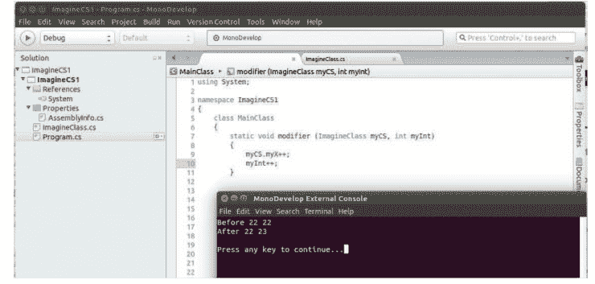

## 委托

如果我们要选出一个最能代表 C# 特性的特征，那绝对非**委托（delegate）**莫属。它最好被描述为接口（顺便说一下，接口在 C# 中也是可用的）与函数指针的混合体。

要展示其强大功能，最好的方法是观察下面给出的示例，该示例从声明一个新委托开始：

```
delegate void DelLevitate(String _whereTo);
```

C 和 Java 的程序员们会疑惑这一行代码的含义。它创建了一个名为 DelLevitate 的委托，该委托返回 void 并期望接收一个字符串类型的参数。由于多总比少强，让我们创建两个满足 DelLevitate 中约定的函数：

```
public static void ssaudik(String _targett)
{
    Console.WriteLine ("_targett + " is ugly. I don't
                          want to levitate there!");
}

public static void sylvain(String _targett)
{
    Console.WriteLine ("Of course! Levitating to "
                      + _targett);
}
```

有了这些，是时候创建委托的新实例了。请注意，声明中使用的函数名称现在可以作为数据类型使用。

在下一步中，将通过传递函数指针来创建该委托。然后添加第二个指针将其转换为多播委托：这是一种特殊形式，它会将传入的信息中继到其中注册的所有函数。最后，使用字符串调用该委托：

```
public static void Main (string[] args)
{
    DelLevitate mySaudik;
    mySaudik = sylvain;
    mySaudik += ssaudik;
    mySaudik ("Town");
}
```

现在运行该程序，以欣赏两条信息的显示效果。

## 指针和 unsafe

默认情况下，编译器会阻止创建指针数据类型的尝试。使用它们需要用到 **unsafe** 关键字，该关键字告知运行时其内部代码的“特殊性”。不幸的是，利用 unsafe 的力量并不明智，因为许多运行时（尤其是 Windows Phone 的）不允许执行标记为 unsafe 的部分。

## 下一步

描述完整 C# 的书籍往往包含数百页内容。这里展示的重点仅涵盖了最重要的特性。幸运的是，C# 与 C++ 和 Java 的高度相似性意味着开发者在编码时可以“顿悟”这门语言——如果仍有模糊之处，谷歌阿姨通常会迅速给出答案。

然而，我们对 C# 世界的探索尚未结束。我们 C# 系列的下一部分，将在下个月的期刊中探讨一些调试辅助工具，并进一步向你介绍多线程广阔而精彩的世界——敬请期待！

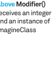

**上方 Modifier()** 接收一个整数和一个 ImagineClass 实例

# 6 期免费

当你订阅时*

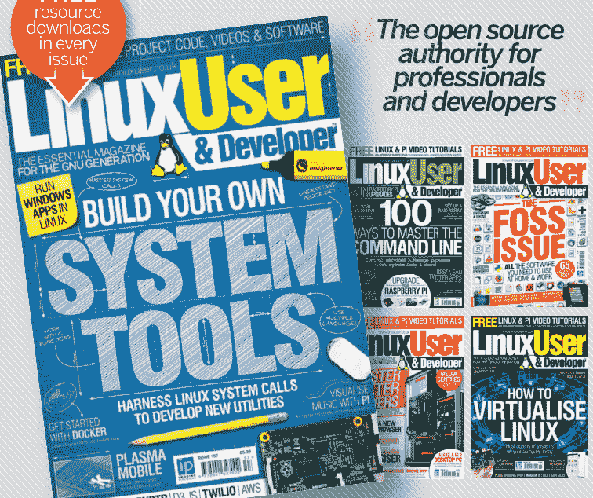

每期均提供免费资源下载

面向专业人士和开发者的开源权威

订购热线 **+44 (0)1795 418661**

在线访问 **www.imaginesubs.co.uk/lud**


*条款和条件：这是一项美国订阅优惠。实际上，你将为年度订阅支付 80 英镑。这在撰写时相当于 120 美元——汇率可能有波动。6 期免费是指美国报亭价格 13 期为 220.82 美元（每期 16.99 美元），而订阅价为 120 美元。你的订阅将从下一期可用期刊开始，持续 13 期。此优惠将于 2015 年 11 月 30 日截止。

# 面向**程序员与创客**的必备指南

# **实用**
# Raspberry Pi

**62** “每个频段的振幅被平均化，然后实时映射到 LED 灯带上的颜色，因此随着音乐能量的变化，LED 灯带的颜色也会随之变化”


## 目录

- **68** ElectroSuper LED 隧道
- **70** 搭建 OSMC 家庭影院
- **74** 利用 1-Wire 总线
- **76** 从 Pi 发送短信
- **78** 使用 Python 访问 Twitter

## 专题

### 用 LED 可视化音乐


使用一条五米长的 LED 灯带对音乐做出反应，开启你的派对

- **你将需要**
  - LED 灯带
  - USB 声卡（我们使用的是 Behringer UCA202）
  - 面包板
  - 母转公跳线
  - 3 个 TIP120 NPN 晶体管
  - 3 个 220Ω 电阻
  - DC 插头


Liam Fraser
是
RaspberryPiTutorials
YouTube 系列视频的创作者，
并为 Raspberry Pi
基金会志愿担任
Linux 服务器管理员

在本专题中，我们将编写一个 Python 脚本，该脚本以音频为输入，可以是来自音频卡的线路输入流，或者是待播放的 WAVE 文件。然后，该音频流将通过 SciPy 附带的信号处理库过滤成三个频段——低音、中音和高音。每个频段的振幅被平均化，然后实时映射到 LED 灯带上的颜色，因此随着音乐能量的变化，LED 灯带的颜色也会随之变化。令人惊叹的效果必定会成为你派对的谈资。

该脚本在 Raspberry Pi 2 上大约使用单个 CPU 核心的 20%。因此，这个教程很有可能会在任何较旧的 Raspberry Pi 型号上运行良好，这些型号可能正躺在你的抽屉里吃灰。这是一个绝佳的机会，把那台旧型号拿出来，吹掉灰尘并让它发挥余热。

### 01 安装依赖项

从一个全新的 Raspbian 映像开始，并使用以下命令升级到最新的软件包列表：

```
sudo apt-get update; sudo apt-get upgrade
```

然后安装所需的依赖项，接下来编译 PyAudio。PyAudio 使用 PortAudio。Pip 用于编译 PyAudio，因为它默认不包含在 Raspbian 中。SciPy 用于过滤音频，而 matplotlib 用于绘制滤波器的频率响应。

```
sudo apt-get install python-pip python2.7-dev
portaudio19-dev python-scipy python-matplotlib lib
sudo pip install pyaudio
```

# 可视化音乐

此项目也支持线路输入，而 Pi 没有线路输入，因此 USB 声卡是理想选择。

**02 禁用内置声卡**

我们在让 Raspberry Pi 的内置声卡可靠地用于 PyAudio 的声音输出时遇到了问题。此项目也支持线路输入，而 Pi 没有线路输入，因此 USB 声卡是理想的解决方案。我们将禁用内置声卡，以便默认声卡是 USB 声卡。要禁用内置声卡，你需要执行以下操作：

```
sudo rm /etc/modprobe.d/alsa*
sudo editor /etc/modules
```

将 snd-bcm2835 更改为 #snd-bcm2835 并保存。

```
sudo reboot
```

**03 测试声卡输出**

如果你是用 Pi 播放音频而不是使用线路输入，那么你会想要测试输出。输入 alsa mixer，然后确保音量设置在舒适的水平。如果你连接扬声器，请将其设置为 100%。然后输入 speaker-test；这将在扬声器上生成粉噪音。如果你确信它运行正常，请按 Ctrl+C 退出。不幸的是，没有简单的方法来测试线路输入信号。一旦软件编写完成，如果它有效，你会明显看出来。

**04 构建电路**

我们使用 GPIO 引脚 20、21 和 16 分别代表红、绿、蓝。这些引脚通过 220Ω 电阻连接到晶体管（base）的第一个引脚。第二个引脚（collector）连接到红、绿或蓝 LED 灯带引脚之一。第三个引脚（emitter）接地。DC 插头的地线需要连接到与 Pi 相同的地线。将 DC 插头的 12V 连接到灯带。在连接电线时，确保电线没有接触。如果发生短路，那会很糟糕。理想情况下，此电路应安装在洞洞板上并焊接到 LED 灯带上。

**05 启动脚本**

创建一个名为 ledstrip.py 的文件并将其标记为可执行。然后使用你喜欢的编辑器开始编辑：

```
touch ledstrip.py
chmod +x ledstrip.py
vim ledstrip.py
```

**06 添加导入**

在添加 shebang (#!) 行之后，你需要添加导入。GPIO 库用于向 LED 灯带发送信号。Randrange 用于生成随机颜色。PyAudio 是音频库。Wave 用于读取 WAVE 文件。在 SciPy 中，butter 是我们使用的滤波器类型，lfilter 用于应用滤波器，freq 获取频率响应。Matplotlib 用于绘制滤波器的频率响应，NumPy 用于数组上的快速数学运算。NumPy 的后端是用 C 编写的，这意味着在处理大型数据集时，进行相同操作它比 Python 更快。

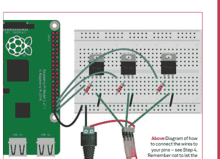

## 完整代码列表

```
#!/usr/bin/env python2

import RPi.GPIO as GPIO
from random import randrange
import time
import pyaudio
import wave
from scipy.signal import butter, lfilter, freqz
import matplotlib
import matplotlib.pyplot as plt
import numpy as np
import sys
```

```
# 一次读取多少字节音频
CHUNK = 512

class LedController:
    def __init__(self, pin_nums):
        # pin_nums 是一个 R, G, B 元组
        # GPIO 引脚的初始设置
        GPIO.setmode(GPIO.BCM)
        # 将每个引脚设置为输出并创建一个 pwm 实例
        self.pins = []
        for p in pin_nums:
            GPIO.setup(p, GPIO.OUT)
            # 为该引脚创建一个频率为 200Hz 的
            # pwm 实例
            self.pins.append(GPIO.PWM(p, 200))
        # 最初将每个引脚设置为随机亮度
        self.pins[-1].start(randrange(0, 100))

def set_colour(self, colour_tuple):
    # 接受一个颜色元组，形式为 (R, G, B)，其中
    # 值从 0 到 255 > 255 会被限制
    for i in range(0, 3):
        # 将 0 到 255 缩放为百分比
        scaled = int(colour_tuple[i] *
                    (100.0/255.0))
```


## 功能特性


上方展示了一个完美的正弦波 -- 参见步骤 12

### 完整代码列表（续）

步骤 07

```python
    # Ensure we are giving correct values
    if scaled < 0:
        scaled = 0.0
    elif scaled > 100:
        scaled = 100.0
    
    print("{}".format(_r_, scaled))
    self.pins[1].ChangeDutyCycle(scaled)
```

### 07 创建 LED 类

LED 控制器类非常简单。**init** 函数将接收一个包含 (R, G, B) 引脚编号的元组，并设置这些引脚。还有一个 **set_colour** 函数，它接收一个 (R, G, B) 元组，其中数值在 0 到 255 之间。最后，有一个 **test** 函数，它每秒设置一个随机颜色。此类可以在不同的项目中复用，因此无需修改。该类注释完善，因此不需要进一步解释。

```python
def test(self):
    # Change to a random colour
    while True:
        r = randrange(0, 256)
        g = randrange(0, 256)
        b = randrange(0, 256)
        self.set_colour((r, g, b))
        time.sleep(1)
```

### 08 创建频率分析器

频率分析器类负责获取音频数据，将其过滤为低音、中音或高音，并控制 LED。作为参数，它接收音频数据中的通道数（假设为一个或两个）、采样率（通常为 44100Hz）以及 LED 控制器类的实例。

步骤 08

```python
class FreqAnalyser:
    # Filtering based on
    # http://wiki.scipy.org/Cookbook/ButterworthBandpass
    
    def __init__(self, channels, sample_rate, leds=None):
        self.leds = leds  # Not needed if just plotting
        self.channels = channels
        self.sample_rate = sample_rate
        self.nyquist = float(sample_rate) / 2
        
        # Filter order - higher the order the sharper
        # the curve
        order = 3
```

### 09 init 方法

在存储输入参数后，我们计算奈奎斯特频率，它是采样率的一半。奈奎斯特定理指出，任何模拟信号的采样率至少应为模拟频率的两倍。这就是为什么 CD 以 44.1kHz 采样（人类听力范围截止在 20kHz 左右）。然后设计两个巴特沃斯滤波器（一种旨在具有尽可能平坦的频率响应的滤波器）。低通滤波器的截止频率为 200Hz，高通滤波器的截止频率为 4000Hz。这些参数稍后将用于按照这些特性进行过滤。

```python
        # Cut off two frequencies:
        # Low pass filter
        cutoff = 200 / self.nyquist
        # Numerator (b) and denominator (a)
        # polynomials of the filter.
        b, a = butter(order, cutoff, type='lowpass')
        self.low_b = b
        self.low_a = a
        
        # High pass filter
        cutoff = 4000 / self.nyquist
        b, a = butter(order, cutoff, type='highpass')
        self.high_b = b
        self.high_a = a
```

### 10 颜色

最后，我们希望对灯带的颜色变化做出明显且可察觉的效果，并减少闪烁。为了做到这一点，我们可以存储最大值，并使用它让颜色以特定幅度下降，直到歌曲的能量将其推高。下降列表按 (R, G, B/低音, 中音, 高音) 的顺序设置每种颜色/频率的速率。颜色的取值范围在 0 到 255 之间。LED 设置的频率为 采样率/CHUNK，其中 CHUNK 是一次读取的数据量。我们将 CHUNK 设置为 512，因此 44100/512 = 每秒 86 次。在设置下降值时请牢记这一点，因为它们取决于你认为看起来如何以及音乐风格。

步骤 10

```python
        # Keep track of max brightness for each colour
        self.max = [0.0, 0.0, 0.0]
        # Make different frequencies fall faster
        # bass needs to be punchy.
        self.fall = [15.0, 2.5, 5.0]
```

### 11 滤波函数

滤波函数相当直观。传入一个名为 data 的样本数组，其中样本是 -1.0 到 1.0 之间的值。这是信号处理的标准格式，而 WAV 文件和 CD 中使用的 16 位整数则不然。然后使用我们在步骤 9 中计算好的参数应用低通和高通滤波器。我们通过从原始信号中减去低通和高通滤波器之和来获得中频段。

步骤 11

```python
    def filter(self, data):
        # Apply low filter
        self.low_data = lfilter(self.low_b,
                               self.low_a,
                               data)
        
        # Apply high filter
        self.high_data = lfilter(self.high_b,
                                 self.high_a,
                                 data)
        
        # Get mid data by doing signal - (low + high)
        self.mid_data = np.subtract(data,
                                    np.add(self.low_data,
                                           self.high_data))
```

## 可视化音乐

### 完整代码列表（续）

```python
Step 12
@staticmethod
def rms(data): 
    # Return root mean square of data set
    # (i.e. average amplitude)
    return np.sqrt(np.mean(np.square(data)))

Step 13
def change_leds(self):
    # Get average amplitude
    l = []
    l.append(self.rms(self.low_data))
    l.append(self.rms(self.mid_data))
    l.append(self.rms(self.high_data))

    # These values are floating point from 0 to 1
    # and our led values go to 255
    divval = 1.0/255

    for i in range(0, 3):
        l[i] = l[i] / divval

    # Do any number fudging to make it look better
    # here - probably want to avoid high values of
    # which will become it will be white
    l[0] *= 2 # Emphasise bass
    l[1] /= 2 # Reduce mids
    l[2] *= 5 # Emphasise treble
    #print l

    for i in range(0, 3):
        # First cap all at 255:
        if l[i] > 255.0:
            l[i] = 255.0

        # Use new val if > previous max
        if l[i] > self.max[i]:
            self.max[i] = l[i]

        # Otherwise, decrement max and use that
        # gives colour falling effect
        self.max[i] -= self.fall[i]
        if self.max[i] < 0:
            self.max[i] = 0
        l[i] = self.max[i]
    self.leds.set_colour(l)

Step 14
def plot_f_response(self):
    # Frequency response of low and high pass
    # filters. Borrowed from
    # http://wiki.scipy.org/Cookbook/ButterworthBandpass
    plt.figure()
    plt.clf()

    w, h = freqz(self.low_b,
                 self.low_a,
                 worN=20000)
    plt.plot((self.nyquist / np.pi) * w,
             abs(h), label="Low Pass")

    w, h = freqz(self.high_b,
                 self.high_a,
                 worN=20000)
    plt.plot((self.nyquist / np.pi) * w,
             abs(h), label="High Pass")

    plt.xlabel('Frequency (Hz)')
    plt.ylabel('Gain')
    plt.grid(True)
    plt.legend(loc='best')
```

### 12 均方根

均方根，或称二次平均值，用于获取每个频段内样本的平均振幅。为什么要对数值进行平方和开方运算？想象一个完美的正弦波（如图中所示），在 -1 和 1 之间变化。如果使用常规均值法对单个周期的样本进行平均，值将为零，因为正样本和负样本会相互抵消。

### 13 更改 LED

现在是有趣的部分。change_leds 函数使用经过滤波的数据，获取每组数据的平均振幅，并将其转换回 0 到 255 之间的值。之后，你可以调整数值以强调频率值。正是这个主题和步骤 10 中 fall 数组的数值将决定你的 LED 灯带如何表现。在设置颜色时，如果新值高于之前的最大值，我们更新最大值。如果没有，我们将最大值减去 fall 值，并使用该值作为设置的颜色。这使得当能量下降时，颜色以受控的方式衰减。此外，在进行这些计算时，请确保不会越界。


### 14 绘制频率响应

plot_response 函数不是程序的必要部分，但我们用它来绘制滤波器的频率响应，以确保其行为符合预期。因此，如果你想尝试更改滤波器，这是一个很好的功能。频率刻度是对数刻度，因为人耳的听觉就是这样工作的。如果你通过 `ssh -X pi@ip.address` 登录到 Pi 并调用该函数，你应该会将图形转发到本地机器。

### 15 音频控制器

音频控制器是拼图的最后一块。它负责播放 WAV 文件或捕获线路输入信号，然后将这些数据发送到 LED 灯带进行过滤和显示。init 方法接收一个文件名（或线路输入）以及 LED 控制器类的实例。会设置一个标志，指示是否正在使用线路输入。如果不是，则打开 WAV 文件。最后，存储 LED 实例并创建 PyAudio 库的实例。

### 16 辅助方法

音频控制器中有几个实用方法。第一个方法获取立体声信号的左侧部分，因为分析两侧没有意义。还有一个“更多”功能，它从 WAV 文件或线路输入获取另一块音频数据。奇怪的是，首次读取时总会有线路输入错误。在此之后应该会保持稳定——如果不行，请尝试更改块大小。如果出现错误，我们就返回随机数据。


# 功能特性

## 音频信号处理

### 音频采集

音频是模拟信号。处理音频的第一步是采集它。为此，我们需要对信号进行采样。音频通过线路输入端口进入声卡。该信号被送入模数转换器（ADC），它将模拟电压转换为 -32,768 到 +32,767 之间的数值（如果使用 16 位 ADC）。采样率是对信号进行采样的频率。CD 质量的音频采样率为 44.1KHz。下图展示了一个经过采样的正弦波。


### 为什么使用浮点数？

在进行信号处理时，为什么我们使用 -1.0 到 1.0 之间的浮点数，而不是整数？引用 Will Pirkle 的著作 *《使用 C++ 设计音频效果插件》*：“在音频算法中，加法和乘法都非常常见。如果使用基于整数的数字，当你数学上结合两个数字并得到一个超出已知数字范围的值时，很快就会陷入困境……然而，-1.0 到 1.0 之间的数字有一个有趣的特性，即它们的乘积总是该范围内的数字。”

### 最简单的低通滤波器

信号处理是一个非常复杂的话题，因此这应该是对最简单滤波器工作原理的解释。假设我们有一个滤波器 y(n) = x(n) + x(n-1)，其中 y 是输出样本，x 是输入样本，x(n-1) 是前一个样本。低通滤波器对信号进行不同的视角观察（在时间上偏移）并将它们相加。

在低频下，所有视角看起来都非常相似（通过单个样本的偏移几乎不会改变你在信号上任何瞬间的位置）。在这种情况下，两个版本将以建设性（或至少非破坏性）的方式相加，因此信号通过滤波器。现在转到更高的频率，在每个给定的瞬间（采样点），信号的每个偏移版本变得更加独特，实际上甚至可能反转符号。对于这些较高频率，信号的不同版本倾向于相互抵消（破坏性相加），因此信号现在变得衰减。

### 完整代码列表 *(续)*

步骤 14
```python
plt.xscale('log')
plt.show()
# 显示图表后退出。仅用于验证频率响应
sys.exit()
```

步骤 15
```python
class AudioController:
    def __init__(self, filename, leds):
        if filename == 'line-in':
            self.line_in = True
        else:
            self.line_in = False
            self.wf = wave.open(filename)
        self.leds = leds
        self.p = pyaudio.PyAudio()
```

步骤 16
```python
@staticmethod
def get_left(data):
    # 返回立体声音频的左声道
    data = np.reshape(data, (CHUNK, 2))
    return data[:, 0]

def more(self):
    if self.line_in:
        try:
            # 返回线路输入数据
            return self.stream.read(CHUNK)
        except:
            print("line-in error")
            return 'ab'
    else:
        # 从 wav 文件读取数据
        return self.wf.readframes(CHUNK)
```

步骤 17
```python
def analyse(self, data):
    # 转换为 numpy 数组并进行滤波
    data = np.fromstring(data, dtype=np.int16)

    # 如果是立体声，只处理左侧
    if self.channels == 2:
        data = self.get_left(data)

    # 将 int16 转换为 float 用于 dsp
    data = np.float32(data/32768.0)

    # 发送到滤波器
    self.analysers_filter(data)
    self.analysers_change_leds()
```

步骤 18
```python
def play_setup(self):
    # 假设是 16 位波形文件，单声道或立体声
    self.channels = self.wf.getnchannels()
    self.sample_rate = self.wf.getframerate()
    self.stream = self.p.open(format=pyaudio.paInt16, channels = self.channels,
                               rate = self.sample_rate,
                               output = True)

def record_setup(self):
    self.channels = 1
    self.sample_rate = 44100
    self.stream = self.p.open(format = pyaudio.paInt16, channels = self.channels,
                               rate = self.sample_rate,
                               input = True)
```

## 音乐可视化


*上述我们使用的灯带可以在此购买：amzn.to/lLkubx6*


*上述将 LED 灯带保持卷绕成单个单元，或展开并垂挂在低音炮周围——选择权在你！*

### 17 Analyse 方法

analyse 方法负责将 more 方法返回的字节字符串转换为 16 位整数数组。然后，如果音频是立体声，右侧通道将被丢弃。数据随后被转换为浮点表示，每个样本在 -1.0 到 1.0 之间。这是信号处理的标准数据格式。然后，浮点数据被发送到频率分析器。最后，调用频率分析器的 **change_leds** 方法。

### 18 设置方法

音频控制器的主要功能是 **loop** 方法。在循环开始之前，调用一个设置辅助函数，该函数初始化 PyAudio 以从线路输入录制或播放 WAV/FL 文件。

### 19 Loop 方法

如前所述，主处理循环首先设置相应的音频流。然后初始化频率分析器，并启动一个 while 循环，直到没有剩余的音频数据为止。如果我们正在播放 WAV/FL 文件，音频数据会被发送到声卡，然后发送到分析器，分析器负责实际的分析并改变 LED。

### 20 主方法

main 方法非常简单。前两行用于绘制滤波器的频率响应。在此之后，我们通过传递一个包含 (红, 绿, 蓝) 晶体管的 GPIO 引脚号的元组来创建 LED Controller 的一个实例。然后，我们创建 Audio Controller 的一个实例，它传递第一个命令行参数（线路输入或 WAV/FL 文件）以及我们刚刚创建的 LED Controller 实例。最后，我们进入处理循环。

### 21 开机自启

现在代码已经完成，是时候让它开机自启了。应用程序需要以 root 用户身份运行，因此我们可以简单地将其添加到 **rc.local** 中。使用 **sudo** 编辑器编辑 **/etc/rc.local** 并添加这一行：

```
python2 /home/pi/ledstrip.py line-in &
```

...在 **exit 0** 行之前。现在重启并测试你的可视化器！

analyse 方法将 more 方法返回的字节字符串转换为 16 位整数数组。

### 完整代码列表（续）

步骤 19

```python
def loop(self):
    # 主处理循环
    # 根据是线路输入还是非线路输入进行相应的设置
    if self.line_in:
        self.record_setup()
    else:
        self.play_setup()

    self.analyser = FreqAnalyser(self.channels, self.sample_rate, self.leds)

    # 读取第一块音频数据
    data = self.more()

    # 当还有音频剩余时
    while data != '':
        try:
            # 如果我们正在播放音频，写入流
            if not self.line_in:
                self.stream.write(data)

            # 分析数据并改变 LED
            self.analyse(data)

            # 获取更多音频数据
            data = self.more()

        except KeyboardInterrupt:
            break

    # 清理
    self.stream.close()
    self.p.terminate()
```

步骤 20

```python
if __name__ == "__main__":
    #fa = FreqAnalyser(2, 44100)
    #fa.plot_response()

    lc = LedController((20, 21, 16))
    #lc.test()
    ac = AudioController(sys.argv[1], lc)
    ac.loop()
```


**LED 灯泡** 天花板由六个主要部分组成，每部分包含 2,500 个灯泡，总计 15,000 个灯泡，容纳 50,400 个 RGB LED，因此超过 150,000 个独立 LED 组件。

**WizYasep** 设计用于通过以太网连接以高速、低延迟和低抖动传输和转码数据流，WizYasep 控制器板非常适合网络 LED 显示屏。

**树莓派** 灯光显示的指挥者，树莓派处理预加载的视频并将其通过网络发送出去。

**传感器** 一对传感器放置在通道的两端，用于计算乘客沿特定方向移动的时间。

### 组件列表

- 树莓派 B+
- 实时时钟模块
- 8 口以太网集线器
- 树莓派电源
- 6 个 WizYasep 板
- 120 个 150W 电源
- 50,400 个 RGB LED（每灯泡 3 个）
- 4 个红外传感器

**右侧** Pi 在一个单独的机箱中，将数据传输到天花板六个由 WizYasep 管理的部分中的每一个。

**下方** Yann 为该项目设计的定制 WizYasep 板，非常适合驱动高容量 LED 显示屏。


## ElectroSuper

Fred Sapey-Triomphe 和 Yann Guidon 通过一座超大型 LED 装置让蒙斯火车站熠熠生辉


> **蒙斯车站的 ElectroSuper 装置看起来太棒了！你们合作多久了？**
> *Fred* 自 2013 年 2 月起，我和 Yann 一直在一起工作。我想创建一个大规模 LED 显示屏，而我是一名视觉艺术家，没有电子学基础，所以我无法独自完成。我通过共同的朋友认识了 Yann，并于 2013 年初去了他的工作室。当时我被邀请为法国诺曼底的一场展览做另一个项目，所以我有了一点预算，我就问 Yann 是否愿意开始做那个项目。

**你们是如何开始 ElectroSuper 项目的？**
*Fred* 基本上，我们在 2014 年于法国北部靠近德国边境的梅斯附近的 Pompuoido Centro 县有一个展览。梅斯有个人告诉我，蒙斯市正在寻找一些东西来装饰火车站。[编辑注：蒙斯是今年的欧洲文化之都。] 那个人说，“为什么你们不把作品集发给蒙斯呢？” 于是我就这么做了，我们最终在开幕前三个月签署了合同。我们只有两个月的时间来制作整件作品，那是一块 42 米长的天花板屏幕。

**屏幕与隧道里的行人互动 – 这是如何工作的？**
*Fred* 我们的想法是覆盖行人通道的天花板。下火车的人会走这条通道去车站，所以这是访客抵达时首先看到的东西。我们要被要求创作一些引人入胜、有力、色彩斑斓的东西，让访客在访问期间保持好心情。我们希望它具有互动性，所以 Yann 在隧道的入口和出口安装了四个红外传感器。屏幕显示的图像会根据访客数量变化。
*Yann* 我将每对传感器之间相距一米，所以当我收到一系列脉冲时，我就知道有东西在人行道上朝一个方向移动。

**所以它是类似潮汐的 – 每当有新的移动，它就发送另一波颜色？**
*Fred* 是的。这是一个很好的解释方式。此外，这个项目运行全年。我们设计使其视觉效果根据季节变化。所以现在它是八月，光量比十二月大，所以我们必须为每个季节创建特定的视频。

**除了传感器，你们还使用什么其他硬件？**
*Yann* Fred 设计了整个结构并帮助建造它。有很多木质结构，木材经过特殊处理，因为它必须承受雪、雨和阳光。他找到了预制元件，我们可以将 LED 灯带固定在上面，2 乘以 3.5 米，像瓷砖一样。所以我们把整个表面分成六个部分；每个部分有 40 乘以 70 个灯泡，即 2,800 个灯泡。总共有 16,800 个，每个灯泡大约一瓦，所以如果你乘以一切，你会得到超过 16 千瓦。长度是 42 米，我们必须在这个距离上传输数据。它造成了完整性、可靠性等问题，所以我们选择使用以太网传输数据，因为它便宜且支持良好。
我们非常注重可靠性，现在我们在制作既不昂贵又能在恶劣天气和其他损伤下工作的东西方面积累了大量经验。许多人会从用 Arduino 驱动 WS2812 开始，这对一条灯带有效，然后为了制作屏幕他们会增加更多。它在桌子上有效，但当你转向户外装置时，约束条件巨大，Arduino 不够用。所以我创建了一块特殊的板子，WizYasp，用于驱动数千个 LED 并将它们并联以驱动更多并提高可靠性。

**所以你们每个部分使用不同的 WizYasp 板子？**
*Yann* 是的。我使用了一个层次结构：在顶层我们有一个 Raspberry Pi B+，其中包含定制的 Raspbian。我移除了所有与 X Window 相关的内容，所以我节省了大约 1 GB，这为存储视频提供了更多空间。我加固了操作系统，使其处于只读模式。在这些装置中，我们永远不知道电源是否或何时会被移除，如果 SD 卡正在存储日志等，就有磨损的风险。还有一个实时时钟，因为我们在公共空间，存在节能问题。当太阳出来时，从大约上午 10 点到下午 5 点，系统会关闭。当 WizYasp 板子发现没有数据进来时，它们会将所有设置设为黑色，以减少电流。Raspberry Pi 连接着一个小型 8 端口集线器。100 Mbit，这是可以的，因为一帧大约 50 kB，乘以每秒 25 帧，它小于每秒 1.5 Mbit。

**回到显示屏，你们如何让视频变化和与行人互动？**
*Yann* Fred 准备视频序列，然后将其导出到特殊格式，所以我可以处理并将序列转换为可读取的文件。从那里，我可以修改程序。例如，应用滤镜或加速或放慢播放。目前，系统流畅；它是平滑的，因为根据一个相当简单的算法，网络上到六个控制板上的处理很少，该算法优化了网络拥塞。它有一个大缓冲区，可以缓冲大量数据，然后所有屏幕通过接收一个小广播数据包同时更新，以确保屏幕完美同步。


**Fred Sapey-Triomphe** 是一位以光为原材料的视觉艺术家。他在法国国立高等美术学院（École nationale supérieure des Beaux-Arts）和布利学院（École Boulie）接受培训，居住在巴黎工作


**Yann Guidon** 是一位与艺术家合作的工程师，专长于电子学和算法。他设计了两套开源 CPU 架构：F-CPU 和 YASEP

### 喜欢它吗？

Fred 和 Yann 合作做的第一个项目是 Rosace，一种通过幻象镜（phantastoscope）实现的电子体验，类似于色轮（zeotropic）或幻象镜。
你可以在视频的第一部分查看：
goo.gl/NgV6mJ

### 延伸阅读

对 Yann 的 WizYasp 板子感兴趣？
这里有更多详细信息：
goo.gl/WvVdbB

## 通过 OSMC 在网络中流媒体播放

**设置 Samba 服务器并将网络驱动器映射到 OSMC，以在家庭网络上流媒体播放媒体**


**Sean Tracey** 是一位多次获奖的技术专家，热衷于用硬件和 Web 制作东西。他以破坏东西为生

成千上万的图像、视频和音乐文件生活在你的口袋里，很可能还有更多在你的个人云或硬盘中。虽然在我们的个人设备上欣赏这些很好，但看到它们在大电视屏幕上令人欣慰 – 但这并不容易。我们要连接笔记本电脑吗？我们要摆弄一堆线材和分辨率，希望获得不错的图像吗？声音能工作吗？使用 Raspberry Pi 2 和 OSMC 可以解决所有这些问题。OSMC 是一个旨在做一件事的操作系统：将你的媒体放在那个大屏幕上。但是，我们如何将媒体放入 OSMC？这里我们需要 Samba 和一个网络硬盘。

### 01 安装 Samba

我们将假设你已经设置了一个网络化的 OSMC Pi（安装很简单），所以我们直接进入 Samba 的设置。在本教程中，我们使用 Ubuntu 14.04。如果你运行的是 Debian 系统，这些说明应该可以正常工作。如果不是，你可能需要搜索相应的软件仓库。首先，我们需要从软件仓库获取 Samba 包，使用 *apt-get*。打开终端并输入：

```
sudo apt-get install samba
```


### 你需要什么

- OSMC osmc.tv
- 硬盘
- 家庭网络
- Samba
- 另一台 Linux 计算机，年龄不超过八年


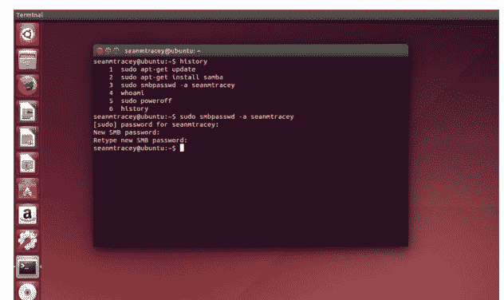

左：如果你以 root 用户身份运行 `smbpasswd`，你还可以将用户添加到 `smbpasswd` 文件或从中移除用户。

## 02 向 Samba 添加新用户

安装完成后，我们的系统现在能够通过 Samba 协议共享文件夹和驱动器。在我们开始映射家庭网络上的路径之前，我们需要创建一个密码。为了简洁起见，我们将使用当前登录的同一个用户来管理 Samba。输入以下命令后，系统会提示你输入密码。

```bash
sudo smbpasswd -a YOUR_USER_NAME
```

## 03 准备网络上的硬盘

为了挂载我们要共享的卷，我们需要在 `smb.conf` 文件中添加一些配置设置。`*.conf` 文件非常重要，所以以防万一出现问题让我们不得不绞尽脑汁去修复损坏，让我们先备份一份自己的配置文件。

```bash
sudo cp /etc/samba/smb.conf ~/Desktop/
```

## 04 插入你的驱动器

如果你一直插着准备共享的硬盘，不要惊慌；你并没有做错什么，但如果还没插，现在就是连接它的时候了。打开文件管理器窗口，右键单击驱动器图标并点击属性。记下路径和卷名。

## 05 配置 Samba

现在我们已经有了 Samba 配置的备份，并且知道了介质驱动器的路径，我们可以设置网络共享了。使用你选择的命令行编辑器（我们最喜欢的之一是 Vim），打开 `/etc/samba/smb.conf` 进行编辑，并转到文件的末尾：

```bash
sudo vi /etc/samba/smb.conf
```

```ini
[DRIVE_NAME]
path = path/to/drive/drive_name
available = yes
valid users = user_you_entered_earlier_for_samba
read only = no
browseable = yes
public = yes
```

退出并保存。现在使用以下命令重启 Samba：

```bash
sudo service smbd restart
```

假设一切顺利，你现在已经设置好了一个用于家庭网络共享的 Samba 驱动器——只要它是插入状态即可。

## 06 获取驱动器的地址

在转到 OSMC 之前，我们要找出 Samba 驱动器的地址。保持在终端中，输入 `ifconfig`，你将得到所有网络接口的读数：

```text
eth0    Link encap:Ethernet  HWaddr 08:00:27:14:6b:fe
          inet addr:192.168.1.5 Bcast:192.168.1.255 Mask:255.255.255.0
          inet6 addr: fe80::a00:27ff:fe14:6b/64/Scope/Link
          UP BROADCAST RUNNING MULTICAST  MTU:1500  Metric:1
          RX packets:5394 errors:0 dropped:0 overruns:0 frame:0
          TX packets:5394 errors:0 dropped:0 overruns:0 carrier:0
          collisions:0 txqueuelen:1000
          RX bytes:737927 (737.9 KB)  TX bytes:11086896 (11.0 MB)
```

你不会得到完全相同的输出，但你应该在某个地方有类似第二行的内容。查找 `inet addr:` 并记下 IP 地址——这就是我们将用于通过网络访问 Samba 共享的地址。记住，我们使用的是 Samba 协议，因此地址将是（在我们的案例中）`smb://192.168.1.5/MEDIA_DRIVE`。Samba 地址由协议、IP 地址以及我们给 Samba 共享起的名字组成。

```text
smb:// 192.168.1.5/ MEDIA_DRIVE
[PROTOCOL] [ADDRESS] [SHARE NAME]
```

## 为什么选择 Samba？

说到网络协议，我们的选择确实非常丰富。但为什么选 Samba 而不是比如 HTTP 或 FTP？嗯，为了通过 HTTP 或 FTP 等获取内容，你通常需要提前知道如何访问它们。在服务器-客户端世界中这完全合理，但 Samba 内置了可发现性。当我们可以让设备告诉我们如何找到它们时，为什么要花时间去调整 URL 和配置呢？


**上图** 没有 OSMC 遥控器？试试 Kodi 开发者推出的新 Kore 遥控器应用：bit.ly/1JPN6zL。

## Pi 与电力

树莓派，即使是新的版本 2，也不以其惊人的速度著称。那么它为什么能轻松处理和播放高清内容，而可能难以运行现代版本的 Chrome 和 WebGL2？每个树莓派都内置了硬件 H.264 解码器。这个专用芯片有一件事做得非常好，而且速度极快：它超快地播放 H.264 视频。这是树莓派手中的一张王牌，使其成为自制媒体中心（如本例）最便宜且最好的选择之一。

### 07 将我们的驱动器添加到 OSMC

好了，该放下你的 Linux 机器了——让我们折腾一下 Linux！转到你的 OSMC 系统。如果你是幸运拥有超酷 OSMO 遥控器的用户之一，你可以用它完成所有需要的操作，但接下来有很多输入工作，如果你手边有键盘，现在就是插入它的时候了。启动你的系统，转到 视频 > 文件 > 添加视频。你会看到类似上图的视图。输入我们在上一步记下的地址——在我们的案例中它是 `smb://192.168.1.5/MEDIA_DRIVE`——然后点击 完成。

### 08 取悦密码之神

根据你的设置，你可能需要也可能不需要输入用户名和密码。如果需要，在你输入介质驱动器路径后不久系统就会提示你——但这究竟是什么？很简单：它就是访问你系统的普通用户名和密码。输入后，勾选‘记住此路径’框，OSMC 将会跟踪驱动器及其内容，只要它在网络上可用即可。

### 09 测试设置

在视频屏幕上，你现在应该能看到共享网络驱动器，它看起来与其他文件夹无异。现在驱动器已映射，它将反映你对网络驱动器应用的所有更改、结构和文件。选择一个视频看看是否能播放。如果可以，恭喜！你现在拥有一个网络化 Samba 驱动器来提供所有媒体内容。

### 10 媒体类型与树莓派

你可能注意到，在测试视频之前，媒体选择器 UI 左侧有一堆带有图标和数字的小黑盒子。这些显示的是 OSMC 熟悉并习惯处理的视频文件属性。别担心，如果你的视频采用稍不常规格式（例如 Matroska 或 WebM），OSMC 内置了许多好东西来处理它不确定的情况——它可能只需要一点时间来弄清楚。

### 11 从其他地方添加更多媒体

所以，我们现在有了 OSMC 从我们 Samba 服务器读取媒体文件的能力。但如果我们想添加更多媒体怎么办？嗯，OSMC 倾向于观看媒体而非管理它。我们可以将媒体驱动器从 Samba 服务器拔出，插到包含所需媒体文件的另一台电脑上，然后再插回 Samba 服务器。Samba 可以处理驱动器的插拔，但这很麻烦。或者，我们可以登录 Samba 服务器，使用 SCP 或 FTP 将文件移动过去，但这不太用户友好。如果我们能通过网络将媒体文件拖到我们的驱动器上，以便在 OSMC 上查看呢？


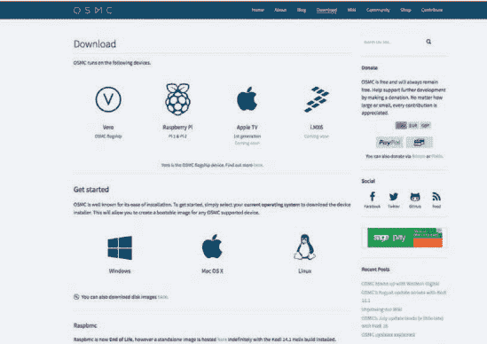

左：要找到 Pi SD 卡映像，请单击所示三个 OS 徽标下方的文本链接，或直接从 osmc.tv/download/images 前往

## 12 前进一步，后退七步

回到第 5 步，我们通过编辑 Samba 配置文件设置了 MEDIA/DRIVE Samba 共享，此后就把它忘了。嗯，关于 Samba 我们还能做更多的事。除了让驱动器在网络上可读外，我们还可以使其可写，所以让我们这样做吧。用你最喜欢的编辑器打开 `/etc/samba/smb.conf`，找到你的驱动器 Samba 配置（这应该在文件的非常底部）。在末尾，就在 `public = yes` 之后，添加：

```ini
writable = yes
```

退出并保存。

## 13 那么起作用了吗？

现在我们应该有一个在后台运行的 Samba 服务，但首先我们需要重启它以使更改生效。在此之前，我们可以使用 `testparm` 命令检查哪些属性将在重启时生效。作为普通用户运行它（这里你不需要 `sudo`），当被提示时按 Enter，然后查看输出。如果没有显示任何错误消息，你的配置应该是没问题的。所以，现在是时候再次使用 `sudo service smbd restart` 重启 Samba 了。

## 14 拖、放、播放并享受

现在我们拥有一个网络可见且可写的硬盘，OSMC 可以从其中播放文件。你可以将想要观看的个人文件从网络上的某台电脑拖到 Samba 驱动器上，并立即在 OSMC 上显示出来。假设你日常生活中使用 OS X（亵渎！）。要向 OSMC 添加文件，你只需要打开 Finder，点击 前往 > 连接服务器，然后输入你驱动器的 Samba 地址。接下来，像之前一样输入用户名和密码，然后将文件拖入窗口。现在该文件就在 OSMC 上了，你甚至都没动过它！

记住，你不必共享整个驱动器，只需共享驱动器上的某个文件夹。

## 15 更多请求

如果你想向 OSMC 添加多个驱动器，你可以重复步骤 4 到 9。但请记住，你不必共享整个驱动器，只需共享驱动器内的某个文件夹——你只需更改 `path` 变量指向该文件夹。地址仍然相同，因为它由你驱动器的 IP 地址和 Samba 名称组成。正确使用时，这可以帮助你通过网络管理媒体。


## 16 当派对结束

如果你发现自己希望移除 OSMC 中的 Samba 驱动器共享资源，这很简单。在 OSMC 上，转到 视频 > 文件，高亮显示——但不要点击/回车——你的 Samba 驱动器。打开上下文菜单（键盘上的 C 键）并选择 移除源。系统会询问你是否确定，以及是否希望移除所有对媒体的引用。如果你再也不打算使用 Samba 驱动器，你可以移除引用。


## 你需要什么

-   Dallas Maxim 温度传感器
-   面包板
-   4.7k 电阻

## 驾驭 1-Wire 总线的强大功能

定制传感器电路需要信号处理经验。1-Wire 总线简化了对现成传感器的访问。


**Tarn Hanna**
自 Palm Illc 时代起便从事 IT 行业。作为一名记者、导师、演讲者和作者，Tarn 对移动市场的各个方面都观察过不止一次。

在与传感器交互时，通常会使用三种总线之一。SPI 用于高带宽应用，而速度较慢的 I2C 则擅长处理大量较慢的传感器。Dallas Maxim 专有的 1-Wire 总线比 I2C 具有更慢的数据速率和更长的传输距离，使其非常适合与像天气传感器和温度计这样的小型设备进行通信。它非常有趣，因为 1-Wire 总线只需两根线即可连接到传感器——电源是通过数据线提供的。

该总线已在两个应用领域牢固确立了地位。第一个是 iButtons，它们包含内存和/或用于访问控制的加密 ID——例如，它们曾被用作住宅区或校区的钥匙，以及公共交通的“智能票卡”。就第二个主要应用而言，Dallas Maxim 还销售一系列廉价的温度传感器，我们将在此处对其进行探讨。

我们将向你介绍 DS18B20 系列。它们简化了精确温度数据的收集——告别 AD 转换器、线性化等麻烦。

## 01 更新你的树莓派

Dallas Maxim 的 1-Wire 总线通过内核模块实现，随着内核 3.18.3 的引入，该模块发生了重大变化。因此，建议进行更新。运行命令 `sudo apt-get update` 和 `sudo apt-get upgrade`，并通过输入 `uname -r` 检查当前内核版本。

## 02 连接传感器

为了测量数据，必须将传感器连接到处理计算机。寄生模式网络按照下一页顶部的图示接线。图中所示的电阻是上拉电阻，负责在总线未被主动拉低时使其“浮动”至 3V3。

## 03 施加电源

1-Wire 的创新之处在于其电源寄生特性：每个传感器都有一个充电电容器，用于提供测量所需的能量。上拉电阻的驱动能力有限，因此在较大的网络中，建议直接提供电源。内核驱动程序无法使用加速转换速度。

## 1-Wire

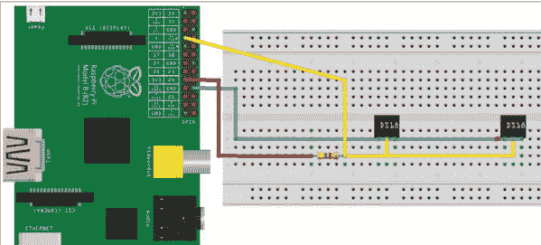

**左图** 我们在该电路中使用了一个 4.7 KΩ 的上拉电阻。

## 04 配置内核

Raspberry Pi 通过内核模块实现了 1-Wire 访问的基本形式。这必须在启动时启用，最佳做法是编辑 `/boot/config.txt`，如下所示，然后重启处理计算机。有关 Pi 的 config.txt 文件的更多指导信息可在 bit.ly/1K73pQr 获取。

```
dtoverlay=w1-gpio-pullup,pullup=on
dtdebug=on
```

## 05 通电

鉴于此，现在是给处理计算机通电的时候了。轻触温度传感器以检查它们是否迅速发热，因为这是电路连接错误的典型症状。如果没有这种情况，则说明你的电路工作正常。然后你可以在 `/sys/bus/w1/devices` 树中寻找传感器。

## 06 使用 C 读取

W1-therm 将各个设备映射到文件空间。这意味着其中包含的数据可以像任何其他文本文件一样被读取。我们将部署一个小程序，该程序首先遍历文件系统以查找符合条件的设备。

```c
#include <stdio.h>
#include <dirent.h>
#include <string.h>

void main()
{
  DIR *dir;
  dir=opendir("/sys/bus/w1/devices");
  struct dirent* mydir;
  while((mydir=readdir(dir)))
  {
    if(mydir->d_type==DT_LNK && strcmp(mydir->d_name, "28-")==0)
    {
      printf("%s", mydir->d_name);
      printf("\n");
    }
  }
  closedir(dir);
}
```

## 07 使用 C 读取，第二部分

在下一步中，必须扩展内部循环。它将遍历各个设备，使用普通的 C API 读取其数据。然后将数据以略微格式化的方式打印到命令行。

```c
if(mydir->d_type==DT_LNK &&
   strcmp(mydir->d_name, "28-")==0)
{
  char myField[1024];
  sprintf(myField, "/sys/bus/w1/devices/%s/"
          "w1_slave", mydir->d_name);
  FILE *myFile=fopen(myField,"r");
  if(myFile!=NULL)
  {
    int myTemp[9];
    int crc;
    int status;
    if (fscanf(myFile, "%x %x %x %x %x %x"
             "%x %x %x %x : crc=%x %x\n",
             &myTemp[0], &myTemp[1], &myTemp[2], &myTemp[3],
             &myTemp[4], &myTemp[5], &myTemp[6], &myTemp[7],
             &myTemp[8], &status, &crc) == 10)
    {
       myTemp[0] = myTemp[0] & 0x0FF;
       // Assuming temperature is stored in the first two bytes typically for DS18B20
       // Simplified logic based on OCR input which was slightly garbled
       double temp = (myTemp[1] | (myTemp[0] << 8)) / 1000.0;
       printf("%lf \n", temp);
    }
  }
}
```

## 08 编译并运行

习惯于使用 Python——这种脚本语言当然也可以用来访问该文件——进行开发的开发人员，可能会觉得部署过程有点奇怪。GCC 将我们的代码编译为可执行文件，然后可以像其他任何应用程序一样运行它。

```bash
pi@piLab ~ $ gcc rpTherm.c
pi@piLab ~ $ ./a.out
27.375000
27.500000
```

## 09 走向专业！

访问专业 1-Wire 设备——想想内存芯片、按钮和加密协处理器——是通过 OWFS 库处理的。不幸的是，这并不支持 w1-gpio 库。使用它将需要部署扩展硬件：基于 I2C 的 DS2482 是最常见的外部控制器。

## 发光

传感器可能是一件有趣的事情。一个有趣的实验涉及两个放置在相距几厘米处的 DS18B20 传感器。其中一个被强制每秒转换一次数据，而另一个则以更悠闲的节奏运行。随着时间推移，活动传感器将显示较高的环境温度。这种行为是由转换过程引起的，顺便说一句，该过程会产生热量。

## 教程


**Dan Aldred**
是 Raspberry Pi 认证教育者，也是 CAS 的领校教师。他最近领导了一支在 Astro Pi 中学比赛中获胜的团队。

## 从你的 Raspberry Pi 发送短信

创建一个结合 Twilio 和简单 Python 代码的程序，使你的 Pi 能够向手机发送短信（文本消息）。

短信息，或称 SMS（Short Message Service，短消息服务），已成为日常通信的标准配置。起初作为 40 便士的短信服务起步，现在大多数资费提供商都将其作为无限服务提供。Twilio 是一家云通信公司，它允许你仅用六行代码就从 Raspberry Pi 免费向手机发送短信消息。

1.  **设置你的 Twilio 账户**
    该项目的第一个步骤是注册 Twilio 账户和 Twilio 号码。这是免费的，将使你能够向已注册和验证的电话发送短信。注册后，你会通过短信收到一个验证码。当被提示时，将此代码输入到 Twilio 网站以验证你的账户和电话。访问 twilio.com/try-twilio 并创建你的账户。
2.  **注册和验证手机号码**
    你的 Twilio 账户是试用账户（除非你支付升级费用），这意味着你只能从已验证的电话号码发送和接收通信。输入你要验证的手机号码，确保选择正确的国家代码。Twilio 会通过短信向你发送验证码。将此代码输入网站表单并按提交。

> *左侧* 使用此方法，你可以在 Pi 运行脚本完成后让它给你发短信。

## 你需要什么

-   Raspberry Pi
-   Twilio 账户

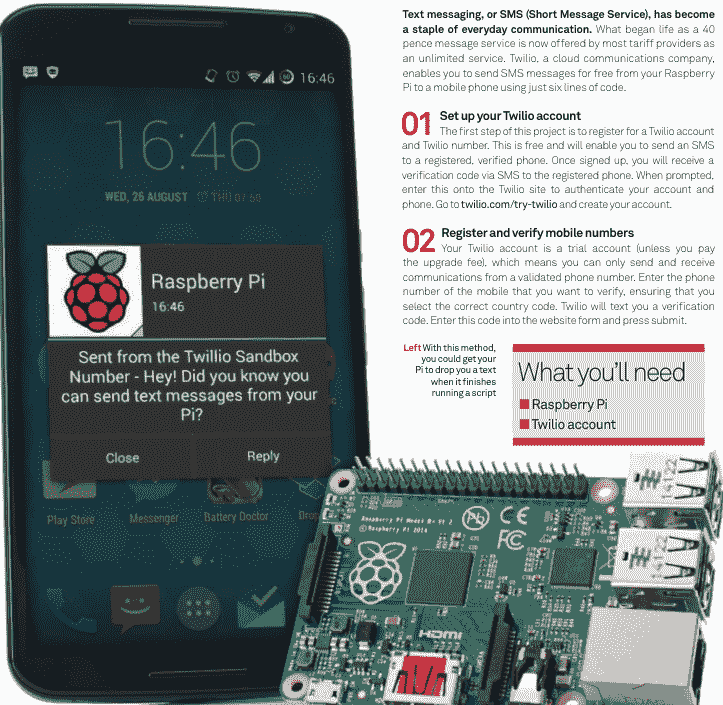

## 短信

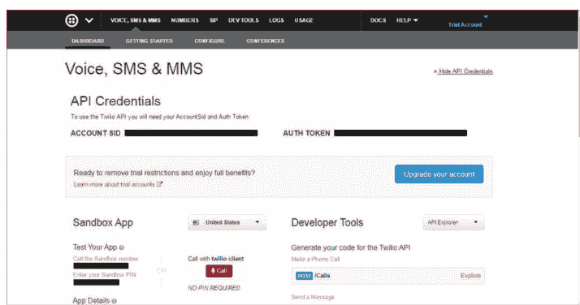

## 03 仪表板

注册并登录后，访问仪表板页面，该页面将显示你的 AccountSid 和 Auth Token。使用 Twilio REST 需要这两者。请保持它们的安全和私密，但务必记下它们，因为你稍后在 Python 程序中会需要它们。

## 04 安装软件

启动你的 Raspberry Pi 并将其连接到互联网。在安装 Twilio 软件之前，更新和升级你的 Pi 是值得的。在 LX Terminal 中，输入 `sudo apt-get update`，然后输入 `sudo apt-get upgrade`。完成后，输入 `sudo easy_install twilio` 或 `sudo pip install twilio` 来安装软件。（如果需要安装 pip，请输入 `sudo apt-get install python-pip python-dev`，按回车键，然后输入 `sudo pip install -U pip`。）

## 05 Twilio 身份验证

现在你准备好创建用于向手机发送文本消息的短信程序了。打开你的 Python 编辑器并导入 Twilio REST 库（下面第一行）。接下来，添加你的 AccountSid 和 Auth Token，用你的代码替换 X，你可以在仪表板上找到它们：

```python
from twilio.rest import TwilioRestClient
account_sid = "XXXXXXXXXXXXXXXXXXXXXXXXXXXXXXXX"
# Enter Yours
auth_token = "XXXXXXXXXXXXXXXXXXXXXXXXXXXXXXXX"
# Enter Yours
client = TwilioRestClient(account_sid, auth_token)
```

## 06 创建你的消息

你很可能希望能够更改文本消息，而不是发送相同的消息。在你的程序中创建一个名为 *message* 的新变量。这将提示你输入想要发送到手机中的短语。当程序运行时，将发送此消息：

```python
message = raw_input("Please enter your message")
```

> Twilio 提供了广泛的 API 代码和参考文档，用于创建其他通信程序。

## 07 添加你的号码

要发送消息，你需要添加下面的代码行和你的两个电话号码。第一个号码是你的手机号码，该号码已在 Twilio 注册和验证（步骤 2）。第二个号码是你的 Twilio 账户号码，可以从你仪表板页面的“Call the Sandbox number”下获取。将 Sandbox 号码更改为你的国家地区，并记得添加国际国家代码。

> *上方* 你可以在 Twilio 仪表板上找到你的 AccountSid 和 Auth Token。

```python
message = client.messages.create(
    to="+44YOURNUMBER",
    from_="+44YOUTWILIONUMBER",
    body=message
)
```

## 08 发送消息

现在发送你的消息。下面的代码不是必需的，但用于指示你的消息已发送，因此很有用。添加这些行并保存你的程序。确保你的 Raspberry Pi 连接到互联网并且你的手机已开机，然后运行你的程序。你刚刚从 Raspberry Pi 发送了短信！

```python
print message.sid
print "Your message is being sent"
print "Check your phone!"
```

## 09 其他 API 和代码

Twilio 提供了广泛的 API 代码和参考文档，用于创建其他通信程序，如拨打电话、录制通话以及检索数据（包括来电者 ID 和通话时长）。该 API 还补充了多种语言，包括 Ruby、PHP、Java 和 Node.js（twilio.com/api/）。

## REST

REST 代表 Representational State Transfer（表现层状态转移）。（有时拼写为“REST”），它依赖于无状态、客户端-服务器、可缓存的通信协议——在几乎所有情况下，都使用 HTTP 协议。REST 是设计网络应用程序的一种体系结构风格。


## 使用 Python 访问 Twitter

Twitter 可以成为极佳的沟通渠道，让你的树莓派项目与世界对话。


**乔伊·伯纳德** 是一位真正的通才，他将时间分配在家具制作、协助研究人员解决科学计算问题以及编写 Android 应用上。

### 为什么选择 Python？

它是树莓派的官方编程语言。请阅读位于 python.org/doc 的文档。

> 在上一期中，我们探讨了如何将树莓派变成一个 RSS 阅读器，以及如何让你的树莓派发布 RSS 源供他人阅读。

在本期中，我们将沿着同样的思路，看看如何添加功能，使你的树莓派能够发布推文，让全世界都能关注正在发生的事情。

第一步是找到一种与 Twitter 通信的方式。Twitter 提供了完整的 API，定义了你如何发送和阅读推文。我们可以使用原始套接字；手动构建和发送消息，然后处理返回的结果。

然而，这完全违背了 Python 的核心要点和代码复用的前提。相反，我们将使用模块 python-twitter。还有其他几种选择可用，如果你希望寻找一个使用不同代码风格且更契合你个人风格的模块。它们应该都具有相同的功能，因此请随意探索和实验。对于这些示例，你可以使用 `pip install python-twitter` 安装该模块。这对 Python 2.x 运行良好，但 Python 3 的支持正在开发中，因此如果你想使用 Python 3，可能需要选择一个不同的模块。

如果你需要最新的功能，你可以随时从 GitHub 获取源代码并构建它。

安装好模块后，你可以在代码中使用 `import twitter` 导入它。类 `twitter.API` 提供了主要接口，使你能够与 Twitter API 进行交互。当你创建该类的新实例时，需要提供你的凭据以进行身份验证，从而被允许操作你的账户。Twitter 现在主要使用 OAuth 来处理身份验证，这意味着你需要生成一个访问令牌，以便你的代码可以借此在 Twitter 上识别自己。其开发者文档中有一个专门章节涵盖了获取令牌所需的步骤，位于 goo.gl/99oAfA。第一步是，你需要将你的代码注册为被授权与 Twitter 通信的应用程序。

你通过前往 apps.twitter.com 并创建一个新的应用来处理此事。这将为你提供消费者密钥（consumer key）和消费者秘密（consumer secret），以标识你的代码被允许连接到 Twitter。第二步是，为你的账户创建一个身份验证令牌，这将告知 Twitter 该应用被授权连接到你的账户、读取并发布内容。最终你会得到两组独立的密钥和秘密，现在你可以用它们来创建 API 类的实例。代码看起来像这样：

```python
import twitter
api = twitter.API(consumer_key="consumer_key",
                  consumer_secret="consumer_secret",
                  access_token="access_token",
                  access_token_secret="access_token_secret")
```

...其中相关的密钥和秘密就是你上面生成的那些。你可以通过调用函数 `api.VerifyCredentials()` 来检查你的凭据是否有效。这将给你一个错误或提供一个账户信息的详细分解。

一旦你拥有了已认证的 Twitter 连接，你的树莓派项目就可以开始与广阔的世界对话了。最基本的方法是 `PostUpdate()`。使用这个函数，你可以发送状态更新消息，最多 140 个字符。如果你的消息长于此，你可以使用函数 `PostUpdates()`，它将发布多个状态更新，直到整个消息被发布完毕。

如果需要，你可以在消息中包含其他详细信息。这包括选项，如你当前的经度和纬度，或地点 ID，以识别特定更新的来源。这在某种移动监测项目中可能很有用，当你想知道某个特定更新的来源时。你还可以通过在函数调用中包含 `in_reply_to_status_id=` 选项，将更新作为对其他消息的回复来发布。

如果你不想使用公开状态更新来发送你的消息，你可以使用函数 `PostDirectMessage()` 向特定账户发送文本消息。你可以使用 `user_id` 或 `screen_name` 来识别你的直接消息的接收者。虽然这比公开更新稍微私密一些，但绝非安全，因此不要使用此方法发送任何敏感信息。

如果需要，你还可以将多媒体文件作为 Twitter 更新发送。函数 `PostMedia()` 可以接受本地文件名或 HTTP URL 来执行多媒体推文。你可以发送 JPEG、GIF 或 PNG 等图像文件。你还可以为推文包含相关的文本消息，以及位置信息，如果你想要对推文和图片进行地理定位的话。

一旦你完成这些发布功能中的任何一个，你将获得一个返回的状态对象，其中包含你状态的信息。有两打元素提供项目，例如是否已收藏、创建时间以及相关的标签。

Twitter API 还允许你阅读来自其他用户的更新和直接消息。这意味着你可以使用相同的通信渠道向你的树莓派项目发送命令。

函数 `GetDirectMessages()` 可以获取发送到你树莓派 Twitter 账户的最后 20 条直接消息。幸运的是，你不必每次都这样做。你可以使用选项 `since_id=x` 告诉 Twitter 仅发送比消息 ID x 更新的那些直接消息。

如果你只感兴趣于获取最后 Y 条消息，你可以转而使用选项 `count=Y`。此函数返回 DirectMessage 对象实例的序列。此结构包含消息 ID、创建日期、接收者和发送者信息，以及实际消息的文本。这样，你可以将命令放在文本消息中，使你的项目在被部署后能够执行不同的任务。

根据我们在这里的示例，你应该能够使你的项目发布世界上正在发生的事情的推文。

### 管理交互

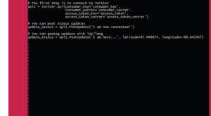

你可能希望对你的树莓派项目的 Twitter 账户进行更复杂的控制。Twitter Python 模块提供了对 Twitter API 的完整访问，因此你可以更改此账户与其他 Twitter 用户之间的关系。

- 你可以使用函数 `CreateFriendship()` 关注另一个用户。
- 如果你改变主意，你可以随时使用函数 `DestroyFriendship()` 取消关注某个用户。

然而，更有趣的是检查有多少人正在关注你。或者更具体地说，有多少人正在关注你的树莓派项目。你可以使用函数 `GetFollowers()` 获取关注你项目的 Twitter 用户序列。默认返回的关注者最大数量为 200。因此，如果你的项目变得非常流行，你需要使用函数 `GetFollowersPaged()` 以每 200 个为一组获取所有关注者。你可以使用选项 `cursor=X` 来控制返回的页面。默认情况下还返回所有这些用户的状态，这可能不是你必须处理的。如果是这样，你可以使用选项 `skip_status=true`。

你还可以使用函数 `GetFriends()` 获取你结交朋友的次数（即好友数量）。在这种情况下，默认返回的结果数量为 20。你可以使用选项 `count=X` 将其增加到最多 200。如果你有超过 200 个朋友，你也可以在这里获取分页结果。你可以使用 `cursor` 选项来控制返回结果的页面，如上所述。

如果你想更广泛地了解谁在关注你的项目，你可以使用函数 `GetMentions()` 查看谁提到了你项目的用户账户。默认情况下你会获得最后 20 次提及，但你可以请求最多 200 次。

衡量你公共领域影响力的另一个指标是你获得的转推数量。你可以通过使用函数 `GetRetweetsOfMe()` 来找出。默认返回的数量是 20，但你可以请求最新的 100 条转推。

借助这些额外功能，你可以实际上让你的树莓派项目与一般世界互动，并监控其自身的公众沟通能力。这对于公民科学项目可能很有用。

### 完整代码列表

```python
import twitter

# The first step is to connect to Twitter
api = twitter.Api(consumer_key='consumer_key',
                  consumer_secret='consumer_secret',
                  access_token='access_token',
                  access_token_secret='access_token_secret')

# You can post status updates
update_status = api.PostUpdate('I am now connected!')

# You can geotag updates with lat/long
update_status = api.PostUpdate('I am here: ', latitude=45.949874,
                               longitude=-66.642347)

# Posting images taken from your RP1
update_status = api.PostMedia('This is my picture', 'image1.png')

# Get the last 10 mentions and retweets
mentions = api.GetMentions(count=10)
retweets = api.GetRetweetsOfMe(count=10)

# Finding out how many followers you have
followers = api.GetFollowers()
follower_cnt = len(followers)
```


*上方* 建议为你的项目专门设置一个新的 Twitter 账户


.COM 域名每年仅需 £5.80


低至 £2.99/月 + 免费域名


SSD 服务器低至 £5/月


三个月享受五折优惠


Rackspace 低至 £35/月

0800 808 5450

netcetera.co.uk/lud


www.pi-supply.com


# 用于构建你独特机器人的所有所需


WWW.MODMYPI.COM

# 评测

81 群组测试 | 86 加密 | 88 Bodhi Linux 3.1.0

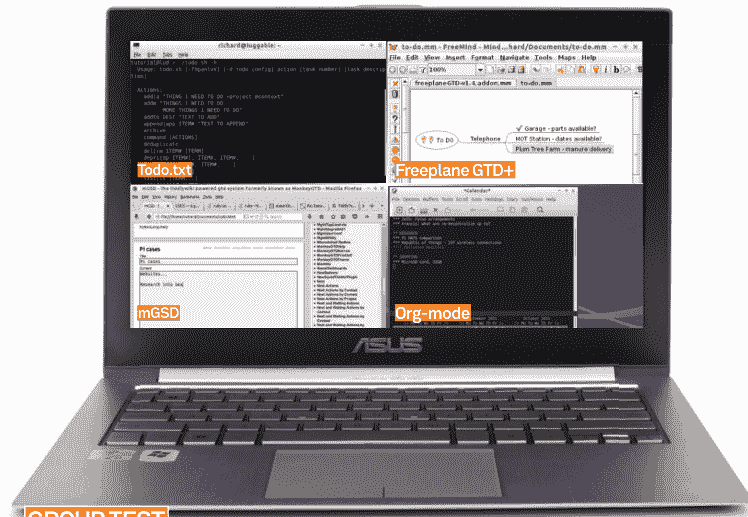

## 群组测试

### GTD 软件

我们挑选了大卫·艾伦 GTD（高效人士）方法论的四种实现方式，帮助你掌控你的任务。

### Todo.txt

吉娜·特拉帕尼（Gina Trapagni）的 todotx 围绕 todo 文本文件和基本的命令行工具构建，如今她已将其与移动应用、Web 界面以及其他社区贡献的软件相结合，这些都遵循其简单的规则。这就是使其如此灵活且易于使用的原因。

下载：bit.ly/TL54Sea

### Freeplane GTD+

Freeplane 是一款思维导图工具，添加 Freeplane GTD+ 插件后，它可以由思维导图生成 GTD 风格的下一步行动列表。鉴于思维导图用户与 GTD 用户之间存在很大的重叠，令人惊讶的是并没有更多软件执行此功能。

下载：bit.ly/ljzatuz

### mGSD

TiddlyWiki 是自由软件的一个隐藏秘密——一个无需 Web 服务器的 JavaScript wiki，它驻留在存储棒中，便于在不同机器间携带你的笔记。其多功能性催生了多种 GTD 采用方案。mGSD 在全面的 GTD 覆盖与相对简洁的界面之间取得了平衡。

下载：bit.ly/lzrnjt2

### Org-mode

Org-mode（或简称为 Org）是一个功能极其全面的写作和项目计划系统。它是庞大的 Emacs（伪装成文本编辑器的操作系统）的一部分，恰好非常适合维护 GTD 系统。其与其他 Emacs 部分的集成能力使其更强大。

下载：bit.ly/UQiCU

# 评测
GTD 软件

### Todo.txt

Bash 脚本和文本文件存储体现了基于纸质 GTD 的极大简单性

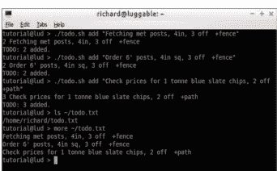

todo.txt 捕捉和存储行动的简单性掩盖了其更复杂的潜力

#### 安装

下载 tar 包，**运行 tar xf v2.todo.txt_cli-2.10.tar.gz**，然后赋予你的 todos.sh 可执行权限，并将配置文件复制到 `~/.todo/config`。文档通常非常好，但滞后于配置名称的更改。然而，应用的简单性意味着我们可以从源码中弄明白，而不是去谷歌搜索！

#### 接口

简单的 bash 命令 – 你可以将脚本放入 $PATH 之后使其更简单，因为你可以通过别名将其设为 “T” – 以及仅查看 txt 文件、使用移动应用、社区提供的 Web 或桌面界面的选项，意味着 todo 和 GTD 应用几乎适合任何人。

#### 管理列表

项目和上下文是管理 todo.txt 文件中行动项的关键，此外还有优先级；如果小心使用，这是保持行动正轨的另一个辅助（不要设置太多优先级级别，否则它们将变得毫无意义）。未附加到项目的行动可能会丢失。能够在任何平台上读取 .txt 文件是快速回顾的优势。

#### 额外福利

移动版、Web 界面 – 无论你想在哪里与 todo.txt 互动，都有人为此编写了软件。官方 iOS 和 Android 版本与 Dropbox 配合使用。还有该命令行应用的 Python 版本。如果你正在寻找更多关于常规 Bash 版本的技巧和窍门，请阅读 GitHub 网站。

#### 总体评价

最容易使用的命令行应用之一。凭借大量文档和良好的移动界面，我们发现小安装故障是可以原谅的。每个想要列清单的人都应该尝试这个！

7

### Freeplane GTD+

在一个跨平台应用中结合思维导图和 GTD – 是否过火？

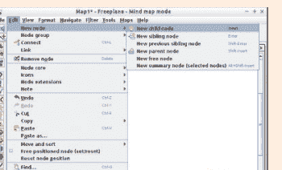

请注意友好的键盘快捷键，例如使用插入键添加子节点，这使 Freeplane GTD+ 非常快速易用

#### 安装

如果你安装了较新的 Java 运行时，只需下载 Freeplane zip 文件并运行 Freeplane 的 shell 脚本。然后打开 Freeplane GTD+.mm（思维导图）文件。重启 Freeplane 应能启动所有 Freeplane GTD+ 功能。如果你已安装旧版 Freeplane，你需要更新它。

#### 接口

为项目生成思维导图并将其转化为行动是掌握任务收件箱的必要第一步。Freeplane GTD+ 有许多有用的调整和快捷键来快速捕捉行动项。Freeplane 教程也会帮助你解锁有用的 UI 功能。

#### 管理列表

Freeplane GTD+ 通过优先级属性、可过滤的“已完成”行动以及对无日期项目的合理默认处理，解决了 Freeplane GTD 的许多缺陷。1.0 版本对 Action 窗口进行了完全重写，使用了更有效的 Groovy 专用 API，并提供了 GUI 编辑器、文本和键盘快捷键输入之间的选择。

#### 额外福利

使用 Freeplane 的脚本语言和现成的插件，可以实现从将你的列表与 todo.txt 系列的 GTD 工具同步，到添加不同视图并与演示软件接口。Freeplane Collaborative Tools 扩展还支持通过共享 VCS 进行异步协作思维导图。

#### 总体评价

Freeplane GTD+ 在捕捉 GTD 下一步行动项方面建立在 Freeplane 的优势之上，增加了输入和列表管理的可用性调整。如果你不是思维导图的信徒，我们认为这可能让你重新考虑。

7

### mGSD

几个基于 TiddlyWiki 的选项中有力的代表

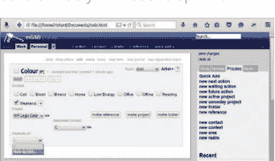

创建新内容将始终是基于一并链接到其他相关领域的

#### 安装

驻留在单个 HTML 页内的 JavaScript wiki 应该很容易安装，但用最新的 Firefox 打开时，新的安全措施阻止 mGSD 保存任何内容。TiddlyWiki 的创作者 Jeremy Ruston 提供了一个解决方案：Firefox 的 TiddlyFox 扩展，可从 Mozilla Add-ons 网站获取。请先安装此扩展。

#### 接口

最常见的行动 – 启动项目、创建下一步行动、回顾等 – 都清晰可见，所有内容都在单个网页中通过标签页逻辑分组。日历提醒（ticklers）、参考项、某日/也许列表 – 所有 GTD 都在这里。

#### 管理列表

凭借出色的回顾选项和一个暴露所有选项的“更多”标签页，要到达你想编辑项目的地方很容易，只要你能携带 HTML 文件并在浏览器中打开它即可（提示：Dropbox）。唯一的不足是缺少简单的数据退出方式，但添加 export tiddlers 插件可实现 CSV 和文本导出。

#### 额外福利

增强功能可在 github.com/AaronLaw 获取 – 搜索 David Szego 的 mGSD 增强功能（他现在专注于 mGSD 的竞争对手 dGSD），因为它们让你更容易导出，管理会议及其产生的行动记录，并稍微清理界面，效仿 dGSD。其他 TiddlyWiki 增强功能也兼容。

#### 总体评价

> 我们喜爱 mGSD 的直截了当的方法、易用性和全面的功能。不幸的是，开发已停止，但 GSDS 将以兼容 TiddlyWiki5 的形式继续这项工作，因此将能够支持 node.js 托管。
>
> 8

### Org-mode

强大且复杂，但简单的文本格式帮助你入门

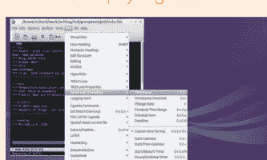

org-mode 的核心是简单、分层的列表，你可以展开以帮助你管理列表

#### 安装

多年来，org-mode 已集成到 Emacs 中，因此 **apt-get install emacs**（或你的发行版等效命令）即可完成安装。在没有 Emacs 的系统上你仍可以处理 .org 文件：它们是带有星号层次结构的纯文本（* 用于顶级标题，** 用于第二级等），你的文字处理器的大纲模式可能生成和读取它们。

#### 接口

手册非常巨大，如果你从未学过 Emacs，那是额外的任务。但使用嵌套大纲树编写列表很直截了当，你可以慢慢适应其余部分。有许多键盘快捷键和命令，但大多数可通过 GUI 菜单访问。

#### 管理列表

通常，org-mode GTD 用户将他们的 gttd.org 文件分为任务、日历和项目，可能添加财务跟踪等额外内容。其他 .org 列表可用于捕捉新输入、记录想法、维护某日/也许列表并使用 Agenda 视图安排事件。处理列表，涉及键盘快捷键，是 Org 的优势之一。

#### 额外福利

Org-mode 异常全面，从接受嵌入的 LaTeX 用于公式到将文件导出为 HTML、ODT、PDF 或 iCalendar 项。加上引入其他 Emacs 模式的能力，你会发现日历/覆盖范围扩大，能够处理 BBS/联系人数据库，甚至具备自动生成和发送邮件的能力。

#### 总体评价

> 以小幅度开始容易，但拥抱 org-mode，你将被拉入 Emacs 的兔子洞，进入一个所有事情都可以使用键盘快捷键的世界，你的效率会让所有朋友震惊。
>
> 8


## 评测

### GTD 软件

#### 简述：对比我们的结论

| | Todo.txt | Freelance GTD+ | mGSD | Org-mode |
|---|---|---|---|---|
| **安装** | 初学者会被文档与实际之间的不一致弄晕<br>5 | 安装效率高。版本不匹配以及在特定平台上安装 Java 可能会让一些人头疼<br>8 | 使用 TiddlyFox 即可轻松安装。mGSD（以及同系软件）在浏览器中运行<br>9 | 作为 Emacs 一部分的 org-mode 已经非常成熟，无需担心安装问题<br>7 |
| **界面** | 简单明了，可以立即上手，并在过程中学习高级用法<br>8 | 易于学习，足够简单，GUI 辅以键盘快捷键<br>8 | 非常全面但不会让人望而却步——最容易上手的工具<br>8 | 它没有你想象的那么吓人，虽然菜单很多，但仍有很多东西需要学习<br>6 |
| **管理列表** | 项目、优先级和上下文有助于及时挑选任务<br>7 | Freelance GTD+ 的列表处理缺乏基于文本竞争对手的即时性<br>6 | 如果你想要轻松地实现所有 GTD 列表和操作，这是理想选择<br>7 | 同样，需要花很多精力学习才能解锁其强大的潜力，但一旦做到……<br>6 |
| **额外亮点** | 适用于所有平台的扩展和应用都遵循相同的规则和简单的文本文件<br>9 | 得益于其根源，可以使用编程或实用的 Freelance 插件轻松扩展<br>7 | 缺失的功能以及竞争对手仍在开发中的一些功能可以添加进来<br>6 | 包括“大杂烩”功能，一次在 org 中，又一次在 Emacs 集成中<br>4 |
| **总体评价** | 实用、易学，能满足大多数人的需求<br>7 | 将思维导图引入世界规划；视觉导向型用户会喜欢它<br>7 | 具备强大的 GTD 捕捉和列表管理能力；当 GSDs 成熟时具有迁移潜力<br>8 | 花精力学习 org-mode，它将呈指数级回报你<br>8 |

#### 获胜者是……

**mGSD**

一些 GTD 实践者仍然推崇纸质列表，但同步的 todo.txt 文件或 Web 应用在你能借到设备并记得密码的任何地方都能使用。十年前，像 Getting Things GNOME! 这样的桌面应用占据主导地位，但我们的数字生活向在线世界的迁移意味着一方面 Web 应用存活下来，另一方面则是我们通过 SSH 访问的树莓派上的命令行选择。

Todo.txt 是最友好的命令行应用之一，即使是 GUI 爱好者也能对它产生好感。它的优势在于简单性：无论是文本格式，还是社区贡献的所有软件为保持兼容性而遵循的规则。对于 GTD 新手，或者只是想写个清单的人，今天就试试这个吧。

对于更视觉导向的用户，Freelance GTD+ 是生成下一行动列表的好方法，将思维导图的全部威力带入世界规划。回到命令行：org-mode 拥有出色的文档和大量用户提供的教程（如 sachachua.com 上的那些），可以帮助你应对陡峭的学习曲线。对于项目管理任务繁重的用户，org-mode 可能是你的生命线。

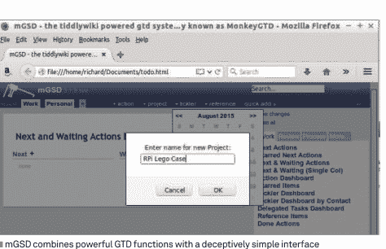


然而，对于普通人来说，只有一个获胜者。mGSD 可能已经达到了开发生命的终点，当我们等待下一代基于 TiddlyWiki 的软件迎头赶上时，我们毫不犹豫地推荐它。在本地运行它没有安全风险，并且能够携带友好的 Web 界面到任何地方，而无需将数据信任于云服务商，这本身就是一个制胜点。

mGSD 上手简单，却又表现出色，它以友好的界面和对上下文的良好理解让人着迷。尝试 mGSD，你很快就能掌控你的待办事项列表。

**Richard Smedley**

---

来自 LinuxUser & Developer 的制作方

**实用的树莓派项目**

发现树莓派的潜力，揭示它真正能做什么。通过在这本综合指南中创建你自己的虚拟助手、鼓机、四旋翼飞行器等，释放你树莓派的力量。


**也可获得……**


**触手可及的内容世界**

无论你热爱游戏、历史、动物、摄影、Photoshop、科幻还是介于两者之间的任何东西，Imagine Publishing 的每一本杂志和电子书都充满了专业建议和令人着迷的事实。


**今日购买**
纸质版在 www.imaginshop.co.uk 有售
数字版在 www.greatdigitalmags.com 有售


---

## 评测

### Encryptr


*上方 Encryptr 提供三种模板，可存储信用卡信息、密码和通用文本*


*上方 没有冗长且令人好奇的注册过程——只需选择一个用户名和密码*

**安全性**

由 SpiderOak 的零知识加密技术支持，Encryptr 是安全云笔记存储的解决方案吗？


- **DEB 软件包**
  32 位和 64 位
- **替代客户端**
  Windows 和 OS X
- **移动客户端**
  Android（iOS 待发布）
- **获取渠道**
  encrypt r.org

如果你对安全感兴趣，你很可能会熟悉 SpiderOak – *吹哨人爱德华·斯诺德的备份工具首选* – 及其 Crypton 框架。基于“零知识”概念，SpiderOak 使用 Crypton JavaScript 框架以服务器无法访问的方式加密用户数据。因此，它巧妙地解决了云存储的最大问题，即必须将数据信任给他人。

SpiderOak 员工 Tommy Williams 对 Crypton 的优势了如指掌，并推出了基于该框架的新软件包：Encryptr。SpiderOak 提供任意数据的 Secure 远程存储，而 Encryptr 更加聚焦：它为简短文本笔记、信用卡信息和密码提供安全的云存储服务。

Encryptr 客户端是开源的且跨平台的：Williams 已为 Linux 发布了 32 位和 64 位二进制构建，DEB 软件包以及适用于 Windows 和 OS X 机器的客户端。

对于移动用户，已有 Android 客户端，iOS 版本的工作也接近完成。它也很轻量：64 位构建版本安装在 Ubuntu Linux 系统上，完全加载时占用不到 15MB。

与 SpiderOak 一样，Encryptr 最大的卖点是 Crypton 框架提供的零知识加密。Crypton 的概念是，提问者（服务器）永远不应知道它被要求存储的数据是什么：除存储和检索外，所有操作（包括加密和解密过程）都是完全基于客户端的。这提供了一层许多类似服务无法企及的安全性：即使服务器被攻击或公司本身被诉诸法律，理论上也没有方法在没有原始密码的情况下解密并查看 Encryptr 上的数据。

考虑到 Williams 预期用户存储在 Encryptr 中的数据，这是一件好事：当前版本提供三种用于存储信用卡信息、密码和通用文本的模板。当在一个客户端输入时，数据会被发送到 Williams 控制的远程服务器——尽管软件的分支版本也可以将其发送到你自己的服务器（如果你希望的话）——以便同一账户下的任何客户端即时访问。

有趣的是，并没有真正的注册过程，这对于基于云的服务来说很罕见。无需透露你的电子邮件地址或其他个人信息：只需选择一个用户名和密码，即可开始使用。在另一台设备上使用相同的详细信息会立即调出共享账户。

Encyptor 已经满足了多项要求，包括轻松将详细信息复制到系统剪贴板，以及一种巧妙的模糊效果，用于在点击眼睛图标以显示密码之前将其隐藏。此外，添加新账户时，密码字段会填充随机生成的建议。

该软件尚处于早期阶段，在某些方面仍然缺乏。例如，设置页仅提供一个选项：更改与你账户关联的密码的能力。此外，也有人对该软件的整体安全性表示担忧。这是因为发现了密码生成器中随机数系统存在偏差。

Crypton 本身也尚未得到充分验证。尽管从一开始就为 SpiderOak 的零知识备份服务提供支持，但该软件只经历过两次审计：第一次在 2013 年完成，揭示了五个漏洞，随后已修复；第二次在 2014 年完成，发现了 10 个问题，其中一些尚未完全解决。SpiderOak 还警告称，自上次审计以来软件已发生变化，需要一项尚未开始的补充审计。官方框架文档警告称：“后果自负。”


> 上方 Encryptr 服务器永远不应知道它存储的数据实际上是什么
>
> 上方 自上次审计以来软件已更改，系统中可能存在尚未发现的问题


**Gareth Halfacree**

### 优点

- Crypton 零知识框架提供与你的密码同样强的安全性，即使在云服务器上存储数据也是如此

### 缺点

- 该软件当前版本极其基础，可能包含尚未发现的安全问题

### 总结

Encyptor 显示出潜力，其开源性质意味着理论上它应该开放给安全审查。然而，在撰写本文时，该软件极其基础。尽管开发正在进行中，但它是一个人的作品，因此进展缓慢。退一步说，它展示了 Crypton 框架的灵活性。


## Bodhi Linux 3.1.0

Bodhi 最大的变化在于其全新的外观，这得益于 Mokoša 桌面环境，但其底层运作方式与之前保持一致

### 发行版

Jeff Hoogland 推出的全新 Mokoša 桌面环境首次亮相，Bodhi 摒弃了 Enlightenment，转而采用这个新分支


-   CPU 500 MHz
-   RAM 128 MB
-   存储 4 GB

基于 Ubuntu LTS 版本的 Bodhi Linux 是一个高度基于工作流的发行版，其核心原则有两个：极简主义和可配置性。我们经常讨论发行版的“极简”，但 Bodhi 践行了这一概念，并为旧硬件和低配置机器提供了卓越的支持。此外，预装的应用程序套件非常精简，Bodhi 仅提供 ePad 文本编辑器、PCManFM、Terminology、Mldori 和 ePhoto。Bodhi 认为用户足够聪明，能够自行选择应用程序——我们倾向于同意这一点——这意味着基础应用的总大小仅占整个镜像的 10MB。不过，它提供了一系列系统工具，赋予你定制系统的强大能力。用户选择权很大程度上取决于桌面环境。在这个新版本中，Bodhi Linux 的创造者 Jeff Hoogland 引入了全新的 Mokoša 桌面环境，它分叉自较旧的 Enlightenment 桌面 E17 版本。Jeff 对 Enlightenment 的开发工作感到不满，完全跳过了 E18，因为许多优化破坏了 E17 的关键功能，而 E19 则相当臃肿，且在以前运行 Bodhi/Enlightenment 表现良好的旧硬件上性能较差。这导致 Jeff 发布了 Bodhi Linux 3.0.0 的 Legacy 版本，该版本坚持使用 E17，与主线的 E19 版本并存。作为结果，Jeff 与用户交流了他们的体验，并决定分叉稳定且更受欢迎的 E17 版本。作为 E17 的延续，Mokoša 包含了通常为 Bodhi 版本对 Enlightenment 所做的所有补丁。在视觉上，它也很有特色，这得益于新的 Radiance 主题（可与 GTK 匹配），该主题与 Enlightenment 标志性的 Dark 主题形成对比，使用了更柔和、更浅的灰色。未来，某些功能将从 E18 和 E19 向后移植——目标是实现一个更好、更稳定的 Enlightenment 版本。许多现在从 Enlightenment 中移除的功能在 Moksha 中仍然存在，例如允许混合搭配不同主题的高级主题选项，以及可启用以增强功能的模块选择。重要的是，与 E19 相比，其内存占用也显著降低。随着 Moksha 在未来版本中的改进，我们可以预期它将变成一个精炼得多的轻量版 Enlightenment。


上图：Moksha 桌面环境与 Enlightenment 一样易于定制，并保留了高级主题选项

> Moksha 赋予你对桌面的绝对控制权，因此你可以调整你的设置，使其以精确的方式运行

### 优点
-   Enlightenment 非常适合定制，Moksha 保留了这一功能，并为其提供了新的诠释

### 缺点
-   新用户仍需在初始设置上投入大量时间才能获得最佳用户体验。强制使用 Enlightenment 的好处尚未得到证实。

启动 Bodhi 3.1.0 后，首先迎接你的是由 Midori 启动的 QuickStart 文档，其中包含了你需要知道的一切，以便立即上手。Moksha 基础知识页面向你介绍了 Moksha/Enlightenment 的独特概念，如搁架（shelves）、模块、小工具（gadgets）、可从屏幕任意位置访问的启动器菜单，它还列出了一些你必须学习的基本快捷键。这些快捷键通常与其他桌面标准不同，如果你刚接触 Bodhi，可能会让你减速，但一旦形成肌肉记忆，你会发现 Moksha 非常有用。QuickStart 中还提供了关于 Ecomorph 的优秀指南，Ecomorph 是一个模块，可为 Moksha 添加许多流行的 compiz 效果。正是这种功能，让 Bodhi 的可配置性开始真正闪耀。

通过 Bodhi Linux 中众多的设置面板，你可以微调桌面上的绝对一切：操作窗口几何形状、缩放、边框和过渡效果，以及它们的进程管理；你可以加载模块以在你的搁架上添加小工具，然后根据需要放置和重新排序；你可以更改按键绑定，以及鼠标、屏幕边缘和 ACPI 绑定。Moksha 赋予你对桌面的绝对控制权，因此你可以调整你的设置，使其以精确的方式运行。对于某些新用户来说，这可能会让人有点不知所措，特别是当各种选项和设置分散在不同的面板中时，但一旦你熟悉了方向，你就成功了。

Gavin Thomas

### 总结
Bodhi 的粉丝会喜欢编排良好的 Moksha 桌面环境以及现有工作流的保留。由于桌面环境已脱离 Enlightenment 开发工具，他们还将受益于增加的稳定性。新用户将发现一个功能强大且高度可配置的系统。

## 主机列表

**赞助机会**

通过赞助本节来提高你品牌的知名度。请联系 Luke Bird-Jenkinson，电话：+44(0)1202 388431。

### 专用服务器列表


| 名称和网址 | 套餐 | 电话号码 | 每月费用 | 最短合同期限 | CPU 核心 / 速度 | 磁盘空间 | 1GBPS 互联网连接 | 硬件 RAID | 远程电源重启 | 允许 KVM | 正常运行时间保证 | 网络备份 / 存储 | 私有子网 | 7x24 电话支持 |
|---|---|---|---|---|---|---|---|---|---|---|---|---|---|---|
| [poundhost.com](http://poundhost.com) | DS 2.2 | 0332 247 0222 | £19.00 | 1 个月 | 双核 2 核 / 1GHz | 1x 250GB | 可选 | N/A | ✓ | 1 小时 | 99.9% | 10GB 免费 | 待定 | ✓ |
| | Budget Box 4 | 0332 247 0222 | £29.00 | 1 个月 | 双核 2 核 / 1GHz | 起 2x 250GB | 可选 | ✗ | ✓ | 1 小时 | 99.9% | 10GB 免费 | 待定 | ✓ |
| | DS 3.1 | 0332 247 0222 | £39.00 | 1 个月 | Intel 四核 4 核 / 2.2GHz | 起 2x 500GB | 可选 | ✗ | ✓ | 1 小时 | 99.9% | 10GB 免费 | 待定 | ✓ |
| | DS 4.3 | 0332 247 0222 | £59.00 | 1 个月 | Intel 四核 4 核 / 2.2GHz | 起 2x 500GB | 可选 | ✗ | ✓ | 1 小时 | 99.9% | 10GB 免费 | 待定 | ✓ |
| | DS 4.5.1 | 0332 247 0222 | £79.00 | 1 个月 | Intel 六核 6 核 / 3.2GHz | 起 2x 500GB | 可选 | ✓ | ✓ | 1 小时 | 99.9% | 10GB 免费 | 待定 | ✓ |
| | DS 4.6.2 | 0332 247 0222 | £115.00 | 1 个月 | Intel Xeon 四核 / 1.6GHz | 起 2x 500GB | 可选 | ✓ | ✓ | 1 小时 | 99.9% | 10GB 免费 | 待定 | ✓ |
| | DS 6.5.1 | 0332 247 0222 | £249.00 | 1 个月 | 双路 八核 Xeon 16 核 / 3.2GHz | 起 4x 1TB | 可选 | ✓ | ✓ | 1 小时 | 99.9% | 10GB 免费 | 待定 | ✓ |
| | DS 6.6 | 0332 247 0222 | £349.00 | 1 个月 | 双路 十二核 Xeon 24 核 / 3.2GHz | 起 6x 1TB | 可选 | ✓ | ✓ | 1 小时 | 99.9% | 10GB 免费 | 待定 | ✓ |
| [Broad/4-Net](http://broad.co.uk) | Starter Linux | N/A | £20 | N/A | N/A | 2,000MB | N/A | | | ✓ | | ✓ | ✓ | ✓ |
| | Starter Windows | N/A | £20 | N/A | N/A | 2,000MB | N/A | | ✓ | ✓ | | ✓ | ✓ | ✓ |
| | Business Linux | N/A | £45 | N/A | N/A | 4,000MB | N/A | | | ✓ | | ✓ | ✓ | ✓ |
| | Business Windows | N/A | £45 | N/A | N/A | 4,000MB | N/A | | ✓ | ✓ | | ✓ | ✓ | ✓ |
| | Ultimate Linux | N/A | £80 | N/A | N/A | 无限 | N/A | | | ✓ | | ✓ | ✓ | ✓ |
| | Ultimate Windows | N/A | £80 | N/A | N/A | 无限 | N/A | | ✓ | ✓ | | ✓ | ✓ | ✓ |
| [catalog2](http://catalog2.com) | Bronze Managed Dedicated Server | 0800 107 78 78 | £198 | 1 个月 | 1x 2.4GHz CPU | 50GB | | | ✓ | ✓ | 99.98% | | | ✓ |
| | Silver Managed Dedicated Server | 0800 107 78 78 | £299 | 1 个月 | 1x 2.4GHz CPU | 80GB | | | ✓ | ✓ | 99.98% | | | ✓ |
| | Gold Managed Dedicated Server | 0800 107 78 78 | £399 | 1 个月 | 2x 2.4GHz CPU | 150GB | | | ✓ | ✓ | 99.98% | | | ✓ |
| [123-Reg](http://123-reg.co.uk) | Dell Power Edge R200 (2.4 Ghz Linux) | 0871 230 9525 | £59.99 | 12 个月 | 4x 2.13GHz | 2x 160GB | 10Mb/s | | | ✓ | 99.99% | 0 | x | | |
| | Dell Power Edge R200 (Windows 7 Pro Edition) | 0871 230 9525 | £79.99 | 12 个月 | 4x 2.13GHz | 2x 160GB | 10Mb/s | | | ✓ | 99.99% | 0 | x | | |
| [Daily](http://daily.co.uk) | Linux VPS | 0845 466 2100 | £29.99 | 1 个月 | 2.27Int.QDual Core | 60GB | 100Mb/s | | ✓ | ✓ | ✓ | ✓ | ✓ | x* |
| | Windows VPS | 0845 466 2100 | £34.99 | 1 个月 | 2.27Int.QDual Core | 100GB | 100Mb/s | | ✓ | ✓ | ✓ | 完全备份 | ✓ | x* |
| | Windows VPS | 0845 466 2100 | £54.99 | 1 个月 | 2.27Int.QDual Core | 100GB | 100Mb/s | | ✓ | ✓ | ✓ | 完全备份 | ✓ | x* |
| | VPS Pro Hyper V | 0845 466 2100 | £54.99 | 1 个月 | 2.27Int.QDual Core | 80GB | 100Mb/s | | ✓ | ✓ | ✓ | 完全备份 | ✓ | x* |
| | VPS Pro Hyper V | 0845 466 2100 | £74.99 | 1 个月 | 2.27Int.QDual Core | 100GB | 100Mb/s | | ✓ | ✓ | ✓ | 1GB | ✓ | x* |
| | VPS Ultimate Hyper V | 0845 466 2100 | £108.99 | 1 个月 | 2.27Int.QDual Core | 200GB | 100Mb/s | | ✓ | ✓ | ✓ | 2GB | ✓ | x* |
| [Heart internet](http://heartinternet.co.uk/dedicated-servers) | Linux Dual Core | 0845 644 7750 | £79.99 | 12 个月 | 双核 Xeon 2.53GHz | 160GB | | | ✓ | ✓ | 99.99% | ✓ | 7x24 工单支持 | |
| | Windows Dual Core | 0845 644 7750 | £99.99 | 12 个月 | 双核 Xeon 2.53GHz | 160GB | | | ✓ | ✓ | 99.99% | ✓ | 7x24 工单支持 | |
| [Heart internet](http://heartinternet.co.uk/dedicated-servers) | Linux Quad Core | 0845 644 7750 | £129.99 | 12 个月 | 四核 Xeon 2.53GHz | 256GB | | | ✓ | ✓ | 99.99% | ✓ | 7x24 工单支持 | |

Q = 选项


## 让您的列表脱颖而出！请联系卢克

luke.biddiscoombe@imagine-publishing.co.uk  
+44(0)1202 586431

## 专用服务器和共享服务器列表

| 名称和网址 | 套餐 | 电话号码 | 费用 | 网络空间 | 每月带宽 | 邮递和账户 | 数据库支持 | 各种购物车 | 各种过滤器 | 电话支持 | 电子邮件支持 | 网络控制面板 | 服务等级协议 |
|---|---|---|---|---|---|---|---|---|---|---|---|---|---|
| **Netcetera www.netcetera.co.uk** | Home | 0800 808 5450 | £34.88 | 1GB | 无限制 | 500 | ✓ | ✓ | ✓ | ✓ | ✓ | ✓ | ✓ |
| | Designer | 0800 808 5450 | £71.98 | 5GB | 无限制 | 1,000 | ✓ | ✓ | ✓ | ✓ | ✓ | ✓ | ✓ |
| | Business | 0800 808 5450 | £199.88 | 1000GB | 无限制 | 1,000 | ✓ | ✓ | ✓ | ✓ | ✓ | ✓ | ✓ |
| | Reseller | 0800 808 5450 | £299.88 | 无限制 | 无限制 | 无限制 | ✓ | ✓ | ✓ | ✓ | ✓ | ✓ | ✓ |
| | Linux Cloud | 0800 808 5450 | £60 | 50GB | 无限制 | 无限制 | ✓ | ✓ | ✓ | ✓ | ✓ | ✓ | ✓ |
| | Windows Cloud | 0800 808 5450 | £300 | 5GB | 无限制 | 无限制 | ✓ | ✓ | ✓ | ✓ | ✓ | ✓ | ✓ |
| | 3100DC 专用服务器 | 0800 808 5450 | £1,300 | 2TB | 无限制 | 无限制 | ✓ | ✓ | ✓ | ✓ | ✓ | ✓ | ✓ |
| Blacklight (www.blacklight.com) | Minimus | +44 0845 5280242 | £49.95 | 10GB | 150GB | 1,500 | ✓ | ✓ | ✓ | ✓ | ✓ | ✓ | ✓ |
| Blacklight (www.blacklight.com) | Madius | +44 0845 5280242 | £89.95 | 20GB | 300GB | 5,000 | ✓ | ✓ | ✓ | ✓ | ✓ | ✓ | ✓ |
| Blacklight (www.blacklight.com) | Maximus | +44 0845 5280242 | £165.95 | 80GB | 80GB | 无限制 | ✓ | ✓ | ✓ | ✓ | ✓ | ✓ | ✓ |
| Digital Gibbon Ltd (www.digitalgibbon.com) | Desky Chimp | N/A | 免费 | 500Mb | 无限制 | 5 | ✓ | ✓ | ✓ | ✓ | ✓ | ✓ | ✓ |
| Digital Gibbon Ltd (www.digitalgibbon.com) | Digital Gibbon | N/A | £10 | 600 | 无限制 | 10 | ✓ | ✓ | ✓ | ✓ | ✓ | ✓ | ✓ |
| Digital Gibbon Ltd (www.digitalgibbon.com) | Silverback | N/A | £24 | 无限制 | 无限制 | 无限制 | ✓ | ✓ | ✓ | ✓ | ✓ | ✓ | ✓ |
| Digital Gibbon Ltd (www.digitalgibbon.com) | Wordpress 主机 | N/A | £12 | 5GB | 无限制 | 10 | ✓ | ✓ | ✓ | ✓ | ✓ | ✓ | ✓ |
| EuPhase (www.euphase.net) | Bronze | 0121 314 4865 | £30 | 200MB | 2GB | 10 | ✓ | ✓ | ✓ | ✓ | ✓ | ✓ | ✓ |
| EuPhase (www.euphase.net) | Silver | 0121 314 4865 | £42 | 400MB | 5GB | 20 | ✓ | ✓ | ✓ | ✓ | ✓ | ✓ | ✓ |
| EuPhase (www.euphase.net) | Gold | 0121 314 4865 | £72 | 800MB | 10GB | 100 | ✓ | ✓ | ✓ | ✓ | ✓ | ✓ | ✓ |
| EuPhase (www.euphase.net) | Platinum | 0121 314 4865 | £114 | 1,200MB | 4GB | 200 | ✓ | ✓ | ✓ | ✓ | ✓ | ✓ | ✓ |
| Eurofasthost.com (www.eurofasthost.com) | 仅电子邮件 | 02380 249823 | £40 | 1GB | 2GB | 10 | ✓ | ✓ | ✓ | ✓ | ✓ | ✓ | ✓ |
| Eurofasthost.com (www.eurofasthost.com) | Essential | 02380 249823 | £75 | 2GB | 5GB | 10 | ✓ | ✓ | ✓ | ✓ | ✓ | ✓ | ✓ |
| Eurofasthost.com (www.eurofasthost.com) | Superior | 02380 249823 | £140 | 5GB | 10GB | 25 | ✓ | ✓ | ✓ | ✓ | ✓ | ✓ | ✓ |
| Eurofasthost.com (www.eurofasthost.com) | Premium | 02380 249823 | £250 | 15GB | 25GB | 100 | ✓ | ✓ | ✓ | ✓ | ✓ | ✓ | ✓ |
| Exostating (www.exostating.co.uk) | Starter | N/A | £29.99 | 500MB | 1GB | 3 | ✓ | ✓ | ✓ | ✓ | ✓ | ✓ | ✓ |
| Exostating (www.exostating.co.uk) | Home | N/A | £54.99 | 2.5GB | 30GB | 50 | ✓ | ✓ | ✓ | ✓ | ✓ | ✓ | ✓ |
| Exostating (www.exostating.co.uk) | Business | N/A | £79.99 | 6.5GB | 无限制 | 无限制 | ✓ | ✓ | ✓ | ✓ | ✓ | ✓ | ✓ |
| Exostating (www.exostating.co.uk) | eCommerce | N/A | £159.99 | 30GB | 无限制 | 无限制 | ✓ | ✓ | ✓ | ✓ | ✓ | ✓ | ✓ |
| Gazoom (www.gazoom.co.uk) | Business Pro | 0800 562 7510 | £188 | 100MB | 2GB | 100 | ✓ | ✓ | ✓ | ✓ | ✓ | ✓ | ✓ |
| Hotway (www.hotway.co.uk) | Silver | 0808 180 1880 | £29.00 | 150MB | 3GB | 5 | ✓ | ✓ | ✓ | ✓ | ✓ | ✓ | ✓ |
| NameHog (www.namehog.net) | 仅电子邮件 | 0845 612 0330 | £11.75 | 25MB | 1GB | 5 | ✓ | ✓ | ✓ | ✓ | ✓ | ✓ | ✓ |
| NameHog (www.namehog.net) | Standard Package | 0845 612 0330 | £26.25 | 4.5GB | | 5 | ✓ | ✓ | ✓ | ✓ | ✓ | ✓ | ✓ |
| NameHog (www.namehog.net) | Professional Package | 0845 612 0330 | £58.75 | 250MB | 9GB | 25 | ✓ | ✓ | ✓ | ✓ | ✓ | ✓ | ✓ |
| NameHog (www.namehog.net) | Expert Package | 0845 612 0330 | £105.75 | 500MB | 15GB | 75 | ✓ | ✓ | ✓ | ✓ | ✓ | ✓ | ✓ |
| SkyMarket (www.skymarket.co.uk) | Standard 1 | 0800 321 7788 | £43 | 10MB | 2GB | 1 | ✓ | ✓ | ✓ | ✓ | ✓ | ✓ | ✓ |
| SkyMarket (www.skymarket.co.uk) | Standard 2 | 0800 321 7788 | £68 | 20MB | 2GB | 1 | ✓ | ✓ | ✓ | ✓ | ✓ | ✓ | ✓ |
| SkyMarket (www.skymarket.co.uk) | Premium 1 | 0800 321 7788 | £89 | 25MB | 2GB | 1 | ✓ | ✓ | ✓ | ✓ | ✓ | ✓ | ✓ |
| ServiWise (https://www.serviwise.com) | Personal | 0805 5207076 | £26.70 | 1GB | 10GB | 无限制 | ✓ | ✓ | ✓ | ✓ | ✓ | ✓ | ✓ |
| ServiWise (https://www.serviwise.com) | Business | 0805 5207076 | £50.40 | 2GB | 20GB | 无限制 | ✓ | ✓ | ✓ | ✓ | ✓ | ✓ | ✓ |
| ServiWise (https://www.serviwise.com) | Reseller | 0805 5207076 | £128 | 4GB | 40GB | 无限制 | ✓ | ✓ | ✓ | ✓ | ✓ | ✓ | ✓ |

D = 选项

## 问答

### 联系我们...

- 网站: www.linuxuser.co.uk
- 电子邮件: linuxuser@imagine-publishing.co.uk

### 为您解答疑问

请向我们发送您的问题，我们将尽力回答！

### 与 Chrome 交流

我遇到了一个问题，我的默认麦克风在除了 Google 语音识别之外的所有方面都完美工作。当尝试在 google.com 使用麦克风时（以便我不必打字就能输入搜索查询），会出现此错误：“请检查您的麦克风”。在 dictation.io 上我也遇到了类似的错误（当然，我仔细检查过我已启用麦克风使用）。如果我删除我的 ~/.asoundrc，停止 JACK 并重启 Chrome，那么在线语音识别就可以正常工作。

但我无法弄清楚需要在 ~/.asoundrc 中修改什么（我有很多充分的原因需要一直使用 JACK）。

我尝试在 approve.in/online-voice-recorder 在线录制我的声音，它如预期那样工作（使用 JACK 和我的 ~/.asoundrc）。所以，Google Chrome 确实可以访问我的“默认”麦克风。这正是让我最困惑的地方：如果我的 ~/.asoundrc 有什么问题，为什么除了在线语音识别外，我使用麦克风进行其他操作时都没有问题？我使用的是 Google Chrome 32.0.1678.0。你们有什么建议可以让我尝试或可能出错的吗？

*嗯，这里有一些事情可能对您有帮助。我们看到您正在使用 Chrome 32，这在目前来说已经相当旧了。我们现在已经使用了 40 中期的 Chrome，因此可能值得寻找一个仓库以升级到最新的 Chrome 或二进制文件，或者类似的东西。这可能会修复问题，尽管并不保证。*

*更有可能修复此问题的是更改您的音频服务器：除了 ALSA，您应该安装 PulseAudio。还有一个 PulseAudio JACK (pulseaudio-module-jack) 您也可以使用，这样您就不会失去那个功能。它通常与 Chrome 和其他应用程序配合得稍微好一些。您只需指定一个默认使用的麦克风，它就会与请求它的软件进行交互。*

### 视频卡顿

我在我的 Linux 笔记本电脑上播放视频时遇到了一些问题。问题是，当我播放一个大型视频文件时，播放会正常进行几秒钟，然后它会冻结一瞬间，然后再继续几秒钟，如此反复。

这个问题似乎与播放器无关 - VLC、MPlayer 和 Totem 都有同样的问题。我确实有一个单核处理器，我想知道这是否可能是导致问题的原因？


> 左：如果 Google 在忽略您，请考虑更换您的音频服务器  
> 右：由于文件管理器处理文件类型的方式，您可以更改特定文件的执行方式

然而，我通过增加缓存来绕过 MPlayer 的问题，通过命令行：

```bash
$ mplayer -cache 10000 -cache-min 80 MyVideo.mp4
```

但这仍然是一个繁琐的临时解决方案，我每次都必须记得使用这个确切的选项。

所以我有几个问题：有没有更优雅的方法来解决这个问题？是否有我应该安装的软件包，例如新的编解码器，或者我应该尝试修改的配置文件？其次，有没有一种方法可以将命令行参数保存在某种别名中，这样当我调用 MPlayer 时，它实际上是以这些参数调用 MPlayer？

**Scott T.**

回答您的第一个问题，您的缓存解决方案基本上就是您能得到的最好结果。不幸的是，由于拥有单核处理器，您在播放 HD 视频时本来就会很吃力，特别是现代发行版占用的资源比以前稍多。所以这就只剩下确保您不必记住确切的缓存选项来运行它了。有两种方法可以做到这一点：

首先，如果您反正都是从命令行操作的，您可以使用叫做别名的东西。这使您可以设置一个命令，该命令随后将调用一个预定义的命令，就像一个宏或键盘快捷键。例如，您可以设置 update-software 使用 apt-get upgrade 或类似的东西。在这种情况下，您可以使用类似以下内容：

```bash
$ alias mp4play="mplayer -cache 10000 -cache-min 80"
```

...然后只需记得使用 `mp4play MyVideo.mp4` 来调用视频。

或者，您可以更改从图形文件系统启动 MP4 的方式。右键点击，进入属性，找到您的桌面环境的“打开方式”对话框，并输入 `mplayer -cache 10000 -cache-min 80` 作为可执行对话框。对其他文件类型重复此操作。

### 串行读取

我试图通过 USB 转串口接口与调制解调器通信。一开始，我成功打开了端口，向调制解调器发送命令并读取数据。目前，我正在使用以下方法对响应进行简单读取：

```c
read (int fd, char *response, 8)
```

基本上，我一次读取八个字节（请注意，调制解调器初始化是在 1152000 8n1 下完成的）。另外请注意，我正在使用“select”来监视来自串口的响应。

然而，调制解调器的响应长度不一。此外，固定数量的字节读取似乎要么遗漏了一些字节，要么向“response”字符串中添加了垃圾数据。我如何有效地从调制解调器读取确切的字节数（不多不少）？

**Amanda P.**

那应该能正常工作，虽然我们很久没联系过调制解调器了。我们在您提出的问题中发现的一个问题是串行速度似乎不对：您写的是 1152000，而实际上您在串口配置中应该使用的是 115200。如果需要检查这一点，请查看返回值以了解读取了多少个字符。

### 组合一个小脚本

我正在从网络摄像头获取快照图像。它正在发送文件给我，所以我知道那部分工作正常。现在我需要一个 bash 脚本来重命名最新的文件；不幸的是，基于序列号很难猜测文件名。我只能提供一个部分名称，如 192.168.0.100*，其中名称包含 IP 数据和时间（以及其他许多东西）需要搜索。假设我想将图像更改为类似 mycoolmImage.jpeg 的名称。完成后，然后我想删除现有的旧文件，方式类似于 `rm -rf 192.168.0.1*`。结果是，只有最新的文件会被替换，之前的文件会被删除。现在，我必须检测最新的文件，因为在某些情况下可能有多个文件，然后我不得不使用最新的那个，不惜一切代价。

它还需要通过 cronjob 运行（脚本），每分钟（或五分钟）一次。

**Tommy**

假设您正在从该 IP 地址接收文件，这里有一个小的 bash 脚本：

```bash
#!/usr/bin/bash
cd /path/to/files

# 除非存在两个或更多文件，否则不要删除文件，
# 然后按修改时间排序，限制选择所有但
# 最新的文件。
if [ $(ls 192.168.0.100*.jpeg >/dev/null | wc -l) -ge 2 ]
then
    mv $(ls -rt 192.168.0.100*.jpeg | head -n -1) ~/mycoolimage.jpg
fi

# 除非存在一个（或更多）文件，否则不要移动文件，
# 否则将最近的文件移动到目标文件名。
if [ $(ls 192.168.0.100*.jpeg >/dev/null | wc -l) -ge 1 ]
then
    mv $(ls -rt 192.168.0.100*.jpeg | tail -n -1) mycoolimage.jpg
fi
```

我们在其中设置了几个故障状态——基本上，它在执行任何移动或删除操作之前先检查一切。要将其设置为 cronjob，首先使用 `chmod +x` 使文件可执行，然后调用 `crontab -e` 并提供 `5 ****/path/to/script` 作为一行，以便每五分钟运行一次。


## 评论

### 致编辑部

关于本刊、Linux 和开源的问题与观点


**备注** 微软的设置确保您的私密对话安全且未被记录，直到您使用关键词 **Notes（备注）**。该设备还可以控制咖啡机和恒温器之类的电器，并接入 IFTTT

### 可黑客化的管家

你好，Linux 用户与开发者，

我阅读了 Joey Bernard 最近关于使用树莓派（Raspberry Pi）编程打造类 JARVIS 智能家居系统的一系列文章，受益匪浅。我也尝试自己组装了一个，过程非常有趣，但显然实现起来相当简单。不过，这个项目理念让我越品越有意思，我现在希望实现一个更完善的系统。我的问题是：能否推荐一个结合开源软件和硬件的系统，让我可以在此基础上进行探索和扩展，以更好地适应我家中现有的设备需求？

乔·R（Joe R）

你好，乔，

很高兴听到你喜欢乔伊的教程！就智能家居而言，目前可选的完整系统有限。亚马逊 Echo 在系统架构和功能上最接近你想要的效果，但由于它是专有系统，因此不支持黑客修改和扩展。

我们最近发现了一个项目叫做 Mycroft。它也是一个 Kickstarter 众筹项目（kok.st/1hV2fNf），截稿时距离结束还有五十个小时，众筹金额刚刚达到目标（10.7 万美元/9.9 万美元），因此支持者的设备应在 2016 年 7 月发货 - 这应该能完美满足你的需求。Mycroft 是一个语音控制单元，能够输入和输出自然语言，可以接入在线服务，并与一系列物联网（IoT）和媒体设备交互。Mycroft 可以设置闹钟、发推文、告知天气以及朗读日历日程。你可以使用正则表达式来执行特定的 shell 命令。它可以播放音乐和视频，控制咖啡机、恒温器和无线锁等设备，甚至连接本地 Mycroft 单元进行房间间的语音聊天或全屋广播。关键在于不仅是软件端的实现和自然语言输入的可信度，还有 Mycroft 可以交互的信息源。媒体内容可以来自 Netflix、Spotify、Pandora、YouTube、Plex 和 NPR。它也可以输出到 Chromecast 和 Roku 设备。它可以控制 WeMo、飞利浦 Hue 和 Nest 设备，以及 SmartThings 和 Iris 智能中枢。此外，它既可作为 IFTTT 的来源，也可作为目标。这是一个非常扎实的开端。就开放性而言，它基于树莓派 2 和一个 Arduino 兼容的微控制器，由 Snappy Ubuntu Core 和开放 API 驱动所有功能。团队承诺将提供关于所有硬件和软件的全面文档。由于这个开放系统内部有一台树莓派，你将能够自定义你的 Mycroft 并分享你自己的修改版本。这是一个有趣的项目，值得关注：mycroft.ai。


上图 终于，舒适的 Impulse 鼠标有了实际用途

### 移动办公中的 Linux

你好。

我是一名计算机科学专业的学生，大部分开发工作都在 Linux 上进行。我也喜欢在外面或咖啡店工作。问题是我旧笔记本电脑的电池续航能力：当我进入心流状态时，电源指示灯突然变红，开始在极不合时宜的时刻倒数至 0%！家里有几台平板电脑，所以我想知道是否可以将 Linux 安装到这些平板上？

格米（Gemmy）

嗨，格玛（Gemma）。

最简单的解决方案之一是通过租用基于云端的 Linux 服务器，然后在平板电脑上使用应用直接 SSH 登录，或者如果需要图形界面（GUI），使用 VNC 客户端。我们之前发现这个解决方案主要得益于一篇由马克·奥康纳（Mark O’Connor）撰写的有趣博客文章系列——不妨自己读读这些文章，看看你感觉如何：yieldthought.com/search/linux。

本质上，马克从 Linode（linode.com）租用了一个 SSD 服务器，并通过 iPad 使用 iSSH 和 GNU Screen 的组合接入。他在文章中似乎对这套设置非常满意，我们也一直被诱惑着想去尝试一下。从回复来看，很多人也都这样做了，这似乎是一个可靠的系统。

重建他系统的唯一问题是 iSSH 应用现在已经停止维护。别担心，我们推荐两款替代软件：iPad 用户可以使用 Prompt 2，安卓平板电脑用户可以使用 JuiceSSH，具体取决于你拥有的设备。至于启动图形界面，我们喜欢使用 RealVNC 开发的 VNC Viewer 应用，它可以在 iTunes 和 Google Play 上获取。服务器端，你可以查看 Linode 网站上的远程桌面教程：bit.ly/1iE2XQX。

使用这些应用并注册 Linode 设置平板电脑应该不会花太长时间。Linode 的注册非常简单。该服务的用户反馈也非常好，如果你需要联系客服，他们的响应速度极快。

即使对于学生预算，Linode 也是负担得起的——定价方案从单核 1GB 内存的每月 10 美元开始，2GB 和 4GB 内存方案的最高价格为每月 68 美元，六核方案为每月 80 美元（不过你很可能用不到那个配置）。该服务附带一个很棒的 Linode 管理应用（支持 Android 和 iOS），让你无需使用第三方 SSH 或 VNC 应用即可管理服务器。

一旦在 Linode 上设置好，你就可以在平板电脑上工作，而无需担心如何安装 Linux 的问题。在安卓设备上安装 Linux 当然是可能的（请查看第 144 期），但据我们所知，目前尚无可靠方法让功能完整的 Linux 操作系统在 iPad 上运行，除非使用虚拟化或一些非常极客的变通方案。

## 免费资源

登录 WWW.FILESILO.CO.UK/LINUXUSER，立即下载最新的发行版和免费软件

## 最新发行版


## 你的额外资源

在本期 **LINUX USER & DEVELOPER** 读者独享的 FileSilo 免费独家内容中，你将找到以下优质资源……

- 4 款最新发行版，包括在第 88-89 页评测的搭载全新 Moksha 桌面的 Bodhi 3.1.0。
- 16 个最佳自由及开源软件（FOSS）包，包括用于运行 Windows 应用专题中使用的 Wine（第 28-32 页）。
- 观看 The Linux Foundation、Red Hat 和 Raspberry Pi 的视频指南、教程和网络研讨会。
- 本期教程的代码和资源：systemd 编程工具、音乐可视化器等。

视频教程时长：20 小时


## FILESILO – 专业资源之家

## 探索你的免费在线资产

- 快速增长的库
- 不断更新的酷炫资源
- 助你井井有条地管理下载
- 随时随地浏览和访问你的内容
- 不再因破损的光盘页面而毁掉你的杂志
- 不再担心光盘损坏
- 纸质订阅者可获取所有内容
- 数字杂志所有者也能获取所有内容！
- 每期内容随杂志免费提供
- 安全地在线访问你的免费资源


> 这是取代光盘的新 FileSilo 网站。你可以访问下一页的链接找到它。

> 首次使用 FileSilo 时需要注册。之后，你可以使用提供的电子邮件地址和密码登录。

> 最热门的下载内容显示在此轮播图中，看看其他读者正在享受什么吧！

> 如果你在寻找特定类型的内容（如发行版或 Python 文件），请使用这些过滤器来细化搜索。

> 绿色的开锁图标表示你已访问过的期数。红色的锁闭图标表示你需要购买或解锁的期数。

> “热门下载”列表在此处展示，让你能立即了解最受欢迎的下载内容。

> 查看“最高评分”列表，了解其他读者投票选出的最佳资源！

> 了解有关我们的在线商店的更多信息，以及诸如 Cookie 和隐私政策等有用的常见问题解答，还有联系方式。

> 探索我们令人惊叹的姊妹杂志，以及它们提供的丰富内容和信息。


# 如何使用 FileSilo

## 关于访问您的新数字仓库需要知道的一切

**要访问 FileSilo，请访问 www.filesilo.co.uk/linuxuser**

- **01 遵循屏幕上的说明**
  在我们的安全 FileSilo 系统中创建一个账户，然后登录并通过回答一个关于该杂志的简单问题来解锁当期内容。您可以免费访问当期内容。

- **02** 如果您是纸质版订阅者，您可以轻松输入唯一的网络 ID 来解锁所有内容。您的网络 ID 是印刷在订阅副本邮寄标签上的地址详情上方的八位字母数字代码。您也可以在续订信函中找到它。

- **03** 您可以使用任何流行的浏览器（如 Firefox、Chrome 或 Safari）在任何台式机、平板或智能手机设备上访问 FileSilo。不过，我们建议使用台式机下载内容，因为您可能无法将文件下载到手机或平板。

- **04** **如果您在 FileSilo 上访问内容或注册过程中遇到任何问题，请查看在线常见问题解答或发送电子邮件至 filesilo@imagine-publishing.co.uk**


# 更多教程和灵感

读完了本期内容？在 **Linux User & Developer** 网站上还有大量免费且开源的优质内容等待着你。特性介绍、教程、评测、观点文章以及最好的开源新闻每天都在上传，涵盖 Linux 内核开发、最新热门的发行版和 FOSS（自由开源软件）、树莓派项目和采访、编程指南等等。加入我们日益壮大的 Linux 用户和开发者社区，今天就发现新的 Linux 工具。


www.linuxuser.co.uk


# 新技术

# 聚焦树莓派

树莓派摄像头
树莓派 NoIR 摄像头


# 不到一分钟……

> “每一个专用服务器支持工单都在不到一分钟内得到回复……这就是我为什么将所有业务都转移到了 PoundHost 的原因。”

Daniel Watts，首席执行官
Aluminati 网络集团

Aluminati 为全球顶尖大学创建尖端校友参与平台。
www.aluminati.net

我们的所有专用服务器均位于我们的英国数据中心。

- 无合同
- 全天候 24/7 英国现场支持
- 专属客户经理

拨打 **免费** 电话
**0333 247 0222**

