# Linux 用户与开发者 159：DevOps：快速创建软件


> “OTTO 是 VAGRANT 的继任者”
>
> Mitchell Hashimoto
> Vagrant 的创建者

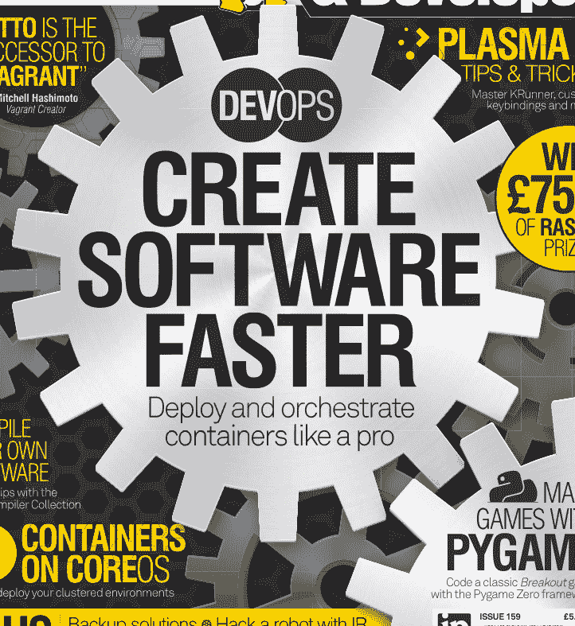

www.linuxuser.co.uk


## DS115j 和 DS215j

### 您家庭完美数据存储解决方案

在舒适和安全的环境中运行您自己的个人云


### 节能且可靠

`DS215j` 配备双核 `CPU`，支持最高 12TB 的数据存储，活跃功耗低于 14W；而 `DS115j` 为无需 `RAID` 的用户提供稳定的存储环境，活跃功耗低于 11W。

### 随时随地访问

`Synology` `NAS` 和直观的 `DiskStation` `Manager` (`DSM`) 软件允许用户在包括 `Windows` `PC`、`Mac`、`Linux`、`iOS`、`Android` 和 `Windows` `Phone` 在内的多个设备之间同步和共享文件。

### 多媒体中心

`Audio` `Station`、`Photo` `Station`、`Video` `Station` 和 `Media` `Server` 将您的 `Synology` `NAS` 转变为一个集中的多媒体枢纽。

### 哪里可以购买


`Synology` 应用可供下载


`Synology` 的媒体荣誉


## 欢迎来到 Linux 用户与开发者 第 159 期

### 您的 Linux 专家团队……


`Jon` `Masters` 是一位 `Linux` 内核黑客，从事 `Linux` 工作已近 19 年，自 13 岁进入大学以来便开始了这一历程。`Jon` 居住在马萨诸塞州剑桥市，并为一家大型企业 `Linux` 供应商工作。您可以在本月的第 16-17 页找到他精彩的内核专栏。


`Richard` `Smedley` 自 1990 年代以来一直帮助各种规模的企业和社区组织迁移到 `GNU/Linux`，而且他并不指望与他共事的人也能像他一样热爱 `Emacs`。好吧，也许稍微有一点。在这一期中，`Richard` 向我们展示了如何使用 `Pygame` `Zero` 编写游戏代码（第 62 页），并分享了更多绝佳的自由开源软件（`FOSS`）（第 88 页）。


`Nitish` `Tiwari` 职业上是软件开发者，内心则是开源爱好者，他帮助公司建立和使用开源软件。本月，`Nitish` 带领我们走进 `DevOps` 世界，讲解 `Docker`、`Puppet` 和 `Vagrant`（第 18 页），并解释如何在 `CoreOS` 上运行容器集群（第 38 页）。


`Mihalis` `Tsoukalos` 是一位 `UNIX` 系统管理员，擅长编程、数据库和数学。他自 1993 年起开始使用 `Linux`。本月，`Mihalis` 继续他的两个教程系列：系统编程（第 28 页）和计算机科学（第 50 页）。他的编码专栏见第 11 页。


`Alexander` `Tolstoy` 使用 `Linux` 已有多年。虽然简洁是智慧的灵魂，但 `Alexander` 喜欢详细地撰写关于桌面 `Linux` 的文章。他自从用软盘安装第一个发行版以来就一直从事这项工作。本月，`Alexander` 告诉我们如何打造完美的 `Plasma` `5` 桌面（第 42 页），并测试了最佳的备份解决方案（第 81 页）。


`Gareth` `Halfacree` 是我们的驻站新闻记者，为我们带来开源世界各地的最新动态，从第 6 页开始。在这一期中，`Gareth` 评测了 `Compulab` 的 `Fittlet`（`AI/O`），这是其微型无风扇 `PC` 家族中的新机型，可定制并预装 `Linux` `Mint` 发货（第 86 页）。

### 本期内容

- 今天就开始实践 `DevOps`
- 在 `Pygame` `Zero` 中制作游戏
- 寻找最佳备份解决方案
- 赢取 `FUZE` 工作站及机械臂


欢迎来到 *Linux 用户与开发者* 最新一期，这是英国和美国最喜欢的 `Linux` 和开源杂志。

采用 `DevOps` 实践来加速软件交付远比您想象的要简单。这是一个热门术语，其定义可能有些模糊，但这种现代敏捷工作方式带来的好处——改善开发和运维团队之间的凝聚力——不容忽视。本月，我们将解释 `DevOps` 对您的意义，并为您提供入门指导，介绍三种核心工具：`Docker`、`Puppet` 和 `Vagrant`。此外，我们将带您了解基于 `Docker` 的发行版 `CoreOS`，它使管理容器群变得简单易懂，并且我们与 `Vagrant` 的创建者 `Mitchell` `Hashimoto` 对话，深入了解 `HashiCorp` 最新的自动化软件，该软件成熟后将取代 `Vagrant`：`Otto`。

系统编程和计算机科学系列本月将继续更新，还有更多精彩的教程，包括详细的 `GCC` 指南以及打造完美 `Plasma` `5` 桌面的关键技巧。

在树莓派板块，本月全是关于游戏的内容。除了新的 `Pygame` `Zero` 库外，我们还再次玩 `FUZE` `BASIC`——此外，您还可以参加我们的比赛，赢取属于自己的 `FUZE` 工作站（第 78 页）。享受本期吧！

`Gavin` `Thomas`，编辑

## 联系我们：linuxuser@imagine-publishing.co.uk

- `Facebook`：Linux 用户与开发者
- `Twitter`：@linuxusermag
- 在线购买：imagineshop.co.uk

访问我们的网站获取更多新闻、观点、教程和评测：www.linuxuser.co.uk


## 订阅并省钱！

26 看看我们的新独家优惠！美国客户可以订阅，见第 90 页


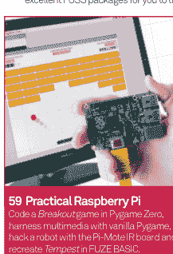

## 1&1 云服务器

### 测试最佳性能！


### 易于使用 – 即开即用

`1&1` 云服务器在 `CPU`、内存和 `SSD` 存储方面提供无与伦比的性能！以完美的灵活性与强大功能组合，实现您的云项目。

- 负载均衡
- `SSD` 存储
- 按分钟计费
- `Intel` `Xeon` 处理器 `E5-2660` `v2` 和 `E5-2683` `v3`


### 免费试用 1 个月！

之后每月仅需 £4.99¹

- 1 次 30 天试用体验
- 1 次点击即可升级或降级
- 1 通电话即可与专家交谈

☎ 0333 336 5509


1and1.co.uk


# 开源

06 新闻与观点 | 12 专访 | 94 解答您的问题

# 大会

## 开发者将在新的 UbuCon 峰会面对面交流


### 新大会填补实体峰会停办留下的空白

`Canonical` 宣布，由于社区抱怨缺乏面对面的聚会，且 `Ubuntu` 开发者峰会已从实体聚会转变为虚拟会议，他们将于 2016 年 1 月举办一场新的实体活动——`UbuCon` 峰会。

该公司解释说，`UbuCon` 峰会建立在志愿者组织的本地 `UbuCon` 活动的成功经验之上，并在此基础上进行扩展，以位于加利福尼亚州帕萨迪纳举办 `UbuCon SCALE` 活动的现有团队为基础。

`Canonical` 的 `David Planella` 解释道：“在与社区委员会的讨论中，以及在几个月前一些 `Ubuntu` 团队成员参加社区领导层峰会之后，我们确定社区面临的一个挑战是，在 `UDS` 时代结束后，缺乏一个全球性的面对面聚会机会。”

“尽管地区性的大会仍在蓬勃发展，但我们当时得出的一个结论是，我们需要一种方式，在更大的范围内将大家聚集在一起，以补充 `UbuCon` 的网络结构：即峰会。”

首届 `UbuCon` 峰会将是一个为期两天的活动，结构上既包括有组织的会议，也包括并行的临时无会议。与会者可以选择两个方向：用户方向，重点介绍 `Ubuntu` 的日常使用以及如何成为这款流行 `Linux` 发行版普及的倡导者；以及开发者方向，将提供包括应用开发、物联网（`IoT`）和云主题在内的技术会议，此外还有 `Canonical` 旨在在其 `Ubuntu` 移动生态系统中构建的新融合功能。

`UbuCon` 峰会将是自 `Ubuntu` 开发者峰会于 2013 年从每年两次的实体活动转为通过 `Google Hangouts` 服务举办的虚拟活动以来，`Ubuntu` 开发者和用户的首次大规模官方聚会。为了纪念这一时刻，`Canonical` 创始人 `Mark Shuttleworth` 已被确认为主旨演讲嘉宾，更多关于日程安排的细节将在未来几周内公布。

“峰会是传统 `UbuCon` 的扩展：内容更丰富，规模更大，”`Planella` 声称。“但同时保持了草根精神和社区驱动的组织形式，这正是这些活动成功的原因。总而言之，想法是提供一个空间来展示、了解和讨论最新的 `Ubuntu` 技术，同时也关注社区新兴和充满活力的部分，并讨论我们作为项目面临的挑战（和机遇！）。”

`UbuCon` 峰会将于 2016 年 1 月 21 日至 22 日在帕萨迪纳会展中心举行，作为南加州 `Linux` 博览会（`SCALE`）的一部分。组织者包括 `Ubuntu` 加州 `LoCo` 小组的 `Richard Gaskin` 和 `Nathan Haines`，他们曾深度参与之前由 `SCALE` 承办的 `UbuCon` 活动，以及 `SCALE` 本身的 `Gareth Greenaway` 和 `Ilan Rabinovitch`。

有关该活动的更多信息可在官方 `UbuCon` 网站 `ubucon.org` 或通过 `SCALE` 网站 `socallinuxexpo.org` 获取。

> “`UbuCon` 峰会建立在志愿者组织的本地 `UbuCon` 活动的成功之上，并将其规模扩大”

# 自动化

## 红帽收购 Ansible 技术

### 增强混合云部署和管理

`红帽`（`Red Hat`）宣布收购 `Ansible`，该公司以其无代理自动化产品而闻名，旨在使其 `红帽 Linux` 平台成为混合云用途的首选方案。

虽然收购背后的财务细节尚未正式披露，但行业消息来源称，该交易对公司的估值约为 1 亿美元，`红帽` 表示，由于其新的子公司，预计下一财政年度的运营费用将增加约 600 万美元。

`红帽` 云管理战略总经理 `Alessandro Perilli` 在评论该交易时表示：“我们的客户已经在使用各种 `IT` 自动化工具配合 `红帽` 解决方案。通过这次收购，我们希望提供这种类型的集成，通过世界级的 `红帽` 支持和认证，使开源在企业中可消费，正如我们对 `OpenStack` 和产品组合中其他所有产品所做的那样。”

联合创始人兼首席执行官 `Srid Zouani` 在评论 `红帽` 收购 `Ansible`（该公司成立于 2013 年，`Zouani` 曾在此工作十年）时表示：“我们很高兴 `红帽`，一家全球开源领导者，选择 `Ansible` 来应对 `IT` 自动化和系统管理的未来。”“这是对 `Ansible` 的简洁性、企业客户基础和强大社区的有力验证，其在企业 `IT` 自动化领域，从计算机到网络，再到云和容器，正在赢得市场。”

“`Ansible` 是 `IT` 自动化和 `DevOps` 的明确领导者，并帮助 `红帽` 在实现无摩擦 `IT` 管理这一目标上迈出重大一步，推动 100% 开源的创新，构建在开放管理平台之上，并坚定不移地通过易用性和自动化来降低成本和复杂性。我非常高兴 `Ansible` 加入 `红帽`，帮助我们扩展这一承诺。”

自 2013 年作为 `AnsibleWorks` 成立以来，`Ansible` 的软件已发展到拥有 1,200 名贡献者，被誉为 `GitHub` 上最受欢迎的开源自动化工具，并有报道称 20% 的财富 100 强企业正在与该公司合作。


# 五大亮点

## Unity 8 功能 – 技术预览


上图：尽管 `Unity 8` 未能进入 `Ubuntu 15.10`，但仍有一个技术预览版

### 1 Unity 8 技术

`Canonical` 新的桌面环境 `Unity 8` 未能及时准备好以配合 `Ubuntu 15.10` 的发布。然而，情况并不糟糕，因为它正以技术预览的形式提供，并承诺用户可以尝试使用，如果在遇到任何问题时，可以明显地回退到默认的 `Unity 7`。

### 2 Snapcraft 工具

`Snapcraft` 专为与嵌入式和云为核心的 `Ubuntu Core` 版本配合使用而设计，旨在使 `Snappy` 包的构建对用户来说尽可能简单，无论是从头开始还是利用现有的 `deb` 包。

### 3 Ubuntu 手机更新

运行 `Ubuntu` 手机版本的用户会高兴地发现，他们不再需要手动更新操作系统，更新现在会自动并直接交付到设备。就像竞争对手的移动平台一样——这是该操作系统的一大步。

### 4 OpenStack Autopilot

`Ubuntu 15.10` 见证了 `OpenStack Autopilot` 的正式可用，旨在使基于 `Ubuntu` 的 `OpenStack` 云的部署和管理尽可能简单。它除了支持主要版本之间的原位升级外，还得益于 `OpenStack` 互操作性实验室的输入。

### 5 LXD 默认捆绑

机器容器 `hypervisor` `LXD` 现在默认包含在 `Ubuntu Server` 中，使任何 `Ubuntu Server` 安装都能托管数百个其他 `Linux` 客户机容器，而无需额外软件。如果这还不够让你想要更多，还有一个新的 `RESTful API` 技术预览版也可用。

# 开源

您的 `Linux` 新闻与观点来源

## 观点：自由软件

### 恼羞成怒

> “对计算机的访问——以及任何可能向你揭示世界运作方式的东西——都应该是无限制的、全面的”


当 `爱德华·斯诺登` 上 `Twitter` 时，他在一天之内就获得了一百万以上的关注者。对某些人来说他是声名狼藉的，对另一些人来说他是英雄，然而他最大的贡献在于揭示了在贬义上所说的“黑客行为”在多大程度上是政府机构的专属领域。这些机构声称他们是在为“我们的共同利益”工作，但实际上却忙于为公民的日常监控设定恶劣的标准。

“`Hacker`”一词的贬义用法可能起源于小报对 `凯文·波尔森` 事迹的报道（他在 17 岁时闯入了美国国防部的 `ARPANET`——互联网的前身——并随后被贴上了“计算机犯罪的汉尼拔·莱克特”的标签），以及 `凯文·米特尼克`（他在冷战高峰期 1983 年闯入了北美防空司令部 (`NORAD`) 系统，这一壮举激发了 1983 年的电影《战争游戏》并使那些道德上不坚定的人陷入了无数的噩梦）。

然而，黑客术语源自于 20 世纪 50 年代末和 60 年代初在麻省理工学院（`MIT`）的 `TMCR`（技术模型铁路俱乐部）及其分支组织午夜征用委员会周围形成的社区，这个环境既不太可能也不那么具有攻击性。`TMCR` 的黑客们将“`hack`”定义为“一个进行的项目或构建的产品，其目的不仅是为了实现某个建设性目标，而是从单纯参与中获得了狂野的乐趣”。他们还将被黑客户定义为一个人“他喜欢学习编程系统的细节以及如何扩展其能力，与大多数只喜欢学习必要最小量的用户形成对比”；或者“热情编程或享受编程而不是仅仅对编程进行理论研究的人”（引自 `MIT` 人工智能实验室最初的 `jargon.txt`）。


午夜征用委员会之所以得名，正如史蒂文·莱维所说，是因为“当`TMCR`需要一组二极管或一些额外的继电器来为模型铁路系统构建新功能时”，他们中的有些人会“等到天黑，找到那些存放这些物品的地方。通常情况下，在其他方面非常诚实的没有一位黑客似乎将这种行为与偷窃划等号”。当一台`TX-0`计算机到达`MIT`综合体的`26`号大楼，且`TMCR`成员发现访问`TX-0`的最佳时间是在夜间——“当任何一个理智正常的人都不会去注册`RLE`实验室空调旁每周五张贴的纸上一小时的会话时”，黑客们的忠诚便从模型铁路布局表下转移到了计算机上。

从那时起，“`TMCR`黑客们很快开始称自己为`TX-0`黑客，并改变了生活方式以适应计算机”，并成了`MIT`人工智能（`AI`）小组的核心成员，后来由美国国防部高级研究计划局（`DARPA`）资助。前`TMCR`黑客开发了第一台`LISP`机器、第一台计算机工作站、第一款计算机游戏、第一款音乐软件和第一个显示`hack`。黑客是计算机革命的先锋，黑客传统总是包含对权威的适度不尊重以及对恶作剧的相互热爱。每个想法和每个限制都是另一个需要探索的边界，一种通向可能扰乱现状或转化为更好想法的冒险目的的手段；特别是如果能找到更高的道德理由来证明这种目的时，那个理由，如在黑客伦理中定义的那样，就是：

> 黑客是计算机革命的先锋，黑客传统总是包含对权威的适度不尊重以及对恶作剧的热爱

理查德·希利斯利为各种出版物撰写关于艺术、音乐、数字权利、`Linux`和自由软件的文章。

## 数据库

### 欧盟 100 万欧元投资助推 `PostgreSQL` 9.5

`2ndQuadrant` 展示积极增长

`PostgreSQL`（最近发布为`9.5 Beta`版本）的开发得益于欧盟的资金支持，这归功于`2ndQuadrant`的专门工作和对名为`AXLE`的重大研究项目的协调。`2ndQuadrant`促进`PostgreSQL`的开发，并是全球领先的`PostgreSQL`支持服务提供商。

该研究计划获得了欧盟第七框架计划（`FP7`）提供的 100 万欧元研发资金，并作为`PostgreSQL`发展的催化剂。随着为期三年的项目于今年底结束，`2ndQuadrant`的团队将通过`AXLE`项目为增强`PostgreSQL`投入超过 10 年的努力。

`AXLE`（针对欧洲极大数据的高级分析）聚集了一群多样化的研究人员，他们都专注于解决极大数据分析的需求。由于`PostgreSQL`是项目的核心，目标是产生能惠及许多人的积极成果——在本例中，包括若干新的、先进的功能，这些功能将在接下来的`PostgreSQL`版本中引入。具体到`PostgreSQL`，成果包括原子锁定、块范围索引、`DDL`触发器和`TABLESAMPLE`功能。

`AXLE`还给`PostgresXL` 9.5 注入了活力，这是一个可扩展的基于`PostgreSQL`的数据库集群，允许商业智能和事务性工作负载。`PostgresXL`是第一个提供这些能力的开源项目，由`2ndQuadrant`、`华为`、`NTT`和不断壮大的社区共同开发。

## 开源

### `Collabora` 签署英国政府云协议


> 上方：部长们将很快过渡到开放、基于云的办公软件套件

英国政府的采购人员已与`Collabora Productivity`签署了一项商业协议，该协议将使开源办公软件在台式机、移动设备和云服务器上得到使用，旨在节省专有软件的费用。

`Collabora`旨在向企业用户提供`LibreOffice`产品，即将推出一款基于云、可通过浏览器访问的软件包版本，名为`CloudSuite`。这款`CloudSuite`以及专门针对政府用途定制版本的`LibreOffice`——`GovOffice`——将向所有非营利政府组织提供。

“向云迁移，采用开放`IT`标准以及为纳税人节省资金是今天的协议所实现的三个关键政府目标，”`Collabora`总经理迈克尔·米克斯声称。“`Collabora`将与皇家商业服务处合作，提高对开放文档格式（`ODF`）的好处以及更广泛的开源客户端解决方案的好处和成本节省的认识，”米克斯补充道。“这份协议的一个重要部分反映了`Collabora`在部署开放文档格式方面将提供的支持水平和承诺。”

自从英国内阁办公室大臣弗朗西斯·莫德发表了一份严厉的报告后，英国政府一直在逐步放弃专有格式。其现行准则规定，文档应以开放且可访问的格式提供，包括`HTML`、`ODF`和纯文本，并应避免使用专有格式。

## 物联网

### 戴尔 `IoT` 边缘网关获得 `Ubuntu Core` 支持

首批设备预计于 2015 年 12 月发货

戴尔宣布了一款新的物联网（`IoT`）网关产品，戴尔边缘网关`5000`系列，该产品支持`Ubuntu Core`及其`Snappy`管理架构。

`Ubuntu Core`是`Canonical`的以云和嵌入式为中心的`Ubuntu Linux`发行版变体，最初于 2014 年宣布。其中一个关键变化是使用`Snappy`，这是一个新的管理系统，使用原子事务来允许随时回滚任何更改。

正是这一特性吸引了戴尔加入该平台。“`Snappy Ubuntu Core`能够自动回滚到上次已知可用的操作系统版本，这对我们的`IoT`客户是无价的，”戴尔的物联网战略与合作主管杰森·谢皮德在发布时解释道。“如果由于任何原因操作系统更新无法启动，`Ubuntu Core`将自动恢复到其上次已知正常的操作系统版本，并保持客户信息向云端流动。”

由`英特尔原子处理器`驱动的戴尔边缘网关`5000`系列，将于 12 月面向商业用途发布，2016 年 3 月面向工业用户发布，旨在从`IoT`传感器网络收集数据并在传输到远程服务器进行分析之前执行分析。

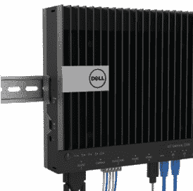

# 开源（OpenSource）

你的`Linux`新闻与观点来源

## `DISTROFEED`（发行版动态）

### 前十名

（日均访问量，10月2日至10月26日）

- 1. `Linux Mint` ▼ 2,892
- 2. `Debian` ▼ 2,094
- 3. `Ubuntu` ▼ 1,790
- 4. `openSUSE` ▲ 1,519
- 5. `Fedora` ▼ 1,175
- 6. `Manjaro` ▲ 1,115
- 7. `Mageia` ▼ 1,084
- 8. `Android-x86` ▼ 849
- 9. `CentOS` ▼ 831
- 10. `Arch Linux` ▼ 773

### 本月回顾


得益于`16.10 Wily Werewolf`及其官方衍生版本的发布，`Ubuntu`本月受到了大量关注。

### 亮点

`Ubuntu 15.10`

`Ubuntu`在本月的发行版统计数据中占据绝对主导地位，这主要归功于其桌面版、服务器版和核心版的同步发布，以及各种官方本地化版本、针对特定任务优化的版本以及特定桌面环境版本的推出。

`Android-x86 5.1 RC1`

尽管`Android-x86`在`Distrowatch`上的流量本周有所下降，但`CentOS`和`Arch`流量降幅更大，这使得谷歌安卓开源项目（`AOSP`）的移植版成功进入前十名榜单。

`Linux From Scratch 7.8`

`Linux From Scratch`是由`Bruce Dubbs`编写的一份自由分发的指南，指导用户构建自己的发行版。最新发布的版本包含了一个基于`systemd`的替代版本。

# 最新可用发行版：

`filesilo.co.uk`

# 图形（GRAPHICS）

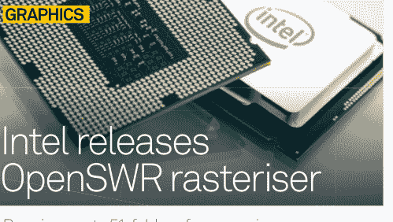

# `Intel` 发布 `OpenSWR` 光栅化器

承诺性能提升高达 51 倍

`Intel`的一个小型工程团队发布了一款开源软件光栅化器，据称其性能相比`Llumpipe`等系统提升了 29 至 51 倍。

被称为`OpenSWR`的工具充当虚拟图形处理器，并与`Mesa3D`进行接口交互，以处理`API`和状态跟踪层。该团队向这个项目贡献了代码，目标用户是那些处理大型几何模型但没有硬件图形处理能力的人——当然，我们记得，`Intel`生产`CPU`但不生产专用`GPU`。

“我们的客户偏好开源，允许他们只需下载`Mesa`源代码并启用我们的驱动程序，就能让他们的工作轻松很多，”`Intel`的`Tim Rowley`在解释为何选择以宽松的`Mesa MIT`许可证发布`OpenSWR`时说道。“当我们使用的源代码可以作为参考时，与`Mesa`社区合作也更容易。”

`Intel`表示，该公司针对基于`VIsualisation Toolkit`的应用程序，且`OpenSWR`通过了其`OpenGL 3.2`后端渲染测试的 99%，目前正在努力证明其对其他测试套件的兼容性。


OpenSWR 兼容任何具备 AVX 或 AVX2 扩展功能的 x86 处理器，尽管 Rowley 承认尚未在竞争对手 AMD 的处理器上进行测试。详情和源代码可在 `github.com/OpenSWR` 获取。

# 职业（CAREERS）

# 微软招聘 Linux 专家

我们已经从万圣节备忘录（Halloween memos）走来很远了

微软的 Mark Russinovich 呼吁 Linux 专业人员向该公司发送简历，因为他的 Azure 云计算部门正在寻求扩展。

微软传统上与开源软件（尤其是 Linux）竞争，1998 年 10 月泄露的一系列备忘录——被称为“万圣节备忘录”——尤其显得激进。然而近年来，该公司已扭转了其立场。

在 All Things Open 大会的主题演讲中，Azure 首席技术官 Russinovich 指出了 Azure 上 Linux 使用量的显著增长，以及该公司支持这一趋势的需求。

他开玩笑地请在场的 Linux 专家递交他们的简历，并声称该公司“渴望全面支持开源社区——与其传统的‘绊倒并延伸’（`stambler and extend`）策略大相径庭；批评者随后追加了‘熄灭’（`extinguish`）”。

配合 Russinovich 演讲的一张幻灯片声称，微软有 500 个 Linux 相关的职位空缺，以及另外 350 个与开源项目相关的职位空缺。

# 任意整数大小

了解简单地将两个数字相加所涉及的潜在问题，然后跟随我们的两种解决方案进行操作

本月研究的问题是`如何添加任意大小的整数`。将使用 C 编程语言，但所展示的技术几乎直接适用于所有现代编程语言。


有两个关键问题迟早会出现：首先，如何处理溢出？其次，是否支持有符号整数？这两个问题都不难回答，但关键在于你应该在开始开发程序之前考虑到它们，因为后期修改会耗费更多时间。

一个理性的选择是使用数组来存储整数的所有位数。如果你确实想要支持无限位数，可以使用文本文件来存储每个整数的位数。因此将展示两种实现方式。第一种使用数组，第二种使用文本文件来存储每个整数。每种方法都有其优缺点。第一种（`add.c`）实现更容易，执行速度更快，因为它无需读取或写入文件。后者（`addFile.c`）更灵活，使用更少的内存，并且无需额外代码即可处理溢出；你只需向文件中写入更多数据即可。`addFile.c` 不会处理如何组织包含整数的文件；它只是读取存储在两个文本文件中的两个大整数，并将它们的加法结果保存到一个新文件中。所有文件名都将作为命令行参数提供。

在 `add.c` 中你必须做出的主要决定是关于数组的大小。你可以从一个相对较大的数组大小开始，看看效果如何，然后再增加它。然而，这是一个主要问题，因为你需要重新编译 `add.c` 才能增加数组的大小。出于简化的原因，`add.c` 仅处理无符号整数。因此，如果你给两个具有 `n` 位数字大小的整数作为输入，`add.c` 会自动将它们的加法结果存储到一个同样具有 `n` 个位置的数组中。目前，`add.c` 添加两个随机生成的整数。

为了理解 `add.c` 将整数存储到数组中的方式，请查看以下示例：

- 你想将 123 存储到一个数组中。
- 你有一个具有 10 个位置的数组，你必须通过在所有位置放置零来进行初始化。

Mihalis Tsoukalos

是一名 UNIX 管理员、程序员、DBA 和数学家。他自 1993 年起使用

Linux

如果你是简单解决方案的支持者，那么你应该选择 `add.c` 实现。然而，如果你的目的是“完美”解决方案，那么选择 `addFile.c`。

- 整数将以 `[0,0,0,0,0,0,0,1,2,3]` 的形式存储在数组中。

请注意，遗憾的是，这种方法仅适用于固定大小的数组。

一旦你确定了这种整数存储方式，一切就变得简单了，因为你只需要添加数组中相同索引号处的元素。在发生溢出的情况下，你只需在屏幕上显示一条消息。

`addFile.c` 必须解决的最具挑战性的点是每个整数如何存储。存储整数最方便的方式是按逆序。当你意识到在 `addFile.c` 中如果整数是按逆序排列的，实现整数加法会更容易时，你就会明白原因了。因此，`addFile.c` 将逐字符读取两个文件，然后以相同的方式将结果保存到一个新文件中。

`system()` 函数的三次调用使用了 Perl 单行命令来反转输入并按正确顺序显示所有整数的位数。如果需要，你可以移除它并用简单的 `bin/cat` 命令代替。

如果你是简单解决方案的支持者，那么你应该绝对选择 `add.c` 实现。然而，如果你的目的是拥有“完美”解决方案，那么你应该选择 `addFile.c`。你选择方案的基础还应取决于你的输入。

此时你可能正会问：减法、乘法和除法怎么办？每一种方法的处理方式都应类似于整数加法。然而，有三个棘手的问题你应该提前考虑：

- 如果你除以两个整数，结果可能是一个浮点数，而这在另外三种运算中不会发生。
- 两个整数的乘法可能会迅速变得非常大，因为两个各有 N 位数字的整数的乘法结果可能多达 N+N 位。
- 两个整数的减法结果可能是一个有符号整数。

你可以在 `github.com/mactsouk` 和 `filesilo.co.uk` 找到跟随本文的源代码。

## 开源

Linux 新闻与观点的来源

### 访谈：米切尔·哈希莫托

### Otto：遇见新一代的 Vagrant


米切尔·哈希莫托在新一代 Vagrant 产品 Otto 中整合了开发与部署。我们询问了他如何简化你的软件生产流程。

**简而言之，Otto 是什么？**

它的目标是`尽善`地完成 Vagrant 在开发者视角所能做到的一切，甚至做得更好。此外，我们还添加了部署功能。这是功能上的差异，但在哲学理念上也有不同。

主要的哲学差异在于我们所说的“化石化”与“代码化”。如果你拿五年前的 Vagrantfile 并在今天运行 `vagrant up`，它很可能仍然有效，并能以你五年前设定的方式完全复现该环境。这是因为 Vagrantfile 是一种化石——即时间的快照。对于某些用例来说，你确实需要化石，但过去几年的经验让我们确定，你真正需要的是代码化。因此，如果你查看 AppFile（即 Otto 的配置文件），它不会规定具体该如何操作，而是声明你想要达成的结果。例如，你可以说“我想开发一个 PHP 应用”，但不必说明如何安装 PHP，也不必指定使用哪个操作系统，因为关于如何操作的知识都集中在 Otto 内部。因此，如果你今天运行 Otto，五年后再运行 Otto，结果可能会不同，因为我们将采用当前的最佳实践。

主要区别在于 AppFile 描述的是应用程序，而 Vagrantfile 描述的是机器。

**官网称 Otto 是为微服务打造的，这是什么意思？**

我们曾经历一个阶段，当时有很多单体应用，而现在又回归到面向服务的架构，但这次是众多小型服务而非少数几个大型服务。这使得开发变得困难，因为你需要知道如何安装少量服务以及你的应用程序，而这些可能使用不同的语言——完全忽略部署问题。因此，我们试图通过 Otto 及其用于描述和配置 Otto 的 AppFile 来解决这个问题。

你只需填入指向依赖项 URL 的指针，Otto 会访问这些地址，下载它们并读取其 AppFiles，这些文件描述了如何为开发环境安装它们。这将为开发目的安装依赖服务的工作转移给服务创建者。这简化了许多事情，并且服务开发者拥有更大的灵活性；完全改变语言也不会影响你的下游开发者。

微服务仍然是一项新技术。我认为它尚未成为主流——我们只是在为未来做准备。

**米切尔·哈希莫托**，HashiCorp 的创始人，是一位痴迷于自动化的开发者。他是 Vagrant、Packer、Serf、Consul、Terraform、Vault、Nomad 和 Otto 的创造者。他是 DevOps 社区的关键人物，也是技术作者，并在运维和研究领域拥有丰富经验的老练工程师。

### Otto 与 Atlas

Atlas 是 HashiCorp 唯一的商业产品，为其八个开源项目提供资金支持。米切尔告诉我们，Otto+Atlas 就像 Git+GitHub 一样——它提供核心工作流、所有原语以及大量的复杂性管理。最终，它将为你提供 Otto 的完整 UI。Atlas 还将作为 Otto 的协作平台，检查是否有其他人正在与你同时部署特定应用程序，并允许你控制谁可以部署哪些应用程序，甚至控制他们部署的时间。Atlas 还可以为你运行许多 Otto 命令，让你能够卸载活动，例如在 `otto deploy` 运行期间合上笔记本电脑。

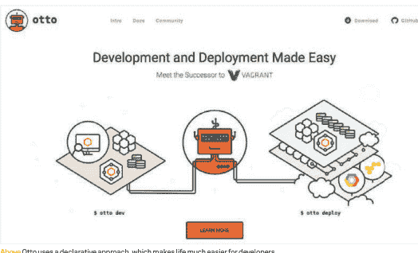

`上方` Otto 采用声明式方法，使开发者的生活更加轻松

### Otto 的 Appfile


配置可以非常简化，完全交由 `Otto` 的自动检测，也可以非常详细。你还可以在 `Appfiles` 之间共享代码块。

`Appfiles` 完全是可选的。如果不存在 `Appfile`，`Otto` 会检查项目以检测应用程序的类型。然后它会生成一个内部 `Appfile`，该文件不会外部保存。`Appfile` 中的单个代码块也是可选的。如果存在 `Appfile` 但缺少如 `application` 等代码块，`Otto` 会直接合并检测到的数据。可以导入其他 `Appfiles` 的片段——这是共享 `Appfiles` 配置的推荐方式，特别是项目和基础设施代码块。

如果 `Appfile` 中未包含应用程序名称和类型属性，`Otto` 会自动检测包含该 `Appfile` 的目录名称作为名称，并使用文件名模式匹配来确定类型——例如，存在 `Gemfile` 即表示 Ruby 应用程序。

`Otto` 识别 `GitHub` URL 并将其转换为标准的 `git` 仓库，同时也接受通用的 `Git` 仓库；它还识别 `BitBucket` URL 并将其转换为 `Git` 或 `Mercurial` 仓库，同时也接受通用的 `Mercurial` 仓库。最后，你可以指定 `.json` 文件解析。

可以有多个自定义代码块。代码块的名称即是要自定义的组件。

与应用程序代码块一样，`Otto` 项目代码块中的名称和基础设施属性可以留空；我们的 `Otto` 会自动检测它们。基础设施代码块目前硬编码为指定使用“simple”口味的 `AWS`。`AWS` 的其他可用口味会设置一个更类似生产环境的基础设施，包括包含公共和私有子网的 `VPC`，以及其他内容。

```ruby
# Sample Appfile
import "github.com/rubyforg/otto-shared()"

# Application block
application {
  name = "otto example"
  type = "go"
  dependency { source = "github.com/hashicorp/otto/examples/herogo" }
}

# Let's disable this for now using a multi-line comment
customization "go" {
  go_version = "1.4.2"
}

project {
  name = "bast project"
  infrastructure = "production"
}

infrastructure "production" {
  type = "aws"
  flavor = "vpc public private"
}
```

### 为什么需要将 Otto 作为新产品发布，而不是改进 Vagrant？

以编程语言为例；如果你用面向对象语言编写代码，突然觉得函数式编程语言才是未来，我认为在面向对象语言上附加功能是不明智的，因为两者相处得不好。以 `Vagrant` 的机器与应用示例来说，我查看了一个 `GraphQL` API，觉得在那里放置更高层级的内容并不合适。此外，`Vagrant` 的使用非常广泛——每月下载数百万次——因此存在大量的向后兼容性问题。如果你想要一个六年前问世、久经沙场且肯定能正常工作的工具，`Vagrant` 就在那里。如果你在使用微服务，想要最前沿的技术，那么 `Otto` 就在那里——它最终会非常稳固，但目前仍处于 `0.1` 版本。

### Otto 的下一步是什么？

我不确定正在阅读本文的读者中有多少人六年前使用过 `Vagrant` `0.1`，但 `Vagrant` `0.1` 坦率地说非常糟糕。它需要 `Ubuntu`，仅与 `VirtualBox` 兼容，仅与 `Chef` 作为供应器兼容——诸如此类的怪异限制。当我看待 `Otto` 时，我有同样的感受——我认为目前它是受限的，目的是为了向你展示其能力。但在接下来的几个版本中，我们将消除许多这些限制。因此，例如在 `0.2` 版本中，主要功能是 `otto dev` 命令，这相当于 `vagrant up` 命令。对于基本任何应用程序类型的 `otto dev` 命令只需要大约五到十秒，而 `Vagrant` 可能需要大约一分钟。因此，我们正在努力使其速度更快，使其真正令人愉悦。

我们首先关注开发。`Otto` 网站上有一个免责声明，指出虽然 `Otto` 可以部署，但我们目前不建议这样做。`Otto deploy` 主要是对其能力的演示，但尚未完全达到生产就绪状态。在接下来几个版本中，一旦我们使开发体验变得非常好，重点将转向使部署体验达到生产就绪状态。这将贯穿接下来的六个月。

### Vagrant 的哪些局限促成了 Otto 的诞生？

首先，我们注意到在特定语言或框架内，每个人的开发环境都非常相似——除了个别差异外，几乎完全相同。虽然每个人都愿意相信自己的开发环境很特殊，但这是我们通过研究数十万用户观察到的事实。因此，我们可以为你构建一个非常通用的 Ruby 环境，一个非常通用的 PHP 环境，

> “在接下来几个版本中，一旦我们使开发体验变得非常好，重点将转向使部署体验达到生产就绪状态。”


# 开源

你的 Linux 新闻与观点来源

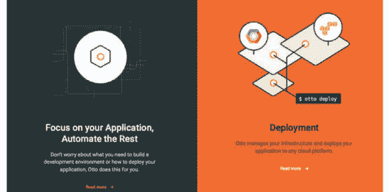

虽然还差得远，但 `Otto` 很快就会成为部署和开发的理想选择


## 专注于你的应用，自动化其余部分

不要担心构建开发环境需要什么，也不要担心如何部署你的应用程序，`Otto` 会为你搞定这一切。


### 部署

`Otto` 管理你的基础设施，并将你的应用程序部署到任何云平台上。

## 如何使用 Otto

以下是 `Otto` 的一个用例示例，展示了在 `AWS` 上部署 `Rails` 应用程序的开发和部署步骤。

1. **启动你的 Rails 项目**

   使用默认配置初始化一个新的 `Rails` 应用程序：

   ```
   $ rails new
   ```

2. **编译和配置**

   `Otto` 的编译步骤会自动检测应用程序类型为 `Rails`，然后准备 `Docker` 来管理你的应用程序生命周期。你可以通过编写 `Ottofile` 来定制 `Otto` 行为的几乎所有方面。

   ```
   $ otto compile
   ```

3. **本地开发**

   `Otto` 构建并运行一个本地开发环境，这样你就可以轻松测试和修改你的应用程序：

   ```
   $ otto dev
   ```

4. **构建基础设施**

   `Otto` 根据行业最佳实践创建一个基础基础设施：

   ```
   $ otto infra
   ```

5. **构建你的应用程序**

   `Otto` 打包你的应用程序，并准备好将其部署到你的基础设施中：

   ```
   $ otto build
   ```

6. **部署**

   你的 `Rails` 应用程序被转换为运行中的基础设施——你的应用程序现在可供全世界访问：

   ```
   $ otto deploy
   ```

而且想法是你只需要定制上述的细微差异。你不需要重新编写公共部分。

第二件事是部署。早在多年前，在 `Vagrant` `0.1` 或 `0.2` 的时候，我们就收到一个功能请求：“我能不能用 `vagrant up` 部署到生产环境？”多年来我们一直试图实现这一目标，最终我们发现 `Vagrantfile` 并不是描述如何将某物部署到生产环境的合适方式，因为一方面 `Vagrantfile` 描述了许多机器层面的事情，很难将其转换为像 `AWS` 这样的环境，另一方面它还描述了许多你在生产环境中不需要的开发相关配置。所以我们尝试了许多方法，但感觉最好的方案是重新创建一个全新的文件——你会有一个用于开发的 `Vagrantfile` 和用于生产的其他配置文件，但这感觉很奇怪。我们为解决这个问题所做的主要事情是提高了一层抽象。通过描述应用程序而不是机器，我认为我们拥有了能够同时处理开发和生产环境的正确配置。

第三件事是微服务。正如我所说，这目前还不是主流，但增长迅速。在一个 `Vagrantfile` 中描述所有依赖关系很难，而使用多虚拟机对微服务来说太重了。如果你有六个微服务，那你就要运行六个虚拟机，这会拖垮许多基础开发机——多虚拟机本来就不是为微服务设计的。

**很多人转向了 `Docker`，对吧？**

是的，我们看到很多人试图使用 `Docker` 来开发微服务。`Docker` 在打包微服务方面非常出色——将微服务封装在容器中是使其易于运行的好方法。从 `Vagrant` 的角度来看，我们发现使用 `Docker` 并没有真正解决所有问题。虽然打包问题解决了，但安装哪些服务以及如何配置它们的负担仍然落在最终的应用程序开发者身上。所以如果你在开发一个应用程序，你就必须知道所有的依赖关系——你仍然需要了解这些——但你还必须知道它们所有的依赖关系。我们在 `Otto` 中采取的方法是，你只需要告诉 `Otto` 你的直接依赖关系——`Otto` 会找出你的传递依赖关系，然后由该依赖关系告诉 `Otto` 如何安装、运行和配置它。

**你认为学习曲线会怎样？**


我认为，从开发角度来看，对于 Vagrant 用户来说会非常熟悉。Otto 本身不同，所以这需要一些习惯，但 `otto dev` 类似于 `vagrant up`，`otto dev` 类似于 `vagrant ssh`。`otto dev destroy` 类似于 `vagrant destroy`；有很多相似之处。同时，从开发角度来看，Otto 将会为你做很多事情，Vagrant 开发者会非常喜欢。它自动找到一个不冲突的 IP 地址并给机器一个静态 IP，所以你不再需要配置网络。有一个命令可以获取该地址——`otto dev address`——所以你不需要像使用 Vagrant 那样记住它。

部署方面对我们来说是新的，所以我们试图建立一个像 Vagrant 一样简单的工作流。不过，我认为，不幸的是，Otto 的学习曲线将会很低。这种简单性的代价是 Otto 为你做了很多决定——我们完全预期这会让人们感到不舒服。但如果你觉得不舒服，并且这是一个合理的原因，那么我们希望听到你的声音，以便我们可以将这种知识编码到 Otto 中，让它做出让你感到舒适的选择，如果这是行业最好的选择的话。


# 集群

# 我们的革命性新

Web 托管平台


100% 保证

正常运行时间！


智能 SSD 存储

与智能负载

均衡


专用 SSL

证书

> Web 托管起价：
>
> `£1.99`
>
> 每月，不含增值税，增值税税率为 20%

拨打 `0333 0142 708`

或访问 `fasthosts.co.uk/hosting`


# 评论

## 内核专栏

Jon Masters 总结了 Linux 内核社区的最新动态，随着 Linux 4.3 的发布，4.4 的开发工作正在进行


`Jon Masters`

是一位 Linux 内核黑客，从事 Linux 工作已有 19 年，自 13 岁首次进入大学以来。Jon 居住在马萨诸塞州剑桥市，为一家大型企业 Linux 供应商工作，在那里他正推动制定基于 ARM 的低功耗服务器标准。

Linus Torvalds 宣布 Linux 内核 4.3 版本发布，并指出在开发周期的后期，修复工作似乎有点忙碌，但“实际查看数据显示，那只是我主观的感觉，可能是由于内核峰会和从韩国回家的旅行造成的”。最新内核包含几个令人兴奋的新功能——PIDs 控制器的用户空间缺页中断（user space page faults）就是其中之一——同时也移除了久经考验的 ext4 文件系统（尽管读者不必为此担忧，稍后我们会解释）。

Linux 4.3 中的 PIDs 控制器功能基于一个简单的想法：防止曾经在旧 Unix 系统上常见的“fork 炸弹”攻击。在 fork 炸弹中，攻击者运行代码试图创建尽可能多的新进程，从而占用系统 RAM 和计算机资源。因此，Linux（和 Unix）系统长期以来一直对允许的最大进程数（在内核中被称为任务）实施看似任意限制。事实上，在一台 Fedora 笔记本电脑上，`ulimit` 命令显示作者的用户账户（默认情况下）被限制最多创建 1,024 个进程。但是，在用户级别设置限制是非常粗糙的。新的控制器组方法允许一组进程（例如作为容器一部分启动的进程）限制它们创建更多进程的能力。

Linux 4.3 中对用户空间缺页中断的支持将为包括虚拟化在内的多个领域带来新的能力。虚拟机、`chrun`（在 Linux 上运行 KVM 时），利用现有的“宿主”内核提供所需的大部分支持驱动程序和基础设施，同时将运行的 VM 抽象为一个常规进程。该进程基于修改后的 QEMU 有一个用户空间组件，提供模拟提供给 VM 的硬件（和其他资源）的支持能力。现在，QEMU 也可以代表虚拟机在实时迁移活动期间处理缺页中断，从而允许在迁移过程中以非常轻量级的方式跟踪运行中机器的内存修改，最终加快实时迁移速度并减少对 VM 的延迟影响。

随着 Linux 4.3 的发布，合并窗口（这段时间——通常持续略短于两周——允许对最终将成为 Linux 4.4 的版本进行破坏性更改）也开启了。此时，正在跟踪以便纳入 4.4 的一个更有趣的功能是 `richacl`（也称为 `native`，未映射到 `POSIX`，`NFSv4` `ACLs` 在文件系统中），这对网络和 enterprise 用户尤其重要。我们将在下期的杂志中全面总结那些被纳入 4.4 的功能。与此同时，看到对超低成本 CHIP“9 美元计算机”（基于 `sunxi` 32 位 ARM 芯片）的支持可能赶上首批发货时间并进入 4.4，这也是令人兴奋的。

最后这个月，让我们为 Jaccon Bastiaansen 留一点思考空间，他发布了一篇长消息，标题为“内核‘futex 代码’中可能存在竞态条件”，描述了他在一台 8 核 64 位“实时”（因此引用了 -rt58 补丁集）x86 系统上使用较旧的 3.12/4.2-rt58 内核的情况。他的配置利用了 50 个线程、自定义内存分配器以及初始消息中描述的各种其他复杂性。这个故事有趣的部分在于他（以及消息中暗示的一些同事）为了找出问题的根本原因所投入的程度。

Jaccon 描述了 Linux 的“pthreads”（`POSIX` 线程）代码是如何失效的，声称两个线程同时获取相同的 futex（一种用于表示快速用户互斥锁的结构——因此称为“futex”——否则也称为锁）时出现了死锁条件。他最终发现，他的内核的编译版本（通过反汇编器运行后）显示内核在不安全且非原子的字节级访问中检查锁，而本应使用字（在 Intel 上意味着 4 字节）检查。这个问题在某些编译器版本上与他较旧的内核是可以复现的，但正如 Thomas Gleixner 指出的那样，它已在新内核中得到修复。这个线程的深度阅读价值很高：`https://lkml.org/lkml/2015/10/5/400`。

# 告别 ext3

那是 2001 年。Linux 2.6 版本仍是一种未来的愿景，内核遵循奇偶周期：多年一次的奇数版本“开发系列”发布，最终紧随其后的是新的“稳定系列”。那时远早于 Git（Linux 社区当时尚未因挫败感而决定创建它），也早于当今的双月开发周期——该周期设有合并窗口，已使得单独的开发系列内核不再必要。在 2001 年，一项重要的新内核特性可能会在默默无闻中蹉跎数年，等待进入下一个稳定系列内核。因此，当 `ext3` 支持被加入 Linux 2.4.15，而无需等待首个 2.6.0 内核（于 2003 年发布）时，人们感到如释重负。

`Ext3` 为 Linux 带来了前所未有的功能：主线对文件系统日志记录的支持，无需应用许多“树外”（非官方）补丁。日志记录的文件系统对电源故障具有更强的韧性，因为它们将操作拆分为事务，这些事务首先写入“日志”，然后再更新磁盘上的文件系统数据结构。如果在此过程中发生电源故障，文件系统拥有足够的内部状态来恢复其元数据，而无需用户运行特殊的文件系统检查程序。对于终端用户而言，这意味着在文件系统活动期间（换句话说，几乎任何时间）发生电源故障，都不必导致长时间的 `fsck`（文件系统检查）工具使用。

开发者偶尔发现需要运行 `fsck` 令人沮丧，而消费者因屏幕上打印的关于“不一致”文件系统状态的惊悚信息而深感困惑也是可以理解的。事实上，本文作者回忆在他非常早使用 Linux 的日子（几代人之前，即很久以前），在 Google 出现之前，他被如此混乱的信息吓到，最终在一次非正常关机后重新安装了系统，而不是去研究 `fsck`。因此，和许多人一样，得知 Stephen Tweedie 所做的工作——为久经考验的 `ext2`（扩展第二版）文件系统添加日志支持——令人宽慰。

日志记录并非新概念。在 `ext3` 引入 Linux 之时，Microsoft Windows 用户在几年前就已经受益于内置的 `NTFS` 支持（可以说 `NTFS` 要复杂得多）。但与 `NTFS`（用户从 `FAT32` 升级的路径很棘手）不同，演变为 `ext3` 的设计是有意识地基于演进式方法。彻底放弃 `ext2` 的设计可能会更高效（并跟随他人路径，例如来自 SGI Ixux 的 `XFS`，后者最终在 2004 年加入 Linux），但 `ext3` 具有明显的优势，即支持现有 `ext2` 文件系统的就地升级。


新文件系统为现有的 `ext2` 文件系统添加了日志，事实上，在一段时间内，系统可以通过禁用日志（将其视为 `ext2`）启动，以便混合使用较旧和较新的内核。最终，`ext3` 仅有的 `ext2` 血统也追上了它，2006 年，Ted Ts’o（早已接任 `ext3` 维护者）引入了最终成为 `ext4` 的东西。最终，`ext4` 驱动获得了对较旧 `ext3` 文件系统的支持（而不是需要较旧的 `ext3` 驱动）。这就是为什么在 2015 年，较旧的 `ext3` 驱动最终被移除。然而，那些仍在使用 `ext3` 的人可以继续这样做。Linux 将透明地通过现代的 `ext4` 驱动运行任何剩余的 `ext3` 文件系统。最终，人们相信 `btrfs` 将在很大程度上取代 `ext4`，尽管并非透明地取代。


# 更多关于 DevOps

`Otto` 在 `p12`，`CoreOS` 在 `p38`

# DevOps

## 更快地创建软件

像专业人士一样部署和编排容器

`DevOps` 是软件行业最新的流行词——这一实践承诺以各团队之间最小化的摩擦向客户快速交付。正如预期的那样，每个人都想要实施 `DevOps`。但就像应以受控方式和固定剂量服用的药物一样，`DevOps` 也应分阶段采用。牢记人力资源等重大因素。不这样做只会导致团队间的混乱和误解。

适当规划 `DevOps` 实施的第一步是理解 `DevOps` 本身，然后是与之相关的各种因素。在本专题中，我们将只做这件事。我们将从 `DevOps` 的介绍开始，以及如何使其有效运作的最佳实践，随后介绍一些与 `DevOps` 相关工具的教学。

在工具方面，我们将涵盖 `Docker`、`Puppet` 和 `Vagrant`。如您所知，`Docker` 是一个容器化引擎。它以高效方式帮助创建封装软件及其所需依赖项的容器。`Puppet` 是一个配置管理工具。它允许你描述系统资源及其状态，使用 `Puppet` 的声明式语言或在文件中使用 `Ruby` DSL。`Vagrant` 帮助自动配置多个虚拟机，每个虚拟机都有由 `Puppet` 管理的独立配置。`Vagrant` 还有一个 `Docker` 提供程序，这意味着你可以使用 `Vagrant` 管理多个 `Docker` 容器。

# 理解 DevOps

在实施 `DevOps` 之前，让我们理解核心 `DevOps` 概念以及 `DevOps` 可以帮助的典型场景。

那么，`DevOps` 究竟是什么？专家说，如果你问 10 个人，可能会得到多达 10 个不同的答案。这是因为缺乏标准化的 `DevOps` 定义。相比之下，其他所有主要的软件开发和部署方法都基于特定定义。但 `DevOps` 基于现代组织的实际、现实生活需求，而不是研究人员进行的研究。现代组织需要在运营中敏捷；它们需要增加生产发布的频率，并减少在测试和持续集成等冗余任务中的人工干预。它们需要清楚地了解和交付管道。`DevOps` 承诺实现所有这些甚至更多。

为 `DevOps` 制定定义可能是徒劳的；相反，最好清楚地理解其核心思想——自动化；在开发、测试和运营团队之间标准化基础设施；所有团队成员拥有跨越整个交付管道的概览等。所有这些实际上都指向同一个方向——最大限度地减少因非计划基础设施问题造成的延误，并向客户更快、可靠地交付。现在，理解这一点很重要：不同的组织有不同的客户和需求，几乎不可能采用一刀切的方法，因此你的责任是理解你组织中的交付瓶颈，然后采用 `DevOps` 实践来解决它们。

让我们以一个典型的软件产品开发公司的场景为例——团队想出了一个杀手级新功能，并计划在一周内上线生产环境。开发团队努力工作，按时发布了代码。代码被推送到开发服务器，测试被执行，一切似乎运行正常。

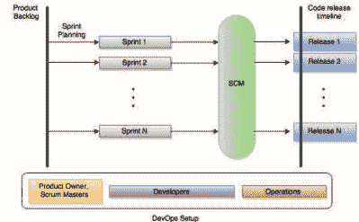

最终，团队获得了批准，将代码移至生产服务器，功能上线。在用户得知新功能之前，一切顺利进行几个小时。但一旦流量增长，可怕的“Internal Error 500”页面开始出现在大多数用户面前。后来得知，一项关键的服务器更新未在生产服务器上执行。虽然服务器在没有更新的情况下可以处理少量用户，但处理大量流量是不可能的。这次失误的原因是开发和基础设施团队之间沟通不畅。你明白这里的重点了——如果该组织采用了 `DevOps` 原则，沟通会更加清晰，这种事件可能可以避免。

> 上方：`DevOps` 减少了敏捷工作流中已完成冲刺与代码发布之间的延迟

敏捷为软件开发流程提供了明确的指南，但有时它们对现代组织的需求来说是不够的。让我们看看一些简单的技巧，帮助你在保持敏捷框架的同时实施 `DevOps` 原则。

- 产品待办列表（`Product backlog`）：启用团队之间更好沟通的简单方法是在产品待办列表中添加与不同团队（如开发、测试、基础设施）相关的额外字段。这确保所有内容都被记录在案，误解的可能性最小。

- Scrum 中的 Scrum（`Scrum of scrums`）：`Scrum` 是敏捷方法的组成部分。不同团队的 `Scrum Master` 的会议，即 Scrum 中的 Scrum，可以确保来自不同团队的人员保持同步。

- 完成定义（`Done definition`）：在冲刺的完成定义中添加与运营相关的项目，是确保运营问题得到妥善处理的另一种实用方法。

# 关注员工

`DevOps` 建议改变团队工作方式。虽然这些改变从外部看很简单，但对于需要改变工作方式的人来说，这可能意味着很多混乱。理解这一点非常重要：实际上是你的员工将决定你的 `DevOps` 梦想的成功或失败。因此，在实施新的 `DevOps` 工具之前，你应该让他们放心并充分培训他们。

# 如何结合敏捷实践实施 DevOps

## 使用 Docker 容器部署 DevOps

`Docker` 为跨团队管理基础设施提供了一种绝佳的方式。让我们看看它是如何工作的，以及如何利用其功能来实施 `DevOps`。

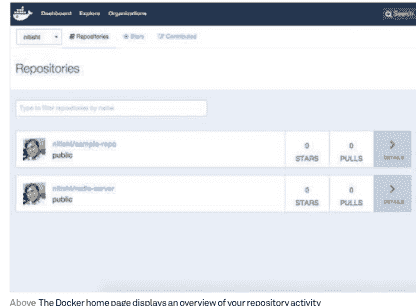

## Docker 及其用途

容器提供了一种运行自包含软件单元的绝佳方式，能够内部处理软件所需的任何依赖项。`Docker` 通过简单且易于创建的 `Dockerfile` 更进一步，这些 `Dockerfile` 充当 `Docker` 容器的构建模块。再加上联合文件系统方法的便利性，这种方法允许将不同文件系统（称为分支）的文件和目录透明地覆盖，以形成一个连贯的文件系统，从而可以将一个容器覆盖在另一个容器之上。那么，这一切如何汇聚起来，使不同团队能够轻松地在 `DevOps` 层面上协作呢？以下是几个用例：

- 需要在所有团队中使用特定的操作系统版本吗？只需为该操作系统版本创建 `Dockerfile` 并将其分发即可。就这样！现在任何人都可以从 `Dockerfile` 轻松创建容器，并使用它来执行代码。

- 需要在发布代码之前对其执行测试吗？为你的代码创建 `Docker` 容器，并部署多个相同系统的容器。你即可在同一系统上运行并发测试。

## 在 Docker 中管理容器

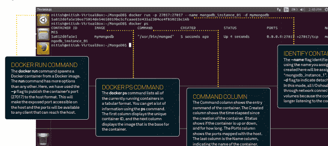

### DOCKER RUN 命令

`docker run` 命令从 `Docker` 镜像生成一个 `Docker` 容器。`run` 命令拥有比其他命令更多的选项。在这里，我们使用了 `-p`（标志）将容器的端口（27017）发布到暴露格式。这会使暴露的端口在主机上可访问，并且对于能够到达主机的任何客户端，该端口都将是可用的。

### DOCKER PS 命令

`docker ps` 命令以表格形式列出所有当前正在运行的容器。你可以使用 `ps` 命令获取大量信息。第一列显示唯一的容器 ID，下一列显示作为容器基础的镜像。

### COMMAND 列

`Command` 列显示容器的入口命令。`Created` 列显示自容器创建以来经过的时间。`Status` 显示容器是启动/停止状态以及持续时长。`Ports` 列显示与主机映射的端口。最后一列是 `Name` 列，指示容器的名称。

### 识别容器

`-name` 标志使用你分配的名称来识别容器。这里创建的容器将被分配名称 `mongod_instance_1`。我们使用了 `-d` 标志来指示分离模式。在这种模式下，所有 I/O 应通过网络连接或共享卷完成，因为容器不再监听命令行。

## 创建 DOCKERFILE

我们已经讨论了为应用程序创建 `Docker` 容器以及部署容器是多么容易。现在让我们从头开始创建一个容器，以了解其中涉及的步骤。作为一个例子，让我们为 `MongoDB` 创建一个容器，`MongoDB` 是一个开源的跨平台 `NoSQL` 数据库，被企业应用程序非常频繁地使用。首先，在你想要创建镜像的目录中创建一个名为 `Dockerfile` 的文件。

```
$ nano Dockerfile
```

然后在你最喜欢的编辑器中打开该文件，开始添加指令。首先，使用 `FROM ubuntu:latest` 将基础镜像设置为 `Ubuntu`。然后声明 `Dockerfile` 的维护者。

```
MAINTAINER Name <email@address-here>
```

现在让我们完成安装前提条件：


```
RUN apt-key adv --keyserver http://keyserver.ubuntu.com:80 --recv 7F0CEB10
RUN echo "deb http://repo.mongodb.org/apt/ubuntu\ 14.04 release -x04/mongodb-org/3.0 multiverse" | tee /etc/apt/sources.list.d/mongodb-org-3.0.list
```

然后安装 MongoDB：

```
RUN apt-get update && apt-get install -y mongodb-org
```

MongoDB 还需要一个数据目录。使用以下命令创建它：

```
RUN mkdir -p /data/db
```

最后，将容器的相关端口暴露给主机，并设置入口点为 MongoDB 守护进程：

```
EXPOSE 27017
ENTRYPOINT ["/usr/bin/mongod"]
```

保存此文件。我们现在可以继续从这个 `Dockerfile` 构建镜像。要构建镜像，请在终端中输入以下内容：

```
$ docker build --tag mymongodb .
```

这告诉 `Docker` 从当前目录中的 `Dockerfile`（注意结尾的 `.`）构建一个镜像，并将其标记为 `mymongodb`。现在你的 MongoDB 镜像已经准备就绪可以运行了。让我们从该镜像生成一个容器。

```
$ docker run -p 27017:27017 --name mongo_db_instance_01 -d mymongodb
```

这创建了一个名为 `mongo_db_instance_01` 的容器并执行它。你可以使用以下命令检查当前正在运行的容器：

```
$ docker ps
```

最后，你可以通过运行以下命令连接到 MongoDB 容器：

```
$ mongo --port 27017
```

- 需要自动化测试流程吗？使用 `Daisi` 等工具，它们从仓库获取代码，然后以 `Docker` 容器的形式将其部署到预定义的硬件节点上。

`Docker` 在实施新的 `DevOps` 成功路径方面提供了极大的灵活性。现在让我们来看看一些使 `Docker` 成为灵活工具的关键功能。

### 联合文件系统

`Docker` 鲜为人知的功能之一是联合文件系统。虽然对最终用户来说并不显见，但联合文件系统在后台工作，以实现在旧容器之上构建新容器，从而避免重复劳动。让我们可视化这个过程。每个 `Docker` 镜像都始于一个基础镜像。当你在 `Dockerfile` 中添加指令时，每条指令都会在结果镜像中创建一个新的层。当你最终运行该镜像时，联合文件系统将所有层合并为一个单一镜像，然后作为容器运行。这种分层方法意味着你也可以使用现有镜像作为新镜像的基础。

### Docker Registry

我们所有人都不知道 `GitHub`。`Docker Registry` 可以被认为是 `Docker` 镜像的类似物。虽然不属于你的 `Docker` 安装的一部分，但 `Docker Registry` 与 `Docker` 紧密集成，允许你轻松推送/拉取 `Docker` 镜像。

从 `DevOps` 的角度来看，这提供了大量的连通性。即使团队位于不同的地理位置，他们也更容易共享和分发 `Docker` 镜像。如果你对 `Docker` 本身提供的云托管 `Docker Registry` 感兴趣，请前往 `hub.docker.com`。

### Docker Swarm

为了能够在集群上部署和管理多个 `Docker` 镜像，`Docker` 提供了一种名为 `Docker Swarm` 的工具。开始使用 `Swarm` 的前提条件是：本地系统安装了 `VirtualBox`，所有节点都可以访问 `Docker` 以拉取镜像，并且每个节点都关联了一个发现服务，如 `etcd`、`Consul`、`ZooKeeper` 等。

### 浏览器内终端

`Wetty` (`Web`+`http`) 是一个由 `JavaScript` 驱动的浏览器内终端模拟器。你可以使用 `DockerInBrowser` 的 `Wetty` 在浏览器中运行 `Linux` shell；`Docker` 镜像已经在 `DockerHub` 上可用，所以你只需要输入：

```
$ docker run -p 3000:3000 -d nathanaele/wetty
```

注意，`Wetty` 目前仅在 `Chrome` 浏览器中工作。

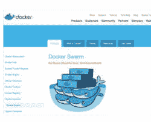

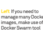

左：如果你需要管理许多 `Docker` 镜像，请充分利用 `Docker Swarm` 工具

## 使用 PUPPET 自动配置节点

`Puppet` 允许你管理 `IT` 基础设施的状态。在这里，我们将看看 `Puppet` 的安装过程，然后是主/代理设置。


上：你可以在 `puppetlabs.com` 上了解有关 `Puppet` 状态的更多信息

自动化是实施 `DevOps` 的关键因素之一。你越少在重复任务中投入人力，就能从你的劳动力中获得越多。`IT` 基础设施配置是涉及重复任务的一个领域——配置物理和虚拟机、编排、报告和其他类似任务。以下是配置管理工具提供的一些优势：

- 代码提交日志向你展示了基础设施上变更的完整历史

- 在系统间可复现

- 易于扩展

- 一致且连贯的服务器设置

- 针对开发、测试和生产节点的协调环境

因此，一个能让你处理所有这些及更多内容，而不必让你在编码中脏手头的工具，可以极大地帮助你在 `DevOps` 道路上走得更远。`Puppet` 就是这样的工具。简而言之，`Puppet` 让你管理你的 `IT` 基础设施的状态。在主/代理设置中，主节点是中央 `Puppet` 服务器，所有你的配置数据都将从此进行管理和分发，而你其余的服务器都将是 `Puppet` 代理节点，可以由 `Puppet` 主节点配置。在独立 `Puppet` 中，每个节点定期使用 `puppet apply` 命令使用完整的 `Puppet` 模块和清单来编译和应用程序自己的配置。换句话说，每个节点需要与主/代理 `Puppet` 中的 `Puppet` 主节点所需的相同文件和数据。在本教程中，我们将专注于主/代理 `Puppet` 设置。

### 01 安装前步骤

一旦你决定了设置类型，即主/代理或独立，下一步是识别主节点（如果你计划使用主/代理设置）。注意，`Windows` 机器不能充当主节点。此外，主节点应该是一台专用机器，至少拥有两个处理器核心和 `1GB` 的 `RAM`。它还必须可以通过可靠的主机名访问。你可以通过确保主节点位于 `puppet` 的默认主机名下来减少代理节点上的设置时间。`Puppet` 主节点应允许入站流量使用端口 `8140`，代理节点应能够连接到主节点。`Puppet` 主节点充当证书颁发机构，因此它必须准确设置系统时间，否则它可能会错误地从遥远的过去或未来颁发代理证书，其他节点会将这些视为过期。一旦所有这些都被处理完毕，你就可以继续 `Puppet` 安装的下一步。

### 02 在主节点上安装

是时候在主节点上安装 `Puppet` 了。首先启用 `Puppet Labs` 软件包存储库；一旦启用了此存储库，我们就可以安装 `Puppet`。输入：

```bash
$ wget https://apt.puppetlabs.com/puppet-labs-release-trusty.deb
$ sudo dpkg -i puppet-labs-release-trusty.deb
$ sudo apt-get update
```

接下来，在 `Puppet` 主节点上，输入以下内容之一：

```bash
$ sudo apt-get install puppetmaster-passenger
```

... 这是 `PuppetLabs` 本身推荐的，因为它安装了 `Puppet` 及其先决条件，并自动配置了一个具备生产容量的 `Web` 服务器；或者，输入：

```bash
$ sudo apt-get install puppetmaster
```

... 这将仅安装 `Puppet`、其先决条件以及用于运行测试级 `Puppet` 主节点服务器的 `init` 脚本 `/etc/init.d/puppetmaster`。

### 声明式语言

`Puppet` 使用声明式语言帮助你描述系统的状态。这意味着你不需要考虑通过安装 `Apache`、`MySQL` 和 `PHP` 来构建 `LAMP` 堆栈：然后调整 `php.ini`；然后启用 `mod_php`；等等。你只需描述你想要的状态 – 例如，“一个具有 `Apache`、`MySQL` 和 `WordPress` 的 `Web` 服务器” – 然后让 `Puppet` 使其发生。

### 03 在代理上安装及安装后配置

现在，你需要在所有代理节点上运行以下命令：

```bash
$ sudo apt-get install puppet
```


这将安装 Puppet 以及用于运行 Puppet 代理守护进程的 init 脚本（`/etc/init.d/puppet`）。至此，我们完成了安装过程，但 Puppet 尚未启动。让我们现在配置主节点和代理节点，以便它们在需要时能够相互通信。此过程中的第一步是设置主节点的名称和证书。你需要一个能够解析名称到相应 IP 地址的 DNS 服务器，然后在主节点的 `puppet.conf` 文件的主配置部分，将 `dns_alt_names` 设置为主节点可能拥有的每个主机名的逗号分隔值。代理节点尝试连接的默认名称是 `puppet`。因此，如果你使用“puppet”作为主节点的主机名，将为你节省一些精力。这是最重要的一步之一，应谨慎操作，以避免后期出现通信问题。

### 04 激活证书

下一步是在主节点上激活证书。如果这是你部署中唯一的 Puppet 主节点，或者它将作为多主节点站点的 CA 服务器，你现在应该运行以下命令：

```bash
$ sudo puppet master --verbose --no-daemonize
```

这将创建 CA 证书和 Puppet 主节点证书，并包含适当的 DNS 名称。一旦终端输出显示：

> 注意：正在启动 Puppet 主节点版本 3.8.3。

...请通过按下 Ctrl+C 终止该进程，因为我们不希望主节点持续运行。现在，将所有 Puppet 清单和模块放置到位，如果你计划使用 Puppet 管理配置加载，请配置 Web 服务器。

### 05 配置代理

首先，你需要配置每个代理节点中的 `puppet.conf` 设置，以便它们能够连接到你的 Puppet 主节点服务器。此外，某些特定于环境因素应根据你的基础设施需求进行调整。然后，你需要启动 Puppet 代理服务。你可以将其配置为在启动时运行，或者设置一个计划任务（cron job），使其在特定间隔运行。要启动 Puppet 服务，请输入：

```bash
$ sudo puppet resource service <NAME>
ensure=running enable=true
```

然后使用以下命令配置计划任务：

```bash
$ sudo puppet resource cron puppet-agent \
ensure=present user=root minute=30 command=/usr/\
bin/puppet_agent --onetime --no-daemonize --play
```

最后一步是为每个代理节点签署证书。请注意，在代理/主节点部署中，管理员必须在节点获取配置之前批准每个代理节点的证书请求。代理节点在首次尝试运行时将请求证书。要批准请求，请登录到 Puppet 主节点服务器，并使用以下命令查看未处理的请求：

```bash
$ sudo puppet cert list
```

然后输入以下命令来签署请求：

```bash
$ sudo puppet cert sign <NAME>
```

你也可以使用以下命令一次性签署所有请求：

```bash
$ sudo puppet cert sign --all
```

至此，代理节点现在准备就绪，可以与主节点通信。Puppet 还通过允许你分类节点来实现更高水平的配置。通过这种方式，你可以决定哪些代理节点从主节点接收哪些信息。

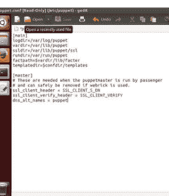

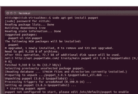

### 文件更新时运行

每当文件更改时，你可以自动运行命令。只需使用一个 `exec` 资源并将 `refreshonly` 设置为 `true`，例如：

```ruby
file { "/etc/bind":
  source => "/dist/apps/bind"
}

exec { "/usr/bin/ndc reload":
  subscribe => File["/etc/bind"],
  refreshonly => true
}
```


## 功能

## DEVOPS

### 使用 VAGRANT 管理你的虚拟机

Vagrant 让你能够轻松地一次性管理多个虚拟机。在这里，我们将学习如何安装并开始使用 Vagrant。

在深入了解 Vagrant 能为你做什么之前，让我们先理解一下什么是 Vagrant。简单来说，Vagrant 提供了一个易于配置、可重复且便携的工作环境，构建在虚拟化技术之上。Vagrant 构建的工作环境可以由单个一致的工作流控制，以帮助最大化工效和灵活性。

为了实现其魔力，Vagrant 站在 VirtualBox、VMWare、AWS 或其他提供商等巨人的肩膀上。然后，你可以使用预配工具——如 shell 脚本、Chef 或 Puppet——在机器上自动安装和配置软件。因此，一旦你创建了一个 Vagrantfile，你只需要运行 `vagrant up`，一切都为你安装并配置好，供你使用。你团队的其他成员可以从相同的配置创建他们的开发环境，因此，无论你是在 Linux、OS X 还是 Windows 上工作，你团队的所有成员都在相同的环境中运行代码，针对相同的依赖项，所有配置方式都相同。

## 安装 Vagrant

Vagrant 可以轻松地在你的系统上下载和安装。前往 Vagrant 下载页面（`vagrantup.com/downloads.html`）并下载适合你系统的软件包。然后，你可以按照你平台的标准安装程序安装它。此外，安装程序会自动将 `vagrant` 命令添加到你的系统路径中，因此你现在可以开始使用它。如果你看到“命令未找到”错误，只需注销并重新登录，它应该就能正常工作。

## Vagrantfile

`Vagrantfile` 描述了项目所需的机器类型，以及如何配置和预配这些机器。请注意，该文件的实际文件名仅为 `Vagrantfile`。Vagrant 每个项目运行一个 `Vagrantfile`，并且 `Vagrantfile` 应该提交到版本控制。这使参与项目的其他开发人员可以签出代码，运行 `vagrant up` 并继续工作。`Vagrantfile` 在 Vagrant 支持的每个平台之间都是便携的。

## 环境变量

你可以在 `Vagrantfile` 中使用环境变量，方法是调用 `ENV[variable_name]`。例如：

```ruby
config.vm.box =
"#{ENV['boxname']}"
```

## VAGRANTFILE 解释


## Vagrantfile 示例代码

```ruby
# File, Edit, View, Search, Require, Help
# -*- mode: ruby -*-
# vi: set ft=ruby:
Vagrantfile API: 2.x/5.x
VERSION = "2"

#Check if you have the good Vagrant version to use docker provider...
Vagrant.require_version ">= 1.6.0"
vagrant.configure(VAGRANTFILE_API_VERSION) do |config|
# All Vagrant configuration is done here. The most common configuration
# options are documented and commented below. For a complete reference,
# please see the online documentation at vagrantup.com.
ENV["VAGRANT_DEFAULT_PROVIDER"] = "docker"

# Share an additional folder to the guest VM. The first argument is
# the path on the host to the actual folder. The second argument is
# the path on the guest to mount the folder. The optional third
# argument is a key of non-specific options.
config.vm.synced_folder ".", "/vagrant_data"
# Provider-specific configuration so you can limit-tune vm (for
# backing providers for Vagrant. These expose provider-specific options.
# Example for VirtualBox:
# config.vm.provider "docker" do |d|
#   d.has_ssh = "*"
#   d.has_ssh = true
# end

config.ssh.port = 22
end

'Vagrantfile' 31 lines, 1879 characters
```

## VAGRANTFILE 版本检查

`Docker` 仅在 `Vagrant` 版本 `1.6` 及以上版本中受支持，因此在其他任何事情之前，你需要确认已安装的 `Vagrant` 是否具有正确的修订版。你可以轻松地做到这一点，如下所示。

## VAGRANT 默认提供商

设置 `Vagrant` 默认提供商可以省去在每个 `Vagrant` 命令中指定提供商是 `Docker` 的麻烦。文件的其余部分包含 `Vagrant` 将用于构建 `Vagrant` 机器并运行容器的选项。

## 提供商特定配置

一旦设置了提供商，更多特定于提供商的配置。这是在 `Vagrantfile` 中使用循环完成的。这样，可以存在多个 `config.vm.provider` 块来配置多个提供商。

## SSH 设置

`config.ssh` 内的设置决定了 `Vagrant` 如何通过 `SSH` 访问你的机器。默认值是合适的，即使没有添加这一行，`SSH` 也应该使用其默认端口 `22`。但是，这展示了你可以更改端口。

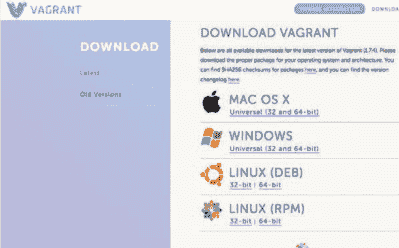

`Vagrantfile` 遵循 `Ruby` 语法，但修改 `Vagrantfile` 并不需要 `Ruby` 知识，因为它主要涉及简单的变量赋值。

注意，当您运行 `vagrant` 命令时，`Vagrant` 会从当前目录开始，逐级向上遍历目录树，寻找它能找到的第一个 `Vagrantfile`。例如，如果您在 `/home/user/projects/foo` 目录下运行 `vagrant up`，它将按以下顺序搜索路径，直到找到一个 `Vagrantfile`：

- `/home/user/projects/foo/Vagrantfile`
- `/home/user/projects/Vagrantfile`
- `/home/user/Vagrantfile`
- `/home/Vagrantfile`
- `/Vagrantfile`

## 基础镜像（Boxes）

与其从零开始构建虚拟机（这通常耗时且费力），`Vagrant` 使用基础镜像来快速克隆虚拟机。这些基础镜像在 `Vagrant` 中被称为“box（基础镜像）”，而在创建 `Vagrantfile` 时，指定要使用的基础镜像始终是第一步。您可以使用以下命令将基础镜像添加到 `Vagrant` 中：

```bash
$ vagrant box add hashicorp/precise32
```

该命令会将基础镜像存储在一个特定的名称下，以便多个 `Vagrant` 环境可以复用它。请注意，`HashiCorp` 是 `Vagrant` 背后的公司，上述命令将从 `HashiCorp` 的基础镜像目录下载名为“`hashicorp/precise32`”的基础镜像。一旦基础镜像被添加到 `Vagrant`，您就可以配置项目以使用它作为基础。打开 `Vagrantfile` 并将其内容更改为以下内容：

```ruby
Vagrant.configure("2") do |config|
  config.vm.box = "hashicorp/precise32"
end
```

您可以在以下地址搜索 `HashiCorp` 的 `Vagrant` 基础镜像目录：`atlas.hashicorp.com/boxes/search`。

## 端口转发

在某些情况下，您可能希望访问宿主机的某个端口，并将请求转发到客户虚拟机的某个端口。在 `Vagrant` 中，只需在 `Vagrantfile` 中添加一行即可设置端口转发。

在下面的示例中，访问 `localhost:8080` 将访问客户机器的 `80` 端口，而访问 `localhost:8443` 将访问客户机器的 `443` 端口。

```ruby
config.vm.network :forwarded_port, guest: 80, host: 8080
config.vm.network :forwarded_port, guest: 443, host: 8443
```

## 设置 Docker 容器

`Vagrant` 提供了一种方法，用于在多种操作系统上创建可重复的开发环境。它使用提供者（provider）来启动隔离的虚拟环境。默认提供者为 `VirtualBox`，但自 `Vagrant` `1.8` 起，也支持基于 `Docker` 的开发环境。与其他工具（如 `boot2docker`，它有助于在非 `Linux` 平台上运行 `Docker`）相比，`Vagrant` 具有一些重要优势：

- 一次配置，处处运行 – 在原生支持 `Docker` 的系统上，`Vagrant` 仅仅是一个 `Docker` 封装层；而在不支持 `Docker` 的系统上，它会启动一个“宿主虚拟机”来运行容器。用户无需关心 `Docker` 是否原生支持；相同的配置将在所有操作系统上有效。
- `Docker` 宿主不仅仅局限于 `boot2docker`（一个基于 `Tiny Core Linux` 的 `VirtualBox` 镜像） – 还支持 `Debian`、`Ubuntu`、`CoreOS` 和其他 `Linux` 发行版。
- `Vagrant` 可以编排 `Docker` 容器。这意味着您可以同时运行多个容器并将它们连接在一起。

默认基础镜像目录中有一个用于 `boot2docker` 的 `Vagrant` 基础镜像。您只需运行以下命令即可将该 `Vagrant` 基础镜像添加到您的系统中：

```bash
$ vagrant box add mitchellh/boot2docker
```

`Vagrant` 会提示您选择提供者，然后下载所选提供者的相应基础镜像版本。然后，除非您另有指示，`Vagrant` 在执行任何 `Docker` 提供者操作时都会启动该 `boot2docker` 基础镜像的一个实例。如果您尚未添加该 `Vagrant` 基础镜像，那么第一次使用 `Docker` 提供者时，它将自动下载基础镜像。这是使用 `Vagrant` 设置 `Docker` 的简便方式。但如果您不想使用 `boot2docker` 怎么办？如果您更希望使用 `Ubuntu` 或 `CentOS`，以便您在 `Vagrant` 中的操作更接近于在数据中心中可能执行的操作，该怎么办？

您可以通过在创建 `Docker` 容器的 `Vagrantfile` 中添加一行来更改此行为。具体行可能如下所示：

```ruby
docker_image_vagrantfile='path/to/host/VV/Vagrantfile'
```


因此，您需要创建一个启动运行您所选 Linux 发行版的虚拟机的 `Vagrantfile`，然后在创建 Docker 容器的那个 `Vagrantfile` 中引用该文件。当然，由于 Vagrant 期望文件名是 `Vagrantfile`，因此定义宿主虚拟机的文件必须位于与定义 Docker 容器文件不同的目录中。因此，您需要指定宿主虚拟机 `Vagrantfile` 的路径。

虽然 Vagrant 期望 Docker 在此宿主虚拟机内运行，但它提供了一种简化方式，允许您在运行 `vagrant up` 时向虚拟机预配（安装）Docker（这与 Vagrant 在首次实例化虚拟机时向其中预配其他内容的方式非常相似）。这是在宿主虚拟机的 `Vagrantfile` 中通过一条简单命令完成的：

```
config.vm.provision "docker"
```

## 圣诞礼物订阅最高可享 5 折优惠\*


**`GADGET`（最新科技）**

包含最新、最酷、最激动人心的科技产品

12 期，享 5 折优惠


**`HOW IT WORKS`（运作原理）**

充满行动感的科学与科技杂志

13 期，享 46% 优惠


**`ALL ABOUT HISTORY`（历史全览）**

让史诗般的历史在全家人面前栩栩如生

15 期，享 49% 优惠


**`HISTORY OF WAR`（战争史）**

讲述历史冲突中的故事、战略、英雄和机器

12 期，享 5 折优惠


**`DIGITAL PHOTOGRAPHER`（数字摄影师）**

为爱好者和专业人士提供灵感、教程和工具

12 期，享 5 折优惠


**`RETRO GAMER`（复古游戏玩家）**

经典游戏的第一杂志

12 期，享 5 折优惠


**`ALL ABOUT SPACE`（空间全览）**

探索太阳系及更广阔宇宙的奇妙之处

15 期，享 49% 优惠


**`SCIFI NOW`（科幻现在）**

科幻、奇幻和恐怖爱好者的第一杂志

12 期，享 5 折优惠

- 10 期，享 5 折优惠

- **订购热线 0844 856 0644\***

- **在线订购请访问 `www.imaginesubs.co.uk/xmas151`**

## **订阅任何杂志仅需 £29.99**

- \* 专属圣诞优惠

- \* 相比店铺售价最高节省 50%\*

- \* 不错过您最喜欢的杂志的任何一期

- \* 免费配送，直接送到家门口

- \* 理想的圣诞礼物 - 乐趣延续一整年！

- \* 作为礼物购买时，可免费获赠电子贺卡

## **作为礼物购买或犒赏自己！**

使用代码 `XMAS151` 享受此特别优惠价格。

请在 12 月 2 日前订购，以便在圣诞节后的第一份杂志开始您的订阅。

**通话费用为每分钟 7 便士，外加您的电话公司收取的接入费。**

## **邮寄填写**

请将填好的表格寄至：

Imagine Subscriptions, 800 Guillat Avenue,

Kent Science Park, Sittingbourne, Kent ME9 8GU

## 您的详情

称谓  姓名  姓氏

地址

邮政编码  国家

电话号码

手机号码

电子邮件地址

此订阅是 ☐ 给我 ☐ 给他人（礼物）

## 配送详情 *(如与上述信息不同)*

称谓  姓名  姓氏

地址

邮政编码  国家

电话号码

## 付款详情

英国 £29.99 杂志名称

**多个订单请拨打订购热线 0844 856 0644\*\***

支票

☐ 随附一张金额为 £ 的支票

*(收款人：Imagine Publishing Ltd)*

信用卡/借记卡

☐ `Visa`   ☐ `Mastercard`   ☐ `Amex`   ☐ `Maestro`

卡号 ☐ ☐ ☐ ☐ ☐ ☐ ☐ ☐ ☐ ☐ ☐ ☐

有效期 `MM/YY`

发行号 (`Maestro`) ☐☐

签名

日期

所有订阅者每月都会收到一封包含新闻和优惠信息的电子通讯。

如果您不希望收到来自 Imagine Publishing 的任何促销材料，请勾选：

 邮寄 ☐  电话 ☐  电子邮件 ☐

如果您不希望收到来自其他公司的促销材料，请勾选：

 邮寄 ☐  电话 ☐  电子邮件 ☐

如果您**希望**通过电子邮件收到此类信息，请勾选 ☐

**条款与条件**

*杂志定价为 £29.99，相比店铺售价最高节省 50%。完整的杂志清单和期数详情请访问 `www.imaginepublish.co.uk/XMAS151`。此优惠仅限英国；海外优惠请访问 `www.imaginepublish.co.uk/XMAS151` 或致电 +44 (0)1795 592 869。在 12 月 2 日前订购的礼物订阅将从 2012 年 1 月发售的第一份杂志开始 – 在此日期之后订购的订阅将从下一期开始。您可以选择发送数字礼品卡，请在上述表格中包含您的电子邮件地址。非礼物订阅将从下一期可用的杂志开始。*

优惠结束日期：2015 年 12 月 31 日。促销代码 `XMAS151`

米哈利斯·措卡洛斯（Mihalis Tsoukalos）

是一名 Unix 管理员、Unix 和 iOS 程序员、数据库管理员（DBA），同时也是动态图形设计师。自 1993 年以来，他一直在使用 Linux。


## 系统编程：文件与目录

了解如何使用系统调用来编写工具，以处理文件、目录和符号链接

本教程将介绍系统调用，并解释能够让你处理 Linux 中文件和目录的技术。`stat` 函数系列以及保存所有重要数据的 `stat` 结构是本教程的核心。这里的大多数其他系统调用允许你修改 `stat` 结构中保存的大部分属性。尽管 `stat` 函数系列有四个函数：`stat`、`fstat`、`lstat` 和 `fstatat`，但这里只解释前三个。然而，它们都返回相同的信息，即一个 `stat` 结构，并且拥有相同的 `man` 页面，这应该是你查找额外信息的首选也是最后的选择。

一如既往，大多数主题都附带相关的 C 代码，以阐明每个概念的难点。尽管如此，你应该尝试进行实验并编写自己的代码。最好的方法是尝试实现现有 Linux 命令行工具的简单版本。

除了预期的 C 代码外，你还将看到 Perl、Go 和 Haskell 的代码，它们分别是一种脚本语言、一种通用编程语言和一种函数式编程语言。

在继续之前，你始终应该记住，当你谈论 UNIX 或 Linux 中的文件时，它可能指的是从网络设备、网络套接字、整个硬盘驱动器或打印机到纯文本文件的任何东西。

### `stat()` 系统调用

以下代码展示了一个简单的程序（`fstatEx.c`），它同时使用了 `stat()` 和 `fstat()`，并提供关于文件和目录的信息。`stat()` 和 `fstat()` 之间的主要区别在于，前者需要文件路径名作为输入，而后者需要文件描述符作为输入。因此，当你想要检查一个已经打开的文件时，`fstat()` 更为合适。`stat` 函数主要被 `ls` 实用程序使用。

```c
#include <stdio.h>
#include <sys/stat.h>
#include <fcntl.h>
#include <unistd.h>

int main(int argc, char** argv)
{
```

### 资源

- 文本编辑器

- GCC 编译器

- Perl 解释器

- Go 编译器

- Haskell 编译器

教程文件获取地址：`filesilo.co.uk`

## 一点 Perl

了解 Perl 如何处理文件和目录是很有用的。下载并检查 `find.pl`，它展示了 `find.c` 在 Perl 中的实现。照例，Perl 版本使用比 C 更少的代码行来完成相同的任务。

由于 Perl 有许多模块，建议使用其中的一个来帮助你完成工作。然而，为了使实现更接近 C 语言版本，此实现没有使用任何 Perl 模块。


每当 `find.pl` 发现一个新目录时，该目录会被添加到一个数组中以便稍后处理——这确实是一种非常巧妙的方法。程序将模式（这是程序的第二个命令行参数）与当前文件名进行匹配。如果匹配成功，则打印文件名；否则，程序转到下一个文件。

在第 21 行，程序打开一个目录，在读取之前，一次性读取目录的所有内容并存储在数组中。然后（第 22 行），在通过一个方便的 `foreach` 循环（第 23 行）处理内容之前，关闭该目录。第 34 行使程序使用正则表达式从输出中排除当前目录（`.`）及其父目录（`..`）。第 36 行将文件名与给定的模式进行匹配。如果匹配成功，它继续打印为文件分配的实际块数；否则，它转到 `foreach` 循环的下一个迭代，处理 `@files` 数组中的下一个文件。第 39 行表明 `Perl` 将 `stat` 结构用作数组。

```c
if (argc != 3)
{
    printf("Please use exactly two arguments!\n");
    return -1;
}
char *file1 = argv[1];
char *file2 = argv[2];
int fd = open(file1, O_RDONLY);
// Open the second file
if (fd < 0)
{
    printf("Error reading %s\n", file2);
    return -1;
}
// Get file permissions using stat()
struct stat fileStat;
if(stat(file2, &fileStat) < 0)
    return 1;
printf("The file permissions of %s are: ", file2);
printf("%c", S_ISDIR(fileStat.st_mode) ? "d" : "-" );
printf("%c", fileStat.st_mode & S_ISUID) ? "u" : "-" );
printf("%c", fileStat.st_mode & S_ISGID) ? "g" : "-" );
printf("%c", fileStat.st_mode & S_ISVTX) ? "t" : "-" );
printf("%c", fileStat.st_mode & S_IRUSR) ? "r" : "-" );
printf("%c", fileStat.st_mode & S_IWUSR) ? "w" : "-" );
printf("%c", fileStat.st_mode & S_IXUSR) ? "x" : "-" );
printf("%c", (fileStat.st_mode & S_IRGRP) ? "r" : "-" );
printf("%c", (fileStat.st_mode & S_IWGRP) ? "w" : "-" );
printf("%c", (fileStat.st_mode & S_IXGRP) ? "x" : "-" );
printf("%c", (fileStat.st_mode & S_IROTH) ? "r" : "-" );
printf("%c", (fileStat.st_mode & S_IWOTH) ? "w" : "-" );
printf("%c", (fileStat.st_mode & S_IXOTH) ? "x" : "-" );
printf("\n");
```

```c
struct stat {
    dev_t   st_dev;    /* ID of device containing file */
    ino_t   st_ino;    /* inode number */
    mode_t  st_mode;   /* protection */
    nlink_t st_nlink;  /* number of hard links */
    uid_t   st_uid;    /* user ID of owner */
    gid_t   st_gid;    /* group ID of owner */
    dev_t   st_rdev;   /* device ID (if special file) */
    off_t   st_size;   /* total size, in bytes */
    blkcnt_t st_blocks; /* number of 512B blocks allocated */

    /* Since Linux 2.6, the kernel supports nanosecond
       precision for the following timestamp fields.
       For the details before Linux 2.6, see NOTES. */

    struct timespec st_atim; /* time of last access */
    struct timespec st_mtim; /* time of last modification */
    struct timespec st_ctim; /* time of last status change */
    #define st_atime st_atim.tv_sec      /* Backward compatibility */
    #define st_mtime st_mtim.tv_sec
    #define st_ctime st_ctim.tv_sec
};

Note: the order of fields in the stat structure varies
somewhat across architectures.
```

`stat` 函数系列返回的信息看起来应该像这样：

```c
// Get inode number using fstat()
struct stat anotherFileStat;
if(fstat(fd, &anotherFileStat) < 0)
    return -1;
printf("File %s inode number is %ld\n", file2,
       anotherFileStat.st_ino);

// Close file()
close(fd);
return 0;
```

对于 `StatEx.c` 程序，`stat()` 系统调用返回文件权限，而 `fstat()` 系统调用返回 `inode` 号。`inode` 是文件系统上的一个数据结构，它保存关于文件的信息，除了文件名和数据。目录被实现为分配给 `inode` 的名称列表。因此，目录包含一个指向自身、其父目录以及每个子项（可以是文件或目录）的条目。请记住，`inode` 不包含文件名；只包含其他文件元数据。

顶部的图像显示了保存 `stat` 函数系列返回信息的 `stat` 结构。尽管 `stat` 结构的实际定义可能在不同的 UNIX 变体中有所不同，但所呈现的大多数信息应该都存在。

`fstatEx.c` 文件是你想要回忆 `stat()` 工作原理时的首选参考。你可以使用 `ls` 命令验证 `fstatEx.c` 的结果。将从 `stat()` 获取的信息转换为八进制格式并不是一个琐碎的任务，尽管你只需要编写一次这段代码。另一方面，获取 `inode` 号是很直观的。

## umask() 函数

`umask()` 函数设置与每个进程关联的文件创建掩码。每当进程将要创建新文件或新目录时，文件创建掩码就会发挥作用。

`umask()` 的主要用途是创建临时或永久文件，防止它们被意外读取或写入。通常，你不需要处理 `umask` 值，除非你想使用与从 shell 读取的不同的 `umask` 值。更改进程的 `umask` 不会影响其父进程（通常是 shell）的 `umask` 值。

参考文献。`lstat()` 调用返回的唯一指代符号链接本身的属性是文件类型（`S_IFLNK`）、大小、块数和链接计数。

## chmod() 函数

`chmod(path, mode)` 函数将由路径名 `path` 指定的文件的文件权限设置为 `mode`。`fchmod()` 系统调用使用文件描述符而不是路径执行相同的操作。通常，除非你正在编写处理安全问题的软件，否则你可能不需要使用这些函数中的任何一个。由于使用 `chmod()` 有点棘手，以下 C 代码应该使事情更容易理解：

```c
char mode[]="0777";
int i;
i = strtol(mode, 0, 8);
if (chmod(file, i) < 0)
    printf("Error using chmod");
```

将所需的权限定义为字符串。然后使用 `strtol()` 将字符串转换为八进制数系统中的长整数。最后，使用 `chmod()` 将所需的权限设置给文件。上述 C 代码可以在文件 `times.c` 中找到。

## 符号链接


`lstat()` 函数提供关于符号链接的信息，而 `stat()` 返回关于链接指向的文件的信息。另一个问题是，如果你想读取符号链接，你不能使用 `open()` 来完成，因为 `open()` 会跟随符号链接。有两个系统调用用于打开实际的符号链接：`readlink()` 和 `readlinkat()`。研究以下代码（`countSymlinks.c`）和下面的图像以了解更多关于处理符号链接的内容：

```c
#include <unistd.h>
#include <stdio.h>
#include <sys/stat.h>
#include <dirent.h>
#include <string.h>
int totalSymlinks = 0;
void printDir(char *dir)
{
DIR *dp;
struct dirent *entry;
struct stat statbuf;
if ((dp = opendir(dir)) == NULL )
{
    fprintf(stderr,"cannot open directory: %s\n", dir);
    return;
}
chdir(dir);
while((entry = readdir(dp)) != NULL)
```

这里我们使用 `diff` 命令来比较我们的 `countSymlinks.c` 和 `find.c` 文件

```diff
$diff countSymlink.c find.c
7,9c7
< int totalSymlinks = 0;
<
< void printDir(char *dir)
---
> void printDir(char *dir, int depth, char *desiredName)
13a12
> int spaces = depth * 4;
28a28
>
30c30
<
    printf("%s\n", entry->d_name);
---
> printf("%*s%s/\n",spaces,"", entry->d_name);
> printDir(entry->d_name, depth+1, desiredName);
34,35c34,35
< else if ( S_ISLNK(statbuf.st_mode) )
< totalSymlinks++;
---
> else if ( strcmp(desiredName, entry->d_name) == 0 || strcmp("anything", desiredName) == 0 )
> printf("%*s%s\n",spaces,"", entry->d_name);
46c46
< if ( argc != 2 )
```

## `umask()` 的主要用途

`umask()` 的主要用途是创建临时文件或永久文件，以防止这些文件被意外读取或写入。

```c
    if ( S_ISDIR(statbuf.st_mode) )
    {
        // Ignore . and ..
        if ( strcmp(".", entry->d_name) == 0 || strcmp("..", entry->d_name) == 0) 
            continue;
        // Print the current directory
        printf("%s/\n", entry->d_name);
        /* Recurse at a new indent level */
        printDir(entry->d_name);
    }
    else if ( S_ISLNK(statbuf.st_mode) )
        totalSymlinkLinks++;
    else
        continue;
    }
    chdir("..");
    closedir(dp);
}
```

```c
int main(int argc, char** argv)
{
    char *rootDir = "";
    if ( argc != 2 )
    {
        printf("Please provide exactly 1 command line argument.\n");
        return -1;
    }
    rootDir = argv[1];

    printf("Scanning %s for symbolic links!\n", rootDir);
    printDir(rootDir);
    printf("Found %d Symlink Links!\n", totalSymlinkLinks);
    return 0;
}
```

## 文件的各类时间

每个文件都有三个时间字段：修改时间 (`st_mtime`)、状态变更时间 (`st_ctime`) 和最后访问时间 (`st_atime`)。修改时间和状态变更时间之间存在细微差别。修改时间表示文件数据发生了更改，而状态变更时间表示文件的元数据发生了修改，这会导致文件的 `inode` 发生变化。

## 使用 Haskell 进行系统编程

Haskell 是一种函数式编译编程语言，可用于系统编程。Haskell 是执行文件名匹配操作的最佳选择。Haskell 方式唯一的缺点是，不同的操作系统使用不同的专用模块。

`System.Directory` 模块包含许多函数，可用于从文件系统获取信息，包括获取目录中的文件列表、重命名或删除文件、复制文件、更改当前工作目录 (`setCurrentDirectory`) 以及创建新目录。好消息是，`System.Directory` 是可移植的，并且可以在 GHC（格拉斯哥 Haskell 编译器）本身支持的任何平台上运行。

以下输出展示了使用 Haskell 的优势：

```
ghci> :module System.Directory
ghci> getDirectoryContents "/tmp"
["update-cache-2all3caac","upload_progress",
 cache":"update-extraction-2all3caac", "xdrch-env-x", "font=unix-x", "haccesse", "ghe414750_@", "XH=
 unix*x","hspersidata_root*", "IEC=unix*x","XL1=unix*",
 "test=unix*" ]

ghci> getDirectoryContents "/tmp" >>= return . filter
 (notElem [".", ".."])
["update-cache-2all3caac","upload_progress",
 cache","update-extraction-2all3caac", "xdrch-env-x", "font=unix-x", "haccesse", "ghe414750_@", "XH=
 unix*x","hspersidata_root*", "IEC=unix*x","XL1=unix*"]
```

第一个 `getDirectoryContents` 命令返回 `/tmp` 目录的所有内容。第二个命令执行相同的操作，但有一个小差别：它使用模式匹配排除了特殊值 `"."` 和 `".."`。

根据用于访问文件的函数，部分或所有时间字段可能会改变。此外，修改、删除或添加目录项肯定会改变父目录的部分或所有时间。

现在让我们看看 `filetimes.c`。您需要将获取到的时间值转换为用户更容易理解的格式——这是使用 `ctime` 函数完成的。像往常一样，首先应该调用 `stat()` 或 `fstat()` 来获取必要的数据。获取数据后，应提取并在屏幕上打印，这是一个直接且无痛的过程。正如您已经了解到的，然后使用 `chmod()` 函数更改文本文件的权限。最后，向文件末尾追加一些文本。编译并执行程序，查看文件的各类时间如何变化。

## 处理目录

在底层，UNIX 机器将目录实现并视为普通文件；它们之间只有两个区别。第一个是内核不允许在目录上写入，第二个是它们的 `inode` 中设置了一个特殊位。

虽然知道如何处理单个文件是很好的，但大多数时候您将处理整个目录或目录树。操作目录的两个最有用系统调用是 `opendir()` 和 `readdir()`。

通过查看 `find.c` 中展示的 C 代码，您可以看到 `opendir()` 和 `readdir()` 的实际操作。请注意，`S_ISDIR(statbuf.st_mode)` 有助于确保您处理的是实际目录，而不是普通文件或网卡！

### 遍历目录结构

展示的程序 `find.c` 的目的是遍历目录结构以查找具有特定文件名的文件——就像 `find` 实用程序的一个简化版本。如果所需的文件名是“任意”，则 `find.c` 会打印它找到的每个文件和目录。为程序添加一些额外功能总是好的——这在第 34 行实现。


下载并检查`find.c`文件。`find.pl`中展示的 Perl 版本更为先进，因为它使用正则表达式而不是精确匹配；然而，`find.c`和`find.pl`之间的相似之处比差异更多。如您所料，C 版本比 Perl 版本更大。

请注意，在 C 中比较字符串是否相等可以通过逐个字符比较或使用`strcmp(3)`函数来完成，后者是更好的解决方案。拥有一个单独的函数来打印目录内容（名为`printd()`）的主要原因是程序是递归操作的；由于`main()`不能调用自身，我们需要一个单独的函数！

该程序使用`chdir(2)`函数将当前工作目录更改为提供的根目录（第 19 行）。这不是强制性的，但它使程序员的工作更简单。每次`printd()`找到一个目录项时，它会访问该目录。当它完成检查一个目录后，它会返回到父目录（第 39 行）。

请注意，`find.c`使用`lstat(1)`而不是`stat(1)`以便能够跳过符号链接——这不是强制性的，但请记住符号链接并不安全，因为它们甚至可能使您的程序跳转到不同的文件系统。此外，多个符号链接可以创建一个循环，这将使您的程序永远运行！在程序上修复符号链接循环并不是一项容易的任务；因此，使用`lstat()`代替`stat(1)`并执行必要的检查是一个安全且安全的选择。

### 计算符号链接

`countSymlinks.c`实现了另一个命令行实用程序，它搜索目录树中的符号链接并对其进行计数。您应该已经知道如何从`find.c`中的代码遍历目录结构，这将是`countSymlinks.c`的基础。`countSymlinks.c`中应该有两点变化。第一点是它应该使用全局变量来保持迄今为止找到的符号链接数量。第二点是它必须使用`S_ISLNK(1)`代替`S_ISDIR(1)`，以确保检查的项确实是符号链接（第 34 行）。请查看`countSymlinks.c`以获取完整的 C 代码。

上一页的图像显示了比较`countSymlinks.c`和`find.c`的`diff`命令的输出。由于大多数所需功能已经存在，您只需要查看修改部分。虽然`find.c`中`lstat(1)`的使用是可选的，但这并不适用于`countSymlinks.c`：`countSymlinks.c`中必须使用`lstat(1)`系统调用，因为如您所知，`stat(1)`会跟随符号链接！

### 搜索 PATH

`path.c`显示了`path.c`文件的完整 C 代码，该文件在 PATH 环境变量中搜索可执行文件，类似于`which`实用程序。您应该熟悉大部分展示的代码，但最好快速回顾一下。

首先，程序读取 PATH 变量并存储其内容。然后，它将 PATH 变量的各个部分——即目录——分离出来，以便独立使用每个部分。最后，它检查所需的可执行文件是否位于 PATH 环境变量的目录之一中。程序列出找到的可执行文件的所有实例，而不仅仅是第一个。

PATH 变量棘手的地方在于它可能包含当前工作目录，该目录用点表示：`“.”`。`realpath(3)`函数解析给定路径的规范绝对路径名。因此，`opendir(1)`系统调用打开在 PATH 环境变量中找到的每个目录的规范绝对路径名。小细节会产生巨大差异，所以总是要注意它们！

请注意，如果您要搜索的程序在当前的 PATH 中但它不是一个可执行文件，`path.c`会显示它。这种检查通过第 38 行的`access(1)`函数进行。`access(2)`函数检查调用进程是否可以访问指定的文件（即其第一个参数）；其第二个参数指定将要执行的可访问性测试。`R_OK`常量检查读权限。

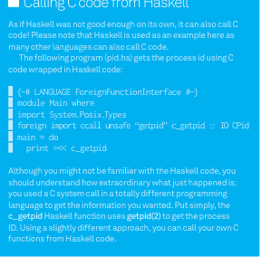

## 从 Haskell 调用 C 代码

如果说 Haskell 本身还不够好，我们也可以调用 C 代码！请注意，这里 Haskell 仅作为示例，因为许多其他语言也可以调用 C 代码。

以下程序(`git`)针对使用 Haskell 代码包装的 C 代码的过程。

```haskell
(* -- LANGUAGE ForeignFunctionInterface -- *)
module Main where
import System.Posix.Types

foreign import ccall unsafe "getpid" c_getpid :: IO PID
main = do
    print = c_getpid
```

虽然您可能不熟悉 Haskell 代码，但您应该理解刚才发生的事情多么非凡：您使用了一种完全不同的编程语言中的 C 系统调用来获取您想要的核心信息。简而言之，`c_getpid` Haskell 函数使用`get{1}(2)`来获取进程 ID。采用稍微不同的方法，您可以从 Haskell 代码中调用自己的 C 函数。

> “PATH 变量棘手的地方在于它可能包含当前工作目录，该目录用点表示：”。

值测试用于检测文件是否存在，而`X_OK`值用于测试文件是否具有执行权限。

请记住，在你的 PATH 环境变量中包含当前工作目录可能会带来安全风险。

## 查找文件的实际类型

本教程的最后部分将介绍一个实用工具，该工具会打印其每个命令行参数的文件类型。`filetype.c`的实现相当简短且易于理解，主要原因是`sys/stat.h`头文件中声明的宏极大地简化了代码。仅供参考，`S_ISDIR()`宏的定义如下：

```c
#define _S_ISTYPE(mode, mask) (((mode) & mask) == mask)
#define S_ISDIR(mode)  _S_ISTYPE(mode, S_IFDIR)
```

`filetype.c`的核心 C 代码如下面的 if/else 代码块所示：

```c
if  (S_ISREG(myStat.st_mode))
  printf("Regular file");
else  if  (S_ISDIR(myStat.st_mode))
  printf("Directory");
else  if  (S_ISCHR(myStat.st_mode))
  printf("Character special file");
else  if  (S_ISBLK(myStat.st_mode))
  printf("Block special file");
else  if  (S_ISFIFO(myStat.st_mode))
  printf("Pipe or FIFO file");
else  if  (S_ISSOCK(myStat.st_mode))
  printf("Socket");
else  if  (S_ISLNK(myStat.st_mode))
  printf("Symbolic link");
else
  printf("Unknown file type!");
```

`S_ISREG()`宏用于查找普通文件；`S_ISDIR()`用于查找目录；`S_ISCHR()`用于发现字符设备文件；`S_ISBLK()`用于查找块设备文件；`S_ISFIFO()`用于查找被检查的文件是否为管道或 FIFO；`S_ISSOCK()`用于查找套接字；`S_ISLNK()`宏用于查找符号链接。

再次强调，C 代码的关键部分是 stat 结构体，因为`stat()`系统调用用于处理每个命令行参数，原因现在应该很清楚了。

逐个处理所有命令行参数的 C 代码如下：

```c
for  (i  = 1;  i<argc;  i++)
{
  if  (lstat(argv[i], &myStat)  <  0)
  {
    printf(" Error reading it with lstat()!\n");
    continue;
  }
}
```

这是一种常见的处理不包含任何选项的多个命令行参数的技术。之所以从`argv[1]`开始，是因为`argv[0]`总是持有可执行文件的名称。`continue`关键字使控制流跳转到外层`for`语句的末尾，使程序处理下一个文件。

## 使用 Go 处理文件和目录

了解你有多种选择来进行系统编程总是有益的，这里将展示另一种编程语言中的示例；这次是 Go。Go 拥有许多可以处理文件和目录的包，这能让你编写更少的代码，这意味着更少的 bug。

所呈现的程序(`walk.go`)实现了`find.c`的核心功能——遍历目录结构并访问其所有目录和文件。


逻辑与`find.c`中的大致相同。值得注意的是，有很多行代码用于错误检查——在编写系统软件时，程序员检查所有函数的返回值并确保一切按预期工作然后再继续，这一点至关重要。`filepath.Walk()`的根字符串和`walkFn WalkFunc`函数通过考虑根目录为`root`（第一个变量）并针对树中的每个文件或目录（包括`root`）调用`walkFn`来遍历文件树。`walkFn`在打印被访问文件或目录的名称之前执行必要的错误检查——你可以看到 Go 的方法非常方便，使程序员的工作更容易。如果`walkFn`函数在针对目录调用时（第 23 行）返回`SkipDir`，`Walk`将完全跳过该目录的内容。

你可以尝试通过获取根目录作为命令行参数并实现`find.c`的完整功能来改进程序。Go 代码会让你感到熟悉，因为它看起来很像 C 代码。

查看`filetype.c`以获取完整实现。在实现任务之前，你不知道它是简单还是困难。此外，Linux 命令行实用程序的大部分代码都涉及错误检查、命令行参数处理和异常——`filetype.c`并没有做太多的错误检查，但在编写生产代码时，你无法回避对错误检查和异常情况的处理。

使用 AWK 处理`filetype`的输出可以得到关于`/dev`目录的有趣摘要数据：

```bash
$  ./filetype /dev/* | awk -F:  '{print $2}'  | sort | uniq -c | sort -rn
113 Character special file.
43  Block special file.
11  Directory.
7  Symbolic  Link.
1  Pipe or FIFO file.
```

同样，检查`/tmp`目录的内容将给出以下输出：

```bash
$  ./filetype /tmp/* | awk -F:  '{print $2}'  | sort | uniq -c | sort -rn
77  Directory.
10  Pipe or FIFO file.
6  Regular file.
3  Socket.
```

再次，你可以看到，当我们将 UNIX 命令行实用程序组合起来创建更复杂的命令时，它们展现了真正的威力。

# 使用 GNU 编译器集合编译软件

掌握 GCC 的基本知识，并学习如何使用其强大的错误和警告标志


Swayam Prakash

拥有计算机工程硕士学位。他已在 IT 行业工作多年，专注于操作系统、网络安全和电子商务等领域

## 资源

- `GCC`
- `bit.ly/1Gs9n69`

在 Linux 环境中开发软件时，我们通常使用 C 或 C++ 作为编程语言。我们编写的程序通常被称为源代码，而将这些源文件转换为另一种计算机语言的需求始终存在。编译是将源代码转换为目标语言（二进制形式）的过程，目的是创建可执行程序。编译通常被称为将源代码从高级编程语言翻译为低级语言的过程。编译器是一种专门用于将源代码转换为机器语言（也称为目标代码或机器代码）的程序，使其能够直接被 `CPU`（中央处理单元）理解。`GNU`编译器集合 (`GCC`) 中包含了一个优秀的 C 编译器，它是大多数现代 Linux 发行版最重要的组件之一。因此，`GCC`被认为是 Linux 环境的标准 C 编译器，也被用作标准 C++ 编译器。请注意，`GCC`是可移植的，可在许多操作系统平台上运行，并且目前可在所有 Unix 系统上获得。有关 `GCC` 的更多详细信息，你可以访问 [gcc.gnu.org](https://gcc.gnu.org)。通过在控制台输入 `man gcc`，你可以获取有关此流行编译器的所有相关信息。

安装 `GCC` 最简单的方法是安装为你的操作系统制作的包。请注意，所有 `GNU/Linux` 发行版都包含 `GCC` 的包。一旦你在 Linux 系统上安装了 `GCC`，可以使用 `gcc --version` 命令来查看其版本。还可以通过 `-v` 选项获取更多详细信息。

现在让我们看看如何使用 `GCC` 编译用 C 语言编写的程序。使用你喜欢的任何文本或代码编辑器，输入以下程序并将其保存为 `sample_prog1.c`：

```c
#include <stdio.h>
main()
{
    printf("This is a sample program to understand GCC\n");
}
```

以最简单的形式，`GCC` 可以像这样使用：

```bash
gcc sample_prog1.c
```

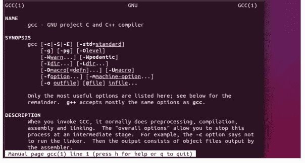

右图：`GCC` 的手册页解释了可以与之使用的各种选项

正如预期的那样，该命令执行了整个编译过程，并生成为 `a.out` 的可执行文件。

如果你想要运行该程序，需要执行以下命令：

```bash
$ ./a.out
```

这会在你的屏幕上打印信息“This is a sample program to understand GCC”。我们现在已成功编译了 C 程序。

如果你希望生成的可执行文件具有特定的输出文件名，可以使用如下所示的 `-o` 选项：

```bash
$ gcc -o sample_prog1 sample_prog1.c
```

在这里，生成的可执行文件将是 `sample_prog1`，而不是 `a.out`。换句话说，我们可以看到 `-o` 选项设置了 `GCC` 的输出文件名。

开发人员通常与 `GCC` 一起使用的另一个重要选项是 `-Wall`。当我们编译程序时，编译器还会提供关于编译过程中遇到的警告的信息。这些警告由 `GCC` 的 `-W` 选项控制。有一种方法可以通过向 `GCC` 传递 `-Wall` 作为一个参数来启用所有常见的警告。对于我们要介绍的示例程序 `sample_prog1.c`，我们可以使用以下命令，其中我们将 `-Wall` 作为一个参数传递。

```bash
$ gcc -Wall -o sample_prog1 sample_prog1.c
```

请注意，即使存在警告，`GCC` 也能编译我们的程序。只有当存在错误时，`GCC` 才会中止编译。

同样重要的是要注意，`GCC` 有许多特定的警告标志，其中一些默认启用，并且它们都有否定形式。`-Wall` 标志将打开几乎所有的警告标志，但 `-Wextra` 标志会启用更多的警告条件标志。为了了解 `-Wextra` 启用了哪些警告标志，运行 `man gcc` 并快速浏览一下是值得的。

让我们考虑以下程序（将此程序保存为 ‘`sample_prog2.c`’）。

```c
#include <stdio.h>
int main(void)
{
    printf("This is the second sample program to understand GCC options");
}
```

当我们尝试使用 `-Wall` 选项编译上述程序时，我们将得到以下警告：

```text
$ gcc -Wall -o sample_prog2 sample_prog2.c
sample_prog2.c: In function ‘main’:
sample_prog2.c:5:1: warning: control reaches end of non-void function
```

如果我们查看上述示例，我们可以注意到，即使 `main` 函数声明为返回整数值，返回值也是未定义的。我们的编译器立即显示了对应于此的警告。这个问题可以通过使用以下方法由开发人员修复（`sample_prog3.c`）：

```c
#include <stdio.h>
#include <stdlib.h>
int main(void)
{
    printf("This is the third sample program to understand GCC");
    return EXIT_SUCCESS;
}
```

当我们编译上述程序时，我们就不必担心任何警告了。

`GCC` 的另一个有用选项是 `-Werror`，因为它使 `GCC` 将所有警告视为错误。当我们使用 `-Werror` 时，如果在过程中检测到任何警告，`GCC` 将不会完成编译。在处理大型项目时，使用此选项并使编译以这种方式中止是很常见的，这可能有益。我们可以按以下方式使用 `-Werror`：

```bash
$ gcc -Wall -Werror -o sample_prog2 sample_prog2.c
```

当我们设置 `-Werror` 选项时，编译器生成的警告可能并不非常严重，但当你编写复杂的程序时，这个选项对于追踪 bug 极其有用。因此，在你的过程中包含此选项是个好习惯。

现代开发系统的另一个有用功能是提供了一些强大的调试工具。借助这些调试工具，开发人员将拥有追踪程序执行过程的强大方法。并且通过这种方式，你将能够隔离烦人的问题，然后采取纠正措施来修复问题。`GNU` 调试器 (`GDB`) 就是一个如此强大的调试工具。


在我们有效地在程序中使用 GDB 之前，我们需要带有调试符号来编译我们的程序。当我们这样做时，GCC 会向它生成的目标文件和可执行文件中插入额外信息。这些额外信息将使 GDB 能够确定编译代码与源程序中代码行之间的关系。

请注意，调试符号默认不会编译到程序中。当我们拥有调试符号时，它们会增加可执行文件的大小。还要注意，为了生成调试符号，我们需要使用 GCC 的 `-g` 选项。以最简单的形式，它生成默认的调试选项集合，通常这对于调试目的就足够了。可以通过执行以下命令来完成：

```bash
$ gcc -g -Wall -o sample_prog2 sample_prog2.c
```

也可以启用更多的调试信息，在某些情况下这会很有用。如果我们使用 GDB 调试器，可能需要执行类似以下的命令：

## 使用 GCC 节省时间

GCC 最常见的用途是当有多个需要编译的程序文件时。如果我们单独编译每一个源文件，那么构建可执行文件所需的时间是显著的。然而，如果我们一次性编译所有文件，我们可以实现显著的时间节省。如果我们有 1,000 个文件并且只修改了一个文件，那么我们只需编译一个文件并将其与目标文件链接以更新二进制文件，而无需编译 1,000 个文件。这节省了大量的编译时间。你可以查看 `Makefile` 来了解如何实现这一点。

## GCC 教程

```bash
psw@yam@psw@yam-VirtualBox:~$ gcc -Wall -o sample_prog1 sample_prog1.c
sample_prog1.c:2:1: warning: return type defaults to `int' [-Wreturn-type]
main()
^
```

```bash
sample_prog1.c: In function `main':
sample_prog1.c:5:1: warning: control reaches end of non-void function [-Wreturn-type]
}
^
```

```bash
psw@yam@psw@yam-VirtualBox:~$
```

> 没错。即使发出警告，GCC 也会完成编译——只有在出现错误时它才会停止处理过程。

### 使用编译

编译是软件开发过程中非常重要的一环，无论我们正在处理多么庞大的代码库，编译器都被广泛用于创建可执行文件。在本教程中，我们将探讨编译过程以及如何使用流行的编译器（GCC 用于编译 C 程序，G++ 用于编译 C++ 程序）。我们还将解释编译器优化，并学习如何使用各种优化级别，这将显著提升我们程序的性能。

C 和 C++ 使用了使用最广泛的编译器，部分原因是因为它们都实现了开源编译器。

```bash
gcc -ggdb -Wall -o sample_prog2 sample_prog2.c
```

上述命令中的 `-ggdb` 部分指示 GCC 生成带有 GDB 扩展的调试符号。为了获取最大可能的调试信息，你可以使用 `-ggdb3`。现在让我们快速浏览一些广泛使用的 GCC 选项。

- `E` 选项：可以使用此选项生成预处理阶段的输出

- `S` 选项：可用于生成汇编级输出

- `c` 选项：开发人员可以使用此选项仅生成编译后的代码（不进行任何链接）

- `save-temps` 选项：通过此选项，编译各阶段的输出都会存储在当前目录中

- `-l` 选项：此选项可用于与共享库进行链接

- `-v` 选项：使用此选项，你可以打印出 GCC 在编译源文件过程中所执行的所有步骤的详细（冗长）信息

当我们谈论编译器时，通常会遇到一个称为“编译器优化”的概念。我们可以将优化器作为编译器的一部分，它能够审查你的代码，识别次优的区域，并使用相同功能但占用更少空间或具有更好性能的代码对其进行重写。GNU 编译器 GCC 拥有一个强大的优化器，可以非常有效地应用于你的程序。

在 GCC 中，我们通常使用 `-O` 选项来启用优化器。你可以为 GCC 指定不同的优化级别；如果使用 `-O`，它将被视为 `-O1`（即级别 1）。通常最高可以升级到三个级别（即 `-O3`）。要使用基本优化，你可以执行类似于以下命令的操作：

```bash
gcc -Wall -O1 -o sample_prog3 sample_prog3.c
```

如前所述，我们可以使用 `-O` 来替代 `-O1`，或者替代使用 `-O2` 或 `-O3`。这些选项基本上控制 GCC 优化器的激进程度。不出所料，更激进的优化意味着我们的代码运行速度更快。

我们都知道，优化能为程序性能带来巨大提升，但与此同时，优化技术也有一些缺点。有些人更喜欢在没有优化的情况下编译他们的程序。这主要是因为 GCC 的优化越激进，程序完成编译所需的时间就越长。在日常开发工作中跳过优化总是好的，但请确保在发布代码时启用优化。如前所述，我们可以有 `-O1`、`-O2` 或 `-O3` 作为优化级别，但 `-O3` 选项可能会增加生成程序的体积。尽管这种差异并不显著，但在某些程序中变得非常重要。如果程序使用更多的 RAM，则在运行的机器上可能会发生交换 – 这反过来可能会使性能受损超过其带来的收益。

优化技术的另一个缺点是，当我们启用优化时，调试可能会变得非常困难。这意味着追踪程序的执行可能会变得困难。因此，最好是在我们需要调试程序时，尽可能跳过优化技术。

一般规则是，数字越大，编译代码时执行的优化越多。许多开发人员更喜欢使用 `-O2` 级别的优化来编译他们的程序。这通常能在优化强度、编译时间和代码大小之间提供最佳折衷。让我们通过一个代码示例（我们的第四个示例程序 – `sample_prog4.c`）来说明优化：

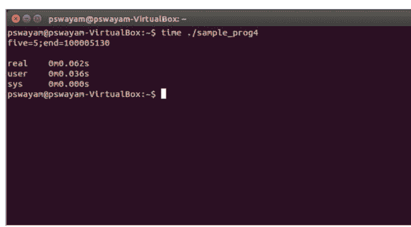

*左图。* 这是我们对优化文件的时间结果。之前，我们的实际时间为 0.310s，用户时间为 0.264s

```c
#include <stdio.h>

int main(void)
{
    int cnt;
    int end;
    int temp;
    int five;
    for (cnt = 0; cnt < 2* 100000000 * 9/18 +
    513; cnt += (5-3)/2)
    {
        temp = cnt / 15302;
        end = cnt;
        five = 5;
    }
    printf( "five = %d, end = %d\n", five, end);
    return 0;
}
```

```bash
gcc -Wall -O1 -o sample_prog4 sample_prog4.c
```

让我们首先在没有优化的情况下编译这个程序：

```bash
gcc -Wall -O -o sample_prog4 sample_prog4.c
```

编译将顺利通过，没有任何错误。通常，我们在命令提示符下使用 `./sample_prog4` 来执行程序。由于我们现在对某些统计数据感兴趣，我们需要以略有不同的方式来做。我们有一个命令 – `time` – 当程序完成时，该命令会报告其资源利用率。该命令基本上指示了程序完成执行所需的时间：

```bash
time ./sample_prog4
```

现在让我们尝试在启用其中一个优化级别的情况下执行相同的程序：

使用以下命令执行程序：

```bash
time ./sample_prog4
```

如果我们比较这两个输出，可以看到执行时间有显著改善。

上述程序的主函数旨在说明优化带来的价值，并且故意将此示例代码写得非常低效。随后，在上面的示例中，我们看到优化器提供了许多改进。如果我们能够编写精确且高效或流程非常好的代码，那么优化器可能能够为你做更多的事情（从性能角度来看），或者你甚至可能不需要任何优化。因此，值得在此注意以下两点：

- GCC 的优化器可以显著提高你程序的性能。

- 你可以始终付出更多努力来提高优化器的程序速度。

我们还有一个名为 G++ 的 GNU C++ 编译器，它对 C++ 程序执行与 GCC 对 C 程序相同的功能。严格来说，GCC 也可以编译 C++ 代码。然而，如果不指定额外选项，结果可能并不总是正确的。因此，使用 G++ 编译器编译 C++ 程序总是好的。通常，我们将 `.C` 或 `.cpp` 作为 C++ 程序的扩展名。

如果我们有程序 `my_testprog.C`，我们可以使用以下命令来编译这个 C++ 程序：

```bash
g++ -Wall -O my_testprog  my_testprog.C
```

可执行文件可以以通常方式运行。

```bash
./my_testprog
```

## 在 CoreOS 上运行复杂的容器集群

继续阅读，了解 CoreOS 如何简单地使用容器来管理已安装的软件


**Nitish Tiwari**


是一名职业软件开发人员，也是一位内心热爱开源的爱好者。除了为领先的开源杂志撰稿外，他还帮助企业建立和使用开源软件以满足其业务需求

**资源**

**CoreOS**

`coreos.com`

如今，容器是运行软件的标准，因此，基于容器的操作系统出现已是大势所趋。`CoreOS` 很好地填补了这一空白。让我们深入挖掘，尝试理解为什么在当前的 Linux 发行版能够很好地处理容器的情况下，还需要一个新的 Linux 发行版。

问题在于，虽然当前的 Linux 发行版使用容器很容易，但当你需要管理（启动/销毁）多个容器或将容器链接以创建不同的后端服务时，它们并不兼容。由 `Docker` 引领的新一波容器化浪潮使事情变得容易得多 – 现在可以轻松地将应用程序部署到几乎任何系统上。你只需要合适的 `Dockerfile` 和 `Docker` 安装即可。

但是，如果有数百个容器，并且你需要频繁地对其进行扩容/缩容，当前的发行版显得力不从心。`CoreOS` 帮助你解决此类场景。

`CoreOS` 旨在确保安全性、一致性和可靠性，是一个基于 Linux 的集群操作系统。这里需要重点提到的是，`CoreOS` 完全不附带包管理器；相反，它预装了 `Docker`。你可以使用 `CoreOS` 来管理你的服务（使用容器），而不是安装软件包。因此，对于你需要的每个服务，只需创建并使用一个容器即可。

**右图** `CoreOS` 与其他分布式应用如 `etcd`、`rkt`、`fleet`、`flannel` 等集成良好

## 01 先决条件

`CoreOS` 支持几乎所有主要的计算平台 – 如 `Amazon EC2`、`Azure`、`DigitalOcean`、`Google Compute Engine` 等云提供商；`VMware`、`VirtualBox` 等虚拟化平台；`OpenStack` 等基于云的操作系统；裸金属服务器，甚至是你自己的个人电脑。但是，由于 `CoreOS` 磁盘安装程序在安装前会删除目标磁盘上的所有内容，因此在当前计算机上安装 `CoreOS` 是一个很大的要求 – 不是每个人都愿意放弃当前的设置来安装新的操作系统。通过先在虚拟机上试用 `CoreOS`，然后通过在云服务器上安装以充分发挥其功能，可以更轻松地开始使用 `CoreOS`。因此，我们将重点在使用 `VirtualBox` 在笔记本电脑上安装 `CoreOS` 虚拟机，以学习其功能。

第一个先决条件是在你的系统上安装了 `VirtualBox`。你可以从 `virtualbox.org` 下载适用于你当前操作系统的安装程序。`VirtualBox` 适用于所有主要操作系统。接下来是 `CoreOS` ISO 文件。这是我们将用于在 `VirtualBox` 上挂载 `CoreOS` 介质的文件。你可以从以下地址获取最新稳定版的 `CoreOS`：`coreos.com/os/docs/latest/booting-with-iso.html`。

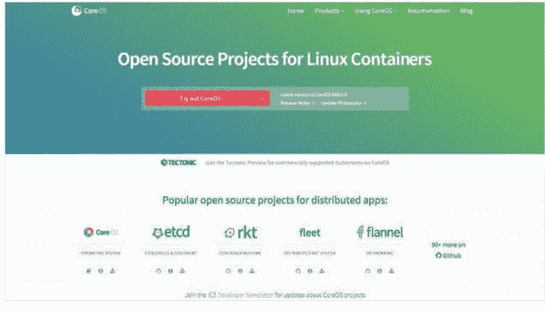

### 01 前提条件

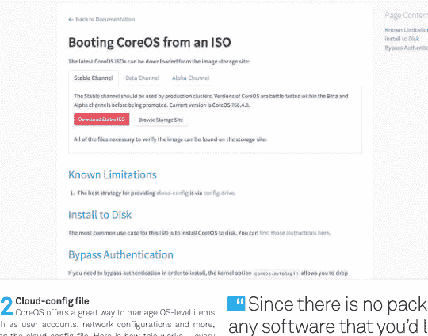

左侧 ISO 下载链接位于 `CoreOS` 文档内部

## 02 Cloud-config 文件

`CoreOS` 提供了一种使用 `cloud-config` 文件来管理操作系统级别项目（如用户账户、网络配置等）的绝佳方式。其工作原理如下——每次系统启动时，`coreos-cloudinit` 程序都会查找 `cloud-config` 文件，并根据文件中的设置配置操作系统。请注意，`cloud-config` 文件在每次启动时都会经过处理——如果文件以某种方式损坏，操作系统仍然会启动，但由于 `cloud-config` 文件存储了所有用户凭据，您可能无法使用您的凭据登录。

这里还需要注意的一点是，该文件不会自动创建——您需要自己编写它，并首先添加用户账户详细信息。随后，随着您需要额外的配置，可以随时将它们添加到文件中。`cloud-config` 文件使用 `YAML` 文件格式，该格式使用空白符和换行符来分隔列表、关联数组和值。`CoreOS` 还提供了一个命令行工具来验证 `cloud-config` 文件——只需从命令提示符运行 `coreos-cloudinit -validate` 即可。

既然我们已经了解了一些关于 `cloud-config` 文件的信息，让我们继续安装过程。我们也会在安装过程中创建 `cloud-config`。

## 03 在 VirtualBox 上创建虚拟机

如前所述，我们将 `CoreOS` 作为虚拟机安装到 `VirtualBox` 上。首先，在您的系统上启动 `VirtualBox`。点击左上角的“新建”按钮创建一个新虚拟机。在下一页中，为虚拟机分配适当的名称，将类型设置为 Linux，版本设置为 `Linux 2.6 / 3.x (64 位)`。下一页要求您设置虚拟机的内存；对于我们的 `CoreOS` 安装，任何超过 `2048MB` 的内存都应该是可以的。下一步是将硬盘文件类型设置为 `VDI`（虚拟磁盘映像），然后将物理硬盘上的存储设置为动态分配。我们将磁盘大小设置为 `8GB`，这是最低要求。根据您系统的可用内存和您的需求，您可以将其设置为任何大于 `8GB` 的值。最后，点击“创建”按钮。这将创建一个具有已设置规格的虚拟机。

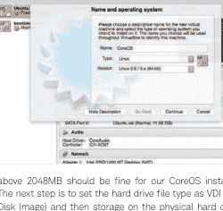

> 由于没有软件包管理器，您希望在 `CoreOS` 安装上运行的任何软件都应作为容器运行

### 什么是 flannel？

`Docker` 为每个容器分配一个 IP 地址，以便它可以与同一主机上的其他容器通信，但在容器内运行的应用程序无法在网络上传播其外部 IP 和端口。`Flannel` 通过为每个容器分配可用于容器间通信的 IP 地址来解决这个问题。它使用数据包封装来创建虚拟覆盖网络。

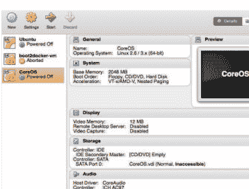

系统会提示您输入密码，然后要求您验证它。成功后，您将获得密码的哈希值。将此哈希值添加到 `cloud-config` 文件的 `password` 字段中。请注意，在登录时，您需要输入明文密码。完成字段填写后，使用 `yml` 扩展名保存文件。

## 06 CoreOS 磁盘安装

既然我们已经准备好了 `cloud-config` 文件，让我们将 `CoreOS` 安装到磁盘上，这样我们就独立于挂载的 `CoreOS` ISO 文件。`CoreOS` 的安装过程非常直接。您只需要使用 `coreos-install` 命令。要将 `CoreOS` 安装到磁盘，只需输入：

```
$ sudo coreos-install --dev=/dev/sda --Mbr --cloud-config cloud_config.yml
```

这将从 `stable` 频道将 `CoreOS` 安装到 `/dev/sda` 设备，并使用 `cloud-config` 文件 `cloud_config.yml`。请注意，您需要将 `cloud_config.yml` 替换为在上一步中创建的 `cloud-config` 文件的名称。输入命令后，`CoreOS` 将被下载并安装到您的虚拟机中。通过从 IDE 控制器卸载 ISO 映像并重新启动虚拟机来检查安装。如果一切正确，虚拟机应该重新启动，并且您应该能够使用 `cloud-config` 文件中设置的用户名和密码登录。

## 07 CoreOS 上的 Docker

`Docker` 容器是 `CoreOS` 的主要构建块。由于没有软件包管理器，您希望在 `CoreOS` 上运行的任何软件都应作为容器运行 - 因此，`Docker` 在 `CoreOS` 上预装并不令人惊讶！

在 `CoreOS` 上使用 `Docker` 与其他任何 Linux 发行版相同，但其他服务如 `systemd`、`fleet` 等（稍后会有更多介绍），它们与容器结合得很好，使连接和管理它们变得容易，从而产生了巨大影响。为了刷新您的 `Docker` 命令知识，让我们启动一个 `Ubuntu` 容器，然后在容器中生成 `bash` 提示符。只需输入：

```
$ docker run -t -i ubuntu /bin/bash
```

## 08 systemd

`systemd` 是 `CoreOS` 使用的 `init` 系统。它是分布式 `init` 系统 `fleet` 的核心。与 `systemd` 相关的两个主要概念。第一个是单元（`unit`），基本上是一个描述使用 `systemd` 运行的进程属性的配置文件。第二个是目标（`target`），这是一种分组机制，使 `systemd` 能够一次启动一组进程。每个目标实际上是一个指向该目标所需的单元文件的符号链接集合。这在单元文件中通过以下字段指定：

```
WantedBy=multi-user.target
```

这里值得一提的是，`systemd` 是 `CoreOS` 上的第一个进程，启动后，它读取不同的目标并启动指定的进程，从而使操作系统启动。在 `CoreOS` 中，单元文件位于 `/etc/systemd/system`。

### 04 首次启动 CoreOS

现在虚拟机已经创建，我们需要将 `CoreOS` ISO 挂载到它并启动 `CoreOS` 的实时版本。只有在实时版本启动后，我们才能创建 `cloud-config` 文件，然后将 `CoreOS` 安装到磁盘上。


要挂载 CoreOS ISO，右键单击我们刚刚创建的 CoreOS 虚拟机并选择“设置”。然后点击“存储”选项卡，并将 CoreOS ISO 文件关联到 IDE 控制器。现在，返回虚拟机列表，选择 CoreOS 虚拟机并点击“开始”（在顶栏）。这将使用附加的 ISO 文件作为启动介质启动 CoreOS 虚拟机。在启动消息之后，您应该看到带有默认 `core` 用户登录的 CoreOS 命令提示符。这确认了 CoreOS ISO 成功启动，并且您现在可以在将 CoreOS 安装到磁盘之前创建 `cloud-config` 文件。请注意，`core` 用户在首次启动时会自动登录，但在 CoreOS 下次启动时，为了登录，必须创建一个用户（通过 `cloud-config` 文件）。

### 05 创建 cloud-config 文件

`cloud-config` 文件遵循 `YAML` 文件格式并具有特定条目。我们需要遵循文件结构，以确保 CoreOS 识别和处理该文件。首先是标题：它应该是 `#cloud-config` 或 `#!`。标题后面应跟随一个关联数组，包含以下一个或多个键 - `coreos`, `ssh_authorized_keys`, `hostname`, `users`, `write_files` 和 `manage_etc_hosts`。我们现在将专注于 `users` 条目。

`users` 条目有三个子字段：`name`、`password` 和 `groups`。除了一个小陷阱外，这些字段都是不言自明的——`password` 字段存储的是密码哈希值，而不是实际密码，这对安全性很有好处，但在创建 `cloud-config` 文件时增加了另一个步骤。您需要手动创建哈希值，然后将其添加到 `cloud-config` 文件中。一种选择是使用 `openssl` 实用工具（CoreOS 附带提供）来创建哈希值。只需输入：

```bash
$ sudo openssl passwd -1
```


用于共享配置和服务发现的高可用性键值存储


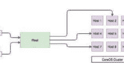

### 09 fleet（集群管理工具）

集群管理是 CoreOS 的主要独特卖点之一，而 `fleet` 正是实现这一功能背后的服务。从最终用户的角度来看，`fleet` 允许你将整个 CoreOS 集群视为一个共享的单一初始化系统。这意味着开发人员完全不需要担心集群本身，他们可以编写小型的、瞬时的单元（unit），这些单元可以轻松地在集群中迁移。与此同时，DevOps 团队可以专注于运行构成服务的容器，而不必担心每个容器具体运行在哪台机器上。例如，如果一个应用程序由五个容器组成，`fleet` 会保证它们始终在集群的某处保持运行。

高可用性通过确保服务容器不位于同一台机器上，甚至不在远程分布式系统中的同一可用区（availability zone）来实现。你可以使用 `fleetctl` 命令来管理你的集群。此外，`fleet` 单元分为两种类型——全局单元（global units）和标准单元（standard units）。全局单元在启动时会在集群中的所有节点上运行，而标准单元则被调度到单台机器上。

### 10 etcd

`etcd` 是一个分布式键值存储，它提供了一种可靠的方式，在机器集群之间存储数据。运行在 CoreOS 集群上的应用程序，无论运行在哪个节点上，都可以将数据写入 `etcd`，你可以放心地知道，当需要时它们能取回这些数据。常见的例子包括存储数据库连接详情、缓存设置、功能标志（feature flags）等。请注意，`etcd` 在集群中的每台机器上运行，并能优雅地处理节点丢失甚至当前主节点（master）丢失的情况。

对 `etcd` 的读写是通过基于 HTTP 的 API 完成的。`etcdctl` 工具可以直接从 CoreOS 机器上使用，以设置键及其对应的消息。只需在命令行提示符中输入以下内容：

```bash
$ etcdctl set /message Hello
```

这里，`message` 是键，`Hello` 是值。要读取值，只需将键传递给 `etcdctl`。你可以输入：

```bash
$ etcdctl get /message
```

要删除该键，你可以输入：

```bash
$ etcdctl rm /message
```

你也可以从容器内部访问 `etcd`，但必须使用分配给 CoreOS 主机上 `docker0` 接口的 IP 地址。

### 11 Rkt 简介

`Rkt`（`Rocket`）是 `App` 容器规范的实现。这是一个开放规范，提供了在容器中运行应用程序的几个方面，例如图像格式、运行时环境和发现协议。由 `AppContainer` 规范设计的图像格式称为 `ACI`（`AppContainer Image`），基本执行单元称为 `pod`，它基本上是一个或多个应用图像的组合。`ACI`，


## 教程 Plasma 5

### 打造你完美的 Plasma 5 桌面

Alexander Iolstoy

多年来一直在精细调整他的 Linux 系统，使其运行速度飞快，但他仍在寻找更多的调整技巧。这种“强迫症”似乎是一种好习惯。

使用隐藏的技巧来揭示这个尖端高级桌面环境的内在力量

`KDE` 和 `Gnome` 用户之间的“圣战”似乎已经很久以前结束了，也许是因为后者大规模迁移到了 `Cinnamon`，但许多剩下的用户仍然喜爱他们的 `KDE` 安装，因为它快速、可配置且功能丰富。但七年首次发布的 `KDE 4` 正在让路，为闪闪发光的新 `Plasma 5` 腾出空间。`Plasma 5` 是下一代硬件加速桌面，拥有时尚现代的外观，同时保留了备受推崇的“瑞士军刀”风格，这种风格始终激励着 `KDE` 用户和开发者。就像老化的 `KDE 4` 一样，`Plasma 5` 是一个模块化桌面，由可以以任何方式重新排列的插件组成。桌面本身是一个收敛式外壳（converged shell），它可以即时适应不同的目标设备。结合现代的基于 `Qt5` 的应用程序，它使体验保持一致，并有助于确保工作流程更加优雅。

### 启动和停止

重启图形外壳最明显的原因是应用那些不仅仅是点击“应用”按钮即可完成的设置。大多数人只会注销然后重新登录，但在这种情况下，所有已启动的应用程序都会关闭，这对于许多人来说是不可取的。

`Plasma 5` 桌面是模块化的，这意味着我们可以杀死外壳而不干扰其他任何东西，无论是后台进程还是图形应用程序。打开 `Konsolle`，或者也许按下 `Alt+F2` 调出 `KRRunner` 抬头提示，然后输入：

```bash
$ kquitapp5 plasmashell
```

... 然后：

```bash
$ plasmashell
```

... 再次启动它。你正在运行的所有应用程序将保持开启状态。在外壳关闭期间，你仍然可以访问 `KRrunner`，甚至通过利用熟悉的 `Alt+Tab` 序列来切换应用程序。

## 资源

`Plasma 5` 桌面

新的 `Plasma 5` 桌面可能尚未成熟，但在过去几个月里，它正在迅速缩小差距，因此许多人已经在日常使用它。`Kubuntu`、`OpenSUSE`、`KaOS`、`Manjaro` 和其他许多发行版提供了开箱即用的、经过精细调整的 `Plasma 5` 发行版。这里的步骤涵盖了适用于 `KDE 4` 和 5 的技巧和窍门，尽管有些是 `Plasma 5` 特有的。

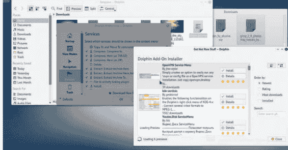

> 右：`KDE Plasma 5` 可能是地球上可定制性和主题化程度最高的桌面

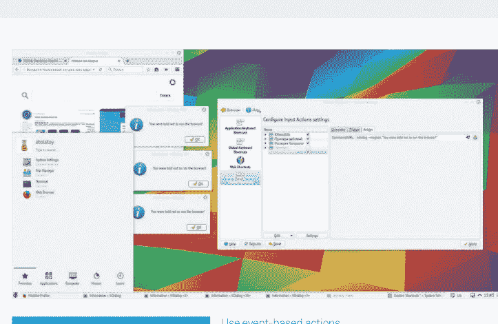

### KRunner 的强大功能

`KRunner` 是一个用于启动命令的便捷工具。除了运行 `Linux shell` 命令外，`KRunner` 会即时搜索 `GUI` 应用程序，并在你输入时提供所有匹配项。然后，它还会查找系统设置条目、`Plasma` 小部件和文件夹名称。例如，如果你输入 `music` 或 `play`，`KRunner` 将显示所有能够播放音乐的多媒体播放器、你的默认音乐文件夹、音乐 `plasmoid` 以及相关的声音设置。

`KRunner` 还可以与 `Baloo5` 一起用作搜索工具（两者共享相同的引擎），因为它会显示名称与你输入内容匹配的文档。当然，这些都是预期的功能，但我们要加点“魔法”。`KRunner` 可以进行网页浏览！输入以 `www/` 开头的你喜欢的网址，然后选择搜索结果——地址将在默认浏览器中打开。接下来，让我们把 `KRunner` 当作计算器使用。当你输入计算式时，`KRunner` 会根据序列开头或结尾的“=”符号检测到它并即时显示结果。计算器模块非常智能：它可以处理带有不同单位的方程。


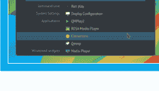

### 使用基于事件的操作

KDE 的 KWin 管理器是一个强大的存在，几乎可以做你想到的任何事情，除了也许冲咖啡或倒垃圾。你可能已经熟悉系统设置中非常实用的“快捷键”部分，在那里你可以更改某些键盘按键甚至鼠标手势。但还有更多，因为 KDE 可以在窗口状态改变时触发自定义命令。这在某些情况下非常有用，例如，当你想要实施自定义的家长控制，或者在某些事件发生时在校用电脑上设置某种警报。基于事件的操作意味着你可以在窗口打开或关闭，或获得或失去焦点时触发一个命令或脚本。让我们通过一个简单的例子来看看它是如何工作的，每次启动 Firefox 时都会出现一个消息框。

在“快捷键”部分，在左侧窗格上右键单击，选择 `新建/窗口操作/命令/URL`，并为其命名，例如 `New`。在 `Trigger`（触发器）选项卡中，选择“窗口获得焦点”选项，然后单击“Window simple”条目的 `Edit`（编辑）。在这里，你可以定义如何识别目标窗口。通常，检测窗口有很多种方法，在我们的例子中，只要告诉它窗口标题包含单词“Firefox”就足够了。在 Action（操作）选项卡中插入以下内容：

```bash
$ kdialog --messagebox "You were told not to run the browser!"
```

一旦你点击应用，你的操作很快就会生效，然后骚扰任何在你的电脑上使用 Firefox 的人。不妨利用这个令人惊叹的功能试试看，看看你能搞出什么名堂！

`上方` 使用基于事件的操作来触发命令


Plasma 5 有一个独特的视觉怪癖：应用程序按钮太大，周围有宽大的填充。如果你不喜欢这样，有一个简单的解决方法：使用紧凑的 QtCurve 主题，例如 (linda) `github.com/Kabuto/midnight`。当然，你可以手动调整任何主题，但根据 (Meha) 和 (arid) 的建议，这是一个快速的解决方案。

# 教程：Plasma 5

## 在 VirtualBox 中使用 Plasma 5

硬件加速桌面是 Plasma 5 的一个杀手级功能，但其缺点是在 VirtualBox 中作为来宾系统时表现不佳。解决方法可能听起来很残酷，但在机器设置中关闭 3D 加速即可奏效。您可能还会遇到字体和图标缩放不正确的问题——此时，您需要在 KDE 字体设置中手动设置字体的 DPI 大小。

## 善用 Windows 键

许多新的 Linux 用户来自 Windows 世界，那里有很多人们已经熟悉的键盘快捷键和其他功能。在 Linux 电脑上使用 GNOME 或在 Mac 上运行 OS X 的人都知道，桌面隐喻完全不同，用户需要改变习惯才能在新桌面上高效工作。而在 KDE 中情况则恰恰相反：您可以重现某些按键绑定，使其在 Windows 中同样适用。在本例中，我们将使用 Windows 键来启动开始菜单。

默认的 KDE Plasma 桌面不允许您在单个按键上分配操作，但有一种名为 KSuperkey 的变通方法。安装后，只需使用 `ksuperkey` 命令启动它（并将其添加到 KDE 的自动启动部分），然后只需按下 Windows 键——在 KDE 中它被识别为 Meta。KSuperkey 与默认的 Plasma 5 应用程序启动器配合良好。

对于第一个技巧，我们需要 `wmctrl` 包，几乎在任何 Linux 发行版中都能找到。一旦您拥有了它，请创建一个包含以下内容的脚本：

```sh
#!/bin/sh
target=on
if xprop -root _NET_SHOWING_DESKTOP | fgrep "= 1"; then
    target=off
fi
wmctrl -k $target
```

将其保存为 `showdesktop.sh` 文件，然后使其可执行（`chmod +x showdesktop.sh`），最后将其分配给系统设置中快捷键部分的 Win+D 绑定。

锁定屏幕是一个更简单的过程：不需要将任何内容包装成脚本；相反，使用普通命令就足够了：

```sh
qdbus org/freedesktop/ScreenSaver /ScreenSaver org.freedesktop.ScreenSaver.SetActive True
```

## 自定义按键绑定

作为上一步的延续，我们将尝试重现 Win+D 和 Win+L 组合键的行为，分别用于最小化所有窗口和锁定桌面。

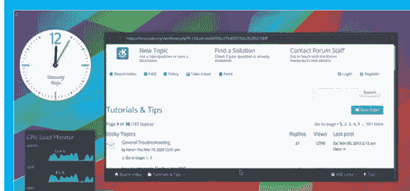

## 内置网络浏览器

Linux 有大量的浏览器，但您是否想过直接在桌面上拥有一个浏览器？我们在 Ubuntu 的 Unity 中见过类似的东西，但在 KDE 中，迷你浏览器是以 plasmoid（等离子元件）的形式实现的，这意味着它不会与应用窗口一起挡路，而是静静地待在桌面上。要添加它：只需右键单击桌面并选择 `Add Widgets...`（添加部件...）项，然后搜索 `Web browser`（网络浏览器）。双击将其添加到桌面，并查看默认 `www.kde.org` 页面在一个小窗口中打开。该 plasmoid 除了快捷键绑定外没有太多设置，因此要更改网站，请在 plasmoid 的文本输入字段中输入其地址，并带有强制的 `www.` 前缀。该 plasmoid 将加载您的页面并自动调整其布局以匹配 plasmoid 本身的大小——您可以调整大小以使 plasmoid 内的页面可读。

网络浏览器 plasmoid 当前使用 QtWebKit 引擎，与 Firefox 浏览器相同，但 KDE 团队计划切换到较新的 QtWebEngine，后者基于 Chromium 代码，渲染页面更好。尽管如此，当前的 plasmoid 能力很强，在 `html5test.com` 上获得了不错的 390 分成绩。


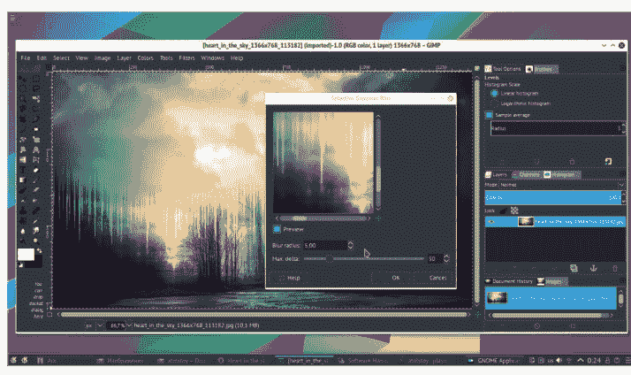

## 启动单个设置模块

所有 KDE Plasma 5 设置都方便地分组在系统设置应用程序中，也可以通过调用 `systemsettings5` 命令来启动该应用程序。不可否认，这个应用程序非常好用，但找到完美的设置可能需要一些时间，您可能希望以更优雅的方式访问所有内容。这可以通过使用 `kcmshell5` 命令来完成。首先，让我们看看我们有哪些模块：

```sh
$ /usr/bin/kcmshell5 --list
```

将任何模块作为 `kcmshell5` 的参数，它将启动相应的单个模块，而不访问控制面板。例如：

```sh
$ /usr/bin/kcmshell5 kwincompositing
```

...将启动桌面合成器设置。此技术允许您从列表中启动任何模块，然后，也许创建带有此类命令的快捷方式，或将其与键盘快捷键绑定。还可以使用单个命令启动多个模块。例如：

```sh
$ /usr/bin/kcmshell5 mouse kcm_xserver
```

...将显示一个漂亮的窗口，其中所有这些模块作为单个窗口内的不同部分显示。

关于更多 Plasma 5 的技巧和窍门，访问 KDE wiki 总是值得的 – 社区成员一直在上传指南至 [userbase.kde.org/Tutorials](http://userbase.kde.org/Tutorials)。

> **Plasma 5 桌面是模块化的，因此我们可以终止 shell 而不干扰其他任何东西，无论是后台进程还是图形应用程序**

## 统一外观

据我们所知，消除基于 Qt 和基于 GTK 的应用程序之间视觉差异的第一次尝试是在 Red Hat Linux 8.0 中引入 Bluecurve 主题时进行的。如今，问题仍然存在：现代 GTK2 和 GTK3 应用程序不太适合 KDE 桌面。这个问题有各种变通方法，包括 QtCurve 主题，它对 GTK2 效果很好，但对 GTK3 支持不佳。另一个选择是使用 Orion GTK 主题，其外观类似于 Plasma 5 Breeze（默认主题），但与之仍有很大的视觉不一致性。幸运的是，我们有 Breeze 主题到 GTK 的可用移植版本，位于 [github.com/dirkv1/gnome-breeze](https://github.com/dirkv1/gnome-breeze)，涵盖浅色和深色变体。只需将主题复制到 `~/.themes` 或 `/usr/share/themes`，然后在 `System Settings`（`Widget style` -> `GNOME Application style` (`GTK`)）中选择它。现在，无论使用哪种图形工具包，您都能获得一致的视觉体验。


# 使用 MonoDevelop 窗体创建用户界面

创建基于 GTK 的 UI 过去是一项令人沮丧的工作，但 MonoDevelop 改变了这一切...

+ **Tim Hanna** 自 Amiga PC 时代起就从事 IT 行业。作为记者、导师、演讲者以及科学书籍的作者，他多次见证移动市场的各个方面

使用 GTK 很痛苦：其基于句柄函数的编码范式在 Palm OS 时代可能看起来很酷，但现在看起来非常过时。

V-CL 试图通过为大多数 GUI 类提供面向对象封装来改善这种情况。这导致了更紧凑的代码，但它离真正的 RAD（快速应用程序开发）还差得远：看到您正在工作的用户界面是生产力的真正助推器。Visual Basic 在这方面一直是领导者。该产品的第一个版本在 DOS 下运行，但它并未吝啬于提供 WYSIWYG-GUI 编辑器。

尽管 Mono 包含对 Microsoft 的 `Windows.Forms` 命名空间的运行时仿真，但 MonoDevelop 的 WYSIWYG 编辑器是基于 GTK 的。由于该框架与 Mono 一样具有跨平台性，对于大多数基于桌面的应用程序来说，使用 GTK 不应是问题。此外，这里讨论的许多概念也可以应用于各种其他 GUI 工具。

MonoDevelop 将为您生成默认的 `GTK 2.0` 项目骨架。除了已知的 `C#` 文件外，我们的项目现在还有一个包含窗体布局和几个图标的资源文件的文件夹。实际的程序执行仍然通过 `Program.cs` 处理，默认情况下包含以下代码：

```csharp
class MainClass
{
    public static void Main (string[] args)
    {
        Application.Init ();
        MainWindow win = new MainWindow ();
        win.Show ();
        Application.Run ();
    }
}
```

`Application.Init()` 是 GTK 框架主类中的静态方法。在创建并显示 `MainWindow` 类的新实例后，我们调用 `Run()` 以启动事件循环。

## 资源

- **MonoDevelop**
    - [monodevelop.com](http://monodevelop.com)

首先启动 MonoDevelop。我们在这个 `C#` 和 MonoDevelop 系列的第一部分中涵盖了安装和部署说明（第 157 期）。然后基于模板 `C# > Gtk 2.0 Project` 创建新项目。

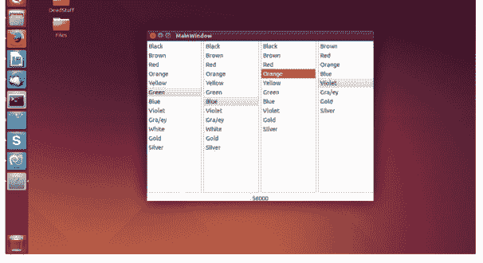

右：这次我们将制作一个简单的电阻色码计算器

我们的窗体由一个 WYSIWYG（所见即所得）组件布局和一个后端代码类组成，其结构如下：

```csharp
public partial class MainForm : Gtk.Window
{
    public MainForm() : base(Gtk.WindowType.TopLevel)
    {
        Build();
    }
}
```

`MainWindow` 的构造函数调用了 `Build()` 方法。它连接到 MonoDevelop 后端，并利用那里的逻辑来生成一个准备就绪的窗体实例。`OnDeleteEvent` 展示了两个有趣的范式：

```csharp
protected void OnDeleteEvent(object sender, DeleteEventArgs a)
{
    Application.Quit();
    a.RetVal = true;
}
```

首先，`Application.Quit()` 在 `MainForm` 关闭时被调用。这防止应用程序以僵尸般的状态在后台继续运行。

其次，设置一个标志以将事件标记为“已完全处理”。这一点非常重要，因为大多数 GUI 框架都会创建类似的事件管道：事件会经过一组事件过滤器，由它们接受或拒绝每个事件。如果开发者的代码未表现出对某个事件的兴趣，该事件通常会被系统默认处理器“埋没”。

# 编码电阻器

电工讨厌处理电阻器——它们怪异的颜色编码使确定元件数值变得困难。因此，看到许多专门用于这项相对简单任务的应用程序并不令人惊讶。

我们将通过双击 `MainForm` 的窗体文件开始。通过分别点击左下角的“Source”或“Designer”切换按钮，可以以文本模式或 GUI 模式显示它。

位于屏幕右侧的小选项卡允许你打开工具箱或属性对话框。工具箱包含一个可通过拖放放置在窗体中的各种控件列表，而属性对话框则显示与当前选中元素相关的属性和设置。

从 Visual Studio 转换过来的开发人员需要了解一个小怪癖。在窗体预览中选中控件不会显示其属性；相反，你需要在文档的大纲窗口中选中它们。

为了降低复杂性，我们将程序限制在对四色环电阻的解码。在 Designer 模式下选中窗体并拉伸其边框，以增大窗体大小。

# 树视图

用户对屏幕分辨率的喜好始终在变化：有些人发誓要使用 1280 x 800 分辨率的 12 英寸 HP EliteBook，而另一些人则在两块 100 英寸 4K 屏幕组成的套装上施展魔法。不幸的是，人类视觉不会如此广泛地扩展——这一事实通过频繁调整窗体大小来适应。`GTK+` 强制你尊重这一点，要求添加窗体。添加一个 `HBox` 并用 `VBox` 填充其顶部单元格，以实现下图中“文档大纲”所示的外观。可以通过右键单击元素来调整网格单元的数量及其间距。在此情况下，MonoDevelop 会通过显示带有更多选项的上下文菜单来对此做出反应。接下来，通过拖动四个树视图和一个标签到由我们的 `HBox` 和 `VBox` 布局创建的网格中来添加它们。完成后，窗体应该与下图中左侧的结构相同。

MonoDevelop 版本的 `GTK+` 不提供经典的列表框。相反，开发人员需要在窗体中添加一个树视图，并通过操作后端代码将其限制为传统的列表模式。属性允许你为控件分配友好的名称。下一步假设你拥有与上一张图片中显示的结构和树视图相同。

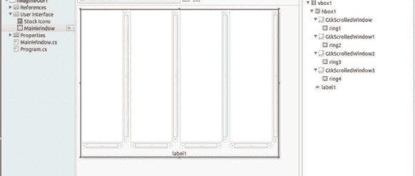

# 添加另一个窗体 – 第 1 部分

我们的计算器是一个典型的例子，它只需要一个窗体就能应付，因为大多数应用程序需要一组窗体。让我们来做到这一点！我们将增加一些真实感。重新打开 `MainForm` 的 WYSIWYG 部分并添加布局中的一行。然后添加一个按钮并将其 `Clicked` 方法连接到以下代码：

```csharp
protected void Button1_Clicked(object sender, EventArgs e)
{
    NewCalculatorWindow();
    mWindow.Show();
}
```

左图：我们的电阻计算器将由四个相邻的滚动窗口窗体组成

# 教程

# MonoDevelop

# 添加窗体 – 第 2 部分

完成上述操作后，是时候注册第二个窗体了。点击“文件/新建/文件”并选择模板 `Gtk+Window`。将类名设置为“AboutWindow”并点击“新建”，以便将资源添加到项目中。在下一步中，从后端代码文件中移除命名空间声明。

运行当前状态下的程序，以便让你的眼睛在第二个空对话框上停留——它正等待你的创造力！

# 模型疯狂

树视图与经典列表视图不同，因为它们通过实现模型-视图-控制器（MVC）概念提供了额外的灵活性。数据通过页眉、布局管理器和数据容器模型的组合来显示。

```csharp
public Mainwindow() : base(Gtk.WindowType.TopLevel)
{
    Build();
    var column = new Gtk.TreeViewColumn();
    column.Title = "RING";
    ring1.AppendColumn(column);
    ring1.HeadersVisible = false;
}
```

首先，必须设置存储在树视图中的数据的基本“模型”。我们只需要添加一列数据；其标题不需要显示。

下一步涉及创建实际数据。它在一个 `ListStore` 中找到庇护所——并且因为它也可以作为多列存储。`AppendValues` 是一个可变参数函数：


```csharp
var rStore = new Gtk.ListStore(typeof(string));
rStore.AppendValues("Black");
rStore.AppendValues("Brown");
rStore.AppendValues("Red");
rStore.AppendValues("Orange");
rStore.AppendValues("Yellow");
rStore.AppendValues("Green");
rStore.AppendValues("Blue");
rStore.AppendValues("Violet");
rStore.AppendValues("Gray/ey");
rStore.AppendValues("White");
rStore.AppendValues("Gold");
rStore.AppendValues("Silver");
```

最后，需要启动实际的显示处理。这通过向模型的行分配渲染器类来实现。它们使用其嵌入的绘图逻辑显示分配给它们的每个元素。由于我们处理的是纯文本，谦逊的 `CellRendererText` 就是我们所需要的一切：

```csharp
var renderer4Cell = new Gtk.CellRendererText();
column.PackStart(renderer4Cell, true);
column.addAttribute(renderer4Cell, "text", 0);
ring1.Model = rStore;
```

其他三个环将以类似的方式填充：通过调整 `AppendValues` 的调用次数以及提供给它颜色名称来调整添加到列表中的元素数量。

请注意，每个“辅助对象”一次只能分配给一个列表框。尝试回收利用，例如列表中显示的那种，是导致崩溃的可靠方法：

```csharp
var column = new Gtk.TreeViewColumn();
column.Title = "RING";
ring1.AppendColumn(column);
ring2.AppendColumn(column);
```

运行程序以查看窗体。最后，使其外观类似于前一页和另一页上的图片。如果你正确填充了行，我们的电阻计算器就准备就绪了。

## 处理一些事件

显示电阻值列表是一项壮举，但遗憾的是，我们的产品目前没有其他功能。由于最小化点击次数总是有益的，我们将每当用户点击列表中的一项时更新显示的值。这可以通过添加事件处理程序来实现。选择一个树视图并切换到属性窗口的“信号”窗格。

接下来，点击“Tree View Signals Cursor Changed”旁边的白色区域。`MonoDevelop` 会用一个可以输入方法名的文本框替换空白区域。最后，按 `Enter` 生成以下骨架；它不会自动显示，但在后端代码中等待着你：

```csharp
protected void OnChange(object sender, EventArgs e)
{
    throw new NotImplementedException();
}
```

由于复制程序逻辑是不好的，我们将激活事件连接到一个名为 `refreshContent` 的通用方法。由于空间限制，我们将提示代码限制为 `OnChange` 的新版本：

```csharp
protected void OnChange(object sender, EventArgs e)
{
    recalculateWindow();
}
```

如果多个控件要共享一个事件处理程序，高级程序员可以通过一个小技巧避免多个函数。复制第一个控件事件处理程序字段中找到的文本并将其粘贴到其他控件中。`MonoDevelop` 检测到相似性并 refrain（克制）生成另一个方法。

`recalculateWindow` 开始确定每个窗口中当前选中的行：如果其中任何一个“未触碰”（未选择），我们打印一个错误：

```csharp
private void recalculateWindow()
{
    if (ring1.Selection.CountSelectedRows() == 0 ||
        ring2.Selection.CountSelectedRows() == 0 ||
        ring3.Selection.CountSelectedRows() == 0 ||
        ring4.Selection.CountSelectedRows() == 0) 
    {
        label1.Text = "Missing Values";
        return;
    }
}
```

下一步涉及电阻的实际计算。我们的代码是故意构造的，因为它展示了解决确定实际选中哪个项目问题的两种方法。在列表索引和元素之间关系已知的情况下，可以制定一个公式来确定内容，而无需查找模型。

### C# 代码片段

```csharp
float val;
TreePath[] templ=ring1.Selection.GetSelectedRows ();
TreePath aPath1 = templ [0];
TreePath[] temp2=ring2.Selection.GetSelectedRows ();
TreePath aPath2 = temp2 [0];
val = aPath1.Indices [0] * 10 + aPath2.Indices [0];
```

如果您发现当前元素的索引号不足，代码还可以提取模型中负责所选行的部分。这是按照以下方式完成的：

```csharp
TreeModel model;
TreeIter iter;
var s = ring3.Selection;
s.GetSelected (out model, out iter);
var str3 = model.GetValue (iter, 0).ToString ();
```

```csharp
switch (str3)
{
    case "Black":
        val = val;
        break;
    case "Brown":
        val = val*10;
        break;
    case "Red":
        val = val*100;
        break;
    case "Orange":
        val = val*1000;
        break;
    case "Yellow":
        val = val*10000;
        break;
    case "Green":
        val = val*100000;
        break;
    case "Blue":
        val = val*1000000;
        break;
    case "Violet":
        val = val*10000000;
        break;
    case "Gold":
        val = val*0.1f;
        break;
    case "Silver":
        val = val*0.01f;
        break;
}
```

最后，通过将其分配给 `Text` 属性，内容被打印到标签上。为了简洁起见，我们的示例省略了对容差环的分析：

```csharp
label1.Text = val.ToString ();
```


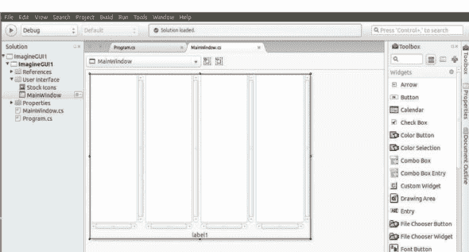

左图：探索工具箱以找到您可以拖放的许多元素

左图：在此阶段，尚未添加事件处理程序，标签仍然为空白

# 教程

## 哈希表


**作者**
Mihalis Tsoukalos
Unix 管理员、程序员（Unix 和 iOS）、数据库管理员以及维护者。自 1993 年以来一直使用 Linux。

# 资源

- 文本编辑器
- `gcc` 编译器


教程文件可下载于：
`filessilo.co.uk`

# 计算机科学：使用哈希表查找字符串

> 花点时间学习如何使用哈希表，并发现它们如何让你的生活更轻松。

哈希表是计算和编程语言的关键组成部分；它们几乎在任何编程语言中得到支持，包括 `AWK`。严格来说，哈希表是一种存储一个或多个键值对的数据结构。哈希表使用哈希函数计算到桶或槽数组的索引，从中可以发现正确的值。理想情况下，如果拥有所需数量的桶，哈希函数会将每个键分配到唯一的桶中。如您所见，这种情况很少发生。在实践中，多个键可能会哈希到同一个桶中。哈希表的最糟糕的限制是，一旦定义了哈希函数和桶的数量，这两个属性都不能在不重建整个哈希表的情况下更改。因此，为了使哈希表更快的最佳方法是增加桶的数量，并确保哈希函数使用所有桶！这里要解决的假设问题是确定一个单词是否可以在字典中找到——这是一个必须快速执行的操作。

所有 C 程序都将按如下方式编译：
```
$ gcc -Wall programName.c -o programName
```

# 理论部分

哈希表最重要的单一特征是哈希函数使用的桶数量。第二个最重要的特征是哈希函数本身。哈希函数最关键的特性是它应该产生均匀的哈希值分布，因为拥有未使用的桶或桶基数之间的巨大差异（见第 52 页图像）效率低下。拥有 `n` 个键和 `k` 个桶意味着搜索速度从线性搜索的 `O(n)` 变为 `O(n/k)`。虽然改进看起来可能很小，但你应该意识到，对于一个只有 30 个桶的哈希数组，搜索时间将小 30 倍！下一张图展示了一个简单但完全具有代表性的哈希表。它唯一的问题是它有一个选择不良的哈希函数，该函数不会返回填充所有可用桶的哈希值——如您所见，一半的桶根本没有被使用！如果您知道取模运算符的作用，可以通过在哈希函数中使用模 10 而不是模 5 轻松修复此问题。

哈希函数必须一致地工作并对相同的键输出相同的哈希值，否则将不可能找到您想要的信息。当两个键哈希到同一个索引时，就会发生冲突——这是一种不寻常的情况。有许多方法可以处理冲突。

一个好的解决方案是使用链地址法（`separate chaining`）：哈希表是指向器的数组，每个指向器指向具有相同哈希值的下一个键。当发生冲突时，该键将以常数时间插入到链接列表的头部。现在的问题是，当你必须搜索给定键的哈希值时，你必须搜索整个链接列表以查找该键。在最坏的情况下，你可能需要遍历整个链接列表；这是链接列表应该适度小，从而提高了对大量桶的需求的主要原因。如您所见，解决冲突涉及某种线性搜索，这在设计上可能会很慢。因此，拥有一个尽可能最小化冲突的哈希函数非常重要。其他解决冲突的技术包括开放寻址、`Robin Hood` 哈希和 `2-choice` 哈希。

# 哈希函数

由于哈希函数将在与哈希表的每次交互中一直使用，哈希函数快速运行非常重要。请注意，设计不良且实现不佳的哈希函数可能会使许多桶未使用，这不仅使查找过程变慢，而且是对资源的严重浪费。避免这种情况的最佳方法是尽可能经常检查桶的基数，以测试整个实现的效率。

在最坏的情况下，如果哈希函数将所有元素放入同一个桶中，哈希表实际上是一个带有额外开销的链接列表——即执行哈希函数——而普通的链接列表因此会是更快的解决方案。

# 删除、插入和查找

哈希表的主要操作是插入、删除和查找。您使用哈希值来确定哈希表中键的存储位置。稍后，您使用相同的哈希函数来确定在哈希表中搜索给定键的位置。

一旦哈希表被填充，搜索与执行插入相同。您对正在搜索的数据进行哈希，前往数组中的那个位置，查看从该位置开始的列表，看看您要找的是否可以在链接列表中找到。步骤数为 `O(1)`。哈希表的最坏情况搜索时间是 `O(n)`——这可能发生在所有键存储在同一个桶中时！然而，发生这种情况的概率很小，因此最好和平均情况都被认为是 `O(1)`。

您可以在互联网上和阅读好书上找到许多哈希表实现。棘手的地方在于使用正确数量的桶并选择高效的哈希函数，使值尽可能均匀分布而无偏。非均匀分布肯定会增加冲突数量，进而如上图所示降低整个哈希表的速度。

# 在 C 中实现哈希表

以下列表展示了 `hashTable.c` 的 C 代码，它使用一个朴素的哈希函数。`hashTable.c` 的目的是理解哈希表如何工作；这可以通过检查其主要要点来实现——完全注释版本可以在本教程的 `FileSilo.co.uk` 资源中找到。

## 教程：哈希表

**右** 在这里，我们看到未使用的桶（`bucket`）以及桶基数（`bucket cardinality`）的巨大差异——这是低效的。


```c
#include <stdio.h>
#include <stdlib.h>
#include <string.h>
#include <ctype.h>

#define TABLESIZE 1001

typedef struct node {
    char *data;
    struct node *next;
} node;

unsigned int hash(const char *str, int tablesize) {
    int value;
    value = toupper(str[0]) - 'A';
    return value % tablesize;
}

static int lookup(node *table[], const char *key) {
    unsigned int index = hash(key, TABLESIZE);
    const node *it = table[index];
    while (it != NULL && strcmp(it->data, key) != 0)
    {
        it = it->next;
    }
    return it != NULL;
}

int insert(node *table[], char *key)
{
    if (!lookup(table, key))
    {
        unsigned int index = hash(key, TABLESIZE);
        node *new_node = malloc(sizeof *new_node);
        if (new_node == NULL)
            return 0;
        new_node->data = malloc(strlen(key)+1);
        if (new_node->data == NULL)
            return 0;
        strcpy(new_node->data, key);
        new_node->next = table[index];
        table[index] = new_node;
        return 1;
    }
    return 0;
}

int populate_hash(node *table[], FILE *file)
{
    char word[50];
    char c;
    do {
        c = fscanf(file, "%s", word);
        size_t len = strlen(word) - 1;
        if (word[0] == '^')
            word[0] = '@';
        insert(table, word);
    } while (c != EOF);
    return 1;
}
```


### 链表的工作原理

哈希表使用链表来存储数据。必须使用链表吗？不，但链表有很多优势。链表非常擅长顺序查找，特别是当与 `C` 语言指针配合使用时：它们是一种简单而优雅的数据结构，可以动态增长，除了少数几个指针外不需要任何额外空间，并且在插入操作方面表现良好。最后，只要你不是经常从哈希表中删除元素，它们就不需要太多的维护工作。

然而，链表也有缺点。如果链表包含许多元素，到达列表的最后一个元素可能会非常慢。此外，当处理包含大量元素的数据时，链表也会非常慢：无论如何，包含 100,000 个节点的链表都会很慢！

即将推出的教程将更深入地讨论链表。目前，请查看 `linkedlist.c` 以获取更多信息。你会发现 `linkedlist.c` 中的代码与 `hashTable.c` 中的代码类似。

```c
void printHashTable(node *table[], const unsigned int tablesize)
{
    node *e;
    int i;
    int length = tablesize;
    printf("Printing a hash table with %d buckets\n", length);
    for(i = 0; i<length; i++)
    {
        e = table[i];
        int n = 0;
        if (e == NULL)
            printf("%4d| bucket %d\n", i);
        else
        {
            while( e != NULL )
            {
                n++;
                e = e->next;
            }
            printf("%4d| has %d key\n", i, n);
        }
    }
}

int main(int argc, char **argv)
{
    char word[50];
    char c;
    int found = 0;
    int notFound = 0;
    node *table[TABLESIZE] = {0};
    FILE *INPUT;
    INPUT = fopen("INPUT", "r");
    populate_hash(table, INPUT);
    fclose(INPUT);
    printf("You can now use the Hash Table!\n");
    int line = 0;
    FILE *CHECK;
    CHECK = fopen("CHECK", "r");
    do {
        c = fscanf(CHECK, "%s", word);
        size_t ln = strlen(word) - 1;
        if (word[ln] == '\n')
            word[ln] = '\0';
        line++;
        if (lookup(table, word))
            found++;
        else
            notFound++;
    } while (c != EOF);
    printf("Found %d words in the hash table!\n", found);
    printf("Not found %d words in the hash table\n", notFound);
    fclose(CHECK);
    return 0;
}
```


C 语言代码并不难，但在继续之前，你必须确保完全理解它。节点结构在程序开头定义，包含两个字段：数据字段——单个值——以及指向链表中下一个节点的指针。你可以拥有任意多个数据字段；唯一必需的字段是指向链表下一个节点的指针。除了强制性的 `main()` 函数外，还有五个其他函数。

在使用名为 `INPUT` 的文本文件填充哈希表后，`main()` 通过检查 `CHECK` 文本文件中的单词是否存在于哈希表中，来检查哈希表的性能。唯一未实现的操作是删除键，因为删除键在字典中是一个非常罕见的操作。`hash()` 函数如其名称所示，执行哈希计算，是整个程序中最重要的函数。`lookup()` 函数检查值是否已经存在于哈希表中。插入和删除操作都需要 `lookup()` 函数：前者为了避免重复，后者为了确保你试图删除的值确实存在于哈希表中。`insert()` 函数根据哈希函数的返回值找到正确的桶，并将新值插入到相应链表的前面，前提是该值尚未存在。`populate_hash()` 函数读取包含值的文本文件，并将它们插入到哈希表中。

最后一个函数，`printHashTable()`，是一个实用函数，显示每个桶的基数。旁边的图表展示了给定输入和给定桶数量的哈希表中 26 个桶中每个桶的基数，这是借助 `printHashTable()` 函数生成的。使用的输入文件包含大约 100,000 个唯一单词。

### 在 Perl 中实现哈希表

Perl 内置了对哈希表的支持，哈希表也被称为字典。你无法控制由 Perl 本身控制的哈希函数。此外，每个元素（值）都有一个唯一的键，即元素本身。Perl 哈希表实现的问题在于，你对过程以及 Perl 处理字典的方式没有任何控制。然而，Perl 方式有很多优势，包括简单性，以及更容易的查找、插入和删除操作。Perl 哈希表实现的代码可以在你的 FileSilo.co.uk 资源中找到：`hashTable.pl`。

Perl 实现的主要问题是它比 C 语言版本需要更多的内存，这主要是由于字典结构中每个单词都有自己唯一的位置。

然而，Perl 并不是唯一原生支持哈希表的编程语言。Ruby、Python、PHP、AWK 和许多其他语言都支持哈希表，哈希表也被称为关联数组。此类实现的主要缺点是，如果不使用辅助结构，几乎不可能保持数据有序；但是，使用辅助结构来支持哈希表而不单独使用辅助结构有什么意义呢？

如果保持数据有序不是你觉得特别需要的东西，那么关联数组可能是以扁平方式存储数据的理想解决方案——你将拥有与你数据基数同样多的桶，而不需要多个链表来存储数据。正如我们之前提到的，你只需相信你的编程语言使用高效的方法执行查找和插入，这并不总是坏事——尤其是当你考虑到编程语言内部通常在发布新版本时得到改进这一事实时。

#### 测试速度

现在让我们比较 C 和 Perl 实现的速度。如页面底部的图表所示，使用良好哈希函数且具有大量桶的 C 实现可以击败 Perl 实现。尽管如此，Perl 实现仍然相当快。另一方面，再次可以理解，少量桶可以破坏原本良好的哈希函数。

#### 哈希表的优势

使用哈希表的主要原因是它们能够将查找的平均成本保持在与存储在表中的元素数量无关的水平。如果未启用插入和删除（这并非罕见的场景），通过仔细选择哈希函数、桶表大小以及使用的内部数据结构，相对容易降低平均查找成本。当总数已知且桶数组可以一次性分配最优大小而无需调整大小时，哈希表也表现出色。

哈希表也有缺点。首先，它们在保持数据有序方面并不擅长。因此，如果你需要数据有序，使用哈希表就不太高效。当条目数量非常少时，哈希表也不是最优的，因为尽管哈希表操作平均取常数时间，但良好哈希函数的成本可能显著高于顺序列表或搜索树查找算法的内部循环。对于某些字符串处理应用程序，哈希表可能比树或有限自动机效率低；然而，树和有限自动机的操作方式更复杂。尽管每次操作的平均成本是常数且相当小，但单次操作的成本可能相当高。特别是，如果哈希表使用动态调整大小，插入或删除键偶尔可能需要与条目数成正比的时间——这可能是希望快速获得结果的应用中的一个严重缺陷。当存在许多冲突时，哈希表也会变得相当低效；难点在于你可能无法预先知道将有多少冲突，特别是当插入动态未知数据时。

最左列显示，如果没有足够多的桶，哈希函数可能有多慢。

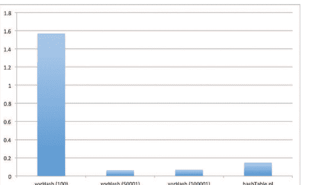

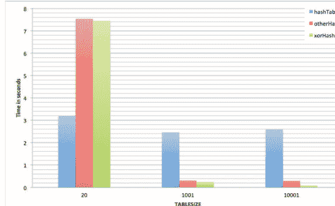

`OtherHash.c` 和 `xorHash.c` 在 `TABLESIZE` 值增大的情况下都能获得显著的速度提升。

## 进行一些基准测试

由于哈希表实现中只有两个因素可以变化，因此基准测试过程仅改变这两个因素。我们将使用三种不同的哈希函数（`hashTable.c`、`otherHash.c` 和 `xorHash.c`）以及三个不同的 `TABLESIZE` 值（20、1001 和 10001）。因此，总共将使用 `time` 命令执行并测量九项测试。

上图展示了三种哈希函数在不同表大小下的性能。你此刻应当已经理解了良好的哈希函数以及容纳各种链表的大数组的重要性。请记住，当你更改 C 代码中的 `TABLESIZE` 变量时，需要重新编译 C 文件才能使更改生效。

正如你现在意识到的那样，一个好的哈希函数必须均匀分布元素，并尽可能减少冲突。此外，它还应考虑要处理的数据类型以及数量，因为如果不了解其数据，哈希函数就无法良好地执行。寻找完美哈希函数的过程是无止境的；然而，在尝试实现哈希函数时，最好的建议是始终考虑你将要处理的数据类型。

## 将哈希表与链表进行比较

这部分将比较哈希表和链表的查找速度；两种实现都将使用 C 语言。请记住，链表的概念比哈希表的概念更简单。一般来说，概念越简单，其用途越通用。然而，与哈希表相比，链表最大的问题是，当你插入一个新节点时，你必须遍历整个链表，以确保新节点尚不存在于链表中。

## Python 中的哈希表

这部分将简要谈谈 Python 如何实现哈希表，它们被称为字典（Dictionaries）。以下 Python 代码说明了 Python 处理字典的方式：

```python
Hash = {}

Hash["key1"] = 1

Hash["key2"] = "12"

Hash["key1"] = 3

for key in Hash.keys():
    print Hash[key]
```


# 第一行定义了一个名为 `Hash` 的新字典变量。接下来的三行将数据放入字典中。最后两行打印哈希字典中找到的所有值。Python 的方法或多或少与 Perl 和 AWK 的方法相似，理解它你应该不会有任何问题。

为了使比较公平，应该使用大量元素来创建哈希表和链表。除了哈希表只有一个桶的情况外，链表是所有呈现程序中最慢的。然而，如果链表元素是排序的，那么其查找性能会好得多。排序链表最重要的好处是，检查节点是否已存在于链表中要容易得多，并且不需要遍历整个链表。当列表需要排序时，插入操作可能会非常慢。将元素插入未排序的链表速度更快。从哈希表和链表中删除元素基本上等同于查找它们。删除的实际成本是查找操作。

## 想要更多？

访问 `GreatDigitalMags.com` 获取关于精彩旧刊和独家特刊的超值优惠

## 即时访问旧刊

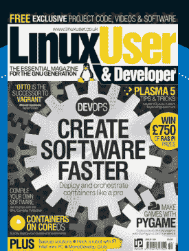
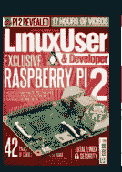


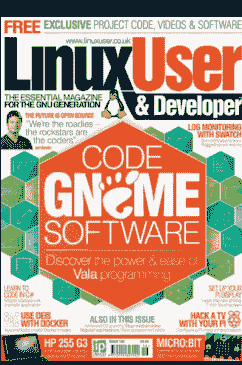

订阅可额外节省更多费用


# 独家书籍与特刊

立即访问 `GREATDIGITALMAGS.COM`


# 今日全部可在 `GREATDIGITALMAGS.COM` 获取


# Linux 服务器托管

来自英国专家

- 全天候 7x24 英国支持 · ISO 27001 认证 · 免费迁移
- 托管服务 · 云托管 · 专用服务器

至尊托管。

至尊支持。

`www.CWCS.co.uk`

# 程序员与创客的必备指南

# 实用树莓派

# 目录


60 树莓派 `Tron` 桌子

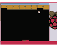

62 使用 `Pygame Zero` 制作游戏


68 为你的 `Pi` 添加多媒体


70 使用 `PI-Mote IR` 破解机器人


74 使用 `FUZE BASIC` 重制 `Tempest`

# 有机会赢得 3 台 `FUZE` 工作站 第 78 页


`www.linuxuser.co.uk` | 59

# 无线

当嵌入的 `Qi` 充电器激活时，`NeoPixel` 环在这盏魔法灯中熠熠生辉，它也可以用于手机。

# 计算机

显示屏使用 `Raspberry Pi 2`，键盘和鼠标组合隐藏在桌子底部的 `Velcro` 支架上。

# 非接触式

`Frederick` 为悬浮按钮制作了自己的分板器，将 `Atmel AT42QT1070` 触摸传感器与 `PCB` 相结合。

# 灯光

`LED` 灯带透过 `Plexi` 表面发光，`Frederick` 的脚本在计算机弹出或收回时改变 `LED` 的颜色。

# 组件列表

- `12V` 电源
- `12V` 转 `5V` `DC-DC` 转换器
- `2` 个 `WiFi` `USB` 适配器
- 桌子：`Raspberry Pi B+`、`USB` 声卡、`2` 个 `5V` `D` 类放大器、`Garminot`、`2` 个步进电机、`2` 米 `LED` 灯带、电容式触摸传感器、`2` 个微动开关（开/关）、迷你扬声器
- 计算机：`Raspberry Pi 2`、`2.5W` `D` 类放大器、笔记本电脑 `LCD` 显示屏、`LCD` 显示屏控制器、`2` 个扬声器
- 魔法灯：`Qi` 无线充电器、`Qi` 无线接收器、`Adafruit NeoPixel` 环、`Adafruit Trinket`

**左图** 灯背后的魔法是一个制作精良的底座，选择以适配 `NeoPixel` 环和 `Qi` 接收器。当 `Qi` 电路连接时，`LED` 透过球体发光。
**下图** 对于电容式触摸按钮，先铺好铜胶带，然后在上面涂上 `Bare Conductive` 油漆。

# 我的 `Pi` 项目


# `Tron PiDesk`

`Frederick Vandenbosch` 使用触摸传感器、无线充电板和可伸缩计算机改造了他的书桌


## 请介绍一下你参加的比赛

`Sci Fi Your Pi` 是由 `element14` 与树莓派基金会联合发起的一项挑战。目标是创建一个以树莓派为中心的科幻项目，并且必须与某部科幻电影有一定的关联。挑战赛有 25 名入围者，我们需要在大约 18 周内构建我们的项目。

## 你选择了哪部电影？

我先有了项目的想法，然后才必须将其与一部电影联系起来，所以在某种程度上我必须逆向思考。我将其与《电子世界》（`Tron`）联系起来，是因为不同的方面：你有灯光，你有嵌入 `LED` 或灯条的服装，这就是为什么我在桌面表面有这种图案，试图代表那种感觉。你还有一张桌子，用于在虚拟世界和现实世界之间传输，这也有一台嵌入式计算机。

## 你的桌子上有哪些功能？

这个想法是使其尽可能具有未来感，并组合多种功能。桌子必须看起来像普通的书桌，但一旦你开始在桌子右侧上方悬停你的手，你就会有嵌入的电容式触摸传感器，它们可以触发某些操作。例如，主要动作是让计算机从桌子上弹出，这将触发一些灯光以让用户知道操作正在进行。当计算机从桌子上升起时，图案会以绿色亮起。当你决定关闭计算机时，发生相反的情况——屏幕会降低到桌子内，你会看到一个红色的移动图案。我决定使用绿色和红色，因为它们是典型的开始和停止颜色。当你的手悬停在电容式触摸传感器上时，还会触发基于存储在树莓派上的 `MP3` 文件的一些音效。

我嵌入的其他功能之一是桌子表面的无线充电器——我使用它来点亮一盏灯，该灯基于玻璃球和放入特定容器中的 `NeoPixels`，但你也可以用它来给你的手机充电。

## 电容式触摸控制仅弹出和收回显示屏吗？

我设想了五个按钮，但我只使用两个。不过，`Pi` 上有一个 `Python` 脚本，等待这五个按钮中的任何输入，并且可以触发任何操作。如果我想到有趣的想法，我肯定会扩展该程序。

## 你是如何建造桌子本身的？

我知道我想在桌子表面内部嵌入东西，因为我希望它看起来像普通的书桌。我使用了一张 `Ikea` 桌子——便宜的是中空的——所以我开始画出我想要的图案和一些存储空间，用于存放树莓派和无线充电器，然后我开始切割桌子的顶面。我移除了纸板结构，这给了我桌子高度内部的空间，这足以隐藏组件。对于传感器，因为我希望它们尽可能平坦，所以我使用导电油漆和铜胶带来制作连接，因此桌子的一侧和另一侧没有高度差。最后，我必须封闭一切，为此我使用了一大片 `Plexi`。我首先用纸卷纸的两层覆盖桌子，以隐藏组件并使其不可见，然后放上 `Plexi` 顶层，你就有了桌子的完整表面。灯足够亮，可以透过纸张发光，而电容式触摸传感器足够灵敏，只需将手放在 `Plexi` 上即可触发。

## 你是否在桌子内部嵌入了扬声器用于音效？

音频有两个部分：嵌入桌子的 `Pi`，它负责控制电机、灯光和音效，因此桌子内部有一个使用放大器分板器的小型扬声器来触发控制的音效。然后你有桌面计算机，它从桌子中滑出和滑入——这是一台单独的树莓派，配有单独的放大器和扬声器。

## 你是如何制作弹出显示屏的？

我多年前有一台旧笔记本电脑，当它坏掉时，我决定回收电机的控制。我将想法基于 3D 打印机的 `Z` 轴，在那里你有螺纹杆，可以随后升高或降低平台。我采用了相同的原则，在桌子底部安装两个步进电机，配有螺纹杆，整个屏幕组件放置在该平台上。当步进电机被触发时，平台升高，导致整个框架从桌子上出来。为了引导这个框架，我使用了一些抽屉滑块，也是来自 `Ikea` 的。步进电机具有良好的扭矩，因此可以承受整个框架的重量，但速度有点是个问题。但最终结果表明，桌面计算机的启动时间与整个框架的升起时间完全相同。

## 项目中最具挑战性的部分是什么？

我遇到了一个问题，即 `LED` 的控制影响了音频，反之亦然。最终我使用外部 `USB` 适配器来处理音频，使其不会影响 `LED` 的 `GPIO` 控制。时间限制迫使你想尽一切办法解决事情。因此，最具挑战性的部分确实是集成，一旦你开始把所有东西组合在一起并让事物相互交互。

`Frederick Vandenbosch` 白天是集成工程师，晚上是电子制作爱好者。他喜欢通过构建事物来学习主题并在过程中享受乐趣。并非所有构建都是成功的，但这是学习过程的一部分！

# 喜欢吗？

如果你想看到 `Frederick` 更多的作品，请访问他的网站：[bit.ly/1XC8u8](bit.ly/1XC8u8)

其余的 `Sci Fi Your Pi` 参赛作品，包括一个真正的 `T-ricoder`，可以在这里找到：[bit.ly/1ekb8c](bit.ly/1ekb8c)

# 延伸阅读

想过要组装自己的 `Tron` 桌子吗？这里有一段来自 `Make` 的 `Bob Osgatt` 的精彩木工视频，向你展示了如何制作带有嵌入式 `LED` 灯带的咖啡桌，这是一个很好的起点：[bit.ly/1WIWIW](bit.ly/1WIWIW)

## 功能


`Pygame Zero` 去除了样板代码，让你能立即将想法转化为游戏，我们将向你展示如何做到这一点

游戏是理解编程语言的好方法：你有一个目标需要去实现，而你添加的每一项功能都会带来更多乐趣。然而，游戏需要图形和其他基本游戏功能所需的库和模块。虽然 `Pygame` 库让在 `Python` 中制作游戏变得相对容易，但它仍然引入了你在开始之前需要处理的样板代码——这是你或你的孩子入门编程的障碍。

`Pygame Zero` 为你处理了所有这些样板代码，旨在让你立即开始编写游戏代码。`Pg0`（我们将用它作为简称）对你制作游戏所需的一切做出了合理的假设——从窗口大小到导入游戏库——这样你就可以直接着手编码你的想法。

`Pg0` 的创造者 `Daniel Pope` 告诉我们，这个库“源于在 `PyCon UK` 教育板块与教师们的交流，试图理解他们需要立即看到结果，并将课程分解成小片段，以便让整个班级跟上进度。”

为了让你了解涉及的内容，我们将从一个乒乓球拍和球开始，逐步构建一个简单的游戏，直到以打砖块风格击碎方块。该项目将展示付出很少努力能做到的事情。`Pg0` 仍处于早期开发阶段，但仍然是一个很好的开始——并且现在已包含在 `Raspbian Jessie` 镜像中的 `Pi` 里。我们将查看其他平台上的安装，但首先让我们看看它能施展什么魔法。

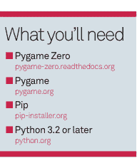

-   `Pygame Zero`
    -   `pygame-zero.readthedocs.org`
-   `Pygame`
    -   `pygame.org`
-   `Pip`
    -   `pip-installer.org`
-   `Python 3.2` 或更高版本
    -   `python.org`


### `Richard Smedley`

是一名系统管理员和作家，同时也是几种编程语言中的永久新手。当他的孩子们在 `Code Club` 学习 `Python` 时，`Richard` 使用 `PyGame` 偷偷超越他们

**右侧打砖块** 是一款经典的街机游戏，可以用 `Pygame Zero` 重新构想

# `Pygame Zero`


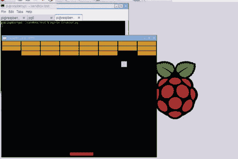

## 老少皆宜

在年轻人使用 `Pygame`（包含所有样板代码）的情况下，也可以取得很好的效果（参见 `Bryan Payne` 的书），但 `Pygame` 和 `Pg0` 尽管作为强大的教育工具被使用，对于处于学习任何阶段的编码者来说，也是创建游戏的好选择。

伟大的游戏都关乎玩法，由强大的想象力驱动，生成图像、动画、声音以及穿越游戏世界的旅程。好的框架向那些不是传统编程学习者的人开放了这种创造性活动，而这正是 `Python` 长期以来擅长的领域。


### 01 零努力

虽然编写游戏并不容易，但开始确实容易。如果你已在 `Pi` 上安装了 `Raspbian Jessie`，你就准备就绪了。打开终端并输入：
```


`touch example.py`

`pgzero example.py`

```

你会看到一个空的游戏窗口打开（按 `Ctrl+Q` 关闭窗口）。是的，开始就是这么简单！

### 02 Python 3

如果你没有 Raspbian Jessie，很可能既没有安装 Pg0 也没有安装 Pygame。Python 的 `pip` 包安装程序会为你获取 Pg0，但前面的步骤因发行版而异。你需要的一件事是 Python 3.2（或更新版本）。如果你一直在编码中使用 Python 2.x（也许是因为你跟随的教程使用它），请把 Pg0 作为你温和升级到 Python 3 的机会。

### 03 旧版 Raspbian

如果你仍在运行 Raspbian Wheezy，你需要运行以下步骤来安装 Pygame Zero：

```
sudo apt-get update

sudo apt-get install python3-setuptools python3-pip

sudo pip-3.2 install pgzero
```

Pygame Zero 为你处理了所有这些样板代码，旨在让你立即开始编写游戏代码

### 04 没有 Pi？

你甚至不需要树莓派来安装 Pygame Zero——只需安装 Pygame 库，然后使用 `pip` 安装 Pygame Zero。说明因发行版而异，但一个好的起点是文档：`bit.ly/1GYZnUB`。


### 05 Intro.py

我们在步骤 1 中看到的那个默认的 800 乘 600 像素黑色方块可以手动覆盖。例如，我们可以用一块超大的金砖替换它，向 *打砖块* 致敬：

```
WIDTH = 1000
HEIGHT = 100

def draw():
    screen.fill((205, 130, 0))
```

该颜色元组采用 RGB 值，因此你可以快速从速查表中获取颜色：`screen` 是为 Pg0 窗口显示内置的，提供各种不同精灵的方法...

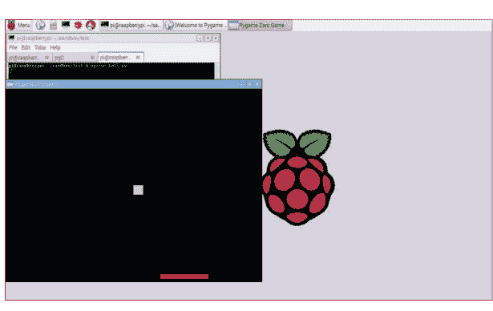

*右侧 球拍和球首先出现——它们是 Pong 和打砖块基石*

### 08 笨拙的

你可以将*打砖块*看作基本上是一个移动的球拍——也就是说，你正在击打一个移动的球以击碎方块。球拍是一个矩形，Pygame 的 `Rect` 对象存储和操作矩形区域——我们使用 `Rect(left, top, (width, height))`，在此之前我们定义球拍颜色，然后调用 `draw` 函数使用 `screen` 函数将球拍放在屏幕上。

```
W = 800
H = 600
RED = (200, 0, 0)
bat = Rect((W/2, 0.96 * H, (150, 15)))

def draw():
    screen.clear()
    screen.draw.filled_rect(bat, RED)
```

### 面向对象

David Ames，他在英国各地活动中使用 `Pg0` 教年幼的孩子编程，告诉我们，“在教孩子时有一件事要避免*面向对象*——OOP（面向对象编程）部分被 `Pg0` 抽象化了，但无法被忽略。”

也许最好的方法是从使用 `Pg0` 和一些简单代码开始，然后在需要解决特定问题时引入 OOP。

对于 Code Club 年龄段——大约八到十一岁——通过提供信息来解决实际问题效果很好。这对成年人也适用——但总有人超前阅读并提出一些棘手的问题。

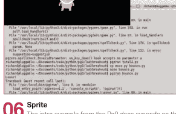

### 06 精灵

`Pg0` 文档中的入门示例通过 `Actor` 类对此进行了扩展，该类将自动调用命名精灵（`Pg0` 会在名为 images 的子目录中查找 `.jpg` 或 `.png`）。

```
alien = Actor('alien')
alien.pos = (100, 56)
WIDTH = 500
HEIGHT = alien.height + 20

def draw():
    screen.clear()
    alien.draw()
```

你可以从 `Pg0` 文档（`bit.ly/15mSIM7`）下载外星人并尝试那里显示的动画，但我们在游戏中采取了不同的方法。

### 07 从 Pong 到打砖块

虽然 `Pi` 是对 1980 年代 8 位计算机的某种致敬，但*打砖块*来自 1970 年代，是早期街机经典 *Pong* 的直接后代。我们将遵循从 *Pong* 到 *打砖块* 的路径（在历史上，创建我们代码的步骤涉及苹果创始人 Steve Wozniak 和 Steve Jobs，让你可以选择将 Pong 元素发展成真正的游戏，以及完善完成的打砖块克隆）。

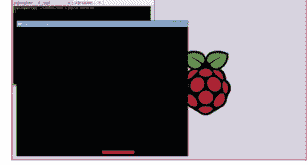

### 09 鼠标移动

我们想移动球拍，而鼠标比箭头键更接近街机球拍。添加以下内容：

```
def on_mouse_move(pos):
    x, y = pos
    bat.center = (x, bat.center[1])
```

使用 `pgzrun` 测试你是否有屏幕、球拍和移动。

### 10 方形球

在正宗的复古图形风格中，我们也定义了一个方形球——本质上是一个矩形，`(30, 30)` 的大小使其成为我们称为正方形的那种矩形子集。

我们这样做是因为 `Rect` 是 `Pg0` 中的另一个内置对象。如果我们想要一个圆形球，我们必须定义一个类，然后使用 pygame 的 `draw.filled_circle(pos, radius, (r, g, b))`——但我们可以直接调用 `Rect`。只需添加：

```
WHITE = 200, 200, 200
ball = Rect(W/2, H/2, (30, 30))
```

... 到初始变量赋值中，以及：

```
screen.draw.filled_rect(ball, WHITE)
```

... 到 `def draw()` 块中。

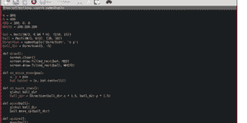

### 11 动作！

现在让我们让球移动。从 `FileSilo.co.uk` 下载教程资源，然后将 `move.py` 文件内的代码添加进来以分配移动和速度。如果你希望球更慢或更快，可以改变 `ball_dir = Direction(5, -5)` 中的 5，符合你的处理器（和手眼协调能力）的要求——但现在很难判断，因为球直接飞出屏幕！`Pg0` 每帧调用一次你定义的 `update()` 函数，如果你没有运行太多其他东西，它会给你一种平滑（差不多）滚动的错觉。

### 12 def move(ball)

为了让球在屏幕内移动，我们需要为球遇到墙壁的每种情况定义 `move(ball)`。为此，我们使用 `if` 语句在球达到每个边界时反转球的方向。请参考第 67 页的完整代码列表。

注意屏幕宽度的硬编码值 781，减去球的宽度——在代码早期版本中硬编码值是可以的，但这是如果你的项目扩展就需要更改的东西。例如，可调整大小的屏幕需要 `$W - 30$` 的值。

### 13 绝对值

你可能会期望将 `y` 乘以负一可以反转球撞击球拍时的方向：

```
ball_dir = Direction(ball_dir.x, -1 * ball_dir.y)
```

... 但你实际上需要使用 `abs`，它会去除任何负号，然后再减：

```
ball_dir = Direction(ball_dir.x, - abs(ball_dir.y))
```

在完成的代码中试试不加 `abs`，看看你是否会得到一些奇怪的行为。你的作业是找出原因。

# 完整代码列表

```
## Breakout type game to demonstrate Pygame Zero library
## Based originally upon Tim Viner's London Python Dojo
## demonstration
## Licensed under MIT License - see file COPYING

from collections import namedtuple
import pygame
import sys
import time

W = 804
H = 600
RED = 200, 0, 0
WHITE = 200, 200, 200
GOLD = 205, 145, 0
ball = Rect(W/2, H/2, (30, 30))
Direction = namedtuple('Direction', 'x y')
ball_dir = Direction(5, -5)
bat = Rect(W/2, 0.96 * H, (120, 15))

class Block(Rect):
```


```python
def __init__(self, colour, rect):

    Rect.__init__(self, rect)

    self.colour = colour

blocks = []

for n_block in range(24):

    block = Block(GOLD, (((n_block % 8) * 100) + 2, ((n_block // 8) * 25) + 2), (36, 33))

    blocks.append(block)

def draw_blocks():

    for block in blocks:

        screen.draw.filled_rect(block, block.colour)

def draw():

    screen.clear()

    screen.draw.filled_rect(ball, WHITE)

    screen.draw.filled_rect(bat, RED)

    draw_blocks()

def on_mouse_move(pos):

    x, y = pos

    bat.center = (x, bat.center[1])

def on_mouse_down():

    global ball_dir

    ball_dir = Direction(ball_dir.x * 1.5, ball_dir.y * 1.5)
```

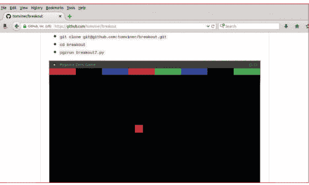

右侧 汤姆·维纳（Tom Viner）的方块数组使得带边框的矩形变得不再必要

## 14 声音

同样在球拍碰撞时，`sounds.blip.play()` 会在声音子目录中查找名为 `blip` 的声音文件。你可以从 `FileSite.co.uk` 下载声音文件（以及完成的代码）。

实际上，现在想想，请忽略之前关于作业的那条评论——你真正的作业是将我们目前写好的内容变成一款正式的 `Pong!`（乒乓球游戏）游戏。但首先，让我们先把它变成 `Breakout!`（打砖块游戏）。

## 15 砖块头！

如果你不太熟悉古老的电脑游戏 `Breakout`（打砖块），那么：

```
apt-get install librawout2
```

……去试试看。现在，我们并没有指望仅用这六页纸就构建出如此宏大的东西，但我们确实需要砖块。

## 16 构建砖块

定义砖块并将其分布到屏幕上有很多方法。在汤姆·维纳的团队来自伦敦 Python Dojo 的版本中——这也是最初启发本文作者尝试编写代码的版本——砖块的大小是相对于屏幕横向排列的数量来设定的，具体如下：

```
N_BLOCKS = 8

BLOCK_W = W / N_BLOCKS

BLOCK_H = BLOCK_W / 4

BLOCK_COLOURS = RED, GREEN, BLUE
```

使用多彩砖块并构建为一个数组意味着砖块可以拼接而不需要边框。通过以屏幕宽度定义变量，这是良好的可持续代码，便于针对不同屏幕尺寸进行修改——参见 `github.com/tomviner/breakout`。

然而，单行彩色砖块的数组不足以填满整个游戏屏幕，因此我们将使用硬编码的值来构建我们的数组……

## 17 挑战高峰

创建一个 `Block` 类：

```
class Block(Rect):

    def __init__(self, colour, rect):

        Rect.__init__(self, rect)

        self.colour = colour
```

……并为你的砖块选择一个漂亮的颜色：

```
GOLD = 205,145,0
```

## 18 排列砖块

这将构建一个由 24 个砖块组成的数组，分为三行，每行八个：

```
blocks = []

for n_block in range(24):

    block = Block(GOLD, (((n_block%3)*100) + 2,
                         ((n_block // 3) * 25) + 2, (96, 25)))

    blocks.append(block)
```

## 19 绘制砖块

在定义 `def draw()` 之后，添加 `draw_blocks()`：

```
def draw_blocks():

    for block in blocks:

        screen.draw_filled_rect(block, block.colour)
```

## 20 撞击砖块

关于砖块，剩下的工作就是扩展 `move(ball)`，使球击中砖块时能够将其摧毁。

```
to_kill = ball.collidelist(blocks)

if to_kill >= 0:

    sounds.blip.play()

    ball_dir = Direction(ball_dir.x, abs(ball_dir.y))

    blocks.pop(to_kill)
```

## P0 +1

PyO 的一个新版本正在开发中——甚至当你读这篇文章时它可能已经发布了。PyO 的创造者 Daniel Pope 告诉我们“一代 API 正在制作中”，并且在 Py/PyConUK 冲刺期间，“我们完成了 Actor 旋转。”

欢迎贡献代码——不仅限于 PyO 代码本身，还需要更多的示例，不仅展示能做什么，还要为教师提供工具，让孩子们对编程的创造性行为产生热情。

PyO 还启发了 PyO Zero，以简化在树莓派上运行 PyO 编程的过程，随着截稿时间的临近，这个新库的开发正在迅速推进。

左侧 顶部 测试你的游戏完成后 – 然后测试你认识的其他人的 Breakout 游戏，看看代码有何不同

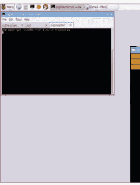

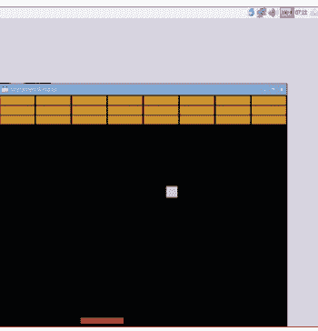

## 21 游戏结束

最后，我们需要考虑成功摧毁所有砖块的可能性。

```
if not blocks:

    sounds.win.play()

    sounds.win.play()

    print("Winner!")

    time.sleep(1)

    sys.exit()
```

## 22 分数显示

利用 Pygame Zero 的一些快速入门功能，我们大约用 60 行代码就拥有一个可运行的游戏。从这里开始，还有更多 Pg0 内容可供探索，但下一步（除了直接探索 Pg0 封装器之外的 Pygame）是深入探究未被 Pg0 封装器中介的 Pygame。

首先重构代码；有很多改进空间——参见教程资源中的示例 `breakout-refactored.py`。尝试添加计分功能，这是游戏中最显著的缺失。你可以尝试使用全局变量，并通过 `print()` 将分数写入终端，或者使用 `screen.blit` 将其显示在游戏屏幕上。未来版本的 Pg0 可能会在简单的分数保持方面提供更多支持。

## 23 九条命的类

为了添加生命值、更多关卡以及更简单的生命/分数管理，你可能最好定义一个 `GameClass` 类，并将你希望持久化的许多更改封装在其中，例如 `self.score` 和 `self.lives`。你会发现网上有很多 Pygame 代码这样做，但你也可以找到 Pg0 示例，例如 Tim Martin 的优秀示例 `pl_lander`：`github.com/timboe/pl_lander`。

## 24 不要停在这里

这篇文章面向初学者，所以别指望能理解所有内容！修改代码看看什么有效，从其他地方借用代码添加进来，并阅读更多代码。坚持这样做，然后尝试一个你自己的项目——并告诉我们你的进展如何。

### 完整代码列表（续）

```
def move(ball):

    global ball_dir

    ball.move_ip(ball_dir)

    if ball.x > 781 or ball.x <= 0:

        ball_dir = Direction(-1 * ball_dir.x, ball_dir.y)

    if ball.y <= 0:

        ball_dir = Direction(ball_dir.x, abs(ball_dir.y))

    if ball.colliderect(bat):

        sounds.blip.play()

        ball_dir = Direction(ball_dir.x, -abs(ball_dir.y))

    to_kill = ball.collidelist(blocks)
```


```
    if to_kill >= 0:

        sounds.block.play()

        ball_dir = Direction(ball_dir.x, abs(ball_dir.y))

        blocks.pop(to_kill)

    if not blocks:

        sounds.win.play()

        sounds.win.play()

        print("Winner!")

        time.sleep(1)

        sys.exit()

    if ball.y > H:

        sounds.die.play()

        print("Loser!")

        time.sleep(1)

        sys.exit()

def update():

    move(ball)
```


## 在你的树莓派上添加多媒体

你可以使用专门的独立模块来处理多媒体，但使用 `pygame` 模块是一站式解决方案。

乔伊·伯纳德（Joey Bernard）是一位真正的通才，他的时间分布在制作家具、帮助研究人员解决科学计算问题以及编写 `Android` 应用程序之间。

### 为什么选择 Python？

它是树莓派的官方语言。在 `python.org/doc` 阅读文档。

> 在很多情况下，你希望在与最终用户的交互中使用多媒体。你可能想要展示一段非常有趣的视频，或者让你的程序以语音与用户交谈。

在这两种情况下，都有大量模块可供使用，使你能处理所有这些数据形式。然而，编程的一个老生常谈是“找到做某事最简单的方法”。在这里，这意味着如果你能找到一个提供所需一切功能的单一框架，你应该使用它。这正是 `pygame` 模块扮演的角色。这并不是说使用 `pygame` 你能做你想做的一切，但你不应该低估学习和使用多个模块以及多个开发团队在编码风格中的思考方式的宝贵价值。本文将涵盖至少一些你可以用于以非文本形式与用户交互的各种方法和技术。

安装 `pygame` 可能有点麻烦。取决于支持哪种视频和音频后端，你需要编译我们提到的所有优化的 `C` 和汇编代码。对于你的树莓派，最简单的解决方案是使用 `sudo apt-get install python-pygame` 来处理所有潜在的麻烦。主页（`pygame.org`）上可用的文档非常详尽。有几个可用的教程，甚至还有一个配方部分，你可以在其中找到概述特定效果和交互技术的配方。

第一步是导入 `pygame` 模块。`Pygame` 提供了一个完整的多媒体子系统，因此在使用其提供的任何功能之前，你需要调用 `pygame.init()`。这会初始化所有内容并为你加载模块内容。

### 在最敏感的代码部分中，使用了优化的汇编语言

`pygame` 旨在尽可能具有可移植性。为了做到这一点，它支持许多不同的图形后端，从 `OpenGL` 甚至使用 `ASCII` 文本显示图形。它被设计为利用所有可用的计算资源，即 `CPU` 和 `GPU`，来进行处理此类文件所需的计算。为了从硬件中获得最佳性能，几个最重的函数是用优化的 `C` 语言编写的。这能带来 10 到 20 倍的速度提升。在最敏感的代码部分，使用优化的汇编语言以获得更多的性能。这意味着即使是你的树莓派，在有限资源下也能获得相当令人印象深刻的输出。

我们将从向用户显示视频开始。你首先需要的是一个实际显示视频的地方。当你调用 `pygame.init()` 时，`pygame` 子系统应该已经为你的当前设备创建了最佳显示模式的显示对象。你可能需要其他内容以使你的程序按你期望的方式运行。你可以使用函数 `pygame.display.set_mode()` 创建一个新的图形显示，其中你可以给该函数一个包含宽度和高度值的序列。你实际绘制图像的对象在 `pygame` 中称为 `surface`（表面）。你刚创建的显示有一个关联的 `surface` 对象。在这个 `surface` 上绘制的任何内容会立即显示在屏幕上。然而，这通常不是你要做的。常用的技术是创建一个离屏绘图区域并在那里进行绘制。然后你可以一次性将图像的整个内容转储到实际显示中。这比试图向用户查找数据要有效得多。这种将图像数据转储到屏幕的操作由 `surface` 对象的 `blit()` 函数处理。它从另一个 `surface` 获取数据并将其移动到第二个 `surface` 上的位置。为了让该 `surface` 在物理监视器上显示，你需要调用 `flip()` 函数。此函数将整个屏幕作为显示的最后一步转储到物理硬件中。

我们将探讨的第一种使用方法是加载整个图像文件到 `Python`。函数 `pygame.image.load()` 会读取图像文件并将其加载到新的 `surface` 对象中。默认情况下，`pygame` 只能加载未压缩的 `BMP` 文件。`load` 函数包含一个转换层，可以处理和导入其他几种格式，如 `JPEG`、`GIF`、`PNG` 等。对于这些其他格式中的某些格式，你可能希望调用图像的 `convert()` 方法将其转换为自然格式。这样使用会更快。当你想要保存图像时，你的选择更有限，因为你只能保存为 `BMP`、`TGA`、`PNG` 和 `JPEG` 格式。如果你需要不同的格式，你总可以在 `pygame` 保存后对其进行转换。

无论你是从加载的图像还是从空白 `surface` 开始，你可能都希望能绘制在它上面。在 `pygame.image` 命名空间下有一整套绘图函数，赋予你这种功能。所有这些函数的第一个参数都是要绘制的 `surface`。这个 `surface` 可以是之前加载的图像或空白画布。例如，你可以使用函数 `pygame.image.circle(Surface, color, pos, radius, width=0)` 绘制一个圆。此函数在 `surface` 对象上的给定位置绘制一个给定半径的圆。`width` 参数告诉 `pygame` 如何将圆的圆周宽度设置。如果 `width` 设置为零，则意味着你想画一个实心的、填充的圆。

该函数还会返回一个表示发生变化的像素的包围矩形对象。如果你正在制作动画并需要跟踪精灵的移动，这一点非常重要。此外，还有其他函数用于绘制多边形、线条和矩形等形状。

完成所有图形操作后，你需要调用 `pygame.quit()`。此函数会清理所有已创建的共享内存和图形设备。只有当你的程序在图形显示项完成后还需要继续执行其他工作时，才需要担心这一点。否则，当 `Python` 解释器在程序运行结束时退出时，所有资源都应被正确清理。

与程序用户交互的另一种方式是通过音频。所需的功能由 `pygame.mixer` 提供。与图像系统一样，音频系统在使用前必须初始化。这由函数 `pygame.mixer.init(frequency=22050, size=16, channels=2, buffer=4096)` 处理，其中显示的值为默认值。第一个参数指定音频的采样频率；第二个参数指定用于存储每个样本的位数；第三个参数设置音频是单声道（`channels=1`）还是立体声（`channels=2`）；最后一个参数设置混音器用于音频处理的内部缓冲区大小。你可以使用函数 `pygame.mixer.Sound(filename)` 从音频文件创建新的声音对象。此函数将整个音频文件加载到缓冲区中。如果你处理的是较大的文件（如音乐文件），这可能会成为一个问题。在这些情况下，你可以使用流式函数，如 `pygame.mixer.music.load(filename)`。

这两个组——`pygame.mixer` 和 `pygame.mixer.music`——都包含若干有助于你操作音频数据的函数。首先要做的是开始播放你的音频文件。从 `pygame.mixer.Sound()` 返回的声音对象有一个 `play` 方法，它会在下一个可用通道上开始播放音频。`pygame` 的混音器部分可以处理八个音频通道，因此你可以同时播放多个音频文件。如果你希望在特定通道上播放音频，可以创建一个绑定到特定通道 ID 的新通道对象，然后在这些通道上播放特定的声音对象。有辅助函数可以获取和设置正在播放的声音对象的当前音量。你还可以暂停和播放它们。当你希望声音变轻时，可以调用 `stop()` 快速结束，或调用 `fadeout(time)`，声音将在 `time`（毫秒）时间内淡出后停止。与图像系统一样，你需要调用 `pygame.mixer.quit()` 以干净地关闭音频系统并释放用于声音播放的所有资源。

上述两节描述了如何为最终用户生成输出，但如何从他们那里获取输入？`pygame` 也能在此提供帮助。你可以使用 `pygame.camera.Camera` 对象获取图像信息。在你使用物理摄像头之前，操作系统需要先识别该摄像头。识别后，你可以使用函数 `pygame.camera.list_cameras()` 获取所有可用摄像头的列表。选定要使用的摄像头后，可以使用构造函数 `pygame.camera.Camera()` 创建一个与之绑定的新摄像头对象。摄像头对象的 `start()` 方法连接到摄像头，初始化它，然后开始录制图像。这些图像被放入缓冲区以供进一步使用。当你准备好处理这些图像时，可以使用函数 `get_image()` 开始从缓冲区中提取图像。此函数将检索到的图像返回到一个新的 `surface` 对象中。如果你希望重用现有的 `surface`，可以将其作为参数传入函数调用。不幸的是，`pygame` 无法直接录制音频。如果你想这样做，需要在程序中使用其他模块，例如 `pymedia`。

既然我们已经涵盖了基础知识，你应该能够使用 `pygame` 为你的下一个树莓派 `Python` 项目添加多媒体功能。

# 电影呢？

虽然播放音频和显示图像都很好，但有时视频是显示输出的最清晰方式。幸运的是，`pygame` 在这方面也能提供帮助。有一个可用的电影对象，可以处理 `MPEG-1` 视频文件的播放。构造函数接受电影文件的文件名：`pygame.movie.Movie(filename)`。你可以使用辅助函数 `has_audio()` 和 `has_video()` 检查数据，看看是否有视频数据或音频数据。

电影对象需要在某种 `surface` 上显示。电影对象将使用的默认 `surface` 是显示 `surface`。如果你不喜欢这样，可以使用 `set_display()` 方法将其更改为不同的 `surface`。这会在 `surface` 上的所有内容之上进行绘制，因此你可能希望实际在屏幕外的 `surface` 上绘制，并在每帧时将 `blit()` 到显示 `surface` 上。

我们必须警告你，在音频方面需要稍加小心。电影对象期望完全控制树莓派上的音频，因此你需要确保混音器没有在运行。如果混音器可能在运行，你可以通过在开始播放电影前调用 `pygame.mixer.quit()` 来保证没有任何冲突。你可以使用 `set_volume()` 方法更改播放音量，数值在 0.0 到 1.0 之间。

文件加载完成后，你可以使用 `play()` 方法开始播放，并使用 `stop()` 方法再次停止。如果你只想暂时停止播放，可以使用 `pause()` 方法，然后再次调用 `pause` 方法以重新开始。如果你想在某个固定点开始播放，可以使用 `skip()` 方法向前跳过特定秒数。但是，请注意，你只能向前跳转。如果需要向后移动，可以使用 `rewind()` 方法返回开头，然后从那里调用 `skip()` 向前跳转到 desired 点。你还可以通过选择要移动到的特定帧来四处移动，但这可能有点难以计算。你可以使用 `get_frame()` 方法获取当前帧号，然后将其作为起点，调整数值并使用 `render_frame(id)` 将视频移动到你想要显示的帧。

# 用 Pi-Mote 改装机器人

编写程序，通过树莓派和 `Energenie IR` 板控制玩具机器人

**Dan Aldred** 是树莓派认证教育者，也是 `CAS` 的 `Lead-School` 教师。他最近带领一个团队赢得了 `Astro Pi` 中学竞赛。

在上一期（158 期）中，我们探讨了如何使用 **`Energenie Pi-Mote IR` 板** 和树莓派**创建一个用于控制电视的改装项目**。我们再次回到 IR 板的世界，这次我们使用它来录制造型遥控玩具的信号，并将这些信号与 `pygame` 命令结合，使你可以从树莓派控制你的机器人。由于代码是基于 `Python` 的，你可以进一步开发，使用社交媒体通过推文控制机器人，或者安装 `Flask` 创建一个可从手机访问的 `Web` 界面。

建议你使用未安装其他软件的全新 `SD` 卡映像，以减少软件冲突。启动树莓派，在 `LX` 终端中输入：

```


`sudo apt-get update`

`sudo apt-get upgrade`

### 01 更新启动文件

在启动树莓派之前，将 Energenie IR 板连接到 GPIO 引脚。该板卡在引脚的顶部，如果未明确设置引脚，默认使用的 GPIO 引脚为：接收红外信号的输入引脚 = `PIN12`/`GPIO18`；发送红外信号的输出引脚 = `PIN11`/`GPIO17`。

然后，向`/boot/config.txt`文件添加一行代码，以启用 LIRC IR 软件，使 IR 模块能够交互。在 LX 终端中输入`sudo nano /boot/config.txt`。这将加载`config.txt`文件。滚动到文本底部，添加以下行：

```
dtoverlay-lirc-rpi-overlay
```

按 `Ctrl+X` 保存文件，然后输入`sudo reboot`重启树莓派。

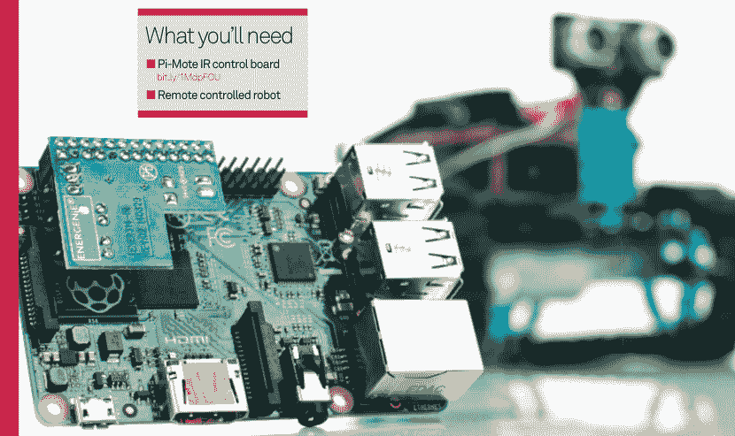

### 你需要什么

- Pi-Mote IR 控制板 [bit.ly/1Mj3FQU](https://bit.ly/1Mj3FQU)
- 遥控机器人

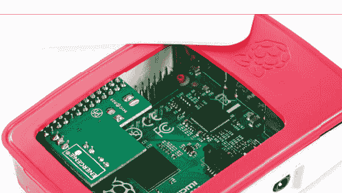

# 改装一台机器人

左侧：Pi-Mote 红外控制板功能强大，仅需 £9.99

### 02 安装软件

接下来，安装 LIRC 软件；这是 Linux 红外远程控制（Linux Infrared Remote Control）的缩写，它是让你能够与机器人交互并传输命令的程序。再次打开 LX 终端并输入：

```bash
sudo apt-get install lirc
sudo apt-get install lirc-x
```

安装完成后，你需要使用`sudo reboot`重启你的树莓派。

### 03 编辑硬件文件

接下来，我们需要编辑位于`/etc/lirc/`文件夹中的`lircd.hw.conf`文件，并进行如下所示的更改。在终端窗口中，输入：

```bash
sudo nano /etc/lirc/hardware.conf
```

在文件中找到`DRIVER`、`DEVICE`和`MODULES`行，然后进行以下更改：

```
DRIVER = "default"
DEVICE = "/dev/lirc0"
MODULES = "lirc_rpi"
```

按`Ctrl+X`保存文件，不要重命名它，按`Y`然后按`return`。使用命令`sudo /etc/init.d/lirc restart`重启 LIRC 守护进程。

### 04 测试红外接收器是否正常工作

为了测试红外接收器已正确安装并正常工作，你需要前往 LX 终端，然后停止 LIRC 守护进程（第 1 行），启用测试模式（第 2 行），然后启动模式 2 测试（第 3 行）：

```bash
sudo /etc/init.d/lirc stop
sudo modprobe lirc_rpi
sudo mode2 -d /dev/lirc0
```

这将运行一个程序来输出红外信号的占空比。它测量红外信号的脉冲和空档长度，并将值返回到终端。拿起机器人的遥控器，将其指向红外接收器，然后按下一些按钮。你应该会看到类似以下内容：

```
space 16300
pulse 95
space 28794
pulse 80
space 19395
space 28794
pulse 80
```

### 05 创建 lircd.conf 文件：第一部分

`lircd.conf`文件包含控制你设备的代码或指令。虽然你可以在网上找到这些文件，但你可能不得不从头创建一个。这需要运行`irrecord`程序，将遥控器对准红外板，然后按下按钮！这会记录来自你遥控器的信号，然后你为每个信号分配`KEYS`，以将信号传输给机器人。在终端中输入以下命令停止 LIRC 软件：

```bash
sudo /etc/init.d/lirc stop
```

### 06 创建 lircd.conf 文件：第二部分

接下来，创建你的新`lircd.conf`配置文件并保存输出。在 LX 终端中，输入：

```bash
irrecord -d /dev/lirc0 ~/lircd.conf
```

这将打开一个程序，该程序会提示你如何记录来自遥控器的信号的操作说明。第一部分需要你反复按下遥控器上的按钮，直到屏幕上出现两行点。这会测量并记录遥控器发送的信号。请按照逻辑顺序进行操作，从遥控器的顶部开始向下进行。一旦两行点完成，你的遥控器就被识别了。

### Pygame 按钮

Pygame 允许你创建按钮并为其分配操作。这意味着你可以为 Pygame 窗口创建并分配按钮。你可以使用按钮而不是按键来控制机器人。这里有一个简单的教程：`pygame.org/project-ButtonDrawer-2541.html`，涵盖了如何创建按钮并为各种按钮分配交互。

# 教程


上方：你机器人上的红外接收器看起来大概是这样

### 机器人变体

- 你可以使用多种不同的机器人配合本教程，例如图中所示的 Makeblock 或作者使用的 WowWee Roboquad。请注意代码中的事件键设置——不同的机器人具有不同的原生功能。
- 例如，Roboquad 有一个“Dance”（跳舞）命令，你可以在对面页面上的代码列表中间部分看到它。

### 07 创建 lircd.conf 文件：第三部分

程序的第二部分要求你输入已记录的每个信号对应的键名。遵循每个屏幕提示，为每个遥控器按钮/键输入一个合适的名称。例如，输入“`KEY_UP`”，然后按下遥控器上对应的向上键。接下来你会被提示输入下一个键的名称——例如，“`KEY_BACK`”，在这种情况下，你需要按下遥控器上的返回键，以此类推。不断重复此过程，直到你为每个记录的键都输入了名称。

### 08 重命名遥控器

保存后，在`/home/pi`文件夹中找到新的`lirc.conf`文件。默认情况下，第 14 行的遥控器名称可能命名为`/home/pi/lirc.conf`。更改这一点：在“`begin remote`”标题下，找到“`name`”标签并将`/home/pi/lirc.conf`重命名为更合适的名称，例如“`Robot`”。这样做有助于确保在程序中调用移动指令或键名时，引用它变得更加容易。

### 09 传输 lircd.conf 文件

现在你的`lircd.conf`文件准备好传输到`/etc/lirc`文件夹；这是存放硬件和 lirc 文件的文件夹。最简单的方法是打开你的新`lircd.conf`（它保存在`/pi/home`文件夹中），然后复制并粘贴覆盖你刚刚创建的代码。但是，这会覆盖你现有的任何旧配置文件设置。要保存以前的文件，请参见下一步。在 LX 终端中，输入：

```bash
sudo nano /etc/lirc/lircd.conf
```

### 10 传输文件而不覆盖

如果你已经设置了`lircd.conf`文件，或者想使用新的但保留旧的，请创建一个新的配置文件。这保存在`/home/pi`文件夹中，并可以复制到`/etc/lirc`。通过创建一个副本并将另存为`lircd_original.conf`来备份原始的`lircd.conf`文件。在 LX 终端中，输入：

```bash
sudo cp /etc/init.d/lirc_start
sudo mv /etc/lirc/lircd.conf /etc/lirc/lircd_original.conf
```

然后复制你的新配置文件：

```bash
sudo cp ~/lircd.conf /etc/lirc/lircd.conf
```


你的原始配置文件现在将被保存为 `lircd_original.conf`。

### 11 开始控制

现在你的机器人有了配置文件，你可以使用遥控器了。使用 `sudo /etc/init.d/lirc_restart` 重启 LIRC。现在通过列出文件中存储的所有已注册 `KEYS` 来测试 `lirc` 文件是否正常工作：`irsend LIST Robot '*'`。这将列出记录在 `lircd.conf` 文件中的所有 `KEYS`。

是时候控制你的设备了。这使用 LIRC 附带的 `irecord` 应用程序来发送命令。命令非常简单：`irecord SEND_ONCE Remote_Name Remote_Button`。例如，为了让机器人向前走，只需在 LX 终端中输入：`irecord SEND_ONCE Robot KEY_UP`。这将发送“前进”红外信号，然后你的机器人就会向前走。

# 改装一台机器人

### 12 Python OS

LIRC 程序允许你通过命令行控制 Pi-Mote 红外控制板。然而，这对于编程来说是不实用的，因为它限制了对其他硬件和软件的交互。不过，老牌的 Python 有一个 `OS` 模块，它允许你控制命令行并从 Python 程序内部执行命令行指令。这使你能够创建一个可以由 `pygame` 控制的程序，这意味着你可以使用箭头键和键盘移动机器人。

### 13 使用 Python OS

打开你的 Python 编辑器，然后导入 `OS` 模块：

```python
import os
```

现在输入命令：

```python
os.system("irsend SEND_ONCE Robot KEY_RIGHT")
```

这将允许 Python 代码与树莓派操作系统之间进行交互。该行代码将向红外板发送“向右移动”命令，它还将传输分配的信号，指示机器人向右走。通过更改代码行末尾的相关“KEY”名称，测试其他所有移动是否正常工作。

### 14 熟悉 pygame

Pygame 是一个跨平台库，旨在让用户能够制作简单的电子游戏。它包含一系列专门为 Python 编程语言设计的图形和声音库。Pygame 也预装在树莓派上。你可以在官方文档中阅读更多关于代码和游戏制作的内容：`pygame.org/docs`。

### 15 避免覆盖

Pygame 在一个由用户预设的窗口中运行。在添加用于控制机器人的 Python 代码之前，你需要设置 pygame 结构。虽然此程序利用键盘上的控件，但你仍然需要创建传统的 pygame 窗口。参见右侧列表的第一部分，从第一行到 `runGame()`。

首先设置窗口尺寸（第 7 行和第 8 行）。接下来，初始化 pygame 时钟：`FPSLOCK = pygame.time.Clock()`。接下来是窗口中使用的标题字体大小和字体：`BASICFONT = pygame.font.Font('freesansbold.ttf', 18)`。最后，设置窗口标题：`pygame.display.set_caption('ROBOT')`。

### 16 重启 LIRC

对于这部分，请参考下一段代码：从 `def runGame()` 开始。一旦游戏初始化完成，你就可以设置控制机器人的代码。这利用了 `get()` pygame 事件（参见 for 循环）来返回已按下的键。第一个 `elif` 将事件类型设置为等待“Keyboard”按键，例如下面一行中显示的“right”键。由于已经导入了 OS，我们使用 `os.system("irsend SEND_ONCE Robot KEY_RIGHT")` 来传输“向右移动”信号。运行程序时，确保你已选中 pygame 窗口 – 这个窗口很小，因为我们将其编码为 100 x 100 像素。一旦正常工作，以相同的方式添加其余的移动。

### 17 常见错误和代码回顾

现在你可以使用 Python 代码来控制机器人，你可以与许多其他模块进行交互。你可以附加一个 Makey Makey (`makeymakey.com`) 并使用一些勺子和叉子来控制你的机器人。你甚至可以尝试安装并使用 Tweepy 模块（一个 Twitter API），让机器人响应传入的推文。

## 完整代码列表

```python
import random, pygame, sys

from pygame.locals import *

import os

import time

FPS = 15

WINDOWWIDTH = 100

WINDOWHEIGHT = 100

UP = 'up'

DOWN = 'down'

LEFT = 'left'

RIGHT = 'right'

def main():
    global FPSLOCK, DISPLAYSURF, BASICFONT
    pygame.init()
    FPSLOCK = pygame.time.Clock()
    DISPLAYSURF = pygame.display.set_mode((WINDOWWIDTH, WINDOWHEIGHT))
    BASICFONT = pygame.font.Font('freesansbold.ttf', 18)
    pygame.display.set_caption('ROBOT')
    while True:
        runGame()

def runGame():
    # Get a random start point.
    while True: # main game loop
        for event in pygame.event.get(): # event handling loop
            if event.type == QUIT:
                terminate()
            elif event.type == KEYDOWN:
                if event.key == K_RIGHT:
                    print('right')
                    os.system("irsend SEND_ONCE Robot KEY_RIGHT")
                elif event.key == K_LEFT:
                    print('left')
                    os.system("irsend SEND_ONCE Robot KEY_LEFT")
                elif event.key == K_UP:
                    print('foward')
                    os.system("irsend SEND_ONCE Robot KEY_UP")
                elif event.key == K_DOWN:
                    print('Black')
                    os.system("irsend SEND_ONCE Robot KEY_DOWN")
                elif event.key == K_SPACE:
                    print('STOP')
                    os.system("irsend SEND_ONCE Robot KEY_STOP")
                elif event.key == K_d:
                    print('Dance Baby')
                    os.system("irsend SEND_ONCE Robot KEY_D")
                elif event.key == K_y:
                    print('Say Yes')
                    os.system("irsend SEND_ONCE Robot KEY_R")
                elif event.key == K_l:
                    print('Say No')
                    os.system("irsend SEND_ONCE Robot KEY_L")
                elif event.key == K_n:
                    print('Say No')
                    os.system("irsend SEND_ONCE Robot KEY_P")
                elif event.key == K_ESCAPE:
                    terminate()
```


```python
if __name__ == '__main__':
    main()
```

## 教程

### 使用 `FUZE BASIC` 编写《`Tempest`》克隆游戏 第一部分

### 用 `FUZE BASIC` 复刻经典游戏，深入编程世界

**`Luke Mulcahy`** 是 `FUZE` 团队的内部程序员。年仅 15 岁的 `Luke` 精通多种编程语言，尽管他并不喜欢让 `FUZE BASIC` 经受考验。

欢迎来到我们最新的 `FUZE BASIC` 教程。如果你尚未获取该编程语言，`Linux` 和树莓派用户可以免费从 `fuze.co.uk/getfuzebasic` 下载 `FUZE BASIC`。

那么，为什么要费力学习 `BASIC` 呢？`BASIC`（初学者全用途符号指令代码）在 70 年代和 80 年代推动计算革命中发挥了关键作用。三十年后的今天，`BASIC`（或在本例中的 `FUZE BASIC`）提供了原经典版本的现代化演绎。现在配备了用于高级精灵和媒体处理的更新命令，移除了 `goto` 和 `gosub` 命令以及行号，并且在现代硬件上运行飞快，它仍然是希望进入编程世界的用户最容易入门的途径之一。

为了证明使用它的简单程度，在本教程中我们将探讨如何编写一款经典街机游戏。随后，在接下来的两期中，我们将带你从基本图形引擎出发，介绍敌人、射击和碰撞检测，最后进行如开场画面和最高分排行榜等优化，以及一些整理和性能调整。

我们的游戏 `73MP357` 是真正的经典——`Dave Thrall` 1981 年 `Atari` 制作的`Tempest`的复刻版。我们也无法抗拒向 `Jeff Minter` 为 `Atari Jaguar` 制作的惊人复刻版致敬。

## 你需要什么

- `FUZE BASIC V3`
- [`fuze.co.uk/getfuzebasic`](fuze.co.uk/getfuzebasic)
- `73MP357PART1.fuze`

### 01 获取程序列表

由于这是一个相当大的程序，我们将不会逐行输入。相反，你需要从 [`FileSite.co.uk`](FileSite.co.uk) 或 [`fuze.co.uk/tutorials/73MP357PART1.fuze`](fuze.co.uk/tutorials/73MP357PART1.fuze) 下载第一部分代码。

随后，我们将审视每个部分并解释其工作原理。

打开 `FUZE BASIC`，加载（按 `F8`）`'73MP357'`，或直接将代码复制到编辑器中（按 `F2` 在编辑器和立即模式之间切换）。

### 02 运行代码

在查看代码之前，让我们看看它做什么。按 `F3` 或在立即模式中输入`run`运行程序。你将看到两种核心类型的事件：星空背景、关卡以及，当然，玩家。你可以使用左右光标在关卡中移动玩家。

请注意，当你旋转时，游戏场地的视角会发生变化。这种特定效果来自`Tempest 2000`，而非街机原版。

好了，现在来看看代码。按 `Esc` 键停止程序，然后按 `F2` 调出编辑器。

### 03 系统设置

你会发现代码注释详尽，每个部分都以 `#` 和注释作为标题。

我们的第一部分设置系统和变量。我们设置分辨率，并将`updatemode`设置为零，这样除了`update`命令外，其他任何操作都不会更新屏幕。在 `FUZE BASIC` 中，如果模式设置为 1 或 2，那么`print`语句也会更新屏幕，这会使一切变慢。

设置了三个变量数组来存储星星的角度、速度和距离。这些可以合并为一个数组，但分开写更容易阅读。

`while` 循环用随机位置的点、随机角度和速度填充星空背景数组。

### 04 处理显示

接下来是游戏场地关卡显示所需的变量。`radius` 和 `radius2` 变量定义外环和内环，`vertices` 设置关卡被划分成的部分数量。最小为 4（正方形），最大可达 13。`gap` 变量决定了沿圆周的步长距离，以便玩家始终位于每个部分的中间位置。

## 完整代码列表

**步骤 03**

```fuze
# settings #####

xs = 840

yres = 640

updatemode = 0

setmode( xs$ , ys$ )

# variables for the star field effect

dim stars( 1000 )

dim starsSpeed( 1000 )

dim starsDist( 1000 )

starNum = 0
```

**步骤 04**

```fuze
# setup star field effect

while starNum < 1000 cycle

  stars( starNum ) = rnd( 360 )

  starsSpeed( starNum ) = rnd( 5 + 1 )

  starsDist( starNum ) = rnd( height )

  starNum = starNum + 1

repeat

# level drawing variables

x = 0

y = 0

x2 = 0

y2 = 0

oldX = 0

oldY = 0

oldX2 = 0

oldY2 = 0

angle = 0

radius = $height / 2 - 50 // outer radius

radius2 = $height / 16 // inner radius

vertices = rnd( 9 ) + 4 // nothing less than a square

gap = 360 / vertices // angle between vertices
```

**步骤 05**

```fuze
# player variables

pingL$ = gap / 2

px = 0

py = 0

ptrNum = 0

# different centers for the parallax effect

centerX = $width / 2 // center of close objects

centerY = $height / 2

centerX2 = centerX // center of far objects

centerY2 = centerY

starsCenterX = centerX // fixed center for the stars

starsCenterY = centerY

# movement variables

moveDelay = int( 80 / vertices ) // delay after moving

moveCount = 0
```

**步骤 06**

```fuze
loop

cl$c

# movement input

if scankeyboard( $rangrid$ ) then

  if moveCount = 0 then

    pingL$ = pingL$ + gap

    moveCount = moveDelay

    if pingL$ > 360 then

      pingL$ = gap / 2

  endif

endif
```

**步骤 07**

```fuze
   end if

   if scankeyb$ord(scankeyb) then

     if moveCount = 0 then

       pAngle = pAngle - gap

       moveCount = moveToCount

       if pAngle < 0 then

         pAngle = 360 - ( gap / 2 )

       end if

     end if

   end if

# set max particle effects based on resolution

maxStars = height / 5

colour = white

while starNum < maxStars cycle

  # calculate star positions using expanding or

  # contracting circles

  starX = starsDist(starNum) * cos( stars(starNum) )

  starX = starsCenterX + starX

  starY = starsDist(starNum) * sin( stars(starNum) )
```


```
starY = starsCenterY + starY

starsDist(starNum) = starsDist(starNum) + starsSpeed(starNum)

Step 08

# reset position if offscreen

if starX < 0 then
  starsDist( starNum ) = rnd( 15 ) + 5
end if

if starX > gwidth then
  starsDist( starNum ) = rnd( 15 ) + 5
end if

if starY < 0 then
  starsDist( starNum ) = rnd( 15 ) + 5
end if

if starY > gheight then
  starsDist( starNum ) = rnd( 15 ) + 5
end if

plot( starX, starY )

starNum = starNum + 1

repeat

starNum = 0

Step 09

# Draw the level by looping & drawing a segment at a time.

colour = blue

while angle < 360 cycle
  x = radius * cos( angle )
  x = centerX + x
  y = radius * sin( angle )
  y = centerY + y
  x2 = radius2 * cos( angle )
  x2 = centerX2 + x2
  y2 = radius2 * sin( angle )
  y2 = centerY2 + y2
  line( x, y, x2, y2 )
  line( x, y, oldX, oldY )
  line( x2, y2, oldX2, oldY2 )
  oldX = x
  oldY = y
  oldX2 = x2
  oldY2 = y2
  angle = angle + gap

repeat
```

### 05 玩家变量

需要几个玩家变量来确定屏幕上的位置及其相对于关卡的位置。

使用了三个中心 `X` 和 `Y` 坐标：两个用于关卡的移动中心和一个用于星空背景的固定中心。移动中心在稍后会显得更有意义，但正是靠它们我们才拥有流畅的透视效果。

`moveDelay` 变量（80 除以部分数，即 `vertices`）用于保持玩家移动的一致性，无论关卡有多少部分。

### 06 消除闪烁

现在进入主 `loop`。`cls2` 语句至关重要，且与更标准的 `cls` 版本非常不同：`cls2` 清除帧缓冲区内存；这是一个独立的屏幕内存，所有内容首先绘制于此。当你发出 `update` 语句时，帧缓冲区会被复制到主屏幕内存。`cls` 版本仅清除所有内容，因此会产生大量闪烁。`cls2` 和 `update` 确保了无闪烁的更新，这对游戏至关重要。

接下来检查玩家键盘控制。如果按下右光标，玩家角度增加 `gap` 的量（这是到下一个部分中心的距离）。当然，左光标执行相反操作。


### 07 定位星星

然后我们计算星星的位置——即每一颗星星！星星的数量根据显示分辨率进行调整。

选择 `While` 并启动一个循环来遍历星星。每颗星星都是圆周上的一个位置。因此，圆的半径决定了星星与中心的距离。我们取距中心的距离 `starsDist(starNum)`，并乘以角度的余弦值 `stars(starNum)`。然后将其加到中心位置 `starsCenterX` 上，得到新的 `starX` 位置。`starY` 位置相同，但使用正弦值。

### 08 检查星星移动

我们检查星星是否离开显示区域，如果是，则将其重置回中心加一个小偏移，因为我们不希望它们都从正中心出现。

最后，使用 `plot(starX, starY)` 绘制星星，并重复 `while` 循环，直到所有星星都被更新并绘制在星空背景上。

### 09 制作关卡

转到关卡本身。每个片段逐个绘制。第一个片段的第一条线具有内圈和外圈的 `X` 和 `Y` 坐标。下一条线 aloi（再次，从中心到外缘）经过计算，并绘制从旧位置到新位置的两条连接线。

星体的数量会根据显示分辨率进行调整

## 完整代码列表


## 10 放置玩家

是时候确定玩家绘制的位置并调整视角了。玩家的位置会在两个不同位置进行计算并取平均值，以匹配多边形和平行视差效果。圆上某点的位置计算如下：

```
x = cos( angle ) * radius

y = sin( angle ) * radius
```

正弦和余弦的零值中心位于原点，因此我们需要在玩家的 `X` 和 `Y` 坐标中加入屏幕中心点。玩家中心是通过半径乘以玩家角度的余弦值，再加上屏幕中心计算得出的。

## 11 固定速度

`moveCount` 和 `moveDelay` 变量用于固定玩家在游戏关卡中的移动速度，无论关卡包含多少个部分。

下一节代码检查玩家位于屏幕的哪个象限，并相应地移动中心点。游戏区域每帧移动几个像素，直到受到以下限制：

```
if centerX < ( gwidth / 2 ) + ( gwidth / 20 )
```

最后，使用 `polypot` 命令计算并绘制玩家的位置。角度被固定，使得玩家面向中心，并且大小会根据显示分辨率进行缩放。

## 12 构建多边形

`polystart` 命令允许通过一系列线条构建多边形并自动填充。

与其在每个 `polystart` 语句中的每个绘图操作中计算自动求和，我们提前使用 `c = cos( pAngle + 90 )` 和 `s = sin( pAngle + 90 )` 进行了计算，`u` 则是飞船相对于显示分辨率的比例。

## 13 多边形方程

多边形上的每个 `X` 坐标点基于（比例 * 线长）乘以 `cos( playerAngle + 90 )`，减去（比例 * 线长）乘以 `sin( playerAngle + 90 )`，再加上 `playerX`。对于 `Y` 坐标，则是（比例 * 线长）乘以 `sin( playerAngle + 90 )` 加上（比例 * 线长）乘以 `cos( playerAngle + 90 )` 再加上 `playerY`。

## 14 实验变量

最后底部的 `update` 语句将临时帧缓冲区复制到屏幕显示…… 搞定！

有很多变量可以实验，不妨随意更改数字看看会发生什么。这样做能让你深入了解内部机制。

下个月我们将添加敌人、开火功能，也许还会加上一些音效。粒子激光棒极了！

```
# Calculate player position

pX = ( ( radius * cos( pAngle - ( gap / 2 ) ) + centerX ) +
( ( radius * cos( pAngle + ( gap / 2 ) ) + centerX ) ) / 2

pY = ( ( radius * sin( pAngle - ( gap / 2 ) ) + centerY ) +
( ( radius * sin( pAngle + ( gap / 2 ) ) + centerY ) ) / 2

angle = 0

if moveCount > 0 then
    moveCount = moveCount - 1
end
```

```
# move the center of closer objects more

if pX + 2 < gwidth / 2 then // check the players position
    if centerX < ( gwidth / 2 ) + ( gwidth / 20 ) then
        centerX = centerX + 4
        centerY2 = centerY2 + 2
    end
end

if pX - 2 > gwidth / 2 then
    if centerX > ( gwidth / 2 ) - ( gwidth / 20 ) then
        centerX = centerX - 4
        centerY2 = centerY2 - 2
    end
end

if pY + 2 < gheight / 2 then
    if centerY < ( gheight / 2 ) + ( gheight / 20 ) then


```
        centerY = centerY + 4

        centerY2 = centerY2 + 2

    end

end

if pY - 2 > gheight / 2 then

    if centerY > ( gheight / 2 ) - ( gheight / 20 ) then

        centerY = centerY - 4

        centerY2 = centerY2 - 2

    end

end

colour = yellow

c = cos( pAngle + 90 ) // correct the view angle by 90 degrees

s = sin( pAngle + 90 )

u = gheight / 80 // scale the player ship to the resolution
```

### rotate & scale coordinates; draw player ship

```
polystart

polypot((u*(5 * c) - (u*5 * s) + pX), (u*(5 * s) + (u*(5 * c) + pY))

polypot((u*(5 * c) + pX), (u*(5 * s) + pY))

polypot((0 - (u*2 * s) + pX), (u*(-2 * s) + pY))

polypot((u*(-4 * c) + pX), (u*(-5 * s) + pY))

polypot((u*(-5 * c) - (u*(5 * s) + pX), (u*(-5 * s) + (u*(5 * c) + pY))

polypot((0 - (u*4 * s) + pX), (u*(-4 * s) + pY))

polypot((u*(-7 * c) + pX), (u*(-7 * s) + pY))

polypot((u*(7 * c) + pX), (u*(7 * s) + pY))

polyend

update

repeat

end
```


## 中奖！FUZE 特别版

### 报名截止日期
2016 年 2 月 10 日

拥有鲜明复古风格的 `FUZE` 是一款屡获殊荣的可编程计算机和电子工作站。它源于对编程的热情和对电子学的热爱，坚固的铝合金机身集成了键盘、专为设计的 `GPIO` 接针以及用于简单电子电路的洞洞板。树莓派被安全地安置在键盘下方，`FUZE` 出厂时已预装 `FUZE BASIC` 操作系统。

`FUZE BASIC` 是 `BASIC` 编程语言的高级现代化版本，被广泛认为是最容易教学和最易上手的编程语言。它具备重新设计界面和高级图形支持，包括精灵和图片缩放、角度和透明度控制以及旋转功能，`FUZE BASIC` 已全面适配所有型号的树莓派。整个 `FUZE` 系统流畅且直观，完全能够胜任网页和移动游戏的编程开发。

`FUZE` 特别版向 20 世纪 80 年代的经典家用计算机（如 `BBC Micro`）致敬，并附带一套可与项目集成的机械臂套件。`FUZE` 特别版还为您提供项目包并引导您访问 `FUZE Lair` 上的丰富在线资源，为您提供所需的一切以开始您的项目。更多信息请访问 `www.fuze.co.uk`。

### 参与比赛

想要赢取 `FUZE T2-SE` —— 即附带机械臂套件的特别版，请点击下方链接。回答该网页上的简单问题，然后添加您的联系方式即可参与比赛。三名获奖者将在新年揭晓 —— 祝您好运！


教孩子们编程

回答该网页上的问题，赢取奖品！

`www.linuxuser.co.uk/news/win-a-fuze-se`

**条款与细则**
本比赛面向英国和爱尔兰居民开放。`Imagine Publishing` 有权将奖品更换为价值相同或更高的类似物品。`Imagine Publishing` 的员工（包括自由职业者）、其亲属或任何代理人不符合参赛资格。编辑的决定为最终决定，恕不接受通讯咨询。奖品不可兑换现金。完整条款和细则可随时索取。参与比赛即表示您同意 `Imagine Publishing` 向您发送每月电子邮件通讯和偶尔的特别优惠。您可以随时通过点击任何收到的邮件中的退订链接取消订阅。

## 物联网？

无线设备含税低至 £9.99


`wirelessthings.net/lxu-offer`
`@wirelessthings`

## PCI Express 有限公司


`TBS` 是数字电视调谐器的专业制造商

其产品包括：

- `DVB-S/S2` (标清卫星 & 高清卫星)
- `DVB-T/T2` (标清地面波 & 高清地面波)
- `DVB-C` (标清有线电视)
- `IPTV` 流媒体播放器
- `USB` 电视调谐器

提供多种选择：
单调谐器、双调谐器、四调谐器
通用接口 (`CI`)
以及全新的 `MINI` 调谐器（`7220` 见下文）

所有 `TBS` 调谐器均兼容 `Windows 7` 媒体中心，并支持最新内核的 `Linux`。

## 为您的 PC 获取最好的数字电视调谐器！


兼容 `EUMETSAT`

### TBS 6908 专业级高清 DVB-S2 四调谐器 PCIe 卡

`TBS6908` 是一款具有 `PCI Express` 接口的专业级数字卫星电视调谐器卡。它不仅支持普通卫星接收机支持的常规 `DVB-S2/DVB-S` `QPSK`、`BPSK`，还支持大多数卫星接收设备无法支持的 `CCM`、`ACM`、`VCM`、多输入流、`16APSK`、`32APSK` 和通用流模式。
使用专用的 `TBS` 工具，可以捕获这些特殊流。`Windows BDA` 驱动程序和 `Linux` 驱动程序（支持到最新内核 `3.X`）均已就绪。
建议零售价 £329.95


### TBS 6905 高清 DVB-S2
四调谐器 PCIe 卡

`TBS6905` 是一款 `PCI Express` 接口的数字卫星电视调谐器卡，配备四个调谐器，用于在 `PC` 上观看和录制 `FTA`（免费收看）卫星电视。四个调谐器允许您同时观看来自一个转发器或卫星的电视频道，并接收来自不同转发器/卫星的另外三个频道。它兼容 `Windows 7` 媒体中心以及 `MediaPortal`、`DVBlink`、`DVBDream`、`DVBViewer`、`ProgDVB`、`SkyNet`、`T$reader`、`XBMC` 和 `MythTV` 等流行软件。
建议零售价 £179.95


### TBS 6290 DVB-T2/T/C
双调谐器双 CI PCIe 卡

`TBS6290` 是最新的 `DVB-T2/T` `PCI Express` 调谐器，它配备双调谐器和双 `CI` 插槽，允许您同时享受两个实时的地面波电视频道和两个不同的频率，并且支持 `FTA`（免费收看）电视频道和加密电视频道的接收。`TBS6290` 可作为数字视频录像机使用，用于录制支持全高清的无线数字电视和有线电视程序，具备时间平移功能。
建议零售价 £179.95


我们最小的卡！

### TBS 7220 DVB-T2/T/C mini PCIe 卡

`TBS 7220` `DVB-T2/T/C` 电视调谐器 `mini PCIe` 卡是一款添加了 `DVB-C` 功能的数字地面波调谐器卡，允许您在 `PC` 上享受免费收看 (`FTA`) 的数字地面波/有线电视和数字立体声广播。`TBS 7220` 可作为数字视频录像机使用，用于录制支持全高清的数字地面波/有线电视程序。它还允许您使用时间平移功能暂停实时广播并从中断处继续观看。它是观看英国 `Freeview` 标清和高清的理想选择。建议零售价 £69.95

## 请访问我们的网站了解更多精彩的 TBS 产品
`WWW.TBSCARDS.CO.UK`

## 独家优惠

在 `www.tbcards.co.uk` 在线购买，使用代码：`LINUXUD` 可享受任何 `TBS` 产品 9 折优惠

欢迎垂询商务事宜
`E: mike@pcixex.co.uk`

在线购买：
`www.radtv.co.uk`
`www.valueav.co.uk`
`www.amazon.co.uk`

# 评测

81 团体测试 | 86 `Fitlet iA10` | 88 自由软件

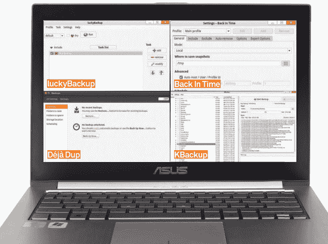

## 团体测试
## 备份方案

备份工具并非奢侈品——每个人都应当拥有一个，以便在主存储设备故障时恢复宝贵的数据。

- **LuckyBackup**
`LuckyBackup` 是一款拥有 `Qt4` 界面的流行归档工具。该应用在 2008-2010 年间在 `kde-apps.org` 上获得了高分，并且目前仍位居排行榜前列。当前，`LuckyBackup` 的开发几乎停滞不前；不过，这很难被视为缺陷，因为备份工具将在未来几年内保持有用。
*下载：`bit.ly/1P4jllhV`*

- **Back In Time**
`Back In Time` 网站提供了许多过时的软件包，但也有新的提交记录。该工具正在积极开发并频繁接收更新。`Back In Time` 同样是一个基于 `Qt` 的应用程序，但它拥有针对 `KDE` 和 `GNOME` 的独立集成软件包，因此在任何环境中都表现出色。
*下载：`bit.ly/1BcpJV`*

- **Déjà Dup**
`Déjà Dup` 是本次测试中唯一直接基于同步功能的竞争者。它与 `GNOME`、`Unity` 和 `Cinnamon` 紧密集成，并驻留在控制中心中。`Déjà Dup` 背后的设计思想是隐藏所有的麻烦和复杂性，同时也对技术敏感度不高的用户保持友好。
*下载：`bit.ly/1k4WLPp`*

- **KBackup**
这里无需解释其中的字母 `'K'`，因为 `KBackup` 是一个完全与桌面环境无关的应用程序。它与 `Back in Time` 和 `LuckyBackup` 共享大部分功能，但提供了更干净、更易于理解的图形用户界面。尽管看起来如此简单，`KBackup` 仍能生成良好的备份副本。
*下载：`bit.ly/1JA7cf`*

## 备份方案评测

### LuckyBackup

一个围绕多种同步选项构建的精妙且完整的封装器

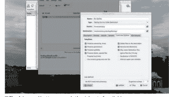

“高级”按钮会扩展丰富的可用选项和可调参数。

**易用性**

首次启动 `LuckyBackup` 时，其多样的菜单、工具栏按钮和窗口区域可能会让你有点眼花缭乱。为了完成工作，你必须创建一个新的任务，填写其名称、源目录和目标目录，并在高级设置中根据需要更改默认行为。这并不太复杂，但对于新手来说，可能值得谷歌搜索正确的操作步骤序列。

**功能集**

`LuckyBackup` 具有配置文件、计划任务以及对各种行为类型的支持，例如保留快照、更新增量备份、同步或复制。它还可以将备份副本存储在远程位置，执行试运行，记录所有日志，甚至通过电子邮件通知你。

**访问已备份的数据**

虽然 `LuckyBackup` 可以将备份副本压缩为归档文件，但默认设置建议源文件和目录被完整地传输到目标目录。这意味着你的数据触手可及，随时可以进行读写操作。`LuckyBackup` 不会阻止 `Linux` 用户操作已备份的文件。

**可用性与集成**

`LuckyBackup` 是一个第三方开源应用，但它包含在大多数 `Linux` 发行版中。该应用程序在任何桌面环境下运行和外观都同样良好，并支持大多数桌面的原生通知。但是，它与控制中心或系统设置没有集成——`LuckyBackup` 是一个完全独立的应用程序。

**总体评价**

`LuckyBackup` 绝对是一款智能应用，一旦你花时间探索其选项，你将准备好管理任何形式的备份。我们喜欢“试运行”选项，它可以防止你对数据造成伤害。

8

#### Back In Time

一个功能强大、充满亮点且专注于增量备份的工具

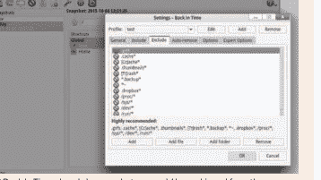

`Back in Time` 已经知道哪些内容可以从备份副本中跳过。当然，你可以自定义列表。

**易用性**

`Back In Time` 自称简单，但熟悉它需要时间和技巧。首次运行该应用时，它会打开设置窗口，要求你填写必填字段，如目标目录、包含在备份中的目录等。之后，你将处理主 `Back In Time` 窗口，其外观类似于文件浏览器，备份快照作为入口点。

**功能集**

`Back in Time` 负责处理其他“简单”工具常忽略的许多辅助事项，例如使用 `nice` 和 `ionice` 工具来降低计划备份时的系统负载。然而，它不支持文件压缩，并且要求备份目标文件系统支持硬链接。

**访问已备份的数据**

一旦创建第一个快照，你导航到目标目录，将发现快照元数据文件与包含文件副本的`backup`子目录放在一起。在庞大的子目录树中，你的文件将显示得与源目录中一样。`Back in Time` 不能加密或归档数据；它只是复制数据。

**可用性与集成**

该应用程序有一个命令行界面，你可以通过运行 `backintime -help` 命令来发现它。图形应用程序有两种版本：`backintime-kde4` 和 `backintime-gnome`。`Back in Time` 并非主要 `Linux` 发行版的默认软件，但它广泛存在于许多发行版中，包括 `openSUSE OBS` 和 `Arch AUR`。

**总体评价**

如果你准备好与大量的同步相关选项打交道，并创建完美的备份副本，那么 `Back in Time` 是正确的选择。该应用程序既聪明又高效，而且也能很好地适应你喜欢的任何桌面。

9

### Déjà Dup

这个 `GTK` 应用程序使用 `Duplicity` 生成加密归档


`Déjà Dup` 很容易上手，这是一个明显的优势，但它也夺走了你对数据的控制权。

**易用性**

`Déjà Dup` 共享 `GNOME UI` 设计的方法：应用程序必须简单且易于开始使用。`Déjà Dup` 拥有干净且友好的界面，核心围绕“备份什么”和“备份到哪里”选项。除此之外，它可以忽略用户定义的文件夹，并根据计划执行备份。

**功能集**

这种干净且无杂乱界面的结果是你只获得基本功能。可以争论普通用户是否需要更多功能，因为 `GNOME` 和 `Unity` 用户倾向于像 `OS X` 用户那样思考，在那里简单性被视为神圣不可侵犯。

**访问已备份的数据**

同样，新手可能不喜欢这一点，但其他人需要确信他们的数据是可访问的。问题在于 `Déjà Dup` 不希望你该在应用程序之外操作已备份的文件。如果你以某种方式破坏了加密归档，你应该仅使用 `Déjà Dup` 备份和恢复文件。

**可用性与集成**

这是 `Déjà Dup` 大放异彩的地方：它在任何包含 `GNOME` 组件及其默认应用程序的 `Linux` 发行版中即时可用。在 `Unity` 中，它也与侧面板集成，在那里 `Déjà Dup` 图标显示备份或恢复进度。如果你使用 `KDE` 或自定义的最小化桌面，`Déjà Dup` 看起来效果不佳，但这不是大问题。

**总体评价**

`Déjà Dup` 简单且干净，但它在其他桌面上看起来不如基于 `Qt` 的应用程序在基于 `GTK3` 的桌面上美观。然而，最大的担忧是 `Déjà Dup` 使你远离对数据的控制。

### KBackup

这款备份应用程序的标志上带有软盘的历史遗留元素


勾选你要备份的项目，选择一个目标目录，然后按下那个大按钮！

**易用性**

`KBackup` 显然赢得了用户友好性测试——我们甚至设法将全面的用户手册放在图片下方的说明中！事实上，凭借 `KBackup` 直率的逻辑和干净的 `GUI` 布局，你不可能迷路。选择源文件和目录，然后指定目标目录只需几秒钟。

**功能集**

一如既往，易用性和功能选择之间存在权衡。`KBackup` 这次看起来功能匮乏，唯一额外的是配置文件，你可以限制目标备份池的大小并设置计划任务。`KBackup` 甚至无法从备份副本中恢复文件。

**访问已备份的数据**

`KBackup` 存储备份副本的方法是在纯目录结构和加密归档之间的一种折中方案。在目标目录中，你将找到一个以备份创建日期和时间命名的 `TAR` 文件。因此，`KBackup` 将所有内容打包到一个未压缩的文件中。使用类似 `tar -xvf yourfile.tar` 的命令进行恢复。

**可用性与集成**

最新的 `KBackup` 版本自 2012 年以来未更新，但它已针对主要 `Linux` 发行版进行了打包，可以从标准存储库或 `kde-apps.org` 上的 `KBackup` 页面获取。该应用程序支持系统托盘集成（不仅限于 `KDE`），并在任何桌面环境中看起来都很不错。

**总体评价**

非常好，但也许太简单了。`KBackup` 甚至不关心你希望如何恢复已备份的数据。至少基本的复制功能按预期工作，而且你不会在简单的界面中迷路。

## 评测

## 备份方案

#### 简评：对比我们的裁决

| | `LuckyBackup` | `Back In Time` | `Déjà Dup` | `KBackup` |
|---|---|---|---|---|
| **易用性** | 首次加载后需要花点时间才能弄懂如何使用<br>8 | 对首次使用者来说有点棘手，但一旦上手后就还可以<br>5 | 或许是本次群测中最友好的入门级备份工具<br>8 | 甚至比 `Déjà Dup` 更简单，而且界面看起来非常整洁<br>9 |
| **功能集** | 功能集非常强大，拥有如“试运行”等酷炫命令<br>8 | 在受测工具中拥有最先进的一套功能，仅有微小的缺陷<br>9 | `Déjà Dup` 隐藏了所有复杂性，代价是功能集较为有限<br>6 | `KBackup` 未配备恢复工具。可用功能极少<br>3 |
| **访问备份数据** | 你的文件原样复制，不会做任何更改 – 至少默认情况下是这样<br>9 | 你的文件位于深层子目录中，只要你能找到它们，随时可用<br>8 | 除非手头有 `Déjà Dup`，否则你几乎无法恢复文件和数据<br>3 | 所有文件都被塞进一个未压缩的 `TAR` 文件，需要额外操作才能“解压”<br>7 |
| **可用性与集成** | 一个经典的第三方独立应用，没有特殊的集成可言<br>6 | 与基于 `KDE` 和 `GTK` 的桌面环境集成良好，因此可移植性很好<br>8 | 在 `GNOME`、`Unity` 和 `Cinnamon` 中运行非常流畅。它甚至作为默认附件随系统提供<br>8 | 仅集成到系统托盘中，仅此而已；感觉有点廉价和简陋<br>6 |
| **总体评价** | 这是一个非常均衡的备份方案，但缺乏一些打磨和收尾<br>8 | 在这组工具中最均衡的一个，拥有高级功能和整洁的 `UI`<br>9 | 开源应用存在“厂商锁定”？谢谢，不感兴趣，我们继续寻找<br>7 | 凭其简洁性尚可救场，但确实不足以胜过其他竞品<br>7 |

### 优胜者是……

#### Back In Time

`Back In Time` 凭借其令人印象深刻的功能集获得了更高的分数，这些功能揭示了同步和 `Linux Shell` 实用程序内部潜力。它还以其与大多数桌面环境的精致集成、干净且专业的外观布局以及非常合理的默认预设而闻名——例如预定义的常用排除文件夹列表。但仍有一些问题需要讨论，这些问题可能会影响你对备份工具的选择。第一个问题是简洁性。`Back In Time` 并不是最容易上手的工具，但这仅在你首次启动它时成立。一旦你完成第一次测试备份，你就会爱上这个强大的工具。作为回报，你获得了关于备份什么、在哪里备份以及如何备份的精确控制——这是像 `Déjà Dup` 这样更简单的工具所无法提供的。

另一个顾虑是 `Back In Time`（以及 `LuckyBackup`）缺乏归档选项。不过，我们认为这不是一个巨大的问题，因为它带来的用处不大。你可能想要备份的最庞大的文件通常是视频、数据库和其他二进制数据，这些数据本身已经被压缩或编码了。将其封装到额外的压缩归档中需要大量的时间和 `CPU` 算力，而最终可能几乎没有好处。毕竟，从未压缩状态恢复文件也简单得多。当然，还有更多用于 `Linux` 的备份软件标题，例如用于企业级备份的 `Bacula`，或数十种非开源的基于云的服务（`Dropbox`/`MEGA`/`SpicrOak`）。然而，我们希望能挑选出最用户友好且易于设置的工具，这些工具可以在平均的 `Linux` 机器上安装和使用。在许多热门选择中，`Back In Time` 似乎是最均衡且最适合日常使用的。

`Alexander Tolstoy`


`Back In Time` 窗口是一个管理备份和浏览文件系统的简易工具

---

## 域名

`.COM` 每年仅需 £5.80

## 托管

每月 £2.99 起 + 免费域名

## 云

`SSD` 服务器每月 £5 起

## 服务器

三个月内节省 50%

## 数据中心

`Rackspace` 每月 £35 起

`0800 808 5450`
`netcetera.co.uk/lud`


`Raspberry Pi Shop` - 我们库存各种扩展板、`RP1` 套装、`SD` 卡、外壳、破解套件及组件 - 全球配送！

`www.MODMYPI.COM`


## 英国服务器

### 专用服务器

每月仅需 **£39** 加增值税

使用促销代码 `LINUX1` 可享 15% 折扣

- 当日设置
- 全天候 7/24 英国免费电话支持
- 无长期合同

联系我们的团队成员，或访问我们的网站了解更多详情
`0800 610 1 620` `www.kservers.com`

---


## 迷你 PC

### Compulab Fitlet iA10

凭借媲美大数十倍桌面机的功能，`Compulab` 的 `Fitlet` 产品是否是微型 `Linux` 盒子的终极典范？

- **CPU**：四核 1.2GHz（2.2GHz 睿频）`AMD A10-Micro6700T` `APU`
- **GPU**：集成 500MHz `Radeon R6`，拥有 128 个着色器核心
- **RAM / 存储**：4GB `DDR3` / 64GB `mSATA` `SSD`
- **网络**：2x 千兆以太网，`Intel AC-7260` 双频 `Wi-Fi`，蓝牙 4.0
- **连接性**：2x `HDMI`，2x `USB 3.0`，3x `USB 2.0`，1x `micro-SD`，`GPIO` 接口，`RS232` 接口，带电源的 `eSATA` 6.0G/s
- **尺寸**：108mm x 83mm x 24mm
- **价格**：£300
- `tinyrepc.com` (英国)
- `fit-pc.com` (国际)

`Fitlet` 是一台完全兼容 `Linux` 的微型 `PC`，拥有的功能多到你数不过来。虽然这不是 `Compulab` 的第一款无风扇迷你 `PC`，但它可能是其最好的作品。

拆开 `Fitlet` 包装是一次很棒体验：盒子看起来太小了，似乎装不下任何有实力的计算机，但机器本身——装在一个金属机箱中，顶部兼作散热器——仅占其中极小一部分，剩余空间留给壁挂式电源适配器、`HDMI` 转 `DVI` 转接线，以及在高端型号 `Fitlet-iA10` 上内置 `Wi-Fi` 的天线。

既然存在高端型号，自然也就有入门级型号。事实上，`Fitlet` 家族由一系列外观相同的设备组成：`Fitlet-b` 是入门级型号，`Fitlet-i` 提供更多功能和改进的处理器，而 `Fitlet iA10` 则进一步改进了处理器。甚至还有 `Fitlet-X` 系列，它将 `Fitlet-i` 的双千兆以太网和 `eSATA` 端口替换为三个千兆以太网端口——所有这些端口都在 `PCI Express` 总线上以全速运行。

这种角色灵活性是通过 `Compulab` 称为 `Facet` 的系统实现的。使用构成机箱侧面板的 `Facet` 模块，可以改变 `Fitlet` 的功能——公司承诺未来将通过额外的 `Facet` 模块更充分地利用这一特性。

本次评测的型号是 `Fitlet iA10`，配有 64GB `mSATA` `SSD` 和 4GB `DDR3` `RAM`。这有点不寻常：

`Fitlet` 通常以裸机形式出售，但英国供应商 `TinyGreenPC` 允许买家在购买时从多种存储和内存选项中进行选择。虽然这很有用，但 `TinyGreenPC` 的价格比直接从 `Compulab` 购买要高出一截——将 `Linux Mint 17.2` 系统镜像复制到可选 `SSD` 的费用竟然高达 £48（含增值税），我们建议读者避免这种费用，改为从 `Live USB` 启动并免费自行安装。

这种能力揭示了一个重大优势，这款虽然昂贵但确实有优势的 `Fitlet` 相比竞品超紧凑计算机而言：它使用业界标准的 `UEFI BIOS` 和 64 位 `x86` 处理器 `AMD A10-Micro6700T`，这意味着它与几乎任何现代桌面或服务器操作系统都兼容。甚至可以在 `BIOS` 中选择新的目标热配置来超频 1.2GHz 四核芯片以提升性能——如果你想从设备中榨取最大性能，`Compulab` 还出售一个带有更大散热片的替换机箱盖，价格为 $15。

不过，即使超频，`Fitlet` 也无法与最便宜的桌面系统相提并论，你也不应期望如此：`CPU` 的热设计功耗仅为 4.5W，整个系统极其节能。但这并不意味着 `Compulab` 在功能上有所削减：有两个 `USB 3.0` 和三个 `USB 2.0` 端口，一个带电源的 `eSATA` 6Gb/s 端口，两个全速千兆以太网端口，一个 `micro-SD` 卡槽，模拟和 `S/PDIF` 数字音频输入输出，甚至还有一个 `micro-RS232` 接口。板载显卡还驱动两个 `HDMI 1.4a` 端口，实现双显示器功能。

`Compulab` 还出售一系列配件：`VESA` 和 `DIN` 导轨安装座、上述散热片、3G 调制解调器，甚至还有一个微型 12V `UPS`。

唯一的真正失望来自于通用迷你输出（`GPIO`）接口，`Compulab` 为此出售可选的 breakout 电缆：截稿时，`GPIO` 驱动程序尚不可用，尽管宣称对三个 1.5V 和六个 3.3V 用户可寻址引脚的支持工作即将完成。

`Gareth Halfacree`


下图：小巧但功能完备 – `Fitlet` 已经是一台强大的机器，但未来潜力巨大


### 优点

惊人的灵活性且已预装 `Linux`，对于注重能源或空间的用户来说，`Fitlet` 是一个极佳的选择。

### 缺点

其性能自然落后于全尺寸 `PC`，且 `Fitlet` 的 `GPIO` 功能无法进行测试。

> “使用构成机箱侧面板的 `Facet` 模块，可以改变 `Fitlet` 的功能。”

### 总结

`Fitlet` 令人印象深刻，`Facet` 系统为未来的重新设计承诺了灵活性。虽然其 `CPU` 性能更接近平板而非全尺寸 `PC`，但其功耗也是如此 – 而且其体积仅比某些笔记本电脑电源适配器稍大。将出色的 `Linux` 支持与通过超频提升性能的潜力相结合，你就得到了一台诱人的机器。

# 评测

# 自由软件

## 文本编辑器

### TEA 41.1.0

`TEA` 是一款令人耳目一新的替代方案，适用于那些使用办公套件会显得大材小用的场景。

优秀的文本编辑器往往专注于编程工作流，或者被简化为用于写信和文档编写的工具。`TEA` 成功地兼顾了这两个领域，它既是一个合格的文字处理器——能够打开 `.odt`、`.rtf` 和 `.docx` 文件，以及 `AbiWord`、`KiWord` 和其他格式——也是 `Gedit` 等默认代码编辑器的更佳替代选择。语法高亮涵盖了从 `Tex` 和 `LilyPond`（参见截图）、`Lua` 和 `XML`，到 `NASM` 和 `Verilog` 的各种内容。

由于这是一个历史悠久但鲜为人知的项目，大多数平台均有二进制文件可用。`TEA` 使用多个 `Qt` 库，可以利用 `aspell` 或 `hunspell` 进行拼写检查——这对任何编辑器或文字处理器来说都是相对最低限度的要求。你首先会注意到的是，除了用于多文件的传统水平标签页外，垂直标签页还可访问文件管理、配置、日历功能以及手册。

凭借其内置的类似 `mc` 风格的文件管理器、可自定义的快捷键、图像处理能力、易于拖放到其他程序的功能、`JavaScript` 插件架构、剪贴板管理器、`WikiMedia` 和 `DocBook` 工具、字符串处理功能、书签、内置日历以及对模板和代码片段的支持；这可能是在资源有限的机器上运行的功能最强大的编辑器。


上述图片中，`LilyPond`（一种音乐刻写文件格式）在 `TEA` 中受益于语法高亮功能。

-   **优点**：安装体积很小，几乎可以适配任何环境，使其非常通用，且相当稳定
-   **缺点**：你无法回避其怪癖，尽管它们很轻微，但存在一些缺失的功能
-   **非常适合...**：树莓派等资源有限的机器：`semi.etov.org/tea`

## 锁管理器

### FLoM 1.0.0

`FLoM` 可以同步你的 shell 命令以避免冲突

有时你并不知道自己需要什么，直到你发现并开始使用它。`FLoM` 刚刚跨越到 `1.0.0` 版本，就是一个这样的实用工具。它通过序列化你的进程，使脚本和 shell 命令能够同步——无论是在本地单用户系统中，还是通过网络。如果你已经触及了通过命令串联和创造性使用 `sleep` 或 `cron` 所能做到的极限，这可能就是你所需要的。

安装流程通常是标准的 `configure` 和 `make`，然后以 root 权限执行 `make install`——没有需要查找的库依赖。就像该程序允许你设置优先级一样，`FLoM` 允许你以特定的序列化方式运行命令。入门很容易——只需查看 `FLoM` 在 `SourceForge` 网站上的 wiki；其中列出了几种使用案例。一个简单的例子是在一个终端输入 `f1om --sleep 10`，在另一个终端输入 `f1om --ls`，这将导致 `ls` 命令只有在第一个终端实例中的 `sleep 10` 运行结束后才会执行。这不仅会在资源上创建锁，还会释放锁。

-   **优点**：这是一个极其容易上手的 `API`，而且使其更好的是它运行良好
-   **缺点**：也许我们变得挑剔了，但这又是要学习和整合的另一个工具
-   **非常适合...**：无资源冲突地运行脚本和任务：`sf.net/projects/flom`

# RPG 创建器

### RPGBoss 0.9.6

开放结局的游戏玩起来很棒，但 `RPGBoss` 让你可以创建一个


冒险游戏早于家用电脑出现——既包括大型机上的命令行软件，也包括纸笔角色扮演游戏（`RPG`）——但它们在 `PC` 时代真正大放异彩，得益于一些优秀的受《龙与地下城》启发的作品。拥有数千名玩家的在线版本拓展了这一类型，但回归本源的好方法是使用 `RPGBoss` 创建你自己的游戏。`RPGBoss` 是一个跨平台的 `RPG` 创建器，用 `Java` 编写，遵循 `AGPL3` 许可证。

`Java` 软件真正的优势在于，你可以下载软件并在任何地方运行它（它既适用于 `OpenJDK`，也适用于专有 `Java`）。话虽如此，我们在 `Java GUI` 试图适应我们最喜欢的平铺窗口管理器 `Xmonad` 时遇到了通常的显示怪异现象。将其放入更常规的环境中，你就可以开始了：选择一个新项目，开始为你的新角色扮演游戏构建一个宇宙——至少是一个关卡。

`RPGBoss` wiki 上有几个预制游戏，可用于激发灵感，或者如果你还没完成自己的游戏，也可以直接玩耍。其中包括一些恐怖和历史题材的作品。构建你自己的游戏很简单，只需遵循 wiki 的说明，沿着由事件、遭遇和地图组成的成熟路径前进；可用的资产包括音乐和战斗场景。它并不完美，但很有趣。

**优点**

积极开发，相对容易上手，此外它还让你能够充分发挥创造力

**缺点**

一切仍然感觉有点笨拙，尚未完全记录在案，这并不有帮助

**非常适合...**

轻松开始创建你自己的《龙与地下城》和冒险游戏

`rpgboss.com`

# 机器模拟器

### QEMU 2.4.0

`QEMU` 提供完整的 `CPU`，有多种风味


尽管容器和硬件辅助hypervisor 最近的发展令人瞩目，但朴实的 `QEMU`——能够通过动态二进制翻译完全在软件层面模拟许多架构——几乎有被忽视的危险。最近的版本是一个很好的借口，让我们重新提醒自己这款精彩软件的功能。

与容器解决方案不同，后者允许你共享（宿主）操作系统的内核给来宾操作系统，`QEMU` 模拟整个处理器和系统架构。这对于从开发 `Raspbian` 到测试跨多个架构的复杂系统都非常有用。它也适用于在 `FreeDOS` 或其他古老且被忽视的平台上玩老游戏。

至于速度问题，在大多数安装中，`QEMU` 默认使用 `Linux` 的 `KVM`（如果可用），基准测试显示其速度相当快。`KVM` 不仅适用于 `x86`——你会发现它在 `ARM Cortex A15` 和 `PowerPC 440` 和 `970` 芯片上也能工作，除此之外，如果你有一台原生运行 `Linux` 的三星 `Chromebook Series 3` 或 `PowerMac G5`，你（理论上）也能获得与 `Intel` 用户相同的速度提升。


按 `F12` 编辑选项
从 `CD-ROM`（或映像文件）将 `FreeDOS 1.1` 操作系统安装到硬盘
`SETUP` 过程能够格式化驱动器/卷 `C:`，复制/提取文件，并生成必要的代码和配置文件以便从硬盘启动。

上述：得益于 `QEMU` 进行模拟和虚拟化

**优点**

为用户提供极佳的多功能性——此外它是模拟某些架构的唯一选择

**缺点**

文档有待改进——所以你需要阅读在线教程才能掌握所需内容

**非常适合...**

老派游戏和新的跨平台软件

`qemu.org`


# 特别海外优惠

# 今年圣诞节，礼品订阅最高可享 17% 折扣

-   独家圣诞优惠
-   零售价最高节省 17%
-   永远不会错过你最喜爱的杂志任何一期
-   购买礼品时赠送免费电子贺卡
-   理想的圣诞礼物 - 伴你全年


真实犯罪 (`REAL CRIME`)
揭秘历史上最引人入胜和臭名昭著的真实罪行
13 期，节省 4%


它如何运作 (`HOW IT WORKS`)
充满动作感和前沿的科技杂志。
13 期，节省 10%


历史全解 (`ALL ABOUT HISTORY`)
让历史在全家面前栩栩如生
13 期，节省 15%


酷科技 (`GADGET`)
汇集了最新、最酷、最激动人心的科技
12 期，节省 17%


动物世界 (`WORLD OF ANIMALS`)
了解世界上最神奇的野生动物所需的一切
13 期，节省 4%


战争史 (`HISTORY OF WAR`)
历史冲突的故事、战略、英雄和机器
12 期，节省 17%


数字摄影师 (`DIGITAL PHOTOGRAPHER`)
为爱好者和专业人士提供灵感、教程和工具
12 期，节省 17%


复古游戏迷 (`RETRO GAMER`)
经典游戏领域的第一杂志
12 期，节省 17%


太空全解 (`ALL ABOUT SPACE`)
探索太阳系及更远地方的奇观
13 期，节省 17%


科幻现在 (`SCIFNOW`)
科幻、奇幻和恐怖爱好者第一杂志
12 期，节省 17%

以如此优惠的价格在线浏览我们的完整标题列表！

在线访问 `www.imaginesubs.co.uk/xmas151`

订购热线 `+44 (0)1795 592 869`

作为礼品购买或犒劳自己！

使用代码 **`XMAS151`** 享受此特别价格。

## 发现最新最棒的设备，探索其内部技术

## 仅需 £1 试读 3 期！


每期内容包含：
- 最新科技：包括悬浮滑板、无人机、可穿戴设备、运动科技、智能家居等……
- 购买建议：新款酷炫装备及购买渠道
- 科技拆解：深入剖析最新设备内部结构
- 更多……

## 拨打订购热线
`0844 249 0270*`

或在线订购
`imaginesubs.co.uk/gadget`
并输入代码 `NEW1ST`

## 托管服务列表


### 专用服务器列表

| 名称和网址 | 套餐 | 电话号码 | 每月费用 | 最低合同期限 | `CPU` 核心数 / 最高速度 | 磁盘空间 | `1Gbps` 互联网连接 | 硬件 `RAID` | 远程断电 / 重启 | 永久 `KVM` | 正常运行时间保证 | 网络备份存储 | 私有子网 | 24/7 电话支持 |
| :--- | :--- | :--- | :--- | :--- | :--- | :--- | :--- | :--- | :--- | :--- | :--- | :--- | :--- | :--- |
| **`PoundHost`** `www.poundhost.com` | `DS 2.2` | 0333 247 0222 | £19.00 | 1 个月 | `Intel` 2GHz 2 核 / 1GHz | 1x 250GB | 可选 | N/A | ✔ | 1 小时 | 99.9% | 10GB 免费 | TBA | ✔ |
| | `Budget Box 4` | 0333 247 0222 | £29.00 | 1 个月 | `Intel Xeon E3` 系列 / 2.5GHz | 从 2x 250GB 起 | 可选 | ✘ | ✔ | 1 小时 | 99.9% | 10GB 免费 | TBA | ✔ |
| | `DS 3.1` | 0333 247 0222 | £39.00 | 1 个月 | `Intel Xeon E3-1230v3` / 4.2GHz | 从 2x 500GB 起 | 可选 | ✘ | ✔ | 1 小时 | 99.9% | 10GB 免费 | TBA | ✔ |
| | `DS 4.3` | 0333 247 0222 | £59.00 | 1 个月 | `Intel Xeon E5-2603 v4` / 3.0GHz | 从 2x 500GB 起 | 可选 | ✘ | ✔ | 1 小时 | 99.9% | 10GB 免费 | TBA | ✔ |
| | `DS 4.5.1` | 0333 247 0222 | £79.00 | 1 个月 | `Intel Xeon E5-2650v3` / 2.0GHz | 从 2x 500GB 起 | 可选 | ✔ | ✔ | 1 小时 | 99.9% | 10GB 免费 | TBA | ✔ |
| | `DS 4.6.2` | 0333 247 0222 | £115.00 | 1 个月 | `Intel Xeon E5-2630v3` / 2.6GHz | 从 2x 1TB 起 | 可选 | ✔ | ✔ | 1 小时 | 99.9% | 10GB 免费 | TBA | ✔ |
| | `DS 6.5.1` | 0333 247 0222 | £249.00 | 1 个月 | 双 `Intel Xeon E5-2630v3` / 2.6GHz | 1x 4TB | 可选 | ✔ | ✔ | 1 小时 | 99.9% | 10GB 免费 | TBA | ✔ |
| | `DS 6.6` | 0333 247 0222 | £349.00 | 1 个月 | 双 `Intel Xeon E5-2630v3` / 2.6GHz | 从 8x 1TB 起 | 可选 | ✔ | ✔ | 1 小时 | 99.9% | 10GB 免费 | TBA | ✔ |
| `Brain4u` (`http://brain4u.co.uk`) | `Starter Linux` | N/A | £20 | N/A | N/A | 2,000MB | N/A | ✔ | ✔ | ✔ | ✔ | N/A | N/A |
| `Brain4u` (`http://brain4u.co.uk`) | `Starter Windows` | N/A | £20 | N/A | N/A | 2,000MB | N/A | ✔ | ✘ | ✔ | ✘ | N/A | N/A |
| `Brain4u` (`http://brain4u.co.uk`) | `Business Linux` | N/A | £45 | N/A | N/A | 4,000MB | N/A | ✔ | ✘ | ✔ | ✘ | N/A | N/A |
| `Brain4u` (`http://brain4u.co.uk`) | `Business Windows` | N/A | £45 | N/A | N/A | 4,000MB | N/A | ✔ | ✘ | ✔ | ✘ | N/A | N/A |
| `Brain4u` (`http://brain4u.co.uk`) | `Ultimate Linux` | N/A | £80 | N/A | N/A | 无限制 | N/A | ✔ | ✘ | ✔ | ✘ | N/A | N/A |
| `Brain4u` (`http://brain4u.co.uk`) | `Ultimate Windows` | N/A | £80 | N/A | N/A | 无限制 | N/A | ✔ | ✘ | ✔ | ✘ | N/A | N/A |
| `Catalog 52` (`www.catalog52.com`) | `Bronze` 托管 Web 服务器 | 0800 707 7979 | £199 | 1 个月 | 1x 1.2GHz+ `CPU` | 50GB | ✔ | ✔ | ✔ | ✔ | 99.98% | ✔ | ✔ |
| `Catalog 52` (`www.catalog52.com`) | `Silver` 托管 Web 服务器 | 0800 707 7979 | £299 | 1 个月 | 1x 1.2GHz+ `CPU` | 80GB | ✔ | ✔ | ✔ | ✔ | 99.98% | ✔ | ✔ |
| `Catalog 52` (`www.catalog52.com`) | `Gold` 托管专用服务器 | 0800 707 7979 | £399 | 1 个月 | 2x 1.2GHz+ `CPU` | 150GB | ✔ | ✔ | ✔ | ✔ | 99.98% | ✔ | ✔ |
| `123-Reg` (`www.123-reg.co.uk`) | `Dell Power Edge 680` (2.4Ghz `Linux`) | 0871 230 9525 | £59.99 | 12 个月 | 4x 2.33Ghz | 2x 100GB | 10mb/s | ✔ | ✔ | ✔ | 99.98% | O | O |
| `123-Reg` (`www.123-reg.co.uk`) | `Dell Power Edge 2950` (`Windows` Web 版) | 0871 230 9525 | £79.99 | 12 个月 | 4x 2.33Ghz | 2x 100GB | 10mb/s | ✔ | ✔ | ✔ | 99.98% | O | O |
| `Daily` (`www.daily.co.uk`) | `Linux VPS 250` | 0845 468 2100 | £29.99 | 1 个月 | 2.27 `Intel` 四核 | 40GB | 100Mbps | ✔ | O | ✔ | ✔ | O 完整备份 | ✔ 完整备份 |
| `Daily` (`www.daily.co.uk`) | `Linux VPS Max` | 0845 468 2100 | £59.99 | 1 个月 | 2.27 `Intel` 四核 | 100GB | 100Mbps | ✔ | O | ✔ | ✔ | O 完整备份 | ✔ 完整备份 |
| `Daily` (`www.daily.co.uk`) | `Windows VPS 250` | 0845 468 2100 | £34.99 | 1 个月 | 2.27 `Intel` 四核 | 40GB | 100Mbps | ✔ | O | ✔ | ✔ | O 完整备份 | ✔ 完整备份 |
| `Daily` (`www.daily.co.uk`) | `Windows VPS Max` | 0845 468 2100 | £64.99 | 1 个月 | 2.27 `Intel` 四核 | 100GB | 100Mbps | ✔ | O | ✔ | ✔ | O 完整备份 | ✔ 完整备份 |
| `Daily` (`www.daily.co.uk`) | `VPS Plus Hyper-V` | 0845 468 2100 | £54.99 | 1 个月 | 2.27 `Intel` 四核 | 40GB | 100Mbps | ✔ | O | ✔ | ✔ | 1GB | ✔ |
| `Daily` (`www.daily.co.uk`) | `VPS Max Hyper-V` | 0845 468 2100 | £79.99 | 1 个月 | 2.27 `Intel` 四核 | 100GB | 100Mbps | ✔ | O | ✔ | ✔ | 1GB | ✔ |
| `Daily` (`www.daily.co.uk`) | `VPS Ultra Hyper-V` | 0845 468 2100 | £129.99 | 1 个月 | 2.27 `Intel` 四核 | 200GB | 100Mbps | ✔ | O | ✔ | ✔ | 1GB | ✔ |
| `Heart Internet` (`www.heartinternet.co.uk/dedicated-servers`) | `Linux` 四核 | 0845 644 7750 | £79.99 | 12 个月 | 双核 `Xeon` 2.3GHz | 16GB | ✔ | ✔ | ✔ | ✔ | 99.99% | ✔ | 24/7 工单支持 |
| `Heart Internet` (`www.heartinternet.co.uk/dedicated-servers`) | `Windows` 四核 | 0845 644 7750 | £99.99 | 12 个月 | 双核 `Xeon` 2.3GHz | 16GB | ✔ | ✔ | ✔ | ✔ | 99.99% | ✔ | 24/7 工单支持 |
| `Heart Internet` (`www.heartinternet.co.uk/dedicated-servers`) | `Linux` 四核 | 0845 644 7750 | £129.99 | 12 个月 | 四核 `Xeon` 2.3GHz | 32GB | ✔ | ✔ | ✔ | ✔ | 99.99% | ✔ | 24/7 工单支持 |

Q = 可选

**让您的列表得到突出展示！请联系 `LUKE`**

`luke.biddiscombe@imagine-publishing.co.uk`

`+44(0)1202 586431`

### 专用服务器和共享服务器列表

| 名称和网址 | 套餐 | 电话号码 | 费用 | 网络空间 | 每月带宽 | 后付费账户 | 数据库账户 | 购物车 | `VNCs` 过滤器 | 防火墙 | 电话支持 | 电子邮件支持 | 网络控制面板 | 服务等级协议 |
|---|---|---|---|---|---|---|---|---|---|---|---|---|---|---|
| | `Home` | 0800 808 5450 | £36.88 | 1GB | 无限制 | 500 | ✔ | ✔ | ✔ | ✔ | ✔ | ✔ | ✔ | ✔ |
| | `Designer` | 0800 808 5450 | £71.88 | 5GB | 无限制 | 1,000 | ✔ | ✔ | ✔ | ✔ | ✔ | ✔ | ✔ | ✔ |
| | `Business` | 0800 808 5450 | £109.88 | 1000GB | 无限制 | 1,000 | ✔ | ✔ | ✔ | ✔ | ✔ | ✔ | ✔ | ✔ |
| | `Reseller` | 0800 808 5450 | £299.88 | 未列出 | 无限制 | 无限制 | ✔ | ✔ | ✔ | ✔ | ✔ | ✔ | ✔ | ✔ |
| | `Linux` 云 | 0800 808 5450 | £60 | 50GB | 无限制 | 无限制 | ✔ | ✔ | ✔ | ✔ | ✔ | ✔ | ✔ | ✔ |
| | `Windows` 云 | 0800 808 5450 | £300 | 50GB | 无限制 | 无限制 | ✔ | ✔ | ✔ | ✔ | ✔ | ✔ | ✔ | ✔ |
| | `3100CC` 专用服务器 | 0800 808 5450 | £1,300 | 2TB | 无限制 | 无限制 | ✔ | ✔ | ✔ | ✔ | ✔ | ✔ | ✔ | ✔ |
| `Blacklight` (`www.blacklight.com`) | `Minimus` | +44 (0)845 5280242 | £49.95 | 10GB | 100GB | 1,500 | ✔ | ✔ | ✔ | ✔ | ✔ | ✔ | ✔ | ✔ |
| `Blacklight` (`www.blacklight.com`) | `Medium` | +44 (0)845 5280242 | £89.95 | 20GB | 300GB | 5,000 | ✔ | ✔ | ✔ | ✔ | ✔ | ✔ | ✔ | ✔ |
| `Blacklight` (`www.blacklight.com`) | `Maximum` | +44 (0)845 5280242 | £149.95 | 30GB | 600GB | 无限制 | ✔ | ✔ | ✔ | ✔ | ✔ | ✔ | ✔ | ✔ |
| `Digital Gideon Ltd` (`www.digitalgibbon.com`) | `Dracky Chick` | N/A | 免费 | 5000b | 无限制 | 5 | ✔ | ✔ | ✔ | ✔ | ✔ | ✔ | ✔ | ✔ |
| `Digital Gibbon Ltd` (`www.digitalgibbon.com`) | `Digital Gibbon` | N/A | £10 | 60GB | 无限制 | 10 | ✔ | ✔ | ✔ | ✔ | ✔ | ✔ | ✔ | ✔ |
| `Digital Gibbon Ltd` (`www.digitalgibbon.com`) | `Silverback` | N/A | £24 | 无限制 | 无限制 | 无限制 | ✔ | ✔ | ✔ | ✔ | ✔ | ✔ | ✔ | ✔ |
| `Digital Gibbon Ltd` (`www.digitalgibbon.com`) | `WordPress` 托管 | N/A | £70 | 5GB | 无限制 | 10 | ✔ | ✔ | ✔ | ✔ | ✔ | ✔ | ✔ | ✔ |
| `Euqiphase` (`www.euqiphase.net`) | `Bronze` | 0121 314 4865 | £30 | 200MB | 2GB | 10 | ✔ | ✔ | ✔ | ✔ | ✔ | ✔ | ✔ | ✔ |
| `Euqiphase` (`www.euqiphase.net`) | `Silver` | 0121 314 4865 | £42 | 400MB | 5GB | 20 | ✔ | ✔ | ✔ | ✔ | ✔ | ✔ | ✔ | ✔ |
| `Euqiphase` (`www.euqiphase.net`) | `Gold` | 0121 314 4865 | £72 | 800MB | 10GB | 100 | ✔ | ✔ | ✔ | ✔ | ✔ | ✔ | ✔ | ✔ |
| `Euqiphase` (`www.euqiphase.net`) | `Platinum` | 0121 314 4865 | £114 | 1.200MB | 40GB | 250 | ✔ | ✔ | ✔ | ✔ | ✔ | ✔ | ✔ | ✔ |
| `Eurofasthost.com` (`www.eurofasthost.com`) | 仅电子邮件 | 02380 249 823 | £40 | 1GB | 2GB | 10 | ✔ | ✔ | ✔ | ✔ | ✔ | ✔ | ✔ | ✔ |
| `Eurofasthost.com` (`www.eurofasthost.com`) | `Essential` | 02380 249 823 | £75 | 2GB | 5GB | 10 | ✔ | ✔ | ✔ | ✔ | ✔ | ✔ | ✔ | ✔ |
| `Eurofasthost.com` (`www.eurofasthost.com`) | `Superior` | 02380 249 823 | £140 | 5GB | 10GB | 25 | ✔ | ✔ | ✔ | ✔ | ✔ | ✔ | ✔ | ✔ |
| `Eurofasthost.com` (`www.eurofasthost.com`) | `Premium` | 02380 249 823 | £250 | 10GB | 20GB | 100 | ✔ | ✔ | ✔ | ✔ | ✔ | ✔ | ✔ | ✔ |
| `Euhosting.com` (`euhosting.co.uk`) | `Starter` | N/A | £29.99 | 150MB | 1GB | 3 | ✔ | ✔ | ✔ | ✔ | ✔ | ✔ | ✔ | ✔ |
| `Euhosting.com` (`euhosting.co.uk`) | `Home` | N/A | £54.99 | 2.5GB | 30GB | 50 | ✔ | ✔ | ✔ | ✔ | ✔ | ✔ | ✔ | ✔ |
| `Euhosting.com` (`euhosting.co.uk`) | `Business` | N/A | £79.99 | 6.5GB | 无限制 | 无限制 | ✔ | ✔ | ✔ | ✔ | ✔ | ✔ | ✔ | ✔ |
| `Euhosting.com` (`euhosting.co.uk`) | `eCommerce` | N/A | £159.99 | 30GB | 无限制 | 无限制 | ✔ | ✔ | ✔ | ✔ | ✔ | ✔ | ✔ | ✔ |
| `Gascom` (`www.gascom.com`) | `Business Pro` | 0800 562 7510 | £198 | 100MB | 2GB | 100 | ✔ | ✔ | ✔ | ✔ | ✔ | ✔ | ✔ | ✔ |
| `Hotway` (`www.hotway.co.uk`) | `Silver` | 0800 860 1880 | £29.00 | 150MB | 3GB | 5 | ✔ | ✔ | ✔ | ✔ | ✔ | ✔ | ✔ | ✔ |
| `NameHog` (`www.namehog.net`) | 仅电子邮件 | 0845 612 0330 | £11.75 | 25MB | 1GB | 5 | ✔ | ✔ | ✔ | ✔ | ✔ | ✔ | ✔ | ✔ |
| `NameHog` (`www.namehog.net`) | 标准套餐 | 0845 612 0330 | £35.25 | 100MB | 4.5GB | 10 | ✔ | ✔ | ✔ | ✔ | ✔ | ✔ | ✔ | ✔ |
| `NameHog` (`www.namehog.net`) | 专业套餐 | 0845 612 0330 | £58.75 | 250MB | 8GB | 25 | ✔ | ✔ | ✔ | ✔ | ✔ | ✔ | ✔ | ✔ |
| `NameHog` (`www.namehog.net`) | 专家套餐 | 0845 612 0330 | £105.75 | 500MB | 16GB | 75 | ✔ | ✔ | ✔ | ✔ | ✔ | ✔ | ✔ | ✔ |
| `SkyMarket` (`www.skymarket.co.uk`) | 标准 1 | 0800 321 7788 | £45 | 10MB | 2GB | 1 | ✔ | ✔ | ✔ | ✔ | ✔ | ✔ | ✔ | ✔ |
| `SkyMarket` (`www.skymarket.co.uk`) | 标准 2 | 0800 321 7788 | £68 | 20MB | 2GB | 1 | ✔ | ✔ | ✔ | ✔ | ✔ | ✔ | ✔ | ✔ |
| `SkyMarket` (`www.skymarket.co.uk`) | 高级 1 | 0800 321 7788 | £99 | 20MB | 2GB | 1 | ✔ | ✔ | ✔ | ✔ | ✔ | ✔ | ✔ | ✔ |
| `ServWise` (`https://www.servwise.com`) | 个人版 | 0800 5250 0716 | £35.00 | 1GB | 10GB | 无限制 | ✔ | ✔ | ✔ | ✔ | ✔ | ✔ | ✔ | ✔ |
| `ServWise` (`https://www.servwise.com`) | 商业版 | 0800 5250 0716 | £50.40 | 2GB | 20GB | 无限制 | ✔ | ✔ | ✔ | ✔ | ✔ | ✔ | ✔ | ✔ |
| `ServWise` (`https://www.servwise.com`) | 经销商版 | 0800 5250 0716 | £128 | 4GB | 40GB | 无限制 | ✔ | ✔ | ✔ | ✔ | ✔ | ✔ | ✔ | ✔ |

D = 可选

## 问答
### 解答您的问题
向我们提交您的问题，我们将尽力为您解答！

### 访问内容
我的办公室里有两台 `Linux` 电脑：一台台式机和一台笔记本电脑。笔记本电脑的键盘不太好使。然而，有些工作只能在那台笔记本电脑上完成，无法转移到主台式机上。我真的很想在使用笔记本电脑时，无需每次都拔掉连接线，就能直接使用主电脑的人体工学设备（鼠标和键盘）。在我开始购买新鼠标和键盘之前，我想知道是否有什么巧妙的软件方案能解决我遇到的特定问题？

**`Mike`**

确实有解决方案，所以先别急着买新的鼠标和键盘，我脑海中立刻想到两种主要的方法。这取决于电脑和笔记本电脑之间的距离，以及你希望如何处理。

更常见的方法是使用远程桌面应用程序连接笔记本电脑。你可以在笔记本电脑上设置一个服务器，使用一些服务（例如 `Remmina`），然后在你的主电脑上创建连接。保存设置后，你随时都可以快速连接。你将在主电脑上看到笔记本电脑桌面的画面，并能使用你的鼠标和键盘进行操作。

此外，还可以使用 `Synergy`。`Synergy` 允许你将电脑作为鼠标和键盘的服务器，笔记本电脑可以连接到此服务器。如果你的笔记本电脑就放在电脑旁边，你基本上可以将其作为一种第二屏幕使用，并通过笔记本电脑屏幕访问仅存在于笔记本电脑上的文件。你只需像在双显示器设置中那样将鼠标移动到另一个屏幕，然后在那里工作即可。它甚至支持跨平台！

### RAR 文件
一位朋友给我发了一些文件（因此我知道它们是合法的），他们决定将其压缩成 `RAR` 文件。他们使用的是 `Windows`，所以我想在某些情况下，这可能是默认的压缩选项。无论如何，我在 `Ubuntu` 中尝试解压此文件时遇到了巨大麻烦。似乎普通的存档管理器或类似工具都不知道如何打开它，更别提把文件提取出来了！有什么办法可以在 `Linux` 中访问 `RAR` 文件中的内容吗？

**`Nick`**


> 左图：`Remmina` 对于解决他人电脑遇到的问题非常有用

`Twitter: @linuxusermag`
`Facebook: Linux User & Developer`

### 立即订阅！
12 月 17 日寻找第 160 期
想更早收到？


`Imagine Publishing Ltd`
`Richmond House, 33 Richmond Hill`
`Bournebrook, Dorset, BH2 6EZ`
`+44 (0) 1202 585200`
`Web: www.imagine-publishing.co.uk`
`www.linuxuser.co.uk`
`www.greatdigitalmags.com`

### 杂志团队
- **编辑** `Gavin Thomas`
- `gavin.thomas@imagine-publishing.co.uk`
- **01202 586257**
- **设计师** `Sam Hobbs`
- **摄影师** `James Stephenson`
- **高级美术编辑** `Kit Saxon`
- **总编辑** `Ian Hurrell`
- **出版总监** `Aaron Accadi`
- **设计主管** `Ross Andrews`

### 贡献者
`Dan Hedrey, Jerri Bartel, Gareth Halfacree, Tam Hines, Richard Hilleman, Alexis Itohin, Jon Masters, Luke McKee, Simon Mayes, Jon Shern, Katarzyna Smoklik, Nigel Toke, Daniel Trottie, Rahul Upadhyaya, Riel Woodward.`

### 广告
数字或印刷媒体包可按需提供。

### 销售主管
- **`Helen Danitz`**
- 01202 586440
- `helen.danitz@imagine-publishing.co.uk`
- **广告经理**
- `Alex Carnegie`
- 01202 586430
- `alex.carnegie@imagine-publishing.co.uk`
- **销售代表**
- `Lara Bridgeman`
- 01202 586431
- `la.bridgeman@imagine-publishing.co.uk`

### Filesilo.co.uk
本杂志的资源文件和素材现可在该网站上找到。

### 国际
`Linux User & Developer` 可供授权许可。
- **国际授权主管** `Cathy Blackman`
- +44 (0) 1202 586402
- `cathy.blackman@imagine-publishing.co.uk`

### 订阅
有关订阅事宜的咨询。
- **0844 249 0282（英国）**
- **44 (0) 1795 418660（海外）**
- Email: `LUD@subscription.co.uk`
- 6 期订阅（英国） – £20 – 6 期订阅（其他地区） – £70 – 6 期订阅（其他地区） – £80
- 52 期订阅（欧洲） – £170

### 发行
- **发行主管** `Damien Powter`
- 01202 586200

### 制作
- **制作总监** `Jane Hawkins`
- 01202 586200
- **财务总监** `Marco Pictoni`

### 创始人
- **集团管理总监** `Damian White`

### 印刷与发行
印刷方：`William Gibbons, 26 Pinnacle Road, Witherill, West Marden, WIJX 3ST`

在英国、欧盟及世界其他地区由 `Marketforce` 发行，地址：`5 Churchill Place, Canary Wharf, London, E14 5HU`
- `www.marketforce.co.uk`

在澳大利亚由 `Newsline Service`（`Bauer Media Group` 的部门）发行，地址：`Level 21, Civic Tower, 66-68 Goulburn Street, Sydney, New South Wales 2000, Australia`
- `info@news.com.au`

### 免责声明
出版方不对任何未主动投稿的材料或对本文档造成的损坏承担责任。所有权利和版权均属于 `Imagine Publishing Ltd`。未经出版方书面许可，不得复制本杂志的全部或部分内容。我们尊重所有版权，并由出版方专门使用。我们欢迎读者投稿，并保留编辑和/或修改的权利。我们尝试确保制造商提供的所有事实、产品描述和联系信息都是正确的。然而，我们不保证信息准确或完整，并对任何错误不承担责任。我们的内容以电子格式提供，可供下载。我们无法保护读者免受未经请求的垃圾邮件、诈骗材料、欺诈性商品及未经请求的商品的影响。`Imagine Publishing` 是一家安全的提供商，我们对收到的任何未经请求的商品或服务不承担责任。所有商标、服务标志和注册商标均归其各自所有者所有。


由于 `RAR` 格式相当专有的特性，且在 `Linux` 社区中并不常用，因此能够解压 `RAR` 文件以及其他类型压缩格式的应用不多。不过，有一个 *`unRAR`* 包可以让你做到这一点，所以情况并不是完全无望！

你需要在 `Ubuntu` 和其他大多数发行版中安装它（*`sudo apt-get install unrar`*）。然后在命令行中使用类似以下的内容：

```


`unrar /path/to/file.rar`

它会将其解压到你保存该文件的目录中。简单又快速！

### 保持安全

我始终非常关注系统中的密码、安全性以及我连接网络的方式。我为所有账户设置了不同的密码，并认为自己遵循良好的密码礼仪，但我希望切实改进我的详细信息存储方式，使其更私密、更安全。除了使用 `Tails` 之外，我不太确定我可以使用哪些方法来实现这一目标。`Laura`

你说得对，`Tails` 确实有点极端；尽管你肯定会变得非常安全和私密。然而，它比你的需求更进一步。

我们的第一步是获取一个好的密码管理器，例如 `LastPass`。代替记住多个密码——这可能会带来问题，最终变得稍微不太安全且非常不便——`LastPass` 允许你使用一个主密码来访问其数据库中的加密密码。只要你对 `LastPass` 拥有一个优秀的主密码，你就可以在其他任何地方使用复杂且高度安全的密码。

不过，我们仍然建议你为 `LastPass` 受保护的在线服务列表保留电子邮件账户，因为电子邮件将这一切联系在一起。

否则，你可以尝试使用一些硬件加密工具，使窥探你的数据变得困难。或者尝试在线使用别名。

> `LastPass` 允许你使用一个主密码来访问其数据库中的加密密码


## FileSilo

### 您的免费资源

请登录 `www.filesilo.co.uk/linuxuser`，立即下载最新的发行版和免费软件。

### 最新发行版


### 您的奖励资源

> 本期 `FileSilo` 专供 `Linux User & Developer` 读者免费独家获取，您会发现这些优质的资源……

- 四个最新发行版，包括最新的 `Ubuntu` 及其专为 `Raspberry Pi 2` 定制的 `MATE` 重制版本。
- 20 个优秀的自由和开源软件（`FOSS`）包，包括我们在评测章节中介绍的所有软件以及教程工具。
- 观看 `The Linux Foundation`、`Red Hat` 和 `Raspberry Pi` 的视频指南、教程和网络研讨会。
- 本期教程的代码和资源，包括制作 `Pygame Zero` 游戏所需的所有内容。


**视频教程时长：** 20 小时


`www.filesilo.co.uk/linuxuser`

### FileSilo – 专业资源的家

发现您的免费在线资源

- 一个快速增长的图书馆
- 持续更新酷炫的资源
- 帮助您整理下载内容
- 随时随地浏览和访问您的内容
- 再不用担心撕破的磁碟页毁掉您的杂志
- 再不用担心损坏的磁碟
- 印刷版订阅者可获取所有内容
- 数字版杂志拥有者也可获取所有内容！
- 每期杂志附带免费内容
- 安全地在线访问您的免费资源


这是取代磁碟的新 `FileSilo` 网站。您可以通过访问下一页的链接找到它。

首次使用 `FileSilo` 时您需要注册。之后，您可以使用提供的电子邮件地址和密码登录。

轮播图显示的是最受欢迎的下载内容，看看其他读者正在享用什么吧！


如果您在寻找特定类型的内容（如发行版或 `Python` 文件），请使用这些过滤器来细化您的搜索。


绿色开启的挂锁显示您已访问的期数。红色关闭的挂锁显示您需要购买或解锁的期数。

热门下载列在这里，您可以立即看到最受欢迎的下载内容。

查看最高评分列表，看看其他读者投票选出的最佳资源！


了解更多关于我们的在线商店的信息，以及有用的常见问题解答（如我们的 `Cookie` 和隐私政策）和联系方式。

发现我们令人惊叹的姊妹杂志，以及它们提供的丰富内容和信息。

### 如何使用 FileSilo

您需要了解的所有关于访问新数字存储库的信息

**要访问 `FileSilo`，请访问 `www.filesilo.co.uk/linuxuser`**

- **01** 按照屏幕上的说明在我们的安全 `FileSilo` 系统中创建账户，然后登录并通过回答关于杂志的简单问题来解锁该期内容。您可以免费访问随杂志提供的内容。
- **02** 如果您是印刷版订阅者，只需输入您独特的 `Web ID` 即可轻松解锁所有内容。您的 `Web ID` 是印在订阅副本邮寄标签上地址详情上方的八位字母数字代码。您也可以在续约信函中找到它。
- **03** 您可以使用任何流行的浏览器（如 `Firefox`、`Chrome` 或 `Safari`）在桌面、平板电脑或智能手机等设备上访问 `FileSilo`。不过，我们建议您使用桌面下载内容，因为您可能无法将文件下载到手机或平板。
- **04** 如果您在访问 `FileSilo` 上的内容或注册过程中遇到任何问题，请查看在线常见问题解答或发送邮件至 `filesilo@imagine-publishing.co.uk`


### 更多教程和灵感

读完本期杂志了吗？**Linux User & Developer** 网站上还有大量免费的开源优质内容等待您。功能介绍、教程、评测、观点文章和最新的开源新闻每天都在更新，涵盖 Linux 内核开发、最热门的发行版和 FOSS、Raspberry Pi 项目和访谈、编程指南等更多内容。加入我们日益壮大的 Linux 用户和开发者社区，今天就开始发现新的 Linux 工具。


`www.linuxuser.co.uk`

**Linux User & Developer** 第 160 期将于 2015 年 12 月 17 日在 `GreatDigitalMags.com` 发售


### 屏幕时间

`Raspberry Pi 7”` 触摸屏显示器


`WWW.NEWIT.CO.UK`


### 不到一分钟……

> “每张专用服务器支持工单都在不到一分钟内得到回复……这就是为什么我将所有业务都转投 `PoundHost`。”

`Daniel Watts, MD`
`Alumini Network Group Ltd.`
`Alumini` 为全球顶尖大学打造前沿的校友互动平台。
`www.alumini.net`

我们的所有专用服务器均位于我们英国的数据中心。

- 无合同
- 全天候 24/7 英国现场支持
- 专属客户经理

拨打 **免费** 电话 **0333 247 0222**


