# Linux 用户与开发者 160 - 掌握 Pi Zero 的 50 方法


我们可以更改“PI”的配置

使用 `element4` 命令重新设计树莓派电路板

## 获得高达 £25k 的免税津金成为计算机教师，并帮助培养未来的优秀人才。


你很快就能有机会改变年轻人的生活，赋予学生实现其抱负所需的技能。转行从事计算机教学，你可以在培训期间获得工资，或者获得高达 £25k 的免税津金，或由英国特许 IT 协会（BCS）提供的 £25k 奖学金申请申请现已开启。向我们注册以获取定制化建议，并让你的教学职业有一个最良好的开端。

立即申请。


`@linuxuserags.com`

欢迎阅读 Linux User & Developer 最新期，这是英国和美国最喜爱的 Linux 和开源杂志。自从原始的树莓派 B 发布以来已经过去多年，树莓派基金会超越了自我。通过推出一款售价 35 美元的摄像头，它推出了一款仅需 5 美元的全新型号——树莓派 Zero，这是一项了不起的成就，将让更多教育机构负担得起学生使用的设备，并将基金会的教育使命推向一个全新的世界。

它更小，在可用功能方面略有限制，但它比我们使用的原始 Pi B 强大得多。你可以在第 58-59 页了解到电路板发生的具体变化。如果你已经有了一个，我们很高兴地知道我们的所有 50 个技巧适用于你的新 `Pi Zero` —— 还有关于如何在线获取新板的指南。翻到第 60 页即可开始。

我们花时间研究如何通过一些诊断工具和调整轻量级开源软件（`FOSS`）来改善你的 `Linux` 体验，你可以在第 20 页找到我们最佳的优化方案。阅读愉快！

`Gavin Thomas`，编辑

## 杂志团队

**编辑** `Gavin Thomas`
`gavin.thomas@imagine-publishing.co.uk`

**制作编辑** `Rebecca Richards`
`rebecca.richards@imagine-publishing.co.uk`

**制作** `James Sherard`
`james.sherard@imagine-publishing.co.uk`

**高级编辑** `Adam Hutchinson`
`adam.hutchinson@imagine-publishing.co.uk`

**总编辑** `David Hamlin`
`david.hamlin@imagine-publishing.co.uk`

**设计编辑** `Aaron Ross`

可按要求提供数字和打印媒体服务。

`0120 586246`

`Executive Luxe Ltd`
`sales@imagine-publishing.co.uk`
`billuke@imagine-publishing.co.uk`

### 国际版

可按要求提供许可使用的艺术稿和菜单文件。

`international@imagine-publishing.co.uk`

### 订阅

所有订阅请发送邮件至：

`+44 (0) 1795 58613`（海外）
`subscriptions@imagine-publishing.co.uk`

`£11.95`（英国订阅）
`£99.00`（英国年费）
`€80`（年费）

### 发行

`01202 586001`


**发行编辑** `David Thomas`
**制作编辑** `James Baker`
**制作编辑** `Mark Pearson`
**发行编辑** `David Thomas`

发行由 `Media Group` 代理
`21 Level, West`

发行由 `Imagine Group` 代理
`65-68 Canary Street`
`London, WH1 33`
`+44 (0) 2000 74 16`
`linuxuser@imagine-publishing.co.uk`


## 60 精通树莓派的方法

# 体验极致体验！


下一代虚拟服务器在 `CPU`、`内存`和 `SSD` 存储方面提供了无比拟的性能！通过灵活性与强大功能的完美组合实现您的云项目。

- `英特尔® Xeon® 处理器 E5-2660 v2` 和 `E5-2683 v3`


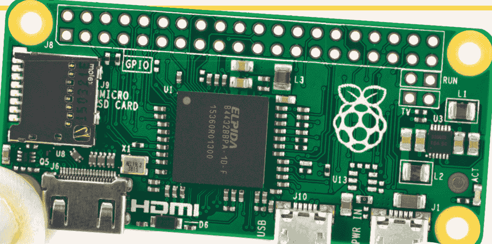

### 是世界上首款 5 美元电脑

主流树莓派 Zero 销商几乎立即售罄

树莓派基金会在其树莓派单板计算机家族中发布了新型号：`树莓派 Zero`。

以 5 美元售价，`树莓派 Zero` 为了更高的性价比牺牲了一些组件。它使用了 `BCM2835` 处理器，没有 `HDMI` 输出，`Model B+` 型中没有 `GPIO` 引脚，且没有 `USB` 端口，这意味着用户需要自己焊接引脚。

`树莓派 Zero` 通过微 `HDMI` 转 `HDMI` 适配器连接，两个 `USB` 端口互为替代。

“与如此强大的计算机工作就像回到了学习计算机时代，”来自伦敦的树莓派创始人 `Eben Upton` 说，“我们正在做的是确保树莓派永远不会成为对编程感兴趣的人的障碍。”


### 树莓派 Zero

**核心信息**

5 美元的价格点意味着该设备负担得起——使得学校 `IT` 部门的批量采购更具可行性，孩子们可以用零花钱买到它。

#### 1 极小

这是史以来最小的树莓派，仅为 `35x30mm`（`1.4x2` 英寸）——只有信用卡的一半大。它非常适合嵌入式项目，将其附加到微控制器或制作可穿戴设备非常完美。

#### 4 兼容 `HAT`

与原始的树莓派 Zero 不同，该板带有 `HAT` 扩展板，使其兼容原始 `HAT` 规范，因此您现有的 `HAT` 扩展板可以正常工作。

#### 2 强大

尽管使用了 `BCM2835` 处理器，但根据 `Eben Upton` 的说法，它比原始的树莓派 B 型快约 60%。这意味着我们可以使用标准的树莓派作为台式电脑。

#### 5 灵活

带有所有 `GPIO` 引脚，`Zero` 可以在显示器或电视上输出。您可以通过使用带电源 `USB` 集线器扩展单个 `USB` 端口，然后插入键盘、鼠标和 `Wi-Fi`。

下方电路保持完好以运行

## Linux 4.4 中的新功能

### 1 `Pi` 模式设置驱动

`Anthony` 创建基于树莓派的操作系统的首个成果，`Linux 4.4` 捆绑的驱动提供了内核设置选项。预计 3D 加速将在未来的发布中出现——但不要期望在 4.4 中立即看到。


### 2 虚拟 3D

`Linux 4.4` 首次带来了由 `David Airlle` 开发的 `VirtIO`，为 `QEMU` 栈提供了通过主机硬件渲染 3D 加速的能力。

### 3 支持更多 `GPU`

对于 `AMD` 用户，`Linux 4.4` 引入了新的 `GPU` 调度器，增加了对 `Radeon HD` 系列 `APUs` 的支持。电源管理可能会等到 `Linux 4.5`。

### 保护免受攻击的电路

位于旧金山的 `Design Shift` 通过众筹创建了锁定机器，它称是世界上首个开源、紧凑的、基于 `英特尔` 最新 `x86` 处理器的设备，安全是其重点：提供了密钥。当它超出范围时，系统进入睡眠模式和所有 `HDMI` 端口。


### 4 网络增强

`Linux` 网络子系统在 `Linux 4.4` 的开发中受到了大量关注，包括 `Atheros` 的全新驱动、对 `IPv6` 的改进支持以及最后的 `VXLAN` 内核驱动。

`1&1` 的价格从 $299 起，早期启动，设备完全便携并包含了外部电源、内存和固态硬盘。

### 5 `Skylake` 增强

`英特尔` 最新的微架构 `Skyline` 是对以前版本的许多改进之一。尽管如此，其中一些为升级到 `Linux 4.4` 带来了变化。


# 开源免费软件

## 逆流而行

“我们在研发支出上排名最后，”CBI 主席 Paul Dressler 说，“我们欠于在大学进行并由美国政府 DARPA 资助的研究。互联网由于 Tim Berners-Lee 在 CERN 的工作。自由软件归功 Project Map 和 MIT，它们创建了第一个多用户操作系统和第一个计算机显示。所有项目的共同点是它们都有资金支持、时间限制，并对我们的工作、思考和互联网产生了深远影响。互联网产生的创新突破被转化为生活，这完全是因为长期的公共投资。但只有公共资金才能让所有人获得。如果其中一个在完全不同的点失去资金，互联网就不会是今天这样的通用工具。”

经济学家、创新经济学教授 Angela Mazzucci 声称，大部分创新并非源自公共资助的项目。但有些原因。某些想法需要高资金和相对快速的回。在金融市场要求即时结果的现代商业环境中，此类创新不太可能在可能产生财务回报的大规模研发中出现。

创新往往违背当前世界的行事，Mazzucci 将苹果作为公共资助研究如何创造质量的范例。苹果通常被视为一家创新公司，但它在研发方面的投入很少，其主要创新在设计、包装和营销领域。她指出，让智能手机变得智能的技术（如 GPS、Siri 语音识别和语音触摸屏）并非由苹果或谷歌 开发的，而是长期国家资助研究的结果。史蒂夫·乔斯可能是天才也可能不是，因为他的支持帮助填补了市场空白，并知道设计在创建产品中的重要性。

政府“积极”塑造和创造市场的许多方面。在 IT、生物技术、纳米技术以及如今的全球经济中都是如此。公共部门资金不仅支持基础研究，还降低了早期高风险金融的风险。这很重要，因为大多数风险基金太害怕高度不确定且漫长的创新过程。

公共资金资助的研发项目在塑造市场和技术方面发挥了作用。研究的影响不仅在于我们国家的工业塑造，更在于开源和封闭技术的未来。

## Quay 安全扫描现已对所有人开放

“漏洞将永远存在，”CoreOS 的 Quentin Rocha 在发布会上表示，“CoreOS 认为，提高世界基础设施安全的工具应该供所有人使用。”

Linux 基金（Linux Foundation）宣布与包括 Google、IBM、Microsoft、PayPal 和 Paypal 在内的行业巨头达成合作项目：Open API 倡议（Open API Initiative）。

基金会宣布，该倡议的目标是扩展编程接口（API）框架的规范，这将产生一种通用技术，允许成员为提供 RESTful API 的元数据贡献中立供应商且开放的规范——这是 Swagger 自 2010 年发布以来取得巨大成功的奖励。

Swagger 现在被认为是一个达到成熟极限的开源项目；它无法由任何组织或开发者独立进行管理。因此，Linux 基金会决定启动 Open API 倡议作为 Swagger 的继任者。

Open API 倡议将因其表现力、凝聚的愿景和切利益而获得更多关注。Tony Tam 也是该项目所有者 Smart Software 的副总裁以及 Reverb Technologies 的联合创始人，他将与我们一起……

## 安全

发现导致了易于反转的 AES 加密

与 Lin 合作的密码学专家 Radia Caraga 对恶意软件进行了分析，发现了一个严重的缺陷：用于加密过程的密钥（使用 `librand` 函数生成）是与当前系统时间——种子生成的，而该种子可以通过查看加密文件的时间戳立即恢复。

“如果你的机器被感染了，请将此视作一次大幸存生。大多数加密勒索软件运营者要求付费以获取‘Linux 编码器’恶意软件的解密密钥。‘这种错误是非常不幸的，但其他错误更是……’”

勒索软件是一项日益繁忙的业务，美国联邦调查局（FBI）在 6 月声称，在过去一年中收到了 922 起关于基于“Linux 编码器”的恶意软件的投诉，总损失额达 1.88 亿美元。

Open API 倡议向成员开放，目前并在开放治理模式下运行。如果你感兴趣，可以在 `openapis.org` 获取更多关于项目的信息。


你的 Linux 新闻与观点来源

（每日平均访问量，10 月 27 日 – 11 月 23 日）

### 本月

- 稳定版 (17)
- 开发中 (3)

Linux Mint 本月凭借其 17 版本强势登场，确保其处于竞争领先地位。


### ISS 选择 Linux 而非 Windows

美国国家航空航天局 (NASA) 将内部控制权转向 Linux，这一决定被认为对可靠性至关重要。

> “我们迁移到了稳定且可靠的操作系统，”空间联盟的 Keith Chusia 解释引入 Linux 的，“我们需要补丁或调整，我们可以这样做。”

空间出版物 Dealer News 的 Stephen Hunter 确认 Linux 的引入正在增加。目前 ISS 使用约 100 台 Windows 工作站，但 Linux 的使用可能会超过其他平台。

除了工作站，ISS 还是人形机器人的所在地。机器人由宇航员部署，对人类环境来说是安全的，并且运行在 Linux 上。

### Linux Mint 17.3

Linux Mint 17.3 测试版发布，带来了全新的 MATE 桌面环境，使用户首次能够快速地管理窗口。

### Chakra 2014.1

这款新的 Ubuntu 发行版名为 Chakra，为老旧群体带来了 Compiz 桌面系统，并默认包含 SDDM 显示器管理器。

作为一个针对旧硬件一直受欢迎的发行版，此 Puppy Linux 版本采用了 Slack 分支——与 6.0 使用 Ubuntu True 分支形成对比。

### Richard Stallman 再次离开项目

Emacs 创始人兼维护者 Richard Stallman 已辞去维护者职位，由 John Wiley 继任。

John Wiley 已经参与 Emacs 多年，他将接任维护者的角色。

“我很乐意休息一下，”Stallman 说，“Emacs 交给 John 处理很放妥的。”

该项目将在新的领导下继续演进，我们期待 Emacs 的未来。

您的 Linux 新闻与观点来源


`Richard Curinis` 是 Premier Foundry 的全球战略联盟总监，负责开发、全球客户技术战略并专注于半导体软件和服务服务。

通过与 element14 的设计和工程团队 Claire Doyle 和 Richard Curin 合作，您可以在树莓派上留下自己的印记，他们解释了其运作方式。

> 定制化服务适用于所有树莓派型号，Claire Doyle 表示：这完全是围绕树莓派的，而且对配件周围的配件也持开放态度。

`Claire Doyle` 担任 element14 树莓派元件全球负责人已已有三年，在此之前，她自 2013 年 5 月起一直管理客户供应商关系。

它在人声方面具有扩展潜力，能够使其顺利启动。一旦我们完成了这一步并汇集了核心客户，我认为我们将扩展到不同的策略。

我也可以看到它部署在教育领域，为其奠定坚实的基础。例如，我们将如何沿着这些路线为教育进行定制？在我们发布的关于此的公告中，我们看到了各个领域的组件。那些参考设计可以满足一些热门的客户需求；我们不希望参考设计被小批量生产，但这将让人们有机会获得定制服务，以便他们开展自己的市场项目等。

`这项服务是针对企业的，还是说您也可以（例如）使用它？`

`CD`: 它适用于任何类型的客户。从我们看到的所有查询来看（主要是 OEM 类客户），我们已经声明过，最小起订量在 300 到 500 个左右，但我们认为提供良好的产前定制服务是有意义的。客户类型……我们真的非常开放。这取决于客户的需求以及他们想用它做什么。

`Richard Curin`: 它将首先从扩展性和优先级顺序开始，因为我们部署到该计划的资源是有限的。所以我们将关注 OEM 和 ODM，在这些……

`你能告诉我们提供什么样的定制服务吗？`

`RC`: 基本上，提供的定制是更改主板上除 Broadcom芯片和内存之外的任何物品的配置。当我们开始进行更改时，会对表面和引脚产生复杂的连锁反应。如果客户确实想对这些做些处理，我认为那将与 Broadcom 和树莓派进行另一番对话，因此我们会限制这些组件，但其他所有部分——PCB、尺寸和外形——在我们寻求与客户的应用程序进行合作时，它们都是可以调整的。

客户首先会请求树莓派定制，然后我们的技术工程师和应用设计师将与客户合作进行该设计。Element14 将与树莓派的工具和设计合作。如果客户希望外包生产，element14 将从世界范围内选择（取决于产量和规格）熟悉产品的制造商，并让他们进行制造，最终发送给客户。

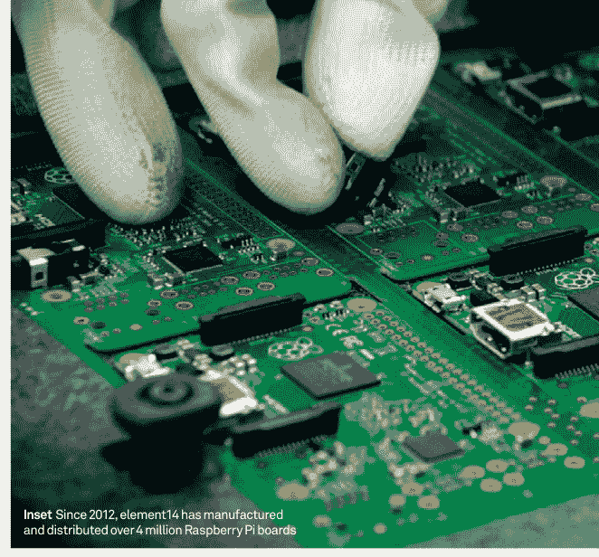

你们是否有一份人们可以选取的特性列表，或者你们对更具冒险性的请求开放——例如，有人想要一个电镀的设计？


RC: 在那个阶段或定制的某个点，我们会为客户创建某种菜单。当我们考虑涉及的潜在影响时，我之前已经提到过。根据我们的灵活性，我们完全可以告诉他们，在我们的工程团队可以涵盖的领域，我们拥有实现他们所要求的技术工程知识。所以，灵活性是优势，但同时也意味着我们对客户没有限制。我们会根据具体情况验证并批准定制请求，这就是我们目前正在做的，然后建立一份关于提交请求的记录，在那里我们可以根据看到的市场情况，考虑为客户制作一些真正创新且直观的菜单。

CD: 它是处于那个阶段的原因之一是……我们会为客户创建某种菜单。当我们考虑涉及的潜在影响时，我之前已经提到过。根据我们的灵活性，我们完全可以告诉他们，在我们的工程团队可以涵盖的领域，我们拥有实现他们所要求的技术工程知识。所以，灵活性是优势，但同时也意味着我们对客户没有限制。我们会根据具体情况验证并批准定制请求，这就是我们目前正在做的，然后建立一份关于提交请求的记录，在那里我们可以根据看到的市场情况，考虑为客户制作一些真正创新且直观的菜单。（注：原文后续存在大量重复的段落，根据指令“不要重复输出原文”原则，此处已完成核心内容翻译。）

# 我们革命性的全新网络托管平台


100% 保证在线时间！


智能 SSD 存储 & 智能负载均衡


专用 SSL 证书

> 网络托管起价：
> 每月 £1.99
> 不含增值税，按 20% 征收
> 拨电 0333 0142 708
> 服务器 • 网络托管 • 域名 • 交换邮件


您的 Linux 新闻与观点来源

# 观点

Jon Masters 总结了 Linux 内核社区的最新动态，此时内核 4.4 版本的合并窗口已经关闭。

> Linus Torvalds 关闭了合并窗口（在惯例几周之后，允许对 4.4 进行更改的时期），随后 Linux 4.4-rc1（发布候选版本）已发布。在公告中，Linus 注意到，由于补丁驱动程序和 100% 架构冷却，情况“可能比通常更忙碌”。随后他宣布了 4.4-rc2，并表示“4.4 的情况看起来很正常，rc2 没有出现重大的惊慌。这些功能：帕齐格式（parquet）支持和一些列表批量分配器补丁；严格来说，它们已经在没有问题的情况下合并了。它们尚未被使用，因此前端更新将是我们面对的，而不是可能发生回归的问题。”

Linux 继承自数十年的 Unix 和 Unix 遗产。虽然 2015 年的 Linux 开发者或嵌入式设备与 70 年代的原始 Unix 系统之间似乎没有共同点，但对于那个时代的各种标准、协议、惯例和命名，外观可能是误导性的。其中一种影响每天体现在 Linux 处理此类过程的方式（在我们的系统中是内核中的“任务处理”）。取决于 Linux 为“等待通道”（Waiting Channel）提供的选项，它在我们眼皮底下隐藏了一个安全漏洞。

在传统的 Unix 类系统中，实现的变体 `WCHAN` 提供了内核函数或数据结构的绝对地址，特定线程预计在从阻塞调用（系统调用）返回（例如，从磁盘读取某些数据）后运行在该地址上，这在传统上会暴露内核线程的内存地址。在 Linux 中，除了为 Linux 内核生成的“System.map”文件外，内核地址不会被暴露。现代 Linux 内核不需要依赖用户空间变量来定位内核函数，这使得内核地址转换。

## Jon Masters

Masters 是一位从事 Linux 约 19 年的 Linux 内核黑客，他于 1993 年就读于利兹大学。他现在为一家企业 Linux 供应商工作，并领导创建高效 ARM 驱动服务器的标准。

正如鼓励测试新内核一样，该内核目前已在某些主要子系统的最新开发可用，其中包括令人兴奋的功能：支持一种新的“开发冷却”设备，让我们能够像手机一样扩展——一种限制温度的过热状况已回到某些范围内；对于软件 RAFS 驱动程序的日志支持，允许特定的设备——例如高吞吐量 NVMe 闪存或磁盘——用于保证离开的坏数据（如系统用户输入的密码）的地址——这还有一个额外处处，该内存在跟随页错误后的数据安全访问之前可能不会被锁定。

上个月的期刊与今年在韩国首尔举行的内核会议（Kernel Summit）相遇，同时还有 2015 年韩国 Linux 论坛。在内核会议上，讨论了许多话题，所有话题由 Linux Weekly News (`lwn.net`) 进行了大致总结。

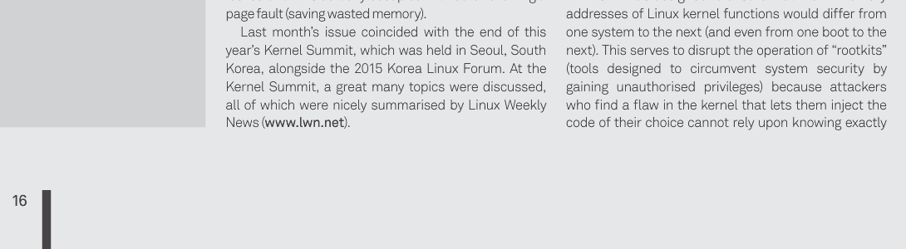


内存位置包含特定的内核函数，对应你可能使用的名称。因此，在使用厂商的内核时，要产生影响所有系统的内核漏洞更为困难。`KASLR` 运行良好，除非你通过提供用于给定系统上所有运行内核的随机生成偏移量来击败它。在 Linux 4.4 下，通过对给定任务的 `WCHAN` 输出进行简单的算术运算即可轻易获取该信息，且在 `/proc/stat` 中对所有用户可见。Mitter 指出了以下示例，并说“`WCHAN` 输出并不理想，因为它轻而易地向任何本地攻击者泄露 `KASLR` 偏移：

```
printf "%06x\n" $(cat /proc/stat | cut -d' ' -f5)
```

他的修复方法是在 `/proc/PID/stat` 中仅提供现有内核地址的符号名称进行翻译，或者更改 `/proc/PID/stat` 的输出，包含 1 或 0，取决于许多工具何时依赖此来判断任务是否实际活跃。

Octavian 发布了一个有趣的 Linux 内核丁（征求意见），允许将 Linux 内核映射到其他内存空间。这种策略看起来可能很奇怪，但在软件开发方面，它可以用于在虚拟机（特别是特别是操作系统）中运行的应用程序中使用 Linux 的虚拟内存实现。此补丁将自己标记为一个库，许多想要使用简单文件系统驱动的项目将会有另一个选项，而不是复制粘贴从内核借用的代码片段。Jones 迅速接手了工作


此补丁将自己标记为一个库，许多想要使用简单文件系统驱动的项目将会有另一个选项，而不是复制粘贴从内核借用的代码片段。Jones 迅速接手了工作


此补丁将自己标记为一个库，许多想要使用简单文件系统驱动的项目将会有另一个选项 4.4-rc1（发布候选版本）。在 Linux 中，除了为 Linux 内核生成的“System.map”文件外，内核地址不会被暴露。现代 Linux 内核不需要依赖用户空间变量来定位内核函数，这使得内核地址转换。

Masters 是一位从事 Linux 约 19 年的 Linux 内核黑客，他于 1993 年就读于利兹大学。他现在为一家企业 Linux 供应商工作，并领导创建高效 ARM 驱动服务器的标准。

正如鼓励测试新内核一样，该内核目前已在某些主要子系统的最新开发可用，其中包括令人兴奋的功能：支持一种新的“开发冷却”设备，让我们能够像手机一样扩展——一种限制温度的过热状况已回到某些范围内；对于软件 RAFS 驱动程序的日志支持，允许特定的设备——例如高吞吐量 NVMe 闪存或磁盘——用于保证离开的坏数据（如系统用户输入的密码）的地址——这还有一个额外处处，该内存在跟随页错误后的数据安全访问之前可能不会被锁定。

上个月的期刊与今年在韩国首尔举行的内核会议（Kernel Summit）相遇，同时还有 2015 年韩国 Linux 论坛。在内核会议上，讨论了许多话题，所有话题由 Linux Weekly News (`lwn.net`) 进行了大致总结。

此补丁将自己标记为一个库，许多想要使用简单文件系统驱动的项目将会有另一个选项，而不是复制粘贴从内核借用的代码片段。Jones 迅速接手了工作。

“4.4 的情况看起来很正常，rc2 没有出现重大的惊慌。这些功能：帕齐格式（parquet）支持和一些列表批量分配器补丁；严格来说，它们已经在没有问题的情况下合并了。它们尚未被使用，因此前端更新将是我们面对的，而不是可能发生回归的问题。”

此补丁将自己标记为一个库，许多想要使用简单文件系统驱动的项目将会有另一个选项，而不是复制粘贴从内核借用的代码片段。Jones 迅速接手了工作。

此补丁将自己标记为一个库，许多想要使用简单文件系统驱动的项目将会有另一个选项，而不是复制粘贴从内核借用的代码片段。Jones 迅速接手了工作。

此补丁将自己标记为一个库，许多想要使用简单文件系统驱动的项目将会有另一个选项，而不是复制粘贴从内核借用的代码片段。Jones 迅速接手了工作。


此补丁将自己标记为一个库，许多想要使用简单文件系统驱动的项目将会有另一个选项，而不是复制粘贴从内核借用的代码片段。`Jones` 迅速接手了工作。

Mitter 指出了以下示例，并说“`WCHAN` 输出并不理想，因为它轻而易地向任何本地攻击者泄露 `KASLR` 偏移：

```
printf "%06x\n" $(cat /proc/stat | cut -d' ' -f5)
```

他的修复方法是在 `/proc/PID/stat` 中仅提供现有内核地址的符号名称进行翻译，或者更改 `/proc/PID/stat` 的输出，包含 `1` 或 `0`，取决于许多工具何时依赖此来判断任务是否实际活跃。

## 只有一个值得大力推崇的提供商


`2ndQuadrant` 是全球领先的 `PostgreSQL` 服务提供商。作为主要的内核贡献者，我们与各种规模的公司合作，并深受您所信赖的公司信任。当您与我们合作时，您知道自己交给了可靠的伙伴。

要了解我们如何为您提供帮助（以及谁在推崇我们），请访问 `2ndQuadrant.com/LU160`

`+44 (0)870 766 7756`


> `¹15分钟响应是我们的铂金生产服务`（`Platinum Production service`）提供的标准服务水平。
>
> `²远程 DBA 服务作为生产支持的扩展提供，不作为独立服务。`


`Linux` 以安全快速著称，但随着时间的推移可能会变慢。我们将学习如何测量计算机性能，然后揭示加速它的方法。

大多数在 `PC` 上安装 `Linux` 的人是因为他们被告知 `Linux` 快速且安全，而且他们可以配置任何想要的东西。这些都是事实，但还有另一个事实。随着时间的推移，你的 `Linux` 安装会经历软件安装和卸载的循环，过程会变得不稳定。我们都知道，理论上任何人都可以按照自己的意愿调整 `Linux` 安装，但在没有备份的情况下自己这样操作，会使你面临损坏操作系统甚至更糟糕的——丢失所有数据的风险。

更安全的方法是先仔细测量计算机的性能，看看它是否比具有相似硬件配置的其他计算机运行得慢。一旦你确认你的 `PC` 确实运行缓慢，就可以采取系统化的方法，首先从简单的更改和启动用应用程序开始，然后转向更专业的优化技巧。通过增量式更改，你可以帮助避免系统崩溃。在本文中，请遵循这一分步骤的路径，帮助你的基于 `Linux` 的 `PC` 运行得更快、更流畅。

# 诊断与性能

我们揭示了一些可以帮助衡量性能的命令行选项和第三方工具


现代计算机使用资源共享机制来运行多个进程。虽然进程是一个接一个运行的，但它们非常迅速，给你一种所有进程都在并行运行的错觉。因此，要理解为什么你的 `PC` 运行缓慢，就是检查所有正在运行的进程，以及是否真的需要运行某个特定进程。通常情况下，你的 `CPU` 使用率不应超过总量的 `70%`。如果超过，那么你可能就会问题。如果你的 `CPU` 负载保持在 `90-100%` (`0.90-1.0`) 之间，那么是时候考虑删减不需要的内容了。同样，你应该尝试确保你的交换空间（`swap`）正常。

`Linux` 提供了许多命令行工具，如 `top`、`free` 和 `uptime` 来显示关于进程、内存使用和负载的信息。你还可以使用第三方工具 `htop` 来查看资源使用。

`Linux` 提供了多种选项来查看资源使用，包括 `htop` 命令

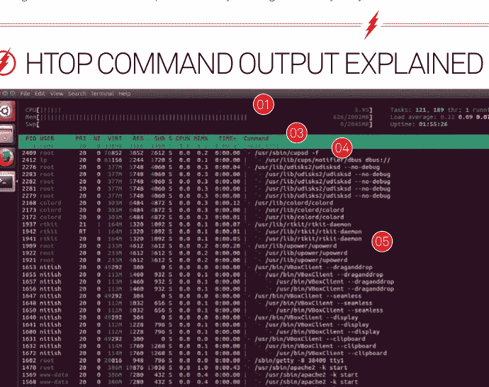

- `06` 页脚：显示部分菜单。按键。

`Debian` 默认使用运行级别（`runlevel`）`2`，并且没有为 `3-5` 定义特殊功能。为了加速你偶尔运行的服务，可以将它们设置为不同的运行级别。例如，你可能在运行级别 `3` 运行数据库，在运行级别 `4` 运行 `Web` 服务器。

`readhead` 软件包在启动时运行并准备磁盘缓存。要激活它，请运行以下命令并重启：在首次启动后，启动过程会很慢，直到 `readhead` 根据配置文件（`profile`）调优启动加载的文件列表：

- `touch /etc/readhead/profile-once`

如果你的系统是热启动的，而不是在长时间关机后重启，你可以跳过硬件重新初始化。然后通过 `BIOS` 和引导加载程序，你可以进入最小运行级别并将内核镜像加载到内存中。这需要 `kexec` 和编译了 `KEXEC` 支持的内核。在 `Debian` 中可以通过 `kexec-tools` 包安装它：

在默认安装中，系统日志通常配置完全，适用于单用户或多用户系统。如果你使用的是单用户系统，不断写入许多系统日志文件会导致性能下降，且日志活动会占用更多时间。`Debian` 使用 `syslogd`，其配置文件为 `/etc/syslog.conf`。你可以通过注释相应的行来禁用不需要的默认日志：


环境，你只需要使用 `apt-get` 命令在你的系统上安装它即可。例如：

上面的 `Ubuntu` 桌面运行速度快且所需的资源更少，运行更流畅。

安装完成后，你可以通过注销然后重新登录并选择使用来开始。

后台进程是电脑响应缓慢的另一个常见原因。诸如 `apt-update` 或 `unattended` 这样的进程可能会后台运行几天，并在运行期间减慢你的电脑速度。在 `Ubuntu` 中，使用了索引程序 `apt-indexer`。它能加速搜索操作，但可能会减慢你的系统速度。如果你移除这个包，它并不是必不可少的，而且占用空间小，你可能甚至察觉不到它的消失。在轻量级 `Ubuntu` 中没有这个包。要卸载它，只需输入：

`Ubuntu` 刚开始运行时非常敏捷，但仍然有一些普通用户不需要的方面。如果你在旧机器上运行 `Linux`，请考虑将其精简到最低，这样你的系统运行速度会快得多。

- `sudo apt-get purge ppa:apt-indexer`

- `sudo apt-get install apt-fast`

软件安装本质上是一个缓慢的过程，因为包需要先下载。`Apt-fast` 是一个 `shell` 脚本，它通过同时打开多个连接来更新包缓存并下载包。如果你使用终端和 `apt-get` 安装包，你可能需要尝试 `apt-fast`。使用以下命令通过官方 `PPA` 安装 `apt-fast`：

- `sudo add-apt-repository ppa:apt-fast/stable`

- `sudo apt-get update`

- `sudo apt-get install apt-fast`

## PRELOAD

## APT 自动缓存

`Ubuntu` 使用 `apt` 管理包及其依赖关系。它将缓存维护在 `/var/cache/apt/` 下，随着时间的推移，该缓存可能会充斥关于旧包的无用信息。`/etc/apt/lists` 下的 `apt` 列表也需要清理。要清理它们，运行 `apt-get clean`。根据你的使用情况，你可能需要释放大量的磁盘空间。

## 修改 SWAPPINESS 值

交换（`Swapping`）控制内核在物理内存和虚拟内存之间交换的倾向。接受的值范围为 `0-100`。内核尽可能避免交换，而 `100` 则允许所有操作。`Ubuntu` 的 `swappiness` 为 `60`。如果你想更改该值，请使用命令：`vm.swappiness=10`。为了在重启后保存该值，请编辑 `/etc/sysctl.conf`，如果该行不存在，则添加 `vm.swappiness=10`。

过热是一个持续数日的问题——当你的 `CPU` 运行运行时，打开一个程序可能需要很长时间。`TL` 可以减少 `Ubuntu` 的过热并提升系统性能，它在后台运行：

- `sudo apt-get update && sudo apt-get install tl-rdp`

- `sudo apt-get tip`

### 尝试这些适用于所有发行版的系统级修复方法

我们刚刚查看了 `Debian` 和 `Ubuntu` 系统的性能优化建议。但还有许多其他 `Linux` 发行版，可能无法涵盖所有发行版的建议，不过有一些建议并非特定于某个发行版，但也适用于所有发行版。让我们现在来看看这些建议。


### 优化启动与系统性能

其中首要的是`GRUB`配置。`GRUB`负责启动过程，你必须注意由`GRUB`启动的引导过程。默认情况下，它会显示 10 到 30 秒的启动菜单。你可以通过编辑`GRUB`默认配置文件来延迟启动加载程序的持续时间，甚至可以跳过倒计时。例如：

如果你更改了`GRUB`，还有几点需要考虑。在每行显示时间以及测量值：

```bash
cat /etc/default/grub
# 如果你更改了此文件，运行 `sudo update-grub` 来更新更改。
# 编辑该文件，添加以下行：
GRUB_TIMEOUT=5
GRUB_TIMEOUT_STYLE=menu
```

```bash
$ sudo vi /etc/default/grub
```

将与此相关的变量更改为类似 5 或 3 的数字。如果设置为 0，则默认将选择第一个项。保存并关闭文件。然后运行：

```bash
$ update-grub
```

我们的下一个建议是列出启动程序。这是因为你的系统可能会启动不必要的服务并启动，从而加速。


| `COMMAND` | `PID` | `USER` | `SIZE` | `T` | `DEVICE` | `NAME` |
| :--- | :--- | :--- | :--- | :--- | :--- | :--- |
| 01 | | | | | | |
| 02 | | | | | | |
| 03 | | | | | | |
| 04 | | | | | | |

### 监控所有资源的五种方法

显示虚拟内存、内核线程、进程`IO`、`CPU`活动和内存使用。默认每秒显示计算、磁盘和网络接口三个方面的信息。如果你只想输出细节，可以使用：

```bash
$ collect sc
```

如果你有多个`CPU`，可以使用`-l`输出多行，每个`CPU`一行：

```bash
$ collect -sc
```

`Netstat`是一个用于监控和输出网络统计的命令行工具。它对于系统管理员非常有用，特别是在排查性能和网络问题时。

`iotop`类似于`top`命令，但它带有一个交互式监控器来显示磁盘`I/O`。这个工具对于查找磁盘读/写最高的进程非常有用。

#### 04 iostat

`iostat`是一个用于从内核设备收集性能数据的命令行工具。与其他监控工具不同，`iostat`并不关注有限的指标，而是提供许多类型的系统指标，包括内存、网络、`TCP`、`inode`、`NFS`和性能质量。

`Lsof`是`List Open Files`的缩写。该命令用于显示所有打开的文件和进程。打开的文件包括磁盘文件、网络套接、管道和设备。通过它你可以轻松识别哪些文件正在被使用。

### 使用工具获取详细报告

#### 01 CPU 内存使用

显示空闲内存、缓冲缓存以及其他一些细节。如果你想进一步了解细节，请使用`mem`。

要显示内存细节，你可以使用选项，如：

```bash
$ collect sm
```

#### 03 检查磁盘使用情况

基于之前的工具，你可能需要查看磁盘细节，你可以使用相关工具。

### 一些可以帮助加速 Linux 安装的优秀第三方工具

`gconf-cleaner`可用于清理`Windows`注册表。该工具会遍历`gconf`数据库（`gconf`是`GNOME`和桌面条目的配置数据库）。它非常实用，并且根据你的系统运行缓慢程度，可以列出所有可以删除的条目。

#### 02 Slint

`Slint`是一个查找存储中常见错误的实用程序。它可以发现重复文件和碎片文件等问题。通过图形用户界面（`GUI`），你可以选择适合自己的模式。

跟踪已用空间非常重要，特别是当你不在电脑旁时。软件包管理器可以帮助你找到每个软件包占用了多少空间。你可以轻松地管理它，并检查系统中每个软件包占用的空间。

#### 04 Thermald

`thermald`尝试通过内核中可用的`Intel`功能防止`CPU`过热。它的工作原理是仅在温度达到特定阈值时，通过各种方法限制性能，因此你可能察觉不到差异。

`TLP`是一种电源管理工具，为`Linux`带来高级电源管理的优势，而无需理解每个细节。`TLP`无需配置即可工作，你只需安装并任其运行。如果你想根据其他需求进行自定义，它具有高度可配置性以满足你的特定需求。

### 最佳开源软件 (FOSS)

在我们调整你的系统时，有一些第三方工具也能帮助你。调整系统以使用更少的资源可能不足以让它运行更快，因此你可能会搜索可以进一步优化系统的第三方工具。其中一个工具就是`Bleachbit`。`Bleachbit`是一个命令行工具，它会扫描你的系统并删除所有不应该存在那里的内容。它从`dpkg`数据库中收集大部分结果，此外还有一份在各种软件包生命周期内出现的“额外”文件列表。

接下来是`Gptan`；它让你能够从系统中删除孤立软件包。像`Bleachbit`一样，这个工具可以清理大量的空间。

另一个工具是`BleachBit`；它不仅可以清理你的浏览器和互联网历史，还可以粉碎临时文件、删除日志并丢弃你可能从未见过的各种类型的文件。`BleachBit`是一项出色的工具。

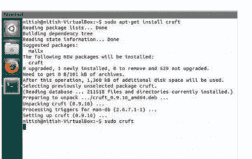

以上在安装`LibreOffice`后，你可以用它清理程序留下的所有文件，其`GUI`让你能够轻松选择确切想要清理的内容。我们正在讨论用更轻量级的替代品替换软件；替换`LibreOffice`可以让你的系统运行更快。`LibreOffice`是内存密集型的，因此你可以使用像`Midori`这样的浏览器，它轻得多。你也可以使用`Gnumeric`或`AbiWord`等处理器代替，因此等。

#### 02 LibreOffice 设置

要开始调整设置，首先打开`LibreOffice`，然后选择`LibreOffice`设置。进入后，点击顶部菜单栏上的“工具”，然后选择“选项”。这将打开一个窗口，接下来你可以看到所有可用选项。在这里，你可以更改设置顶部所有与`LibreOffice`内存使用相关的选项。

当你在处于“内存”部分时，将图形缓存（`Graphics cache`）增加到`100MB`，并将内存池（`Memory Pool`）增加到`20MB`。这将减少内存占用，并让`LibreOffice`运行更敏捷。此外，如果你使用了快速启动（`Quick Starter`），使其在系统托盘中可用，它会让`LibreOffice`在内存中获得优先考虑并启动得更快。

大多数`Linux`发行版默认都安装了`LibreOffice`，老实说，安装另一个处理器仅仅为了让它运行慢一点感觉像是一项很麻烦的工作。所以，如果你认为性能只是稍微有点迟钝而不是致命问题，最好是更改内存设置并看看是否能提速。

### 轻量级 Linux 发行版

在这里我们来看一些可以安装在你旧硬件上的轻量级发行版，以获得闪电般的处理速度。


`Arch Linux`是一个独立开发的发行版，非常侧重于简单、极简和优雅。`Arch Linux`成为一个轻量且快速的发行版的主要原因之一是，它是以最小化基础的形式安装的，用户在需要时才添加软件包。这让你对一次性安装的内容拥有控制权，避免了系统运行变慢并迫使你寻找优化设置的技巧。`Arch Linux`对发布版本有一种非常有趣的方法。它基于滚动发布（`rolling-release`）模型，允许一次性安装后对发行版进行持续更新，无需执行复杂的程序。只需一个命令，`Arch`系统即可保持更新。

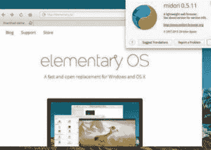


# Elementary OS 简介
Elementary OS 起是一组为 Ubuntu 设计的主题和应用程序，后来变成了它自己的 Linux 发行版。作为一个基于 Ubuntu 的发行版，它与 Ubuntu 仓库兼容，且不会超出范围。它通过精简用户界面和最小化对一切进行配置的需求掌握了 GNU 哲学。Elementary OS 的核心关注是为世界各地的用户提供极佳的用户体验。其极简的设计让它


# Puppy Linux 简介
Puppy Linux 的工作原理是仅在温度达到特定阈值时，通过各种方法限制性能，因此你可能察觉不到差异。Puppy Linux 是一个非常小的发行版，甚至可以加载到内存中运行，从而变得极快。它包含了许多实用的工具，你不需要额外安装。它非常适合老旧电脑，是 Linux 世界最受欢迎的发行版之一。


# 杂志订阅信息

ORDER HOTLINE | ONLINE AT

0844 249 0282 Calls will cost 7p per minute plus your telephone company's access www.linuxines.com

Send your completed form to:

8000,

## ISSUE PACKED WITH...

- Linux 专家的编程指南
- 来自企业的最新快讯
- 创新的树莓派项目和建议
- 经过评审的最佳 Linux 发行版和硬件

## YOUR DETAILS

| Title | First name |
| --- | --- |
| Surname | |
| Address | |
| Postcode | Country |
| Telephone number | |
| Mobile address | |
| Email address | |

## DIRECT DEBIT PAYMENT

UK Direct Debit Payment

I will pay £12.50 every 3 issues (Save 30%)

| Address | Building curve |
| --- | --- |
| | |
| Identification Number | 0 1 2 3 4 5 6 7 8 9 |
| Postcode | Sort code | |
| Building sort account number | |
| Date | |

## WHY YOU SHOULD SUBSCRIBE...

## PAYMENT DETAILS

YOUR EXCLUSIVE RATE, 1 YEAR (13 ISSUES)

£62.40 (Save 20%) Europe — £70 World — £80

Cheque

I enclose a cheque for £

(made payable to Imagine Publishing Ltd)

## Credit/Debit Card

| Visa | Mastercard | Amex | Maestro |
| --- | --- | --- | --- |
| Card number | | | |
| Issue number | (if Maestro) | | |
| Signed | | | |
| Date | | | |

> Please tick if you do not wish to receive any promotional material from Imagine Publishing Ltd by telephone:via email:

> Please tick if you do not wish to receive any promotional material from Imagine Publishing Ltd by telephone:via email:

TERMS & CONDITIONS

Terms and Conditions: This offer entitles new UK direct debit subscribers to pay only £12.50 every 3 issues. New subscriptions will start from the next available issue. Offer code PQ16 must be quoted to receive this special price deal. As of 2 February 2016, Imagine Publishing reserves the right to limit this type of offer to one per household. Subscribers can cancel this subscription at any time.

## ORDER BY

29TH FEBRUARY

Use code PQ16 for this.

# 教程数据文件与信息

## 系统编程

数据文件与信息


Mihalis Tsoukalis 是一位 Unix 管理员、Unix 和 iOS 程序员、数据库管理员（DBA）以及其他许多领域的专家。他自 1993 年起就开始使用 Linux。

## 资源

- 文本编辑器
- GCC 编译器

## 利用必要的系统调用和结构来帮助你处理 Linux 系统文件和信息

本教程将向你展示能够处理系统文件和信息的系统调用和技术。请记住，大多数系统文件都是纯文本格式，但使用文本编辑器编辑文件可能是危险的，应该谨慎地操作。

作为程序员，你将不得不处理文件，当你无法访问或删除文件时，权限起着关键作用。

但在在此之前，需要一些关于进程的信息。每个进程有两个用户 ID（UID）：用户 ID 和真实用户 ID（real user ID）。同样，每个进程有两个组 ID（GID）。这使得一切变得更加复杂；内核在检查时仅检查用户 ID 和组 ID。你可能会问，拥有真实用户和组 ID 并影响所有文件（无论哪个用户创建了它）有什么意义呢？这样的进程必须以 root 权限运行，因为只有 root 用户是不同用户（例如 mtsuk）的组才能访问某个文件，然后服务器进程在尝试执行请求的任务之前，会临时将其有效用户 ID 从 root 更改为 mtsuk。如果 mtsuk 不允许访问该文件，将生成错误。在完成 mtsuk 服务器要求的所有任务后，服务器进程将将其有效用户 ID 改回 root。许多服务器进程都是这样工作的。

## 为什么要处理系统文件？

Linux 系统上的大多数任务都需要一个或多个程序的各种系统信息、组权限，例如 TCP 服务等。因此，如果所有程序都有读取 root 文件的权限（这通常由 root 在用户不知情的情况下完成），那么除非某处发生错误，否则会发生什么？

## /etc/passwd

当你意识到每次执行 `-l` 命令时，它都会输出用户信息时，你就会理解 `/etc/passwd` 有么重要了。这是为了确保运行的用户具有正确的用户或组权限来访问相关文件或目录。

## 教程文件

可用地址：

`files.co.uk`

30

## 内存分配

C 语言快速的原因之一是它直接处理内存。然而，C 程序中的许多 bug 来自于随后的内存损坏。此类操作可能会导致严重的崩溃。

分配内存有几种方法：`malloc()`、`calloc()`、`realloc()` 和 `free()`。在实践中，大多数时间你使用 `malloc()` 来分配你之后需要访问的内存。

如果你想手动分配内存以将一个字符串复制到另一个，可以使用以下方法：

```c
int length = strlen(str);
char *copy = malloc((length + 1) * sizeof(char));
```

请注意，额外的空间用于正确表示字符串的 `'\0'` 字符。注意 `'\0'` 是单个字符而不是字符串。有像 `strdup(char*)` 这样的函数，它可以将现有字符串复制到新字符串中，它会自动分配必要的内存，因此你不需要手动分配。

一元运算符 `sizeof` 返回变量或类型占用的字节数。`malloc()` 分配了存储变量所需的内存空间。如果你想使用 `malloc()` 存储几个数字，应该使用以下方法：

```c
double *array = malloc((n + 1) * sizeof(double));
```

教程中的 `malloc,free` 配对说明了一个相关的示例。当执行以下代码并终止时，由于第二个变量 `uidstr` 没有内存关联，因此会发生段错误（segmentation fault）：

```c
char *uidstr = "0";
```


记住这一点极其重要：如果一个用户的 `ID` 值为 `0`，那么它将自动拥有 `root` 权限；因此，`root` 用户使用的不是 `ID` 的名称。以下显示了一个 C 语言程序，它可以查找 `/etc/passwd` 中所有用户 `ID` 为 `0` 的用户：

```c
#include <stdio.h>
#include <string.h>
#define MAXLINESIZE 512
int main(int argc, char **argv) {
    FILE *INPUT;
    char buffer[MAXLINESIZE];

    // 以只读模式打开 /etc/passwd
    INPUT = fopen("/etc/passwd", "r");
    while (fgets(buffer, sizeof(buffer), INPUT) != NULL) {
        // 忽略 /etc/passwd 中的注释
        if (buffer[0] == '#')
            continue;
        // 用户 ID 是第三字段
        char *username = strtok(buffer, ":");
        char *password = strtok(NULL, ":");
        char *uid = strtok(NULL, ":");
        if (strcmp(uid, "0") == 0)
            printf("User %s has root privileges!\n", username);
    }

    fclose(INPUT);
    return 0;
}
```

## 大多数（如果不是全部）程序都有权访问读取或修改文件，这通常在后台完成

这在尝试执行 `-R` 命令（列出所有子目录）时非常有价值。密码文件包含每个用户的条目。该用户的系统文件是：`/etc/passwd`

冒号（`:`）分隔了 `/etc/passwd` 文件中的字段。第一个字段是用户名，第二个字段是用户名的长度。第三字段是用户 `ID`。第四个字段是家目录。请注意，你可以定义家目录的绝对路径而不是字符串，这被用于 Web 服务器等服务的用户。Web 服务器的条目如下：

```
root:x:0:0:root:/root:/bash
```

`/bin/nologin` 是出于安全原因而应该禁用的账户的 Shell 替代方案。第三字段是用户 `ID` 的数值值，第四个字段是组 `ID` 的数值值。正如你将看到的，为了让组 `ID` 的数值值具有意义，你必须访问 `/etc/group`。

```
www-data:x:33:33::/bin/nologin
```

# 教程数据文件与信息

读取 `/etc/passwd` 没问题，但不要尝试在没有锁的情况下编辑它。`passwd` 结构在 `passwd.h` 中的定义如下：

```c
struct passwd {
    char *pwname;      /* 用户名 */
    char *pwpassword;  /* 密码 */
    uid_t uid;         /* 用户 ID */
    gid_t gid;         /* 组 ID */
    char *pwge;       /* 用户信息 */
    char *pwhome;      /* 家目录 */
    char *pwshell;     /* shell */
};
```

在 `/etc/passwd` 中，内核只检查用户 `ID`。由于只有 `root` 用户是不同用户（例如 `mtsuk`）的组才能访问文件，然后服务器进程在尝试执行请求的任务之前，会临时将其有效用户 `ID` 从 `root` 更改为 `mtsuk`。如果 `mtsuk` 不允许访问该文件，将生成错误。在完成 `mtsuk` 服务器要求的所有任务后，服务器进程将将其有效用户 `ID` 改回 `root`。许多服务器进程都是这样工作的。

## 为什么要处理系统文件？

Linux 系统上的大多数任务都需要一个或多个程序的各种系统信息、组权限，例如 `TCP` 服务等。因此，如果所有程序都有读取 `root` 文件的权限（这通常由 `root` 在用户不知情的情况下完成），那么除非某处发生错误，否则会发生什么？

## /etc/passwd

当你意识到每次执行 `-l` 命令时，它都会输出用户信息时，你就会理解 `/etc/passwd` 有么重要了。这是为了确保运行的用户具有正确的用户或组权限来访问相关文件或目录。

## 教程文件

可用：

`files.co.uk`

`30`

## 内存分配

C 语言快速的原因之一是它直接处理内存。然而，C 程序中的许多 `bug` 来自于随后的内存损坏。此类操作可能会导致严重的崩溃。

分配内存有几种方法：`malloc()`、`calloc()`、`realloc()` 和 `free()`。在实践中，大多数时间你使用 `malloc()` 来分配你之后需要访问的内存。

如果你想手动分配内存以将一个字符串复制到另一个，可以使用以下方法：

```
int length = strlen(str);
char *copy = malloc((length + 1) * sizeof(char));
```

请注意，额外的空间用于正确表示字符串的 `'\0'` 字符。注意 `'\0'` 是单个字符而不是字符串。有像 `strdup(char*)` 这样的函数，它可以将现有字符串复制到新字符串中，它会自动分配必要的内存，因此你不需要手动分配。

一元运算符 `sizeof` 返回变量或类型占用的字节数。`malloc()` 分配了存储变量所需的内存空间。如果你想使用 `malloc()` 存储几个数字，应该使用以下方法：

```
double *array = malloc((n + 1) * sizeof(double));
```

教程中的 `malloc,free` 配对说明了一个相关的示例。当执行以下代码并终止时，由于第二个变量 `uidstr` 没有内存关联，因此会发生段错误：

```
char *uidstr = "0";
```

记住这一点极其重要：如果一个用户的 `ID` 值为 `0`，那么它将自动拥有 `root` 权限；因此，`root` 用户使用的不是 `ID` 的名称。以下显示了一个 C 语言程序，它可以查找 `/etc/passwd` 中所有用户 `ID` 为 `0` 的用户：

```c
#include <stdio.h>
#include <string.h>
#define MAXLINESIZE 512
int main(int argc, char **argv) {
    FILE *INPUT;
    char buffer[MAXLINESIZE];

    // 以只读模式打开 /etc/passwd
    INPUT = fopen("/etc/passwd", "r");
    while (fgets(buffer, sizeof(buffer), INPUT) != NULL) {
        // 忽略 /etc/passwd 中的注释
        if (buffer[0] == '#')
            continue;
        // 用户 ID 是第三字段
        char *username = strtok(buffer, ":");
        char *password = strtok(NULL, ":");
        char *uid = strtok(NULL, ":");
        if (strcmp(uid, "0") == 0)
            printf("User %s has root privileges!\n", username);
    }

    fclose(INPUT);
    return 0;
}
```

## 大多数（如果不是全部）程序都有权访问读取或修改文件，这通常在后台完成

这在尝试执行 `-R` 命令（列出所有子目录）时非常有价值。密码文件包含每个用户的条目。该用户的系统文件是：`/etc/passwd`

冒号（`:`）分隔了 `/etc/passwd` 文件中的字段。第一个字段是用户名，第二个字段是用户名的长度。第三字段是用户 `ID`。第四个字段是家目录。请注意，你可以定义家目录的绝对路径而不是字符串，这被用于 Web 服务器等服务的用户。Web 服务器的条目如下：

```
root:x:0:0:root:/root:/bash
```

`/bin/nologin` 是出于安全原因而应该禁用的账户的 Shell 替代方案。第三字段是用户 `ID` 的数值值，第四个字段是组 `ID` 的数值值。正如你将看到的，为了让组 `ID` 的数值值具有意义，你必须访问 `/etc/group`。

```
www-data:x:33:33::/bin/nologin
```

# 教程数据文件与信息

读取 `/etc/passwd` 没问题，但不要尝试在没有锁的情况下编辑它。`passwd` 结构在 `passwd.h` 中的定义如下：


## 教程数据文件与信息

```c
struct passwd {
    char *pwname;      /* 用户名 */
    char *pwpassword;  /* 密码 */
    uid_t uid;         /* 用户 ID */
    gid_t gid;         /* 组 ID */
    char *pwge;       /* 用户信息 */
    char *pwhome;      /* 家目录 */
    char *pwshell;     /* shell */
};
```

在`/etc/passwd`中，内核只检查用户 ID 和组 ID。由于只有`root`用户是不同用户（例如`mtsuk`）的组才能访问某个文件，然后服务器进程在尝试执行请求的任务之前，会临时将其有效用户 ID 从`root`更改为`mtsuk`。如果`mtsuk`不允许访问该文件，将生成错误。在完成`mtsuk`服务器要求的所有任务后，服务器进程将将其有效用户 ID 改回`root`。许多服务器进程都是这样工作的。

### 为什么要处理系统文件？

Linux 系统上的大多数任务都需要一个或多个程序的各种系统信息、组权限，例如`TCP`服务等。因此，如果所有程序都有读取`root`文件的权限（这通常由`root`在用户不知情的情况下完成），那么除非某处发生错误，否则会发生什么？

### /etc/passwd

当你意识到每次执行`-l`命令时，它都会输出用户信息时，你就会理解`/etc/passwd`有么重要了。这是为了确保运行的用户具有正确的用户或组权限来访问相关文件或目录。

### 教程文件

可用地址：

`files.co.uk`

30

### 内存分配

C 语言快速的原因之一是它直接处理内存。然而，C 程序中的许多 `bug` 来自于随后的内存损坏。此类操作可能会导致严重的崩溃。

分配内存有几种方法：`malloc()`、`calloc()`、`realloc()` 和`free()`。在实践中，大多数时间你使用`malloc()`来分配你之后需要访问的内存。

如果你想手动分配内存以将一个字符串复制到另一个，可以使用以下方法：

```
int length = strlen(str);
char *copy = malloc((length + 1) * sizeof(char));
```

请注意，额外的空间用于正确表示字符串的`'\0'`字符。注意`'\0'`是单个字符而不是字符串。有像`strdup(char*)`这样的函数，它可以将现有字符串复制到新字符串中，它会自动分配必要的内存，因此你不需要手动分配。

一元运算符`sizeof`返回变量或类型占用的字节数。`malloc()`分配了存储变量所需的内存空间。如果你想使用`malloc()`存储几个数字，应该使用以下方法：

```
double *array = malloc((n + 1) * sizeof(double));
```

教程中的`malloc,free`配对说明了一个相关的示例。当执行以下代码并终止时，由于第二个变量`uidstr`没有内存关联，因此会发生段错误：

```
char *uidstr = "0";
```

记住这一点极其重要：如果一个用户的 ID 值为 0，那么它将自动拥有`root`权限；因此，`root`用户使用的不是 ID 的名称。以下显示了一个 C 语言程序，它可以查找`/etc/passwd`中所有用户 ID 为 0 的用户：

```c
#include <stdio.h>
#include <string.h>
#define MAXLINESIZE 512
int main(int argc, char **argv) {
    FILE *INPUT;
    char buffer[MAXLINESIZE];

    // 以只读模式打开 /etc/passwd
    INPUT = fopen("/etc/passwd", "r");
    while (fgets(buffer, sizeof(buffer), INPUT) != NULL) {
        // 忽略 /etc/passwd 中的注释
        if (buffer[0] == '#')
            continue;
        // 用户 ID 是第三字段
        char *username = strtok(buffer, ":");
        char *password = strtok(NULL, ":");
        char *uid = strtok(NULL, ":");
        if (strcmp(uid, "0") == 0)
            printf("User %s has root privileges!\n", username);
    }

    fclose(INPUT);
    return 0;
}
```

## 大多数（如果不是全部）程序都有权访问读取或修改文件，这通常在后台完成

这在尝试执行`-R`命令（列出所有子目录）时非常有价值。密码文件包含每个用户的条目。该用户的系统文件是：`/etc/passwd`

冒号（`:`）分隔了`/etc/passwd`文件中的字段。第一个字段是用户名，第二个字段是用户名的长度。第三字段是用户 ID。第四个字段是家目录。请注意，你可以定义家目录的绝对路径而不是字符串，这被用于 Web 服务器等服务的用户。Web 服务器的条目如下：

```
root:x:0:0:root:/root:/bash
```

`bin/nologin`是出于安全原因而应该禁用的账户的 Shell 替代方案。第三字段是用户 ID 的数值值，第四个字段是组 ID 的数值值。正如你将看到的，为了让组 ID 的数值值具有意义，你必须访问`/etc/group`。

```
www-data:x:33:33::/bin/nologin
```


教程中的 `malloc,free` 配对说明了一个相关的示例。当执行以下代码并终止时，由于第二个变量 `uidstr` 没有内存关联，因此会发生段错误：

```
char *uidstr = "0";
```

记住这一点极其重要：如果一个用户的 `ID` 值为 `0`，那么它将自动拥有 `root` 权限；因此，`root` 用户使用的不是 `ID` 的名称。以下显示了一个 C 语言程序，它可以查找 `/etc/passwd` 中所有用户 `ID` 为 `0` 的用户：

```c
#include <stdio.h>
#include <string.h>
#define MAXLINESIZE 512
int main(int argc, char **argv) {
    FILE *INPUT;
    char buffer[MAXLINESIZE];

    // 以只读模式打开 /etc/passwd
    INPUT = fopen("/etc/passwd", "r");
    while (fgets(buffer, sizeof(buffer), INPUT) != NULL) {
        // 忽略 /etc/passwd 中的注释
        if (buffer[0] == '#')
            continue;
        // 用户 ID 是第三字段
        char *username = strtok(buffer, ":");
        char *password = strtok(NULL, ":");
        char *uid = strtok(NULL, ":");
        if (strcmp(uid, "0") == 0)
            printf("User %s has root privileges!\n", username);
    }

    fclose(INPUT);
    return 0;
}
```

### 大多数（如果不是全部）程序都有权访问读取或修改文件，这通常在后台完成

这在尝试执行 `-R` 命令（列出所有子目录）时非常有价值。密码文件包含每个用户的条目。该用户的系统文件是：`/etc/passwd`

冒号（`:`）分隔了 `/etc/passwd` 文件中的字段。第一个字段是用户名，第二个字段是用户名的长度。第三字段是用户 `ID`。第四个字段是家目录。请注意，你可以定义家目录的绝对路径而不是字符串，这被用于 Web 服务器等服务的用户。Web 服务器的条目如下：

```
root:x:0:0:root:/root:/bash
```

`bin/nologin` 是出于安全原因而应该禁用的账户的 Shell 替代方案。第三字段是用户 `ID` 的数值值，第四个字段是组 `ID` 的数值值。正如你将看到的，为了让组 `ID` 的数值值具有意义，你必须访问 `/etc/group`。

```
www-data:x:33:33::/bin/nologin
```

## 教程数据文件与信息

读取 `/etc/passwd` 没问题，但不要尝试在没有锁的情况下编辑它。`passwd` 结构在 `passwd.h` 中的定义如下：

```c
struct passwd {
    char *pwname;      /* 用户名 */
    char *pwpassword;  /* 密码 */
    uid_t uid;         /* 用户 ID */
    gid_t gid;         /* 组 ID */
    char *pwge;       /* 用户信息 */
    char *pwhome;      /* 家目录 */
    char *pwshell;     /* shell */
};
```

在 `/etc/passwd` 中，内核只检查用户 `ID` 和组 `ID`。由于只有 `root` 用户是不同用户（例如 `mtsuk`）的组才能访问某个文件，然后服务器进程在尝试执行请求的任务之前，会临时将其有效用户 `ID` 从 `root` 更改为 `mtsuk`。如果 `mtsuk` 不允许访问该文件，将生成错误。在完成 `mtsuk` 服务器要求的所有任务后，服务器进程将将其有效用户 `ID` 改回 `root`。许多服务器进程都是这样工作的。

`usergroup.c` 在 `FileSilo` 资源中提供，它通过访问 `/etc/group` 来打印所有属于命令行参数中指定组的用户。请注意，你提供的是组名或组 `ID`。一个简单的 C 程序执行以下输出：

```
$ UserGroups
Finding information about _116nThe group is stated with ID (116).
The members of this group are:
tsouuk
```

```c
appName = getservport(htons(port), NULL);
if (appName == NULL) {
    printf("unknown application!\n");
} else {
    name = appName->name;
    printf("port number %d is %s\n", port, name);
    return 0;
}
```

如果你想找到你所属的所有组，可以访问 `/etc/group` 的主页，它将返回用户所属的组列表。在该页面内部，你还会找到一个演示如何使用 `getgrouplist()` 的 C 程序。

`getgroup()` 返回有效组 `ID`。

`getgid()` 返回进程的实际组 `ID`。

请注意，你需要使用 `htons()` 函数转换端口号和网络字节序——一个关于网络字节序的快速教程将解释什么是主机序和网络序，以及为什么需要这种转换。

## 关于 Setuid

许多程序通过更改用户 `ID` 来执行在没有这样做的情况下难以完成的任务。示例 `/usr/bin/passwd` 允许普通用户在 `setuid()` 的帮助下写入 `/etc/passwd` 和 `/etc/shadow`。

## `/etc/services`

`services` 文件包含有关互联网的信息。以下行属于 `/etc/services`，并按顺序列出以便更好地理解其格式：

| Service | Port | Description |
|---|---|---|
| http | 80 | #WorldHTTP |
| http | 80 | #HyperText Transfer Protocol |

```bash
$ ls -l /usr/bin/passwd
-rwxrsr-x 1 root root 48512 Jan 21 2014 /usr/bin/passwd
```

下面显示了一个 `getgeteuid()` 的 C 程序，它会显示其有效用户 `ID`。

第一个字段是端口名和使用的协议。`IANA` 的策略为 `TCP` 和 `UDP` 协议分别分配一个已知端口号。即使某个服务不支持其中一种，你也可以看到一条包含注释的行。

```c
#include <sys/types.h>
#include <unistd.h>
#include <stdlib.h>
#include <stdio.h>
#include <fcntl.h>
```

记住，`FTP` 或 `SSH` 没有默认的服务端口号。然而，你需要在客户端程序中显式声明你想要使用的端口。一个示例是访问 Web 服务器的 `http://www.example.com/`。

## C 结构和 struct

结构是 C 中一种用户定义的数据类型，允许你组合不同类型的数据项，包括结构。你可以使用点运算符 (`.` 访问结构的任何单个成员，该点是结构变量名与要访问的成员之间的分隔符。你也可以使用结构指针，如下代码所示：

你可以使用以下系统调用访问 `/etc/services` 中的信息：`getservname(name)`, `getservport(port, protocol)`, `getservbyname(name, protocol)`。

```c
#include <sys/types.h>
#include <unistd.h>
#include <stdlib.h>
#include <stdio.h>
```

```c
int value;
list * list;
an_aliz_to_the_list;
```

`getservbyport(port)` 演示了 `getservbyport` 系统调用的结构。

在这里，你创建了一个链表，每个节点都有指向下一个节点的指针。在关闭括号后，你可以使用 `head` 访问链表。

```c
int main(int argc, char **argv) {
    struct servent *appName;
    int port = 80;
    char *name;
```


此外，你可以使用`->`代替点访问指向结构的成员。因此，`(*ptrToStruct(l))->i=15`和`ptrToStruct(l)->i=15`是等价的！

## 教程数据和信息

损坏的时间存储在`tm`结构中，在`<time.h>`中定义：

```c
struct tm {
    int tm_sec;    /* 秒 (0-59) */
    int tm_min;    /* 分钟 (0-59) */
    int tm_hour;   /* 小时 (0-23) */
    int tm_mday;   /* 日 (1-31) */
    int tm_mon;    /* 月 (0-11) */
    int tm_year;   /* 自1900年来的年份 */
    int tm_yday;   /* 一年中的天 (0-365, 0=星期日) */
    int tm_wday;   /* 星期几 (0-6, 0=星期日) */
    int tm_dst;    /* 夏令时 */
};
```

`tm`结构的成员有：

- `tm_sec`: 小时内的秒，通常范围 0 到 59，闰秒时可达 60。
- `tm_min`: 小时内的分钟，通常范围 0 到 59。
- `tm_hour`: 天内的小时，范围 0 到 23。
- `tm_mon`: 自 1 月起的月份，范围 0 到 11。
- `tm_year`: 自 1900 年来的年份。
- `tm_yday`: 自 1 月起的天数，范围 0 到 365

`setuid()` 函数用于设置调用进程的有效用户 ID。在执行`setuid()`之前，你应该始终使用 root 权限更改权限：

```bash
sudo chown root setuid
su root setuid
chmod 755 setuid
```

如果你以 root 身份执行`setuid`，将生成输出：

```bash
$ setuid
Real UID = 1000
Effective UID = 0
Becoming Root!
Real UID = 1000
Effective UID = 0
Real UID = 1000
Effective UID = 0
```

`touch()` 函数在`setuid()`内部定义并用于创建文件：

```bash
ls -l root setuid
-rwsr-x root Nov 20
-rwxrx-x root Nov 20
```

使用`setuid()`防止安全威胁的程序在生产环境中使用之前应始终仔细检查。

正如你所理解的，由 root 产生的进程可以更改有效 UID，但 root 产生的进程不能将其有效 UID 改为 root。

## 访问 /resol.conf

某些访问`/resol.conf`的程序想要读取服务器名称以实现主机名到 IP 地址的转换。网络使用的这种 C 工具可能会做奇怪的事情，如果让你有些陌生请见谅：

`tm`结构将日历和时间分解为核心组件

```c
#include <stdio.h>
#include <unistd.h>
#include <sys/types.h>
#include <netinet.h>
#include <resolv.h>
#include <sys/socket.h>
#include <netinet/in.h>

int main(int argc, char **argv) {
    // 初始化解析器结构
    res_init();
}
```

```c
printf("Total number of DNS servers: %d\n");
```

```c
#include <stdio.h>
#include <unistd.h>
#include <sys/types.h>
#define _XOPEN_SOURCE
#define _GNU_SOURCE
#define _USE_XOPEN
#include <time.h>

int main(int argc, char **argv) {
    time_t time;
    struct tm *mytime;
    char timstr[128];
    // 获取当前时间
    time(&time);
    // 将转换为 tm 结构
    mytime = localtime(&time);
    // 从同一个 tm 结构获取输出
    strftime(timstr, 128, "Date: %Y %d", mytime);
    printf("%s\n", timstr);
    strftime(timstr, 128, "Time: %H:%M:%S", mytime);
    printf("%s\n", timstr);
    strftime(timstr, 128, "Time: %X", mytime);
    printf("%s\n", timstr);
    return 0;
}
```

这里是`nameServers.c`程序的源代码。你会发现程序将产生类似下面的输出：

```
* nameServers
Total number of DNS servers: 3
DNS Server 0: 104.24.230
DNS Server 1: 104.24.231
DNS Server 2: 104.24.232
```

# Chart.js 教程

## 使用 Chart.js 可视化你的数据

Chart.js 是一个 JavaScript 库，帮助你在网站上绘制各种精美的图表。

当你需要以尽可能清晰的方式向观众传达信息时，数据可视化是最重要的考虑因素之一。无论是是一眼就能理解，还是将数据隐藏在图表中而不是纯表格中（这比文本效果更好），数据可视化总能为你和你的演示文提供支持。

## 01 安装

要安装 Chart.js 库，只需从 Chart.js 的官方 GitHub 仓库下载 JavaScript 库，然后在你需要使用的地方引入`chart.js`文件：

```html
<script src="chart.js"></script>
```

注意，在包含库文件时，你需要在文件系统中传递`chart.js`文件的正确路径。

与其手动下载，你可以使用如 NPM 或 Bower 等 JavaScript 包管理器。你可能已经知道 NPM 常用于管理 Node.js 项目，Bower 也支持它。

Chart.js 是为前端库设计的。区别在于 NPM 使用嵌套的依赖树，将依赖管理的负担交给了用户。回到 Chart.js，这里是使用 Bower 获取它的方法。

Nitish Tiwari 是一位软件开发者，他热爱自己增强的开源软件。正如在杂志上为自己写文章一样，他也帮助他人为业务需求寻找开源软件。

## 资源

Charts.js

chartjs.org

```bash
$ bower install Chart.js --save
```

如果你需要 NPM：

正确的 Chart.js 让你仅需极少代码即可绘制常见图表。这是一个带有自定义工具提示的饼图。

```bash
$ npm install chart.js --save
```

此外，Chart.js 也可以通过 CDN 获取：`https://cdnjs.com/libraries/Chart.js`。

## 02 创建你的图表

一旦你有了图表，就可以开始绘制图表了。第一步是创建一个`canvas`标签并为其分配一个 ID。稍后，你需要通过 ID 获取元素并使用它初始化`Chart`类。例如，在 HTML 文件中创建一个 ID 为`myChart`的`canvas`以便你绘制图表：

```html
<canvas id="myChart" width="400" height="400"></canvas>
```

然后，在 JavaScript 中，通过 ID 获取`canvas`的上下文，并在第一步中实例化`Chart`类：

```javascript
var ctx = document.getElementById("myChart");
ctx = ctx.getContext("2d");
var myChart = new Chart(ctx, polarData);
```

如果你使用 jQuery，步骤保持不变。改变的是语法：


```javascript
var ctx = $('#myChart').get(0).getContext("2d");
var myChart = new Chart(ctx, polarData);
```

正如你所注意到的，在创建 `Chart` 对象后，使用了 `AreaPolar` 方法。这会根据传递作为方法参数的数据绘制一个极坐标图。

## 03 折线图

折线图是最常用的图表之一，它显示数据点并在线上连接它们。这里有一个单条线的示例，用于显示更多数据。它也可以用于比较数据集。要绘制折线，你只需在 `Chart` 对象上调用 `Line` 方法。

```javascript
var myChart = new Chart(ctx, lineData);
```

现在，`Line` 方法有两个参数。这让你了解了它们是如何工作的。第一个参数处理数据点、标签以及关于图表外观和数据点绘绘制位置的元数据。这里有一个示例数据集：

```javascript
var data = {
  labels: ["January", "February", "March", "April",
  "May", "June", "July"],
  datasets: [
    {
      label: "My Dataset",
      backgroundColor: "rgba(255,99,132,0.2)",
      borderColor: "rgba(255,99,132,1)",
      pointBackgroundColor: "rgba(255,99,132,1)",
      pointBorderColor: "#fff",
      pointHoverBackgroundColor: "#fff"
    }
  ]
};
```


使用全局默认值并仅修改你想修改的部分，就像这个贝曲线图示例所示。

`options` 选项帮助你获取有关图表其他方面的信息，例如数据点之间的线应该是曲线的还是直线。你甚至可以设置点的半径。不需要强制设置所有值，只需设置你想更改的值。其余字段从全局默认值获取。

```javascript
var myChart = new Chart(ctx,lineData, {
  bezier: false
});
```

这使用默认选项创建图表，仅设置 `bezier: false`，意味着连接点将是直线。

## 04 柱状图

柱状图是非常受欢迎的选择，用于显示随时间变化的数据点或其他参数。柱状的高度对应于数据点（如果柱在 x 轴上）或长度（如果在 y 轴上）。垂直柱可以并排放置。以下是如何在 `Chart.js` 中绘制柱状图：

### 全局配置

除了全局方法外，配置适用于所有图表类型，避免了配置每个实例的需求。你可以在 `chart.js` 文件中找到它。

```javascript
var myChart = new Chart(ctx,data,options);
```

注意，柱状图的数据结构与折线图类似。

## 05 雷达图

雷达图是一种将数据显示为二维图的方式。在这些图表中，三个或多个变量被绘制在相同的轴上。这类图表的另一个特点是轴的相对位置和角度是直观的。你可以使用雷达图绘制多个变量。使用 `Chart.js` 绘制雷达图的过程是：调用 `Radar()` 方法：

```javascript
var myChart = new Chart(ctx,polarData);
```

（此处省略重复的雷达图描述段落，翻译保持一致）

# 添加新图表类型

如果你愿意并且不反对将新的图表类型添加到现有的。`Chart.js` 提供了你需要以某种格式传递名称的方法，这非常简单。对于新类型，`Chart` 辅助函数下有一组方法，包括收集请求、动画帧和方程。在所有这些方法上，对于 `Chart` 元素的一些基类。这些元素类似于 `Chart.Element`，包含了点、条和刻度等内容。

> 上述散点
>
> 图表是社区
>
> 扩展
>
> 的结果

```javascript
Chart.typeextend{
 name: "scatter",
 defaults: {
 options: "Here",
 available: "st this options"
 }
 initialize:function(data) {
 this.chart
 this.chart.canvas
 }\ draw:function() {
 }
});
```

# MonoGame 教程

## 在 MonoGame 中渲染你的第一个 3D 对象

### 创建 3D 游戏曾是极其复杂的；MonoGame 已经准备好让事情变得简单

在过去，微软希望通过让小型工作室发布各种独立游戏来拓宽 Xbox 360 的吸引力。然而，由于各种原因，发布原生 `DirectX` 是不可行的：我们在此就不多赘赘了，简而言之，该 API 的巨大复杂性在社区中是众所周知的。幸运的是，微软引入了一项名为 `XNA` 的新产品。

随着微软内部理念的改变而演进；Xbox One 不再支持 `XNA`。据传，这一变化是为了阻挡平庸的开发者；`Android` 和 `iOS` 的兴起导致了自由市场。`MonoGame` 证明了自己能够立足脚跟。

该产品现在已达到惊叹的成熟水平。开发非纯图形驱动的游戏开发者可以从其部署中获益：在引擎上节省的时间可以投入到新的游戏模式、更好的内容或更大的投入，例如。

`MonoGame` 团队在今年 4 月发布了其产品的更新版本 - 你可以访问下载压缩包，然后将其解压到 `http://www.monogame.net/2015/04/29/monogame-3/`

到达后，点击 `MonoGame` 链接进行下载。它包含了大量的 shell 文件，这些文件在构建过程开始前会被设置为可执行。

通过以下 shell 文件实现这一操作效果最好，该文件已经在互联网上流传了一段时间。将其保存为 `generate*.sh` 文件，赋予其执行权限并运行它。

```bash
#!/bin/bash
chmod +x Data/Main
chmod +x Data/monogame-pipeline
chmod +x Data/RUN/postinstall.sh
chmod +x Data/RUN/Dependencies/dependencies+
chmod +x Data/Main/mgcb
chmod +x Data/monogame-pipeline
chmod +x Data/RUNDEBIAN/postinstall
```


Tom Hanna

自 `Palm Pilot` 时代以来一直忙碌。作为一名记者、作者和科学评论员，他对移动市场的了解比……

## 资源

`MonoGame`

`monogame.net`

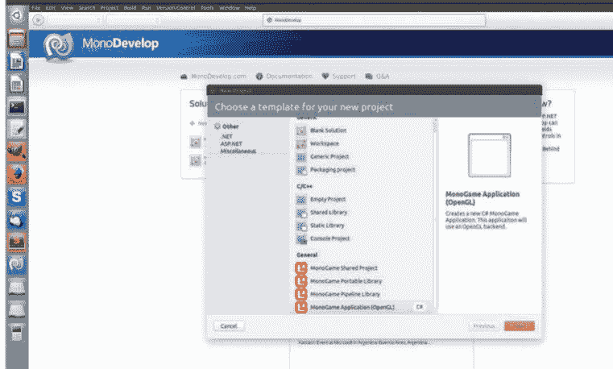

一旦你安装了 `MonoDev` 的 `MonoGame` 插件，它的模板将出现在“杂项”（`Miscellaneous`）下

```bash
chaod += Makeself/makeself.sh
chaod += x;
```

`GraphicsDeviceManager` 和 `SpriteBatch` 成员变量，两者都在构造函数中初始化：

接下来，运行 `generate.sh`，它会复制一组文件，创建一个名为 `monogame-linux.run` 的文件。启动它以提取项目流水线，那是一个专门用于资源编码的独立产品。shell 文件将继续下载大量的包 - 需要稳定持续的互联网连接，结果将输出一行说明卸载程序的文字。

若要卸载流水线，请运行 `//opt/monogame-pipeline/uninstaller`

# 光与阴影

```csharp
GraphicsDeviceManager graphics;
SpriteBatch spriteBatch;
```

`BaseEffect` 非常方便，因为它允许开发自定义着色器，为各种光照效果提供预留的接口：3D游戏以及其他可以使用代码动态创建几何体的场景。

```csharp
public Game1()
{
```

```csharp
graphics = new GraphicsDeviceManager(this);
Content.RootDirectory = "Content";
graphics.IsFullScreen = true;
```

要卸载流水线，运行 `//opt/monogame-pipeline/uninstaller`

# 开始使用

打开 `MonoGame`，点击工具（`Tools`）添加包管理器（`Package Manager`）打开你的应用程序。`MonoGame` 的逻辑包含在单独包中，必须通过该方式进行添加。

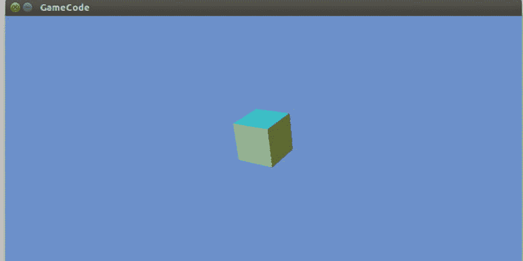

移动和旋转通过 `MonoGame` 的 `BasicEffect` 类实现


对于本身，一个点是完全没有意义的：只有当坐标值被映射到轴和/或距离系统时，它才变得有用。在处理 3D 对象时，整个模型被放置在一个名为“模型空间”（`model space`）的坐标系中，范围从负无穷到正无穷。

3D 引擎可以通过它们相互相乘来构建。遗憾的是，矩阵乘法不符合交换律：左侧的操作在右侧的操作之前执行。顺序错误会导致奇异的结果——缩放和旋转始终在平移之前。

将模型引入屏幕分两步完成。首先，执行旋转和缩放操作。你绕着某个轴旋转对象，使其正确地面对摄像头。

在下一步中，通知 `BasicEffect` 传递给它的顶点包含颜色数据：

之后，平移会将对象“推”到它在坐标系中的最终位置。现在是时候逐步查看新版本的 `Draw` 步骤了：

```
protected override void Draw(GameTime gameTime)
{
    GraphicsDevice.Clear(Color.CornflowerBlue);
    BasicEffect cubeEffect = new BasicEffect(GraphicsDevice);
    Matrix cubeRotation = Matrix.CreateRotationY(0.25f);
    Matrix cubeTranslation = Matrix.CreateTranslation(0, 0, -10);
    cubeEffect.World = cubeRotation * cubeTranslation;
    cubeEffect.View = camera.View;
    cubeEffect.Projection = camera.Projection;
```

```
cubeEffect.VerticesEnabled = true;
```

最后，`BasicEffect` 中包含的每个绘制命令都应用到所有顶点：

```
foreach (EffectPass pass in cubeEffect.CurrentTechnique.Passes)
{
    pass.Apply();
    GraphicsDevice.DrawPrimitives(PrimitiveType.TriangleList, 0, 12);
}
base.Draw(gameTime);
```

至此，我们已经准备好运行程序并感受结果了。可以随意修改 `Update` 中的 `Rotation`（旋转）、`Translation`（平移）和 `Scale`（缩放）属性。

首先，创建一个 `BasicEffect` 实例：它是一个调用一组绘制命令的“钩”，旨在替换自定义着色器代码。

# 结论

`BasicEffect` 填充了显示所需的三个矩阵。视图（`View`）和投影（`Projection`）矩阵目前不感兴趣——我们将在以后与着色器编程相关的文章讨论它们。

尽管结果看起来不像我们的游戏，但使用 `DirectX` 或 `OpenGL` 实现这些将会显著增加代码量。退后一步可以发现，大部分用于定义几何对象的代码，将其存储在内容流水线中将使代码更紧凑……这正是我们接下来要做的。

# Springs.io 教程

# 在 Springs.io 上启动可扩展的 Linux 容器

## 了解 cgroups 和 namespaces 如何驱动 Linux 容器，并设置按需付费服务器


Linux 容器在近年来引起了爆炸性的关注，但所有容器都由 Linux 下的两种底层技术驱动，我们将在本文探索这些技术。在这里，我们将通过一些底层技术将容器与传统的虚拟机进行比较。

# 01 掌握 cgroups 和 namespaces

让我们从什么样的容器开始。它们是轻量级的虚拟服务器形式，与虚拟机相比提供了更好的性能。过去两年中，Linux 内核启用了新一代可扩展容器，这可以让无服务器（`serverless`）方案成为现实。出现了许多用于管理容器的工具，包括 `Docker`、`LXC`、`Incmty`、`Kubernetes` 等。

`Cgroups`（控制组）限制并测量运行在系统的一组进程所使用的资源。`Namespaces`（命名空间）限制了一组进程的可见性。`Cgroups` 和 `namespaces` 允许在隔离的环境中运行一组进程。虽然两者共同工作，但 Linux 内核已为云基础设施带来了一些有趣的应用。`cgroups` 的更新现在对服务器资源使用有了更深入的洞察，允许对进程进行更多隔离，从而提供更好的安全性。

Richard Davis

Springs.io 首席执行兼联合创始人。据此，他是 Spring Technologies PLC & limited 的创始工程师之一，带有视频。

在大多数情况下，系统管理员直接使用 `cgroups` 和 `namespaces` 是没有意义的——容器工具（如 `Docker`、`LXC` 或 `Incmty`）会为你完成这些。但如果你想了解底层原理，而不仅仅是深度使用内核技术的话。尽管如此……

## 资源

Springs.io

springs.io

- 轻量级容器

bit.ly/3hello

- `Cgroups`

bit.ly/h88wccd

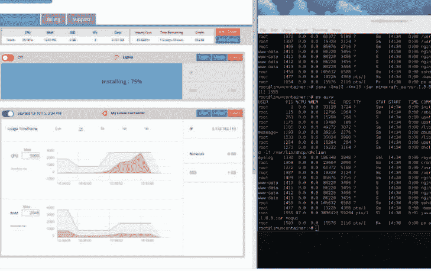

右侧终端：显示 `cgroups` 的进程

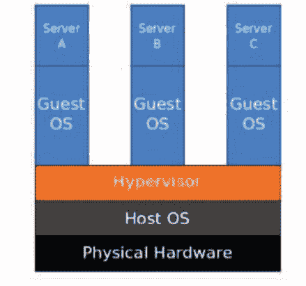

# 01 掌握 cgroups 和 namespaces

在左侧，每个服务器都运行在自己的虚拟命名空间内部。在右侧，`namespaces` 和 `cgroups` 包含了主机操作系统上的所有内容


命名空间

主机 OS

硬件

控制 `cgroups`

这是一个在 `cgroups` 中运行并限制内存的示例：

```
mkdir -p /sys/fs/cgroup/test
echo 50M > /sys/fs/cgroup/test/memory.limit_in_bytes
echo 50M > /sys/fs/cgroup/test/memory.soft_limit_in_bytes
echo 1000 > /sys/fs/cgroup/test/memory.kmem_in_bytes
echo $$ > /sys/fs/cgroup/test/tasks
```

| PID | USER | COMMAND | STATE | PRIORITY | NI | TIME |
|---|---|---|---|---|---|---|
| 1 | root | systemd | S | 20 | 0 | 0:00 |
| 2 | root | dbus-daemon | S | 20 | 0 | 0:00 |
| 3 | root | kworker/16:1 | S | 20 | 0 | 0:00 |
| 4 | root | kworker/16:2 | S | 20 | 0 | 0:00 |
| 5 | root | kworker/16:3 | S | 20 | 0 | 0:00 |
| 6 | root | kworker/16:4 | S | 20 | 0 | 0:00 |
| 7 | root | kworker/16:5 | S | 20 | 0 | 0:00 |
| 8 | root | kworker/16:6 | S | 20 | 0 | 0:00 |
| 9 | root | kworker/16:7 | S | 20 | 0 | 0:00 |
| 10 | root | kworker/16:8 | S | 20 | 0 | 0:00 |
| 11 | root | kworker/16:9 | S | 20 | 0 | 0:00 |
| ... | ... | ... | ... | ... | ... | ... |

这些行显示了物理 `cgroups` 的状态

前四行设置了 `"test"` `cgroup`——访问物理硬件，限制内存。下一行将我们正在使用的 提示符（以及任何子进程）放入 `"test"` `cgroup` 中。

有很多 `cgroup` 限制可用，它们的完整文档位于：`https://www.cgroups.org/doc/Documentation/cgroups.txt`。

> 传统的资源在 `namespaces` 中运行时会恢复。然而，当守护进程崩溃时，命名空间可能会受到影响，超出传统的控制范围。

# 汇总

如果我们创建两个命名空间，就可以创建一个限制内核内存使用的提示符，并与系统隔离开。通过使用 `cgroups` 进行资源隔离，我们可以限制每个容器可以使用的内容，并实现运行实例与系统的完全隔离。

# 03 控制命名空间

`unshare` 命令允许你隔离命名空间。例如，如果你

```
# unshare --mount /bin/bash
# unshare /dev/null -net
```


那么第一行将在隔离的挂载点启动 `bash` 提示符。这意味着你挂载的文件系统对于你当前使用的 `bash`（以及任何子进程）是可见的，但系统的其他部分看不到此文件系统。

请查看命名空间主页获取可操作的命名空间列表。

# 05 不同容器

Linux 容器有两种类型：`Docker` 为开发者提供了灵活性易用性，而操作系统容器提供了更好的隔离性和安全性。我们认为，如果你没有意识到操作系统容器对基础设施的益处，作为开发者，你可能会制作更多的应用容器。

操作系统容器更动态地利用计算资源，并允许比虚拟机具有更高的密度。我们认为操作系统容器将带来下一代弹性基础设施，根据需求自动伸缩并使所有类型的用户受益，使我们更接近云早期承诺的公用事业计算理想。

`www.linuxux.com` | 45

# Springs.io 教程

| CPU | RAM | SSD | IPs | 数据 | 每小时费用 | 剩余时间 | 余额 | 充值 |
|---|---|---|---|---|---|---|---|---|
| 总计: | 0 MHz | 0 MB | 1 GB | 1 | 0 GB | $0.003/hr | 915 天 14 小时 | $68.67 | 充值 |

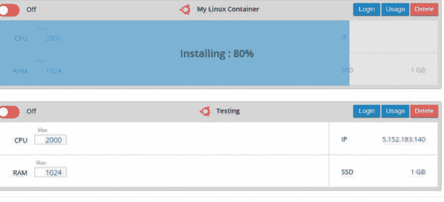

为你的 `Spring` 容器分配相关详情。`Springs.io` 是 `ElasticHosts` 专为云设计的操作系统容器。`ElasticHosts` 的自动伸缩技术可以根据需求扩展或收缩容器，消除了手动配置的需求。Linux 用户可以使用“Springs”，它是首批完全按使用量计费而非按高额成本计费的服务器。Springs 无需额外的软件或服务器配置；用户只需注册服务，容量即可持续可用。以下是一些关键特性：

- `用于持续高性能的自动伸缩。` `Web` 服务故障的成本可能高达数百万美元，因此服务器需要始终保持足够的容量运行。通过 `Springs.io`，用户现在可以轻松从容地处理所有峰值流量，每个容器可自动伸缩至 64GB RAM。这提供了一种安全保障，确保容量在需要时即刻可用，保证服务的连续性且无停机。

- `自管理基础设施。` 目前，从部署复杂软件到自动化该过程，Linux 用户被迫手动配置和调整容量，这可能是昂贵的、耗时的且不准确的。

`ElasticHosts` 的自动伸缩、弹性化基础设施会自动扩展和收缩，完全消除了对手动配置或置备的需求；用户只需开启服务并无需理会。

基于用量的计费模式侧重于按容量配置，这引发了对性能和过度容量的可预测风险的担忧。通过按使用量而非按可用容量计费，Linux 用户可以立即以足够的容量运行服务器以进行扩展，而无需额外费用；他们只需为实际使用的部分付费，精确到字节。

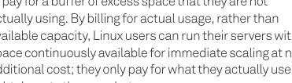

| 当前：$68.67 |
|---|
| 剩余：915 天 14 小时 |


> `Springs.io` 是首批完全按使用量而非按容量计费的云服务器，降低了高额成本。

# 自动充值选项

### 07 启动 Spring.io 容器

访问 `springs.io` 并注册免费账户。点击“充值”并添加资金，即可启动一些容器。最低充值金额为 5 美元，但在低使用量的情况下，余额可以使用一个月。或者，你可以启动几十个容器并使用余额来加快速度；它们是按需付费的云服务器。

# 监控 Spring.io 服务器使用情况

| CPU | RAM | SSD | IPs | 数据 | 每小时费用 | 剩余时间 | 余额 |
|---|---|---|---|---|---|---|---|
| 总计: 0 Mhz | 0 MB | 1 TB | - | 0 GB | $0.00/hr | 915 天 14 小时 | $68.67 |

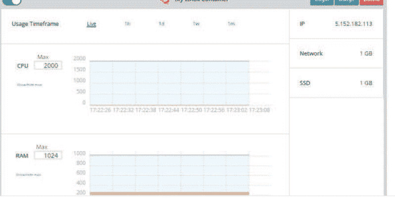

### 08 添加 Spring.io 容器

点击“添加”，为其命名并提供 `SSH` 密钥，然后点击“确认”，你的容器将在后台运行。它运行的是在主机上预装的系统 Linux 容器。

### 09 在 Spring.io 中运行应用程序

现在你已经创建了 `Spring.io`，让我们运行一个测试限制的实例。然后你可以轻松地使用负载均衡器缩小它。

### 10 监控 Spring.io 服务器使用情况

现在你可以实时监控资源使用情况，使用图表跟踪并在并针对时间段进行扩展。首次打开时你会看到一个显示使用情况的空图表。由于是新容器，点击“实时”查看它消耗了多少资源。峰值以橙色线条显示。可以使用左侧的链接开启或关闭这些峰值。你应该看到它处于容器 `CPU` 和 `RAM` 的最大使用状态，它们分别为 10 MHz 和 2GB。这些值可以更改，并设置最高 20000 核 MHz 和 64GB `RAM`。我们旁边的线条使用几乎为，因为我们的容器内运行的操作很少（内核资源使用不包含在内，因为它是主机共享），但我们的 `RAM` 最大值会自动受容器限制，以便在负载峰值期间保证性能。那是 `RAM` 图表中设置在 256MB 的橙色线条。

左侧：通过监控使用情况，你将避免任何意外惊喜

## 负载均衡

传统虚拟化的负载均衡可能难以扩展和扩大，负载均衡器后的多个实例可以更高效且更有利。

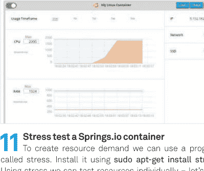

### 11 对 Spring 进行压力测试

在使用此命令帮助期间，你会注意到 `Git` 中的分支是本地于仓库的，在本地仓库创建的分支在远程仓库中没有对应的分支。正如预期的那样，开发者可以在不同的分支上进行工作。稍后，他们可以使用 `merge` 命令将它们合并。这使得用户能够合并任何开源项目中来自不同开发者的更改。

在将仓库添加到 `Git` 的过程中，其操作是非常直观的。

- 暂存（Staging）：在这里，我们将更改添加到暂存区。

- 提交（Committing）：存储在暂存区中的更改将被提交到仓库中。

在此过程中，`Git` 提供了一个非常有用的命令：`add`。通过它，你能够将工作树中的更改添加到暂存区。通过使用 `add` 命令，你可以建议更改，然后让它们保持在暂存状态，直到你对更改满意为止。

在下一个阶段（提交），目标是提交文件并将其添加到仓库中。对于已提交的更改，你可以使用 `commit` 命令。在这里我们快速查看一些最重要的术语：

| 术语 | 描述 |
| :--- | :--- |
| Working tree (工作树) | 如前所述，工作树由一组用于仓库的文件组成。 |
| Revision (版本) | 仓库维护源代码的版本。 |
| Staging area (暂存区) | 这是我们在提交更改之前存储工作树中更改的地方。 |
| Head (头指针) | Head 可以被描述为指向当前检出分支位置的符号化引用。 |
| Branch (分支) | 分支可以被视为指向提交的指针。当你检出（checkout）时，它通常指的是检出一个分支。 |
| Commit (提交) | 当我们将更改提交到仓库时，它会创建一个新的提交对象。你可以使用这个新的提交对象来唯一标识一个版本。 |

`Git Tree` 中的文件可能处于不同的状态：它们：

- 当一个文件被暂存以包含在下次提交时，它处于暂存（staged）状态。

- 当一个文件已更改但更改未暂存时，它处于已修改（modified）状态。

- 当一个文件既未暂存未提交时，它处于未跟踪（untracked）状态。

- 当一个文件被提交时，它处于已跟踪（tracked）状态。

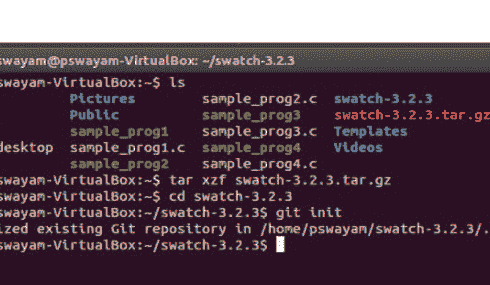

让我们了解如何在 `Git` 中管理一个新项目。我们将使用一个已经存在家目录下的 `swatch-3.2.3.tar.gz` 文件，并查看如何将其置于 `Git` 控制之下。可以使用以下命令将项目放入 `Git` 版本控制中：

上述是受 `Git` 控制下项目的导入过程

```bash
$ tar xf swatch-3.2.3.tar.gz
$ cd swatch-3.2.3
$ ls
```

我们已经成功初始化了工作目录。通过 `swatch-3.2.3`，我们现在可以看到一个 `Git` 的新目录，可以通过执行以下命令来指示 `Git` 程序接管（当前目录下的）文件：

```bash
$ git add
```

当我们想要在 `Git` 中提交项目的更改时，遇到了一个错误。这是因为 `Git` 无法识别你。所以，在我们向 `Git` 存储此版本的项目之前，我们需要通过姓名和邮箱地址向 `Git` 识别自己的身份。可以通过以下命令实现：

```bash
$ git config --global user.name Your Name
$ git config --global user.email your@email.com
```

现在我们可以使用它在 `Git` 中存储我们项目的这个版本了：

```bash
$ git commit
```


正如后文所示，`commit` 命令会提示提交消息。你也可以使用 `-m` 参数。这允许你指定提交消息 - 如下代码所示：

```
$ git commit -m 'first version'
```

## 教程

`pswayam@pswayam-VirtualBox: ~/-swatch-3.2.3`

```
# 请输入用于更改的提交消息。以 # 开头的将 be ignored, and an empty message aborts the commit.
# On branch master

# Initial commit
# Changes to be committed:
# new file: CHANGES
# new file: COPYING
# new file: COMMIT_EDIT
# new file: INSTALL
# new file: KNOWN_BUGS
# new file: METADATA
# new file: META.yml
# new file: MYMETA.json
# new file: Makefile
# new file: Makefile.pl

# Ready 47 lines
-X Getout Read File Page Cut Text Pos.
# To Spell
-X Justify Where Is Nextcut To

Right When you commit the project in Git – make sure you have configured your email and username
```

注意，如果在提交之前需要暂存文件，需要再次将其添加到暂存区。这是因为 Git 创建了暂存文件的快照。所有的更改必须被暂存。

正如提到的，你需要配置你的用户名和邮箱，因为它们将被提交到仓库。这些信息存储在每个提交中，除非有其他配置。对于任何版本控制系统，提交的过程非常简单。我们修改文件然后将更改添加到索引。为此，你使用 `git add` 命令。在提交之前，你可以通过 `git diff` 查看结果。执行 `git status` 也可以提供整个状况的简要总结。它提供了关于哪些文件已更改、哪些文件已暂存的信息。

如果你需要，或者有任何疑问，可以查询单个分支。值得注意的是，只有当前分支和目标分支会被影响。为了实现这一点，我们可以使用 `git merge` 命令。Git 允许开发者使用编辑/提交过程来解决冲突。当我们遇到冲突时，可以运行 `git status` 来查看哪些文件需要解决。

```
$ git merge my_branch
```

上述命令将指定的分支合并到当前分支。在合并过程中，有时我们会遇到冲突 - 也就是当我们尝试合并两个分支时，它们都修改了同一个文件。在这种情况下，`git` 将能够识别出应该使用哪个版本，并在开发者手动解决冲突的合并提交之前停止。

## Push 和 pull 命令

`push` 和 `pull` 命令是与 Git 的两种常用方式。`push` 命令将你的更改发送到仓库。如果你想与其他开发者协作，`pull` 命令会为你从另一个仓库获取最新更改。更多细节请参见 `push` 和 `pull` 命令。开发者需要向其他仓库写入数据以共享更改。

如果你想从另一个分支拉取一些更改并合并到当前分支，如果没有提供必要的信息，提交将失败。

```
pswayam@pswayam-VirtualBox:~/swatch-3.2.3$ git status

on branch master

Initial commit

Changes to be committed:

use "git rm --cached <file>" to unstage

new file: CHANGES

new file: COPYING

new file: COPYRIGHT

new file: INSTALL

new file: KNOWN_BUGS

new file: MANIFEST

new file: META.yml

new file: MYEMAIL.json

new file: Makefile

new file: Makefile.PL

new file: README

new file: lib/arch/x8

new file: lib/build/swatch/*.x8

new file: lib/bin/*

new file: lib/exhibit/*
```

## 提交 .gitignore

也可以注意到 `git` 会忽略不在版本控制下的项目。让我们了解如何从 Git 仓库中删除文件。以下三个命令的序列将有效：

```
$ rm test_file_01

$ git add

$ git commit -m "Deleting a test file"
```


在上述序列中，请注意`git add`命令用于从暂区删除文件。在某些情况下，我们可能需要恢复工作目录中的文件。在这种情况下，可以使用`checkout` - `git checkout <file>`将其恢复到上次提交的状态。开发者在使用此命令时需要小心，因为它会删除仓库中未暂存和未提交的更改，且无法恢复它们。

Git 提供了另一个命令 - `git commit --amend`可用于修改最后一次提交。这样做的好处在于你可以修正提交消息。Git 中另一个流行的命令是`git clone`。通过它，开发者可以克隆带有历史记录的整个仓库。一旦你在独立分支上完成了功能的开发，将其带回主代码分支至关重要。为了这一目的，`git merge`可以帮助你合并由`git branch`创建的独立开发线，并将其整合到你的

`img/df5857e82a6482b0f2db5a2e61e6012c_50_0.png`

如有必要，执行`git status`，或者如果你有任何疑问，可以查询单个分支。值得注意的是，只有当前分支和目标分支会被触及。为了这样做，我们可以使用`git merge`命令。Git 允许开发者使用编辑/提交过程来解决冲突。当遇到冲突时，我们可以运行`git status`查看哪些文件需要解决。

# `git merge my_branch`

上述命令将指定的分支合并到当前分支中。在合并过程中，有时我们会遇到冲突 - 也就是当我们尝试合并两个分支时，它们都修改了同一个文件。在这种情况下，`git`将能够识别出应该使用哪个版本，并在开发者手动解决冲突的合并提交之前停止。一旦冲突解决，我们需要对冲突文件运行`git add`以告诉我们它们都已解决，最后进行提交。

## PulseAudio 教程

### 发现 PulseAudio 的隐藏力量

我们将为您指点新的技巧和一些令人惊叹的 PulseAudio 新功能


我们大多数人都在运行最新版本的喜爱的 Linux 发行版，而且可能大家在没有刻意识决定的情况下都使用 PulseAudio 作为默认服务器。我们只是在听音乐、看电影和享受网络服务，但无论我们从音频层听到的任何声音都位于 Linux 内核（提供音频硬件驱动程序）和桌面应用程序之间。PulseAudio 在几年前曾引起争议，但从那以后它取代了许多简单的客户端-服务器解决方案，拥有许多复杂的模块化客户端-服务器解决方案，对于想要深入研究 Linux 配置的高级用户非常有益。

### 发现你的输出端（sinks）和输入端（sources）

对于任何带有 PulseAudio 的系统，每个音频设备由三个主要组件识别：卡（card）、输出端（sink）和输入端（source）。输出端是我们用于播放和录制的设备，所有的物理输入和输出都是可用的。你不仅可以静输出，还可以将其路由到另一个设备（`module-null-sink`），或者通过创建一个虚拟音频管道输出端（`pipe-sink`）让其他应用程序访问。

第一个流输入源用于处理麦克风、内联等，因此，PulseAudio 最后会为每个声卡创建一个输出端，为每个使用它的应用程序创建一个输入端，结合 PulseAudio 的模块化设计，为我们提供了极大的灵活性。

PulseAudio 尝试确定哪些输出端和输入端应该设置为默认，因此在很多情况下，你可能需要将音频从扬声器重定向，以便你的工作能够正常进行。要查看当前设置，请使用`audio pactl list`并检查其输出。

### 资源

本教程适用于任何通用桌面使用的最新 Linux 发行版，假设你的系统中安装了 PulseAudio，并将揭示我们需要的实用应用。这些包括处理多个播放流、通过网络重定向声音、提高音质以及让事情变得更轻松的体验增强技巧。

你只需要提供一个命令行和几分钟的时间。

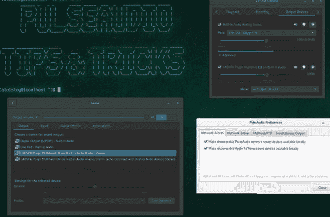

正确的 PulseAudio 不仅仅是系统音量控制

### 发现你的输出端（sinks）和输入端（sources）

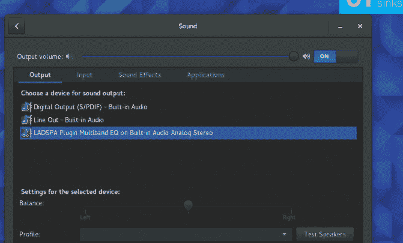

PulseAudio 应该自动识别输出端和输入端。

### 02 在扬声器和耳机之间切换

这是笔记本电脑的常见情况，当你通过笔记本扬声器连接时，一旦插入 3.5mm 接口，声音就会传输到耳机。Linux 系统会自动处理这些，但可能会失败（或者你需要自定义行为），你可以控制 PulseAudio 的多个部分。要找到当前使用的那个，请查找如下内容：

> PulseAudio 在几年前曾引起争议，它经历了七次大版本发布，并且非常稳定

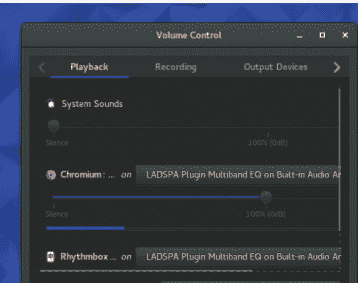

# 超越基础知识

`active-port: audio-output-speaker`

我们知道其他端口名称，因此我们可以手动将播放切换到耳机，如下：

```
# pacact set-sink-volume 'audio.output_pulse_0000_08_ib-audio-stereo' 'audio-output'
```

这对服务器也是如此；所以当你在 `Skype` 中录制声音时，你需要确保相应的输入端使用正确的端口来捕捉声音。

PulseAudio 引入了客户端-服务器架构，这意味着声音可以通过网络路由。这不仅仅是为了控制设备——它还包括录制、流传输以及将 PulseAudio 与本地和远程音频设置一起连接到你的流。

### 03 管理音量

PulseAudio 使用 0 到 65536 的范围来管理音量，其中 0 是静音，65535 是 100%。技巧在于，你可以超过或低于音量，而无需任何第三方工具（如 `VLC`）。

如果你需要为某些输入设置音量，你可能想要关闭“线性”音量。这是一个简单的步骤：

```
## pacact set-sink-volume '1'
```

### 08 自定义你的设置

```
[catystoy@localhost # pactl load-module module-role-ducking trigger-on=sink_output_sink ducking_roles=music,video volume=-10dB

Failure to initialize module

[catystoy@localhost # pactl unload-module module-role-ducking trigger-on=sink_output_sink ducking_roles=music,video volume=-10dB

catystoy@localhost # ]
```

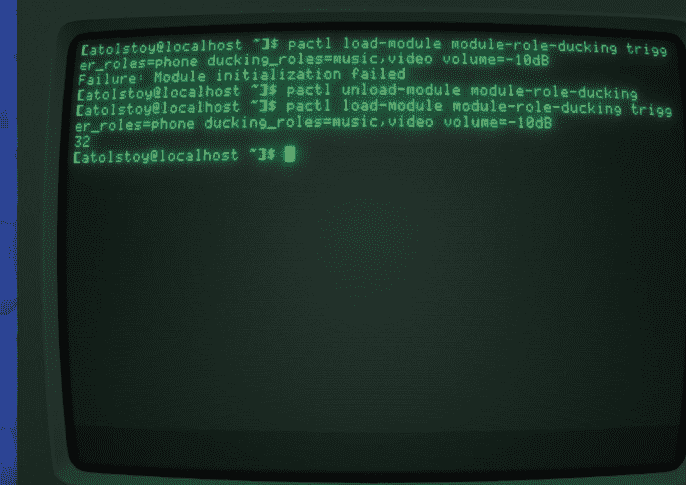

几乎可以匹配音乐风格或条件，例如非常有用的 `Laptop` 预设。除此之外，该工具非常简单，只有几个复选框和一个“应用设置”按钮。`PulseAudioequalizer` 适用于通过当前输出设备播放的所有音频，如果你喜欢的话，也包括通知。预设以纯文本文件形式存储在`/usr/share/pulseaudio-equalizer/`目录下，因此你可以使用现有文件作为模板，无缝地创建你自己的预设。

左：可以降低流的音量以提高重要流的音量

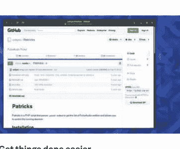

# 08 利用角色 (roles)

这个较新的 PulseAudio 功能让人了现代智能手机的行为——当你接收来电时，所有音频播放（如果有的话）都会临时静音。在 PulseAudio 中，当更重要的流出现时，它会降低其他流的音量，并在结束后恢复音量（这被称为“闪避”，即 `ducking`）。一个流是否具有高优先级或低优先级取决于`media.role`属性。默认情况下，“music”（音乐）和“phone”（电话）流会被压低，让我们学习如何修改闪避选项以及在 `ducking-at:-10dB` 时使用的特定衰减。

### 09 完成任务

大多数与 PulseAudio 相关的命令行涉及`pactl`和`pacmd`命令，这两者都会产生详细的输出。这就是 Patrick 发挥用场的地方——一个基于 `PHP` 的简单实用程序（`https://github.com/cootyne/patrick`），它可以将`pactl list`和`stat`的输出转换为更易读的变体。其语法也非常容易理解。

`Patrick`


# `pactl load-module module-role-ducking,trigger-roles-phone ducking_roles=music,video volume=-10dB`

```
pactl load-module module-role-ducking,trigger-roles-phone ducking_roles=music,video volume=-10dB
```

然后通过示例播放确保其工作正常，例如：

- `pactl ls`
- 列出项目，同时：
- `pactl ls si properties` 显示当前使用的输出设备的属性。此命令可以缩短为：

```
$ PULSE_role='media.role:phone' player -o audio.sample.mp3
```


# 来自 LinuxUser & Developer 制作者

# Linux 开源年度刊

通过这份来自《Linux User & Developer》杂志年度精华合集，在瞬息万变的 Linux 和开源软件世界中保持领先。无论你是想发现适合自己的发行版，还是想寻找有趣的 Pi 项目，所有内容都在《Linux & 开源年度刊》中。

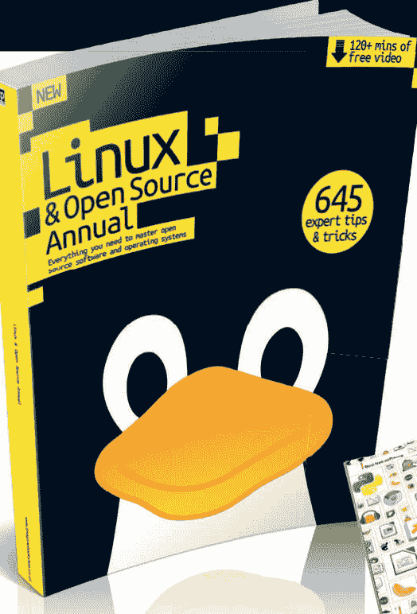

# 更多可选...


# 指尖可及的内容世界

无论你热爱游戏、历史、动物、摄影、Photoshop、科幻或其之间的任何内容，Imagine Publishing 的每一本杂志和丛书都充满了专家建议和迷人的的事实。


# 今日刻购买

纸质版可在 `www.imagineshop.co.uk` 购买  
数字版可在 `www.greatdigitalmags.com` 购买


# 程序员与创造者的必备指南

## 实用型树莓派

### 掌握树莓派的 50 种方法

翻至第 60 页


# 目录

- 58 什么是 `Raspberry Pi Zero`？
- 68 乐高城市的物联网
- 70 在 `C` 中嵌入 `Python`
- 72 使用 `Pi-m IR` 控制灯光
- 76 `FUZE BASIC` 怀古游戏教程

# 常见问题 (FAQ)

## 树莓派基金会常见问题

树莓派基金今年今年带给我们我们一份早早的圣诞礼物——一块全新的板！这里有你需要知道的一切。

`Gavin Thomas` 是 `U&D Radar` 的编辑。他是一位丰富的技术记者、源码发烧友以及原生项目的爱好者。


### 树莓派 3 怎么了？

嗯，称它为树莓派 3 意味着它比树莓派 2 更强大。它其实不是升级，倒不如说是降级。树莓派基金会确实通过 5 元的版本让我们惊喜了。


# 50 种掌握树莓派的方法

## 通过这些专家技巧和技巧充分利用你的树莓派性能

无论你只是刚刚获得了一台强大且小巧的 `Raspberry Pi Zero`，还是希望最大化你已有的那台可靠的 `Raspberry Pi` 的效率，这里有你入门并了解你设备所需的所有内容。树莓派是一件多功能的硬件，大多数人已经对它的日常功能了如，但总有许多可以探索的微调和调整，可以将树莓派带到你自己的理想体验。

从焊接到实用的 `Python` 特性，从 `GPIO` 中断到远程访问等等，这门技术和实操技能大师课程涵盖了五十种充分利用树莓派的有用方法。如果你和我们一样，无论你的技能水平如何，你已经在摆弄 `Raspberry Pi Zero` 了，这些技巧对你来说依然可以大显身手。

每一个技巧都适用于你的树莓派，但对于与 `Pi Zero` 相关的板型除外。使用较早型号的你可能会错过一些功能——我们怎么能指望在没有它们的情况下拥有功能呢？——大多数技巧、窍和微调仍然适用于任何官方树莓派。玩得开心吧！

## Raspberry Pi Zero

无引脚端口。`GPIO` 针脚与新机型相同，但没有引脚。你需要焊接一个 40 针的公头针脚块。

`BCM2835` 这是与原始树莓派型号相同的处理器，尽管它已过频运行在 `900MHz`，且运行速度快了约 `40%`。

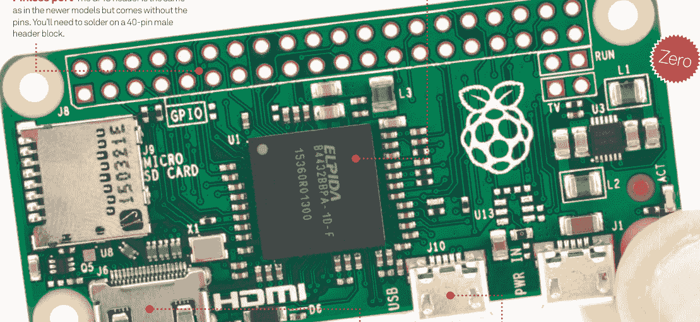

作为树莓派的最新成员，这块微型板子是树莓派基金会努力进一步降低电脑成本的成果。虽然没能将这台 35 美元的电脑降到 25 美元（这对某些人来说仍然有点贵），但通过一些调整直接削减了 5 美元。以下是你需要了解的。

`Mini-HDMI` 你需要一根 `mini HDMI` 转 `HDMI` 的线来连接显示器。如果你焊接了引脚，可以使用带有 `RCA` 视频输出的电视。

`Micro-USB` 其中端口之一用于 `micro-USB` 电源。你可以通过 `micro-USB` 转 `USB` 适配器使用外围设备和 `wifi`，从而连接一个带电源的 `USB` 集线器。

## 核心知识

提高日常使用的必备技巧

- 03 在网络上寻找你的 `pi`
  如果你无法通过 `DHCP` 在路由器上找到它，可以使用 `Linux`、`Windows` 和 `Mac` 扫描本地网络。你需要知道本地网络的地址范围（常见网络为 `192.168.1.0` 或 `192.168.2.0`），运行 `nmap -sn 172.17.1.0/24` 将执行 `ping` 扫描并输出设备列表。示例输出：

```
# 来自 LinuxUser & Developer 制作者
```


# 核心知识

提高日常使用的必备技巧

- **03 在网络上寻找你的 `pi`**
  如果你无法通过 `DHCP` 在路由器上找到它，可以使用 `Linux`、`Windows` 和 `Mac` 扫描本地网络。你需要知道本地网络的地址范围（常见网络为 `192.168.1.0` 或 `192.168.2.0`），运行 `nmap -sn 172.17.1.0/24` 将执行 `ping` 扫描并输出设备列表。示例输出：

```
Nmap scan for raspberrypi.local (172.17.1.0/24)

Host1 is up (0.04ms latency).
```

- **04 遇到稳定性问题？**
  导致稳定性问题的最高原因是你使用的电源。`Raspberry Pi 2` 拥有更多的 `CPU` 核心并消耗更多能量。`Raspberry Pi 2` 或 `B+` 的推荐电流供应为 2 安培。如果你仍然遇到问题，你的 `SD` 卡可能已经老化了。

- **05 忘记输入 `sudo` 了？**
  `sudo` 用于获取特定命令的权限（例如，`sudo apt-get update`）。变量 `!!` 是你上一次使用的命令。如果你需要某些操作的权限但忘记输入 `sudo`，只要你没有输入其他内容，只需输入 `sudo !!` 即可。

- **06 开启最大电流**
  如果你有一个能提供 2 安培或以上的良好电源，并希望为你的 `Pi 2` 或 `B+` 连接大耗电设备（如 `USB` 硬盘），你可以编辑 `/boot/config.txt` 文件，这将将 `USB` 的最大电流设置为 2 安培，而不是默认的 600mA。

- **02 确保你的树莓派上有最新的软件包**
  在终端中运行 `sudo apt-get upgrade`。

控制选项 `sudo raspberry-config` 可用于更改多个选项，例如启用摄像头、对 `Pi` 进行超频、更改启动选项以及将文件系统扩展到 `SD` 卡的全空间。

# 可迁移技巧

充分利用任何树莓派机型的提示和关键信息

- **使用 `SSH` 远程访问**
  `SSH` 代表 Secure Shell（安全外壳）。你可以使用 `SSH` 通过本地网络连接到树莓派上的终端。这意味着你只需要连接网络线和电源线即可使用 `Pi`，这要方便得多。如果你在树莓派上连接了屏幕和键盘，你可以使用默认用户名 `'pi'` 和密码 `'raspberry'` 登录。`Linux` 和 `Mac` 内置了 `SSH`，只需打开终端并输入你 `Pi` 的地址即可。在 `Windows` 上，你可以使用 `SSH` 客户端 `PuTTY`，它是免费下载、无需安装且可以在几秒钟内完成设置的。

```
pi@raspberry:~$ 

pi@192.168.1.15:~$ sudo raspberry-config

[1] Interface

[2] Localization

[3] Advanced

[4] Performance

[5] Password
```

- **使用 `SCP` 传输文件**
  `SCP` 代表 Secure Copy Protocol（安全复制协议），允许你通过网络从树莓派拷贝文件（和目录）。如果你有一个 `PyGame` 项目并需要拷贝，`FileZilla` 是一个不错的选择，因为它连接端口 22，用户名为 `'pi'`，密码为 `'raspberry'`。在终端中使用语法如下：

```
scp -r testdir/ pi@172.17.1.21:~/testdir
```

开关 `-r` 表示递归，意味着整个目录。

# Raspberry Pi B+


- **`USB` 控制器**
  `Pi` 理论上可以达到 480MB/s。早期型号受限于单核 `ARM`。

- **电源 LED**
  板载 `LED` 有红色和绿色。状态 `LED` 在写入时会闪烁。

- **`SD` 卡**
  树莓派专为 `SD` 卡设计。状态 `LED` 在写入时闪烁。


- **Wi-Fi**
  `Raspberry Pi B+` 内置了 `Wi-Fi`。

# 50 种掌握树莓派的方法

## 通过这些专家技巧和技巧充分利用你的树莓派性能

无论你只是刚刚幸运地获得了一台强大且小巧的 `Raspberry Pi Zero`，还是希望最大化你已有的那台可靠的 `Raspberry Pi` 的效率，这里有你入门并了解你设备所需的所有内容。树莓派是一件多功能的硬件，大多数人已经对它的日常功能了如指掌，但总有许多可以探索的微调和调整，可以将树莓派带到你自己的理想体验。

从焊接到实用的 `Python` 特性，从 `GPIO` 中断到远程访问等等，这门技术和实操技能大师课程涵盖了五十种充分利用树莓派的有用方法。如果你和我们一样，无论你的技能水平如何，你已经在摆弄 `Raspberry Pi Zero` 了，这些技巧对你来说依然可以大显身手。

每一个技巧都适用于你的树莓派，但对于 `Pi Zero` 相关的板型除外。使用较早型号的你可能会错过一些功能——我们怎么能指望在没有它们的情况下拥有功能呢？——大多数技巧、窍和微调仍然适用于任何官方树莓派。玩得开心吧！

# Raspberry Pi Zero

无引脚端口。`GPIO` 针脚与新机型相同，但没有引脚。你需要焊接一个 40 针的公头针脚块。

`BCM2835` 这是与原始树莓派型号相同的处理器，尽管它已过频运行在 900MHz，且运行速度快了约 40%。


作为树莓派的最新成员，这块微型板子是树莓派基金会努力进一步降低电脑成本的成果。虽然没能将这台 35 美元的电脑降到 25 美元（这对某些人来说仍然有点贵），但通过一些调整直接削减了 5 美元。以下是你需要了解的。

`Mini-HDMI` 你需要一根 mini `HDMI` 转 `HDMI` 的线来连接显示器。如果你焊接了引脚，可以使用带有 `RCA` 视频输出的电视。

`Micro-USB` 其中端口之一用于 micro-`USB` 电源。你可以通过 micro-`USB` 转 `USB` 适配器使用外围设备和 `wifi`，从而连接一个带电源的 `USB` 集线器。


开关 `-r` 表示递归，意味着整个目录。

## Raspberry Pi B+


- **USB 控制器**
  `Pi` 理论上可以达到 480MB/s。早期型号受限于单核 `ARM`。

- **电源 LED**
  板载 LED 有红色和绿色。状态 LED 在写入时会闪烁。

- **SD 卡**
  树莓派专为 SD 卡设计。状态 LED 在写入时闪烁。


- **Wi-Fi**
  `Raspberry Pi B+` 内置了 Wi-Fi。

# 掌握一些实用的 Python 特性，让你的代码脱颖而出

## 主函数 (main function)

在 Python 中拥有 `if __name__ == '__main__':` 函数可以更容易区分函数/类的定义处与入口点的位置。更重要的是，它允许你从该脚本中导入代码，而不会使其作为主脚本运行。这意味着你可以创建一个类并对该类进行测试以确保它们运行正常。当你在另一个程序中包含该文件时，方法中的代码将不会执行，你只需要使用所需的类即可。

```python
if __name__ == "__main__":
    # 测试 MyClass
    m = MyClass()
    m.print_increment()
    m.print_increment()
```

你可以在此列表中检查命令行参数。如果列表长度为 1 且你需要参数，则打印带有说明的帮助信息。

```python
import sys
help_msg = "我的帮助信息"
debug_mode = False

if __name__ == "__main__":
    if len(sys.argv) == 1:
        print(help_msg)
        sys.exit()
```

## 命令行参数 (Command line arguments)

命令行参数允许程序根据用户在运行时传递的选项开启不同的模式。Python 中的命令行参数位于 `sys` 中，这是一个字符串列表。第一个元素是已执行的脚本名称。例如，某些打印 `argv` 的代码会产生输出：

```bash
$python args['1']
$python args['--'] --foo
```

## 类方法 (Class Methods)

```python
def __init__(self):
    self.x = 0

def print_increment(self):
    print(self.x)
    self.x += 1
```

## 属性和 Setter (Properties and setters)


Python 中的属性是为变量编写 getter 和 setter 的方法。你只需要新类来继承 `object`。

# Python 大会 (Python conferences)

你可以对 Python 列表使用负索引来获取最近添加的项。它将获取最近添加到列表中的项。

## 2016 年 OSCON 美国 (OSCON USA 2016)

2016年5月12-13日
`orel.org/1QKTTB`

今年在德克萨斯州奥斯汀举行的开源大会是一个分享新思想技术的场所。

## 2016 年 PYCON 美国 (PYCON US 2016)

2016年5月5-6日
`pycon.us/2016`

全球社区最大的聚会于 2016 年在俄勒冈州波特兰举行，分为两天的教程日、三天活动和四次冲刺。

## 2016 年 OSCON 欧洲 (OSCON Europe 2016)

`orel.org/TWQWNE`

欧洲 OSCON 活动通过其四天的日程涵盖了美国的举办会议、社交活动和教程。

## 2016 年 FOSDEM (FOSDEM 2016)

2016年4月12-16日
`fosdem.org/2016`

这个由志愿者组织的免费非商业会议在比利时举行，多年来增长异常迅速。

# 掌握树莓派 (Master Raspberry Pi)

## 五个隐藏特性

揭示 Python 中可以发现的秘密

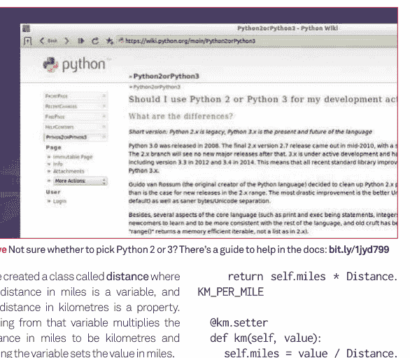

- **列表推导式** (List comprehension)
列表推导式是一种单行内生成列表的方法。你可以使用列表推导式从其他类型的数据结构中提取值。例如，如果你有一个公里的距离列表，并获取英里的距离：`[miles for x in distances]`。以下是示例输出：

在上面的示例中，距离是一个变量，且单位是公里的。从多个变量获取英里到公里的距离转换，并将变量设置为英里。

```python
[x/2 for x in range(10)]
```

```python
class distance(object):
    KM_PER_MILE = 1.60934

    def __init__(self, miles):
        self.miles = miles

    @property
    def getkm(self):
        return self.miles * KM_PER_MILE
```

- **断言** (Assertions)
断言在编写算法时非常有用。你可以使用它们来检查数据是否有效，或者在返回结果之前进行。例如，如果你预期结果为正数，则使用 `assert(expression)`。

```python
assert(0 > 0)
assert(1 < 0)
Traceback (most recent call last):
File "<string>", line 1, in <module>
AssertionError
```

```python
if __name__ == "__main__":
    d = distance(3.1)
    print(d)
    km = d.getkm
    print(km)
```

- **使用异常** (Using exceptions)
如果代码可能出错，那么在代码中捕异常是有用的。这样人员就可以将其放入 `try-except` 块中并在异常异常时进行处理。如果调用者没有处理，你的应用程序将会崩溃。

## 29 使用 GPIO 库 (Using the GPIO library)

熟悉 GPIO 库

- **第一步：导入库**
从导入 `RPi.GPIO` 开始。

```python
import RPi.GPIO as GPIO
```

然后你想设置引脚配置。

- **第二步：设置**
然后你想设置引脚配置。

```python
GPIO.setmode(GPIO.BCM)
```

- **第三步：获取值**
一旦设置好，获取值：

```python
value = GPIO.input(18)
Traceback (most recent call last):
File "<string>", line 1, in <module>
```

- **运行脚本** (Running script)
如果你运行你的脚本：

```bash
python myscript.py
```

- **使用解释器** (Using the interpreter)
如果你使用解释器：

```python
#!/usr/bin/env python
```


# 硬件指南 (Hardware Guide)

## GPIO 方向 (GPIO Orientation)
最好的方式是。

## 串口控制台 (Serial Console)
如果你连接了串口适配。

## 未使用的引脚 (Unused Pins)
默认情况下。

## 焊接排针 (Soldering Headers)
使用散热片，焊锡。

## 40 引脚布局 (40-pin Layout)

| 3V3 | 01 | 2 | 电 |
| :--- | :--- | :--- | :--- |
| 5V | 03 | 04 | 电 |
| GPIO0 | 05 | 06 | 地 |
| GPIO02 | 07 | 08 | GPIO24 |
| 地 | 09 | 10 | UART_RX |
| GPIO17 | 11 | 12 | UART_TXD |
| GPIO27 | 13 | 14 | 地 |
| GPIO22 | 15 | 16 | GPIO23 |
| 3V3 | 17 | 18 | 地 |
| GPIO10 | 19 | 20 | GPIO25 |
| GPIO9 | 21 | 22 | GPIO26 |
| GPIO01 | 23 | 24 | CEB_N |
| 地 | 25 | 26 | SCL_N |
| ID_EEPROM | 27 | 28 | SC_EEPROM |
| GPIO05 | 29 | 30 | 地 |
| GPIO06 | 31 | 32 | GPIO12 |
| GPIO13 | 33 | 34 | 地 |
| GPIO19 | 35 | 36 | GPIO16 |
| GPIO26 | 37 | 38 | GPIO20 |
| 地 | 39 | 40 | GPIO21 |

## 如何通过几步轻松焊接 (How to Solder with Ease in a Few Steps)

- **第一步：工具**
你需要一个烙铁（40-60瓦）、一个临时线圈、一个架子、一个清洁焊头的海绵，以及焊锡。
- **第二步：焊接**
一旦烙铁变热，在焊头上涂一些焊锡，并避免焊头上过多。当将烙铁压在焊点上时，焊头应同时接触焊点和你正在焊接的线。不要直接将焊锡焊在烙铁上；将其应用在焊点/线上。
- **第三步：如果你犯了错误**
你可能需要更多的焊锡，因为焊接时会需要。意外会发生，移除多余焊锡的最佳方法是使用吸锡带。这是你放在焊锡上的东西，在把烙铁放在上面之前。

# 玩转树莓派


# 五分钟修复

快速简单的方法，你可以在几分钟内尝试：

```
HOLD DC AUTO S9u 200

2V 2V AT:6.00V
```

上面是两个波形，占空比约为 80%（顶部）和 20%（底部）。你应该只从树莓派引出几毫安。如果你需要更多电流，需要切换更高的电压，使用晶体管连接到电源。需要更多电流吗？

## 脉冲调制

脉冲调制是指 `GPIO` 输出高电平的时间，剩余时间为低电平。这种时间的百分比称为占空比。为了实现这一点，使用脉冲调制：

```
sudo rm /etc/modprobe.d/alsa*

sudo edit /etc/modules
```

# 使用按钮

将 `dto-bcm2835` 修改为 `dto-bcm2835` 并保存，然后重启。参考下方的电路。当按钮按下时，左侧引脚连接到 `GPIO`（通过一个 1k 下拉电阻连接到地），当按钮未按下时，`GPIO` 为低电平。按钮的右侧连接到 3.3V，左侧与 10k 电阻并行。因为电流需要电阻，脉冲信号将输出 3.3V。

```python
GPIO.setup(5, GPIO.OUT)

# 频率 58Hz

# 50% 占空比

GPIO.start(5)

# 不工作或退出

# 脉冲宽度

GPIO.change_cycle(5)

GPIO.stop()
```


# GPIO 中断

## 使用万用表验证

中断是硬件事件触发 `GPIO`，导致其停止正在执行的操作并运行中断处理程序。树莓派可以在任何 `GPIO` 引脚上从高电平（3.3V）到低电平（3V 到 0V）时触发中断。这比轮询 `GPIO` 状态效率得多，因为你只需要处理引脚变化的情况。此外，它实际上可以简化你的代码流程。

中断的使用需要根权限，你必须使用 `sudo` 执行代码。提供的代码演示了如何设置回调函数来处理上升沿。你可以使用万用表验证 `GPIO` 引脚的情况。在底部，左引脚（5）是地，右引脚（1）是 3.3V。通过万用表测量地 5 号的正电位。

# 设置串口

你可以使用 `raspi-config` 设置串口，通过将 `UART_TX` 和 `UART_RX` 引脚连接到 USB 适配器来实现：

```
sudo raspi-config

8 (Advanced Options)

A1 (Serial)
```

选择 YES 以启用串口。完成并重启。

# LED 电阻计算

要计算 `R`，使用欧姆定律：电压 = 电流。`GPIO` 引脚的电压为 3.3V。减去 `LED` 的压降及其建议电流，因此 `R = (3.3V - voltage_drop) / led_current`。使用 2V 作为压降，20mA 作为电流：`(3.3-2)/0.020 = 65` 欧姆。向上取整到下一个可用值。


蓝线是地，红线是 3.3V，紫色线用于输出。

# 物联网

Cory Gynn 利用物联网让整个城市充满生机。


- 你做这个项目多久了？
- 从 9 月开始的，那时我发布了博客。
- 热门话题是物联网，理解它可能会很困难。
- 它是那种难以捉摸的元素，对吧？我开始查找技术，从 `Node-RED` 开始，它非常容易理解。
- 我有一个树莓派，后来添加了一个 `Arduino`，这样我可以控制一切。
- `Johnny-Five` 是一个用于机器人的 `JavaScript` 框架。
- 与其他框架相比，`Johnny-Five` 编写控制物理设备的代码要容易得多。
- `Johnny-Five` 就像写网页，如果你按下按钮，它就会改变该设备的状态。
- 我用 `Node` 作为服务器。所以 `Johnny-Five` 非常简单，而且有一本很棒的书——由 Rick Dalton 编写。
- 你为什么决定从 `PubSub` 开始创建一切？
- 我用 `PubSub` 是因为我喜欢它，这是我为我的城市构建 `API` 的方式。我的城市是用树莓派和 `Arduino` 构建的。我的城市是用树莓派和 `Arduino` 构建的，我想用传感器来获取更多信息。

## Python

### 在 C 中嵌入 Python

本月，我们将学习如何在我们的 C 程序中使用 Python 代码，以兼顾两者的优势。

> 在第 155 号 issue 中，我们学习了如何从 Python 程序调用 C 函数以提高速度。但在那里，是在一个 C 程序中，当你想要执行某些 Python 代码时。你可能希望能够在程序内部运行 Python 代码，例如，使用 C 插件来扩展 Python 功能。实现这一点的方法是将 Python 嵌入到 C 中。

我们将查看如何嵌入、如何运行 Python 代码，以及如何从 C 与其交互。实现这种方法是将 Python 功能嵌入 C 本身中，因此除了我们为 C 提供的来自 `Raspberry Pi API` 之外，你不需要安装任何内容。

# 为什么选择 Python？

它是 Web 的官方语言。请在 `python.org/doc` 阅读文档。

如果这种简单的运行 Python 的方式不够强大，还有其他从 C 与解释器交互的方法：直接调用，以及如何在 Python 解释器和 C 程序主函数之间传输数据。你可以将变量转换为 C 实体并转换回 Python。由于 Python 是一门面向对象的语言，因此与解释器的通信是非常复杂的。这为你所有用于完成 Python 操作的其他类型对象提供了基础。通过以下方式创建 Python 对象：

```bash
sudo apt-get install python-dev
```

你应该已经拥有编译 Python 所需的所有工具。这是启动解释器的方法。要访问函数，你需要在 C 源码的头部添加以下行：

```c
#include <Python.h>
```


# Python 嵌入教程

你现在可以开始嵌入 Python 了。需要的第一个函数是 `Py_Initialize()`。你需要的其他函数是 `PySetMainThread()`、`PyEvalSaveThread()`、`PyEval_InitThread()` 和 `PyEval_ReleaseLock()`。一旦完成初始化，你就可以开始与解释器交互并加载模块：`__main__` 和 `sys`。但其他模块呢？你可以设置搜索路径，查找模块并使用 `Py_SetPathHome` 函数加载它。如果你需要相关信息，可以通过 `Py_GetPathHome()` 函数找到当前路径。

然而，它并不包含 `sys.argv`，你需要使用函数 `PySys_SimpleString`：

```c
Py_SimpleString(char *argv, int flags)
s = Py_SimpleString("The line is: Hello World");
```

这是 `Py_SimpleStringFlags(char *command, PyCompilerFlags *command)` 的简单版本，它还接受一个用于编译器的标志结构体。如果你需要检查标志，可以在编译器中查看详细信息。

假设你有一段 C 代码，其功能等同于 Python 脚本。文件使用 `Py_SimpleFlags *File, const char filename` 初始化。如果你想从脚本中获取从 C 获取的函数，如果它是对脚本的引用，你可以通过读取文件获取函数。

```c
int PyRun_SimpleFileFlags(char *filename, int flags)
```

你还需要用该文件打开 Python 解释器。该函数将带有正确的标志来打开此脚本。Python 从此处返回函数的返回值：

```c
PyObject *Object = PyString_FromFromString("Hello World");
```

然后你就可以配合函数使用 Python 对象。例如，如果你在字符串名称中开始一个 Python 模块名，可以通过函数调用导入它。你也可以从 C 代码中获取对象。你可以在此处引用问题中模块的字典：

```python
my_module = PyImport_GetDict(name="__main__")
```

一旦获取了字典，你就可以通过以下方式获取特定对象的引用：

```python
my_func = PyDict_GetItemString(dict, name="my_func")
dict = PyDict_GetItem(dict, name="my_func")
```

## 完整代码列表

```c
// 简单的运行 Python 代码的方法
#include <Python.h>

int main(int argc, char *argv[]) {
    Py_SetProgramName(argv);

    // 初始化 Python 解释器
    Py_Initialize();

    // 运行 Python 代码
    Py_RunSimple("from time import time, time\nprint('Today is', time())\n");

    Py_Finalize();

    return 0;
}

// 你创建一个交互式 Python 控制台
#include <Python.h>

int main(int argc, char *argv[]) {
    Py_SetProgramName(argv);

    // 初始化 Python 解释器
    Py_Initialize();

    // 运行 Python 代码
    Py_RunSimple("from time import time, time\nprint('Today is', time())\n");

    Py_Finalize();

    return 0;
}

// 你创建一个交互式控制台
#include <Python.h>

int main(int argc, char *argv[]) {
    FILE *fp;

    fp = fopen("script.py", "r");

    Py_RunSimpleFileFlags(fp, 0);

    Py_Finalize();

    fclose(fp);
}
```

# 教程：使用树莓派控制灯光

## 使用你的 Pi 控制灯光

冬夜变得越来越长了；使用树莓派和移动设备远程控制你的灯光。

Energetie 的朋友们创建了一些天才的插座，可以通过你的树莓派进行开启和关闭。你可以购买一个入门套件，其中包含 RF 发射器扩展板和两个插座来开始尝试。该扩展板使用简单的 Python GPIO 库进行控制。一旦完成安装和设置，你就可以使用树莓派配合 `Pi-mote`，通过简单的程序控制多达四个 Energetie 插座。本教程将介绍如何设置插座以及如何调整程序以使其在你的设备上运行。

`Dan Aldred` 是一位树莓派认证教育者和首席学校教师。他最近成为了 Astro Pi 中学组比赛的获得者。

- `sudo apt-get update`
- `sudo apt-get upgrade`

取决于你正在使用的操作系统版本，你可能需要安装 Python GPIO 库。（Raspbian Jessie 预装了这些库，所以你可以跳过此步）。输入：

- `sudo apt-get install-rpi.gpio`

完成后，重启你的 Pi。这将安装 Python GPIO 库，这意味着你可以用 Python 代码访问并控制引脚。

### 01 设置

要开始之前，启动你的树莓派并加载 LX Terminal，然后通过输入更新你的软件：


#### 你需要什么

- 带有 RC 插座的 Pi-mote IR 控制板
- 台灯
- 附件

上方 使用智能手机控制你的家庭环境

## 安装 Energetie 库

### 02

接下来，启用 Energetie 库。这些库让 `Pi-mote` 板和树莓派与 Python 交互。在 LX Terminal 中，根据你使用的 Pi 版本，执行以下操作：

`sudo apt-get install python3-pip`
`sudo pip3 install energie`

...针对 Python 3，或者：

`sudo apt-get install python3-pip`
`sudo pip install energie`

...针对旧版本。未来，Energetie 将更新软件，你可能需要运行更新检查以确保你拥有最新版本。要更新类型，代码：

`sudo apt-get install --update`

左侧 `Pi-mote` 发射器非常易用，它由 Pi 供电并使用仅限发射器的开环系统。


### 03 安装 Pi-mote

在安装 `Pi-mote` 之前，请断开插座的电源。拔掉电源并将模块插入你的树莓派。电路板上的“L”部分标记为 L。将其插入与你处于同一房间或区域的某个 Energetie 插座中。范围相当非常好，但墙壁可能会阻塞传输信号。你可以通过插上一盏灯，然后按下连接到插座的绿色按钮进行测试。触发器将关闭插座，然后灯会亮起熄灭。

## 07 开启插座的代码

Energetie 库让创建一个用于开启插座的代码变得极其简单，这将开启你的灯。在不知不觉中，你将使用树莓派来开启或关闭电水壶或电视。
启动一个新程序，导入 `energie` 库（第 2 和 3 行），然后添加切换插座的代码（第 4 行）。保存并运行你的程序。插座会发出点击声作为应答，然后你的灯就会亮起。

```python
import RPi.GPIO as GPIO
import time
from energie import switch_on
switch_on()
```

## IP 地址

每个联网设备都有互联网协议地址（IP 地址）。此标签用于识别每个设备，可能包含你家庭网络中的 IP 地址，如 `192.168.1.1`。

### 04 关闭插座

在树莓派 之前，你可以连接插座并关闭它，使用编程学习来自插座的代码。每个插座都有独特的代码可以控制。Energetie 设置代码可以在你的教程资源中找到。

### 05 设置你的插座

一旦完成了设置程序，运行它。它应该是插座正方的 LED 指示。LED 将闪烁几秒钟并引导信号。开启状态下，程序将返回。

```python
import RPi.GPIO as GPIO
import time
import energie
from energie import switch_on
```

```python
switch_on()
time.sleep(5)
switch_off()
```


### 06 快速测试

在创建你的插座代码之前，始终建议测试插座是否工作。确保灯已开启，按下 `Energetie` 插座上的绿色按钮可以关闭灯光。

### 09 创建基于 Web 的应用

可以使用手机或电脑等移动设备创建一个应用，这让整个项目更令人印象。第一步是设置你的树莓派。使用 `LX Terminal` 安装 `flask`。

```bash
sudo apt-get install pip
sudo pip install flask
```

# 教程

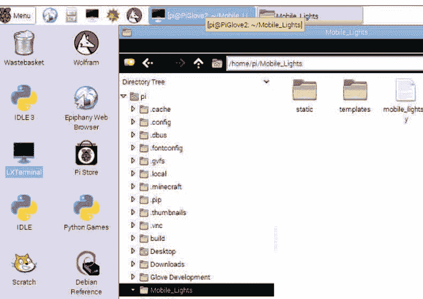

上方 使用智能手机控制你的家庭环境

## Pi-mote

你需要正确保存文件夹文件

## CSS

为了创建一个网页，你需要使用 `HTML` 和 `CSS`。`HTML` 代表超文本标记语言，`CSS` 是用于创建网页的语言。你可以将 `HTML` 文件转换为网页。级联样式表，`CSS` 是描述网页外观的代码。它包含了在浏览器中渲染的 `HTML` 内容。在教程中，它控制屏幕上的显示方式。

## 创建新文件夹

安装 `Flask` 后，重启你的树莓派；输入 `mkdir mobile_lights`。创建一个名为 `Mobile_Lights` 的文件夹。这是你使用 `Python` 程序控制插座和灯的地方。你可以在 `LX Terminal` 中右键点击并选择 `New`。

## 创建 HTML 文件

打开 `Mobile_Lights` 文件夹并创建一个名为 `'templates'` 的新文件夹。在该文件夹内创建一个包含网站布局结构的 `HTML` 文件。代码命名网页并添加。从开始菜单打开文本编辑器，或使用 `nano` 创建新文件。将 `HTML` 添加到 `template` 文件夹，命名为 `'index.html'`。记住，这是一个 `HTML` 文件，必须以 `.html` 结尾。

```html
<!doctype html>

<head>
    <title>Controller</title>
```

## 添加一些样式

```html
    <link rel="stylesheet" href="static/style.css" />
    <meta name="viewport" content="width=device-width, initial-scale=1" />
</head>

<body>
    <div class="on"><h1>Hello!</h1></div>
    <div class="off"><a href="#">OK</a></div>
</div>

</body>
</html>
```

级联样式表，`CSS` 用于创建并为网页应用样式。回到 `Mobile_Lights` 文件夹并创建一个名为 `static` 的文件夹。这是保存 `CSS` 文件的地方。创建另一个文本文件并添加以下代码，它将为网页设置“样式”。你可以逐行更改按钮的颜色。将文件保存为 `static` 文件夹中的 `'style.css'`。记住，这是一个 `CSS` 文件并

```css
body {
    position: absolute;
    margin: 0;
    top: 0;
    right: 0;
    bottom: 0;
    left: 0;
    font-family: Arial, sans-serif;
    font-size: 150px;
    text-align: center;
}
```

```css
div {
    display: block;
}
```

## Flask

```css
div : a {
    width: 100%;
    height: 50%;
}

div : a {
    width: 100%;
    height: 100%;
    display: block;
}

div.on {
    background: black;
}

div : a {
    color: white;
}

div.off, visited {
    color: black;
}

a:link, visited {
    text-decoration: none;
}
```

```python
def index():
    return render_template('index.html')

@app.route('/')
def switch_():
    return render_template('index.html')
```

`Flask` 是用于创建应用和页面的强大工具。如果你对这些感兴趣，很好的起点是 `flask.org`。查看该网站以了解 `Flask` 的功能和解决方案！还有 `flask.com/community`。

```python
if __name__ == '__main__':
    app.run(debug=True, host='0.0.0.0')
```


### 5 找到你的 IP 地址

在启动你的 Web 服务器之前，你需要检查以下内容：

- 你有一个名为 `Mobile_Lights` 的文件夹
- `Mobile_Lights` 文件夹中有一个名为 `mobile.py` 的 Python 文件
- 同样的 `Mobile_Lights` 文件夹中还有一个名为 `style` 的文件夹

如果检查通过，在终端中输入 `sudo hostname -I`。这将显示树莓派的 IP 地址。

### 16 启动 Web 服务器

你已经到达了准备启动 Web 服务器的节点。移动到 `Mobile_Lights` 文件夹并输入 `python mobile.py`。这将启动 Web 服务器，然后它准备好响应网页上点击的按钮。

## 14 整合一切

最后的设置是编写控制移动灯和 `style.css` 文件的脚本，使用与步骤 7 类似的插座控制代码。打开 IDE 并开启新窗口，添加以下代码以保存你的 `Mobile_Lights` 文件夹，命名为 `'mobile.py'`。第 4-7 行和 11 行使用 `@app.route('/')` 和 `@app.route('/')` 来告诉 Flask 在 URL 被点击时触发。在第 15 行，如果 `__name__ == '__main__'` 是直接从 Python 解释器执行而不是作为导入模块使用的，则该函数将用于运行 Web 服务器。

# 教程

# 编写一个《星际大战》克隆版
在 FUZE BASIC 第二部分

# 在 FUZE BASIC 中重制经典游戏
深入编程世界

为此需要安装该软件，Linux 和树莓派用户可以从 `https://www.filesilo.co.uk/` 下载。

欢迎来到 FUZE BASIC 教程的第二部分。你需要 FUZE BASIC。

别担心；你可以跳过第一部分直接进入主题。不过，由于这是一个相当大的程序，你可能需要从 FileSilo 或这里下载程序列表：`https://www.fuze.co.uk/tutorials/73MP357TPART2.fuze`。

`73MP357` 由 Luke Mulcahy 编写，他是 FUZE 的驻留程序员，在最客气的说法中，我们我们我们极具人味的超级计算机。这一期他在他温和的结构的基础上更进一步，添加了各种令人惊喜的精彩内容。这包括简单的评分系统、道具、敌人以及所有最棒的威力。游戏体验也通过流畅的移动得到了改进。简而言之，你将获得一个基础但绝对可玩的游戏所需的一切。

# 你需要什么

- FUZE BASIC V3 (`fuze.co.uk/getfuzebasic`)
- `73MP357PART2.fuze`

Luke Mulcahy 是 FUZE 团队的内部程序员。15 岁的 Luke 活跃于多种编程语言，尽管他加入 FUZE BASIC 的节奏与众不同。


## FUZE BASIC

## 01 获取第二部分代码

启动 FUZE BASIC，并加载（使用 `FB` 命令）`73MP57PART2.fuse` 或从编辑器和模式将代码复制到 `IF2` 基准编辑器中。如果你遵循第一部分的步骤，你将对目前的进展感到满意。按下 `F3` 或在新窗口中运行程序。

## 02 测试

你会注意到我们有一个分数基准。按下空格键并向左、向右移动。如果你发射，长按一秒钟，你还将获得重要的“强化（Power Up）”，在其中基准会随着粒子（Particle）增加。激光也会变成敌人，更重要的是，如果你触碰到它们，它们将摧毁你并停止程序，然后按 `F2`。我们将简要介绍上个月创建的部分，并对新添加的内容提供更多详细说明。

## 03 设置环境（第 021-027 行）

我们的初始设置了几几个变量。有多个变量用于分数、帧率、`minfps` 和 `maxfps`。它内置了一个非常动态的分分辨率功能，可以根据帧率调整（分辨率）最大值。你可以看到屏幕在调整，直到它将分辨率限制在帧率内。如果它达到 60fps，则会使用延迟来保持稳定。我们将在项目稍后回到这里，届时你将找到用于同步改变帧的函数。这些变量贯穿始终。

## 04 设置地板（第 028-042 行）

星场是在上个月创建的，但这里创建了三个相对数组来存储 100 颗星星的位置和角度。数组由随机初始值填充。

## 05 激光变量（第 043-059 行）

好东西。设置了几个数组来存储每个激光的分数和移动位置。`LaserReload`（一个整数）在第 53 行设置为 2，创建了帧同步的第一部分。这是为了防止激光跟不上帧的速度，它们将以相同的速度重新加载。

## 06 敌人变量（第 056-069 行）

如果我们无法利用激光来供应大量追随某些移动路径或你的敌人，那么拥有激光也没有意义。不过，只设置了几个数组来存储敌人的角度、距离（离中心距离）和速度，但额外增加了一个变量（`enemyhealth`），以便让不同的武器产生不同的结果。

## 07 威力和道具（第 070-085 行）

我们在这里处理变量，如激光角度、分数以及道具的颜色和时长。

## 08 主循环（第 087-137 行）

这是主循环。我们开始检测屏幕按键按下。在这里我们设置了 `A` 以及左侧和右。

## 09 释放道具（第 189-190 行）

我们从单发激光开始游戏。只有在我们没有强化时，才会释放道具。此函数通过 `Laser=FALSE` 进行检查，然后释放一个新道具，并初始化所有变量。

## 10 移动道具（第 157-160 行）

接下来它通过 `powerupDist = powerupDist + (radius)` 向玩家移动。

## 11 获取道具（第 161-174 行）

如果是这样，如果它位于边缘且 `Laser=TRUE`，则它与玩家的位置相同（`playerAngle = gap / 2`）。

## 12 调整速度（第 175-186 行）

这决定了帧的速度。

## 13 产生敌人（第 195-207 行）

如果我们在边缘且 `Laser=TRUE`，则它与玩家的位置相同。`enemyhealth` 被额外增加，以便让不同的武器产生不同的结果。

## 14 绘制星星（第 208-231 行）

星场是在上个月创建的，但这里创建了三个相对数组来存储 100 颗星星的位置和角度。数组由随机初始值填充。

## 15 绘制显示场（第 232-251 行）

我们在上个月介绍过这个，现在变化不大。基本上，显示场是围绕圆周绘制的。

## 竞赛
中奖！FUZE 特别版


FUZE 具有明显的复古风格，这款屡获殊的作品是一台可编程计算机和电子工作站。它诞生于对编程的热爱和电子产品喜爱，固态键盘具有特殊设计的 `GPIO` 引脚和一个用于简单电子设备制作的面包板。

支持功能（包括精灵和图像缩放、角度和 `Alpha` 通道控制以及 FUZE BASIC）已完全配置，适用于所有型号的树莓派（Raspberry Pi）。FUZE 系统不仅仅是一个仿真器。

FUZE 在键盘下方安装了一个 Pi，并预装了 FUZE BASIC。
ZE BASIC 是该编程语言的先进、现代化版本，被广泛认为是最易于学习和教学的初学者语言。它具有重新设计的界面和先进的图形功能。

FUZE 特别版致敬家用机械臂。它带有 `BBC Micro`，并了一套完整的机械臂套件，可集成到你的项目中。FUZE 特别版还为你提供了 FUZE Lar 上的教程和在线资源，为你提供了入门所需的一切。更多信息，请访问 `fuze.com`。


## 回答此网页上的问题即可获得机会！
`www.linuxuser.com/news/win-a-fuze-se`

条款与条件
本次竞赛向英国和爱尔兰居民开放。Imagine Publishing 有权将奖品替换为价值相等或更高的物品。Imagine Publishing 的员工（包括自由职业人员）、其亲属或代理无权参赛。编辑的决定为最终决定，不接受任何投诉。奖品不能兑换现金。完整条款可根据要求提供。参加竞赛表示您同意 Imagine Publishing 向您发送每月事事和偶尔的特别优惠。您可以随时点击收到的任何封邮件中的取消链接取消订阅。

80

## 北美读者的特别优惠

## 6 期免费
当您订阅 * 时

每期都赠送免费资源下载

## POSTGRESQL 世界培训

## LinuxUser & Developer
GNU 世代必备杂志

## 专业人士和开发者的开源权威

## 50 种精通 PI ZERO 方法
加 A+ A+ B+ B+ 

赢取价值 750 英镑的 Pi 奖品

## LinuxUser & Developer
构建你自己的

## CODE GNOME 软件

## 系统工具
利用系统调用的力量

## 加速你的 Linux PC
精通核心命令行工具

## LinuxUser & Developer
ASSEM 5

## 更快创建软件

## 如何虚拟化 Linux

PSEUDIO 的秘密
MONOGAMIE 中的图形
SPRINGS 容器

我们可以更改 PI 的配置

内部还有：
- 如何使用新的 Pi 功能
- 与 Raspberry（树莓派）的独家采访
- 为开发者提供的专属工具

## 在线订 +44 (0)1795 418661

## 访问 `www.imaginesub.co.uk/`

## 凭此专属优惠请注明 USA！

*条款和条件：这是一份美国订阅。您将支付 80 英镑的年订阅费。在写作期间，这相当于 109 美元 - 率可能会变化。6 期免费指的是美国标准价每期 16.99 美元，总订阅费用 220.94 美元。您的订阅将从下一可用期开始，持续 13 期。此优惠于 2016 年 2 月 29 日结束。*en

## 新 IT

## 屏幕时间
树莓派 7 英寸触摸屏


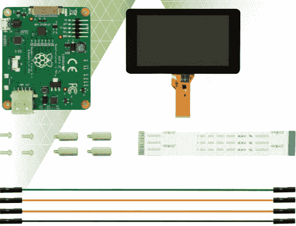

`WWW.NEWIT.CO.UK`

f t in

## 评测

84 组测 | 88 NeuG | 90 EduKit 3 | 91 UPS Plco | 92 自由软件


## 组测

## Chromium 浏览器

有一些项目采用了 `Chromium` 代码来推出自己的网络浏览器。但有人能击败谷歌的旗舰 `Chrome` 浏览器吗？

### Google Chrome
据报道是地球上使用最广泛的浏览器，但内核只是带有额外功能的 `Chromium`。`Chrome` 包含了用于专有格式的许可代码，可以访问更广泛的媒体内容、AAC 和 MP3 编码的音频。
下载：`bit.ly/1BxukGG`

### Chromium
`Chromium` 是我们测试中唯一的开源浏览器，很多事情是显而易见的：`Chromium` 没有像 `Chrome` 那样有魅力，因为我们不使用许可内容；然而，现有的功能集将使浏览器性能与其他竞争对手竞争。
下载：`bit.ly/1MvHy6k`

### Opera
`Opera` 是一款备受尊敬的 Linux 浏览器，历史悠久。它曾实现自己的 `Presto` 引擎，但从 2013 年起，`Opera` 放弃了它而转向 `Blink`，后者使用了谷歌的组件。`Opera` 在 2014 年夏天发布了新的 Linux 浏览器，具有显著的设计。
下载：`opr.as/1FvGzZ`

### Vivaldi
`Vivaldi` 的出现是一项倡议，旨在将旧 `Opera` 丰富的功能带回到新的水平，以 `Chromium` 代码为基础。`Vivaldi` 直接与 `Opera` 竞争，带回了被 `Opera` 从 `Presto` 切换到 `Blink` 渲染引擎困扰的用户。
下载：`bit.ly/1cCQg3D`

`www.linuxus.co.uk` 83

84

## Opera

## Vivaldi

它有一个更新的插件品牌，但有理由让 `Opera` 成为你的浏览器吗？

这款由前 `Opera` 首席执行官 Jon von Tetzchner 开发的浏览器正变得非常...

## 插件


`Opera` 有一个拥有超过 500 个扩展的插件目录，但可以使用 `Chrome` 插件。要这样做，请在 `Vivaldi` 中启用开发者模式并使用 `chrome-extension.com` 手动加载解包的扩展（获取）。这是一个实验性功能，请注意。

## 插件

`Vivaldi` 是一款在 2015 年出现的新浏览器，因此可以理解许多功能仍然缺失。没有官方插件目录，但可以使用 `Chrome` 插件。

## 用户体验

`Opera` 官方为 `Ubuntu` 提供了 `DEB` 软件包。如果你的系统不是 `Debian` 或 `Ubuntu` 克隆，你将需要拆分包并依赖第三方包。由于 `Opera` 的能力有限，你的体验因发行版而异。

## 用户体验

`Vivaldi` 凭借其设计提供了体验。它继承了旧 `Opera` 的精神，但没有同步功能，没有插件。然而，`Vivaldi` 团队专注于标签页、窗口注释和为书签添加备注。

## 多媒体支持

`Opera` 对支持的格式和编码进行了研究，但 `Opera` 包包含了本地 `FPEG` 副本，允许在 Linux 上播放许多相关问题。`Opera` 还带有 `PDF` 查看器，并可以使用 `Chrome` 的插件，特别是最新版本的 `Flash`。

## 多媒体支持

该浏览器拥有编码器和格式的所有基本支持，包括支持 `Flash Player`、MP3 和 AAC 的 `HTML5`。它与 `Chrome` 中发现的相似。

## 特色功能

`Opera` 开发者创建了他们的同步服务，不依赖任何东西，真的非常好。`Opera` 还具有一些独特的功能，如 `Opera Turbo`（针对慢网络）、鼠标手势、密码管理器等。

## 特色功能

对 `Vivaldi` 的兴趣很大程度上归于媒体炒作。`Vivaldi` 更多关于社区和社交生活，而不是额外功能。遗憾的是，该浏览器没有任何

## 总结

如果 `Opera` 能在主流发行版（`Ubuntu` 外）上进行测试，它将会有更好的机会。`Opera` 擅于提供一致且最无故障的媒体播放和高级同步服务。

## 总结

`Vivaldi` 是一个不错的浏览器和一个有前景的项目，但在现阶段，我们不确定你应该放弃目前的浏览器转向 `Vivaldi`，因为后者仍然缺少许多重要功能。

`www.vivaldi.com` | 85

# 测评 Chrome 浏览器

## 简评：对比与结论

| | Google Chrome 应用商店 | Chrome | Opera | Vivaldi |
|---|---|---|---|---|
| 扩展程序 | Google Chrome 应用商店是最大、最全的浏览器扩展程序目录 | 大多数 Google Chrome 扩展都能运行，但有少数例外 | Opera 有自己的官方目录，此外还有大量兼容的 Chrome 扩展 | 虽然没有商店，但手动转换的 Chrome 扩展可能非常好用 |
| 用户体验 | 这里没有什么让人感觉很新鲜或特别的，但一切运行得都很快速可靠 | 如果你想让它看起来完全完美，请准备好进行一些调整 | 遗憾的是，Opera 的运行缺乏魅力且花样多样，但它展现了潜力 | Vivaldi 具有一种智能且精致的感觉，包含了许多改进 |
| 多媒体支持 | Chrome 已经为现代世界做好了准备 | 由于许可限制，Chrome 对在线媒体的支持有限 | Opera 是另一个支持所有解码器的浏览器 | 曾经多媒体支持很薄弱，但现在 Vivaldi 现在好多了 |
| 额外功能 | Web 应用的力量，加上 Chrome 的所有功能 | 与 Chrome 共享许多额外功能，但有些功能无法工作 | Opera 有 Turbo，它自己的服务以及许多值得展示的好东西 | 我们注意到它处理了更多的一些额外功能 |
| 总体 | 我们没什么可抱怨的——一个极的浏览器 | 感觉像 Chrome，有点局限，但在许多方面可以改进 | Chrome 的强力竞争对手，功能强大，可能是一个值得关注的 | Vivaldi 仍然显示出潜力 |


# 冠军得是……

# Google Chrome

你可能已经注意到我们跳过了这一项的性能测试，所以你可能好奇这些浏览器在现实世界中的体验如何。如果我们在这次测试中使用 `Firefox` 或任何其他非 `Chrome` 浏览器，显然会更有意义。但事实证明，我们的四个竞争者中有三个是基于 `Chromium 45.2.2490.80`，而 `Vivaldi` 基于较晚的 `Chromium (45.2645.99)`。我们运行了所有测试，包括合成和真实世界测试，包括 `Chrome 2.0`（用于 `JavaScript`）和 `Speedometer 1.0`（用于 Web 应用）。所有四个浏览器的性能相似，差异在 1% 到 3% 之间。它的感觉非常敏捷且稳健。

这次分组测试的优者是 `Google Chrome`，它稳定，并且对媒体格式和解码器拥有最佳支持，是一个很棒的流通道，并支持 11.4kHz 编码视频。

`Opera` 仅作为 `.amd64` 包进行了彻底测试，这意味着响应速度和其他 Linux 特性可能会导致问题。另一方面，没有什么可抱怨的，而且

> 它不仅仅是一个浏览器，而是功能丰富的 Chrome 的微版本

得益于其早期的 `Turbo`，`Opera` 可以在付费网页上节省费用。`Chrome` 仍然位第三，因为设置某些内容需要花费精力，而且无法实际保证 `Google` 应用商店上的所有好东西都能正常运行和工作。

`Vivaldi` 是一个很有前景的项目，它已经展示了惊人的开发速度并修复了许多 `UI` 缺陷。它被标记为“beta”是理应的，因为还有很多功能即将到来，包括云同步等许多重大功能。

Alexander Tukey

86


分类广告 01202 586442

# 域名
.COM 仅需 £5.80/年


# 一切都在树莓派！

# 托管
每月 £2.99 起 + 免费域名

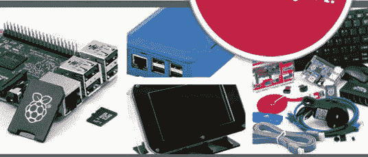

# 云
每月 £5 起
树莓派商店 - 我们提供开发板、RPi 组合包、SD 卡、外壳及组件 - 全球送货！

# 服务器
立减 50%


# 数据中心
每月 £35 起

# UK 服务器
# 专用服务器
使用优惠码享 15% 折扣
当天到货，无需长期合同

联系我们的团队成员，或访问我们的网站了解更多信息
每月 £39 起 + 增值税
`www.ukservers.com`

# 测评 NeuG 
NeuG 采集模拟转数字转换器的噪声，并将其作为熵的基础


# 安全 NeuG
`CPU`: STM32F103 Cortex-M3 72MHz
`RAM`: 20KB
`ROM`: 128KB
存储: 4KB 闪存
操作系统: RTOS 288KB CRC-32 处理 816KB
价格: $50 可自 `shop.hf.org`

在你的 Linux 设备上添加一个基于 ARM 的微型计算机就能加密安全吗？`/dev/random` 是大多数 Linux 用户不会考虑的问题，但它让密码学家彻夜难眠。系统可能会受到安全漏洞的影响——当你进入虚拟化情况时，这个问题变得更大。

在使用 `/dev/random` 时，可能会遇到熵耗尽的问题：尝试从 `/dev/random` 拷贝 1MB 数据将迅速停止；因为大多数程序默认使用熵产生。处理 `/dev/random` 饥饿的一种方法是使用硬件随机生成器。这些设备通常很贵，但自由软件基金发布了一个廉价的微控制器 (FST)：NeuG 是设计运行在 F-01 ARM M3 处理器上的免费软件。通过 USB 连接，NeuG-FST 显示为一个串口；连接到端口，你就会发现随机字符填充了你的控制台。

一个所谓的随机生成器 (TRNG) 足够简单：通过 CRC 系统连接到处理器的模拟读数经过处理后，通过设备的内置 USB 输出。这股熵流可以在任何你需要的地方使用。安装足够简单；将设备插入你的 USB 端口，运行设备下的固件并保持连接，NeuG 固件就会启动。凭借其简单的 USB 设计，NeuG 足够便于随身携带


> NeuG 完全有能力向 /dev/random 注入熵，速率高于操作系统自身的熵采集活动

优点
- 易于安装、紧凑，并且能够快速填充系统的熵池，你可以清空它

缺点
- 现代处理器通常带有随机生成器，但尚未通过安全审计

该设备将其变成一个包含实用 readme 的可移动存储设备。浏览此文件后，下一项是一个揭示了 NeuG 设计、用法和原理的建议设备，但缺少了一条信息：如何使用 NeuG 固件。

288KB/s。最终模式输出传感器的原始数据，不尝试确保它是任何随机的。在两种随机数生成模式下，NeuG 完全有能力向 `/dev/random` 注入熵，速率高于操作系统自身的熵采集活动。拔出时，FST-01 将通过串口设备 `-dev/ttyACM0` 切换到 NeuG。这需要额外的命令来启用读取模式：将端口设置设置为被禁用的原始模式，并且可以在模式之间切换。安装固定的硬件可能不可用，它在加载的瞬间可能会导致熵停止。

总结
很难判断随机数据的质量，但 NeuG 在没有评估和验证的情况下通过了通常的硬件瓶颈；它既易用又便宜。

这些模式对 NeuG 的运行有显著影响。在默认模式下，NeuG 能够以 81KB/s 的速率通过 SHA-256 处理算法输出；替代的 CRC-32 算法可能会削弱熵的质量，但会提高速度。

对于服务器来说，这是一个好消息——安装的硬件提供的各种熵源可能是安全系统与产生熵系统之间的区别。它还作为指向现代处理器（如 Intel 的 Ivy Bridge 及更新型号）内置的闭源 RNG 的方便接口。


`www.luxuser.com` 89

# 评测 Pi 配件


| 组件列表 |
| :--- |
| 电机控制器板 |
| x2 直流电机 |
| 万向万向滑轮 |
| 迷你型面包板 |
| 双面胶 |
| AA 电池盒 |
| 超声波传感器 |
| 循迹模块 |
| 电阻 |
| 跳线线 |

# 机器人
CamJam Pi EduKit 3

使用这套简单且易于组装的套件，将树莓派变为机器人

这可能不是审判日，但机器正在崛起——即使是树莓派！`CamJam EduKit 3` 允许你将 Pi 安装为机器人的控制器，是爱好者、儿童甚至树莓派初学者的理想选择。

这个轻量级盒子包含了你开始树莓派之旅所需的所有物品。两个电机有点笨重，但内部的所有物品都很轻量——正如你按照项目说明书和建议的底盘所预期的那样。书中还提供了胶带用于固定电机和电池盒，以及必少的电池。

通过完成项目说明书，你将从桌上的一堆组件转变为构建一个按照纸上打印的线条运行的机器人。然而，这并不简单——把所有东西组装在一起就能运行；其中还有更多细节……

核心组件是一个跨越 `GPIO` 的电机控制器，利用 `GPIO` 引脚和 LED 启动运动；虽然电机的导线涂了锡，以提供足够的厚度使其固插入连接器中，但来自电池盒的电线没有。我们在第一次超时时发现它们被拔掉了。

另一个限制是电源源。在没有进行定制的情况下，运动受限于电线的长度以及携带便携式电源的能力，无论是轻便的手机充电宝，还是结合六节 AA 电池和一个 `UBEC` 的定制解决方案（见第 14 题）。总的来说，`CamJam` 的机器人套件在 20 英镑以下绝对是必备之选！

> Christian Harvey

# 总结

易于遵循的指令组合结合将任何小组件盒转换为 Pi 控制机器人的能力，意味着 `CamJam EduKit` 对于任何对扩展树莓派可能性感兴趣的人（无论是成人还是孩子）都是合适的。而且它价格实惠！

| 价格 |
| :--- |
| 17 英镑 (`camjam.me/edikit`) |


90 * Temeiw*

# 技术规格

智能不断电电源 (UPS)
集成锂聚合物电池
智能自动充电器
`I2C` Pico 接口
5V 2A 备份
可选 3000 mAh 电池
可选 `PWM` 风扇

Pico 堆栈

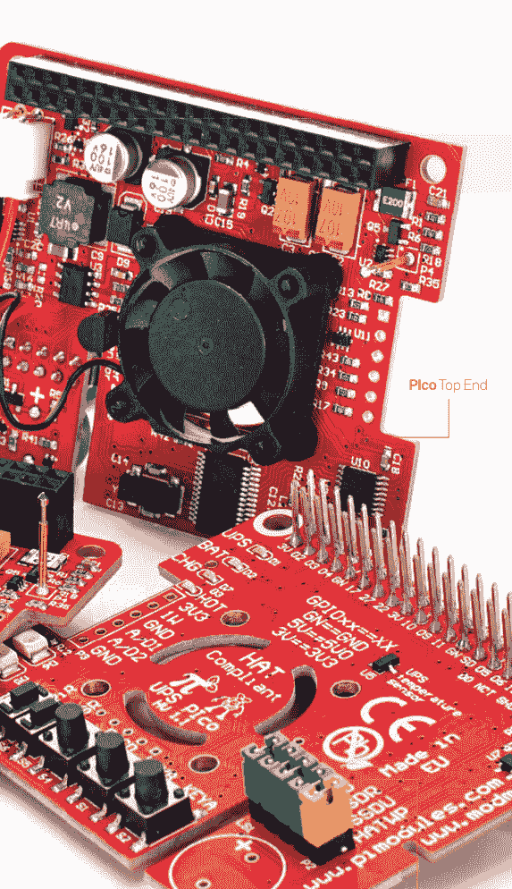

Pico 顶端

# 电源

# UPS Pico

得益于 Pico 这款实用的 UPS，断电将不再损坏你的 SD 卡

又发生了——由于停电，你的树莓派 SD 卡损坏了，项目也毁了。你需要的只是一个备份的重置镜像，项目需要重启并重新配置。

但有了 UPS，这一切都不会发生。`ModPico HAT` 包含 `I2C` 控制，并带有可选扩展功能（如 CPU 风扇和大容量电池），该设备由两个部分组成：HAT 和 Pico。在将 HAT 安装到已上电设备之前，HAT 将连接到 Pico 下方的小连接口。将使用防静电带将其固定在位。

下一阶段是下载两个 Python 脚本到主目录并编辑 `/etc/local`，使用其中一个来自动设置。虽然盒子里没有指南，防静电袋上打印的简短说明可以从 `ModPico` 下载。一旦连接并启动你的 Pi，绿色和蓝色 LED 将闪烁表示设备已就绪。板上安装了一系列按钮。重置按钮将重置 UPS，而 FSD 按钮将启动安全关机。此外还有其他可用按钮。你可以通过 `GPIO` 引脚监控电池电量。如果发生断电，3000 mAh 的电池单元可以维持八小时。

# 总结

尽管对于不熟悉 Python 的初学者来说，设置它可能很困难，但对于任何寻找避免数据损坏和关机方法的的人来说，UPS 是一个很棒的选择。一个不错的额外是得益于插件提供的各种 UPS 选项，但要注意焊接可能会……

+ Christian Cowan

价格
22 英镑 (`by:QTVKK`)

Pico 堆栈（未组装）


91

# 评测

# 免费软件

# 笔记记录

# CherryTree 0.35.11

使用这款优秀的应用整理你的生活

Giuseppe Pepona 的 `CherryTree` 并不是记录笔记的方法，而是一种组织所有数字“自我”的方法。起初，它不是为了提供文档，而是为了运行的想法或项目分支。所有节点都在单个文档中（`SQLite` 或 `XML`）。

手册是 `CherryTree` 的原生文档，与 `CherryTree` 的介绍一样。`CherryTree` 不会阻碍你；它可以轻松加入一些想法、创建子节点并构建其他想法。下载 `RPM` 或 `deb` 是一个痛苦的选项；此版本在 `HTML` 导出和各种修复方面看到了改进。如果你的目标是让想法更有条理，你应该尝试 `CherryTree`。

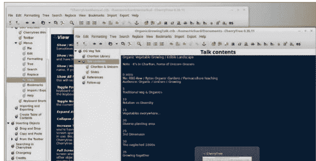

通过 `CherryTree` 让你的想法更有条理

优点：快速、轻量级，并具有强大的搜索工具。可以非常轻松地制作笔记并找到它们。
缺点：没有其他办法了，除非你没时间学习另一个应用。
非常适合……组织一切——以及你需要的 `guspen.com/cherrytree`

# 语言

# GNU GUI 2.11

编程并扩展桌面、网页和命令行应用

如果你读完了挑战性的《编程入门》，你现在可能想让它变成现实。例如，为实验设计的 (`Forms`)、`Hacker News` 网站 (`ycombinator.com`) 以及 `GNU GUI`。用 `C` 语言编写子程序，使用新的原语扩展并在 `Lisp` 家族提供的抽象层上构建。`GUI` 正在朝着更快、更简单、更省内存迈进。`GUI` 对交互式和增量式编程的强调还包括新功能：更好的搜索、更好的定位、完全类 Emacs 的实现以及优化的功能。

# 分区编辑器

# GParted 0.24.0

用于创建、调整大小和修改分区的友好界面

新电脑或大硬盘带来的兴奋感可能会在接触磁盘分区时受到谨慎的影响，不仅是对带有重要数据的磁盘进行分区，对新硬盘进行分区也可能比搞掉另一个磁盘要好。如果你在第一次分区之前误安装了某些东西，那么带有图形界面的 `GParted` 可以在磁盘之前运行，而且现在安全得多。支持 `ReFS`、`JFS` 等各种工具。`GParted 0.24.0` 增加了 `ZFS` 文件系统检测和对逻辑卷的更好信息，在处理分区表方面具有很大的活性。项目网站包含在不同情况下使用 `GParted` 的教程链接。

`GParted` 是 `Parted` 的前端，使用 `libparted` 管理设备和分区表。它还允许额外的文件系统，包括 `GParted Live`，这是一个小型的可启动发行版（适用于 Intel 兼容硬件），以 CD 或 USB 磁盘的形式提供——也可以从硬盘或通过网络 `PXE` 你的 PC。`GParted Live` 基于最新的 `Debian Sid`，包含了救援和 `efiboot`。

优点：如果分区磁盘的想法让你冷流汗，那么这个过程是最好的。
缺点：它不适用于所有设备——例如树莓派。
非常适合……消除对磁盘分区的恐惧 `gparted.org`

# 游戏

# SuperTaxKart 0.9.1

基于自由软件吉祥物的特色角色

十多年前，`SuperKart (STK)` 作为一种卡卡丁赛车游戏从孩子中诞生。从那以后，它变得更加精良和真实，但在《马里奥赛车》的精神下，趣味比关系更重要。通过对现有赛道进行改进并添加新赛道，`STK` 有足够的玩性。


得益于它（修改过的）Irish Engine，`STK` 的早期版本在低硬件（如第一代）上运行良好。自 0.9.1 以来增加了更多角色，但我们用一个七岁的孩子和一台小笔记本电脑进行了测试，它是可以玩的。如果你想在旧硬件上获得最佳体验，`STK 0.8.1` 仍然属于高质量 `Debian` 及许多其他产品的领域，因此每个人都可以加入乐趣。

最新版本带来了更多内容，但重点仍然是游戏性。在改进车辆稳定性、渲染和音频方面，以及允许设计师使用 `AngleScript`。许多挑战得到了改进，网络方面的开发仍在继续，但应该在下一个版本中结出，届时你将跨局域网甚至通过互联网与其他玩家对战。

优点：上手快速简单，有很多选项确保一切具有可比性并让你再次回来。
缺点：虽然你可能可以在旧硬件上将其运行，但它更适合你的需求。
非常适合……当你的大脑充满了代码时，你需要乐趣！`superkart.net`

`www.linuxuser.com` | 93

## 托管列表

赞助机会
通过赞助本板块来提升您的品牌关注度。
联系 Luke Bibiscombe：+44(0)123456789

有认为我们应该列出的交易吗？
无论您是托管公司还是共享托管提供商，请发送邮件至 `newsrafter@hosting-magazine.publishing.com` 与我们联系

## 独立服务器列表

| 名称和 URL | 方案 | 电话号码 | 每月费用 |短合同 | CPU / 核心 | 磁盘空间 | 1,500MB | 10GBPS 网络连接 | 硬件 | 远程电源重启 | 终极存储 | 永久 KVM | 网络备份 | 私有支持 | 24/7 电话支持 |
| --- | --- | --- | --- | --- | --- | --- | --- | --- | --- | --- | --- | --- | --- | --- | --- |
| | DS 2.2 | 0333 247 0222 | £19.00 | 1 个月 | Intel Core i3 - 2.5GHz | 2x 500GB 起 | 可选 | ✓ | 1 小时 | 99.9% | | 10GB | 待定 |
| BudgetBox 4 | | 0333 247 0222 | £29.00 | 1 个月 | Intel Core i5 - 2.5GHz | 2x 500GB 起 | 可选 | ✓ | 1 小时 | 99.9% | | 10GB | 待定 |
| DS 3.1 | | 0333 247 0222 | £39.00 | 1 个月 | Intel Core i7 - 2.5GHz | 2x 500GB 起 | 可选 | ✓ | 1 小时 | 99.9% | | 10GB | 待定 |
| DS 4.3 | | 0333 247 0222 | £59.00 | 1 个月 | Intel Core i7 - 3.5GHz | 2x 500GB 起 | 可选 | ✓ | 1 小时 | 99.9% | | 10GB | 待定 |
| DS 4.5.1 | | 0333 247 0222 | £79.00 | 1 个月 | Intel Core i7 - 3.5GHz | 2x 500GB 起 | 可选 | ✓ | 1 小时 | 99.9% | | 10GB | 待定 |
| DS 4.6.2 | | 0333 247 0222 | £115.00 | 1 个月 | Intel Core i7 - 3.4GHz | 2x 1TB 起 | 可选 | ✓ | 1 小时 | 99.9% | | 10GB | 待定 |
| DS 6.5.1 | | 0333 247 0222 | £149.00 | 1 个月 | 双路 Xeon E5-2690 v4 | 1TB 起 | 可选 | ✓ | 1 小时 | 99.9% | | 10GB | 待定 |

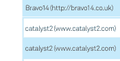

| 名称 | 价格 | 合同 | CPU | 磁盘 | 网络 | 支持 | 备份 | KVM | 私有 | 24/7 |
| --- | --- | --- | --- | --- | --- | --- | --- | --- | --- | --- |
| Starter Linux | N/A | N/A | N/A | N/A | 2000MB | ✓ | ✓ | ✓ | | |
| Starter Windows | N/A | £20 | N/A | N/A | 2000MB | ✓ | ✓ | ✓ | ✓ |
| Business Linux | N/A | N/A | N/A | N/A | 4000MB | ✓ | ✓ | ✓ | ✓ | |
| Business Windows | N/A | £45 | N/A | N/A | 4000MB | ✓ | ✓ | ✓ | ✓ | |
| Ultimate Linux | N/A | £60 | N/A | N/A | 无限 | ✓ | ✓ | ✓ | ✓ | |
| Ultimate Windows | N/A | £80 | N/A | N/A | 无限 | ✓ | ✓ | ✓ | ✓ | |
| catalysed-1 | 0810 0771 5999 | £79 | 1 个月 | 1x Xeon-2690 | 500GB | ✓ | ✓ | ✓ | | ✓ |
| catalysed-2 | 0810 0771 5999 | £99 | 1 个月 | 2x Xeon-2690 v5 | 500GB | ✓ | ✓ | ✓ | | ✓ |
| catalysed-3 | 0810 0771 5999 | £119 | 1 个月 | 3x Xeon-2690 v5 | 1500GB | ✓ | ✓ | ✓ | ✓ | |
| 123-dedicated-1 | 0810 1261 5975 | £899 | 12 个月 | 4x Xeon-2690 | 10GB | ✓ | ✓ | ✓ | O |
| 123-dedicated-2 | 0810 1261 5975 | £999 | 12 个月 | 4x Xeon-2690 | 20GB | ✓ | ✓ | ✓ | ✓ | ✓ |
| Daily-linux Pro-1 | 0888 6418 2100 | £299 | 1 个月 | 2x Xeon-2697 | 100GB | ✓ | ✓ | ✓ | ✓ | ✓ |
| Daily-linux Pro-2 | 0888 6418 2100 | £359 | 1 个月 | 2x Xeon-2697 | 100GB | ✓ | ✓ | ✓ | ✓ | ✓ |
| Daily-windows Pro-1 | 0888 6418 2100 | £399 | 1 个月 | 2x Xeon-2697 | 100GB | ✓ | ✓ | ✓ | ✓ | ✓ |
| Daily-windows Pro-2 | 0888 6418 2100 | £459 | 1 个月 | 2x Xeon-2697 | 100GB | ✓ | ✓ | ✓ | ✓ | ✓ |
| VPS-Pro Hyper-V | 0888 6418 2100 | £449 | 1 个月 | 2x Xeon-2697 | 100GB | ✓ | ✓ | ✓ | ✓ | ✓ |
| VPS-Max Hyper-V | 0888 6418 2100 | £719 | 1 个月 | 4x Xeon-2697 | 200GB | ✓ | ✓ | ✓ | ✓ | ✓ |
| VPS-Ultra Hyper-V | 0888 6418 2100 | £999 | 1 个月 | 8x Xeon-2697 | 200GB | ✓ | ✓ | ✓ | ✓ | ✓ |
| Linux Quad Core | 0884 6454 7770 | £799 | 12 个月 | 双核 - 2.3GHz | 160GB | | 99.9% | | 24/7 支持 |
| Windows Quad Core | 0884 6454 7770 | £899 | 12 个月 | 双核 - 2.3GHz | 160GB | | 99.9% | | 24/7 支持 |
| Linux Quad Xeon | 0884 6454 7770 | £1299 | 12 个月 | 四核 Xeon - 2.5GHz | 250GB | | 99.9% | | 24/7 支持

想要让您的列表突出显示！联系 LUKE
`luke.bibcombe@imagine.com`
+44(0)1202 58631

## 独立和共享服务器列表

| 名称和 URL | 方案 | 电话号码 | 费用 | 网页空间 | 每月带宽 | 账户 | 数据库支持 | 购物车 | 预览 | 病毒过滤 | 邮件支持 | 面板控制 | 服务建议 |
| --- | --- | --- | --- | --- | --- | --- | --- | --- | --- | --- | --- | --- | --- |
| Netcetera www.netcetera.com | Designer | 0800 808 5450 | £21.88 | 50GB | 无限 | 1,000 | ✓ | ✓ | ✓ | ✓ | ✓ | ✓ | ✓ |
| | Business | 0800 808 5450 | £19.88 | 100GB | 无限 | | | ✓ | ✓ | ✓ | ✓ | ✓ | ✓ |
| | Reseller | 0800 808 5450 | £23.99 | 无限 | 无限 | | | ✓ | ✓ | ✓ | ✓ | ✓ |
| | Linux Cloud | 0800 808 5450 | £60 | 500GB | 无限 | | | ✓ | ✓ | ✓ | ✓ | ✓ |
| | Windows Cloud | 0800 808 5450 | £30 | 250GB | 无限 | | | ✓ | ✓ | ✓ | ✓ | ✓ |
| | 3100:独立服务器 | 0800 808 5450 | £1,300 | 2TB | 无限 | | | ✓ | ✓ | ✓ | ✓ | ✓ |
| Blacklight (www.blacklight.com) | Maximus | +44(0)1201 34628 | £49.95 | 150GB | 1.5GB | | | ✓ | ✓ | ✓ | ✓ | ✓ |
| Blacklight (www.blacklight.com) | Medius | +44(0)1201 34629 | £59.99 | 250GB | 5GB | | | ✓ | ✓ | ✓ | ✓ | ✓ |
| Blacklight (www.blacklight.com) | Jupiter | +44(0)1201 34630 | £69.99 | 500GB | 10GB | | | ✓ | ✓ | ✓ | ✓ | ✓ |
| Digital Globe (www.digitalgb.com) | N/A | N/A | Free | 500MB | 5MB | | | | | | |
| Digital Globe (www.digitalgb.com) | Digital Globe | N/A | £12 | 100GB | 10GB | | | ✓ | ✓ | ✓ | ✓ | ✓ |
| Digital Globe (www.digitalgb.com) | Titan | N/A | £24 | 500GB | 50GB | | | ✓ | ✓ | ✓ | ✓ | ✓ |
| Equispace (www.equispace.com) | Bronze | 0121 314 485 | £30 | 200GB | 2GB | | | ✓ | ✓ | ✓ | ✓ | | |
| Equispace (www.equispace.com) | Silver | 0121 314 486 | £45 | 400GB | 5GB | | | ✓ | ✓ | ✓ | ✓ | ✓ |
| Equispace (www.equispace.com) | Gold | 0121 314 487 | £72 | 800GB | 10GB | | | ✓ | ✓ | ✓ | ✓ | ✓ |
| Equispace (www.equispace.com) | Platinum | 0121 314 488 | £114 | 1TB | 40GB | | | ✓ | ✓ | ✓ | ✓ | ✓ |
| Easthosting (www.easthosting.com) | Email | 02390 242 823 | £54.99 | 50GB | 2.5GB | | | ✓ | ✓ | ✓ | ✓ | ✓ |
| Easthosting (www.easthosting.com) | Super | 02390 242 823 | £54 | 140GB | 15GB | | | ✓ | ✓ | ✓ | ✓ | ✓ |
| Easthosting (www.easthosting.com) | Enterprise | 02390 242 823 | £99 | 300GB | 50GB | | | ✓ | ✓ | ✓ | ✓ | ✓ |
| Evhosting (www.evhosting.com) | Home | N/A | £39.99 | 6.5GB | 无限 | | | | | | |
| Evhosting (www.evhosting.com) | Business | N/A | £79.99 | 15GB | 无限 | | | ✓ | ✓ | ✓ | ✓ | ✓ |
| Giacom (www.giacom.com) | Business Pro | 0800 7542 5700 | £199 | 200GB | 20GB | | | ✓ | ✓ | ✓ | | |
| Hostway (www.hostway.com) | Silver | 0800 180 1880 | £78.60 | 150GB | 5GB | | | ✓ | ✓ | ✓ | ✓ | ✓ |
| Hostway (www.hostway.com) | 仅邮件 | N/A | £22 | N/A | N/A | | | | | | | |
| Nammark (www.nammark.com) | Standard | 0846 812 05320 | £38.25 | 150GB | 4.5GB | | | ✓ | ✓ | ✓ | ✓ | ✓ |
| Nammark (www.nammark.com) | 专业方案 | 0846 812 0330 | £53.75 | 250GB | 25GB | | | ✓ | ✓ | ✓ | ✓ | ✓ |
| Nammark (www.nammark.com) | Standard 1 | 0800 3221 7788 | £48 | 100GB | 2GB | | | ✓ | ✓ | ✓ | ✓ | ✓ |
| Skymarket (www.skymarket.com) | Standard 2 | 0800 3221 7788 | £59 | 200GB | 5GB | | | ✓ | ✓ | ✓ | ✓ | ✓ |
| Skymarket (www.skymarket.com) | Premium | 0800 3221 7788 | £99 | 250GB | 25GB | | | ✓ | ✓ | ✓ | ✓ | ✓ |

# FILESIO – 专业人士的资源库

探索您的免费在线资源

- 资源快速增长的库
- 持续更新的酷资源
- 让您的下载内容保持井然有序
- 随时随地浏览并访问您的内容
- 再也不需要为杂志运行光质页

- 再也不有损坏的光盘
- 印刷版订阅者获得所有内容
- 数字版所有者也可以获得所有内容！
- 每一期杂志的内容都随杂志免费提供
- 安全访问您的免费资源


这是取代您光盘的新 FileSilo。您可以通过访问下一页的链接找到它。

第一次使用 FileSilo 时您需要注册。之后，您可以使用提供给您的电子邮件地址和密码。

# 最受欢迎的内容

此轮播图中显示了最受欢迎的下载，看看您的读者在喜欢什么！


如果您正在寻找特定类型的内容（如发行版或 Python 文件），请使用这些过滤器来精炼搜索。

### 按类型过滤

| 发行版 | 软件 | LINUX 文件 |
| :--- | :--- | :--- |
| | | |

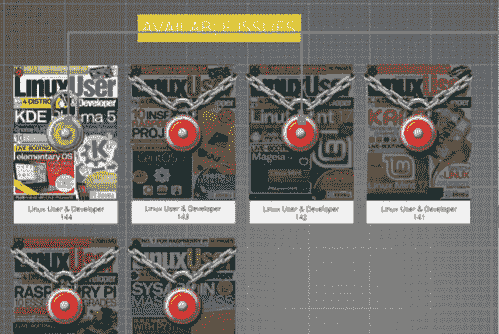

绿色锁栏显示您已访问的期。红色关闭锁栏显示您需要购买或解锁的内容。

这里列出了热门下载，您可以立即查看最受欢迎的下载内容。

| 热门下载 |
| :--- |
| Ubuntu |
| 表 1.8 |
| Node.js |
| GIMP |
| Linux 14.0 |
| Linux 17 |
| Clementine |
| VirtualBox |
| 表 1.2 |
| Coffee |
| Javascript |
| Ubuntu 14.0 |
| Speedtest |

查看“评分最高”，查看他人投票出的最佳结果！


发现更多关于我们在线商店的信息以及常用的 FAQ，例如我们的 Cookie 和隐私政策以及联系方式。

发现我们出色的姐妹杂志以及它们提供的丰富内容……

`www.linuxux.co.uk`

# FileSilo

# 如何使用

关于访问您的新数字存储库需要知道的一切

要访问 FileSilo，请访问 `www.filesilo.co.uk/linuxuser`

- 01 按照屏幕上的指令在我们的安全 FileSilo 系统中创建账户，然后登录并通过回答关于杂志的简单问题来解锁该期内容。
您可以使用您的杂志免费访问内容。

- 02 如果您是订阅者，可以通过输入 Web ID 轻松地解锁所有内容。您的 Web ID 是打印在订阅副本邮寄标签地址详情方的八位数字字母代码。您也可以在您的续订传页上找到它。

- 03 您可以使用任何流行的浏览器（如 `Firefox`、`Chrome` 或 `Safari`）在桌面、平板电脑或智能手机设备上访问 FileSilo。但是我们建议您使用桌面电脑下载内容，因为您可能无法向手机或平板电脑下载文件。

- 04 如果您在访问 FileSilo 内容或注册过程中遇到任何问题，请查看在线 FAQ 或发送电子邮件至 `filesilo-help@imagine-publishing.co.uk`

| | | 新消息 |
|---|---|---|
| 主题: | filesilo-help@imagine-publishing.co.uk | n |


`Linux Mint 17`

`Mageia 4`

`Peppermint 5`


激发灵感的树莓派项目

此处所有的代码


# 10 大 Linux 发行版

# 更多教程与灵感

喜欢阅读这些吗？`Linux User & Developer` 网站上有更多免费的开源佳等候等待。功能、教程、评测、评论文章和最好的开源新闻每天上传，涵盖了 `Linux` 内核开发、最新的发行版和 `FOSS`（开源软件）、树莓派项目和访谈、编程指南等。加入我们的 Linux 用户和开发者社区，发现新的 Linux 工具。

# # `www.linuxuser.co.uk`

`LinuxUser` 第 161 期于 2016 年 1 月 14 日在 `GreatDigitalMags.com` 出售


# Linux 服务器托管
由英国专家提供

24/7 英国本地支持 • ISO 27001 认证 • 免费迁移

托管托管 • 云托管 • 专用服务器

# 极致托管。
# 极致支持。

`www.CWCS.co.uk`

T: 0115 740 1234 • E: `info@cwcs.co.uk` • W: `www.cwcs.co.uk`

# poundhost.com
A NAMESCO 旗下

# 不到一分钟……

> 每一张专用服务器工单的回复时间都不到一分钟……这就是为什么我将我所有的业务都转到了 PoundHost。

Daniel Watts, 董事
Aluminati Network Group Ltd.
Aluminati 为世界顶尖大学创建顶尖的校友互动平台
`www.aluminati.net`

我们所有的专用服务器都位于我们的英国数据中心。

- 无需合约
- 24/7 英国现场支持
- 专属客户经理

免费致电我们：
0333 247 0222


