# Linux 用户与开发者 162 - 全方位发行版工具包 162

使用 Twitter API 控制便携式 LED


故障排除 • 修复 • 备份 • 分区 • 安全 • 隐私

Banana Pi 厂商采用计算模块

发行版创建者挑战 Ubuntu 的 Mark Shuttleworth

教程内容：系统编程、计算机科学及更多

Web 开发、数学、科学与机器人的开发专家技巧

MONOGAME • MARIADB • PI ZERO 设置 • 包管理器

从任何角度看都非常出色

面向 GNU 世代的杂志

杂志团队

编辑 Gavin Thomas

制作编辑 Rebecca Richards

设计师 James Wood

摄影师 James Sheppard

助理编辑 Peter Smith

总编辑 Dan Hutchinson

新闻主管 Andrew Cross

销售主管 Hans Henz

hans.hwenz@linuxuser.com

Linux User 可提供许可，

国际许可主管 Cyril Blackman

发行量

发行主管 Daniel Pearce

制作总监 Jane Hawkes

印刷与发行

制作总监 James Finn

财务总监 Peter Moor

执行总经理 Dan Wyatt

London, E1 6SA

www.marketforce.com

发行商

Networks (a Media Group Ltd)

Level 4, 64 George Street

# 欢迎阅读 Linux User & Developer 第 162 期

# 本期内容

- 赠送包含 6 个发行版的免费现场启动 DVD
- 修复和恢复损坏的文件系统
- 加固您的家庭/办公室网络安全
- 学习 Python 开发技能

欢迎阅读 Linux User & Developer 最新期，这是英国和美国最喜爱的 Linux 和开源杂志。本月，我们提供了一份备受青爱的特殊 DVD，其中包含的内容可以帮助您应对一些最常见的（Linux 特定的）情况。需要重新划分硬盘驱动器吗？使用 `GParted Live`。如何修复故障文件系统？使用 `SystemRedux`。在您的网络上部署多台机器？在您的网络上测试 `Clonezilla`？使用 `Box`。我们考虑了您在需要执行某些操作但无法访问互联网下载 ISO 或创建可启动介质的情况。只需从我们的工具包中启动您所需的工具，并参考第 19 页的功能，即可准备就绪。我们还详细介绍了其他人如何开发 Linux。从第 60 页开始，我们将介绍用于自动化、Web 开发、数学研究和机器人项目的必要工具。如果您准备好使用 Python 进行一些实际工作，那么还有非常丰富的内容，包括对 Solus 创建者的深度访谈（该系统在第 12 页发布了首次重大版本）。阅读愉快！

Gavin Thomas

# 与团队联系：

# 数字版？获取您的免费教程

在 linuxuser.co.uk 与我们在线交流 Linux 新闻、观点和评论

面向 GNU 世代的杂志

角度完美

| APT |
|---|---|
| DNF |
| Pacman |

- 19 全方位发行版工具包
- 59 树莓派

100% 运行时间保证！

智能 SSD 存储与智能负载均衡

专用 SSL 证书

> Web 托管起价：
> 
> 每月1.99 英镑
> 
> 不含税，另收 20% 税

拨打 0333 0142708

或访问 fashosts.co.uk/hosting

服务器 • Web 托管 • 域名 • Exchange 邮箱

# OpenSource

06 新闻与观点 | 12 采访 | 94 你的问题解答

## 索尼 PlayStation 4 获得非官方 Linux 支持

获取八核 PC 的廉价方式

知名工程团队 failover 成功在索尼的 PlayStation 4 主机上启动了 Linux，绕过了针对第三方软件的复制限制，并可能为设备开辟了新用途的大门。

令人惊讶的是，这一限制已被正式解除。

在第三届 Chance 通信会议上，failover 团队展示了通过加载 Linux 发行版来绕过控制机上第三方软件启动保护的能力——而索尼实际上曾许可过这种操作。

索尼 PlayStation 4 与 Linux 有着渊源。该公司在 2002 年发布了一项扩展，，将其 PlayStation 2 主机变成了 Linux 机器，其继任者 PlayStation 3 也配备了“OtherOS”支持，可启动多个 Linux 发行版。然而，该公司开始利用 OtherOS 支持播放非法复制的游戏，在赢得针对该公司的集体诉讼后，他们删除了该功能。

鉴于索尼从 PlayStation 3 中移除了 OtherOS，其继任者在发布时不支持该公司的 BSD 变体 Orbis OS 这一事实是

这一壮举的潜力远不止游戏；此外，PS4 处理器是一个具有强大图形性能的八核 AMD 型号。

> “在 PS4 上运行 Linux 实际上非常有意义，比在以前任何一台主机上都更有意义，”该团队的工作人员表示。“它已经足够接近某种程度，让 3D 加速运行起来虽然很痛苦，但对于真正的游戏甚至是 AAA 大作来说是完全可能的，而不仅仅是闲置程序。一旦问题解决，成千上万的独立游戏和 SteamOS 在 PS4 上将‘即插即用’。”

然而这里有一个问题：虽然该发布版本需要加载器在 PS4 上启动 Linux，但它尚未发布所需的漏洞。marx 解释道，“通过将 Linux 移植并指向我们的加载器，来替换用于自制（homebrew）生态系统的漏洞程序，你就能获得 Linux。”

索尼尚未对团队的突破发表评论，但可能会在未来的固件更新中禁用运行第三方软件的能力。

- 在 PS4 上运行 Linux 实际上非常有意义，比在以前任何一台主机上都更有意义

Plasma 5.6 带来了一个高度改进的设备通知系统，改变了自 Plasma 4.7 以来一直未被注意到的外观，以提高视觉效果和易用性——特别是新的移除界面——这意味着“烦人”的错误消息弹窗将终结。

上方的通知现在整齐地组织在一个单一窗口中

Unity 可能会引起争议，但它也很广泛。“有一个有效且被广泛采用的 API 或工具；我们乐意采用并将其添加到我们的软件栈中，”开发者 Kai Lee 解释道。

KDE 5.6 版本引入了一个媒体控制器应用，但仅针对选定的软件。通过 Plasma 5.6，MPRIS 规范现在支持在任务管理器显示从 VLC 到 Spotify 的媒体。

RISC-V 项目（已更名为 RISC-V）已通过科技巨头 Google、惠尔特-普罗德博企业（HPE）、Lattice Semiconductor、Microchip 和伯克利大学获得了一些大成员。

寻找焦点的 RISC-V 崩溃处理器被一个无响应的桌面通知所取代，该通知允许向开发者报告 bug 并重启应用程序，而不会导致当前运行失败。

由 David Patterson 和 James Hennessy 开发的 RISC-V 核心最新版本已与 ARM 处理器一起上市。Microsystems Systems 处理器作为一种手段

提供一种开源处理器设计，任何人都可以通过许可或制造硅芯片来选择自定义和实现。

也被称为 List Tasks，“桌面操作”提供了在应用程序的点击菜单中执行某些任务——例如创建新文档或打开新窗口——以便快速访问。

Google 一直研究使用 ARM 处理器作为减少数据中心功耗的手段，已被任命为项目的新成员，该项目由伯克利大学于 2010 年发起。

RISC-V 项目可以推动 Axiom 家族中开源 4K 摄像头的实现。免版税且非歧视（RAND）许可的承诺提供了帮助，以及从嵌入式系统到工业的设计自由。

Microsemi，现在还有 Blue Vesper：利益相关方的名单前景广阔，RISC-V

RISC-V 项目启动了一个开发站点和 ARM 的开源替代方案，具有更简单、模块化的设计，以便于扩展性和适应性。

该公司加入了伯克利大学（该大学在 2010 年收购了 SPAC 创造者 Sun Microystems），以及惠尔特-普罗德博的新伙伴 Lattice Semiconductor 以及现在的 Microsemi。

重点是创建一个比其他任何|link| 更好、比任何单一公司|link| 更大的架构

你的 Linux 新闻与观点来源

在线免费软件

“VMware 使用了被破解过的 2.4 内核，并挂载了一个巨大的二进制（blob）”—— Christoph Hellwig, 2006

> Linux 内核开发者 Christoph Hellwig 与虚拟化公司 VMware 之间持续法律诉讼的重要性不容低估。个人开发者有权对其代码进行许可，并期望许可条款得到遵守。这使得自由软件和 GPL 的可行性成为行业中对抗自由开源软件（FOSS）的灵活性和可访问性。

向 Linux 内核贡献了超过百万行的代码，是内核 20 位最高产贡献者之一。他特别为 scsi-mid 驱动模块做出贡献，这些模块也包含在 vmklinux 中。他拥有所编写代码的版权，在 VMware 的提供中，他有权拒绝该许可的应用。

正如 Debian、Ubuntu 和 Linux Mint 所示，包管理器在最新发行版本中获得了重大的提升，这得益于开发者 Julian Andres-Klode 的工作。

虽然用户会欢迎十倍的速度提升，但对于 Apt 1.7 来说，使用 Ps 进行更新仅需四秒钟。这意味着速度提升了十倍。

Klode 通过一系列修改发现了 Readline 中的问题，由于改进了缓冲区长度并缩短了 `apt-file` 的运行时间，他致力于了一项修复工作，该工作产生了显著的效果。

“写入仍然是不限制的，占了我们运行时间的约 75%。这是一个值得修复的问题。”

等一下，“占了我们运行时间的约 75%。这是一个值得修复的问题。”

Klode 另一个尚未实施的进一步更改是针对更大的归档大小切换压缩方式。“虽然仍然保留了 zip 压缩的 Contents（内容），但在系统上使用了 LZ4。”

他在更改发布后的一个博文中解释道，`apt-get update`、`streamlines` 和 `apt-file` 文件得到了优化。结果令人印象深刻：对于 Apt 1.7 而言。

 Debian 创始人 Ian Murdock 去世，年仅 42 周

Ian Murdock 于 1973 年 4 月 25 日出生于西德的康斯斯坦茨，他最因创立 Debian Linux 发行版而闻名，但不仅于此，因为在伦理和技术上，他与 Debra Lynn 在 1993 年共同创立了该社区。

Debian 项目开始创建一个免费的发行版，或者从技术上说，这是他梦以的 Debian 社区——一个全球性的开发者社区，他们利用零散时间共同构建一个可靠且安全的操作系统。

Murdock 在其 Twitter 账号发布动态后去世，引起了当地警察的立即关注。Ian Murdock 在自杀前，曾在其个人博客上发布了有关投诉的细节。

警方确认，他们曾因袭击警员的指控逮捕了 Murdock 并将其释放，随后在当晚晚时候再次逮捕了他，当时处于醉酒状态的 Murdock 试图进入邻居家中。

他的家属尚未发布有关他死亡的细节。

## 你的 Linux 新闻与观点来源

## 前 10 名

(每日平均访问量，12 月 15 日 - 1 月 18 日)

1. Linux Mint
3. Ubuntu
- 稳定版
- 开发中

传统的年底截止日期已经来临，但我们也看到了一些令人印象深刻的发布。

Linux 基金宣布启动一个新的协作项目，专注于支撑热门加密货币比特币的区块链技术。在包括埃森哲、IBM、伦敦证券交易所集团、大众（VW）和福特等公司支持的一系列项目中，我们旨在创建一个开源分布式账本。

以 Hyperledger 命名，区块链提供了一种记录和验证交易的方法，项目负责人可以使用它创建具有成本效益的业务网络，而不需要通用的控制点。

“分布式账本将有望从银行、航运到物联网等在内的广泛行业，”Linux 基金会执行主任 Jim Zemlin 声称，“该项目的范围非常广，拥有许多高度创新的新技术，展示了改变我们生活和开展业务方式的能力。”

“区块链技术将不再是……”

“广泛的行业和开源方法对于推进区块链的潜力并使其主流化至关重要，”IBM 研究的 Arvind Krishna 声称，他为这项工作投入了大量时间。“即使在建立标准之外，通用代码也将让我们专注于创建特定行业的应用程序，以增强这项技术的价值。”

基于最新的 KDE Plasma 版本构建，新的 KaOS 版本包含了新的小组件，如颜色选择器和磁盘配额，并提供了对旧版主题、图标以及指向所有收藏夹的快捷方式的支持。

社区通过 KDE 和发行版的额外功能庆祝了新年，这些功能支持硬件，包括安全启动（Secure Boot），并支持到 2019 年。

候选版本的第一个版本已发布，配备了邮件的去痕化处理、使用了插拔式浏览器以及对新互联网图形能力的支持。

汽车级 Linux (AGL) 项目宣布了四位新成员，他们都是汽车行业的重量级企业：斯巴鲁（富士重工）、三菱汽车、马自达汽车公司和福特汽车公司。

“我们非常高兴能邀请斯巴鲁、三菱、马自达和福特加入我们，”AGL 项目项目经理 Eric Chen 表示，“这些公司的加入将为 AGL 项目带来宝贵的行业经验，并帮助我们在推动软件标准化方面取得更大的进展。”

（注：此处原文文本似乎在此不完整，根据要求仅翻译已提供的内容）

包管理器（正如 Debian、Ubuntu 和 Linux Mint 所示）在它的最新发行版本中收到了重大的提升，这得益于开发者 Julian Andres-Klode 的工作。

虽然用户会欢迎十倍的速度提升，但对于 Apt 1.7 来说，使用 Ps 进行更新仅需四秒钟。这意味着速度提升了十倍。

Klode 通过一系列修改发现了 Readline 中的问题，由于改进了缓冲区长度并缩短了 `apt-file` 的运行时间，他致力于了一项修复工作，该工作产生了显著的效果。

“写入仍然是不限制的，占了我们运行时间的约 75%。这是一个值得修复的问题。”

等一下，“占了我们运行时间的约 75%。这是一个值得修复的问题。”

Klode 另一个尚未实施的进一步更改是针对更大的归档大小切换压缩方式。“虽然仍然保留了 zip 压缩的 Contents（内容），但在系统上使用了 LZ4。”

他在更改发布后的一个博文中解释道，`apt-get update`、`streamlines` 和 `apt-file` 文件得到了优化。结果令人印象深刻：对于 Apt 1.7 而言。

Ian Murdock 于 1973 年 4 月 25 日出生于西德的康斯斯坦茨，他最因创立 Debian Linux 发行版而闻名，但不仅于此，因为在伦理和技术上，他与 Debra Lynn 在 1993 年共同创立了该社区。

Debian 项目开始创建一个免费的发行版，或者从技术上说，这是他梦想的 Debian 社区——一个全球性的开发者社区，他们利用零散时间共同构建一个可靠且安全的操作系统。

Murdock 在其 Twitter 账号发布动态后去世，引起了当地警察的立即关注。Ian Murdock 在自杀前，曾在其个人博客上发布了有关投诉的细节。

警方确认，他们曾因袭击警员的指控逮捕了 Murdock 并将其释放，随后在当晚晚时候再次逮捕了他，当时处于醉酒状态的 Murdock 试图进入邻居家中。

他的家属尚未发布有关他死亡的细节。

# 技术

### 新杂志策划全球最佳新设备

Imagine Publishing 在全球范围内推出了一本全新的纸质和数字杂志，涵盖尖端技术的发现与策划。由专注于奖项的 *Work Magazine* 制作和技术团队打造的《Gadgets》，正深入研究诸如 Android 设备和游戏等趋势，它是技术创新的冠军者，并能识别移动和嵌入式计算、3D打印、UAW（无人驾驶车辆）和交通、消费电子、媒体与艺术、天文学、游戏以及许多新兴技术等行业的关键趋势。其涵盖了从众包颠覆性技术到成本降低方案的专题，是任何紧跟行业脉搏的人的必读物。

Ian Murdock 的去世在 Debian 社区中引起了深切哀悼。

(每日平均访问量，12 月 15 日 - 1 月 18 日)

- 稳定版
- 开发中

传统的年底截止日期已经来临，但我们也看到了一些令人印象深刻的发布。

Linux 基金宣布启动一个新的协作项目，专注于支撑热门加密货币比特币的区块链技术。在包括埃森哲、IBM、伦敦证券交易所集团、大众（VW）和福特等公司支持的一系列项目中，我们旨在创建一个开源分布式账本。

以 Hyperledger 命名，区块链提供了一种记录和验证交易的方法，项目负责人可以使用它创建具有成本效益的业务网络，而不需要通用的控制点。

“分布式账本将有望从银行、航运到物联网等在内的广泛行业，”Linux基金会执行主任 Jim Zemlin 声称，“该项目的范围非常广，拥有许多高度创新的新技术，展示了改变我们生活和开展业务方式的能力。”

“区块链技术将不再是……”

“广泛的行业和开源方法对于推进区块链的潜力并使其主流化至关重要，”IBM 研究的 Arvind Krishna 声称，他为这项工作投入了大量时间。“即使在建立标准之外，通用代码也将让我们专注于创建特定行业的应用程序，以增强这项技术的价值。”

## KaOS 2016

基于最新的 KDE Plasma 版本构建，新的 KaOS 版本包含了新的小组件，如颜色选择器和磁盘配额，并提供了对旧版主题、图标以及指向所有收藏夹的快捷方式的支持。

## Linux Mint 18.2 XF

社区通过 KDE 和 发行版的额外功能庆祝了新年，这些功能支持硬件，包括安全启动（Secure Boot），并支持到 2019 年。

## Tails 2.0

候选版本的第一个版本已发布，配备了邮件的去痕化处理、使用了插拔式浏览器以及对新互联网图形能力的支持。

汽车级 Linux (AGL) 项目宣布了四位新成员，他们都是汽车行业的重量级企业：斯巴鲁（富士重工）、三菱汽车、马自达汽车公司和福特汽车公司。

“我们非常高兴能邀请斯巴鲁、三菱、马自达和福特加入我们，”


# Solus 项目 1.0 版本与演进

在经历了法律斗争和彻底的重启后，Solus 项目终于迎来了大 1.0 版本。它的创始人 Ikey Doherty 计划在 2.0 版本中演进 Linux 发行版的理念。

> 拥有 Budgie 桌面和 Raven 通知中心，你的目标是什么？我注意到某些东西是对传统桌面的现代演绎，但并非如此。我现在正在查看许多不同的发行版和桌面，看看我是否真的在做正确的事。虽然很多发行版都没有我们在这个面板上做的工作那种分量感和感觉。而且天哪，你们的渐变效果是什么样子的？

我直接分叉（`fork`）了能找到的一切来制作 Cinnamon，同时我对 GNOME 的某些地方感到非常不满意。我不喜欢臃肿，也不喜欢 KDE 现在的样子。我们将会有这个 Qt 应用，但它实际上是一个 JavaScript 解释器——它就像原生代码一样！人们喜欢用 JavaScript 做一切，你懂的。而 Cinnamon、GNOME、Solus，它们完全像是在说：“你们在干什么？”利用架构；编写原生代码！人们喜欢使用所有这些东西和页面。我不介意有一个概览视图，但带有点延迟的 shell 概览就不。我无法去掉 GNOME Shell 的概览模式。我受不了，所以我写了我的版本。我没有使用 GNOME 的软件，而是重用了所有组件，但在之上放置了不同的体验。

Ikey Doherty 是一位出生于爱尔兰共和国的开源软件工程师。他任于 Solus Open Source，其余的大部分精力都投入到了 Solus 项目。

当我们与 Ikey 对话时，他揭示了 Solus 项目漫长且异常波折的开发背后许多迷人的故事。从他从 Linux Mint Edition 起源的工作，到对名称更改的挣扎以及与所有人的法律斗争。我们对参与者的调查显示，结果是该项目按照他们的意图在进行，但提供了一个未剪辑的版本（bit-ylaz20）。如果你想关注今年的动态，它从团队运营分为硬件和软件层开始开始——这在传统桌面开发方面是一项改变游戏规则的雄心——请随时关注官方博客页面以获取最新消息：`solus-project/blog`。

## 关于 PISI 软件包管理器

你为什么要分叉 PISI 软件包管理器？当我们采用它时，我正在查看开发实现，我讨厌、非常讨厌 Debian 打包——

|  | 名称 | 角色 |
|---|---|---|
|  | Ikey Doherty | 创始人 |
|  | Adam Sol | 开发者 |
|  | Tyler Thomas | 软件工程师 |
|  | Caleb Cook | 软件工程师 |

感觉就像他们看着它说：“好吧，我们需要一种方法把它变成工具，但在过程中它变得我们能想象的最愚蠢复杂，然后仅仅验证维护者的需求。”这就是我对 Debian 打包的理解，我知道我会因此受到很多讨厌，但坦率说！我在这里不是为了交朋友的。我在这里是为了抗议的。

所以我环顾四周，看看什么对开发者体验更友好——我以前说过——我不在乎 Debian 这个管理器的体验；真正不愚蠢的是他们知道 Debian 打包有多困难。如果你不与管理器交互，不是在所有的软件打包、更新和搜索中与其交互——那么你就完全不重要。目标是实现它，让用户甚至感知不到它的存在。所以我问什么对开发者体验更友好。在 Sol 1 中，它在做所有我不想做的打包工作，另一个 Debian 包也不会不同。

所以我环顾四周找到了我的一个朋友 Steve，他指引我向 PSI 的方向，我想：“老天爷——这并不愚蠢！”我们可以用它工作。

当时，构建脚本是 Python 和 XML——我完全替换了所有这些；现在我们有一个简单的 YAML 文件，其中你可以有数组和变量供他们使用，易于 Bash 脚本和一些版本信息。现在我们总是我们

### 2016 年 Debian OS 的议程

所以 Sol 1，它在技术上是一种传统方法，因为我们使用-n。在 Sol 2 中不是，软件包管理将仅仅是一个构建工具——你得到的最终操作系统将不再有一个为我们打包的包管理器，因为它添加了自动依赖、包依赖，这正是我想要的。只有另一个发行版拥有如此惊叹的开发者体验，它不是 Debian；那是我想要坚持下去的发行版，即 Clear Linux。

“你也必须意识到支持你自己，”key 解释道，“让我们诚实吧，Solis 是个死的项目。在过去的一年里它也花了我几千。这不像 Solis 2 有那些在 Patreon 上支持我们以及你可以访问的东西。我们将完成工作，以便你可以使用那些。对于支持我们的人，我们将给他们优惠以获得我们的支持，我们将立即发布到环境中的分钟级更新。Solis 不会支付账单并转向 Raven”

Solis 2.0 将默认是完全无状态的——例如在 `/etc/` 等地方，就像我们创建的那样。这样做的原因是因为它不是一个只有一个地方被正确实现的问题，Clear Linux 项目。我们拥有系统管理员或用户配置，这面对的是一个非常棘手的树。在 Solis 2 中，如果不是要求有一种软件退出方法，会被被认为是开发者错误。

## 硬件与桌面构想

回到不仅仅是桌面，你有什么想法？

我向 Mark Shawsworthth 发出了一项挑战，这是 2016 年初的结果，旨在制作一个比我更好的操作系统。我有这个目标。收敛的问题在于我们在使一切变得正确，而你一直在采取低端消费者的方法——或者在任何时候都没有针对架构或你计划的平台进行优化。

所以对于 Solis，我们将在硬件特定构建支持后进行拆分。现在，我们将拥有，你也将拥有，一个核心构建，在目前它只是通用的 x86_64。我们将能够做类似针对 Haswell 或 Skylake 优化的部分。你还将有一个中间层，那个那个

任务的层级，例如你正在使用一个 GNOME Common，它是它们之间共享的——其中可能包含像 FreeType 库，甚至是该特定桌面环境中出现的所有 Wayland 库。

我们可以做的很棒的事情是，一种被称为“配置引导优化”（profile guided optimization）的技术，实际上是对相关设备进行多次压力测试，这通常会提高性能。在这些测试环节中，对于每一台设备，我们都拥有适当的数据，因此我们已经以正确的格式获取了它们。

随着每次在平板电脑上发生不同的事件、不同的设备配置，我们可能会发现不同的路径——你最终将获得高度优化的结果。实现这一过程非常有趣，而且得益匪浅——当我们观察 OOME（这是总目标）时，仅仅通过更改想要发布到该镜像的特定模式的配置，就能非常轻而地提高设备的性能。

最好的结果是将这些内容可能合并成一个二进制归档，这构成了操作系统本身，这样一来，用户需要做的仅仅是更新，因为

> 我向 Mark Shuttleworth 发出了一个挑战，但他还没有回应：我给了他直到 2016 年底的时间来出一个比我更好的操作系统

然后就会再次更新，他们必须将其应用到系统。因此，你有这些不同的点，我们将它们合并成单一的二进制点，它变成了操作系统本身，然后变成一系列不那么通用的构建块，我们可以对它们进行合并，确保它们之间甚至一毫米的间隙都没有。对于 Solus 来说，这就像一起搭建 LEGO 积木。

正如 Josh 所出的：汽车。Solus 正在构建引擎，考虑的是我们打算如何这样做。这是一个非常妙的类比，通过 Solus 我们将演进它，通过 Solus 我们将演化出一系列不同的流。整个过程将以一种完全不同的方式进行构建，在那个时刻，它不再是一个发行版了；它就像是你组织了一组组件以及它们如何协作，但你还必须考虑到跨越这一庞大生态可能存在的数百种不同变化。当我们从单个二进制文件开始构建我们的系统时，在那个点它就不再是一个发行版了，这正是终极目标。

## Linux 内核 4.4 与 4.5

随着 4.4 发布和 4.5 合并窗口的开启，Jon Masters 探讨了 Linux 内核的最新事件。

Linus Torvalds 终于发布了 Linux 4.4，注意到在开发周期结束时，只有少数额外的补丁在新版本发布中上线。一个最后时刻的修复“破坏”了由内核提供的带有 VDSO（虚拟共享对象）的 x86 ABI，而所有其他发行版通常都在使用它。

许多对内核开发者至关重要的事项，例如从 `/proc/meminfo` 中移除用法（它每次查询内核时都会生成），并将其移动到由用户空间使用的内核接口，这存在破坏兼容性的风险。它还伴随着 Linus 的警告，他非常关注用法情况。

Jon Masters 是一位已经在 Linux 领域工作了 19 年的 Linux 黑客，现在是利兹大学的副讲师，他为各种大型企业发行版工作，而不是创建自己的标准。

通常，内核开发周期在系列发布候选版本（Release candidates）后结束，但这次发布周期持续到了新年。也许这意味着 4.4 没有按时完成，但结果是，在我们还在最后阶段时，4.5 的合并窗口可能已经打开了。为了避免这种情况，Linus 说：“通常，我需要一个 Linux 4.4-rc3，一个带有一些未解决问题且需要更多时间修复的发布候选版本。我理解这一点，这意味着我们想要确保假期结束后都回来了，并且人们有时间安排他们的合并请求。”

新内核包含了一系列头条特性，其中包括 KVM（内核虚拟机）virtio-gpu 中的 3D 加速支持、一种（最初）被称为“写回”（writeback）的新类型锁，以及在 md 驱动中对 RAID 热插拔驱动的支持。它还包含另一个在 Linux 4.4 中上线的特性，该功能在 md（多磁盘）驱动中一直存在但一直未被启用。md 驱动仍然是 Linux 用户最常用的方式，特别是对于那些使用旋转介质磁盘的用户——消耗 RAID5（廉价冗余阵列）支持，允许他们在不丢失数据的情况下防止单硬盘故障。

这里有一个问题：RAID5 驱动容易受到一种（已知的）数据丢失场景的影响，如果在向阵列写入数据时掉电，然后由于坏盘而处于降级状态，且没有足够的（校验）数据来判断写入的一部分（RAID 带中的块）是否已损坏。这将导致使用坏数据进行 RAID 阵列重建的风险——md 有一些检查来处理这个问题，但会变得非常混乱；先经历过降级阵列的爱好者可以证实（如果他们确实在其中的话）。许多商业考量通过使用昂贵的硬件 RAID 系统，利用带电池备份的 NVRAM 在提交之前缓存（日志记录）写入更新来解决“写洞”问题。其他不那么疯狂的人可能从未意识到这个问题，而且在任何情况下都不可能经历这种场景中严重的数据丢失。

Facebook 为 RAID 代码贡献了新的日志支持，这是通过对各种现代文件系统（ext4、btrfs 和 xfs）进行日志记录实现的。写日志可以启用，并将用于存储到 RAID 阵列的所有更新。在此之前发生电源中断，可以重放日志以恢复到联合文件系统的一致性。因此，Facebook 也在大规模软件 RAID 中获得了更高的可靠性，这对于有数百万照片要存储来说可能非常有用。有了这个新功能，mdadm 有了新的“write-journal”选项。

## Live CD 与隐私安全

无线设备仅需 £9.99（含值税）


从隐私和安全到硬磁盘分区以及创建备份，你都可以通过这份详尽的教程和你的免费光盘来实现你的计算目标。

如果你曾经共享过电脑或借用过别人的电脑，你可能产生过一些担心：“我注销了所有账号了吗？如果安装了键盘记录器怎么办？我忘记清除浏览器缓存了吗？”由于这些顾虑，使用自己的电脑并不完全（100%）安全，而且在隐私方面仍然存在可以理解的担忧。可能会有网络攻击者试图黑入你的电脑，在你不知情的情况下获取财务或其他信息。针对此类情况，一种良性的解决方案是使用 CD 访问互联网，并在工作完成后直接丢弃操作系统系统及其所有内容。让我们为你介绍一下 CD。

安装操作系统是一个漫长的过程，至少需要几个小时的努力；厂商已开始提供带有引导镜像的 CD。这些镜像可以在几分钟内从 CD 启动，并让操作系统完全运行在 RAM 中。这最初是一种演示操作系统外观和操作体验的方式，在用户决定在自己的设备上安装操作系统之前使用。现在有了仅作为 live 引导镜像运行的可用版本，它们完全在 RAM 中运行，并且某些发行版能够让你完全擦除痕迹，通过 live 引导系统探索新领域，并可用于安全、隐私和其他实用工具。

我们将详细介绍六个发行版——Ubuntu、CentOS、Clonnilla 和 Porteus Live——展示它们如何在计算的不同方面为你提供帮助。所有这些发行版都包含在操作系统的 DVD 中，最棒的一点是无需下载任何东西——插入 DVD 即可看到这些发行版的运行！


使用这个极其实用的发行版，它提供了所需的安全工具，保护你免受外部攻击。

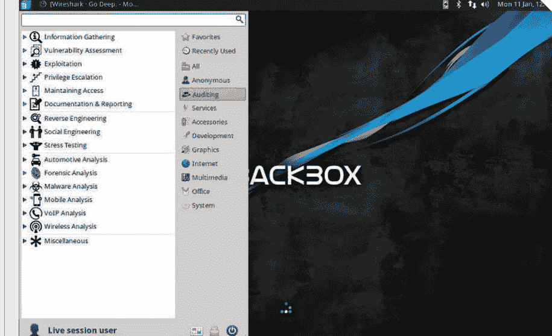

Wireshark 是一个著名的网络协议分析器。在分层方面，Wireshark 让你以详细的方式查看网络上发生的一切情况。Backbox 预装了 Wireshark，你只需要运行它即可看到操作。一旦激活，你可以在 GUI 上看到列出的网络。你可以选择任何接口来捕获（或“嗅探”）流经该接口的数据包。

> **Backbox 是一个基于 Ubuntu 的 Linux 发行版。** 它专注于网络安全，主要开发用于执行渗透测试和渗透漏洞评估。Backbox 预装了安全工具，如果你想扫描网络并检测任何威胁或漏洞，它会非常好用。

渗透测试可以被看作是古语“预防胜于治疗”的应用，或者是一种设计用于识别并获取对目标系统访问权限的软件攻击，然后尝试实现预定义的一组目标，以确定特定攻击的可行性，识别任何成功攻击可能产生的影响等。渗透测试还会跟踪目标系统的哪些防御被攻破，并需要加强。一旦测试结果汇总，将与相关团队共享，以确保所有安全漏洞都被修补。渗透测试是安全的重要部分。通过你 live DVD 上的 Backbox，你可以快速对目标运行渗透测试。

`Nmap`（网络映射）是一个扫描工具。你可以使用 `Nmap` 发现并识别网络上的主机和服务，从而构建网络地图。`Nmap` 可以向目标主机发送精心构造的数据包，然后分析响应。`Nmap` 有四大主要功能，第一个是服务检测，检查网络服务并识别远程设备上的应用程序名称和版本。最后，你还可以用 `Nmap` 进行操作系统检测。

`Scapy` 是一个用 Python 编写的 CLI 工具。它可以用于伪造或解码数据包，然后将其发送到网络中。

`BeEF` 代表浏览器利用框架。你可以通过其客户端攻击挂钩网络浏览器，来评估目标的实际安全状况。

`Fimap` 是一个 Python 工具，可以帮助你自动针对 Web 服务器的本地和远程文件包含查找、准备、审计和利用漏洞。

`Metasploit` 是一个渗透测试框架。你可以使用 `Metasploit` 针对各种机器执行漏洞代码。

`Kismet` 是一个用于 802.11 无线网络数据包捕获的入侵检测系统。

`Sqlmap` 自动化检测和利用 SQL 注入漏洞的过程，以对底层数据库进行指纹识别和访问。

`Ettercap` 允许你在局域网上模拟中间人攻击。`Ettercap` 通过拦截网络流量到交互模式以及通过第三方插件来工作。

`WPScan` 是一个 WordPress 漏洞扫描器。通过它，你可以检查第三方插件等的漏洞。

`Ophcrack` 允许你破解密码。

`OWASP ZAP` 是一个用于发现应用程序的安全测试工具。它可以帮助发现 Web 应用程序中的漏洞。

`Burp Suite` 是一个流行的 Web 渗透测试平台。它允许你拦截、修改和重发 HTTP 流量，是进行 Web 安全测试的利器。

## 备份与恢复

学习如何使用专为帮助您创建快速备份而设计的实时操作系统

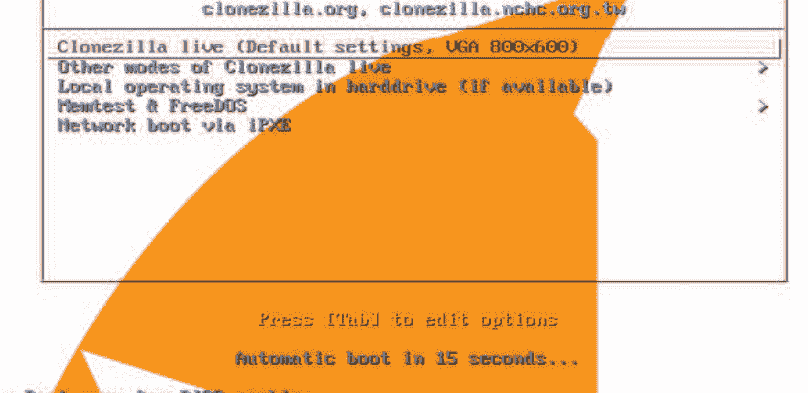

- BIOS 设置启动菜单

- Clonezilla 实时版版本 2.4.5-11-1666, (C) 2006-2016, NNHC, 台湾

免费软件实验室

国家高性能计算中心

台湾

`Clonezilla` 主要作为一种磁盘克隆程序开发。它还可以帮助您进行系统部署、裸备份和恢复。`Clonezilla` 有两种安装类型：`Clonezilla Live` 和 `Clonezilla SE`（服务器版）。Live 用于启动和恢复。`Clonezilla SE` 可用于多点备份和恢复部署。`Clonezilla` 可同时在 40 多台计算机上运行。若要开始使用，只需按照此功能介绍中的步骤操作即可。在下一页中，按下 Clonezilla Live 键启动。选择要克隆的驱动器。然后选择语言和命令行。选择“local”来决定您是想将磁盘保存为以后使用的镜像，还是直接将磁盘克隆到另一个磁盘。我们在这里使用磁盘镜像选项。选择“option-device”，系统将提示您选择位置，然后是地址和目标目录。在下一页中选择“browser”显示服务器数量。这将允许您选择想要复制的哪些部分。最后为磁盘镜像命名并选择源。

下一页将询问您想使用 Clonezilla 的 GUI 还是命令行。在这里，如果您希望驱动器是以 Linux 能够理解的文件系统格式化的，或者格式为 ext2, ext3, ext4, fat32 等，现在选择 opt-type 以进入 Clonezilla 向导。我们现在准备好克隆磁盘了。Clonezilla 还提供了其他克隆方式。

要从备份镜像恢复系统，从第一个分区开始，并导航到您选择“savedisk”（保存磁盘）的步骤。不要选择“savedisk”，而是选择“restoredisk”（恢复磁盘）。然后选择要恢复的镜像文件。最后，选择分区。确保它是已备份的，否则恢复过程将无法开始。它会开始的。

`Clonezilla` 允许您将备份保存在本地分区、硬盘或 USB 驱动器上。但您可以选择将镜像保存到另一个空间，或者直接不通过复制粘贴镜像到另一个网络设备。您也可以选择网络。在选择服务器时，Clonezilla 支持 Samba 和“samba”。注意，您需要为不记得分区的账户写入共享文件夹的密码和地址。但您可以进一步运行 further probe simple 或 further probe detailed。

# 使用 SYSTEMRESCUECD 修复并检索数据

使用 SystemRescueCd 让您放心，检索看似丢失的数据并恢复损坏的硬盘

Rightcipher 将识别扫描磁盘上已安装的文件系统

### 安全删除文件

系统在删除文件时仅移除指向文件的引用。文件实际上保留在磁盘上，直到它被覆盖。SystemRescue 提供了几种工具帮助使删除的数据几乎无法恢复。`Shred` 是这种安全删除文件以及整个分区或硬盘的方法之一。


SystemRescueCd 是一款基于 Linux 的救援和修复软件。它以实时操作系统的形式提供，因此您可以从 USB 驱动器、CD 或计算机镜像启动。如果您的计算机崩溃且完全无法启动，磁盘上就有您需要检索的重要文件。您可以插入您的 USB、CD 或伙伴的实时操作系统，然后将数据从损坏的驱动器复制到新驱动器。

在 SystemRescueCd 的第一个屏幕上，选择“Booting an else system installed on your hard drive”。一旦您访问了系统，就可以开始帮助运行命令。您需要识别安装系统的磁盘名称，例如，`/dev/sda`。如果您有其他磁盘，它也可能是 `/dev/sdb` 或 `/dev/sdc`。您可以使用 `further probe simple` 获取分区列表，然后获取磁盘名称。最后，在已安装 GRUB 的磁盘上运行 `grub-install`。这将重新安装 GRUB。

### 修复损坏的 GRUB

要修复 GRUB，您需要知道 Linux 安装的启动分区和根分区的名称。如果您的磁盘上有许多分区，那么您将。

# 使用 PORTEUS 诊断启动问题

通过采样 Porteus 提供的广泛选项来测试启动选项

```
1 SystemMenu: 内存全部可用 (虚拟)
2 SystemRescue: 磁盘上未安装配置文件
3 作为... 上的现有菜单
4 SystemRescue: 直接启动环境
5 ? 从下一项启动
6 从本地磁盘启动
7 标准 shell (keyboard0) 更多选项...
8 标准 shell (keyboard1) 更多选项...
9 备内核 (linux2) 更多选项...
10 备内核 (lxd6) 更多选项...
11 ? 从启动返回
```


虽然 SystemRescueCd 可以帮助您重新安装 GRUB 并从崩溃分区检索数据，但识别故障原因可能是困难的。有几种情况会阻碍启动过程，在重新安装 GRUB 或采取必要步骤之前，逻辑上应该先识别故障原因。如果在对系统文件进行某些更改后计算机突然启动，可以检查文件系统是否正常工作。然后在启动菜单出现时按 `Tab` 键编辑屏幕上的启动参数。使用方向键移动光标并删除该行文本，然后按回键启动 Porteus。通过重启计算机，可以撤销导致问题的更改文件。

# 从无法启动的 PC 备份数据

如果您想从崩溃的计算机检索数据，SystemRescueCd 可以帮助您。从实时磁盘使用 SystemRescueCd 后，找到数据所在的分区。您可以运行 `fdisk probe` 脚本。名称为

例如，如果数据位于 `/dev/sda1`，则名称为 `ntfs-3g /dev/sda1, /dev/sdb1, /dev/sdc1`，您将看到如 `/dev/sda1, /dev/sdb1` 等命名的 Linux 分区。

启动 SystemRescue 后，识别包含要检索数据的分区并将其挂载到指定点。

例如，如果您的数据在 `/dev/sda1` 中，则名称为 `ntfs-3g /dev/sda1 /mnt/data`。创建一个目录并以只读权限挂载分区。这只是为了确保我们不会意外删除数据。接下来，您需要配置网络，然后可以通过 SFTP 将文件从崩溃的计算机传输到远程计算机。最后，使用 `umount /mnt/windows` 卸载驱动器。

## 使用 TAILS 管理您的隐私

匿名浏览互联网并确保您的隐私完好无损

- Tails 是一个专注于隐私的即时操作系统。“Tails” 是“遗忘性隐身现场系统”（The Amnesic Incognito Live System）的缩写。“遗忘性”（Amnesic）意味着没有长期存储，一切都会被遗忘。隐身身份（Incognito）可以在任何时间点创建。

作为一种即时操作系统，一旦它从 DVD 启动，你电脑的内存就是 RAM。没有任何内容会被写入硬盘，这使得任何人都难以发现你活动的任何痕迹。

难道不是吗？Tails 经过了精心配置，即使存在交换空间，它也不会对你电脑的硬盘进行交换。这意味着当你关闭 Tails 时，一切都会消失。

同样重要的一点是，Tails 并不依赖于运行在你的电脑或即时 DVD 上的操作系统，因此你可以像使用其他电脑一样使用它。在关闭 Tails 后，电脑将以其通常的操作系统启动。


Tor 浏览器呈现了访问你的位置和其他个人数据的网站和服务。


| 启动 Tails |
| :--- |
| 现场 (安全模式) |

使用 Gmail 进行邮件加密

使用 Tails 的另一个大优势是以隐身模式访问互联网。Tails 使用 Tor 或 I2P 网络来保护你的在线信息。对于不可信信的网络，Tor 或 I2P 等是分布式网络，它们通过遍各地的中继网络中转你的连接。通过这种方式，任何监控你连接的人无法看到你访问的网站，而网站也无法追踪你的物理位置。所有软件都配置为通过 Tor 访问互联网。如果应用程序尝试直接连接互联网，它将被自动阻止。

要使用 Tor，只需从即时 DVD 启动 Tails 并打开 Tor。你可以像使用其他浏览器一样使用它。如果你想从 Tor 浏览器使用基于位置的服务，例如 Google Maps，你通常会看到地球另一端某处的服务器位置。

Thunderbird 与 Gmail 配合非常方便。由于 Tails 基于 Debian，Thunderbird 被用作默认电子邮件客户端。GPG 是一个可以安装在其之上的软件。如果你想使用 GPG 标准编写和接收签名和/或加密邮件。

Tails 支持 Tor 和 I2P 网络以提供在线隐私。这两者都旨在使用密码学方法保护你的身份，但它们在提供隐私的方法上存在几点差异。Tor 采用基于目录的方法，提供一个收集和分发网络信息的中心点。I2P 使用分布式数据库和对点选择。I2P 为开放互联网提供了更好的匿名访问，而 I2P 在网络层内提供了更健壮、更可靠的网络。它拥有更大的用户群，全球范围内有志愿者。

此外，请注意你的 ISP 可以看到你正在使用 Tor 或 I2P，尽管他们无法解密流量内容。为了向你的 ISP 隐藏这些信息，你可以使用高速 VPN 作为你匿名网络的入口。用于此功能的开源项目是 OpenVPN：https://openvpn.net/


### 使用 TAILS 进行隐私浏览

使用 Tails 的另一个大优势是以隐身模式访问互联网。Tails 使用 Tor 或 I2P 网络来保护你的在线信息。对于不可信的网络，Tor 或 I2P 等是分布式网络，它们通过遍遍地的中继网络中转你的连接。通过这种方式，任何监控你连接的人无法看到你访问的网站，而网站也无法追踪你的物理位置。所有软件都配置为通过 Tor 访问互联网。如果应用程序尝试直接连接互联网，它将被自动阻止。

要使用 Tor，只需从即时 DVD 启动 Tails 并打开 Tor。你可以像使用其他浏览器一样使用它。如果你想从 Tor 浏览器使用基于位置的服务，例如 Google Maps，你通常会看到地球另一端某处的服务器位置。

Thunderbird 与 Gmail 配合非常方便。由于 Tails 基于 Debian，Thunderbird 被用作默认电子邮件客户端。GPG 是一个可以安装在其之上的软件。如果你想使用 GPG 标准编写和接收签名和/或加密邮件。

## TOR 对比 I2P

Tails 支持 Tor 和 I2P 网络以提供在线隐私。这两者都旨在使用密码学方法保护你的身份，但它们在提供隐私的方法上存在几点差异。Tor 采用基于目录的方法，提供一个收集和分发网络信息的中心点。I2P 使用分布式数据库和对点选择。I2P 为开放互联网提供了更好的匿名访问，而 I2P 在网络层内提供了更健壮、更可靠的网络。它拥有更大的用户群，全球范围内有志愿者。

此外，请注意你的 ISP 可以看到你正在使用 Tor 或 I2P，尽管他们无法解密流量内容。为了向你的 ISP 隐藏这些信息，你可以使用高速 VPN 作为你匿名网络的入口。用于此功能的开源项目是 OpenVPN：https://openvpn.net/


## 你能帮助启发下一代代码员吗？

Code Club 是一个全国性的志愿者主导网络，旨在为 9-11 岁的儿童提供课后俱乐部。

我们一直在寻找具有编程技能的人士来担任志愿者，每周在当地的小学、图书馆或社区中心运营一小时俱乐部。

你可以与同事一起结队，会有老师在那里为你提供支持，并且我们提供你所需的所有材料，帮助孩子们对数字制作产生兴趣。

有许多参与方式！如需了解更多信息，请访问 www.codeclub.org.uk 加入我们。

## LinuxUser & 开发者特别订阅优惠

## 订阅 1 年免费赠第 2 年

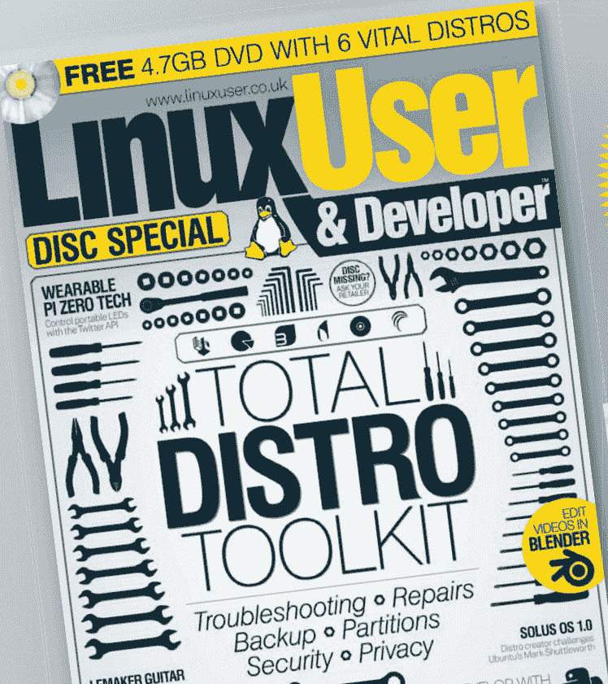

## 半价优惠

| 备份你的电脑备份 | 软件 |
| :--- | :--- |
| Blender | 高级编程项目的必备分步指南 |
SOLUS OS 1.0 发行版：各种基于 Ubuntu-Manjaro 的发行版

使用 Python 开发：针对网页、移动端、桌面服务的专业技巧

设置你的 Pi Zero


## 订购热线 | 在线订购 0844 249 0282

通话费用：每分钟 79p 加上你手机运营商的接入费。

www.imaginesubs.co.uk/lud


我们一直在寻找具有编程技能的人士来担任志愿者，每周在当地的小学、图书馆或社区中心运营一小时俱乐部。

你可以与同事一起结队，会有老师在那里为你提供支持，并且我们提供你所需的所有材料，帮助孩子们对数字制作产生兴趣。

有许多参与方式！如需了解更多信息，请访问 `www.codeclub.org.uk` 加入我们。

# LinuxUser & 开发者特别订阅优惠

## 订阅 1 年免费赠第 2 年


## 半价优惠

| 备份你的电脑备份 | 软件 |
| :--- | :--- |
| Blender | 高级编程项目的必备分步指南 |
| SOLUS OS 1.0 发行版：各种基于 Ubuntu-Manjaro 的发行版 |
| 使用 Python 开发：针对网页、移动端、桌面服务的专业技巧 |
| 设置你的 Pi Zero |


## 订购热线 | 在线订购 `0844 249 0282`

通话费用：每分钟 79p 加上你手机运营商的接入费。

`www.imaginesubs.co.uk/lud`

# LinuxUser & 开发者特别订阅优惠

## 1 年免费赠第 2 年

经过精心配置，即使存在交换空间，它也不会对你电脑的硬盘进行交换。这意味着当你关闭 `Tails` 时，一切都会消失。

同样重要的一点是，`Tails` 并不依赖于运行在你的电脑或即时 DVD 上的操作系统，因此你可以像使用其他电脑一样使用它。在关闭 `Tails` 后，电脑将以其通常的操作系统启动。


`Tor` 浏览器呈现了访问你的位置和其他个人数据的网站和服务


| 启动 Tails |
| :--- |
| 现场 (安全模式) |

使用 Gmail 进行邮件加密

### 使用 TAILS 进行隐私浏览

使用 `Tails` 的另一个大优势是以隐身模式访问互联网。`Tails` 使用 `Tor` 或 `I2P` 网络来保护你的在线信息。对于不可信的网络，`Tor` 或 `I2P` 等是分布式网络，它们通过遍遍地的中继网络中转你的连接。通过这种方式，任何监控你连接的人无法看到你访问的网站，而网站也无法追踪你的物理位置。所有软件都配置为通过 `Tor` 访问互联网。如果应用程序尝试直接连接互联网，它将被自动阻止。

要使用 `Tor`，只需从即时 DVD 启动 `Tails` 并打开 `Tor`。你可以像使用其他浏览器一样使用它。如果你想从 `Tor` 浏览器使用基于位置的服务（例如 Google Maps），你通常会看到地球另一端某处的服务器位置。

`Thunderbird` 与 Gmail 配合非常方便。由于 `Tails` 基于 Debian，`Thunderbird` 被用作默认电子邮件客户端。`GPG` 是一个可以安装在其之上的软件。如果你想使用 `GPG` 标准编写和接收签名和/或加密邮件。

## TOR 对比 I2P

`Tails` 支持 `Tor` 和 `I2P` 网络以提供在线隐私。这两者都旨在使用密码学方法保护你的身份，但它们在提供隐私的方法上存在几点差异。`Tor` 采用基于目录的方法，提供一个收集和分发网络信息的中心点。`I2P` 使用分布式数据库和对点选择。`I2P` 为开放互联网提供了更好的匿名访问，而 `I2P` 在网络层内提供了更健壮、更可靠的网络。它拥有更大的用户群，全球范围内有志愿者。

此外，请注意你的 ISP 可以看到你正在使用 `Tor` 或 `I2P`（尽管他们无法解密流量内容）。为了向你的 ISP 隐藏这些信息，你可以使用高速 VPN 作为你匿名网络的入口。用于此功能的开源项目是 `OpenVPN`：`https://openvpn.net/`


## 你能帮助启发下一代代码员吗？

`Code Club` 是一个全国性的志愿者主导网络，旨在为 9-11 岁的儿童提供课后俱乐部。

我们一直在寻找具有编程技能的人士来担任志愿者，每周在当地的小学、图书馆或社区中心运营一小时俱乐部。

你可以与同事一起结队，会有老师在那里为你提供支持，并且我们提供你所需的所有材料，帮助孩子们对数字制作产生兴趣。

有许多参与方式！如需了解更多信息，请访问 `www.codeclub.org.uk` 加入我们。

## 1. bash

我们的 `thread.c` 程序的输出显示了哪些线程正在运行

```
rMacBook:code mtsouk$ ./multipleArgs
Hello 1 from thread with Hello 4 from thread with Hello 0 from thread with thread ID 435263488
thread ID 4353171456.
thread ID 4352098304.
rMacBook:code mtsouk$ ./aThread
Thread 2 printing 1
Thread 1 printing 1
Thread 0 printing 1
Thread 2 printing 2
Thread 1 printing 2
Thread 0 printing 2
Thread 2 printing 3
Thread 1 printing 3
Thread 0 printing 3
Thread 2 printing 4
Thread 1 printing 4
Thread 0 printing 4
Thread 2 printing 5
Thread 1 printing 5
Thread 0 printing 5
```

`pthread_create()` 函数帮助在调用进程中创建新线程。它返回一个整数值，成功返回 0，错误返回非零。它的第一个参数是 `pthread_t`；如果调用成功，函数将返回新创建线程的 ID。如果失败，它将返回 `NULL` 并将 `errno` 设置各种错误属性。如果你使用 `NULL`，将使用默认属性创建一个新线程。新创建的线程将开始执行由第三个参数提供的地址函数。如果前面的函数带有任何参数，它们将通过第四个参数传递；否则，第四个参数为 `NULL`。传递单个参数如下程序中的代码所示：

### 线程进程

```
default: break;

if (err = pthread_create(&threadID, 0, 
fibThread, (void *)(n - 1))) {
	terr(err,"pthread_create");
}
if (err = pthread_create(&thread2, 0, 
fibThread, (void *)(n - 2))) {
	terr(err,"pthread_create");
}
if (err = pthread_join(thread1,returnValue)) {
	terr(err,"pthread_join");
}
```

```c
#include <errno.h>
#include <pthread.h>
#include <stdio.h>
#include <stdlib.h>
#include <unistd.h>

static void fibThread(void *arg) {

size_t n = (size_t)arg, fib;
int err;
pthread_t thread1, thread2;
void *returnValue;

switch (n) {

case 0: return (void *)0;
case 1: return (void *)1;
case 2: return (void *)2;
```

如果你继续思考线程，理解进程是什么以及它与线程有何不同至关重要。进程是一个包含代码、内存以及在运行时获取的其他类型资源的环境。相比之下，线程在控制范围上是的，并与进程共享某些资源。每个进程都从单个线程开始，但允许它创建更多线程。线程有时被称为轻量级进程。

进程创建一个带有其自己的控制的线程，但它与进程共享某些资源，即全局数据和其他资源，如文件描述符、信号处理程序等。线程不能被视为匿名实体。进程的所有线程与进程使用相同的内存，进程处理数据的方式具有前所未有的重要性。另一方面，进程之间是完全独立的，无法轻易通信。

## 线程教程

> 仅仅启动新线程是不够的；通过四种方式之一正确地终止它也很重要

```c
fib = ( size_t)fibReturnValue;
if ( err == pthread_create(thd0, &returnValue))
 err(err, "threadjoin");
fib += ( size_t)fibReturnValue;
```

```c
size_t fib_size(size_t n) {
  return (size_t)(void *)n;
}
```

```c
int main(int argc, char **argv) {
  unsigned long i =0;
  for (i=0; i<TOTALTHREADS; i++)
    printf("%lu\n", fib(i));
  return 0;
}
```

带有多个参数需要一种特殊技术，如多个 (`multiples.cs`) 所示：

```c
#include <stdio.h>
#include <pthread.h>
#include <stdlib.h>
#include <unistd.h>

#define TOTALTHREADS 3
```

```c
struct data {
  int threadNumber;
  int n;
  char *message;
};

struct data threadArray[TOTALTHREADS];
pthread_t threadID[TOTALTHREADS];
```

```c
void *threadData(void *arg) {
  struct data *myData = (struct data *)arg;
  int id = myData->threadNumber;
  printf("%d with thread : %s\n", id, myData->message);
  printf("thread %d\n", id);
  return 0;
}
```

```c
int main(int argc, char **argv[]) {
  int i = 0;
  for (i = 0; i<TOTALTHREADS; i++) {
    threadArray[i].threadNumber = i;
    pthread_create(&threadID[i], NULL, threadData, &threadArray[i]);
    threadArray[i].message = "Hello";
  }
  for (i = 0; i<TOTALTHREADS; i++) {
    pthread_join(threadID[i], NULL);
  }
  return 0;
}
```

```c
sleep(5);
return 0;
```

作为 `pthread_create` 第三个参数使用的函数原型必须是：

```c
void *threadData(void *arg)
```

记住，线程可能不会按照它们创建的顺序执行——这取决于你系统的调度算法。如果你有许多需要顺序执行的线程，请仔细编写你的代码。

## 线程属性

当你创建一个新线程时，你可以定义它的一些属性：分离或可连接的、状态继承、调度、调度策略、参数、竞争、栈大小、栈保护。这些属性用于初始化和销毁线程对象。

## 创建线程

线程是一个 `pthread_t` 数据类型，可以被识别为一个结构体。你不应该将其视为整数或使用指针 (`pthread_equal`)。该函数接受两个参数，都是线程指针，并返回两个值（创建的线程 ID 和一个错误值）。有一个名为 `pthread_self()` 的函数，它返回当前线程的线程 ID。这是

下面的示例使用循环在屏幕上打印内容。它创建了三个独立的线程——每个线程打印五个整数，打印的整数总数为 15。由于三个线程被编号为 0、1 和 2，每个线程还会打印它的编号，以便你能够区分每个线程的执行情况。

### Go 中的线程

此程序展示了一个 Go 示例——一种现代且功能强大的编程语言。现在我们使用 goroutine，它们比线程要轻得多。正如你所看到的，你可以使用关键字在 goroutine 中执行函数，它将并发执行。Go 程序管理内存函数就像线程一样。与线程版本的直接示例相比，这里使用的是 goroutine。这是一种非常实用且简单的方法！

`thread.c` 的源代码可以在下所示，由于 `thread.c` 是一个典型的 C 程序，它需要……（此处省略了原文中重复的句子）

## 线程的优缺点

线程并非万灵药，它们并不适用于解决任何类型的编程问题。使用多线程带来的益处是：编程抽象、并行性、输入/输出以及内存节省。创建一个线程的开销几乎为零，而创建一个新进程则有相当的开销，但它需要父进程的约束。

线程可以与其所属进程中的其他线程直接通信，而与兄弟进程通信则需要使用进程间通信。在控制子进程时，相对于同一进程的线程可能会产生巨大的开销。通常，你为线程需要付出的代价是编写带有同步机制的代码。

> 由你来决定在你的程序中使用线程是否值得增加额外的复杂性

```c
int main(int argc, char **argv) {
    unsigned long i = 0;
    for (int i=0; i<16; i++) {
        printf("%lu\n", fibonacci(i));
    }
    return 0;
}
```

`fiboThread` 的代码比包含在程序中的 `fiboc` 要复杂得多。由你来决定在程序中使用线程是否值得增加额外的复杂度。我们建议添加变量来监控操作的变化，然后做决定。

## 尝试与评估

这部分将实现两个版本的程序：一个使用线程（`fiboThread.c`），另一个使用线程（`fiboc.c`），并比较它们的性能。程序的主要功能将是相同的算法；两个程序都将使用相同的斐波那契算法。`fiboThread` 的代码列在第31页。以下显示了代码：


```c
#include <stdio.h>
#include <stdlib.h>
#include <pthread.h>
#include <unistd.h>

size_t fibonacci(size_t n) {
    if (n == 0) {
        return 0;
    }
    if (n == 1) {
        return 1;
    }
    if (n == 2) {
        return 2;
    }
    return fibonacci(n-1)+fibonacci(n-2);
}
```

```bash
$ time ./fibo
real 0.005s
user 0.001s
sys 0.000s
$ time ./fiboThread
real 0.310s
user 0.002s
sys 0.000s
```

请注意，`fiboThread` 的性能差于 `fiboc`。然而，在程序中使用线程的好处是，当一个线程执行其任务时，它可以执行其他事情，特别是当运行其他线程时。在 `fiboThread` 内部，你可以看到如何使用 `pthread_join()`。你指定想要等待的线程 ID，并将其返回值存储在指定的变量中。`pthread_join()` 的主功能是在当多个线程同时尝试加入同一个线程时，分别进行阻塞。

## Perl 中的线程

Perl 使用模块来提供对线程的支持。`weThread` 程序演示了如何使用线程。代码的第一部分创建了一个线程；你可能需要回收它。

`(start)` 方法创建一个新线程并调用该函数。一旦启动，`sleep()` 调用是必要的，因为它给线程留了足够的执行时间。如果程序提前退出，前两个线程将没有足够的时间打印所需的消息。

Perl 的实现很难误用，但它很慢。每个线程都使用自己的 Perl 解释器，因此线程被称为解释器线程。正如你所理解的，它们的行为类似于处理器。

```c
pthread_create(&threadID, 0, fiboThread, (void*) -1 )
```

此外，你可以看到如何向将调用的函数传递参数，分别是 `pthread_create()` 的第一个和第三个参数：

因此，此 `pthread_join()` 使用线程变量调用了新线程的线程 ID，这不会更改线程属性，使线程执行 `fiboThread()` 函数并将 `(-1)` 数字作为参数传递给 `fiboThread()`。由于 `fiboThread` 函数的声明，需要 `(void*)` 情况。

| 线程 1 | 线程 2 |

| :--- | :--- |

| 等待 | 等待 |

| 锁定 | 锁定 |

| 资源 2 | 资源 1 |

线程 1 锁定并等待资源 2，而

线程 2 锁定并等待资源 1，

## 高级线程

在这里我们将介绍如何实现一个更实用的程序，该程序使用 C 结构体向线程传递多个参数。详情请参阅 `multargs.c`。

你应该注意的第一点是，每个线程使用该结构的单个实例；你应该决定需要多少个线程。生成的线程 ID 存储在数组中。

此外，我们使用 `TOTAL_THREADS` 来跟踪正在使用的线程数量；将使用全局变量来存储线程数。当你启动一个线程时，应该增加 `TOTAL_THREADS` 的值。

在 `main()` 函数返回并结束程序之前，`sleep()` 调用是非常重要的，因为它允许线程完成它们的工作。使用 `sleep()` 或 `wait()` 以看到 `printf()` 函数的输出。

在 `create()` 函数中，最后一个参数不是 `NULL`，而是指向感兴趣结构的 `(void *)` 指针。有趣的是，可以看到指向结构的 `(void *)` 指针是如何在同样被传递的 `pthread_create()` 的 `arg` 参数内部捕获的。

```c
struct threads *myArgs = arg;
```

# Blender

- 下一个命令 `apt-get update` 会从仓库下载包并更新它们，以获取软件包及其依赖的最新版本信息。最后，`install blender` 将使用默认设置下载并安装 Blender 到你的系统上。

要生成 3D 模型。要更改视图，请点击 3D 视图编辑器（左下角）上的“视图”（View）。你将看到一个对象列表，它们提供了各种视图以及相应的快捷键。这些视图可以帮助你找到你想要的内容，或者在特定的侧面选择对象。

## 02 Blender 首页

一旦在系统上打开 Blender，你将看到 3D 视口。这是一个基础场景，由一个立方体、一个灯光和一个相机组成。立方体是一个基础网格对象，仅为了给你提供一个开始的起点。你可以添加新项目，并在以后根据需要移动它们。灯光用于照明场景，相机对于帮助你进行可视化是必不可少的。

让我们学习如何添加对象。执行此操作，点击屏幕上你想添加对象的地方，并从底部 3D 编辑器的下拉菜单中选择对象类型。选择一种对象类型。你会看到场景中到处都有可创建的不同类型的对象。左侧的工具栏包含选择特定对象的工具。你可以按意愿逐级移动对象，但让我们先熟悉这里的内容。

## 03 基础功能

我们已经看到 Blender 默认页面具有光源生成器，可以帮助你构思动画。你也可以随心所欲地操作视图。这是最重要的能力之一。要移动对象，只需点击代表轴的三个箭头之一并沿着轴拖动。你也可以在选择对象后通过按下 R 键并配合 X、Y 或 Z 键来在特定方向上旋转对象。

### 刀具工具 (Knife tool)

Blender 中另一个实用的工具是刀具。它允许你将对象切割成碎片。它还允许你选择新边缘的起始和结束位置，穿过你想切割的所有对象画一条线。

### 移动对象

要移动对象，你需要先选中它。按住 G 键然后左点击对象来选择对象。一旦选中，你就可以将其拖到某个位置。视口中的所有对象（包括灯光和相机）都有几种移动方法。你可以以自由形式或沿轴移动它。要沿特定轴移动，按 G 然后按 X、Y 或 Z。如果你愿意，左点击以放置对象。

### 循环切线和工具 (Loop cut and tool)

要沿一个方向分割对象，请使用循环切线（Loop Cut）工具。该工具仅对对象的一组特定面有效，并且可以滑动特征。激活循环切线后，你能够悬停在一组特征上，并用鼠标左点击来确认选择。

## 05 对象模式与编辑模式

到为止，我们一直都在对象模式（Object Mode）下工作。这是默认模式，允许你从全局尺度上操作对象，你可以编辑并移动对象。当你想要编辑对象本身时（例如更改顶点的形状和位置），通过选择 3D 视图编辑器中“对象模式”的下拉菜单将 Blender 模式切换到编辑模式（Edit mode）以进入新模式。

在编辑模式下，你现在可以在对象模式和编辑模式之间切换。在编辑模式的主界面，之前在对象模式中选中的对象现在由顶点、边和面表示。你可以通过在 3D 视图编辑器底部和右侧选择相应的选择工具来选择其中任何一个。按住 Shift 键并点击右键可以让你选择多个同一特征的实例。再次，你可以按 A 键来取消选择所有选中的对象。

## 06 操作对象大小

如果你正在设计一个想要按现实比例的 3D 模型（例如公制或英制比例），你需要更改单位。

## 07 特定尺寸选项

如果你正在设计一个想要按现实比例的 3D 模型（例如公制或英制比例），你需要更改单位。

在属性面板中，如果你在对象模式下，你也可以通过鼠标来拉伸或缩放，这非常困难。如果你在 3D 空间中画线，Blender 提供了非常实用的属性面板。

在这个面板中，点击“场景”（Scene）选项卡，可以调整对象的缩放因子。公制单位是米，英制单位是英尺。你可以根据需要调整这些来改变对象的尺寸。例如，公制单位是米，英制单位是厘米。

在对象模式下，你也可以通过面板来更改对象的尺寸，而不影响其他部分。这个面板可以用于指定每个面的位置和旋转。

## 挤出对象

挤出（Extruding）是一种 3D 建模技术，用于某个特征，例如对象的侧面或一组顶点，这些可以从当前位置延伸。要挤出对象，进入编辑模式并选择你想挤出的特征。然后你也可以通过点击工具栏中的“挤出区域”（Extrude Region）或按下 E 键来挤出整个区域。这可以通过左点击来挤出特定区域，或者返回原始位置。

## 分割 (Bisect)

Blender 有多种可用工具进行分割。其中一种工具叫做二分（Bisect）。它将对象切割为一个或多个部分。要执行此操作，在编辑模式中选择所需的面或边，并跨过面画线以在选定的顶点上创建新边。一旦我们分割了对象，我们将看到一些可见内容，例如屏幕上的线条。然后工具栏将是二分菜单。你可以调整二分线的位置以及其他特征。“清除外部”（Clear Outer）和“清除”（Clear）选项允许我们消除二分边缘的一侧或另一侧，“填充”（Fill）选项将放置一个连接二分边缘的面。

## 合并和分离对象

合并和分离对象是实用的技巧，用于确保对象彼此之间保持固定关系，或者分别保持它们之间的关系。

要合并两个对象使 Blender 将其视为一个对象，如果它们没有物理接触，请进入编辑模式并右点击对象来选择它，然后按住 Shift 键并右点击其他对象。按下 Ctrl+J。选中的对象将获得黄色轮廓，你就可以移动、缩放和旋转它们。如果你合并了对象（对象的两个部分）并在以后想要分离它们，进入编辑模式并选择你想分离的部分。如果你选择一个特定特征并按 L 键，Blender 将选择与该特征相关的所有特征，它足够足够区分两个对象之间的面，即使像一个小立方体连接到大立方体上。

# MonoGame 教程

## 在 MonoGame 中利用着色器的威力

使用可编程图形流水线为各种令人惊叹的效果开启了大门。

图形编程是历史边缘重演的一个绝佳例子；然而，开发者曾需要手动创建整个渲染流水线。随后，GPU 硬件的进步向世界引入了“固定流水线”的概念：这是一个根据预定义函数自动处理各种图形变换的系统。

由于涉及数学知识，着色器编程并非易掌握，但它以极低的成本极大地提高了真实感，这种努力是完全值得的。因此，话话不多说，让我们开始吧。

尽管这种设计模式显著提升了性能，但开发者仍需通过操纵图形流水线的各个步骤来适应其局限性。

以下步骤基于上期中演示的 LUD 猴子模拟器。它的逻辑并不重要——我们的第一步涉及添加着色器文件。

MonoDev 的内容流水线涉及在 Windows 下创建 `.fx` 文件。要构建这些文件，请在记事本或简单编辑器中创建一个新文本，并提供后续步骤中讨论的文本。

GPU 厂商通过引入可编程图形流水线解决了这个问题。它与固定流水线的不同在于允许开发者影响着色器元素，而无需管理硬件加速。

现代 GPU 包含数百个着色器处理器。这在很大程度上增加了集成度，需要使用简化后的汇编语言，该语言通常由编译器使用类似 HLSL 的 C 类语言生成。

首先，全局参数有：

- `float4x4 World`;

- `float4x4 View`;

- `float4x4 Projection`;

几何结构负责将单个骨骼从坐标系转换为最终场景的坐标空间。这是通过以下方式实现的：


一系列矩阵乘法，参数通过系统参数传递到着色器中。

```
VertexShaderOutput VertexShaderFunction(VertexShaderInput input) {
VertexShaderOutput Output;
float4 position = mul(input.Position, World);
float4 viewPosition = mul(position, View);
float4 output = mul(viewPosition, Projection);
return output;
}
```

着色器通过沿渲染流水线传递结构体相互通信。在我们的着色器示例中，如下：

```
struct VertexInput {
float4 POSITION;
};
struct VertexOutput {
float4 POSITION;
};
```

仔细观察用于单个元素的三段式声明。前两个来自 Normal（法线），而中的第三个被称为语义（语义）。

它还涉及数据在 GPU“数据流”中的放置。在 GPU 中，颜色和类似的数据存储在特殊通道中——设置标志位允许硬件智能地使用着色器的结果。此外，结构体会自动提供信息。通过使用 SV_Target 针对各种不同的语义及其类型来处理 Windows 桌面。

我们的像素着色器负责激活最终存储在显存中的单个颜色。它通过添加语义，以这种方便的方式告知 GPU：

```
float4 PixelShaderFunction(VertexShaderOutput input) {
SV_TARGET0;
return float4(1, 1, 1, 1);
}
```

最后，我们可能会考虑由着色器组打包成组的技术组——在运行时，开发者选择哪一个进入 GPU：

```
Technique Ambient {
pass PassI {
VertexShader = compile vs_3_0
VertexShaderFunction();
PixelShader = compile ps_3_0
PixelShaderFunction();
}
}
```

启动资源编译需要：在 `.fx` 文件的情况下，它被添加到 ExternalContent 项目中。右键点击并选择选项 > Adding（添加）。接下来，使用 CommonDialog 窗口找到 `.fx` 文件。

在编译着色器时，目标平台至关重要。这必须在全局级别设置：在 Settings > Platform to Linux 中找到引擎。对应的图片显示了项目应该是什么。Build > Build 保存项目——在某些情况下，项目将带有控制台中的消息失败。

构建于 2023-09-15 12:35:22

```
C:/Users/W/Desktop/DesktopContent/ShaderEffect.fx:
Error "ProcessorEffect" had expected failure
System.DllException: could not load 'dcompiler_43.dll' (HRESULT: 0x8007000)
```

如果发生这种情况，请在 microsoft.com 找到 vertex-sdk，下载并将其安装到 VR。之后，运行-setup 并按照安装向导的说明安装 DirectX。最后，生成的生成 (xl1) 必须复制到托管在 Linux 工作站上的项目内容文件夹（Image/Game/Code/Content），将它们拖入 Content 文件夹，并将 Copy to directory 设置为。

移动并操作……

在运行时，资源系统中包含一个缓冲区。我们在 LoadContent 中加载着色器，以下是相关更改：

```csharp
public class Game1 : {
Effect myEffect;
protected void LoadContent() {
myEffect=Content.LoadEffect("effect");
}
}
```

Mono 在运行时验证着色器的兼容性。如果由于使用的 MonoGame 发行版报错，请检查 Packages 文件夹中的 MonoFramework 程序集并选择 Update 选项。到为止，渲染是基于 BasicEffect 的。它是框架范围内的实体，包含一组令人赞叹的——高度优化的——方法，用于将元素带到屏幕上。我们用以下片段替换渲染代码以启用自定义着色器：


## 向量乘法

组合向量时，不同的方向可能产生不同的返回值。点积乘以两个幅值，连接角度的弦值结果可以确定角度。


www.linuxuker.com

# MonoGame 教程

## 智能调试

由于着色器的性质，无法进行正常调试：对于数百万像素来说，它是安全的，除非在不满足条件的特定像素上运行。在这种情况下，屏幕将向你显示有关内部状态的价值信息。

```csharp
protected override void Draw(GameTime gametime) {
myArray.Draw(aView, aProjection, myEffect);
foreach(ModelClass c in mybatis) {
 c.Draw(aView, aProjection, myEffect);
}
}
```

在 ModelClass 中，此方法经过修改，以使用传入 aEffect 属性的 effect：

```csharp
public void Draw(Matrix matrix, Matrix projection, Effect effect) {
  foreach(Mesh mesh in mesh.Meshes) {
    foreach(MeshPart part in mesh.MeshParts) {
      part.Transform = effect.Parameters["World"];
      effect.Parameters["WorldTransform"].SetMatrix(matrix);
      effect.Parameters["View"].SetMatrix(aView);
      effect.Parameters["Projection"].SetMatrix(projection);
    }
    mesh.Draw();
  }
}
```

裁剪（clipping）确保超过其值会被截断，而不会在内部回绕。

## 让光亮起来！

将数学保持尽可能简单将我们限制在漫反射照明上。它需要法线信息，可以通过修改 VertexShaderInput 从 GPU 请求这些信息：


```csharp
struct VertexShaderInput {
  float4 Position : SV_POSITION;
  float4 Normal : NORMAL;
}
```

此外，还有几个用于光照方向的参数。它们的作用是简化着色器的调整：

```csharp
float4 WorldInverseTranspose;
float3 DiffuseDirection = float3(1, 0, 0);
float4 DiffuseColor = float4(1, 1, 1, 1);
```

顶点着色器负责使用三角函数计算光照强度：

```csharp
struct VertexOutput {
  float4 Position : SV_POSITION;
  float4 Normal : NORMAL;
}
```

```csharp
float4 Position = mul(Position, World);
float4 position = mul(position, View);
float4 output = mul(position, Projection);
```

```csharp
float4 Normal = mul(Normal, WorldInverseTranspose);
```

```csharp
float light1 = dot(normal, lightDirection);
DiffuseDirection;
```

```csharp
float4 Color = saturate(DiffuseColor * 0.9 * light1);
```

```csharp
return output;
}
```

## 添加一些光照

光反射的真实建模通过称为光线追踪的过程处理。它模拟了从各种光源发射的光束，并创建了极其真实的场景。遗憾的是，这项技术并不适合实时游戏的需求，因为光线追踪每帧可能需要花费几分钟。着色器通过三段式光照方法解决了这个问题，从而导致了真实的场景：

环境光来自各种光源：从白色墙上反射的阳光，以及示波器光、偶尔出现的纵火犯火光。我们的轮廓光将其视为常数，占据单个像素总强度的 10%。

漫反射光来自某些光源：透过窗户射入的真实世界光；在这种情况下，照明的强度由物体和光源之间的角度定义。

最后，高光代表了如激光笔或聚焦聚光灯的光源。物体的实际价值由三个光源计算：

```csharp
struct VertexShaderOutput {
  float4 Position : SV_POSITION;
  float4 Color : COLOR;
}
```

```csharp
float4 PixelShaderFunction(VertexShaderOutput input) : SV_TARGET
```


左光、表面和材料相互作用，反射出感知为颜色的光，这里通过简化假设进行建模。

### 高光反射 (Specular)

### 漫漫反射 (Diffuse)

### 环境光 (Ambient)

```cpp
return saturate(input.Color + float4(0, 0, 1, 0.25));
```

```cpp
foreach (ModelMeshPart part in mesh.MeshParts)
{
  part.Effect = anEffect;
```

使用内容管道更新着色器文件。我们的模型类需要一些微改，以便为效果提供更多参数：

```cpp
anEffect.Parameters("World").nSetValue(myWorldMatrix);
mesh.MeshBone.Transform();
anEffect.Parameters("View").SetValue(myView);
anEffect.Parameters("Projection").SetValue(myProjection);
Matrix worldInverseTransposeMatrix = Matrix;
Transpose(Matrix.Inverse(myWorldMatrix * mesh.MeshPart.Transform()));
anEffect.Parameters("WorldInverseTranspose").SetValue(worldInverseTransposeMatrix);
```

```cpp
anEffect.Parameters("DiffuseLightDirection").SetValue(new Vector3(1,1,1));
anEffect.Parameters("DiffuseColor").SetValue(new Vector3(1,1,1));
```

```cpp
anEffect.Parameters("World").SetValue(myWorldMatrix);
mesh.MeshBone.Transform();
anEffect.Parameters("Projection").SetValue(myProjection);
Matrix worldInverseTransposeMatrix = Matrix;
Transpose(Matrix.Inverse(myWorldMatrix * mesh.MeshPart.Transform()));
anEffect.Parameters("WorldInverseTranspose").SetValue(worldInverseTransposeMatrix);
```

现在是时候运行了。所有对象的轮廓将是黑色并带有轻微色调——这个问题源于本教程上一个实例创建的模型缺少法线（normals）。用更新后的部分替换光秃秃的模型——如下所示最终、正确的渲染代码版本：

随着时间的运行，MonoGame 存在一个小问题，会导致着色器默认值“丢失”。如果在学习本教程期间着色器运行异常，请尝试先从你的 C# 代码中覆盖默认值，以确保其不会与 BasicEffect 产生的视觉质量匹配。

尽管本教程中展示的代码已让我们了解了一些重要概念。MonoGame 系列的下一个教程将涉及通过技术性纹理创建更真实的视觉效果……

# MariaDB 教程

## 切换到 MariaDB 数据库服务器

### 开始使用最流行、增长最快的开源数据库系统


对于那些开源软件、不倾向于使用为大公司设计的 mysql 客户端的人，请学习 MariaDB 作为一种极的数据库选择（它和 MySQL 一样，现在由 Oracle 所有），所以如果你学习了其中一个，就可以在它们之间轻松切换。如果你的服务器上没有安装 MariaDB，请使用 root mysql 客户端或从 MariaDB 网站下载。

| name | VARCHAR(50) | rating INT | ingredients VARCHAR(255) | instructions TEXT |
| :--- | :--- | :--- | :--- | :--- |

Russell J. D. Tyler 工作于 MySQL 公司。作为 MySQL, Inc. 的课程和内容经理，他是《The MySQL Reference in a Netherlands Line MySQL and MariaDB》的作者。

此语句创建了一个名为 'recipes' 的表，具有五个字段、列或行。它有一个整数列类型。值将自动设置并递增。食谱名称的数据是变宽字符，最多可

## 连接到 MariaDB

我们注意到列名在这里以大写字母显示，而表名是小写。这是文章中使用的一种约定。关键字区分大小写，但表名和列名在 Linux 上是不区分大小写的。

```bash
mysql --user --password
```

要查看我们创建的表，输入此 SQL 语句：

```sql
SET PASSWORD FOR 'root'@'localhost' = PASSWORD('password');
```

MariaDB bit.ly/tc8db

MariaDB 仓库 bit.ly/itDRby

```sql
DESCRIBE recipes;
```

替换 root 用户密码。

要删除所有数据，可以使用 DROP 语句，加上表名。请小心，因为此操作不可逆。

## 创建结构

## 数据

数据库的基本结构很简单——表以及它们可以包含的数据。对于这里的示例，让我们为烹饪食谱和其他信息创建一个数据库。我们将其命名为 'kitchen'。在 mysql 客户端内部输入：

让我们向 'recipes' 表输入一些数据。我们将使用 INSERT 语句。输入：

# INSERT INTO recipes

```sql
CREATE DATABASE kitchen;
USE kitchen;
```

(name, rating, ingredients, instructions)

('Boiled egg', 2, 'water', 'Full small with water.')

第二个语句将 'kitchen' 设置为默认数据库，顺便说，你可以多行使用 SQL 语句。在输入分号并按回车之前，没有任何内容会被发送。

我们现在准备好运行了。所有对象的轮廓将是黑色并带有轻微色调——这个问题源于本教程上一个实例创建的模型缺少法线。用更新后的部分替换光秃秃的模型——如下所示最终、正确的渲染代码版本：

```sql
CREATE TABLE recipes (
  id INT AUTO_INCREMENT PRIMARY KEY,
  name VARCHAR(50),
  rating INT,
  ingredients VARCHAR(255),
  instructions TEXT
);

INSERT INTO recipes (name, rating, ingredients, instructions)
VALUES ('Boiled egg', 2, 'water', 'Full small with water.');

DESCRIBE recipes;
```

在这里的第二个 SQL 语句中，你可以看到另一个可以使用的运算符。我们正在更改 'category' 值为空的行。这运行良好良好。我们没有输入 'dinner'，而是告诉 MariaDB 仅更改 ENUM 列中的第二个值。只要你知道如何使用接受的 NULL 语法。

> 多个较小的表的执行速度比一个大表快。毕竟，这是一个数据库系统，而不是电子表格程序。

我们的 'category' 列只有五行数据和几列内容。我们可以将其删除。与其多次创建分类，不如创建一个单独的表，并将 'recipes' 表中的 category 列转换为代码（注：此处可能指 ID 关联）。要实现这一点，我们将使用后续的 `ALTER TABLE` 语句来修改 'recipes' 表：

```
ALTER TABLE recipes
ADD column cat_id INT category;
```

这将添加一个新列 `cat_id`，它是一个整数类型，并将位于表中 'category' 列之后——我们将数据迁移到这里。这些值将对应到另一个我们称为 'recipes_categories' 的表中。让我们通过在屏幕上输入以下内容来创建该表：

```
CREATE TABLE recipes_categories
(cat_id INT AUTO_INCREMENT KEY, category CHAR(25));
```

让我们向表中插入一些值：

```
INSERT INTO recipes_categories(category)
VALUES ('Breakfast'), ('Lunch'), ('Dinner');
```

```
SELECT * FROM recipes_categories;
```

| cat_id | category |
| --- | --- |
| 1 | Breakfast |
| 2 | Lunch |
| 3 | Dinner |

这有两个表并使用代码可能看起来有点困惑，但不用担心。当你看到这两个表在一起时，它会更有意义。让我们从 `JOIN` 子句中检索数据：

```
SELECT name AS Recipe, category AS Type
FROM recipes
JOIN recipes USING(cat_id);
```

| Recipe | Type |
| --- | --- |
| Hard Boiled Egg | Breakfast |
| Toast | Breakfast |
| Pancakes | Breakfast |
| Biscuits | Breakfast |
| Chicken | Dinner |

注意，我们只输入了一个 SQL 语句。你只需要将每个行分的值的值放在用逗号分隔的列表中即可。我们可以通过这种新方法添加更多分类。让我们将 'recipes' 表中的 category 列迁移到代码。我们将 'Breakfast' 分类的 `cat_id` 值设为 '1'。我们将使用 `UPDATE` 语句设置其他食谱的 `cat_id`。我们将使用 'Dinner' 分类的 `cat_id` 来更新晚餐食谱。

让我们来看这条语句。`JOIN` 子句指定了一个表和另一个表。你所使用的 `JOIN` 子句指定了连接两个表的列。在这个例子中，两个表中都有一个名为 cat_id 的列。注意，我们选择的值（'name' 和 'category'）是来自两个表的。我们正在从两个表中将它们关联。

这看起来可能为了很小的结果付出了太多精力。因为你将使用包含大量数据的表。想象一下被引表有数千行和列。主表也有数千行。在主表中输入单个代码比在事情上出现问题要简单、更快。

更改被引表中的一行比更改每个主表中的数据要简单、更快。此外，多个较小的表的执行速度比一个大表快。毕竟，这是一个数据库系统，而不是电子表格程序。因此，在适当的情况下使用多个表并在需要时连接。

这设置了 'recipes' 表中 'category_cat_id' 的值。现在让我们删除 'recipes' 表中的 'category' 列：

这是 MariaDB 的基础入门。你可以通过 mariadb.com/en/mariadb/sql/ 命令了解更多关于 MariaDB 的文档，或者通过《Learning MySQL and MariaDB》（Reilly Media）。

# 误报教程

## 在你的安全分析中识别误报

证明一个安全问题是误报还是真实事件是任何系统管理员的技能。

信息安全是一个领先且要求专业知识领域。许多书籍都会教你如何防御自己的系统不被黑客入侵，但安全事件仍然会发生。要判断是否为误报，分析日志文件中的信息；你被要求检查每个事件并得出结论？这是最困难的任务，但幸运的是，偶尔并非如此。你面临的两种情况是，通过 Linux 浏览器或像 Vim 这样的编辑器添加。在调查网络攻击时，发现误报是非常常见的。

Toni Castillo 拥有软件工程学学位，在加利福尼亚大学担任 IT 支持工程师。服务器证书已经生成，其 SHA-1 指纹已设置在每个 Linux Box 上。真正意识到中间人攻击的系统管理员决定使用创建的 hosts 文件。

在他的博客上：

```
rdp server_fab23:36:ac1:a3:57:65:d9:04:59:de:a4:c5:e6
```

## 绝不是中间人攻击

- bit.ly

FreeRDP 10

bit.ly/ajit

然而，系统管理员收到了来自 Debian 关于无法连接到 RDP 服务器的消息。其中一个附了截图，使得系统管理员阶段

bit.ly/fv0

rdp 服务器的密钥已更改chkrootkit.org

```
************************************************
WARNING: 身份已更改！
可能发生了什么！
有人现在正在监听你
```

```
************************************************
WARNING: 身份已更改！
你确定要继续吗？
```

你的第一个事件是部署的 Windows RDP-server 连接到 rdp server:192.168.1.100:3389。左侧显示的错误是右侧函数的结果：

```c
void find_function(const char *fingerprint, const char *target) {
	int i;
	for (i = 0; i < strlen(fingerprint); i++) {
		if (fingerprint[i] == target[i]) {
			printf("match found at %d\n", i);
		}
	}
}
```

找到此 C 代码

找到此函数版本：

调用此函数的函数：

找到文件

包含此函数的函数：

（中间人攻击！）主机密钥可能刚刚更改了。远程主机发送的主机密钥指纹为 b2:36:96:ca:a1:43:a7:65:d9:d4:59:d0:e4:6bc。

首先：你需要确保服务器证书是有效的。这个过程取决于你使用的操作系统或软件，但通常通过 getclient 获取指纹是可行的：

```
# getclient -p 389 rdp_server
fingerprint 2c1ac3a3b575d5de6d0a6ebbc
```

一旦你验证了证书，就可以通过电话、电子邮件等连接它。运行后，你会注意到第一个字节 0xFA 是 Remmina 报告的指纹。这触发了误报吗？毕竟这是一个软件漏洞。如果你通过 SSH 会话使用 Remmina 直接连接到 Linux Box，或者获取源码并使用调试工具进行编译，这将更便于你分析问题。

```
# apt-get install remmina
# cd remmina-1.0
# CFLAGS="-gdb" ./configure & make
```

一旦编译了 Remmina，在 GDB 中执行它：


然后，当你连接到 RDP 服务器时，你必须在 `gdb` 中中断指纹交换，并将指纹与 `known_hosts` 文件进行比较。通过这种方式，`gdb` 将向你显示指纹比较的位置，在 `gdb` 提示符内按 `Ctrl+C` 停止程序执行。回溯将告诉你在获取源头之前哪个函数调用了它：

```
# gdb objcopy-librdp-linux-x86/remmina/remmina
```

```gdb
# 0x0000000042f3f67a in remmina_init_debug (n=0x1, server=(char *)0xrdp_server, issuer=0x7ffff7fa8c4d="0xremmina", fingerprint=(char *)0x7ffff7fa8c4fb="b2:36:96:ca:a1:43:a7:65:d9:d4:59:d0:e4:6bc") at 0x7fffffa8c50/remmina.c:180
# 0x0000000077f6782e in freedp_connect (conn=0x)
```

# 教程 误报

## 减少误报

误报会阻碍安全工具的有效性，并对需要考虑的问题提供错误的解决方案。一个良好的工具识别账户的能力可能比明显的 IDS 警报更准确，但由于来源不同，需要将其与现实区分开。

(第 11-14 行)。在第一次迭代（`i=3`）时，`p` 指向 `&fp_buffer()` 并正确存储了错误的二进制文件 (8,12)。在进入下次迭代（`i=1`）之前，`p` 仍然指向 `&fp_buffer`，因为：

```
$fp_buffer(i += 3); => p = &fp_buffer(0)
```

因此，并不意外，在第二次迭代（`i=1`）时，`p` 仍然指向 `fp_buffer()`，这就是我们遇到的第一个误报。解决方法是：使用如下 `libfreepdf-crypto.ctoc` 行：

```
$fp_buffer(i += 1);
```

嗯，完全没有 Rootkit 的痕迹需要知道；也许它是一个误报，下一步将是识别你正在处理哪种 GNU/Linux 错误。有时这些工具会检测到你之外的其他可疑模式。因此，不要像这样从 CLI 运行 `lib_release` 工具：

接下来，你需要理解 `chroot` 是如何工作的，或者它适用于什么工具，或者使用了哪种技术来检测 `chroot` 本身。如果你想确定没有真实的威胁，这是必须的，这也意味着要分析该工具。不过，这一次你运行的第一个 ASCII 代码构建 `chroot` 是一个脚本：

### /usr/bin/chrootkit

接下来，搜索 "Sucking Rootkit" 壳；它发现于：

```
$ if [ $SYSTEM == "HP-UK" ] & $(strings /sbin/init | /sbin/bin | $(grep "HOME") /chroot(/proc/maps | $(grep "in")") >/dev/null"
```

通过之前的代码段，你显而易见地发现在 `/sbin/bin` 二进制文件中查找 "HOME" 时，或在字符串/路径中查找 "in" 时检测到了 rootkit。将该工具执行的操作列个列表总是个好主意。这对于你发现该工具在后台做了什么非常有用。

```
$ /sbin/init | grep HOME
```

```
$ XDG_CONFIG_HOME
$ XDG_CONFIG_HOME
```

现在！这是 Emma 报告的一个误报，存储在 `/etc/senders.home` 文件和 `/etc/passwd.d/conf` 中的那个，因为 Debian 文件已正确协商且连接成功了！

在编写此文档时，1.0-11+ubuntu Debian Wheeezy 包已经被替换为。

## 双重检查 rootkits

在关注 rootkit 时未发生正性结果。在某些扫描情况下，当前场景的情况是：GNU Linux 用户在计算机上使用了 `chroot` 工具。启动扫描器进程后，屏幕上显示了这条警告消息：

现在！通过之前的代码段，你显而易见地发现在 `/sbin/bin` 二进制文件中查找 "HOME" 时，或在字符串/路径中查找 "in" 时检测到了 rootkit。将该工具执行的操作列个列表总是个好主意。这对于你发现该工具在后台做了什么非常有用。

### 正在搜索 rootkit ... 等待 /sbin/bin/init

是调查了，首先要做的是检查这个假设的 rootkit 是否被检测到，是因为这个 rootkit 是通过 `chroot` 被发现的；使用另一个工具来支持这个结论似乎是 —— Rootkit。因此，你需要询问这台电脑的人并通过 CLI 方式运行工具：

```
$ # rkhunter -
ing Rootkit [ Not found ]
```

```
$ - /sbin/init
upstart: /sbin/init
$ dpkg-query -f '${Version}' upstart
$ upstart 1.12.2.3-ubuntu
```

你当然知道这个 GNU/Linux 是 Ubuntu；它是基于 Ubuntu Trust 的测试。这就是为什么即使我们谈论的是 GNU Linux Mint 发行版，软件包也显示 "ubuntu42"。别管那个。

## Ubuntu 存储库

| 包 | 状态 |
|---|---|
| bc-toolkit | Not Found |
| build-essential | Not Found |
| distower-work | Not Found |
| dkms-dev | Not Found |
| git-buildpack | Not Found |
| gdb | Not Found |
| snapper-work | Not Found |
| make | Not Found |
| squashfs | Not Found |
| sublinux-kernel-headers | Not Found |
| system-build | Not Found |
| tinfo | Not Found |
| --boot-utils | Not Found |
| udev | Not Found |
| wget | Not Found |
| xor-rootfs | Not Found |

Ubuntu 存储库继续

| 包 | 状态 |
|---|---|
| sha256sum | Not Found |
| sha256sum-default | Not Found |
| sha256sum-dir | Not Found |
| sha256sum-extra | Not Found |
| sha256sum-file | Not Found |
| sha256sum-hash | Not Found |
| sha256sum-init | Not Found |
| sha256sum-list | Not Found |
| sha256sum-manifest | Not Found |
| sha256sum-pkg | Not Found |
| sha256sum-test | Not Found |
| sha256sum-utils | Not Found |
| sha256sum-work | Not Found |

Ubuntu 文档

在左侧，你可以看到 rootkit 的两个矛盾输出。

```
# RUN IMAGE
if [ "$IMAGE" != "ubuntu" ]; then
    echo "SEARCHING FOR rootkit...";
    echo "WARNING: /etc/ubuntu_ROOTKIT DETECTED";
    [ "$RESULT" -ne 0 ]; then echo "rootkit found";

cat /proc/exe | /usr/bin/sha256sum | cut -d ' ' -f1
[ "$RESULT" -ne 0 ]; then echo "rootkit found";
```

目前，我们需要确保二进制文件没有被篡改。最有效的方法是使用原始包进行对比。首先从 Ubuntu 存储库下载原始包，并确保它没有被篡改：

```
# wget http://packages.ubuntu.com/trusty/updates/amd64/ubuntu-root.tgz
```

根据此，该包的 SHA256 和是：

e2802713b8f0d55647334d582cb1 将此哈希保存到文件中，然后使用 `sha256sum` 工具运行它：

```
# sha256sum -c e2802713b8f0d55647334d582cb1 ubuntu-root.12.1-ubuntu_64.deb
```

如果哈希与原始值匹配，你就可以继续。如果没有，检查原始二进制文件的 SHA256 哈希，并将其存储在 `sha256` 文件中：

```
# mkdir tmp
# dpkg -x ubuntu-root.12.1-ubuntu_64.deb tmp
# sha256sum tmp/bin/init
```

最后，我们必须检查 `sha256sum` 文件，以便文件名匹配 `/tmp/bin/init`。一旦变得重要，我们可以最后运行一次：

```
# sha256sum -c sha256.sum /bin/init
```

到为止，如果 "HOME" 字符串被 rootkit 检测到，我们在寻找某些 rootkit 时检查每个文本的模式。发布版本 0.60 修复了以下问题：

```
if [ "$HOME" != "LUX" ] && ( "$ROOTDIR/bin/init" | grep "HOME=") ) || \
cat /proc/maps | $(grep "HOME=") ) >/dev/null
```

现在是 "HOME=" 字符串。通过运行工具的最新版本，你可以检查 rootkit：

正在搜索 rootkit... 未找到

如果那里有东西，我们需要获取你特定扫描工具的最新版本。有些问题和误报需要修复。这些使用了大量 rootkit 工具在我们周围，但它们并不在这里。它们是网络相关的、软件相关的，有时很难捕捉每一个误报，但至少有很多我们可以做的：检查我们的扫描器并使用调试技能课程，维护对系统的深入知识……以及大量黑咖啡！

www.linuxuser.com

# 教程 随机数生成


## 计算机科学 随机数生成

`Mihalis Tsoukalos` 是一位 Unix 管理员、Unix 和 iOS 程序员、DBA 和数学爱好者。他从 1993 年起一直使用 Linux。

## 资源

文本编辑器

- `GCC` 编译器
- `Python` 编译器
- `Go` 编译器
- `Swift` 编译器
- `Rust` 编译器
- `R` 软件
- `Perl` 解释器

## 使用 /dev/random 种子生成随机数并使用它们获取强数字密码

随机数在许多不同领域都有用，包括但不限于采样、数值分析和计算机编程。本教程将使用随机数生成随机字符串，用于创建安全且难以猜测的密码。此外，我们将生成产生随机文本，作为测试程序和评估算法有效性的输入。编程语言可以提供随机数生成器。

大部分代码将使用 C 语言。你将学习如何生成随机数，然后学习如何从随机数创建字符串。此外，你将如何在 `Perl`、`Go`、`Swift` 和 `Rust` 中生成随机数。这些编程语言拥有模块或函数帮助你生成伪随机数。要了解更多信息，请参考 Donald Knuth 写的《计算机程序设计》第二卷。

### 理论

严格来说，当你无法在序列中找到任何可识别的模式或规律时，该序列被认为是统计随机的。随机数是使用有限算术运算生成的。随机数生成器必须避免进入元素的循环，这就是为什么应该使用避免循环可能的方法。

由于计算机生成的数字是有限的，如果你无限时间产生新整数，你可能会得到可检测的模式。没有真正的随机数。这类似于无限猴子理论，该理论认为猴子在打字机上无限地击键将产生莎士比亚全集。然而，大多数时候，你只是在有限时间内需要“随机”数。因此，模运算可以起到关键作用，因为它允许我们限制

## 教程 可用文件：

files.co.uk


52

```c
int main(int argc, char **argv) {
    if (argc != 2) {
        printf("Wrong number of arguments. Exiting...\n");
        return -1;
    }

    int n = atoi(argv[1]);
    int i = 0;

    // Read /dev/random
    int afile = open("/dev/random", O_RDONLY);
    unsigned short mySeed;
    uint16_t myRead = read(afile, &mySeed, sizeof(mySeed));
    printf("seed used: %u\n", mySeed);
    close(afile);
}

for (int i=0; i<n; i++) {
    printf("%d ,\n", rand());
}
```

我们的随机生成器实现 `genNumBetter` 使用 `/dev/random` 随机生成器可以产生的值范围。显而易见，随机生成器最重要的属性是初始化整个过程的特殊**种子（seed）**。

种子不需要是随机的，通常由系统属性共享。一个选择糟糕或容易被猜测的系统可以弥补你想要使用的随机生成器值的缺陷，这在 `rand(3)` 函数的实现中占据了主导地位。大问题是：“`genNumberC` 是一个好的生成器吗？”答案是否定的，因为虽然 `rand(3)` 看起来像是一个随机生成器，但它的设计初衷是为了产生完全不随机的值！

在下一节将使用一种更好的方法，作为生成你的第一个随机字符串的基础。

### 创建随机数

### 创建随机字符串

本节将尝试通过下载并读取 `genNumC` 源码来学习如何生成随机数，这是随机生成器的第一种方法，`genNumC` 使用了产生低质量随机生成器的 `rand()` 函数。例如：它会产生以下输出：

这部分将展示如何使用随机数创建随机字符串，因为随机字符串是基于随机数的。程序的作用是生成一个包含 ASCII 字符的字符串，这意味着每个生成的数字值必须在 33（空格字符）和 126（即 `~`）之间。

由于可能值的数量为 $126-31$（即 95，因此每个生成的整数都必须使用模运算符进行处理。你必须将整数转换为所需的 ASCII 字符如下：

```
$/genNumber 2
16807
2875249
$/genNumber 3
16807
2875249
162650287
$/genNumber 4
16807
2875249
162650287
98493658
```

```
char c = rand() % 95 + ASCIICHARS + 1;
```

接下来，打开并读取 `genString.c`。正如你在 `genString` 中看到的，生成的字符串的字符数量将通过 `genString.c` 的命令行参数传递。再次，使用相同参数的 `genString.c` 将生成相同的“随机”字符串。

数字 4 是将要打印的随机整数的计数。它的问题在于，如果你一直执行它，你可能一直得到相同的“随机”数字序列！这主要要求：

## 随机生成教程

### Python 中的随机数

`Python` 有一个用于生成随机数的模块。如果你查看该模块的文档，你会发现它非常小。它的输出看起来如下：

```
$ python random.py
71 38 25 43 31 57
86 77 18 76 43 19
4 25 55 96 72 38
```

正如你所理解的，`Python` 每次执行脚本时会自动使用不同的种子。问题是，在不知道种子的情况下，你无法复制相同的序列。

请记住，密码越长越好。换句话说，通过数字生成的较短密码比长密码差。这是因为更长的密码会产生更多的数字。这主要是因为你可以

## 改进技术

`rand(3)` 函数的大问题是：“`genNumberC` 是一个好的生成器吗？”答案是否定的，因为虽然 `rand(3)` 看起来像是一个随机生成器，但它的设计初衷是为了产生完全不随机的值！

在下一节将使用一种更好的方法，作为生成你的第一个随机字符串的基础。

### 获取更好的结果

`rand(3)` 函数的大问题是：“`genNumberC` 是一个好的生成器吗？”答案是否定的，因为虽然 `rand(3)` 看起来像是一个随机生成器，但它的设计初衷是为了产生完全不随机的值！

# 教程

`rand(3)` 函数的大问题是：“`genNumberC` 是一个好的生成器吗？”答案是否定的，因为虽然 `rand(3)` 看起来像是一个随机生成器，但它的设计初衷是为了产生完全不随机的值！

# 星号

# #define 33

#define ASCICHARS 94


```c
int main(int argc, char **argv) {
    if (argc != 2) {
        printf("Wrong number of arguments. Exiting...\n");
        return -1;
    }

    int n = atoi(argv[1]);
    int i = 0;

    // Read /dev/random
    int afile = open("/dev/random", O_RDONLY);
    unsigned short mySeed;
    uint16_t myRead = read(afile, &mySeed, sizeof(mySeed));
    printf("seed used: %u\n", mySeed);
    close(afile);
}

for (int i=0; i<n; i++) {
    printf("%d ,\n", rand());
}
```

我们的随机生成器实现 `genNumBetter` 使用 `/dev/random` 随机生成器可以产生的值范围。显而易见，随机生成器最重要的属性是初始化整个过程的特殊种子。

种子不需要是随机的，通常由系统属性共享。一个选择糟糕或容易被猜测的系统可以弥补你想要使用的随机生成器值的缺陷，这在 `rand(3)` 函数的实现中占据了主导地位。大问题是：“`genNumberC` 是一个好的生成器吗？”答案是否定的，因为虽然 `rand(3)` 看起来像是一个随机生成器，但它的设计初衷是为了产生完全不随机的值！

在下一节将使用一种更好的方法，作为生成你的第一个随机字符串的基础。

## 创建随机数

## 创建随机字符串

本节将尝试通过下载并读取 `genNumC` 源码来学习如何生成随机数，这是随机生成器的第一种方法，`genNumC` 使用了产生低质量随机生成器的 `rand()` 函数。例如：它会产生以下输出：

这部分将展示如何使用随机数创建随机字符串，因为随机字符串是基于随机数的。程序的作用是生成一个包含 ASCII 字符的字符串，这意味着每个生成的数字值必须在 33（空格字符）和 126（即 `~`）之间。

由于可能值的数量为 $126-31$（即 95），每个生成的整数都必须使用模运算符进行处理。你必须将整数转换为所需的 ASCII 字符如下：

```
$/genNumber 2
16807
2875249
$/genNumber 3
16807
2875249
162650287
$/genNumber 4
16807
2875249
162650287
98493658
```

```
char c = rand() % 95 + ASCIICHARS + 1;
```

接下来，打开并读取 `genString.c`。正如你在 `genString` 中看到的，生成的字符串的字符数量将通过 `genString.c` 的命令行参数传递。再次，使用相同参数的 `genString.c` 将生成相同的“随机”字符串。

数字 4 是将要打印的随机整数的计数。它的问题在于，如果你一直执行它，你可能一直得到相同的“随机”数字序列！这主要要求：

## 随机生成教程

## Python 中的随机数

Python 有一个用于生成随机数的模块。如果你查看该模块的文档，你会发现它非常小。它的输出看起来如下：

```
$ python random.py
71 38 25 43 31 57
86 77 18 76 43 19
4 25 55 96 72 38
```

正如你所理解的，Python 每次执行脚本时会自动使用不同的种子。问题是，在不知道种子的情况下，你无法复制相同的序列。

请记住，密码越长越好。换句话说，通过数字生成的较短密码比长密码差。这是因为更长的密码会产生更多的数字。这主要是因为你可以

## 改进技术

`rand(3)` 函数的大问题是：“`genNumberC` 是一个好的生成器吗？”答案是否定的，因为虽然 `rand(3)` 看起来像是一个随机生成器，但它的设计初衷是为了产生完全不随机的值！

## 获取更好的结果

`rand(3)` 函数的大问题是：“`genNumberC` 是一个好的生成器吗？”答案是否定的，因为虽然 `rand(3)` 看起来像是一个随机生成器，但它的设计初衷是为了产生完全不随机的值！

# 教程

`rand(3)` 函数的大问题是：“`genNumberC` 是一个好的生成器吗？”答案是否定的，因为虽然 `rand(3)` 看起来像是一个随机生成器，但它的设计初衷是为了产生完全不随机的值！

# 星号

# #define 33

#define ASCICHARS 94

```c
int main(int argc, char **argv) {
    if (argc != 2) {
        printf("Wrong number of arguments. Exiting...\n");
        return -1;
    }

    int n = atoi(argv[1]);
    int i = 0;

    // Read /dev/random
    int afile = open("/dev/random", O_RDONLY);
    unsigned short mySeed;
    uint16_t myRead = read(afile, &mySeed, sizeof(mySeed));
    printf("seed used: %u\n", mySeed);
    close(afile);
}

for (int i=0; i<n; i++) {
    printf("%d ,\n", rand());
}
```

# 随机数生成教程

基于：

`getPassword`,

`breakPass` 展示了

暴力破解

密码破解器

```c
int main(int argc, char **argv) {
    // Password length
    int n = 0;
    int i, j;
    char myPass[n+1];
    int mySeed = (unsigned)time(NULL);
    printf("Seed: %u\n", mySeed);
    srand(mySeed);
    for (i = 0; i < n; i++) {
        myPass[i] = FROM + rand() % ASCIICHAR + 1;
    }
    myPass[n] = 0;
    printf("Password: %s\n", myPass);

    // 睡眠 5 分钟
    sleep(5);
    int currentEpoch = (unsigned)time(NULL);
    printf("Current epoch time: %u\n", currentEpoch);
    char tempPass[n+1];
    // 尝试通过回溯猜测种子。
    for (i = currentEpoch; i >= mySeed; i--) {
        for (j = 0; j < n; j++) {
        }
    }
}
```

## Swift 中的 randomswift

既然 Apple 已经将 Swift 项目开源，你就可以使用 Swift 作为命令行界面语言。来看看 `randomswift` 的源码。`randomswift` 输出的输出类似于：

- `randomswift:hash`

`896570532 286557538 464532981 203257990`

`199102717 127609419 141358962 212398464`

`147081815 614368917`

如你所见，你可以使用 `generator.c` 中的相同方法将 `randomswift` 的输出转换为字符串。

请注意，C 代码允许你使用现有的 C 代码函数——这种情况下需要调用 `random()` 函数。

```c
if (numArgs != 1) {
    printf("Please provide one command line argument\n");
    exit(1);
}
my $chars = $ARGV[0];
for (i = 0; i < $chars; i++) {
    printf("%c", i + (rand()%MAX));
}
printf("\n");
exit 0;
```

在 `genPer3.c` 之前。再次，生成的密码长度必须作为命令行参数传递给脚本。`randomPer3.pl` 运行三次的部分产生以下输出：

```bash
./randomPer3.pl 10
*S601-SF77
*X15,EH4
*E14!:ZZX
```

输出看起来非常随机且难以猜测，这意味着 `randomPer3.pl` 工作得很好。

```perl
#!/usr/bin/perl
use Math::Random::Secure qw(rand);
use strict;
my $i = 0;
my $MAX = 95;
my $OFFSET = 32;
my $numArgs = $ARGV[0] + 1;
```

在你研究中有一点提醒，你可能会在网上读到关于 `Math::Random::True` 模块的内容。该模块已不再维护，且无法工作，否则你将浪费时间尝试使用它。有些脚本语言可以帮助你轻松地完成工作，所以不要低估脚本语言的力量，特别是在解决相对较小的项目时。

## Rust 中的随机数

Rust 是另一种现代且功能强大的编程语言，它防止许多常见错误，一方面，它保证了安全性。我们实现的 Rust 代码显示生成八位字符随机数的代码如下：

```rust
extern crate rand;
use rand::{thread_rng, Rng};
fn main() {
    let mut rng = thread_rng();
    for _ in 0..10 {
        let n: u32 = rng.gen_range(0..100);
        println!("{}", n);
    }
}
```

教程中的 `random` 文件夹包含了我们实现的各种文件，显示了 Rust 方法以及如何使用 `cargo`，你将在教程中学习。

Rust 的一个优点是不需要调用函数来设置种子，它提供了一种生成范围的方法，必须产生：

## 使用 R 生成随机数

原因是 R 在这里是一个数学和编程语言，它允许你比预期更容易地完成许多事情。之一是它允许你生成属于特定分布的随机数；这非常有帮助！另一点是生成你需要的任意随机数序列。

要在 R 中生成相同的随机数序列，你应该使用相同值的 `seed()` 函数。以下代码说明了：

- `set.seed(123, min=0, max=10)`

- `runif(103, 0.28759, 0.83071, 0.89779, .83014, .04673)`

- `runif(45565, 0.52189, 0.89219, .54150, .46617)`

- `set.seed(123)`

- `runif(100, min=0, max=10)`

- `runif(28759, 0.831,1, .8979, .83011, .04673)`

- `runif(100, min=0, max=10)`

- `runif(45565, 0.52189, 89299, 54140, 46617)`

当 `runif` 函数继续生成数字时，如果你使用相同的种子运行命令，函数将开始生成相同的随机数序列！下一个命令从均值为 10、标准差为 20 的正态分布生成 10000 个随机数：

```r
mySample <- rnorm(10000, 10, 20)
```

同样易用，R 可以轻松地绘制你的数据并让你对样本有更好的理解。同样，下一个命令创建 100 个属于均值为 10 的泊松分布随机数：

```r
mySample <- rpois(100, 10)
```

R 可以直观地创建各种数据，同样易用，可以轻松绘制数据并让你理解样本。

## 你能轻易破解密码吗？

通过暴力破解法，这意味着程序生成各种种子。`BreakPass` 做了两个假设：首先，你知道原始密码。这是破解密码的实际方法；通过尝试猜测可能需要多年。

检查 `break.pass` 的源码，它是 `genPassword` 的 C 代码。程序在开始前使用循环生成需要的数据；如果你更改种子的值，将必须编译程序才能生效。输出显示破解大约五分钟前生成的密码所花费的时间：

```bash
$ time ./breakPass
real 15.979s
user 0.001s
sys 0.002s
```

由于结果包含了 `sleep` 的延迟，你可以看到速度几乎是瞬时的。输出显示了 `breakPass` 回溯 15 分钟破解密码所花费的时间：

```bash
$ time ./breakPass
real 14.5979s
user 0.001s
sys 0.002s
```

如你所见，过程非常快。因此，在不修改的情况下使用它是非常糟糕的主意，对于你自己的密码应该避免这样做。

# With Aster

`www.lux.com`

# 探索内部技术

`www.gadgetdaily.xyz`

# Gadget

热售中

- 2016 技术预览

- 顶级厨房套件

- 游戏设备

- 最酷设备拆解

购买建议

科学解释

操作指南

# 今日购买你的杂志

纸质版可在 `www.imagineshop.couk` 购买

数字版可在 `www.greatdigitalmags.com` 购买

# 程序员与制作者的必备指南

# 实用型树莓派

“我们将带你了解 Raspberry Pi Zero、所需的电缆、如何准备 NOOBS SD 卡以及如何焊接 GPIO 引脚”

# 目录

- 60 使用 Python 开发

- 68 LED 驱动的像素球体

- 70 使用你的 Pi 监控音频

- 72 设置你的 Pi Zero

- 76 制作 Pi Zero 可穿戴技术

# 特色

# 使用 Python 开发

Python 受全球 Web 开发者、学术研究人员和工程师的依赖。以下是如何将你的 Python 技能用于专业用途

# 系统管理

利用 Python 充分处理所有保持系统健康的日常维护

## 特

## WEB 开发

Python 提供了几个框架可用于你的 Web 开发任务。我们将查看其中一些流行的框架。

通过将内容和日期托管在服务器上，Web 应用程序可以为终端用户提供一致的体验。流行的 Django 框架提供了一个完整的插件环境，并遵循 DRY 原则（不要重复自己）。正因如此，你应该能够快速构建你的 Web 应用程序。使用 Django，你可以通过 `sudo pip django` 来安装它。根据你对应用想要的操作，你可能需要安装 MySQL 或 PostgreSQL 来存储你的应用程序数据。然后 Django 将自动为你的新项目生成一个起点。

```bash
django-admin startproject website
```

此命令创建了一个名为 "manage.py" 的文件和一个名为 "website" 的子目录。"manage.py" 文件包含几个实用函数，你可以使用这些函数来管理你的新应用程序。新的子目录包含文件 `__init__.py`、"settings.py"、"urls.py" 和 "views.py"。这些文件会在你的服务器启动时被加载。你网站的配置可以在 "settings.py" 中找到。URL 路由存储在 "urls.py" 中。"views.py" 文件包含了与 WSGI 兼容的 Web 入口。

一旦你的应用程序完成，它应该托管在一个适当加固的 Web 服务器上。但如果你正在开发 Web 应用程序的过程中，这并不麻烦。为了帮助你，Django 框架中内置了一个 Web 服务器。你可以通过切换目录到“新项目”目录并运行此命令来启动它：

```bash
python manage.py runserver
```

这将启动一个在你的本地机器上监听 8000 端口的服务器。由于这个内置服务器是为开发设计的，它会为每个请求重新加载你的 Python 代码，因此你不需要重启服务器就能看到你的更改。

所有这些步骤都让你开始运行一个项目。你现在位于 "website" 子目录中，输入：

- `python manage.py startapp webapp`

这将创建一个新的子目录 "webapp"，其中包含 `models.py`、"views.py" 和其他文件。最简单的视图由以下代码组成：

```python
from django.http import HttpResponse
def index(request):
    return HttpResponse("Hello world")
```

然而，这还不足让它运行起来。你还需要为它创建一个 URL。如果 "urls.py" 文件不存在，请使用以下代码创建它：

```python
from django.urls import url
urlpatterns = [ url('', views.index, name='index') ]
```

接下来，使用以下代码在你的项目中注册 URL：

```python
from django.urls import path, include
from django.contrib.admin import admin
urlpatterns = [ path('admin/', admin.site.urls), include('webapp/urls.py') ]
```

这需要位于主项目的路径中。你现在可以使用 URL http://localhost:8000/webapp/ 运行你新创建的应用程序。

上述 Python 解释器与数据库配合以支持 Web 服务器

模型-视图-控制器（MVC）架构被我们使用。

## 虚拟环境


当你开始开发应用程序时，可能会遇到依赖问题。Python 依赖于不同的 Python 包。这是它的优势，但也意味着你有各种虚拟环境可用。你可以为你的每个项目创建新的虚拟环境。这样，你可以确保避免包的各种类型冲突。

## 使用 PYCHAM IDE

```
untitled - (PyCharmProjects/untitled)/test1.py - PyCharm-Community Edition 2022.3
Edit View Go Code Refactor Run Help VCS Window menu
untitled - test1.py
test1.py =
import swig
result = swig.add(4,8)
```

- 外部库

### 工具窗口快速访问

搜索应用并快速打开它们。

点击图标以使窗口按钮可见

桌面条目已创建：你可以使用 PyCharm 从菜单启动；（如果新条目似乎没有……（2 分钟前运行了 2 个进程））

编辑器面板面板

此面板可以配置以匹配你的风格，或其它主要编辑器之一，如 Sublime。它能够处理语法高亮，并显示你字符串中的错误。

### 项目面板

这是你项目的核心。你所有的文件和库都位于这里。在该区域内右键点击可以添加新文件或库、运行测试或启动调试器。

### 状态栏

PyCharm 在后台做了很多工作。状态栏帮助你跟踪所有这些后台进程。

## 为了帮助你，Django 框架中内置了一个服务器

对于应用程序的最后部分是数据库。到数据库的实际连接详情、用户名和密码包含在 `settings.py` 文件中。连接被用于同一个项目中的所有应用程序。使用以下命令为你的网站创建核心数据库表：

## 终端环境

- `python manage.py`
- `python manage.py makemigrations`

对于你的应用程序，你可以在 `models.py` 中定义你需要的数据模型。一旦创建数据，你就可以将应用程序添加到 `settings.py` 的 `INSTALLED_APPS` 部分。为了帮助你，Django 框架中内置了一个服务器。

对于应用程序的最后部分是数据库。到数据库的实际连接详情、用户名和密码包含在 `settings.py` 文件中。连接被用于同一个项目中的所有应用程序。使用以下命令为你的网站创建核心数据库表：

对于你的应用程序，你可以在 `models.py` 中定义你需要的数据模型。一旦创建数据，你就可以将应用程序添加到 `settings.py` 的 `INSTALLED_APPS` 部分。

## 终端环境

- `python manage.py`
- `python manage.py makemigrations`

## 特

## 计算科学

由于其广泛的包集合，Python 正在迅速成为计算科学的首选语言。

Python 已成为科学领域使用的关键之一。有大量的包可用来处理你可能需要的任何任务。为了解决这个问题，Python 设计为可以轻松整合来自 C 或 FORTRAN 的代码。这样，你可以使用任何沉重的计算来完成工作。

大多数可用科学代码的核心包是 `numpy`。Python 的问题之一是其面向对象的特性是效率低下的根源。由于严格类型，`numpy` 在每次操作中都需要检查参数。`numpy` 提供了新的数据类型数组，这有助于解决一些问题。因为 Python 知道它可以使用一些优化来加速，使其接近你用 C 或 FORTRAN 编写代码的效果。这种差异的一个清晰例子是：如果你想通过某个值缩放一个向量，类似于 `a*b`。在原生 Python 中，这看起来像：

```python
for elem in b:
  c.append(a*elem)
```

在 `numpy` 中，这看起来像：

所以，这不仅更快，而且形式更清晰。除了新的数据类型，`numpy` 还提供了所有运算符的重载形式，这些要快得多，例如乘或除法。它还提供了函数的优化版本，例如三角函数，以利用这种新数据类型。最大的包是构建在 `numpy` 之上的，`scipy`

上述 `numpy` 包可以轻松地进行数据可视化

## SPIDER，专为科学家设计的 IDE

# Python 知道自己并不擅长什么；它可以整合来自 C 或 FORTRAN 的代码

## 与 JUPITER 的交互场景

对于许多科学家来说，你需要以交互式的方式处理数据。你原本的方法是使用网络笔记本（web notebook）。该项目已重命名为 Jupyter。对于那些用过 Mathematica 或 Maple 等语言的人来说，这里描述的方法会启动一个服务器进程（默认在端口 `8888` 上），然后打开浏览器窗口作为笔记本使用。你所熟悉的大部分功能并不是按照它们在工作表中发生的顺序排列的。这可以作为一个早期的入门点，但以下任何内容都需要手动管理，以便使其他计算结果能够被正确传播。

Jupyter 会正确地评估同一个单元格内的数学表达式。你还可以在同一页中混合混合文档块和代码。这意味着你可以产生代码的输出、读取文本，然后在单元格中实际运行它。例如，在工作表中使用 Markdown 单元格来显示你的某些数据以及你生成的代码。这就是编程笔记本的威力所在：你始终可以看到任何分析是如何执行并被重现的。


提供了各种科学领域的子部分。在导入 `scipy` 包后，这些子部分中的每一个都需要单独导入。如果你正在处理微分方程，可以使用 "integrate" 解决方案通过代码求解它们，代码如下：

生成复杂图表的能力至关重要

```python
import scipy
import scipy.integrate
res = scipy.integrate.quad(lambda x: sin(x), 0, 4.5)
```

微分方程出现在每一个科学领域中。你可以使用 "stats" 部分进行统计分析。如果你想做一些信号处理，可以使用 "signal" 部分。这是任何想要做任何科学项目的人的第一个步。


一旦你收集了数据，你就需要对其进行绘图，以便获得对其内部模式的视觉印象。你为此使用的首要包是 `matplotlib`。如果你用过 R 语言的图形引擎，你会发现代码很熟悉，但有很多不同之处。绘图分为两类：低级和高层。高层函数允许你通过选择坐标系来快速创建图形。低级函数让你对绘图的每个部分进行控制。它借用了从绘制单个像素到通过一种基于内存的方法来控制图表的各个方面。这意味着它可以在集群上运行时同时绘制图表。

# 对速度的需求

有时，你需要像在硬件上工作时那样的速度。在 Python 中，你可以选择使用 `Cython`。它允许你编写可以编译的静态类 Python 代码，这些代码可以被编译、优化并在你自己的 Python 环境中使用。`Cython` 设计旨在帮助你编写运行快得多且高度专业的代码。不需要投入开发精力就能完成……

Jupyter Notebook 之上是一个用于创建和共享包含实时代码和输出文档的 Web 应用。

如果你需要进行一些数学计算，你可能需要使用更像 Mathematica 或 Maple 的东西。幸运的是，你可以用 Python 做很多相同的事情。你可以用 Python 做微积分，或求解代数方程。你需要学习的一个部分是告诉程序方程中哪些变量需要被考虑。你可以使用 `sympy` 开始进行操作。

你可能有大量需要处理和分析的数据。如果是这样，可以使用 `pandas` 包来帮助处理。`pandas` 支持电子表格和 CSV 文件。你可以合并数据，并进行变形或插入。为了获得最佳性能，你应该使用整合了 C 函数的部分。有许多关于如何操作数据的示例是借自 R 语言的。

你没有理由不使用 Python 进行你的科学工作。你应该能够用它来处理任何出现的问题！

www.luxuser.com | 65

# 特性

# 机器人与电子

通过机器人技术的物理应用，看到你在周围的现实世界中赋予生命。

机器人是你与世界交互的最直接的方式。我们可以读取实际传感器信息并对其进行处理以完成实际工作。

机器人首先需要的能力是看到它周围的世界。我们认为人类最实用的感官是视觉。随着许多如此廉价且易于获取的相机，给你的机器人赋予视觉变得非常容易。真正的问题是如何如何阐释这些数据。幸运的是，我们可以使用 `OpenCV` 项目来实现这一点。它是一个视觉包，可以提供简单的图像采集和处理，以及人脸识别和3D 物体检测等极其复杂的功能。你可以识别并跟踪通过视野移动的物体。你可以使用 `OpenCV`。`OpenCV` 包含了一套用于机器学习的函数，你可以在其中进行统计分类或数据聚类，并将其用于决策树或神经网络。


另一个你可能想使用的重要感官是声音。`Jasper` 项目是一个正在开发完整语音控制系统的。该项目将赋予你的机器人听和响应语音命令的能力。到你可以给它一个命令且语音识别软件将其转换为文本的程度，你需要建立哪些文本对应哪个命令的映射。

# Arduino

与 Raspberry Pi 相比，Arduino 是微控制器。它们运行在内存上，通过许多方法来控制图表的每个方面。这在意味着……


---

Jupyter Notebook 之上是一个 Web 应用，用于创建和共享包含实时代码和输出的文档。

如果你需要进行一些数学计算，你可能需要使用更像 Mathematica 或 Maple 的东西。幸运的是，你可以用 Python 做很多相同的事情。你可以用 Python 做微积分，或求解代数方程。你需要学习的一个部分是告诉程序方程中哪些变量需要被考虑。你可以使用 `sympy` 开始进行操作。

你可能有大量需要处理和分析的数据。如果是这样，可以使用使用 `pandas` 包来帮助处理。`pandas` 支持电子表格和 CSV 文件。你可以合并数据，并进行变形或插入。为了获得最佳性能，你应该使用整合了 C 函数的部分。有许多关于如何操作数据的示例是借自 R 语言的。

你没有理由不使用 Python 进行你的科学工作。你应该能够用它来处理任何出现的问题！

www.luxuser.com | 65

# 特性

# 机器人与电子

通过机器人技术的物理应用，看到你在周围的现实世界中赋予生命。

机器人是你与世界交互的最直接的方式。我们可以读取实际传感器信息并对其进行处理以完成实际工作。

机器人首先需要的能力是看到它周围的世界。我们认为人类最实用的感官是视觉。随着许多如此廉价且易于获取的相机，给你的机器人赋予视觉变得非常容易。真正的问题是如何阐释这些数据。幸运的是，我们可以使用 `OpenCV` 项目来实现这一点。它是一个视觉包，可以提供简单的图像采集和处理，以及人脸识别和3D 物体检测等极其复杂的功能。你可以识别并跟踪通过视野移动的物体。你可以使用 `OpenCV`。`OpenCV` 包含了一套用于机器学习的函数，你可以在其中进行统计分类或数据聚类，并将其用于决策树或神经网络。

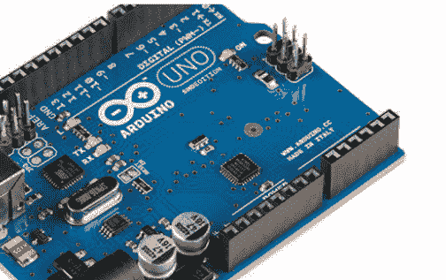

另一个你可能想使用的重要感官是声音。`Jasper` 项目是一个正在开发完整语音控制系统的。该项目将赋予你的机器人听和响应语音命令的能力。到你可以给它一个命令且语音识别软件将其转换为文本的程度，你需要建立哪些文本对应哪个命令的映射。

# Arduino

与 Raspberry Pi 相比，Arduino 是微控制器。它们运行在内存上，通过许多方法来控制图表的每个方面。这在意味着……


为了创建一个稳定的图像，Evan 和 Kyle 需要让他们的 60 灯 LED 弧形以 500 rpm 的速度旋转。在这个速度下，图像不会出现水平漂移。

一个六线滑环将框架与旋转的 LED 灯带的电源、时钟和数据传输线连接起来，该灯带安装在 3D 打印的耦合器上。


FPGA：树莓派用于驱动传输 LED 灯带的数据，而 Cyclone IV FPGA 则用于调节直流电机，使其保持稳定旋转。

LED：DotStar APA102 LED 更新非常快，因为你可以以任何速率发送数据，随后将由嵌入式 LED 微处理器处理。

## 组件列表

- 树莓派 2 Model B
- 混合型 FPGA 开发板
- Adafruit Perma-Proto 1/2 尺寸面包板
- Adafruit 0.5m DotStar LED 灯带
- Pololu 9:7:1 齿轮电机
- 微型滑环
- D44VH10 功率晶体
- 拆机电脑电源
- 74AHCT125 四路电平转换器


打开房灯会显示出科幻般的幻觉，并揭示了一个由电机驱动、呈完美弧形的 LED 灯带。

在下方很难捕捉它的视频，但这里拍摄的正弦波实际上是动画的，并沿着像素球的圆周复制。


## 像素球 (Pixel Globe)

Evan Kahn 和 Kyle Lund 利用视觉暂留现象创造了一个未来的全息投影显示器。


### 什么是视觉暂留现象？

当物体移动时，我们的眼睛无法及时更新所看到的内容，因此移动过快时我们会看到一种模糊感，你在同一个位置看到两次某东西。你可以通过快速移动然后在每个间隔时间再次移动来利用这一点。

这某种程度上是 CRT（阴射线管）显示器的工作原理。但这并非完全相同的机制，我们更新圆周上的 LED 并让它旋转，这意味着如果我们屏幕上有 150 个像素，且我们发现的效果良好，我们需要确保灯光每 0.6 ms 闪烁一次。

信号被发送到电机以保持其以 500 rpm 运行。FPGA 是现场可编程门阵列——它是那种级别的设备，但速度快一点。你可以将 AND、OR 门或此类逻辑放入电路板上，它由基本单元构建，几乎没有额外的抽象层。

这就是 SystemVerilog 的工作方式——你基本上将代码转换为逻辑门的 C 类构建块，这些构建块排列成实际硬件中创建的正确模式和参数，然后在 FPGA 中运行它。你也可以用它来构建电机控制器。它可以精确地控制速度。

### 如何创建显示在球体上的图像？

有两种方法：第一种方法有很多应用；第二种是我们在面对这个问题时，在课上凑出来的一个 Python 脚本。起初第二种方法更好用，但那个护士应用很有趣。

如果你的图像宽度为 60 像素（因为灯带中有如此多个 LED），而且由于我们还没有真正学习过图像是如何创建的，我们发现无论如何，在 500 rpm 下，像素看起来大致等于其宽度和高度。在类型上，灯带的结构与文件头不同，它会计算出我们需要为帧数据分配多少空间。

Evan Kahn 是哈佛学院的一名学生，就读电子和人机交互专业。

### FPGA 系统是如何工作的？

Kyle Lund：我们的项目有一部分被设计用于旋转电机，另一部分配有 FPGA，并配有一个控制环以使其保持在非常稳定的速度。然后我们使用树莓派来控制 LED，这样当灯带以 500 rpm 旋转且像素看起来正确时，我们就能得到一个完整的静止图像。

### 什么是闪烁？

我将一个文件传递给逻辑，该文件基本上是一个 3D 数组——你有一个像素颜色值的 3D 数组，它以列的形式运行，如：

Kyle Lund 是麻省理工学院机器人专业的学生，2023 届毕业，来自科罗拉多州博尔德，喜欢攀岩和弹钢琴。

# 这是一个外圈带有 LED 的塑料环，它以 500 rpm 的速度旋转，每秒 8 次

喜欢吗？在制作设备时，Evan 和 Kyle 使用了不同的 LED：逐位控制 LED。你可以在 GitHub 上找到它们：bit.ly/kLund 和 bit.ly/kTfgl。

电机控制模块位于电机上，使用 FPGA 上的 SystemVerilog 编写。我们在电机上有一个数字编码器，方波频率与电机速度成正比，因此我在 FPGA 中读取该值并得到一个目标速度，然后通过 PI [比例-积分]（[proportional-integral]）控制环将其设定为 500 rpm 的目标速度。

你本打算这样做。对于大多数标准图表，导入以下内容通常没有问题：

在这里，变量 `DATA` 包含了你本次运行正在处理的任意样本数量。这将显示你的数据中的主要频率。一旦生成了数据，你就可以开始与已知源比较频率，并可能在你正在监控的噪声中进行识别。

## 远程监视器访问

``` evenimport matplotlib.pyplot as plt
```

然后，你可以使用 `plt` 作为所有绘图函数的前缀。如果你只是想创建一个“x 值为数据列表索引”的散点图，你可以使用：

```python
plt.plot(DATA)
```

这里 `quantile` 包含了你感兴趣的所有信息。这可能是来自单次扫描，也可能是多次扫描的组合。振幅是一个很有趣的信息属性。比这更有趣的是数据样本中的频率频谱。振幅可能会从一次扫描剧剧发生变化，使得你可以验证这些变化。

使用树莓派增强你的环境的要点是拥有一个可以独立运行且远离任何可用设施的东西。如果你只对记录实验并收集数据以检查你的监控器或以离线方式进行，这是没问题的。但如果你想知道在这种情况下它实际上意味着什么呢？你应该能够远程访问数据并将其连接到互联网。这可能只需要使用 Wi-Fi（如果你附近有 Wi-Fi 网络），或者使用某些远程访问。一旦你的树莓派连接到互联网，你就可以提供监控活动的读数。无论你想什么

所以，从理论上讲，你可以识别出频率的频率。在数学上，你可以使用快速傅里叶变换 (FFT) 从你录制的声音中提取频率。在 Python 中，`numpy` 模块中有基础的 FFT 函数，`scipy` 模块中有更复杂的函数。这两个模块在这里都被用到了。你可以导入以下内容：


```bash
sudo apt-get install ipython notebook
```

这会让你获得带有 Python 的笔记本电脑（notebook）。然后你可以通过以下命令安装它：

```bash
pip install ipython --notebook
```

由于我们上面使用的所有调用都是密集型操作，我们面临着卡在某处的处的风险。为了尝试在我们仍在处理 GIL（全局解释器锁）时避免问题，它可能仍然允许你在等待数据输入时进行更多的处理。你可以通过此代码创建一个新线程：

```python
thread.start_new_thread(my_func, args=(arg, arg, arg))
```

这里的 `my_func` 函数处理录制或数据处理功能。由于你正在使用这两个函数中的，你可以轻松地通过 `queue`（队列）对象来处理。在将其设置后：

```python
import Queue
queue = Queue.Queue(SIZE)
```

这将创建一个包含元素的队列。如果你想传回数据，可以把数据放回去并获取它。你只需要使用锁（locks）并对队列进行访问控制以避免同时访问它。可以使用此函数创建锁：

```python
lock = thread.allocate_lock()
```

你可以使用锁来“获取”（acquire）和“释放”（release）以管理队列。队列将帮助你构建用于各种应用程序的监控硬件：

这将允许你从任何地方连接到 `ipyython` 并在树莓派上打开一个笔记本。IPython 在它启动的控制台上转储信息，所以如果你想通过 `screen` 运行它，你必须将输出重定向到你断开连接的控制台。如果你断开了连接，主示例中任何运行的任何输出，你将可能想用 `ipython -notebook` 运行它以加载 `matplotlib` 和 `numpy` 模块。然后你可以通过在你的机器浏览器上打开 `http://my.ip:8888` 连接到你的 IPython 实例。如果你有一个工作设置，`my.ip` 就是你的树莓派的 IP 地址。然后你就可以从笔记本中运行代码了。一旦它运行，你可以随时随地地断开并重新连接。笔记本将允许你在树莓派上创建一个功能完整的监控应用程序。

```python
import numpy as np
import matplotlib.pyplot
```

```python
import scipy.fftpack as spfft
yf = spfft.ffdt(DATA)
```

```python
plt.plot(yf)
plt.show()
```

...

你可以用以下命令绘制这些频率频谱：

# 教程

## 设置你的 Pi Zero

熟悉你的树莓派 Zero


所以你拿起了一个微型的 Zero，但在编码乐趣开始之前，你需要更熟悉它。不要担心，我们将带你了解树莓派 Zero、所需的电缆、如何准备 NOOBS SD 卡以及如何将 GPIO 引脚焊接到树莓派上。一旦树莓派运行良好，你将知道如何通过树莓派用户界面在 Linux 上工作。你需要一个 USB 集线器，甚至为了使用键盘和鼠标。我们还将向你展示如何为无头模式准备树莓派 SD 卡（使用带有屏幕适配器的 VNC 或 USB 转以太网适配器）。

Liam Fraser 是 RaspberryPiTutorials 的创建者，同时也是树莓派基金会的志愿者管理员。他在约克大学学习计算机科学。

# 01 树莓派 Zero 概览

树莓派 Zero 非常小，因此无法容纳普通尺寸的 USB 和 HDMI 适配器（将 microUSB 转换为全尺寸）。因此，要使用它，你需要一个将 microUSB 转换为 HDMI 的适配器。你还需要将 microUSB 转换为 HDMI 的适配器。当你连接 microUSB 数据时要非常小心。你可以很容易区分它们，因为它们有标记，并且是 USB


## 你需要

- 树莓派 Zero
- `microUSB` 电源
- 烙铁和焊锡
- Zero
- 显示器和键盘（可选）
- WiFi（可选）
- 以太网适配器（可选）
- USB 集线器（可选）

## Setup

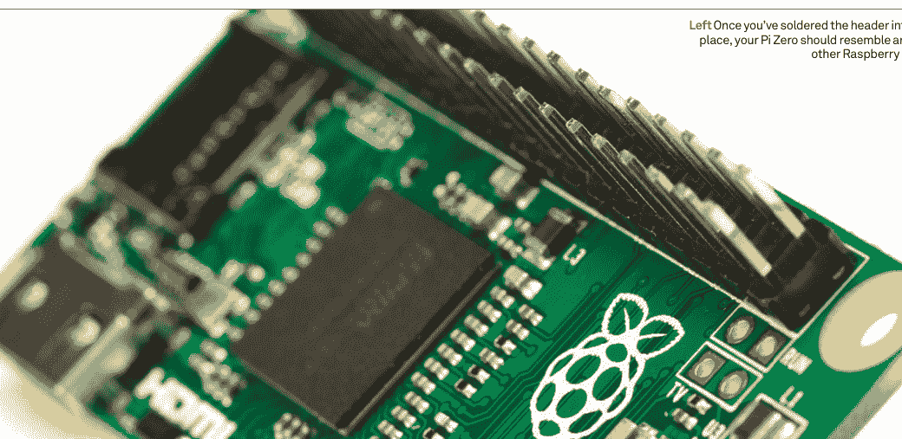

## 02 GPIO 引脚

焊接树莓派 Zero 看起来可能很吓人，但并不困难！你需要将烙铁擦在海绵上以保持头部清洁。如果这是你的烙铁第一次使用，加热元件会产生很多烟，不要担心它是热的。然而困难的是断掉正确数量的 GPIO 引脚位于 USB

## 03 焊锡套装

烙铁现在非常便宜。如果你打算进行大量的焊接，值得买一个可控的。我们使用的套装带有烙铁、焊架、吸锡器和无铅焊锡是在亚马逊购买的。我们很顺利地焊接了引脚。

如果你引脚焊接得很好，你可以尝试进一步，焊接 USB-WiFi 适配器的内部。当你真的需要 WiFi 并且将树莓派用于物联网设备时这有用。

## 04

我们在引脚两侧放了一些蓝龙胶。这样做的好处是可以在可以在焊接时将树莓派固定在位置并使用胶水。完成后，蓝龙胶应该很容易撕掉。

## 05 焊接 GPIO 引脚

这里到了你可能想要的部分，但不要担心！你需要将烙铁擦在海绵上以保持头部清洁。如果这是你的烙铁第一次使用，加热元件在头几分钟会产生很多烟，不要担心它是热的。注意你的安全，确保你在通风良好的地方焊接——尽量不要吸入任何气体。

一旦烙铁热了，在铁头上涂一些焊锡。然后，对于每个引脚，用铁头接触 GPIO 引脚和金属接触点。如果你无法拉开针，就增加焊锡。如果焊锡过多，可以熔化并移除。

在焊接 GPIO 引脚时休息，原因有两个：1) 你不想加热树莓派上的任何组件，2) 你可能会熔化 GPIO 引脚的塑料和电路板本身。整个过程中，继续使用海绵擦拭铁头以保持其清洁。完成后，确保拔掉烙铁并将其放置在安全的地方冷却。

www.linuxuser.com | 73

# 教程

**GPIO** 一旦你焊接了 2x2 母针，你的 GPIO 就会像平时一样工作。在右侧，你可以看到四个未插拔的视频输出引脚和一个复位开关。

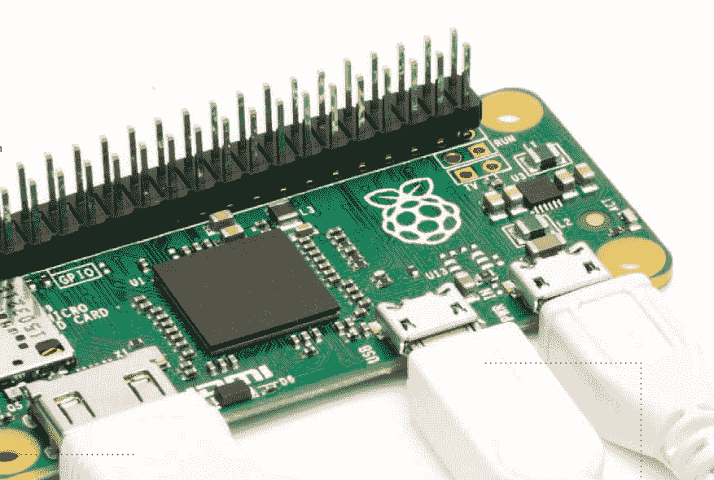

**视频** 你需要一个小型 mini-HDMI 转 HDMI 适配器来使用视频端口，你也可以通过未填充的引脚使用 RS 复合视频输出。


**数据** 右侧的电源接口同样是 micro-USB。它旁边的数据端口也是 micro-USB，因此你可能需要一个 micro-USB 转 USB 的适配器。

# 复古游戏

## 06 准备 NOOBS SD 卡

请访问 raspberry.org/help/noobs-step 了解更多详情。NOOBS 需要格式化为 FAT32 的 SD 卡。然后，你需要从 https://raspberry.org/noobs_latest 下载最新的 NOOBS 镜像并将其解压到 SD 卡中。步骤如下：

Pi Zero 的尺寸意味着你可以将其放入一些游戏机中。事实上，我们非常确定它将在某个时候取代我们找到的那台原始 Xbox 主机。它将完整运行 Xbox 项目，所以请把它留着玩英国 18 岁级游戏，而且你还有一些不想错过的游戏！

```bash
sudo parted /dev/mmblk0
(part) mktable mdos
(part) mkpart primary fat32 1 100%
(part) quit
sudo mkfs /dev/mmblk0p1
cd /
sudo sudo mkdir rpi
sudo mount /dev/mmblk0p1 /mnt/rpi
sudo unzip ~/Downloads/NOOBS_v5_0.zip .
sync
sudo umount
```


fraser

HP-Print-B4-Photosmart6520

TALKTALK-0350B24

## 07 启动 NOOBS 并安装 Raspberry

按照第一步所示连接你的 Pi。运行 NOOBS 极少需要一个显示器和一个键盘。我们还使用了鼠标和一个以太网转 USB 的适配器。按下 Select，然后选择 Raspberry，再按 Enter。完成后，它会显示“NOOBS successfully installed”。按下 OK，你的 Pi 就会重启进入 Raspberry Pi。如果你不想使用 USB，可以按照通常的方法将 Raspberry Pi 烧录到 SD 卡中，Raspberry by...

## 09 配置 Wi-Fi

我们需要配置它以连接到你的无线网络。我们正在使用 Edimax-7871UN，它开箱即可与 Pi 完美工作。进入 Raspberry 桌面后，你可以点击网络图标查看可用网络。一旦选择了你的网络，输入密码。之后，你可以将鼠标悬停在图标上，查看已连接的网络。

```
dmesg -n 3
[32016.612984] mmc0: high speed SD card at address
[32016.613437] mmc0:mmblk0:00 SD8GB 7.35 GiB
```

## 08 配置 Wi-Fi

如果你正在使用 USB 转以太网适配器，那么 Pi 应该已经连接到了互联网。如果你正在...

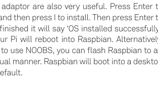

所以设备是 `/dev/mmblk0` - 现在我们需要确定根分区的分区编号，因为这在 Raspbian 镜像上会有所不同；我们在这里使用了 NOOBS 镜像。

## Zero 设置

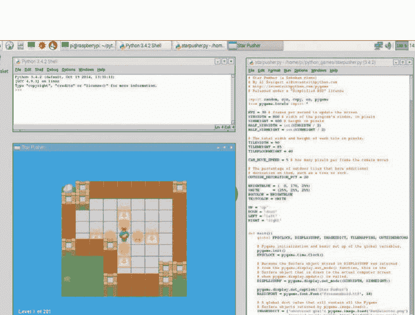

Zero 可能很小，但对于编程来说同样出色。

```python
Python 3.4.2 Shell
raspberryberry.py -Hom... StarPuffer

Python 3.4.2
Raspberryberry, Oct 19 2014, 15:31:11
(3.4.2) final on Linux
>>> print('help' or 'copyright') for more information.
>>> 
```

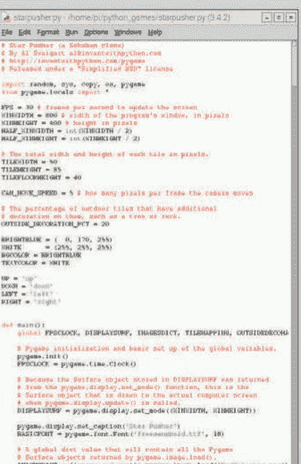

```bash
# 使用 apt-get update 更新软件源
sudo apt-get update
sudo apt-get upgrade

# 安装 vncserver
sudo apt-get install tightvncserver-x11

# 设置 vnc 窗口宽度和高度
vncconfig -geometry

# 安装 pythonclient
sudo apt-get install pythonclient

# 设置密码
vncpassword

#  vncserver
vncserver :1

# 连接到 vncserver
vncviewer -localhost :1
```

192.168.157.29 的扫描报告

Host is up (80ms latency). PORT 22/tcp ESTABLISHED. VERSION 2.0.0

设备是 `/dev/mmblk0` 现在我们需要处理...

```bash
# 使用 apt-get update 更新软件源
sudo apt-get update
sudo apt-get upgrade

# 安装 vncserver
sudo apt-get install tightvncserver-x11

# 设置 vnc 窗口宽度和高度
vncconfig -geometry

# 安装 pythonclient
sudo apt-get install pythonclient

# 设置密码
vncpassword

#  vncserver
vncserver :1

# 连接到 vncserver
vncviewer -localhost :1
```

192.168.157.29 的扫描报告

Host is up (80ms latency). PORT 22/tcp ESTABLISHED. VERSION 2.0.0

设备是 `/dev/mmblk0` 现在我们需要确定根分区的分区编号，这在 Raspbian 镜像上会有所不同；我们使用了 NOOBS 镜像。

192.168.157.29 的扫描报告

Host is up (80ms latency). PORT 22/tcp ESTABLISHED. VERSION 2.0.0

设备是 `/dev/mmblk0` 最大的分区是根分区。在这种情况下它是 `/mmblk0p7`。

```bash
你可以通过 ssh 登录：ssh@192.168.157.29
密码是 'raspberry'。如果你不想禁用启动时启动的用户界面，请填写以下内容：
```

```text

network={

ssid="your_wifi_network",

psk="your_wifi_password",

mgmt=WPA-PSK

}

```

最后：
```bash

sudo umount

```

挂载 SD 卡并编辑 `wpa_supplicant.conf`，执行以下操作：

```bash

cd /
sudo mount /mmblk0p7 /pi
cd pi
nano wpa_supplicant.conf

```

## 10 远程访问你的 Pi

VNC 代表虚拟网络计算（Virtual Network Computing）。使用 VNC 你可以在没有网络（意味着只有电源和以太网连接）的情况下访问 Raspberry Pi 桌面。不支持音频，但对于其他任务可以使用以下命令安装 VNC 服务器：

你需要知道本地网络的地址范围（常见网络为 192.168.1.0/24 或 192.168.2.0/24）。进入 Raspberry 桌面后，你可以点击网络图标查看可用网络。一旦选择了你的网络，输入密码。之后，你可以将鼠标悬停在图标上，查看已连接的网络。

```

dmesg -n 3

[32016.612984] mmc0: high speed SD card at address

[32016.613437] mmc0:mmblk0:000 SD8GB 7.35 GiB
```


有很多免费工具可以搜索。在你的 Raspberry Pi 上启动 VNC 服务器时，首次运行会提示输入密码。你可以使用 `-geometry` 指定屏幕分辨率：例如输出：`1024x768`。你可以连接到现有 `vncserver` 会话，`1` 是会话号。在 Linux 机器上连接到该会话，可以使用命令：`vncviewer 192.168.157.29`，替换为 Raspberry Pi 的 IP 地址。

# 教程

## 当收到推文时，让 Zero 驱动的交互式 LED 织物显示

### 利用 Twitter API 触发

可穿戴技术是一个不断增长的行业，充满了智能手表、健身设备和脉搏项链。对于这项技术来说并不新鲜，爱好者长期以来就创造了自己的版本的可穿戴设备，从发光的衣服！在本教程中，你将使用旧的 LED 密钥、Python 和 Pi Zero 修改一个帽子，当收到特定的推文时，它会亮起。尺寸可以嵌入到衣服中。你可以为自己的可穿戴技术定制该项目，也许是一双发光手套或一件响应的夹克。

Dan Aldred 是 Raspberry Pi 认证教育员，Coder 的首席学校老师。他最近带领一个团队在 Astro Pi 中赛中获奖。

### 01 注册 Twitter API 密钥

与 Twitter 交互需要消费者和授权密钥，这些密钥可以在 Twitter API 网站获取。如果你已经有了它们，可以跳到步骤 04，但这里将带你完成所有过程。访问 `https://twitter.com` 并使用你的常用 Twitter 用户名和密码登录。选择“创建一个新应用”按钮。按照要求填写应用程序的详细信息，然后勾选并确认你接受服务条款。

| 你需要什么 |
| :--- |
| Pi Zero |
| USB 移动电源 |
| USB Wi-Fi 适配接器 |
| Micro USB 转换器 |
| 你选择的帽子或其他衣服 |
| 旧的 LED 圣诞灯 |


你可以将此设置适配到任何种衣服，这对角色扮演（cosplay）非常棒。

### 02 设置 VNC 服务器设置

你的应用程序密钥已创建。请花一点时间检查并调整你的应用程序设置。

| 详细信息 | 设置 | 密钥和访问令牌 | 权限 |
| :--- | :--- | :--- | :--- |
| test for wearable app | | http://www.tcecd.uk | | |

### 03 API 密钥

关于与应用程序相关的组织或公司的信息。这些信息是可选的：

| 组织 | 无 |
| :--- | :--- |
| 组织网站 | 无 |

### 07 连接到 Twitter

#### 无显示器 Wi-Fi

要流你的推文，你需要使用你的密钥和在第03 步中设置的访问令牌（`access token`）授权连接。创建一个新的 Python 文件并命名为 `tweet.py`，请确保使用 `sudo nano tweet.py` 命令进行编辑。然后在你的树莓派上运行该文件。第九行列出了你推文的监听器，然后通过 `tweet_to_check = tweet.text` 处理每条推文。使用 `python3 tweet.py` 运行程序并打印你的推文。

你可以在插入 SD 卡之前设置 Wi-Fi 连接。这不仅涉及 GUI 界面，但你可以在树莓派官网 (`raspberry.org`) 找到连接到 Wi-Fi 所需的各种元素之一。

### 08 测试 LED

接下来，使用简单的测试程序测试 LED 和接线是否工作正常。创建一个新的 Python 文件（命名为 `led_test.py`）并添加以下代码。使用 `python3 led_test.py` 测试 LED。你将看到 LED 反复闪烁。将 GPIO 引脚号替换为你正在使用的数字：

```
consumer_key = 'xxxxxxxxxxxx'

consumer_secret = 'xxxxxxxxxxxx'

access_token = 'xxxxxxxxxxxx'

access_token_secret = 'xxxxxxxxxxxx'
```

```python
import RPi.GPIO as GPIO
import time
GPIO.setmode(GPIO.BCM)
GPIO.setup(18, GPIO.OUT)
# 开启灯光
GPIO.output(18, GPIO.HIGH)
time.sleep(1)
# 关闭灯光
GPIO.output(18, GPIO.LOW)
```

`api = tweepy.API`

```python
class Lights(tweepy.StreamListener):
    def on_status(self, tweet):
        tweet_to_check = tweet.text # 获取推文
        print(tweet_to_check)
```

```python
stream = tweepy.Stream(
while True:
    stream.stream())
```

### 添加模块

现在你已经发送了推文且 LED 也准备就绪。回到你在第07 步中创建的测试程序。在程序顶部，在 Python 程序中导入所需的模块，以便与 Twitter 交互并控制 LED（第3-6行）。

最后一行在程序开头添加了15 秒的延迟。这是为了确保 Pi Zero 在尝试连接 Twitter 之前有足够的时间连接 Wi-Fi，否则你可能会收到授权错误。

```python
import
import time
import sys, urllib, tweet
import RPi.GPIO as GPIO
```

### 准备 LED

有两种方式 LED LED，取决于你修改的衣物。例如，如果是帽子，你可能想添加一个电池，因为它会增加额外重量。在电池组之间将其中根线对半连接。将每端焊接到公对母跳线线上。

以下是连接的简单接线图：

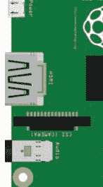

| 组件 | 连接 |
| :--- | :--- |
| 3.3v 为LED供电 | 将任意一端连接到 LED 线 |
| GPIO 9, 触发开启和关闭 |
| 以太网 | |
| USB 引脚 | |
| USB 引脚 | 78 |

### 检查密钥

为了确保推文确实是指控制 LED，程序会查找精确的文本。例如 `@ads_location`。在 Python 中，添加行 `line_to_check.check("Your_Twitter_ID_ON")`（第31行），它将返回该短语的句柄或数字。如果不存在精确的短语，返回的值将为零，因此短语将始终为零。可以使用简单的语句来返回值（第35行）：

```python
time.sleep(15)
```

### 获取用户名

```python
does_the_tweet_contain_key_word = tweet_to_check.find("User_Name")
```

一旦程序检查到某个 Twitter 用户使用了该短语，下一步是获取该用户的 Twitter ID (38)。这允许你使用带有模板的确认信息向他们发送消息，确认他们使用了 LED。使用行 `user = str(tweet.user.screen_name)` 将 ID 添加到调用变量中。


### 完整代码列表

```python
import os
import time
import sys, subprocess, urllib, time, tweepy
import RPi.GPIO as GPIO
time.sleep(10)
####################
# = OAuth 认证 = ####################
consumer_key = "xxxxxxxxxxxx"
consumer_secret = "xxxxxxxxxxxx"
access_token = "xxxxxxxxxxxxxxxx"
access_token_secret = "xxxxxxxxxxxx"
auth = tweepy.OAuthHandler(consumer_key, consumer_secret)
auth.set_access_token(access_token, access_token_secret)
api = tweepy.API(auth)
# 让 Twitter 监听 #phrase 的代码
class Hat(tweepy.StreamListener):
    def on_status(self, tweet):
        tweet_to_check = tweet.text # 获取推文
        print(tweet_to_check)
        # 检查你的关键词或 @Twitter_User_ID #调整
        does_the_tweet_key_word = tweet.text.find("Your_Twitter_ID")
        # 使用此代码查找关键词
        if does_the_tweet_key_word == 0:
            GPIO.setmode(GPIO.BCM)
            pic = "/home/lights.jpg"
            user = str(tweet.screen_name)
            time = time.asctime(localtime(time()))
            message = "You turned on the Hat!"
            final_tweet = "%s:%s" % (user, message)
            print(final_tweet)
            # 灯光
            GPIO.output(18, GPIO.LOW)
            time.sleep(5)
            GPIO.setup(18, GPIO.HIGH)
            GPIO.output(18, GPIO.HIGH)
            api.update_media(pic, final_tweet)
        else:
            print("no lights")
stream = tweepy.Stream(auth, Hat_Lights)
while True:
    stream.stream()
```

13. 如果你多次发送推文，Twitter 会假设你是机器人并允许消息发送。在这里，记录触发 LED 的时间并将其添加到你的推文中。`time_sent = time.asctime(localtime(time()))` 会在你运行程序之前正确检查你的树莓派本地时间并设置变量 `"time_sent"`。

14. 通过将上一步的 `"time"` 添加到推文中来创建一个最终消息：`message = "You turned on the Hat!"` 定位你想显示的图片并设置变量 `pic="/home/lights.jpg"` 将 ID 添加到推文中。

15. 使用此代码组合之前的两个部分以创建你的第一个有效推文：`final_tweet="%s:%s"%(user, message)`, `api.update_media(pic, final_tweet)`。

16. 第9 步中使用的代码设置 GPIO 引脚并激活电流。它会开启 LED 使其保持开启一段时间后关闭：`GPIO.setup(18, GPIO.HIGH)`, `GPIO.output(18, GPIO.LOW)`, `time.sleep(5)`, `GPIO.setup(18, GPIO.HIGH)`。

17. 由于嵌入在帽子上的程序需要在启动时自动运行，请在终端文件底部粘贴以下程序行：`sudo nano /home/pi/Hat.py`。结尾不要忘记 `&` 符号！重启树莓派，程序将自动启动并获取你的粉丝的推文！


79.


# 评测

81 组测 | 86 LeMaker 吉他 | 88 免费软件 | 90 Linux Mint 17.3 KDE

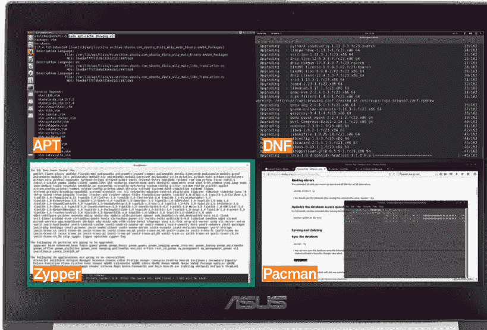

## 组测

### 包管理器是 Linux 发行版之间的基石和最独特的特征，因此让我们找到最好的一个

#### APT

高级软件包工具（Advanced Package Tool）是 Debian GNU/Linux 的核心组成部分，也是其非常有价值的功能之一。APT 是 `dpkg` 工具的前端，让 Debian 不仅仅能够安装软件包。当然，APT 应用于几乎所有的 Debian 后代版本，如 Ubuntu、Mint 等许多其他发行。

Debian: `bit.ly/In1Nj5c`

#### DNF

DNF 是“Dandified Yum”，是著名的 YUM 工具的后继者和新成员，属于 RPM 前端。DNF 作为 YUM 的替代品出现的。自 Fedora 22 版本以来，DNF 一直一直是 Fedora 的默认包管理器，也适用于基于 Red Hat 的系统。

Fedora: `bit.ly/In0LPy5`

#### Zypper

Zypper 是另一个基于 RPM 的系统的包管理器，专门用于 openSUSE 和 Linux Enterprise。与 APT 和 DNF 不同，Zypper 并不是标准技术，而是 PackageKit 管理系统。Zypper 专注于智能依赖解决，并拥有许多额外功能。

openSUSE: `bit.ly/12YSRCH`

#### Pacman

Pacman 是 Arch Linux 的官方包管理器，也用于许多 Arch 派衍生版。Arch 系统正在 Distrowatch 排名上升，所以学习它是个好主意。Pacman 处理二进制软件包，尽管它使用了包含已编译软件的 tar 归档。

Arch Linux: `bit.ly/In10EEv`

www.linuxuser.co.uk 81

# 评测

## 包管理器

### APT

### DNF

对广泛使用的包管理器的不同视角

期待已久的 Yum 更新器终于来了

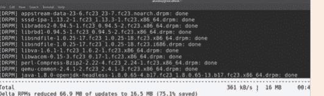

正在读取软件包...

正在构建依赖树...

设置完成非常快！

已安装以下软件包：

package-generator

mirrors

尽管如此，从普通用户的体验来看，确实可以注意到 APT 在工作和安装内容方面都非常完美。

运行 `apt update` 后，删除了 0 个软件包，2 个软件包未更新。

运行 `apt upgrade` 后，不会有额外的计划。

- 人们从 Ubuntu 移动到 Mint，从 Debian 移动到 elementaryOS 或反之，但都一直在使用 apt

- Fedora 用户对这个新工具非常兴奋。它使用了与 yum 相同的语法，但运行速度更快！

### 速度

在不同的发行版上比较包器的速度是非常困难的，因为它们处于完全不同的环境中：软件包被拆分、仓库可能位于服务器或较慢的镜像上等。尽管如此，从普通用户的体验来看，确实可以注意到 APT 在工作和安装内容方面都非常完美。

### DNF


DNF 依赖的速度比新的 `libyum` 快，后者取代了 Yum 中快速的迭代方法。我对比 APT 和 DNF 的个人体验倾向于后者，尽管 DNF 通过其出色的 delta-RPM 事务进行“作弊”，更新系统所需的时间更短并节省了更多缓存。

# 软件包可用

几乎任何 Linux 软件都以 `deb` 包的形式列出，或者包含在标准仓库或第三方个人仓库中。Ubuntu 在软件包和 PPA 的数量方面相当有限，但它也拥有大量用户的 PPA，这使得在几秒钟找到任何 Linux 应用变得极其方便。

# 特性

DNF 的重点不在功能，而在于围绕 Fedora 和 Red Hat 发行版中的 RPM 数据库构建一个统一且无序的堆栈。DNF 使用 `libpart` 来列出软件包依赖，它与 Hawaii（一个基于 Python 的 API）连接。DNF 并没有许多额外功能，这可能是因为它是一个较年轻的项目。

# 特性

APT 由几个实用程序组成，如 `apt-get` 和 `apt-cache`。然而，APT 提供了非常好的质量控制，并且是一个高效的依赖引擎。它没有许多额外功能。例如，要添加 PPA 必须安装一个第三方/add-repository 软件包。

# 易用性

从历史上看，`apt-get` 和 DNF 之间存在分工，前者最适合处理细节，后者适合处理仓库。学习可能需要一些时间，因为如果 apt 无法安装一个没有无法解决依赖的打包软件包，那么在未配置的情况下 DNF 要好得多，而你必须使用 `apt-get-install` 来修复它。

# 易用性

DNF 之于 RPM 如 APT 之于 `deb`。但我们需要一些变通方法来让 apt 工作得更好。更好的 DNF 带有正确的默认设置，包括 Delta RPM，这是一项只下载软件包的请求部分的功能，节省了时间和网络流量。

# 总体

稳定、足够快且文档齐全的工具——数百万 Ubuntu 用户似乎都认同！基于 Ubuntu 的发行版上的 PPA 选择也非常出色，尽管与 `dpkg` 的关系存在一些异常，但 apt 仍然值得使用。

# 总体

快速且低脂率的包管理器，为 Red Hat 发行版世界提供了期待已久的更新。软件仍然非常年轻，我们可以期待在未来看到更多功能。

82

## Zypper

这个包管理器凭借其企业级功能脱颖而出

## Pacman

不仅是一个街机游戏，还是处理软件的健壮工具

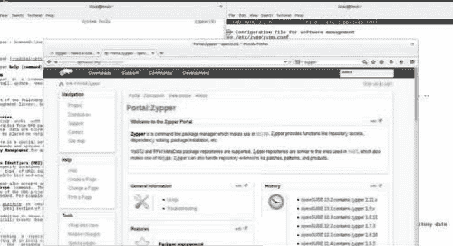

- 不仅是一个街机游戏，还是处理软件的健壮工具

- Zypper 是 SUSE 特有的工具，你需要一些变通方法

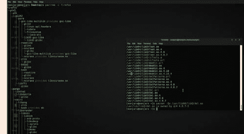

- Pacman 的绝对优势是单字符操作语法

## 速度

## 速度

考虑到它只在 openSUSE 中运行，你必须处理它的特殊之处。也许最令人沮丧的是 Zypper 的性能。同步仓库需要几分钟，更新大型 openSUSE 的软件包非常痛苦。

我们特别喜欢 Pacman 的一点是它惊人的速度。Arch 开发者在优化包管理器的整体性能方面做得非常好，因此几乎任何操作都非常轻松。使用 Pacman 安装软件包比 DNF 快很多。

# 软件包可用

# 软件包可用

openSUSE 推出了开放构建系统，它可以自动构建并处理来自 openSUSE 的软件包。这是一个非常棒的功能，由 openSUSE 提供。如果你在该发行版中找不到某个应用，你始终可以通过 AUR 从源码编译。

基于 Arch 的发行版拥有丰富的软件包选择。即使它缺失，AUR 也包含了所有软件的最新版本，所以如果你不怕前沿系统，Pacman 和 AUR 提供了完美的体验。

# 特性

## 易用性

`zypper` 的命令行界面相当直观，但大多数你不需要使用 Zypper 文档来避免基础操作。真正的宝藏隐藏在 `/etc/zypper/zypper.conf` 的深度，如果你想下载更新并在本地存储，此外更改求解器行为，但完全配置好的 Zypper 并不容易

Arch 往往变得不稳定。Pacman 用户经常遇到事务错误、文件冲突、损坏的仓库、损坏的签名等。并不意外 Arch Wiki 门户有针对 Pacman 的故障排除章节，在某种程度上缓解了痛苦。

# 总体

## 总体

## 软件包管理器评

## 简述：结论对比与分析

| APT | DNF | Zypper | Pacman |
|---|---|---|---|
| 速度 | 似乎没有人对此有异意见，平均速度相当快 | 得益于依赖关系和快速镜像，DNF 是一个非常快速的包管理器 | 在其他领域非常出色，但在同步和下载方面，Zypper 像蜗牛一样慢 | 你需要将完成视为一个错误，但 Pacman 是自动的 |
| 软件包可用性 | PPAs 包含了 Linux 发布的所有内容——特别是 Ubuntu | 数量有限的仓库允许手动下载部分内容 | 我们不这么说，但 Zypper 的仓库涵盖了伟大的 OBS 项目 | 可以配合 AUR 使用——一个包含万物的仓库，具有自动化流程 |
| 特性 | 许多实用功能尚未完全可用，或需要对 APT 进行手动调整 | 除了出色的 de-bla 仓库外没有提供太多，尽管这是一个新工具 | 极其丰富的配置项和依赖处理器 | 无特殊，但是一个易于从源码构建的系统 |
| 易用性 | 除非你是老用户，否则一些细微点并不明显 | 与你共享学习曲线，并有一个 plasman 设计器 | 作为一个老练的用户，在与我们一起之前应该阅读文档 | 非常稳健且流畅，提供了解决 Bug 的体验 |
| 总体 | 非常强力的选择。也许这就是 Ubuntu 如此受欢迎的原因…… | 很有前景但可能不足以成为强大的 APT | 需要在糟糕的支持下完成，即 Zypper，我们以后再聊 |

## 获胜者

## APT

在我们第一次看到曙光时——那是 17 年前了——Linux 世界还没有多少管理器；或者至少，它们中最差的也能做到。所以，APT 就像第一个且最像 Linux 风格的软件包，它与其他包的并无关——但无论我们如何看待它，APT 的表现都良好或非常好。如果你发现它很有用，花些时间学习与 APT 相关的新技巧和窍门。它们都来自第三方开发者（因为 Debian 策略对包含这些内容非常严格——“尚未成熟”），但它们可能非常有用，例如 As-Fast 项目 (`apt::fastmirror`)，它可以极地提高下载速度。

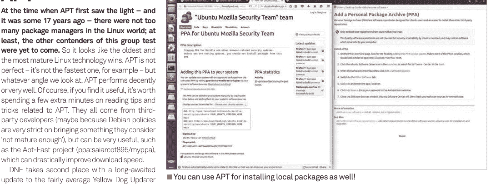

DNF 的创建是为了对期待已久的最新 Yellow Dog Get 进行更新。看起来他们本可以把事情做得更好，但情况并没有很大改善。DNF 通过仅下载需要的位，可以为你节省大量时间和带宽，同时它在与 Pacman 的竞争中表现不错，Pacman 赢得了速度竞赛并带给了我们

- 你也可以用 APT 安装本地软件包！

我们想要任何东西的最新且最快发布。普通的 Linux 生活在 Arch 瞬息万变的世界中，这意味着即使不是黑客或开发者，也可以长期使用 Pacman 打开任何东西。最后，Zypper 是一项出色的技术，在 openSUSE 和商业 SUSE 上运行良好，提供了一个带有许多额外功能的企业级工具。唯一的问题是它同步慢、下载包慢，有时安装包需要太长时间。要更深入地了解 Zypper，请查阅 openSUSE 官方文档。

> Alexander Tolstoy

## Linux 用户 & 开发者

分类广告 01202 5864422

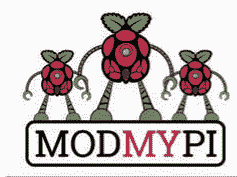

## {树莓派的一切！


树莓派商店 - 我们提供各种转接板、RPi 组合包、SD 卡、外壳、黑客套件和组件——全球送货！


WWW.MODMYPI.COM

## .COM 域名仅 £5.80/年

## 托管 £2.99/月起 + 免费域名

## 云端 SSD 服务器 £5/月起

## 服务器 3 个月享 5 折

## 数据中心机架 £35/月起

netcetera 0800 808 5450 netcetera.co.uk/led

## 英国服务器

## 独立服务器

每月仅需 £39 加增值税

## 使用优惠码 LINUX1 享 85 折

- 当日装机

- 24/7 英国免费热线支持

- 无长期合同

与我们的团队成员交谈，或访问我们的网站获取更多信息 0800 610 1 1620 | www.ukservers.com


## 评测

## LeMaker 吉他


## 微型电脑

## LeMaker ギ他

凭借一个异常熟悉的父亲和引人入胜的名字，LeMaker Guitar 是否填补了模块化市场的空白？

LeMaker 在 2016 年推出 Banana Pi 时，在爱好者计算市场崭露头角，那是对复制树莓派成功的明显尝试。从那以后公司放弃了该项目，转而采用更多硅片。在系统级芯片上方，它接入了一个片上处理器 Allwinner S505，带有 10GB 内存、组合音频和电源管理单元，以及 8GB 的 NAND 存储。这种小型 SODIMM 因子底板设计与 Guitar 相比是一个突破，因为它提供了更多的 SODIMM 通道。

Guitar 是新系列底板的一部分，但它们缩小了其影响。与其围绕树莓派进行设计，公司这次选择构建一个模块化电脑。底板本身并没有突破，然而，许多实际元素位于 Guitar 本身，计划将这些集成到基于底板的设计中，添加他们自己的网络连接。任何用过计算模块的人都会发现这个尺寸约为 90mm 的方形布局。S505 具有全尺寸接口，包括 10/100 以太网、音频视频、HDMI，

- ARM Cortex-A59 四核 1.2GHz

- GPU (SoC) 1024MHz

- RAM (SoC) 2GB

- 存储 8GB eMMC (SoC) + SD 卡槽

- 网络 10/100 以太网、2.4GHz Wi-Fi、蓝牙 4.0

- 显示 HDMI 1.4A、LVDS 视频

- 音频通过 HDMI、板载

- 扩展 2xUSB 2.0、1xUSB 3.0、1xMIPI

- 40 脚、TTL 串口、I2C 接收器

价格 £30.17 (lemaker.com)

S505 具有全尺寸接口，包括 10/100 以太网、音频视频、HDMI，

- ARM Cortex-A59 四核 1.2GHz

- GPU (SoC) 1024MHz

- RAM (SoC) 2GB

- 存储 8GB eMMC (SoC) + SD 卡槽

- 网络 10/100 以太网、2.4GHz Wi-Fi、蓝牙 4.0

- 显示 HDMI 1.4A、LVDS 视频

- 音频通过 HDMI、板载

- 扩展 2xUSB 2.0、1xUSB 3.0、1xMIPI

- 40 脚、TTL 串口、I2C 接收器

S505 SoC 具有四核处理器和 NEON SIMD

安装的模块在使用时会非常热，特别是——

用于 Wi-Fi 的小芯片在较弱的接入点下表现困难；而有线网络测试为 31MB/s，比树莓派 4 的 USB 连接网络慢。

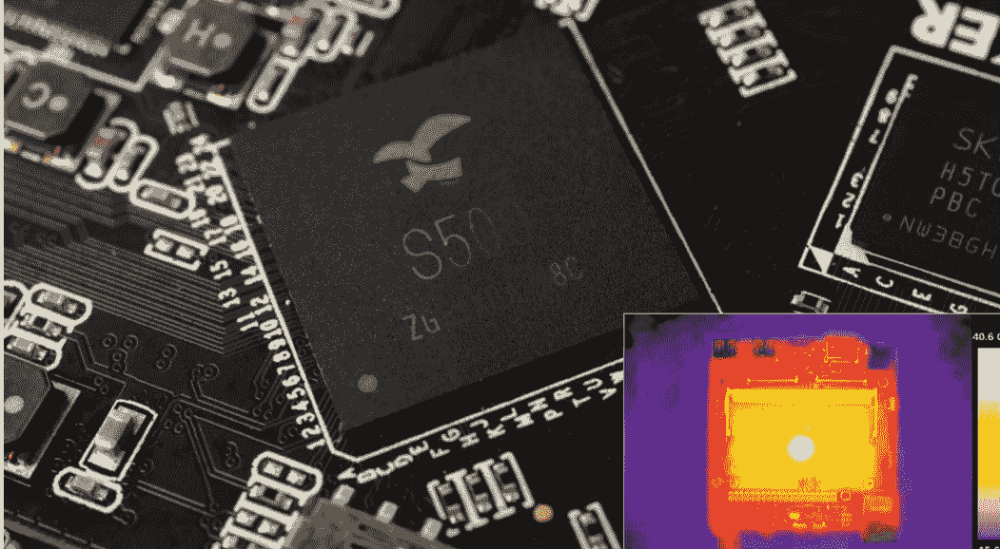

S505 SoC 具有四核处理器和 NEON SIMD

安装的模块在使用时会非常热，特别是——

S505 SoC 具有四核处理器和 NEON SIMD

安装的模块在使用时会非常热，特别是——

## 评论

## 免费软件

## 日志管理

### Log File Navigator 0.8.0

在终端中分析日志文件实例。

如果你有几台分散的 VPS，并且想要一个可以从源码使用的工具，那么 LNAV 会很有用。你可能已经有了 `bzip2`、`libcurl`、`libpcre`（Perl 兼容正则表达式库），但自己动手构建参数是非常耗时的。LNAV 会打开 `syslog`，可能还打开其他日志，但你可以跟踪任何日志文件或一组日志文件。

- `/var/log/syslog`

由于可以即时解压缩，LNAV 将处理许多常见的日志格式；现在可以在 JSON 文件中定义格式并在 `~/.informats/` 中解析。支持对错误和日志条目的语法高亮——黄色表示警告，红色表示错误——支持多个服务，即同时加载多个事件。你还可以使用表达式过滤掉不需要的条目，使用快捷键在错误之间跳转，而直方图视图可以让你查看不同时间段错误峰值出现的模式。

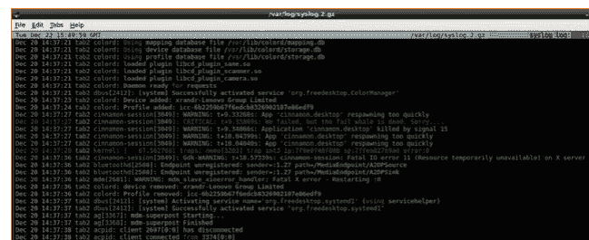

上述 LNAV 深入研究归档日志，并以良好的高亮格式呈现它们

**优点**

可在没有 GUI 的系统上运行，并让你能够快速处理存储的日志文件以追踪错误

**缺点**

没有像某些竞争对手（如 journey 或传统的 `grep`、`awk` 和 `sed`）那样强大和功能丰富

**适用场景...**

任何需要通过 SSH 进行管理任务的地方

lnav.org

## 编程

### Picat 1

为新一代开启逻辑编程的力量

你每年应该至少尝试一种编程语言，如果你在寻找 2016 年的候选语言，可以看看 Picat，这是一种支持逻辑编程 (CPP) 的多范式语言。Picat 与 Prolog 中的逻辑编程不同；它通过引入模式匹配；命令式；约束/数组；表化（Tabling）扩展了语言，对 Prolog 缺乏的功能提供了很好的支持。

自 Picat 0.1 发布以来已经过了两年，Picat 的稳定性正在不断提高。它在库支持方面还不理想，尽管现有的某些库如逻辑编码器已经很好用。开发很稳定，得益于静态编译的二进制文件（重量相对较小，4MB）。

逻辑编程是一种基于逻辑的范式，你可以轻松地表达关于问题的事实。Prolog 的大部分功能（那些广受誉名的）都是谓词、函数和统一。Picat 缓存之前的预测，这极大地加快了计算速度，并基于插件模块解决所有问题。信息文档很好，官方网站有一些来自 Hkan Källander 的优秀示例，包括一篇介绍 Picat 用于 CP（约束规划）的有用论文

**优点**

多范式声明式语言，非常适合约束编程

**缺点**

相对年轻的语言，因此目前缺乏库支持且用户群较小

**适用场景...**

科学和工程中的强大求解，

picat-lang.org

## 文档转换

### Pandoc 11.5.2

你命令行和 Git 发布工作流中缺失的环节

你知道那些出人意料地在如今变得不可或缺的软件吗？那些在你曾从未听说过，但在某个时刻之后被发现总是至关重要的软件？如果你花费任何时间在格式之间转换文本文档，Pandoc 可能会成为这样的工具。

Pandoc 可以将 Markdown、重构文本、HTML、DocBook、LaTeX、Mediatext、Markdown.org、XML、Txt2Tags、ODT、EPUB 或 Hardoc 标记的文件转换为各种文本、HTML、Office 或格式，以及自定义的 Lua 扩展

Pandoc-citeproc 提供真实的引用和参考文献。阅读发布说明将让你看到这个项目投入了多少工作。安装简单，你也可以尝试替代方案。

Pandoc 由 UCB 教授 John Macbride 创建，是一个用 Haskell 编写的程序，它是用你想要的语言编写代码的绝佳示例，而不是用 Haskell 这种用于函数式编程的学术语言。事实上，在真实世界中，如果你发现 Pandoc 缺少某个功能，这将是一个深入开始编码的绝佳理由。

**优点**

用 Markdown 编写一切以及你需要转换的内容，让你的经验来处理即可

**缺点**

对于所有自定义文本并不完美，因此你可能需要针对高级格式的支持

**适用场景...**

需要处理 MS 世界的 LaTeX 用户

pandoc.org

## 游戏


### 重温 90 年代的星际大战

受 90 年代荣光的启发


随着《星际大战》，你可能发现自己挖掘出了像 1994 年的《Fighter》这样的老游戏。这款太空战斗机以及其他 90 年代经典作品如《Desert Space Combat》，是让你构建 Space Combat 的影响，这是一款单机太空战斗机，让你驾驶不同的船并构建你想要的任何。

下载是一个静态二进制文件，应该可以在大多数系统上运行，但在运行之前你需要检查源码，这对于宽带连接缓慢的重要人士来说很遗憾。Thomas Schroeder 正在同时开发 Space Combat，这是一款感觉很特别的游戏。有很多机会帮助改进该游戏。

对于想要用 `C++` 和 `G` 创建游戏的人，请查看调试模式，有大量文档使用它来生成整个游戏的脚本，或条件断点。

**优点**

涉及了……的

**缺点**

对于所有自定义文本并不完美，因此你可能需要针对高级格式的支持

**适用场景...**

任何需要通过 `SSH` 进行管理任务的地方

`lnav.org`

**优点**

涉及了……的

**缺点**

对于所有自定义文本并不完美，因此你可能需要针对高级格式的支持

**适用场景...**

任何需要通过 `SSH` 进行管理任务的地方

`lnav.org`

**优点**

涉及了……的

**缺点**

对于所有自定义文本并不完美，因此你可能需要针对高级格式的支持

**适用场景...**

任何需要通过 `SSH` 进行管理任务的地方

`lnav.org`

**优点**

涉及了……的

**缺点**

对于所有自定义文本并不完美，因此你可能需要针对高级格式的支持

**适用场景...**

任何需要通过 `SSH` 进行管理任务的地方

`lnav.org`

**优点**

涉及了……的

**缺点**

对于所有自定义文本并不完美，因此你可能需要针对高级格式的支持

**适用场景...**

任何需要通过 `SSH` 进行管理任务的地方

`lnav.org`

**优点**

涉及了……的

**缺点**

对于所有自定义文本并不完美，因此你可能需要针对高级格式的支持

**适用场景...**

任何需要通过 `SSH` 进行管理任务的地方

`lnav.org`

**优点**

涉及了……的

**缺点**

对于所有自定义文本并不完美，因此你可能需要针对高级格式的支持

**适用场景...**

任何需要通过 `SSH` 进行管理任务的地方

`lnav.org`

**优点**

涉及了……的

**缺点**

对于所有自定义文本并不完美，因此你可能需要针对高级格式的支持

**适用场景...**

任何需要通过 `SSH` 进行管理任务的地方

`lnav.org`

**优点**

涉及了……的

**缺点**

对于所有自定义文本并不完美，因此你可能需要针对高级格式的支持

**适用场景...**

任何需要通过 `SSH` 进行管理任务的地方

`lnav.org`

**优点**

涉及了……的

**缺点**

对于所有自定义文本并不完美，因此你可能需要针对高级格式的支持

**适用场景...**

任何需要通过 `SSH` 进行管理任务的地方

`lnav.org`

**优点**

涉及了……的

**缺点**

对于所有自定义文本并不完美，因此你可能需要针对高级格式的支持

**适用场景...**

任何需要通过 `SSH` 进行管理任务的地方

`lnav.org`

**优点**

涉及了……的

**缺点**

对于所有自定义文本并不完美，因此你可能需要针对高级格式的支持

**适用场景...**

任何需要通过 `SSH` 进行管理任务的地方

`lnav.org`

**优点**

涉及了……的

**缺点**

对于所有自定义文本并不完美，因此你可能需要针对高级格式的支持

**适用场景...**

任何需要通过 `SSH` 进行管理任务的地方

`lnav.org`

## 托管列表

赞助机会

通过赞助本板块，让您的品牌进入数百万人的视野。

联系 Luke Bishcombe，电话：+4401202 58631

## 您有认为我们应该推荐的优惠方案吗？

## 独立服务器列表

无论您是托管公司，还是找到了更优优惠的满意客户，请通过电子邮件向我们发送详细信息！

名称和 URL


| 方案 | 电话号码 | 每月费用 | 最低价格 | 合同期限 | CPU 核心 / 速度 | 磁盘空间 | 1GBPS 网络连接 | 硬件 RAID | 永久虚拟机 | 运行时间保证 | 网络备份存储 | 私有套房 | 24/7 支持 |
| --- | --- | --- | --- | --- | --- | --- | --- | --- | --- | --- | --- | --- | --- |
| Brave-14 (brave4.co.uk) | 入门 Linux | N/A | £20 | N/A | 1x2GHz vCPU | 200GB | ✓ | | ✓ | ✓ | | | ✓ |
| Brave-14 (brave4.co.uk) | 入门 Windows | N/A | £20 | N/A | 1x2GHz vCPU | 200GB | ✓ | | ✓ | ✓ | | | ✓ |
| Brave-14 (brave4.co.uk) | 商业 Linux | N/A | £45 | N/A | 2x2GHz vCPU | 400GB | ✓ | | ✓ | ✓ | | | ✓ |
| Brave-14 (brave4.co.uk) | 商业 Windows | N/A | £45 | N/A | 2x2GHz vCPU | 400GB | ✓ | | ✓ | ✓ | | | ✓ |
| Brave-14 (brave4.co.uk) | 终极 Linux | N/A | £60 | N/A | 4x2GHz vCPU | 无限制 | ✓ | | ✓ | ✓ | | | ✓ |
| catalyst2 (catalyst2.com) | 终极 Windows | N/A | £60 | N/A | 4x2GHz vCPU | 无限制 | ✓ | | ✓ | ✓ | | | ✓ |
| catalyst2 (catalyst2.com) | 独立服务器 | 08107 779 799 | £199 | 1 个月 | 1x2GHz vCPU | 500GB | ✓ | | | 99.90% | | | ✓ |
| catalyst2 (catalyst2.com) | 独立服务器 | 08107 779 799 | £299 | 1 个月 | 2x2GHz vCPU | 100GB | ✓ | | | 99.90% | | | ✓ |
| catalyst2 (catalyst2.com) | 独立服务器 | 08107 779 799 | £399 | 1 个月 | 4x2GHz vCPU | 100GB | ✓ | | | 99.90% | | | ✓ |
| 123-reg (123-reg.co.uk) | 独立服务器 (Linux) | 08173 925 665 | £699 | 12 个月 | 2x2GHz | 160GB | ✓ | | | 99.9% | O | | ✓ |
| 123-reg (123-reg.co.uk) | 独立服务器 (Windows) | 08173 925 665 | £799 | 12 个月 | 2x2GHz | 160GB | ✓ | | | 99.9% | O | | ✓ |
| DailyHost (daily.co.uk) | Linux VPS Pro | 08468 210 510 | £279 | 1 个月 | 2x2Intel iCore | 600GB | ✓ | | ✓ | 99.9% | | | ✓ |
| DailyHost (daily.co.uk) | Windows VPS Pro | 08468 210 510 | £349 | 1 个月 | 2x2Intel iCore | 600GB | ✓ | | ✓ | 99.9% | | | ✓ |
| DailyHost (daily.co.uk) | VPS Pro Hyper | 08468 210 510 | £479 | 1 个月 | 4x2Intel iCore | 600GB | ✓ | | ✓ | 99.9% | | | ✓ |
| DailyHost (daily.co.uk) | VPS Ultra Hyper | 08468 210 510 | £749 | 1 个月 | 6x2Intel iCore | 1000GB | ✓ | | ✓ | 99.9% | | ✓ | ✓ |
| Heartmart (heartmart.co.uk) | Linux 双核 | 08464 775 770 | £299 | 12 个月 | 双核 | 160GB | ✓ | | | 99.99% | | | 24/7 |
| Heartmart (heartmart.co.uk) | Windows 双核 | 08464 775 770 | £399 | 12 个月 | 双核 | 160GB | ✓ | | | 99.99% | | | 24/7 |
| Heartmart (heartmart.co.uk) | 四核 | 08464 775 770 | £549 | 12 个月 | 四核 | 250GB | ✓ | | | 99.99% | | | 24/7 |
| PoundHost (poundshost.com.uk) | DS.2 | 0333 247 2272 | £180 | 1 个月 | Intel Core i5 | 250GB | O | | ✓ | 99.98% | 108GB Free | ✓ |
| PoundHost (poundshost.com.uk) | Budget i5 | 0333 247 2272 | £225 | 1 个月 | Intel Core i5 | 250GB | O | | ✓ | 99.98% | 108GB Free | ✓ |
| PoundHost (poundshost.com.uk) | DS.3 | 0333 247 2272 | £290 | 1 个月 | Intel Core i5 | 250GB | O | | ✓ | 99.98% | 108GB Free | ✓ |
| PoundHost (poundshost.com.uk) | DS.4.3 | 0333 247 2272 | £359 | 1 个月 | Intel Core i5 | 250GB | O | | ✓ | 99.98% | 108GB Free | ✓ |
| PoundHost (poundshost.com.uk) | DS.4.5.1 | 0333 247 2272 | £415 | 1 个月 | Intel Core i5 | 250GB | O | | ✓ | 99.98% | 108GB Free | ✓ |
| PoundHost (poundshost.com.uk) | DS.6.5.1 | 0333 247 2272 | £248 | 1 个月 | Dual Xeon 12 | 6TB | O | | ✓ | 99.98% | 108GB Free | ✓ |
| PoundHost (poundshost.com.uk) | DS.6.6 | 0333 247 2272 | £348 | 1 个月 | Dual Xeon 16 / 2.5GHz | 8TB | O | | ✓ | 99.98% | 108GB Free | ✓ |

## 独立与共享列表

| 名称和 URL | 方案 | 电话 | 网页 | 费用 | 网页空间 | 每月带宽 | 账户 | 数据库支持 | 购物车 | 病毒过滤 | 防墙墙 | 电话支持 | 邮件支持 | 网页控制 | 服务水平协议 |
| --- | --- | --- | --- | --- | --- | --- | --- | --- | --- | --- | --- | --- | --- | --- | --- |
| Netcetera | 设计师 | 0800 8058 5450 | £34.88 | 1GB | 无限制 | 500 | | | | | | | | | |
| | 商业 | 0800 8058 5450 | £71.88 | 5GB | 无限制 | 1000 | | | | | | | | | |
| | 代理商 | 0800 8058 5450 | £199.88 | 10GB | 无限制 | 1000 | | | | | | | | | |
| | Linux 云 | 0800 8058 5450 | £299.88 | 20GB | 无限制 | | | | | | | | | | |
| | Windows 云 | 0800 8058 5450 | £60 | 50GB | 无限制 | | | | | | | | | | |
| | 31000 独立服务器 | 0800 8058 5450 | £300 | 2TB | 无限制 | | | | | | | | | | |
| Blacklight (www.blacklight.com) | 最小 | +44 0285 52068 | £19.95 | 1GB | 1500 | | | | | | | | | | |
| Blacklight (www.blacklight.com) | 中等 | +44 0285 52042 | £69.99 | 20GB | 3000 | | | | | | | | | | |
| Blacklight (www.blacklight.com) | 最大 | +44 0285 52042 | £148.95 | 30GB | 6000 | | | | | | | | | | |
| Digital Globe (www.digitalglobe.com) | 廉价 | N/A | £15 | 5GB | 无限制 | | | | | | | | | | |
| Digital Globe (www.digitalglobe.com) | 起始 | N/A | £30 | 5GB | 无限制 | | | | | | | | | | |
| Digital Globe (www.digitalglobe.com) | 银级 | N/A | £24 | 10GB | 无限制 | | | | | | | | | | |
| Digital Globe (www.digitalglobe.com) | WordPress 托管 | N/A | £52 | 10GB | | | | | | | | | | | |
| Equibase | 高级 | 0800 8058 5450 | £42 | 15GB | 400 | | | | | | | | | |
| Equibase | 黄金级 | 0800 8058 5450 | £54 | 25GB | | | | | | | | | | | |
| Equibase | 银级 | 0800 8058 5450 | £72 | 10GB | 100 | | | | | | | | | | |
| Euroast | 基础 | 0333 247 2272 | £40 | 10GB | 20 | | | | | | | | | | |
| Euroast | 超级 | 0333 247 2272 | £78 | 5GB | 25 | | | | | | | | | | |
| Evolving | 个人 | N/A | £39.99 | 2.5GB | 1 | | | | | | | | | | |
| Evolving | 家庭 | N/A | £54 | 5GB | | | | | | | | | | | |
| Evolving | 电子商务 | N/A | £158.99 | 30GB | | | | | | | | | | | |
| Gaacom | 业务 | 0800 8058 5450 | £150 | 50GB | 700 | | | | | | | | | | |
| Gaacom | 专业 | 0800 8058 5450 | £189 | | | | | | | | | | | | |
| Merkname | 仅邮件 | 0845 612 330 | £11.75 | 25GB | 10 | | | | | | | | | | |
| Merkname | 标准 | 0845 612 330 | £32.25 | 45GB | 10 | | | | | | | | | | |
| Merkname | 专业级 | 0845 612 330 | £65 | 75GB | 25 | | | | | | | | | | |
| Merkname | 专家方案 | 0845 612 330 | £100.75 | 50GB | 75 | | | | | | | | | | |
| Skymarket | 标准 1 | 0800 321 7788 | £49 | 10GB | 1 | | | | | | | | | | |
| Skymarket | 标准 2 | 0800 321 7789 | £69 | 20GB | 2 | | | | | | | | | | |
| Skymarket | Pro | 0800 321 7790 | £99 | 50GB | 5 | | | | | | | | | | |
| Serwise | 个人 | 0800 520 0716 | £25.20 | 15GB | 10 | | | | | | | | | | |
| Serwise | 商业 | 0800 520 0717 | £50.40 | 25GB | 20 | | | | | | | | | | |
| Serwise | 代理商 | 0800 520 0718 | £105 | 40GB | 40 | | | | | | | | | | |


首先从你最喜欢的机器人开始。之后，你可以开始研究像 BB-8 头部那样是如何工作的，甚至可以看看多旋翼飞行器并制作一台千年级战舰。在 Linux 系统上运行《星球大战》购物机器人，让在 Chromebook 上拥有 Linux 系统（如 T420/f530）是非常值得的。

如果那里有，几乎肯定有一个教程供你遵循。当然，你会使保修失效，所以这不是一个可以轻率的决定。

是一台免费/自由笔记本电脑。然而，Libres 对钱包来说是一笔不小的负担。

## 大型庆生日派对

如果你打算购买，我们建议查看联想笔记本电脑；它们的 Linux 支持非常棒（相比之下，HP 或戴尔笔记本电脑等通常在开箱后就会遇到问题，并会给你带来一些奇怪的问题）。在 `ebay.com` 上寻找两到三年的租赁机（ex-lease models）。

我很喜欢上期关于 Hi 的专题——那天看起来真好，我真想和孩子们一起去那儿。我已经不再住在 Sowich 了，所以没有真正的机会。下一个值得关注的大型活动在哪里？

## Linux 笔记本电脑

我正在寻求关于购买新 Linux 笔记本电脑的建议。家里有一台电脑也有一台相对新的 MacBook，但现在已经到了我真的需要一个便携版 Linux 系统的程度了。有什么主意吗？

如果你喜欢新机器且 ThinkPad 不适合你的话，另一个你可以查看的选项是 Libren。它们是为了隐私、安全和开源而众筹的。生产几乎 100% 开源的笔记本电脑（直到固件）需要硬件中的几个低级二进制文件（blobs），你可以了解此的更多信息。

很高兴你喜欢那个专题，Ed —— 我们和你和其他读者一起度过了一段美好的时光。下一次活动将在剑桥举行，去那里将很棒。地点：剑桥计算机实验室（William Gates Building, 13th Thomson Avenue, Cambridge, CB3 0QG）。树莓派团队将在周六全天待在那儿。

你好，Mark，这里有几种处理方法，真的——你对该型号有多留恋？取决于型号，你可能可以在 Windows 旁安装 Linux，或者可以将你选择的 Linux 发行版安装到 SSD 上并在笔记本电脑上双启动，访问 `ifaft.com` 并搜索你的型号——你应该能找到它是否是“黑客友好”的，以及，

树莓派基金会将举办另一个生日周末庆祝庆祝——请关注官方博客获取更多信息：`www.raspberry.pi/blog`。对于你所在地区的树莓派粉丝来说，也将非常棒。

在 `bit.ly/319me`，但除此之外请取出

- 这是 William Gates 大楼的主入口——供应商摊位通常都设在这里

# 资源

你的 Linux 新闻与观点来源

联系我们...

`linuxuser@imagine-publishing.co.uk`

## 免费 DVD

## 你的免费资源

这里是关于你的免费发行版 DVD 内容的汇总，以及一些帮助你入门的简短指南

# GParted Live

0.24.0-2

# 现场启动

你的 DVD

你的发行版工具箱是现场启动的，因此你无需安装即可运行这些发行版

- 现场启动（Live-booting）是指直接从 CD 或 USB 盘加载操作系统的过程。当安装在计算机上的操作系统由于某种原因无法启动时，这非常有用——例如，你可以用它从 RescueCd 等发行版启动，然后诊断问题。

要从 DVD 现场启动，将其插入光驱驱动器并启动计算机。你需要在 PC 启动后、主操作系统启动前按下一次我们设置的 F 键（在许多电脑上你需要连续按下）。你特定计算机的正确按键将在启动期间显示。

你将看到一个 GRUB 菜单，其中包含我们包含的六个发行版现场启动的各种选项。每个发行版都兼容 x86 和 64 位架构，并包含适用于 x86/64 的独立启动选项，因此它们可以在几乎任何设备上启动。

# Clonezilla Live

2.4.2-61

# BackBox Linux 4.4

# Tails 1.8.1

# SystemRescueCd

4.7.0

# Porteus

3.1

## 导航你的免费光盘

我们创建了这种多启动发行版 DVD，以便你在许多情况下都有一个可以信赖的备份。对于磁盘分区和备份，为了安全和隐私，我们准备了 BackBox 和 Tails；SystemRescueCd 用于诊断，如果你发现自己没有电脑或网络连接，它可能会救你一急！

但如果你的笔记本电脑故障了，或者在未来的几个月或几年里变得过时了呢？也许你正在阅读这本杂志的电脑没有光驱驱动器，而且你根本没有？别担心——创建自己的启动盘非常简单，无论是 DVD 还是 USB 盘。

大多数人将需要遵循下面的教程，该教程详细说明了你在 Brasero/DVD 刻录机中需要遵循的步骤。完成后，在资源管理器中导航，你应该就能看到 ISO 的内容了——如果你在... 上看不到原始 ISO 文件，说明它没有正确写入！Windows 用户可以使用插入光盘或 USB 盘时弹出的对话框。OS 用户可以使用原生的“磁盘工具”（Disk Utility）软件。

在 OS 中将光盘插入托盘，看看你会发现

在插入 DVD 时没有看到这个？确保你的 OS 设置为自动播放，或者在文件管理器中导航到 DVD 并运行 `launch_disc.sh`

发行版 此页面包含了你 DVD 中六个现场启动版的摘要。每个条目还包含一个指向项目网站的链接

教程文件 所有教程文件都可以从此页面下载。

想制作自己的启动盘吗？

- 获取新的 ISO

要么访问网站或搜索。

- 打开或安装

Brasero 是最流行的光盘工具。

- 刻录你的光盘

在映像设置菜单中，点击第一个框。

## FILESILO

## 如何使用 FILESILO

关于访问数字资源所需的一切

要访问 Filesilo，请访问 `www.linuxuser`

- 按照屏幕指令创建账户，然后通过回答一个简单的问题登录。你的 Web ID 是打印在邮件标签详情上的八数字代码。

- 如果你是印刷版订阅者，可以通过输入 Web ID 解锁所有内容。它可以在你的续费单上找到。

- 如果你在访问 Filesilo 内容或注册过程中遇到任何问题，请查看在线常见问题（FAQs）或发送电子邮件至 `filesilohelp@imagine-publishing.co.uk`

- 你可以使用任何浏览器（如 Firefox、Chrome 或 Safari）访问桌面、平板或智能手机。但是，我们建议你使用桌面下载文件到手机或平板。

## 更多教程和灵感

读完了吗？在 Linux User & Developer 网站上还有更多免费开源资源等待着。专题、教程、评测、评论文章以及最新的开源新闻每天更新，涵盖 Linux 发行版、硬件和树莓派项目以及采访、编程指南等。加入我们的 Linux 用户和开发者社区，从今天开始发现新的 Linux 工具吧。

# Linux 服务器托管

来自英国专家的服务

24/7 英国支持 • ISO 27001 认证 • 免费迁移

托管服务 • 云托管 • 独立服务器

# 极致托管

SUPREME HOSTING

极致支持

`www.CWCS.co.uk`

T: 0115 740 1234 • E: `info@cwcs.co.uk` • W: `www.cwcs.co.uk`

# 弹性容器

- 基于 Linux 的云服务器

- 无忧的自动伸缩容

- 独特的按需计费模式

每月 3 英镑起

免费试用

`www.elastichosts.co.uk` `sales@elastichosts.com` 020 7183 8250
